## AI 揭秘：使用 IBM SPSS Modeler 进行数据科学与机器学习


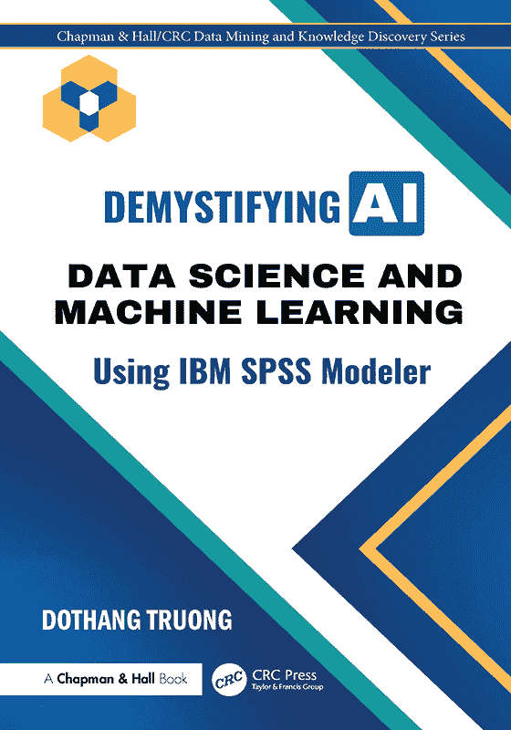


ii.


> v. *献给我的学生们，*
>
> *愿本书成为你们成长的工具，愿你们在数据科学与机器学习的旅程中充满发现与洞见。*
>
> *献给当今的学习者们，*
>
> *你们致力于释放数据科学的力量，将挑战转化为机遇。*
>
> *献给数据科学与机器学习的先驱者们，*
>
> *感谢你们奠定基础，以及所有薪火相传、勇往直前的人们。*

vi 页为空白。

ix.

# 前言

机器学习和人工智能（AI）领域持续改变着各行各业，并重新定义着我们与技术的互动方式。随着我们深入 AI 时代，利用机器学习算法从快速增长的数据集中发掘有意义的模式变得愈发重要。回顾我的历程，我清晰地记得首次接触先进 AI——特斯拉的全自动驾驶功能，以及最近开创性的 ChatGPT 和其他生成式 AI 程序。这些技术揭示了 AI 的巨大潜力，展示了其自主学习和适应的能力。身处这个领域是令人振奋的时刻，因为 AI 工具不断突破我们曾认为可能的界限。这些进步的核心在于数据科学和机器学习，它们是 AI 程序的基本组成部分。

## 为什么要读这本书？

许多人将 AI 应用视为“黑箱”——不可解释、过于复杂且难以理解。因此，他们可能会犹豫不决，甚至缺乏信心开始学习 AI 和机器学习，以及如何在其领域中应用它们。这对于没有强大编程技能或数学和计算机科学背景的人来说尤其如此。“打开黑箱”，通过分解机器学习的基础概念来揭秘 AI，至关重要。

来自商业、市场营销、金融、航空、社会科学和人文学科等不同领域的学习者，往往会因重点培养擅长编程和算法开发的数据科学家而感到被时代抛在身后。然而，随着软件技术的进步，许多应用程序现在允许用户在不编写一行代码的情况下构建机器学习模型并执行数据挖掘。这些应用程序提供用户友好的界面，使非程序员也能利用机器学习的力量。

我的第一本书介绍了使用 SAS Enterprise Miner 进行数据科学和机器学习的核心概念和实用技能，其成功激励我继续这段旅程。那本书专注于通过使用一个无需编码的强大、易用工具，为没有技术背景的学习者提供坚实的基础。在该基础上，第二本书面向非技术领域的学习者和经验丰富的研究人员，重点介绍 SPSS Modeler，这是一款广泛使用的数据挖掘软件，同样不需要编程技能。

本书遵循类似的方法，提供了一种结构化且易于理解的方式来掌握机器学习基础，同时提供使用 SPSS Modeler 的实践经验，该软件在学术界和业界专业人士中广受欢迎。我的目标是为学习者提供一条清晰的路径，以掌握 AI 概念和实用技能，无论其技术专长如何。

## 谁应该读这本书？


本书专为来自商业、市场营销、航空、社会科学等各领域的学生、讲师、研究人员和行业专业人士而设计。它旨在帮助读者理解数据挖掘和机器学习的核心概念，并通过实例让用户无需编程即可构建模型和分析数据。无论您是初学者还是已有一定机器学习经验，本书都旨在助您成长，发掘机器学习在您项目中的潜力。

## 本书内容

本书内容紧承第一册结构。第一部分介绍数据挖掘和机器学习的基础概念，不涉及繁复数学，帮助学习者掌握各类算法背后的关键原理与机制。第二部分涵盖广泛使用的机器学习方法，第三部分探讨随机森林、梯度提升和贝叶斯网络等高级技术，助力读者构建复杂模型。

全书各章节将使用两个大型数据集，将数据挖掘过程的每一步应用于一个连贯的项目。本书保持实践导向，指导读者使用 SPSS Modeler 进行实际操作。书中包含分步指南和截图，便于理解，正如第一册一样。

通过使用 SPSS Modeler，读者无需编写任何代码即可自信地执行数据挖掘，获得准确结果。本书还包含一章关于数据挖掘结果展示的内容，提供示例帮助用户有效向利益相关者传达发现。

## 如何使用本书

与第一册一样，本书旨在提供灵活的学习路径。虽然各章节层层递进，但读者也可直接跳转至感兴趣的主题或算法。实例和练习基于两个大型数据集，使读者能在连贯的项目框架内应用所学概念。

## 写作过程中关于大语言模型、生成式 AI 与 AI 辅助技术的声明

本书内容完全由作者开发和撰写。准备期间，作者使用 ChatGPT 进行编辑，包括纠正语法、错别字和句子结构。之后，作者彻底审查、编辑和修订了内容，并在必要时核实来源。作者对本书内容承担全部责任。

## 结束语

我衷心感谢所有支持我第一本书的读者，希望这本第二本书能继续以通俗易懂、实用有效的方式，赋能学习者探索机器学习。数据科学与机器学习的探索之旅永无止境，我鼓励您深入示例、尝试工具、享受学习过程。

让我们继续同行，一次一个模型，释放机器学习的潜力。

您准备好迎接 AI 时代了吗？让我们开始吧。

**Dothang Truong, Ph.D.**

*Professor of Aviation Data Science*

# 第一部分 数据挖掘导论

# 第 1 章 数据挖掘与数据科学导论

DOI: [10.1201/9781003468196-2](https://doi.org/10.1201/9781003468196-2)

## 学习目标

完成本章后，您将能够：

1. 定义数据挖掘。
2. 举出数据挖掘在实际业务中的应用例子。
3. 区分反应式、主动式和预测式策略。
4. 解释数据科学与数据挖掘的异同。
5. 描述数据挖掘的主要特征、与传统统计方法的区别，以及潜在优劣势。
6. 讨论人工智能、数据挖掘、机器学习和深度学习的演变。
7. 定义大数据并描述其主要特征。
8. 解释大数据分析过程。
9. 识别数据挖掘中的伦理考量。
10. 描述机构审查委员会（IRB）要求。
11. 实施数据去标识化流程。

## 导论


近年来，人工智能（AI）经历了前所未有的增长，成为各行业的变革性力量。这主要归功于数据科学和机器学习的进步，它们是 AI 系统的核心组件。数据科学提供收集、处理和分析海量数据的框架，而机器学习提供算法，使系统能从数据中学习并做出明智决策。二者共同赋能 AI 执行从自然语言处理到预测分析等复杂任务。

考虑到数据在 AI 开发中的作用，数据挖掘的重要性显而易见。数据挖掘涉及从大型数据集中提取有价值的见解，发现模式，建立可能不明显的关系。这些见解对训练机器学习模型至关重要。若无有效的数据挖掘技术，AI 系统的潜力将大打折扣，因为它们将缺乏学习和适应所需的严谨、结构化信息。

本章将带您进入 AI、数据挖掘和机器学习的世界，探索这些快速发展领域的基础概念。虽然**数据挖掘**一词并不新鲜，但其重要性随着技术和方法的变革而日益增长。尽管互联网上有海量关于数据科学、机器学习和数据挖掘的信息和讨论，但受众常因解释不一致、缺乏清晰阐述而难以理解这些概念。在现代世界，我们在互联网和社交媒体上看到许多流行词，常导致误用或误读。因此，揭开这些术语的神秘面纱、准确理解其含义至关重要。本章将探讨与数据挖掘、数据科学、机器学习和大数据相关的各种概念。这一全面探索为后续章节深入讨论数据挖掘方法奠定基础。

如果阅读本章后您仍感困惑，请不必担心。我们将通过具体的数据挖掘和分析结果示例，重温这些基础概念，提供清晰度和背景以加深您的理解。

您准备好踏上大数据和 AI 的精彩之旅了吗？怀着好奇与热情，让我们开始揭开数据挖掘与数据科学的奥秘。开始吧！

## 人工智能与数据挖掘


人工智能（AI）指在机器中模拟人类智能，使其能执行通常需要人类认知能力的任务。这些任务包括学习、推理、解决问题、感知和语言理解。AI 系统使用算法和数据来识别模式、做出决策，并随时间提升性能。


AI 系统需要海量数据才能有效训练。一个众所周知的例子是特斯拉的完全自动驾驶（FSD）系统，它依赖大规模数据收集来提升自动驾驶能力。同样，像 Amazon Alexa、Apple Siri 和 Google Assistant 这样的智能助手持续处理和分析语音数据，以增强其自然语言理解能力。Netflix 和 Spotify 等流媒体服务依靠海量的用户偏好、观看/收听习惯数据集来优化其推荐算法。用于安全和身份验证的人脸识别系统，如 Apple 的 Face ID 或机场生物识别扫描仪，需要海量图像数据集来提高准确性和可靠性。甚至医疗 AI 系统，如 DeepMind Health，也利用大量病历、影像扫描和诊断历史来协助疾病预测和治疗规划。随着 AI 越来越多地融入各个行业，问题依然存在——这些数据究竟来自哪里，又存在于何处？


我们生活在一个共享信息、AI、社交网络、无线连接和数字通信的世界中。在这个世界里，数据持续不断地实时流动和收集。数据以多种形式存在，包括数字、文本、图像、语音和视频。苹果、亚马逊、Meta（Facebook）和特斯拉等大型科技公司持续在其服务器上收集和归档用户数据。制造公司收集其产品、运营、供应链、库存、物流和零售商的数据。酒店、度假村、赌场、银行和航空公司等服务提供商收集其市场和客户的数据。我们的日常生活也通过几乎无处不在的监控摄像头被持续记录。我们也选择通过在社交网络上分享信息、想法、图片和视频来分享自己的数据。如果我们上网搜索，就能找到所需的一切。我们被可获取的海量数据淹没，这绝非夸大其词，更不用说那些公众无法访问的专有数据了。请记住，看不见数据并不意味着它们不存在。它们在**云端**，等待被用于 AI 驱动的进步。

## 有人看过电视剧 *Person of Interest* 吗？


既然海量数据存储在基于云端的服务器中，问题在于我们如何利用这些数据来改善我们的生活、业务或客户体验？让我从我最喜欢的电视剧之一 *Person of Interest*（《疑犯追踪》）说起。这是一部 2011 年至 2016 年播出的 CBS 科幻惊悚剧。主角是哈罗德·芬奇，一位数学和计算机天才。他获得了大量政府资金，开发先进的机器学习算法并构建了一个名为“机器”的 AI。该 AI 的主要目标是处理和分析从各种来源输入的所有数据，包括个人信息、社交网络、交通数据、商业信息、安全信息、政府信息、银行交易等。基本上，机器接收政府能提供的所有类型数据，包括数字、文本、视频、图像和语音。数据实时输入系统。所以你可以想象机器每秒接收的数据量。这当然需要多台超级计算机、超大带宽和高端服务器来存储如此海量的数据，更别提维护服务器所需的能量了。此外，还需要算力极强的计算机来及时有效地处理和分析这些海量数据，以产生实用的输出。

芬奇为机器开发了一种非常稳健且新颖的机器学习算法，花了他好几年才使其正常运行。这是一个繁琐的过程，涉及大量统计、数据分析、计算机编程、模型训练和验证。但他最终成功了。（当然，剧中从未展示实际算法。）利用该算法，机器能够从数据中发现未知模式，只做一件事，且仅做这一件事：预测将卷入犯罪或国家安全相关事件的特定个体，即“关键人”。预测结果不是姓名或地址，而是该个体的社会安全号码，因为这是分配给每个公民的唯一号码。然而，机器不知道这个个体是好人还是坏人；它只预测此人将卷入一起事件。它也不知道事件的原因或起因。为了阻止事件发生，芬奇雇佣了一名前中央情报局（CIA）特工约翰·里斯，他拥有格斗、武器、战术和隐蔽行动等特殊技能。里斯的工作是寻找并跟踪那个关键人，并介入阻止坏事发生。在每一集中，机器做出预测，团队与时间赛跑去跟踪关键人。他们的目标是确定该个体是受害者还是肇事者，从而要么拯救此人，要么阻止其实施有害行为。

虽然剧情梗概听起来可能很复杂，但机器的运作原理相当直观。我在图 1.1 中展示了该系统以演示其原理。系统的输入是从各种数据源收集的、不同形式的所有数据，如数字、文本、语音和图像。数据被实时收集、存储并输入云端。想象一下系统每秒必须处理多少数据。模型使用机器学习算法挖掘所有这些数据。这是一个高度智能的模型，能够学习、适应和自我改进，因此得名人工智能。当然，模型中使用了许多复杂的算法。有趣的是，我们收集并输入系统的数据越多，模型就能通过模型训练过程，利用新数据学到更多并自我改进。换句话说，机器从数据中学习（现在你能明白*机器学习*这个术语从何而来了）。最后，该系统的输出是目标变量的预测，更具体地说，是用社会安全号码代表的关键人。这是分配给一个人的唯一号码，因此不会重复。

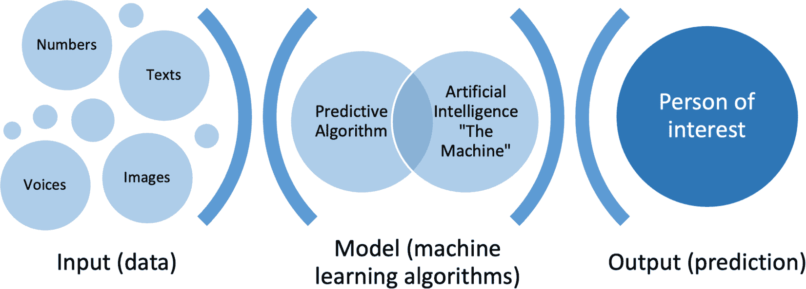

图 1.1 *Person of Interest* 中的机器是如何运作的？返回正文。⏎

该剧的关键启示在于：机器并不试图解释事件将*如何*发生，因为事件尚未发生，也不基于任何理论解释促成因素。它仅分析给定的大数据，预测近期将发生什么。它不知道关键人是受害者还是肇事者。尽管如此，它的预测从未出错；涉及该个体的可怕事情必将发生。听起来很科幻，对吧？请记住，这是部科幻剧。现实中，我们应始终考虑预测的误差范围。本质上，它不试图解释事件，而是预测事件。一旦里斯介入并阻止了事件，我们就会知道是什么导致或可能导致了该事件，但这是我们在每集结尾才了解到的。这是部很棒的电视剧，如果你是科幻惊悚片的粉丝，我强烈推荐观看。

## 数据挖掘的定义


# 7. IBM 将数据挖掘定义为“在大型数据集中寻找异常、模式和相关性以预测结果的过程。”此外，Nisbet 等人（2012）将数据挖掘定义为使用“机器学习算法在大型、嘈杂和混乱的数据集中寻找数据元素之间微弱的关系模式，这可以导致采取行动以以某种形式增加收益（诊断、利润、检测等）。”

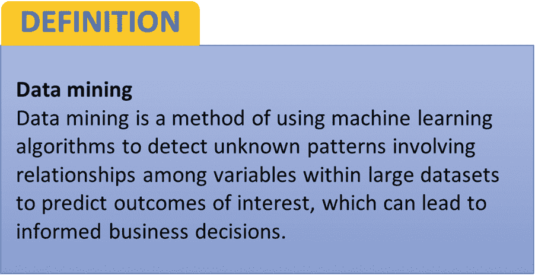

在本书中，我将**数据挖掘**定义为一种利用机器学习算法来检测大型数据集中涉及变量间关系的未知*模式*，以预测感兴趣结果的方法，这可以为明智的商业决策提供依据。图 1.2 展示了数据挖掘的概念。正如你所见，电视剧《疑犯追踪》中“机器”所做的无非就是数据挖掘。其科幻之处在于，这个 AI 能够极其出色地处理海量数据以进行极其有效的预测，从而使必要的缓解措施能够及时实施。在现实中，该任务需要大量资源才能使其运行，并且我们必须考虑预测中的误差范围。现实世界中不存在完美的预测。

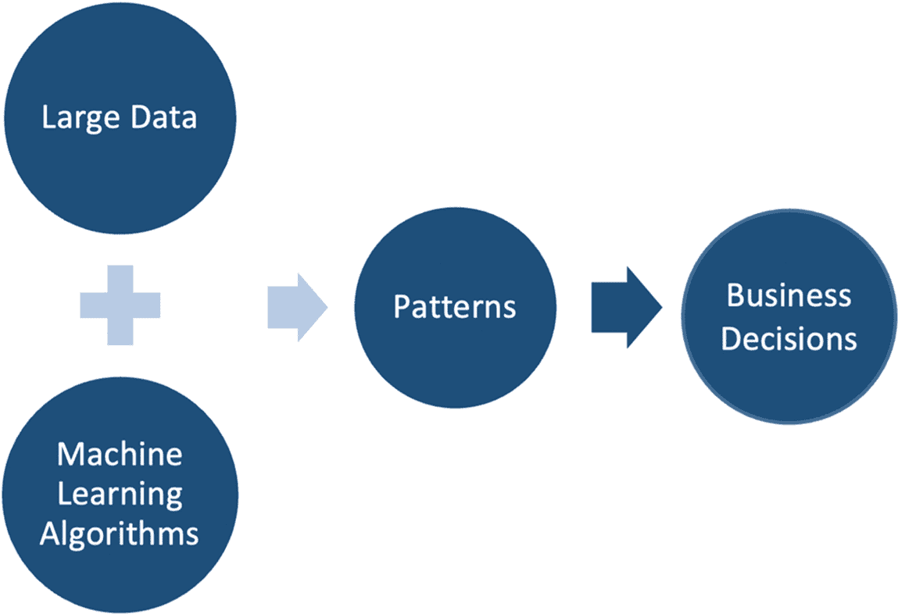

图 1.2 数据挖掘概念。返回正文。⏎

在现实生活中，小型企业、大型公司和政府组织可以利用数据挖掘来分析大型数据集，检测变量间未知的关系，以预测结果，包括绩效、风险、收入、客户满意度等。预测模型和变量间的关系可用于为领导者提供有关其运营和重要业务变量的有用信息，据此他们可以制定必要的商业策略并做出明智决策，以提高运营效率或降低风险。这听起来可能过于科学且难以理解。让我通过一些例子展示数据挖掘如何在现实场景中应用。

## 人工智能、机器学习与深度学习的演变


# 8. 与数据挖掘和预测建模相关的有几个我们每天都能听到或读到的流行词：**人工智能、机器学习**和**深度学习**。这些术语经常重叠，容易让人困惑，因此我将简要解释它们之间的区别。我不会深入细节，因为每一个都是一个独立的研究领域和学科。我还将解释这些研究领域随时间的演变（图 1.3）。

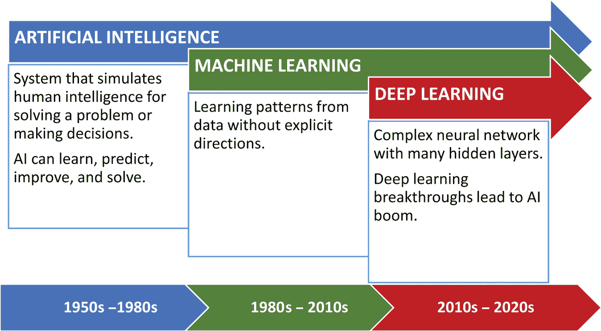

图 1.3 人工智能、机器学习和深度学习的演变。返回正文。⏎

首先是**人工智能（AI）**。虽然 AI 是研究领域的一个增长趋势，但它并非新词。AI 一词创造于 20 世纪 50 年代，指使用复杂逻辑实现操作自动化的软件。随着计算机科学和机器人技术的进步，AI 随时间发生了显著演变。但 AI 不仅仅是制造机器人。一个更现代的 AI 定义是“一种模拟人类智能以解决问题或做出决策的系统”。AI 可以学习、预测、改进和解决问题。本质上，AI 可以是一种在极少人工干预下运行和行动的应用程序或解决方案。Siri、Alexa 和 Google Assistant 是 AI 虚拟助手的例子，它们通过智能手机、智能家居和智能汽车让我们的生活更轻松。特斯拉的全自动驾驶系统是一个推动自动驾驶汽车发展的 AI。ChatGPT 是一种生成式 AI，能够理解自然语言并根据用户需求执行各种智能任务。这些应用只是 AI 时代的开始。我们很快将在所有行业看到更多惊人的 AI 工具。当然，随着机器变得更聪明，关于伦理和社会影响的担忧也会出现。不过，那是另一本书的话题。

**机器学习**是 AI 的核心组成部分，始于 20 世纪 80 年代。机器学习涉及算法在没有显式指令的情况下从数据中学习模式。我们一直在讨论的数据挖掘使用机器学习算法。这些算法基于数学、统计学和计算机科学的基础开发而成。在接下来的章节中，我将描述我们可以在研究中使用的特定机器学习算法。过去，由于涉及大量数学知识，扎实的数学背景和编码技能对于使用机器学习至关重要，只有像 MATLAB^® 这样的特定软件才能处理这些算法。幸运的是，在过去几年里，创建了更多用户友好的应用程序。因此，**9. 机器学习不再仅属于数学家或计算机科学家，也可用于应用研究。** 虽然数据科学家仍使用 Python 或 R 等编程语言进行机器学习工作，但非程序员现在有更多选择利用这种方法进行研究或业务。SAS Enterprise Miner、IBM SPSS Modeler、Rapid Miner、KNIME 和 Orange 等软件应用程序是易于使用的数据挖掘工具，允许我们在不编写代码的情况下分析大型数据集。

最后但同样重要的是，**深度学习**是我们在过去几年开始更频繁听到的一个流行词，尽管它是在 2010 年代引入的。最初，它没有被广泛提及，因为只有少数人理解该概念。现在，大家都在谈论 Deepfake（深度伪造）、语音识别、智能手机上的人脸识别和特斯拉的自动驾驶技术。从本质上讲，深度学习是一种具有许多隐藏层的复杂神经网络。一些流行的深度学习方法包括卷积神经网络和循环神经网络。我不会深入探讨该领域的技术细节，但它是机器学习一个快速发展的分支。苹果用于人脸识别和相机的技术基于深度学习，特斯拉的自动驾驶技术也是如此。深度学习还用于自然语言处理、艺术和音乐创作以及许多其他应用。你可能见过由 AI 创作的、难以与人类创作区分的艺术和音乐作品。深度学习仍是一个高级主题，需要大量数据和复杂算法才能正确执行。因此，更难找到无需编程和编码即可处理深度学习的软件。

## 数据挖掘在实践中的实际案例

数据挖掘在商业世界中有许多我们每天都在经历的应用。组织和企业利用数据挖掘来理解他们收集的数据，并做出明智决策以改善其运营或业务。以下是数据挖掘在各个领域应用的一些典型例子。

### 媒体流媒体


许多流媒体服务，如 Netflix、Amazon Prime 和 Hulu，每天都会收集用户关于电影和电视节目偏好以及观看习惯的数据。这些公司利用机器学习算法从数据中发掘模式，揭示用户偏好与人口统计信息之间的关系。流媒体应用随后可以预测用户可能想观看哪类电视节目或电影，并推荐类似内容。例如，如果我是动作片爱好者，且看过大量汤姆·克鲁斯和威尔·史密斯的电影，下次登录 Netflix 时，我将看到由这些演员主演的其他动作片推荐。主页还可能展示同类型的多部电视节目和电影。此外，Netflix 还利用这些信息决定投资哪类节目或电影以增加用户订阅量。热门 Netflix 电视节目和电影的例子包括 *怪奇物语*、*纸牌屋*、*王冠*、*爱尔兰人* 和 *红色通缉令*。

### 社交网络


Facebook 和 Twitter 等顶级社交媒体平台收集用户的人口统计信息、产品或服务搜索记录，以及在社交媒体上分享的帖子、照片和通讯内容。算法被开发用于预测用户行为及其与人口统计信息的关系。应用程序会推荐相关网站，根据用户偏好展示广告，并推荐用户可能想查看的潜在好友或帖子。例如，我在 Facebook 上搜索关于雷克萨斯汽车的新帖子，不久后，我开始看到更多雷克萨斯汽车销售广告。我还根据我的好友数据库收到了好友推荐，从而能够与失联已久的朋友重新取得联系。这些公司利用数据挖掘输出结果来调整或更改其应用程序，以更好地满足用户需求并吸引更多用户。

### 在线购物


在线购物已逐渐超越传统的实体店商业模式。Amazon 是电子商务领域的主导企业，并取得了巨大成功。大多数传统零售商已转型电子商务以提高盈利能力。Amazon、Best Buy 和 Walmart 等在线零售商利用机器学习算法预测顾客购物行为。其在线平台可根据顾客人口统计信息、过往订单历史或搜索历史，推荐替代产品或新商品。例如，在 Amazon 上搜索智能插座后，我的 Amazon 应用随后推荐了来自不同卖家的多款智能插座选项。这种便利性还延伸至预测特定产品的需求上升，使公司能够提前备货以高效履行订单，同时降低供应链成本、库存水平和发货时间，从而提升顾客满意度。

### 航空业


航空业是美国最大、竞争最激烈的行业之一。航空公司高管利用数据挖掘来提高乘客满意度和运营效率。航空公司收集乘客的人口统计信息和出行行为数据以发掘关系，从而预测未来的出行需求，并根据出行历史为乘客提供促销优惠。例如，我经常乘坐美国航空的航班。该航空公司的应用程序记录我的出行历史，并偶尔发送前往类似目的地的折扣机票推荐。此外，我还会收到常旅客优惠，例如特定行程的额外奖励积分或航空联名信用卡促销。航空公司还分析机上服务、Wi-Fi、清洁度、腿部空间、餐食质量、航班延误和取消等因素，以了解乘客忠诚度。这使他们能够改进运营和服务，以留住并吸引忠诚客户。

### 银行与金融


银行和抵押贷款公司广泛使用数据挖掘来预测客户决策并评估信用状况。我们许多人在银行拥有支票账户和储蓄账户，并可能因各种原因决定转到另一家银行。银行利用数据挖掘，基于人口统计信息和银行往来历史，预测客户关闭账户的可能性。利用这些洞察，银行经理可以提供有吸引力的优惠以留住客户。预测建模还有助于银行提供有吸引力的信用卡优惠或融资服务。此外，抵押贷款公司利用数据挖掘评估借款人是否有能力偿还贷款。他们基于人口统计信息和信用历史评估客户信用状况，以决定是否放贷、贷款金额和期限。数据挖掘在降低贷款人风险方面发挥着关键作用。

### 医疗保健


数据挖掘在医疗保健领域至关重要，有助于提供商提高服务质量。医院和医生诊所收集患者的人口统计信息、健康史和治疗数据。预测模型可通过多种方式支持患者治疗。例如，当一位新患者带着特定症状就诊时，医生可将信息录入系统，系统可给出初步诊断和治疗方案建议。系统还可根据过往类似病例预测病情严重程度并建议合适的治疗方案。此外，预测建模可判断某一问题是孤立事件还是更大模式的一部分，使医疗专业人员能更有效地干预并降低风险。

### 交通运输


交通拥堵是美国和其他发达国家的一个重大问题，导致延误、排放增加和时间浪费。大量交通数据被实时收集，可用于预测特定地点和时间发生交通拥堵的概率。当局可利用这些预测来缓解拥堵，并制定长期交通策略，如修建新道路或推广替代交通方式。事故也很常见，并可能导致严重伤害或死亡。可开发预测模型来预判事故及其潜在发生时间和地点。当局可利用这些预测有效调配资源，确保急救医疗技术人员 (EMT) 能及时抵达现场。请记住，分秒必争。

这些只是数据挖掘在实践中应用的几个例子，它们赋能企业和组织以增强运营、提高盈利能力、提升客户满意度并保障安全。在教育、培训、制造、工程、航空航天、社会科学和生物学等领域还有许多其他应用。全书中，我们将探讨跨各行业的具体案例研究。根据您所在的行业，您可以确定如何应用数据挖掘。令人欣慰的是，分析数据可以使用相同的流程和算法；区别在于您如何利用结果做出明智的商业决策。

## 被动、主动与预测性策略


### 航空安全中的反应式、主动式和预测式策略

为了在商业中有效利用数据挖掘，理解数据挖掘在预测性项目中的主要目的至关重要。我想向您展示美国联邦航空管理局（FAA）是如何区分反应式、主动式和预测式策略的。虽然这原本是针对航空安全策略的，但我发现这种分类非常贴切地代表了不同类型的研究项目，以及预测性研究在其中的定位。FAA 的主要职责是确保航空运输安全。在航空安全领域，FAA 将安全策略分为三类，它们在根本上有所不同：反应式、主动式和预测式（图 1.5）。航空组织可以遵循这些策略来提升其运营安全。

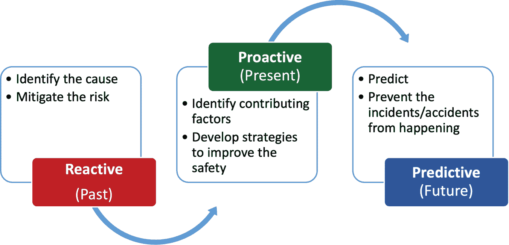

**图 1.5** 反应式、主动式和预测式安全策略。（来源：美国联邦航空管理局。）

#### 反应式策略

第一类是**反应式策略**，其重点在于审视已经发生的事件，并确定特定航空事故或事件的根本原因。基于已识别的根本原因，航空组织可以制定相应的策略来降低风险。该策略要求专家对事件进行极其彻底的调查，检查黑匣子，采访相关人员，并勘察事件现场。根据事件/事故的范围和严重程度，调查可能需要很长时间才能完成。例如，一起航空公司事故的调查可能需要数月甚至数年才能完成并确认原因。这一漫长时期对于确保事件的各个方面都经过仔细审查、根因被准确识别是必要的。尽管该策略耗时较长，但此类调查的结果极其宝贵。详细的调查结果提供了关键见解，能显著增强航空业的安全规程和培训计划。通过了解出了什么问题以及为什么会出问题，航空组织可以做出明智的决策，防止未来发生类似事件，从而提高整体安全标准。

#### 主动式策略

第二类是**主动式策略**，它着眼于当下。换句话说，航空组织从危险状况和组织流程的各个方面审视导致事件/事故的促成因素，并查看它们与事件或事故的关联。这种方法不试图寻找事件的因果关系，而是调查各种促成因素与航空事件发生之间的相关性。通过理解这些相关性，航空组织可以实施预防措施以增强安全。主动式策略采用多种常用方法，包括统计分析、科学理论、航空科学模型和工程机制。这些方法有助于识别可能导致潜在危险的不同变量之间的模式和相关性。例如，统计分析可以揭示数据中的趋势，表明在特定条件下某类事件的风险增加。利用这些洞察，航空组织可以制定针对已识别促成因素的策略和行动计划。这种主动方法允许实施措施，在风险升级为严重事件之前将其化解。此外，组织还可以设计应用程序和系统，持续监控各种参数以实时检测潜在事件。随着传感器和数据采集技术的集成，实时监控成为主动式策略的重要组成部分。这些技术能够在异常和潜在事件发生时检测到它们，为当局提供必要的信息以做出及时决策。虽然并不总能完全防止事件发生，但即时检测允许迅速采取行动，将伤害或损失降至最低。

#### 预测式策略

第三类是**预测式策略**，它着眼于未来。换句话说，航空组织分析大量数据，以预测空域系统未来可能出现的新安全问题。通过挖掘大数据，他们可以开发预测模型，在航空事故或事件发生前对其进行预测。反应式和主动式策略分别侧重于理解和应对过去及当下的事件，而预测式策略旨在通过预测来防止事件发生。这种前瞻性方法不试图事先解释事件将如何发生；相反，它专注于基于数据模式预测事件的发生。关于事件可能如何展开的详细解释可以稍后分析，但主要目标是预测事件可能发生的*内容、地点和时间*，以及其*概率*。

为了实现这一目标，航空组织采用数据挖掘技术，从大型数据集中发掘先前未知的模式和相关性。这些模式支持构建预测模型，从而为潜在安全问题提供早期预警。例如，通过分析飞行数据、维护记录和环境因素的趋势，预测模型可以识别可能导致事件的条件。该策略标志着航空安全的重大进步，因为它允许预防事件的发生，而不仅仅是减轻其影响。通过在事件发生前预测它们，航空组织可以实施措施完全避免事件，从而确保更高水平的安全。然而，预测式策略的成功在很大程度上依赖于大量高质量数据的可用性。准确的预测需要全面且详细的数据集，这些数据可从飞行运行、维护日志、天气报告和空中交通管制数据等各种来源获取。航空领域预测建模的概念，可类比为电视剧《疑犯追踪》中描绘的场景，其中数据挖掘被用于在犯罪发生前预测并防止犯罪。同样，在航空领域，数据挖掘和预测建模作为识别和防止潜在事件的关键工具，从而提升空域系统的整体安全性。


这三种策略对企业和组织都有利。然而，本书的重点在于预测策略。在业务运营中，预测建模发挥着至关重要的作用。它使我们能够开发和验证预测模型，从而准确预测预定的结果（目标变量）。此外，我们还可以识别出对这些预测有贡献的重要预测变量。随后，通过推断这些预测变量潜在的或预测的未来值，我们可以预判未来的结果。此外，我们还能进行各种假设场景分析，通过修改特定预测变量的值来观察结果如何变化。此类场景使决策者能够确定以最小不确定性解决业务问题的最有效策略或决策。

## 数据挖掘与数据科学


近年来，**数据科学**一词在分析学及更广泛的领域中大受欢迎。这一热潮催生了大量数据科学家职位空缺，**数据科学家**或**数据科学专家**等头衔频繁出现在简历上。尽管被广泛使用，**数据科学**往往仍是一个流行词——虽常被提及，却难以清晰定义。这种模糊性主要源于缺乏一个公认的数据科学定义。在数据科学兴起之前，行业内流行**数据挖掘、数据分析、业务分析**和**大数据**等术语。值得注意的是，在这些术语（包括**数据科学**）中，重点不那么在于**数据**本身，而在于我们如何利用它。我们都知道数据是必需的。真正的价值在于数据的应用，而非其单纯的存在。

16. 在本节中，我旨在阐明**数据科学**与**数据挖掘**之间的区别与联系。网上有许多对比，但它们往往缺乏一致性，甚至在某些情况下相互矛盾，导致更多困惑而非澄清。值得一提的是，一些对比不准确地混淆了数据挖掘和数据科学的概念，进一步搅浑了水。因此，审慎对待这些主题并优先参考可靠来源的信息至关重要。

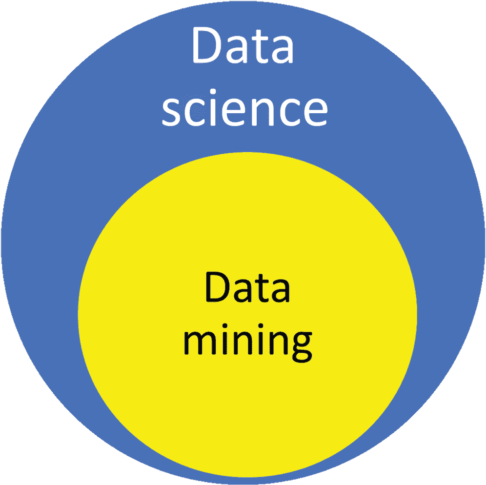

**数据科学**并非新词。实际上，**数据科学**的官方定义早在 1998 年就由 Hayashi (1998) 提出。根据作者所述，数据科学是一个“统一统计学、数据分析及其相关方法的概念”，旨在利用数据“理解和分析实际现象”。2013 年，Vasant Dhar 博士在 ACM 通讯上给出了一个更高层面的**数据科学**定义。他将数据科学定义为“从数据中提取可泛化知识的研究”(Dhar, 2013)。它运用来自数学、统计学、计算机科学和领域知识等各个领域的理论和技术(Cao, 2017)。**数据科学家**是一位“编写编程代码并将其与统计知识相结合，从数据中创造洞察”的专业人士(Davenport & Patil, 2012)。

因此，我们可以认为**数据挖掘**和**数据科学**服务于同一目的：使我们能够探索并从大量数据中发掘模式，为组织和个人提供新发现的信息，以便他们做出明智决策。这些术语在某些情况下有重叠，甚至可被视为同义词，因为两者都涉及机器学习、大数据和分析。一种普遍的理解是：数据挖掘是一种方法或跨学科子领域，而数据科学是一门学科。从这个角度看，数据科学比数据挖掘范围更广，但数据挖掘是数据科学的重要组成部分。可以这样说：数据挖掘涵盖了利用机器学习从大量数据中发掘模式以预测结果的方法。统计学、数学和其他基于规则的方法是数据挖掘的核心。相反，数据科学是一个更大、更多学科交叉的领域，专注于从数据中获取和提取知识并传达结果。数据科学包含数据挖掘作为分析数据的重要部分，以及数据收集与管理、数据处理、数据可视化、计算机编程、软件工程和 AI 开发等其他组成部分。


数据科学家通常肩负多种职责，可能包括数据收集与准备、数据挖掘、机器学习、计算机编程和软件工程。因此，他们的角色可能仅专注于数据挖掘，也可能需要多学科背景。如果其主要职责是数据挖掘，他们将专注于分析数据并采用各种机器学习方法构建预测模型。虽然编程技能有优势，但并非严格必需，因为许多数据挖掘应用允许用户无需编写代码即可执行任务（例如，本书就专注于面向 17. 非程序员的机器学习）。然而，如果工作包含大数据收集、数据仓储与管理、开发智能仪表板、创建复杂深度学习算法以及在实际应用中部署预测模型等额外职责，则编程技能变得必不可少。这就是为什么数据科学家职位的资格和技能要求差异巨大的原因。

显然，随着我们不断前进，**数据挖掘**和**数据科学**的定义将继续演变和多样化。这些领域充满活力，新的维度和应用层出不穷。为帮助理解这些区别，我提供了一个对比，见图 1.6。鉴于本书面向无编程背景的读者，我们的重点将主要放在数据科学的数据挖掘层面。这意味着我将介绍机器学习中用于揭示大型数据集内隐藏模式的过程和方法。不过，本书也将涉及数据可视化和处理的基本概念，为有意探索这些领域的人提供宝贵知识。

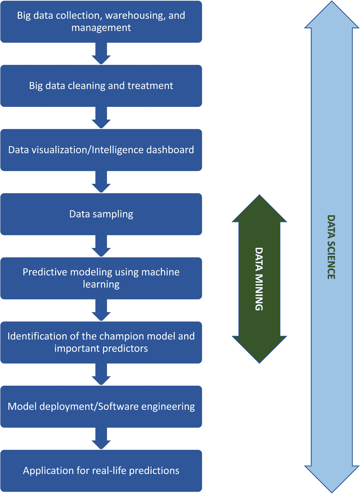

图 1.6 数据科学与数据挖掘。返回正文。⏎

18. 因此，准确地说，本书涉足了数据科学领域。在此语境下，术语**数据科学家**将用于描述运用机器学习技术进行数据分析的专家。然而，本书不会涵盖从事数据收集、仓储和管理的数据科学家角色，也不会涵盖负责开发复杂可视化智能仪表板、部署预测算法和开发实际软件应用的角色。我们的重点将通过数据挖掘技术揭开数据中隐藏的奥秘，提供从非程序员视角切入数据科学的基础理解。


## 数据挖掘的特征


数据挖掘研究中常见的困惑之一是数据挖掘方法与传统统计方法的区别。理解这些差异有助于我们更好地掌握数据挖掘方法的特征，并知晓何时应使用它们而非传统统计方法。表 1.1 总结了数据挖掘的主要特征及其与其他传统统计方法的区别。


# 表 1.1 数据挖掘与传统统计方法的差异 返回正文.⏎

| 项目 | | 数据挖掘方法 | | 传统统计方法 |
| --- | --- | --- | --- | --- |
| 目标 | | *数据驱动*：数据挖掘的主要目标是在大型数据集中发现那些可能不易察觉的模式、关系和洞见。它侧重于从数据中提取有用信息，通常旨在进行预测或发现隐藏模式。 | | *理论驱动*：传统统计方法旨在总结和分析数据，以对总体进行推断。它们侧重于理解变量间的关系、检验假设，并以高度置信度估计参数。这些模型需要理论来构建假设。 |
| 探索性 vs. 解释性 | | *探索性*：数据挖掘技术强调探索大型复杂数据集，以识别新的模式和关系。它们能处理非结构化和半结构化数据，且能应对高维数据集。 | | *解释性*：传统统计方法通常从预定义的假设或研究问题出发，利用统计检验来考察变量间的关系。因此，它们能为这些关系提供解释。 |
| 数据要求 | | 数据挖掘方法需要大量数据进行模型训练和验证。数据集通常包含许多行数据和许多不同形式及结构的变量。 | | 传统统计方法不需要太多变量，因为它们聚焦于拟定的假设。它们也只需要较小的样本量即可工作。 |
| 假设 | | 数据挖掘方法通常对底层数据分布和变量间关系做出的假设较少。它们能处理嘈杂、不完整和不一致的数据。 | | 传统统计方法通常假设特定的数据分布（如正态分布），并要求遵守特定的统计假设，如线性、同质性和非多重共线性。违反这些假设会影响结果的有效性。 |
| 模型复杂度 | | 数据挖掘技术能处理复杂模型，包括决策树、神经网络和集成方法。它们能捕捉数据中复杂的非线性关系和交互作用。 | | 传统统计方法通常使用较简单的模型，如相关性分析、t 检验、ANOVA、线性回归或逻辑回归。这些模型通常具有可解释性且更易于实现。 |
| 解释性 | | 数据挖掘技术优先发现模式和关系，但模型的可解释性可能是一个挑战。重点通常在于预测准确性，而非对底层机制的显性理解。 | | 传统统计方法强调可解释性，使研究者能理解变量间的关系并进行因果推断。重点通常在于参数估计和假设检验。 |

首先，数据挖掘是一种数据驱动的方法。我们利用数据挖掘从大型数据集中发现未知或新的模式。换句话说，我们仅利用机器学习算法从数据中提取信息或揭示未知模式。本质上，我们想知道数据在告诉我们什么。这不同于倾向于理论驱动的传统统计研究。传统研究基于现有理论构建关系和假设，收集数据以检验这些假设，并用证据确认它们是否得到支持。这些研究主要聚焦于文献支持的感兴趣变量，并常使用 `t-tests`、`ANOVA`、`MANOVA`、多元线性回归、逻辑回归和结构方程建模等传统统计方法来检验相关性。相反，数据挖掘不依赖于预先存在的假设或理论，因为我们想直接从数据中发现新模式。因此，数据质量起着至关重要的作用，因为嘈杂和不完整的数据可能提供无意义的结果，甚至导致错误的结果。因此，为了使数据挖掘发挥作用，我们需要包含大量变量和记录的大型数据集。我们稍后将讨论大数据的特征。

其次，数据挖掘研究是探索性的；即我们利用数据挖掘探索数据中的新变量和关系。我们不预先推测哪些关系显著、哪些变量重要。本质上，我们想让数据告诉我们这些结果。相反，传统统计研究是解释性的，倾向于聚焦于确证假设的关系。因此，这些研究局限于基于文献预先确定的感兴趣变量及其关系。数据挖掘研究中的一个常见问题是：“你是否发现了任何新变量、关系或模式？”换句话说，数据挖掘研究的发现可能会让我们感到惊讶，这使它们在预测性研究中具有意义。

19. 当然，要发现新变量和关系，我们不能将自己局限于变量有限的小型数据集。因此，数据挖掘的第三个特征是大数据。大数据意味着包含大量变量和记录、且具有不同形式和结构的数据集。既然我们不知道可能会发现什么，就需要大数据。正如电视剧《疑犯追踪》所展示的，AI 需要访问海量数据（其中许多相当敏感）才能做出准确预测。这不同于理论驱动的解释性研究，后者通常使用变量有限的较小数据集。在执行 `ANOVA` 和多元回归，甚至结构方程建模等统计分析技术时，我们通常使用公式来计算在特定显著性水平和预期检验效能下检测关系所需的最小样本量。通常，100 到 300 之间的样本量就足够了，模型包含 3 到 10 个变量。相反，在数据挖掘研究中，我们需要分析包含数百个变量和数百万行数据的数据集。由于数据挖掘是数据驱动的，噪声和缺失值可能会对结果质量产生负面影响。拥有更大规模的数据有助于解决这些问题。

20. 由于数据规模，数据挖掘方法不受严格统计假设的约束，并能处理嘈杂和非结构化数据。它们通常不要求特定的底层数据分布。许多机器学习算法基于规则而非统计，因此即使存在缺失值和异常值也能表现良好。然而，我们仍需确保数据质量以获得有意义的结果。“垃圾进，垃圾出”这句格言在此依然适用。相反，理论驱动的研究倾向于使用样本量较小的统计技术，这要求满足严格的统计假设，如正态性、非多重共线性、线性和同质性。这些要求往往在数据分析过程中制造障碍，并限制模型中变量的纳入。


鉴于海量数据和多样的机器学习算法，数据挖掘使我们能够构建复杂的预测模型，捕捉变量间的非线性关系或交互作用。由于我们事先不知道数据可能揭示什么信息，因此无法预设我们要处理的关系类型（线性或非线性），也无法预知最终模型中将包含多少变量。决策树、神经网络或集成建模等高级机器学习方法能够对数据的复杂性进行建模。相反，传统统计方法通常使用较简单的模型，如 t 检验、方差分析（ANOVA）、线性回归或逻辑回归。它们依赖于预设的假设，可能无法捕捉复杂的非线性模型。

最后但同样重要的是，可解释性是一个关键差异。数据挖掘能够检测包含变量交互的复杂非线性模型，这些模型常被视为“黑箱”模型，因为变量间的关系过于复杂而难以理清。请注意，模型并非字面意义上的“不可解释”。数据挖掘的结果允许我们利用树形图或数学公式来考察这些关系。然而，这需要对方法的科学背景有更深入的理解。请注意，数据挖掘的重点并非真正在于解释潜在机制，而在于实现精准预测。相反，传统统计方法侧重于解释变量间的关系并进行因果推断。这些研究的重点通常在于参数估计和假设检验，这使得其结果更易于解释。

这一对比凸显了数据挖掘的优势，但它也并非没有弱点。最明显的弱点是倾向于使模型过拟合数据，这归因于数据的规模。过拟合是指利用大量数据训练预测模型以达到极高的准确度。然而，模型对训练样本的拟合过于完美，以至于无法推广到其他样本。当该模型在另一个数据集上运行时，准确度会变得非常低。因此，模型过拟合于训练样本，因缺乏泛化能力而在现实生活中无用。通常可以通过将数据随机划分为训练样本和验证样本来评估过拟合情况。训练样本用于训练模型，验证样本用于验证模型。如果两个样本的模型拟合指标相似，则说明我们拥有一个没有过拟合问题的可靠模型。我们将在第 6 章中深入探讨过拟合问题。

此外，某些机器学习算法完成分析可能需要巨大的计算能力。更具体地说，神经网络算法通常需要极高的迭代次数来搜索最优解。这一搜索过程需要大量计算，要求高算力和长时间的运行。因此需要高效的搜索算法和高性能计算机来应对。更重要的是，在数据挖掘中，最耗时的部分是数据准备和处理。通常，数据挖掘项目中 80% 的时间都用于数据清洗和准备。

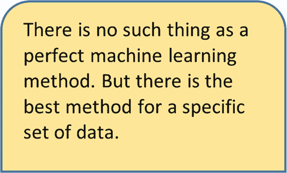

这些是数据挖掘的一般特征。当我们介绍每种机器学习方法时，将讨论其具体的优缺点。经验法则是：*不存在完美的机器学习方法，但针对特定数据集存在最佳方法。* 虽然某些方法比其他方法更复杂或更先进，但所有方法都有利弊。最佳方法取决于数据。如果存在一种完美的方法能适用于所有类型的数据，我们就可以在所有项目中一直使用它。然而，现实是，在用数据训练模型之前，我们不知道哪种方法最适合我们的数据。因此，常用的策略是使用多种方法，并以各种配置开发多个预测模型。通过比较这些模型，我们可以确定最佳预测模型，也称为冠军模型。我们将在第 6 章详细讨论这一步骤。

## 大数据

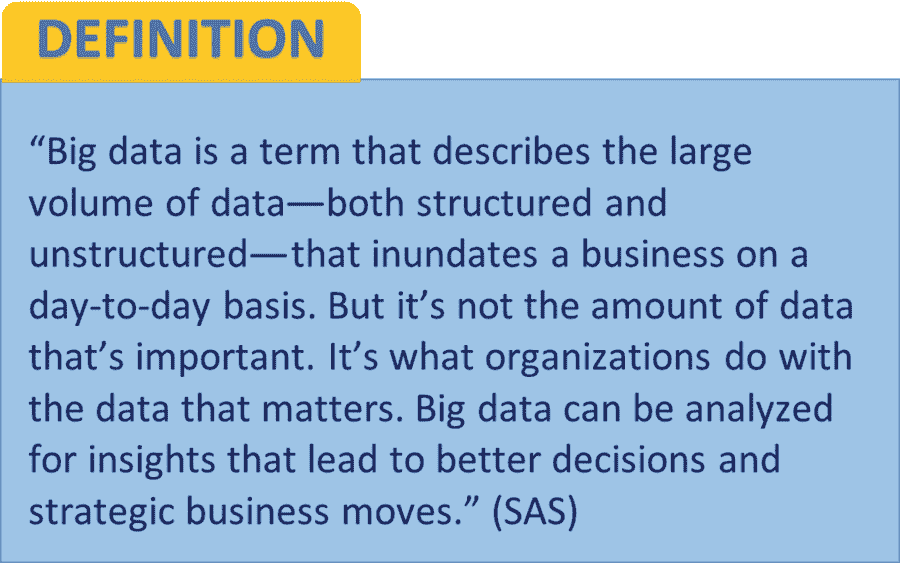

我想简要介绍一下大数据。首先，什么是大数据？一个常识性的回答是“大量数据”，这并不错误。电视剧《疑犯追踪》中的 AI 必须实时收集并处理来自多个来源、不同类型和格式的海量数据。当然，这需要超级计算机来及时存储和处理如此大量的数据。如果预测需要数天才能完成，那么预测就没有意义或用处。

SAS 研究院将大数据定义为：“大量数据——包括结构化和非结构化——每天淹没企业。但重要的不是数据的数量。重要的是组织如何利用这些数据。大数据可被分析以获取洞察，从而做出更好的决策和战略性业务举措。”

因此，大数据不仅关乎数据量，还关乎我们如何处理它。从本质上讲，大数据可以用五个维度来描述：容量、速度、多样性、变异性和真实性（图 1.7）。


图 1.7 大数据维度。返回正文。⏎

*   **容量** 涉及数据的数量，涵盖商业交易、智能设备、工业设备、视频、社交媒体等各种来源。历史上，管理此类数据曾面临挑战，但云计算的进步以及数据湖和 Hadoop 等具有成本效益的存储解决方案的出现，已减轻了这一负担。

*   **速度** 涉及数据生成和传输的快慢。随着物联网的普及，数据以前所未有的速率流入服务器，要求及时处理。RFID 标签、传感器和智能电表正推动着对近实时处理这些数据洪流的需求。

*   **多样性** 指数据的多样本质，跨越广泛的格式。这包括传统数据库中常见的结构化数值数据，以及文本文档、电子邮件、视频、音频记录和金融交易等非结构化数据。

*   **变异性** 涉及数据流的多样性和波动性。除了数据速度和多样性的增加外，数据流还因频繁变化和显著变动而表现出不可预测性。企业必须紧跟社交媒体趋势，并有效应对每日、季节性及事件触发的数据负载激增。

*   **真实性** 代表数据质量。鉴于数据来源众多，跨系统链接、匹配、清洗和转换数据颇具挑战。企业必须建立连接，辨别关系、层级和多重数据关联；否则，其数据可能迅速变得难以管理。

现在我们更了解大数据的复杂性。它不再仅仅是一个超大数据集；它是一个业务成功框架。那么如何实施大数据分析？我们需要遵循图 1.8 中呈现的五个步骤。针对每个步骤，我列出了我们需要找到答案的重要问题。


图 1.8 大数据实施流程。返回正文。⏎

1.  **制定大数据战略。**

    *   我们的目标是什么？

    *   我们希望通过大数据实现什么？

2.  **识别大数据来源。**

    *   有哪些可用数据？

    *   从哪里获取数据？

    *   我们是否有权限访问和使用这些数据？


## 伦理考量


当我们处理数据，尤其是大量数据时，自然必须考虑伦理问题。数据通常包含个人、私密和敏感信息。虽然这些信息有助于我们开发优秀的预测算法，但一旦泄露，就会对相关个人造成伤害。因此，在开展数据挖掘研究之前，我们必须评估并解决任何伦理顾虑，以确保不给人类受试者带来伤害。

### 伦理原则与数据收集

伦理考量是数据挖掘中的一个重要课题，因为我们必须确保遵守关于数据访问的要求和限制，以保护人类受试者并避免侵犯隐私。从本质上讲，伦理考量是指贯穿整个数据挖掘过程、规范数据负责任且尊重地使用的原则、指南和道德价值观。根据《贝尔蒙报告》（美国卫生与公众服务部, 1979），所有研究人员或调查员必须遵循三项基本伦理原则：(1) 尊重人格，(2) 不伤害/获益，以及 (3) 公正。

首先，尊重人格意味着将个体视为自主行动者，而自主能力减弱者有权获得保护。其次，不伤害/获益原则要求确保研究不损害个人，并在将可能的伤害降至最低的同时，将可能的获益最大化。最后，公正原则确保对所有参与者实现“分配的公平性”。所有研究人员和调查员必须在其研究项目中遵守这些伦理原则。

获取数据颇具挑战，因为极少有组织愿意与公众共享其数据。一些网站提供用于练习的示例数据集，但这些数据可能是虚构的，或者已去标识化、修改甚至缩减，导致不适合研究用途。它们也可能缺乏效度，或缺乏关于变量、时间范围或背景的充分信息，而这些是使项目具有意义所必需的。

只有有限的组织提供去标识化数据供公众使用，例如 NASA（美国国家航空航天局）、FAA（美国联邦航空管理局）、NTSB（美国国家运输安全委员会）、BTS（美国交通统计局）、美国人口普查局和教育部。这些数据集经过仔细清洗，确保不泄露任何个人信息或身份标识。尽管这些数据库有效且可用于研究，但它们有限，可能无法提供特定项目所需的数据。这些公开可访问数据源的一个优势是，使用数据无需许可或附加条件。由于数据已清洗并去标识化，研究人员可在无伦理顾虑的情况下，在互联网或同行评审期刊上发布其结果。

私营组织通常拥有为商业目的收集的当前且相关的数据，例如航空公司、制造商、零售商、电商公司、酒店、医院、社交网络提供商、媒体提供商、银行和房地产公司。然而，它们视数据为专有资产，不愿公开供公众使用。它们通常拥有内部数据分析团队，分析数据以获取商业洞察。有时，这些组织可能同意在受限条件下为研究目的共享数据，通常通过研究资助或合同进行。在这种情况下，研究人员需要获得组织许可，方可按组织规定的条款访问数据。此许可通过保密协议 (NDA) 正式确立，所有各方应在共享数据前同意并签署。研究人员必须确保在访问和收集数据前已获得许可，并在接受前仔细审查条款和条件。许可可能包括数据访问的有效期、项目目的、最终报告提交的期望，以及调查结果是否可在同行评审期刊上发表。通常，发表许可附带限制，例如数据必须彻底去标识化，且报告中不得披露数据提供方的身份。


在某些情况下，政府机构或私人方同意为研究目的提供非公开数据，但要求研究人员在一定期限内暂缓发表结果。例如，资助组织可能提供所需数据，其中可能包含最初应保密但两年后可公开的时效性信息。因此，该组织可能要求研究人员暂缓发表结果两年。在此截止日期过后，研究人员可自由发表结果，前提是论文经数据提供方批准。此要求通常包含在组织与研究人员双方签署的合同或保密协议 (NDA) 中。

在使用这些组织提供的数据集时，我们需要遵守前文提到的三项基本伦理原则。我们应首先对涉及数据的组织和个人进行系统的风险与收益评估。通过了解对这些当事方的潜在风险和伤害，我们可以制定适当的行动计划以避免任何伤害。泄露敏感和私密信息会同时损害个人和组织。此外，错误信息或对结果的误读也构成同等程度的风险。一旦完成风险收益分析，我们便制定行动计划，确保不给个人或组织造成伤害。

### 机构审查委员会 (IRB) 与审查流程


## 机构审查委员会 (IRB)

机构审查委员会 (IRB)，也称为独立伦理委员会 (IEC)、伦理审查委员会 (ERB) 或研究伦理委员会 (REB)，是一个负责应用研究伦理的委员会。其主要职责是审查拟议的研究方法，以确定其伦理有效性。这些委经正式授权，可对涉及人类受试者的研究予以批准或拒绝、监督和评估。它们经常进行彻底的风险-收益分析，以确定开展研究的伦理适宜性。IRB 的主要目标是确保采取必要措施，保障作为研究对象参与研究的个人的权利和福祉。

当研究人员开展涉及人类受试者的研究时，需要提交申请并获得两个不同 IRB 的批准：一个是其所在机构的 IRB，另一个是数据提供方组织的 IRB。例如，如果我进行一项涉及航空公司人员的研究，我将需要向两个不同的 IRB 提交申请：一个是我工作的大学的 IRB，另一个是航空公司的 IRB（其名称可能不同于 IRB）。这两个 IRB 都将审查我的申请，经两者均批准后，我方可开展研究。

#### IRB 申请流程

每个组织对 IRB 申请都有不同的规则、流程和要求。典型流程包括以下步骤：

1.  **提交申请**：研究人员填写 IRB 审查申请，详述研究目的、方法、人类受试者的潜在用途、数据收集过程、实验设计、问卷、对人类受试者的潜在伤害以及为避免这些伤害所做的努力。

2.  **初步审查**：IRB 协调员审查申请，决定是否应由 IRB 委员会进行审查。如果不需要，研究人员将被告知豁免决定，并可继续开展研究。如果需要，将组建一个包含领域专家的 IRB 委员会。

3.  **委员会审查**：IRB 委员会审查、讨论并对申请进行投票表决。他们可能会要求研究人员提供补充信息或澄清。

4.  **决定通知**：IRB 委员会的决定将通知研究人员。决定可能包含几种选项：豁免、批准、有条件批准或拒绝（需重新提交）。根据决定，研究人员可以继续开展研究，或必须修改后重新提交。

图 1.9 展示了一个解释常见 IRB 决策流程的图表，帮助研究人员确定是否需要进行 IRB 申请和审查。

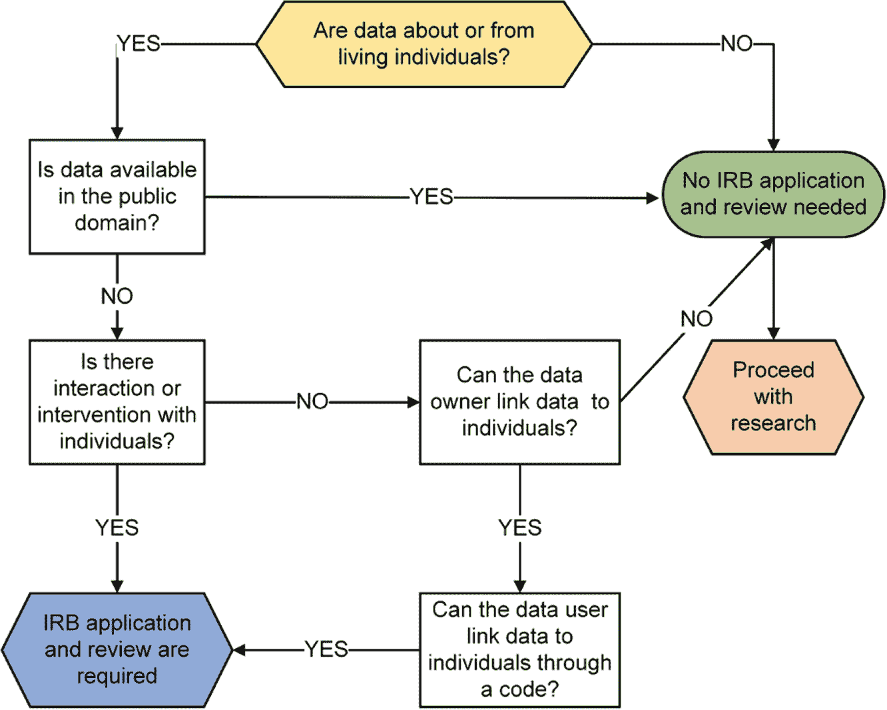

图 1.9 IRB 决策流程。（改编自 美国国立卫生研究院，2019 年。）返回正文。⏎

#### 如何对数据进行去标识化？


数据去标识化是从数据集中移除或修改识别性信息的过程，旨在保护个人的隐私和匿名性。对于公开可用的数据，这通常是不必要的，因为数据提供方在发布到网上之前已经对数据进行了去标识化。尽管如此，审查数据提供方发布的关于如何使用数据的条款和条件至关重要。在许多情况下，研究人员必须同意这些条款和条件，才能获得数据访问权限。

如果我们获得了包含敏感和私密信息的二手数据，在分析之前对数据进行去标识化至关重要。首先，我们应与数据提供方核实他们希望移除的任何特定信息，以及他们关于数据使用方式的任何条件。例如，某些组织可能不允许我们发表研究结果，或要求我们在向期刊投稿前暂缓发表一段时间。其他组织可能要求我们提交包含详细发现的最终报告供其审查，还有些组织可能出于各种原因希望保留报告的权利。所有这些条件都应提前讨论并达成一致。此外，必须审查和讨论任何相关的隐私规则。一旦我们拥有了必须从数据中移除的信息的完整清单，就可以着手进行去标识化。

去标识化过程通常包括以下步骤。

1.  **识别再识别风险**：在此步骤中，我们需要评估如果数据被再识别，对个人或组织造成的任何伤害。影响的严重程度必须被审查和记录，以供风险评估之用。此外，我们必须评估某人是否有可能根据去标识化数据集中的信息对数据进行再识别。这意味着有时去标识化后的数据可能仍包含一些信息，使他人能够推断出隐藏信息，这是一个严重问题。

2.  **制定并应用去标识化措施**：一旦我们了解了再识别的风险，就可以制定并应用去标识化措施。常见的方法是移除个人身份和敏感信息，或用匿名信息或临时 ID 替换它们。虽然这听起来很简单，但我们需要制定清晰详细的协议，以避免遗漏。协议应包括应移除或更改的变量、用于替换的值，以及这些变量和数据在数据集中的位置。由于我们处理的是大型数据集，可以编写一些宏或程序来自动化去标识化过程，以节省时间并避免遗漏重要数据。

3.  **再次检查数据**：一旦我们对数据进行了去标识化，至关重要的是要检查新数据集，确保数据已被妥善且彻底地去标识化。由于去标识化是我们自己进行的，可能存在偏见或疏忽。因此，建议使用外部审查人员来检查数据。因为他们是首次审查数据，具有客观性，能够发现我们可能遗漏的任何问题。此步骤对于确保数据去标识化的有效性是必要的。

4.  **记录方法**：仔细记录去标识化的方法和过程非常重要。我们还需要记录如何归档原始数据和去标识化后的数据，以及如何确保原始数据的安全。这些文档可作为证据，证明我们遵循了适当的协议，将对人类受试者的伤害降至最低。

5.  **为授权方保留重新识别的代码和指南**：这些代码和指南必须保密，仅与授权方共享，因为它们允许对数据进行重新识别。

这些步骤对于确保去标识化过程有效保护数据涉及个人的隐私和匿名性至关重要。时刻关注数据隐私领域的最新指南和技术，以完善您的去标识化协议，始终是一个良好的实践。

## 本书结构如何安排？


为了帮助您轻松跟进本书各章节，我在表 1.2 中展示了每章的总体结构。每章包含多个小节、细节和示例。某些信息可能比较复杂或高级，特别是如果您是数据挖掘概念的初学者。通过了解这些章节的总体结构，您应该能够浏览导言、细节、指南、软件参考和示例。我对大多数章节采用此结构，特别是侧重于机器学习方法的章节。


# 表 1.2 章节的总体结构 返回正文.⏎

| 章节 | 描述 |
| --- | --- |
| 学习成果 | 完成本章后，您需要学习并实施的一组成果。 |
| 关键词 | 本章使用的主要术语。 |
| 简介 | 机器学习方法的简要介绍，以及阅读本章时需要注意的任何重要事项。 |
| 方法定义 | 方法及相关重要术语的清晰定义。 |
| 原理 | 详细解释方法的原理，使您能从根本上理解该方法及其工作方式。 |
| 实际应用 | 该方法在各个领域应用的示例。 |
| 基本概念 | 方法中的基本概念及其描述。这些术语在本章中频繁使用。如果您需要回顾它们的含义，可以在阅读本章时参考这些概念。 |
| 过程 | 执行该方法所需遵循的步骤。 |
| 优缺点 | 与其他机器学习方法相比，该方法的优缺点。 |
| 详细组成部分 | 方法的详细组成部分。我使用图表、公式、函数和规则来解释它们。这些细节有助于您理解方法如何工作以及如何配置模型。本节的长度取决于本章提供的详细程度。涵盖重要方法（包括回归、决策树和神经网络）的章节包含更多细节。涵盖高级方法（包括随机森林、梯度提升和贝叶斯网络）的章节篇幅较短，因为我想避免这些方法复杂的数学基础。相反，我侧重于分析过程、关键要点和常见配置。 |
| 预测建模示例 | 如何使用实际数据集应用该方法的具体示例。示例提供了带有属性设置截图的详细步骤、软件使用方法、可做决策的解释、如何获取结果、哪些结果很重要，以及如何理解和解释结果。本节是每章中**最重要**的部分，因为它允许您遵循步骤并使用软件和数据进行练习。为了让您轻松跟进数据挖掘过程的多个步骤，我在全书中主要使用两个数据集：**“航空公司推荐”**数据集和**“波士顿房价”**数据集。因此，您可以看到使用数据挖掘分析一个大型数据集的全貌和完整过程。 |
| 章节小结 | 包含关键概念和要点的方法总结。 |
| 章节讨论问题 | 涵盖该方法所有信息和必需内容的重要讨论问题。通过回答这些问题，您可以检验自己对本章方法的理解程度。 |
| 练习 | 有用的练习，让您练习预测建模的理解和技能。请务必在做这些练习前先练习示例。遵循示例中的步骤应能让您成功完成这些练习。 |

---

### 写作基调与风格

在我的研究论文中，我通常采用学术写作风格，即以学术为中心、客观且基于证据。每个陈述都通过适当的引用由参考文献精心支撑。此外，常用被动语态以保持正式和权威的基调。

然而，为了本书的目的，我采用了不同的写作策略，主要使用主动语态以与读者建立联系并促进他们对概念和过程的理解。在前七章中，我采用随意的写作基调，为主题注入趣味性和参与感。通过融入更多现实生活中的例子，我旨在以通俗易懂的方式解释机器学习的原理和概念。考虑到机器学习可能令人望而生畏，尤其是其科学术语和数学基础，我假设大多数读者不具备扎实的数学或计算机科学背景，许多人可能是非程序员。因此，我力求用相关的陈述、实际案例和我的个人经历来开启这一复杂主题，所有这些都是为了培养读者对该主题的兴趣和好奇心。此外，我还加入了图表、表格、定义框、提示和警告，以帮助读者无缝地跟随概念和步骤。

随着读者逐渐习惯术语、概念和流程，写作基调和风格将从第 8 章开始逐渐转向更学术的方法。这一过渡的意图是培养读者阅读和撰写高质量报告的舒适感。在本书结束时，读者应能熟练阅读和撰写各类报告，包括商业报告、技术报告和学术报告。必须注意的是，由于本书不是研究项目或研究参考书，我并未在章节内容中提供引用（正如您在已发表文章中常见的那样），以避免阅读时分心。不过，本书末尾提供了作为本书基础的综合参考文献列表，以便读者在需要时探索更多来源。

最后，在撰写本书时，我借鉴了我在课堂教授数据挖掘和在研究中使用机器学习的丰富专业知识和经验。因此，一些指导原则和经验法则基于我对这些方法的观点和实践经验。重要的是要认识到，机器学习的世界是动态的，不同书籍和来源的信息和指南并不总是一致的。这种差异源于不同作者在使用机器学习技术方面拥有独特的观点和经验。在机器学习的几个方面，特别是模型性能评估方面，不存在标准化的截断值或阈值。在本书中，我根据自己使用这些方法的经验提供了各种经验法则，这些法则也已用于我发表的文章中，表明得到了学术界的认可。此外，我努力在全书中保持术语、概念和步骤的一致性，以促进读者更顺畅地理解内容。

## 章节小结

数据科学和数据挖掘代表了新兴的研究领域，它们使我们能够分析大型数据集，并利用发现结果为战略业务决策提供依据。本章作为基础性探索，介绍了数据科学和数据挖掘中的基本概念。我们涵盖了人工智能和机器学习的演变轨迹，考察了它们的变革性影响。此外，我们还探讨了数据挖掘应用如何在各行业中被利用以加强安全措施并优化运营效率。我们还深入了解了大数据的特征以及与数据挖掘任务相关的伦理考量。这些基本概念作为必要的先决条件，为全面理解数据挖掘过程和机器学习方法奠定了基础。


与传统统计分析通常依赖理论框架和有限样本量不同，数据挖掘项目采用探索性的、数据驱动的方法，从海量数据集中获取洞见。我们的目标是发现数据中隐藏的未知模式。换句话说，我们为业务收集了大量数据，需要找出这些数据能告诉我们关于业务运营的哪些有用见解。从数据中发现的模式使我们能够做出明智的决策，以改进业务运营。

此外，本章强调了数据挖掘中伦理考量的重要性。数据挖掘涉及从大型数据集中提取模式、知识和见解，虽然它提供了有价值的信息，但也引发了重大的伦理担忧。数据挖掘中的伦理考量是指贯穿整个数据挖掘过程、规范数据负责任且尊重地使用的原则、指南和道德价值观。遵守这些伦理原则和指南可确保数据挖掘负责任地进行，并尊重个人的权利和福祉。坚持伦理标准不仅能增强公众对数据科学工作的信任，还能最大化数据驱动洞见的有益影响，同时减轻潜在危害。本章提供了 `IRB` 申请和数据去标识化的详细步骤，确保在整个研究过程中保护个人的隐私和匿名性。

## 章节讨论问题

1.  定义数据挖掘和数据科学。它们有什么区别？

2.  数据挖掘方法与传统统计方法的主要区别是什么？

3.  描述数据挖掘的特点。使用数据挖掘时面临的主要挑战是什么？

4.  举一个具体例子，说明数据挖掘如何应用于现实生活中的各个领域。

5.  在互联网上搜索利用数据挖掘增强运营的企业或组织的信息。描述其数据挖掘项目的目的、数据库、分析方法和发现。

6.  机器能学习吗？为什么称之为机器学习？

7.  什么是大数据？大数据的五个维度是什么？

8.  描述实施大数据分析的过程。

9.  描述使用二手数据的伦理原则。为什么伦理考量在数据挖掘项目中很重要？

10.  `Institutional Review Board (IRB)` 的主要职责是什么？描述 `IRB` 决策流程。

11.  为什么需要对数据进行去标识化？描述数据去标识化步骤。

# 2 数据挖掘流程、方法与软件

DOI: [10.1201/9781003468196-3](https://doi.org/10.1201/9781003468196-3)

## 学习成果

完成本章后，您将能够：

1.  定义数据挖掘流程。

2.  描述 `CRISP-DM`（跨行业数据挖掘标准流程）的流程、步骤及适用场景。

3.  描述 `SEMMA`（抽样-探索-修改-建模-评估）流程、步骤及适用场景。

4.  定义目标变量和预测变量。

5.  评估变量的测度尺度及其在数据挖掘中的意义。

6.  比较关联模型和分类模型。

7.  区分监督学习和无监督学习。

8.  基于目标变量和研究目标对机器学习方法进行分类。

9.  列出关键机器学习方法的主要特征。

10.  为数据挖掘项目选择合适的机器学习方法。

11.  比较不同的数据挖掘软件程序。

## 简介


在本章中，我们重点关注数据挖掘流程，探索各种机器学习方法，并解释如何为研究目的选择最合适的方法。此外，我们还将探索适合非程序员的各种软件选项，确保在数据挖掘工作中的易用性和可访问性。

在整个学习过程中，我将介绍许多数据挖掘和机器学习术语。如果您最初感到困惑或无法立即掌握这些概念，请不必担心。虽然这些术语乍看可能陌生，但随着您在后续章节中反复遇到它们，它们将变得越来越熟悉。随着时间的推移和不断的接触，您将逐渐掌握这些术语，并能自信、流畅地使用它们。请相信学习过程，坚持参与，清晰的理解和领会自会随之而来。

考虑到不同来源术语使用不一致可能造成的困惑，我旨在为本书中使用的术语提供清晰一致的定义。本章作为一个可靠的参考点，供您在需要时随时回顾这些定义，促进对讨论概念的连贯理解。

随着数据挖掘领域的发展，在不同来源中遇到术语差异是常见的。然而，我有信心本书所选用的术语在全书范围内是准确且一致使用的。这种一致性增强了您对后续章节中讨论的方法、分析流程和结果的理解，最大限度地减少困惑并确保清晰度。想象一下，如果不同术语被交替使用来表示同一概念，会产生多大的混乱——这在我们在网上搜索数据挖掘方法资源时经常遇到。为避免此类混淆，我坚持使用标准化的术语框架，确保内容的内聚性和连贯性。此外，我还提供了等效术语的参考，使您能无缝浏览其他作者的研究。这种方法不仅丰富了您的理解，还赋予您自信驾驭复杂的数据挖掘文献的能力。

此外，我对比了各种软件选项，重点关注那些适合非程序员的选项。与普遍看法相反，数据挖掘软件领域正在演变，越来越多的程序旨在让用户无需编码专业知识即可实施数据挖掘并应用机器学习算法。这些用户友好的程序使来自不同背景的个人都能接触数据挖掘。数据挖掘和机器学习不再仅仅是计算机工程专业的领域。虽然每个软件选项都有其自身的优势和劣势，但我提供了选择 `SPSS Modeler` 作为本书主要工具的理由，同时也提供了对替代选项的见解。在本书结束时，我有信心您将利用 `SPSS Modeler` 磨练数据挖掘技能，掌握有效完成数据挖掘项目所需的知识和熟练度。

## 数据挖掘流程


### CRISP-DM 流程

在第 1 章中，我们定义了数据挖掘并讨论了其主要特征。它是一种探索性的、数据驱动的方法，旨在从大型数据集中检测未知模式，并提供见解以支持明智的商业决策。为了正确执行数据挖掘，我们需要遵循一个流程，该流程通过特定步骤指导我们准确地探索和分析数据。由于大型数据集往往包含噪声，分析结果可能会受到该噪声的影响，导致结果准确性降低，并可能做出错误的决策。在商业世界中，错误预测可能产生严重后果。想象一下，一家航空公司将促销包裹发送给了错误的乘客而失去了另一位乘客，一位银行高管在错误的地点开设新分行而亏损资金，或者医疗保健领域的假阴性预测延误了患者的治疗。这些错误的商业决策可能对企业及其客户造成灾难性后果。

我们都知道，任何预测都有误差范围。我们的目标是将这一范围控制在可接受的水平内，而这因组织和情境而异。根据组织的策略，这可能是 1%、5%，甚至 10%。例如，在需求波动大的服务业，高管可能接受 10% 的误差。另一方面，在医疗保健或航空安全领域，由于对结果影响重大，1% 的误差可能就是最大可接受阈值。

那么，我们如何避免或至少将此类问题降至最低？最佳实践是在分析数据时遵循一个有效的数据挖掘流程。一个好的流程会指导我们完成必要的步骤，确保分析正确进行，避免常见的数据挖掘错误。在互联网或其他书籍中，你可能会找到各种数据挖掘流程步骤。许多步骤基于作者的观点和经验，其中一些可能很有用，特别是针对特定项目类型。然而，在某些情况下，我们可能会质疑此类流程是否经过验证，以及能否推广到其他类型的项目。使用无效的流程可能导致结果存疑。

正如第 1 章所述，数据挖掘是一种探索性的、数据驱动的方法。这意味着研究结果取决于数据质量和分析流程。正确进行分析以产出高质量结果至关重要。遵循错误的步骤可能导致无效结果，进而导致错误的商业决策。例如，如果我们在未先清洗数据的情况下训练模型，数据中的噪声可能导致结果混乱，既不可解释也无意义。预测结果可能不稳定或自相矛盾，从而无法用于决策。在另一种场景中，我们可能使用大量数据过度训练模型，从而获得高准确率。然而，如果没有使用单独的样本验证模型，由于过拟合，它可能无法推广到其他数据集。当应用于新数据集时，此类模型可能产生高误差范围的预测，使其在现实世界中无效且不可用。因此，决策者可能被误导，并基于这些错误预测做出错误决策。因此，遵循有效的数据挖掘流程以确保预测结果的质量至关重要。

在本书中，我将介绍在学术界和工业界均经过验证、广泛接受并被使用的数据挖掘流程。这些包括跨行业数据挖掘标准流程（**CRISP-DM**）和抽样-探索-修改-建模-评估（**SEMMA**）。


### CRISP-DM 流程

CRISP-DM 代表**跨行业数据挖掘标准流程**（Cross-Industry Standard Process for Data Mining），基于欧洲信息技术研究战略计划（**ESPRIT**）倡议。它在工业界比在学术界更流行，IBM 已采用并将其在其软件 SPSS Modeler 中实现。

CRISP-DM 将数据挖掘流程分解为六个主要步骤：业务理解、数据理解、数据准备、建模、评估和部署（图 2.1）。以下是 CRISP-DM 流程中每个步骤的详细概述：

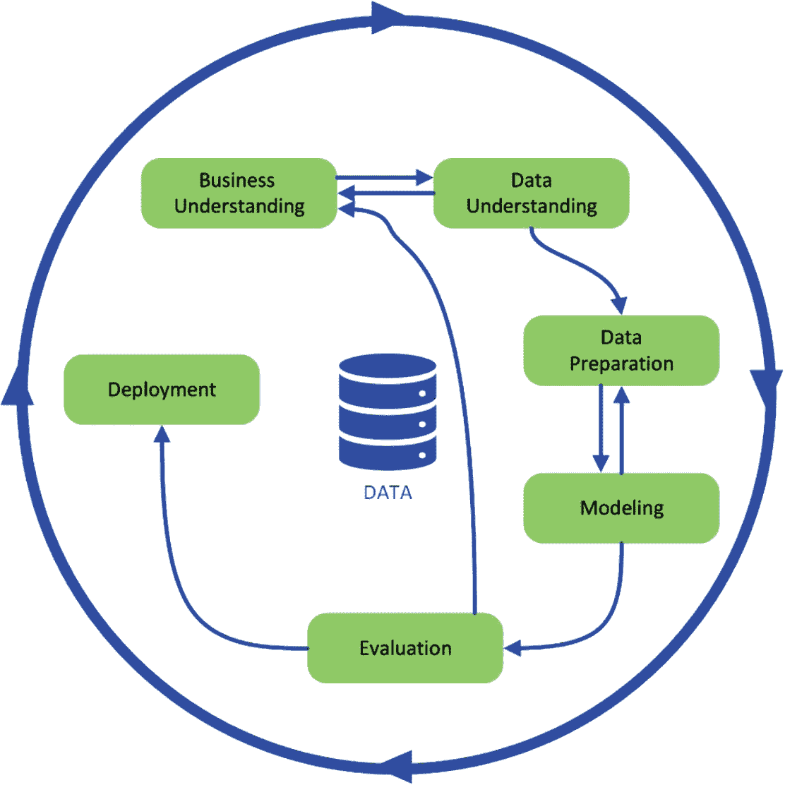

图 2.1 CRISP-DM 流程。返回正文。⏎

#### 业务理解

*   **定义业务问题或目标**：清晰阐述你希望通过数据挖掘实现的业务目标。
*   **将业务目标转化为数据挖掘问题**：理解如何利用数据和分析来解决业务目标。
*   **确定成功标准**：定义可衡量的指标，以表明项目的成功与否。

### 数据理解

*   **收集初始数据**：从各种来源收集相关数据，包括数据库、文件和外部系统。
*   **描述数据**：记录收集到的数据的结构和内容，包括变量、格式和数据质量问题。
*   **探索数据**：执行初步的探索性数据分析，以识别模式、趋势和潜在问题。
*   **验证数据质量**：评估数据的质量、准确性和完整性。

#### 数据准备

*   **清洗和预处理数据**：处理缺失值、异常值和数据不一致性。转换和格式化数据以供分析。
*   **集成数据**：将来自不同来源的数据合并为统一的数据集。
*   **选择相关变量**：选择与分析最相关的变量（特征），并丢弃不必要的变量。
*   **创建衍生变量**：生成可能增强模型预测能力的新变量或特征。

### 建模

*   **选择建模技术**：根据问题性质（分类、回归、聚类等）选择合适的算法或模型。
*   **构建模型**：将选定的算法应用于准备好的数据集，以创建预测性或描述性模型。
*   **评估模型质量**：使用准确率、精确率、召回率等指标评估模型性能。
*   **微调模型**：调整模型参数以优化性能或防止过拟合。

#### 评估

*   **评估模型性能**：使用验证技术（如交叉验证）评估模型在未见数据上的表现。
*   **比较模型**：比较不同模型的性能，为业务问题选择最佳模型。
*   **与利益相关者复查结果**：向利益相关者展示发现和见解，并收集他们的反馈。

#### 部署

*   **规划部署**：制定在真实业务环境中部署所选模型的策略。
*   **实施模型**：将模型集成到操作系统和流程中。
*   **监控模型性能**：持续监控模型性能，并根据需要更新以保持准确性和相关性。
*   **记录流程**：记录整个数据挖掘流程，包括决策、方法和结果。

请注意，步骤的顺序并非线性。实际上，该流程要求在特定步骤之间来回移动。流程图使用箭头表示阶段之间主要且反复出现的相互联系。图中的外圈代表了数据挖掘固有的迭代特性。数据挖掘流程在解决方案部署后仍将继续。整个过程中获得的见解有可能引发新的业务询问，未来的数据挖掘工作将受益于前几次迭代中积累的见解。


### CRISP-DM 在 SPSS Modeler 中的应用

正如我们所见，CRISP-DM 非常注重实践，这也是从业者在工业界广泛使用它来解决实际业务问题的原因。还应当注意的是，CRISP-DM 内置于 SPSS Modeler 软件中。它本质上是标准 SPSS Modeler 项目工具的一个扩展（图 2.2）。事实上，您可以在 CRISP-DM 视图和标准的 Classes 视图（类视图）之间切换，以查看按类型或按 CRISP-DM 阶段组织的流和输出。


**图 2.2** SPSS Modeler 中的 CRISP-DM 视图。返回正文。

然而，包含软件中所有数据和建模工具的节点面板，并非基于 CRISP-DM 进行组织。具体而言，节点面板将节点组织为若干组，包括 `Sources`、`Record Ops`、`Field Ops`、`Graphs`、`Modeling`、`Output`、`Export` 等（图 2.3）。这些组与 CRISP-DM 并不一致，这意味着我们在 SPSS Modeler 中寻找节点以构建模型时，无法直接遵循 CRISP-DM 的步骤。这种错位可能会给用户带来进一步的困惑。


**图 2.3** SPSS Modeler 中的节点面板。返回正文。

### SEMMA 过程

另一个流行的数据挖掘过程是 SEMMA，它代表 Sample-Explore-Modify-Model-Assess（抽样-探索-修改-建模-评估）。该过程由 SAS 研究院提出，并已在许多行业中广泛使用，尤其是学术研究人员。SEMMA 集成在 SAS Enterprise Miner 软件中，用于指导用户进行数据挖掘。它提供了一系列应遵循的步骤，以分析大型数据集并发掘新模式（图 2.4）。其中一些步骤与 CRISP-DM 中的步骤非常相似。具体而言，数据理解类似于探索，数据准备类似于修改，建模类似于建模，评估类似于评估。然而，CRISP-DM 中与 SEMMA 不同的两个步骤是业务理解和部署。

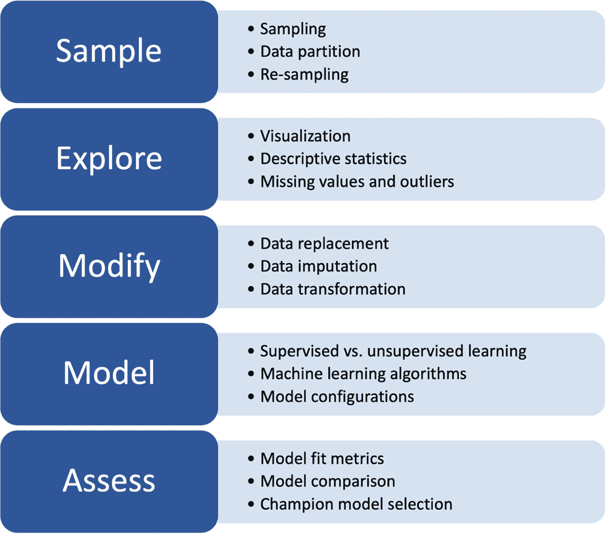

**图 2.4** SEMMA 过程。返回正文。

以下解释 SEMMA 过程中每个步骤的内容：

#### 抽样

在抽样步骤中，我们从数据抽样开始，选择整个数据集的一部分（样本）用于分析目的。样本应足够大以包含充足的信息，同时又足够小以便高效使用。如果原始数据集过大，我们可以决定对其进行部分抽样。例如，如果我们拥有一个包含一千万个数据点的数据集，使用整个数据集可能会增加计算时间。对于数据挖掘目的，其中的 10%（即一百万条记录）应已足够。然而，如果我们抽样不当，样本可能会偏离原始数据，导致抽样偏差。换句话说，我们的样本将无法代表完整数据集，从而使数据挖掘结果无效。因此，我们需要选择正确的抽样方法，以最小化抽样偏差并确保用于数据挖掘的数据集质量。

此外，此阶段涉及数据分区，即将数据分割为子样本。训练样本用于训练模型，验证样本用于验证模型。在某些情况下，测试样本可用于测试最终模型。如果我们拥有不平衡数据集，模型可能会遭受过拟合。在这种情况下，可能需要重新抽样以确保数据集的平衡。不同抽样方法的详细内容将在后续的第 3 章中介绍。

#### 探索

在探索步骤中，我们通过发现变量之间预期和非预期的关系，并利用数据可视化识别异常，来探索和理解数据。通过使用数据可视化，我们可以为各种变量生成不同格式的多个图表，从而深入了解变量、刻度和值。描述性统计、缺失值检测和变量选择等功能将在此步骤中使用。此步骤对于理解变量和数据至关重要，使我们能够决定在分析前如何准备和修改数据。请记住，“垃圾进，垃圾出”在此依然适用。我们旨在获得高质量数据以产出高质量输出。对变量和数据的深入理解还有助于我们选择合适的机器学习方法、为模型选择正确的配置、解释结果，并对模型配置进行必要的调整以改善模型拟合度。

#### 修改

修改步骤涉及转换和准备变量以供模型训练。一旦我们了解了数据的质量和完整性，就可以决定如何提高数据质量并减少噪声。虽然数据挖掘可以处理含噪数据，但干净的数据对于构建有效模型至关重要。大型数据集往往结构较少且混乱。在此步骤中，我们处理缺失值和异常值，并执行任何必要的数据转换。通过减少噪声和异常值并解决缺失值问题，我们为分析创建了更干净、更完整的数据。此步骤需要根据数据类型和项目目的做出判断。

### 建模

在建模步骤中，我们选择合适的机器学习方法，并对准备好的变量应用特定配置，以训练可能提供预期结果的模型。机器学习算法在此步骤中用于构建多个预测模型，无论是监督学习还是无监督学习。根据项目目的、目标变量和数据，我们可以使用不同的方法构建多个模型，或使用少数几种方法并采用不同的配置来生成更多模型。这是一个迭代过程，需要多次配置和重新配置，直到获得满意的模型。对变量、刻度、数据和机器学习的深入理解将增加构建优质模型的可能性。各机器学习方法的详细配置将在本书后续章节中介绍。

#### 评估

最后一步是评估，我们在其中使用适当的指标评估模型性能并比较模型。模型拟合指标的选择基于研究目的和数据挖掘模型的类型。基于模型比较，我们选择冠军模型，即最佳模型。我们还会检查模型的实用性和可用性，并识别重要预测变量。冠军模型连同重要预测变量将被推荐给决策者，以帮助他们就是否使用该工具改进业务运营做出明智决策。


SEMMA 过程为指导导入、探索和分析数据以产出高质量结果所涉及的步骤提供了一个全面的框架。通过按照 SEMMA 的步骤构建我们的项目图，我们可以系统地跟踪进度，记录每个阶段的结果，并最终得出明智的结论。当在建模过程中排查错误或错误预测时，这种结构化方法显得尤为宝贵。通过回溯步骤并精确定位差异发生的位置和原因，我们可以做出必要的调整，以提高准确性和可靠性。


### SEMMA 和 USELEI 流程

虽然 SEMMA 无缝集成在 SAS Enterprise Miner 的界面中，使其成为该软件的理想选择，但其适用性并不局限于特定平台。SEMMA 在工业界和学术界被广泛接受和使用，它简化了数据挖掘流程，并促进了发现结果的逻辑性和连贯性报告。因此，我们选择采用 SEMMA 作为本书的指导框架，利用其既定原则来驾驭各种数据挖掘项目。

值得注意的是，SEMMA 流程以向决策者推荐冠军模型和关键预测变量而告终。然而，模型部署不在 SEMMA 的范围内，将在单独的项目中解决，重点关注工具及衍生洞察在现实项目中的实际实施。

#### USELEI 流程

在某些特殊情况下，我们的业务问题可能要求我们从大型数据集中对变量之间进行因果推断。这在风险分析项目中很常见，我们想知道一个变量的变化是否会导致另一个变量的变化。在这种情况下，预期结果是基于一个预测变量的变化而得出的目标变量的概率。为了发现这种因果网络，我们应该使用一种特定的方法，即贝叶斯网络。在此流程结束时，假设我们拥有先验领域知识和因果假设，必须进行因果推断。

由于文献中没有针对此类项目的流程，我开发了一个新流程。我将其命名为理解-采样-探索-学习-评估-推断（USELEI）流程（图 2.5）。该流程对于因果数据挖掘特别有用。我将在第 16 章详细介绍该流程和贝叶斯网络方法。

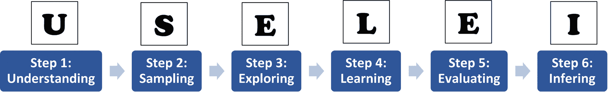

图 2.5 USELEI 流程。返回正文。

## 如何对数据挖掘方法进行分类？


对于数据挖掘新手来说，常见的问题是：“我应该用哪种方法来分析我的数据？”这是讲授统计课程时教师常收到的问题。在这种情况下，学生通常期望得到一个清晰具体的答案，以便使用那种确切的方法完成课堂作业或项目。我在我的数据挖掘课程中也面临同样的问题，我的学生通常期望我告诉他们确切该用什么方法，以及在分析中包含哪些变量。然而，数据挖掘的情况并非如此简单，因为数据挖掘项目是探索性的而非验证性的。我们的目标是从数据中发现未知模式。还记得吗？我们想知道数据会告诉我们关于变量间关系的什么信息。

选择并不像黑白分明那样直观清晰。我们需要考虑许多因素，即便如此，仍需要试错。但没人说数据挖掘很容易。这就是为什么数据科学家的工作非常有吸引力，因为它需要一套特定的技能。我记得 Netflix 曾举办过一场数据挖掘竞赛，所有团队获得相同的数据集和目标变量。选择正确方法并配置正确算法以产生最佳预测的团队将赢得比赛。所以，你看，数据挖掘中的困难让我们能够区分出色的数据科学家和平庸的数据科学家。

正如第 1 章所述，数据挖掘是一种探索性的、数据驱动的方法。数据挖掘项目的目的不是解释发生了什么或正在发生什么，而是从数据中发掘未知的、隐藏的模式，以预测近期将要发生的事情。因此，对上述问题的简单回答是：“这取决于你的数据和项目的目的。”当然，没人会对这个回答满意，因为它太模糊了。然而事实是，在我们探索并理解数据之前，我们不知道哪种方法可能效果最好。即便如此，考虑到数据的大量体量和噪声，要推测哪种方法能产生最佳预测模型非常困难。但这就是这类项目的现实，我们作为数据科学家，被期望从数据中探索和发现新模式，而不是确认我们已知或自以为已知的事情。

数据挖掘是一个包含众多方法的非常广泛的领域，这可能会让数据科学家感到困惑。因此，确定如何为项目目的选择合适的方法非常重要。在许多情况下，我们会为分析选择多种方法，使用这些方法训练多个模型，并选择最好的一个。正如上一节所述，这个最佳模型称为 `the champion model`。我们需要使用多种方法的原因在于数据挖掘的探索性质。由于我们无法推测哪种方法能产生最佳模型，仅使用一种方法和一组配置开发模型很可能导致模型劣质，无法为我们的业务运营做出良好预测。我们甚至可能不知道它是劣质的，因为我们没有任何东西可以与之比较。与其他商业活动一样，为了找到最好的一个，我们必须有基线和其他选项进行比较。

对数据挖掘方法进行分类有几种方式：按数据类型或按分析目的。数据类型通常包括定量和定性。定量数据是使用区间、比率或有序尺度的数字。定性数据是文本、语音、图像和视频。我们还有混合数据，它同时包含定量和定性数据。自然地，大多数数据挖掘方法是定量的，因为有许多分析定量数据的方法。另一方面，由于定性数据的性质，定性方法稀缺得多。文本挖掘是我们用于分析文本数据的典型方法。即使我们使用文本挖掘，最终也会应用一些定量方法来理解结果。用于分析语音、图像和视频的高级方法通常基于定量，例如卷积神经网络、自然语言处理（NLP）或语音识别。正如你所见，即使我们有数据并知道数据类型，要确定哪种方法效果最好仍然很难。

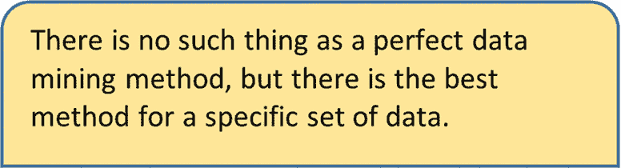

在本书中，我主要根据分析目的对数据挖掘方法进行分类。因此，当你了解你的变量及其尺度，并有明确的数据分析目的时，你应该能够确定可用于开发预测模型的适当方法。但请注意，每种方法都有其优缺点，由于数据挖掘是一种数据驱动的方法，永远不存在哪种方法肯定最好的把握。换句话说，在运行数据分析之前，我们无法推测哪种算法最适合给定的数据。基本上，我们探索多种选项，并根据分析结果确定最佳方法，这正是数据挖掘的主要目标。我的建议是选择几种方法并配置各种模型，看看哪个模型产生最佳预测。即使我们选择只使用一种方法，也应该用不同的配置开发几个模型并进行比较，以选择最好的一个。同样，那个模型称为 `the champion model`。请记住，这里的 `best model`（最佳模型）一词是相对的；也就是说，它不是真正最好的，因为我们必须测试所有可能的模型才能找到真正最好的。最佳模型指的是在我们构建的可用模型中，预测准确性和预测能力最高的那个。因此，它是相对最好的。

## 本书常用术语


### 术语标准化

在深入探讨方法分类的细节之前，了解数据挖掘书籍和论文中使用的各种术语非常重要。其中一些术语可以互换使用，而其他术语在不同语境下可能有不同的含义。例如，一些作者使用“回归”来指代具有连续目标变量的模型，而另一些作者则对同一模型使用“预测”。我认为这两者都不是最佳选择。首先，“预测”是一个更通用的术语，指预测的行为，因此不清楚为什么它应仅适用于连续目标变量。此外，“回归”似乎特指回归分析方法，因此用该术语来指代决策树或神经网络等方法并不合理。另外，逻辑回归方法处理二元或分类目标变量，但不被视为回归模型，这增加了困惑。更复杂的是，我们还有“预测建模”这一术语，通常指代数据挖掘过程的总称。因此，我们需要区分具有不同类型目标变量的预测模型。

我也注意到用于变量的术语各不相同。一些作者使用传统统计分析术语，即用“因变量”表示输出，“自变量”表示输入。其他作者则用“预测变量”表示输入，“目标变量”表示输出。虽然前者在技术上是正确的，但它常用于传统统计研究。后者似乎在数据挖掘研究中更流行，因为它体现了预测的意图。在数据挖掘文献中，作者经常用“特征”来指代变量，从而产生“特征选择”和“特征重要性”等术语，而不是“变量选择”和“变量重要性”。此外，`SPSS Modeler` 在许多地方使用“字段”一词，包括节点设置、输出和指南。注意，“字段”与变量相同。

很难说哪个术语更好，因为它们在技术上都是正确的。挑战在于作者倾向于使用他们偏好的术语，有时他们并不一致地使用这些术语，给读者造成极大的困惑。关键在于保持一致性，以便读者理解正在讨论的内容。为此，在本书中，我将术语标准化并一致使用，定义见 表 2.1。因此，当我使用“关联模型”、“分类模型”或“预测变量”等术语时，您将确切知道我指的是什么，而不会产生困惑。

## 表 2.1 本书使用的标准化术语及等效术语 返回正文.⏎

| 术语 | 说明 |
| --- | --- |
| 预测 | 预测行为的通用术语 |
| 目标变量 | 被预测的输出<br>**等效术语**：因变量、输出、目标 |
| 预测变量 | 用于预测输出的输入<br>**等效术语**：自变量、输入变量、特征 |
| 预测模型 | 预测连续或分类目标变量的模型<br>**等效术语**：预测模型、数据挖掘模型、机器学习模型 |
| 预测建模 | 使用机器学习算法开发模型的过程，该模型基于数据预测未来或未见事件或结果<br>**等效术语**：数据挖掘过程、机器学习过程 |
| 机器学习 | 从大量数据中检测未知模式以预测感兴趣结果的数据分析方法 |
| 关联模型 | 具有区间目标变量的预测模型<br>**等效术语**：回归模型 |
| 分类模型 | 具有二元或名义目标变量的预测模型 |
| 监督学习 | 一种针对结构化数据的机器学习方法，在标记数据上训练模型以对预定义的目标变量进行预测 |
| 类别 | 类别指数据集中代表特定组或数据实例类型的不同类别或标签，通常是目标<br>**等效术语**：类别、标签、水平 |
| 无监督学习 | 一种针对非结构化数据的机器学习方法，在无标签数据上训练模型，没有特定的目标变量，专注于发现数据中隐藏的模式或结构 |
| 训练样本 | 用于训练模型的数据样本 |
| 验证样本 | 用于验证模型的数据样本 |
| 测试样本 | 用于对模型进行最终测试的数据样本 |
| 模型拟合 | 模型与数据拟合程度的度量<br>**等效术语**：模型性能、拟合优度 |
| 模型拟合指标 | 用于评估模型拟合的标准<br>**等效术语**：评估指标、拟合优度指数、评估标准 |
| 过拟合 | 模型过度拟合训练样本，无法泛化到其他数据集的情况 |
| 模型可靠性 | 模型使用不同数据集进行不同运行时产生一致结果的能力（内部一致性） |
| 模型有效性 | 模型持续产生目标变量准确预测的能力（模型准确性） |
| 预测能力 | 模型准确捕捉和表现数据中潜在模式、关系或趋势，并将结果泛化到其他数据集的能力 |
| 预测准确性 | 模型在准确预测目标变量方面表现如何的度量 |
| 冠军模型 | 在比较模型中拥有最佳模型拟合的模型 |
| 变量重要性 | 每个预测变量在决定目标变量预测中的相对重要性<br>**等效术语**：特征重要性 |
| 变量刻度 | 描述变量性质和属性的特征；它指示变量可以取值的类型以及可以对其执行的操作<br>**等效术语**：测量水平、测量刻度、测量尺度、变量测量 |

## 本书使用的数据集

我将在本书中使用两个主要数据集，以演示如何开发关联模型和分类模型。

*   **关联模型**：波士顿房价数据集；目标变量：*中位房价*（区间）。
*   **分类模型**：航空公司推荐数据集；目标变量：*航空公司推荐*（二元：是——推荐；否——不推荐）。

为了帮助您遵循数据挖掘过程中的步骤，我将在所有章节中使用这两个数据集来演示如何完成每个步骤。这种方法使您能够将这些步骤联系起来，看到数据挖掘项目的全貌。我们将在接下来的几章中讨论这些数据集的细节。我相信这种方法比每章使用不同的数据集效果更好。

## 变量测量刻度

另一个需要一致性的主题是变量的测量刻度。变量测量的刻度是确定用于分析数据的方法的关键因素。从本质上讲，它定义并分类数据集中的变量或数字。这一概念也被称为“变量刻度”、“测量刻度”、“测量尺度”或“变量测量”。理解这些刻度之间的差异对于选择适当的分析方法至关重要。在本书中，我将其称为变量刻度。


## 变量测量量表

在统计学中，我们通常使用两种类型的量表：连续型（度量型）和分类型（非度量型）。在这两种类型中，有四种具体的量表：区间和比率（连续型）以及顺序和名义（分类型）。表 2.2 描述了这四种量表并提供了一些示例。

## 表 2.2 变量测量量表

| 类型 | 传统量表 | 特征 | 示例 | SPSS Modeler 量表 |
| --- | --- | --- | --- | --- |
| 连续型（度量型） | 区间 | 数值型、有等级顺序、无真零值、数值间的差异相同 | 华氏度（0 度不是真零） | 连续型 |
| 连续型（度量型） | 比率 | 数值型、有等级顺序、有真零值、数值间的差异相同 | 年龄、距离、人口、事故率 | 连续型 |
| 分类型（非度量型） | 顺序 | 非数值类别、有等级顺序、回答间的差异不一致 | *使用频率*：从不；有时；经常<br>*同意程度*：不同意、比较不同意、比较同意、同意 | 顺序型 |
| 分类型（非度量型） | 名义 | 非数值类别、无等级顺序、回答间的差异无意义 | *地区*：北、南、东、西<br>*出行目的*：商务、休闲 | 名义型 |
| 分类型（非度量型） | *二元*：仅有两个水平的名义量表 | | *决策*：是、否<br>*回答*：真、假 | 标记型 |

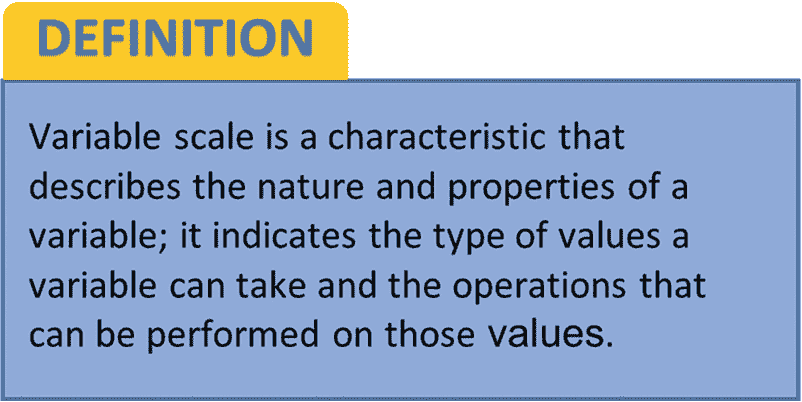

然而，SPSS Modeler 的量表设置略有不同，提供了多个选项。在本书中，我重点关联三个最相关的层级：连续型、顺序型和名义型。正如您所注意到的，SPSS Modeler 使用的术语与传统名称不同。为避免混淆，我在同一表格中列出了 SPSS 量表及其对应的名称，以便您在使用软件时知道该选择哪些量表。

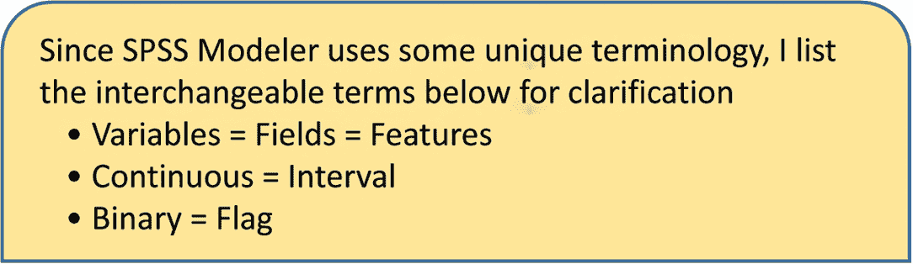

### 区间与比率

“区间”和“比率”量表均为由数值表示的连续型量表，它们可以按顺序排列，且在各测量层级之间具有恒定的间距（区间）。为避免与区间量表混淆，我使用术语“间距”代替。这两种量表的关键区别在于比率量表具有真零值，而区间量表没有。例如，华氏度被视为“区间”，因为 0°F 并不代表温度的不存在；它表示一个特定的数值，代表极冷的条件。相反，“比率”变量（如年龄、距离或得分）具有真零值，因为它们代表 0 岁、0 距离和 0 分。

正如您所见，比率变量比区间变量更常见，因为区间变量常见于科学领域，而非日常生活或商业活动中。然而，您可能会注意到，在互联网和许多资料中，“区间”一词的使用频率高于“比率”。一种可能的解释是，作者常用“区间”来指代连续型量表。或许正因如此，SPSS Modeler 不区分这两者，仅提供一个称为“连续型”的量表用于这两种情况。这不应影响分析结果，因为这两种量表在分析过程中使用方式相同。区分它们仅在解释结果时才重要。因此，在本书中，我将使用术语“区间”来指代这两种量表，以简化内容并保持一致性。只需记住，SPSS Modeler 软件对此量表使用“连续型”。

### 顺序

另一方面，非度量型量表（如“顺序”和“名义”）由非数值类别表示。顺序量表具有等级顺序，但层级间的间距可能不一致。示例包括使用频率水平（从不、有时、经常）或同意程度水平（不同意、比较不同意、比较同意、同意）。这些类别反映了参与者对偏好或感知问题的回答。尽管它们是非数值的，但仍可按顺序排列。

### 名义

最后，名义量表由无任何等级顺序的非度量型类别表示，这使得层级间的差异毫无意义。例如，“地区”变量可能包含北、南、东、西等水平。这些水平之间没有任何内在关系，也无法排序。它们主要用于以定性方式对感兴趣的变量进行分类。

SPSS Modeler 包含“名义型”量表，但也有一个称为“标记型”量表的特殊情况。标记型量表本质上是二元量表，它是仅有两个水平的名义量表的一个子类型。例如，“决策”可以是是或否，或“回答”可以是真或假。该量表常用于预测风险或决策，这也是 SPSS Modeler 为其设置专用量表的原因。

### 李克特量表

李克特量表是一种广泛使用的测量工具，通常由 5 点或 7 点组成，旨在测量人们的感知、行为或态度。它总是包含一个中间点，如图 2.6 所示。常见示例包括测量“满意度”（非常不满意、不满意、中立、满意、非常满意）或“质量”（非常差、差、一般、好、优秀）。各水平间的间距通常被视为一致且相等。该量表在商业管理和社会科学研究中被广泛使用。

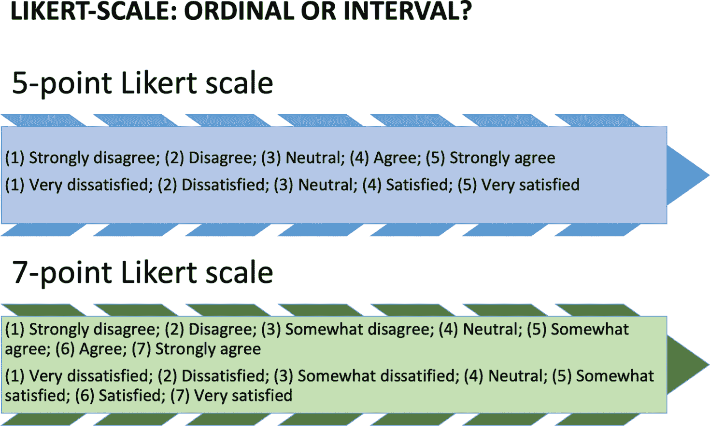

**图 2.6** 李克特量表。返回正文。

一个常见的问题是：李克特量表变量应归类为“区间”还是“顺序？”基于回答的编码方式，李克特量表似乎属于“顺序”。然而，许多研究者选择将李克特量表变量视为“区间”变量。主要原因是这种分类允许使用参数统计技术，而参数技术要求度量型变量。虽然也存在非参数技术，但它们往往受限且稳健性较差。例如，当研究者处理涉及变量间复杂关系的多重假设时，他们通常依赖多元回归分析或结构方程模型（SEM）方法来检验这些假设。这些是参数方法，要求度量型变量。由于不存在等效的非参数方法，研究者常将李克特量表变量视为区间量表，从而能够使用这些参数方法。

将李克特量表变量视为区间数据的决定常受到批评，因为李克特量表并非真正的区间量表。尽管如此，市场营销、管理和社会行为等领域的研究者在研究中经常将李克特量表数据归类为“区间”。尽管这种方法有局限性——如水平数量受限（5 或 7 个）以及难以满足检验假设——但它使研究者能够获得有意义且实用的分析结果。关键因素是确保整个测量过程中各水平间的间距相等。这种一致性将连续型量表与分类型量表区分开来。例如，在设计调查问卷时，“非常不满意”与“比较不满意”之间的间距应等于“比较满意”与“非常满意”等之间的间距。

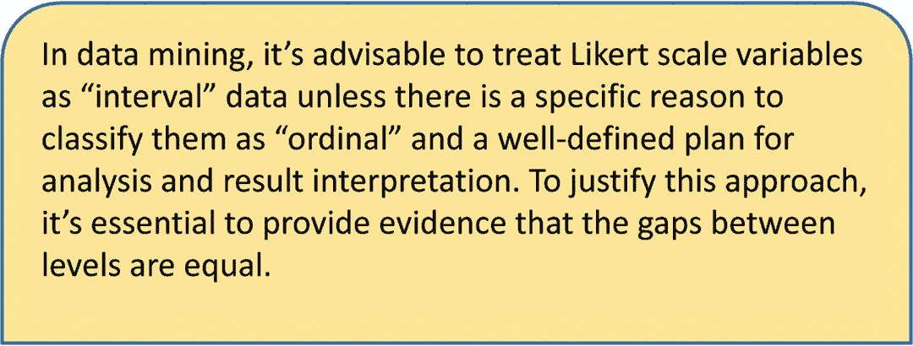


研究人员倾向于将李克特量表变量视为“区间”变量的另一个原因是，这简化了结果解释。由于李克特量表数据以数值编码（例如 `1–5` 或 `1–7`），统计输出——如相关系数、模型拟合度和解释方差——作为度量值更容易解释。如果我们将这些变量视为“顺序”变量，解释过程将类似于用于名义变量的方法，这更为复杂，因为响应是非度量的。第 7 章在讨论逻辑回归时提供了这方面的具体示例。事实上，顺序回归的功能类似于逻辑回归或多项回归。

归根结底，我们如何处理李克特量表取决于研究目的。我的经验法则是将李克特量表变量视为“区间”变量，除非有充分的理由不这样做，并且有明确的数据分析和结果解释计划。在这种情况下，必须提供证据证明各等级之间的间隔相等，并检验所用参数方法所需的假设。

## 机器学习方法的分类


让我们探索机器学习算法，它们构成了数据挖掘、数据科学和人工智能的核心。根据 SAS 的定义，机器学习是“一种数据分析方法，可自动构建分析模型。它是人工智能的一个分支，基于这样的理念：系统可以从数据中学习、识别模式，并在极少人工干预的情况下做出决策。”这一定义凸显了机器学习与人工智能之间的紧密关系。尽管机器学习算法已存在相当长的时间，但能够自主地在海量数据集上反复应用复杂的数学计算，且速度日益加快，这代表了近期的进步。例如包括特斯拉的自动驾驶和自动领航系统；亚马逊、Facebook 和 Netflix 的在线推荐；银行的欺诈检测；Siri、Alexa 和 Google Assistant 等 AI 助手；以及 ChatGPT、Copilot 和 Google Germini 等生成式 AI 系统。

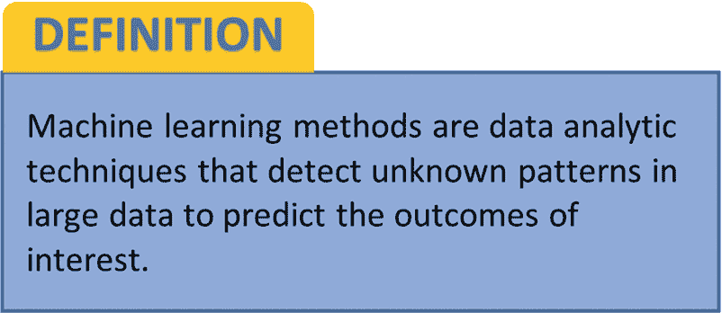

在本书中，我们将机器学习方法定义为“在大型数据集中检测未知模式以预测感兴趣结果的数据分析技术”。这一定义与第 1 章介绍的数据挖掘概念以及本书全篇讨论的方法相一致。我们涵盖的方法将使我们能够训练模型并构建预测算法，具备进行现实世界预测所需的准确性和预测能力。

### 有监督学习与无监督学习

机器学习算法大体可分为“有监督学习”和“无监督学习”。“有监督学习”最适合结构化数据，且需要一个目标变量。模型的开发旨在基于众多预测变量来预测该目标变量。相比之下，“无监督学习”更适合结构较少的数据，其中没有特定的目标变量；相反，所有变量均被视为输入变量。无监督学习的主要目标是检测数据的内在结构。决定使用有监督还是无监督学习的经验法则是检查你的数据集是否有目标变量，以及你的研究是否旨在预测它。

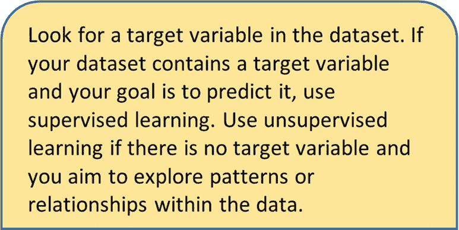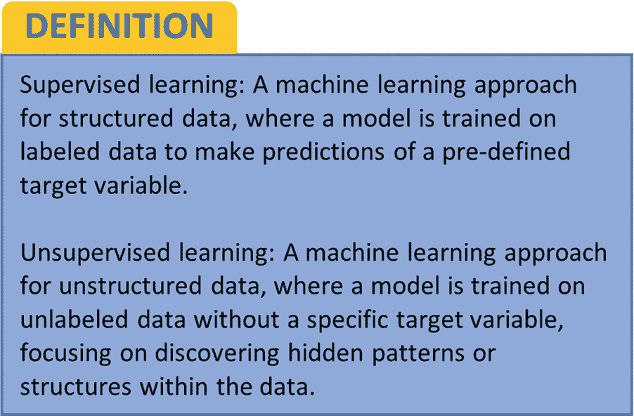

通常，可用的有监督学习方法多于无监督学习方法。有监督学习方法的示例包括回归和逻辑回归、决策树、随机森林、梯度提升、基于记忆的推理、支持向量机、神经网络和贝叶斯网络。适合你研究的方法取决于研究目的和目标变量的尺度。回归和逻辑回归等方法与传统统计技术有共同基础，但在数据挖掘中，它们被应用于大得多的数据集，且假设不那么严格，例如不要求正态分布。还值得注意的是，随机森林和梯度提升是基于决策树的集成方法，通过构建多棵树来提高预测准确性。我们稍后将深入探讨这些机器学习方法及其特征。常见的做法是使用多种方法构建各种预测模型并进行比较，以确定表现最佳的模型。

无监督学习算法的示例包括聚类分析、主成分分析和多维缩放。这些方法根据相似性对案例进行分组，或检测数据中的潜在因素。与其有监督对应物一样，这些方法的基础植根于多元统计学，但在数据挖掘中它们被应用于大得多的数据集。

图 2.7 提供了一个将这些方法分类为有监督学习和无监督学习类别的图表。虽然我们不会在本书中涵盖每一种方法——有些非常高级——但我们将重点关注实践中常用的方法。不必担心，所涵盖的方法范围从标准到高级，足以让你为任何项目构建预测模型。

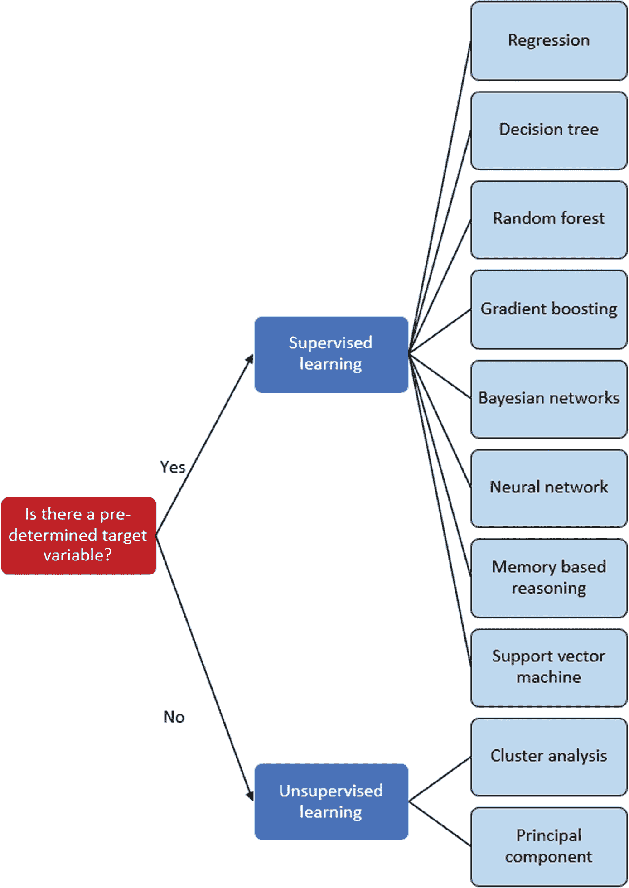

图 2.7 机器学习方法的分类 返回文本.⏎

## 机器学习方法的描述与特征


表 2.3 简要描述了主要的有监督学习算法，表 2.4 描述了一些主要的无监督学习算法。请注意，这些是本书实际涵盖的方法。如果其中一些目前对你来说不太讲得通，也不必担心。这些表格只是让我们快速了解这些方法。每种算法的特征、优缺点以及建模和分析过程将在后续章节中描述。我们将为每种方法专门安排一章。

**表 2.3 有监督学习方法** 返回文本.⏎

| 机器学习算法 | 描述 | 特征 |
| --- | --- | --- |
| 线性回归 | 线性回归是一种预测方法，用于目标变量为连续型的情况。目标变量与预测变量之间的关系是线性的。 | * 基于统计<br>* 线性关系<br>* 多重假设 |
| 分类回归（逻辑回归） | 分类回归基于多个预测变量的函数，预测二元或名义目标变量的概率。如果目标变量是二元的，称为逻辑回归；如果目标变量是分类的，称为多项对数几率回归。请注意，SPSS Modeler 的逻辑回归节点中包含这两种模型：用于二元目标变量的 `Binomial option` 和用于名义目标变量的 `Multinomial option`。因此，我用“逻辑回归”一词涵盖这两种情况。 | * 基于统计<br>* 预测变量与目标变量优势比之间存在线性关系 |
| 决策树 | 决策树是一种基于逻辑规则的方法，展示变量的层级结构，包含根节点（也称为父节点）及其后续的子节点。根节点利用区分各类别个体的最优条件，细分为两个或多个分支。决策树可用于关联模型和分类模型。 | * 基于规则<br>* 可检测非线性关系 |


### 机器学习方法对比

## 表 2.3 监督学习方法

| 机器学习算法 | 描述 | 特征 |
| :--- | :--- | :--- |
| **神经网络** | 神经网络模型的特点是由多层组成，每层包含独立的单元或神经元。在一层中，每个单元接收来自前一层的输入并计算自己的输出。一层中神经元产生的输出随后作为序列中下一层的输入。 | * 基于数学<br>* 可检测非线性关系<br>* 可处理复杂模型结构 |
| **梯度提升** | 梯度提升是一种集成学习方法，采用一系列决策树，共同构建统一的预测模型。梯度提升过程从初始模型开始，随后利用前一模型的残差作为新目标进行优化。 | * 基于规则<br>* 可检测非线性关系<br>* 可处理复杂模型结构 |
| **随机森林** | 随机森林方法是机器学习和统计学中使用的一种集成学习技术。它在训练过程中构建大量决策树，每棵树由训练数据和特征的不同随机子集构建。这种树的多样性有助于减少过拟合并增加模型的鲁棒性。对于分类模型，随机森林输出对应于单个树预测类别的众数。对于关联模型，随机森林输出代表源自单个树的平均预测。 | * 基于规则<br>* 可检测非线性关系<br>* 可处理复杂模型结构 |
| **贝叶斯网络** | 贝叶斯网络是基于贝叶斯定理的概率方法，通过考虑先验证据实现未来事件预测。它采用有向无环图直观展示预测变量与目标变量间的因果联系。此外，贝叶斯网络由一组条件概率构成，便于因果推断和概率推理。它通过以概率方式表示和分析变量间关系，成为建模和理解复杂系统的宝贵工具。 | * 基于数学<br>* 可检测非线性关系<br>* 可处理复杂模型结构<br>* 可推断因果关系 |

## 表 2.4 无监督学习方法

| 机器学习算法 | 描述 | 特征 |
| :--- | :--- | :--- |
| **聚类分析** | 聚类分析是一种有效的模式发现方法。该方法根据案例的特征将其分组为簇（或细分），依据相似性进行聚合。识别出的簇可应用于新数据以对新案例进行分类。聚类分析中的两种常用方法包括层次聚类和非层次聚类。 | * 基于统计<br>* 将案例分组为细分 |
| **主成分** | 主成分分析是一种广泛用于降低数据维度同时保留其基本信息的方法。它通过将原始相关变量转换为一组新的不相关变量（称为主成分）来实现这一点。这些成分是原始变量的线性组合，并按其捕获的方差量排序。主成分分析有助于发现潜在模式、简化数据解释，并通过关注最重要的变异来源来帮助可视化高维数据。 | * 基于统计<br>* 数据缩减（潜在构造） |

## 如何选择合适的机器学习方法？选择指南

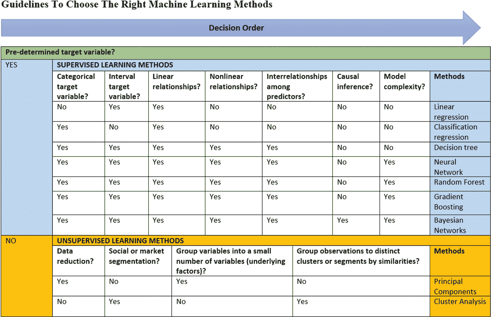

**图 2.8** 选择合适机器学习方法的指南。返回正文

选择正确的机器学习方法是数据挖掘项目中最具挑战性的决策之一。使用错误的方法可能导致无法使用的结果，甚至更糟——不正确的结果，从而导致错误的商业决策。值得注意的是，不同的作者和资源通常提供不一致甚至相互矛盾的建议，这使得确定如何以及为何选择合适的方法变得困难。为了帮助您完成这一过程，我将提供具体的标准和步骤来指导您选择正确的方法。此外，我将展示场景和示例，使其更易于遵循。

方法的选择应由研究目的和涉及的变量尺度驱动。具体而言，您需要了解目标变量、预测变量以及分析的具体目标。**图 2.8** 概述了各种决策场景，可帮助您为项目选择合适的机器学习方法。要做出明智的决策，您应考虑分析目的、数据类型和规模以及变量的尺度。通过在决策表中从左向右移动并按顺序回答问题，您可以系统地确定最合适的方法。

以下我用两个示例演示如何使用指南进行方法选择。

### 集成建模

在数据挖掘中，有一种值得一提的重要方法是“集成建模”。“集成”模型将多个单独模型的预测结合起来，创建单一的共识预测。这种做法在数据挖掘中很常见，特别是在单个模型产生不同结果时。集成模型通常比构成它的任何单个模型都具有更高的准确性。虽然我们不能保证集成模型将优于所有其他模型，但使用集成方法允许我们探索组合模型的潜力，并将其性能与单个模型进行比较。这种方法在数据挖掘中极具价值。我们将在**第 10 章**深入探讨集成建模的细节。

## 数据挖掘软件对比

如前所述，机器学习算法通常使用专业软件构建和配置。随着机器学习领域的不断扩展，数据挖掘软件也在演进，提供更先进的功能和能力。在本章中，我将回顾和对比数据挖掘中使用的一些顶级软件程序，重点关注工业界和学术界广泛采用的程序。这些程序经过验证，已知能为分析提供稳健的机器学习算法和配置。

市场上有大量声称能执行数据挖掘或大数据分析的软件。然而，必须对主要为学习目的设计的程序保持谨慎。虽然这些工具可能易于使用，但它们通常最适合小规模项目，且提供的算法和功能有限。在处理大型数据集并需要模型的多种配置时，此类程序的局限性便显现出来。此外，市场上的新软件程序应经过验证，因为其算法中可能包含错误。

此外，获得对知名软件的技能和经验能为您的简历增色，因为许多公司和组织已在使用这些工具。这些软件供应商通常提供认证计划、培训课程、研讨会和广泛的技术支持，使其成为该领域专业人士的可靠选择。

### 市场上最流行的数据挖掘软件程序有哪些？


### 比较数据挖掘程序

为了回答这个问题，我决定咨询两个生成式 AI——ChatGPT 和 Bing AI。采用这种方法的原因是，我最初在 Google 上的搜索结果信息不一致，不同网站列出的程序各异，难以汇编出一份详尽的列表。生成式 AI 擅长综合互联网上的信息，能为评测生成更可靠的程序列表。此外，通过对比两个不同来源的结果，我们可以确保结果的可靠性。

表 2.5 展示了由 ChatGPT 和 Bing AI 生成的列表，按字母顺序排序。顺序不代表任何程序优于其他程序。我对未同时出现在两个列表中的程序进行了着色标记，以便于比较。有趣的是，这两个列表共有八款共同程序：IBM SPSS Modeler、KNIME、Microsoft SQL Server Analysis Services (SSAS)、Oracle Data Mining (ODM)、Orange、RapidMiner、SAS Enterprise Miner 和 Weka。值得注意的是，这些程序大多不需要编程技能，使其适合非程序员使用。这反映了市场上一种新兴趋势，即越来越多公司在数据挖掘领域采用非编码程序。

## 表 2.5：ChatGPT 和 Bing AI 提供的热门数据挖掘程序列表

| ChatGPT | Bing AI |
| --- | --- |
| IBM SPSS Modeler | Alteryx Analytics |
| KNIME | H2O |
| Microsoft SQL Server Analysis Services (SSAS) | IBM SPSS Modeler |
| Oracle Data Mining (ODM) | KNIME |
| Orange | Microsoft SSAS |
| Python | ODM |
| Rapid Miner | Orange |
| SAS Enterprise Miner | Rapid Miner |
| Tenson Flow | SAS Enterprise Miner |
| Weka | Weka |

让我们比较一下市场上一些常见的数据挖掘程序，包括编码和非编码两类选项。本书主要面向对非编码程序感兴趣的读者，因此重点将放在这些程序上。不过，我还将讨论常见的编码软件（如 R 和 Python）以供比较。像 MATLAB® 这样更专业的编程工具未被纳入，因为它们更适合具有计算机科学背景的学生。

在本书中，我将介绍五款主要的数据挖掘软件程序：SPSS Modeler、SAS Enterprise Miner、RapidMiner、R 和 Python。这些都是当今顶尖的数据挖掘工具。SAS Enterprise Miner 和 Python 在工业界和学术界均备受推崇，在工业界尤为占据主导地位。许多组织依赖 SAS 和 Python 进行数据分析，员工通常需要获得认证以证明其熟练程度。SAS 和 Python 都提供了广泛的认证项目，受到各行各业众多公司的认可。

另一方面，SPSS Modeler、RapidMiner 和 R 在学术界更为流行。教师和研究人员经常使用这些工具进行教学和研究，这也是我们看到更多期刊出版物使用它们的原因。

我将概述主要评判标准并比较这些软件程序，重点突出它们的优缺点，以便您能全面了解每个选项（表 2.6）。

## 表 2.6：数据挖掘软件比较

| 标准 | SPSS Modeler | SAS Enterprise Miner | Rapid Miner | R | Python |
| --- | --- | --- | --- | --- | --- |
| 常见用户 | 学术界与工业界 | 工业界与学术界 | 学术界 | 学术界 | 工业界与学术界 |
| 认证项目 | 中等，由 IBM 提供 | 广泛，由 SAS 提供 | 中等，由 Rapid Miner Academy 提供 | 广泛，由第三方提供 | 广泛，由第三方提供 |
| 编码与用户界面 | 用户友好，无需编码 | 用户友好，无需编码 | 用户友好，无需编码 | 编程语言，需要编码 | 编程语言，需要编码 |
| 工作区图示 | 有，不够直观，模型多时显得拥挤 | 有，直观，易于查看和跟踪 | 有，不直观，模型多时显得拥挤 | 无工作区图示 | 无工作区图示 |
| 算法 | 强大的机器学习算法 | 强大的机器学习算法，强大的文本挖掘 | 强大的机器学习算法 | 改进的机器学习算法 | 强大的机器学习算法 |
| 节点与步骤的连接 | 容易，节点顺序不直观 | 直观，连接容易 | 不直观，连接令人困惑，易出错 | 需要编码 | 需要编码 |
| 配置 | 通过属性窗口轻松配置 | 通过属性面板轻松配置，选项过多 | 通过属性窗口轻松配置 | 需要编码 | 需要编码 |
| 变量重要性功能 | 内置，易于使用和解读 | 内置，易于使用和解读 | 需要额外步骤 | 需要额外步骤 | 需要额外步骤 |
| 输出图表 | 需要额外步骤 | 包含在输出窗口中 | 需要额外步骤 | 需要编码 | 需要编码 |
| 性能评估 | 包含在输出窗口中 | 包含在输出窗口中 | 需要额外步骤 | 需要编码 | 需要编码 |
| 定价 | 专业版昂贵，提供免费教育版 | 专业版昂贵，提供免费教育版 | 提供免费教育版 | 开源，免费 | 开源，免费 |
| 挑战 | 图示和模型比较令人困惑，结果输出令人困惑 | 基于云，速度慢，文件和文件夹管理繁琐，非为数据准备设计 | 图示和模型比较令人困惑，术语令人困惑 | 学习曲线陡峭，可视化繁琐 | 学习曲线陡峭，可视化繁琐 |

#### 用户界面

比较数据挖掘软件的一个重要标准是用户界面和所需的编码程度。对于数学、科学和工程等领域的学生、教师和研究人员——他们通常具有扎实的编程语言基础——编码不是问题，甚至可能是首选。然而，对于商业管理或社会科学领域的用户来说，编码可能是一个巨大的障碍。学习一门新编程语言耗时且学习曲线陡峭。并非每个人都倾向于编码，但这不应阻碍他们从事数据挖掘。

从这个角度来看，SPSS Modeler、SAS Enterprise Miner 和 RapidMiner 提供了更友好的用户界面，只需极少的编码。这些程序允许用户通过简单的指点点击操作来执行数据挖掘。不过，它们也提供了灵活性，如果需要，允许用户集成或编写代码，包括通过各种库和工具兼容 Python。这种灵活性尤为宝贵；非程序员无需编码即可构建预测模型，但仍可将其算法转换为代码，以便集成到其他平台中。

另一方面，R 和 Python 是编程语言，数据挖掘过程的每一步（包括可视化）都需要编码。对于编程新手来说，这呈现陡峭的学习曲线，需要大量练习才能进行有意义的分析。此外，在编程中，即使是一个小错误（如缺少逗号）也会导致错误，因此精确性至关重要。然而，对于精通编程的人来说，R 和 Python 提供了相当大的灵活性和丰富的算法开发资源。Python 尤其拥有丰富的代码库，可用于建模。这些程序在工业界广泛被接受，通常是数据科学家的必备技能。

#### 工作区


#### 工作区图

下一项是工作区图。从本质上讲，数据挖掘过程涉及许多步骤和模型，因此在我们的分析中跟踪这些步骤和模型并不容易。工作区图是一种可视化工具，允许我们将所有步骤和模型整合到图表中。通常，我们通过将节点拖放到工作区并适当连接它们来创建此类工作区图。导入数据文件、采样、分区、探索、转换数据、建模和评估等步骤均可通过此图轻松完成。我通常使用不同的算法或相同算法的不同配置来构建许多模型，因此我发现此工具极其有用。我可以轻松地比较、跟踪步骤、进行修改、运行图表的一部分以及查看最终结果。数据挖掘是一个探索性和迭代的过程，因此不太可能在第一次尝试时就获得理想的结果。该图表使工作更易于处理。

在各软件程序中，`SPSS Modeler`、`SAS Enterprise Miner` 和 `RapidMiner` 均提供工作区图。另一方面，由于 `R` 和 `Python` 属于编程语言性质的程序，它们缺乏此功能。在具有此功能的三个程序中，我都试用过，发现 `SAS Enterprise Miner` 中的图最易于使用。我已使用 `SAS Enterprise Miner` 图构建了许多模型，包括一些相当复杂的模型，且从未遇到任何困惑或困难。此外，该软件按照 `SEMMA` 流程整合其节点，使查找所需节点变得更加容易。`SPSS Modeler` 也不算太差，但所需的节点顺序不太合乎逻辑，这使得很难找到正确的节点。此外，它处理多模型和输出的方式本可以更直观，如果步骤未正确遵循，可能会出现模糊的错误消息。而且，你需要额外的节点来收集结果，这与 `SAS Enterprise Miner` 在每个节点内直接生成结果不同。虽然 `SPSS Modeler` 允许我们将分析中的每个步骤与 `CRISP-DM` 流程关联，但该流程并不指导我们进行分析；它主要用于参考目的。这意味着你仍然需要了解整体数据挖掘流程并自行选择正确的节点。最后，`RapidMiner` 的图表面临类似的挑战，弄清楚如何在图中放置多个模型是一项具有挑战性的任务。连接两个步骤时，我们还需要将输入与输出分开连接。此外，我发现 `RapidMiner` 在图中为运算符使用了非常不寻常的名称，这可能会让新用户感到困惑。例如，它们使用“label”代替“target variable”（目标变量），使用“example”代替“dataset”（数据集）等。在图中，它们对这些名称使用首字母缩写，这使得跟踪起来更加困难。事实上，有如此多的不寻常运算符名称，以至于它们不得不创建一个词汇表来提供定义。

#### 机器学习算法

关于这些软件程序提供的机器学习算法，我发现 `SAS Enterprise Miner`、`RapidMiner` 和 `Python` 提供了更稳健的算法，允许进行各种配置级别的复杂建模。尽管如此，`SPSS Modeler` 和 `R` 正在持续改进其算法，我们已开始在这些程序中看到更多功能。`SPSS Modeler` 还提供某些功能，其配置选项比 `SAS Enterprise Miner` 更多，特别是在高级方法方面。虽然 `SAS Enterprise Miner` 倾向于内置这些高级方法的配置，以使其更易于用户实现，但这种方法可能会限制可用于微调模型的选项。

还值得注意的是，所有这些软件程序都提供文本分析工具，但在处理文本数据时，`SAS Text Miner` 更易于使用。文本解析、文本过滤、文本主题和文本聚类的步骤组织良好且无缝衔接。另一方面，`Python` 提供了用途广泛的 `NLP` 工具和库集合，使开发人员能够处理各种 `NLP` 任务，包括情感分析、词性（`POS`）标注、文档分类、主题建模、词向量等。

#### 定价

定价是一个敏感话题。`R` 和 `Python` 完全开源且免费使用。`RapidMiner` 也是开源的，且供学术用途免费使用，尽管商业用途需要付费许可证。`SPSS Modeler` 非免费软件，对企业而言价格相当昂贵，尽管 `IBM` 为教育用途提供免费版本。`SAS Enterprise Miner` 对企业来说也很昂贵，但拥有校园 `SAS` 许可证的大学可以免费使用，且 `SAS OnDemand for Academics` 为教师、研究人员和学生提供免费的基于云的版本，尽管目前仅支持 `Windows OS`。

#### 挑战

每个程序都有其挑战。如前所述，`R` 和 `Python` 是编程语言，因此新用户面临陡峭的学习曲线。两者都缺乏工作区图，且使用这些程序进行可视化可能很麻烦。`SPSS Modeler` 和 `RapidMiner` 虽提供工作区图，但设计令人困惑，导致模型比较困难，且节点和运算符名称令人费解。在 `SPSS Modeler` 和 `RapidMiner` 中，查看输出图表需要额外步骤，尤其是 `SPSS Modeler`。`SAS Enterprise Miner` 在这方面具有优势，因为所有结果（无论是表格还是图表格式）均呈现在同一节点内。

然而，`SAS Enterprise Miner`，特别是免费的基于云的版本，也有其弱点。首先，它需要强劲的互联网连接才能工作，这意味着软件性能取决于网速，且无法离线使用。其次，`SAS` 处理文件夹和文件的方式可能对某些用户构成挑战。与 `SPSS Modeler` 和 `RapidMiner` 等其他软件不同，`SAS` 通过库来管理文件夹。这意味着包含文件的文件夹必须连接到一个库，且 `SAS Enterprise Miner` 必须连接到同一个库才能访问该文件夹中的文件。此过程繁琐，打开一个文件需要多个步骤。然而，这种方法对于管理 `SAS` 项目中的数据非常高效，尤其是在处理多个文件夹和大量文件时。`SAS Enterprise Miner` 也不支持上传文件、更改文件名或在文件夹间移动文件；这些操作必须使用 `SAS Studio`（免费）来完成。适应这需要一些时间，但随着理解加深，流程会变得更容易。从这个角度来看，`SPSS Modeler` 和 `RapidMiner` 是更好的选择，因为它们允许用户轻松从各种来源（包括自己的计算机）导入数据集。它们不需要互联网连接，支持离线使用。此外，如果你已经熟悉 `SPSS Statistics`，你会发现 `SPSS Modeler` 与 `SPSS` 数据集集成良好，使得导航更容易，尽管两者存在一些差异。


重要的是要注意，数据挖掘软件并非为简便的数据准备或修改而设计。这些程序专注于数据挖掘，并有意限制可能导致数据意外更改的功能。这种限制至关重要，因为在这些程序中更改数据或变量名可能会导致输出无效，且难以追踪错误。因此，数据准备应在使用数据挖掘软件之前完成。通常，每个供应商都提供其他数据准备工具，但如果您想避免学习另一款软件，`Microsoft Excel` 是编码、合并和清洗数据的好工具。下载原始数据集后，可使用 `Excel` 重新编码数据、合并来自不同来源的数据并清洗数据。`Excel` 为这些任务提供了许多有用的功能，且大多数用户都熟悉它。数据集清洗完成后，可将其转换为 `SAS` 或 `SPSS` 格式，然后在数据挖掘软件中用于建模。

### 结论

总之，没有完美的数据挖掘软件；每款软件都有其优缺点，服务于不同的受众。软件的选择应基于您的需求、背景和项目目的。`Python` 和 `R` 等编程软件因其通用性和适应性，受到理工科学生和研究人员的青睐，也是某些数据科学家职位的必备技能。然而，无需编程技能，使用 `SPSS Modeler`、`SAS Enterprise Miner` 和 `RapidMiner` 等软件仍可有效开展数据挖掘。随着数据挖掘软件市场的不断进步，商业管理和社会科学专业的学生应善用这些技术。掌握这些软件技能可在无编程背景的情况下有效开展数据挖掘。本书选择 `SPSS Modeler`，因其在处理数据集时的稳健性和灵活性。此外，教育版免费且无需互联网连接。

## SPSS Modeler 界面


本节将介绍软件界面及其主要组件。您还将找到 `IBM` 提供的详细指南。我强烈建议安装软件并进行探索，以熟悉界面的工作原理。虽然 `SPSS Modeler` 属于 `SPSS` 系列，但其界面与 `SPSS Statistics` 程序截然不同，因此初期会有一个学习曲线。您随时可以回到本章，获取关于软件界面、节点和流的更多信息和帮助。

### 流构建

使用 `SPSS Modeler` 进行数据挖掘，意味着通过一系列节点（称为“流”）处理数据。每个节点代表应用于数据的特定操作，而节点间的连接定义了数据流向。典型的数据流用于将数据导入 `SPSS Modeler`，引导其经过各种转换，最后将处理后的数据导向目标位置，如表或查看器。

`SPSS Modeler` 的主要工作区称为“流画布”，用户可在其中构建和管理这些数据流。流是通过直接在画布上设计数据操作图来创建的。每个操作由一个图标或节点表示，节点按顺序链接，直观地展示数据在每个步骤中的流向（[`www.ibm.com/docs/en/spss-modeler`](https://www.ibm.com/docs/en/spss-modeler)）。

例如，假设您需要打开一个数据源、创建一个新字段、根据该新字段中的值选择记录，并在表中显示结果。在此场景下，您的数据流将包含四个节点。

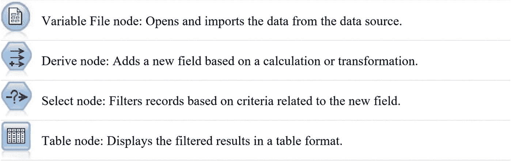

这一节点序列（即流）使您能在 `SPSS Modeler` 中轻松管理和操作数据，确保每个操作在工作流中都清晰定义并相互链接。`SPSS Modeler` 还允许用户同时处理多个流，无论是在同一流画布中还是打开新画布。所有活动流均在 `SPSS Modeler` 窗口右上角的“流管理器”中组织。图 2.9 展示了流及其关联节点的示例。

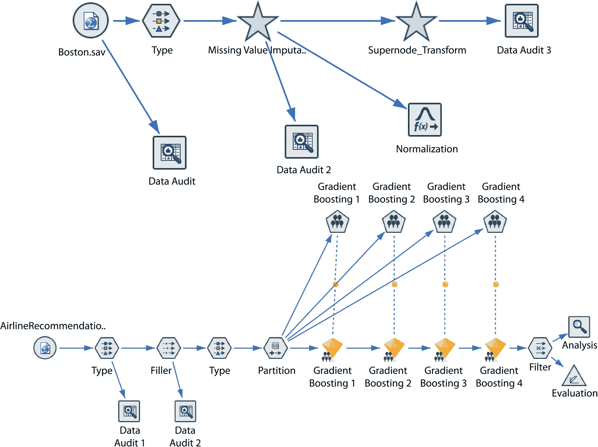

图 2.9 `SPSS Modeler` 中节点和流的示例。返回文本。

数据挖掘项目通常涉及清洗和转换数据、构建多个模型及比较结果，这可能导致混淆，难以跟踪工作进度。`SPSS Modeler` 的软件界面允许您使用数据流图表，帮助组织和管理分析步骤。构建数据流的典型步骤包括：

*   向流画布**添加节点**。
*   **连接节点**以形成流。
*   为任意节点或整个流**指定选项**。
*   **运行流**以执行分析。

在后续页面中，我提供了在 `SPSS Modeler` 中使用节点和流的详细指南。随着您阅读后续章节，如需帮助构建数据流，随时可回顾这些指南。

## 章节总结

在高级分析领域，数据挖掘要求对关键术语、统计原理、变量缩放及整体分析流程有深刻掌握。本章探讨了学术界和工业界广泛采用的两大主要数据挖掘流程：`SEMMA` 和 `CRISP-DM`。虽然每种方法各有优势，但我们主要关注 `SEMMA` 流程。`SEMMA` 以其稳健性和易实施性著称，与数据挖掘项目目标契合良好，提供了一种结构化方法，能产出清晰且可执行的洞见。但必须承认，`CRISP-DM` 仍是一个备受推崇的框架，因其在工业应用中的实用性和有效性而受到重视。虽然我们强调 `SEMMA`，但也认可 `CRISP-DM` 在特定情境下的持续相关性和适用性。

为贯穿全书的一致性，我们定义了理解数据挖掘方法及其相关程序所必需的关键术语。此外，我们区分了监督学习和无监督学习，提供了关键机器学习方法的综合清单及其描述和特征。这使读者能根据研究目标、目标变量、变量尺度和数据规模选择合适的方法。

本章还包含五款流行数据挖掘软件的比较分析，突出了各自的优劣势。重要的是要注意，没有任何软件是完美无缺的，软件的选择最终取决于个人需求和熟练程度。然而，鉴于本书面向非程序员受众，我们选择 `SPSS Modeler` 作为主要软件工具。如果您不熟悉 `SPSS Modeler`，无需担心——我提供了详细的分步指南，配有屏幕截图，确保易于理解和实施。

## 讨论题

1.  什么是数据挖掘流程？为什么遵循有效的数据挖掘流程很重要？
2.  描述 `SEMMA` 和 `CRISP-DM` 流程的所有步骤。
3.  比较 `SEMMA` 与 `CRISP-DM`。这两个流程的相似点和不同点是什么？
4.  解释预测、预测模型、关联模型和分类模型之间的区别。
5.  主要变量测量尺度有哪些？何时应将李克特量表变量视为“区间”变量？
6.  机器能学习吗？为什么我们称之为“机器学习”？


# 7. 区分监督学习与无监督学习？请分别提供示例。

# 8. 监督学习和无监督学习有哪些常见的机器学习方法？

# 9. 什么是集成建模？在什么情况下应使用集成建模？

# 10. 如何为数据挖掘项目选择合适的机器学习方法？

# 11. 比较数据挖掘软件程序。在互联网上搜索以获取数据挖掘软件最新的使用统计数据。

## 章节练习

### 练习 1：在 SPSS Modeler 中添加数据文件并识别目标变量

请遵循以下步骤：

1.  打开 `SPSS Modeler`。
2.  在 `File`（文件）菜单中，选择 `New Stream`（新建流程）。
3.  转至 `File/Save Stream As`（文件/另存为流程）。
4.  为您的流程选择一个位置并将其命名为 `Airline_Explore`。
5.  在 `Node Pallet`（节点面板）的 `Sources`（源）组中，双击 `Statistics File`（统计文件）节点以将其添加到流程中。
6.  双击 `Statistics File` 节点以打开该节点的设置窗口。
7.  点击省略号按钮（三点按钮），并从您的计算机中选择 `AirlineRecommendation.sav` 文件。

    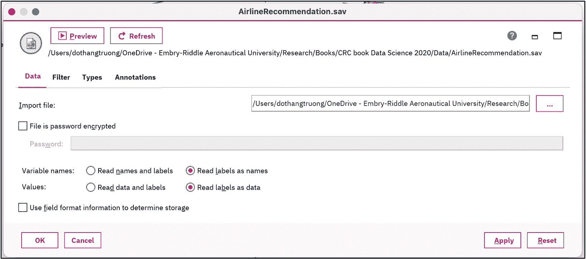

8.  点击 `Preview`（预览）以查看数据的前十行。

    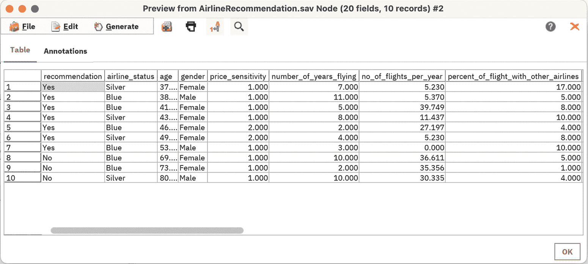

9.  点击 `Apply`（应用）和 `OK`。
10.  从 `Field Ops`（字段操作）组中，添加 `Type`（类型）节点到流程中并将其连接到数据节点。我们使用此节点来查看和更改字段的量表和角色。
11.  双击 `Type` 节点以打开设置窗口。
12.  如下所示检查所有字段的测量量表。
13.  对于字段 `recommendation`，将角色更改为 `Target`（目标）。

     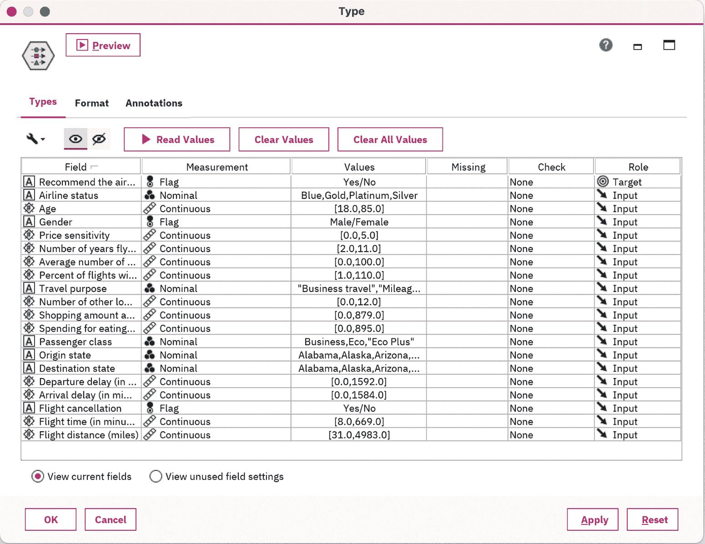

14.  点击 `Apply` 和 `OK`。

# 3 数据采样与划分

DOI: [10.1201/9781003468196-4](https://doi.org/10.1201/9781003468196-4)

## 学习成果

完成本章后，您将能够：

1.  定义数据采样。
2.  解释数据采样在数据挖掘中的重要性。
3.  区分总体、抽样框和样本。
4.  比较概率采样和非概率采样。
5.  识别采样偏差并理解其影响。
6.  评估并为各种数据挖掘项目选择合适的采样方法。
7.  使用 `SPSS Modeler` 从完整数据集中采样子集。
8.  确定数据挖掘项目的适当样本量。
9.  描述不平衡数据集和过拟合的挑战。
10.  评估解决不平衡数据集的各种策略。
11.  定义过采样和欠采样并理解其应用。
12.  描述 `SMOTE` 技术及其优缺点。
13.  解释数据划分在模型验证中的重要性。
14.  确定数据划分中的适当分割比例。
15.  使用 `SPSS Modeler` 实现数据划分。

## 简介


在本章中，我们将讨论数据采样过程，这是从完整数据集中选择子集进行分析的关键步骤。适当的采样对于最小化采样偏差至关重要。如前所述，模型的质量在很大程度上取决于数据的质量。因此，使用高质量数据来开发有效的预测模型至关重要。

我们还将探讨数据划分，即将数据集拆分为几个子样本。训练样本用于训练模型，验证样本用于验证模型，测试样本则用于在模型用于实际预测之前进行最终测试。

本章介绍了数据采样中的关键概念和术语，这些是理解各种采样方法所必需的。区分总体、抽样框和样本非常重要。我们采样的目标是确保样本能准确代表总体。由于我们的预测模型是使用训练样本训练的，我们必须确保模型能推广到其他数据集。换句话说，模型应能利用任何新数据集进行准确预测，从而证明其可用性。

### 数据采样

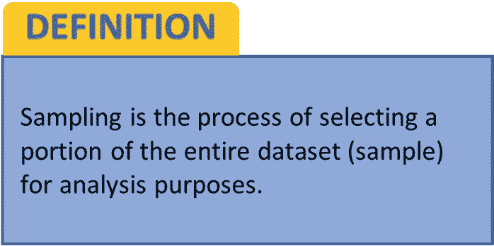

采样本质上是为了分析目的而从整个数据集中选择一个子集（样本）的过程。采样的目标是从总体中收集具有代表性和可靠性的信息，特别是当从该总体中的每个个体或元素收集数据是不切实际或不可能时。采样是任何研究项目中确保数据充足且具有代表性的关键步骤。适当的采样使我们能够创建一个规模适中且能代表目标总体的高质量数据集，从而生成有效且可推广的模型。

为了更好地理解采样过程以及如何有效地对数据进行采样，我将从数据挖掘的角度描述总体、抽样框、采样策略和样本量的概念。这些概念在专注于调查、实验和访谈设计的研究方法书籍中有深入讨论，这些是收集原始数据的常用方法。然而，在数据挖掘研究中，我们应用这些概念的方式略有不同，因为我们处理的是二手数据——即项目开始前已收集的数据。通常，此类数据由市场营销公司、工业组织或政府机构收集。鉴于这些数据库通常非常庞大，分析完整数据集并不切实际。因此，必须有一个策略来正确地从大型数据集中采样子集以供分析。

图 3.1 说明了总体、抽样框和样本之间的区别。我们将讨论这些概念的细节、它们的相互关系以及各种可用的采样方法。

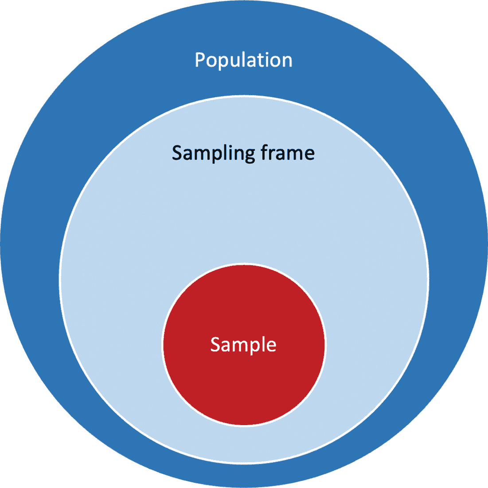

图 3.1 总体、抽样框和样本。返回正文。⏎

### 总体

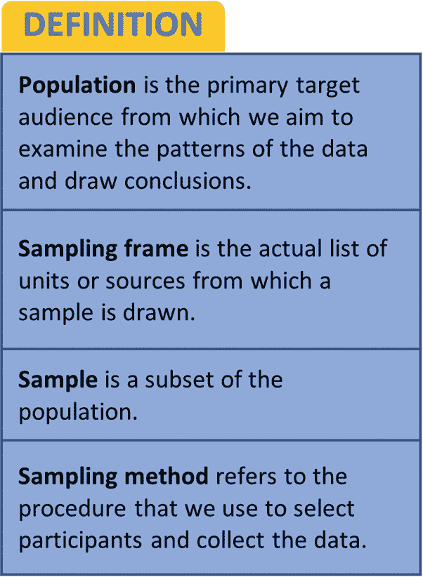

“总体”是指我们希望从中考察数据模式并得出结论的主要目标受众。我们研究中的总体可能由个人、对象、案例或特定行业部门组成。目标总体应足够大以确保研究结果的显著性，同时又应足够聚焦以保持研究的可行性。

例如，考虑一个旨在预测乘客航空公司推荐的项目。在这种情况下，美国航空乘客代表了一个合适的目标总体，涵盖使用航空运输出行的美国居民。以全球居民为目标将因总体的庞大而使数据收集变得困难。此外，当关注所有国家的居民时，混杂变量——如各国特有的文化、政治、教育或经济因素——可能会影响目标变量。这些变量数据的缺失可能会损害我们研究结果的效度。通过将重点缩小到美国市场，我们可以更容易地获取数据，并对美国航空旅客的决策得出有效结论。我们可以选择包含所有年龄段的居民，或专注于 18 岁及以上的成年人，具体取决于研究范围。在本书中，我使用了一份专注于预测航空公司推荐的乘客调查数据集，特别针对成年乘客，因为他们通常是购票者。


另一个人口示例是加拿大所有的公路运输事故。通过专注于这一人口，我们可以构建预测模型来评估该国交通事故中的受伤风险。在此背景下，我们避免将不同的交通方式（如航空、公路和水路）混合在一起，因为这些方式的事故具有截然不同的特征和促成因素。纳入此类多样化数据可能会引入噪声，导致预测模型失效。通过仅专注于公路运输，我们可以开发出一个有效且可靠的模型，准确预测公路事故。

### 抽样框

一旦我们确定了研究的合适人口，下一步就是建立抽样框。对人口中的每一个个体进行调查或收集数据既不切实际，也不推荐。一个显而易见的原因是难以接触到每一个个体，而且有些人可能会拒绝参与，因为参与是自愿的。个人有权拒绝数据收集组织的请求。

此外，从整个人口收集数据以得出有效结论是没有必要的。从统计学角度来看，如果方法得当，研究人口的样本允许我们将结果推广到整个人口。关键在于确保样本具有代表性且规模适当。为了获得有代表性的样本，我们必须确定一个合适的抽样框。

简单来说，“抽样框”是从中抽取样本的实际单位或来源列表。该框架应具备与人口相似的特征，以确保代表性。例如，在航空公司推荐项目中，我们的人口由乘坐飞机出行的美国成年居民组成，我们可能会从六个州的居民那里收集数据：纽约、明尼苏达、佛罗里达、德克萨斯、加利福尼亚和华盛顿。这些州作为我们的抽样框，代表了 63 个不同的地区——东北部、东南部、中西部、西南部和西北部——从而确保样本的代表性。

然而，如果我们仅从西部的一个州——加利福尼亚州的居民那里收集数据，我们的样本很可能代表性不足。这是因为加利福尼亚州的居民可能拥有西部地区特有的特征和行为，使他们无法代表整个美国人口。抽样框与人口之间的这种差异会引入抽样偏差，导致分析结果不能准确反映人口。这就是为什么在进行数据抽样之前，仔细确定抽样框至关重要。

### 样本

“样本”是人口的一个小子集，我们用它进行数据分析，以对整个人口做出推断。为了使我们关于人口的结论有效，样本必须具有代表性。为此，我们需要一个定义明确的抽样框，并必须从该框架中抽取样本。

例如，在航空公司推荐项目中，我们选择了由六个州（纽约、明尼苏达、佛罗里达、德克萨斯、加利福尼亚和华盛顿）组成的抽样框。然后我们从这些州收集合格居民的数据。资格要求居民年满 18 岁且过去曾使用航空运输出行。这确保了我们关注的是使用过航空旅行且有购票能力的个人。他们的航空公司推荐对于预测旅行需求很有价值。如果样本与人口具有相同的属性和特征，则认为该样本具有代表性。因此，基于此样本的分析结果可用于对人口进行推断。

## 抽样方法

即使拥有构建良好的抽样框，如果我们不使用合适的抽样策略，仍可能得到有偏样本。“抽样方法”是指我们用来选择参与者和收集数据的程序。例如，当一个组织进行调查时，他们会向抽样框内（上述六个州）的居民发送邀请并请求他们回复。然而，他们如何选择这些参与者对于确保样本具有代表性至关重要。

在数据挖掘中，如果完整数据集已由另一个组织（如航空公司或政府机构）收集，数据科学家必须决定如何从该数据集中选择个人作为样本。这个过程称为抽样方法。选择正确的抽样方法对于确保数据质量至关重要。在下一节中，我将详细描述常见的抽样方法。

## 数据抽样中的基本概念


数据抽样是统计学和数据挖掘中的一项基本技术，用于根据较小的数据子集（称为样本）对更大的人口进行推断。样本经过精心挑选，以确保其准确反映人口的特征和多样性。通过分析样本，数据分析师可以得出结论或对整个人口进行预测。 表 3.1 展示了数据抽样中的基本概念，这些概念对于准确理解和应用抽样方法至关重要。

**表 3.1 数据抽样中的基本概念** 返回正文.⏎

| 术语 | 描述 |
| --- | --- |
| 人口 | 人口是我们想要从中检查数据模式并得出结论的主要目标受众。 |
| 抽样框 | 抽样框是从中抽取样本的实际单位或来源列表。 |
| 样本 | 样本是人口的一个子集。我们使用样本进行数据分析并对人口做出推断。 |
| 抽样方法 | 抽样方法是我们用来选择参与者和收集数据的程序。 |
| 样本量 | 样本量是指样本中包含的个人或对象的数量。应根据统计学考量来确定。 |
| 有代表性的样本 | 有代表性的样本是能准确反映人口特征和多样性的样本。 |
| 抽样偏差 | 当选定的样本不能准确代表人口时，就会发生抽样偏差，导致结果倾斜或不准确。 |
| 概率抽样 | 概率抽样是以随机方式选择个人的方法，使得抽样框中的每个个体都有同等概率被选中。 |
| 非概率抽样 | 非概率抽样是基于非随机标准选择个人的方法，抽样框中的并非每个个体都有机会被纳入。 |
| 误差范围 | 误差范围是从样本获得的估计值中不确定性或变异性的度量。 |
| 置信水平 | 置信水平代表我们对从样本获得的估计值的确定程度或信心程度。 |
| 不平衡数据集 | 不平衡数据集是指不同类别中的样本数量显著变化，导致类别表示不均等的数据集。在不平衡数据集中，一个类别（少数类）通常比其他类别（多数类）拥有显著更少的实例。 |
| 过采样 | 过采样是一种通过增加少数类（罕见事件）的规模使其与多数类规模相同来平衡数据的技术。 |
| 欠采样 | 欠采样是一种通过减少多数类的规模使其与少数类规模相同来平衡数据的技术。 |

## 抽样方法


64. 存在许多不同的抽样方法，通常分为两大主要类型：概率抽样和非概率抽样。


## 概率抽样与非概率抽样

*   **概率抽样**涉及参与者的随机选择。此方法允许对整个总体进行强有力的统计推断。
*   **非概率抽样**涉及基于便利性或其他标准的非随机参与者选择。虽然此方法更容易且更具成本效益，但它引发了关于抽样偏差的担忧。

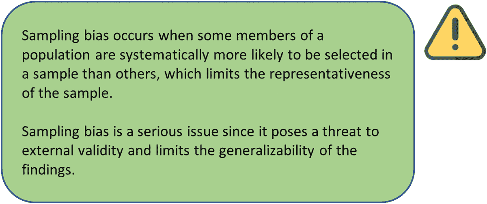

在讨论这些抽样方法类型之前，了解什么是抽样偏差以及为什么最小化它至关重要非常重要。当以某种方式收集样本，导致总体中某些成员系统性地比其他成员更有可能被选中时，就会发生抽样偏差。当出现抽样偏差时，无法将此样本数据分析的结果推广到整个总体。换句话说，抽样偏差对外部效度构成威胁，限制了研究结果的普遍性。在这种情况下，只能得出关于特定样本而非预期总体的结论。

尽管完全消除抽样偏差具有挑战性，但应努力将其最小化。某些抽样方法比其他方法更有效地减少抽样偏差。

### 概率抽样方法

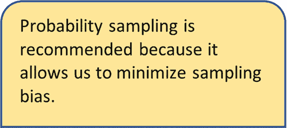

概率抽样是推荐的方法，因为它确保数据质量并最小化抽样偏差。在此方法中，抽样框中的个体被随机选择，使每个人被选中的概率相等。此方法能有效产生总体的无偏代表。研究中常用四种常见的概率抽样方法，我将结合示例简要描述。图 3.2 直观展示了这些方法。

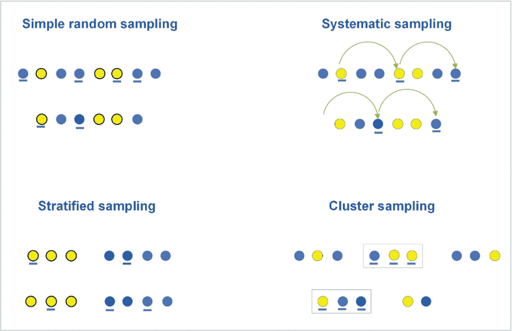

图 3.2 概率抽样方法。返回文本。

#### 简单随机抽样

此方法确保总体中的每个成员都有同等机会被选中。常见方法是为抽样框中的每个个体分配一个编号，然后使用随机数生成器（如 Excel 中的 `RAND()` 函数）选择所需数量的参与者。这样，选择完全基于机会，消除了抽样偏差。

**示例：** 假设我们要从某县 5,000 名高中生中选取简单随机样本。我们会为数据库中的每个学生分配 1 到 5,000 的编号。然后，使用随机数生成器选取 500 个随机数。对应这 500 个编号的学生将被选入样本。

#### 系统抽样

系统抽样是一种随机抽样形式，但不使用随机生成器。相反，为每个个体分配一个编号，然后按固定间隔选择这些编号。关键在于必须确保列表中不存在可能导致样本产生偏差的隐藏模式。例如，如果数据库按年级排列学生，并按测试分数升序列出，则存在风险：我们选择的间隔可能无意中遗漏分数较低的学生，导致样本偏向分数较高的个体。

**示例：** 继续以高中生为例，如果该县共有 5,000 名学生，我们首先按字母顺序列出他们。然后，每隔 10 个学生选择一名，最终得到 500 人的样本。

#### 分层抽样

分层抽样涉及根据相关特征（如性别、年龄范围、年级、分数范围）将总体划分为子群（即层）。确定样本量后，计算每个子群应选取的个体数量。然后在每个子群内应用系统抽样方法选择参与者。此方法确保每个子群得到充分代表，从而得出更精确的结论。

**示例：** 如果该县高中有 2,000 名女生和 3,000 名男生，我们希望样本反映这一性别分布，则将学生总体按性别分为两层。然后在每组内使用随机抽样分别选取 200 名女生和 300 名男生，组成 500 名学生的代表性样本。

#### 整群抽样

整群抽样涉及将总体划分为子群，每个子群应具有与整个总体相似的特征。这些子群称为簇。我们不从每个簇中抽取个体，而是随机选择若干簇，并使用这些簇中的所有个体。对于大型簇，可以使用上述技术之一在每个簇内抽取个体，这称为多阶段抽样。整群抽样能有效处理大规模、广泛分散的总体。然而，确保抽取的簇真正代表整个总体可能具有挑战性。

**示例：** 考虑某州 20 所高中的学生。如果我们没有资源访问每所学校，可以假设这些学校具有相似的人口统计学特征。然后随机选择 8 所学校作为簇。然而，如果学校在人口统计学特征上差异显著，某些簇可能无法代表总体，导致样本潜在偏差。这是整群抽样的主要缺点。

### 非概率抽样方法

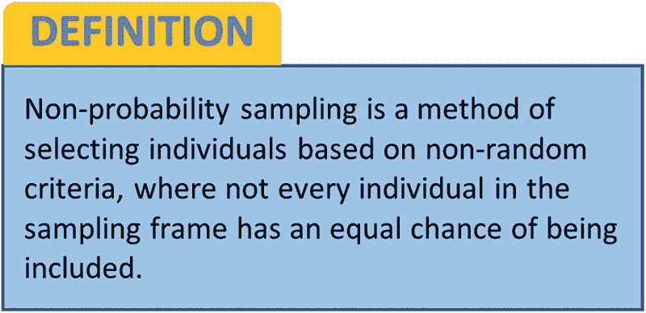

在非概率抽样中，个体基于非随机标准被选中，意味着抽样框中的并非每个个体都有同等机会被纳入。非概率抽样更容易且更具成本效益，但抽样偏差风险较高，导致样本代表性较弱。因此，我们对总体的推断比概率样本更弱、更有限。因此，如果出于任何原因选择非概率抽样，仍应力求使样本尽可能代表总体。

非概率抽样方法常用于样本量较小的探索性和定性研究（如访谈）。鉴于难以为访谈目的随机选择大样本，研究人员常采用非概率抽样。在这类研究中，目标不是对大总体进行广泛推广，而是对较小或研究不足的总体建立初步理解。非概率抽样在实验研究中也很常见，此类研究关注处理对感兴趣结果的因果效应，而非研究大总体。由于实验常要求参与者在受控环境（如实验室或教室）中停留较长时间，难以招募大型随机样本，研究人员必须依赖志愿者，从而导致使用非概率抽样。

在数据挖掘研究中，我们处理大型数据集并旨在生成可推广到其他数据集的预测模型，**我不建议使用非概率抽样**。鉴于通常可用的数据量，我们应能选择大样本并使用概率抽样。不过，我将简要描述一些常见的非概率抽样方法，以便您了解它们是什么及其工作原理。

#### 便利抽样


#### 便利抽样

便利抽样涉及选择研究者易于接触的个体。虽然它提供了一种简单且具有成本效益的收集初始数据的方法，但其产生的结果无法推广到更广泛的总体。例如，在我们研究组织内部员工对员工服务意见的场景中，仅要求同级同事填写调查问卷是一种便利的方法。然而，这限制了样本的代表性，因为它并未涵盖组织内所有层级的所有员工。

#### 自愿回应抽样

自愿回应抽样主要依赖于可接触性。在这种情况下，个体自愿参与，而不是由研究者主动选择和联系。重要的是要注意，自愿回应样本往往至少带有一定程度的偏差，因为某些个体天生更倾向于自愿参与，这可能导致结果不具代表性。例如，我们向组织内所有员工发送关于健康保险福利的调查问卷，许多人决定填写。虽然这种方法能为我们提供一些关于该主题的见解，但值得注意的是，回应者更有可能对服务持有强烈意见。因此，我们不能断定他们的观点准确反映了所有员工的观点。

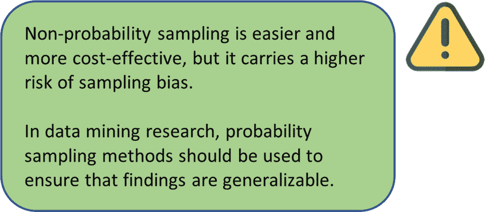

#### 目的性抽样

目的性抽样，也称为判断抽样，要求我们利用专业知识选择最有利于研究目的的样本。它常用于定性研究，特别是当研究者寻求对特定现象的深入见解，而非进行统计推广时。在处理小规模且特定的总体时，它特别有用。为确保目的性抽样的有效性，建立明确的纳入标准和合理依据至关重要。例如，如果我们的目标是深入了解组织内残障员工的意见和经历，我们会刻意选择几位具有不同支持需求的员工。这种刻意选择使我们能够收集关于他们员工服务体验的广泛数据。

#### 滚雪球抽样

滚雪球抽样通过其他参与者招募参与者。研究者联系几个他们认识的人，并请他们推荐其他可能参与的人。随着联系人数的增加，样本量像“滚雪球”一样增大，因此得名。例如，如果我们正在研究本市 LGBTQ+ 群体的经历，且没有所有 LGBTQ+ 个体的名单，则概率抽样不可行。我们可能从访谈一位人士开始，然后由该人士推荐社区中的其他人。

正如你所见，非概率抽样方法更易于实施且成本更低，但它们伴随更高的抽样偏差风险，可能导致样本不具备总体代表性。因此，研究结果无法推广到更大的总体。在数据挖掘研究中，我们通常处理较大的数据集，应使用概率抽样以确保数据具有代表性。这种方法使我们能够开发出更具推广性、适用于同一总体内其他数据集的预测模型。

## 次级数据与样本代表性


当我们自行收集数据时，可以选择抽样框并应用上述抽样方法之一来确保样本的代表性。然而，在许多数据挖掘项目中，我们依赖其他组织或方收集的数据——即次级数据。在这些情况下，我们将整个数据集视为抽样框，并使用某种抽样方法从中抽取样本。但由于我们通常不知道原始数据是如何抽样或收集的，如何确保我们的样本具有代表性？

为解决这一不确定性，我推荐一种有效方法：分析样本的人口统计学信息，并将其与目标总体的人口统计学信息进行比较。通过证明我们的样本与总体具有相似的人口统计学属性和特征，我们可以有信心地得出结论：我们的样本具有代表性，即使我们不了解原始数据收集方法。当我们自行收集数据时，这种方法也很有用。即使我们选择了抽样框并使用了概率抽样，数据收集过程中仍存在可能引入抽样偏差的不确定性——这些是超出我们控制、可能影响代表性的因素。例如，我们收集数据的对象可能不如我们预期的那样具有代表性。因此，为确保代表性，将样本的人口统计学信息与总体进行比较是明智之举。

表 3.2 提供了样本与目标总体人口统计学特征对比的示例。在大多数情况下，总体的人口统计学信息可从美国人口普查局等在线资源或其他组织的出版物中获取。如表所示，虽然样本和总体的特征可能不完全相同，但差异极小，且数据分布非常相似。这种对比表明了样本与总体的相似性。换句话说，我们的样本具有总体代表性，基于样本的研究结果可以放心地应用于更广泛的总体。

**表 3.2** 样本与目标总体对比示例 返回正文.⏎

| 人口统计学特征 | | 样本 (%) | | 总体 (%) |
| --- | --- | --- | --- | --- |
| 性别 | | | | |
| * 男性 | | 45 | | 48 |
| * 女性 | | 43 | | 42 |
| * 其他 | | 12 | | 10 |
| 年龄范围 | | | | |
| * 18–30 | | 20 | | 18 |
| * 31–40 | | 38 | | 40 |
| * 41–50 | | 30 | | 28 |
| * >50 | | 12 | | 14 |
| 收入范围 | | | | |
| * <$40,000 | | 38 | | 40 |
| * 40,000–99,999 | | 29 | | 30 |
| * 100,000–200,000 | | 24 | | 20 |
| * >200,000 | | 9 | | 10 |
| 教育程度 | | | | |
| * 高中 | | 23 | | 20 |
| * 学士 | | 48 | | 50 |
| * 研究生学位 | | 29 | | 30 |
| 婚姻状况 | | | | |
| * 已婚 | | 43 | | 45 |
| * 未婚 | | 57 | | 55 |
| 地区 | | | | |
| * 东北部 | | 15 | | 17 |
| * 东南部 | | 23 | | 21 |
| * 西南部 | | 17 | | 18 |
| * 中西部 | | 19 | | 20 |
| * 西部 | | 26 | | 24 |

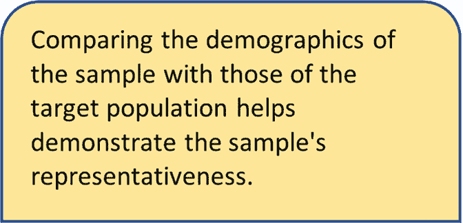

## 样本量

### 什么是样本量，为什么它很重要？

样本量是指样本中包含的个体或对象的数量。在数据挖掘中，样本量是一个关键考量因素，因为充足的样本对于确保研究结果的质量和可靠性至关重要。

以下是凸显样本量重要性的几个关键原因：


1.  **代表性模式**：数据挖掘旨在发现数据中有意义的模式和关系。较大的样本量提供了总体更具代表性的子集，增加了捕捉准确可靠模式的可能性。这将带来对所研究总体更精确、更具代表性的结果。

2.  **增强推广性**：较大的样本量增强了研究结果的推广性。当样本更多样化且包含更多个体或案例时，结果更有可能适用于样本所来自的更广泛总体，从而提高研究的外部效度。

3.  **可靠的模型构建**：数据挖掘通常涉及构建预测模型或分类器。较大的样本量允许进行更稳健、更准确的模型构建，因为模型可以捕捉数据中更广泛的变化和复杂性，从而得出更可靠、更具推广性的预测。


## 4. 统计功效的提升

统计功效是指在数据中检测真实效应或关系的能力。较大的样本量能提高研究的统计功效，使其更有可能在显著差异或关联存在时将其检测出来。这对于从数据中得出有意义的结论尤为重要，因为数据挖掘算法能够检测到在较小样本中可能隐藏的模式和关系，从而得出更稳健的发现。

## 5. 准确度与置信度的增强

较大的样本量能减少预测中的变异性和不确定性。置信区间变得更窄，提供了真实总体参数可能落入其中的更精确范围。这增强了研究发现的准确性和可靠性。

## 6. 亚组分析

有了较大的样本量，研究人员可以进行更稳健的亚组分析，探究总体中特定亚组内的效应或关系。各亚组内充足的样本量能确保对这些特定群体得出更可靠的结论。

## 7. 稳定性的提高

较大的样本量为结果提供了更多稳定性，减少了随机波动或异常值的影响。当样本量较大时，异常值或极端值的影响较小，从而确保发现更加稳健可靠。

## 8. 考量变异性

许多现实世界的现象都表现出固有的变异性。较大的样本量有助于捕捉更广泛的变异范围，从而对所研究的现象提供更全面的理解。

## 9. 处理复杂和罕见模式

在某些情况下，数据挖掘旨在发掘不频繁出现的复杂或罕见模式。较大的样本量增加了遇到此类模式的机会，使识别和理解这些不常见现象变得更容易。

## 10. 结果验证

数据挖掘通常涉及在未见数据上测试和验证发现的模式或模型。较大的样本量在验证过程中增加了结果泛化能力和可靠性的置信度。

### 传统统计研究的样本量

考虑到样本量的重要性，显而易见的问题是：一个项目的样本量应该多大？

通常，在传统研究中，确定合适样本量主要有两种方法：基于总体大小和用于分析的统计技术。首先，样本量必须足以充分代表总体。在此背景下，样本量是通过考虑总体大小、置信水平和误差范围来确定的。Qualtrics 提供了一个实用的样本量计算器用于此目的（[`www.qualtrics.com/blog/calculating-sample-size/`](https://www.qualtrics.com/blog/calculating-sample-size/)）。用于计算样本量的数学公式也作为参考列在下方。

```
Sample size = \frac{\left( z\_ score \right)^{2} \times StdDev \times \left( 1 - StdDev \right)}{\left( Margin~of~error \right)^{2}}
```


置信水平表示你对结果的置信程度，以如果重复抽样，不同样本产生相同结果的百分比来表示。置信水平的常用值为 95%。误差范围是一种统计测量值，用于解释实际结果与预测结果之间的差异。误差范围的典型值为 5%。

例如，使用 95% 的置信水平、5% 的误差范围和 100,000 的总体大小，计算出的样本量为 383。如果我们将总体大小增加到 1 亿，所需的样本量仍为 385。这是因为总体大小用于计算 z-score，一旦总体达到一定阈值，z-score 就会饱和。因此，即使我们的总体大小是 3 亿，所需的样本量仍为 385。这种方法可能会引发进一步的问题，例如总体大小是否根本不重要。这引出了第二种方法。

在第二种方法中，样本量必须足以确保分析具有足够的统计功效和效应量。用于计算该样本量的公式因所选统计技术而异。我不会详细讨论这些方法，因为根据不同的统计方法计算样本量有许多公式。不过，我强烈推荐以下两个资源：

*   **Daniel Soper 的样本量计算器**：该网站提供各种统计计算器，包括样本量、效应量和 β（第二类错误率）计算器。它还提供了开发这些计算器所用的公式和学术参考文献，确保其有效性。最有用的计算器包括多元回归、层级多元回归和结构方程建模的计算器（参见 [`www.danielsoper.com/statcalc/`](https://www.danielsoper.com/statcalc/)）。

*   **G*Power 软件**：这款开源软件应用程序允许用户计算各种统计方法的样本量，包括 t 检验、ANOVA、MANOVA、重复测量、逻辑回归和多元回归。它在学术研究中广泛使用。不过，某些功能需要仔细阅读手册以避免计算错误（参见 [`www.psychologie.hhu.de/arbeitsgruppen/allgemeine-psychologie-und-arbeitspsychologie/gpower`](https://www.psychologie.hhu.de/arbeitsgruppen/allgemeine-psychologie-und-arbeitspsychologie/gpower)）。

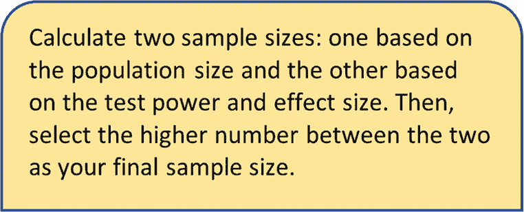

使用这些样本量计算器的关键在于确定你预期的主要参数，如效应量、期望检验功效、显著性水平、自变量（预测变量）数量和因变量数量。一旦你选择了合适的统计方法和这些参数的预期值，工具就会计算出满足这些统计要求所需的最小样本量。我不会详细说明这些参数，因为它们在统计学文献中有大量论述。

经验法则是同时使用这两种方法：基于总体大小计算样本量，并基于检验功效和效应量计算样本量。然后，在两者之间选择较大的数字作为最终样本量。

### 数据挖掘研究的样本量


确定样本量的传统方法可能不太适用于数据挖掘研究。这些方法主要关注传统统计研究，而许多机器学习方法并非基于统计学。此外，这些传统计算通常导致样本量在 50 到 500 个响应之间，虽然这足以进行传统统计分析，但无法充分涵盖专注于在大型数据集中发掘未知模式的数据挖掘研究的范围。

正如第 1 章所述，当我们提到数据规模时，我们同时考虑变量数量（多样性）和记录数量（容量）。为了在没有预定义理论基础的情况下检测变量间关系方面的有意义模式，我们需要模型中包含大量变量。有限的变量会限制可发现的模式（关系）数量。此外，排除重要的输入变量可能导致预测模型从建模角度看拟合数据良好，但缺乏实际意义。


当模型中包含的变量增多时，模型的解释能力往往会下降。我将在第 6 章更详细地探讨解释能力的概念，但从本质上讲，它是指模型基于预测变量的方差来解释目标变量方差的能力。随着变量的增加，模型的解释能力可能会减弱。为了在变量数量较多的情况下保持解释能力，我们需要更多的数据点来训练模型，这意味着需要更大的样本量。此外，用于验证的数据分区进一步增加了对更大样本量的需求。

那么，多大的样本量才足以用于数据挖掘项目？这是一个具有挑战性的问题，因为没有确定的答案。一些作者建议“越多越好”，而另一些人则声称 10,000 个数据点就足够了。我发现关于这一主题没有一致的指导原则。所需的样本量还取决于数据来源，因为我们无法使用超过可用数量的数据。例如，某些数据提供商可能从每小时运营数据中提供数百万条记录，而收集事故数据的提供商可能只能提供数千条记录。归根结底，我们需要足够的数据来训练和验证模型，并确保结果的泛化能力。然而，我们也必须考虑处理超大数据集所需的计算能力，因为使用海量数据训练复杂模型（如神经网络）可能非常耗时。基于我在数据挖掘项目中的经验，我将提供我的建议。

#### 不平衡比

抽样中的另一个重要因素是不平衡比（IR），即我们想要预测的事件发生率。例如，如果我们的目标变量是航班延误，那么不平衡比就是延误航班占总航班的比例。在这种情况下，事件是延误航班，而非事件是准点航班。平衡的数据集对于开发有效且泛化的预测模型至关重要。不平衡的数据集（即不平衡比过低或过高）可能导致预测不准确。例如，如果不平衡比为 0.1，意味着 10% 的数据是事件，90% 是非事件，模型可能会不准确地预测所有情况均为非事件，从而导致高假阴性率。尽管整体预测准确率看似很高（90%），但模型未能预测事件（航班延误），使其无效且不可用。反之，如果不平衡比过高，事件数量远多于非事件，模型可能会产生高假阳性率，导致类似问题。针对不平衡数据集的一个常见解决方案是重新抽样数据以获得更易于处理的响应比，我们将在本章后面探讨这一主题。

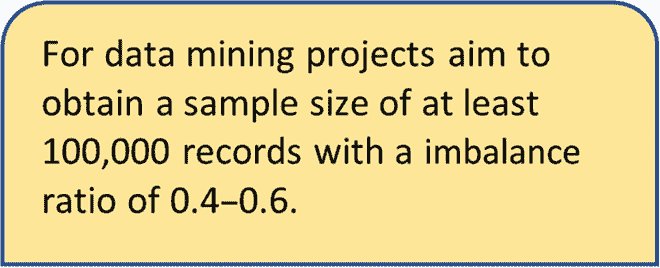

73. 总之，在为数据挖掘选择样本量时，必须同时考虑记录数量和不平衡比。例如，不平衡比为 0.4–0.6 的 100,000 条记录通常已足够，而不平衡比为 0.03 的 100 万条记录可能仍显不足。理想情况下，0.5 的不平衡比代表事件与非事件之间的完美平衡。然而，在实践中实现这种完美平衡很少见。我的建议是争取至少 100,000 个案例的样本量，且不平衡比在 0.4 到 0.6 之间。

## 示例：抽样


在本节中，我们将学习如何使用 SPSS Modeler 进行数据抽样。假设您有一个用于数据挖掘的超大数据集，并不打算使用所有数据点。主要原因是如此大的数据集可能对建模来说并非必要，且会拖慢计算过程，影响模型训练时间。例如，如果您拥有 1,000 万个数据点的数据集，但决定用 100,000 个数据点进行建模，如何从总共 1,000 万个数据点中抽取这 100,000 个数据点，同时不牺牲数据质量和泛化能力？我将演示如何使用 SPSS Modeler 来实现这一点。

第一步是选择合适的抽样方法。如前所述，推荐在数据挖掘项目中使用概率抽样方法。SPSS Modeler 提供了多种可供选择的抽样方法。在大多数情况下，处理平衡数据集时，除非有特定理由选择其他方法，否则随机抽样是首选。随机抽样允许您随机抽取样本，同时保持不平衡比不变。例如，如果您的完整数据集不平衡比为 0.45，而您想抽取 10% 的数据，随机抽样将为您提供 10% 的数据，同时保留 0.45 的不平衡比。

一旦选择了合适的抽样方法，从完整数据集中抽取样本就非常简单了。大多数数据挖掘软件应用都内置了抽样功能，使这一过程变得容易。我现在将演示如何在 SPSS Modeler 中执行数据抽样。假设您决定使用随机抽样方法。在 SPSS Modeler 中，有两种执行抽样的方式：创建新数据源时，或使用 `Sample` 节点。我将向您展示如何使用 `Sample` 节点，因为它提供了更多配置选项，允许您自定义抽样流程并根据需要调整设置。

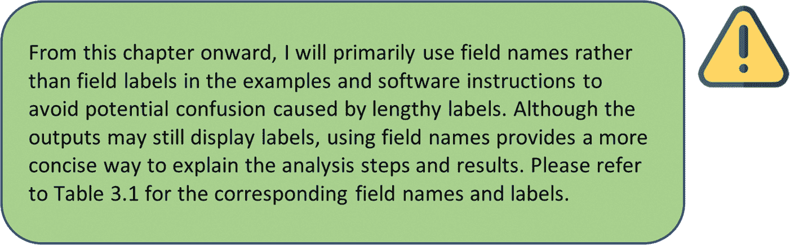

我们将使用示例数据集 `AirlineRecommendation`，我们在第 3 章中已详细探讨过该数据集。对于抽样步骤，我们将关注目标变量 `recommendation`，它指示乘客是否会推荐该航空公司进行航空旅行。这是一个二元变量，74. 具有两个水平：`Yes`（推荐航空公司——事件）和 `No`（不推荐航空公司——非事件）。总数据集包含 124,464 个数据点，不平衡比为 0.475（即 47.5%），这被认为是平衡的。我们的目标是使用随机抽样抽取 50% 的数据。

请按照以下步骤设置 `Sample` 节点：

1.  打开 SPSS Modeler。
2.  创建一个新流程并将其命名为“Airline_Sample”。
3.  从节点面板的**来源**组中，双击**统计文件**节点以将其添加到流程中。
4.  双击**统计文件**节点以打开该节点的设置窗口。
5.  单击省略号按钮（三个点的按钮），并从您的计算机中选择 `AirlineRecommendation.sav` 文件。
6.  从**字段操作**组中，向流程添加一个**类型**节点并将其连接到数据节点。此节点用于查看和修改字段的测量级别和角色。
7.  双击**类型**节点以打开其设置窗口。
8.  按如下所示检查所有字段的测量级别。对于字段 `recommendation`，将角色更改为**目标**。

    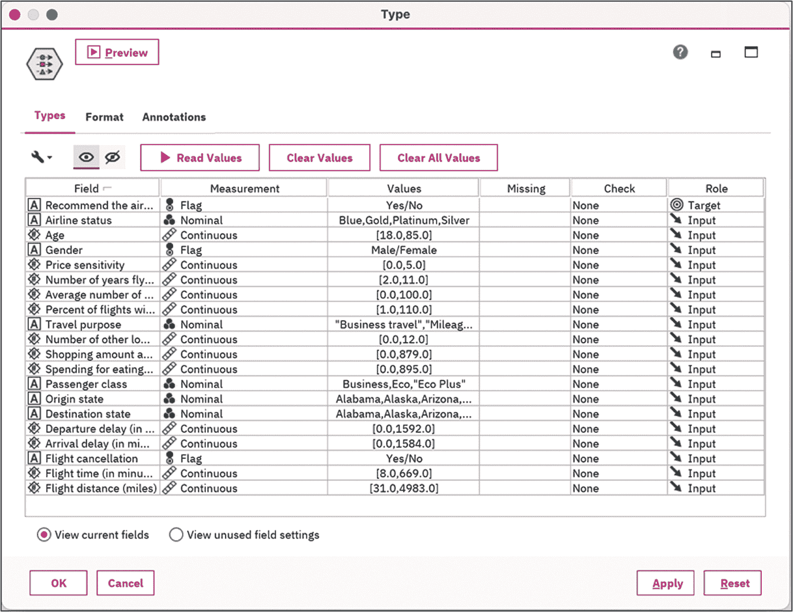

9.  从节点面板的**记录**组中，向流程添加**抽样**节点并将其连接到**类型**节点。

    

10. 双击**抽样**节点以打开其设置窗口。
11. 75. 在“设置”选项卡下，为抽样方法选择**复杂**。为抽样类型选择**随机**，为抽样单位选择**比例**。要抽取 50% 的数据，请将抽样大小的**固定**值设为 **0.5**。

     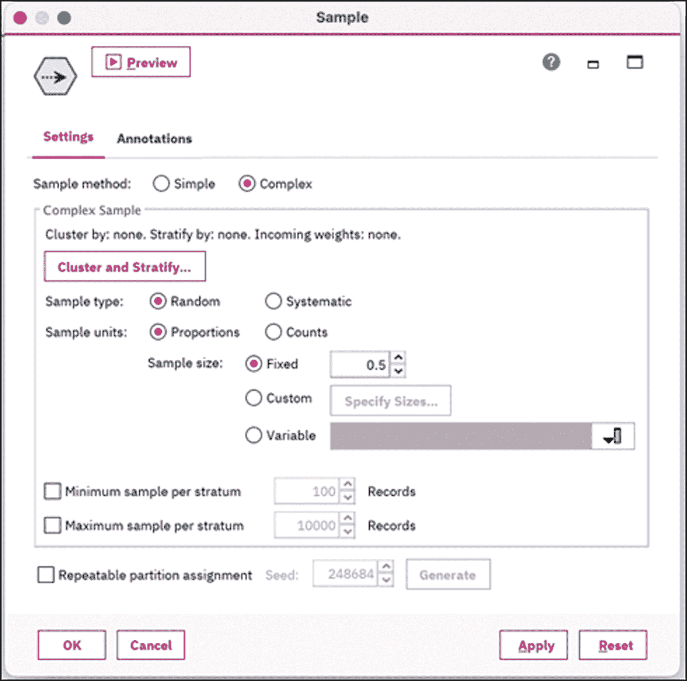

12. 单击**应用**，然后单击**确定**。

此过程将提示 SPSS Modeler 按预期随机抽取 50% 的数据。要查看抽样后的数据，请向 `Sample` 节点添加一个**数据审计**节点并运行它。如前所述，**数据审计**节点将为我们的抽样数据生成图形结果以及描述性统计信息。


图 3.3 展示了目标变量 `recommendation` 的抽样结果。表 3.3 提供了抽样数据的描述性统计。在此示例中，我仅选择了字段名、测量尺度、有效记录数和空值（缺失数据）。需重点关注的关键输出如下：

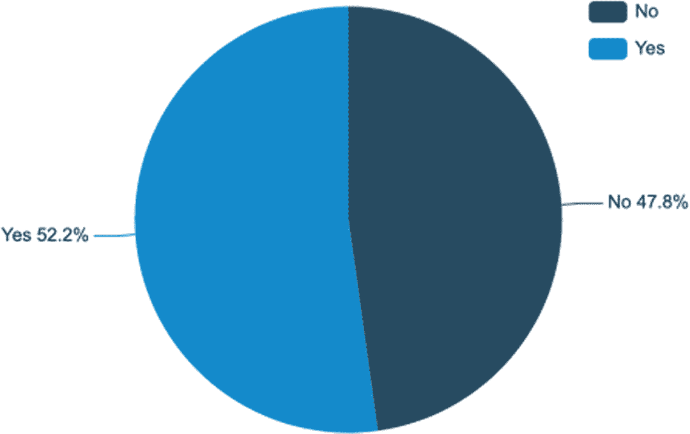

图 3.3 `recommendation` 字段的抽样结果。返回正文。⏎

表 3.3 抽样数据的描述性统计 返回正文。⏎

| 字段 | 测量尺度 | 有效记录数 | 空值（缺失） |
| --- | --- | --- | --- |
| 推荐该航空公司 | 标志 | 62,232 | 0 |
| 航空公司会员等级 | 名义 | 62,232 | 0 |
| 年龄 | 连续 | 62,232 | 0 |
| 性别 | 标志 | 62,232 | 0 |
| 价格敏感度 | 有序 | 62,232 | 0 |
| 乘机年数 | 连续 | 62,232 | 0 |
| 年均航班数 | 连续 | 62,232 | 0 |
| 其他航空公司航班占比 | 连续 | 62,232 | 0 |
| 出行目的 | 名义 | 62,232 | 0 |
| 其他忠诚卡数量 | 连续 | 62,232 | 0 |
| 机场购物金额 | 连续 | 62,232 | 0 |
| 机场餐饮消费 | 连续 | 62,232 | 0 |
| 乘客舱位等级 | 名义 | 62,232 | 0 |
| 始发州 | 名义 | 62,232 | 0 |
| 目的地州 | 名义 | 62,232 | 0 |
| 出发延误（分钟） | 连续 | 61,101 | 1,131 |
| 到达延误（分钟） | 连续 | 60,908 | 1,324 |
| 航班取消 | 标志 | 62,232 | 0 |
| 飞行时间（分钟） | 连续 | 60,908 | 1,324 |
| 飞行距离（英里） | 连续 | 62,232 | 0 |

*   抽样后不平衡比率保持一致：推荐 52.2%；不推荐 47.8%。
*   样本数据量：62,232 条有效记录。

76. 正如你所见，软件随机选取 50% 的数据作为样本，保持了与全量数据集几乎相同的不平衡比率（52.46% 推荐，47.54% 不推荐）。这确认了抽样过程已正确完成。

## 不平衡数据集

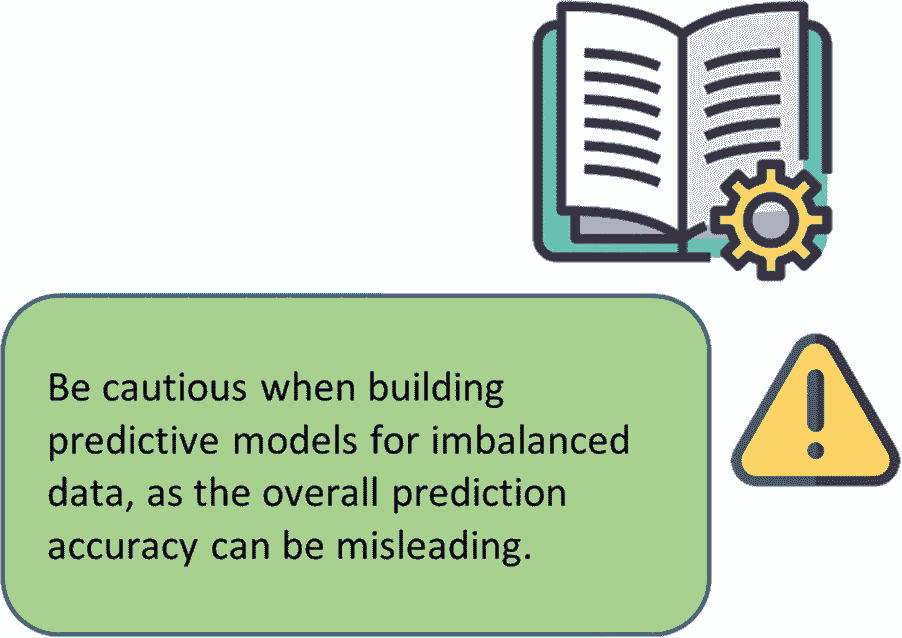

如前所述，平衡数据集对于构建有效且实用的预测模型至关重要。不平衡数据集会带来很高的预测错误风险。平衡数据集的不平衡比率通常接近 0.5，意味着事件（正例）和非事件（反例）的数量相近。图 3.4 展示了平衡数据集与不平衡数据集的区别。

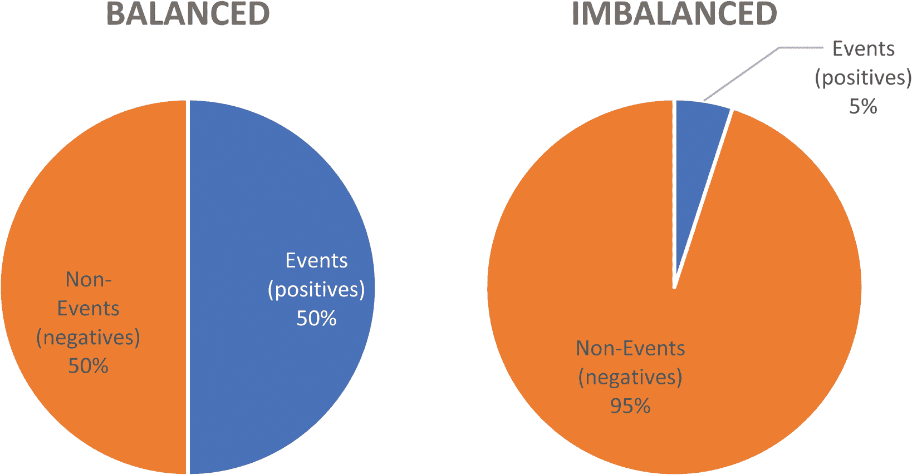

图 3.4 平衡与不平衡数据集对比。返回正文。⏎

在平衡数据集中，50% 的数据代表事件，50% 代表非事件，不平衡比率为 50%。反之，不平衡数据集由 5% 的事件和 95% 的非事件组成，不平衡比率为 5%。在不平衡数据集的背景下，事件被称为 `minority class`（少数类，仅占数据的 5%），而非事件被称为 `majority class`（多数类，占数据的 95%）。

为什么高度不平衡的数据集会成为预测建模中的问题？试想一个数据集，其中 5% 的数据代表事件（正例），95% 代表非事件（反例）。当我们用该数据集训练模型时，由于算法旨在达到最高的预测准确率，不平衡会导致算法将所有案例都视为非事件。请记住，算法无法理解变量或数据的含义；它只处理数字并试图将其拟合进模型。在这种情况下，模型可能达到 95% 的整体预测准确率，看起来非常高。然而，仔细检查后我们会发现，模型未能预测出任何事件（正例），这使其在实际应用中毫无用处，尤其是当我们的目标是预测那些特定事件时。

为什么会发生这种情况？当我们将预测结果细分为正例和反例类别时，会发现真正例率为 0%，而假反例率为 100%。之所以出现这种情况，是因为算法为了最大化整体准确率，将所有案例都归类为非事件（反例）。因此，整体预测准确率可能具有误导性。为了准确评估模型性能，我们还必须考虑其他指标，如特异性、灵敏度、F1 分数、基尼系数、ROC 曲线和提升图表，我们将在第 6 章中详细讨论这些指标。在本例中，由于数据集高度不平衡且不平衡比率极低，该模型是无效的。

理解不平衡数据集为何对建模构成重大风险至关重要。了解如何解决这一问题同样重要，因为这种情况比你想象的更常见。例如，在预测信用欺诈、航空事故或网络攻击等项目中，事件通常非常罕见（不平衡比率极低），但预测这些风险至关重要。如果我们的模型无法预测感兴趣的目标变量，它就变得毫无用处。幸运的是，有多种方法可以解决这个问题，我们将在接下来探讨。

### 使用多种模型拟合指标


正如上述示例所示，使用不平衡数据集训练一个好的模型颇具挑战。模型往往表现出很高的整体预测准确率，却实际上无效。因此，评估模型性能时切勿仅依赖预测准确率或误分类率，因为这些指标可能具有误导性。请注意，误分类率仅仅是 1 减去预测准确率。为了全面评估模型，使用多种模型拟合指标非常重要。除了预测准确率和误分类率，常用指标还包括灵敏度、特异性、F1 分数、提升图表、ROC 曲线和基尼系数。通过采用多种指标，我们可以从不同角度评估模型性能，从而全面了解其有效性。我们将在第 6 章中详细探讨这些指标。

### 数据分区与模型验证

预测建模中的一个主要关注点是过拟合，即模型在训练数据上过度训练，导致对该特定数据集的预测准确率很高，但在新数据上表现不佳。这种缺乏泛化能力会使模型无法使用。为降低此风险，除了使用多种模型拟合指标外，将数据划分为训练样本和验证样本至关重要。训练样本用于构建模型，验证样本用于测试其性能。这种方法通过对比训练样本和验证样本的结果，有助于发现模型潜在的问题。在处理不平衡数据集时，模型验证尤为关键。我们将在本章后面详细讨论数据分区。

### 代价敏感学习

解决不平衡数据集的另一种方法是代价敏感学习（CSL）。CSL 不仅仅基于预测准确率或误分类率来比较模型，而是考虑误分类所带来的代价。其目标是开发一个能最小化误分类总代价的模型。为此，会为目标概况创建一个收益表（或决策矩阵），列出每个类别的误分类代价。


#### CSL：成本敏感学习

CSL 是数据挖掘中一种广泛使用的方法，用于提升预测模型在不平衡数据集上的性能。这一机器学习子领域考虑了误分类（假阴性或假阳性）的不等成本。通过为所有类别定义这些成本，我们可以训练并选择使总成本最小化的模型。

在数据集不平衡且不平衡比率极低或极高的场景中，假阴性的成本通常远高于假阳性的成本。例如，在预测严重健康问题时，假阴性可能导致治疗延误和严重后果。在比较模型时，总成本最低的模型优于误分类率最低的模型。因此，CSL 通过考虑不同类型分类错误相关的成本来优化模型性能，有效解决了类别不平衡问题，并提高了模型在错误后果差异显著的现实场景中的适用性。

或者，如果重点在于最大化利润而非最小化成本，则可以定义一个包含准确预测详细利润的利润矩阵。在这种情况下，选择总利润最高的模型。全书中，我们将重点关注强调成本考量的示例。我将在第 6 章中详细介绍 CSL 及其应用方法。

### 重采样——过采样和欠采样

解决数据集不平衡的一种常见方法是对数据进行重采样以创建平衡数据集。如果不平衡数据存在模型有效性风险，则应考虑这种方法。换句话说，如果前述方法不能有效解决数据不平衡问题，且我们担心模型可能无效，那么重采样就成为一种可行的选择。

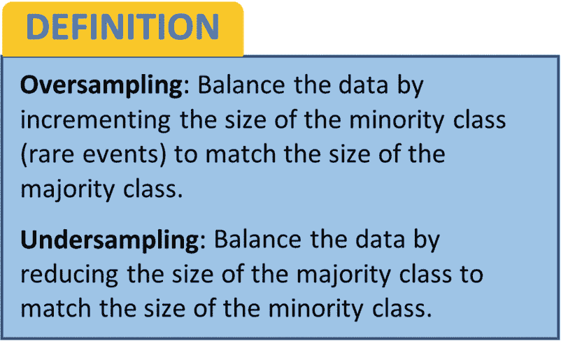

重采样涉及修改不平衡数据集以平衡事件和非事件。实现这一目标的两种主要方法是过采样和欠采样。图 3.5 展示了这两种方法的区别。

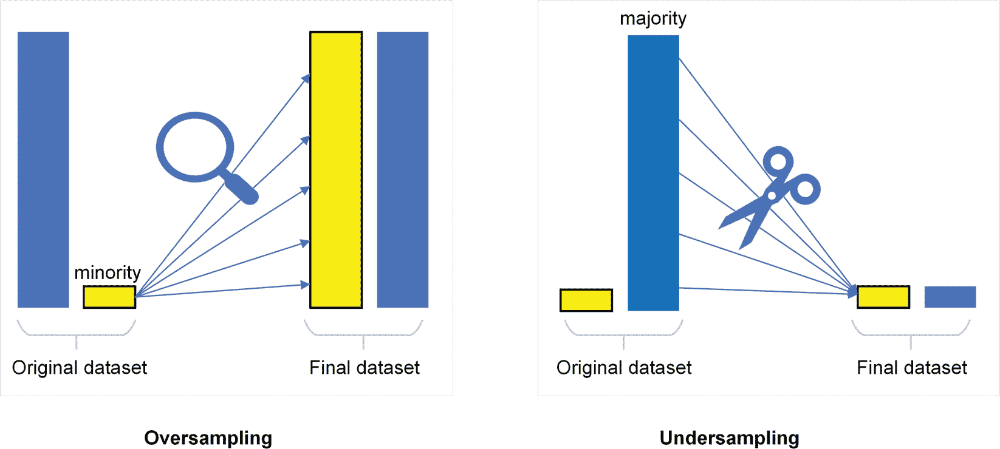

图 3.5 过采样和欠采样。返回正文。⏎

#### 过采样（上采样）

该技术通过增加少数类（罕见事件）的样本量以匹配多数类的样本量来平衡数据。在过采样中，我们通过复制案例来增加训练样本中少数类的记录数。该方法的主要优势在于保留了原始数据集的所有信息，使我们能够保留少数类和多数类的所有记录。然而，数据的复制使模型更容易过拟合，因为模型可能会过度学习相同的数据点。此外，过采样可能导致数据集变得非常大，从而增加计算时间。

最常见的过采样技术是**随机过采样**，它随机复制少数类记录。虽然这种技术简单直接，但由于反复接触相同的数据点，往往会导致过拟合。一种更先进的技术是**合成少数类过采样技术**，它利用 k-近邻方法创建在特征空间中接近的合成案例，从而降低过拟合风险。

#### 欠采样（下采样）

该技术通过减少多数类的样本量以匹配少数类的样本量来平衡数据。欠采样的一种常用方法是**分层抽样**。该方法的主要优势是缩短训练时间，因为它产生了一个更小的数据集。然而，通过移除多数类的许多记录，我们冒着丢失对模型可能重要的关键信息的风险。

重要的是要注意，重采样并非随机抽样，这可能引发对抽样偏差的担忧。如前所述，通过将样本的人口统计特征与总体进行比较以确保样本的代表性，解决潜在的抽样偏差至关重要。

### 合成少数类过采样技术 (SMOTE)


SMOTE 是一种在机器学习中广泛用于解决数据不平衡问题的方法。SMOTE 算法由 Chawla 等人 (2002) 提出，能有效为少数类创建合成样本，从而平衡类别分布。这种方法有助于训练能更好地识别和泛化与少数类相关模式的机器学习模型。然而，虽然 SMOTE 可能有益，但并不总能带来性能提升，其有效性取决于具体的数据集和问题。

#### SMOTE 工作原理概述

*   **识别少数类实例**：SMOTE 的第一步是识别属于少数类的实例，因为该算法专门设计用于解决这种不平衡。
*   **选择一个少数类实例**：随机选择一个少数类实例作为生成合成样本的起点。
*   **寻找 k 近邻**：确定所选实例的 k 近邻。`k` 的值是一个用户定义的参数。
*   **生成合成实例**：对于每个邻居，通过创建所选实例及其邻居特征的随机线性组合来生成一个合成实例。这是通过为每个特征选择一个 0 到 1 之间的随机值，并用它来插值两个实例的特征值来完成的。
*   **重复**：重复步骤 2-4，直到达到少数类和多数类之间所需的平衡。

#### SMOTE 的优势

*   **增加少数类表示**：SMOTE 通过生成合成样本增加少数类的实例数量，从而得到更平衡的数据集，提高模型学习少数类模式的能力。
*   **更好的泛化**：通过用合成样本增强少数类，SMOTE 可以帮助模型更好地泛化，并避免在多数类上过拟合。
*   **提升模型性能**：在类别不平衡对模型性能产生负面影响的场景中，应用 SMOTE 可以提升整体模型性能，特别是在少数类的召回率和灵敏度方面。
*   **无信息损失**：SMOTE 不会导致原始数据集的信息丢失。它在不丢弃任何现有数据点的情况下解决了不平衡问题。

#### SMOTE 的劣势

*   **过拟合风险**：虽然 SMOTE 旨在解决类别不平衡，但它可能引入噪声并导致过拟合，特别是当合成样本不能代表少数类真实的潜在分布时。
*   **对噪声敏感**：SMOTE 可能对数据集中的噪声样本敏感。如果少数类包含异常值或噪声数据点，SMOTE 生成的合成样本可能无法准确代表该类别。
*   **潜在误分类**：合成样本的引入有时会导致误分类错误，因为模型可能难以区分真实实例和合成实例，特别是当合成样本分布不佳时。
*   **计算复杂度**：生成合成样本涉及额外的计算开销，特别是对于大型数据集，这会增加训练时间和资源需求。


*   **依赖 k-近邻算法 (k-NN)**：SMOTE 依赖 `k-NN` 算法来生成合成样本。`k` 参数的选择会影响合成样本的质量，不当的选择可能导致次优结果。

总之，虽然 SMOTE 是解决数据不平衡的宝贵工具，但其应用应谨慎进行，需考虑数据集的具体特征及其对模型性能的潜在影响。在数据挖掘项目中使用 SMOTE 时，评估权衡并监控模型行为至关重要。


## 示例：数据重采样

我将演示如何使用 SPSS Modeler 执行数据重采样。在此示例中，让我们考虑**信用卡欺诈**数据集。该数据集高度不平衡，不平衡比为 0.2%，意味着只有 0.2% 的记录是欺诈案例，而 99.8% 不是（表 3.4）。

**表 3.4** 假设的不平衡数据集 返回正文.⏎

| 变量 | 格式化值 | 频数 | 百分比 |
| --- | --- | --- | --- |
| Class | True (1) | 492 | 0.2 |
| Class | False (0) | 284,315 | 99.8 |

*   **数据集：** `CreditFraud.sav`
*   **目标变量：** `Class`（标记：True-1；False-0）

我们应用三种不同的重采样方法：欠采样、过采样和 SMOTE。

### 欠采样策略

在运行软件之前，我们需要计算将用于设置记录平衡指令的因子。在欠采样中，目标是减少多数类的规模以匹配少数类的规模。因子计算如下：

$$Factor = \frac{Minority~Class~Size}{Majority~Class~Size} = \frac{True}{False} = \frac{492}{284,315} = 0.00173$$

因此，在这种情况下，我们使用 0.0018 的因子来平衡数据集。

请按照以下步骤执行欠采样策略。

1.  打开 SPSS Modeler。
2.  创建一个新流程并将其命名为 `Credit_Fraud`。
3.  从节点面板的**来源**组中，双击**统计文件**节点将其添加到流程中。
4.  双击**统计文件**节点以打开其设置窗口。
5.  点击省略号按钮（三点按钮），并从您的计算机中选择 `CreditFraud.sav` 文件。
6.  从**字段操作**组，向流程添加一个**类型**节点并将其连接到数据节点。此节点允许您查看和更改字段的测量级别和角色。
7.  双击**类型**节点以打开其设置窗口。
8.  检查所有字段的测量级别。对于字段**Class**，将角色更改为**目标**。
9.  从节点面板的**记录**组，向流程添加一个**平衡**节点并将其连接到**类型**节点。将其重命名为**欠采样**。
10. 双击**欠采样**节点以打开其设置窗口。
11. 在**设置**选项卡下，设置**条件**：**Class=0; Factor=0.002**（此设置将负例数量减少至与正例数量匹配，从而平衡数据）。
     
     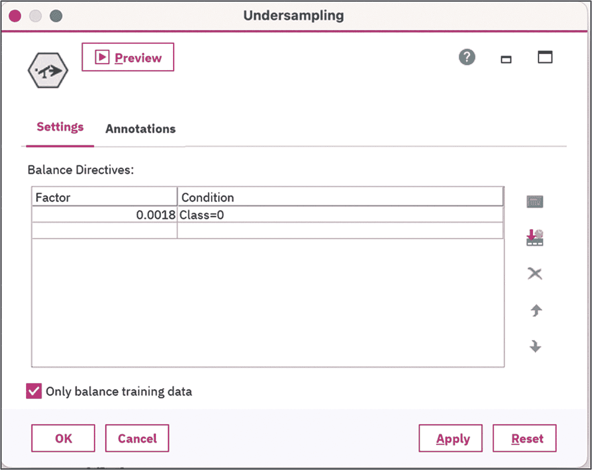
12. 点击**应用**，然后点击**确定**。

您可以使用**数据审计**节点获取完整的统计结果。然而，在此情况下，我使用了**分布图**节点来查看重采样结果（表 3.5）。正如您所见，平衡节点生成了一个平衡的数据集，其中欺诈案例占 50.62%，非欺诈案例占 49.38%，非常接近理想的 50% 响应率，表明数据集已平衡。记录总数现在为 972 条。该节点的输出是新平衡的数据集，可用于训练模型。然而，重要的是要注意，数据集现在小得多，这可能导致信息丢失。此示例演示了如何在 SPSS Modeler 中使用欠采样平衡数据。

**表 3.5** 欠采样结果 返回正文.⏎

| 数据 | 字段 | 格式化值 | 频数 | 百分比 |
| --- | --- | --- | --- | --- |
| 样本 | Class | True (1) | 492 | 50.62 |
| Class | False (0) | 480 | 49.38 |

### 过采样策略

在过采样中，目标是增加少数类的规模以匹配多数类的规模。因子计算如下：

$$Factor = \frac{Majority~Class~Size}{Minority~Class~Size} = \frac{False}{True} = \frac{284315}{492} = 577.88$$

因此，我们使用 580 的因子来平衡数据集。

遵循与欠采样方法相同的步骤（1-8）。然后，继续执行以下步骤：

9.  从节点面板的**记录**组，向流程添加第二个**平衡**节点并将其连接到类型节点。将其重命名为**过采样**。
10. 双击**过采样**节点以打开其设置窗口。
11. 在**设置**选项卡下，设置**条件**：**Class=1; Factor=580**（此设置将正例数量增加至与负例数量匹配，从而平衡数据）。
     
     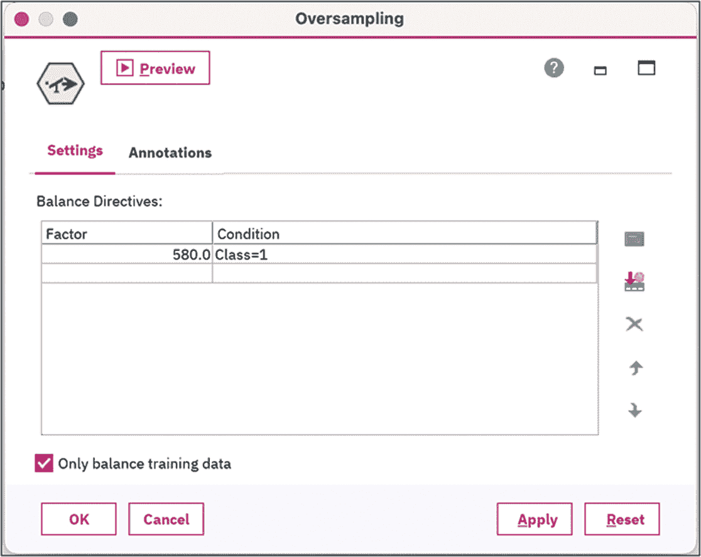
12. 点击**应用**，然后点击**确定**。

表 3.6 显示了重采样结果。正如您所见，我们现在拥有一个平衡的数据集，欺诈案例占 50.09%，非欺诈案例占 49.91%。记录总数现在为 569,675 条，明显大于原始样本量。该节点的输出是新的平衡数据集，可用于训练模型。然而，由于添加了许多重复的正例，数据可能容易过拟合。此外，数据集规模的增加可能在建模步骤中需要更多时间和计算资源。

**表 3.6** 过采样结果 返回正文.⏎

| 数据 | 字段 | 格式化值 | 频数 | 百分比 |
| --- | --- | --- | --- | --- |
| 样本 | Class | True (1) | 285,360 | 50.09 |
| Class | False (0) | 284,315 | 49.91 |

### SMOTE

如前所述，SMOTE 是一种更高级的重采样技术，它使用 k-近邻方法选择特征空间中接近的案例。通过用合成样本增强少数类，SMOTE 可以增强模型的泛化能力并降低在多数类上过拟合的风险。

遵循与欠采样方法相同的步骤（1-8）。然后，继续执行以下步骤。

9.  从节点面板的**记录**组，向流程添加一个 **SMOTE** 节点并将其连接到类型节点。将其重命名为**过采样**。
10. 打开此节点的设置窗口。
11. 在**设置**选项卡下，目标字段选择 **Class**，将**过采样比率**设为**自动**，**算法类型**选择**常规**，并将**K 邻居**设为 **5**（用于**采样规则**）。
     
     
12. 点击**应用**，然后点击**确定**。

表 3.7 显示了 SMOTE 结果，表明数据集已平衡，欺诈案例和非欺诈案例各占 50%。记录总数现在为 568,630 条。虽然我们最终仍获得了一个大得多的数据集，但与简单的过采样技术相比，数据具有更好的泛化性。因此，模型不太容易过拟合。

**表 3.7** SMOTE 结果 返回正文.⏎

| 数据 | 字段 | 格式化值 | 频数 | 百分比 |
| --- | --- | --- | --- | --- |
| 样本 | Class | True (1) | 284,315 | 50 |
| Class | False (0) | 284,315 | 50 |

### 数据分区


### 数据分区

在数据挖掘中，评估模型泛化质量的一种常用策略是对数据源进行分区。如前所述，当模型经过过度训练以达到高准确率时，数据挖掘中可能会发生过拟合。这种模型在面对新数据集时可能表现不佳，从而引发对其泛化能力的担忧。换句话说，模型在训练样本上表现良好，但应用于不同数据集时很可能会失效。

为避免此问题，我们将数据划分为多个数据集。**训练样本**用于初步模型拟合。剩余数据保留用于经验验证，通常分为两部分：**测试样本**和**验证样本**。测试样本用于评估模型并防止过拟合。通过比较训练样本和测试样本之间的结果，我们可以判断模型是否具有泛化能力。最后，验证样本用于对模型进行最终评估。


**表 3.8** SPSS Modeler 与 SAS Enterprise Miner 样本名称差异 返回正文.⏎

| 软件 | 第一分区样本 | 第二分区样本 | 第三分区样本 |
| --- | --- | --- | --- |
| SPSS Modeler | Train | Test | Validation |
| SAS Enterprise Miner | Train | Validation | Test |

**图 3.6** 说明了数据分区的工作原理。为什么数据挖掘需要三个子样本？


**图 3.6** 数据分区. 返回正文.⏎

首先，使用**训练样本**来训练模型并识别出一个拟合度良好的模型。接下来，我们将该模型应用于**测试样本**以评估和验证其性能。如果模型验证不成功，我们将重新配置模型、重新训练并测试新版本。此过程是迭代的，可能需要多次试错，直到找到一个验证良好的模型。最后，我们使用**验证样本**来确认该最终模型的泛化能力。

### 分区比例

数据分区中一个常见的问题是关于分区比例——应将多少数据分配给训练样本，多少分配给验证和测试样本？例如，60–40 的分区比例通常意味着 60% 的数据进入训练样本，而剩余的 40% 在验证样本和测试样本之间分配。在这种情况下，这 40% 通常均分，即 20% 的数据用于测试，另外 20% 用于最终验证。

分区比例没有标准规则。文献建议了各种比例，范围从 50–50、60–40、70–30、80–20 甚至 90–10。为确定合适的分区比例，必须考虑数据集的大小。经验法则是这三个样本必须反映与原始数据集相似的数据趋势。否则，可能会发生抽样偏差，导致数据集有偏，最终导致预测模型无效。确保每个样本都有足够的数据点用于建模也至关重要。通常，更多数据分配给训练样本以获得良好的模型拟合，但验证样本和测试样本也应有足够的数据点来充分评估和验证模型。因此，数据规模是一个关键因素。

例如，如果原始数据集包含 100,000 个数据点，可使用 60–40 的分区比例，得到 60,000 条记录用于训练，20,000 条用于测试，20,000 条用于最终验证。为清晰起见，此分区也可称为 60–20–20。如果数据集有超过 100 万个数据点，80–20（或 80–10–10）的分区比例可能更合适，提供 800,000 条记录用于训练，100,000 条用于测试，100,000 条用于最终验证。相反，如果样本量较小，少于 1,000 个数据点，应使用 60–40 的分区比例且不设验证样本。这能确保测试样本包含足够数据以有效评估模型。

**表 3.9** 提供了我针对不同数据规模的推荐分区比例。请注意，这些是通用建议，根据所用的具体机器学习方法，可能需要调整分区比例。

**表 3.9** 基于样本量的推荐分区比例 返回正文.⏎

| 样本量 | 推荐分区比例 |
| --- | --- |
| 少于 1,000 个数据点 | 60–40 无测试样本（训练：60%；验证：40%） |
| 1,000–100 万个数据点 | 60–20–20（训练：60%；测试：20%；验证：20%） |
| 100 万–1,000 万个数据点 | 80–10–10（训练：80%；测试：10%；验证：10%） |
| 超过 1,000 万个数据点 | 90–5–5（训练：90%；测试：5%；验证：5%） |

### 示例：数据分区


本节演示如何在 SPSS Modeler 中使用航空公司推荐数据集进行数据分区。软件将三个子样本的默认值设为 50–50–0。由于我们有超过 100,000 个数据点，我们将使用 60–40 的分区比例将数据集分为三个子样本。具体而言，60% 的数据用于训练，20% 用于测试，20% 用于最终验证。

*   **数据集：** `AirlineRecommendation.sav`
*   **目标变量：** `Recommend`（标记：是/否）

请按以下步骤对数据进行分区。

1.  打开流 `Airline_Sample`。
2.  我们应已创建数据节点和类型节点。
3.  从节点面板的字段操作组中，添加一个**分区**节点到流中，并将其连接到**类型**节点。

    

4.  打开该节点的设置窗口。
5.  在“设置”选项卡下，针对**分区**选择**训练、测试和验证**。
6.  将**训练分区大小**设为 **60**，**测试分区大小**设为 **20**，**验证分区大小**设为 **20**。

    

7.  点击**应用**，然后点击**确定**。

SPSS Modeler 将根据我们预定义的大小和分区比例对数据进行分区。结果呈现在**表 3.10** 中。可以看到，软件已成功将原始数据分为三个子样本：训练、测试和验证。每个子样本的百分比非常接近预期的分区比例。

**表 3.10** 数据分区结果—按样本划分的观测数 返回正文.⏎

| 类型 | 观测数 | 百分比 |
| --- | --- | --- |
| 训练样本 | 74,747 | 60.6 |
| 测试样本 | 24,862 | 19.98 |
| 验证样本 | 24,855 | 19.97 |

向分区节点添加一个类型节点，你会注意到数据集中新增了一个名为 `Partition` 的名义字段。该名义字段使我们能够使用训练样本训练模型，然后用测试样本对其进行测试。


需牢记的一个重要事项是，分区过程是在保留原始数据集所有特征的前提下随机进行的。**图 3.7** 和 **3.8** 展示了 `recommendation` 和 `airline status` 的分区结果。可以看到，`recommendation` 的不平衡比例在所有三个子样本中均保持在 52.5%，与原始数据集一致。同样，`airline status` 四个层级的比例在各子样本中保持一致，与原始数据集相仿。这表明我们的分区样本具有代表性。换句话说，使用这些子样本训练和测试模型是安全的。


图 3.7 `recommendation` 字段的 Patrion 结果。返回正文。⏎


图 3.8 `airline status` 字段的 Patrion 结果。返回正文。⏎

## 章节总结

90. 在本章中，我们介绍了采样步骤，这在数据挖掘中至关重要，因为适当的采样能为我们提供用于分析的高质量数据集。通过选择正确的采样方法，我们可以获得具有代表性的数据集，从而开发出稳健的预测模型。一个具有强预测能力的模型应该在所有数据集上都表现良好，而不仅仅是在训练样本上。

我提供了关于样本量和不平衡比率的建议，以确保数据的充分性。使用平衡数据集也至关重要，因为不平衡数据集可能导致过拟合，从而产生无效且不可用的预测模型。为了解决数据不平衡问题，可以采用多种策略，包括使用多种模型拟合标准、数据分区、重采样和 CSL（代价敏感学习）。

重采样是用于平衡不平衡数据集的常用技术。我们探讨了三种不同的重采样方法：欠采样、过采样和 SMOTE。此外，数据分区是将数据集划分为子样本的重要步骤。通常，训练样本用于训练模型，测试样本用于评估模型，验证样本用于确认最终模型的泛化能力。

我还根据不同的样本量提供了划分比例的建议。本章包含了如何使用 SPSS Modeler 进行数据采样、重采样和数据分区的演示。

## 章节讨论题

91.

1. 采样的目的是什么？为什么它在数据挖掘中很重要？

2. 描述总体、抽样框和样本之间的区别。它们有何关联？请提供总体、抽样框和样本的现实生活示例。

3. 什么是抽样偏差？请提供一些抽样偏差的例子。

4. 比较概率抽样和非概率抽样。哪些方法在最小化抽样偏差方面更有效？

5. 提供一个您业务中数据挖掘项目的示例。为该项目选择合适的抽样方法并论证您的决定。

6. 计算所需样本量的方法有哪些？使用 Daniel Soper 的样本量计算器和 `G*Power` 为您的项目计算一个样本量。

7. 什么是过拟合？它如何影响预测模型的有效性？

8. 描述不平衡数据集的主要担忧。解决不平衡数据集的主要策略有哪些？

9. 过采样和欠采样有什么区别？请提供具体例子。

10. 描述 SMOTE 技术。这种重采样技术的优缺点是什么？

11. 数据分区的目的是什么？我们如何确定数据分区中合适的划分比例？

## 章节练习

### 练习 1：波士顿房价数据集的数据分区

1. 将 `Boston` 数据集上传到您的计算机。

2. 在 SPSS Modeler 中打开数据集。

3. 创建一个名为 `Partition` 的新流程，并将数据源添加到工作区。添加一个类型节点并将其连接到数据源。

4. 向流程中添加一个分区节点并将其连接到类型节点。

5. 使用 60-40 的划分比例对数据进行分区：训练样本：60%；测试样本：40%；验证样本：0%。

6. 运行分区节点并报告结果。

**注意**：我们将在后续章节中继续使用 `Boston` 数据集。假设数据分区已完成。如果您需要重新进行数据分区，请参考此练习。

### 练习 2：尝试购买数据集的数据采样

1. 将 `try_buy` 数据集上传到您的计算机。

2. 在 SPSS Modeler 中打开数据集。将 `BuyReturn` 的角色更改为目标，将层级更改为标记（二元）。

3. 创建一个名为 `Sample` 的新流程，并将数据源添加到工作区。添加一个类型节点并将其连接到数据源。

4. 向流程中添加一个采样节点并将其连接到类型节点。

5. 使用两种不同的采样方法对完整数据集进行 80% 的采样：

    1. 系统抽样

    2. 分层抽样

6. 运行采样节点并报告结果。

### 练习 3：尝试购买数据集的数据重采样

92.

1. 将 `try_buy` 数据集上传到您的计算机

2. 在 SPSS Modeler 中打开数据集。

3. 打开练习 2 中创建的名为 `Sampling` 的流程图。运行采样节点并报告目标变量 `BuyReturn` 的不平衡比率。数据集是否不平衡？为什么？

4. 使用以下三种技术执行重采样以平衡数据。

    * 欠采样：使用平衡节点并计算所需因子。

    * 过采样：使用平衡节点并计算所需因子。

    * SMOTE：使用 SMOTE 节点并将 k-近邻设置为 5。

5. 报告每种重采样技术的结果。

6. 评估新样本：新样本中的数据是否平衡？新样本量是多少？新数据有哪些潜在问题？

### 练习 4：乘客数据集的数据采样与分区

1. 将 `Passengers` 数据集上传到您的计算机。

2. 在 SPSS Modeler 中打开数据集。将 `return` 的角色更改为目标，将层级更改为标记（二元）。

3. 创建一个名为 `Sample` 的新流程，并将数据源添加到工作区。添加一个类型节点并将其连接到数据源。

4. 添加一个采样节点并将其连接到类型节点。

5. 使用随机方法对完整数据集进行 20% 的采样。

6. 运行采样节点并报告结果。

7. 添加一个分区节点并将其连接到采样节点。

8. 使用 60-40 的划分比例对数据进行分区：训练样本：60%；测试样本：20%；验证样本：20%。

9. 运行数据分区节点并报告结果。

**注意：** 我们将在后续章节中继续使用 `Passenger` 数据集。假设采样和数据分区已完成。如果您需要重新进行采样和数据分区，请参考此练习。

93.

# 4 数据可视化与探索

DOI：[10.1201/9781003468196-5](https://doi.org/10.1201/9781003468196-5)

## 学习成果

完成本章后，您将能够：

1. 解释数据探索在数据挖掘过程中的重要性。

2. 描述数据集的主要组成部分。

3. 讨论可视化在数据探索中的优势。

4. 为分类变量和区间变量选择合适的图表类型。

5. 使用 SPSS Modeler 中的图形工具创建各种图表。

6. 比较条形图和直方图。

7. 解释折线图、饼图、箱线图和散点图的应用。

8. 将多图与其他图形工具进行比较。

9. 为数据挖掘目的解读图表结果。

10. 创建数据的描述性统计。

11. 为数据挖掘目的解读描述性统计。

## 简介


### 数据探索

数据探索是数据挖掘中的关键步骤，因为它能提供对数据的全面理解，重点关注参数、特征、趋势和潜在问题。这种理解使我们能够采取适当的行动，根据需要清洗、准备和转换数据。它还指导我们选择合适的机器学习方法和分析配置，以开发稳健的预测模型。在此步骤中，我们使用可视化和描述性统计来探索和理解数据、变量以及任何潜在问题，例如缺失值或异常值。可视化是数据探索的有力工具，有许多可视化技术可用。我将通过示例演示这些工具。

### 数据理解

在进行任何数据分析之前，了解数据、其参数及其质量至关重要。输入的质量直接影响输出的质量——因此有句谚语：“垃圾进，垃圾出。”此步骤对任何类型的数据分析都至关重要，但对于数据挖掘尤为重要，因为在数据挖掘中，我们经常处理大型、嘈杂的数据集。面对包含许多变量和记录的数据集，由于数据量巨大，要获得全面的理解可能具有挑战性。如果缺乏透彻的理解，我们在建模时就有使用无效或不相关变量作为预测变量的风险，或者可能忽略重要变量。此外，如果不了解数据的特征和局限性，也很难选择合适的机器学习方法。数据集中过多的缺失值或异常值也可能导致模型拟合不佳。

为了应对这些挑战，必须彻底探索数据，重点关注可用信息的类型、存在的变量、这些变量的测量尺度以及任何新出现的趋势。正如第 2 章所述，机器学习方法的选择取决于数据、目标变量的尺度以及项目的目的。

数据探索是数据挖掘中最关键的步骤之一，因为它使我们能够评估数据的结构并识别潜在问题。基于这种理解，我们可以确定数据修改和转换所需的策略。一个好的预测模型需要高质量的输入——模型的优劣取决于构建它的数据。例如，假设你是一名机场高管，负责预测在特定日子或时间段，你机场的航班延误或取消的可能性。如果你的预测模型基于劣质输入（如缺失值或过多噪声），不准确地预测出低延误可能性（假阴性），你可能会决定不采取任何预防措施。结果，由于意外的航班取消，你可能会面临机场的严重混乱——如果有更好的数据和更准确的预测，本可以缓解这种结果。虽然其他因素也可能导致预测不佳，但数据质量差往往是主要原因。请记住，“垃圾进，垃圾出。”表 4.1 强调了数据探索在数据挖掘中至关重要的一些关键原因。

### 表 4.1：数据探索在数据挖掘项目中的重要性

| 项目 | 数据探索的重要性 |
| :--- | :--- |
| 理解数据特征 | 数据探索对于深入了解数据集的特征至关重要。它使我们能够了解数据的分布、范围、变异性和潜在质量问题。通过探索数据，我们可以识别可能影响分析质量和有效性的异常值、缺失值、数据不一致性或其他异常情况。 |
| 变量选择 | 了解数据有助于我们确定数据挖掘任务的相关变量。通过分析变量间的关系、它们的分布及其对目标变量的潜在影响，我们可以就是否在建模过程中纳入或排除某些变量做出明智的决策。 |
| 数据预处理与清洗 | 数据探索对于识别和解决数据质量问题也至关重要。它使我们能够检测并处理缺失值、异常值、重复值或不一致的数据。基于探索阶段获得的洞察，我们可以执行数据处理任务，如插补、异常值检测或数据转换。有效的数据清洗和准备能带来更好的模型性能和更可靠的结果。 |
| 识别模式与关系 | 探索数据使我们能够识别变量之间潜在的模式、趋势或关系。通过可视化数据、应用统计度量或进行探索性数据分析，我们可以发现有意义的洞察并理解数据的潜在结构。这些洞察指导合适机器学习方法的选择，并有助于提高模型的预测能力。 |
| 需求与局限性 | 数据探索帮助我们识别特定机器学习算法所需假设的任何违规情况。这种认知使我们能够就某些技术的适用性做出明智决策，并避免建模过程中的潜在陷阱或偏差。 |
| 新发现 | 数据探索可以激发新发现的产生。通过观察数据中的模式或趋势，我们可能会发现值得进一步研究的新关系。这些初步洞察可以指导后续的建模和分析，从而带来新的发现和研究方向。 |

探索数据主要有两种方式：可视化和统计探索。可视化让我们通过各种类型的图表观察数据趋势和模式，从而轻松提取有用信息。这种方法用户友好，可纳入商业智能仪表板供管理者或高管使用。模式和趋势可通过可视化快速识别。市场上有许多可视化工具，如 `Tableau`、`Power BI` 和 `SAS Viya`。这些应用程序支持添加和自定义图表以满足特定需求。对于大数据，这些工具可以实时处理和显示数据，允许用户随时间监控感兴趣变量的模式。这些动态可视化工具提供最新信息。

在本书中，我主要关注用于分析目的探索数据的图表。这些图表是确定性的，意味着它们不允许交互或实时调整。因此，必须为不同的变量和分析目的创建单独的图表。尽管如此，它们提供了有助于我们理解、处理和开发良好预测模型的基本信息。在此背景下，数据可视化被视为数据挖掘过程中的一个步骤。更广泛的数据可视化工具可在另一本书中讨论。


仅靠可视化可能不足以满足数据挖掘的目的。统计探索提供有价值的定量信息，如变量的描述性统计，帮助我们了解数据的特征。此外，统计探索还提供目标变量与预测变量之间相关性的初步洞察。通过将可视化与统计探索相结合，我们可以发挥两种方法的优势。在本书中，我将演示如何使用这两种方法有效地探索和理解数据。

### 数据描述


### 案例研究——航空公司推荐

在数据探索过程中，有一点至关重要：必须在创建图表和图形之前，先了解变量及其属性。这种理解必不可少，因为它有助于我们确定要使用的适当图表类型以及如何解读输出结果。因此，在运行任何可视化之前，首先收集关于数据集的基本信息是必不可少的，包括变量的数量、其描述及其测量尺度。这些信息将指导我们选择最合适的图表来理解数据。

在本章中，我将以航空公司推荐数据集为例，演示如何使用 SPSS Modeler 进行各种类型的可视化。首先，让我们来考察该数据集的参数和特征。


在本案例研究中，针对美国多家航空公司的乘客进行了一项大规模调查，这些乘客乘坐某特定航空公司从始发地飞往目的地。他们被要求完成一份关于其飞行体验以及是否会向他人推荐该航空公司的调查。调查收集了人口统计信息及其飞行体验的详细信息，包括始发州和目的地州、既往航班数量、出行目的、机场消费金额以及价格敏感度。随后，乘客调查数据与航空公司状态和航班变量进行了整合，如飞行距离、飞行时间、出发和到达延误以及航班取消情况。

该项目的目标是预测目标变量：乘客的航空公司推荐意向。我们旨在确定哪个模型能最好地预测该目标变量，以及哪些变量是显著预测因子。这些预测将有助于航空公司高管制定策略以改善运营和服务，从而吸引更多乘客。

考虑到数据集中变量众多，首先考察这些变量、其角色及其尺度至关重要。表 4.2 描述了该数据集中的变量名、描述和尺度。


**表 4.2 数据描述** 返回正文。⏎

| 变量名 | 标签/描述 | 尺度 | 角色 |
| --- | --- | --- | --- |
| `recommend` | 推荐该航空公司 | 标志 (二元)(是/否) | 目标 |
| `airline_st` | 航空公司状态 | 名义 | 输入 |
| `age` | 年龄 | 连续 | 输入 |
| `gender` | 性别 | 标志 (二元)(男/女) | 输入 |
| `price_sensitivity` | 价格敏感度 | 连续 | 输入 |
| `no_years_flying` | 飞行年数 | 连续 | 输入 |
| `no_flt_pa` | 年均航班数 | 连续 | 输入 |
| `pct_flt_other_airline` | 其他航空公司航班占比 | 连续 | 输入 |
| `type_of_travel` | 出行目的 | 名义 | 输入 |
| `no_other_lty_cards` | 其他忠诚卡数量 | 连续 | 输入 |
| `shopping_amt_airpt` | 机场购物金额 | 连续 | 输入 |
| `eat_drink_airpt` | 机场餐饮消费 | 连续 | 输入 |
| `Class` | 乘客舱位等级 | 名义 | 输入 |
| `origin_state` | 始发州 | 名义 | 输入 |
| `destin_state` | 目的地州 | 名义 | 输入 |
| `depart_delay_in_minutes` | 出发延误(分钟) | 连续 | 输入 |
| `arrival_delay_in_minutes` | 到达延误(分钟) | 连续 | 输入 |
| `flt_cancel` | 航班取消 | 标志 (二元)(是/否) | 输入 |
| `flt_time` | 飞行时间(分钟) | 连续 | 输入 |
| `flt_distance` | 飞行距离(英里) | 连续 | 输入 |

*   **变量名**：由于变量名用于实际分析和结果中，它们应当既清晰又简洁。变量名应具有足够的描述性，以便于识别变量，同时又要足够简短，以防止在输出中被截断。许多软件应用程序对变量名的长度有限制。我强烈建议避免在变量名中使用空格或特殊字符（例如 `@#$%^&*`）。某些软件程序（如 SAS Enterprise Miner 和 RapidMiner）不允许使用空格或特殊字符，如果检测到这些问题，将生成错误消息。编程语言（如 R 或 Python）也有相同的要求。虽然某些软件（如 SPSS Modeler）对变量名可能更加灵活，但如果不遵循命名约定，与 Python 等平台集成模型仍可能导致错误。因此，最好遵循正确的命名实践。要分隔变量名中的单词，请使用下划线 (`_`) 代替空格。

*   **变量标签/描述**：变量的详细信息可在其描述中提供，在某些应用程序中通常称为“标签”。描述或标签为用户提供了关于变量的更详细解释。如表 4.2 所示，标签清晰地描述了每个变量，并包含了测量单位，如年、分钟或英里。当变量名较短或使用首字母缩略词时，标签特别有用，因为它们提供了清晰度和上下文。虽然对变量描述没有严格的长度限制，但建议保持其清晰简洁，以避免混淆或误解。

    在具有用户界面 (UI) 的软件应用程序（如 SAS Enterprise Miner、SPSS Modeler 或 RapidMiner）中，标签通常可以与变量名一起显示。此功能允许用户在变量名本身不够具描述性时，参考标签以全面理解变量。此外，标签可用于输出报告中以替代变量名。然而，过长的标签在报告中可能会带来挑战，例如放大输出表格，使其难以容纳在报告中。它们在展示图表时也可能造成困难。因此，选择标签时必须谨慎。

*   **测量尺度**：测量尺度对分析至关重要，特别是在建模步骤中选择合适的机器学习算法时。正如第 2 章所讨论的，变量可以具有不同的尺度，包括名义、标志 (或二元)、有序或连续。在表 4.2 中，该数据集包含一个标志 (二元) 目标变量、两个标志 (二元) 预测变量、五个名义预测变量和 11 个连续预测变量。请注意，`price_sensitivity` 变量使用李克特量表，我们假设各等级之间的间隔相等。因此，它被视为连续变量（有关李克特量表的更详细讨论，请参见第 2 章）。

*   **角色**：变量的角色是另一项关键信息。变量通常有两个主要角色：**目标** 或 **输入**。目标变量是我们打算预测的变量，而输入变量（也称为预测变量）用于进行预测。在我们的示例中，`recommendation` 是具有标志 (二元) 尺度的目标变量，而其他变量作为预测变量。此外，还有其他角色，如 **记录 ID** (记录标识符)、**分区** (用于划分数据)、**拆分** (为字段的每个可能值构建一个模型)、**频率** (频率加权因子) 和 **无** (忽略该变量)。目前，我们将主要关注目标和输入角色。分区角色将在后续的建模过程中使用。

#### 向 SPSS Modeler 添加数据


在本书中，我们将使用**统计文件**节点将数据文件（`.sav`）添加到流中。我假设您熟悉 SPSS Statistics，并有使用 `.sav` 文件的经验。**统计文件**节点允许我们从本地计算机硬盘读取 `.sav` 文件。本书使用的所有数据文件均以 `.sav` 格式提供。

请按照以下步骤将 **AirlineRecommendation.sav** 文件添加到流中：

1.  打开 SPSS Modeler。
2.  打开之前创建的“Airline_Explore”流。
3.  在节点面板的**来源**组中，双击**统计文件**节点以将其添加到流中。
4.  双击**统计文件**节点以打开其设置窗口。
5.  单击省略号按钮（三点按钮），并从您的计算机中选择 **AirlineRecommendation.sav** 文件。

    

6.  单击**预览**以查看数据的前十行。

    

7.  单击**应用**和**确定**。
8.  从**字段操作**组中，添加一个**类型**节点到流中，并将其连接到数据节点。该节点允许我们查看和修改字段的测量级别和角色。
9.  双击**类型**节点以打开其设置窗口。
10. 如下所示查看所有字段的测量级别。对于 **recommendation**，将角色更改为**目标**。

     

11. 单击**应用**和**确定**。

## 数据可视化


随着每天收集的海量数据，可视化已成为一种强大的工具，无需深入原始数据或仅依赖描述性统计，即可回顾数据趋势和模式。数据可视化简化了这一过程，即使缺乏数据分析或统计背景的用户也能轻松理解数据。在许多行业中，组织开发商业智能仪表板，允许用户快速选择关键变量或关键绩效指标 (KPI)，并生成代表数据趋势或模式的图表。操作人员使用这些工具监控日常运营，而决策者则利用可视化制定战略和做出商业决策。然而，了解要寻找什么（KPI 或指标）以及如何解读结果至关重要。

Tableau、Spotfire、SAS Visual Analytics 和 Microsoft Power BI 等可视分析应用程序为用户提供了许多功能。无论使用何种工具，通常都会使用几种常见的图表类型进行可视化。在本书中，我将介绍其中一些常见图表类型，解释如何创建它们，并演示如何解读结果。我将向您展示如何使用 SPSS Modeler 创建图表，尽管您也可以使用其他您熟悉的工具，例如 SPSS Statistics 或 MS Excel。如前所述，在本书中，数据可视化只是数据挖掘过程中的一个步骤。因此，我们将以确定性模式使用这些图表，而不是智能仪表板中常见的完全动态模式。

我将在 SPSS Modeler 中使用多个主要可视化工具：**图表板**、**分布**、**直方图**、**散点图**、**多重散点图**和**时间序列图**。这些工具均列在节点面板的**图表**组下。我最喜欢的可视化节点是**图表板**节点，因为它是最强大且通用的。它允许我们根据变量及其刻度创建不同类型的图表。**图表板**节点可以根据变量的数量及其刻度自动检测合适的图表类型。例如，如果我们选择一个名义变量，该节点将建议使用条形图、绘图等。图 4.1 显示了一个示例，其中我们选择了一个名义变量和一个连续变量，显示了该选择可用的图表选项。此功能有助于我们避免为变量使用不合适的图表类型。


图 4.1 图表板设置示例。返回正文。

### 条形图和直方图


条形图和直方图是数据可视化中最常用的图形工具之一。两者都使用条形（垂直或水平）来展示结果。那么，它们有什么区别？表 4.3 总结了这两种图形工具之间的一些关键区别。条形图适用于分类变量，而直方图用于连续变量。我们将探讨这些图表类型的细节，并讨论何时使用每一种。

表 4.3 条形图和直方图的区别 返回正文。

| 项目 | 条形图 | 直方图 |
| --- | --- | --- |
| 数据类型 | 条形图用于显示分类数据。类别或组显示在 x 轴上，条形的高度或长度代表与每个类别相关的频数或百分比。 | 直方图适用于连续数据。数据被划分为区间或分箱，条形的高度代表落在每个区间内的数据点频数。 |
| X 轴表示 | 在条形图中，x 轴代表离散的类别或组。每个类别通常由一个单独的条形表示。 | 在直方图中，x 轴代表被测量连续变量的值范围或区间。区间是连续且相邻的，形成一个连续的刻度。 |
| 数据呈现 | 条形图能有效地比较不同类别间的数据，展示不同的类别并比较它们的频数。 | 直方图显示连续变量内数值的分布，提供关于数据形状、集中趋势和离散程度的见解。 |
| 条形排列 | 在条形图中，条形之间通常有间隔，以强调类别之间的区别。 | 在直方图中，条形通常相邻放置，没有间隙，因为区间是连续的并形成连续的刻度。 |
| 轴标签 | 条形图在 x 轴上为每个类别使用标签，以指示特定的组或类别。 | 直方图在 x 轴和 y 轴上都使用标签。x 轴标签代表被测量的变量，而 y 轴标签代表每个区间内数据点的频数。 |

#### 条形图


条形图用于分类变量，以展示每个类别或水平的频数或百分比。它们简单易懂，便于解读。百分比对于比较目的特别有效，而频数可以显示每个类别中的案例数量。

如前所述，**图表板**节点是最强大且通用的选项，允许我们轻松创建各种类型的图表。然而，SPSS Modeler 还提供了一个用于创建条形图的专用节点，即**分布**节点。在本例中，我将首先使用**图表板**节点为我们的 AirlineRecommendation 数据集创建条形图。然后，我将演示如何使用**分布**节点实现相同目的。在后续内容中，我将主要使用**图表板**节点创建图表，因为这是一种更高效的方法。这种方法允许我们根据需要选择和自定义图表，尽管它需要一次创建一个图表。不过，有一种更快的方法可以为数据集中的所有变量生成图表，我稍后将演示。


请在 SPSS Modeler 中按照以下步骤添加并设置**图表板**节点。

1.  打开“Airline_Explore”流。我们应该已有之前创建的数据节点和**类型**节点。


## 2. 从节点面板的 **Graphs（图表）** 组中，添加一个 **Graphboard（图表板）** 节点到流中，并将其连接到 **Type（类型）** 节点。


## 3. 打开 **Graphboard（图表板）** 节点的设置窗口。

## 4. 在左侧选择 **Recommendation the airline（推荐航空公司）** 字段，然后在右侧选择 Bar of Counts（计数条形图）图表选项。


## 5. 在 **Appearance（外观）** 选项卡下，选择 **Use all data（使用所有数据）**。

## 6. 点击 **Apply（应用）** 和 **Run（运行）**。

输出将显示与 Figure 4.2 所示相同的条形图。


FIGURE 4.2 **Recommendation（推荐）** 的条形图（Graphboard 节点）。Return to text.⏎

## 103. 查看完整图表数据

将指针悬停在图表上，即可显示每个类别的数据。或者，你可以转到 **Edit（编辑）** 并选择 **Copy Graph Data（复制图表数据）**。这允许你将用于构建图表的原始数据粘贴到文档中，如 Table 4.4 所示。由于此图表没有显示百分比的选项，你可以在 Excel 中执行计算以获得该结果。


TABLE 4.4 **Recommendation（推荐）** 目标变量的图表数据 Return to text.⏎

| Recommend the Airline（推荐航空公司） | Count（计数） | Percentage（百分比） |
| --- | --- | --- |
| Yes（是） | 65,297 | 52.46 |
| No（否） | 59,167 | 47.54 |

我们也可以使用 **Distribution（分布）** 节点创建条形图。该节点专门设计用于构建条形图，因此仅适用于名义变量。

请遵循以下步骤：

## 1. 打开 “Airline_Explore” 流。我们应该已创建好数据节点和 Type（类型）节点。

## 2. 104. 从节点面板的 **Graphs（图表）** 组中，添加 **Distribution（分布）** 节点到流中，并将其连接到 Type（类型）节点。


## 3. 打开 **Distribution（分布）** 节点的设置窗口。

## 4. 对于 **Field（字段）** 选项，选择 **Recommendation the airline（推荐航空公司）** 字段。


## 5. 点击 **Apply（应用）** 和 **Run（运行）**。

**Table（表）** 选项卡上的输出同时显示了 **recommendation（推荐）** 变量两个层级的响应数量和百分比。


## 105. 显示条形图

点击 **Graph（图）** 选项卡。Figure 4.3 显示了以频率呈现的目标变量 **recommendation（推荐）** 的条形图。请注意，在这些图表中使用的是标签而非变量名，因此你看到的是 **Recommend the airline（推荐航空公司）** 而不是 **recommendation（推荐）**。你可以点击图标 () 在标签和变量名之间切换。由于目标变量是二元的，图表显示了这两个层级的频率和百分比。正如我们所见，52.46% 的乘客推荐该航空公司，而 47.54% 不推荐。


FIGURE 4.3 **Recommendation（推荐）** 的条形图（distribution 节点）。Return to text.⏎

## Graph Formatting（图表格式化）

要自定义图表属性，如颜色、格式、标题、坐标轴、数值或图例，可以使用图表编辑模式。此模式允许你调整图表的布局和视觉外观。要进入编辑模式，请从菜单转到 `View（视图）` > `Edit Mode（编辑模式）` 或点击相应的工具栏图标。进入编辑模式后，你可以进行以下修改：

*   编辑和格式化文本。
*   调整框架和图形元素的颜色、透明度和图案。
*   修改边框和线条的颜色。
*   旋转并改变点元素的形状和纵横比。
*   调整条形和点等图形元素的大小。
*   调整边距和内边距以更改项目周围的空间。
*   设置数字格式选项。
*   更改坐标轴和刻度设置。
*   对分类轴上的类别进行排序、排除和折叠。
*   设置面板的方向。
*   对坐标系应用变换。
*   修改统计量、图形元素类型和碰撞修饰符。
*   重新定位图例。
*   应用不同的可视化样式表。

下一节提供了在 SPSS Modeler 中设置可视化叠加和美学的指南。尝试不同的功能和设置以找到最适合你数据可视化的选项非常重要。

## Stacked Bar Charts for Two Variables（双变量堆叠条形图）


## 106. 创建双变量堆叠条形图

如果你想绘制两个分类变量并检查它们的关系，堆叠条形图是一个有效的选择。例如，你可能想分析航空公司推荐如何随乘客的航空公司状态而变化。

要为两个变量创建堆叠条形图：

## 1. 按照上一节相同的步骤添加 **Graphboard（图表板）** 节点。

## 2. 打开该节点的设置窗口并选择 **Recommendation the airline（推荐航空公司）** 字段。

## 3. 在 **Detailed（详细）** 选项卡上，在 Optional Aesthetics（可选美学属性）下的 Color（颜色）选择 **Airline status（航空公司状态）**。


## 4. 在 **Appearance（外观）** 选项卡下，选择 **Use all data（使用所有数据）**。

## 5. 点击 **Apply（应用）** 和 **Run（运行）**。

Figure 4.4 显示了两个变量 **Recommendation（推荐）** 和 **Airline status（航空公司状态）** 的堆叠条形图。这些条形图按航空公司状态的类别显示了目标变量的百分比细分。


FIGURE 4.4 双变量堆叠条形图。Return to text.⏎

从图表中我们可以看出，在推荐该航空公司的乘客中，大多数是 Blue 级（30%），其次是 Silver 级（15%）。然而，不推荐该航空公司的 Blue 级乘客比例显著更大（40%），而不推荐的 Silver 级乘客仅约 5%。换句话说，Blue 级乘客更倾向于不推荐该航空公司，而 Silver 级乘客更倾向于推荐它。

## 3D Bar Charts For Three Variables（三变量 3D 条形图）

当处理两个以上变量时，3D 条形图可以是可视化三个变量间关系的有效选择。例如，如果你想按航空公司状态和性别分析飞行年数，3D 条形图可以提供有价值的见解。


## 107. 创建三变量 3D 条形图

要为三个变量创建 3D 条形图：

## 1. 按照上一节相同的步骤添加 Graphboard 节点。

## 2. 打开该节点的设置窗口。

## 3. 在 **Basic（基本）** 选项卡上，选择三个字段：**Number of years flying（飞行年数）**、**Airline status（航空公司状态）** 和 **Gender（性别）**（按住 Control 键可选择多个字段）。

## 4. 选择 3D 条形图类型。

## 5. 在 **Detailed（详细）** 选项卡上，按如下方式分配字段：**Airline status（航空公司状态）** 为 **X** 字段，**Number of years flying（飞行年数）** 为 **Y** 字段，**Gender（性别）** 为 **Z** 字段。


## 6. 点击 **Apply（应用）** 和 **Run（运行）**。

## 108. 结果分析

Figure 4.5 显示了这三个变量的 3D 条形图。该图表展示了航空公司状态和性别在飞行年数方面的比较。例如，大多数乘客属于 Blue 级，但该类别中的女性乘客飞行年数往往多于男性乘客。在其他航空公司状态下，两性之间的差异微乎其微。在某些情况下，3D 条形图允许跨其他字段的类别比较某个字段。


FIGURE 4.5 三变量 3D 条形图。Return to text.⏎

## Histograms（直方图）


### 连续变量的可视化：直方图与箱线图

对于连续变量，条形图可能不是最佳选择。鉴于连续的刻度，条形图可能会变得非常庞大且嘈杂，数据分散在 x 轴上。事实上，SPSS Modeler 不会为连续变量生成条形图。相反，当变量具有连续刻度时，软件会自动提供直方图或点图选项作为唯一可用的图表类型。

直方图更适合连续变量，因为它们展示了这些变量的频率分布。直方图将数值划分为箱，并计算每个箱的频率。直方图中的每个条形代表该箱的频率。与条形图不同，直方图的条形之间没有间隙，因为变量的刻度是连续的。虽然从技术上讲可以手动定义箱，但这可能是一个耗时的过程。相反，您可以指定所需的箱的数量，软件将自动将数据划分为箱并生成直方图。

例如，让我们为 **Age** 变量创建一个直方图。请在 SPSS Modeler 中执行以下步骤：

1. 打开“Airline_Explore”流。我们应该已经创建了数据节点、类型节点和 Graphboard 节点。
2. 打开 **Graphboard** 节点的设置窗口。
3. 在左侧选择 **Age** 字段，然后在右侧选择 **Histogram with Normal Distribution** 图表选项（此选项生成带有钟形曲线的直方图）。
4. 在 **Appearance** 选项卡上，选择 **Use all data**。
5. 单击 **Apply** 和 **Run**。

上述步骤将创建一个包含大量箱的直方图，箱的数量由软件自动确定（如图 4.6 所示）。该图表显示每个年龄范围的计数，给出年龄分布的概念，接近正态分布。


**图 4.6 Age 的直方图（箱的数量由软件确定）。** 返回文本.⏎

然而，由于箱数较多，直方图可能有点难以解释。假设我们想要一个只有五个箱的 **Age** 直方图，以使图表更易于解释。为此，我们需要使用 **Histogram** 节点。

请执行以下步骤以添加并设置 Histogram 节点：

1. 打开“Airline_Explore”流。我们应该已经创建了数据节点和类型节点。
2. 向流中添加一个 **Histogram** 节点并将其连接到 **Type** 节点。
3. 打开 **Histogram** 节点的设置窗口。
4. 在 **Plot** 选项卡上，选择 **Age** 字段。
5. 在 **Options** 选项卡上，将 **No. of Bins** 设置为 5。
6. 勾选 **Show normal curve** 复选框。

    

7. 单击 **Apply** 和 **Run**。

图 4.7 显示了具有五个箱的 **Age** 直方图。该图表现在更易于解释。它表明大多数乘客年龄在 31 到 49 岁之间，其次是 49-58 岁范围。相比之下，72 到 85 岁之间的老年乘客较少。此外，正态曲线表明数据点相当接近正态分布。


**图 4.7 具有五个箱的 Age 直方图。** 返回文本.⏎

让我们使用直方图探索另一个示例。这次，我们将为 **Departure delay** 创建一个包含十个箱的图表。

1. 打开“Airline_Explore”流。我们应该已经创建了数据节点和类型节点。
2. 向流中添加一个 **Histogram** 节点并将其连接到 **Type** 节点。
3. 打开 **Histogram** 节点的设置窗口。
4. 在 **Plot** 选项卡上，选择 **Departure delay** 字段。
5. 在 **Options** 选项卡上，将 **No. of Bins** 设置为 10。
6. 取消勾选 **Automatix X range** 复选框，并将 **Max** 设置为 500（分钟）。
7. 单击 **Apply** 和 **Run**。

如图 4.8 所示，软件将把数据划分为十个箱。要获取有关范围的更详细信息，您可以提取图表数据。为此，请转到 **Edit** 菜单并选择 **Copy Graph Data**。表 4.5 展示了详细的图表数据，包括每个箱的平均延误分钟数和相应的案例数。由于 SPSS Modeler 不计算图表中的百分比，我使用 Excel 计算了百分比以提供数据概览。如图所示，97% 的案例延误时间少于 100 分钟，其次是 3% 的案例延误时间在 101 到 200 分钟之间。


**图 4.8 具有五个箱的 Departure delay 直方图。** 返回文本.⏎

**表 4.5 具有 5 个箱的 Departure Delay 图表数据** 返回文本.⏎

| Departure Delay (in Minutes) | Range | Count | Percent |
| --- | --- | --- | --- |
| 50 | 0–100 | 118,083 | 97 |
| 150 | 101–200 | 3,247 | 3 |
| 250 | 201–300 | 635 | 1 |
| 350 | 301–400 | 197 | 0 |
| 450 | 401–500 | 59 | 0 |

由于数据极度右偏，让我们通过仅显示三个箱的直方图来更仔细地检查趋势。通过将箱的数量调整为 3，我们生成了图 4.9 所示的直方图。同样，表 4.6 展示了详细的图表数据，包括每个箱的范围和百分比。数据显示，99% 的案例起飞延误时间少于 116 分钟。


**图 4.9 具有三个箱的 Departure delay 直方图。** 返回文本.⏎

**表 4.6 具有 3 个箱的 Departure Delay 图表数据** 返回文本.⏎

| Departure Delay (in Minutes) | Range | Count | Percent |
| --- | --- | --- | --- |
| 83 | 0–166 | 120,751 | 99 |
| 250 | 167–333 | 1,312 | 1 |
| 417 | 334–500 | 158 | 0 |

#### 直方图在数据挖掘中的重要性

直方图是数据挖掘中评估数据分布形状的宝贵工具，特别是在确定它们是遵循正态分布、左偏还是右偏方面。它们还有助于识别潜在的异常值。除了作为可视化工具的作用外，直方图在数据挖掘中具有重要意义，特别是在依赖统计技术的监督学习方法中。以下是关于直方图重要性的一些关键点：

*   **正态分布检查**：线性回归方法假设正态分布以产生良好的模型拟合。正态分布呈现为钟形曲线，表明数据点围绕均值对称分布。这种对称性表明接近均值的数据比远离均值的数据出现得更频繁。
*   **偏度检测**：如果直方图显示数据倾斜——无论是左偏还是右偏——可能需要考虑数据转换工作以使分布正态化。适当的归一化可以提高统计模型的性能。
*   **异常值识别**：直方图还可以帮助识别异常值。大量异常值的存在可能表明数据集中存在噪声，从而可能影响模型的预测能力。通过检查这些异常值的程度，我们可以就是否保留或移除具有极端异常值的案例做出明智的决定。

#### 箱线图


除了直方图之外，另一个用于指示数据偏度和识别潜在异常值的有用图形工具是箱线图，也称为须图。箱线图以图形方式表示数据集的五数概括，包括最小值、下四分位数（Q1）、中位数、上四分位数（Q3）和最大值。此外，箱线图还会突出显示任何被视为异常值的观测值。


让我们创建两个与航空公司会员等级相关的箱线图。第一个将展示按航空公司会员等级划分的年龄分布。要使用 Graphboard 节点创建箱线图，请遵循以下步骤：

1. 打开“Airline_Explore”流。我们应该已经创建了数据节点、Type 节点和 Graphboard 节点。

2. 打开 **Graphboard** 节点的设置窗口。

3. 在 **Basic** 选项卡上，在左侧选择 **Age** 和 **Airline status** 字段（按住 Shift 键可同时选择两者），然后在右侧选择 **Boxplot** 图表选项。

4. 点击 **Apply** 和 **Run**。

如 Figure 4.10 所示，中位数和四分位距（箱体）居中，表明数据呈对称分布。四分位距在四个航空公司会员等级中似乎保持一致。值得注意的是，Silver 乘客类别仅有一个异常值（须线外的数据点）。


FIGURE 4.10 Box plots for **Age** by **Airline status**. Return to text.⏎

如果我们遵循相同的步骤，但选择 **Number of years flying** 和 **Airline status** 字段，将生成另一个箱线图，如 Figure 4.11 所示。该图显示了按航空公司会员等级划分的每年航班数量分布。您可能会观察到中位数和箱体略微偏离中心，提示数据存在不对称性。Blue 乘客的箱体比其他等级略大，表明数据方差存在差异。


FIGURE 4.11 Box plots for **Age** and **Average number of years flying** by **Airline status**. Return to text.⏎

### 饼图


饼图是以百分比形式呈现分类变量数据的有效方式，通过饼图的切片直观地表示每个类别的比例。这种格式易于理解和解读。例如，Figure 4.12 显示了一个饼图，说明了乘客航空公司会员等级的百分比分布。该图表表明，大多数乘客拥有 Blue 等级，其次是 Silver、Gold 和 Platinum 等级。


FIGURE 4.12 Pie chart for **Airline status**. Return to text.⏎

请遵循以下步骤创建饼图：

1. 打开“Airline_Explore”流。我们应该已经创建了数据节点、Type 节点和 Graphboard 节点。

2. 打开 Graphboard 节点的设置窗口。

3. 在左侧选择 **Airline status** 字段，然后在右侧选择 **Pie of Counts** 图表选项。

4. 点击 **Apply** 和 **Run**。

要显示每个航空公司会员等级的百分比，您可以获取图表数据并使用 Excel 计算百分比（参见 Table 4.7）。如表所示，大多数乘客拥有 Blue 等级（67.08%），其次是 Silver（20.86%）、Gold（8.71%）和 Platinum（3.35%）。

TABLE 4.7 Graph Data for Airline Status Return to text.⏎

| Airline Status | Count | Percent |
| --- | --- | --- |
| Blue | 83,490 | 67.08 |
| Silver | 25,967 | 20.86 |
| Gold | 10,837 | 8.71 |
| Platinum | 4,170 | 3.35 |

### 折线图——趋势分析


在分析随时间收集的数据时，折线图是可视化事件或事故趋势的绝佳选择。折线图用线条连接一系列数据点，呈现顺序值，有助于识别趋势。在此图表类型中，x 轴代表值的顺序进展。

例如，Figure 4.13 说明了从 2020 年 1 月 1 日到 2022 年 3 月 1 日国内和国际航班的趋势。观察可知，当 COVID-19 大流行于 2020 年初开始时，两类航班数量均大幅减少。进入 2021 年末，随着疫苗接种工作在全国范围内扩大，旅行需求激增，导致每日航班增加。这种上升趋势持续到 2022 年，上半年记录的航班更多。折线图使我们能够分析随时间变化的数据趋势，监控事件或事故的变化，并检测数据中的噪声。在本例中，两个变量绘制在同一张图表上以供比较。显而易见，国际航班始终低于国内航班，且随时间的波动较小。


FIGURE 4.13 Line chart for domestic and international flights over time. Return to text.⏎

值得注意的是，折线图需要两个变量：一个用于 x 轴，一个用于 y 轴。在本例中，时间表示在 x 轴上，而航班数量（国内和国际）表示在 y 轴上。

由于 **Airline recommendation** 数据集未按日期或年份组织，因此基于可用变量类型，折线图的应用在一定程度上受到限制。不过，我将使用该数据集演示两个折线图示例。

### 散点图


在分析两个变量之间的关系时，散点图是一种高效的图形工具。散点图显示数据点的二维分布，使用标记表示数据，并展示数据点在图表上的分散情况。

例如，考虑出发延误时间和到达延误时间之间的关系。如 Figure 4.16 所示，这两个变量之间存在正相关：当航班出发延误时，往往也会到达延误。散点图显示，对于 500 分钟或更少的延误时间，这种相关性特别强，这由该范围内较高的数据点密度所表明。


FIGURE 4.16 Scatter plot for **Arrival delay** by **Departure delay**. Return to text.⏎

请遵循以下步骤创建该散点图：

1. 打开“Airline_Explore”流。我们应该已经创建了数据节点、Type 节点和 Graphboard 节点。

2. 打开 Graphboard 节点的设置窗口。

3. 在 **Basic** 选项卡上，在左侧选择 **Departure delay** 和 **Arrival delay** 字段（按住 Control 键可同时选择两者），然后在右侧选择 **Line chart** 选项。

4. 在 **Detailed** 选项卡上，将 X 设为 **Departure delay**，将 Y 设为 **Arrival delay**。

5. 点击 **Apply** 和 **Run**。

### Multiplot 节点

Multiplot 节点允许将多个 Y 字段绘制在单个 X 字段上。此功能可让您在单个图表中创建多个绘图，从而更轻松地同时比较不同变量。例如，如果您想在同一张图表中绘制 **Price sensitivity** 和 **Shopping amount at the airport** 随 **Age** 的变化，通常需要使用前面讨论的工具创建两个单独的图表。然而，通过使用 Multiplot 节点，您可以将这些变量组合到单个图表中。


# 按照以下步骤创建 Multiplot 节点：

1.  打开“Airline_Explore”流。我们应该已经创建了数据节点和 Type 节点。

2.  向流中添加一个 `Multiplot` 节点，并将其连接到 `Type` 节点。

3.  打开 `Multiplot` 节点的设置窗口。

4.  在 **Plot（绘图）** 选项卡上，选择 **Age（年龄）** 作为 X 字段，然后选择 **Price sensitivity（价格敏感度）** 和 **Shopping amount at the airport（机场购物金额）** 作为 Y 字段。


1.  选择 **Sample（采样）**（为缩短运行时间，因为该节点使用所有数据运行时将需要更多时间）。

2.  单击 **Apply（应用）** 和 **Run（运行）**。

多图表如 图 4.17 所示。在该图表中，我们可以观察到 **Price sensitivity（价格敏感度）** 信息未清晰呈现，图表似乎更强调 **Shopping amount at the airport（机场购物金额）**。出现此问题的原因是这两个 Y 字段具有不同的刻度，导致图表难以以有意义的方式同时显示这两个字段。


图 4.17 基于 **Age（年龄）** 的 **Price sensitivity（价格敏感度）** 和 **Shopping amount at the airport（机场购物金额）** Multiplot 节点（未归一化）。返回正文.⏎

为解决此问题，我们需要对数据进行归一化，以确保 Y 字段处于同一刻度。在设置窗口中，勾选标记为 **Normalize（归一化）** 的复选框，然后再次运行 `Multiplot` 节点。结果如 图 4.18 所示。正如您所见，Y 字段（**Shopping amount at airport（机场购物金额）** 和 **Price sensitivity（价格敏感度）**）的数据已归一化至相同刻度，范围为 0 到 1。此调整使我们能在同一图表中清晰地查看这两个变量在不同年龄段的模式。


图 4.18 基于 **Age（年龄）** 的 **Price sensitivity（价格敏感度）** 和 **Shopping amount at the airport（机场购物金额）** Multiplot 节点（已归一化）。返回正文.⏎

### 使用 Data Audit 节点进行快速图表探索


您可能会问：如果我们想一次性查看数据集中所有变量的分布，以检查其分布情况和缺失值，该怎么办？SPSS Modeler 提供了一种使用 `Data Audit` 节点同时生成所有这些图表的方法，而无需像之前那样手动逐个创建图表。

`Data Audit` 节点可对数据进行全面审查。这些信息以矩阵形式呈现，易于理解、可排序，且有利于生成详细图表以及一系列数据准备节点。

*   **Audit（审计）** 选项卡呈现汇总统计、直方图和分布图，提供对数据的初步洞察。此外，报告还包含位于字段名称前的存储图标。

*   **Quality（质量）** 选项卡详细列出异常值、极端值和缺失值，并提供解决这些问题的工具。


当您需要快速可视化和评估多个变量的分布，而无需为每个变量创建单独的图表时，此功能特别有用。通过运行 `Data Audit` 节点，您可以高效地查看频率分布，并同时识别数据集中所有变量的潜在问题，如偏度或异常值。

按照以下步骤添加并设置 `Data Audit` 节点。

1.  打开“Airline_Explore”流。我们应该已经创建了数据节点和 `Type` 节点。

2.  从节点面板的 Output（输出）组中，向流中添加 `Data Audit` 节点，并将其连接到 `Type` 节点。

3.  打开 `Data Audit` 节点的设置窗口。

4.  在 **Settings（设置）** 选项卡上，保持 Default（默认）设置，这将在分析中包含所有字段。

5.  勾选 **Advanced statistics（高级统计）** 复选框。

    

6.  在 **Quality（质量）** 选项卡上，确保勾选 **Missing values: Count of records with valid values（缺失值：有效值记录计数）** 和 **Breakdown counts of records with invalid values（无效值记录细分计数）** 这两个复选框。

7.  单击 **Apply（应用）** 和 **Run（运行）**。

这种方法对于同时查看所有变量的分布非常有效。图 4.19 显示了 **Airline recommendation（航空公司推荐）** 数据集的这些多图表结果。您可以看到跨多个窗口的所有变量的直方图和条形图。展开每个窗口以查看该变量的详细图表。请记住，条形图用于分类变量，而直方图用于连续变量。


图 4.19 快速图表探索器的结果。返回正文.⏎

### 使用 Data Audit 节点进行统计探索


数据可视化提供了多种图形工具，帮助我们直观呈现数据趋势和模式。然而，要选择合适的机器学习方法并确定预测建模的正确配置，探索数据的统计特征也至关重要。具体而言，我们需要查看所有变量的描述性统计，以了解其属性、识别潜在问题，并决定在 Modify（修改）步骤中是否需要进行数据转换。需考虑的关键描述性统计包括：

*样本量*

*   **针对分类变量**：每个层级的频数、百分比和缺失值。

*   **针对区间变量**：最小值、最大值、平均值、标准差、偏度、峰度和缺失值。

这些是统计学课程中涵盖的典型描述性统计。提醒一下，偏度和峰度能提供关于数据分布的洞察，以及数据是否遵循正态分布，这正是线性回归方法所要求的假设。

对于统计探索，我们在 SPSS Modeler 中使用 `Data Audit` 节点。这个多功能工具允许我们检查数据集中的变量分布和统计信息。

为进行说明，我们将运行之前创建的同一个 `Data Audit` 节点。在本例中，为了显示基本描述性统计，我在设置窗口中仅选择了“Basic statistics（基本统计）”选项。图 4.20 显示了 **Audit（审计）** 选项卡下 `Data Audit` 节点的输出。它包含所有字段的度量。对于连续变量，输出显示最小值、最大值、平均值、标准差、偏度和有效案例数。对于分类变量，它显示唯一层级数和有效案例数。


图 4.20 来自 Data Audit 节点的所有字段的描述性统计。返回正文.⏎

#### 补充信息：缺失值、异常值和极端值

**Audit（审计）** 选项卡不直接显示无效案例（缺失值）。虽然可以使用 Excel 计算缺失案例，但 **Quality（质量）** 选项卡在“Null values（空值）”列下方便地呈现了缺失值。此信息可被复制并与描述性统计合并。此外，**Quality（质量）** 选项卡还会突出显示每个字段的异常值和极端值的数量。


### 示例：统计探索


我们使用 `Data Audit` 节点探索 **Airline recommendation（航空公司推荐）** 数据集中所有字段的描述性统计。通过结合 **Audit（审计）** 选项卡和 **Quality（质量）** 选项卡的结果，我们获得了所有字段的完整描述性统计，如 表 4.7 所示。


#### 关键发现摘要

##### 目标变量分布
目标变量两个水平的频数和百分比表明数据集相对平衡，其中 52.46% 的数据为“是”（推荐），47.54% 为“否”（不推荐）。

##### 缺失值
分类变量中不存在缺失值。然而，在连续变量中，有三个变量存在缺失值：`Arrival delay time`（到达延误时间）、`Departure delay time`（出发延误时间）和 `Flight time`（飞行时间）。虽然其他连续变量似乎没有缺失值，但仔细观察 `Price sensitivity`（价格敏感度）变量会发现一些异常。该变量的最小值为零，这在预期之外，因为 `Price sensitivity` 是在李克特量表上测量的（通常范围为 1 到 5）。因此，零值表示缺失值，我们需要将该值重新编码为缺失值。处理这些缺失值将在第 5 章中讨论。

##### 分类变量的描述性统计
数据集包含水平数量各异的变量：三个双水平变量、两个三水平变量、一个四水平变量，以及两个具有 52 个水平的变量（代表美国 52 个州）。

##### 连续变量的描述性统计
表 4.8 展示了字段名、最小值、最大值、平均值、中位数、标准差、偏度和峰度等关键统计量。这些是大多数统计软件应用程序生成的标准描述性统计量。值得注意的是，只有少数变量的分布接近正态分布，其偏度和峰度值接近零。这些变量包括 `Age`（年龄）、`Number of flights per year`（年飞行次数）、`Number of loyalty cards`（忠诚卡数量）、`Price sensitivity`（价格敏感度）和 `Number of years flying`（飞行年数）。`Flight distance`（飞行距离）和 `Flight time`（飞行时间）等变量虽然不完全符合正态分布，但较为接近。相反，其他变量表现出较高的偏度和峰度值，表明其分布呈偏态且远离正态分布。根据建模所选的机器学习方法，我们可能需要考虑数据标准化和转换。

### 表 4.8 描述性统计结果 返回正文.⏎

| 字段 | 测量级别 | 最小值 | 最大值 | 平均值 | 标准差 | 偏度 | 峰度 | 唯一值 | 有效值 | 缺失值 |
| --- | --- | --- | --- | --- | --- | --- | --- | --- | --- | --- |
| Recommend the airline | 标志 | – | – | – | – | – | – | 2 | 124,464 | 0 |
| Airline status | 标称 | – | – | – | – | – | – | 4 | 124,464 | 0 |
| Age | 连续 | 18 | 85 | 47.503 | 16.498 | 0.316 | −0.711 | – | 124,464 | 0 |
| Gender | 标志 | – | – | – | – | – | – | 2 | 124,464 | 0 |
| Price sensitivity | 连续 | 0 | 5 | 1.266 | 0.541 | 0.783 | 1.189 | – | 124,464 | 0 |
| Number of years flying | 连续 | 2 | 11 | 6.784 | 2.981 | −0.072 | −1.291 | – | 124,464 | 0 |
| Average number of flights per year | 连续 | 0 | 100 | 20.088 | 14.4 | 0.851 | 0.468 | – | 124,464 | 0 |
| Percent of flights with other airlines | 连续 | 1 | 110 | 9.438 | 8.865 | 2.346 | 7.625 | – | 124,464 | 0 |
| Travel purpose | 标称 | – | – | – | – | – | – | 3 | 124,464 | 0 |
| Number of other loyalty cards | 连续 | 0 | 12 | 0.835 | 1.119 | 1.357 | 1.867 | – | 124,464 | 0 |
| Shopping amount at the airport | 连续 | 0 | 879 | 26.87 | 53.156 | 3.309 | 15.935 | – | 124,464 | 0 |
| Spending for eating and drinking at the airport | 连续 | 0 | 895 | 68.845 | 52.596 | 1.997 | 9.948 | – | 124,464 | 0 |
| Passenger class | 标称 | – | – | – | – | – | – | 3 | 124,464 | 0 |
| Origin state | 标称 | – | – | – | – | – | – | 52 | 124,464 | 0 |
| Destination state | 标称 | – | – | – | – | – | – | 52 | 124,464 | 0 |
| Departure delay (in minutes) | 连续 | 0 | 1,592 | 15.003 | 38.448 | 6.817 | 100.767 | – | 122,263 | 2201 |
| Arrival delay (in minutes) | 连续 | 0 | 1,584 | 15.38 | 38.838 | 6.663 | 95.221 | – | 121,899 | 2565 |
| Flight cancellation | 标志 | – | – | – | – | – | – | 2 | 124,464 | 0 |
| Flight time (in minutes) | 连续 | 8 | 669 | 111.514 | 71.768 | 1.484 | 2.688 | – | 121,899 | 2565 |
| Flight distance (miles) | 连续 | 31 | 4,983 | 793.873 | 592.098 | 1.51 | 2.778 | – | 124,464 | 0 |

## SPSS Modeler 中的隐藏功能——交互式图表工具


在前面的章节中，我们探讨了 SPSS Modeler **节点面板** 中 **图表** 组下可用的各种图表工具。虽然我重点介绍了最常用的工具，但花时间练习所有工具是值得的。您可能会发现有效利用这些工具为您的数据创建有意义的可视化效果的方法。如前所述，这些工具虽然有用，但交互性不强，需要添加新节点来为不同的字段或图表类型创建单独的图表。此外，大多数图表不提供百分比值，因此如果您想显示百分比，则需要将图表数据导出到 Excel 并手动计算这些值。这个过程并不理想，特别是当其他软件（如 SAS Enterprise Miner）允许您在同一个设置窗口中轻松切换频数和百分比时。

但如果我告诉您 SPSS Modeler 实际上有一个隐藏功能，它通过更具交互性的界面简化了数据可视化，并且图表确实可以显示百分比值，您会怎么想？在本节中，我将揭示这个隐藏功能，它未列在菜单栏或**节点面板**中。甚至 SPSS Modeler 指南也没有提供该功能的说明。它集成在一个名为“**查看数据**”的菜单选项中。

**查看数据** 是一个菜单选项，允许您在任何节点查看数据，从而观察采样、分区、转换或建模后数据集的变化。您也可以用它来查看原始数据。然而，大多数用户不知道该菜单选项包含一个图表功能，提供了一种更高效地创建图表的交互式方式。

让我们通过一个示例进行演示。假设您有一个流程，其中 **Airline Recommendation** 数据源连接到一个 **Type** 节点。如果您右键单击 **Type** 节点（也可以右键单击数据源节点），将出现一个下拉菜单。从该菜单中选择 **查看数据**，这将打开一个 **查看数据** 窗口（此功能基于 Java 运行，因此请确保您的 Java 是最新版本）。


该窗口包含多个选项卡，包括 **Charts**（图表）、**Spreadsheet**（电子表格）、**Data Audit**（数据审核）和 **Dashboard**（仪表板）。我将重点介绍 **Charts** 选项卡，因为其他选项卡主要用于查看数据和统计信息，我们已经介绍过这些内容。如图 4.21 所示，**Charts** 选项卡提供 28 种不同类型的图表，包括我们在本章讨论过的图表，如 **Bar**（条形图）、**Histogram**（直方图）、**Pie**（饼图）、**Scatter**（散点图）、**Line**（线图）、**Box Plot**（箱线图）和 **Multi-Series**（多系列图，类似于多重图）。此外，它还提供其他有用的工具，如 **Treemap**（树状图）、**Q-Q Plot**（Q-Q 图）、**Population**（人口图）等。


图 4.21 “查看数据”菜单中的图表选项。返回正文.⏎


### SPSS Modeler 中的交互式图表构建

我不会再次详述所有图表类型，因为我们已经详细介绍了其中几种。重要的是要注意，SPSS Modeler 以一种非常交互的方式提供了这个图形工具。一旦你选择了所需的图表类型，只需在左侧面板中确定该图表类型所需的字段，然后单击 **Apply**（应用）。图表将随即出现在中间面板中。例如，图 4.22 展示了我们为 **Recommend the airline**（推荐航空公司）字段构建饼图是多么容易。饼图为了方便起见显示了百分比值。你可以更改饼图类型并即时看到变化。此外，你可以单击变量的特定类别（如 **Yes**（是））以聚焦于该层级的数据，图表将自动调整。该工具高度交互且动态，非常适合可视化演示。


**图 4.22** 交互式图表构建界面。返回正文。

#### 局限性

然而，这个工具也并非没有缺点：

1.  它在颜色和字体方面提供的自定义选项不多，因此你需要接受默认设置。
2.  只有饼图显示百分比，而其他图表不显示。如果你需要其他图表类型的百分比值，仍然必须在 Excel 中计算它们。
3.  你无法像我们讨论的其他图形工具那样调整坐标轴刻度。
4.  由于该工具运行在 Java 上，处理超大数据集可能需要一些时间，在某些情况下，界面可能会冻结。

尽管存在这些缺点，我仍然认为这个隐藏功能是一个有价值的数据可视化工具。你绝对应该试一试，并确定在何时适合使用此工具为你的数据挖掘项目创建图表。

#### 图表库

为了演示其功能，我收录了几个使用此工具创建的图表，以便你将它们与我们之前制作的图表进行比较。我还在列表中添加了一个树状图，因为与传统的条形图相比，鉴于这些变量拥有大量层级，它被证明是展示 **Original states**（始发州）和 **Destination states**（目的地州）数据的更好图表类型。以下图表列在下方以供参考：


**图 4.23** **Airline status**（航空公司状态）的饼图。返回正文。


**图 4.24** **Passenger class**（乘客等级）和 **Gender**（性别）的堆积条形图。返回正文。


**图 4.25** **Departure delay**（出发延误）和 **Flight time**（飞行时间）的散点图。返回正文。


**图 4.26** **Age**（年龄）的直方图。返回正文。


**图 4.27** **Flight time**（飞行时间）和 **Airline status**（航空公司状态）的箱线图。返回正文。


**图 4.28** **Price sensitivity**（价格敏感度）和 **Shopping amount at airport**（机场购物金额）随 **Age**（年龄）变化的多重图。返回正文。


**图 4.29** 按 **Gender**（性别）和 **Travel purpose**（旅行目的）分组的 **Shopping amount at airport**（机场购物金额）3D 条形图。返回正文。


**图 4.30** **Arrival delay**（到达延误）随 **Departure delay**（出发延误）变化的折线图。返回正文。


**图 4.31** **Original states**（始发州）的树状图。返回正文。

##### 图表摘要

*   **图 4.23**：**Airline status**（航空公司状态）的饼图。
*   **图 4.24**：**Passenger class**（乘客等级）和 **Gender**（性别）的堆积条形图。
*   **图 4.25**：**Departure delay**（出发延误）和 **Flight time**（飞行时间）的散点图。
*   **图 4.26**：**Age**（年龄）的直方图。
*   **图 4.27**：**Flight time**（飞行时间）和 **Airline status**（航空公司状态）的箱线图。
*   **图 4.28**：**Price sensitivity**（价格敏感度）和 **Shopping amount at airport**（机场购物金额）随 **Age**（年龄）变化的多重图。
*   **图 4.29**：按 **Gender**（性别）和 **Travel purpose**（旅行目的）分组的 **Shopping amount at airport**（机场购物金额）3D 条形图。
*   **图 4.30**：**Arrival delay**（到达延误）随 **Departure delay**（出发延误）变化的折线图。
*   **图 4.31**：**Original states**（始发州）的树状图。

## 章节总结

数据探索是数据挖掘过程中的关键步骤，因为它使我们能够在分析前彻底了解数据。这种探索能让我们洞察数据集中的变量、模式和趋势，指导我们在建模阶段决定使用哪些变量和方法。

我们探讨了两种主要的数据探索方法：**可视化** 和 **描述性统计**。可视化是一种广泛用于检查大型数据集的技术，因为它生成的输出易于解读。可以利用各种类型的图表来创建数据的可视化表示，包括条形图、直方图、箱线图、饼图、折线图、密度图、散点图和多重图。

SPSS Modeler 提供了多种可视化工具，允许我们生成不同类型的图表，以适应变量和分析目标。除了可视化之外，检查描述性统计也至关重要，它提供了所有变量的详细统计信息，如频数、缺失值、最小值和最大值、标准差、偏度和峰度。这些统计洞察有助于我们确定数据挖掘过程中的后续步骤，特别是是否需要填补缺失值或转换数据。

## 章节讨论题

1.  什么是数据探索，为什么它在数据挖掘过程中很重要？
2.  区分分类变量和区间变量。
3.  讨论数据可视化的优势。调研并描述为大数据提供可视化工具的主要软件程序。
4.  条形图和直方图的主要区别是什么？何时应该使用直方图？
5.  描述箱线图的用途。提供一些应用示例。
6.  举例说明饼图和折线图如何用于探索数据趋势和模式。
7.  散点图的用途是什么，如何在数据可视化中使用它们？
8.  什么是多重图，在哪些场景下应使用多重图节点？
9.  描述数据审计节点的用途。该节点在数据探索中的主要优势是什么？
10. 这些可视化功能在各行业中的应用有哪些？
11. 描述连续变量的主要描述性统计量。描述性统计如何用于改进数据挖掘？

## 章节练习

### 练习 1：Bank（银行）数据集的图表探索

1.  查看 **Bank**（银行）数据集的变量描述（参阅附录 1）。
2.  在 SPSS Modeler 中打开 **Bank**（银行）数据集。


### 练习 1：银行数据集的图形探索（续）

3.  创建一个名为 `Bank_Explore` 的新流，并将数据源添加到流画布中。添加一个类型节点并将其连接到数据源。

4.  使用适当的图形类型绘制以下字段对。创建图形并解释结果：

    *   **收入 vs. 年龄**
    *   **储蓄余额 vs. 信用卡余额**
    *   **IRA 余额 vs. 年龄**
    *   **信用额度余额 vs. 收入**
    *   **信用卡消费 vs. 抵押贷款**

5.  使用数据审计工具为所有字段创建图表。展示图表并解释结果。

### 练习 2：乘客数据集的图形探索

1.  查看 **乘客** 数据集的变量描述（请参阅附录 2）。

2.  在 SPSS Modeler 中打开 **乘客** 数据集。

3.  创建一个名为 `Passengers_Explore` 的新流，并将数据源添加到流画布中。添加一个类型节点并将其连接到数据源。

4.  为所有连续字段创建直方图。报告并解释这些字段分布的结果。

5.  为所有标志（二元）字段和名义字段创建条形图。报告并解释结果。

6.  使用数据审计工具为所有字段创建图表。展示图表并解释结果。

7.  识别含有缺失值的字段。

### 练习 3：乘客数据集的统计探索

1.  在 SPSS Modeler 中打开 **乘客** 数据集。

2.  打开流 `Passengers_Explore`。

3.  向流中添加一个数据审计节点并将其连接到类型节点。

4.  设置数据审计节点并运行它，以生成所有字段的描述性统计。识别含有缺失值的字段并报告缺失值的数量。

5.  解释描述性统计结果。识别数据中的任何问题或顾虑。（注意：使用李克特量表的字段不应有零值。将这些字段的零值重新编码为缺失值。）

### 练习 4：波士顿数据集的图形探索

1.  查看 **波士顿** 数据集的变量描述（请参阅附录 1）。

2.  在 SPSS Modeler 中打开 **波士顿** 数据集。

3.  创建一个名为 `Boston_Explore` 的新流，并将数据源添加到工作区。添加一个类型节点并将其连接到数据源。

4.  为五个字段创建直方图：**Imv**、**AgePre40**、**CrimePC** 和 **Tax**。解释这些字段分布的结果。

5.  为 **LogDistance** 按 **Imv** 创建散点图。解释结果。然后，为相同字段创建密度图并比较结果。

6.  使用数据审计节点同时为所有字段创建直方图。解释分布情况。

### 练习 5：尝试购买数据集的图形探索

1.  在 SPSS Modeler 中打开 `try_buy` 数据集。

2.  创建一个名为 `TuyBuy_Explore` 的新流，并将数据源添加到工作区。添加一个类型节点并将其连接到数据源。

3.  为 **BuyReturn** 按 **Promotion Type** 创建堆叠条形图，使用 Promotion Type 作为可选美学属性。解释结果。

4.  为 **Promotion Type** 和 **Market Segment** 创建饼图。解释结果。

### 练习 6：心脏病数据集的多重绘图

1.  在 SPSS Modeler 中打开 `cardiac` 数据集。

2.  创建一个名为 `Cardiac_Explore` 的新流，并将数据源添加到工作区。添加一个类型节点并将其连接到数据源。

3.  向工作区添加一个多重绘图节点并将其连接到类型节点。

4.  创建一个多重绘图，以 **Albumin** 和 **Calcium** 作为 Y 字段，**Age** 作为 X 字段。展示并解释结果。

### 练习 7：波士顿数据集的统计探索

1.  在 SPSS Modeler 中打开 **波士顿** 数据集。

2.  打开流 `Boston_Explore`。

3.  向流中添加一个数据审计节点并将其连接到类型节点。

4.  设置并运行数据审计节点，以生成所有字段的描述性统计。识别任何缺失值，并根据偏度和峰度值评估数据的正态性。

5.  使用数据审计节点为所有字段创建直方图。评估分布情况，并将其与步骤 4 中的描述性统计结果进行比较。

# 5 数据修改

DOI：[10.1201/9781003468196-6](https://doi.org/10.1201/9781003468196-6)

## 学习成果

完成本章后，您将能够：

1.  解释数据修改在数据挖掘过程中的重要作用。
2.  提供需要数据修改的场景示例。
3.  解释各种数据修改技术的优缺点。
4.  比较数据修改中的替换、插补和转换技术。
5.  为特定场景选择合适的数据修改技术。
6.  评估各种替换方法及其应用。
7.  使用 SPSS Modeler 执行数据替换。
8.  评估各种插补方法及其应用。
9.  使用 SPSS Modeler 执行数据插补。
10.  评估不同归一化方法及其应用。
11.  评估各种离散化方法及其应用。
12.  使用 SPSS Modeler 执行数据归一化和离散化。

## 简介


在上一章中，我们探讨了如何使用数据可视化来发现数据中的模式和趋势。我们还检查了描述性统计，以深入了解每个变量的特征。这种分析使我们能够评估数据中的信息，识别缺失或错误的信息，检测噪声，并识别任何可能影响建模过程的问题。但如果我们在数据中遇到问题该怎么办？简单的回答是，在进入建模步骤之前，必须解决任何关于数据质量的顾虑。

本章重点关注数据挖掘过程的下一阶段：数据修改。具体而言，我们将讨论数据修改的重要性，并探索准备和调整数据的各种技术。关键主题包括替换、插补和转换。我还将演示如何使用 SPSS Modeler 进行数据修改。请记住，我们的预测模型只能与用于训练它们的数据一样好。通过准备和转换数据，我们可以解决质量问题并开发出有效、准确的预测模型。

## 数据修改的重要性


数据修改，也称为数据预处理，是机器学习中的关键步骤，涉及准备和转换原始数据，使其适合训练我们的预测模型。数据修改的目标是提高数据的质量和相关性，从而使我们能够执行更稳健的模型训练。因此，我们可以获得更准确、更有用的预测模型。

数据修改在数据挖掘中之所以重要，有很多原因。以下是一些关键点。

1.  **数据质量改进**：数据清洗和替换等技术通过识别和纠正错误、不一致性和缺失值，提高了数据集的质量。高质量的数据对于有效且可靠的预测建模至关重要，因为它降低了产生误导性或无效结果的风险。请记住，“垃圾进，垃圾出”。

2.  **噪声降低**：原始数据通常包含噪声或无关信息，这可能会对模型准确性产生负面影响。异常值检测和数据替换等技术能有效降低噪声数据点的影响，从而产生更可靠、更有效的模型。

3.  **处理缺失数据**：由于数据收集过程，缺失数据是现实世界数据集中的常见问题。插补技术通过用估计值填补空白来解决这一问题，确保宝贵信息不丢失，并最大限度地减少结果中的偏差。


## 4. 变量选择与降维

这些技术用于识别分析所需的相关变量。移除无关或冗余的变量可降低数据复杂性，提高计算效率，并通过聚焦于最具信息量的参数来改善模型性能。

## 5. 归一化与标准化

这些技术确保变量处于可比较的尺度上，这对于对数据尺度敏感的算法特别有用。对数据进行归一化和标准化可实现公平比较，防止某些特征主导分析，从而改善特定算法的模型拟合度。

## 6. 处理异构数据

当来自不同来源或格式的数据需要合并进行分析时，数据集成与聚合可协调数据。这种集成为问题提供了更全面的视角，便于分析，并能揭示隐藏在单个数据集中的有价值模式。

## 7. 为特定算法准备数据

不同的机器学习算法对输入数据有特定的要求和假设。数据修改有助于准备数据以满足这些要求。例如，需要分类输入的算法可能要求离散化，而多元回归方法则需要归一化。

总体而言，数据修改在数据挖掘中至关重要，因为它有助于确保预测建模的准确性、可靠性和效率。通过提升数据质量、减少噪声、处理缺失数据、选择相关特征以及为特定算法准备数据，数据修改技术使我们能够构建有效且准确的预测模型。

## 数据修改技术


数据修改有多种可用技术，大体可分为三大类：

*   **数据清洗**：数据清洗是识别并纠正数据中错误的过程。它包括移除重复条目、纠正拼写错误和处理缺失数据等任务。
*   **数据转换**：数据转换是改变数据格式或结构的过程。我们可以使用多种转换实践，包括将分类数据转换为数值数据、归一化数据和聚合数据。
*   **数据缩减**：数据缩减是在不丢失重要信息的前提下减小数据规模。降维、变量选择和抽样等技术常用于数据缩减。

数据修改是数据挖掘的关键部分，涉及一个需要仔细规划和执行的复杂过程。然而，数据修改的益处显著，包括提高数据挖掘结果的准确性、效率和可解释性。执行数据修改时，应牢记以下几个关键考量：

*   **使用多种技术**：没有单一技术适用于所有数据集。重要的是使用多种技术以确保数据得到妥善修改。
*   **避免过拟合**：如果数据修改过程过于激进，可能会发生过拟合，导致数据不再准确代表目标总体。这可能导致不准确的数据挖掘结果。
*   **测试结果**：必须测试数据修改过程的结果，以确保其既准确又有用。交叉验证是为此目的而设的一种有价值的技术。

在本章中，并未涵盖所有数据修改技术。抽样和重抽样技术已在第 3 章中深入讨论。此外，降维方法将在我们探索无监督方法（包括主成分分析和聚类分析）时，于第 12 章和第 13 章中予以阐述。本章重点介绍数据修改中的常用技术，特别是数据清洗和转换。具体而言，我们将介绍三种主要技术：替代、插补和转换。我将解释这些技术之间的差异以及何时使用每一种。这些技术简单直接，在大多数项目中非常有用。我们还将通过具体示例探讨如何使用 SPSS Modeler 实现它们。

### 替代、插补与转换


如前所述，本书涵盖 SPSS Modeler 中可用的三种主要数据修改技术：替代、插补和转换。表 5.1 总结了这些技术的差别及其适用场景。

**表 5.1 替代、插补与转换** 返回正文.⏎

| | 替代 | 插补 | 转换 |
| --- | --- | --- | --- |
| 作用是什么？ | 重新编码、纠正或重新分配数据中分类或连续变量的值。 | 用估计值替换数据集中的缺失值。 | 创建作为数据集中现有变量转换结果的新变量，或创建交互变量。可用于标准化、归一化、转换或聚合数据。 |
| 何时使用？ | 替代应在插补**之前**进行。 | 插补应在转换**之前**进行。 | 转换应在机器学习算法**之前**进行，以确保数据已就绪，可用于模型训练。 |

*   **替代**：替代技术允许我们通过重新编码或纠正数据来清洗数据，以确保分析的准确性。在数据挖掘领域，替代通常被视为数据转换的一部分。然而，在本书中，我们将替代与转换区别对待，以避免混淆，因为替代用于在处理缺失值和转换变量**之前**清洗数据或重新分配值。替代任务应在插补前完成，以确保数据准确，且缺失值的正确信息和编码已就位。
*   **插补**：插补是处理缺失值的常用技术。面对缺失值时，本能的反应可能是将其移除。然而，移除缺失值可能导致重要信息丢失，并可能增加数据偏差。因此，研究人员通常选择用估计值填补缺失值。挑战在于选择合适的插补方法，以确保数据质量并避免引入偏差。插补应在转换前完成，以确保所有数据点可用于转换过程。
*   **转换**：此技术支持改变数据格式或结构，以满足数据分析的要求。可用于转换、归一化或聚合数据。某些机器学习算法（如线性回归）在使用标准化和归一化数据时表现更好。如果变量的分布不正常，转换可将数据转为正态分布。此外，转换可用于将连续变量转换为分类变量，或将两个变量聚合为单一变量以供分析。转换应在使用机器学习算法构建模型**之前**完成，以确保数据已准备就绪，可用于模型训练。


### 数据修改的优缺点


数据修改是数据挖掘过程中的重要步骤，具有诸多益处。然而，应用这些技术时我们也可能面临一些挑战。本节讨论数据修改的主要优缺点。

### 数据修改的优点


### 数据修改的优缺点

#### 优点

1.  **改进数据质量**：数据清洗提升了数据集的质量和可靠性。通过解决错误、不一致性和缺失值，从而获得更准确、更可靠的结果。

2.  **增强模型性能**：降维和数据转换是识别模型训练中最相关、最有信息量变量的有用技术。这些技术允许我们减少无关或冗余特征并创建新的有意义变量，从而提高模型性能，带来更好的预测准确性和泛化能力。

3.  **处理缺失数据**：数据插补确保了有价值的信息在分析过程中不丢失，减少了潜在偏差，提高了数据的代表性。

4.  **高效计算**：降维和数据采样等技术可以显著降低分析的计算复杂度。它们有助于减少变量数量或数据集大小，从而显著缩短机器学习模型的训练时间。

5.  **解决数据不平衡**：数据采样技术（包括过采样和欠采样）有助于解决某一类别显著欠代表的数据不平衡问题。通过重新平衡类别分布，可以提高模型在少数类上的性能，从而获得更准确的预测。

#### 缺点

1.  **信息丢失**：更改数据可能导致信息丢失，因为移除某些变量或降低数据维度可能会丢弃对分析有用的宝贵信息。

2.  **过拟合风险**：过采样可能引入合成或重复实例，从而导致过拟合。过拟合是指模型在训练数据上表现良好，但无法泛化到新的、未见过的数据。

3.  **主观性和偏差**：数据修改通常涉及对如何处理缺失值、异常值或特征选择做出主观决策。如果处理不当，这些决策可能会给分析带来偏差，从而影响结果的有效性。

4.  **增加复杂性**：数据修改技术增加了数据预处理阶段的复杂性，需要额外的时间和精力。选择合适的技术并优化其参数可能具有挑战性，尤其是对于大型和复杂的数据集。

5.  **对假设敏感**：某些数据修改技术（如插补或转换）依赖于关于数据分布或关系的特定假设。如果这些假设被违反，修改后的数据可能无法准确反映潜在模式，导致结果有偏。

重要的是，要在特定项目和数据集的背景下仔细考虑数据修改技术的优缺点。技术的选择应由研究目的、分析要求和限制以及对数据特征的深入理解来指导。

## 替换


替换是数据清洗中一项至关重要的数据修改技术，尤其是在处理大型数据集时。它允许我们通过重新分配特定变量的值来移除不正确信息或纠正错误，确保数据的准确性和可靠性。在 `SPSS Modeler` 中，主要工具是 `Reclassify` 节点。以下是替换技术必不可少的详细场景。

文本总体写得很好，但包含一些语法错误，且可通过细微改进来提高清晰度和可读性。以下是修订版：


*   **移除不正确信息**：我们倾向于假设收集的数据总是正确的。然而，你可能会惊讶地发现，由于数据收集工具的缺陷、数据收集流程的问题，或参与者错误录入信息，数据集中往往包含错误。这些错误可以在数据探索步骤中通过使用可视化和变量描述性统计来审查数据时被检测到，如 第 4 章 所述。例如，在使用直方图探索年龄数据时，我们可能会注意到一些年龄为零的案例。显然，这是不正确的信息，因为年龄不可能为零。同样，我们可能会看到年龄在 18 岁以下的案例，尽管数据描述明确指出仅调查了成年人。出现这些情况有几个原因。首先，参与者可能错误地录入了年龄信息，使其无法用于分析。其次，这可能是缺失值（参与者选择留空），但被软件或调查工具编码为零。无论哪种情况，这些值都应被视为缺失数据而非零，以避免错误分析数据。使用替换技术，我们可以移除不正确信息，软件将把这些值视为缺失数据。

*   **纠正错误**：在某些情况下，当不正确信息显而易见时，我们可以在数据集中进行更正。例如，在使用直方图探索收入信息时，我们可能会发现几个薪资为负值的案例。检查调查表后，我们可能会发现薪资被错误地录入为负值，而应为正值。这种不正确信息会导致建模步骤中的预测不准确。在这种情况下，我们可以使用替换技术通过去除负号来纠正错误。另一个例子是分类变量中的拼写错误，这会创建额外的类别并导致错误信息。例如，职位 “Manaer” 因拼写错误应视同 “Manager”，但软件可能将它们视为两个不同的类别。使用 `Replacement` 节点，我们可以纠正此数据。

*   **重新分配值**：替换技术的一个常见应用是重新分配缺失值。你可能会惊讶地发现，数据提供者根据数据收集或归档方式的不同，以各种方式对缺失值进行编码。`SPSS Modeler` 识别几种类型的缺失值：`null`（系统缺失值）、空字符串、空白或用户定义的缺失值（例如 `99` 或 `−1`）。因此，如果我们发现缺失值被以不同方式编码，我们需要用正确的格式重新分配这些值，以确保软件正确检测缺失值。在某些情况下，当存在极端异常值时，我们可能不想在分析中使用它们，因为它们会使建模产生偏差。然而，我们可以用缺失值替换这些异常值，而不是移除整行数据。

这些是替换技术在数据挖掘中应用的一些示例。根据你在项目中遇到的问题，你应该能够利用此工具清洗数据。我将使用 `SPSS Modeler` 演示一些示例。

`SPSS Modeler` 提供了几个专门用于数据替换目的的工具：

*   **`Reclassify` 节点**：此工具允许将一组分类值转换为另一组，对于折叠类别或为分析重新分组数据很有用。

*   **`Binning` 节点**：`Binning` 节点用于使用自动方法（如秩或百分位数）将数值范围转换为分类集。

*   **`Filler` 节点**：此节点用于替换字段值并调整存储。你可以选择基于特定条件替换值，或用特定值替换所有空白或 `null` 值。`Filler` 节点常与 `Type` 节点结合使用以处理缺失值。


### 派生节点

*   **派生节点**：此工具可用于将数值范围手动分类为多个集合。例如，如果您需要将薪资值归类为特定的薪资区间类别，`Derive` 节点允许您手动定义每个类别。
*   **用于转换的派生节点**：此外，`Derive` 节点可将分类字段转换为数值存储。例如，您可以将“否”和“是”等分类值分别转换为 0 和 1 等数值。

## 缺失值插补


141. 在数据挖掘中，缺失值是指数据集中某些变量或观测值的数据不存在。这些数据空缺可能由多种因素引起，例如数据录入错误、数据收集不完整，或数据源的有意省略。缺失值的表示方式多种多样，具体取决于数据集格式和上下文。SPSS Modeler 可以识别不同类型的缺失值，其中包括：


*   **空白或空单元格**：在大多数数据集中，缺失值通常表现为空白或空单元格。这些单元格不包含对应变量和观测值的任何记录值或信息。
*   **Null 或 NA 值**：某些数据集使用特定代码或标记（如“null”或“NA”）来指示缺失值。这些标记通常被分配用以表示特定变量或观测值的数据缺失。它们被视为系统缺失值，因为 `null` 值是专门用来表示数据缺失的。
*   **用户定义值**：在某些情况下，缺失值可能用与该变量有效值截然不同的特定占位符值来表示。例如，“–1”或“9999”可能被用来表示数值变量中的缺失值。

### 缺失值如何影响数据挖掘？

处理缺失值是数据挖掘中的关键步骤，因为它们可能在数据中产生偏差，并影响结果的质量和有效性。以下是一些展示缺失值在数据挖掘中影响的典型案例。

1.  **数据分析中的偏差**：当数据集中存在缺失值时，排除或忽略这些观测值可能导致结果产生偏差。如果缺失值未得到妥善处理，剩余数据可能无法准确代表总体，从而导致预测不准确和模型泛化能力差。
2.  **样本量减少**：缺失值会减少数据挖掘所需的有效样本量。这会导致统计效力下降，并可能影响机器学习算法的性能，特别是那些依赖大量数据来学习有意义模式的算法。
3.  **关系扭曲**：缺失值可能在变量间引入扭曲或偏差。数据内的相关性和模式可能受数据点缺失的影响，导致对潜在关系的错误解读。此问题可能影响预测模型的性能，因为它们依赖于特征间准确的关系。
4.  **算法兼容性**：某些机器学习算法（如线性回归）无法直接处理缺失值。其他算法要求输入完整数据，如果存在缺失值，可能无法训练模型或产生错误结果。
5.  **信息丢失**：缺失值代表信息的丢失，例如数据中的相关变量。根据缺失数据的程度和模式，有价值的信息可能丢失，从而可能导致预测准确度下降。

### 我们如何处理缺失值？


142. 为缓解缺失值引起的问题，必须应用适当的技术，例如插补（用估计值替换缺失值）或排除（移除缺失数据过多的观测值或变量）。技术的选择取决于具体数据集、缺失数据的性质以及项目目的。虽然可以使用任何软件程序移除缺失值，但挑战在于决定这种移除是否会导致预测建模出现严重问题。我将重点介绍插补——处理缺失值最常用的策略。

插补是用估计值估算或填补数据集中缺失值的过程。它是一种在进行进一步分析前确保数据集完整的技术。存在许多插补方法，在选择插补方法时，应考虑以下几个重要因素：

*   插补方法的选择应以数据集的特征、缺失数据的性质和分析目的为指导。不同方法有不同的假设，可能导致不同的结果。
*   插补会给数据集带来不确定性，因为填补的值是基于可用数据估算的。在进行后续建模时，必须考虑这种不确定性。
*   插补应谨慎进行，因为如果缺失数据并非完全随机，它可能会引入偏差。缺失数据背后可能有特定原因，使其系统性缺失而非随机缺失。理解缺失数据的原因并考虑插补值中潜在的偏差至关重要。
*   记录插补过程（包括所用方法和所作假设）是一种良好实践，可确保分析的透明度和可复现性。

总体而言，插补是数据修改中处理缺失值并确保数据集完整性的广泛使用的技术。插补方法的选择应根据缺失数据的特征和分析目的仔细考虑。了解与插补相关的局限性和潜在偏差非常重要。

表 5.2 展示了一些常见的插补方法及其特征。对于每种方法，我提供了简要描述、所作假设、插补值的计算方式，以及何时 143. 144. 适合使用该方法。虽然您无需担心手动计算这些值，因为软件会自动处理此任务，但了解何时使用每种方法很重要。还值得注意的是，这些方法主要用于连续变量，因为需要进行定量计算。由于分类变量的非度量性质，其插补方法较为有限。

**表 5.2 常见插补方法** 返回正文.⏎

| 插补方法 | 描述 | 适用场景 |
| --- | --- | --- |
| **平均值** | 用可用值的平均值替换缺失值。它假设缺失值与观测值的平均值相似。 `插补值 = 平均值 (可用数据)` | **用于连续变量。** 它是正态分布且包含少量缺失值的数据集的良好选择。 |
| **中位数** | 用可用值的中位数替换缺失值。与平均值插补相比，它对异常值不那么敏感。 `插补值 = 中位数 (可用数据)` | **用于连续和有序变量。** 它是非正态分布（偏态）且包含少量缺失值的数据集的良好选择。它也是有序数据的良好选择。 |
| **中程数** | 用该变量可用数据的最小值和最大值之间的中点替换缺失值。中程数是集中趋势的粗略度量。 `插补值 = (最大值 + 最小值)/2` | **用于连续变量。** 它是正态分布数据集的良好选择。 |


| 分布 | 它利用数据的分布来填补缺失值。此方法基于这样的假设：缺失值是随机分布的，并且可以从观测数据的值中估算得出。估算值是根据非缺失观测值的概率分布来确定的。 | **适用于连续变量和分类变量。** 如果缺失值是随机分布的，这是一个不错的选择。此方法通常不会过多改变数据的分布。 |
|---|---|---|
| 基于树 | 也称为预测均值匹配，它利用决策树来填补数据集中的缺失值。它特别适用于填补同时包含连续和分类数据类型的变量中的缺失值。由于每个输入变量的填补值依赖于其他输入变量的值，与简单地用变量的均值或中位数替换缺失树值相比，这种填补方法可能提供更高的准确性。 | **适用于连续变量和分类变量。** 此方法应用于非线性关系或多重填补（创建多个填补数据集时）。 |
| 带替代分裂的树填补 | 它是基于树的填补的扩展，在填补缺失值时结合了替代变量。替代分裂是在决策树中创建的额外分裂规则，用于处理预测变量中的缺失值。 | **适用于连续变量和分类变量。** 如果我们有较高的缺失率、复杂的依赖关系或预测变量之间的交互效应，此方法是一个不错的选择。 |
| 中位最小间距 | 它利用观测数据的中位数和最小值来填补缺失值。它指定了间距中包含的数据比例。它假设缺失值将落在由相邻最小值定义的范围内。计算此统计量分两步：(1) 使用 N% 的数据修剪数据（例如 10%） (2) 中位最小间距值计算为（修剪后数据的最大值 + 最小值）除以二。**填补值 = [max(修剪后数据) + min(修剪后数据)] / 2**  | **适用于连续变量。** 当时间序列中的最小值具有重要意义或代表某种下限时，它很有用。 |
| 位置的稳健 M 估计量 | 位置的稳健 M 估计量是用于估计分布的中心位置或位置参数的统计估计量。它们对异常值不敏感。主要有三种 M 估计量：(1) Tukey 双权函数；(2) Huber；(3) Andrew 波函数。  | **适用于连续变量。** 当处理包含异常值或与大多数数据点显著偏离的数据点的数据集时，它们特别有用。 |

## 转换


在数据挖掘中，**转换**是指从现有变量衍生出新变量的过程。此过程可用于标准化和归一化数据、将数据转换为不同格式，或聚合数据以供分析。

如前所述，替换和填补有时被视为转换过程的一部分。然而，由于这些方法已在前文介绍，本节将重点关注两种主要的转换技术：**数据归一化**和**变量离散化**。

## 归一化

数据归一化，也称为变量缩放，是机器学习中的一个预处理步骤，它将数据集中的变量调整到相似的范围。它是最常用的转换技术之一。在深入探讨归一化为何至关重要之前，了解未归一化数据和归一化数据之间的差异很重要。145. 表 5.3 强调了这些差异，而 图 5.1 通过散点图和直方图进行了说明。

 

**表 5.3** 归一化数据与未归一化数据 返回正文.⏎

| 项目 | 未归一化数据 | 归一化数据 |
|---|---|---|
| 范围 | 未归一化数据在不同变量间可能具有不同的范围。数值可能跨度很大，使得直接比较或解释变得具有挑战性。 | 归一化数据被转换为具有一致的范围。它通常落在预定义范围内，例如 `[0, 1]` 或 `[-1, 1]`，使得跨特征比较值变得更容易。 |
| 偏差 | 未归一化数据可能因固有的范围差异而表现出偏差。数值较大的变量可能主导分析或对模型产生不成比例的影响。 | 归一化有助于消除由不同范围引起的偏差。通过缩放数据，所有变量对建模过程的贡献更加均等。 |
| 异常值 | 未归一化数据中的异常值会显著影响整体建模过程。 | 取决于所用的归一化方法，异常值对整体数据表示的影响可能会降低。某些归一化技术（如稳健缩放）能更有效地处理异常值。 |
| 解释 | 解释未归一化数据的量级可能具有挑战性，因为每个变量的范围各不相同。 | 归一化数据允许更直观的解释和比较。数值被转换为标准化范围，从而能够基于相对量级进行比较和评估。 |


**图 5.1** 未归一化数据和归一化数据。返回正文.⏎

数据归一化在数据挖掘中提供了巨大益处，但也带来了一些挑战。以下是数据归一化的一些主要优缺点。

**数据归一化的优点**

*   提高机器学习算法性能：通过将数据带入一致的范围，归一化防止某些变量主导其他变量，并确保所有变量对学习过程做出同等贡献。
*   减轻异常值的影响：数据归一化可以通过缩放数据来减少异常值的影响，使其对极端值不那么敏感。
*   简化解释和可视化：归一化数据允许更容易地解释和可视化数据。当数据被缩放到一个共同范围时，模式和趋势变得更加明显，并且比较和理解不同变量变得更简单。
*   加速优化算法中的收敛：某些机器学习方法需要搜索优化。当使用归一化数据时，优化算法可以更快地收敛。

**数据归一化的缺点**

*   **原始数据分布的丢失**：归一化改变了数据的原始分布，通过压缩或拉伸使其适应特定范围。这可能导致关于数据分布的某些信息丢失，而在某些分析场景中这些信息可能是相关的。
*   146. **解释复杂性增加**：虽然归一化在某些情况下可以简化解释，但也可能引入复杂性。转换后的值需要转换回其原始尺度以进行有意义的解释，这可能具有挑战性，尤其是在处理多种归一化技术或复杂数据转换时。
*   **归一化过程对异常值敏感**：虽然归一化有助于减轻异常值的影响，但某些归一化技术（如最小-最大归一化）对极端值敏感。异常值可能不成比例地影响归一化数据，导致潜在的失真或信息丢失。


## 特定应用场景的考量

数据归一化的适用性取决于具体的数据和机器学习方法。在某些情况下，保持数据的原始尺度可能对于有意义的解释或与特定算法的兼容性而言是必要的。应根据数据的要求和特征以及预期的建模技术，仔细评估归一化操作。

表 5.4 展示了常见的数据归一化方法。在选择归一化方法时，必须考虑以下几个因素：

**表 5.4** 常见数据归一化方法及其适用场景 返回正文.⏎

| 归一化方法 | 说明 | 适用场景 |
| --- | --- | --- |
| 最小-最大归一化（也称为重缩放） | 公式：`X' = (X - X_min) / (X_max - X_min)`<br>范围：`[0, 1]` | 当你希望将数据缩放到特定范围时，特别是在已知分布有界的情况下。 |
| Z-score 归一化（也称为标准化） | 公式：`X' = (X - X_mean) / SD` | 当你希望将数据标准化为均值为 0、标准差 (SD) 为 1 时。当数据分布未知或不符合正态分布时，此方法常被使用。 |
| 稳健缩放（也称为中位数和 MAD 缩放） | 公式：`X' = (X - X_median) / MAD` | 当数据包含异常值或呈偏态分布，且你希望基于中位数和中位数绝对偏差 (MAD) 而非均值和标准差来缩放数据时。 |
| 对数变换 | 公式：`X' = log(X)` | 当数据高度偏斜或包含指数增长模式时，应用对数变换有助于使分布正态化。 |
| 幂变换 | 公式：`X' = X^n` | 当数据具有特定的幂律关系时，幂变换有助于使分布正态化。常用的幂值包括 `n = 0.5`（平方根）、`n = 2`（平方）和 `n = -1`（倒数）。 |

注：`X'` = 新值；`X` = 当前值。

*   **归一化的目的**：确定目标是提升机器学习模型的性能，还是使数据更易于可视化或解释。
*   **数据类型**：考虑你处理的是数值型还是分类型数据。请注意，归一化仅适用于连续变量。
*   **数据集大小**：对于大型数据集，选择更高效的归一化方法以有效处理数据量至关重要。
*   **使用的算法**：某些算法（如 K 近邻和人工神经网络）比其他算法对数据缩放更敏感。例如，线性回归在数据呈正态分布时表现最佳。如果你使用这些算法，请确保通过应用归一化使所有变量处于同一尺度上。
*   **模型性能**：尝试不同的归一化方法，并评估哪一种能为你的模型产生最佳性能。


### 变量离散化


变量离散化是将连续变量转换为分类变量的过程。当你需要将具有连续尺度的变量转换为离散类别时，这是数据挖掘中常见的预处理步骤。当你想要捕捉非线性关系，或特定的数据挖掘算法要求将变量视为分类变量时，离散化尤为有用。图 5.2 说明了这一概念，展示了输入（连续变量）如何转换为输出（具有离散水平的分类变量）。


**图 5.2** 数据离散化。返回正文.⏎

将连续变量转换为分类变量的通用方法可描述如下：

1.  **确定类别的数量和范围**：决定你想要为新变量创建的类别或组的期望数量。该数量代表分类变量所需的水平数。此决定可能取决于特定数据集、变量的性质以及分析目的。你也可以考虑利用领域知识或统计技术来指导决策。
2.  **划分数值范围**：将连续变量的数值范围划分为不同的箱。每个箱代表一个类别或水平。区间的定义应能捕捉数据中的有意义差异，同时在类别数量和每个类别所包含的信息之间保持平衡。
3.  **为数据点分配类别**：根据数据点的值落在定义的区间内，将原始连续变量中的每个数据点映射到其对应的类别。此映射可通过 `if-else` 语句、数学函数或数据挖掘软件中可用的专用函数来实现。
4.  **将类别编码为新的分类变量**：数据点分配到类别后，将每个类别表示为新分类变量的一个单独水平。此步骤的具体实现方式可能因软件而异。

例如，在将像年龄这样的连续变量转换为分类变量时，你可能会根据特定的年龄范围定义 `young`（年轻）、`middle-aged`（中年）和 `elderly`（老年）等类别。你会根据预定义的范围创建三个不同的箱，并相应地将连续年龄值分配到这些箱中。最后，将创建新的分类变量（如 `r_age`），并使用三个水平进行编码：`young`、`middle-aged` 和 `elderly`。

需要注意的是，将连续变量转换为分类变量可能会因数据离散化而导致一定的信息损失。此外，具体的方法和所选类别的数量可能会影响数据挖掘工作的结果。建议尝试不同的分类方案，并评估它们对模型性能的影响。

表 5.5 描述了常见的变量离散化方法，并根据数据特征和分析目的提供了何时使用每种方法的指导。

**表 5.5** 常见变量离散化方法及其适用场景 返回正文.⏎

| 离散化方法 | 说明 | 适用场景 |
| --- | --- | --- |
| 固定宽度/分箱（等宽分箱） | 此方法将连续变量的范围划分为预定数量的等宽箱，并根据每个值落入的箱分配类别标签。 | 当你想要执行简单的离散化而不考虑数据分布时。此方法对异常值不敏感，但可能无法捕捉数据中的潜在模式。 |
| 分位数/分箱（等频分箱） | 此方法基于等频或等大小的子集将数据划分为箱，以确保每个箱包含相同数量的数据点。然后，根据每个值所属的箱分配类别标签。 | 当你想要确保每个类别中数据点的均等代表性并捕捉数据分布时。此方法有助于处理偏态数据，但如果数据包含异常值或极端值，可能会导致箱的大小不均。 |


#### 聚类

此方法应用聚类算法（如 k-means）将相似值分组，然后根据聚类分配结果分配类别标签。

适用场景：当你希望让数据根据记录间的相似性来确定类别边界时。当数据中的自然聚类对应有意义的类别时，此方法很有用。不过，你需要预先指定聚类数量。

#### 领域特定阈值

此方法基于领域知识或特定要求定义预定义阈值，并根据这些阈值分配类别标签。

适用场景：当领域内存在定义明确的阈值或标准来划分类别边界时。当分类有清晰且有意义的切分点时，此方法很合适。

离散化方法的选择取决于多种因素，包括数据特征、潜在数据分布、异常值的存在以及机器学习方法的要求。使用可视化、描述性统计和领域专业知识探索数据，对于理解数据并选择合适的方法至关重要。

149. 需要注意的是，将连续变量转换为分类变量涉及如何对数据进行分组和标记的决策。这些决策会显著影响后续的建模步骤，因此必须仔细评估其影响，并权衡每种方法相关的利弊。这样做可以确保所选方法符合分析目标，并提升整体模型性能。

## 自动化数据准备


前面描述的数据修改方法需要深入的理解和谨慎的执行以确保准确性。此过程通常是数据挖掘中最耗时的步骤之一。

你可能会问：有没有更快的方法来准备和修改数据，而不必经历所有这些步骤？答案是肯定的。许多数据挖掘软件程序提供了自动化工具，能快速高效地处理数据准备。例如，`SPSS Modeler` 提供了一个名为 `Automated Data Preparation (ADP)` 的节点。`ADP` 节点通过检查数据、识别问题、排除有问题或价值较低的变量、在必要时创建新变量，并使用智能筛选方法提升性能，代表你管理数据准备过程。此算法可以全自动运行，自行做出决策并实施 150. 修复；也可以交互式运行，让你在应用修改前预览，并根据偏好决定接受或拒绝。

通常，`ADP` 节点建议的数据准备措施能提高后续模型构建算法的效率，并改善其预测能力。这些措施可能包括转换和变量选择。目标变量也可能进行潜在转换。你可以按如下方式指定数据准备过程的优先级：

*   **平衡速度与准确性**：此选项同等重视模型构建算法的处理速度和预测准确性。
*   **优化速度**：此选项侧重于准备数据以优先保证模型构建算法的快速处理。它特别适用于大型数据集或需要快速响应的场景。
*   **优化准确性**：此选项优先保证模型构建算法生成的预测准确性。
*   **自定义分析**：如果你希望手动调整算法设置，请选择此选项。注意，如果后续在 `Settings` 选项卡上的更改与其他选项的目标冲突，此设置会自动激活。

`ADP` 节点既有优点也有缺点。自动化工具执行任务快，但给研究人员的控制权有限。这意味着你可能无法完全了解对数据做了哪些修改，或这些更改如何影响数据质量或数据挖掘结果的有效性。因此，在决定是否使用 `ADP` 节点前，考虑数据性质、建模方法和潜在权衡很重要。我将提供一些使用 `ADP` 节点的示例，并将其与其他数据修改方法进行比较。

### ADP 的优点

*   自动高效的数据准备过程。
*   可针对不同目标优化：速度、准确性或两者的平衡。
*   快速高效的数据转换和填补。
*   自动将分类变量的字符串值重编码为数值，`SPSS Modeler` 的某些分析方法（如逻辑回归和线性回归）要求数值才能运行。

### ADP 的缺点

*   对数据修改过程的控制非常有限；仅提供内置功能。
*   仅提供简单的填补方法（均值或众数）。
*   包含的转换方法有限：z-score 标准化和最小/最大值转换。
*   无法应用高级数据修改方法。


## 使用航空公司推荐数据集进行数据修改的示例

151. 第一个示例涉及 **航空公司推荐** 数据集，我们在 `SPSS Modeler` 中应用两种数据修改方法：替换和填补。

*   **数据集**：`AirlineRecommendation.sav`
*   **目标变量**：`Recommend`（标记：是/否）

在执行这些修改任务前，探索数据以识别任何问题很重要。通过使用 `Data Audit` 节点（如 第 3 章 所述），我们可以获得数据集中字段的描述性统计。由于该数据集包含两组字段——连续型和分类型——我分别在 表 5.6 和 5.7 中展示了各自的描述性统计。注意，我不提供 第 3 章 中所示的完整描述性统计，因为我们的重点是识别缺失值和其他数据问题。

152.

### 表 5.6 分类字段的简要描述性统计 返回正文.⏎

| 字段名 | 角色 | 水平数量 | 缺失值 |
| --- | --- | --- | --- |
| `airline_status` | INPUT | 4 | 0 |
| `Class` | INPUT | 3 | 0 |
| `destination_state` | INPUT | 51 | 0 |
| `flight_cancelled` | INPUT | 2 | 0 |
| `Gender` | INPUT | 2 | 0 |
| `origin_state` | INPUT | 51 | 0 |
| `type_of_travel` | INPUT | 3 | 0 |
| `recommendation` | TARGET | 2 | 0 |

### 表 5.7 连续字段的简要描述性统计 返回正文.⏎

| 字段 | 平均值 | 标准差 | 非缺失 | 缺失 | 最小值 | 中位数 | 最大值 |
| --- | --- | --- | --- | --- | --- | --- | --- |
| `Age` | 47.5 | 16.50 | 124,464 | 0 | 18 | 46 | 85 |
| `arrival_delay_in_minutes` | 15.38 | 38.84 | 121,899 | 2,565 | 0 | 0 | 1,584 |
| `departure_delay_in_minutes` | 15.00 | 38.45 | 122,263 | 2,201 | 0 | 0 | 1,592 |
| `eating_and_drinking_at_airport` | 68.84 | 52.60 | 124,464 | 0 | 0 | 60 | 895 |
| `flight_distance` | 793.87 | 592.10 | 124,464 | 0 | 31 | 630 | 4,983 |
| `flight_time_in_minutes` | 111.51 | 71.77 | 121,899 | 2,565 | 8 | 92 | 669 |
| `no_of_flights_per_year` | 20.09 | 14.40 | 124,464 | 0 | 0 | 17.36 | 100 |
| `no_of_other_loyalty_cards` | 0.84 | 1.12 | 124,464 | 0 | 0 | 0 | 12 |
| `number_of_years_flying` | 6.78 | 2.98 | 124,464 | 0 | 2 | 7 | 11 |


| percent_of_flight_with_other_Air || 9.44 || 8.87 || 124,464 || 0 || 1 || 7 || 110 |

| price_sensitivity || 1.27 || 0.54 || 124,464 || 0 || 0 || 1 || 5 |

| shopping_amount_at_airport || 26.87 || 53.16 || 124,464 || 0 || 0 || 0 || 879 |

结果显示分类字段没有缺失值（表 5.6），表明这些字段状况良好。然而，表 5.7 显示三个连续字段——`arrival delay time`（到达延误时间）、`departure delay time`（出发延误时间）和 `flight time`（飞行时间）——包含缺失值。此外，`price sensitivity`（价格敏感度）字段也存在问题。正如第 3 章所述，该字段使用 1 到 5 的李克特量表。然而，描述性统计显示最小值为 0，这是无效的。一个可能的解释是 0 被用来编码缺失值。由于 SPSS Modeler 将缺失值表示为空白或 null，它可能将这些零误解为实际数据值。这可能导致预测建模结果不准确。

为了解决这个问题，我们需要使用替换技术来修正缺失值的编码。之后，我们将应用插补技术来处理数据集中剩余的缺失值。

## 航空公司推荐的替换示例


本示例旨在使用替换技术将 `price sensitivity` 字段中的零值重新编码为缺失值，从而修正数据集中的信息。由于 SPSS Modeler 没有专门用于替换的节点，我们将使用填充节点来完成此任务。您可能会问：为什么不用也能重新编码数据的重分类节点？主要原因是重分类节点主要用于分类字段。在本例中，我们处理的是连续字段，因此填充节点更为合适。如前所述，填充节点对于替换字段值特别有用，常用于处理缺失值。

请按照以下步骤使用填充节点重新编码缺失值：

1.  打开 SPSS Modeler。
2.  创建一个新流程并将其命名为 `Airline_Modify`。
3.  从节点面板的**来源**组中，双击统计文件节点将其添加到流程中。
4.  双击统计文件节点以打开其设置窗口。
5.  点击省略号按钮（三个点的按钮），从您的计算机中选择 `AirlineRecommendation.sav` 文件。
6.  从**字段操作**组添加一个**类型**节点到流程中，并将其连接到数据节点。该节点允许您查看和更改字段的测量级别和角色。
7.  检查所有字段的测量级别。对于 `recommendation` 字段，将角色更改为**目标**。
8.  从字段操作组添加一个**填充**节点到流程中，并将其连接到类型节点。将此节点重命名为 `Missing value recoding`（缺失值重编码）。打开节点设置。
9.  在**填充字段**中选择 `Price sensitivity`，并在**替换**下选择**基于条件**。
10. 对于**条件**，输入 `Price sensitivity = 0`（此条件告诉软件仅选择值为零的案例）。
11. 对于**替换为**，输入 `undef`（`undef` 返回未定义值，SPSS Modeler 将其解释为空白或 null）。
12. 点击应用，然后点击确定。


填充节点将把 `Price sensitivity` 字段中的所有零值替换为空白，并将修改后的信息保存在同一字段中。如图 5.3 所示，结果显示 `Price sensitivity` 有 3,976 个缺失值。这些缺失值代表已成功替换的原始零值。因此，替换任务已成功完成。


图 5.3 `Price sensitivity` 重编码缺失值的结果。返回文本。⏎

## 使用重分类节点的示例

我还想演示如何使用重分类节点进行替换。重分类节点主要用于将一组分类值转换为另一组，且仅适用于分类字段。由于当前项目不需要执行此操作，我将创建一个假设场景。在 `Airline Recommendation` 数据集中，有一个名为 `flight cancellation`（航班取消）的字段，这是一个具有两个水平的二元字段：Yes（是）和 No（否）。假设我们要按如下方式重新编码这些值：

*   Yes -> True
*   No -> False

请按照以下步骤使用**重分类**节点实现替换任务：

1.  打开之前创建的 `Airline_Modify` 流程。
2.  从**字段操作**组添加重分类节点到流程中，并将其连接到类型节点。打开节点设置。
3.  为**重分类字段**选择 `Flight cancellation`，并在**重分类为**下勾选**现有字段**复选框。
4.  在**原始值**下选择 **Yes**，并在**新值**中输入 `True`。
5.  对于**原始值**，选择 **No**，并在**新值**中输入 `False`。


6.  点击应用，然后点击确定。

重分类节点将按预期替换这些值。图 5.4 显示了替换前 `Flight cancellation` 的条形图，图 5.5 显示了替换后的图表。正如您所见，`Yes` 已被 `True` 替换，`No` 被 `False` 替换。该过程非常简单。


图 5.4 替换前的 Flight cancellation 值。返回文本。⏎


图 5.5 替换后的 Flight cancellation 值。返回文本。⏎

## 航空公司推荐的插补示例


在本示例中，我们使用插补方法以均值替换缺失值。我们选择均值插补法是因为缺失值的比例较低（约 2%），且它是插补中最常用的技术之一。

值得注意的是，与 SAS Enterprise Miner 不同，SPSS Modeler 没有专门用于插补的特定节点。这使得在 SPSS Modeler 中执行该任务稍微棘手一些，但我将逐步指导您完成该过程。我们将首先使用**数据审计**节点配置插补设置，然后创建一个**超级节点**来执行实际的插补。但首先，什么是超级节点，它有什么作用？

**超级节点**将多个节点合并为单个节点，有效地封装了数据流的各个部分。这为数据挖掘人员提供了几个优势：

*   它简化并组织复杂的数据流。
*   节点可以分组到超级节点中，并针对特定业务需求进行定制。
*   超级节点可以导出到库中，并在多个数据挖掘项目中重复使用。

虽然这听起来可能比实际情况更复杂，但该过程很简单。要执行插补，我们首先使用数据审计节点（在**质量**选项卡下）配置插补方法。然后，我们将这些配置封装在一个超级节点中并执行它以完成插补。

### 使用超级节点执行插补

请按照以下步骤使用超级节点执行插补：

1.  打开之前创建的 `Airline_Modify` 流程。
2.  从**输出**组添加一个**数据审计**节点到流程中，并将其连接到名为 `Missing value recoding` 的填充节点。打开节点设置。


3.  点击应用，然后**运行**。


### 在 **Data Audit** 输出窗口中，导航到 **Quality** 选项卡。

针对四个存在缺失值的字段（**Price sensitivity**、**Arrival delay time**、**Flight time** 和 **Departure delay**），进行以下更改：

*   在 **Impute Missing** 列下，选择 **Specify**。
    

*   对于 **Price sensitivity**，进行以下选择：
    *   Impute when：**Null Values**
    *   Impute Method：**Fixed**
    *   Impute Fixed Values：**Mid-Range**
        

*   对于另外三个字段，遵循相同步骤，但 **Impute Fixed Values** 选择 **Mean**。

要应用这些插补设置，我们需要生成一个 **SuperNode**。在 **Generate** 菜单下，选择 **Missing Values Super Node**，这将创建一个包含上述四个字段所有插补配置的 SuperNode。


单击 **OK** 确认。

SPSS Modeler 将在流中生成一个名为 **Missing Value Imputation** 的 SuperNode。将此节点连接到我们之前创建的 Filler 节点（**Missing Values Recoding**）。

为了执行该 SuperNode，请向流中添加一个可执行节点，例如 **Data Audit**。在本例中，我添加了一个 **Table** 节点。这将显示插补后的完整数据。

运行 **Table** 节点。

图 5.6 显示了插补数据的描述性统计。可以看到，这四个字段均无缺失值，表明插补成功。SuperNode 的输出将作为下一步预测建模的输入。您可以在 Table 节点的输出中查看插补后的数据。


FIGURE 5.6 Imputation results. Return to text.⏎

## Auto Data Prep 节点示例


我将演示如何结合 **Airline Recommendation** 数据集使用 **Auto Data Prep** 节点。假设我们想对上一步插补后的数据运行逻辑回归分析。由于目标变量 **Recommendation** 是二元变量，因此二项逻辑回归是合适的方法（我们将在 第 7 章 中详细讨论该方法）。然而，当我尝试运行 **Logistic Regression** 节点时，收到了以下错误消息：


**“Field ‘Travel purpose’ has value ‘Business travel’ that is too long for binomial logistic regression to work with.”**

因此，执行被中断。这个错误意味着什么？我们该如何解决？

如果您熟悉 SPSS Statistics 或类似软件，可能知道错误消息通常模糊且令人困惑。在这种情况下，该错误并非建议我们将值 **Business travel** 缩短为类似 **Bus_tvl** 的形式（您可能会这么认为），因为这样做无法解决问题。相反，它指出了一个事实：SPSS 要求所有输入字段（包括分类字段）均为数值，才能运行统计分析，尤其是回归分析。

例如，**Travel purpose** 字段是名义字段，包含三个水平：**Business travel**、**Mileage ticket** 和 **Personal travel**。这些值在数据集中为字符串格式，SPSS Modeler 不接受其用于回归分析，即使逻辑回归可以处理分类预测变量。

为解决此问题，我们需要将这些水平重编码为数值，如下所示：

*   1 = Business travel
*   2 = Mileage ticket
*   3 = Personal travel

通过重编码该字段，SPSS Modeler 将能正确识别这些水平。这类似于我在 SPSS Statistics 中的操作，虽然重编码任务本身很简单，但这仅仅是开始。由于该数据集中有八个分类字段，每个都需要重编码。想象一下，如果我们为数据挖掘处理数百个字段，这将变成一项极其耗时的任务。手动重编码每个字段违背了使用数据挖掘软件处理大型数据集的初衷。

那么，如何在不花费大量时间重编码的情况下高效构建预测模型？幸运的是，SPSS Modeler 提供了一个解决方案：**Auto Data Prep** 节点，它可以自动且高效地处理此问题。


请按以下步骤设置并运行 Auto Data Prep 节点：

1.  打开之前创建的 “**Airline_Modify**” 流。
2.  从 **Field Ops** 组添加一个 **Auto Data Prep** 节点到流中，并将其连接到 Type 节点。打开节点设置。
3.  在 **Objectives** 选项卡上，选择 **Custom analysis**，这允许我们自定义选择。
4.  在 **Settings** 选项卡上，从左侧菜单选择 **Prepare Inputs & Target**。然后勾选以下复选框（如下图所示）。这些选项指示软件执行：(1) 调整字段刻度；(2) 重排名义字段；(3) 处理异常值；(4) 对连续输入插补缺失值；(5) 标准化连续输入。
    
5.  单击 **Apply**，然后单击 **Analyze Data**（菜单顶部）。
6.  单击 **OK**。

表 5.8 显示的结果包括对数据的多项修改：

TABLE 5.8 Results of the Auto Data Prep Node Return to text.⏎

| Field | Measurement | Min | Max | Mean | Std. Dev | Skewness | Kurtosis | Unique | Valid |
| --- | --- | --- | --- | --- | --- | --- | --- | --- | --- |
| Recommend the airline | Flag | – | – | – | – | – | – | 2 | 124464 |
| Age_transformed | Continuous | −1.788 | 2.273 | 0 | 1 | 0.316 | −0.711 | – | 124464 |
| Price sensitivity_transformed | Continuous | −2.422 | 2.636 | 0 | 1 | 0.495 | −0.075 | – | 124464 |
| Number of years flying_transformed | Continuous | −1.605 | 1.414 | 0 | 1 | −0.072 | −1.291 | – | 124464 |
| Average number of flights per year_transformed | Continuous | −1.427 | 2.522 | 0 | 1 | 0.679 | −0.259 | – | 124464 |
| Percent of flights with other airlines_transformed | Continuous | −1.072 | 2.807 | 0 | 1 | 1.502 | 1.587 | – | 124464 |
| Number of other loyalty cards_transformed | Continuous | −0.771 | 2.68 | 0 | 1 | 1.027 | −0.105 | – | 124464 |
| Shopping amount at airport_transformed | Continuous | −0.622 | 2.502 | 0 | 1 | 1.53 | 0.958 | – | 124464 |
| Spending for eating and drinking at airport_transformed | Continuous | −1.473 | 2.497 | 0 | 1 | 0.76 | −0.006 | – | 124464 |
| Flight distance (miles)_transformed | Continuous | −1.332 | 2.846 | 0 | 1 | 1.24 | 1.034 | – | 124464 |
| Departure delay (in minutes)_transformed | Continuous | −0.588 | 2.589 | −0.034 | 0.955 | 1.815 | 2.016 | – | 124464 |
| Arrival delay (in minutes)_transformed | Continuous | −0.6 | 2.536 | −0.046 | 0.938 | 1.802 | 1.998 | – | 124464 |
| Flight time (in minutes)_transformed | Continuous | −1.529 | 2.808 | −0.002 | 0.998 | 1.149 | 0.815 | – | 124464 |
| Airline status_transformed | Nominal | – | – | – | – | – | – | 4 | 124464 |
| Gender_transformed | Flag | – | – | – | – | – | – | 2 | 124464 |
| Travel purpose_transformed | Nominal | – | – | – | – | – | – | 3 | 124464 |
| Passenger class_transformed | Nominal | – | – | – | – | – | – | 3 | 124464 |
| Origin state_transformed | Nominal | – | – | – | – | – | – | 52 | 124464 |
| Destination state_transformed | Nominal | – | – | – | – | – | – | 52 | 124464 |
| Flight cancellation_transformed | Flag | – | – | – | – | – | – | 2 | 124464 |


* 首先，所有分类输入字段均已转换为适当的数值格式，满足了逻辑回归分析的要求。
* 其次，缺失值已使用均值填补，且所有案例均为有效值，表明不再存在缺失值。
* 第三，连续字段中的异常值已得到处理，峰度和偏度值均有所改善。
* 第四，所有连续字段均已标准化至同一尺度。

此外，图 5.7 展示了分类字段转换后数据的快照。如图所示，这些字段中的所有层级均已成功转换为数值格式，满足了运行逻辑回归的要求。当我使用这个更新后的数据集重新运行逻辑回归时，错误消息得以解决。这种方法提供了一种快速高效的方式来处理这一特定问题。请务必记住此步骤，因为我们将在第 7 章中再次使用 `Auto Data Prep` 节点。


图 5.7 分类字段转换后数据的快照。返回正文。⏎

## 使用波士顿房价数据集进行数据修改的示例

162. 在第二个示例中，我们将使用 **波士顿房价** 数据集执行填补和标准化任务。数据描述见表 5.9。

表 5.9 波士顿房价数据——变量说明 返回正文。⏎

| 变量名 | 说明 | 测量层级 | 角色 |
| --- | --- | --- | --- |
| `CrimePC` | 人均犯罪率 | 连续 | 输入 |
| `ZonePr` | 划分为超过 25,000 平方英尺地块的住宅用地比例 | 连续 | 输入 |
| `IndustPr` | 非零售商业用地面积比例 | 连续 | 输入 |
| `Charles_River` | 查尔斯河虚拟变量（临界值边界毗邻河流则为 1；否则为 0） | 连续 | 输入 |
| `NiOxSQ` | 一氧化氮浓度（千万分之几） | 连续 | 输入 |
| `RmSQ` | 每户平均房间数 | 连续 | 输入 |
| `AgePre40` | 1940 年前建成的业主自住单位比例 | 连续 | 输入 |
| `LogDisstance` | 至波士顿五个就业中心的加权距离 | 连续 | 输入 |
| `LogAccess` | 辐射性高速公路可达性指数 | 连续 | 输入 |
| `Tax` | 每 10,000 美元的全额财产税率 | 连续 | 输入 |
| `PtRatio` | 师生比例 | 连续 | 输入 |
| `B` | 1000(Bk − 0.63)²，其中 Bk 为城镇中黑人比例 | 连续 | 输入 |
| `Lstat` | 低收入人口百分比 | 连续 | 输入 |
| `Imv` | 业主自住房中位数价值（千美元） | 连续 | 目标 |

* **数据集**：`Boston.sav`
* **目标变量**：`Imv`（连续——房屋中位数价值）

在开始之前，让我们先探索数据集以了解其结构。表 5.10 提供了所有字段的描述性统计，这些字段均为连续变量。值得注意的是，仅目标字段（**Imv**）存在缺失值——具体为 54 条缺失记录。


表 5.10 描述性统计结果——波士顿房价 返回正文。⏎

| 字段 | 角色 | 均值 | 标准差 | 非缺失 | 缺失 | 最小值 | 中位数 | 最大值 |
| --- | --- | --- | --- | --- | --- | --- | --- | --- |
| `AgePre40` | INPUT | 58.74 | 33.10 | 506 | 0 | 1.14 | 65.20 | 100.00 |
| `B` | INPUT | 332.79 | 125.32 | 506 | 0 | 0.32 | 390.64 | 396.90 |
| `Charles_River` | INPUT | 0.14 | 0.31 | 506 | 0 | 0.00 | 0.00 | 1.00 |
| `CrimePC` | INPUT | 1.27 | 2.40 | 506 | 0 | 0.00 | 0.14 | 9.97 |
| `IndustPr` | INPUT | 9.21 | 7.17 | 506 | 0 | 0.00 | 6.96 | 27.74 |
| `LogAccess` | INPUT | 78.06 | 203.54 | 506 | 0 | 1.00 | 5.00 | 666.00 |
| `LogDistance` | INPUT | 6.17 | 6.48 | 506 | 0 | 1.13 | 3.92 | 24.00 |
| `Lstat` | INPUT | 11.54 | 6.06 | 506 | 0 | 1.73 | 10.36 | 34.41 |
| `NiOxSQ` | INPUT | 1.10 | 1.65 | 506 | 0 | 0.39 | 0.54 | 7.31 |
| `PtRatio` | INPUT | 42.61 | 87.59 | 506 | 0 | 2.60 | 18.90 | 396.90 |
| `RmSQ` | INPUT | 15.68 | 27.22 | 506 | 0 | 3.56 | 6.32 | 100.00 |
| `Tax` | INPUT | 339.32 | 180.67 | 506 | 0 | 20.20 | 307.00 | 711.00 |
| `ZonePr` | INPUT | 13.30 | 23.05 | 506 | 0 | 0.00 | 0.00 | 100.00 |
| `mv` | TARGET | 23.75 | 8.81 | 452 | 54 | 6.30 | 21.90 | 50.00 |

我们将使用填补方法解决此问题，随后进行标准化，以确保所有字段处于同一尺度，便于进一步分析。

163.

### 波士顿房价数据集的填补示例

由于缺失值约占数据的 11%，我们将使用均值填补法。与前一个示例类似，我们将结合使用 **数据审计** 节点和 **超级节点** 来执行填补。


请按以下步骤实施数据填补：

1. 打开 SPSS Modeler。
2. 创建一个新流程并将其命名为“**Boston_Modify**。”
3. 从 **源** 组中，向流程添加 **统计文件** 节点，并从计算机导入文件 `Boston.sav`。
4. 从 **字段操作** 组中，向流程添加一个类型节点，并将其连接到数据源。
5. 检查所有字段的测量层级。将目标字段 `Imv` 的角色更改为 **目标**。
6. 从 **输出** 组中，向流程添加一个数据审计节点，并将其连接到类型节点。

    

7. 单击 **应用** 和 **运行**。
8. 在 **数据审计** 输出窗口中，选择 **质量** 选项卡。
9. 164. 对于字段 `Imv`，在 **填补缺失值** 列下，选择 **指定**，并进行以下更改：
    * 填补条件：**空值**
    * 填补方法：**固定值**
    * 固定填补值：**均值**

        

10. 要应用这些填补，请生成一个 **超级节点**。在 **生成** 菜单下，选择 **缺失值超级节点**。这将生成一个包含 `Imv` 填补配置的超级节点。
11. 单击确定。
12. SPSS Modeler 将在流程中创建一个名为 **缺失值填补** 的超级节点。将此节点连接到类型节点。
13. 为了执行超级节点，再添加一个 **数据审计** 节点并将其连接到超级节点。
14. 运行 **数据审计** 节点。

图 5.8 中显示的结果表明，字段 `Imv` 现已包含所有有效记录，无缺失值。这确认了该字段中的缺失值已成功使用均值进行填补。


图 5.8 **波士顿** 数据集的填补结果。返回正文。⏎

### 波士顿房价数据集的标准化示例


165. 如果您已在第 3 章中完成了 **波士顿房价** 数据集的数据探索，可能会注意到这些字段并非正态分布。由于我们计划使用线性回归方法分析该数据，而线性回归最适用于正态分布的数据，因此我们需要对该数据集中的所有连续字段进行标准化。

我们将继续使用上一步中填补后的数据。要在 SPSS Modeler 中执行标准化，我们将使用 **转换** 节点。

请按以下步骤执行标准化：

1. 打开“**Boston_Modify**”流程。
2. 确保数据源、类型节点和之前创建的 **超级节点**（**缺失值填补**）均在流程中。


### 3. 从 **Output** 组中，将 **Transform** 节点添加到流中并将其连接到 **SuperNode**。然后，将 Transform 节点重命名为 **Normalization** 并打开其设置。


### 4. 在 **Fields** 选项卡下，按住 Control 键选择所有字段。


### 5. 在 **Options** 选项卡中，选择 **All Formulas**（此选项允许 SPSS Modeler 应用所有可用的归一化函数）。

### 6. 单击 Apply and Run。

### 7. 查看应用于每个字段的转换函数。请注意，即使使用所有函数，归一化也并不总是有保证的。为每个字段选择使分布最接近正态曲线的转换方式。表 5.11 提供了各字段的具体转换函数。对于 **Imv**、**AgePre40** 和 **Tax** 等已经接近正态分布的字段，我选择保留其当前值（不进行转换）。

**表 5.11 转换函数** 返回正文.⏎

| 字段名 | 转换函数 |
| --- | --- |
| Imv | 无转换 |
| AgePre40 | 无转换 |
| B | 平方根 |
| Charles_River | Log10 |
| CrimePC | Log10 |
| IndustPr | 平方根 |
| LogAccess | LogN |
| LogDistance | LogN |
| Lstat | 平方根 |
| NiOxSQ | 逆函数 |
| PtRatio | LogN |
| RmSQ | 逆函数 |
| Tax | 无转换 |
| ZonePr | LogN |


### 8. 选择 **Generate/Derive** 节点，然后选择 **non-standardized transformation**。SPSS Modeler 将生成一个名为 **Supernode_Transform** 的 SuperNode 并将其添加到流中。

### 9. 将 **Supernode_Transform** 节点连接到之前创建的 **Missing Value Imputation** 节点。


### 10. 向流中添加第三个 **Data Audit** 节点并将其连接到 **Supernode_Transform**。

### 11. 运行 **Data Audit** 节点。

表 5.12 提供了原始数据与归一化数据之间的对比。通过查看均值和标准差值，我们观察到归一化前，字段的取值范围差异很大，均值范围从 0.14 到 339。归一化后，这些字段表现出更一致的范围，这有助于结果的解释和比较。

**表 5.12 原始数据与归一化数据对比** 返回正文.⏎

| 字段 | 最小值 | 最大值 | 均值 | 标准差 | 偏度 | 峰度 | 有效值 | 空值 |
| --- | --- | --- | --- | --- | --- | --- | --- | --- |
| AgePre40 | 1.137 | 100 | 58.745 | 33.104 | −0.394 | −1.215 | 506 | 0 |
| B | 0.32 | 396.9 | 332.791 | 125.322 | −1.953 | 2.037 | 506 | 0 |
| B_Square root | 0.566 | 19.922 | 17.513 | 5.113 | −2.089 | 2.61 | 506 | 0 |
| Charles_River | 0 | 1 | 0.141 | 0.313 | 1.902 | 1.947 | 506 | 0 |
| Charles_River_Log10 | −0.237 | 0 | −0.106 | 0.089 | 0.197 | −1.663 | 89 | 417 |
| CrimePC | 0 | 9.967 | 1.269 | 2.399 | 2.199 | 3.779 | 506 | 0 |
| CrimePC_Log10 | −2.199 | 0.999 | −0.531 | 0.797 | 0.434 | −0.893 | 452 | 54 |
| Imv | 6.3 | 50 | 23.75 | 8.324 | 1.37 | 2.231 | 506 | 0 |
| IndustPr | 0 | 27.74 | 9.205 | 7.17 | 0.589 | −0.795 | 506 | 0 |
| IndustPr_Square Root | 0 | 5.267 | 2.701 | 1.383 | −0.339 | −0.568 | 506 | 0 |
| LogAccess | 1 | 666 | 78.063 | 203.542 | 2.549 | 4.529 | 506 | 0 |
| LogAccess_LogN | 0 | 6.501 | 2.222 | 1.659 | 1.675 | 1.989 | 506 | 0 |
| LogDistance | 1.13 | 24 | 6.173 | 6.476 | 2.143 | 3.261 | 506 | 0 |
| LogDistance_LogN | 0.122 | 3.178 | 1.472 | 0.763 | 0.877 | 0.229 | 506 | 0 |
| Lstat | 1.73 | 34.41 | 11.538 | 6.065 | 0.898 | 0.65 | 506 | 0 |
| Lstat_Square root | 1.315 | 5.866 | 3.281 | 0.879 | 0.288 | −0.36 | 506 | 0 |
| NiOxSQ | 0.385 | 7.313 | 1.101 | 1.647 | 2.647 | 5.285 | 506 | 0 |
| NiOxSQ_Inverse | 0.137 | 2.597 | 1.736 | 0.637 | −1.344 | 1.181 | 506 | 0 |
| PtRatio | 2.6 | 396.9 | 42.615 | 87.585 | 3.526 | 10.818 | 506 | 0 |
| PtRatio_LogN | 0.956 | 5.984 | 3.121 | 0.787 | 2.94 | 7.8 | 506 | 0 |
| RmSQ | 3.561 | 100 | 15.68 | 27.22 | 2.604 | 4.878 | 506 | 0 |
| RmSQ_Inverse | 0.01 | 0.281 | 0.143 | 0.048 | −2.048 | 3.283 | 506 | 0 |
| Tax | 20.2 | 711 | 339.318 | 180.67 | 0.373 | −0.074 | 506 | 0 |
| ZonePr | 0 | 100 | 13.295 | 23.049 | 2.068 | 3.625 | 506 | 0 |
| ZonePr_LogN | 2.526 | 4.605 | 3.376 | 0.607 | 0.715 | −0.883 | 188 | 318 |

关于正态分布，我们可以通过评估偏度和峰度值来判断，对于正态分布，这两个值预期应接近零。归一化后，除 **B** 字段外，所有字段的偏度和峰度均有所改善。然而，值得注意的是，**PtRatio_LogN** 和 **RmSQ_Inverse** 仍未充分接近正态分布，表明这些字段可能需要进一步调整。

此外，在对完整数据集运行转换时，我们观察到三个字段出现数据丢失：**Charles_River_Log10**（417 个缺失值）、**CrimePC_Log10**（54 个缺失值）和 **ZonePr_Log10**（318 个缺失值）。这三个字段均使用 LogN 函数进行转换。通常，对零值应用对数函数会导致未定义值，并被记录为缺失值。由于这些字段包含多条零值记录，转换引入了大量缺失值。

为解决此问题，我将把这些字段的转换函数更改为 **Square Root**，对于零值记录，该函数将返回零（如 表 5.13 所示）。

**表 5.13 修订后的转换函数** 返回正文.⏎

| 字段名 | 转换函数 |
| --- | --- |
| Imv | 无转换 |
| AgePre40 | 无转换 |
| B | 平方根 |
| Charles_River | 平方根 |
| CrimePC | 平方根 |
| IndustPr | 平方根 |
| LogAccess | LogN |
| LogDistance | LogN |
| Lstat | 平方根 |
| NiOxSQ | 逆函数 |
| PtRatio | LogN |
| RmSQ | 逆函数 |
| Tax | 无转换 |
| ZonePr | 平方根 |

我们重复前一过程中的步骤 7-11，使用新的平方根函数运行转换。表 5.14 显示了原始数据与归一化数据的更新对比。结果与前一次尝试相似，但没有任何数据丢失。因此，归一化过程已成功完成。

**表 5.14 更新后的原始数据与归一化数据对比** 返回正文.⏎

| 字段 | 最小值 | 最大值 | 均值 | 标准差 | 偏度 | 峰度 | 有效值 |
| --- | --- | --- | --- | --- | --- | --- | --- |
| AgePre40 | 1.137 | 100 | 58.745 | 33.104 | −0.394 | −1.215 | 506 |
| B | 0.32 | 396.9 | 332.791 | 125.322 | −1.953 | 2.037 | 506 |
| B_Square root | 0.566 | 19.922 | 17.513 | 5.113 | −2.089 | 2.61 | 506 |
| Charles_River | 0 | 1 | 0.141 | 0.313 | 1.902 | 1.947 | 506 |
| Charles_River_Square root | 0 | 1 | 0.157 | 0.341 | 1.758 | 1.184 | 506 |
| CrimePC | 0 | 9.967 | 1.269 | 2.399 | 2.199 | 3.779 | 506 |
| CrimePC_Square root | 0 | 3.157 | 0.752 | 0.84 | 1.495 | 1.056 | 506 |
| Imv | 6.3 | 50 | 23.75 | 8.324 | 1.37 | 2.231 | 506 |
| IndustPr | 0 | 27.74 | 9.205 | 7.17 | 0.589 | −0.795 | 506 |
| IndustPr_Square root | 0 | 5.267 | 2.701 | 1.383 | −0.339 | −0.568 | 506 |


| LogAccess || 1 || 666 || 78.063 || 203.542 || 2.549 || 4.529 || 506 |
| LogAccess_LogN || 0 || 6.501 || 2.222 || 1.659 || 1.675 || 1.989 || 506 |
| LogDistance || 1.13 || 24 || 6.173 || 6.476 || 2.143 || 3.261 || 506 |
| LogDistance_LogN || 0.122 || 3.178 || 1.472 || 0.763 || 0.877 || 0.229 || 506 |
| Lstat || 1.73 || 34.41 || 11.538 || 6.065 || 0.898 || 0.65 || 506 |
| Lstat_Square root || 1.315 || 5.866 || 3.281 || 0.879 || 0.288 || −0.36 || 506 |
| NiOxSQ || 0.385 || 7.313 || 1.101 || 1.647 || 2.647 || 5.285 || 506 |
| NiOxSQ_Inverse || 0.137 || 2.597 || 1.736 || 0.637 || −1.344 || 1.181 || 506 |
| PtRatio || 2.6 || 396.9 || 42.615 || 87.585 || 3.526 || 10.818 || 506 |
| PtRatio_LogN || 0.956 || 5.984 || 3.121 || 0.787 || 2.94 || 7.8 || 506 |
| RmSQ || 3.561 || 100 || 15.68 || 27.22 || 2.604 || 4.878 || 506 |
| RmSQ_Inverse || 0.01 || 0.281 || 0.143 || 0.048 || −2.048 || 3.283 || 506 |
| Tax || 20.2 || 711 || 339.318 || 180.67 || 0.373 || −0.074 || 506 |
| ZonePr || 0 || 100 || 13.295 || 23.049 || 2.068 || 3.625 || 506 |
| ZonePr_Square root || 0 || 10 || 2.109 || 2.977 || 1.048 || −0.19 || 506 |

**您可能会问：为什么我们不对航空公司推荐数据集中的连续变量执行标准化？**

这是一个很好的问题。让我来解释一下。

标准化对于依赖普通最小二乘法（`OLS`）估计方法的机器学习算法（如线性回归）通常很重要。这些算法在数据呈正态分布时表现最佳，这有助于实现更好的模型拟合。由于波士顿房价数据集拥有连续目标变量，线性回归是一种合适的方法，因此数据标准化是有益的。

然而，其他算法（如逻辑回归、决策树或随机森林）基于不同的估计方法，并不要求数据呈正态分布。例如，逻辑回归使用最大似然估计（`MLE`），它不假设正态性。因此，对这些算法而言，标准化数据可能不会带来任何好处，反而会因度量尺度的改变而使结果解释变得复杂。

例如，如果我们通过开平方根来转换预测变量，模型将基于该转换后的值进行训练。在分析结果（如回归系数）时，若要按预测变量的平方根来解释其对目标变量的影响，可能会很困难。为了使解释具有意义，我们需要将预测变量转换回其原始尺度，这会增加不必要的复杂性。


170. 在**航空公司推荐**数据集中，我们拥有一个二元目标变量，这使得逻辑回归成为预测建模的合适选择。此外，神经网络等高级机器学习算法也不要求数据呈正态分布，尽管它们可能从数据标准化中受益以改善模型拟合。某些高级方法甚至包含内置的数据标准化选项，允许我们动态尝试不同的方法。因此，无需对此数据集中的连续变量进行标准化。

### 波士顿房价数据集的离散化示例

为了演示变量离散化，让我们设想一个假设场景。假设我们想将连续目标字段 `Imv` 转换为用于预测的分类字段。为此，我们需要执行变量离散化。我们将使用 `Binning`（分箱）节点并应用 `Quantiles`（等频分箱）方法。

请按照以下步骤执行离散化：

1.  打开之前创建的“**Boston_Modify**”流。
2.  从 `Field Ops`（字段操作）组中，向流中添加一个 `Binning`（分箱）节点并将其连接到 Type 节点。打开节点设置。
3.  对于 `Bin field`（分箱字段），选择 `Imv`。
4.  对于 `Binning method`（分箱方法），选择 `Tiles (equal count)`（分位数/等频）。
5.  选择 `Quartile (4)`（四分位数/4），将数据划分为四个等频分箱。

    

6.  单击“应用”，然后单击“确定”。

171. 通过添加一个 Data Audit（数据审计）节点，您可以看到离散化的结果。图 5.9 显示了新的目标字段 `Imv_TILE4`，它现在是一个具有四个水平的分类字段，每个水平具有相等的频数。


图 5.9 离散化结果——分位数/分箱方法。返回正文。⏎

#### 尝试另一种离散化方法

现在，让我们尝试另一种离散化方法。重复相同的过程，但将 `Binning method`（分箱方法）更改为 `Fixed-width/binning (equal-width binning)`（固定宽度/等宽分箱），并将 `Bin width`（分箱宽度）设置为 10。此方法根据指定的分箱宽度将数据划分为间距均匀的区间。结果是一个新的分类目标字段 `Imv_BIN`，它也有四个水平，但频数各不相同（请参阅图 5.10）。


图 5.10 离散化结果——固定宽度/分箱方法。返回正文。⏎

172. 在将连续字段转换为分类字段以进行分析时，离散化是数据挖掘中的一个强大工具。SPSS Modeler 通过 `Binning`（分箱）节点使这项任务变得简单，允许用户应用不同的离散化方法，且无任何技术难度。

## 本章小结

数据修改是数据挖掘中的关键过程，涉及改变原始数据集以提高其质量、完整性和预测建模的兼容性。它包含各种技术，如数据清洗、转换和缩减。在本章中，我们介绍了三种主要的数据修改技术：替换、插补和转换。

*   **替换** 允许我们在数据集中重新编码、纠正和赋值，常用于提高数据质量。
*   **插补** 使用估计值填补缺失值，确保数据集完整，防止重要信息丢失。
*   **转换** 通过修改现有变量来创建新变量，有助于标准化或归一化数据、转换格式或聚合数据。

我们介绍了插补、归一化和离散化的几种方法。方法的选择取决于数据集的特征、所应用的机器学习技术以及数据挖掘项目的目标。这需要仔细考虑对数据的潜在影响，例如插补过程中引入的偏差，或归一化或聚合过程中丢失的信息。

数据修改是一个动态且迭代的过程，通常需要多轮预处理来优化数据集以用于预测建模。在本章中，我们还学习了如何使用 SPSS Modeler 应用这些数据修改技术，并通过两个不同的数据集进行了演示。

## 本章讨论题

173.

1.  什么是数据修改，为什么它在数据挖掘过程中很重要？
2.  请提供一些数据修改必不可少的实际示例。
3.  数据修改有哪些好处，使用数据修改技术可能会面临哪些挑战？
4.  主要的数据修改技术有哪些？请提供示例。
5.  数据修改中的替换、插补和转换技术有何区别？请提供示例。
6.  我们如何为给定的数据集选择合适的数据修改技术？
7.  数据修改技术的选择如何影响数据挖掘项目的性能和结果？
8.  请提供可使用替换技术清洗数据的示例场景。
9.  什么是缺失值，它们如何影响数据挖掘过程？


# 10. 数据插补的权衡有哪些？我们如何在提高数据完整性与保持原始数据质量和代表性之间取得平衡？请举例说明。

# 11. 常见的插补方法有哪些？我们如何为项目选择合适的方法？

# 12. 数据归一化的主要目的有哪些？在哪些情况下应使用归一化？

# 13. 归一化数据时可能会遇到哪些挑战？

# 14. 常见的归一化方法有哪些？各自应在何时应用？

# 15. 变量离散化的主要目的是什么？描述离散化过程的步骤。请举例说明。

# 16. 常见的离散化方法有哪些？它们的典型应用场景是什么？

## 章节练习

### 练习 1：银行数据集的插补

1.  查看 `bank` 数据集的字段描述（附录 1）。
2.  在 SPSS Modeler 中打开 `bank` 数据集。
3.  创建一个名为 `Bank_Modify` 的新流程，并将数据源添加到流程中。
4.  向流程中添加一个 `Type`（类型）节点，并将其连接到数据源。
5.  向流程中添加一个 `Data Audit`（数据审计）节点，并将其连接到 `Type` 节点。
6.  复核所有字段的测量级别和角色。
7.  运行 `Data Audit` 节点并报告描述性统计。识别含有缺失值的字段。
8.  在 `Data Audit` 输出的 **Quality**（质量）选项卡上，配置使用均值插补法进行插补。
9.  生成一个名为 `Missing Value Imputation`（缺失值插补）的 SuperNode（超级节点）用于数据插补。
10. 向流程中添加第二个 `Data Audit` 节点，并将其连接到 `SuperNode`。
11. 运行 `Data Audit` 节点以执行数据插补。
12. 报告并解释插补结果。所有缺失值是否都已正确插补？

### 练习 2：银行数据集的归一化

1.  接续练习 1。
2.  向流程中添加一个 `Transform`（转换）节点，并将其连接到插补后的数据（练习 1 中创建的 SuperNode）。
3.  选择所有连续字段，并使用 **All Formulas**（所有公式）运行 `Transform` 节点。
4.  报告结果，显示所有字段的转换函数。
5.  为每个字段选择合适的转换函数，并生成一个名为 `Supernode_Transform` 的 SuperNode，其中包含这些转换函数。
6.  向流程中添加一个 `Data Audit` 节点，并将其连接到 `SuperNode`。
7.  运行 `Data Audit` 节点以执行数据归一化。
8.  对比原始数据与归一化数据的均值、标准差、偏度和峰度。解释结果。

### 练习 3：心脏病数据集的归一化

1.  在 SPSS Modeler 中打开 `cardiac` 数据集。
2.  创建一个名为 `Cardiac_Modify` 的新流程，并将数据源添加到流程中。
3.  向流程中添加一个 `Type` 节点，并将其连接到数据源。
4.  向流程中添加一个 `Data Audit` 节点，并将其连接到 `Type` 节点。
5.  复核所有字段的测量级别和角色。
6.  运行 `Data Audit` 节点并报告描述性统计。识别所有连续字段的分布。
7.  向流程中添加一个 `Transform` 节点，并将其连接到 Type 节点。
8.  选择所有连续字段，并使用 **All Formulas** 运行 Transform 节点。
9.  报告结果，显示所有字段的转换函数。
10. 为每个字段选择合适的转换函数，并生成一个名为 `Supernode_Transform` 的 `SuperNode`，其中包含这些转换函数。
11. 向流程中添加一个 `Data Audit` 节点，并将其连接到 SuperNode。
12. 运行 Data Audit 节点以执行数据归一化。
13. 对比原始数据与归一化数据的均值、标准差、偏度和峰度。解释结果。

### 练习 4：心脏病数据集的离散化

1.  接续练习 3。
2.  向流程中添加一个 `Binning`（分箱）节点，并将其连接到 `Type` 节点。
3.  使用 **Fixed-width/binning**（等宽/分箱）方法将 `bmi` 字段转换为分类字段。报告结果。
4.  使用 **Quantile/binning**（分位数/分箱）方法将 `bmi` 字段转换为分类字段。报告结果。
5.  对比步骤 3 和 4 的结果。

### 练习 5：乘客数据集的替换

1.  查看 `passengers` 数据集的字段描述（附录 2）。
2.  在 SPSS Modeler 中打开 `passengers` 数据集。
3.  创建一个名为 `Passenger_Modify` 的新图表，并将数据源添加到流程中。
4.  向流程中添加一个 `Type` 节点，并将其连接到数据源。
5.  向流程中添加一个 `Data Audit` 节点，并将其连接到 `Type` 节点。
6.  复核所有字段的测量级别和角色。
7.  运行 Data Audit 节点并报告描述性统计。识别含有缺失值的字段。
8.  识别具有零值的李克特量表字段（这些零值必须重新编码为缺失值）。
9.  从 **Field Ops**（字段操作）组中，添加 `Filler`（填充）节点到流程中，并将其连接到 Type 节点。打开节点设置。
10. 在 Filler 节点中配置条件，将这些字段中的零值替换为 `undef`（空白或空值）。
11. 报告替换结果，显示每个字段中被替换为缺失值的零值。

### 练习 6：乘客数据集的插补

1.  接续练习 5。
2.  向流程中添加一个 `Data Audit` 节点，并将其连接到 `Filler` 节点。
3.  运行 `Data Audit` 节点并打开 **Quality** 选项卡。
4.  在 **Impute Missing**（插补缺失）列下，选择均值插补法。
5.  生成一个名为 `Missing Value Imputation` 的 `SuperNode`，其中包含均值插补配置。
6.  向流程中添加另一个 `Data Audit` 节点，并将其连接到 `SuperNode`。
7.  运行 Data Audit 节点。
8.  报告插补结果。所有缺失值都已插补吗？

# 第二部分 数据挖掘方法

# 6 模型评估

DOI: [10.1201/9781003468196-8](https://doi.org/10.1201/9781003468196-8)

## 学习成果

完成本章后，您将能够：

1.  解释模型评估的目的和重要性。
2.  对比模型拟合度与预测能力。
3.  描述过拟合问题并识别潜在根本原因。
4.  讨论避免过拟合的策略。
5.  区分模型可靠性与有效性。
6.  评估预测模型的可靠性和有效性。
7.  定义冠军模型并解释模型比较的意义。
8.  解释模型拟合度量指标的目的和重要性。
9.  为关联模型和分类模型选择合适的拟合度量指标。
10. 计算关联模型的拟合度量指标。
11. 定义混淆矩阵并描述其组成部分。
12. 计算分类模型的拟合度量指标。
13. 解释成本敏感学习。

## 简介


评估预测模型的性能是数据挖掘过程中的关键环节。如前所述，不存在完美的预测模型，误差范围始终存在。了解模型预测目标变量的效果如何，可让我们判断其是否适合实际预测，以及何种水平的预测误差是可以接受的。由于涉及众多概念、流程和指标，模型性能评估往往颇具挑战性。此外，这些概念在书籍或在线资源中的表述并不总是一致，这可能导致混淆。使用错误的流程或指标可能导致无效的预测模型，因此在使用机器学习方法之前，彻底探讨这一主题至关重要。


## 模型性能评估

在本章中，我们将重点关注模型性能评估的关键概念、评估流程，以及评估模型拟合度所需的关键指标。正如第 2 章所述，数据挖掘中的常见做法是使用不同的机器学习方法构建多个模型，然后比较它们的性能以选择最佳的“冠军”模型。在比较模型之前，我们必须首先确定用于评估模型拟合度的适当指标。

该领域存在一些可互换使用的术语，这可能会令人困惑。因此，我将提供这些术语的清晰定义和解释，以及何时使用它们。拥有这种基础性理解对于选择正确的指标和遵循适当的评估流程至关重要。重要的是要注意，本章涵盖的指标仅适用于监督学习，即存在预定义的目标变量，且目标是预测该变量。这些指标不适用于无监督学习，因为无监督学习不涉及预测。此外，关联模型（具有连续目标变量）使用的指标与分类模型（具有分类目标变量）使用的指标不同。因此，必须注意目标变量的尺度，以确保选择正确的指标。

### 基本概念


在深入探讨模型评估主题之前，我将介绍一些关键的基本概念，这些概念概述在表 6.1 中。这些概念对于理解本章中使用的术语至关重要。随着我们的进展，请将该表作为参考。我将详细解释每个概念，您随时可以返回该表以复习记忆或在需要时查阅特定术语的定义。

**表 6.1** 模型性能评估中的基本概念 返回正文.⏎

| 术语 | 描述 |
| --- | --- |
| `Model fit` | `Model fit` 衡量模型与数据的拟合程度。它评估模型捕捉数据中模式和关系的程度。 |
| `Predictive power` | `Predictive power` 指模型准确捕捉和表现数据中潜在模式、关系或趋势的能力，并有效地将这些结果泛化到新的、未见过的数据集。 |
| `Overfitting` | `Overfitting` 发生在模型过度训练以拟合训练样本时，甚至捕捉到了数据中的噪声和微小波动。结果，模型无法泛化到其他数据集，使其对于现实世界的预测无效且不可用。 |
| `Model reliability` | `Model reliability` 指模型的内部一致性。这意味着模型在使用不同数据集的不同运行中产生一致的结果。 |
| `Model validity` | `Model validity` 指模型的准确性。这意味着模型始终能对目标变量产生准确的预测。 |
| `Champion model` | `Champion model` 是在我们训练和测试的所有模型中表现最佳的模型。 |
| `Prediction errors` | `Errors` 衡量训练模型与数据拟合不良的程度。误差越低，模型越准确。 |
| `Sum of squared error (SSE)` | `SSE` 衡量未解释的方差，即数据偏离模型预测值的程度。 |
| `Sum of squared regression (SSR)` | `SSR` 衡量已解释的方差，即均值偏离模型预测值的程度。 |
| `Sum of squared total (SST)` | `SST` 衡量总方差，即数据偏离均值的程度。 |
| `Root mean squared error (RMSE)` | `RMSE` 是关联模型的常用指标。它衡量数据集中预测值与实际值之间的平均差异，以与预测变量相同的单位表示。 |
| `Mean absolute percentage error (MAPE)` | `MAPE` 是关联模型的常用指标。它衡量数据集中预测值与实际值之间的百分比差异。 |
| `Relative squared error (RSE)` | `RSE` 是关联模型的常用指标。它衡量模型预测相对于始终预测实际值均值的简单基线模型的相对改进。 |
| `Explanatory power (EP)` | `EP` 指预测模型（特别是关联模型）解释或预测数据中观察到的变异性的能力。它衡量模型捕捉输入变量（预测变量）与目标变量之间潜在关系的程度。 |
| `Actual by Predicted Chart` | `Actual by Predicted Chart` 将实际值与预测值进行比较，展示训练模型与数据的拟合程度。 |
| `Residuals` | `Residuals` 衡量数据集中实际值与预测值之间的差异。 |
| `Residual by predicted chart` | `Residual by predicted chart` 不仅展示实际值与预测值的接近程度，还指示残差中的任何模式。 |
| `Confusion matrix` | `Confusion matrix`，也称为分类矩阵，是总结分类算法性能的表格。 |
| `True positive (TP)` | `TP` 是正确指示事件存在的预测。 |
| `True negative (TN)` | `TN` 是正确指示事件不存在的预测。 |
| `False positive (FP)` | `FP` 是错误地指示事件存在的预测。 |
| `False negative (FN)` | `FN` 是错误地指示事件不存在的预测。 |
| `Misclassification rate (MR)` | `MR` 衡量模型对目标变量（包括实际正例和实际负例）误分类（做出错误预测）的频率。 |
| `Prediction accuracy (ACC)` | `ACC` 衡量模型预测目标变量（包括实际正例和实际负例）的准确程度。 |
| `Sensitivity, recall, or true positive rate (TPR)` | `Sensitivity` 是正结果（事件）的概率，或模型预测真正例（事件）的能力。 |
| `Specificity, selectivity, or true negative rate (TNR)` | `Specificity` 是负结果（非事件）的概率，或模型预测真负例（非事件）的能力。 |
| `F1 score` | `F1 score` 是灵敏度（召回率）和精确率（阳性预测值）的调和平均数；高 `F1 score` 意味着低假正例 (`FP`) 和低假负例 (`FN`)。 |
| `Receiver operating characteristic (ROC) chart` | `ROC chart` 在垂直轴上显示真正例率，在水平轴上显示假正例率，反映灵敏度和特异性之间的平衡。 |
| `Lift chart` | `Lift` 是预测模型有效性的指标，计算为使用模型获得的结果与不使用模型获得的结果之比。`Lift chart` 或 `Lift curve` 展示提升值与响应率之间的图形表示。 |
| `Gini coefficient` | `Gini coefficient` 是模型区分能力的度量，即模型区分正例和负例的有效性。`Gini coefficient` 衡量某一特征的各属性间正例率的均等程度。 |
| `Cost sensitive learning` | `Cost sensitive learning` 是一种基于误分类成本来评估和选择模型的方法。 |
| `Decision matrix` | `Decision matrix` 是呈现误分类成本的表格，包括假正例的成本和假负例的成本。 |

### 模型拟合度与预测能力


## 181. 首先，让我们澄清一些术语

**模型拟合** 和 **预测能力** 是数据挖掘中常用的术语，但它们之间的区别往往不够清晰。在许多书籍和在线资源中，这些术语被交替使用，导致了混淆。虽然它们确实有重叠，但服务于不同的目的。**模型拟合** 更常与传统统计分析相关联，而 **预测能力** 则专门用于预测建模的语境中。尽管预测能力不如模型拟合精确，但它仍然是数据挖掘中的一个关键概念。我将根据它们的目的而非衡量标准来区分这些术语，因为在评估方式上它们存在重叠。

## 模型拟合


什么是模型拟合？想象一个模型，由数学表达式、逻辑或规则表示，用于描述目标变量与其预测变量之间的关系。该模型用于预测目标变量的值，无论它是源于理论基础还是源自机器学习算法。关键问题是该模型与实际数据的契合程度如何，我们称之为 **模型拟合**。模型预测值与实际数据之间的差异被称为 **残差**（在关联模型中）或 **误分类**（在分类模型中）。残差或误分类越小，模型拟合越好。

模型拟合通过 **拟合优度** 指标来评估，这些指标估算模型基于预测变量预测目标变量的效果。一些拟合优度指标是通用的，适用于所有模型，而另一些则特定于某些机器学习方法。例如，**预测准确率**、**误分类率**、**灵敏度**、**特异度**、**提升图** 和 **ROC 图** 适用于所有分类模型。同样，**均方根误差**、**平均绝对百分比误差** 和 **残差-预测图** 适用于所有关联模型。然而，**F 检验** 和 **R²** 等指标专用于线性回归模型，而 **−2LL 差值** 和 **伪 R²** 则用于逻辑回归模型。重要的是要同时认识通用的模型拟合指标和特定指标，前者更为常见，因为并非所有机器学习方法都有自己独特的指标。


值得注意的是，**拟合优度** 这一术语在其他统计学书籍和材料中很常用。我理解这种术语的转变可能会引起一些困惑。本质上，**拟合优度指数** 是用于评估模型拟合的特定指标。为了在全书中保持一致性和简洁性，我将主要使用 **模型拟合** 代替 **拟合优度**。同样，我将使用 **模型拟合指标** 代替 **拟合优度指数**。这种方法应该能让你更容易跟上进度。

有一点很重要：模型拟合通常在模型训练阶段使用训练样本进行评估。然而，在训练数据上取得良好的模型拟合并不能保证模型在现实世界的预测任务中表现良好。这就是预测能力发挥作用的地方。

#### 预测能力


就衡量标准而言，预测能力使用与模型拟合相同的指标，这些指标评估模型与数据的契合程度。然而，评估预测能力不仅仅是评估模型在训练样本上的拟合情况。要真正评估模型的预测能力，我们需要在新的数据集上对其进行测试，例如测试样本和验证样本。这可能会让人困惑，所以让我们通过一个例子来探讨。

## 183. 预测能力评估示例

假设我们使用训练样本构建并训练了一个预测模型，并获得了良好的模型拟合，表明模型与训练数据很好地契合。接下来，我们想看看该模型在新数据上的表现。为此，我们将模型应用于测试样本，随后应用于验证样本以进行最终模型评估。模型是否仍然与数据很好地契合？如果是，则该模型具有泛化能力，能够利用真实世界的数据做出良好的预测，意味着它具有良好的预测能力。如果不是，则该模型缺乏预测能力，因为它无法泛化到不同的数据集，从而使其在现实世界中不可靠。在这种情况下，模型可能遭受 **过拟合**，我们稍后将讨论这个问题。

简而言之，虽然模型拟合和预测能力使用相似的指标，但它们服务于不同的目的。模型拟合评估模型在特定数据集（如训练数据）上的表现，而预测能力评估模型在新数据上的表现，确保其能泛化到其他数据集。本质上，预测能力确保模型能在现实场景中做出准确预测。预测能力比模型拟合是一个更广泛的概念，因为它要求模型在所有数据集上都有良好的拟合，而不仅仅是训练集。获得良好的预测能力应是我们的最终目标。


图 6.1 说明了如何衡量模型拟合和预测能力。为保持简单，该图仅包含训练样本和测试样本。在第一种情况下，我们在训练样本上获得了良好的模型拟合（模型与训练数据很好地契合）。然而，这并不能保证良好的预测能力，因为我们仍需确保模型与测试样本契合，表明其泛化到其他数据集的能力。在评估预测能力之前，我们必须首先在训练数据上获得良好的模型拟合——如果训练好的模型不拟合训练数据，它也不太可能拟合其他数据集，从而导致较差的预测能力。


图 6.1 模型拟合和预测能力。返回正文。⏎

### 过拟合

过拟合是统计分析和预测建模中一个重要的关注点，因为它影响模型的预测能力。这是一个常见问题，尤其是在数据挖掘中处理大型数据集时。然而，过拟合可能是一个令人困惑的概念，在各种材料中往往解释不一致，导致读者困惑。这种困惑源于缺乏对该问题的清晰定义或解释。

### 184. 什么是过拟合？

**模型拟合** 和 **预测能力** 之间的区别有助于阐明过拟合的概念。为了逐步分解，图 6.2 直观地说明了这一问题。通过遵循这些步骤，我们可以在数据挖掘项目中识别过拟合：


图 6.2 过拟合示意图。返回正文。⏎

1.  我们使用训练样本训练模型，并获得了极好的模型拟合，意味着模型与训练数据非常契合。
2.  接下来，我们用新数据集（测试样本）测试模型，但模型拟合非常差。发生了什么？
3.  我们尝试用另一个数据集（验证样本），但结果仍然不理想——模型拟合依然很差。
4.  这意味着什么？这意味着我们的模型偏向于训练样本，仅在该特定数据集上表现良好。它无法泛化到新数据集，因此缺乏预测能力，使其无法用于现实世界的预测。
5.  是什么原因导致的？模型在训练样本上过度训练，甚至捕捉到了数据中的噪声和微小波动，导致过拟合。此问题可能源于多种因素，如数据集不平衡、训练样本中的抽样偏差，或所用机器学习算法的不当配置。


#### 如何解决过拟合？


现在我们可以识别过拟合问题，下一步就是解决它。当模型遭受过拟合时，它就会变得无效且不可用。那么，我们如何预防或解决这个问题？没有放之四海而皆准的解决方案，但有几种策略可以提供帮助。表 6.2 列出了预防和解决过拟合的常见方案。

### 表 6.2 过拟合的解决方案 返回正文.⏎

| 解决方案 | 描述 |
| --- | --- |
| **正确执行数据采样** | 使用正确的采样方法可确保我们获得的数据集能推广至目标总体。这意味着该数据集与我们想要预测的总体具有相似的趋势和特征。如果我们使用有偏的训练样本，模型也会有偏。通过使用高质量且具有代表性的数据集来训练模型，我们可以避免过拟合，并确保模型在新数据上表现良好。 |
| **获取大型数据集** | 训练预测模型通常需要大型数据集，特别是因为某些机器学习算法需要大量数据才能正常运行。小数据集可能导致模型拟合不佳，因为它没有提供足够的信息供模型学习。拥有足够大的样本量可以增加模型的解释力，尤其是在处理许多变量时。此外，大型数据集允许我们将数据分割成多个子样本用于验证。不过，重要的是要避免过度训练模型，否则仍可能导致过拟合。 |
| **充分清洗数据** | 干净的数据集对模型训练至关重要。“垃圾进，垃圾出”这句谚语在数据挖掘中依然适用。模型的表现只能达到输入数据质量所允许的程度。如果数据充满噪声或无关信息，机器学习算法可能会试图拟合这些干扰项，从而导致预测能力下降。我们需要仔细检查数据，纠正错误，去除过多的噪声、无关的预测变量，并处理缺失值或异常值。数据清洗是数据挖掘中最耗时的任务之一，通常占项目时间的 60–80%。尽管工作量大，但它在避免过拟合方面起着至关重要的作用。 |
| **正确划分数据** | 必须将数据集划分为用于训练、测试和验证的子样本。正确的划分可确保子样本反映原始数据的趋势和特征。这能最大限度地减少模型训练和验证过程中的偏差，降低过拟合的可能性。如果没有正确的划分，模型可能在某个样本上表现良好，却无法推广到其他样本，这是过拟合的明显信号。 |
| **保持数据平衡** | 高度不平衡的数据集可能导致过拟合，因为模型可能只关注多数类。在这种情况下，模型可能会将大多数结果预测为负例，从而导致表面上的准确率很高，但无法准确预测少数类。这会使模型失效。不平衡数据集是过拟合的主要原因之一，尤其是在分类问题中。如果数据集不平衡，应使用重采样技术或其他策略来平衡类别分布，这有助于模型避免过拟合。 |
| **使用多个模型拟合指标** | 依赖单一的模型拟合指标可能会产生误导，因为每个指标只衡量模型性能的一个方面。例如，如果数据集不平衡，仅靠准确率可能无法讲清全貌。使用多个指标可以对模型的拟合度进行更全面的评估。这种多指标方法有助于我们发现模型的弱点，并提供改进策略，最终降低过拟合的风险。 |
| **使用代价敏感学习** | 在实际应用中，误分类相关的代价很少是相等的。例如，在医学诊断中，假阴性（漏诊严重病症）的代价远高于假阳性。因此，仅基于总体准确率选择模型并不总是最佳方法。通过将误分类代价纳入模型评估，我们可以选择使这些代价最小化的模型，从而获得更好的实际性能并降低过拟合风险。 |
| **使用集成模型** | 有时，即使尝试了各种机器学习方法，也没有单一模型能为数据提供最佳拟合。不同模型甚至可能给出相互冲突的预测。在这种情况下，使用集成模型——将多个模型的预测结合起来形成共识——会有所帮助。集成模型通常比单个模型更准确、更稳健，因为它们利用了各模型的优势，同时减少了各自的弱点，从而有效缓解过拟合风险。 |

通过应用这些策略，我们可以将过拟合降到最低，并确保模型能很好地推广到新数据集，从而提高其在实际应用中的性能。

### 模型的可靠性与有效性

我们经常收到的一个常见问题是关于预测模型的质量：**它可靠且有效吗？** 但模型的可靠性和有效性到底有什么区别？这些概念看似简单，虽然在统计学和研究方法论中经常被提及，但在数据挖掘的语境下却很少被清楚地解释。理解**可靠性**与**有效性**的区别对于正确评估预测模型至关重要。我将以通俗易懂的方式拆解这些概念，说明为什么两者都必不可少。

从本质上讲，**可靠性**是指模型的内部一致性，而**有效性**是指模型的准确性。**可靠的模型**在不同数据集上运行时应持续产生相似的结果。相比之下，**有效的模型**应能对目标变量做出准确预测。两者都很重要，但仅有可靠性并不保证有效性。因此，我们必须评估这两个方面以确保模型质量。


还是不清楚？让我们用一个简单的类比：想象你正用一个秤称量一袋 25 磅的大米。一个可靠的秤每次称量都会给出一致的读数。然而，可靠性并不一定意味着准确。例如，如果秤持续显示重量在 22.1 到 22.8 磅之间，它是可靠的，但不是有效的，因为读数偏离了约 2 磅。在这种情况下，秤是一致的但不准确，意味着它可靠但无效。理想情况下，我们想要一个既可靠又能准确读出 25 磅的秤。

现在，你可能会想：拥有一个有效的秤是否也意味着它可靠？答案是**是的**，但在你多次测试之前无法确知。例如，如果你买了一个新秤，第一次称量就准确读出 25 磅，这看起来很有希望。然而，为了确认其可靠性，你需要多次称量这袋大米。如果秤持续给出准确读数，那么它既可靠又有效。但如果读数波动，则该秤既不可靠也无效。


#### 模型可靠性与有效性评估

在数据挖掘中，这类似于过拟合，即模型在训练数据上预测效果良好，却无法泛化到其他数据集。这就是为什么评估模型的可靠性和有效性都至关重要。在模型证明其可靠性之前，我们无法完全确认其有效性。换句话说，为了使模型有效，它必须持续产出对目标变量的准确预测。本质上，模型有效性等同于预测能力。图 6.3 展示了具有模型可靠性但缺乏有效性的情况。


图 6.3 模型可靠性与有效性。返回正文。⏎

在清楚理解可靠性与有效性的区别后，下一步是学习如何评估预测模型中的这些特质。重要的是要注意，我们无法通过独立的过程来评估可靠性和有效性，因为同一组模型拟合指标被用于两者。因此，它们必须在同一过程中进行评估，尽管我们会为每一项提供单独的证据。

##### 模型可靠性与有效性评估流程

请遵循以下步骤来评估预测模型的可靠性和有效性：


1.  **划分样本**为子样本，包括训练集、测试集和验证集。推荐的划分比例为 60–40，即 60% 用于训练，20% 用于测试，20% 用于最终验证。

2.  **配置预测模型**，基于所选的机器学习方法（具体方法的细节将在后续章节介绍）。

3.  **训练模型**，使用训练样本，然后用测试样本进行测试。大多数数据挖掘软件会自动执行此步骤。

4.  **评估训练样本的模型拟合度**，使用预先确定的指标（将在后续章节讨论）。如果模型拟合度令人满意，请继续执行步骤 5。如果不满意，请返回步骤 2 重新配置模型。

5.  **比较训练样本和测试样本之间的模型拟合指标**。使用相同的指标来评估两者。

6.  **通过比较两个样本来评估模型可靠性**。如果比较显示训练样本和测试样本之间具有一致性，则可以得出模型是可靠的结论。可接受的一致性水平取决于研究背景，但如果差异小于 5%，则可视为可靠。**结论**：模型可靠性达成。

7.  **如果未达成模型可靠性**，请调整步骤 1 和 2 中的抽样和建模过程。解决方案可能包括重新抽样数据、重新配置模型、尝试替代机器学习方法或使用集成模型。重复步骤 2–5，直到达成可靠性。

8.  **评估测试样本的整体模型拟合度**，以确认其符合预期标准（可使用额外指标）。如果模型拟合度令人满意，请继续执行步骤 9。如果不满意，则需要进一步调整以提升性能。

9.  **评估验证样本的模型拟合度**，作为最终评估。如果模型与验证样本显示良好的拟合度，则达成模型有效性。**结论**：模型有效性达成。

##### 如何报告模型可靠性与有效性结果

假设我们已完成预测建模过程，并同时达成了模型可靠性和有效性。如何有效地报告结果？由于该过程具有迭代性，展示每一步的结果可能会使报告过于复杂，并可能让读者感到困惑。为避免这种情况，我建议遵循以下步骤清晰有效地呈现结果。这些步骤对于涉及多个模型的项目特别有用。


1.  **呈现模型比较结果**：如果存在多个模型，请使用测试样本的关键模型拟合指标比较其性能。解释模型拟合度是否令人满意及原因。虽然在过程中有必要评估训练样本的模型拟合度，但无需单独报告训练样本结果。由于测试样本评估模型的泛化能力，报告测试结果将为读者理解被测试模型的拟合度提供最有价值的信息。

2.  **确定初步冠军模型**：基于测试样本结果的比较，确定初步冠军模型。通过评估多个模型拟合指标来确认此选择，以确保稳健性。

3.  **跨样本比较模型拟合指标**：聚焦于冠军模型，呈现训练、测试和验证样本间模型拟合指标的比较。解释结果是否在各样本间保持一致和可靠。如果结果一致，则可得出模型可靠性达成的结论。

4.  **评估完整模型拟合度**：呈现额外的模型拟合指标，特别关注验证样本。此步骤确保对模型拟合度进行彻底评估，并确认冠军模型是否与验证数据良好拟合。

5.  **得出模型有效性结论**：如果测试样本的模型拟合指标令人满意，且模型在各样本间表现出可靠性，则可得出模型已达成有效性的结论。总之，冠军模型具有良好的预测能力。

6.  **报告模型结构与变量重要性**：最后，解释冠军模型的结构、变量间的关系以及每个变量在模型中的重要性。


### 模型比较

在数据挖掘中，目标是从大型且通常嘈杂的数据集中发现未知模式。该过程涉及挖掘数据以发掘新见解和变量间的关系，这些可能无法在现有文献中找到，或识别新的预测变量。由于数据挖掘的探索性质，很难预先预测哪种机器学习方法和配置效果最佳。理想的机器学习模型取决于数据本身。我们的目标是找到最拟合数据的模型。重要的是，使用更先进或更复杂的方法并不保证它将成为最佳模型。

让我们考虑图 6.4 中所示的一个假设场景。假设我们为同一数据集构建了两个模型。一个模型使用先进方法，如神经网络（右侧），它捕捉预测变量与目标变量间的非线性关系，似乎非常拟合数据。另一个模型使用更简单的方法，线性回归（左侧），它假设预测变量与目标变量间存在线性关系。


图 6.4 简单线性模型与复杂非线性模型——一个假设场景。返回正文。⏎

在模型训练过程中，基于预测准确性，神经网络模型可能看起来优于线性回归模型。然而，如果我们使用散点图直观地检查数据，可能会注意到数据遵循线性模式。这表明，尽管更简单，线性回归模型比更复杂的神经网络模型更好地捕捉了潜在模式。


当我们使用新数据集（测试样本）测试这两个模型时，发现线性回归模型始终能提供良好的模型拟合。相比之下，神经网络模型对第 189 个测试样本的拟合效果明显比训练期间差得多。这是怎么回事？神经网络模型很可能对训练数据发生了过拟合，这意味着它试图解释数据中的噪声，并将这些噪声纳入了模型。虽然这导致了对训练数据近乎完美的拟合，但应用于测试样本时表现不佳，因为噪声并非数据中实际模式的一部分。

在这种情况下，神经网络模型推导出的非线性关系并未捕捉到真实模式，且该模型不可泛化——即预测能力差。因此，尽管神经网络模型更复杂，但线性回归模型是该数据集的更好选择。

这个例子表明，如果不将各种方法应用于实际数据，就很难预先确定或推测哪种机器学习方法表现最好。否则，我们总可以默认使用最先进的方法，而无需考虑更简单的方法。同样，即使使用相同的方法，我们也可以创建多种分析配置，以找到具有强预测能力的模型。例如，在上述场景中，我们可以重新配置神经网络模型以捕捉线性模式而非非线性模式。事实上，最简单形式的神经网络与线性回归非常相似。


考虑到这一点，寻找具有良好预测能力模型的最佳实践是：使用不同的方法和配置构建多个模型。然后，我们使用模型拟合指标比较这些模型的性能，以确定整体表现最好的模型。这被称为**冠军模型**，可用作现实生活预测的最终预测模型。但必须注意的是，这仅是在给定数据下我们训练和测试的模型中的冠军模型。冠军模型仍有可能不具备预期的预测能力，特别是当我们训练的所有模型都没有良好的模型拟合时。在这种情况下，表现最好的模型只是相对较好，但可能并不理想。因此，我们仍必须评估冠军模型，并决定是否需要进一步调整，或是否应训练额外的模型。

190.

##### 模型比较步骤

请遵循以下步骤构建和比较模型：


1.  **使用适合给定数据的不同机器学习方法和分析配置，开发并训练多个预测模型**。

2.  **在训练样本和测试样本上运行这些模型**。

3.  **选择模型拟合指标**，用于比较和选择最佳模型。

4.  **使用所选指标（针对测试样本）比较模型**，并选择冠军模型。

5.  **检查冠军模型的模型拟合情况**，以确定其是否令人满意。如果不满意，请调整现有模型的配置或考虑增加新模型。

6.  **重复步骤 1-5**，直到获得令人满意的冠军模型。

7.  **使用验证样本评估冠军模型的模型拟合情况**，以确认其预测能力。


## 模型拟合指标


我们已经讨论了模型拟合和预测能力，但如何评估它们？换句话说，应该使用哪些具体指标来评估模型拟合？如前所述；为避免混淆，我使用“模型拟合”代替“拟合优度”，使用“模型拟合指标”代替“拟合优度指数”。评估预测能力也使用相同的指标。这些指标还有助于比较模型并识别冠军模型。

重要的是要注意，由于目标变量的差异，关联模型和分类模型需要不同的指标。提醒一下，关联模型具有连续目标变量，而分类模型具有二元或名义目标变量。因此，我将针对每种模型类型细分模型拟合指标。表 6.3 总结了这些指标。

**表 6.3 模型拟合指标汇总** 返回正文.⏎

| | 关联模型 | 分类模型 |
| --- | --- | --- |
| 目标变量 | 连续 | 二元或名义 |
| 通用模型拟合指标 | * 均方根误差 (`MSE`)<br>* 平均绝对百分比误差 (`MAPE`)<br>* 相对平方误差 (`RSE`)<br>* 解释力 (`EP`)<br>* 实际与预测图表<br>* 残差与预测值图表 | * 错误分类率<br>* 预测准确率<br>* 特异性<br>* 灵敏度<br>* F1 分数<br>* ROC 图表（仅适用于具有二元目标变量的模型）或 ROC 指数<br>* 提升图表或提升值<br>* 基尼系数 |
| 特定方法的模型拟合指标 | 额外的模型拟合指标根据所使用的具体机器学习方法确定，我们将在后续章节中介绍。但请注意，并非所有机器学习方法都需要额外指标。 | |

191. 在本章中，我们重点关注适用于每个类别中所有机器学习方法的通用模型拟合指标。每种方法可能有其特定的模型拟合指标，将在相关章节中详细描述（尽管并非所有机器学习方法都有自己的特定指标）。

### 关联模型的模型拟合指标


模型拟合指标用于评估训练好的模型与数据的契合程度，通常通过预测的准确性或误差来衡量。对于具有连续目标变量的关联模型，这些指标可分为误差度量和图表两类。误差度量允许对模型拟合进行数值评估，而图表则提供模型性能的可视化检查。

#### 预测误差度量

预测误差反映了训练好的模型偏离拟合数据的程度。通常，误差越低，模型越准确。统计学中存在许多误差度量，从简单到复杂不等。全部使用它们可能过度且没必要，因为许多度量非常相似。这里我将介绍几种常见的误差度量，并推荐最实用的几种。以下公式概述了这些常见误差度量，并演示了如何使用实际值、预测值和平均值来计算它们：

*   **平方误差和 (`SSE`)**
    `SSE = Sum of (Actual - Predicted)²`
*   **回归平方和 (`SSR`)**
    `SSR = Sum of (Predicted - Mean)²`
*   **总平方和 (`SST`)**
    `SST = Sum of (Actual - Mean)²`
*   **平均绝对误差 (`MAE`)**
    $$MAE = \frac{\left. Sum~of~ \middle| Actual - Predicted \right|}{Sample~size}$$
*   **均方误差 (`MSE`)**
    $$MSE = \frac{Sum~of~\left( Actual - Predicted \right)^{2}}{Sample~size}$$
*   **均方根误差 (`RMSE`)**
    $$RMSE = \sqrt{\frac{Sum~of~\left( Actual - Predicted \right)^{2}}{Sample~size}}$$
*   192. **平均绝对百分比误差 (`MAPE`)**
    $$MAPE = \frac{Sum~of~\left( \frac{Actual - Predicted}{Actual} \right)}{Sample~size}$$
*   **相对平方误差 (`RSE`)**
    $$RSE = \frac{Sum~of~\left( Actual - Predicted \right)^{2}}{Sum~of~\left( Actual - Mean \right)^{2}} = \frac{SSE}{SST} = \frac{Unexplained~Variance}{Total~Variance}$$
*   **模型解释力 (`EP`)**
    $$EP = 1 - RSE = \frac{Explained~Variance}{Total~Variance}$$


##### SSE、SSR 和 SST

我们可以观察到，SSE、SSR 和 SST 是其他误差度量的基本组成部分，尽管它们通常不作为最终的模型拟合度量指标。因此，我将解释每个指标的含义：

*   **Sum of squared error (SSE)**——*unexplained variance*（未解释方差）：该指标度量实际数据点距离模型预测值有多远。
*   **Sum of squared regression (SSR)**——*explained variance*（已解释方差）：该指标度量预测值距离实际数据均值有多远。
*   **Sum of squared total (SST)**——*total variance*（总方差）：该指标度量实际数据点距离数据集均值有多远。

需要注意的是，在这些度量中，均值代表数据集中实际值的平均值，反映了如果不使用模型时的预期预测值。图 6.5 以线性回归为例，展示了 SSE、SSR 和 SST 之间的关系。


**FIGURE 6.5** SSE、SSR 和 SST 在*linear regression*（线性回归）中的示意。Return to text.⏎

##### 常用模型拟合度量指标

###### Mean absolute error (MAE)

**Mean absolute error (MAE)** 是所有绝对误差的平均值，代表实际值与预测值之间的平均距离。MAE 易于解释，因为它以目标变量相同的尺度提供平均绝对误差。然而，MAE 的主要缺点是它同等对待所有误差，不会对较大的误差施加更重的惩罚。

###### Mean squared error (MSE)

**Mean squared error (MSE)** 与 MAE 类似，但使用平方误差代替绝对误差。MSE 是所有平方误差的平均值，其与 MAE 的关键区别在于：由于对误差进行平方，MSE 会对较大的误差施加更重的惩罚。这在优先选择能最小化较大误差的模型时可能很重要。因此，在某些情况下，MSE 能提供更好的模型拟合度量。MSE 的缺点是，由于对误差进行平方，结果不再与数据处于同一尺度。

###### Root mean squared error (RMSE)

**Root mean squared error (RMSE)** 通过对 MSE 开平方根来解决上述问题，使结果重新回到与数据相同的尺度。基于此，我推荐使用 RMSE。

RMSE 是**scale-dependent**（尺度依赖）的，这意味着它只能用于比较具有相同目标变量和尺度的模型之间的预测误差。RMSE 平均化了样本量的影响，并通过平方差值消除了符号的影响。然而，RMSE 并不直接指示预测准确性，因为它不以百分比形式表示。例如，如果一个模型的 RMSE 为 24.12，另一个为 29.36，我们可以得出第一个模型拟合得更好的结论。但是，我们无法从预测准确性的角度解释 24.12，因为它代表均方根误差，不够直观。

###### Mean absolute percent error (MAPE)

在此背景下，**mean absolute percent error (MAPE)** 是比较预测准确性的更好度量，因为它以百分比表示。MAPE 是**scale-independent**（尺度无关）的，它告诉我们百分比误差，数值越低表示预测准确性越高。它通过使用均值来考虑样本量，并通过使用绝对值来消除符号的影响。MAPE 没有标准的截止值，但根据我的经验法则：MAPE 为 0.05 或更低表示模型拟合极佳，MAPE 为 0.10 或更低表示模型拟合良好。

###### Relative squared error (RSE) 与 Explanatory Power (EP)

除了 MAPE，**relative squared error (RSE)** 是另一个以百分比表示的尺度无关度量。如公式所示，RSE 是 SSE 与 SST 的比率，表示模型中未解释方差的百分比。RSE 可用于计算**Explanatory Power (EP)**（解释力），即 SSR 与 SST 的比率，表示模型中已解释方差的百分比。EP 计算公式为 `1 − RSE`。

EP 是一个重要指标，因为它度量模型基于预测变量的方差，对目标变量方差的解释程度。例如，EP 为 92% 意味着模型解释了目标变量 92% 的方差。我强烈建议同时使用 RSE 和 EP 来评估模型拟合度。

虽然 EP 没有标准规则，但根据我的经验法则：EP 达到 90% 或更高视为极佳拟合，EP 在 70% 到 90% 之间视为良好拟合。在大多数情况下，EP 在 50%–70% 之间是可以接受的，特别是当模型包含大量预测变量时。表 6.4 展示了我推荐的模型拟合度量指标及截止值。

**TABLE 6.4** Recommended Model Fit Metrics for Association Models Return to text.⏎

| Metrics | Descriptions | Recommended Cutoff Values |
| :--- | :--- | :--- |
| **RMSE** | Scale-dependent; a measure of the average difference between the predicted values and the actual values in a dataset. | None; depending on the scale of the data |
| **MAPE** | Scale-independent; a measure of the percentage difference between the predicted values and the actual values in a dataset. | MAPE = 0.05 or lower: Great<br>MAPE = 0.05–0.1: Good<br>MAPE = 0.1–0.15: Acceptable |
| **RSE** | Scale-independent; a measure of the relative improvement of the model's predictions compared to a simple baseline model that always predicts the mean of the actual values. | RSE = 0.1 or lower: Great<br>RSE = 0.1–0.3: Good<br>RSE = 0.3–0.5: Acceptable |
| **EP** | Scale-independent; a measure of how well the model captures the underlying relationships between the input variables (predictors) and the target variable. | EP = 90% or higher: Great<br>EP = 70–90%: Good<br>EP = 50–70%: Acceptable |

#### Actual by Predicted Chart 和 Residuals by Predicted Chart

除了误差度量，还有两个重要的图表可用于评估关联模型的拟合度：**Actual by Predicted Chart**（实际值-预测值图）和 **Residuals by Predicted Chart**（残差-预测值图）。这些可视化工具能提供关于模型拟合数据程度的宝贵见解，并有助于评估预测模型的性能。

**Actual by Predicted Chart** 将实际值与预测值进行比较，帮助我们理解训练好的模型拟合数据的程度。在该图表中，实际值绘制在 y 轴，预测值绘制在 x 轴。数据点越接近对角线，模型拟合度越好，因为这表明实际值与预测值之间的残差很小（示例请参见图 6.6）。如果点远离对角线分散，可能表明模型拟合度较差。


**FIGURE 6.6** Actual by Predicted Chart 和 Residual by Predicted Chart——良好模型拟合的示例。Return to text.⏎

残差计算为实际值与预测值的差值。**Residuals by Predicted Chart** 至关重要，因为它不仅显示实际值与预测值的接近程度，还能揭示残差中的任何模式。在该图表中，残差绘制在 y 轴，预测值绘制在 x 轴。每个点到线的距离代表预测的准确性。理想情况下，该距离不应过大，以确保模型预测具有合理的准确性。


此外，检查该图表是否存在任何明显模式也很重要。**非随机模式**表明残差与预测值之间存在相关性，暗示模型中缺少某些 195. 解释性信息。这意味着模型中的预测变量可能无法完全捕捉某些变量，这些变量反而体现在残差中。通常，我们希望图表呈现**无明显模式**——即随机分布，也称为“白噪声”。为满足这一要求，数据点应对称分布并聚集在图表中心（参见图 6.6）。


图 6.7 展示了几个具有非随机模式的散点图示例，例如点分布不均匀（图 A）、清晰的形状（图 B 和图 C）以及离群点（图 D）。在这些情况下，模型无法达到令人满意的拟合效果，需要改进。潜在的解决方案可能包括重新配置模型、使用集成模型、重采样以增加数据点，或引入额外的预测变量。


图 6.7 具有非随机模式的残差-预测值图。返回正文。⏎

总体而言，我建议使用 `RMSE`、`MAPE`、`RSE` 和 `EP` 来比较模型，并使用 `MAPE`、`RSE`、`EP`，以及**实际值-预测值图**和**残差-预测值图**来评估单个模型的拟合优度。

#### 示例：关联模型的拟合优度指标


196. 让我们回顾一个关联模型的示例，看看这些指标是如何计算和解释的。例如，我们构建并训练了一个预测模型，用于预测某城市夜间游船的售票数量。表 6.5 展示了预测建模过程产生的实际值和预测值。残差代表预测误差，计算为实际值与预测值的差值。平方误差就是这些残差的平方值。

表 6.5 实际值与预测值 返回正文。⏎

| 序号 | 实际值 | 预测值 | 残差 (误差) | 平方误差 |
| --- | --- | --- | --- | --- |
| 1 | 779 | 750 | 29 | 841 |
| 2 | 958 | 878 | 80 | 6,400 |
| 3 | 860 | 850 | 10 | 100 |
| 4 | 882 | 821 | 61 | 3,721 |
| 5 | 606 | 508 | 98 | 9,604 |
| 6 | 766 | 813 | −47 | 2,209 |
| 7 | 669 | 761 | −92 | 8,464 |
| 8 | 856 | 847 | 9 | 81 |
| 9 | 686 | 652 | 34 | 1,156 |
| 10 | 887 | 829 | 58 | 3,364 |
| 11 | 995 | 907 | 88 | 7,744 |
| 12 | 779 | 724 | 55 | 3,025 |
| 13 | 953 | 995 | −42 | 1,764 |
| 14 | 771 | 726 | 45 | 2,025 |
| 15 | 804 | 886 | −82 | 6,724 |
| 16 | 992 | 1034 | −42 | 1,764 |
| 17 | 895 | 951 | −56 | 3,136 |
| 18 | 843 | 858 | −15 | 225 |
| 19 | 752 | 799 | −47 | 2,209 |
| 20 | 738 | 797 | −59 | 3,481 |

使用前面介绍的公式，我们计算模型拟合指标如下：

*   `SSE = 68,037`
*   `SST = 220,908.95`
*   `MSE = 68,037/20 = 3,401.85`
*   `RMSE = sqrt(3,401.85) = 58.33`
*   `MAPE = 0.066`
*   `RSE = SSE/SST = 0.308`
*   `EP = 1 − RSE = 0.692`


正如你所见，**MSE** 和 **RMSE** 依赖于尺度，这意味着必须结合目标变量的尺度来解释，本例中目标变量是售票数量。MSE 代表平均平方误差，计算结果为 3,401.85 平方张票，而 RMSE 是均方根误差，即 58.33 张票。这些指标（尤其是 RMSE）会严重惩罚大误差，如案例 2、5、7、11 和 15 所示，其绝对误差超过 80 张票。RMSE 适用于比较模型，但不易直观传达预测准确性。

197. 相比之下，**MAPE** 与尺度无关，以百分比表示。在本例中，MAPE 为 0.066 或 6.6%，意味着模型预测误差为 6.6%。这意味着预测准确率为 1 − 0.066 = 0.934 或 93.4%，表明模型拟合良好。

我们也可以使用 **RSE** 和 **EP** 来评估模型的解释能力。此处 RSE 为 0.308，EP 为 0.692，意味着模型解释了目标变量 69.2% 的方差，这被认为是可以接受的。

为了进一步评估模型拟合，我们可以分析**实际值-预测值图**和**残差-预测值图**。如图 6.8 所示，**实际值-预测值**图中的点相对接近对角线，且无可见离群点，表明模型拟合良好。此外，在**残差-预测值图**中（图 6.9），残差点在中心线两侧随机且对称分布，无可辨别的模式或离群点。残差也未偏离中心线太远。基于此，我们可以得出结论：该模型表现出良好的拟合度。


图 6.8 实际值-预测值图。返回正文。⏎


图 6.9 残差-预测值图。返回正文。⏎

### 分类模型的拟合优度指标

分类模型通常涉及二元或名义目标变量。**二元目标变量**更为常见，因为它们常用于预测事件发生与否。目标变量有两个水平：发生（事件）和不发生（非事件)。例如，可用于预测信用欺诈风险、航空事故、航班取消或客户购买决策。因此，我们将主要关注具有二元目标变量的模型。具有**名义目标变量**（两个以上水平）的模型使用相同的拟合优度指标，但在计算上存在一些差异，我稍后会解释。

#### 二元目标变量的拟合优度指标

##### 混淆矩阵指标


在处理二元目标变量时，可以使用几个重要的模型拟合指标来评估模型性能。这些指标基于**混淆矩阵**计算，也称为**分类矩阵**，它汇总了分类算法的性能。它展示了所有预测结果，包括正确和错误的预测。具体而言，它显示了**真阳性 (TP)**、**真阴性 (TN)**、**假阳性 (FP)** 和**假阴性 (FN)** 的数量。表 6.6 展示了混淆矩阵的结构。这些值（TP、TN、FP、FN）从建模过程的结果中提取。这些术语的定义在定义框中提供。

表 6.6 分类矩阵或混淆矩阵 返回正文。⏎

| | 预测为是 | 预测为否 |
| --- | --- | --- |
| 实际为是 | TP (真阳性) | FN (假阴性) |
| 实际为否 | FP (假阳性) | TN (真阴性) |

在大多数数据挖掘项目中，我们旨在预测事件和非事件。为此，我们通常使用取值为 1（事件）或 0（非事件）的二元目标变量。事件 (1) 被视为阳性，非事件 (0) 被视为阴性。例如，在预测航班取消风险时，1 表示取消（阳性），0 表示未取消（阴性）。


从混淆矩阵中衍生出多个模型拟合度量指标。最常用的指标包括**误分类率**、**预测准确率**、**灵敏度**、**特异性**和**F-1 分数**。199. 基于混淆矩阵计算这些指标的公式如下表所示，表 6.7 提供了每个指标的描述。

### 表 6.7 模型拟合度量指标及描述 返回正文.⏎

| 模型拟合度量指标 | 描述 |
| --- | --- |
| 误分类率 (MR) | 模型对目标变量（包括实际正例和实际负例）误分类（做出错误预测）的频率 |
| 预测准确率 (ACC) | 模型预测目标变量（包括实际正例和实际负例）的准确程度 ACC = 1 − MR |
| 灵敏度、召回率或真正例率 (TPR) | 出现正结果（事件）的概率，或模型预测真正例（事件）的能力 |
| 特异性、选择性或真负例率 (TNR) | 出现负结果（非事件）的概率，或模型预测真负例（非事件）的能力 |
| F1 分数 | 替代准确率指标；它是灵敏度（召回率）和精确率（阳性预测值）的调和平均数；高 F1 分数意味着低假正例 (FP) 和低假负例 (FN) |

```
Misclassification~rate~\left( MR \right) = \frac{FP + FN}{Total} = \frac{FP + FN}{TP + TN + FP + FN}
```

```
Accuracy~\left( {ACC} \right) = \frac{TP + TN}{Total} = \frac{TP + TN}{TP + TN + FP + FN} = 1 - MR
```

```
Sensitivity,~Recall,~or~True~positive~rate~\left( TPR \right) = \frac{TP}{TP + FN}
```

```
Specificity,~Selectivity,~or~True~negative~rate~\left( TNR \right) = \frac{TN}{TN + FP}
```

```
F1~score = \frac{2TP}{2TP + FP + FN}
```

必须检查多个指标，而不能仅依赖单一指标。虽然**准确率 (ACC)** 给出了模型准确程度的总体感觉，但它无法揭示**假负例 (FN)** 或**假正例 (FP)** 的潜在问题。例如，一个准确率为 90% 的模型（意味着误分类率为 10%），乍看之下可能似乎是一个不错的预测模型。然而，如果我们进一步检查指标并发现**灵敏度（召回率）**仅为 50%，这表明存在更深层的问题。

灵敏度，也称为**真正例率**，表明模型预测正例（事件）的能力。低灵敏度意味着大量假负例。那么，为什么模型看起来仍具有良好的总体准确率呢？正如**第 3 章**所述，一个主要原因可能是**不平衡数据集**伴随罕见事件。例如，如果不平衡比例仅为 5%，如航班取消场景，其中只有 5% 的案例是取消，模型将所有案例分类为非取消，仍可达到 95% 的准确率。然而，查看灵敏度会发现模型无法预测事件（取消），而这正是项目的主要目标。这使得模型无效、不可用且不可推广。在这种情况下，准确率和误分类率可能具有误导性，凸显了评估多个指标的重要性。

这些指标没有标准的截断值。最终，决策取决于行业和对错误的容忍度，这可能因业务需求而异。例如，作为 200. 决策者，你必须考虑：**什么样的误差范围对你的业务是可接受的？** 是 1%、5% 还是 10%？我的经验法则与前一节类似。**误分类率 (MR)** 为 5% 或更低视为优秀，MR 在 5% 到 10% 之间视为良好。对于**准确率**、**灵敏度**、**特异性**和 **F1 分数**，95% 或更高视为优秀，90%–95% 视为良好。


#### 示例：分类模型的模型拟合度量指标


本示例演示如何计算分类模型的模型拟合度量指标。例如，我们有一个购房预测的混淆矩阵，如表 6.8 所示。

### 表 6.8 购房预测混淆矩阵示例 返回正文.⏎

| | 预测购买 | 预测不购买 |
| --- | --- | --- |
| 实际购买 | TP = 982 | FN = 17 |
| 实际不购买 | FP = 53 | TN = 864 |

使用上述公式，我们计算模型拟合度量指标如下：

```
Misclassification~rate~\left( {MR} \right) = \frac{53 + 17}{982 + 864 + 53 + 17} = 0.037~or~3.7\%
```

```
Accuracy~\left( {ACC} \right) = \frac{982 + 864}{982 + 864 + 53 + 17} = 0.963~or~96.3\%
```

```
or ACC = 1 – MR = 1 – 0.037 = 0.063
```

```
Sensitivity,~Recall,~or~True~positive~rate~\left( {TPR} \right) = \frac{982}{982 + 17} = 0.983~or~98.3\%
```

```
Specificity,~Selectivity,~or~True~negative~rate~\left( {TNR} \right) = \frac{864}{864 + 53} = 0.942~or~94.2\%
```

```
F1~score = \frac{2*982}{2*982 + 53 + 17} = 0.966~or~96.6\%
```

总体而言，模型的**误分类率**为 3.7%，意味着**准确率**为 96.3%，属于优秀。进一步检查显示**灵敏度**（真正例率）为 98.3%，同样优秀，**特异性**（真负例率）为 94.2%，属于良好。最后，**F1 分数**为 96.6%，表明性能优秀。综上所述，模型展示了极佳的拟合度，所有模型拟合度量指标显示一致的结果。

201.

#### 其他模型拟合度量指标


除了前面讨论的指标外，还应评估其他几个指标以进一步确认模型拟合度。这些指标不基于混淆矩阵，而是通过展示模型对目标变量的解释程度，提供了不同的视角。这些包括**ROC 图**、**提升图**和**基尼系数**。

##### 接收者操作特征 (ROC) 图


**ROC 图**（接收者操作特征图）在垂直轴上显示**真正例率（灵敏度）**，在水平轴上显示**假正例率 (1 − 特异性)**。本质上，ROC 图展示了灵敏度和特异性之间的权衡，这些是我们已经讨论过的指标。

在 ROC 图中，对角直线代表基线（随机猜测），而左侧的垂直线和顶部的水平线表示完美分类。模型 ROC 曲线与对角线之间的面积越大，模型拟合度越好。图 6.10 展示了 ROC 图及模型拟合评估的各种场景。


图 6.10 ROC 图. 返回正文.⏎

重要的是要注意，ROC 图只能用于二元目标变量，因为它在二维空间中运作。对于具有两个以上水平的名义目标变量，我们只能计算**ROC 指数**。ROC 指数为 0.9 或更高通常被认为拟合良好。

## 提升图


202. **提升图**是评估分类模型性能的另一个常用指标。**提升**通过计算使用模型获得的结果与不使用模型获得的结果之间的比率，来衡量预测模型的有效性。提升图或提升曲线提供了提升值与响应率之间关系的图形表示。在给定响应率下，提升值越高的模型表现越好。


## 提升图

在提升图中，x 轴代表百分位数，y 轴代表提升值。对于任意给定的案例数量（X 值），提升值表示预测出的正例的预期数量。基线（即无模型）由一条与 y 轴在 1 处相交的水平线表示。例如，在没有预测模型的情况下选择 10% 的数据，将预测出 10% 的正例，代表**无提升**（提升值 = 1），意味着案例是随机选择的，不受模型影响。

**提升曲线**展示了构建预测模型如何使我们能够预测出更多的正例，从而证明了模型的有效性。图 6.11 提供了一个提升图示例，显示如果我们使用模型选择 20% 的案例，可以预测出 50% 的正例（比无模型时多 2.5 倍），因为提升值为 2.5。提升值越高，模型越好。要确定哪个模型表现最佳，应将提升图与其他模型进行比较。


图 6.11 提升图. 返回正文.⏎

## 基尼系数


203\. **基尼系数**衡量模型的区分能力，即其区分正例和负例的有效性。在机器学习中，基尼系数指示正例率在某一特征的各属性间分布的均匀程度。基尼系数范围从 0 到 1，值越高表示模型性能越好。本质上，基尼系数显示了模型距离完美有多近，距离随机有多远。

计算基尼系数有多种方法，但常用的方法是使用**ROC 曲线下面积 (AUROC)**。大多数软件都提供 AUROC 值，一旦确定该值，即可按如下方式计算基尼系数（也称为**索默斯 D 基尼**）。**索默斯 D** 以 Robert H. Somers 命名，他在 1962 年提出了该指标：

```
Gini = 2 * AUROC – 1
```

虽然基尼系数没有标准截断值，但一个**经验法则**是：基尼系数达到 0.6 或更高表示模型拟合良好。


##### 成本敏感学习 (CSL)

正如**第 3 章**所述，**成本敏感学习 (CSL)** 是一种流行的方法，它允许我们根据误分类成本来评估和选择模型。在处理不平衡数据集时，它对于提高模型性能特别有效。在商业决策中，仅依赖误分类率可能不足以选择预测模型。相反，我们必须考虑误分类成本，因为在大多数情况下，假阴性和假阳性的成本并不相等。

例如，考虑一个用于检测**欺诈性信用卡交易**的预测模型。正确分类一笔交易的成本为零（模型表现符合预期）。然而，**假阴性**和**假阳性**的误分类成本不同。漏掉一笔欺诈交易（假阴性）可能导致直接的客户损失、进一步的欺诈行为以及公司声誉受损。相反，拦截合法交易（假阳性）会给客户带来不便，并产生不必要的调查成本。通常，假阴性的成本高于假阳性的成本。


重要的是要注意，误分类成本并不总是以货币形式衡量。例如，在**绝症预测**中，假阴性可能给患者带来严重的健康后果，而假阳性可能导致不必要的治疗和医疗费用。因此，决策者正确定义和量化误分类成本以构建有用的预测模型至关重要。这些成本体现在**成本矩阵**中。

一旦所有层级的误分类成本在一个表中定义完毕（称为**决策矩阵**），我们就可以训练并选择使总成本最小化的模型。表 6.9 使用误分类成本解释了决策矩阵。

**表 6.9** 决策矩阵——误分类成本 返回正文.⏎

| | 预测事件 | 预测非事件 |
| --- | --- | --- |
| 实际事件 | 真阳性<br>成本 = 0 | 假阴性<br>成本 = `C(FN)` |
| 实际非事件 | 假阳性<br>成本 = `C(FP)` | 真阴性<br>成本 = 0 |

`总成本 = C(FP) × FP + C(FN) × FN`

204\. 其中 **C(FP)** 是假阳性的成本，**C(FN)** 是假阴性的成本。请记住，**C(FN)** 通常高于 **C(FP)**。大多数软件包含一项功能，允许您输入决策矩阵并将总成本最小化设为模型选择指标。在后续章节中，我将演示如何在 SAS Enterprise Miner 中执行 CSL。

在响应率极低的不平衡数据集情况下，假阴性成本远高于假阳性成本时，少数类（罕见案例）的误分类将受到严重惩罚。在比较模型时，将选择**总成本最低**的模型，而不仅仅是误分类率最低的模型。**CSL** 在训练期间调整决策边界以考虑这些成本，从而提高对少数类的泛化能力。

相反，我们也可以关注准确预测带来的**利润**。例如，准确预测客户购买决策可以优化供应链、分销、物流和发货策略，降低运营成本并增加收入。在这种情况下，真阳性（购买）带来的利润通常高于真阴性（不购买）带来的利润。当然，误分类不会带来利润。

如果关注利润，您可以定义一个详细列出准确预测利润的决策矩阵。在比较模型时，选择使总利润最大化的模型。表 6.10 展示了准确分类利润的决策矩阵。

**表 6.10** 决策矩阵——准确分类利润 返回正文.⏎

| | 预测事件 | 预测非事件 |
| --- | --- | --- |
| 实际事件 | 真阳性<br>利润 = `P(TP)` | 假阴性<br>利润 = 0 |
| 实际非事件 | 假阳性<br>利润 = 0 | 真阴性<br>利润 = `P(TN)` |

`总利润 = P(TP) × TP + P(TN) × TN`

其中 **P(TP)** 是真阳性的利润，**P(TN)** 是真阴性的利润。通常，**P(TP)** 高于 **P(TN)**。

如果我们想同时包含**利润**和**成本**怎么办？例如，在购买决策案例中，误分类可能因规划不善而导致运营成本增加。在这种情况下，决策矩阵可以结合准确分类的利润和误分类的成本。一种推荐的方法是以利润形式定义矩阵，为误分类成本分配负利润率。这样，选择最佳模型时的目标仍然是最大化总利润。表 6.11 展示了此类矩阵。

**表 6.11** 包含利润和成本的决策矩阵 返回正文.⏎

| | 预测事件 | 预测非事件 |
| --- | --- | --- |
| 实际事件 | 真阳性<br>利润 = `P(TP)` | 假阴性<br>利润 = `−C(FN)` |
| 实际非事件 | 假阳性<br>利润 = `−C(FP)` | 真阴性<br>利润 = `P(TN)` |


##### 针对名义型（多类别）目标变量的模型拟合度量指标

##### 总利润公式

`Total Profit = P(TP) × TP + P(TN) × TN − C(FN) × FN − C(FP) × FP`

##### 针对名义型（多类别）目标变量的模型拟合度量指标

在大多数数据挖掘项目中，我们通常处理**二元目标变量**以预测事件发生与否。然而，在某些情况下，我们会遇到具有多个水平的**名义型目标变量**，也称为**多类别目标变量**。

那么，在这种情况下如何衡量模型拟合度呢？本质上，我们使用与二元目标变量相同的指标，但需做一些修改。最显著的区别在于，多类别目标变量的**混淆矩阵**拥有更多水平，因此更为复杂。表 6.12 展示了一个具有三个水平（1、2 和 3）的目标变量的混淆矩阵。例如，假设我们要预测 COVID-19 大流行期间居民的购物行为，其选择如下：

1.  网上购物
2.  路边取货
3.  到店购物

### 表 6.12：三类别目标变量的混淆矩阵

| | 预测为 1 | 预测为 2 | 预测为 3 |
|---|---|---|---|
| **实际为 1** | a | l | m |
| **实际为 2** | x | b | n |
| **实际为 3** | y | z | c |

混淆矩阵包含了所有三个水平的实际值和预测值。挑战在于计算模型拟合度量指标，这些指标通常依赖于**真阳性 (TP)**、**真阴性 (TN)**、**假阳性 (FP)** 和**假阴性 (FN)**。由于有三个类别，我们需要确定如何为每个类别计算这些值。

下面我将解释一种为多类别目标变量计算**真阳性 (TP)**、**真阴性 (TN)**、**假阳性 (FP)** 和**假阴性 (FN)** 的方法。本质上，我们为每个类别单独计算这些指标。对于每个类别，我们将该类别视为**正类**，将其他两个类别视为**负类**。以下公式允许我们为每个类别计算这些值。

###### 针对类别 1

*   `TP = a`
*   `TN = b + c + n + z`
*   `FP = x + y`
*   `FN = l + m`

###### 针对类别 2

*   `TP = b`
*   `TN = a + c + m + y`
*   `FP = l + z`
*   `FN = x + n`

###### 针对类别 3

*   `TP = c`
*   `TN = a + b + l + x`
*   `FP = m + n`
*   `FN = y + z`

一旦我们为每个类别计算出**TP**、**TN**、**FP** 和 **FN**，就可以应用用于二元目标变量的相同公式来计算模型拟合度量指标。然而，与二元分类仅计算一次指标不同，对于多类别目标变量，我们必须为每个类别单独计算这些指标。例如，在本例中，我们需要为所有三个类别计算以下指标。

**类别 1：**
*   `MR (类别 1)`
*   `ACC (类别 1)`
*   `TPR (类别 1)`
*   `TNR (类别 1)`
*   `F1 score (类别 1)`

**类别 2：**
*   `MR (类别 2)`
*   `ACC (类别 2)`
*   `TPR (类别 2)`
*   `TNR (类别 2)`
*   `F1 score (类别 2)`

**类别 3：**
*   `MR (类别 3)`
*   `ACC (类别 3)`
*   `TPR (类别 3)`
*   `TNR (类别 3)`
*   `F1 score (类别 3)`


在评估模型拟合度并进行模型比较时，我们需要使用所有三个类别的模型拟合度量指标。

至于 **ROC 图** 和 **提升图**，这些图表只能针对二元目标变量构建，因为它们是二维的。然而，大多数软件为多类别模型提供以下指标：

*   **AUROC (ROC 曲线下面积)**：衡量模型 ROC 曲线与基线之间的面积。
*   **提升值**：衡量模型相对于基线（无模型）的提升程度。
*   **基尼系数**：评估模型的区分能力。

## 章节总结

评估预测模型性能是一项复杂且微妙的任务，鉴于变量种类繁多、建模方法多样，以及模型开发中潜在的各种挑战。在本章中，我们探讨了与模型拟合和预测能力相关的几个关键概念和术语。模型拟合是指模型在多大程度上捕捉了特定样本（如训练样本）中的数据模式，而预测能力衡量的是模型在不同数据集上的表现如何，以确保其泛化能力。一个在训练数据上表现良好，却无法在新数据上做出准确预测的模型，被称为过拟合，这会损害其预测能力。我们还研究了避免或最小化过拟合的策略。此外，我们讨论了模型可靠性和模型有效性的区别，强调了评估两者的重要性。

本章后半部分重点介绍了用于衡量关联模型（连续目标变量）和分类模型（二元或多类别目标变量）模型拟合的各种指标。我们介绍了广泛的指标，如用于关联模型的 `RMSE`、`MAPE`、`RSE` 和 `EP`，以及用于分类模型的准确率、灵敏度、特异度和 `F1 score` 等指标。我还根据模型类型和目标变量尺度，提供了选择最合适指标的准则。我们强调了使用多个指标以更全面地了解模型性能的重要性，因为依赖单一指标可能导致误导性的评估。

此外，我们还探讨了其他指标，如 **ROC 图**、**提升图** 和 **基尼系数**，这些指标能提供关于模型性能的更多见解，特别是针对分类模型。这些指标提供了模型区分正负结果能力的更详细视图，有助于微调预测。

最后，我们介绍了成本敏感学习 (CSL)，这是一种基于误分类成本选择模型的重要方法。在许多现实场景中，如欺诈检测或医学诊断，假阴性和假阳性的成本并不相等。CSL 允许我们考虑这些差异，并选择使总成本最小化的模型，而不仅仅关注准确率或误分类率。本章为在未来预测建模任务中使用 CSL 奠定了基础，这将在第 8 章中演示。

## 章节讨论题

1.  模型评估的目的是什么？为什么它在数据挖掘中很重要？
2.  什么是模型拟合？解释模型拟合与预测能力的区别。它们如何重叠？请举例说明。
3.  什么是过拟合？它如何影响预测模型的有效性？
4.  过拟合的主要根本原因是什么？可以采用哪些策略来解决过拟合？
5.  区分模型可靠性和模型有效性。请分别提供具体例子。
6.  为什么评估模型可靠性和有效性都很重要？列出评估预测模型可靠性和有效性所涉及的步骤。
7.  模型比较在数据挖掘中的目的是什么？为什么它至关重要？
8.  什么是冠军模型？冠军模型是否总是整体上最好的模型？为什么在数据挖掘背景下我们需要冠军模型？
9.  关联模型推荐的模型拟合度量指标是什么？为什么推荐它们？
10.  定义混淆矩阵。解释其在评估分类模型中的重要性。
11.  描述分类模型推荐的模型拟合度量指标。为什么有必要评估多个指标，而不只是依赖单一指标？
12.  解释成本敏感学习 (CSL)。在哪些场景下应应用 CSL？

## 章节练习

### 练习 1：关联模型的模型拟合度量指标


1.  **下载 Excel 文件** `resp_training.xlsx`，其中包含 **波士顿数据集** 的训练结果，包括实际值和预测值。

2.  **添加新列** 以计算所有案例的 **残差（误差）**。

3.  **添加新列** 以计算所有案例的 **平方误差**。

4.  使用本章中的公式，计算以下 **模型拟合指标**：

    *   **RMSE** (均方根误差，root mean squared error)
    *   **MAPE** (平均绝对百分比误差，mean absolute percent error)
    *   **RSE** (相对平方误差，relative squared error)
    *   **EP** (解释力，explanatory power)

5.  **基于这些指标评估模型拟合度**。模型是否表现出良好的拟合？

6.  **构建两个图表**：

    *   **实际值与预测值对比图**
    *   **残差与预测值对比图**

7.  **评估图表** 并确认步骤 5 中的模型拟合评估。

### 练习 2：二元目标变量分类模型的模型拟合指标

给定以下针对二元目标变量（1 = 事故；0 = 无事故）的 **混淆矩阵**：

**表 6.13 二元目标的混淆矩阵**

| | | 预测：事故 | 预测：无事故 |
| --- | --- | --- | --- |
| 实际：事故 | | TP = 1685 | FN = 158 |
| 实际：无事故 | | FP = 212 | TN = 956 |

使用本章中的公式，计算以下 **模型拟合指标**：

*   错分率 (MR)
*   准确率 (ACC)
*   灵敏度 (召回率)
*   特异度 (选择性)
*   F1 分数

基于这些指标评估模型拟合度。

### 练习 3：名义目标变量分类模型的模型拟合指标

给定以下针对具有三个类别（A、B 和 C）的多类别目标变量的 **混淆矩阵**：

**表 6.14 多类别目标的混淆矩阵**

| | | 预测 A | 预测 B | 预测 C |
| --- | --- | --- | --- | --- |
| 实际 A | | 856 | 125 | 79 |
| 实际 B | | 111 | 425 | 98 |
| 实际 C | | 69 | 75 | 327 |

1.  计算所有三个类别的 TP、TN、FP 和 FN。

2.  使用本章中的公式，分别计算这三个类别（A、B、C）的以下模型拟合指标：

    *   错分率 (MR)
    *   准确率 (ACC)
    *   灵敏度 (召回率)
    *   特异度 (选择性)
    *   F1 分数

3.  基于这些指标评估模型拟合度。

# 第 7 章 回归方法

DOI: [10.1201/9781003468196-9](https://doi.org/10.1201/9781003468196-9)

## 学习成果

完成本章后，您将能够：

1.  描述回归方法的目的和关键特征。
2.  区分线性回归和逻辑回归。
3.  解释回归方法在数据挖掘中的优缺点。
4.  讨论线性回归和逻辑回归的主要假设。
5.  概述线性回归和逻辑回归的建模过程。
6.  比较前向逐步、后向逐步和自适应逐步方法。
7.  在 SPSS Modeler 中使用回归方法构建和执行预测模型。
8.  评估回归模型的拟合度和预测能力。
9.  从回归输出中识别显著预测变量。
10. 解读回归分析结果。

## 简介


我们已经涵盖了数据挖掘过程的前三个步骤：数据探索、采样和修改。所有这些工作都为该过程中最关键的一步——建模——做准备。在这一步中，研究人员选择机器学习方法，构建并配置多个模型，用数据训练模型，并对其进行验证。这些步骤的结果是生成目标变量预测的预测模型。您可以看到这一步在数据挖掘中的重要性，以及为什么必须做对它至关重要。在此阶段犯下的任何错误都会导致无效的预测模型。要有效地完成建模步骤，必须了解我们所选机器学习方法的基础理论，并确保正确的配置。

我们将从数据挖掘中最流行的算法之一——回归——开始建模阶段。本章涵盖两种回归方法——线性回归和逻辑回归。由于其标准化、直接的分析过程和易于解释的结果，这两种方法在各个领域被广泛使用。这些方法使我们能够得出反映预测变量与目标变量之间关系的回归方程。例如，回归可用于预测客户购买产品的可能性或航班延误的风险。


线性回归主要是一种关联方法，用于目标变量为连续变量、且目标变量与预测变量之间存在线性关系的情况。相比之下，逻辑回归是一种分类方法，用于目标变量为二元（二元逻辑回归）或分类（多项逻辑回归）的情况。这种回归反映了预测变量与目标变量之间的非线性关系，以对数几率函数的形式呈现。


由于大多数统计学教科书和课程都广泛涵盖了回归方法，本章简要概述统计基础，更多地关注这些方法在数据挖掘中的应用方式。我将使用实际示例来演示数据挖掘过程，并解释如何解读结果。对于有兴趣深入了解这些方法统计基础的读者，我提供了一些推荐参考文献供进一步阅读。

## 什么是回归方法？

回归是一种广泛使用的方法，用于估计因变量（目标变量）与多个自变量（预测变量）之间的关系。回归的目标是开发一个数学函数或模型，能够基于预测变量预测目标变量的值。在许多统计学书籍中，“因变量”和“自变量”这两个术语常被使用。然而，为保持一致性，我将在全书中使用“目标变量”和“预测变量”这两个术语。重要的是要记住，目标变量等同于因变量，预测变量等同于自变量。


让我们考虑一个例子：假设我们想预测顾客是否会选择在一家餐厅用餐。在这里，目标变量是用餐决定（是或否），而预测变量可能包括性别、种族、年龄、教育、收入、饮食偏好和健康状况等因素。基于这些数据构建的回归模型能够识别出显著影响用餐决定的预测变量，并估算这些预测变量与目标变量之间的数学关系。更具体地说，回归方法计算模型中预测变量的系数（权重），以最小化预测值与目标变量实际值之间的差异。

回归的主要优势在于其在理解、使用和解释方面的简便性。由于其数学基础类似于大多数统计学课程所教授的内容，因此有大量资源详细解释该算法。事实上，大多数统计学或定量分析书籍都提供了关于该方法及回归方程如何估算的综合解释。在本书中，我将更多地关注回归的实际应用和目的，而不是深入探讨详细的数学基础。不过，我将根据需要解释关键术语和数据分析过程的重要方面。

## 线性回归和逻辑回归


### 回归分析的两种主要类型

回归分析主要有两种类型：线性回归和逻辑回归。虽然两者都是回归方法，但它们存在根本性差异。

## 线性回归

当目标变量是连续变量时使用线性回归，这使其成为一种关联模型。在某些情况下，使用李克特量表测量的目标变量可以用线性回归进行分析，前提是各等级之间的间隔相等。正如第 3 章所述，在这种情况下，李克特量表变量可被视为区间变量。


## 逻辑回归

另一方面，当目标变量是分类变量（二元或名义）时使用逻辑回归，这使其成为一种分类模型。二元变量有两个水平，而名义变量有两个以上水平（多类）。当目标变量是名义变量时，该模型通常被称为多项逻辑回归。然而，在数据挖掘中，二元和名义目标变量的区别不那么重要，因为重点转移到了模型性能上。为保持简单，我将对二元和名义目标变量统一使用“逻辑回归”这一术语，在必要时会指明目标变量的尺度以作澄清。表 7.1 展示了线性回归和逻辑回归的示例，有助于说明这两种方法的实际差异。

**表 7.1 线性回归与逻辑回归示例** 返回文本.⏎

| 回归方法 | 示例 |
| :--- | :--- |
| 线性回归示例 | 目标变量是学生的 SAT 分数，这是一个连续变量，范围从 0 到 1600。预测变量包括年龄、性别、种族、高中 GPA 和家庭收入。 |
| 逻辑回归示例 | 目标变量是学生选择特定专业（如市场营销）的决定。这是一个二元变量（是或否）。另一个示例涉及学生在四个专业中的选择：市场营销、会计、金融或管理。在这种情况下，目标变量是具有四个水平的名义变量：1（市场营销）、2（会计）、3（金融）或 4（管理）。预测变量包括年龄、性别、种族、高中 GPA 和家庭收入。 |

由于目标变量的差异，线性回归和逻辑回归采用不同的估计方法，导致其假设、输出和结果解释方面存在差异。具体而言，线性回归使用**普通最小二乘法（OLS）**估计回归方程，而逻辑回归依赖**最大似然法（ML）**进行估计。


这些方法的回归方程如下所示。为使方程更易理解，我避免了典型的数学符号，而是以更直接的方式命名变量和系数，而非使用希腊字符。

### 线性回归方程

```
target = int + coe1 * predictor1 + coe2 * predictor2 + coe3 * predictor3 + … + error
```

### 逻辑回归方程

```
logit(target) = int + coe1 * predictor1 + coe2 * predictor2 + coe3 * predictor3 + … + error
```

其中：

*   `target` 是目标变量，
*   `predictor` 是预测变量，
*   `int` 是截距，
*   `coe` 是对应预测变量的回归系数，
*   `error` 是误差项。

你可能会注意到，在逻辑回归中，我们不直接估计目标变量，而是估计该变量的**logit 值**。自然地，logit 值的概念可能难以理解。因此，在解释逻辑回归结果时，我们使用**优势比**而非相关系数。我将在本章后面的“如何阅读和理解逻辑回归结果”部分对此进行解释。

图 7.1 中的图表展示了线性回归方程与逻辑回归方程的差异。正如你所见，线性回归仅检测目标变量（`Y`）与预测变量（`X`）之间的**线性关系**。相比之下，逻辑回归通过 logit 函数捕捉目标变量（`Y`）与预测变量（`X`）之间的**非线性关系**。由于逻辑回归中的目标变量是二元的（0 或 1），`Y`只能取这两个值。但请注意，**logit(Y)**与`X`之间的关系保持线性，正如方程所示。


**图 7.1 线性回归和逻辑回归.** 返回文本.⏎

因此，虽然逻辑回归可以通过 logit 函数检测非线性关系，但其建模非线性的能力仅限于这种变换以及相关系数的线性效应。这是逻辑回归与其他非线性方法（如决策树、神经网络或随机森林）的关键区别，后者可以识别更复杂形式的非线性。


表 7.2 重点介绍了线性回归和逻辑回归之间的一些关键差异。在接下来的章节中，我们将探讨这两种方法的细节以及如何使用这些方法配置模型。

**表 7.2 线性回归与逻辑回归的差异** 返回文本.⏎

| 项目 | 线性回归 | 逻辑回归 |
| :--- | :--- | :--- |
| 因变量的性质 | 线性回归中的目标变量是连续数值型，代表一系列实数。模型旨在建立预测变量与连续结果之间的线性关系。 | 逻辑回归中的目标变量是二元或分类型，代表两个或多个离散结果。模型预测某一类别事件发生的概率。 |
| 输出与范围 | 线性回归的输出是连续值，预测值可以是任何实数。预测范围不受约束。 | 逻辑回归的输出是 0 到 1 之间的概率分数，代表事件发生的可能性。 |
| 模型函数 | 线性回归的模型函数是一个线性方程，表示预测变量的加权和加上截距项。假设变量间关系是线性的。 | 逻辑回归的模型函数是逻辑（Sigmoid）函数，将预测变量的加权和映射为概率分数。它对事件发生的几率建模。注意：事件几率与预测变量之间的关系假设为线性。 |
| 应用 | 线性回归用于预测和建模连续结果，如基于各种因素预测房价、温度或销量。 | 逻辑回归用于二元或多项分类任务，如预测邮件是否为垃圾邮件，或将图像分类到多个类别中。 |
| 评估指标 | 线性回归使用关联模型的常见模型拟合指标，加上 F 检验和 R 平方（决定系数）。 | 逻辑回归使用分类模型的常见模型拟合指标。 |


| 优化方法 | 线性回归中的模型参数通常使用普通最小二乘法（OLS）等方法进行估计，以最小化平方误差之和。 | 逻辑回归中的模型参数通常使用最大似然估计（MLE）进行估计，以最大化观察结果的似然性。 |

#### 优缺点


值得注意的是，在数据挖掘中，无论机器学习方法多么复杂，没有任何一种是完美的。每种方法都有其自身的优缺点。因此，了解这些优势和局限性对于选择合适的方法并准确解释结果至关重要。例如，回归方法建立在统计学基础之上，使其相对容易实现和理解。然而，它们的线性本质和潜在假设可能会限制其在预测建模中的有效性。表 7.3 总结了这些回归方法的主要优缺点。

**表 7.3** 回归方法的优缺点 返回正文.⏎

| 回归方法 | 优点 | 缺点 |
| --- | --- | --- |
| 线性回归 | * 易于实现。<br>* 最适合检测线性模式。<br>* 输出易于理解和解释（回归系数、方向、p 值）。<br>* 适用于预测变量数量较少的情况。<br>* 所需数据量较少即可工作。<br>* 不太容易过拟合。<br>* 计算时间短。 | * 受正态性假设约束。<br>* 要求目标变量与预测变量之间存在线性关系。<br>* 要求变量为连续变量。<br>* 对缺失值和异常值敏感。<br>* 无法检测非线性关系。<br>* 预测变量数量较多时可能无法产生良好的模型拟合。<br>* 容易出现多重共线性，这限制了我们分析大数据。 |
| 逻辑回归 | * 易于实现且训练高效。<br>* 提供回归系数、方向和 p 值用于解释。<br>* 提供概率输出。<br>* 不要求正态分布。<br>* 适用于连续和分类预测变量。<br>* 可扩展至多个类别（多项回归）。<br>* 能通过 Logit 函数检测非线性。<br>* 不太容易过拟合。<br>* 计算时间短。 | * 要求目标变量为分类变量。<br>* 假设目标变量的 Logit 值与预测变量之间存在线性关系。<br>* 无法检测所有形式的非线性关系。<br>* 无法检测复杂模式。<br>* 容易出现多重共线性，这限制了我们分析大数据。<br>* 概率输出更难理解和解释。<br>* 对于具有多个水平的名义目标变量缺乏可解释性。<br>* 需要更多数据以获得良好的模型拟合。 |

## 线性回归


### 线性回归方程

让我们从线性回归方程入手，以了解该方法的组成部分。如前所述，回归方程代表了目标变量与预测变量之间的数学关系。线性回归仅适用于目标变量为连续变量的情况。在此，我们将展示线性回归方程的传统形式，这有助于你解读各种软件应用程序提供的输出。你始终可以参考前面展示的简化版本。

```
Y = β[0] + β[1]x[1] + β[2]x[2] + … + β[n]x[n] + ε
```

其中

*   `Y` 是目标变量，
*   `x[1] to x[n]` 是预测变量（1 – n），
*   `β[0]` 是截距，
*   `β[1] – β[n]` 是对应预测变量的回归系数，
*   `ε` 是残差或误差。

### 估计方法

估计方法是指用于计算回归方程中所有组成部分数值的统计方法，包括截距、回归系数和误差项。`OLS` 是线性回归的标准估计方法。它通常用于通过最小化平方误差和（`SSEs`）来估计截距和回归系数。`OLS` 的数学基础在许多统计学书籍中都有详尽阐述，此处不再赘述。重要的是要强调，使用该方法会给线性回归施加严格的假设。

### 假设要求

在传统统计研究中，线性回归受制于严格的假设，以确保结果的有效性。这些假设包括正态性、同方差性、线性、非多重共线性、连续变量以及无缺失值。如果违反这些假设，软件仍可运行分析并产出输出，但结果的有效性——以及随之而来的结论——将变得不确定。在传统环境中，研究人员通常处理少量的预测变量和小样本量。例如，对于五个预测变量和 0.25 的效应量，仅需 57 条记录的样本量即可。对于十个预测变量，样本量仅略微增加到 75 条记录。


然而，在数据挖掘中，我们处理包含许多预测变量和大样本量的超大数据集。因此，在使用线性回归时，我们在满足这些假设方面拥有更大的灵活性。中心极限定理支持这种灵活性，因为它指出：只要样本量足够大，样本的分布就可以假设为近似正态。因此，在数据挖掘中应用线性回归时，不需要像传统研究那样严格满足所有假设。

话虽如此，仍建议处理关键假设以提高回归模型的性能。例如，强烈建议处理和插补缺失值，因为线性回归在数据集完整时表现更好。标准化数据也可以通过解决正态性假设来改善模型拟合。此外，管理异常值有助于减少数据中的噪声，从而获得更准确的模型拟合。


**你可能会问：** **如果我们不满足检验假设，是否应该担心结果的有效性？** 这是一个好问题，因为我们应始终考虑结果的可靠性和有效性。在数据挖掘研究中，我们会实施额外的严格步骤来确保结果质量。正如第 3 章所述，我们通常将数据集划分为 `training`（训练）、`test`（测试）和 `validation`（验证）样本。训练样本用于构建模型，而测试和验证样本确保模型在训练数据之外的性能，有助于防止过拟合。通过比较模型在这三个样本上的结果，我们可以评估模型性能，确保其可靠性和有效性。因此，即使我们不满足所有假设，这些步骤也能让我们保持预测模型的有效性。

以下是线性回归的几个关键假设，以及我们在数据挖掘项目中拥有的灵活性程度：

*   **目标变量必须是连续的**：该假设对于建立关联模型至关重要。然而，只要等级间的间隔相等，李克特量表上的目标变量也是可以接受的。


#### 预测变量必须是连续的

对于这一假设，有更大的灵活性。虽然连续预测变量在可解释性和模型拟合方面更受青睐，但分类（二元或名义）预测变量仍然可以使用。这些变量可以转换为哑变量，例如，将一个教育水平变量（1—高中，2—学士，3—研究生）编码为三个单独的变量：高中、学士和研究生（具有两个水平，1 表示“是”，0 表示“否”）。虽然传统统计软件通常需要手动进行哑变量编码，但许多数据挖掘工具会自动完成此过程。尽管如此，解释哑变量的回归系数需要格外小心，因为它们不如连续变量那样直观。

#### 正态性

正态性是参数统计方法的常见假设，特别是对于 `OLS` 方法。在数据挖掘中，由于数据集较大，完全满足正态性假设并非总是必要。然而，偏态数据仍可能对模型性能产生负面影响。因此，建议查看直方图并转换变量以使数据正态化。此外，异常值会使数据产生偏斜，因此查看直方图和箱线图以识别并移除极端异常值也很有帮助。完全达到正态分布并非必要，但更接近正态分布通常能改善模型拟合。

#### 无多重共线性

线性回归假设预测变量相互独立。在传统研究中，多重共线性——预测变量之间的相互相关——必须在运行回归分析前解决。然而，研究表明增加样本量可以减轻多重共线性的影响。在数据挖掘项目中，由于大数据集很常见，多重共线性通常不是主要问题。

#### 无缺失值

在传统统计研究中，回归分析需要完整的数据集，必须通过插补或删除来处理缺失值。如果检测到缺失值，某些软件甚至会报错。然而，在数据挖掘中，模型仍可在存在缺失值的情况下运行。如果缺失数据的比例很小，模型性能通常不会显著受影响。尽管如此，如果缺失值超过 15%，建议进行插补，因为完整的数据集通常能带来拟合度更好的模型。

### 线性回归模型拟合评估

在 `OLS` 过程中，评估**模型拟合**至关重要。但究竟什么是模型拟合？我们在第 6 章中详细讨论过这一点。本质上，我们有一个理论回归模型，由回归方程表示，同时我们也拥有目标变量和所有预测变量的数据。我们的目标是查看数据与理论模型的契合程度——这种契合度就是我们所说的模型拟合。

```
残差 = 实际数据 – 预测数据
```

在第 6 章中，我介绍了关联模型的通用模型拟合指标，包括 `RMSE`、`MAPRE`、残差平方和误差（`RSE`）、**解释力 (EP)**、**实际值与预测值对比**图表以及**残差与预测值对比**图表。在本章中，我将重点关注专门用于线性回归的指标。特别是在使用线性回归时，我们需要评估**F 检验**和 `R²`。表 7.4 解释了这些指标及其解读方法。

**表 7.4** 线性回归专用的模型拟合指标 返回正文.⏎

| 指标 | 描述 |
| --- | --- |
| F 检验 | F 检验评估整体模型的显著性。显著的 F 检验表明回归模型比无预测变量的模型更好地拟合数据。一个拟合良好的模型应具有显著的 F 检验。 |
| R²（决定系数） | R² 是评估线性回归模型拟合的常用指标。它表示预测变量解释的目标变量方差百分比。不存在绝对的优良 R² 截断值，因为它取决于预测变量的数量，但经验法则如下：<br> - R² > 0.7：模型拟合良好<br> - R² 在 0.5 到 0.7 之间：模型拟合可接受<br> - R² < 0.5：模型拟合较差<br> 请记住，随着预测变量数量的增加，R² 倾向于下降，这在数据挖掘中很常见。即使有许多预测变量，较低的 R² 仍可能是可接受的。 |
| 调整后 R² | 调整后 R² 是 R² 的修正版本，仅考虑对模型性能有显著影响的预测变量。通常建议使用调整后 R² 进行评估。您可以应用上述建议的 R² 相同阈值。 |

在线性回归中，当查阅关于 F 检验和 R² 的资料时，您可能会遇到特定的术语、符号和公式。我已将这些汇总在表 7.5 中以供快速参考。以下是使用回归平方和（`SSR`）和 `SSE` 计算总平方和（`SST`）和 `R²` 的公式：

**表 7.5** 线性回归中的关键术语和符号 返回正文.⏎

| 术语 | 符号 | 描述 |
| --- | --- | --- |
| 目标变量 | `y` | 目标变量（因变量）的实际值。 |
| 预测变量 | `x` | 预测变量（自变量）的实际值。 |
| 目标变量均值 | `ȳ` | 目标变量的平均值。 |
| 预测值 | `ŷ` | 模型估计的目标变量预测值。 |
| 误差 | `e` | 误差（残差）是目标变量实际值与预测值之间的差异。 |
| 误差平方和 | `SSE` | 数据点偏离模型预测值程度的度量。 |
| 总平方和 | `SST` | 数据点偏离目标变量均值程度的度量。 |
| 回归平方和 | `SSR` | 目标变量均值偏离模型预测值程度的度量。 |

```
SST = SSR + SSE
```

```
R² = (SST - SSE) / SST = 解释方差 / 总方差
```

正如第 6 章所述，这些公式仅适用于线性回归，不适用于其他方法。正如您所见，在线性回归中，**R²** 本质上与我们在第 6 章中讨论的**解释力 (EP)** 相同。

### 模型选择过程


在回归建模过程中，**模型选择**是训练模型的关键步骤。它决定了预测变量如何进入回归分析。虽然一次性输入所有变量并让分析识别显著预测变量似乎合乎逻辑，但这样做会增加计算时间并使模型拟合复杂化。有趣的是，有多种方法可以决定变量如何纳入模型，选择正确的选择方法可以显著改善模型拟合。

回归文献确定了线性回归中三种主要的变量选择方法：**后向**、**前向**和**逐步**。我将简单解释这些方法，并配以图表以便更好地理解。随后，我将向您展示 **SPSS Modeler** 中使用的具体方法，因为这是我们分析所用的软件。


#### 数据挖掘中的逐步法

需要注意的一个重要点是，这三种方法都是**逐步法**的形式，这是一种用于数据挖掘的迭代变量选择过程，旨在确定用于预测模型的最相关变量子集。为避免混淆，我将它们称为 `forward stepwise`（前向逐步）、`backward stepwise`（后向逐步）和 `adaptive stepwise`（自适应逐步）。每种方法都会产生多个模型，通常最后一个模型是最优的。下面我将描述每种方法的步骤，并附上相应的示意图（图 7.2、图 7.3、图 7.4）。


**图 7.2** 前向逐步法。返回正文。

## 前向逐步（图 7.2）

1.  过程从一个不包含任何预测变量的模型开始（空模型）。
2.  最显著的变量被一个接一个地加入模型。显著变量是指与目标变量显著相关的变量。通常，最显著的预测变量是 p 值最小或能使 R² 增加最多的那个。
3.  当所有待考察变量均已加入，或满足预先确定的停止规则时，选择过程停止。

## 后向逐步（图 7.3）


**图 7.3** 后向逐步法。返回正文。

1.  过程从一个包含所有预测变量的模型开始（全模型）。
2.  最不显著的变量被一个接一个地从模型中移除。
3.  当不再剩余变量，或满足预先确定的停止规则时，选择过程停止。

## 自适应逐步（图 7.4）

此方法与前向逐步法类似，但有一个关键区别：在向模型中加入一个额外变量后，它可以移除当前模型中不再显著的变量。换句话说，它是自适应的。这种适应性使模型能够动态演变，因此，在某些情况下，`adaptive stepwise` 也被称为 `bidirectional stepwise`（双向逐步）。

1.  过程从一个不包含任何预测变量的模型开始（空模型）。
2.  最显著的变量被一个接一个地加入模型。
3.  每次加入后，模型中不再显著的变量将被移除。
4.  当所有待考察变量均已加入，或满足预先确定的停止规则时，选择过程停止。


**图 7.4** 自适应逐步法。返回正文。

关键问题是：**我们应该使用哪种逐步法？** 表 7.6 列出了每种方法适用的场景。如前所述，`adaptive stepwise` 似乎最能选择能最好预测目标变量的预测变量。与遵循线性顺序过程的前向和后向逐步法不同，自适应逐步法允许动态地加入和移除变量，从而获得最佳模型拟合。换句话说，它可以为模型拟合目的选择最佳的预测变量组合。因此，通常建议在数据挖掘中使用自适应逐步法。然而，它也有几个缺点，例如需要更多的计算时间，且在某些情况下可能导致过拟合。为缓解此问题，可使用子样本交叉验证来评估预测能力并避免过拟合。


**表 7.6** 何时使用哪种逐步法？返回正文。

| 何时使用前向逐步法？ | 何时使用后向逐步法？ | 何时使用自适应逐步法？ |
| --- | --- | --- |
| **预测变量数量大**<br>当处理大量潜在预测变量时，前向逐步法在计算上更高效，因为它从空模型开始并逐步加入变量。 | **多重共线性顾虑**<br>如果担心预测变量之间存在多重共线性（高相关性），后向逐步法有助于识别并移除冗余预测变量。 | **详尽搜索**<br>自适应逐步法允许对显著预测变量进行详尽搜索，而不会变得过于计算密集。 |
| **探索性分析**<br>前向逐步法是探索性分析的良好起点，因为它允许我们通过加入对目标变量有显著影响的变量来逐步构建模型。 | **扎实的理论基础**<br>当对哪些预测变量比其他变量更重要有强有力的理论基础或领域知识时，后向逐步法有助于从模型中剔除不太显著的变量。 | **数据探索与模型构建**<br>自适应逐步法在数据探索和模型构建的初期阶段很有用，因为它允许全面检查各种预测变量子集及其对模型的影响。 |
| **无先验知识**<br>当没有强有力的先验知识或理论来判断哪些预测变量可能相关时，前向逐步法有助于识别潜在的重要预测变量。 | **复杂模型**<br>后向逐步法在复杂模型中特别有用，因为移除不太相关的变量可以提高模型的可解释性和泛化能力。 | **模型拟合改进**<br>由于自适应逐步法考虑了所有可能的预测变量组合，它提供了更稳健的结果并改进了模型拟合。 |
| | | **变量交互分析**<br>当预测变量间的交互作用至关重要时，自适应逐步法有助于识别单纯前向或后向选择可能无法捕捉的相关交互项。 |

由于 SPSS Modeler 对这些方法使用了不同的术语，我已在 表 7.7 中提供了对照，以避免混淆。请注意，SPSS Modeler 为线性回归和逻辑回归都提供了不同的估计方法。为保持一致性，本书对这两种算法均使用上述三种方法的称呼。


**表 7.7** SPSS Modeler 术语与对应术语 返回正文。

| 回归算法 | SPSS Modeler 术语 | 对应术语 |
| --- | --- | --- |
| 线性回归 | Forwards | 前向逐步 |
| | Backwards | 后向逐步 |
| | Stepwise | 自适应逐步 |
| 逻辑回归 | Stepwise | 自适应逐步 |
| | Forwards | 前向逐步 |
| | Backwards | 后向逐步 |
| | Backward stepwise | 自适应逐步（逆序） |

### 如何阅读和理解回归方程与结果？

运行回归分析后，第一步是使用推荐指标评估模型拟合度，例如 `R²`、`F-test`、`RMSE`、`MAPE`、`RSE`、`EP`、`实际值与预测值对比图` 以及 `残差与预测值对比图`。如果所有标准均满足并显示良好的模型拟合，下一步就是报告和解读回归输出。但我们该如何理解这些输出，又能得出什么结论呢？


这些是在进行任何数据分析时常见的问题，在数据挖掘中甚至更为关键，因为模型通常包含大量预测变量。为简化解读过程，让我们先回顾一些简单的假设性回归方程。为便于理解，我将限制预测变量的数量。本章稍后，我们将通过一个数据挖掘示例，使用 SPSS Modeler 查看实际的回归结果。


### 线性回归估计结果

对于线性回归，估计结果通常包含以下信息：

*   截距
*   非标准化回归系数 (B)
*   B 的标准误
*   标准化回归系数 (beta)
*   t 值
*   概率值 (p-value)
*   B 的 95% 置信区间

为了正确解读回归结果，我们重点关注 `概率值 (p-value)`、`非标准化系数` 和 `标准化系数`。表 7.8 解释了这些术语及其在解读回归结果时的用法。

## 表 7.8 概率值、非标准化回归系数和标准化回归系数 返回正文.⏎

| 术语 | 描述 |
| --- | --- |
| 概率值 (p-value) | 概率值 (p-value) 是一种统计量，用于评估回归模型中预测变量的估计系数（也称为回归权重或 beta 值）的显著性。它决定了每个预测变量与目标变量之间的关系是否具有统计显著性，还是可能由偶然因素导致。 |
| 显著性水平 (alpha) | 显著性水平 (alpha) 是假设检验中用于确定统计显著性的阈值。它代表在原假设实际上为真时拒绝原假设的最大概率（通常设为 0.05）。 |
| 非标准化回归系数 (B) | 非标准化回归系数 (B) 以原始测量单位量化预测变量与目标变量之间的关系。它显示了在保持所有其他变量不变的情况下，预测变量每变化一个单位，目标变量预期发生的变化量。 |
| 标准化回归系数 (beta) | 标准化回归系数 (beta) 在预测变量和目标变量均标准化到同一尺度（通常以标准差表示）后，量化二者之间的关系。标准化系数范围在 0 到 1 之间，由于它们处于同一尺度，使得预测变量之间的比较更加容易。 |

#### 概率值 (p-Value)

`p-value` 是一种统计量，用于评估回归模型中预测变量的估计系数（也称为回归权重或 beta 值）的显著性。它指示每个预测变量与目标变量之间的关系是否具有统计显著性，还是可能由偶然因素导致。确定统计显著性的阈值称为 `显著性水平 (alpha)`，最常用的显著性水平为 0.05（5%）。

223. 如果 p-value 小于或等于显著性水平 (`p ≤ α`)，则表明该系数具有统计显著性。例如，在一个目标变量为学生 SAT 成绩的线性回归模型中，假设分析显示 `GPA` 和 `family income` 的 p-value 低于 0.05。这将表明这两个预测变量具有统计显著性，对预测 SAT 成绩有显著影响。

#### 非标准化回归系数 (B)

在确定显著预测变量后，下一步是使用 `非标准化回归系数 (B)` 解释它们与目标变量的关系。非标准化系数以原始测量单位量化每个预测变量与目标变量之间的关系。

在我们预测 SAT 成绩的示例中，假设回归结果显示 `GPA` 的非标准化系数为 120，`family income` 为 0.01，截距为 105。回归方程如下：

```
SAT score = 105 + 120 × GPA + 0.01 × Family income
```

该方程包含截距和非标准化系数。它表明 `GPA` 和 `family income` 是 SAT 成绩的显著预测变量，均与 SAT 成绩呈正相关。这些预测变量分别代表学生的学业表现（通过 GPA）和家庭用于教育及 SAT 辅导的财力资源（通过收入）。

利用该方程，我们可以根据这些预测变量的已知值预测学生的 SAT 成绩。更重要的是，我们可以解读每个预测变量的变化如何影响目标变量。例如，GPA 的系数为 120，GPA 每增加 1 分，SAT 成绩就会增加 120 分。同理，家庭收入每增加 1 美元，SAT 成绩增加 0.01 分。从实际角度来看，家庭收入增加 10,000 美元将使 SAT 成绩提高 100 分 (`0.01 × 10,000 = 100`)。

224. 请注意，误差项未包含在该方程中，因为我们已用它来评估模型拟合度。误差代表预测 SAT 成绩与实际 SAT 成绩之间的差异，由于我们的模型拟合良好，该误差被认为是可以接受的。在此阶段，重点是利用方程根据显著预测变量的变化来预测 SAT 成绩的变化，因此误差项对解读而言相关性较小。

#### 标准化回归系数 (Beta)

关于非标准化系数，有一点需要注意：它们依赖于预测变量的测量单位，因此具有尺度依赖性。例如，虽然 GPA 的回归系数可能高于家庭收入，但我们无法直接比较它们的影响力，因为 GPA 以分为单位，而收入以美元为单位。为了进行有意义的比较，我们使用 `标准化系数`。


`标准化回归系数` 在预测变量和目标变量均标准化到同一尺度后，度量二者之间的关系。标准化系数范围从 0 到 1，以标准差表示，使其具有尺度独立性，并可跨预测变量直接比较。

例如，如果 GPA 和家庭收入的标准化系数分别为 0.68 和 0.34，我们可以得出结论：在预测 SAT 成绩时，GPA 的效应量是家庭收入的两倍。在这种情况下，GPA 比家庭收入重要两倍。

为了识别并排序重要预测变量，建议使用 `标准化系数` 并按从高到低排序。在数据挖掘中，用于衡量预测变量重要性的更通用术语是 `“相对重要性”`。

## 示例：线性回归

在本示例中，我们将使用 SPSS Modeler 中的 Boston 数据集进行线性回归分析。在 第 3 章 练习中，您已有机会探索该数据。现在，在本章中，我们将使用线性回归构建预测模型。


### 数据描述

*   **数据集：** `Boston.sav`
*   **目标变量：** `Imv`（连续型—房价中位数）

**波士顿房价** 数据集包含由美国人口普查局收集的马萨诸塞州波士顿地区的住房数据。该数据集包含 14 个字段，如 表 7.9 所示。所有字段均为连续型（`Charles_River` 字段原为二分类，已虚拟编码为连续变量）。目标字段为 `Imv`，代表该地区的房价中位数。

## 表 7.9 波士顿房价数据描述 返回正文.⏎

| 字段 | 描述 | 测度 | 角色 |
| --- | --- | --- | --- |
| CrimePC | 人均犯罪率 | 连续型 | 输入 |
| ZonePr | 住宅用地超过 25,000 平方英尺的比例 | 连续型 | 输入 |
| IndustPr | 非零售商业用地比例 | 连续型 | 输入 |
| Charles_River | 查尔斯河虚拟变量（地块毗邻河流则为 1；否则为 0） | 连续型 | 输入 |


### 波士顿房价数据集分析

#### 变量定义

| 变量 | 描述 | 类型 | 角色 |
| :--- | :--- | :--- | :--- |
| `NiOxSQ` | 一氧化氮浓度（百万分之十） | 连续型 | 输入 |
| `RmSQ` | 每户平均房间数 | 连续型 | 输入 |
| `AgePre40` | 1940 年前建成的自住房比例 | 连续型 | 输入 |
| `LogDistance` | 到波士顿五个就业中心的加权距离 | 连续型 | 输入 |
| `LogAccess` | 辐射性高速公路可达性指数 | 连续型 | 输入 |
| `Tax` | 每 $10,000 的全额财产税率 | 连续型 | 输入 |
| `PtRatio` | 师生比例 | 连续型 | 输入 |
| `B` | 1,000 (Bk − 0.63)²，其中 Bk 为各镇黑人比例 | 连续型 | 输入 |
| `Lstat` | 人口中低地位者百分比 | 连续型 | 输入 |
| `Imv` | 自住房中位数价值（千美元） | 连续型 | 目标 |

本次分析的目标是预测波士顿地区的房价中位数，因此线性回归是该任务的合适方法。

我们已完成波士顿数据集数据挖掘过程中的三个重要步骤：**数据探索**、**转换**和**采样**。由于这些步骤已在第 3 章、第 4 章和第 5 章中详细介绍，此处不再重复过程或结果。不过，我将总结这些任务并在流程中呈现，以便参考。

### 数据探索

在此步骤中，使用 **数据审计 1** 节点为所有连续字段生成直方图并产出描述性统计。数据探索结果显示数据集包含 **506** 条记录。目标字段（`Imv`）有 54 个缺失值，但预测字段没有缺失值。由于线性回归在完整数据集上表现更好，因此有必要填补这些缺失值。

此外，基于偏度和峰度值，大多数字段不符合正态分布（理想情况下，这些值应在 −0.5 和 0.5 之间，数据才可视为正态分布）。直方图显示，包括 `Imv`、`Age` 和 `Tax` 在内的某些字段呈轻微偏态，并有少量异常值。其他字段表现出显著偏态，将需要归一化处理（更多详情请参阅第 3 章中的波士顿数据集示例）。


### 数据采样

通常下一步是采样。数据集包含 506 条记录，由于规模相对较小，我们将使用所有记录进行分析。因此，此阶段不执行数据采样。此步骤的主要任务是数据分区，但我们将在数据修改后再处理该任务。

### 数据修改

如前所述，大多数输入字段呈非正态分布，且目标字段（`Imv`）包含缺失值。在此步骤中，我们执行 **数据填补** 和 **归一化**。

*   **数据填补**：利用数据审计 1 输出的质量选项卡，生成一个标记为“缺失值填补”的超级节点，用 `Imv` 字段的均值替换其缺失值。
*   **数据归一化**：为归一化数据，我们应用转换节点选择合适的转换函数。这将生成一个名为 `Supernode_Transform` 的超级节点，对除 `Imv`、`Age` 和 `Tax` 以外的大多数输入字段进行归一化，因为这三个字段已呈近似正态分布（更多详情请参阅第 5 章中的波士顿示例）。


### 数据分区

在构建回归模型前，必须对数据进行分区。由于样本量小于 1,000（第 4 章推荐阈值），我们按 60-40 的比例将数据分为训练样本和测试样本。本例中不创建验证样本。**分区节点**位于工作流中 `Super_Transform node` 之后。


您可以使用以下选择设置数据分区。此过程将数据分为两个子样本：**训练样本**（60% 的数据）用于训练模型，而**测试样本**（40% 的数据）用于评估模型性能。


### 建模

我们的目标是为目标字段 `Imv` 构建并执行线性回归模型。有多种模型创建方法可用，SPSS Modeler 在建模组提供了多种工具。为探究哪种方法预测能力最佳，我将构建四个不同的线性回归模型并进行比较。这些模型的具体细节见表 7.10。

### 表 7.10：回归模型的描述与配置

| 模型 | 描述 | 配置 | SPSS Modeler 工具 |
| :--- | :--- | :--- | :--- |
| **回归 1** | 使用填补和转换步骤的输出（使用完整且归一化的数据进行训练） | * `Imv` 字段采用均值填补法。<br>* 使用特定转换函数（见第 5 章）归一化 11 个连续字段（不含 `Imv`、`Age` 和 `Tax`）。转换后的输入字段用于训练模型。<br>* **回归模型**：逐步法。 | `回归 1` 节点（建模组下），位于 **缺失值填补**、**Supernode_Transform** 和 **分区节点** 之后。 |
| **回归 2** | 仅使用填补步骤的输出（使用完整但未归一化的数据） | * `Imv` 字段采用均值填补法。<br>* 填补后的 `Imv` 作为目标字段训练模型。<br>* 不进行归一化。<br>* **回归模型**：逐步法。 | `回归 2` 节点（建模组下），位于 **缺失值填补** 和 **分区节点** 之后。 |
| **回归 3** | 平衡速度与准确性——使用 **自动数据准备** 节点进行数据转换。使用完整且归一化的数据训练模型，但归一化由 **自动数据准备** 节点自动执行，目标设为“**平衡速度和准确性**”。 | * `Imv` 字段采用均值填补法。<br>* 自动数据准备节点用于归一化所有字段。<br>* **目标**：平衡速度和准确性（不处理异常值）。<br>* **回归模型**：逐步法。 | `回归 4` 节点（建模组下），位于 **缺失值填补**、**自动数据准备** 和 **分区节点** 之后。 |
| **回归 4** | 同回归 3，但 **自动数据准备** 节点的目标设为“优化准确性” | * `Imv` 字段采用均值填补法。<br>* 自动数据准备节点用于归一化所有字段。<br>* **目标**：优化准确性（含异常值处理）。<br>* **回归模型**：逐步法。 | `回归 4` 节点（建模组下的回归节点），位于缺失值填补节点、自动数据准备节点和分区节点之后。 |

通过这四个回归模型，我们将获得一个包含数据挖掘所有步骤的完整流程。该流程将展示如何构建这些回归模型、节点流向及步骤间的连接。我还将提供针对每个模型配置设置的具体说明。


##### 如何设置回归 1 模型

1.  打开 SPSS Modeler。
2.  创建新流程并命名为“**Boston_Regression**。”
3.  向流程添加数据源 `Boston.sav`。
4.  向流程添加 **类型** 节点并将其连接到数据源。打开 **类型** 节点设置。
5.  仔细核对字段名、测量级别和角色。
6.  将字段 `Imv` 的角色设为 **目标**。所有其他字段应设为 **输入**。


## 7. 229. 执行如上所述的使用 `SuperNodes` 进行的插补和转换。完成这些步骤后，你应该拥有用于插补的 `SuperNode Missing Value Imputation` 和用于归一化的 `SuperNode Supernode_Transform`。

## 8. 向流中添加另一个 `Type` 节点并将其连接到 `SuperNode Supernode_Transform`。打开 `Type` 节点设置。

## 9. 由于转换后的数据用于大多数字段（`Imv`、`Age` 和 `Tax` 除外）来训练回归模型，请将 `unused fields`（未使用字段）的角色设置为 `None`。此步骤可确保 SPSS Modeler 在下一次分析中不使用这些字段。预定义的 `Target`（目标）和 `Input`（输入）字段将传递给下一个节点进行分析。


## 10. 单击“应用”，然后单击“确定”。

## 11. 230. 向流中添加一个 `Partition` 节点并将其连接到此 `Type` 节点。打开 `Partition` 节点设置。

## 12. 选择 `Train and test`（训练和测试），并将 `training partition size`（训练分区大小）设置为 `60`，将 `testing partition size`（测试分区大小）设置为 `40`（详情请参阅上文的数据分区步骤）。

## 13. 单击“应用”，然后单击“确定”。

## 14. 从 `Modeling`（建模）组中，向流中添加一个 `Regression` 节点，将其命名为 `Regression 1`，并将其连接到 `Partition` 节点。打开 `Regression` 节点设置。


## 15. 在 `Model`（模型）选项卡下，选择 `Use partition data`（使用分区数据）、`Build model for each split`（为每个分割构建模型）和 `Include constant in equation`（在方程中包含常数项）。

## 16. 将 `Method`（方法）选择为 `Stepwise`（逐步法）。

## 17. 在 `Analyze`（分析）选项卡下，选择 `Calculate predictor importance`（计算预测变量重要性）。

## 18. 单击“应用并运行”。

## 19. SPSS Modeler 将运行并向流中添加模型粒子（结果节点）。如果运行模型时出现错误，软件将显示错误消息。


## 20. 231. 从 `Output`（输出）组中，向流中添加一个 `Analysis` 节点并将其连接到模型粒子 `Regression 1`。此节点将比较训练样本和测试样本之间的模型性能。打开 `Analysis` 节点设置。

## 21. 在 `Analysis` 选项卡下，选择 `Performance evaluation`（性能评估）、`Evaluation metric`（评估指标）、`Confidence figures`（置信度数值）和 `Separate by partition`（按分区分离）。


## 22. 单击“应用并运行”。

##### 提取模型拟合结果

Analysis 节点的结果显示了模型在训练样本和测试样本上的性能。在此输出中，字段 `$E-Imv` 代表目标字段的 `predicted value`（预测值），而 `Imv` 是目标字段的 `actual (observed) value`（实际/观测值）。大多数指标都很直观。请记住，`error`（误差）指的是观测值与预测值之间的差异。

以下是关键指标的简要说明：

*   **Minimum error**（最小误差）：最小的误差值。
*   **Maximum error**（最大误差）：最大的误差值。
*   **Mean error**（平均误差）：所有记录误差的平均值，指示模型中是否存在潜在的系统性偏差。
*   **Mean absolute error (MAE)**（平均绝对误差）：所有记录绝对误差的平均值，显示误差的平均幅度。
*   **232. Standard deviation**（标准差）：误差的标准差。
*   **Linear correlation**（线性相关）：预测值与实际值之间的线性相关性，范围从 -1 到 1。
*   **Occurrences**（案例数/频数）：样本量。在本例中，304 条记录用于训练模型，202 条记录用于测试模型。

正如 第 6 章 所述，仅凭这些指标并不足以理想地评估模型性能和进行比较。具体而言，对于关联模型，建议使用 `RMSE`、`MAPE`、`RSE` 和 `EP` 等指标。此外，应使用线性回归特有的指标——包括 `F-test`（F 检验）、`R²` 和 `adjusted R²`（调整后 R 平方）。然而，由于 SPSS Modeler 不通过 Analysis 节点输出直接提供 `RMSE`、`MAPE`、`RSE` 和 `EP`，我们需要将预测输出导出到 Excel 并单独计算这些指标（请参阅本章后面的“将 Regression 1 输出导出到 Excel 的步骤”部分）。

有一点需要注意：回归特有的指标，如 `F-test`、`R²` 和 `adjusted R²`，仅针对训练样本提供。虽然这些可用于回归模型的初步评估，但它们不适合模型比较和可靠性评估。

##### 提取 F 检验、R² 和调整后 R²

要从 SPSS Modeler 中提取 `F-test`、`R²` 和 `adjusted R²`，这些值存储在模型粒子中，而非 Analysis 节点中。你可以访问模型粒子以查看这些回归特有的指标。

请按照以下步骤提取 `Regression 1` 模型的 `F-test`、`R²` 和 `adjusted R²`。请注意，这些结果基于训练样本，我们可将其用于模型比较。

1.  双击流中的模型粒子 `Regression 1`。Regression 1 结果窗口将打开。
2.  在 `Advanced`（高级）选项卡下，选择 `Regression/Model Summary`（回归/模型摘要）。你将看到算法在逐步过程中运行了九个模型以找到最终模型。模型 9 是最终模型，其 `R² = 0.735`，`adjusted R² = 0.727`。


3.  选择 `ANOVA tab`（ANOVA 选项卡），你可以在其中查看模型 9 的 `F-test`，其值为 `90.629`。

如前所述，在线性回归中，`R²` 等同于 `EP`，而 `RSE` 可计算为 `1 − EP`。因此，我们得到 `EP = R² = 0.735` 和 `RSE = 1 − EP = 1 − 0.735 = 0.265`。换句话说，基于训练样本结果，该模型的 `EP 为 73.5%`，意味着它可以根据预测变量的方差解释目标字段（`Imv`）73.5% 的方差。

这就是提取这些指标的方法。一旦我们确定了 `champion model`（冠军模型），我将深入探讨回归模型的细节。

##### 回归模型 2、3 和 4 设置

**233.** 按照为 `Regression 1` 概述的相同步骤，设置和配置 `Regression Models 2, 3, and 4`，使用 表 7.10 中描述的配置和节点。具体如下：

###### Regression 2

*   使用未归一化的插补数据。
*   使用 `Regression node`（回归节点）并采用 `Stepwise method`（逐步法）。

###### Regression 3

*   使用 `Auto Data Prep node`（自动数据准备节点），目标设置为 `Balance speed and accuracy`（平衡速度与准确性）（无异常值处理）。
*   使用 `Regression node` 并采用 `Stepwise method`。

###### Regression 4

*   使用 `Auto Data Prep node`，目标设置为 `Optimize for accuracy`（优化准确性）（含异常值处理）。
*   使用 `Regression node` 并采用 `Stepwise method`。

##### 运行模型

分别运行每个模型，并添加 `Analysis` 节点，如 `Regression 1` 所述。模型运行完成后，按照相同步骤从测试样本的 `Analysis` 节点提取模型拟合指标。


### 冠军模型

为了模型比较，我将使用基于测试样本结果的 `MAE` 和 `linear correlation`。此外，我将包含 `F-test`、`R²` 和 `adjusted R²`，但我们必须记住，这些指标仅源自训练样本。表 7.11 展示了模型比较结果。

**表 7.11 模型比较** 返回正文.⏎

| 模型拟合指标 | 样本 | Regression 1 | Regression 2 | Regression 3 | Regression 4 |
| :--- | :--- | :--- | :--- | :--- | :--- |
| MAE | Testing | 3.437 | 3.976 | 3.976 | 4.406 |
| Linear correlation | Testing | 0.783 | 0.735 | 0.735 | 0.677 |
| RSE (same as R²) | Training | 0.265 | 0.434 | 0.434 | 0.484 |
| EP | Training | 0.735 | 0.566 | 0.566 | 0.516 |
| F-test | Training | 90.629 | 64.645 | 64.645 | 160.277 |
| R² | Training | 0.735 | 0.566 | 0.566 | 0.516 |


| 调整后 R² || 训练 || 0.727 || 0.558 || 0.558 || 0.513 |

结果表明，所有模型均具有显著的 F 检验统计量，证明了整体模型的显著性。在跨模型比较时，与其他三个模型相比，回归 1 的误差（MAE 和 RSE）最低，解释能力（EP、R² 和调整后 R²）最高。

回归 2 和回归 3 之间没有显著差异，这表明自动数据准备节点执行的标准化处理并未显著影响整体模型拟合。最后，尽管回归 4 使用了自动数据准备节点并将目标设为“优化准确性”（包括处理缺失值、异常值和数据标准化），但其模型拟合效果最差。

234. 因此，基于测试样本的结果，回归 1 具有最低的 MAE 和最高的线性相关性，这一结论还得到了训练样本结果的进一步支持。因此，我们可以确信地将回归 1 确定为冠军模型。

### 冠军模型的可靠性

正如 第 6 章 所述，在确定冠军模型后，进一步评估其可靠性非常重要。为此，我们可以使用分析节点提供的指标进行比较（参见 表 7.12）。我之前已经解释过如何提取这些指标。

**表 7.12** 冠军模型可靠性评估——回归 1 返回正文.⏎

| 指标 || 测试 || 训练 |
| --- | --- | --- |
| 最小误差 || −11.624 || −15.674 |
| 最大误差 || 29.489 || 20.466 |
| 平均误差 || 0.353 || 0 |
| 平均绝对误差 || 3.437 || 3.16 |
| 标准差 || 5.183 || 4.304 |
| 线性相关 || 0.783 || 0.857 |
| 频数 || 202 || 304 |

结果显示训练样本和测试样本之间存在一些差异，特别是在最大误差和最小误差方面。然而，由于这些指标可能取决于样本量，因此它们不是评估模型可靠性最可靠的指标。相反，如果我们关注与样本量无关的指标，如 MAE 和线性相关，两个样本之间的结果相当接近（差异小于 10%）。

因此，我们可以得出结论：模型的可靠性是可以接受的。没有过拟合的证据，且模型在训练样本和测试样本上都能很好地泛化。

### 冠军模型的有效性

下一步是使用完整的模型拟合指标来评估冠军模型的有效性。之前模型比较中缺失的指标包括 RMSE、MAPE、实际与预测图以及残差与预测图。由于 SPSS Modeler 不直接提供这些指标，我们需要将预测结果导出到 Excel 以计算 RMSE 和 MAPE，并构建所需的图表。由于此过程相对耗时，我将仅对冠军模型——回归 1 执行此操作。

235. **将回归 1 输出导出到 Excel 的步骤：**

1. 向流程中添加一个 `Type`（类型）节点并将其连接到 **回归 1** 的模型粒。打开节点设置。
   *(注：此步骤对于正确提取输出是必要的。)*

2. 仔细检查所有字段。您现在应该会看到一个新字段 `$E-Imv` 已添加到数据中。该字段代表目标字段的预测值。

3. 从 `Export`（导出）组向流程中添加一个 `Excel` 节点并将其连接到 `Type` 节点。打开 `Excel` 节点设置。
   

4. 在 **File name**（文件名）中，输入名称 `Boston_regression1.xlsx` 并选择计算机上的所需位置。输出将保存到此文件中。
   

5. 单击“应用并运行”。

236. 现在您应该可以在所选位置找到 Excel 文件 `Boston_regression1.xlsx`。然后，使用 第 6 章 中描述的公式计算所需指标。具体而言，计算测试样本的 RMSE 和 MAPE。表 7.13 将展示基于测试样本结果的冠军模型拟合指标。

**表 7.13** 冠军模型有效性评估——回归 1 返回正文.⏎

| **指标** || **测试样本结果** || **评估** |
| --- | --- | --- |
| MAE || 3.437 || N/A |
| RMSE || 5.182 || N/A |
| MAPE || 0.147 || 可接受 |
| RSE || 0.394 || 可接受 |
| EP || 0.606 || 可接受 |

###### 回归 1 的模型拟合分析

RMSE 为 5.182，但由于它依赖于量纲，因此仅适用于模型比较。如前所述，在线性回归中，R² 本质上等同于 EP。因此，我们得到 EP 为 0.606 或 60.6%，RSE 为 0.394 或 39.4%，这被认为是良好的。这意味着模型可以根据预测变量的方差解释目标变量 60.6% 的方差。

MAPE 为 0.147，表明模型的预测准确率为 1 − 0.147 = 0.853 或 85.3%，这被认为是可以接受的。

###### 测试样本的图表分析

为了进一步检验模型拟合，我们参考使用从导出节点导出的数据在 MS Excel 中创建的图表。正如 第 6 章 所述，我们关注测试结果，因为测试样本用于验证模型。

* **实际与预测图**（图 7.5）显示大多数数据点分布在对角线周围，尽管存在一些异常值。
* **残差与预测图**（图 7.6）表明残差随机分布在零线的两侧，没有明显模式。然而，存在一些明显的异常值，特别是在零线上方。


**图 7.5** 冠军模型——回归 1 的实际与预测图。返回正文.⏎


**图 7.6** 冠军模型——回归 1 的残差与预测图。返回正文.⏎

### 结论

总之，模型的预测能力被认为是可以接受的，尽管不算卓越。在接下来的章节中，我们将探索其他方法来构建额外的预测模型。

###### 在 SPSS Modeler 中创建实际与预测图

除了使用 Excel，您还可以按照 第 3 章 中的讨论，在 SPSS Modeler 中使用散点图直接创建这些图表。请按照以下步骤创建实际与预测图：

1. 继续使用上述的回归 1 流程。 237。

2. 238. 从 `Graphs`（图表）组向流程中添加一个 `Graphboard`（图表板）节点并将其连接到 `Type` 节点。打开 `Graphboard` 设置。
   

3. 在 **Basic**（基本）选项卡下，在左侧选择字段 `Imv` 和 `$E-Imv`，然后在右侧选择 **Scatter**（散点）图。

4. 在 **Detailed**（详细）选项卡下，将 `$E-Imv` 设为 **X**，将 `Imv` 设为 **Y**。
   

5. 单击“应用并运行”。

239. 您将生成一个显示实际与预测图的散点图（图 7.7）。该图表将与您之前使用 Excel 创建的图表（图 7.5）外观相同。


**图 7.7** 由 SPSS Modeler 创建的实际与预测图（回归 1）。返回正文.⏎

###### 在 SPSS Modeler 中创建残差与预测图


####### 在 SPSS Modeler 中创建残差预测图

在 SPSS Modeler 中创建**残差预测**图表需要额外步骤：使用**Derive**节点计算残差。之后，可使用 Graphboard 生成残差与预测值（**$E-Imv**）的散点图。

请按以下步骤操作：

1. 继续使用 Regression 1 流程。

2. 从**Field Ops**组添加一个**Derive**节点到流程中，并将其连接到**Type**节点。打开**Derive**设置。

   

3. 在**Derive**字段中输入`Residual`。

4. 在**Formula**中输入以下公式：`Imv - $E-Imv`。这将计算残差值并将其添加到数据集的`Residual`字段中。

   

5. 单击 Apply 和 OK。

6. 从**Graphs**组添加一个**Graphboard**节点到流程中，并将其连接到**Type**节点。打开**Graphboard**设置。

7. 在**Basic**选项卡下，在左侧选择字段`Residual`和`$E-Imv`，然后在右侧选择**Scatter**图。

8. 在**Detailed**选项卡下，为`$E-Imv`设置**X**，为`Residual`设置**Y**。

9. 单击 Apply 和 Run。

现在将生成一个显示**残差预测 ($E-Imv)**值的散点图（图 7.8）。该图表将与您之前在 Excel 中创建的**残差预测**图表相同（图 7.6）。


图 7.8 由 SPSS Modeler 创建的残差预测图表 (Regression 1)。返回正文。⏎

我已向您展示了创建这些图表的两种方法，您可以选择更熟悉的一种。虽然如果您熟悉 Excel，使用 Excel 可能更快更简单，但掌握在 SPSS Modeler 中创建这些图表的方法是一项宝贵的技能，因为它可应用于许多类似任务。

###### 回归方程解释

我们已确定 Regression 1 是冠军模型，其整体可靠性和有效性均可接受。下一步是解释模型结构和回归方程，以说明显著预测变量的影响。为此，我们使用 SPSS Modeler 的回归输出。所有结果均存储在 Regression 1 的模型粒中。

首先，访问模型摘要结果。打开模型粒，在**Advanced**选项卡下提取模型摘要结果（如表 7.14 所示）。结果表明逐步过程包含九个步骤。到最后一步时，模型中包含九个预测变量，它们均为显著预测变量（即与目标变量有显著相关性）。

**表 7.14 Regression 1 结果——模型摘要** 返回正文。⏎

| Model | R | R² | Adjusted R² | Std. Error of the Estimate |
| --- | --- | --- | --- | --- |
| 1 | 0.733 | 0.537 | 0.536 | 5.697 |
| 2 | 0.756 | 0.571 | 0.568 | 5.497 |
| 3 | 0.763 | 0.582 | 0.578 | 5.434 |
| 4 | 0.787 | 0.620 | 0.615 | 5.189 |
| 5 | 0.842 | 0.708 | 0.703 | 4.554 |
| 6 | 0.847 | 0.718 | 0.713 | 4.484 |
| 7 | 0.851 | 0.724 | 0.717 | 4.448 |
| 8 | 0.854 | 0.730 | 0.722 | 4.408 |
| 9 | 0.857 | 0.735 | 0.727 | 4.370 |

表 7.14 展示了逐步步骤的迭代及相应的**R**、**R²**、**调整后 R²**和**标准误**。可以观察到，随着每个预测变量的加入，R² 增加，标准误减少。在第 9 步，模型达到最低标准误和最高 R²。第九次迭代被视为最终模型，因为所有相关字段均已包含。

表 7.15 展示了系数结果，使我们能确定预测变量对目标变量（`Imv`）的影响。如表 7.14 所示，最终模型包含九个显著预测变量（p 值均小于 0.05）。使用非标准化系数，可编写回归方程如下。为使方程简洁，我在转换后的字段名末尾添加了`_t`，以指示该字段已转换。

**表 7.15 Regression 1 结果——系数** 返回正文。⏎

| | Unstandardized Coefficients | | Standardized Coefficients | t | Sig. |
| --- | --- | --- | --- | --- | --- |
| | B | Std. Error | Beta | | |
| (Constant) | 59.334 | 2.935 | | 20.218 | < .001 |
| Lstat_Square root | −3.583 | 0.446 | −0.39 | −8.037 | < .001 |
| Charles_River_Square root | 3.079 | 1.06 | 0.125 | 2.905 | 0.004 |
| LogDistance_LogN | −8.383 | 0.782 | −0.778 | −10.717 | < .001 |
| RmSQ_Inverse | −221.525 | 20.598 | −1.311 | −10.755 | < .001 |
| NiOxSQ_Inverse | 9.387 | 1.235 | 0.731 | 7.602 | < .001 |
| B_Square root | 0.322 | 0.103 | 0.204 | 3.126 | 0.002 |
| Tax | −0.012 | 0.003 | −0.264 | −3.703 | < .001 |
| ZonePr_Square root | 0.305 | 0.12 | 0.109 | 2.555 | 0.011 |
| CrimePC_Square root | 1.554 | 0.627 | 0.16 | 2.479 | 0.014 |

```
Imv = 59.334 – 3.583 × Lstat_t + 3.079 × Charles_River_t – 8.383 × LogDistance_t – 221.525 × RmSQ_t + 9.387 × NiOxSQ_t + 0.322 × B_t − 0.012 × Tax + 0.305 × ZonePr_t + 1.554 × CrimePC_t
```

使用该方程，我们可以解释这些预测变量对目标变量（**Imv**）的影响。由于我们使用转换后的数据训练模型，解释必须基于这些转换后的尺度。在某些情况下，可能需要将结果转换回原始尺度以进行有意义的解释。

####### 关键预测变量解释

*   **Tax**：这是一个非转换变量。每增加 1 个点的每 $10,000 全额财产税率，房屋中位数价值将减少 $12（0.012 × 1,000）。
*   **LogDistance_t**：如果到波士顿就业中心的加权距离的对数增加 1 个点，房屋中位数价值将减少 $8,383（8.383 × 1,000）。
*   **Lstat_t**：如果低地位人口百分比的平方根增加 1 个点，房屋中位数价值将减少 $3,583。
*   **RmSQ_t**：如果每户平均房间数的倒数增加 1 个房间，房屋中位数价值将增加 $221,525。
*   **ZonePR_t**：如果大型地块住宅用地比例的平方根增加 1 个点，房屋中位数价值将增加 $305。
*   **CrimePC_t**：如果人均犯罪率的平方根增加 1 个点，房屋中位数价值将增加 $1,554。

######## 数据转换结论

虽然转换字段以规范化数据可改善模型拟合，但也给结果解释带来挑战。因此，仅在必要时才应进行数据转换。如果转换后的数据模型与未转换的模型表现相似，通常首选未转换数据以便于解释。

###### 比较预测变量对 Imv 的影响

要比较预测变量对目标字段**Imv**的影响，应使用**标准化回归系数**（也称为**Beta 系数**）。这些值在表 7.14 中呈现，无论测量单位如何，均可直接比较每个预测变量的相对影响。


然而，SPSS Modeler 通过变量重要性图（图 7.9）提供了一种更直观的方法来比较预测变量的重要性。该图根据预测变量在模型中的重要性对其进行可视化排序。


图 7.9 变量重要性图（回归 1）。返回正文。⏎

该图显示 `RmSQ` 是最重要的预测变量，其次是 `Tax`、`Lstat`、`Charles_River` 和 `ZonePR`。另一方面，`CrimePC` 和 `LogDistance` 是模型中最不重要的预测变量。

####### SPSS Modeler 中的线性节点是什么？

除了通常用于以传统方式执行线性回归的回归节点外，SPSS Modeler 还提供了另一个称为 `Linear` 的节点。线性节点是一种自动线性建模工具，可自动处理线性回归过程中的所有步骤。这包括数据准备、转换、模型选择、集成构建和结果呈本质上，一旦定义了数据中字段的测量层级和角色，线性节点就会接管整个数据挖掘过程。然而，由于大多数决策由软件自动做出，研究人员的控制和自定义选项有限。

为了演示目的，我将使用线性节点对波士顿房价数据集运行线性回归分析，并将结果与之前创建的四个回归模型进行比较。

######## 回归 5 的描述与配置

*   **描述**：自动线性建模（数据准备和模型配置由软件自动处理）。

*   **配置**：

    *   **目标**：创建标准模型（我们在此不构建集成模型，因为该主题将在 第 10 章 中介绍）。

    *   **基础**：自动准备数据，包括调整测量层级、处理异常值和处理缺失值。

    *   **模型选择**：前向逐步法。

    *   **进入/移除标准**：信息准则 (AICC)。

######## 添加和设置线性节点的步骤

1.  继续使用包含前四个回归模型的流程。

2.  从 **建模** 组中，向流程添加一个 **线性** 节点并将其连接到 **类型** 节点（紧随数据源之后的那个）。将其命名为 **回归 5**。打开 **线性** 节点设置。

    

3.  接受节点的所有默认设置。验证配置如下：

    *   **目标**：创建标准模型。

    *   **基础**：自动准备数据。

    *   **模型选择**：前向逐步法。

    *   **进入/移除标准**：信息准则 (AICC)。

4.  单击“应用”，然后运行该节点。

5.  运行完成后，标记为 **回归 5** 的模型块将被添加到流程中。

6.  向流程添加一个 **分析** 节点并将其连接到模型块 **回归 5**。打开 **分析** 节点设置。

7.  在 **分析** 选项卡下，选择以下选项：**性能评估**、**评估指标**、**置信度数值** 和 **按分区分离**。

8.  单击“应用”，然后运行。

正如你所见，该过程简单、易行、快速且无缝衔接，无需事先了解回归算法。分析节点的输出提供了 MAE、平均误差、标准误差和相关性等指标（如前所述）。要访问其他指标，你需要打开模型块。

你会注意到，此输出与回归节点的输出有显著不同。首先，你仍然会获得一些总体结果，包括调整后的 R² 和预测变量重要性图。此外，输出会自动生成预测值与观测值图（类似于实际值与预测值图），无需任何额外步骤。

然而，与回归节点不同，此输出不包含“高级”选项卡，后者通常提供模型摘要、方差分析 (ANOVA) 和系数。因此，我们无法获取 `R²` 和 `F-test` 等指标。为了弥补这一点，我添加了 `MAE` 并使用 `调整后的 R²` 作为 EP，将此模型与我们之前创建的其他四个模型进行比较（请参阅 表 7.16）。

表 7.16 加入回归 5 后的模型比较 返回正文。⏎

| 模型拟合指标 | | 样本 | 回归 1 | 回归 2 | 回归 3 | 回归 4 | 回归 5 |
| --- | --- | --- | --- | --- | --- | --- | --- |
| MAE | | 测试 | 3.437 | 3.976 | 3.976 | 4.406 | 3.217 |
| RSE | | 测试 | 0.265 | 0.434 | 0.434 | 0.484 | 0.214 |
| EP | | 训练 | 0.735 | 0.566 | 0.566 | 0.516 | 0.786 |
| F-test | | 训练 | 90.629 | 64.645 | 64.645 | 160.277 | |
| R² | | 训练 | 0.735 | 0.566 | 0.566 | 0.516 | 0.786 |
| 调整后的 R² | | 训练 | 0.727 | 0.558 | 0.558 | 0.513 | 0.786 |

有趣的是，比较显示回归 5 优于其他模型。具体而言，它具有最低的误差（就 MAE 和 RSE 而言）和最高的解释能力（包括 EP 和调整后的 R²）。

为了进一步评估模型拟合度，我们将检查预测值与观测值图（图 7.10）。数据点呈现散布在对角线周围，表明模型拟合良好。图 7.11 显示了预测变量重要性，其中 `RmSQ` 被确定为最重要的预测变量，其次是 `PtRatio`、`Lstat` 和 `LogDistance`。相比之下，`Charles River` 和 `B` 属于最不重要的预测变量之一。虽然这些结果与 **回归 1** 的结果不同，但它们仍然显示 `RmSQ` 和 `Lstat` 是最显著的预测变量。


图 7.10 预测值与观测值图（回归 5）。返回正文。⏎


图 7.11 变量重要性图（回归 5）。返回正文。⏎

不幸的是，线性节点不提供详细的回归输出，例如模型摘要、ANOVA 或系数。因此，我们无法观察逐步过程中的步数，也无法观察显著预测变量的 R²、F 检验或系数的变化。请记住，线性节点旨在快速、自动地执行线性回归分析，这意味着它不能保证每次都能生成拟合良好的模型。

基于这些原因，我建议使用回归节点以获得对建模过程的更多控制和自定义。回归节点允许调整模型配置，从而在获得良好拟合方面提供更大的灵活性。然而，线性节点可用于运行初步回归分析，快速洞察你的模型和数据。基于这些初步结果，你可以就数据修改和建模计划做出明智决策，以改进你的预测模型。

## 逻辑回归

### 逻辑回归方程

逻辑回归用于二元或名义目标变量。传统的逻辑回归方程如下：

```
Logit(Y) = log(p / (1 - p)) = β₀ + β₁x₁ + β₂x₂ + … + βₙxₙ + ε
```

其中

*   *Y* 是目标变量，
*   *p* 是目标变量中事件发生的概率，


*   `x[1] to x[n]` 是预测变量 1 *− n*。

*   `β[0]` 是截距

*   `β[1]` – `β[n]` 是对应预测变量的回归系数，

*   `ε` 是残差或误差。

该方程的另一种形式更易于解释，它将优势比表示如下：

$$Odds\left( Y \right) = \left( \frac{p}{1 - p} \right) = e^{(\beta_{0} + \beta_{1}x_{1} + \beta_{2}x_{2} + \ldots + \beta_{n}x_{n} + \varepsilon)~}$$

不要被这些方程吓倒！我们不会在分析或结果解读中直接使用它们。我将用更简单的方式解释结果。

### 估计方法

逻辑回归估计目标变量和回归系数的方式与线性回归不同。所用的方法是**最大似然估计 (MLE)**。简单来说，我们首先假设目标变量的概率分布。然后，利用似然函数根据预测变量计算结果的概率。这种方法适用于估计事件发生的概率，且不需要像 **OLS** 那样严格的假设。

### 假设要求

如前所述，由于 MLE 方法的性质，逻辑回归不需要正态性、同方差性或线性等严格假设。然而，逻辑回归通常涉及以下假设：

*   **二元目标变量**：目标变量必须是二元的，即具有两个不同的水平（例如，1—事故，0—无事故）。

*   **多个预测变量**：逻辑回归需要多个预测变量，但不要求它们是连续的。它适用于二元或名义预测变量，在尺度上提供了灵活性。这在分析具有不同尺度预测变量的大型数据集时具有优势。

*   **无多重共线性**：与线性回归类似，预测变量之间必须相互独立。然而，在样本量较大时，多重共线性的影响通常是可容忍的。

*   **线性**：预测变量与目标变量的 Logit 之间必须存在线性关系。方程展示了目标变量的 Logit 与预测变量之间的线性回归关系。

总之，逻辑回归在假设方面提供了更大的灵活性，使其成为跨各类数据进行数据挖掘的稳健方法。

##### 模型拟合评估

248. 逻辑回归是一种分类模型，因此我们使用分类指标来评估其性能，如 第 6 章 所述。这些指标包括：

*   错分率
*   准确率
*   灵敏度
*   特异度
*   F1 分数
*   基尼系数
*   受试者工作特征 (ROC) 曲线
*   提升图

此外，逻辑回归还有类似于线性回归中使用的特定模型拟合指标。表 7.17 总结了这些指标，使我们能够比较这两种回归方法的模型拟合优劣。

**表 7.17** 线性回归和逻辑回归的方法专用拟合指标 返回正文.⏎

| 线性回归 | 逻辑回归 |
| --- | --- |
| 总平方和 (SST) | 基础模型的 −2LL |
| 误差平方和 (SSE) | 拟议模型的 −2LL |
| 回归平方和 (SSR) | 基础模型与拟议模型 −2LL 之差 |
| 模型拟合 F 检验 | 基础模型与拟议模型 −2LL 之差的卡方检验 |
| 决定系数 (R²) | 伪 R² 指标 |

**卡方检验** 和 **伪 R²** 是用于评估逻辑回归模型的特定指标。要理解 −2 对数似然 (−2LL) 差异的卡方检验，首先掌握 −2LL 的概念很重要。因此，我在 表 7.18 中包含了 −2LL 的描述。

**表 7.18** 逻辑回归推荐的方法专用指标 返回正文.⏎

| 逻辑回归指标 | 描述 |
| --- | --- |
| −2LL (−2 对数似然) | 模型拟合似然程度的度量。好的模型的特征是观测结果的似然性高，或 −2LL 低。在模型完美拟合数据的理想情况下，似然值达到 1，−2LL 得分变为 0。 |
| −2LL 差异的卡方检验 (模型系数的全能检验) | 逐步过程中的两个模型之间 −2LL 的差异。显著的卡方检验表明建模步骤有改进。 |
| 伪 R² | 与总是预测均值的模型相比，模型拟合数据程度的度量。最常见的两种伪 R² 是： |
| | *   McFadden's R² |
| | *   Cox and Snell R² |
| | 注意，伪 R² 的范围不是 0 到 1，因为它的上界要低得多。因此，经验法则是伪 R² 在 0.2 到 0.4 之间被认为是良好的拟合。 |

### 模型选择方法

249. 在逻辑回归中，我们也有三种逐步方法，类似于线性回归中使用的方法：**前向逐步**、**后向逐步** 和 **自适应逐步**。尽管逻辑回归处理的是二元目标变量而非连续变量，但它使用相同类型的逐步方法。


我建议从 **自适应逐步** 方法开始进行变量选择，因为它允许我们找到能带来良好拟合模型的最佳预测变量组合。

### 如何阅读和理解逻辑回归结果

在解读逻辑回归结果之前，我们必须确保拥有良好的模型拟合。假设我们已经检查了逻辑回归模型拟合指标，如 −**2LL**、**−2LL 的卡方检验**、**伪 R²**、**RMSE**、**RSE**、**EP**、**错分率**、**准确率**、**灵敏度**、**特异度**、**F1 分数**、**基尼系数**、**ROC 图** 和 **提升图**，并发现模型拟合令人满意。

下一步是解读逻辑回归结果，以识别显著预测变量及其对目标变量的影响。

通常，逻辑回归估计结果包括以下内容：

*   逻辑回归系数 (B)
*   标准误
*   Wald 统计量——系数显著性的检验
*   自由度
*   概率值 (p-value)
*   Exp(B) 或优势比
*   Exp(B) 的 95% 置信区间

我们重点关注有助于解读结果的关键输出。由于使用了 Logit 函数，逻辑回归可能更难阅读。为简化流程，我们将主要关注 **p-value**、**逻辑回归系数** 和 **优势比**。

例如，假设预测学生选择专业 A 决策的回归方程如下：

`Logit(majorA_choice) = 0.5 – 0.3 * gender + 0.4 + age`

在该方程中，0.5 是截距，−0.3 是 **gender** 的逻辑回归系数，0.4 是 **age** 的系数。系数的符号表示影响的方向。在本例中，**gender** 对选择专业 A 有负面影响，而 **age** 有正面影响。

虽然系数指示了效应的大小，但将其与 Logit 值（而非实际目标变量）联系起来解读可能比较困难。为了使解读更容易，我们使用 **优势比**。以优势表示的等效方程如下：

`Odds(majorA_choice) = e^((0.5 – 0.3 * gender + 0.4 * age))`


#### 统计软件输出解读

大多数统计软件在提供系数的同时，也会给出每个预测变量的**比值比**。系数的**符号**指示了效应的方向，而**比值比**帮助我们解读预测变量对目标变量效应的大小。

例如，假设我们获得了性别和年龄的以下比值比：

*   **性别**的比值比 = 0.74
*   **年龄**的比值比 = 1.49

如何解读这些数字？首先考虑**性别**，在本例中它是一个二元变量（如男性和女性）。假设**男性**是参考类别。这意味着从**男性**变为**女性**会使选择专业 A 的几率降低 26%（因为 0.74 − 1 = −0.26）。换句话说，男性学生选择专业 A 的可能性是女性学生的 1/0.74 = 1.35 倍。

对于**年龄**，比值比 1.49 意味着年龄每增加一岁，学生选择专业 A 的几率就会增加 49%（因为 1.49 − 1 = 0.49）。

正如你所见，解读逻辑回归结果比解读线性回归结果更具挑战性。然而，遵循这一过程，我们可以有效地理解结果。稍后我们将通过实际案例进一步探讨。

## 示例：逻辑回归

为了演示逻辑回归在数据挖掘中的工作原理，我们将使用航空公司推荐数据集，该数据集在前几章中已介绍。为方便起见，我在表 7.19 中列出了变量说明。更多关于该数据集的详情请见第 3 章。


**表 7.19 航空公司推荐数据描述** 返回正文.⏎

| 字段名 | 描述 | 量表 | 角色 |
| --- | --- | --- | --- |
| `recommend` | 向他人推荐该航空公司 | 二元/标志 (是/否) | 目标 |
| `airline_st` | 航空公司状态 | 名义 | 输入 |
| `age` | 年龄 | 连续 | 输入 |
| `gender` | 性别 | 二元/标志 (男/女) | 输入 |
| `price_sensitivity` | 价格敏感度 | 连续 | 输入 |
| `no_years_flying` | 飞行年数 | 连续 | 输入 |
| `no_flt_pa` | 年均航班数 | 连续 | 输入 |
| `pct_flt_other_airline` | 其他航空公司航班占比 | 连续 | 输入 |
| `type_of_travel` | 出行目的 | 名义 | 输入 |
| `no_other_lty_cards` | 其他忠诚卡数量 | 连续 | 输入 |
| `shopping_amt_airpt` | 机场购物金额 | 连续 | 输入 |
| `eat_drink_airpt` | 机场餐饮消费 | 连续 | 输入 |
| `class` | 乘客舱位等级 | 名义 | 输入 |
| `origin_state` | 始发州 | 名义 | 输入 |
| `destin_state` | 目的地州 | 名义 | 输入 |
| `depart_delay` | 起飞延误 (分钟) | 连续 | 输入 |
| `arrival_delay` | 到达延误 (分钟) | 连续 | 输入 |
| `flt_cancel` | 航班取消 | 二元/标志 (是/否) | 输入 |
| `flt_time` | 飞行时间 (分钟) | 连续 | 输入 |
| `flt_distance` | 飞行距离 (英里) | 连续 | 输入 |

*   **数据集：** `AirlineRecommendation.sav`
*   **目标变量：** `Recommend` (标志: 是/否)

我们已在第 3 章、第 4 章和第 5 章中完成了数据挖掘过程中的三个关键步骤：数据探索、数据修改和数据采样。此处不再重复详细步骤，你可回顾这些章节查看 SPSS Modeler 中的流程及结果。不过，我将在下文总结各步骤的流程及主要发现，以便你观察它们之间的联系及构建预测模型所需的决策。

### 数据探索

数据探索主要通过**数据审计 1**节点进行，该节点为相关字段生成了图表和描述性统计。探索发现数据集共有 **124,464 条记录**。有三个连续字段存在缺失值：**到达延误**、**起飞延误** 和 **飞行时间**。由于缺失值占比不足 3%，需进行填补以防止信息损失。

此外，**价格敏感度** 字段基于李克特量表，取值本应在 1 到 5 之间。但出现的零值表明存在未正确编码的缺失数据。通过检查连续字段的直方图，发现大多数并不服从正态分布。不过，既然逻辑回归算法不要求正态性假设，因此无需归一化。


### 数据采样

通常下一步是采样。数据集包含 124,464 条记录，虽可抽取子集分析，但鉴于该样本量不算特别大，我们将使用完整数据集。稍后我们将使用的一些高级算法（如神经网络或随机森林）往往需要大量数据来有效训练模型。因此，此处不进行数据采样。该步骤的主要任务是数据分区，将在数据修改后进行。

### 数据修改

数据探索阶段发现了三个主要数据问题：

1.  **价格敏感度** 字段的缺失值编码错误。
2.  另外三个字段存在缺失值：**起飞延误**、**到达延误** 和 **飞行时间**。
3.  大多数连续字段分布非正态。

由于我们使用逻辑回归，无需归一化。因此，我们将主要使用替换和填补两种数据修改技术。

*   **替换**：使用**筛选节点**重新编码 **价格敏感度** 字段中错误编码为缺失值的零值。
*   **填补**：现在有四个字段存在缺失值：**价格敏感度**、**起飞延误**、**到达延误** 和 **飞行时间**。为处理这些缺失值，我们使用来自**数据审计 2**输出的“质量”选项卡配置填补方法。具体如下：
    *   对 **起飞延误**、**到达延误** 和 **飞行时间** 应用**均值填补**。
    *   对 **价格敏感度** 应用**中程填补**（因其使用李克特量表）。

生成一个标记为**缺失值填补**的**超级节点**以执行填补。结果显示填补的缺失值记录数如下：

*   **价格敏感度**：3,976 条记录
*   **起飞延误**：2,201 条记录
*   **到达延误**：2,565 条记录
*   **飞行时间**：2,565 条记录

类似于波士顿房价示例，我在每个步骤后添加了**类型节点**，以便检查字段名、测量量表和角色。这有助于确保字段为下一步骤正确定义。此外，我使用**数据审计**节点在每步后查看描述性统计和图表，辅助后续步骤的决策。


### 数据分区

在构建逻辑回归模型前，我们对数据进行分区。正如第 4 章所建议，既然数据充足，我们按 60–20–20 的比例将数据集分为三个子样本：

*   **训练集 (60%)**：用于训练模型。
*   **测试集 (20%)**：用于测试模型。
*   **验证集 (20%)**：用于最终模型评估。

分区节点应用在**缺失值填补**超级节点之后。


请参考下面的屏幕截图来设置数据分区。它将数据集划分为上述三个子样本。训练样本（占数据的 60%）用于训练模型，测试样本（20%）用于测试模型，验证样本（20%）用于最终模型评估。


253. 如图 7.12 和图 7.13 所示，Partition 节点根据 60-20-20 的比例将数据分成三个子样本。两个字段——`airline recommendation` 和 `passenger class`——各水平之间的不平衡比率在各子样本中保持一致。您也可以为其他字段创建额外的图表。因此，我们可以得出结论：这些子样本具有代表性，能代表完整数据集。


图 7.12 字段 `recommendation the airline` 的数据分区结果。返回正文。⏎


图 7.13 字段 `passenger class` 的数据分区结果。返回正文。⏎

### 建模

254. 我们的目标是构建并运行一个逻辑回归模型，目标字段为 airline recommendation。由于这是一个二元字段，我们将使用二项逻辑回归，而不是用于具有多个水平的目标字段的多项回归。

构建模型有多种方法，涉及不同的数据转换选项和 SPSS Modeler 工具。为了探索最佳方法，我将构建四个不同的逻辑回归模型并进行比较，以确定哪一个提供最佳的预测能力。表 7.20 提供了每个模型的描述和配置。

表 7.20 回归模型的描述和配置 返回正文。⏎

| 逻辑回归模型 | 描述 | 配置 | SPSS Modeler 工具 |
| --- | --- | --- | --- |
| Logistic 1 | 使用带有插补的数据集 | * **插补**：对 `departure delay`、`arrival delay` 和 `flight time` 进行均值插补。<br>* 对 `price sensitivity` 进行中程插补。<br>* **模型**：使用**前向逐步**方法的二项逻辑回归。 | Logistic 1 节点（建模组下的 Logistic 节点），位于 SuperNode“Missing Value Imputation”和 Partition 节点之后。 |
| Logistic 2 | 使用带有缺失值的数据集（无插补） | * 无插补（四个字段有缺失值）。<br>* **模型**：使用**前向逐步**方法的二项逻辑回归。 | Logistic 2 节点（建模组下的 Logistic 节点），位于 Filter 节点和 Partition 节点之后。 |
| Logistic 3 | 平衡速度和准确性——使用 Auto Data Prep 节点 | * **Auto Data Prep 节点**用于插补缺失值、处理异常值和标准化所有连续字段。<br>* **目标**：平衡速度和准确性（不处理异常值）。<br>* **模型**：使用**前向逐步**方法的二项逻辑回归。 | Logistic 3 节点（建模组下的 Logistic 节点），位于 Filter 节点、Auto Data Prep 节点和 Partition 节点之后。 |
| Logistic 4 | 优化准确性——使用 Auto Data Prep 节点 | * **Auto Data Prep 节点**用于插补缺失值、处理异常值和标准化所有连续字段。<br>* **Auto Data Prep 节点**用于标准化所有字段。<br>* **目标**：优化准确性（处理异常值）。<br>* **模型**：使用**前向逐步**方法的二项逻辑回归。 | Logistic 4 节点（建模组下的 Logistic 节点），位于 Filter 节点、Auto Data Prep 节点和 Partition 节点之后。 |

有了这四个回归模型，我们将创建一个综合流程，展示节点的流向和数据挖掘过程的步骤。我将提供每个模型设置配置的说明。

255. 一个重要提示：如果我们在运行分析时将 `Partition` 节点直接连接到 `Logistic` 节点，SPSS Modeler 将返回一条错误消息，指出分类输入字段的值不正确（由于字符串格式）。因此，我们需要使用 `Auto Data Prep` 节点来重新格式化这些字段。


##### 构建 Logistic 模型 1 的步骤

1. 打开 SPSS Modeler 并创建一个新流程。将流程命名为 `Airline_Regression`。
2. 将数据源文件 `AirlineRecommendation.sav` 添加到流程中。
3. 向流程中添加一个 `Type` 节点并将其连接到数据源。打开 `Type` 节点设置。
4. 256. 仔细核对 `field names`、`measurement scales` 和 `roles` 的准确性。
5. 将字段 `recommendation` 的 `role` 设置为 `Target`。所有其他字段应设置为 `Input`。
6. 使用 `Filter node` 执行替换，将 `price sensitivity` 字段中的零值替换为缺失值（参考第 5 章）。
7. 按照前面的描述，使用 `SuperNodes` 执行插补（参考第 5 章）。完成此步骤后，您应该会有一个名为 `Missing Value Imputation` 的 SuperNode 用于处理缺失值。
8. 向流程中添加另一个 `Type` 节点并将其连接到 SuperNode `Missing Value Imputation`。打开 `Type` 节点设置并仔细核对字段、度量和角色。
9. 向流程中添加一个 `Partition` 节点并将其连接到 `Type` 节点。打开 `Partition` 节点设置。
10. 选择 `Train, test, and validation`，并将 `training partition` 大小设置为 `60%`，`testing partition` 大小设置为 `20%`，`validation partition` 大小设置为 `20%`（有关更多详细信息，请参阅数据分区步骤）。
11. 单击 `Apply`，然后单击 `OK`。
12. 向流程中添加一个 `Auto Data Prep` 节点并将其连接到 `Partition` 节点。
13. 在 `Settings` > `Prepare Inputs & Target` 下，勾选 `Reorder nominal fields to have the smallest category first, largest last` 的复选框，并取消勾选所有其他复选框。这可确保分类输入字段具有运行 `Logistic` 节点所需的正确数字格式。

     

14. 单击 `Apply`，然后单击 `Analyze Data`。
15. 257. 向流程中添加另一个 `Type` 节点并将其连接到 `Auto Data Prep` 节点。打开 `Type` 节点设置。

     

16. 确认所有分类输入字段均已转换（我使用 `_t` 后缀表示转换后的字段）。

     

17. 从 `Modeling` 组中，向流程中添加一个 `Logistic` 节点。将其命名为 `Logistic 1` 并将其连接到 `Type` 节点。打开 `Logistic` 节点设置。
18. 在 `Model` 选项卡下，选择 `Use partition data` 和 `Build model for each split`。
19. `Procedure` 选择 `Binomial`。
20. `Method` 选择 `Forward Stepwise`。
21. 258. 选择并添加所有 `categorical inputs` 到模型中。`Base Category` 列显示这些分类输入的参考水平。您可以将其更改为 `First` 或 `Last` 水平。对于本示例，所有字段均保留 `First` 设置。

     

22. 在 `Analyze` 选项卡下，选择 `Calculate predictor importance`。
23. 单击 `Apply` 和 `Run`。
24. SPSS Modeler 将运行分析并将 `model nugget`（结果节点）添加到流程中。如果运行期间出现错误，软件将显示错误消息。


## 25. 从 **Output** 组添加 **Analysis** 节点到流中，并将其连接到模型块 **model nugget Regression 1**。该节点将比较模型在训练样本和测试样本上的表现。打开 **Analysis** 节点设置。


## 26. 在 **Analysis** 选项卡下，选择以下选项：

*   Coincidence matrices (for symbolic targets)
*   Performance evaluation
*   Evaluation metric
*   Confidence figures
*   Separate by partition


## 27. 单击 **Apply and Run**。


**Analysis 1** 节点的输出提供了以下关键指标：

*   **Coincidence matrix**：等同于混淆矩阵，显示真阳性（TP）、真阴性（TN）、假阳性（FP）和假阴性（FN）。该矩阵至关重要，因为它允许我们计算重要的模型拟合指标。
*   **Correct percent**：等同于预测准确率（ACC）。
*   **Wrong percent**：等同于误分类率（MR）。
*   **Evaluation metrics**：包括 AUC（曲线下面积），也称为 ROC 指数，以及基尼系数。

使用 第 6 章 中描述的公式，我们可以利用混淆矩阵中的信息计算其他指标，如灵敏度、特异度和 F1 分数。

现在我们知道了如何构建逻辑回归模型并从 SPSS Modeler 输出中提取模型拟合指标，下一步是构建其余三个逻辑回归模型并进行比较，以确定冠军模型。

##### Logistic Models 2, 3, and 4

按照前面概述的相同步骤设置和配置逻辑回归模型 2、3 和 4，使用 表 7.20 中描述的配置和节点。以下是每个模型的具体配置。

###### Logistic 2

*   使用包含缺失值的数据集（无插补）。
*   无归一化。
*   配置 **Logistic** 节点：二项模型，采用 **Forward Stepwise** 方法。

###### Logistic 3

*   使用 **Auto Data Prep** 节点，目标设为“**Balance speed and accuracy**”。
*   执行自动数据准备、数据插补和标准化（不处理异常值）。
*   配置 **Logistic** 节点：二项模型，采用 **Forward Stepwise** 方法。

###### Logistic 4

*   使用 **Auto Data Prep** 节点，目标设为“**Optimize for accuracy**”。
*   执行自动数据准备、数据插补、标准化和异常值处理。
*   配置 **Logistic** 节点：二项模型，采用 **Forward Stepwise** 方法。

### Champion Model

分别运行逻辑回归模型（Logistic 1、2、3 和 4）后，按照前面的描述添加 **Analysis** 和 **Evaluation** 节点。遵循相同步骤提取模型拟合指标，包括测试样本的指标。表 7.21 提供了四个模型在测试样本上的结果对比。

**TABLE 7.21 Model Comparison—Logistic 1, 2, 3, and 4 (Testing Sample Results)** Return to text.⏎

| Metrics | Logistic 1 | Logistic 2 | Logistic 3 | Logistic 4 |
| --- | --- | --- | --- | --- |
| ACC | 76.60% | 72.90% | 76.60% | 76.70% |
| MR | 23.40% | 27.10% | 23.40% | 23.30% |
| Sensitivity or TPR | 0.893 | 0.851 | 0.893 | 0.878 |
| Specificity or TNR | 0.624 | 0.593 | 0.625 | 0.642 |
| F1 | 0.801 | 0.768 | 0.801 | 0.799 |
| Gini | 0.658 | 0.601 | 0.658 | 0.665 |
| AUC (ROC index) | 0.829 | 0.801 | 0.829 | 0.833 |

结果表明 Logistic 2 表现最差，这可能是由于缺失值的数量影响了预测准确性。Logistic 1、Logistic 3 和 Logistic 4 的性能非常相似。深入检查后发现，Logistic 1 和 Logistic 3 的指标几乎相同。与 Logistic 1 和 3 相比，Logistic 4 在准确率（ACC）、AUC 和基尼系数上略有提升。然而，Logistic 4 的 F1 分数略低，主要是由于灵敏度（真阳性预测率）较低，尽管其特异性优于其他模型。

总体而言，这三个模型——Logistic 1、Logistic 3 和 Logistic 4——具有非常相似的模型拟合指标，表明性能可比。从技术上讲，可以选择其中任何一个作为冠军模型。但值得注意的是，Logistic 3 和 Logistic 4 使用了 **Auto Data Prep** 节点，该节点会自动准备数据、插补缺失值、处理异常值并归一化数据。这种转换使得结果解释更具挑战性，因为字段已被改变。


### Reliability of the Champion Model

确定 **Logistic 1** 为冠军模型后，下一步是评估其可靠性。我们从 **Analysis** 节点提取所有三个样本（训练、测试和验证）的模型拟合指标，并汇总在 表 7.22 中以评估模型的可靠性。

**TABLE 7.22 Model Reliability—Logistic 1** Return to text.⏎

| Metrics | Training | Testing | Validation |
| --- | --- | --- | --- |
| ACC | 76.70% | 76.59% | 76.82% |
| MR | 23.30% | 23.41% | 23.18% |
| Sensitivity or TPR | 0.8946 | 0.8927 | 0.8933 |
| Specificity or TNR | 0.6269 | 0.6242 | 0.6296 |
| F1 | 0.8007 | 0.8010 | 0.8020 |
| Gini | 0.666 | 0.658 | 0.667 |
| AUC (ROC index) | 0.833 | 0.829 | 0.833 |

请记住，我们需要利用混淆矩阵中的信息分别计算灵敏度、特异度和 F1 分数。如表所示，三个样本的指标结果高度一致，这表明模型是可靠的。换句话说，该模型没有过拟合的迹象。

我们还可以比较三个样本的 ROC 和 Lift 图表，以进一步确认模型的可靠性。要生成这些图表，我们将使用 **Evaluation Graph** 节点。


###### Steps to Construct the ROC Chart

1.  继续使用之前创建的流“**Airline_Regression**”。
2.  从 **Graphs** 组添加一个 **Evaluation** 节点到流中，并将其连接到模型块 **Logistic 1**。
3.  打开 **Evaluation** 节点设置。

    

4.  在 **Plot** 选项卡下，选择 **ROC** 作为 **Chart Type**。
5.  单击 **Apply**，然后单击 **Run**。

你将获得对应训练、测试和验证样本的三个 ROC 图表（Figure 7.14）。按照相同步骤生成这些样本的 Lift 图表（Figure 7.15）。


**FIGURE 7.14** ROC chart comparison—Logistic 1. Return to text.⏎


**FIGURE 7.15** Lift chart comparison—Logistic 1. Return to text.⏎

正如我们所见，三个样本的 ROC 和 Lift 图表非常一致，进一步确认了模型的可靠性。

### Validity of the Champion Model

下一步是通过查看冠军模型的完整模型拟合指标来评估其有效性。首先，让我们关注逻辑回归算法特有的指标。从模型块 **Logistic 1** 的 **Advanced** 选项卡中，我们可以提取该模型的关键指标。


## 263. 逐步过程和综合检验

值得注意的是，逐步过程历经 14 步才达到最终模型。表 7.23 展示了所有 14 步的综合检验结果，显示基线模型与各新模型的 −2LL 之间是否存在显著差异。结果表明，卡方检验在每一步均显著 (p < 0.05)，确认最终模型相较于基线模型有显著改进。

### 表 7.23 模型系数的综合检验 返回正文.⏎

| 模型 | 卡方值 | df | 显著性 |
| --- | --- | --- | --- |
| 第 1 步 | 24,762.613 | 2 | < .001 |
| 第 2 步 | 4,976.427 | 3 | < .001 |
| 第 3 步 | 619.043 | 1 | < .001 |
| 第 4 步 | 428.218 | 1 | < .001 |
| 第 5 步 | 358.937 | 1 | < .001 |
| 第 6 步 | 310.529 | 1 | < .001 |
| 第 7 步 | 81.18 | 2 | < .001 |
| 第 8 步 | 37.04 | 1 | < .001 |
| 第 9 步 | 35.013 | 1 | < .001 |
| 第 10 步 | 32.755 | 1 | < .001 |
| 第 11 步 | 26.204 | 1 | < .001 |
| 第 12 步 | 15.521 | 1 | < .001 |
| 第 13 步 | 9.542 | 1 | 0.002 |
| 第 14 步 | 71.825 | 51 | 0.029 |

我们也可以查看最终模型的伪 R² 值，如下所示：

*   **Cox and Snell R²** = 0.346
*   **Nagelkerke R²** = 0.462

如前所述，介于 0.2 和 0.4 之间的伪 R² 值被认为表明模型拟合良好。因此，在本例中，我们实现了 Logistic 回归模型的良好拟合。

接下来，我们将基于验证样本的结果，使用常见的分类模型拟合指标对该模型进行综合评估。表 7.24 展示了冠军模型的结果，并根据第 6 章的建议进行了评估。

### 表 7.24 冠军模型拟合评估——Logistic 1 返回正文.⏎

| 指标 | 验证样本 | 评估 |
| --- | --- | --- |
| ACC | 76.80% | 不佳 |
| MR | 23.20% | 不佳 |
| 敏感度 或 TPR | 0.893 | 良好 |
| 特异度 或 TNR | 0.630 | 不佳 |
| F1 | 0.802 | 可接受 |
| AUC (曲线下面积) | 0.833 | 可接受 |
| 基尼系数 | 0.667 | 良好 |

##### 模型拟合评估

### 264. 验证结果分析

根据验证结果，预测准确率似乎略低，为 76.8%，错误分类率 (MR) 约为 23.2%。然而，检查敏感度和特异度能提供更多洞见。模型表现出相对较强的敏感度 (89.3%)，表明其能有效预测正例（即推荐该航空公司）。另一方面，特异度中等 (63%)，提示模型在预测反例（即不推荐该航空公司）方面存在困难。

混淆矩阵显示假阳性 (FP) 高于假阴性 (FN)。平衡了敏感度和精确度的 F1 得分为 80.2%，属于可接受水平。最后，基尼系数 0.667 被认为是良好的。

总体而言，虽然仅凭 MR 和 ACC 可能表明模型拟合度较低，但检查敏感度、特异度、F1 得分和基尼系数等其他指标，能更清晰地了解模型性能。

在对模型拟合做出最终结论前，我们应查看 ROC 曲线和提升图以作确认。使用验证样本：

*   ROC 图 (图 7.14) 显示模型介于基线 (对角线) 和完美拟合模型 (左上角) 之间。AUC 指数为 0.833，模型性能可接受 (ROC 指数 0.9 或更高表明模型拟合强)。
*   提升图 (图 7.15) 显示，使用 20% 的数据集时，提升值为 1.6，意味着模型捕获了 32% 的正例 (比不使用模型多 1.6 倍)，这也被认为是可接受的拟合。

### 结论

这些图表确认了前述结果。如果目标是预测正例（航空公司推荐），该模型凭借 89.3% 的敏感度表现良好。然而，它在预测非推荐 (反例) 方面表现较差。

归根结底，面对好坏参半的结果，模型是否可接受取决于业务背景。或者，可通过重新配置算法或选择不同算法来进一步优化。

##### Logistic 回归结果解读

假设模型拟合可接受，下一步是解读 Logistic 回归结果。表 7.25 展示了从 Logistic 1 模型粒的“高级”选项卡中提取的详细回归结果（系数值）。

### 表 7.25 冠军模型系数结果——Logistic 1 返回正文.⏎

| 字段 | B | 标准误 | Wald | Df | 显著性 | Exp(B) |
| --- | --- | --- | --- | --- | --- | --- |
| 年龄 | −0.013 | 0.001 | 370.319 | 1 | < .001 | 0.987 |
| 价格敏感度 | −0.101 | 0.016 | 39.135 | 1 | < .001 | 0.904 |
| 飞行年数 | −0.012 | 0.003 | 16.12 | 1 | < .001 | 0.988 |
| 年均航班数 | −0.012 | 0.001 | 303.08 | 1 | < .001 | 0.988 |
| 其他忠诚卡数量 | −0.047 | 0.009 | 27.092 | 1 | < .001 | 0.954 |
| 机场购物金额 | 0.001 | 0 | 9.199 | 1 | 0.002 | 1.001 |
| 出发延误 (分钟) | 0.005 | 0.001 | 34.961 | 1 | < .001 | 1.005 |
| 到达延误 (分钟) | −0.011 | 0.001 | 161.538 | 1 | < .001 | 0.989 |
| 航空公司状态 _t | | | 4,004.021 | 3 | < .001 | |
| 航空公司状态 _t(1) | 0.448 | 0.05 | 81.217 | 1 | < .001 | 1.566 |
| 航空公司状态 _t(2) | 0.832 | 0.034 | 601.802 | 1 | < .001 | 2.297 |
| 航空公司状态 _t(3) | 1.651 | 0.027 | 3,759.086 | 1 | < .001 | 5.213 |
| 性别 _t(1) | 0.39 | 0.019 | 417.081 | 1 | < .001 | 1.477 |
| 出行目的 _t | | | 11,450.006 | 2 | < .001 | |
| 出行目的 _t(1) | −0.359 | 0.031 | 133.121 | 1 | < .001 | 0.698 |
| 出行目的 _t(2) | −2.865 | 0.027 | 11,426.678 | 1 | < .001 | 0.057 |
| 乘客舱位等级 _t | | | 75.68 | 2 | < .001 | |
| 乘客舱位等级 _t(1) | 0.299 | 0.034 | 75.573 | 1 | < .001 | 1.349 |
| 乘客舱位等级 _t(2) | 0.037 | 0.031 | 1.414 | 1 | 0.234 | 1.037 |
| 目的地州 _t | | | 71.538 | 51 | 0.03 | |
| 目的地州 _t(1) | −0.122 | 1.204 | 0.01 | 1 | 0.919 | 0.885 |
| 目的地州 _t(2) | 0.047 | 0.828 | 0.003 | 1 | 0.955 | 1.048 |
| … | 0.136 | 0.385 | 0.125 | 1 | 0.724 | 1.146 |
| 航班取消 _t(1) | −0.435 | 0.072 | 36.316 | 1 | < .001 | 0.647 |
| 常数 | 1.451 | 0.058 | 628.038 | 1 | < .001 | 4.269 |

首先，我们检验 Wald 卡方检验的 p 值。由于这些 p 值均低于 0.01，表明相应预测变量在预测目标字段（即推荐使用该航空公司）方面具有显著性。

### 265. 系数解读

`B` 列显示 Logistic 系数，`S.E.` 列提供标准误。

如前所述，`B` 系数的符号指示影响方向（正向或负向）。例如：

*   **价格敏感度** 对推荐航空公司的可能性有负向影响。
*   **航空公司状态** 对目标字段有正向影响。

然而，要理解影响大小，我们必须使用优势比来解读结果。在输出中，`Exp(B)` 代表优势比。


了解参考水平对于解释名义或二元预测变量的效果至关重要。如果您还记得，我们将第一个水平设置为所有分类输入字段的参考水平。要查看这些参考水平，只需打开流程开头 Type 节点的设置，即可显示数据集中所有分类字段的详细水平（图 7.16）。列出的第一个水平即为参考水平。


图 7.16 分类字段的水平。返回正文。

存在许多具有不同结果的预测变量，逐一详细解释颇具挑战性。因此，我已将显著预测变量的解释汇总在一个汇总表中（表 7.26）。请注意，我们仅解释对目标字段有显著影响的预测变量。

表 7.26 逻辑回归结果解释 返回正文。

| Predictors | Sign of Effect | Level | Odds Ratio | Interpretation |
| --- | --- | --- | --- | --- |
| Age | **−** | Interval | 0.987 | 年龄每增加一年，航空公司推荐的几率减少 1 − 0.987 = 0.013，即 1.3% |
| Price sensitivity | **−** | Interval | 0.904 | 价格敏感度每增加一个单位，航空公司推荐的几率减少 1 − 0.904 = 0.096，即 9.6% |
| Number of years flying | **−** | Interval | 0.988 | 飞行年数每增加一年，航空公司推荐的几率减少 1 − 0.988 = 0.012，即 1.2% |
| Number of flights per year | **−** | Interval | 0.988 | 每年航班数每增加一个，航空公司推荐的几率减少 1 − 0.988 = 0.012，即 1.2% |
| Number of other loyalty cards | **−** | Interval | 0.954 | 忠诚卡数量每年每增加一张，航空公司推荐的几率减少 1 − 0.954 = 0.046，即 4.6% |
| Shopping amount at airport | **+** | Interval | 1.001 | 机场购物金额每增加一美元，航空公司推荐的几率增加 1.001 − 1 = 0.001，即 0.1% |
| Departure delay | **+** | Interval | 1.005 | 出发延误每增加一分钟，航空公司推荐的几率增加 1.005 − 1 = 0.005，即 0.5% |
| Arrival delay | **−** | Interval | 0.989 | 到达延误每增加一分钟，航空公司推荐的几率减少 1 − 0.989 = 0.011，即 1.1% |
| Airline status | **+** | Gold vs. *Blue* | 1.566 | 金卡乘客推荐航空公司的几率是蓝卡乘客的 1.566 倍。 |
| Airline status | **+** | Platinum vs. *Blue* | 2.297 | 白金卡乘客推荐航空公司的几率是蓝卡乘客的 2.297 倍。 |
| Airline status | **+** | Silver vs. *Blue* | 5.213 | 银卡乘客推荐航空公司的几率是蓝卡乘客的 5.213 倍。 |
| Gender | **+** | Female vs. *Male* | 1.477 | 女性乘客推荐航空公司的几率是男性乘客的 1.477 倍。 |
| Passenger class | **+** | Eco vs. *Business* | 1.349 | 经济舱乘客推荐航空公司的几率是商务舱乘客的 1.349 倍。 |
| Travel purpose | **−** | Mileage tickets vs. *Business travel* | 0.698 | 商务旅行乘客推荐航空公司的几率是里程票乘客的 1/0.698 = 1.432 倍。 |
| Travel purpose | **−** | Personal travel vs. *Business travel* | 0.057 | 商务旅行乘客推荐航空公司的几率是个人旅行乘客的 1/0.057 = 17.54 倍。 |
| `flight_cancelled` | **−** | Yes vs. *No* | 0.647 | 无航班取消经历的乘客推荐航空公司的几率是有取消经历乘客的 1/0.647 = 1.546 倍。 |

例如，虽然结果表明目的地州整体上具有显著影响，但与参考水平（阿拉巴马州）相比，各个州单独来看均未对目标字段显示出显著影响。因此，我们不解释该预测变量的效果。

解释方法遵循前文所述的针对每个预测变量的方法（我们将不解释截距项，因为它虽为回归方程所需，但无实际意义）。为简化解释，我将区间预测变量与名义/二元预测变量分组。

需牢记的要点：

*   **几率比** 大于 1 表示 **正向效应**。
*   **几率比** 小于 1 表示 **负向效应**。

可见，区间预测变量的解释相对直观，而名义和二元预测变量的解释需更加谨慎。此外，大于 1 的几率比通常比小于 1 的更易于解释。

### 变量重要性

一个关键问题是：显著预测变量有多重要？哪些影响力更大？要回答此问题，我们使用模型粒 `Logistic 1` 的 Model 选项卡中的变量重要性图表（图 7.17）。


图 7.17 冠军模型——Logistic 1 的变量重要性图。返回正文。

结果显示，旅行目的为最重要的预测变量，其次为航空公司会员等级、年龄和到达延误。相反，航班取消、价格敏感度和目的地州属于最不重要的预测变量之一。

如图所示，重要性得分范围为 0 到 1，且与尺度无关。因此，它们能提供各预测变量相对重要性的有用洞见。这些发现可助力航空公司高管制定营销和推广策略，以改善服务并吸引更多乘客。

## 如何使用多个模型运行 Analysis 节点？

如前所述，SPSS Modeler 没有像 SAS Enterprise Miner 中的 Model Comparison 节点那样，专门用于比较所有模型选定指标的节点。但是，可以将 Analysis 节点连接到多个模型粒，并跨模型比较指标。我将引导您完成该过程，但请记住以下限制：

*   **单一连接限制**：不能直接添加一个 Analysis 节点并将其连接到所有模型粒。SPSS Modeler 会报错，因为 Analysis 节点一次只能连接一个模型粒。
*   **分离模型粒**：要将多个模型粒连接到 Analysis 节点，必须先将模型粒（第一个除外）从 Partition 或 Type 节点分离。这是因为每个模型粒只能连接一个前置节点。接下来，将模型粒按顺序相互连接，然后将序列中的最后一个粒连接到 Analysis 节点，再运行分析。
*   **复制模型和粒**：如果从另一个流程复制模型和粒，请确保复制后模型节点与模型粒保持连接。
*   **字段名必须相同**：所有模型粒中的字段名必须完全相同。如果某模型经过转换导致字段名发生变化，则无法在序列中与其他模型比较，否则 SPSS Modeler 会报错。此限制制约了该方法在模型比较方面的实用性。
*   **重新配置模型**：您仍可根据需要重新配置模型并重新运行。


### 示例：比较多个模型

图 7.18 提供了一个使用此方法比较多个模型的流程示例。为便于组织管理，建议按顺序排列模型节点和金块节点，以便于跟踪。如图所示，所有模型节点仍连接到其金块节点和分区节点，但金块节点必须按顺序相互连接。


图 7.18 连接多个模型金块节点的示例。返回正文。⏎

如前所述，我们为此数据集构建了四个逻辑回归模型。但请记住，**Logistic 1** 和 **Logistic 2** 仅包含分类字段的数据转换，而 **Logistic 3** 和 **Logistic 4** 涉及所有字段的转换。因此，**Logistic 1** 和 **Logistic 2** 中的字段名称与 **Logistic 3** 和 **Logistic 4** 中的字段名称不同。这种差异使我们无法使用此方法直接比较所有模型，因为 SPSS Modeler 要求模型比较时字段名称必须相同，如果不同则会返回错误。


269. 在此情况下，我将指导您如何比较 **Logistic 1** 和 **Logistic 2**。您可以遵循相同的步骤单独比较 **Logistic 3** 和 **Logistic 4**。

在输出中，您可能会注意到模型显示在预测目标名称下，而不是模型名称下。具体而言：

*   **Logistic 1** 将显示为 `$L-Recommend the airline`
*   **Logistic 2** 将显示为 `$L1-Recommend the airline`

这些名称难以记忆和跟踪，尤其是在展示结果时。要更改输出中的模型名称，我们可以使用 **Filter（过滤）** 节点编辑字段名称。我将在以下步骤中向您展示如何操作。

#### 比较逻辑回归模型 1 和 2 的步骤

1.  从我们之前创建的流程 `Airline_Regression` 开始。
2.  将 **Logistic 2** 的模型金块节点从 **Type（类型）** 节点上分离。为此，将鼠标悬停在连接线上，右键单击，然后选择 **Delete Connection（删除连接）**。
3.  将 **Logistic 1** 的模型金块节点连接到 **Logistic 2** 的模型金块节点。
4.  向流程中添加一个 **Filter（过滤）** 节点，并将其连接到 **Logistic 2** 的模型金块节点。

    

5.  打开 **Filter（过滤）** 节点设置。（请注意，只有在您已经运行了 **Logistic 1** 和 **Logistic 2** 模型后，此屏幕才会出现，我们在本章前面已经执行过此操作。）
6.  在设置中，将 `$L-Recommend the airline` 更改为 **Logistic 1**，将 `$L1-Recommend the airline` 更改为 **Logistic 2**。

    

7.  270. 单击 **Apply（应用）** 和 **OK**。
8.  从 **Output（输出）** 组添加一个 **Analysis（分析）** 节点，并将其连接到 **Filter（过滤）** 节点。
9.  打开 **Analysis（分析）** 节点设置，并按之前的方式进行配置。
10. 单击 **Apply（应用）** 和 **Run（运行）**。

图 7.19 显示了 **Analysis（分析）** 节点的结果，呈现了以下三个关键输出：


图 7.19 模型比较的分析输出。返回正文。⏎

*   **Individual models（单个模型）**：两个模型的分析输出，如前所示。由于我们更改了名称，模型现在显示为期望的标签。
*   **Agreement between two models（两模型间的一致性）**：两个模型预测之间的相似度水平。在本例中，模型显示出高度一致，相似度超过 98%。
*   **Evaluation metrics（评估指标）**：基于 AUC 和基尼系数的模型比较。如前所述，**Logistic 1** 的结果略好于 **Logistic 2**。

请注意，我们仍需利用混淆矩阵单独计算其他拟合指标，如灵敏度和特异度。

我们还可以向 **Logistic 2** 的模型金块节点添加一个 **Evaluation Graph（评估图）** 节点并运行它，以生成两个模型的 ROC 比较图或 Lift（提升）比较图。在本例中，两个模型的 ROC 图和 Lift 图几乎相同，因此图表中无法察觉差异（图 7.20 和 图 7.21）。然而，在其他情况下，这些图表比较可能很有用。无论如何，我们始终可以查看 AUC（ROC 指数）和 Lift 得分来比较模型。271。


图 7.20 Logistic 1 和 Logistic 2 的 ROC 比较图。返回正文。⏎


图 7.21 Logistic 1 和 Logistic 2 的 Lift 比较图。返回正文。⏎

272.

### 结论

此方法提供了一种使用单个 **Analysis（分析）** 节点比较模型间指标的替代方法。然而，它有几个局限性：

*   它需要修改流程，这会阻止在流程中重新配置模型。
*   相同字段名称的限制使得比较使用转换数据的模型变得困难。
*   仍需根据每个模型的混淆矩阵手动计算某些重要指标。

我的建议是为每个模型使用单独的 **Analysis（分析）** 节点并提取必要的指标。在各模型间字段名称相同的情况下，此方法仍可用于生成多个模型的 ROC 图和 Lift 图。


## 章节总结

回归因其实现简单、结果易于解释，是应用最广泛的机器学习算法之一。回归方法允许我们基于多个预测变量预测目标变量的值。线性回归是用于连续目标变量的关联模型，而逻辑回归是用于二元目标变量的分类模型。回归方法的关键特征是假设存在线性关系。在线性回归中，方程表示目标变量与预测变量之间的线性关系；而在逻辑回归中，方程表示目标变量的 Logit 值与预测变量之间的线性关系。

回归分析广泛应用于经济学、金融、医疗、航空和社会科学等领域，用于从数据中进行预测和获取洞察。

本章涵盖了回归的基本概念和技术，包括回归方程、估计方法、模型选择、假设、模型拟合指标和输出解读。我们还演示了如何使用 SPSS Modeler 在实际数据集上执行线性回归和逻辑回归。本章提供了模型训练、结果展示、模型比较、冠军模型选择和回归方程解读的详细实操示例。

虽然回归具有诸多优势，例如提供了一种简单直接的预测方法且具有可解释性，但它也存在局限性。回归假设变量间存在线性关系，违反这一假设可能导致预测不准确。此外，回归模型对异常值和缺失数据敏感，这可能会影响模型性能。

总体而言，回归是数据挖掘中理解和预测变量间关系的宝贵工具，但必须仔细评估其假设和局限性，以确保结果可靠。

## 章节讨论

1.  定义回归。回归方法的主要特征是什么？
2.  比较线性回归和逻辑回归。逻辑回归能检测非线性模式吗？请解释。


## 3. 273. 提供在现实场景中使用线性回归和逻辑回归的实际案例。

## 4. 解释回归方法在数据挖掘中的优缺点。

## 5. 线性回归和逻辑回归的假设有哪些？在数据挖掘项目中，必须满足所有假设才能使用这些方法吗？为什么？

## 6. 线性回归和逻辑回归使用哪些估计方法？这些方法之间的关键区别是什么？

## 7. 模型选择方法的目的是什么？比较前向逐步、后向逐步和自适应逐步。我们应该使用哪种方法？

## 8. 线性回归和逻辑回归的具体模型拟合标准是什么？

## 9. 如何解释线性回归中显著预测变量的系数？

## 10. 如何解释逻辑回归中显著预测变量的系数？

## 章节练习

### 练习 1：银行数据集的线性回归模型

1.  在 SPSS Modeler 中打开 `bank dataset`（银行数据集）。

2.  对整个数据集进行采样。变量名称和描述请参阅附录 A。

3.  使用 60-20-20 的比例划分数据（训练集：60%，测试集：20%，验证集：20%）。

4.  为变量创建可视化以探索数据趋势。

5.  探索数据以识别：
    *   缺失值
    *   异常值
    *   分布偏态的变量

6.  执行必要的数据修改：
    *   填补缺失值
    *   标准化分布偏态的变量

7.  将 `CRSCORE`（信用评分）设置为目标变量。

8.  使用自适应逐步法运行线性回归模型。

9.  使用通用指标和回归专用的模型拟合指标评估模型拟合度。

10.  展示结果，包括显著预测变量及其系数。

11.  解释每个显著预测变量的回归系数，并说明它如何预测目标变量。

### 练习 2：乘客数据集的逻辑回归模型

1.  在 SPSS Modeler 中打开 `passengers dataset`（乘客数据集）。

2.  对数据集进行 50% 采样。将 `return`（决定是否回头选择该航空公司）设置为目标变量并将其角色更改为二分类。变量名称和描述请参阅附录 B。

3.  评估目标变量的数据集平衡度（1-是 与 0-否 之间的平衡）。

4.  使用 60-20-20 的比例划分数据（训练集：60%，测试集：20%，验证集：20%）。

5.  探索数据以识别：
    *   缺失值
    *   异常值
    *   分布偏态的变量

6.  执行必要的数据修改：
    *   将李克特量表变量的零值替换为缺失值
    *   填补缺失值
    *   标准化分布偏态的变量

7.  274. 使用自适应逐步法运行逻辑回归模型。

8.  使用通用指标和回归专用的模型拟合指标评估模型拟合度。

9.  展示结果，包括显著预测变量、系数和优势比。

10.  解释每个显著预测变量的优势比，并说明它如何预测目标变量。

11.  比较显著预测变量的标准化估计值，并解释每个预测变量的相对重要性。

275.

# 8 决策树

DOI：[10.1201/9781003468196-10](https://doi.org/10.1201/9781003468196-10)

## 学习成果

完成本章后，您将能够：

1.  解释决策树方法的目的。

2.  描述树的层级结构及其构成。

3.  定义根节点、父节点、子节点和叶节点。

4.  讨论决策树方法中的递归划分过程。

5.  评估决策树如何处理缺失值。

6.  讨论决策树的优缺点。

7.  解释树剪枝过程及其重要性。

8.  描述树算法的主要类型。

9.  比较分类回归树（CART）、卡方自动交互检测树（CHAID）、C5.0 树以及快速、无偏、高效、统计树（QUEST）。

10.  在 SPSS Modeler 中设置树算法的配置。

11.  解读树图以分析结果。

12.  解读决策树模型中的变量重要性。

13.  实施成本敏感学习（CSL）以考虑误分类成本。

14.  展示并解释 CSL 的结果。

## 简介


本章重点介绍决策树方法，这是一种流行的机器学习技术，它利用逻辑规则以树的形式呈现变量的层级结构。树由节点组成，节点根据能最好地将个体分离到不同类别的条件分裂成两个或多个分支。由于易于实现和解释，它是应用最广泛的机器学习方法之一。树结构通过节点和分支直观地展示变量间的关系，使其易于理解。此外，决策树能够检测 `nonlinear relationships`（非线性关系）。

在本章中，我们将探讨决策树的优缺点，从而能够将其与其他机器学习方法进行比较。我们将讨论四种常见的决策树类型——CART（分类回归树）、CHAID（卡方自动交互检测）、C5.0 和 QUEST（快速、无偏、高效、统计树）。我们将考察它们的特征和差异，我还将演示如何使用 SPSS Modeler 构建这些树，包括树剪枝过程。

276. 由于决策树是非参数且基于逻辑规则的，其理论基础与回归方法有显著不同。我们不依赖数学方程，而是遵循树的分支来观察预测变量如何与目标变量相关联。虽然构建树层级仍使用数学算法，但我将重点以简单实用的方式解释该方法，以便您无需深入研究底层算法即可理解其工作原理。

## 什么是决策树？它是如何工作的？


`decision tree`（决策树）是一种极受欢迎的机器学习方法，常用于决策过程和数据挖掘项目。它是一种 `non-parametric`（非参数）和 `nonlinear`（非线性）方法。决策树模型具有 `conceptual simplicity`（概念简单性）的优势，使其易于理解，同时也能适应预测变量与目标变量之间的非线性关联。树以 `flowchart`（流程图）的形式表示，直观地展示变量间的关系，这使其易于理解和解释——即使在复杂的过程中也是如此。这是一个显著优势，因为许多其他机器学习算法缺乏这种级别的可解释性。

现在，让我们探索 图 8.1 中展示的一个简单决策树示例。假设我们想根据机票价格、家庭急事和酒店价格等因素，预测乘客购买机票出行的可能性。该流程图捕捉了决策过程或定义乘客决策（目标变量）与这些因素（预测变量）之间关系的规则。让我们来检查树的结构。


图 8.1 决策树示例。返回正文。⏎


## 决策树示例分析

主要因素是**票价**，它构成了**根节点**。流程图显示，如果票价高，下一个考虑因素是**家庭紧急情况**。如果有家庭紧急情况，乘客将决定购买机票，即使价格高达 277。然而，在没有紧急情况的情况下，机票将不会被购买，因为行程可以推迟。

如果票价中等，下一个考虑因素是**酒店价格**。高昂的酒店价格可能会阻止乘客购买机票，因为他们可能更倾向于等待更好的机会。相反，如果酒店价格低，则代表划算，乘客将继续购买机票。

最后，如果票价低，则被视为划算，乘客将购买机票并继续行程，无需考虑其他因素。

正如你所观察到的，决策树以直观且合乎逻辑的方式呈现了决策过程。它易于遵循，并能理解基于这些规则的变量间关系。该树为我们提供了一组可用于预测的规则。因此，决策树是一种逻辑的、基于规则的方法，而非统计或数学方法。流程图使我们能够创建一个模型，基于这些预测变量预测购票决策。当使用足够的数据进行适当训练和验证时，它能以良好的预测能力预测购买决策（购买 vs. 不购买）。

决策树表示变量的层级结构，由根节点、父节点、子节点和叶节点组成：

*   **根节点**位于树的顶端，包含整个数据集。
*   **父节点**是指分裂出子节点、形成分支的任何节点。一个节点被视为父节点还是子节点，取决于解释的视角。
*   位于另一节点之下的任何节点均视为**子节点**，而其直接上方的节点为**父节点**。这意味着一个节点可以同时是某个父节点的子节点，也是其他子节点的父节点。
*   决策树的最终节点称为**叶节点**或**叶子**。对于每个叶节点，都会做出一个决策并应用于该节点内的所有观测值。在预测建模中，该决策即为**预测值**。

在本例中，树的层级结构如下：

*   **票价**作为**根节点**，**家庭紧急情况**和**酒店价格**为子节点，每个子节点再分裂出两个分支。
*   **家庭紧急情况**也是**父节点**，拥有两个子节点：**购买**和**不购买**。
*   **圆角矩形**节点为**叶节点**，代表最终的分类决策（购买或不购买）。

## 决策树的基本概念


鉴于本章引入了大量新术语，表 8.1 概述了决策树方法中的基本概念及其描述。

**表 8.1 决策树的基本概念** 返回正文.⏎

| 术语 | 描述 |
| --- | --- |
| 决策树 | 决策树是一种逻辑规则方法，将变量组织在层级结构中，由根节点、父节点和子节点组成。 |
| 根节点 | 根节点位于树的起始处。它代表基于对目标变量影响最显著的特征做出的初始决策。从根节点开始，数据集根据不同特征进行划分，随后这些子组在根节点下方的各个决策节点进一步细分。 |
| 分裂 | 分裂是将一个节点划分为两个或多个子节点的过程。 |
| 分裂准则 | 分裂准则是用于评估并选择在树的每个节点处分裂数据的最佳预测变量的度量。它是不纯度或方差减少的度量。 |
| 决策节点 | 当一个子节点进一步分裂为额外的子节点时，称为决策节点。 |
| 叶节点 | 不再分裂的节点称为叶节点。它们代表到达该节点的特定数据子组的输出或预测值/类别。 |
| 剪枝 | 移除父节点的子节点称为剪枝。这是一种通过移除在验证集上无显著性能提升的节点来简化决策树的技术。树通过分裂生长，通过剪枝收缩。 |
| 分支或子树 | 分支或子树是决策树的一个子部分。 |
| 父节点和子节点 | 这些术语具有相对性。位于另一节点下方的节点通常称为子节点，而这些子节点之前的节点通常称为父节点。 |
| 递归划分 | 递归划分指一种迭代过程，涉及将数据划分为分区，并沿每个分支进一步分裂。 |
| 分类与回归树 (CART) | CART 是一种二叉树算法，反复将父节点分裂为两个子节点。可用于分类和回归模型。CART 使用基尼不纯度或方差减少等度量来确定分裂。 |
| 卡方自动交互检测 (CHAID) | CHAID 是一种非参数方法，基于分类预测变量通过递归分裂数据创建同质子组来构建决策树。它使用卡方检验评估变量间的独立性并识别显著分裂。CHAID 常用于分类变量，且允许每次分裂产生两个以上的子节点。 |
| C5.0 树 | C5.0 算法专为分类任务设计，使用信息增益率确定分裂。它构建可扩展、可解释的决策树，并采用先进的剪枝技术防止过拟合。C5.0 以其比前身 C4.5 更快的性能和更大的灵活性而闻名。 |
| 快速、无偏、高效、统计树 (QUEST) | QUEST 是一种主要用于分类的二叉决策树算法。它使用统计方法确保无偏分裂，并设计用于高效处理大型数据集。它提供快速、无偏的决策，并减少了其他决策树算法在处理连续预测变量时可能出现的偏差。 |

## 节点分裂是如何工作的？


从上面的示例中，我们了解了基于乘客决策层级的树结构。节点分裂过程对于构建该树至关重要。那么，节点分裂是如何工作的？

节点分裂是构建决策树层级结构的关键过程。它决定了在树的每一层如何对数据进行划分。在此过程中，算法选择一个变量，并根据能最好地将个体分离到不同类别的条件，将对应节点分裂为两个或多个分支。

*   如果变量是**分类型**，分支代表不同的类别。
*   如果变量是**区间型**（连续），分支代表特定的范围。

在每次分裂时，都会应用一个分离条件来确定父节点如何分裂为子节点。这将持续直到满足停止规则。这一整体过程称为**递归划分**。

### 递归划分步骤


#### 递归划分过程

##### 1. 选择划分标准
在每个节点处，算法选择一个变量及其对应的划分标准，将数据划分到子节点中。划分标准取决于目标变量的尺度，可能包括 **F-test**、卡方检验、**Gini impurity** 或 **Entropy** 等度量。

##### 2. 划分数据
使用选定的标准将节点划分为两个或多个子节点，每个子节点代表树中从当前节点延伸出的一个分支。

##### 3. 停止标准
算法检查是否满足停止条件，例如：

*   达到最大树深度
*   每个叶节点拥有最小样本数
*   达到一定程度的不纯度降低

##### 4. 递归过程
如果未满足停止标准，则对每个分支继续递归执行该过程。子节点成为新的父节点，过程重复进行。

##### 5. 叶节点
当满足停止标准或无法进行进一步有意义的划分时，过程结束，最终节点称为叶节点。这些叶节点代表目标变量的最终预测结果。

递归划分过程将持续进行，直到满足所有停止标准，或直到树完全生长。然而，完全生长的树可能导致过拟合，即模型捕捉了训练数据中的噪声和特定细节，从而在未见数据上表现出较差的预测能力。为解决此问题，可应用 **树剪枝** 通过去除对模型性能贡献不显著的分支来简化树结构。剪枝技术将在本章后面介绍。


总之，决策树中的递归划分是一种自顶向下的方法，从整个数据集开始，递归地将其划分为更小、更同质的子集。该过程高效且使决策树能够处理分类变量和连续变量，成为数据挖掘中强大且可解释的模型。

## 缺失值对决策树有影响吗？


在传统统计研究中，缺失值是一个重要关注点，因为它们可能代表数据中缺失的信息并对结果产生负面影响。回归方法对缺失值特别敏感，因为它们通常需要完整的数据集来构建拟合良好的模型。此外，缺失值可能导致信息丢失并给数据带来偏差。

然而，决策树是一种基于逻辑规则的非参数方法，能更有效地处理缺失值。由于决策树是通过将父节点划分为多个子节点来构建的，缺失值对构建树的过程影响较小。决策树可通过以下几种机制自然地处理缺失值。

### 决策树处理缺失值的方式

#### 1. 带缺失值的划分标准
决策树使用不同的划分标准（如 Gini impurity 或 Entropy）来确定在每个节点处用于划分数据的最佳变量和阈值。当某个变量对特定数据点包含缺失值时，算法可将这些缺失值视为一个单独的类别或组。含缺失值的数据点可能同时遍历划分的两个分支，从而允许树基于可用数据计算不纯度或误差。这样，决策树即可利用非缺失值的信息做出决策，即使某些数据点不完整。

#### 2. 替代划分
替代划分是决策树处理缺失值的另一种方法。当主要划分包含缺失值时，决策树算法会识别基于可用数据能紧密模仿主要划分的替代划分（即替代变量）。当主要划分无法使用时，则应用替代划分，从而有效处理缺失数据。

#### 3. 使用插补
某些决策树实现支持缺失值插补，即用估计值替换缺失数据。我们已在 第 5 章 中介绍插补技术。

#### 4. 创建多个分支
若某数据点对多个变量均有缺失值，决策树可从当前节点创建多个分支，以适应缺失值与非缺失值的不同组合。算法分别评估每个分支，考虑每个数据点的可用数据。


#### 5. 预测时处理缺失值
当对包含缺失值的新数据进行预测时，决策树仍可根据可用值遵循相应分支生成预测。若某数据点对多个变量有缺失值，树可能遍历多条路径到达叶节点。然后将这些路径的预测结果组合以得出最终预测。

需要注意的是，某些数据挖掘软件（如 SPSS Modeler）包含在决策树建模过程中更高效处理缺失值的内置功能。建议使用具备这些内置算法的软件以获得最佳结果。

## 决策树方法的优缺点


决策树是数据挖掘中非常流行的方法。它是一种非参数方法，能检测非线性关系；可用于各种测量尺度，且对缺失值或异常值不敏感。树结构符合逻辑且易于理解和解释。由于我们采用的策略要求使用不同方法和配置开发多个模型，了解决策树的优缺点非常重要，这使我们能将该方法与 第 7 章 介绍的回归方法及后续将介绍的其他更高级方法进行比较。以下总结该方法的主要优缺点：

### 决策树的优点

*   **可解释性**：决策树为决策过程提供了透明且直观的表示。树的层级结构易于理解和解释，使其成为向非专家解释预测结果的宝贵工具。
*   **处理非线性和复杂关系**：通过层级结构，决策树能有效捕捉变量间的非线性关系和复杂交互作用。
*   **数据类型灵活**：决策树可用于构建关联模型或分类模型，用途广泛，适用于各类应用场景。它们也能同时处理连续型和分类型预测变量。
*   **无关特征**：决策树适合建模数据中的无关变量，因为它们专注于对划分数据更有信息量的变量。
*   **可扩展性**：决策树能更高效地处理大型数据集，不需要高算力。
*   **处理缺失值**：得益于递归划分过程的本质，决策树能通过划分过程有效处理缺失值。
*   **集成方法**：决策树可结合集成方法（如随机森林和梯度提升），通常能提升预测性能并减少过拟合。
*   **提供变量重要性**：决策树输出中提供相对变量重要性图，便于识别重要预测变量。

### 决策树的缺点


### 决策树的局限性

*   **过拟合**：决策树对过拟合敏感，尤其是当树深且复杂时。
*   **不稳定性和方差**：数据的微小变化可能导致显著不同的树结构，从而导致预测结果的高方差。
*   **偏向优势类别**：在具有不平衡数据集的分类模型中，决策树可能偏向多数类，导致在少数类上的表现次优。
*   **难以处理数值型异常值**：决策树对连续变量的尺度敏感，异常值可能对树的结构和预测产生不成比例的影响。
*   **全局最优与局部最优**：决策树算法的贪婪特性可能导致在单个节点上做出次优分裂，即使它们有助于整体最优分裂。
*   **缺乏系数**：与回归不同，决策树模型的输出不提供用于评估预测变量对目标变量影响的系数。这些影响必须通过树结构和概率值来评估，这可能难以理解。

尽管存在这些局限性，决策树仍然是一种有价值且广泛使用的机器学习方法，特别是对于需要可解释性、处理非线性关系以及同时处理分类和连续变量的数据挖掘项目。然而，为了解决一些缺点，通常会应用剪枝、集成方法和仔细的超参数调整等技术来提高模型性能。

## 树剪枝


282. 剪枝是确保决策树模型具有良好预测能力的关键步骤。剪枝涉及移除冗余子树并用叶节点替换它们。具有许多分支和层的大树可能导致过拟合，即模型在训练数据上表现良好但在新数据上表现不佳。此外，大树难以解释和理解。这些树通常使用相同的预测变量来构建层级，反复分裂节点以创建许多分支，试图提高模型拟合度。然而，这一过程可能导致过于复杂的树，仅拟合训练数据，从而导致过拟合。

剪枝通过简化树来防止过拟合，使其对新数据集更具泛化能力，而不牺牲模型准确性。此外，剪枝后的树更易于理解和解释。图 8.2 说明了决策树剪枝的过程。


图 8.2 决策树剪枝。返回正文。

树剪枝过程包含六个步骤：

1.  **生长完全树**：第一步是将决策树生长到最大深度或直到满足停止标准。在此阶段，算法根据选定的分裂标准递归地划分数据并创建分支和节点。
2.  **评估节点重要性**：生长完全树后，评估每个节点对提高模型性能的重要性。对预测准确性贡献很小或在统计上不显著的节点是剪枝的候选对象。
3.  **代价-复杂度剪枝**：代价-复杂度剪枝，也称为最小代价-复杂度剪枝，是一种流行的剪枝方法。它引入了一个复杂度参数（alpha），用于平衡模型准确性和复杂性。算法评估移除每个节点的影响，并计算以该节点为根的子树的代价-复杂度得分。
4.  283. **选择最优剪枝水平**：算法迭代地剪除代价-复杂度得分最小的节点，同时在验证集上评估模型性能。剪枝持续进行，直到进一步削减导致预测性能显著下降。最优剪枝水平对应于在准确性和简洁性之间提供最佳平衡的子树。
5.  **剪枝树**：一旦确定最优剪枝水平，通过移除对应于所选水平以上子树的节点和分支来剪枝。生成的剪枝树是完全树的简化版本。

剪枝通过降低决策树的复杂性来控制过拟合，从而提高其预测能力。它还通过提供更简洁的决策过程表示来增强模型可解释性。然而，剪枝是一个数据驱动的过程，最优剪枝水平可能因具体数据集而异。定期验证对于确定每个模型的最佳剪枝策略至关重要。

### 决策树剪枝的类型

决策树剪枝可分为两类：预剪枝和后剪枝。

*   **预剪枝**（也称为提前停止规则）：预剪枝基于基尼指数或熵等特定度量，防止树生长超过特定大小或深度。在此方法中，当节点满足剪枝条件时，树构建过程停止。如果满足条件，则通过用叶节点替换决策节点来剪除子树。否则，树继续生长。预剪枝更快且更高效，因为它防止了可能过拟合训练数据的过于复杂的子树的创建。然而，预剪枝可能会根据停止条件过早地停止树的生长。
*   **后剪枝**：在后剪枝中，首先生长完整的树，然后自底向上剪除子树。从底部决策节点开始，使用基尼不纯度或信息增益等度量来决定是保留决策节点还是用叶节点替换它。

#### 手动剪枝与自动剪枝

*   **手动剪枝**：手动剪枝通常不推荐用于数据挖掘项目，因为它依赖于研究人员的判断，这可能引入偏差。手动剪枝还需要为移除子树提供明确的理由，这并不总是显而易见的。例如，我们如何知道哪些分支是冗余的并应该移除，以及如何证明该决定的合理性？手动剪枝中的错误可能导致模型拟合变差或使树失效。虽然手动剪枝对于简单的树可能可行，但对于具有许多节点和分支的大树来说是不切实际的。它也违背了挖掘大型数据集的初衷。
*   **自动剪枝**：推荐的方法是自动剪枝。这涉及为树的生长和子树选择设置特定标准，允许软件根据这些配置执行剪枝。通常，您需要定义软件应如何选择和评估子树，以及是否应用交叉验证。然后软件使用搜索算法来寻找满足这些标准和要求的最佳树。

## 决策树的不同类型


284. 正如前面的示例所示，**节点如何分裂**对于开发一个好的决策树模型至关重要。在数据挖掘中，决策树源自数据，而非常识或业务规则。因此，拥有有效的分裂规则对于生成具有强大预测能力的决策树模型至关重要。分裂算法使我们能够对不同类型的决策树进行分类。

随着时间的推移，开发了许多类型的决策树算法。在本书中，我介绍了四种在数据科学和数据挖掘项目中广泛使用的树算法：

*   **CART**
*   **卡方自动交互检测**
*   **C5.0**
*   **QUEST**


我将提供这些树模型的总体概览，重点介绍它们的分裂规则、剪枝方法以及各自适用的场景。一如既往，我将避免数学公式，强调实际应用。


### 分类与回归树

CART 是由 Breiman (1984) 开发的一种流行决策树方法。如需更详细的信息，可参考其著作 *Classification and Regression Trees*（《分类与回归树》）。在本解释中，我将略过数学细节，专注于实际应用。

**CART 是一棵二叉树**，意味着它反复将一个父节点分裂为两个子节点。此过程既可用于分类（分类）目标变量，也可用于连续（回归）目标变量。由于其简单性、可解释性和有效性，CART 在机器学习中被广泛采用。

#### 二元递归分裂

CART 采用二元递归分裂方法。在树的每个节点处，算法选择一个特征和一个阈值，将数据分成两个子集。对于分类变量，CART 通过为每个类别创建分支来执行多路分裂；而对于连续变量，它则确定一个用于分裂的阈值。

#### 分裂标准

*   对于 **分类模型**，CART 通常使用 **基尼不纯度** 作为分裂标准。基尼不纯度衡量随机选择的实例被错误分类的可能性。算法选择使不纯度最小化的分裂。
*   对于 **回归模型**，CART 使用 **方差减少** 作为分裂标准，**最小二乘偏差 (LSD)** 是衡量方差的常用指标。目标是找到能减少所得子集内方差的分裂。

大多数数据挖掘软件在其 CART 实现中都集成了分类和回归功能，因此你无需手动区分这两种树类型。

#### 递归建树

建树过程是递归的。初始分裂后，算法对每个生成的子集应用相同的过程，持续分裂节点，直到满足停止标准。常见的停止标准包括：

*   叶节点中的最小实例数。
*   最大树深度。
*   不纯度或方差减少不再改善。

图 8.3 展示了二叉树的样子，其中每个父节点恰好分裂为两个子节点。


图 8.3 二叉树示意图。返回正文。⏎

#### 剪枝

树完全生长后，可能会进行剪枝以提高泛化能力并避免过拟合。剪枝涉及移除那些不能显著提升预测准确性的分支。CART 通常采用代价复杂度剪枝，它在树的复杂度与其在验证集上的准确性之间取得平衡。

##### 处理缺失值

CART 能够处理缺失数据。当某特征包含缺失值时，算法会根据其他特征的可用信息，将含缺失数据的实例分配到各子节点中。

### 卡方自动交互检测


**CHAID** 由 Kass 于 1980 年开发。该方法基于卡方统计量，这是一种非参数检验，用于考察分类变量之间的差异。CHAID 旨在通过应用卡方独立性检验来识别变量间的显著关系。该检验产生一个 0 到 1 之间的概率值（p 值）。卡方值越接近 0 表示两变量差异显著，越接近 1 表示无显著差异。与 CART 不同，CHAID 可将一个父节点分裂为两个以上的子节点，这使其适用于创建多路分裂。

#### 分裂规则

在每次分裂时，CHAID 利用卡方检验评估预测变量与目标变量之间关系的统计显著性。算法力求创建同质组，即目标变量在树的每个分支内相似。

#### 处理连续与分类变量

CHAID 主要为分类变量设计。虽然它适用于关联和分类模型，但要求预测变量为分类型（有序或无序）。然而，许多 CHAID 的软件实现可接受连续变量，方法是在建树前自动将数值分组为区间。自 Kass 的原始算法以来，CHAID 已演进为能通过 F 检验的 p 值处理连续目标变量。与 CART 的一个关键区别在于，CHAID 可将一个节点分裂为两个或更多子节点，如 图 8.4 所示，该图描绘了一棵多路树。


图 8.4 多路树示意图。返回正文。⏎

#### 初始分裂

CHAID 从整个数据集开始，基于卡方独立性检验，选择与目标变量关联最显著的预测变量。随后根据所选变量及其类别将数据集分割为子集。

#### 递归分裂

算法通过选择能使与目标变量的统计关联最大化的变量和类别，递归地将每个子集进一步分割为更小的子集。该过程持续进行，直到满足停止标准，例如达到最大树深度或叶节点中的最小实例数。

#### 处理多路分裂

对于拥有两个以上类别的分类变量，CHAID 可执行多路分裂，为每个类别创建分支。这种能力使其非常适合包含多个分类变量的数据集。

#### 用于剪枝的合并过程

树构建完成后，CHAID 应用合并过程对树进行剪枝并简化其结构。该过程合并在目标变量方面无显著差异的相邻类别或节点。合并过程有助于防止过拟合，并生成一棵更具可解释性的最终树。

##### 处理缺失值

CHAID 使用替代分裂处理缺失值。缺失值被视为单独的类别；若某变量有缺失数据，CHAID 会识别替代变量——即能紧密模拟主要变量行为的替代预测变量。当为含缺失值的实例做决策时，这些替代变量充当备用规则。

### C5.0 树


**C5.0** 是由 Ross Quinlan 于 1993 年开发的一种强大决策树算法。它主要为分类模型设计，也可处理关联模型。该算法使用信息增益或增益率准则来选择用于节点分裂的最佳属性，创建一棵能最优分类或预测目标变量的树结构。C5.0 以其高效性、可扩展性以及处理分类和连续变量的能力而著称。此外，它还结合了先进的剪枝技术，以提高模型可解释性并防止过拟合，使其成为预测建模中广泛使用且有效的工具。它被视为其前身 C4.5 的改进版，提供了更快的性能和更大的灵活性。

#### 熵与信息增益


#### C5.0

C5.0 使用熵的概念来衡量数据集中的不纯度或无序度。熵量化了与随机变量相关的不确定性。然后利用信息增益来寻找在每个节点处分割数据集的最佳变量。它度量了基于特定变量分割数据所导致的熵的减少量。

#### 分裂标准

该算法评估各种预测变量，并选择使信息增益或其他分裂标准（如增益率）最大化的那个。这些标准有助于确定哪个变量能最好地提高目标变量分布在生成的子节点间的同质性。目标是将数据划分为在目标变量方面更加同质的子集。

##### 树的构建

数据集根据选定的变量被分成子集，并将该过程递归地应用于每个子集。树将持续生长，直到满足停止标准，例如达到最大树深度或叶节点中具有最少实例数。

##### 处理连续变量和分类变量

虽然 C5.0 主要设计用于构建分类树，但它可以同时处理连续变量和分类变量。对于连续变量，算法根据信息增益确定最佳分裂点。它还可以处理具有多个水平的分类变量，找到为获得最大信息增益而分裂类别的最佳方式。

#### 剪枝

一旦树完全生长，可能会对其进行剪枝以避免过拟合。C5.0 算法结合使用代价复杂度剪枝和缩减误差剪枝，以增强树对新数据的泛化能力。

##### 处理缺失值

C5.0 使用替代分裂来处理数据集中的缺失值。当用于分裂的主要变量对某些实例存在缺失值时，这些替代规则作为备选方案。


### Quest（快速、无偏、高效、统计树）

QUEST 是由 Loh 和 Shih 于 1997 年开发的一种决策树算法。它旨在用于构建分类模型中的树，特别强调高效处理大型数据集。QUEST 以其速度和指导其分裂决策的稳健统计基础而闻名。

#### QUEST 概述


QUEST 通过使用统计方法来构建决策树。该算法基于统计标准迭代地选择变量和分裂点，旨在最大化分支内的同质性，同时最小化统计不纯度。与传统树算法不同，QUEST 在每个节点对多个变量执行同时测试，从而实现对最佳分裂的高效且无偏选择。该算法专注于统计显著性和快速树构建，并根据数据的复杂性调整其结构。这使得 QUEST 在可解释性和统计有效性至关重要的情况下特别有用。

#### 二叉树结构

QUEST 生成一棵**二叉树**，意味着每个内部节点恰好分裂为两个子节点。这种二叉结构简化了决策过程，并提高了数据分离的效率。

#### 分裂标准

QUEST 使用统计度量来做出分裂决策。它通常应用统计检验，如卡方检验或其他关联度量，来量化潜在分裂变量与目标类别之间的关系。目标是最大化每次分裂的统计显著性，确保生成的子节点在目标变量方面尽可能截然不同。

#### 递归二元分裂

与其他决策树算法类似，QUEST 采用递归二元分裂。该过程从整个数据集开始，选择使响应变量的统计差异最大化的预测变量和分裂点。然后将数据分成两个子集，并对每个子集重复该过程。

#### 停止标准

树构建过程持续进行，直到满足预定义的停止标准。常见的停止标准包括达到指定的树深度、节点中具有最少实例数，或旨在防止过拟合的其他条件。QUEST 致力于基于统计考量找到最优树规模。

#### 无偏方法

QUEST 的主要优势之一是其无偏的决策方法。该算法确保决策由统计显著性驱动，而非有偏标准，从而提供数据的准确且客观的表征。

#### 剪枝

为避免过拟合，QUEST 结合了剪枝技术。剪枝过程使用代价复杂度剪枝策略，算法在不同树复杂度层级评估代价复杂度度量。然后选择一棵在准确性和简洁性之间达到最佳平衡的子树。

#### 速度与效率

QUEST 的一个关键特性是其速度和效率，尤其是在处理大型数据集时。该算法被设计为快速且无偏，使其成为计算资源有限或处理时间至关重要的应用场景的合适选择。


## 树算法比较


表 8.2 强调了 CART 和 CHAID 决策树之间的关键差异。总体而言，这两种类型的树有许多相似之处，但它们主要在节点分裂方式上有所不同。提醒一下，CART 使用二元分裂算法，而 CHAID 使用多分裂方法。这两种方法都可用于构建关联模型或分类模型。然而，CART 通常在连续或有序预测变量方面表现更好，而 CHAID 更适合分类预测变量。也就是说，大多数数据挖掘软件允许混合使用预测变量类型。

**表 8.2** CART、CHAID、C5.0 和 QUEST 之间的差异 返回正文.⏎

| 项目 | CART | CHAID | C5.0 | QUEST |
| --- | --- | --- | --- | --- |
| 预测模型类型 | 可用于构建分类树和回归树。 | 主要针对分类数据和分类目标变量设计。 | 主要用于构建分类树，但也可处理回归树。 | 主要用于构建分类树。 |
| 树结构 | 二叉树。 | 多路树。 | 多路树。 | 二叉树。 |
| 目标变量 | 适用于连续和分类目标变量 | 适用于连续和分类目标变量 | 适用于连续和分类目标变量 | 仅适用于分类目标变量 |
| 预测变量 | 可处理分类和连续预测变量。 | 主要针对分类预测变量设计，但可处理连续预测变量。 | 可处理分类和连续预测变量。 | 可处理分类和连续预测变量。 |
| 分裂标准 | 仅二元分裂；分类用基尼不纯度，回归用方差缩减。 | 多路分裂；用卡方独立性检验。 | 多路分裂；用信息增益或增益率。 | 仅二元分裂；用卡方检验等统计检验或其他关联度量。 |
| 处理缺失值 | 可处理缺失值。 | 通常不显式处理缺失值。 | 可使用替代分裂处理缺失值。 | 可处理缺失值。 |


| 剪枝 | | 使用代价-复杂度剪枝对树进行剪枝以避免过拟合。 | 在树构建后使用合并过程来简化和剪枝。 | 使用替代分裂对树进行剪枝以避免过拟合。 | 使用代价-复杂度剪枝对树进行剪枝以避免过拟合。 |
| 树规模 | | 更小、更高的树 | 更大、更矮的树 | 更大、更矮的树 | 更小、更高的树 |
| 速度与效率 | | 通常高效且广泛使用。 | 适用于分类数据的高效处理。 | 以高效性和可扩展性著称。 | 专为高效设计，特别是针对大型数据集。 |
| 统计检验 | | 不依赖显式统计检验；使用基尼不纯度或方差减少。 | 使用卡方独立性检验。 | 不依赖显式统计检验；使用信息增益或方差减少。 | 使用卡方检验或关联度量进行分裂。 |
| 可解释性 | | 生成可解释的树，剪枝后尤甚。 | 基于分类变量提供易于解释的树。 | 提供可解释的树，特别是以规则形式呈现时。 | 以可解释性和简洁性著称。 |
| 变量重要性 | | 基于对树分裂的贡献提供变量重要性度量。 | 通常不提供直接的变量重要性度量。 | 基于信息增益提供变量重要性度量。 | 可能提供关于变量重要性的信息。 |
| 对过拟合敏感 | | 较高 | 较低 | 较高 | 较低 |
| SPSS Modeler 内置剪枝 | | 是 | 否 | 否 | 是 |
| SPSS Modeler 中同时处理分类树和回归树 | | 是 | 是 | 否（仅构建分类树） | 否（仅构建分类树） |

由于这些分裂算法的差异，CART 倾向于因其二元分裂而生成更小（更窄）但更高的树，而 CHAID 因其多分裂结构通常导致更大但更矮的树。尽管 CHAID 训练模型可能比 CART 需要更多数据，但它通常不太容易过拟合。一些研究者建议 CHAID 不需要剪枝，但我建议对这两种树类型都进行剪枝，以防止树过大。我们将在后续章节中探讨相关示例。

291. 总体而言，每种决策树算法都有其优势，适用于不同类型的模型和数据。很难预先推测哪种树效果更好，因为它们都有各自的优缺点。算法的选择取决于数据的特征和数据挖掘的具体需求。我的建议是使用这两种类型的不同配置构建多棵树，并对它们进行比较，以确定哪棵树最适合该数据。

## 示例：使用决策树的分类模型


292. 在本示例中，我们将使用决策树为航空公司推荐数据集构建分类模型。目标变量是乘客是否推荐该航空公司，表示为二元变量（是——推荐；否——不推荐）。我们将使用不同的算法构建多个决策树模型，并评估哪个模型在此数据集上表现最佳。

*   **数据集**：`AirlineRecommendation.sav`
*   **目标变量**：`Recommend`（标志：是/否）

为了在不同条件下评估各种算法，我设计了以下场景来指导我们的决策树模型配置：

*   **场景 1**：比较剪枝模型与非剪枝模型。该场景考察剪枝与不剪枝决策树之间的性能差异。它将帮助我们确定剪枝在预测建模中是否为一种有益的做法。为简化操作，我们将在此场景中使用 `CART` 算法，因为它是最常用的决策树算法。
*   **场景 2**：比较使用插补数据的模型、包含缺失值的模型，以及使用 `Auto Data Prep` 节点（针对两个目标优化：准确性，以及速度与准确性的平衡）的模型。该场景将评估决策树算法处理缺失数据的能力，以及使用未转换数据进行训练是否有利。为保持一致性，我们将在此场景中再次使用 `CART` 算法。
*   **场景 3**：比较不同的树算法。在该场景中，我们将使用四种算法构建决策树：`CART`、`CHAID`、`C5.0` 和 `QUEST`。每种算法的配置可能不同，因此我们将创建四个以上的模型。该场景将帮助我们确定哪种算法在此数据集上表现最佳。

### 起点

由于我们已在 第 7 章 中介绍了该数据集的数据探索、修改和分区的关键步骤，此处不再重复。相反，我们将主要关注建模过程。有关这些早期步骤的详细信息，请参阅前几章。本示例的起点将从 `Partition` 节点开始，随后我们将继续构建模型。


### 场景 1：剪枝与非剪枝 CART 模型

在本场景中，我们将构建两个 `CART` 模型：一个带剪枝，一个不带剪枝。为确保公平比较，我们将对两个模型均使用插补数据。

293. 按照以下步骤构建 `CART` 模型：

1.  打开 `SPSS Modeler`。
2.  创建一个新流程并将其命名为 `Airline_Tree`。
3.  复制并粘贴来自 `Airline_Regression` 的流程（如上所示），并仔细检查节点。
4.  运行 `Data Audit` 节点并验证输出，确保替换和插补任务已正确应用。
5.  继续使用 `Partition` 节点（回顾我们按 60–20–20 的比例将数据分为训练、验证和测试集）。
6.  从 **Modeling（建模）** 组添加一个 `C&R Tree` 节点到流程中，将其命名为 **C&R Tree 1** 并将其连接到 `Partition` 节点。打开节点设置。
7.  在 **Fields（字段）** 选项卡下，确认目标字段和预测字段正确无误。
8.  在 **Build Options（构建选项）** 选项卡下，从左侧面板选择 **Objective（目标）**，并勾选标记为 "Build a single tree"（构建单棵树）的复选框（本章不使用集成模型，这将在 第 10 章 中介绍）。
9.  在 **Basics（基础）** 部分，勾选 **Prune tree to avoid overfitting**（剪枝以避免过拟合）选项。

    

10. **Stopping Rules（停止规则）** 保持默认设置。
11. 在 **Model Options（模型选项）** 部分，选择 "Calculate predictor importance."（计算预测变量重要性）。
12. 点击 Apply（应用）并运行模型。
13. `SPSS Modeler` 将生成一个标记为 **C&R Tree 1** 的模型粒，其中包含结果。
14. 向流程中添加一个 `Analysis` 节点并将其连接到模型粒 **C&R Tree 1**。打开 `Analysis` 节点设置。
15. 在 **Analysis（分析）** 选项卡下，选择以下选项：**Performance evaluation（性能评估）、Evaluation metric（评估指标）、Confidence figures（置信度数值）**，和 **Separate by partition（按分区分离）**。
16. 点击 Apply（应用）并运行分析。

294. 这将生成剪枝树模型的性能指标。我们将保留这些结果以供比较。接下来，遵循相同步骤创建并配置第二棵树，将其命名为 **C&R Tree 1 Non-Pruned**。唯一的区别在于步骤 9，取消勾选标记为 **Prune tree to avoid overfitting**（剪枝以避免过拟合）的复选框，指示 `SPSS Modeler` 构建完整的、未剪枝的树。也为这个非剪枝模型运行分析。最终的流程配置应类似于上图所示的设置。


首先，让我们比较这两个模型生成的树。要从 **C&R Tree 1** 模型中提取树，请打开标记为 **C&R Tree 1** 的模型块。在 **Viewer** 选项卡下，您将找到该树。为了使树结构更易于查看，我以图形形式显示了带有频率信息的树（图 8.5）。对模型块 **C&R Tree 1 Non-Pruned** 重复此步骤。这将为我们提供完整的、未剪枝的树（图 8.6）。


图 8.5 CART（剪枝后）的层级结构。返回正文。


图 8.6 完整 CART（未剪枝）的层级结构。返回正文。

那么，这两棵树在层级结构上有何不同？正如您所见，未剪枝的树更大，包含 34 个节点和 18 个叶子。由于其复杂性，分析每个分支和节点将相当具有挑战性。相比之下，剪枝后的树更紧凑且易于解释，仅包含 14 个节点和 8 个叶子。


我们使用验证结果比较了两棵树的模型拟合指标，以评估它们的差异。ACC、误分类率 (MR)、基尼系数和 AUC 直接由 Analysis 节点的输出提供。灵敏度、特异性和 F1 分数基于混淆矩阵计算得出。使用测试样本的这些结果，模型比较呈现在 表 8.3 中。

表 8.3 完整 CART 树与剪枝 CART 树的模型比较 返回正文。

| Metrics | Full CART Tree 1 (Non-pruned) | Pruned CART Tree 1 |
| --- | --- | --- |
| ACC | 0.786 | 0.786 |
| MR | 0.214 | 0.214 |
| Sensitivity or TPR | 0.937 | 0.960 |
| Specificity or TNR | 0.617 | 0.591 |
| F1 | 0.822 | 0.826 |
| Gini | 0.680 | 0.652 |
| AUC (ROC index) | 0.840 | 0.826 |

正如您所见，完整树和剪枝树之间的指标非常相似。两棵树显示相同的 ACC 和 MR。然而，剪枝树在灵敏度和 F1 分数方面表现略好，而其特异性略低。完整树在基尼系数和 AUC（ROC 指数）方面略占优势。总体而言，两棵树的模型拟合指标非常接近。

因此，构建完整树并不比剪枝树提供显著优势。此外，完整树大得多，使其更难解释，需要更多计算时间，并增加过拟合的风险。基于这些原因，使用剪枝树是更务实的选择。

### 场景 2：带缺失值的 CART 模型 vs. 插补数据

在本场景中，我们将比较一个保留缺失值的 CART 模型与一个使用插补数据的模型。一般来说，决策树处理缺失值的能力优于回归算法。由于决策树基于规则而非统计，它们通常不需要完整数据集即可运行。决策树通过将数据分割到不同的箱中工作，因此它们提供了多种处理缺失值的选项，而不会干扰模型构建过程。这些选项包括忽略缺失值、使用替代分割、将缺失值视为单独类别、分配默认值或应用概率加权。因此，在构建决策树时，使用插补并不一定提供任何优势。事实上，插补可能会引入偏差或增加预测误差。同样，数据归一化和异常值处理对于决策树算法可能也不是必需的。

在本场景中，我们将比较三棵构建方式不同的剪枝 CART，并评估它们的性能：

*   **C&R Tree 1**：使用插补数据，无归一化或异常值处理。
*   **C&R Tree 2**：保留缺失值，无归一化或异常值处理。
*   **C&R Tree 3**：使用目标为 **Optimize for accuracy** 的 Auto Data Prep 节点，该节点插补缺失值、调整字段刻度、归一化数据并处理异常值。

遵循我们之前使用的相同步骤，使用指定配置将 **C&R Tree 2** 和 **C&R Tree 3** 添加到流中。您的流应类似于下图所示。


运行所有三个 CART 模型，并使用 Analysis 节点提取每个模型的拟合指标。如前所述，您可以直接从 Analysis 节点的输出获得 ACC、MR、基尼系数和 AUC。要基于混淆矩阵计算灵敏度、特异性和 F1 分数，请参阅 第 6 章 中讨论的公式。请务必使用测试样本的结果进行模型比较。表 8.4 展示了场景 2 的模型比较结果。

表 8.4 C&R Tree 1、C&R Tree 2 和 C&R Tree 3 之间的模型比较 返回正文。

| Metrics | CART Model Using Imputed Data (C&R Tree 1) | CART Model with Missing Values (C&R Tree 2) | CART Model Using Auto Data Prep (C&R Tree 3) |
| --- | --- | --- | --- |
| ACC | 0.786 | 0.787 | 0.786 |
| MR | 0.214 | 0.213 | 0.214 |
| Sensitivity or TPR | 0.960 | 0.964 | 0.960 |
| Specificity or TNR | 0.591 | 0.589 | 0.591 |
| F1 | 0.826 | 0.827 | 0.826 |
| Gini | 0.652 | 0.652 | 0.652 |
| AUC (ROC index) | 0.826 | 0.826 | 0.826 |

比较结果显示，**C&R Tree 1** 和 **C&R Tree 3** 具有相同的模型拟合指标，表明数据归一化和异常值处理并未提升模型性能。此外，**C&R Tree 2**（保留缺失值）略优于其他模型，具有更高的准确率、更好的灵敏度和更高的 F1 分数。这表明决策树算法通过树算法的内置方法处理缺失值比传统插补更有效。因此，保留缺失值似乎是最佳方法，我们将在第三个场景中采用它。

### 场景 3：CART vs. CHAID vs. C5.0 vs. QUEST

在本场景中，我们将比较使用四种不同算法开发的决策树模型：CART、CHAID、C5.0 和 QUEST。目标是确定哪种算法和配置最适合航空公司推荐数据集。从前面的场景中，我们确定剪枝树并在数据集中保留缺失值是构建决策树的最佳选择。因此，在本场景中，我们将仅使用包含原始缺失值的数据构建剪枝树。对于每种算法，我们将构建两棵树：一棵使用树深度、剪枝和停止规则的默认设置，另一棵使用修改后的设置以查看性能是否改进。

以下是每个模型的具体配置。遵循这些设置来设置树。然后将比较这些模型以确定表现最佳的模型。

#### CART 模型

*   **C&R Tree 1 (default)**
    *   在 **Build Options** 选项卡下：
        *   Objectives：选择 “Build a single tree”
        *   Basic：Maximum tree depth：Default (5)
        *   Basic：选择 “Prune tree to avoid overfitting”；Maximum surrogate = 5
        *   Stopping rules：选择 “Use percentage”

*   **C&R Tree 2**
    *   在 **Build Options** 选项卡下：
        *   Objectives：选择 “Build a single tree”
        *   Basic：Maximum tree depth：Custom = 10
        *   Basic：选择 “Prune tree to avoid overfitting”；取消选择 “Set maximum difference in risk”；Maximum surrogate = 5


##### 停止规则：选择“使用绝对值”

#### CHAID 模型

##### CHAID 1（默认）

在 **Build Options（构建选项）** 选项卡下：

*   **Objectives（目标）**：选择“Build a single tree（构建单棵树）”
*   **Basic（基本）**：树生长算法：`CHAID`
*   **Basic（基本）**：最大树深度：默认值 (5)
*   **Stopping rules（停止规则）**：选择“Use percentage（使用百分比）”

> **Note（注意）：** CHAID 没有剪枝选项。

##### CHAID 2

在 **Build Options（构建选项）** 选项卡下：

*   **Objectives（目标）**：选择“Build a single tree（构建单棵树）”
*   **Basic（基本）**：树生长算法：`Exhaustive CHAID`
*   **Basic（基本）**：最大树深度：自定义 = 10
*   **Stopping rules（停止规则）**：选择“Use absolute value（使用绝对值）”

#### C5.0 模型

##### C5.0 1（默认）

在 **Model（模型）** 选项卡下：

*   选择“Use partition data（使用分区数据）”和“Build model for each split（为每个分区构建模型）”
*   **Output type（输出类型）**：Decision tree（决策树）
*   **Mode（模式）**：Simple（简单）
*   **Favor（偏向）**：Accuracy（准确率）

##### C5.0 2

在 **Model（模型）** 选项卡下：

*   选择“Use partition data（使用分区数据）”和“Build model for each split（为每个分区构建模型）”
*   **Output type（输出类型）**：Decision tree（决策树）
*   **Mode（模式）**：选择 Expert（专家）
*   将剪枝严重度设置为 100
*   将每个子分支的最小记录数设置为 5
*   选择“Use global pruning（使用全局剪枝）”

#### QUEST 模型

##### QUEST 1（默认）

在 **Build Options（构建选项）** 选项卡下：

*   **Objectives（目标）**：选择“Build a single tree（构建单棵树）”
*   **Basic（基本）**：最大树深度：默认值 (5)
*   **Basic（基本）**：选择“Prune tree to avoid overfitting（剪枝以避免过拟合）”；Maximum surrogate（最大替代变量）= 5
*   **Stopping rules（停止规则）**：选择“Use percentage（使用百分比）”

##### QUEST 2

在 **Build Options（构建选项）** 选项卡下：

*   **Objectives（目标）**：选择“Build a single tree（构建单棵树）”
*   **Basic（基本）**：最大树深度：自定义 = 10
*   **Basic（基本）**：选择“Prune tree to avoid overfitting（剪枝以避免过拟合）”；取消勾选“Set maximum difference in risk（设置最大风险差异）”；Maximum surrogate（最大替代变量）= 5
*   **Stopping rules（停止规则）**：选择“Use absolute value（使用绝对值）”

### 模型比较设置

由于所有模型使用相同的输入和相同的字段名，请遵循 第 7 章 中描述的方法连接所有模型粒以进行比较。如下图所示，使用 **Filler（填充）** 节点重命名模型，使用 **Analysis（分析）** 节点比较模型性能，并使用 **Evaluation Graph（评估图）** 节点为所有模型生成 ROC 图和 Lift 图（提升图）。


以下是 **Filler（填充）** 节点的设置，我们在其中重命名模型以反映其各自的配置。此步骤确保每个模型在后续分析中都有清晰的标签以供比较。


### 冠军模型

构建完八个模型后，下一步是比较它们的模型拟合指标以确定冠军模型。表 8.5 显示了使用测试样本结果对这些模型的比较。和以前一样，从 **Analysis（分析）** 节点提取 `ACC`、`MR`、基尼系数和 `AUC`（ROC 指数）。敏感度、特异度和 F1 分数可以从混淆矩阵中计算得出。图 8.7 和 8.8 提供了所有模型的 ROC 和 Lift 对比图。

**表 8.5** 决策树算法之间的模型比较（使用测试样本的结果） 返回正文.⏎

| 指标 | C&R Tree 1 | C&R Tree 2 | CHAID 1 | CHAID 2 | C5.0 1 | C5.0 2 | QUEST 1 | QUEST 2 |
| :--- | :---: | :---: | :---: | :---: | :---: | :---: | :---: | :---: |
| ACC | 78.70% | 79.30% | 79.00% | 77.70% | 79.00% | 79.20% | 74.50% | 78.00% |
| MR | 21.30% | 20.70% | 21.00% | 22.30% | 21.00% | 20.80% | 25.50% | 22.00% |
| Sensitivity or TPR | 0.964 | 0.952 | 0.924 | 0.883 | 0.912 | 0.949 | 0.814 | 0.915 |
| Specificity or TNR | 0.589 | 0.615 | 0.641 | 0.659 | 0.654 | 0.617 | 0.668 | 0.628 |
| F1 | 0.827 | 0.829 | 0.823 | 0.807 | 0.821 | 0.828 | 0.771 | 0.814 |
| Gini | 0.652 | 0.665 | 0.700 | 0.671 | 0.680 | 0.618 | 0.521 | 0.617 |
| AUC (ROC index) | 0.826 | 0.832 | 0.850 | 0.836 | 0.840 | 0.808 | 0.760 | 0.808 |
| Lift | 1.577 | 1.577 | 1.639 | 1.582 | 1.587 | 1.442 | 1.422 | 1.471 |


**图 8.7** ROC 对比图。 返回正文.⏎


**图 8.8** Lift 对比图。 返回正文.⏎

根据结果，CHAID 2、QUEST 1 和 QUEST 2 的表现不如其他模型，ACC 最低。在剩余模型中，C&R Tree 2 和 C5.0 2 表现优于其他模型，拥有最高的 ACC。我们可以将比较范围缩小到这两个模型，它们的性能非常接近。C&R Tree 2 的预测 ACC 略高，具有更好的 ACC、更低的 MR，以及改进的敏感度和 F1 分数。这两个模型的特异度几乎相同。此外，C&R Tree 2 的基尼系数和 ROC 指数优于 C5.0 2。

有趣的是，CHAID 1 表现出最高的基尼系数，并在 ROC 和 Lift 对比图中表现最好，在这些指标上优于其他模型。然而，CHAID 1 的预测 ACC 和 F1 分数低于 C&R Tree 2 和 C5.0 2。QUEST 1 的 ROC 和 Lift 表现最差，而 C5.0 2 和 QUEST 2 的 Lift 结果也非常差。

最终，C&R Tree 2 和 CHAID 1 是主要竞争者。虽然 CHAID 1 在基尼系数、ROC 和 Lift 方面表现出色，但 C&R Tree 2 在预测 ACC 和 F1 分数方面胜出。为了演示目的，我选择 C&R Tree 2 作为冠军模型，因为它具有更高的预测 ACC 和 F1 分数。此外，与 CHAID 1 相比，C&R Tree 2 生成的树更小、更精简，而 CHAID 1 倾向于生成更大的树，更容易过拟合，也更难解释。考虑到这些模型性能接近，C&R Tree 2 是演示的更好选择。

### 冠军模型的可靠性

C&R Tree 2 三个子样本的详细模型拟合指标见 表 8.6。结果显示所有三个样本的指标一致，差异小于 1%。这种一致性证明了模型的可靠性，并确认没有过拟合的迹象。

**表 8.6** 冠军模型的模型可靠性——C&R Tree 2 返回正文.⏎

| 指标 | 测试 | 训练 | 验证 |
| :--- | :---: | :---: | :---: |
| ACC | 79.30% | 79.20% | 79.50% |
| MR | 20.70% | 20.80% | 20.50% |
| Sensitivity or TPR | 0.952 | 0.950 | 0.951 |
| Specificity or TNR | 0.615 | 0.618 | 0.623 |
| F1 | 0.829 | 0.827 | 0.830 |
| Gini | 0.665 | 0.670 | 0.673 |
| AUC (ROC index) | 0.832 | 0.835 | 0.837 |

### 冠军模型的有效性

下一步是通过查看验证样本的完整模型拟合指标来评估冠军模型的有效性，该验证样本被保留用于最终评估。表 8.7 展示了 C&R Tree 2 的全套指标及其性能评估。

**表 8.7** 使用验证样本结果对冠军模型 C&R Tree 2 进行模型拟合评估 返回正文.⏎

| 指标 | 验证样本 | 评价 | Logistic 1 Model |
| :--- | :---: | :---: | :---: |
| ACC | 79.5% | 不佳 | 76.8% |
| MR | 20.5% | 不佳 | 23.2% |
| Sensitivity or TPR | 0.951 | 优秀 | 89.3% |
| Specificity or TNR | 0.623 | 不佳 | 63.0% |
| F1 | 0.830 | 可接受 | 80.2% |
| Gini | 0.673 | 良好 | 0.667 |
| AUC (ROC index) | 0.837 | 可接受 | 0.833 |


#### 模型评估

303. 如图所示，预测准确率（ACC）低于 80%，通常被认为是次优的。然而，该模型表现出极佳的敏感度（真阳性率），达到 95.1%。较低的 ACC 可归因于较差的特异度（真阴性率），意味着模型具有较高的假阳性率。尽管如此，F1 分数（代表敏感度和特异度之间的平衡）被认为是可以接受的。基尼系数也表明拟合良好，ROC 指数显示拟合可接受，这已通过该模型的 ROC 曲线得到确认（图 8.7）。

验证样本的提升曲线（图 8.8）显示，使用 20% 的数据集可获得 1.6 的提升值，意味着与完全不使用模型相比，模型能捕获 1.6 倍的正例（1.6 × 20% = 32%）。这被认为是一个可以接受的结果。

总之，虽然误判率（MR）和 ACC 单独来看表明模型拟合度较低，但评估敏感度、F1 分数、基尼系数和 ROC 等额外指标表明 C&R Tree 2 的整体拟合度是可以接受的。

### 结论

尽管该预测模型的某些拟合指标被认为是可以接受的，但该模型可能无法完全满足航空公司对预测乘客推荐行为的期望。虽然模型在预测推荐情况（正例）方面表现良好，但在预测非推荐情况（负例）方面却表现吃力。整体预测准确率，特别是在减少假阳性方面，仍需进一步改进。

304. 为了说明该决策树模型与 第 7 章 中开发的逻辑回归模型相比如何，我已将 第 7 章 中冠军模型 Logistic 1 的拟合指标列在同一张表中。如图所示，C&R Tree 2 优于 Logistic 1，表明预测能力有所提升。我们将继续使用其他算法探索更多模型，并将其性能与这些现有模型进行比较。

### 决策树结果解读

假设模型拟合度可以接受，下一步是解读决策树的结果。首先，我们需要了解树的层级结构，以及每个节点如何对预测目标变量（即乘客是否推荐该航空公司）做出贡献。图 8.9 显示了我们冠军模型的完整树图。值得注意的是，该树包含 20 个节点（不包括节点 0）和 12 个叶子节点。


**图 8.9** 冠军模型完整树图——C&R Tree 1. 返回文本.⏎

305. 我提取了前三个节点来说明每个节点内的详细信息并解释其意义（图 8.10）。每个节点通常包含以下组成部分：


**图 8.10** 详细节点信息. 返回文本.⏎

*   **节点 ID**
*   样本中目标变量所有层级的**统计信息**，包括：
    *   **不**推荐该航空公司的乘客百分比（NO）。
    *   **确实**推荐该航空公司的乘客百分比（YES）。
    *   该节点样本的记录总数。

例如，在 **图 8.10** 中，如果我们查看 **Personal Travel**（个人出行）节点，可以得出以下解读：

*   因个人目的出行的乘客样本中有 **15,826** 条记录。
*   这些乘客中有 **89.119%** **不**推荐该航空公司。
*   只有 **10.881%** 的乘客**确实**推荐该航空公司。

#### 如何解读树图

树图可能包含许多节点和分支，乍看之下可能令人困惑。如果没有清晰的方法，很容易在结构中迷失并错误解读图表。解释和解读树图最简单的方法是遵循从上到下的层级，追踪每个分支。


在本例中，我按节点和分支拆解树图，遵循树的自然层级。我还创建了一个与树结构相匹配的要点层级。这种方法使解释输出更加容易，并减少了出错的可能性。

#### 树图解读

*   **出行目的——个人出行：** 89.12% 不推荐该航空公司；10.88% 推荐。
    *   航空公司会员等级——蓝卡、金卡、白金卡：95.40% 不推荐该航空公司；4.60% 推荐。
    *   306. 航空公司会员等级——银卡：55.11% 不推荐该航空公司；44.89% 推荐。
        *   到达延误——少于 5.5 分钟：36.33% 不推荐该航空公司；63.67% 推荐。
        *   到达延误——5.5 分钟或以上：90.53% 不推荐该航空公司；9.47% 推荐。
*   **出行目的——商务出行 & 里程票：** 29.86% 不推荐该航空公司；70.14% 推荐。
    *   航空公司会员等级——蓝卡、白金卡：36.4% 不推荐该航空公司；63.60% 推荐。
        *   到达延误——少于 5.5 分钟：29.66% 不推荐该航空公司；70.34% 推荐。
            *   年龄——少于 63.5 岁：27.69% 不推荐该航空公司；72.31% 推荐。
            *   年龄——63.5 岁或以上：51.88% 不推荐该航空公司；48.12% 推荐。
                *   年均航班数——26.78 次或以下：46.49% 不推荐该航空公司；53.51% 推荐。
                *   年均航班数——多于 26.78 次：60.77% 不推荐该航空公司；39.23% 推荐。
        *   到达延误——5.5 分钟或以上：48.55% 不推荐该航空公司；51.45% 推荐。
            *   出行目的——里程票：76.31% 不推荐该航空公司；23.69% 推荐。
            *   出行目的——商务出行：45.22% 不推荐该航空公司；54.78% 推荐。
                *   年龄——少于 23.5 岁：78.56% 不推荐该航空公司；21.44% 推荐。
                *   年龄——23.5 岁或以上：42.11% 不推荐该航空公司；57.89% 推荐。
                    *   年龄——少于 63.5 岁：39.68% 不推荐该航空公司；60.32% 推荐。
                    *   年龄——63.5 岁或以上：74.84% 不推荐该航空公司；25.16% 推荐。
    *   航空公司会员等级——金卡、银卡：16.54% 不推荐该航空公司；83.46% 推荐。

正如你所见，只要确保要点层级与树层级匹配，解读起来并不困难。通常在数据挖掘报告中，我们只需展示树图并解释一些关键节点和分支。无需涵盖所有节点和分支，因为那可能导致大量冗长的细节。尽管如此，我在此提供完整解读作为演示，以便你可以参考此页来学习如何解读树图。

你也可能注意到，某些节点（如年龄、出行目的或目的地州）在树中多次出现。这种选择是由分裂算法决定的，旨在最大化模型拟合度。就年龄而言，该节点需要多次分裂，因为 CART 仅使用二元分裂。

### 变量重要性

决策树模型的另一个关键输出是变量重要性图表，它显示了预测变量在预测目标变量时的相对重要性。这种重要性是通过涉及平方误差和的复杂公式计算得出的，但我不会深入探讨 307. 数学细节。重要的是要理解，该分数反映了每个预测变量在预测目标变量时的关键程度，取值范围为 0 到 1。分数越接近 1，表示该预测变量越重要。


该图表非常有价值，因为它突出了哪些预测变量在预测目标变量方面最为显著，并对它们进行了相应的排名。图 8.11 显示了冠军模型 `C&R Tree 2` 的预测变量重要性图表。


图 8.11 冠军模型的变量重要性——C&R Tree 2. 返回正文.⏎

结果表明，**出行目的** 是最重要的预测变量，其次是 **航空公司会员等级**、**年龄** 和 **到达延误**。另一方面，**乘坐其他航空公司航班的百分比**、**机场购物金额** 和 **忠诚卡数量** 是最不重要的预测变量。未包含在此列表中的任何预测变量均被视为不显著，意味着它们对预测目标变量（是否推荐该航空公司）没有贡献。

## 树算法之间的树规模差异

在结束本示例之前，我想强调树图会因所使用的树算法而异。以下是所有四种算法的示例树图：

*   **图 8.12**：CART 图——细长的树。
*   **图 8.13**：QUEST 图——细长的树。
*   **图 8.14**：CHAID 树图——粗大、短小的树。
*   **图 8.15**：C5.0 树图——粗大、短小的树。308。


图 8.12 CART 示例. 返回正文.⏎


图 8.13 QUEST 示例 返回正文.⏎


图 8.14 CHAID 树示例. 返回正文.⏎


图 8.15 C5.0 树示例. 返回正文.⏎

309. 正如你所见，CART 和 QUEST 算法使用二元分裂，导致树形细长。相反，CHAID 和 C5.0 算法使用多重分裂，生成的树虽短但非常庞大。


在我看来，较小的树更容易理解和解释，尤其是在展示和解释树层级结构时。此外，大型树往往会引发过拟合的担忧，这就是为什么修剪树很重要的原因。310。

## 示例：使用决策树的关联模型


311. 在本示例中，我们将为 **波士顿房价** 数据集构建决策树模型。目标变量是一个连续变量 **Imv**，代表波士顿地区的房屋中位数价值。由于在 SPSS Modeler 中只有 CART 和 CHAID 树算法能处理连续目标变量，我们将重点使用这两种算法为此数据集构建树模型。（如前所述，SPSS Modeler 中的 C5.0 和 QUEST 算法仅限于分类目标变量。）

*   **数据集**：`Boston.sav`
*   **目标变量**：`Imv`（连续——房屋中位数价值）

### 起点

在完成了 第 7 章 中该数据集的数据探索、修改和分区等关键步骤后，我们将不再在此重复这些步骤。相反，我们的重点将放在建模过程上。关于那些早期步骤的详细配置和见解，请参阅前几章。因此，我们将从分区节点开始，继续构建模型，如下图所示。


### 建模

你可能还记得，在波士顿房价项目中，经过数据插补和修改后，我们创建了三个数据集：

*   目标字段 **Imv** 含有缺失值的数据集。
*   字段 **Imv** 经过插补处理的数据集。
*   经过归一化处理的数据集。

由于所有缺失值都在目标字段中，我们的目标是确定决策树算法能否有效处理这些缺失值。此外，由于所有预测变量均为连续型，我们旨在评估这些算法处理偏态数据的效果。对于这三个数据集中的每一个，我们都将应用 CART 和 CHAID 算法，总共生成六个树模型。我将对这些算法使用默认设置。

*   **C&R Tree 1：** 使用 CART 算法（默认设置）的插补、归一化数据集
*   **CHAID Tree 1**：使用 **CHAID** 算法（默认设置）的插补、归一化数据集
*   **C&R Tree 2**：使用 **CART** 算法（默认设置）的插补、非归一化数据集
*   **CHAID Tree 2**：使用 **CHAID** 算法（默认设置）的插补、非归一化数据集
*   312. **C&R Tree 3**：使用 **CART** 算法（默认设置）的原始数据集（含缺失值、非归一化）
*   **CHAID Tree 3**：使用 **CHAID** 算法（默认设置）的原始数据集（含缺失值、非归一化）

按照之前相同的步骤添加并设置这些树。你的流程应类似于下图所示。


### 冠军模型

运行所有六个树模型，并使用分析节点提取每个模型的拟合优度指标。对于具有连续目标变量的关联模型，你可以直接从分析节点输出中提取以下指标：

*   最小误差
*   最大误差
*   平均误差
*   平均绝对误差 (MAE)
*   标准差
*   线性相关

其他指标需要通过导出输出数据集到 Excel 单独计算，这是一个耗时的过程。与其他软件不同，SPSS Modeler 为关联模型提供的拟合指标有限。为了模型比较，我们将重点关注 MAE。虽然它不能全面反映模型性能且依赖于尺度，但足以用于比较模型。一如既往，我们将使用测试样本的结果来比较模型。

表 8.8 展示了六个模型的比较结果。在 CART 模型中，使用原始数据集的模型（C&R Tree 3）表现最佳。对于 CHAID 模型，使用插补、归一化数据的模型（CHAID 1）表现最佳，而表现最差的 CHAID 模型是使用原始数据集的模型。

表 8.8 波士顿房价模型比较（使用测试样本结果） 返回正文.⏎

| 指标 | | C&R Tree 1 | | C&R Tree 2 | | C&R Tree 3 | | CHAID 1 | | CHAID 2 | | CHAID 3 |
| --- | --- | --- | --- | --- | --- | --- | --- | --- | --- | --- | --- | --- |
| MAE | | 4.014 | | 4.014 | | 3.834 | | 3.168 | | 3.227 | | 4.272 |
| --- | --- | --- | --- | --- | --- | --- | --- | --- | --- | --- | --- | --- |
| 线性相关 | | 0.696 | | 0.696 | | 0.741 | | 0.781 | | 0.77 | | 0.694 |

313. 总体而言，CHAID 1 在所有模型中误差最低 (MAE = 3.168)。在 表 8.8 中，我还列出了线性相关结果，表明 CHAID 1 在预测变量与目标字段 **Imv** 之间表现出最强的相关性。因此，我们可以得出结论：**CHAID 1** 是冠军模型。

### 冠军模型的可靠性

在此步骤中，我们评估冠军模型的可靠性。表 8.9 对比了测试样本和训练样本之间的指标。结果显示存在一些差异，特别是在 MAE 和标准差方面。差异显著，测试样本显示的 ACC 低于训练样本，表明存在潜在的可靠性问题。

表 8.9 冠军模型可靠性评估——CHAID 1 返回正文.⏎

| 指标 | | 测试样本 | | 训练样本 |
| --- | --- | --- | --- | --- |
| 最小误差 | | −8.983 | | −10.03 |
| --- | --- | --- | --- | --- |
| 最大误差 | | 28.07 | | 28.07 |


| 平均误差 | | 0.698 | 0 |
| 平均绝对误差 | | 3.168 | 2.36 |
| 标准差 | | 5.175 | 3.546 |
| 线性相关 | | 0.781 | 0.906 |

造成这种不一致的一个原因可能是样本量相对较小（训练样本量：304 条记录；测试样本量：202 条记录）。通常，小样本量与大量变量相结合，会导致建模过程中出现较高的误差。为了提高模型的可靠性，建议收集更多数据并重新训练模型。

虽然我们无法为本示例收集更多数据，但认识到这一问题并在未来的建模工作中考虑潜在的解决方案非常重要。

### 冠军模型的有效性

要评估冠军模型的有效性，需要计算额外的模型拟合指标。请遵循 第 7 章 中概述的相同步骤，将 CHAID 1 的输出数据导出到 Excel 以进行进一步分析。

正如 第 7 章 所述，SPSS Modeler 不会自动生成某些指标，因此我们需要使用预测数据手动计算它们。为此，我们将使用**导出**节点将预测数据导出到 Excel 文件。

请遵循以下步骤将 CHAID 1 的输出导出到 Excel：

1.  向流程中添加一个**类型**节点，并将其连接到 **CHAID 1** 的模型粒。打开节点设置。（注意：如果不完成此步骤，将无法提取输出）。
2.  仔细检查所有字段。你应该会看到一个新字段 `$E-Imv`，它代表目标字段的预测值。
3.  从**导出**组中，向流程中添加一个 **Excel** 节点，并将其连接到**类型**节点。打开 Excel 节点设置。
4.  在**文件名**处，输入文件名 `Boston_chaid1.xlsx`，并选择要在计算机上保存的位置。
5.  单击“应用并运行”。

314. 完成后，你应该会在指定位置找到 Excel 文件 `Boston_chaid1.xlsx`。然后，使用 第 6 章 中的公式计算 **RMSE**、**MAPE**、**残差平方和误差 (RSE)** 和 **解释力 (EP)**。你也可以使用相同的数据构建**实际值与预测值图表**和**残差与预测值图表**。表 8.10 展示了测试样本的这些指标及其评估。

**表 8.10** 冠军模型有效性评估—CHAID 1 返回正文.⏎

| 指标 | 测试样本 | 评估 | 回归 1 |
| --- | --- | --- | --- |
| MAE | 3.168 | 不适用 | 3.437 |
| RMSE | 5.209 | 不适用 | 5.182 |
| MAPE | 0.125 | 可接受 | 0.147 |
| RSE | 0.398 | 可接受 | 0.394 |
| EP | 0.602 | 可接受 | 0.606 |

由于 RMSE 和 MAE 依赖于尺度，因此很难评估其数值是好是坏。因此，我们将重点关注 MAPE、RSE 和 EP。正如 第 6 章 所建议的，0.1 到 0.15 之间的 MAPE 被视为可接受。同样，50% 到 70% 之间的 EP（或 0.3 到 0.5 之间的 RSE）被视为可接受。

此外，详细审查实际值与预测值图表以及残差与预测值图表至关重要。如 图 8.16 所示，实际值与预测值图表显示数据点散布在对角线周围，存在一些离群值，因此被认为是可接受的。残差与预测值图表（图 8.17）显示残差随机分布在零线周围，没有明显模式，表明模型拟合良好。


图 8.16 冠军模型的实际值与预测值图表—CHAID 1. 返回正文.⏎


图 8.17 冠军模型的残差与预测值图表—CHAID 1. 返回正文.⏎

综合考虑所有拟合指标，我们可以得出结论：冠军模型表现出可接受的预测能力，尽管可能不算优秀。下一步将是使用不同的算法构建预测模型，以寻找潜在的更好模型。为了便于比较，我已在 表 8.10 中列入了 第 7 章 中确定的冠军模型回归 1 的拟合指标。值得注意的是，与回归 1 相比，CHAID 1 产生的模型具有略高的 ACC（更低的 MAE 和更低的 MAPE），但 EP 和 RSE 近乎相同。

### 决策树结果解读

图 8.18 展示了 CHAID 1 的树图。正如你所见，这是一棵相对较短但较大的树，包含 29 个节点和 20 个叶节点。根据层级结构，变量 `Lstat` 作为根节点，每个后续节点分裂为多个分支。使用前面讨论的相同方法，你可以解释树的层级结构以及每个节点是如何分裂的，从而对目标字段 `Imv` 进行预测。


图 8.18 CHAID 1 树图. 返回正文.⏎

### 变量重要性

正如预期的那样，最终的关键结果是变量重要性。图 8.19 说明了预测变量的相对重要性，显示 `Lstat` 是最关键的预测变量，其次是 `Tax`、`RmSQ` 和 `IndustPr`。另一方面，`Charles River` 和 `CrimePc` 在预测目标字段 `Imv` 时属于最不重要的预测变量之一。这一洞察使决策者能够更好地评估波士顿地区的房地产市场，并制定适当的策略以提升房屋价值。316.


图 8.19 冠军模型的变量重要性图表—CHAID 1. 返回正文.⏎

## 示例：使用 SPSS Modeler 进行成本敏感学习 (CSL)


317. 正如 第 3 章 和 第 6 章 所述，CSL 是一种广泛使用的方法，它允许我们根据错误分类的相关成本来评估和选择模型，而不仅仅关注错误率 (MR)。关键假设是不同类型的错误分类可能产生不同的成本，我们的目标不是最小化 MR 本身，而是最小化错误分类的总成本。

我将演示如何使用航空公司推荐数据集应用 CSL。目标变量是一个二元变量，包含两个水平：`YES`（推荐航空公司）和 `NO`（不推荐航空公司）。CSL 过程将在决策中考虑这两个水平。我将通过两个不同场景来说明 CSL：

1.  **目标**：最小化错误分类的总成本。
2.  **目标**：最大化准确分类的总利润。

### 以成本最小化为目标的成本敏感学习 (CSL)

在构建模型之前，为此场景制定决策矩阵至关重要。表 8.11 展示了一个假设的决策矩阵。在本例中，目标是预测乘客对航空公司的推荐情况，航空公司可据此制定策略以满足需求。假设假阳性（预测为推荐但实际为不推荐）给航空公司造成的成本高于假阴性（预测为不推荐但实际为推荐）。

**表 8.11** 决策矩阵—错误分类成本 返回正文.⏎

| | 预测为 YES | 预测为 NO |


| | 预测为 YES | 预测为 NO |
|---|---|---|
| 实际为 YES | 真阳性<br>成本 = 0 | 假阴性<br>成本 = 20 |
| 实际为 NO | 假阳性<br>成本 = 200 | 真阴性<br>成本 = 0 |

原因在于，假阳性可能导致航空公司错误地预期更高的需求，从而增加航班和飞机，导致运营成本上升，却没有相应的收入增长。另一方面，假阴性会给航空公司带来机会成本，因为它们错失了潜在需求。然而，与假阳性相关的成本相比，这些成本较低。

为进行演示，我们假设一个假设场景，其中假阳性的成本是假阴性成本的十倍。我们不使用实际美元金额（因为我们没有），而是使用单位成本：假阳性 200 单位，假阴性 20 单位（如表 8.11 所示)。目标是找出使误分类总成本最小化的预测模型。


由于 SPSS Modeler 并未按预期提供用于处理成本最小化或利润最大化的内置工具，我将演示如何通过手动计算来执行 CSL。正如第 6 章所述，计算误分类总成本的公式如下：

```
Total cost = FP × C(FP) + FN × C(FN)
```

其中：

*   `FP` = 假阳性
*   `FN` = 假阴性
*   `C(FP)` = 假阳性的成本
*   `C(FN)` = 假阴性的成本

我们将使用本章前面开发的决策树模型的结果。对于本例，我选择了前三个模型：`C&R Tree 2`、`CHAID 1` 和 `C5.0 2`。这些是预测准确率最高的模型。要计算每个模型的误分类总成本，我们需要从每个模型的**分析**节点中提取**假阳性**和**假阴性**，并应用上述公式。

表 8.12 展示了每个模型的假阳性、假阴性和总成本。我还加入了 ACC 以供比较。请注意，结果基于测试样本。

**表 8.12 CSL 结果——成本最小化** 返回正文.⏎

| 树模型 | C&R Tree 2 | CHAID 1 | C5.0 2 |
|---|---|---|---|
| FP | 4,522 | 4,211 | 4,498 |
| FN | 634 | 1,000 | 669 |
| C(FP) | 200 | 200 | 200 |
| C(FN) | 20 | 20 | 20 |
| 总成本 | 917,080 | 862,200 | 912,980 |
| ACC | 79.26% | 79.04% | 79.22% |

从表中可以看出，仅基于 ACC，`C&R Tree 2` 的 ACC 最高，其次是 `C5.0 2` 和 `CHAID 1`。然而，当我们考虑误分类成本时，`CHAID 1` 的总成本最低，其次是 `C5.0 2` 和 `C&R Tree 2`。换句话说，如果目标是使误分类总成本最小化，`CHAID 1` 成为总成本最低的冠军模型。

### 以利润最大化为目标的成本敏感学习 (CSL)

在此场景中，我们专注于最大化准确预测带来的利润。我们假设航空公司正面临需求下降，这迫使其必须就航班数量和新飞机投资做出运营决策。在这里，**非推荐**（真阴性）的预测比**推荐**（真阳性）的预测更有价值。

换句话说，准确预测有多少乘客不会推荐该航空公司，使公司能够相应地调整航班量、飞机容量和航线。这些调整可带来显著的成本节约，进而增加总体利润。

表 8.13 展示了该场景的决策矩阵。真阴性的单位利润设为 1,000 单位，而真阳性的单位利润设为 100 单位。目标是找出使准确分类总利润最大化的预测模型。

**表 8.13 决策矩阵——准确分类的利润** 返回正文.⏎

| | 预测为 YES | 预测为 NO |
|---|---|---|
| 实际为 YES | 真阳性<br>利润 = 100 | 假阴性<br>利润 = 0 |
| 实际为 NO | 假阳性<br>利润 = 0 | 真阴性<br>利润 = 1,000 |

在本例中，我们将使用以下公式计算准确预测的总利润（如第 6 章所述）：

```
Total profit = TP × P(TP) + TN × P(TN)
```

其中：

*   `TP` = 真阳性
*   `TN` = 真阴性
*   `P(TP)` = 真阳性的利润
*   `P(TN)` = 真阴性的利润

我们可以从三个模型的分析节点（针对测试样本）中提取真阳性和真阴性的值。然后，使用上述公式，计算每个模型的准确预测总利润。

表 8.14 展示了结果。如图所示，当我们考虑准确预测的利润时，`CHAID 1` 实现了最高的总利润，其次是 `C5.0 2` 和 `C&R Tree 2`。因此，如果目标是最大化准确预测的总利润，`CHAID 1` 是利润最高的冠军模型。

**表 8.14 CSL 结果——利润最大化** 返回正文.⏎

| 树模型 | C&R Tree 2 | CHAID 1 | C5.0 2 |
|---|---|---|---|
| TP | 12,484 | 12,118 | 12,449 |
| TN | 7,222 | 7,533 | 7,246 |
| P(TP) | 100 | 100 | 100 |
| P(TN) | 1,000 | 1,000 | 1,000 |
| 总利润 | 8,470,400 | 8,744,800 | 8,490,900 |
| ACC | 79.26% | 79.04% | 79.22% |

正如你所见，我们可以通过在模型比较过程中考虑误分类成本或准确分类利润，轻松执行 CSL。利用成本最小化或利润最大化，我们可以相应地选择冠军模型。在本书中，为保持一致性，我将在后续章节继续使用 MR 作为主要选择统计量。不过，如果您的项目要求使用成本或利润作为决定因素，您可以返回本章，按照步骤使用提供的公式进行 CSL。

### 如何使用 SPSS Modeler 进行 CSL？

上述方法需要手动计算总误分类成本或准确预测的总利润。虽然 SAS Enterprise Miner 提供了决策节点来处理这两类 CSL，但 SPSS Modeler 并未提供类似功能。那么，我们如何在 SPSS Modeler 中处理 CSL？

在 SPSS Modeler 中，误分类成本仅适用于决策树算法，包括 `CART`、`CHAID`、`C5.0` 和 `QUEST`。其他机器学习方法不支持此设置。

SPSS Modeler 中的误分类成本允许用户为特定误分类（如假阳性和假阴性）分配不同的权重。这些权重被整合到模型中，影响预测以避免代价高昂的错误。当误分类成本被纳入决策树算法时，算法会通过对特定误分类施加更高惩罚来调整预测，这可能会改变预测结果。

### 如何在 SPSS Modeler 中应用误分类成本？

将误分类成本纳入树算法非常简单。您遵循构建树模型的相同步骤，只需增加以下一步：

1.  在树设置窗口中，转到**构建选项**选项卡。
2.  选择**成本与先验概率**。
3.  勾选**使用误分类成本**复选框。
4.  在矩阵中输入误分类成本信息。
5.  完成其余步骤（如上所述）并运行树模型。


请确保将此步骤应用于其他树模型：`CHAID 1` 和 `C5.0 2`。和往常一样，我们使用测试样本的结果来比较这三个模型。为了便于比较，我已将不包含误分类成本的模型拟合指标列在表 8.15 中，而包含误分类成本的结果则显示在表 8.16 中。

### 表 8.15 模型比较（不含误分类成本） 返回正文.⏎

| Metrics | C&R Tree 2 | CHAID 1 | C5.0 2 |
| --- | --- | --- | --- |
| ACC | 0.793 | 0.790 | 0.792 |
| MR | 0.207 | 0.210 | 0.208 |
| Sensitivity or TPR | 0.952 | 0.924 | 0.949 |
| Specificity or TNR | 0.615 | 0.641 | 0.617 |
| F1 | 0.829 | 0.823 | 0.828 |
| Gini | 0.665 | 0.700 | 0.618 |
| AUC (ROC index) | 0.832 | 0.850 | 0.808 |

### 表 8.16 模型比较（含误分类成本） 返回正文.⏎

| Metrics | C&R Tree 2 | CHAID 1 | C5.0 2 |
| --- | --- | --- | --- |
| ACC | 0.511 | 0.484 | 0.484 |
| MR | 0.489 | 0.516 | 0.516 |
| Sensitivity or TPR | 0.081 | 0.023 | 0.023 |
| Specificity or TNR | 0.992 | 1.000 | 1.000 |
| F1 | 0.150 | 0.044 | 0.044 |
| Gini | 0.590 | 0.700 | 0.027 |
| AUC (ROC index) | 0.795 | 0.850 | 0.514 |
| Lift index | 1.63 | 1.65 | 1.04 |

322. 此前，我们确定 `C&R Tree 2` 为冠军模型，因为它拥有最高的 `ACC`、最高的灵敏度和最高的 `F1` 分数。虽然其基尼系数和 ROC 指数不是最好的，但它们与 `CHAID 1` 足够接近，仍使 `C&R Tree 2` 成为首选。

然而，当我们查看表 8.16 中的结果时，会发现三个模型的预测 `ACC` 都显著下降。这是因为树算法对成本较高的误分类施加了更高的惩罚，从而改变了预测结果。在所有三种情况下，特异性都非常高，表明算法优先预测负类，以最小化假阳性的较高误分类成本。另一方面，灵敏度（真阳性预测率）非常低，这是由于分配给假阴性的成本较低。

总体而言，`C&R Tree 2` 仍然拥有最高的 `ACC`、最低的 `MR` 和最高的灵敏度，优于其他两个模型。然而，其基尼系数和 ROC 指数已下降，现在低于 `CHAID 1`，这意味着它们不再被视为模型性能的强指标。由于所有模型的 `ACC` 都很低，仅依赖此指标可能不是选择冠军模型的最佳方式。

为了提供更多信息，我为所有三个模型添加了 `Lift index`（20% 分位数）。要获得 `Lift index`，我们使用“评估图”节点生成这些树的提升图表，然后将鼠标悬停在图表的 20% 分位数处以查看 `Lift index`。如图所示，`CHAID 1` 拥有最高的 `Lift index`，而 `C5.0 2` 最低。

因此，我们可以证明选择 `C&R Tree 2` 或 `CHAID 1` 作为最佳模型都是合理的。然而，考虑到所有模型的 `ACC` 都非常低，使用除预测 `ACC` 之外的指标来评估模型性能可能更为合适。从这个角度来看，`CHAID 1` 似乎优于其他两个模型。因此，在本例中，我将选择 `CHAID 1` 作为冠军模型。

323. 毫无疑问，与前面讨论的更直接的成本最小化或利润最大化方法相比，在 SPSS Modeler 中使用误分类成本方法增加了结果解释的难度。该方法还使冠军模型的选择和论证变得更加复杂。此外，它无法应用于神经网络、回归或随机森林等其他算法。基于这些原因，我建议对 CSL 使用成本最小化或利润最大化方法。

## 章节总结

本章介绍了**决策树**，这是一种在阅读本书之前可能不熟悉的机器学习方法。我们涵盖了决策树的基础知识，包括它们如何构建以及如何解释树的层级结构。决策树的层级结构使得预测背后的逻辑更易于理解，预测是通过将节点分裂为分支来实现的。这种非参数方法能够检测非线性关系，且不受假设或限制的约束。此外，缺失值不影响树的有效性，因为它有特定的技术来处理它们。基于这些原因，决策树是最流行的机器学习方法之一。

为了防止生成过大的树（这类树难以解释且容易过拟合），有必要通过移除冗余分支来剪枝。推荐使用自动剪枝，因为它允许用户设置子树的标准，算法将继续构建树直到满足这些标准。此过程更高效，并降低了人为错误的可能性。

我们还探讨了四种不同类型的树算法：`CART`、`CHAID`、`C5.0` 和 `QUEST`。这些算法在分裂规则上有所不同。`CART` 和 `QUEST` 使用二元分裂，即一个节点仅分裂为两个分支；而 `CHAID` 和 `C5.0` 使用多分裂，即一个节点可以分裂为两个以上的分支。`CHAID` 和 `QUEST` 使用统计量（如卡方检验）作为分裂标准，而 `CART` 和 `C5.0` 使用基尼不纯度或信息增益等方法。每种方法都有其优缺点。重要的是，决策树可用于构建关联或分类模型，且适用于连续和分类预测变量，这使它们非常通用。但请注意，在 SPSS Modeler 中，`C5.0` 和 `QUEST` 只能构建分类树。

决策树的输出包括树图（显示完整的层级结构，并解释每个叶节点如何进行预测）和变量重要性图表（按相对重要性对重要预测变量进行排名）。这使我们能够确定哪些预测变量对预测目标变量最为关键。我们继续在示例中使用“航空公司推荐”和“波士顿房价”数据集，以便您将决策树与我们构建的其他模型进行比较。

本章还解释并演示了 CSL 方法。CSL 是一种基于误分类成本而非误分类率来比较模型并选择冠军模型的流行技术。本质上，算法选择使总误分类成本最小化的模型。当目标是最大化准确预测的总利润时，CSL 也可使用。它是一种考虑盈亏的有价值方法，也有助于解决过拟合问题。

## 章节讨论题

1.  解释决策树方法的目的。决策树方法在机器学习中是如何工作的？

2.  决策树的主要组成部分是什么？解释树的层级结构。

3.  讨论构建决策树的过程以及用于分裂节点的标准。

4.  与其他机器学习算法相比，使用决策树的优缺点是什么？

5.  324. 缺失值会影响决策树吗？决策树算法如何处理缺失值？

6.  决策树可以通过插补或使用替代分裂来处理缺失值。比较和对比这些技术，讨论它们的优势、局限性及对决策树准确性的潜在影响。

7.  树剪枝的目的是什么？描述并解释不同的剪枝方法。


8. 比较 CART、CHAID、C5.0 和 QUEST 算法。讨论它们的相似点和不同点。

9. 可解释性是决策树的一大优势。如何解读决策树结构，以深入了解重要预测变量及其对目标变量的影响？讨论可视化和分析决策树的方法。

10. 决策树用途广泛，适用于各个领域。请给出决策树成功应用的实际案例，并讨论在这些情境下使用决策树的优势。

11. 讨论 `CSL` 的目的和优势。在哪些情况下应使用 `CSL`？请提供实际案例。

## 章节练习

### 练习 1：银行数据集的决策树模型

1. 在 `SPSS Modeler` 中打开**银行数据集**。

2. 对整个数据集进行采样。请参阅附录 A 中的变量名称和描述。

3. 将 **CRSCORE**（信用评分）设置为目标变量。

4. 按如下方式执行数据修改：

   * 插补缺失值。
   * 标准化数据分布偏态的变量。

5. 使用 60–20–20 的比例划分数据（训练集：60%，测试集：20%，验证集：20%）。

6. 按如下方式为该数据集配置四个决策树模型（使用自动剪枝和默认设置）：

   * 剪枝后的 **CART**
   * 剪枝后的 **CHAID** 树
   * 剪枝后的 **C5.0** 树
   * 剪枝后的 **QUEST**

7. 运行模型。

8. 使用测试结果比较四个模型之间的模型拟合度量。

9. 选择冠军模型，并提供支持性证据证明选择的合理性。

10. 评估冠军模型的可靠性和有效性。

11. 解释冠军模型的树图。

12. 展示变量重要性信息并解释结果。

### 练习 2：乘客数据集的决策树模型

1. 在 `SPSS Modeler` 中打开**乘客数据集**。

2. 对完整数据集进行 50% 的采样。将 **return**（决定是否回头选择该航空公司）设置为目标变量，并将其角色更改为二分类。请参阅附录 2 中的变量名称和描述。

3. 按如下方式执行数据修改：

   * 将李克特量表变量中的零值替换为缺失值。
   * 插补缺失值。

4. 使用 60–20–20 的比例划分数据（训练集：60%，测试集：20%，验证集：20%）。

5. 按如下方式为该数据集配置四个决策树模型（使用自动剪枝）：

   * 使用内置缺失值算法的剪枝 **CART**（在“分裂规则”下，将**缺失值**设置为**最大分支**）。
   * 使用插补法处理缺失值的剪枝 **CART**。
   * 使用内置缺失值算法的剪枝 **CHAID** 树（在“分裂规则”下，将**缺失值**设置为**用于搜索**）。
   * 使用插补法处理缺失值的剪枝 **CART**。

6. 使用验证结果比较这四个模型之间的模型拟合度量。

7. 选择冠军模型，并提供支持性证据证明选择的合理性。

8. 评估冠军模型的可靠性和有效性。

9. 解释冠军模型的树图。

10. 展示变量重要性信息并解释结果。

### 练习 3：乘客数据集的成本敏感学习模型

1. 重复**练习 2** 的步骤 1-5。

2. 进行 **CSL**，目的是**最小化**误分类总成本。使用 表 8.17 中给出的决策矩阵。

   **表 8.17 练习 3.2** 返回正文.⏎

   | | 预测为 YES | 预测为 NO |
   |---|---|---|
   | 实际为 YES | 真阳性成本 = 0 | 假阴性成本 = 150 |
   | 实际为 NO | 假阳性成本 = 2,000 | 真阴性成本 = 0 |

3. 使用误分类总成本（基于测试样本结果）比较四个决策树模型。

4. 选择冠军模型，并提供支持性证据证明选择的合理性。

5. 进行 **CSL**，目的是**最大化**准确预测的总利润。使用 表 8.18 中给出的决策矩阵。

   **表 8.18 练习 3.5** 返回正文.⏎

   | | 预测为 YES | 预测为 NO |
   |---|---|---|
   | 实际为 YES | 真阳性利润 = 200 | 假阴性利润 = 0 |
   | 实际为 NO | 假阳性利润 = 0 | 真阴性利润 = 2,500 |

6. 使用准确预测的总利润（基于测试样本结果）比较四个决策树模型。

7. 选择冠军模型，并提供支持性证据证明选择的合理性。

# 9 神经网络

DOI: [10.1201/9781003468196-11](https://doi.org/10.1201/9781003468196-11)

## 学习成果

完成本章后，您将能够：

1. 定义神经网络。
2. 解释神经网络在数据挖掘中的重要性并提供实际案例。
3. 描述常见的神经网络类型。
4. 解释神经网络的基础概念，包括人工神经元的结构和功能、激活函数以及网络架构。
5. 比较用于训练神经网络的前向传播和反向传播算法。
6. 区分不同的激活函数。
7. 定义多层感知机（`MLP`）方法。
8. 定义径向基函数网络（`RBFN`）方法。
9. 演示如何为神经网络训练标准化数据。
10. 讨论神经网络的优缺点。
11. 解释神经网络训练过程。
12. 描述寻找最优网络的搜索过程。
13. 区分不同的停止规则。
14. 在 `SPSS Modeler` 中应用神经网络配置进行模型训练。
15. 解读神经网络结果，包括模型拟合、网络结构和变量重要性。

## 简介


在本章中，我们将重点关注神经网络，这是机器学习和 AI 时代广泛使用的一种方法。尽管它很流行，但概念复杂，要完全理解和实现可能具有挑战性。有许多可用资源，包括视频、网站、博客和书籍，都在解释神经网络。然而，书籍通常以高级水平呈现材料，要求有扎实的数学背景。另一方面，我们现在看到更多引人入胜的视频，它们简化了神经网络，帮助受众掌握基础知识。

在本书中，我的目标是以直截了当的方式解释神经网络，避免使用数学公式，但不仅仅是为了使其有趣。我希望保持实用性，使您能够进行有意义的神经网络研究。

虽然神经网络不是一个新概念，但由于其复杂性，过去只有少数科学家真正理解并应用它们。随着数据挖掘和机器学习的进步，我们现在看到了更多神经网络的实际应用，使它们越来越流行。一些常见的例子包括特斯拉的自动驾驶、智能手机上的人脸识别、语音识别和 Deep Fake 技术，后者可以令人信服地将一个人的脸替换为另一个人的脸。


## 什么是神经网络？


简单来说，神经网络（NN）模仿人脑的生物神经网络。这解释了“神经网络”这一术语，也暗示了其复杂性，因为人脑是已知最复杂的网络。随着我们深入研究这种方法，其复杂性也会增加。这类似于走向十字路口——前方出现更多道路，走得越远，网络变得越大、越复杂。

图 9.1 展示了一些常见的神经网络架构。每个节点也被称为**细胞**或**神经元**，代表网络中的变量或单元。这些节点可以前向、后向移动，穿越时间，或与其他节点交互，328. 这展示了网络可以变得多么复杂。由于神经网络本质上基于数学，每种类型都包含各种数学表达式来捕捉这些节点之间的关系。


图 9.1 各种神经网络架构类型。返回文本。

根据 SAS 研究院的定义，神经网络是由相互连接的节点组成的计算系统，其功能类似于人脑中的神经元。通过算法，它们可以检测原始数据中的隐藏模式和相关性，从而进行聚类、分类，并随时间持续学习和改进。这不难理解，对吧？

图 9.2 展示了一个典型的神经网络结构。简单来说，神经网络由三个关键组件组成：输入层、隐藏层和输出层。输入层包含模型中的预测变量，而输出层包含我们要预测的目标变量。隐藏层位于输入层和输出层之间，由多个隐藏节点组成，以各种方式连接这些层。这些隐藏层对于识别数据中的模式至关重要。


图 9.2 神经网络简单图示。返回文本。

神经网络建模的一个关键方面是确定所需的隐藏层数量以及每层应包含多少节点。我们稍后会讨论这一点。

让我们看看图 9.3 中的两个实际神经网络图。左侧展示了一个具有一个隐藏层的典型神经网络模型。如前所述，网络中的节点也被称为“细胞”或“神经元”。当网络拥有多个隐藏层时，它被称为 329. “**人工神经网络**” (**ANN**)，通常称为深度学习。在实践中，深度学习网络包含的隐藏层远不止两三层。


图 9.3 神经网络和人工神经网络。返回文本。

在图中，输入节点代表模型中的预测变量，输出节点代表目标变量。神经网络用途广泛，能够处理分类和连续目标变量。隐藏节点将输入节点连接到输出节点。这些连接形成了**神经网络架构**或**模型**。

## 神经网络的实际应用

由于神经网络能够从数据中学习复杂模式并做出准确预测，它们在各个领域有广泛的应用。以下是神经网络的一些实际应用：

*   **图像识别和计算机视觉**：神经网络，特别是卷积神经网络（`CNN`），擅长图像识别任务。它们可以识别图像中的物体、人脸和场景，支持人脸识别、物体检测和自动驾驶汽车等应用。

*   **自然语言处理（NLP）**：循环神经网络（`RNN`）和 Transformer 网络彻底改变了 NLP 任务。神经网络用于机器翻译、情感分析、文本生成、语音识别和聊天机器人。

*   **医疗保健**：神经网络在医学图像分析中发挥关键作用，例如检测 X 光和 MRI 扫描中的异常。它们还用于辅助疾病诊断，并根据病历和基因组数据预测患者预后。

*   **金融**：神经网络用于信用风险评估、欺诈检测、股市预测和算法交易，帮助分析金融数据并做出明智决策。

*   **媒体和产品推荐**：神经网络驱动推荐引擎，在流媒体平台、电商网站和社交媒体上个性化内容和产品推荐。

*   **飞行控制系统**：神经网络优化飞机性能并增强飞行控制系统的稳定性。它们可以建模复杂的飞行动力学，适应变化的条件，并协助飞行员处理关键情况。

*   **自动驾驶汽车**：神经网络在自动驾驶汽车中至关重要，使其能够解读传感器数据并做出实时决策以实现安全导航。

*   **游戏和虚拟环境**：神经网络在游戏和虚拟环境中创建智能体，这些智能体能够学习并适应玩家行为。

*   **飞行路径预测**：神经网络用于预测飞行路径并优化飞行轨迹，以提高燃油效率并减少排放，同时考虑天气条件、风向模式和空中交通拥堵等因素。

*   **航空公司乘客行为分析**：航空公司使用神经网络分析乘客数据，识别行为模式、偏好和客户满意度。这些信息有助于个性化服务并改善乘客体验。

*   330. **机器人技术**：神经网络用于机器人技术中的感知、物体识别、抓取和运动控制。

*   **音乐和艺术生成**：艺术家利用神经网络生成音乐、创作视觉艺术，并基于学习到的模式和风格生成内容。

这些只是神经网络多样化应用的几个例子。它们的多功能性和处理复杂数据的能力使其成为现代机器学习和人工智能中的关键工具，影响着许多行业。

## 常见神经网络类型

神经网络有各种架构和设计，每种都针对特定类型的数据和项目目的量身定制。常见的神经网络类型包括前馈神经网络（`FNN`）、卷积神经网络（`CNN`）、循环神经网络（`RNN`）、长短期记忆网络（`LSTM`）和 `RBFN`。表 9.1 描述了这些网络类型、其优势和劣势。

表 9.1 常见神经网络类型 返回文本。

| 类型 | 描述 | 优势 | 劣势 |
| --- | --- | --- | --- |
| 前馈神经网络（`FNN`） | 最简单的神经网络类型。数据从输入层单向流向输出层。 | *   易于理解和实现。<br>*   适用于广泛的任务。 | *   对于复杂任务，准确性低于其他类型的 NN。<br>*   训练速度较慢。 |
| 卷积神经网络（`CNN`） | 一种专门为图像处理设计的前馈神经网络。它使用卷积操作从图像中提取特征。 | *   非常擅长图像处理任务。<br>*   高准确性。 | *   复杂，难以理解和实现。 |


## 神经网络训练


331. 前向传播和反向传播是训练前馈神经网络的两个基本过程。它们协同工作，使网络能够从数据中学习并改进其预测。前向传播是处理数据并针对给定输入进行预测的基本机制。它将输入数据通过神经网络传递以生成预测或输出。反向传播，也称为反向传播算法，是一种用于训练前馈神经网络的学习算法。它评估预测输出与实际目标值之间的差异（误差），然后在训练过程中调整网络的权重和偏置以最小化误差。

### 1. 前向传播

*   输入数据被送入神经网络，并沿正向通过各层，从输入层流向输出层。
*   在每一层，输入与该层的权重和偏置相乘，然后对结果应用激活函数以引入非线性。
*   每一层的输出成为下一层的输入，这一过程持续进行，直到在输出层生成最终输出。
*   前向传播本质上是基于神经网络当前的权重和偏置进行预测的过程，而不考虑实际目标值。

### 2. 反向传播

*   反向传播是一种学习算法，用于根据前向传递过程中的预测误差来更新神经网络的权重和偏置。
*   在前向传播和预测之后，使用损失函数计算预测误差，该函数量化了预测值偏离真实值的程度，并作为衡量网络性能的指标。
*   反向传播通过计算损失函数的梯度来工作。梯度代表损失对网络参数（权重和偏置）变化的敏感度，指示每个参数应朝哪个方向以及调整多少以减少误差。
*   利用计算出的梯度，通过优化算法调整权重和偏置，以最小化损失并提高网络性能。

总之，前向传播将输入数据通过网络传递以生成预测，而反向传播计算损失函数的梯度，并在训练期间利用它们更新网络参数。这两个过程共同构成了训练前馈神经网络的基础，使网络能够从数据中学习并提高其预测准确性。

## 神经网络的优缺点


神经网络是一种非常强大的机器学习算法。该方法已被应用于许多领域，并在人工智能的研究与开发中发挥着至关重要的作用。尽管如此，神经网络并非完美无缺，仍面临诸多挑战。了解该方法的优缺点对我们至关重要，以便决定何时在数据挖掘项目中使用神经网络。

332. **神经网络的优点**

*   **非线性**：神经网络能够很好地捕捉数据中的非线性关系，这使得该方法非常适合传统线性模型可能失效的复杂问题。
*   **自适应学习**：它们能够实时学习并适应新数据。因此，它们对于建模数据不断变化的动态环境非常有效。
*   **无限信息**：该方法不局限于输入数据，因为它们利用许多隐藏层在层之间建立连接。在训练过程中，会创建更多信息以生成良好的模型。
*   **并行处理**：神经网络可以同时处理多个输入。因此，它们可用于需要高效率的任务，如图像识别和自然语言处理。
*   **容错性**：该方法对数据中的噪声和错误具有鲁棒性。即使部分数据缺失或损坏，网络仍能表现良好，因为它将信息存储在网络中而非数据库中。
*   **变量提取**：相关变量可以从原始数据中自动提取，无需人工进行变量选择。

**神经网络的缺点**

*   **黑箱**：神经网络通常被视为“黑箱”，因为很难理解模型如何工作以及变量如何相关。换句话说，我们将输入数据送入模型，它预测输出变量的值。但我们并不真正了解黑箱内部发生了什么。这种缺乏可解释性的特点，可能使该方法不太适合某些需要透明度的应用场景。
*   **过拟合**：神经网络容易发生过拟合，尤其是在使用海量数据时。这意味着它们在训练数据上表现良好，但在新的、未见过的数据上表现不佳。换句话说，模型缺乏泛化能力。
*   **数据需求**：该方法需要大量标记数据才能有效训练，这在某些应用中可能成为一个显著的瓶颈。
*   **计算密集**：训练过程可能计算量巨大，需要高算力和较长的训练时间。
*   **超参数配置**：为神经网络设置超参数可能具有挑战性，且必须谨慎进行以达到最优性能。由于没有确定网络架构正确配置的简单规则，建模过程需要通过实验来达到最优性能。

尽管存在这些缺点，神经网络仍然是一种强大的机器学习方法，其应用正在快速增长，尤其是深度学习方法。通过了解其优势和劣势，我们可以制定良好的策略将该方法用于研究。再次强调，本书旨在为实现神经网络这一复杂的机器学习算法提供简单的介绍和指南。因此，我们不会深入探讨神经网络建模中的复杂方法。

## 神经网络的基本概念


如前所述，神经网络是一种复杂的机器学习方法。即使专注于最简单的形式，要完全理解模型如何运作仍然具有挑战性。以下基本概念构成了神经网络的基础，将帮助您掌握神经网络的架构及其训练过程（表 9.2）。

## 表 9.2 神经网络的基本概念

| 术语 | 描述 |
|---|---|


## 神经网络组件

| 组件 | 描述 |
| --- | --- |
| **神经元（节点）** | 神经元，也称为节点或单元，是神经网络的基本构建模块。它接收输入，使用激活函数进行处理，并产生输出。 |
| **连接（边）** | 连接用于连接神经元。每个连接都有一个关联的权重，用于确定连接神经元之间的影响程度。 |
| **激活函数** | 激活函数是根据输入的加权和来确定神经元输出的函数。常见的激活函数包括 sigmoid、`ReLU`（线性修正单元）和 `tanh`（双曲正切）。 |
| **权重** | 神经元之间的每个连接都被分配一个权重，该权重代表连接的强度或重要性。这些权重决定了一个神经元的输入对另一个神经元的输出有多大影响。 |
| **偏置** | 偏置项会被添加到每个神经元输入的加权和中。它允许网络学习向某些值的偏移，并提高模型的准确性。 |
| **层** | 神经元在神经网络中被组织成层。输入层接收输入数据，输出层产生最终输出，中间可以有一个或多个隐藏层。 |
| **前向传播** | 前向传播是将输入信号逐层通过网络传输以产生输出的过程。某一层中的每个神经元从上一层接收输入，使用其激活函数执行计算，并将输出传递给下一层。 |
| **反向传播（或反向传播算法）** | 反向传播是根据预测误差调整网络中权重和偏置的过程。它涉及计算损失函数的梯度并调整参数以最小化误差。 |
| **训练** | 训练神经网络涉及使用训练数据集迭代地调整权重和偏置。目标是最小化误差或损失函数，并提高网络的预测准确性。 |
| **损失函数** | 损失函数衡量神经网络预测输出与实际目标值之间的差异。它量化了误差，并在训练期间指导参数的调整。 |
| **优化算法** | 优化算法在训练期间用于根据计算出的梯度调整网络的参数。梯度下降是一种常用于此目的的优化算法。 |
| **轮次** | 轮次是指在神经网络训练期间，对整个训练样本完成一次完整的遍历。 |

## 神经网络模型连接


现在我们已经对神经网络有了基本的了解，让我们重新审视一下早先在图 9.3 中展示的神经网络模型结构。这些模型由输入节点、隐藏节点和输出节点之间的连接组成。但是，如果不深入复杂的数学，我们如何解释这些连接呢？为了说明这一点，我将使用一个只有一个隐藏层的神经网络架构。图 9.4 以一种简单的方式展示了节点之间的连接。


图 9.4 神经网络模型中节点之间的连接。返回正文。

### 网络连接

从本质上讲，输出节点是与其相连的隐藏节点以及相应权重的函数。从隐藏节点到输出节点的每个连接都带有一个权重，这很像传统模型中的回归权重。这些权重捕捉了模型中每个连接的重要性。同样，每个隐藏节点也是与其相连的输入节点及其相应权重的函数。

在每一个这样的连接中，我们还有一个偏置节点。偏置是与每个节点相关的可学习参数，它允许模型将函数向左或向右平移，这在训练过程中至关重要。我们所指的这个函数被称为**激活函数**。尽管管理这些连接的数学表达式更为复杂，但其核心就是这些内容。我们很快将更详细地探讨一些常见的激活函数。

您可能会想，为什么我不像线性回归方程那样（包含截距、权重、输入变量和误差）来展示这些方程？原因在于**激活函数**可以是线性的，也可以是非线性的。这种灵活性是神经网络的关键优势之一，因为它使神经网络能够在复杂的网络架构中捕捉输入、隐藏和输出节点之间的非线性关系。

## 激活函数


如前所述，**激活函数**根据一个输入或一组输入来确定节点的输出。它是神经网络的关键组件，因为它引入了非线性，使网络能够对数据中的复杂非线性关系进行建模。选择合适的激活函数在构建有效的神经网络中起着关键作用。

正如所解释的，激活函数接收节点（神经元）输入的加权和，加上偏置项，并应用非线性变换来生成节点的输出。然后将此输出作为输入传递给下一层。从本质上讲，激活函数在数学上表示节点之间的连接，这些连接构成了神经网络模型。选择和配置激活函数是神经网络建模中的基本任务。

有几种类型的激活函数，每种都有其自身的优缺点。表 9.3 展示了 SPSS Modeler 中可用的最常见激活函数。在不深入复杂数学公式的情况下，我提供了函数名称、范围、以 `x`（输入）表示的表达式，以及展示每个函数图形表示的图表。以下是一些最常见的激活函数：


表 9.3 常见激活函数（SPSS Modeler 中可用）返回正文。

| 函数名称 | 范围 | 以 x 表示的表达式 | 图表 |
| --- | --- | --- | --- |
| Identity（恒等） | (−∞, ∞) | `x` 高效；线性 |  |
| Logistic（或 sigmoid） | (0, 1) | `1/(1 + exp(−x))` 二分类模型 |  |
| Hyperbolic tangent（或 Tanh） | (−1, 1) | `tanh(x)=[1 – [2/(1 + exp(2x)]` 含负目标值的分类模型 |  |
| Softmax | (0, 1) | `[exp(x)/Sum(exp(x))]` 多分类问题 |  |
| Exponential（指数） | (0, ∞) | `exp(x)` |  |
| Reciprocal（倒数） | (0, ∞) | `1/x` |  |
| Sine（正弦） | [−1, 1] | `sin(x)` |  |
| Square（平方） | (0, ∞) | `x²` |  |
| Normal（正态） | (0, ∞) | `(1/sqrt(2πσ²)exp[−(x − μ)²]/2σ²]` 正态分布函数 |  |
| Rectified Linear Unit (ReLU)（线性修正单元） | (0, ∞) | `=0 if x < 0` `=x if x >= 0` |  |

*   **Identity（恒等/线性）**：恒等函数是一个简单的线性函数，它原样返回输入值。它在特定的神经网络架构中很有用，在这些架构中，目标是从输出中重构输入。该函数通常用作回归模型输出层的默认激活函数，旨在预测连续值。在这种情况下，神经网络的输出是输入的线性组合，类似于回归函数。然而，由于恒等函数不引入非线性，它限制了网络建模复杂函数的能力。


## 激活函数

*   **Sigmoid 函数（非线性）**：Sigmoid 函数具有 S 形曲线，将输入值映射到 0 到 1 之间，使其适用于二分类任务。其可微性使其成为通过反向传播训练神经网络的理想选择，反向传播是一种流行的优化算法。Sigmoid 函数常用于神经网络的隐藏层以引入非线性，使网络能够建模复杂关系。然而，它存在**梯度消失问题**，即随着输入值变大或变小，梯度变得非常小，导致难以训练具有多层的深层网络。

*   **Tanh 函数（非线性）**：双曲正切函数与 Sigmoid 函数类似，但将输入值映射到 -1 到 1 之间。这对于输出可能取负值的分类模型很有用。与 Sigmoid 函数一样，Tanh 可微且适用于反向传播，常用于隐藏层以引入非线性。与 Sigmoid 相比，Tanh 关于原点对称，这在某些情况下可能有益。然而，它也存在梯度消失问题，尽管由于其更宽的输出范围，通常认为它比 Sigmoid 更好的激活函数。

*   **Softmax 函数（非线性）**：Softmax 函数将实值输入转换为概率分布。它将输入值映射为总和为 1 的正输出，使其成为多类分类任务（如图像识别或自然语言处理）的理想选择。通过使用 Softmax，神经网络可以输出所有可能类别的概率分布，概率最高的类别即为预测输出。虽然 Softmax 函数可微且可解释为概率，但它对异常值敏感，且当输入极端时可能遭受梯度消失问题。

激活函数的选择显著影响神经网络的性能，通常是深度学习中实验和研究的主题。一个好的激活函数应具有计算效率高、易于求导以及能够建模数据中复杂非线性关系的能力。虽然深度学习中使用了更高级的激活函数，但我们将重点关注那些常用于多层感知机前馈（MLP）神经网络中的函数。

## 多层感知机前馈（MLP）网络架构

正如本章开头所述，神经网络有各种可以建模复杂系统的架构。然而，在本书中，我们仅关注**多层感知机（MLP）**网络。即使在 MLP 网络内部，也有多种架构可供选择，这凸显了该机器学习算法的复杂性及其深度。

图 9.5 展示了构建 MLP 神经网络模型时可使用的四种主要架构。在建模步骤中，您可以决定哪种架构最适合构建您的神经网络。


**图 9.5 MLP 网络架构。** 返回文本。

以下是每种架构的简要说明，帮助您理解该图：

*   **单隐藏层网络**：在此架构中，新的隐藏节点逐个添加，根据哪个激活函数提供最大收益进行选择。许多模型仅凭单个隐藏层即可成功拟合。

*   **漏斗网络**：新的隐藏节点按漏斗模式添加，每个节点根据哪个激活函数提供最大收益进行选择。

*   **块网络**：新的隐藏节点作为网络中的新层添加，由哪个激活函数提供最大收益决定。

*   **级联网络**：在此架构中，新的隐藏节点被添加并连接到所有现有的输入和隐藏神经元。训练完成后，前几层的权重和偏置被冻结，每个额外步骤通过拟合早期步骤的残差进一步优化网络。

MLP 网络的训练涉及**反向传播**，通过迭代调整权重和偏置来最小化预测输出与实际输出之间的差异。此过程包括初始化、前向和后向传递、梯度下降优化以及超参数调优，使模型能够从数据中学习复杂的非线性关系。

MLP 的优势包括其作为**通用逼近器**的能力，能自动从数据中学习特征并处理各种类型的数据。MLP 用途广泛，适用于回归和分类任务，并受益于并行处理能力。然而，对超参数设置的敏感性和过拟合风险等挑战应予以仔细考虑。

## 径向基函数网络（RBFN）架构

**径向基函数网络（RBFN）** 是一种使用径向基函数作为激活函数的神经网络。RBFN 特别适合函数逼近、分类和模式联想等任务。与其他神经网络类似，RBFN 架构由三层组成：输入层、隐藏层和输出层。然而，与 MLP 不同，RBFN 仅限于拥有一个隐藏层（如图 9.6 所示）。


**图 9.6 径向基函数网络架构。** 返回文本。

在隐藏层中，应用**径向基函数（RBF）**。该层中的每个节点对应一个 RBF 的原型或中心。节点的激活由输入数据与原型之间的相似度决定，通常使用高斯函数测量。隐藏层中的激活函数是径向的，意味着它取决于输入数据与原型之间的距离。

径向基函数（RBF）在其最简单形式下，通常称为高斯 RBF，由以下公式给出：

```
ϕ(x) = e^(- ||x - c||² / (2σ²))
```

其中：

*   `ϕ(x)` 是径向基函数。
*   `x` 是输入向量。
*   `c` 是中心或原型向量。
*   `||x - c||` 表示 `x` 和 `c` 之间的欧几里得距离。
*   `σ` 是控制函数宽度或扩展的参数。

训练期间，RBFN 调整隐藏层和输出层之间连接的相关权重。此调整旨在最小化预测输出与实际目标值之间的差异。训练还涉及寻找 RBF 中心的最佳位置并调整扩展参数，以确保预测准确。

RBFN 广泛应用于时间序列预测、模式识别和函数逼近等领域。它们建模复杂关系和处理非线性模式的能力，使其在传统线性模型失效的任务中特别有效。

```
u(x) = ∑(i=1 to N) λ_i φ(||x - x_i||), x ∈ R^d
```

## 多层感知机（MLP）与径向基函数网络（RBFN）的区别


由于本书重点关注两种主要类型的神经网络，因此了解它们的相似点和差异非常重要。**表 9.4** 从多个角度对比了 `MLP` 和 `RBFN`。虽然 `MLP` 和 `RBFN` 都是神经网络架构，但它们在结构、激活函数、训练方法、可解释性以及对噪声数据的鲁棒性方面存在差异。两者之间的选择取决于手头任务的具体要求和特性。

**表 9.4** 多层感知器（`MLP`）与径向基函数网络（`RBFN`）的差异 返回正文.⏎

| 项目 | 多层感知器（`MLP`） | 径向基函数网络（`RBFN`） |
| --- | --- | --- |
| 网络架构 | 由输入层、一个或多个隐藏层和输出层组成。隐藏层中的神经元使用激活函数。 | 由输入层、**一个**带有径向基函数的隐藏层和输出层组成。每个 `RBF` 神经元根据输入与原型之间的距离计算其激活值。 |
| 激活函数 | 通常在隐藏层采用 Sigmoid、双曲正切（`tanh`）或 `ReLU` 激活函数，在输出层采用线性激活函数。 | 在隐藏层使用径向基函数（通常为高斯函数）作为激活函数。输出层通常采用线性激活函数。 |
| 训练方法 | 使用反向传播和梯度下降算法进行训练。通过迭代调整权重和偏置，以最小化预测输出与实际输出之间的误差。 | 通过两步过程进行训练。首先，使用聚类算法或启发式方法确定 `RBF` 中心和扩展参数。其次，使用线性回归方法调整输出权重。 |
| 数据表达 | 适应数据中的线性和非线性关系。适用于广泛的应用场景。 | 特别适用于存在非线性模式的任务。常用于函数逼近、分类和关联建模。 |
| 可解释性 | 通常可解释性较差，这是由于多个隐藏层和非线性激活函数的复杂性所致。 | 可解释性较强，尤其是在隐藏层中，每个神经元对应一个以原型为中心的径向基函数。 |
| 对噪声数据的鲁棒性 | 可能对噪声数据敏感，因为它能学习并记忆训练集中的噪声。 | 可能对噪声数据更具鲁棒性，尤其是在使用局部径向基函数时。 |
| 复杂度 | 凭借多个隐藏层可处理复杂关系和分层特征。适用于深度学习应用。 | 只有一个隐藏层的架构更简单。适用于具有明确定义的径向基函数的任务。 |
| 适用性 | 通用且广泛适用，用于图像识别、自然语言处理和回归任务等各个领域。 | 非常适合函数逼近、时间序列预测和模式识别等任务，特别是在处理非线性关系时。 |

## 神经网络搜索

训练神经网络涉及寻找一个最适合数据的网络结构（包含节点、层、连接、权重和激活函数）。鉴于参数（超参数）和可能的网络配置数量巨大，这一过程可能非常耗时。由于潜在配置的数量庞大，无法仅凭判断手动确定最佳网络。大多数数据挖掘软件应用都包含优化学习功能，可根据数据迭代搜索最优神经网络。

342. 这一迭代训练过程通过在参数和数据约束条件下最小化训练数据集上的误差或损失来解决优化问题。随着网络架构复杂性的增加，由于寻找最优解所需的计算量不断增长，学习时间往往呈指数级增长。

### 局部最优情况

在神经网络训练过程中，我们可能会遇到一种称为**局部最优**的情况。局部最优是指在候选解的特定邻域内看起来是最优（最大或最小）的解，但并非整体上的最佳解。这与**全局最优**形成对比，后者是在所有可能的解中最好的解。

**图 9.7** 说明了局部最优与全局最优的区别。在图中，点 A 代表具有最低误差的全局最优。然而，训练过程可能会产生两个局部最优，分别用点 B 和点 C 表示。这些局部最优仅在局部解集中具有最低误差，并不反映真正的最优解。换句话说，由于学习算法的局限性，训练过程可能会错误地将点 B 或点 C 识别为最优解。


**图 9.7** 全局最优与局部最优。返回正文.⏎

当然，我们的目标是**全局最优**，因为局部最优并非真正的最优解，可能导致模型拟合不佳。在神经网络中克服局部最优问题极具挑战性，需要构建稳健的优化模型，这超出了本书的范围。然而，局部最优并不总是坏结果。在某些情况下，特别是在构建较大的神经网络时，具有合理低误差的局部最优也是可以接受的。

在上述示例中，尽管点 B 不是全局最优，但由于其具有合理的低误差，可以被视为可接受。另一方面，点 C 因其误差较高而不可接受。

### 停止规则

神经网络的停止规则是用于确定何时终止训练过程的标准或条件。这些规则对于防止过拟合、优化计算资源和提高模型的泛化性能至关重要。以下是神经网络常见的停止规则。

 

343.

1.  **早停法**
    *   说明：当测试样本上的性能不再提升或开始下降时，停止训练。
    *   理由：该规则通过在训练期间监控测试误差来帮助防止过拟合。一旦测试误差增加或在预定义的轮数内保持停滞，即停止训练。

2.  **固定轮数（训练周期）**
    *   说明：在预定义的轮数后停止训练。
    *   理由：这是一条简单的规则，即无论模型性能如何，算法都会训练特定次数的迭代。当计算资源有限时，这很有用。

3.  **最小误差阈值**
    *   说明：当训练样本或测试样本上的误差（损失）低于某个阈值时，终止训练。
    *   理由：确保模型在达到可接受的性能水平时停止，避免不必要的计算成本。

4.  **资源约束**
    *   说明：如果计算资源（如时间或内存）耗尽，可以停止训练。
    *   理由：对于资源密集型的深度学习模型尤为重要，此规则可防止资源过度使用并有助于管理计算成本。


这些停止规则可以单独使用，也可以组合使用，具体取决于任务的特定要求和数据的特征。实施停止规则对于在训练过程中实现模型性能与计算效率之间的最佳平衡至关重要。


## 归一化


在开始构建和训练神经网络模型之前，还有一个重要的概念需要介绍：**归一化**。归一化的主要目的是将输入和输出变量转换到相同的尺度上，这能提高模型训练效率并有助于结果解释。变量通常存在于不同的尺度上，在某些情况下，差异可能非常显著。这会导致训练时间变长和预测准确性降低。此外，当变量处于不同尺度时，解释输出会变得更加困难。通过归一化这些变量，我们可以提高训练效率，并使结果更易于解释，因为所有变量都将处于一致的尺度上。

有三种常见的归一化方法。不要被下面展示的公式吓到——它们非常简单。我将更多地关注数值的范围，而不是公式的技术细节。

1.  **Z-score 归一化（Z-score normalization）**：这是统计学中广泛使用的一种方法。虽然从技术上讲，Z 分数可以取任何值，但它们通常在 -4 和 +4 之间，更常见的范围是 -3 到 +3。

2.  **最小-最大归一化（Min-max normalization）**：此方法利用最小值和最大值将数据缩放到 0 和 1 之间。它常与 **Sigmoid 激活函数** 结合使用。

3.  **调整归一化（Adjusted normalization）**：类似于最小-最大归一化但经过一些调整，此方法将值缩放到 -1 和 +1 之间。它常与 **双曲正切激活函数** 结合使用。

下面，我将用简单的术语提供这三种方法的公式。

*   Z-score 方法

    $$new~value = \\frac{actual~value - mean~value}{standard~deviation}$$

*   使用最大值和最小值的归一化方法

    $$new~value = \\frac{actual~value - min~value}{\\max{value - {\\min{value}}}}$$

*   调整归一化方法

    $$new~value = \\frac{2\*\\left( actual~value - {\\min{value}} \\right)}{\\max{value - {\\min{value}}}}~ - 1$$


## 示例：使用神经网络的分类模型


在本示例中，我们将使用 **航空公司推荐数据集** 构建神经网络模型。

*   **数据集：** `AirlineRecommendation.sav`
*   **目标变量：** `Recommendation`（标记：是/否）

### 探索-采样-修改-分区

有关这些步骤的更多详细信息，请参阅前几章。在本示例中，我们将使用修正了缺失值代码的原始数据，这意味着我们不会使用之前插补和转换过的数据。相反，我们将利用 `Neural Net`（神经网络）节点中的数据插补选项。此外，我们将同时试验未转换的数据和归一化的数据。将使用 `Auto Data Prep`（自动数据准备）节点对连续字段进行归一化。

### 神经网络建模

我们将使用 MLP 和 RBFN 两种方法构建九个神经网络模型，具体如下：

1.  **模型 MLP 1**：使用 MLP 算法；允许软件自动选择隐藏层的单元数量。
2.  **模型 MLP 2**：使用具有两个隐藏层的 MLP 算法：
    *   第 1 层：10 个单元
    *   第 2 层：10 个单元
3.  **模型 MLP 3**：使用具有两个隐藏层的 MLP 算法：
    *   第 1 层：15 个单元
    *   第 2 层：15 个单元
4.  **模型 MLP 4**：使用具有两个隐藏层的 MLP 算法：
    *   第 1 层：50 个单元
    *   第 2 层：50 个单元
5.  **模型 MLP 5**：使用 `Auto Data Prep` 节点归一化数据，配置与模型 MLP 3 相同。
6.  **模型 RBF 1**：使用 RBFN 算法；允许软件自动选择隐藏层的单元数量。
7.  **模型 RBF 2**：使用具有一个包含 15 个单元的隐藏层的 RBFN 算法。
8.  **模型 RBF 3**：使用具有一个包含 50 个单元的隐藏层的 RBFN 算法。
9.  **模型 RBF 4**：使用 `Auto Data Prep` 节点归一化数据，配置与模型 RBF 3 相同。

您的流程应类似于下图所示。


使用以下配置设置这九个神经网络模型。

#### MLP 1

1.  向流程中添加一个 `Neural Net` 节点，将其连接到 `Partition` 节点，并将其命名为 `MLP 1`。打开节点设置。
2.  **基础设置**
    *   神经网络模型：**多层感知器 (MLP)**。
    *   隐藏层：选择 **自动计算单元数量**。
3.  **停止规则**
    *   选择 **使用最长训练时间** 并将其设置为 15 分钟。
    *   选择 **自定义最大训练周期数** 并将其设置为 100。
    *   选择 **使用最小准确率** 并将其设置为 90%。
4.  **高级设置**
    *   将 **过拟合防止集** 设置为默认值 (30%)。
    *   选择 **插补缺失值**。

#### MLP 2

1.  向流程中添加一个 `Neural Net` 节点，将其连接到 `Partition` 节点，并将其命名为 `MLP 2`。打开节点设置。
2.  **基础设置**
    *   神经网络模型：**多层感知器 (MLP)**。
    *   隐藏层：选择 **自定义单元数量**；将 **隐藏层 1** 设置为 10，**隐藏层 2** 设置为 10。
3.  **停止规则**
    *   选择 **使用最长训练时间** 并将其设置为 15 分钟。
    *   选择 **自定义最大训练周期数** 并将其设置为 250。
    *   选择 **使用最小准确率** 并将其设置为 90%。
4.  **高级设置**
    *   将 **过拟合防止集** 设置为默认值 (30%)。
    *   选择 **插补缺失值**。

#### MLP 3

1.  向流程中添加一个 `Neural Net` 节点，将其连接到 `Partition` 节点，并将其命名为 `MLP 3`。打开节点设置。
2.  **基础设置**
    *   神经网络模型：**多层感知器 (MLP)**。
    *   隐藏层：选择 **自定义单元数量**；将 **隐藏层 1** 设置为 15，**隐藏层 2** 设置为 15。
3.  **停止规则**
    *   选择 **使用最长训练时间** 并将其设置为 15 分钟。
    *   选择 **自定义最大训练周期数** 并将其设置为 250。
    *   选择 **使用最小准确率** 并将其设置为 90%。
4.  **高级设置**
    *   将 **过拟合防止集** 设置为默认值 (30%)。
    *   选择 **插补缺失值**。

#### MLP 4

1.  向流程中添加一个 `Neural Net` 节点，将其连接到 `Partition` 节点，并将其命名为 `MLP 4`。打开节点设置。
2.  **基础设置**
    *   神经网络模型：**多层感知器 (MLP)**。
    *   隐藏层：选择 **自定义单元数量**；将 **隐藏层 1** 设置为 30，**隐藏层 2** 设置为 30。
3.  **停止规则**
    *   选择 **使用最长训练时间** 并将其设置为 15 分钟。
    *   选择 **自定义最大训练周期数** 并将其设置为 300。
    *   选择 **使用最小准确率** 并将其设置为 90%。
4.  **高级设置**
    *   将 **过拟合防止集** 设置为默认值 (30%)。
    *   选择 **插补缺失值**。

#### MLP 5

1.  向流程中添加一个 `Auto Data Prep` 节点，将其连接到 `Filler` 节点后的 `Type` 节点。打开节点设置。
    *   在 **准备输入和目标** 下，取消勾选 **调整类型和提高数据质量** 下的所有复选框。
    *   在 **转换连续字段** 下，勾选 **将所有连续输入字段置于通用尺度上**。
    *   单击 **分析数据**，然后单击 **确定**。
2.  向流程中添加一个 `Type` 节点，并将其连接到 `Auto Data Prep` 节点。
3.  向流程中添加一个 `Partition` 节点，并将其连接到 `Type` 节点。选择 **训练、测试和验证**，并将分区大小设置为 60–20–20。


### 4. 向流中添加一个 `Neural Net` 节点，将其连接到 `Partition` 节点，并将其命名为 `MLP 5`。使用与 `MLP 3` 相同的配置。

#### RBF 1

1.  向流中添加一个 `Neural Net` 节点，将其连接到 `Partition` 节点，并将其命名为 `RBF 1`。打开节点设置。

2.  **基础**
    *   神经网络模型：`Radial Basis Function (RBF)`。
    *   隐藏层：选择 `Automatically compute number of units`。

3.  **高级**：选择 `Impute missing values`。

#### RBF 2

1.  向流中添加一个 `Neural Net` 节点，将其连接到 `Partition` 节点，并将其命名为 `RBF 2`。打开节点设置。

2.  **基础**
    *   神经网络模型：`Radial Basis Function (RBF)`。
    *   隐藏层：选择 `Custom number of units`；将 `Hidden layer 1` 设置为 15。

3.  **高级**：选择 `Impute missing values`。

#### RBF 3

1.  向流中添加一个 `Neural Net` 节点，将其连接到 `Partition` 节点，并将其命名为 `RBF 3`。打开节点设置。

2.  **基础**
    *   神经网络模型：`Radial Basis Function (RBF)`。
    *   隐藏层：选择 `Custom number of units`；将 `Hidden layer 1` 设置为 30。

3.  **高级**：选择 `Impute missing values`。

#### RBF 4

1.  继续使用为 `MLP 5` 创建的 `Auto Data Prep` 节点。
2.  向流中添加一个 `Type` 节点并将其连接到 `Auto Data Prep` 节点。
3.  向流中添加一个 `Partition` 节点并将其连接到 `Type` 节点。选择 `Train, test, and validation` 并将分区大小设置为 60–20–20。
4.  向流中添加一个 `Neural Net` 节点，将其连接到 `Partition` 节点，并将其命名为 `RBF 4`。使用与 `RBF 3` 相同的配置。

分别运行每个模型以生成相应的模型金块。获得所有九个模型金块后，使用单独的 Analysis 节点获取模型指标。您也可以尝试模型比较来评估模型性能。然而，由于 `MLP 5` 和 `RBF 4` 使用了转换后的数据，它们无法与其他模型进行比较。这是因为 SPSS Modeler 要求所有模型具有相同的输入且字段名称完全一致才能进行模型比较。

在本示例中，我们将比较七个模型——`MLP 1`、`MLP 2`、`MLP 3`、`MLP 4`、`RBF 1`、`RBF 2` 和 `RBF 3`——因为它们都具有相同的输入字段。要执行比较，请遵循 第 7 章 中描述的方法，将模型金块连接起来进行比较。如图所示，`Filler` 节点用于将模型重命名为您首选的名称。`Analysis` 节点用于比较模型性能，而 `Evaluation Graph` 节点用于为所有模型生成 ROC 图表和 Lift 图表。


以下是 `Filler` 节点设置，我们在其中修改模型名称，以便在比较过程中保持清晰和一致。


### 冠军模型

我们遵循 第 6 章 中描述的标准结果呈现流程，使用测试样本结果进行比较。有关如何从 `Analysis` 节点提取模型拟合指标以及如何使用混淆矩阵计算其他指标的详细信息，请参阅 第 7 章 和 第 9 章。表 9.5 对比了所有九个神经网络模型的模型拟合指标，而 图 9.8 和 图 9.9 分别显示了 ROC 对比图表和 Lift 对比图表。

**表 9.5** 使用测试样本结果进行模型比较 返回正文.⏎

| 指标 | MLP 1 | MLP 2 | MLP 3 | MLP 4 | MLP 5 | RBF 1 | RBF 2 | RBF 3 | RBF 4 |
| :--- | :---: | :---: | :---: | :---: | :---: | :---: | :---: | :---: | :---: |
| ACC | 77.06% | 77.33% | 78.47% | 78.14% | 78.47% | 70.52% | 70.40% | 73.78% | 73.78% |
| MR | 22.94% | 22.67% | 21.53% | 21.86% | 21.53% | 29.48% | 29.60% | 26.22% | 26.22% |
| Sensitivity or TPR | 0.913 | 0.904 | 0.906 | 0.905 | 0.906 | 0.774 | 0.756 | 0.810 | 0.810 |
| Specificity or TNR | 0.612 | 0.627 | 0.649 | 0.643 | 0.649 | 0.629 | 0.646 | 0.657 | 0.657 |
| F1 | 0.808 | 0.808 | 0.816 | 0.814 | 0.816 | 0.735 | 0.729 | 0.765 | 0.765 |
| Gini | 0.664 | 0.673 | 0.695 | 0.687 | 0.695 | 0.534 | 0.540 | 0.599 | 0.599 |
| AUC (ROC index) | 0.832 | 0.837 | 0.848 | 0.844 | 0.848 | 0.767 | 0.770 | 0.799 | 0.799 |


**图 9.8** ROC 对比图表。 返回正文.⏎


**图 9.9** Lift 对比图表。 返回正文.⏎

总体而言，我们观察到 `MLP 3` 和 `MLP 5` 具有最高的准确率 (ACC) 和最低的误分率 (MR)。请记住，这两个模型对 `Neural Net` 节点使用相同的配置，唯一的区别在于 `MLP 5` 对连续字段使用归一化数据（通过 `Auto Data Prep` 节点），而 `MLP 3` 使用原始数据。同样，模型 `RBF 3` 和 `RBF 4` 共享相同的模型拟合指标，唯一的区别在于 `RBF 4` 使用归一化数据，而 `RBF 3` 使用未转换的数据。

由此我们可以得出结论，对于该数据集，无论使用 MLP 还是 RBFN 方法，数据归一化都不会提高神经网络性能。此外，使用 MLP 的模型通常比使用 RBFN 的模型表现更好。根据其他模型拟合标准，`MLP 3` 和 `MLP 5` 显示出最佳的模型拟合，拥有最高的 F1 分数、基尼系数和 ROC 指数。尽管 `MLP 1` 具有最高的灵敏度，但其低特异性导致 F1 分数较低。

关于 ROC 图表，与其他模型相比，`MLP 3` 和 `MLP 4` 具有更好的 ROC 曲线，而 `RBF 1` 和 `RBF 2` 表现最差（注意 `MLP 5` 和 `RBF 4` 不在本次比较范围内）。至于 Lift 曲线，`MLP 3` 拥有最佳的 Lift 曲线，而 `RBF 1` 最差。

最终选择取决于 `MLP 3` 和 `MLP 5`。我建议选择 `MLP 3`，因为它使用原始数据，避免了数据转换，这使得结果解释更容易。因此，`MLP 3` 被选为冠军模型。

### 冠军模型的可靠性

下一步是评估冠军模型的可靠性。我们已确定 `MLP 3` 为冠军模型。表 9.6 展示了三个样本（训练、测试和验证）的模型拟合结果。这些样本之间的结果非常一致，差异小于 1%。这表明 `MLP 3` 表现出令人满意的模型可靠性，没有过拟合的证据。

**表 9.6** 冠军模型可靠性评估——MLP 3 返回正文.⏎

| 指标 | 测试 | 训练 | 验证 |
| :--- | :---: | :---: | :---: |
| ACC | 78.47% | 78.66% | 78.71% |
| MR | 21.53% | 21.34% | 21.29% |
| Sensitivity or TPR | 0.906 | 0.907 | 0.906 |
| Specificity or TNR | 0.649 | 0.654 | 0.656 |
| F1 | 0.816 | 0.817 | 0.817 |
| Gini | 0.695 | 0.708 | 0.699 |
| AUC (ROC index) | 0.848 | 0.854 | 0.850 |

### 冠军模型的有效性


#### 冠军模型的有效性评估

下一步是评估冠军模型的有效性。为此，我们将重点关注验证样本的模型拟合指标作为最终评估，如表 9.7 所示。观测到的预测准确率（ACC）低于 80%，这一阈值通常被认为是次优的。然而，灵敏度（真正例预测）表现良好，达到 0.906。较低的 ACC 主要归因于特异性（真反例预测）不佳，仅为 0.656，表明假阳性率较高。

**表 9.7** 冠军模型的有效性评估—MLP 3 返回正文.⏎

| 指标 | 验证 | 评价 | C&R Tree 2 |
| --- | --- | --- | --- |
| ACC | 78.71% | 不佳 | 79.5% |
| MR | 21.29% | 不佳 | 20.5% |
| 灵敏度或 TPR | 0.906 | 良好 | 0.951 |
| 特异性或 TNR | 0.656 | 不佳 | 0.623 |
| F1 | 0.817 | 可接受 | 0.83 |
| 基尼系数 | 0.699 | 良好 | 0.673 |
| AUC (ROC 指数) | 0.85 | 可接受 | 0.837 |

F1 分数平衡了灵敏度和特异性，处于可接受范围内。ROC 指数为 0.85，也被认为是可接受的，尽管 0.9 或更高的指数将表明更好的模型拟合。基尼系数相当不错，为 0.699。此外，提升图显示，使用 20% 的数据集时，提升值为 1.64，意味着与无模型场景相比，该模型捕获的正例多 1.64 倍（32.8%）。

总之，当我们综合考虑所有指标时，可以得出结论：该模型具有勉强可接受的预测能力。

综上所述，虽然该预测模型的某些拟合指标被认为是可接受的，但该模型可能无法满足航空公司对预测乘客推荐意愿的期望。尽管模型在预测航空公司推荐的正例方面表现良好，但在准确预测非推荐方面却有所欠缺，整体准确率有待提高，特别是在减少假阳性方面。这与我们在第 7 章和第 9 章得出的结论一致。

为了对比，我还在表 9.7 中列入了我们在第 8 章开发的最佳决策树模型（C&R Tree 2）。如表所示，决策树模型具有更高的准确率（ACC）、更低的 MR、更高的灵敏度和更好的 F1 分数。然而，`MLP 3` 神经网络模型在特异性、基尼系数和 ROC 指数方面优于决策树模型。在后续章节中，我们将继续使用其他算法为该数据集构建更多预测模型。

### 神经网络解读

假设模型拟合指标对航空公司而言是可接受的，且模型被选中用于实际预测；此时，我们需要检查神经网络本身，以了解其架构和参数。图 9.10 展示了该模型的网络结构，包括输入节点、隐藏层、隐藏节点和输出节点。具体而言，该网络由两个隐藏层组成，每层包含 15 个隐藏节点。


**图 9.10** 冠军模型—MLP 3 的网络结构。返回正文.⏎

为了可视化网络中所有路径的突触权重和效应方向，我们选择 `Coefficients` 作为 Style 选项，生成一个网络图，其中权重通过颜色编码来指示正向和负向效应（图 9.11）。然而，这种可视化方式不显示权重的确切数值和符号。


**图 9.11** 带有突触权重的冠军模型网络结构快照。返回正文.⏎

要获取更详细的信息，我们可以将网络复制到 Excel 文件中，该文件提供了网络中每条路径所使用的确切权重、节点、层和激活函数（表 9.8）。如表所示，所有隐藏层均使用了双曲正切函数，而输出节点应用了恒等函数。

**表 9.8** 含突触权重、节点和激活函数的详细网络结构 返回正文.⏎

| X（输入节点） | Y（输出节点） | 说明 |
| --- | --- | --- |
| 0 | 65.0294 | 偏置 |
| 0 | 61.1471 | 起飞延误（分钟） |
| 0 | 60.1765 | 年龄 |
| 0 | 55.3235 | 到达延误（分钟） |
| 0 | 54.3529 | 乘坐其他航空公司航班的百分比 |
| 0 | 53.3824 | 飞行时间（分钟） |
| 0 | 52.4118 | 机场购物金额 |
| 0 | 51.4412 | 年均航班次数 |
| 1 | 62.1176 | 偏置 |
| 1 | 58.2353 | 隐藏层激活函数：双曲正切 输出层激活函数：恒等 |
| 1 | 54.3529 | 隐藏层激活函数：双曲正切 输出层激活函数：恒等 |
| 1 | 50.4706 | 隐藏层激活函数：双曲正切 输出层激活函数：恒等 |
| 1 | 46.5882 | 隐藏层激活函数：双曲正切 输出层激活函数：恒等 |
| 1 | 42.7059 | 隐藏层激活函数：双曲正切 输出层激活函数：恒等 |
| 1 | 38.8235 | 隐藏层激活函数：双曲正切 输出层激活函数：恒等 |
| 1 | 34.9412 | 隐藏层激活函数：双曲正切 输出层激活函数：恒等 |
| 1 | 31.0588 | 隐藏层激活函数：双曲正切 输出层激活函数：恒等 |
| 1 | 27.1765 | 隐藏层激活函数：双曲正切 输出层激活函数：恒等 |
| 1 | 23.2941 | 隐藏层激活函数：双曲正切 输出层激活函数：恒等 |
| 1 | 19.4118 | 隐藏层激活函数：双曲正切 输出层激活函数：恒等 |
| 1 | 15.5294 | 隐藏层激活函数：双曲正切 输出层激活函数：恒等 |
| 1 | 11.6471 | 隐藏层激活函数：双曲正切 输出层激活函数：恒等 |
| 1 | 7.7647 | 隐藏层激活函数：双曲正切 输出层激活函数：恒等 |
| 1 | 3.8824 | 隐藏层激活函数：双曲正切 输出层激活函数：恒等 |
| 2 | 62.1176 | 偏置 |
| 2 | 58.2353 | 隐藏层激活函数：双曲正切 输出层激活函数：恒等 |
| 2 | 54.3529 | 隐藏层激活函数：双曲正切 输出层激活函数：恒等 |
| 2 | 50.4706 | 隐藏层激活函数：双曲正切 输出层激活函数：恒等 |
| 2 | 46.5882 | 隐藏层激活函数：双曲正切 输出层激活函数：恒等 |
| 2 | 42.7059 | 隐藏层激活函数：双曲正切 输出层激活函数：恒等 |
| 2 | 38.8235 | 隐藏层激活函数：双曲正切 输出层激活函数：恒等 |
| 2 | 34.9412 | 隐藏层激活函数：双曲正切 输出层激活函数：恒等 |
| 2 | 31.0588 | 隐藏层激活函数：双曲正切 输出层激活函数：恒等 |
| 2 | 27.1765 | 隐藏层激活函数：双曲正切 输出层激活函数：恒等 |
| 2 | 23.2941 | 隐藏层激活函数：双曲正切 输出层激活函数：恒等 |
| 2 | 19.4118 | 隐藏层激活函数：双曲正切 输出层激活函数：恒等 |

尽管有这些详细信息，但由于网络结构的复杂性，解读每个预测变量对目标字段的影响仍然具有挑战性。在这种情况下，网络呈现为一个“黑箱”，难以完全解读预测变量如何影响结果。

### 变量重要性


#### 变量重要性分析

由于神经网络作为“黑箱”运行且难以解释，我们可以通过检查变量重要性来理解预测变量的相对显著性。图 9.12 显示了模型 MLP 3 的变量重要性图表。如图所示，**travel purpose** 是最重要的预测变量，其次是 **departure delay**、**age**、**airline status** 和 **arrival delay**。另一方面，**destination state** 和 **average number of flights per year** 属于最不重要的预测变量之一。


**图 9.12** 冠军模型——MLP 3 的变量重要性图表。返回文本。⏎

这些结果与前几章讨论的回归模型和决策树模型的结果基本一致。

## 示例：使用神经网络的关联模型


对于此关联模型，我们使用 **Boston Housing** 数据集构建了多个神经网络模型。

*   **数据集**：`boston.sav`
*   **目标变量**：`Imv`（**连续型**——房屋中位数价值）

### 探索-采样-修改-分区

有关这些步骤的更多详细信息，请参阅前几章。

### 神经网络建模

鉴于该数据集样本量较小（506 条记录）且所有字段均为连续型，我们将使用之前完成的已插补、已归一化的数据。虽然神经网络可以处理缺失值和非归一化数据，但通常需要大型数据集才能有效训练。对于较小的数据集，使用完整的归一化数据更有可能产生拟合度更好的模型。此外，我们将数据按 60:40 的比例划分为训练样本和测试样本。

我们将使用 MLP 或 RBFN 方法及各种配置构建以下八个神经网络模型：

1.  **模型 MLP 1**：使用 MLP 算法；由软件自动选择隐藏层单元数。
2.  **模型 MLP 2**：使用具有两个隐藏层的 MLP 算法：
    *   第 1 层：10 个单元
    *   第 2 层：10 个单元
3.  **模型 MLP 3**：使用具有两个隐藏层的 MLP 算法：
    *   第 1 层：20 个单元
    *   第 2 层：20 个单元
4.  **模型 MLP 4**：使用具有两个隐藏层的 MLP 算法：
    *   第 1 层：30 个单元
    *   第 2 层：30 个单元
5.  **模型 RBF 1**：使用 RBFN 算法；由软件自动选择隐藏层单元数。
6.  **模型 RBF 2**：使用具有一个包含 20 个单元的隐藏层的 RBFN 算法。
7.  **模型 RBF 3**：使用具有一个包含 50 个单元的隐藏层的 RBFN 算法。
8.  **模型 RBF 4**：使用具有一个包含 100 个单元的隐藏层的 RBFN 算法。

你的流程应类似于下图所示。请注意，神经网络模型是在数据插补和归一化**之后**添加到 **Partition** 节点的。这使我们能够使用完整的归一化数据集来训练模型。

你应该获得如下所示的流程。请注意，我们在插补和归一化数据后将神经网络模型添加到了 Partition 节点。因此，我们可以使用完整的归一化数据来训练模型。


使用以下配置设置这九个神经网络模型。

#### MLP 1

1.  向流程添加一个 **Neural Net** 节点，将其连接到 **Partition** 节点，并将其命名为 **MLP 1**。打开节点设置。
2.  **基础设置**
    *   神经网络模型：**Multi-layer perceptron (MLP)**
    *   隐藏层：选择 **Automatically compute number of units**
3.  **停止规则**
    *   选择 **Use maximum training time** 并设置为 15 分钟
    *   选择 **Customize number of maximum training cycles** 并设置为 100
    *   选择 **Use minimum accuracy** 并设置为 90%
4.  **高级设置**
    *   将 **Overfit prevention set** 设为默认值 (30%)

#### MLP 2

1.  向流程添加一个 **Neural Net** 节点，将其连接到 **Partition** 节点，并将其命名为 **MLP 2**。打开节点设置。
2.  **基础设置**
    *   神经网络模型：**Multi-layer perceptron (MLP)**
    *   隐藏层：选择 **Custom number of units**
    *   将 **Hidden layer 1** 设为 10，**Hidden layer 2** 设为 10
3.  **停止规则**
    *   选择 **Use maximum training time** 并设置为 15 分钟
    *   选择 **Customize number of maximum training cycles** 并设置为 250
    *   选择 **Use minimum accuracy** 并设置为 90%
4.  **高级设置**
    *   将 **Overfit prevention set** 设为默认值 (30%)

#### MLP 3

1.  向流程添加一个 **Neural Net** 节点，将其连接到 **Partition** 节点，并将其命名为 **MLP 3**。打开节点设置。
2.  **基础设置**
    *   神经网络模型：**Multi-layer perceptron (MLP)**
    *   隐藏层：选择 **Custom number of units**
    *   将 **Hidden layer 1** 设为 20，**Hidden layer 2** 设为 20
3.  **停止规则**
    *   选择 **Use maximum training time** 并设置为 15 分钟
    *   选择 **Customize number of maximum training cycles** 并设置为 250
    *   选择 **Use minimum accuracy** 并设置为 90%
4.  **高级设置**
    *   将 **Overfit prevention set** 设为默认值 (30%)
    *   选择 **Impute missing values**

#### MLP 4

1.  向流程添加一个 **Neural Net** 节点，将其连接到 **Partition** 节点，并将其命名为 **MLP 4**。打开节点设置。
2.  **基础设置**
    *   神经网络模型：**Multi-layer perceptron (MLP)**
    *   隐藏层：选择 **Custom number of units**
    *   将 **Hidden layer 1** 设为 30，**Hidden layer 2** 设为 30
3.  **停止规则**
    *   选择 **Use maximum training time** 并设置为 15 分钟
    *   选择 **Customize number of maximum training cycles** 并设置为 400
    *   选择 **Use minimum accuracy** 并设置为 90%
4.  **高级设置**
    *   将 **Overfit prevention set** 设为默认值 (30%)

#### RBF 1

1.  向流程添加一个 **Neural Net** 节点，将其连接到 **Partition** 节点，并将其命名为 **RBF 1**。打开节点设置。
2.  **基础设置**
    *   神经网络模型：**Radial Basis Function (RBF)**
    *   隐藏层：选择 **Automatically compute number of units**

#### RBF 2

1.  向流程添加一个 **Neural Net** 节点，将其连接到 **Partition** 节点，并将其命名为 **RBF 2**。打开节点设置。
2.  **基础设置**
    *   神经网络模型：**Radial Basis Function (RBF)**
    *   隐藏层：选择 **Custom number of units**
    *   将 **Hidden layer 1** 设为 20

#### RBF 3

1.  向流程添加一个 **Neural Net** 节点，将其连接到 **Partition** 节点，并将其命名为 **RBF 3**。打开节点设置。
2.  **基础设置**
    *   神经网络模型：**Radial Basis Function (RBF)**
    *   隐藏层：选择 **Custom number of units**
    *   将 **Hidden layer 1** 设为 50

#### RBF 4

1.  向流程添加一个 **Neural Net** 节点，将其连接到 **Partition** 节点，并将其命名为 **RBF 4**。打开节点设置。
2.  **基础设置**
    *   神经网络模型：**Radial Basis Function (RBF)**
    *   隐藏层：选择 **Custom number of units**
    *   将 **Hidden layer 1** 设为 100

### 冠军模型

运行所有模型后，**Neural Net** 节点提供以百分比表示的准确率，对于具有连续目标字段的关联模型，这等同于解释能力 (EP)。为与其他章节和方法保持一致，我们将此指标称为 EP。值得注意的是，在 SPSS Modeler 中，此指标仅针对训练样本提供。


为了获取更多性能指标，我们向每个模型添加一个“分析”节点并运行它。从“分析”节点的输出中，我们可以提取相关指标。然而，正如第 8 章所述，我们将主要使用平均绝对误差（MAE）和线性相关性来比较模型，因为其他指标对于比较而言意义较小。

如表 9.9 所示，根据测试样本结果，MLP 4 拥有最高的 EP，但其 MAE 并非最低。MLP 3 显示出最低的 MAE 和最高的线性相关性。这种差异产生的原因是 EP 是基于训练样本计算的，而 MAE 是基于测试样本计算的。在这种情况下，我们应优先考虑测试样本的结果。重新计算测试样本的 EP 后，确认 MLP 3 的 EP 高于 MLP 4。因此，MLP 3 表现出最高的预测准确性。

**表 9.9 模型比较结果** 返回正文.⏎

| 模型 | EP (%) (训练) | MAE (测试) | 线性相关性 (测试) |
| --- | --- | --- | --- |
| MLP 1 | 84.1 | 2.712 | 0.864 |
| MLP 2 | 84.0 | 2.515 | 0.889 |
| MLP 3 | 85.7 | 2.418 | 0.89 |
| MLP 4 | 87.0 | 2.693 | 0.877 |
| RBF 1 | 44.1 | 4.8 | 0.564 |
| RBF 2 | 71.4 | 3.344 | 0.788 |
| RBF 3 | 83.7 | 3.233 | 0.777 |
| RBF 4 | 83.5 | 3.828 | 0.632 |

在 MLP 模型中，MLP 1（节点数自动确定）的准确性最低。准确性最高的模型 MLP 3 使用两个隐藏层，每层包含 20 个节点，这比 MLP 1 和 MLP 2 都多。然而，这并不意味着节点越多准确性就越高（例如，MLP 4 每个隐藏层有 30 个节点，却没有超越 MLP 3）。关键在于找到最佳节点数（神经元数）。SPSS Modeler 缺乏网络结构的自动优化功能，因此确定最佳配置需要反复试验。还值得注意的是，节点越多的模型收敛所需的计算时间越长。

在 RBF 模型中，RBF 1（节点数自动确定）准确性最低。有趣的是，拥有 50 个节点的 RBF 3 在 RBF 模型中准确性最高。然而，总体而言，对于该数据集，MLP 模型的准确性高于 RBF 模型。

综上所述，由于 MLP 3 具有卓越的预测准确性，因此被选为冠军模型。

### 冠军模型的可靠性

在此步骤中，我们评估冠军模型的可靠性。表 9.10 展示了测试样本与训练样本指标的并列比较。结果显示这两个样本之间存在显著差异，特别是在 MAE、标准差和线性相关性方面。具体而言，差异分别为 MAE 12%、标准差 16%、线性相关性 4%。这些差异表明模型在测试样本上的表现准确性低于训练样本，引发了潜在的可靠性担忧。

**表 9.10 冠军模型可靠性评估——MLP 3** 返回正文.⏎

| 指标 | 测试 | 训练 |
| --- | --- | --- |
| 最小误差 | −10.665 | −24.142 |
| 最大误差 | 23.489 | 10.308 |
| 平均误差 | 0.1 | 0.131 |
| 平均绝对误差 | 2.418 | 2.126 |
| 标准差 | 3.778 | 3.154 |
| 线性相关性 | 0.89 | 0.926 |

相对较小的样本量加剧了这种不一致性（训练样本量：304 条记录；测试样本量：202 条记录）。通常情况下，较小的样本量，尤其是在变量众多时，会导致建模过程中的误差增大。为提高模型的可靠性，建议收集更多数据并重新训练模型。虽然在本例中无法采取此类措施，但认识到这一问题并为未来工作考虑潜在解决方案非常重要。

### 冠军模型的有效性

为进一步评估冠军模型的性能，我们需要导出完整的预测数据集。照常操作，我们使用“导出”组中的“Excel”节点将该模型的预测数据导出到 Excel 文件中。运行此节点会将训练和测试的预测数据均导出到您的计算机上。有关完成此步骤和下载 Excel 文件的详细信息，请参阅前几章。使用第 6 章中概述的公式和程序，我们可以计算 MLP 3 的三个额外拟合指标：MAPE、RSE 和 EP，如表 9.11 所示。

**表 9.11 冠军模型有效性评估——MLP 3（测试样本结果）** 返回正文.⏎

| 模型拟合指标 | MLP 3 | 评价 | CHAID 1 树模型 |
| --- | --- | --- | --- |
| MAE | 2.418 | N/A | 3.168 |
| RMSE | 3.770 | N/A | 5.209 |
| MAPE | 0.101 | 可接受 | 0.125 |
| RSE | 0.208 | 良好 | 0.398 |
| EP | 0.792 | 良好 | 0.602 |

*   MAPE 为 0.101，表明模型预测房屋中位数价值的准确率为 1 − 0.101 = 89.9%，这被认为是可接受的。
*   EP 为 0.792，表明模型能根据自变量的方差解释目标变量 79.2% 的方差。正如第 6 章所述，EP 达到 0.7 或以上被视为良好的模型拟合。

为作比较，表中也列入了 CHAID 1（第 8 章所述的最佳决策树模型）的拟合指标。正如您所见，MLP 3 表现出更高的预测准确性（MAPE = 0.101）和更优的 EP，其 RSE 为 0.208，EP 为 0.792。

我们还利用验证结果查看了两张图表——**实际值与预测值**图和**残差与预测值**图。如图 9.13 所示，数据点紧密分布在对角线周围，仅有少量离群点，表明拟合良好。此外，图 9.14 显示残差呈随机分布，无明显模式。总体而言，这些图表表明 MLP 3 提供了良好的模型拟合。


**图 9.13** 冠军模型——MLP 3 的实际值与预测值图。返回正文.⏎


**图 9.14** 冠军模型——MLP 3 的残差与预测值图。返回正文.⏎

### 神经网络解读

确立 MLP 3 为拟合良好的冠军模型后，我们现在深入探讨其结构。图 9.15 展示了网络的层和节点。要生成此图表，请打开 MLP 3 的模型粒，并在左侧面板中选择网络结构选项。如图所示，该网络由两个隐藏层组成，每层包含 20 个节点。


**图 9.15** 冠军模型——MLP 3 的神经网络结构。返回正文.⏎

要查看每个连接的突触权重，您可以复制网络并将其粘贴到 Excel 文件中，这与我们在**航空公司推荐**示例中所做的类似。然而，正如前文所述，由于输入节点、隐藏节点和输出节点之间关系的复杂性，这些权重不易解读。换句话说，仅凭这些信息无法清晰地理解每个预测变量对目标变量的影响，这也是神经网络常被视为“黑箱”的原因。


由于网络结构难以解释，我们转而检查变量重要性以获得更清晰的理解。

### 变量重要性

`MLP 3` 的模型块提供了一个变量重要性图表，显示了预测变量在预测目标变量 `Imv` 时的相对重要性。如 图 9.16 所示，`RmSQ` 是最有影响力的预测变量，其次是 `PtRatio`、`Lstat` 和 `NiOxSQ`。另一方面，`ZonePr`、`Charles_River` 和 `CrimePC` 被认为是最不重要的预测变量。


图 9.16 变量重要性图表。返回正文。⏎

364. 注意，由于我们使用了归一化数据，这些变量已被转换。因此，在解释结果时考虑转换函数非常重要。

## 章节总结

神经网络是数据挖掘中一种流行的方法，是受生物神经网络的结构和功能启发的计算模型。它们由组织成层的相互连接的人工神经元组成。这些网络从一层向另一层处理和传输信息，以基于输入预测输出。神经网络模型能够学习数据中的复杂模式和关系，使其非常适合数据挖掘中的许多高级应用。神经网络有多种类型，包括 `FNNs`、`CNNs`、`RNN`、`LSTM` 网络和 `RBFNs`。在本书中，我们重点关注 `MLP` 和 `RBFN`。

在本章中，我们探讨了神经网络的训练过程。神经网络的核心概念是根据输入数据迭代调整节点的权重和偏置，使网络能够学习并进行预测。这一学习过程通过反向传播实现，它计算损失函数相对于网络参数的梯度。通过更新权重和偏置以最小化损失函数，神经网络迭代地提高其预测准确性。

神经网络的优势之一是其建模数据中复杂非线性关系的能力，使其适用于广泛的领域。它们在计算机视觉、自然语言处理、航空、金融、医疗保健和机器人技术等领域取得了显著成功。然而，神经网络也面临挑战。它们需要大量标记的训练数据才能表现良好，且计算密集，特别是在深度学习应用中。过拟合是另一个问题，因为模型可能过于专注于训练数据，导致无法很好地泛化到新数据。

尽管存在这些挑战，神经网络仍然是人工智能领域的一项前沿技术，推动创新并改变行业。

## 章节讨论题

1.  什么是神经网络，它是如何工作的？

2.  使用神经网络的优缺点是什么？

3.  神经网络在各个领域都取得了成功。选择一个领域，讨论神经网络如何在该领域得到有效应用。主要挑战是什么？

4.  神经网络与传统机器学习算法有何不同？

5.  什么是深度学习，它与神经网络有何关系？

6.  有哪些常见的神经网络类型，它们的优缺点是什么？

7.  如何训练神经网络，有哪些常见的训练过程？

8.  神经网络训练中的停止规则是什么？有哪些常见的停止规则？

9.  前向传播和反向传播有什么区别？

10.  激活函数的选择在神经网络性能中起着关键作用。有哪些常见的激活函数？

11.  什么是 `多层感知机 (MLP)` 方法？描述主要的 `MLP` 网络架构。

12.  什么是 `径向基函数网络 (RBFN)` 方法？描述主要的 `RBFN` 网络架构。

13.  比较 `MLP` 和 `RBFN` 模型。讨论它们的优缺点。

14.  为什么 `局部最优情况` 是神经网络中的一个关注点？如何解决这个问题？

15.  可解释性是神经网络模型中的一个关键问题。如何解释和阐释神经网络的预测和决策过程？

## 章节练习

365.

### 练习 1：银行数据集的神经网络模型

1.  **打开银行数据集**

    *   在 `SPSS Modeler` 中加载银行数据集。

2.  **对数据集进行采样**

    *   将 `CRSCORE`（信用评分）设为目标变量。

    *   变量名称和描述见附录 1。

3.  **划分数据**

    *   按 60–20–20 的比例划分数据（训练集：60%，测试集：20%，验证集：20%）。

4.  **数据修改**

    *   在必要的地方插补缺失值。

5.  **配置八个神经网络模型**

为数据集设置以下八个模型：

*   **MLP 1 模型**

    *   方法：`MLP`

    *   节点数量：`自动选择`

    *   停止规则：`默认`

*   **MLP 2 模型**（两个隐藏层）

    *   方法：`MLP`

    *   隐藏层：`2`

    *   隐藏单元：`每层 10 个`

    *   停止规则

        *   选择 `使用最长训练时间`（设为 15 分钟）

        *   选择 `自定义最大训练周期数`（设为 100）

        *   选择 `使用最小准确率`（设为 90%）

    *   高级

        *   将 `过拟合预防` 设为默认值 (30%)

*   **MLP 3 模型**（两个隐藏层）

    *   方法：`MLP`

    *   隐藏层：`2`

    *   隐藏单元：`每层 20 个`

    *   停止规则

        *   选择 `使用最长训练时间`（设为 15 分钟）

        *   选择 `自定义最大训练周期数`（设为 250）

        *   选择 `使用最小准确率`（设为 90%）

    *   高级

        *   将 `过拟合预防` 设为默认值 (30%)

*   **MLP 4 模型**（两个隐藏层）

    *   方法：`MLP`

    *   隐藏层：`2`

    *   隐藏单元：`每层 50 个`

    *   停止规则

        *   选择 `使用最长训练时间`（设为 15 分钟）

        *   选择 `自定义最大训练周期数`（设为 500）

        *   选择 `使用最小准确率`（设为 90%）

    *   高级

        *   将 `过拟合预防` 设为默认值 (30%)

*   366. **RBF 1 模型**（一个隐藏层）

    *   方法：`RBF`

    *   节点数量：`自动选择`

*   **RBF 2 模型**（一个隐藏层）

    *   方法：`RBF`

    *   隐藏单元：`30`

*   **RBF 3 模型**（一个隐藏层）

    *   方法：`RBF`

    *   隐藏单元：`50`

*   **RBF 4 模型**（一个隐藏层）

    *   方法：`RBF`

    *   隐藏单元：`100`

**注意**：有关其他配置详细信息，请参阅本章中的示例。

6.  **比较模型拟合度量**

    *   使用验证结果比较模型间的拟合度量。

7.  **选择冠军模型**

    *   确定冠军模型，并用适当的证据证明你的选择。

8.  **评估可靠性和有效性**

    *   评估冠军模型的可靠性和有效性。

9.  **展示冠军模型的结果**

    *   总结并展示冠军模型的性能。

10. **展示变量重要性信息**

     *   提供变量重要性图表并解释结果。

### 练习 2：乘客数据集的神经网络模型

1.  **打开乘客数据集**

    *   在 `SPSS Modeler` 中加载乘客数据集。

2.  **对完整数据进行 50% 采样**

    *   将 `return`（决定是否回头选择该航空公司）设为目标变量，并将其角色更改为 `binary`（二分类）。


*   变量名称和说明请参阅附录 2。

### 3. 划分数据

*   按 60–20–20 的比例划分数据（训练集：60%，测试集：20%，验证集：20%）。

### 4. 数据修改

*   将李克特量表变量中的零值替换为缺失值。
*   插补缺失值。

### 5. 配置八个神经网络模型

为数据集设置以下八个模型：

*   **MLP 1 模型**
    *   方法：`MLP`
    *   节点数量：`Auto selection`（自动选择）
    *   停止规则：`Default`（默认）

*   **MLP 2 模型**（两个隐藏层）
    *   方法：`MLP`
    *   隐藏层：`2`
    *   隐藏单元：`10 per layer`（每层 10 个）
    *   停止规则
        *   选择 `Use maximum training time`（使用最长训练时间）（设为 15 分钟）
        *   选择 `Customize number of maximum training cycles`（自定义最大训练周期数）（设为 100）
        *   选择 `Use minimum accuracy`（使用最小准确率）（设为 90%）
    *   高级
        *   将 `Overfit prevention`（过拟合防止）设为默认值（30%）

*   **MLP 3 模型**（两个隐藏层）
    *   方法：`MLP`
    *   隐藏层：`2`
    *   隐藏单元：`20 per layer`（每层 20 个）
    *   停止规则
        *   选择 `Use maximum training time`（使用最长训练时间）（设为 15 分钟）
        *   选择 `Customize number of maximum training cycles`（自定义最大训练周期数）（设为 250）
        *   选择 `Use minimum accuracy`（使用最小准确率）（设为 90%）
    *   高级
        *   将 `Overfit prevention`（过拟合防止）设为默认值（30%）

*   **MLP 4 模型**（两个隐藏层）
    *   方法：`MLP`
    *   隐藏层：`2`
    *   隐藏单元：`50 per layer`（每层 50 个）
    *   停止规则
        *   选择 `Use maximum training time`（使用最长训练时间）（设为 15 分钟）
        *   选择 `Customize number of maximum training cycles`（自定义最大训练周期数）（设为 500）
        *   选择 `Use minimum accuracy`（使用最小准确率）（设为 90%）
    *   高级
        *   将 `Overfit prevention`（过拟合防止）设为默认值（30%）

*   **RBF 1 模型**（一个隐藏层）
    *   方法：`RBF`
    *   节点数量：`Auto selection`（自动选择）

*   **RBF 2 模型**（一个隐藏层）
    *   方法：`RBF`
    *   隐藏单元：`30`

*   **RBF 3 模型**（一个隐藏层）
    *   方法：`RBF`
    *   隐藏单元：`50`

*   **RBF 4 模型**（一个隐藏层）
    *   方法：`RBF`
    *   隐藏单元：`100`

**注意**：更多配置详情请参阅本章中的示例。

### 6. 比较模型拟合指标

*   使用验证结果比较各模型之间的拟合指标。

### 7. 选择冠军模型

*   确定冠军模型，并结合适当的证据证明你的选择理由。

### 8. 评估可靠性和有效性

*   评估冠军模型的可靠性和有效性。

### 9. 展示冠军模型的结果

*   总结并展示冠军模型的性能。

### 10. 展示变量重要性信息

*   提供变量重要性图表并解读结果。

# 10 集成建模

DOI：[10.1201/9781003468196-12](https://doi.org/10.1201/9781003468196-12)

## 学习成果

完成本章后，你将能够：

1.  描述机器学习中集成方法的原理和概念。
2.  解释集成建模中多样性的概念。
3.  区分集成模型与单个模型（基学习器）。
4.  讨论集成建模与单个模型相比的优缺点。
5.  比较不同类型的集成方法，包括装袋、提升和堆叠。
6.  描述聚合技术，包括平均、投票、加权投票和最大值法。
7.  使用 SPSS Modeler 开发和测试集成模型。
8.  评估集成模型的预测准确性。

## 简介


在本章中，我们将探讨**集成建模**，这是一种强大的机器学习方法，能够提高模型的准确性、鲁棒性和可解释性，同时还能发掘数据中的潜在模式。集成建模的核心思想是：通过结合多个具有不同准确度或误差水平的模型的预测结果，我们可以降低整体误差并提升预测性能。集成建模用途广泛，可应用于各种机器学习模型，包括分类模型和关联模型。对于单个模型难以捕捉数据中所有模式和关系的大型复杂数据集，集成建模尤为有益。

集成建模还通过提供对数据潜在模式的更深入洞察，增强了机器学习模型的可解释性。通过结合多个模型的预测，我们可以识别出用于做出准确预测的最重要预测变量，并更清晰地理解模型的运作方式。在本章中，我们将实践为数据挖掘项目构建集成模型。


## 什么是集成建模？

集成建模基于这样一种理念：结合多个多样化模型的预测结果，其整体表现优于仅依赖任何单一模型。简单来说，集成建模是一种机器学习技术，涉及聚合多个被称为基学习器的单个模型的预测，以实现更准确、更鲁棒的预测。

## 多样性的概念


多样性是集成建模中的一个关键概念，指构成集成的各个基学习器之间的差异。它在集成模型的有效性中起着关键作用。主要目标是确保基学习器的优势和劣势相互补充，从而提高整体性能和鲁棒性。以下是集成建模中多样性的几个方面：

*   **数据多样性**：数据多样性是指使用训练数据的不同子集来训练每个基学习器。例如，在基于装袋的方法（如随机森林）中，会有放回地随机选择训练数据的子集来训练单个决策树。这种多样性有助于减少过拟合，并使集成能够捕捉数据分布的各个方面。
*   **算法多样性**：使用不同的机器学习算法作为基学习器是引入多样性的另一种方式。集成模型通常由具有不同底层原理的分类器或回归器组合而成。例如，梯度提升机 (GBM) 可以与支持向量机 (SVM) 和神经网络相结合，为集成提供多样化的视角。
*   **变量多样性**：集成模型受益于变量多样性，即使用不同的变量子集来训练基学习器。这种方法常用于随机子空间法和随机补丁等集成技术中。
*   **配置多样性**：每个基学习器可以使用不同的配置进行训练，例如步进法、隐藏单元数量或树深度。集成模型随后利用一系列超参数配置，从而更全面地探索模型的参数空间。
*   **模型架构多样性**：在深度学习集成中，可以通过使用具有不同深度、宽度或跳跃连接的各种架构或网络结构来实现多样性。每种架构捕捉不同的层级特征，从而增强集成的性能。
*   **训练多样性**：可以通过为每个基学习器使用不同的随机种子或初始化方法，在训练过程中引入多样性。这确保了每个模型从参数空间的不同起点开始，并在优化过程中探索不同的区域。


## 领域多样性

在某些情况下，特定领域的模型或在不同数据集上训练的模型可以组合成一个集成模型。这在迁移学习场景中特别有用，即利用一个领域的知识来提升在另一个相关领域中的性能。

通过组合多样化的基学习器，集成模型可以共同应对数据挖掘过程的不同方面，并减少单个模型的偏差。多样性对于避免“群体思维”问题至关重要，即由于相似的偏差或局限性，多个模型最终会犯相似的错误。相反，多样化的集成能促进更稳健、更准确的决策过程，使集成建模成为应对复杂现实世界挑战的有力工具。

## 集成建模的基本概念


370. 集成建模是一种强大的机器学习技术，它整合多个单独模型的预测，以提升整体性能和鲁棒性。表 10.1 总结了集成建模的基本概念。

**表 10.1** 集成建模的基本概念 返回正文.⏎

| 术语 | 描述 |
| --- | --- |
| 集成 | 集成是一种机器学习方法，涉及组合多个模型的预测，以产生更准确、更稳健的预测。 |
| 多样性 | 集成模型的主要优势在于其单个模型的多样性。通过使用不同的学习算法或在不同的数据子集上训练，集成能捕捉各种模式，并降低过拟合的风险。 |
| 基学习器（单个模型） | 基学习器是构成集成的单个模型。基学习器可以是任何机器学习算法，例如 `decision trees`、`support vector machines`、`neural networks` 等。 |
| 聚合方法 | 集成模型使用聚合方法来组合基学习器的预测。常见的聚合方法包括平均、投票和加权投票。聚合结果通常比单个模型的预测更准确、更可靠。 |
| Bagging | Bagging 是一种集成方法，涉及在不同的训练数据随机子集上（有放回采样）独立训练多个基学习器。最终预测通常是所有基学习器预测的平均或投票。 |
| Boosting | Boosting 是一种迭代集成方法，基学习器按顺序训练，每个学习器专注于纠正其前驱模型的错误。Boosting 给分类错误的实例分配更高的权重，从而有效地更多地关注具有挑战性的样本。 |
| Stacking | Stacking（堆叠泛化）是一种更复杂的集成技术，通过在基学习器的输出上训练元模型来组合多个基学习器的预测。元模型学习如何有效地权衡单个模型的预测。 |
| 集成规模 | 集成中基学习器的数量是一个重要考量因素。增加集成规模可以在一定程度上提升性能，超过该点后收益递减，且模型可能变得计算昂贵。 |
| 模型选择与调优 | 集成模型需要仔细选择和调优基学习器及配置。不同的模型组合和配置会显著影响模型性能。 |

## 集成方法


371. 既然我们理解了集成建模的目的，那么如何组合多个模型生成的预测呢？构建集成模型主要有三种方法：`bagging`、`boosting` 和 `stacking`。

### Bagging

Bagging 代表 bootstrap aggregating（自助聚合）。Bootstrapping 是一种采样技术，通过有放回抽样过程创建数据集的子集，而聚合则将每个模型的预测组合起来生成最终结果。在 Bagging 中，通过在训练数据的不同子集上训练每个模型来创建多个模型，这些子集是通过有放回地随机采样数据生成的。最终预测是所有这些单个模型预测的平均值。

Bagging 对于降低方差特别有用。由于集成中的每个模型都在不同的数据子集上训练，它们可能具有不同的偏差和方差。通过组合它们的预测，集成模型产生的预测方差比任何单个模型都低。图 10.1 说明了 Bagging 的工作原理。


图 10.1 Bagging 方法. 返回正文.⏎

## Boosting

**Boosting** 是一种通过从先前预测器的错误中学习来改进预测的集成技术。在 Boosting 中，模型按顺序训练，每个模型专注于纠正前一个模型的残差错误。因此，早期模型的错误会被后续模型解决。然后将所有模型的预测组合起来以产生最终输出。

Boosting 对于降低偏差非常有效。由于序列中的每个模型都是在前一个模型的残差上训练的，它有助于纠正早期模型中存在的任何偏差。这种技术对于提高准确性特别有用，尤其是在分类任务中。Boosting 如 图 10.2 所示。


图 10.2 Boosting 方法. 返回正文.⏎

### Stacking

**Stacking**（堆叠泛化）采用了一种不同的方法。在 Stacking 中，训练多个模型，它们的预测作为元模型的输入。然后元模型学习如何组合基模型的预测，以产生最终的、改进的预测。

当集成中的单个模型具有不同的优势和劣势时，Stacking 非常有用。通过组合它们的预测，并允许元模型确定每个模型输出的最佳权重，集成产生更准确的最终预测。图 10.3 提供了 Stacking 的可视化解释。


图 10.3 Stacking 方法. 返回正文.⏎

总之，Bagging 侧重于降低方差，Boosting 降低偏差，而 Stacking 利用多个模型的优势来创建更准确的最终模型。

## 聚合方法


373. 集成建模涉及组合多个基学习器的预测，以获得更准确、更稳健的最终预测。在此过程中，使用聚合方法从单个模型计算或确定最终的集成预测。集成建模中常用的一些聚合方法包括平均、投票、加权投票和最大值。

### 平均

*   在平均法中，单个基学习器的预测通过取其算术平均值（用于关联模型）或加权平均值（用于分类模型）来组合。
*   对于回归任务，集成预测是单个预测的平均值，从而产生更平滑、更稳定的最终预测。
*   在概率分类中，对来自不同基学习器的类别（分类目标变量的水平）的概率进行平均，有助于获得对事件概率更自信的估计。
*   它在降低方差和提高模型稳定性方面特别有效，因为聚合预测往往对单个模型的异常值或噪声预测不那么敏感。


## 集成建模技术

### 平均法

平均法易于实现且计算效率高，因为它仅涉及简单的算术运算。

### 投票法

*   投票法用于分类任务，其中每个基学习器预测类别（分类目标变量的水平），并将出现频率最高的预测选为最终的集成预测。
*   374. 该技术适用于非概率分类器，如决策树或 SVM。
*   在二分类中，投票法也称为多数投票法，即获得基学习器最多票数的类别将被选为集成预测。
*   它可以通过使用多数或加权投票方案来处理平票或相互冲突的预测。
*   当单个模型具有多样性，且在特征空间的不同区域拥有互补优势时，投票集成效果良好。这使得集成能够利用不同的决策边界，从而提高整体分类准确性。
*   投票法易于解释，最终预测对应于基学习器中达成共识最多的类别。

### 加权投票法

*   加权投票法是投票技术的扩展，根据每个基学习器的性能为其预测分配权重。
*   最终的集成预测是各个基学习器预测的加权组合，表现更好的模型具有更大的影响力。
*   加权投票法允许集成强调更强模型的预测，从而可能提高整体准确性。

### 最大值法

*   在最大值法中，最终的集成预测是通过从各个模型的预测中选择最大值来获得的。
*   它常用于集成模型为非概率关联模型（如决策树或神经网络）的情况。
*   对于分类模型，使用后验概率的最大值（针对分类目标）作为最终的集成预测。
*   对于关联模型，使用不同模型预测值的最大值（针对区间目标）作为最终的集成预测。
*   最大值法适用于最终预测应更加保守、且倾向于青睐单个模型中最自信预测的问题。

这些聚合方法可应用于各类问题和基学习器。它们各有优势，在集成建模中适用场景各异。选择合适的方法取决于数据特征、单个模型的性质以及集成模型的期望属性。

## 集成建模的优缺点


集成建模是一种流行的机器学习技术，它结合多个模型以产生更准确的预测。虽然集成建模有诸多优势，但也存在一些应予考虑的劣势。本节将讨论集成建模的优缺点。

### 集成建模的优点

*   **准确性提高**：集成建模通过结合多个模型的预测，可以提高模型的整体预测准确性。通过利用每个单独模型的优势并弥补其劣势，集成建模能产生比任何单一模型更准确的预测。
*   375. **泛化能力改善**：通过使用集成建模，我们可以通过减少过拟合来改善模型的泛化能力。由于集成模型由多个模型组成，它不太可能偏向特定类型的数据，这使其更适合数据可能多变的现实应用。
*   **鲁棒性**：集成建模增强了模型的鲁棒性，因为它降低了噪声数据的影响。由于集成中的模型是在不同的数据子集上训练的，它们可能不会受到数据中相同噪声的影响。即使数据含有噪声，这也有助于产生更准确的预测。
*   **通用性**：集成建模可应用于广泛的机器学习任务，包括关联模型和分类模型。

### 集成建模的缺点

*   **复杂性增加**：集成建模可能比训练单一模型更复杂。由于集成模型涉及多个模型，它们可能需要更多的计算时间来训练。
*   **过拟合**：虽然集成建模可以减少过拟合，但如果操作不当，也可能导致过拟合。如果集成中的单个模型过于相似，或集成过于复杂，则可能容易过拟合。
*   **可解释性**：集成建模的可解释性可能不如单个模型。由于集成模型由多个模型组成，因此更难解释每个单独模型对最终预测的贡献。
*   **数据需求**：集成建模可能比单个模型需要更多数据。由于需要结合多个模型，我们可能需要更多数据来训练每个单独模型，从而增加了整体模型的数据需求。

总体而言，集成建模是一种强大的技术，可以提高机器学习模型的准确性和泛化能力。虽然集成建模存在一些缺点，但其优势往往大于劣势，使其成为许多机器学习应用的热门选择。

## SPSS Modeler 中的集成建模


数据挖掘程序提供不同的集成建模方法，有些提供的功能更为高级。在 **SPSS Modeler** 中，构建集成模型主要有两种方式，我们将探索这两种方法以确定哪种效果最佳：

*   **使用集成节点（位于字段操作组中）**：该节点允许我们组合多个模型以创建聚合预测模型。对于分类任务，我们可以选择聚合方法（如平均法或投票法）。但是，我们无法选择特定的集成方法（如 Boosting 或 Bagging）；必须使用程序设定的默认方法。
*   **使用特定建模节点中的集成功能**：某些建模节点（如 C&R Tree、CHAID、C5.0、QUEST 和 Neural Net）具有内置的集成功能。在这些节点中，我们可以选择特定的集成方法（如 Boosting 或 Bagging）并选择合适的聚合方法。在 第 14 章 和 第 15 章 中，我们还将介绍用于决策树的其他集成算法，包括随机森林和梯度提升。

376. 通过使用这两种方法，我们将比较它们的性能，以确定哪种方法能产生更好的集成模型。


## 示例：使用集成节点的分类模型


要在 SPSS Modeler 中使用 **集成节点** 为 **航空公司推荐** 数据集构建集成模型，请遵循以下步骤：

*   **数据集：** `AirlineRecommendation.sav`
*   **目标变量：** `Recommendation`（标记：是/否）

### 探索-采样-修改-分区

有关这些步骤的更多详细信息，请参阅前几章。

### 集成建模

在此步骤中，我们使用 **集成节点** 来组合之前使用决策树和神经网络算法构建的最佳模型。未选择回归模型，因为 **自动数据准备节点** 为所有回归模型转换了数据，导致字段名称不同。对于决策树和神经网络模型，仅使用了未进行数据转换的模型，以满足 SPSS Modeler 使用集成节点的要求。具体而言，我们选择了以下模型进行集成：

*   四个顶尖树模型：**C&R Tree 2**、**CHAID 1**、**C5.0 1** 和 **C5.0 2**。
*   四个顶尖神经网络模型：**MLP 1**、**MLP 2**、**MLP 3** 和 **MLP 4**。


然后，我们将这个集成模型与单个模型进行比较，以确定哪个表现更好。

#### 创建集成模型的步骤

1.  创建一个新流并将其命名为 `Airline_Ensemble1`。
2.  打开 `Airline_Tree` 流。
3.  从该流中复制 `data source` 节点、`Type` 节点、`Filler` 节点和 `Partition` 节点。
4.  **粘贴** 这些节点到流 `Airline_Ensemble1` 中。
5.  从 `Airline_Tree` 流中复制四个模型（`C&R Tree 2`、`CHAID 1`、`C5.0 1` 和 `C5.0 2`）的模型节点和模型块。确保模型节点仍连接到模型块。
6.  将这些模型节点和模型块粘贴到 `Airline_Ensemble1` 中。
7.  打开 `Airline_NN` 流，并复制四个神经网络模型（`MLP 1`、`MLP 2`、`MLP 3` 和 `MLP 4`）的模型节点和模型块。
8.  将这些模型节点粘贴到流 `Airline_Ensemble1` 中。
9.  将 `Partition` 节点连接到 `C&R Tree 2` 的模型节点和模型块。确保模型节点保持连接到模型块。
10. 将 `Partition` 节点连接到模型节点 `CHAID 1`，并将 `C&R Tree 2` 的模型块连接到 `CHAID 1` 的模型块。
11. 重复步骤 10，按顺序连接所有模型节点和模型块：`C&R Tree 2` → `CHAID 1` → `C5.0 1` → `C5.0 2` → `MLP 1` → `MLP 2` → `MLP 3` → `MLP 4`。

你应该会得到一个所有模型按顺序连接的图表。


12. 从 `Field Ops` 组添加一个 `Ensemble` 节点到流中，并将其连接到序列中的最后一个模型块 `MLP 4`。打开节点设置。


13. 对于 `Target field for ensemble`，选择目标字段 `Recommend the airline`。
14. 对于 `Ensemble method`，选择 `Confidence-weighted voting`。
15. 对于 `If voting is tied`，选择 `Highest confidence`。
16. 点击 Apply 和 OK。
17. 从 `Output` 组添加一个 `Analysis` 节点到流中，并将其连接到 Ensemble 节点。打开节点设置。
18. 选择以下选项：`Coincidence matrices`、`Performance evaluation`、`Evaluation metric`、`Confidence figures` 和 `Separate by partition`。
19. 点击 Apply 和 Run。

此过程将允许你将集成模型与单个模型进行比较，以确定哪个表现更好。

结果提供了集成模型的拟合度量。**表 10.2** 展示了该模型在三个子样本中的预测准确率 (ACC) 和误分率 (MR)。如表所示，集成模型在预测准确率方面没有显示出任何显著提升，所有三个样本的 ACC 略微维持在 80% 以下。

**表 10.2 集成模型预测准确率** 返回正文.⏎

| Metrics | | Testing | | Training | | Validation |
| --- | --- | --- | --- | --- | --- | --- |
| | Number | Percentage | Number | Percentage | Number | Percentage |
| ACC | 19,658 | 79.07 | 59,448 | 79.53 | 19,770 | 79.54 |
| MR | 5,204 | 20.93 | 15,299 | 20.47 | 5,085 | 20.46 |

现在让我们将集成模型的性能与其他两个模型进行比较：最佳决策树模型 `C&R Tree 2` 和最佳神经网络模型 `MLP 3`。比较结果显示在 **表 10.3** 中，其中包含测试样本的模型拟合度量。请注意，这些指标大多需要使用混淆矩阵来计算。

**表 10.3 使用测试样本结果进行模型比较** 返回正文.⏎

| Metrics | Ensemble 1 | Ensemble 2 | C&R Tree 2 | MLP 3 |
| --- | --- | --- | --- | --- |
| ACC | 78.7% | 79.41% | 79.3% | 78.5% |
| MR | 21.3% | 20.59% | 20.7% | 21.5% |
| Sensitivity or TPR | 0.964 | 0.942 | 0.952 | 0.906 |
| Specificity or TNR | 0.589 | 0.629 | 0.615 | 0.649 |
| F1 | 0.827 | 0.828 | 0.829 | 0.816 |
| Gini | 0.652 | 0.707 | 0.665 | 0.695 |
| AUC (ROC Index) | 0.826 | 0.853 | 0.832 | 0.848 |

从表中可以清楚地看出，`C&R Tree 2` 拥有最高的预测准确率 (ACC)，其次是集成模型，而 `MLP 3` 排名最后。查看其他指标，集成模型显示出最高的灵敏度但最低的特异性，而 `C&R Tree 2` 拥有最高的 F1 分数，表明灵敏度和特异性之间有良好的平衡。相反，`MLP 3` 拥有最高的基尼系数和 ROC 指数。因此，就性能而言，集成模型处于中间位置。

在本例中，使用置信度加权投票聚合方法的集成模型并未优于单个模型。原因之一可能是投票过程受到了 `MLP 1` 和 `MLP 2` 较弱表现的影响。通过从流中移除 `MLP 1` 和 `MLP 2` 的模型块并重新运行 Analysis 节点，我们获得了一个新的集成模型，称为 Ensemble 2。该模型的拟合度量已添加到 **表 10.3** 中以供比较。正如我们所见，Ensemble 2 显示出显著改进，并优于所有单个模型。

请注意，此集成模型主要使用投票法聚合单个模型的结果。并未应用更高级的集成技术，如装袋、提升或堆叠。在下一个示例中，我们将探讨在特定建模节点（如前所述）中使用集成功能可能如何影响模型性能，以及是否会带来任何改进。

## 示例：使用树节点中集成功能的分类模型


在本例中，我们将使用树节点中的集成功能，为同一数据集构建多个集成模型。此功能允许我们使用提升或装袋方法运行集成（请注意，SPSS Modeler 中不支持堆叠）。对于每个树模型，我们可以创建两个集成模型：一个使用提升，另一个使用装袋。

根据其算法，选择了在 **第 8 章** 中开发的以下树模型来创建集成模型：

*   `C&R Tree 2` 提升
*   `C&R Tree 2` 装袋
*   `CHAID 1` 提升
*   `CHAID 1` 装袋
*   `C5.0 2` 提升（注意：`C5.0` 节点不支持装袋方法）。

### 步骤

1.  打开 `Airline_Tree` 流。
2.  另存为 `Airline_Tree_Ensemble`。
3.  移除所有未选中的树节点，仅保留上述列出的节点。
4.  确保这些节点在 **第 8 章** 中之前设置的所有配置保持不变。

完成这些步骤后，你应该会得到一个类似于以下结构的流：

*   `C&R Tree 2` 提升和 `C&R Tree 2` 装袋节点
*   `CHAID 1` 提升和 `CHAID 1` 装袋节点
*   `C5.0 2` 提升节点

这将使我们能够评估提升和装袋集成方法如何提高这些树模型的性能。


按照以下步骤构建集成模型：

#### 为 C&R Tree 2 (boosting) 构建提升集成模型

1.  打开节点设置。
2.  在 `Build Options` 选项卡下，在 `Objective` 菜单中，选择 `Enhance model accuracy (boosting)`。
3.  在 `Ensembles` 菜单中，将 `Default combining rule for categorical targets` 设置为 `Highest probabilities win`。将 `Number of component models` 设置为 `100`。
4.  点击 Apply 和 Run。

#### 为 C&R Tree 2 (bagging) 构建装袋集成模型

1.  打开节点设置。
2.  在 `Build Options` 选项卡下，在 `Objective` 菜单中，选择 `Enhance model stability (bagging)`。
3.  在 `Ensembles` 菜单中，将 `Default combining rule for categorical targets` 设置为 `Highest probabilities win`。将 `Number of component models` 设置为 `100`。


### 构建集成模型

4. 单击**应用并运行**。

*   **为 CHAID 1 构建集成模型（提升和装袋）：** 按照上述针对 CHAID 1 提升和装袋的相同步骤操作。

*   **为 C5.0 2 构建提升集成模型（提升）：**

    1.  打开节点设置。
    2.  在**模型**选项卡下，选择**使用提升**。
    3.  将**尝试次数**设置为**100**。
    4.  单击**应用并运行**。

### 提取指标

构建模型后，像之前一样从分析节点中提取指标。使用混淆矩阵计算其他所需指标。表 10.4 显示了基于测试样本结果的模型比较结果。

**表 10.4** 使用测试样本结果的模型比较结果（针对树模型）返回正文.⏎

| 指标 | | C&R Tree 2 | | C&R Tree 2 提升 | | C&R Tree 2 装袋 | | CHAID 1 | | CHAID 1 提升 | | CHAID 1 装袋 | | C5.0 2 | | C5.0 2 提升 |
| :--- | :--- | :--- | :--- | :--- | :--- | :--- | :--- | :--- | :--- | :--- | :--- | :--- | :--- | :--- | :--- |
| ACC | | 79.3% | | 77.89% | | 79.22% | | 79.0% | | 76.36% | | 79.08% | | 79.2% | | 78.65% |
| MR | | 20.7% | | 22.11% | | 20.78% | | 21.0% | | 23.64% | | 20.92% | | 20.8% | | 21.35% |
| 敏感度或 TPR | | 0.952 | | 0.872 | | 0.913 | | 0.924 | | 0.823 | | 0.935 | | 0.949 | | 0.934 |
| 特异度或 TNR | | 0.615 | | 0.675 | | 0.657 | | 0.641 | | 0.697 | | 0.629 | | 0.617 | | 0.619 |
| F1 | | 0.829 | | 0.806 | | 0.823 | | 0.823 | | 0.786 | | 0.825 | | 0.828 | | 0.823 |
| 基尼 | | 0.665 | | 0.677 | | 0.683 | | 0.700 | | 0.688 | | 0.700 | | 0.618 | | 0.697 |
| AUC (ROC 指数) | | 0.832 | | 0.839 | | 0.842 | | 0.850 | | 0.844 | | 0.850 | | 0.808 | | 0.849 |

*   **装袋 vs. 提升：** 对于同一种树类型，装袋模型的 ACC（准确率）高于提升模型。值得注意的是，C&R Tree 2 装袋拥有最高的 ACC。
*   **其他指标：** CHAID 1 装袋模型拥有最高的 F-1 分数、基尼系数和 ROC 指数。
*   **装袋模型的性能：** 就预测准确性而言，装袋模型并未优于上一个示例中的顶级单个模型（C&R Tree 2、CHAID 1 和 C5.0 2）。然而，如果我们观察基尼系数和 ROC 指数，C&R Tree 2 装袋模型的基尼系数和 ROC 指数高于原始 C&R Tree 2。同样，C5.0 2 提升的基尼系数和 ROC 指数高于原始 C5.0 2。

381. 此比较表明，即使装袋并不总能提高整体准确性，但它可以增强某些模型指标，例如基尼系数和 ROC 指数。

### 集成模型的模型粒摘要

当我们打开集成模型的模型粒时，可以查看一个提供集成质量快照的摘要。例如，图 10.4 显示了 C&R Tree 2 装袋模型的模型摘要。该图表展示了最终集成模型的准确性与其他两个基准的对比：一个参考模型和一个朴素模型。


**图 10.4** C&R Tree 2 装袋的集成结果模型摘要。返回正文.⏎

*   在**装袋集成**中，参考模型是使用整个训练分区构建的标准模型。
*   在**提升集成**中，参考模型指的是集成中的第一个组件模型。
*   **朴素模型**表示如果不创建模型而将所有记录分配给最频繁类别所能达到的准确性。（注：对于连续目标，不计算朴素模型。）

在此示例中，集成模型的准确性高于参考模型，并被选为最佳模型。重要的是要注意，此图表显示的是基于训练样本结果的准确性，这可能解释了与表 10.4 中输出的任何差异（后者基于测试样本）。

图 10.5 显示了训练过程中构建的所有模型的详细性能。由于我们配置了 100 个组件模型，此图表显示了这些模型中每一个的性能指标，包括：


**图 10.5** C&R Tree 2 装袋的组件模型详细信息。返回正文.⏎

*   每个模型的准确性
*   使用的预测变量数量
*   每个模型中的节点数量
*   训练样本量

该图展示了这些结果的快照，您可以在计算机上向下滚动以查看集成中使用的所有 100 个组件模型的详细信息。这种全面的视图有助于评估集成中每个模型的演进和贡献。

## 示例：在神经网络节点中使用集成功能的分类模型


382. 在此示例中，我们使用神经网络节点中的集成功能构建多个集成模型。对于每个神经网络模型，我们将运行两个集成模型：一个使用提升方法，一个使用装袋方法。

我选择了在第 9 章中开发的以下神经网络模型，以基于神经网络算法构建集成模型。您可能还记得，MLP 3 和 MLP 4 是准确率最高的神经网络模型。

*   MLP 3 提升
*   MLP 3 装袋
*   MLP 4 提升
*   MLP 4 装袋
*   MLP 5 提升
*   MLP 5 装袋

打开 `Airline_NN` 流程并将其另存为 `Airline_NN_Ensemble`。然后，移除所有未选中的树节点，仅保留上述列出的神经网络节点。保留我们在第 9 章中为这些神经网络节点之前设置的所有配置。生成的流程应如下图所示。


按照以下步骤构建集成模型。请务必保持隐藏层、隐藏节点和交互的相同配置，就像在第 9 章中为这些节点设置的那样。

*   **为 MLP 3 构建提升集成模型（提升）：**

    1.  打开节点设置。
    2.  在**构建选项**选项卡下，在**目标**菜单中，选择**增强模型准确性 (提升)**。
    3.  在**集成**菜单中，将**分类目标的默认组合规则**设置为**最高概率胜出**。将**组件模型数量**设置为**20**。
    4.  单击**应用并运行**。

*   **为 MLP 3 构建装袋集成模型（装袋）：**

    1.  打开节点设置。
    2.  在**构建选项**选项卡下，在**目标**菜单中，选择**增强模型稳定性 (装袋)**。
    3.  在**集成**菜单中，将**分类目标的默认组合规则**设置为**最高概率胜出**。将**组件模型数量**设置为**20**。
    4.  单击**应用并运行**。

重复这些步骤为 MLP 4 和 MLP 5 设置提升和装袋模型。设置好模型后，运行所有神经网络节点并添加单独的分析节点以生成模型拟合结果。

384.

### 模型比较

表 10.5 展示了使用测试样本结果的模型性能比较。为参考，第 9 章中的原始模型也包含在内。

**表 10.5** 使用测试样本结果的模型比较（针对神经网络模型）返回正文.⏎

| 指标 | | MLP 3 | | MLP 3 提升 | | MLP 3 装袋 | | MLP 4 | | MLP 4 提升 | | MLP 4 装袋 | | MLP 5 | | MLP 5 提升 | | MLP 5 装袋 |
| :--- | :--- | :--- | :--- | :--- | :--- | :--- | :--- | :--- | :--- | :--- | :--- | :--- | :--- | :--- | :--- | :--- | :--- |


| ACC | | 78.47% | | 79.01% | | 78.67% | | 78.14% | | 78.35% | | 76.82% | | 78.47% | | 79.01% | | 78.65% |
| --- | --- | --- | --- | --- | --- | --- | --- | --- | --- | --- | --- | --- | --- | --- | --- | --- | --- |
| MR | | 21.53% | | 20.99% | | 21.33% | | 21.86% | | 21.65% | | 23.18% | | 21.53% | | 20.99% | | 21.35% |
| Sensitivity or TPR | | 0.906 | | 0.913 | | 0.903 | | 0.905 | | 0.896 | | 0.885 | | 0.906 | | 0.913 | | 0.902 |
| Specificity or TNR | | 0.649 | | 0.653 | | 0.657 | | 0.643 | | 0.657 | | 0.638 | | 0.649 | | 0.653 | | 0.658 |
| F1 | | 0.816 | | 0.821 | | 0.817 | | 0.814 | | 0.814 | | 0.801 | | 0.816 | | 0.821 | | 0.817 |
| Gini | | 0.695 | | 0.698 | | 0.692 | | 0.687 | | 0.692 | | 0.661 | | 0.695 | | 0.698 | | 0.693 |
| AUC (ROC index) | | 0.848 | | 0.849 | | 0.846 | | 0.844 | | 0.846 | | 0.830 | | 0.848 | | 0.849 | | 0.847 |

正如你所见：

*   对于 `MLP 3` 和 `MLP 5`，Bagging 和 Boosting 模型在所有指标上均较原始模型有所提升。
*   对于 `MLP 4`，只有 Boosting 模型显示出一定的改进，而 Bagging 模型的表现却不如原始模型。
*   有趣的是，在 `MLP 3` 和 `MLP 5` 的情况下，Boosting 模型的表现优于 Bagging 模型。
*   值得注意的是，`MLP 3` Boosting 和 `MLP 5` Boosting 展现出完全相同的指标，这与我们在第 9 章中观察到的结果一致。

此对比突显了在特定场景下使用 Boosting 的优势，并强调了集成方法能显著提升模型性能，尽管结果可能因具体模型和方法而异。

图 10.6 展示了 `MLP 3` Boosting 的带有集成结果的模型摘要。结果表明，集成模型优于参考模型，并已被选为最佳模型。重要的是要记住，这些结果基于训练样本的性能，这解释了与表 10.5 所示输出（基于测试样本结果）之间的差异。


**图 10.6** `MLP 3` Boosting 的带有集成结果的模型摘要。返回正文。

### 变量重要性

假设我们决定使用 `MLP 3` Boosting 作为预测模型。图 10.7 显示了变量重要性图表，突出显示出行目的为最重要的预测因子，其次是性别、平均航班数和航空公司会员等级。相反，航班取消和价格敏感度属于最不重要的预测因子。这种变量重要性排名为哪些因素对模型预测影响最大提供了宝贵见解。


**图 10.7** 变量重要性图表—`MLP 3` Boosting。返回正文。

## 示例：使用集成节点的关联模型


在本示例中，我们将使用 `Ensemble` 节点为波士顿房价数据集构建一个集成模型。

*   **数据集：** `Boston.sav`
*   **目标变量：** `Imv`（连续型—房价中位数）

### 探索-采样-修改-分区

有关这些步骤的更多详细信息，请参阅前几章。

### 集成建模

我们将使用 `Ensemble` 节点来组合之前使用回归、决策树和神经网络算法构建的最佳模型。为确保用于集成的所有模型具有相同的字段名称，我们将选择使用填补和转换后数据的表现最佳模型。选定的模型如下：

*   最佳回归模型：`Regression 1`
*   两个树模型：`C&R Tree 1` 和 `CHAID 1`
*   四个神经网络模型：`MLP 1`、`MLP 2`、`MLP 3` 和 `MLP 4`

**创建集成模型的步骤：**

1.  创建一个新流程并将其命名为 `Boston_Ensemble1`。
2.  打开 `Boston_Regression` 流程。
3.  从该流程中复制以下节点：`Data source`、`Type`、`Missing Value Imputation`、`Supernode-Transformation` 和 `Partition`。
4.  将这些节点粘贴到流程 `Boston_Ensemble1` 中。
5.  复制 `Regression 1` 的模型节点和粒子并将它们粘贴到流程中。（确保复制时模型节点仍连接到粒子）。
6.  打开 `Boston_Tree` 流程，复制两个树的模型节点和粒子：`C&R Tree 1` 和 `CHAID 1`。将它们粘贴到 `Boston_Ensemble1` 流程中。
7.  打开 `Boston_NN` 流程，复制四个模型的模型节点和粒子：`MLP 1`、`MLP 2`、`MLP 3` 和 `MLP 4`。将这些节点粘贴到 `Boston_Ensemble1` 流程中。
8.  将 `Partition` 节点连接到 `Regression 1` 的模型节点和粒子。确保模型节点仍连接到粒子。
9.  将 `Partition` 节点连接到模型节点 `C&R Tree 1`，然后将 `Regression 1` 的粒子连接到 `C&R Tree 1` 的粒子。
10. 重复**步骤 9**，按以下顺序连接所有模型节点和粒子：`Regression 1` → `C&R Tree 1` → `CHAID 1` → `MLP 1` → `MLP 2` → `MLP 3` → `MLP 4`。

完成这些步骤后，你应该会得到一个类似于所描述的图表，所有选定模按顺序连接。


11. 从 `Field Ops` 组添加一个 `Ensemble` 节点到流程中，并将其连接到序列中最后一个粒子 `MLP 4`。打开节点设置。
12. 对于**集成的目标字段**，选择目标字段 `Imv`。
13. 点击“应用”和“确定”。
14. 从 `Output` 组添加一个 `Analysis` 节点到流程中，并将其连接到 `Ensemble` 节点。打开节点设置。
15. 选择**性能评估**、**置信度数值**和**按分区分离**。
16. 点击“应用”和“运行”。

### 模型对比

结果为我们提供了集成模型的拟合度量，我们将其称为 `Ensemble 1`。表 10.6 显示了集成模型的拟合度量，具体为平均绝对误差 (MAE) 和线性相关性，并将其与各个单独模型进行了对比。正如所观察到的，集成模型优于大多数单独模型，除了 `MLP 3`，它仍然是表现最好的神经网络模型。

**表 10.6** 波士顿房价模型对比（使用测试样本结果）返回正文。

| Models | | MAE (Testing) | | Linear Correlation (Testing) |
| --- | --- | --- | --- | --- |
| `Ensemble 1` | | 2.495 | | 0.882 |
| `Ensemble 2` | | 2.331 | | 0.941 |
| `Regression 1` | | 3.437 | | 0.783 |
| `C&R Tree 1` | | 4.014 | | 0.696 |
| `CHAID 1` | | 3.168 | | 0.781 |
| `MLP 1` | | 2.712 | | 0.864 |
| `MLP 2` | | 2.515 | | 0.889 |
| `MLP 3` | | 2.418 | | 0.89 |
| `MLP 4` | | 2.693 | | 0.877 |

一种可能的解释是 `Ensemble` 节点使用平均法组合模型，结果可能受到了 `Regression 1` 和 `C&R Tree 1` 较弱表现的影响。如果我们从流程中移除 `Regression 1` 和 `C&R Tree 1` 的粒子并再次运行流程，将生成一个改进的集成模型 `Ensemble 2`，其 MAE 为 2.331，线性相关性为 0.941。

如所示，`Ensemble 2` 与所有其他单独模型相比拥有最佳拟合度量，确证了其卓越性能。

## 示例：在决策树和神经网络节点中使用集成功能的关联模型


在本示例中，我们将使用树节点和神经网络节点中的集成功能构建多个集成模型。对于每个决策树或神经网络模型，我们将创建两个集成模型：一个使用 Boosting 方法，一个使用 Bagging 方法。


### 388. 模型选择

我们选择了在第 8 章和第 9 章中开发的以下树模型和神经网络模型，基于这些章节中配置的算法构建集成模型。由于我们将为每个节点创建两个集成模型，因此选择了最佳树模型 `CHAID 1`，以及两个最佳神经网络模型 `MLP 2` 和 `MLP 3`。

选定的模型如下：

*   `CHAID 1` boosting
*   `CHAID 1` bagging
*   `MLP 2` boosting
*   `MLP 2` bagging
*   `MLP 3` boosting
*   `MLP 3` bagging
*   `MLP 4` boosting
*   `MLP 4` bagging

#### 操作步骤

1.  打开“**Boston_NN**”流，另存为“**Boston_Ensemble1**”。
2.  移除所有非选定节点，仅保留上述列出的神经网络节点。
3.  从“**Boston_Tree**”流复制 **CHAID 1 节点** 并粘贴到“**Boston_Ensemble1**”流中。
4.  确保这些节点在第 8 章和第 9 章中设置的所有配置保持不变。

完成后，你应该会得到一个包含选定决策树和神经网络节点的流，它们已准备好使用 boosting 和 bagging 方法构建集成模型。


### 构建集成模型的步骤

确保以下节点的隐藏层、隐藏节点和交互项与第 9 章中的配置保持一致。

*   **为 CHAID 1 (boosting) 构建 boosting 集成模型：**
    1.  打开节点设置。
    2.  在 **Build Options** 选项卡下的 **Objective** 菜单中，选择 **Enhance model accuracy (boosting)**。
    3.  389. 在 **Ensembles** 菜单中，将 **Default combining rule for continuous targets** 设置为 **Mean**。将 **Number of component models** 设置为 **100**。
    4.  点击 Apply 和 Run。

*   **为 CHAID 1 (bagging) 构建 bagging 集成模型：**
    1.  打开节点设置。
    2.  在 **Build Options** 选项卡下的 **Objective** 菜单中，选择 **Enhance model stability (bagging)**。
    3.  在 **Ensembles** 菜单中，将 **Default combining rule for continuous targets** 设置为 **Mean**。将 **Number of component models** 设置为 **100**。
    4.  点击 Apply 和 Run。

对 `MLP 2`、`MLP 3` 和 `MLP 4` 遵循相同步骤设置 boosting 和 bagging 模型。所有模型配置并运行完成后，添加单独的 Analysis 节点以生成模型拟合结果。

### 模型对比

表 10.7 展示了模型对比。注意，准确度以关联模型的解释力 (EP) 衡量，仅针对训练样本报告。由于树节点不产生此输出，因此原始 `CHAID 1` 的准确度不可用。第 8 章和第 9 章中的原始模型也包含在内供参考。

**表 10.7 波士顿房价数据集模型对比** 返回文本.⏎

| Models | EP (%) (Training) | MAE (Testing) | Linear Correlation (Testing) |
| :--- | :---: | :---: | :---: |
| CHAID 1 boosting | 93.3 | 2.558 | 0.859 |
| CHAID 1 bagging | 91.2 | 2.614 | 0.851 |
| CHAID 1 | — | 3.168 | 0.781 |
| MLP 2 boosting | 96.4 | 2.006 | 0.897 |
| MLP 2 bagging | 91.5 | 2.079 | 0.905 |
| MLP 2 | 84.0 | 2.515 | 0.889 |
| MLP 3 boosting | 96.9 | 2.027 | 0.892 |
| MLP 3 bagging | 91.5 | 2.069 | 0.892 |
| MLP 3 | 85.7 | 2.418 | 0.89 |
| MLP 4 boosting | 97.0 | 2.087 | 0.892 |
| MLP 4 bagging | 93.2 | 2.381 | 0.873 |
| MLP 4 | 87.0 | 2.693 | 0.877 |

结果显示：

*   在所有情况下，集成模型均优于原始模型。
*   在集成模型中，boosting 模型的拟合指标始终优于 bagging 模型。
*   基于测试样本结果，`MLP` boosting 模型表现最佳，具有最低的 MAE，且基于训练样本结果具有第二高的准确度。
*   该模型的质量图表（图 10.8）也表明其优于参考模型，使其成为总体最佳模型。


**图 10.8** MLP 2 boosting 的集成结果模型摘要。返回文本.⏎

这证明了使用 boosting 和 bagging 集成方法提高关联任务中模型性能的有效性。

### 变量重要性

390. 图 10.9 展示了该模型的变量重要性图表。结果表明，**Lsat (square root)** 是最重要的预测变量，其次是 **ZonePr (square root)**、**Tax** 和 **CrimePC (square root)**。相反，**Charles_River (square root)** 和 **LogDistance (log N)** 属于最不重要的预测变量。这种变量重要性排序有助于我们理解哪些特征对模型预测贡献最大，从而对结果进行更明智的解读。


**图 10.9** 变量重要性图表—MLP 2 boosting。返回文本.⏎

## 章节总结

391. 集成方法涉及组合多个模型以创建更准确、更稳健的预测模型。核心思想是多个模型的集体预测可以优于任何单个模型。集成技术多种多样，包括 bagging、boosting 和 stacking。

*   **Bagging 方法** 通过在不同的训练数据子集上独立训练多个模型，然后聚合其预测来创建集成。
*   **Boosting 方法** 迭代训练弱学习器，专注于纠正前一个模型的错误。
*   **Stacking** 将多个模型的预测作为输入传递给一个更高层级的模型，通常称为 **meta-learner**（元学习器）。

集成方法具有以下优势：

1.  **改进泛化能力**：通过组合多样化模型，集成方法减少过拟合，捕捉更广泛的数据模式，降低预测方差。
2.  **稳健性**：集成模型对噪声和异常值更具韧性。聚合预测有助于缓解由噪声数据引起的错误。
3.  **通用性**：它们可应用于各种机器学习任务，如分类、关联和异常检测。其成功案例跨越金融、医疗和自然语言处理等领域。

然而，必须记住集成模型并不总是优于单个模型。其成败取决于具体数据和数据挖掘项目的目标。如前所述，不存在完美的方法；最佳模型始终相对于数据而言。因此，将集成建模纳入流程以确定其对特定任务是否有益至关重要。此外，集成建模需要仔细调整配置，尤其是在组合来自不同机器学习方法的模型时。

总之，虽然集成建模并不总能保证是最佳方法，但它在构建多个预测模型以提高预测准确性和可靠性方面，仍是一个强大且可行的选择。

## 章节讨论题

1.  集成方法在预测性能和泛化能力方面与单个模型有何不同？
2.  与单一模型相比，使用集成方法的优缺点是什么？
3.  集成方法能否有效处理不平衡数据集？如果可以，它们如何解决类别不平衡问题？
4.  讨论集成方法中的模型多样性概念。多样性如何促进集成的整体性能？


## 5. 集成方法（如装袋法、提升法和堆叠法）中生成多样性有哪些常用方法？这些技术如何增强集成模型的预测能力？

## 6. 在什么场景下，集成方法对数据挖掘项目特别有益且适用？是否有特定领域或问题类型，集成方法在这些方面取得了显著成功？

## 7. 讨论集成方法的计算复杂度。有哪些技术或优化手段可以提高其在大数据集上的效率？

## 8. 解释集成规模的概念及其对集成方法性能的影响。集成中模型的数量如何影响预测准确性和计算资源？

## 9. 研究人员和从业者应注意集成方法有哪些潜在挑战或局限性？在实践中如何应对或缓解这些挑战？

## 章节练习

### 练习 1：银行数据集的集成模型

1.  在 SPSS Modeler 中打开 `bank` 数据集。

2.  对整个数据集进行采样。变量名称和说明请参阅附录 A。

3.  划分数据：
    *   按 60–20–20 的比例划分数据（训练集：60%，测试集：20%，验证集：20%）。

4.  按如下方式进行数据修改：
    *   缺失值插补。
    *   数据标准化。

5.  将 `CRSCORE`（信用评分）设为目标变量。

6.  使用 **Ensemble（集成）节点** 构建包含七个单独模型的集成模型。配置如下：
    *   **线性回归**（来自第 7 章练习 1）
    *   **剪枝 CHAID 树**（来自第 8 章练习 1）
    *   **剪枝 C5.0 树**（来自第 8 章练习 1）
    *   **MLP 3 模型**（来自第 9 章练习 1）
    *   **MLP 4 模型**（来自第 9 章练习 1）
    *   **RBF 3 模型**（来自第 9 章练习 1）
    *   **RBF 4 模型**（来自第 9 章练习 1）

7.  使用测试结果，将集成模型**与七个单独模型进行比较**。确定哪个模型具有**最佳性能**。解释变量重要性结果。

8.  使用决策树节点和神经网络节点中的 Ensemble（集成）功能构建六个集成模型，如下所示：
    *   CHAID 提升法
    *   CHAID 装袋法
    *   MLP 3 提升法
    *   MLP 3 装袋法
    *   MLP 4 提升法
    *   MLP 4 装袋法

9.  使用测试结果，比较这些集成模型之间的模型拟合度量。确定哪个模型具有最佳性能。解释变量重要性结果。

### 练习 2：乘客数据集的集成模型

1.  在 SPSS Modeler 中打开 `passengers` 数据集。

2.  对完整数据进行 20% 的采样。将 return（决定是否回头选择该航空公司）设为目标变量，并将其角色更改为二分类。变量名称和说明请参阅附录 B。

3.  划分数据：
    *   按 60–20–20 的比例划分数据（训练集：60%，测试集：20%，验证集：20%）。

4.  按如下方式进行数据修改：
    *   将李克特量表变量中的零值替换为缺失值。
    *   缺失值插补。
    *   数据标准化。

5.  使用 **Ensemble（集成）节点** 为七个单独模型**构建**集成模型。配置如下：
    *   **逻辑回归**（来自第 7 章，练习 2）
    *   **剪枝 CHAID 树**（来自第 8 章，练习 2）
    *   **剪枝 CART 树**（来自第 8 章，练习 2）
    *   **MLP 1 模型**（来自第 9 章，练习 2）
    *   **MLP 4 模型**（来自第 9 章，练习 2）
    *   **RBF 2 模型**（来自第 9 章，练习 2）
    *   **RBF 4 模型**（来自第 9 章，练习 2）

6.  使用测试结果，将集成模型与七个单独模型进行比较。确定哪个模型具有最佳性能。解释变量重要性结果。

7.  使用决策树节点和神经网络节点中的 Ensemble（集成）功能构建六个集成模型，如下所示：
    *   CART 提升法
    *   CART 装袋法
    *   MLP 1 提升法
    *   MLP 1 装袋法
    *   MLP 4 提升法
    *   MLP 4 装袋法

8.  使用测试结果，比较这些集成模型之间的模型拟合度量。确定哪个模型具有最佳性能。解释变量重要性结果。

# 11 展示结果与撰写数据挖掘报告

DOI：[10.1201/9781003468196-13](https://doi.org/10.1201/9781003468196-13)

## 学习目标

完成本章学习后，您将能够：

1.  解释撰写有效数据挖掘项目报告的重要性。
2.  区分学术研究报告、技术报告和商业报告。
3.  确定报告的目标受众并确定合适的写作风格。
4.  概述数据挖掘项目报告的总体结构。
5.  描述报告中主要章节的目的和内容。
6.  评估有效写作的方法。
7.  实施多种方法来吸引受众并保持他们对报告的兴趣。
8.  为数据挖掘报告撰写有效的标题、摘要、引言、文献综述、方法论、结果、讨论和结论。

## 引言


在前几章中，我们学习了数据挖掘最重要的部分：理解数据、准备数据和分析数据。我们已经走完了 `SEMMA`（采样-探索-修改-建模-评估）过程中的所有步骤，包括 `sample`（采样）、`explore`（探索）、`modify`（修改）、`model`（建模）和 `assess`（评估）。这一过程引导我们得出最终的数据挖掘结果、冠军模型，并深入理解其结构和模式。下一步是撰写报告。听起来很简单？并非如此。数据挖掘是一个包含许多步骤和决策的复杂过程。它涉及机器学习算法、配置和结果，这些结果由多个图表、表格和图形组成。考虑到信息量巨大，至关重要的是要选择并呈现适当的结果，并以条理清晰的格式撰写报告，以免让读者感到困惑。虽然我们可能进行了彻底的分析并取得了有用的结果，但如果无法产出高质量的报告，可能会导致利益相关者误解我们的成果或做出错误决策，从而导致业务失败或事故。

在本章中，我将提供撰写数据挖掘报告的具体指南，重点关注结果展示。通过示例、技巧和建议，我将利用一个关于航空公司推荐的假设性研究作为说明性案例，演示报告写作的关键组成部分。虽然这不是一个实际的研究项目，但我将提供如何撰写报告关键章节的指南。然而，对于引言、方法论和结果等重要章节，我将展示如何撰写陈述或解释的具体示例。


## 提升数据挖掘报告的技术写作技能

在本章中，我的主要关注点在于提升技术写作技能，特别是针对数据挖掘报告的语境。我假设你已经具备熟练的通用写作技能，并精通 APA 格式等标准。此处的目标并非侧重于构建句子、组织措辞或纠正语法错误。相反，我们将关注撰写数据挖掘报告的技术层面，重点在于确定各部分的适当内容。此外，我保持一种在学术写作与商务报告写作之间取得平衡的写作风格。虽然学术写作有利于客观呈现结果，并确保所有陈述和结论都有数据和分析作为支撑，但它往往过于正式，且严重依赖被动语态结构。考虑到我们的目标受众可能包括各类专业人士，如研究人员、高管、业务经理、顾问、项目经理和决策者，我选择采用更多主动语态和更少学术化的语调，以增强可读性和吸引力。这种方法使得学术界和业界的读者都能更轻松地掌握复杂的技术信息。

最后，写作是一项通过练习不断进步的技能。没有人能一夜之间成为技术写作专家。你写得越多，就会越得心应手，也就越擅长发现需要改进的地方。通过每天坚持写一点，你可以持续打磨技术写作能力，确保你的报告清晰、准确且极具影响力。

### 报告有哪些不同类型？


在开始撰写报告之前，了解不同类型的报告及其目标受众至关重要。根据目标受众和研究目的，我们可以确定合适的报告类型、结构和写作风格。“了解你的受众”这句格言在此尤为适用。表 11.1 概述了数据挖掘报告的三种主要类型，并重点强调了它们的关键差异。

### 表 11.1 数据挖掘报告的不同类型

| 项目 | 学术研究报告 | 技术报告 | 商务报告 |
| --- | --- | --- | --- |
| **目的** | 主要目标是呈现新知识、推动特定领域发展，并满足学术机构要求。这些报告探讨研究问题、展示发现并贡献学术成果。 | 侧重于呈现与特定项目相关的技术信息，通常由组织资助。它们在专业领域内传达技术细节、方法论和结果。 | 旨在解决特定业务需求和目标。这些报告提供分析和建议，以支持业务决策。 |
| **受众** | 通常面向学术界，包括特定学科的研究人员、学者和学生。 | 面向技术专业人员、工程师、项目利益相关者或具备相关主题专业知识的个人。 | 面向参与战略决策的业务专业人士、利益相关者、高管和经理。 |
| **结构** | 遵循标准学术结构：摘要、引言、文献综述、方法论、结果、讨论和结论，通常附有详尽的参考文献列表。 | 包含摘要、引言、问题陈述、技术背景、方法论、结果、讨论、结论和建议等章节，通常附有技术图表。 | 视目的而异，但通常包括执行摘要、引言、业务问题、方法论、分析、发现、建议和结论，并包含财务或市场数据。 |
| **写作风格** | 使用正式、客观的语言并进行详尽分析。清晰简练的写作至关重要。所有陈述必须有适当的引用和参考文献支撑，遵循学术标准。 | 采用精确、技术性的风格，强调准确性和相关术语的使用。陈述和结论必须有事实和分析结果作为后盾。 | 写作风格多变——范围从正式到商务导向。语调可能具有说服力、信息量或分析性，取决于报告的目标。 |

重要的是要注意，这些特征和要求可能因学科、行业或组织而异。该对比提供了通用特征，但务必查阅机构或组织提供的具体指南。

在本章中，我提供通用指南和技巧，而不指定任何特定标准。请务必查看组织的指南，以了解报告所需的结构、标准和风格。记住，他们才是你的读者。

### 使用数据挖掘的项目论文通用结构

一份优秀的数据挖掘研究报告应当组织良好、表述清晰、结构合乎逻辑。它必须提供关于研究问题、研究目的、背景信息、研究过程、数据、方法论和结果的充分细节，以确保可复现性。此外，报告应有效传达研究发现的意义及其在研究领域内的影响。


图 11.1 展示了数据挖掘报告的通用结构。通常，它由项目标题、摘要、引言、文献综述、方法论、结果、讨论与结论、参考文献和附录组成。文献综述通常是学术报告的必备章节。然而，在技术或商务报告中，该章节可替换为描述现有技术或系统的背景信息，作为项目框架或模型的基础。此外，附录是可选的，常用于包含详细信息、工具、设计或补充分析和结果，这些内容无需出现在主报告中，但对于寻求深入见解或需要细节以复现研究的读者很有用。

### 表 11.2 报告各章节的详细描述

表 11.2 对每个章节提供了详细解释。每个主要章节通常由子章节组成，这有助于将内容细分为特定类别，使读者更容易跟进。

| 章节 | 描述 | 目的 |
| --- | --- | --- |
| **标题** | 对研究主题的简明扼要且具有描述性的总结。应清晰、信息丰富，并抓住研究的主要焦点。 | 通过清晰传达研究的主要焦点来吸引读者注意。 |
| **摘要** | 整篇研究论文的简短总结，包括研究问题、目标、方法论、关键发现和结论。 | 帮助读者无需阅读全文即可快速了解研究精髓。 |
| **I. 引言** | 对主题进行介绍，确定研究问题或疑问，并解释研究的意义和相关性。 | 为研究铺垫背景并传达研究目的。 |
| **背景信息** | 对所解决的领域或问题的概述，包括相关文献和先前研究。 | |


#### I. 简介

| 章节 | 描述 | 目的 |
| :--- | :--- | :--- |
| **研究问题与研究问题** | 清晰阐述研究问题及正在调查的具体研究问题。 | |
| **目的陈述** | 界定研究的具体目标。 | |
| **研究意义** | 解释研究的重要性。 | |
| **界定范围** | 界定研究的范围，说明包含内容、排除内容及其理由。 | |

#### II. 文献综述

| 章节 | 描述 | 目的 |
| :--- | :--- | :--- |
| **现有研究综述** | 回顾相关文献和先前研究。 | |
| **文献空白** | 强调研究空白。 | |
| **理论基础** | 为研究框架或模型提供理论和基础。 | |
| **总体** | 概述该领域的现有知识，识别关键理论，并强调文献中的空白或争议。 | 将研究置于更广泛的学术背景中，并为研究目标提供依据。 |

#### III. 方法论

| 章节 | 描述 | 目的 |
| :--- | :--- | :--- |
| **数据来源与变量描述** | 描述数据来源、抽样过程和预处理步骤。 | |
| **数据挖掘过程** | 概述数据挖掘过程中的步骤。 | |
| **机器学习算法与配置** | 解释研究中使用的机器学习方法和配置。 | |
| **评估指标** | 规定用于评估模型性能和比较模型的模型拟合指标。 | |
| **总体** | 解释研究设计、数据来源、数据收集方法、样本量以及所采用的任何统计或分析技术。 | 使读者能够复现方法论或评估研究的有效性。 |

#### IV. 结果

| 章节 | 描述 | 目的 |
| :--- | :--- | :--- |
| **人口统计学与描述性统计结果** | 使用图表呈现关键人口统计学和描述性统计数据，以证明研究的普适性。 | |
| **预测建模结果** | 清晰呈现预测建模结果，关键结果包括模型评估、冠军模型选择和预测变量排序。 | |
| **结果解释** | 对发现进行深入分析和解释，突出发现的关键模式、趋势或关系。 | |
| **总体** | 以清晰有序的方式呈现研究发现。 | 在不进行解释或讨论的情况下，客观呈现研究结果。 |

#### V. 讨论与结论

| 章节 | 描述 | 目的 |
| :--- | :--- | :--- |
| **发现讨论** | 讨论关键发现及其相对于研究目标的含义，与现有文献比较，并强调新发现。 | |
| **结论** | 讨论研究的理论和实践贡献，并承认任何局限性。 | |
| **建议** | 基于当前发现，为未来研究或潜在调查领域提供建议。 | |
| **总体** | 讨论发现的含义、意义和局限性，将其与先前研究比较，并提供建议。 | 结合研究目标和更广泛背景解释结果，说明研究的贡献。 |

## 参考文献

| 章节 | 描述 | 目的 |
| :--- | :--- | :--- |
| **总体** | 正确引用所有参考文献，以致谢先前工作并支持报告中的主张（请咨询出版商或资助机构以了解参考文献标准）。 | 为读者提供支持研究的可靠有效来源。 |

#### 附录

| 章节 | 描述 | 目的 |
| :--- | :--- | :--- |
| **总体** | 包含补充信息，如算法详细描述、数据样本、补充分析和完整结果。 | 提供支持主要发现的补充细节，避免主报告过于冗长。 |

## 如何遵循我的写作指南？


为了帮助你遵循我的指南和报告写作示例，我制定了特定的颜色代码和格式，如下所示。请记住，我使用的是一个假设的航空公司推荐研究，而不是实际的研究，因为我们在整本书中一直使用航空公司推荐数据集。因此，对于某些章节，我提供提示和建议，而不是实际写作，因为那需要进行完整的研究。

**397. 假设研究项目**：乘客航空公司推荐预测

图 11.2 展示了我的写作指南格式。以下是使用该格式的说明：


图 11.2 写作指南格式。返回正文。⏎

*   **粗体大写文本** 表示关注的章节。
*   **白色背景上的文本** 提供章节目的以及通用指南和提示。这些指南通常分解为带有具体建议的关键点。
*   **灰色背景上的文本** 包含带有完整句子和细节的实际写作示例。这些示例演示了如何措辞特定陈述 **398. 399.**，这些陈述专门针对航空公司推荐项目和数据挖掘背景。这些将指导你撰写有效的标题、摘要、问题陈述、目的陈述、研究问题和界定范围。更重要的是，你还将学习如何为数据挖掘研究撰写方法论和结果章节。


## 如何撰写标题？

**400.** 撰写研究论文标题时，重要的是要创建一个简洁且信息丰富的陈述，以捕捉研究的精髓。以下是撰写好标题的一些有用指南：


1.  **清晰具体**：你的标题应清晰传达研究的主要焦点。避免使用模糊或笼统的术语。相反，应使用具体且描述性的语言，准确反映论文内容。
2.  **保持简洁**：力求标题简短扼要。通常，研究论文标题在 8–15 个单词左右。避免冗长复杂的标题，以免使读者困惑或失去注意力。
3.  **使用关键词**：包含反映研究主要概念、方法或变量的相关关键词。这些关键词将帮助读者快速识别论文的主题和内容。这也能提高你的研究在在线数据库或搜索引擎中的可发现性。
4.  **信息丰富**：你的标题应提供关于研究论文内容的清晰概念。它应暗示研究的目的、范围或发现，让读者预知论文的大致内容。
5.  **考虑基调**：你的标题基调应与研究的整体风格和目的保持一致。根据研究性质和目标受众，它可以是描述性的、客观的、挑衅性的，甚至是富有创意的。
6.  **拼写缩写词**：如果在标题中使用缩写词，请务必拼写出其全称，因为并非所有读者都熟悉该缩写。通常，仅在绝对必要时才使用缩写词。
7.  **参考现有标题**：寻找你所在领域相关研究论文的标题示例。分析其结构、语言和有效性。这能为你打造自己的标题提供灵感和洞见。
8.  **最后写标题**：通常在完成研究论文其余部分后再写标题会有帮助。这样，你对研究的主要发现和贡献有更清晰的理解，从而更容易创建一个准确代表你工作的标题。


# 请记住，标题是读者对您的研究论文的第一印象

它应当信息丰富、引人入胜且切题，以吸引潜在读者的注意，并准确反映您研究的内容。

## 示例：撰写标题


以下是我们可用于航空公司推荐项目的四个标题示例。标题应清晰传达研究目的，即预测乘客的航空公司推荐。此外，标题中应明确提及数据挖掘方法的使用。

## 如何撰写摘要？


摘要是读者在论文中遇到的第一部分，这使其成为吸引读者注意力和兴趣的关键环节。大多数读者不会立即深入阅读全文。通常，他们会先仔细阅读摘要。一旦他们了解了研究的目的和发现，就会决定是否阅读全文。如果摘要突出了研究的相关性、新颖性和实用性，读者更有可能进一步探究细节。一篇写得好的摘要能吸引读者并激励他们继续阅读，而写得不好的摘要会让读者困惑并立即失去兴趣，导致他们跳过后续内容。

撰写研究论文的摘要涉及以简洁且引人入胜的方式总结研究的关键要素。以下是一些有助于您撰写有效摘要的步骤：

1.  **了解要求**：熟悉目标期刊、会议或出版机构提供的任何特定指南或要求。注意字数限制、格式，以及他们期望摘要中包含的任何特定章节或要素。

2.  **明确目的**：通常，摘要旨在为研究问题、目标、方法论、关键发现和结论提供简明概述。确定哪些信息是必须传达的，以及研究的哪些方面最重要、最值得强调。

3.  **构建摘要结构**：虽然具体结构可能因要求而异，但大多数摘要包含以下要素：

    *   **背景**：首先简要提供研究背景。解释您旨在解决的研究问题或疑问。

    *   **目的**：描述使您能够找到研究问题答案的研究目标。

    *   **方法**：总结研究中采用的研究设计、方法论和数据收集程序。简要包含关于样本量、数据分析技术或实验设置的任何相关细节。

    *   **结果**：呈现研究的关键发现或成果。突出直接回应研究目标的最重要、最值得注意的结果。

    *   **结论**：陈述研究的主要结论或启示。解释发现的意义和相关性，以及它们如何为更广泛的研究领域做出贡献。

4.  **清晰简洁**：摘要通常有字数限制，因此简明扼要地传达信息至关重要。使用清晰简洁的语言，避免不必要的行话或专业术语。让每一个字都发挥作用，以有效传达研究的核心内容。

5.  **添加关键词**：融入反映研究主要概念、变量、方法或设计的相关关键词或短语。在摘要末尾添加关键词是常见做法。这些关键词有助于在数据库中为您的摘要建立索引，并使搜索相关研究的读者更容易发现它。

6.  **撰写与修改**：起草摘要，确保涵盖所有必要要素。完成初稿后，多次审查和修改。确保每个句子都有助于摘要的整体清晰度和连贯性。删除任何不必要的细节或重复内容。

7.  **检查风格与格式**：核实您的摘要是否符合任何要求的风格或格式指南，如字体大小、页边距或引用格式。注意目标期刊或会议提供的任何具体说明。

8.  **校对与编辑**：最后，检查摘要的语法、错别字、拼写和标点错误。为清晰度和可读性进行编辑。确保摘要写作精良、引人入胜，并准确代表研究的内容和贡献。

请记住，摘要作为研究的简明总结，使读者能够快速掌握研究的关键方面和意义。它应当引人入胜、信息丰富且精心打磨，以吸引潜在读者的注意力和兴趣。

## 撰写摘要的示例

以下是撰写摘要的要点，并以航空公司推荐论文为例进行演示。


*   简要介绍研究问题。
*   描述研究目的。
*   描述数据和方法论。
*   呈现主要发现。
*   解释本研究的贡献。
*   **关键词**：选择不仅能捕捉研究精髓，还有助于提高论文检索率的关键词。

## 如何撰写引言部分？


研究论文的引言部分作为开篇陈述，为研究奠定基调并吸引读者兴趣。读者往往会仔细阅读这一部分，以了解研究目的、其对学术界和工业界的意义、范围，以及所采用的任何新颖方法或途径。一旦他们掌握了这些关键点，就能更轻松地理解论文的其余部分。然而，如果引言不清晰或前后矛盾，读者可能会断定该论文缺乏价值，从而完全停止阅读。

毫不夸张地说，引言往往是最难撰写的部分。遵循以下关键步骤有助于确保您写出一个有力、有效的引言：

1.  **吸引读者**：以一个引人入胜的开篇句或一个令人信服的事实开始引言，以抓住读者的注意力。您可以使用轶事、相关引言、惊人的统计数据或发人深省的陈述。目标是激发读者的好奇心，让他们想继续读下去。

2.  **提供背景**：简要概述研究领域，并提供必要的背景信息，帮助读者理解研究的相关性。解释该主题为何重要，并强调任何现实意义或应用。

3.  **陈述研究问题**：清晰陈述您的研究旨在解决的具体研究问题或疑问。在构思研究问题时要简洁精确，以避免歧义或困惑。该陈述应突出现有知识中您的研究试图填补的空白或局限。

4.  **回顾前人研究**：总结与您的研究主题相关的前人研究的关键发现和贡献。文献综述应聚焦于最相关和最新的研究。确定现有文献中您的研究旨在解决的任何空白、争议或未解之谜。

5.  **概述目标与范围**：清晰陈述您的研究旨在实现的研究目标或假设。这些目标应具体明确，并与您的研究问题保持一致。

6.  **范围与局限**：说明研究的范围（界定）和局限性，以便为读者设定合理的预期。


# 7. 论证研究的必要性

从理论和实践两个角度解释你的研究为何重要且必要。讨论你的研究发现可能带来的潜在益处、进展或贡献。展示你的研究在推动研究领域发展或解决实际问题方面的意义。

# 8. 预览研究方法

简要概述你的研究所采用的研究设计和方法论。这包括提及数据收集方法、研究对象或分析技术。但请将方法论的详细描述留待论文的方法论章节撰写。

# 9. 结构与组织

通过提及主要章节及其顺序，简要概述你的研究论文的组织结构。这有助于读者理解论文的逻辑流向，并定位他们可能感兴趣的特定信息。

# 10. 保持清晰与简洁

确保你的引言清晰、简洁且重点突出。避免不必要的专业术语、过度的细节或冗长的句子。使用简单直接的语言，使其能被广大读者理解。

# 11. 引用文献

为背景部分引用的来源提供适当的引用。这有助于支持你研究的可信度，并允许读者深入探索参考文献以获取更详尽的信息。

# 12. 撰写与修改

从起草引言部分开始，融合上述讨论的要点。完成初稿后，反复审查和修改多次。确保信息逻辑流畅、语气引人入胜，且引言能有效为你的研究奠定基础。

遵循这些步骤，你可以撰写出一个引人入胜的引言，让读者做好准备，充分领会你研究的意义与洞见。

## 撰写引言部分的示例


在将航空公司推荐论文的章节细分为小节之前，我想展示一篇我于 2021 年发表在*《航空运输管理杂志》*上的研究论文的完整引言部分。这作为一篇发表在顶级期刊上的同行评审学术论文中实际引言部分的范例。它遵循了我之前概述的格式和指南。你可以通过下文提供的参考文献获取全文。

**405.** 图 11.3 展示了引言部分的结构，拆解了每一段落，以演示其如何涵盖高效引言的关键要素。


**图 11.3** 引言部分示例 (Truong, 2021)。返回正文。⏎

*   **第 1 段**：通过讨论 COVID-19 大流行的全球背景吸引读者注意力，重点关注旅行限制和病毒传播如何影响个人生活、个人出行和交通决策。
*   **406. 第 2 段**：通过强调航空旅行量的下降提供研究背景，并解释为何研究用国内和国际航班数量而非旅客人数来衡量航空旅行需求。
*   **第 3 段**：清晰阐述研究问题，凸显航空业面临的挑战，尤其是因疫情导致的巨额财务损失。
*   **第 4 段**：提出主要研究问题：疫情期间及疫情后的航空旅行需求将会如何？
*   **第 5 段**：回顾先前研究并指出其局限性，为本研究的必要性铺垫。
*   **第 6 段**：阐述研究目标，即利用新颖变量预测疫情期间及疫情后的航空旅行需求，重点关注按距离划分的日出行量。同时引用先前研究以支持这些变量的选择。
*   **第 6 段（续）**：讨论研究方法论，包括机器学习和蒙特卡洛模拟的使用。
*   **第 6 段（续）**：强调研究的意义，以及结果如何帮助航空公司和政府规划未来需求。
*   **第 6 段（续）**：界定研究的范围与局限，聚焦于基于变量关系的模拟，而非时间序列预测。
*   **第 7 段**：简要概述论文其余部分的结构，解释各章节的内容与目的。

这种拆解有助于你理解如何构建一个能有效吸引读者、引出研究问题，并确立研究目标、方法论和意义的引言部分。

撰写引言部分确实需要付出巨大努力，因为它必须以简洁引人入胜的方式传达必要信息，从一开始就抓住读者的兴趣。现在，让我指导你完成航空公司推荐论文引言的撰写过程。

## 航空公司推荐论文的引言

由于这并非实际研究，且数据集仅用于本书的教学目的，因此无法呈现完整的研究论文。不过，我提供了具体的指南、技巧和写作演示，说明如何撰写引言部分，特别是聚焦于问题陈述、研究问题和目的陈述。让我们逐步拆解每个组成部分：

### 如何吸引读者？

首先讨论近期影响乘客的航空业事件，如严重航班延误、取消或服务质量差，导致乘客不满。提供真实案例和统计数据，展示这些事件如何导致航空公司流失乘客或遭受商业损失。凸显这些事件的后果，明确说明为何理解乘客推荐行为对航空公司至关重要。

### 如何提供本文的背景？

接着，解释航空公司推荐在行业中的重要性。定义何为航空公司推荐，以及为何它关乎航空公司的成败。引用研究或统计数据支持你的论点。表明乘客推荐航空公司的可能性与业务绩效、市场份额和客户忠诚度息息相关。

### 如何陈述研究问题与研究问题？

**407.** 清楚描述航空业面临的新挑战，并解释为何理解乘客如何决定向他人推荐航空公司至关重要。必须强调：如果已有大量研究解决了该问题，即便问题依然存在，它可能也不再是一个强有力的研究问题。目标是聚焦于文献中尚未得到充分探讨的新问题，从而凸显你研究的独创性。若该问题已被其他研究者攻克，该主题便失去了新颖性。

以下是一个简洁的问题陈述示例。请记住，你需要通过前文提到的背景信息层层递进，引出这一陈述。

在此段落中加入一个研究问题，以凸显重要的未解之谜。

### 如何回顾先前研究？


### 如何撰写目的陈述？

对于数据挖掘论文，特别是涉及监督学习的论文，通常有两个主要目标：（1）利用机器学习算法找到表现最佳的模型（“冠军模型”）；（2）识别并排序最重要的预测变量。这些目标 408. 应与前文所述的研究问题保持一致。因此，此类研究的目的陈述可以按如下方式撰写：

### 如何简述研究方法？

该陈述应告知读者所采用的方法论，特别是如果部署了新颖的分析方法，并解释其适用性。例如，您可以按如下方式撰写陈述：

### 如何论证研究的意义？

清晰阐述本研究如何为航空管理文献增值（理论意涵），以及研究发现如何惠及航空业（实践意涵）。例如，您可以陈述：

### 如何描述研究的界定与局限？

您应描述本研究的范围（界定）。例如：

然后，阐明研究的局限性：

### 如何描述论文的结构安排？

409. 通常这部分相对容易，因为您只需解释论文其余部分的内容，如文献综述、研究方法、结果、讨论与结论。这相当直接。我唯一的建议是避免重复措辞，使写作更专业。

## 如何撰写文献综述部分？


撰写聚焦数据挖掘的研究论文的文献综述部分时，您需要回顾并总结与该主题、数据挖掘技术在该领域的应用及任何进展具体相关的现有研究和学术著作。以下是一些帮助您撰写有效文献综述部分的提示。

1.  **界定范围**：确定文献综述的范围与边界。利用研究问题和研究目标指导您在聚焦主题和数据挖掘领域内的综述。这有助于将您的搜索和分析聚焦于相关文献。

2.  **识别相关文献来源**：开展全面搜索，识别与上述范围具体相关的相关文献来源。使用图书馆数据库、学术期刊、会议论文集和涵盖相关主题的权威机构资源。纳入最新和奠基性著作，以确保综述内容前沿且全面。

3.  **对文献进行分类**：根据与感兴趣主题相关的不同类别或主题组织文献。如果您的论文涉及数据挖掘方法的进展，请纳入数据预处理技术、算法开发或数据挖掘相关子领域等主题。

4.  **总结关键发现**：在相关类别或主题内总结每个文献来源的关键发现和贡献。简明扼要地概述每项工作，包括研究目标、方法论、数据集、样本量以及主要结果或结论。重点突出讨论的任何独特或创新方法、算法或应用。如果您有大量研究需要综述，使用表格总结关键发现可以使其更易于理解并节省篇幅。

5.  **识别空白与局限**：识别与您主题相关的现有文献中的任何空白、局限或未解决的问题。讨论需要进一步研究的领域，或存在相互冲突的结果或观点的领域。这凸显了您自行研究的必要性和合理性。

6.  **对比与比较**：针对数据挖掘文献，对比所讨论的不同方法、算法或技术。分析各自的优势与劣势，考量准确性、可扩展性、可解释性或适用性等因素。识别所综述研究中发现的趋势、相似点和差异。

7.  410. **综合文献**：通过整合所综述文献来源中的发现和结论来综合文献。寻找共同主题、模式或新兴趋势。提供一个连贯的叙述，将文献与您的研究目标联系起来。这种综合有助于您确定研究的理论基础。

8.  **描述研究的理论基础**：对于理论驱动型研究，呈现用于选择分析变量的理论基础或框架。即使对于数据驱动、探索性的研究（如数据挖掘研究），为变量选择提供理论依据仍然很重要。

9.  **讨论本研究的创新性**：解释您的研究为何原创，以及它如何填补研究空白。确定研究中增加的新变量或新方法，并描述其意义。这回答了读者心中的“那又怎样”问题。

10. **撰写与修订**：起草文献综述并融入上述要点。多次审查和修订，以确保逻辑流畅、引用规范，并对文献进行全面概述。

文献综述部分应提供您领域内当前知识和进展的概览。它应展示您对现有文献的理解，以及其如何为您的研究目标提供信息和支持。通过批判性地分析和综合文献，您在数据挖掘领域内为您的研究确立了背景和基本原理。

由于本部分需要对现有研究进行彻底综述，我未提供针对航空推荐研究的详细示例，因为该研究是假设性的。然而，遵循上述步骤，您应该能够撰写一份有效的文献综述，让读者了解航空管理领域的现有知识、文献空白以及本研究增加的价值。

请注意，对于技术报告和商业报告，本部分通常要轻得多，且不那么侧重于同行评审文献。相反，它更强调同一领域组织发布的案例研究、技术报告或管理报告。这类报告通常不需要大量论证研究的创新性或理论贡献。相反，它们更侧重于从研究发现中得出的实践贡献和可操作见解。因此，根据您撰写的报告类型，您可以相应调整文献综述部分，以突出相关的实际应用和见解。

## 如何撰写方法论部分


方法论部分至关重要，因为它为读者提供了研究中使用的研究方法和过程的详细信息。这些信息使他们能够评估研究的有效性，并帮助他们在未来的研究中复制该方法论。在为数据挖掘研究论文撰写方法论部分时，重要的是要概述从大型数据集中提取知识所使用的具体步骤和技术。以下是撰写有效方法论部分的一些关键提示：

1.  **研究设计**：解释研究的整体研究设计和目标。论证为什么数据挖掘是解决研究问题的适当方法。

2.  **数据收集**：描述研究中使用的数据集，明确其来源——无论是来自公共存储库、专有数据库，还是通过调查或实验收集的数据。包含关于样本量、变量以及这些变量尺度的详细信息。

3.  **数据预处理**：详述在应用数据挖掘技术之前为准备数据所采取的步骤。这可能包括数据清洗、缺失值插补、异常值处理、数据转换或归一化、变量选择或降维。解释此阶段使用的任何特定方法和工具。

4.  **机器学习方法选择**：指定所使用的机器学习方法，如分类或关联模型。提及所使用的具体算法（例如，`logistic 411. regression`、`decision trees`、`neural networks` 或 `random forests`），并根据研究目标和数据集的性质论证你的选择。

5.  **配置**：提供用于每种机器学习方法的参数设置和配置信息。如果使用不同配置构建了多个模型，请解释你是如何得出最优参数值的。此外，提及用于实现算法的任何软件和工具。

6.  **评估指标**：讨论用于评估模型性能和比较模型的评估指标。例如，分类模型的常用指标包括准确率、误分类率、灵敏度、特异性、F1 分数、基尼系数、ROC 曲线和提升图。根据所使用的模型类型和数据集特征，论证选择这些指标的理由。

7.  **伦理考量**：解决与数据挖掘相关的任何伦理问题，如数据隐私、保密性或偏见。描述你是如何解决这些问题的，无论是通过去标识化敏感信息、获取知情同意，还是遵守相关法规和指南。

8.  **撰写与修订**：开始起草方法论部分，结合上述讨论的要点。多次审查和修订草稿，以确保信息清晰且合乎逻辑地呈现。解释任何技术术语或流程，以确保方法论能被广大受众理解。

通过详细解释你的研究设计、数据和所采用的技术，读者将能够更好地理解和复制你的数据挖掘方法。论证你的选择并展示方法论的适用性，从而增强研究的可信度和可复现性。

### 方法论部分撰写示例


正如你所见，我已经在前几章中涵盖了这些细节，在这些章节中我使用了 **airline recommendation** 数据集作为示例的一部分。为避免不必要的重复，我不会在此逐一详述。相反，我将总结你应该在方法论的每个部分涵盖的关键点，提供一些撰写示例，并指明需要回顾哪一章以获取更多细节。本部分应条理清晰且简洁，避免过度冗长。

#### 方法论部分的关键点及示例

##### 论证数据挖掘方法的使用

##### 数据源与变量描述

> **请注意，这些是假设性示例，因为这不是一个实际的研究。在你的论文中，请确保使用正确的数据源，并描述数据实际上是如何收集的。**

> **请参阅 第 4 章 了解数据集的详细信息。**

##### 数据挖掘过程

413. 在本节中，你需要指定并论证使用 `SEMMA` 过程。然后，简要描述 `SEMMA` 每个步骤中所做的工作。请记住，你不应仅展示通用过程，而必须结合足够的具体细节解释每个步骤中所做的工作，以便读者能够跟随你的决策过程。以下是一个示例。

> **请参阅 第 3 章 了解 Sample 步骤的更多详情。**

> **请参阅 第 4 章 了解 Explore 步骤的更多详情。**

> **请参阅 第 5 章 了解 Modify 步骤的更多详情。**

> **请参阅 第 7 章–第 9 章 了解这些方法的更多详情。**

> **请参阅 第 6 章 了解模型评估与比较的更多详情。**

##### 机器学习算法与配置

在本部分中，你需要为构建的所有模型提供详细配置。最简单的方法是用表格总结配置。我从 第 7 章 (Regression: Logistic 1)、第 8 章 (Decision Tree: C&R Tree 1 and CHAID 2)、第 9 章 (Neural Networks: MLP 4) 和 第 10 章 (Ensemble: MLP 3 boosting) 中提取了关键模型配置，并将它们汇总在 表 11.4 中作为示例。由于我们在这些章节中开发了许多模型，我在此仅选择了五个作为示例，以避免向读者提供过多信息。请注意，某些详细配置为默认值，可直接从建模节点中提取。

415. **请参阅 第 7 章–第 10 章 了解这些配置的解释。**

## 评估指标

描述用于评估模型拟合度和比较模型的关键指标。这些指标在 第 6 章 中已详细介绍。根据你的受众，你可以决定提供多少细节。对于学术受众，你可以简要描述指标而无需过多解释，因为他们已经熟悉这些指标。对于专业或商业受众，应更多地关注指标的目的，而非科学背景。以下是一个示例陈述。

> **请参阅 第 6 章 了解模型拟合度指标的更多详情。**

## 如何撰写结果部分？


结果部分至关重要，因为读者通常关注它以了解你的研究发现了什么。在本部分中，你需要呈现并解释从数据挖掘分析中得出的发现。虽然这一部分通常比较直接，但它需要仔细撰写以确保准确性，并避免对发现进行解释或讨论。你的目标是清晰、客观地呈现结果，而不影响读者的解读。在撰写之前，请确保彻底审查并理解分析结果。以下是撰写有效结果部分的一些提示：

1.  **组织呈现方式**：首先以合乎逻辑且连贯的方式组织结果的呈现。考虑研究目标和分析结构，以确定呈现发现的最合适方式。

2.  **提供人口统计信息**：提供数据的关键人口统计信息。这些结果有助于读者了解数据集中个人、案例或组织的特征。人口统计信息使你能够证明样本的代表性，从而确保研究的普适性。


### 3. 提供描述性统计

提供数据的描述性统计结果。它包括频数、平均值、中位数、众数、标准差、最小值、最大值等度量，或任何其他有助于描述数据集特征的相关统计量。

### 4. 展示数据挖掘结果

展示你的数据挖掘分析的主要结果。此部分应包含你训练并验证的所有预测模型的结果。报告每个模型的具体拟合度量指标、模型对比以及冠军模型。展示并解释冠军模型的预测能力、其详细结构以及该模型检测到的数据模式。最后，展示变量重要性结果，以显示哪些预测变量很重要，并按顺序对它们进行排序。

### 5. 可视化结果

使用表格、图表、图形或示意图等可视化手段来增强对结果的理解。选择适合数据类型和研究目标的可视化表示。包含标题或标签，以清晰地解释可视化内容。可视化通常比纯文本更容易理解和跟进。

### 6. 解释发现

在你的研究目标背景下，客观地解释你的数据挖掘分析发现。这是为了帮助读者跟进并理解这些发现。不要假设他们仅通过查看表格或图表就能理解一切。解释分析中出现的模式、关系或洞见，并避免对发现进行解读和讨论。本节的目标是客观地呈现结果，而不影响读者。

### 7. 强调新发现

将你的结果与数据挖掘领域现有文献中的发现进行比较。如果你的结果显示出任何新发现，例如新的显著预测变量、新的关系或新的模式，请将其突出显示。

### 8. 提供补充分析

如果相关，考虑提供额外的补充分析以支持或阐明你的主要发现。这可能包括敏感性分析、亚组分析，或有助于加深对结果理解的额外探索性数据挖掘技术。

### 9. 撰写与修订

首先起草结果部分，并结合上述讨论的要点。完成初稿后，多次审查和修订。确保信息呈现清晰、简洁且结构良好。使用适当的术语，并提供足够的背景信息，以便读者理解和跟进结果。

结果部分应全面、清晰地呈现源自你的数据挖掘分析的发现。它应由适当的统计量、可视化和解释提供支持。通过有效地传达结果，你有助于提升研究的整体可信度和影响力。

## 撰写结果部分的示例


以下是演示如何为航空公司推荐论文撰写结果部分的具体示例。这些结果取自前几章的发现，并以清晰、客观的方式呈现。

### 人口统计信息

本节为读者提供关于数据集中个人、案例或组织人口统计特征的基本信息。展示人口统计信息有助于受众了解样本的构成及其与数据挖掘结果的关联。它还证明了样本的代表性，支持研究发现的普遍性。

根据数据可用性，你应选择相关的人口统计变量进行展示。在第 4 章中，我们探索了航空公司推荐数据集，并使用多种图表对数据进行了可视化。由于该数据集基于乘客调查响应，你应重点关注乘客的主要人口统计特征。条形图和饼图是可视化此类信息的有效方法。根据数据描述（第 4 章中的表 4.1），你可以展示年龄、性别、航空公司会员等级和出行目的等关键人口统计变量。在本节中，我重点展示了来自第 4 章的最相关可视化图表以供演示。

重要的是要记住，图表提供了详细的人口统计信息，因此无需在报告中重复相同的细节。相反，应重点解释并突出显示重要的模式或洞见，供读者关注。

以下是人口统计信息结果的一个示例。

详细结果请参阅[第 4 章。]

### 描述性统计结果

描述性统计为读者提供了总结数据集中所有变量特征的统计量概览。使用表格为分类变量和区间变量呈现详细的描述性统计是有帮助的，因为这能清晰、全面地展示数据。然而，与其解释每一个细节，不如将重点放在关键观察结果或任何突出的显著趋势上。

以下是撰写此部分的一个示例。

详细结果请参阅[第 4 章和第 5 章。此处唯一的更新是价格敏感度变量的修订后描述性统计，因为我们在数据修改步骤中将零值重新编码为缺失值。此替换是在第 5 章中使用 `Filler` 节点完成的，用于将零值替换为缺失值。应用 `Filler` 节点后，在整个数据集上再次运行 `Data Audit` 节点，提供了价格敏感度变量的更新后描述性统计。]

### 数据挖掘结果

此部分至关重要，因为它展示了数据挖掘结果。通常，你从模型对比开始以确定冠军模型。然后，提供关于冠军模型的详细信息，包括其预测能力、结构和变量重要性。重要的是不要在文本中重复表格和图表中的细节，而是解释它们的含义并突出读者应关注的内容。你还需要解释整个过程中所做的决定，并为这些选择提供理由。

让我们首先展示模型对比结果。通常，表格和图表都有助于使用各种模型拟合度量指标来说明模型之间的对比。虽然 ROC 图和提升图是常用的度量指标，但在这种情况下，无法在单一视图中为所有模型展示这些图表，因为我们从不同的流中提取模型拟合度量指标。此外，模型的曲线通常非常接近，仅凭图表很难区分出优势模型。因此，我们选择展示 ROC 指数，它可以轻松从 `Analysis` 节点输出中提取。此外，我们可以使用提升图中的提升值（针对前 20% 的响应），但由于这两个指标给出相似的结果，选择 ROC 指数是因为它更简单。以表格形式展示结果可以进行更清晰的对比。

以下是在该假设场景下撰写模型对比结果的一个示例。

详细结果请参阅[第 7 章–第 9 章。]

现在已经确定了冠军模型，进一步检查其性能以确保结果可靠、有效，且模型具备强大的预测能力非常重要。

以下是撰写此部分的一个示例。


请参阅 [第 9 章 和 第 10 章 以获取详细结果。]

423. 在评估模型性能后，呈现详细的模型结构以告知读者预测变量与目标变量之间的关系非常重要。在本例中，由于冠军模型是集成模型，其结构无法像神经网络等传统模型那样以相同方式呈现。标准神经网络显示清晰的网络架构，而集成模型由多个具有不同架构的单个模型组成，这使得结构可视化变得困难。尽管如此，我们仍可描述配置，例如提升神经网络模型中使用的隐藏层数量和神经元数量。

这是一个示例。

请参阅 [第 8 章–第 10 章 以获取详细结果。]

## 如何撰写讨论与结论部分？


424. 研究论文的讨论和结论部分对于解读发现、讨论其影响以及总结研究的关键要点至关重要。在某些情况下，讨论和结论作为两个独立的部分撰写；在其他情况下，它们包含在同一部分中。这取决于出版商、企业或资助机构设定的结构要求。尽管如此，无论格式如何，撰写讨论和结论部分的策略都是相同的。以下是一些指南，帮助您有效地撰写这些部分。

### 讨论部分

1.  **回顾发现**：在讨论部分开头总结数据挖掘分析的主要发现。简要概述研究中出现的重要结果和模式。

2.  **重温研究目标**：重述指导研究的研究目标或问题。评估目标是否达成，以及研究问题在多大程度上得到了回答。

3.  **解读发现**：结合研究目标和现有文献解读结果。讨论发现的含义，并解释其与您所研究的问题的相关性。

4.  **与现有文献对比**：将您的结果与同领域的先前研究进行对比。找出您的发现与文献中报道的结果之间的相似点、差异或矛盾。讨论任何差异的潜在解释，并强调您研究的贡献。

5.  **处理意外结果**：如果遇到意外或矛盾的结果，请讨论其背后可能的原因。探索替代解释、潜在混杂因素或所用方法的局限性。这体现了批判性思维，并增加了讨论的深度。这也是讨论研究中任何新发现的机会，例如新的显著预测变量、新关系或新模式。讨论新发现如何为知识体系和文献增值。

6.  **探讨方法论启示**：讨论研究的方法论启示。评估所用数据挖掘技术的有效性和适用性，并提出潜在的改进或替代方法。解决方法实施中的任何挑战或局限性，并为未来研究提供建议。

### 结论部分


1.  **总结关键发现**：在结论部分开头简要总结主要结果及其意义。

2.  **强调理论贡献**：突出您的发现对研究领域和数据挖掘的理论贡献。解释您的研究如何填补现有知识空白、提供新见解或推动相关领域的知识发展。

3.  **解释实际应用**：讨论发现的实际应用和现实意义。探讨从数据挖掘分析中获得的见解如何应用于相关领域或行业。强调在实践中实施发现的潜在收益、挑战和注意事项。

4.  425. **向目标受众提供建议**：向目标受众（尤其是政府、行业或私营组织）提供建议，说明如何利用本研究结果提升其运营或绩效。所有建议都应有分析结果作为依据，以避免偏见。

5.  **讨论局限性**：承认并讨论数据挖掘分析的局限性。这可能包括数据集的限制、分析过程中做出的假设或潜在偏差。解释这些局限性如何影响发现的普遍性或有效性。

6.  **讨论启示与未来方向**：讨论发现的更广泛启示及其潜在影响。强调研究中出现的任何新研究途径，并建议进一步调查的未来方向。

7.  **有力收尾**：用一个有力且简洁的陈述结束您的研究论文，总结研究的关键要点。强调发现的重要性及其对数据挖掘领域的潜在贡献。

请记住，在讨论和结论部分都要提供清晰合理的信息流。在总结发现和提供批判性分析之间保持平衡。通过有效讨论启示和总结关键发现，您可以确保研究论文有力地收尾，给读者留下深刻印象。

## 撰写讨论与结论部分的示例


如前所述，航空公司推荐研究是假设性的，因此我无法提供实际的讨论和结论部分撰写，这通常需要对结果的理论和实际影响进行深入分析。不过，我将展示我已发表文章（Truong, 2021）中的完整 **讨论** 和 **结论** 部分。以下将按段落拆解以展示内容流向，随后提供针对假设性航空公司推荐案例撰写这些部分的建议。

### 讨论部分

图 11.9 和 图 11.10 展示了我文章中的 **讨论** 部分，结构分为四段，内容如下：


图 11.9 讨论部分示例（第 1 部分）（Truong, 2021）。返回正文。⏎


图 11.10 讨论部分示例（第 2 部分）（Truong, 2021）。返回正文。⏎

*   **第 1 段**：重述研究目的并总结主要发现。重点关注国内航空旅行，确定预测疫情期间国内航空旅行量的关键因素。此处提及任何新发现。

*   **第 2 段**：解释与国际旅行相关的发现，讨论影响国际航空旅行量的因素。讨论将这些发现与更广泛的旅行行为模式联系起来。

*   **第 3 段**：处理预测中短期旅行量的模拟结果。提供这些结果的详细解释，重点强调通过模拟发现的任何新见解。


*   **第 4 段**：通过阐述研究发现的更广泛实际意义（特别是对行业专业人士和决策者的意义）来结束讨论。

### 结论部分

426. 图 11.11 和 11.12 展示了我文章的实际**结论**部分，该部分由六个不同的段落组成，具体如下：


图 11.11 结论部分示例（第 1 部分）（Truong, 2021）。返回正文。⏎


图 11.12 结论部分示例（第 2 部分）（Truong, 2021）。返回正文。⏎

*   **第 1 段**：重述研究的重要性，并解释发现的具体理论贡献。重点强调了该研究如何填补研究空白并为知识体系增值，特别是在关于 COVID-19 对航空旅行影响的文献方面。此处强调了新预测因子的发现。

*   **第 2 段**：讨论模拟结果的意义，重点在于它们如何实现对中长期航空旅行量的预测。

*   **第 3 段**：探讨研究的实际意义，特别是航空公司如何利用模型和预测结果制定有效的商业策略。还讨论了政府机构如何利用研究发现评估政策对经济的影响。

*   427. **第 4 段**：阐述研究的局限性，这些局限性源于数据的可用性和限制。

*   **第 5 段**：解释研究中未使用某种方法的理由，强调目的并非探索因果关系。

*   **第 6 段**：为未来研究提供建议，指出需要进一步调查或可以改进的领域。 428.

## 航空公司推荐论文的讨论与结论

429. 以下是您应在航空公司推荐论文的讨论和结论部分涵盖的关键点：

### 讨论

*   **重述目的**：首先重述研究的主要目标，即建立一个准确的预测模型来预测乘客的航空公司推荐，并确定影响这些推荐的最重要预测因子。

*   **讨论发现**：结合这些目标强调主要发现。在本案例中，开发并验证了五个预测模型。其中，单层神经网络模型脱颖而出，成为表现最佳的模型，展示了可接受的预测能力。此外，模型输出确定出行目的为最重要的预测因子，其次是性别、年均航班数和航空公司会员等级。

*   **解释发现**：在航空业背景下，对这些发现的含义提供见解。例如，出行目的的高重要性可能表明航空公司应根据乘客的出行原因定制服务，而性别差异可能暗示针对男性和女性乘客的特定营销策略。

*   **与现有文献比较**：将您的发现与先前的研究进行比较，指出相似之处或差异。强调任何新发现，例如先前研究中未识别出的新预测因子或关系。

*   **实践启示**：讨论这些发现如何被航空公司实际应用以改善运营、服务或营销工作。例如，了解哪些因素最影响推荐，可以帮助航空公司提升客户体验和满意度，最终带来更好的业务成果。

### 结论

*   **重述重要性**：总结研究的意义及其主要发现。这部分应简明扼要，因为发现已在前一节中详细讨论。

*   **理论贡献**：解释发现如何为学术文献做出贡献。重点强调该研究如何帮助填补现有研究空白，特别是在利用机器学习进行航空公司推荐预测的背景下。

*   **实践贡献**：讨论结果如何在航空业中应用。航空公司可以利用预测模型预测乘客推荐并制定有效的商业策略。此外，识别出行目的和性别等关键预测因子可为运营和营销改进提供依据，以提高客户满意度。

*   **局限性**：阐述研究中的任何局限性。例如，因数据限制而排除了与客户服务或机上服务相关的变量，且研究对象聚焦于美国乘客，这可能限制了研究发现的普遍适用性。

*   **未来研究建议**：建议未来研究的领域，例如纳入客户服务评分等额外变量、将研究范围扩大至国际航班，或使用更先进的机器学习技术以进一步提高模型准确性。

这种结构确保讨论和结论部分均提供有价值的见解，并以有意义且全面的方式总结研究。

## 章节总结

430. 撰写一份有效的数据挖掘报告是任何数据挖掘项目中的关键步骤，旨在清晰地记录和传达从分析大型数据集中获得的结果和见解。第一步包括确定目标受众、了解报告要求并选择合适的写作风格。报告应首先界定研究问题，随后阐述项目的范围和目标，并论证研究的重要性。背景部分用于让读者了解该领域的现有研究，突出能证明研究独创性的空白。此外，文献综述为研究中使用的模型提供了理论基础。

方法论部分是让读者评估发现的有效性并复现研究的关键。本部分应包括数据集描述、所分析的变量、所用的具体机器学习方法、其配置以及采用的评估指标。

报告的下一阶段是结果呈现与分析。本部分应展示在数据中发现的模式、关联或相关性，通常使用图表等可视化手段使信息更易懂。报告不仅应展示数据挖掘过程的结果，还应在研究目标的背景下，对结果的意义提供清晰的解释和见解。

数据挖掘报告的最后部分是讨论与结论部分。在此，将总结关键发现及其影响。还可讨论结果的实际应用，并建议未来研究的领域。如适用，报告可根据数据分析提供可执行的建议。

总之，撰写一份有效的数据挖掘报告需要周密的计划、勤奋的数据收集与分析，以及发现的有效传达。这一过程要求坚持不懈、批判性思维和遵守道德标准。一份结构良好、简洁明了且面向受众的报告，能使利益相关者基于从数据中提取的知识做出明智决策。

## 章节讨论题

1. 数据挖掘报告的主要目的是什么？


## 2. 为什么有效的报告对数据挖掘项目很重要？

## 3. 学术研究报告、技术报告和商业报告之间的主要区别是什么？请详细讨论这些差异。

## 4. 选择一个数据挖掘项目并确定目标受众。该受众对您的数据挖掘报告有何期望？

## 5. 什么是针对该受众的有效写作风格？为什么？描述该写作风格的优缺点。

## 6. 数据挖掘报告的主要章节有哪些？描述每个章节的目的和内容。

## 7. 有哪些不同的方法可以吸引受众并保持他们对报告的兴趣？

## 8. 如何判断报告标题是否有效？撰写好标题有哪些策略？

## 9. 撰写报告各章节的关键策略是什么？

## 章节练习

### 练习 1：银行数据集报告撰写

1.  为银行客户项目准备一份商业报告大纲。目的是构建一个预测模型，根据客户的人口统计变量和银行业务信息准确预测客户的信用评分。

2.  撰写项目标题。

3.  撰写摘要。

4.  撰写简短的引言部分，包括问题陈述、研究问题、目的陈述、研究意义和界定范围。

5.  撰写方法论部分，包括数据来源、变量描述、数据挖掘过程、机器学习方法及配置、模型评估指标。

6.  从您在第 7 章和第 8 章练习中完成的以下模型结果中进行选择（每种类型选择最佳模型）：

    *   使用逐步法的线性回归。
    *   CART 树。
    *   CHAID 树。
    *   C5.0 树。
    *   MLP 模型。

7.  撰写结果部分以呈现发现，包括：

    *   人口统计信息。
    *   描述性统计结果。
    *   模型比较结果。
    *   冠军模型识别。
    *   冠军模型的可靠性和有效性评估。
    *   冠军模型的详细结构和关系。
    *   变量重要性解释。

8.  撰写简短的讨论部分，包括发现讨论、其启示以及分析的局限性。

### 练习 2：乘客数据集报告撰写

1.  为航空公司乘客项目准备一份商业报告大纲。目的是构建一个预测模型，根据乘客的人口统计变量、航班信息及其对航空公司服务的评价，准确预测乘客是否会再次选择同一航空公司。

2.  撰写项目标题。

3.  撰写摘要。

4.  撰写简短的引言部分，包括问题陈述、研究问题、目的陈述、研究意义和界定范围。

5.  撰写方法论部分，包括数据来源、变量描述、数据挖掘过程、机器学习方法及配置、模型评估指标。

6.  从您在第 8 章和第 9 章练习中完成的以下模型结果中进行选择（每种类型选择最佳模型）：

    *   CART 树
    *   CHAID 树。
    *   MLP 模型
    *   RBF 模型。

7.  撰写结果部分以呈现发现，包括：

    *   人口统计信息。
    *   描述性统计结果。
    *   模型比较结果。
    *   冠军模型识别。
    *   冠军模型的可靠性和有效性评估。
    *   冠军模型的详细结构和关系。
    *   变量重要性解释。

8.  撰写简短的讨论部分，包括发现讨论、其启示以及分析的局限性。

# 12 主成分分析

DOI：[10.1201/9781003468196-14](https://doi.org/10.1201/9781003468196-14)

## 学习成果

完成本章后，您将能够：

1.  描述主成分分析（`PCA`）作为数据挖掘中降维技术的概念。
2.  解释 `PCA` 用于从数据集中提取主成分的原理和算法。
3.  讨论 `PCA` 在数据挖掘背景下的优缺点。
4.  解释 `PCA` 如何通过特征值和特征向量捕捉数据的方差和相关性结构。
5.  使用碎石图、累积特征值和解释方差选择合适的主成分保留数量。
6.  解释 `PCA` 中用于将主成分与原始变量对齐以提高可解释性的成分旋转方法。
7.  使用 `SPSS Modeler` 进行 `PCA` 以减少变量数量。

## 简介


在处理大数据时，我们经常会遇到包含大量变量的数据集，有时多达数百个。这些被称为高维数据集。为了提高预测模型的准确性，研究人员经常试图将所有这些变量都纳入分析。虽然这有时可能有效，但往往会导致问题。正如前几章所讨论的，建模过程中包含的变量数量会显著影响模型的解释力。涉及的变量越多，解释力可能越低，因为算法必须解释所有变量的方差。这可能导致模型无法达到令人满意的预测性能。此外，大量变量可能会显著增加计算时间，使建模过程变得低效。

那么，如何在不损害模型有效性的情况下减少数据集中的变量数量？解决方案很大程度上取决于数据的特征。例如，在探索步骤中，我们可能会发现某些变量与目标变量无关，意味着它们对预测没有显著贡献。在这种情况下，我们可以使用变量选择工具筛选出最相关的预测变量，减少模型中包含的变量数量。然而，在某些情况下，变量可能是相关的，但彼此之间高度相关，从而在数据集中形成相关变量的子集。简单地丢弃其中一些变量可能会导致有价值信息的丢失。一个更有效的解决方案是将这些相关变量组合成一组较小的新复合变量。简单来说，我们用一组新变量替换原始变量，每个新变量代表一组相关变量的组合。这将导致数据集维度减少。这种方法称为降维。

降维的挑战在于它会改变原始数据。因此，关键问题变成：如何在保留尽可能多原始信息的同时降低数据的维度？

主成分分析（`PCA`）是机器学习中最常用的降维技术之一。`PCA` 是一种统计方法，通过识别最重要的变量或变量组合（称为主成分），帮助总结高维数据集中的变化。`PCA` 广泛应用于计算机视觉、图像处理、数据挖掘和生物信息学等领域。在本章中，我们将探讨 `PCA` 的基本概念、实际应用以及在机器学习中实施 `PCA` 的步骤。

## 维度灾难


# 在深入了解降维和 PCA 的细节之前

在深入了解降维和 PCA 的细节之前，必须先理解数据挖掘中一个常见的问题，称为**维度灾难**。该术语由理查德·贝尔曼在优化和动态规划的背景下提出，指的是处理高维数据（即包含大量变量的数据集）时出现的问题。随着数据集中维度（变量）数量的增加，为确保数据具有代表性和信息量所需的数据量会呈指数级增长。简单来说，当变量数量增加时，我们需要非常大的样本量才能准确地对数据进行建模或分析。如果没有这一点，许多在低维环境下表现良好的机器学习技术在高维空间中就会变得效果不佳，甚至不可行。

高维数据的一个关键问题是它往往变得稀疏。随着维度的增加，可用数据对整体分布的代表性变差，使得建模或做出准确预测变得更加困难。此外，高维数据通常包含冗余或无关特征，这进一步增加了建模过程的复杂性，并可能降低模型的性能。

维度灾难还会显著影响计算效率。许多机器学习算法需要大量计算，随着数据维度的增加，计算负担也随之加重。这可能导致训练时间延长、内存使用量增加和可扩展性下降，使得难以将这些算法应用于超大数据集。

为了缓解维度灾难，可以使用多种技术，例如降维、变量选择和正则化。这些技术旨在减少维度数量，同时保留数据集中最重要的信息，从而简化建模过程并提高性能。在本章中，我们将重点介绍最广泛使用的降维技术之一：PCA。PCA 有助于在尽可能保留原始信息的同时降低数据的维度。

## 什么是主成分分析 (PCA)？


**图 12.1** 降维示意图。返回正文。⏎

主成分分析 (PCA) 是一种通过降低高维数据的维度同时保留最重要信息，来识别数据中模式和结构的方法。换句话说，PCA 允许我们将大量变量浓缩为一组较少的变量，而不丢失关键信息。这是通过将原始变量转换为一组新变量（称为主成分）来实现的，这些主成分是线性无关的，并捕获数据中的最大方差。这些主成分是唯一的，并能有效解释数据集中的方差。图 12.1 说明了这一降维过程。

### 主成分

主成分是原始变量的线性组合，每个主成分代表降维空间中的一个新维度。第一主成分捕获数据中最大量的方差，每个后续成分在与前面的成分不相关的约束下，捕获次大量的方差。

### 特征值

每个主成分的重要性可以通过其特征值来衡量，特征值代表该成分捕获的数据方差量。每个主成分的特征值等于其对应特征向量长度的平方，特征向量是定义该成分方向的向量。我不会深入特征值计算的数学细节。关键在于，特征值使我们能够确定数据集中合适的成分数量。

## 主成分分析的基本概念

有几个基本概念对于理解 PCA 至关重要。这些概念构成了 PCA 工作原理及其应用原因的基础。表 12.1 列出了这些关键概念及其详细描述，提供了全面的概述，帮助您掌握 PCA 背后的重要原理和过程。该表将引导您了解每个概念，确保您对 PCA 如何应用于数据分析有扎实的理解。

**表 12.1** PCA 的基本概念及描述 返回正文。⏎

| 概念 | 描述 |
| --- | --- |
| 方差 | 变量的方差衡量该变量的值偏离其均值的程度。在 PCA 中，目标是找到数据中方差最大的方向，因为这些方向包含关于数据的最多信息。 |
| 协方差 | 两个变量之间的协方差衡量它们共同变化的程度。如果两个变量具有高协方差，意味着它们正相关；而低协方差表示无相关性。在 PCA 中，我们选择主成分的期望是它们彼此不相关。 |
| 特征向量和特征值 | PCA 旨在识别数据中最大变异性的方向。特征向量是数据中不受线性变换影响的方向，而特征值指示每个特征向量捕获了多少方差。在 PCA 中，主成分是协方差矩阵的特征向量，按其对应的特征值排序。 |
| 主成分 | 主成分是对应于协方差矩阵最大特征值的特征向量。它们按重要性排序，其中第一主成分解释数据集中的最大方差，随后是第二主成分，以此类推。 |
| 解释方差 | 每个主成分解释的方差比例对于理解每个成分在数据中的重要性至关重要。它帮助我们确定保留多少主成分以降低维度，同时保留重要信息。 |
| 碎石图 | 碎石图是 PCA 中用于可视化每个主成分相关特征值的图形工具。它是一条简单的线段图，显示每个单独主成分的特征值。碎石图根据主成分解释的方差量帮助确定主成分的数量。 |
| 成分旋转 | 成分旋转用于转换主成分，使其与原始变量对齐，从而实现对数据更具可解释性和意义的表示。 |
| 正交旋转 | 正交旋转是一种旋转方法，其中旋转后的成分被约束为彼此正交，意味着它们相互独立且不相关。 |
| 斜交旋转 | 斜交旋转是一种旋转方法，其中旋转后的成分被允许彼此相关。 |
| 方差最大化 | 方差最大化是一种正交旋转方法，旨在最大化每个成分上载荷平方的方差，从而形成简单稀疏的结构，使每个变量在一个成分上具有高载荷，而在其他成分上接近零载荷。 |
| 斜交最小化 | 斜交最小化是一种斜交旋转方法，允许旋转后的成分之间存在相关性或斜交性。斜交最小化旋转的主要目标是通过最小化在某成分上具有高载荷的变量数量，来实现更简单的结构。 |


### 主成分分析 (PCA) 概述

#### 旋转方法

| 方法 | 描述 |
| :--- | :--- |
| **Promax** | **Promax** 是一种斜交旋转方法，它在保留 **Varimax** 旋转优势的同时，还考虑了旋转后成分之间可能存在的相关性。它被认为是在正交旋转的简洁性与斜交旋转的灵活性之间的一种折衷。 |

#### 核心概念

| 概念 | 描述 |
| :--- | :--- |
| **降维** | 一旦确定了主成分，**PCA** 可用于将高维数据转换为低维数据，同时尽可能保留原始数据的变异。保留的主成分数量决定了新数据的维度。 |
| **重构** | **PCA** 允许将低维数据逆向转换回原始的高维空间。尽管降维过程中会丢失一些信息，但重构对于解释或其他下游任务仍然很有用。 |

#### PCA 在工业界的实际应用


**436.** **PCA** 在各个行业中有着广泛的实际应用。一些关键示例包括：

*   **图像压缩**：**PCA** 可通过降低图像数据的维度来压缩图像，同时保留基本特征。例如，在人脸识别系统中，**PCA** 可用于减少图像数据的维数以提高识别准确率。
*   **金融**：在金融领域，**PCA** 可用于识别驱动资产收益相关性结构的潜在因子。通过将资产收益的协方差矩阵分解为主成分，投资组合经理可以更好地理解其投资组合中风险和收益的来源。
*   **遗传学**：在遗传学中，**PCA** 可用于识别导致个体差异的基因变异。通过分析基因数据的主成分，研究人员可以识别具有相似基因图谱的个体群体，并深入了解疾病的遗传基础。
*   **自然语言处理**：在自然语言处理中，**PCA** 可通过提取最具信息量的特征来降低文本数据的维度。例如，在情感分析中，**PCA** 可用于识别与正面或负面情绪关联最强的关键词和短语。
*   **市场营销**：在市场营销中，**PCA** 可用于识别驱动消费者偏好和行为的关键因素。通过分析客户数据的主成分，营销人员可以识别出最相似的客户细分群体，并相应地调整其营销策略。

这些只是 **PCA** 众多应用的几个例子。**PCA** 是一种通用且广泛使用的技术，可帮助简化复杂数据集并揭示数据中的潜在结构和模式。

#### PCA 在数据挖掘中的应用


在数据挖掘和预测建模的背景下，**PCA** 主要服务于以下两个目的。

*   **在监督学习的“修改”步骤中**：**PCA** 用于将大量预测变量转换为较少数量的预测变量（主成分）。然后，这些成分被用作“建模”步骤中的新预测变量，以开发针对目标变量的预测模型。
*   **在无监督学习中**：**PCA** 被用于探索和检测数据中的潜在理论因子。主成分代表这些因子，随后可用于构建理论研究模型，以检验它们之间的关系。

#### 优缺点

**PCA** 是机器学习中用于降低数据集维度的强大技术。它有诸多优势，但其使用也伴随着一些挑战。了解这些有助于数据科学家做出明智决策，判断 **PCA** 是否适合其特定的数据挖掘项目。

**437. PCA 的优点：**

*   **降低维度**：**PCA** 能有效减少数据集中的变量数量，使数据更易于分析、可视化和解释。
*   **保留最大信息**：**PCA** 通过保留数据中最重要的方差来最小化信息损失，确保降维后的数据集仍能捕捉原始数据集的大部分基本信息。
*   **消除相关特征**：通过将相关变量转换为不相关的主成分，**PCA** 消除了冗余并简化了数据结构。
*   **提高模型准确性**：通过去除噪声和无关变量，**PCA** 可以提高机器学习模型的准确性，因为最相关的数据被凸显出来。
*   **加快计算速度**：降低维度可以显著减轻机器学习算法的计算负担，从而加快处理和模型构建速度。

**PCA 的缺点：**

*   **可解释性**：新的一组主成分可能没有清晰或直观的解释，导致难以理解转换后变量的含义。
*   **信息丢失**：虽然 **PCA** 旨在保留尽可能多的信息，但降维不可避免地会导致一定程度的细节丢失。移除的维度越多，丢失的信息可能越多。
*   **对异常值敏感**：异常值可能扭曲主成分的计算，导致结果偏差并可能破坏分析。
*   **假设线性关系**：**PCA** 在变量间关系为线性时效果最好。对于具有复杂非线性关系的数据集，其表现可能不佳。
*   **可扩展性**：**PCA** 在处理超大数据集时可能力不从心，因为计算和内存需求随数据规模增加而增加，在某些情况下可能限制其可扩展性。

权衡这些优缺点，数据科学家可以决定 **PCA** 是否是其特定需求下的最佳降维技术。

#### 主成分分析步骤


执行 **PCA** 的一般步骤概述如下：

1.  **数据标准化**：**PCA** 的第一步是标准化数据集，将变量以零为中心并缩放至单位方差。这确保了方差较大的变量不会主导分析。
2.  **计算协方差矩阵**：标准化数据后，计算协方差矩阵以捕捉数据集中变量间的关系。
3.  **计算特征向量和特征值**：下一步是计算协方差矩阵的特征向量和特征值。特征向量代表数据中最大变异性的方向，而特征值量化了每个特征向量所解释的变异性大小。
4.  **438. 按特征值对特征向量排序**：根据特征值对特征向量进行排序。具有最高特征值的特征向量代表第一主成分，解释了最大的方差。
5.  **选择主成分**：在此步骤中，确定要保留的主成分数量。通常基于解释方差的阈值（例如 70% 或更高）或使用 **碎石图** 等方法来帮助确定最佳成分数量。
6.  **转换数据**：选定的主成分随后用于将数据转换到低维空间，生成一组能捕捉原始数据集大部分变异性的新变量。
7.  **解释结果**：最后，分析转换后的数据，以发掘降维空间中的模式和结构。


在 SPSS Modeler 中，大多数 PCA 步骤都是自动化的，软件负责处理技术计算。然而，一个需要扎实理解的关键决策是选择保留的主成分数量。目标是在不保留过多成分的情况下捕获数据中高百分比的总方差，因为保留过多成分会削弱降维的目的。

一个通用的经验法则是：当增加一个成分不能显著降低特征值（即不再改善对数据方差的解释）时，停止增加成分。确定这一点的一种广泛使用的方法是碎石图。这种图形工具有助于识别特征值何时趋于平稳，表明增加更多成分在解释方差方面收益递减。我将在下一节讨论碎石图方法。


#### 碎石图与成分数量

**碎石图** 是一种用于 PCA 的图形工具，用于可视化与每个主成分相关的特征值。它按降序绘制特征值，有助于识别特征值开始趋于平稳的“拐点”。该点指示要保留的主成分数量，因为它显示了增加更多成分不再显著增加模型解释的方差量。碎石图是选择数据集中最佳主成分数量的宝贵工具。

它是一条简单的线图，显示每个主成分的特征值，y 轴为特征值，x 轴为成分数量（图 12.2）。该图通常显示一条向下的曲线，因为增加额外的成分会降低特征值。大多数碎石图遵循类似的模式：它们在左侧开始很高，迅速下降，然后趋于平稳。这种形状出现是因为前几个成分解释了大部分方差，而后面的成分仅贡献了总变异性的一小部分。


图 12.2 碎石图示例。返回文本。⏎

经验法则是在图中识别“拐点”，即线条从陡峭下降转变为更缓慢下降的位置。拐点之前的成分通常被保留。例如，如果我们在三个成分处看到拐点，我们就为 PCA 选择这三个成分。

#### 特征值与解释方差百分比的关系


439. **特征值** 与 **解释方差百分比** 在 PCA 中的关系是理解每个主成分在捕获数据集内变异性方面的重要性的关键。

在 PCA 中，特征值代表每个主成分解释的方差量。较大的特征值表明相应的主成分捕获了数据中更多的方差。要计算每个主成分解释的方差百分比，需将该成分的特征值除以特征值总和（代表数据中的总方差），再乘以 100 以百分比形式表示。

以下是计算每个主成分解释方差百分比的公式：

$${Percentage~of~Variance~Explained}\_{i} = \\frac{{Eigenvalue}\_{i}}{\\sum\\limits\\_{j}^{n}{Eigenvalue}\_{j}} \\times 100$$

其中

*   *i* 是主成分的索引。
*   *n* 是主成分的总数。
*   *Eigenvalue[i]* 是第 *i* 个主成分的特征值。

通过计算每个成分解释的方差百分比，您可以评估每个成分在捕获原始数据集变异性方面的相对重要性。大多数执行 PCA 的软件程序 440. 都提供一个“总解释方差”表，其中包括每个主成分解释的方差百分比以及截至该成分的累计解释方差百分比。

##### 比例特征值

在使用特征值的碎石图未显示清晰拐点的情况下，我们可以另行构建一个使用 **比例特征值** 作为 y 轴的碎石图。比例特征值有助于强调各成分间解释方差的变化，从而更容易确定要保留的成分数量。

比例特征值可以使用以下公式计算：

$${Proportional~Eigenvalue}\_{i} = \\frac{{Percentage~of~Variance~Explained}\_{i}}{{Cumulative~Percentage~of~Variance}\_{i}}$$

其中：

*   *Proportional eigenvalue[i]* 代表每个主成分的比例贡献。
*   *Percentage of variance explained[i]* 是第 *i* 个主成分解释的方差。
*   *Cumulative percentage of variance[i]* 是截至第 *i* 个成分的累计解释方差。

通过将比例特征值与主成分绘制在一起，碎石图可以显示出更明显的方差下降，从而可能更容易识别拐点并决定保留多少成分。


#### PCA 中的成分旋转方法


PCA 提取的主成分是原始变量的线性组合。它们按方差降序排列，并且彼此正交，意味着它们不相关。然而，从 PCA 获得的主成分并不总是与原始变量对齐，其解释可能并不直观。PCA 旋转用于转换主成分，以实现对数据更具可解释性和意义的表示。旋转的目标是获得变量间关系的更简单、更结构化的表示。

PCA 中常见的两种旋转方法是正交旋转和斜交旋转。这些方法旨在实现不同的目标，例如最大化方差、最小化在某成分上具有高载荷的变量数量，或允许成分间存在相关性。图 12.3 说明了这两种方法的差异。


图 12.3 正交旋转与斜交旋转。返回文本。⏎

441. **正交旋转** 是一种旋转方法，其中旋转后的成分被约束为彼此正交，意味着它们独立且不相关。当假设成分不相关时，正交旋转特别有用，因为它提供了更简单、更具可解释性的解。

相反，**斜交旋转** 是一种允许旋转后的成分彼此相关的旋转方法。这意味着成分可以具有共享方差，且不再独立。当假设因子相关或存在理论理由允许因子间存在此类相关性时，斜交旋转是合适的。

通过应用旋转方法，主成分被转换为具有更具可解释性的结构，这使我们能够识别数据中的潜在因子或模式。旋转后的成分可能与原始变量对齐得更紧密，从而更容易理解变量间的关系并解释结果。


需要注意的是，PCA 旋转是 PCA 分析中的可选步骤，并非总是必要。是否执行旋转取决于分析的具体目标和数据的复杂性。如果从 PCA 获得的主成分已经具有可解释性且与原始变量对齐，则可能不需要旋转。然而，如果成分复杂且难以解释，旋转有助于简化和阐明结果。

##### 常用旋转方法

`Varimax`、`Oblimin` 和 `Promax` 是 PCA 中用于实现更具可解释性和意义的提取成分表示的流行旋转方法。以下是这些旋转方法的描述。

###### Varimax 旋转（正交）

`Varimax` 旋转是一种广泛使用的正交旋转方法。其目标是最大化每个成分上平方载荷的方差，从而形成一种简单稀疏的结构：每个变量在一个成分上具有高载荷，而在其他成分上的载荷接近零。这种旋转方法通过减少交叉载荷并强调变量与成分之间的清晰关系，有助于实现成分的可解释性。

###### Oblimin 旋转（斜交）

`Oblimin` 旋转是一种流行的斜交旋转方法。与 `Varimax` 不同，`Oblimin` 允许旋转后的成分之间存在相关性或斜交性。`Oblimin` 旋转的主要目标是通过最小化在某个成分上具有高载荷的变量数量，来实现更简单的结构。它允许成分间存在相关性，这在潜在因子并非完全独立时非常有用。`Oblimin` 旋转通过允许成分相关，提供了一种更灵活的方法，并能产生更符合数据实际的表示。

###### Promax 旋转（斜交）

`Promax` 旋转是一种斜交旋转方法，它在保留 `Varimax` 旋转优势的同时，也考虑了旋转后成分之间可能存在的相关性。它被视为正交旋转的简洁性与斜交旋转的灵活性之间的折中方案。`Promax` 旋转包含一个参数（`kappa`），用于控制正交程度，从而允许成分间存在不同水平的相关性。通过调整 `kappa` 值，`Promax` 旋转可以调整为强调正交性（类似 `Varimax`）或允许更多相关性（类似 `Oblimin`）。

这些旋转方法为实现 PCA 获得的成分的更具可解释性和结构化的表示提供了不同途径。旋转方法的选择取决于分析的具体目标、关于变量间关系的潜在假设以及对成分可解释性的期望。值得注意的是，不存在通用的“最佳”旋转方法，选择取决于数据的具体特征。

## SPSS Modeler 中的主成分分析


在 SPSS Modeler 中，PCA/Factor 位于 **Modeling** 组下。请记住，PCA 常用于为预测建模目的降低数据维度。换句话说，当我们拥有大量变量时，可以使用 PCA 将这些变量组合成一组较小的成分，然后将这些成分用作预测建模的预测变量。

SPSS Modeler 预配置了 PCA 步骤，因此我们无需像使用 SPSS 等其他统计软件那样执行 PCA 过程中的每个步骤。这使得运行 PCA 的过程更加容易，但也降低了我们对分析过程的控制程度。不过，我们应记住，在数据挖掘中，我们需要自动化流程以减少分析时间，尤其是在处理大型数据集时。SPSS Modeler 仍允许我们对 PCA 配置进行某些更改，从而生成适合降维的良好主成分。我将向您展示 SPSS Modeler 中的一些关键配置。

## 示例：主成分分析


在本示例中，我们将为航空公司推荐数据集构建一个 PCA 模型。

*   **数据集：** `AirlineRecommendation.sav`
*   **目标变量：** `Recommendation`（标记：是/否）

### 用于 PCA 的变量

表 12.2 列出了用于 PCA 的变量。由于 PCA 是一种无监督学习技术，因此分析仅使用输入变量。目标变量 `recommend` 将从 PCA 过程中排除。此外，我们不会包含二元或名义尺度的输入变量，因为这些变量不太可能形成一组相关变量的子集。

**表 12.2 航空公司推荐数据描述——用于 PCA 的输入变量** 返回正文.⏎

| 变量名 | 标签/描述 | 尺度 | 角色 |
| --- | --- | --- | --- |
| `Recommend` | 向他人推荐该航空公司 | 标记/二元（是/否） | 目标 |
| `airline_st` | 航空公司状态 | 名义 | 无 |
| `Age` | 年龄 | 连续 | 输入 |
| `Gender` | 性别 | 标记/二元（男/女） | 无 |
| `price_sensitivity` | 价格敏感度 | 连续 | 输入 |
| `no_years_flying` | 飞行年数 | 连续 | 输入 |
| `no_flt_pa` | 年均航班数 | 连续 | 输入 |
| `pct_flt_other_airline` | 其他航空公司航班百分比 | 连续 | 输入 |
| `type_of_travel` | 出行目的 | 名义 | 无 |
| `no_other_lty_cards` | 其他忠诚卡数量 | 连续 | 输入 |
| `shopping_amt_airpt` | 机场购物金额 | 连续 | 输入 |
| `eat_drink_airpt` | 机场餐饮消费 | 连续 | 输入 |
| `Class` | 乘客舱位等级 | 名义 | 无 |
| `origin_state` | 出发州 | 名义 | 无 |
| `destin_state` | 目的地州 | 名义 | 无 |
| `depart_delay` | 起飞延误（分钟） | 连续 | 输入 |
| `arrival_delay` | 到达延误（分钟） | 连续 | 输入 |
| `flt_cancel` | 航班取消 | 标记/二元（是/否） | 无 |
| `flt_time` | 飞行时间（分钟） | 连续 | 输入 |
| `flt_distance` | 飞行距离（英里） | 连续 | 输入 |

通过专注于连续或等距尺度的变量，我们可以更有效地探索变量间的关系并降低数据集的维度，识别出捕获最大方差的主成分。


### 采样-探索-修改

数据准备请参阅前几章。由于连续变量中存在缺失值，我们将使用前面步骤中的插补数据。此外，因为 PCA 是无监督方法，我们不进行任何预测，因此在本分析中不需要目标变量。所以目标变量将被排除。而且，在这种情况下划分数据是不必要的，因为我们将使用整个数据集进行 PCA 分析。

### PCA 建模

请按照以下步骤在 SPSS Modeler 中配置 PCA/Factor 节点。

1.  创建一个新流程并将其命名为 `Airline_PCA`。
2.  从现有流程复制节点：打开流程 `Airline_Tree`，从数据源节点复制到缺失值插补节点及其后的类型节点。将这些节点粘贴到新的 `Airline_PCA` 流程中。
3.  添加 PCA/Factor 节点：从 Modeling 组添加一个 PCA/Factor 节点到流程中，并将其连接到类型节点。打开 PCA/Factor 节点设置。

    

4.  配置 **Model** 选项卡：
    *   **Extraction Method** 选择 **Principal Components**。
    *   取消勾选 **Use partition data**。
5.  转到 **Expert** 选项卡：
    *   选择 **Expert**。
    *   选择 **Correlation matrix**。


*   对于**提取因子**，将**特征值大于**设置为 1。
*   勾选**值排序**复选框。
*   勾选**隐藏低于的值**并将阈值设置为 **0.4**。

    

6.  **应用旋转**：
    *   单击**旋转**按钮。
    *   选择 **Varimax** 作为旋转方法。

7.  **完成并运行模型**：
    *   单击**应用并运行**。

此配置将使用 Varimax 旋转提取主成分，重点关注特征值大于 1 的因子，确保您捕获用于降维的最重要成分。

### PCA 结果解读

为了确定主成分的数量，我们首先检查总方差解释结果（表 12.3）。如前所述，我们将软件配置为根据特征值大于 1 的条件自动决定成分（因子）的数量。根据表 12.3，有五个成分的特征值大于 1，累计解释方差总计达到 67.21%。这意味着通过使用这五个成分，我们的模型可以解释数据中 67.21% 的变异性。因此，SPSS Modeler 在 PCA 中提取了五个成分（因子）。

**表 12.3 总方差解释** 返回正文.⏎

| 成分 | 初始特征值 | | | 旋转平方和载荷 | | |
| :--- | :--- | :--- | :--- | :--- | :--- | :--- |
| | 总计 | 方差百分比 | 累计百分比 | 总计 | 方差百分比 | 累计百分比 |
| 1 | 1.982 | 16.518 | 16.518 | 1.968 | 16.404 | 16.404 |
| 2 | 1.955 | 16.29 | 32.807 | 1.96 | 16.337 | 32.741 |
| 3 | 1.946 | 16.217 | 49.024 | 1.947 | 16.226 | 48.967 |
| 4 | 1.163 | 9.691 | 58.715 | 1.138 | 9.487 | 58.455 |
| 5 | 1.019 | 8.495 | 67.21 | 1.051 | 8.755 | 67.21 |
| 6 | 0.986 | 8.218 | 75.428 | | | |
| 7 | 0.918 | 7.652 | 83.08 | | | |
| 8 | 0.822 | 6.848 | 89.928 | | | |
| 9 | 0.644 | 5.368 | 95.295 | | | |
| 10 | 0.493 | 4.112 | 99.407 | | | |
| 11 | 0.045 | 0.378 | 99.785 | | | |
| 12 | 0.026 | 0.215 | 100 | | | |

现在，我们需要检查成分结果以确定是否需要调整。表 12.4 展示了旋转成分矩阵，显示了成分的数量以及原始变量在每个旋转成分上的载荷。矩阵中的每个单元格代表特定变量与特定成分之间的相关性。矩阵中绝对值越高，表示变量与成分之间的关系越强。正如在 PCA/因子节点中配置的那样，结果仅显示 0.4 或更高的载荷。

**表 12.4 具有五个成分的旋转成分矩阵** 返回正文.⏎

| 成分 | 1 | 2 | 3 | 4 | 5 |
| :--- | :--- | :--- | :--- | :--- | :--- |
| 飞行距离（英里） | 0.992 | | | | |
| 飞行时间（分钟） | 0.992 | | | | |
| 到达延误（分钟） | | 0.99 | | | |
| 出发延误（分钟） | | 0.99 | | | |
| 其他忠诚卡数量 | | | 0.801 | | |
| 其他航空公司航班百分比 | | | 0.722 | | |
| 年龄 | | | -0.712 | | |
| 年均航班数 | | | -0.514 | | |
| 机场餐饮消费 | | | | 0.719 | |
| 价格敏感度 | | | | -0.659 | |
| 机场购物金额 | | | | | 0.685 |
| 飞行年数 | | | | | 0.67 |

解读旋转成分矩阵涉及识别哪些变量在每个成分上具有高载荷。具有高载荷的变量与该成分强相关，并帮助我们解读该成分所代表的潜在维度或因子。在本例中，结果表明飞行距离和飞行时间在成分 1 上具有高载荷，表明这些字段共同度量与飞行时长相关的潜在因子。同样，到达延误和出发延误在成分 2 上具有高载荷，代表与飞行延误相关的潜在因子。这两个成分是合乎逻辑的，因为每个成分内的变量高度相关并度量相同的潜在构念。

我们可以对成分 3 应用相同的解读，它包含年龄、航班数量、其他航空公司航班百分比和其他忠诚卡数量。这些变量都与飞行经验相关，形成一个连贯的成分。

然而，在检查成分 4 和 5 时出现了问题。例如，机场餐饮消费载荷在成分 4 上，而机场购物金额载荷在成分 5 上，尽管预期它们会高度相关并归为同一成分。此外，飞行年数与成分 5 相关，但似乎与机场购物金额不太契合。这些不一致表明可能需要进一步调整以改进成分结构和可解释性。


关于使用五个成分的担忧引出了一个重要问题：这是 PCA 的最佳决策吗？由于 SPSS Modeler 基于特征值大于 1 的条件提取了五个成分，因此探索一种确定最佳成分数量的替代方法是明智的。如前所述，碎石图常用于此目的，基于图表的“拐点”。

由于 SPSS Modeler 在 PCA/因子节点输出中不提供碎石图，我使用特征值和成分数量在 Excel 中生成了一个。图 12.4 展示了该碎石图。然而，从该图中识别确切的拐点颇具挑战性。


**图 12.4** 带有特征值的碎石图。返回正文.⏎

正如您可能记得的，碎石图上的拐点表示曲线开始变平的位置，表明在此点之后增加更多成分不会显著增强对数据方差的解释。在本例中，拐点似乎出现在四个成分左右，因为此时斜率变得不那么陡峭。然而，图形的形状在识别拐点时引入了一些模糊性。

为了更清晰地识别拐点，我使用**比例特征值**重构了碎石图。如前所述，比例特征值是通过将每个成分解释的方差百分比除以累计解释方差百分比来计算的。表 12.5 显示了此计算的结果。

**表 12.5 比例特征值计算** 返回正文.⏎

| 成分 | 特征值 | 方差百分比 | 累计方差百分比 | 比例特征值 |
| :--- | :--- | :--- | :--- | :--- |
| 1 | 1.982 | 16.518 | 16.493 | 0.12017 |
| 2 | 1.955 | 16.29 | 32.781 | 0.05964 |
| 3 | 1.946 | 16.217 | 49.02 | 0.03970 |
| 4 | 1.163 | 9.691 | 58.696 | 0.01981 |
| 5 | 1.019 | 8.495 | 67.199 | 0.01516 |
| 6 | 0.986 | 8.218 | 75.419 | 0.01307 |
| 7 | 0.918 | 7.652 | 83.092 | 0.01105 |
| 8 | 0.822 | 6.848 | 89.951 | 0.00914 |
| 9 | 0.644 | 5.368 | 95.308 | 0.00676 |
| 10 | 0.493 | 4.112 | 99.397 | 0.00496 |
| 11 | 0.045 | 0.378 | 99.783 | 0.00045 |
| 12 | 0.026 | 0.215 | 100 | 0.00026 |


图 12.5 展示了使用比例特征值作为 y 轴的碎石图。该图清晰地显示了在四个成分处的“拐点”，这证实了我们之前的发现。这一结果表明，在本例中，使用四个成分比使用五个成分是更优的选择，因为它能更好地解释数据集中的变异性。此外，它还解决了我们之前对加载在成分 4 和 5 上的变量所担心的问题，因为减少的成分数量与数据结构及变量间的关系更吻合。


图 12.5 比例特征值碎石图。返回文本。⏎

448. 我们现在将使用更新后的配置再次运行 PCA/因子节点，将成分数量设置为 4。请按以下步骤进行此调整：

1. 在“Airline-PCA”流中，打开 PCA/因子节点的节点设置。
2. 在**专家**选项卡下，选择**专家**模式。
3. 对于**提取因子**，选择**最大数量**并将其设置为 4。

   

4. 单击“应用并运行”。

449. 更新后的 PCA/因子结果呈现了包含四个成分的旋转成分矩阵，如表 12.6 所示。可以观察到，成分 1、2 和 3 的变量及载荷量与之前保持一致，且这些成分讲得通。

表 12.6 包含四个成分的旋转成分矩阵 返回文本。⏎

| 成分 | 1 | 2 | 3 | 4 |
| --- | --- | --- | --- | --- |
| 飞行距离（英里） | 0.992 | | | |
| 飞行时间（分钟） | 0.992 | | | |
| 到达延误（分钟） | | 0.99 | | |
| 出发延误（分钟） | | 0.99 | | |
| 其他忠诚卡数量 | | | 0.797 | |
| 年龄 | | | -0.736 | |
| 乘坐其他航空公司航班的百分比 | | | 0.705 | |
| 年均飞行次数 | | | -0.492 | |
| 机场餐饮消费 | | | | 0.707 |
| 价格敏感度 | | | | -0.543 |
| 机场购物金额 | | | | 0.417 |
| 飞行年数 | | | | |

采用此新配置后，成分 4 现在包含三个变量：`spending for eating and drinking at the airport`、`price sensitivity` 和 `shopping amount at the airport`。这种成分结构符合逻辑，因为它反映了乘客在机场的消费行为。值得注意的是，`price sensitivity` 呈负相关，意味着价格敏感度较高的乘客倾向于在机场花费较少。

此外，变量 `number of years flying` 未在任何成分上显著载荷，表明它与任何已识别因素均无强关联。因此，对于该数据集，我们成功从连续变量中识别出了四个潜在因素：`flight duration`、`flight delays`、`flying experience` 和 `spending behavior`。

## 降维

这四个主成分的降维对数据集意味着什么？从本质上讲，研究结果表明，原始连续变量可以归纳为四个潜在因素：`flight duration`、`flight delays`、`flying experience` 和 `spending behavior`。这些因素取代了原始变量，可用作建模步骤中的新预测变量。

变量 `number of years flying` 作为潜在预测变量保留在模型中。其较低的系数并不建议将其移除，而是表明它具有独特性，无法与其他主成分合并。图 12.6 显示了我们可用作预测建模步骤预测变量的输入变量。标记为 `$F-Factor-1`、`$F-Factor-2`、`$F-Factor-3` 和 `$F-Factor-4` 的变量是从 PCA 衍生出的新变量。


图 12.6 航空公司推荐数据——用于预测建模的新输入变量。返回文本。⏎

最初，我们使用了 19 个输入变量进行预测建模。应用 PCA 后，我们将预测变量的数量减少到了 12 个。虽然在本例中这是一个适度的减少，但如果处理包含许多相关变量的大型数据集，PCA 可以显著进一步降低数据的维度。

## 示例：主成分分析

450. 在本例中，我们将对波士顿房价数据集进行 PCA，旨在从数据中识别潜在因素。

* **数据集：** `Boston.sav`
* **目标变量：** `Imv`（连续型——房屋中位数价值）

### PCA 变量

由于波士顿房价数据集中的所有输入变量均为连续型，因此它们都将用于 PCA。请注意，目标变量 `Imv` 不会包含在此分析中，因为 PCA 是一种无监督学习方法，不使用目标变量。

### 采样-探索-修改

正如前几章所讨论的，我们通过对连续变量使用插补数据来处理缺失值。由于 PCA 是一种无监督方法，不需要目标变量，因此无需将数据划分为训练集或测试集。对于本分析，将使用整个数据集。

### PCA 建模

请按以下步骤在 SPSS Modeler 中配置 PCA/因子节点：


1. 创建一个新流并将其命名为 `Boston_PCA`。
2. 从现有流复制节点：
   * 打开 `Boston_Tree` 流。
   * 从数据源节点复制节点直到 `Supernode_transform` 节点以及后续的 `Type` 节点。
   * 将这些节点粘贴到 `Boston_PCA` 流中。
3. 451. 添加 PCA/因子节点：
   * 从**建模**组中，向流中添加一个 PCA/因子节点。
   * 将 PCA/因子节点连接到 `Type` 节点。
   * 打开 PCA/因子节点设置。

     

4. 配置模型设置：
   * 在**模型**选项卡下，针对提取方法选择**主成分**。
   * 取消勾选**使用分区数据**，因为 PCA 是无监督的。
5. 配置专家设置：
   * 在**专家**选项卡下，选择**专家**模式。
   * 选择**相关矩阵**。
   * 将**特征值大于**设置为 1，以提取特征值大于 1 的因子。
6. 排序并隐藏值：
   * 选择**排序值**以整理成分载荷。
   * 选择**隐藏低于以下值的载荷**并将其设置为 0.4，以仅显示显著载荷。

     

7. 旋转：
   * 单击**旋转**并选择**方差最大化**进行正交旋转，这将简化成分解释。
8. 完成配置：
   * 单击“应用并运行”。

452. PCA 结果显示，SPSS Modeler 根据总方差解释结果（表 12.7）从数据中提取了两个成分。该表表明，应用特征值大于 1 的条件会产生两个成分，它们解释了数据中 75.771% 的变异性。为确认这一点，我们查看图 12.7 中的碎石图。该图显示了一个“拐点”，表明使用三个成分可能是更好的选择，因为它能解释数据集中更多的变异性。

表 12.7 总方差解释 返回文本。⏎

| 成分 | 初始特征值 | 旋转平方载荷和 |
| --- | --- | --- |
| | 总计 | 方差百分比 | 累积百分比 | 总计 | 方差百分比 | 累积百分比 |


|  1 || 6.781 || 52.161 || 52.161 || 5.314 || 40.878 || 40.878 |
| --- | --- | --- | --- | --- | --- | --- | --- |
|  2 || 3.069 || 23.61 || 75.771 || 4.536 || 34.893 || 75.771 |
|  3 || 0.808 || 6.218 || 81.989 ||  ||  ||  |
|  4 || 0.645 || 4.958 || 86.947 ||  ||  ||  |
|  5 || 0.485 || 3.727 || 90.674 ||  ||  ||  |
|  6 || 0.321 || 2.466 || 93.14 ||  ||  ||  |
|  7 || 0.28 || 2.154 || 95.294 ||  ||  ||  |
|  8 || 0.183 || 1.407 || 96.701 ||  ||  ||  |
|  9 || 0.145 || 1.117 || 97.817 ||  ||  ||  |
| 10 || 0.109 || 0.835 || 98.652 ||  ||  ||  |
| 11 || 0.083 || 0.639 || 99.291 ||  ||  ||  |
| 12 || 0.052 || 0.4 || 99.692 ||  ||  ||  |
| 13 || 0.04 || 0.308 ||   100 ||  ||  ||  |


图 12.7 基于特征值的碎石图。返回正文。⏎

453\. 为确保选择最佳结构，我们将对比两成分和三成分 PCA 模型的结果，以查看哪一个能提供对数据更具可解释性和意义的表达。

表 12.8 和 12.9 分别展示了两成分和三成分结构的旋转成分矩阵。观察可知，成分 1 在两种情况下结构相似，唯一的区别在于在三成分结构中，`LogDistance` 也载荷在该成分上。与该成分相关的变量捕捉了该区域的主要地理特征。

表 12.8 两成分旋转成分矩阵 返回正文。⏎

| 成分   || 1   || 2 |
| --- | --- | --- | --- |
| LogAccess\_LogN || −0.949 ||  |
| --- | --- | --- | --- |
| NiOxSQ\_Inverse || 0.943 ||  |
| B\_Square root || 0.902 ||  |
| RmSQ\_Inverse || 0.84 ||  |
| PtRatio\_LogN || −0.83 ||  |
| Charles\_River\_Square root || −0.708 ||  |
| CrimePC\_Square root ||  || 0.854 |
| IndustPr\_Square root ||  || 0.832 |
| AgePre40 ||  || 0.802 |
| Tax ||  || 0.781 |
| LogDistance\_LogN ||  || −0.757 |
| ZonePr\_Square root ||  || −0.738 |
| Lstat\_Square root ||  || 0.645 |

表 12.9 三成分旋转成分矩阵 返回正文。⏎

| 成分 || 1 || 2 || 3 |
| --- | --- | --- | --- | --- |
| LogAccess\_LogN || −0.965 ||  ||  |
| --- | --- | --- | --- | --- |
| NiOxSQ\_Inverse || 0.932 ||  ||  |
| B\_Square root || 0.906 ||  ||  |
| RmSQ\_Inverse || 0.843 ||  ||  |
| PtRatio\_LogN || −0.819 ||  ||  |
| Charles\_River\_Square root || −0.698 ||  ||  |
| LogDistance\_LogN || −0.555 ||  ||  |
| CrimePC\_Square root ||  || 0.915 ||  |
| Tax ||  || 0.886 ||  |
| IndustPr\_Square root ||  || 0.614 ||  |
| ZonePr\_Square root ||  ||  || −0.836 |
| Lstat\_Square root ||  ||  || 0.724 |
| AgePre40 ||  ||  || 0.674 |

主要区别在于剩余变量。在两成分结构中，我们看到人口特征和社会经济特征混合归类在成分 2 下。此外，`LogDistance` 出现在该成分中，从解释角度来看似乎不合逻辑。

454\. 相反，三成分结构将社会经济特征（如犯罪率、税率和商住比）在成分 2 中与人口特征（如房龄、居住用地比例和低地位人口）在成分 3 中清晰地分离开来。这种更清晰的区分使得三成分结构更具可解释性和逻辑性。因此，我们选择三成分 PCA 结构，并将这些因子作为建模步骤的新预测变量。

## 章节总结

PCA 是数据挖掘中广泛使用的降维技术，旨在将高维数据转换为低维格式，同时保留关键信息。PCA 通过识别主成分——捕捉数据中最大方差的新变量——来工作。第一主成分解释了最大比例的变异性，每个后续成分捕捉较小比例的变异性。通过选择代表总方差显著部分的主成分子集，PCA 在不牺牲有意义洞察的情况下降低数据维度。

PCA 在数据挖掘中提供几个关键优势。它通过减少变量数量简化数据表示，使其更易于解释和可视化。它还消除了冗余或无关变量，从而提高计算效率并降低过拟合风险。此外，PCA 可以揭示数据中隐藏的模式和关系，因为主成分是原始变量的线性组合。PCA 常用作预测建模的预处理步骤，通过保留大部分方差的主成分来减少变量数量。

然而，PCA 假设变量间关系的线性，且对异常值敏感，这可能影响结果的准确性。此外，由于主成分由多个原始变量组合形成，解释主成分可能比较困难。尽管存在这些局限性，PCA 仍然是数据挖掘中用于降维、变量选择和探索性数据分析的重要工具。

## 章节讨论题

1.  什么是主成分分析（PCA），它如何实现降维？

2.  讨论使用 PCA 减少数据集变量数量的优势和潜在局限性。

3.  PCA 如何通过主成分的概念捕捉和量化数据中的变异性？

4.  解释特征值和特征向量在确定每个主成分的重要性和方向方面的作用。

5.  在什么场景下 PCA 在数据挖掘任务中特别有用？讨论 PCA 成功应用的具体应用。

6.  可以使用什么技术来确定在给定数据集中保留的最佳主成分数量？

7.  讨论从 PCA 获得的主成分的解释。如何理解和分析原始变量与主成分之间的关系？

8.  PCA 中成分旋转的目的是什么？讨论主要的旋转方法。

9.  讨论 PCA 实现的降维与潜在信息损失之间的权衡。如何评估和衡量降维对模型性能或数据分析结果的影响？

## 章节练习

455\.  

### 练习 1：银行数据集的主成分分析

1.  在 SPSS Modeler 中打开 `bank` 数据集。

2.  对整个数据集进行采样。变量名称和描述请参阅附录 A。

3.  按如下方式进行数据修改：

    *   插补缺失值。

    *   标准化区间变量。

4.  对所有连续输入变量进行主成分分析 (PCA)。确保**不**包含 `CRSCORE`（目标变量）

    *   **配置模型设置：**

        1.  在 `Model`（模型）选项卡下，选择 `Principal Components`（主成分）作为提取方法。

        2.  取消勾选 `Use partition data`（使用分区数据）复选框。

    *   **配置专家设置：**

        1.  在 `Expert`（专家）选项卡下，选择 `Expert`（专家）模式。

        2.  选择 `Correlation matrix`（相关矩阵）。

    *   **旋转：**

        1.  点击 `Rotation`（旋转）并选择 `Varimax`（最大方差法）进行正交旋转，这简化了成分解释。

5.  使用碎石图和总方差解释表确定主成分的数量。

6.  根据需要调整成分数量。

7.  展示 PCA 结果：从结果中识别主成分及构成每个成分的显著变量。


# 8. 利用这些主成分解释降维结果，并为它们赋予有意义的名称和描述。

### 练习 2：乘客数据集的主成分分析

1.  在 SPSS Modeler 中打开 `passengers` 数据集。

2.  对完整数据集进行 20% 的抽样。将 `return`（是否回头光顾该航空公司）设置为目标变量，并将其角色更改为二分类。变量名称和描述请参见附录 B。

3.  按如下方式进行数据修改：

    *   将李克特量表变量中的零值替换为缺失值。
    *   插补缺失值。
    *   标准化区间变量。

4.  对所有连续输入变量进行主成分分析 (PCA)。**请确保不包含** `recommend`（目标变量）。

    *   **配置模型设置：**
        1.  在 `Model`（模型）选项卡下，提取方法选择 `Principal Components`（主成分）。
        2.  取消勾选 `Use partition data`（使用分区数据）。

    *   **配置专家设置：**
        1.  在 `Expert`（专家）选项卡下，选择 `Expert` 模式。
        2.  选择 `Correlation matrix`（相关矩阵）。

    *   **旋转：**
        1.  点击 `Rotation`（旋转），选择 `Varimax` 进行正交旋转，以简化成分解释。

5.  利用碎石图和总方差解释表确定主成分的数量。

6.  根据需要调整成分数量。

7.  展示 PCA 结果：从结果中识别主成分及构成每个成分的显著变量。

8.  利用这些主成分解释降维结果，并为它们赋予有意义的名称和描述。

# 13 聚类分析

DOI：[10.1201/9781003468196-15](https://doi.org/10.1201/9781003468196-15)

## 学习成果

完成本章后，您将能够：

1.  描述聚类分析的概念和原理。
2.  区分聚类分析与主成分分析。
3.  讨论聚类分析的优缺点。
4.  解释聚类分析如何基于相似性对对象进行分组。
5.  比较层次聚类算法和划分聚类算法。
6.  描述聚类分析过程中的关键步骤。
7.  解释距离度量在聚类分析中的作用，并描述常用度量。
8.  描述两步聚类分析。讨论其优势和局限性。
9.  使用 SPSS Modeler 进行聚类分析。

## 简介


在本书中，我们介绍两种无监督学习方法。在第 12 章中，我们探讨了主成分分析 (PCA)。我想介绍的另一种无监督学习方法是聚类分析。尽管 PCA 和聚类分析都是无监督学习的形式，但它们的用途截然不同。

想象一下，您拥有一个大型数据集，其中每条记录代表一个特定的案例或个体。如果数据集包含数百万条记录，您可能想要确定某些案例或个体是否具有相似的特征，如果有，该如何将它们分成不同的类别。这些群组应代表与相关领域息息相关的、清晰的案例或个体细分。有了这种细分，企业就可以选择正确的策略来做出明智的决策，例如针对特定案例细分解决安全问题，或针对特定客户细分推广产品和服务。这些群组或细分被称为簇，从而衍生出“聚类分析”这一术语。

聚类分析是一种强大的机器学习技术，用于识别表现出相似特征的数据点群组。作为一种无监督学习方法，它不需要标记数据来检测模式。相反，它采用聚类算法，根据数据点之间的距离将相似的数据点分组。本章介绍聚类分析，包括其定义、应用和各种聚类算法。

## 聚类分析的定义


聚类分析是一种无监督学习技术，它根据数据点的相似性（通常使用距离度量来衡量）将数据点分组到簇中。聚类分析的主要目标是通过将相似的数据点组织成不同的簇或细分，来揭示数据中隐藏的模式或结构。从本质上讲，它使我们能够识别出具有相似特征的数据点群组，其中的相似性是通过它们在特征空间中的邻近程度来评估的。每个簇都应当是独特的，即簇内的数据点彼此之间比与其他簇中的数据点更相似。簇间的差异性通过它们之间的距离来衡量。图 13.1 展示了聚类分析的过程。


图 13.1 聚类分析示意图。返回正文。⏎

这些簇代表了独特且有意义的个体、对象或案例群组。通过检查与每个簇相关的变量和属性，我们可以区分这些群组并了解其独特的概况——这一过程称为簇画像。这一步至关重要，因为它使决策者能够解释每个簇的性质，并根据簇的特征制定量身定制的策略。例如，企业可能利用簇画像对客户进行细分并实施针对性营销，而研究人员可能利用簇根据基因相似性对生物体进行分组。

聚类分析在各个领域有着广泛的应用，包括生物学（基于基因特征对物种分类）、金融（基于风险概况对客户分组）、市场营销（基于购买行为对消费者细分）和社会科学（基于社会经济因素对社区或个体分类）。其通用性使其成为跨多个领域进行探索性数据分析和战略决策的有力工具。

## 聚类分析的实际应用


聚类分析是一种根据对象或观测值的属性或特征将相似对象或观测值分组在一起的有用技术。它应用于许多领域。聚类分析的一些实际应用如下：

*   **客户细分**：在市场营销中，公司使用聚类分析根据客户的人口统计、地理和行为特征对客户进行分组。这种聚类有助于他们识别具有相似需求和偏好的客户细分，并使营销人员能够相应地调整其营销策略。
*   **图像分割**：聚类分析用于将图像分割为具有相似颜色或纹理特征的区域。此应用可用于目标检测、图像识别和其他图像处理任务。
*   **欺诈检测**：金融公司使用此方法通过识别性质相似的交易群组来检测欺诈活动。然后，他们可以识别出试图通过将活动分散在多笔交易中来逃避检测的潜在欺诈者。
*   **医学诊断**：在医疗保健领域，聚类分析用于根据患者的症状和病史对患者进行分组。医生可以利用它来诊断疾病，并为每位患者制定个性化的治疗方案。
*   **自然语言处理**：在该领域，研究人员使用聚类分析将相似的文档或词汇归类在一起。此工具可用于信息检索、主题建模和其他文本处理任务。


### 犯罪分析

通过使用聚类分析，执法部门可以通过将性质相似的犯罪归为一组，来识别犯罪率高的区域。警方利用聚类画像更有效地分配资源，并降低高风险区域的犯罪率。

这些示例展示了聚类分析的通用性。它适用于任何需要根据共享属性对对象或数据点进行分组的领域，使其成为跨领域决策制定和战略分析的重要工具。

## PCA 与聚类分析的区别


PCA（主成分分析）和聚类分析都是无监督学习方法；然而，它们服务于不同的目的并利用不同的技术。虽然这两种方法都涉及通过对变量或对象进行分组来识别数据中的模式，但它们的目标和方法论存在显著差异。很容易将它们混淆，误解这些区别可能导致技术的错误应用。表 13.1 提供了 PCA 与聚类分析的对比。

### 表 13.1 PCA 与聚类分析的对比 返回正文.⏎

| 项目 | 主成分分析 (PCA) | 聚类分析 |
| --- | --- | --- |
| 目的 | 识别解释数据变异的最重要变量或变量组合，并降低数据的维度。 | 根据特定特征和属性的相似性或差异性，将对象或观测值归类在一起。 |
| 目标 | 简化数据并识别数据中的潜在结构，而不是将相似对象归类或聚类在一起。 | 识别数据中的自然分组，并了解每个群组的特征。 |
| 分析对象 | 变量 | 观测值（案例或个体） |
| 输出 | 一组汇总原始数据信息的主成分。 | 一组簇，其中每个簇都是一组相似的对象。 |
| 方法论 | PCA 涉及创建一组新变量，称为主成分，它们是原始变量的线性组合。主成分按其重要性排序，第一主成分解释了数据中最大量的变异。 | 聚类分析涉及将数据划分为一组称为簇的群组，使得同一簇内的对象彼此尽可能相似，而不同簇中的对象彼此尽可能不相似。 |
| 应用 | PCA 常用于数据可视化、变量选择和降维。 | 聚类分析用于市场细分、客户画像和异常检测。 |
| 相似性与差异性度量 | PCA 不涉及任何相似性或差异性度量。 | 聚类分析需要相似性或差异性度量来将相似对象归为一组。 |

## 聚类分析的基本概念


聚类分析是一种数据探索和无监督机器学习技术，用于根据特征将相似的对象或观测值分组。聚类分析中有几个基本概念，对于有效应用聚类技术和解读结果至关重要。表 13.2 展示了这些关键概念及其描述。

### 表 13.2 聚类分析的基本概念与描述 返回正文.⏎

| 术语 | 描述 |
| --- | --- |
| 聚类 | 基于相似性或邻近性，将对象或观测值分组到簇（细分）中的过程。目标是创建内部同质（同一簇内的对象相似）且外部异质（来自不同簇的对象不相似）的簇。 |
| 簇或细分 | 簇，也称为细分，是指基于某些特征或属性彼此相似的一组数据点或对象。 |
| 距离或相似性度量 | 距离，也称为相似性度量，量化成对对象之间的相似性或差异性。这些度量用于确定对象之间的邻近性，并构成聚类算法的基础。常见的距离度量包括欧几里得距离、曼哈顿距离和余弦相似度。 |
| 质心 | 质心是簇中对象属性的平均值。它们用于代表簇，并常被用作将新对象分配给簇的基础。 |
| 树状图 | 树状图是一种树形图表，显示层次聚类中簇之间的层次关系。每个分支的高度代表该层级上簇之间的距离。 |
| 聚类算法 | 聚类算法确定簇的数量并将观测值分配给簇。聚类算法可分为层次聚类和划分聚类。 |
| 层次聚类 | 层次聚类构建簇的层次结构，形成一种称为树状图的树形结构。 |
| 划分聚类 | 划分聚类将数据划分为不重叠的分区或簇。它直接将每个数据点分配给特定的簇。 |
| K-均值聚类 | K-均值是一种划分聚类算法，通过迭代更新簇质心并将数据点分配给最近的质心，将数据划分为 k 个不同的簇。目标是最小化数据点与其各自簇质心之间的平方距离之和。 |
| 簇分配 | 簇分配是根据对象与簇质心的相似性，将每个对象分配给特定簇的过程。分配通常通过比较对象到质心的距离或相似性来完成。 |
| 簇验证 | 簇验证是评估所得簇的质量和可靠性的过程。它涉及评估簇的内部凝聚力和分离度，以及其稳定性和意义。 |
| 簇画像 | 簇画像涉及分析每个簇的特征，例如属性的平均值或簇内对象的分布。 |

## 聚类分析的优缺点


聚类分析是一种用于识别数据集中模式的强大无监督技术，但它也有其局限性。在机器学习中使用该方法时，我们应仔细考虑其优势和劣势。

### 聚类分析的优点

*   **模式识别**：聚类分析有助于识别大型数据集中可能对人类不明显的模式。
*   **无监督学习**：它是一种无监督学习方法，这意味着它不需要目标变量和标记数据来识别模式。这使得它在标记数据稀缺或获取成本高昂的情况下非常有用。
*   **数据缩减**：聚类分析通过将相似的数据点归为一组来减小大型数据集的规模。它使数据分析和可视化变得更容易。我们不再处理单个数据点，而是由簇来代表数据，从而降低了数据集的复杂性和维度。
*   **决策制定**：它通过识别可用于辅助决策的相似对象或数据点群组，来帮助决策制定。


### 异常检测

聚类能识别出与簇中观察到的典型模式显著偏离的离群值或异常值。这些异常可能代表错误、异常行为或新颖的观察结果，需要进一步调查。

### 聚类分析的缺点

*   **确定簇的数量困难**：聚类分析的主要挑战之一是确定最佳簇的数量。如果簇的数量太小，可能会忽略重要模式。如果太大，结果可能难以解释。
*   **对初始条件敏感**：该方法对初始条件（如簇中心）敏感。不同的起始点可能导致不同的结果。可能需要使用不同的初始化进行多次运行，以获得更稳健的结果。
*   **离群值**：聚类分析也对离群值敏感，离群值会扭曲聚类分析的结果。
*   **处理高维数据困难**：随着数据维度的增加，距离度量可能变得不那么有意义，维度灾难会影响聚类结果。
*   **可解释性**：虽然聚类可以揭示数据中的簇或细分，但簇的含义和解释通常需要进一步分析和领域知识。簇本身可能没有清晰的标签或解释，这限制了它们在某些应用中的直接效用。
*   **可扩展性**：该方法计算量大，可能无法扩展到超大数据集。这使得它难以用于需要实时分析的场景。

## 聚类分析过程的步骤


进行聚类分析通常有以下八个步骤：

1.  **数据预处理**：此步骤涉及数据清洗、数据转换和变量选择。数据预处理的目标是确保数据采用适合聚类的格式。
2.  **聚类变量选择**：簇是基于相似性形成的。在此步骤中，我们选择用于确定对象间相似性的变量。
3.  **距离度量选择**：下一步是选择合适的距离度量，以量化对象对之间的相似性或差异性。这是一个重要步骤，因为距离度量的选择会影响聚类结果。本书介绍了聚类分析中一些最常用的距离度量。
4.  **聚类算法选择**：聚类算法主要有两类：层次聚类和划分聚类。根据数据特征和聚类分析目的，选择合适的聚类算法非常重要。
5.  **簇数量选择**：下一步是确定数据的最佳簇数量。这可以通过可视化技术（如肘部法则）或统计验证指标来完成。
6.  **簇分配**：在此步骤中，每个对象被分配到一个簇。此步骤通过将选定的聚类算法应用于数据来完成。换句话说，对象根据其相似性被分配到相应的簇中。
7.  **簇画像**：对象分配到簇后，下一步是对簇进行画像。簇画像涉及分析每个簇的特征，如属性的平均值或簇内对象的分布。
8.  **簇验证**：最后一步是验证聚类结果，以确保聚类结果有意义、可靠且适合该数据。

以上是聚类分析涉及的一般步骤。实际实施聚类分析可能会根据数据性质和聚类分析目的，对这些步骤进行变通和调整。许多数据挖掘软件应用内置了多个步骤的工具，减轻了我们在分析过程中的工作量。我们将使用 SPSS Modeler 提供的功能，基于航空公司推荐数据集执行聚类分析。我不会显式展示上述所有步骤，因为其中一些已在其他章节介绍过，或已集成到软件中。

## 聚类距离度量


距离度量在聚类分析过程中及聚类算法中起着至关重要的作用，因为它们决定了数据点之间的相似性或差异性。本节介绍一些常见的距离度量。图 13.2 直观展示了这些度量及其差异。


图 13.2 不同的聚类距离度量。返回正文。⏎

### 欧几里得距离

最常用的距离度量——欧几里得距离，定义为欧几里得空间中两个数据点之间的直线距离。它等于两点对应坐标差的平方和的平方根。

距离公式如下：

$$d\left( {x,y} \right) = \sqrt{\left( x_{1} - y_{1} \right)^{2} + \left( x_{2} - y_{2} \right)^{2} + \ldots + \left( x_{n} - y_{n} \right)^{2}}$$

其中

*   `d(x, y)` 是两个数据点 `x` 和 `y` 之间的距离。
*   `(x[1], x[2], …, x[n])` 和 `(y[1], y[2], …, y[n])` 是两个数据点的坐标。

### 曼哈顿距离

曼哈顿距离也称为城市街区距离或 `L[1]` 距离。它通过对两点坐标差的绝对值求和来度量两个数据点之间的距离。其名称源于城市街区网格布局，两点间的最短路径遵循网格状模式。

`d(x,y)=|x[1]−y[1]|+|x[2]−y[2]|+…|x[n]−y[n]|`

### 闵可夫斯基距离

闵可夫斯基距离是欧几里得距离和曼哈顿距离的推广。它定义为两点对应坐标差绝对值的 `n` 次方和的 `n` 次方根。

`d(x,y) = (|x[1]−y[1]|^(p)+|x[2]−y[2]|^(p)+…|x[n]−y[n]|^(p))^(1/p)`

其中 `p` 是一个参数。当 `p = 1` 时，它变为曼哈顿距离；当 `p = 2` 时，它变为欧几里得距离。

### 余弦距离

余弦距离度量两个代表数据点的向量之间夹角的余弦值。处理高维数据时，或向量大小不重要但方向至关重要时，常使用此度量。

$$d\left( {x,y} \right) = \frac{1 - \left( x*y \right)}{\left| \middle| x \middle| \middle| \right| * \left| \middle| y \middle| \right|}$$

其中 `x*y` 表示 `x` 和 `y` 的乘积，`||x||` 和 `||y||` 分别表示向量 `x` 和 `y` 的欧几里得范数。

### 汉明距离

汉明距离常用于比较二进制数据或分类变量。它度量两个等长字符串在不同位置上的比例。例如，它计算两个二进制字符串中对应位不同的位置数。

`d(x,y)=|x[1]−y[1]|+|x[2]−y[2]|+…|x[n]−y[n]|`

`If x[i] = y[i] then x[i] − y[i] = 0`

`If x[i] ≠ y[i] then x[i] − y[i] = 1`

### 杰卡德距离

杰卡德距离是两个集合之间差异性的度量。它定义为两个集合并集大小与交集大小之差与并集大小的比率。它常用于数据挖掘、文本分析和推荐系统。


$$d\left( {A,B} \right) = 1 - \frac{\left| A \cap B \right|}{\left| A \cup B \right|}$$

其中 A = 集合 1，B = 集合 2。

465. 这些是聚类分析中常用的一些距离度量。距离度量的选择取决于数据类型和分析的具体要求。每种距离度量可能更适用于不同的场景，因此在选择距离度量时，了解数据的特征和分析的目标至关重要。

## 聚类算法类型


两种常见的聚类算法类型是**层次聚类**和**划分聚类**。在本节中，我们将从宏观层面讨论这些算法，避免复杂的数学表达式。大多数数据挖掘软件应用程序都将这些算法集成到其界面中，允许用户在无需设置复杂配置的情况下执行聚类分析。

## 层次聚类

层次聚类是一种将数据点组织成称为树状图的树形结构的聚类算法。该过程始于将每个数据点分配到其自身的簇中。然后，算法根据相似性依次合并最近的簇。这种合并将持续进行，直到所有数据点合并为单个簇，或直到达到指定的簇数。层次聚类可通过两种方式执行：

*   **凝聚式**（自底向上法）：每个数据点最初作为自己的簇，然后逐步合并簇。
*   **分裂式**（自顶向下法）：所有数据点最初在一个簇中，然后递归地分裂该簇。

### 划分聚类

划分聚类将数据点划分为预定义数量的簇。主要目标是在最小化每个簇内数据点之间距离的同时，最大化不同簇之间的距离。最常用的划分聚类算法是 **k-means**，它通过最小化簇内方差将数据点分配到簇中。

图 13.3 展示了层次聚类和划分聚类的示意图。表 13.3 总结了这两种方法的主要区别。


图 13.3 层次聚类和划分聚类。返回正文。⏎

表 13.3 层次聚类和划分聚类的区别 返回正文。⏎

| 层次聚类 | 划分聚类 |
| :--- | :--- |
| 1. **层次结构**：层次聚类通过基于相似性或距离度量迭代合并或分裂簇，创建簇的层次结构。 | 1. **固定簇数**：划分聚类方法（如 **k-means** 或 **k-medoids**）要求预先指定簇的数量。 |
| 2. **凝聚式和分裂式**：它可以是凝聚式的，从单个数据点作为单独的簇开始并将它们合并在一起；也可以是分裂式的，从单个簇开始并将其分裂成更小的簇。 | 2. **非层次结构**：划分聚类不创建簇的层次结构。它根据预定义的标准将每个数据点分配到且仅分配到一个簇。 |
| 3. **簇的数量**：层次聚类不要求预先指定簇的数量。它生成具有不同粒度级别的层次结构，允许用户根据其需求选择簇的数量。 | 3. **目标函数优化**：划分方法旨在优化目标函数，例如最小化簇内方差或最大化簇间不相似性。 |
| 4. **簇的表示**：层次聚类的结果可以使用树状图进行可视化，树状图显示簇的层次结构及其合并时的距离。 | 4. **速度**：划分算法通常比层次聚类快，尤其是对于大型数据集，因为它们不需要计算所有数据点之间的成对距离。 |
| 5. **计算开销大**：层次聚类的计算开销可能很大，尤其是对于大型数据集，因为它需要计算所有数据点之间的成对距离或相似度。 | 5. **初始化敏感性**：划分方法中簇质心的初始选择会显著影响最终的聚类结果，使其对初始化敏感。 |
| 6. **噪声数据处理**：该算法对数据中的噪声和异常值具有鲁棒性，因为它不依赖全局优化标准，而是依赖局部相似性。 | 6. **难以处理异常值**：划分方法可能对异常值敏感，因为它们试图优化全局标准。异常值可能影响簇中心并扭曲生成的簇。 |

## 层次聚类


466. 层次聚类将数据点组织成簇的层次结构，生成一种称为树状图的树形结构。这种方法特别灵活，因为它不需要预先确定的簇数，这与其他聚类方法不同。

## 树状图

树状图是层次聚类的关键要素。它直观地展示了基于相似性将数据点逐步合并为簇的过程。树状图中的每一步都表示一个新簇的形成，无论是通过组合两个单独的数据点还是合并现有的簇。

为了帮助阐明树状图的功能及其解读方式，让我们考虑一个包含六个数据点的简单示例：A、B、C、D、E 和 F。使用层次聚类，我们首先将每个数据点视为其自身的簇。然后，我们根据距离度量（例如 **欧几里得距离**）逐步合并最近的簇，直到所有数据点合并为单个簇。图 13.4 展示了该示例的树状图。


图 13.4 树状图示例。返回正文。⏎

*   A 和 B 形成簇 `[A, B]`。
*   E 和 F 形成簇 `[E, F]`。
*   簇 `[E, F]` 与 D 合并形成簇 `[D, [E, F]]`。
*   簇 `[D, [E, F]]` 与 C 合并形成簇 `[C, [D, [E, F]]]`。
*   所有数据点现在属于单个簇。

467. 如图所示，树状图直观地描绘了数据点如何逐渐分组成簇，从而创建一个层次结构。层次结构的每一层都展示了簇是如何嵌套并组织成树形结构的。

层次聚类主要有两种类型：

##### 凝聚式聚类（自底向上）

凝聚式聚类开始时将每个数据点视为其自身的簇。然后，它根据选定的距离度量迭代合并最相似的簇，直到所有数据点被分组到单个簇中。在每一步中，算法选择最近的一对簇并将它们合并。此过程持续进行，直到每个数据点都属于一个最终簇（参见 图 13.5）。


图 13.5 凝聚式聚类（自底向上）。返回正文。⏎

##### 分裂式聚类（自顶向下）


### 分裂聚类

相比之下，分裂聚类将所有数据点初始置于一个簇中，然后递归地将其拆分为更小的簇。在每一步中，算法识别出最不相似的簇，并根据选定的距离度量将其划分为两个更小的簇。此过程重复进行，直到每个数据点都被隔离在其自身的簇中（参见图 13.6）。


**图 13.6** 分裂聚类（自上而下）。返回正文。⏎

距离度量的选择在层次聚类中至关重要，因为它直接影响簇的形成方式。链接准则决定了在合并或拆分过程中如何计算簇间的距离。常见的链接方法包括单链接、全链接和平均链接。我们将在本章后面深入探讨这些距离度量。

层次聚类具有多项优势。它通过创建簇的层次结构，揭示了数据内在的结构和关系。树状图作为聚类过程的可视化表示，使其更易于解读。此外，层次聚类可以处理各种类型的数据，包括数值型、分类型和二元型数据。

然而，层次聚类也有其局限性。由于需要进行成对距离计算，它可能计算密集，特别是在大型数据集上。此外，距离度量和链接准则的选择，以及对生成的树状图的解读，可能会因数据的具体特征和分析目标的不同而有所差异。

### 划分聚类


划分聚类，也称为分区聚类，是一种旨在将数据集划分为互不重叠簇的聚类算法类型。与创建簇层次结构的层次聚类不同，划分聚类直接将每个数据点分配给特定的簇。其目标是优化预定义的目标函数，例如最小化簇内距离并最大化簇间距离。

最著名的划分聚类算法之一是 K 均值。K 均值方法通过迭代更新簇质心并将数据点分配给最近的质心，将数据划分为 K 个不同的簇。该算法迭代地为数据点分配簇并调整簇质心，直到收敛。其目标是最小化数据点与其各自簇质心之间的平方距离之和。

#### K 均值聚类的步骤

1.  **初始化**：选择簇的数量 `k`，并在数据范围内随机初始化 `k` 个质心。

2.  **分配**：根据距离度量（通常为欧几里得距离），将每个数据点分配给最近的质心。此步骤创建 `k` 个簇。

3.  **更新**：通过计算分配给该簇的所有数据点的均值，重新计算每个簇的质心。

4.  **迭代**：重复步骤 2 和 3，直到收敛。当质心不再显著变化或达到预定的最大迭代次数时，即发生收敛。

5.  **结果**：算法收敛后，每个数据点属于特定的簇，簇质心代表每个簇的中心。

K 均值是一种高效且直接的算法，但其成功取决于质心的初始选择和簇的数量（`k`）。簇的数量通常通过领域知识或肘部法则、轮廓分析等技术来确定，以选择最佳簇数。可能需要使用不同的初始化运行多次算法，通常选择误差最小的结果。

#### K 均值的优势

*   K 均值相对高效，且能很好地扩展到大型数据集。
*   当簇呈球形且大小相似时，效果较好。
*   算法易于实现和解读。

#### K 均值的局限性

*   它假设簇是球形且互斥的，这在现实世界的数据中并不总是成立。
*   它对质心的初始位置敏感，这可能导致不同的聚类结果。
*   如果未使用合适的方法妥善确定，簇的数量 `K` 的选择可能是任意的。

### 两步聚类分析


两步聚类分析是一种混合方法，结合了层次聚类和 K 均值聚类的要素。该方法特别适用于分析大型数据集，或同时包含连续变量和分类变量的数据集，使其在实际应用中具有通用性。算法分两个主要阶段工作，如下所述：

#### 两步聚类分析的过程

*   **预聚类**

    在第一步中，使用层次聚类方法（通常是凝聚层次聚类）生成初步簇。此步骤通过减少计算负载来帮助识别潜在簇，特别是在处理大型数据集时。通过创建预簇，该过程变得更加高效。

*   **两步聚类**

    在第二步中，将 K 均值聚类应用于预聚类后的数据。此步骤根据数据点与质心的接近程度将其分配到簇中。与标准 K 均值聚类一样，质心会迭代更新，直到簇稳定，从而确保收敛。

#### 两步聚类分析的优势

*   **适合大型数据集**

    该方法非常适合处理大型数据集，与传统聚类方法相比，效率更高且可扩展性更强。

*   **自动确定簇的数量**

    两步聚类分析的主要优势之一是其能够基于统计准则自动确定最佳簇数，免去了用户手动指定簇数的麻烦。

*   **处理混合数据类型**

    两步聚类分析可同时容纳分类变量和连续变量，为混合数据类型的数据集提供了灵活性。

#### 两步聚类分析的局限性

*   **对异常值敏感**

    与许多聚类算法一样，两步聚类分析可能对异常值敏感，这可能会扭曲结果并导致错误的簇分配。

*   **依赖预定义的距离度量**

    该算法假设数据点间的相似性可以使用预定义的距离度量（如欧几里得距离或曼哈顿距离）充分衡量，但这并不总能捕捉数据中的真实关系。

*   **缺乏可解释性**

    生成的簇可能并不总是具有清晰或直观的含义，需要进一步的分析和验证以理解每个簇的意义。


总之，两步聚类分析是数据挖掘中的宝贵工具，特别是在处理大型数据集或混合数据类型时。其自动确定最佳簇数的能力提高了效率，且其处理各种变量类型的灵活性使其适用于多个领域。然而，与所有聚类方法一样，应仔细关注异常值，且通常需要进一步的解读以充分理解这些簇。


## 聚类准则


# 聚类标准

聚类标准是用于评估聚类模型性能和质量的统计度量。确定数据集中最佳聚类数量的两个广泛认可的标准是**贝叶斯信息准则 (BIC)** 和**赤池信息准则 (AIC)**。这些度量有助于在模型复杂度和拟合优度之间取得平衡，确保聚类具有意义且不会过拟合。

### 贝叶斯信息准则 (BIC)

BIC 是在有限模型集合中进行模型选择的准则。在聚类背景下，BIC 常用于评估具有不同聚类数量的聚类解决方案的拟合优度。BIC 在模型复杂度（聚类数量）和对数据的拟合优度之间取得平衡。其计算公式如下：

```
BIC = -2 × log-likelihood + k × log(n)
```

其中：

*   **Log-likelihood（对数似然）**：衡量模型拟合数据程度的指标。
*   **k**：模型中的参数数量。
*   **n**：数据点的数量。

在聚类中，较低的 BIC 值表示具有适当复杂度的更好模型拟合。最佳聚类数量对应于 BIC 值最小的模型，提供了模型复杂度和数据拟合之间的最佳权衡。

### 赤池信息准则 (AIC)

与 BIC 类似，AIC 是统计模型相对质量的度量。它通过惩罚模型的复杂度来防止过拟合。AIC 的计算公式如下：

```
AIC = -2 × log-likelihood + 2 × k
```

其中各项的含义与 BIC 中相同。

在聚类背景下，AIC 在选择最佳聚类数量方面的作用与 BIC 相似。然而，与 BIC 相比，AIC 对模型复杂度的惩罚倾向于不那么严格。因此，与 BIC 相比，AIC 可能倾向于选择具有更高聚类数量的更复杂模型。

### BIC 和 AIC 在聚类中的应用

为了确定最佳聚类数量，分析师通常运行多个具有不同聚类数量的聚类模型，并计算每个模型的 BIC 和 AIC 值。选择 BIC 或 AIC 值最小的模型作为具有该数据集最佳聚类数量的模型。

*   **BIC** 通常选择较少的聚类，因为它对更复杂的模型惩罚更重。
*   **AIC** 可能建议更多的聚类，因为它对复杂度的保守程度较低。

通过应用这些标准，分析师可以找到一种在简洁性和模型拟合之间取得平衡的聚类解决方案，在避免过拟合的同时确保模型捕捉到数据中的基本模式。

## 聚类质量评估


评估聚类质量对于理解聚类算法对数据点分组的有效性至关重要。评估聚类质量的一个常用指标是轮廓系数，它量化了数据点与其分配的聚类相比其他聚类的契合程度。轮廓系数同时考虑了凝聚度（聚类内点的紧密程度）和分离度（聚类与其他聚类的区分程度）。

### 轮廓系数计算

数据点 `i` 的轮廓系数计算如下：

1.  **平均类内距离 (a)**：这是数据点 `i` 与同一聚类内所有其他点之间的平均距离。
2.  **平均最近聚类距离 (b)**：这是数据点 `i` 与最近聚类（即 `i` 不属于的聚类）中所有点之间的平均距离。
3.  **轮廓系数 (s)**：数据点 `i` 的轮廓系数由下式给出：

```
s_i = (b_i - a_i) / max(a_i, b_i)
```

轮廓系数的范围是 −1 到 1，其中：

*   `s_i` = 1 表示数据点聚类良好。
*   `s_i` = 0 表示数据点位于两个聚类的边界上。
*   `s_i` = −1 表示数据点可能被分配到了错误的聚类。

通过计算每个数据点的轮廓系数并对所有点的值取平均，可以获得聚类质量的总体度量。较高的平均轮廓系数意味着更高质量的聚类，值越接近 1 表示聚类越紧凑且分离度越好。

### 轮廓系数的应用

轮廓系数对于确定最佳聚类数量特别有用。通过比较不同聚类数量下的平均轮廓系数，分析师可以找到最能平衡凝聚度和分离度的聚类配置。此外，轮廓图可以直观地展示各个点的聚类效果，有助于解读聚类结果。

### 轮廓系数、BIC 和 AIC 的比较

*   BIC 和 AIC 是侧重于寻找最佳拟合模型同时惩罚复杂度的模型选择标准，而轮廓得分直接评估聚类质量。
*   BIC 和 AIC 通常用于基于对数据的整体拟合度来比较不同的聚类解决方案，而轮廓得分用于评估解决方案中单个聚类的质量。
*   较低的 BIC 和 AIC 值表示更好的模型拟合，而较高的轮廓得分表示更好的聚类质量。

## SPSS Modeler 中的聚类分析

SPSS Modeler 提供了多个节点来执行聚类分析。在本书中，我们将重点关注三个主要的聚类节点：`k-means node`、`TwoStep Cluster node` 和 `Auto Cluster node`。


### K-Means 节点

K-Means 节点使用 k-means 聚类方法执行聚类分析。K-means 通过从数据集中导出的预定聚类中心集开始运行。随后，它根据记录的输入字段值确定的最高相似度，将每条数据记录分配给最近的聚类。一旦所有记录都被分配，聚类中心会进行调整以适应新分配的记录。然后，重新评估记录以确定它们是否应被重新分配到不同的聚类。这种记录分配和聚类调整的迭代过程将持续进行，直到达到最大迭代次数，或连续迭代之间的变化低于指定阈值。

### TwoStep Cluster 节点

TwoStep Cluster 节点使用两步聚类方法执行聚类分析。在第一步中，节点对数据进行一次遍历，将原始输入数据压缩成一组更易于管理的子聚类。随后，在第二步中，利用层次聚类技术逐步合并这些子聚类为更大的聚类，而无需再次遍历数据。值得注意的是，层次聚类消除了预先选择聚类数量的必要性。许多层次聚类算法以单个记录作为初始聚类，递归地合并它们以形成越来越大的聚类。虽然此类方法可能难以处理大型数据集，但 TwoStep 执行的初始预聚类促进了即使在大量数据下也能快速进行层次聚类。

#### Auto Cluster 节点

Auto Cluster 节点用于估计和评估旨在识别具有相似特征的记录组的聚类模型。其运作方式类似于其他自动建模节点，支持在单次建模迭代中尝试各种选项组合。该节点允许使用基本度量来比较模型，有助于筛选和排序聚类模型的实用性。


这三个节点——K-Means、TwoStep 和 Auto Cluster——提供了不同的聚类方法，适用于不同类型的数据和分析需求。每个节点都在 SPSS Modeler 环境中提供了灵活性和易用性。

## 示例：聚类分析


在本示例中，我们将对“航空公司推荐”数据集执行聚类分析。

*   数据集：`AirlineRecommendation.sav`
*   目标变量：`recommendation`（标记：是/否）

### 聚类分析用变量

表 13.4 展示了本次聚类分析中使用的变量。由于聚类分析是一种无监督学习技术，因此仅考虑输入变量。目标变量 `recommend` 被排除在分析之外。

**表 13.4** 用于聚类分析的航空公司推荐数据 返回正文.⏎

| 变量名 | 标签/描述 | 测量级别 | 角色 |
| --- | --- | --- | --- |
| recommend | 向他人推荐该航空公司 | 二分类（是/否） | 无 |
| airline_st | 航空公司会员等级 | 名义 | 输入 |
| Age | 年龄 | 连续 | 输入 |
| Gender | 性别 | 二分类（男/女） | 输入 |
| price_sensitivity | 价格敏感度 | 连续 | 无 |
| no_years_flying | 飞行年数 | 连续 | 无 |
| no_flt_pa | 年均飞行次数 | 连续 | 输入 |
| pct_flt_other_airline | 乘坐其他航空公司航班的百分比 | 连续 | 无 |
| type_of_travel | 出行目的 | 名义 | 输入 |
| no_other_lty_cards | 其他忠诚卡数量 | 连续 | 无 |
| shopping_amt_airpt | 机场购物金额 | 连续 | 输入 |
| eat_drink_airpt | 机场餐饮消费 | 连续 | 无 |
| Class | 客舱等级 | 名义 | 无 |
| origin_state | 始发州 | 名义 | 无 |
| destin_state | 目的地州 | 名义 | 无 |
| depart_delay | 出发延误（分钟） | 连续 | 无 |
| arrival_delay | 到达延误（分钟） | 连续 | 无 |
| flt_cancel | 航班取消 | 二分类（是/否） | 无 |
| flt_time | 飞行时间（分钟） | 连续 | 无 |
| flt_distance | 飞行距离（英里） | 连续 | 无 |

本示例的目标是根据人口统计特征和旅行经历的共同特点，将相似的个体分组。为此，我们选择了 表 13.4 中突出显示的六个关键变量进行聚类分析：

*   `Age`
*   `Gender`
*   `Airline status`（例如：蓝卡、银卡、金卡、白金卡）
*   `Average number of flights per year`
*   `Travel purpose`（例如：商务、个人、里程兑换）
*   `Shopping amount at the airport`

474. 这些选定的变量有助于识别航空公司乘客中独特的细分市场。生成的聚类将使航空公司能够更好地了解其客户，并根据他们的旅行行为和偏好，制定策略以有效地定位每个细分市场。

数据集中的其他变量，如二分类或无关的分类字段，被排除在本次分析之外，以便专注于有助于有意义细分的关键因素。

### 采样-探索-修改

详情请参阅前几章。如前所述，由于聚类分析是一种无监督学习方法，因此不需要对数据进行分区。在本示例中，我们将使用完整数据集进行聚类。

### 聚类建模

首先，我们将使用 `AutoCluster` 节点快速生成初步的聚类结果。`AutoCluster` 节点是一个有用的起点，因为它提供了一种快速高效的方式来探索多种聚类方法。我们可以用它来运行 K-Means 和 Two-Step 聚类模型，然后比较结果。然而，由于该节点是预配置的，它不允许手动调整聚类配置。

在查看这些初步结果后，我们将分别构建并运行 K-Means 和 TwoStep Cluster 节点，并使用自定义配置。这种方法允许我们微调聚类过程，以更好地满足航空公司推荐数据集的特定需求。

475.

#### Auto Cluster 节点

请按照以下步骤为航空公司推荐数据集设置并运行 `AutoCluster` 节点：

1.  创建新流程：将其命名为 `Airline_Cluster`。
2.  复制必要的节点：打开现有流程 `Airline_Tree`，并从数据源复制到 `Missing Value Imputation`（缺失值填补）节点（包括 `Type` 节点）的所有节点。将它们粘贴到新的 `Airline_Cluster` 流程中。
3.  更新变量角色：
    *   打开 `Type` 节点的设置。
    *   根据 表 13.4 中的说明修改变量的角色。确保用于聚类的字段被正确识别。
    *   单击“应用”以保存更改。
    
4.  添加 `AutoCluster` 节点：
    *   从**建模**组中添加一个 **Auto Cluster** 节点到流程中，并将其连接到 `Type` 节点。
    *   打开 `AutoCluster` 节点设置。
    
5.  配置“模型”选项卡：
    *   取消勾选标记为 `Use partitioned data` 的复选框。
    *   在 `Rank models by` 中，选择 `Silhouette` 以按轮廓系数对模型进行排序。
6.  476. 配置“专家”选项卡：
    *   选择两个用于比较的模型：`TwoStep` 和 `K-means`。
    
7.  单击“应用”，然后运行。

##### Auto Cluster 节点的结果

图 13.7 展示了 `AutoCluster` 节点的结果，显示了 K-Means 模型和 Two-Step 模型之间的比较。根据输出，K-Means 模型使用了五个聚类，而 Two-Step 模型将数据分为两个聚类。模型根据其轮廓系数进行排名，K-Means 模型得分为 0.359，表明其拟合优于轮廓系数为 0.309 的 Two-Step 模型。


**图 13.7** Auto Cluster 节点的结果。返回正文.⏎

尽管 `AutoCluster` 节点因 K-Means 模型具有较高的轮廓系数而建议使用该模型，但仍有一些注意事项。一个关键观察是，K-Means 模型中最小的聚类仅包含 6% 的数据，这可能表明聚类分布不均。单击输出中的每个模型可深入探索聚类详情。

这些模型之间的一个关键区别在于聚类数量的确定方式。在 K-Means 模型中，聚类数量必须预先确定——在本例中，默认设置为五个。相反，Two-Step 模型使用 BIC 或 AIC 自动确定最佳聚类数量，无需预定义数量。

477. 在选择聚类数量时，重要的是要在捕捉数据复杂性与保持可解释性和泛化能力之间取得平衡。聚类过多可能导致过拟合、模型简洁性下降，以及理解和应用结果的困难。考虑到这一点，减少 K-Means 模型中的聚类数量可能会产生更具可解释性的结果，而不会损害聚类质量。

由于 `AutoCluster` 节点不允许重新配置模型，我们现在将分别进行单独的 K-Means 和 Two-Step 聚类建模。这将使我们能够调整聚类数量并更有效地比较结果。

#### Two-Step Cluster 节点

请按照以下步骤设置 TwoStep Cluster 节点：


##### TwoStep 聚类节点配置

1.  从上述流程中，添加一个来自 `Modeling` 组的 `TwoStep Cluster` 节点，并将其连接到 `Type` 节点。
2.  打开 `TwoStep Cluster` 节点设置。
3.  在 **Model（模型）** 选项卡下，取消勾选标记为“**Use partitioned data（使用分区数据）**”的复选框。
4.  勾选标记为“**Standardize numeric data（标准化数值数据）**”的复选框，以确保所有数值变量处于同一尺度。
5.  对于 **Distance measure（距离度量）**，选择“**Euclidean（欧几里得）**”以度量数据点之间的相似性。
6.  对于 **Clustering criterion（聚类准则）**，选择“**Schwarz's Bayesian Criterion (BIC)（施瓦茨贝叶斯准则）**”以确定最佳聚类数量。
7.  选择“**Automatically calculate number of clusters（自动计算聚类数量）**”，让算法根据数据确定最合适的聚类数量。

    

8.  单击 Apply（应用），然后单击 Run（运行）。

##### TwoStep 聚类节点的结果

478. `TwoStep Cluster` 节点的聚类结果证实了与 `Auto Cluster` 节点相同的发现，显示选择了两个聚类。图 13.8 和 图 13.9 分别展示了聚类质量和聚类大小。可以观察到，两个聚类的模型产生了 0.3 的轮廓系数得分。


FIGURE 13.8 Two Step 聚类分析——聚类质量。返回正文。⏎


FIGURE 13.9 Two Step 聚类分析——聚类大小。返回正文。⏎

*   **Cluster 1（聚类 1）** 包含 **62.6%** 的数据。
*   **Cluster 2（聚类 2）** 包含 **37.4%** 的数据。

由于聚类质量与 `Auto Cluster` 节点的先前发现一致，我们现在将继续测试 K-Means 模型，以确定其是否能产生更好的聚类质量或提供更有意义的细分。

#### K-Means 聚类节点

479. `K-Means` 聚类节点将允许我们使用三个聚类执行 K-Means 聚类，这比之前自动确定的五聚类模型有所减少。我们的目标是在保持或改善模型拟合度的同时，提高聚类模型的可解释性和泛化能力。

请按照以下步骤配置 `K-Means` 聚类节点：

1.  **添加 K-Means 节点：**
    *   在现有流程中，从 `Modeling` 组添加一个 `K-Means` 节点。
    *   将其连接到 `Type` 节点。
2.  **打开节点设置：**
    *   打开 `K-Means` 节点设置。
3.  **Model（模型）选项卡：**
    *   取消勾选标记为“**Use partitioned data（使用分区数据）**”的复选框。
    *   将 **Number of clusters（聚类数量）** 设置为 **3**。
    *   勾选“**Generate distance field（生成距离字段）**”框。

        
4.  **Expert（专家）选项卡：**
    *   转到 **Expert（专家）** 选项卡。
    *   选择“**Expert（专家）**”和“**Custom（自定义）**”选项。
    *   将 **Maximum iterations（最大迭代次数）** 设置为 **100**。

        
5.  单击 Apply（应用），然后单击 Run（运行）。

通过将模型调整为使用 3 个聚类，我们旨在在模型复杂性和可解释性之间取得平衡，并查看聚类结果是否能在保持良好模型拟合度的同时提供更有意义的见解。

##### K-Means 聚类节点的结果

图 13.10 显示了三聚类模型的聚类质量。结果表明，使用三聚类模型，我们获得了 0.4014 的轮廓系数得分，高于五聚类模型获得的得分 (0.3542)。为了探索其他选项，我还运行了具有四个聚类的 K-Means 模型。然而，四聚类模型产生了较低的轮廓系数得分 0.3086。


FIGURE 13.10 K-Means 聚类分析——聚类质量。返回正文。⏎

因此，三聚类模型不仅提供了最高的聚类质量，还简化了模型，在降低复杂性的同时提高了可解释性和泛化能力。鉴于这些优势，我们选择三聚类模型作为本分析的最终模型。

### 聚类大小

图 13.11 展示了聚类分析结果，显示了聚类算法确定的三个聚类中案例的分布。聚类如下：


FIGURE 13.11 K-Means 聚类分析——聚类大小。返回正文。⏎

*   **Cluster 1（聚类 1）** 由 **45,510 个案例** 组成，占数据集的 **36.6%**。
*   **Cluster 2（聚类 2）** 包含 **37,533 个案例**，占 **30.2%**。
*   **Cluster 3（聚类 3）** 包含 **41,421 个案例**，占数据集的 **33.3%**。

481. 这种分布表明聚类大小相对均衡，没有单个聚类主导数据集。聚类 1 最大，其次是聚类 3，然后是聚类 2。我们将稍后更详细地探索每个聚类的特征。此外，`K-Means` 节点在数据集中创建了一个新的分类字段 `$KM-K-Means`。该字段包含三个层级——`cluster-1`、`cluster-2` 和 `cluster-3`——对应于分析中确定的三个聚类。记录根据这些标签被分配到各自的聚类中，如 图 13.11 所示。

### 变量重要性

482. 图 13.12 显示了变量重要性图表，突出了对聚类形成有显著贡献的关键变量。该图表提供了每个字段在估计模型中相对重要性的见解。决定聚类的最重要变量是 **travel purpose（出行目的）**、**age（年龄）**、**average number of flights per year（年均航班数）** 和 **flight distance（飞行距离）**。相反，**shopping amount at the airport（机场购物金额）** 被确定为聚类形成中最不重要的变量。


FIGURE 13.12 变量重要性。返回正文。⏎

### 聚类距离

通常，报告聚类间距离有助于展示聚类之间的差异程度，从而提供聚类质量的指示。遗憾的是，SPSS Modeler 的结果中不直接提供聚类距离。然而，我们仍可通过另一种方式呈现聚类距离。在配置 `K-Means` 节点时，我们选择了生成距离字段的选项，从而向数据集添加了新字段 `$KMD-K-Means`。该字段是一个连续变量，表示每条记录到其所属聚类中心的距离。

利用这个距离字段，我们可以创建一个直方图来显示所有三个聚类的距离分布 (图 13.3)。结果显示，三个聚类的距离范围一致，均落在 0.35 到 1.4 之间。此外，聚类 1 和聚类 3 具有相似的分布，而聚类 2 表现出明显不同的分布。聚类 1 和聚类 3 的平均距离分别为 0.605 和 0.602，非常接近。相比之下，聚类 2 的平均距离略高，为 0.688。

483. 虽然该直方图不能直接显示一个聚类与另一个聚类有多大差异，但它确实说明了聚类间距离分布的差异。我们将在下一步通过聚类画像进一步探索这些差异。


FIGURE 13.13 数据点到各聚类中心的距离。

### 聚类画像


### 聚类画像

下一步是聚类画像，这涉及审查每个聚类（细分）的画像，检视这些聚类之间的差异，并识别其独特特征。为此，我们必须审查所有七个变量的结果。图 13.14、图 13.15 展示了这些变量的聚类画像。通过查看每个图表，我们可以按如下方式总结每个变量的聚类画像：


**图 13.14** **年龄、性别**和**航空公司会籍状态**的聚类画像。返回正文。⏎


**图 13.15** **出行目的、年均航班数**和**机场购物金额**的聚类画像。返回正文。⏎

*   **年龄**：聚类 2 的乘客年龄较大，平均年龄为 58 岁。聚类 1 和聚类 3 的乘客年龄较小，平均年龄均为 43 岁。
*   **性别**：聚类 1 以女性为主，聚类 3 以男性为主。聚类 2 的性别分布较为均衡，女性多于男性（67%）。
*   **航空公司会籍状态**：聚类 2 有 76% 为蓝卡会员，而聚类 1 和聚类 3 约有 63% 为蓝卡会员。
*   **出行目的**：聚类 1 和聚类 3 主要由因公出行的乘客组成（占乘客的近 90%）。相反，聚类 2 主要由因私出行的乘客组成（100%）。
*   **年均航班数**：聚类 2 的乘客出行频率较高，年均 27 个航班。聚类 1 和聚类 3 包含年均航班数较少的乘客（聚类 1 为年均 18 个航班，聚类 3 为年均 18 个航班）。
*   **机场购物金额**：平均而言，聚类 1 的乘客在机场消费最多，达 32 个购物单位。聚类 2 的乘客平均消费 27 个单位，聚类 3 的乘客平均消费 21 个单位。

基于此聚类画像，我们可以描述这三个聚类的独特特征如下（此过程可能带有一定的主观性，因为它取决于研究者对结果的解读）：

*   **聚类 1**：年轻乘客；以女性为主；蓝卡会员；商务出行；中等出行频率；机场中等消费。
*   **聚类 2**：年长乘客；女性多于男性；蓝卡会员；休闲出行；极高出行频率；机场消费不多。
*   **聚类 3**：年轻乘客；以男性为主；蓝卡会员；商务出行；中等出行频率；机场消费不多。

基于上述聚类画像，以下是为这三个聚类命名的一些建议：

1.  **聚类 1：“年轻女性商务旅客”**
    该聚类代表年轻乘客，以女性为主，因公出行。她们的出行频率中等，在机场的消费金额中等。
2.  **聚类 2：“高频资深休闲旅客”**
    该聚类包含年长乘客，出行频率高，主要因私出行。她们在机场消费较少，且女性比例较高。
3.  **聚类 3：“年轻男性商务旅客”**
    该聚类代表年轻乘客，以男性为主，同样因公出行。他们的出行频率中等，且在机场消费较少。

这些名称同时反映了各群体的人口统计特征和出行行为，使得将聚类与特定的营销或运营策略相关联变得更加容易。

现在我们了解了这三个聚类的独特特征（画像），下一步是利用这些聚类作为预测变量（它们可以与数据集中的其他预测变量结合）来构建预测模型。预测模型将向我们展示这些聚类与目标变量（航空公司推荐）之间的关系。基于这些结果，航空公司可以为每个聚类（细分市场）制定适当的营销策略，以提高运营效率和服务质量，从而吸引更多乘客。

## 章节总结

聚类分析是一种数据挖掘方法，它根据数据点或对象在特定特征上的相似性，将数据集中的数据点或对象分组为聚类或细分。其关键目标是将数据点划分为聚类，使得同一聚类内的对象彼此比与其他聚类中的对象更相似。该技术有助于发掘隐藏结构，并提供对数据潜在特征的洞察。

聚类算法主要有两类：层次聚类和划分聚类。层次聚类通过迭代合并或拆分聚类来构建聚类层次结构，而划分聚类则从一开始就将每个数据点分配到特定的聚类中。这些算法采用不同的方法来度量数据点间的相似性或非相似性、确定最优聚类数量，并将数据点分配到各自的聚类中。`k-means` 算法是应用最广泛的划分聚类方法。此外，两步聚类法结合了层次聚类和 `k-means` 的要素，使其对于大型数据集或混合变量类型的数据集特别有效。

聚类分析具有多项优势，特别是作为一种无监督学习技术，它无需标记数据即可发现分组。它在数据摘要、降维和可视化方面极具价值，使其成为各个领域广泛应用的工具。它有助于识别独特的客户细分、在大型数据集中发现有意义的模式、检测异常或离群点，并提供个性化推荐。然而，聚类分析也面临挑战，如对参数设置敏感、确定最优聚类数量、以及解读和评估聚类结果。尽管存在这些挑战，聚类分析仍然是数据挖掘中的强大工具，能有效地将数据组织成有意义的群组并发掘隐藏模式。

## 章节讨论题

1.  什么是聚类分析？它如何根据对象间的相似性将它们分组到聚类中？
2.  聚类分析与主成分分析（PCA）之间的关键相似点和差异是什么？
3.  请举例说明聚类分析在各个领域的应用。在这些领域应用聚类分析有哪些益处和挑战？
4.  距离度量的选择如何影响聚类分析的结果？请讨论不同的距离度量及其对各类数据和聚类算法的适用性。
5.  聚类分析的优缺点是什么？
6.  对比层次聚类和划分聚类算法。它们在假设、聚类方法、优势和局限性方面有哪些关键差异？
7.  什么是 `k-means` 聚类？解释其工作原理及其成为流行聚类方法的原因。
8.  在确定聚类分析的最优聚类数量时会出现哪些挑战？
9.  什么是两步聚类？讨论其优缺点。
10. 聚类画像的作用是什么？聚类画像如何用于支持决策过程？
11.  有哪些不同的方法可以将聚类分析结果与预测建模相结合，以创建有效的预测模型？

## 章节练习

### 练习 1：银行数据集的聚类分析

1.  在 SPSS Modeler 中打开 **bank** 数据集。


2. 对整个数据集进行抽样。请参阅附录 A 中的变量名称和说明。

3. **不要**对数据进行分区。

4. 按如下方式执行数据修改：

*   填补缺失值。

5. 选择以下变量进行聚类分析：

*   年龄
*   收入
*   居住年限
*   柜员访问次数
*   储蓄余额
*   定期存单余额
*   货币市场余额
*   抵押贷款余额
*   房产价值
*   投资余额
*   贷款余额

6. 使用三种不同的方法进行聚类分析：

*   自动聚类节点
*   TwoStep 聚类节点
*   K-Means 聚类节点

7. 对比三个模型的结果，重点关注：

*   聚类数量
*   聚类质量
*   聚类规模

8. 确定合适的聚类数量，并使用 K-Means 聚类节点重新运行分析。

9. 展示聚类分析的结果，包括：

*   聚类数量
*   聚类规模
*   聚类距离
*   变量重要性

10. 使用选定的变量进行聚类画像分析。

11. 根据聚类画像分析结果，描述每个聚类的独特特征。

12. 讨论如何利用聚类分析结果预测个人的信用评分，并建议银行和金融机构可用于针对每个聚类的策略。

### 练习 2：乘客数据集的聚类分析

488.

1. 在 SPSS Modeler 中打开 **passengers** 数据集。

2. 对完整数据集抽取 20% 的样本。

3. **不要**对数据进行分区。

4. 按如下方式执行数据修改：

*   将李克特量表变量的零值替换为缺失值。
*   填补缺失值。

5. 选择以下变量进行聚类分析：

*   性别
*   年龄
*   出行类型
*   客户类型
*   机票舱位
*   飞行距离

6. 使用三种不同的方法进行聚类分析：

*   自动聚类节点
*   TwoStep 聚类节点
*   K-Means 聚类节点

7. 对比三个模型的结果，重点关注：

*   聚类数量
*   聚类质量
*   聚类规模

8. 确定合适的聚类数量，并使用 K-Means 聚类节点重新运行分析。

9. 展示聚类分析的结果，包括：

*   聚类数量
*   聚类规模
*   聚类距离
*   变量重要性

10. 使用选定的变量进行聚类画像分析。

11. 根据聚类画像分析结果，描述每个聚类的独特特征。

12. 讨论如何利用聚类分析结果预测乘客再次选择同一航空公司的决策，并建议航空公司可实施的针对每个聚类的策略。

489.

# 第三部分 高级数据挖掘方法

490 为空白页。 491.

# 14 随机森林

DOI：[10.1201/9781003468196-17](https://doi.org/10.1201/9781003468196-17)

## 学习成果

完成本章后，您将能够：

1. 描述随机森林作为一种集成机器学习方法的原理和概念。
2. 讨论随机森林与其他机器学习方法相比的优缺点。
3. 解释随机森林如何利用训练数据和输入变量的随机子集构建决策树。
4. 描述随机森林如何通过投票或平均法结合多棵决策树的预测结果。
5. 探索随机森林的超参数及其对模型性能的影响。
6. 解释随机森林的可扩展性和效率，包括其并行化能力。
7. 定义袋外评估，并解释其如何影响模型性能。
8. 使用 SPSS Modeler 构建随机森林模型。

## 简介


随机森林是最流行、最强大的机器学习方法之一。它是一种集成学习方法，可构建大量决策树。我们在第 10 章中讨论了集成建模，此处的概念类似，只是随机森林侧重于结合多棵决策树。想象一下构建许多决策树模型（如第 8 章所述），然后将这些树组合成一个集成模型，从而创建一个更稳健、更准确的预测模型。从视觉上看，这形成了一片树的“森林”，这就是它被称为**随机森林**的原因。从本质上讲，它是一种基于树的方法。

对于分类模型，随机森林的输出是各个单树预测结果的众数（出现频率最高的类别）。对于回归模型，输出是所有单树预测结果的平均值。

随机森林是最精准的学习算法之一，无需删除任何变量即可处理大量输入变量。它使用简单、计算速度快，且对数据中的噪声更具鲁棒性。此外，随机森林能有效防止过拟合。在本章中，我们将介绍并解释随机森林算法，以及如何执行随机森林分析并解读结果。

## 什么是随机森林？


492. 随机森林是一种机器学习算法，它结合多棵决策树的预测结果，以做出更准确、更稳健的预测。它被归类为集成学习方法，即结合多个模型的结果以创建更强大的预测模型。

具体而言，随机森林是一种装袋算法（有关装袋的详细信息，请参阅第 10 章）。回顾一下，装袋是一种集成技术，其中多个单独的模型在训练数据的不同随机子集上独立训练（有放回抽样）。最终预测是通过对回归任务中所有单独模型预测结果取平均值，或对分类任务采用多数投票来确定的。

随机森林基于这样一个原则运行：一组不相关的树的集成将优于其中任何单独的树。这些单独的树像标准树一样进行训练，使用从数据集中抽取的单独训练数据。然后，随机森林模型的最终预测是基于单棵树预测输出的多数投票或平均值来确定的。图 14.1 展示了随机森林模型。这种随机性背后的思路是引入树之间的多样性，降低过拟合风险，提高预测能力。


图 14.1 随机森林模型示意图。返回正文。⏎

## 随机森林的实际应用


493. 随机森林在许多领域有大量实际应用。以下是随机森林的一些常见应用：

1. **异常检测**：该方法可用于识别数据集中的异常或离群值。它已被用于网络入侵检测、金融交易欺诈检测以及传感器数据异常检测。

2. **推荐系统**：组织可在推荐系统中使用随机森林以提供个性化推荐。它可以分析用户行为和偏好，为个人用户推荐量身定制的电影、产品或内容。

3. **飞机维护与故障检测**：随机森林可用于预测潜在的维护问题并检测飞机系统中的故障。通过分析传感器数据和历史维护记录，它有助于识别预示即将发生故障或异常的模式。


### 航班延误预测

航空公司可以使用此方法，通过分析航班时刻表、天气状况、机场拥堵情况及其他相关因素的历史数据来预测航班延误。这些信息有助于航空公司管理运营并减少乘客不便。

### 乘客情感分析

航空公司还可以使用随机森林模型来分析来自各种来源（如社交媒体和调查）的乘客反馈、评论和情感。这种分析使航空公司能够了解客户偏好并改进其服务。

### 社交媒体分析

对社交媒体数据进行情感分析和预测用户行为是随机森林的其他应用。该模型有助于分析趋势、识别有影响力的用户，并检测垃圾或虚假账户。

### 客户关系管理

企业可以将此方法用于客户终身价值预测和客户行为分析。他们可以利用这些结果来了解客户偏好、定向营销活动，并优化客户参与策略。

### 风险评估与安全分析

随机森林可用于评估航空领域的风险因素并分析安全数据。航空公司使用该方法识别潜在安全隐患并制定风险管理策略。

以上仅是几个示例，随机森林的通用性使其能够应用于许多其他需要准确预测或异常检测的领域。

## 决策树与随机森林的区别


虽然随机森林本质上是决策树的集合，但这两种算法之间存在关键差异。了解这些差异有助于根据手头的问题选择合适的方法。表 14.1 总结了随机森林与决策树之间的一些主要差异。

**表 14.1 随机森林与决策树的区别** 返回正文.⏎

| 标准 | 决策树 | 随机森林 |
| --- | --- | --- |
| 树的数量 | 决策树由单个树结构组成。 | 随机森林是一种集成方法，可将多个决策树组合在一起。 |
| 训练过程 | 决策树通过基于选定变量和分裂标准递归划分数据来进行训练。 | 随机森林使用自助采样法，在训练数据的随机子集上训练每棵决策树。 |
| 变量选择 | 决策树在每次分裂时考虑所有可用变量，以确定最佳预测变量和阈值。 | 随机森林在每次分裂时随机选择一部分变量，提供随机性并降低变量相关性。 |
| 预测 | 决策树基于每个叶节点中的多数类（分类模型）或目标值的平均值（关联模型）进行预测。 | 随机森林通过投票（分类模型）或平均（关联模型）组合多棵树的预测，以做出最终预测。 |
| 过拟合 | 决策树容易过拟合，这意味着它们可能创建过于紧密地拟合训练数据的复杂模型，且难以泛化到新数据。 | 随机森林通过聚合多棵树的预测来缓解过拟合，降低方差并提高模型的泛化能力。 |
| 偏差-方差权衡 | 决策树倾向于具有低偏差但高方差，因为它们可能对训练数据的微小变化敏感。 | 随机森林通过平均预测来降低方差，在偏差和方差之间取得平衡。 |
| 处理异常值和噪声数据 | 决策树可能对异常值和噪声数据敏感，因为它们可能产生有偏的分裂。 | 由于树的集成，随机森林对异常值和噪声更具鲁棒性，这减少了单个树错误的影响。 |
| 可解释性 | 决策树通常更具可解释性，因为它们提供清晰的决策路径。 | 由于随机森林是树的集成，它的可解释性可能较低，因为它组合了多条决策路径。很难直观地跟随随机森林的决策路径。 |
| 性能 | 决策树在训练和预测方面计算效率高。 | 作为一种集成模型，随机森林在训练和预测期间可能计算成本更高，这是由于多棵树的组合。 |
| 变量重要性 | 决策树可基于变量对分裂的贡献提供变量重要性度量。 | 随机森林也可提供变量重要性度量，这些度量跨多棵树聚合，可能更可靠。 |

## 随机森林的基本概念


随机森林是一种装袋集成方法，它结合多个决策树以做出更准确的预测。表 14.2 概述了随机森林中的关键概念及其描述。理解这些概念对于掌握随机森林的工作原理及其为何在各种机器学习任务中如此有效和通用至关重要。

**表 14.2 随机森林的基本概念与描述** 返回正文.⏎

| 术语 | 描述 |
| --- | --- |
| 随机森林 | 随机森林是一种机器学习算法，它结合多个决策树的预测以做出更准确、更稳健的预测。它属于集成学习范畴，即将多个模型组合以形成更强大的预测模型。 |
| 集成学习 | 随机森林使用集成学习，创建一组决策树并组合其预测以做出最终预测。集成学习的原则是多个模型的集体决策能产生比单个模型更好的结果。 |
| 随机子集选择 | 随机森林中的每棵决策树都是使用训练数据的随机子集构建的。此过程称为自助聚合或“装袋”，涉及有放回地随机抽样数据点，以创建用于训练每棵树的多样化子集。 |
| 随机变量选择 | 随机森林算法为每棵决策树选择一部分输入变量的随机子集。这种技术称为变量装袋或变量子采样，引入了额外的随机性，并有助于减少集成中任何单个变量的主导地位。 |
| 有放回抽样 | 有放回抽样是指从总体中随机选取的单位被放回总体，随后再随机选取另一个元素。在此过程中，总体始终保留其所有原始单位，允许同一单位被多次选中。 |
| 投票/平均 | 在预测期间，每棵决策树独立生成一个预测，随机森林的最终预测通过投票（针对分类模型）或平均（针对关联模型）各个树的预测来确定。这种集成方法有助于减少建模中的偏差和方差，并提高模型的整体准确性和稳健性。 |
| 袋外评估 | 随机森林利用袋外（OOB）评估技术。由于每棵决策树都在训练数据的不同子集上训练，未包含在某棵树训练子集中的样本可用于评估。这提供了模型性能的无偏估计，而无需单独的验证集。 |


### 随机森林概述

| 变量重要性 | 随机森林提供变量重要性图，指示每个预测变量在进行预测时的相对贡献。此信息可用于评估变量的相关性并辅助变量选择。 |
| :--- | :--- |
| 鲁棒性 | 该算法以其对过拟合、噪声数据和异常值的鲁棒性而闻名。通过聚合多棵决策树，它能捕捉复杂关系并更有效地处理噪声数据集。 |
| 可扩展性 | 随机森林可并行化，因为集成中的每棵决策树都可以独立构建。这使得计算高效且能扩展至大型数据集。 |

#### 优缺点


495. 随机森林是一种机器学习算法，可用于分类和关联模型。它是一种强大且广泛使用的算法，但像所有算法一样，它既有优势也有局限性。在本节中，我们将讨论随机森林方法的主要优缺点，以便我们决定是否将其用于特定任务。

##### 随机森林的优点

1.  **鲁棒性**：随机森林是一种高度鲁棒的机器学习算法，能够处理缺失数据和异常值。它对噪声的敏感度也低于其他方法。
2.  **准确性**：该方法在分类和关联模型中通常表现良好，并被公认为最准确的机器学习算法之一。它具有低偏差和中等方差，有助于减少过拟合。
3.  **可扩展性**：它可以处理包含许多变量的大型数据集，且无需变量选择即可处理高维数据。它也易于并行化，这使其成为大数据应用的良好选择。
4.  **可解释性**：随机森林可提供变量重要性排名，这有助于理解模型中不同变量的相对重要性。
5.  **防止过拟合**：随机森林可通过随机选择数据和变量的子集来构建多棵决策树，然后对它们进行平均以获得最终预测，从而防止过拟合。这种自助聚合过程有助于降低模型的方差并提高预测能力。

##### 随机森林的缺点

1.  **复杂性**：该算法可能比较复杂，且难以解释模型结果。
2.  **计算开销大**：在处理大型数据集时，随机森林的计算开销可能很大。这可能使其不适用于实时或在线应用。
3.  **内存消耗**：该方法需要大量内存，尤其是在处理包含许多变量的大型数据集时。
4.  **非确定性**：它是一种非确定性算法，这意味着在同一数据集上多次训练时，随机森林模型获得的结果可能会有所不同。这可能导致难以复现结果，并引致模型的不可靠性。
5.  **倾向于分类变量**：随机森林可能倾向于具有许多水平的分类变量，这可能导致这些变量过拟合。

### 随机森林流程


随机森林是最准确的学习算法之一，无需删除变量即可处理大量输入变量。它使用简单、计算速度快，且对数据中的噪声更具抵抗力。此外，随机森林还能防止过拟合。

随机森林的实施包含以下步骤：

1.  **数据预处理**：第一步是为建模准备数据。这包括数据清洗、处理缺失值，以及将数据转换为适合随机森林建模的格式。
2.  **划分数据**：下一步是将数据划分为训练样本和验证样本。训练样本用于训练模型，而验证样本用于评估模型性能。
3.  **随机森林配置**：此步骤涉及配置随机森林模型的超参数，如树的数量、树的最大深度，以及其他参数如每叶最小样本数或分裂时考虑的变量数量。
4.  **聚合树**：决策树构建完成后，使用一种称为集成学习的技术将它们组合起来。这涉及聚合单个树的预测以得出最终预测。
5.  **模型训练**：在此步骤中，使用选定的超参数和训练样本训练随机森林模型。
6.  **模型评估**：最后一步是使用验证样本评估随机森林模型的性能。这涉及评估模型指标。如果性能不令人满意，可以通过调整超参数（如树的数量、树的最大深度和每叶最小样本数）进一步优化模型。

请记住，随机森林是一种集成方法，其优势在于构建多棵决策树并组合它们的预测。实施随机森林建模的过程可能需要对超参数和数据预处理进行实验，以获得最佳可能结果。

### 包外数据 (OOB)


在随机森林中，包外 (OOB) 误差估计是一种无需单独验证集即可估计模型性能的技术。OOB 样本是指未包含在用于训练随机森林中每棵单独决策树的自助样本中的数据点。

OOB 误差估计的工作原理如下。

*   **自助采样**：随机森林通过从原始训练数据集中有放回地随机选择数据点来生成多个自助样本。每个自助样本随后用于训练随机森林模型中的一棵单独决策树。
*   **OOB 样本**：由于自助采样涉及有放回地选择数据点，因此每个自助样本中都会遗漏一些数据点。这些被遗漏的数据点称为 OOB 样本。
*   **OOB 预测**：随机森林中的每棵决策树都在不同的自助样本上训练，并可使用未包含在其训练中的 OOB 样本进行评估。这些 OOB 样本通过决策树，并记录其预测结果。
*   **OOB 误差计算**：聚合随机森林中所有决策树的 OOB 预测，通过将聚合预测与 OOB 样本的真实目标值进行比较来计算 OOB 误差。该误差估计提供了模型在未见数据上性能的近似值。

OOB 误差估计充当随机森林算法内部的验证机制。它有助于在无需单独验证样本的情况下评估模型的预测能力，节省计算资源并简化训练过程。OOB 误差可用作模型拟合指标，以比较不同的随机森林模型或指导超参数调整决策（如确定最佳树的数量或其他参数）。总体而言，OOB 估计是随机森林的一项宝贵功能，它在训练决策树集成的同时，提供了模型在未见数据上性能的可靠估计。

### 随机森林与过拟合防止


498. 随机森林以其缓解过拟合的能力而闻名，过拟合是预测建模中的常见问题。以下是随机森林帮助防止过拟合的一些方式。


#### 随机森林：防止过拟合的机制

1.  **随机子采样**：随机森林应用自助采样法从原始训练数据创建多个子集。随机森林中的每棵决策树都在不同的自助样本上进行训练。这种随机子采样引入了变异性，并降低了对训练数据中特定模式过拟合的可能性。

2.  **变量随机性**：在决策树构建的每次分裂中，随机森林会随机选择一部分变量供考虑。这种随机变量选择使树之间去相关，并通过降低可能主导决策过程的个别变量或变量子集的影响来防止过拟合。

3.  **树的集成**：随机森林中的最终预测是通过聚合所有单个树的预测获得的。通过结合多棵树的预测，随机森林降低了方差，并倾向于更好地泛化到未见数据。随机森林的集成特性平滑了单个树的特异性并减少了过拟合。

4.  **袋外评估**：在随机森林中每棵决策树的训练过程中，由于自助采样，部分数据点会被留出。这些 OOB 样本可用于评估。OOB 评估在无需单独验证样本的情况下，提供了模型在未见数据上性能的估计。它作为评估模型预测能力的额外指标，并有助于检测过拟合。

5.  **超参数调优**：随机森林有多个可调整的超参数，用于控制模型复杂度并防止过拟合。诸如树的数量、树的最大深度、分裂所需的最小样本数以及每次分裂考虑的最大变量数等参数均可调整，以在欠拟合和过拟合之间找到恰当的平衡。

6.  **早停法**：如果模型性能没有显著提升，随机森林训练可提前停止。监控验证样本上的性能或使用交叉验证等技术，有助于确定随机森林中应包含的最佳树的数量，从而防止过拟合。

需要注意的是，虽然随机森林有助于减少过拟合，但随机森林内部的单个决策树仍有可能过拟合数据。然而，集成中多棵树的聚合通常能弥补这一问题，从而产生一个更稳健、泛化能力更强的模型。

### 随机森林超参数调优


超参数调优是优化随机森林模型性能的关键步骤。下文介绍随机森林建模中可调优的一些关键超参数。

1.  **树的数量**：决定随机森林中决策树的数量。增加树的数量可以提升性能，但会带来计算时间增加的代价。找到恰当的平衡以避免过拟合或不必要的计算负担非常重要。

2.  **最大深度**：设定随机森林中每棵决策树允许的最大深度。更深的树能捕捉更复杂的关系，但会增加过拟合风险。调整此参数有助于控制单个树的复杂度并防止过拟合。

3.  **分裂最小样本数**：定义在节点处执行分裂所需的最小样本数。增加该值可通过强制执行更高的节点分裂阈值来防止过拟合。

4.  **叶节点最小样本数**：指定叶节点所需的最小样本数。与分裂最小样本数类似，增加该值可通过确保每个叶节点拥有最小样本数来控制过拟合。

5.  **最大变量数**：决定在每个节点寻找最佳分裂时考虑的变量数量。减少变量数量可引入随机性并使树之间去相关，从而防止过拟合。

6.  **变量子集采样**：控制是否为每棵树执行随机变量选择。启用此选项可在树之间引入额外的随机性和多样性，降低过拟合风险。

7.  **袋外 (OOB) 评估**：启用在训练期间使用 OOB 样本估计模型性能。OOB 误差可在无需单独验证样本的情况下提供模型性能度量。可用于比较不同的超参数设置。

以上仅是配置随机森林模型时可调优的超参数的几个示例。超参数调优可使用网格搜索、随机搜索或贝叶斯优化等技术执行。这涉及搜索不同的超参数值组合，并使用适当的模型拟合指标（如准确率、精确率、召回率或均方误差）评估其对模型性能的影响。目标是找到针对特定任务优化模型性能的那组超参数值。


## 示例：随机森林

在本示例中，我们使用随机森林算法及各种配置，针对 **Airline Recommendation** 数据集构建预测模型。

*   **数据集：** `AirlineRecommendation.sav`
*   **目标变量：** Recommendation（标记：是/否）

### 采样-探索-修改


有关这些步骤的更多详细信息，请参阅前几章。

### 随机森林建模

在本示例中，我们使用带有缺失值的数据集训练四个随机森林模型。

请按以下步骤设置随机森林模型：

1.  **创建新流程**：
    *   打开 SPSS Modeler 并创建一个名为 `Airline_RandomForest` 的新流程。

2.  **复制现有流程**：
    *   打开流程 `Airline_Tree`。
    *   复制从 **数据源**、**填充节点** 到 **分区节点** 这一段流程。
    *   将这些节点粘贴到新的 `Airline_RandomForest` 流程中。

3.  **添加四个随机森林节点**：
    *   从 **建模** 组中，向流程添加四个 **随机森林节点**。
    *   将它们连接到 **分区节点**。
    *   将这四个随机森林节点标记为：
        1.  随机森林 1
        2.  随机森林 2
        3.  随机森林 3
        4.  随机森林 4

此时，您的流程图应如下所示：


然后，使用以下详细信息设置每个随机森林模型的配置。我们重点关注随机森林节点设置中“基本”选项和“高级”选项下可用的几个关键配置。

#### 随机森林 1 配置

*   **基本设置**：
    *   树的数量：`10`
    *   最大树深度：`10`
    *   最小叶节点大小：`1`
    *   用于分裂的特征数量：`auto`

*   **高级设置**：
    *   构建树时使用自助样本：**已勾选**
    *   使用袋外样本估计泛化准确性：**已勾选**
    *   超参数优化：**未勾选**

#### 随机森林 2 配置

*   **基本设置**：
    *   树的数量：`20`
    *   最大树深度：`20`
    *   最小叶节点大小：`1`
    *   用于分裂的特征数量：`auto`

*   **高级设置**：
    *   构建树时使用自助样本：**已勾选**
    *   使用袋外样本估计泛化准确性：**已勾选**
    *   启用并行模型构建：**已勾选**
    *   超参数优化：
        *   目标：`0.01`
        *   最大迭代次数：`1000`
        *   最大评估次数：`300`

#### 随机森林 3 配置

*   **基本设置**：
    *   树的数量：`100`


### 随机森林配置

#### 随机森林 1 配置

##### 基本设置

*   最大树深度：`20`
*   最小叶节点大小：`1`
*   用于分裂的特征数量：`auto`

##### 高级设置

*   构建树时使用自助样本：`已勾选`
*   使用袋外样本估计泛化准确性：`已勾选`
*   使用极度随机化树：`已勾选`
*   启用并行模型构建：`已勾选`
*   超参数优化：
    *   目标：`0.05`
    *   最大迭代次数：`5000`
    *   最大评估次数：`500`

#### 随机森林 4 配置

##### 基本设置

*   树的数量：`200`
*   最大树深度：`100`
*   最小叶节点大小：`1`
*   用于分裂的特征数量：`auto`

##### 高级设置

*   构建树时使用自助样本：`已勾选`
*   使用袋外样本估计泛化准确性：`已勾选`
*   使用极度随机化树：`已勾选`
*   启用并行模型构建：`已勾选`
*   复现结果：`已勾选`
*   超参数优化：
    *   目标：`0.05`
    *   最大迭代次数：`10,000`
    *   最大评估次数：`500`

### 模型执行与比较

要分别运行每个随机森林节点并生成模型粒，请遵循 第 7 章 中描述的相同步骤：

1.  **分别运行每个节点**：使用指定设置配置完四个随机森林模型（随机森林 1、随机森林 2、随机森林 3 和随机森林 4）后，分别执行每个节点。这将为每个模型生成相应的模型粒。
2.  **连接模型粒**：由于所有模型都使用具有相同字段名称的相同输入数据，您可以使用 第 7 章 中描述的方法连接所有模型粒以进行比较。遵循 第 7 章 中“如何使用多个模型运行分析节点？”一节概述的相同步骤。
3.  **添加筛选节点**：向流中添加一个筛选节点并将其连接到随机森林 4 的模型粒。将模型粒重命名为选定的名称（随机森林 1、随机森林 2 等）（请参阅下面的详细说明）。
4.  **添加分析节点**：重命名模型粒后，使用分析节点来比较模型的性能。分析节点将基于关键性能指标比较这些模型。
5.  **添加评估图节点**：使用评估图节点为所有模型生成 ROC 图和提升图。这将提供模型性能的图形化表示。
6.  **运行图表**：运行整个图表以生成每个随机森林模型的比较结果。

遵循这些步骤，您将获得如下所示的图表，包括通过分析节点进行的模型比较以及通过 ROC 和提升图进行的图形化评估。


#### 筛选节点配置

要配置**筛选节点**设置以更改每个随机森林模型的模型名称，请遵循以下步骤：

1.  **打开筛选节点**：将模型粒（随机森林 1、随机森林 2、随机森林 3 和随机森林 4）连接到筛选节点后，打开筛选节点的设置。
2.  **重命名模型**：选择要重命名的字段，按如下方式重命名每个模型：
    *   将字段 `$R-Recommend the airline` 重命名为 `随机森林 1`。
    *   将字段 `$R1-Recommend the airline` 重命名为 `随机森林 2`。
    *   将字段 `$R2-Recommend the airline` 重命名为 `随机森林 3`。
    *   将字段 `$R3-Recommend the airline` 重命名为 `随机森林 4`。
3.  **应用更改**：设置完模型名称后，单击**应用**以保存更改。模型现在应该会在流中显示其新名称。

此过程确保每个随机森林模型在最终分析中都有清晰的标签，从而在比较性能时更容易区分结果。


### 冠军模型

模型比较结果呈现在 表 14.3 中，该表总结了测试样本的模型拟合指标。此外，图 14.2 和 14.3 分别显示了 ROC 比较图和提升比较图。各模型的性能指标非常接近，但在比较中出现了明显的差异。

**表 14.3** 使用测试样本结果进行模型比较 返回正文.⏎

| 指标 | 随机森林 1 | 随机森林 2 | 随机森林 3 | 随机森林 4 |
| :--- | :---: | :---: | :---: | :---: |
| ACC | 76.21% | 79.30% | 77.13% | 77.13% |
| MR | 23.79% | 20.70% | 22.87% | 22.87% |
| 敏感度或 TPR | 0.812 | 0.935 | 0.922 | 0.922 |
| 特异度或 TNR | 0.706 | 0.633 | 0.602 | 0.602 |
| F1 | 0.783 | 0.827 | 0.810 | 0.810 |
| 基尼系数 | 0.615 | 0.647 | 0.627 | 0.627 |
| AUC (ROC 指数) | 0.807 | 0.824 | 0.813 | 0.813 |


**图 14.2** ROC 比较图。返回正文.⏎


**图 14.3** 提升比较图。返回正文.⏎

*   随机森林 3 和随机森林 4 的模型拟合指标几乎相同。
*   随机森林 1 在所有模型中表现最差。
*   随机森林 2 凭借最高的准确率 (ACC) 和最高的 F-1 得分脱颖而出。它还拥有最高的基尼系数和 ROC 指数。

ROC 比较图进一步证实了这些结果，其中随机森林 2 的 ROC 曲线更接近左上角，表明模型性能更好。提升比较图显示，随机森林 1 和随机森林 4 的提升曲线总体最好。然而，在 20% 的响应率下，随机森林 2 的提升度高于随机森林 4。

基于这些结果，**随机森林 2** 被确定为冠军模型，因为它在多个指标上表现出卓越的性能。

### 冠军模型的可靠性

为了评估冠军模型的可靠性，我们比较了测试、训练和验证样本中的拟合指标。结果显示三个样本中的模型性能指标差异小于 10%，具有高度一致性（参见 表 14.4）。这种一致性表明模型能很好地泛化到未见数据，且未过度拟合训练样本。

**表 14.4** 冠军模型可靠性评估——随机森林 2 返回正文.⏎

| 指标 | 测试 | 训练 | 验证 |
| :--- | :---: | :---: | :---: |
| ACC | 79.30% | 82.96% | 79.82% |
| MR | 20.70% | 17.04% | 20.18% |
| 敏感度或 TPR | 0.935 | 0.963 | 0.936 |
| 特异度或 TNR | 0.633 | 0.681 | 0.644 |
| F1 | 0.827 | 0.856 | 0.830 |
| 基尼系数 | 0.647 | 0.753 | 0.649 |
| AUC (ROC 指数) | 0.824 | 0.877 | 0.825 |

由于样本指标之间的差异极小，我们得出结论：模型的可靠性是可以接受的，且没有过拟合的证据。

### 冠军模型的有效性

为了评估冠军模型的有效性，我们专门针对验证样本评估了模型拟合指标，如 表 14.5 所示。预测准确率 (ACC) 略低于 80%，未达到普遍可接受的阈值，表明仍有改进空间。然而，敏感度（真阳性预测率）显著强劲，达到 0.936，表明模型具有很高的正确识别正例能力。


# 表 14.5 冠军模型有效性评估——随机森林 2 返回正文.⏎

| 指标 | 验证 | 评价 |
| --- | --- | --- |
| ACC（准确率） | 79.82% | 不佳 |
| MR（误判率） | 20.18% | 不佳 |
| 敏感度或 TPR（真正例率） | 0.936 | 良好 |
| 特异度或 TNR（真负例率） | 0.644 | 不佳 |
| F1 值 | 0.830 | 可接受 |
| 基尼系数 | 0.649 | 良好 |
| AUC（ROC 指数） | 0.825 | 可接受 |

整体准确率较低主要归因于 `0.644` 的不佳特异度（真负例预测率），这反映了较高的假阳性率。尽管如此，F-1 值（平衡了敏感度和特异度）仍保持在 `0.83` 的可接受水平。此外，基尼系数显示模型拟合良好，为 `0.649`，ROC 指数为 `0.825`，被认为是可接受的性能水平。

506. 提升图分析显示，在 `20%` 的响应率下，模型实现了 `1.65` 的提升值，意味着模型能捕获 `33%` 的正例——比随机猜测好 `1.65` 倍。

综上所述，综合考量所有这些指标，我们判定该模型表现出边缘可接受的预测能力。虽然高敏感度是一个显著优势，但相对较低的特异度和整体准确率表明模型性能存在一定局限性。

### 模型解读

在本节中，我们通常会深入探讨模型的架构和层级。然而，由于随机森林是由许多决策树组成的集成方法，它不会生成单一的树结构供分析。我们不关注单棵树的架构，而是通过检查变量重要性图表来理解集体输出。

### 变量重要性

为了解读模型，我们依赖冠军模型生成的变量重要性图。图 14.4 展示了该图表，由 Python 算法创建。该图确定了对模型预测贡献最大的显著预测变量。模型中最关键的变量是 `travel purpose`（区分个人出行和商务出行），其次是 `age`（年龄）、`airline status`（航空公司会员等级，“Blue”蓝卡和“Silver”银卡会员等级尤为突出）以及 `average number of flights per year`（年均航班数）。这些变量在预测乘客是否会推荐该航空公司方面起着至关重要的作用。


图 14.4 变量重要性图. 返回正文.⏎

## 章节总结

随机森林是一种流行的集成机器学习方法，它结合多棵决策树以做出更稳健、更准确的预测。它是一种装袋法，利用训练数据的随机子集和输入变量的随机子集来构建每棵决策树。这种随机性减少了过拟合，并增强了模型对新数据的泛化能力。预测时，随机森林通过投票（用于分类模型）或平均（用于关联模型）聚合单棵树的预测，最终预测结果受益于单棵树的集体预测。它还利用 OOB（袋外）评估进行无偏性能估计。随机森林还提供变量重要性度量，使用户能够了解不同预测变量在预测中的相对贡献。该信息可用于变量选择，并识别影响输出的最相关因素。

随机森林具有多项优势。首先，它以对数据中的噪声和异常值的稳健性著称。通过结合多棵决策树，每棵树在不同的数据子集上训练，随机森林能有效处理噪声数据。此外，随机森林用途广泛，适用于各种领域和数据类型，包括分类、数值和文本数据。它能处理高维数据集，且相比其他一些算法，对维度灾难的敏感度较低。随机森林还可并行化，确保计算高效并可扩展至大规模数据集。总体而言，随机森林是一种强大且广泛使用的机器学习方法，它结合了单棵决策树的优势，提供准确且稳健的预测。

## 章节讨论题

1.  与其他机器学习算法相比，使用随机森林有哪些优势？
2.  随机森林的主要局限性是什么？
3.  训练数据和输入变量的随机子集选择如何提升随机森林的性能？
4.  随机森林能否有效处理不平衡数据集？如果可以，它是如何解决类别不平衡问题的？
5.  随机森林模型中可调优的主要超参数有哪些？这些超参数如何影响模型性能？
6.  随机森林以处理高维数据的能力著称。它采用哪些技术来应对维度灾难？
7.  随机森林的并行化如何影响其在大规模数据集上的可扩展性和效率？
8.  在何种场景下随机森林是机器学习任务的合适选择，而在何种场景下可能不太适用？
9.  什么是袋外评估？它如何帮助解决过拟合问题？

## 章节练习

508.

### 练习 1：银行数据集的随机森林模型

1.  在 SPSS Modeler 中打开 `bank` 数据集。
2.  对整个数据集进行采样。变量名称和描述见附录 A。
3.  使用 `60–40` 的分割比例划分数据（训练集：`60%`；测试集：`20%`；验证集：`20%`）
4.  执行以下数据修改：
    *   缺失值插补。
    *   数据标准化
5.  将 `CRSCORE`（信用评分）设为目标变量。
6.  按如下方式为该数据集配置四个随机森林模型：

#### 随机森林 1

*   **基本设置：**
    *   树的数量：`10`
    *   最大树深：`10`
    *   最小叶子节点大小：`1`
    *   用于分裂的特征数量：`auto`
*   **高级设置：**
    *   构建树时使用自助样本：`已勾选`
    *   使用袋外样本估计泛化准确性：`已勾选`
    *   超参数优化：`未勾选`

#### 随机森林 2

*   **基本设置：**
    *   树的数量：`30`
    *   最大树深：`30`
    *   最小叶子节点大小：`1`
    *   用于分裂的特征数量：`auto`
*   **高级设置：**
    *   构建树时使用自助样本：`已勾选`
    *   使用袋外样本估计泛化准确性：`已勾选`
    *   启用并行模型构建：`已勾选`
    *   超参数优化：
        *   目标：`0.01`
        *   最大迭代次数：`1000`
        *   最大评估次数：`300`

#### 随机森林 3

*   **基本设置：**
    *   树的数量：`100`
    *   最大树深：`50`
    *   最小叶子节点大小：`1`
    *   用于分裂的特征数量：`auto`
*   **高级设置：**
    *   构建树时使用自助样本：`已勾选`
    *   使用袋外样本估计泛化准确性：`已勾选`
    *   使用极端随机化树：`已勾选`
    *   启用并行模型构建：`已勾选`
    *   超参数优化：
        *   目标：`0.05`
        *   最大迭代次数：`5000`
        *   最大评估次数：`500`

#### 随机森林 4

*   **基本设置：**
    *   树的数量：`300`
    *   最大树深：`200`
    *   最小叶子节点大小：`1`
    *   用于分裂的特征数量：`auto`
*   **高级设置：**


*   构建树时使用自助样本：**已勾选**
*   使用袋外样本估计泛化准确性：**已勾选**
*   使用极度随机化树：**已勾选**
*   启用并行模型构建：**已勾选**
*   复制结果：**已勾选**
*   超参数优化：
    *   目标：**0.05**
    *   最大迭代次数：**10,000**
    *   最大评估次数：**500**

7.  使用测试结果比较这四个模型的模型拟合度量。
8.  选择冠军模型，并提供必要的证据证明该选择的合理性。
9.  展示冠军模型的结果。
10. 评估冠军模型的可靠性和有效性。
11. 展示变量重要性图表并解读结果。

### 练习 2：乘客数据集的随机森林模型

1.  在 SPSS Modeler 中打开 **passengers** 数据集。
2.  对完整数据抽取 20% 的样本。将 **return**（是否回头选择该航空公司）设为目标变量，并将其角色更改为二分类。变量名称和说明见附录 B。
3.  使用 60–40 的分割比例划分数据（训练集：60%；测试集：20%；验证集：20%）
4.  按如下方式执行数据修改：
    *   将李克特量表变量的零值替换为缺失值。
    *   插补缺失值。
5.  按如下方式为该数据集配置五个随机森林模型。

#### 随机森林 1

*   基本设置：
    *   树的数量：**10**
    *   最大树深度：**10**
    *   最小叶节点大小：**1**
    *   用于分裂的特征数量：**auto**
*   高级设置：
    *   构建树时使用自助样本：**已勾选**
    *   使用袋外样本估计泛化准确性：**已勾选**
    *   超参数优化：**未勾选**

#### 随机森林 2

*   基本设置：
    *   树的数量：**30**
    *   最大树深度：**30**
    *   最小叶节点大小：**1**
    *   用于分裂的特征数量：**auto**
*   高级设置：
    *   构建树时使用自助样本：**已勾选**
    *   使用袋外样本估计泛化准确性：**已勾选**
    *   启用并行模型构建：**已勾选**
    *   超参数优化：
        *   目标：**0.01**
        *   最大迭代次数：**1000**
        *   最大评估次数：**300**

#### 随机森林 3

*   基本设置：
    *   树的数量：**100**
    *   最大树深度：**50**
    *   最小叶节点大小：**1**
    *   用于分裂的特征数量：**auto**
*   高级设置：
    *   构建树时使用自助样本：**已勾选**
    *   使用袋外样本估计泛化准确性：**已勾选**
    *   使用极度随机化树：**已勾选**
    *   启用并行模型构建：**已勾选**
    *   超参数优化：
        *   目标：**0.05**
        *   最大迭代次数：**5000**
        *   最大评估次数：**500**

#### 随机森林 4

*   基本设置：
    *   树的数量：**300**
    *   最大树深度：**200**
    *   最小叶节点大小：**1**
    *   用于分裂的特征数量：**auto**
*   高级设置：
    *   构建树时使用自助样本：**已勾选**
    *   使用袋外样本估计泛化准确性：**已勾选**
    *   使用极度随机化树：**已勾选**
    *   启用并行模型构建：**已勾选**
    *   复制结果：**已勾选**
    *   超参数优化：
        *   目标：**0.05**
        *   最大迭代次数：**10,000**
        *   最大评估次数：**500**

7.  使用测试结果比较这四个模型的模型拟合度量。
8.  选择冠军模型，并提供必要的证据证明该选择的合理性。
9.  展示冠军模型的结果。
10. 评估冠军模型的可靠性和有效性。
11. 展示变量重要性图表并解读结果。

# 15 梯度提升

DOI: [10.1201/9781003468196-18](https://doi.org/10.1201/9781003468196-18)

## 学习成果

完成本章后，您将能够：

1.  描述梯度提升作为一种强大机器学习算法的原理和概念。
2.  讨论与其他机器学习方法相比，使用梯度提升的优缺点。
3.  解释梯度提升中弱学习器集成构建的迭代过程。
4.  对梯度提升中的不同损失函数进行分类。
5.  定义梯度下降并解释其在梯度提升中的重要作用。
6.  比较传统梯度提升、梯度提升加性模型 (GBAM) 和随机梯度提升 (SGB)。
7.  描述超参数调优在梯度提升中的重要性及其对模型性能的影响。
8.  使用 SPSS Modeler 构建和训练梯度提升模型。

## 简介


本章介绍梯度提升，这是一种也利用决策树的集成方法。梯度提升是一种树提升技术，它构建一系列决策树，这些树共同形成单个预测模型。它是一种用于预测和选择重要变量的高效方法。听起来是否与随机森林相似？是的，这两种方法都涉及组合多棵决策树以产生更稳健、更准确的预测。然而，它们的运作方式不同，我们将在本章后面比较这两种方法。

梯度提升从初始决策树模型开始，通过使用前一个模型的残差作为下一步的目标来改进它。想象多棵树按顺序连接，每棵树都建立在前一棵树的错误之上——这构成了梯度提升模型的结构。如果序列中的每棵树都是从训练数据的随机样本中创建的，该方法称为随机梯度提升。本章涵盖梯度提升的原理和概念、它与随机森林的区别、梯度提升过程，以及如何使用 SPSS Modeler 实现梯度提升。

## 什么是梯度提升？


梯度提升是一种广泛用于分类和关联模型的机器学习方法。它是一种集成学习技术，将多个弱模型组合成一个更强、更准确的模型。梯度提升背后的关键思想是迭代地向集成中添加新模型，每个新模型旨在纠正前面模型的错误。

梯度提升的工作原理如下：算法使用损失函数来衡量预测值与实际值之间的差异（预测误差），然后迭代地训练新模型以减少这些误差。在每次迭代中，都会训练一个新模型来预测当前预测值与实际值之间的差异，即残差。新模型使用数据中的变量来预测这些残差。训练完成后，将新模型添加到集成中，并通过加上该新模型的预测来更新集成的预测。此过程将持续迭代，每个新模型纠正前面模型的错误，直到总体误差最小化或达到预定义的迭代次数。

梯度提升中的“梯度”是指利用损失函数的梯度来优化模型。梯度提供了关于误差方向和大小的信息，有助于有效地更新模型参数。


Random Forest is a bagging method, while Gradient Boosting is a boosting method. We discussed boosting in Chapter 10, where weak learners are sequentially combined to form a strong learner, ultimately enabling the final model to achieve the highest accuracy. Figure 15.1 demonstrates the working of the Gradient Boosting algorithm using multiple Decision Tree models. It is worth noting that Gradient Boosting is typically paired with Decision Trees.


Figure 15.1 Gradient Boosting Algorithm. Return to text.

## Gradient Boosting in Action

Gradient Boosting is a powerful machine learning algorithm that has found applications across various domains. The following provides some real-world applications of Gradient Boosting.

*   **Ranking and Recommendation Systems**: Gradient Boosting can be used for ranking and recommendation systems. It learns to rank items or recommend personalized content by optimizing ranking metrics such as pairwise or listwise loss functions. This capability makes it suitable for applications like search engines, recommender systems, and personalized advertising.
*   **Anomaly Detection**: Gradient Boosting models can be used for anomaly detection in various domains, including cybersecurity, network intrusion detection, and fraud detection. By learning normal patterns from labeled data, the algorithm can identify deviations or anomalies in new instances.
*   **Medical Diagnosis and Healthcare**: Healthcare providers can use this algorithm for medical diagnosis and healthcare-related tasks. It helps predict disease outcomes, detect diseases from medical imaging data (such as cancer detection in mammograms), and assist in personalized treatment recommendations.
*   **Predictive Aviation Maintenance**: Airlines can leverage Gradient Boosting to predict maintenance needs for aircraft and engines. By analyzing historical maintenance data and sensor readings, the model can identify potential issues and recommend timely maintenance actions, reducing unplanned downtime and improving operational efficiency.
*   **Fuel Consumption Optimization**: Gradient Boosting models can be used to optimize fuel consumption by analyzing various factors such as aircraft type, route, weather conditions, and altitude. This optimization can lead to significant cost savings and reduced environmental impact of air travel.
*   **Safety and Risk Analysis**: Gradient Boosting can help identify potential safety risks by analyzing accident data, pilot performance, and other safety-related variables. By proactively addressing risks, airlines can enhance safety standards and maintain a strong reputation.
*   **Customer Sentiment Analysis**: By analyzing customer feedback, reviews, and social media interactions, service providers can use Gradient Boosting for sentiment analysis to understand customer perceptions. This insight helps improve services and address customer concerns promptly.
*   **Natural Language Processing (NLP)**: NLP tasks such as text classification, sentiment analysis, named entity recognition, and document categorization can benefit from Gradient Boosting. It enables the capture of complex linguistic patterns, leading to accurate predictions on textual data.
*   **Time Series Forecasting**: Gradient Boosting can be applied to time series forecasting problems, such as predicting stock prices, electricity demand, or weather forecasts. By incorporating lagged values and other time-dependent variables, it can capture temporal patterns and make accurate predictions.

As you can see, the applications of Gradient Boosting are extensive. The algorithm's flexibility, accuracy, and ability to handle complex relationships make it a valuable tool in various domains requiring accurate predictions or pattern recognition.

## Difference Between Random Forest and Gradient Boosting


Random Forest and Gradient Boosting are popular machine learning algorithms used for supervised learning tasks. Additionally, they are both ensembles of multiple Decision Trees. While they share some similarities, there are significant differences between the two. Understanding these differences will help us choose the appropriate method for our data mining project. The choice between the two algorithms depends on the specific problem, data characteristics, and the trade-off between interpretability and performance. Table 15.1 summarizes their key differences.

Table 15.1 Difference Between Random Forest and Gradient Boosting Return to text.

| Item | Random Forest | Gradient Boosting |
| --- | --- | --- |
| Ensemble Method | Random Forest is an ensemble bagging method that combines multiple Decision Trees in parallel for prediction. | Gradient Boosting is an ensemble boosting method that combines weak Decision Trees sequentially. |
| Training Process | Random Forest builds each Decision Tree independently, with each tree trained on a random subset of the training data (bootstrap aggregating or bagging). | Gradient Boosting trains Decision Trees sequentially. Each new tree aims to correct the errors of the previous tree. |
| Bias-Variance Trade-off | Random Forest reduces variance by averaging the predictions of multiple trees. It is less prone to overfitting and performs well on noisy data. | Gradient Boosting aims to reduce both bias and variance by minimizing the errors of previous trees. It tends to achieve lower bias but may be more prone to overfitting. |
| Variable Selection | Random Forest randomly selects a subset of variables for each tree, resulting in relatively low correlation between trees. It can handle a large number of variables and provides variable importance estimates. | In Gradient Boosting, variable selection is based on information gain or gradient importance, and variables are typically used in a deterministic order. |
| Parallelism | Random Forest can train trees in parallel since each tree is independent of the others. This makes it computationally efficient and suitable for parallel and distributed computing. | Gradient Boosting trains trees sequentially, limiting parallelism. However, techniques like parallelized Gradient Boosting implementations can overcome this limitation. |
| Hyperparameters | Random Forest hyperparameters include the number of trees, maximum depth of trees, and the number of variables considered at each split. | Gradient Boosting hyperparameters include the learning rate, number of trees, and maximum depth of trees. |
| Prediction | Random Forest makes predictions by averaging or voting the predictions of all trees. | In Gradient Boosting, predictions are made by summing the predictions of all trees, with each tree's contribution weighted by its learning rate. |
| Interpretability | Random Forest is relatively easier to interpret as it provides variable importance measures and can show how much each variable contributes to the overall prediction. | Gradient Boosting can be more challenging to interpret, especially with a large number of trees, due to the sequential nature of the training process. |

## Fundamental Concepts of Gradient Boosting


## 梯度提升

515. 梯度提升是一种强大的集成学习方法，它通过迭代方式组合弱学习器来创建一个强预测模型。为了正确执行此方法，需要理解几个重要概念。表 15.2 列出了这些关键概念及其描述，有助于阐明梯度提升的工作原理以及如何在机器学习任务中有效应用它。

#### 表 15.2：梯度提升的基本概念

| 术语 | 描述 |
| --- | --- |
| **梯度提升** | 梯度提升是一种机器学习集成方法，它通过使用梯度下降最小化误差，按顺序组合弱学习器来创建一个强大的预测模型。 |
| **集成学习** | 梯度提升是一种集成学习方法，它将多个弱学习器（预测能力有限的单个模型）组合起来，创建一个稳健且准确的预测模型。最终预测是通过聚合所有单个弱学习器的预测获得的。 |
| **弱学习器** | 在梯度提升的背景下，弱学习器是表现略优于随机猜测但自身预测准确度不高的单个模型。决策树常被用作梯度提升中的弱学习器，但也可以使用其他模型。 |
| **梯度下降** | 梯度提升通过使用梯度下降优化来最小化指定的损失函数。它计算损失函数的梯度，并调整后续弱学习器以纠正前一个学习器的错误。学习过程旨在迭代地减少损失并提高整体模型性能。 |
| **提升** | 梯度提升采用提升算法，按顺序构建集成，每个弱学习器都专注于其前驱的错误。后续学习器给训练数据中分类错误的样本更大的权重，以纠正前一个模型的错误。 |
| **残差** | 在梯度提升中，后续弱学习器被训练用于预测前一个学习器的残差或错误。目标是通过细化模型预测来逐步减少剩余错误。 |
| **损失函数** | 损失函数衡量模型性能，量化预测值与实际值之间的差异。在梯度提升中，算法在训练过程中最小化损失函数，以迭代方式提高模型的预测能力。 |
| **学习率** | 学习率是一个控制梯度下降步长的超参数。它决定了每个弱学习器的贡献对最终集成的影响程度。较低的学习率使算法收敛较慢，但可以提高泛化能力；较高的学习率导致收敛较快，但可能增加过拟合的风险。 |
| **树深度和树的数量** | 这些是控制单个决策树复杂度和规模的超参数。树深度影响模型捕捉数据中复杂关系的能力，而树的数量决定了提升迭代次数和整体模型复杂度。 |
| **随机梯度提升** | 随机梯度提升（SGB）是传统梯度提升算法的一种变体，它在训练过程中引入随机性。它结合了梯度提升和随机学习的概念，以增强模型的泛化能力并降低过拟合风险。 |
| **梯度提升加性模型** | 梯度提升加性模型（GBAM）是梯度提升的一种变体，它将传统算法扩展以处理加性模型。加性模型是由单个输入变量的函数之和组成的模型，其中每个函数仅依赖于单个输入变量。 |
| **变量重要性** | 梯度提升提供变量重要性度量，指示每个输入变量在预测中的相对贡献。它允许用户识别最有影响力的预测变量，并深入了解潜在的数据模式。 |

### 梯度提升方法的优缺点


517. 梯度提升是一种强大且广泛使用的机器学习算法，具有若干优缺点。了解这些优势和劣势使我们能够决定何时使用此方法，并为预测建模步骤选择正确的配置。

#### 梯度提升的优点

1.  **高预测准确性**：梯度提升以其卓越的预测准确性而闻名。通过组合多个弱学习器，它创建了一个强集成模型，能够捕捉数据中的复杂关系并产生高度准确的预测。
2.  **捕捉非线性关系**：梯度提升模型可以有效捕捉预测变量与目标变量之间的非线性关系，使其适用于数据呈现复杂模式的广泛现实应用。
3.  **变量重要性**：该方法提供变量重要性洞察，使我们能够识别哪些预测变量在预测中最具影响力。此信息有助于变量选择，并提供对底层问题的更好理解。
4.  **灵活性**：梯度提升可以处理各种数据类型，包括数值、分类和文本数据。它可用于关联模型和分类模型，是一种通用的方法。
5.  **对异常值的鲁棒性**：由于其集成特性，梯度提升对异常值相对鲁棒。异常值的影响被最小化，因为模型从多个弱学习器的集体行为中学习。
6.  **处理缺失数据**：该方法可以处理缺失数据，而无需显式的数据插补技术。梯度提升中的决策树可以在训练过程中内部处理缺失值。
7.  **无数据分布假设**：梯度提升不假设数据的任何特定分布，使其适用于底层数据分布未知的情况。

#### 梯度提升的缺点

1.  **潜在过拟合**：梯度提升容易过拟合，尤其是在模型复杂或数据集相对较小时。适当的超参数调整和配置对于降低此风险至关重要。
2.  **计算密集**：训练梯度提升模型可能计算密集且耗时，特别是在处理大型数据集或深层树时。并行化和优化实现有助于解决此问题。
3.  **超参数调优**：为梯度提升寻找最优超参数可能是一项具有挑战性的任务。模型性能对超参数设置敏感，通常需要大量实验才能找到正确的配置。
4.  **黑盒模型**：梯度提升的集成特性使其成为黑盒模型。换句话说，很难解释模型的完整结构并完全解释其预测。
5.  **数据不平衡**：梯度提升在处理不平衡数据集时可能会遇到困难，即其中一类显著多于另一类。可能需要类加权和数据重采样等技术来解决此问题。

### 梯度提升步骤


518. 梯度提升是一种迭代算法，它以顺序方式组合弱学习器（单个决策树）以创建一个强预测模型。那么，它是如何工作的？以下是训练梯度提升模型所涉及的一般步骤：


#### 梯度提升训练过程

1.  **初始化模型**：通过定义初始预测来初始化模型，这通常设置为关联模型中目标变量的平均值，或分类模型中优势比的对数。

2.  **计算残差**：计算实际目标值与初始预测之间的残差或误差。这些残差代表模型需要学习和改进的信息。

3.  **训练弱学习器**：在变量和计算出的残差上训练一个弱学习器（例如决策树）。弱学习器通常较浅，意味着它具有较小的深度和较少的分裂。目标是根据残差找到使损失函数最小化的最佳分裂点（例如，关联模型的均方误差 [MSE] 或分类模型的对数损失）。

4.  **计算学习率**：确定学习率，它控制每个弱学习器对最终预测的贡献。学习率有助于防止过拟合，并控制每个弱学习器对集成模型的影响。

5.  **更新模型**：通过将弱学习器的预测添加到之前的预测中来更新模型。预测值由学习率加权，这决定了每个弱学习器对整体模型的贡献程度。

6.  **更新残差**：通过从实际目标值中减去预测值来更新残差。这些更新后的残差代表下一个弱学习器需要关注的剩余信息。

7.  **重复步骤 3-6**：重复步骤 3-6 指定的迭代次数，或直到满足停止标准。在每次迭代中，在更新后的残差上训练一个新的弱学习器，并相应地更新模型和残差。

8.  **最终确定模型**：完成所有迭代后，通过组合所有弱学习器的预测获得最终模型。学习率决定了每个弱学习器对最终预测的贡献。

9.  **预测**：要对新数据进行预测，将数据传递给每个弱学习器，并使用学习率组合它们的预测。最终预测是所有弱学习器预测的总和。

需要注意的是，存在梯度提升算法的变体，其中包括额外的优化和增强，以提高训练速度和模型性能。这些步骤概述了训练梯度提升模型的一般过程。在实践中，实际实现可能涉及额外的超参数调整，并根据所选的梯度提升算法处理特定的细微差别。

### 梯度提升损失函数


在梯度提升中，损失函数的选择至关重要，因为它决定了算法在每次迭代中如何更新模型。损失函数衡量预测值与实际值之间的差异，算法旨在通过迭代向集成模型添加新模型来最小化这一差异。

519. 梯度提升中最常用的损失函数是用于关联模型的 MSE 和用于分类模型的交叉熵损失（也称为对数损失）。MSE 测量预测值与实际值之间平均平方差，而交叉熵损失测量预测概率分布与实际概率分布之间的差异。本节将提供常见损失函数的列表。

无论使用哪种特定损失函数，算法都通过计算损失函数关于预测值的负梯度来更新模型参数。该梯度提供了关于预测误差方向和大小的信息，并用于沿最小化损失的方向更新模型。

学习率也用于控制每次迭代中更新的步长。较低的学习率导致较小的更新和较慢的收敛，而较高的学习率导致较大的更新和较快的收敛。学习率的选择很重要，因为它决定了准确性和收敛速度之间的平衡。


以下是针对关联模型和分类模型最常见的损失函数及其适用场景。

#### 连续目标变量关联模型的损失函数

1.  **均方误差 (MSE)**：关联问题中最广泛使用的损失函数，MSE 计算预测值与实际值之间平均平方差。

2.  **平均绝对误差 (MAE)**：MAE 测量预测值与实际值之间平均绝对差，使其对异常值的敏感度低于 MSE。

3.  **Huber 损失**：Huber 损失是 MSE 和 MAE 的结合，当误差小时表现得像 MSE，当误差大时表现得像 MAE。它在两者之间提供平衡，且对异常值具有鲁棒性。

4.  **分位数损失**：分位数损失适用于分位数回归，其目标是预测目标分布的特定分位数。它优化预测分位数与实际分位数之间的差异。

5.  **泊松损失**：当目标变量服从泊松分布时使用此损失函数，例如在计数数据回归问题中。

#### 分类目标变量分类模型的分类损失函数

1.  **对数损失 (二元交叉熵)**：二元分类模型最常用的函数。对数损失通过用对数项惩罚错误分类来衡量分类器的性能。

2.  **多类别对数损失 (多类别交叉熵)**：针对多水平（多项式）分类模型，此损失函数将二元交叉熵扩展以处理多个类别，衡量预测类别概率与实际类别值之间的差异。

3.  520. **指数损失 (AdaBoost)**：主要用于 AdaBoost 算法中的二元分类模型。此损失函数为错误分类的样本分配更高的权重，以便在提升过程中给予它们更多重视。

这些损失函数在指导梯度提升算法优化模型性能方面起着关键作用。每种损失函数都有其优缺点，选择合适的损失函数取决于数据的特征、目标变量的类型以及建模任务的具体目标。

### 梯度提升加性模型和随机梯度提升


除了我们迄今为止讨论的传统梯度提升算法外，还有两种流行的变体扩展了传统方法：**梯度提升加性模型 (GBAM)** 和 **随机梯度提升 (SGB)**。我们将讨论这些算法之间的关键差异，从而更深入地了解这一强大的机器学习方法。表 15.3 总结了这三种梯度提升算法的异同。

## 表 15.3 传统梯度提升、GBAM 和 SGB 之间的差异 返回正文.⏎

| 项目 | 传统梯度提升 | 梯度提升加性模型 | 随机梯度提升 |
| --- | --- | --- | --- |


| 训练方法 | 传统梯度提升按顺序训练弱学习器（通常为决策树），每个新学习器都专注于最小化前一个学习器的错误。 | GBAM 通过允许引入不同类型的弱学习器（不局限于决策树）扩展了传统梯度提升。它允许组合多样化的模型，如线性模型、决策树或神经网络。 | SGB 通过为每个弱学习器使用训练数据的随机子集进行训练，在训练过程中引入了随机性。 |
| --- | --- | --- | --- |
| 学习率 | 传统梯度提升使用固定学习率，该学习率决定了每个弱学习器对整体集成的贡献。通常需要手动调优。 | GBAM 使用学习率来控制每个模型组件的贡献，这与传统梯度提升类似。 | SGB 使用与传统梯度提升类似的固定学习率。 |
| 分裂选择 | 确定性分裂选择：传统梯度提升根据残差确定性地选择最佳分裂点，旨在最小化损失函数。 | 弱学习器选择的灵活性：GBAM 在选择弱学习器方面提供了灵活性。这允许使用适合不同变量类型和数据特征的不同模型。 | 随机子采样：SGB 在每次迭代中随机采样训练数据的一个子集，从而导致弱学习器的多样性并减少过拟合。 |
| 模型 | 传统梯度提升倾向于创建具有高方差的复杂模型，尤其是在迭代次数较多时。 | 与传统梯度提升相比，GBAM 可以提供更好的模型可解释性，特别是在包含线性模型或其他本质上可解释的模型时。 | SGB 因随机子采样引入了方差-偏差权衡。它可以减少过拟合，但可能会增加偏差。 |
| 训练效率 | 由于其顺序性质以及需要按顺序训练每个弱学习器，传统梯度提升可能比其他提升算法慢。 | 训练 GBAM 可能比传统梯度提升慢，特别是当它涉及神经网络等计算密集型模型时。 | 由于在较小的数据子集上训练每个弱学习器，SGB 可能比传统梯度提升更快。这使其对于大型数据集更具可扩展性。 |

##### 梯度提升加性模型 (GBAM)

本质上，GBAM 是梯度提升的一种变体，它将传统算法扩展为处理加性模型。加性模型是由单个预测变量的函数之和组成的模型，其中每个函数仅依赖于单个预测变量。与传统梯度提升（其中集成中的每个新模型都在前一个模型的残差上训练）不同，在 GBAM 中，新模型不是在残差上训练，而是在原始输入变量上训练。

GBAM 算法通过为每个预测变量构建一组基函数，然后将这些函数的线性组合拟合到目标变量上来工作。基函数可以是任何类型的函数，并且可以根据具体问题和预测变量的复杂性进行选择。在每次迭代中，算法通过将模型拟合到当前预测的损失函数梯度，向线性组合中添加一个新的基函数。这使得算法能够逐步完善模型并提高其在训练数据上的性能。

与传统梯度提升相比，GBAM 具有几个优势。首先，它能很好地处理预测变量与目标变量之间的非线性关系，这对许多现实世界的问题非常重要。其次，它通过为每个预测变量选择合适的基函数将领域知识融入模型。最后，它通过将预测分解为单个预测变量函数的总和，提供了一个更具可解释性的模型。

然而，GBAM 也有一些局限性。首先，它需要为每个预测变量选择合适的基函数，这可能耗时且需要专家知识。其次，它可能无法捕捉预测变量之间复杂的交互作用，这可能限制其在某些问题上的性能。最后，由于需要存储每个预测变量的基函数，它可能比传统梯度提升更慢且需要更多内存。

##### 随机梯度提升 (SGB)

SGB 是一种引入随机性到训练过程中的梯度提升变体。在传统梯度提升中，集成中的每个新模型都在相同的样本和变量集上训练，这可能导致过拟合和模型泛化能力差。SGB 通过在每次迭代中随机采样数据和变量的子集来解决这个问题，从而产生一组更多样化的模型和更好的预测能力。

SGB 与传统梯度提升的关键区别在于，SGB 在每次迭代中仅使用训练数据的一个子集，该子集从原始数据集中随机采样。此采样过程通常是有放回采样（有关有放回采样请参阅 第 15 章），样本大小是一个超参数，可根据原始数据集的大小和问题的复杂性进行调优。

除了对数据进行采样外，SGB 还在每次迭代中随机采样变量的一个子集。这有助于减少集成中模型之间的相关性，并使算法对噪声数据更加稳健。采样过程将随机性引入训练过程，这可以提高算法性能并减少过拟合。然而，它也增加了模型的方差，这可能导致更高的训练误差和更慢的收敛。为了解决这个问题，SGB 引入了一个称为子采样率的新超参数，它控制每次迭代中使用的训练数据比例。较低的子采样率会产生一组更多样化的模型，但也会增加模型的方差并需要更多迭代才能收敛。较高的子采样率会产生一组更稳定的模型，但也可能增加过拟合的风险。

总之，传统梯度提升按顺序训练弱学习器，使用固定学习率，并确定性地选择分裂点。GBAM 将此方法扩展为包含不同类型的弱学习器，并提供灵活性和可解释性。最后，SGB 引入随机子采样以提高训练效率并减少过拟合，但引入了方差-偏差权衡。在这些算法之间的选择取决于数据集大小、可解释性要求以及准确性与训练效率之间的权衡偏好等因素。

### 梯度提升超参数调优指南


如前所述，梯度提升涉及超参数调优，这是寻找最佳配置和解决过拟合的关键步骤。鉴于其复杂性和众多变体，梯度提升中有许多超参数。在调优超参数时，重要的是要考虑计算资源、时间限制和数据集大小。建议使用交叉验证来评估不同超参数设置下的模型性能。通过迭代调优超参数并评估模型性能，您可以找到最大化模型准确性和泛化能力的最佳组合。

以下是一些需要考虑的重要超参数及其调优技术。


#### 梯度提升超参数与示例

##### 关键超参数

1.  **树的数量**：该超参数决定集成中弱学习器（树）的数量。增加树的数量可以提高模型性能，但也会增加训练时间。必须找到合适的平衡以避免过拟合。您可以尝试不同的值，并使用交叉验证来选择最佳数量。

2.  **学习率**：学习率控制每个弱学习器对整体模型的贡献。较低的学习率使模型更稳健，但会增加收敛所需的迭代次数。较高的学习率可能导致更快收敛，但可能导致过拟合。请尝试不同的学习率以找到最佳值。

3.  **树的最大深度**：该超参数决定单个决策树的深度。更深的树可以捕捉数据中更复杂的关系，但容易过拟合。较浅的树可减少过拟合，但可能导致欠拟合。根据问题的复杂性和可用数据调整最大深度非常重要。

4.  **子采样**：子采样是指用于训练每个弱学习器的训练样本比例。使用小于 1.0 的值会引入随机性，并有助于减少过拟合。但是，设置得太低可能导致欠拟合。交叉验证有助于确定最佳子采样值。

5.  **变量子采样**：该超参数决定用于训练每个弱学习器的变量比例。它引入随机性并有助于减少过拟合。您可以尝试不同的值（例如 0.5、0.8）以找到最佳变量子采样比率。

6.  **自动化超参数优化**：也有可用的自动化超参数优化技术，例如贝叶斯优化、遗传算法或基于梯度的优化。这些方法可以高效地搜索超参数空间并找到最佳值，通常使用引导式探索过程。


## 示例：梯度提升


在本示例中，我们使用梯度提升算法及各种配置，为**航空公司推荐**数据集构建预测模型。

*   **数据集：** `AirlineRecommendation.sav`
*   **目标变量：** 推荐（标志：是/否）

### 采样-探索-修改

有关这些步骤的更多详细信息，请参阅前几章。

### 梯度提升建模

在本示例中，我们使用带有缺失值的数据集训练四个梯度提升模型。请按照以下步骤设置梯度提升模型：

1.  **创建新流程**：
    *   打开 SPSS Modeler 并创建一个名为 `Airline_GradientBoosting` 的新流程。

2.  **复制现有流程**：
    *   打开流程 `Airline_Tree`。
    *   复制从**数据源**、**填充节点**到**分区节点**的流程部分。
    *   将这些节点粘贴到您的新 `Airline_GradientBoosting` 流程中。

3.  **添加五个 XGBoost 树节点**：
    *   从**建模**组中，向流程添加四个 **XGBoost 树节点**。
    *   将它们连接到**分区节点**。
    *   将这四个 XGBoost 树节点标记为：
        1.  梯度提升 1
        2.  梯度提升 2
        3.  梯度提升 3
        4.  梯度提升 4

此时，您的流程图应如下所示：


然后，使用以下详细信息为每个梯度提升模型设置配置。我们重点关注 XGBoost 树节点设置中“基本选项”、“学习任务”和“高级选项”下可用的几个关键配置。

#### 梯度提升 1：默认

*   **基本选项**
    *   超参数优化：`未选中`
    *   树方法：`auto`
    *   提升轮数：`10`
    *   最大深度：`6`
    *   最小子权重：`1`
*   **学习任务**
    *   目标函数：`binary:logistic`
    *   早停：`未选中`
*   **高级选项**
    *   子采样：`1.0`
    *   Gamma：`0.0`

##### 梯度提升 2

*   **基本选项**
    *   超参数优化：`未选中`
    *   树方法：`auto`
    *   提升轮数：`50`
    *   最大深度：`20`
    *   最小子权重：`1`
*   **学习任务**
    *   目标函数：`binary:logistic`
    *   早停：`未选中`
*   **高级选项**
    *   子采样：`1.0`
    *   Gamma：`0.0`

##### 梯度提升 3

*   **基本选项**
    *   超参数优化：`未选中`
    *   树方法：`auto`
    *   提升轮数：`100`
    *   最大深度：`50`
    *   最小子权重：`1`
*   **学习任务**
    *   目标函数：`binary:logistic`
    *   早停：`未选中`
*   **高级选项**
    *   子采样：`1.0`
    *   Gamma：`0.0`

##### 梯度提升 4（超参数优化）

*   **基本选项**
    *   超参数优化：`选中`（注意：在勾选此框前请先更改下方配置）。
    *   树方法：`auto`
    *   提升轮数：`100`
    *   最大深度：`50`
    *   最小子权重：`1`
*   **学习任务**
    *   目标函数：`binary:logistic`
    *   早停：`未选中`
*   **高级选项**
    *   子采样：`1.0`
    *   Gamma：`0.0`

要单独运行每个 XGBoost 树节点并生成模型粒，请遵循第 7 章中描述的相同步骤：

1.  **单独运行每个节点**：使用指定设置配置完四个梯度提升模型（梯度提升 1、梯度提升 2、梯度提升 3 和梯度提升 4）后，单独执行每个节点。这将为每个模型生成相应的模型粒。
2.  **连接模型粒**：由于所有模型使用具有相同字段名称的相同输入数据，您可以使用第 7 章中描述的方法连接所有模型粒以进行比较。请遵循第 7 章中“如何使用多个模型运行分析节点？”一节概述的相同步骤。
3.  **添加筛选节点**：向流程添加一个筛选节点并将其连接到梯度提升 4 的模型粒。将模型粒重命名为选定的名称（梯度提升 1、梯度提升 2 等）（请参阅下面的详细说明）。
4.  **添加分析节点**：重命名模型粒后，使用分析节点比较模型性能。分析节点将基于关键性能指标比较模型。
5.  **添加评估图节点**：使用评估图节点为所有模型生成 ROC 图和提升图。这将提供模型性能的图形化表示。
6.  **运行图表**：运行整个图表以生成每个梯度提升模型的比较结果。

遵循这些步骤，您将获得如下图所示的流程图，包括通过分析节点进行的模型比较以及通过 ROC 图和提升图进行的图形化评估。


要配置筛选节点设置以更改每个梯度提升模型的模型名称，请遵循以下步骤：

1.  **打开筛选节点**：将模型粒（梯度提升 1、梯度提升 2、梯度提升 3 和梯度提升 4）连接到筛选节点后，打开筛选节点的设置。
2.  **重命名模型**：选择字段以按如下方式重命名每个模型：
    *   将字段 `$XGT-Recommend the airline` 重命名为 `Gradient Boosting 1`。
    *   将字段 `$XGT1-Recommend the airline` 重命名为 `Gradient Boosting 2`。
    *   将字段 `$XGT2-Recommend the airline` 重命名为 `Gradient Boosting 3`。
    *   将字段 `$XGT3-Recommend the airline` 重命名为 `Gradient Boosting 4`。


### 应用更改

设置模型名称后，单击**应用**以保存更改。模型现在应以其新名称显示在流中。

此过程可确保在最终分析中每个梯度提升模型都有清晰的标签，从而在比较性能时更容易区分结果。


### 冠军模型

527. 模型比较结果见表 15.4，该表汇总了测试样本的模型拟合指标。此外，图 15.2 和图 15.3 分别显示了 ROC 比较图和提升度比较图。梯度提升 1 和梯度提升 4 总体表现最佳，以下比较突出了关键差异：

**表 15.4** 使用测试样本结果的模型比较 返回正文.⏎

| 指标 | 梯度提升 1 | 梯度提升 2 | 梯度提升 3 | 梯度提升 4 |
| :--- | :---: | :---: | :---: | :---: |
| ACC | 79.61% | 77.87% | 78.16% | 79.56% |
| MR | 20.39% | 22.13% | 21.84% | 20.44% |
| 敏感度或 TPR | 0.937 | 0.866 | 0.868 | 0.921 |
| 特异度或 TNR | 0.638 | 0.682 | 0.685 | 0.655 |
| F1 | 0.829 | 0.805 | 0.808 | 0.826 |
| 基尼系数 | 0.713 | 0.681 | 0.682 | 0.719 |
| AUC (ROC 指数) | 0.856 | 0.841 | 0.841 | 0.859 |


**图 15.2** ROC 比较图. 返回正文.⏎


**图 15.3** 提升度比较图. 返回正文.⏎

*   梯度提升 1 的准确率 (`ACC`) 略高于梯度提升 4，尽管差异极小。
*   梯度提升 1 的敏感度（真阳性预测）高于梯度提升 4，但梯度提升 1 的特异度（真阴性预测）较低。
*   梯度提升 1 的 `F-1` 得分略好，表明其在敏感度和特异度之间取得了更好的平衡。
*   528. 梯度提升 4 在以下方面优于梯度提升 1：
    *   基尼系数
    *   ROC 指数
        ROC 图（图 15.2）证实梯度提升 4 拥有最佳 ROC 曲线。
*   提升度得分（源自图 15.3）：
    *   在 20% 响应率下，各模型的提升度得分如下：
        *   **梯度提升 1：** 1.635
        *   **梯度提升 2：** 1.588
        *   **梯度提升 3：** 1.586
        *   **梯度提升 4：** 1.651

梯度提升 1 和梯度提升 4 在模型准确性和预测能力方面表现相似。有趣的是，梯度提升 1 使用了默认设置，而梯度提升 4 通过 Python 算法结合了超参数优化。如果必须选择，梯度提升 4 将被选为冠军模型，因为其基尼系数、ROC 指数和提升度得分更优。这些指标表明梯度提升 4 总体上提供了略好的拟合度和预测能力。

### 冠军模型的可靠性

表 15.5 展示了三个样本（测试、训练和验证）的指标比较。结果显示数值非常一致，差异小于 2%，表明模型可靠。实质上，基于此比较没有过拟合的证据。鉴于样本指标之间的微小差异，我们得出结论：模型的可靠性是可以接受的。

**表 15.5** 冠军模型可靠性评估——梯度提升 4 返回正文.⏎

| 指标 | 测试 | 训练 | 验证 |
| :--- | :---: | :---: | :---: |
| ACC | 79.56% | 80.42% | 80.04% |
| MR | 20.44% | 19.58% | 19.96% |
| 敏感度或 TPR | 0.921 | 0.930 | 0.923 |
| 特异度或 TNR | 0.655 | 0.666 | 0.665 |
| F1 | 0.826 | 0.832 | 0.829 |
| 基尼系数 | 0.719 | 0.749 | 0.729 |
| AUC (ROC 指数) | 0.859 | 0.874 | 0.864 |

### 冠军模型的有效性

529. 下一步是通过查看验证样本的完整模型拟合指标来评估冠军模型的有效性，该样本保留用于最终评估。表 15.6 显示了该冠军模型的完整指标及其性能评估。

**表 15.6** 冠军模型有效性评估——梯度提升 4 返回正文.⏎

| 指标 | 验证 | 评价 | C&R Tree 2 |
| :--- | :---: | :---: | :---: |
| ACC | 80.04% | 边缘 | 79.5% |
| MR | 19.96% | 边缘 | 20.5% |
| 敏感度或 TPR | 0.923 | 良好 | 0.951 |
| 特异度或 TNR | 0.665 | 不佳 | 0.623 |
| F1 | 0.829 | 可接受 | 0.830 |
| 基尼系数 | 0.729 | 良好 | 0.673 |
| AUC (ROC 指数) | 0.864 | 可接受 | 0.837 |

*   预测准确率 (`ACC`) 略高于 80%，通常被认为处于边缘水平。
*   敏感度（真阳性预测）相当好，为 0.923。
*   然而，较低的 `ACC` 可归因于较差的特异度（真阴性预测）0.665，意味着我们有相对较高的假阳性率。
*   `F-1` 得分（平衡敏感度和特异度）被认为是可接受的。
*   基尼系数表明拟合良好，ROC 指数显示拟合可接受。

此外，从验证样本结果中提取提升度值显示，在 20% 响应率下提升度得分为 1.66。这意味着使用 20% 的数据集，模型捕获了 33.2% 的正例，比不使用模型多出 1.66 倍。

总体而言，虽然单看 `ACC` 和 `MR` 可能暗示拟合处于边缘，但深入其他指标能更全面地了解模型性能，表明模型拟合可接受。

为进一步评估梯度提升模型的性能，我将其与第 8 章中确定的最佳单个树模型 C&R Tree 2 进行了比较。除敏感度外，梯度提升 4 在大多数指标上均优于单个树模型。

530. 此外，梯度提升 1 在大多数指标上也超过了 C&R Tree 2。这一比较凸显了由于集成方法，梯度提升模型的表现优于单个树模型。

### 模型解释

与随机森林类似，梯度提升是树的集成，意味着它由许多决策树组合在一个提升集成模型中。因此，没有单个树或特定层级可供解释，因为预测过程涉及多棵树协同工作。相反，我们将重点关注变量重要性图表，以确定最重要的预测变量。该图表揭示了哪些变量对模型预测贡献最大，帮助我们理解驱动模型性能的因素。

### 变量重要性

假设我们在本例中选择梯度提升 4 作为冠军模型。我们可以从模型块中检索变量重要性结果。图 15.4 显示了变量重要性。重要的是要注意，此变量重要性图由 Python 算法生成，它使用 `F` 得分作为重要性度量，而非其他节点常用的相对重要性。


**图 15.4** 变量重要性图. 返回正文.⏎

该图表显示最重要的预测变量为：

*   年龄 (`F16`)


* 到达延误 (F6)
* 平均每年航班数 (F5)

531. 这些变量在推动模型预测方面发挥着重要作用。


## 章节总结

梯度提升是一种强大的集成机器学习方法，它通过迭代过程组合弱学习器来构建强预测模型。该方法通过使用梯度下降优化来最小化指定的损失函数而发挥作用。每个后续的弱学习器都被训练用于纠正前几个学习器犯下的错误，重点关注在早期迭代中被误分类的案例。这一迭代过程产生了一个集成模型，能够捕捉数据中的复杂模式和关系，从而实现更准确的预测。梯度提升在分类和回归任务中均极为有效，使其成为机器学习中的热门选择。

梯度提升的主要优势之一是其处理异构数据的能力，允许其纳入各种类型的输入，如分类变量和数值变量，以及缺失值。此外，梯度提升可根据手头的问题采用不同的损失函数，为广泛的场景提供灵活性和适应性。另一个优势是模型的可解释性。通过计算变量重要性，梯度提升帮助用户理解哪些预测变量对模型预测贡献最大，使其在变量选择和洞察数据模式方面极具价值。然而，如果配置不当，梯度提升也容易过拟合。因此，调整参数和设置适当的配置对于实现最佳性能和防止梯度提升模型过拟合至关重要。

## 章节讨论题

1. 什么是梯度提升？它是如何工作的？
2. 梯度提升与其他集成方法有何不同？
3. 与其他机器学习算法相比，使用梯度提升的主要优势是什么？
4. 该方法的关键局限性是什么？
5. 定义损失函数并解释其在梯度提升中的作用？梯度提升的常见损失函数有哪少？何时使用它们？
6. 什么是梯度下降？为什么它在梯度提升中很重要？
7. 梯度提升中的关键超参数有哪少？它们如何影响模型性能？你会如何着手调整这些超参数？
8. 梯度提升容易过拟合，尤其是在模型变得过于复杂时。有哪些常见方法可用于缓解梯度提升中的过拟合？
9. 梯度提升能否有效处理不平衡数据集？如果可以，它是如何解决类别不平衡问题的？
10. 传统梯度提升、梯度提升加性模型 (GBAM) 和随机梯度提升 (SGB) 之间有哪些相似点和不同点？
11. 532. 讨论梯度提升的计算复杂度。有没有可以采用的技术或优化来提高其在大型数据集上的效率？
12. 梯度提升在哪些实际用例或领域取得了显著成功？请提供示例并讨论其在这些场景中有效的原因。

## 章节练习

### 练习 1：银行数据集的梯度提升模型

1. 在 SPSS Modeler 中打开 `bank` 数据集。
2. 对整个数据集进行采样。变量名称和描述见附录 1。
3. 使用 60-40 的分割比例划分数据（训练集：60%；测试集：20%；验证集：20%）
4. 执行以下数据修改：
   * 插补缺失值。
   * 标准化数据
5. 将 `CRSCORE`（信用评分）设为目标变量。
6. 按如下方式为此数据集配置五个梯度提升模型。
   * **梯度提升 1：默认**
     * 基本选项
       * 超参数优化：`未选中`
       * 树方法：`auto`
       * 提升轮数：`10`
       * 最大深度：`6`
       * 最小子权重：`1`
     * 学习任务
       * 目标函数：`reg:linear`
       * 早停：`未选中`
     * 高级选项
       * 子采样：`1.0`
       * Gamma：`0.0`
   * **梯度提升 2**
     * 基本选项
       * 超参数优化：`未选中`
       * 树方法：`auto`
       * 提升轮数：`100`
       * 最大深度：`30`
       * 最小子权重：`1`
     * 学习任务
       * 目标函数：`reg:linear`
       * 早停：`未选中`
     * 高级选项
       * 子采样：`1.0`
       * Gamma：`0.0`
   * **梯度提升 3**
     * 基本选项
       * 超参数优化：`未选中`
       * 树方法：`auto`
       * 提升轮数：`200`
       * 最大深度：`50`
       * 最小子权重：`1`
     * 533. 学习任务
       * 目标函数：`reg:linear`
       * 早停：`未选中`
     * 高级选项
       * 子采样：`1.0`
       * Gamma：`0.0`
   * **梯度提升 4（超参数优化）**
     * 基本选项
       * 超参数优化：`已选中`（注意：在勾选此框前更改下方配置）。
       * 树方法：`auto`
       * 提升轮数：`100`
       * 最大深度：`50`
       * 最小子权重：`1`
     * 学习任务
       * 目标函数：`reg:linear`
       * 早停：`未选中`
     * 高级选项
       * 子采样：`1.0`
       * Gamma：`0.0`
   * **梯度提升 5（超参数优化）**
     * 基本选项
       * 超参数优化：`已选中`（注意：在勾选此框前更改下方配置）。
       * 树方法：`auto`
       * 提升轮数：`200`
       * 最大深度：`10`
       * 最小子权重：`1`
     * 学习任务
       * 目标函数：`reg:linear`
       * 早停：`未选中`
     * 高级选项
       * 子采样：`1.0`
       * Gamma：`0.0`
7. 使用测试结果比较这四个模型之间的模型拟合度量。
8. 选择冠军模型，并提供必要的证据证明该选择的合理性。
9. 展示冠军模型的结果。
10. 评估冠军模型的可靠性和有效性。
11. 展示变量重要性图表并解读结果。

### 练习 2：乘客数据集的梯度提升模型

1. 在 SPSS Modeler 中打开 `passengers` 数据集。
2. 对完整数据抽取 20% 的样本。将 `return`（决定是否回头选择该航空公司）设为目标变量并将其角色更改为二分类。变量名称和描述见附录 2。
3. 使用 60-40 的分割比例划分数据（训练集：60%；测试集：20%；验证集：20%）
4. 执行以下数据修改：
   1. 将李克特量表变量的零值替换为缺失值。
   2. 插补缺失值。
5. 534. 按如下方式为此数据集配置五个梯度提升模型。
   * **梯度提升 1：默认**
     * 基本选项
       * 超参数优化：`未选中`
       * 树方法：`auto`
       * 提升轮数：`10`
       * 最大深度：`6`
       * 最小子权重：`1`
     * 学习任务
       * 目标函数：`binary:logistic`


#### 梯度提升模型配置

##### 梯度提升 1
**基本选项**
*   超参数优化：`unchecked`
*   树方法：`auto`
*   提升轮数：`100`
*   最大深度：`30`
*   最小子权重：`1`

**学习任务**
*   目标函数：`binary:logistic`
*   早停：`unchecked`

**高级选项**
*   子采样：`1.0`
*   Gamma：`0.0`

##### 梯度提升 2
**基本选项**
*   超参数优化：`unchecked`
*   树方法：`auto`
*   提升轮数：`100`
*   最大深度：`30`
*   最小子权重：`1`

**学习任务**
*   目标函数：`binary:logistic`
*   早停：`unchecked`

**高级选项**
*   子采样：`1.0`
*   Gamma：`0.0`

##### 梯度提升 3
**基本选项**
*   超参数优化：`unchecked`
*   树方法：`auto`
*   提升轮数：`200`
*   最大深度：`50`
*   最小子权重：`1`

**学习任务**
*   目标函数：`binary:logistic`
*   早停：`unchecked`

**高级选项**
*   子采样：`1.0`
*   Gamma：`0.0`

##### 梯度提升 4（超参数优化）
**基本选项**
*   超参数优化：`checked`（注：在勾选此框前请先更改下方配置）。
*   树方法：`auto`
*   提升轮数：`100`
*   最大深度：`50`
*   最小子权重：`1`

**学习任务**
*   目标函数：`binary:logistic`
*   早停：`unchecked`

**高级选项**
*   子采样：`1.0`
*   Gamma：`0.0`

##### 梯度提升 5（超参数优化）
**基本选项**
*   超参数优化：`checked`（注：在勾选此框前请先更改下方配置）。
*   树方法：`auto`
*   提升轮数：`200`
*   最大深度：`10`
*   最小子权重：`1`

**学习任务**
*   目标函数：`binary:logistic`
*   早停：`unchecked`

**高级选项**
*   子采样：`1.0`
*   Gamma：`0.0`

6. 使用测试结果比较这四个模型的模型拟合指标。
7. 选择冠军模型，并提供必要的证据证明该选择的合理性。
8. 展示冠军模型的结果。
9. 评估冠军模型的可靠性和有效性。
10. 展示变量重要性图表并解读结果。

# 16 贝叶斯网络

DOI：[10.1201/9781003468196-19](https://doi.org/10.1201/9781003468196-19)

## 学习成果

完成本章后，您将能够：

1.  描述贝叶斯网络的原理和概念。
2.  解释贝叶斯网络如何捕捉变量间的概率关系。
3.  讨论贝叶斯网络与其他机器学习方法相比的优缺点。
4.  描述贝叶斯网络的结构和组成部分，包括节点、有向边和条件概率表。
5.  评估贝叶斯网络建模过程。
6.  比较四种类型的贝叶斯网络：朴素贝叶斯、树增强朴素贝叶斯 (TAN)、贝叶斯网络增强朴素 (BAN) 和马尔可夫毯。
7.  探索从数据中学习贝叶斯网络结构的算法，包括基于约束和基于评分的算法。
8.  解读贝叶斯网络结构，包括识别变量间的因果关系。
9.  定义因果数据挖掘并解释 USELEI 过程。
10. 使用 SPSS Modeler 构建贝叶斯网络模型。

## 简介


在本章中，我们将探索最稳健、最复杂的机器学习算法之一：贝叶斯网络。该方法植根于概率推理，建立在贝叶斯定理之上，提供了一种基于现有证据推断未来事件的强大方法。其核心功能在于构建因果网络——一个表示预测变量与目标变量间因果关系的有向无环图 (DAG)，并由一组条件概率提供支持。凭借其与生俱来的因果推断能力，贝叶斯网络是从大型数据集中发掘因果关系的有力工具。

本章全面介绍了贝叶斯网络方法在数据挖掘中的应用。我们涵盖了各种监督学习算法，包括朴素贝叶斯、树增强朴素贝叶斯 (TAN)、贝叶斯网络增强朴素 (BAN) 贝叶斯分类器和马尔可夫毯。本章还讨论了因果数据挖掘过程，并提供了真实案例来说明贝叶斯网络方法的实际应用。

鉴于贝叶斯网络底层数学框架的复杂性，我们的重点在于关键概念和分析过程，而非详细的数学公式。我们刻意省略了深入的数学细节，以避免混淆。由于贝叶斯网络建模通常由软件自动完成，因此重点放在理解基本原理、优势、局限性以及结果解读上。通过以通俗易懂的方式呈现预测变量与目标变量之间的概率关系，我们旨在提高对分析输出的理解，同时保持贝叶斯方法所必需的分析严谨性。

## 什么是贝叶斯网络？

### 相关性与因果性

在定义贝叶斯网络之前，了解相关性与因果性的区别非常重要。数据挖掘已被证明是检测大型嘈杂数据集中模式的有效方法。换句话说，它是探索海量数据以发现支持组织决策过程的有意义、先前未知模式的绝佳工具。然而，关于传统数据挖掘方法（如回归）的局限性，一直存在持续的争论。对这些传统方法最常见的批评是它们无法推断变量间的因果关系（Cox, 2010）。

虽然因果性通常意味着相关性，但相关性不一定意味着因果性。为了阐明这一区别，让我们考虑一个与车祸中伤害严重程度相关的例子（图 16.1）。在此场景中，我们考察两个变量的影响：年龄和未系安全带。假设数据分析揭示了年龄与伤害严重程度之间的高度相关性。尽管年龄可能与伤害严重程度高度相关，但它并非伤害的成因。该相关性仅表明不同年龄的人可能经历不同程度的伤害。就风险评估而言，年龄可作为伤害严重程度的预测变量之一，但它不是一个可控制以减轻伤害风险的因素。


**图 16.1** 相关性与因果性。返回正文。⏎

相比之下，未系安全带是车祸中导致受伤的公认成因。在缺乏安全带保护的情况下，事故中遭受严重伤害的可能性会增加。掌握这一知识后，当局可通过强制执行安全带法律来降低伤害风险。这一讨论凸显了在使用数据挖掘进行风险预测时，识别因果关系的重要性。

#### 如何检验相关性与因果性？


现在我们了解了相关性与因果性的区别，重要的是要知道它们是如何被检验的。计算相关性和因果性有截然不同的方法。

538.

##### 检验相关性


可以通过计算相关系数来确定两个变量 `X` 和 `Y` 之间的相关性。正相关意味着如果 `X` 增加，`Y` 也会增加；而负相关意味着如果 `X` 增加，`Y` 会减少。相关系数的值表示效应量或两个变量之间相关性的强度。虽然相关性常用于预测，但重要的是要注意，它不能用于推断因果性。此外，基于相关性的数据挖掘方法容易过拟合，尤其是在样本量较大时。样本越大，变量之间的关系在统计学上显著出现的可能性就越大，即使它们并不反映因果联系。

##### 检验因果性

因果性更难检验，因为它要求在受控环境中隔离感兴趣的变量。当变量 `X` 直接导致 `Y` 发生时，因果性就存在。检验因果性的一种常见方法是通过概率分析，具体来说是使用条件概率。

与相关性不同，概率关系用不确定性的术语来描述两个或多个变量之间的关联，并用概率来表示。变量 `X` 和 `Y` 之间的概率关系可以使用**贝叶斯定理**来确定。该定理基于 `X` 和 `Y` 的个别概率，以及在 `Y` 为真时观察到 `X` 的概率，描述了在事件 `X` 发生的条件下事件 `Y` 发生的概率。下面的公式展示了这种概率关系。在这个方程中，`X` 和 `Y` 之间的概率关系由条件概率 `P(Y|X)` 表示，它考虑了 `Y` 和 `X` 的先验概率，以及在给定 `Y` 的情况下 `X` 的似然度。

```
P(Y|X) = P(X|Y) * P(Y) / P(X)
```

其中

*   `P(Y|X)` 表示在事件 `X` 已经发生的条件下事件 `Y` 发生的条件概率。换句话说，它告诉我们在已知 `X` 发生时 `Y` 发生的几率。
*   `P(X|Y)` 是在事件 `Y` 已经发生的条件下事件 `X` 发生的条件概率。它告诉我们在已知 `Y` 发生时 `X` 发生的几率。
*   `P(Y)` 是事件 `Y` 发生的概率，不考虑任何其他事件。它代表 `Y` 发生的总体几率。
*   `P(X)` 是事件 `X` 发生的概率，不考虑任何其他事件。它代表 `X` 发生的总体几率。

### 贝叶斯网络的定义


**贝叶斯网络**，也称为贝叶斯信念网络或概率图模型，是一种用于表示和推理变量之间不确定性及概率关系的强大且流行的方法。它以 18 世纪的统计学家和哲学家托马斯·贝叶斯的名字命名，并通过一个 `DAG` 表示一组变量及其条件依赖关系。

539. 贝叶斯网络由两个主要部分组成：节点和边。节点代表感兴趣的变量，而边代表这些变量之间的概率依赖关系。节点可以是离散的或连续的，它们由有向边连接，指示变量之间的因果关系或条件依赖关系。

贝叶斯网络的结构通常由一个 `DAG` 表示，其中每个节点对应一个变量，边（或弧）捕捉概率依赖关系。这些边代表条件概率，展示了一个变量如何影响另一个变量。图 16.2 展示了一个典型的贝叶斯网络结构。


图 16.2 带注释的有向无环图。返回正文。⏎

贝叶斯网络中的条件依赖关系是使用条件概率表（`CPTs`）定义的。每个节点的 `CPT` 描述了该节点在给定其在图中的父节点条件下的概率分布。这些 `CPTs` 允许量化不确定的关系，并使概率推理能够在整个网络中传播。

## 贝叶斯网络示例


**贝叶斯网络**可能是一种复杂的方法，所以初次接触时感到困惑是可以理解的。由于其原理植根于概率论和贝叶斯定理的数学基础，理解其工作原理可能具有挑战性。

为了阐明贝叶斯网络的关键概念和组成部分，让我们通过一个简单的示例进行演练。在本例中，我们考察影响事故中受伤程度的因素。我们关注四个主要变量：**交通状况**、**系安全带**、**车祸** 和 **受伤**。目标是确定交通状况、系安全带、车祸发生以及事故中受伤可能性之间的概率关系。

该示例的贝叶斯网络将包含四个节点：交通状况、系安全带、车祸和受伤（如图 16.3 所示）。这些变量之间的关系由有向边表示：从交通状况指向车祸，从系安全带指向受伤，从车祸指向受伤。


图 16.3 事故受伤的贝叶斯网络结构示例。返回正文。⏎

*   **交通状况** 有两种可能状态：**轻度** 或 **繁重**。
*   **车祸** 有两种状态：**真** 或 **假**。
*   **系安全带** 有两种状态：**真** 或 **假**。
*   **受伤** 有两种状态：**真** 或 **假**。

540. 我们假设繁重的交通可能会增加车祸发生的可能性，并且如果发生事故，不系安全带可能会增加受伤的几率。

在这个贝叶斯网络示例中，**交通状况** 和 **系安全带** 是独立变量，意味着它们之间没有直接的因果关系。**交通状况** 节点作为 **车祸** 节点的父节点，因为繁重交通增加了事故发生的可能性。**车祸** 节点和 **系安全带** 节点都是 **受伤** 节点的父节点，因为事故的发生和未系安全带都会导致受伤的可能性。

每个节点的 `CPTs` 根据它们的关系定义了这些变量不同状态的概率分布：

*   交通状况和系安全带是该网络中的前驱节点，意味着我们拥有其事件的先验概率。
*   车祸和受伤的条件概率取决于作为父变量的交通状况和系安全带的值。

假设分析运行后，我们发现每个节点的 `CPT` 如下。

*节点 1 — 交通状况：*

*   **变量：** 交通状况
*   **值：** 轻度，繁重
*   **先验概率：** `P(交通状况=轻度) = p`；`P(交通状况=繁重) = 1 - p`（其中 `p` 为已知概率）。在本例中，我们假设 `p = 0.3`。

541. 节点 2 — 系安全带：

*   **变量：** 系安全带
*   **值：** 真，假
*   **先验概率：** `P(系安全带=真) = q`，`P(系安全带=假) = 1 - q`（其中 `q` 为已知概率）。在本例中，我们假设 `p = 0.8`。

*节点 3 — 车祸：受交通状况影响*

*   **变量：** 车祸
*   **值：** 真，假
*   **条件概率：**


## 贝叶斯网络节点概率表

*   `P(Accident=True|Traffic=Light) = r = 0.2`（解释：交通流量小时发生车祸的概率为 0.2）。
*   `P(Accident=False|Traffic=Light) = 1 − r = 0.8`（解释：交通流量小时未发生车祸的概率为 0.8）。
*   `P(Accident=True|Traffic=Heavy) = s = 0.7`（解释：交通流量大时发生车祸的概率为 0.7）。
*   `P(Accident=False|Traffic=Heavy) = 1 − s = 0.3`（解释：交通流量大时未发生车祸的概率为 0.3）。

### 节点 4—受伤：受车祸与是否系安全带影响

*   **变量：** 车祸、受伤
*   **取值：** True、False
*   **条件概率：**
    *   `P(Injury=True|Accident=True, Wearing Seatbelt=True) = t = 0.2`（解释：发生车祸且系了安全带时受伤的概率为 0.2）。
    *   `P(Injury=False|Accident=True, Wearing Seatbelt=True) = 1 − t = 0.8`（解释：发生车祸且系了安全带时未受伤的概率为 0.8）。
    *   `P(Injury=True|Accident=True, Wearing Seatbelt=False) = u = 0.9`（解释：发生车祸且未系安全带时受伤的概率为 0.9）。
    *   `P(Injury=False|Accident=True, Wearing Seatbelt=False) = 1 − u = 0.1`（解释：发生车祸且未系安全带时未受伤的概率为 0.1）。
    *   `P(Injury=True|Accident=False, Wearing Seatbelt=True) = v = 0.001`（解释：未发生车祸且系了安全带时受伤的概率为 0.001）。
    *   `P(Injury=False|Accident=False, Wearing Seatbelt=True) = 1 − v = 0.999`（解释：未发生车祸且系了安全带时未受伤的概率为 0.999）。
    *   `P(Injury=True|Accident=False, Wearing Seatbelt=False) = w = 0.05`（解释：未发生车祸且未系安全带时受伤的概率为 0.05）。
    *   `P(Injury=False|Accident=False, Wearing Seatbelt=False) = 1 − w = 0.95`（解释：未发生车祸且未系安全带时未受伤的概率为 0.95）。

条件概率表（CPT）有助于量化在父节点条件下各事件的可能性。通过使用这些概率，贝叶斯网络能够基于观测证据推理不同结果的可能性。

## 贝叶斯网络推理示例

利用该贝叶斯网络，我们可以执行多种类型的推理，例如：

*   **已知交通拥堵，推断车祸概率：**
    *   若已知交通拥堵，可利用车祸节点 CPT 中的条件概率计算车祸可能性。例如，根据 CPT：
        *   `P(Accident = True | Traffic = Heavy) = 0.7`

*   **已知车祸发生与否及是否系安全带，推断受伤概率：**
    *   若有证据表明发生了车祸以及驾驶员是否系了安全带，可利用受伤节点的 CPT 计算受伤概率。例如，驾驶员未系安全带且发生了车祸：
        *   `P(Injury = True | Accident = True, Wearing Seatbelt = False) = 0.9`

这个简单示例说明了贝叶斯网络如何捕捉变量间的依赖关系并建模概率关系。实践中，通过引入更多变量和更复杂的因果结构，贝叶斯网络可能变得更为复杂。这种复杂性使得基于网络概率框架的复杂推理、预测和决策成为可能。


## 贝叶斯网络的实际应用


总的来说，贝叶斯网络的通用性在于其建模复杂依赖、融合领域知识、处理不确定性以及提供概率推理和决策支持的能力。

它们在各个领域都有实际应用。贝叶斯网络的一些显著应用包括：

1.  **医疗诊断：** 贝叶斯网络可用于医疗诊断和决策支持系统。它们能建模症状、疾病和检测结果之间的关系，根据观测到的症状和检测结果提供不同诊断的概率评估。
2.  **风险评估：** 贝叶斯网络可建模各种风险因素间的依赖关系，并对特定结果或事件（如金融风险、网络安全威胁或航空事故）的发生可能性提供概率预测。
3.  **欺诈检测：** 该算法可用于各领域的欺诈检测，如信用卡欺诈、保险欺诈或网络入侵检测。它们捕捉不同变量间的关系，能识别提示欺诈活动的模式和异常。
4.  **空中交通管理：** 贝叶斯网络有助于优化空中交通流并管理拥堵。它们可综合考虑天气状况、飞机性能和空管决策等因素，为高效交通管理进行实时预测和决策。
5.  **文本分类：** 该算法可建模文本文档中词或特征间的关系，并基于其概率依赖对新文档进行分类。因此，它可应用于情感分析或垃圾邮件检测等文本分类任务。
6.  **图像和视频处理：** 贝叶斯网络可捕捉视觉特征、物体外观和上下文信息间的关系，以提高这些任务的准确性。因此，它们可用于物体识别、场景理解和视频分析。
7.  **事故调查：** 调查航空事故或事件时，贝叶斯网络可用于分析数据并建模不同因素间的因果关系。这有助于识别促成因素并理解导致事故的事件序列。
8.  **预测性维护：** 贝叶斯网络可支持航空运输、制造和能源等行业的预测性维护。它们建模传感器数据、设备状况和故障事件间的依赖关系，以预测和预防设备故障。

## 贝叶斯网络的基本概念


贝叶斯网络是一种先进且复杂的机器学习算法。它们是表示变量间概率关系的图模型。因此，要有效使用和解读这些模型颇具挑战性。表 16.1 展示了贝叶斯网络中的关键概念及其描述。通过理解这些基本概念，您可以有效地构建、分析贝叶斯网络并执行概率推理，使其成为在各个领域处理不确定性和做出明智决策的宝贵工具。

### 表 16.1 贝叶斯网络基本概念 返回正文⏎

| 术语 | 描述 |
| --- | --- |
| 贝叶斯网络 | 贝叶斯网络，也称为贝叶斯信念网络或概率图模型，是一种表示和推理不确定性及变量间概率关系的强大流行方法。它是一种图模型，通过有向无环图表示一组变量及其条件依赖关系。 |
| 贝叶斯定理 | 贝叶斯定理是贝叶斯网络中基于新证据更新概率的基本方程。它根据先验知识和观测证据计算事件的后验概率。 |


| 概念 | 描述 |
| :--- | :--- |
| **节点** | 节点代表所建模领域中的随机变量或事件。每个节点对应一个特定的关注量或属性。 |
| **边** | 边代表节点之间的概率依赖关系。有向边表示变量之间的因果或直接影响。 |
| **有向无环图 (DAG)** | 贝叶斯网络的图形结构由 DAG 表示，即不包含环路的图（不存在从同一节点出发又回到该节点的路径）。无环路的特性确保网络不包含反馈回路，并允许进行高效的概率推理。 |
| **条件概率表 (CPT)** | 贝叶斯网络中的每个节点都有一个关联的 CPT，它定义了在给定其父节点状态下该节点的条件概率分布。CPT 量化了变量之间的概率关系。 |
| **父节点和子节点** | 在贝叶斯网络中，一个节点的父节点是直接影响它的节点。一个节点的子节点是它直接影响的节点。 |
| **概率关系** | 概率关系是指两个或多个变量之间存在连接或关联，这种关系具有不确定性，并使用概率来描述。 |
| **概率推理** | 贝叶斯网络允许进行概率推理，即在给定网络中其他变量的证据（观测数据或值）的情况下，计算特定事件或变量的概率。推理基于贝叶斯定理。 |
| **先验概率** | 先验概率代表在观测到任何证据或数据之前，对变量的初始信念或知识。它通常作为贝叶斯网络建模过程的一部分被指定。 |
| **后验概率** | 后验概率代表在给定观测到的证据或数据后，变量的更新概率。它通过使用贝叶斯定理将先验概率与观测数据的似然相结合来计算。 |
| **似然** | 贝叶斯网络中的似然代表在给定网络中变量值的情况下，观测到特定证据的概率。它源自条件概率表。 |
| **证据** | 证据指贝叶斯网络中某些变量的观测值或状态。它用于更新网络中其他变量的概率。 |
| **学习** | 贝叶斯网络中的学习涉及从数据中估计网络结构和参数。这可以使用基于约束的方法或基于评分的方法等途径来完成。 |
| **频率学派统计** | 频率学派统计，也称为频率学派推断，是一种统计框架和数据分析方法，侧重于重复抽样和事件长期频率的概念。 |
| **因果数据挖掘** | 因果数据挖掘是一种利用因果机器学习算法，从数据中检测因果网络中涉及变量及其相互关系的未知模式以预测结果的方法。 |
| **基于评分的算法** | 基于评分的算法是一种贝叶斯网络结构学习方法，它通过最大化评分指标来识别给定数据下最可能的网络结构。该算法旨在根据特定的评分标准，找到最拟合数据的网络结构。 |
| **基于约束的算法** | 基于约束的算法是一种通过发现变量间的概率依赖关系来从数据中学习网络结构的方法，而不直接优化评分指标。它通过迭代测试和评估变量间的条件独立关系来确定网络结构。 |

## 优势与劣势


544. 与其他方法一样，贝叶斯网络有一些重要的优势，也有劣势。在决定是否针对特定问题使用贝叶斯网络时，考虑这些长处和短处非常重要。贝叶斯网络的适用性取决于具体应用、可用数据、领域专业知识，以及模型复杂性与可解释性之间的权衡。

### 贝叶斯网络的优势

*   **概率推理**：贝叶斯网络为概率推理和不确定性建模提供了一个原则性框架。它们能够捕捉变量间的复杂依赖关系并计算概率推理，这使我们能从数据中获得独特的洞见。
*   545. **因果建模**：与其他机器学习方法不同，贝叶斯网络表示变量间的因果关系。通过显式建模因果结构，它们支持因果推理，并有助于揭示驱动观测数据的潜在机制。
*   **高效推理**：该方法为我们提供了高效的概率推理。一旦定义了网络结构和参数，就可以采用各种推理算法来计算后验概率、进行预测，或回答关于网络中变量的查询。
*   **处理缺失数据**：与其他一些方法相比，贝叶斯网络能更有效地处理缺失数据。即使某些值缺失，它们也能执行推理，这使它们在处理不完整数据集时具有鲁棒性。
*   **建模复杂系统**：该方法允许研究人员建模具有多个变量和交互作用的复杂系统。我们可以将贝叶斯网络用于那些理解不同组件间关系至关重要的问题。
*   **模型透明度**：贝叶斯网络提供可解释性和透明度。变量间依赖关系的图形化表示使模型内的关系更易于理解和沟通，有助于模型解释和验证。

### 贝叶斯网络的劣势

*   **模型复杂性**：构建贝叶斯网络可能具有挑战性，尤其是在处理大量变量或复杂依赖关系时。定义网络结构和估计参数需要领域专业知识、数据可用性和计算资源。
*   **依赖假设**：贝叶斯网络的准确性依赖于正确识别变量间的依赖关系。错误的假设或可用数据的局限性可能导致模型产生偏差或不准确。
*   **数据需求**：我们通常需要大量数据来准确估计网络结构和参数。当数据稀缺或有限时，模型性能和泛化能力可能会受损。
*   **计算复杂性**：贝叶斯网络中的推理可能变得计算密集，尤其是在处理大型或复杂网络时。精确推理算法可能变得不可行，我们需要使用近似方法或采样技术。
*   **模型不确定性**：虽然贝叶斯网络能很好地处理不确定性，但由于可能存在许多网络结构，它们也可能引入模型不确定性。确定最佳结构和超参数可能需要专家知识或额外的模型选择技术。

## 贝叶斯网络过程


贝叶斯网络建模需要一个复杂的过程。下面我提供在数据挖掘项目中构建和验证贝叶斯网络的重要步骤。

1.  **数据收集与预处理**
    *   从各种来源收集相关数据，确保其准确代表问题领域。
    *   通过处理缺失值、应对异常值，并在必要时转换变量来预处理数据。
2.  546. **变量选择与领域知识**


### 构建贝叶斯网络

#### 1. 确定变量与依赖关系

*   确定构建贝叶斯网络所关注的变量。领域知识和专业技能在选择相关变量方面起着至关重要的作用。
*   理解变量之间的关系和依赖性，这可以指导网络的结构设计。

#### 2. 结构学习

*   通过从数据中学习变量间的概率依赖关系来确定网络的结构。
*   可使用基于约束的算法或基于评分的算法等方法进行结构学习。

#### 3. 参数估计

*   估算网络中每个节点的 CPT（条件概率表）。这涉及在给定其父变量的情况下计算每个变量的概率。
*   可使用最大似然估计 (MLE) 或贝叶斯参数估计进行参数估计。

#### 4. 模型评估与验证

*   将数据划分为训练集和测试集以进行模型评估。
*   使用适当的模型拟合指标来评估模型在测试集上的性能。

#### 5. 模型解释与可视化

*   解释贝叶斯网络的结构，以理解变量之间的关系和依赖性。
*   以图形方式可视化网络，以辅助模型解释和沟通。

#### 6. 推理与预测

*   使用贝叶斯定理进行概率推理，以在给定证据（观测数据）的情况下计算特定事件或变量的概率。
*   利用贝叶斯网络根据推断出的概率进行预测或决策。

#### 7. 模型优化与迭代

*   根据反馈、领域知识或额外数据，通过调整结构或参数来优化贝叶斯网络。
*   迭代执行该过程，以提高模型性能和 ACC（准确率）。

需要注意的是，构建贝叶斯网络需要领域知识、数据分析和专家判断的结合。该过程的迭代性质允许对模型的 ACC 和性能进行持续优化和改进。我开发了一个更通用的所谓因果挖掘流程。它是 USELEI 流程。我将在本章后面介绍该流程。

## 贝叶斯网络与频率派统计的区别


贝叶斯网络方法和频率派方法是统计推断的两种不同途径。了解这些差异非常重要，因为你很可能对频率派统计更加熟悉和有经验（即使你以前可能没听过这个术语）。

那么，什么是频率派统计？频率派统计，也称为频率派推断，是一种统计框架和数据分析方法，它关注重复抽样的概念和事件的长期频率。其名称源于该方法强调分析在重复实验或观察中事件发生的频率或比例。在频率派统计中，核心思想是将概率解释为极限频率。它将统计模型的参数视为固定且未知的量，这些量没有概率分布。相反，重点是利用观测数据估计这些固定参数，并基于观测频率进行推断。从本质上讲，我们之前介绍的基于统计的方法，包括线性回归、逻辑回归、聚类分析、主成分分析，以及你可能熟悉的其他统计方法（如 t 检验、方差分析 [ANOVA]、多元方差分析 [MANOVA] 和判别分析），全都是频率派统计。

由于频率派统计关注频率而非概率分布，因此它与贝叶斯网络有所不同。表 16.2 强调了这两种方法的主要区别。

**表 16.2 贝叶斯网络与频率派统计的区别** 返回正文.⏎

| 项目 | 贝叶斯网络 | 频率派统计 |
| :--- | :--- | :--- |
| 理念 | 贝叶斯网络将概率视为主观信念或不确定程度的度量，结合先验知识并利用贝叶斯定理根据观测数据对其进行更新。 | 频率派方法将概率视为事件在重复试验中长期发生的频率，仅关注观测数据的属性。 |
| 处理不确定性 | 贝叶斯网络通过为不确定量分配先验概率并根据观测数据更新它们，显式地建模和推理不确定性。 | 频率派方法不直接纳入先验信念或量化不确定性，而是依赖抽样变异性的概念，仅基于观测数据估计参数。 |
| 参数估计 | 贝叶斯网络通过指定先验概率并利用观测数据更新它们以获得后验概率来估计参数。后验分布反映了先验知识和数据的综合信息。 | 频率派方法使用最大似然估计等技术估计参数，旨在找到使观测数据似然性最大化的参数值。 |
| 推理 | 贝叶斯网络提供了一个概率推理框架，能够计算各种感兴趣的概率，如后验概率、条件概率和预测。 | 频率派方法侧重于点估计和假设检验。它们基于观测数据提供估计和检验，而不直接量化概率。 |
| 样本量 | 贝叶斯网络通过将先验知识纳入分析，能有效处理小样本量。先验信息可作为正则化项，有助于稳定估计并避免过拟合。 | 频率派方法通常需要较大的样本量才能进行可靠的估计和假设检验，因为它们依赖观测数据。 |
| 可解释性 | 贝叶斯网络提供了一个自然框架，以概率的形式解释结果，使沟通不确定性和基于后验分布做出明智决策变得更容易。 | 频率派方法倾向于更多地关注相关性估计和 p 值，这些有时会被误解，或导致在未明确考虑不确定性的情况下做出二元决策。 |

## 贝叶斯网络与因果推断


实施贝叶斯网络方法时的一个常见问题是，它是否允许根据结果进行因果推断。如前所述，贝叶斯网络为变量间的依赖关系和条件关系提供了有价值的见解。它们通过概率关系来表示因果关系。然而，重要的是要理解，如果没有先验领域知识或理论基础，仅凭贝叶斯网络无法确立严格的因果性。虽然它们不能明确证明因果关系，但可以根据网络中建模的概率依赖关系推断因果关系。让我们进一步探讨这一点。


# 贝叶斯网络

贝叶斯网络主要基于观测数据和假设，捕获变量之间的统计依赖关系。它们对变量间关系的条件概率和方向性进行建模，这对于预测、概率推理以及在给定观测证据下估计事件发生的可能性非常有用。在贝叶斯网络中，节点间的有向边代表条件依赖或潜在的因果关系。例如，如果变量 `A` 在网络中是变量 `B` 的父节点，则表明 `A` 对 `B` 有直接的因果影响。网络的结构连同每个节点的 CPT（条件概率表），共同编码了这些概率关系。

如前所述，重要的是要注意，仅凭贝叶斯网络无法证明因果关系。要建立真正的因果关系，我们必须隔离输入变量 `A`，并在控制所有其他变量的情况下测试其对输出变量 `B` 的影响。这通常在受控环境中进行，从而有可能确定 `A` 是否确实导致 `B`。然而，这种方法在数据挖掘项目中并不切实际，因为它需要设置实验，且通常一次只能检验一两个变量的因果效应。在数据挖掘中，贝叶斯网络的结果可以基于观测数据和网络结构提示因果关系，但通常需要额外的实证证据或领域知识来确定地建立因果性。例如，从贝叶斯网络推导出的概率关系可能表明 `A` 对 `B` 有直接的因果影响，但要确认 `A` 真正导致 `B`，还需要进一步的理论基础、领域知识和实证证据。

尽管如此，贝叶斯网络作为探索和表达因果假设的有用工具。通过将领域知识和因果假设整合到网络结构和条件概率中，贝叶斯网络为推理潜在的因果关系及其含义提供了一个框架。更具体地说，贝叶斯网络允许基于观测证据进行概率推断，这可用于分析网络内潜在的因果关系。

因此，在本书中，当我们使用“因果推断”或“推断因果性”等术语时，指的是在已具备先验领域知识和因果假设的前提下，通过概率推断由贝叶斯网络结构所提示的因果关系。


## 贝叶斯网络的不同类型


贝叶斯网络是一种先进且强大的方法，当目标变量和预测变量均已确定时，可有效应用于监督学习。该模型捕获变量间的依赖关系，并利用学习到的概率进行预测或分类。这使其在分类、关联和概率推理等任务中极为有效，特别是在有标记训练数据可用的领域。

贝叶斯网络结构主要有四种类型：`Naive Bayes`、`TAN`、`BAN` 和 `Markov Blanket`。图 16.4 以图表形式展示了这些网络结构。


图 16.4 四种贝叶斯网络学习算法。返回正文。⏎

### 朴素贝叶斯

`Naive Bayes` 方法常用于构建贝叶斯网络，主要归功于其简洁性。在 `Naive Bayesian` 网络中，目标变量作为所有其他节点（预测变量）的父节点，从而形成简单的结构。预测变量之间没有其他连接，因为输入变量被假定为彼此条件独立。这一假设使得训练和分类快速高效。然而，当预测变量相互依赖时，`Naive Bayes` 可能受限，因为它忽略了变量间的任何依赖关系。

该方法以其简洁性和易构建性著称，是一种高效的选择，仅需较小的训练样本量。它是数据挖掘项目中常用的监督学习算法，允许与其他机器学习技术进行直接比较。然而，其适用性受限于条件独立性假设，仅限于预测变量与目标变量之间具有直接关系的简单网络。在预测变量预期表现出因果依赖的更复杂网络中，这一假设通常会被违背。

### 树增强朴素贝叶斯（TAN）

`TAN` 通过添加树结构来捕获变量间的依赖关系，扩展了 `Naive Bayes`。`TAN` 贝叶斯网络将目标变量连接到每个预测变量，并以树结构连接预测变量。该算法基于最大生成树算法构建网络。在 `TAN` 中，每个预测节点最多有两个父节点：目标节点，以及至多另一个预测节点。因此，每个预测节点最多只能有一条增强边指向它。

通过放宽条件独立性假设，该方法在保持 `Naive Bayes` 简洁性和效率的同时，性能可超越 `Naive Bayes`。它保留了 `Naive Bayes` 的简洁性和效率，但通过引入有限的变量依赖，允许构建更具表达力的模型。然而，由于树结构的约束（每个预测节点最多只能有两个父节点：目标节点和另一个作为可选父节点的预测节点），它不允许对预测变量间完整的因果网络结构进行全面探索。

### 贝叶斯网络增强朴素贝叶斯（BAN）

`BAN` 是 `TAN` 的扩展，融合了更通用的贝叶斯网络结构。它通过在变量间学习一个完整的贝叶斯网络结构，允许任意的变量间依赖关系。在 `BAN` 中，预测节点是目标节点的直接子节点，但在预测节点之间建立了一个近乎完整的贝叶斯网络，超出了简单的树结构。因此，每个预测节点可以有多个父节点，其中之一必须是目标变量。此外，目标变量必须是父节点，不能是子节点。`BAN` 学习算法与 `TAN` 学习算法相似，关键区别在于使用无约束的贝叶斯网络（`BN`）学习算法，而非基于树的学习方法。无约束贝叶斯网络学习算法常用于实际机器学习应用中。

与 `Naive Bayes` 和 `TAN` 相比，`BAN` 提供了更灵活的建模方法。`BAN` 算法适用于从复杂系统的大数据中学习因果网络结构。它能捕获变量间更复杂的关系，但代价是训练和推理的计算复杂度增加。

### 马尔可夫毯

在贝叶斯网络的语境下，节点的 `Markov blanket` 是一个概念，它定义了一组最小节点集，使该节点在给定该节点集的条件下，与网络中所有其他节点条件独立。换句话说，给定 `Markov blanket` 节点后，该节点在概率上独立于网络中所有其他节点。`Markov blanket` 网络在目标变量及其预测变量之间建立连接，同时也允许特定输入变量之间建立连接。仅允许目标变量的子节点拥有额外的父节点，而所有其他变量在给定目标变量的条件下保持条件独立。

目标变量的 `Markov blanket` 包含三类节点：


#### 马尔可夫毯组成部分

1.  **父节点：** 贝叶斯网络中目标变量的父节点。这些是通过入边直接连接到目标变量的节点。

2.  **子节点：** 目标变量的子节点。这些是通过出边直接连接到目标变量的节点。

3.  **配偶节点：** 目标变量子节点的父节点。这些是直接连接到目标变量子节点的节点，不包括目标变量本身。

马尔可夫毯之所以重要，是因为它代表了在预测目标变量或执行概率推理时，需要观察或考虑的一组最小变量集合。一旦已知马尔可夫毯变量，毯外的变量与目标变量无关。马尔可夫毯提供了一种识别和利用贝叶斯网络中变量间条件独立关系的方法。它通过聚焦于最小相关变量集，有助于降低概率推理的计算复杂度。

## 网络结构学习算法


贝叶斯网络过程中的一个重要步骤是从数据中学习网络结构。在数据挖掘中，采用学习算法来完成这一任务。在贝叶斯网络的背景下，通常使用两种主要类型的学习算法：基于评分的算法和基于约束的算法。在本节中，我们将基本了解这些算法及其差异。

### 基于评分的算法

基于评分的算法是一种贝叶斯网络结构学习方法，旨在最大化评分指标，以在给定数据的情况下识别出最可能的网络结构。该算法搜索可能的网络结构，并根据特定的评分标准选择最拟合数据的结构。常用的评分指标包括对数似然、贝叶斯信息准则（`BIC`）和赤池信息准则（`AIC`）。算法为每个结构分配一个分数，分数越高表示模型对数据的拟合程度越好。目标是找到使该分数最大化的网络结构。

### 基于约束的算法

基于约束的算法通过识别变量间的概率依赖关系来学习网络结构，而不直接优化评分指标。该算法不是穷举搜索所有可能的网络结构，而是测试和评估变量间的条件独立关系。通过迭代应用这些测试，算法构建一个捕捉数据中依赖性和独立性的网络，从而定义结构。

552. 表 16.3 对比了这两种算法。每种方法都有其优缺点，方法的选择取决于数据集大小、网络复杂度、领域知识可用性以及对结果模型可解释性要求等因素。

**表 16.3** 基于评分的算法与基于约束的算法的差异 返回正文.⏎

| 项目 | 基于评分的算法 | 基于约束的算法 |
| --- | --- | --- |
| 方法 | 优化评分指标（如对数似然、`BIC`、`AIC`），以找到最拟合数据的网络结构。 | 识别变量间的条件独立关系以推断网络结构，而不直接优化评分指标。 |
| 目标 | 最大化评分指标以平衡模型复杂度与数据拟合度。 | 专注于捕捉变量间的直接条件依赖关系，以构建更具可解释性的网络。 |
| 搜索空间 | 通过对网络结构进行局部修改（如添加、删除或反转边）来探索搜索空间。 | 利用统计检验识别条件独立关系并构建骨架图，随后将其细化为部分有向无环图。 |
| 评分指标 | 直接使用评分指标来评估和比较不同的网络结构。 | 不直接使用评分指标，但生成的网络结构可使用单独的评分方法进行评分。 |
| 优势 | * 对大型数据集高效且可扩展。<br>* 提供模型拟合度的直接度量。<br>* 可处理分类变量和连续变量。 | * 对过拟合稳健，所需数据样本较少。<br>* 捕捉直接条件依赖关系，从而得到更具可解释性的网络。<br>* 可处理混合数据类型。 |
| 局限性 | * 对局部最优敏感，可能无法彻底探索整个搜索空间。<br>* 可靠的参数估计需要较大的样本量。 | * 因专注于直接依赖关系，可能无法捕捉某些复杂关系。<br>* 在变量较多时进行条件独立性检验可能计算量大。 |
| 可解释性 | 生成的网络可能较复杂，难以解释。 | 网络结构通常反映直接因果关系，更具可解释性。 |
| 常用算法 | 爬山算法、禁忌搜索、贪婪等价搜索（`GES`） | PC 算法（Peter-Clark）、快速因果推断（`FCI`） |

## 因果数据挖掘过程

鉴于贝叶斯网络捕捉复杂网络中变量间概率关系的能力，我想介绍因果数据挖掘的概念，以及贝叶斯网络如何应用于因果数据挖掘项目。

在传统数据挖掘中，如前几章所述，目标通常是使用机器学习算法检测数据中有助于预测目标变量的未知关系。这些项目通常产生一个预测模型，该模型基于关键预测变量准确预测目标变量。然而，此类项目的重点不在于理解变量如何相互作用和相互影响。用户寻求的结果是能对感兴趣的风险或事件做出准确预测的“冠军模型”。

553. 但如果在某些情况下，用户想更深入地挖掘数据，探索变量如何相互作用和相互影响呢？或者他们想知道哪个变量对另一个变量有直接因果效应，从而引发影响后续变量的连锁反应呢？深入了解这些因果关系有助于组织理解其预测结果，并制定建立在对数据更深层理解基础上的长期战略。在这种情况下，传统数据挖掘技术可能已不足够。我们需要一种新型的数据挖掘，我称之为*因果数据挖掘*。


在我的文章（发表于 2021 年的《航空运输管理杂志》）中，我将因果数据挖掘定义为“一种利用因果机器学习算法从数据中检测因果网络中涉及变量及其相互关系的未知模式以预测结果的方法”。对于此类项目，常见的流程如 `SEMMA` 或 `CRISP-DM` 可能并不合适，因为它们不反映问题的因果本质。为了解决这个问题，我开发了一个专门针对因果数据挖掘的六步流程：理解、采样、探索、学习、评估和推断，缩写为 **USELEI**。

在本节中，我将描述 `USELEI` 流程，并解释如何将其应用于因果数据挖掘项目，以发掘变量如何相互关联和影响的更深层见解。


图 16.5 展示了 USELEI 流程的六个步骤，表 16.4 提供了每个步骤的目的和详细信息（Truong, 2021b）。


图 16.5 USELEI 流程。返回正文。⏎

表 16.4 USELEI 因果数据挖掘流程 返回正文。⏎

| 步骤 | 描述 |
| --- | --- |
| **步骤 1：理解**<br>目的：理解研究问题和目标 | 此步骤旨在从业务角度彻底理解研究问题和目标。必须收集有关行业、市场、利益相关者、系统或组织的相关信息，然后将其转化为清晰的问题陈述和研究问题，这些问题需要挖掘大型数据集以预测结果。研究人员需要明确他们旨在通过因果数据挖掘实现什么目标。应概述系统的复杂性和动态性，以及将纳入模型的潜在变量。 |
| **步骤 2：抽样**<br>目的：选择数据集、抽样和分区 | 从可靠来源收集和抽样数据。抽样方法应根据目标总体和研究范围确定。数据集应足够大以捕获相关信息，但又不能大到妨碍高效建模。之后，数据被划分为训练样本和验证样本。训练样本用于构建模型，验证样本用于测试模型性能。如果应用交叉验证，则应将数据集分割为多个子样本。 |
| **步骤 3：探索**<br>目的：探索和准备数据 | 详细探索数据集以了解变量、检查描述性统计、识别缺失数据并检测异常值。应适当处理缺失值和异常值，以防止信息丢失并减少偏差。因果数据挖掘数据准备的一个关键步骤是离散化，可使用等距、归一化等距、等频、K 均值或基于树的方法等算法。 |
| **步骤 4：学习**<br>目的：学习无监督和有监督因果网络并执行交叉验证 | 首先，开发无监督网络结构，以在不指定目标变量的情况下探索变量间的初步因果关系。该网络有助于变量间的因果推断，并识别整个系统中最重要的变量，但不指示每个变量对目标变量的影响。它是构建完整网络的基础。接下来，使用因果学习算法并结合已识别的目标变量构建有监督网络。该网络有助于预测目标变量并评估每个预测变量的显著性和影响力。网络结构从数据中学习而来，因此必须通过比较训练样本和验证样本的结果来验证。对于大型数据集，建议使用更稳健的验证方法（如 k 折交叉验证）以最小化过拟合。 |
| **步骤 5：评估**<br>目的：评估网络性能和预测精度 | 使用模型拟合指标评估因果网络的性能，以确保其可靠性和有效性。如果模型未达到评估标准，则执行事后分析。在此步骤中，可以通过系统地逐个移除预测贡献极小的变量来优化模型以提高性能。此迭代过程持续进行，直到网络达到令人满意的性能。 |
| **步骤 6：推断**<br>目的：执行目标分析、敏感性分析和因果推断 | 识别并报告关键预测变量及其对目标变量的效应量。应分析总效应和直接效应。此外，执行敏感性分析以确定一个预测变量的变化如何影响目标变量。最后，基于网络中建模的概率依赖关系进行因果推断，以在特定条件下探究选定预测变量与目标变量之间的因果关系。此分析可用于创建“假设”场景，使决策者能够制定策略以应对事件或降低风险。 |

### USELEI、SEMMA 和 CRISP-DM 之间的差异

555. **您可能会问：为什么我们需要另一个数据挖掘流程？USELEI 与其他两个流程（SEMMA 和 CRISP-DM）有何不同？**


表 16.5 总结并比较了三种数据挖掘流程——USELEI、CRISP-DM 和 SEMMA。这些流程在多个阶段（如抽样、数据探索、准备、建模和模型评估）具有相似性。然而，在因果数据挖掘方面，USELEI 流程相较于其他两者提供了独特优势。USELEI 更加强调构建因果网络结构、执行因果推断和进行敏感性分析——这些关键特性对于组织做出明智的业务决策尤为重要。

表 16.5 USELEI、CRISP-DM 和 SEMMA 的比较 返回正文。⏎

| 项目 | USELEI | CRISP-DM | SEMMA |
| --- | --- | --- | --- |
| 步骤 | 理解→抽样→探索和准备→学习和验证→评估→推断 | 业务理解→数据理解→数据准备→建模→评估→部署 | 抽样→探索→修改→建模→评估 |
| 强调对业务问题的理解 | 是 | 是 | 否 |
| 抽样过程 | 是 | 较弱 | 是 |
| 数据探索和准备 | 是 | 是 | 是 |
| 建模和验证 | 是 | 是 | 是 |
| 完整因果网络结构 | 是 | 否 | 否 |
| 模型评估 | 是 | 是 | 是 |
| 决策支持（因果推断） | 是 | 否 | 否 |
| 决策支持（敏感性分析） | 是 | 否 | 否 |

此外，USELEI 强调从业务角度理解研究问题和确定研究目标的重要性，这在 SEMMA 中并不那么突出。这些方面使得预测建模和因果建模都能采取更全面的方法。

总体而言，SEMMA 和 CRISP-DM 是传统数据挖掘项目的优秀流程，在这些项目中，识别变量间的因果关系并非优先事项。相比之下，USELEI 专为因果数据挖掘而设计。尽管其受众范围较窄，但 USELEI 流程为开展因果数据挖掘项目提供了严谨且全面的步骤。

值得注意的是，贝叶斯网络在因果数据挖掘中发挥着关键作用，因为该方法能够从数据中构建因果网络，揭示变量间的概率关系。贝叶斯网络结构不仅用于预测目标变量，还用于通过概率推断检查网络中变量间的因果关系。虽然我们不会在本书中实现 USELEI 流程，但我将在示例中演示如何使用贝叶斯网络结构执行概率推断。

### 贝叶斯网络的超参数调优


### 贝叶斯网络的超参数调优

贝叶斯网络的超参数调优通常涉及寻找能够优化模型性能的最佳结构和参数设置。与其他通常拥有与优化过程相关的超参数的机器学习算法不同，贝叶斯网络拥有与网络结构和参数估计过程相关的超参数。以下是在调优贝叶斯网络时需要考虑的一些关键超参数。

*   **网络结构配置**：贝叶斯网络中节点（变量）和边（有向连接）的排列。不同的网络结构配置可能导致变量之间不同的因果关系和依赖关系。
*   **节点和边**：涉及添加或删除节点和边的配置可以改变网络结构。添加新节点可以引入额外变量，而删除节点可以简化模型。
*   **每个节点的最大父节点数**：网络中每个节点可拥有的最大父节点数量。设置此参数可以控制网络的复杂度并防止过拟合。
*   **CPT 的先验概率**：贝叶斯网络需要为每个节点估计 CPT（条件概率表）。配置先验概率可以影响学习过程，并融入关于变量关系的先验信念或知识。
*   **评分指标**：评分指标的选择（如对数似然、BIC 或 AIC）会影响学习过程中对不同网络结构的评估。
*   **搜索算法**：搜索算法决定了在学习期间如何探索网络结构。基于评分和基于约束的算法是从数据中学习网络结构的常用搜索算法。
*   **先验知识**：融入先验知识或约束（如已知的因果关系）可以作为配置的一部分指定，以指导学习过程。

请记住，贝叶斯网络调优是一项复杂的任务，因为可能的网络结构数量会随节点数量呈指数级增长。在模型复杂度和性能之间取得平衡至关重要。此外，领域知识和对数据的理解对于在超参数调优过程中做出明智决策至关重要。

幸运的是，SPSS Modeler 拥有内置的自动搜索算法，使配置贝叶斯网络变得更加容易，尤其是对于非程序员而言。此外，它仍为用户提供了更改某些配置的选项。我们将在示例中练习这些配置。

## 示例：贝叶斯网络


在本示例中，我们将使用具有各种配置的贝叶斯网络算法，为 **航空公司推荐** 数据集构建预测模型。

*   **数据集：** `AirlineRecommendation.sav`
*   **目标变量：** `Recommendation`（标记：是/否）

### 采样-探索-修改

有关这些步骤的更多详细信息，请参阅前几章。

### 贝叶斯网络建模

在本示例中，我们将训练五个不同的贝叶斯网络模型。由于贝叶斯网络在完整数据集上效果更好，我们使用插补后的数据。

请按照以下步骤设置贝叶斯网络模型。

1.  **创建新流程**：
    *   打开 SPSS Modeler 并创建一个名为 `Airline_BayesianNetworks` 的新流程。
2.  **复制现有流程**：
    *   打开流程 `Airline_Tree`。
    *   复制从 **数据源**、**填充节点** 到 **分区节点** 这一段流程。
    *   将这些节点粘贴到新的 `Airline_BayesianNetworks` 流程中。
3.  **添加五个贝叶斯网络节点**：
    *   从 **建模** 组中，向流程添加 **四个贝叶斯网络节点**。
    *   将它们连接到 **分区节点**。
    *   将这五个 XGBoost 树节点标记为：
        1.  TAN 1
        2.  TAN 2
        3. 马尔可夫毯 1
        4. 马尔可夫毯 2
        5. 马尔可夫毯 FS

此时，您的流程图应如下所示：


然后，使用以下详细信息设置每个贝叶斯网络模型的配置。我们重点关注贝叶斯网络节点设置中“模型选项”和“专家选项”下可用的几个关键配置。

#### TAN 1 模型配置

*   **模型选项**
    *   选择“使用分区数据”和“为每个分区构建模型”。
    *   结构类型：`TAN`
    *   参数学习方法：`最大似然`
*   **专家选项**
    *   选择“专家”
    *   缺失值：`仅使用完整记录`
    *   独立性检验：`似然比`

#### TAN 2 模型配置

*   **模型选项**
    *   选择“使用分区数据”和“为每个分区构建模型”。
    *   结构类型：`TAN`
    *   参数学习方法：`针对小单元格计数的贝叶斯调整`
*   **专家选项**
    *   选择“专家”
    *   缺失值：`仅使用完整记录`
    *   独立性检验：`皮尔逊卡方`

#### 马尔可夫毯 1 模型配置

*   **模型选项**
    *   选择“使用分区数据”和“为每个分区构建模型”。
    *   结构类型：`马尔可夫毯`
    *   参数学习方法：`最大似然`
*   **专家选项**
    *   选择“专家”
    *   缺失值：`仅使用完整记录`
    *   独立性检验：`似然比`

#### 马尔可夫毯 2 模型配置

*   **模型选项**
    *   选择“使用分区数据”和“为每个分区构建模型”。
    *   结构类型：`马尔可夫毯`
    *   参数学习方法：`针对小单元格计数的贝叶斯调整`
*   **专家选项**
    *   选择“专家”
    *   缺失值：`仅使用完整记录`
    *   独立性检验：`皮尔逊卡方`

#### 马尔可夫毯 FS 模型配置

*   **模型选项**
    *   选择“使用分区数据”和“为每个分区构建模型”
    *   结构类型：`马尔可夫毯`
    *   选择“包含特征选择预处理步骤”
    *   参数学习方法：`最大似然`
*   **专家选项**
    *   选择“专家”
    *   缺失值：`仅使用完整记录`
    *   独立性检验：`似然比`

要单独运行每个贝叶斯网络节点并生成模型块，请遵循 第 7 章 中描述的相同步骤：

1.  **单独运行每个节点**：使用指定设置配置五个贝叶斯网络模型（TAN 1、TAN 2、马尔可夫毯 1、马尔可夫毯 2 和马尔可夫毯 FS）后，单独执行每个节点。这将为每个模型生成相应的模型块。
2.  **连接模型块**：由于所有模型都使用具有相同字段名称的相同输入数据，您可以使用 第 7 章 中描述的方法连接所有模型块以进行比较。遵循 第 7 章 “如何使用多个模型运行分析节点？”部分概述的相同步骤。
3.  **添加过滤节点**：向流程添加一个过滤节点并将其连接到马尔可夫毯 FS 的模型块。将模型块重命名为选定的名称（TAN 1、TAN 2、MB 1 等）（请参阅下一个过程步骤 2 中的详细说明）。
4.  **添加分析节点**：重命名模型块后，使用分析节点比较模型的性能。分析节点将基于关键性能指标比较模型。
5.  **添加评估图节点**：使用评估图节点为所有模型生成 ROC 图和提升图。这将提供模型性能的图形化表示。
6.  **运行图表**：运行整个图表以生成每个贝叶斯网络模型的比较结果。

遵循这些步骤，您将获得如下图所示的流程图，包括通过分析节点进行的模型比较以及通过 ROC 和提升图进行的图形化评估。


# 配置 Filter 节点设置以更改贝叶斯网络模型名称

要配置 Filter 节点设置以更改每个贝叶斯网络的模型名称，请执行以下步骤：

1.  **打开 Filter 节点**：将模型块（TAN 1、TAN 2、Markov Blanket 1、Markov Blanket 2 和 Markov Blanket FS）连接到 Filter 节点后，打开 Filter 节点的设置。

2.  **重命名模型**：选择字段以按如下方式重命名每个模型：

    *   将字段 `$B-Recommend the airline` 重命名为 `TAN 1`。
    *   将字段 `$B1-Recommend the airline` 重命名为 `TAN 2`。
    *   将字段 `$B2-Recommend the airline` 重命名为 `MB 1`。
    *   将字段 `$B3-Recommend the airline` 重命名为 `MB 2`。
    *   将字段 `$B4-Recommend the airline` 重命名为 `MB FS`。

3.  **应用更改**：设置模型名称后，单击 Apply 以保存更改。模型现在应在流中显示其新名称。

560. 此过程确保每个贝叶斯网络模型在最终分析中都有清晰的标签，从而在比较性能时更容易区分结果。


### Champion Model

模型比较结果如 表 16.6 所示，使用验证样本的模型拟合指标。此外，图 16.6 和 图 16.7 分别展示了 ROC 比较图和 Lift 比较图。

**TABLE 16.6 Model Comparison Results** Return to text.⏎

| Metrics | TAN 1 | TAN 2 | Markov Blanket 1 | Markov Blanket 2 | Markov Blanket FS |
| :--- | :---: | :---: | :---: | :---: | :---: |
| ACC | 76.36% | 76.36% | 76.29% | 76.06% | 76.53% |
| MR | 23.64% | 23.64% | 23.71% | 23.94% | 23.47% |
| Sensitivity or TPR | 0.873 | 0.873 | 0.878 | 0.878 | 0.895 |
| Specificity or TNR | 0.641 | 0.641 | 0.634 | 0.630 | 0.620 |
| F1 | 0.796 | 0.796 | 0.796 | 0.795 | 0.801 |
| Gini | 0.659 | 0.660 | 0.637 | 0.648 | 0.667 |
| AUC (ROC Index) | 0.829 | 0.830 | 0.818 | 0.82% | 0.834 |


**FIGURE 16.6** ROC comparison chart. Return to text.⏎


**FIGURE 16.7** Lift comparison chart. Return to text.⏎

*   TAN 1 和 TAN 2 模型表现出相同的拟合指标。
*   总体而言，所有模型表现相似，除了 Markov Blanket 2，其性能最弱。
*   Markov Blanket FS 优于其他模型：
    *   它拥有最高的 ACC 和 F1 分数。
    *   它还实现了最高的 Gini 系数和 ROC 指数。

ROC 比较图证实了这一点，显示 Markov Blanket FS 的 ROC 曲线最接近左上角，尽管曲线之间的差异很小。Lift 比较图进一步突出了 Markov Blanket FS 拥有最佳的 Lift 曲线。

基于这些结果，我们可以得出结论：**Markov Blanket FS 是冠军模型。**

### Reliability of the Champion Model

561. 表 16.7 比较了三个样本（测试、训练和验证）的拟合指标。结果显示数值一致，样本间差异小于 4%。这种一致性表明模型是可靠的。考虑到样本间的最小变化，我们可以得出结论：模型可靠性令人满意，没有过拟合的证据。

**TABLE 16.7 Reliability Evaluation of the Champion Model—Markov Blanket FS** Return to text.⏎

| Metrics | Testing | Training | Validation |
| :--- | :---: | :---: | :---: |
| ACC | 76.53% | 77.22% | 77.24% |
| MR | 23.47% | 22.78% | 22.76% |
| Sensitivity or TPR | 0.895 | 0.901 | 0.899 |
| Specificity or TNR | 0.620 | 0.631 | 0.632 |
| F1 | 0.801 | 0.805 | 0.806 |
| Gini | 0.667 | 0.696 | 0.675 |
| AUC (ROC Index) | 0.834 | 0.848 | 0.837 |

### Validity of the Champion Model

562. 为了评估冠军模型的有效性，我们展示了验证样本的模型拟合指标，如 表 16.8 所示。观察到的预测 ACC 略低于 80%，通常被认为处于临界水平。然而，灵敏度（真阳性预测）表现良好，为 0.899，意味着模型能正确识别大多数正例。

**TABLE 16.8 Validity Evaluation of the Champion Model—Markov Blanket FS** Return to text.⏎

| Metrics | Validation | Evaluation |
| :--- | :---: | :---: |
| ACC | 77.24% | Not good |
| MR | 22.76% | Not good |
| Sensitivity or TPR | 0.899 | Good |
| Specificity or TNR | 0.632 | Not good |
| F1 | 0.806 | Good |
| Gini | 0.675 | Good |
| AUC (ROC Index) | 0.837 | Acceptable |

563. 较低的 ACC 可归因于较差的特异性（真阴性预测）0.632，表明较高的假阳性率。F1 分数在平衡灵敏度和特异性后，仍保持在可接受的 0.806。Gini 系数显示良好的拟合度为 0.675，ROC 指数 0.837 也表明拟合度可接受。

检查 Lift 图，我们发现使用 20% 的数据集时，Lift 值为 1.63，意味着模型捕获正例的能力是随机猜测的 1.63 倍（32.6%）。

总体而言，基于这些指标，我们得出结论：**模型表现出边缘可接受的预测能力。**

### Model Interpretation

该节点的 Results 窗口提供了关于模型的更多见解，如 图 16.8 所示的 Markov Blanket 网络结构。该图揭示了我们拥有一个 **Markov Blanket** 网络。


**FIGURE 16.8** Markov Blanket network structure. Return to text.⏎

图 16.8 中的 Markov Blanket 网络显示模型中使用了十个预测变量。这些变量之间关系和方向的总结如下：

1.  **Recommendation** 是 **airline status**、**price sensitivity**、**travel purpose**、**average number of flights per year**、**passenger class** 和 **flight cancellation** 的子节点。它也是 **age** 和 **gender** 的父节点。

2.  **Spending for eating and drinking at the airport** 是 **gender** 的父节点。

3.  **Number of loyalty cards** 是 **travel purpose** 和 **age** 的父节点。

4.  **Airline status** 是 **recommendation**、**age**、**travel purpose**、**price sensitivity**、**average number of flights per year** 和 **gender** 的父节点。

5.  **Passenger class** 是 **recommendation**、**price sensitivity**、**average number of flights per year** 和 **gender** 的父节点。

6.  **Flight cancellation** 是 **recommendation** 和 **travel purpose** 的父节点。

7.  **Average number of flights per year** 是 **recommendation** 和 **gender** 的父节点，但它是 **airline status**、**price sensitivity**、**travel purpose** 和 **passenger class** 的子节点。

8.  **Travel purpose** 是 **recommendation**、**age**、**gender** 和 **average number of flights per year** 的父节点，但它是 **airline status**、**price sensitivity**、**number of loyalty cards** 和 **flight cancellation** 的子节点。

9.  **Age** 是 **recommendation**、**airline status**、**price sensitivity**、**travel purpose** 和 **number of loyalty cards** 的子节点。

10. 564. **Gender** 是 **recommendation**、**airline status**、**price sensitivity**、**average number of flights per year**、**spending for eating and drinking at the airport** 和 **travel purpose** 的子节点。


## 11. 价格敏感度节点关系

**价格敏感度**是**推荐**、**年均航班数**、**出行目的**、**性别**和**年龄**的父节点，但它是**航空公司会员等级**和**乘客舱位等级**的子节点。

如前所述，贝叶斯网络中预测变量对目标变量的影响，其解释方式与其他机器学习方法不同。关键输出是每个节点的条件概率表（CPT）。要在 SPSS Modeler 中访问 CPT，请导航到模型块窗口，从左侧面板选择一个节点，然后在右侧面板选择**条件概率**。特定节点的先验概率和后验概率总结如下。由于带有父节点的节点（如推荐、价格敏感度、出行目的、年均航班数、年龄和性别）的表格篇幅较长，为清晰起见，仅演示部分条件。这些变量的完整 CPT 显示在表 16.9、表 16.10、表 16.11、表 16.12、表 16.13、表 16.14、表 16.15、表 16.16、表 16.17、表 16.18、表 16.19 中。

### 表 16.9：推荐航空公司的条件概率 返回正文.⏎

| 父节点 | | | | | | | 概率 |
| :--- | :--- | :--- | :--- | :--- | :--- | :--- | :---: |
| 航空公司会员等级 | 价格敏感度 | 年均航班数 | 出行目的 | 乘客舱位等级 | 航班取消 | 是 | 否 |
| 蓝卡 | ≤ 1 | ≤ 20 | 公务出行 | 商务舱 | 是 | 0.50 | 0.50 |
| 蓝卡 | ≤ 1 | ≤ 20 | 公务出行 | 商务舱 | 否 | 0.73 | 0.27 |
| 蓝卡 | ≤ 1 | ≤ 20 | 公务出行 | 经济舱 | 是 | 0.41 | 0.59 |
| 蓝卡 | ≤ 1 | ≤ 20 | 公务出行 | 经济舱 | 否 | 0.68 | 0.32 |
| 蓝卡 | ≤ 1 | ≤ 20 | 公务出行 | 优选经济舱 | 是 | 0.52 | 0.48 |
| 蓝卡 | ≤ 1 | ≤ 20 | 公务出行 | 优选经济舱 | 否 | 0.67 | 0.33 |
| 蓝卡 | ≤ 1 | ≤ 20 | 里程票 | 商务舱 | 是 | 1.00 | 0.00 |
| 蓝卡 | ≤ 1 | ≤ 20 | 里程票 | 商务舱 | 否 | 0.66 | 0.34 |
| 蓝卡 | ≤ 1 | ≤ 20 | 里程票 | 经济舱 | 是 | 0.80 | 0.20 |
| 蓝卡 | ≤ 1 | ≤ 20 | 里程票 | 经济舱 | 否 | 0.57 | 0.43 |
| … | | | | | | | |

### 表 16.10：乘客舱位等级的条件概率 返回正文.⏎

| 概率 |
| :---: |
| 商务舱 | 经济舱 | 优选经济舱 |
| 0.08 | 0.82 | 0.10 |

### 表 16.11：其他忠诚卡数量的条件概率 返回正文.⏎

| 概率 |
| :---: |
| ≤ 2.4 | 2.4 ∼ 4.8 | 4.8 ∼ 7.2 | 7.2 ∼ 9.6 | > 9.6 |
| 0.91 | 0.08 | 0.01 | 0.00 | 0.00 |

### 表 16.12：航空公司会员等级的条件概率 返回正文.⏎

| 概率 |
| :---: |
| 蓝卡 | 金卡 | 白金卡 | 银卡 |
| 0.67 | 0.09 | 0.03 | 0.21 |

### 表 16.13：机场餐饮消费的条件概率 返回正文.⏎

| 概率 |
| :---: |
| ≤ 179 | 179 ∼ 358 | 358 ∼ 537 | 537 ∼ 716 | > 716 |
| 0.96 | 0.04 | 0.00 | 0.00 | 0.00 |

### 表 16.14：航班取消的条件概率 返回正文.⏎

| 概率 |
| :---: |
| 是 | 否 |
| 0.02 | 0.98 |

### 表 16.15：价格敏感度的条件概率 返回正文.⏎

| 父节点 | | 概率 |
| :--- | :--- | :---: |
| 航空公司会员等级 | 乘客舱位等级 | ≤ 1 | 1 ∼ 2 | 2 ∼ 3 | 3 ∼ 4 | > 4 |
| 蓝卡 | 商务舱 | 0.66 | 0.29 | 0.05 | 0.00 | 0.00 |
| 蓝卡 | 经济舱 | 0.65 | 0.30 | 0.05 | 0.00 | 0.00 |
| 蓝卡 | 优选经济舱 | 0.70 | 0.24 | 0.06 | 0.00 | 0.00 |
| 金卡 | 商务舱 | 0.79 | 0.19 | 0.02 | 0.00 | 0.00 |
| 金卡 | 经济舱 | 0.77 | 0.21 | 0.02 | 0.00 | 0.00 |
| 金卡 | 优选经济舱 | 0.80 | 0.17 | 0.03 | 0.00 | 0.00 |
| 白金卡 | 商务舱 | 0.72 | 0.23 | 0.06 | 0.00 | 0.00 |
| 白金卡 | 经济舱 | 0.78 | 0.19 | 0.03 | 0.00 | 0.00 |
| 白金卡 | 优选经济舱 | 0.81 | 0.13 | 0.06 | 0.00 | 0.00 |
| 银卡 | 商务舱 | 0.74 | 0.23 | 0.03 | 0.00 | 0.00 |
| 银卡 | 经济舱 | 0.74 | 0.22 | 0.03 | 0.00 | 0.00 |
| 银卡 | 优选经济舱 | 0.78 | 0.18 | 0.04 | 0.00 | 0.00 |

### 表 16.16：出行目的的条件概率 返回正文.⏎

| 父节点 | | | | | 概率 |
| :--- | :--- | :--- | :--- | :--- | :---: |
| 航空公司会员等级 | 价格敏感度 | 其他忠诚卡数量 | 航班取消 | 公务出行 | 里程票 | 个人出行 |
| 蓝卡 | ≤ 1 | ≤ 2.4 | 是 | 0.43 | 0.09 | 0.47 |
| 蓝卡 | ≤ 1 | ≤ 2.4 | 否 | 0.60 | 0.07 | 0.32 |
| 蓝卡 | ≤ 1 | 2.4 ∼ 4.8 | 是 | 0.50 | 0.13 | 0.37 |
| 蓝卡 | ≤ 1 | 2.4 ∼ 4.8 | 否 | 0.67 | 0.09 | 0.24 |
| 蓝卡 | ≤ 1 | 4.8 ∼ 7.2 | 是 | 0.75 | 0.00 | 0.25 |
| 蓝卡 | ≤ 1 | 4.8 ∼ 7.2 | 否 | 0.60 | 0.11 | 0.30 |
| 蓝卡 | ≤ 1 | 7.2 ∼ 9.6 | 否 | 0.33 | 0.11 | 0.56 |
| 蓝卡 | ≤ 1 | > 9.6 | 否 | 1.00 | 0.00 | 0.00 |
| 蓝卡 | 1 ∼ 2 | ≤ 2.4 | 是 | 0.34 | 0.12 | 0.54 |
| 蓝卡 | 1 ∼ 2 | ≤ 2.4 | 否 | 0.51 | 0.10 | 0.39 |
| 蓝卡 | 1 ∼ 2 | 2.4 ∼ 4.8 | 是 | 0.38 | 0.19 | 0.42 |
| 蓝卡 | 1 ∼ 2 | 2.4 ∼ 4.8 | 否 | 0.58 | 0.11 | 0.32 |
| 蓝卡 | 1 ∼ 2 | 4.8 ∼ 7.2 | 是 | 0.00 | 0.00 | 1.00 |
| … | | | | | | |

### 表 16.17：年均航班数的条件概率 返回正文.⏎

| 父节点 | | | | 概率 |
| :--- | :--- | :--- | :--- | :---: |
| 航空公司会员等级 | 价格敏感度 | 出行目的 | 乘客舱位等级 | ≤ 20 | 20 ∼ 40 | 40 ∼ 60 | 60 ∼ 80 | > 80 |
| 蓝卡 | ≤ 1 | 公务出行 | 商务舱 | 0.66 | 0.26 | 0.08 | 0.01 | 0.00 |
| 蓝卡 | ≤ 1 | 公务出行 | 经济舱 | 0.67 | 0.26 | 0.06 | 0.01 | 0.00 |
| 蓝卡 | ≤ 1 | 公务出行 | 优选经济舱 | 0.75 | 0.23 | 0.03 | 0.00 | 0.00 |
| 蓝卡 | ≤ 1 | 里程票 | 商务舱 | 0.52 | 0.33 | 0.15 | 0.00 | 0.00 |
| 蓝卡 | ≤ 1 | 里程票 | 经济舱 | 0.46 | 0.36 | 0.17 | 0.02 | 0.00 |
| 蓝卡 | ≤ 1 | 里程票 | 优选经济舱 | 0.57 | 0.36 | 0.07 | 0.00 | 0.00 |
| 蓝卡 | ≤ 1 | 个人出行 | 商务舱 | 0.34 | 0.40 | 0.22 | 0.04 | 0.00 |
| 蓝卡 | ≤ 1 | 个人出行 | 经济舱 | 0.32 | 0.41 | 0.23 | 0.04 | 0.00 |
| 蓝卡 | ≤ 1 | 个人出行 | 优选经济舱 | 0.41 | 0.48 | 0.10 | 0.00 | 0.00 |
| 蓝卡 | 1 ∼ 2 | 公务出行 | 商务舱 | 0.54 | 0.38 | 0.08 | 0.00 | 0.00 |
| 蓝卡 | 1 ∼ 2 | 公务出行 | 经济舱 | 0.54 | 0.38 | 0.08 | 0.00 | 0.00 |
| … | | | | | | | | |

### 表 16.18：年龄的条件概率 返回正文.⏎

| 父节点 | | | | | | 概率 |
| :--- | :--- | :--- | :--- | :--- | :--- | :---: |
| 推荐航空公司 | 航空公司会员等级 | 价格敏感度 | 出行目的 | 其他忠诚卡数量 | ≤ 31.4 | 31.4 ∼ 44.8 | 44.8 ∼ 58.2 | 58.2 ∼ 71.6 | > 71.6 |
| 是 | 蓝卡 | ≤ 1 | 公务出行 | ≤ 2.4 | 0.18 | 0.32 | 0.37 | 0.11 | 0.01 |
| … | | | | | | | | | |


### 表 16.19 性别的条件概率

| Yes | Blue | ≤ 1 | 公务出行 | 2.4 ∼ 4.8 | 0.22 | 0.64 | 0.13 | 0.01 | 0.00 |
| --- | --- | --- | --- | --- | --- | --- | --- | --- | --- |
| Yes | Blue | ≤ 1 | 公务出行 | 4.8 ∼ 7.2 | 0.24 | 0.61 | 0.14 | 0.01 | 0.00 |
| Yes | Blue | ≤ 1 | 里程票 | ≤ 2.4 | 0.23 | 0.23 | 0.31 | 0.16 | 0.06 |
| Yes | Blue | ≤ 1 | 里程票 | 2.4 ∼ 4.8 | 0.40 | 0.47 | 0.13 | 0.01 | 0.00 |
| Yes | Blue | ≤ 1 | 里程票 | 4.8 ∼ 7.2 | 0.45 | 0.45 | 0.09 | 0.00 | 0.00 |
| Yes | Blue | ≤ 1 | 里程票 | 7.2 ∼ 9.6 | 0.00 | 1.00 | 0.00 | 0.00 | 0.00 |
| Yes | Blue | ≤ 1 | 个人出行 | ≤ 2.4 | 0.20 | 0.34 | 0.32 | 0.12 | 0.01 |
| Yes | Blue | ≤ 1 | 个人出行 | 2.4 ∼ 4.8 | 0.30 | 0.61 | 0.09 | 0.00 | 0.00 |
| Yes | Blue | ≤ 1 | 个人出行 | 4.8 ∼ 7.2 | 0.00 | 0.67 | 0.33 | 0.00 | 0.00 |
| Yes | Blue | 1 ∼ 2 | 公务出行 | ≤ 2.4 | 0.28 | 0.32 | 0.31 | 0.08 | 0.01 |
| … | | | | | | | | | |

返回正文.⏎

### 父节点条件概率表

| Parents | Probability |
| --- | --- |
| 推荐航空公司 | 航空公司会员等级 | 价格敏感度 | 年均航班数 | 出行目的 | 机场餐饮消费 | 乘客舱位 | 男 | 女 |
| --- | --- | --- | --- | --- | --- | --- | --- | --- |
| Yes | Blue | ≤ 1 | ≤ 20 | 公务出行 | ≤ 179 | 公务舱 | 0.53 | 0.47 |
| Yes | Blue | ≤ 1 | ≤ 20 | 公务出行 | ≤ 179 | 经济舱 | 0.53 | 0.47 |
| Yes | Blue | ≤ 1 | ≤ 20 | 公务出行 | ≤ 179 | 超级经济舱 | 0.25 | 0.75 |
| Yes | Blue | ≤ 1 | ≤ 20 | 公务出行 | 179 ∼ 358 | 公务舱 | 0.46 | 0.54 |
| Yes | Blue | ≤ 1 | ≤ 20 | 公务出行 | 179 ∼ 358 | 经济舱 | 0.61 | 0.39 |
| Yes | Blue | ≤ 1 | ≤ 20 | 公务出行 | 179 ∼ 358 | 超级经济舱 | 0.30 | 0.70 |
| Yes | Blue | ≤ 1 | ≤ 20 | 公务出行 | 358 ∼ 537 | 公务舱 | 1.00 | 0.00 |
| Yes | Blue | ≤ 1 | ≤ 20 | 公务出行 | 358 ∼ 537 | 经济舱 | 0.46 | 0.54 |
| Yes | Blue | ≤ 1 | ≤ 20 | 公务出行 | 358 ∼ 537 | 超级经济舱 | 0.00 | 1.00 |
| Yes | Blue | ≤ 1 | ≤ 20 | 公务出行 | 537 ∼ 716 | 经济舱 | 0.67 | 0.33 |
| … | | | | | | | | |

CPT 用于编码贝叶斯网络中变量之间的条件依赖关系和概率，从而实现概率推理、推断和预测。每个表都提供了在给定其父节点状态的情况下，某个节点取特定值的概率。

566. 例如，要解释目标变量 `recommendation`，我们关注其父节点：`airline status` 和 `travel purpose`。从 CPT 中，我们可以解释各种场景：

*   如果 `airline status = BLUE`，`price sensitivity ≤ 1`，`average number of flights per year ≤ 20`，`travel purpose = Business travel`，`passenger class = Business`，且 `flight cancellation = Yes`，则 `recommendation = YES` 的概率为 0.5。
*   如果 `airline status = BLUE`，`price sensitivity ≤ 1`，`average number of flights per year ≤ 20`，`travel purpose = Business travel`，`passenger class = Business`，且 `flight cancellation = No`，则 `recommendation = YES` 的概率为 0.73。
*   567. 如果 `airline status = BLUE`，`price sensitivity = 1–2`，`average number of flights per year ≤ 20`，`travel purpose = Business travel`，`passenger class = Eco Plus`，且 `flight cancellation = Yes`，则 `recommendation = YES` 的概率为 0.57。
*   如果 `airline status = BLUE`，`price sensitivity = 1–2`，`average number of flights per year = 40–60`，`travel purpose = Business travel`，`passenger class = Eco`，且 `flight cancellation = No`，则 `recommendation = YES` 的概率为 0.61。
*   依此类推。568.

569. 我们遵循相同的方法来解释贝叶斯网络中其他变量的概率关系。每个 CPT 都提供了理解各种预测变量如何影响目标变量以及不同因素如何在模型中相互作用所需的信息。

### 变量重要性

图 16.9 展示了变量重要性图，突出了每个预测变量的相对重要性。结果显示，`average number of flights per year` 是最重要的预测变量，其次是 `price sensitivity`、`passenger class`、`spending for eating and drinking at the airport` 和 `number of other loyalty cards`。相比之下，`travel purpose` 被证明是最不重要的预测变量。


图 16.9 变量重要性图. 返回正文.⏎

## 章节总结

贝叶斯网络方法是数据挖掘中的一种强大算法，为建模和分析变量间存在不确定关系的复杂系统提供了严谨的方法。该方法使用由 DAG（有向无环图）表示的概率图模型来描绘变量间的依赖关系。贝叶斯网络中的每个节点对应一个随机变量，而节点间的有向边代表这些变量之间的因果关系或依赖关系。利用贝叶斯定理，贝叶斯网络支持概率推理，允许在给定观测数据的情况下计算变量的后验概率。这种处理不确定性并提供可解释的因果关系的能力，使得贝叶斯网络在各种数据挖掘应用中极具价值。

570. 在实践中，贝叶斯网络应用于医疗、金融、生物学和工程等不同领域。它们在处理大型和嘈杂数据集时的稳健性证明了其在现实场景中的有效性。此外，贝叶斯网络擅长于在复杂系统中发现关键特征和因果因素，为研究人员提供了洞察潜在模式的宝贵见解，并支持明智的决策制定。

构建贝叶斯网络涉及两个关键步骤：结构学习和参数估计。结构学习涉及使用基于评分或基于约束的算法搜索潜在的网络结构。基于评分的算法旨在最大化评分指标（如对数似然或 BIC），而基于约束的算法则侧重于识别变量间的条件独立性关系。一旦结构确定，参数估计随之进行，通过最大似然估计或贝叶斯参数估计等方法来估计 CPT。在数据有限的场景下，贝叶斯网络特别有用，使其成为在处理不确定性和复杂变量关系时数据挖掘中不可或缺的工具。

## 章节讨论题

1. 区分相关性和因果性。提供具体的现实世界例子。
2. 什么是贝叶斯网络方法？解释贝叶斯网络的原理。
3. 与其他机器学习方法相比，贝叶斯网络方法的主要优势是什么？
4. 贝叶斯网络中概率推理和不确定性建模的引入如何有益于决策和预测任务？
5. 解释从数据中学习贝叶斯网络结构和参数的过程。
6. 学习网络结构有哪些不同的算法？解释它们的异同。
7. 讨论贝叶斯网络方法的挑战或局限性。
8. 贝叶斯网络结构的四种主要类型是什么？解释它们的异同。
9. 什么是频率学派统计？将贝叶斯网络方法与频率学派方法进行比较。
10. 什么是因果推断？我们能否使用贝叶斯网络推断因果性？为什么或为什么不？
11. 定义因果数据挖掘。提供因果数据挖掘项目的实际例子。


# 12. 描述 USELEI 过程。将其与 SEMMA 和 CRISP-DM 进行比较。何时应使用 USELEI？

## 章节练习

### 练习 1：银行数据集的贝叶斯网络模型

1.  在 SPSS Modeler 中打开 `bank` 数据集。

2.  对整个数据集进行采样。变量名称和描述请参见附录 A。

3.  使用 60–20–20 的分割比例划分数据（训练集：60%，测试集：20%，验证集：20%）。

4.  按如下方式执行数据修改：
    *   填补缺失值。
    *   标准化数据。

5.  将 `CRSCORE`（信用评分）设置为目标变量。

6.  按如下方式为该数据集配置五个贝叶斯网络模型。

    ### TAN 1 模型配置

    **模型选项**
    *   选择“使用分区数据”和“为每个分区构建模型”。
    *   结构类型：TAN。
    *   参数学习方法：最大似然法。

    **专家选项**
    *   选择“专家”。
    *   缺失值：仅使用完整记录。
    *   独立性检验：似然比。

    ### TAN 2 模型配置

    **模型选项**
    *   选择“使用分区数据”和“为每个分区构建模型”。
    *   结构类型：TAN。
    *   参数学习方法：小单元格计数的贝叶斯调整。

    **专家选项**
    *   选择“专家”。
    *   缺失值：仅使用完整记录。
    *   独立性检验：Pearson 卡方。

    ### 马尔可夫毯 1 模型配置

    **模型选项**
    *   选择“使用分区数据”和“为每个分区构建模型”。
    *   结构类型：马尔可夫毯。
    *   参数学习方法：最大似然法。

    **专家选项**
    *   选择“专家”。
    *   缺失值：仅使用完整记录。
    *   独立性检验：似然比。

    ### 马尔可夫毯 2 模型配置

    **模型选项**
    *   选择“使用分区数据”和“为每个分区构建模型”。
    *   结构类型：马尔可夫毯。
    *   参数学习方法：小单元格计数的贝叶斯调整。

    **专家选项**
    *   选择“专家”。
    *   缺失值：仅使用完整记录。
    *   独立性检验：Pearson 卡方。

    ### 马尔可夫毯 FS 模型配置

    **模型选项**
    *   选择“使用分区数据”和“为每个分区构建模型”。
    *   结构类型：马尔可夫毯。
    *   选择“包含特征选择预处理步骤”。
    *   参数学习方法：最大似然法。

    **专家选项**
    *   选择“专家”。
    *   缺失值：仅使用完整记录。
    *   独立性检验：似然比。

7.  使用测试结果比较这四个模型之间的模型拟合度量。

8.  选择冠军模型，并提供必要的证据证明该选择的合理性。

9.  展示冠军模型的结果。

10. 评估冠军模型的可靠性和有效性。

11. 展示变量重要性图表并解释结果。

### 练习 2：乘客数据集的贝叶斯网络模型

1.  在 SPSS Modeler 中打开 `passengers` 数据集。

2.  对完整数据进行 20% 的采样。将 `return`（决定是否回头光顾该航空公司）设置为目标变量，并将其角色更改为二元。变量名称和描述请参见附录 B。

3.  使用 60–20–20 的分割比例划分数据（训练集：60%，测试集：20%，验证集：20%）。

4.  按如下方式执行数据修改：
    1.  将李克特量表变量的零值替换为缺失值。
    2.  填补缺失值。

5.  按如下方式为该数据集配置五个贝叶斯网络模型。

    ### TAN 1 模型配置

    **模型选项**
    *   选择“使用分区数据”和“为每个分区构建模型”。
    *   结构类型：TAN。
    *   参数学习方法：最大似然法。

    **专家选项**
    *   选择“专家”。
    *   缺失值：仅使用完整记录。
    *   独立性检验：似然比。

    ### TAN 2 模型配置

    **模型选项**
    *   选择“使用分区数据”和“为每个分区构建模型”。
    *   结构类型：TAN。
    *   参数学习方法：小单元格计数的贝叶斯调整。

    **专家选项**
    *   选择“专家”。
    *   缺失值：仅使用完整记录。
    *   独立性检验：Pearson 卡方。

    ### 马尔可夫毯 1 模型配置

    **模型选项**
    *   选择“使用分区数据”和“为每个分区构建模型”。
    *   结构类型：马尔可夫毯。
    *   参数学习方法：最大似然法。

    **专家选项**
    *   选择“专家”。
    *   缺失值：仅使用完整记录。
    *   独立性检验：似然比。

    ### 马尔可夫毯 2 模型配置

    **模型选项**
    *   选择“使用分区数据”和“为每个分区构建模型”。
    *   结构类型：马尔可夫毯。
    *   参数学习方法：小单元格计数的贝叶斯调整。

    **专家选项**
    *   选择“专家”。
    *   缺失值：仅使用完整记录。
    *   独立性检验：Pearson 卡方。

    ### 马尔可夫毯 FS 模型配置

    **模型选项**
    *   选择“使用分区数据”和“为每个分区构建模型”。
    *   结构类型：马尔可夫毯。
    *   选择“包含特征选择预处理步骤”。
    *   参数学习方法：最大似然法。

    **专家选项**
    *   选择“专家”。
    *   缺失值：仅使用完整记录。
    *   独立性检验：似然比。

6.  使用测试结果比较这四个模型之间的模型拟合度量。

7.  选择冠军模型，并提供必要的证据证明该选择的合理性。

8.  展示冠军模型的结果。

9.  评估冠军模型的可靠性和有效性。

10. 展示变量重要性图表并解释结果。

# 附录 A：银行客户数据——变量描述

| 变量名 | 标签/描述 | 测度 | 角色 |
| --- | --- | --- | --- |
| `ACCTAGE` | 最老账户龄 | 连续 | 输入 |
| `AGE` | 年龄 | 连续 | 输入 |
| `ATM` | ATM | 二元（标记） | 输入 |
| `ATMAMT` | ATM 取款金额 | 连续 | 输入 |
| `BRANCH` | 银行分行 | 名义 | 输入 |
| `CASHBK` | 现金返还次数 | 连续 | 输入 |
| `CC` | 信用卡 | 二元（标记） | 输入 |
| `CCBAL` | 信用卡余额 | 连续 | 输入 |
| `CCPURC` | 信用卡消费 | 连续 | 输入 |
| `CD` | 定期存单 | 二元（标记） | 输入 |
| `CDBAL` | 定期存单余额 | 连续 | 输入 |
| `CHECKS` | 支票数量 | 连续 | 输入 |
| `DDA` | 支票账户 | 二元（标记） | 输入 |
| `DDABAL` | 支票账户余额 | 连续 | 输入 |
| `DEP` | 支票账户存款 | 连续 | 输入 |
| `DEPAMT` | 存款金额 | 连续 | 输入 |
| `DIRDEP` | 直接存款 | 二元（标记） | 输入 |
| `HMOWN` | 拥有住房 | 二元（标记） | 输入 |
| `HMVAL` | 房屋价值 | 连续 | 输入 |
| `ILS` | 分期贷款 | 二元（标记） | 输入 |
| `ILSBAL` | 贷款余额 | 连续 | 输入 |


# 附录 A：银行营销数据——变量说明

| 变量名 | 说明 | 尺度 | 角色 |
|---|---|---|---|
| INAREA | 本地地址 | 二分类（标志） | 输入 |
| INCOME | 收入 | 连续 | 输入 |
| INV | 投资 | 二分类（标志） | 输入 |
| INVBAL | 投资余额 | 连续 | 输入 |
| IRA | 退休账户 | 二分类（标志） | 输入 |
| IRABAL | IRA 余额 | 连续 | 输入 |
| LOC | 信用额度 | 二分类（标志） | 输入 |
| LOCBAL | 信用额度余额 | 连续 | 输入 |
| LORES | 居住年限 | 连续 | 输入 |
| MM | 货币市场 | 二分类（标志） | 输入 |
| MMBAL | 货币市场余额 | 连续 | 输入 |
| MMCRED | 货币市场存款 | 连续 | 输入 |
| MOVED | 近期地址变更 | 二分类（标志） | 输入 |
| MTG | 抵押贷款 | 二分类（标志） | 输入 |
| MTGBAL | 抵押贷款余额 | 连续 | 输入 |
| NSF | 资金不足次数 | 二分类（标志） | 输入 |
| NSFAMT | 资金不足金额 | 连续 | 输入 |
| PHONE | 电话银行交易次数 | 连续 | 输入 |
| POS | 销售点交易次数 | 连续 | 输入 |
| POSAMT | 销售点交易金额 | 连续 | 输入 |
| RES | 地区分类 | 名义 | 输入 |
| SAV | 储蓄账户 | 二分类（标志） | 输入 |
| SAVBAL | 储蓄余额 | 连续 | 输入 |
| SDB | 保管箱 | 二分类（标志） | 输入 |
| TELLER | 柜员访问次数 | 连续 | 输入 |
| CRSCORE | 信用评分 | 连续 | 目标 |

# 附录 B：航空公司乘客数据——变量说明

| 变量名 | 说明 | 尺度 | 角色 |
|---|---|---|---|
| Gender | 性别 | 二分类（标志） | 输入 |
| Customer_Type | 客户类型 | 名义 | 输入 |
| Age | 年龄 | 连续 | 输入 |
| Type_of_Travel | 旅行类型 | 名义 | 输入 |
| Class | 舱位等级 | 名义 | 输入 |
| Flight_Distance | 飞行距离 | 连续 | 输入 |
| Inflight_wifi_service | 乘客对机上 Wi-Fi 服务的评价 | 连续 | 输入 |
| Departure_Arrival_time_convenience | 乘客对出发/到达时间便利性的评价 | 连续 | 输入 |
| Ease_of_Online_booking | 乘客对在线预订便捷度的评价 | 连续 | 输入 |
| Gate_location | 乘客对登机口位置的评价 | 连续 | 输入 |
| Food_and_drink | 乘客对餐饮的评价 | 连续 | 输入 |
| Online_boarding | 乘客对在线值机的评价 | 连续 | 输入 |
| Seat_comfort | 乘客对座椅舒适度的评价 | 连续 | 输入 |
| Inflight_entertainment | 乘客对机上娱乐的评价 | 连续 | 输入 |
| On_board_service | 乘客对机上服务的评价 | 连续 | 输入 |
| Leg_room_service | 乘客对腿部空间服务的评价 | 连续 | 输入 |
| Baggage_handling | 乘客对行李处理的评价 | 连续 | 输入 |
| Checkin_service | 乘客对值机服务的评价 | 连续 | 输入 |
| Inflight_service | 乘客对飞行服务的评价 | 连续 | 输入 |
| Cleanliness | 乘客对清洁度的评价 | 连续 | 输入 |
| Departure_Delay_in_Minutes | 出发延误分钟数 | 连续 | 输入 |
| Arrival_Delay_in_Minutes | 到达延误分钟数 | 连续 | 输入 |
| Return | 乘客在下一次航班中选择同一航空公司的决定（0—否；1—是） | 二分类（标志） | 目标 |

# 附录 C：波士顿房价数据——变量说明

| 变量名 | 说明 | 尺度 | 角色 |
|---|---|---|---|
| CrimePC | 人均犯罪率 | 连续 | 输入 |
| ZonePr | 划分为超过 25,000 平方英尺地块的住宅用地比例 | 连续 | 输入 |
| IndustPr | 非零售商业用地比例 | 连续 | 输入 |
| Charles_River | 查尔斯河虚拟变量（如果地块毗邻河流则为 1；否则为 0） | 连续 | 输入 |
| NiOxSQ | 一氧化氮浓度（百万分之十） | 连续 | 输入 |
| RmSQ | 每户平均房间数 | 连续 | 输入 |
| AgePre40 | 1940 年前建成的自住单元比例 | 连续 | 输入 |
| LogDisstance | 到波士顿五个就业中心的加权距离 | 连续 | 输入 |
| LogAccess | 辐射式高速公路可达性指数 | 连续 | 输入 |
| Tax | 每 10,000 美元的全额财产税率 | 连续 | 输入 |
| PtRatio | 师生比 | 连续 | 输入 |
| B | 1,000(Bk − 0.63)²，其中 Bk 为城镇黑人比例 | 连续 | 输入 |
| Lstat | 人口中低地位者百分比 | 连续 | 输入 |
| Imv | 自住房中位数价值（千美元） | 连续 | 目标 |

# 术语定义

| 术语 | 定义 |
|---|---|
| Activation function | 激活函数是根据其输入的加权和来决定神经元输出的函数。常见的激活函数包括 sigmoid、ReLU（线性修正单元）和 tanh（双曲正切）。 |
| Actual by predicted chart | 实际值与预测值对比图将实际值与预测值进行比较，展示训练好的模型与数据的拟合程度。 |
| Adaptive stepwise | 自适应逐步法是一种前向逐步法，允许移除当前在模型中但不再显著的变量。它具有自适应性。 |
| Aggregation methods | 集成模型使用聚合方法来结合基学习器的预测。常见的聚合方法包括平均、投票和加权投票。聚合结果通常比单个模型的预测更准确、更可靠。 |
| Artificial Intelligence (AI) | AI 是在机器中模拟人类智能，使其能够执行通常需要人类认知的任务，如学习、推理、解决问题、感知和语言理解。 |
| Association model | 具有区间目标变量的预测模型。 |
| Backward propagation (or backpropagation) | 反向传播是根据预测误差调整网络中权重和偏置的过程。它涉及计算损失函数的梯度并调整参数以最小化误差。 |
| Backward stepwise | 向后逐步法是一种从所有预测变量开始，在每一步移除对模型性能贡献最小的变量，直到无法进一步改进或满足预定义停止标准的方法。 |
| Bagging | Bagging（装袋法）是一种集成方法，涉及在训练数据的不同随机子集（有放回抽样）上独立训练多个基学习器。最终预测通常是所有基学习器预测的平均或投票。 |
| Bar chart | 条形图是分类数据的图形化表示，使用长度不等的矩形条来直观展示每个类别的频率或计数。 |
| Base learners (individual models) | 基学习器是构成集成模型的单个模型。基学习器可以是任何机器学习算法，如决策树、支持向量机、神经网络等。 |
| Bayes’ theorem | 贝叶斯定理是贝叶斯网络中用于根据新证据更新概率的基本公式。它根据先验知识和观测到的证据计算事件的后验概率。 |


## 术语表

## Bayesian network
**贝叶斯网络**，也称为贝叶斯信念网络或概率图模型，是一种用于表示和推理变量之间不确定性及概率关系的强大且流行的方法。它是一种图形模型，通过有向无环图表示一组变量及其条件依赖关系。

## Bias
**偏置** 项会被加到每个神经元的输入加权和中。它允许网络学习向某些值的偏向，并提高模型的准确性。

## Big data
**大数据** 是一个术语，用于描述海量数据——包括结构化和非结构化数据——这些数据每天都在淹没企业。

## Boosting
**提升** 是一种迭代集成方法，基学习器按顺序训练，每个学习器专注于纠正其前驱者的错误。提升为误分类实例分配更高的权重，从而有效地更多地关注具有挑战性的样本。

## Box plot
**箱线图**（box-and-whisker plot）是数值数据分布的图形化摘要，显示中位数、四分位数和潜在异常值，简洁地展示数据的集中趋势和离散程度。

## Branch or sub-tree
**分支** 或 **子树** 是决策树的一个子部分。

## Category
参见 “Class（类别）”。

## Causal data mining
**因果数据挖掘** 是一种利用因果机器学习算法，从数据中的因果网络检测涉及变量及其相互关系的未知模式以预测结果的方法。

## Centroids
**质心** 是簇中对象属性的平均值。它们用于代表簇，并常作为将新对象分配给簇的基础。

## Champion model
**冠军模型** 是在数据挖掘项目中，相比较模型中预测性能最好的模型。它是相对最优的。

## Chi-squared Automatic Interaction Detection (CHAID)
**CHAID** 是一种非参数方法，用于通过基于分类预测变量递归地将数据分割成同质子组来创建决策树，使用卡方检验评估变量间的独立性并找到显著分割。

## Class
**类别** 指数据集中代表特定组或数据实例类型的独特类别或标签，通常是目标变量。

## Classification and Regression Tree (CART)
**CART** 是一棵二叉树，它使用算法将父节点反复分割成两个子节点。CART 可用于分类和关联模型。

## Classification model
具有二元或名义型目标变量的预测模型。

## Cluster assignment
**簇分配** 是根据对象与簇质心的相似性，将每个对象分配给特定簇的过程。分配通常通过比较对象到质心的距离或相似度来完成。

## Cluster or segment
**簇**，也称为 **段**，指基于特定特征或属性相互相似的一组数据点或对象。

## Cluster profiling
**簇画像** 涉及分析每个簇的特征，例如属性的平均值或簇内对象的分布。

## Cluster sampling
**簇抽样** 是一种抽样方法，将总体分成簇或组，随机选择整个簇，然后从选定簇的所有成员中收集数据。

## Cluster validation
**簇验证** 是评估所得簇的质量和可靠性的过程。它涉及评估簇的内部凝聚力和分离度，以及其稳定性和意义。

## Clustering
**聚类** 是基于相似性或邻近性将对象或观测值分组到簇（段）中的过程。目标是创建内部同质（同一簇内对象相似）且外部异质（不同簇间对象不相似）的簇。

## Clustering algorithms
**聚类算法** 确定簇的数量并将观测值分配给簇。聚类算法可分为层次聚类和划分聚类。

## Component rotation
**成分旋转** 用于转换主成分，使其与原始变量对齐，从而实现数据更具可解释性和意义的表示。

## Conditional Probability Tables (CPTs)
贝叶斯网络中的每个节点都有一个关联的 **CPT**，它定义了给定其父节点状态下该节点的条件概率分布。CPT 量化了变量之间的概率关系。

## Confidence level
**置信水平** 表示我们对从样本获得的估计值的确定程度或置信度。

## Confusion matrix
**混淆矩阵**，也称为分类矩阵，是总结分类算法性能的表格。

## Connection (edge) (in neural networks)
**连接** 连接神经元。每个连接都有一个关联的权重，决定了连接神经元之间的影响程度。

## Constraint-based algorithm
**基于约束的算法** 是一种通过发现变量间的概率依赖关系而不直接优化评分指标，从数据中学习网络结构的方法。它迭代地测试和评估变量间的条件独立关系以确定网络结构。

## Convenience sampling
**便利抽样** 是一种非概率抽样方法，研究者选择最容易获得的个体作为样本，导致缺乏随机化和潜在偏差。

## Cost-sensitive learning
**成本敏感学习** 是一种基于误分类成本来评估和选择模型的方法。

## Covariance
两个变量之间的 **协方差** 衡量它们共同变化的程度。如果两个变量具有高协方差，意味着它们正相关；低协方差表示无相关。在 PCA 中，我们选择主成分时期望它们是不相关的。

## CRISP-DM process
**跨行业数据挖掘标准流程**。

## Data de-identification
**数据去标识化** 是从数据集中移除或修改识别信息以保护个人隐私和匿名性的过程。

## Data mining
**数据挖掘** 是一种利用机器学习算法，在大型数据集中检测涉及变量间关系的未知模式以预测关注结果的方法，可辅助做出明智的商业决策。

## Data mining model
参见 “Predictive model（预测模型）”。

## Data mining process
**数据挖掘过程** 指使用各种技术和算法从大型数据集中发现有意义的模式、关系和洞察所涉及的步骤。

## Data modification
**数据修改** 涉及准备和转换原始数据，使其适合训练预测模型。

## Data science
**数据科学** 是一个更大且多学科的领域，专注于从数据中获取和提取知识并传达结果。数据科学包含数据挖掘作为分析数据的重要组成部分，以及数据收集和管理、数据处理、数据可视化、计算机编程和人工智能应用等其他组成部分。

## Data scientist
**数据科学家** 是从事涉及分析、数据收集和处理、数据挖掘、机器学习和编程的任务或任务组合的专业人员。


## 数据科学术语表

## 数据可视化
**数据可视化** 是通过图表、图形和其他视觉元素对数据和信息进行图形化表示，以帮助以更直观、更易懂的方式理解模式、趋势和洞察。

## 决策矩阵
**决策矩阵** 是展示误分类成本的表格，包括假阳性成本和假阴性成本。

## 决策节点
**决策节点** 是指当一个子节点被划分为更多子节点时，该节点被称为决策节点。

## 决策树
**决策树** 是一种基于逻辑规则的方法，呈现变量的层级结构，包括根节点、父节点和子节点。

## 深度学习
**深度学习** 是一种具有多个隐藏层的复杂神经网络。深度学习的突破引发了 AI 热潮。

## 树状图
**树状图** 是一种树状图表，显示层次聚类中簇之间的层级关系。每个分支的高度代表该层级上簇之间的距离。

## 密度图
**密度图** 是连续数据分布的图形化表示，提供底层概率密度函数的估计，通常使用平滑曲线。

## 因变量
**因变量** 见“目标变量”。

## 描述性统计
**描述性统计** 是统计学的一个分支，涉及数据的汇总和呈现，以清晰简洁地了解其主要特征，如集中趋势、离散程度和分布的度量。

## 降维
**降维** 一旦确定了主成分，`PCA` 可用于将高维数据转换为低维数据，同时尽可能保留原始变异的大部分。保留的主成分数量决定了新数据的维度。

## 有向无环图
**有向无环图** 贝叶斯网络的图形结构由 `DAG` 表示，它是一个没有环的图（没有从同一节点开始并结束于同一节点的路径）。无环的特性确保网络不包含反馈回路，并允许进行高效的概率推理。

## 距离或相似度度量
**距离或相似度度量** 距离（也称为相似度度量）量化对象对之间的相似性或差异性。这些度量用于确定对象间的接近程度，并构成聚类算法的基础。常见的距离度量包括欧氏距离、曼哈顿距离和余弦相似度。

## 多样性
**多样性** 集成模型的主要优势在于其单个模型的多样性。通过使用不同的学习算法或在不同的数据子集上训练，集成能够捕捉各种模式并降低过拟合的风险。

## 边（在贝叶斯网络中）
**边（在贝叶斯网络中）** 表示节点之间的概率依赖关系。有向边表示变量之间的因果或直接影响。

## 特征向量与特征值
**特征向量与特征值** `PCA` 旨在识别数据中最大变异性的方向。特征向量是线性变换不影响的数据方向，而特征值指示每个特征向量捕获的方差大小。在 `PCA` 中，主成分是协方差矩阵的特征向量，按其对应的特征值排序。

## 集成学习
**集成学习** 是一种机器学习方法，涉及结合多个模型的预测以产生更准确、更稳健的预测。

## 集成规模
**集成规模** 集成中基学习器的数量是一个重要考量因素。增加集成规模可在一定程度上提升性能，超过该点后收益递减，且模型可能变得计算昂贵。

## 误差项
**误差项**（也称为残差项）表示目标变量观测值与线性回归模型获得的预测值之间的差异。它捕捉了无法通过与预测变量的线性关系来解释的目标变量部分。

## 伦理考量
**伦理考量** 是指规范数据在整个数据挖掘过程中负责任、尊重地使用的原则、准则和道德价值观。其目的是确保我们遵守关于数据访问的任何要求和限制，以保护人类受试者并避免侵犯隐私。

## 评估标准
**评估标准** 见“模型拟合度量”。

## 评估指标
**评估指标** 见“模型拟合度量”。

## 证据（在贝叶斯网络中）
**证据（在贝叶斯网络中）** 指贝叶斯网络中某些变量的观测值或状态。它用于更新网络中其他变量的概率。

## 解释方差
**解释方差** 每个主成分解释的方差比例对于理解每个成分在数据中的重要性至关重要。它帮助我们确定保留多少主成分用于降维，同时保留重要信息。

## 解释力
**解释力** `EP` 是指预测模型（特别是关联模型）解释或预测数据中观测到的变异性的能力。它衡量模型捕捉输入变量（预测变量）与目标变量之间潜在关系的程度。

## F 检验
**F 检验** 是整体模型显著性的检验。显著的 `F-test` 表明回归模型比无预测变量的模型更好地拟合数据。对于拟合良好的模型，预期会有显著的 `F-test`。

## F1 分数
**F1 分数** 是灵敏度（召回率）和精确率（阳性预测值）的调和平均数；高 `F1 score` 意味着低假阳性（`FP`）和低假阴性（`FN`）。

## 因子分析
**因子分析** 见“主成分分析”。

## 假阴性
**假阴性** `FN` 是错误地指示事件不存在的预测。

## 假阳性
**假阳性** `FP` 是错误地指示事件存在的预测。

## 特征重要性
**特征重要性** 见“变量重要性”。

## 特征
**特征** 见“预测变量”。

## 前向传播
**前向传播** 是将输入信号逐层通过网络传递以产生输出的过程。某一层中的每个神经元接收来自前一层的输入，使用其激活函数执行计算，并将输出传递给下一层。

## 前向逐步法
**前向逐步法** 是一种模型从无预测变量开始，迭代地一次添加一个变量的方法；在每一步中，最能提高模型性能的变量被添加到模型中，直到不再有进一步改进或达到预定义的停止标准。

## 频率学派统计
**频率学派统计**（也称为频率学派推断）是一种统计框架和数据分析方法，侧重于重复抽样和事件长期频率的概念。

## 基尼系数
**基尼系数** 是模型区分能力的度量，即模型区分正例和反例的有效性。基尼系数衡量某一特征的属性间正例率的均等程度。

## 拟合优度
**拟合优度** 见“模型拟合”。

## 拟合优度指数
**拟合优度指数** 见“模型拟合度量”。

## 梯度提升
**梯度提升** 是一种机器学习集成方法，通过使用梯度下降最小化误差，顺序地结合弱学习器来创建强大的预测模型。


## 梯度提升加性模型

**梯度提升加性模型 (GBAM)** 是梯度提升的一种变体，它将传统算法扩展以处理加性模型。加性模型是由单个输入变量的函数之和组成的模型，其中每个函数仅依赖于单个输入变量。

## 梯度下降

梯度提升通过使用梯度下降优化来最小化指定的损失函数。它计算损失函数的梯度，并调整后续的弱学习器以纠正前一个学习器的错误。学习过程旨在迭代地减少损失并提高整体模型性能。

## 层次聚类

层次聚类构建簇的层次结构，形成一种称为树状图的树形结构。

## 直方图

直方图是连续数据的图形表示，它使用相邻的矩形来显示指定区间（箱）内数据的分布和频率。

## 不平衡数据集

不平衡数据集是指不同类别中的样本数量显著变化，导致类别表示不均等的数据集。在不平衡数据集中，一个类别（少数类）通常比其他类别（多数类）拥有显著更少的实例。

## 插补

插补是使用估计值来估算或填补数据集中缺失值的过程。

## 自变量

参见“预测变量。”

## 输入变量

参见“预测变量。”

## 机构审查委员会 (IRB)

机构审查委员会 (IRB) 是负责通过审查拟议的研究方法以确保其符合道德标准来维护研究伦理的委员会。

## 截距

截距是回归方程中的常数项，表示当所有预测变量为零时目标变量 Y 的预测值。

## K-均值聚类

K-均值是一种划分聚类算法，它通过迭代更新簇质心并将数据点分配给最近的质心，将数据划分为 k 个不同的簇。其目标是最小化数据点与其各自簇质心之间的平方距离之和。

## 标签

参见“类别。”

## 层

在神经网络中，神经元被组织成层。输入层接收输入数据，输出层产生最终输出，中间可以有一个或多个隐藏层。

## 叶节点

不再分裂的节点称为叶节点。它们代表到达该节点的特定数据子组的输出或预测值/类别。

## 学习（在贝叶斯网络中）

贝叶斯网络中的学习涉及从数据中估计网络结构和参数。这可以使用基于约束的方法或基于评分的方法等途径来完成。

## 学习率（在梯度提升中）

学习率是一个控制梯度下降步长的超参数。它决定了每个弱学习器的贡献对最终集成模型的影响程度。较低的学习率会使算法收敛较慢，但可以提高泛化能力；而较高的学习率会导致更快的收敛，但可能增加过拟合的风险。

## 水平

参见“类别。”

## 测量水平

参见“变量刻度。”

## 提升图

提升是预测模型有效性的一种度量，计算为使用预测模型获得的结果与不使用预测模型获得的结果之比。提升图或提升曲线展示了提升值与响应率之间的图形关系。

## 似然（在贝叶斯网络中）

贝叶斯网络中的似然表示在给定网络中变量值的情况下观察到特定证据的概率。它源自条件概率表。

## 折线图

折线图是用直线连接数据点的图表，常用于可视化随时间或有序类别变化的趋势。

## 线性回归

线性回归是一种目标变量为区间型的回归方法模型。线性回归是一种关联模型。

## 逻辑回归

逻辑回归是一种目标变量为分类型（二元或名义型）的回归方法。它是一种分类模型。

## 损失函数

损失函数衡量神经网络预测输出与实际目标值之间的差异。它量化了误差，并在训练期间指导参数的调整。

## 机器学习

机器学习是从大量数据中检测未知模式以预测感兴趣结果的数据分析方法。

## 机器学习模型

参见“预测模型。”

## 机器学习过程

参见“预测建模。”

## 误差范围

误差范围是从样本获得的估计值中不确定性或变异性的度量。

## 平均绝对百分比误差 (MAPE)

MAPE 是关联模型的常用指标。它衡量数据集中预测值与实际值之间的百分比差异。

## 变量测量

参见“变量刻度。”

## 测量刻度

参见“变量刻度。”

## 错分率 (MR)

MR 是模型对目标变量（包括实际正例和实际反例）进行错误分类（做出不正确预测）频率的度量。

## 模型拟合

模型拟合衡量模型与数据的契合程度。

## 模型拟合指标

用于评估模型拟合的标准

## 模型性能

参见“模型拟合。”

## 模型可靠性

模型可靠性是指模型的内部一致性。这意味着模型在使用不同数据集的不同运行中产生一致的结果。

## 模型有效性

模型有效性是指模型的准确性。这意味着模型始终能对目标变量产生准确的预测。

## 神经元（节点）（在神经网络中）

神经元，也称为节点或单元，是神经网络的基本构建块。它接收输入，使用激活函数进行处理，并产生输出。

## 节点（在贝叶斯网络中）

节点代表所建模领域中的随机变量或事件。每个节点对应一个特定的感兴趣数量或属性。

## 非概率抽样

非概率抽样是基于非随机标准选择个体的方法，抽样框中的并非每个个体都有机会被纳入。

## 归一化

数据归一化，也称为变量缩放，是机器学习中的一个预处理步骤，它将数据集的变量转换为相似的范围。

## 斜交旋转

斜交旋转是一种允许旋转成分之间存在相关性或斜交性的旋转方法。斜交旋转的主要目标是通过最小化在某成分上具有高载荷的变量数量，来实现更简单的结构。

## 斜交旋转

斜交旋转是一种旋转方法，其中允许旋转后的成分相互相关。

## 比值比

比值比代表一组事件发生的几率与另一组事件发生的几率之比。在逻辑回归的背景下，它衡量在保持所有其他预测变量不变的情况下，二元结果的几率随预测变量每单位变化而变化的程度。


## 术语表

### O

#### Optimization algorithm (in neural networks)
优化算法用于训练期间，根据计算出的梯度调整网络参数。`Gradient descent` 是常用的优化算法。

#### Orthogonal rotation
正交旋转是一种旋转方法，约束旋转后的成分相互正交，即相互独立且不相关。

#### Out-of-bag evaluation
随机森林利用袋外（OOB）评估技术。由于每棵决策树在不同的训练数据子集上训练，未包含在某棵树训练子集中的样本可用于评估。这提供了模型性能的无偏估计，无需单独的验证集。

#### Output
参见“Target variable（目标变量）”。

#### Overfitting
过拟合是指模型在训练样本上过度训练，无法泛化到其他数据集的情况。因此，该模型无效且不可用。

#### Oversampling
过采样是一种通过将少数类（罕见事件）的样本量增加到与多数类相同大小来平衡数据的技术。

### P

#### Parent node and child node (in decision trees)
这些术语具有相对性。位于另一节点下方的节点通常称为子节点，而这些子节点之前的节点通常称为父节点。

#### Parents and children (in Bayesian networks)
在贝叶斯网络中，一个节点的父节点是直接影响它的节点。一个节点的子节点是它直接影响的节点。

#### Partitioning clustering
划分聚类将数据划分为不重叠的分区或簇。它直接将每个数据点分配给特定的簇。

#### Pie chart
饼图是一种圆形图表，用饼的切片表示整体中不同类别的比例。

#### Population
总体是我们想要考察其数据模式并得出结论的主要目标受众。

#### Posterior probability (in Bayesian networks)
后验概率表示在观察到证据或数据的情况下变量的更新概率。它通过贝叶斯定理结合先验概率与观察数据的似然度来计算。

#### Prediction
预测行为的统称。

#### Prediction accuracy
预测准确率是衡量模型预测目标变量（包括真正例和真反例）准确程度的指标。

#### Prediction errors
预测误差衡量训练模型对数据的拟合偏差程度。误差越低，模型越准确。

#### Prediction model
参见“Predictive model（预测模型）”。

#### Predictive model
预测连续或分类目标变量的模型。

#### Predictive modeling
利用机器学习算法开发模型，基于数据预测未来或未见事件/结果的过程。

#### Predictive power
预测能力是指模型准确捕捉和表现数据中潜在模式、关系或趋势，并将结果泛化到其他数据集的能力。

#### Predictive research
预测性研究着眼于未来。组织分析大量数据以预测未来潜在的安全问题。通过挖掘大数据，可开发在事故发生前预测事故的预测模型。

#### Predictors
用于预测输出的输入变量。

#### Principal components
主成分是协方差矩阵中对应最大特征值的特征向量。按重要性排序：第一主成分解释数据集中最大方差，第二主成分次之，以此类推。

#### Prior probability (in Bayesian networks)
先验概率表示在观察到任何证据或数据之前，对变量的初始信念或知识。通常作为贝叶斯网络建模过程的一部分指定。

#### Proactive research
主动研究研究当前。组织从危险条件和组织流程的各个方面考察导致事故/事件的促成因素，并查看它们与事故/事件的关系。

#### Probabilistic inference (in Bayesian networks)
贝叶斯网络允许概率推断，即给定网络中其他变量的证据（观察数据或值），计算特定事件或变量的概率。推断基于贝叶斯定理。

#### Probabilistic relationship (in Bayesian networks)
概率关系指两个或多个变量之间存在连接或关联，这种关系具有不确定性，用概率描述。

#### Probability sampling
概率抽样是一种随机选择个体的方法，使抽样框中的每个个体被选中的概率相等。

#### Probability value (p-value)
概率值（p 值）是评估回归模型中预测变量的估计系数（回归权重或 beta 值）显著性的统计量。它决定每个预测变量与目标变量的关系是否具有统计显著性，还是可能偶然发生。

#### Promax
Promax 是一种斜交旋转方法，在保留 `Varimax` 旋转优势的同时，考虑旋转成分间可能的相关性。它被视为正交旋转的简洁性与斜交旋转的灵活性之间的折中。

#### Pruning
移除父节点的子节点称为剪枝。这是一种通过去除在验证集上不显著提升性能的节点来简化决策树的技术。树通过分裂生长，通过剪枝收缩。

#### Pseudo R-squared
伪 R 平方是逻辑回归中评估模型拟合度的指标。不同于线性回归中衡量模型解释方差比例的传统 R 平方，伪 R 平方衡量模型解释的偏差比例。

#### Purposive sampling
目的抽样是一种非概率抽样方法，研究者根据预定义标准刻意选择特定个体或单元，以最好地代表感兴趣的特定特征或性状。

### R

#### R-squared or coefficient of determination
R 平方衡量目标变量中由预测变量共同解释的方差百分比。

#### Random forest
随机森林是一种结合多棵决策树预测以做出更准确、稳健预测的机器学习算法。它属于集成学习，将多个模型组合形成更强大的预测模型。

#### Random subset selection
随机森林中每棵决策树使用训练数据的随机子集构建。此过程称为自助聚合或“Bagging”，涉及有放回地随机抽样数据点，为每棵树创建多样化的训练子集。

#### Random variable selection
随机森林算法为每棵决策树选择输入变量的随机子集。这种称为变量 Bagging 或变量子采样的技术引入额外随机性，有助于减少集成中任何单一变量的主导地位。


## 术语表

### Reactive research（事后研究）
Reactive research focuses on examining events that have already happened and identifying the root causes of a specific incident or accident. Based on the identified root causes, the organizations can form appropriate strategies to mitigate the risk.
事后研究侧重于检查已经发生的事件，并确定特定事故或事件的根本原因。根据确定的根本原因，组织可以制定适当的策略来降低风险。

### Receiver Operating Characteristic (ROC) chart（接收者操作特征 (ROC) 图表）
The ROC chart displays the true positive rate (sensitivity) on the vertical axis and the false positive rate (sensitivity) on the horizontal axis, illustrating the trade-off between sensitivity and specificity.
ROC 图表在垂直轴上显示真正例率（灵敏度），在水平轴上显示假正例率（灵敏度），说明了灵敏度和特异性之间的权衡。

### Reconstruction（重构）
PCA allows the inverse transformation of the lower-dimensional data back into the original high-dimensional space. Although some information is lost during dimensionality reduction, the reconstruction can still be useful for interpretation or other downstream tasks.
PCA 允许将低维数据逆变换回原始的高维空间。尽管降维过程中会丢失一些信息，但重构对于解释或其他下游任务仍然很有用。

### Recursive partitioning（递归划分）
Recursive partitioning denotes an iterative procedure involving the division of data into partitions, followed by further splitting along each branch.
递归划分是指一种迭代过程，涉及将数据划分为多个分区，然后沿着每个分支进一步拆分。

### Regression coefficients（回归系数）
Regression coefficients are the coefficients assigned to each predictor (`Xi`), indicating the magnitude and direction of their influence on the target variable. A positive coefficient means an increase in the predictor leads to an increase in the target variable, and vice versa for a negative coefficient.
回归系数是分配给每个预测变量 (`Xi`) 的系数，指示其对目标变量影响的大小和方向。正系数意味着预测变量的增加会导致目标变量增加，负系数则反之。

### Regression method（回归方法）
Regression is a popular method that estimates the relationship between one dependent variable (target variable) and multiple independent variables (predictors).
回归是一种常用方法，用于估计一个因变量（目标变量）与多个自变量（预测变量）之间的关系。

### Regression model（回归模型）
See “Association model.”
参见“关联模型”。

### Relative Squared Error (RSE)（相对平方误差）
RSE is a common metric for association models. It measures the relative improvement of the model's predictions compared to a simple baseline model that always predicts the mean of the actual values.
RSE 是关联模型的常用指标。它衡量模型预测相对于始终预测实际值平均值的简单基线模型的相对改进程度。

### Replacement（替换）
Replacement is a data modification technique to correct errors, reassign values, or remove incorrect information in the data.
替换是一种数据修改技术，用于纠正错误、重新分配值或删除数据中的错误信息。

### Representative sample（代表性样本）
Representative sample is a sample that accurately reflects the characteristics and diversity of the population.
代表性样本是能准确反映总体特征和多样性的样本。

### Residual by predicted chart（残差预测图）
The residual by predicted chart presents not only how close the actual values are to the predicted values but also indicates any patterns in the residuals.
残差预测图不仅展示实际值与预测值的接近程度，还指示残差中的任何模式。

### Residuals（残差）
Residuals measure the difference between actual values and predicted values in a dataset.
残差衡量数据集中实际值与预测值之间的差异。

### Robustness（鲁棒性）
The algorithm is known for its robustness against overfitting, noisy data, and outliers. By aggregating multiple decision trees, it can capture complex relationships and handle noisy datasets more effectively.
该算法以其对过拟合、噪声数据和异常值的鲁棒性而闻名。通过聚合多棵决策树，它能更有效地捕捉复杂关系并处理噪声数据集。

### Root mean squared error (RMSE)（均方根误差）
RMSE is a common metric for association models. It measures the average difference between the predicted values and the actual values in a dataset, expressed in the same units as the predicted variable.
RMSE 是关联模型的常用指标。它衡量数据集中预测值与实际值之间的平均差异，单位与预测变量相同。

### Root node（根节点）
A root node is at the beginning of a tree. It represents the initial decision based on a specific feature that has the most significant impact on the target variable. Starting from the root node, the dataset is partitioned based on different features, and subsequently, these subgroups are further divided at each decision node located beneath the root node.
根节点位于树的起始位置。它代表基于对目标变量影响最显著的特定特征做出的初始决策。从根节点开始，数据集根据不同特征进行划分，随后这些子组在根节点下方的每个决策节点处进一步细分。

### Sample（样本）
Sample is a subset of the population. We use the sample for data analysis and make inferences about the population.
样本是总体的一个子集。我们使用样本进行数据分析并对总体进行推断。

### Sample size（样本量）
Sample size refers to the number of individuals or subjects included in the sample. It should be determined based on statistical considerations.
样本量是指样本中包含的个体或对象数量。应根据统计学考量来确定。

### Sampling bias（抽样偏差）
Sampling bias occurs when the selected sample does not accurately represent the population, leading to skewed or inaccurate results.
当选定的样本不能准确代表总体时，就会发生抽样偏差，导致结果倾斜或不准确。

### Sampling frame（抽样框）
Sampling frame is the actual list of units or sources from which a sample is drawn.
抽样框是抽取样本的实际单位或来源清单。

### Sampling method（抽样方法）
Sampling method is the procedure that we use to select participants and collect the data.
抽样方法是我们用来选择参与者和收集数据的程序。

### Sampling with replacement（有放回抽样）
Sampling with replacement occurs when a randomly chosen unit from the population is put back into the population, and subsequently, another element is chosen at random. In this process, the population consistently retains all its original units, allowing for the possibility of selecting the same unit multiple times.
有放回抽样是指从总体中随机选取一个单位后将其放回总体，随后再随机选取另一个元素。在此过程中，总体始终保留其所有原始单位，允许同一单位被多次选中。

### Scalability (in Random forest)（可扩展性（随机森林中））
Random forest can be parallelized, as each decision tree in the ensemble can be built independently. This allows for efficient computation and scalability to large datasets.
随机森林可以并行化，因为集成中的每棵决策树都可以独立构建。这使得计算高效且能扩展到大型数据集。

### Scale of measurement（测量尺度）
See “Variable scale.”
参见“变量尺度”。

### Scatter plot（散点图）
A scatter plot is a graphical representation of paired data points on a two-dimensional plane, used to visualize the relationship and correlation between two variables.
散点图是成对数据点在二维平面上的图形化表示，用于可视化两个变量之间的关系和相关性。

### Score-based algorithm（基于评分的算法）
A score-based algorithm is a Bayesian network structure learning approach that maximizes a scoring metric to identify the most probable network structure given the data. The algorithm aims to find the network structure that best fits the data according to a specific scoring criterion.
基于评分的算法是一种贝叶斯网络结构学习方法，通过最大化评分指标来识别给定数据下最可能的网络结构。该算法旨在根据特定的评分标准找到最适合数据的网络结构。

### Scree plot（碎石图）
A scree plot is a graphical tool used in PCA to visualize the eigenvalues associated with each principal component. It is a simple line segment plot that shows the eigenvalues for each individual principal component. The scree plot helps determine the number of principal components based on the amount of variance they explain.
碎石图是 PCA 中用于可视化每个主成分相关特征值的图形工具。它是一条简单的线段图，显示每个单独主成分的特征值。碎石图有助于根据主成分解释的方差量来确定主成分的数量。

### SEMMA process（SEMMA 流程）
Sample-Explore-Modify-Model-Assess
抽样-探索-修改-建模-评估

### Sensitivity, recall, or true positive rate (TPR)（灵敏度、召回率或真正例率 (TPR)）
Sensitivity is the probability of a positive result (event) or how well a model can predict true positives (events).
灵敏度是指出现正结果（事件）的概率，或模型预测真正例（事件）的能力。

### Significance level (alpha)（显著性水平 (alpha)）
Significance level (alpha) refers to the significance level or the threshold used for hypothesis testing when evaluating the statistical significance of the estimated coefficients.
显著性水平 (alpha) 是指在评估估计系数的统计显著性时，用于假设检验的显著性水平或阈值。

### Simple random sampling（简单随机抽样）
Simple random sampling is a sampling method that allows every member of the population to have an equal chance of being selected.
简单随机抽样是一种抽样方法，使总体中的每个成员都有同等机会被选中。

### Snowball sampling（滚雪球抽样）
Snowball sampling is a non-probabilistic sampling method where initial participants are chosen based on specific criteria and then asked to refer other participants, creating a chain of referrals, commonly used for hard-to-reach or hidden populations.
滚雪球抽样是一种非概率抽样方法，根据特定标准选择初始参与者，然后请他们推荐其他参与者，形成推荐链，常用于难以接触或隐藏的人群。

### Specificity, selectivity, or true negative rate (TNR)（特异性、选择性或真负例率 (TNR)）
Specificity is the probability of a negative result (non-event) or how well a model can predict true negatives (non-events).
特异性是指出现负结果（非事件）的概率，或模型预测真负例（非事件）的能力。

### Splitting（拆分）
Splitting is a process of dividing a node into two or more sub-nodes.
拆分是将一个节点划分为两个或多个子节点的过程。

### Splitting criterion（拆分准则）
Splitting criterion is a measure used to evaluate and select the best predictor to split the data at each node of the tree. It is a measure of impurity or variance reduction.
拆分准则是用于评估和选择在树的每个节点处拆分数据的最佳预测变量的度量。它是不纯度或方差减少的度量。

### Stacking（堆叠）
Stacking (stacked generalization) is a more complex ensemble technique that combines the predictions of multiple base learners by training a meta-model on their outputs. The meta-model learns to weigh the predictions of individual models effectively.
堆叠（堆叠泛化）是一种更复杂的集成技术，通过在基学习器的输出上训练元模型来结合多个基学习器的预测。元模型学习如何有效地加权各个模型的预测。

### Standardized regression coefficient (beta)（标准化回归系数 (beta)）
Standardized regression coefficient is a measure used in linear regression to quantify the relationship between a predictor and the target variable after standardizing both variables to a common scale. Standardized coefficients range between 0 and 1 and are measured using the same scale in all cases via standard deviation.
标准化回归系数是线性回归中用于量化预测变量与目标变量在标准化到同一尺度后关系的度量。标准化系数范围在 0 到 1 之间，在所有情况下均通过标准差使用相同的尺度进行测量。

### Stepwise method（逐步法）
Stepwise method is an iterative variable selection method used in data mining to identify the most relevant subset of variables for a predictive model.
逐步法是数据挖掘中使用的一种迭代变量选择方法，用于识别预测模型最相关的变量子集。

### Stochastic Gradient Boosting（随机梯度提升）
Stochastic Gradient Boosting (SGB) is a variant of the traditional gradient boosting algorithm that introduces randomness during the training process. It combines the concepts of gradient boosting and stochastic learning to enhance the model's generalizability and reduce the risk of overfitting.
随机梯度提升 (SGB) 是传统梯度提升算法的一种变体，在训练过程中引入了随机性。它结合了梯度提升和随机学习的概念，以增强模型的泛化能力并降低过拟合风险。


| 术语 | 定义 |
| :--- | :--- |
| **分层抽样** | 分层抽样是一种抽样方法，将总体划分为不同的子群或层，并从每一层中随机抽取样本，以确保总体内不同特征的代表性。 |
| **误差平方和** | SSE 测量未解释的方差，即数据偏离模型预测值的程度。 |
| **回归平方和** | SSR 测量已解释的方差，即均值偏离模型预测值的程度。 |
| **总平方和** | SST 测量总方差，即数据偏离均值的程度。 |
| **监督学习** | 一种针对结构化数据的机器学习方法，其中模型从带标签的数据中训练而来，以对预定义的目标变量进行预测。 |
| **系统随机抽样** | 系统抽样是一种抽样方法，在随机选择起始点后，从总体中按固定间隔选择每第 n 个成员，确保选定样本之间具有相等且一致的间距。 |
| **目标** | 见“目标变量”。 |
| **目标变量** | 被预测的输出。 |
| **测试样本** | 用于评估和验证模型的数据样本。 |
| **训练（在神经网络中）** | 训练神经网络涉及使用训练数据集迭代地调整权重和偏置。目标是最小化误差或损失函数，并提高网络的预测准确性。 |
| **训练样本** | 用于训练模型的数据样本。 |
| **树深度和树的数量** | 这些是控制单个决策树复杂性和大小的超参数。树深度影响模型捕捉数据中复杂关系的能力，而树的数量决定了提升迭代次数和整体模型复杂度。 |
| **真阴性** | TN 是正确指示事件不存在的预测。 |
| **真阳性** | TP 是正确指示事件存在的预测。 |
| **欠采样** | 欠采样是一种通过减少多数类的样本量至与少数类相同大小来平衡数据的技术。 |
| **非标准化回归系数** | 非标准化回归系数是线性回归中用于量化预测变量与目标变量之间关系的度量，以其原始计量单位表示。 |
| **无监督学习** | 一种针对非结构化数据的机器学习方法，其中模型从无标签数据中训练而来，没有特定的目标变量。 |
| **USELEI 流程** | 理解-抽样-探索-学习-评估-推断 |
| **验证样本** | 用于执行模型最终评估和验证的数据样本。 |
| **变量离散化** | 变量离散化是将连续尺度变量（区间变量）转换为离散类别（分类变量）的过程。 |
| **变量重要性** | 变量重要性的度量，指示每个输入变量在进行预测时的相对贡献。它允许用户识别最有影响力的预测变量，并深入了解潜在的数据模式。 |
| **变量尺度** | 描述变量性质和属性的特征；它指示变量可以取值的类型以及可以对其执行的操作。 |
| **方差** | 变量的方差衡量该变量的值偏离其均值的程度。在 PCA 中，目标是找到数据中方差最大的方向，因为这些方向包含关于数据的最多信息。 |
| **方差最大化** | 方差最大化是一种正交旋转方法，旨在最大化每个成分上平方载荷的方差，从而形成一种简单稀疏的结构，使每个变量在一个成分上具有高载荷，而在其他成分上接近零载荷。 |
| **自愿响应抽样** | 自愿响应抽样是一种非概率抽样方法，参与者自我选择成为样本的一部分，通常是响应调查或研究邀请，由于参与的自愿性质，可能导致结果有偏。 |
| **投票/平均** | 在预测期间，每棵决策树独立生成一个预测，随机森林的最终预测通过投票（用于分类模型）或平均（用于关联模型）各个树的预测来确定。这种集成方法有助于减少建模中的偏差和方差，并提高模型的整体准确性和鲁棒性。 |
| **弱学习器** | 在梯度提升的背景下，弱学习器是表现略优于随机猜测但自身准确度不高的单个模型。决策树常被用作梯度提升中的弱学习器，但也可以使用其他模型。 |
| **权重（在神经网络中）** | 神经元之间的每个连接都被分配一个权重，代表该连接的强度或重要性。这些权重决定了一个神经元的输入对另一个神经元输出有多大影响。 |

## 参考文献

*   Abramowitz, M., & Stegun, I. A. (1965). *Handbook of Mathematical Functions: With Formulas, Graphs, and Mathematical Tables*. Dover Publications.
*   Afendras, G., & Markatou, M. (2019). Optimality of training/test size and resampling effectiveness in cross-validation. *Journal of Statistical Planning and Inference*, 199, 286–301.
*   Aggarwal, C. C. (2015). *Data Mining: The Textbook*. Springer International Publishing.
*   Akaike, H. (1973). Maximum likelihood identification of Gaussian autoregressive moving average models. *Biometrika*, 60(2), 255–265.
*   Akaike, H. (1977). On the Entropy Maximization Principle, Applications of Statistics.
*   Alpaydin, E. (2020). *Introduction to Machine Learning*, 4th edition. MIT Press.
*   Barry de Ville. (2006). *Decision Trees for Business Intelligence and Data Mining: Using SAS Enterprise Miner*. SAS Institute.
*   Bengio, Y., Courville, A., & Vincent, P. (2013). Representation learning: A review and new perspectives. *IEEE Transactions on Pattern Analysis and Machine Intelligence*, 35(8), 1798–1828.
*   Bishop, C. M. (1996). *Neural Networks and Pattern Recognition*. Oxford University Press.
*   Bishop, C. M. (2006). *Pattern Recognition and Machine Learning*. Springer.
*   Boser, B. E., Guyon, I. M., & Vapnik, V. N. (1992). A training algorithm for optimal margin classifiers. In *Proceedings of the Fifth Annual Workshop on Computational Learning Theory*, July (144–152).
*   Box, G. E. P., & Cox, D. R. (1964). An Analysis of Transformation. *Journal of the Royal Statistical Society Series B*, 26, 211–252.
*   Breiman, L. (1984). *Classification and Regression Trees*. Routledge. Return to text.⏎
*   Breiman, L. (1996). Bagging predictors. *Machine Learning*, 24(2), 123–140.
*   Breiman, L. (1998). Arcing Classifiers. *Annals of Statistics*, 26, 801–824.
*   Breiman, L. (2001). Random forests. *Machine Learning*, 45(1), 5–32.
*   Breiman, L. (2003). *Manual on Setting Up, Using, and Understanding Random Forests v3. 1*. University of California.
*   Cai, T., & Dodd, L. (2006). Regression Analysis for the Partial Area Under the ROC Curve. *Working Paper 36*, Harvard University Biostatistics Working Paper Series.
*   Camastra, F., & Vinciarelli, A. (2015). *Machine Learning for Audio, Image, and Video Analysis*, 2nd edition. Springer.
*   Cao, L. (2017). Data Science: A Comprehensive Overview. *ACM Computing Surveys (CSUR)*, 50(3), 1–42. Return to text.⏎
*   Caruana, R., Niculescu-Mizil, A., Crew, G., & Ksikes, A. (2004). Ensemble selection from libraries of models. In *Proceedings of the Twenty-first International Conference on Machine Learning* (p. 18).


## 参考文献

*   Cattell, R. B. (1966). The scree test for the number of factors. *Multivariate Behavioral Research*, 1, 245–276.

*   Chawla, N., Bowyer, K., Hall, L. O., & Kegelmeyer, W. P. (2002). SMOTE: Synthetic minority over-sampling technique. *Journal of Artificial Intelligence Research*, 16, 321–357.

*   Chen, T., & Guestrin, C. (2016). Xgboost: A scalable tree boosting system. In *Proceedings of the 22nd ACM SIGKDD International Conference on Knowledge Discovery and Data Mining* (pp. 785–794)。

*   Cheng, J., & Greiner, R. (1999). Comparing Bayesian network classifiers. *Proceedings of the Fifteenth Conference on Uncertainty in Artificial Intelligence*, July 30–August 01, 101–108. Stockholm, Sweden.

*   Cohen, J. (1987). *Statistical power analysis for the behavioral sciences*, 2nd edition. Laurence Erlbaum Associates.

*   Cohen, J., Cohen, P., West, S. G., & Aiken, L. S. (2003). *Applied multiple regression/correlation analysis for the behavioral sciences*, 3rd edition. Lawrence Earlbaum Associates.

*   Cover, T. M., & Hart, P. E. (1967). Nearest neighbor pattern classification. *IEEE Transactions on Information Theory*, 13(1), 21–27.

*   Cox, L. A., Jr. (2010). Regression versus causation, revisited. *Risk Analysis*, 30(4), 535–540. 返回正文.⏎

*   Davenport, T. H., & Patil, D. J. (2012). Data scientist. *Harvard Business Review*, 90(5), 70–76. 返回正文.⏎

*   DeVille, B., & Neville, P. (2013). *Decision Trees for Analytics Using SAS Enterprise Miner*. SAS Publishing.

*   Dhar, V. (2013). Data science and prediction. *Communications of the ACM*, 56(12), 64–73. 返回正文.⏎

*   Dobbin, K. K., & Simon, R. M. (2011). Optimally splitting cases for training and testing high dimensional classifiers. *BMC Medical Genomics*, 4(31), 1–8.

*   Domingos, P., & Pazzani, M. (1997). On the optimality of the simple Bayesian classifier under zero-one loss. *Machine Learning*, 29(2–3), 103–130.

*   594. Dubbs, A. (2021). Test set sizing via random matrix theory. *arXiv preprint arXiv:2112.05977*. [`doi.org/10.48550/arXiv.2112.05977`](https://doi.org/10.48550/arXiv.2112.05977)

*   Emerson, J. D., & Stoto, M. A. (1982). Exploratory Methods for Choosing Power Transformations. *Journal of the American Statistical Association*, 77, 103–108.

*   Federal Aviation Administration. (n.d.). Safety management system. Retrieved from [`www.faa.gov/about/initiatives/sms/explained/basis/`](https://www.faa.gov/about/initiatives/sms/explained/basis/)

*   Freund, Y. (1995). Boosting a weak learning algorithm by majority. *Information and Computation*, 121, 256–285.

*   Freund, Y., & Schapire, R. E. (1996). Experiments with a new boosting algorithm. In *Machine learning: Proceedings of the Thirteenth International Conference* (Vol. 96, pp. 148–156)。

*   Freund, Y., & Schapire, R. E. (1997). A decision-theoretic generalization of on-line learning and an application to boosting. *Journal of Computer and System Sciences*, 55(1), 119–139.

*   Freund, Y., Schapire, R. E., Abe, N., & Bello, P. (1999). A short introduction to boosting. *Journal of Japanese Society for Artificial Intelligence*, 14(5), 771–780。

*   Friedman, H. J., Hastie, T., & Tibshirani, R. (1998). Additive Logistic regression: A statistical view of boosting. Technical Report. Retrieved from [ftp://stat.stanford.edu/pub/friedman/boost.ps.Z](http://ftp://stat.stanford.edu/pub/friedman/boost.ps.Z)。

*   Friedman, J. H. (2001). Greedy function approximation: A gradient boosting machine. *The Annals of Statistics*, 29, 1189–1232。

*   Friedman, J. H. (2002). Stochastic gradient boosting. *Computational Statistics & Data Analysis*, 38, 367–378。

*   Friedman, N., Geiger, D., & Goldszmidt, M. (1997). Bayesian network classifiers. *Machine Learning*, 29, 131–161。

*   Gelman, A., Carlin, J. B., Stern, H. S., Dunson, D. B., Vehtari, A., & Rubin, D. B. (2013). *Bayesian data analysis*. CRC Press.

*   Goodall, C. (1983). M-Estimators of Location: An outline of Theory. *Understanding Robust and Exploratory Data Analysis*. Wiley.

*   Goodfellow, I., Bengio, Y., & Courville, A. (2016). *Deep Learning*. MIT Press.

*   Hair, J. F., Black, W. C., Babin, B. J., & Anderson, R. E. (2018). *Multivariate Data Analysis*, 8th edition. Pearson Education.

*   Han, J., Kamber, M. and Pei, J. (2011) *Data Mining: Concepts and Techniques*, 3rd Edition. Morgan Kaufmann Publishers.

*   Hand, D., & Till, R. (2001). A Simple Generalization of the Area Under the Curve for Multiple Class Classification Problems. *Machine Learning*, 45, 171–186。

*   Hastie, T., Tibshirani, R., & Friedman, J. H. (2009). *The Elements of Statistical Learning: Data Mining, Inference, and Prediction*, 2nd edition. Springer.

*   Hayashi, C. (1998). What Is Data Science? Fundamental concepts and a heuristic example. In Hayashi, C., Yajima, K., Bock, HH., Ohsumi, N., Tanaka, Y., Baba, Y. (Eds.), *Data Science, Classification, and Related Methods*. Studies in Classification, Data Analysis, and Knowledge Organization. Springer. 返回正文.⏎

*   Heinrich Heine University Düsseldorf. (2022). G*Power. [`www.psychologie.hhu.de/arbeitsgruppen/allgemeine-psychologie-und-arbeitspsychologie/gpower`](https://www.psychologie.hhu.de/arbeitsgruppen/allgemeine-psychologie-und-arbeitspsychologie/gpower)

*   Hoaglin, D. C., Mosteller, F., & Tukey, J. W. (1983). *Understanding Robust and Exploratory Data Analysis*. John Wiley and Sons, Inc.

*   Jordan, M. I., & Mitchell, T. M. (2015). Machine learning: Trends, perspectives, and prospects. *Science*, 349(6245), 255–260。

*   Joseph, V. R. (2022). Optimal ratio for data splitting. *Statistical Analysis and Data Mining: The ASA Data Science Journal*, 15(4), 531–538。

*   Kass, G. V. (1980). An exploratory technique for investigating large quantities of categorical data. *Journal of the Royal Statistical Society: Series C (Applied Statistics)*, 29(2), 119–127。

*   Kohavi, R. and Provost, F. (1998) Glossary of terms. Machine learning—Special issue on applications of machine learning and the knowledge discovery process. *Machine Learning*, 30, 271–274。

*   Kullback, S., & Leibler, R. (1951). On Information and sufficiency. *Annals of Mathematical Statistics*, 22, 79–86。

*   Langley, P., Simon, H. A., Bradshaw, G. L., & Zytkow, J. M. (1987). *Scientific Discovery: Computational Explorations of the Creative Processes*. MIT Press.

*   Larsen, J., & Goutte, C. (1999). On optimal data split for generalization estimation and model selection. In *Neural Networks for Signal Processing IX: Proceedings of the 1999 IEEE Signal Processing Society Workshop* (Cat. No. 98TH8468), 225–234。

*   Loh, W.-Y., & Shih, Y.-S. (1997). Split selection methods for classification trees. *Statistica Sinica*, 7(4), 815–840。

*   595. Mallows, C. (1973). Some Comments on Cp. *Technometrics*, 42, 87–94。

*   Masters, T. (1993). *Practical Neural Network Recipes in C++*. Academic Press, Inc.

*   Michalski, R. S., Carbonell, J. G., & Mitchell, T. M. (1983). *Machine Learning: An Artificial Intelligence Approach*. Springer.

*   Mitchell, T. M. (1980). The Need for Biases in Learning Generalizations. Department of Computer Science, Carnegie-Mellon University.

*   Mitchell, T. M. (1997). *Machine Learning*. McGraw Hill.

*   Mitchell, T. M., Keller, R. M., & Kedar-Cabelli, S. T. (1986). Explanation-based learning: A unified view. *Machine Learning*, 1(1), 47–80。

*   Mitchell, T. M., Shinkareva, S. V., Carlson, A., Chang, K. M., Malave, V. L., Mason, R. A., & Just, M. A. (2008). Predicting human brain activity associated with the meanings of nouns. *Science*, 320(5880), 1191–1195。

*   Mohamadi, A., Asghari, F., & Rashidian, A. (2014). Continuing review of ethics in clinical trials: a surveillance study in Iran. *Journal of Medical Ethics and History of Medicine*, 7, 22。

*   Murphy, K. P. (2012). *Machine Learning: A Probabilistic Perspective*. MIT Press.


*   National Institute of Health. (2019, June 25). Research Involving Private Information or Biospecimens. Retrieved from [`grants.nih.gov/grants/policy/hs/private-information-biospecimens-flowchart.pdf`](https://grants.nih.gov/grants/policy/hs/private-information-biospecimens-flowchart.pdf)Return to text.⏎

*   Nguyen, Q. H., Ly, H. B., Ho, L. S., Al-Ansari, N., Le, H. V., Tran, V. Q., … Pham, B. T. (2021). Influence of data splitting on performance of machine learning models in prediction of shear strength of soil. Mathematical Problems in Engineering, 2021, 1–15.

*   Nisbet, R., Elder IV, J., and Miner, G. 2009. Handbook of Statistical Analysis and Data Mining Applications, 1st edition. Academic Press/Elsevier.

*   Pearl, J., & Russell, S. (2003). Bayesian analysis. In M. A. Arbib (Ed.), Handbook of Brain Theory and Neural Networks (pp. 157–160). MIT Press.

*   Picard, R. R., & Berk, K. N. (1990). Data splitting. The American Statistician, 44(2), 140–147. [`doi.org/10.2307/2684155`](https://doi.org/10.2307/2684155)

*   Provost, F., & Fawcett, T. (2013). Data Science for Business. O’Reilly Media.

*   Provost, F., Fawcett, T., & Kohavi, R. (1998). The Case against Accuracy Estimation for Comparing Induction Algorithms. In Proceedings of the 15th International Conference on Machine Learning (pp. 445–453), Madison, WI.

*   The Office of Human Research Protection. (n.d.). Institutional Review Board Guidebook: Chapter 3, Section A, Risk/Benefit Analysis. [`biotech.law.lsu.edu/research/fed/ohrp/gb/irb_chapter3.htm`](https://biotech.law.lsu.edu/research/fed/ohrp/gb/irb_chapter3.htm)

*   Qualtrics. (2020, May 21). Sample size calculator & complete guide. [`www.qualtrics.com/blog/calculating-sample-size/`](https://www.qualtrics.com/blog/calculating-sample-size/)

*   Quinlan, J. R. (1986). Induction of decision trees. Machine Learning, 1(1), 81–106.

*   Quinlan, J. R. (1993). C4.5: Programs for Machine Learning. Morgan Kaufmann Publishers, Inc.

*   Rawlings, J. O. (1988). Applied Regression Analysis: A Research Tool. Wadsworth and Brooks/Cole.

*   Rokach, L., & Maimon, O. (2014). Data Mining with Decision Trees: Theory and Applications, 2nd edition. World Scientific.

*   Sarma, K. S. (2013). Predictive Modeling with SAS Enterprise Miner—Practical Solutions for Business Applications, 2nd edition. SAS Press.

*   SAS. (n.d.). Big Data. Retrieved from [`www.sas.com/en_us/insights/big-data/what-is-big-data.html`](https://www.sas.com/en_us/insights/big-data/what-is-big-data.html)

*   SAS. (n.d.). Data Mining. Retrieved from [`www.sas.com/en_us/insights/analytics/data-mining.html`](https://www.sas.com/en_us/insights/analytics/data-mining.html)

*   Schapire, R. E. (1990). The strength of weak learnability. Machine Learning, 5(2), 197–227.

*   Schechtman, E., & Schechtman, G. (2016). The relationship between Gini methodology and the ROC curve (SSRN Scholarly Paper No. ID 2739245). [`dx.doi.org/10.2139/ssrn.2739245`](https://dx.doi.org/10.2139/ssrn.2739245)

*   Scott, A. J., & Wild, C. J. (1989). Selection based on the response variable in logistic regression. In C. J. Skinner, D. Holt, & T. M. F. Smith (Eds.), Analysis of Complex Surveys (pp. 191–205). John Wiley & Sons.

*   Scutari, M., Vitolo, C. & Tucker, A. (2019). Learning Bayesian networks from big data with greedy search: computational complexity and efficient implementation. Statistics Computing, 29, 1095–1108.

*   Shearer, C. (2000). The CRISP-DM Model: The new blueprint for data mining. Journal of Data Warehousing, 5(4). 13–22.

*   Shmueli, G., Bruce, P. C., & Patel, N. R. (2016). Data Mining for Business Analytics: Concepts, Techniques, and Applications with XLMiner, 3rd edition. Wiley Publishing.

*   Somers, R. (1962). A new asymmetric measure of association for ordinal variables. American Sociological Review, 27(6), 799–811.

*   Soper, D. (n.d.). Sample size calculators. [`www.danielsoper.com/statcalc/`](https://www.danielsoper.com/statcalc/)

*   596. Soper, D. S. (2023). A-Priori Sample Size Calculator for Multiple Regression [Software]. [`www.danielsoper.com/statcalc`](https://www.danielsoper.com/statcalc)

*   Tan, P. N., Steinbach, M., & Kumar, V. (2021). Introduction to Data Mining, 2nd edition. Pearson.

*   Tao, K. M. (1993). A closer look at the radial basis function (RBF) networks. In Conference Record of the Twenty-Seventh Asilomar Conference on Signals, Systems, and Computers (Vol. 1, pp. 401–405), Los Alamitos, CA.

*   Truong, D. (2021a). Estimating the impact of COVID-19 on air travel in the medium and long term using neural network and Monte Carlo simulation. Journal of Air Transport Management, 96, 102126.

*   Truong, D. (2021b). Using causal machine learning for predicting the risk of flight delays in air transportation. Journal of Air Transport Management, 91, 101993.Return to text.⏎

*   Truong, D. (2024). Data Science and Machine Learning for Non-Programmers: Using SAS Enterprise Miner. Chapman and Hall/CRC Press. ISBN: 9780367755386.

*   Truong, D., & Choi, W. (2020). Using machine learning algorithms to predict the risk of small unmanned aircraft system violations in the national airspace system. Journal of Air Transport Management, 86, 101822.

*   Truong, D., Friend, M, & Chen, H. (2018). Applications of business analytics in predicting flight on-time performance. Transportation Journal, 57(1), 24–52.

*   Truong, D., & Truong, M. D. (2022). How do customers change their purchasing behaviors during the COVID-19 pandemic? Journal of Retailing and Consumer Services, 67, 102963.

*   Truong, D., & Truong, M. D. (2023). Impacts of daily travel by distances on the spread of COVID-19: an artificial neural network model. Transportation Research Record, 2677(4), 934–945.

*   Tuffery, S., & Ebrary, I. (2011). Data Mining and Statistics for Decision Making. Wiley.

*   U.S. Department of Health & Human Service. (1979, April 18). The Belmont report—Ethical principles and guidelines for the protection of human subjects of research. U.S. Department of Health & Human Service. [`www.hhs.gov/ohrp/regulations-and-policy/belmont-report/read-the-belmont-report/index.html#xbasic`](https://www.hhs.gov/ohrp/regulations-and-policy/belmont-report/read-the-belmont-report/index.html#xbasic)Return to text.⏎

*   Vapnik, V. N. (1998). Statistical Learning Theory. Wiley.

*   Werntges, H. W. (1993). Partitions of Unity Improve Neural Function Approximation. In Proceedings of the IEEE International Conference on Neural Networks (Vol. 2, pp. 914–918), San Francisco, CA.

*   Witten, I. H., Frank, E., Hall, M. A., Pal, C. J. (2016). Data Mining: Practical Machine Learning Tools and Techniques, 4th edition. Morgan Kaufmann.

*   Zhang, Y., & Zhou, Z. H. (2014). A review on multi-label learning algorithms. IEEE Transactions on Knowledge and Data Engineering, 26(8), 1819–1837.

597.

# 索引

### A

*   准确率 (ACC)，199，200，261，301–303，319

*   准确分类，利润，319

*   激活函数，334–338，335–337，354，354

    *   定义，337

*   实际值与预测值对比图，193–195，194，197，197

*   实际值，196

*   自适应逐步法，219，220，221，249


### A

*   调整归一化，344
*   聚合方法，373–374
    *   平均法，373
    *   最大值技术，374
    *   投票法，373–374
    *   加权投票法，374
*   航空乘客数据，577
*   航空公司推荐数据集，73，122，124，151–161，170，250，344
    *   自动数据准备节点，158–161，161
    *   贝叶斯网络，556
    *   梯度提升，523
    *   插补示例，156
    *   主成分分析 (PCA)，442–449，443，450
    *   重分类节点，示例，154–155
    *   替换示例，152–153
*   航司状态字段，90
*   赤池信息量准则 (AIC)，470，471
*   Alexa，8
*   算法多样性，369
*   亚马逊，11
*   ROC 曲线下面积 (AUROC)，203，206
*   人工智能 (AI)；*另请参阅各个条目*
    *   定义，4
    *   演变，8，8
    *   《疑犯追踪》(电视剧)，5–6
*   人工神经网络 (ANN)，328，329
    *   定义，328
*   关联模型，41
*   审核选项卡，123，124
*   自动化数据准备 (ADP)，149–150
    *   优势，150
    *   劣势，150
*   自动剪枝，283
*   自动剪枝，323
*   航空组织，15

### B

*   反向传播，339
*   后向传播，331
    *   定义，331
*   逐步回退法，219，220，249
*   Bagging 方法，371，371，391
*   平衡数据集，72，73，76
    *   *对比* 不平衡数据集，77
*   银行客户数据，575
*   条形图，101，101，101–105
*   基学习器，369，373，374
*   贝叶斯信息准则 (BIC)，470，471
*   贝叶斯网络，536–573
    *   优势，544–545
    *   航空公司推荐数据集，556
    *   基本概念，543，543–544
    *   贝叶斯网络增强朴素 (BAN)，550
    *   贝叶斯网络建模，557–560
    *   因果数据挖掘过程，552–553
    *   因果推断，548
    *   因果关系，检验，537–538
    *   相关性，检验，537–538
    *   相关性 *对比* 因果性，537，537
    *   定义，538–539
    *   劣势，544，545
    *   示例，539–542，556–569
    *   超参数调优，556
    *   马尔可夫毯，550–551
    *   模型解释，563–565
    *   朴素贝叶斯法，549–550
    *   网络结构学习算法，551–552
    *   实际应用，542–543
    *   主要变量，539
    *   过程，545–546
    *   样本-探索-修改，557
    *   事故伤害结构，540
    *   树增强朴素 (TAN)，550
    *   USELEI、SEMMA 和 CRISP-DM，对比，555，555
    *   频率学派统计，546–547，547
    *   变量重要性，569，569
*   贝叶斯定理，538
*   贝尔蒙特报告，23
*   Beta 系数，*参见* 标准化回归系数
*   大数据，15，21–23
    *   定义，21
    *   实施过程，22
    *   重要问题，22
    *   多变性，21，22
    *   多样性，21
    *   速度，21
    *   真实性，21，22
    *   容量，21
*   大型科技公司，5
*   二元递归分裂，284–285
    *   分裂准则，284–285
*   二元目标变量，198–200，205，247
*   二叉树，284，285
*   Bing AI，51，52
*   “黑箱”模型，20
*   区块网络，338
*   Boosting 方法，371–372，372，391，513
*   波士顿房价数据，579
*   波士顿房价数据集，162–172，224，225，355
    *   描述性统计，163
    *   不同离散化方法，171–172


# 索引

### A

*   离散化示例，170–171
*   插补示例，163–164，164
*   模型比较，312
*   归一化示例，165–170
*   主成分分析 (PCA)，450–454
*   变量描述，162

### B

*   箱线图，112，113，130
*   Breiman, L.，284
*   商业分析，15

### C

*   C5.0 树，287–288，290–291
    *   连续变量和分类变量，288
    *   定义，287
    *   熵和信息增益，288
    *   缺失值，处理，288
    *   模型，299
    *   剪枝，288
    *   分裂准则，288
    *   树构建，288
*   CART (分类与回归树)，275
*   级联网络，338
*   分类字段
    *   层级，266
    *   转换后的数据，162
*   分类变量，124
*   因果数据挖掘过程，552–553
    *   定义，553
    *   USELEI 过程，553，553，554
*   单元/神经元，327，328
    *   定义，328
*   CHAID (卡方自动交互检测)，275
*   冠军模型，38，189，232，233–236，241，260–263，265，300–303，304，312–315，349–351，358–360，359，503–506，527–530，560–569
    *   实际值按预测值图，314，360，361
    *   实际值与预测值对比图，237
    *   定义，189
    *   Logistic 1、2、3 和 4 模型比较，260
    *   模型比较，349，503，527，561
    *   模型拟合评估，264，302
    *   网络结构，352，353
    *   神经网络结构，362
    *   可靠性，234，234，261，302，302，313，313，350，350–351，359，359–360，422，505，505，528，529，561，562
    *   残差按预测值图，315，360，361
    *   残差与预测值对比图，237
    *   有效性，234，262–263，302，313–315，314，351，351，360，360，422，505，506，529，529–530，562–563，563
    *   变量重要性，317，355，355
*   图表选项，126
*   ChatGPT，8，51，52
*   卡方自动交互检测 (CHAID)，286–287，290–291
    *   连续变量和分类变量，286
    *   定义，286
    *   初始分裂，286
    *   缺失值，处理，287
    *   模型，299
    *   多路分裂，286
    *   剪枝，合并过程，287
    *   递归分裂，286
    *   分裂规则，286
*   卡方检验，248
*   分类与回归树 (CART)，284–286，290–291
    *   二元递归分裂，284–285
    *   带缺失值的 CART 模型与插补数据对比，297–298
    *   定义，284
    *   层级结构，295，296
    *   缺失值，处理，286
    *   模型比较，296
    *   模型，298
    *   剪枝，285
    *   递归树构建，285
*   分类矩阵，198
*   分类模型，41
*   聚类分析，457–488，458
    *   优势，461
    *   航空公司推荐数据，474
    *   自动聚类节点，473
    *   基本概念，460，460–461
    *   聚类距离，482–483
    *   聚类建模，474–480
    *   聚类画像，483–486，484，485
    *   聚类规模，480–481，481
    *   余弦距离，464
    *   定义，457–458


# 索引

*   **缺点**, 462
*   **距离度量**, *463*, 463–465
*   **欧几里得距离**, 463
*   **汉明距离**, 464
*   **杰卡德距离**, 464–465
*   **K 均值节点**, 472–473
*   **曼哈顿距离**, 464
*   **闵可夫斯基距离**, 464
*   **实际应用**, 458–459
*   **样本-探索-修改**, 474
*   **SPSS Modeler**, 472–473
*   **步骤**, 462–463
*   **TwoStep 聚类节点**, 473
*   **变量重要性**, 482, *482*
*   **变量**, 473–474
*   ***对比* 主成分分析**, 459, **459**–**460**

*   **聚类算法**, 465
    *   **层次聚类**, 465, *465*, 466–468
    *   **划分聚类**, 465, *465*, 468–469

*   **聚类准则**, 470
    *   **赤池信息准则 (AIC)**, 470, 471
    *   **贝叶斯信息准则 (BIC)**, 470, 471
    *   **BIC 和 AIC, 在聚类中的应用**, 471

*   **聚类建模**, 474–480
    *   **自动聚类节点**, 475–477
    *   **K 均值聚类节点**, 479–480
    *   **两步聚类节点**, 477–478, *478*

*   **聚类质量评估**, 471–472
    *   **轮廓系数, BIC 和 AIC, 对比**, 472
    *   **轮廓系数计算**, 472

*   **聚类抽样**, 66

*   **599. 重合矩阵**, 259

*   **成分旋转方法**, 440–442

*   **概念简洁性**, 276

*   **条件概率表 (CPTs)**, 539–541, 565, 565, **565**–**568**

*   **配置多样性**, 369

*   **混淆矩阵**, 198, **200**, 205
    *   **定义**, 198
    *   **三类目标变量**, **205**

*   **混淆矩阵指标**, 198–200

*   **连续字段**, **151**
    *   **描述性统计**, **151**

*   **连续预测变量**, 216

*   **连续变量**, 124

*   **便利抽样**, 67

*   **卷积神经网络 (CNNs)**, 329

*   **余弦距离**, 464

*   **代价-复杂度剪枝**, 282

*   **代价矩阵**, 203

*   **代价敏感学习 (CSL)**, 78–79, 203–204, 207
    *   **以成本最小化为目标**, 317–319, **319**
    *   **以利润最大化为目标**, 319–320, **320**
    *   **使用 SPSS Modeler**, 317–323

*   **协方差矩阵**, 437

*   **信用卡欺诈**, 81

*   **犯罪分析**, 459

*   **跨行业数据挖掘标准流程 (CRISP-DM) 过程**, *32*, 32–34, 57
    *   **业务理解**, 33
    *   **数据准备**, 33
    *   **数据理解**, 33
    *   **部署**, 33
    *   **评估**, 33
    *   **建模**, 33
    *   **SPSS Modeler**, *34*

*   **客户细分**, 458

### D

*   **数据分析**, 15

*   **数据审计节点**, 75, 156
    *   **描述性统计**, *123*
    *   **使用...快速图表探索器**, 121–122
    *   **使用...统计探索**, 123–124

*   **数据清洗**, 136, 138

*   **数据去标识化**, 25–26
    *   **代码和指南, 授权方重新识别**, 26
    *   **制定并应用措施**, 26
    *   **记录文档, 方法**, 26
    *   **再次检查数据**, 26
    *   **识别风险, 重新识别**, 26

*   **数据描述**, 95–98, **96**
    *   **向 SPSS Modeler 添加数据**, 97–98
    *   **航空公司推荐, 案例研究**, 95–97
    *   **测量尺度**, 97
    *   **变量的角色**, 97
    *   **变量标签/描述**, 97
    *   **变量名**, 96–97

*   **数据离散化**, *148*

*   **数据多样性**, 369

*   **数据探索**, 93–134, **94**, 132

*   **数据不平衡问题**, 139

*   **数据插补**, 138, 226

*   **数据挖掘**, 3–29, *17*, 30–31, 70, 394
    *   **航空业**, 12
    *   **人工智能与**, 4–5
    *   **银行与金融**, 12
    *   **方法分类**, 37–39
    *   **挑战**, 55
    *   **特征**, 18–21
    *   **定义**, 7
    *   **集成建模**, 51
    *   **伦理考量**, 23–26
    *   **医疗保健**, 12–13
    *   **机器学习算法**, 54–55


*   媒体流，10–11
*   网上购物，11
*   流行软件程序，市场，51–52
*   实际案例，10–13
*   定价，55
*   流程，31–32
*   报告，430
*   社交网络，11
*   软件比较，51–56，**52**–**53**
*   交通运输，13
*   用户界面，53–54
*   与传统统计方法对比，**19**
*   工作区图，54

*   数据挖掘研究报告
    *   总体结构，项目论文，396
    *   结构，*397*
    *   撰写文献综述部分，409–410
    *   撰写方法论部分，410–416
        *   数据描述，**412**
        *   数据挖掘过程，413–414
        *   数据源与变量描述，411–412
        *   评价指标，415–416
        *   论证数据挖掘方法的使用，411
        *   带示例的关键点，411
        *   机器学习算法与配置，414
        *   预测模型配置，**414**–**415**
    *   撰写摘要，401–403
    *   撰写引言部分，403–406，*405*
        *   航空公司推荐论文，406–409
        *   简述方法论，408
        *   描述界定范围与局限性，408
        *   描述论文结构安排，409
        *   吸引读者，406
        *   论证研究意义，408
        *   提供论文背景，406
        *   回顾既往研究，407
        *   陈述研究问题与研究疑问，407
        *   撰写目的陈述，407–408
    *   撰写结果部分，416–423
        *   数据挖掘结果，421–423
        *   人口统计信息，417–418
        *   描述性统计，419–421
        *   模型比较，**421**
        *   变量重要性，423
    *   撰写标题，研究论文，400–401
    *   撰写结论部分，424–427，*428*
        *   航空公司推荐论文，429
    *   撰写讨论部分，424，425，*426*，*427*
        *   航空公司推荐论文，429
    *   撰写指南，396–399，**398**–**399**
        *   格式，*399*

*   600. 数据修改，135–175
    *   优势，138–139
    *   航空公司推荐数据集，151–161
    *   波士顿房价数据集，162–172
    *   定义，135
    *   劣势，139
    *   示例，162–172
    *   重要性，135–136
    *   插补，缺失值，141–144
    *   关键考量，137
    *   替换，139–140
    *   技术，136–137
    *   转换，144–149

*   数据归一化，144–147，226
    *   优势，145
    *   劣势，145–147
    *   因素，146
    *   方法与用法，**147**

*   数据分区，85–87

*   数据划分，60–92，*86*，87–89
    *   分割比例，86–87

*   数据预处理，*参见* 数据修改

*   数据质量改进，136

*   数据缩减，137

*   数据采样，60–92，139
    *   基本概念，63，**64**
    *   总体，*61*，62
    *   样本，*61*，63
    *   抽样框，*61*，62–63
    *   抽样方法，63

*   数据科学，3–29，*17*
    *   专家，15

*   数据科学家，15，16，18

*   数据集，41

*   数据标准化，437

*   数据转换，136，138，243

*   数据可视化，18，93–135

*   决策矩阵，203，**318**，**319**
    *   错误分类成本，**204**
    *   含利润与成本，**205**
    *   准确分类利润，**204**

*   决策树，275–325
    *   优势，281
    *   使用决策树的关联模型，311–315
    *   基本概念，277，**278**
    *   冠军模型，300–303，312–315
    *   子节点，277


### C

*   分类模型使用，292–309
*   定义，276
*   缺点，281
*   示例，276
*   解释，304–306，315
    *   树图，305–306
*   叶节点，277
*   缺失值与，279–280
*   模型比较设置，299–300，301
*   建模，311–312
*   节点分裂，278–279
*   父节点，277
*   剪枝*与*非剪枝 CART 模型，292–297
*   根节点，277
*   起点，292，311
*   树算法，307–309
*   树大小差异，307–309
*   类型，284
*   变量重要性，306–307，307，315，317
*   *与*随机森林比较，494

*   深度伪造，9

*   深度学习；*另请参阅* 人工神经网络 (ANN)
    *   演变，8，9

*   因变量，39，211

*   描述性统计，99，123，124，124，125，132

*   Dhar, V.，16

*   降维，136，138，139

*   分布节点，101

*   多样性，369

*   领域多样性，369

### E

*   早停规则，283

*   电子商务，11

*   特征值，438

*   特征向量，438

*   集成特性，决策树，387–390
    *   模型比较，389，389
    *   步骤，388
    *   构建集成模型的步骤，388–389
    *   变量重要性，390，390

*   集成特性，神经网络节点，387–390
    *   分类模型，382–384
    *   MLP 3 提升，384，385
    *   模型比较，384，384，389，389
    *   步骤，388
    *   构建集成模型的步骤，388–389
    *   变量重要性，384，385，390，390

*   集成特性，树节点
    *   分类模型，379–381
    *   组件模型，381，382
    *   提取指标，380–381
    *   模型粒子摘要，381，381
    *   步骤，379–380

*   集成方法，371–372
    *   装袋法，371，371
    *   提升法，371–372，372
    *   堆叠法，372，373

*   集成建模，51，368–393
    *   优势，374–375
    *   基本概念，370，370
    *   定义，368
    *   缺点，375
    *   SPSS Modeler，375–376

*   集成模型预测准确性，378

*   集成节点
    *   关联模型，386–387
    *   使用集成的分类模型，376–378
    *   集成建模，376–378，386–387
        *   模型比较，378
        *   创建步骤，376–378，386–387
    *   探索-采样-修改-分区，376，386
    *   模型比较，387，387

*   伦理考量，23–26
    *   数据去标识化，25–26
    *   伦理原则与数据收集，23–24
    *   机构审查委员会 (IRB) 与审查流程，24–25

*   601. 伦理审查委员会 (ERB)，24

*   欧几里得距离，463

*   解释力 (EP)，193，197

*   指数损失，520

### F

*   F1 分数，200

*   人脸识别，9
    *   系统，4

*   假阴性 (FN)，199，203，205，206，319
    *   定义，198

*   假阳性率，201

*   假阳性 (FP)，199，203，205，206，319
    *   定义，198

*   特征，39

*   联邦航空管理局 (FAA)，13

*   字段，39

*   前向传播，331
    *   定义，331

*   前向逐步法，218，219，219，249

*   欺诈检测，459

*   欺诈性信用卡交易，203

*   F 检验，217

*   完全自动驾驶 (FSD) 系统，4，8

*   漏斗网络，338

### G

*   生成式 AI，8，51

*   基尼系数，206


### G

*   基尼不纯度，284
*   全局最优，342，*342*
*   良好模型拟合，*194*
*   拟合优度指数，182，190
*   Google Assistant，8
*   梯度提升，512–535
    *   优势，517
    *   航空公司推荐数据集，523
    *   基本概念，515，**516**
    *   冠军模型，527–530
    *   定义，512
    *   劣势，517
    *   示例，523–528
    *   梯度提升建模，523–526
    *   超参数调优指南，522–523
    *   损失函数，518–520
    *   模型解释，530
    *   实际应用，513–514
    *   采样-探索-修改，523
    *   步骤，518
    *   变量重要性，**530**，530–531
    *   *vs.* 随机森林，514，**515**
*   梯度提升加性模型 (GBAM)，520，**520**–**521**，521
*   梯度提升算法，*513*
*   图板设置，*100*
*   图板节点，100，101
*   图数据
    *   具有 3 个分箱的出发延误，**111**
    *   具有 5 个分箱的出发延误，**111**
*   图表格式化，105
*   图表组，100

### H

*   汉明距离，464
*   Hayashi, C.，16
*   医疗保健，329
*   医疗保健 AI 系统，4
*   层次聚类，465，*465*，466–468
    *   凝聚聚类（自底向上），467，*467*
    *   树状图，466–467，*467*
    *   分裂聚类（自顶向下），468，*468*
    *   *vs.* 分区聚类，**466**
*   直方图，101，**101**，108–111，*109*，*129*
    *   五个分箱的年龄，*110*
    *   五个分箱的出发延误，*111*
    *   三个分箱的出发延误，*111*
    *   重要性，数据挖掘，112
    *   正态分布检查，112
    *   异常值识别，112
    *   偏度检测，112
*   Huber 损失，519
*   双曲正切激活函数，344
*   双曲正切函数，354
*   假设的不平衡数据集，**81**
*   假设的研究项目，397

### I

*   IBM SPSS Modeler，51
*   恒等函数，337
*   图像分割，459
*   不平衡数据集，76–81，199
    *   代价敏感学习 (CSL)，78–79
    *   数据分区与模型验证，78
    *   过采样（上采样），*79*，79–80
    *   重采样，79–80
    *   合成少数类过采样技术 (SMOTE)，80–81
    *   欠采样（下采样），*79*，80
*   插补，172，251，280
    *   常用方法，**142**–**144**
    *   用于缺失值，141–144
*   独立伦理委员会 (IEC)，24
*   自变量，39，211
*   机构审查委员会 (IRB)，24–25
    *   审查流程，24–25
        *   申请提交，25
        *   委员会审查，25
        *   决定通知，25
        *   初步审查，25
*   交互式图表构建界面，*127*
*   IRB 决策流程，*25*

### J

*   Jaccard 距离，464–465
*   判断抽样，*参见* 目的抽样

### K

*   Kass, G. V.，286
*   K 均值聚类，469
    *   优势，469
    *   局限性，469
*   K 近邻 (k-NN)，80，81
*   KNIME，51

### L

*   最小平方偏差 (LSD)，285
*   LGBTQ+ 群体，68
*   提升图，206，*263*，*271*，*303*，*350*，*504*，*528*，*562*
*   提升值，206
*   李克特量表，43，*43*，43–44，211
*   线性，247
*   线性节点，243–245
    *   添加和设置步骤，244–245
*   线性回归，210，211–213，**212**，*213*
    *   假设要求，216–217
    *   冠军模型，233–236
    *   图表分析，测试样本，236
    *   数据描述，224–225
    *   数据探索，225
    *   数据修改，226
    *   数据分区，226
    *   数据采样，226
    *   定义，212
    *   描述与配置，244
    *   估计方法，215


*   示例，224–245
*   提取 F 检验、R² 和调整后 R²，232
*   提取模型拟合，231–232
*   线性回归方程，215
*   方法专用拟合指标，248
*   模型比较，245
*   模型拟合分析，236
*   模型拟合评估，217–218
*   建模，227–231
*   模型选择过程，218–221
*   Imv 上的预测变量，243
*   将输出导出到 Excel 的步骤，233–236
*   术语和符号，218
*   *对比* 逻辑回归，212–214

*   线性关系，213

*   折线图，115，115–116，117，131
    *   示例，115–117
    *   趋势分析，115

*   局部最优情况，342，342

*   LogDistance，453

*   逻辑回归系数，249

*   逻辑回归，210，211–213，212，213，247–267
    *   假设要求，247
    *   冠军模型，260–263
    *   数据探索，251
    *   数据修改，251–252
    *   数据分区，252–253，253，254
    *   数据采样，251
    *   定义，212
    *   描述和配置，254–255
    *   估计方法，247
    *   示例，250–267
    *   解释，264–267，266
    *   线性回归 *对比*，212–214
    *   逻辑模型 2、3 和 4，260
    *   逻辑回归方程，247
    *   逻辑回归的方法专用拟合指标，248
    *   模型拟合评估，264
    *   模型拟合评价，248
    *   建模，254–260
        *   构建步骤，255–260
    *   模型选择方法，249–250
    *   读取和理解，249–250
    *   逻辑回归推荐的方法专用指标，248
    *   比较逻辑模型的步骤，269–270
    *   变量重要性图表，267，267

*   逻辑回归方法，39

*   Logit 值，212

*   对数损失（二元交叉熵），519

### M

*   机器学习方法，6，9，9–10，31
    *   分类，44–47，46
    *   定义，45
    *   描述和特征，47，47–48
    *   演变，8，8–9
    *   选择和指南，48–50，49
        *   示例，49–50
    *   监督学习 *对比* 无监督学习，45–46

*   多数类，77

*   曼哈顿距离，464

*   手动剪枝，283

*   马尔可夫毯模型配置，558

*   马尔可夫毯网络结构，563，564

*   最大似然估计 (MLE)，169，247

*   最大似然 (ML) 方法，212

*   平均绝对误差 (MAE)，191，193，519

*   平均绝对百分比误差 (MAPE)，192，193，197

*   平均簇内距离，472

*   平均最近簇距离，472

*   均方误差 (MSE)，191，193，196，519

*   测量尺度，41

*   变量测量，41

*   媒体流，10–11

*   医学诊断，459

*   中等房价，41

*   元学习器，391

*   Microsoft Excel，55

*   Microsoft SQL Server Analysis Services (SSAS)，51

*   闵可夫斯基距离，464

*   最小-最大归一化，344

*   少数类，77，80

*   错误分类，182
    *   成本，318

*   错误分类率 (MR)，199，200

*   缺失数据，136

*   缺失值，141–144，217，279–280
    *   定义，141
    *   处理，142
    *   影响数据挖掘，141

*   模型架构多样性，369

*   模型比较，188–190
    *   步骤，190

*   模型评估，179–209

*   模型拟合，181–182，183，184
    *   定义，182

*   模型拟合指标，190，190–191
    *   实际值与预测值图表，193–195，194
    *   关联模型，191–198，194
    *   二元目标变量，198–200
    *   分类模型，198，200


### M

*   混淆矩阵指标，198–200
*   基尼系数，203
*   提升图，202，*202*
*   针对名义（多类）目标变量，205–206
*   预测误差，191–193
*   接收者操作特征（ROC）图，201，*201*
*   按预测值分布的残差图，193–195，*194*
*   线性回归专用，**217**

*   模型性能评估，179
    *   基本概念，180，**180**–**181**

*   模型可靠性，186–188，*187*
    *   评估过程，186–187
    *   定义，186
    *   报告，187–188

*   模型解释力（EP），192，218

*   模型有效性，186–188，*187*
    *   评估过程，186–187
    *   定义，186
    *   报告，187–188

*   多类对数损失（多类交叉熵），519
*   多类目标变量，205
*   多层感知器（MLP），341，**341**，345–347
*   多层感知器前馈（MLP）网络架构，338–339，*339*
*   多个模型块，*268*
*   多模型，分析节点，268–272
    *   比较，268–272
    *   示例，268–272
*   多个预测变量，247
*   多图节点，119，*120*，*130*
*   多路树，*287*

### N

*   自然语言处理（NLP），329，459
*   Netflix，11，37
*   网络结构学习算法，551–552
    *   基于约束的算法，551
        *   *vs.* 基于评分的算法，**552**
    *   基于评分的算法，551
        *   *vs.* 基于约束的算法，**551**，**552**

*   神经网络建模，328，344–345，355–358
*   神经网络（NN），326–367
    *   激活函数，334–338，**335**–**337**
    *   优势，331，332
    *   架构，*327*，329
    *   使用神经网络的关联模型，355–364
    *   基本概念，332，**333**
    *   冠军模型，349–351，358–360
    *   使用神经网络的分类模型，344–355
    *   定义，327
    *   劣势，331，332
    *   探索-采样-修改-分区，344，355
    *   解释，351–354，360，363
    *   局部最优情况，342，*342*
    *   网络连接，333–334，*334*
    *   归一化，343–344
    *   实际应用，329–330
    *   搜索，341–343
    *   停止规则，342–343
    *   训练，331
    *   类型，330，**330**
    *   变量重要性，355，*355*，*363*，363–364

*   神经元，327，328
    *   定义，328

*   Nisbet, R.，7
*   节点分裂，278–279
*   降噪，136
*   名义目标变量，198，205
*   保密协议（NDA），24
*   非线性，281
*   非线性方法，276
*   非线性关系，213，275
*   非多重共线性，217，247
*   非参数方法，276
*   非概率抽样，64，67–68
    *   便利抽样，67
    *   定义，67
    *   目的抽样，68
    *   滚雪球抽样，68
    *   自愿应答抽样，67–68

*   非随机模式，195，*195*
*   正态性，217
*   归一化，343–344；*另见* 数据归一化
*   归一化数据，**145**，*146*，**167**–**168**，**169**

### O

*   斜交旋转，442
*   斜交旋转，440
    *   定义，440
*   比值比，213，249
*   综合检验，**263**
*   在线零售商，11
*   网上购物，11
*   最优剪枝层级，283
*   Oracle Data Mining (ODM)，51
*   Orange，51
*   普通最小二乘（OLS）法，212，215
*   正交旋转，440
    *   定义，440
*   袋外（OOB）误差估计，497–499


### O

*   **过拟合**，183–184，*184*，**185**，364
    *   应对，184
    *   定义，184
    *   解决方案，**185**

*   **过采样**，*79*，79–80
    *   策略，83–84

### P

*   **划分聚类**，465，*465*，468–469
    *   *对比* 层次聚类，**466**

*   **划分节点**，226

*   ***疑犯追踪* (电视剧)**，5–7，15，19，22–23

*   **饼图**，114，*114*，*128*

*   **泊松损失**，519

*   **后剪枝**，283

*   **预测值**，**196**，277

*   **预测误差**，191–193

*   **预测建模/模型**，12，13，15，39，136，179

*   **预测能力**，181–183，*183*，184
    *   定义，182

*   **预测策略**，*14*，14–15

*   **预剪枝**，283

*   **价格敏感度**，124，125，*130*，152，153，*153*，251，265

*   **Price_sensitivity 变量**，97

*   **604. 主成分分析 (PCA)**，432–456
    *   优势，436，437
    *   航空公司推荐数据集，442–449，**443**，*450*
    *   应用，数据挖掘，436
    *   基本概念，434，**435**
    *   波士顿房价数据集，450–454
    *   成分旋转方法，440–442
    *   维度灾难，433
    *   定义，433
    *   降维，*434*，449
    *   劣势，436，437
    *   特征值，434
    *   特征值与解释方差百分比，439–440
    *   示例，442–454
    *   解释，**445**，445–449，**446**，**449**
    *   建模，444–445，450–454，**452**，**453**
    *   成分数量，438
    *   斜交旋转，442
    *   实际应用，工业，436
    *   主成分，434
    *   斜交旋转，442
    *   比例特征值，440
    *   样本-探索-修改，443，450
    *   碎石图，438，*439*
    *   SPSS Modeler，442
    *   步骤，437–438
    *   变量，443，450
    *   正交旋转，441
    *   *对比* 聚类分析，459，**459**–**460**

*   **主成分**，434，438
    *   定义，434

*   **主动策略**，14，*14*

*   **概率关系**，定义，538

*   **概率抽样**，64，*65*，65–66
    *   整群抽样，66
    *   简单随机抽样，66
    *   分层抽样，66
    *   系统抽样，66

*   **概率值 (p 值)**，222–223，**223**，249，264

*   **编程语言**，9

*   **斜交旋转**，442

*   **适当抽样**，60，61

*   **比例特征值**，440，446，**447**

*   **伪 R²**，248

*   **目的抽样**，68

*   **Python**，52–55

### Q

*   **质量选项卡**，124

*   **Qualtrics**，71

*   **分位数/分箱法**，*171*，171–172，*172*

*   **分位数损失**，519

*   **QUEST (快速、无偏、高效、统计树)**，275，288–290，**290**–**291**
    *   二叉树结构，289
    *   定义，289
    *   模型，299
    *   概览，289
    *   剪枝，289
    *   递归二分法，289
    *   速度与效率，290
    *   分裂准则，289
    *   停止准则，289
    *   无偏方法，289

*   **快速图表浏览器**，121–122，*122*

### R

*   **R² (决定系数)**，217，218

*   **径向基函数网络 (RBFN)**，341，**341**
    *   架构，339–340，*340*

*   **径向基函数 (RBFs)**，339，340，347–348，358

*   **随机森林**，491–511
    *   优势，495–496
    *   基本概念，494，**495**


### R

*   随机森林
    *   冠军模型，503–506
    *   配置，500–502
    *   定义，492
    *   缺点，495，496
    *   示例，499–507
    *   超参数调优，498–499
    *   模型解释，506
    *   袋外（OOB）误差估计，497
    *   过拟合预防，498
    *   实际应用，493
    *   过程，496–497
    *   随机森林建模，499–503
    *   采样-探索-修改，499
    *   变量重要性，506，506–507
    *   *对比* 决策树，494
    *   *对比* 梯度提升，514，515

*   随机数生成器，66
*   随机抽样，73
*   RapidMiner，51–55
*   应对策略，13–14，14
*   接收者操作特征（ROC）图表，201，201，206
*   推荐
    *   航空公司，41
    *   用于推荐的条形图，103，105
*   推荐字段，90
    *   抽样，76
*   循环神经网络（RNN），329
*   递归划分，279
    *   定义，279
    *   步骤，279
*   回归，定义，210
*   回归分析方法，39
*   回归方程，222–224
    *   解释，241，241–243，242
    *   概率值（p 值），222–223
    *   标准化回归系数，224
    *   非标准化回归系数，223–224
*   回归方法，210–274
    *   优势，211
    *   优缺点，214，214–215
    *   输入，211
*   回归模型，285
    *   描述与配置，228
    *   回归模型 2、3 和 4 设置，233
    *   运行模型，233
    *   设置，228–231
*   相对平方误差（RSE），192，193，197
*   可靠性，186
*   可靠模型，186
*   替换，139–140，172，251
    *   定义，139
    *   场景，139–140
    *   工具，140
*   重采样数据，79–84
*   研究伦理委员会（REB），24
*   残差，182
*   残差-预测值图表，193–195，194，197，197
    *   具有非随机模式，195
*   修订的转换函数，168
*   ROC 图表，262，271，301，349，504，527，561
    *   构建步骤，262
*   均方根误差（RMSE），191，193，196
*   R 编程语言，52–55

### S

*   样本，69
*   抽样数据，描述性统计，76
*   采样-探索-修改-建模-评估（SEMMA）过程，32，34–37，57，394
    *   评估步骤，36
    *   探索步骤，35–36
    *   建模步骤，36
    *   修改步骤，36
    *   采样步骤，35
*   样本代表性，68–69
*   样本量，69–73，87
    *   核算，变异性，70
    *   准确度与置信度，70
    *   计算器，71
    *   用于数据挖掘研究，72–73
    *   定义，70
    *   G*Power 软件，71
    *   处理复杂和稀有模式，70
    *   重要性，69–70
    *   增加泛化能力，70
    *   增加稳定性，70
    *   可靠模型构建，70
    *   代表性模式，70
    *   响应率，72，73
    *   统计功效，70
    *   亚组分析，70
    *   用于传统统计研究，70–72
    *   验证过程，70
*   抽样
    *   偏差，65
    *   定义，61
*   抽样方法，64–68，73–76
    *   非概率抽样，64，67–68
    *   概率抽样，64，65，65–66
*   SAS Enterprise Miner，51–55，85–86，320
*   测量尺度，41
*   散点图，118，118，129
*   碎石图，438，439
    *   基于特征值，452
    *   定义，438
    *   含特征值，447
    *   含比例特征值，448
*   二手数据，68–69


### S

*   自动驾驶技术，9
*   灵敏度，199–201
*   Sigmoid 激活函数，344
*   Sigmoid 函数，337
*   显著性水平 (alpha)，222
*   轮廓系数，472
*   简单线性模型 *vs.* 复杂非线性模型，*189*
*   简单随机抽样，66
*   单隐藏层网络，338
*   Siri，8
*   智能助手，4
*   滚雪球抽样，68
*   社交网络，11
*   Softmax 函数，338
*   软件应用，9
*   Somers’ D Gini，203
*   Soper, Daniel，71
*   特异度，200
*   分裂标准，280
*   SPSS Modeler，39、42、43、52–58、73、75、**85**、101、135、137、140、156、172、218、221、222、227、255、268、272、438、452
    *   实际与预测图表，创建，236–239、*239*
    *   聚类分析，472–473
    *   成本敏感学习 (CSL)，317–323
    *   跨行业数据挖掘标准流程 (CRISP-DM)，*34*
    *   集成建模，375–376
    *   隐藏特征，125–127
    *   插补，137、**138**
    *   交互式图形工具，125–127
    *   线性节点，243–245
    *   错分类成本，320–323
    *   缺失值，141
    *   模型比较，**322**
    *   节点与流，*57*
    *   节点面板，*34*
    *   主成分分析 (PCA)，442
    *   替换，137、**138**
    *   残差与预测值图表，239–241、*241*
    *   流构建，56–57
    *   术语与等效术语，**222**
    *   转换，138、**138**
*   堆积条形图，两个变量，106
*   堆叠方法，372、*373*、391
*   标准化，136
*   标准化系数，222、224
*   标准化回归系数，**223**、224、243
*   统计探索
    *   示例，124–125
    *   缺失值、异常值和极端值，124
    *   样本量，123
    *   使用数据审计节点，123–124
*   逐步法，何时使用，221、**221**
*   随机梯度提升 (SGB)，520、**520**–**521**、521–522
*   分层抽样，66、80
*   流画布，56
*   流媒体服务，4
*   总平方和 (SST)，191、192
*   误差平方和 (SSEs)，191、192、215、218
*   回归平方和 (SSR)，191、192、218
*   总平方和 (SST)，218
*   超级节点，156
    *   使用超级节点执行插补，156–158
*   `Super_Transform` 节点，226
*   监督学习，45–46、**47**–**48**、57、436
    *   定义，45
*   606. 替代分裂，280
*   合成实例，80
*   合成少数类过采样技术 (SMOTE)，80–81、84–85
    *   优势，80–81
    *   劣势，81
    *   工作原理，概述，80
*   系统抽样，66

### T

*   Tanh 函数，338
*   目标总体，62、**69**
*   目标变量，39、45、210、211、216
    *   分布，124
*   绝症预测，203
*   特斯拉，8、9
*   测试样本，85、86、226
*   3D 条形图，*131*
    *   用于三个变量，106–108、*108*
*   传统梯度提升，**520**–**521**
*   交通拥堵，13
*   训练多样性，369
*   训练样本，85–87、226
*   转换，144–149、172
    *   数据归一化，144–147
    *   函数，**166**–**167**
    *   变量离散化，144、147–149
*   树算法比较，290–291
*   树增强朴素贝叶斯 (TAN)，550
    *   模型配置，558
*   树剪枝，279、*282*、282–283
    *   手动 *vs.* 自动剪枝，283
    *   过程步骤，282–283
    *   类型，283


### T

*   **真阴性 (TN)**，205，206
    *   定义，198

*   **真阳性率**，199，201

*   **真阳性 (TP)**，205，206
    *   定义，198

*   **两步聚类分析**，469–470
    *   优势，470
    *   局限性，470
    *   预聚类，469
    *   两步聚类，470

### U

*   **欠采样 (下采样)**，79，80
    *   欠采样策略，82–83

*   **欠采样策略**，82–83，83

*   **理解-采样-探索-学习-评估-推断 (USELEI) 过程**，37，553，554

*   **通用逼近器**，339

*   **未归一化数据**，145，146

*   **非标准化系数**，222

*   **非标准化回归系数**，223

*   **无监督学习**，45–46，48，57，436，457

### V

*   **验证样本**，86

*   **效度**，186

*   **有效模型**，186

*   **梯度消失问题**，338

*   **变量描述**，575，577，579

*   **变量离散化**，144，147–149
    *   连续变量转换为分类变量，148
    *   定义，147
    *   方法与用法，149

*   **变量多样性**，369

*   **变量重要性图表**，243，246，267

*   **变量测量尺度**，41–44
    *   等距与等比，42
    *   李克特量表，43–44
    *   定类量表，42–43
    *   定序量表，42

*   **变量尺度/缩放**，41；*另见* **数据归一化**
    *   定义，42

*   **变量选择**，136
    *   方法，218

*   **方差缩减**，285

*   **最大方差旋转 (正交)**，441

*   **查看数据菜单**，126

*   **可视化**，132

*   **语音识别**，9

*   **自愿响应抽样**，67–68

### W

*   **Wald 卡方检验**，264

*   **Weka**，51

*   **撰写数据挖掘报告**，394–431
    *   类型，395–396

### Z

*   **Z 分数归一化**，343

