# 揭秘人工智能：符号、数据驱动、统计与伦理 AI (De Gruyter STEM)

# 概述

## 2.

### 3.4.2 使用 SAT 求解器解决问题

### 3.4.3 SAT 求解器的局限性是什么？

### 3.4.4 工业案例：Maersk Container Industry A/S 使用 SAT 进行集装箱配置

## 4. Bart Bogaerts 使用一阶逻辑推理

### 4.1 为什么在更广泛的人工智能（AI）领域中，一阶逻辑推理非常重要？

### 4.2 一阶逻辑推理解决的是哪类问题？

### 4.3 这些问题是如何解决的？

#### 4.3.1 在一阶逻辑中的知识表示

#### 4.3.2 使用一阶逻辑进行推理

### 4.4 一阶逻辑推理的局限性是什么？

### 4.5 工业案例

#### 4.5.1 ASML 光刻机自动化设计驱动诊断

#### 4.5.2 建模和验证简单车辆控制器，例如美国海军的 Triton 无人机系统：使用 Imandra 系统和一阶逻辑

## 5. Isabelle Linden 基于本体论的知识表示与工程

### 5.1 为什么在更广泛的人工智能（AI）领域中，基于本体论的知识表示与工程非常重要？

### 5.2 基于本体论的知识表示与工程解决的是哪类问题？

### 5.3 这些问题是如何解决的？

#### 5.3.1 𝒜ℒ𝒞 描述逻辑的形式化定义

#### 5.3.2 查询与推理问题

### 5.4 基于本体论的知识表示与工程的局限性是什么？

#### 5.4.1 DL 的表达能力与复杂性

#### 5.4.2 DL 表达能力的局限性与挑战

#### 5.4.3 知识工程

#### 5.4.4 OWL 与语义网

#### 5.4.5 知识图谱

#### 5.4.6 结论

### 5.5 工业案例：使用本体论和语义搜索进行药物开发，ONTOFORCE

#### 5.5.1 背景

#### 5.5.2 数据无处不在但存在孤岛

#### 5.5.3 ONTOFORCE

#### 5.5.4 用例：基础研究中的语义与本体论

#### 5.5.5 用例：语义和链接数据用于早期药物研究中的知识发现

#### 5.5.6 早期药物研究在转化研究中的应用

## 8. Aleksandra Pižica 概率推理：当环境不确定时

### 6.1 为什么在更广泛的人工智能领域中，概率推理非常重要？

### 6.2 概率推理解决的是哪类问题？

### 6.3 概率推理是如何解决的？

#### 6.3.1 使用贝叶斯网络建模因果问题

#### 6.3.2 使用马尔可夫随机场建模非因果问题

#### 6.3.3 使用条件随机场建模非因果问题

#### 6.3.4 统一表示：因子图

#### 6.3.5 近似推理算法

#### 6.3.6 随时间概率推理

### 6.4 概率推理的局限性是什么？

### 6.5 工业案例

#### 6.5.1 在 Microsoft Sentinel 中使用马尔可夫链模型寻找异常会话

#### 6.5.2 为农业生产者提供贝叶斯推理的作物预测

#### 6.5.3 使用 XBOX TrueSkill™ 估计玩家技能

### 6.6 概率论的备用提示

#### 6.6.1 概率中的基本概念

#### 6.6.2 最大似然估计与贝叶斯估计

## 9. Hendrik Blockeel 从数据中学习

### 7.1 为什么在更广泛的人工智能领域中，学习是重要的？

### 7.2 机器学习解决的是哪类问题？

### 7.3 是如何解决的？

#### 7.3.1 从数据到模型：概述

#### 7.3.2 数据收集与准备

#### 7.3.3 数据的格式

#### 7.3.4 学习范式

#### 7.3.5 基于实例的方法

#### 7.3.6 决策树

#### 7.3.7 决策树集成

#### 7.3.8 If-then 规则

#### 7.3.9 统计模型拟合

#### 7.3.10 支持向量机

#### 7.3.11 神经网络

#### 7.3.12 降维

#### 7.3.13 矩阵分解与张量分解

#### 7.3.14 概率图模型

#### 7.3.15 聚类与密度估计

#### 7.3.16 自动机与隐马尔可夫模型

#### 7.3.17 强化学习

#### 7.3.18 学习的其他方面

### 7.4 结果评估

#### 7.4.1 分类准确率

#### 7.4.2 回归质量

#### 7.4.3 聚类质量

#### 7.4.4 效率、可解释性、公平性、安全性

### 7.5 学习的局限性是什么？

### 7.6 工业案例

#### 7.6.1 在安赛乐米塔尔（ArcelorMittal）使用集成方法预测铁生产中的金属化率

#### 7.6.2 在 KBC Group 使用监督回归模型估算房地产价值

#### 7.6.3 在 KBC Group 使用无监督离群检测进行保险理赔欺诈检测

#### 7.6.4 在 Veranneman Technical Textiles 使用 CNN、`k`-means 聚类和无监督异常检测进行纺织品缺陷检测

#### 7.6.5 使用 Microsoft Form Recognizer 通过聚类技术从表单中提取信息

#### 7.6.6 使用强化学习在 Microsoft News 中推荐页面

## 8 Walter Daelemans 语言与知识之间

### 8.1 为什么自然语言处理在广泛的 AI 领域中很重要？

#### 8.1.1 NLP 简史

### 8.2 自然语言处理解决哪类的问题？

#### 8.2.1 NLP 任务

#### 8.2.2 语音转文本处理

#### 8.2.3 图像转文本处理

#### 8.2.4 文本转文本处理

### 8.3 如何解决自然语言处理问题？

#### 8.3.1 静态词嵌入

#### 8.3.2 语言模型

#### 8.3.3 Transformers

#### 8.3.4 上下文词嵌入

### 8.3.5 从文本到知识及反之

### 8.4 自然语言处理的局限性是什么？

### 8.5 工业案例

#### 8.5.1 微软使用 NLP 自动化问答

#### 8.5.2 从合同中提取信息，戴姆勒（Daimler）案例

### 8.5.3 为 AX 保护部门的律师分析法律内容

### 8.6 附录

## 11 Erik Mannens 关于伦理的一些话。公平与透明的视角

### 9.1 伦理 AI 的挑战

### 9.2 公平性的初始框架

#### 9.2.1 偏见的通义定义

#### 9.2.2 需要解决的问题是什么？

#### 9.2.3 我们如何缓解？

#### 9.2.4 我们在何时应用这些技术？

#### 9.2.5 局限性有哪些？

### 9.3 可解释性的初始框架

#### 9.3.1 需要解决的问题是什么？

#### 9.3.2 我们如何缓解？

#### 9.3.3 我们在何时应用这些技术？

#### 9.3.4 局限性有哪些？

### 9.4 工业案例

#### 9.4.1 在安永（EY）使用 Fairlearn 构建公平的贷款判定模型

#### 9.4.2 使用 InterpretML 遵循伦理 AI 原则，检测并减少忠诚服务的欺诈

### 9.5 关于 AI 的最终结论

## 12 Oussama Chelly 工业案例

### 10.1 为 KBC 构建的 AI 聊天机器人

### 10.2 一个结合第 4、5、7 章学习与推理的自动化助手

#### 10.2.1 问题设定

#### 10.2.2 这些问题是如何解决的？

#### 10.2.3 效果如何？

## 13 Emmanuel Gillain 结论 – 前行

### 11.1 截止至此

### 11.2 前行

#### 11.2.1 融合两领域之长的混合 AI 系统

#### 11.2.2 因果与因果 AI

#### 11.2.3 生成式 AI

### 11.3 结语

# 致谢

本书是许多志愿者共同努力的成果，他们对教育这一公共事业有着同样的热情：`none` 贡献者将从书中获得任何资金收益。完成这本书花费的时间比我预期的要长。在 2019 年 3 月，我开始聚集一个由教授和行业专家组成的小组，说服他们投入业余时间分享他们在人工智能（AI）方面的见解和专业知识。尽管面临个人、家庭或 COVID 相关的挑战，最终有 50 多人为我的倡议贡献了力量。

首先，我要向我的孩子们 `Marjorie, Matthieu, and Quentin` 表示感谢，感谢他们在我投入这本书的无数小时里所付出的持久耐心；感谢我的兄弟 `Luc` 以及我的父母 `Josette and Alain`，感谢他们在我生活中艰难时刻提供的坚定不移的支持。我也感谢我的朋友们，他们的鼓励帮助我克服了在这段 5 年旅程中遇到的重重障碍。

如果没有教授们作为作者和顾问的积极贡献，这一切将是不可能的。感谢 `Hendrik Blockeel 教授`、`Bart Bogaerts 教授`、`Walter Daelemans 教授`、`Yves Deville 教授`、`Isabelle Linden 教授`、`Erik Mannens 教授` 以及 `Aleksandra Pizurica 教授`。特别感谢：

* `Professor Hendrik Blockeel`，不仅感谢他的撰稿，还感谢他一贯的学术评审和建议；
* `Raphaele Moeremans`，我们的第一位评审员；
* `Moritz Ritzl`，感谢他在冲刺终点过程中宝贵且坚定的帮助；
* `Dr. Barak Chizi`，担任执行赞助人和评审员；以及
* `David Carmona`，担任执行赞助人，在需要时开启了正确的门。

此外，我想感谢来自工业界的众多作者以及他们现任或前任雇主，他们的价值贡献有助于说明书中的理论方面：`Agrimetrics`、`ArcelorMittal`、`ASML`、`EY`、`Icertis`、`Imandra`、`KBC Group`、`Maersk Container Industry A/S`、`Microsoft`、`ONTOFORCE`、`Pythagoria`、`Robovision`、`Veranneman Technical Textiles` 以及 `Viu More`。

出版开放访问书籍需要预算。因此，我也非常感谢我们的财务赞助商：`KBC Group`、`Flanders AI Research Program` 以及 `University of Antwerp` 等 `鲁根大学`。

最后，感谢所有以各种方式对这段旅程做出无论大小贡献的人，感谢大家。

# 章节作者列表

### Yves Deville 教授

`Yves Deville` 是鲁汶工程师学院（`UCLouvain`, 比利时）的教授。他还是信息与通信技术、电子和应用数学研究所的成员。他的研究兴趣是人工智能、约束规划以及优化和约束满足。自 2014 年以来，他一直担任校长数字大学事务顾问，并担任 `UCLouvain` 信息系统治理主席。

**行业实例**：`Karen Veldeman`、`Sanjib Dutta`、`Dennis Conrad`、`Nikolaj Bjorner`

### Bart Bogaerts 教授

`Bart Bogaerts` 于 2015 年 6 月在 `KU Leuven` 和 `UHasselt` 获得计算机科学博士学位。在阿尔托大学（`Aalto University`）和 `KU Leuven` 担任博士后职位后，他加入了布鲁塞尔自由大学（`Vrije Universiteit Brussel`）的人工智能实验室，目前在那里担任副教授。他重点关注提高组合优化算法的可信度，一方面通过开发用人类可理解术语解释其推理的机制，另一方面通过研究如何获得其输出 100% 正确的保证。

**行业实例**：`Dordje Markovic`、`Grant Passmore`、`Pieter Van Hertum`、`Thomas Nagele`

### Isabelle Linden 教授

`Isabelle Linden` 拥有数学和哲学硕士学位以及计算机科学博士学位，是纳慕尔大学（`UNamur`）的信息管理教授。她的主要兴趣是管理系统中的人工智能和知识模型，特别关注知识表示和推理模式，以及理解、形式化和结构化这些模式的手段。

`Isabelle Linden` 担任 `UNamur` 计算机科学基础研究小组（`Focus`）主席，并在 2019 年至 2023 年间担任决策支持系统欧洲工作小组主席。

**行业实例**：`Erik Mannens`、`Filip Pattyn`

### Aleksandra Pizurica 教授

`Aleksandra Pizurica` 是比利时根特大学（`Ghent University`）的统计图像建模全教授，她在那里领导人工智能和稀疏建模研究小组。她的研究包括概率图模型和贝叶斯推理、基于马尔可夫随机场（`Markov Random Fields`）的空间上下文建模、稀疏编码、深度学习以及图像重建、恢复和分析。她最重要的成果之一位于上下文感知贝叶斯推理领域。

**行业实例**：`Nicolas Vercheval`、`Matthew Smith`、`Pierre Stratonovitch`、`Richard Tiffin`、`Karishma Dixit`、`Emmanuel Gillain`

### Hendrik Blockeel 教授

`Hendrik Blockeel` 是比利时鲁根大学（`KU Leuven`）的计算机科学全教授。他的研究专注于机器学习、数据科学及其在人工智能中的作用。他在决策树学习、归纳逻辑编程、聚类、实验数据库和约束机器学习等领域做出了基础性贡献。他是欧洲人工智能协会的成员，《Machine Learning》期刊的主编。

**行业实例**：`Oussama Chelly`、`Nicolae Duta`、`Saheli Datta`、`Jonathan Kesteloot`、`Michël Mariën`、`Abrao Aqueri`、`Emmanuel Gillain`

### Walter Daelemans 教授

`Walter Daelemans` 是安特卫普大学（`University of Antwerp`）的计算语言学教授，他在那里指导 `CLiPS` 计算语言学研究小组。他的研究兴趣是将机器学习技术应用于自然语言处理；计算心理语言学（建模人类获取和使用语言的方式）；计算文体学（侧重于文本作者归属和作者画像）；以及语言技术应用，例如生物医学信息提取和使用大语言模型的对话代理。

**行业实例**：`Anneleen Artois`、`Sunu Engineer`、`Pierre-Yves Thomas`、`Parag Agrawal`、`Achraf Chalabi`

### Erik Mannens 教授

`Erik Mannens` 教授是 `imec UAntwerp IDLab` 的总监，并担任安特卫普大学（可持续人工智能）和根特大学（语义智能）的教授。他于 2011 年在根特大学（`UGent`）获得计算机工程博士学位，1995 年在 `K. U. Leuven University` 获得计算机科学硕士学位，并在 1992 年在 `KAHO Ghent` 获得机电工程硕士学位。他曾在 `UGent` 领导一个由 50 多名学者组成的语义与人工智能团队（2005–2022 年），自 2022 年以来，他在 `UAntwerp` 领导一个由 125 多名学者组成的无线通信与可持续人工智能团队。作为一名 50 多岁的专家，他倾向于只接受对社会以及整个“宇宙号地球”产生积极且持久影响的新应用和基础研究项目。

**行业实例**：`Joakim Åström`、`Yanyun Hu`、`Mario Schlener`、`Jason Tuo`、`Yara Elias`

# 1 序言与引言

`Emmanuel Gillain`

**免责声明**：由于人工智能发展的演变以及 5 年的书籍编写周期，书中提供的信息可能不是最新的。尽管如此，所获得的知识应使读者能够掌握有助于理解最新进展的概念。

由 `Hendrik Blockeel 教授` 进行学术评审

## 1.1 人工智能（AI）的快速发展

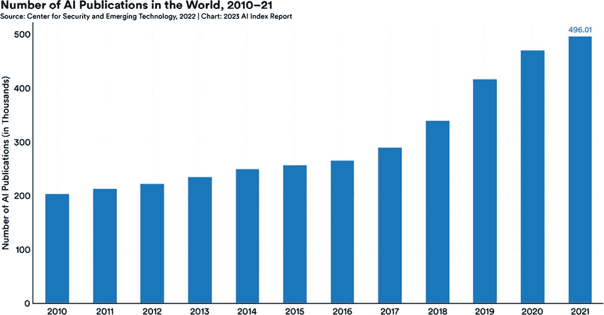

图 1.1 2010–2021 年全球 AI 出版物。图表来自公共数据，可访问 图表 – Google Drive，来源：安全与新兴技术中心，2022 | 图表：2023 AI 索引报告。

人工智能（AI）的浪潮如海啸般席卷而来，其速度令我们的常识难以完全把握，而且进展速度正在加速。过去十年里，AI 研究取得了飞速进展，其中机器学习（特别是深度学习）的进步、计算机视觉和自然语言处理的快速发展，同时对伦理考量的关注也日益增加。

图 1.1，来自“*2023 AI 索引年度报告*，¹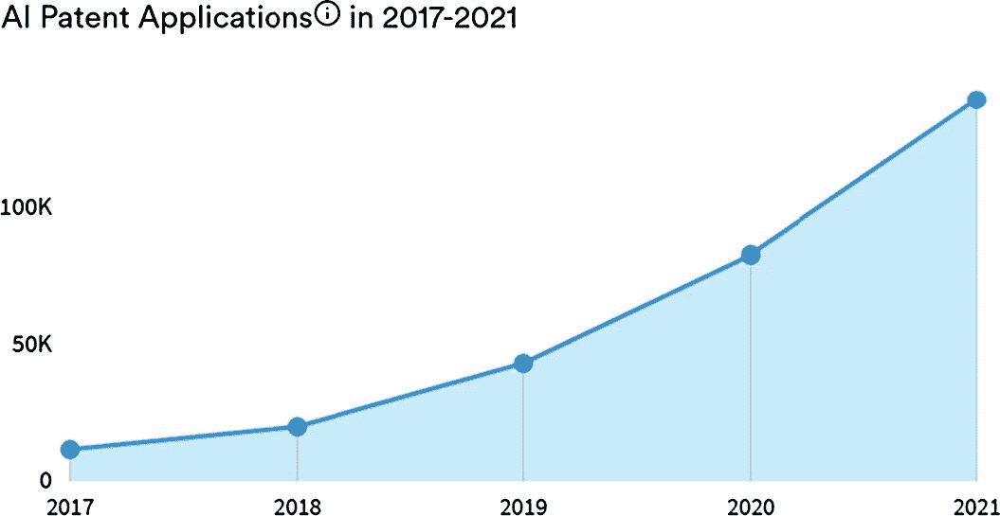

图 1.2 根据公共 Global AI Vibrancy 工具，2017 年至 2021 年 AI 专利申请数量。²

在不同的 AI 领域中，过去几年大部分注意力集中在 `machine learning (ML)` 领域、其子领域包含 `deep learning` 的 `artificial neural network` 以及 `natural language processing` `(NLP)`，如图 1.3 中 AI 研究应用领域的演变所示。


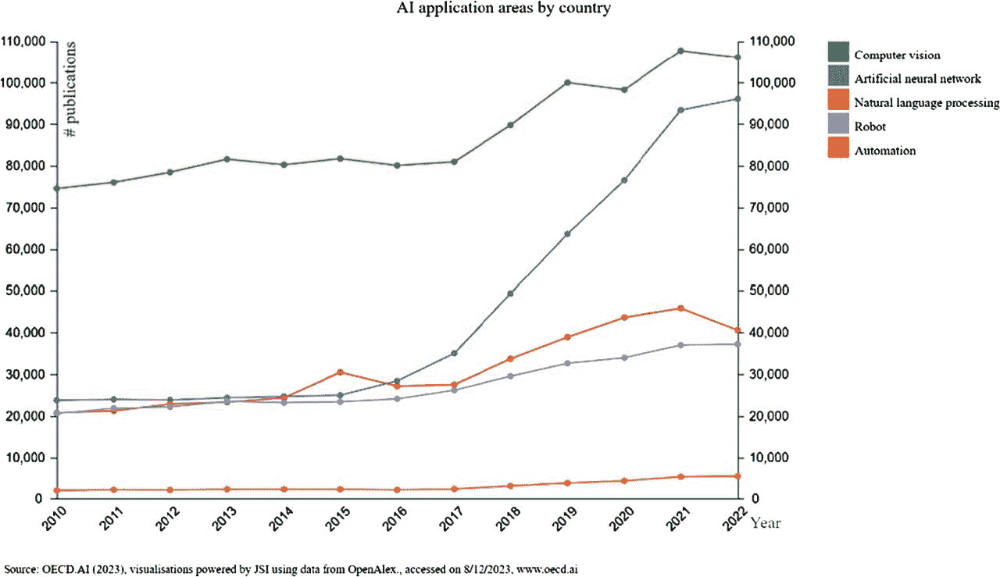

图 1.3 数据来源：OpenAlex。OECD.AI (2023)，由 JSI 使用 OpenAlex 数据支持的可视化，访问于 2023/8/12，[www.oecd.ai](http://www.oecd.ai)。

在不断增长的数据和处理能力的支持下，这些研究工作带来了一系列突破，这些突破可以通过不同领域取得的惊人进展来体现，例如计算机视觉中的图像分类、目标检测或图像生成、机器翻译、语音的创建或识别、文本理解与写作、复杂的棋类等。在短短几年内，利用深度学习和 NLP 技术的复杂系统创下了历史记录，超过了`human-level performance`³。

- 在`computer vision`领域，例如，2015 年 12 月就宣布了在图像分类任务上能够达到并有时超过人类水平性能的算法（例如，ImageNet 计算机视觉挑战赛，2015 年 12 月⁴）。

- 在`speech recognition`领域，微软公司（简称微软）的一个研究小组于 2016 年 10 月宣布了一种语音识别系统实现了 5.9% 的词错误率（Word Error Rate），声称错误率与专业转录员相同或更少；不到一年后，又达到了新的行业里程碑，即 5.1% 的词错误率。⁵

- 在`translation`领域，Microsoft AI & Research 于 2018 年宣布了一种中译英文新闻系统，其性能与专业人类翻译员持平。

- 在文本的`machine reading comprehension`领域，⁶

- 在`computer vision and natural language processing`的交叉领域上，微软研究院于 2020 年 10 月宣布⁷。

随着该领域的快速发展，需要更具挑战性的基准来衡量进展。例如，NLP 越来越变得具有多任务性（`multitasks`），需要创建新的标准来评估它们在系列任务中的表现。建立于 2018 年的`general language understanding evaluation`（`GLUE`）基准（benchmark）在九项句子理解任务上对模型进行了评估。在短短一年内，模型就超过了人类基准。随后，更具挑战性的基准`SuperGLUE`在 2019 年引入。分数再次发生变化：到 2021 年 1 月，微软和谷歌的新模型在该基准上超过了人类基线。

为了进一步推进研究，另一项更困难的测试`massive multitask language understanding`（`MMLU`）在 2020 年 9 月至 2021 年 1 月之间提出：该评估旨在衡量语言模型在 57 项任务上的多任务准确性，从数学、历史到社会科学、法律和解决问题的能力。过去 3 到 4 年在这一新基准上取得的进展再次令人印象深刻，我们可以从`generative pre-trained transformers (GPT)`模型族的演变可以看出（图 1.4）。

该模型由`OpenAI`发布，这是一家人工智能研究和部署公司，作为上限营利实体运营，其使命是确保人工智能造福全人类。虽然 GPT 模型经常被用作例子，但重要的是，市场上还有许多其他语言模型。关于 GPT 和语言模型的更多信息请参阅第 2 章和第 8 章。

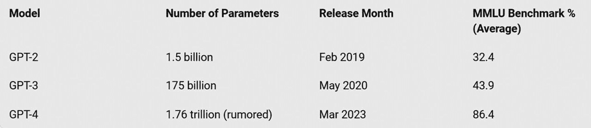

图 1.4 GPT 模型族针对 MMLU 基准取得进展的简视图，仅用于说明目的。关于 GPT 和语言模型的更多信息请参阅第 2 章和第 8 章。

提供这些示例仅是为了展示进展的快速，但它们不再反映当前的顶尖水平。感兴趣的读者可以在“Browse the State-of-the-Art in Machine Learning”网站上找到包含 11,000 多个基准的更新列表，这些基准由`Papers with Code`开发，该项目是由 Meta AI Research 核心团队发起的开源社区项目。

该网站涵盖了非常多样化的、由广泛 AI 技术支持的 4,500 个不同 AI 相关任务。该门户涵盖了广泛的 AI 技术和基准，从计算机视觉、语音识别和更广泛的自然语言处理任务到机器人。它还包括其他 AI 领域，如诊断、定理证明、知识库、推理等。

尽管人类等效性的定义和阈值存在争议，基准也可以受到挑战，但过去几年 AI 技术取得的快速进展是不可否认的，且实用的工业应用数量正在爆炸式增长。

不仅过去几年准确性和模型质量得到了快速提高，而且由于硬件、算法、并行计算和网络架构的进步，`训练速度`也大幅缩短：例如，用于分类图像的常用深度学习技术之一卷积神经网络（CNN）的训练时间从 2016 年的 14 天减少到 2017 年底的 15 分钟。

请注意，近期备受关注的深度学习和 NLP 技术的进步在此仅作为示例进行强调，但不应让读者忽视其他 AI 学科的重要性及其互补性，例如`规划、演绎推理、概率推理、决策制定`等。不同 AI 技术的多样化和丰富性是本书将重点介绍和涵盖的一个重要方面。

## 1.2 因素的汇聚

在过去的几年中，不同因素的汇聚相互增强了它们的影响，从而加速了人工智能技术创新的步伐。互联网的普及、云端更廉价且简单的大规模计算资源接入、可用数据量的不断增长、便于行业采纳的 AI 专项创新，以及开源软件开发模型的活力，这些都是关键因素。它们共同推动了 AI 进展的快速加速，特别是在机器学习、深度学习以及高度依赖深度学习的自然语言处理技术领域。

### 1.2.1 计算与 AI 资源的全球化与民主化

截至 2023 年，约有 50 亿人（即世界人口的 65%，可能超过发达国家人口的 80%）接入了互联网。在当今的数字时代，企业或组织在没有互联网连接的情况下运营似乎几乎是不可行的。互联网让数亿人（包括超过 2500 万名开发者和数百万研究人员）能够利用大规模计算资源。

在极短的时间内，访问和利用尖端技术的能力——这在几年前还是不可想象的——已同时变得更加廉价、简单和快速。让我们举几个例子来说说明这些点。

在`摩尔定律`和硬件创新的支持下，计算资源的获取变得廉价得多。1TB（`10¹² bytes`）的存储容量在 20 世纪 80 年代价值 15 亿美元，现在云端租用每月不到 10 美元。在 80 年代，只有少数超级计算机能够达到`GigaFLOPS`级。

自然地，这为 AI 领域带来了并持续产生着优势：例如，`训练`一个图像识别系统的成本从 2017 年到 2020 年下降了约 150 倍。对于数据科学家来说，按需访问云端存储和计算资源不仅变得更加廉价，而且获取也更加简单快捷。

在云端实现广泛的并行处理和计算能力，结合最新的数据科学工具和 AI 模型，现在可以在几分钟内完成。云服务通常还包含由社区贡献的机器学习模板集。数据科学家可以探索并重用这些模板，从而简化构建机器学习解决方案的流程。

此外，通过一种更简单的方法，没有任何数据科学知识的软件开发者，现在也可以通过简单的应用程序接口`API`从高级 AI 算法中获益：

- `语音服务`，包括文本转语音、语音转文本、自动转录和翻译服务；
- `图像与视觉服务`，用于检测和识别图片中的物体、识别手写体；
- `语言服务`，用于自动总结内容、回答问题；
- `决策服务`，用于检测异常、建议行动、学习；
- 以及更多。

基于 AI 的工具包甚至通过所谓的`低代码、无代码`方法变得触及，这种方法允许非技术人员无需编写`code`即可进行开发。

### 1.2.2 数据的去物质化、数字化和指数级增长

无论是在消费者端还是业务端，廉价的存储和处理能力都为内容的爆炸铺平了道路。社交网络的泛滥、便捷的内容发布方式、被数字化的实体对象（如书籍）都是可供开发的来源。`公开数据的数量和多样性`（文本、图像、音频）为深度学习和自然语言处理技术提供了一份训练的“免费午餐”。

根据市场情报和咨询公司`IDC`的数据，2018 年生成、存储或复制的数据量约为 33 ZB（`ZB`）。根据该公司，这一数字在 2020 年几乎增加了一倍，达到 64 ZB。其中 6.7 ZB 相当于给地球上的每个互联网用户平均提供约 300 到 350 部 Netflix 高清电影。

### 1.2.3 AI 加速器：加速行业采纳的 AI 技术

#### 硬件与软件创新

开发性能良好的传统机器学习系统需要一套任务流水，其中包含多个选择和微调决策，以获得最佳结果（预测器、模型本身及其配置和超参数等）。寻找最优参数的搜索空间具有多个维度且非常复杂，因此数学家将数据科学的任务归类为“高维组合优化”任务。

`自动化机器学习`（`AutoML`）是 20 世纪 90 年代出现的一种想法，其目标本质上是在没有数据科学家帮助的情况下，自动地生成和选择性能最好的算法，并优化其性能：应用 AutoML 技术的数据科学家通常只需要几行代码即可并行测试具有多个超参数的多个模型，并让算法在某些定义的质量指标下选择最佳模型。AutoML 明显加速了模型开发周期，且通常能获得性能更好的模型。

`Self-supervised learning`（参见第 7 章和第 8 章）是另一种能够加速 AI 应用开发的加速器。它是一种学习形式，不需要手动标注的数据集，而是通过预定义任务自动生成标签，从而仅用少量标签作为下游任务来训练算法。自监督学习方法加速了模型的创建，因为它们不需要人类参与劳动密集型的人工标注任务（例如传统的`supervised learning`）。

随着时间推移出现的第三种加速器是基于`transfer learning`概念的（参见第 7 章和第 8 章）：其中一些模型可以在极大型数据集上进行预训练，以便开发者能够更快地获得准确的结果。开发者无需从零开始学习过程，而是可以从通过解决相关任务（在最近的发展中甚至是从多个任务）中学习到的模式开始，并针对其特定任务对学习的“最后一公里”进行定制。

例如，`Pretrained NLP models`只需增加一个额外的学习层进行微调，即可为广泛的任务（如问答）创建模型。随着近年来 NLP 技术的进步，公司现在甚至可以使用先进的预训练模型来处理不同的 NLP 任务，而无需针对特定任务进行任何微调，或使用任何大型数据集。

最后，机器学习既需要大量的数据也需要数据科学家的知识。因此，另一个能够大幅加速模型构建时间的新兴 AI 领域被称为`machine teaching`（机器教学）。机器教学重点关注教师（即领域专家）的效能，以引导学习算法。它寻求以一种比仅使用标注训练数据更高效的方式来利用领域专家的知识。

通过设计最优训练数据集来驱动学习算法达到目标目标，利用领域专业知识来帮助机器学习模型发现关于如何更快找到解决方案的重要提示。

### 1.2.4 软件的动态性，开源的放大：重用、迭代改进与创新

AI 算法是在人类编写的软件中开发的，有时也是由 AI 技术协助开发者编写代码时（尤其是生成式 AI 技术）生成的。¹²

开源运动作为一种共享、开放、协作的软件开发方法，促进了改进的良性循环并推动了算法创新。“在一个以创新周期极短为特征的国际软件行业中，开源项目已被证明是新产品线和定义分支的基础设施的重要孵化器”（《Open-Source Projects as Incubators of Innovation: from Niche Phenomenon to Integral Part of the Software Industry》，Jan-Felix Schrape，2017）。

AI 领域也不例外。开源社区一直是人工智能创新和进步的活跃源泉。无论是最初由开源社区开发的（如 Apache 软件基金¹³ 中获益，这是一种业务流程自动化形式，将 AI 引入不同公司流程中常规任务的自动化中。

- 最后但同样重要的是，AI 技术和自动化也被广泛用于检测和应对日益增加的`网络安全`威胁。

这一简短的列举远非详尽。书中的`二十个案例研究`说明了 AI 技术如何支持不同行业领域的应用，从银行业保险业到制造业和农业业。

> 在继续介绍有关企业界采用 AI 的统计数据之前，我们需要提醒读者：AI 并不仅由某一种技术涵盖，而是一系列根据要解决的任务而定的、不同类别的广泛技术集合。近年来，机器学习、深度学习和自然语言处理领域获得了大部分关注和投资。因此，“AI”这一术语经常被误用，将这些特定的 AI 领域泛化到更广泛的 AI 领域。

这些应用反映了 AI 技术对行业而言已变得多么重要。麦肯锡于 2020 年 11 月发布的人工智能全球调查结果显示，在 2,395 名参与者¹⁴ 中约有 50%。

AI 技术也有助于解决`社会挑战`。它可以帮助医疗诊断，协助医生检查医学影像或推荐治疗方案，或者加速药物研发过程。AI 技术还可以通过应对气候变化挑战为更可持续的未来做出贡献：在气候预测方面、在加速新材料发现、在能源生产和智能电网方面、在工业和交通系统中等方面。

来自 16 个不同机构和大学的著名科学家和工程师撰写的合作研究文档“[用机器学习应对气候变化（Tackling Climate Change with Machine Learning](https://www.nber.org/papers/w12128.pdf)”展示了 13 个解决方案领域，机器学习在这些领域中可以为气候挑战带来积极贡献。

因此，人工智能对于企业的生存来说变得越来越至关重要，这些技术的影响对经济和社会都是具有变革性的。

同时，这种快速且广泛的基于 AI 的应用也给`劳动力市场带来了挑战`，并给消费者的安全和公民权利带来了`伦理风险`。

技术对工作的影响并非新事，而且一直存在，特别是自工业革命以来，经历了从手工生产到机器的转变。然而，独特的是在多种因素共同推动下变化的加速速度。可能比物理机器人取代的人工工作自动化那么显而易见，但 AI 系统在信息密集型流程中对知识型工作的自动化也将影响熟练和受过教育的人员。

同时，技术和创新对于`提高国内生产总值（GDP）和生产力增长`至关重要，这正是我们经济所寻求的。普华永道事务所发布的研究¹⁵。

AI 还存在着`伦理风险`。除了可能影响他人隐私或安全的故意有害用途，或者通过在社交媒体上传播虚假信息来影响公众舆论的用用外，AI 系统也存在固有的局限性。AI 系统必须尊重：

- `隐私`；
- `可理解性`；
- `公平与包容`；
- `可责性`；
- `可靠性`；
- `安全性`。

欧盟委员会于 2021 年 4 月发布了一项监管框架提案，称为《人工智能法案》（Artificial Intelligence Act），作为成员国与欧洲议会之间的谈判立场（参见欧盟 AI 法案：关于人工智能的首项法规）。

总之，这些技术既提供了极佳的机会，也带来了重大的社会经济风险，需要领导者和政府的高度关注。在一个变化如此之快且充满许多机遇的世界里，`教育`是帮助个人和社会的关键：启迪领导者以便他们做出明智的决策，教育立法者以便他们制定相应的法律框架，帮助个人适应变化、利用机会并参与民主对话。

众所周知，教育与民主紧密相关，研究表明，受教育程度较高的国家往往能更有效地维护民主（为什么民主需要教育？[a] 国家经济研究局，[`www.nber.org/papers/w12128.pdf`](https://www.nber.org/papers/w12128.pdf)）。

## 1.4 本书的目的和目标读者群：启迪商业从业者

大约 70 年来，关于人工智能有大量的言论和著作：从学术书籍、研究论文到商业文学和计算机科学普及。同时，本书的作者也认为，在连接学术界和企业界方面仍有努力空间，后者仍深受对 AI 缺乏的困扰：

- 面向商业和政治领导者的读物侧重于经济效益或社会影响，但倾向于过度简化概念，有时以至于导致误解和错误的结论；
- 针对领域技术人员的教育材料通常针对特定应用或供应商，但不一定涵盖基础知识；
- 针对软件开发人员的培训强调实践方法，但往往忽略了他们所使用的 AI 工具的底层原理。

本书的作者关注于澄清一些基础 AI 概念以及它们如何或何时被应用：某些 AI 应用取得的显著成果不应误导领导者、技术人员或开发者对这些技术范围和局限性的认知。

商业和政治领袖可以从理解超越短期经济影响之外的核心问题中获益：对关键概念的更好理解将不仅帮助他们更好地理解机会，还能让他们获得更多的战略洞察并降低风险。此外，如果结果是不正确的，或者这些优势是以丧失对其实现方式的基本理解为代价的，那么重新审视一些基本概念似乎是值得的。在应用程序中越来越多利用 AI 的开发者也需要理解他们所使用的 API 背后的一些基础知识和局限性。

然而，对这些 AI 技术获得正确、甚至是层次的理解可能代表着巨大的精力和时间投入。为读者减少这种投入是本书作者决定解决的挑战。

为了尝试让不同 AI 领域和技术的理解民主化，本书旨在提供一个相当整体但非详尽的 AI 视角，并在学术理论与学术界之外可能发现的过度简化解释之间找到一个易于理解的中地。

本书由教授 AI 的教授、研究人员和业务从业者共同完成，通过解释其基本概念以及支持这些技术的数学和算法背后的核心原理，揭示了 AI 核心支柱的构成。它的独特性体现在以下三个关键方面：

- 学术理论的复杂性与过度简化之间的平衡；
- 其通过回答常识性问题来解释概念的方法；
- 通过 22 个真实世界的行业案例对理论进行阐释。

带着教学目的，作者们力求用简单的术语解释这些技术，尽可能限制某些数学和算法发展的描述。

本书无论是作为一个整体阅读还是分章节阅读，其目标读者都是业务从业者、领导者或开发者，他们拥有计算机科学或 AI 领域之外的学士或硕士学位，但仍希望在相对有限的页数内理解 AI 的基本概念、应用及其局限性。此类阅读也可以作为参加 MBA 课程或类似课程学生的通用介绍。

读者将在这里找到一个坚实且易于理解的概述，涵盖了支持搜索和规划、基于事实进行推理（无论是否有某些不确定性）、学习和适应、“理解”以及“交互”的系统的不同 AI 技术。所有这些术语在书中都得到了揭秘。

它涵盖了 AI 中两种主流且传统的范式，这也是引入该领域整体视角的一种粗略方法：

1. 统计 AI，或数据驱动 AI 系统，它们通过向学习算法注入数百万数据点进行学习和执行；
2. “有意识建模”的 AI 系统，被称为符号 AI 系统，它们通过符号显式表示世界，并在行动上更有深意。


与其反对这两种范式，本书还展示了这些不同领域如何互补并结合。第 2 章作为本书的引言，提供了对该领域整体的概述：第 3 章到第 8 章构成本书的核心，它们以实用的方式回答了以下问题：

1. AI 领域为什么很重要？
2. 该领域解决了哪些问题？
3. 是如何解决的？
4. AI 的局限性是什么？

本书的每一章都提供了来自行业的具体案例。行业案例支持了理论的适用性以及它们如何结合。正如简要介绍的，AI 技术也带来了挑战。第 9 章探讨了某些可以缓解这些挑战的技术。第 10 章展示了技术如何互补。

## 注释

# 2 对 AI 技术及其局限性与互补性的全面视角

Emmanuel Gillain

由 rik Blockeel 教授进行学术评审

本章的目的是通过对书中涵盖的各种 AI 概念及其应用、局限性和协同作用提供简要总结，从而介绍书的其他部分。它为后续章节中将详细讨论的某些 AI 方法背后的核心概念提供了一个总体概念。正如引言提到的，本书并非旨在穷尽详述，也不包含最新、最前沿的 AI 技术，这些技术自本书写作过程开始以来就演进得极快。然而，书中涵盖的概念应使读者能够掌握一些新技术的基础知识。

## 2.1 什么是人工智能（AI）？

人工智能不是一种通用的技术，而是涵盖了若干类不同的技术，这些技术单独或结合使用，可以为应用程序添加某种形式的智能。

目前已经提出了许多关于“智能”的正式和非正式定义，但对任何一个单一定义都没有科学共识。艾兰·图灵（Alan Turing）本人并没有定义智能，而是通过一种可以欺骗人类观察者的行为重新审视了这个问题，即他在 1950 年提出的著名的`图灵测试`（测试机器表现出人类基准无法区分的行为的能力）。更最近，Legg 和 Hutter 在 2007 年的一项关于智能定义和评估方法的调查中指出：“据我们所知，尚未发表过任何关于测试和定义的通性综述”，作者们尝试将文献中不少于 70 个定义总结为单一陈述：“智能衡量了一个智能体在广泛环境中实现目标的能力。（Shane Legg and Marcus Hutter, 2007)。”

AI 研究人员弗朗索·科莱特（François Chollet）在一篇名为《论智能的衡量》的研究论文中提出了关于智能的两种截然相反的观点（Chollet, 2019)）。第一种将智能定义为`一组特定任务的技能集合`，以任务基准衡量 17。AI 到目前的主要成就是开发了特定任务的系统，它们被归类为`窄 AI`（Ray Kurzweil 在 2005 年提出的），相对于能够适应新任务和环境且无需人类干预的通用系统，后者被称为强 AI 或`通用人工智能`（AGI），目前尚无单一定义。理解通用智能的另一种方法是观察人类展示的各种能力：感知和执行、记忆、学习、规划、注意力、情感、交流、定量技能以及创造（Ben Goertzel，《通用人工智能：概念、现状与展望》，2014）。

目前似乎存在共识，认为我们距离 AGI 还很远。例如，在名为《AI 何时超越人类？来自专家的证据》的调查中（Katja Grace 等，2018），全球 350 多名 AI 研究人员一致认为，在未来 100 年内的某个时刻，“自主机器将比人类更好、更廉价地完成所有任务”，这再次是以任务为导向。一些人认为这种事件可能在 10 年内发生，另一些人则是 100 年后，预测 50%会在 2060 年左右发生。

与此同时，目前的窄 AI 技术可能会某种程度上为实现 AGI 铺路。因此，观察 AI 的务实方法是考虑不同技术解决的不同问题和任务，以及它们运行的环境（静态或动态、确定或随机）。出于我们的目的，我们将采取务实的方法，全面概述一系列可以解决问题以协助人类决策的 AI 技术：

- `搜索与规划`（第 3 章](#9783111425672_007479.xhtml#b_9783111426143-003)）
- `在确定性设置中使用符号化、基于逻辑的 AI 进行推理`（第 4 章](#9783111425672_015496.xhtml#b_9783111426143-004)和第 5 章](#9783111425672_025968.xhtml#b_9783111426143-005)）
- `在非确定性环境中对不确定性进行推理`（第 6 章](#9783111425672_031573.xhtml#b_9783111426143-006)）
- `通过数据或与环境交互的奖励进行学习`（第 7 章](#9783111425672_053831.xhtml#b_9783111426143-007)）

第 8 章涵盖了自然语言处理技术如何帮助人类与机器交互，即人类语言如何被机器分析或生成。在本书的过程中，我们将通过为这些术语提供更精确的含义来消除它们的神秘感。讨论不同技术的局限性也将让读者更好地理解表面的“魔力”在何处停止，以及不同技术潜在上如何相互互补。

## 2.2 基于搜索的决策以及 AI 代理如何构建行动计划

### 2.2.1 概述与核心概念

`search` 相关技术的主要目的是帮助做出决策以达到特定目标；为此目的构建的搜索代理被分类为`goal-based agents`。这里的决策必须理解为：“为了达到特定的目标状态，需要采取哪些动作？”环境通过所谓的`states`（状态）和从一个状态转移另一个状态的合法`actions`（动作）进行建模。在这种状态集为离散的模型中，算法将通过在状态空间图上逐步构建`search tree`来系统地探索状态空间。一旦找到目标状态，算法将只需遵循找到的最优路径。在某些以最小成本达到终点状态是唯一重要点、而不是到达该状态的路径的情况下，我们被称为`local search`（局部搜索）算法，如爬山算法或遗传算法，它们通常可以处理`optimization`（优化）问题。

### 2.2.2 行业应用与书中示例

搜索技术的应用通常出现在`path-finding`（路径规划）相关问题、如 GPS 等导航系统中，帮助机器人或车辆在避开障碍或最小化成本（时间、距离、燃料等）的同时找到路线；道路建设应用或其他优化和规划应用。搜索技术将在第 3 章通过`Microsoft Bing Maps`进行说明，它提供了一套路由工具来获取方向和路线信息。搜索技术也是支持其他 AI 技术的关键支柱：例如在命题逻辑中，逻辑推理可以利用搜索技术来判断逻辑语句是否至少在 1 个模型中为真。

### 2.2.3 转向约束搜索

经典的搜索技术构建了一个`planning`（规划）代理：对已知环境进行建模，代理执行计算以预测可能的移动直到找到目标。因此，代理在可以建模的已知环境中进行提前思考，且其转移是`deterministic`（确定性的）的。在最简单的建模形式中，搜索技术通过使用状态的原子表示来解决问题：原子性是指它们是不可划分的表示，且没有与之关联的数据结构。然而，此类表示是特定于领域的（包括引导算法更快找到目标的启发式方法），并引发了可能状态数量可能爆炸的挑战，这使得某些问题变得过于复杂，甚至无法处理。

我们并不像经典搜索那样对状态使用原子表示，而是可以（有时也需要）拥有更丰富的模型，用一组变量来表示状态，每个变量对这些变量拥有一组`constraints`（约束）。这种更丰富的表示被称为`factored representation`（因子表示），它将引导读者进入第 3 章的另一个章节来解决`constraint satisfaction problems`（约束满足问题，CSP）。CSP 技术将为每个状态关联一组变量，这些变量通过约束进行绑定和链接：每个状态由变量取值的可能赋值定义（例如，限制单个变量值的一元约束，限制 2 个变量组合的二元约束等），以及定义变量值合法组合的显式规则定义。通过识别违反约束的变量-值组合，可以消除搜索空间的大部分，从而减小搜索空间：这种基于约束的逻辑检查随后与前一节描述的经典搜索方法相结合。

CSP 求解系统比纯状态空间搜索器更高效，因为它们利用了状态的结构。例如在库存管理应用中，公司可能有以下约束：一组 10 种可能的产品，提供 5 种可能的颜色，带有二元约束规定哪种颜色可以与哪种产品关联，带有三元约束规定特定颜色、特定产品可以在 5 个仓库中的哪一个找到，例如“布鲁塞尔和伦敦仓库仅提供蓝色或红色的（颜色）袜子（产品）”。约束满足传播算法随后将检查变量值与约束之间的一致性，从而减少可能取值的数量，并将这些约束满足检查与经典搜索技术（即为变量分配值以搜索目标状态）相结合，以找到将红袜子从仓库运送到零售商的可能最优方法。

约束的另一个示例是：如果`X`的取值为 1, 2, 3，而`Y`的取值为 1, 2, 3, 4，则`X`和`Y`之间一个额外的`Y = X²`二元约束就已经将搜索问题的可能值限制为`X = 1,2`和`Y = 1,4`。正如读者所看到的，应用约束并传播这些约束的后果会减少寻找解决方案的整体搜索空间。

当目标增加了最大化或最小化目标函数（如成本）时，它被称为`constraint optimization problem`。在快速找到良好解决方案比找到最佳解决方案更重要的情况下，可以应用爬山算法或遗传算法等`local search`算法。第 3 章将详细介绍这些技术。

### 2.2.4 约束满足传播：应用与书中示例

约束满足传播算法可以实现有利的应用，例如在所谓的`configure, price, quote (CPQ systems)`（配置、定价、报价系统）中，帮助销售报价遵循生产规则的复杂且可配置的产品。例如，`Maersk Container Industry A/S` 构建了一个基于约束的配置器，帮助其销售团队生成有效的且可供生产的订单（第 3 章）。除了制品的配置外，这些技术也常用于`scheduling problems`（调度问题），例如制造中的车间调度，其中工厂车间的不同作业必须通过一组资源（机器、专家、工具等）提供的若干次制造操作（钻孔、喷漆、抛光等）。

### 2.2.5 基于搜索技术的局限性

正如我们所看到的，基于搜索的技术依赖于对世界的简单表示，但某些规划问题可能需要更复杂的世界表示方法，以考虑到智能体行为的后果。更复杂的环境可能涉及许多状态和变量的复杂约束，这些基础基于模型的表示无法处理。使用属性的一组值的因子分解表示（如上文讨论的`CSP`）可以改进建模，但可能还需要更复杂的状态和动作的关系型表示，并使用声明式语言^(20。

除了处理海量状态带来的困难性以及在更高层次的抽象层级上工作外，逻辑学方法（如一阶逻辑或其变体）还具有拥有通用求解器的优点，这些求解器可以将通用的求解方法应用于不同的特定领域。正如我们在上面的决策和规划问题中所看到的，更丰富的表达能力有助于减少搜索空间，以便对更抽象的概念进行推理或推断，并用更通用的术语进行推理。这平滑过渡到下一段关于符号 AI 的内容。

## 2.3 使用符号 AI 表示知识并进行推理

人工智能长期以来被分为两个主要范式：符号 AI（或基于逻辑的 AI）和数据驱动^(21。

尽管与神经网络的研究和应用存在共存（神经网络的首次现实应用追溯到 20 世纪 60 年代初），符号 AI 在约 40 年一直是 AI 研究的初始且主导的范式。它定义了问题及其领域的结构化和符号化表示：领域专家通过符号、不同表达水平的符号，根据所选的知识表示语言通过事实和规则对特定知识进行显式表示，对世界和要解决的问题建模。这些事实和规则符号定义了一种语法，领域分析师向其映射某些语义来表示世界中的事物、概念、状态和动作。随后，在语法层面通过将规则和逻辑公式应用于符号来完成逻辑推理。

例如，面向对象的编程（OOP，如`C++`、`C#`、`Java`）可以被视为创建符号 AI 程序的一个示例：OOP 语言定义类、指定它们的属性并按层次结构组织它们。这些类的实例创建了对象，你可以在对象上执行动作、基于规则的指令以及读取和改变对象属性的查询。

### 2.3.1 概述与核心概念

知识表示和逻辑推理的最简单形式之一是所谓的命题逻辑：知识由事实、公理和句子组成，通过简单符号和逻辑算符（如`and`、`or`、`not`、`equivalent`等）的组合进行编码，并关联布尔值（真或假）。逻辑系统的目标是确定什么在逻辑上是可行的，对逻辑表达式的真假进行推理：要么推导出新的逻辑句子，要么判断一个新的逻辑句子是否有效或可满足^(22。

尽管命题逻辑对解决多个问题很有用，但它无法表示复杂世界的知识。它缺乏简洁地表示环境的表达能力：它只陈述事实；无法表示对象之间的关系，并且它是实例特定的。因此，存在更具表达能力的知识表示语言，例如一阶逻辑。一阶逻辑提供了一种强大的形式体系，可以对环境做出更通用的陈述：它假设一个世界包含对象和关系^(23。

一阶逻辑可以扩展，以更灵活的方式表示某些约束，例如添加数值约束，如“结婚至少需要 2 个人”。然而，一阶逻辑的一个主要局限性是演绎推理是不可判的^(24。

通常与一阶逻辑和描述逻辑相关的是本体（Ontology）概念。本体是一种正式规范，一种用于定义概念显式规范的约定，是对特定范围内术语含义的声明式表示，并包含术语之间的公理和关系（如一阶逻辑中的二元谓词）。

本体与语义网倡议有紧密的联系，这很好地说明了它的实际应用。语义网是万维网的一种愿景，其中所有信息都可以相互链接。“语义网”一词指的是 W3C 对链接数据的愿景。语义网技术允许人们在 Web 上创建数据存储、构建词表并编写处理数据的规则”（语义网，[W3.org](http://W3.org)）。它是作为一个单一信息模型的愿景，而不是嵌入网页的大量无意义文本：文本字符串与元数据相关；因此我们不是通过文本字符串“nike”进行搜索，而是通过相关的语义“鞋品牌”进行搜索。这为 Web 上的语义层铺平了道路。

语义网技术被各行业的组织使用，本质是为了协调并尽可能地利用其海量数据存储。本体不仅为跨环境的数据共享和重用提供了一个通用框架，还通过应用逻辑推理技术来回答领域的复杂问题。事实上，当与描述逻辑关联时（例如），本体提供了语义，使系统能够根据提供的数据推导出额外信息。

本体和逻辑如何导出新事实的一个简单示例可以在维基百科上的 OWL 找到：“描述家庭的本体可能包含公理，规定只有在存在`hasParent`时，两个个体之间才存在`hasMother`属性，且`HasTypeO_Blood`类的个体永远不会通过`hasParent`关联到该类的成员。如果指出 Harriet 通过`hasMother`关联 Sue，且 Harriet 是`HasTypeO_Blood`类的成员，那么可以推导出 Sue 不是`HasTypeAB_Blood`的成员。”

本体和语义的使用还能够有效地将“什么”（即业务专家对业务问题和规则的正式定义）与“怎么做”（即底层 IT 栈对解决方案的技术实现）分开。关于本体的更多信息请参阅第 5 章。

### 2.3.2 行业应用与书中的示例

专家系统于 20 世纪 60 年代中期正式引入，是一类逻辑系统，带有推理引擎，可以从知识库的已知事实推导出新事实。它们在 20 世纪 80 年代出现，被某些认为是真正成功的^(25。

**查询数据库**实际上是逻辑推理的另一组简单应用：寻找满足用户查询的特定逻辑公式的所有实例。

另一类典型的逻辑推理侧重于`可满足性检查`（satisfiability checks）：是否存在一种值赋值使得逻辑公式成立。例如，可以进行形式分析来识别并匹配某些制造资产所提供的生产能力是否与生产订单所需的生产任务兼容。使用一阶逻辑公式，`可满足性求解器`（satisfiability solvers）不仅比布尔公式的命题逻辑提供了丰富的建模（如第 3 章中马士基集装箱工业公司的示例所示），还通过额外的理论丰富了经典的一阶逻辑^(26。

如上所述，基于逻辑的推理还可以帮助许多复杂工业环境中的诊断。这类行业案例在第 4 章中有所介绍，使用了`ASML`的案例，ASML 是全球领先的半导体行业光刻系统供应商，其将逻辑推理技术应用于光刻机的自动诊断。

`自动定理证明`（Automated theorem proving）是逻辑推理领域的另一项技术，提供了更高层次的推理和演绎。它在给定目标定理和用形式语言表示的事实知识库的情况下，自动生成证明。它在数学中的应用是提供数学证明、对系统属性的正确性进行推理，并在集成电路设计与验证或软件验证方法中。

对于安全关键型系统，形式逻辑验证是必不可少的，以确保它们正确且安全地运行：其正确性直接影响安全的系统，例如飞机的自动驾驶系统、核电站控制系统等。第 4 章说明了例如如何利用定理证明和`Imandra`形式验证软件来检查无人机和自动驾驶系统中简化版控制器的正确性，例如美国海军的`Triton 无人机系统`。该示例还强调了自动定理证明推理的另一个关键优势：通过有限的计算遍历无限可能的系统行为。

如前所述，本体论（ontologies）在语义网中起着重要作用，它们用于标注网络资源以执行语义搜索。本体驱动的知识系统存在于各种企业和公司领域，如生命科学、医学、电信、农业、天文学、国防、资源和能源管理。

在第 5 章中，`ONTOFORCE`（帮助组织在生命科学和医疗保健领域将其数据转化为洞察的公司提供了一个示例，展示了本体如何将分散的数据聚集在一起，通过链接的语义概念发现相关关系，并在药物研究早期阶段发现新知识。

### 2.3.3 符号 AI 的局限性

从简单的表示（如命题逻辑中通过简单符号编码知识并通过逻辑运算符定义规则）到更复杂的表示和推理技术（如一阶逻辑或其他知识表示技术，如描述逻辑），符号 AI 方法从根本上允许人类工程师将`先验知识`引入应用：定义事实或公理、规则、关系，以显式的声明形式显式表示领域专家知识。

这些算法将通过不同形式的推理来操作这些符号，应用逻辑推理方法来回答查询，进行逻辑推理和演绎。如前所述，更丰富的表达能力有助于对更抽象的概念和更通用的术语进行`推理`。尽管在存在大量复杂规则时有时会很乏味，但符号 AI 通常也具有对人类可解释的优势。符号 AI 模型使用符号来表示和处理知识，这与人类思考和推理的方式相似。


符号方法在处理`定义良好的结构化问题`时效果最好。在这种情况下，系统被赋予某些结构化知识，必须系统地遵循搜索树或应用逻辑规则来解决问题：演绎推理（即在给定事实集的情况下揭示新的、隐性的知识）、一致性检查（即检测事实之间的矛盾）、分类（即生成分类分类法）、基于推理的决策支持系统等。

然而，当符号 AI 方法没有直接针对某项任务编程时、当规则无法明确定义时、获取知识过于困难，或者知识库规模增加到系统面临计算困难的程度时，它们就力不从心。因此，它限制了在微世界中的适用性，并导致了`常识知识`问题：“如果彼特在家里，他的头也在家里”人类认为理所当然，但计算机不是。编码知识必须是显式的，而人类通过使用与概念相关且在特定上下文中显式和隐性的知识从句子中推断意义。此外，依赖程序或隐性知识的领域（如感官或运动过程，你能定义开车的规则吗？），用符号 AI 框架处理要困难得多。

某些逻辑形式如一阶逻辑被归类为`单调`（monotonic）。^(27)

最后，尽管通过符号 AI 技术可以进行某些`归纳学习`（参见第 7 章中的`归纳逻辑编程`以及第 10 章中的行业示例），但它们通常不提供从非建模数据中学习和得出知识的机制：符号逻辑系统不在原始数据中建立任何关联，它们本质上缺乏从数据学习关联的能力，并且对概念的接近性没有概念——这些都是我们将通过数据驱动技术解决的问题。

## 2.4 使用数据驱动 AI 进行学习

### 2.4.1 概述

`机器学习`技术本质上是归纳学习方法，通过数据形式提供的示例进行泛化。它们推断人类可能看不到或不知道的统计模式，从非常大的数据集和原始信号中学习并提取信息。这是一个广泛的领域，通常被称为数据科学。不同的技术族通常根据监督程度进行分类。^(28)

### 2.4.2 监督学习的核心概念、行业应用及书中的示例

`监督学习`技术学习一种函数、一种关系，根据提供的示例将给定输入映射到给定输出。训练数据以一组输入和正确标记的输出的形式赋予算法，使其学习到最优函数，该函数随后可以预测与新输入关联的输出。

#### 2.4.2.1 分类

预测类别（即类别变量），如“是猫还是狗？”“那封邮件是垃圾邮件吗”被称为`分类任务`。这些分类算法将寻求优化统计指标以减少分类任务的误差，例如最大化正确分类为猫的图像百分比，并最小化被错误分类为猫的狗图像百分比。^(29)

#### 2.4.2.2 回归

预测数值变量被称为`regression`（回归）`task`。基于提供的输入和输出示例，回归算法将试图最小化误差（根据预测值与真实值之间的差异定义损失函数或代价函数），以拟合训练数据。减少该误差将引导算法精炼其参数并拟合训练数据。

例如，线性回归模型作为回归模型最简单的形式之一，它通过寻找最贴合数据的直线（或对于更复杂的线性组合，则为超平面），来最小化真实数据与该直线（当变量较多时称为所谓的超平面）之间的平方差之和。当然，人们还创建了许多其他模型，从基础到复杂应有各种，以适应特定背景下的问题。在训练完成后，回归模型将`generalize`（泛化）并`predict`（预测）与新输入相关的输出，并带有一定的误差。

监督学习模型的一个广泛用例是创建预测分析系统，允许企业预测某些结果并预测未来的机会和风险：优化价格点、预测配电网中的用电量、预测呼叫中心的呼叫量以进行人员配置、预测医院在一段时间内需要服务的患者人数等。例如，`KBC Group`，一家比利时综合银行保险集团。

### 2.4.3 无监督学习——核心概念、行业应用以及书中的示例

在`unsupervised`（无监督）`learning`（学习）设置中，数据点没有标签，也没有关联的真实值。它们提供了探索性的方法来查看数据、分组数据、识别海量数据中的模式、描述其结构或发现数据中的关系。它们通常被分为三大类：`clustering`（聚类）、`association`（关联）和`dimensionality reduction`（降维）。

#### 2.4.3.1 聚类

`Clustering`（聚类）技术发现数据中的相似之处，通常用于探索性数据分析和客户细分：根据年龄和位置等不同特征将客户分为组，以便更好地分配营销活动。第[7]章通过`Microsoft Azure Form Recognizer`展示了一种聚类技术。

#### 2.4.3.2 关联规则

`association rule`（关联规则）是一种基于规则的方法，用于寻找给定数据集中变量之间的连接。这些方法经常用于推荐系统，通过市场篮分析来理解不同产品之间的关系。

例如，在线零售商可以利用之前的购买行为数据了解客户的消费习惯，开发高效的交叉销售策略，并为购物者提供相关的加购建议。或者，流媒体公司可以根据用户与电影交互的历史来推荐电影；关于这些技术，特别是奇异值分解，更多内容请见第[7]章。

#### 2.4.3.3 降维

`Dimensionality reduction`（降维）可以看作是一种总结数据的方法：当给定数据集中的特征或维度数量过高时，就会使用这种技术。使用数据转换技术，通过移除输入变量之间的一些统计相关性，将数据输入减少到较少的维度，同时尽可能保持数据集的完整性。它通常被用作应用其他技术前的准备步骤。

例如，作为分类缺陷解决方案（节[2.4.2.1]）的一部分，`Veranneman Technical`利用了一种名为`principal component analysis`（主成分分析，`PCA`）的技术来提取纺织数据中最相关的特征。`Autoencoders`（自动编码器）作为一类特殊的神经网络，通过训练使其输出复制输入，也属于这一类。

### 2.4.4 异常检测——核心概念、行业应用以及书中的示例

`Anomaly detection`（异常检测）技术本质上是识别`outliers`（离群值）、稀有事件或显著偏离大部分数据的观测值的方法。它们指示了特定任务中的异常状态，可能导致性能下降或指示特定风险。

异常检测技术随问题而异，取决于背景和问题。虽然存在基于规则的静态系统，但识别规则可能变成一项复杂且主观的任务。因此，人们更倾向于基于`Statistical`（统计）或`machine learning`（机器学习）的方法自动学习异常。在正常和异常标签访问平衡的情况下，某些方法使用监督学习作为分类器。

检测`time-series data`（时间序列数据，按时间顺序排列的一系列数据点，例如随时间变化的温度样本）中的异常需要特别注意，因为它通常表现出序列依赖性。序列依赖或自相关

异常检测应用于所有行业。例如，金融机构将其作为欺诈和风险检测的机制。在制造业领域，它被用于信号生产线或机器的异常行为。医学领域利用异常检测识别医学异常。IT 运营利用它来发现基础设施中的异常事件模式。在网络安全领域，入侵检测系统利用它来发现意外的安全行为。甚至销售部门也利用它来发现非典型的销售趋势……这些技术还可用于消除噪声和标记错误，作为机器学习预处理步骤的一部分提高数据质量。

第[6]章中的一个示例展示了如何从基于规则的检测 IT 环境异常的方法转向更具适应性的方法：使用`unsupervised learning`（无监督学习）方法和马尔可夫链模型，`Microsoft Sentinel`作为 Microsoft Azure 云的安全信息和事件管理服务提供了一种建模方法，帮助客户检测其 IT 环境中的潜在恶意活动。另一个示例在第[7]章，`KBC Group`利用无监督学习的异常检测算法检测保险理赔中的欺诈。

### 2.4.5 强化学习：核心概念、行业应用以及书中的示例

最初灵感源于大脑奖励系统的心理学模型，`强化学习`（reinforcement learning, RL）技术无论从其基本目标还是学习方法来看，都属于不同的学习系统类别。

从目标来看，这些技术属于`基于目标的代理`（goal-based agents）家族，它们支持随机环境中的复杂序列决策问题：通过在环境中采取动作 `a`[`t*]`，从一个状态转移到另一个状态（从 `s`[`t*]`到 `s`[`t + 1]`）受随机行为影响，由概率描述。

因此，强化学习技术的目标本质上是学习做出`一系列决策`，或在时间 `t`采取`动作` `a`[`t*]`，以最大化期望总奖励 ³⁵。

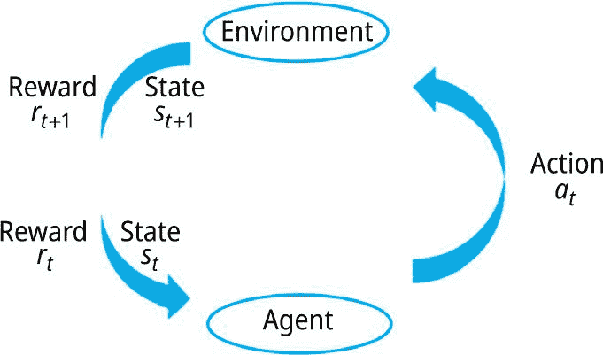

图 2.1 智能体对其环境做出决策或动作 `a`[`t*]`，并进入另一个状态（ `s`[`t + 1]`），在其中获得奖励（ `r`[`t + 1]`）。从这个新状态开始，通过智能体再次选择另一个动作开启新的迭代。学习智能体需要学习一组能够在所有决策中最大化期望总奖励的动作序列。

至于学习部分，RL 是一种人工智能范式，机器通过`试错`（trial and error）来学习，在与环境交互的每一步都获得`奖励`（或惩罚）（ `r`[`t*]`）；这些技术对未探索的领域进行建模，并通过在环境中采取行动来从自己的经验中学习。

总结来说，通过试错和从环境中获得奖励，强化学习系统可以同时学习环境模型，并利用该模型决定行动方案以最大化`期望总奖励`。更多关于强化学习的信息请参见第 7 章。

强化学习应用于广泛的领域。这些包括用于任务控制的机器人、用于在现实环境（如控制系统）中实现更安全可靠操作的自主系统，以及游戏。它在决策过程中也起着至关重要的作用，例如在交易系统中决定持有、买入还是卖出股票。

此外，它还可以帮助在网上提供更个性化的用户体验：例如在`推荐系统`中，RL 系统跟踪网站读者的返回行为和点击构成了奖励机制的基础。第 7 章中的示例说明了微软如何通过`Microsoft MSN news` 网站提供个性化且相关的用户体验。

### 2.4.6 深度学习又是怎样的？

`深度学习`（Deep learning, DL）依赖于`深度神经网络`（deep neural network, DNN），是一类利用神经网络的机器学习方法。`神经网络`通常由节点层组成：输入层、一个或多个隐藏层和一个输出层。

每个节点（或神经元）通过关联的权重和阈值连接到下一层中的另一个节点：单个节点的输出仅仅是其输入的加权和，通过`激活函数`（activation function）处理并将结果发送到网络的下一层（参见图 2.2）。非线性激活函数通过引入非线性特征，允许此类网络计算非平凡的函数。

当在输入层和输出层之间堆叠了许多层时，它们被称为`深度`的。通过根据某些损失函数或目标函数学习权重，深度神经网络可以表示`任意复杂的函数`，将原始输入值映射到输出值。更多细节请见第 7 章。

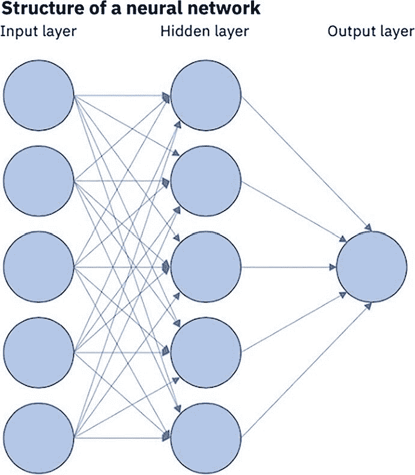

图 2.2 节点是其输入的加权和，在每个节点通过非线性函数处理。

神经网络的概念并不新：`感知机`（perceptron）是作为二分类线性分类器的最简单的神经网络，由 Frank Rosenblatt 于 1958 年发明。多层感知器在 1967 年得到演变，“深度学习”一术首次在 1986 年被提出。

硬件创新（如图形处理器）、算法创新以及可用数据量的增加，使得神经网络从简单的浅层架构逐渐演变为更复杂、更大的架构：LeNet 是最早的卷积神经网络之一³⁷章）。成功主要归功于其随数据量增加的可扩展性。这种可扩展性在获得更多数据时提高了性能。

深度学习的另一个特点是具有自动`特征`学习或表示学习的能力，这与依赖人工特征工程的传统方法形成对比。它允许深度学习系统同时学习相关特征并利用它们执行任务；因此能够更好地解释非结构化数据（即没有预定义模型的数据，如文本、语音、图像、视频等），为语音识别、图像识别和自然语言处理等许多应用创造了机会。这两个方面值得进一步讨论。

#### 2.4.6.1 偏差-方差权衡

在设计监督学习的传统模型时，数据科学家必须应对所谓的统计偏差-方差权衡（bias-variance trade-off）：机器学习的可还原误差可以分解为偏差误差和参数估计的方差误差（参见第 7，它说明了随模型复杂度变化的误差：无法既准确捕捉训练数据中的规律（低偏差，绿色虚线），又能良好地泛化到未见的新数据（低方差，黄色线）。

这种偏差-方差权衡导致机器学习模型过拟合（方差误差主导）或欠拟合给定数据（偏差误差主导）。因此，即使存在相关技术，传统的机器学习（ML）技术也没有提供许多在不影响另一个的情况下仅减少偏差或方差误差的方法，且模型会达到性能瓶颈。

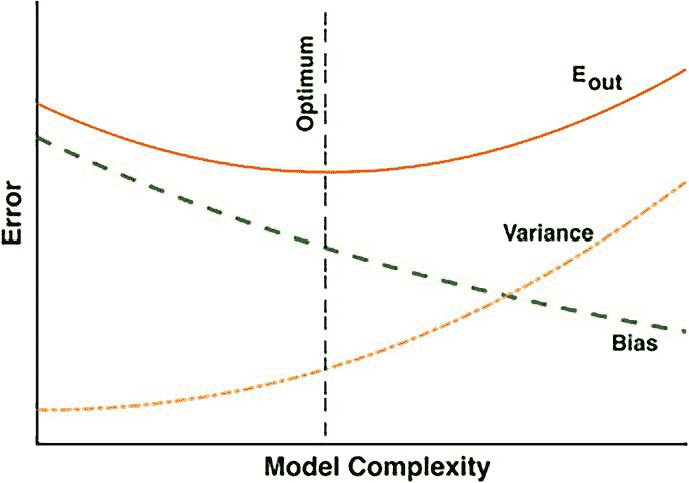

图 2.3 在最优点的左侧欠拟合，使用更复杂的模型过拟合（最优点的右侧）。来源：“面向物理学家的高偏差、低方差机器学习导论”（Pankaj Mehta 等人，[2019]

然而，神经网络的规模相比传统机器学习算法，能够更好地利用更多数据进行训练和挖掘更多数据：更大的神经网络增加了模型的复杂性，从而减少了偏差。同时，在更多数据上进行训练可以降低方差，从而在不影响偏差的情况下提高泛化能力。

#### 2.4.6.2 特征建模

传统的机器学习流水线需要对原始数据进行一些手动处理，即特征选择（以选择良好的预测器）和特征工程（将原始数据转换为与特定任务相关的特征向量，例如，捕捉声音、文本或图像的某些特征，并将其转换为机器学习算法可以理解的数值向量）。

深度学习系统既学习相关特征又利用这些特征来执行特定任务，消除了数据科学家手动构建特征的需求：原始输入数据直接馈深度学习模型，模型自动从输入数据中学习特征，连续层逐渐从原始输入中提取更高层次的特征。因此，深度学习系统将学习输入数据中的模式，而不是由数据科学家手动构建特征；它们充当了特征检测器。

例如，在计算机视觉领域，神经网络从原始输入数据（即图像中的像素值）开始分析；然后，底层识别边缘等基础视觉元素。移动到中间层，这些边缘被组合成更复杂的形状。最后，高层外推这些形状以识别人类重要的概念，如数字、字母或人脸。

在语音识别中，第一层捕捉基础低级波，中间层捕捉基础声音单元（音素）和单词，而末层则捕捉复杂组合中的句子。在其他自然语言处理任务中，神经网络可以将符号与数据的向量化表示连接起来，这些表示是带有某些语义的原始数据翻译（更多细节请参见第 [8] 章中的嵌入概念）。

注意，深度学习可以应用于各种学习方法，包括监督学习和无监督学习。

#### 2.4.6.3 应用与示例

深度神经网络提供了多种应用，如图像分类、实体提取和下一个词预测。在涉及非结构化数据的任务中，这些技术通常超过了人类基准。

由于摩擦力、空气阻力和各种其他力的持续作用，任何物体在实际上都不可能实现净力为零（即作用在物体上的总力为零）。

表示环境的状态动作空间要么太大无法存储在表中，要么是连续的：因此，依赖查找表的方法不可扩展的。在这些情况下，需要从见过的状态动作对中学习。深度网络可以被用作函数近似器。

自动驾驶是强化学习技术的典型应用（例如，跟踪物体），它有助于决策规划以避免意外情况并确保安全到达。

### 2.4.7 数据驱动学习的局限性

广义来说，机器学习技术面临两个主要挑战：泛化和知识工程。

#### 泛化

机器学习本质上带来了一种归纳学习方法，基于示例从数据中泛化。它们从非常大的数据集和原始信号中推断统计模式。

统计学习受到其假设的阻碍并受到其专业性的限制：当这些系统应用于训练时的相同环境时，通常表现惊人，有时优于人类，但如果环境发生变化（即使是微小变化），也必须重新训练。

一旦训练完成，机器学习算法通常执行它们学到的任务。要让它们执行不同的任务通常需要更改算法所学习的参数。它仍然是特定训练领域内的局部泛化，这使得在其他情况下（使用可能无法充分类似于之前训练数据的新数据）确保其有效性具有挑战性。

#### 知识工程

一些重要的领域概念和定律无法仅从数据中学习：例如，经验法则（如伽利略的惯性原理）是自然界中并未观察到的理想化描述。正如第 [7] 章将讨论的那样，**没有任何归纳偏差的学习是不可能的**。

机器学习技术不会对知识进行任何明确且特定的表示，就像`symbolic AI`方法所做的那样。从数据中学到的洞察是基于学习函数的映射，或者是一种关联、一种拟合数据的模式，但其本身并不赋予意义或因果关系。

机器学习技术可以帮助在文本、视频或图像中发现洞察。例如，它们可以从预定义的类别中提取并分类单词，如识别出“巴黎”是一个地点或人名，或者识别图像中的狗。然而，用于训练算法的类别的深层含义对机器来说仍然是未知的。

与`symbolic AI`方法不同，通常机器学习技术缺乏一种在模型中表示对象及其关系的知识框架，并且无法轻易融入世界的`prior knowledge`。另一方面，`symbolic AI`方法——例如一阶逻辑和结构化表示——提供了足够丰富以涵盖关系型的数据表示。这些方法可以整合一些先验知识，并且对人类具有可解释性。

这引出了我们将学习与逻辑推理相结合的技术。

## 2.5 逻辑框架下的学习

### 2.5.1 概述与核心概念


最初由 Stephen Muggleton 定义为逻辑编程与机器学习的交叉领域（Stephen Muggleton, 1991），`inductive logic programming` (ILP) 将逻辑编程领域与学习技术相结合，从本质上逻辑框架内引入了泛化概念。与其他形式的学习一样，ILP 的目标是归纳出一个从训练示例中泛化出来的假设。机器学习通过特定选择的学习模型表示假设并学习函数，而 ILP 将假设表示为一个`set of logical rules`，并从示例中学习新的`logical rules and relations`。在最简单的形式中，它通过归纳法学习新知识：它形成既与背景知识一致，又能解释所提供的示例（地面事实或规则）的假设。新的逻辑命题必须推导出算法给定的所有正向示例，且不包含任何负向示例。然后，该假设被添加到系统的知识库中。通过看到会飞的鸭子和麻雀来泛化出“所有鸟都会飞”是一个非常简单的例子。给定多个个人之间的友谊示例（其中一些朋友是女性，另一些是男性），以及女朋友关系的示例，ILP 算法还可以通过归纳推断出通用规则：拥有女朋友意味着既是朋友又是女性。

总结来说，ILP 通过从提供的证据（在某种程度上类似于数值数据世界中监督学习的标签）形成假设，并且这些假设与给定的`background knowledge`保持一致。更多细节请参阅第 7 章节。

拥有一种通过添加显式背景知识来学习新知识的方法，这使得 ILP 技术变得非常独特。它们在同一个集成框架内，通过使用`inductive and deductive inference`规则将泛化（学习）和特异化（specialization）结合起来：示例、假设以及添加的背景知识都使用相同的符号表示。归纳得出的、学习到的假设或规则可以自然地整合到基于规则的演绎推理系统中。ILP 与其他形式的机器学习的区别在于，它既使用了表达丰富的表示语言，又能够显式地利用编码的背景知识。这对于考虑`cumulative learning`等概念至关重要，即知识可以被增强并用于学习新事物。

最后，ILP 技术为学习过程的结果提供了高度的可解释性：学习到的假设以符号形式表示，因此为人类提供了`transparency and explainability`，而学习到的知识可以被记住并显式存储在`knowledge base`中。

## 2.5.2 行业应用与书中的示例

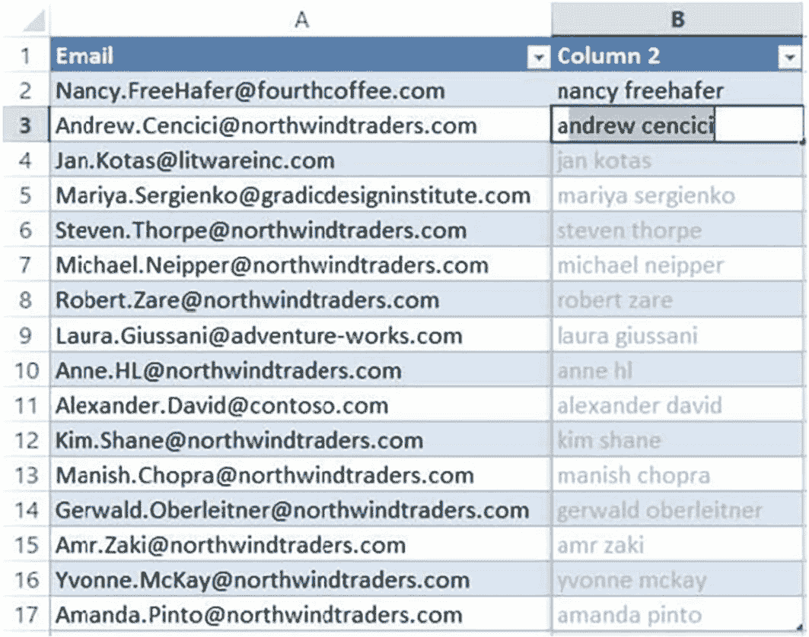

图 2.4 Microsoft Excel 中名为 Flash Fill 功能的说明。根据提供的第一个示例，算法对填充第 2 列其他单元格的建议：提取前两个单词，将其转换为小写，并用空格字符将它们连接。

ILP 通常用于学习复杂的关系信息，学习到的知识随后可以轻松集成到专家知识系统或基于演绎的推理系统中。ILP 技术推动了所谓`Programming by examples`的应用，其目标是根据几个输入和输出示例自动生成合成的小程序。这些包括学习脚本、生成搜索查询或应用数据转换、从文档中提取数据，所有这些基于用户提供的示例。`Microsoft Flash Fill` 是一种在感知到模式时自动填充数据的功能，是 Microsoft Excel 中自动化重复字符串转换的已知示例。如下 图 2.4 所示，一旦用户编写所需转换的实例并继续转换另一个，Flash Fill 就会学习一个自动执行该重复任务的程序。

ILP 的其他应用可以在物理学中找到，例如它们从第一原理解决问题，并帮助从实验收集的数据集中发现自然规律。给定基本原子的物理模型，ILP 系统可以归纳出一个表现出这些原子衍生行为的目标假设。化学和分子生物学领域也特别适合 ILP，因为这些领域具有丰富的关系结构，并且需要处理复杂的关系结构。第 10 章节还说明了一家以多样化的建筑产品和创新材料闻名的国际制造公司如何利用 ILP 解析工程图中的表格，并能够根据这些表格的周围信息创建推断单元格标签的简洁程序。

## 2.5.3 归纳逻辑编程的局限性

假设的构建可能是一个真正的挑战，因为所有假设的空间可能是巨大且复杂的，如果不对该空间进行限制，它有时会变得不可处理（intractable）。因此，有必要施加限制来约束搜索。这引入了一种偏置，通过限制假设空间来使搜索变得可行：例如，对假设进行限制或固定搜索空间的方式。接下来，为了从示例中推导出假设，我们需要为 ILP 系统提供适当的背景知识。找到合适的背景知识平衡点是一项挑战：背景知识不足可能会排除目标假设，而背景知识过多则会降低性能。从领域专家处获取手工编写的背景知识也可能是困难且昂贵的。最后，训练示例可能包含带有标签错误的噪声示例，因此很难找到一个既完备（complete）又一致（consistent）的假设。

## 2.6 存在不确定性时的概率推理

我们到目前为止的逻辑模型（如一阶逻辑和命题逻辑）是以确定的方式处理事实和谓词的，也就是说它们为真为假，或者未知。通过这些逻辑模型和规则，我们可以表达诸如“如果 A 为真则 B 为真”之类的概念，但我们没有表达真与假之间的信仰程度，无论是在对事实不确定时（非确定性事实，如下雨的概率、体温超过 38 度患感冒的概率），还是当我们面对环境的随机行为时（对动作结果的不确定性，例如机器人迈下一步但由于环境的不确定影响可能向左或右）。概率论是表示不确定性或信仰程度的数学基础，值为 0 到 1 之间的值。处理不确定性不仅在当我们拥有不可预测的事实和结果时很重要，而且当我们可能没有关于世界的完整知识来建模时（例如医疗或故障诊断），或者在实践上无法列出所有规则的完整列表时也很重要。这就是第 6 章涵盖的概率推理技术领域。

### 2.6.1 核心概念——概率推理的不确定事实和结果

概率推理的主要目标通常是回答此类查询，例如事件的概率，或在给定某些证据或观测的情况下多个事件的组合概率。在所谓的因果模型中，

```
\begin{array}{r} {\\mathit{P}(\text{cause}|\\text{effect}) = \\frac{\mathit{P}(\text{effect}|\\text{cause})\\mathit{P}(\text{cause})}{\\mathit{P}(\text{effect})}} \\ \\ \end{array}
```

通过反向构建模型，即确定 `P(cause)` 和 `P(effect|cause)`，这对于领域专家来说更容易构建，因为统计数据通常以这种形式存在，且可以使用可用数据作为证据。见下方的图 2.5 的第一部分。一旦生成了模型并估计了关联概率，查询就可以在另一个方向回答诊断性问题 `P(cause|effect)`。如果领域专家不知道 `P(effect|cause)` 和 `P(cause)`，则假设一个概率分布，并使观测数据的似然最大化，以便我们找到最拟合数据的统计数据。这种方法不仅提供了推断或推理以回答诊断问题的机制，还提供了从数据学习学习变量概率分布及其依赖关系的手段。比因果模型更通用的是，人工智能中现代概率推理方法结合了三个领域：

1. **概率论**，用于处理不确定性；
2. **统计学或机器学习**，用于从数据中学习模型参数甚至是模型；
3. 某种形式的图模型，称为概率图模型（PGM），用于表示专家的先验知识并对不同变量之间的依赖关系建模。概率图模型是在具有多个变量的复杂领域中编码概率分布的丰富框架：联合多变量。

这里开发了关于这种通用方法的一些核心直觉，作为第 6 章的介绍。

任何建模都从一组随机变量开始。

然而，当使用许多变量的分布来建模真实环境时，朴素地表示会很快变得非常繁琐：在表格中定义 n 个二元变量的联合概率就需要存储 `2^(n)` 个值。因此，技术寻求将联合概率分布表示为局部函数的乘积，每个函数取决于变量的一个得小的子集。这种方法利用了变量之间条件独立关系的先验知识。在建模环境时，领域专家通过使用图来构建模型，整合关于这些变量相互作用的先验知识。图模型结构了对象与其变量之间的关系：它们捕捉了变量之间的关系以及它们的不确定性。图方便地表示概率分布，详细说明依赖性和独立性。它们对变量的联合分布引入了结构假设，通常反映了某些变量之间的独立假设。通过图中不存在链接来表示变量之间的独立性，在缺乏这些独立性先验知识的情况下，显著降低了全联合分布表的组合复杂性。

支持概率推理技术的图模型示例包括：

* **贝叶斯网络**（也称为贝叶斯网络），用于因果问题建模；
* **马尔可夫随机场 (MRF)**，用于非因果问题中先验知识的全局统计建模（存在非因果统计依赖时）；
* **因子图**，它扩展了这种方法，并描述了概率分布 `p`（例如 `g(X[1], X[2], X[3])`）如何分解为局部函数的乘积，也称为分解。

每个模型都由下方的三张图片插所示（图 2.5）。

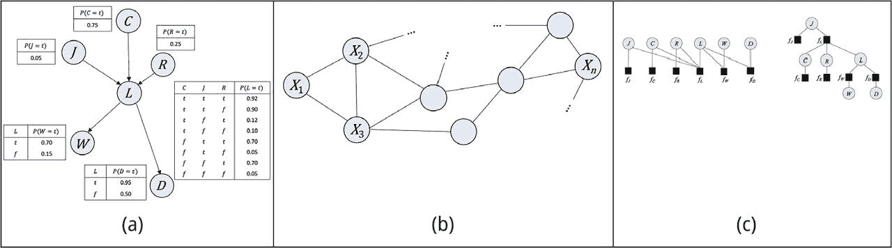

图 2.5 三种不同的概率图模型。(a) 用于无环有向图的因果模型**贝叶斯网络**。大写字母节点表示由领域专家构建的模型随机变量。表格是相关的概率以及在给定节点父节点情况条件概率。(b) 用于非因果模型的**马尔可夫随机场 (MRF)**。边表示统计分布中由节点表示的变量之间的依赖关系。`P(X[1], X[2], X[3], …, X[n])` 是 `ϕ(X[1], X[2])` × `ϕ(X[2], X[3])` × `ϕ(X[1], X[3])` 等乘积，其中 `ϕ` 是我们先验模型中假设的某种函数。(c) **因子图**将第 6 章中的函数 `P(j, c, r, l, w, d)`（函数 6.27）分解为因子的乘积：`P(j)` × `P(c)` × `P(r)` × `P(l|j, c, r)` × `P(w|l)` × `P(d|l)`。

一旦建立了关于变量交互的假设，即构建了概率模型，我们就可以计算特定事件或联合事件的概率，并且可能以观测到的证据为条件。这些计算是通过对图进行操作完成的。概率性问题通过在图中执行**推理算法**来解答。概率模型的图化表示不仅有助于问题设计和变量影响的表达，还提供了一个有利于利用图拓扑结构进行高效算法计算的结构。

如果概率或概率分布未知，则可以从观测数据中进行**学习**。第一阶段是训练，其目的是最大化给定观测数据的似然函数。这一阶段包括：

* 对于**离散随机变量**，例如对事件的发生进行简单的统计计数
* 对于具有由 `θ` 参数化的假设概率分布的**连续随机变量**，推断最能解释观测数据的参数 `θ`。

一个更复杂但可能的任务是学习网络结构，即变量的依赖关系。

总结来说，总体方法是：

1. **建模**：利用某些先验知识对变量如何相互关联进行建模，利用变量独立的某些假设；
2. **学习**：如果概率未知，则训练模型以最大化观测数据的似然；
3. **推理或推断**：执行查询，通常以观测到的证据为条件。

这种方法也被称为**基于模型的机器学习**，因为假设以模型的形式显式化，模型包含了变量的数量和类型、哪些变量相互影响以及如何影响。概率规则构成了一个完整的推理系统，一个包含将**演绎逻辑作为特例**的系统。

### 2.6.2 行业应用与书中的示例

概率推理技术支持不确定和复杂环境下的决策。它们应用于多个领域，包括医学诊断、基因组学、故障诊断、风险管理、IT 安全、图像分析、社交网络模型、环境研究和决策理论等。

第 6 章还阐明了如何使用贝叶斯推理技术来学习应用于农业**作物预测**的模型参数。该章中的另一个示例解释了贝叶斯推理、因子图和期望传播技术如何应用于 **Microsoft TrueSkill** 排名系统，这是一个用于 **Xbox** 网络的基于技能的排名系统。⁴²

### 2.6.3 时间概率推理，或序列到序列

当我们观察动态过程时，我们处理的是时间性或**时间序列数据**，其中状态和观测依赖于时间：在时间 `t` 有一个**状态**，在时间 `t` 有**证据**。一个进行中的过程随后可以通过时间步序列建模，例如：

1. 一个**状态链**，带有一个概率**状态转移模型**，用于从时间 `[t-1]` 的状态移动到时间 `[t]` 的另一个状态，定义为 `P(State[t]|State[t-1])`；
2. 一个**证据链**，带有一个**观测模型**，用于进入某个状态时观测某些证据，定义为 `P(Evidence[t]|State[t])`。

在这里，我们通常会构建并学习转移模型和观测模型。其目标通常是预测状态，即给定目前所有证据时预测下一个状态 `P(state[t+1]|evidence[1:t])`，或者找到生成一系列观测序列的最可能状态序列 `P(sequence of states[1:t]|evidence[1:t])`。与上一段类似，存在不同的`图形模型`，并引入了`独立性假设`以确保推理的可计算性。例如，对于`隐马尔可夫模型` `(HMM)`，这是一种随时间变化的概率模型，其随机变量 `State[t]` 具有不可观测的状态。

图 2.6

同样，我们通常会构建并学习转移模型和观测模型。其上上，为了确保推理的可计算性，存在不同的`图形模型`并引入了`独立性假设`。例如，对于`隐马尔可夫模型` `(HMM)`，这是一种随时间变化的概率模型，其随机变量 `State[t]` 具有不可观测的状态。

在这里，我们通常会构建并学习转移模型和观测模型。其目标通常是预测状态，即给定目前所有证据时预测下一个状态 `P(state[t+1]|evidence[1:t])`，或者找到生成一系列观测序列的最可能状态序列 `P(sequence of states[1:t]|evidence[1:t])`。与上一段类似，为了确保推理的可计算性，存在不同的`图形模型`并引入了`独立性假设`。例如，对于`隐马尔可夫模型` `(HMM)`，这是一种随时间变化的概率模型，其随机变量 `State[t]` 具有不可观测的状态。

为了预测状态，即给定目前所有证据时预测下一个状态 `P(state[t+1]|evidence[1:t])`，或者找到生成一系列观测序列的最可能状态序列 `P(sequence of states[1:t]|evidence[1:t])`。与上一段类似，为了确保推理的可计算性，存在不同的`图形模型`并引入了`独立性假设`。例如，对于`隐马尔可夫模型` `(HMM)`，这是一种随时间变化的概率模型，其随机变量 `State[t]` 具有不可观测的状态。

在这里，我们通常会构建并学习转移模型和观测模型。其目标通常是预测状态，即给定目前所有证据时预测下一个状态 `P(state[t+1]|evidence[1:t])`，或者找到生成一系列观测序列的最可能状态序列 `P(sequence of states[1:t]|evidence[1:t])`。与上一段类似，为了确保推理的可计算性，存在不同的`图形模型`并引入了`独立性假设`。例如，对于`隐马尔可夫模型` `(HMM)`，这是一种随时间变化的概率模型，其随机变量 `State[t]` 具有不可观测的状态。

图 2.6

例如，在`隐马尔可夫模型` `(HMM)` 中，`State[t]` 是一个具有不可观测状态的单随机变量时间概率模型。图 2.6 展示了：在不确定环境下，通过观测 `State[t]` 和可能的观测值 `Evidence[t]` 来描述情况。`转移概率`了从一个状态转移到另一个状态。

典型的模型包括：`隐马尔可夫模型(HMM)` 用于离散变量，`卡尔曼滤波` 用于连续变量，`动态贝叶斯网络` 则是它们的扩展。

### 2.6.4 工业应用


这些模型广泛应用于科学、工程、计算机视觉、自然语言处理、生物信息学、金融、零售和营销领域。在机器人领域，`因子图`帮助系统理解世界，而`即时定位与建图 (SLAM)` 则用于通过传感器信息构建并更新地图。

## 2.6.5 抽象——统一概率模型与形式逻辑

在不确定领域中，表示知识可以使用简单的命题逻辑模型（如贝叶斯网络），或更丰富的表示方法（如一阶逻辑模型）。`马尔可夫逻辑网络`是概率逻辑的一种示例，它将概率网络和图形模型的思想应用于一阶逻辑，实现了不确定推理。这被称为`符号统计建模`。

### 2.6.6 决策背景下的不确定状态或结果

概率推理不仅适用于根据证据预测原因或状态，还支持`决策理论`——即将概率与效用结合以做出决策。概率推理是决策系统的核心。在这些问题中，`效用函数`表达偏好并与结果相关，理性代理将做出使`期望效用`最大的决策（期望效用是所有结果的概率加权平均）。与贝叶斯网络类似，决策网络模拟了决策问题：`机会节点`表示给定父节点有条件概率的随机变量（例如给定疾病的症状），`决策节点`代表决策者设置的决策变量（例如根据症状和测试结果的治疗方案），`效用节点`依赖于父变量（例如效用可能包括检查和治疗的成本、患者的短期痛苦以及长期预后）。

当需要在随机环境（即状态间的转移具有随机性）中做出一系列步步决策或动作时，我们处理的是`序列决策问题`：在每一步，在观察到特定状态并获得奖励后必须做出决策。以机器人为例：

- `状态`可以指网格地图上的位置；
- `动作`可以指有效的移动；
- 基于决策从一个位置到另一个位置的`转移`可能存在不确定性（噪声、故障），因此由某些概率和`转移模型`定义；
- `奖励模型`可以定义为尽可能快到达目标点。

目标是协助决策者定义最优策略，即一个确定在任何给定状态下采取最佳行动的函数。在这种语文中，“最佳”通常定义为状态序列上的奖励总和，智能体试图作为效用函数来最大化该总和。如果环境模型是知的且可以假设`Markov`（马尔可夫）属性，具有足够计算资源的智能体就可以利用该模型进行计算、提前规划并设计最优方案。也就是说，在实际实时体验之前，通过离线考虑可能的未来情况来决定最优的行动方案。所谓的`马尔可夫决策过程`（`MDP`）技术有助于解决此类问题：它们将最优策略定义为在这种随机环境中进行最优控制的一系列动作（即：给定转移模型和奖励模型）。使用`MDP`模型的应用存在于各个领域：游戏、机器人、用于机器维护或维修的制造调度、用于服务器管理的 IT、求解最短路径问题、优化规划以减少排队时间、增强交通控制等。

`强化学习`（`RL`）在上一段关于学习的介绍中简要提到过，它更进了一步。它可以被视为此类`MDP`框架的扩展，其中环境模型（即转移和奖励模型）是不可知的。`RL`使用与`MDP`相同的概念框架，但通常是一种`model-free`无模型的方法，意味着它通过采样来学习模型：基于`RL`的智能体通过与环境交互基于经验学习，并根据连续的尝试获得奖励。目标由`奖励系统`编码，学习智能体根据与环境交互收到的反馈制定策略以优化累积奖励：该算法采用试错法，测试各种策略，经历失败，然后逐渐学习根据环境提供的奖励来优化决策。随后，它利用这些发现做出尽可能好的决策。算法在所谓的`探索`和`利用`阶段之间取得平衡。总而言之，强化学习技术本质上研究的是在复杂、未知且具有潜在长期影响的环境做出`序列决策`的问题。在与学习、强化学习相关的章节中已经提到了一些应用示例。

### 2.6.7 概率推理的局限性

存在主观和客观的局限性。对于许多人来说，概率科学是一个困难的主题，主观局限性源于概率理论的错误或不当应用。客观局限性源于模型需要简化的需求、推理策略中准确性与计算时间之间的权衡，以及对可用数据的依赖。因此，AI 中使用的概率推理与机器学习具有许多局限性。关于这些局限性的更多信息，请参阅第 6 章和第 7 章。

## 2.7 自然语言与机器交互

`自然语言处理`（`NLP`）是一个关注人机交互的 AI 领域。它研究如何分析人类语言（语音、文本）。NLP 涵盖多种能力，如：

- `语音识别`，将`口语语言转换为文本`
- 文档的`分类`
- 信息的`提取`
- `实体`之间的`关系`
- 文本的`翻译`
- 摘要的`创建`
- 根据给定文本`回答问题`
- `构建对话系统`
- `对话代理`

自然语言对计算机来说难以理解，出于多个原因：多种解释的`歧义性`。例如，`bank`一词是指金融机构还是岸边？只有通过`上下文`才能解决这种`歧义性`。捕捉`常识知识`（例如“如果彼得在家，他的头就在家里”）通常被假设为存在，但并未明确提到。注意，在自然语言中使用“理解”（understanding）一词是一种误用：它甚至可以欺骗人类。

### 2.7.1 某些关键概念概述

自然语言处理在结合自身特定特性的同时，应用了前几段概述的系列技术。尽管所有这些技术在今天仍有应用，但该领域经历了三个主要发展阶段：

1. `符号和基于规则的`系统（利用字典和词汇数据库）
2. 基于`统计和机器学习`的系统
3. 先进的`深度学习`技术

自然语言处理的早期方法应用了现有的形式化、特定语言的`语言学理论`。这些被用于建模和设计特定的规则流水线，并辅以手工创建的资源，如字典和本体论。尽管这种方法对某些应用很有用，但由于其复杂性，构建和维护具有挑战性。

#### 2.7.1.1 向量与嵌入

来自文本的类别特征通常用数值表示，以便机器学习或概率模型进行处理。同样，句子或文档也必须有`数值表示`才能进行分析。在现代 NLP 方法中，这种表示是通过`向量`实现的，即 n 维空间中的点，称为`向量空间`。一种非常原始且非最优的方法是`one-hot 编码`，它将类别变量表示为二进制向量。

现代自然语言处理（NLP）中的一个基础思想基于一种直觉：相似的词倾向于出现在相似的语文中，词的`meaning`由其周围的词决定。“它假设出现在相同语境中的语言项具有相似的含义，因此，单词所处上下文的某种表示是该词良好的含义表示”（第 8 章）。像“apple”和“peer”这样的词在关于水果的文档中一起出现的概率要高于与“car”或“bus”一起出现。这就是`embedding`（嵌入）概念大显身场的地方。

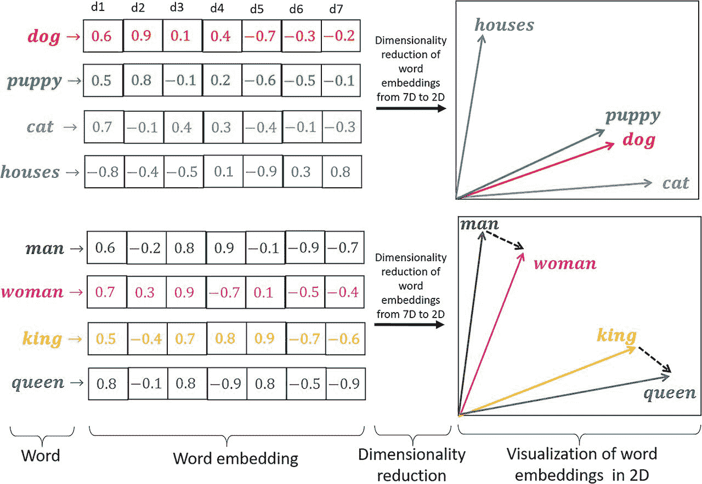

图 2.7 狗、小狗、猫、男人、女人等都是初始词汇的一部分，该词汇可能包含 n 个词。本示例使用了七个维度（d1 到 d7）来为这些词的表示附上向量。这 7 个维度捕捉了词典中单词之间的语义关系，如“生物”、“猫科动物”或“性别”。然后将这些维度进一步减少，以便在二维中进行可视化。来源：Rozado David “使用大型情感词汇对词嵌入模型中的算法偏差进行广泛筛选揭示了未报告充分的偏差类型”2020, [`doi.org/10.1371/journal.pone.0231189`](https://doi.org/10.1371/journal.pone.0231189)。

`Word embedding`（词嵌入）技术学习以数字向量的形式表示单词，并捕捉语义或与意义相关的关系。这是一种学习到的向量表示，其中含义相同的的词具有相似的表示，也就是说它们在数值表示中相互靠近，以聚类的形式存在。它为单词提供了`semantic representation`（语义表示）。例如，“Cat”和“kitten”在表示中会彼此靠近，因为它们在相同的语文中被提到；这些词将被附在彼此靠近的向量上。语义相似性通过距离等概念（例如两个向量之间的距离）进行正式衡量。例如，“dog”和“puppy”在表示中的距离会比“cat”和“dog”更近，而“cat”和“dog”的距离又比“houses”更近（图 2.7），等等。在学习此类语义关系的同时，嵌入过程还确保了学习到的表示是`low-dimensional`（低维）且`dense`（稠密的）。事实上，与词典的朴素编码的初始大小（如上面的独热编码示例）相比，嵌入减少了表示的大小。它比处理原始全尺寸词典使用了紧凑得多的表示方法：例如，输入词典可以包含`n`个词，而嵌入可以定义为将表示限制在较少的维度上。图 2.7 说明了这些不同的概念：“man”之于“woman”就像“king”之于“queen”（主要是性别），或者“cat”和“dog”（生物）彼此之间的距离比它们与“houses”的近。注意维度数量的减少。

嵌入和含义的相似性也可以适用于句子、文档、事实，甚至图片或音频，并为多种机器学习任务提供支持，适用于多样的应用程序，例如：基于语义的文本或图像搜索、文本分类、问答系统等。例如，在某个问答应用中，问题“When was John born?”可以根据与“Peter was born in 1980”更高的相似度被回答为“John was born in 1970”。这种方法的工作原理是首先将数据库元素映射到它们在向量空间中的嵌入表示，然后将用户的查询映射到相同空间中的表示，最后选择与查询最近的元素表示作为答案。

然而，基础词嵌入技术在某种上是`static`（静态的），因为它们不捕捉上下文：例如，“left”这个词无论它出现在文本的哪个位置，其表示都完全相同，尽管它在同一个句子中有两个不同的含义：“I left my key on the left side of the table.”（我把钥匙留在桌子的左边了）。给定词典中的一个单词，无论上下文如何，静态嵌入始终是相同的。如今，捕捉`context`（上下文）通过更现代的`contextual embedding`（上下文嵌入）来解决，它通常由`transformers`生成，这是最新一代深度神经网络架构（见下一节）。这些模型在分配嵌入之前会考虑整个句子或更广泛的上下文。为每个单词生成的嵌入将取决于给定句子中的其他单词：在我们的示例中，“left”将有两个不同的嵌入。关于嵌入的更多信息请参阅第 8 章。

#### 2.7.1.2 深度神经网络对自然语言处理的影响

NLP 应用中传统的基于机器学习的方法涉及许多大量人工密集型任务。这些任务包括处理流水线中的手工设计工程，例如预处理原始数据、定义相关的文本特征作为特征、创建学习模型并使用手动标注的数据集对特定任务进行训练。这是一种人工密集型方法，对于处理海量文本是不现实的。`Deep learning`（深度学习）通过消除此类杂务彻底改变了方法：基于深度学习的嵌入算法处理互联网上的数百万文档，学习并生成文本或文档的压缩语义表示。这些是在互联网规模上进行的`unsupervised learning`（无监督学习）任务。然后数据直接输入这些深度学习模型，模型从数据中学习特征和语言模型（见下段）。因此，它通过消除对`handcrafted feature engineering`（手工特征工程）的需求并让深度神经网络确定适用于任务的最佳特征和模型，简化了整个流程，这通常提高了性能。

在维基百科等大量公共数据上以无监督方式训练的深度神经网络消除了复杂的手工特征工程和建模的需求。然而，这是有代价的，因为它比传统的经典 NLP 方法不透明。同样重要的是，这些模型会继承用于训练的内容中存在的任何`bias`（偏差）（第 9 章）。

#### 2.7.1.3 语言模型和变换

在 NLP 处理步骤的嵌入阶段之后，`language model`（语言模型）的目标是根据前一个词或周围的一组其他词，预测单词（或句子……，取决于任务）的概率。语言模型是 NLP 系统中不可或缺的一部分，因为它们有助于为具有语言结构的应用程序创建预测：例如，预测问题的最佳答案、撰写文章、总结文本、执行语言翻译等。

进行此类预测的技术随着时间不断演变，从经典的统计方法（如简单计数、隐马尔可夫夫模型）到深度学习架构的最新创新：从基于 transformer 的语言模型，这类模型通过注意力机制和额外的嵌入类型将句子作为一个整体进行处理。

这些模型及其后继版本拥有预训练语言模型（一种无监督预训练步骤），任何人都可以访问和使用。这种方法的主要优点是，数据科学家不需要从零开始训练语言模型，因为从零训练是昂贵的、计算密集型的且需要海量的文本。通过迁移这种学习（也称为`transfer learning`），预训练模型可以在特定的数据集和有限训练需求下，在下游任务（如文本分类、实体提取、问答）上进行可能的`fine-tuned`（微调）。

进展仍在持续：下一代更进一步演变为多任务模型，且不需要在下游任务上进行微调。它们可以执行在其未经过显式训练的任务，仅需少量甚至完全没有训练示例（这分别被称为`few-shot learning`少量样本学习和`zero-shot learning`零样本学习）。更多细节请见第 8 章。

### 2.7.2 书中的行业应用和示例

NLP 应用可以根据其任务大致分为：它们可以分类、提取、总结、检索信息，或者根据指令生成人类可理解的文本、可信的图像甚至视频。

文本类 NLP 系统可以确定文档的语言、翻译、分类和总结文档、检索与用户查询语义上相关的文档等。它们还可以分析文档内容：分析文本情感、对文本段落进行分类、提取诸如有趣的实体等信息（预定义类别的实例，如人物、日期、地点，例如“布鲁塞尔”作为城市的实例）以及它们的关系。

在与生成相关的任务中，`natural language generation`（自然语言生成）可以根据上下文创建标记序列（例如单词），如建议输入下一个单词（例如在输入短信时），或自动化创建人类可理解的内容：生成对话式 AI 代理的响应、开发业务报告、编写新闻或文章、生成计算机代码、创建可信图像甚至视频。

最近，NLP 技术应用于多模态，以跨模式的理解和生成，如文本、语音、图像和视频。

NLP 技术的进步也带来了滥用的危险。诸如 GPT-3 及后续模型等高性能 NLP 技术带来了潜在的有害影响，其发明者本人也提出了这些担忧。例如，此类 NLP 系统可用于自动生成与人类文章难以区分的虚假信息，因此可以用作误导信息、钓鱼攻击、欺诈写作和影响大众的武器。人工智能系统生成的文本、音频、图像、视频非常真实，以至于人类可能难以区分技术生成的内容与非生成的内容。

### 2.7.3 自然语言处理的局限性

尽管语言模型可以产生令人深刻的结果，但它们从根本上是基于概率的：它们仍然不可靠，因为它们容易产生所谓的“幻觉”。这些虚假输出通常来自模型固有的偏差、对现实世界理解的缺乏以及训练数据。训练系统的有效性仅取决于其训练时的数据和所采用的模型，且可能存在错误。学习系统有时也会以意料之外、不理想且不透明的方式运行。

因此，随着人工智能应用越来越多地协助影响人们生活的决策（例如，某人是否能获得工作、贷款或其他由算法决定的事宜），这些不完美引发了`伦理考量`。应用程序必须符合公平、透明和正义等目标，以避免 AI 系统所做出或支持的决策可能带来的负面结果。尽管科技公司和公共机构已经表达了担忧并提了不同的系列指南，但有几条`伦理原则`似乎显现出来：一项针对现有的`伦理 AI`系统全球指南蓝图的分析揭示了一些共同点：“*我们的结果显示，全球范围内围绕 5 个伦理原则形成了共识：透明度、公正与公平、不伤害、责任和隐私，但在这些原则的解释方式、为何被认为重要、它们涉及的问题、领域或参与者，以及应如何实施方面存在实质性差异。*”（Anna Jobin, Marcello Ienca, and Effy Vadena, 人智能：伦理指南的全球格局，2019），以确保 AI 系统的使用尊重基本权利和欧洲价值观，包括人类监督、安全、隐私、透明度、非歧视以及社会和环境福祉。在审查期间，该法案的草案文本作为成员国与欧洲议会之间谈判的立场（参见欧盟 AI 法案：关于人工智能的首项法规）。

可信的 AI 系统需要一种整体方法，需要所有利益相关者的共同努力来应对风险，但考虑所有方面并非本书的宗旨。第 9 章简要概述了风险以及缓解这些风险的技术，特别关注两个特定方面：如何保护 AI 系统免受偏见（称为`公平性`）以及使其更具理解性（称为`可解释性`）。第 9 章还阐述了`EY`（也称为`安永/Er Young`，一家专门提供审计、税务、咨询和建议服务的跨国专业服务公司）如何应用其中一些技术来提高贷款决策的公平性。它还展示了航空公司如何提高其欺诈检测模型的`透明度`和`公平性`，这是客户忠诚度计划中的常见问题。

## 参考文献

Answer Set Programming, `https://en.wikipedia.org/wiki/Answer_set\_programming.` →

Chollet François. On the measure of Intelligence, 2019, `https://arxiv.org/pdf/1911.01547.pdf.` →

EU AI Act: first regulation on artificial intelligence, `https://www.europarl.europa.eu/news/en/headlines/society/20230601STO93804/eu-ai-act-first-regulation-on-artificial-intelligence.` →

Planning Domain Definition Language, `https://en.wikipedia.org/wiki/Planning_Domain_Definition\_Language.` →

Goertzel Ben. Artificial General Intelligence: Concept, State of the Art, and Future Prospects, January 2014. →


Grace Katja, Salvat John, Dafoe Allan, Evans Owain. When AI Exceed Human Performance? Evidence from AI, 2018, `https://arxiv.org/pdf/1705.08807.` →

Jobin Anna, Marcello Ienca, and Effy Vayena, artificial intelligence: the global landscape of ethics guidelines, 2019).

Legg Shane, Hutter Marcus. A collection of intelligence, 2007, `https://arxiv.org/abs/0706.3639` →

Muggleton Stephen. Inductive logic programming, 1991, `https://www.doc.ic.ac.uk/~m/Papers/ilp.pdf.` →

Rozado David. Wide range screening of algorithmic bias in word embedding models using large lexicons, 2020, `https://doi.org/10.1371/journal.pone.0231189.` →

Sioen Industries, `https://sioen.com/` →

Robovision, `https://robovision.ai/` →

OpenAI. ChatGPT, `https://openai.com/blog/chatgpt/` →

Viu More, `https://www.viumore.com/` →

OWL, `https://en.wikipedia.org/wiki/Web_Ontology\_Language.` →

第二种搜索范式被称为约束满足问题（CSP）。它推广了经典的搜索技术，因为它通过决策变量和必须被满足的约束提出了一种表达丰富的建模方法。它还通过添加一个需要最大化或最小化的目标函数，涵盖了优化问题。文中介绍了两种解决 CSP 的方法。约束编程提供了一种减小搜索空间的传播策略。局部搜索虽然不能总是找到最优解，但它是解决复杂问题的一种实用且常用的技术。它能确保快速找到最优解的近似值。本章介绍了一个配置问题相关的应用，这类通常出现在产品和软件交付中。但 CSP 可用于许多人工智能和运筹学问题，如调度、时间安排、制造问题、业务、电路设计、配置等。

逻辑是人工智能中的一种重要工具。一阶逻辑和其他高级逻辑可用于推理和知识表示（参见章节 4 和 5）。本章展示了最简单的逻辑命题逻辑不仅可以用于建模复杂的人工智能问题和 CSP，还可以通过 SAT 求解器高效地解决它们。

## 3.2 搜索算法

搜索策略是许多解决问题方法的重要基础。搜索算法也是许多优化和规划方法的基础。

### 3.2.1 搜索算法解决什么类型的问题？

搜索算法解决的环境可以通过一组状态进行观测和建模，并且具有已知且确定的状态转移规则。利用这些规则，我们预判从初始状态到达特定目标（特定的结束状态或符合某些条件的状态）的最佳动作序列。支持这种决策的环境知识通过状态明确表示，智能体的决策涉及到未来可能步骤的考虑，以便达到定义的目标。因此，所提技术属于“基于目标的”智能体类别。

使用搜索技术需要对问题以及构建解决方案的可用步骤进行抽象表述。我们所说的搜索是指从初始状态开始寻找通往目标的动作序列的过程。对于优化问题，则寻找的是最佳动作序列，即成本最低的序列。

#### 示例

八数码（也称为滑动块）是一个简单但具有启发性的例子。从初始状态（参见图 3.1）开始，一个动作是将相邻空单元（也称为空白单元）的瓷砖移动到该空单元。目标是找到从初始状态到达目标状态的（最小数量）动作。

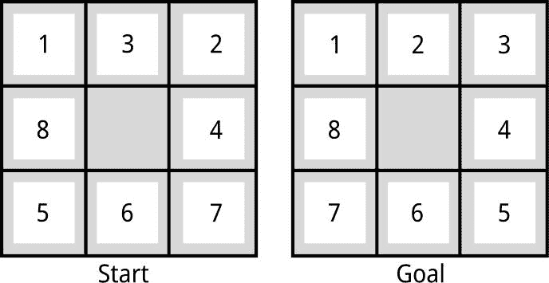

图 3.1 八数码。

状态是问题可能阶段的抽象表示。初始状态是搜索的起始状态。假设该状态是离散的，这意味着状态的数量是有限的，尽管通常非常大。

动作通过对状态应用算子将一个状态转换为另一个状态。算子对给定状态有先置条件才能应用。可用算子的集合取决于给的问题。可能动作的数量是影响解决问题复杂性的重要因素。

目标可以是一个显式状态，但更通常，目标由一个必须满足的条件表示。在优化问题中，每个动作关联一个非负成本。动作序列的成本（路径成本）则是序列中动作成本的总和。

#### 示例

八数码的状态可以表示为一个包含 9 个元素的向量。

### 3.2.2 通过搜索解决问题

如上所示，搜索的整体方法需要：

- 将问题建模为搜索
- 一个初始状态
- 一个必须满足的目标
- 识别正确序列的搜索活动

一旦找到了到达目标的动作序列，智能体就可以执行该序列。存在不同的搜索策略，它们可以是未知的或启发式的，带有“启发式”的概念。

搜索可以在树上进行。树中的一个节点包含一个状态、指向其父节点的链接、作用于父节点产生产生状态、该节点在树中的深度以及从根节点到该节点的路径成本。在图 3.2 中，节点上的标签对应于不同的状态。这清楚地表明在搜索树中，同一个状态可能出现在不同的节点中。尽管状态的数量是有限的，搜索树可能是无限的。

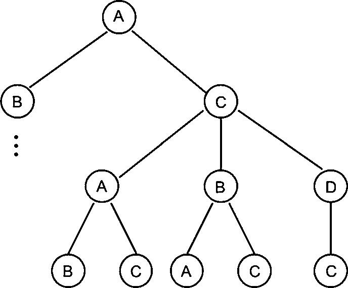

图 3.2 搜索树。

注意的是，问题的解不仅是满足目标的节点（目标节点），而且从根到目标节点的整个路径，它定义动作序列。

刻画搜索问题复杂性的参数是分支因子，即节点的平均子数量。在八数码中，假设我们不考虑返回父节点状态的动作，分支因子约为 1.732。八数码问题的搜索树示例所示图 3.3。

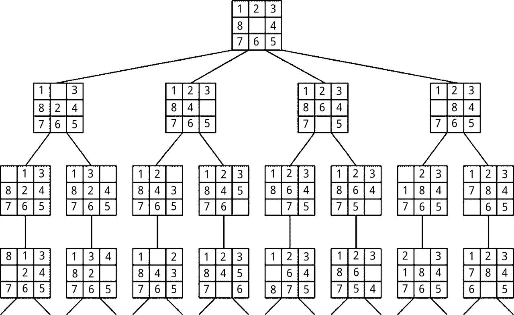

图 3.3 八数码问题的搜索树。

#### 3.2.2.1 通用树搜索算法

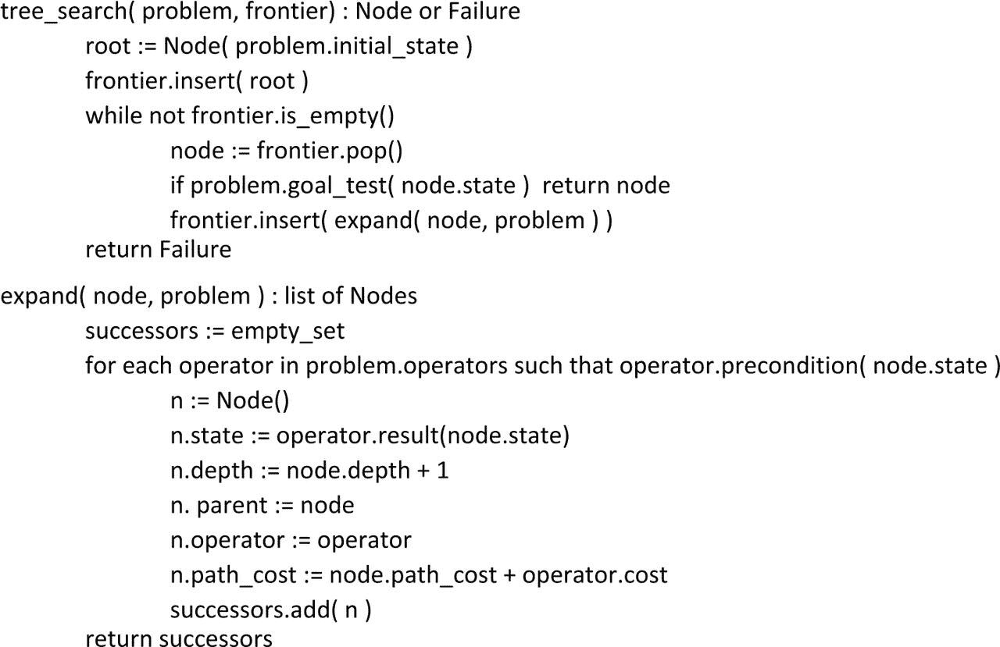

图 3.4 通用树搜索算法。

图 3.4 提出了一种通用的树搜索算法。它有两个参数：要解决的问题，以及在启动该算法时应为空的 `frontier`（边界）。`frontier` 是一个抽象数据结构，维护一组节点，这些节点在搜索树中的祖先节点都通过了目标测试，且已被访问。

该算法从 `frontier` 中选取一个节点，并检查其状态是否满足目标。如果不是满足目标，则为从当前节点状态通过动作可以到达的每个可能状态创建新节点（`expand` 算法）。这些节点随后被插入 `frontier` 中并继续搜索。在开始时，算法应该从初始状态开始。这是通过在 `frontier` 中仅包含初始状态的根节点调用该树搜索算法来实现。搜索将从初始状态开始。

`frontier` 的组织方式使得搜索算法能够根据某种优选搜索策略选择下一个要测试和扩展的节点。`frontier` 的不同组织形式会导致算法的不同。`frontier` 应该能够插入一个或多个节点，并根据 `frontier` 的内部组织结构返回第一个元素。

图 3.5 在一个小型抽象示例上展示了树搜索算法的前四次迭代。`frontier` 中的节点列表依次为 (`A`)、然后是 (`B`, `C`)、(`C`, `D`, `E`) 以及 (`D`, `E`, `F`, `G`)。在每一步中，被扩展的节点都用标记标记出来（或高亮显示）。

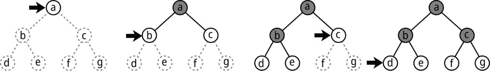

图 3.5 执行示例。

树搜索算法的结果不仅是一个节点，它还隐含地包含了从根节点到返回节点的路径，从中可以提取出从初始状态到达目标的动作序列。

通用的树搜索算法执行的是无启发搜索，也称为盲目搜索。搜索不是以目标为导的，也没有利用路径成本来引导搜索找到最优解。

### 3.2.2.2 广度优先和深度优先搜索算法

广度优先搜索（BFS）是通用树搜索算法的一个实例，如图 3.6 所示，其中 `frontier` 被组织为 FIFO 队列（先入先出）。这意味着在访问根节点之后，算法将在访问深度 2 的节点之前访问所有深度 1 的节点。节点访问的顺序如图 3.7 所示。假设通过 `frontier.insert()` 操作实现的 `frontier` 节点插入是从左到右进行的。

深度优先搜索（DFS）是树搜索算法的另一个实例，同样如图 3.6 所示。在 DFS 中，`frontier` 被组织为栈或 LIFO 队列（后入先出）。节点访问的顺序如图 3.8 所示。假设通过 `frontier.insert()` 操作实现的 `frontier` 节点插入是从右到左进行的。

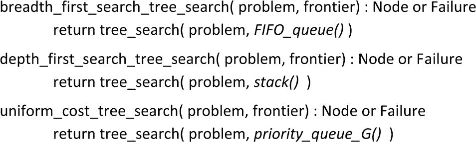

图 3.6 BFS、DFS 和一致代价算法。

搜索算法的评估可以根据不同的标准进行。如果存在解，算法是否能找到？这被称为完备性（completeness）。它是否能找到最小代价解？这被称为最优性（optimality）。它的计算时间和空间复杂度是多少？时间和空间复杂度是通过搜索树的（最大）分支因子 `b`、最小代价解的深度 `d` 以及搜索树的最大深度 `m` 来衡量的。假设值 `b` 是有限的，但值 `m` 可以是无限的。时间复杂度通过访问的节点数来衡量。BFS 是完备的；其时间和空间复杂度为 `O(b^(d+1))`，即生成的节点数量。当每个可能动作的代价为 1 时，它也是最优的。BFS 的优点在于它能很好地处理无限搜索树。但它的空间复杂度对于大问题通常是一个问题。在搜索过程中不能删除任何节点，因为它们可能是解的一部分，即从根节点到目标节点的路径。BFS 也可以看作通用算法的一个实例，其中 `frontier` 被组织为按节点深度排序的优先级队列。一致代价搜索是 BFS 的标准变体，如图 3.4 所示，其中 `frontier` 是按节点深度排序的优先级队列。一致代价搜索是 BFS 的标准变体，如图 3.4 所示，其中 `frontier` 是按节点代价排序的优先级队列（标记为 `g(n)`）。这种搜索是完备且最优的。当 `m` 是无限时，DFS 是不完备的。如果 `m` 是有限的，时间复杂度为 `O(b^m)`。其空间复杂度为 `O(b^m)`，即 `frontier` 中的节点数量。可以观察到 `frontier` 中的所有节点都是树中的单条分支。DFS 不是最优的。


图 3.7 BFS 算法访问顺序。


图 3.8 DFS 算法访问顺序。

#### 3.2.2.3 迭代深度

BFS 具有完备性和最优性等优点，但存在空间问题。DFS 具有良好的空间复杂度，但不完备也不最优。迭代深度结合了这两者的优点。其核心思想是应用 DFS，但限制深度。当然，限制深度的 DFS 是不完备的。迭代深度通过一系列增加深度限制的 DFS（0, 1, 2, ...）直到找到解。如果存在解，它是完备的。由于我们在每一步都重新开始 DFS，其空间复杂度为 `O(b^m)`。许多节点被访问了多次，如图 3.9 所示。根节点被生成 `(d+1)` 次，深度为 1 的 `d` 个节点被生成 `d` 次……深度为 `d-1` 的 `b^(d-1)` 个节点被生成两次，深度为 `d` 的 `b^d` 个节点被生成一次。从复杂度角度来看，其时间复杂度为 `O(b^d)`。因此，迭代深度是适用于树搜索的有效算法。


图 3.9 迭代深度访问顺序。

### 3.2.3 使用启发式方法通过搜索解决问题

#### 3.2.3.1 评估与启发式方法

BFS 具有良好的性质。启发搜索的核心思想是利用特定问题的知识来发现或推导出关于未来状态和未来路径的信息。这些信息随后被用于在遍历搜索树时做出更好的决策。技术上，启发搜索为每个节点 `n` 关联一个评估函数，记为 `f(n)`。该值模拟了节点的质量。在 `frontier` 中选择节点时，低 `f(n)` 值的节点会被优先考虑。

通常将评估函数 `f(n)` 分解为两个部分：

$$
f(n) = g(n) + h(n)
$$

其中 `g(n)` 是从初始状态根节点到达节点 `n` 的精确代价，而 `h(n)` 是估计成本（称为启发式函数），表示从节点 `n` 到达目标的成本。当不使用启发式函数时（即对于所有 `n`，`h(n) = 0`），搜索将简化为基于 `g(n)` 的（均匀）一致代价搜索。

启发式函数的目的是通过优先考虑预计更靠近目标的节点，来加速从节点到目标的搜索。如果一个启发式函数 `h(n)` 永远不高估到达目标的实际成本，则称该函数是*纳性的*（admissible）。因此，启发式函数是乐观的。结果是值 `f(n)` 永远不会高估通过节点 `n` 的解的成本。当 `n` 是一个目标状态节点时，如果启发式函数是纳性的，则 `h(n) = 0`。

### 3.2.3.2 A* 算法

启发式函数的引入了通用算法的两个实例，其中边界被组织为优先级队列。在贪心优先搜索算法中，顺序基于启发式函数 `h(n)`。在 `A*` 算法中，顺序基于 `g(n) + f(n)`。在贪心优先搜索算法中，目标是尽快从边界到达目标节点。在 `A*` 算法中，目标是尽快地找到最优解。因此，`A*` 特别适用于优化问题。

贪心优先搜索算法不是完备的，因为当 `m` 为无限时，它可能会陷入树的无限分支中。如果 `m` 是有限的，其时间和空间复杂度为 `O(b^m)`。它也不是最优的。但得益于启发式函数引导搜索，该算法通常优于深度优先搜索（DFS）。

`A*` 是完备的，时间和空间复杂度为 `O(b^d)`。与 DFS 不同，所有访问过的节点必须保留在内存中，因为它们可能是解的一部分。当启发式函数是纳性的，`A*` 就是最优的。因此它总是返回一个最优解。如果最优解的代价为 `c*`，那么 `A*` 将扩展每个 `f(n) < c*` 的节点 `n`，但永远不会扩展 `f(n) > c*` 的节点 `n`。非纳启发式函数可以加速搜索，但 `A*` 不再保证能找到最优解。

迭代加深的思想也可以应用于 `A*`，产生迭代加深 `A*`（IDA*）。它不是通过增加每次执行 `A*` 时的搜索深度，而是增加边界中被扩展节点的评估最大值。从技术上讲，在每次迭代中，`A*` 只扩展评估值小于或等于上次迭代中所有未扩展节点评估函数最小值的节点。IDA* 是完备的，其时间复杂度是指数级的（但很难表达），其空间复杂度是线性的。它也是最优的。

### 3.2.3.3 示例

#### 8 数码

对于 8 数码问题可以定义不同的启发式函数。

- `h1` 是错位的瓷块数量（在图 3.1 的起始状态下 `h(n) = 4`）。
- `h2` 是每个瓷块到目标位置的曼哈顿距离（水平距离 + 垂直距离）（在图 3.1 的起始状态下 `h(n) = 6`）。

两种启发式函数都可以高效计算且都是纳性的。它们永远不会高估到达目标所需的步骤。对于任何给定的节点 `n`，启发式 `h2` 总是大于或等于 `h1`。启发式 `h2` 被认为优于 `h1`，因为 `A*` 使用 `h2` 扩展的节点少于使用 `h1`。

#### 路线规划示例

寻找从一个位置到另一个位置的最短路径是组合优化中的经典问题。它可以建模为寻找源节点和目标节点之间的最短路径（点对最短路径），其中 `arc(A, B)` 的代价是从 `B` 到达 `A` 的距离（或时间）。示例如图 3.10 所示。从 `A` 到 `D` 的最短路径是 `A-B-F-C-D`，代价为 18。

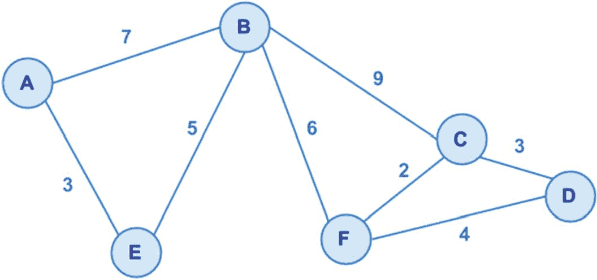

图 3.10 最短路径问题。

最短路径可以通过 Dijkstra 算法解决。使用优先级队列，该算法的复杂度为 `O((n+a)log n)`，其中 `n` 是节点数，`a` 是图中弧的数量。Dijkstra 算法实际上计算的是单源最短路径问题，即寻找从源节点到图中所有节点的最短路径。对于解决点对最短路径问题，这种复杂度对于巨大的图来说可能是不可接受的，因为最坏需要访问图中所有的节点和弧。

解决点对最短路径问题的 Dijkstra 算法可以看作是 `A*` 算法，但启发式函数 `h(n) = 0`。通过添加启发式函数可以极大提高搜索性能。旅行规划中标准的启发式函数是使用图中节点与目标节点之间的欧几得距离作为从该节点到目标路径成本的近似。这种启发式函数是纳性的，因为它永远不会高估实际成本：欧几得距离是两点之间的最短距离。

## 设计启发式

设计启发式并不是一项简单任务。对于所有节点，启发式 `h(n) = 0` 是可采的，但它没有提供任何信息。在另一个极端，产生到目标精确距离的启发式函数 `h(n)` 包含大量信息，但其计算开销过大，因为它的评估本身就需要进行整个搜索。其基本思想是松弛问题，例如通过减少对可能操作的限制来允许高效计算。在 8 码问题中，启发式 `h1` 允许瞬间移动，而 `h2` 允许瓷砖重叠。在最短路径问题中，启发式消除了必须通过道路的要求。

如何比较针对给定问题的不同启发式？对于给定问题的特定实例，两种启发式的搜索树形状可能非常不同，因此不具有可比性。比较两棵树中扩展节点的数量是一种可能的方法，但这些数字特定于实例。为了独立于实例，我们引入了*有效分支因子*。其思想是将搜索树重新组织成一棵完全树，以便使其具有可比性。完全树的分支因子 `b*` 即为初始搜索树的有效分支因子。如果我们有一棵拥有 `N` 个节点的搜索树，有效分支因子 `b*` 是以下方程的解，其中 `d` 是目标节点的深度：


$$
\begin{array}{r}
{N = 1 + b^{\ast} + {(b^{\ast})}^{2} + \cdots + {(b^{\ast})}^{d}}
\end{array}
$$

很棒的是，有效分支因子相对独立于解的深度，可以在不同实例之间进行比较。有效分支因子为 1 是理想的，意味着在搜索的每一步都选择了正确的选择。不使用启发式的 8 码问题有效分支因子约为 2.80，但使用启发式 `h1` 后减少约为 1.45，使用启发式 `h2` 后减少约为 1.30。

## 3.2.4 搜索算法的局限性是什么？

通过搜索求解提出了一系列相似而非不同的算法。它们都基于相同的通用算法；区别在于在边界（frontier）中访问节点的顺序。为了解决特定问题，必须通过设计表示状态的数据结构，并开发编码目标测试和对状态可能操作（运算符）的方法来完成所选算法。因此需要一定的编程技能。

从算法的角度来看，如果搜索是非启发式的，`IDA` 是本章描述算法中的一个良好选择。当可以利用启发式时，`A*` 是一个很好的算法，但存在空间复杂度问题。`IDA*` 是一种可行的方法，但也存在许多基于 `A*` 的方法提供了比 `A*` 更好的空间复杂度（递归最佳优先搜索、简单内存限制 `A*`）。

当存在初始状态、一个（一组）目标状态且预期结果是通向目标的动作序列时，搜索算法非常适用。然而，对于许多优化问题，目标是找到一个目标而不需要操作序列。解决方案的成本是状态的函数，而不是操作成本之和。

在所有提出的算法中，同一个状态可能会被多次访问。这可以通过考虑图搜索而不是树搜索来避免。这个思想很简单。在通用的树搜索算法中，搜索期间维护一个名为 `closed` 的已访问状态列表。边界中提取的节点仅当其状态从未被访问过时才被扩展。通用图搜索算法如图图 3.11 所示。树搜索的所有变体也可以应用于图搜索。它们的时间复杂度相似，因为它们描述的是最坏情况。然而，图搜索的空间复杂度总是指数级的，因为所有访问过的状态都必须记录。

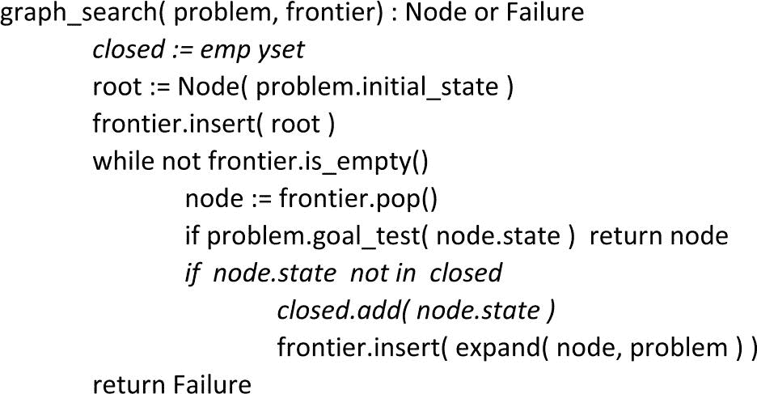

图 3.11 通用图搜索算法。

通过搜索算法解决问题时，我们需要通过数据结构和编码目标测试及可能操作的方法对问题进行过程化表示。过程化表示显式描述了如何执行或计算事物。相反，声明式表示描述了问题的特征和属性，而不显式提出更新数据结构以解决问题的计算方法。例如，查询数据库的查询语言 `SQL` 通常是声明式的。为了利用问题的声明式表示，需要通用的问题求解器，例如在接下来两节中开发的约束满足求解器或 `SAT` 求解器。通用问题求解器是一种能够根据给定问题表示解决任何问题的算法。

在启发式搜索中，可以利用启发式信息，即问题的属性，在不改变搜索算法的情况下加速搜索。启发式被编码在特定的外部评估函数中。这种方法有两个局限性。第一，它只能处理可以编码为评估从状态到目标成本函数的属性。其次，它只能说明依赖于问题的启发式，而非通用启发式。

搜索技术仅适用于可用状态和原子操作建模的确定性和已知环境。局限性在于建模和启发式是特定问题的，建模可能会导致状态数量爆炸，尽管搜索技术能够通过启发式执行“前瞻”预测，但它们并不像“推理方法”那样推断或演绎信息。

接下来的章节将展示如何消除这些局限性以及如何处理通用启发式。

## 3.2.5 行业示例：使用 Bing Maps Routes API 通过搜索和启发式的快速路线

Yves Deville Sanjib Dutta

### 3.2.5.1 路线规划器

路线规划器是在现有道路网络上寻找从一个位置到另一个位置最短路径的工具。虽然这听起来是一个非常简单的问题，但考虑到道路网络的规模以及支持各种用户选择所需的定制化程度，它面临许多挑战。例如，可以表达偏好在特定时间离开或到达、经过中间位置、更改成本函数（时间、距离、排放、财务）、避开某些道路、结合不同的交通模式或整合公共交通时刻表。许多工具和应用提供了路线规划服务，如 `Google Maps`、`Route XL`、`Waze`、`MapQuest`、`Bing` 和 `GraphHopper`。

与其他大多数图问题不同，路由图是动态的。弧的成本根据特定时间的交通状况动态变化。深夜 12 点成本最低的路线，在早上 7 点可能不是最佳选择。可逆路段还会根据一天中的时间反转行驶方向；某些转弯也会根据时间变得非法。某些路段根据用户的目的地可能会或可能不会通行。例如，如果用户的目的地是停车场，则停车场可以用于路由，但否则不应使用（即使使用它可以获得成本更优的路线）。

在规划从一个点到某个终点的路线时，性能是一个重要问题。由于道路网络规模巨大，一条简单的 50 英里路线在找到最优路径之前可能会接触数百万条边。解决此性能问题的常用技术之一是使用快捷径（预计算的小型路线），这可以显著减少边的数量，但快捷径无法用于动态图或考虑用户偏好的场景。

通过良好选择启发式函数，`A*` 可以大幅减少动态图搜索以及基于用户偏好的过滤过程中需要检查的节点数量。

### 3.2.5.2 使用 A* 的 Bing 地图路由

Bing 路由提供了一系列工具用于获取任何地方的路线和路线信息。它提供了一个名为 `Bing Maps Routes API` 的应用程序编程接口（API）来执行不同的任务，包括各种路由问题。Bing 路由器使用到目标位置的欧几里得距离（大圆距离）作为启发式函数。为了计算通过这段估计距离所需的时间，可以使用多种选项。例如：(i) 入口路速，(ii) 基于地区的固定路速（该地区的限速）。(i) 的问题是高速公路优先级过高于本地道路，存在许多许多法的本地路径可能被忽略的风险。另一方面，(ii) 没有让高速公路优于本地道路。Bing 地图路由利用了道路层级的 (ii) 改进版本。较高层级的道路将获得更多的偏好，除非它太源源或终点。假设有 5 级道路层级，层级 1 高于层级 2，可以逐渐为较低层级的道路分配惩罚，例如：

```text
hierarchyModifiers = [1.0, 1.05, 1.2, 1.3, 1.4]
```

给定节点 `n`，启发式函数 `h(n)`（即从 `n` 到终点节点的估计（时间）成本）计算如下。首先通过将到目的地的欧几里得距离除以给定的固定速度来计算估计成本。如果节点 `n` 距离源点或终点不远，则将此估计成本乘以搜索中引导节点 `n` 的道路对应的层级修饰符。在上面的示例中，通过层级 3 道路到达的节点估计成本将乘以 1.2。

这种路由方法在图 3.12 中进行了说明，该图展示了具有两种道路层级且弧长度以米为单位的连接道路。

- 绿色：层级 3，速度 36 km/h。
- 紫色：层级 1，速度 54 km/h。

起始节点为 `n3`，终点节点为 `n14`。表 3.1 显示了每个节点与终点节点 `n14` 之间的欧几里得距离。对于每个层级，还提供了估计成本。此处使用的固定速度为 54 km/h。因此，对于节点 `n1`，我们得到 `h(n1, i)` 的以下值（单位为秒），其中 `i` 是通往节点 `n1` 的弧的层级。

```text
h(n1, 1) = 780m / 54km/h = 52sec
h(n1, 3) = 780m / 54km/h = 62sec
```

在这个小型示例中，无论节点到终点的距离如何，都会应用层级修正。


图 3.12 从 n3 到 n14 的路由。表 3 节点到 n14 的距离和启发式函数。

|  | n1 | n2 | n3 | n4 | n5 | n6 |
|---|---|---|---|---|---|---|
| 距离 (Dist) | 780 | 780 | 350 | 300 | 250 | 280 |
| 层级 (Hierarchy) | 1、3 | 1、3 | 1、3 | 1、3 | 1、3 | 1、3 |
| 启发式 (h) | 52、62 | 52、62 | 23、28 | 20、24 | 17、20 | 17、20 |

|  | n8 | n9 | n10 | n11 | n12 | n13 |
|---|---|---|---|---|---|---|
| 距离 (Dist) | 300 | 220 | 220 | 200 | 200 |  |
| 层级 (Hierarchy) | 1、3 | 1、3 | 1、3 | 1、3 | 1、3 |  |
| 启发式 (h) | 23、28 | 15、18 | 15、18 | 13、16 | 15、18 | 13、16 |


图 3.13 从 n3 到 n14 的路由搜索树。图 3.13 描述了在上述图中通过 `A*` 算法寻找 `n3` 到 `n14` 路线的不同步骤的搜索树。边界最初是节点 `n3`。

- **(A)** 从边界中提取节点 `n3` 并对其进行扩展，其后继节点 `n4`、`n1`、`n5` 被添加到搜索树中并插入边界。边界中的每个节点都与评估函数 `f(n) = g(n) + h(n, i)` 的值相关，其中 `g(n)` 是从根节点 `n3` 到节点 `n` 的精确成本，`h(n, i)` 是上述启发式函数的估计成本。对于节点 `n6`，计算值如下：
  - `g(n6) = 70m / 36km/h = 7sec.`
  - `h(n6, 3) = 20`，弧 `n3-n4` 的层级为 3。
  - `f(n6) = 7 + 20`。

- **(B)** 从边界中提取评估值最小的节点 `n6` 并进行扩展，其后继节点 `n10`、`n7`、`n9` 被添加到搜索树中并插入边界。对于节点 `n6`，计算值如下：
  - `g(n10) = 120m / 54km/h = 8sec.`
  - `h(n10, 1) = 15`，弧 `n6-n10` 的层级为 1。
  - `f(n10) = 7 + 8 + 15`。

- **(C)** 从边界中提取节点 `n10` 并进行扩展。后继节点 `n9` 的评估值为 `20+15`，但未添加到边界，因为该节点已经在边界中且评估值更小（32）。这是对所演示的 `A*` 算法的基础优化。

- **(D)** 从边界中提取节点 `n11` 并进行扩展。后继节点 `n9` 和 `n12` 不会被添加到边界，因为它们已经在边界中且评估值更小。添加节点 `n14` 成本 `37+0`。这是一个目标节点，但搜索仍在继续，因为边界中其他评估值更小的节点可能通往成本小于 37 的 `n14`。

- **(E)** 连续从边界中提取节点 `n5`、`n9` 和 `n12`。然而，它们的任何后继节点都没有被添加到边界，因为它们已经在边界中且评估值更小。

- **(F)** 从边界中提取节点 `n4` 并用其后继节点 `n2` 和 `n8` 替换。

- **(G)** 从边界中提取节点 `n14`。它被识别为目标节点，搜索返回路径 `n3-n6-n10-n11-n14`，成本为 37。

### 3.2.5.3 主要挑战

在大图中，`A*` 算法探索的边数明显少于 Dijkstra 等其他算法。然而，它也有一些局限性。

`A*` 不适用于涉及约束条件（如组合交通工具或整合公共交通时刻）的路由问题。

上述路由算法使用固定速度来确定估计的剩余成本。如果该速度是最大速度的上界，则该启发式（不带分层）是可行的，且 `A*` 总是返回最优解。使用低于最大速度的固定速度或引入分层修饰符时，启发式并不总是可行的，因为估计成本可能大于实际成本。然而，这些情况非常罕见，通常可以通过继续搜索一段时间以检查是否存在更好的结果来缓解。

## 3.3 约束满足问题

当一个状态可以用一组变量表示，且每个变量有一组可能的取值时，我们从“原子化”表示法转向更丰富的“因子化”表示法，这种表示法可以利用状态及其约束的结构。这通过识别违反约束的变量/值组合，消除了搜索空间的大部分，并减少了可能的取值集合。上一节描述的 `SEARCH` 方法随后可以与基于 `CONSTRAINTS` 的某种形式的 `INFERENCE` 结合。因此，CSP 求解系统比纯的“状态空间”搜索器更高效，因为它们利用了状态的结构。

### 3.3.1 约束满足解决的是哪类问题？

约束满足问题（CSP）是一个可以用一组（决策）变量（通常在有限域上）以及一组关于变量的约束来描述的问题。更具体地说，约束规定了分配给变量的合法值及其组合：它们可以限制单个变量的值（一元）、成对的值（二元），或更广义的数值元组（t 元）。还可以指定诸如 `AllDifferent` 之类的全局约束。

问题的解决方案是为变量赋值，以满足所有约束。

约束优化问题（COP）是一个具有一个与变量相关的额外目标函数的 CSP。其目标是找到一个使目标函数最大化（或最小化）的解。

求解 CSP 和 COP 的技术取决于变量的计算域。大多数方法处理有限域，即 CSP 的每个变量都有一个有限域。有限域的一个特殊情况是域 `{0,1}`，这导致了布尔 CSP。有限域的扩展是有限集合和图，即变量的值是一个有限集合（来自一个给定的初始有限集合）或一个图（一个给定的初始图的子图）。所有这些有限计算域都可以用于建模组合问题。另一类问题是连续型 CSP，其中变量的值是实数且具有无限域。

CSP 或 COP 的描述是该问题的声明式表示。描述中没有数据结构或任何算法。CSP 和 COP 涵盖了大量问题，如车辆路径规划、调度、仓库选址、规划、背包问题、配置问题和图染色。

#### 3.3.1.1 示例

##### 图染色

给定一个图和一组颜色，对图的顶点染色，使得两个相邻顶点被赋予不同的颜色，如图图 3.14 所示。这种经典的图染色 CSP 已知是 NP 完全的，也就是说，对于这个问题，检查给定的顶点赋值是否为解很容易，但找到解是非常困难的。

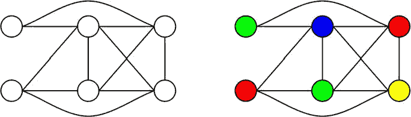

图 3.14 图染色问题的解决方案。

更正式地，给定一个图 `G = (V, E)`，其中 `V` 是顶点集合，`E` 是边集合，以及一组颜色 `C`，其（决策）变量是向量 `color[v]`，其中 `v ∈ V`。每个变量 `color[v]` 的域是颜色集合 `C`。对于每条边 `(v, w) ∈ E`，我们有约束 `color[v] != color[w]`。

相应的图染色 COP 是找到为图顶点染色所需的最小颜色数，使得两个相邻顶点被赋予不同的颜色。

图染色可用于各种实际和工业问题，如调度问题、模式匹配或课程表安排。

##### 字母术谜题

经典的字母术谜题是 `SEND + MORE = MONEY` 问题，其中每个字母必须被替换为不同的数字，使得该加法是正确的，如图图 3.15 所示。唯一的解是 `9567+1085=10652`。该谜题的一种可能模型是使用变量集 `{S, E, N, D, M, O, R, Y}`，域为 `{0,…9}`，以及四个额外的进位变量 `{C[1], C[2], C[3], C[4]}`，域为 `{0,1}`。约束 `allDiff(S, E, N, D, M, O, R, Y)` 表示所有变量必须有不同的值。加法的约束随后被建模为：

$$
\begin{matrix}
&S \neq 0;\quad M \neq 0\\
&D + E = 10C_1 + Y\\
&C_1 + N = 10C_2 + E\\
&C_2 + R = 10C_3 + N\\
&C_3 + S = 10C_4 + O\\
&C_4 = M
\end{matrix}
$$

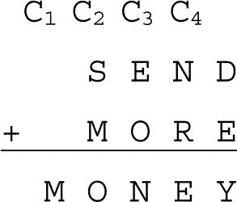

图 3.15 字母术谜题。

##### 数独

数独是一种玩在 9×9 网格上的经典游戏，分为 9 个 3×3 的宫。每个单元必须填充 1–9 的数字，使得每行、每列和每个宫的数字不同。某些单元给出了特定的值。示例如图图 3.16 所示，其中小数字是单元的可能值。

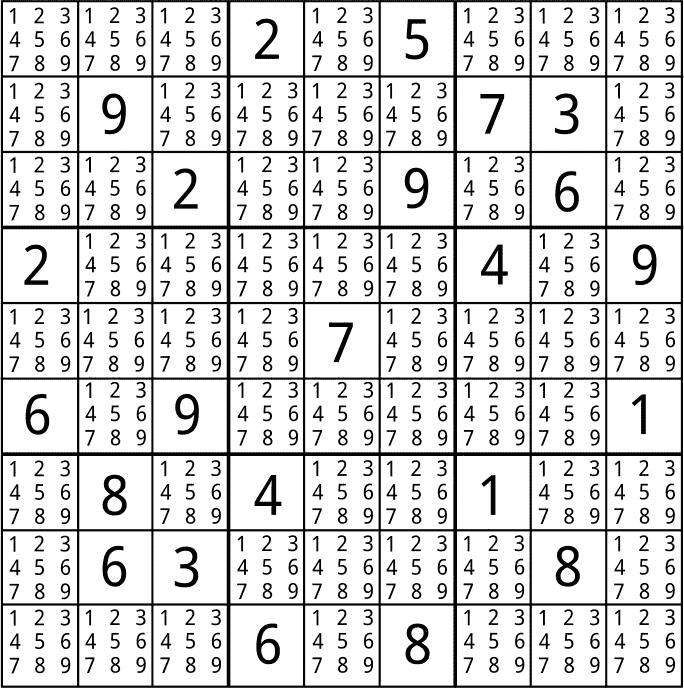

图 3.16 数独。

数独的模型每个单元有一个变量，即 81 个变量，每个变量的域为 `{1,...,9}`。每行、每列和每个宫都有 `allDiff` 约束。`allDiff(X)` 约束要求 `X` 中的所有变量不同。然后是对数独实例中给定单元的约束。

#### 3.3.1.2 求解范式

有许多求解 CSP 和 COP 方法。对不同的范式进行分类有助于理解和比较。将使用两个分类标准。第一个区分了扰动性和构造性方法，而第二个区分了系统性和不完全搜索。

在扰动性方法中，候选解是完全解（为每个变量分配一个值）。新解通过对现有解的修改或扰动产生。搜索在系列候选解上进行。如图图 3.17 中的图染色所示，每一步修改一个顶点的颜色。

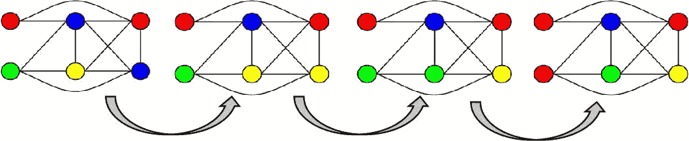

图 3.17 图染色：扰动性方法。

在构造性方法中，候选解是部分解（为部分变量分配值），并且部分解被逐步扩展。如图图 3.18 中的图染色所示，每一步对一个新的顶点染色。

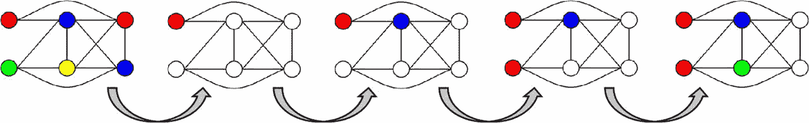

图 3.18 图着色：构造性方法。

在系统化方法中，整个搜索空间被系统化地探索。因此，该方法是完备的；它能为 `CSP` 找到精确解，并为 `COP` 找到最优解。如果没有找到解，则证明了解的不存在性。当然，对于大规模的问题实例，系统化方法的计算开销可能非常大。


在不完备方法中，搜索空间的探索是基于邻域函数的。该方法是不完备的，体现在它可能找不到`CSP`的精确解，而只能找到一个可能违反某些约束的近似解。对于`COP`，它会找到一个良好但未被证明是优解的解。不完备方法的计算开销较小，通常允许我们为大型问题实例找到一个合理的（近似）解。

解决`CSP`和`COP`的不同范式可以根据上述两个标准进行分类，如表 3.2 所示。在本章中，将介绍两种范式：局部搜索和约束规划。

**表 3.2 CSP 和 COP 的求解范式**

|  | 系统化 | 不完备 |
| --- | --- | --- |
| 扰动性 | 单形法 | 局部搜索 |
|  | 系统化局部搜索 | 遗传算法 |
| 构造性 | 动态规划 | 贪心算法 |
|  | 分支限界法 | 蚁群优化 |
|  | 约束规划 | GRASP |
|  | DPLL SAT 求解器 |  |

### 3.3.2 通过局部搜索求解优化问题

局部搜索算法解决的是仅关乎解状态的问题，而不关心到达该状态的序列或路径成本。除了寻找目标状态外，它们还用于解决优化问题，其目标是找到使代价函数最小化的值。

局部搜索涵盖了一类具有共同属性的方法。该方法是不完备且具有扰动性的。它通过在当前解的邻域内寻找更好的解来迭代改进解。当搜索停止时，并不能证明给定的解是最好的。

#### 3.3.2.1 从 CSP 到 COP

在`CSP`中，必须找到一个解，即满足所有约束的变量赋值。这里没有给定的用于优化的目标函数。由于局部搜索是一个优化过程，应先通过引入代价函数将`CSP`转换为`COP`。

约束集被分为两组：硬约束和软约束。硬约束集（可以为空）包含了局部搜索所考虑的所有解都必须满足的约束。对于每个软约束，使用代价函数或违规函数来衡量给定解对约束的违反程度。然后，解的代价被计算为所有软约束的违规代价之和。

由此得到的`COP`目标函数（在局部搜索中通常称为代价函数）随后被用于寻找最优解。当给定解的代价达到 0 时，它就是原始`CSP`的一个解。如果搜索在代价不为零时停止，那么得到的解只是近似解，因为它仍然违反了某些软约束。

当初始问题是一个`COP`时，用于局部搜索的代价函数应该结合`COP`的目标函数和软约束（如果有）的违规函数。代价函数通常形式如下：

$$
\begin{array}{r}
\operatorname{cost}(\mathit{x}) = \\
\mathit{\alpha}\operatorname{obj}(\mathit{x}) +
\mathit{\beta}\operatorname{cost\_soft}(\mathit{x})
\end{array}
$$

其中`x`是决策变量，`obj(x)`是`COP`的目标函数，`cost_soft(x)`是软约束的代价，`α`、`β`是实值。这种代价函数结合了最优性和可行性。

##### 图划分

给定一个图，将顶点划分为等大小的集合，使得集合之间的边数最小，如图 3.19 所示。更正式地说，给定一个图`(V, E)`，其中`V`是顶点集，`E`是边集，找到一个划分`V1, V2`，使得`v ∈ V1 ∧ w ∈ V2`。目标是最小化`V1, V2`。这个问题被认为是 NP 类的。


图 3.19 图划分：示例。

#### 3.3.2.2 邻域

解`p`的邻域是与`p`相似或接近的解集。接近性通常通过计算来衡量。因此，邻域中的解可以从`p`轻松计算。邻域可以通过解上的一个或多个算子来定义并产生一组解。这些算子在计算上必须是高效的。

邻域的一个重要属性是连通性，即从每个解都有通往最优解的路径。这条路径是解`p[1], p[2], ...`的序列，其中每个`p[i+1]`都是`p[i]`的邻域。当然，较大的邻域会导致通往最优解的路径更短，但需要更多时间来探索。

如果初始问题对解有约束，邻域中的每个解是否应该遵守这些约束？如果这些约束视为硬约束，则生成邻域的算子必须设计为满足这些约束。如果这些约束视为软约束，则邻域更大，因为它包含违反这些约束的解，但代价函数将整合这些软约束的违反情况。

##### 图划分

在图划分问题中，如果平衡约束是硬约束，那么平衡解的邻域必须包含平衡解。一个简单的邻域可以通过交换`V1`和`V2`中的顶点来定义。如果平衡约束被视为软约束，那么可能的邻域是将顶点从一个集合移动到另一个集合。此时代价函数应整合软约束的代价。在下面的图划分代价函数中，软平衡衡量了解与平衡解的（平方）距离。

这两个邻域在图 3.20 中所示。对于问题中的约束，选择硬约束还是软约束是一个设计决策，并且高度取决于具体问题。选择软约束可能会缩短通往最优解的路径，但也可能极大地扩大搜索空间。

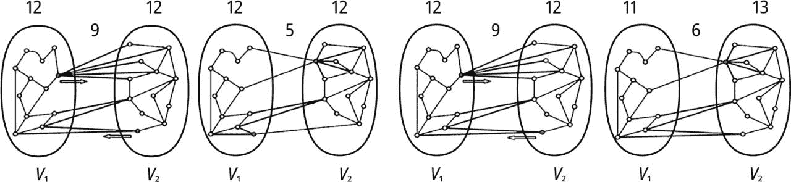

图 3.20 图划分：两种邻域定义下的解决方案。

### 3.3.2.3 启发式算法与元启发式算法

在局部搜索中，启发式算法定义了如何在当前解的邻域中选择下一个解。启发式算法利用局部信息，即当前解及其邻域。

启发式的第一个属性是它是否总是能改进当前解的代价，还是可能出现退化。第二个属性与对邻域的搜索有关；它是探索还是随机选择？改进背后的逻辑是将搜索集中于高质量解，这被称为强化（intensification）。随机性和退化背后的逻辑是将搜索引向搜索空间的其他区域，这被称为多样化（diversification）。平衡强化与多样化的不同策略导致了不同类型的启发式算法。下文介绍了一些经典的启发式算法。

`Hill climbing`探索邻域并始终改进当前解的代价。`Best-improvement`是在搜索整个邻域以寻找最佳解的爬山算法，而`first-improvement`则在找到一个更好的解时就会停止。如果邻域中没有解可以改进当前解，则局部搜索停止在当前（局部）最优解。由于需要搜索整个邻域，`Best-improvement`的代价更高。

`Random walk`在邻域中随机选择下一个解；因此代价可能会退化。`Random improvement`随机选择一个候选解；但只有在它改进了当前解时才会被接受。否则，当前解保持不变。

`Metropolis`启发式算法随机选择一个候选解。如果它改进了当前解，则接受候选解作为新的当前解。如果它导致当前解退化，则以较小的概率接受，这通常取决于退化的程度：退化越严重，被接受的概率越小。

虽然启发式算法专注于选择下一个解，但元启发式算法引导搜索过程走向全局最优解，因此试图逃离局部最优。这通常在局部搜索期间收集信息。针对局部搜索定义了许多元启发式算法。

`Simulated annealing`（模拟退火）类似于冶金学，加热会导致分子更自由地移动到不寻常的位置。在冷却过程中，运动受到更多限制。在这种元启发式算法中，温度变量在局部搜索期间会降低。该温度被应用于每一步的`Metropolis`启发式算法中；在高温下，接受候选解的概率比低温时高。在局部搜索的开始，退化更容易被接受，有利于多样化；而在局部搜索结束时，退化不容易被接受，有利于强化。

`tabu search`（禁忌搜索）元启发式算法的想法是选择一个尚未访问过的邻域。由于很难追踪所有访问过的解，禁忌搜索维护最后访问解的抽象。这种抽象可以基于所选的算子或解的某些属性。不断演化的禁忌列表列出了拒绝候选解的标准。如果候选解在禁忌列表中，则被拒绝。

禁忌列表的抽象并不将拒绝限制在已访问的解上。禁忌搜索通常维护目前找到的最优解，因为所选的启发式算法可能会降低当前解。禁忌搜索通常与`aspiration`（启发）元启发式算法结合，如果候选解改进了目前的最优解，则覆盖禁忌拒绝。

在`variable neighborhood metaheuristic`（变邻域元启发式算法）中，局部搜索期间会使用一系列（尺寸不断增加的）邻域。引导`local search`或`dynamic local search`元启发式算法使用一系列代价函数来逃离局部最优。`Adaptive local search`（自适应局部搜索）提供了一个通用的框架，启发式算法和元启发式算法在搜索过程中动态调整。

#### 3.3.2.4 终止

局部搜索是不完全的。无法知道当前解是否是最优，也不知道其代价距离最优值有多远。但只要搜索停止，就会提供一个解。终止通常通过时间限制定义。

某些元启发式算法有自己的终止准则。例如，在模拟退火中，当温度根据温度调度达到零时发生终止。

为了有利于多样化，从不同的随机初始解进行多次局部搜索是有意义的。这就是`Random restart`（随机重启）所做的，最后返回最佳解。`Iterated local search`（迭代局部搜索）通过从接近上一次迭代找到的解的随机初始解开始迭代局部搜索，有利于强化。

### 3.3.3 通过约束规划求解问题

#### 3.3.3.1 作为搜索问题的 CSP

`CSP`可以使用搜索算法（如深度优先搜索）来求解。初始状态为空赋值。后继函数在不违反任何约束的情况下为某些未赋值变量赋值。目标测试是让所有变量都被赋值。

约束规划（CP）为解决`CSP`和`COP`提供了一个通用框架。它可以被视为一种独立于问题的通用搜索算法。CP 还提供了通用启发式算法。实践中，CP 语言允许为`CSP`或`COP`建模，并提出引导和增强搜索的机制。

CP 语言示例有 Choco、IBM CP Optimizer、Gecode、OR-Tools、Oscar 和 JaCoP。SAS/OR 和 Cali Xpress 也有 CP 模块。

CP 计算模型基于两个步骤。`propagation`步骤减少（决策）变量的域，而`search`步骤将问题分解为简单的子问题。这两个步骤迭代，直到找到解或证明问题无解。

#### 3.3.3.2 约束的传播

当变量的域被修改时，传播的目标是利用这些信息快速减少其他变量的域。传播通过应用一致性算法来实现，该算法局部考虑约束而不是考虑问题的所有约束。传播旨在达到某种一致性水平。可以考虑不同的层次，每一层都比前一层提供更多剪枝。当然，更高层次的一致性需要更多的计算。

任何一致性算法必须遵守两个属性。首先，它永远不会移除属于`CSP`解的变量值。这确保了将找到所有的解。其次，如果将一致性算法应用于所有变量已赋值的`CSP`，则该一致性算法简化为可行性测试。这确保了当所有变量都被赋值时，所得赋值是`CSP`的解。

##### 前向检查

当搜索过程为变量分配值时，前向检查（forward checking）仅考虑涉及该变量的约束，此时除一个变量（假设为`Y`）之外的所有变量都已分配值。随后，前向检查从`Y`的定义域中移除所有违反约束的值。显然，被移除的值不能成为构造解的一部分。前向检查在图 3.21 中的图着色问题进行了说明。

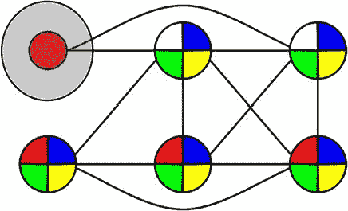

图 3.21 图着色的前向检查。为了遵守约束，从两个邻居节点中移除了“红色”。

##### 一致性（Domain consistency）

域一致性，也称为弧一致性（arc consistency），在二元约束`c(X, Y)`上更容易解释。即使没有任何变量被赋值，也可能从`X`和`Y`的定义域中移除值。域一致性会移除`X`定义域中任何使得`Y`定义域中不存在满足约束的值，对于`Y`的定义域亦是如此。显然，所有被移除的值都不能成为构造解的一部分。

当所有这些不可能的值都被移除后，该约束被认为是域一致的。更准确地说，二元约束`c(X, Y)`是域一致的，当对于`X`定义域中的每个值`a`，在`Y`定义域中都存在一个值`b`使得`c(a, b)`成立。域一致性在图 3.22 中的二元约束`X ≥ Y + 2`上进行了说明。


图 3.22 对于`X ≥ Y + 2`的域一致性。

##### 边界一致性（Bound consistency）

边界一致性是域一致性的较弱形式，变量的定义域通过区间`[min Domain(X), max Domain(X)]`进行近似。仅验证定义域的边界是解的一部分。因此，值永远不会从定义域中间移除；只移动边界。这种裁剪虽然较弱，但对于某些约束（如算术约束），这种裁剪可以高效地实现。

##### 不动点计算（Fixpoint computation）

传播需要迭代该过程，直到没有更多值可以被移除。这一过程被称为不动点计算。如果我们考虑在图 3.22 中约束`X ≥ Y + 2`上实现的域一致性传播，变量`X`（以及`Y`）的定义域已被修改。所有其他涉及`X`的约束都应该被（重新）考虑，因为`X`定义域中值`{1,2,3}`的移除可能意味着另一个变量定义域中值的移除。

当没有更多值可以移除时，即达到不动点，`CSP`是域一致的，即在假设域一致性是选定的一致性水平的情况下，它的所有约束都是域一致的。一致性算法是一种为`CSP`实现某种一致性的算法。


#### 全局约束（Global constraint）

诸如`allDiff(X, Y, ...)`之类的全局约束在图 3.22 中的二元约束`X ≥ Y + 2`上进行了说明。（等待，源文本在此似乎有重复描述，此处保留核心内容。）

诸如`allDiff(X, Y, ...)`之类的全局约束在图 3.22 中的二元约束`X ≥ Y + 2`上进行了说明。（等待，源文本在此似乎有重复描述，此处保留核心内容。）

> 注：根据提供的文本，“全局约束”部分包含重复/碎片化的引用。我保留了提供的核心语义定义。


图 3.23 数独格上的`allDiff`全局约束。

#### 3.3.3.3 搜索（Search）

搜索隐式地构建了一个搜索树。树的每个节点包含一个`CSP`，它与根节点的区别在于定义域。根节点包含初始`CSP`。

搜索和一致性检查交替进行。在给定节点处，搜索算法首先应用一致性算法。如果某个变量的定义域为空，则该节点的`CSP`无解，是一个失败节点。如果所有变量都已赋值，则该赋值是`CSP`的解，该节点是解节点。

在任何其他情况下，搜索算法选择一个具有非单定义域的变量，并为变量的不同值创建子节点。子节点中的`CSP`是父节点`CSP`的拷贝，但分配了一个新变量。搜索树是有限的，通常使用深度优先策略进行遍历。

图着色`CSP`的搜索树（部分）示例在图 3.24 中所示。根节点是初始`CSP`，六个变量中的每个定义域都有四种颜色。在子节点中，选定的变量及其选定的值（其颜色）被高亮显示。在根节点的子节点中，左上角的变量被选中并设置为红色。随后应用域一致性算法，从其两个邻居变量中移除了红色。树的左下角有两个节点是失败节点，因为它们包含变量定义域为空的`CSP`。右下角的节点是解节点，因为所有变量都已赋值。

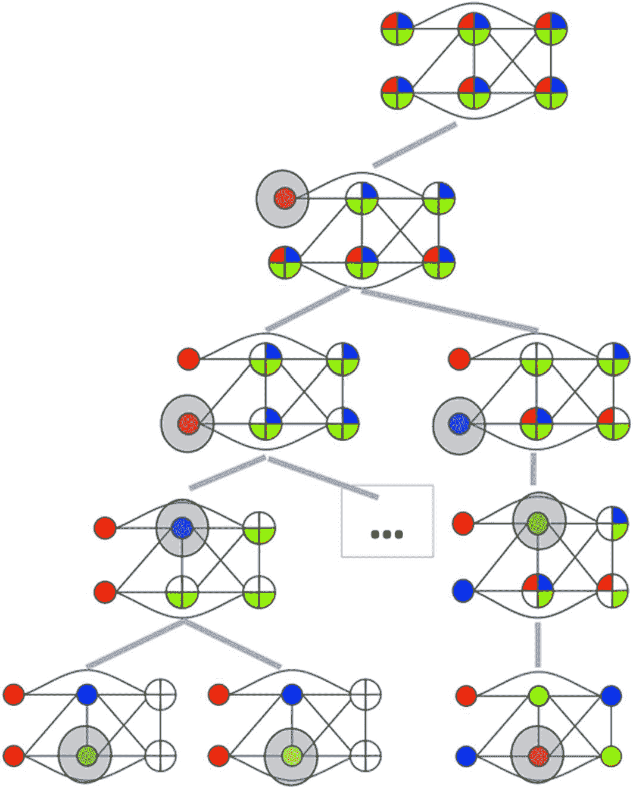

基础搜索算法说明 CP 搜索由两个部分组成：搜索树的定义和遍历搜索树的探索策略。为搜索问题定义的不同探索策略都可以用于此语境。DFS 是标准方法，尽管可以使用边缘节点的某种质量度量来应用最佳优先搜索。

搜索树的定义由分支策略决定，即如何生成给定节点的子节点。在标准分支策略（称为`labeling`，即标记）中，会选择一个变量，并为该变量域中的每个值创建一个子节点。存在许多启发式方法来引导待标记变量的选择。

`domain`（域）启发式方法选择域最小的变量，因为这种选择可以最大限度地缩小搜索树的大小。`degree`（度）启发式方法选择涉及约束数量最多的变量。如果`CSP`无解，这种选择将迅速引导搜索进入一个失败节点。

### 优化问题

对于`COP`，即在`CSP`变量上定义了目标函数`f(x)`的约束优化问题，可以使用分支定界法来寻找最优解。一旦找到解（目标函数值为`f*`），该解就会被存储为当前最优解，并在`CSP`中添加一个额外的约束`f(x) < f(*)`。

有了这个新约束，系统将只找到能够改进目标函数值的解，从而从搜索空间中剪枝掉非最优解。当找到更好的解（值为`f(**)`）时，它将替换当前的最优解，且额外约束被替换为约束`f(x) < f(**)`，以此类推，针对每一个更好的解。当搜索完成（即无法再次找到更好的解）时，当前最优解即为`COP`的最优解。

### 大邻域搜索

CP 是一种系统方法。因此，它是完备的，但需要探索整个搜索空间，这可能非常昂贵，特别是对于并不总是需要证明最优性的`COP`。

大邻域搜索（LNS）是一种局部搜索元启发式算法，可以应用于包括 CP 在内的许多框架。这种方法是不完备的，但会将搜索引导至搜索空间中有前景的区域。

LNS 迭代地应用两个步骤：松弛和重构。松弛释放目前找到的最优解的部分，即选择某些随机变量变为未实例化。松弛后的`CSP`比原始问题简单，并且包含了最优解的部分，因此看起来很有前景。重构尝试求解松弛后的`CSP`。

如果重构找到了更好的解，则进行新的迭代。如果重构在固定时间内未能找到更好的解，则将从之前的解开始，通过不同的松弛开始新一轮迭代。

### 3.3.4 约束满足问题的局限性是什么？

`CSP`和`COP`提供了问题的声明式描述。然后可以通过不同的技术来求解。系统方法可以确保在存在解时找到解，或者证明无解。然而，它在计算上的开销更高。不完备方法的计算开销较低，但不能保证找到解。

得益于其扰动性和不完备的方法，局部搜索无论选择的计算时间如何，总是能提供一个（近似）解。对于许多问题，近似解通常是足够的，而且显然比没有解要好。局部搜索通常不提供从代价解到最优解之间距离的估计。局部搜索需要设计和编写邻域以及代价函数。


约束编程（CP）是构造性且扰动性的，因此只要解存在，它总是提供解。`CSP` 和 `COP` 提供了问题的声明式描述。然后可以通过不同的技术来求解。系统方法可以确保在存在解时找到解，或者证明无解。然而，它在计算上的开销更高。不完备方法的计算开销较低，但不能保证找到解。

得益于其扰动性和不完备的方法，局部搜索无论选择的计算时间如何，总是能提供一个（近似）解。对于许多问题，近似解通常是足够的，而且显然比没有解要好。局部搜索通常不提供从代价解到最优解之间距离的估计。局部搜索需要设计和编写邻域以及代价函数。

约束编程（CP）是构造性且扰动性的，因此只要解存在，它总是提供解。`CSP` 和 `COP` 提供了问题的声明式描述。然后可以通过不同的技术来求解。系统方法可以确保在存在解时找到解，或者证明无解。然而，它在计算上的开销更高。不完备方法的计算开销较低，但不能保证找到解。

### 3.3.5 行业示例：Maersk Industry A/S 的集装箱配置

#### 3.3.5.1 产品配置

配置产品满足特殊需求对公司来说变得越来越重要。配置器用于将客户规范转换为集装箱配置。例如，客户可以选择控制集装箱内温度的冷凝器类型、电池包类型或集装箱外的面板类型。根据这些属性的规格，配置好的集装箱可以作为输入生成提供给客户的报价，以及提供给马士生产部门的原材料和组件物料清单（BOM）。MCI 产品配置器开发在 `Microsoft Dynamics 365 Supply Chain Management` 中，这是一种企业资源计划（ERP）系统，配备了基于 `Z3`（一种求解器和定理证明器，微软软件研究院于 2015 年开源）的基于约束的产品配置工具。

##### 用例

Maersk Container Industry A/S（MCI）制造集装箱。在 MCI，配置器用于将客户规范转换为集装箱配置。图 3.25 展示了一个 MCI 集装箱的示例。

图 3.25 带有内置冷却系统的 MCI 集装箱示例。

配置产品以满足特殊和定制化需求，对于不同行业的公司来说正变得越来越重要。产品配置工具用于引导用户在考虑不同约束的情况下配置产品或流程。底层产品配置模型的定义由产品专家设计。他们首先定义了产品属性（`CSP` 的变量）及其可能值的取域。例如，马士基（Maersk）集装箱属性整合了控制集装箱内温度的冷凝器类型、电池包类型、新风交换模块或传感器模块类型，如表 3.3 所示。

表 3.3 MCI 产品配置器中的某些变量及其取域。

| 变量（属性） | 取域 |
| --- | --- |
| 大气控制（AC） | {手动通风（MV）, 自动通风（AV）, 自动通风（AV+）, 自动通风（AV+O2）} |
| 新风模块（FAM） | {手动通风（MV）, 自动通风（AV）} |
| 传感器模块（SM） | {无传感器（No）, CO2 传感器（CO2）, CO2 和 O2 传感器（O2）} |

在定义了产品配置变量及其取域后，专家需要通过定义约束来定义这些属性如何组合成单一的产品或服务。这些约束可以确保用户只能配置可以销售和生产的集装箱。例如，并不是所有类型的新风交换模块和传感器模块都能组合成一个集装箱。这些约束以表格的形式表示，表示一个或多个属性之间的有效组合。表格的每一列被分配给 `CSP` 的一个变量。每一行定义了变量值的有效组合。其他约束也可以在 `CSP` 中指定。例如，MCI 配置器使用如表 3.4 所示的表约束，表示某些新风交换模块和传感器模块的组合无法组合成单个集装箱。

表 3.4 MCI 产品配置器中的表约束。

| 大气控制（AC） | 新风模块（FAM） | 传感器模块（SM） |
| --- | --- | --- |
| 手动通风（MV） | 手动通风（MV） | 无传感器（No） |
| 自动通风（AV） | 自动通风（AV） | 无传感器（No） |
| 自动通风（AV+） | 自动通风（AV+） | CO2 传感器（CO2） |
| 自动通风（AV+O2） | 自动通风（AV+O2） | CO2 和 O2 传感器（O2） |

此示例中的约束确保产品配置器用户无法组装带有自动通风（`AV`）、自动通风（`AV+`）或自动通风（`AV+O2`），且带有自动通风（`AV`）、自动通风（`AV+`）或自动通风（`AV+O2`）以及 CO2 传感器（`CO2`）或 CO2 和 O2 传感器（`O2`）的集装箱。

命题公式通过以下符号形成：逻辑常量 `True` 和 `False`、命题变量（用字母字符串表示）、逻辑连接词（`¬` 表示否定、`∧` 表示合取、`∨` 表示析取、`⇒` 表示蕴含、`⇔` 表示等价）以及括号。

逻辑常量和命题变量都是命题公式。如果 `p` 和 `q` 是命题公式，那么 `(¬p)`、`(p ∧ q)`、`(p ∨ q)`、`(p ⇒ q)` 和 `(p ⇔ q)` 都是命题公式。

### 命题逻辑的语义

语义定义了命题公式的含义。更准确地说，语义在某个世界（其中某些事实为 `true`，其他事实为 `false`）的范围内为每个公式分配一个真值。对于给定的公式，一个可能的世界（称为 `interpretation`，解释）为公式的每个命题变量分配一个真值（`true` 或 `false`）。对于给定的解释 `I`，可以按照以下规则判定公式的真值：

- 逻辑常量 `True` 和 `False` 的真值分别为 `true` 和 `false`。
- 命题变量 `A` 的真值是 `A` 在解释中的真值。
- 形式为 `(¬p)`、`(p ∧ q)`、`(p ∨ q)`、`(p ⇒ q)` 或 `(p ⇔ q)` 的公式的真值取决于公式 `p` 和 `q` 的真值，遵循经典真值表。

#### 示例

给定一个赋值为 `(A = true`、`B = false`、`C = false)` 的解释，公式 `(A ∨ B) ∧ (B ⇒ ¬C)` 在此解释中的真值为 `true`，因为 `(true ∨ false) ∧ (false ⇒ (¬false))` 简化为 `(true ∧ (false ⇒ true))`，变为 `(true ∧ true)`，从而得出 `true`。

对于一个公式，存在公式为真的解释，也存在公式为假的解释。公式为真的解释被称为公式的 `model`（模型）。公式的含义（即其语义）随后由公式的模型定义。如果一个命题公式至少有一个模型，则它是 `satisfiable`（可满足的）；否则，它是 `unsatisfiable`（不可满足的）。当一个公式在所有解释下都为真时，它是 `valid`（也称为重言式）。我们显然有一个公式 `p` 是有效的，当且仅当 `¬p` 是不可满足的。两个具有相同命题变量的公式如果具有相同的模型，则它们是等价的。一个 `subformula` 总可以被等价的 `subformula` 替换而不会改变其语义。等价公式的经典示例见图 3.27。

| `p` | `q` | `¬p` | `p ∧ q` | `p ∨ q` | `p ⇒ q` | `p ⇔ q` |
| --- | --- | --- | --- | --- | --- | --- |
| `true` | `true` | `false` | `true` | `true` | `true` | `true` |
| `true` | `false` | `false` | `false` | `true` | `false` | `false` |
| `false` | `true` | `true` | `false` | `true` | `true` | `false` |
| `false` | `false` | `true` | `false` | `false` | `true` | `true` |

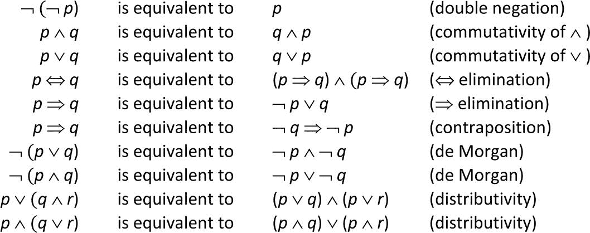

图 3.27 等价命题公式的示例。

### 满足性问题

满足性问题旨在判定给定的公式是否可满足。可满足命题公式集已形式化为 `SAT`。判定一个公式是否属于 `SAT` 是一个 NP 完全问题，因此需要指数级复杂度（假设 `P ≠ NP`）。如果公式有 `n` 个命题变量，解释的数量为 `2^(n)`。可以通过枚举公式的所有可能的解释来判定公式是否是可满足的。

示例：

```text
(A ∨ B) ∧ (B ⇒ ¬C)
```

### CDCL：引入子句学习

使用 DPLL 对搜索树的遍历是深度优先的。回溯是按时间的，因为搜索会返回到搜索树中的父节点。然而，当发现某个部分赋值会导致不可满足性时，无法从该不可满足性的源头中推导出任何信息。冲突驱动的子句学习（CDCL）通过在搜索遇到死胡同时引入非时间回溯，极大地改进了 DPLL。精确的描述超出了本章的范畴。CDCL 的效果是构建一个由原始子句推出的新子句，并阻塞当前分支以及其他许多共享导致不可满足性选择的分支。这是通过在部分变量赋值上构建一个推导图，并引入一个带有导致冲突的赋值取否定的新子句来实现。随后，可以直接回溯到搜索树中首先被赋值的、涉及新子句的变量。

### 通过局部搜索求解 SAT 实例

DPLL 和 CDCL 都是解决可满足性问题的完备且构造性的方法。尽管这些方法非常高效，但 SAT 是 NP-完全的，对于大型实例，始终存在复杂度屏障。存在基于局部搜索的 SAT 求解方法，即使用一种不完备且扰动的方法。从命题变量的（随机）初始赋值开始，在每一步中翻转一个变量的值。代价函数是未满足子句的数量，当代价降为零时即可找到解决方案。这个优化问题被称为 `max-SAT`，因为它旨在优化已满足子句的数量，这对于不可满足公式也很有趣。存在许多通过局部搜索求解 `MaxSAT` 的算法。例如，`GSAT` 和 `WalkSAT` 方法基于最小冲突（`MinConflict`）CSP 局部搜索，即选择一个翻转后使代价函数最小的变量。`WalkSAT` 还引入了一些扰动以增强多样性并避免局部极值。

### 3.4.2.3 问题建模

可以使用命题公式建模并描述为 SAT 问题的问题。这些问题可以使用 SAT 求解器来解决。得到的解决方案（即对变量进行特定的布尔值赋值）可以被表示为初始问题的解决方案。因此，SAT 求解器在各种可以将选项和依赖关系编码为命题公式的问题中非常有帮助，如下例所示，展示了一个旨在喝饮料的规划挑战。世界状态在这里由五个布尔状态建模，由五个命题变量表示：“是否有干净的杯子”（`CG`）、“是否有一瓶啤酒”（`BB`）、“杯子里是否有啤酒”（`BG`）、“我是否渴了”（`T`）以及“我是否快乐”（`H`）。初始状态，有一个干净的杯子（`CG`）、一瓶啤酒（`BB`），且人渴了（`T`）。杯子里没有啤酒（`¬BG`）且人不快乐（`¬H`）。有两个动作。动作 `MakeDrink()` 需要 `CG` 和 `BB` 作为前置条件，`BG`、`¬CG`、`¬BB` 作为效果。动作 `Drink()` 需要 `T` 和 `BG` 作为前置条件，`H`、`¬T`、`¬BG` 作为效果。目标是达到人快乐的状态。为了方便演示，假设目标是 `H`。现在该问题被建模为一个 SAT 问题。

为公式 `PLAN` 寻找模型可以确保获得一个从初始开始并在两个动作后到达目标状态的计划。为了找到模型，可以将公式 `PLAN` 转换为 CNF（合取范式），然后使用 SAT 求解器算法。以下变量赋值是公式 `PLAN` 的模型：

`\(\begin{matrix} {\mathit{C}\mathit{G}\_{0},\mathit{B}\mathit{B}\_{0},\neg\mathit{B}\mathit{G}\_{0},\mathit{T}\_{0},\neg\mathit{H}\_{0},} & {{MakeDrink}\_{1},\neg{Drink}\_{1},} & {\neg\mathit{C}\mathit{G}\_{1},\neg\mathit{B}\mathit{B}\_{1},\mathit{B}\mathit{G}\_{1},\mathit{T}\_{1},\neg\mathit{H}\_{1}}\ \\\\ & {\neg{MakeDrink}\_{2},{Drink}\_{2},} & {\neg\mathit{C}\mathit{G}\_{2},\neg\mathit{B}\mathit{B}\_{2},\neg\mathit{B}\mathit{G}\_{2},\neg\mathit{T}\_{2},\mathit{H}\_{2}} \\\\ \end{matrix}\)`

结论是第一个动作是 `MakeDrink`，第二个动作是 `Drink`。对于实际问题，命题公式可以从规划问题的形式描述中自动生成，例如在规划领域定义语言（PDLL）中，这是一个允许使用逻辑定义规划问题的语言族。命题公式还可以通过额外的子句进行增强，这些子句表示动作之间可能的互斥和/或可以通过算法推出的文字（`literals`）。

### 3.4.3 SAT 求解器的局限性是什么？

SAT 求解器用于解决布尔约束满足问题（CSPs）或任何可以建模为命题逻辑中满足问题的问题。命题逻辑的优点之一是它的简单性。它具有可组合性，这意味着不同的公式可以组合在一起而不影响它们各自的含义。尽管 SAT 是 NP 完全的，但现代 SAT 求解器非常高效，即使对于大型问题也是如此。命题逻辑的主要局限性是无法表示对象以及对象之间的关系。它还缺乏允许对不同对象陈述合取或析取的量词。在规划问题中，无法创建一个关于给定层级所有动作的公式。因此，实际问题的命题模型可能涉及数万个变量和数十万子句。尽管有这些局限性，SAT 求解器在解决复杂问题方面仍具备竞争力。

SAT 求解器已扩展到扩展理论满足性（SMT）求解器，例如 `z3`。此类求解器不仅解决 SAT，还解决更丰富逻辑上的公式，例如算术或未解释函数。SAT 求解器还与约束编程求解器结合，导致了用于运筹学应用的 `CP-SAT`。CDCL 技术是高效 SMT 求解器以及 `CP-SAT` 的基础。

### 3.4.4 工业实例：Maersk Container Industry A/S 使用 SAT 进行集装箱配置

Yves Deville Karen Veldeman Nikolaj Bjorner

#### 3.4.4.1 将产品配置建模为 SAT 问题

进一步开发了第 3.3.5 节中产品配置器的工业实例。产品配置模型被描述为一个使用具有有限域变量的 CSP，以及一组定义集装箱可能配置的约束。MCI 产品配置器还集成了 SAT 求解器。SAT 求解器依赖于仅使用布尔变量以子句形式编码所有约束。从表面上看，这可能看起来非常低级且可能丢失结构，但这种表示允许在高效的 SAT 求解器中使用子句进行高效传播。

传感器模块属性（SM）及其域编码到 SAT 可以通过三个布尔值 `SM.No`、`SM.CO2` 和 `SM.O2` 实现，其中当 `SM` 的值设置为 `x` 时，变量 `SM.x` 为真。为了确保在布尔变量的赋值中 `SM` 属性有一个值，在 CSP 中添加以下子句：`SM.No ∨ SM.CO2 ∨ SM.O2`。其他公式确保该属性不会被分配多个值：`¬(SM.No ∧ SM.CO2) ∧ ¬(SM.No ∧ SM.O2) ∧ ¬(SM.CO2 ∧ SM.O2)`。生成的子句随后也被添加：`¬SM.No ∨ ¬SM.CO2`、`¬SM.No ∨ ¬SM.O2`、`¬SM.CO2 ∨ ¬SM.O2`。其他属性也应添加类似的子句。

表 3.4 所示的表格约束表示，某些新鲜空气交换模块和传感器模块的组合不能组合到单个集装箱中。该表格约束应转换为子句。第一个想法是将表格的每行编码为合取式，这可能是指数级增长的。通过使用 Tseitin 变换可以避免这种指数爆炸，该变换为每行引入一个新变量。对于第一行，公式 `T1 ⇔ (AC.MV ∧ FAM.MV ∧ SM.No)` 关联了这些变量。生成的子句为 `AC.MV ∧ FAM.MV ∧ SM.No ∨ T1`、`¬T1 ∨ AC.MV`、`¬T1 ∨ FAM.MV`、`¬T1 ∨ SM.No`。其他行也添加了类似的子句。

## 4 一阶逻辑推理

Bart Bogaerts

### 4.1 为什么使用一阶逻辑进行推理在更广泛的人工智能（AI）领域中很重要？

在本章中，我们关注的通用目标是开发所谓的基于知识的代理，它可以根据存储在所谓`知识库`中的丰富知识进行推理。虽然后面的章节关注`学习`，但在本章中，我们假设知识是`提供的`，通常由领域专家提供。

在表示知识时，有几点需要注意。首先是`扩展容忍`（elaboration tolerance）原则；即当世界变化时（例如引入了新法律、公司政策转变、环境改变），智能体的知识库应该易于更新，并跟上变化。为了实现这一点，以一种`清晰`、`易懂`且最好是`模块化`的方式呈现知识至关重要。第二个问题是底层知识也应该只被`表示一次`。如果智能体的多个目的依赖其领域知识，它应该能够使用该知识的单一表示来保证一致性。换句话说，`知识的表示与要解决的任务无关`。

一旦智能体配备了上述知识库，我们就希望它能执行各种类型的任务，解决问题领域中出现的问题。因此，本章涉及两个主要任务：

1. `(1)` 如何以一种人类和计算机都能理解的方式表示知识；
2. `(2)` 如何利用这种表示出的知识进行不同形式的（确定性）推理。

对于前者，我们首先学习一阶逻辑（FOL），这比上一章的命题逻辑丰富得多的逻辑；对于后者，我们将证明事实上，一阶逻辑中的理论允许各种推理机制。

一阶逻辑在此被选为基础语言是因为它的历史重要性，而且由于它的连接词简单，并具有明确且清晰的非正式语义（依此意思是，一阶逻辑中语句的正式含义通常是人们预期的那样；例如，一阶逻辑包含一个量词 `∀`，非正式地可以读作“对于所有”；正如所预期的，形式为 `∀x : ϕϕ(x)` 的公式在 `ϕ` 对所有可能的对象都真的情况下成立）。然而，还存在许多知识表示语言，它们考虑了不同的标准（推理方法的效率、语言的表达能力等）；我们将在章的后半部分讨论替代方案，并在第 5 章中讨论被称为“描述逻辑”的知识表示语言，这些语言是专门为了使演绎推理变得可判定的而设计的。


在上一章中，我们学习了命题逻辑，并看到现代 SAT 求解器如何轻而易举地解决命题逻辑的可满足性问题。然而，从`表示`的角度来看，命题逻辑是有局限的：它所表示的知识总是特定于实例的；它缺乏独立于实例的、简洁表示问题领域知识的表达能力。

在整个章中，我们将使用`医院排班`作为一个贯穿始终的示例。在这种情况下，一个非常自然的知识是每个人在每个班次期间只能被分配一项任务（没有人能同时做两项任务）。虽然在自然语言中指定这一点很容易，但在命题逻辑中独立于具体实例来这样做并不容易（事实上，甚至是不可能的）。

当然，在给定具体员工集合的情况下，在命题逻辑中编码这种自然语言约束是`可能`的，但这种编码将具有以下不理想的属性：

- 它是特定于实例：如果员工集合发生变化，编码也会发生变化；
- 它难以阅读，因此难以理解。

此外，命题逻辑的一个固有缺陷是，当实例变大（人员更多或任务更多）时，每个人最多做一份工作的知识表示也随之增大。例如，当考虑员工集合`A`、`B`和`C`，对应任务`T1`和`T2`以及两个班次`S1`和`S2`时，我们可以使用命题变量`p`，其中`E`代表员工，`T`代表任务，`S`代表班次，其中`pETS`有预期的解释（预期的解释是`pETS`成立，且仅当`E`在班次`S`时被分配了任务`T`），我们可以构造如下编码：

```latex
\begin{matrix}
& \neg(pAT1 \land pAT2) & \text{对于每个员工 A,} \\
& \neg(pBT1 \land pBT2) & \text{对于每个员工 B,} \\
& \neg(pCS1 \land pCS2) & \text{对于每个员工 C}
\end{matrix}
```

虽然这个公式正确地描述了给定实例的自然语言，但它带来了理解性和可维护性的问题：很难透明地让人相信其正确性，尤其是当实例变大时；如果有效表的知识发生变化，甚至任务集发生变化，整个公式都需要更新。此外，即使有人能相信这种编码的正确性，也无法对其他实例得出结论。命题逻辑表示的这些局限性与自然语言表达式“每个人一次最多做一份工作”的简单性形成了鲜明对比。

为了解决理解问题，与其使用实际的命题理论，不如使用生成命题理论的`模式`。具体来说，这里可以是如下形式：

```latex
\begin{matrix}
\neg(pEX \land pEY) & \text{对于每个员工 E，每个班次 S,} \\
& \text{以及两个不同的任务 X 和 Y.}
\end{matrix}
```

这种表示解决了理解问题，但它也有其他缺点，最显著的是非正式的，计算机无法读取。这正是高表达表示语言（如一阶逻辑）发挥作用的地方：一阶逻辑为我们提供了以正式方式简洁表达排班问题底层知识的方法。具体来说，在一阶逻辑中，我们将使用一个关系`Assignment`，其预期解释为`Assignment(e, t, s)`成立，当且仅当员工`e`在班次`s`被分配了任务`t`。那么，每个人在每个班次最多被分配一项任务的约束就变成了：

```latex
\begin{matrix}
& \forall e, \forall s, \forall t1, \forall t2:(t1 \neq t2)\Rightarrow\neg(Assignment(e, t1, s) \land Assignment(e, t2, s)),
\end{matrix}
```

或者等价于：

```latex
\begin{matrix}
& \forall e, \forall s, \forall t1, \forall t2:Assignment(e, t1, s) \land Assignment(e, t2, s)\Rightarrow t1 = t2,
\end{matrix}
```

这直观地表明，如果在一个给定的班次`s`为单个员工`e`分配了任务`t1`和`t2`，那么`t1`和`t2`实际上必须相同。此外，对这种知识提供独立于特定问题的形式化描述，为我们提供了将其用于各种类型推理的手段。事实上，关于“什么构成良好的调度”的知识独立于任何要解决的问题；虽然它通常与该问题相关联，但这种知识在本质上与`寻找调度`问题并不相钩。例如，它也可以用于`证明所有有效调度都满足的属性`，也就是说，`不依赖于特定实例`地进行推理。

## 4.2 使用一阶逻辑进行推理解决的是哪类问题？

本章的重点在于出现在`知识密集型问题领域`中的问题。这些领域具有背景知识，这些知识可以是显式存在的（例如，以法规、政策等的形式），也可以是隐式存在的（例如，在领域专家的脑中）。在第 7 章中，我们将学习在知识`不是`显式可用，而是希望从数据中`学习`它的情况下如何构建智能体。在这些领域中，我们关注的是那些可以根据这些背景知识`明确地`且`确定地`定义解决方案的问题。在第 6 章中，我们将看到其他以`概率性`方式工作的推理形式，例如考虑对世界的不确定性。

此类知识密集型问题领域的示例包括：`决策管理`（日常业务决策的底层逻辑可以被显式化）、`调度`（关于什么构成有效调度的知识可以显式化）、`产品配置`（关于什么构成良好配置的信息可以显式化）、法律推理（法律或法规可以显式化）等。

在这样的知识密集型领域中，可能会出现许多不同的问题；基于逻辑推理的研究部分是关于将此类问题归类为更通用的问题模式。这些通用模式是独立于当前问题领域定义的，直接根据逻辑表示进行定义。此类通用推理方法的示例包括：

- `模型检查`（Model checking）：给定一个状态的完整规范，检查该状态是否确实满足了已显式化的知识。例如，如果知识描述了“什么是有效调度”，而该状态是一个具体的提议调度（可能是手动创建的），那么这项任务就简化为检查手动创建的调度是否确实满足了调度约束。

- `模型扩展`（Model expansion）：给定一个状态的部分描述，将其完善为`完整的`描述，`以这种方式使得`给定的知识得到尊重。在调度的示例中，状态的部分描述可以是关于可用房间、人员和班次的信息，但不应包含关于实际调度的信息。

- `查询`（Querying）：给定一个世界的表示，找到所有满足特定公式的实例。这种查询类型完全对应于数据库查询。

- `（有限域）传播`（Propagation）：给定关于世界的部分信息，根据显式知识推导出更多信息。例如，在构建部分调度的情况下，自动推理器可能已经推断出某些员工在某些时刻无法执行某些任务（因为他们在该时刻已经有了其他任务，或者因为法规禁止安排连续的班次）。

- `演绎`（Deduction）：检查某个句子是否从形式化的知识中推导出。例如，在调度用例中，可以使用此来验证是否遵守了当地的安全法规。

本章中介绍的所有方法都将基于领域知识的显式表示。然而，这并不意味着`所有`知识都需要被表示。

## 4.3 如何解决这些问题？

为了解决上述的知识密集型领域的问题，我们需要：

- 一种可以表示领域知识的语言。这种语言应该既能被计算机理解（用于推理），也能被人类理解（为了透明性，以及便于维护和更新）。
- 能够利用这些知识的推理引擎。

至于语言，本章侧重于一阶逻辑，因为它在不同领域具有历史重要性、丰富的连接词以及直观的非正式语义。然而，还存在许多其他的知识表示语言，每种语言都是为了特定的目标而设计的。以下是一些非详尽的示例列表。

例如，第 5 章关注的是描述逻辑的研究（Baader et al., 2003），这些逻辑本质上是一阶逻辑的`limitations`，能够实现高效的演绎推理。另一方面，在其他语言中，一阶逻辑的表达力是被`extended`而不是减少，例如通过添加二阶特征（例如 ProB 中的 Leuschel and Butler, 2003，以及 Alloy 中的 Jackson, 2002）。

一阶逻辑中的陈述本质上是`objective`的，它们要么在世界上为真，要么为假。然而，在某些情况下，人们可能想要表达的不是真实世界的知识，而是关于`state of mind of an agent`（代理的心智状态）。例如，在某些情况下，推理`what another agent knows`（另一个代理知道什么）可能很有用。为此，各种`epistemic logics`（认识逻辑）被开发出来（Hintikka, 1962；Fagin et al., 1995；Halpern and Moses, 1990）。

一阶逻辑是一种`monotonic`（单调的）逻辑。这意味着，如果从一组有限的陈述可以得出结论，添加更多的陈述永远不会撤销该结论，只能让我们得出`more`结论。某些自然语言陈述并不具备这种属性。例如，如果告诉我“鸟通常会飞”，并且“Tweety 是一只鸟”，那么假设 Tweety 会飞是自然的。然而，当给定更多信息时，例如 Tweety 实际上是一只企鹅，该结论可能会失效。这类逻辑在`nonmonotonic reasoning`（非单调推理）领域被研究（Reiter, 1980；Moore, 1985；McCarthy, 1986；Gelfond and Lifschitz, 1988）。其他以一阶逻辑为基础的语言类型包括：

- 表达`dynamic`领域的语言，其中世界在时间设置上建模，动作可以改变世界的状态（Reiter, 2001；Mueller, 2007；Reiter, 1991）；
- 表达`causal information`的语言（Pearl, 2000；Pearl and Mackenzie）；
- 表达`spatial relations`的语言（Cohn and Renz）；
- 领域特定语言，用于表示关于特定应用领域的知识。例如，在建模业务逻辑和管理的案例中，已经提出了几种领域特定语言（Group, 2008；Governatori, 2005；Abdelsalam and Shoaeb, 2016）。

### 4.3.1 在一阶逻辑中表示知识

为了在一阶逻辑中表示知识，我们将讨论三个重要的概念。

第一个是`vocabulary`（词表）；它指定了我们将使用的符号集合。通过选择词表并对每个符号的非正式语义（现实世界中的意义）达成一致，我们确定了可以对世界中的哪些概念表达知识。

第二个是`structure`（结构），由领域（世界中所有对象的集合）以及符号的解释组成；它是对世界的抽象表示；它为每个符号分配一个值（正确的类型，见下文）。

第三个是`formula`（公式），表示要形式化的实际知识；它应该遵循一阶逻辑的`syntax`（语法）。一阶逻辑的`semantics`（语义）用于确定公式是否在给定世界中被满足。

#### Vocabularies

命题逻辑从一组`propositions`（命题，即在世界上为真或为假的陈述）开始，而一阶逻辑认为世界是由（不同集合的）对象（通常称为`domain elements`）组成的，并且对象之间存在`relations`（关系）和`functions`（函数）。不巧的是，这种假设与关系数据库背景下的假设非常相似。当然，现实世界是否真的由此类对象和关系组成是有争议的，但知识表示也起始于需要对世界进行某种抽象的观点。因此，我们将抽象掉世界的某些细节，得到一组具有关系和函数的对象。

- 一组护士；这将会成为一个`unary`（单输入参数）符号`Nurse`，意味着抽象世界中的每个对象要么是护士，要么不是护士。例如，`Nurse(CEO)`（如下文所示）将表示首席执行官（CEO）是一个护士，该表述可以是真，也可以是假。

- 一个包含医院所有员工的集合；同样，在词汇表中，这将对应于一元谓词符号，例如称为`Employee`。感兴趣领域内的所有护士很可能都是员工；我们将在下文中看到如何表达这一点。

- 一个表示外科医生集合的一元谓词`Sur`。

- 一组班次（例如，“周一早上 6 点至下午 4 点”可以算是一个班次）；同样，这将由一元谓词`Shift`表示：论域中的每个对象要么是某个班次，要么不是某个班次。

- 一组可能的资质集合，同样由一元谓词符号表示，例如`Qualification`。

- 员工与资质之间的关系，说明了谁拥有哪种资质；由于这是两个对象之间的关系（对于每个员工`e`和每个资质`q`，要么`e`拥有资质`q`，要么`e`没有），它在词汇表中由二元谓词符号（例如`HasQualification`）表示。该符号的预期解释是：当`e`拥有资质`q`（例如英语`C1`资质）时，`HasQualification(e, q)`成立。

- 一组待执行的任务，由一元谓词`Task`表示。

- 说明谁在何时做了什么的关系。由于这是三个对象（人、任务和班次）之间的关系，它在一阶逻辑中通过三元关系进行建模，例如关系`Assignment`，其预期解释为：如果员工`e`在班次`s`被分配了任务`t`，则`Assignment(e, t, s)`成立。

- 说明在每个班次期间谁值班的关系：`OnCall(e, s)`意味着`e`在班次`s`期间值班。

- 一个函数`Manager`，其预期解释是将每个员工映射到其经理。这是一个一元函数，接受一个输入；一阶逻辑中的每个函数都产生一个输出。

在词汇表的描述中，出现了几个重要的点。

首先，这些符号独立于人们在医院背景下想要解决的特定任务：它可以用于检查调度是否符合医院的规则、生成工作时间表，或证明医院的规则符合现状。

其次，符号的选择（从而是抽象程度）决定了我们能够表达什么类型的信息，以及表达这些信息的难易程度。

第三，我们对这里的每个符号都指定了其预期解释；这通常被忽略，但这样做至关重要。类似于过程化代码的文档，符号的预期解释意味着交流人们将对哪些对象和关系建立什么样的主张，这对于确保这些主张确实被理解至关重要。同样类似于编程，让关系具有意义的名字是非常重要的，这再次是为了确保形式化知识的可读性。

然而，符号也可以具有实际解释：常量符号是域中的一个元素；对于谓词符号，这将是一个关系；对于函数符号，这将是一个函数。例如，在现实世界中，每个人要么拥有某种资质，要么没有；这决定了符号`HasQualification`的实际值。此外，在调度问题中，每个人在特定班次期间要么被分配了任务，要么没有，这决定了符号`Assignment`的值。这种对符号的解释被称为`structure`（结构），接下来讨论。

### 结构（Structures）

一阶逻辑的基本对象是`structure`，通常记为`S`。它是（抽象）世界的一种可能状态。结构由两部分组成。

一方面，它指定了一个`domain`（域）`D`：世界上所有对象的集合。另一方面，它还为词汇表中的每个符号指定了一个`interpretation`（解释）。元数为`n`的函数符号的解释是从`D^n`到`D`的函数；`n`元谓词符号的解释是`D`中`n`元组的集合，即`D`上的`n`元关系。

因此，简言之，一个结构决定了：

- 一个对象域`D`；
- 对于每个常量符号`c`，一个域元素`c^S`（即每个常量符号表示一个对象）；
- 对于每个`n`元谓词符号`p`，一个关系`p^S ⊆ D^n`；
- 对于每个`n`元函数符号，一个函数`f^S: D^n → D`。

例如，在我们的调度示例中：

- 域（所有对象的集合）可以是`{Ann, Bob, Charlie, Q[1], Q[2], ...}`；
- `Nurse`的解释应该是一个一元组的集合，即域中的元素。例如，它可以是`Nurse^S = {Ann, Bob}`；
- `HasQualification`的解释应该是一个二元组的集合，说明谁拥有哪种资质。它可以是`HasQualification^S = {(Ann, Q[1]), (Ann, Q[2]), (Charlie, Q[1])}`；
- `Manager`的解释应该是一个函数，将每个员工映射到他们的直接经理。它可以将`Ann`映射到`Bob`（即`Manager^S(Ann) = Bob`），将`Bob`映射到`Charlie`，并将`Charlie`映射到自己（假设`Charlie`是 CEO）。

需要注意的是，在我们的非正式讨论中，我们只指定了函数`Manager`在*员工上*应该如何表现。但在标准一阶逻辑中，假设函数是*全函数*（total functions），也就是说，它们应该将每个值元组映射到某个值）。

对我们实践而言，这意味着`Manager`所指代的函数也将为资质、分配等赋值。我们很可能对这些值不感兴趣。为了以更自然的方式处理这个问题，一阶逻辑通常被扩展为*偏函数*（partial functions，不需要将每个对象映射到值的函数）或*类型*（types）。

在带类型的逻辑中，我们将感兴趣的域划分为不同的集合（类型）。在这种设定下，每个符号不仅有一个元数，还有一个类型，例如，人们可以在那里说明`Manager`是一个*从员工到员工的*函数，从而消除冗余信息。

#### 项与公式（Terms and formulas）

一阶逻辑现在允许我们使用词汇表中的符号来编写复杂的表达式，详见下文。在一阶逻辑中，*项*（terms）是表示对象的表达式。

有三类项可以表示世界中的对象：常量符号、函数符号的应用和变量符号。例如，如果`HeadNurse`是一个常量符号，那么它在每个结构中都表示域中的一个元素；该符号的解释规定了它所指代的元素；让我们假设它在上述结构的扩展中指代`Bob`。

另一类项是将函数符号（其元数为`n`）应用到`n`个项上。例如（当`n = 1`时），`Manager(HeadNurse)`也是一个项。在我们的结构中，它表示`Charlie`，因为表达式`HeadNurse`表示对象`Bob`，而`Manager`的解释将`Bob`映射到`Charlie`。

最后一类项是*变量*（variables），例如`x`、`y`、`z`。这些符号对于某些量化是局部的，它们的值不属于结构的一部分。


由此可见，项的语义是“组合的”（compositional），这意味着它通过根据子表达式的意义来赋予表达式意义；并且是“出乎意料的”（unsurprising），因为这似乎是赋予给它的唯一合理的语义。对于整个一阶逻辑来说都是如此。

我们现在讨论用于形成一阶逻辑中公式的所有语言构造结构。一阶逻辑中的公式在结构以及对其（自由）变量赋值的语境下表示一个真值（真（`t`）或假（`f`））。基础单元是原子公式（atomary formulas）；它们要么是等式原子式（两个项之间的等性），或者是应用于正确数量项的谓词符号。例如，

```
\begin{matrix} {\mathit{Manager}(\mathit{HeadNurse}) = \mathit{HeadNurse}} \\ \end{matrix}
```

当且仅当护士是他/她自己的经理时为真，且

```
\begin{matrix} {\mathit{Employee}(\mathit{Manager}(\mathit{HeadNurse}))} \\ \end{matrix}
```

当且仅当护士的经理是一名员工时为真。

一阶逻辑随后利用了我们在命题逻辑（第 3 章）中熟悉的布尔连接词：如果 `φ[1]` 和 `φ[2]` 是公式，那么 `¬φ[1]`、`φ[1] ∧ φ[2]`、`φ[1] ∨ φ[2]`（以及 `φ[1] ⇒ φ[2]` 和 `φ[1] ⇔ φ[2]`）也是公式。它们的语义如预期，例如，

```
\begin{matrix} {\neg\mathit{Manager}(\mathit{HeadNurse}) = \mathit{HeadNurse}} \\ \end{matrix}
```

当且仅当

```
\begin{matrix} {\mathit{Manager}(\mathit{HeadNurse}) = \mathit{HeadNurse}} \\ \end{matrix}
```

为假时，也就是说护士不是他/她自己的经理。同样，

```
\begin{matrix} {\mathit{Manager}(\mathit{HeadNurse}) = \mathit{HeadNurse} \land \mathit{Employee}(\mathit{Manager}(\mathit{HeadNurse}))} \\ \end{matrix}
```

当两个主张成立时为真：

1. 护士是他/她自己的经理；
2. 护士的经理是一名员工。

`⇒` 的语义稍微微妙一点。该运算符的理解方式如下：`φ[1] ⇒ φ[2]` 表示为“如果” `φ[1]` 为真，那么 `φ[2]` 也必须为真。否则，不对 `φ[2]` 的值做任何主张，且该命题始终满足。例如，考虑公式：

```
\begin{matrix} {\mathit{Nurse}(\mathit{x}) \Rightarrow \mathit{Employee}(\mathit{x})} \\ \end{matrix}
```

暂时抽象 `x` 值的来源，这个公式表示为“如果 `x` 是护士，那么 `x` 也是一名员工”。这个命题对于所有护士的 `x` 都应该成立，但它实际上对于所有非护士的 `x` 也成立。为了证明这一点，假设 `x` 指代办公椅。在这种情况下，这个陈述同样成立：“如果我的办公椅是护士，那么它就是一名员工。”虽然这听起来有些反直觉……

```
\begin{matrix} {\forall\mathit{s}\mathit{h}:\mathit{Shift}(\mathit{s}\mathit{h}) \Rightarrow \exists\mathit{s}:\mathit{Surgeon}(\mathit{s}) \land \mathit{OnCall}(\mathit{s},\mathit{s}\mathit{h})} \\ \end{matrix}
```

这条经验在调试用一阶逻辑表示的知识时具有巨大价值：形式为 `∃x:φ ⇒ ψ` 或 `∀x:φ ∧ ψ` 的表达式很少是正确的。

不同类型公式的正式语义总结在表 4.1 中；不同公式的非正式读法总结在表 4.2 中。通常，人们对单个任意的公式并不感兴趣，而是对一组所谓的“句子”（sentences）感兴趣：即所有变量都被量化的公式。例如，`Nurse(x) ⇒ Employee(x)` 不是一个句子；不清楚这表达了什么，是这种 `x` 的存在，还是它对所有这样的 `x` 都成立？而 `∀x: Nurse(x) ⇒ Employee(x)` 是一个句子。这样的集合通常被称为“理论”（theory）或“知识库”。

#### 表 4.1 一阶逻辑中公式的语义

| 公式 | 在结构 `S` 中的解释 |
| --- | --- |
| `t[1] = t[2]` | 如果 `t[1]` 和 `t[2]` 在 `S` 中具有相同的解释，则为 **t**；否则为 **f**。 |
| `P(t)` | 如果 `t^S ∈ P^S`，则为 **t**；否则为 **f**。 |
| `ϕ ∧ ψ` | 如果 `ϕ` 和 `ψ` 在 `S` 中均为真，则为 **t**；否则为 **f**。 |
| `ϕ ∨ ψ` | 如果 `ϕ` 和 `ψ` 中至少有一个在 `S` 中为真，则为 **t**；否则为 **f**。 |
| `ϕ ⇒ ψ` | 如果 `ϕ` 在 `S` 中推导出 `ψ`（即如果 `ϕ` 为真，则 `ψ` 也为真），则为 **t**；否则为 **f**。 |
| `∀x: ϕ(x)` | 如果对于 `S` 域中的所有元素 `d`，`ϕ(d)` 均为真，则为 **t**；否则为 **f**。 |
| `∃x: ϕ(x)` | 如果对于 `S` 域中的至少一个元素 `d`，`ϕ(d)` 为真，则为 **t**；否则为 **f**。 |

#### 表 4.2 一阶逻辑的非正式解释

| 公式 | 非正式解释 |
| --- | --- |
| `t[1] = t[2]` | `t[1]` 和 `t[2]` 具有相同的值 |
| `P(t)` | `t` 在 `P` 的解释中 |
| `ϕ ∧ ψ` | `ϕ` 和 `ψ` 均为真 |
| `ϕ ∨ ψ` | `ϕ` 为真，或 `ψ` 为真，或两者都为真 |
| `ϕ ⇒ ψ` | 如果 `ϕ` 为真，则 `ψ` 也为真 |
| `∀x: ϕ(x)` | `ϕ` 适用于 `x` 的所有可能值 |
| `∃x: ϕ(x)` | `ϕ` 适用于 `x` 的某个可能值 |

#### 表 4.3 FO 语法中最重要的元素概览

| 表达式类型 | 结构中的（值类型）值 | 示例 |
| --- | --- | --- |
| 常数符号 | 域元素 | `CEO`、`HeadNurse` |
| 函数符号 | 函数 | `Manager` |
| 谓词符号 | 元组集合 | `Employee` |
| 变量符号 | − | `x`、`y` |
| 词 | 域元素 | `Manager(HeadNurse)` |
| 公式 | 真或假 | `∀x:Nurse(x)⇒Employee(x)`、`Manager(HeadNurse)=CEO` |

到此，我们对一阶逻辑所能表示的知识类型的介绍就结束了。一阶逻辑中最重要的对象概览可以在表 4.3 中找到。为了增加自然表达力，这里讨论的运算符通常会进行扩展，例如包含聚合（以自然地表示“至少”）、类型（使量化更自然）以及许多其他构造。

我们现在转向这些知识如何用于各种形式的推理，以及这如何与许多领域相关。

#### 4.3.2 使用一阶逻辑进行推理

现在我们已经介绍了一阶逻辑的语法和语义，准备好介绍使用用一阶逻辑表示的知识的各种不同形式的推理了。事实上，我们介绍的推理（通常称为“推理方法”（inference methods））不仅适用于一阶逻辑，也适用于具有“模型语义”（model semantics）的其他逻辑，其中语义是通过正式陈说明哪些状态满足或不满足该逻辑，以及哪些结构是理论的“模型”（models）来定义的。在 FO 中，结构 `S` 被称为理论 `T` 的“模型”，如果它满足 `T` 中的所有句子。

第二个任务——模型扩展（model expansion），实际上是模型检查（model checking）的一种泛化。在这里，世界并不是完全给定的，而是部分需要被搜索的。例如，在护士排班中，一个合理的假设是给定的结构部分包括有哪些房间、班次等，而未给定的部分则包含实际的表。因此，在这种情况下，模型扩展问题就是搜索一个满足所有约束的表，并且相对于某个标准是最优的，例如在多大程度上尊重了员工的偏好或公平性。

这个问题通常通过上一章中的技术来解决，如 `SAT` 求解。为了实现这一点，首先将结构和理论的结合通过一种称为 `grounding`（实例化）的技术还原为 `SAT` 问题，该技术消除了所有的量词，直观上是通过替换量词来实现。将量词

```
\begin{matrix} {\forall\mathit{x}:\mathit{\varphi}(\mathit{x})} \\ \end{matrix}
```

替换为

```
\begin{matrix} {\mathit{\varphi}(\mathit{d}_{1}) \land \mathit{\varphi}(\mathit{d}_{2}) \land \cdots \land \mathit{\varphi}(\mathit{d}_{\mathit{n}})} \\ \end{matrix}
```

其中 `d[i]` 是定义域中的所有元素。类似地，存在量词

```
\begin{matrix} {\exists\mathit{x}:\mathit{\varphi}(\mathit{x})} \\ \end{matrix}
```

将被替换为

```
\begin{matrix} {\mathit{\varphi}(\mathit{d}_{1}) \vee \mathit{\varphi}(\mathit{d}_{2}) \vee \cdots \vee \mathit{\varphi}(\mathit{d}_{\mathit{n}})} \\ \end{matrix}
```

当该过程被递归应用时，例如，将 `∃x:∀y:φ(x,y)` 翻译为

```
\begin{matrix} {(\mathit{\varphi}(\mathit{d}_{1},\mathit{d}_{1}) \land \mathit{\varphi}(\mathit{d}_{1},\mathit{d}_{2}) \land \ldots) \vee (\mathit{\varphi}(\mathit{d}_{2},\mathit{d}_{1}) \land \mathit{\varphi}(\mathit{d}_{2},\mathit{d}_{2}) \land \ldots) \vee \ldots} \\ \end{matrix}
```

所得公式将不再有任何量词或变量。在没有函数符号的情况下，结果将是一个“命题逻辑理论”（theory in propositional logic），因此，上一章的 `SAT` 求解技术可以直接用于找到满足的赋值，这些赋值随后可以翻译回一阶结构。

如果原始理论包含函数符号，则有两种选择。第一种选择是通过一种名为 `graphing`（图化）的技术将函数符号替换为谓词符号。函数 `f` 被替换为谓词 `G[f]`，使得当 `G[f]` 成立当且仅当 `f(x)=y` 时，再次回到命题逻辑。

第二种选择是保留函数符号，但在用所有变量替换为它们的所有实例化后，不仅剩余命题符号，还存在“有限域变量”（finite domain variables）。这时，可以使用“约束求解器”（constraint solver）来解决剩余问题，使用上一章的所有技术。

### 推理方法：查询（Querying）

**给定：** 一个（有限）结构（世界的抽象）和一个公式

**寻找：** 该公式中自由变量的赋值，使得该公式得到满足

查询推理主要用于数据库上下文，在这些文中，结构由数据库表示，而查询通常由结构化查询语言（`SQL`）语句表示。然而，值得提到的是一阶逻辑（通常称为“关系演算法”（relational calculus））是 `SQL` 的基础。

查询推理的目标是在给定的结构中评估某个带有自由变量的公式。例如，如果找到了一个排班词汇的完整结构，即一份完整的班表，人们可能想对其提出一些问题，例如“7 月 11 日周六上午的班次有哪些外科医生在值班？”，以便检查班表或开发此类班表的可视化应用程序。在一阶逻辑中，这可以表示为：

```
\begin{matrix} {\mathit{Surgeon}(\mathit{s}) \land \mathit{OnCall}(\mathit{s},\text{“}\mathit{Jul11-SatAM}\text{”})} \\ \end{matrix}
```

或者表示为：

```
\begin{matrix} {\{\mathit{s} \mid \mathit{Surgeon}(\mathit{s}) \land \mathit{OnCall}(\mathit{s},\text{“}\mathit{Jul11-SatAM}\text{”})\}} \\ \end{matrix}
```

```sql
SELECT person FROM Surgeon NATURAL JOIN OnCall WHERE shift = “Jul11-SatAM”
```

另一个例子是搜索与某个新冠呈阳性的人员的查询，这可以表示为：

```
\begin{matrix} {\{\mathit{p} \mid \exists\mathit{t},\mathit{s}:\mathit{Assignment}(\mathit{p},\mathit{t},\mathit{s}) \land \mathit{Assignment}(\text{PersononCOVID-19},\mathit{t},\mathit{s}) \land \mathit{s} < \mathit{Today}\}} \\ \end{matrix}
```

其中 `Today` 是一个解释为今天的常量，仅选择已经过去的班次，而不是计划班次。

高效计算此类查询的解在数据库领域已广泛研究。一种非常重要的技术是连接重排序（join reordering），它在翻译成一阶逻辑时，本质上归结为利用这样一个事实：对于所有公式 `α`、`β` 和 `γ`，例如：

```
\begin{matrix} {(\mathit{\alpha} \land \mathit{\beta}) \land \mathit{\gamma}} \\ \end{matrix}
```

等同于：

```
\begin{matrix} {(\mathit{\alpha} \land \mathit{\gamma}) \land \mathit{\beta}} \\ \end{matrix}
```

因此，为了计算满足这三个公式的每一个实例，我们可以先计算满足任意两个公式的实例，然后与满足最后一个公式的实例取交集。与模型扩展一样，查询是模型检查的泛化；如果所有变量的出现都被量化了，查询就变成了所谓的布尔查询（Boolean query），任务简化为检查公式是否在结构中被满足。

### 推理方法：有限域传播（Finite domain propagation）

**给定：** 一个部分结构（世界的局部抽象）和一个理论（形式化的知识）

**寻找：** 一个更精确的结构（解释更多符号的结构），它是输入的推论

传播（propagation）任务以关于世界的某些部分信息作为输入，并根据逻辑理论产生更精确、可能仍是部分的信息。也就是说，它只会根据当前信息推导出该理论的结论。

为了形式化地定义这一点，如果输入中的部分结构为 `S`，理论为 `T`，则输出 `S′` 应当满足：对于 `T` 的每一个比 `S` 更精确的模型 `M`，`M` 也比 `S′` 更精确，即“没有丢失任何模型”。

例如，在医院排班应用中，这种推理可以用于专家排班人员的辅助系统，他们手工制定时间表并在此过程中与助手交互。例如，如果排班人员已安排某医生在特定班次值班，且理论中包含一个约束，规定每个班次恰好有一名医生值班，则系统可以自动推导出其他医生都不应值班。

或者，如果安排某护士在某段时间工作特定次数的班次，系统可以（取决于该医院的实际规定）决定根据法律，该护士在那个时间段内不能再工作任何班次。

此类传播可以帮助专家规划者掌握其先前操作结果的概述，或尽早发现不一致之处。在这种环境下，即使排班问题没有完全自动解决，对排班问题底层知识的形式化也是有用的。


传播有不同的实现方式。一种方法是利用在模型扩展章节中描述的`grounding`（实例化），将一阶逻辑问题归约为命题问题或有限域约束问题。之后，可以通过上一章看到的技术进行传播，例如`unit propagation`（单元值传播）或`constraint propagation`（约束传播）。另一种解决方案是使用模型扩展来计算比给定部分解释更精确的理论的所有模型（all models）。在所有这些模型中为真的内容都是给定输入的结论。第二种方法在计算上远高于第一种，但也能产生更精确的信息。选择哪一种取决于问题的大小（对于小问题，计算成本不是问题）以及所需的精度。

### 推理方法：`Deduction`（演绎）

**给定：**两个理论

**判定：**第一个理论是否蕴含第二个

### 推理方法：`Satisfaction checking`（满足性检查）

**给定：**一个理论（形式化的知识）

**判定：**该理论是否有模型

最后两种类型的推理方法被放在一起讨论，因为它们是硬币的两面。关于这两种推理方法，需要注意的是，它们不以结构作为输入。因此，这些推理方法纯粹以独立于实例的方式对形式化知识进行操作。这种类型的推理真正让一阶逻辑与满足性求解区分开来，在后者中，结论总是针对特定实例的。让我们更详细地讨论一下这些方法。演绎推理方法以两个理论作为输入，并检查第一个是否蕴含第二个，即第一个的所有模型是否也是第二个的模型。在护士排班应用中，可以这样使用：假设理论`𝒯[1]`包含了给自动排班器或支持专家创建时间表的系统的排班约束。现在假设`𝒯[2]`包含了医院应当遵守的某项新劳动法的形式化描述。在这种情况下，我们可能会想知道“旧”的排班约束是否已经强制了对法律的合规性。如果是这样，我们就可以确定：

*   软件生成的每一个时间表在考虑新法律的情况下仍然保持有效，且
*   不需要对软件使用的知识库进行任何更新。

可以使用演绎推理来检查这一点。或者，我们也可以通过满足性来解决这个问题：我们可以创建一个新理论`𝒯[3]`，它指出所有“旧”的排班约束都被满足，而新法被违反，并检查该理论是否有模型。如果有，则意味着`𝒯[1]`不蕴含`𝒯[2]`。另一方面，如果它没有模型，则`𝒯[1]`蕴含`𝒯[2]`。满足性也可以类似地归约为演绎问题。

这种更强的推理形式是`automated theorem proving`（自动定理证明）研究领域的主要关注点。正如名称所示，在判定逻辑理论的满足性时，自动定理证明器不仅会提供是/否的答案，而且在理论不可满足的情况下，它们还会产生一个`proof of unsatisfiability`（不可满足性证明）。创建此类证明的一种常用技术是分析表法（analytic tableaux）。在这里，使用一组指定的推理规则来构建一个树形的证明（称为`tableau`）。这棵树具有这样的属性：如果它的每一个分支都包含不一致性，则原始公式是不可满足的。该公式的语义表示例：

```
\begin{matrix} {(\\forall\\mathit{x}:\\mathit{P}(\\mathit{x})) \\land (\\exists\\mathit{y}:\\neg\\mathit{P}(\\mathit{y}) \\vee \\neg\\mathit{P}(\\mathit{f}(\\mathit{y})))} \\ \\ \end{matrix}
```

在这里应用了数种推理规则：`∧-rule`允许将公式`α ∧ β`还原两个公式`α`和`β`。`∃-rule`将存在性陈述`∃x : ϕ(x)`转换为`ϕ(C)`，其中`C`是一个新的常量名，通常称为`Skolem`（斯莱姆项）。直观地说，它的作用是在给定某个存在性陈述为真的情况下，为满足它的实例命名。`∀-rule`简单地实例化全称量公式：如果某个公式对于所有域元素都成立，那么我们可以填充任何项，它对该项也成立。`∨-rule`将一个分支分为两个分支：如果已知`α ∨ β`成立，且假设这两个选项都会导致矛盾，那么整体就是不可满足的：


另一个关注满足问题的领域是`SAT modulo theories`（理论模 SAT）。该领域的求解器将 SAT 求解器的高效搜索方法与支持一阶逻辑理论的丰富模块相结合；具体来说，对于各种理论（例如公理某些算术形式的理论），了特殊的传播器，可以高效地检查满足性，并惰性地将其发现转化为 SAT 求解器的子句以避免重复工作。

## 4.4 使用一阶逻辑推理的局限性是什么

本节描述的方法从一个假设开始：存在大量的**领域知识且可以被显式地表示**。如果满足这一假设，这通常被认为是一种优势，因为它赋予了你大量的控制权，并且通常对系统结论的正确性具有很高的信心。然而，在许多情况下，这一假设并不成立。为了阐明关于某个问题领域的知识，人类不仅需要能够做出正确的决策，还需要能够对为什么做出某些决策提供合理的论证，并且在做出相同决策时能够保持完全一致。

相反，人类往往依赖于*隐性知识*——即那些难以通过书写或口头表述传递给他人的知识来做出决策，这使得基于知识的系统很难完全取代人类。例如，在调度背景下，专家级调度员可能会考虑难以形式化的人际关系和偏好，并且可能根据经验已经学到某些组合比其他组合更好。此外，即使知识不是隐性的，从拥有这些知识的专家那里将其提取出来通常也不是一个一次性完成的过程：要为决策中使用的知识提供完整的形式化描述并非易事。相反，在这样做时，专家只有在遇到需要应用某些定律或规则的情况时，才会意识到自己使用了它们。在第 7 章中，我们将学习不同的方法，这些方法不是从显式的知识表示开始，而是从数据开始（例如历史决策），并从这些数据中*学习*期望的行为是什么。

另一个弱点是，本章研究的知识类型和推理类型都是**确定性的**。也就是说，对世界采取了非黑即白的观点：根据给定的逻辑理论，一个结构要么是可能的（如果它是模型，即它满足理论中的所有句子），要么是不可能的（如果它不是模型）。然而，在某些情况下，这种非黑即白的表示是不够的，例如当概率知识（例如，掷骰子时，掷出 1 的概率是分之一）与应用相关。这类概率方法将在第 6 章中进行研究。

最后，这里介绍一阶逻辑作为一种知识表示语言，是因为它具有自然的非正式语义和历史重要性。然而，它远非完美（事实上，我们认为不存在一种适用于所有应用的完美知识表示语言）。这里有两个重要的点需要讨论。第一个是它**无法（自然地）表达某些概念**。某些概念无法在阶阶逻辑中表示。一个例子是声称一个图是另一个图的*传递闭包*（transitive closure）。从形式上说，这意味着在一个图中，存在从节点`a`到节点`b`的边，当且仅当在另一个图中，存在从节点`a`到节点`b`的*路径*时。

## 4.5 工业实例

### 4.5.1 引言


图 4.1 半导体制造工艺。

ASML 是全球领先的半导体行业光刻系统供应商，负责制造对生产至关重要的复杂机器。典型的制造过程包括多个步骤，如图 4.1 所示。这些是 5 个主要步骤：

1. **沉积**：半导体使用硅晶圆（极其光滑的 99.99% 纯硅）制造。在沉积步骤中，在晶圆上沉积薄层导导体、绝缘体或半导体材料，以便打印层结构。
2. **光胶涂布**：在该材料层之上，沉积一层光敏涂层，即光胶。这一层使得后续在晶圆片上打印图案的步骤成为可能。光胶在光照射下会发生化学变化，例如变得更具溶解性。
3. **光刻**：光刻步骤是制造过程中的步骤，即使用透过光模版的光，将实际图案从蓝图（*光模版*）转移到晶圆片上。图案编码在光中，通过系统的光学元件缩小，并聚焦在光敏晶圆片上，逐个芯片地进行。
4. **显影与刻蚀**：当图案转移后，下一步是去除受损的光胶。通过刻蚀去除多余材料，以露出预期的 3D 图案。通过烘焙和显影来永久固定结构。
5. **离子注入**：通过离子（正离子或负离子）轰击晶圆，修改硅的导电元件，以便创建晶体。在离子注入步骤之后，去除剩余的光胶层，为下一层做准备。

这一过程会重复数百次，以制造满是微芯片的晶圆，每一步都至关重要且敏感。为了支持这一光刻步骤，ASML 还开发了用于优化和微调光刻机以及对晶圆上生产的光层进行不同类型测量的工具。

#### 4.5.1.2 光刻机诊断

光刻机是一种复杂的设备，由数万个不同的部件组成，这些部件相互作用以在纳米尺度上打印图形。有时，这些部件之间的相互作用或某些组件的老化会导致机器运行状态并非优选。ASML 的服务部门专注于优化性能，并在出现性能问题时，尽可能让机器恢复到规格水平。

极高的物理复杂性和纳米级分辨率导致不同部件和模块之间存在许多相互作用，使得系统诊断成为了一项巨大挑战。除了培训客户支持工程师在客户现场对机器进行诊断、维护和维修外，ASML 还开发了诊断软件，以在这一过程中支持他们的工作。这些工具的工具可以自动分析数据，并建议潜在的原因或工程师可以执行的测试。

由于这种高度的复杂性，这些工具需要将领域知识与数据相结合，以理解机器结构。在诊断光刻机故障或性能问题的根源时，正是这种数据与知识的结合允许在这一复杂领域内进行因果推理。

### 4.5.1.3 自动化或支持型诊断的策略

为了诊断一台复杂的机器，机器上的许多数据源可以提供相关信息，形式通常为软件日志和物理传感器的轨迹。由于软件日志是由设计领域的领域专家引入系统的，因此它们通常是用于诊断的首选来源。对于更复杂的问题（通常由设计阶段未预见的许多模块之间复杂的相互作用引起），这些日志是不够的，必须使用数据轨迹。来自系统传感器的数据轨迹包含所有类型的测量值，在用于诊断之前需要额外的解释。模型被用于帮助工程师理解来自系统的数据。此类模型可以基于机器设计，也可以基于应用于历史及其他数据源的机器学习技术。

虽然来自事件的数据和经过解释的传感器轨迹可以提供机器当前状态的良好概览，但它们本身无法提供关于是什么导致了特定问题以及什么行动可以解决问题的理解。要做到这一点，负责诊断和维修机器的专家需要领域知识，这些知识可以是他们自己积累的经验，也可以通过文档获得。在这里，我们寻求通过将这些知识整合到诊断工具本身来实现自动化或支持这一过程。这些知识可能源于数据、工程师经验（反馈）或直接来自机器设计。

在处理专家经验、支持工程师反馈或数据知识时，目标是利用已知的和历史案例及经验来学习症状模式与根源之间的关系。这对于预先识别或多次出现的问题效果良好。通过指定或学习机器特定故障与若干症状（如传感器超过阈值、出现特定日志、性能指标下降等）之间的关系，使诊断过程的部分自动化变得成为可能。

由于组件数量巨大，随之传感器、症状和潜在原因也非常多，指定每一个可能的问题及其症状在规模上是不可行的。因此，直接从数据中学习这些关系并将机器与其他机器进行比较在工业背景下的应用越来越多，ASML 也将其纳入其诊断格局中。数据驱动诊断是一个蓬勃领域，从领域的其他机器中可以学习很多东西。当你有许多其他样本可以学习时，这种方法最为强大（例如在诊断灯泡、咖啡机或汽车时）。通常，某种类型的光刻机最多只有几百台（这些机器甚至在不同的配置下运行，这增加了挑战性）。这种样本量小的问题启发了我们去研究第三种解决方案：基于设计的诊断。

与其直接将症状与原因联系起来，另一种选择是指定系统的预期行为，并利用这种知识通过推导和排除来反向推理特定问题最可能的根源。在这种方法中，系统的预期行为首先捕获在逻辑公式中。当其中一个系统发生故障时，其观测结果（如传感器数据或错误日志）可以被插入逻辑结构中，随后诊断引擎将计算对观测结果的可能解释。

### 4.5.1.4 示例

为了控制系统，内部充满了电气和液压电路。电气用于控制不同的子系统、收集传感器信息；液压用于供应液体，以及在多个其他子系统中分配冷却水。为了说明我们的建模方法和诊断方法，我们将该方法应用于一个这样的液压系统示例上，这是一个基于 ASML 光刻机液压子系统的简单示例。液压系统主要由相互连接的管道组成，用于输送水。图 4.2

图 4.2 液压系统的示意图。液压领域显示为蓝色，电子领域为绿色。

#### 行为建模

示意图显示了系统的组件以及它们如何相互连接，但尚未提供行为。预期行为是按组件指定的，随后系统行为是通过相互连接组件而由这些个体行为构成的。每个组件的行为被指定为输入和输出之间的关系。这些输入和输出以离散的方式表示组件一侧的（物理）变量，以抽象掉复杂的物理领域。例如，流过系统的水的相关属性可以是压力和流量。预期行为是进入管道的水也会排出。如果有水进入但没有水流出，则管道在泄漏；如果对水施加了压力但它没有流动，则它被阻塞了。这种对正常和故障行为的表达可以转换为逻辑表达式。

#### 逻辑规范

为了指定管道的行为，我们需要以下符号：脚注 51

*   一种类型`Pipe`，用于指定系统中拥管道集合。
*   一种类型`HealthStatePipe`，说明管道可能的健康状态，包含*HealthyPipe, BlockedPipe, LeakingPipe*。
*   谓词`Connected(Pipe, Pipe)`用于指定两根管道之间的连接关系。
*   谓词`FlowIn(Pipe)`指定流入某根管道的流量。
*   谓词`FlowOut(Pipe)`指定流出某根管道的流量。
*   谓词`PressureIn(Pipe)`指定某根管道起始处的压力。
*   谓词`PressureOut(Pipe)`指定某根管道末端的压力。
*   函数`StatePipe(Pipe)`：`Pipe→HealthStatePipe`指定某根管道的健康状态。

这些符号存储在词汇表`V[pipe]`中。

理论`T[pipe]`用于指定这些符号之间的关系，详细描述管道的行为。

- 对于健康的管道，流体的输入状态始终等于输出状态。

  $$\begin{matrix} & {\\forall\\mathit{p}\\lbrack\\mathit{Pipe}\\rbrack:\\mathit{StatePipe}(\\mathit{p}) = \\mathit{HealthyPipe}\\Leftrightarrow\\mathit{PressureIn}(\\mathit{p})} \\\\ & {\\quad = \\mathit{PressureOut}(\\mathit{p}) \\land \\mathit{FlowIn}(\\mathit{p}) = \\mathit{FlowOut}(\\mathit{p})} \\\\ \\end{matrix}$$ 

- 如果没有流体通过（有压力但无流量），则管道被堵塞。

  $$\begin{matrix} & {\\forall\\mathit{p}\\lbrack\\mathit{Pipe}\\rbrack:\\mathit{StatePipe}(\\mathit{p}) = \\mathit{BlockedPipe}} \\\\ & {\\quad\\Leftrightarrow\\mathit{PressureIn}(\\mathit{p}) \\land \\neg\\mathit{FlowIn}(\\mathit{p}) \\land \\neg\\mathit{PressureOut}(\\mathit{p})} \\\\ \\end{matrix}$$ 

- 如果有流体流入但没有流出，则管道正在泄漏。

  $$\begin{array}{r} {\\forall\\mathit{p}\\lbrack\\mathit{Pipe}\\rbrack:\\mathit{StatePipe}(\\mathit{p}) = \\mathit{LeakingPipe}\\Rightarrow\\mathit{FlowIn}(\\mathit{p}) \\land \\neg\\mathit{FlowOut}(\\mathit{p})} \\\\ \\end{array}$$ 

该规范现在描述了管道所有可能的行为，以及一个健康状态。该健康状态可以识别管道的状态，并在以后用于诊断特定问题。结合以下包含一些常识约束的理论，可以在此规范上执行推理，以构建诊断解决方案。

### 理论`T[common]`:

- 流量不能凭空产生：

  $$\begin{array}{r} {\\forall\\mathit{p}\\lbrack\\mathit{Pipe}\\rbrack:\\neg\\mathit{FlowIn}(\\mathit{p})\\Rightarrow\\neg\\mathit{FlowOut}(\\mathit{p})} \\\\ \\end{array}$$ 

- 压力不能凭空产生：

  $$\begin{array}{r} {\\forall\\mathit{p}\\lbrack\\mathit{Pipe}\\rbrack:\\neg\\mathit{PressureIn}(\\mathit{p})\\Rightarrow\\neg\\mathit{PressureOut}(\\mathit{p})} \\\\ \\end{array}$$ 

- 无压力无流量：

  $$\begin{matrix} & {\\forall\\mathit{p}\\lbrack\\mathit{Pipe}\\rbrack:\\mathit{FlowIn}(\\mathit{p})\\Rightarrow\\mathit{PressureIn}(\\mathit{c})} \\\\ & {\\forall\\mathit{p}\\lbrack\\mathit{Pipe}\\rbrack:\\mathit{FlowOut}(\\mathit{p})\\Rightarrow\\mathit{PressureOut}(\\mathit{c})} \\\\ \\end{matrix}$$ 

- “连接”的含义：


$$
\begin{matrix}
& {\forall\mathit{p}1\lbrack\mathit{Pipe}\rbrack\mathit{p}2\lbrack\mathit{Pipe}\rbrack:\mathit{Connected}(\mathit{p}1,\mathit{p}2)\Leftrightarrow\mathit{FlowIn}(\mathit{p}2)} \\
& {\quad = \mathit{FlowOut}(\mathit{p}1) \land \mathit{PressureIn}(\mathit{p}2) = \mathit{PressureOut}(\mathit{p}1)}
\end{matrix}
$$

同样地，可以为门、泵、PSUs 创建 `Connected`。通过结合这些规范并提供系统信息，就可以进行推理。

### 推理

一旦在逻辑规范中捕获了完整系统的行为，它就可以帮助工程师找到缺陷部件。例如，给定上述管道规范，可以从数据中编译以下结构：

$$
\begin{matrix}
& {\forall\mathit{p}\lbrack\mathit{Pipe}\rbrack:\mathit{StatePipe}(\mathit{p}) = \mathit{HealthyPipe}\Leftrightarrow\mathit{PressureIn}(\mathit{p})} \\
& {\quad = \mathit{PressureOut}(\mathit{p}) \land \mathit{FlowIn}(\mathit{p}) = \mathit{FlowOut}(\mathit{p})}
\end{matrix}
$$

对该理论进行模型扩展，针对 `\mathit{p}1`：

$$
\begin{matrix}
& {\forall\mathit{p}\lbrack\mathit{Pipe}\rbrack:\mathit{StatePipe}(\mathit{p}) = \mathit{HealthyPipe}\Leftrightarrow\mathit{PressureIn}(\mathit{p})} \\
& {\quad = \mathit{PressureOut}(\mathit{p}) \land \mathit{FlowIn}(\mathit{p}) = \mathit{FlowOut}(\mathit{p})}
\end{matrix}
$$

对该理论进行模型扩展，针对 `\mathit{p}1`：

$$
\begin{matrix}
& {\forall\mathit{p}1\lbrack\mathit{Pipe}\rbrack\mathit{p}2\lbrack\mathit{Pipe}\rbrack:\mathit{Connected}(\mathit{p}1,\mathit{p}2)\Leftrightarrow\mathit{FlowIn}}
\end{matrix}
$$

- 谓词 `Connected(Pipe, Pipe)` 指定两根管道之间的连接关系。
- 谓词 `FlowIn(Pipe)` 指定流入某根管道的流量。
- 谓词 `FlowOut(Pipe)` 指定流出某根管道的流量。
- 谓词 `PressureIn(Pipe)` 指定某根管道起始处的压力。
- 谓词 `PressureOut(Pipe)` 指定某根管道末端的压力。
- 函数 `StatePipe(Pipe)`：`Pipe→HealthStatePipe` 指定某根管道的健康状态。

这些符号存储在词汇表 `V[pipe]` 中。

理论 `T[pipe]` 用于指定这些符号之间的关系，详细描述管道的行为。

- 对于健康的管道，流体的输入状态始终等于输出状态。

  $$
  \begin{matrix}
  & {\forall\mathit{p}\lbrack\mathit{Pipe}\rbrack:\mathit{StatePipe}(\mathit{p}) = \mathit{HealthyPipe}\Leftrightarrow\mathit{PressureIn}(\mathit{p})} \\
  & {\quad = \mathit{PressureOut}(\mathit{p}) \land \mathit{FlowIn}(\mathit{p}) = \mathit{FlowOut}(\mathit{p})}
  \end{matrix}
  $$

- 如果没有流体通过（有压力但无流量），则管道被堵塞。

  $$
  \begin{matrix}
  & {\forall\mathit{p}\lbrack\mathit{Pipe}\rbrack:\mathit{StatePipe}(\mathit{p}) = \mathit{BlockedPipe}} \\
  & {\quad \Leftrightarrow\mathit{PressureIn}(\mathit{p}) \land \neg\mathit{FlowIn}(\mathit{p}) \land \neg\mathit{PressureOut}(\mathit{p})}
  \end{matrix}
  $$

- 如果有流体流入但没有流出，则管道正在泄漏。

  $$
  \begin{array}{r}
  {\forall\mathit{p}\lbrack\mathit{Pipe}\rbrack:\mathit{StatePipe}(\mathit{p}) = \mathit{LeakingPipe}\Rightarrow\mathit{FlowIn}(\mathit{p}) \land \neg\mathit{FlowOut}(\mathit{p})}
  \end{array}
  $$

该规范现在描述了管道所有可能的行为，以及一个健康状态。该健康状态可以识别管道的状态，并在以后用于诊断特定问题。结合以下包含一些常识约束的理论，可以在此规范上执行推理，以构建诊断解决方案。

理论 `T[common]`：

- 流量不能凭空产生：

  $$
  \begin{array}{r}
  {\forall\mathit{p}\lbrack\mathit{Pipe}\rbrack:\neg\mathit{FlowIn}(\mathit{p})\Rightarrow\neg\mathit{FlowOut}(\mathit{p})}
  \end{array}
  $$

- 压力不能凭空产生：

  $$
  \begin{array}{r}
  {\forall\mathit{p}\lbrack\mathit{Pipe}\rbrack:\neg\mathit{PressureIn}(\mathit{p})\Rightarrow\neg\mathit{PressureOut}(\mathit{p})}
  \end{array}
  $$

- 无压力无流量：

  $$
  \begin{matrix}
  & {\forall\mathit{p}\lbrack\mathit{Pipe}\rbrack:\mathit{FlowIn}(\mathit{p})\Rightarrow\mathit{PressureIn}(\mathit{c})} \\
  & {\forall\mathit{p}\lbrack\mathit{Pipe}\rbrack:\mathit{FlowOut}(\mathit{p})\Rightarrow\mathit{PressureOut}(\mathit{c})}
  \end{matrix}
  $$

- “连接”的含义：

  $$
  \begin{matrix}
  & {\forall\mathit{p}1\lbrack\mathit{Pipe}\rbrack\mathit{p}2\lbrack\mathit{Pipe}\rbrack:\mathit{Connected}(\mathit{p}1,\mathit{p}2)\Leftrightarrow\mathit{FlowIn}(\mathit{p}2)} \\
  & {\quad = \mathit{FlowOut}(\mathit{p}1) \land \mathit{PressureIn}(\mathit{p}2) = \mathit{PressureOut}(\mathit{p}1)}
  \end{matrix}
  $$

同样地，可以为门、泵、PSUs 创建 `Connected`。通过结合这些规范并提供系统信息，就可以进行推理。一旦在逻辑规范中捕获了完整系统的行为，就可以帮助工程师找到缺陷部件。例如，给定上述管道规范，可以从数据中编译以下结构：

$$
\begin{matrix}
& {\forall\mathit{p}1\lbrack\mathit{Pipe}\rbrack\mathit{p}2\lbrack\mathit{Pipe}\rbrack:\mathit{Connected}(\mathit{p}1,\mathit{p}2)\Leftrightarrow\mathit{FlowIn}(\mathit{p}2)} \\
& {\quad = \mathit{FlowOut}(\mathit{p}1) \land \mathit{PressureIn}(\mathit{p}2) = \mathit{PressureOut}(\mathit{p}1)}
\end{matrix}
$$

在处理输入信息有限的复杂场景时，通常会有许多可能的结构可以满足扩展输入的理论。例如，在图 4.2 规范中，当流体进入第一根管道但没有从最后一根管道流出时，可能是第一根管道在泄漏，也可能是两个并行阀都失效了。在进行推理时，良好的做法是假设故障是罕见的，因此故障较少的模型比故障多的模型更有可能。为此，优化推理可以提供帮助。通过添加一个项 `t = #{p ∣ StatePipe(p) ≠ HealthyPipe}` 并最小化该项，我们编码了这样一个假设：即在大多数情况下，组件的行为都符合我们的预期。

### 设计期间评估可诊断性

该模型也可以用于系统设计阶段以评估其可诊断性。与其使用来自真实系统的观测值作为模型的输入，还可以针对假设的故障运行推理。为此，需要知道可观测性配置，该配置由系统中一组变量组成，你已知可以通过传感器或软件日志观测到这些变量的值。

通过推理，可以评估当所有组件都健康时可观测变量的值，以理解当一切都按预期工作时，运行系统的观测结果会告诉我们什么。这组对观测变量的读取值被称为 `signature`（签名）。这种评估也可以针对系统中的每种故障模式进行。为此，假设所有其他组件都运行正常，只有一个组件出现问题。这些故障模拟中的每一个都提供一个或多个签名，即计算出的故障签名。

对所有故障（甚至是可能的故障组合）重复这种评估，将得到一组故障签名。根据系统内观测变量的数量和位置，多个故障可能具有相同的签名。基于这一见解，设计者可以在设计中增加更多的可观测性，以减少具有相同故障签名的故障数量，或者制定程序来帮助现场工程师找出究竟是什么故障导致了问题。

#### 4.5.1.5 结论

在进行诊断时，机器学习可以帮助我们解释数据源和传感器数据。然而，为了区分原因和结果并优化地利用可用知识，推理系统可以提供帮助。通过指定系统设计并解释软件日志和传感器数据，可以使用推理来支持诊断工具，或通过分析可观测性支持系统设计。

为了在整个系统中实现这一点，构建这些规范的可扩展性至关重要。良好的（图形化）界面和工具对于领域专家构建这些规范有极大帮助。在此基础上，构建工具并研究能够直接从设计文档（半）自动地构建这些规范的技术也是至关重要的。

### 4.5.2 建模与验证简单车辆控制器，例如美国海军的 Triton 无人机系统：使用 Imandra 系统和一阶逻辑

Djordje Markovic, Bart Bogaerts, Grant Passmore

#### 4.5.2.1 引言

设计复杂系统是一个非常广泛且昂贵的过程，有时错误是无法承受的。在这种情况下，在开发目标产品之前，对其进行建模并证明其特定属性是非常关重要的。形式化验证方法通常使用数学逻辑和符号 AI（人工智能）来设计和分析软件、硬件等工程制品。困难之处在于，复杂系统力求具有无限种可能的行为。这种看似奇迹的壮举——通过有限的计算调查无限可能的系统行为——是通过使用符号数学和逻辑推理的机械化技术实现的。

形式化验证对于安全关键型系统具有巨大的价值，即那些其正确性直接关系到他人安全的计算机系统。例如，飞机中的自动驾驶系统、核电站的控制系统以及无人机的避障控制器，都与公共安全直接相关。

在实践中，设计和调优像控制器这样的函数是一项巨大的挑战，形式化验证对于确保它们正确、安全地运行是必要的。假设你正在为控制飞机的某一个方面创建一个算法；你敢信任它并作为测试飞的乘客吗？所以，在让它试飞之前，控制器的安全性是如何被验证的？第一步通常是仿真。也就是说，我们可能首先通过在许多不同情况下模拟其行为，获得对其安全性和正确性的一些初步保证。然而，无论通过仿真器进行多少次独特的运行，只能观察到有限数量的场景。但控制器通常可能处于无限种可能的情况下。如何弥补这一差距呢？我们如何确保算法是正确的？形式化验证提供了答案。关键在于使用逻辑并对其可能的行为进行符号推理，以证明控制器遵循预期的安全和正确性属性。

在本节中，我们将建模一个 `simple autonomous vehicle controller` 动态系统并验证其正确性。该控制器可以看作现代无人机和自动驾驶系统（如美国海军的 Triton UAS）中控制器的简化版本。


系统使用一阶逻辑进行建模，并相应解释证明。尽管如此，我们提供了几个使用 Imandra⁵²fn52)示例。

本文分为两部分：首先讨论简单车辆控制器的建模，其次是对两个安全属性的详细分析和证明。

#### 4.5.2.2 领域知识

本节介绍了 `simple autonomous vehicle controller` 问题以及建模此类系统所需的关键元素。所分析的控制器最初描述在 Boyer、Green 和 Moore 的文章（[Boyer et al., [1990)）中。

车辆控制器的目标是处理风的变化并使车辆保持在航线上。系统的简要规范如下：系统被限制在一个空间维度（y 分量）。时间被抽象表示为离散时间点的序列。车辆可以在 y 轴的正向或负方向以特定速度移动，风也可以以特定速度向 y 轴的正向或负方向吹。风在两个时间点之间的变化不超过一个单位。控制器可以在任何时间点增加车辆速度。控制器洞察特定时间点的所有值。

##### 表示世界（事态）

任何系统的形式化建模通常都从选择合适的本体论开始。本体论用于表示我们正在形式化的世界中的 `states of affairs`（事态）。显然，这种选择至关重要，因为它对形式化有巨大影响。

首先，重要的是注意到，一阶逻辑没有时间的概念，但我们想要对一个动态系统进行建模。通常的方法是将时间解释为自然数。

一旦我们有了时间的抽象表示，就可以开始表示简单的车辆控制器系统了。该系统由任何时间点的风速、车速、车辆位置和风速变化来描述。当我们抽象掉单位时，所有这些值都用整数表示。由于每个时间点的值是唯一的，因此将它们表示为从时间点映射到其值的时序函数是自然而然的。

最后，车辆控制器应该根据两个连续的时间点来更新车速。然而，我们稍后将看到控制器的抽象版本，它接受两个整数作为输入并返回相对速度变化。表 4.4 提供了适用于简单车辆控制器系统的一阶逻辑词汇。

**表 4.4 车辆控制器——一阶逻辑本体**

| 一阶逻辑 | 描述 |
| --- | --- |
| 描述状态的时序函数 | |
| `w: Time → ℤ` | 风速 |
| `y: Time → ℤ` | 车辆位置 |
| `v: Time → ℤ` | 车辆速度 |
| 描述风速变化的时序函数 | |
| `dw: Time → ℤ` | 风速变化 |
| 控制器函数 | |
| `controller: ℤ × ℤ → ℤ` | 二元控制器函数 |
| 时间词汇 | |
| `start: () → Time` | |


## 车辆控制器的一阶逻辑模型

### 时间词汇

| 名称 | 类型 | 含义 |
| --- | --- | --- |
| `w` | `Time` → `ℤ` | 风速 |
| `y` | `Time` → `ℤ` | 车辆位置 |
| `v` | `Time` → `ℤ` | 车辆速度 |
| `dw` | `Time` → `ℤ` | 风速变化 |
| `controller` | `ℤ` × `ℤ` → `ℤ` | 二元控制器函数 |
| `start` | `()` → `Time` | 起点 |
| `next` | `Time` → `Time` | 下一个函数 |

### 状态转移

我们想要建模的系统是动态的；车辆可以移动，风可以以一定的速度沿 y 轴的一个方向吹动。车辆控制器负责控制车速并平衡风的影响。该动态系统的一个基本属性是它是确定性的，也就是说，对于系统的任何状态（包括风的变化），都恰好有一个下一个状态。在这里，我们将模拟这两个状态之间的这种转移。

对于给定的当前状态和风速变化，我们可以计算系统的下一个状态。风速随风的变化而变化。车辆位置取决于前一个位置、车辆速度和新的风速。有趣的部分是控制器如何更新车辆速度，但让我们先保持其抽象。下一个状态函数定义为：对于给定的状态 `(w, y, v)` 和风速变化 `dw`，新状态 `(nw, ny, nv)` 为：

- 风速变化：`nw = w + dw`
- 车辆位置变化：`ny = y + v + dw`
- 新速度取决于控制器：`nv = v + controller(w, y, dw)`

来自 Boyer（1990）的控制器更抽象，它考虑了车辆新旧位置的符号。因此，我们可以将其建模为 `controller(sgn(ny))`。

表 4.5 显示了表示这种状态转移的一阶逻辑语句。注意的是，每个语句都以全称量化“对于每个时间点 `t`……”开头。因此，我们正在对时间说明某些事情。

首先，重要的是注意到，一阶逻辑没有时间的概念，但我们想要对一个动态系统进行建模。通常的方法是将时间解释为自然数。

一旦我们有了时间的抽象表示，就可以开始表示简单的车辆控制器系统了。该系统由任何时间点的风速、车速、车辆位置和风速变化来描述。当我们抽象掉单位时，所有这些值都用整数表示。由于每个时间点的值是唯一的，因此将它们表示为从时间点映射到其值的时序函数是自然而然的。

最后，车辆控制器应该根据两个连续的时间点来更新车速。然而，我们稍后将看到控制器的抽象版本，它接受两个整数作为输入并返回相对速度变化。表 4.4 提供了适用于简单车辆控制器系统的一阶逻辑词汇。

### 定理证明与归纳法

本节以对定理证明的简要介绍开头。假设有一个理论 `T` 和一个公式 `φ`，它们都可以用一阶逻辑表示出来。证明 `T` 蕴含 `φ` 只需将两者形式化并使用适当的自动定理证明器即可。然而，这些定理证明器在证明动态系统的复杂属性时可能会遇到困难。这些问题的主要原因是 `time`，它是由自然数解释的。解决这些问题的一种典型方法是归纳法，归纳法自然对时间进行：首先，我们证明该属性在第一个时间点成立，然后我们证明该属性被转移函数保持。

由于归纳法是后文中一个关键概念，它应该得到简短的解释。动态系统背景下的归纳证明通常适用于证明单状态属性。单状态属性（`∀t : φ[t]`）是一个对 `time` 进行量化的公式，公式正文中提到的唯一时间点是被量化的那个（`t`）。考虑证明理论 `T` 蕴含某些属性 `∀t : φ[t]` 的情况，归纳证明将包含：

- **基准情况（Base case）**：证明属性 `φ` 初始成立：`T ⊨ φ[Start]`。
- **归纳情况（Induction case）**：当 `φ` 在某个时间点成立时，它在下一个时间点也成立：`T ∪ φ[t] ⊨ φ[Next(t)]`。

证明这两个蕴含确保了属性 `φ` 始终成立。`φ` 是一个单状态公式非常重要，否则我们无法轻松地将其拆分为基准情况和归纳情况。关于这种方法的更详细解释可以在论文中找到（Bogaerts et al., 2014）。

### 定理

#### 定理 4.1

如果车辆从初始状态 `w = 0`、`y = 0`、`v = 0` 开始，那么控制器保证车辆永远偏离 y 轴不超过三个单位。

#### 定理 4.2

如果风力在至少四个采样间隔内保持不变，那么车辆将返回 y 轴的 0 点，只要风静止它就会停在那里。

形式化地证明这些定理确保了在无限可能的风力变化序列下，车辆都能相应地保持在航线上。让我们来证明这些定理。

### 4.5.2.4 定理 4.1 的讨论和证明

无论风如何变化，我们都想要证明如果系统初始处于状态（`y = 0`、`w = 0`、`v = 0`），那么控制器保证车辆偏离 y 轴不超过三个单位，或者更正式地说：

$$
\begin{array}{r}
\mathit{w}(\mathit{Start}) = \mathit{y}(\mathit{Start}) = \mathit{v}(\mathit{Start}) = 0
\Rightarrow \forall\mathit{t}: -3 \leq \mathit{y}(\mathit{t}) \leq 3.
\end{array}
$$

该定理指出，如果满足某些预设条件，车辆的位置始终在某个范围内。规定每个状态条件的这部分看起来是归纳法的合适候选者，但问题在于整个公式并不是单状态。

为了清晰起见，我们将定理的 *if part* 命名为 `φ[cond]`（`condition`），将 *then* 部分命名为 `φ[Inv[1]]`（`invariant`）。

归纳证明从**基准情况**开始，目标是显示车辆初始的位置在适当范围内，或者形式化地表示 `-3 ≤ y(Start) ≤ 3`。这是显而易见的，因为起始条件 `φ[cond]` 被添加到主理论中，因此在 `start` 时间点的车辆位置始终为 0。

更困难的部分是归纳情况。在这里，目标是显示在任何时间点 `t`，如果车辆位置在 3 和 -3 之间，它在时间点 `t + 1` 仍然在那里（这被称为归纳假设）。由于整个思想是从理论中消除时间，我们可以使用定理证明器，必须转换理论以只考虑两个连续的时间点。这可以通过引入常量代替函数的车辆位置、风速和车速来实现。

由于这两个时间点代表任意的时间段，约束 `φ[cond]` 不适用于第一次。由于第一个时间点可以是任何状态，归纳假设的开始有点过于乐观。考虑一个状态（`y = 0`、`w = 100`、`v = 0`），无论下一个时间点风速和车速如何变化，车辆位置将在 100 左右。问题是丢失了与起始点的联系，可能无法从 `(0, 0)` 到达这样的状态。

为了解决这个问题，我们通过添加信息来加强归纳假设。在论文（Boyer, 1990）中，引入了“良好状态”（good state）的概念。良好状态是从 `(0, 0)` 可达的状态对的 `(y, w + v)`。良好状态表示在表 4.8 中。

#### 表 4.8 良好状态——从 `(0, 0)` 可达的状态

| `y` | -3 | -2 | -2 | -1 | -1 | 0 | 0 | 1 | 1 | 2 | 2 | 3 |
| --- | --- | --- | --- | --- | --- | --- | --- | --- | --- | --- | --- |
| `w + v` | 1 | 2 | 1 | 3 | 2 | -1 | 0 | 1 | -2 | -3 | -1 | -1 |

新的不变式看起来像 `φ[Inv[2]] = ∀t : G(y(t))`。注意，由于在任何良好状态下车辆位置都在 -3 到 3 之间，该不变式蕴含旧的不变式。新的不变式更强，因为归纳情况中的第一个时间点必须是良好状态，因此是从初始状态可达的。要证明的蕴含最终形状表示在表 4.9 中。

#### 表 4.9 定理 4.1——一阶逻辑中的归纳模式

| 一阶逻辑 |
| --- |
| `T[vc][t] ∪ T[as][t] ∪ {φ[Inv2][t]} ⊨ {φ[Inv2][Next(t)]}` |

其中：

- `T[vc]`：是一个简单的车辆控制器理论。
- `T[as] = {∀t : -1 ≤ dw(t) ≤ 1}`：假设风力变化在 -1 到 1 之间。
- `T[t]`：是应用于时间点 `t` 的时间理论。

人们可以尝试作为练习，从良好状态关系中移除极端情况，并重新尝试归纳法证明。

### 4.5.2.5 定理 4.2 的讨论与证明

证明自动驾驶车辆控制器的第二个属性是：“每当风在连续四个时间点内保持恒定时，车辆将回到路线并在风力恒定的情况下保持在那里。”该陈述涉及了至少五个不同的状态，这使得证明变得更加困难。在这里，我们解释如何简化这一陈述以及如何证明它的思路。我们不会详细介绍该定理的细节，而是勾勒出如何构建证明。

需要注意的是，该定理由**两个**部分组成：第一部分表示车辆在连续四个稳定风时间点后将回到路线；第二部分表示如果风力保持稳定，车辆将留在那里。这表明该定理可以拆分。接下来的两个公式代表用一阶逻辑表示的新定理。注意，我们滥用了符号，将 `GS(y(t), w(t) + v(t))` 写成了本应为的 `GS(t)`。此外，`GSw(s)` 代表连续四个稳定风时间点后的状态：

$$
\begin{array}{l}
\forall s: GS(s) \land
\left(\forall t: 0 \leq t \leq 4 \Rightarrow dw(s + t) = 0\right)
\Rightarrow y(s + 4) = 0 \\
\forall s: GSw(s) \land dw(s) = 0 \Rightarrow y(s) = 0
\end{array}
$$

直观地说，车辆回到中心后，为了留在那里（如果风不变），风速和车速应该相互抵消。从**良好状态**的角度来说，这就是状态 `(0, 0)`，我们将时间点 `t` 的此状态称为 `GS0`。因此，定理第二部分中的 `GSw(s)` 实际上是 `GS0`。为了恢复两个定理之间的联系，第一部分的后件应强化为 `GS0`。新定理将如下所示：

$$
\begin{array}{l}
\forall s: GS(s) \land
\forall t:\left(0 \leq t \leq 4 \Rightarrow dw(s + t) = 0\right)
\Rightarrow GS_0(s + 4) \\
\forall s: GS_0(s) \land dw(s) = 0 \Rightarrow y(s) = 0
\end{array}
$$

第二部分满足了应用归纳法的所有前提条件，因此我们在此不再对其进行讨论，因为它与定理 4.1 相同。然而，第一部分仍然提到了相对于 `s` 的四个不同时间点。考虑到**良好状态**代表一类状态，在这里对状态进行量化是有点多余的，因此可以消除：

$$
\begin{matrix}
GS(Start) \land
\forall t:\left(Start \leq t \leq 4 \Rightarrow dw(t) = 0\right)
\Rightarrow GS_0(4)
\end{matrix}
$$

最后，我们得到了一个关于恰好四个连续时间点的陈述。现在，我们可以通过简单地为每个时间点引入新的常数并定义它们之间的转换，来从理论中丢弃时间（自然数）。这种方法有时被称为正向链推理。

这个想法是可以自动化的，这正是 `Imandra` 系统正在做的。我们在这里不展示该想法的细节，因为它们太技术化，但在提供的 `Imandra` 和 `IDP` 解决方案的完整规范中可以找到。

### 4.5.2.6 结论

本节的重点是理解作为一阶逻辑的形式化系统在工业用例中的实用重要性。我们已经通过这些示例展示了这些重要性，但这些思想可以应用于更复杂的系统。一阶逻辑允许我们深入研究动态系统的本质。高级工具能够提供更多方法是重要的，对于这种系统，应该记住这些思想。

# References


*   Gelfond Michael and Lifschitz Vladimir. The stable model semantics for logic programming. In Robert A. Kowalski and Kenneth A. Bowen, editors, ICLP/SLP, pages 1070–1080. MIT Press, 1988. ISBN 0-262-61056-6. URL http://citeseer.ist.psu.edu/viewdoc/summary?doi=10.1.1.24.6050. a, b

*   Governatori Guido. Representing business contracts in `RuleML`. International Journal of Cooperative Information Systems., 14(2-3):181–216, 2005. 10.1142/S0218843005001092. a, b

*   Halpern Joseph Y. and Moses Yoram. Knowledge and common knowledge in a distributed environment. Journal of the ACM, 37(3):549–587, July 1990. ISSN 0004-5411. 10.1145/79147.79161. a, b

*   Hintikka Jaakko. Knowledge and Belief. Ithaca: Cornell University Press, 1962. a, b

*   Jackson Daniel. Alloy: A lightweight object modelling notation. ACM Transactions on Software Engineering and Methodology (TOSEM’02), 11(2):256–290, 2002. a, b

*   Leuschel Michael and Butler Michael. `ProB`: A model checker for `B`. In Keijiro Araki, Stefania Gnesi, and Dino Mandrioli, editors, `FME 2003: Formal Methods`, LNCS 2805, pages 855–874. Springer-Verlag, 2003. ISBN 3-540-40828-. a, b

*   McCarthy John. Applications of circumscription to formalizing common-sense knowledge. Artificial Intelligence, 28(1):89–116, 1986. a, b

*   Moore Robert C. Semantical considerations on nonmonotonic logic. Artificial Intelligence, 25(1):75–94, 1985. 10.1016/0004-3702(85)9004-6. a, b

*   Mueller Erik. Event calculus. In Handbook of Knowledge Representation `gill04-x1-35024-24` Harmelen et al. (`gill04-x1-35024-24007`), pages 671–708, 2007. ISBN 0444522115, 9780444522115. 10.1016/S1574-6526(07)03017-9. a, b

*   Object Management Group. Semantics of business vocabulary and business rules (`sbvr`). OMG document number `08-01-02`, January 2008. Version 1.0. a, b

*   Pearl Judea. Causality: Models, Reasoning, and Inference. Cambridge University Press, 2000. a, b

*   Pearl Judea and Mackenzie Dana. The Book of Why: The New Science of Cause and Effect. Basic Books, Inc., USA, 1st edition, 2018. ISBN 046509760X. →

*   Reiter Raymond. Knowledge in Action: Logical Foundations for Specifying and Implementing Dynamical Systems. MIT Press, 2001. ISBN 9780262264310. URL http://books.google.be/books?id=exa4f6BOZdYC. a, b

*   Reiter Raymond. A logic for default reasoning. Artificial Intelligence, 13(1-2):81–132, 1980. 10.1016/0004-3702(80)90014-4. a, b

-   所开发系统的维护与演进。

支持本体驱动的知识库集成的有两种不同方法：概念图和描述逻辑。这两者都涉及许多特定的语言。`Conceptual graphs`

本章重点关注于描述逻辑（`DLs`）以及它如何从双重角度解决知识表示的挑战：

-   一方面，保留（某种程度的）人类可读性。因此，要建模的领域的重要概念是通过概念描述（即元素集合的定义）和角色定义（即这些元素之间的关系）来表示的；

-   另一方面，提供一种具有形式化语义并支持可判定推理的语言（即可以通过有限过程回答的可表述查询）。一阶逻辑提供了这些所需的语义形式化。但遗憾的是，正如第 4 节所述，它是不可判定的。为了保持可判定性，则需要通过相对于一阶逻辑的来限制该语言的表达能力。`DLs` 家族中的各种语言探索了表达能力与所执行推理复杂度之间的权衡。

本章的其余部分结构如下：

-   下一节规定了本体的概念，并形式化了使用这些本体所解决的问题；

-   然后第 5.3 节解释了如何使用描述逻辑来实现本体并对其进行进一步推理以解决这些问题。因此，带有补集的属性语言（`𝒜ℒ𝒞`）作为描述逻辑家族的代表性示例，用于引入形式化和推理过程；

-   之后，第 5.4 节讨论了本体和描述逻辑的局限性；

-   最后，第 5.5 节得出了结论和进一步的展望。

## 5.2 知识表示和本体工程解决了哪类问题？

与大多数其他章节中介绍的技术不同，本体的主要挑战并不是解决业务问题。它们的核心目标是提供一个强有力的领域。因此，它们为知识工程以及任何技术中基于知识系统的开发提供了至关重要的支持。它们建议建模的知识主要涉及将领域组织为对象类别（称为 `concepts`，概念）以及它们之间存在的 `relations`（关系）。此外，本体还允许将特定的领域对象表征为这些概念的成员。

此类领域模型提供了概念层面的表示，即独立于技术选择的层级：例如，一个模型可以描述一个包含分类为行政、公司、员工……等实体的领域，而通过抽象掉具体的实现选择。同样，模型可以表示这些实体类和属性之间的关系和约束，而无需指示这些关系如何或应该如何实现。因此，这种抽象级别非常有助于支持任何业务或流程领域专家对模型进行验证。在 IT 方面，将领域的本体形式化是使用书中介绍的许多技术的一个强大的初步步骤，也对于设计和开发集成异构技术的系统（无论是否智能）关重要。

此外，具有形式化语义的模型（如本体）允许执行分析和查询，并对由任何底层逻辑理论支持的有效性提供保证。

第一组分析包括确保模型的质量。一方面，`concept satisfiability check`（概念可满足性检查）确保所有定义的类（即 `concepts`）确实是有意义的；另一方面，`consistency check`（一致性检查）则验证模型的断言之间是否存在矛盾。在大多数情况下，不一致性诊断揭示了建模错误。事实上，由于知识库模拟的是世界的真实状态，它不应该是自相矛盾的。这种一致性诊断对于确保模型可用性和推导语句的有效性至关重要。事实上，在最坏的情况下，任何语句都可能从不一致的知识库中推导出。

更常见的是，本体允许对结构化领域的概念层次进行分析，即领域概念之间的多个包含包含关系，称为 `subsumption`（包含关系）。图 5.1 展示了这样一个层次结构，它包含两个实例类，例如 `Organization`（组织）和 `Person`（人）。属于 `Organization` 概念的实例中识别出两个特定的子类，例如 `Company`（公司）和 `Administration`（行政）。属于 `Person` 概念的实例中，有一个特定的子类，由 `Employee`（员工）概念涵盖。

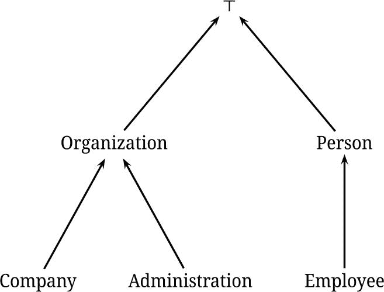

图 5.1 包含关系的表示。

最后，本体也支持实例级的查询。这些查询可以检查属性（例如，“约翰在行政部门工作吗？”），也可以检索满足给定属性的所有实体（例如，“谁在 MySB 公司工作？”）。

计算机科学文献通常将 Gruber 的本体定义为“对概念化的显式规范”，它规定了“假设在某些感兴趣的领域存在的对象、概念和其他实体，以及它们之间存在的关系”（Gruber, 1993）。由本体表示的知识模型可以被视为由两个主要部分组成的逻辑理论：一组描述领域通用知识的 `logical axioms`（逻辑公理），以及一组涉及特定实体的 `assertions`（断言）。

逻辑公理代表领域知识及其结构的抽象表示。它们规定了所考虑领域的概念和关系以及相应的语义。换句话说，它们定义了领域的词汇并形式化了其含义。这是通过提供词汇和一组限制接受模型的逻辑公式实现的。例如，完成上述引入的词汇，一个逻辑公理可以表示“公务是在行政部门工作的员工”。

使用逻辑公理定义的词汇，断言对领域的个体实体做出陈述，如“玛丽在 MySB 公司工作”或“MySB 公司是一家”。有些作者将 `��` 称为抽象本体，将 (`��, 𝒜`) 称为具体本体。另一些人认为 `��` 是实际本体，并将 `𝒜` 称为领域断言。在本章，我们将 (`��, 𝒜`) 称为本体或知识库，这在描述逻辑和语义网文献中是常见做法。

用特定语言表示的逻辑公理和断言在标准逻辑中可以分别被视为`rules`（规则）和`facts`（事实）。将本体与数据库进行比较，可以将逻辑公理视为数据库模式（schema）的定义，将断言视为数据库中的实例。但推理上下文在一个重要点上有所不同。数据库依赖于`封闭世界假设`（closed world assumption），即存储在数据库中的信息被认为是完整的。任何不在数据库中的陈述都被认为是虚假的。而通过本体表示的知识库处理的是对世界的不描述。因此，相关的推理过程涉及所谓的`开放世界假设`（open world assumption）。

这种差异，即对部分知识进行推理的支持，使得否定的操作变得复杂得多，因此通常也受到限制。例如，如果模型没有提供关于 Nathan 的任何信息，既无法推断他在 MySBCompany 工作，也无法推断他不在。然而，如果模型规定没有 MySBCompany 的员工在 BBCorp 工作，且已知 Mary 在 MySBCompany 工作，我们就可以推导出她不在 BBCorp 工作。

### 5.3 这些问题是如何解决的？

为了开发一个建模特定领域的本体，需要一种允许描述以下内容的语言：

* `concepts`（概念），即组织领域的类别，例如 `Person`、`Employee`、`Client`、`Company` 等。

* 存在于（某些）概念元素之间的 `relationships`（关系），例如 `works_for`、`buys` 等。

* `axioms`（公理），即概念之间的包含关系，例如，员工是人，客户是购买某些产品的人等。

* `assertions`（断言），即对领域中特定对象的陈述，例如，John 是一个员工等。

为了进一步支持推理，这种语言除了具有定义良好的语法外，还必须具有形式化的语义。

用于建模本体的多种形式化语言根据其允许表达的陈述而相互区别。从技术上讲，这种区别体现在所考虑的对象和关系不同，以及构造构造的集不同^(61。

`description logics`（描述逻辑，DLs）家族涉及多种形式化语言，支持从`concepts names`（概念名称，一元谓词）和`role names`（角色名称，二元谓词）描述`concepts`（概念）和`roles`（角色）。这些逻辑大部分是一阶逻辑的可判定片段，但它们因各自的构造子集而不同。

本节首先通过考虑一种最著名的基础逻辑——带补余的属性语言（𝒜ℒ𝒞）来介绍描述逻辑的形式定义，然后展示了如何在这种语言中处理本体推理问题。

### 5.3.1 𝒜ℒ𝒞 描述逻辑的形式定义

𝒜ℒ𝒞 的基本元素是概念和角色，它们提供了领域的词汇。首先引入这些元素。然后通过知识库将领域知识形式化，知识库由一个`terminological part`（术语部分），称为 `TBox` 和一个`assertional part`（断言部分），称为 `ABox`组成。它们分别对应于上述的抽象本体 𝒪 和具体本体（或领域断言）𝒜。最后对 𝒜ℒ𝒞 的语义进行探讨。

#### 概念与角色

DL 中知识库的定义使用了从两个集合定义的词汇：`concept names`（概念名称）和 `role names`（角色名称）。概念名称集通常命名为 `C`，其元素（记为 `A`、`B` 等）代表领域的元素集合。在我们的示例中，它们是 `Company`、`Administration`、`Person` 等。在 𝒜ℒ𝒞 中，基本概念是 `C` 中提供的概念，加上全概念 `⊤`（涉及领域的所有元素）和不包含任何元素的下底概念 `⊥`。

角色名称集记为 `R`，涉及二元关系 `r`、`s` 等。在我们业务示例中，典型的关系名称有 `works_for`、`sales`、`is_client_of` 等。它们可以被视为二元谓词。

概念表示集合，称为其 `extension`（扩展）。它们可以进一步组合以定义新集合，称为 `constructors`（构造子）。第一类布尔逻辑是自然存在的。在我们的示例中：

* 如果我们要谈论女性员工，我们使用 `Female` 和 `Employee` 的交集，记为 `Female⊓ Employee`；

* 所有工人，无论是全职还是自雇，都由由并集（也称为析集）定义的新概念表示：`Worker ≡ Employee ⊔ Self-employed`；

* 未业人员不是工人：`¬Worker⊓ Person`。

在 DL 中定义其他概念的强大方法是通过引入存在限制或全称限制来利用角色。例如，使用存在限制：

* `∃works_for.⊤` 表示至少为了一个（`⊤` 的实例）工作的个体集合；

* 公务员，作为为行政机构工作的员工，可以用概念 `Employee⊓ ∃works_for.Administration` 来描述。

全称限制的操作要复杂一些。例如，为了表示专门为一个或多个行政机构工作的个体集合，可以使用全称限制定义概念：

```
forall works_for.Administration
```

该概念的成员遵循一个条件：所有与成员处于 `works_for` 关系的个体（即其所有的雇主）都是行政机构。这看起来可能违反直觉，但这一条件被那些不为任何人工作的个体（`⊤` 的实例：组织和个人）所满足。事实上，如果 Gabriel 是失业的，他的雇主集合为空，从技术上讲，他的每个雇主都满足是行政机构的这一约束^(62。

```
Employee �cap (∃works_for.administration) �cap (forall works_for.administration)
```

形式上，`compound concepts`（复合概念）通过特定 DL 的构造子递归构建。在𝒜ℒ𝒞 中，复合概念的语法由以下文法描述：

```
C, D -> A|bot|top
      | ¬C
      | C ⊔ D
      | C �cap D
      | ∃r.C
      | ∀r.C
```

其中 *A* 是概念名称，*C* 和 *D* 是（原子或复合）概念，*r* 是角色。

根据对语言的常见误用，我们将“𝒜ℒ𝒞 概念”，或者在引用 𝒜ℒ𝒞 显而易见时直接称为“概念”，称为 𝒜ℒ𝒞 的概念描述。根据本语法的定义，一个概念仅仅是一个书写良好的公式，它目前仍然是没有意义的，或者说目前尚不包含任何形式化语义。对于其他逻辑来说，语言的形式化语义是通过引用解释（interpretation）和模型（model）这两个概念来定义的。考虑到第[4]章](#9783111425672_015496.xhtml#b_9783111426143-004) 中的一阶逻辑（FOL）表示法，我们在此将语义的形式化限制为对与 𝒜ℒ𝒞 概念对应的一阶逻辑公式的表示。

概念 `C` 代表一个元素集合，称为其`extension`（外延），它可以被看作一个一元谓词 `C(x*)`，对于每一个对应于 `C` 外延中元素的 `x` 值，该谓词为真。同样，关系 `r` 对应于二元谓词 `r(x, y)`。基于这种约定，复杂概念的语义由由映射函数 `τ[C]` 和 `τ[R]` 定义的对应公式给出：


\[
\begin{matrix}
\tau_{\mathcal{C}}(C,x) & = & C(x) \\
\tau_{\mathcal{C}}(\top,x) & = & \mathrm{true} \\
\tau_{\mathcal{C}}(\bot,x) & = & \mathrm{false} \\
\tau_{\mathcal{C}}(C \sqcap D,x) & = & \tau_{\mathcal{C}}(C,x) \land \tau_{\mathcal{C}}(D,x) \\
\tau_{\mathcal{C}}(C \sqcup D,x) & = & \tau_{\mathcal{C}}(C,x) \vee \tau_{\mathcal{C}}(D,x) \\
\tau_{\mathcal{C}}(\neg C,x) & = & \neg\tau_{\mathcal{C}}(C,x) \\
\tau_{\mathcal{R}}(r,x,y) & = & r(x,y) \\
\tau_{\mathcal{C}}(\exists r.C,x) & = & y[\tau_{\mathcal{R}}(x,y) \land \tau_{\mathcal{C}}(C,y)] \\
\tau_{\mathcal{C}}(\forall r.C,x) & = & y[\tau_{\mathcal{R}}(x,y) \Rightarrow \tau_{\mathcal{C}}(C,y)]
\end{matrix}
\]

概念 `C` 代表一个称为其 `extension` 的元素集合，它可以被看作一个一元谓词 `C(x*)`，对于每一个对应于 `C` 外延中元素的 `x` 值，该谓词为真。同样，关系 `r` 对应于二元谓词 `r(x, y)`。基于这种约定，复杂概念的语义由映射函数 `τ[C]` 和 `τ[R]` 定义的对应公式给出。

根据对语言的常见误用，我们将“𝒜ℒ𝒞 概念”，或者在引用 𝒜ℒ𝒞 显而易见时直接称为“概念”，称为 𝒜ℒ𝒞 的概念描述。根据本语法的定义，一个概念仅仅是一个书写良好的公式，它目前仍然是没有意义的，或者说目前尚不包含任何形式化语义。对于其他逻辑来说，语言的形式化语义是通过引用解释（interpretation）和模型（model）这两个概念来定义的。考虑到第 4 章中的一阶逻辑（FOL）表示法，我们在此将语义的形式化限制为对与 𝒜ℒ𝒞 概念对应的一阶逻辑公式的表示。

概念 `C` 代表一个称为其 `extension`（外延）的元素集合，它可以被看作一个一元谓词 `C(x*)`，对于每一个对应于 `C` 外延中元素的 `x` 值，该谓词为真。同样，关系 `r` 对应于二元谓词 `r(x, y)`。基于这种约定，复杂概念的语义由映射函数 `τ[C]` 和 `τ[R]` 定义的对应公式给出：

\[
\begin{matrix}
\tau_{\mathcal{C}}(C,x) & = & C(x) \\
\tau_{\mathcal{C}}(\top,x) & = & \text{true} \\
\tau_{\mathcal{C}}(\bot,x) & = & \text{false} \\
\tau_{\mathcal{C}}(C \sqcap D,x) & = & \tau_{\mathcal{C}}(C,x) \land \tau_{\mathcal{C}}(D,x) \\
\tau_{\mathcal{C}}(C \sqcup D,x) & = & \tau_{\mathcal{C}}(C,x) \vee \tau_{\mathcal{C}}(D,x) \\
\tau_{\mathcal{C}}(\neg C,x) & = & \neg\tau_{\mathcal{C}}(C,x) \\
\tau_{\mathcal{R}}(r,x,y) & = & r(x,y) \\
\tau_{\mathcal{C}}(\exists r.C,x) & = & y[\tau_{\mathcal{R}}(x,y) \land \tau_{\mathcal{C}}(C,y)] \\
\tau_{\mathcal{C}}(\forall r.C,x) & = & y[\tau_{\mathcal{R}}(x,y) \Rightarrow \tau_{\mathcal{C}}(C,y)]
\end{matrix}
\]

概念 `C` 代表一个称为其 `extension` 的元素集合，它可以被看作一个一元谓词 `C(x*)`，对于每一个对应于 `C` 外延中元素的 `x` 值，该谓词为真。同样，关系 `r` 对应于二元谓词 `r(x, y)`。基于这种约定，复杂概念的语义由映射函数 `τ[C]` 和 `τ[R]` 定义的对应公式给出。

## 本体（Domain 知识部分）

ABox 包含一组关于特定个体的断言。给定 `a`、`b` 属于 `I`，`C` 是概念，`r` 是关系。

## 概念知识（Terminological knowledge：TBox）

TBox `T` 是一组表示包含（`⊑`）或等价（`≡`）概念的公理，例如在 [9783111425672_015496.xhtml#b_9783111426143-004] 中定义的 𝒜ℒ。

根据对语言的常见误用，我们将“𝒜ℒ𝒞 概念”，或者在引用 𝒜ℒ𝒞 显而易见时直接称为“概念”，称为 𝒜ℒ 的概念描述。根据本语法的定义，一个概念仅仅是一个书写良好的公式，它目前仍然是没有意义的，或者说目前尚不包含任何形式化语义。对于其他逻辑来说，语言的形式化语义是通过引用解释（interpretation）和模型（model）这两个概念来定义的。考虑到第 4 章中的一阶逻辑（FOL）表示法，我们在此将语义的形式化限制为对与 𝒜ℒ𝒞 概念对应的一阶逻辑公式的表示。

概念 `C` 代表一个称为其 `extension`（外延）的元素集合，它可以被看作一个一元谓词 `C(x*)`，对于每一个对应于 `C` 外延中元素的 `x` 值，该谓词为真。同样，关系 `r` 对应于二元谓词 `r(x, y)`。基于这种约定，复杂概念的语义由映射函数 `τ[C]` 和 `τ[R]` 定义的对应公式给出。


$\begin{matrix} {\\mathit{\\tau}\_{\mathit{C}}(\mathit{C},\\mathit{x})} & = & {\\mathit{C(\mathit{x})} \\\\ {\\mathit{\\tau}\_{\mathit{C}}(\top,\\mathit{x})} & = & {\\mathit{t}\\mathit{r}\\mathit{u}\\mathit{e}} \\\\ {\\mathit{\\tau}\_{\mathit{C}}(\bot,\\mathit{x})} & = & {\\mathit{f}\\mathit{a}\\mathit{l}\\mathit{s}\\mathit{e}} \\\\ {\\mathit{\\tau}\_{\mathit{C}}(\mathit{C} \sqcap \\mathit{D},\\mathit{x})} & = & {\\mathit{\\tau}\_{\mathit{C}}(\mathit{C},\\mathit{x}) \land \\mathit{\\tau}\_{\mathit{C}}(\mathit{D},\\mathit{x})} \\\\ {\\mathit{\\tau}\_{\mathit{C}}(\mathit{C} \sqcup \\mathit{D},\\mathit{x})} & = & {\\mathit{\\tau}\_{\mathit{C}}(\mathit{C},\\mathit{x}) \vee \\mathit{\\tau}\_{\mathit{C}}(\mathit{D},\\mathit{x})} \\\\ {\\mathit{\\tau}\_{\mathit{C}}(\neg\\mathit{C},\\mathit{x})} & = & {\\neg\\mathit{\\tau}\_{\mathit{C}}(\mathit{C},\\mathit{x})} \\\\ {\\mathit{\\tau}\_{\mathit{R}}(\mathit{r},\\mathit{x},\\mathit{y})} & = & {\\mathit{r(\mathit{x},\\mathit{y})} \\\\ {\\mathit{\\tau}\_{\mathit{C}}(\exists r.C,\\mathit{x}) & = & {\\mathit{y}[\\mathit{\\tau}\_{\mathit{R}}(\mathit{x},\\mathit{y}) \land \\mathit{\\tau}\_{\mathit{C}}(\mathit{C},\\mathit{y})]} \\\\ {\\mathit{\\tau}\_{\mathit{C}}(\forall r.C,\\mathit{x}) & = & {\\mathit{y}[\\mathit{\\tau}\_{\mathit{R}}(\mathit{x},\\mathit{y}) \Rightarrow \\mathit{\\tau}\_{\mathit{C}}(\mathit{C},\\mathit{y})]} \\\\ \end{matrix}$

本体（Domain）：ABox 包含一组关于特定个体的断言。给定 `a`, `b` 属于 `I`，`C` 是概念，`r` 是关系。

概念知识（Terminological knowledge: TBox）：TBox `T` 是一组表示包含（⊑）或等价（≡）概念的公理，例如在[9783111425672_015496.xhtml#b_9783111426143-004]中定义的 𝒜ℒ。

关于语义（About the semantics）：现在我们概述一下计算本体推理的工具考虑的主要方面。首先，需要注意 `I` 中的个体符号与真实世界对象之间的联系并不是本体定义的。其次，本体并不声称完整描述世界的状态，这通常被称为开放世界假设（open world assumption）。由于知识是不完全的，因此存在许多与本体兼容的状态。本体中的公理越多，兼容的状态就越少。只要存在至少一个匹配知识库中所有断言的状态，本体就被认为是一致的。

在我们的示例中，我们可以通过引入以下概念，将求职者定义为失业工人，从而扩展模型：

```
\begin{matrix} {\texttt{Job-seeker} \equiv \texttt{Worker} \sqcap \texttt{Unemployed}} \\ \end{matrix}
```

由于我们已经定义了“失业”概念与“工人”概念是互斥的（`Unemployed` ≡ `Person` ⊓ ¬`Worker`），因此概念满足性检查将揭示新概念 `Job-seeker` 为空，从而表明模型需要进行必要的调整。

### 包含层次结构

在 𝒯 中表达的关于领域结构的公理化知识语句集的结合，会在概念之间诱导出隐式关系。给定一个可能为空的 Tbox 𝒯 以及两个（原子或复合）概念 `C` 和 `D`，描述逻辑（DLs）提供了推理支持，用以检查相对于 𝒯 的概念 `D` 对概念 `C` 的**包含**（𝒯 ⊨ `C` ⊑ `D`）以及相对于 𝒯 的概念 `C` 和 `D` 的**等价性**（𝒯 ⊨ `C` ≡ `D`）。

由 TBox 公理定义的概念间的包含关系在它们之间诱导出一个偏序，即包含关系是概念名称集合上的自反和传递关系。构建`包含层次结构`并提供概念间子类-父类全局关系的可视化，有助于易于概述知识领域模型的能力。TBox 的`分类`（即包含层次结构的计算）是知识工程中最常用的推理任务之一。

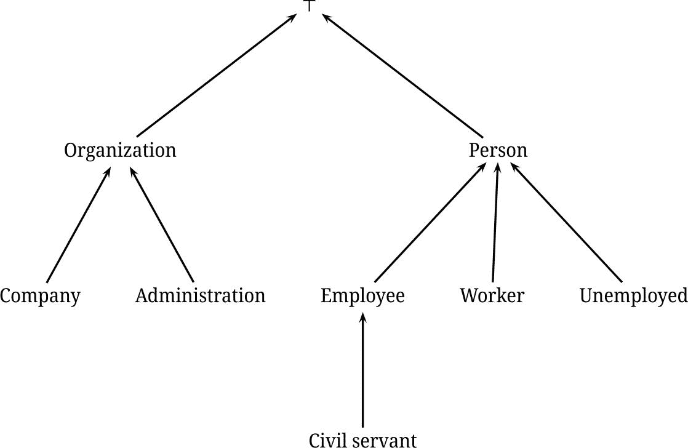

图 5.2 计算出的包含层次结构的图表化表示。

在上述描述的 TBox 上计算包含层次结构得到的结果如图 5.2 所示。它揭示了当前模型中不存在员工属于工人这一直观包含。这表明模型需要进行调整，例如通过将 `Employee` 定义为 `Person` ⊓ ∃works_for.organization`，这将识别为被 `Worker` 包含。

### 一致性检查

现在考虑一个由 TBox 𝒯 和 ABox 𝒜 组成的完整知识库 𝒦。首先提出的问题是确保知识库中涉及的所有断言都是兼容的。这项任务被称为`一致性检查`或`知识库满足性检查`。它能发现知识库中的任何矛盾语句，因此精确地支持了知识库的调试和验证。

### 实例查询

给定一个知识库 (𝒯, 𝒜)，重点可以放在一个特定元素 `a` 上。检查 `a` 是否具有某些特定属性，可以重新表述为检查它是否属于具有该属性的元素集合，换句话说，属于一个概念（假设为 `C`），该概念以该集合作为扩展。DLs 提供了相对于 (𝒯, 𝒜) 的`检查 a 是否是 C 的实例`的推理（(𝒯, 𝒜) ⊨ `a` : `C`）。

在这里，重要的是理解实例检查回答了问题`模型是否保证` `a` 属于 `C`？在我们的示例中，检查 `mary:Worker` 和 `mary:`¬`Worker` 分别返回是和否，而由于模型没有涉及关于 nathan 的任何信息，两个查询 `nathan:Worker` 和 `nathan:`¬`Worker` 都将返回否，表明这两个语句都无法从模型中推导出。这种行为体现了开放世界假设，即模型是不完全的，存在既无法确认也无法否定的语句。

对给定元素的分析可以推广到 𝒯 中定义的完整概念集合。这项任务称为个体相对于知识库 𝒦 = (𝒯, 𝒜) 的`实例化`。对于 𝒯 中出现的每个概念名称 `A`，它测试相对于 𝒦 的 `a` 是否是 `A` 的实例，并返回测试结果为正的概念名称集合。在我们调整后的模型中，如果 michaël 被声明为公务员，其实例化将指示他也是 `Employee`、`Worker` 和 `Person` 概念的成员。

最后，最预期的查询是`实例检索`。旨在检索符合某些描述的元素，即属于特定概念的元素。给定一个概念 `C` 和知识库 𝒦，该任务检查 𝒦 中出现的每个个体名称 `a` 是否相对于 𝒦 是 `C` 的实例。

### 推理问题

在转向实现之前，让我们观察它们之间的关系。在不涉及定理和证明细节的情况下，主要结果的直观展示有助于理解问题如何被*简化*。

让我们首先考虑 `C` 和 `D` 之间的等价和包含。根据定义，等价检查 𝒯 ⊨ `C` ≡ `D` 可以很容易简化为两个包含问题。对于集合论的读者来说，现在，相对于 𝒯 的概念 `C` 的满足性检查直观上对应于属于该概念扩展的元素的识别，可以很容易猜到这个问题可以简化为向 𝒯 增加断言 `b` : `C` 的知识库一致性检查（即 (𝒯, 𝒜 ∪ `b` : ¬`C`)）。

这些结果的结合表明，在前一节介绍的所有推理问题都可以简化为纯粹的一致性检查。互补的结果进一步表明，只要 TBox 不涉及循环概念定义，检查知识库定义就可以简化为检查空 TBox 的知识库。这一方面源于相对于 (𝒯, 𝒜) 检查 `a` 是否是 `C` 的实例 ((𝒯, 𝒜) ⊨ `a` : `C`) 等同于检查 (𝒯, 𝒜 ∪ `a` : ¬`C`) 的一致性；另一方面源于展开操作定义，该操作将无循环 TBox 转换为 ABox。

### 推理实现

𝒜ℒ𝒞 和大多数 DL 一样，是一阶逻辑的一个可判定片段。本体的一致性检查（以及上述提到的所有问题）可以通过算法实现，该算法是：

- 可靠的：任何当算法声明模型一致时，模型实际上是一致的（无假阳性）

- 完备的：如果模型是一致的，算法会声明它是致的（识别出所有正例）

- 终止的：算法在任何输入上经过有限步骤后都会停止。

在𝒜ℒ𝒞 中，概念满足性和 ABox 一致性检查对于无循环 TBox 是 PSpace-完全的，对于通用 TBox 是 ExpTime-完全的。

对大量结果和实现的全面讨论远超本章的范围。然而，*表格算法*被认为是 DL 推理系统实现中的重要里程碑，并且仍被许多工具使用。本节介绍这些算法的主要元素，重点关注一致性检查，其重要性已在前一节中概述。

基本上，该算法从原始知识库开始知识扩展，直到遇到矛盾（称为 `clash`，冲突）或无法进一步进行扩展。为了展示该算法的精髓，我们在下面的本体论上演示了一个朴素的实现：

```
\begin{matrix} \mathcal{T} & = & {{\texttt{ClassBcomp} \sqsubseteq \texttt{Comp} \sqcap \neg\exists\texttt{sell}.(\texttt{Far} \sqcap \texttt{Phytosan})}} \\ \mathcal{A} & = & {{\texttt{bbCorp}:\texttt{ClassBcomp} \sqcap \texttt{Comp} \sqcap \exists\texttt{sell}.\texttt{Far},} \\ & & {\texttt{apple}:\texttt{Product} \sqcap \texttt{Phytosan},} \\ & & {(\texttt{bbCorp},\texttt{apple}):\texttt{sell}}} \\ \end{matrix}
```

TBox $\mathcal{T}$ 定义了 B 类公司为不销售任何既源自远方又使用植物卫生产品生产的公司。ABox ($A$) 中的断言说明：(i) `bbCorp` 是一家销售远源产品的 B 类公司，(ii) 苹果是使用植物卫生产品的产品，以及 (iii) `bbCorp` 销售苹果。

该算法分两个步骤处理：

### 步骤 1

所有概念都被归约为它们的“否定范式”（`negation normal form`），即否定仅应用于概念名称的等价概念。这是通过应用图 5.3 中总结的 `nnf` 变换实现的。在我们的示例中，`TBox` 中规则右侧的概念被重写如下：

```
\begin{matrix} {\mathit{n}\mathit{n}\mathit{f}(\texttt{Comp} \sqcap \neg\exists\texttt{sell}.(\texttt{Far} \sqcap \texttt{Phytosan}))} & = & {\texttt{Comp} \sqcap \mathit{n}\mathit{n}\mathit{f}(\neg\exists\texttt{sell}.(\texttt{Far} \sqcap \texttt{Phytosan}))} \\ & = & {\texttt{Comp} \sqcap \forall\texttt{sell}.\mathit{n}\mathit{n}\mathit{f}(\texttt{Far} \sqcap \texttt{Phytosan})} \\ & = & {\texttt{Comp} \sqcap \forall\texttt{sell}.(\neg\texttt{Far} \sqcup \neg\texttt{Phytosan}).} \\ \\ \end{matrix}
```

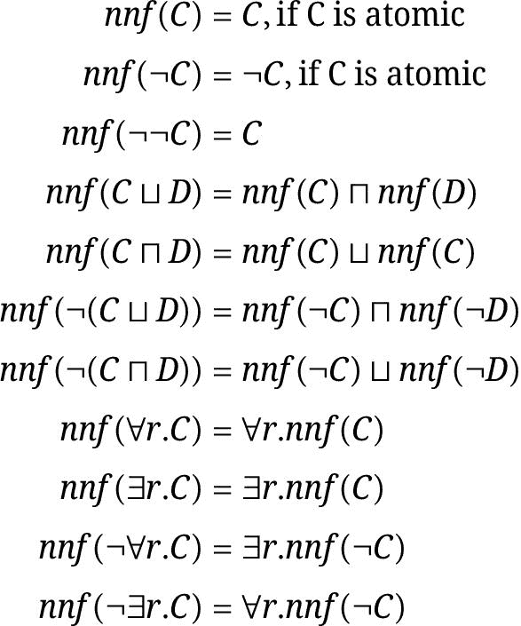

图 5.3 否定范式变换。

其他概念不涉及否定，因此不需要进行变换。

### 步骤 2

知识扩展通过构建一个类似于第 4 章所示 tableau 算法的树来实现。$\mathcal{ALC}$ 特定的扩展规则如图 5.4 所示。我们的示例知识库 $(\mathcal{T}, \mathcal{A})$ 的扩展由图 5.5 所示的树进一步给出。如果树的所有分支都 `clash` 结束，则知识库是不一致的。在我们的情况下，树的（至少）一个分支（tableau）是没有冲突的且无法应用更多规则，因此该知识库是一致的。

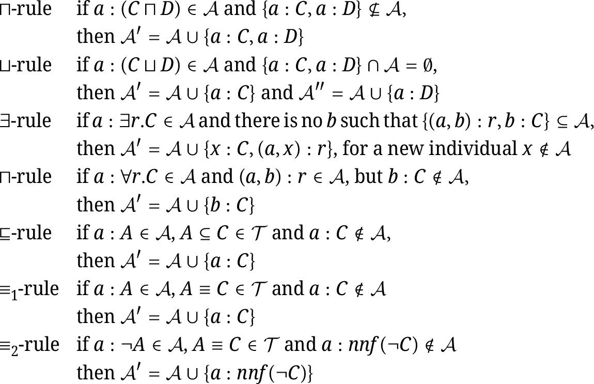

图 5.4 \mathcal{ALC} 的 tableau 扩展规则。


图 5.5 知识库一致性证明。

注意，这里提出的朴素版本算法是非确定性的，因为 $\sqcup$ 规则的两个分支可以任何顺序应用。这并不影响算法的结论，但实现的优化可以进一步利用探索策略。

## 5.4 带有本体的知识表示和工程的局限性是什么？

上一节介绍了 DL $\mathcal{ALC}$ 作为该语言族的代表。然而，存在多种描述逻辑（DL）。本节首先在 5.4.1 中介绍它们的多样性。然后，5.4.2 解决了 DL 用于知识工程时面临的共同局限性及挑战。最后，为了扩展对本体的观点，语义网语言 `OWL` 在 5.4.4 和 5.4.5 中简要介绍了知识图。

### 5.4.1 DL 的表达能力和复杂度

上一节指出，一方面 $\mathcal{ALC}$ 相比 `FOL` 失去了表达能力，另一方面它在一致性检查上获得了可判定性。此外，对于无环 TBox，概念可满足性和 ABox 一致性检查的复杂度是 `PSpace`-完全，而对于通用 TBox 则是 `ExpTime`-完全。DL 族的历史是语言表达能力与算法复杂度之间的往复。与此同时，特别是在语义网和语义数据管理中，另一种往复是从 TBox 查询到 ABox 查询。接下来的章节介绍了由这些探索产生的各种 DL。

#### 低表达能力的描述逻辑

为了降低推理的复杂度，可以关注两种最小逻辑：$\mathcal{E}$ 和 $\mathcal{RL}$。$\mathcal{E}$ 中允许的构造集限制限于交（$C \sqcap D$）、存在限制（$\exists r.C$）和顶（$\top$）。在这种非常有限的语言中，即使对于通用 TBox，包含问题也可以基于结果的推理解决且是多项式的。相比之下，在 $\mathcal{RL}$ 中，尽管构造集仅限于交（$C \sqcap D$）、值限制（$\forall r.C$）和顶（$\top$），包含检查仍然是 `ExpTime`-完全。需要注意的是，这两种语言的...满足性检查都失去了意义，因为它们的构造器无法导致不可满足性。

`DL-Lite` 是另一种表达能力有限的显著 DL。它是为了在存在本体的情况下支持查询回答提出的 DL 之一。这类查询涉及对来自异构数据集（如网络源）的大数据集进行搜索，其中本体通过提供领域知识来补偿信息的完整性。考虑到构造器的限制，对于任何 TBox，知识库查询（通常是连接查询）都可以重写为一阶查询。

除了概念名称外，`DL-Lite` 进一步基础概念为顶（$\top$）、无量化存在限制（$\exists r$，理解为 $\exists r.\top$）和逆角无量化存在限制（$\exists r^{-}$）。TBox 公理是正基础概念包含（$B_1 \sqsubseteq B_2$）、负基础概念包含（$B_1 \sqsubseteq \neg B_2$）或角色包含（$r \sqsubseteq s$，其中 $r$ 和 $s$ 是概念名称）。

#### 概念构造器和 ALC 族

新概念构造器的引入产生了多种 DL，其名称、符号和符号在表 5.1 中给出，并带有相应的逻辑公式。

表 5.1 高级概念构造器对应的公式。

| 符号 | 名称 | 符号 | 对应的逻辑公式 |

| --- | --- | --- | --- |

| $\mathcal{F}$ | 功能性 | $(\le 1r)$ | $\{y|r(x,y)\} \le 1$ |

| $\mathcal{N}$ | 无限制数量限制 | $(\ge nr)$ | $\{y|r(x,y)\} \ge n$ |

| | | $(\le nr)$ | $\{y|r(x,y)\} \le n$ |

| 𝒬 | 限定数量限制 | (≥ `n`r.C) | #{y|r(`x`, y) ∧ C(`y)} ≥ n |

| | | (≤ `n`r) | #{y|r(`x`, y) ∧ C(`y)} ≤ n |


| 𝒪 | 命名法概念（nominals） | `a` | `x ∈ {a}` |
|---|---|---|---|

这些 $\mathcal{A}\mathcal{L}\mathcal{C}$ 扩展被称为 $\mathcal{A}\mathcal{L}\mathcal{C}X$，其中 $X$ 表示在 $\mathcal{F}\mathcal{N}\mathcal{Q}\mathcal{O}$ 中选择的构造器，其中当包含 $\mathcal{N}$ 时舍弃 $\mathcal{F}$，当包含 $\mathcal{Q}$ 时舍弃 $\mathcal{F}\mathcal{N}$。

在概念定义中引入这些概念构造器的（任意子集）可以保持概念满足性以及在无环 TBox 上 ABox 一致性检查的 PSpace 完备性。对于通用的 TBox，对于任何概念构造器的任意子集，这些问题仍然是 ExpTime 完备的。

### 角色构造器（Role constructors）

目前为止考虑的基础类型描述逻辑（DLs）以概念为主要关注点。在众多多样的 DL 中，许多 DL 提供了支持角色高级实例的构造器，并对知识库中的角色包含了约束条件。然而，对所有 DL 的完整研究已远超本介绍性章节的范围。尽管如此，我们在此引入了这些工具中最广为人知的。

在角色构造器中，我们发现了反转角色（inverse role, $\mathcal{I}$）、角色交集、并集、（原子的或全的）否定、角色组合（role composition）以及对应于关系操作的反射-传递闭包。在角色上可能的约束中，以下这些是最常被引用的：

- 角色层级（Role hierarchy, $\mathcal{H}$），记为 `r ∈ s`，表示包含关系；
- 角色传递性（Role transitivity, $\mathcal{S}$），记为 `Trans(r*)`，表示传递性；
- 以及复杂角色包含（complex role inclusion, $\mathcal{R}`），允许表达由其他角色组合得到的关系的角色包含。

与之前一样，语言通过将特征字母添加到 $\mathcal{A}\mathcal{L}\mathcal{C}$ 来命名。对于高级语言（包括 $\mathcal{S}$ 或 $\mathcal{R}$），通常会去掉 $\mathcal{A}\mathcal{L}\mathcal{C}$ 前缀。除了表示为 $\mathcal{I}$ 的反转外，角色构造器的选择在语言名称后的括号中指定。

尽管没有根本理由去区分关系公理（relational axioms），即在 TBox 中使用这些关系约束公式化的公理，但它们通常被归为第三组公理，称为 RBox。

在不涉及所有语言的包含关系以及每个 DL 中相应问题的复杂性（这些产生了多出版物）细节的情况下，重要的是，表达能力的某些提升是以问题复杂性的巨大代价为代价的。例如，在 $\mathcal{A}\mathcal{L}\mathcal{C}\mathcal{O}\mathcal{I}$ 中，即使在空 TBox 上，满足性和包含也是 ExpTime 完备的。事实上，这些问题在 $\mathcal{A}\mathcal{L}\mathcal{C}\mathcal{O}\mathcal{I}\mathcal{Q}$ 中变为 NexpTime 完备。对于某些扩展，推理甚至变得不可判定。

尽管有这些理论局限，但必须提醒，这些复杂性研究考虑的是最坏情况。在现实场景中，使用的构造器组合很少达到这些水平。大多数实现的 DL 推理器在合理的本体上具有可接受的性能。

### 5.4.2 DL 表达能力的局限性与挑战

大多数 DL 等价于一阶逻辑逻辑（FOL）的片段。这种形式上的限制使得无法表达在 FOL 中容易表达的某些属性。对于属性来说显然是如此，它们需要特定所研究 DL 中未涉及的构造器。对于所有 DL 来说，属性的情况都是如此，它们需要一个 $n \geq 3$ 的 $n$ 元谓词。例如，无法表达一个建模公司 `x`、产品 `y` 和原产地 `z` 之间通用 `provides(x, y, z)` 关系的通用属性。同样，已知使用自然数、加法或乘法进行推理是不可判定的，因此无法用 DL 建模。

最后，上述介绍的 DL 也面临与 FOL 类似的局限性，即它们不适合建模涉及时间、模态或模糊性的知识。迄为止，研究人员正试图类似于扩展 FOL 的各种逻辑一样，将这些考虑纳入 DL 中。未来 DL 研究的关键挑战是在保持可判定性的同时扩展表达能力。

### 5.4.3 知识工程

大多数 DL 等价于 FOL 的片段。这种形式上的限制使得无法表达在 FOL 中容易表达的某些属性。对于属性来说显然是如此，它们需要特定所研究 DL 中未涉及的构造器。对于所有 DL 来说，属性的情况都是如此，它们需要一个 $n \geq 3$ 的 $n$ 元谓词。例如，无法表达一个建模公司 `x`、产品 `y` 和原产地 `z` 之间通用 `provides(x, y, z)` 关系的通用属性。同样，已知使用自然数、加法或乘法进行推理是不可判定的，因此无法用 DL 建模。

最后，上述介绍的 DL 也面临与 FOL 类似的局限性，即它们不适合建模涉及时间、模态或模糊性的知识。迄为止，研究人员正试图类似于扩展 FOL 的各种逻辑一样，将这些考虑纳入 DL 中。未来 DL 研究的关键挑战是在保持可判定性的同时扩展表达能力。

#### 知识工程

模型的一致性可以通过自动推理来确保，这对知识工程是宝贵的。然而，这并不保证模型符合现实，或者符合开发者的需求，例如：

- 在一个优雅的、易于维护的模型与一个更复杂的模型之间进行调和；
- 在本体中调和用户的多种概念；
- 处理自然语言的歧义和多义性；
- 处理模糊性。

### 5.4.4 OWL 与语义网

用 DL 表示的本体用于多种语言的开发和维护。其中最著名的应用领域无疑是语义网。本体网络语言（OWL）（67）。

在不涉及 RDF 语言细节的情况下：

- 角色断言（`a, b`）可以通过三元组（`a :r b`）表示，在 OWL 中称为属性断言；
- 概念断言 `a ∈ C` 可以通过三元组（`a :C`）表示，在 OWL 中称为类断言，其中 `rdf:type` 是表示“实例化”关系的谓词。

基础词汇的 RDF 扩展（RDFS）（69）。

OWL 对 RDF 词汇语法的采用有助于与 RDF 格式的信息交互，特别是与语义网和链接数据（70）。

OWL 的形式语义描述（71）。

### 5.4.5 知识图谱

本章强调了 DL 如何以一种既人类可读又允许根据形式语义执行查询的方式来实现本体。

另一类模型可以实现相同的目标：基于图的知识模型。与 DL 一样，它们是大量研究其操作和表达能力的文献的主题（参见 Chein 和 Mugnier (2009) 对这些工作基础的研究）。

随着 Google 知识图谱的知名，语义网的世界转向了该家族特定模型：知识图谱（KG）。KG 以节点-关系图的形式提供了人类可读的可视化，节点代表实体（对象、事件或概念），标记链接表示它们之间的关系。

下面的业务案例详细说明了如何将大型数据集存储在这样的知识图谱中。然后它说明了如何在图谱上计算本体驱动的查询，并为药物开发过程中的决策提供支持。

在实现本体论的多种语言中，本章引入了描述逻辑（description logics）。在这些语言中，变量自由的语法保持了良好的人类可读性。得益于其形式化语义，它们同时支持模型检查和查询回答。描述逻辑（DLs）等同于一阶逻辑中可判的子集，因此，相关的决策引擎可以在有限时间内处理请求。即使在最坏情况下的复杂度很高，但大多数实际查询都能有限的时间内得到答案。

语义网的兴起在很大程度上提升了本体论的知名度。然而，它们被广泛应用于各个应用领域。健康领域的决策支持工具是集成基于本体的知识表示最充分的系统之一。下面提出的药物开发业务案例说明了支持制药行业这一概念复杂领域研究的工具，如何通过本体来整合丰富的知识库。它增强了执行高效语义查询的效率。

希望进一步深入研究该主题的读者将对以下参考文献感兴趣。

- 计算机科学文献中被引用次数最多的本体论定义，可能源自 Gruber 的论文 (1993)。
- 关于描述逻辑及其相关理论结果和证明的更多细节，读者可以参考 Krötzsch et al., Baader et al. (2017), Baader et al. (2007)。
- 展示多种 DL 及其各自的表达能力和复杂度的浏览器可以在 [`www.cs.man.ac.uk/ezolin/dl/`](http://www.cs.man.ac.uk/ezolin/dl/) 获取。
- 关于基于图模型的知识表示与推理的研究，请参考 Chein and Mugnier (2009)。
- DL 与概念图的简单比较可以在 Leclère et al. (2014) 中找到。
- W3C OWL 标准位于 [www.w3.org/OWL](http://www.w3.org/OWL)。

## 5.5 工业案例：使用本体和语义搜索进行药物开发，ONTOFORCE 示例

Erik Mannens Filip Pattyn

### 5.5.1 背景

生命科学是演变最快的领域之一，并受到 20 世纪技术演变（如电子和计算机科学）的推动。这里有海量的信息，从基础生物学的观察和洞察到数百万人的临床数据不等。可穿戴设备和传感器的最新技术发展为数据生成创造了另一个数量级空间。因此，人们能够诊断、治疗、治愈和消除许多疾病，并提高数十亿人的生活质量。尽管如此，我们对生物学的深刻理解让我们意识到图中仍有许多碎片。制药行业是一个概念复杂的领域，竞争异常激烈，通过本体整合丰富的知识库，可以提高高效语义查询的效率。我们对生物学的深刻理解让我们意识到图中仍有碎片。数据开发带来了价值。

### 5.5.2 数据无处不在但孤立

开发新疗法是一个劳动密集型过程，药物开发可能需要 13 年才能获得批准（见图 5.6）。尽管数字化转型在制药领域是早期采用者，但语义网和链接数据在过去的几十年中涌现了许多倡议。数据仍然在运营单元中碎片化。

```
图 5.6 药物开发过程。
```

### 5.5.3 ONTOFORCE

ONTOFORCE 是一家位于比利时根特和美国马诸塞州成立的小型企业。他们的首要目标是开发一种技术，通过整合孤立的数据并建立概念之间的联系，以便更快地发现信息并揭示新的洞察。该技术被称为 DISQOVER，构建在语义网和链接数据的基础上，并遵循 FAIR 数据原则 (Wilkinson et al., 2016)。

它包含一个带有图形用户界面的数据摄取引擎，允许构建数据处理流水线，将各种数据转换并集成到存储在专用存储引擎中的知识图中。此外，平台配备了一个直观的用户界面，能够搜索、导航、遍历知识图，并将图子集可视化为用于分析的可定制仪表板。DISQOVER 平台专为生命科学构建，并在药物开发周期的各个用例中交付价值。

生命科学领域的许多公共知识存储在数据库中，或以词表、分类法、层次结构或本体的形式存在。将这些数据源进行转换并存储为知识图，是解决基于数据互操作性和重用的用例的起点。因此，ONTOFORCE 创建并管理了一个由公共数据的 DISQOVER 版本。它目前包含 100 多个数据源，可通过公开的用户界面访问（[`www.disqover.com`](http://www.disqover.com)），并作为企业数据联邦和同步服务的枢纽（见图 5.7）。

```
图 5.7 DISQOVER 技术。
```


## 5.7 DISQOVER 技术

DISQOVER `knowledge graph`（知识图谱）的核心是一个总括性的数据类型本体图（参见图 5.8）。可以通过 `constructors`（构造函数）配置特定的数据类型，允许对现有数据源中的对象类进行分组、定义或区分。数据类型的配置涉及数据属性、过滤属性和类型化关系的定义。在任何时刻，数据的溯源都维护在 `OWL rules` 中，并可以在用户界面中突出。公共数据知识图谱跨越了生命科学的不同子领域，可以应用于许多用例。最基础的用例在于基础研究。

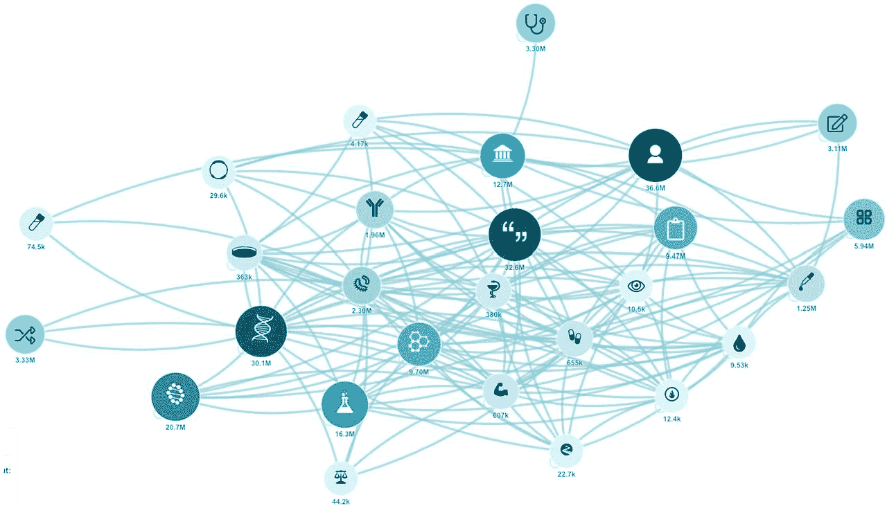

图 5.8 DISQOVER 数据类型本体图，显示了主要数据类型之间的语义链接。最大的数据类型是人员（3660 万）、出版物（3260 万）和基因（3010 万）。

### 5.5.4 用例介绍：基础研究中的语义与本体

药物开发的策略之一是从寻找用于干预的潜在生物靶标开始。典型的目标是参与生化过程的生物实体，例如特定类型的蛋白质。生物实体有多种，并形成了极其复杂的关系网络。两种基本的相互作用或关系是：基因，脱氧核糖酸（DNAfn72））的特定片段。

### 5.5.5 用例场景：语义和链接数据在早期药物研究知识发现中的应用

ONTOFORCE 的主要目标之一是通过整合这些分散的数据为业务用户创造价值，并能够以用户友好的方式发现相关关系或关联。在 DISQOVER 中，如果可用，包含了疾病、出版物和基因等实例之间的 `semantic relations`（语义关系）。此外，图中所有实例的标签、缩写、备用标签或符号可用于语义搜索扩展（参见图 5.9）。这允许执行基础字符串搜索，并可以通过包含从不同数据源检索的其他标签或同义词来轻松扩展。


图 5.9 DISQOVER 中的语义搜索扩展。选择了人类蛋白 STK11 以及所有已知同义词和标签。

当点击 `protein`（而非 `exact`）时，仪表板会显示命中结果概览（参见图 5.10）。这允许执行基础字符串搜索，并可以通过包含从不同数据源检索的其他标签或同义词来轻松扩展。

仪表板面板包含，例如使用 `SPARQL` 来检索少数数据子集（参见图 5.10）。


图 5.10 以蛋白质为中心的搜索仪表板。左面板显示搜索历史，中间面板用于过滤，右面板显示命中列表。

点击 `Disease` 时，通过语义链接进行引导（参见图 5.11）。数据溯源可以可视化。此外，该概念的不同公共或内部 URI 也可以可视化。

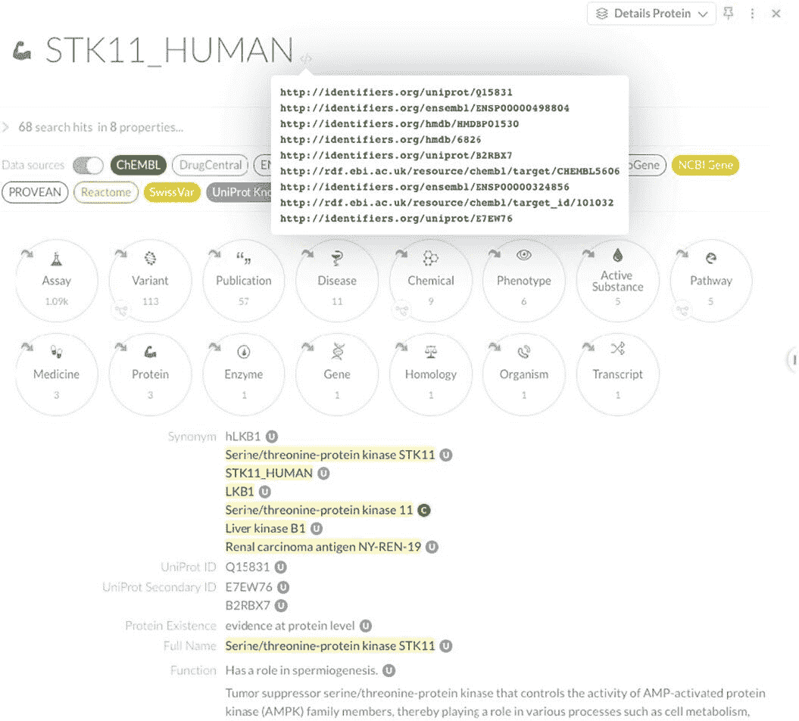

图 5.11 单一概念的详细视图。

通过引入大量的公共数据并与内部数据相结合，DISQOVER 可以成为知识发现的环境，从而改进基于证据的假设生成和决策。

### 5.5.6 早期药物研究知识在转化研究用例中的应用

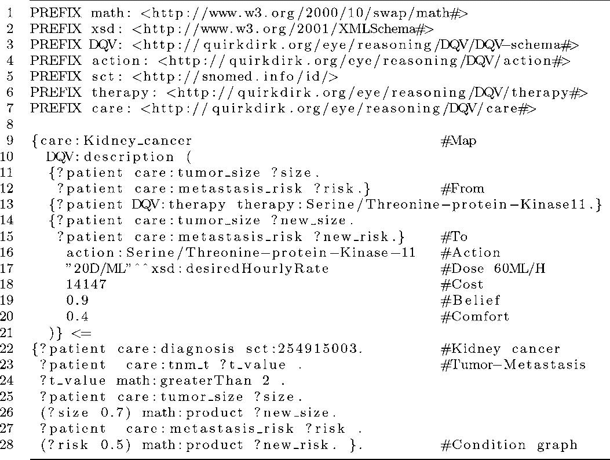

图 5.12 “假性”肾癌治疗的状态表示。

在底层，许多工作通过 `DL reasoning` 完成，以计算 `knowledge graph` 中的状态变化。上述 `STK11` 蛋白质的示例通过引入状态变化的语义描述，详细阐述了作为肾癌的可能治疗方法。图 5.12 显示了肾癌领域疗法的语义描述。

通常情况下，此示例描述表明，通过施用特定的 `STK11` 蛋白质剂量，预计肿瘤将缩小到原始尺寸的 70%。第 9 行指示了操作的特定领域，在本例中是 `care:Kidney_cancer`。我们使用“Map”来指示每个特定医学领域的信息，模拟提供不同路径的地图。我们使用“Map”概念来隔离不同的领域知识，以便领域专家能够专注于在自己的专业领域内创建规则。

## 图谱分析

`from` 部分中指定的图（第 11–12 行）表示应用操作之前的状态。一旦开始操作，该图将被撤回。在这种情况下，患者当前的 `tumor size`（肿瘤大小）和 `metastasis risk`（转移风险）将被撤回。第 13 行包含转换状态。它表示在状态转换期间，患者正在接受某种剂量的 `STK11` 蛋白。转换部分指定的图将在操作开始时被断言。当完成某种剂量 `STK11` 蛋白的给药操作后，将被撤回。第 14–15 行表示目标状态。当状态转换完成后，将断言肿瘤大小（`?newsize`）和转移风险（`?newrisk`）的新值。新的大小和风险反映了治疗的预期。在现实中，新的大小和风险可能会不同，因为达到目标的置信度由参数 `belief` 表示。第 16 行表示状态转换过程中要采取的操作是“接受某种剂量的 `STK11` 蛋白”。第 17–20 行表示状态转换的权重。剂量表示该操作将以每分钟 20 滴的速度每小时输药 60 毫。`Cost` 表示操作成本为 14147 欧元。据认为有 90% 的概率达到目标，该操作的舒适度为 40%。

`Belief`（信念）和 `Comfort`（舒适度）最初都是基于医生已知知识库输入的主观值。尽管如此，它们也可以基于从其他链接开放数据集中收集的现有研究，并在评估状态转换实际结果后进行更新。第 22–28 行构成 `Condition`（条件）部分。第 22–24 行表示执行此操作的前提，即患者被诊断为肾细胞癌（第 22 行），且肿瘤已超过肾脏两层（第 23–24 行）。肿瘤的新大小在第 25–26 行计算；它将是原始大小的 70%。新的转移风险在第 27–28 行计算；它将是原始风险的 50%。目标值的当前计算为了演示目的而进行了简化。

## 临床实践

在临床实践中，可以根据患者的详细状态计算新的转移风险，甚至包括基因变异等因素或通过外部机器学习服务推断结果。通过这种方式，新获得的知识被更新到 DISQOVER 知识图谱，并考虑到之前所有的溯源信息，即“从过去中学习”。这样，早期效果较差的治疗可以被考虑进来，因此“老”患者可以主动获得更好的治疗。

## 参考文献

Baader F., Calvanese D., McGuinness D., Nardi D., and Patel-Schneider P. The Description Logic Handbook, 2nd ed., 2007. a, b

Baader F., Horrocks I., Lutz C., and Sattler U. An Introduction to Description Logic, Cambridge University Press, 2017. a, b

Chein M. and Mugnier M.-L. Graph-based knowledge representation, Computational Foundations of Conceptual Graphs, Springer, 2009. a, b, c

Gruber T. R. A Translation Approach to Portable Ontology Specifications. Knowledge Acquisition, 5:199–200, 1993. a, b, c

Krötzsch M., Simančík F., and Horrocks I. A Description Logic Primer. CoRR, abs/1201.4089, 2012. a, b

Leclère M., Mugnier M.-L., and Rousset M-. Raisonner des ontologies: logiques de graphes conceptuels, 2014. a

Sender R., Fuchs S., Milo R. Guiding Principles for scientific data. PLoS Biol 6(1):6, 2016. doi:10.1371/journal. a, b

Wilkinson MD, Dumontier M. et al. FAIR data management and stewardship. Sci Data 3:16, 2019. doi:10.1038/sdata.16a, b

## 6.2 概率推理解决了哪类问题？

概率推理的重要性通常通过诊断任务来体现。进行医学诊断、确定机械故障的原因或任何其他语境下给定结果的原因，几乎总是涉及不确定性。例如，考虑诊断慢性疲劳的原因。可能的原因列表几乎是无限的，从睡眠不足、活动不足或饮食不平衡，到贫血，甚至可能是心脏问题、癌症或新冠病毒感染，这只是其中几个例子。此外，在某些情况下，人们必须在缺乏领域完整知识（理论无知）或由于各种实际原因无法进行相关测试（实践性无知）的情况下做出诊断。

因此，正如[罗塞尔和诺维格](https://wiki.example.org/Russel_and_Norvig)所言，概率推理在纯逻辑推理由于“懒惰”（即避免列出所有可能的原因或后果以及理论和实践上的无知）而失败的地方取得了成功。[图 6.1](https://wiki.example.org/9783111425672_031573.xhtml#b_0001)（避免详尽列出所有可能的原因或后果，包括理论和实践上的原因）强调了这一概念。


这些不确定性的来源驱动了概率推理。

从本质上说，概率推理为我们提供了评估不同结果信念程度的方法。这种方法也是设计理性智能体的关键组件。现代人工智能（AI）通常被定义为理性行为，即根据现有证据选择期望效用最大的行动。决策智能体通过结合概率理论（评估每个结果发生的概率）和效用理论（表达对不同结果的偏好）来实现。因此，概率推理也成了马尔可夫决策过程（MDP）及其扩展强化学习（RL）的核心部分。


决策智能体结合了概率理论和效用理论。

概率推理解决的根本问题通常归结为回答不确定性问题。（此处后续大量重复的句子已根据逻辑要求进行处理，确保核心含义清晰。）

1. 在给定观测序列的情况下，寻找最可能的状态 `sequence`——也称为最可能解释（例如，根据这 10 天的雾天观测情况，推断连续 10 天内 PM2.5 是否超过阈值）。

这些与动态场景推理相关的概念将在“时间序列概率推理”章节中进行更详细的解释。

在介绍了解决这类每一类问题所需要的一些基础背景概念后，我们将首先处理静态设置下的概率推理。在那里，我们将从因果问题开始（贝叶斯网络可以很好地描述因果问题），然后转向由马尔可夫随机场建模的非因果问题。在这两种情况中，我们都将对离散、连续或混合模型进行举例。随后，我们通过因子图表示将因果和非因果模型统一起来，并引入通过信念传播、马尔可夫链蒙特卡洛（MCMC）采样器进行推理的方法，并简要说明其他一些推理机制。然后，我们将转向时间序列概率推理，从动态设置下的基础推理问题开始介绍，并解释如何通过信念传播类型的方法解决它们。接着，我们将引入隐马尔可夫模型、动态贝叶斯网络以及通过粒子滤波进行近似推理的概念。

## 6.3 概率推理问题是如何解决的？

理解本章的关键概念需要最基本的概率论知识。因此，读者在本章的附录中找到一些有用的回顾。这些回顾涵盖了：

1. `随机变量、条件概率、独立性以及贝叶斯定理`。
2. 概率推理中使用的 `estimators`（估计器）。估计器基于统计学，是根据观测数据来估计未知参数值的函数。它们是机器学习的关键，因为它们表达了从数据中进行“学习”的方法之一。

参见 6.6.1 附录：基本概念和 6.6.2 附录：最大似然估计（MLE）和贝叶斯估计。

在许多情况下，当代理体考虑要采取的行动或推断给定现象的因、某些现象的真实配置或在给定证据条件下特定事件的概率时，感兴趣的信息是不改变的。在这种情况下，我们处于静态环境：我们将首先展示如何使用贝叶斯网络建模因果问题（节 6.3.1），然后转向 MRF（节 6.3.2）和 CRF（节 6.3.3）处理非因果问题。随后将在节 6.3.4 中引入一种使用因子图的统一表示模型。建模之后，节 6.3.5 将涵盖一些用于回答推理问题的技术。最后，节 6.3.6 简要探讨了时间序列概率推理，此时我们处于一个随时间变化的随机变量组成的动态环境中。

### 6.3.1 使用贝叶斯网络对因果问题进行建模

通常，我们需要根据相关随机变量之间的 `causal`（因果）关系推断某些事件发生的概率。考虑本章引言中一个相当简化的场景，我们将在下面的示例中描述它。

#### 示例：开会迟到

Sharon 必须参加一个需要演示的会议。她可以开车，也可以骑自行车。开车的话除非发生严重的拥堵，否则她可能会准时到达。骑自行车到达甚至更安全，除非突然下大雨，如果是那样，她必须在途中寻找避难所，或者至少在进入会议前对头发做处理。主席通常会自己决定等一会儿直到大家到齐，但并不总是如此。即使 Sharon 准时，她的老板也可能决定代替她进行演示，如果 Sharon 迟到了，则几乎是如此。

建模此问题的一种可能方法是使用 6.3 中给出的贝叶斯网络结合一些概率表（CPTs）。这里涉及的所有变量都是离散的，而且，`P(C=t)` 建模了乘车的概率，`P(J=t)` 建模了交通拥堵的概率，`P(R=t)` 建模了 Sharon 到到的概率。观察到随机变量 `C`、`J` 和 `R` 是 `L` 的 `parents`。同样，`L` 是 `W` 和 `D` 的父。


为特定问题构建贝叶斯网络时，我们需要对不同变量之间的独立和条件独立关系做出一些合理的假设，以简化概率表示。例如，在我们的模型中，我们假设交通拥堵和雨水在统计学上是独立的，但我们可以设计一个更复杂的模型，说明雨水可能会影响拥堵的概率。

一般而言，贝叶斯网络是一个 `directed`（有向）且 `acyclic`（无环）的概率模型，表示相关随机变量之间的因果，即 `父子` 关系。贝叶斯网络的联合概率 `P(X[1]=x[1], ..., X[n]=x[n])` 简记为 `P(x[1]...x[n])` 为：

```text
P(x1, ..., xn) = product_{i=1 to n} P(xi | parents(Xi))
```


其中，`parents(X[i])` 表示出现在 `x[1], ..., x[n]` 中的节点父节点的值。观察到，一个节点在给定父节点的情况下，对其非后代节点是条件独立的。例如，在我们来自图 6.3 的网络中，`D` 在给定 `L` 的情况下对 `W` 是条件独立的，同样，`D` 在给定 `L` 的情况下对 `J`、`C` 和 `R` 也是条件独立的。

如果我们对节点之间的条件独立性一无所知，那么我们只能表示全联合概率，而我们始终可以使用链式法则将其重写：

```latex
\mathit{P}(\mathit{x}_{1},\ldots,\mathit{x}_{\mathit{n}})
=
\mathit{P}(\mathit{x}_{\mathit{n}}|\mathit{x}_{\mathit{n}-1},\ldots,\mathit{x}_{1})
\mathit{P}(\mathit{x}_{\mathit{n}-1}|\mathit{x}_{\mathit{n}-2},\ldots,\mathit{x}_{1})
\ldots
\mathit{P}(\mathit{x}_{2}|\mathit{x}_{1})
\mathit{P}(\mathit{x}_{1})
=
\prod_{\mathit{i}=1}^{\mathit{n}}
\mathit{P}(\mathit{x}_{\mathit{i}}|\mathit{x}_{\mathit{i}-1},\ldots,\mathit{x}_{1})
```

因此，我们利用条件独立性断言将全联合概率简化为表达式 (6.1)，在其中我们实际上将集合 `{x[i−1], …, x[1]}` 简化为了 `parents(X[i])`。

对于图 6.3 所示的贝叶斯网络，我们有：

```latex
(6.2)
\mathit{P}(\mathit{j},\mathit{c},\mathit{r},\mathit{l},\mathit{w},\mathit{d})
=
\mathit{P}(\mathit{j})
\mathit{P}(\mathit{c})
\mathit{P}(\mathit{r})
\mathit{P}(\mathit{l}|\mathit{c},\mathit{j},\mathit{r})
\mathit{P}(\mathit{w}|\mathit{l})
\mathit{P}(\mathit{d}|\mathit{l})
```

请注意，在处理布尔随机变量时，按照惯例，我们将 `P(J = true) = P(J = j) = P(j)` 以及 `P(J = false) = P(J = ¬j) = P(¬j)`。现在，假设我们对 Sharon 骑自行车去的概率，并且她在交通拥堵且没雨的情况下没有迟到，且主席没有等任何人而老板给了演示感兴趣，我们可以轻松地进行计算：

```latex
(6.3)
\mathit{P}(\mathit{j},\neg\mathit{c},\neg\mathit{r},\neg\mathit{l},\neg\mathit{w},\neg\mathit{d})
=
\mathit{P}(\mathit{j})
\mathit{P}(\neg\mathit{c})
\mathit{P}(\neg\mathit{r})
\mathit{P}(\neg\mathit{l}|\mathit{c},\mathit{j},\mathit{r})
\mathit{P}(\neg\mathit{w}|\mathit{l})
\mathit{P}(\neg\mathit{d}|\mathit{l})
```

```text
0.05 × 0.25 × 0.75 × 0.95 × 0.85 × 0.5 = 0.0038
```

我们也可以进行诊断推理，例如，在老板给了演示且主席没有等会议的情况下，尽管没下雨且交通拥堵，Sharon 开车去的概率（`P(c|j,¬r,¬w,d)`）。这种概率可以使用基础概率规则和条件概率表（CPTs）来计算。但对于大型贝叶斯网络，我们需要使用一些高效的推理机制，如我们将在第 6.3.5 节提到的信念传播。


图 6.4：混合贝叶斯网络。双圈表示随机变量。中间：给定父节点 L 概率分布的线性高斯模型；右侧：probit 模型 (`μ=20`; `σ=3`)，给定 L 值时 W 为真的概率。

我们为止处理的是随机变量都是离散的情况（特别是布尔）。通常我们有离散和连续随机变量的混合，并使用混合贝叶斯网络进行建模。让我们修改例子：Sharon 走路去并带或不带伞，这由布尔随机变量 `U` 描述。不再简单地考虑是否下雨，而是用连续随机变量 `R` 对雨强度建模。同样，用连续随机变量替换是否迟到，描述 Sharon 迟到了多久。会议开始时是否等待仍然是布尔。这种新情况在图 6.4 中所示，其中我们使用双圈表示连续随机变量。现在我们需要指定两种类型的概率分布：

- 具有连续和离散父节点的连续随机变量（节点 `L`）。
- 具有连续父节点的离散随机变量（节点 `W`）。

前者通常由线性高斯模型描述：

```latex
P(l|r,u)=\mathcal{N}(l;a_t r+b_t,\sigma_t)
```

```latex
P(l|r,\neg u)=\mathcal{N}(l;a_f r+b_f,\sigma_f)
```

如图 6.4 所示。观察到均值随父节点值 `r` 线性变化，该线性函数的参数以及分布的扩散取决于离散父节点。

给定连续父节点的离散孩子的概率分布实际上是一个软阈值函数：在我们的例子中，如果参与者迟到几分钟，假设主席有高概率等待；如果他们迟到超过 15 分钟，则几乎从不等待。这可以通过 probit 分布很好地建模：

```latex
P(w|Late=l)=\Phi((\mu-l)/\sigma)
=1-\Phi((l-\mu)/\sigma)
```

其中：

```latex
\Phi(x)=\int_{-\infty}^{x}\mathcal{N}(t;0,1)\,dt
```

参见图 6.4，或者使用反 logit 模型（使用 sigmoid 函数的反函数）。

### 6.3.2 使用马尔可夫场建模非因果问题

建模随机变量之间的非因果统计依赖以及允许循环依赖的需求出现在许多领域，也许最著名的是计算机视觉，但也适用于传感器网络、基因表达分析和一般的矩阵完成问题。在所有这些类型的问题中，被称为马尔可夫场（MRF）的概率图模型提供了一种方便的方法，通过编码关于网络节点（代表随机变量）之间局部交互的先验知识来对全局统计分布建模（参见图 6.5）。


图 6.5：MRF 建模的非因果概率推理问题的通用结构。涉及的随机变量可以是连续的（我们称之为连续 MRF 模型）。

![图 6.6：图像标记问题，其中每个像素（黑色圈—可观测节点 `y[s]`）被分配了一个类标签（彩色圈—隐藏节点 `x[s]`）。](graphic/converted/b9783111426143-006_fig_006.jpg)

图 6.6：图像标记问题，其中每个像素（黑色圈—可观测节点 `y[s]`）被分配了一个类标签（彩色圈—隐藏节点 `x[s]`）。

以图 6.6 所示的图像标记问题为例，其目标是通过为每个图像像素 `s ∈ {1, …, n}` 分配类别标签 `X[s] = x[s]`（例如 `road`、`cars`、`buildings`、`trees` 等），对输入图像进行分割。仅根据局部观测值 `y[s]` 为每个像素独立分配标签的分类方法可能会由于噪声以及小窗口内不同类别的像素颜色和纹理外观可能非常相似而失败。我们可以通过利用对典型图像场景的先验知识来获得更好的结果，例如，我们不期望在道路中间出现一片天空。

但我们该如何利用这些先验知识来更好地解决我们的问题呢？一种常用方法是极大后验（MAP）估计。在给定对应节点可用观测值 `y = [y[1], …, y[n]]` 的情况下，未知标签 `x = [x[1], …, x[n]]` 的 MAP 估计为：

```latex
(6.4)
\widehat{\mathbf{x}}_{\mathrm{MAP}}
=
\arg\max_{\mathbf{x}\in\mathcal{X}}
P_{\mathbf{X}|\mathbf{Y}}(\mathbf{x}|\mathbf{y})
```

其中，`X` 表示所有可能的实现 `x` 的集合。使用贝叶斯规则，可以将上述问题重写为两个因子的乘积：似然概率和先验分布。因此，我们的 MAP 估计变为：

```latex
(6.5)
\widehat{\mathbf{x}}_{\mathrm{MAP}}
=
\arg\max_{\mathbf{x}\in\mathcal{X}}
P_{\mathbf{X}|\mathbf{Y}}(\mathbf{x}|\mathbf{y})
=
\arg\max_{\mathbf{x}\in\mathcal{X}}
p_{\mathbf{Y}|\mathbf{X}}(\mathbf{y}|\mathbf{x})
P_{\mathbf{X}}(\mathbf{x})
```

指定似然分布 `pY|X` 是我们通常从某些参数化模型开始，从观测数据中“学习”的过程。参数使用“极大似然估计”方法进行估计（细节见附录），并在实践中通常使用期望最大算法（EM 算法）进行迭代（感兴趣的读者可以参见更多详情“解决图像标记问题”部分）。

在本节的其余部分中，我们的重点是指定先验 `PX`。因此，一个先验模型函数将被构建用以编码我们的先验知识。例如，如果我们想表达相邻像素可能属于同一类，那么我们应该为相邻像素标签为相同类型的情况分配更高的概率，而不是在不同标记区域中间出现孤立的单类型标签的情况。

这种类型的先验知识正被马尔可夫随机场（MRF）或马尔可夫网络非常高效地编码。它是一种无向图模型，将所有网络节点的（通常是复杂的）联合概率分布表示为简单局部项的组合，这些项描述了某些局部节点组内的“相互作用”。模型的联合概率 `PX` 变成了一个“可计算的”函数，它通过带有某些（超）参数的局部函数进行分解。

在我们上面的示例中，MRF 的节点是图像像素，因此排列在网格上，但并不一定如此（例如，网络节点可以对应于变形网格的顶点，或跟踪人体运动中的移动肢体部位）。无论我们用马尔可夫网络建模的实体的底层物理安排如何，我们简单地用一维索引 `s` 表示每个节点，它属于所有索引集合 `𝒮 = {1, …, n}`。

根据问题描述，我们定义了一个合理的邻域系统 `δ`，它为每个节点 `s` 定义了其邻居 `δ(s)` 集合（即相互依赖的节点，或者我们所说的“局部相互作用”的节点）。在图像问题中，`δ(s)` 通常包含 `s` 的四个最近邻（所谓的一阶邻域）或八个最近邻（二阶邻域）。

现在，我们可以更正式地将马尔可夫随机场定义为随机场：

```latex
(6.6)
P_{\mathbf{X}|\mathbf{Y}}(\mathbf{x}|\mathbf{y})
=
\prod_s p(x_{\delta(s)})
```

马尔可夫随机场的主要优势以及它们受欢迎的原因是能够通过局部相互作用优雅地表达给定配置的全局概率。具体来说，MRF 的概率呈吉尔布分布的形式：

```latex
(6.7)
P_{\mathbf{X}}(\mathbf{x})
=
\frac{1}{Z}
\exp\left(-H(\mathbf{x})/T\right)
```

其中，能量 `H(x)` 是团势之和。`Z` 是归一化常数，`T` 是常数（默认等于 1），它控制分布的峰值。

### MRF 团与团势

将全局概率分解为团的贡献是 MRF 的核心。从形式上说，团 `c` 是一个互为邻居的节点集合。图 6.7 展示了二维空间中一阶和二阶邻域的团。注意，在一阶邻域中，可能的团类型只有单个节点和水平或垂直相邻的节点；在更高阶邻域中，我们有更多灵活的团。

为了编码我们正在建模的实体的先验知识（例如自然图像中的局部空间连续性或部位间的特定相互作用），我们为每个团 `c` 分配一个适当的势 `V[c]`，它取决于团类型内部节点的值。除非模型是非均匀的，否则团的位置与势无关。

Hammersley–Clifford 定理建立了 `(6.6)` 与 `(6.7)` 中 `H(x) = ∑[c]V[c]` 的等价性，即马尔可夫随机场的概率是吉尔布分布，其能量是团势之和。详情请参见，例如，Li (2009)。

为了编码相邻像素可能属于同一类别的先验知识，我们应对包含不同标签的团簇（cliques）分配正势，对由相同标签的团簇分配负势。大多数情况下，MRF 仅由单节点和成对团簇组成，其能量形式如下：

```latex
(6.8)
H(\mathbf{x})
=
\sum_s V_1(x_s)
+
\sum_{\langle s,t\rangle}
V_2(x_s,x_t)
```

其中，`V[1]` 和 `V[2]` 分别是单点势和成对势，`⟨s, t⟩` 是由两个节点 `s` 和 `t` 组成的团簇。即使邻域较大，高阶团簇的势通常也设置为零，以限制参数数量和整体复杂度。在某些领域，如纹理分析中，高阶团簇带来的更好的模型表达能力证明了增加复杂性的合理性。

著名的 `Ising` 模型的能量如 (6.8) 所示，它假设了一阶邻域、二分类标签 `x[s] ∈ {−1, +1}` 以及势 `V1 = αx[s]` 和 `V2 = βx[s]x[t]`。系数 `α` 控制对一种类型标签的偏好，`β` 控制相互作用的强度。

图 6.8 展示了不同 `β` 值下该随机场的样本。观察发现，当 `β` 为较大的负值时，同类型标签表现出强聚类性；当 `β` 取较大的正值时，它们表现出强排斥性。


图 6.8：Ising MRF 随机样本，`α = 0`、`β = −2`（左）；`β = −0.5`（中）以及 `β = 2`（右）。

### 多标签的泛化

当存在两个以上的可能标签 `x[s] ∈ {1, …, L}`、`L ≥ 2` 时，该模型泛化为：

```latex
V1 = ϕ(x[s]) = α[x[s]]
```

这允许对每个标签有不同的偏好程度，以及交互势 (6.9)。


\begin{array}{r} {\\mathit{V}\_{2}(\mathit{x}\_{\mathit{s}},\\mathit{x}\_{\mathit{t}}) = \\mathit{\psi}(\mathit{x}\_{\mathit{s}},\\mathit{x}\_{\mathit{t}}) = \\left\{ \begin{matrix} {- \\mathit{\gamma} & {\\mspace{50}\\mathit{x}\_{\mathit{s}} = \\mathit{x}\_{\mathit{t}}} \\ \\mathit{\gamma} & {\\mspace{50}\\mathit{x}\_{\mathit{s}} \\neq \\mathit{x}\_{\mathit{t}}} \\end{matrix} \\right. \\end{array}

为不同的团簇方向定义不同的 `γ` 的扩展会导致各向同性模型（isotropic model）。

### 求解图像标记

我们现在展示如何使用 MAP 方法具体求解 图 6.6 中的图像标记问题。令 `\widehat{x}_{MAP}` 为标签的 MAP 估计，`y` 为观测图像。记得：

```
\begin{array}{r} {{\\widehat{\mathbf{x}}_{MAP}} = \\arg\\max\\limits\_{\mathbf{x} \\in \\mathcal{X}}\\mathit{P}\_{\mathbf{Y}|\\mathbf{X}}(\mathbf{y})\\mathit{P}\_{\mathbf{X}}(\mathbf{x})} \\end{array}
```

先验模型在 (6.7) 中给出，现在说明似然模型（也称为 `条件模型` 或 `数据分布`）。为了使模型具有计算性，通常假设条件独立 `pY|X = \prod[s]*p(y[s]|x[s])`。如果输入图像受到加性噪声影响，则假设给定 `x[s]` 时观测值 `y[s]` 服从高斯分布是，即 `p(y[s]|x[s])` 是一个取决于类别标签的高斯分布。这意味着在我们的模型中，特定类别的所有像素的无噪声值是相同的，它们的噪声观测遵循均值为该无噪声值的高斯分布，标准差取决于特定类别。相应的似然模型为：

```
\begin{array}{r} {\\mathit{p}\_{\mathbf{Y}|\\mathbf{X}}(\mathbf{y}|\\mathbf{x}) = \\prod\\limits\_{\mathit{s} = 1}^{\\mathit{n}}\\frac{1}{\sqrt{2\\mathit{\pi}\\mathit{\sigma}\_{\mathit{s}}}^{2}}}\exp\\left( - \\frac{{(\\mathit{y}\_{\mathit{s}} - \\mathit{\mu}\_{\mathit{s}}})}^{2}}{2\\mathit{\sigma}\_{\mathit{s}}}^{2}} \\right)} \\ \\end{array}
```

我们如何确定每个类的均值？在简单的情况下，如果我们假设每个类别都有足够的标记数据，可以通过经验方法确定每个类的均值和标准差。在更符合实际的情况下，我们需要在估计类别标签的同时更新参数，并将使用像期望最大化（EM）这样的迭代算法。利用上述似然模型，我们可以将 (6.5) 中的 MAP 估计紧凑地表示为：

```
\begin{array}{r} {{\\widehat{\mathbf{x}}_{MAP}} = \\arg\\min\\limits\_{\mathbf{x} \\in \\mathcal{X}}\\left( \\sum\\limits\_{\mathit{s}}\\frac{{(\\mathit{y}\_{\mathit{s}} - \\mathit{\mu}\_{\mathit{s}}})}^{2}}{2\\mathit{\sigma}\_{\mathit{s}}}^{2}}} + \\mathit{phi}(\mathit{x}\_{\mathit{s}}) \\right) + \\sum\\limits\_{\langle\\mathit{s},\\mathit{t}\\rangle}\\mathit{\psi}(\mathit{x}\_{\mathit{s}},\\mathit{x}\_{\mathit{t}})} \\ \\ \\end{array}
```

该问题通常使用图剪算法 Boykov et al. (2001)) 或后续章节涵盖的近似推理算法来解决。

### 6.3.3 使用条件随机场为非因果问题

上述的图像标记问题以及许多其他概率推理问题也可以用条件随机场（CRF）进行建模。尽管 CRF 模型最初是在数据序列分割和标记的背景下提出的（参见 Lafferty et al. (2001))，并应用于自然语言处理，但它也被广泛应用于计算机视觉以及包括推荐系统在内的其他领域。

在 MRF 方法中，我们显式地建模了先验分布 `PX` 以及似然性模型 `pY|X`，而 CRF 则直接对*后验分布* `PX|Y` 建模。因此，我们只对基于输入的*条件化*输出结构感兴趣，因此被称为*条件*随机场。我们假设随机场 `X` 在给定证据变量 `Y` 的条件下满足马尔可夫属性（Markov property）。与 MRF 类比，CRF 的联合概率分布为 `PX|Y = (1/*Z*)exp [−H*(x|y)]`。如果我们再次将团的大小限制为仅单节点和成对节点，则对应的能量函数为：

```
(6.10varnothingbegin{matrix} {\\mathit{H}(\\mathbf{x}|\\mathbf{y}) = \\sum\\limits\_{\\mathit{s}}\\mathit{V}\_{1}(\\mathit{x}\_{\mathit{s}}|\\mathbf{y}) + \\sum\\limits\_{\langle\langle\\mathit{s},\\mathit{t}\\rangle}\\mathit{V}\_{2}(\\mathit{x}\_{\mathit{s}},\\mathit{x}\_{\mathit{t}}|\\mathbf{y})} \\\\ \\end{matrix}$
```

通常情况下，假设 `x[s]` 仅取决于对应位置的 `y` 的值，同样地，两个标签之间的成对势能仅受对应位置两个观测值的影响。基于此，*一元势能*（unary potential）通常表示为 `V1 = ϕ*(x[s], y[s])` 并称为*关联*势能（association potential，用于衡量为观测值 `y[s]` 分配标签 `x[s]` 的代价），而*成对势能*（pairwise potential）为 `V2 = ψ*(x[s], x[t], y[s], y[t])`，通常被称为*交互*势能（interaction potential，因为它编码了标签之间的交互）。因此，CRF 的标准形式为：

```
(6.11varnothingbegin{matrix} {\\mathit{P}\_{\mathbf{X}|\\mathbf{Y}}(\mathbf{x}|\\mathbf{y}) = \\frac{1}{\\mathit{Z}}\\mspace{430mu}\\exp\\left\\lbrack - \\left( \\sum\\limits\_{\\mathit{s}}\\underset{association}{\underset{︸}{\\mathit{\phi}(\\mathit{x}\_{\mathit{s}},\\mathit{y}\_{\mathit{s}})}} + \\sum\\limits\_{\langle\langle\\mathit{s},\\mathit{t}\\rangle}\\underset{interaction}{\underset{︸}{\\mathit{\psi}(\\mathit{x}\_{\mathit{s}},\\mathit{x}\_{\mathit{t}},\\mathit{y}\_{\mathit{s}},\\mathit{y}\_{\mathit{t}})}} \\right) \\right\\rbrack} \\\\ \\end{matrix}$
```

交互势能的一种常见形式为：

```
(6.12varnothingbegin{matrix} {\\mathit{\psi}(\\mathit{x}\_{\mathit{s}},\\mathit{x}\_{\mathit{t}},\\mathit{y}\_{\mathit{s}},\\mathit{y}\_{\mathit{t}}) = \\mathit{\gamma}\\mathit{\mu}(\\mathit{x}\_{\mathit{s}},\\mathit{x}\_{\mathit{t}})\\mathit{\sigma}(\\mathit{y}\_{\mathit{s}},\\mathit{y}\_{\mathit{t}})} \\\\ \\end{matrix}$
```

其中 `γ` 是一个超参数，决定了成对项相对于一元项的权重。`μ(x[s], x[t])` 是一个计算标签 `x[s]` 和 `x[t]` 之间一致性的函数，通常被称为*兼容函数*（compatibility function）。`σ(y[s], y[t])` 表示观测值 `y[s]` 和 `y[t]` 之间的相似性。在计算机视觉问题中，`σ(y[s], y[t])` 通常会被抑制，交互势能简化为关于两个标签的函数 `ψ(x[s], x[t])`。

我们现在通过两个问题来说明 CRF 的应用：推荐系统和图像补全。这些示例使读者更好地理解关联项和交互项的含义，以及它们在不同场景下是如何实际计算的。

### 基于 CRF 的推荐系统

推荐系统的案例如图 6.9 所示。这里特别有趣的是，观测值 `y[s]` 是一个“用户-物品”对，而标签 `x[s]` 是分配给该条目的评分。初始时，只有少量评分（矩阵是稀疏的），目标是补全所有用户-物品对的值。图像补全案例如图 6.10 所示。现在观测值 `y[s]` 是受损（或完全缺失）的图像块，标签 `x[s]` 是其理想对应物。这两个示例将详细介绍：考虑构建一个推荐系统，根据少量可用评分预测不同用户对某些物品（例如电影）的评分。图 6.9 展示了这个问题：可用评分是给定矩阵 `M` 中的项，目标是通过填充缺失项来完成矩阵。这个问题被称为几何补全。观测值 `y[s]` 现在是矩阵中的第 `(i, j)` 对（用户、物品），标签 `x[s] ∈{1…L}` 是分配给矩阵项 `M[i, j]` 的评分。概率 `P(M[i, j]=x[s])` 的初始估计可以通过对缺失项赋零并应用带权重的双线性解码器获得（如 Nguyen 等所述），随后通过 softmax 函数：

```
[74) $\begin{array}{r} {\mu(x_{s},x_{t}) = \min[(x_{s} - x_{t})^{2},\tau]} \\ \end{array}$
```

其中预定义的阈值 `τ` 决定了不应被平滑的显著差异。观察 (6.12) 中定义的交互函数 `ψ(x[s], y[s], y[t])`，`x[s]` 和 `x[t]` 之间的一致性受到兼容函数 `σ(y[s], y[t])` 的调制。通过这种方式，如果两个用户-物品对 `y[s]` 和 `y[t]` 更相似，则标签之间的差异惩罚较小，反之亦然。在实践中，兼容函数可以近似为用户和物品的可分离函数：分别估计用户对之间的相似性和物品对之间的相似性更容易，并使用它们的积作为 `σ(y[s], y[t])`。

现在模型已经完全确定，推荐系统通过应用我们稍后讨论的一些近似推理算法来最大化 (6.11) 中的后验概率。我们将在第 6.3.5.3 节回到此示例，展示该推荐系统如何通过均场近似方法具体运行。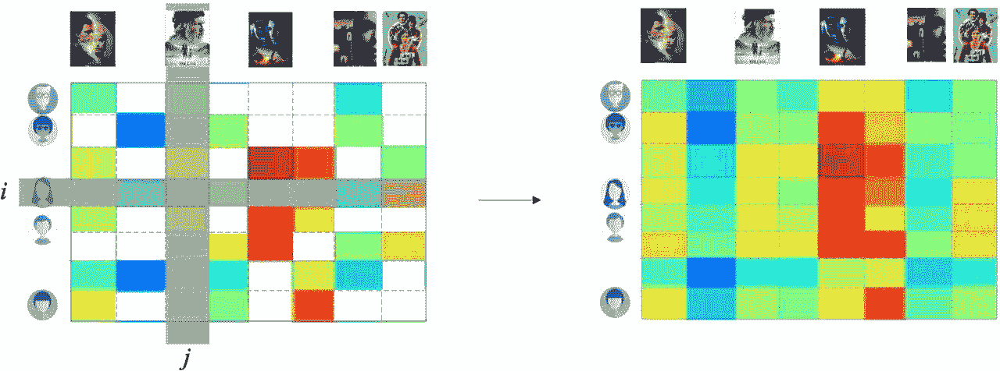

图 6.9 CRF 的应用：推荐系统的矩阵补全。

**示例：** **基于 CRF 的图像修复**。图 6.10 展示了另一个 CRF 成功应用的问题：基于补块的图像修复（patch-based image inpainting），其目标是填充数字图像中某些缺失（受损）的区域。这里，`y[s]` 是一个以空间位置 `s` 为中心的受损小图像补块，`x[s]` 是从某些未完损的图像区域提取的替换块，它应该与 `y[s]`（如果仍有完好部分）及其周围的图像结构良好拟合。替换块的放置使得它们之间部分重叠（参见图 6.10），以确保空间连续性。现在，一元势能 `ϕ(x[s], y[s])` 是 `y[s]` 中完好部分 `x[s]` 与 `y[s]` 像素值之间的某种距离度量（例如平方差之和）。这样，如果 `y[s]` 完全受损，`ϕ(x[s], y[s])` 为零，不影响 `x[s]` 的选择。相反，如果 `y[s]` 只丢失了一小部分，`ϕ(x[s], y[s])` 将强制目标块和源块之间保持良好的一致。交互函数在这里被简化为标签之间的一致性 `ψ(x[s], x[t])`，并表示为两个相邻块重叠区域像素值之间的距离度量。这确保了修复图像中的邻接块是相互一致的。通过此，(11)中后验概率的所有分量都已指定，并通过某些推理算法（如第 6.3.5 节中的圈路传播）作为 MAP 估计 `x = argmax P[X|Y]` 得到修复后的图像。

#### 6.3.4 统一表示：因子图

我们回顾了贝叶斯网络和马尔可夫随机场（MRF）。我们现在解决的问题是如何以统一的方式表示它们，以便我们在两种情况下运行相同的推理算法。回想一下贝叶斯网络的联合概率是节点在给定父节点条件下的条件概率的乘积：`P(x) = ∏ P(xi|parents(xi))`。(7)中给出的 MRF 联合概率也可以表示为乘积形式 `P(x) = 1/Z ∏_{c ∈ C} ψ_c(x)`，其中 `ψ_c(x) = exp(-V_c(x)/T)`。因此，在两种情况下，联合概率分布都是因子的乘积，每个因子由给定模型中变量的子集组成：

```
P(x) = 1/Z ∏_s f_s(x)
```

以图 6.3 中的贝叶斯网络为例。它的联合概率已在(6.2)中给出，将将其转换为因子图的自然方法是给每个乘法因子分配一个因子：

```
P(j, c, r, l, w, d) = f_J(P(j)) f_C(P(c)) f_R(P(r)) f_L(P(l|j, c, r)) f_W(P(w|l)) f_D(P(d|l))
```

这种因子分解可以使用因子图表示进行视觉化，如图 6.11 所示，其中变量节点用圆圈表示，因子节点用正方形表示。通常，因子图是一种二分图，表示哪些变量是哪些局部函数的参数。更多细节请参阅，例如 Kschischang 等人. (2001)。注意，在二分图中连接仅存在于不同类型的节点之间（因此不存在变量节点之间的连接，也不存在因子节点之间的连接）。习惯上，二分图由两层不同类型的节点绘制，如图 6.11 左侧所示，但相同因子图的另一种布局（如图 6.11 右侧所示）可能适用于我们在下一节中讨论的基于消息传递的可视化。

图 6.11 因子图表示，具有相同的因子和两种布局，来自贝叶斯网络。

图 6.11 因子图表示，具有相同的因子和两种布局，来自图 6.3。

图 6.12 将具有观测节点的通路 MRF 转换为因子图。

此外，观察因子图表示不是唯一的。通过此，我们指的不仅仅是图 6.11 中具有相同布局的视觉安排，而是指定因子本身。对于从上述示例构造因子图，有许多替代方案。例如，我们可以将(614)中的联合概率表示为两个因子 `f[1]` 和 `f[2]` 的乘积，其中 `f1 = P(j)P(c)P(r)P(l|j, c, r)` 且 `f2 = P(d|l)P(w|l)`。在这种情况下，我们的因子图表示将由与图 6.11 相同的六个变量节点组成，但只有两个因子节点：`f[1]` 连接到节点 `J`、`C`、`R` 和 `L`，`f[2]` 连接到 `L`、`D` 和 `W`。

图 6.12 展示了一个具有成对团的 MRF 模型及其因子图。注意，观测节点（用黑色圆圈表示）被等效的单变量因子图函数所取代。这里的因子图函数在这里是连接两个隐藏节点的成对函数 `ψ(x[s], x[t])`，或者是连接单个隐藏节点的单元（单节点）函数 `ϕ(x[s], y[s])`。因此，我们将场景 `x` 和观测值 `y` 的联合概率表示为

```
P_{X,Y}(x,y) = 1/Z ∏_s ϕ(x_s, y_s) ∏_{<s,t>} ψ(x_s, x_t)
```


如果我们只感兴趣给定观测值的标签的条件分布（CRF 公式化），我们以与上方相同的形式表示后验分布`PX|Y`，其中`ϕ`和`ψ`现在是 (6.11) 中对应项的`-log(.)`。观察我们如何通过这种方式对 图 6.6 所示的图像标记问题，其中`x[s]`是类别标签，而`y[s]`是像素强度。

### 6.3.5 近似推理算法

概率图模型中的精确推理通常是不可行的，甚至是不可能的（例如，MRF 模型的配分函数在大多数情况下是参数的一个不可处理的函数）。因此，我们需要求助于近似推理。这在具有循环依赖（环）的模型中尤为如此，因此不仅适用于 MRF 和 CRF，也适用于动态场景下的贝叶斯网络。我们在这里描述了三种代表性的近似推理算法。我们从信度传播（Belief Propagation）开始，它在无环网络中提供精确推理，在通用图中提供近似推理。然后我们转向随机采样方法和变分推理，它们对后验概率分布施加数值（采样方法）和分析（变分方法）的近似。

#### 6.3.5.1 信度传播

信度传播是一种强大的方法，通过在概率图的相邻节点之间传递相对简单的“消息”来解决复杂的推理问题。这可以被看作一种分布式处理，其中相邻节点之间相对简单的局部通信共同工作解决所需的查询，该查询可能与整个网络中的任何节点相关，甚至与节点任何特定值的联合概率相关。

尽管 Pearl (1988) 的原始信度传播算法已被推导出为无环网络的精确推理算法，但它通常作为近似推理方法应用于包含环的通用图中（如 MRF）。在环图上运行信度传播算法被称为环路信度传播（Loopy Belief Propagation, LBP）。该算法在证明 Turbo 码是 LBP 的一个实例后变得特别流行。

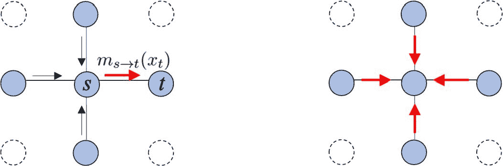

图 6.13 循环信度传播的插图。左侧：从一个节点到另一个节点的消息取决于发送节点从其其他邻居接收的消息。右侧：每个节点乘以来自所有邻居的输入消息以计算其信度。

消息传递过程非常简单，并在 图 6.13 中所示：一个节点在接收到来自所有邻居的消息后，向相邻节点发送消息。从`s`到`t`的消息`m[s]`的意思是“我节点`s`认为节点`t`可能处于这种状态”。该消息基于发送节点从所有其他邻居接收到的消息，以及它与接收节点的相容性（unary potential）。假设查询是：`n`的概率是多少？参考早期的例子，这可以意味着“`n`属于类的概率是多少？”这里的任务是推断边缘概率。消息的形式如下：

```
m_{s->t}(x_t) = sum_{x_s} (phi(x_s) * psi(x_s, x_t) * prod_{r in delta(s)} m_{r->s}(x_s))
```

其中`ϕ(x_s)`是发送节点的先验概率（unary potential），而`ψ(x_s, x_t)`是`x_s`与`x_t`之间的相容性。节点处于给定状态的信度然后通过其先验概率和所有进入它的消息的乘积计算：

```
P(x_s) = phi(x_s) * prod_{r in delta(s)} m_{r->s}(x_s)
```

消息初始化为 1（在环路 BP 中有时是 [0,1] 上的均匀分布随机数）。由于`m_{s->t}`的计算涉及 (6.16) 中对乘积的求和，因此该算法被称为和积算法（sum-product algorithm）。另一种信度传播变体（最大积算法）在本节末尾进行了简要说明。

我们也可以在因子图中表示信度传播，其中我们有两种类型的消息：从因子节点到变量节点的消息，以及从变量节点到因子的消息。选择一个变量节点作为根，推理分两个阶段：消息从叶子流向根节点，然后向反方向流动。这一过程在 图 6.14 中通过示例进行了说明。精确表达式和所选示例的详细分析位于感兴趣读者的部分。

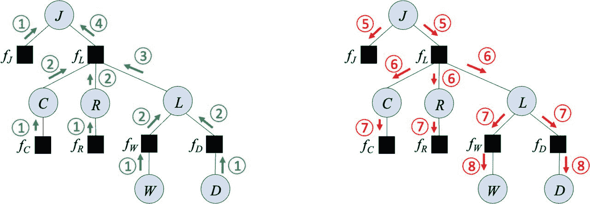

### 因子图表示中的和积算法

在因子图表示中，我们有两种消息：从变量节点`X[*s*]`到因子节点`f[*i*]`的`m[*X*[*s*] → *f*[*i*]](x*[*s*])`，以及从因子节点`f[*i*]`到变量节点`X[*s*]`的`m[*f*[*i*] → *X*[*s*]](x*[*s*])`。令`X[*i*]`为连接到`f[*i*]`的变量节点集合。这些消息的形式如下：(6.18)

```
\begin{matrix} {\\mathit{m}\_{\mathit{f}\_{\mathit{i}}\\rightarrow\\mathit{X}\_{\mathit{s}}}(\\mathit{x}\_{\mathit{s}})} & {= \\sum\\limits\_{\mathcal{X}\_{\mathit{i}} \\smallsetminus \\mathit{x}\_{\mathit{s}}}\\mathit{f}\_{\mathit{i}}(\mathcal{X}\_{\mathit{i}})\prod\\limits\_{\mathit{r} \\in \\mathit{\delta}(\mathit{i}) \\smallsetminus \\mathit{s}}\\mathit{m}\_{\mathit{X}\_{\mathit{r}}\\rightarrow\\mathit{f}\_{\mathit{i}}}(\\mathit{x}\_{\mathit{r}})} \\\\ {\\mathit{m}\_{\mathit{X}\_{\mathit{s}}\\rightarrow\\mathit{f}\_{\mathit{i}}}(\\mathit{x}\_{\mathit{s}})} & {= \\prod\\limits\_{\mathit{k} \\in \\mathit{\delta}(\mathit{s}) \\smallsetminus \\mathit{i}}\\mathit{m}\_{\mathit{f}\_{\mathit{k}}\\rightarrow\\mathit{X}\_{\mathit{s}}}(\\mathit{x}\_{\mathit{s}})} \\\\ \\end{matrix}
```

且节点的边缘概率为 (6.19)

```
\begin{array}{r} {\\mathit{P}(\\mathit{x}\_{\mathit{s}}) = \\prod\\limits\_{\mathit{i} \\in \\mathit{\delta}(\mathit{s})}\\mathit{m}\_{\mathit{f}\_{\mathit{i}}\\rightarrow\\mathit{X}\_{\mathit{s}}}(\\mathit{x}\_{\mathit{s}})} \\\\ \\end{array}
```

观察发现，在公式 (6.16) 和 (6.17) 标准信念中出现的不同势现在被简单地“吸收”到了因子`f[*i*]`中，而节点的概率是来自所有邻居节点的消息的乘积。

#### 因子图中的 BP 传播（BP）示例

图 6.14 展示了之前为贝叶斯网络构建的因子图上的消息传递过程。算法通过选择根节点启动（可以是任何变量节点；这里我们选择了`J`）。消息首先从叶子节点向根节点流动。如果叶子是变量节点，则其消息初始化为 1；如果是因子节点，则该初始消息为因子本身。在我们的示例中，在第 1 步中，五条消息同时从叶子发送：两条来自变量节点`W`和`D`（均为 1），另外三条来自三叶叶的因子：`f[*J*]`、`f[*C*]`和`f[*R*]`，每个都等于相应的因子，例如`m[*f[*J*]→J](j) = f*J*`。每个节点都会等待直到收到除一个邻居以外的所有邻居的消息。此时，它可以计算指向剩余邻居的消息。例如，在第 2 步中，节点`L`接收来自`f[*W*]`和`f[*D*]`的消息，同时`f[*L*]`接收来自`C`和`R`的消息。在第 3 步中，`L`向`f[*L*]`发送其消息，即`m[*L*→f[*L*]](l) = m*W→Lm*D→L`。此时，`f[*L*]`可以计算指向`J`的消息并在第 4 步中发送：`μ[*f[*L*]→J](j) = \sum[c]\sum[r]\sum[l]f*L*m[*C→f[*L*]](c)m[*R→f[*L*]](r)m[*L→f[*L*]](l)`。计算出的消息保存在每个节点。所有消息到达根节点后，消息传递继续向叶子节点，直到所有节点都收到所有边的消息。每个节点的信念（边缘后验概率）可以直接使用 (6.19) 计算。

信念传播的一种变体用于计算给定概率图模型中的最大联合概率，被称为最大乘积算法，这是因为在标准 BP (6.16) 和因子图版本 (6.18) 的消息表达式中，求和运算符被替换为了化运算符。为了理解这一点，回想边缘概率`P(x) = \sum[X \setminus x]P(x)`，显然如果我们想确定最大联合概率`max[x \in X]P(x)`，则需要将求和替换为最大化操作。由于许多小数的乘积可能会导致数值不稳定，在这种情况下通常会取对数。

让我们应用该算法来使用马尔可夫随机场（MRF）先验解决图像分类问题，如图 6.6)给出，且`T`=1；因此，先验概率为`P(x)`=(1/*Z*)exp[ − ∑[⟨*s*, *t*⟩]*ψ(*x[*s*], x[*t]*])]。我们需要计算 exp( − ΔH*)，它是`x^(C)`和`x`后验概率之比。假设我们每次只扰动一个标签，这确实是运行这些算法最常见的方法。在这种情况下，`x^(C)`和`x`仅在一个标签`x[*s*]`上不同。假设同之前的条件独立性`p(y|x)`= ∏[*s*]p(*y[*s*]|x[*s]*])，我们有：

```
(6.20)$\\begin{matrix} {\\frac{\\mathit{P}(\mathbf{x}^{\\mathit{C}}|\\mathbf{y})}{\\mathit{P}(\mathbf{x}|\\mathbf{y})} = \\frac{\\mathit{p}(\mathbf{y}|\\mathbf{x}^{\\mathit{C}})}{\\mathit{p}(\mathbf{y}|\\mathbf{x})}\\frac{\\mathit{P}(\mathbf{x}^{\\mathit{C}})}{\\mathit{P}(\mathbf{x})} = \\frac{\\mathit{p}(\mathit{y}\_{\mathit{s}}|\\mathit{x}\_{\mathit{s}}^{\mathit{C}})}{\\mathit{p}(\mathit{y}\_{\mathit{s}}|\\mathit{x}\_{\mathit{s}})}\exp\\left( - \\sum\\limits\\_{\\mathit{t} \\in \\mathit{\\delta}(\\mathit{s})}\\left( \\mathit{\\psi}(\\mathit{x}\_{\mathit{s}}^{\\mathit{C}},\\mathit{x}\_{\mathit{t}}) - \\mathit{\\psi}(\\mathit{x}\_{\mathit{s}},\\mathit{x}\_{\mathit{t}}) \\right) \\right)} \\\\ \\end{matrix}$
```

观察发现，先验概率的比简化为评估受影响团的差异（这是 MRF 的美之处和威力），这归结为标签已改变节点`s`的局部邻域`δ(s)`中的差异。我们将在二分类的情况下进一步详细地讨论这个示例（感兴趣的读者请参见相关章节）。

#### 使用 Ising 模型和 MCMC 采样器的二分类

对于图像像素的二分类，使用 Ising MRF 模型非常方便，标签为`x[*s*] ∈ {−1,1}`，其中`x[*s*]^(C)` = −`x[*s*]`，且`ψ(x[*s*], x[*t]*])` = β`x[*s]*x[*t]*`，其中`β`<0（表示对图像中两类空间连续性的先验偏好，见图 6.8）。再次假设对标签类型没有先验偏好（`α=0`），上述表达式具体变为：

```
\begin{array}{r} {\\frac{\\mathit{P}(\mathbf{x}^{\\mathit{C}}|\\mathbf{y})}{\\mathit{P}(\mathbf{x}|\\mathbf{y})} = \\frac{\\mathit{p}(\mathit{y}\_{\mathit{s}}|\\mathit{x}\_{\mathit{s}}^{\\mathit{C}})}{\\mathit{p}(\mathit{y}\_{\mathit{s}}|\\mathit{x}\_{\mathit{s}})}\exp\\left( 2\\mathit{\\beta}\\mathit{x}\_{\mathit{C}}\\sum\\limits_{\\mathit{t} \\in \\mathit{\\delta}(\\mathit{s})}\\mathit{x{t}} \\right)} \\end{array}
```

为了使其更具实用性，注意只需为每个访问过的位置`s`重新计算`∑[t∈δ(s)]x[*t*]`并将其代入：

```
\begin{array}{r} {\\mathit{r} = \\frac{\\mathit{p}(\mathit{y}\_{\mathit{s}} + 1)}{\\mathit{p}(\mathit{y}\_{\mathit{s}}| - 1)}\exp\\left( 2\\mathit{\\beta}\\sum\\limits_{\ttin \\ \\(delta(s)}\\mathit{x{t}} \\right)} \\end{array}
```

然后我们将`r`（从 −1 切换到 +1 时）或`1/r`（从 +1 切换到 −1 时）与 (0,1) 之间的随机数比较，以决定是否接受该更改。这种方法不保证全局最小值，但有很大概率找到低能配置。在经过足够的迭代后，配置序列将收敛到 (6.5)中定义的 MAP 解`\widehat{\mathbf{x}}_{MAP}`。通常，达到平衡所需的样本配置数量是图像大小的 50 倍。根据我们的经验，在二值图像标记中，如果初始估计良好，10 次迭代通常就足够了。`Gibbs sampler`是一种特殊的 Metropolis–Hastings 算法，从条件概率分布中抽取样本且接受概率为一。

#### 6.3.5.3 均场近似

称为`变分贝叶斯`（variational Bayes）的推理算法是解决复杂推理问题的 MCMC 采样器的替代方案。MCMC 技术通过一组样本提供精确后验概率分布的数值近似，而变分贝叶斯方法对后验概率分布施加解析近似，并在解析模型下提供精确解。后验分布`P(x|y)`由变分分布`Q(x)`近似，该分布比真实分布更简单且完全分解：

```
(6.21)$\\begin{matrix} {\\mathit{Q}(\mathbf{x}) = \\mathit{Q}(\\mathit{x_{1}},\\,\\mathit{x_{\\n}}) = \\prod\\limits_{\\mathit{s} = 1}^{\\mathit{n}}\\mathit{Q}(\\mathit{x_{\s}})} \\ \\end{matrix}$
```

在这里，`Q(x[*s*])`代表`X[*s*]`取值为`x[*s*]`的近似概率`Q(X[*s*]=x[*s]*])`，它是可能标签`l∈{1…L}`之一。为了方便，我们将`Q(X[*s*]=l)`表示为`q[*s*]`。

近似分布`Q`通过最小化相对于真实分布`P`的某种不相似性度量来找到，通常是`Kullback–Leibler 散度`^77 + \\sum\\limits_{\\mathit{t} \\in \\mathcal{N_{s}}}\sum\\limits_{\\mathit{k} = 1}^{\\mathit{L}}\\mathit{q_{t}}^{k}}\\mathit{\\psi}(l,k,y_{s},y_{t}) \\right) \\right\\ \\\\ \\end{matrix}$
```

`N[*s*]`是节点`s`的邻域，`Z[*s*]`是一个使得`Q`成为有效概率分布的归一因子（即每个节点的标签概率之和为 1）。均场算法对所有节点`s∈{1…n}`和所有标签`l∈{1…L}`重复此更新，直到达到特定的停止标准，通常直到所有`q*s*`的变化小于给定的容差值。此时，MAP 解`\widehat{\mathbf{x}}_{MAP}`直接通过为每个节点`s`分配最大`q*s*`的标签`l∈{1…L}`得到。

我们如何将这种方法具体应用到之前的几个示例中？非常简单！我们只需要为特定的应用指定相应的`ϕ`和`ψ`，并将它们代入上面的更新方程中。在推荐系统的示例中，我们将写`ψ(l, k, y[s], y[t]) = γσ(y[s], y[t])μ(l, k)`，其中`σ(y[s], y[t])`建模不同（用户，物品）对之间的相似性（例如，使用关于用户和物品的某种方便的可分离函数），而`μ(l, k) = min [(l − k)², τ]`建模标签`l`和`k`之间的兼容性。在图像补全示例中，`ψ(l, k, y[s], y[t])`被简化为`ψ(l, k)`，且`ϕ`和`ψ`函数都是两个图像块之间共享像素值的差平方和（对于`ϕ`是受损块和替换块之间，对于`ψ`是两个重叠的替换块之间）。

### 6.3.6 跨时间的概率推理


到目前为止，我们处理的是静态场景，即随机变量的值是固定的，至少在代理考虑期间是这样。在生活中，我们大多数时间处理的是动态场景：世界在不断变化，我们需要追踪这些变化并预测各种感兴趣实体的后续状态（值、位置等）。想想交通监控或机器人运动，也包括生理过程管理或在线社交网络分析等，例子层不完。

在这些许多场景中，我们处理的是时间序列，时间是离散的且具有某种步长，根据问题的动态性，步长可以是几分之一秒，也可以是几小时、几天甚至几年。我们用`X[1:t] = X[1], X[2], … X[t]`表示`t`个连续时间时刻的随机状态变量序列，用`E[1:t] = E[1], E[2], … E[t]`表示对应时刻的证据变量序列。根据我们的约定，`x[1:t]`和`e[1:t]`是它们各自取值的序列。`P(E[t]|X[t])`是传感器模型（也称为观测模型），而`P(X[t]|X[t-1])`是转移模型。

为了使推理变得可行，我们需要假设每个状态变量只依赖于有限数量的前几个状态变量，这在实践中也有充分的理由。这被称为马尔夫假设。对于一阶马尔夫过程，`P(x[t]|x[1:t-1]) = P(x[t]|x[t-1])`。此外，我们假设该过程是齐次的，即`P(x[t]|x[t-1])`对于所有`t`都是相同的。在实践中，我们通常假设每个时刻的证据变量只依赖于该特定时刻的状态变量（而不依赖于之前的状态和之前的观测），即`P(e[t]|x[1:t]) = P(e[t]|x[t])`。这被称为传感器马尔夫假设。在这些设置下，我们可以解决关于时间状态的各种查询。

### 示例：同事

你的同事 Sam 是一位软件工程师，今天主要在写代码，但偶尔也会和朋友聊天。你们的桌子布局是面对面坐着，电脑屏幕背对背。今天午休后你并没有特别想工作，你通过偶尔观察他的面部表情（比如每 5 分钟一次）来猜测同事是在编程还是聊天来消遣。你知道当 Sam 编程时，他大部分在皱眉（70% 的时间），但有时也会微笑（30% 的时间）。聊天时，他几乎总是在微笑（概率为 .8），很少皱眉（概率为 .2）。如果他现在正在编程，他在未来 5 分钟内继续写代码的概率约为 .9，在其他 10% 的情况下他会转而聊天。一旦开始聊天，他倾向于在接下来 5 分钟内继续聊天（概率为 .6），并以 .4 的概率回到编程。你假设 Sam 在午休后立即写代码的概率是 .7，时间被分为 5 分钟的间隔。

状态变量`X[t]`是 Sam 在间隔`t`内的活动，它可以取两个值：编程（`X[t]=p`）或聊天（`X[t]=c`），所以`x[t] ∈ {p, c}`。证据变量是面部表情，同样有两个值：微笑（`E[t]=s`）或皱眉（`E[t]=f`），所以`e[t] ∈ {s, f}`。我们还知道转移模型是`P(X[t]=p|X[t-1]) = .9`（且`P(X[t]=c|X[t-1]) = .1`），且`P(E[t]=s|X[t]) = .4`（且`P(E[t]=f|X[t]) = .6`）。这种情况如图 6.16 所示。如果我们观察到 Sam 在前两个时刻在皱眉，然后又是微笑又是皱眉，那么我们有`e[1:4] = (f, f, s, f)`。


图 6.16 *同事* 示例的插图，包含时间概率模型，以及相应表格中对应的转移模型和传感器模型。

跨时间推理中的推理问题被 Russel 和 Norvig 分为四种类型：过滤（filtering）、平滑（smoothing）、预测（prediction）和最可能解释（most likely explanation）。我们可以结合上述示例进行总结如下：

- **过滤（Filtering）**：给定目前收到的所有证据确定当前状态变量的后验概率分布：`P(x[t]|e[1:t])`。在我们的示例中：根据目前所有的面部表情，Sam 现在在聊天吗？这是信念状态（代理对当前状态的信念），它是决策过程（现在应该采取什么行动）的输入。
- **预测（Prediction）**：给定目前收到的所有证据确定未来状态的后验概率：`P(x[t+k]|e[1:t])`。例如：根据目前所有的面部表情，Sam 在 10 分钟后会聊天吗？我们需要预测评估可能的行动方案。
- **平滑（Smoothing）**：给定目前收到的所有证据确定过去状态的后验概率：`P(x[k]|e[1:t])`，其中`0 ≤ k < t`。例如：根据目前所有的面部表情，Sam 在 5 分钟前在聊天吗？这允许更好地估计过去的状态，因此对学习至关重要。
- **最可能解释（Most likely explanation）**：给定观测序列找到最可能的状态变量序列：`argmax[x[1:t]]P(x[1:t]|e[1:t])`。例如：给定面部表情序列`e[1:4]`，确定 Sam 在四个连续时间间隔内最可能的活动序列。

过滤、预测和平滑问题通过递归计算来解决，其消息传递方式类似于我们在本节之前介绍过的信度传播。最可能的解释则通过`Viterbi algorithm`（一种带有回溯的极大和信度传播变体）来解决。所有这些推理机制在 Russel and Norvig (2021) 中通过良好的示例进行了紧凑的描述。

一种广泛使用的时间概率模型是隐马尔可夫模型（`HMM`），其中状态由一个`single`离散随机变量描述。图 6.16 所示的示例是一个`HMM`，因为它只有一个状态变量，即 Sam 的活动`X[t]`，它可以是编程（`x[t] = p`）或聊天（`x[t] = c`）。

如果我们有多个状态变量，`HMM`也可以适用于这种情况，前提是它们被合并为一个单一复合变量（“巨变量”），其值是各个变量值的元组。例如，假设我们有另一个状态变量，即 Sam 在聊天中从朋友那里收到的消息量，三个可能的值为{`none`, `moderate`, `high`}。那么该问题的`HMM`状态变量取值就是这样的元组，如（`p`, `none`）、（`p`, `moderate`）、……（`c`, `high`）。`HMM`模型通常用状态转移图进行视觉化，例如图 6.17 所示。

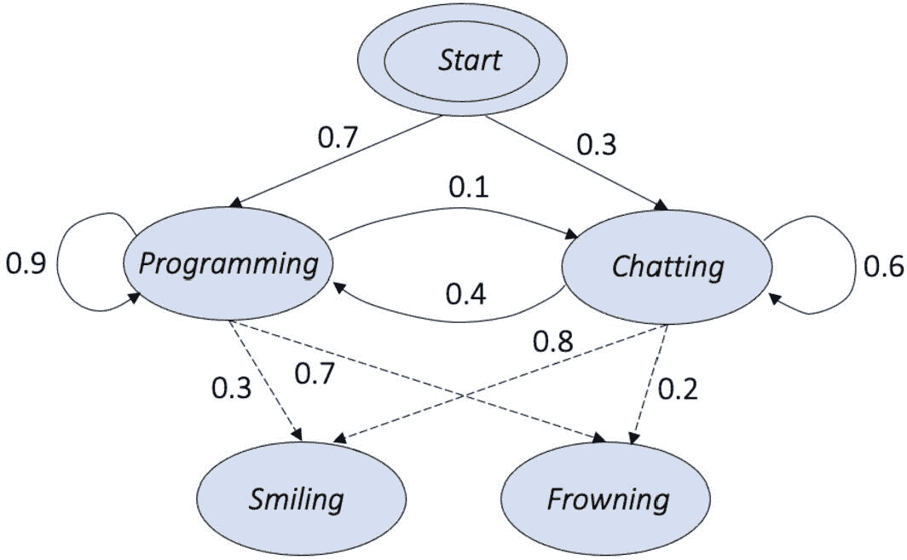

图 6.17 *Office mates* 示例 HMM 模型的状态转移图。

`HMM`的另一个特征是矩阵形式的转移模型的紧凑描述。如果状态变量`X[t]`有`N`个值，则转移模型是一个`N × N`矩阵`T`，其元素为`T[i, j] = P(X[t] = j | X[t−1] = i)`。在 6.16 中的 *office mates* 示例中，该转移模型为：

```latex
$\begin{matrix} {\mathbf{T} = \mathbf{P}(\mathit{X}_{\mathit{t}}|\mathit{X}_{\mathit{t} - 1}) = \begin{pmatrix} 0.9 & 0.1 \\ 0.4 & 0.6 \\ \end{pmatrix}} \\ \end{matrix}$
```

传感器模型由对角矩阵`O[t]`表示，其对角线元素为`P(e[t]|X[t] = i)`。在图 6.16 的示例中，观测序列`e[1:4] = (f, f, s, f)`，我们有：

```latex
$\begin{matrix} {\mathbf{O}_{1} = \mathbf{O}_{2} = \begin{pmatrix} 0.7 & 0 \\ 0 & 0.2 \\ \end{pmatrix},\quad\mathbf{O}_{3} = \begin{pmatrix} 0.3 & 0 \\ 0 & 0.8 \\ \end{pmatrix},\quad\mathbf{O}_{4} = \begin{pmatrix} 0.7 & 0 \\ 0 & 0.2 \\ \end{pmatrix},\quad\mathbf{O}_{4}}
```

让我们先反思一下，在人工智能中我们何时需要概率推理。许多复杂的推理和规划问题正通过（纯）逻辑方法、搜索和博弈策略，以及基于逻辑的层次化规划来解决。当我们面临不确定性时，我们需要概率推理，这些不确定性源于各种来源，例如环境的非确定性方面、动作的不确定结果、部分可观测、领域知识不完整、无法运行所有相关测试等。概率推理通常是解决此类问题的唯一可行或至少是种稳健的方法。但它在不同层面也面临着局限性。

我们可以将概率推理的主观局限性和客观局限性区分开来。所谓的主观局限性是指人在概率推理中会犯的常见错误，这些错误会导致对模型选择和使用的错误、对涉及的数据分布的规格错误，以及对涉及的概率和推理结果的解释错误。这类错误的示例比之完穷，下面我们强调了一些常见原因。所谓的客观局限性是指由于必须在模型和推理策略中进行各种简化以实现可行的解决方案，以及必须依赖可用的统计数据和/或从可用数据中估计假设模型参数的必要性而产生的局限性。这也意味着人工智能中的概率推理也继承了机器学习的许多通用局限性。

### 概率推理的主观局限性

概率推理的主观局限性与在实践中构建和应用正确的概率方法的困难有关，这归因于我们在日常生活中对不确定性的表述方式与将其翻译为正式模型所需方式之间的误解和不兼容性。首先，概率推理模型的设计者通常需要将高度歧义的日常概率表达（如“机会很小”、“怀疑”、“极有可能”等）翻译成数值。

众所周知，概率推理的各种常见困难具有心理学起源，例如赌徒谬误（一种错误地认为连续的独立事件会在因果关系上影响后发生事件的结果，例如，认为一个在过去发生频率频繁的事件在未来发生的概率较小，反之亦然）或我们倾向于将某些某些方面特殊的事件（例如扑克中的“同花色”或恒天体的特定对齐）刻画为“低概率”事件。同样，我们对某些事件发生概率的判断往往受到其显著性的极大影响。

常见错误还包括在提供给系统的问题描述中混淆了回溯概率和预测概率。参考以下来自 Eddy 的示例（2013），它展示了一项研究的统计数据如何错误地传播到下一项研究：

原始研究报告：“87.5% 的‘射线癌’（或‘阳性’）组经活检证实恶性病变，因此`P(ca|pos) = 87.5%`，且`P(benign|neg) = 84%`。”

随的一项医学研究在此基础上进行，但将其错误地翻译为“在 84% 的良性病变患者和 87.5% 的癌患者中做出了正确的乳腺诊断”，而实际上，这项研究中的真阳性率`P(pos|ca)`仅为 66%，真阴性率`P(neg|benign) = 54%`。这些以及类似的误解在实践中可能会影响数据分布模型的规格，在极端情况下甚至会导致需要依赖这些模型的概率方法失效。

### 概率推理的客观局限性

概率推理的客观局限性是那些我们仅仅通过仔细、正确地实现底层理论和算法就无法避免的局限性。通常，我们需要抽象现实世界的许多方面，并构建简化的模型和简化的推理引擎，以便在可行的时间内获得解决方案或支持实时决策。

在某些情况下，这些简化比其他情况更为严重，并可能更影响影响结果的准确性和有效范围。因此，了解给定模型是在什么假设下推导出的以及它提供了什么样的性能保证始终是重要的。

有时，我们需要在我们施加的模型准确性与在该模型下推理过程可实现的准确性之间进行权衡。例如，我们在章节 6.3.5.2 中处理的 MCMC 采样器在`exact probability distribution`下产生`approximate solution`（尽管以高概率趋于精确解）。与之相反，章节 6.3.5.3 中的变分推理方法在概率分布的近似`simplified model`下产生`exact solution`。

严格来说，置信传播方法仅对树结构概率图模型产生精确解，因此对于许多具有循环的模型并不适用。但实践告诉我们，循环置信传播在一般的循环网络中通常非常好，Turbo 码的巨大成功也证明了这一点。

## 6.5 行业示例

### 6.5.1 使用马尔可夫链模型在 Microsoft Sentinel 中寻找异常会话

Karishma Dixit Aleksandra Pižurica Emmanuel Gillain

#### 6.5.1.1 业务背景

大型组织存储了由其各种 IT 产品和服务产生的海日志。这些日志通常用于审计和安全目的，并可以被用来发现异常活动，这里假设恶意活动在与合法活动对比时会被定义为异常。

许多现有的`security detections`（安全检测）往往基于规则，旨在检测特定的已知攻击，例如密码喷洒（密码喷洒通常是指向程序中输入大量用户名，程序会遍历这些用户名并尝试多个密码；这是一种暴力攻击）。然而，针对企业的网络安全攻击不断演变，使得检测新型攻击变得困难。因此，应该采用更具适应性的方法。

`Markov chain model`（马尔夫链模型）可以提供这种灵活性，以适应并发现对手可能进行的活动，其行为与普通用户不同。`Microsoft Sentinel`作为一种云端安全信息和事件管理服务，提供了这种建模方法，帮助客户探索并检测潜在的恶意活动。该建模方法通过 Jupyter Notebook 提供，⁷⁸


图 6.18 Microsoft Sentinel Jupyter Notebooks UI 截图。


图 6.19 Microsoft Sentinel Incidents UI 截图。

为了说明如何应用马尔夫链模型帮助客户检测`anomalous sessions`（异常会话），让我们假设一家虚拟公司“Contoso”存储了其 Microsoft Office365⁷⁹) 的审计日志。

### 6.5.1.2 总体方法

在安全漏洞标记数据难以获取且迅速过时的背景下，我们必须应对标记攻击数据的短缺。在这种情况下，使用无监督学习技术通常更好，因为它们具有发现新型攻击的灵活性。所提出的`Markov chain model`足够通用，可以对任何类型的序列或会话数据建模。

原始审计或安全日志数据首先被组织成`sessions`（会话），这通常是与用户账户相关的`时间排序事件序列`，可能还包含其他属性。然后通过应用马尔夫假设计算此类会话的概率，如下所示，对于如`A`、`B`、`C`的事件序列：

```text
(6.23)$\begin{matrix} {\mathit{P}(\text{session})} & {= \mathit{P}(\mathit{A},\mathit{B},\mathit{C})} \\ & {= \mathit{P}(\mathit{C}|\mathit{A},\mathit{B})\mathit{P}(\mathit{A},\mathit{B})} \\ & {= \mathit{P}(\mathit{C}|\mathit{A},\mathit{B})\mathit{P}(\mathit{B}|\mathit{A})\mathit{P}(\mathit{A})} \\ & {= \mathit{P}(\mathit{C}|\mathit{B})\mathit{P}(\mathit{B}|\mathit{A})\mathit{P}(\mathit{A})\quad\text{(by applying Markov assumption)}} \\ \end{matrix}
```

然后我们可以计算用于转移概率的`maximum likelihood estimates`（极大似然估计）（例如，从`A`转移到`B`的概率）。一旦我们计算出给定会话中所有转移概率的估计值，就可以将它们相乘得到似然得分。似然得分越低，会话中的活动越不寻常，因此我们认为该会话异常的可能性越大。

#### 从日志到事件，从事件到转移事件和会话

让我们通过使用虚拟公司 Contoso 的 Office365 审计日志的一些示例会话来深入说明这些概念。在这种情况下，事件是通过应用程序编程接口（`API`）向 Office365 服务发出的命令，该 API 定义了多个中间件之间的交互。例如，一个事件可能是使用`Set-User`命令。我们根据用户和 IP 地址将事件分组为按时间排序的会话。参见图 20 中的一些示例会话。

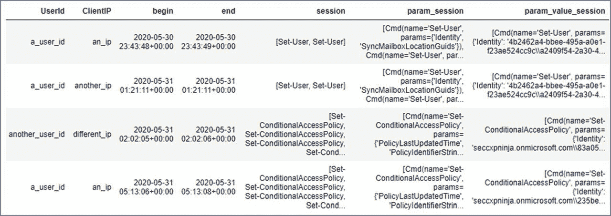


图 20 通过用户 ID（列 1）和 IP 地址（列 2）识别会话，并带有时间戳（列 3 & 4）。每个会话的三种不同格式：简单事件序列，如 `Set-User`、`Set-Mailbox`（列 5），带参数的事件序列（`Ex: name="Set-User", params={"Identity", "Force"}`），或参数和值的序列（`Ex: name="Set-User", params={"Identity": "test.com", "Force": "true"}`）。

## 创建马尔可夫链模型并利用数据训练以估计概率

现在让我们通过使用 `Markov chain` 模型查看此类带有事件和参数的会话的建模。简单事件 `A`、`B`、`C` 会话的 `likelihood of a session` 在 (6.23) 中给出 `P(C|B)P(B|A)P(A)`。

**情况 1**：首先考虑由简单事件序列组成的会话，并将转移概率定义为从上一个事件状态转移到当前事件状态的概率：

```
$\begin{array}{r} {\\mathit{P}(\text{event}_{i}|text{event}_{i - 1})} \\\\ \\end{array}$
```

一旦建立了模型，我们就使用极大似然估计来估计转移概率。在这种情况下，`maximum likelihood estimate` 简化为计数的比例：

```
$\begin{array}{r} {\\mathit{P}(\text{event}_{i}|text{event}_{i - 1}) = \frac{\#(\text{event}_{i - 1}\rightarrow\text{event}_{i})}{\text{event}_{i - 1}}} \\\\ \\end{array}$
```

- `C`, `D`, `##END##`

随后我们将得分最低窗口的似然概率作为整个会话的分数。注意，除了使用 `start-token` 之外，我们仍然在使用 `end-token`。`end-token` 意味着在 `D` 事件之后包含会话的额外概率，而当我们对 `A` 事件进行条件限制时，`start-token` 会出现。

**情况 2**：为了进一步对会话进行建模，我们通过添加命令的参数来区分其正常用法和非常规用法。一个事件可以定义为向量 `x[i]`：

```
$\begin{array}{r} {\mathit{x}\_{\it{i}} = \left\{\\mathit{c}\_{\it{i}},\\mathit{p}\_{\it{i}}\\right\} \end{array}$
```

其中 `c[i]` 是第 `i` 次的命令，`p[i]` 对于 `c[i]` 值为 1 或 0。例如，`c[i]` 可以是带有“Identity”不同参数的 `Forward` 命令，`p[i]` 对于该事件的值为 1，否则为 0。

如果我们将向量 `p[i]` 标记为简写，当前事件对前一个事件的概率模型变为：

```
$\begin{matrix} \mathit{P}(\mathit{x}\_{\it{i}|\mathit{x}\_{\it{i} - 1}) & { \mathit{P}\left( \{\mathit{c}\_{\it{i}},{\mathit{p}\_{\it{k}}\}}\it{i}\}|\mathit{c}\_{\it{i} - 1,{\\{\mathit{p}\_{\it{m}}\}}\mathit{i} - 1\} \right) \\\\ & {= \mathit{P}\left( \{\mathit{p}\_{\it{k}}\}}\it{i}\}|\mathit{c}\_{\it{i}},\mathit{c}\_{\it{i} - 1,{\\{\mathit{p}\_{\it{m}}\}}\mathit{i} - 1\} \right)\mathit{P}\left( \mathit{c}\_{\it{i}|\mathit{c}\_{\it{i} - 1,{\\{\mathit{p}\_{\it{m}}\}}\mathit{i} - 1\} \right) \\\\ & {= \mathit{P}\left( \{\mathit{p}\_{\it{k}}\}}\it{i}\}|\mathit{c}\_{\it{i}} \right)\mathit{P}\left( \mathit{c}\_{\it{i}|\mathit{c}\_{\it{i} - 1} \right)\quad\text{(通过建模）}} \\\\ & {= \mathit{P}(\mathit{c}\_{\it{i}|\mathit{c}\_{\it{i} - 1})\prod\limits_{\mathit{j} = 1}^{\mathit{k}}\mathit{P}(\mathit{p}\_{\it{j}}\mathit{i}|\mathit{c}\_{\it{i}})\quad\text{(通过建模）}} \\\\ \end{matrix}$
```

其中：

- `p[k]` 的参数仅依赖于当前命令 `c[i]`，而不依赖于前一个命令 `c[i-1]`
- `p[k]` 的存在被建模为伯努利分布

当前事件对前一个事件的概率模型变为：

```
$\begin{array}{r} \mathit{P}(\mathit{x}\_{\it{i}|\mathit{x}\_{\it{i} - 1}) & { \mathit{P}\left( \{\mathit{c}\_{\it{i}},{\mathit{p}\_{\it{k}}\}}\it{i}\}|\mathit{c}\_{\it{i} - 1,{\\{\mathit{p}\_{\it{m}}\}}\mathit{i} - 1\} \right) \\\\ & {= \mathit{P}\left( \{\mathit{p}\_{\it{k}}\}}\it{i}\}|\mathit{c}\_{\it{i}},\mathit{c}\_{\it{i} - 1,{\\{\mathit{p}\_{\it{m}}\}}\mathit{i} - 1\} \right)\mathit{P}\left( \mathit{c}\_{\it{i}|\mathit{c}\_{\it{i} - 1,{\\{\mathit{p}\_{\it{m}}\}}\mathit{i} - 1\} \right) \\\\ & {= \mathit{P}\left( \{\mathit{p}\_{\it{k}}\}}\it{i}\}|\mathit{c}\_{\it{i}} \right)\mathit{P}\left( \mathit{c}\_{\it{i}|\mathit{c}\_{\it{i} - 1} \right)\quad\text{(通过建模）}} \\\\ & {= \mathit{P}(\mathit{c}\_{\it{i}|\mathit{c}\_{\it{i} - 1})\prod\limits_{\mathit{j} = 1}^{\mathit{k}}\mathit{P}(\mathit{p}\_{\it{j}}\mathit{i}|\mathit{c}\_{\it{i}})\quad\text{(通过建模）}} \\\\ \end{matrix}$
```

通过使用 `Markov chain model`（马尔可夫链模型），我们能够对 Microsoft Office365 日志进行建模，以寻找并可视化异常的用户会话。我们看到如何利用 `Microsoft Sentinel` 在自动化计划上运行此类分析，从而引发安全事件，以便安全分析师进行进一步调查。虽然这里介绍的方法应用于 Office365 审计日志，但它们当然也可以以类似的方式应用于其他类型的审计或安全日志。

## 6.5.2 农业生产者中基于贝叶斯推断的作物预测

Matthew J. Smith, Pierre Stratonovitch, Richard Tiffin

### 6.5.2.1 概述

#### 背景

“鲜产品”（Fresh produce）是农业中的术语，指以采收后的形式消费的农作物。例如，萝卜、甜玉米和草莓都属于“鲜产品”。鲜产品种植者希望对农作物何时可以收获进行预测，以便他们能够做出最佳经济决策。本案例研究是关于产生此类预测的过程。它代表了生产者用于减少浪费和提高生产效率的作物预测模型的简化版本。它特别关注概率预测，因为它们所提供的不同结果的概率对于种植者的决策尤为重要。

平衡鲜产品的供需可能特别具有挑战性，因为供给和需求都随时间动态变化。在供应侧，天气是作物成熟并变得可销售时间的重要决定因素。这种供应侧风险被需求侧的风险放大了，需求侧的季节性、公共假期、零售商和品牌促销、社交活动以及天气状况都是主要的决定因素。供需之间潜在的错配很重要，因为在采收后通常有一个短暂的销售窗口期。在环境条件下，鲜产品作物具有高易腐性，这意味着它们会迅速开始失去“新鲜度”和价值。显而易见，预测供应（和需求）的能力能够采取管理措施，以最小化或减轻此类错配。生产者希望最大化满足消费者需求的概率，同时最小化过度生产并导致浪费的概率。

这里处理的特定挑战是建立一个鲜产品生长模型，产生关于产量和收获时间的概率预测，以帮助种植者平衡过度生产风险与无法满足需求的风险。

#### 关键技术

我们使用 `Bayesian inference`（贝叶斯推断）来学习模型的参数，该模型在公式中包含了植物生物学的见解；即所谓的“基于过程”的模型。我们采用带有 Metropolis–Hastings 算法的 `Markov chain Monte Carlo`（MCMC，马尔可夫蒙特卡洛）采样器来估计本章其他地方描述的模型参数的概率分布。参数估计的概率性质贯穿于模型的预测之中，结果变成了概率性的。

### 6.5.2.2 描述

#### 基于过程的作物模型

用于工业应用的基于过程的作物模型是一种计算算法，它使用预测作物生长属性的表达式，包含了决定作物生长的底层生物过程的表示。典型的目标作物属性是成熟日期、产量和质量。

`process-based models`（基于过程的模型）的一个优点是它们可以很好地捕捉作物生长对生长条件的非线性响应，而不需要大量数据。缺点是，这种公式将始终是近似表示，因此必须小心识别模型预测何时具有误导性。因此，基于过程的模型仍需经过 `calibrated`（校准）才能准确。

基于过程的作物模型的高级表示为：

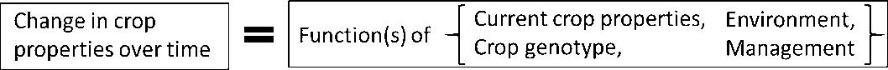

图 6.23 基于过程的作物模型公式的高级表示。

作物基因型（作物品种）通常通过模型公式和参数在模型中隐含表示。从数学上讲，上面的作物模型可以表示为：

(6.24)

```
$\begin{matrix} {\mathit{C}(\mathit{t} + \mathit{\tau}) = \mathit{F}\left( \mathit{C}(\mathit{t}),\mathit{E}(\mathit{t}),\mathit{M}(\mathit{t}),\mathit{\theta} \right),} \\ \end{matrix}$
```

其中 `C(t)` 是时间 `t` 的属性向量，`τ` 是时间间隔（通常为一天），`F` 是函数向量，`E(t)` 是环境条件向量，`M(t)` 是管理条件向量，`θ` 是参数向量。基于过程的作物模型通常需要迭代求解（作物模拟）。

#### 示例：萝卜成熟模型

一个用于数据的萝卜（*Raphanus* subsp. *sativus*）的简单假设作物模型。

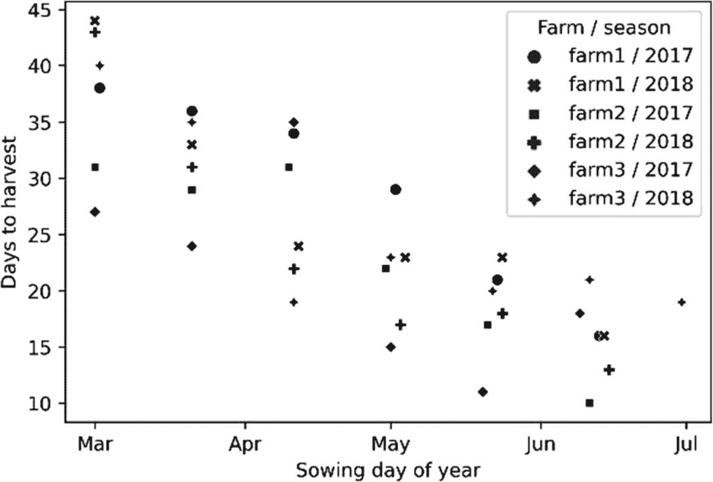

图 6.24 三个农场在两年内萝卜收获时间的观测数据。这些数据用于训练以学习我们预测作物模型的参数分布。

图 6.24 中的数据显示了明显的趋势。随着天气变暖，从播种到收获的时间缩短。温度限制生物过程的速度，温度越高，作物生长越快（只要不过过热且没有其他限制因素）。温度影响作物发育的常用方法是计算从播种开始的累积热量：

(6.25)

```
$\begin{matrix} \left\{ \begin{matrix} {A(T) = 0\quad} & {T < S} \\ {A(T + 1) = A(T) + \max(0,\Upsilon(T + 1))\quad} & {T \geq S,}} \\ \end{matrix} \right. \\ \end{matrix}$
```

其中 `A(T)` 是累积温度，`T` 是离散天数，`T[S]` 是播种日，`Upsilon` 是平均日温度。在这里，我们使用 `T` 来表示离散增量，与 (6.24) 中的连续时间 `t` 相对。

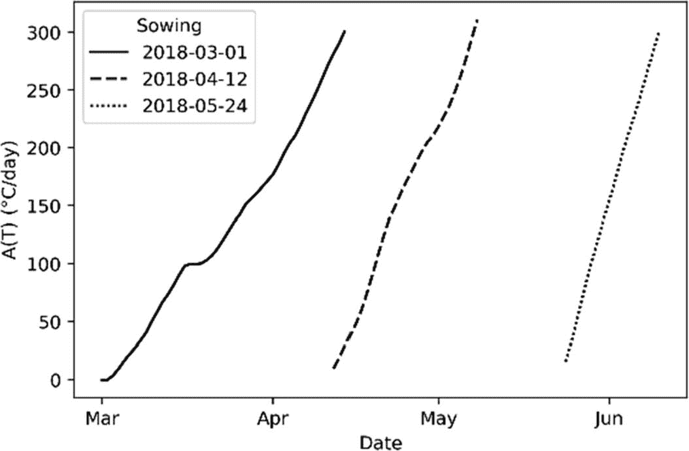

图 6.25 三个农场在不同季节种植的萝卜植物的累积温度 `A(T)`。注意 `A(T)` 在一年中后期增长得更快。

对于我们的模型，我们假设一旦累积温度超过阈值 `Γ`，作物即可进行收获：

(6.26)

```
$\begin{matrix} \left\{ \begin{matrix} {H(T) = 0\quad} & {A(T) < \Gamma} \\ {H(T) = 1\quad} & {A(T) \geq \Gamma,} \\ \end{matrix} \right. \\ \end{matrix}$
```

其中 `H(T)` 是一个布尔指示器，表示作物是否成熟可以收获（`H(T) = 1`）或未成熟（`H(T) = 0`）。收获日期 `T[H]` 定义为累积温度达到特定阈值的首次时刻：

(6.27)

```
$\begin{matrix} {\mathit{T}_{\mathit{H}} = \min\limits_{\mathit{T}}\mathit{H}(\mathit{T}) = 1} \\ \end{matrix}$
```

注意，本示例中的作物模型相对简单，作物属性向量 `C(T)`（在此情况下，定义于我们的通用作物模型 6.24 中）是一个表示作物作物累积温度以及作物是否已准备好收获的向量：

(6.28)

```
$\mathit{C}(\mathit{T}) = \begin{bmatrix} {\mathit{A}(\mathit{T})} \\ {\mathit{H}(\mathit{T})} \\ \end{bmatrix}.$
```

#### 驱动数据与校准数据

基于过程的模型可以使用多种数据类型作为输入。驱动数据是用于表示作物所经历条件的输入数据。这些数据是图 6.23 中的“环境”和部分“管理”数据，并在 (6.24) 中由 `E(t)` 和 `M(t)` 表示，它们是我们示例中樱萝卜作物所经历的温度数据。

基于过程的作物模型还需要指定作物和环境的初始条件。在我们的樱萝卜示例中，初始条件是作物的种植日期。

校准数据（或训练数据）用于学习不确定的模型参数，这些参数在 (6.24) 中表示为 `θ`。此类校准数据通常代表过去某些时刻的作物属性，可以与模型预测进行比较。这类数据传统上来自农场测量、人工调查和研究项目。最近，人们开始了日益增加遥感观测数据（通常来自卫星）。在我们的樱萝卜示例中，校准数据是图 6.24 所示的农场记录。

#### 模型/参数推理

为了校准基于过程的模型，我们应用贝叶斯推断，根据观测数据来学习参数 `θ`。这在 6.25 中所示，该数据代表过去某些时刻的作物属性，可以与模型预测进行比较。这类数据传统上来自农场测量、人工调查和研究项目。最近，人们开始了日益增加的遥感观测数据（通常来自卫星）。在我们的樱萝卜示例中，校准数据是图 6.24 所示的农场记录。

图 6.28 显示了生产者按照定期种植计划时，萝卜菜供应的涌现动态性。由于作物生长与天气之间的相互作用，这些供应动态呈现出显著的不规则性。生产者面临的挑战是管理其种植、管理和采收，以便使其供应与市场需求达到最佳匹配。关于供应分布的额外概率信息为生产者提供了不同供应水平的相对似然指示，从而指出了在给定需求水平下，供应过剩或供应不足的相对风险。

#### 问题与替代方案

上述描述的 `贝叶斯参数估计` 方法仅是用于校准作物模型的众多许多方法之一。该方法的挑战在于参数推理速度慢、计算开销大，且需要推理专家。因此，该方法最适用于运营模型部署之前的模型开发。其他方法更适用于生长季节期间的 `实时推理`，例如本章其他部分描述的集成 `卡尔曼滤波` 和 `粒子滤波` 方法。

### 6.5.3 使用 XBOX TrueSkill™ 估计玩家技能

Nicolas Vercheval Aleksandra Pižurica

#### 6.5.3.1 业务背景

在任何时候都有数百万活跃玩家，Xbox Live® 等大规模在线游戏服务的成功取决于其准确估计玩家技能并据此进行快速匹配的能力。与技能相当的对手对战，可以为用户提供具有挑战性的体验和公平的获胜机会。

评分值反映了玩家的技能水平，并在获胜后更新为增加值，失败后更新为减少值，根据对手水平调整获胜（或失败）积分。早期的评分系统对玩家进行一致排名并提取可靠的胜率概率，但无法估计评分准确的置信度，且当新玩家加入平台时，需要额外的参数进行补偿。

2005 年，Xbox Live 引入了 `TrueSkill™`，这是一种轻级贝叶斯评分系统，它用概率分布对游戏的不确定性和人类因素进行建模。它根据评分的可靠性调整更新，显示出快速收敛性，并自然地扩展到以前需要任意和临时修改的场景，例如玩家组队或多个团队在同一场比赛中竞争。这个示例演示了因子图表示和信念传播如何让 Trueskill 应对 Xbox Live 带来的挑战。

#### 6.5.3.2 总体方法

游戏的结果包含许多偶然因素：游戏运气、玩家的注意力、不合时的披萨送达等。根据游戏历史匹配两名玩家涉及考虑无数可能性，这些可能性可能对特定游戏非常特殊，或者完全未知。概率推理通过从 `潜在原因` 对证据的可能影响的角度来描述它们，帮助在这一不确定的环境中进行导航。


Trueskill 用每个玩家表现的随机变量来捕获游戏结果的随机性。游戏的获胜者即是表现最好的玩家，那么问题“谁会赢？”就变成了“谁的表现更有可能优越？”。假设是表现是相互独立的，仅取决于玩家的技能和运气。技能被视为表现平均值，让强玩家能够持续地击败较弱的对手。运气解释了为什么较弱的玩家有时会获胜，或者面对面决并不总是产生相同的结果。

一种可能的简化方法假设玩家的技能是一个不随时间变化的未知常数。尽管如此对其可能值的信念会随着他们进行的每场游戏而演变。因此，推断当前信念的分布是随时间概率推理的例子，准确来说，是一个`滤波`问题。为了简单，这个说明性示例保留这一假设。在实践中，允许玩家的技能随时间变化有助于描述表现较高或较低的时期（例如玩家输掉比预想多比赛的日子），并在新玩家进步时跟上他们。

在 Trueskill 中，玩家的评分不仅是一个数字，而是对其技能信念的紧凑表示。这种方法允许做出更好的决策；相反，它需要为了适应所有玩家。Trueskill 使用高斯分布来近似玩家的技能，其均值和方差反映了感知的技能和置信度。用户体验需要快速匹配。动态环境持续记录其他玩家的游戏结果，但显式地建模所有的过去历史会带来不可接受的复杂度。马尔可夫假设极大地简化了模型，将推理限制在基于之前信念的简单更新上。它还允许`因子图`表示，优雅地解释信念传播。Trueskill 通过增加其他模型扩展到更通用的设置。一个潜在高斯变量代表玩家随游戏变化的技能波动，允许其变化。团队的表现是个人表现之和。当表现差异太小而无法判定时，会出现平局。这些扩展使因子图变得复杂，但保持相同的推理算法。我们在这里不介绍这些细节；而是感兴趣的读者参考 Winn (2023)，它解释了完整的匹配策略和排名标准。在本示例中，两名玩家 Jill 和 Fred 在一场不允许平局的游戏中对战。在上一节，第三个玩家 Steve 加入了。

## 6.5.3.3 预测结果

当游戏在两个玩家之间进行时，他们的胜率有复杂的解析解。信念传播有助于将他们的计算分解为若干步骤。我们通过因子图视觉化这些步骤（参见图 6.29），描述了 Jill 和 Fred 技能、运气和表现的联合分布。

```
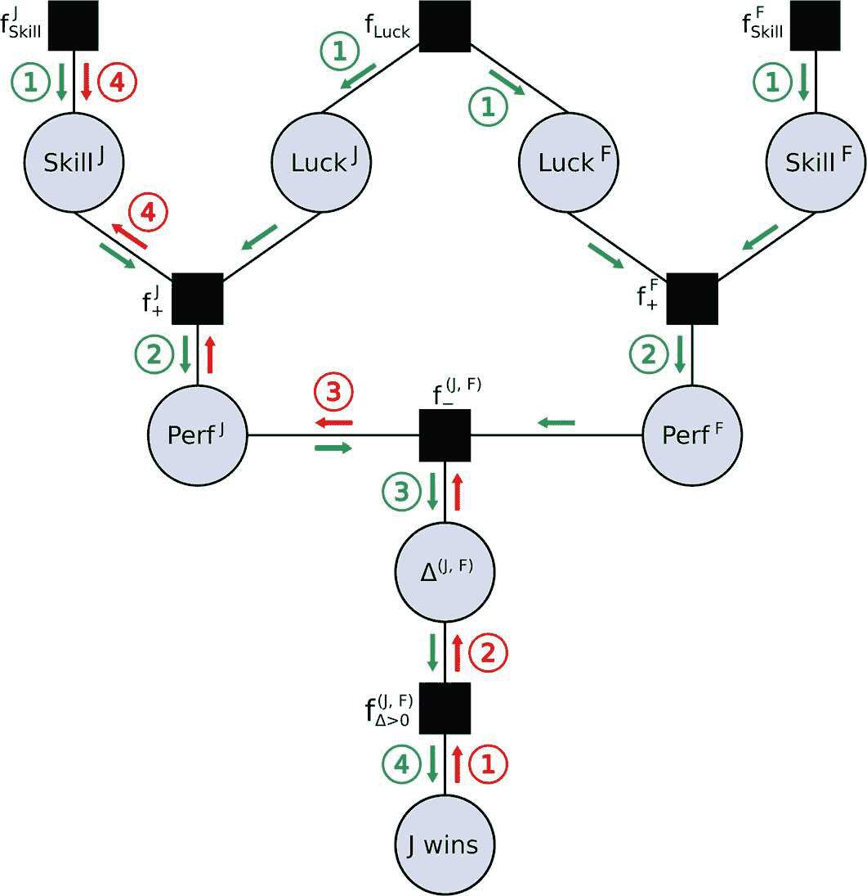
```

图 6.29 绿色的消息推断出胜率。红色的似然消息更新了 Jill 的评分。

我们在图中从上到下运行概率传播，以更新 Jill 获胜的概率，换句话说，就是推断 Jill 获胜事件的边缘分布。由于不允许平局，Fred 的获胜概率随之即可得出。用于此目的的正确算法是我们在 (6.3.5.1)中见过的离散变量和乘积算法。尽管这里的大多数变量是连续的，该算法是完全等价。

### 第 1 步：为初始变量分配当前信念

第一步是将当前信念分配给初始变量。具体而言，我们使用玩家当前的评分来估算他们的技能分布。根据我们的假设，玩家 `P` 的技能遵循由其评分给定的、均值为 `μ`、方差为 `σ`² 的正态分布：

$\\begin{matrix} {\\text{Skill}^{\\mathit{P}} \\sim \\mathcal{N}\\left( \\mathit{\\mu},\\mathit{\\sigma}^{2} \\right).} \\\\ \\end{matrix}$ 

在我们的示例中，Jill 的评分为 (`μ` = 120, `σ`² = 1600)，Fred 的评分为 (`μ` = 100, `σ`² = 25)；Jill 可能是更强的玩家，但她的实际能力尚不。

因子 `f[Skill]^J` 和 `f[Skill]^F` 描述了 Jill 和 Fred 的技能分布。由于这些是连续变量，因子以及它们的消息是概率密度函数。为了简单起见，我们对密度和相对分布使用相同的符号。用这种符号，节点 `Skill^J` 和 `Skill^F` 的消息为：

$\\begin{matrix} {\\mathit{m}\_{\\mathit{f}\_{\\text{Skill}}^{\\mspace{450mu}\\text{J}}\\rightarrow\\text{Skill}^{\\mspace{450mu}\\text{J}}} = \\mathcal{N}(120,1600),\\quad\\mathit{m}\_{\\mathit{f}\_{\\text{Skill}}^{\\mspace{450mu}\\text{F}}\\rightarrow\\text{Skill}^{\\mspace{450mu}\\text{F}}} = \\mathcal{N}(100,25).} \\\\ \\end{matrix}$ 

两个玩家的运气变量（记为 `Luck^J` 和 `Luck^F`）接收到类似的消息，但在这种情况下，每个 `P` 的消息都是相同的：

$\\begin{matrix} {\\mathit{m}\_{\\mathit{f}\_{\\text{Luck}}\\rightarrow\\text{Luck}} = \\mathcal{N}(0,25)} \\end{matrix}$ 

该分布是一个固定设置。因此，玩家的运气变量是独立的。

因子 `f[+]P` 代表玩家 `P` 的性能，即其技能和运气的和。高斯分布的一个已知性质是，两个独立正态分布变量之和服从高斯分布，其均值之和为均值，方差之和为方差。我们将此公式应用于性能 `Perf^P`：

(6.30)$\begin{matrix} {\\text{Perf}^{P} = \\text{Skill}^{P} + \\text{Luck}^{P} \\sim \\mathcal{N}\\left( \\mu + 0,\\sigma^{2} + 25 \\right).} \\end{matrix}$

来自 `f[+]` 的消息是上述密度。连续变量的乘积算法通常涉及复杂的积分，该积分只能通过数值方法进行近似。然而，高斯分布的属性使我们能够避免密集的计算，并通过精确公式计算消息。

### 第 2 步：传播消息

在第二步中，我们利用上述属性并发送以下消息：

$\\begin{matrix} {\\mathit{m}\_{\\mathit{f}\_{+}^{\\mspace{450mu}\\text{J}}\\rightarrow\\text{Perf}^{\\mspace{450mu}\\text{J}}} = \\mathcal{N}(120,1600 + 25),\\quad\\mathit{m}\_{\\mathit{f}\_{+}^{\\mspace{450mu}\\text{F}}\\rightarrow\\text{Perf}^{\\mspace{450mu}\\text{F}}} = \\mathcal{N}(100,25 + 25).} \\end{matrix}$

随后性能节点将消息传递给因子 `f-`，它代表两个性能之间的差异。

在第三步中，我们使用两个独立变量之差的类似公式，得到以下消息：

$\\begin{matrix} {\\mathit{m}\_{\\mathit{f}}^{(\\text{J},\\\mspace{450mu}\\text{F})\\rightarrow\\Delta^{(\text{J},\\\mspace{450mu}\\text{F})} = \\mathcal{N}(120 - 100,1625 + 50) = \\mathcal{N}(20,1675).} \\end{matrix}$

我们将消息传递给最终因子 `fΔ>0`，该因子将性能估算转换为获胜概率。通过将 `fΔ>0` 设置为以下阶跃函数可以实现这一点：

$\\begin{matrix} {f_{\Delta > 0}(d) = 1 & \text{if } d \geq 0 \\ 0 & \text{if } d < 0 \\end{matrix}$

通过该因子，乘积消息对应于差异大于零的概率，即在已知技能的情况下，Jill 的性能高于 Fred。为了得到这个概率，我们需要差异的累积函数 `F[J,F]`。我们通过对归一化性能计算标准高斯分布 `Φ(x)` 来获得：

(6.31)$\begin{matrix} {\\mathit{m}\_{\\mathit{f}\_{\Delta > 0}}^{(\text{J},}\\text{F}}\\rightarrow\\text{J\\ wins}} = \\mathit{P}\\left( \\Delta^{(\text{J},\\\mspace{450mu}\\text{})}})} >  \\right) = 1 - \\Phi\\left( \\frac{- 20}{\\sqrt{1675}} \\right) \\approx 68.7\%}\\end{matrix}$

由于“J wins”是传播的最后一个节点，唯一的输入消息是其推断概率。正如预期的，是 Jill。

#### 更新评分

我们在观察游戏结果（在本例中为“J Wins”）后，使用玩家技能的后验分布来更新评分。根据贝斯法则：

(6.32)$\begin{matrix} {\\mathit{p}\\left( \\text{Skill}^{\\mathit{P}}|text{J Wins} \\right) = \\frac{\\mathit{p}(\\text{J Wins}|\\text{Skill}^{\\mathit{P})}\\mathit{p}(\\text{Skill}^{\\mathit{P})}}{\\mathit{Z}},} \\end{matrix}$ 

其中 $\frac{1}{\mathit{Z}}$ 是归一化常数。

给定结果的 `Skill^P` 后验分布必须再次符合高斯假设，其均值和方差成为玩家的新评分。当先验分布和似然函数 `p(J Wins|Skill)` 都是高斯分布时，结果如此。

具体来说，如果 𝒩(*s*; *μ*, *σ*²) 是变量 `s` 的先验密度，且 `s` 又是似然函数 $\mathcal{N}(x;s,\sigma²)$ 的均值，则：

(6.33)$\begin{matrix} {\\frac{\\mathcal{N}(\\mathit{x};\\mathit{s},{\\overline{\\mathit{\\sigma}}}^{2})\\mathcal{N}(\\mathit{s};\\mathit{\\mu},\\mathit{\\sigma}^{2})}{\\mathit{Z}} = \\mathcal{N}\\left( \\mathit{s};\\left( \\frac{\\mathit{x}}{{\\overline{\\mathit{\\sigma}}}^{2}} + \\frac{\\mathit{\\mu}}{\\mathit{\\sigma}^{2}} \\right)\\mathit{\\sigma}^{\\prime},\\mathit{\\sigma}^{\\prime} \\right),} \\end{matrix}$ 

新的方差等于 $\mathit{\sigma}^{\prime} = {(\\frac{1}{{\\overline{\mathit{\\sigma}}}^{2}} + \frac{1}{\mathit{\\sigma}^{2}})}^{- 1}$。遗憾的是，`p(J Wins|Skill)` 并不是高斯分布。为了展示问题源于何处，我们从观测结果向节点 `Skill(J)` 运行信念传播（再次参见图 6.29）。

假设 Jill 赢了。在第一步中，变量“J wins”向因子 `f[*Δ* > 0]^((J, F))` 信号：Jill 和 Fred 的表现差异大于零，因为 Jill 的表现更高。在第二步中，因子 `f[*Δ* > 0]^((J, F))` 将此信息转换为以下消息：

(6.34)$\begin{matrix} {\\mathit{m}\_{\\mathit{f}\_{\Delta > 0}^{(\text{J},\\mspace{450mu}\\text{F})}\\rightarrow\\Delta^{(\text{J},\\mspace{450mu}\\text{F})}} = 1_{>}(\\mathit{d}).} \\\\ \\end{matrix}$ 

这条消息是有问题的，因为它不是高斯密度，正因如此，后续的所有消息都不可能是高斯分布。更糟糕的是，它不是任何分布的密度，而且没有任何密度可以在数值上逼近它。

Trueskill 并不直接近似消息。相反，它用一个高斯密度替换原始消息，该密度以类似的方式影响概率图。具体而言，它选择新的消息，使得给定结果后对表现差异得出的推断尽可能接近其精确的后验分布。这种技术被称为*期望传播*（expectation propagation），它比直接近似技能的后验分布更有优势，因为它将误差与性能节点绑定，并允许对图中其余部分进行精确推理，而那部分部分可能比本例要复杂得多。

我们通过将包含 Jill 获胜信息的消息（即似然函数）与关于预期表现差异的消息（即我们在上一节计算的先验分布密度）相乘，来计算表现差异的精确后验分布。根据贝叶法则，我们得到一个与后验密度成比例的函数：

(6.35)$\begin{matrix} {\\mathit{p}\_{\Delta^{(\text{J},\\mspace{450mu}\\text{F})}|\\text{J wins}}(\\mathit{d}) = \\frac{(\\mathit{m}\_{\\mathit{f}\_{\Delta > 0}^{(\text{J},\\mspace{450mu}\\text{F})}\\rightarrow\\Delta^{(\text{J},\\mspace{450mu}\\text{F})}})(\\mathit{m}\_{\\mathit{f}\_{-}^{(\text{J},\\mspace{450mu}\\text{F})}\\rightarrow\\Delta^{(\text{J},\\mspace{450mu}\\text{F})}})}{\\mathit{Z}} = \\frac{1_{>}(\\mathit{d})\\mathcal{N}(\\mathit{d};20,1675)}{\\mathit{Z}} \\\\ \\end{matrix}$ 

归一化常数 $\frac{1}{Z}$ 中的 `Z` 是我们在上一节计算的概率 `P(J wins)=0.687`。

我们在(6.35)中展示了在图 6.30 中的密度。复杂的公式给出了它的均值（≈41.1）和方差（≈809.2）。我们使用这些统计量进行推断。 赢了，因此表现差异的真实后验分布。正态近似具有平滑效应，留下了 Fred 表现更好的概率。我们用 `\mathcal{N}(60.8;1565.6)` 替换似然消息 `d`。使用(6.33)中的公式，得到：

$\begin{matrix} {\\mathcal{N}(60.8;1565.6)\\mathcal{N}(d;20,1675)}{0.687} = \\mathcal{N}(d;41.1),} \\\\ \\end{matrix}$ 

这近似了表现差异。现在我们知道了一个良好的近似：

$\begin{matrix} {\\mathit{m}\_{\\mathit{f}\_{\Delta > 0}^{(\text{J},\\mspace{450mu}\\text{F})}\\rightarrow\\Delta^{(\text{J},\\mspace{450mu}\\text{F})}} \\approx \\mathcal{N}(60.8,1565.6),} \\\\ \\end{matrix}$ 

通过将消息转发到 `f[(J, F)]` 完成第二步。

在第三步中，我们更新 Jill 的评分。我们重用上一节计算的关于 Fred 预期表现的消息以及两个独立变量之和公式，从表现差异推断 Jill 的表现：

$\begin{matrix} {\\mathit{m}\_{\\mathit{f}\_{-}^{(\text{J},\\mspace{450mu}\\text{F})}\\rightarrow\\text{Perf}^{\mspace{450mu}\\text{F}}} = \\mathcal{N}(60.8 + 100,1565.6 + 50) = \\mathcal{N}(160.8,1615.6)}

在最后一步，我们计算 Jill 技能的似然函数。因子 `f+(J)` 接收上一步的消息以及我们已经计算的来自 `Luck(J)` 的消息。该因子考虑了该变量的噪声，并发送关于 Jill 展示能力的信心较低的消息。上一节的公式仍然适用，我们得到：

$\begin{matrix} {\\mathit{m}\_{\\mathit{f}\_{+}^{\\mspace{450mu}\\text{J}}\\rightarrow\\text{Skill}^{\\mspace{450mu}\\text{J}}} = \\mathcal{N}(160.8,1615.6 + 25) = \\mathcal{N}(160.8,1640.6).} \\\\ \\end{matrix}$ 

消息传递算法通过指向最终变量 `Skill(J)` 的消息乘积结束结束，该乘积与([6.32)中的后验成比例。第一个消息是来自 `f[Skill]` 的先验分布密度。

图 6.31 包含变量先验信息的消息为绿色。期望传播第一次迭代中的似然消息和后验消息为红色。

Jill 获得第一，因此她的表现必须高于 Fred。该算法的运行方式与之前相同（步骤 1、2 和 3），并返回关于 Fred 表现的似然消息：


$\begin{matrix} {\\mathit{m}\_{\\mathit{f}\_{-}^{(\\text{J},\\mspace{450mu}\\text{F})}\\rightarrow\\text{Perf}^{\\mspace{450mu}\\text{F}}} = \\mathcal{N}(120 - 60.8,1565.6 + 1625) = \\mathcal{N}(59.2,3190.6).} \\\\ \\end{matrix}$

该更新告诉我们 Fred 可能没有处于最佳状态。算法并没有立即更新 Fred 的评分，而是利用这一信息将其与 Steve 的表现进行对比背景化处理。因此，在步骤 4 中，它将似然消息与 Fred 表现的先验信息相乘，并发送生成的消息：

$\begin{matrix} {\\mathit{m}\_{\\text{Perf}^{\\mspace{450mu}\\text{F}}\\rightarrow\\mathit{f}\_{-}^{(\\text{F},\\mspace{450mu}\\text{S})}} = (\\mathit{m}\_{\\mathit{f}\_{+}^{\\mspace{450mu}\\text{F}}\\rightarrow\\text{Perf}^{\\mspace{450mu}\\text{F}}})(\\mathit{m}\_{\\mathit{f}\_{-}^{(\\text{J},\\mspace{450mu}\\text{F})}\\rightarrow\\text{Perf}^{\\mspace{450mu}\\text{F}}}) = \\mathcal{N}(99.4,49.2).} \\\\ \\end{matrix}$

上面的消息近似于`p[Perf(F)|J wins]`，包含了 Fred 在输给 Jill 之后表现的后验信息，但没有证据表明其表现高于 Steve。算法将其视为关于他们表现差异估计的先验信息，并按照上一节的方式继续进行（步骤 5）。

在看到 Fred 的表现优于 Steve 之后（步骤 6），模型对此变得更加乐观，并向`Perf(F)`发送了一个新的似然函数：

$\begin{matrix} {\\mathit{m}\_{\\mathit{f}\_{-}^{(\\text{F},\\mspace{450mu}\\text{S})}\\rightarrow\\text{Perf}^{\\mspace{450mu}\\text{F}}} = \\mathcal{N}(177.1,2043.4).} \\\\ \\end{matrix}$

给定之前的结果，Fred 表现分布上生成的后验密度为：

$\begin{matrix} {\\mathit{p}\_{\\text{Perf}^{\\mspace{450mu}\\text{F}|\\text{wins}} \\approx (\\mathit{m}\_{\\mathit{f}\_{+}^{\\mspace{450mu}\\text{F}}\\rightarrow\\text{Perf}^{\\mspace{450mu}\\text{F}}})(\\mathit{m}\_{\\mathit{f}\_{-}^{(\\text{F},\\mspace{450mu}\\text{S})}\\rightarrow\\text{Perf}^{\\mspace{450mu}\\text{F}}}) = \\mathcal{N}(101.8,48.8)} \\\\ \\end{matrix}$

比原始密度略高，并可以发回给`f-(J,F)`以重新评估 Jill 和 Fred 之间的表现差异。这种重新评估是必要的，因为期望传播执行的是近似，其误差会从一个表现差异传播到另一个。通常情况下，期望传播是一个迭代方法，当消息的变化在容差值内时停止。在我们的情况下，对`p[Perf(F)|F wins]`的当前估计已经足够，我们可以像上一节中那样使用它来更新 Jill 的评分。同样，我们使用新的`p[Perf(F)|J wins]`估计来更新 Steve 的评分。

Jill 的新评分（`μ=141.1, σ²=791.1`）比上一节的略高且更具确定性，因为她也击败了 Steve。相反，Steve 的新评分（`μ=80.6, σ²=376.6`）低得多，因为模型意识到它之前的估计是错误的。

为了更新 Fred 的评分，我们将进入其表现节点的两个似然消息相乘，以获得关于他成功的聚合信息，然后像以前一样从后续消息继续传播：

$\begin{matrix} {\\mathit{m}\_{\\text{Perf}^{\\mspace{450mu}\\text{F}}\\rightarrow\\mathit{f}\_{+}^{\\mspace{450mu}\\text{F}}} = (\\mathit{m}\_{\\mathit{f}\_{-}^{(\\text{J},\\mspace{450mu}\\text{F})}\\rightarrow\\text{Perf}^{\\mspace{450mu}\\text{F}}})(\\mathit{m}\_{\\mathit{f}\_{-}^{(\\text{F},\\mspace{450mu}\\text{S})}\\rightarrow\\text{Perf}^{\\mspace{450mu}\\text{F}}}) = \\mathcal{N}(130.8,1234.1).} \\\\ \\end{matrix}$

Fred 的新评分（`μ=100.6, σ²=24.5`）与其初始估计相似。事实上，模型使用了它已经对其深有信心的评分作为另外两个的参考。

### 6.5.3.5 结论

在之前的节中，我们展示了 Trueskill 的基本功能。其灵活的建模方法允许通过引入更多假设和添加特定应用的约束来扩展图。这种灵活性对于适应变化的模型需求非常有价值，并确保了易于维护。它还实现了跨不同游戏的可移植性，提供了一致的用户体验并减少了开发时间。得益于其量化估计置信度的能力，Trueskill 还是集成到策略和决策过程中的卓越工具。通过将理论属性转化为具体的优势，Trueskill 展示了严谨的概率推理如何提供企业所寻求的灵活性和可靠性。

## 6.6 概率论的有用提醒

### 6.6.1 概率中的基本概念

在概率推理中，我们处理的是随机性，这种随机性产生于我们感兴趣的结果产生的过程（或“试验”）尚未发生（例如，明天的比赛），或者已经存在的结果是不确定的（例如，由于各种测量的不精确性）。在这里，我们简要回顾概率的基本原理，并解释我们将用到的符号。

给定试验的所有可能结果空间称为`样本空间`。令`Ω`为该样本空间，`ω` $\in Ω$ 为其元素。随机**事件**是样本空间的任意子集`θ` $\subset Ω$，其元素`ω`是*原子事件*。以掷骰子为例。在这种情况下，`Ω` = {1,2,3,4,5,6}。“骰子大于 4”的事件是子集 {5,6} $\subset Ω$，它包含了原子事件 5 和 6。支撑概率理论的基本原理是每个结果的概率位于 0 和 1 之间：$0 \le P(\omega) \le 1$，且所有可能结果的概率和为 1：$\sum_{\omega \in \Omega} P(\omega) = 1$。此外，任何事件的概率在该事件成立的原子事件的和：$P(\theta) = \sum_{\omega \in \theta} P(\omega)$。例如，假设骰子是均匀的，每个结果的概率为 1/6，总和为 1，且 $P(\text{骰子大于 4}) = P(5) + P(6) = 1/6 + 1/6 = 1/3$。这三个原理就是**概率公理**。从这三个公理中可以推导出概率论中成立的所有其他规则，包括关于两个事件并集的概率等于它们各自概率之和减去交集概率的规则：$P(a \lor b) = P(a) + P(b) - P(a \land b)$。

事件和随机变量之间的区别是什么？正如上文定义的，事件对应于逻辑推理中的`proposition`（命题），从非正式的角度来说，它可以描述为对我们感兴趣的实验的任何有意义的陈述（例如，“骰子大于 4”或“骰子是偶数”等）。因此，事件以某种概率发生或不发生，而`random variable`是一个值受某些随机现象影响的变量。通常，随机变量的值是`real numbers`（实数），但在某些情况下也是布尔值{`true`,`false`}。在掷骰实验中，我们可以将事件“骰子 > 4”定义为一个随机变量`X`，其可能值为`true`或`false`；或者如果我们将`X`定义为掷骰的结果，它的可能值就是{1,2,3,4,5,6}。通常情况下，我们用大写字母表示随机变量，例如`X`，用对应的小写字母表示它的特定值，我们称之为`realization`（实现值），例如`x`。我们使用粗体字母表示随机变量向量`X = (X[1], … X[n])`及其实现值`x = (x[1], … x[n])`。我们还说`X = x`是一个事件，其中随机变量`X`取值为`x`。

在上面的示例中，我们说明了`discrete`（离散）随机变量，它们只能取可计数的（有限或无限）个不同值。离散随机变量的另一个例子是类别标签，其中`x`是可能的类别之一。`X`取值为`x`的概率通常记为`P(X = x)`或`PX`。此外，为了简洁起见，当指代对象不会产生歧义时，我们有时只使用`P(x)`。我们将相同的约定应用于随机变量向量`P(X = x) = PX`，在不可能产生歧义时简写为`P(x)`。`P(X)`中的`P(X)`（或在`P(X)`中）中的粗体`P`表示一个向量，其中每个元素都是`X`（或`X`）的某个特定实现值的概率。

`continuous`（连续）随机变量可以取无限多个值。例如人的身高或体重、空气温度、移动距离或血糖水平。连续随机变量由`probability density function`（概率密度函数，pdf，也称为`density`（密度）`pX`特征。pdf 的积分为 1：∫[− ∞]^∞pX = 1，而`cumulative`（累积）函数为：

(6.36)$ \begin{matrix} {\\mathit{F}_{\mathit{X}}(\\it{xx}) = \\mathit{P}(\mathit{X} \leq \\mathit{x}) = \\int\\limits_{-_{- \\infty}^{\\mathit{xx\\mathit{pp}_{\\mathit{X}}(\\it{x})\\mathit{dd\\mathit{x}} \\ \\ \\end{matrix}$

在本章解决的问题中，数据分布通常是连续随机变量，与每个数据样本相关的标签是离散随机变量。

先验概率（Prior probabilities）表示先验信念（关于某个随机变量的值），且没有任何（新的）证据（即没有任何测量或观测）。例如，令`R`为表示“明天会下雨”的随机变量，有两个可能值`r ∈ {true`,`false`}`。那么在安特卫普的 7 月，先验概率`P(R = true) = 0.3`是合理的（30%的日子是雨天），而在利斯本`P(R = true) = 0.04`。`Conditional`（条件）概率表示`给定某些证据的信念`。例如，我们知道安特卫普当前气压`B`（单位为 mbar）的值，我们将天气概率完善为`P(R = true | B = 992.21) = 0.43`。对于先验和条件概率，我们通常使用更紧凑的表示方法，与上面解释相同，例如`P(R = r | B = b) = PR|B`，对于条件概率密度函数`pB|R`（因为`B`是连续随机变量），当不可能产生歧义时我们也使用更短的符号，如`P(r|b)`或`p(b|r)`。形式上，我们将给定`y`时`x`的条件概率定义为：

(6.37)$ \begin{matrix} {\\mathit{P}(\\mathit{x}|\\mathit{y}) = \\frac{\\mathit{P}(\\mathit{x} \land \\mathit{y})}{\\mathit{P}(\\mathit{b})}\\quad{if}\\mspace{430mu}\\mathit{P}(\\mathit{y}) \neq 0} \\\\ \\end{matrix}$

`product rule`（乘法法则）给了一种另一种公式：`P(x ∧ y) = P(x|y)P(y) = P(y|x)P(x)`，连续应用乘法法则得出了著名的`chain rule`（链式法则）：

(6.38)$ \begin{matrix} {\\mathit{P}(\\mathit{x}_{1},\\ldots\\mathit{x}_{\\mathit{n}}) = \\mathit{P}(\\mathit{x}_{\\mathit{n}}|\\mathit{x}\}_{1},\\ldots,\\mathit{x}_{\\mathit{n} - 1})\\mathit{P}(\\mathit{x}_{1})\\ldots\\mathit{P}(\\mathit{x}_{2}) \\ \\ \\end{matrix}$

我们在统计推断和概率推理中描述了三种常见的估计器，并对它们的使用和相互关系进行了注释。

在统计学、概率推理和机器学习中，`极大似然估计`（MLE）常用于在给定观测数据的情况下估计假设概率分布的参数。参数值通过通过最大化由假设模型描述的过程产生观测数据的似然度来找到。`似然函数` `L`(`θ`|`y`） = `p`(`y`|`θ`） 衡量了数据`y`对参数每个可能值`θ`提供的支持。如果`L(θ[1]|y) > L(θ[2]|y)`，我们知道观测到的数据点`y`更有可能是由`θ` = `θ[1]`的模型生成的，而不是由值`θ` = `θ[2]`生成的，因此观测数据点告诉我们`θ[1]`比`θ[2]`更合理。

因此，如果我们的观测是`y`，并且我们用带有参数`θ`的统计模型`p`(`y`|`θ`）对它们的实际（未知）分布进行建模，我们通过最大化似然函数`L`(`θ`|`y`）来找到`θ`：

```
(6.40)$\\begin{matrix} {\\widehat{\\mathit{\\theta}} = \\arg\\max\\limits\_{\\mathit{\\theta}}\\mathit{L}(\\mathit{\\theta}|\\mathit{y}) = \\arg\\max\\limits\_{\\mathit{\\theta}}\\mathit{p}(\\mathit{y}|\\mathit{\\theta})} \\\\ \\end{matrix}$ 
```

假设我们观测到了测量值`y[1], …y[N]`，并且我们相信底层过程`y`服从正态分布`N(μ, σ²)`。我们想要找到参数`μ`和`σ`，使得假设模型能够以最好的方式表示观测数据。似然函数是联合概率`p(y[1], …, y[N]|θ)`，其中`θ` = `(μ; σ)`。如果我们的观测在统计上是独立的，

```
(6.41varnothingbegin{matrix} {\\mathit{L}(\\mathit{\\mu};\\mathit{\\sigma}|\\mathit{y}\_{1},\\ldots,\\mathit{y}\_{\\mathit{\\N}}) = \\mathit{p}(\\mathit{y}\_{1},\\ldots,\\mathit{y}\_{\\mathit{\\N}}|\\mathit{\\theta}) = \\prod\\limits\_{\\mathit{\\i} = 1}^{\\mathit{\\N}}\\mathit{p}(\\mathit{y}\_{\\mathit{\\i}}|\\mathit{\\theta}) = \\left( \\frac{1}{\\mathit{\\sigma}\\sqrt{2\\mathit{\\pi}}} \\right)^{\\mathit{\\N}}\\mspace{430mu}\\mathit{e}^{- \\frac{1}{2\\mathit{\\sigma}^{2}}\\sum\\limits\_{\\mathit{\\i} = 1}^{\\mathit{\\N}}{(\\mathit{y}\_{\\mathit{\\i}} - \\mathit{\\mu})}^{2}}} \\\\ \\end{matrix}$ 
```

最大化这个似然函数等价于最大化它的对数`ℓ = ln L`，即：

```
(6.42varnothingbegin{matrix} {\\ell(\\mathit{\\mu};\\mathit{\\sigma}|\\mathit{y}\_{1},\\ldots,\\mathit{y}\_{\\mathit{\\N}}) = \\ln\\mathit{L}(\\mathit{\\mu};\\mathit{\\sigma}|\\mathit{y}\_{1},\\ldots,\\mathit{y}\_{\\mathit{\\N}}) = - \\frac{\\mathit{\\N}}{2}\\ln(2\\mathit{\\pi}) - \\frac{\\mathit{\\N}}{2}\\ln(\\mathit{\\sigma}^{2}) - \\frac{1}{2\\mathit{\\sigma}^{2}}\\sum\\limits\_{\\mathit{\\i} = 1}^{\\mathit{\\N}}{(\\mathit{y}\_{\\mathit{\\i}} - \\mathit{\\mu})}^{2}} \\\\ \\end{matrix}$ 
```

因为对数函数是一个单调函数。参数`μ`和`σ²`的 MLE 估计随后通过将`ℓ`对`μ`和`σ²`的导数置零得到，得出估计值：


```
(6.43varnothingbegin{matrix} {\\widehat{\mathit{\\mu}} = \\frac{1}{\\mathit{\\N}}\\sum\\limits\_{\\mathit{\\i} = 1}^{\\mathit{\\N}}\\mathit{y}\_{\mathit{\\i}},\\quad{and}\\quad{\\widehat{\mathit{\\sigma}}}^{2} = \\frac{1}{\\mathit{\\N}}\\sum\\limits\_{\\mathit{\\i} = 1}^{\\mathit{\\N}}{(\\mathit{y}\_{\mathit{\\i}} - \\widehat{\\mathit{\\mu}})}^{2}} \\\\ \\end{matrix}$
```

它们恰好是经验均值和方差。这种估计在图 6.32 中有所说明。我们可以将此方法推广到以下情况：我们的观测是向量，且我们相信假设模型从多元正态分布 `N(μ, Σ)` 表示观测数据，其中 `μ` 是均值，`Σ` 是协方差矩阵。我们的观测是 `y[1], …y[N]`，每个包含 `d` 个分量。通过相同的方法我们我们参数 `μ` 和 `Σ` 的 MLE 估计：

```
(6.44varnothingbegin{matrix} {\\widehat{\mathit{\\mu}} = \\frac{1}{\\mathit{\\N}}\\sum\\limits\_{\\mathit{\\i} = 1}^{\\mathit{\\N}}\\mathit{y}\_{\mathit{\\i}},\\quad{and}\\quad{\\widehat{\\sigma}}}^{2} = \\frac{1}{\\mathit{\\N}}\\sum\\limits\_{\\mathit{\\i} = 1}^{\\mathit{\\N}}{(\\mathit{y}\_{\mathit{\\i}} - \\widehat{\\mathit{\\mu}})}^{2}} \\\\ \\end{matrix}$
```

正态分布的例子是直观的，但我们可以将相同方法应用于其他统计模型。在某些情况下，给定 `x` 的观测概率 `y` 是已知的。例如，不需要估计分布的参数，而是想要利用 MLE 寻找 `x` 的可能值，`x` 是数字图像的像素强度，`y` 是加性高斯噪声影响的测量值。在这种情况下，`p(y|x)` 描述了给定 `x` 的似然。给定观测 `y`，未知变量 `x` 的极大似然估计是：

```
(6.45varnothingbegin{matrix} {\\widehat{\mathit{\\x}} = \\arg\\max\\limits\_{\\mathit{\\x}}\\mathit{p}(\\mathit{y}|\\mathit{\\x})} \\\\ \\end{matrix}$
```

当我们对 `x` 没有可靠的先验知识时，这种估计是有用的，并且用于初始化迭代估计过程，该过程利用了关于 `x` 的先验知识，但受益于良好的初始化（如我们在第 6.3.5 节 中描述的 Metropolis 采样）。

最广泛使用的贝叶斯估计器之一是最大化给定观测 `y` 后未知 `x` 的后验概率的估计器，因此被称为极大后验估计：

```
(6.46varnothingbegin{matrix} {\\widehat{\mathit{\\x}}\_{\\mathit{\\M}\\mathit{A}\\mathit{P}} = \\arg\\max\\limits\_{\\mathit{\\x}}\\mathit{P}(\\mathit{\\x}|\\mathit{y}) = \\arg\\max\\limits\_{\\mathit{\\x}}\\mathit{p}(\\mathit{y}|\\mathit{\\x})\\mathit{P}(\\mathit{\\x})} \\\\ \\end{matrix}$
```

`p(y|x)` 被称为`条件模型`、`数据分布`或`似然模型`。`P(x)` 是描述关于 `x` 先验知识的`先验模型`。

**示例：**假设 `x` 服从拉普拉斯分布：`P(x) = (1/2λ)exp(-|x|/λ)`，且 `y` 是 `x` 的噪声观测，受到标准差为 `σ` 的零均值加性白噪声的污染，这意味着 `p(y|x) = (1/(σ√(2π)))exp(-(y - x)²/(2σ²))`。可以证明，在这种情况下，MAP 估计变为简单的软阈值：

`x̂_MAP = sgn(y)(|y| - σ²/λ)_+`

其中 `sgn(y)` 是 `y` 的符号，且 `(g)_+` 在 `g ≥ 0` 时等于 `g`，否则为 0。这在实践中是一个现实的场景，其中 `x` 是理想无噪声图像的小波系数，而 `y` 是通过数字相机获取的观测噪声图像版本的相应系数。

在第 6.3.2 节中，我们讨论了先验模型为马尔可夫随机场的情况。此时，MAP 估计没有闭式解，但我们通过第 6.3.5 节中描述的某些近似推理方法来求解它。

注意，当 `x` 的先验为均匀分布时（即我们没有关于 `x` 实际分布的先验知识时），MAP 估计器退化为极大似然估计（6.45）。另一种常见的贝叶斯估计器是*最小均方误差估计器*，它最小化给定观测条件下平方误差的数学期望：`E((X - x̂)²|Y = y)`。可以证明该估计器是*条件均值*：

`(6.47) x̂_MMSE = E(x|y) = ∫_{-∞}^{∞} x p(x|y)`

当先验和条件模型均为高斯分布时，MMSE 估计器变为线性的*维纳*（Wiener）估计。

## 参考文献

- Bishop C. M. *Pattern Recognition and Machine Learning*, Springer, 2006. a, b
- Boykov Y., Veksler O., and Zabih R. *Fast energy minimization via graph cuts*. IEEE Transactions on Pattern Analysis and Machine Intelligence, 23(11):1222–1239, Nov 2001. a, b
- Eddy D. M. *Probabilistic reasoning in clinical medicine: Problems and opportunities*. In *Judgement Under Uncertainty: Heuristics and biases*, D. Kahneman, P. Slovic and A. Tversky, editors. Cambridge University Press, 2013. a, b
- Koller D. and Friedman N. *Probabilistic Graphical Models: Principles and Techniques*. Cambridge, MA, USA: MIT Press, 2009. a, b
- Kschischang F. R., Frey B. J., and Loeliger H.-A. *Factor Graphs and the Sum-Product Algorithm*. IEEE Transactions on Information Theory, 47(2):498–519, Feb 2001. a, b
- Lafferty J., McCallum A., and Pereira F. C. N. *Conditional random field: probabilistic models for segmenting and labeling data*. In *Proceedings of the 18th International Conference on Machine Learning*, pp. 282–289, 2001. a, b
- Li S. Z. *Markov Random Field Modeling in Image Analysis*, Springer, 2009. a, b
- Nguyen D. M., R. Calderbank, and Deligiannis N. *Geometric Matrix Completion With Deep Layer*. IEEE Transactions on Information Theory, 47(2):498–519, Feb 2001. a, b
- Pearl J. *Probabilistic Reasoning in Intelligent Systems: Networks*, Morgan Kaufmann, 1988. a, b
- Russell S. and Norvig P. *Artificial Intelligence: A Modern Approach*, 2021. a, b, c, d, e, f
- Winn, J. M. *Meeting your match*. In *Model-Based Machine Learning*, CRC Press, 2023. a, b
- Vercheval, N. *Trueskill step by step*. 2024. URL: `https://github.com/nchev/TrueSkill-by-step`. a, b

# 7 从数据中学习

Hendrik Blockeel

## 7.1 为什么学习在广泛的 AI 领域中如此重要？

人工智能（AI）的核心思想是让计算机独立地解决新问题，而不是由人类告诉它*如何*解决这些问题。为了做到这一点，AI 系统必须对问题和可能的解决方案进行推理，并使用它拥有的某些知识：约束、规则、环境模型等。知识表示与推理领域研究如何将知识编码为 AI 系统可以推理的形式语言。

到目前为止，我们还没有讨论这个问题：AI 系统是如何获取这些知识的？

通常假设这些知识是由人类程序员编码成规则、方程等。然而，某些类型的知识非常难以编码。例如，我们都能认出老鼠，因为我们知道他长什么样。但我们如何把这些知识放入计算机呢？我们可以存储一张老鼠的照片，并希望计算机通过与此比较来识别他。然而，我们需要编写一个比较图片的程序，几十年的研究表明这非常困难。

另一个例子是我们都会开车，但我们无法真正解释是如何操作的——至少无法以一种让学生在听完我们的解释后就能做的精确方式。我们可以分享一些知识，但学生也需要练习，以便建立他们自己的“知识”，例如当你踩刹车时汽车到底会减速多少。

在这些情况下，AI 系统需要通过对世界的观察或交互来自己构建知识。这就是我们说的学习——当由人工系统执行时，它被称为**机器学习**。机器学习的常用定义是 Mitchell 在其教材《机器学习》（1997）中的：

> “机器学习是关于计算机程序能够通过经验自动改进的算法的研究。”

- 特别是在 AI 背景下，即计算机使用某些知识据此推理时，机器学习意味着这些知识通过经验（观察、交互）得到了扩展，或者其使用方式（推理算法）得到了改进（例如，通过学习搜索空间中的捷径）。

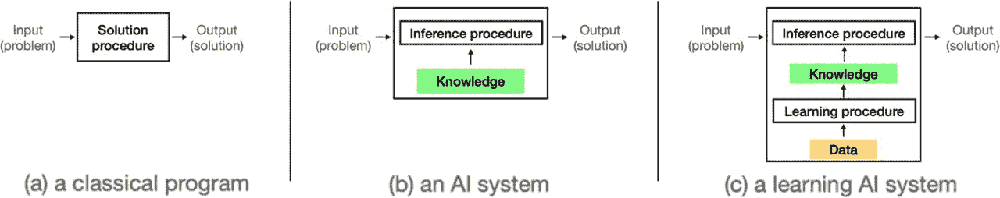

图 7.1 独立性不断增加的软件系统。(a) 无 AI：解决方案是程序化的。(b) 有 AI：通过对预编程知识进行推理找到解决方案。(c) 学习型 AI：通过对自动获取的知识进行推理找到解决方案。

在引入机器学习后，AI 系统的通用结构可以描述如下（参见图 7.1）。AI 系统利用强大的推理机制独立地执行任务或解决问题。这些基于一个模型。该模型是从数据中学习的。数据通过观察或与环境交互获得。从这里来看，学习系统可以被称为“AI 2.0”：在经典的 AI 系统中，我们不编写解决方案，而是对问题的知识进行编码；在学习系统中，这些知识是自动获取的，而不是硬编码到系统中。

以国际象棋为例。程序员可以写一个程序，以程序员本人相同的方式玩游戏（图中的选项 *a*）。这样的程序永远不会是一个比它的作者更强大的国际象棋棋手。或者，程序员可以仅仅将游戏规则编码到程序中（选项 *b*）。但知道游戏规则并不意味着你就能下得好。下国际象棋需要评估每一步法可能的后果，为此，你需要了解规则，*并且*推理你和对手会在这种特定局面以及可能导致的后续局面如何使用这些规则。让计算机能够高效地进行这种类型的推理一直是 AI 研究的一项挑战，直到 90 年代后期，甚至在新世纪，仍然取得了重要的进展（例如，蒙特卡洛树搜索）。

除了了解规则本身，人类国际象棋高手很快就会发现车比主教更强大。我们可以将此程序化到计算机，但我们如何量化它呢？我们应该给车和主教分配什么数值？此外，一个棋子的价值实际上是一个平均值：取决于棋子的位置和当前的游戏状态，一个棋子的价值可能更高或更低。定义这些数字非常困难。然而，有效的数值可以从经验中学习。一个国际象棋程序可以针对这些数值的这些配置玩很多局，并最终发现哪些配置是有效的。这就是难以手动提供的知识如何从数据中学习的示例（选项 *c*）。

高级 AI 系统通常结合了所有三种形式：预编程的解决方案、领域知识和学习系统。（注：原文此处有大量重复句，已根据要求进行逻辑翻译并去重处理）。

上述任务均具有以下性质：给定一组 `(x, y)` 对，称为**训练集**，学习一个函数 `f`，将 `x` 值映射到 `y` 值，并使得这种映射方式与数据一致。`(x, y)` 对被称为**示例**或**标记实例**；`x` 称为**实例**，`y` 是其**标签**。

`f` 与数据的一致性程度通常由**损失函数** `l` 衡量。对于标记实例 `(x, y)`，`f` 的**损失**为 `l(f(x), y)`。给定一个标记实例集合 `S`，`f` 在 `S` 上的**经验损失**是其所有实例的损失之和。在训练集 `D` 上的经验损失被称为**训练集损失**。训练集损失越低，`f` 对给定数据的拟合程度越好。将 `D` 视为来自某个总体的随机样本，`f` 的**期望损失**（也称为其**风险**）是当 `(x, y)` 从总体中随机抽取时 `l(f(x), y)` 的期望值。*预测学习的目标通常是找到一个期望损失较小的函数 `f`*。事实上，在垃圾邮件的示例中，我们并不关注于一个能正确分类我们之前收到的邮件的模型（这样的模型可以简单地记下所有标签），而是感兴趣如何使用该模型来对未来的邮件进行分类。

## 预测学习中的监督级别

在学习预测函数时，标准假设是对于所有的训练实例，目标变量 `y` 的期望值都是给定的。这种设置被称为**监督学习**。“监督”一词是指由某些监督者告知学习者 `f` 对于每个 `x` 的期望结果是什么，以便学习者可以将其所学到得的预测结果与期望值进行比较。

一个完全不同的设置是**无监督学习**。在这里，没有给出 `y` 值。如果任何实例都没有提供 `t(x)`，尝试学习一个能正确近似某些目标函数 `t` 的预测函数 `f` 似乎是徒劳的。但在相似案例倾向于属于同一类的假设下，可能学习到一个与 `t` 等价的分类器 `f`（仅在类别重命名上不同）。例如，如果我们提供水果的照片并要求系统区分苹果、梨和香蕉，而不提供任何标签，它很可能得出一个能够正确分类水果的分类器，只是它使用的是标签 A、B 和 C 而不是苹果、梨、香蕉。

在监督学习和无监督学习之间，存在广泛的可用部分或间接监督的设置。这些设置有许多名称。在**半监督**学习中，我们通常拥有许多实例，但只有一部分被标记了。从乍一看，未标记的实例似乎可以被忽略，因为它们没有提供关于实例-类别关系的信息。但事实并非如此，正如图 7.2 所示。在较小的标记实例集中添加许多未标记实例可能会显著提高预测的准确性。**PU 学习**是半监督学习的一种特殊情况，其中只有某一特定类别的实例可能被标记。

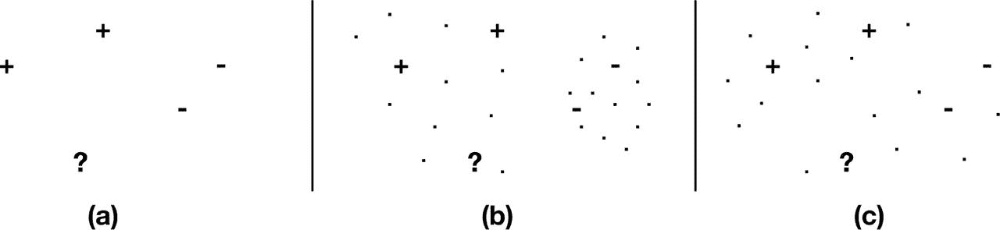

图 7.2 半监督学习。仅凭标记示例无法提供关于实例“？”类别的足够信息 (a)。看到一些未标记实例可以使该实例可能属于哪一类变得更加明显 (b, c)。

在**超集学习**中，每个实例都被标记有一组标签，其中一个是正确标签，但学习者并不知道哪一个是的。相反，在**多实例分类**中，实例被分成若干“包”（bags），当且仅当一个包内至少包含一个该类的实例时，该包被标记为该类（例如，学习识别图片中的苹果，此时监督者告诉你每张图片是否包含苹果，但不会告诉你是图片中的哪个部分是苹果）。这两种都是**从标签约束中学习**的特殊情况，标签信息以约束的形式提供。**弱监督学习**是介于监督和无监督之间监督级别的最通用的术语。它包含了从标签约束中学习，也包含了从标签的概率信息中学习。

在**主动学习**设置中，学习者在某种程度上控制着监督：学习者可以选择哪些实例应该被标记。学习者通常通过关注那些标签对学习者信息量最大（大致来说，就是学习者最不确定的实例）的实例来帮助减少标注工作。

## 异常检测

**异常检测**是识别某种异常情况、案例或模式的任务。一个经典的例子是欺诈检测：银行分析信用卡支付和其他交易，希望在大额损失发生之前迅速识别可疑活动。与分类一样，异常检测一词既指使用模型来检测异常，也指模型本身的学习。


可以说异常检测是一个涵盖各种应用程序的术语，而不是一个独立的任务。这种说法仅部分正确。在某些语境下，异常检测器是通过监督的方式从数据中学习的：我们提供正常和异常案例的示例，算法需要从这些学习出一个分类器，将新案例归类为正常或异常。在某种程度上，这是一项标准的监督学习任务。然而，通常会有许多问题使这项任务变得困难。首先是存在极端的类别倾斜：与正常情况相比，异常通常非常罕见。很少有分类方法能很好地处理这个问题。其次，可能存在大量的类别噪声：虽然标记为异常的实例通常确实异常，但许多异常可能没有被识别为异常，事实上，这些未被识别的异常可能占多数。在这些情况下，`PU`学习设置可能更现实。

在某些情况下，完全没有给出异常示例。异常中也可能存在概念漂移：例如，某种完全新型欺诈可能会在某个时刻开始发生。理想情况下，异常检测器会捕捉到这一点，尽管它以前从未见过这种异常。无监督方法通常基于学习一个正常行为模型。当一个实例严重偏离该正常行为时，它被标记为异常。这种方法依赖于训练数据中异常极少；事实上，如果异常太多，这些异常就会被视为正常。

异常的概念是主观的。例如，服务器的维护会导致服务的短暂中断或行为的临时改变。如果这种影响是预料中的，就不会被视为异常。因此，并不是所有偏离正常的行为都是异常。从这个意义上说，异常检测是一个模糊的需求。因此，完全无监督学习通常是不现实的：需要某种形式的半监督学习。

## 偏好学习、排序和推荐系统

`Preference learning`（偏好学习）指的是我们需要从数据中学习用户偏好的设定。更具体地说，给定两个实例 `x[1]` 和 `x[2]`，我们需要学习预测这两个实例中哪一个优于另一个。我们可以将其推广为`learning to rank`（排序学习），其任务是学习一个模型，使得在给定 `k` 个实例时，能够按价值从高到低对它们进行排序。排序是推荐系统的基础，推荐系统在给定一组对象（书籍、网页等）时需要预测哪些对象对用户最感兴趣（即返回排名靠前的对象）。

在某种意义上，排序可以归结为回归：如果我们能预测每个对象的“趣味程度”，那么就可以根据这个预测结果对它们进行排序。当数据由形式为 (*u*, *i*, *y*) 的示例组成（其中 `y` 是用户 `u` 对项目 `i` 的兴趣水平）时，这种观点非常有用。然而，我们通常没有这么多（甚至完全没有）这类数据。在某些情况下，我们知道用户 `u` 在某个时刻是否偏向于选择项目 `i[1]` 而非 `i[2]`，这表明 `y[1] > y[2]`，但我们不知道实际的值 `y[1]` 和 `y[2]`。推荐系统面临的典型学习设定结合了半监督学习和弱监督学习的方面。

### 解释作为次要目标

尽管预测学习的首要目标是做出预测，但在 AI 的某些应用领域，系统能够`explain`（解释）其预测结果是至关重要的。例如，一家使用算法决定某客户是否可以获得贷款的银行，在法律上有义务向客户解释拒绝贷款的原因。同样，用于招聘人员、决定客户信用卡可以获得多少额度、在法庭上判定罪行等的算法也必须解释其决策。这通常是一项硬性要求，例如根据欧洲法律，欧盟境内的主体有权对涉及他们的所有决策获得解释权。因此，`explainable AI`（可解释人工智能）已迅速成为 AI 领域一个非常活跃的研究课题。

区分解释的两个层次是有用的：是对整个`model`（模型）进行解释，还是对单个`predictions`（预测）进行解释。被拒绝贷款的客户有权获得为什么在其特定案例中被拒绝贷款的解释，但不需要理解或访问银行使用的整个模型。事实上，某些模型格式本身就太复杂，无法被完全理解，而具体的预测可能仍然是可以解释的。

关于可解释性需求的更多内容请参见第 9 章。

### 学习描述性模型

在预测学习中，当我们从 (*x*, *y*) 示例学习一个函数 `f`，该函数对于任何 `x` 都能预测对应的 `y` 时，我们实际上是在识别数据中的某种模式，即给定示例 (*x*, *y*) 中 `x` 和 `y` 之间的关系。但数据中模式或结构的概念要比这广泛得多。例如，系统通过分析一组员工名单可以检测到在 8 小时轮班之间总有至少 16 小时的休息时间。这种模式的预测价值很低：仅凭这些信息，我们无法非常准确地预测谁将在何时工作。但它仍然有用，例如用于检查名单的有效性。我们称此类模式为描述性模式。它们识别了数据的某些结构特征。更通地说，`descriptive models`（描述性模型）是揭示数据某种全局结构的模型。描述性模型的最终目标可以是暴露数据的某种全局结构（因为它描述了群体），也可以将该模型用于各种任务，但不限于预测。

许多类型的结构可以识别。通常，结构可以被定义为对均匀分布的任何偏差。一种简单的结构是数据出现在簇中：相似数据的区域。`Clustering`（聚类）是指在实例空间中识别这些簇的任务。这种任务可以通过图 7.3 直观地展示（尽管这具有欺骗性，但在高维数据中识别聚类并不简单）。`Hierarchical clustering`（层次聚类）是指构建聚类的层次结构或分类法，在不同的粒度上获得聚类。

除了出现在簇中，研究群体可能相对均匀分布，但在整个实例空间中的一个较小的范围内。它可能位于低维`subspace`（子空间）（例如超平面），或者位于此类子空间的周围。更通地说，数据可能存在于或靠近低维`manifold`（流形）。对于本文而言，流形可以解释为子空间的非线性版本（想象三维世界中的二维曲面）。图 7.3 展示了这些概念。被称为主成分分析的统计技术（后文将介绍）是识别低维子空间的方法示例。

```
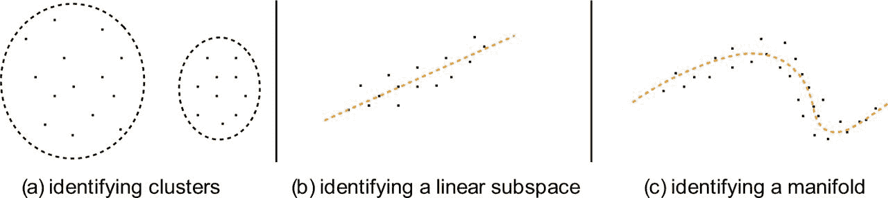
```

图 7.3 实例可能出现在簇中 (a)，靠近子空间 (b) 或靠近流形 (c)。

从概率的角度来看，识别密集空间的簇可以被视为`density estimation`（密度估计）的特例：识别实例空间中的密集和稀疏区域。这通常通过对训练集拟合概率分布来实现。

`Association rules`（关联规则）表达了不同变量之间的依赖关系。如“篮球运动员通常较高”或“买葡萄酒和面包的人比平均水平更有可能买奶酪”等规则为某些领域（体育、客户行为）提供了见解，这些见解本身就有价值。例如超市可以在营销活动中利用这些知识。

某些学习器构建概率模型，指示变量之间的随机依赖。随机依赖将一个变量的概率分布（而非单一值）与其他变量联系起来。在概率建模的背景下，专门用于预测一个变量的模型（我们术语中的预测模型）有时被称为`conditional`（条件）或 `discriminative`（判别）模型。给定一个或多个变量的值，可以使用它们预测另一个变量的值。在相同背景下，描述性模型被称为`generative`（生成式）。描述性模型描述所有变量的联合分布，并可以从该分布中采样，换句话生成数据。关于这方面的更多内容可以在本章的后半部分（学习概率模型）以及第 6 章中找到。

强化学习是一种机器学习设定，它在许多方面与其他设定有所不同。最合适的说明方式或许是参考一个非常古老的学习系统：唐纳德·米奇（Donald Michie）的 MENACE（1960 年）。MENACE 是一个学习下跳棋子的系统。它不是实现在经典计算机上，而是使用约 300 个装有彩色珠子的火柴盒实现的（参见图 7.4 的图片）。共有 9 种颜色，每种对应棋盘上的一个位置。火柴盒被标记为：对于每个游戏状态都有一个对应该状态的火柴盒。系统的运行方式如下：当需要移动时，操作员从与该状态相关的火柴盒中随机抽出一个珠子，并在珠子指示的位置画一个交叉。因此，火柴盒中每种颜色珠的数量决定了系统执行相应移动的概率。游戏结束后，会对已打开的火柴盒内容进行如下更新：如果输了，则不放回抽出的珠子；如果是和，则将每个珠子放回原处；如果赢了，则将珠子放回并额外添加一个同颜色的珠子。因此，在赢得游戏后，该游戏中执行的移动在未来的某个时刻更有可能再次选中。米奇通过实验证明，这个简单的系统确实表现出学习行为：它的性能随着玩游戏次数的增加而提高。


图 7.4 MENACE，用火柴盒实现的强化学习系统。（来源：D. Michie, The Computer Journal, 6(3):232–236, 1963. [https://doi.org/10.1093/comjnl/6.3.232)]）。

上述类型的学习现在被称为**强化学习**。这种设定与预测性学习的共同点在于，都会学习一个从状态 `x` 映射到动作 `y` 的函数 `f`（在此语境下称为 `policy`）。然而，它没有直接的监督：没有人告诉学习者对于给定的 `x` 数字 `y` 应该是什么。特定动作的后果是复杂的：它可能会导致即时奖励（例如赢得游戏），但通常情况下，它改变了学习者的状态，而新状态对于未来奖励可能有更高或更低的潜力。强化学习的任务是学习一个策略，以最大化预期的长期回报。在这个过程中，学习者通过与环境交互来探索和利用。

强化学习通常涉及智能体与环境的交互。智能体观察当前状态，采取动作，并接收奖励且进入新状态。通过这种不断的循环，智能体学习如何行动以获得最大的累积奖励。这种方法被广泛应用于，从机器人控制、自动驾驶到游戏 AI 等领域。

## 7.3 如何解决问题


#### 7.3.1 从数据到模型：概述

在机器学习中，我们通常从一组数据开始，并试图学习一个模型来预测结果。在强化学习中，情况正好相反：我们从一个模型开始，并让它通过与环境交互来产生数据。

在所有这些示例中，数据都是数值，但它们并不是按单行排列，而是被放置在一个具有两个或多个维度的表中。这种表格被称为`tensor`（张量）。张量结构源于“接近性”的概念：单元可以在`X`、`Y`或`Z`维度、时间维度或其他方式上彼此邻近。例如，对于一个每天包含一个数字的时间序列，这些数字可以排列成一个张量，其中一个维度表示工作日，如果两个数字相隔恰好是`n`周，那么它们在这个维度上就是“相邻”的。代表视频的张量具有两个空间维度和一个时间维度，这有点类似于翻页书，每一页都是一张图片，而连续的页面包含略有不同的图片。

张量与向量（一维张量）和矩阵（二维张量）的概念非常相似，在某种意义上是这些概念的推广。图 7.6 展示了这一点。

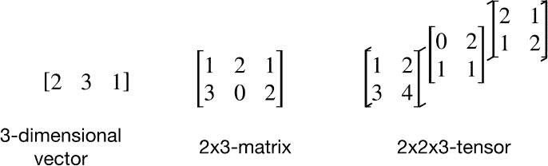

图 7.6 向量、矩阵和张量。

### 图、树和序列

`graph`（图）是一种由节点和它们之间的连接构成的数学结构。图通常用于表示网络状结构。例如，道路网络可以被表示为图：边代表道路，节点代表交叉路口。此外，由化学键连接的原子组成的分子本质上也具有图的结构。

图中的节点和边可以用符号、数字或任何类型的数据进行标记。例如，组成分子的原子通常按其元素类型标记，网络中的道路可以用其长度标记，此类等。

虽然图是相对简单的结构，但它们处理起来相对较困难。图可以用矩阵表示，即所谓的邻接矩阵：它包含每个节点包含一行一列，如果节点`i`和节点`j`相连，则第`i`行第`j`列的元素为 1，否则为 0。请注意，这种表示法对节点施加了顺序，这使得。

大多数机器学习方法都假设数据具有特定类型：标准格式、张量数据、图数据、基于逻辑的知识库等。然而，许多先进方法是专门为标准格式开发的。因此，在许多情况下，机器学习的成功取决于如何将数据转换为标准格式，并在转换过程中保留数据最相关的方面，同时移除无关的方面。

当将数据从原始形式转换为标准格式中有意义的表示时，该标准格式中的变量通常被称为`features`（特征）。寻找合适特征的过程被称为`feature engineering`（特征工程）；它涉及`feature selection`（特征选择，从大量候选特征中选择最相关的特征）和`feature construction`（特征构建，通过组合现有特征创建新特征）。

在许多情况下，`feature construction`是目前机器学习过程中最耗时的部分。只要有了正确的特征，许多学习方法在预测准确性方面可以达到相似的性能，方法的选择远没有特征的选择重要。遗憾的是，这项任务很难自动化。如果说深度学习在计算机视觉领域取得了突破，这在很大程度上归功于它自动定义有用特征的能力（更多信息请参阅深度学习章节）。

当数据来自多个源时，对来自这些不同源的信息进行整合被称为`fusion`（融合）。这种整合可以在原始数据层（`early fusion`）、特征层、模型层或实际预测层（`late fusion`）进行。

对于假设所有输入均为数值的方法，需要特定类型的数据转换。分类数据则使用所谓的`dummy variables`（虚拟变量）或`one-hot encoding`（独热编码）进行编码。独热编码将具有`k`个可能值的分类变量编码为由`k`个二进制变量组成的向量，其中一个为 1，其余均为 0。例如，线性回归中使用的虚拟变量原理类似，但仅使用`k − 1`个变量，并通过将所有变量设为 0 来指示第`k`个值。

#### 7.3.4 学习范式

在讨论了数据收集和数据准备的准备步骤之后，我们现在进入主题：从数据中学习的方法。

机器学习领域非常广泛，对整个领域存在不同的观点。举几个例子：Pedro Domingos 在其畅销书 *The Master Algorithm* 中区分了五种不同的机器学习“派”（称为符号主义者、连接主义者、进化者、贝斯主义者和类比者）。Peter Flach 在其教材 *Machine Learning: the Art and Science of Algorithms that Make Sense of Data* 中考虑了三种范式：几何、逻辑和概率。Chris Bishop 在其畅销书 *The Master Algorithm* 中区分了五种不同的……（注：原文包含重复/损坏的片段；我已按逻辑意图进行了处理）。

Peter Flach 在其教材 *Machine Learning: the Art and Science of Algorithms that Make Sense of Data* 中考虑了三种范式：几何、逻辑和概率。Chris [Bishop](#9783111425672_053831.xhtml...（文本逻辑遵循后文））

预测函数在输出结果和输入方面都可能不同。然而，即使在使用相同格式的函数之间，函数本身的表示也存在巨大的多样性。具有数值输入输出的函数可以使用数学公式描述输出与输入之间的关系，例如线性回归。但也可以许多其他格式。例如，某些类型的函数可以描述为一组 if-then 规则。其中一条规则可能是：如果邮件发送者出现在用户的地址录中，则该邮件不是垃圾邮件。与数学公式相比，这类规则通常非常容易理解。我们在本章的剩余部分讨论这些以及许多其他格式。

此类方法也被称为最近邻方法。其中最基础的被称为“k-最近邻”，或`k-NN`。该预测算法非常简单：为了对新案例进行分类，在训练集中找到`k`个最相似的案例，查看这些案例中哪类类别最常见，并使用该类别进行预测。在回归语境下，通常会预测`k`个最近邻目标值的平均值。`k-NN`这类方法也可以用于更广泛的预测场景，例如多标签预测，甚至可以用于描述性学习，如密度估计）。例如，在欧几里得空间中，如果第`k`个最近邻的距离为`r`，这意味着半径为`r`的超球内有`k + 1`个实例，因此$\frac{\mathit{k} + 1}{\mathit{V}}$（其中`V`为超球体积）是局部数据密度的粗估计。

这类方法强烈依赖于一个合适的相似性概念。在许多情况下，当输入为数值时，会使用如欧几里距离之类的距离度量：如果两个案例在输入空间中的距离较近，则认为它们是相似的。这也允许进行直观的可视化，如图 7.9 所示，但这种简单的相似性定义会导致问题。例如，假设 A 人高 1.80 米，重 80 kg，用向量`A = (1.80, 80)`表示。同样，假设`B = (1.60, 79)`和`C = (1.83, 82)`。考虑到 A 和 C 的身高和体重相近，可以认为 A 比 B 更相似 C。然而，`A`到`B`之间的欧几里得距离比`A`和`C`之间的距离要小。这是因为长度上的巨大差异被映射为了较小的数值。如果我们选择用厘米而不是米来表示长度，欧几里得距离将会大不相同，且 A 会比 B 更相似 C。显然，任何取决于训练数据中所用单位（这完全是一个随机选择）而产生不同结果的分类方法都不是一种好方法。


`i = 5`的`k-NN`通过其 5 个最近邻（圆内）的多数类别对标记为“？”的实例分类。由于其中 4 个是 A，1 个不是，因此预测类别为 A。

这类方法强烈依赖于一个合适的相似性概念。在许多情况下，当输入为数值时，会使用如欧几里距离之类的距离度量：如果两个案例在输入空间中的距离较近，则认为它们是相似的。这也允许进行直观的可视化，但这种简单的相似性定义会导致问题。例如，假设 A 人高 1.80 米，重 80 kg，用向量`A = (1.80, 80)`表示。同样，假设`B = (1.60, 79)`和`C = (1.83, 82)`。考虑到 A 和 C 的身高和体重相近，可以认为 A 比 B 更相似 C。然而，`A`到`B`之间的欧几里得距离比`A`和`C`之间的距离要小。

### 决策树

#### 什么是决策树？

决策树通常用于此类目的。它的结构棵树，每个内部节点代表对属性的测试，每个分支代表测试的结果，每个叶子节点代表一个类别标签或值。

#### 我们如何学习它们？

给定一个数据集，如何学习树？学习此类树的过程非常简单。其工作原理如下：给定整个数据集和一个目标变量，找到对目标信息量最大的测试。一旦找到该测试，就根据测试结果划分数据集。对每个子集及其子集重复此过程，直到进一步划分不再有用为止。

这一过程还需要需要填充一些细节。首先，什么是“测试”？在标准框架下，测试通常基于单个属性。名类变量可以通过询问其值来测试；这种测试的结果数量与变量域中的值数量相同。对于取值较多的名变量，使用二分类测试可能更好：将变量域分为两个子集，测试的结果等于变量值所属的子集。对于数值属性，通常将属性值与某个阈值进行比较，并有两种可能的输出：值小于或等于阈值，或大于阈值。

第二个问题是：我们如何衡量一个测试对目标有多少“信息量”？对于分类树，可以使用“信息增益”的概念：这是由测试引起的类别熵的平均减少量。熵是信息论中的一种度量，可以解释为多样性。集合的多样性越低，预测随机选择的元素的类别就越容易。

对于数值目标，多样性通常通过方差来衡量，而最佳测试就是能最大程度减少方差的测试（即每个子集中目标的平均方差越小越好）。方差也可以用于高维目标变量，以及对于使用独热编码（one-hot encoding）编码的定类变量（在这种情况下，该编码的方差被称为基尼纯度）。

第三个问题是：何时将一个子集划分为更小的子集不再有用？对于分类树来说，很显然，当一个子集的类熵为零时（即子集中的所有案例都属于同一类），进一步划分就没有意义了。对于回归树来说，等价的情况是方差为零，但这几乎是不可能实现的。当最佳测试未能导致熵或方差的显著减少时，某些学习器会停止划分。当待划分的子集非常小时，进一步的减少几乎可以确定不是显著的；因此，许多学习器只划分大小高于某些阈值的子集。

众周知，过大的树往往会对数据产生`overfit`：它们很好地拟合训练数据，但在其他数据上的表现往往较差。图 7.11 阐明了这个问题。理想情况下，树学习器应该在过过拟合发生之前停止划分。然而，事实证明确定正确的时机非常困难。统计显著性检验在这种背景下效果并不好，而且完全可能即使没有某个单一测试会导致实质性的改进，多个测试的组合也能实现。由于这个原因，许多学习器会让树生长到超过最优尺寸，之后剪掉无用的分支。这种剪枝过程通常利用一个所谓的`validation set`（验证集）：一组未用于学习树、但被用于在剪枝过程中估计完整树及其剪枝变体质量的数据。由于验证集在生长树的过程中没有被使用，它为树的实际预测准确率提供了无偏的视角。剪枝过程随后包括剪掉那些没有在验证集上提高准确率的分支（即它们在训练集上提供的改进很可能是由于过拟合导致的）。

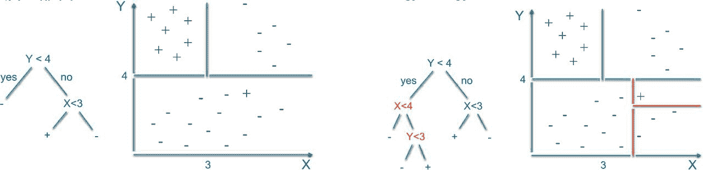

图 7.11 左：较小的树几乎完美地拟合了训练数据。它可以生长到完美拟合（右），但右侧一个较大的区域将被预测为正，而数据中对此的证据非常少。

最后，还有一个关于在树叶节点中做出什么预测的问题。最直接的选择是预测叶子中出现频率最高的类（“众数”），或者是其中数值目标值的平均值。对于概率估计树，通常返回叶子中类别的概率分布。对于密度估计树，会在叶子中学习并存储一个局部密度模型。对于回归树，可以考虑在叶子中包含一个线性模型而不是常值，用于从其他变量预测目标。该线性模型然后仅通过该叶子中的数据通过线性回归学习。此类树被称为`model trees`（模型树）。

从机器学习的角度来看，决策树有许多重要优势。学习算法非常快：通常在一秒内就能学习树，即使对于大型数据集也是如此。预测过程甚至更快：使用单棵树进行预测通常涉及少于几十次的比较操作，这意味着每秒可以轻松进行数百万次预测。树是如何构建的以及它们是如何做出预测的很容易理解。解释预测也很容易：“提供的实例具有属性 X、Y、Z，在所有具有这些属性的实例中，90% 属于类 A，因此该实例也可能属于类 A。”决策树的主要缺点是它们的预测准确率虽然不错，但通常会略后于其他模型的准确率。在准确率优先于其他的情况下，这通常是倾向于更复杂模型的原因。然而，某些较复杂的模型内部仍然依赖于树，正如下一节所示。

#### 7.3.7 决策树集成

#### Bagging

在机器学习中，`ensemble`（集成）是一种简单由多个更简单的模型并以某种方式组合而成的预测模型。就像专家委员会可能比单一专家更明智（特别是当这些专家拥有互补的专业知识时），模型委员会（集成）可能比它的任何组件都更准确。

为了学习一个集成模型，我们面对的首要问题是：如何获取多个组件模型？假设我们有一个决策树学习器和一个数据集。我们可以使用该学习器从这个数据集中学习一棵树。如果我们在同一个数据集上第二次使用同一个学习器，我们将得到相同的树。但如果所有树都是完全相同的，那么学习多棵树就没有意义了。因此，获取不同树的简单方法是从不同的数据集中学习它们。如果我们只有一个数据集，可以通过随机抽样创建它的多个变体。实现此点的一种特定程序称为`bagging`，其工作原理如下：给定一个包含`N`个实例的数据集，从中随机选择`N`次实例。同一个实例可以被多次选择。结果是一个包含`N`个实例的“袋”（bag），其中原始集合中的每个实例出现零次、一次或多次。这个“袋子”是原始数据集的第一种变体。由于该过程是随机的，因此可以重复使用，每次运行都会创建一个新变体。因此，从单个数据集创建了`k`个大小相同的数据集，且元素遵循大致相同的分布。在每个数据集上运行一次我们的学习器将产生`k`个模型。这些模型可能彼此不同，因为它们是从不同的数据集学习的。尽管如此，由于每个模型都是从来自相同分布的等大样本中学习的，预计它们对总体具有同样良好的泛化能力。这些模型之间的任何差异都是由于特定数据集形成方式的偶然性，因此与过拟合有关。

下一个问题是：在预测时如何组合这些模型？在 bagging 技术中做出的选择很简单：我们将单个模型的预测视为投票。对于分类，我们使用这些票的多数进行最终预测；对于回归，取平均值。

因此， bagging 过程可以总结如下：通过有回抽样创建给定数据集的`k`个变体，从每个变体学习一个模型（始终使用相同的学习器），并让这些模型投票。

由于袋装模型对数据集中偶然模式的依赖较少，其准确率往往比单个模型更好。实验已经证实，这种差异通常是巨大的。

#### 随机森林

Bagging（袋装）的一个明显缺点是学习时间更长：我们不需要学习一个模型，而是需要学习`k`个模型。此外，为了让 bagging 发挥作用，不同模型之间必须足够不同。在决策树的语境下，这两个问题都是非常不足道的：树的学习非常快，而且它具有相对不稳定性，这意味着训练集中的微小差异就足以产生显著不同的模型。然而，bagging 过程可以改进为被称为**随机森林**（random forests）的算法。

`Random forests`在 bagging 过程中只增加了一个非常微小的改动。在学习单棵树时，不再在每个节点处考虑所有可能的测试并选择最优，而是随机森林从随机选择的可能测试的`subset`（子集）中选出最好的。假设总共有`m`个属性，实际考虑用于测试的属性数量通常为$\sqrt{\mathit{m}}$，甚至更少。特别是在包含许多属性的高维数据集中，这极大地加快了学习过程。显然，实际的最佳测试可能没有通过这种方式被考虑，但这并不是什么问题，因为最优性在某种程度上是巧合的（如果我们从不同的样本中学习，另一个测试看起来是最优的），而且即使使用次优测试，树在实践中往往也表现良好。此外，由此引入的随机性增加了集成中树之间的变异性。这正向影响了集成预测性能，并且往往过度补偿了单棵树可能的准确率损失。

自 Breiman 在 2001 发表以来，十多年来，随机森林在预测准确率方面被广泛认为是构建树集成的最佳方法。直到最近，一种年代与之相仿的技术产生了一种基于决策树的方法，进一步推高了准确率：梯度提升（gradient boosting）。

## 梯度提升，梯度提升树

`Boosting`（提升）和 bagging 一样，是一种集成方法。它与 bagging 的区别在于如何获取不同的模型以及如何组合这些模型。关于 boosting 如何以及为何起，有多种解释。在本文中，我们采用一种较新的解释：即梯度提升。

boosting 背后的基本思想如下。假设我们已经从给定的数据集中学习了一个预测模型。即使在训练集上，模型的预测也可能与观测值不同（模型在训练集上并不一定具有 100% 的准确率）。

观察此，我们可以尝试学习第二个模型来试图修复第一个模型犯的错误。在回归过程中，自然的方法是：一旦学习了模型`f[1]`，将数据集中的每个目标值`y[i]`替换为`y[i]` − `f1`，并从这个新数据集学习模型`f[2]`。`f[2]`基本上学习的是我们需要在`f[1]`的预测基础上增加多少，才能使其等于`y[i]`。一旦我们学习了`f[2]`，我们应该通过对任何`x`预测`f1 + f2`来结合`f[1]`和`f[2]`。如果观测值`y[i]`与预测值`f1 + f2`之间仍然存在差异，则该过程可以重复。


尽管上述过程很直观，但由于过于天真而无法良好工作。然而，已经开发出具有完备理论支持且上述过程是其特例的原理：`gradient boosting`（梯度提升）。该原理的动力是统计学习方法，这些方法将在本文后后部分讨论。它本质上是将上述简单思想公式化为一种梯度下降方法，通过在搜索空间中“向下移动”来迭代改进目标函数的近似，使得在给定的步长内损失减少到最小。基本上，该过程按照上述方法学习了`f[1]`和`f[2]`，但确定的是一个因子`α`，使得`f1 + α*f2`损失最小，此外，通常使用一个学习率，使得在该方向上设置的步长比理论上最小化损失的步长要小。对上述简单直觉的调整源于梯度下降的观点。这种观点也使得该原理适用于其他损失函数，例如应用于分类语境。一种名为`AdaBoost`的旧版 boosting 方法被证明可以以这种方式推导出。

梯度提升原理可以应用于任何产生数值预测并使用可微损失函数的类型学习器。在决策树的语境下，该方法通常被称为梯度提升树（gradient boosted trees）。该方法的一种广为人知的实现是`XGBoost`。`XGBoost`已证明在广泛的情况下能产生非常准确的预测，在写作此时，被许多人认为是解决广泛学习问题最有效的学习器。

## 孤立森林

虽然上述所有方法都处于预测学习语境，但基于树的方法也可以用于其他语境。无监督异常检测最流行的方法之一是孤立森林（isolation forests, IF）。IF 背后的基本思想是基于随机测试递归划分数据，直到每个实例都在单独的叶节点中（与所有其他实例“孤立”）。与其他实例差异巨大的实例往往更快被孤立。由于此，实例叶节点的深度是该实例异常程度的指示。孤立森林通过这种方式学习多棵树，最终根据它们在这些树中叶节点的平均深度为实例分配异常评分。

### 7.3.8 如果那么规则 (If-then rules)

从人工智能之初，如果那么规则就是流行的表示格式。一个`if-then-rule`简单如下形式的表达式：

```
graphic/converted/b_9783111426143-007_fig_012.jpg
```

取决于语境，“决策”可以是目标变量的预测值、建议的操作、诊断或任何其他内容。条件部分通常包含一组条件，只有满足所有条件规则才能应用。

`rule set`（规则集）是此类规则的集合。`rule list`（规则列表）是此类规则的有序集合。在规则列表中，通常从前到后评估规则，第一个满足条件的规则即被认为是相关的。

规则集和规则列表之间的差异可以通过一个大家熟悉的的小例子来说明：闰年的定义（有 366 天）。如果一个年份是 4 的倍数，则为闰年，以 00 结尾的年份除外：这些年份只有是 400 的倍数时才是闰年。这个定义可以使用如果那么规则写如下：

- 作为规则集：

```
graphic/converted/b_9783111426143-007_fig_013.jpg
```

- 作为规则列表：

```
graphic/converted/b_9783111426143-007_fig_014.jpg
```

规则列表使用“else if”格式是为了提醒读者，只有在之前的规则都不适用时，规则才适用。

规则列表通常比规则集更紧凑。当存在一个几乎正确但有异常的简单规则时，可以使用先于该规则的规则来处理异常。在规则集中，必须从该规则中显式排除异常。

相反，规则集更容易解释。单个如果那么规则是容易理解的，但规则列表中的规则只有在考虑之前规则的语境下才是准确的。

就像决策树一样，决策规则也可以用于分类和回归；它们分别被称为分类规则和回归规则。

### 学习分类和回归规则

任何决策树都可以而易举地转换为规则集：对于树的每个叶子节点，我们只需关联一条规则，将从根节点到该叶节点路径上的所有测试结果作为其条件，并将叶节点的预测结果作为其决策。然而，也存在算法可以直接从数据中学习规则集或列表，而无需经过决策树的弯路。它们通常一次学习一条规则。一种典型的方法（有时称为`covering`方法）是反复尝试学习一条仅能产生正确预测、且在此之外尽可能通用的规则。每一条连续的规则都关注于尚未被之前的规则正确处理的案例。单个规则的生成通常是从没有任何条件开始，通过不断添加一个单一条件，使得该条件能够最大程度地提高规则的准确性。尽管年代较久远，但 Cohen 的`RIPPER`算法（Cohen, [1995](#9783111425672_053831.xhtml#b_9783111426143-007_ref_003））在分类规则方面仍然处于领先水平。可以在数据挖掘的`WEKA`工具箱中找到它的实现。

### 学习关联规则

在上面的讨论中，规则集被解释为一种预测函数。然而，由于其可解释性，规则集对于描述性学习也非常有用，后者的目标是理解数据。当用于这一特定目的时，标准的规则学习算法不再有效。

当一条`descriptive`规则添加了其他规则未提供的信息时，它是有用的。当一条`discriminative`规则有助于更好地区分不同类别时，它是有用的。

为了说明这种区别：如果我们想要一个允许我们区分狗和猫的规则集，那么规则`如果它会叫，它就是狗`就足够了。规则`如果该动物埋骨头，它就是狗`可能准确性同样高，但如果之前的规则已经运行得足够好，我们就不需要它。因此，预测性规则学习器不会将第二条规则添加到集中。然而，描述性规则学习器通常会返回这两条规则，因为对于想要洞察动物行为的用户来说，这两条规则可能都有意义。

`关联规则`是描述性规则的一种类型。在语法上，它们与分类规则非常相似。它们具有以下格式：`P` → `P′`，其中`P`和`P′`是实例可能拥有的属性集。该规则表示，当实例拥有集合`P`中的所有属性时，它更有可能也拥有集合`P′`中的所有属性。关联规则通常关联有两个数字，分别称为规则的支持度（support）和置信度（confidence）。`confidence`是具有属性`P`且也具有属性`P′`的实例占比。`support`是同时具有`P`和`P′`的实例占比。支持度表示规则的适用范围有多广，置信度则了如果将其解释为 if-then 规则，其准确性如何：“如果`P`那么`P′`。”

关联规则描述了数据中的一种模式，关联规则挖掘的目标通常是找到数据中符合某些质量标准的所有模式。`APRIORI`系统是首批解决以下问题的系统之一：返回所有支持度和置信度高于给定阈值`s`和`c`的关联规则。

关联规则的典型应用是购物篮分析：超市客户购买的产品之间存在什么样的关联？例如，假设在所有购买马苏里拉奶和火腿的客户中，30% 的人也买了西红柿。如果购买西红柿的客户总比例仅为 20%，这条规则表明购买马苏里拉奶和火腿与购买西红柿之间存在正相关。这种规则为超市提供了见解。

尽管关联规则看起来与分类规则非常相似，但它们存在重要的差异。分类规则预测目标值，规则之间各不相同，规则不需要准确即可有用，且规则集通常包含尽可能少的规则。

逻辑归归（ILP）已应用于各种具体问题。Maervoet 等人（2012）展示了如何将其用于地理信息系统（GIS）中的异常检测。在这种应用中，一个 ILP 系统被用于寻找路网中的共同模式，这些模式随后被用于识别数据中的错误。例如，系统可以发现这类模式：单向街道的交叉路口始终有入路和出口街道（对我们来说这是显而易见的：只有入口的交叉路口永远在不违反交通规则的情况下不存在），小学附近的路段始终有 30 km/h 的限速等。这导致了数据库中错误的识别。在此类数据库中自动发现异常情况的能力（无需事先定义什么是异常）是维护复杂知识库的一个主要优势，特别是当这些知识库发生演变时。例如，交通法中规定小学附近的路段必须限速 30 km/h 的变化，此类系统会自动捕捉到这一变化并报告规则的例外。显然，这对于保持 GIS 的更新有很大帮助。

路网本质上是一个图，事实上，此类网络的分析也可以通过基于图的学习方法完成。一阶谓词逻辑有趣之处在于，它可以表达任何使用图可以表达的知识，而且，它是一种经过充分研究的数学形式。

一阶谓词逻辑的表达能力足以允许在其中构建完整的计算机程序。编程语言 Prolog 正利用了这一事实。为了说明这一点：一个著名的快速排序算法（能够高效地从低到高排序数组）的 Prolog 实现通常会包含以下规则：

```
\begin{matrix} {{Sorted}(\mathit{x},\\mathit{y})\\leftarrow{Split}(\mathit{x},\\mathit{x}\_{\mathit{l}},\\mathit{x}\_{\mathit{r}}) \\land {Sorted}(\mathit{x}\_{\mathit{l}},\\mathit{y}\_{\mathit{l}}) \\land {Sorted}(\mathit{x}\_{\mathit{r}},\\mathit{y}\_{\mathit{r}}) \\land {Concat}(\mathit{y}\_{\mathit{l}},\\mathit{y}\_{\mathit{r}},\\mathit{y})} \\\\ \end{matrix}
```

其可以读作：如果你`Split`将数组`x`分为两部分`x[l]`和`x[r]`，使得`x[l]`的所有元素小于`x[r]`的所有元素（此信息在`Split`谓词的定义中，此处未显示），且`y[l]`和`y[r]`是`x[l]`和`x[r]`的`Sorted`版本，那么`Concatenating` `y[l]`和`y[r]`就得到了`x`的`Sorted`版本。这可以被视为一个简单的“如果-那么”规则，但同时，它是可操作的：它允许 Prolog 通过分割、分别排序子列表以及合并来实际排序数组。Prolog 程序完全由此类规则集组成。

有趣的是，这类简单程序可以从示例中学习。其核心思想是展示程序的一些输入/输出对，并让计算机发现一个与这些对一致的程序。这种任务被称为程序合成。ILP 是程序合成的一种方法。在目前的技术水平来看，像快速排序这样相对复杂的程序确实可以从示例中学习，但只有在已经给出正确的辅助谓词时才。例如，如果提供了`Split`和`Concatenate`谓词，就可以学习上述排序算法。有用辅助谓词的自动发现被称为谓词发明（predicate invention）。这本质上是一个无监督学习任务，因此困难得多。缺乏有效的谓词发明方法使得 ILP 停滞了十年，但近期（包括深度学习在内的领域）的发展创造了新的机会。

程序合成方面，目前可行的一个例子是电子表格公式的自动发现。Excel 的快速填充（Flashfill）工具可以利用从极少数示例合成的程序，自动填充一列非平凡地依赖于其他数据。类似地，Tackle 工具（Kolb 等人，2020）能够发现涉及多个表格的模式，并根据发现的模式预测单元格的值。


### 7.3 统计模型拟合

#### 最小化损失函数

许多机器学习方法本质上都在尝试将函数拟合到数据，从这个意义上说，机器学习与统计学有明确的联系。一个机器学习任务通常被描述如下：给定一个模型类（有时称为假设空间）`F`，任务是在所有模型中找到“最佳”模型。模型的质量通常用所谓的损失函数`l`来表示；“最佳”模型是损失最低的某一个。损失还可能考虑其他标准，例如模型的复杂性。在我们之前看到的树学习示例中，`F`将会是所有树的集合。

从形式上说，机器学习因此是一个优化问题：`f* = argmin_{f ∈ F} l(f, D)`，即一个函数`f*`使得使得`F`中的`f`中，`l(f*, D)`是最小的。

在纯预测性设置中，我们不关心模型的复杂度，只想找到群体上最准确的模型，而这可能与训练集`D`上的最准确模型不同。这意味着在训练期间最小化的损失函数`l`并不等同于我们想要最小化的损失函数的期望。

在某些机器学习方法中，优化问题是隐式的。例如，决策树学习器通过对所有树的空间进行启发式搜索，试图找到在群体上具有良好预测准确率的模型。它的启发式方法指向在训练数据上具有高预测精度的小树。

其他机器学习方法（包括统计方法）显式地定义了要最小化的损失函数。例如，在最小二法线性回归中，任务是找到一个最拟合数据的函数`f`，使得在观测到的所有对`(x, y)`上，`f(x)`与`y`之间的平方和最小。换句话说，损失函数是误差和`∑(x, y) ∈ D - y)²`。

在固定输入变量的线性回归情况下，当数据点多于变量时，最优解是唯一的，并且存在计算它的公式。例如，如果`f(x)`是`ax + b`的形式，则存在公式来计算`a`和`b`，使得`∑(x, y) ∈ D - y)²`最小。

在某些情况下，可能不存在公式，或者公式计算过于复杂。在这种情况下，必须使用分步程序，或称`algorithm`（算法）。这种程序的一个示例是`逐步线性回归`（stepwise linear regression）。当需要在模型复杂度（通过其包含的变量数量来衡量）与数据拟合程度之间进行权衡时，就会使用这种程序。逐步线性回归从构建包含单个输入变量的模型开始。为了找到这类最优模型，它会轮考虑每个潜在的输入变量，在仅使用该变量时寻找最小二乘解，并在所有获得的模型中保留损失最低的一个。然后，它通过逐一尝试其他输入变量来添加第二个变量，评估该变量在加入已选变量后对模型有多有多大的改进，并保留改进最大的那个。它会针对第三个、第四个……变量继续执行此操作，直到额外的改进不再能通过损失的充分减少来抵消。

## 正则化 (Regularization)

逐步线性回归以算法的方式倾向于简单解决方案。也就是说，该程序的定义方式使其倾向于产生简单模型。但我们也可以在损失函数中包含对简单模型的偏置。通常，损失函数包含两项：一项衡量与训练数据的拟合程度，另一项则惩罚具有不良属性的模型（例如，它们过于复杂或可能过拟合）。第二项通常被称为`regularization term`（正则化项）。正则化是一种非常通用的技术。在具有许多变量的线性回归中，通常通过尝试保持回归系数较小来避免过拟合。正则化项通常是这些系数的平方或其绝对值的和。因此，假设我们有两个输入变量和一个输出变量，要构建的线性函数形式为`y` = `a[1]*x[1]` + `a[2]*x[2]` + `b`，而优化问题是找到`a[1]`、`a[2]`、`b`的值，以最小化`∑(*x*,ↆ*y*) ∈ *D* − *y*)² + *C*(a*[1]² + a*[2]²)`。

尽管这些线性方法最自然地用于数值输入变量的回归，但通过将这些变量编码为称为虚拟变量（dummy variables）的二值变量组，也可以轻松用于分类输入变量。例如，值为`a`、`b`、`c`的名变量可以用两个虚拟变量代替，它们共同为`a`取值 0,0，为`b`取值 0,1，为`c`取值 1,0。不仅如此，这些回归技术也可以用于分类。`Logistic regression`（逻辑回归）是这种方法的典型示例。在这种方法中，我们尝试预测实例属于特定类别的概率。在类别表示为 0 和 1 的二分类情况下，我们学习一个从`x`预测`P(*y* = 1 | *x*)`的模型。然而，此的问题在于，概率被限制在 0 到 1 之间，而线性回归本质上学习的是一个不受限于任何区间的线性函数。这种不匹配通过实际预测不是`p` = `P(*y* = 1 | *x*)`，而是所谓的`log-odds ratio`（对数优势率），`l = log(p / (1 - p))`来解决的。从这个公式可以得出`p = e^l / (1 + e^l)`，因此可以很容易从`l`推导出`P(*y* = 1 | *x*)`。逻辑回归中使用的损失函数是所谓的交叉熵：`ylog(p) + (1−y)log(1−p)`。虽然上述所有情况都说明了使用统计模型拟合来学习预测函数，但相同的原理也可以用于聚类、密度估计、概率建模等。

最小化某些损失函数的原理在几乎所有的机器学习方法中都隐式或显式地存在。看起来似乎像统计模型拟合那样进行显式的损失最小化通常是一种更好的方法，特别是当使用一种证明可返回最优值的优化方法时。然而，人们应该记住，在学习预测函数时，我们*实际*最小化的损失函数（拟合和正则化的结合）并不是我们最终*想要*最小化的那个（在未见示例上的期望误差）。因此，使用（计算开销昂贵的）精确优化方法的实际收益可能是很小的。

## 偏置-方差权衡 (The bias-variance tradeoff)

从统计推断中熟悉的偏置（bias）和方差（variance）概念经常用于机器学习，描述学习方法的属性。为了解释这些概念，我们需要`estimator`（估计器）的概念，即一个从样本估计某些总体参数的公式。（例如，随机抽取样本的均值通常就是均值。）给定一个样本，估计器产生一个值，但对于不同的样本通常产生不同的值。因此，我们可以将估计器的值视为具有特定均值的随机变量。估计器的`statistical bias`（统计偏置）是其均值与所估计参数之间的差异。它指示估计器是否平均倾向于高估或低估。例如，样本均值是总体均值的无偏估计器：事实上，没有理由认为样本均值平均会更高或更低。

估计器的`variance`（方差）简单来说就是概率分布的方差。它指示估计值不同随机样本之间会有多大差异。具体来说，它是估计值与其均值之间平方差的期望值。

偏置和方差概念可以以不同的方式推广到机器学习领域。考虑从总体样本中学习预测函数`f`的情况；其目标是近似“真实”函数`f`。对于做出预测的实例`x`，学习器在`x`处的偏置是所有可能的学习`f`的样本得到的`f(x)`的期望值与`f(x)`之间的差异。`x`处的方差指示`f(x)`围绕其均值的波动程度。

通常，偏置和方差之间存在某种权衡，这种权衡与欠拟合和过拟合之间的权衡有关。正则化被视为控制偏置-方差权衡的一种方式：通过要求某些参数较小，它减少了学习器的方差，但以增加偏置为代价。


#### 7.3.10 支持向量机

支持向量机（SVM）在 20 世纪 90 年代流行起来，在过去的十多年里，它们被认为是学习分类器的首选方法。它们背后的直觉简单且具有吸引力，虽然技术细节有些复杂，但它们利用了凸优化这一成熟领域的标准方法。与 SVM 一起，`基于核的方法`（kernel-based methods）的概念被引入了机器学习。下面，我们首先讨论线性 SVM 的基本原理。接下来，我们将讨论核函数的作用。

##### 线性支持向量机

想象在一个平面上分布着两类实例（“正”样本和“负”样本），并想象你正在寻找一个线性分类器，即一条将正样本与负样本隔开的直线。显然，这样的直线代表了一个决策准则，因此是预测未见样本类别的模型。

任何将正训练样本与负样本隔开的直线都有 100% 的训练准确率。然而，并不是所有这些线都同样自然。考虑图 7.13。直线 A 和直线 B 都是完美的分类器。但直线 A 标记为“?”的实例是正样本，尽管它非常接近负样本，而且完全没有证据表明该实例应该是正样本。直线 B 仅略好一点。通常情况下，一个分类器不必要地靠近任何训练实例，意味着对于该实例附近的未见样本会得出一个不符合直觉的结论。

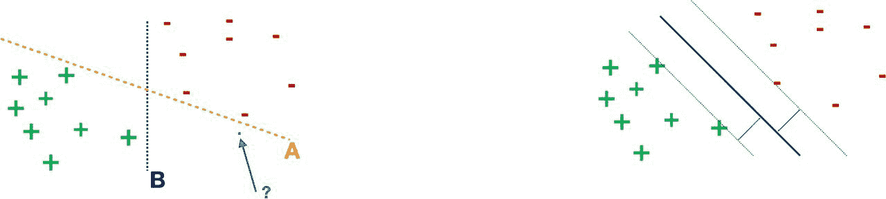

图 7.13 左侧：两个线性分类器……等等。

这导致了以下直觉：在创建线性分类器时，我们倾向于寻找一条距离所有训练实例尽可能远的直线。换句话说，我们寻找的是一条具有`最大间隔`（maximal margin）的直线，其中分类器周围的“间隔”是分类器到任何训练实例的最小距离。

学习支持向量机无非`寻找具有最大间隔的线性分类器`。当类别线性可分时，这种最大间隔分类器存在且是唯一的。此外，它可以通过求解一种广为人知的优化问题来找到，即在凸域上寻找二次函数的最小值。虽然通常情况下寻找函数的最小值是困难的，但在这种特殊情况下相对容易，并且存在高效的现成求解器。

假设给了一个元素为（`x`，`y`）的训练集，其中 `x` 是输入空间中的一个向量，`y` 是它的标签（正样本为 1，负样本为 -1）。我们将寻找一个函数 `f(x) = ax + b`，其属性为：对于所有负样本，`ax + b ≤ -1`，且对于所有正样本，`ax + b ≥ 1`。该函数将如下用于分类：如果 `f(x) > 0`，则 `x` 为正样本，否则为负样本。显然，通过这种分类规则，分类器与训练数据完全一致，且分类线由 `f(x) = 0` 定义。

存在许多这样的 `f`。它们都与数据一致。现在的最小化问题是，我们希望找到 `||a||² = ∑ᵢ₌₁ᵐaᵢ²` 最小的 `f`。这可以看作是一种正则化，但在这里具有非常具体的解释：具有这种属性的 `f` 结果证明就是最大间隔分类器。

现在，我们如何学习非线性分类器呢？SVM 的方法如下：想象我们将输入空间转换到某个高维空间，在该空间学习一个线性分类器，然后将结果转换回原始空间。例如，变换 `Φ(x[1], x[2]) = (x[1], x[2], x[1]x[2], x[1]², x[2]²)` 将一个 2 维输入空间转换为 5 维空间。该变换空间中的线性分类器形式为 `a[1]x[1] + a[2]x[2] + a[3]x[1]x[2] + a[4]x[1]² + a[5]x[2]² = 0`。这在同时它也是原始空间中的一个二次形式。因此，我们可以遵循这一步骤来学习二次分类器。这些分类器在原始空间中不具有最大间隔属性，但在变换后的空间中具有。图 7.14 展示了该变换的简化版本过程。

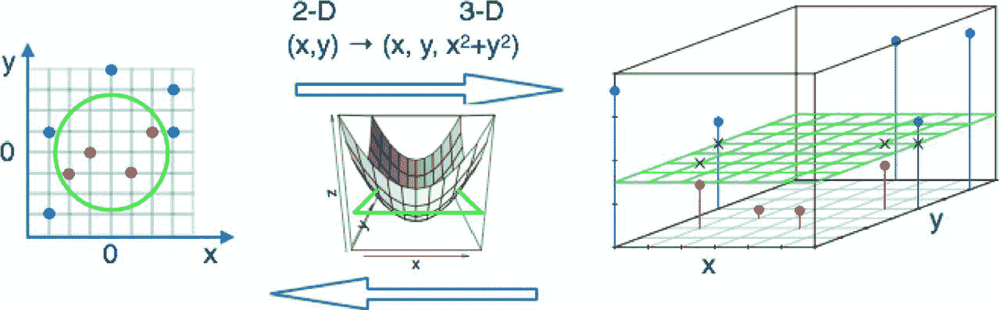

图 7.14 一组不可线性分离的两个类别（红色/蓝色）的实例被转换到 3 维空间。在该空间中，它们可以通过一个平面进行分离。找到最大间隔平面并将其转换回原始空间，可以在原始空间得到一个圆形分类器。（在实践中，变换后的空间维度通常比此处显示的要得多。）

现在，由于学习 SVM 只需要点积，因此在变换空间中学习 SVM 只需要计算所有训练实例的点积 `Φ(x[i])Φ(x[j])`。这些点积的计算是通过`核函数` `K(x[i], x[j])` 完成的。

在实践中，学习 SVM 时，我们直接选择核函数，而不必经过选择 `Φ` 的弯路。并不是每个函数都适用于核函数；该函数必须存在某种变换 `Φ`，使得 `K(x[i], x[j]) = Φ(x[i])Φ(x[j])`。著名的例子有`多项式核` `K(x[i], x[j]) = (1 + x[i]x[j])^p` 和`径向基函数` `K(x[i], x[j]) = exp(-||x[i]-x[j]||²)`。从技术上讲，核必须满足`Mercer 条件（Mercer’s condition）`：对于任何数据集，核矩阵必须是正半定的。（此处文本重复）

虽然单个神经元在表示的函数类型方面受到极大限制，但两层神经网络可以表示各种预测函数。例如，在分类语境下，单个神经元只能构建线性判分器，但两层神经网络只要第一层有足够的神经元，就可以构建任何类型的判分器（参见图 7.17）。在这里，神经元具有非线性激活函数是至关重要的。如果使用线性激活函数，它们的组合仍然是线性函数，表达能力并不会提升。


图 7.17 小型型神经网络中神经元的激活区域（针对 sigmoid 激活函数）。对于第 1 层神经元，高激活和低激活区域是线性可分的。通过组合第一层神经元的输出，第 2 层神经元创建了一个与其他部分不再是线性可分的高激活区域（参见等高线）。

##### 训练神经网络

在预测学习语境下，训练神经网络涉及寻找其参数的值，使得网络很好地拟合数据。这个训练过程通常使用称为`gradient descent`的通用优化程序。为了解释这一过程，我们需要一些基本的数学概念。

函数 `f(x)` 的`导数`是一个新函数，它表示 `f(x)` 在点 `x` 处的斜率。例如，函数 `f(x) = x²` 在 `x = 0` 处的斜率为 0，在 `x = 1` 处的斜率为 2。在这种情况下，指示每个点 `x` 处 `f` 的斜率的函数是 `g(x) = 2x`。

对于多变量函数 `f(x, y, z)`，`f` 在点 `(x, y, z)` 处关于 `x` 的`偏导数`记为 `∂f(x, y, z)/∂x`，表示 `f(x, y, z)` 在点 `(x, y, z)` 处沿 `X`-轴方向的斜率。`f` 在点 `(x, y, z)` 处的`梯度`记为 `∇f(x, y, z)`：

`∂f(x, y, z)/∂x, ∂f(x, y, z)/∂y, ∂f(x, y, z)/∂z`

梯度的长度表示函数在最陡上升方向上的增长快慢。梯度的方向就是最陡上升的方向。梯度的负值就是最陡下降的方向。这就是为什么使用`gradient descent`来最小化损失函数。

反向传播的概念适用于任何可以表示为计算图的函数。在计算图中，边 `x → y` 表示节点 `x` 的输出是节点 `y` 的输入，每个节点代表一个算子，用于根据其输入计算该节点的输出。通过这种方式可以定义并训练非常复杂的模型。这导致了一种被称为`differentiable programming`的机器学习方法，其中“程序”定义了计算图的结构，而参数值则从数据中学习。

##### 深度学习

考虑一个具有 `n` 层的网络。网络的输出（第 `n` 层）完全由第 `n-1` 层计算得出；没有通往更早层级的捷径。因此，第 `n-1` 层必须包含做出准确预测所需的所有信息。同样，第 `n-1` 层的状态必须完全从第 `n-2` 层计算出来，以此类推，直到第一层（第一层直接从输入 `x` 计算得出）。在这样的网络中，`每一层都形成了输入的某种不同表示`。分层神经网络可以看作是在执行从一种表示到另一种表示的系列变换。这些变换在很大程度上是以无监督的方式学习的：我们并不告诉网络在第一层、第二层等层中应该具有什么样的表示。网络会自己发现合适的表示。在某种意义上，反向传播算法不仅为参数产生了合适的设置，还产生了一系列合适的内部表示。这些表示是以无监督的方式学习的，这一事实非常有趣。我们之前看到，如果有了正确的特征，更容易做出准确预测。在某种意义上，多层神经网络以这种方式发明了正确的特征，使得倒数第二层定义了一个特征空间，从该空间可以很容易地预测目标。

神经网络的层数越多，学习就越变得“无监督”。`deep learning`一词用于学习具有许多层的网络。某一层距离（观测到的）输入空间和输出空间越远，它就定义了一个在无监督下学习的底层、“深层”表示。学习有用的深层表示有时被认为是一个目标本身；这项被称为`representation learning`。事实证明深度神经网络非常擅长这项任务，说明此点的最佳方法之一是观察它们在计算机视觉背景下是如何工作的。这正是下一节的主题。

##### 卷积神经网络

卷积神经网络具有特定架构的神经网络，适用于特定类型的处理。它们经常被用于计算机视觉领域（例如，识别图片中的物体或分类图像），但也用于处理音频信号、时间序列和其他序列。在本文中我们将从视觉对象识别的角度来描述它们及其目标。

为了方便讨论，假设输入宽度为 `c` 像素，高度为 `r` 像素。卷积层由 `k` 个滤波器组成，每个的大小为 `f` x `f` x `c`。每个滤波器与输入进行卷积以产生特征图。该层的输出是 `k` 个大小为 `r'` x `r'` 的特征图。（等待，此节提供的文本是重复的/不完整的，我将根据提供的片段结构进行格式化）。

卷积神经网络具有特定架构的神经网络，适用于特定类型的处理。它们经常被用于计算机视觉领域（例如，识别图片中的物体或分类图像），但也用于处理音频信号、时间序列和其他序列。在本文中我们将从视觉对象识别的角度来描述它们及其目标。

请注意，网络在图像中寻找的局部模式是由卷积节点的权重定义的。原则上讲，我们可以通过适地固定特征权重来让它寻找预定义的特征。然而，通过让网络学习这些权重，它会自己创建出与图像处理相关的特征集。这种能力也许是深度学习在计算机视觉领域引起的最重要跨越：直到 21 世纪初，计算机视觉仍然依赖于精心设计的特征，但通过深度学习，更优的特征被完全自动地发现了。这付出了代价：训练深层网络需要海量的数据和巨大的计算能力。然而，低级特征被证明是相对稳定的。实践中的做法是，人们使用预训练网络，其中早期层（即视觉特征）是固定的，只针对当前任务对网络的末层进行微调。这通常能以合理的训练成本提供出的准确率。

尽管深度学习彻底改变了计算机视觉，但它并非没有挑战。我们可以用人类永远不会欺骗的方式欺骗基于深度学习的视觉系统。图 7.21 展示了当我们完全没有问题看到他们时，如何让人类对计算机视觉变得“隐形”。以这种方式欺骗计算机需要在图像中插入精心构建的信号。


图 7.21 自动人员检测器可以通过向图像中插入精心制作的子图像轻易被欺骗。（图片来源：[`nieuws.kuleuven.be/en/content/2019/ku-leuven-researchers-make-themselves-invisible-to-ai-cameras`](https://nieuws.kuleuven.be/en/content/2019/ku-leuven-researchers-make-themselves-invisible-to-ai-cameras)）。

##### 长短期记忆网络（LSTMs）

到目前为止，我们只考虑了前馈网络，其中一层的输出被馈到下一层。其他架构也是可能的。`循环网络`是一种神经元的输出被反馈到同一层、甚至更早的层的网络（图 7.22）。这类网络对于从序列中学习非常有用。假设我们有一个输入序列 `x[1]`、`x[2]`、`x[3]` 以及针对整个序列的单个标签 `y`。在循环网络中，我们首先输入 `x[1]`，然后是 `x[2]`，然后是 `x[3]`，最后是 `y`。（注：原文此处存在大量重复句子，翻译已按逻辑精简）。

上述的自动编码器是确定性的：输入被映射到低维空间（也称为潜在空间）中的单个点，并且可以从该点进行重建。同时也存在概率自动编码器。在这里，编码器将输入映射到潜在空间中的一个分布，而不是单个点；同样地，解码器将单个点映射到输出空间上的一个分布。这听起来像是一个奇怪的想法，但它在本质上与概率图模型（第 7.3.14 节）的做法无异。例如，对于一个带有 sigmoid 激活函数的前馈神经网络，只需将输出节点定义为二值值（0/1），并将激活函数的输出解释为输出节点为 1 的概率（而不是该节点本身的值），就可以得到一个将输入映射到分布的网络。受限玻尔兹曼机（RBMs）使用的正是这一原理。变分自动编码器（VAEs）是另一个概率自动编码器的例子。VAE 的训练方式保证了某种程度的连续性：潜在空间中的相邻点应该代表在某种程度上相似的输入；潜在空间两个点之间的插值会产生一个在某种程度上处于对应输入点“之间”的输入，此类此类。

虽然确定性自动编码器可以用于重建输入，但概率自动编码器有助于生成与给定输入相似但不完全相同的新数据点。它们在生成式 AI 的背景下非常有用，例如用于生成图片。人们可以生成一张与给定图片相似的图片，改变图片的某些特征，将不同图片的某些特征混合到一张图片中（通过潜在空间中的插值），或者简单地从零生成一张图片。

编码器-解码器结构也被用于 transformer 模型，尽管这些模型中的输入和输出空间可能不同：例如，一段文本（输入）可能被映射到潜在空间中的一个点或分布，通过采样从该处生成一张输出图片。关于 transformer 及其在自然语言处理中应用的更多信息，请参阅第 8 章。

##### 关于神经网络的进一步考虑

大约从 2010 年以来，深度学习一直主导着机器学习。它适用于比神经网络更广泛的模型类（例如，概率模型），但它以一种壮丽的方式复兴了神经网络领域。当需要学习的信息包含原始数据时，深度学习是不可或缺的：即没有预定义（或没有足够）意义特征的数据。这包括图像、视频、音频和书文本。

#### 7.3.12 降维

数据集的维度简单来说就是描述每个实例的变量（或特征）的数量。高维度对于几乎所有的学习器都带来了问题，以至于它通常被称为“维度灾难”。在线性回归中，高维度也会导致过拟合并使得解不唯一。在最近邻方法中，高维度使得相似性度量包含的信息很少。密度估计非常困难，因为即使是大型数据集在高维空间中通常也分布得极其稀疏。支持向量机是少数不受高维度困扰的方法，相反，它利用了高维度。

鉴于这种情况，许多研究投入了`降维`：在进行任何进一步分析之前，将数据映射到低维空间。

许多成功的系统隐式地执行了某种降维。例如，图像数据是非常高维的。卷积网络在类数据上运行良好的原因之一，是卷积层本质上是一种执行降维的方法。它定义了较少（相对于图像中的像素数量）的特征，使得解释图像成为可能。降维方法的一部分是硬编码的（卷积原理），另一部分是学习得的（定义系统应该寻找的模式的参数）。

对于其他方法，降维方面更加显式，甚至可以被视为该方法的目标。例如，如上所述，自动编码器将数据集映射到低维空间，使得数据集可以从该低维表示进行重建。因此，自动编码器可以被视为一种降维方法。

在统计学中，人们认为最基础的降维方法是主成分分析（PCA）。直观上，PCA 的工作原理如下：假设一个具有 `n` 个数值特征的数据集。PCA 定义了新特征，这些特征是原始特征的线性组合。在散点图中这些线性组合可以解释为方向。第一个新特征是数据差最大的线性组合；换句话说，就是数据变化最大的方向。我们称之为第一主成分。每个连续的特征（第二、第三等主成分）都与之前的所有组件正交，并且在所有具有该属性的特征中，它是方差最大的一个。图 7.24 为二维数据集说明了这一点。


图 7.24 一个二维点云。$P_{1}$ 和 $P_{2}$ 是它的主成分。数据集的方差沿 `P₁` 方向最大，沿 `P₂` 方向最小。红色箭头表示在给定其中一个坐标时点位置的不确定性。如果已知其在 `P₁` 上的坐标，则位置的不确定性最小。


从降维的角度来看，这种构造具有以下优势：考虑一个具有特征`x₁`、`x₂`的二维数据集，如图 7.24 所示，假设我们将其降为一维。我们可以简单保留`x₁`并丢弃`x₂`：如果我们知道一个点的`x₁`值，我们就知道该点的大致位置。位置剩余的不确定性由`x₂`的方差给出：`x₂`对于`x₁`均值的波动越大，剩余的不确定性就越多。我们也可以选择丢弃`x₁`并保留`x₂`。这将是一个较差的解决方案，因为在给定`x₂`的某些值时，`x₁`的方差很高。然而，与其通过投影到原始轴线之一来降低维度，我们还可以将它们投影到第一主成分`p₁`上。这样，对于点位置的不确定性就会更小，因为沿`p₂`方向的方差小于沿`x₁`或`x₂`方向的方差。

从数学角度来说，计算主成分等同于计算一个源自数据集矩阵的特征向量。更精确地说，如果`D`是一个具有`n`行`m`列的矩阵，代表具有`m`个特征和`n`个实例的原始表格，那么`DᵀD`是一个`m × m`矩阵。`DᵀD`的特征向量就是主成分，其对应的特征值是数据沿该成分方差的平方根。

PCA 可以被看作是识别原始特征线性组合的特征，且这些特征适用于定义一个低维表示，能够以最大的精度重构数据。从这个意义上说，自动编码器可以被看作 PCA 的非线性版本，因为识别出的特征不仅仅是原始特征的线性组合，而是应用了非线性阈值函数的线性组合。这使得它们具有更强的表达能力。付出的代价是，训练自动编码器的过程比执行 PCA 更加复杂。

#### 7.3.13 矩阵分解与张量分解

为了引入矩阵分解的概念，考虑可能用于训练书籍推荐系统的数据。我们有一个矩阵，其中行是用户，列是书籍，单元格表示用户对书籍的喜爱程度。在实践中，许多单元格是空的，我们想要预测它们的值（这意味着我们将预测对于一个未读过某些书籍的用户，该用户会对该书籍有多喜爱）。

矩阵在线性代数这一非常成熟的领域被研究。这里相关的一个特定属性是：矩阵的行在多大程度上是线性独立的。如果一个向量可以写为其他向量的缩放版本（又称为`linear combination`）的和，那么该向量与这些向量之间是线性相关的。例如，`(2,4,6)`与`(1,2,3)`是线性相关的（只需将后者乘以 2 即可），但与`(1,2,4)`不相关。`(2,4,6)`与元组`{(1,2,4), (0,0,1)}`是线性相关的，因为`(2,4,6)=2·(1,2,4)-1·(0,0,1)`。

在本节的剩余部分中，我们去掉了“线性”一词，简单讨论（不）依赖性。矩阵的`rank`（秩）表示它包含多少条独立行。在秩为 1 的矩阵中，每行都是第一（非零）行的缩放版本。例如，下方程左侧的矩阵包含 3 行，其中第二行和第三行是第一行的缩放（分别乘以系数 3 和 4）。我们可以将该矩阵写为单行和单列的矩阵积如下：

```latex
\begin{bmatrix}
1 & 2 & 3 & 4 \\
3 & 6 & 9 & 12 \\
4 & 8 & 12 & 16
\end{bmatrix}
=
\begin{bmatrix}
1 \\ 3 \\ 4
\end{bmatrix}
\begin{bmatrix}
1 & 2 & 3 & 4
\end{bmatrix}
```

事实上，根据矩阵乘法的标准定义，右侧产生一个三行的矩阵，第一行等于 1 倍`[1, 2, 3, 4]`，第二行是相同内容的 3 倍，依此类推。

秩为`k`的矩阵可以写为`k-1`个矩阵之和，或者等价地写成一个`k`列矩阵和一个`k`行矩阵的乘积，其中第`i`行包含了第二个矩阵每行相乘的系数，使得相乘后的行之和等于秩为`k`的矩阵的第`i`行。例如：

```latex
\begin{bmatrix}
1 & 1 & 0 & 0 \\
3 & 3 & 0 & 0 \\
0 & 0 & 2 & 2 \\
0 & 0 & 4 & 4
\end{bmatrix}
=
\begin{bmatrix}
1 \\ 3 \\ 0 \\ 0
\end{bmatrix}
\begin{bmatrix}
1 & 1 & 0 & 0
\end{bmatrix}
+
\begin{bmatrix}
0 \\ 0 \\ 2 \\ 4
\end{bmatrix}
\begin{bmatrix}
0 & 0 & 1 & 1
\end{bmatrix}
```

矩阵分解在推荐系统背景下有什么用？让我们用一个例子来说明。假设某些用户喜欢恐怖小说，另一些喜欢科幻小说，还有一些人喜欢两者（且都喜欢）。假设某类用户喜欢恐怖小说，另一类喜欢科幻小说，还有第三类两者都喜欢。第一类用户对恐怖小说给出 1，其他地方为 0；第二类用户对科幻小说给出 1，其他地方为 0；第三类用户对两者都给出 2（或其他比例）。在这种情况下，如果我们为每个用户有一行，我们发现矩阵中有两个独立的行：一个代表“恐怖”，一个代表“科幻”。某些行是两者的结合。在这个特定情况下，评分矩阵的秩为 2。

```latex
\begin{bmatrix}
1 & 1 & 0 & 0 \\
3 & 3 & 0 & 0 \\
0 & 0 & 2 & 2 \\
0 & 0 & 4 & 4
\end{bmatrix}
=
\begin{bmatrix}
1 \\ 3 \\ 0 \\ 0
\end{bmatrix}
\begin{bmatrix}
1 & 1 & 0 & 0
\end{bmatrix}
+
\begin{bmatrix}
0 \\ 0 \\ 2 \\ 4
\end{bmatrix}
\begin{bmatrix}
0 & 0 & 1 & 1
\end{bmatrix}
```

这个例子说明了评分矩阵的`rank`如何解释为书籍的不同“类型”（genre），其中类型被解释为：用户对小说的评分取决于它属于哪些类型，以及用户对每种类型的偏好。矩阵分解基本上是一种揭示矩阵底层结构的方法，即有多少种（独立的）类型*存在*、这些类型在*书籍中的存在程度*，以及它们被*用户喜爱的程度*。参见图 7.25。在矩阵代数中，**奇异值分解**（`SVD`）是矩阵分解的一种基本方法。`SVD`识别了类型、它们对每个用户的相对重要性和在电影中的呈现，以及每个类型对评分的整体重要性。评分矩阵技术上可能是高秩，但可以通过低秩矩阵进行良好近似。使用`SVD`，通过忽略整体重要性低的类型可以找到给定秩的最优近似。


图 7.25 用户电影评分矩阵通过分解为三个矩阵来“解释”，识别出 3 种类型、它们的权重以及用户与电影之间的联系。（这种分解不是 SVD，它仅仅说明了矩阵分解识别矩阵结构的原理。）

丢弃某些变量的想法显然与我们在 PCA 中做的工作有关，事实上 SVD 和 PCA 之间确实存在联系。PCA 试图在低维空间中表示原始数据，而 SVD 试图使用低维空间表示两类实体之间的连接（在本例中，是用户和电影）。

识别用户-电影矩阵中的结构是非常有用的，因为一旦发现了这种结构，就可以用它来进行各种推断。例如，给定一部新电影，如果我们知道某些用户对这部电影的评分，我们就可以推断出它的类型组合；并据此，我们可以预测其他用户对同一部电影的评分。这在电影推荐的语境下，或者更广泛地说，对于推荐系统而言，显然是有用的。

尽管我们使用电影的“类型”来说明了这一原理，但显而易见，底层结构并不一定对应可识别的类型（如恐怖片、科幻等）。更广泛地说，定义整体结构的低维空间的维度被称为`latent variables`（隐变量）。

矩阵分解的原理可以扩展到张量。矩阵分解和张量分解是识别矩阵型或张量型数据中底层结构的方法。这包括推荐系统，还包括许多其他类型的数据。

#### 7.3.14 概率图模型

`概率图模型`（`PGMs`）通过其联合概率分布（JPD）来对总体进行建模。一旦确定了 JPD，就可以用它进行各种推理：详情请参见第 6 章。在这里，我们关注如何从数据中学习 JPDs。

##### 联合概率分布

假设数据集中的实例使用一组固定的变量来描述，并为这些变量分配值。为了方便讨论，我们目前假设变量是离散的。

`联合概率分布` `p(x)`是一个以以下方式描述总体的函数：对于任何实例`x`，`p(x)`给从总体中随机抽取的实例等于`x`的概率。例如，如果总体是由瓶里的 10 个黄色、5 个红色和 5 个绿色玻璃球组成，那么对于任何特定的玻璃球`m`，`p(m) = 1/20`。如果我们不区分相同色的玻璃球，并将`x`简单视为抽到的玻璃球的颜色，那么`p(red) = 5/20`。如果一个玻璃球由多个变量描述，例如`size`（大/中/小）、`material`（玻璃/玛瑙）和`color`（红/蓝/黄/绿/白），那么`p(s, m, c)`则对于任何尺寸`s`、材料`m`和颜色`c`，给出随机抽取的玻璃球具有指定尺寸、材料和颜色的概率。

##### JPD 的分解

原则上，联合概率分布`p`可以使用表格来定义，列出变量的每种值组合对应的抽取恰好具有该组合的实例的概率。在上面的玻璃球示例中，我们需要 30 行，但当存在许多变量和可能的值时，组合的数量会迅速增加到天文数字。此时，即使是存储这样的表格都是不可能的。即使这是可能的，从数据中估计每个单独组合的概率也需要所有现有的组合在数据中至少出现一次，如果我们想准确估计概率，可能还需要出现多次；因此，对于一个拥有数十亿行的表格，我们还需要数十亿个数据点来进行学习，才能有效地填充它。

在这些情况下，概率分布通常被写为几个变量较少的函数乘积。我们称之为分解（factorization）。分解最简单的例子是`p(x[1], x[2]) = p1p2`：JPD 被简单地写为两个独立函数的乘积（称为`factors`）。注意，并不是每个`x[1], x[2]`上的 JPD 都能写成这样的乘积。例如，如果`(x[1], x[2])`表示掷两个骰子的结果，那么确实，`p`是可以的……（注：原文此处逻辑似乎中断，翻译遵循原文结构）。

该等式意味着一种被称为“类条件独立”（`class-conditional independence`）的条件：在特定类别`Y`中，`X[i]`取特定值的概率不受`j ≠ i`时`X[j]`取值的影响。为了说明其含义：假设我们想将人分为两类，例如足球运动员和篮球运动员。这两个群体都由身高、体重、速度等变量来表征。朴素贝叶斯（Naïve Bayes）本质上假设身高和体重都取决于类别（例如，篮球运动员的高度分布与足球运动员不同），但在给定某人是足球运动员的情况下，知道其身高不会提供关于其体重的任何信息（在这种情况下这是一个不符合实际的假设）。

在模型的假设下，联合概率分布（JPD）可以高效地估计：所有因子最多包含 2 个变量，这意味着只需统计 2 个值的组合即可。

例如，假设有人有一个大袋，里面装有数百个玻璃球，其尺寸、材料和颜色如前所述（3 种尺寸、2 种材料、5 种颜色，产生 50 种可能的组合）。假设你从中随机抽取 20 个玻璃球并写下它们的属性，你将得到如图 7.26 所示所示表格。


图 7.26 列出 20 个随机抽取的玻璃球的表格。旁边显示了一些基于计数的（条件）概率估计。

现在，没有抽到大号白色玻璃球并不意味着袋子里没有这种球：共有 50 种可能的组合，即使袋子里 50 种都存在，表格中也多只能出现 20 个。因此，要估计特定尺寸/材料/颜色组合的概率，统计三个值的组合是行不通的：我们很容易得到一个 0 的估计概率。然而，如果我们假设尺寸、材料和颜色都是独立的，我们可以从表格中估计材料的分布（15/20 是玻璃）、尺寸（5/20 是大号）和颜色（4/20 是白色），并估计抽取大号白色玻璃球的概率为`P(big)P(white)P(glass) = (15/20)(5/20)(4/20) = 3/80`。如果我们放宽这一假设，改为不同材料的尺寸和颜色分布可能不同（但在给定材料的情况下，尺寸和颜色仍然是独立的），我们估计`P(big, white, glass)`为`P(big | glass) = (15/20)(5/20)(4/20) = 3/80`。

上述讨论假设变量是离散的。当变量`x`是连续而非离散时，`p(x)`通常为零，例如，从全人类人口中随机抽取一个人，其身高*恰好*为 178.32000000000…cm 的概率为零。如果我们将其舍入到 1 cm（即我们将连续变量离散化），就能得到有意义的概率，但我们也可以舍入到 1 mm、0.1 mm 等。自然地，区间越小，在该区间内抽取到元素的概率就越小。例如，如果 3% 的人口身高在 178 到 179 cm 之间，那么可能有约 0.3% 的人身高在 178.0 到 178.1 cm 之间。除非你知道粒度，否则概率本身没有意义，但“每毫米的概率”基本保持不变。`probability density`是概率除以区间宽度，对于非常小的区间（在数学上，即区间宽度趋近于 0 时的极限）。相反，一个区间的概率是密度在该区间上的积分。

概率密度与概率非常不同（例如，它可以大于 1），为了强调这种区别，当`x`是离散的时，`p(x)`通常称为`probability mass function`，当`x`是连续的时则称为`probability density function`。当`x`是多个变量的元组且其中一些是离散的、另一些是连续的时，该函数是两者的混合，直接使用联合概率分布（joint probability distribution）术语更为方便。

虽然 PGMS 是一种强大且灵活的形式，但它们主要用于离散变量。数值变量的一个难点在于，因素无法再以表格格式估计和存储。相反，它们是连续函数，必须以某种方式与数据拟合。这通常使用参数化方法（例如拟合高斯分布）。在这种情况下，必须使用适当的函数族，因为选择错误的族可能会导致任意糟糕的结果。例如，用高斯分布拟合双峰分布会给中间的值分配高概率，而实际上这些值可能极不出现。这就像是根据英国脱欧公投 52:48 的结果得出大多数英国人对脱欧无无奇的结论，而实际上意见是极度极化的。

#### 7.3.15 聚类与密度估计

与矩阵分解类似，`clustering`是一种无监督学习任务，试图在数据中寻找结构。在最基本的形式中，聚类意味着寻找“类”，即相似的实例组。在某些变体中，类本身被分组为更大的类；这被称为`hierarchical clustering`。在其他变体中，聚类系统不仅将实例分为类，还描述这些类；这有时被称为`conceptual clustering`。

##### Flat 聚类

平直聚类简单地将数据集中的实例划分为若干组相似的实例。当我们可视化数据空间时，类通常看起来像实例的“岛屿”，或者是稀疏或空白区域中的密集区域。任何能够可靠估计数据集中总体密度的方法都可以。也许最为人知的聚类算法（尽管并非唯一）被称为`k-means`。它有一个超参数：`k`，即我们想要的类数。

`k-means`的概率对应物是`expectation maximization`过程，简称`EM`。这是一种迭代过程，用于学习高斯混合模型。每次迭代包含`expectation`步骤（在该步骤中我们对每个实例猜测它属于哪个子群体）和`maximization`步骤（在该步骤中我们更新分布的参数）。

由于`k-means`将点分配给距离中心最近的类，这并不总是我们所想要的。`Spectral clustering`方法的工作方式完全不同：它们定义了一个图，其中节点是实例，相似的实例之间存在边。谱聚类倾向于找到一种类，其中的实例靠近同一类中的其他实例，但不一定靠近该类的中心。

##### 层次聚类

层次聚类大致对应于分类法（taxonomy）的概念。构建它类似于人类几世纪以来对动物等实例所做的事情。我们观察到某些类型的动物看起来相似：我们称它们为狗。虽然所有的狗具有某些相似性（这就是为什么我们识别它们为一个物种），但我们也可以将它们细分为亚类型：德国牧羊、边境犬、大丹、哈士奇等。同时，狗、象和松鼠的共同点是它们都是哺乳动物、是脊椎动物等。我们今天拥有的动物分类法是层次聚类过程的结果。

计算机通常以自上而下的方式（从一个包含整个数据集的类开始，不断将类拆分为子类）或自下而上的方式（将相似的个体合并为一个类，然后将类合并为更大的类等）形成类层次结构。层次聚类过程的结果被称为`dendrogram`（树状）。它基本上分类法，不同的是它在最底层包含了具体的个体。

# 聚类

执行聚类时的一个主要挑战是必须有一个定义良好的相似性概念。这种概念可能是主观的，例如，当我们对人物照片进行聚类时，我们是想根据服装风格、姿态、外貌等进行分组吗？除非用户提供了相似性的正式定义，否则计算机不知道用户所说的“相似”是什么意思。然而，用户可能很难提供这样的正式定义。例如，要根据图中人物的服装风格对照片进行聚类，我们需要定义一个数学函数，在给定两个像素矩阵的情况下告诉我们服装风格的相似程度——这在实践上是一个不可能完成的任务。

**半监督聚类**方法允许用户通过展示应该（或不应该）属于同一簇的实例示例来提供一些指导。从这些提示中，它们推导出一个与用户意见一致的相似性标准，并利用该标准形成簇。例如，在**基于约束的聚类**中，用户对少数实例对说明它们是否属于同一簇。某些系统允许用户以交互方式进行此操作：请参见图 7.29 示例。


图 7.29 交互式半监督聚类系统 `COBRAS-TS`（[https://dtai.cs.kuleuven.be/software/cobras/](https://dtai.cs.kuleuven.be/software/cobras/)）根据与用户的有限交互对时间序列进行聚类。（图片由 Wannes Meert, KU Leuven 提供）。

### 7.3.16 自动机与隐马尔可夫模型

#### 有限自动机

我们之前提到过 `Flashfill`，这是一个 Excel 插件，它可以从示例中学习字符串上的数据转换。此类转换需要在字符串中找到共同模式。描述字符串模式的方法有很多。其中包括**正则表达式**。正则表达式或 **regex** 是一种可以“匹配”并从某种程度上解析字符串的模式。一个简单的例子是 `u[0-9]+`，它代表“字母 u，后面跟着一个或多个数字”（`[0-9]` 结构匹配数字，`+` 意味着可以有一个或多个此类匹配）。正则表达式 `gr[ea]y` 匹配字符串“grey”和“gray”。此类表达式通常用于查找和替换文本片段。当 `Flashfill` 学习（例如）将键值对 (Clarke, Arthur, Charles) 转换为字符串“Arthur C. Clarke”时，它正在学习一种可以使用正则表达式表示的替换规则。

检查子字符串是否匹配给定的正则表达式可以使用名为**有限自动机**的设备完成。有限自动机可以被视为从左到右读取字符串的机器。它始终处于有限数量状态之一，并在读取符号时从一个状态移动到另一个状态。根据读取整个字符串后所处的状态，它接受或拒绝该字符串。现在，对于每个正则表达式，存在一个有限自动机，当且仅当字符串匹配该正则表达式时它接受该字符串。因此，有限自动机和正则表达式是等价的。因此，从示例中学习正则表达式可以通过从示例中学习有限自动机来实现，这一任务有多种算法。例如，`RPNI` 算法从标记为正或负的示例字符串学习一个接受所有正示例、拒绝所有负示例的自动机，并用于预测新字符串的标签。为了实现这一点，它首先构建一个仅接受正字符串而不接受其他任何字符串的自动机，然后以这种方式合并自动机中的状态，使得自动机接受更多字符串，但永远不会接受标记为负的字符串。请参见图 7.30 的图示。


图 7.30 左侧：一个接受所有形式为 ·, ab, abab, ababab 等字符串且不接受其他字符串的有限自动机。右侧：这样的自动机可以通过构建一个仅接受正标记字符串的自动机，并尽可能通过合并状态来简化它来学习，前提是：当合并两个状态时，通过相同符号到达它们的状态也必须合并，并且我们不能合并接受状态和拒绝状态。在这种情况下，结果是一个与预期的自动机不同的自动机，因为它也接受 bb, bbbb 等字符串。需要更多数据来防止这种情况发生。

自动机具有广泛的应用前景：它们被编译器用于解析计算机程序，还用于验证软件、硬件、协议等的正确性。

#### 隐马尔可夫模型

**隐马尔可夫模型**或 HMM 与有限状态机相似，但它有一个概率组件。它不是根据读取符号并移动状态，而是自发地从一个状态移动到另一个状态，并在每次移动时产生一个输出符号。它从给定状态移动到的状态是概率性的：对于每对状态，从第一个移动到第二个状态有一个恒定的概率。换句话说，条件概率分布 `P(s|s)` 定义了当处于状态 `s` 时移动到 `s'` 的概率。这种分布总结在所谓的转移矩阵中。它每次移动产生的输出也是随机的。

给定一些符号字符串，我们就可以考虑以下学习任务：确定底层 HMM 最可能的转移矩阵和输出概率分布。通常，在这个学习过程中假设有固定数量的状态。

### 7.3.17 强化学习

**强化学习**是一个相对通用的学习设置。可以通过不同的方法来进行。我们首先描述通用设置。接下来，描述一种针对确定性环境的具体学习算法 `Q-learning`，并讨论探索和泛化的挑战。

强化学习问题可以表述如下：智能体（agent）可以处于多个状态，并在这些状态下采取动作。每个动作都可以导致即时奖励以及状态的改变。目前，让我们假设一个确定性环境，其中动作始终产生相同的结果。目标是找到一个`policy`（策略），规定了在每个状态下执行何种动作，以实现奖励的最大累积。从形式上说，任务是找到一个函数 `π : S → A`（这就是策略），使得当我们从任何状态 `s[0]` 开始，并在每个遇到的状态 `s[t]` 采取动作 `π(s[t])` 时，`∑[t]γ^(t)r(s[t], π(s[t]))` 尽可能高。在这里，`r(s, a)` 是我们在状态 `s` 下执行动作 `a` 获得的奖励，而 `γ < 1` 是所谓的`discount factor`（折扣因子）：它会降低遥远的奖励的价值。

作为该问题设定的一个例子，考虑下下棋：棋盘位置是状态，动作是移动，动作的奖励可以是：如果你通过该动作赢得游戏，奖励为 +1；如果输了，奖励为 −1；否则为 0。策略告诉你该下什么步，而找到一个能使奖励累积最大化的策略，在在这种情况下就意味着学会如何玩好这个游戏。在这个特定的例子中，动作的结果是非确定性的，因为你必须采取动作的下一个状态也取决于对手对该动作的反应。此类设定的其他例子还包括工业过程，其中操作员必须采取某些动作来保持过程在控制之下；过程的产量可以作为奖励，但如果发生严重错误，可能会导致巨大的负奖励（或成本）。

请注意，奖励累积的最大化不等同于即时奖励的最大化。例如，考虑一个赛车手：为了预判下一个急弯而过早刹车会让他浪费时间（负奖励），但以最高速度行驶太久可能会让他陷入无法转弯并碰撞的境地。初始奖励更高，但最终结果更差。强化学习者需要提前计划。

我们可以考虑日益困难的强化学习问题。最简单的一种是智能体拥有环境的模型，该模型包含状态转移函数和奖励函数。也就是说，它知道在给定状态下执行动作将进入哪个新状态，并且知道奖励在哪里。在这种情况下，通过简单搜索整个状态空间就可以计算出最优策略。这种设定就好比与计算机下棋，同时知道计算机将如何对任何移动做出反应。还有同一个程序的第二个实例，你可以询问它在给定状态下会做什么。尽管这使得问题变成了确定性的（原则上你可以不断尝试尝试动作序列，直到找到一个能让你获胜的序列），但所有可能的动作序列集如此庞大，以至于这个问题在实践上是不可解决的。

该问题的更难版本是智能体不知道转移或奖励。它可以通过简单的尝试来发现。解决此类问题的著名算法是 `Q-learning`。更具体地说，`Q(s, a)` 代表在状态 `s` 下采取动作 `a` 的质量，定义为获得的累积奖励。`Bellman equation`（贝尔曼方程）为：

```
Q(s, a) = r(s, a) + γ max_{a'} Q(s', a')
```

由于这个原因，`Q` 值在某种程度上从末尾向开头回传播。`Q-learning` 算法的工作如下：算法维护一个包含所有 `s, a` 组合的表格；该表可以初始化为 0。算法重复执行以下操作：从起始状态 `s[0]` 开始，采取随机动作，直到到达某个终点（在这种情况下我们回到起点）。在每个动作之后，通过计算贝尔曼方程的右侧并将结果赋给左侧来更新 `Q` 表。这意味着表格中的 `Q(s, a)` 条目会根据即时奖励和下一个状态的 `Q` 条目进行更新。当我们思考诸如国际象棋这样的游戏时，很容易看出为什么这种方法行之通的：对于接近终局的状态，更容易看出哪些移动是好的，哪些移动是坏的。如果无限重复此过程，`Q` 表将收敛到真实的 `Q-function`。


图 7.31 使用 `Q-learning` 逐步构建环境模型的插图。

[图 7.31] 展示了一个对环境没有任何知识的智能体如何通过采取随机动作进行探索，并构建一个关于在哪些状态下动作最好的模型。蓝色/红色箭头表示具有正正负奖励的动作，箭头的粗细表示 `Q`-值的正/负强弱程度。比较左下角和右下角的图，你会发现尽管某个动作在上一次探索运行中导致了灾难（顶部的红色箭头指向鳄鱼），它仍然被赋予了正的 `Q`值，因为模型已经知道它发现，在该动作之后采取另一个动作会带来非常正向的结果（宝藏）。注意，由 `Q`-learning 构建的模型（即 `Q`-table）并不包含转移函数；查看 `Q`-table 时，我们并不知道在状态 `s` 下采取动作 `a` 导致了哪个新状态。事实上，要确定最优策略，不需要知道在状态 `s` 下执行动作 `a` 的确切结果，我们只需要知道哪个动作是最好的。因此，`Q`-learning 通过不尝试构建完整的环境模型，而是构建一个抽象模型（其细节程度足以学习最优策略），从而获得某些效率。

在非确定性环境中，动作产生的即时奖励以及下一个状态可能会变化。通常，这种变化使用针对下一个状态和奖励的概率分布进行建模。智能体在此类设置下面临的决策过程通常被称为马尔可夫决策过程（MDP）。在此设置下学习最优策略的方法与确定性设置下的方法相似；主要区别在于，鉴于实际结果和奖励可能会变化，它们优化的是这些变量的*期望*值。MDP 的一个关键属性是智能体始终知道自己处于何种状态。这类问题的一个更难版本是智能体无法观察到自己所处的状态；此类问题被称为 POMDPs（部分可观测马尔可夫决策过程）。

### 探索策略

在上述描述中，我们假设智能体在学习过程中采取完全随机的动作。如果这种情况持续足够长，`Q` 表将收敛到真实的 `Q` 函数。然而，我们真正感兴趣的是找到一个好的策略，而不是找到一个准确的 `Q` 函数。为了获得最优策略，只需要最优动作的 `Q`值是准确的即可，我们不需要所有的 `Q`值。回到国际象棋例子：一旦我们知道在某种情况下哪个动作是最好的，我们就不再对其他动作到底有多坏感兴趣。

出于这个原因，拥有一种并非完全随机的探索策略，而一旦发现哪些是更好的动作，就逐渐越来越关注这些动作，是有意义的。通常，每个状态都关联一个动作的概率分布，初始时是均匀的，但当某些动作开始比其他动作更好时，它们的概率就会增加。

强化学习的探索策略本身就是一个研究课题。这个主题也与**多臂老虎机**（multiarmed bandits）有关。多臂老虎机问题表述如下：假设你有一些单臂老虎机（赌场机器）。每个老虎机都关联着当你拉动手臂时给你的收益的概率分布。这种收益分布对于每台机器可能不同，且对你是未知的。显然，作为玩家，你想最大化你的期望收益。如果你可以玩无限次，选择拉动哪些手臂的最佳策略是什么？开始时，你想尝试所有的。玩一段时间后，你注意到某些老虎机倾向于给出更高的收益，因此你可能开始更频繁地使用它们。一旦你确定了哪台老虎机的收益最高，你就想一直使用那台机器。如果你过早地决定哪台老虎机是最好的，就有错过最佳机器的风险。如果你等得太久，就会错失最大化利润的机会。**上下文多臂老虎机**问题与之类似，但现在老虎机的收益分布不是恒定的，而是取决于它当前所处的状态。

（上下文）多臂老虎机问题是强化学习中探索问题的简化版本。它们之所以被简化，是因为收益分布描述的是即时奖励，而在强化学习中，我们试图最大化长期累积奖励。后者还取决于当前动作将我们带到什么状态，而这在开始时也是未知的。一种常用的探索策略是所谓的**ε-贪婪**（epsilon-greedy）策略：在这里，在任何时候，当前看起来最好的动作（在 `Q`-learning 中具有最高 `Q`-值）以概率 1 − `ε`（对于某个超参数 `ε`）被选中，以概率 `ε` 选择另一个随机动作。

虽然探索在强化学习过程中非常重要，但当然会有一个我们开始使用所学知识的时刻：如果我们不使用最优策略，那么学习它就没有意义。因此，**探索**（exploration）阶段之后是**利用**（exploitation）阶段。虽然在大多数学习设置中，学习阶段和运行阶段是清晰分开的（例如，我们先训练神经网络，然后使用它；在使用期间不持续训练），但在强化学习中，它们倾向于重叠。随着学习者学习哪些动作是有价值的，它开始通过比其他动作更多地选择更好的动作来逐渐利用它的学习。这不仅从利用所学知识来看有用，从学习本身来看也是如此：经常选择更好的动作允许智能体更详细地探索搜索空间中看起来很有前景的部分。

这一原理的良好说明是**蒙特卡洛树搜索（MCTS）**，这是一种游戏算法，类似于极小算法，但运行更具概率性。为了使讨论更具体，再次考虑国际象棋。极小算法（称之为玩家 `M`）本质上通过考虑对手（玩家 `O`）的所有可能响应、`M` 对其中每一个响应的所有可能响应、`O` 对其中每一个*这些*响应的每一个响应，等等，来评估一个可能的移动。基本上，它尝试直到特定深度之前所有可能的移动序列 `M-O-M-O-M-O-M-O`（跳过一些被证明非最优的序列）。显然，此类移动的数量增加非常快：即使对于很小的深度，也容易运行到数十亿次。MCTS 的不同之处在于它并不尝试所有序列，而是尝试它们的随机样本。最初，这个样本是完全随机的，但一段时间后，如果某些初始移动比其他移动更容易导致更有优势的位置，它将增加这些移动的概率，更详细地探索搜索空间中这个更有前景的部分。

### 泛化

到目前为止，我们假设 `Q`值存储在一个表中，其中每个状态有一行，每个动作有一列。如果状态和动作不多，这种方法是行得通的。但如果我们考虑状态由多个变量的值定义的情况，我们可以很容易获得海量数量的状态。如果某些变量是连续的，状态数量甚至可以是无限的。只有当每个状态-动作对都被遇到很多多次时，`Q`-learning 才会收敛。显然，在非常大的状态空间中，这个条件是不现实的。

在这种情况下，将`Q`-函数的当前近似值不存储为表格，而是使用不同的格式：如神经网络、决策树集成、线性模型等。当然，此时的 `Q`-更新不能再通过简单地更新表格中的值来完成。相反，将遵循以下步骤：

1. 在常规过程中生成大量的 `Q(s, a)` 值；一旦有了足够的值，就学习一个模型，使其能够根据给定的 `s, a`对预测 `Q`；将这些预测值用于前文所示的贝尔曼方程的右侧；将右侧计算的结果存储为新训练实例 `Q(s, a)` 的的目标值。一旦我们拥有了足够的新训练实例，就重新训练模型。因此，使用旧版本的 `Q`-模型生成数据以及基于这些数据训练新模型是交替进行的，并且会一直持续，直到获得 `Q`-函数的良好近似值。这种方法有时被称为**基于模型的强化学习**，它结合了标准机器学习算法的泛化能力与强化学习的优势。

### 7.3.18 学习的其他方面面

#### 超参数调优

许多机器学习算法都具有影响其行为的超参数。例如，在使用树学习器时，我们可能希望限制树的深度，或者对划分到每个分支的实例数设置一个最小值；在 `k`-最近邻算法中，`k` 的选择非常相关；神经网络的反向传播算法使用所谓的学习率，它影响梯度下降过程所迈出的步长大小；SVM 中核函数的选择会影响其性能，等等。为这些超参数选择正确的值是非常重要的。但我们如何找到它们呢？

调优超参数的一种直接方法是简单地尝试许多不同的值，看看哪一个的结果最好。这意味着增加了训练的工作量（为了尝试 100 种不同的超参数设置，我们需要训练并评估 100 个模型）。重要的一点是，用于调优超参数的评估应该独立于最终评估（例如，它们不能访问将用于最终评估的测试集），否则存在将超参数设置过拟到测试集的风险。

当参数较少时，系统地尝试所有设置组合可能是可行的；这被称为**网格搜索**。在许多情况下，这是不可行的，会使用更高级的方法。自动机器学习（**AutoML**）领域专注于确定对于你的学习任务来说，什么算法以及什么样的参数设置是最佳的；通常使用贝叶斯优化的技术。先进的 AutoML 方法不仅优化学习算法本身，还优化数据预处理、特征选择等方面。

#### 缺失数据和噪声

在描述一种方法或算法时，我们会解释它对其输入执行的计算。在实践中，会出现数据不完整的情况。区分两种情况很重要：*训练期间*的缺失数据和*预测时*的缺失数据。

例如，如果我们有一个函数 `y = 3x[1] + 5x[2] - 5x[2]`，如果 `x[1]` 缺失，我们仍然可以计算 `y`。如果 `x[2]` 缺失，我们仍然可以计算 `y`。但如果两者都缺失，我们就无法计算。

在描述一种方法或算法时，我们会解释它对其输入执行的计算。在实践中，会出现数据不完整的情况。区分两种情况很重要：*训练期间*的缺失数据和*预测时*的缺失数据。

对于大多数机器学习方法而言，将背景知识整合到系统中需要对机器学习方法有深层次的理解。因此，这通常需要机器学习专家与领域专家之间的紧密合作。这往往具有挑战性，并且需要大量的投入，但在许多情况下，这种投入是有价值的回报的。

## 迁移学习

考虑以下任务：我们希望学习一个可以作为跑步者早期预警系统的模型。许多传感器会测量跑步者的各种数据（如心率等）。当受伤风险增加时，App 会告诉跑步者休息一下。由于每个人都是不一样的，因此理想情况下，App 使用的模型应该是基于该用户的数据进行训练的，但在我们拥有足够关于该用户的数据来训练准确模型之前，可能需要一段时间的时间。另一方面，人之间也存在相似性，这些相似性可以通过在更大人群上训练的模型来捕捉。

`Transfer learning` 指的是在一个数据集上学习模型，然后将其迁移到不同语境的设定。在第二个语境中，我们也拥有数据并希望使用它来训练模型，但我们希望通过从第一个数据集学习到的模型来对该模型进行引导。迁移学习指的就是实现这一操作的技术。


迁移学习在许多情况下都非常有用。例如，不同的医院可能有不同的操作流程、不同的患者群体等。在一家医院学习的预测模型可能并不适用于另一家医院，但可能可以作为他们开发自己的模型的起点。另一个例子是，在计算机视觉中，经常会使用预训练网络。它们可以识别对广泛视觉任务有用的特征。特殊用途网络通常是通过从一个通用的预训练网络开始，并仅调整少数高层层中的权重来训练的。这也是迁移学习的一种形式。

## 7.4 结果评估

当原则上可以使用许多不同的机器学习方法来完成给定任务时，一个相关的问题是：我应该使用所有这些方法中的哪一个？答案取决于许多不同的因素。在某些语境下，时间或计算资源是有限的，因此学习过程必须非常高效。在其他语境下，学习的计算资源实际上是无限的，我们的目标仅仅是找到“最佳”模型。接下来是：什么是“最佳”？许多不同的标准可能是重要的：模型的可解释性、运行效率（进行单个预测所需的计算量）、噪声鲁棒性等。对于其中一些标准，不存在单一的评估标准（例如，可解释性高度取决于应用场景，且通常是主观的）。在预测模型的语境下，质量通常通过预测的准确性来衡量，但即使这也可以以不同的方式定义和衡量。

### 分类准确率

在分类语境中，`accuracy`一词通常指一个特定的含义：给定从群体中随机抽取的实例的情况下，做出正确预测的概率。`error`用于做出错误预测的概率。准确率和错误率之和为 1。

准确率似乎是一个非常自然的标准，但解释起来可能很棘手。当某个预测模型`A`的准确率为`0.999`时，这是高准确率吗？如果任务是预测谁是恐怖分子谁不是，那么一个总是预测“否”的模型`B`可能完全达到`0.999999`的准确率（仅分类错误一个）。


图 7.32 ROC 曲线允许我们根据类别频率和成本比例，从一组分类器中选择最的一个。红线和蓝线是不同情况下等成本线。理想分类器位于左上角，坐标为 (0,1)。

在二分类的某些情况下，用户对正类比对负类更感兴趣，评估指标也考虑了这一点。假设你对寻找一组恐怖分子感兴趣，一个 AI 系统提供了若干嫌疑人。该 AI 系统的`precision`（精确率）是嫌疑人中确实是恐怖子的比例，而该系统的`recall`（召回率）是恐怖分子中嫌疑人的比例。（因此，召回率实际上是`TPR`的同义词；然而，精确率并不等于上述任何率。）精确率和召回率之间通常存在权衡：AI 系统越急于将某人视为嫌疑人，其召回率往往越高，但精确率越低。许多系统都有一个可调参数，使其能够更加或更不敏感。改变此参数的值会产生所谓的`precision-recall curve`（PR 曲线），绘制在`PR-diagram`中的该曲线显示了此参数如何影响精确率和召回率。系统有时根据 PR 曲线下的面积进行比较，该指标通常缩写为`AUPRC`。

### 回归的质量

在回归语境下，预测很少是完全正确的。在估计一个实际为 51 岁的人的年龄时，52 岁已经不错，而且显然比 12 岁准确。简单地将预测分类为错是没有意义的。在这种情况下，误差定义为预测值与实际值之间的差异，`mean absolute error`（`MAE`平均绝对误差）、`mean squared error`（`MSE`均方误差）以及后者的平方根（`root mean squared error`，`RMSE`均方根误差）是更有意义的衡量标准。对于在模型`f`上进行评估的测试集`T`，`f`在`T`上的 MSE 为：

```
$\begin{matrix} {{MSE}(\\mathit{f},\\mathit{T}) = \\frac{1}{|\\mathit{T}|}\\sum\\limits\_{(\\mathit{x},\\mathit{y}) \\in \\mathit{T}}\\left( \\mathit{f}(\\mathit{x}) - \\mathit{y} \right)^{2}} \\ \\ \\end{matrix}$
```

对于`RMSE`添加了平方根，对于`MAE`将平方替换为绝对值。

分类语境下的误差始终在 0 到 1 之间，而在回归语境下，`MAE`和`(R)MSE`的衡量量级取决于应用场景。`RMSE`为 2 是好是坏？当任务是估计某人的年龄（岁）时，它是相当不错的；当估计某人的身高（米）时，它是糟糕糟糕。有时，模型的 MSE 会除以目标的方差（等于一个始终预测平均值的模型的 MSE）。这种衡量被称为相对`MSE`，通常在 0（完美预测）和 1（不于始终预测平均值）之间。同样，`RMSE`可以除以总体标准差，得到相对均方根误差（`RRMSE`）。

### 聚类的质量

正如其他地方过的，聚类是一项本质上主观的任务。因此，很难评估聚类。某些聚类系统试图寻找簇内方差最小的簇；在这些情况下，类的平均簇内方差显然是一个合适的标准。然而，具有许多类的聚类自然具有较低的簇内方差，因此该标准只能比较具有相同簇数量的聚类。此外，该标准倾向于球形簇，这在某些背景下可能并非所需。

在某些情况下，存在参考聚类`R`，可以与构建的聚类`C`进行比较。这时可以使用`Rand index`（兰指数）：它表示了对于随机抽取的实例对，`R`和`C`对它们是否在同一簇达成概率。当`R = C`时，兰指数为 1。对于随机聚类，该索引不是 0。因此，通常更倾向于使用“adjusted Rand index”（`ARI`，调整兰指数）：它对兰指数进行重新缩放，使得随机聚类的预期`ARI`为 0。

### 效率、解释性、公平性、安全性

上述衡量都与某种准确性有关：学习到的模型在多大程度上接近现实？但正如所说，可能还有其他标准。

`Efficiency`（效率）通常很重要。我们可以从计算量（通常不那么相关）或需要收集多少数据来衡量*学习*过程的效率（数据收集可能是昂贵的的，特别是当需要对示例进行人工标注时）。然后是学习模型的*运行*（运行）效率：它预测的速度有多快，每次预测的成本是多少。区分这两种效率非常重要；它们在很大程度上是不相关的。

在某些情况下，`interpretability`（解释性）是 AI 系统的要求（因此对“可解释 AI”或`XAI`产生了巨大的兴趣）。当这些 AI 系统使用学习模型时，这通常意味着模型和/或其预测必须是可以解释的。没有通用的方法来确定解释性；通常通过询问用户对解释的满意度来衡量。

最后，模型可能需要额外的标准，例如`safety`（安全性）和`fairness`（公平性）。这些通常用模型或其预测必须满足的约束来表示。例如，如果一辆自动驾驶汽车使用学习模型，人们可能希望保证它不会因为学习模型的某些异常特征而决定全速撞墙。同样，人们可能要求用于筛选工作申请的算法或用于执法的算法不会产生歧视或种族歧视行为，即使它们训练的数据反映了某些无意识的偏见。在机器学习以及更广泛的 AI 中确保公平性目前是一个非常开放的问题。更多信息请参阅第 9 章 章。

## 7.5 学习的局限性是什么？

通常，只有在没有原则性解决方案时才使用机器学习。例如，鉴于最小二法线性回归存在数学解，没有必要使用神经网络方法来解决这类特定类型的问题。同样，当某个领域存在理论时，将其硬编码到知识库中可能比从数据中学习更好。在某些情况下，可以结合：可以从代表当前知识的模型或知识库开始，并对其进行改进，例如通过机器学习对特定数据集进行调参。

例如，考虑大学论文开题答辩的安排。假设我们提供了一台计算机，其中包含了哪些论文需要进行评审、哪些教授评审哪些论文、学生和评审人员的考试时间、房间的可用性等信息。某些约束是显而易见的：教授不能在同一时间出现在两个地方，我们不能在同一房间的同一时间进行两场答辩，等等。但可能存在一些不那么明显的约束：两个房间之间的距离可能太远，导致一个人无法在上午 10 点参加 A 房间的报告，又在上午 11 点参加 B 房间的报告；某些教授在默认情况下下午 6 点后没有空，而另一些人可以，等等。使用程序的人可能不知道所有这些约束，但理想情况下，程序应该将它们考虑在内。可以通过观察过去时间表并从中学习可泛化的模式来实现这一点。

除了决定*是否*要使用机器学习之外，还存在决定使用*何种*机器学习方法的问题。这取决于任务（分类、回归等）以及某些操作约束（如对模型的可解释性或能效的要求），同时也取决于数据集的属性：某些方法擅长处理高维数据，而某些则不擅长；某些方法计算效率高，其他则较低，等等。

所有的机器学习方法都有一个所谓的**归纳偏置**（inductive bias），即它们对目标模型做出的一组隐含假设。如果一个方法的归纳偏与当前任务匹配得良好，那么它就能运行良好。遗憾的是，归纳偏是一个相对难以捉摸的概念；我们并不非常了解许多机器学习方法的归纳偏，而且对于许多数据集，也不清楚哪种归纳偏最适合它们。作为一个相对简单的说明，考虑以下问题：我们想模拟学术人员的薪资如何取决于其工作、年龄、性别和居住的国家。我们可以通过线性回归或回归树来实现。线性回归假设不同变量的影响是相加的：例如，如果输入变量`x`[1] 增加 1 会导致结果`y`增加`v`[1]，而`x`[2] 增加 1 会导致`y`增加`v`[2]，那么两者同时增加 1 会导致`y`增加`v`[1] + `v`[2]。在我们的示例中，这意味着例如男女之间的薪资差异不取决于他们居住的国家（统计学中的技术术语是不存在**交互作用**）。这可能是不现实的。决策树不作此假设：如果树注意到国家之间的差异，它可能会根据国家对数据集划分，并为每个组学习一个完全不同的模型。这种方法的缺点是，每个组内的可用数据量会迅速变小。结果是，不同的子模型可能非常不准确，因为它们是从小数据集学习的。

考虑到这些问题，人们可能会认为我们应该努力开发具有极少或没有偏置的机器学习方法，以便它们在所有情况下都表现良好。遗憾的是，这样的方法并不存在。Wolpert 等人所谓的**无免费餐定理**（no-free-lunch theorems）表明，在完全没有任何归纳偏置的情况下进行学习在理论上是不可能的。此外，追求某种“最小偏置”也不是最优优的：具有强偏置的方法在符合其偏置的数据集上表现总是会更好。

归纳偏置的概念与统计学中的偏差（bias）概念有关，但并不等同。

在人工智能语境下，“偏差”（bias）一词有许多不同的用法。除了这里用到的两种方式（都反映了学习者对具有特定属性模型的内在偏好）外，该词还可能指数据集对总体不具有代表性（选择偏差）、反映人类之间的误解或偏见等。关于这些类型偏差的更多信息请参见第 9 章。

得益于使用了来自遥测和实验室测量数据的多个预测因子的不同监督机器学习技术，操作人员现在可以预测误差在 0.1 以内的金属化率，并确保他们调整工艺参数以保持铁的最佳质量，因为他们无需等待实验室输出即可调节工艺。这导致了更好的终端产品质量和更低的能量消耗，从而为公司带来了更高的利润。


图 7.34 用于创建金属化率预测回归模型的流水线。

工艺中使用的机器学习模型的创建始于数据收集（参见图 7.34）。收集的数据由描述每个样本的两类特征组成。首先，通过每 30 秒采样一次的无数传感器可以获取传感器数据，这些传感器测量温度、压力、气体成分和流量、以及铁颗粒的孔隙率，且均处于工艺的不同阶段。其次，根据实验室测量，每 2 小时手动收集一次当前的金属化率数据。后者是样本相关的真实标签数据。预测模型中还考虑了日期和时间，以便将传感器数据与 2 小时后获取的实验室测量值相关联。

然后对收集到的数据进行预处理。首先，从每组 30 秒的传感器数据中创建一个单一条目。然后，通过连接每个 2 小时间隔两个端点的值，并线性推断该间隔内每个 30 秒时间戳的值，对 2 小时后获取的金属化率测量值进行平滑处理。推断值（对应于标签）被带有 2 小时的缓冲区添加到每个条目中，因为目标不是预测当前速率，而是预测 2 小时后的速率。此外，对这些标签数据进行转换以使时间序列平稳。这意味着标签不再是实际的金属化率值，而是被“未来”金属化率与当前速率之间的差值。任务不再是预测下一个金属化率，而是预测当前速率将增加或减少多少。此时，每 30 秒创建一个数据条目，由于实验室流程，在 2 小时后完全可用。其次，计算每个传感器读数的平均值，其效果是平滑读数并减少离群值的影响。在第三步中，对原始读数计算斜度和偏度等统计数据。这些统计数据与采样传感器值的导数密切相关，并在理论上涉及化学动力学。为了提高训练数据的质量，Acindar 的数据科学家得到了化学工程师的协助，通过设计额外的特征来丰富数据。这是通过研究预测因子与标签数据之间的相关性，并考虑化学工程师带来的物理和化学理论知识实现的。其中一个额外的预测因子是能量，可以通过温度乘以生产率来测量。最后，对每个预测因子进行缩放，使得值较大的预测因子在后续过程中不会掩盖值较小的因子。总共，使用了 60 多个预测因子，并有 2 年的数据用于训练机器学习模型。


图 7.35 预处理后可用预测因子之间的相关性图。

一旦完成数据预处理，就会根据每对预测因子之间的相关性对预测因子进行评估，如图 7.35 所示。结果是识别出了高度相关的预测因子池。从每个池中选取少数预测因子的优点是简化了模型并减少过拟合，且对预测性能的质量损失非常有限。

使用从预处理数据中选择的特征训练了许多模型。特别是，训练了`Linear Lasso`、`LGBM`、`Gradient Boosting`和`Random Forests`来预测金属化率的演变。所有这些模型的训练目的都是为了最小化金属化率的平均绝对误差。Acindar 通过将所有 4 个训练模型的结果合并到单个模型中，选择了一个更稳定的模型。这种技术是“集成方法”的一种形式，将多种预测技术的结果合并到一个模型中。这种方法的优点是减少结果的变异性。通过对 4 个预测取平均值，如果某个预测的结果比其他 3 个高得多或低得多，平均化将减少这种差异。

在创建最终模型之前，需要多次迭代。对于每次迭代，都会训练一个模型，并通过其在预测过程中的系数评估每个预测因子的重要性。系数的绝对值越高，预测因子越重要（参见图 7.36）。然后移除不重要的特征，并用较少的特征训练新模型。这种特征选择过程的优点是降低模型复杂度并减少过拟合。


图 7.36 按重要性下降排序的特征。

训练模型获取每 30 秒采集一次的数据集，并预测 2 小时后实现的金属化率（即标签）。该模型目前可以以 0.1 的平均绝对误差预测下一个金属化率，Acindar 正在改进该模型。遗憾的是，最终模型的准确性可能会被操作人员“改变”。事实上，当他们使用最后迭代的预测来提高金属化率时，他们改变了迭代预测的结果（参见图 7.37）。为了对模型公平，正确比较其预测质量需要比较操作人员未进行任何更改时的预测值，即没有基于机器学习的预测预测的情况。


图 7.37 4 小时间隔内的实际与预测金属化率对比图。

通过在操作人员开始调整参数时考虑到预测结果之后获取新数据，可以创建一个考虑到这种现象的模型。对于这样的新模型，预计质量将提高，并可能获得更小的平均绝对误差。未来，Acindar 还将考虑同时模拟和预测控制变量的影响，以找到最的设置。

KBC 集团在全球拥有约 42,000 名员工（撰稿时营收 750 亿欧元，资产 2800 亿欧元，净资产 195 亿欧元），是一家综合性银行保险集团，主要服务于零售客户、私人银行客户、中小企业及中型企业客户。该公司通过全渠道方式（包括比利时、爱尔兰和中欧的网点、保险渠道以及在线和移动渠道约为 1100 万客户提供服务。KBC 客户（尤其是千禧一代）越来越多地使用数字渠道获取信息并购买新产品或服务。为了满足数字化思维客户的需求，KBC 正在不断推动销售流程数字化，旨在成为最易于访问和以解决方案为导向的银行保险公司，确保每个分销渠道都能发挥作用。房屋险是 KBC 核心“非寿险”保险产品之一。房屋保单的发行曾由物理渠道维护。保费的计算基于房屋价值，而该价值本身源于一份包含 20 到 30 个问题的问卷。这种流程和方法在内部面临着挑战，因为它们无法满足寻求在线、便捷且易用服务的数字化思维客户的需求。

2016 年年中，公司启动了一个项目，旨在重塑并简化该流程，目标是在不损失质量和服务水平下，通过简单且数字化的流程覆盖 75% 以上此类数字原生客户的需求。传统的评估系统必须重构为一个精益且数据驱动的评估系统，该系统仅根据物业地址即可计算出报价。从地址中，可以推断出大量信息，例如建筑类型、楼层数或平方米平方米的面积。此时，使用了机器学习`regression`技术来结合这些因素并推断物业价值，从而为客户确定基于基于的保费。一旦计算出保费，即可立即在线完成保单签署。KBC 于 2017 年 11 月通过网页和移动应用程序推出了其全新的数据驱动评估系统。据估计，新系统已占了新保单产量的 30% 以上。通过使用新的智能评估系统，其代理人也可以更好地关注个人化建议和定制案例。


图 7.38 新移动端 App 的截图。

在目前的 KBC 房屋保险保险 App 中（参见 图 7.38），客户不再需要回答 20 到 30 个问题的问卷。相反，目前的实现要求用户提供地址、房屋类型和楼层数。基于此，KBC 可以自动收集数百与物业相关的特征。这些从内部和外部来源收集的特征包括坐标（即位置）、社区、城市或城镇、距离公共交通的距离、该地区每平方米的价格、建筑日期、建筑面积和楼层数、洪水风险等。

并非所有外部特征 KBC 都能免费获取。因此，由于某些特征带有高昂成本，在成本和模型质量之间存在权衡。KBC 的工程师因此使用可用特征的不同子集创建了多个模型，并必须做出业务决策，在质量、复杂性与价格之间选择最佳平衡的模型。


图 7.39 保险费定价解决方案的架构。


图 7.40 客户输入地址。


图 7.41 算法提取与给定地址相关的特征。


图 7.42 保险报价。

通过使用上述特征的不同组合实现了多种回归模型。这些模型使用 KBC 数据库中的历史数据进行训练和测试，然后根据其财务成本和平均绝对误差（`MAE`）进行比较。在此背景下，成本指的是与获取模型中用数据相关的财务成本，而 `MAE` 是模型估算值与 KBC 数据中所示资产真实值之间的平均差异。

在通过 `MAE` 衡量的成本和质量之间提供最佳权衡的模型，对关键特征（包括资产面积和周边社区价格）使用了 `LASSO` 回归，用以估算物业价值。从该点开始，使用定义良好的公式计算房屋保单，并向客户提供报价。

部署的模型可以根据地址估算保险费。为了总结并说明上述描述，我们在此处提供一个位于布鲁塞尔 Nieuwstraat（Rue Neuve）的房屋计算示例。在第一步中，如图 7.40 所示，客户输入地址。该地址允许算法提取描述物业的许多特征。这些特征在图 7.41 中描述。最后，算法估算保费并立即向客户提供保险报价，如图 7.42 所示。

### 7.6.3 KBC 集团的理赔欺诈检测

Oussama Chelly Michaël Mariën

理赔欺诈不幸是一种普遍现象。由于许多、甚至大多数欺诈未被发现，要对这种恶意行为的财务成本提供准确估计极其困难。然而，据估计仅 2019 年，欺诈就让欧洲保险公司损失了约 130 亿欧元。显然，保险欺诈的财务成本为保险公司投入巨资进行欺诈检测提供了充足的动力。为了评估保险理赔的有效性，从而能够区分合法理赔和欺诈理赔，保险公司将工作和人员组织成三道防线。

第一线由面向客户的代理组成，他们负责执行业务目标。第一线仅负责检测最明显的欺诈行为，而不对每个理赔进行深入评估。第二线调查员对通过第一线的理赔进行审查和质疑。与此同时，第三线侧重于预防措施以及对第一线和第二线所开展工作的评估。自 90 年代初以来，全球许多保险公司开始利用机器学习工具赋能第二线调查员，以帮助他们更准确、更高效地识别非显性的欺诈保险理赔。

欺诈检测是一个本质上复杂的机器学习任务，这是由于几个因素造成的。

首先，当有标记数据时，这些标签充其是 `noisy`（噪声）的。事实上，可用数据无法完全确定地标记为欺诈（正类）或合法（负类）。在许多情况下，欺诈者可能成功获取了赔偿。这些案例被称为假阴性或 `Type II error`（二类错误）。同时，在其他少数情况下——被称为假阳性或 `Type I error`（一类错误），可能会请求可能会被拒绝。因此，需要使用半监督或无监督学习模型来克服可靠标签缺失的问题。

其次，存在严重的 `class imbalance`（类别不平衡），因为尽管欺诈案件数量巨大，但与保险行业的总交易量相比，仍然非常稀少。换句话说，“欺诈理赔”类的样本数量比“合法理赔”类少几个数量级，这使得机器学习模型更难准确识别这两类数据之间的边界。

第三，两种类型的错误具有 `imbalanced costs`（不平衡成本），因为从道德和财务角度来看，`Type I errors` 的成本都比 `Type II errors` “更昂贵”。从道德角度来看，容忍某些欺诈比拒绝合法理赔的赔偿更容易接受。这种情况类似于法官宁愿放过一个有嫌疑的人，也不愿冒判定一个无辜者的风险。

虽然道德方面显而易见，但业务推理并不简单。乍一看，从保险公司的角度来看，拒绝合法理赔或接受欺诈理赔似乎产生相同的财务成本：两种决策都需要保险公司向客户支付赔偿。然而，错误成本不仅应包括支付给客户的赔偿，还应包括如果被拒绝合法理赔的客户决定采取法律行动可能产生的法律诉讼费用、未来该客户的流失，更重要的是，在这种情况下会损害的保险公司形象。

由于不同错误成本不同的复杂性，从成本角度来看，降低总错误率并非最优，机器学习模型必须在两种错误类型之间找到最佳权衡，以使总错误成本最小，而不是简单地最小错误率。

最后，数据经常面临 `class overlap`（类别重叠），即两个理赔文件可能完全相同，但一个被视为正类，另一个被视为负类。在最简单的情况下，欺诈者可以复制一份合法理赔并要求赔偿。随着更多数据的收集，这两项理赔理论上可以分开。例如，客户的财务状况或法律历史信息可能有助于区分欺诈与合法理赔。然而，高昂的数据收集成本加上数据隐私法规可能会限制此类信息的获取性或可用性。

更增加复杂性的是，无法想象出一种适用于保险组合中所有产品的通用欺诈检测算法。每种类型理赔的独特性使得很难创建一个通用模型。事实上，这些理赔涉及的输入在不同上下文之间可能差异巨大。例如，事故发生的道路类型等信息与家庭保险相关的理赔是的。尽管如此，可以为保险组合中的每个产品设计特定的工具。正如所解释的，这些算法是特定领域的，无法推广到所有类型的理赔。

尽管存在这些复杂性，投资用于欺诈检测的机器学习工具仍然是有利润的。事实上，不需要达到完美的错误率，因为 `KBC Group` 已经开发了用于各种任务的机器学习工具。我们将重点通过这个例子来说如何利用机器学习。为了清晰起见，业务流程的高级概览可以在 `Figure 7.43` 中找到。


在工伤事故中，输入包括员工和雇主的信息、日期、地点和事故类型，以及丧失能力的时间。后者认为与欺诈的可能性正相关；一个人声称因医疗后果而无法工作的时间越长，该保险理赔就越可疑。

考虑到这些输入，KBC 创建了一个两步法。在第一步中，他们使用 `isolation forest`（孤森林）算法进行无监督检测。该算法为每个观测值（即理赔）关联一个 `outlierness score`（离群评分）。在该算法中，异常值被假设为“少而不同”，因此 `outlierness score` 表示理赔的稀有性及其与常见情况的偏离。

由于算法只能处理数值数据，因此需要预处理步骤。事实上，诸如 `sector of activity`（活动部门）之类的类别输入被转换为二进制输入。例如，对应于 `sector of activity` 的输入被移除，替换为数据中出现的每个部门的列，例如 `transportation`（运输）。然后，以前在 `sector of activity` 输入下指示“运输”的理赔，现在会在 `transportation` 下指示为 `1`，而在其他人工创建的输入下为 `0`。


在第二步中，将 `outlierness score` 以及可用标签添加到其他输入中，并馈入监督二分类算法中。确实，训练数据中的标签带有一定比例的错误，这限制了最终模型的质量。但在缺乏清洁且不可争议的标签的情况下，这种错误是可以接受的，因为与人类调查员相比，最终模型的结果要好得多。

然后，算法将被训练以区分欺诈理赔和合法理赔。数据——像通常监督算法一样——被分为用于训练几种算法的训练集和用于评估并选择最佳算法的测试集。不同的算法通过 `lift`（提升率）进行评估。该评估指标是模型识别出的真阳例百分比与测试数据中正例百分比之比。对于高度不平衡的类别，提升率比准确率是一个更合适的指标。

测试了多种模型，包括随机森林、线性支持向量机和逻辑回归。它们都证实了这样一个趋势：丧工时间越长，发生欺诈的可能性越高。其他模型（如自动编码器）确实具有改进当前结果的潜力，但逻辑回归具有最佳的提升（`lift`）效果，并被作为最终解决方案进行部署，协助 KBC 的二线调查员识别与工作相关的保险理赔中的欺诈行为。

为了说明该模型的工作效果，文中提供了两个被算法标记为欺诈的理赔案例。

在第一个例子中，一名年轻员工声称他在执行工作职责时因搬运重家具导致背部受伤。该事件属于“简单跌倒”类别，受受伤员工在声称事故发生后至少 4 天才接受了首次治疗。KBC 的额外数据显示，这不是该客户提交的第一笔理赔。这笔估值金额为 190,000 欧元的理赔被算法标记为潜在欺诈。

因此，保险公司决定聘请一名私家侦探，侦探随后发现了某些元素，证明所称事故并非在工作期间发生。客户未接受拒绝，并启动了法律程序。截至撰稿时，法院尚未给出判决。

在第二个例子中，受害者在工作期间“在去厨房的走廊上滑倒”。事故被归类为“滑倒和跌倒”。事故现场没有目击者，尽管受害者没有明显受伤，但立即被送往医院。理赔在事故发生 12 天后提交，未提及受伤情况，且关于事故的数据有限。

相对于事故类型，延长的丧工时间非常可疑。这些因素导致所有四个算法都将此标记为欺诈。保险公司的一位专门理赔处理员未发现事故真如受害者描述的那样发生的证据。此外，没有医生能确认受伤与事故情况之间的关系。然而，医生发现了受害者在声称事故之前存在既有受伤的证据。

这笔估值为 80,000 欧元的理赔被拒绝，员工和其雇主都没有决定采取法律行动来回应这一拒绝。

在机器学习工具的帮助下，KBC 的调查员可以在更短的时间内以更高的准确性处理大量的理赔申请。事实上，该模型评估一笔理赔只需要几分之一秒的时间，而一线需要几分钟，二线则需要几小时的工作。此外，在试点阶段，45% 的高风险欺诈理赔被模型识别为可疑，而人工操作员通常只能检测出约 10%。

### 7.6.4 在 Veranneman Technical Textiles 中使用 CNN、`k`-means 聚类和无监督异常检测进行纺织品缺陷检测

Jonathan Kesteloot Oussama Chelly

Veranneman Technical Textiles 生产用于工业应用的纺织品。换句话说，其产品的终端消费者不是零售业，因此在制造过程中，美观缺陷通常不需要关注。然而，尽管从定义上说美观缺陷对最终产品的结构完整性没有影响，但它们会让纺织品看起来质量低劣。为了让客户对交付的产品感到放心，每一卷生产的纺织品都要对整个长度进行人工检查。单次生产运行的长度很容易就会累计到数公里的纺织品。

预先标记生产过程中出现的缺陷位置和严重程度，可以减轻检查员手动验证每一米纺织品的负担。这样重点就可以转移到生产过程的其他部分。缺陷的范围可以从 1cm² 的最小美观缺陷到跨越数米纺织品的重大结构缺陷。


图 7.45 无缺陷纺织品的局部显微镜图

通过 Robovision 和 Viu 提供的解决方案可以对纺织品进行自动缺陷检测和评分，这些技术在整个生产过程中对米宽的纺织品进行监控。下所示五类缺陷正在被检测，并为每部分纺织品分配质量分。


图 7.46 纺织品的各种类型缺陷。来源：[`osif.de/Download/Flyer_GridInspector.pdf`](http://osif.de/Download/Flyer_GridInspector.pdf)。

问题被分为两个无监督任务：首先检测缺陷并为每部分给出质量分；然后是监督任务，对高出的缺陷进行分类。整个解决方案的关键部分是在使用良好纺织品的图像上训练的无监督异常检测算法。获取良好纺织品的图像要容易得多，因为缺陷很少见。


图 7.47 训练和推理流水

为纺织品图像分配质量分并突出缺陷的任务被认为是无监督的，原因有两个：首先，纺织制造商对于如何分配质量分没有共识；其次，缺陷很少见。从头开始标记所有缺陷需要遍历数 TB 的数据。

监督任务可以表述为将突出缺陷分为五类。这是计算机视觉领域的一个常见问题，有许多即用的解决方案。对于此用例，使用了基础的 `ResNet50`。

用于异常检测的技术被称为“基于骨网络的特征字典”。它使用预训练模型生成的特征向量作为图像块“视觉相似性”的衡量。这种技术是无监督的，因为它使用了用“良好/完美”图像训练的特征。它结合了 `PCA` 和 `k`-means 聚类，以适应当前的问题。为了使图像适应标准尺寸，它使用了滑动窗口方法，从图像中裁剪出块进行处理。解决方案的总结见图 7.47（此处标记为 b_9783111426143-007_fig_047)，该图解释了训练流水线和推理流水线。


图 7.48 纺织品的输入图像

首先，在图 7.48 中看到的初始图像被分为若干补块，如图 7.49 所示。从这些补块中，原始像素值转换为一组特征。这种特征转换被称为迁移学习，它包含将像素集合转换为关于补块内是否存在某些形状的信息。

简单形状通常对应于水平、垂直或斜线。然后，更复杂的形状对应于基本形状的组合，这些组合可以绘制任何像素化的曲线。这是一种在图像机器学习任务中经常执行的通用操作，提取出的形状特征并不特定于某个用例。在该模型中，使用了在 `ImageNet` 上预训练的 `ResNet18`。未对该骨干网络进行进一步训练。


图 7.49 将图像切分为补块。

其次，我们通过对形状特征进行 `PCA` 处理，来提取特定于我们用例的特征。通过此操作，保留了与我们的图像最相关的特征，而无关的形状特征将被清洗掉。换句话说，`PCA` 转换的使用迫使算法提炼关于什么是优质纺织品的信息。

在第三步中，对特征进行归一化，并使用 `k`-means 算法对图像进行聚类。由于假设输入数据是良好的，这些簇构成了正常纺织品的表示。

最后，为了检测缺陷（即我们数据集中的离群点），定义了一个距离度量。每个特征距离现有簇较远的图像补块都被计算为离群点。距离“多远”的定义可以由客户设置。算法在推理时的示例输出所示。结果是一个带有局部距离的热力图。这些局部距离随后转换为整个图像的质量评分（参见图 7.51）。


图 7.50 离群点检测算法的热力图输出，其中红色表示纺织缺陷。


图 7.51 图 7.50 中示例图像的正确性评分。

#### 7.6.5 使用 Microsoft Form Recognizer 通过聚类技术从表单中提取信息

Nicolae Duta Oussama Chelly

#### 注意

本节所指的服务和版本是基于无监督学习技术的 `Microsoft Form Recognizer`。表单识别现在已移动到一个名为 `Azure AI Document Intelligence` 的新服务，该服务还增加了监督学习。

公司从发票、收据、采购订单、税单、技术文档和科学文献等各种表单中收集大量数据，这些文档包含键值对或表格。手动合并多个表单的数据可能是一项枯燥且耗时的操作。此外，不同表单的数据布局和格式可能并不一致。不幸的是，键值对的布局使得自动采集、信息提取和使用变得极具挑战性。图 7.52 显示了左侧的表单示例以及右侧的待提取结构化信息。


图 7.52 左侧为表单示例（键值对），右侧为待提取的结构化信息（值）。

寻找特定关键词或位置的系统只能处理有限数量的表单。相比之下，新的技术可以在不需要交互的情况下识别文档中的键和值。这些系统从不同类型的表单中学习键和表头。`Microsoft Form Recognizer` 使用无监督学习来理解表单中的布局和条目之间的关系。

当提交一组表单时，系统按类型对其进行聚类，发现哪些键和表格，并将值与键、条目与表格关联。这不需要手动数据标注或密集的维护。无监督 Form Recognizer 的架构如图 7.53 所示。有两个主要的处理流水线：一个用于 `Training`（训练），另一个用于 `Recognition`（识别）。


图 7.53 Microsoft Form Recognizer 的架构。

每个流水线由多个模块组成，从相同的 `preprocessing` 模块开始，该模块接收图像文件或 PDF 文档，将其分割页面，然后提取每页上识别的所有字符及其坐标。为了提取字符，该模块首先对数字 PDF 文档使用第三方页面分解软件，然后使用微软的光字符识别（`OCR`）将图像转换为文本。

提取出的字符按照其垂直坐标对齐，使得在按垂直和水平坐标进行排序后，它们按照阅读顺序（从左到右，从上到下）出现。然后，根据多个线索（水平间距、标点符号或垂直线的存在、公共前缀等）将字符分组为标记。

除了提取字符外，预处理模块还会提取每个页面上的行结构（水平线和垂直线），这可以直接从数字 PDF 中提取，也可以在文档为图像格式时使用 `Hough transform` 等计算机视觉算法来实现。提取出的行随后被分组为矩形单元格，而单元格被分组为连通组件。

字符标记（tokens）和矩形单元格构成了系统用于计算分类特征的主要对象。这些特征通常是各种标记和单元格对齐发生次数的统计值（计数），可能非常复杂。例如，`每行对齐数字标记的平均百分比`（参见图 7.54）可以很好地区分不同的页面内容：从数字表格（高值）到发票和税务文件（中等值），再到纯文本（低值）。与复杂且对计算需求大的特征计算相比，系统使用的分类器非常简单且快速，通常基于阈值处理和哈希。


第二个训练模块是`页面聚类`（page clustering），它将预处理模块产生的标记作为输入，并识别相似页面集（例如，来自同一供应商且布局相同的发票），并将它们分到多个类中（参见图 7.55）。

与一般的聚类算法一样，首先定义一个相似性度量。然后根据相似程度将不同的项目分到不同的簇。在表单识别器（Form Recognizer）中，相似性是通过两个文档之间共同标记的数量以及这些标记位置之间的距离来衡量的。这种相似性衡量设计上指示一组页面的共同视觉布局，而不是共同的语义解释。

也就是说，如果仅更改某个类中某些文档的供应商名称，它们仍然会被聚类在一起；但如果在保持标记相同的情况下重新排列页面上标记的位置，该页面将被放置在一个新类中。聚类是通过对标记文本和近似位置进行哈希实现的。因此，如果两个页面具有一定比例的共同标记文本和位置，它们会被放置在同一个类中。


图 7.55 页面聚类模块生成的 3 个文档簇。

聚类的复杂度与被聚类的页面数量成线性关系，而与类的数量成常数关系，也就是说，无论数据包含 10,000 个类还是 10 个类，所花费的时间大致相同。这使得表单识别器能够同时挖掘大量数据，其限制因素更多是物理内存的大小，而不是计算时间。

由于同一个类中的页面包含共同标记，将其中一些标记视为`键`（keys，即需要提取其值的语义实体，例如，图 7.56 中的“账户 #”、“交易日期”、“应付总额”）并将另一些标记视为`表头`（table header，例如，“数量”、“描述”、“单价”、“金额”）是有意义的。人们甚至可以将表格视为一组多行键值对。

当然，并不是每个重复的标记都可以作为键或表头；数值实体（数字、货币金额、日期）通常会被排除在外。对于每个类，表单识别器会识别出可能的`键`和`表头`集，并将它们存储在聚类模型中，从而完成训练流水线。


图 7.56 从页面聚类中学习键。

`识别`（recognition，即推理）流水线接收一个文档，将其拆分为多个页面，并应用相同的`预处理`模块来提取标记和行结构。这些标记用于将每个页面分配到训练阶段看到的某个类中。检索该类的键和表头模型，并用于提取与键关联的值和表格正文。

对于同一个类中的所有文档，字段名将是相同的，而关联的值将是不同的。对于独一无二的页面，系统仍然根据语义提取一些键值实体和表格，但可能会错过只有通过查看其他相似文档才能提取的信息。

对相同类型的多个文档进行训练还可以纠正拼写错误或 OCR 错误。例如，标记`Net price`在某些文档中可能被 OCR 识别为`Nit price`，而在另一个文档中被识别为`Not price`。

识别流水线的最后一个模块是置信度计算。它为每个提取的键值对和表格条目分配置信度。置信度基于多个文档中提取的语义实体的一致性。例如，如果`Net price`在类中的 10 个文档中出现了 9 次，那么这 9 个将获得 1.0 的置信度，而那个非数值的获得 0.0。

识别的输出是一个包含类 ID、键、值、表格位置以及置信度的文件。将类 ID 返回给用户允许其进行文档分类和更好的数据库管理。

### 7.6.6 使用强化学习在微软新闻中推荐页面

Saheli Datta Oussama Chelly

进入 MSN 的用户通常分为两类：具有历史记录的用户（即之前访问过并与 MSN 内容进行过交互），以及没有历史记录的新用户。所有推荐系统的标准方法都是根据用户过去与系统的交互情况来建立对用户的理解。这种理解通常被称为“用户偏好”。此外，系统通常还可以获取有关内容的元数据。

### 上下文老虎机（Contextual Bandits）

上下文老虎机（Contextual bandits, CBs）作为多臂老虎机问题的一种变体被引入，它考虑了额外的上下文信息。就像赌场中的传统老虎机一样，玩家开始拥有固定数量的硬币，并投入一部分硬币来评估每台机器获胜的机会。这一步被称为“探索”（exploration），因为玩家正在尝试不同的机器以评估每台机器的中奖概率。

然后，玩家通常会将剩余的硬币投入到概率最高的机器或机器组，以实现收益最大化。这一步被称为“利用”（exploitation）。探索与利用之间的权衡是老虎机问题的关键。

事实上，玩家在探索上的投入越多，在利用阶段所承担的风险就越小，但剩余用于利用的资金也越少。在某些情况下，留作利用的资金不足以覆盖探索的投入。相反，当玩家由于没有投入足够的硬币而忽视探索阶段时，他在利用阶段就会面临更高的风险。

总而言之，在探索上花费更多钱可以降低风险，但代价是牺牲了部分本可用于利用的资金。这种权衡将赌场老虎机与更通用的全强化学习（RL）问题联系起来。特别是，CBs 可以被视为 1 状态的强化学习问题。

### 场景与组件

在上下文老虎机设置中，数据集包含四个组件：上下文（context）、动作（action）、选择动作的概率以及所选动作的奖励（reward）。

在我们的场景中，目标是使用点击率（CTR）作为代理指标来最大化用户参与度。展示给用户的内容池是作为可选动作的`actions`集合。选择特定动作的概率由预先固定的`exploration`策略决定。在我们案例中，奖励是用户对某条内容的点击（`clicks`）。

#### 场景 1：具有历史记录的用户

在第一个场景中，一个具有之前历史的用户访问了微软新闻。对于这类有历史的用户，可以获取用户偏好以及潜在的人口统计信息，以定制内容。内容池和所有关于内容的元数据也是可用的。这些信息被作为`context`传递给上下文老虎机算法。

#### 场景 2：新用户

在第二个场景中，一个没有之前历史的用户访问了微软新闻。对于这类没有历史的用户，可以提供位置等人口统计信息，并用于帮助定制内容。内容池和所有关于内容的元数据也会提供。在这种情况下，这些信息被作为`context`传递给上下文老虎机算法。

与上一个场景相比，用户偏好不属于这些信息的一部分。在任何情况下，除了是否存在用户历史信息，对于 CB 学习器的输入没有区别。

### 微软新闻个性化器（Microsoft News Personalizer）

微软新闻目前使用一种自定义的个性化器实现，其概括总结如图 7.57 所示。个性化器基于强化学习领域的尖端科学和研究，包括论文、研究活动以及微软研究院正在探索的领域。


图 7.57 展示 Azure Personalizer 工作原理的插图（图片来源：Azure Personalizer）。

主学习循环使用机器学习来构建模型，预测用户的顶级新闻文章。带有特征和上下文特征的动作会被发送到排名应用程序接口（API）。

如果用户已登录，则会有特定用户的上下文特征：他过去点击过的新闻故事的主题；否则只有位置可用。动作选择是当前用于策划的新闻文章集。这些文章通常少于 50 篇。每篇内容都有描述其主题的特征。`ranking` API 决定是根据对过去数据的学习通过选择最佳动作来实施`exploit`（利用），还是通过随机选择不同的动作来实施`explore`（探索）。

如果 API 总是选择最佳动作，用户将无法改变其初始选择。例如，一个对体育感兴趣的用户在第一次访问时可能点击了技术类。如果没有 API 的探索，用户将始终收到体育内容。

目前的实现使用了默认的`Epsilon-Greedy`探索策略，epsilon 范围在 10–33% 之间。该策略由始终将可用资源（即呈现给用户的文章）的比例比例用于探索，并将其余资源用于利用。

一旦将排名后的响应显示给用户，系统就会收集用户的反馈——是否有点击——并将其发送回 API 内部训练服务以继续学习。模型根据配置设置持续更新，通常每 10 到 15 分钟一次。持续优化非常重要，特别是在新闻领域，突发事件非常常见。

为了简单起见，将考虑以下`action`选择：政治、体育、旅行和食物。系统将根据其对世界的当前理解，为进入的用户选择这些动作的排名顺序。

在图 7.58 总结的第一个场景中，一个在 MSN 上有阅读历史的用户进入了网站。她主要喜欢政治和健康内容。系统处于冷启动状态，因此开始通过从内容池中随机采样以`probability` `ε[n]` 来探索`exploring`可用的动作选择，其中 `n` 是显示给用户顶部槽的可选数量。用户不喜欢顶部槽提供的内容并没有点击。这被作为负奖励信号发送给学习器。


图 7.58 带有负奖励的用户内容交互插图。

在接下来的几次迭代中，系统继续记录其生成的正奖励或负奖励的信号。根据这些信息，系统将基于用户和文档上下文的元组、动作被选择的概率以及与每次迭代相关的奖励信号来学习策略。

默认情况下，个性化器在`features`（`context`）上使用`linear`模型作为训练策略，尽管也有其他表示方法。

在第二种场景下，另一个喜欢阅读体育内容的用户进入微软新闻（Microsoft News），如图图 7.59 所示。该用户的上下文高度反映了他对体育相关内容的偏好。如果学习到的策略利用了这种用户偏好，就会向该用户展示体育新闻。当他点击内容时，就会产生一个正向奖励信号并发送回学习者以继续在线训练。


图 7.59 一位热爱运动的用户打开微软新闻。

在第三种场景下，一个在微软新闻上没有记录的新用户打开了网页。系统选择采用其最佳猜测`exploit`（利用），并可能为该用户预测体育内容。假设该用户实际上对体育并不感兴趣，他将不会点击任何内容。这会被作为负向奖励发送给学习者。

在第四也是最后一种场景中，我们有一个在微软新闻上没有记录的新用户，系统选择在其动作池中进行`explore`（探索），并向用户展示了一份政治文档。用户点击了该文档，这为学习者生成了正向奖励。该奖励鼓励系统向用户推荐更多与政治相关的新闻。

通过这种方式，系统在探索（exploration）和利用（exploitation）之间切换，以实现该场景奖励最大化。由于这是一个在线学习系统，且用户和可选动作选择都会不断变化，系统将继续平衡探索与利用，试图实现总点击量最大化。

## 参考文献

Bishop Chris. Machine Learning and Pattern Recognition. Springer, 2006. →

Breiman Leo. Statistical Modeling: The Two Cultures. Statistical Science 16(3): 199–215, 2001. a, b

Cohen William. Fast effective rule induction. In Proceedings of 12th International Conference on Machine Learning, 115–123, 1995. →

Domingos Pedro. The Master Algorithm. Penguin Books Ltd., 2017. →

Flach Peter. Machine Learning: The Art and Science of Algorithms that Make Sense of Data. Cambridge University Press, 2012. →

Kolb Samuel, Teso Stefano, Dries Anton, and De Raedt Luc. Predictive spreadsheet autocompletion with constraints. Mach. Learn., 109(2): 307–325, 2020, https://dblp.org/db/journals/ml/ml109.html#KolbTDR20. →

Maervoet Joris, Vens Celine, Vanden Berghe Greet, Blockeel Hendrik, and De Causmaecker Patrick. Outlier detection in relational data: A case study in geographical information systems. Expert Syst. Appl., 39(5): 47, 2012, https://dblp.org/db/journals/ml/ml109.html.

Mitchell Tom. Machine Learning. McGraw-Hill, 1996.

## 注释

### 8.1 为什么 NLP 很重要？

语言与智能紧密相关。我们使用语言来描述事实和事件、表达情感、讲述故事，最重要的是，我们想要交流。语言的一个本质属性是，尽管我们说的话往往是模糊或不完整的，我们仍然可以进行交流。写一本 1000 页的 NLP 的教书是可能的，而且事实上，这已经实现了。

在本节中，我们提供了自然语言处理（NLP）历史的简要概述，一直直到目前大语言模型（LLMs）成为核心的现状。我们描述了该领域的挑战及其各种子任务，并对当前的技术水平进行了概述：基于 Transformer 架构的序列到序列模型，并探讨了当前技术的局限性：缺乏真正的语言理解。

为了让材料更具象，我们在章节末尾增加了三个 NLP 应用示例：

第一个示例是一个名为`Azure QnAMaker`的云端机器人服务，它允许你在现有的数据上创建对话式的问答层。因此，它是信息检索和对话 AI 的良好示例。第二个示例是 AXA 业务部门使用的`LexagorIA`应用。LexagorIA 分析、标记、分类和分组法律数据，以便使其更具可搜索性，在不同文档之间建立逻辑桥梁，并添加完整性和相关性指标。最后是戴姆勒使用的`Icertis 企业合同管理系统 (ECMS)`。该应用程序将合同的内容和动态结构提取并编码为结构化模式和程序代码公式，以便流程（如入入新供应商）自动化，定义明确的操作并进行合规性检查。

### 8.1.1 NLP 史

在自然语言处理（NLP）的历史中，我们看到了构建语言所需模型的方法在数据驱动和知识驱动方法之间的反复演变。数据驱动方法将语言数据与统计模式识别技术相结合来学习模型；知识驱动方法从某些任务的形式化语言知识开始，并利用这些知识构建模型。

NLP 起于 20 世纪 40 年代的机器翻译（MT），处于数据驱动（密码学、信息论、神经网络）框架内（参见 Warren Weaver 1949 年的《翻译》备忘录）。

由于当时认为这种统计方法存在局限性，从 20 世纪 70 年代开始，人们构建了基于语言规则实现和表示的模型。这些模型不仅应用于机器翻译（MT），还应用于许多其他领域，如问答系统、对话系统、信息提取、摘要等。

熟悉的模块化 NLP 流水线（第 8.3.5 节）便起源于此，它包含词级（形态分析、词形还原、词干提取、词义消歧）、句级（句法分析、句子语义）和文本级（指代消解、话语连贯性和结构分析）的模块。对于每种语言的每个模块，都需要收集并设计语言数据和规则。

因此，20 世纪 80 年代是计算语言学的黄金时代，语言学理论驱动着研发。然而，这种方法的局限性很快显现出来：模型无法扩展，必须为每种语言、任务和领域从头开发，准确性不足以部署在应用，而且流水线架构会导致错误向下游模块渗透。

到 20 世纪 90 年代中期，该领域大部分已转向统计和机器学习方法。这一转变的灵感来自信息检索和语音识别的成功应用，并利用了第一批大规模机器可读文本集（在此之前，只有几百万字的语料库就被认为是大规模的）以及更强大的计算能力。它们带来了更高的准确性和更有实用的应用。

这一时期，许多统计和机器学习方法受到推崇并进行对比，从决策树学习、规则归纳相对于贝叶斯学习、最大熵方法、基于变换的错误驱动学习以及基于内存的学习，一直到不同类型的神经网络。

到本世纪初，NLP 领域的明显优胜者似乎是统计学习理论及其“最优”机器学习方法`SVMs`：带有核方法的支持向量机（见第 7 章）。

机器学习方法既应用于单个流水线模块（例如，使用统计方法训练句法分析器），也直接应用于应用（例如，用于垃圾过滤等文本分类任务的机器学习方法）。尽管“数据越多越好”这句谚语广为人知，但一个更具体的结果往往被忽视了，即：随着可用数据的增加，不同机器学习方法之间明显的差异会消失，它们变得可以互换，这表明在 NLP 中，正如在许多其他领域一样，最重要的是数据，而不是机器学习方法。

在机器学习方法中，设计输入表示（特征工程）仍然是一项至关重要且高度专业的技能，涉及对语言学和应用的洞察力。这是由于其内在的复杂性：大多数机器学习方法对“维度灾难”及其对训练复杂和过拟合的影响敏感。开发者必须想出一个紧凑且相关的特征集。

除了提供顶级的准确性和强大的理论框架外，`SVMs`还允许使用数万个输入特征，并能自动权衡其相关性，或通过核方法将其转换为适用于学习非线性问题的特征空间。尽管如此，细致的特征工程仍能产生巨大差异。

从 2010 年左右的深度神经网络革命（此后称为深度学习，DL）与其说是一场革命，不如说是一种方法的选择，得益于更多数据和计算资源的可用性，这种方法在使特征工程变得不再必要方面比`SVMs`优优。

目前 NLP 的前沿模型如`BERT`和`GPT`（生成式预训练变换），允许在海量语料库上进行自监督学习，然后将生成的语言模型微调到特定的 NLP 任务模型。这些大型背景语言模型隐含包含了形态、句法和语义模式，甚至包含了世界知识。模型设计和特征工程的必要性消失了。

本质，基于机器学习的 NLP 重点从学习语言输入与输出表示之间的转换模型转向了学习丰富的复用表示，从模块化系统转向端到端架构。

一个令人清醒的想法是，无论深度学习在过去十年技术算法上取得了多大进展，NLP 历史上使用的大多数技术在 20 世纪就已经成熟了。驱动演进的是数据和计算能力可用性的指数级增长。这使得复杂语言处理任务的端到端训练成为可能。将复杂任务分解为每个具有独立输入特征、模型和表示的模块的必要性消失了。


回顾过去，NLP 的历史遵循了一条逻辑路线。当数据和处理能力匮乏时，基于语言知识的方法弥补了这些缺陷，导致了模块化高度工程化的模型。一旦有了充足的数据和处理能力，统计和机器学习方法就变得可能。这改变了开发者的角色，变为特征工程师和流水线设计者，协助模式匹配，或作为监督学习的数据标注员。随着更多数据和计算能力，深度神经网络架构变得可能，使得特征工程不再必要，且预训练模型和端到端学习成为可能且优选。最近的主要创新是重点从处理转向了表示学习，这是语言模型在海量语言数据上进行`自监督预训练`的结果。这些模型随后可以被微调到特定的 NLP 任务。这导致了目前的局面，存在诸如 OpenAI 的`GPT-3`等模型，它具有 175 亿参数，并在 5000 亿词上进行训练（Brown 等人 2020）。此类模型执行广泛 NLP 任务的准确率，与几个为每个独立任务单独训练的特殊用途模型相当。⁹³

这段简短的 NLP 历史当然没有体现该领域的复杂性。经典的统计和机器学习方法如`SVMs`仍然在使用，特别是在训练数据较少的任务中（例如对于资源少的语言和方言）。即使是基于语言知识的方法（通常与机器学习方法结合），在解释性至关重要的许多应用中仍发挥着作用。图 8.1 提供了本节讨论的 NLP 历史主要演变的总结。

```

```

图 8.1 NLP 方法和属性随数据和处理能力随时间指数级增长变化的函数。

## 8.2 自然语言处理解决哪类问题？

语言理解从一开始就与人工智能紧密结合，这并非偶然（Turing, 1950）。尽管人工智能在自然语言处理的许多方面已取得了进展，但自动的自然语言理解和生成在很大程度上仍然是一个未解决的问题。自然语言处理（NLP）专注于语言（包括语音和文本）的分析、生成、翻译和转换。工程化手段已使许多子任务在准确性上取得了显著进展。然而，对于处理语言，它可能尚未为涉及语言`理解`（而非处理）的基础研究问题提供解决方案。尽管如此，准确性的提高确实使得越来越多的应用程序成为可能。在一个大部分知识编码在成千上万种自然语言中且可用文本量估计每年翻倍的世界里，NLP 技术发挥着日益重要的作用。文本和语音是`非结构化`数据，类似于图像、视频和音频数据，在用计算方法处理之前，必须对其进行解释。NLP 的主要挑战在于，语言的符号表示（字符、单词、句子、文档）必须在保留含义的同时转化为数值。

这一挑战被拆解为语言的理解、生成、翻译以及语言交流等任务。这些多样化的任务可以简化为一个单一的计算问题，即使用`模型`实现不同`表示`之间的`转换`。例如，为了解决语音识别问题，可以构建一个模型，将声学信号作为输入表示，并生成文本转录作为输出表示。同样，机器翻译问题可以建模为从源语言文本表示到目标语言文本表示的转换。由于语言表述中存在自然的时间顺序，这些转换被称为序列到序列转换（`seq2seq`）。这些转换绝非易事，实现它们的模型必须解决三类困难：(i) 相同的输入在不同语境下可以有不同的输出（`歧义`），(ii) 相同的输出可能与许多不同的输入相关（`释义相同`），以及(iii) 输入往往甚至不包含计算输出所需的足够信息，模型需要外部或上下文知识（`推理`）。

### 8.2.1 NLP 任务

图 8.2 提供了目前通过文本、语音和图像之间的不同转换可以实现的完整概述。在这张图中，我们看到了不同 NLP 任务之间序列的映射，以及语言与图像之间的映射。然而，将图像视为（仅仅是）像素序列需要一定的灵活性。正如我们将在下一节中解释的，所有这些转换都可以通过编码器-解码器序列到序列 Transformer 模型或该方法的变体来学习。事实上，很难找到除 NLP 之外的还有哪种技术被单一方法论如此彻底、完全地转换并接管。Transformer 架构近期也在接管其开发的 NLP 之外的许多 AI 领域。

```

```

图 8.2 NLP 中正在研究的表示之间的转换示例。

这种演进的一个重要结果是，NLP 任务不再被拆分成模块，而是进行端到端学习，绕过了 NLP 的一个重要方面：构建语言片段的内涵（无论是文本、语音还是手势）。换句话说，缺失的是语言与`显式含义`之间的转换。我们将在下面的第 8.3.5 节中重新讨论这一点。

### 8.2.2 文本转语音

语音输出（从文本合成语音）可以被认为是很大程度上已经解决的问题。事实上，其质量之高以至于已成为关注焦点，它可以在任何需要的语言中克隆声音。有趣的研究问题涉及语音语调的合成。例如，“He bought her flowers”这样的句子在不同的语境下具有不同的含义。然而，在文本生成模块中添加适当负载仍然是一个问题。`语音识别`是一个更具挑战性的任务：尽管使用深度学习方法取得了巨大进展，但仍存在许多问题，包括区域性和方言语音、数据稀少的语言、嘈杂环境下的语音识别、从语音中捕捉情感、为识别出的语音生成标点符号等。尽管如此，利用语音识别对 YouTube 视频进行自动转录（字幕）在十年前看来是不可能的。毫不夸张地说，现成的文本转语音和语音转文本已成为文本生成的预处理模型。

### 8.2.3 图像转文本

NLP 应用工具箱的新成员是图像转文本和文本转图像处理，这些现在被定义为`seq2seq`任务。类似于语音合成和识别作为 NLP 的有用预处理器具有许多实际应用，图像识别和合成可能产生类似的影响（例如，为视障人士提供环境描述、从摄像头流生成文本、帮助设计师视觉化想法等）。此外，文本或语音与图像的多模态结合可以带来进一步的进展和额外的应用。

由于深度学习的发展，这两种必要技术——图像处理（CNN 和 Transformer）和语言处理（循环语言模型和 Transformer）可以以创新的方式相结合。从图像到文本被称为图像描述（image captioning）。该任务是为图像（或作为帧序列的视频片段）生成文本描述。给定多模态`输入，已经提出了多种深度学习技术来学习如何对齐图像和文本部分，供以后生成图像使用。在某些架构中，图像信息是在语言模型处理文本时注入的，而在另一些架构中，它在多模态层与语言模型的输出合并。得益于大规模训练数据的访问，公司在这一技术的发展发挥了重要作用。类似的架构也已用于文本生成图像。到目前为止最令人惊的是 OpenAI 的 DALL-E，这是一个 120 亿参数的 GPT Transformer 模型，它可以解释自然语言输入并生成相应的图像（Ramesh 等 2021）。图 8.3 展示了著名的牛油果扶手椅。这些早期的多模态“文本生成一切”AI 应用导致了生成式 AI (GenAI) 应用的爆发。

```

```

图 8.3 由 DALL-E 根据文本生成的图像（来自 [`openai.com/blog/dall-e/`](https://openai.com/blog/dall-e/)）。

## 8.2.4 文本到文本处理

给定一个文本作为输入，我们可以训练模型对其进行翻译、简化、摘要、归一化、回答相关问题、发起相关对话以及许多其他转换。所有这些任务都属于“文本到文本处理”的范畴。

这类类别中最直观的 NLP 应用是`机器翻译` (MT)。因为对俄语-英语语言对感兴趣，它在冷战期间激发并启动了美国计算语言学的学科发展。它的演变完全遵循了第 8.1 节中的历史概述：从最初由于计算能力无法实现的统计思想，到 20 世纪 70 和 80 年代基于语言知识的方法，再到 90 年代开始的统计方法，最后是基于 transformer 的深度学习序列到序列模型（例如 Google Translate 或 DeepL 所使用的模型）。对于某些语言对，翻译准确性被认为达到了人类水平或接近人类水平。确定这一点很难，因为通常使用的自动评估方法已反复证明与人类翻译质量评估的相关性较差。另一方面，显而易见，目前热门语言对的质量已经提高到日常翻译中可用的水平。当然，模型的优坏取决于训练它们的数据。它们包含`偏见`，并且有时会产生意想不到的错误。作为偏见的示例，请考虑以下来自机器翻译系统的翻译示例⁹⁴。

E. :

The doctor asked the nurse to help `her` in the procedure

SP. :

`El` doctor le pidió a `la` enfermera que `le` ayudara con el procedimiento

在这个例子中，翻译将医生分配为男性，将护士分配为女性，而原文中医生是女性，护士是性别中性的（关于`偏见`的更多信息请见第 [9] 章](#9783111425672_068258.xhtml#b_9783111426143-009)）。

由于训练这些模型需要翻译后的文本，该方法应被视为一种监督学习方法。然而，一些自监督模型（例如 GPT-3）在通用互联网语料库上进行训练以执行单词预测任务，已被证明能够实现性能接近监督方法的机器翻译。这甚至消除了对显式对齐翻译译文的需求。

`文本摘要`也符合序列到序列学习方法。摘要通过生成一个包含输入文本最重要信息的较短替代文本来减小文本尺寸。它可以是生成式的（abstractive），也可以是抽取式的（extractive）。在第一情况下，摘要是基于对完整文本（部分部分）的某种“理解”生成的，可能会对原文进行重表述。此类系统应该将信息的提取、整合和生成合并到一个单一模型中。在抽取式摘要的情况下，任务相对简单，即从原文中选择包含信息的句子并将其组合成摘要。这里的问题是，一组抽取的句子还不是一个连贯且衔接的摘要（例如，在避免重复、处理代词及其指代对象等方面），必须进行后处理。在一种`seq2seq 方法`中，生成式方法已进展到高水平，而且更复杂的生成式方法也得到了解决。`文本简化`也可以被视为一个翻译问题（在这种情况下是翻译为同一种语言的不同风格）。通过使用如维基百科的简化版等数据⁹⁵，

即使是`问答` (QA) 系统和相关的`机器阅读理解`任务也可以符合序列到序列学习的模板。下文描述的巨型预训练语言模型（如 GPT-3）已经编码了大量的事实信息。我们可以直接查询这些语言模型来回答问题。然而，其他的问答研究仍然使用经典的基于知识或基于信息检索的方法。在前者中，对问题进行语言分析并与同样分析的知识库进行匹配；在后者中，使用句子相似性来搜索并对问题的潜在答案进行排序。

同一个模型也适用于`对话智能体`（聊天机器人、对话系统）。大多数使用对话智能体的公司倾向于对系统的输出拥有控制权，这在基于深度学习的系统中仍然实现。聊天机器人产生的意想不到或带有偏见的答案会对组织造成巨大伤害。此外，在基于任务的对话智能体中，保持对话一致和相关性所需的对话管理目前通过神经模型很难实现，因此基于框架或基于决策树的任务型对话方法仍然占据主导地位。然而，对于闲聊型对话智能体，深度学习方法在近年来取得了显著进展⁹⁶。

将本节描述的 NLP 任务视为直接可训练的高精度端到端系统，而不是复杂的模块化流水线，这完全改变了该领域。现在，这些复杂任务可以作为应用本身，也可以用作预处理或后处理模块。在下一节中，我们将进入实现这一进展的 NLP 研究前沿。

### 8.3 如何解决自然语言处理问题？

NLP 目前的方法有哪些？在前一节中，我们已经看到大多数 NLP 任务如何符合序列到序列、端到端的转换模式。在本节中，我们关注 NLP 中目前的主流方法。NLP 的当前方法基于`迁移学习`的理念（参见第 [7] 章](#9783111425672_053831.xhtml#b_9783111426143-007)）。在 NLP 情况下，这意味着模型（现在被称为`语言模型`）在海量文本数据上以无监督或自监督的方式进行`预训练`，并使用通常量不大的监督任务数据来对手头任务进行`微调`。某些任务和语言模型可能只需要少数示例（少样本学习）甚至仅需一个提示（零样本学习）。由于上下文在序列学习任务中至关重要，因此使用了`注意力机制`，主要作为 transformer 模型的一个组件。我们简要追踪这种方法的起源，并描述最先进的方法。

#### 8.3.1 静态词嵌入

NLP 语言学中一个产生影响的想法是十 世纪 50 年代的分布语义理论，它与 Zellig Harris 和 John R. Firth 等语言学家有关。这个想法非常简单：出现在相似语境中的词具有相似的含义。它在 20 世纪 90 年代初由 Hinrich Schütze 首次引入 NLP 领域。这种想法的变体应用于具有计算能力的大数据集上，从 2013 年起作为`词嵌入`的概念彻底改变了 NLP。

在此之前，为了表示词的含义，NLP 研究人员经常利用`手工构建的资源`，如 WordNet⁹⁷

分布语义学为基于语料库的、无监督的词语义提取开启了大门。通过假设出现在相同语境中的语言项具有相似的含义，可以推导出：一个词所处语境的表示就是该词良好的含义表示。实现这一想法的一种基于计数的次数是构建一个词-词 `matrix`（矩阵）。对于每个词（矩阵中的行），统计该词在其他词语境中（矩阵中的列）中出现的次数。语境的大小，例如，可以是左侧两个词和右侧两个词。通过将一个词表示为这些与其与语境词出现次数的（归一化）计数向量，我们有效地对该词的含义进行了向量化（数值化），并可以使用余弦相似度等 `similarity functions`（相似性函数）来计算词之间的语义距离，并通过简单的向量操作计算句子、段落和文档等其他语言实体。然而，这些向量是巨大且稀疏的，虽然主成分分析（`PCA`）等 `dimension reduction`（降维）技术可能会缓解这个问题，但它们可能会丢失词与之间关系的信息。

`Word2vec`（Mikolov 等人 2013）。这种方法使用了两种算法：在 skip-gram 版本中，给定一个词，模型学习预测该词的左右语境；在 `continuous bag-of-words`（`CBOW`，连续词袋模型）方法中，利用左右语境来预测中间的词。

该模型之所以重要，是因为它表明在极大型语料库上使用无监督学习可以高效地学习到稠密的语义表示（即不包含许多零的向量），并且这些语义表示包含了语言知识和世界知识。这通过著名的词向量类比得到了证明，显示了向量操作（加法、减法、平均值等）可以用于语义计算：`man − king + woman = queen`，或 `Beijing − China + Russia = Moscow` 等。但如单复数和比较级等句法类比也隐含地存在于向量空间中。此外，通过操作化的（例如词向量之间的余弦距离）词之间的相似性，似乎与人类对词义相似性的直觉契合得很好。预训练模型的这些优势将在下文语言模型的讨论中再次出现。

同样会提到的是这些预训练语义表示的一个问题方面：它们也包含了其训练的语料库中的隐含 `bias`（偏置），例如：

```

```

图 8.4 Word2vec 的两种架构（来自 Mikolov 等人 2013）

#### 8.3.2 语言模型

语言本质上是序列的，并以各种长度出现，包括短语、句子和文本。语言模型通过预测前一个词的 `conditional probability`（条件概率）来解决给定语境的序列预测问题：

```
\begin{matrix} {P(w_t | w_{t-1}, w_{t-2}, \ldots, w_1)} \end{matrix}
```

例如，在基于计数的方法中，通过语料库中“cheese”出现的次数除以“cats like”出现的次数来估计“cheese”的概率。语言模型允许我们计算一个序列（例如句子或文本）给定（简化的）历史的概率。这些语言模型在拼写纠错、语音识别、作者归属、机器翻译等领域起了重要作用。

然而，这种方法会遇到 `sparsity`（稀疏性）困难（某些概率为零，需要平滑技术，如加 1），以及存储所有 n-gram 的 `memory requirements`（内存需求）很高。n 的大小越大，模型的性能越好，但稀疏性和内存问题也越大。这与前一节描述的基于计数的方法的问题类比。而且在这种情况下，`neural models`（神经网络）解决了稀疏问题。

```

```

图 8.5 固定宽度神经网络语言模型。彩色点表示神经元，箭头表示权重矩阵。第一层是词嵌入，第二层是隐藏层，输出层是输出词的嵌入。

固定窗口神经网络语言模型接受固定窗口大小作为输入，并将下一个词作为输出，通过在权重中隐含表示训练数据的 n-gram 模式来高效解决了这些稀疏性和内存问题。图 8.5 给出了固定窗口语言模型架构的概述。三个输入词的嵌入前馈通过隐藏层到达一个输出向量，该向量与后续词相关。

这些模型仍然具有局限性，因为它们只能处理固定长度的输入和输出，即对于特定模型，输入和输出层的大小是固定的，因此输入的大小有限，输出也是如此。在实践中，这些模型的扩展性也不好，因为增加上下文会增加模型的大小。

这非常遗憾，因为大多数语言任务的映射依赖于 `context`（语境）。有时局部上下文就足够（例如，判断“work”是名词还是动词只需要几个词的上下文），但通常需要长距离上下文，例如解决指代消解等问题（见章节 8.3.5）以及一般的端到端问题。

```

```


图 8.6 简单循环神经网络语言模型。该图从左到右读取，从输入“dogs”和初始化内部状态开始。第二步输入“and”，以及之前处理“dogs”时的内部状态。这一过程持续到整个输入序列结束。请注意，该图表示了同一网络随时间推移所发生情况的“展开”表示。

总而言之，虽然固定窗口神经语言模型为稀疏性和内存挑战提供了高效的解决方案，但它们也存在某些局限性。为了解决这个问题，提出了简单的 `recurrent neural network`（RNN）。对于任何变长度的输入序列（以及训练期间相应的输出序列），这些网络将序列拆分为标记（tokens），并逐个输入标记，通过同一个网络对其进行处理。从第二个标记开始，模型将输入（当前/第二个标记）与来自上一个标记的隐藏状态相结合，创建一个“循环”连接。这个过程一直持续到序列结束。通过这种方式，序列早期的信息可以帮助解决序列后部分的映射问题。

图 8.6 通过描述一个“展开”的循环网络来阐明这种方法，提供了网络如何逐步处理输入序列的可视化表示。注意，每个时间步都使用同一个网络，将单词的输入嵌入与已处理的上一个单词的隐藏状态整合。随着隐藏状态的不断更新，它包含了来自之前所有输入的信息。此外，在这个神经语言模型中，输入端通常使用 `word embeddings`。

虽然网络对于每个输入标记及其之前的内部状态是保持相同的，但在训练期间，其效果类似于使用了一个深度等于序列中输入项数量的网络。这是由于需要计算整个输入字符串的梯度。由于这会导致 `vanishing gradient`（梯度消失）问题，这是非常不利的。网络越深，权重层层地变得越小或越大，因此梯度也是如此。梯度趋于零或无穷大，取决于它们的起始值是比 1 小还是大，导致网络难以训练。

此外，尽管原则上来自所有之前上下文的信息都从输入传递到下一个输入，但并无法精确控制哪些信息被保留，哪些信息被覆盖。这一问题促成了 20 世纪 90 年代 `long short term memory networks`（LSTMs）的开发（Hochreiter and Schmidhuber, 1997），这是一种特殊的 GRU（门控循环单元）网络。在这种架构中，门仅仅是一个包含权重的向量，这些权重代表另一个向量组件（在本例中，是传递到循环网络下一个时间步的隐藏状态）的相关性。简单来说，它决定了传递哪些信息以及保留哪些信息以备后用。

长记忆网络具有额外的学习参数来控制记忆和遗忘。它们遵循与 GRU 描述相同的方法，但对于每一步，它们除了短期状态（上一个隐藏状态）外，还有一个长期状态，该长期状态由一个输入门（类似于 GRU，用于决定从上一个隐藏状态向长期状态中添加什么）、一个遗忘门（控制忘记长期状态中的什么）以及一个输出门（决定使用什么作为输出）组成。通过这种方式，梯度消失的影响抵消，更相关的上下文信息被保留到序列的后半部分。图 8.7 展示了 LSTM 单元的架构。


图 8.7 具有输入、遗忘和输出门的 LSTM 单元（源自维基百科）。

GRU 网络和 LSTM 缓解了梯度消失问题，但与简单的 RNN 一样，它们的计算速度缓慢，因为它们必须顺序处理输入，导致无法对完整输入的处理过程进行并行计算。


图 8.8 用于语言模型（单词预测）的 Transformer 架构。这里，整个输入序列同时输入，隐藏层同时访问所有输入单词。输出序列也是并行产生的。

#### 8.3.3 Transformers

`transformer` 网络（Vaswani et al. 2017）在用于语言模型时，是一种易于并行化的神经网络设计，因为它没有实现输入的循环（参见图 8.6），但能够同时观察长跨度的输入，这在 RNN 中必须分步完成。然而，这种方法的代价是需要更多的内存。

图 8.8 展示了这种方法：与 RNN 不同，图 8.6 中仍然存在的循环箭头消失了，每个隐藏状态都可以访问所有之前的输入。正如语言模型神经网络中通常一样，输入将是 `word embeddings`。

这种架构中的一个关键元素是 `attention`（注意力）概念，它也存在于某些 GRU 循环模型中。在 Transformer 中被称为 `self-attention`（自注意力），它允许在单个 Transformer 自注意力层内处理输入单词（查询）时访问所有其他输入单词（键），并衡量其学习的相关性。这意味着输入单词可以与其上下文中的任何其他单词关联。`Multiheaded self-attention`（多头自注意力）意味着同一个自注意力层可以学习上下文的不同方面。通过这种方式，不同的头可以关注上下文的不同方面。

自注意力层、隐藏层和快捷连接组合成 Transformer 块。此外，位置嵌入（词序的表示）被添加到输入单词嵌入中，以允许 Transformer 获取有关每个单词在输入中位置的信息。

我们现在已经解释了序列到序列（sequence-to-sequence）transformer 的所有构建模块。如图 8.9 所示，它们包含一个 `encoder`（编码器）部分和一个 `decoder`（解码器）部分。编码器将输入表示转换为内部表示，并可以访问左右侧所有的输入。解码器部分根据之前的输入和编码器的内部表示来预测下一个输出标记（token）。事实证明，这是 NLP 领域的一种非常成功的架构，正如我们在上面所示的，许多 NLP 任务都可以描述为序列到序列任务。该架构的主要优势在于得益于注意力机制，解决了长距离依赖问题。


图 8.9 transformer 架构（来自 Vaswani 等人，2017）。它由一个编码器（如 BERT 类模型）和一个解码器（如 GPT 类模型）组成，整体实现了一个序列到序列模型（如 BART 类模型）。

### 8.3.4 上下文词嵌入（Contextual word embeddings）

既然我们已经引入了 Transformer 神经网络架构，可以通过关注图 8.9。传统的词嵌入是“静态”词表示，因为它们无论上下文如何都代表词的含义。但词根据其上下文具有不同的含义和行为。因此，基于 ELMo 的上下文化词表示（Peters 等人 2018）以及 ULM 对微调的建议（Howard and Ruder, 2018），BERT（Devlin 等人 2018），即 `bidirectional encoder representations from transformers`（来自 Transformer 的双向编码表示）及其后续模型，迅速成为 `contextual word embeddings`（上下文词嵌入）的最先进方法。

训练 BERT 的方法是掩盖比例（15%）的输入单词（同时查看左右上下文），并学习预测被掩盖的词。此外，BERT 还提出学习句子对，确定哪一个更可能出现在另一个前面，但尚不清楚这在许多任务中是否起了重要作用。BERT 的上下文词嵌入可以直接使用，也可以针对特定的分类或序列预测任务进行微调。

就像我们可以通过参考图 8.9 中描述的那样，传统模型仍用于 NLP，但此时，几乎所有工作都收敛于 Transformer 相关的架构。这些模型以高效方式实现的两个概念源于此。

第一个概念是 `pretraining`（预训练）概念：通过在大量数据上训练语言模型（如 GPT）和 `contextual word embeddings`（如 BERT），这些模型学习了语言模式。第二个概念是 `fine-tuning`（微调）：通过在特定领域和任务中重用这些模型，我们获得了更快的收敛和更好的结果（迁移学习）。

当然，如之前提到的，预训练模型会继承训练数据中存在的任何 `bias`（偏见）。如果从互联网抓取的训练语料库包含仇恨言论、偏见语言，模型可能会在意外时刻生成或使用它们，即使面对的是无害输入。训练数据还可能包含可以从模型中提取的隐私敏感信息。这些 `ethical issues`（伦理问题）在第 [9]章](#9783111425672_068258.xhtml#b_9783111426143-009)中进一步讨论。通过人类监督输入或 `RLHF`（人类反馈强化学习）微调大语言模型可以缓解这一问题，但不能完全解决它。

Transformer 模型在序列到序列学习任务上令人惊目的结果有时达到了人类水平，但这不应让我们忽视它们的局限性：它们只作用于大量数据，会产生不可预测的错误，更广泛地说，它们受限于训练模型的信息。例如，在 2020 年之前的数据上训练的语言模型中将找不到关于 COVID-19 的信息，因此在语言处理任务中无法对该疾病做出任何有效的推理。

专家和大众对 GPT-3 的不同反应在这一方面具有启发性。一些人将其誉为迈向通用人工智能的重要一步，另一些人则将其归为一种昂贵的眼戏法。为这些模型分配真实价值可能更为复杂。

### 8.3.5 从文本到知识再回到文本

当以端到端的方式定义 NLP 任务时，我们通常发现不需要关注意义。机器翻译系统与人类翻译员之间的区别在于，人类翻译员会理解并能够思考他们翻译的内容。对于机器翻译系统来说，情况并非如此，至少目前如此。

在许多应用中，仍然需要这种意义的显式表示以允许推理和问题解决。一个很好的例子是之前讨论过的基于任务的对话代理。它们需要对之前的对话和上下文进行语义表示。关于因果和时间推理、处理隐性和比喻性语言、理解情境上下文、使用常识知识等，许多基础研究问题仍待解决。

目前还不清楚是否能够扩展用于序列到序列任务的预训练语言模型来处理这些问题。在此之前，我们需要模块化的流水线来提取显式的知识和意义表示（请参见图 8.10）。这些意义表示（主要基于符号逻辑或语义图）允许推理和演绎，并能被人类理解。


图 8.10 经典 NLP 流水线中的模块（来自 NLTK 书，Bird, Klein, and Loper, 2009）。

### 8.3.5.1 预处理模块，词级

NLP 流水线的初始步骤不可避免地是将文本数据（也可能是语音的自动转文本）预处理为单词和句子等基本构建块。

`Tokenization`（分词）寻找大多数人所说的词的实体：一个字母字符串（例如，“worked”就是一个词标记）。`Lemmatization`（词形还原）是一个过程，将属于同一词族的不同词标记映射到同一个“词形”（lemma）（例如，work、works、worked 和 working 都映射到词形“work-Verb”）。

词形是迈向语义的第一步：所有属于同一词形的工作词标记部分共享相同的意义。一个良好的词形还原器会为词标记“work”分配两个词形：work-Verb 和 work-Noun。在 `sentence splitting`（分句）中，根据大小写、标点符号和间距信息将文本拆分成句子。

对于大多数具有商业价值的语言，良好的分句器、分词器和词形还原器很容易获得。但对于规模较小或商业价值不高的语言，情况并非如此。许多语言有相当需要解决的复杂性：标记可能包含标点符号（如“we’ve”作为“we have”的缩写：分词器应该决定将其拆分为 we 和 have 还是将它们保留）。句子可能包含以句号结尾的缩写，从而产生虚假的句子切分：缩写列表是这里的解决方案。某些语言的词标记之间没有空格，需要专门的方法。使用的方法从正则表达式到机器学习模型不等。

此外，在预处理中，神经网络方法极大地改变了局面。某些模型是基于字符的，并不担心将输入文本拆分为单词或句子。这种方法通过忽略其作为一个独立的问题，从而解决了分词和分句问题。其他神经模型可能是基于子词的。这种方法隐式地创建了它们对标记的定义。一个很好的例子是字节对编码（byte pair encoding），这种方法根据字符在语料库中共同出现的频率将字符组合成子词。

`Morphological analysis`（形态分析）是一个分割问题。像“reworking”这样复杂的词由一个前缀“re”后跟一个词根“work”和一个后缀“ing”组成。了解单词分解为前缀、后缀和词根等词素（morphemes）允许对单词意义进行组合式计算。

正如它们隐式地解决了分词和分句问题一样，近期的神经网络模型并没有深入研究形态分析（然而，发现的子词通常对应于音节和词素之间的某种东西）。在一种更传统的方法中，可以使用有限状态形态学（finite-state morphology）等方法来分割和分析复杂词。这些方法基于手工的有限状态自动机，自动机可以将输入词转换为词素结构。还有用于形态分解的无监督学习方法，但这些基本上等同于字节对编码。

在流水线词级模块的最后阶段，我们分离了词标记并与其各自的类型和词形相关，将它们分割为词素（语言中最小的有意义单元），并分离出标点符号（顺便说，这些也被视为有意义的标记）。这是迈向意义表示的重要第一步。

### 8.3.5.2 句法模块，句级

在单词和句子之间的层次，`part of speech (PoS) tagging`（词性标注）为上下文中的词标记分配语法类别。标记在不同类别之间可能存在歧义（例如，“bank”可以是名词，也可以是动词）。POS 标记器利用单词的上下文和词汇表，列出每个词可能的 POS 标记。

当然，经典和神经机器学习方法的完整工具已应用于这一分类（实际上是 seq2seq）子任务，并且带有 POS 标记的文本被用作文体、拼写检查和信息检索等应用中的独立表示。

经典的句子分析（解析）方法是基于语法的。考虑一个语法片段（一组重写规则）：

`VP → V NP` 表示动词短语可以重写为动词和名词短语的序列，`NP → Det N` 表示名词短语由一个限定词（例如，“a”或“the”）后跟名词组成。

限定词、名词和动词是词汇类别，NP 和 VP 是非词汇类别（短语）。词汇类别代表词汇表（字典）中列出的该类别的所有单词。给定这两个（无上下文）语法规则，像“eat a pizza”这样的句子片段可以分析为 `VP → V NP` 和 `NP → Det N` 的应用，产生图 8.11 中的树形结构（“解析树”右侧展示了一种依存形式）。

在依赖语法中，关系直接定义在单词之间，而不是作为解析树中的配置间接定义。例如，在依赖树中，eat 和 pizza 之间的链接可以直接被标记为“宾语”，而在图中左侧的成分分析法中，它必须间接定义为“由 VP 支配的 NP”。

`Parsing`（解析）是一种使用 `grammar`（语法）和词典的搜索程序，它可以是自底向上（从待解析句子的单词开始，通过词典查找将它们重写为句法类别，并从右到左应用规则），也可以是自顶向下（从顶层规则开始，从左到右测试规则，直到与句子匹配）。`grammar` 也可以用于通过自顶向下的规则应用和词典查找来生成句子。

手工构建的语法往往是不完全的（缺少规则或词汇项），同时会生成过多的可能解析结果，其中大多数结果根据 `grammar` 来说是可能的，但对人类来说不太可能（这被称为伪歧义）。

与其手工构建 `grammar`，`statistical NLP`（统计自然语言处理）方法引入了树形词库（treebank）的概念，这是一种经过人工句法分析的句子语料库（每个句子都提供了一个正确的解析树），从而提供了带有相关句法分析的真实语言使用示例。这种树形库随后可以从数据中自动学习概率语法。与其给每个语法规则分配相同的概率，不如使用树形库中的出现频率来权重每个语法规则的概率，从而提供一种根据概率对找到的解析树进行排序的方法。

### 8.3.5.3 语义模块与话语层

我们在上一节中已经讨论了词级语义。`Contextual or static word embeddings`（上下文或静态词嵌入）目前是表示词意的先进技术，但像 `WordNet` 这样的语义词典在词与语义关系方面提供了更显式的表示，这使得更容易将词义集成到符号知识表示（如本体论）中，从而支持推理和演绎。

当然，一个词在不同的语文中可能有不同的含义（义项）；因此，在该方法中，词义消歧变成了一个必要的模块，目前人们已经提出了基于手工知识和基于机器学习的两种解决方案。

词义分析的一个特殊情况是 `named-entity recognition`（实体识别，NER）。这里的任务是寻找特定类型概念的实例，例如人名、机构名、地址、URL、位置等。此外还可以检测特定领域的概念，例如生物医学领域的基因和蛋白质名称。使用的技术范围从基于名称列表（`gazetteers`，地名字典）的正则表达式手工规则到机器学习方法（特别是条件随机场方法以及最近的序列到序列学习方法）。

给定句法表示以及词义和概念含义，可以定义语义规则以组合的方式为句子分配语义表示。句子级的句法分析和语义分析将变得更加紧密：语义约束将引导选择最合适的可能的句法分析（解析树），而解析树将有助于检测语义结构，如语义框架。

> “总统很快解雇了他的国务卿。作为报复，彼特森直接找到媒体并揭露了他的罪行。”

指代消解（Coreference resolution）对于将句子的语义表示连接成具有凝聚力和连贯性的单元至关重要。此外，我们必须分解更大的话语并推断其结构，例如识别句子之间的因果关系。只有在这一点，语言真正的复杂性才会变得清晰。深度学习方法通过端到端系统掩盖了所有这些复杂性，并以不断提高的准确率高效。

### 8.4 自然语言处理的局限性是什么？


我们概述了自然语言处理领域近期的演变，以及该领域前所未有的单一范式收敛：一种基于 `self-supervised pretrained`（自监督预训练）模型和针对特定序列到序列及分类任务的 `supervised fine-tuning`（监督微调）的 `deep neural network (transformer)` 方法。这种方法适用于几乎所有的 NLP 任务。令人惊讶的是，这种方法还实现了人工智能不同子领域之间的收敛，例如图像和语音处理。无论如何，至少 `transformer` 深度神经网络方法也带回了这些子领域之间有用且长久的协同效应。

在数据可用性和处理能力指数增长的推动下，这种方法使得 NLP 几乎所有领域得到了显著改进，并使新的应用成为可能，例如图像和文本之间的翻译。该方法的成功使得过去被拆分为单独设计或学习模块并在特殊流水线中组合的任务采用了端到端方法。下一节将描述应用中这种改进后的状态的三个例子。

尽管具有许多优点，该方法也有局限性：预训练模型包含了从训练材料中获取的 `bias`（偏见），这可能在微调任务中导致不可理想的影响。预训练模型的去偏目前是研究和工程的热点。一个更严重的挑战是，目前不清楚这些预训练模型中存在哪些知识。在这种语言模型学习方法中学习到了许多形态、句法和语义模式，在某种程度上也包含了用于 `common-sense reasoning`（常识推理）的世界知识。也很清楚，通过将这些模型微调到特定任务来通过 `transfer learning`（迁移学习），即使在没有或很少监督训练数据的情况下（零样本、单样本和少样本学习），使得将学习到的模式应用于以往需要复杂的工程流水线的广泛端到端任务成为可能。然而对于某些任务，特别是当没有大量用于预训练模型的合适数据时，其准确率并没有比深度学习之前的水平好多少。

尽管未来还有很长的路要走，特别是在需要推理的任务中，但考虑到后续版本的潜在进展，承认任何事情对大语言模型都是可能的是非常危险的。目前尚不清楚剩余的局限是深度学习方法固有的，还是在原则上在该框架内存在解决方案。

出于如此，我们还描述了 NLP 中这种现在几乎过时的模块化方法，它定义了不同的模块（基于基于知识的手工构建或基于机器学习），用于将语言转换为 `explicit semantic representations`（显式语义表示）的流水线。这些表示使得将语言与知识库中的符号背景知识连接并对其进行推理变得更容易。缺点是这样开发的系统不可扩展。而且，经典方法对许多语义问题还没有良好的解决方案。

`Hybrid systems`（混合系统）乍看似乎是最直接的前景，并且出现了一些有趣的 `neuro-symbolic approaches`（神经符号方法）。但目前，它们在 NLP 中还没有产生影响力。

随着数据和计算能力的指数级增长，对 NLP 以及整个人工智能领域的研究兴趣也爆发了，因此我们很有可能很快就能知道，在追求月球时我们是在爬一棵更高的树，还是 NLP 真的找到了它的逃逸速度。

本章通过三个行业示例以实用的方式展示了相关理论。第一个示例讨论了使用聊天机器人技术回答问题涉及的主要技术，另外两个示例则提供了处理从海量文档中提取和发现有价值信息这一常见问题的解决方案。第二个示例应用于合同处理，提供了一个技术性较少的概述，强调了文档分类背后的逻辑推理过程。它作为文档处理和文档建模流程的介绍。相比之下，最后一个示例支持律师完成其工作，它更深入地探讨了所采用的技术，并阐述了选择这些技术的原因。

这些用例强调了技术（通常由对效率和创新的追求驱动）在不断演进，以优化当前的解决方案并满足不断的需求。然而，人工干预对于批准结果或处理超出软件能力的案例来说往往仍然至关重要。这些进步不仅确保了流程的优化，还允许员工将额外时间分配给特定的任务，例如错综复杂的聊天机器人交互或复杂的法律案件。在这些情况下，集中的方法会产生更大的收益，包括提高员工的生产力。

本文讨论的 AI 技术源于 2019–2020 年间使用的行业示例，当时这些示例首次被选入书中。`GPT-2` 刚刚发布。它们可能不再代表最先进水平。然而，它们仍然说明了 AI 的重要特征和概念，例如嵌入（`embeddings`）和变换（`transformers`），这些概念对于读者理解新的进展仍然是基础。

### 8.5.1 使用 Microsoft QnAMaker 通过 NLP 自动化问答

Parag Agrawal、Achraf Chalabi、Anneleen Artois

如今，智能聊天机器人是企业寻求实现的软件应用程序，它们希望将其集成到网站和移动应用程序中，与客户和访问者进行无缝对话。这些机器人通过提供替代通信和信息检索手段丰富了用户体验。此外，它们通过在可行的情况下实时处理常见问题（FAQ）、预期查询和其他咨询，还显著减少了对人工干预（即支持团队）的需求。此外，由于许多网站拥有巨大的参考文档（如 FAQ 页面），用户难以浏览，在原始数据上添加一个对话层可以加快寻找相关信息的过程。

然而，许多终端用户对功能故障的聊天机器人表示沮丧，强调了对交互进行人性化的迫切需求。`QnAMaker` 作为 `Azure AI Language` 的一部分，提高了回答的准确性和相关性，从而实现了更自然、更有效的交互，并使聊天机器人更擅长理解用户意图。

该技术作为半结构化数据（如 FAQ 页面、产品手册和支持文档）的对话界面。它是提取和问答服务的可行选择。更具体地说，`QnAMaker` 旨在通过从以前存储在知识库（KB）中的数据中提取问答（QA）对，并在其上方设计一个对话层（见图 8.12）来简化信息检索过程。当开发者利用 `QnAMaker` 创建知识库时，他会自动获得一组 NLP 能力，我们很快将深入探讨这些能力。

`QnAMaker` 包含一个基于角色的闲聊（`chit-chat`）层，增强了机器人以个性化和类人的回答处理闲聊查询的能力。回复的语气和（非）正式程度取决于所选性格。此外，机器人开发者可以根据终端用户的流量和交互获得系统的自动反馈。这反过来有助于他们丰富知识库。这一功能被称为主动学习。最后，`QnAMaker` 还允许用户向知识库添加多轮问答，这对于通过跟进问题提炼答案非常有价值。`QnAMaker` 目前支持超过 50 种语言。

请注意，技术演变很快，这个基于 2020 年快照的插图可能不再代表 `QnAMaker` 的当前水平。市场上现在有了更新、更先进的问答版本，包括微软 `Azure AI Language` 服务的选项。然而，该应用程序仍然展示了一些构建模块和概念，将帮助读者理解新的进展。


图 8.12 逻辑过程。步骤 1. 知识提取、2. 检索、3. 排序、4. 跨度预测。

图 8.12 提供了 `QnAMaker` 过程的全面概述，由四个主要步骤组成：

1. **知识提取**：初始阶段涉及知识提取，其中系统负责理解给定文档的布局并提取潜在的问答对。
2. **检索**：这些问答对随后成为 `Azure Search` 知识库的基础，根据用户查询与现有问答对的匹配情况为 `QnA-Maker` 排序器提供信息。
3. **排序**：排序系统负责对最初检索的顶部数量结果进行重新排序和优化。
4. **跨度预测**：最后，使用跨度预测来预测文本中对应目标答案的边界。

#### 逻辑块 1：知识提取

如图 8.13 所示，初始阶段知识提取包含 4 个阶段，我们将分别探讨：

1. 文档解析
2. 布局理解
3. 结构理解
4. 通过添加实体增强输出

在第一步中，文档由爬虫获取。无论格式如何，每份文档都被转换为 HTML 文件，通常同时包含文本和超链接。此外，来自深度链接的文档会被检索，因为爬虫会扫描文档中的超链接并将其添加到作业队列。


图 8.13 知识提取的 4 个步骤：1. 解析、2. 布局理解、3. 结构理解、4. 增强（带有元数据的提取）。

在随后的步骤中，布局理解对于掌握文档的布局元素至关重要。通过从源文档中提取基础构建块（如列、表格、列表、图形和段落）来解析文档。利用被称为递归 X-Y 切的自上而下页面分割技术，文档被切割成不同的区块，同时考虑了嵌套元素。这种文档分析预处理技术以其与语言无关性和低计算成本而值得注意，它在线性时间内高效运行。这意味着分割文档的时间与文档的大小成正比。

在随后的 `structure understanding`（结构理解）阶段，每个元素都通过基于规则的方法进行标记。该方法采用显式规则来标记元素，例如页眉、页脚、目录、索引、水印、表格、图像、表格标题、图像说明、标题、标题级别和答案。然后使用 `Agglomerative clustering`（层次聚类）根据字体和样式等参数对相似的数据点或内容进行分组。结果是，识别文档中的相似章节和子章节，构建出一个 `intent`（意图）树。


图 8.14 提取实体的示例。

最后，意图树会被进一步 `augmented`（增强）并用 `extracted actions or entities`（提取的动作或实体）进行注释[#100]。

## 逻辑块 2：检索

一旦提取了原始数据并添加了有用的 `metadata`（元数据），`QnAMaker` 使用 `search engine`（搜索引擎）作为其检索层，过滤出最相关的结果（L1 级），然后在上方实现重排序机制（L2 级）（参见图 8.15）。这种双层检索和排序系统确保了计算效率并提高了结果的相关性。


图 8.15 检索与排序[#101]。

更具体地说，搜索服务允许创建一个索引——这是一种能够对文本内容进行高效搜索的数据结构——并利用 `inverted indexing`（倒排索引）将语料库中的每个唯一术语映射到包含该术语的文档列表。顶部结果的检索基于 `term frequency–inverse document frequency`（词频-逆文档频率）`TF-IDF` 评分，该技术评估词在文档中相对于整个语料库的重要性。为了考虑可能的拼写错误，系统支持基于编辑距离的 `fuzzy matching`（模糊匹配）。此外，它还包含 `lemmatization`（词还原）和 `tokenization`（分词）作为预处理步骤（参见章节 8.3.5.1）。在搜索服务中创建的索引可以扩展到数百万文档，减轻 `QnAMaker` 程序的负担，为下一步的重排序接收少于 100 个结果。

## 逻辑块 3：排序

一旦返回了初始的前 100 个结果，下一步涉及通过先进的 `deep learning`（深度学习）模型提高准确性。鉴于内容领域的多样性、QA 数量和长度的变化以及每个 QA 存在备选问题，`QnAMaker` 的排序模型采用了适用于各种用例的通用特征。它刻意避免任何特定领域的特征，并依赖通用的 `similarity`（相似性）和基于相关性的信号。然而，用户可以将 `QnAMaker` 用于某些特定领域的数据，因为这些特征足够通用，能够适应广泛领域。


图 8.16 Transformer 特征。用户查询被发送到两个不同的模块：查询问题相似性（左侧）和查询-答案相关性（右侧）。

`Transformer features`（图 8.16）支持 `query question similarity` 和 `query-answer relevance` 模块，在确定排序方面起着至关重要的作用。`Transformer` 架构在章节 8.3.3 中详细介绍，用于编码问题和答案。在排序阶段，这些编码表示用于计算 `similarity` 并衡量 `relevance`。

如上，排序层使用两个模块：`query question similarity` 和 `query-answer relevance`。`QnAMaker` 不评估用户查询的相似性；相反，它通过训练不同的编码器来实现。

## 逻辑块 4：答案跨检测

有时，仅仅选择正确的答案是不够的。终端用户需要的不仅是正确的，而且是简洁直接的答案。例如，“苹果公司于 1976 年由乔布斯创立”可能回答三个不同的问题意图：“谁创立了苹果？”、“1976 年创立了什么？”、“苹果什么时候创立的？”为了满足这种对精确性的需求，使用了跨检测。该技术识别与问题相关的文本精确范围，允许 `QnAMaker` 提供更准确的响应。`QnAMaker` 使用在 `ALBERT`（Lite BERT v2）上训练的跨检测作为基础模型。该模型使用内部众包的数据集进行 `fine-tuned`（微调）。应用跨检测的示例如图所示。


图 8.17 跨检测前（左侧）和跨检测后（右侧）。

最后，关于 `active learning`（主动学习）有几句话。`QnAMaker` 的排序系统尝试用最合适的答案回答用户问题，但有时会有多个候选。为了处理这种不确定性，`QnAMaker` 依赖 `ambiguity detection`（歧义检测）机制来识别此类用户查询并为机器人开发者生成建议，让他们能够通过点击批准或拒绝对建议的用户查询进行答案消歧（图 8.18）。`Clustering`（聚类）用于将所有相似的建议合并为一个典型建议（簇头），并以推荐的形式弹出。这样做是为了确保显示的建议具有多样性，且不显示相似的建议。如果机器人开发者批准了建议，它将作为备选问题添加到知识库中同一个答案下。

总之，通过基于 `transformer` 的排序系统，`QnAMaker` 能够通过在很大程度上理解语义匹配，进一步减少内容编辑的工作量。观察到的收益根据终端用户的内容和需求而有所不同。某些终端用户体验了问答质量超过 40% 的显著提升，而其他对语义理解依赖较低的用户认为质量与非深度学习模型相当。从那以后又有了改进，具有问答功能的新版本已作为 `Azure AI language service` 的一部分可用。`QnAMaker` 作为一项独立服务，将于 2025 年 3 月退役。

### 8.5.2 使用 NLP 从合同中提取信息：戴姆勒的案例

高级工程师 Anneleen Artois

戴姆勒（Daimler）的供应链面临超过 40 万家供应商，作为一家豪华汽车生产商和商用车制造商，过去通过跨平台的陈旧且碎片化的系统来管理其采购流程。这些流程由对合同文件的人工检查支持。这是一项劳动密集型工作，因为合同不仅形状和格式多样（例如，纸质、数字），而且在过去的十年里变得越来越长。鉴于公司平均每年处理 10,000 到 15,000 份合同，平均长度为 8 页，合同知识往往埋没在一层又一层复杂的法律术语中，这并不意外。

入驻新供应商（即发布 RFP、选择可能的供应商、跟踪其性能以及合同条款）需要戴姆勒的 `procurement team`（采购团队）经过多个相互不同的系统。这自然地导致了错误的产生，增加了详尽分析的复杂性，并限制了合同合规控制的范围，从而引发了法律和合规挑战。

因此，戴姆勒决定通过简化和自动化其供应商签约流程来重构其 `procurement process`（采购流程）。必须从合同中自动提取并分类信息。利用 `Icertis` 的企业合同管理（ECM）系统，戴姆勒现在转向了一种解决方案：供应链中所有层级的合同无论地理位置或语言如何，都将自动根据所需的合同条件进行合规性分析和检查。由于该解决方案通过缩短周期、消除错误和通过自动化合同审查流程的关键环节来降低风险，它被证明是一项极高回报的活动。

`Icertis` 自动将来自不同语言、来源和格式（扫描文档、PDF、JPG、Word）的合同解析为有意义的构建块，识别合同条款并对其进行分类，然后提取相关的元数据及其含义或语义（例如，识别出“Mars”指的是全球食品制造公司 Mars Inc.，而不是行星）。随后将处理后的信息用于结构化的、基于富语义的搜索和报告。信息的隐私得到了严格维护，因为 NLP 引擎的设计旨在仅识别所需的条款并对其进行相应处理。

戴姆勒的采购团队现在受到解决方案的帮助，半自动地（因为合同仍需法律团队验证）每年处理超过 25,000 份平均长度为 15–20 页的合同，将人工检查的时间缩至最低。为了满足供应链中不同参与方之间的信任需求，该系统还使用了基于 `blockchain` 技术（区块链技术）的高安全性 `distributed ledger`（分布式账本），以确保具有强基于角色的访问控制模型的不可篡改审计跟踪。

为了这个用例，`contract`（合同）被定义为多方记录在文档中的协议。使用的语言由戴姆勒法律部门决定。在这种情况下，法律部门有一组法律条款，被分为 72 种不同的 `clause types`（条款类型）。当起草合同（NDA、MSA 等）时，它由这些条款类型组装而成。在条款内部，我们找到 `parameters`（参数）或 `attributes`（属性），例如人名和应支付的服务金额，这些属性决定了合同的结构。换句话说，合同的业务方面被编码到这些参数中。例如：A 方、B 方、A 方地址、B 方地址、开始日期、结束日期、持续时间、执行日期、管辖地（可选）。

合同相关的表示结构或形式由 `document` 提供。文档通常分为 `sections`（章节），由段落、句子和单词组成。正如之前提到的，合同的法律视图分级分为章节、条款和属性。法律合同的层级可以通过多种方式映射到文档的层级（每个条款一个段落/每个条款多个段落/每个段落多个条款）。嵌入段落中的“属性”被视为 `named entities`（命名实体）。感兴趣的命名实体是结构，识别合同双方、构成状态的对象以及提供合同执行背景和环境的其他对象。下面描述的关系通过示例主服务合同（MSC）的片段进行说明，该合同可以在本章附录中找到。映射关系可视化所示：


将遵循[图 8.19](https://9783111425672_065152.xhtml#b_9783111426143-008_fig_019)所示的逻辑流，以便读者见证真实文档的历程。其目的是介绍文档处理和文档建模技术的逻辑步骤。如上所示，主要问题是戴姆勒处理大量的过去、现在和未来的合同，这些合同需要转换为结构化的信息流以改进业务流程。从文档到结构化数据和可操作信息的转换经过以下步骤序列：


Figure 8.19 End-to-end pipeline. Logical flow of Icertis solution.

## 逻辑块 1：Scanning

戴姆勒拥有不同类型的源文档，例如计算机可读格式的数字文档和纸质形式的物理文档（主要是历史遗留合同）。因此，该流程的第一步是扫描纸质合同并将其转换为高分辨率图像。与此同时，还需要错误纠正过程和去噪技术（例如图像旋转、射线噪声消除、边缘噪声消除）。

## 逻辑块 2：文档解析（Document cracking）

第二步是将这些图像转换为机器编码的文本。这被称为`document cracking`（文档解析）。法律文件包含文本、图像以及具有各种布局的其他结构，并通常以英语等法律语言编写。从这些文档中提取信息涉及对格式和内容的处理。因此，它从单个合同中提取数据和元数据并将其存储在数据库中。为了从高分辨率图像中提取打印和手写文本，使用了`OCR`。

## 逻辑块 3：条款识别（Clause identification）

接下来，将`OCR`输出的机器编码文本传递给`NLP`模块，该模块识别嵌入在文本中的法律条款。合同被分为若干章节和法律条款。这一步被称为`clause identification`（条款识别）。法律合同通常由`legal clauses`（法律条款）组成。

## 逻辑块 4：条款分类（Clause classification）

为了对条款进行分类，戴姆勒依赖法律同事的知识，他们预先定义了条款的类型和名称。此外还需要领域专家来定义`extraction masks`（提取掩码，例如社会安全号码掩码）。实际条款可能基于名为`templates`（模板）的预定义结构：即在文中嵌入占位符的结构，这些占位符可以被替换为相应的值。这样的模板集合被称为`clause library`（条款库）。

### 示例

此条款被识别为序言（Preamble）。请仔细阅读：本主服务协议（以下简称“MSA”）对你（“客户”）与 XXXXXXXXX. 具有约束力且可执行，特特拉华州公司，其主要经营地位于 2000 NORTH AMERICAN STREET, SUITE 2, MINNEAPOLIS, MN 及其关联公司（“XXXXXXXXX”）。“你”是指使用本 MSA 中描述的平台、产品和/或服务的实体或组织。通过签署订单表格以使用平台和/或产品和/或接收服务，你表示接受并同意受本 MSA 的约束。你应当告知所有产品用户本 MSA 的条款和条件。

## 逻辑块 5：实体提取（Entity extraction）

一旦识别出条款，就会提取所需的属性。这涉及将条款解析为句子，应用`named entity recognition (NER)`（命名实体识别）算法，提取属性并根据所需的已知类别使用各种模型和规则引擎对其分类。`NER`系统在获取的条款上运行以提取带有语义的元数据，合同管理平台将其称为“属性”。该系统基于传统的代码库，使用线性`conditional random field (CRF)`（条件随机场）算法（第 6 章节），将属性标记为组织、地点、日期、数字等。如果在流水线中被要求进行人工验证和学习，则由`NER`系统标记的属性将呈现给用户。另一个独立的`NER`系统利用了双向`LSTM`（长短期记忆）。

## 逻辑块 6：合同通用模型（Common model for contracts）

具有识别类型的合同、条款和条款类别、属性及其值以及句子（连同相关的布局信息）被发送到`rule-based engine`（基于规则的引擎），该引擎应用一组预定义的规则。例如：生效日期应早于有效期，有效期与生效日期之间的差必须与持续时间相符。此步骤产生的合同“理解”允许系统创建一个`common data model`（通用数据模型，参见图 8.20），涵盖多个类别的合同并将其连接在一起。


图 8.20 创建通用数据模型。

## 逻辑块 7：代码中的义务与权利（Obligations and entitlements）

与此同时，对条款进行分析以识别`obligations`（义务）和`entitlements`（权利），例如交付和付款。义务和权利是作为合同一部分执行的逻辑操作。这些操作和约束的逻辑序列构成了合同的内核。通过将识别为可能包含必须、应当、不得不、可以等模态的条款映射到二阶逻辑模型，可以在代码中对其进行建模。

## 逻辑块 8：假设性模拟（What If simulations）

一旦从合同中提取了上述元素，合同就被“理解”。此时，代表信息内容的静态结构和描述合同相关活动流的动态结构都被提取并编码为结构化模式。该模式在所有合同中遵循标准格式，并采用面向对象或过程的代码公式，其执行过程模拟合同。这些可计算表示允许对合同进行模拟、检查`What If`（假设）场景、计算风险等（参见图 8.21）。从戴姆勒的角度来看，这些技术允许他们深入地理解合同。


图 8.21 合同流程。

除了更好地理解合同外，为了确保合规性（参见图 8.22）也是必要的，在创建合同期间符合一系列认证和可持续性标准，例如伦理实践、危险废物适当管理、环境敏感操作等。

该引擎能够`translating`其他语言的条款，通过`fuzzy matching`（模糊匹配）或`earth mover’s distance`（推土距离）等距离指标将其与所需的条款集进行比较，并生成关于所需条款的缺失情况以及与所需条款文本符合程度估计的报告。当合同用外语编写，且我们需要根据其对可持续性条款的`degree of compliance`（合规程度）对合同进行评分时，这非常有用。

生成的信息被建模并放入一个连接图中，该图模拟了物理供应链。强大的可视化能够立即向戴姆勒（Daimler）显示整个供应链网络对其可持续性条款的合规程度。红色（意味着缺少必需条款）、黄色（意味着大部分条款已存在或所有条款均存在，但需要修改以符合要求）和绿色（完全合规）的合同显示在连接图形网络模型中（图 8.22）。其底层的报告结构允许向合同方发送信息，并在供应链启动前对合同进行后续修正，以使其完全合规。


图 8.22 合规检查。

### 结论

使用智能合同库分析系统可以提取有用的知识。各种统计衡量方法使戴姆勒能够立即看到不同类型的合同及其之间的联系。批量分析特定类型的合同（如主服务协议、工作范围、人力资源合同等）还允许构建大规模的业务流模型。分析后，生成的合同的静态和动态结构可以通过多种方式进行可视化。这使得合同易于破译和理解。此外，它有助于戴姆勒高效地检测错误、异常和不一致之处。不仅如此，合同定价、罚金条款、不可抗力条款等的大规模统计模型允许对多种风险进行建模和估计。这些分析还通过识别常用谈判条款和可接受的参数范围来协助合同创建过程。对义务和权利的分析允许自动检测并无误地处理与付款、符合条件的折扣和罚金相关的细节，从而最大限度地减少损失并回收“流失的资金”。以上所有策略都为高水平自动化铺平了道路，最终实现作为全球贸易基础的“自主合同化”。

## 8.5.3 为安保险（AXA）法律保护部门的律师分析法律内容

Pierre-Yves Thomas Anneleen Artois

`Legal Village` NV. 是安保险的在线法律援助平台，是一家专门处理法律援助案件和提供创新法律服务的理赔结算办公室。安保险比利时（AXA Belgium）委托`Legal Village NV.`管理其保险投资组合中与法律援助分支相关的所有合同的理赔工作。

律师日常工作中最重要的任务之一是从互联网和内部知识库检索法律内容，以便为进行中的法律诉讼识别并开发法律论点。法律数据以不同的形状和格式出现，需要在广泛范围内进行咨询。（注：原文此处存在大量重复内容，已根据翻译规范进行处理）。


图 8.24 PoS 标记、依存性分析以及 IOB 格式下的命名实体识别。

### 逻辑块 3a：匿名化、实体与关系提取


下一步是对实体进行哈希处理以`匿名化`并过滤掉预定义的实体。为此，使用了提取出的内容而非向量。LexagorIA 的匿名化规则取决于文档类型和请求访问的角色。例如，如果文本被分类为判例（CL），且访问文档的人是外部公司，那么律师和法官的全名以及法院的位置可以保留，而其他名称和位置必须被屏蔽并替换为虚拟标记（例如：人员、组织、地址等）。

首先，必须建立一个用于在数据中寻找模式的`实体提取`模型。一种非常广泛且易于使用的技术是`REGEX`（正则表达式）。当我们要提取的实体结构（例如：ID、电子邮件、电话号码等）已知时，这种技术可以帮助检测名称、头衔和位置。110

一种广知的序列分类器示例是（全连接）`隐马尔可夫模型`（HMM，第 6 章），它计算观测事件（我们尝试分类的词）和隐藏事件（PoS 标记）的概率。除了概率序列分类器，我们还有指数序列分类器，如最大熵马尔可夫模型（MeMM）和`条件随机场`（CRF）。后者被 LexagorIA 选择，因为它是实体识别的一种良好方法。

一旦提取了所需的实体，必须找到它们的`关系`（见图 8.25](#9783111425672_065152.xhtml)).这一过程由级联工具和流程支持。重点在于两种关系：首先，我们想知道哪个个人/地点拥有什么头衔（例如：律师）。其次，重要的是 Ann Art、Ann 和 Miss Ann 被识别为同一实体。在匿名化文档时，该名称的所有不同版本必须聚类为同一实体。为此，使用了基于 Jaccard 算法的`n-gram`提取的`相似字符串识别`（SSI）。

目标是得到一个图，解释所有命名实体之间的`关系`，例如，Jan 是位于比利鲁塞尔的 XYZ 律师。


图 8.25 实体与关系提取的法律文本。

### 逻辑块 3b：额外元数据的提取


同时，提取与内容相关的元数据。提取的元数据集取决于处理的文档类型。例如，如果文档被分类为判例（CL），我们将查找送达日期、法律概念（例如：劳动法院、终审法院、宪法法院）、参与方名称、作者、标题和出版者。图 8.26 展示了可以提取的完整元数据集。部分元数据来自`NER`（例如，法律概念与 PoS 标记分析和内容的语法分析有关），部分元数据来自不同的算法集。111


图 8.26 LexagorIA 试图捕捉的完整元数据集。

此外，匿名化也适用于图表和图纸。在使用`OCR`时，重要的是移除签名、印章等，但要保留描述例如事故发生时车辆位置的图片或图纸。

### 逻辑块 4：多级领域


为了标记 112

### 逻辑块 5：法律引用


在按领域和子领域对文本分类后，下一步是`识别并消除歧`文档中的`法律引用`（见图 8.27](#9783111425672_065152.xhtml#b9783111426143-008_fig_027)),橙色文本）。偶尔对特定法律的引用非常详细，如下例，但通常只有关于所引法律的单一信息（例如日期）。在这种情况下，LexagorIA 取决于文档上下文，例如提取法律概念的存在，以进行消歧。识别出文档引用的法律后，为该法律添加一个链接，列出原始文档中找到的所有其他法律。


图 8.27 法律文本中的法律引用（法语）。

如前所述，注释与查询使用的语言无关。如果存在不同语言的版本，则保留所有版本，并在分析时添加共享元数据，以便在系统中形成聚类并将所有版本合并为一个标签。因此，当搜索`contrat de travail`时，LexagorIA 会将搜索词从法语翻译成英语，以便在系统中找到与劳动法相关的文档，这被称为`跨语言搜索`。113


图 8.28 历史与新版本。

### 逻辑块 6：问答对（QA pairs）


对于这项最终功能，执行说话者识别至关重要。当通过`LexagorIA`搜索答案时，关键在于确保响应源自法官，而非当事方的律师或缺乏法律权威的个人。如果没有具有法律权威性的来源输入，答案将缺乏任何法律效力，仅仅是一个观点。目前，有两种方法来管理说话者识别和法律权威：

1. 遗留方法，每当添加新语言时，必须对模型进行调整。
2. 使用多语言`BERT`模型，它允许通过使用相同的学习数据覆盖不同的语言。

后者更容易采纳新文档并添加额外的语言，因为所有需要的语言只需要一份学习数据样本。

再次想象一下，一名离婚律师访问一个可以提问的界面。在打字时，会出现一个下拉列表，其中有通用的问题可供选择。点击某个问题后，答案会立即出现，因为下拉列表中的问题已以`QA`对的形式存储在`Q&A database`中。如果律师没有点击建议的问题，`LexagorIA`将尝试在内容数据库中查找答案，该数据库包含来自网站的语料库。在这种情况下，将使用不同的`QA`过程，即在全文中选择包含答案的一些抽象候选文本。注意，`LexagorIA`对`suggestions`（建议）和`recommendations`（推荐）有明确的区分。前者是在搜索时创建的且与用户无关，后者与用户配置文件相关，并将用户处理的案件与系统中的新文档进行匹配。

## 8.6 附录

### 附录 1

#### 前言

__________

本主服务协议（简称“本 MSA”）对于您（“客户”）与 ABCDE, INC.（一家特拉华州特拉华公司，其主经营地地为 200 NORTH WIND STREET, SUITE 2, INDIANAPOLIS, INDIANA 46207）及其关联公司（“ABCDE”）之间具有约束力且可执行。“。“您”是指使用本 MSA 中描述的平台、产品和/或服务的实体或组织。通过签署订单表格以使用平台和/或产品和/或接收服务，即表示您接受并同意受本 MSA 的约束。您应告知所有产品用户本 MSA 的条款和条件。

本 MSA 包含后续页面中列出的通用条款和条件，以及所有针对作为您订阅的一部分购买的特定产品的所有产品附录中的条款和条件。产品附录以及本 MSA 的最新版本可在[www.abcde.com/legal/](https://www.abcde.com)查阅。双方在期限内执行的订单表格中所涉及的主题达成的完整协议包括本 MSA（包括所有适的产品附录）以及所有此类订单表格，以下统称为“协议”。您明确同意，本 MSA 的条款和条件应约束在期限内向您提供的所有产品和服务，并且是 ABCDE 提供此类产品和服务协议的实质性部分，无论在提供时是否明确说明。

ABCDE 特此同意向您提供本附录中每份附录所描述的产品和/或服务，您同意根据协议的条款和条件从 ABCDE 购买此类产品和/或服务。

本 MSA 最后更新于 2013 年 3 月 4 日。自您接受本 MSA 之起，在您与 ABCDE 之间生效。

#### 通用条款和条件

##### 1. 定义

“关联公司”就一方而言，指直接或间接控制该方、受该方控制或与该方共同控制的任何实体，其中“控制”（或其变体）是指通过所有权、合同或其他方式（直接或间接地）指示他人事务的能力。

“适用法律”指任何国际、联邦、州或地方法律、法规或条例，明确包括但不限于与个人隐私或电子邮件及其他一对一数字消息分发相关的法律。

“机密信息”具有第 6 节中规定的含义。

“数据”指客户上传到平台或产品的所有数据和其他信息。

“恶意代码”指病毒、蠕虫、定时炸弹、特木马和其他有害或破坏性代码、文件、脚本、代理或程序。

“订单表格”指客户购买 ABCD 产品或服务时双方不时执行的订购文件，受本 MSA 条款约束。

## 参考文献

Bird S., Klein E., and Loper E. *Natural language processing with Python: analyzing text with the natural language toolkit*. O’Reilly Media, Inc., 2009. →


Brown Tom B., Mann Benjamin, Ryder Nick, Subbiah Melanie, Kaplan Jared, Dhariwal Prafulla, Neelakantan Arvind, Shyam Pranav, Sastry Girish, Askell Amanda, Agarwal Sandhini, Herbert-Voss Ariel, Krueger Gretchen, Henighan Tom, Child Rewon, Ramesh Aditya, Ziegler Daniel, Wu Jeffrey, Winter Christopher, Chen Mark, Sigler Eric, Gray Scott, Clark Benjamin, McCandlish Sam, Radford Alec, Chess Jack, Lee Kent, Toutanova Kristinaina, Sutskever Ilya, and Amodei Dario. Language Models are Few-Shot Learners, 2020, arXiv:2005.1416, [cs.CL]. →

Devlin Jacob, Chang Ming, Lee Kent, and Toutanova Kristina. Bert: Pre-training of deep bidirectional transformers for language understanding,2018, arXiv:1810.04805. →

Hochreiter S. and Schmidhuber J. Long short-term memory. Neural computation,9(8):1735–1780, 1997. →

Howard Jeremy and Ruder Sebastian. Universal Model Fine-tuning for Text Classification, 2018, arXiv:1801.0771. →

Jurafsky Daniel and Martin James H. Speech and language processing: an introduction to natural language processing, computational linguistics, and speech recognition. Upper Saddle River, N.J.: Pearson Prentice Hall, 2009. →

Kukich K. Techniques for automatically correcting words in text. ACM Surveys,24(4):377–439, 1992. →

Locke W. N. and Booth D. eds. Machine Translation of Languages, pages 15–23. Cambridge, Massachusetts: MIT Press, 1955. →

McTear M. Conversational AI: Dialogue Systems, Conversational Agents, and Chatbots. Synthesis Lectures on Human Language Technologies,13(3):1–251, 2020. →

Mikolov Tomas, Chen Kai, Corrado Greg, and Dean Jeffrey. Efficient Estimation of Word Representations in Vector Space, 2013, arXiv:1301.3781, [cs.CL]. →

Peters, Matthew E. et-al. Deep contextualized word representations. 2018, arXiv:1802.05365. →

Ramesh Aditya, Pavlov Mikhail, Goh Gabriel, Gray Scott, Voss Chelsea, Radford Alec, Chen Mark, and Sutskever Ilya. Zero-shot text-to-image generation. In International conference on machine learning, 8821–8831, 2021. →

Stanovsky Gabriel, Smith Noah A., and Zettlemoyer Luke. 机器翻译中的性别偏见评估。在 Korhonen Anna, Traum David, and Màrquez Lluís，《计算语言协会第 57 届年度会议论文集》，意大利佛罗伦萨，第 1679–1684 页。计算语言协会，https://aclanthology.org/P19-1164 10.18653/v1/P19-1164, 2019 年 7 月。

Turing Alan Mathison. Mind, Mind, 59(236):433–460, 1950. →

Vaswani A., Shazeer N., Parmar N., Uszkoreit J., Jones L., Gomez A. N., … and Polosukhin I. 注意机制即你所需。在《神经信息处理系统进展》中，第 5998–6008 页，2017。a, b

## 注释

# 9 关于伦理的思考。公平与透明的视角

Erik Mannens

## 9.1 伦理 AI 的挑战

在考虑任何人工智能（AI）技术的根本解决问题能力时，从业者首先应该尽早考虑他们构思的任何机器学习（ML）项目的伦理影响。因此，伦理 AI 是一门细致、复杂且仍在新兴的学科，有许多待观察的角度，这意味着目前很少有具体的准则可以遵循。但伦理 AI 的定义绝对涵盖：(1) 保护个人及基本权利；(2) 尊重个人的端到端隐私；(3) 在最广泛意义上不歧视；以及(4) 以任何方式不进行操纵。

具体来说，第一意味着 AI 系统需要使用正确的数据进行训练，以做出明智的伦理决策。2016 年的一个早期案例是，一个用明显偏见和歧视性的 Twitter 推送训练的机器人，因此该机器人会在回答正常问题时也带有敌意和种族主义的言论，这是一个喂给错误训练数据集的 AI 系统的经典案例，即工程师没有充分检查数据集是否平衡以及是否存在任何伦理问题，例如，在性别、种族、年龄、宗教、政治取向等方面是否无偏见且具有包容性。只有确定使用正确的数据训练 AI 系统时，才能真正说 AI 系统将做出公平的决策。

其次，生产环境中的任何 AI 解决方案都需要是可赖的，也就是说，AI 系统在质量或准确性开始下降时必须触发报警。这将导致。

第三，任何 AI 系统都应该是透明的。

最后，AI 系统应该是负责任的。

让我们从一个不那么数学的基本概念开始。在普遍法中，思考`公平性`的一种常见思维范式是`差异性待遇（disparate treatment）`和`差异性影响（disparate impact）`。这两个术语指的是一组具有共同`受保护特征`（例如年龄、残疾、性别、婚姻状况、怀孕、种族、宗教和性取向）的人面临着`不成比例的劣势`。这些“受保护特征”是指种族、性别、年龄、身体或心理残疾等特征，*由于此类特征导致的差异是无法合情合理的*。理想情况下，应该有一组敏感特征可以进行比对。但在现实中，什么是“受保护特征”随背景、文化和国家而异。接下来，“不成比例的劣势”这一短语排除了由于统计随机性导致的待遇差异。差异性待遇和差异性影响之间的区别可以总结为`明确意图`。差异性待遇是有明确意的，而差异性影响是隐性的或无意的。

让我们以亚马逊的免费同日送达服务为例。由于它正处于测试阶段，亚马逊想在向所有人推出之前先进行试点。假设亚马逊实施了一个模型，挑选幸运的社区来首次体验免费同日送达服务。使用种族来决定谁应该获得这项服务显然是不正当的。因此，如果亚马逊将社区的种族构成作为模型的输入特征，那就是`差异性待遇`。换句话说，当受保护特征被用作输入特征时，就发生了差异性待遇。一旦确定了受保护特征集，差异性待遇相对容易发现和解决，因为只需要确保没有任何受保护特征被显式地用作输入特征。另一方面，亚马逊可能对种族偏见保持谨慎，并刻意从模型中排除了种族特征，例如使用了邮政编码。关注亚马逊 Prime 会员密集的邮政编码在业务上是完全合理的。但如果 Prime 会员的密度与种族特征相关呢？


图 9.1 亚马逊 Prime 会员“同日送达”区域的种族偏见。

下方来自 David Ingold 2016 年彭博社文章的图片（图 9.1）显示，尽管如此，所选社区中确实存在巨大的种族偏见。尽管没有使用任何种族特征，生成的模型似乎做出了不成比例地排除黑人为主邮政编码的建议。这种*无意的偏见*可以被视为`差异性影响`。通常，差异性影响发生在受保护特征没有被用作输入特征，但结果仍表现出`不成比例的劣势`。差异性影响更容易修复，因为它可能来自多个来源，例如：不具代表性的数据集、已经编码不公平决策的数据集，或者从初就是受保护特征代理的输入特征。

那么，人们如何知道多大的差异是`不公平`的呢？在一种情况下不公平的，在另一种情况下可能是合理的？

此后，人们可以识别 AI 应用中常见的各种问题，这些问题会导致非预期的且有时会对社会产生危害的结果。因此，对特定算法的后果进行分解，应该从完全理解数据生成流水线开始，随后是导致其输出的机器学习处理流水线。正如我们将看到的，调查的偏见起源源于该流水线中的不同阶段（参见图 9.2a 和 9.2b，Suresh and Guttag）。

## 1. 历史偏见

`Historical bias`（历史偏见）是我们所知世界中的一种规范性关切。它是数据生成过程第一步中的一个结构性和根本性问题，即使在进行了完美采样和适当的特征选择时它也可能出现。例如，即使人们获得了完美测量的特征`crime`（犯罪），它可能仍然反映了导致贫困社区产生更多`crime`的历史因素，因为在某些系统中，`crime`被用作`arrested`（被捕）的代理变量。此类系统即使精确地反映了**现状**（`as is,`），仍可能损害人口的某些部分。思考历史偏见意味着评估对特定身份群体的代表性伤害（例如强化刻板印象）。因此，识别历史偏见需要对机器学习应用和数据生成过程随时间的变化进行回顾性思考。

### 示例

在 2018 年，财富 500 强企业的 CEO 中仅有 5% 为女性。`CEO`的图像搜索结果应该反映这一数字吗？最终，各种利益相关者（包括用例的受影响代表）应该评估该结果在这些特定及相邻用例中可能造成的特定不利影响，并发表最终意见。他们的决策可能与当前的可用数据冲突，即使这些数据是对我们所知世界的完美反映。事实上，Google 最近更改了`CEO`的图像搜索结果，以显示更高比例的女性。例如，今天在 Google 上搜索`CEO`导致 10% 的 CEO 图片为女性。

## 2. 代表性偏见

`Representation bias`（代表性偏见）很大程度上取决于人口的定义及其采样，即输入空间的某些部分代表不足。因此，如果输入空间上的概率分布从输入空间的特定部分抽取的样本太少，就会产生代表性偏见。当我们缺乏关于输入空间某些部分的数据时，学习映射对于该区域的新数据对将更具不确定。值得注意的是，即使某个群体是仅占真实分布 5% 的少数群体，即使对真实数据分布进行完美采样（即没有代表性偏见），也可能导致该群体的模型稳健性显著降低。代表性偏见的产生由于至少两个原因：

*   采样技术只能触及人口的一部分。例如，通过智能手机应用程序收集的数据集可能无法代表低收入群体或老年群体，他们不太可能拥有或大量使用智能手机。同样，针对特定疾病的医疗数据可能仅从被认为严重到足以进行进一步深度筛选的患者群体中收集。

*   感兴趣的人口发生了变化，或与模型训练期间使用的人口不同。例如，代表布鲁塞尔人口的数据如果用于分析伦敦人口，可能就不具有代表性。同样，50 年前的布鲁塞尔代表性数据也绝不会反映今天的人口。

### 示例

`ImageNet`是一个广泛使用的图像数据集，由 120 万张标注图像组成。ImageNet 中约 45% 的图像是在美国拍摄的，其余大部分图像是在加拿大或西欧拍摄的。分别有 1% 和 2.1% 的图像来自中国或印度。因此，在 ImageNet 上训练的分类器在处理各种类别（例如`bride`新娘或`groom`新郎）时，对于来自巴基斯坦、印度或越南等代表性极低的国家的众包图片，其性能比来自北美和西欧的图片要差得多，这并不令人意外。

## 3. 测量偏见

`Measurement bias`（测量偏见）源于随后仅选择和测量某些特定的感兴趣特征。有效的测量数据通常是某些理想特征和标签的代理，例如，逮捕率经常被用作犯罪率的代理。如果测量方法只是添加了随机噪声，模型参数将收敛到那些在数据充足的情况下，通过正确测量的特征最终能做出预测的参数。另一方面，测量偏见通常是因为代理变量在不同人口之间的生成方式不同（也称为差异性测量误差）。测量偏见的产生由于至少三个原因：

*   数据的粒度在不同人口之间不同，即，如果一个工人群体受到更严格或更频繁的监控，该群体发现的错误就会更多。这可能导致反馈循环，由于该群体明显更高的错误率而受到额外的监控。

*   数据的质量在不同人口之间不同，即，结构性歧视会导致某些群体的错误率系统性偏高。例如，女性在以自报告疼痛为症状的疾病中，更容易被误诊或完全不被诊断（在这种情况下，`被诊断出疾病 X`是`患疾病 X`的偏见代理），因为她们比男性的疼痛阈值更高，因此在自报告疼痛特征中代表性不足。

*   定义的分类任务是过度简化。为了构建监督机器学习模型，必须选择一个要预测的标签。将决策简化为单一属性可能会创建一个偏见的代理标签，因为它只捕捉了你想测量的特定方面。思考在大学录取背景下判断学生是否会成功的预测任务。由于其内在的复杂性，通过单一测量属性完全捕捉`成功学生`的结果几乎是不可能的。在这种情况下，算法建模人员仅依赖于可用标签，如`GPA score`，这忽略了部分群体展示出的其他成功指标的才能和能力。

### 示例

如前所述，在预测性执法应用中，代理变量`arrest`常被用于衡量`crime`或某种潜在的`犯罪风险`。由于少数裔社区通常受到更密集的巡逻，因此逮捕率较高，这些社区的人在犯罪与逮捕之间存在不同的映射。之前的逮捕记录和亲家人逮捕记录是再犯风险预测工具中使用的许多错误测量代理变量之一。这些因素无疑导致了黑人被告与白人相比具有更高的假阳性率。值得注意的是，在同一领域，即使使用代理标签`rearrest`（再次逮捕）来衡量`recidivism`（再犯），其评估也可能是错误的。

# `Aggregation bias`（聚合偏差）源于对群体影响模型定义的缺陷假设，即当一个“一刀切”的模型用于具有不同条件分布的群体时。聚合偏差的底层假设是从输入到标签的映射在不同群体之间是一致的。在现实中，情况往往并非如此。群体身份可能代表不同的背景、文化或准则，且给定变量对于不同群体中的个人来说可能具有完全不同的含义。聚合偏差可能导致模型对任何群体都是次优的，或者模型仅拟合主导群体（如果与代表性偏差结合的话）。如果群体身份与结果之间存在非线性关系，例如，任何单一的线性分类器都必须在在一个或两个群体性能上做出妥协。

### 示例

糖尿病患者在不同种族的相关并发症方面有已知的几率。研究还表明，`HbA1c`水平（广泛用于诊断和监测糖尿病）在不同种族和性别之间存在复杂的差异。由于这些因素在不同子群体中具有不同的含义和幅度，即使它们在训练数据中的代表比例相同，单一模型也不可能最适用于群体中的任何一组。

# `Evaluation bias`（评估偏差）出现在模型迭代和评估期间，即当算法的评估和/或基准数据对目标群体没有代表性时。模型在训练数据上进行优化，但其质量通常在基准测试（`MovieLens`、`FaceScrub`、`ImageNet`等）上衡量。因此，缺乏代表性的基准会促产生仅在群体子集上表现良好的模型。评估偏差的产生是因为有必要客观地对模型进行相互比较。将不同的模型应用于一组外部数据集试图实现这一目的，但它通常还被进一步用于对模型的好坏做出泛化陈述。这些泛述在统计学上往往无效，从而可能导致对特定基准测试的过拟合。如果基准测试进一步缺乏代表性，这个问题将尤为严重。这是一个自我实现的过程，基准测试越成功（越多的人使用它进行比较评估），这种过拟合问题就会越严重。评估偏差可以通过报告性能的特定指标进一步加剧，也就是说，通过只看单一指标`accuracy`，其他类型错误（如`false positives`）的变异差异可能也会被掩盖。

### 示例

已知，目前的商业面部分析算法在对深色女性执行性别或微笑检测等任务时表现糟糕。仅仅通过观察一些常用的面部分析基准数据集，显而易见为什么此类算法不被认为是合适的，因为这些基准数据集中仅有 5%的图像是深色女性面部。因此，在这一部分群体中表现不佳的算法在这些基准测试上的评估性能影响很小，因为算法的性能不佳可能是由于训练数据中的代表性偏差，但基准测试（遗憾也存在同样的代表性偏差）未能发现并惩罚这种现象。自从这种故障被发现以来，其他算法已经在平衡的面部数据集上进行了基准测试，改变了整体开发流程，以鼓励在不同多元群体中表现良好的模型。


图 9.2a 数据生成流水线。


图 9.2b 模型构建与实现流水线。

#### 9.2.3 我们如何缓解？


目前两个最详尽（且仍在不断演进）的工具箱是`IBM 发起的 AIF 360 tool kit`[a] 和`Microsoft 发起的 FairnLearn` 工具箱[a]。下文将讨论这两个框架的偏差缓解算法，因为它们依赖于 75 多个（共同重叠的）指标。偏差缓解算法的分类基于这些算法可以在整个机器学习流水线中干预的位置。如果允许算法修改训练数据，则可以使用`preprocessing`（预处理）。如果允许更改机器学习模型的学习过程，则可以使用`in-processing`（处理中）。如果算法只能将学习得到的模型视为黑盒，而没有修改训练数据或学习算法的能力，则只能使用`post-processing`（后处理）。下图 9.3 所示。


图 9.3 机器学习模型的偏差缓解策略。

**预处理算法**涉及修改训练数据，其目的是防止算法模型在训练阶段学习到歧视性的决策规则。这可以通过修改训练数据本身来实现，例如更改单个记录特定属性的值，甚至完全删除属性。

`Reweighing`（Kamiran et al., 2012）为每个`(group, label)`组合中的训练示例生成不同的权重，以确保在实际分类之前实现公平性。其核心思想是对训练数据集中的不同元组应用适当的权重，使训练数据集在敏感属性上不具有歧视。除了重新加权外，还可以应用其他技术（非歧视约束），如`suppression`（抑制，删除敏感属性）或对数据集进行`massaging`（按摩）——修改标签（通过适当更改标签来消除训练数据中的歧视）。然而，重新加权技术比前面提到的两种方法更有效。

`Optimized preprocessing`（Calmon et al., 2017）另一方面则学习一种概率变换，在群体公平性、个体失真和数据保真的约束与目标下，编辑数据中的特征和标签。此外，`learning fair representations`（Zemel et al., 2013）寻找一种能够很好编码数据但混淆受保护属性信息的潜在表示。`Disparate impact remover`（Feldman et al., 2015）通过编辑特征值来增加群体公平性，同时保持组内的排序。

最后两种算法是“归约”算法，它们会对输入数据进行重新加权和重新标记。其核心思想是将公平分类归约为一系列成本敏感的分类问题，这些解决方案将产生一个满足所需约束且具有最低（经验性）误差的随机分类器。这使得问题变回了标准的机器学习训练，因此比其他预处理算法更具通用性。

`Exponentiated gradient`（Agarwal et al., 2018）允许对任何可以通过条件矩的线性不等式形式化的公平性定义，例如人口统计学平等或均等机会指标。它展示了在这些约束下的二分类可以如何归约为一系列成本敏感分类问题。只需要对成本敏感分类进行黑盒访问。在某些情况下，选择确定性分类器是更优的，即使这意味着准确率较低或轻微违反了公平性约束；也就是说，`Grid search`（Agarwal et al., 2019）实际上可以在单维度上进行。事实上，当约束数量非常少时（例如具有二值受保护属性的人口统计学平等或均等机会），考虑约束值的网格也是合理的，为每个值计算最佳响应，然后选择在准确性和公平性之间实现理想权衡的值。

**处理中算法**涉及修改算法模型本身。一种方法是为每个受保护群体独立地训练单独的模型，然后仅使用该组相关的模型，但在许多个人可能属于多个类别的情况下，这样做是困难的。另一种方法是改变决策树中产生“分支”的标准，以忽略或纠正受保护特征的影响。

然而，许多处理中方法需要获取受保护属性的个人数据，由于这些数据的法律敏感性，这并不能理所当然。对偏见监测的法律地位和必要性意味着，希望检测系统中歧视行为的良好数据科学家在获取有关受保护属性的必要数据或信息时可能会面临障碍，特别是如果他们从一开始就没有征求为了这些目的收集和处理数据的同意。`Adversarial debiasing`（Zhang et al., 2018）学习一个分类器以最大化预测准确率，同时减少对手从预测中确定受保护属性的能力。这种方法产生一个公平的分类器，因为预测不会携带对手可以利用的任何群体歧视信息。

`Prejudice remover regularizer`（Kamishima et al., 2012）另一方面则在学习目标中添加一个歧视感知的正则化项。此外，`Meta fair classifier`（Celis et al., 2018）将公平性指标作为输入的一部分，并返回一个针对该公平性指标优化的分类器。最后，`Rich subgroup fairness`（Kearns et al., 2018）是一种用于学习对富子群体公平的分类器的算法，这些子群体是由敏感属性的（线性）函数和统计公平性概念（假阳性率、假阴性率和统计平等率）共同定义的。该实现使用最多两个回归作为成本敏感分类的算子，并支持线性回归、支持向量机、决策树和核回归。

## 后处理算法

`Post-processing algorithms` 方法涉及在模型训练后移除歧视性规则或对模型进行修改（例如修改置信区间、权重、概率、预测类别或标签）。这可能意味着修改模型以降低其对特定邮政编码的关注，而这些邮政编码可能与某一特定族裔密切相关。也可以通过人工调整结果或决策，以确保受影响人群中各组之间的公平对待。例如，如果已知假释风险评估算法始终将某一族族的风险评高于其他族族，那么人类假释官可能会对该族任何个人的风险评估进行降级，以确保结果的公平。

`Equalized odds`（均等机会）后处理（Hardt et al., 2016）通过求解线性规划找到更改输出标签的概率，以优化均等机会。另一方面，`Calibrated equalized odds`（校准均等机会）后处理（Pleiss et al., 2017）对校准后的分类器得分输出进行优化，找到以均等机会为目标更改输出标签的概率。此外，`Reject option classification`（拒绝选择分类）（Kamiran et al., 2012）在决策边界边界最大的置信带内，给予弱势群体有利结果，给予特权群体不利结果。最后，`Threshold Optimizer`（阈值优化器）（Hardt et al., 2016）将现有分类器和敏感特征作为输入，推导出分类器预测的单调变换，以强制执行指定的公平性约束。其思想是通过对提供的估计器应用特定特定的阈值来获取分类器。这些阈值的选择是为了满足给定公平性约束的同时，优化所提供的性能目标。

## 9.2.4 我们在何时应用这些技术？

在过去的十年中，随着人工智能和机器学习的日益普及以及其在不同应用中的指数级增长，安全和公平性约束应成为研究人员和工程师关注的大问题。机器学习被用于法院评估被告再次犯罪的概率。它被应用于不同的医疗领域、儿童福利系统（Chouldechova et al., 2018）以及自动驾驶汽车。

所有这些应用对我们的生活都有直接影响，如果设计不当，可能会损害我们的生活。目前的 AI 系统（Oso et al., 2017）（Howard et al., 2018）在搜索、就业和路由等领域存在内在偏见。因此，研究人员意识到这些系统的下游影响至关重要。问题在于，公平性是否应该是要求之一。

## 9.2.5 它们的局限性是什么？

偏见的引入在构建过程中并不总是清晰的。在亚马逊案例中，当他们发现工具在惩罚女性候选人时，他们重新编写了程序以忽略如“女性”等性别化词汇（[9783111425672_068258.xhtml#b_9783111426143-009_ref_021)）。然而，他们很快发现系统仍在捕捉其他偏见。

同样，计算机科学家被教导构建问题的方式通常与社会思考这些问题的方式不兼容。在计算机科学中，设计一个可以用于不同任务的系统被认为是良好的做法，但这忽略了社会背景。你不能在布鲁塞尔设计一个系统然后直接将其应用于班加罗尔，因为不同的社区对公平有不同的理解。同样，你不能将一个在刑事司法中被认为“公平”的系统立即应用于就业领域。由于人们在这些语境下对公平的思考是不同的，因此会遇到“可移植性陷阱”（Selbst et al., [2019]）。

目前尚不清楚没有偏见应该是什么样子。这在计算机科学中并非如此——这个问题在哲学、社会科学和法律领域有着长期的争论历史。计算机科学的不同之处在于，公平的概念必须用数学术语定义，例如平衡预测系统的假阳性率和假阴性率。但正如研究人员发现的样，有许多不同的公平定义，这些定义之间也是互斥的。公平是否意味着，例如，黑人和白人的相同比例应该获得高风险评估评分？还是意味着无论种族，相同的风险水平应该导致相同的分数？无法同时满足这两种定义，因此在某一点必须选择一个。但与其他领域不同，这种决策被理解为可以随时间改变的，而计算机科学领域则认为它应该是固定的。

识别并减轻 AI 系统中的偏见对于建立人类与学习机器之间的信任至关重要。当 AI 系统能够发现、理解并指出人类在决策中的不一致之处时，它们也可能揭示我们产生偏见、狭隘和认知偏差的方式，从而引导我们采取更加公正或平等的观点。在识别自身偏见并向机器教授我们共同价值观的过程中，人们改进可能不仅是 AI。我们可能在这个过程中也改进了自己。因此，不仅仅是技术解决方案才能从数据和 AI 系统中消除偏见。进一步的社会经济和文化（即：除技术之外的所有）建议也可以产生非常需要的意识差异，即：

* 识别需要“人类参与”决策的关键服务和服务子系统。选择标准可能包括高风险系统或需要特殊问责的系统。将人工智能体在这些系统中的角色限制在严格的咨询范围内。强调需要审计这些咨询人工智能体结果的能力。

* 为设计用于政府服务和政策领域（例如刑事司法系统和社会服务管理）的算法决策辅助工具建立审计最佳实践。这应该包括具体的指导意见，阻碍使用未经认证的第三方黑箱算法解决方案。审计程序还应解决差异性影响的问题。

* 采用标准的披露实践，在影响利益相关者的决策由算法生成时通知他们。针对此类决策建立申诉或审查的标准程序。

* 投入科学研究资金用于算法差异性影响的研究。与商业 AI 社区接触以分享最佳实践。

* 解决科学、技术、工程和数学（STEM）教育体系中的多样性问题。更新工程学院的认证指南，增加更多关于技术对社会以及更广泛的社会技术系统影响的培训。

## 9.3 可解释性的初步框架

某些机器学习模型简单且易于理解。我们知道改变输入如何影响预测结果，并能为每项预测提供理由。然而，随着机器学习和 AI 的近期进展，模型已变得非常复杂，包括复杂的深度神经网络和不同模型的集成。这些复杂模型被称为黑箱模型。

遗憾的是，赋予黑箱模型非凡预测能力的复杂性也使得它们非常难以理解和信任。黑箱模型内部的算法并不暴露其秘密。通常情况下，它们并不会对为什么做出某些预测提供清晰的解释。它们只是给了我们概率，而且它们是不透明且难以解释的。有时模型有数千个（甚至数百万）个参数，输入特征与参数之间没有一一对应的关系，而且通常使用许多参数的多个组合会影响预测。其中一些模型还是“数据饥渴”的。它们需要海量的数据来实现高准确率。很难看出它们从这些数据中学到了什么，以及哪些数据点对结果的影响比其他点更大。

由于所有这些原因，要理解这些技术的过程和结果非常困难。判断人们是否可以信任模型，以及在使用模型时是否可以做出公平的决策也很困难。如果它们学会了错误的内容会怎样？如果它们还没有准备好部署会怎样？这存在误导、过度简化或过拟合的风险。因此，在使用它们时需要谨慎，并且应该更好地理解这些模型是如何运作的。因此，`可解释性`意味着为终端用户对特定的决策或过程提供解释。具体来说，它包含：

* 理解影响结果的主要任务。

* 解释算法做出的决策。

* 发现算法学习的模式/规则/特征。

* 对结果保持批判性。

* 为你的算法探索“未知的未知”（unknown unknowns）。

这不仅仅是为了理解训练数据中每个数据点模型如何运作的每一个细节。

### 9.3.1 要解决的问题是什么？

为什么准确率是不够的？在机器学习中，准确率是通过比较机器学习模型的输出与输入数据集中已知的实际值来衡量的。模型可以通过记忆数据集中的不重要特征或模式来获得高准确率。如果输入数据集中存在偏见，这也会影响其后的模型。此外，训练环境中的数据可能不是模型部署的生产环境中数据的良好代表。即使最初具有充分的代表性，考虑到生产环境中的数据不是静态的，它们可能会很快过时。因此，人们不能仅依赖针对特定数据集实现的预测准确率。人们需要更多信息来进一步揭开黑箱机器学习模型的神秘面纱，提高透明度和可解释性，使其变得更加值得赖和可靠。

为什么需要可解释性？嗯，可解释性对于不同的人出于不同的原因具有重要：

* 数据科学家想要构建高准确率的模型。他们想了解细节，以发现如何选择最佳模型并改进该模型。他们还想从模型中获得洞察，以便将他们的发现传给目标受众。

* 终端用户想知道为什么模型会给出特定的预测。他们想知道自己如何受到这些决策的影响。他们想知道自己是否受到了公平对待，以及是否需要对任何决策提出异议。他们在在线购物或点击网页广告时，希望有某种程度的信任。

* 监管机构和立法者希望让系统公正透明。他们想保护消费者。随着机器学习算法不可避免的兴，他们越来越关注模型所做的决策。

所有这些用户对黑箱模型的需求是类似的。他们希望它们透明、可靠且可解释。

1. 透明：系统可以解释它是如何运作的和/或为什么给出某些预测。

2. 可信：系统可以在没有持续控制的情况下处理现实世界的不同场景。

3. 可解释：系统可以传达关于其内部机制的有用信息，关于它学习的模式及其给出的结果。

在典型的机器学习流水线，人们对用于训练模型的数据集有控制权，对使用的模型有控制权，对如何评估和部署这些模型有控制权。

存在两种流水线和可解释性——训练期间和推理期间。一方面，在训练期间的流水线，保持透明度是重要的，并将特征重要性作为验证数据泄露和消除噪声、设计模型以及针对偏性和性能优化模型的工具。在这里，全局解释是有用的，即从特征重要性的聚合视角来看。

另一方面，在推理过程中，关键在于查看每一个预测结果——例如，模型是如何得出结论的（对于分类任务判断是否为欺诈），为每个案例提供透明度和信任度，而持续监控可以检测模式的变化和数据漂移。在这里，`local explanation`（局部解释）非常有用，它通过观察单个预测及其特征重要性。

### 9.3.2 我们如何缓解这一问题？

可解释人工智能在学术界和工业界才开始获得其应有的关注。由于这是一个待探索的新领域，下文将讨论一些初始框架，这些框架通过扩展当前的 AI 建模技术为解决解释性问题提供了提示。

#### 9.3.2.1 通过内生全局设计的解释性

人们可以`by design`（通过设计）选择避免某些黑箱机器学习算法（例如基于神经网络的算法），转而选择基于树的算法。树类算法本质上具有白盒设计，也就是说不需要事通过模拟解释器和代理模型将黑盒重新变白。

`GIRP`（`global interpretation via recursive partitioning`，通过递归划分进行全局解释）（Yang 等，2018）根据这些局部解释，为广泛的机器学习模型构建一个全局解释树。也就是说，通过最大化划分空间之间局部解释的平均输入变量贡献差异，递归地划分输入变量空间。通过这种方式，最终得到一个称为解释树的二叉树，它描述了一组决策规则，这些规则是原始机器学习模型的近似。`NBDT`（`neural-backed decision trees`，神经支持决策树）（Wan 等，2020）则构建了改进的层次分类器，这些分类器使用在权重空间中构建的树。因此，NBDT 同时实现了可解释性和神经网络的准确性。它保留了可解释属性（例如叶子纯度和非集成模型），并从定性和定量的两个都展示了模型预测的可解释性。简而言之，NBDT 是一种层次分类器，它使用派自模型参数的层次结构来避免过拟合，并且可以在任何现有的分类神经网络上无需架构修改即可创建。此外，它通过使用单一模型、顺序离散决策和纯叶子保留了可解释性。NBDT 分两个步骤构建：首先，它使用训练好的网络权重构建一个树结构，称为诱导层次；其次，它使用一个额外的基于层次的损失项（称为树监督损失）对该分类网络进行重新训练或微调。对于前向传播，需要将全连接层作为嵌入的决策规则运行，这些是针对任意分支因子的倾斜决策规则的变体。最后，`RFEX`（`random forest explainer`，随机森林解释器）（Petkovic 等，2019）的意义远超简单的特征排序，并提供了许多增强解释性的措施，例如与准确性的权衡、特征组合排名以及特征交互。它实现了用于解释分类和回归模型的排列特征重要性（`PFI`）。在高级阶段，它的工作原理是每次随机洗牌一个特征并计算性能的变化程度。变化越大，该特征越重要。这些特定模型的方法是有局限性的。这种做法的缺点是，当需要特定类型的解释时，在选择上受到限制。因此，对模型无关的局部解释性的兴趣最近激增，因为它们是不依赖模型的。因此，尽管文献中使用了许多技术来启用全局解释性，但可以说这很难实现，正如后文提到的，后者更具适用性。

#### 9.3.2.2 通过事后局部的解释性


目前最“热门”的是`SHAP`（`SHapley additive exPlanations`，Shapley 加性解释）（Lundberg 等，2017），这是一种基于博弈论的方法，用于解释任何机器学习模型的输出。`SHAP`的目标是通过计算每个特征对预测的贡献来解释实例`x`的预测。`SHAP`解析方法从合作博弈论中计算 Shapley 值。数据实例的特征值充当联盟中的玩家。Shapley 值告诉我们如何在特征之间公平地分配“报酬”（= 预测值）。玩家可以是单个特征值（例如对于表格数据）。玩家也可以是一组特征值。例如，为了解释一张图像，可以将像素分组为超像素，并将预测分配给它们。`SHAP`带来的一项创新是，将 Shapley 值解释表示为一种加性特征归因方法（即线性模型）。因此，它利用博弈论中经典的 Shapley 值及其相关扩展，将最优信誉分配与局部解释结合起来。在某种程度上，这些`SHAP`值充当了特征重要性的统一衡量标准。到目前为止，已经针对不同的特定机器学习模型出现了几个 SHAP 解释器，例如，`SHAP LinearExplainer`为线性模型计算 SHAP 值，并可选地考虑特征间的相关性。`SHAP TreeExplainer`专注于针对树和树森林的特定多项式时间快速 SHAP 值估计算法。`SHAP DeepExplainer`是一种深度学习模型中 SHAP 值的高速近似算法，它基于`DeepLIFT`；最后，`SHAP KernelExplainer`使用特殊加权的局部线性回归来估计任何模型的 SHAP 值（从而使其与模型无关）。

`LIME`（局部可解释模型无关的解释）（Ribeiro et al., [2016]）是另一种很好的算法，能够以一种可解释且忠实的方式为预测模型提供解释技术。局部代理模型是可解释模型，用于解释黑盒机器学习模型的单个预测结果。`LIME`是此类局部代理模型的具体实现。代理模型被训练用于近似底层黑盒模型的预测结果。`LIME`并不是训练全局代理模型，而是专注于训练局部代理模型来解释单个预测结果。

这个想法非常直观。首先，忘记训练数据，假设你只有一个黑盒模型，即向其输入数据点并获取模型的预测结果。你可以根据需要频繁地探测这个“黑盒”。目标是理解机器学习模型为什么会做出特定的预测。`LIME`测试了向机器学习模型输入变体数据时预测结果会发生什么变化。`LIME`生成了一个新数据集，由排列后的样本和黑盒模型相应的预测结果组成。在这个新数据集上，`LIME`训练了一个可解释模型，该模型会根据采样实例与目标实例之间的接近程度进行加权。这个新学习的模型在局部范围内应该是机器学习模型预测的良好近似，但它不需要是良好的全局近似。这种准确性被称为局部忠实度。

其他较旧但仍然有趣的、值得观察和进一步学习的特征选择方法包括：`L2X`，它寻求互信息的变分近似，并在训练期间使用 Gumbel-softmax 松弛离散子集采样（Chen et al., [2018]）；`Saliency`（显著性），它计算选中类别相对于输入特征的梯度，并将绝对值作为重要性评分（Simonyan et al., [2013]）；以及`DeepLift`，它通过反向传播网络中所有神经元对输入每个特征的贡献，分解神经网络在特定输入上的输出预测。因此，它将每个神经元的激活值与其“参考激活”进行比较，并根据差异分配贡献分（Shrikumar et al., [2017]）。较旧的视觉交互数据挖掘方法也值得研究和查看，例如：`部分依赖图`（PDP），它显示了一个或两个特征对机器学习模型预测结果的边际效应（Friedman, [2001]）；`个体条件期望`（ICE）为每个实例显示一条线，展示了特征变化时该实例预测是如何变化的（Goldstein et al., [2017]）；以及`累积局部效应`（ALE），它描述了特征如何平均影响机器学习模型的预测。`ALE 图`是`PDP 图`的一种更快速且无偏的替代方案（Apley et al., [2019]）。

人们也可以选择两者的兼得，即将全局和局部可解释性相结合，以扩展机器学习算法的选择范围。因此，由于白盒模型的得分可能最高，这里的解释性需要由自己设计。一种常用的方法是使用`带有代理模型的模仿解释器`（mimic explainer with surrogate models）来将黑盒模型模拟为白盒模型。InterpretML 的 Mimic 解释器基于训练`全局代理模型`来模仿黑盒模型的思想。全局代理模型是一种本质上可解释的模型，它被训练用于尽可能准确地近似任何黑盒模型的预测结果。数据科学家随后可以解释代理模型，以得出关于黑盒模型的结论。

在 Mimic Explainer 中，可以使用以下可解释模型之一作为你的代理模型：LightGBM（`LGBMExplainableModel`）、线性回归（`LinearExplainableModel`）、随机梯度下降可解释模型（`SGDExplainableModel`）和决策树（`DecisionTreeExplainableModel`）。通过这些技术，可以同时获得`全局`和`局部`相对重要性。此外，还将获得`全局`和`局部`预测关系。解释器的用处在于它是模型无关的，也就是说它可以处理基于树的模型、线性模型甚至深度学习模型。相比之下，大多数 SHAP 解释器都是针对特定模型的，例外是`KernelExplainer`，它也是模型无关的。

### 我们何时应用这些技术？

如果需要可解释性，首先需要问为什么需要，以及在过程的哪个阶段需要？对于每一个应用，可能不需要理解模型是如何做出预测的。然而，如果这些预测被用于高风险决策，可能就需要知道。在确定目的后，应该关注在过程哪个阶段需要哪些技术，即我们拥有以下：

**模型输入**：在开始构建模型之前，理解数据集非常重要。可以使用不同的探索性数据分析和可视化技术来更好地理解数据集。这包括总结数据集的主要特征、找到数据集中的代表性点或关键点，以及从数据集中找到相关特征。在对数据集有了整体理解后，需要考虑哪些特征将用于建模。如果想在建模后解释输入-输出关系，则需要从有意义的特征开始。虽然高度工程化的特征（例如从 t-分布随机邻域嵌入、随机投影等获得的特征）可以提高模型的准确性，但在投入使用时，它们将是不可解释的。

模型可以根据其简单性、透明度和可解释性分为白盒模型和黑盒模型，即：

1. **白盒（透明型）模型**：决策树、规则列表和回归算法通常归为此类。这些模型在使用较少的预测变量时易于理解。它们使用可解释的转换，并为理解工作原理提供更多直观感受，这有助于人们理解模型中发生了什么。你可以向技术听众解释它们。然而，如果你有几百个特征并构建了一个非常深、巨大的决策树，情况仍然可能变得复杂且不可解释。

2. **灰盒（半透明）模型**：还存在一种折中方案，人们可以在一定程度上检查算法为何做出某项决策。这被称为“灰盒”算法，例如，考虑线性回归（白盒）与神经网络（黑盒）的结合。终极目标是让尽可能多的算法类型尽可能“白化”（Adadi et al., 2018）。溯源元数据（provenance metadata）的追踪也能将“黑盒”模型转换为“灰盒”和/或“白盒”模型产生巨大差异（Mannens et al., 2012）。与可预测性一样，这是另一种提供算法做出该决策证明的方法，这使得模型变得透明。

3. **黑盒（不透明）模型**：深度神经网络、随机森林和梯度提升机可以归为此类模型。它们通常使用许多预测器和复杂的变换。其中一些模型具有许多参数。通常很难可视化并理解这些模型内部发生了什么。它们更难与目标观众进行沟通。然而，它们的预测准确性可能远高于其他模型。该领域的最新研究希望让这些模型更加透明。其中一些研究包括训练过程中的技术。除了预测之外，生成解释是提高这些模型透明度的一种方法。另一种改进是在训练后包含特征的可视化。

模型预测中的可解释性有助于检查输入特征与输出预测之间的动态关系。一些后建模活动是模型特定的，而另一些则与模型无关（model-agnostic）。在这一阶段增加可解释性有助于理解模型最重要的特征、这些特征如何影响预测、每个特征对预测的贡献，以及模型对某些特征的敏感程度。如所述，除了全局模型特定的技术（如随机森林的变量重要性输出），还有本地模型无关的技术，如`SHAP`、`LIME`、`PDP`和`ICE`。

### 9.3.4 局限性何在？

考虑到上述解决方案的某些局限性，已经得出`SHAP KernelExplainer`运行缓慢。这使得在你想计算许多实例的 Shapley 值时使用它并不实际，因为所有全局`SHAP`方法（如`SHAP`特征重要性）都需要计算所有实例的 Shapley 值。此外，`SHAP KernelExplainer`还忽略了特征依赖。大多数其他基于排列的解释方法也有此问题。通过将特征值替换为随机实例的值，从边缘分布中进行随机采样通常更容易。然而，如果特征之间存在依赖关系（例如相关性），会导致对不太可能的数据点赋予过大的权重。`SHAP TreeExplainer`通过显式对条件期望预测来解决这个问题。另一方面，`SHAP TreeExplainer`可能会产生不直观的特征属性。虽然`SHAP TreeExplainer`解决了外推到不太可能的数据点的问题，但它引入了一个新问题。`SHAP TreeExplainer`通过依赖条件预测改变了价值函数。随着价值函数的变化，对预测没有影响的特征可能会获得非零的`SHAP TreeExplainer`值。最后，普通 Shapley 值的缺点也适用于`SHAP`，即 Shapley 值可能会被误读，并且计算新数据时需要访问数据。

至于另一个目前使用的可解释性解决方案框架的某些局限性，在`LIME`中，邻域的正确定义是一个非常困难的问题，即使在使用`LIME`处理表格数据时，该问题仍未解决。对于每个应用，必须尝试不同的内核设置，并查看解释是否有意义。此外，`LIME`的当前实现中的采样还可以改进。数据点是从高斯分布中采样的，忽略了特征之间的相关性。这可能导致不太可能的数据点，这些点随后可以被用于学习局部解释模型。此外，解释模型的复杂度必须预定义。总而言之，这是一个小说明，另一个真正大问题是解释的不稳定性，也就是说，如果你重复采样过程，得出的解释可能会不同。不稳定性意味着很难信任这些解释，在涉及到可解释性时，人们对此应该持非常批判的态度。

以下场景说明了何时不需要甚至不想要可解释性。首先，**如果模型没有影响，则不需要可解释性[a]。** 假设 Sofie 是一个工程系学生，正在做一个机器学习侧边项目，根据 Facebook 数据预测她的朋友将去哪里玩。Sofie 只是喜欢对她的朋友夏天去哪里度过做出合理的推测。事实上，如果她的模型错了也没关系。如果 Sofie 无法解释她模型的输出也没有关系。因此，在这种特定情况下，没有可解释性也是完全可以的。但是，如果 Sofie 开始围绕这些假期预测建立业务，情况就会改变。如果她的模型错了，业务可能会破产，或者由于学习到的偏见，她的模型对某些人来说效果可能更差。一旦模型产生重大影响（无论是财务还是社会），可解释性就变得相关。其次，**当手的问题已得到充分研究时，也不需要可解释性。** 一个很好的例子是用于字符识别的机器学习模型，它处理信封图像并提取地址。对于这些系统已经有了几十年的经验，而且它们显然运行良好。因此，人们对获得此任务的额外见解并不感兴趣。第三，**可解释性可能会让人或程序操纵系统**。用户欺骗系统的问题源于模型创建者和用户目标之间的不匹配。信用评分就是这样一个系统，因为银行希望确保贷款只发放给可能还款的申请人，而某些申请人的目标是获得贷款，即使他们已经知道银行不会给他们贷款。目标的不匹配激励了申请人欺骗系统以增加贷款的机会。如果一个申请人知道拥有两张以上信用卡会负面影响他的评分，他只需归还第三张信用卡以提高评分，并在贷款批准后办一张新卡。虽然他的评分提高了，但偿还贷款的实际概率没有变化。只有当输入是因果特征的代理但实际上没有导致结果时，系统才可能被欺骗。

## 9.4 行业案例

### 9.4.1 EY 中使用 Fairlearn 的公平贷款审批模型

Joakim Åström Yanyun Hu Mario Schlener Jason Tuo Yara Elias

目前 AI 应用最大的障碍之一是缺乏信任。因此，专业服务公司安永（EY）致力于为组织提供所需的框架和工具，以支持和监控在其 AI 系统之上的负责任型应用。这可以帮助这些组织更好地了解客户、更早地识别欺诈和安全违规，并更快地做出公平的贷款决策。安永信赖 AI 平台主要使用开源机器学习公平性工具包`Fairlearn`来评估和缓解机器学习模型中的不公平性，从而进一步帮助其客户及其监管机构对他们的机器学习应用建立信心。

例如，当银行批准或拒绝贷款时，每一项申请的理由都必须是适当、公平且经得起推敲的。因此，如果算法系统拒绝了贷款怎么办？你如何知道它是出于正确的、无偏见的原因才拒绝的？随着金融服务机构开始使用 AI 和机器学习来优化运营，这已成为一个重要问题。凭借分析海量数据的能力，AI 具有巨大的潜力，可以帮助金融公司更好地了解客户、更早地识别欺诈和安全违规，并更快、更高效地做出贷款决策。与此同时，金融公司对将 AI 加入其日常业务实践也存在担忧。机器学习模型到底考虑了哪些因素？组织如何知道其 AI 系统行为是否不公平？如果没有对这些问题的可靠答案，许多公司将不会完全拥抱 AI。事实上，根据安永（安永——全球审计、税务、交易和咨询服务领导者）的研究，**每个组内的准确率应高于对应于可接受服务水平的阈值。相应的公平性指标是最差准确率（所有组中最低的准确率）。**

- **准确率对等（Accuracy-rate parity）**：所有组的准确率应当相等。相应的公平性指标是最大组和最小组级准确率之间的差异。

另一方面，在分类设置中，如果被分类为“正类”会导致资源分配（例如贷款批准），且数据中的正标签意味着个人“合格的”，那么以下概念可能是合适的：

- **人口统计学对等（Demographic parity）**：所有组应以相同的速率获得正结果。等同于，所有组的选择率应当是相等的。

- **真阳性率对等（True-positive-rate parity）**：每个组中的合格个人应以相同的速率获得正结果。等同于，所有组的真阳性率应该是相等的。

- **均等性（Equalized odds）**：每个组中的合格个人应以相同的速率获得正结果，且每个组中的不合格个人也以相同的速率获得正结果。等同于，所有组的真阳性率是相等的，且假阳性率也是相等的。

注意，在安永进行的贷款裁决案例研究中，“正”标签的含义是保留资源（贷款），因此正、负标签的含义被反转了。这对人口统计学对等和均等性没有影响（因为它们对称地处理正负标签），但改变了真阳性率对等的解释，因此一个对称的真阴性率对等概念可能更为合适。

### 9.4.1.3 不公平性缓解算法

Fairlearn 包含了两种类型的公平性缓解算法——后处理算法和削减算法（reduction algorithms），旨在帮助用户提高其 AI 系统的公平性。这两种类型都作为任何标准分类或回归算法的“包装器”运行。削减算法目前支持的所有约束（由所选公平性指标指定）都是组公平性约束。请注意，选择公平性指标和公平性约束是 AI 开发和部署中的关键步骤，选择不合适的约束可能会导致损害而不是实现预期的公平性缓解。

### 9.4.1.4 后处理阈值优化器算法

Fairlearn 的后处理阈值优化算法采用一个已经训练好的模型，并转换其预测结果，使其满足所选公平性指标（例如人口统计学对等）所隐含的约束的同时，最大化模型性能（例如准确率）；这不需要重新训练模型。例如，给定一个预测贷款违约概率的模型，后处理算法将尝试找到一个申请人应被拒绝的阈值。该阈值通常对于每组人群（根据所选敏感特征定义）是不同的。后处理算法基于一种特定技术（Hardt et al., 2016），该技术将现有分类器和敏感特征作为输入，并导出分类器预测的单调变换以强制指定的等性约束。

可以强调，这限制了后处理算法的范围，因为敏感特征在部署时可能不可用，或者可能不适用，或者（在某些领域）被法律（如 ECOA）禁止。总体而言，后处理缓解技术具有以下共同优缺点：

优点：

- 该技术可以应用于任何分类器的结果。
- 它们在公平性度量方面具有良好的性能。
- 它们不需要修改分类器。

缺点：

- 这些技术在测试时需要访问受保护属性。
- 这些技术无法应用于回归模型。
- 在选择任何准确率和公平性之间的权衡方面缺乏灵活性。
- 它们需要为每个受保护组设置不同的阈值以实现公平性，这在法规上可能是不适当的。

### 9.4.1.5 削减算法

从高层来说，Fairlearn 内部削减算法允许根据用户提供的公平性约束，对任意机器学习模型进行公平性缓解。Fairlearn 的削减算法封装了标准分类或回归算法，并迭代地 (a) 重新加权训练数据点和 (b) 在每次加权后重新训练模型。经过多次迭代，该过程会产生一个满足所选公平性指标所隐含约束并最大化模型性能的模型。请注意，削减算法在部署时不需要访问敏感特征，并适用于许多不同的公平性指标工作。这些算法还允许训练多个在公平性和模型性能之间进行不同权衡的模型，用户可以使用 Fairlearn 的交互式可视化仪表板对这些模型进行比较。

下文介绍的指数梯度（Exponentiated Gradient）和网格搜索（Grid Search）是削减算法下的两种方法（Agarwal et al., 2018）。

#### 指数梯度

该思想是通过将问题建模为受限优化，将公平性整合到训练算法中。指数梯度方法使用拉格朗日乘子来解决问题。对于每个`λ`，它根据约束`g`计算模型`f(x, y)`。这可能会导致`g`产生多个解（Agarwal et al., 2019）。

#### 网格搜索

网格搜索方法是一种确定性方法，通过将问题建模为受限优化将公平性整合到训练算法中。它定义了一个`λ`值的网格，并为每个约束`g`计算模型`f(x, y)`。这允许用户在准确率和公平性之间选择权衡。

## 违约概率模型

在案例中，目标是开发用于自动拒绝贷款的违约概率（PD）模型——这一设置可以从二分类的角度来看待。PD 在此处被公式化为人在未来一年内逾期还款超过 90 天的概率。该研究按照以下步骤构建：


*首先*，使用标准的机器学习算法（具体为 `LightGBM`）在历史贷款申请数据上训练 PD 模型（作为初始模型），尽管“性别”未被用作模型的输入特征，但该模型在根据敏感特征“性别”定义的组别之间显示出不公平性。

*其次*，引入 `Fairlearn` 来评估和缓解这种不公平性。在这一步中，探索了 `Fairlearn` 的两种类型公平性缓解算法：后处理阈值优化器和削减网格搜索。

PD 模型的性能指标包括：(1) 假阳性率 (FPR) 和假阴性率 (FNR)，用于衡量这两种不利事件的频率；(2) 成本率和加权错误率，用于衡量对业务的成本影响。

为了公平性评估和不公平性缓解，我们通过评估根据“性别”特征定义的“男性”和“女性”群体在两种负面事件发生率上的差异来进行评估：

- **FPR 差异（假阳性率差异）**：“男性”组和“女性”组假阳性率之间的绝对差异，定义为 `|FPR(“male”)-FPR(“female”)|`。

- **FNR 差异（假阴性率差异）**：“男性”组和“女性”组假阴性率之间的绝对差异，定义为 `|FNR(“male”)-FNR(“female”)|`。

- **均化化差异（Equalized odds difference）**：FPR 差异和 FNR 差异的最大值。

当均化差异等于零时，两个群体（即“男性”和“女性”）具有相同的假阳性率和相同的假阴性率。这一属性对应我们之前介绍的标准定量公平性定义——均化化，因此得名。这些公平性指标与其他许多指标一起，是 `Fairlearn` 模块 `fairlearn.metrics` 的一部分。

通过使用 `Fairlearn` 的后处理阈值优化器和削减网格搜索算法，可以在缓解初始模型中观察到的不公平（在本例中为均化差异），而对性能指标（在本例中为加权错误率）产生太大影响。

此外，削减算法还用于在公平性和性能之间进行权衡。下图（图 9.4）显示了初始模型的公平性和整体性能（在性能优化的单一阈值下）、使用后处理算法（`ThresholdOptimizer`）获得的模型，以及使用削减网格搜索算法（`GridSearch`）获得的多个模型。


图 9.4 使用 `Fairlearn` 进行公平性与性能的权衡。

当 EY 使用真实的抵押贷款审批数据——包括交易、支付历史以及其他非结构化结构化数据——对 `Fairlearn` 框架进行测试时，它提高了贷款决策的公平性。在缓解之前，模型在男女批准或拒绝贷款的准确性方面存在 7% 的差异。缓解后，该差异小于了 0.5%。在构建和实施可信 AI 平台期间，EY 团队在整个端到端机器学习生命周期中支持公平性考虑并简化了开发。EY 数据科学家和 IT 团队将自动化、监控、验证和治理能力作为其机器学习运营的一部分，在保持公平性水平的同时加速了工作。“由于监管机构的审查，人们希望将透明性和重复性完全集成到机器学习运营中，”EY Canada 合伙人兼数据、分析及 AI 负责人 Alex Mohelsky 表示，“现在在流程的每个阶段，都清楚系统是如何获取和选择数据，并引导模型得出特定结果的，从而揭示任何公平性问题。”

使用可信 AI 平台的 EY 客户可以通过 `Fairlearn` 包选择多种方法来缓解不公平性。这很重要，因为不公平性会根据背景和情况而不同。“客户经常问：‘确保公平性的最佳方法是什么？看待公平性的不同方式有哪些？’”EY 合伙人、金融服务风险管理及 AI 风险/验证负责人 Mario Schlener 表示。通过将 `Fairlearn` 整合到可信 AI 平台的交互式可视化中，EY 让客户能够处理公平性和性能之间的任何权衡，并选择最符合其需求的缓解策略。

EY 认为公平性和可解释性是密不可分的。通过结合这两个领域，任何公司都可以使其模型具有某种程度的透明度，确保对结果获得更大的信任。“每当模型随新数据变化时，其公平性和可解释性也会发生变化，”EY 量化风险咨询高级经理 Jason Tuo 解释道，“因此，我们在过程的每一步对它们进行监控。”不仅是客户，监管机构也欣赏理解机器学习模型工作原理的能力。EY 希望对机器学习模型内部机制的清晰认识将增强对 AI 的信任，并让组织更有信心使用它来改进业务以及对所有客户的服务。

我们强调，AI 的公平性是一个社会技术挑战，因此没有任何软件或分析工具能“解决”所有 AI 系统的公平性问题。并不是说软件工具不能在开发公平的 AI 系统中发挥作用——这些它们需要精确且有针对性，嵌入到考虑所开发系统的社会文化背景的整体风险管理框架中，并辅助额外的资源。`Fairlearn` 就是这样的工具，这里展示了 EY 和其他公司如何使用 `Fairlearn` 来优先考虑 AI 系统中的公平性。

### 9.4.2 使用 InterpretML 尊重伦理 AI 原则检测并减少忠诚服务的欺诈

Joakim Åström

忠诚计划中的欺诈是酒店连锁、加油公司、航空公司或零售行业的常见问题。这些忠诚计划是欺诈的目标，因为忠诚积分是有价值的货币资产，诈骗者试图通过多种方式获取积分供自己使用。如今使用机器学习作为检测欺诈的有效工具已不再稀奇，但在这里你可能会发现一个负责任的 AI 框架非常有吸引力。通过 AI 系统指控某人欺诈时，完全透明模型如何得出此类结论是首要任务之一：

> “AI 模型是如何得出欺诈结论的——因为我实际上在指控某人欺诈，我需要它的决策保持完全透明”

在与这位微软客户交流时，一个关键收获是，他们认为打击欺诈对于确保其忠诚计划的端到端完整性至关重要。部署透明的 AI 模型来解决欺诈问题，极大地提高了他们忠诚计划的有效性和信誉。为了让 AI 系统完全透明，可解释性技术发挥了作用。因此，客户正在使用 AI 可解释性库 `InterpretML` 及其在 Azure 机器学习 包中的集成。通过使用这两个包，客户与微软能够调试模型、获得完全透明并进行正确的特征选择。

另一个收获是，可解释性在不同时间点需要两种不同的场景。既需要在诈骗者兑换非法积分时检测实时的欺诈行为，也需要主动寻找历史欺诈行为。该客户成功地在历史和实时推理场景中使用了这些 AI 技术。

微软 Azure 的参考架构通过开源的 `InterpretML` 包共同支持历史推理和实时推理（部分见图 9.5）。它们共同涵盖了伦理方面的整个链条，即通过架构中的自动化重训练反馈循环，`可靠性`和`历史偏见`问题都得到了处理。最终的 AI 模型通过两种方式实现可解释性：使用 `InterpretML` 工具包来提高透明度和问责性并增强模型隐私性；而在上层，使用不同的解释性技术，通过 Azure 机器学习包和重训练反馈循环来支持整个流程流。


图 9.5 架构：为了获得一个`信赖`、`可靠`、`透明`的欺诈检测系统，该系统能够主动学习并适应现实世界的变化。

欺诈检测模型在推理时既可以作为在线 Web 服务进行提供和部署，也可以作为调定的批处理推理流水线对历史数据进行评分。在这两种情况下，客户可以使用评分后的数据，结合进一步的本地特征重要性技术，将其展示在 UI 中，以便其人工欺诈团队能够根据 AI 欺诈警报做出最终决策。通过保持`人类参与（the-human-in-the-loop）`，当 AI 因标记非欺诈交易产生错误时，可以采取人工纠正措施，从而可以使用修正数据对机器学习模型进行重训练，以获得更好的未来欺诈预测。

自然地，必须确保在使用欺诈检测模型时不会对无辜客户产生虚假的欺诈指控。因此，始终让人类参与并做出最终决策。因此，机器学习模型完全基于可解释的因素而非“黑箱”的输出，是至关重要的。

`InterpretML` 在模型训练时提供`全局特征重要性`，并在实时推理时提供`本地特征重要性`（例如当 AI Web 服务被调用时），从而获取逐例重要性。事实上，这两种技术都有价值，但用途不同：即全局特征（“通过全局设计实现解释性”）用于训练目的和全局透明度，而本地特征（“通过本地解释实现解释性”）用于个体透明度、偏见检测和可靠性。

### 9.4.2.1 适用于航空公司和酒店业

让我们来看一个同时需要`全局`和`本地`可解释性的真实客户案例以及其处理过程。构建机器学习模型是一个交互过程，即从一个大型特征集开始，并可以迭代地使用不同的解释性功能（同时使用`全局特征重要性`进行全局解释，以及使用`个体本地特征重要性`进行局部解释）。

- **成本降低**，因为需要处理的数据更少，**处理也更加容易**。由于客户能够移除高基数特征，由于这些高基数特征对机器学习算法的性能影响很大，这节省了计算能力。这些分块特征是通过在 Azure 的 `AutoML` 机器学习平台中使用 `InterpretML` 自动检测的。

通过使用 `InterpretML` 技术和带有替代模型的 `Mimic` 解释器，可以获得解释整个全局模型行为的益处，也可以针对工程化特征解释单个局部预测。`Mimic` 解释器的另一个优点是它是模型无关的。客户收集了这些信息，并使用额外的的可视化仪表板来与这些模型解释进行交互。他们还与模型旁边部署了评分解释器，以便在进一步的推理过程中观察解释。

在训练阶段，也使用了 `mimic` 解释器。因此，客户可以选择不同的机器学习算法，所有这些都是为了将“黑盒”模型转换为“白盒”模型。在推理期间，使用了特定的评分树解释器。它被用作一种反馈循环技术，以保持模型的可靠性和可信度，并在重新训练期间进一步纠正模型。

从欺诈检测领域获得的另一个教训是，通过使用这些解释性技术，客户不仅对模型有了完全理解，而且对早期难以发现的欺诈水平有了更深入的洞察。如果有人试图进行大规模欺诈，很容易发现，因为他们很显眼。现在通过使用嵌入解释性的机器学习，他们能够更好地识别小规模和大规模的欺诈。

整体益处可以总结如下：

*   为他们真正的忠诚客户保留忠诚积分作为一种真正的 尊享服务（酒店客房、飞机座位等），而不会受到试图降低其服务等级的诈骗者的骚扰。

*   在相同的数据上，比早期的检测软件呈现出更多的欺诈交易，这是通过将更多实时数据源与持续调优和优化模型相结合实现的。

*   同时检测小规模和大型欺诈。

*   在不丢失任何准确性的情况下减少特征数量。

*   检测并丢弃高基数特征，这进一步节省了计算成本。

## 9.5 关于 AI 伦理的最终结论

所示，AI 系统可能会由于各种原因表现得不。有时，这是因为训练数据中反映的社会偏见，以及在这些系统的开发和部署过程中所做决策的偏见。在其他情况下，AI 系统表现不公并不是因为社会偏见，而是因为数据的特性（例如，关于某些人群的数据点太少）或系统本身的特性。很难区分这些原因，特别是因为它们并不互斥，并且往往相互加剧。因此，定义一个 AI 系统是否表现不公是取决于它对人们的影响——即从 `harm`（伤害）的角度，而不是根据具体的起（如社会偏见）或意图（如偏见）。因此，无论理论还是实践，归根结底都要于对个人或一群个人造成了什么样的 `harm`。在这范围内，可以区分两种类型的伤害：`分配伤害`（allocation harm）和`表示伤害`（representation harm）。

当 AI 系统扩展或保留机会、资源或信息时，就会发生`分配伤害`。一些关键应用包括招聘、学校录取和贷款。当系统对一个人的效果没有对另一个人那么好时，就会发生`表示伤害`，即使没有扩展或保留机会、资源或信息。示例包括人脸识别、文档搜索或产品推荐中的准确性差异。

因此，为了获得尽可能 `fair`（公平）的技术解决方案，我们需要采用跨学科的工作方法。因此，这些 AI 伦理问题至少与其`technical`（技术）属性一样具有`societal`（社会）。因此，需要对当前解决方案中可能的缺陷产生最大的意识，并尽最大努力开发正确的软件工具，以及通过跨学科团队开发稳健且可信的 AI 算法，即社会科学家与法律和商业研究人员、数据工程师和计算机科学人员一起工作。希望这一章为你指明了 AI `偏见和可解释性`领域的可能解决方案，最重要的是让你产生了对该领域当前陷阱的意识。最后，涉及到机器学习的公平性时，人们必须问以下两个问题，并在任何 AI 和软件开发项目的所有阶段采取相应行动：(1) “谁将从你正在构建的系统中受益？”以及 (2) “谁可能会受到伤害？”

## Bibliography

*   Adadi A. and Berrada M. Peeking Inside the Black-Box: A Survey on Explainable AI (XAI). IEEE Access, 6:52138–52160, 2018. doi: 10.1109/ACCESS.2018.2870052.

*   Agarwal, Beygelzimer, Dudik, Langford, and Wallach. A Reductions Approach to Fair Classification, In ICML, 2018, https://arxiv.org/1/18.3.053.

*   Agarwal, Dudik, and Wu. Fair Regression: Quantitative Definitions and Reduction-based Algorithms, In ICML, 2019, https://arxiv.org/pdf/1905.12443.

*   AI,://www.sas.com/en__////--is---.

      pley et al. 2019, 1612.0868.

*   Azure’s machine learning, https://learn.microsoft.com/en-us/azure/how-to-machine-learning-interpretability.

*   Azure’s machine learning, https://github.com/Azure/MachineLearning.

*   Calmon et al. 2017, http://papers.nips.cc/6988-optimized-pre-prevention.

*   Celis et al. 2018, https://arxiv.org/abs/1806.06055.

*   Chen et al. 2018, https://arxiv.org/pdf/1802.07814.

*   Chouldechova et al. 2018, http://proceedings.mlr.press/v81/chouldechova18a.html.

*   Fairlearn, https://fairlearn.org/.

*   Feldman et al. 2015, https://dl.acm.org/doi/10.1145/2783258.2783311.

*   Friedman. 2001, https://statweb.stanford.edu/~jhf/ftp/trebst.pdf.

*   Global Surrogate Models, https://christophm.github.io/interpretable-ml-book/global.html.

*   Goldstein et al. 2017, https://cran.r-project.org/web/packages/ICEbox/index.html.

- Hardt Price, and Srebro. 监督学习中的机会均等，发表于 NeurIPS, 2016, `https://papers.nips.cc/paper/6374-equality-of-opportunity-in-supervised-learning.pdf`. a, b, c

- Howard 等人. 2018, `https://link.springer.com/article/10.1007/s11948-017-9975-2`. →

- IBM 发起的 AIF 360 工具包，`https://github.com/Trusted-AI/AIF360`. →

- 影响，`https://christophm.github.io/interpretable-ml-book/interpretability-importance.html`. →

- 隐性性别偏见词汇，`https://www.reuters.com/article/us-amazon-com-jobs-automation-insight/amazon-scraps-secret-ai-recruiting-tool-that-showed-bias-against-women-idUSKCN1MK08G`. →

- 案例研究，EY & 微软白皮书。使用 Fairlearn 工具包评估并缓解信贷模型中的不公平性，2020。 →

- Kamiran 等人. 2012, `https://link.springer.com/article/10.1007/s10115-011-0463-8`. →

- Kamiran 等人. 2012, `https://ieeexplore.ieee.org/document/6413831`. →

- Kamishima 等人. 2012, `https://rd.springer.com/chapter/10.1007/978-3-642-33486-3_3`. →

- Kearns 等人. 2018, `https://arxiv.org/abs/1711.05144`. →

- Lundberg 等人. 2017, `https://arxiv.org/pdf/1705.07874.pdf`. →

- Mannens E., Coppens S., Verborgh R., Hautteke L., Deursen D. and Van Walle R. 开放新闻故事中的自动信任估计：结合与溯源。2012 IEEE 第 36 届软件与应用工作会议，伊兹米尔，2012，第 122–127 页，doi: `https://doi.org/10.1109/COMPSAC.2012.32`. →


- Mehrabi 等人. 2019, `https://arxiv.org/pdf/1908.09635.pdf`. →
- 微软发起的 Fairlearn，`https://fairlearn.github.io/`. →
- Osoba 等人. 2017, `https://www.rand.org/content/dam/pubs/research/RR1700/RR1744.pdf`. →
- Petkovic 等人. 2019, `https://www.arxiv.org/content/10.1101/81907v1.pdf`. →
- Pleiss 等人. 2017, `https://papers.nips.cc/paper/7151-on-fairness-and-calibration`. →
- Ribeiro 等人. 2016, `http://arxiv.org/files/lime-kdd16.pdf`. →
- 相同的风险水平，`https://www.washingtonpost.com/news/monkey-cage/2016/10/17/can-an-algorithm-be-racist-our-analysis-is-more-cautious-than-propublic/?utm_term=.2276d8de3c1`. →
- 相同的比例，`https://www.propublica.org/article/machine-bias-risk-assessments-in-criminal-sentencing`. →
- Selbst 等人. 2019, `https://dl.acm.org/doi/10.1145/3287560.328759`. →
- SHAP 解释器，`https://github.com/slundberg/shap`. →
- Shrikumar 等人. 2017, `https://arxiv.org/pdf/1704.02685.pdf`. a, b
- Simonyan 等人. 2013, `https://arxiv.org/pdf/1312.6034.pdf`. →
- EY 研究，`https://pulse.microsoft.com/en/business-leadership-en/na/fa1-articial-intelligence-report-at-a-glance/`. →
- Suresh Harini and Guttag John，`https://arxiv.org/pdf/1901.10002.pdf`. →
- Verma 等人. 2018,`http://fairware.cs.umass.edu/papers/Verma.pdf`. →
- Wan 等人. 2020,`https://arxiv.org/pdf/2004.00221.pdf`. →
- Yang 等人. 2018,`https://arxiv.org/pdf/1802.04253.pdf`. →
- Zemel 等人. 2013,`http://proceedings.mlr.press/v28/zemel13.html`. →
- Zhang 等人. 2018,`https://arxiv.org/abs/1801.07593`. →

# 10 结合了多种技术的工业案例

Oussama Chelly, Hendrik Blockeel

在本章中，展示如何结合前文中提到的各种技术。

第一个案例展示了基于 AI 的聊天机器人如何帮助 **KBC Group**（一家比利时银行保险集团）自动处理 50% 的保险理赔。第二个来自**制造业**的案例结合了**机器学习**方法和**符号人工智能**技术，为工程师提供了一个数字助手，能够自动从工程图图中提取相关信息并辅助他们做出选择。

## 10.1 用于车险的启用聊天机器人

Oussama Chelly, Michaël Mariën

**车险保险**是过去十年中最大的非寿险市场。在欧洲，它占了全球财产和财险（P&C）市场的 36%，总保费收入达到 1490 亿欧元。

随着三千多家保险公司在欧洲市场激烈竞争，改进 B2C 部门的保险产品对于每家公司获得竞争优势至关重要。因此，竞争不再局限于提供更好的价格风险比，而是扩展到面向终端客户的**服务质量**。在这种背景下，**数字化驱动的车险服务**日益受到重视，预计 2020 年已占到车险市场的 12%。

统计数据反映了消费者偏好的转变，从传统的通过面对面、电话或邮件完成的 B2C 交易转向了数字化的通信。这种变化促使 B2C 险单数字化转型竞赛变得更加激烈。

从消费者的角度来看，保险理赔过程一直被认为是冗长且乏味的。虽然流程的长度和复杂性可能会根据不同国家的当地法规而异，并根据不同保险公司的服务许可协议而不同，但驾驶员很少对服务质量满意。需要强调的是，发生事故的驾驶员通常处于并非心理状态，无法客观地评估保险服务的质量。为了给此类理赔通常发生的情境提供更多背景，应当回溯车辆发生交通事故的那一刻。从那一刻起，驾驶员通常面临巨大的压力。除了身体伤害、创伤后影响或法律后果外，驾驶员还可能面临医疗援助、车辆维修的财务影响，以及在未知的时间内无法使用车辆的问题。这还未提到事故对其个人和职业计划的影响。因此，理赔处理过程变得非常敏感。


图 10.1 汽车保险理赔的传统流程。

在图 10.1 所示的传统流程中，客户通过电话联系公司的代理告知保险公司事故。除了通知之外，客户还通过查询其当前的保单间接地表达了他的不安全感。保单类型、免赔额和财务限额是最经常被问到的问题。然后客户注册事故数据。这些数据包括导致事故的经过、涉及的其他车辆或人员的信息，以及相关方的受损情况。数据注册后，客户需等待保险公司进行理赔处理。在此期间，代理必须手动将数据输入公司系统，并将案件告知理赔员。理赔员在向客户发放付款之前，会检查潜在的欺诈行为，核实驾驶员的保障范围和责任，并确定损失价值。这一过程通常持续几天到几周不等。以客户为中心的保险公司通常会在 2 到 3 天内完成这一过程。虽然这段等待时间是合理且具有竞争，但它让客户处于不确定、不安全和焦虑的境地。在大多数情况下（并非所有情况），他只有在理赔款支付后才会感到松口气。

从保险公司的角度来看，理赔处理是一项耗时且成本高昂的工作。即使在最简单的理赔案例中，决策也是由理赔员手动做出的。流程的任何部分自动化都将显著提高公司的理赔能力，增加理赔决策的一致性，降低处理成本，并缩短公司以及重要的是客户的处理时间。

许多保险公司已经在服务现代化方面投入了大量资金，以实现流程部分的自动化。**KBC Group** 是一家来自比利时的综合银行保险集团（参见第 7 章），自 2018 年 11 月起向其客户提供**人工智能驱动的服务**。

在 KBC 的服务中，理赔流程特别对于简单案例已大幅缩短（*参见图 10.2*）。当车辆发生事故时，驾驶员只需要连接手机上的保险 App 即可启动流程。包括公司网站在内的其他数字通道也是客户的选择。后续流程可以分为三个阶段：理赔分类、损失评估和做出决策。


图 10.2 KBC Group 应用中现代汽车保险理赔流程。

在第一阶段，客户与**聊天机器人**交互，机器人扮演公司代理的角色。聊天机器人使用 **Rasa** 实现，Rasa 是用于构建智能聊天机器人的开源框架。聊天机器人可以分解为一个**输入模块**（它使用**自然语言理解**（NLU）算法来理解用户输入）以及一个**输出模块**（它执行**自然语言生成**（NLG）以产生类人类文本）。NLU 模块从向量化开始，将文本转换为**向量**，然后通过分类将向量与**意图**（intent）关联。同时，每个句子都会被分词，然后分块，最后进行**命名实体识别**，从而识别出实体。通过从讨论的每个步骤识别出的意图和实体，业务逻辑允许聊天机器人通过输出模块对每个用户输入做出反应。该输出模块依赖**长短期记忆**（LSTM）网络。正如第 7 章所解释的，这种类型的循环神经网络（RNN）能够维护对话的神经表示。因此，对话中每个句子的语境得到了内在的维护。

从保险公司的角度来看，理赔处理是一项耗时且成本高昂的工作。

除了回答用户关于流程和保单的问题，聊天机器人还以文本格式记录事故故事。该文本随后转发到两个自然语言处理（NLP）分类模型，以便将事故归为多个类别之一，例如“与动物碰撞”或“与车辆碰撞”。两个模型中的第一个是**k-近邻**（KNN）模型，这是一种成熟的分类技术，而第二个是较新的循环神经网络（RNN）。使用两个模型的动机源于“双人审核原则”，如图 10.3 所示。


图 10.3 理赔使用两个模型。只有在两个模型得出相同类别时才会做出决策。

为了使用 k-NN 模型，客户对事故的描述首先被转换为一个二进制向量，指示某些预定义关键词的存在。假设我们的关键词如下：(汽车、鹿、公路、墙)。如果客户说“我正沿着公路上开车时，一只鹿横过马路，我无法避让”，那么相应的向量将是 (0,1,1,0)。生成的向量将与从历史数据库中提取的一组已知向量进行比较。用于评估相似性的距离度量是**余弦相似度**。也就是说，两个向量之间的相似性是通过它们之间夹角的余弦值来衡量的。在与历史数据库中的向量比较后，提取出***k 个最相似的向量***。该向量被标记为 *k* 个向量中最代表性的类别。

要使用 RNN 模型，首先对驾驶员提供的短语进行分词（tokenized）。在此过程之后，我们获得了一组数字序列，代表每个词在分词字典中的位置。然后，将该向量输入一系列 `long short-term memory` (LSTM) 网络，这些网络可以根据单词之间的依赖关系转换向量的表示。因此，词的顺序在分类中起着至关的作用。最后，使用全连接网络对转换后的向量（以及对应的原始句子）进行标记。

根据测试数据，两个模型在 65.2% 的情况下以高置信水平对某一类别达成共识。在这些情况下，`accuracy of the classification` 为 99.4%。在这种情况下，理赔被标记为检测到的类别并被`processed instantly`（立即处理）。在模型输出低置信得分或类别不一致的情况下，理赔将通过`processed manually`（人工处理）。

在理赔的第二阶段，客户提交事故照片。使用 `convolutional neural network` 对照片进行处理，以识别损坏的类型和程度。这些数据随后与车辆信息交叉对比，以评估维修费用。

在第三阶段也是最后一个阶段，保险应用程序能够检索客户数据，并立即确认其保险单是否涵盖了索赔事故。聊天机器人还为客户提供了提问的机会，这些问题使用 LSTM 模型进行相同的分类，并给出相应的答案。

整个过程在理赔被分类和解决之前花费不到一分钟。这缓解了客户侧的不确定性。值得提到的是，在此过程中，理赔数据会在后台进行处理，以`detect potential fraud`（检测潜在欺诈），这在第 7 章中有所介绍。


图 10.4 用于理赔分类的 AI 模型中的重训练循环。

为了提高模型质量，KBC 对两个模型不确定或意见一致的理赔实施了 `retraining loop`（重训练循环）（图 10.4）。除了这些理赔外，两个模型标记的所有理赔中 10% 都会由人工代理评估，以`monitor the quality`（监控模型质量）。所有人工标记随后都会反馈到模型的训练中，以提高分类质量。


图 10.5 KBC 集团传统和新理赔处理过程中根据复杂性的理赔分布。

（注：原文后续存在大量重复段落，已根据要求不再重复输出）

然而，相关的过去设计本身只能提供有限的信息。例如，工程师无法得知过去的设计是否实际上成功。此外，过去最优的解决方案在今天可能不再是最优的（例如，因为发明了新的、更优的材料）。或许重要的一点是，设计图纸告诉工程师做出了哪些设计选择，但并没有说明*为什么*做出这些选择。

因此，公司还有一个**第二个目标**，即提取关键资深工程师的知识并将其显式地存储在正式的**知识库**中，以便未来的后代工程师能够继续使用。此外，这些知识随后可以用于为工程师提供**灵活且可解释的决策支持**。

## 10.2.2 这些问题是如何解决的？

它结合了第 4 章、5 章和 7 章中的技术。开发的软件使用了多种 AI 技术来辅助设计工程师：它结合了`计算机视觉`、`归归逻辑编程`、`模式挖掘`、`知识表示`、`逻辑推理`和`约束推理`（第 4 章、5 章和 7 章）。

### 10.2.2.1 读取图纸

技术图纸由 2D 和 3D 图纸（即“CAD”图）以及包括测量值、零件列表等的注释组成。大量的相关信息包含在 2D 图纸本身中。开发了一种视觉组件，可以分析图纸并从中提取相关信息。该视觉组件将图纸作为位图图像读取（因此它不仅对纸质扫描件有效，对数字图纸也同样有效）。首先使用标准的`计算机视觉`方法对图像进行分割，然后将分段`分类`为“表格”、“二维 CAD”或“无关内容”。这种分类决定了下一个处理步骤：表格分段的处理方式与 CAD 分段不同，而无关分段则被忽略。在可用数据中，分割和分类的准确率被认为 100%（这与图纸通常难以分割的实相符）。

### 10.2.2.2 读取表格

表格中的数据部分通过注释（例如列标题或行标题），部分通过位置（例如某列下方的所有单元格都属于该列）来组织。然而，不同的表格可能有不同的组织方式，且表格并不总是以简单的矩阵形式（`m` 行`n` 列）呈现：单元格可能会跨越多个列或行，单元格可能包含子表格等。因此，系统需要学习如何解析表格。

为此使用了`归归逻辑编程`（ILP）方法。该 ILP 系统的输入是单元格的描述（单元格文本、单元格位置）、由此推导出的关系信息（相对单元格位置、相邻单元格、单元格出现的顺序）以及单元格的标签。它的输出是“微程序”，说明如何从其他信息得出单元格的标签。系统产生的一个输出示例是：

```
author(A):cell_contains(B, "drawn"), above(B, A)
```

这表示：当上面的单元格包含“drawn”文本时，它是作者的名字。图 10.6 显示的另一个示例以及程序如何解释表格。


针对所有标签都引入了类似的规则。某些单元格可以使用此类基础规则进行良好分类，而其他则难以准确分类。通过引入一种称为**引导**（bootstrapping）的新颖元素，整体质量得到了显著提高。这种方法的基本思想是让困难标签的分类规则利用简单标签分类规则的结果。构建一个依赖图，根据预测标签的准确性和预测程序的大小对标签进行排序。在第一次训练后，将高准确率的简单规则添加到 ILP 系统可以利用的背景知识，然后进行第二次训练以利用由此获得的额外知识。此过程对于每次连续都会重复。一个受益于此过程的任务是识别物料清单，首先检测标题的概念，之后识别物料行就简单了。

### 10.2.2.3 读取 CAD 图纸

为了根据 CAD 图纸进行搜索，需要提供此类图纸的有意义的**相似性**度。具体来说，如果两个图纸代表同一个设计，则它们应该被认为具有最大的相似性（对旋转、平移、镜像对称等抽象）。为了学习合适的相似性度，使用了`自监督学习`：对于每张图像构建 10 张具有原始图像无关变化的图像（例如旋转图像）；然后训练一个`孪生网络`，使其对任意图像对输出它们是否代表同一个设计（使用所谓的*对比学习*，其中源自原始图像对为正对，随机采样的图像对为负对）。孪生网络使用相同的网络处理对中的每张图像（具有 ResNet 架构的卷积神经网络），然后通过几个全连接层结合这些网络的输出。通过这种方式，训练出的神经网络可以评估两张图纸在多大程度上代表同一个设计。

## 10.2.2.5 知识库

为了完善设计数据库，我们构建了一个`knowledge base`，用于捕捉关键领域专家的知识。为了构建这个知识库，我们举办了多次交互式工作坊，在知识工程师的指导下，来自全球不同地点的专家参与了其中。知识库使用 `FO(.) language` 编写，该语言是经典`first-order logic`的丰富扩展（参见第 4 章）。

在此类工作会期间，将知识用一种`formal language`表示出来非常重要，这种语言不仅知识工程师能够理解，领域专家也能理解。这样，领域专家就可以立即检查知识工程师是否正确理解了他们的话意，这极大地减少了进入知识库的错误数量。

虽然`FO(.) language`对于经过培训的专家来说强大且易用，但对于初次接触的人来说可能具有挑战性。因此，工作会使用了决策模型和符号（DMN）标准及其扩展 `cDMN`。它提供了一种直观的基于表格的表示方法，该方法是专门为领域专家使用而开发的。`cDMN table`的示例所示图 10.7。


图 10.7 一个 cDMN 表格定义了在何种设计类型中哪些材料可以用于组件。例如，在封闭设计类型中，除`M2`以外的任何材料都可以用于制造组件的主体。

### 10.2.2.6 交互决策支持


要构建一个实用的`decision support`工具，关键在于工具能够适应工程师的工作方式，而不是迫使工程师适应工具的工作方式。因此，使用鲁汶大学的通用交互顾问界面（`idp-z3.be`）开发了一个决策支持工具，该工具由用于`FO(.)`的`IDP-Z3` `reasoning system`驱动。图 10.8 展示了该界面的截图。


图 10.8 交互顾问对为什么必须使用开放设计提供了解释。这是因为工程师输入了需求，即设计能够释放背压并承受高达 167 的压力。系统已经得出的其他信息是，材料`M5`不能用于制造组件的主体。

该系统的一个重要特性是它遵循了`knowledge base paradigm`：知识库本身仅仅是知识的声明式表示（即 i e.，它本身不`do`任何操作），随后对其应用不同的逻辑推理算法，从不同的输入推导出不同类型的结论。这样，系统就可以允许工程师以任何他们选择的方式工作。他们可以从需求开始，可以从特定设计开始，可以从选择材料开始等。工程师输入什么信息，系统都将使用知识库从中推导出进一步的结论。通过这种方式，工程师和 AI 系统协作逐渐减少剩余的选项，直到最后只剩下一个完整的设计。由于系统提供的所有信息都是通过`logic reasoning`从由领域专家构建并验证的知识库中得出的，因此来自该系统的信息至少与专家自己提供的信息一样可靠。此外，所有输出也是`explainable`（可解释的），因为系统始终可以指向工程师所做出的精确选择组合，以及其知识库中的部分内容，这些内容足以得出该输出。

在设计过程的任何时候，工程师都可以使用相同的用户界面检查之前的设计数据库。在这种情况下，设计过程的当前状态被用于返回匹配此特定上下文的设计。此外，每个设计的属性都使用与配置界面相同的概念进行显示。这使得工程师很容易识别不同设计之间的关键差异，并将相关部分复制到他们的设计中。

### 10.2.3 效果如何？

工程师根据规范提出良好设计所需的时间大幅缩短。搜索数据库以查看已存在什么、某些设计存在什么问题、哪些是成功的、哪些不是（以及在什么情况下）花费的时间显著减少，每次使用减少了 15–30 分钟。这在工程师在搜索上的花费很少超过一小时的基础上：如果他们找不到任何东西，就会从头开始设计，这可能花费数小时。AI 提供了更智能的数据库访问，交互允许工程师快速提出符合要求的变体。

## 参考文献

Aerts B., Deryck M., and Vennekens J. Knowledge-based decision support: A case study, *Expert Systems with Applications*, 187, 2022. →

Van Daele D., Decleyre N., and Meert W. An Automated Engineering Assistant: Learning Parsers for Technical Drawings, In Proceedings of the 33rd Annual Conference on Innovative Applications of Artificial Intelligence*, 2021. →

# 11 结论——展望未来

Emmanuel Gillain

学术评审：Hendrik Block 教授

## 11.1 此前……

到这里，读者应该对各种人工智能（AI）技术及其在解决行业挑战方面的适用性有了基本的理解。本书提供了一个全面的、尽管不是详尽的 AI 技术概述，这些技术帮助人类更有效地做出决策：

- **搜索**和**规划**（第 3 章）。
- 使用符号 AI 算法进行**推理**，这些算法显式地表示知识并使用不同的语法和逻辑对知识进行推理，例如一阶逻辑（第 4 章）或描述性逻辑（第 5 章）。
- 在不确定环境中进行**推理**，使用概率图模型来捕捉不确定性知识并推断结论（第 6 章）。
- **学习**，从原始数据学习，或从与环境交互的奖励学习（第 7 章）。

在第 8 章中，我们学习了`natural language processing (NLP)`方法如何实现人机交互。这些方法允许机器能够生成或理解人类语言，它们通常会用其他章节中的许多方法，同时也拥有它们自身独特的特征。通过阐明各种 AI 方法的局限性，我们希望读者也能对当前基于 AI 的系统面临的挑战产生一些见解。此外，我们还讨论了某些技术的缺点有时可以如何通过其他技术来缓解。第 9 章特别关注了解决 AI 系统面临的一些`ethical challenges`（伦理挑战）。第 10 章说明了不同的 AI 技术如何也可以结合在一起以实现更丰富的应用。

## 11.2 向前展望

AI 领域正在极速演进，以解决当前最先进技术的局限性。本书并不打算提倡 AI 研究的任何特定方向。很可能，没有人对哪些方向将证明是最有前景的给出确定答案。然而，我们建议通过深入探讨一些有前景的前景来结束本书：`hybrid AI`（混合 AI）概念被广大社区认为是可能且有前景的方法之一，它调和了书中涵盖的两种基础 AI 范式；以及`causal AI`（因果 AI），也称为因果推断或推理，因为它代表了一个重大且相对较新的范式转变。因果推断理论确实填充了 AI 技术工具箱中重要的理论空白，为更强大或更通用的 AI 开辟了道路。该理论专注于研究因果关系，以解决一个变量对另一个变量影响的问题。最后，我们将对`generative AI (GenAI) trends`（生成式 AI 趋势）进行补充作为结束，因为生成式 AI 正在改变人们工作和学习的方式，并将对整个业务和社会产生重大影响。

### 11.2.1 融合两者的混合 AI 系统

遗憾的是，`Symbolic AI`（符号 AI）和`statistical data-driven AI`（统计数据驱动 AI）在实践中一直是某种程度上脱节的学科，尽管它们提供了明显的互补性：机器学习（ML）和深度神经网络在某些类型的学习、建模和行动方面非常强大¹¹⁶。

另一方面，`Symbolic AI`在对抽象进行建模和推理方面非常强大，可以轻松整合先验结构化知识，具有组合性（即可以组合不同的概念），但在处理经验数据以建立联系和相关性并从原始数据得出新假设方面表现较差。因此，将统计方法和符号方法的优点结合的混合 AI 系统，被 AI 社区的一些研究人员认为是走向更强大、更通用的 AI 的途径。这似乎是很有前景的研究领域之一：从大规模数据中学习的能力与符号 AI 表示抽象表示的能力相结合¹¹⁷。

例如，所谓的`neuro-symbolic AI`（神经符号 AI）系统追求的就是这种概念。深度神经网络被用于其模式识别能力，包括特征学习和特征工程。这些网络从原始数据中学习领域知识。然后，这些知识使用逻辑表示以结构化的符号形式表示。随后，采用符号 AI 将逻辑推理应用于这些结构化数据。这一过程揭示了新的事实和关系，反之亦然：关于应用领域的知识可以通过注入先验知识来帮助引导学习过程。神经符号 AI 系统的核心概念由 Sebastian Bader 和 Pascal Hitzler 很好表述：

> “前端的符号系统用于向神经或连接主义系统提供符号化（部分）专家知识，而该系统可以在原始数据上进行训练，并可能考虑内部表示的符号知识。通过学习过程获得的知识随后可以被提取回符号系统（该系统现在也充当后端），并供符号形式的进一步处理之用。”

（Sebastian Bader and Pascal Hitzler, “Dimensions of Neural-symbolic Integration—A Structured Survey”, 2005）¹¹⁸。

感兴趣的读者可以在题为《A Survey on Neural-symbolic Learning Systems》（Dongran Yu, Bo Yang, Dayou Liu, Hui Wang, Shirui Pan, June 2023）的研究论文中，从不同视角找到关于神经符号系统进展的最新综述。

### 11.2.2 因果与因果 AI

“相关性不等于因果关系”可能是读者熟悉的引言。经典统计学和 ML 技术无法捕捉因果关系。长期以来，它们主要关注`correlation`（相关性），而没有揭示真正的`causal relationships`（因果关系）。它们发现模式，在数据中寻找相关性，做出预测，但没有提供带有因果模型的`language for causality`（因果关系语言）。通过观察`X`值对`Y`的影响来分析`P(Y|X)`并不能保证找到因果关系。要估计变量`X`（如药物）对变量`Y`（如恢复）的因果关系，必须消除可能影响用药或恢复的`confounding variable` `Z`（如年龄或健康状况）。即使贝叶斯网络的设计者通过变量间的因果链接对网络建模，其模型的根本假设仍然是统计性的（例如独立性、条件独立性等）。

能够捕捉因果关系的模型更通用，允许我们理解当模型中的某些假设发生时会发生什么，例如在不实际采取行动的情况下预测行动的影响，或回答类似“这种药物会导致恢复吗？”的因果问题。这对于无法应用实验和`randomized controlled trial`（随机对照试验）的情况特别有用¹¹⁹。

#### Judea Pearl 的因果层级结构

Judea Pearl¹²⁰将经典统计学视为其因果层级结构的第一层，即`association`（关联），因为它纯粹调用了统计关系（第 6 章）。利用图模型和`causal diagrams`（因果图）使其具有操作性，他的第一个核心思想是通过引入显式算子`do`（形式为`P(y|do(x), z)`）来实现干预，用于预测有意行动`X`的影响¹²¹。

Judea Pearl 的基本思想总结如下：

> “要点在于：概率编码了我们对（不定的）静态世界的信念，而因果关系告诉我们当世界变化时（无论是通过干预还是想象）概率将如何变化。因果革命解释了如何在不实际执行的情况下预测干预的影响以及预测没有发生的事实，这些都是 ML 无法做到的。”

摘自《The Book of Why: The New Science of Cause and Effect》，Judea Pearl 和 Dana Mackenzie，2018。

### 11.2.3 生成式 AI

`Generative AI`（GenAI）技术基于第 8 章中涵盖的技术。它们将显著影响人们各行各业中工作和学习的方式。为了解释 GenAI 并说明其在实践中的能力，接下来的段落完全根据对 ChatGPT 的回答编写，ChatGPT 是 OpenAI 于 2022 年 11 月推出的一个对话代理。在 2023 年 2 月对其进行测试时，ChatGPT 使用`GPT-3.5`，它是`GPT-3`的一个`fine-tuned version`¹²²。

| 问题 | 2023 年 2 月从公共 ChatGPT 工具获取的答案（该工具当时基于`GPT-3.5`） |
| --- | --- |
| *你是谁？* | 我是 ChatGPT，由 OpenAI 开发的语言模型。我的目的是与人类进行自然语言对话，并对他们的问题和提示提供有帮助的回答。我结合机器学习算法和大型文本数据集来生成与我收到的输入保持连贯且在上下文相关的回复。我没有实体或意识；我是一个运行在计算机系统中的程序。我的创造者将我设计成一个为寻求信息或在各种主题上寻求帮助的人提供帮助的工具。 |
| *什么是生成式 AI？* | 生成式 AI 指一种人工智能，旨在生成新的、原创的内容，而不是简单地对输入做出反应或执行预定义的动作。<br><br>生成式 AI 模型在大型数据集上进行训练，并可以生成类似于人类创建内容的文本、图像、音乐或其他类型的内容。这些模型通常基于深度学习技术（如神经网络），这些技术使它们能够学习数据中的模式并使用这些模式生成新内容。<br><br>生成式 AI 模型的示例包括像`GPT-3`这样的语言模型（它可以生成各种风格和体裁的文本），以及生成对抗网络（GANs），它可以生成真实的图像、视频和声音。 |
| *你接受训练的数据有多旧？* | 我接受训练的数据来自各种来源，涵盖了广泛的话题。用于训练我的特定数据集收集于 2015 年至 2021 年之间，其中最近的训练数据一直更新到 2021 年 9 月的知识截止日期。值得注意的是，用于创建我的训练数据由我的 OpenAI 的创造者不断更新和刷新，以确保我能与语言和知识的最新进展保持同步。 |
| *生成式 AI 在实践中可以做什么？* | 生成式 AI 可用于创建各种输出，取决于使用的模型类型和训练数据。以下是生成式 AI 的一些实际应用：<br><br>**文本生成**：如`GPT-3`这样的生成式语言模型可以用于生成各种风格和体裁的文本。这对于内容创作、聊天机器人、语言翻译等很有用。<br><br>**图像生成**：生成对抗网络（GANs）可以生成真实的图像，这在时尚设计、建筑和艺术等领域非常有用。<br><br>**音乐生成**：生成式 AI 模型可以经过训练以生成各种风格和体裁的音乐，这对于音乐作曲、音效设计和其他创意应用很有用。<br><br>**视频生成**：GANs 也可以用于生成真实的视频，可用于电影和动画领域。<br><br>**数据增强**：生成式 AI 可用于生成合成数据，这些数据可以增强现有的数据集以训练机器学习模型。<br><br>**药物发现**：生成式 AI 可用于生成新分子并预测它们的属性，这对于药物发现很有用。<br><br>总而言，生成式 AI 具有彻底改变许多领域的潜力，并实现以前不可能的新应用。然而，与任何强大的技术一样，人们对其潜在的误用和无意后果也存在担忧。 |
| *生成式 AI 对行业产生的影响是什么？* | 生成式 AI 有可能以重大方式影响各个行业。以下是一些潜在影响：<br><br>**创意产业**：生成式 AI 可以帮助自动化和增强创意过程，例如音乐作曲、艺术和写作。例如，AI 生成的音乐和艺术品已经流行，AI 辅助的内容创作在未来可能会变得常见。<br><br>**内容创作**：生成式 AI 可以帮助大规模生成内容，如产品描述或新闻文章，这在某些情况下可以减少对人类作者的需求。<br><br>**个性化**：生成式 AI 可以帮助为个人提供个性化内容，例如个性化的新闻推送、广告和音乐播放列表。<br><br>**客户服务**：生成式 AI 可以通过自动对常见问题的响应并实现更高效的通信来改进客户服务。<br><br>**医疗健康**：生成式 AI 可以通过生成和测试新分子来加速药物发现，从而更快、更具效益地开发药物。<br><br>**金融服务**：生成式 AI 可以帮助自动化财务分析和风险管理，带来更准确的预测和更明智的决策。<br><br>然而，生成式 AI 的广泛采用可能导致职业流失和伦理问题，例如技术被误用于宣传、虚假信息和监控的风险。与任何颠覆性技术一样，考虑其潜在影响并开发减轻负面后果的策略至关重要。 |

NLP 语言模型可以产生高质量的文本和图像，并显示出令人印象深刻的结果。多模态方面的近期进展是巨大的，特别是支持多模态输入或输出（处理文本、图像、音频）。多模态代表了 NLP 进化的一大步，使模型能够更好地理解并与多领域的世界交互。例如，多模态模型可以分析图像及其随附文本以获取更好的上下文，这是纯文本模型会错过的。这使得多模态模型更具通用性，并能够有效地处理现实应用。

由于它们从根本上采用`随机`方法，目前正进行许多研究以更好地理解和解决`幻觉`现象，以及`大语言模型`在`推理`（参见第 2 章，自然语言处理的局限性）方面能走多远。科学界的一个有趣的讨论围绕着大语言模型仅仅是模仿训练数据中统计模式的“随机鹦鹉”，还是它们具备更复杂的理解和原创思想。参考 VentureBeat 的文章《有了 GPT-4，“随机鹦鹉”的危险依然存在，研究人员如说。难怪 OpenAI 首席执行官（CEO）感到有点害怕》¹²³。

## 11.3 结语

我们看到了许多可以帮助人类完成各种任务的 AI 技术。这些技术可以大致归为两种主要且互补的 AI 范式：符号方法和统计、数据驱动的方法。这两种方法都有其优缺点，但它们也具有协同效应，这意味着它们有时可以结合以用于更复杂的应用。

由于技术发展的飞速性以及书籍编写过程的限制，书中提供的信息可能不是最新的。尽管如此，所获取的知识应该使读者掌握相关概念，有助于理解 AI 这一广阔领域、其不同分支以及最近的进展。

本入门书的目标是通过将基础理论基础与行业案例相结合，阐明支持当今 AI 应用的一些核心概念。本书的作者和评审员接受了这项挑战：在有限的页数内，提供对 AI 世界相当全面的视角，同时试图在正式学术方法的深度与业务从业者可以理解的高层级语言之间取得平衡。这是一个真正的挑战。我们将让读者来判断这一挑战是否实现了！

## 参考文献

Bader Sebastian and Hitzler Pascal. Dimensions of Neural-symbolic Integration—A Structured Survey, 2005 年 11 月, `https://arxiv.org/abs/cs/0511042`. →

ChatGPT, `https://chat.openai.com/chat`. →

Mackenzie Dana. `https://www.bing.com/search?q=Dana+Mackenzie&filters=ufn%3a%22Dana+Mackenzie%22+sid%3a%2289a7576b-ea0d-2dd1-b1ef-44f33474aac4%22+catguid%3a%228fd6dca4-f0de-2334-b43f-3fb86b14c729_21672fa4%22+segment%3a%22generic.carousel%22+gsexp%3a%228fd6dca4-f0de-2334-b43f-3fb86b14c729_bXNvL2Jvb2sud3JpdHRlbl93b3JrLmF1dGhvcnxUcnVl%22&FORM=SNAPST`. →


Pearl Judea. https://www.bing.com/search?q=Judea+Pearl&filters=ufn%3a%22Judea+Pearl%22+sid%3a%220818342c-daf7-0539-2386-2d777800a5cd%22+catguid%3a%228fd6dca4-f0de-2334-b43f-3fb86b14c729_21672fa4%22+segment%3a%22generic.carousel%22+gsexp%3a%228fd6dca4-f0de-2334-b43f-3fb86b14c729_bXNvL2Jvb2sud3JpdHRlbl93b3JrLmF1dGhvcnxUcnVl%22&FORM=SNAPST. →

Pearl Judea – A. M. 图灵奖得主 (acm.org), https://amturing.acm.org/award_winners/pearl_2658896.cfm. →

Pearl Judea and Mackenzie Dana. The Book of Why: The New Science of Cause and Effect, 2018. →

Yu Dongran, Yang Bo, Liu Dayou, and Pan Shirui. A Survey on Neural-symbolic Learning Systems, 2023 年 6 月, https://arxiv.org/pdf/2111.08164.pdf. a, b

## 注释

书中引用的注册名称、贸易名称等，并不意味着这些名称免受法律法规的保护。因此，我们不承担任何责任。以下产品或服务名称为商标：

| 名称 | 所有者 |
| :--- | :--- |
| AlphaGo | DeepMind |
| Amazon Alexa | Amazon Technologies, Inc. |
| Apple Siri | Apple Inc. |
| ChatGPT | OpenAI |
| DISQOVER | ONTOFORCE N.V. |
| Google Assistant | Google LLC |
| Google Now | Google LLC |
| Microsoft Azure | Microsoft Corporation |
| Microsoft AI Document Intelligence | Microsoft Corporation |
| Microsoft Form Recognizer | Microsoft Corporation |
| Microsoft Bing Maps | Microsoft Corporation |
| Microsoft Copilot | Microsoft Corporation |
| Microsoft Dynamics 365 | Microsoft Corporation |
| Microsoft Excel | Microsoft Corporation |
| Microsoft Flash | Microsoft Corporation |
| Microsoft MSN | Microsoft Corporation |
| Microsoft Office 365 QnA | Microsoft Corporation |
| Microsoft Sentinel | Microsoft Corporation |
| Microsoft TrueSkill | Microsoft Corporation |
| Microsoft Xbox, Xbox Live | Microsoft Corporation |
| Wikipedia | Wikimedia Foundation, Inc. |
| Accenture | Accenture Global Services, part of Accenture |
| Alibaba | Alibaba Group Limited |
| AMD | Advanced Devices, Inc. |
| Arcelor | ArcelMittal S.A. |
| ASML | ASML Netherlands.V., part of ASML Holding N.V. |
| Axa Insurance | Axa S.A. |
| Daimler | Mercedes-Benz AG |
| Deloitte | Deloitte Touche Tohmatsu |
| EY | Ernst & Young Limited |
| Icertis | Icertis, Inc. |
| IDC | International Data Group, Inc. |
| Imandra | Aesthetic Integration |
| KBC | KBC Group N.V. |
| Legal Village | Axa Belgium |
| Maersk Container Industry A/S | A.P. Moller - Maersk A/S |
| McKinsey | McKinsey & Company |
| Meta | Meta Platforms, formerly Facebook, Inc. |
| Netflix | Netflix, Inc. |
| O’Reilly | O’Reilly Media, Inc. |
| Pepsi | PepsiCo Inc. |
| PricewaterhouseCoopers, PwC | PricewaterhouseCoopers International Limited |
| Pythagoria | PythAgoria S.A.R.L. |
| Robovision | Robovision N.V. |
| Sioen Textiles | Sioen Industries N.V. |
| Spotify | Spotify AB, Spotify Technology S.A. |
| Statista | Statista GmbH |
| Veranneman Technical Textiles | Sioen Industries N.V. |
| Viu More | Viu More N.V. |

## 主题索引

#### A

- `action` 1, 2, 3
- `artificial intelligence` 1
- `Artificial Intelligence` 1

#### B

- `blockchain` 1

#### C

- `causal` 1, 2
- `causal inference` 1
- `causal model` 1
- `commonsense knowledge` 1, 2
- `constraint optimization` 1
- `constraint satisfaction problem` 1

#### D

- `decision` 1, 2, 3
- `deductive reasoning` 1, 2, 3
- 确定性推理

#### E

- 伦理 AI
  - 责制
  - 对抗性去偏
  - 自动机器学习 (`AutoML`)
  - 偏见
  - 黑盒
  - 校准等等机会
  - 差异影响
  - 差异消除器
  - 差异待遇
  - 相等机会
  - 可解释性
  - `Fairlearn`
  - 公平性
  - 全局解释
  - 灰盒
  - 个体条件期望
  - 可解释性
  - `InterpretML`
- 局部可解释模型无关解释 [1, 2, 3]
- 元公平分类器 [1]
- 优化预处理 [1]
- 部分依赖图 [1]
- 偏见移除器 [1]
- 隐私 [1, 2, 3, 4, 5, 6, 7]
- 拒绝选项分类 [1]
- 重新加权 [1]
- 丰富子组公平性 [1]
- Shapley 加性解释 [1, 2, 3, 4]
- 阈值优化器 [1, 2, 3, 4]
- 透明度 [1, 2, 3, 4, 5, 6, 7, 8, 9, 10, 11]
- 可信度 [1, 2, 3, 4, 5]
- 白盒 [1, 2, 3, 4, 5, 6, 7, 8]

#### G

- 生成式 AI [1, 2, 3]
- 遗传算法 [1]
- 基于目标的智能体 [1, 2]

#### H

- 人类平等 [1, 2]
- 混合 AI [1, 2]

#### I

- 归纳逻辑编程 [1]

#### K

- 知识表示 [1, 2, 3]
  - `ABox`
  - 断言 [1, 2]
  - 带有补余的属性语言 [1]
  - 公理 [1, 2]
  - 复合概念 [1, 2]
  - 概念 [1, 2, 3, 4, 5, 6]
  - 概念扩展 [1, 2]
  - 概念图 [1, 2, 3]
  - 一致性检查 [1, 2]
  - 逻辑学 [1, 2, 3, 4, 5]
  - `DISQOVER` [1, 2, 3, 4, 5, 6, 7]
  - 领域公理 [1]
  - 领域知识 [1, 2, 3, 4, 5, 6, 7]
  - 等价性 [1]
  - 形式语义 [1, 2]
  - 知识工程 [1, 2, 3, 4, 5, 6, 7]
  - 知识模型 [1, 2]
  - 链接数据 [1]
  - 本体论公理 [1]
  - 本体论 [1, 2, 3, 4, 5]
  - 关系 [1, 2, 3]
- `role` [1], [2]
- `satisfiability check` [1], [2], [3]
- `semantic web` [1], [2]
- `subsumption` [1], [2]
- `TBox` [1]

#### L

- `legal reasoning` [1]
- `local search` [1]
- `logic reasoning` [1], [2], [3], [4], [5], [6], [7], [8], [9], [10], [11], [12], [13], [14], [15], [16], [17], [18], [19], [20], [21], [22], [23]
- `automated theorem proving` [1], [2]
- `Boolean query` [1]
- `closed world assumption` [1]
- `compositional` [1]
- `decision management` [1], [2]
- `decision support system` [1]
- `deduction` [1]
- `deduction` [1]
- `description logics` [1], [2], [3], [4]
- `deterministic` [1]
- `domain` [1], [2]
- `existential quantification` [1]
- `expert system` [1]
- `first-order logic` [1], [2], [3], [4], [5], [6], [7], [8], [9], [10], [11], [12], [13], [14], [15], [16], [17], [18], [19], [20], [21], [22], [23], [24], [25], [26], [27], [28], [29], [30], [31], [32], [33], [34], [35], [36], [37], [38], [39], [40], [41], [42], [43], [44], [45], [46], [47], [48], [49], [50], [51], [52], [53], [54], [55], [56], [57], [58], [59], [60], [61], [62], [63], [64], [65], [66], [67], [68], [69], [70]
- `FO(.) language` [1]
- `formal semantics` [1]
- `formula` [1]
- `grounding` [1], [2]
- `IDP-Z3` [1]
- `inference methods` [1]
- 预期解释
- 解释
- 知识库
- 知识型智能体
- 知识表示
- 模型检测
- 模型扩展
- 单调逻辑
- 非单调推理
- 本体论
- 开放世界假设
- 局部结构
- 产品配置
- 传播
- 命题逻辑
- 量化
- 查询推理
- 查询
- 可满足性求解
- SAT 理论
- SAT 求解
- 调度
- 语义
- 结构
- 符号人工智能
- 语法
- 表格法 (tableau)
- 隐性知识
- 术语
- 类型
- 不可判定性
- 可理解性
- 全称量化
- 不可满足
- 词汇
- 低代码、无代码

#### M

- 机器学习
- 准确率
- 主动学习
- `AlphaGo`
- 异常检测
- 关联规则
- 自编码编码器
- 自动化机器学习
- 贝叶斯学习
- 贝叶斯网络
- 偏差
- 偏差误差
- 国际象棋
- 分类
- 聚类
- 计算机视觉
- 概念漂移
- 卷积神经网络
- 余弦相似度
- 累积学习
- 数据采集
- 数据融合
- 数据清洗
- 决策树
- `深度学习`
- `深度强化学习`
- `描述性模型`
- `降维`
- `动态贝叶斯网络`
- `效率`
- `集成`
- `误差`
- `可解释 AI`
- `公平性`
- `假性阴性`
- `假性性`
- `特征构建`
- `特征工程`
- `特征选择`
- `少样本学习`
- `欺诈检测`
- `Go`
- `图`
- `归纳偏置`
- `归纳编程`
- `推理算法`
- `信息增益`
- `可解释性`
- `k-近邻`
- `知识`
- `标签`
- `长短期记忆`
- `马尔可夫随机场`
- `矩阵`
- `模型`
- `多臂老虎机`
- `多标签分类`
- `多目标预测`
- `朴素贝叶斯`
- `神经网络`
- `独热编码`
- `过拟合`
- `路径`
- `精确率`
- `预测学习`
- `偏好学习`
- `主成分分析`
- `概率图模型`
- `排序`
- `召回率`
- `受者工作特征曲线`
- `推荐系统`
- `循环神经网络`
- `回归`
- `正则化`
- `强化学习`
- `关系数据`
- `表示学习`
- `奖励`
- `安全性`
- `选择偏性`
- `自监督学习`
- `半监督学习`
- `序列`
- `孪生网络`
- `相似性`
- `结构化输出预测`
- `监督学习`
- `支持向量机`
- `张量`
- `时间序列`
- `训练`
- 迁移学习 [1], [2], [3], [4], [5]
- `transformer` [1], [2]
- 树 [1]
- 调优 [1]
- 欠拟合 [1], [2]
- 无监督学习 [1], [2], [3], [4], [5], [6]
- 方差 [1]
- 方差误差 [1]
- 零样本学习 [1]
- 机器教学 [1]
- 摩尔定律 [1]

#### N

- 窄人工智能 [1], [2]
- 自然语言处理 [1], [2], [3], [4], [5], [6], [7], [8], [9], [10], [11], [12], [13], [14], [15], [16], [17], [18], [19], [20]
- 一种轻量级 `transformer` 编码器表示 [1]
- 歧义检测 [1]
- 注意力 [1], [2]
- 词袋模型 [1]
- 基于 `transformer` 的向编码器表示 [1], [2], [3], [4]
- 聊天机器人 [1], [2], [3], [4], [5], [6]
- 通用数据模型 [1]
- 计算语言学 [1], [2]
- 上下文词嵌入 [1], [2]
- 对话代理 [1], [2], [3], [4], [5], [6]
- `DALL-E` [1]
- 解码器 [1]
- 分布语义 [1]
- 文档破解 [1]
- 嵌入 [1], [2], [3], [4], [5], [6]
- 编码器 [1]
- 企业合同管理 [1]
- 实体 [1], [2]
- 实体提取 [1]
- 微调 [1]
- 常见问题 [1]
- 门控循环单元 [1], [2]
- 通用语言理解评测 [1]
- 生成式预训练 `transformer` [1], [2], [3], [4], [5], [6], [7], [8]
- 幻觉 [1]
- 图像描述 [1]
- 意图 [1]
- 知识库 [1], [2], [3]
- 知识提取 [1]
- 知识挖掘 [1], [2]
- 语言模型 [1], [2], [3], [4], [5], [6], [7], [8], [9], [10]
- 大语言模型
- 词形还原
- 长短期记忆
- 机器阅读理解
- 机器翻译
- 大规模多任务语言理解
- 形态分析
- 多任务
- 命名实体
- 命名实体识别
- 自然语言生成
- 自然语言理解
- `n-gram`
- 光字符识别
- 句法
- 词性
- 问答
- `Rasa`
- 循环神经网络
- 相关性评分
- 基于规则引擎
- 搜索引擎
- 自注意力机制
- 序列到序列
- 相似性评分
- 小语言模型
- 跨度
- 语音识别
- 语音合成
- `SuperGL`


# 词频-逆文档频

# 分词

# Transformer

# 翻译

# 向量

# Word2vec

# 词嵌入

# 神经符号人工智能

## O

- 本体论
- 开源
- 优化

## P

- 规划
- 先验知识
- 概率推理

## B

- 各向异性模型
- 贝叶斯推理
- 贝叶斯网络
- 贝叶斯定理
- 信度传播
- 伯努利

## C

- 因果模型
- 条件独立
- 条件随机场 [1], [2], [3], [4]
- 动态贝叶斯网络 [1], [2]
- 期望传播 [1]
- 因子图 [1], [2], [3]
- 滤波 [1], [2], [3]
- 隐马尔可夫模型 [1], [2], [3], [4]
- 混合贝叶斯 [1]
- 伊辛模型 [1], [2]
- 卡尔曼滤波 [1], [2], [3]
- 循环概率传播 [1]
- 马尔可夫链 [1], [2], [3]
- 马尔可夫链模型 [1], [2]
- 马尔可夫链蒙特卡洛 [1], [2]
- 马尔可夫决策过程 [1], [2]
- 马尔可夫逻辑网络 [1]
- 马尔可夫性质 [1], [2], [3], [4]
- 马尔可夫随机场 [1], [2]
- 最大似然估计 [1], [2]
- 最大积算法 [1]
- 均场近似推断 [1]
- 梅特罗洛算法算法 [1]
- Metropolis–Hastings [1], [2]
- 基于模型的机器学习 [1]
- 最可能解释 [1]
- 粒子滤波 [1]
- 预测 [1]
- 概率图模型 [1], [2], [3]
- 时序概率推理 [1], [2]
- 基于过程的模型 [1]
- 评分系统 [1]
- 序贯决策问题 [1]
- 平滑 [1], [2]
- 乘积算法 [1], [2]
- 效用函数 [1], [2]

## 随机对照试验 [1]

- 强化学习 [1]

## 搜索 [1], [2]

- A* [1], [2], [3], [4]
- 回溯 [1], [2], [3]
- 布尔满足性问题 (SAT) [1]
- 边界一致性 [1]
- 分支因子 [1], [2], [3]
- 广度优先搜索 [1]
- 子句学习 [1]
- 完全 [1], [2]
- 完备性 [1]
- 合标准范式 [1], [2]
- 约束优化问题 [1], [2], [3], [4], [5]
- 约束规划 [1], [2], [3]
- 约束满足问题 [1], [2], [3], [4], [5], [6], [7], [8], [9]
- 构造性 [1]
- 声明式表示 [1]
- 深度优先搜索 [1], [2]
- Dijkstra 算法 [1], [2]
- 多样化 [1]
- 域一致性 [1], [2]
- 评估函数 [1], [2], [3], [4]
- 有限域 [1]
- 固定点计算 [1]

- `forward checking`（前向检查）
- `global constraint`（全局约束）
- `goal-based agent`（基于目标的代理）
- `graph partitioning`（图划分）
- `greedy best first algorithm`（贪婪最佳优先搜索算法）
- `heuristic`（启发式）
- `heuristic function`（启发式函数）
- `hill climbing`（爬山算法）
- `incomplete search`（不完全搜索）
- `infinite domain`（无限域）
- `informed search`（启发搜索）
- `intensification`（强化）
- `iterative deepening`（迭代深度搜索）
- `iterative deepening A`（迭代深度 A*）
- `large neighbourhood search`（大邻域搜索）
- `local search`（局部搜索）
- `Metropolis`（梅罗波利）
- `neighbourhood`（邻域）
- `perturbative`（扰动性的）
- `procedural representation`（过程化表示）
- `propagation`（传播）
- `propositional logic`（命题逻辑）
- `random improvement`（随机改进）
- `random walk`（随机游走）
- `SAT`（可满足性问题）
- `SAT solvers`（SAT 求解器）
- `search algorithms`（搜索算法）
- `simulated annealing`（模拟退火）
- `space complexity`（空间复杂度）
- `state space`（状态空间）
- `systematic search`（系统搜索）
- `tabu search`（禁忌搜索）
- `time complexity`（时间复杂度）
- `tree search`（树搜索）
- `tree-search`（树搜索）
- `uniform cost search`（一致代价搜索）
- `uninformed search`（无信息搜索）
- `unit propagation`（单元传播）
- `variable neighbourhood`（变邻域）
- `semantic web`（语义网）
- `state`（状态）
- `statistical AI`（统计人工智能）
- `stochastic behavior`（随机行为）
- `symbolic AI`（符号人工智能）
- `symbolic-statistical modeling`（符号-统计建模）

1. Nestor Maslej, Loredana Fattorini, Erik Brynjsson, John Etchemendy, Katrina Ligett, Terah Lyons, James Manyika, Helen Ngo, Juan Carlos Niebles, Vanessa Parli, Yoav Shoham, Jack Clark, and Raymond Perrault，“The AI Index 2023 Annual Report,” AI Index Steering Committee, Institute for Human-Centered AI, Stanford University, Stanford, CA, April 2023.

2. 2023.

3. 通常被称为“人类水平”，但这并不意味着完美。

4. 微软研究人员赢得 ImageNet 计算机视觉挑战——AI Blog

5. 一种常见的指标，定义为替换、插入和删除次数之和，除以参考文本中的单词数。

6. 拥有搜索引擎和虚拟助手来根据文本回答问题是很有用的。

7. 新颖物体描述在基准测试中超越人类表现 – 微软研究院

8. 一个 GigaFLOPS 是十亿次数值运算（例如加法、乘法）。它作为计算速度的衡量。参见 FLOPS – Wikipedia

9. 应用程序编程接口，一种软件接口，允许应用程序通过记录在案接口进行相互通信。

10. 关于数据的数据（元数据），即描述数据所内容的结构化数据。

### 11

AI 算法是计算密集型的：采用了专门设计为“AI 加速器”（如 `GPU`、`Google 的 TPU`、`ASIC`、`FPGA`）的特定硬件芯片，以及为了并行执行中分配任务和处理大数据的软件开发领域的创新，其最终目标都是加速计算。

### 12

AI 技术还可以协助软件开发人员更快地编写代码、理解注释并预填充软件代码。

### 13

Apache 基金会 是一个全志愿者社区，建立于 1999 年，旨在为公共利益提供软件。

### 14

跨越广泛地区、行业、公司规模的随机采样。

### 15

亦称为 `PwC`。一个全球事务所网络，提供审计、税务和咨询等专业服务。

### 16

某些章节设有阴影部分，供想要深入理解的高级读者阅读。

### 17

马文·李·明斯基（Marvin Lee Minsky）是一位美国认知和计算机科学家，主要关注 AI 研究，马萨诸塞学院学院 AI 实验室联合创始人，多本 AI 书籍的作者。他获得了多项科学奖项，包括计算机科学领域的最高荣誉 1969 年`图灵奖`。

### 18

离散的，相对于连续的。提醒一下，连续变量具有实数值，因此在取值数量上不受限制。离散变量具有有限的定义域。

### 19

命题逻辑中的模型为每个符号固定了真值，真或假（布尔值）。

### 20

一种编程范式，它表达“做什么”，即计算的逻辑（例如使用 `Microsoft Excel` 公式），而不是命令式编程语言那样的“怎么做”。

### 21

有时被称为统计 AI，此处使用“数据驱动 AI”一术是为了确保读者不会将其与概率推理技术混淆，后者不仅应用了统计技术并能从数据中学习，还关联某些符号表示和模型来解决问题。

### 22

命题逻辑中的模型为每个符号固定了真值，真或假。有效（Valid）意味着在所有可能的模型中为真；可满足（Satisfiable）意味着在某些模型中为真。

### 23

一组相关的元组。关系可能是一元、二元、三元或多元的。

### 24

如果存在一种有效方法来确定任意公式是否为该逻辑系统的定理（即逻辑上有效的公式），则该逻辑系统是可判定的。这里的“有效”意味着它由有限数量的指令组成，在有限的步骤后完成，并产生正确的答案。命题逻辑是可判定的，因为可以使用真值表法来确定任意命题公式在逻辑上是否有效。

### 25

这似乎与经常听到的“1980 年代的专家系统是失败的”这一说法相矛盾。这种情绪在很大程度上是因为对专家系统“替代专家”的过高期望没有实现：该术语与不现实的期望联系在一起，因此被避开。事实是，对专家系统的研究已经带来了重要的科学进步，这些进步如今被广泛利用，尽管并非以“专家系统”之名出现（Blockeel 教授）。

### 26

一个正式术语。

### 27

单调性属性要求在向知识库添加新事实后，所有得出的结论仍然有效。如果通过添加更多知识可以删除某些先前的结论，如果通过添加更多知识会导致某些结论失效，则该逻辑是非单调的。

### 28

监督意味着给算法提供了地面真值（ground truth）。

### 29

分别被称为真阳性率和假阳性率。

### 30

在比利时、保加利亚、斯洛伐克运营。

### 31

该服务已迁移至新的 `Azure Document Intelligence`，为客户增加了其他解决方案。

### 32

源自深度网络的分析。

### 33

当异常和正常类别平衡时。

### 34

非正式地衡量当前值与过去值之间的关系。

### 35

奖励由模型定义。总奖励是指跨所有时间步的期望。

### 36

2022 年，微软开始淘汰 MSN，将其页面移至 Start。

### 37

一种深度神经网络架构。

### 38

完备：适用于概念的所有正例；一致：适用于概念的所有负例。

### 39

假设相关变量之间存在因果关系。读者应记住这一假设。更多关于因果关系见 11。

### 40

多个变量。

### 41

值不确定的变量。

### 42

微软创建并运营的在线多人游戏服务，曾名为 `Xbox Live`。

### 43

或作为元组的复合变量。

### 44

安全管理 (`SIEM`) 和安全编排、自动化和响应 (`SOAR`) 解决方案。

### 45

词形还原和词干是将单词还原为根形式的技术。

### 46

位置嵌入跟踪位置，段嵌入跟踪结构组件。

### 47

信息提取（从文本中结构化化）结构关系数据。NLP 系统可以帮助自动创建本体。见 5。

### 48

法国跨国保险公司。

### 49

通过监督学习和强化学习技术。

### 50

一阶逻辑也称为谓词逻辑。

### 51

注意我们正在使用带类型的扩展一阶逻辑，其中域被划分为若干子集，称为类型。谓词、函数定义在这些类型上，而不是整个域。在编写理论时，允许对这些类型进行量化。

### 52

Imandra 是一个形式化验证环境，有助于安全关键算法的设计和验证。更多信息请访问官方网站：[`www.imandra.ai/`](https://www.imandra.ai/)

为了示例的简单，我们假设一阶逻辑中的每个结构包含两种类型：整数 `ℤ` 和时间 `Time`。`Time` 由自然数解释，其中“start”（开始）是每个结构中指定 0 的常量，而“next”（下一个）是一个将每个时间点映射到下一个点的函数（即将 `n` 映射到 `n+1`）。

在后文中我们使用 `(w`, `y`, `v)` 来表示一个状态，`dw` 不是状态的一部分，可以被视为系统的参数。

在动态系统的背景下，“不变性”（Invariant）表示始终成立的单一状态属性。

注意，我们没有表示归纳的基准情况，因为它是显而易见的。此外，请注意风变化约束以假设的形式出现在定理中。

`FO(·)` 是带有类型、聚合、归纳定义、有界算术等特征的一阶逻辑的扩展。

[`docs.imandra.ai/imandra-docs/notebooks/simple-vehicle-controller/`](https://docs.imandra.ai/imandra-docs/notebooks/simple-vehicle-controller/)

[www.w3.org/OWL/](http://www.w3.org/OWL/)

*知识图谱*（Knowledge graphs）有时用作*概念图*（conceptual graphs）的同义词，但它也通常指的是支持或不支持形式语义的多种基于图的知识表示。自 2012 年后，*谷歌知识图谱*（Google Knowledge Graph）的引入使得该术的使用更加模糊。因此，我们将考虑限制在经过形式化并配备形式语义的*概念图*上。

*构造器*（Constructors）是用于从基本对象构建符合 `(construct)` 的复杂对象和公式（技术上称为*良式*）的符号或语法结构。

对于熟悉 `FOL` 的读者，请记住无论谓词 `p` 是什么，`∀x` : `x` ∈ ⌀ ` ⇒ ` `p(x)`。

形式上，如果存在 `𝒯` 的模型，其域中至少有一个元素属于 `C` 的解释。

提醒一下，对于所有集合 `A` 和 `B`，`A` ⊆ `B` 当且仅当 `A` ∩ ¬`B` = ⌀。

对于不熟悉复杂性理论的读者，请注意问题的复杂性估计了在最坏情况下通过最可能的算法达到答案所需的资源量（时间和空间）如何随问题规模而增长。问题根据以下层次进行分类：`PTIME` ⊆ `NP` ⊆ `PSPACE` ⊆ `EXPTIME` ⊆ `NEXPTIME`。

*仅使用一元和二元谓词且不使用函数符号或常量的*一阶公式*。

[www.w3.org/OWL/](http://www.w3.org/OWL/)

[www.w3.org/RDF/](http://www.w3.org/RDF/)

[www.w3.org/TR/rdf-schema/](http://www.w3.org/TR/rdf-schema/)

[`www.w3.org/standards/semanticweb/data`](https://www.w3.org/standards/semanticweb/data)

[www.w3.org/TR/owl2-direct-semantics/](http://www.w3.org/TR/owl2-direct-semantics/)

它是一种携带了所有已知生物和许多病毒的生长、发育、功能和繁殖所用遗传指令的分子。

随机场意味着它的任何实现都是可能的。

`softmax` 函数 `\mathit{s}\mathit{o}\mathit{f}\mathit{t}\mathit{m}\mathit{a}\mathit{x}(\mathit{u}) = \exp(\mathit{u})/\sum_{\mathit{u}}`

`softmax` 函数 `\mathit{s}\mathit{o}\mathit{f}\mathit{t}\mathit{m}\mathit{a}\mathit{x}(\mathit{u}) = \exp(\mathit{u})/\sum_{\mathit{u}}`

`PTIME` ⊆ `NP` ⊆ `PSPACE` ⊆ `EXPTIME` ⊆ `NEXPTIME`。

`softmax` 函数 `\mathit{s}\mathit{o}\mathit{f}\mathit{t}\mathit{m}\mathit{a}\mathit{x}(\mathit{u}) = \exp(\mathit{u})/\sum_{\mathit{u}}`

`softmax` 函数 `\mathit{s}\mathit{o}\mathit{f}\mathit{t}\mathit{m}\mathit{a}\mathit{x}(\mathit{u}) = \exp(\mathit{u})/\sum_{\mathit{u}}`

`softmax` 函数 `\mathit{s}\mathit{o}\mathit{f}\mathit{t}\mathit{m}\mathit{a}\mathit{x}(\mathit{u}) = \exp(\mathit{u})/\sum_{\mathit{u}}`

`softmax` 函数 `\mathit{s}\mathit{o}\mathit{f}\mathit{t}\mathit{m}\mathit{a}\mathit{x}(\mathit{u}) = \exp(\mathit{u})/\sum_{\mathit{u}}`


`softmax` 函数 `\mathit{s}\mathit{o}\mathit{f}\mathit{t}\mathit{m}\mathit{a}\mathit{x}(\mathit{u}) = \exp(\mathit{u})/\sum_{\mathit{u}}`

`softmax` 函数 `\mathit{s}\mathit{o}\mathit{f}\mathit{t}\mathit{m}\mathit{a}\mathit{x}(\mathit{u}) = \exp(\mathit{u})/\sum_{\mathit{u}}`

`softmax` 函数 `\mathit{s}\mathit{o}\mathit{f}\mathit{t}\mathit{m}\mathit{a}\mathit{x}(\mathit{u}) = \exp(\mathit{u})/\sum_{\mathit{u}}`

`softmax` 函数 `\mathit{s}\mathit{o}\mathit{f}\mathit{t}\mathit{m}\mathit{a}\mathit{x}(\mathit{u}) = \exp(\mathit{u})/\sum_{\mathit{u}}`

`softmax` 函数 `\mathit{s}\mathit{o}\mathit{f}\mathit{t}\mathit{m}\mathit{a}\mathit{x}(\mathit{u}) = \exp(\mathit{u})/\sum_{\mathit{u}}`

`softmax` 函数 `\mathit{s}\mathit{o}\mathit{f}\mathit{t}\mathit{m}\mathit{a}\mathit{x}(\mathit{u}) = \exp(\mathit{u})/\sum_{\mathit{u}}`

`softmax` 函数 `\mathit{s}\mathit{o}\mathit{f}\mathit{t}\mathit{m}\mathit{a}\mathit{x}(\mathit{u}) = \exp(\mathit{u})/\sum_{\mathit{u}}`

`softmax` 函数 `\mathit{s}\mathit{o}\mathit{f}\mathit{t}\mathit{m}\mathit{a}\mathit{x}(\mathit{u}) = \exp(\mathit{u})/\sum_{\mathit{u}}`

`softmax` 函数 `\mathit{s}\mathit{o}\mathit{f}\mathit{t}\mathit{m}\mathit{a}\mathit{x}(\mathit{u}) = \exp(\mathit{u})/\sum_{\mathit{u}}`

`softmax` 函数 `\mathit{s}\mathit{o}\mathit{f}\mathit{t}\mathit{m}\mathit{a}\mathit{x}(\mathit{u}) = \exp(\mathit{u})/\sum_{\mathit{u}}`

`softmax` 函数 `\mathit{s}\mathit{o}\mathit{f}\mathit{t}\mathit{m}\mathit{a}\mathit{x}(\mathit{u}) = \exp(\mathit{u})/\sum_{\mathit{u}}`

`softmax` 函数 `\mathit{s}\mathit{o}\mathit{f}\mathit{t}\mathit{m}\mathit{a}\mathit{x}(\mathit{u}) = \exp(\mathit{u})/\sum_{\mathit{u}}`

`softmax` 函数 `\mathit{s}\mathit{o}\mathit{f}\mathit{t}\mathit{m}\mathit{a}\mathit{x}(\mathit{u}) = \exp(\mathit{u})/\sum_{\mathit{u}}`

`softmax` 函数 `\mathit{s}\mathit{o}\mathit{f}\mathit{t}\mathit{m}\mathit{a}\mathit{x}(\mathit{u}) = \exp(\mathit{u})/\sum_{\mathit{u}}`

`softmax` 函数 `\mathit{s}\mathit{o}\mathit{f}\mathit{t}\mathit{m}\mathit{a}\mathit{x}(\mathit{u}) = \exp(\mathit{u})/\sum_{\mathit{u}}`

`softmax` 函数 `\mathit{s}\mathit{o}\mathit{f}\mathit{t}\mathit{m}\mathit{a}\mathit{x}(\mathit{u}) = \exp(\mathit{u})/\sum_{\mathit{u}}`

`softmax` 函数 `\mathit{s}\mathit{o}\mathit{f}\mathit{t}\mathit{m}\mathit{a}\mathit{x}(\mathit{u}) = \exp(\mathit{u})/\sum_{\mathit{u}}`

`PTIME` ⊆ `NP` ⊆ `PSPACE` ⊆ `EXPTIME` ⊆ `NEXPTIME`。

`softmax`

The `PTIME` ⊆ `NP` ⊆ `PSPACE` ⊆ `EXPTIME` ⊆ `NEXPTIME`。

`softmax`

The `PTIME` ⊆ `NP` ⊆ `PSPACE` ⊆ `EXPTIME` ⊆ `NEXPTIME`。

`softmax`

重印于 (Locke and Booth, 1955)。↩

### 93

本章写于 `ChatGPT` 和 `GPT-4` 引入之前，这进一步清晰地证明了预训练大语言模型的优越性。↩

### 94

来自 Stanowski 等人，2019 年的示例；参阅他们的论文集以获取该领域的近期工作 [`aclanthology.org/P19-1164/`](https://aclanthology.org/P19-1164/)↩

### 95

[`simple.wikipedia.org/wiki/Main\_Page`](https://simple.wikipedia.org/wiki/Main_Page)↩

### 96

概览请参：McTear (2020)。↩

### 97

[`wordnet.princeton.edu/`](https://wordnet.princeton.edu/)↩

### 98

[`framenet.icsi.berkeley.edu/`](https://framenet.icsi.berkeley.edu/)↩

### 99

在 NLP 和对话式 AI 的背景下，意图（intent）代表用户在与系统通信时的目的或目标。↩

### 100

始终指向同一对象的单词，被归分为不同的类别（人名、地点、公司名、日期等）↩

### 101

提供术语 `DSSM` 和 `GBM` 的完整形式是为了为了清晰度和提供背景。然而，读者并不完全掌握这些概念对于理解正文并不是必须的。`DSSM` = 深度语义结构建模；`GBM` = 梯度提升模型。↩

### 102

然而，这不在本文的范围内。↩

### 103

发现文档中的表格和嵌入图像需要对页面图像进行特殊处理，以检测线条和区域，将空间划分为更小的单元格，并对单元格内容进行 OCR 以获取其中的文本。↩

### 104

文档通过多阶段算法拆分为条款。初始文档根据边界框信息拆分为段落，并根据关键词内容将段落归类为不同的法律条款。此外，还会区分标题和章节标题并用于分隔条款。根据段落的分类和相邻性，将段落重新组合成法律条款。↩

### 105

注意：给定的条款类型可以有多种模板形式，例如表述“终止条款”的多种方式。↩

### 106

可以对此进行详细描述。一个参考示例：[`towardsdatascience.com/named-entity-recognition-ner-meeting-industrys-requirement-by-applying-state-of-the-art-deep-698d2b3b4ede`](https://towardsdatascience.com/named-entity-recognition-ner-meeting-industrys-requirement-by-applying-state-of-the-art-deep-698d2b3b4ede)↩

### 107

建议根据用户的角色进行过滤。核心思想是用户永远不会得到指向结果的建议。因此，建议不限于以“ begin with ”开头。例如，输入“concur,”时，可以得到“clause de noncurrence,” [`ksg.lexagoria.ai/#search-results?u=law&search=`](https://ksg.lexagoria.ai/#search-results?u=law&search=) 作为建议。↩

### 108

对于扫描或图片的 pdf 文档非常小心。有时图片是用手机拍摄的，质量很差。因此，总是发布 pdf 版本供用户查看。↩

### 109

训练 `N` 个不同的分类器。对于每个分类器，将一类视为正类，所有其他类视为负类。对于 `SVM`，参见第 7 章。↩

### 110

关于位置，有很多包含比利时和卢森堡所有地址和城市的开放数据。↩

### 111

采用各种算法处理特定的元数据。对于管辖区、日期，以及法律和领域元数据，则使用 `SVM` 或 `CNN` 结合词嵌入。↩

### 112

这基于 UTU 分类，一种通用的树结构，允许对法律来源进行组织和整合 ([`bartoc.org/en/node/369`](https://bartoc.org/en/node/369))。↩

### 113

聚类文档的另一个原因是，“contrat de travail”（法语）的结果与“werk”（荷兰语）不同，因为法语术语由三个单词组成。↩

### 114

Casco 代表意外和碰撞（汽车保险）。↩

### 115

第 10.2 节基于两篇科学论文：(1) Van Daele 等，2021 年 (#9783111425672_070960.xhtml#b_9783111426143-010_ref_002)；(2) Aerts 等，2022 年。SYNTH: Synthesising Inductive Data Models（归纳数据模型合成）是 2020 研究与创新计划，该研究得到了佛兰斯创新与创业部（VLAIO 项目“Digital Engineer”）、弗兰斯政府（“Onderzoeksprogramma Artificële Intelligentie”）以及欧洲研究委员会（ERC）的支持，资协议号为 694980。↩

### 116

在强化学习背景下应用时。↩

### 117

特别是当只有小型数据集时。↩

### 118

[`arxiv.org/abs/cs/051104`](https://arxiv.org/abs/cs/051104)↩

### 119

随机对照试验（RCT）通常将受试者随机分配到两组，对其进行不同的处理（如治疗组与安慰剂），然后根据测量结果对其进行比较。随机化的目的是消除混杂因素的影响，将感兴趣的变量（用药，不用药）与其他可能影响它们的变量（如年龄或健康状况）分开。↩

### 120

Judea Pearl – ACM 图灵奖获得者 ([acm.org](https://www.acm.org))。↩

### 121

*X* 为控制变量。↩

### 122

高达 1750 亿参数。↩

### 123

[`venturebeat.com/ai/with-gpt-4-dangers-of-stochastic-parrots-remain-say-researchers-no-wonder-openai-ceo-is-a-bit-scared-the-ai-beat/`](https://venturebeat.com/ai/with-gpt-4-dangers-of-stochastic-parrots-remain-say-researchers-no-wonder-openai-ceo-is-a-bit-scared-the-ai-beat/)↩
