# 设计与部署 Microsoft Defender for IoT：利用云端分析与机器学习能力

**Puthiyavan Udayakumar**

**Dr. R. Anandan**

Puthiyavan Udayakumar,

Dr. R. Anandan M.S., Ph.D., D.Sc., C.Eng.

博士研究员

教授兼系主任，

计算机科学与工程系，

VISTAS.

印度，泰米纳纳德邦，钦奈。

# 第 5 章：管理 Microsoft Defender for IoT

## 快速上手 Microsoft Defender for IoT 管理

## 管理您的 Defender for IoT 系统

## 管理设备

## 管理用户

## 默认特权用户

## 集成 Active Directory

## 添加新的 OT 传感器

## 在 Microsoft Defender for IoT 中跟踪和审计用户活动

## 管理账单

## Microsoft Defender for IoT 的安全基线

## 摘要

索引

DevOps、PowerShell 等。Mittal 目前在印度班加罗尔担任企业级应用 DevOps 高经理。他擅长云自动化和 `Azure DevOps` 流程的构建。他曾参与了许多关于 `Azure DevOps`、`Git` 和发布管理的书籍的技术评审工作。

# 致谢

我想向策划编辑 Smriti Srivastava 表达我最诚挚的谢意，她宝贵的见解、指导和坚定不移的支持对于本手稿的成型和完善起了至关重要的作用。她将 Apress 提升到了新的高度。

特别感谢 Shobana Srinivasan 在本书的实现过程中所付出的不懈努力。

感谢所有 Apress 制作团队成员。

—Puthiyavan Udayakumar

# 引言

物联网（`IoT`）是一个嵌入了传感器、软件和连接性的互联设备网络，旨在数据交换。这一庞大的生态系统涵盖了智能家居设备、工业机械、可穿戴设备和车辆，为各个行业提供了更高的效率和数据驱动的决策。随着 `IoT` 设备的泛增，网络安全的重要性愈发凸显。这些设备处理敏感数据，任何泄露都可能导致严重后果，如未经授权的访问、数据泄露以及对关键系统的潜在干扰。

`IoT` 设备的多样性以及不同的安全级别带来了挑战，这强调了对稳健网络安全措施的迫切需求。

*Design and Deploy Microsoft Defender for IoT* 一书是寻求增强 `IoT` 部署安全性的工程师的宝贵资源。其五个章节提供了一个结构化的方法，用于理解、实施和管理 `Microsoft Defender for IoT`。

第一章“入门物联网”提供了 `IoT` 基础知识的见解，强调了安全的必要性。本章介绍了 `Microsoft Defender for IoT` 及其在保护 `IoT` 生态系统的作用。

第二章“使用 Defender for IoT 为 IoT/OT 开发安全策略”深入探讨了为 `IoT` 环境设计稳健安全策略的复杂性。深入探讨了将 `Microsoft Defender for IoT` 集成到更广泛的安全框架。

第三章“规划 Microsoft Defender for IoT”为规划和准备部署安全的 `IoT` 解决方案提供了实践指导。本章还讨论了在规划阶段将 `Microsoft Defender for IoT` 加入的考虑因素。

第四章“部署 Microsoft Defender for IoT”为安全部署 `IoT` 解决方案提供了分步说明。在部署期间集成 `Microsoft Defender for IoT` 是关注重点，确保了全面的安全方法。

最后一章第五章“管理 Microsoft Defender for IoT”强调了持续监控 `IoT` 安全的重要性。它提供了关于利用 `Microsoft Defender for IoT` 监控并有效管理整个 `IoT` 生态系统的见解。

本书为 `IoT` 工程师、开发者和网络安全架构师提供了知识和实践见解，指导他们使用 `Microsoft Defender for IoT` 构建稳健的安全框架。通过这种方式，它确保了更安全、更具韧性的 `IoT` 基础架构。

# 第 1 章：入门物联网

物联网（`IoT`）指的是物理对象或“物”的网络，这些对象嵌入了传感器、软件和其他技术，通过互联网或其他通信网络与其他设备和系统进行连接并交换数据。

这些对象的范围从灯泡、恒温器等简单的日常用品，到自动驾驶汽车或工业机器等更复杂的程序。`IoT` 涉及将互联网连接性从标准设备（如台式电脑、笔记本电脑、智能手机和平板电脑）扩展到各种物体和环境。

由于以下原因，物联网被认为是必要的，因为它有潜力影响我们的日常生活、行业和全球经济的各个方面。以下是 `IoT` 被认为重要的关键原因：效率和生产力、数据驱动决策、节省成本、提高生活质量、安全与保障、环境和社会效益、经济增长与创新、全球规模和范围、灾害预防与响应，以及增强的定制和个性化。

总之，`IoT` 的重要性在于它在提高经济和运营效率、增强安全保障、驱动创新和新业务模式、提高生活质量以及帮助解决各种社会环境挑战方面的巨大潜力。然而，随着其应用的增加，它也带来了巨大的挑战，例如安全、隐私和伦理考虑，这些问题必须得到解决。

在本章结束时，你应该能够理解以下内容：

* 物联网（`IoT`）简介
* `IoT` vs. `OT` vs. `IIOT` 比较概述
* `IoT` 架构
* `IoT` 的构建模块
* `Microsoft Azure IoT` 解决方案产品
* `Azure IoT Central` 概述
* `Azure IoT Hub` 和 `Azure Digital Twins` 概述
* `Azure IoT Edge` 概述
* `Azure Sphere` 概述
* `Windows for IoT` 概述
* `Azure RTOS` 概述

## 物联网（IoT）简介

在本节中，让我们开始了解什么是物联网（`IoT`）。

物联网与一个互联物理设备网络有关，这些设备通过互联网相互通信并交换数据。这些设备（或“物”）可以是从简单的传感器到复杂的家电和机械的任何物体。它们嵌入了传感器、软件和其他技术，允许它们收集数据、处理数据并与其他设备或系统进行通信。`IoT` 将互联网连接从计算机和智能手机等传统设备扩展到广泛的物体和环境。

想象这样一个世界：你的冰箱可以检测到牛奶快用完了，然后自动为你订购；或者你的花盆在需要水时向你的手机发送通知。想象一下适应实时交通模式的城市基础设施，减少了拥堵并优化了能源使用。这些场景听起来很有未来感，但它们正在迅速成为我们的现实。物联网（`IoT`）现象是这些创新的驱动力。

### 什么是 IoT？

物联网是一个巨大的互联物理设备网络，可以在没有人工干预的情况下收集和共享数据。这些设备通常嵌入了传感器、软件和其他技术，范围涵盖从洗衣机、恒温器等日常家用物品到工厂的工业工具以及可穿戴健康设备。

### 为什么 IoT 很重要？

以下关键点强调了物联网的重要性：

* 互连性：通过 `IoT`，设备可以进行通信和协作，促进物理世界与数字世界的无缝集成。
* 自动化与控制：系统可以根据实时数据做出决策而无需人工参与，从而变得高效且具有适应性。
* 数据收集与分析：设备可以产生大量数据，然后对这些数据进行分析以提取有意义的见解、增强用户体验并改进决策。

## 效率与生产力

通过理解和优化流程，企业和家庭可以减少浪费并提高利润。

## 潜力与增长

从智能家居到智能交通系统，物联网的可能性几乎是无限的。预测显示到本世纪末，将有数百亿个物联网设备在线，这表明了其影响规模。从农业、医疗保健到零售和能源，各行各业都在从物联网中获益，创造了更多创新解决方案，并改变了我们的生活和工作方式。

然而，巨大的潜力伴随着挑战。对安全、隐私和互操作性的担忧是物联网讨论的焦点。在我们进入连接设备时代之际，理解并解决这些问题将至关重要。

从本质上说，物联网不仅是一场技术革命，更是一场文化革命。它正在塑造我们的未来，其在个人和全球范围内的影响才刚刚开始显现。

物联网（`IoT`）被认为是一重大进展，因为它允许设备之间进行前所未有的通信，导致了以前无法实现的自动化和控制。它使设备能够在没有人工干预的情况下独立运行，使系统更高效、减少浪费并改善服务交付。

### 核心优势

以下是物联网（`IoT`）的核心优势。

* **效率与生产力**：物联网实现了任务和流程的自动化，减少了人工干预并提高了效率和生产力。
* **数据驱动决策**：对从 `IoT` 设备收集的数据进行分析，可以为个人和组织提供更好且及时的决策。
* **节省成本**：`IoT` 可以显著降低成本，从通过预测性维护减少设备故障，到通过智能家居设备减少能源消耗。
* **提高生活质量**：`IoT` 可以让生活更加便利舒适，例如通过自动照明、加热和安保的智能家居系统。
* **安全与保障**：`IoT` 可以通过智能报警和监控系统等应用增强个人安全和保障。
* **健康监测**：可穿戴 `IoT` 设备可以监控各种健康指标，为患者和医疗保健提供者提供实时反馈。
* **环境监测与可持续性**：`IoT` 可用于精准农业和智能电网等应用监测环境状况并促进可持续发展。
* **创新与新商业模式**：`IoT` 为新的商业机会打开了大门，为公司创造了新的服务和收入来源。

## 物联网的应用

物联网（`IoT`）是驱动数字转型的关键技术之一，预计将对各行业和日常生活产生广泛影响。

物联网（`IoT`）的采用标志着各业的转型性转变，重塑了企业的运营方式、消费者的互动方式以及如何使用数据驱动决策。

### 采纳早期阶段

在初始阶段，物联网的潜力主要被制造业和物流业所认可。公司识别出使用传感器和智能设备监测设备健康、实时跟踪货物以及优化供应链运营的优势。早期采纳者主要是拥有大量资源并有能力投资新技术的大型企业。

### 消费者采纳

与工业采纳并行的，消费者领域开始接受物联网，特别是健身追踪器和智能手表等可穿戴技术的普及。智能家居的概念开始受到关注，智能温控器、监控摄像头和语音助手等设备变得越来越普遍。这种面向消费的物联网领域在硬件成本下降、连接选项改进和消费者意识增强的共同驱动下呈指数级增长。

### 挑战与担忧

采用曲线虽然陡峭但面临挑战。对数据隐私、安全漏洞以及设备和平台之间缺乏标准的担忧随之而至。这些挑战使得人们采取更加谨慎的方法，特别是在医疗和金融等处理敏感数据的行业。

### 近期趋势

随着技术的成熟，农业、医疗保健和城市规划等部门开始分别利用物联网进行精准农业、患者监测和智慧城市倡议。`5G` 的引入也将极大加速物联网的采用，它承诺了更快的速度、近零延迟以及同时处理许多连接设备的能力。

### 未来展望

物联网采用的未来轨迹可能会更加陡峭。随着优势变得更加显而易见且挑战得到系统性的解决，较小的企业和此前观望的部门也开始加入物联网的浪潮。物联网与人工智能、机器学习和区块链等其他破坏性技术的融合，有望开启更多创新的应用场景，确保物联网的采纳浪潮继续上升趋势。

## 突出的物联网领域

物联网（`IoT`）被应用于各个领域和应用，改变了我们生活、工作以及与世界互动的方式。以下是正在利用的一些突出领域的概览：

* **智能家居**
  智能温控器的一个例子是 `Nest Learning Thermostat`，它可以学习您的日程并据此调整家中的温度。通过手机应用程序可以实现对智能照明系统的远程控制。

* **可穿戴式健康设备**
  示例：`Fitbit` 或 `Apple Watch` 等健身追踪器可以跟踪身体活动、心率、睡眠模式等。它们可以将这些数据同步到手机，允许用户随时间推移监测健康指标。

* **智慧城市**
  示例：在智慧城市中，物联网传感器可以用于响应实时交通状况的智能交通灯来优化交通流，减少拥堵并提高能源效率。

* **工业物联网 (IIoT)**
  示例：在制造工厂中，机器上的物联网传感器可以实时监测设备。假设某机器显示出可能即将故障的迹象（例如，指示对齐错误的振动或温度升高）。在这种情况下，可以主动安排维护以在故障发生之前修复问题，避免昂贵的停机时间。

* **精准农业**
  示例：物联网设备可以监测农场不同部分的土壤水分水平，并利用这些数据优化灌溉，仅在需要的地方和时间供水，从而节水并提高作物产量。

* **零售与供应链管理**
  示例：物联网传感器可以跟踪通过供应链移动的产品。这提供了实时库存数据，使得管理库存水平和降低成本变得更容易。在零售环境中，智能货架可以在需要补货时提醒工作人员。

* **环境监测**
  示例：河流或海洋中的传感器可以实时监测水质，为污染或其他问题提供早期预警。

总而言，`IoT` 代表了设备与系统交互方式的重大演变，其应用广泛，在效率、便利、安全等方面提供了巨大的益处。然而，这些优势也带来了挑战，特别是在安全和隐私方面。由于 `IoT` 设备连接到互联网，它们容易受到黑客攻击和其他形式的网络攻击，而且它们收集的海量数据也可能引发重大的隐私关注。

## 企业接触 IoT 的最佳方式是什么？

`IoT` 使您的企业能够利用自身的数据资源来应对挑战并识别机会。物联网超越了互联设备的简单概念；它是一项专注于这些设备生成的价值数据的转型性技术。通过分析这些数据，可以产生实时且具有影响力的洞察，驱动业务转型。通过采用 `IoT` 解决方案，你可以通过优化资源使用、消除浪费和增强工作流程来大幅降低成本。此外，`IoT` 所实现的实时数据分析为扩展到此前不可行的新业务领域铺平了道路。在竞争激烈的环境中，`IoT` 提供了将数据转换为可操作洞察的战略优势，为您的业务提供明智且及时的决策。

## 第一章 开启 IoT 之旅

物联网（`IoT`）为企业提供了变革性的机遇，使其能够获得洞察、提高运营效率并创造新的收入流。然而，实施 `IoT` 具有挑战性，包括技术复杂性、安全风险和集成问题。

以下是关于企业如何接触 `IoT` 的全面大纲。

### 初始评估与规划

- **确定目标**：明确阐述你希望通过 `IoT` 实现什么。是为了提高效率、改善客户体验，还是创造新的收入流？
- **范围与规模**：确定 `IoT` 项目的范围和规模。这将是一个试点项目还是全面实施？
- **利益相关者参与**：让 IT、运营、财务及其他相关部门的关键利益相关者参与进来。
- **预算与投资回报率**：准备预算并计算潜在的投资回报率（ROI）。
- **合规性**：理解可能影响你 `IoT` 实施的法律要求，例如数据保护的 `GDPR`。

### 技术选择

- **硬件**：选择合适的传感器、执行器和其他硬件组件。
- **连接性**：决定连接设备的最佳方式——`Wi-Fi`、`蓝牙`、`LoRaWAN` 等。
- **平台**：选择符合你需求的 `IoT` 平台，无论是基于云的、本地还是混合的。
- **数据存储**：选择收集的数据存储在何处，并确保其安全可扩展。
- **软件栈**：决定用于数据分析、机器学习模型等的软件栈。

### 实施与部署

- **试点测试**：从小规模试点开始，以测试假设并理解现实世界的挑战。
- **集成**：确保 `IoT` 系统与现有基础设施良好集成。
- **安全**：在每一层（设备、连接、数据存储和应用）实施安全措施。
- **数据分析**：部署分析工具以理解所收集数据的意义。
- **监控与管理**：确保有相关系统来监控设备健康、安全和性能。

### 部署后阶段

- **扩展**：如果试点成功，请计划扩大项目规模。
- **持续维护**：定期更新软件和安全功能。
- **数据分析**：持续分析数据以获取洞察，并对你的运营进行必要的调整。
- **用户培训**：让员工接受培训，并更新他们如何使用新 `IoT` 系统的知识。
- **反馈循环**：建立反馈机制以不断改进系统。

### 最佳实践

- **安全第一**：始终将安全视为首要任务。
- **数据治理**：拥有一关于使用、共享和存储数据的清晰政策。
- **协作**：鼓励 IT 与其他部门之间的协作以实现实施。
- **供应商关系**：与硬件和软件解决方案的供应商保持良好关系。
- **用户体验**：始终考虑最终用户的体验，无论是员工、客户还是机器。

通过在这些阶段系统地进行 `IoT` 实施，企业可以降低风险并增加成功部署的概率。

## IoT vs. OT vs. IIOT 比较概述

`IoT`（物联网）、`OT`（运营技术）和 `IIoT`（工业物联网）是现代工业和商业格局中使用的不同但日益互联互通的技术。

### IoT（物联网）

`IoT` 是一种技术范式，涵盖了庞大的互联设备网络，这些设备能够收集、共享并处理数据。其基本组件包括传感器、数据通信、云计算和数据分析。`IoT` 广泛应用于从智能家居到精准农业的各种领域，允许实现数据驱动的洞察和自动化。然而，`IoT` 系统的开放性和互联性使它们容易受到安全威胁，强调了强健的网络安全措施的重要性。


### OT（运营技术）

OT 代表了在工业和运营环境中用于监控、控制和自动化物理过程及设备的技术。OT 的关键组件包括 `SCADA` 系统、`PLCs`、`HMI`（人机界面）设备和工业通信协议。OT 对于制造业、能源和公用事业等部门至关重要。考虑到其在关键基础设施和工业过程中的作用，确保 OT 系统的安全至关重要。对 OT 系统的网络攻击可能导致运营中断和物理损坏，甚至危害人类生命。

物联网（IoT）和运营技术（OT）设备的日益普及、易受攻击性以及与云技术的集成，标志着一个不断扩大且经常未被监控的风险格局，这影响了更广泛的行业和组织。IoT 设备的快速扩散增大了网络攻击的潜在切入点和表面。随着运营技术日益连接到云端，以及 IT 与 OT 之间的差距缩小，它为攻击者提供了访问安全性较低 OT 系统的权限，从而增加了破坏性基础设施攻击的风险。

运营技术（OT）包括利用硬件和软件来监督和管理工业机械，主要侧重于与运营的实体方面进行交互。OT 包括各种工业控制系统（`ICSs`），包括可编程逻辑控制器（`PLCs`）、分布式控制系统（`DCSs`）和数据采集与监控控制系统（`SCADA`）。

在 OT 环境中，重点是监控和管理制造业、能源生产、医疗保健、建筑管理和环境生态系统的物理过程。

运营技术（OT）与信息技术（IT）有本质区别，后者主要围绕数据系统运行。虽然 OT 系统的设计初衷是为了与物理世界交互，但 IT 系统主要用于解决终端用户的业务挑战，例如电信服务提供商。简而言之，OT 网络促进与机械的通信，而 IT 网络处理信息和数据。

物联网（IoT）涉及：

- 将日常物理物体连接到互联网的做法
- 范围从灯泡等常见家用物品到医疗保健设备等
- 可穿戴设备
- 智能小设备
- 甚至是整个智能城市

这些某些设备可能具有专用的应用程序，但它们的功能各不相同。

这些支持 IoT 的设备连接到无线 IT 网络，传输并接收数据，通常在数据中心的帮助下以最少的人工干预运行。

在 IoT 领域存在一个被称为工业物联网（`IIoT`）的子集，它涵盖了用于制造、能源生产和其他工业环境的连接设备。`IIoT` 与 OT 密切相关，对于为工业机械引入更高程度的自动化自我监控至关重要。结合边缘计算，`IIoT` 加速了制造业中问题的解决，帮助终端用户做出更明智的业务决策，并提高了整个工厂的生产力。

# 第一章：IoT 入门

在工业 4.0（通常称为第四次工业革命）的背景下，讨论 `IIoT` 系统也很常见。这两个术语本质上指的是同一个概念，包含了人工智能和机器学习（`AI/ML`）、机器间通信以及大数据等元素，这些元素与工业 4.0 的原理密切交织。

## IIoT（工业物联网）

`IIoT` 或工业物联网是一种变革性的技术概念，它将 `IoT`（物联网）的原理扩展到工业和制造过程中。它涉及在工业环境中集成智能设备、传感器和先进数据分析，以优化操作、提高效率并增强决策能力。`IIoT` 利用连接性的力量实时收集、交换和分析数据，使行业能够做出更明智、更及时的决策。

`IIoT` 的核心是大量的传感器和设备，它们从工业过程中的各个点（如机械、生产线和供应链物流）捕获数据。这些设备持续收集有关温度、压力、湿度和其他相关变量的数据。这些数据随后被传输到中央系统进行实时分析。`IIoT` 不仅提供实时洞察，还能实现预测性分析，让行业能够预测并防止潜在问题，从而减少停机时间和运营成本。

`IIoT` 的影响涵盖了广泛行业，包括制造业、能源、医疗保健和农业。在制造业中，它有助于优化生产线、监控设备健康状况并增强供应链管理。

在能源领域，它有助于高效分配资源并尽力减少浪费。在医疗保健领域，它实现了远程患者监测和医疗设备的预测性维护。

`IIoT` 正在改变工业格局，开启一个数据驱动决策和卓越运营的新时代。

表格 [1-1] 提供了 `IoT`、`OT` 与 `IIoT` 在各个方面的对比表。

### 表 1-1. IoT vs. OT vs. IIoT 对比概览

| 维度 | `IoT (Internet of Things)` | `OT (Operational Technology)` | `IIoT (Industrial Internet of Things)` |
| :--- | :--- | :--- | :--- |
| **定义** | `IoT` 指互连的物理设备和对象组成的网络，这些设备通过传感器和设备收集并交换数据，使它们能够做出智能决策和行动。 | `OT` 包含专门针对工业应用的专业技术，将传感器和设备集成到工业过程中以提高效率。 | `IIoT` 是 `IoT` 的扩展，用于监控和控制工业环境中的物理设备。 |
| **核心关注** | `IoT` 主要侧重于广泛应用（包括智能家居、医疗保健和物流）中各种设备之间的数据收集、分析和通信。 | `OT` 主要侧重于管理和控制工业过程及设备运行，例如制造、能源、生产和关键基础设施。 | `IIoT` 通过利用 `IoT` 扩展了 `OT` 的能力，从而提高效率并降低成本。 |
| **设备** | `IoT devices` 包括广泛的消费级和可穿戴设备、智能家电和连接车辆。 | `OT devices` 是专门的，包括 `SCADA`（数据采集与监控控制）系统、`PLCs`（可编程逻辑控制器）和机器人。 | `IIoT devices` 为工业用途量身定制。 |

保护联网设备的网络安全敏感数据和隐私的措施是技术功能中不可或缺的一部分。

## 物联网 (IoT) 基础

IoT 是一种技术范式，涵盖了大量的互联设备网络，这些设备能够收集、共享并对数据做出响应。IoT 的关键组件包括：

- **设备**：从传感器、执行器到智能家电器和可穿设备，各种设备构成了 IoT 的基础。
- **数据通信**：IoT 依赖于各种通信协议，如 `MQTT`、`CoAP` 和 `HTTP`，促进设备与云平台之间的数据交换。
- **云计算**：云端服务收集、存储并处理来自 IoT 设备的数据，实现可扩展且高效的数据分析。
- **数据分析**：IoT 利用数据分析从连接设备产生的海量数据中提取出可操作的洞察。
- **安全**：IoT 安全包括加密、身份验证和访问控制，以保护数据和设备免受网络威胁。

## 运营技术（OT）基础

OT 是用于工业环境的技术，用于监控、控制和自动化物理过程及设备。OT 的关键组件包括：

- **SCADA 系统**：`SCADA`（数据采集与监控控制）系统监控并控制工业过程。
- **PLC（可编程逻辑控制器）**：`PLCs` 是用于控制机械和工业过程的硬件设备。
- **HMI（人机界面）**：`HMIs` 为操作人员提供视觉界面，用于监控和控制工业设备及过程。
- **遥测**：OT 依赖于工业环境中传感器和设备的实时遥测数据。
- **工业通信协议**：如 `Modbus` 和 `Profibus` 等专有协议常用于 OT 中安全可靠的数据传输。

## 工业物联网（IIoT）基础

IIoT 通过利用 IoT 技术来优化和简化工业过程，扩展了 OT 的功能。IIoT 的关键组件包括：

- **工业传感器**：IIoT 设备包括用于监控和控制工业过程的专用传感器。
- **数据集成**：IIoT 整合来自传感器和工业设备等各种来源的数据用于分析和决策。
- **实时分析**：IIoT 采用实时分析来增强工业过程、提高效率并减少停机时间。
- **标准化通信协议**：IIoT 通常使用 `MQTT` 和 `OPC UA` 等标准化协议以确保设备和系统之间的互操作性。
- **安全措施**：IIoT 实施强有的安全措施，以保护工业过程、数据完整性和运营连续性。

## 各行业中 IoT 与 OT/IIoT 的网络安全的重要性

### 各行业 IoT 网络安全的重要性

- **医疗**：IoT 对于远程患者监测和医疗设备连接至关重要。网络安全确保患者数据的机密性和完整性。
- **智能制造**：在智能工厂中，IoT 增强了生产流程。网络安全保护敏感制造数据并确保运行时间。
- **农业**：IoT 用于精准农业以优化资源利用。网络安全保护作物和环境数据。
- **交通**：交通领域的 IoT 增强了车辆连接和自主系统。网络安全防止潜在的车辆破解和数据泄露。
- **智慧城市**：智慧城市计划中的 IoT 改进了基础设施管理。网络安全防止城市服务中断和数据泄露。

### 各行业 OT 网络安全的重要性

- **能源**：在能源领域，OT 控制发电和配电。网络安全对于防止停电和关键基础设施中断至关重要。
- **制造业**：OT 技术在制造业中对于流程自动化至关重要。网络安全确保安全和生产连续性。
- **水务与公用事业**：OT 系统管理水处理和分配。网络安全对于防止污染风险和服务中断至关重要。
- **石油**：OT 控制钻探、开采和精炼作业。网络安全防止环境灾难和财务损失。
- **交通**：在交通和物流领域，OT 对于供应链管理至关重要。网络安全防止中断和数据泄露。

### 各行业 IIoT 网络安全的重要性

- **制造业**：IIoT 通过提供实时数据和预测性维护能力增强制造流程。网络安全防止设备故障和生产中断。
- **公用事业**：IIoT 用于公用事业管理以实现更高效资源利用。网络安全保护关键基础设施并防止服务中断。
- **农业**：IIoT 通过优化资源利用改进耕作实践。网络安全确保数据隐私和运营可靠性。
- **医疗**：医疗领域的 IIoT 提供医疗设备和患者数据的实时监控。网络安全对于保护患者隐私和设备可靠性至关重要。
- **石油**：IIoT 增强了石气行业的远程监控和预测性维护。网络安全防止设备故障和环境风险。

在 IoT、OT 和 IIoT 这三个领域中，网络安全措施对于保护关键数据、维持运营连续性以及确保个人和组织的安全隐私至关重要。这些技术的互联特性使其暴露在各种安全威胁之下，使得强大的网络安全成为首要任务。随着这些技术的演进，网络安全对于应对新的和新兴威胁仍然至关重要。

## 物联网（IoT）的构建模块

物联网（IoT）是一个复杂的系统，涉及各种元素协作收集、传输、分析并对数据做出响应。物联网的构建模块可以根据详细的用例和需求进行高度定制。图 1-1 展示了广泛接受的物联网构建模块。

- 安全、隐私与信任
- 监控与管理
- IoT 平台
- 数据存储、处理、应用与服务
- 分析
- 连接与通信
- 边缘设备（即网关）
- 处理器
- 处理器（即 SoC）
- 传感器与执行器

***图 1-1. 物联网——构建模块*** 这些模块相互作用，以实现 IoT 系统的无缝运行，从数据收集和传输到分析和执行。

- **传感器与执行器**：从环境中收集数据或执行基于指令操作的设备。IoT 系统的第一步是数据收集。部署传感器或设备从环境中收集数据。这可以是温度读取、光照水平、运动检测、健康指标等任何内容。这些设备通常很小，并具有一定程度的计算能力。

- **边缘设备/网关**：将传感器和执行器连接到网络的硬件，通常执行初始数据处理。

- **连接与通信**：网络协议和通信通道在设备和中央系统之间传输数据。

一旦收集了数据，必须将其传输到中央系统进行进一步处理。这通常通过网络连接完成。

传感器/设备连接到物联网 IoT 网关或边缘设备，后者作为中间节点，对数据进行预处理并通过互联网发送。通信可以通过多种协议和技术进行，包括 Wi-Fi、蜂窝网络、Zigbee、蓝牙、LoRaWAN 等。

- **数据处理与分析**：存储、处理和分析数据的服务器、云系统或边缘设备。

传输的数据被发送到中央服务器或云平台。

这是进行重负载处理的地方。复杂的算法和分析工具将原始数据处理成可操作的洞察。

例如，可以分析来自温度传感器的数据，以判断建筑的供暖系统运行是否高效。

- **IoT 平台**：IoT 系统的软件骨干，负责数据和设备管理，通常包含安全、分析和应用赋能等功能。

- **应用与服务**：使用处理后的数据来执行操作或以易用方式向用户展示信息的软件应用程序。

系统可以根据处理后的数据和分析做出决策并采取适当行动。这可能简单到向用户发送警报，也复杂到自动调整机器设置。例如，如果系统检测到房间温度过高，它可能会发送指令降低恒温器温度。

这些操作通常由 IoT 系统中的执行器完成。执行器是移动或控制系统或机制的电动机或机构。它由能量源（通常是电流、液压油压力或气压）驱动，并将能量转换为运动。

许多 IoT 系统具有反馈环路，会对所采取操作的结果进行监控，并利用这些数据随时间推移优化系统的决策过程。例如，智能灌溉系统可能会根据过去的结果调整浇水计划，以更有效地利用水。

- **安全性**：技术和协议保护数据、设备和网络免受未经授权的访问和攻击（例如加密、身份验证、授权）。

安全性是 IoT 的至关重要的一个方面。由于 IoT 设备连接到互联网，它们容易受到黑客攻击和其他网络攻击。

安全的数据传输、身份验证、加密和定期的安全更新至关重要。

隐私也是一个重要的问题，特别是对于智能家居产品等消费级 IoT 设备而言。确保用户数据的处理和存储安全并符合相关法规，是 IoT 运行的基础部分。

- **监控与管理**：用于管理设备、数据以及 IoT 系统整体健康和性能的工具和流程。

IoT 系统通常包括管理设备本身的工具（如更新其软件）以及监控系统健康的工具（如设备离线时的警报）。这对于拥有数千或数百万设备大规模 IoT 部署至关重要。

这些构建模块是大多数 IoT 架构的核心组件，使系统能够从各种设备收集数据，通过网络发送、处理并分析，然后根据分析做出明智决策。具体的实现方式和使用的技术取决于 IoT 系统的用例和需求，会有很大差异。

# 物联网架构

物联网（IoT）架构是一种层次结构，确保数据从物理设备到终端用户应用程序以及反之的高效流向。IoT 架构大致分为四层，例如设备层（感知层）、通信层（网络层）、处理层（管理层）。

4. 如果当前温度低于设定温度，服务器将决定开启加热系统，并将此命令发送回恒温器。

5. 恒温器接收并执行该命令，开启加热系统。

6. 随着加热系统的运行，恒温器会监控温度并将这些数据传回服务器，形成反馈闭环。

7. 房主可以通过智能手机应用程序对该系统进行管理和监控，根据需要更改设定温度。

8. 所有这些数据传输都通过加密通道进行，以维护安全性和隐私性。

# 第 1 章 入门物联网

物联网（IoT）已应用于广泛的行业，彻底改变了流程、增强了生产力并提供了新的功能。以下是设计和部署物联网的行业列表。物联网通过引入智能互联设备彻底改变了各行业，这些设备可以收集、传输和处理数据，以优化运营、降低成本并创建新的业务模式。物联网实现了制造业的预测性维护，减少了停机时间并确保了生产线的高效。在农业领域，农民部署传感器来监测土壤湿度并优化灌溉。医疗保健部门使用可穿戴设备实时跟踪患者的健康指标，而智能城市则实施物联网来优化交通流、增强公共安全并监测环境状况。

零售商受益于个性化的购物体验和精简的库存管理。物联网为行业创新、提高效率和提供更好的服务提供了前所未有的机会。

物联网为运输和物流领域车辆和货物的实时监控铺平了道路。车队经理可以跟踪车辆的位置和状态，确保及时送货并减少运营效率低的问题。船只、飞机和卡车上的智能传感器可以提供有关货物状态的信息，确保易腐物品或敏感设备在最佳情况下进行运输。此外，配备物联网设备的联网汽车的兴起，有望重塑城市出行，通过碰撞规避等功能增强安全性，并实现如自动驾驶等创新解决方案。

物联网在能源领域使电网变得更智能、更具响应性方面发挥着关键作用。智能电表实现了实时用电量监控，帮助消费者和提供者更好地管理能源使用和成本。

可再生能源（如风力发电场和太阳能场）集成了物联网设备，根据实时环境数据优化发电。这确保了最大效率，并有助于电网的管理和能量分配。此外，在消费电子领域，随着物联网的整合，智能家居正在成为现实。恒温器、安全摄像头和冰箱等设备现在可以通过智能手机或语音激活助手进行互联和远程管理。这为房主提供了便利和效率，并提供了节约能源和增强安全的机会。随着可连接边界的不断扩大，物联网在工业和日常生活的各个领域的潜在应用和收益似乎是无尽的。`Table 1-2 pr`(#index_split_000.html#p37) 简要概述了各个行业及其相应的物联网应用。随着物联网领域的不断演变，每个行业内的应用可能会变得更加多样化。

## 表 1-2 行业与当前及预测的物联网采用情况

| 行业 | 物联网应用 |
| :--- | :--- |
| 医疗保健 | - 远程患者监测、 可穿戴健康设备、 智能医院设备管理 |
| 农业 | - 精准农业 – 智能灌溉、 牲畜监控 |
| 制造业 | - 工业物联网 (IIoT) – 预测性维护、 供应链优化 |
| 零售业 | - 智能库存管理、 客户行为分析、 供应链跟踪 |
| 智能城市 | - 交通管理、 垃圾管理、 能源优化 |
| 能源 | - 智能电网、 可再生能源监控 |
| 运输和物流 | - 车队管理、 货物实时跟踪、 车辆预测性维护 |
| 家庭自动化 | - 智能恒温器、 联网安全系统、 智能家电 |
| 房地产和基础设施 | - 建筑能源管理、 结构性健康监测 |
| 可穿戴设备 | - 健身追踪器、 智能手表 |
| 金融服务 | - 欺诈检测、 保险遥测 |
| 环境监测 | - 空气质量传感器、 水质监测 |
| 酒店业 | - 智能房间控制、 个性化客人的体验 |
| 教育 | - 智能教室、 考勤监控 |
| 娱乐和媒体 | - 观众互动工具、 个性化内容传递 |

## Microsoft Azure IoT 解决方案提供

Microsoft Azure 提供了一套全面的服务和解决方案，旨在帮助组织开发、部署和管理物联网（IoT）应用程序。

Azure IoT 让您的想法能够迅速转化为成果，通过无缝连接、分析和自动化，在 Microsoft 云生态系统内提供从边缘到云的安全、可扩展且开放的解决方案。

Azure IoT 通过无缝连接、分析和自动化弥合了边缘与云之间的差距。在具有内置安全、隐私和合规标准、并丰富了智能边缘到云技术的专属平台上，为您的行业打造定制的云解决方案。通过构建创新的生态系统，实现设备和应用的连接、观察、自动化和表示，引领变革并实现您的业务目标——这一切均由 Microsoft 云驱动。

Azure IoT 服务能够独特应对特定行业挑战，提供从边缘到云的定制化、以场景为中心的解决方案。Microsoft 云拥有数以千计的广泛合作伙伴生态系统。


这一网络为用户利用各种云功能并推出许多针对特定业务需求定制的测试解决方案铺平了道路。随着 5G 的到来，企业可以进一步利用针对特定工作负载定制的边缘解决方案，推动其转型之旅。这不仅提高了生产力，还降低了成本并优化了运营效率。它实现了近实时的数据驱动决策，这对于延迟敏感的应用和特定的用例尤为重要。

Azure IoT 服务促进了数十亿边缘设备的连接、监控和管理。用户可以选择完全受监督的应用平台，或者如果他们愿意，可以使用该平台强大的服务来构建更具适应性的解决方案。Azure 的开放策略强调轻松开发和集成，确保开发人员面临的阻力最小。此外，Azure 提供了一个全面的设备管理平台，允许用户安全地连接、置备、更新和监控整个生命周期内的任何边缘设备。该平台允许用户在统一的仪表板下协调其设备和应用程序，随时增强功能、自动固件更新，并严密监控和纠正设备性能。

保护对于 Azure 而言至关重要。组织可以对硬件、软件和云组件的强大安全措施充满信心。

在构建开放、灵活且可扩展的解决方案时，您对数据景观的安全性拥有一种天生的信任，而这一切都受到从基础芯片级到广阔云端的端到端安全保护。

Azure 物联网 (IoT) 由微软托管的云服务、边缘元素和 `SDKs` 组成。这些工具允许您在大规模上连接、监视和管理您的 IoT 资源。此外，一个 IoT 解决方案还包含了与云端服务交互的 IoT 设备。

Azure IoT 服务的内核是 `Azure IoT Hub`，它充当 IoT 应用与其管理的设备之间双向通信的核心消息枢纽。它提供了安全且可靠的设备到云以及云到设备的消息传递能力。

图 1-4 展示了标准 IoT 设置中元素的概述。此部分重点突出了主要的组件集群：设备、IoT 云服务、额外的云服务以及全局性的解决方案的关注点。

# 第 1 章 开始上手 IoT

## IoT 云服务

- 桥接 (Bridge)
- 设备注册表 (Device registry)
- 服务 API (Services APIs)
- 云服务 (Cloud Services)
- 设备 (Device)
- 设备 (Device)
- 预备 (Provisioning)
- 更新 (Updates)
- 存储 (Storage)
- 分析 (Analysis)
- 设备 (Devices)
- 消息处理 (Message Processing)
- 微控制器 (MCU)
- 消息 (Message)
- 网关 (Gateway)
- 增强 (enrichments)
- 消息路由 (Message routing)
- 微处理器 (MPU)
- 服务器类级 (Server Class)
- 设备管理与控制 (Device Management and Control)
- 自动化 (Automation)
- 安全 (Security)
- 解决方案管理 (Solution Management)
- 高可用与灾难恢复 (High Availability and Disaster Recovery)
- 可扩展性 (Scalability)

**图 1-4.** 微软 IoT 解决方案关注领域的高视图

Azure 提供了全面的工具来推动 IoT 项目的发展。通过 `Azure IoT Central`，您可以加速 IoT 解决方案的部署。同时，`Azure IoT Edge` 允许您将云智能直接扩展到您的边缘设备。如果您寻求连接、监视和管理数十亿的 IoT 资产，`Azure IoT Hub` 将为您提供支持。`Azure Digital Twins` 是那些希望物理空间或资产具有数字表示的人的首选。通过 `Azure Time Series Insights` 深入研究流入的时间序列 IoT 数据。对于 `MCU` 驱动设备的强力安全性，`Azure Sphere` 是您的不二之选。`Azure RTOS` 让嵌入式 IoT 开发和无缝连接变得简单而易。对于 Azure 平台上的私有服务消费，还有 `Azure SQL Edge`。这些工具共同确保了整体且无缝的 IoT 体验。

Azure IoT 解决方案通过从边缘到云的技术方案解决行业特定挑战。微软云拥有庞大的合作伙伴生态系统，允许您利用云功能并实施许多针对不同业务需求定制的成熟解决方案。利用为特殊工作负载定制的 5G 边缘解决方案来助力业务转型，提高生产力，降低成本并提升运营效率。这些解决方案促进了即时的、数据驱动的决策，这对于延迟敏感的应用和特定的用例至关重要。

## 通过 Azure 管理边缘设备

通过 `Azure`，您可以在完全托管的应用平台上或利用强大的平台服务来连接、监视和管理数十亿边缘设备。Azure 的开放策略强调无缝开发与集成。其全面的设备管理平台确保每个边缘设备在整个生命周期内都安全地连接、管理、更新和监控。轻松组织您的设备和应用，随时集成新功能，自动升级并跟踪设备性能。

Azure 确保在硬件、软件和云领域为您的组织提供顶级的保护。请放心，当您构建灵活、可扩展的 IT 和运营技术解决方案时，Azure 的端到端安全将从芯片到云端保护您的数据。

因此，Azure IoT 服务形成了一个广泛且集成的套件，满足 IoT 解决方案的各种需求和方面，从设备连接和管理到边缘计算、数据存储、分析和安全性，使企业能够充分利用 IoT 的潜力来转型和增强其运营。

## Azure IoT Central 概述

`Azure IoT Central` 为想要进入物联网 (IoT) 世界但不想处理相关复杂性的企业提供了一个全面的途径。它的核心是一个完全托管的 IoT 解决方案，旨在简化流程。

`Azure IoT Central` 提供了一种统一的解决方案界面。它结合了平台即服务 (PaaS) 解决方案，为大规模的业务决策提供可靠的数据。以下是 `Azure IoT Central` 的核心能力：

- 设备与云之间的无缝连接
- 统一的设备修改与更新
- 提供洞察的图形界面
- 业务决策的适应性

首先，当我们谈到**管理**时，其主要优势在于可扩展性和安全性。对于需要扩展业务的企业，受益匪浅。`Azure IoT Central` 的应用平台处理了这些方面，提供了一个管理 IoT 应用及其运行设备的稳健系统。

关于**控制**，企业拥有巨大的灵活性。尽管 `Azure IoT Central` 管理了复杂的后台过程，公司仍然可以保留其品牌身份。这包括定制仪表板的外观、定义用户角色、指定设备，甚至自定义收集的遥测数据。这种自定义确保了企业在不参与底层系统管理的情况下保留特定需求。

最后，关于**定价**，`Azure IoT Central` 理解企业对财务预测的重要性。与可能导致预算超支的复杂定价模型不同，`Azure IoT Central` 提供了简单的定价结构。这确保了企业可以进行有效的预算，而不必担心与 IoT 应用相关的意外费用。

总而言之，`Azure IoT Central` 适用于那些希望获得 IoT 能力但不想应对相关技术挑战的企业。它提供了企业在物联网领域蓬勃发展所需的工具、灵活性和定价透明度。

## Azure IoT Hub 和 Azure Digital Twins 概述

`Azure IoT Hub` 是构建复杂的 IoT 应用的关键基石，强调了云端解决方案与地面设备之间的双向通信。

在核心部分，`Azure IoT Hub` 关乎建立稳健的连接。它确保了 IoT 应用与其管理的无数设备之间安全且可靠的链路。通过提供云托管的解决方案后端，`Azure IoT Hub` 提供了一个接纳几乎任何设备的平台。但这不仅仅关乎连接，还关乎扩展解决方案的范围。通过每个设备身份验证等功能，这种集成允许企业将其触角从广阔的云端延伸到单个设备的细微边缘。

在当今数字时代，强调安全的重要性无论如何都不为过，尤其是对于物联网（IoT）。`Azure IoT Hub` 提供了一个通过高级安全措施加强的通信通道。这确保了无论是发送命令还是接收来自 IoT 设备的反馈，数据传输都不会受到损害。

与此相辅相成的是“IoT Hub 设备更新”功能。考虑到技术的动态性，该工具促进了空中下载（OTA）部署，确保您的 IoT 设备始终配备最新的更新，从而保持其时效性和安全性。

但 `Azure IoT Hub` 不仅仅关乎设备；它还关乎简化开发过程。它与 `Azure Event Grid` 以及无服务器计算的无缝集成，为开发者构建 IoT 应用提供了更直接的路径。这些集成减轻了日常操作的复杂性，让开发者能够专注于创新而非故障排除。

最后，与 `Azure IoT Edge` 的兼容性对于构想融合云端和边缘计算优势的混合 IoT 应用的企业来说，是一个游戏规则改变者。它确保了您在构建复杂的 IoT 解决方案时，平台限制不会约束您。

`Azure IoT Hub` 支持与无数 IoT 设备的双向通信。通过利用设备到云的遥测数据，您可以洞察设备状态，并轻松地将消息定向到其他 Azure 服务，而无需编码。您可以可靠地向集成设备派发有关云到设备消息命令和警报。此外，凭借确认回执的额外优势，您可以跟踪消息的递送情况。考虑到连接不可预测的挑战，系统设计为根据需要自动重新发送设备消息，以确保连续且一致的通信。

总之，`Azure IoT Hub` 是一个全面的平台，平衡了连接性、安全性、开发简单性和兼容性，一切都为将 IoT 应用构建提升到新水平而定制。

在编写本书时，`Azure IoT Hub` 提供两个层级。以下是评估 IoT Hub 的 IoT 能力时，这两个层级的比较。

### IoT Hub 基础版

`IoT Hub Basic` 是企业进入物联网（IoT）世界的基础性入点。特别是对于那些主要需求围绕单向通信的群体来说，`IoT Hub Basic` 在功能和简单性之间提供了最佳平衡。核心在于，尽管它被称为“基础版”，但它在安全性上并没有妥协——这在当今互联的数字格局中是一个至关重要的问题。

每个设备，无论部署规模如何，都会经过严格的逐设备身份验证，确保每条数据和每个连接都保持其完整性。该平台为扩展性而设计，因此随着您的业务增长和设备数量倍增，`IoT Hub Basic` 将与您同在，轻松应对扩展。此外，值得注意的是，随着业务的演变，它们的需求可能会从基础需求转向更高级的需求。考虑到这种动态性，`IoT Hub Basic` 设计了通向 `IoT Hub Standard` 的平滑升级轨迹。

### IoT Hub 标准版

谈到 `IoT Hub Standard`，这是一个更深入层次 IoT 生态系统的层级。它不仅能连接设备，还引入了如全方位设备管理和对 `Azure IoT Edge` 的直接支持等功能。这些功能对于对设备有更细致控制的企业，以及希望利用边缘计算优势的企业来说是至关重要的。

另一方面，`Event Hubs` 成为处理海量数据（特别是来自网站等数字平台的数据）的企业的解决方案。它是专门为大数据场景量身定制的。无论是从高流量网站摄取实时分析数据，还是收集大规模的用户交互，`Event Hubs` 都能简化数据收集过程，使其高效且井然。

本质上，Azure 为每个阶段和需求提供了校准过的解决方案，无论您是处于 IoT 起步阶段、希望管理庞大的设备网络，还是在应对大规模数据摄取的挑战。

`Azure IoT Hub` 结合其设备 SDK，提供了多样化的协议以促进设备连接。这些协议包括 `HTTPS`、`AMQP`、基于 WebSockets 的 AMQP、`MQTT` 和基于 WebSockets 的 MQTT。然而，对于应用程序可能不兼容列表中的任何协议的情况，有一个现成的解决方案。用户可以通过两种主要方式扩展 IoT Hub 的功能以适应自定义协议。

首先，可以使用 `IoT Edge`，并将其配置为现场网关，直接在靠近设备的边缘处理协议翻译。或者，还有定制 `Azure IoT 协议网关` 的选项，使其能够在庞大的云环境中管理协议翻译。这种灵活性确保用户可以根据需求调整系统，而不是受限于默认配置。

## Azure 数字孪生

`Azure Digital Twins` 用于构建完整环境的详细数字副本。利用这些洞察来增强产品、简化运营并培养变革性的客户体验。以下是 `Azure Digital Twins` 的核心能力：

1. 使用数字孪生定义语言（Digital Twins Definition Language）为任何数字连接的环境构建个性化的领域模型。
2. 使用实时图表显示环境激活您的数字孪生。
3. 集成来自 IoT 和企业系统的洞察，通过 `Azure IoT Hub`、`Logic Apps` 和 `REST APIs` 连接 IoT 设备等资产。
4. 将孪生修改警报通道到 `Azure Data Explorer`、`Azure Synapse Analytics`、`Event Hubs` 以及其他下游平台。

监控历史趋势并预测任何数字连接环境的未来。使用灵活的建模语言无缝设计并生成连接场景的数字描绘。通过跟踪它们随时间的演变，您可以生动地制作这些数字孪生，无论是建筑、工厂、农场、电网、铁路，甚至是整个大都市。通过强大的 `query APIs` 利用这些建模设置的深度洞察，并辅以与 Azure 数据分析工具的集成。

整合连接环境的各个方面：

1. 捕获与您的企业相关的每个重要物理空间。
2. 通过 `Azure IoT Hub` 或任何公司系统集成 IoT 设备的数据，形成统一的实时集成层，提供跨越整个格局的洞察。
3. 在可靠的顶级平台上进行构建。

在 Microsoft Azure 享誉全球的合规性、安全隐私保障下，建立稳健的 IoT 连接。使用 `Azure IoT Hub` 确保且广泛地监控、管理和刷新 IoT 设备。利用基于角色的访问控制 (`RBAC`) 和 `Azure Active Directory` (`Azure AD`) 等功能来管理身份和权限。

`Azure IoT Hub` 和 `Azure Digital Twins` 不仅仅是技术产品；它们是基础工具，使企业能够构建定制解决方案，特别是针对复杂的 IoT 场景。它们最适合具有云解决方案和设备管理实战经验的企业。

企业可以发挥其专业知识。无论是引入新设备还是集成不同的服务，企业都可以利用其现有的专业知识，按照其设想精确地定制 IoT 环境。

在涉及 `control`（控制）时，关键在于能够塑造解决方案蓝图的自由度。公司通常根据其独特的业务需求或行业标准有特定的要求。`Azure IoT Hub` 和 `Azure Digital Twins` 认可这一点，并提供了一个非常适合完全定制的平台。一成不变的模型不会限制企业；他们可以设计并控制其解决方案的架构，以确保与其目标完美契合。

最后，关于 `pricing`（定价），这些 Azure 产品提供了成本优化的途径。

与企业为捆绑服务（其中某些服务可能永远不会使用）付费的固定价格模型不同，通过 `Azure IoT Hub` 和 `Azure Digital Twins`，企业可以精炼并调整其服务。这种手操性的服务选择方法意味着公司可以战略性地控制并通常降低其总支出。

总之，`Azure IoT Hub` 和 `Azure Digital Twins` 对于那些希望利用其专业知识、保持完全控制并优化其 IoT 解决方案成本的企业至关重要。它们提供了灵活性与精确性的结合，IoT 领域的资深企业将发现这是无价的。

## Azure IoT Edge 概述

在现场利用 `Azure IoT Edge` 高效地消除数据障碍，并在 `Azure Cloud` 中聚集运行数据。从远程安全地管理并部署云原生任务——如 AI、`Azure functions` 或定制的业务算法——将其直接部署在您的 IoT 设备上。

`IoT Edge` 由三个主要元素组成：

*   `IoT Edge Modules`：这些是旨在运行 Azure 服务、第三方服务或定制代码的容器。一旦部署在激活了 `IoT Edge` 的设备上，它们将在这些设备上本地运行。
*   `IoT Edge Runtime`：存在于每个激活了 `IoT Edge` 的设备上，该运行时负责每个设备上设置的模块。
*   `Cloud-Based Interface`：该云界面提供了对激活了 `IoT Edge` 的设备进行远程监控和管理。

`IoT Edge` 提供了一套为无缝设备管理和操作定制的全面功能集。它引入了零接触置备，确保边缘设备的轻松入网。配备了强有力的安全管理器，并由硬件信任根支持以增强保护。该平台擅长处理扩展的离线操作，确保在没有持续连接的情况下也能保持功能性。

此外，它与 `Azure Monitor` 的集成赋予了设备操作顶级的可观测性。`Automatic Device Configuration Service`（自动设备配置服务）有助于边缘设备的规模部署和设置调整。开发者还可以受益于各种语言（如 `C`、`C#`、`Node.js`、`Python` 和 `Java`）提供的 `SDKs`。为了简化模块开发，提供了从编码、测试到调试部署的所有工具。最后，还有由 `Azure DevOps` 驱动的 `CI/CD pipeline`，供那些寻求平滑过渡和更新过程的用户。

以下是 `Azure IoT Edge` 的核心能力：

*   `Certified IoT Edge Equipment`：兼容支持容器引擎的 Linux 或 Windows 设备。
*   `Runtime`：在 `MIT` 许可证下开源且免费，以增强控制能力和编码适应性。
*   `Modules`：Azure 服务或微软合作伙伴的 `Docker` 兼容容器，有助于您的边缘业务运行。
*   `Cloud Interface`：直接来自云端，使用 `Azure IoT Hub` 管理并启动任务，包括自动设备设置。将 AI 和分析功能传输到边缘。
*   `Deployment`：在现场启动云端构建和训练的模型。例如，在工厂摄像头上部署预测模型进行质量检查，可以在检测到异常时激活 `IoT Edge` 警报。数据将在本地进行处理，或转发到云端进行深度检查。
*   `Streamline Development`：利用熟悉的开发者工具和已知语言的代码。`IoT Edge` 的编码无论是云端还是边缘都是一致的，支持 `C`、`C#`、`Java`、`Node.js` 和 `Python` 等语言。


# 第 1 章 入门物联网

*   `Remote Device Monitoring`：通过 `Azure Monitor` 集成远程监控 `IoT Edge` 设备。通过带有集成指标和精选视觉效果的 `Azure portal` 访问对边缘应用健康和性能的全面洞察。将 `IoT Edge` 与实时设备日志相结合，以获得顶级边缘洞察。

*   `Cost-Efficient IoT Solutions`：分析后，只有 `IoT Edge` 数据中的一小部分具有意义。整合如 `Azure Stream Analytics` 等服务或在云端训练的模型在本地处理数据，仅向云端发送相关信息。这种策略在确保数据完整性的同时降低了云数据传输成本。

*   `Uninterrupted Offline Operation`：即使在离线期间或云连接断续的情况下，也能保证边缘设备的可靠安全运行。`Azure IoT Edge` 的设备管理在重新连接时自动更新设备状态，确保功能不中断。

`IoT Edge` 成为当今市场上最易用的边缘平台之一，微软坚定地利用开源技术将进步带到边缘。`IoT Edge runtime` 在 `MIT license` 下免费提供（`MIT license` 意味着一种简短且简单的许可许可，仅要求保留版权和许可声明）。允许根据其他条款分发受许可的作品、修改和更大的组合，且不强制提供源代码，使用用户具有更强的控制力和适应性。此外，`IoT Edge` 兼容 `Moby` 容器管理系统，将容器化、隔离和管理的原则从云环境扩展到边缘设备。

目录中丰富的设备可确保您能够安全地与现有设备集成，或设计全新的、高安全性的智能设备。平台的空中更新（over-the-air update）功能结合强大的开发工具，简化了向任何设备发布增强和修复的过程。此外，由微软设计并启动的安全增强功能将在整个设备生命周期内持续防范不断演变的威胁。

与 IoT 平台服务（包括 `Azure IoT Hub` 和 `IoT Central`）的无缝集成简化了部署，从而加速了业务价值的实现。`Azure Sphere` 主要关注以下四个不同领域：

## 从核心到云端全面保护您的智能设备

全面保护您的设备、数据和网络——涵盖硬件、软件和云方面。通过全方位的 IoT 安全解决方案，对数据格局的完整性充满信心，促进与当前设备的连接以及创建新的 IoT 设备。通过 `Azure Sphere` 经过认证的守护模块将您的现有设备与云端集成，或使用我们的开发工具包在新设备中开始引入 `Azure Sphere`。

## 实施更新并监控设备功能

通过即时安全补丁、系统更新和应用程序增强，快速适应新出现的威胁和新需求。每个 `Azure Sphere` 实例都带有微软对安全服务持续十年的承诺，具有托管更新功能。当您准备就绪时，可以将空中更新（OTA）配合应用程序直接引入到您的 IoT 设备。

## 加快您的市场投放

将业务愿景置于首位，并将精力投入到推动业务增长的开拓创新中。分配资源来构建可产生切实业务成果的智能边缘设备、应用程序和嵌入式体验。通过灵活的部署选择和多功能云连接加速您进入市场。

## 构建稳健的 IoT 解决方案

通过从芯片到云端的解决方案来应对独特的行业需求。通过我们信赖的 `Azure IoT` 合作伙伴开新的 IoT 安全解决方案，无缝集成并管理新旧设备。

微软与各种专家硬件制造商合作，利用供应商生态创建满足不同市场要求的专用 `Azure Sphere` 认证芯片。为每个芯片开发安全技术和架构需要大量的的研究和测试。

`Azure Sphere` 无需定期付费。芯片的初始费用包含了 `Azure Sphere OS`、云端安全服务以及您的芯片的终身 OS 更新。

`Azure Sphere` 守护设备旨在保护您企业中的设备和装置。这些守护模块通常需要极少或零设备修改，即可处理数据并控制机器，而不会使其暴露于网络风险。它们保护您的运行设备免受有害攻击，并通过空中更新（OTA）和 IoT 连接简化设备升级，提高生产力。

`Azure Sphere` 设计用于无缝连接到任何公共云或私有云服务。在运行 `Azure Sphere` 时，您可以与其他云平台链接以获取应用程序数据，或通过将 `Azure Sphere` 与 `Visual Studio` 和 `Azure IoT` 配对提高生产力。

`Azure Sphere` 与 `Windows IoT` 协同工作。虽然 `Windows IoT` 为提供沉浸式体验的设备提供了顶级解决方案，但 `Azure Sphere` 利用微软跨越硬件、软件和云领域的尖端安全进展增强了 IoT 设备。

## Windows for IoT 概述

微软的 `Windows for IoT`（通常称为 `Windows IoT`）是一种用于物联网（IoT）设备的 Windows 版本。它是为更广泛连接设备网络中的较小、低成本设备定制的。`Windows IoT` 提供不同的版本以满足各种 IoT 需求。以下是简要概述：

*   **Windows 10 IoT Core**：专为更广泛连接设备网络中的小型低成本设备设计。它针对最小资源消耗进行了优化，可以在没有显示器的设备上运行，例如许多 IoT Core 设备。示例包括小型网关或可穿戴设备。

*   **Windows 10 IoT Enterprise**：这是 Windows 10 的完整版本，但针对物联网（IoT）场景授权。它适用于具有强大计算要求的 IoT 设备，并提供更丰富的用户体验。示例包括自助终端、ATM 机或医学成像设备。

### Windows for IoT 的关键功能和优势

*   **集成开发环境**：开发者可以使用 `Visual Studio` 和 `Windows IoT Core Templates` 轻松地为 IoT 设备创建、调试和部署应用程序。

*   **安全性**：微软利用其在 Windows 安全方面的经验，提供可信启动、`BitLocker` 加密和其他高级安全功能来保护 IoT 设备。

*   **连接性**：`Windows IoT` 支持多种连接协议和标准，使连接到多个设备和云服务变得更容易。

*   **设备管理**：与 `Azure IoT Suite` 集成，提供高级的设备管理功能，允许对 IoT 设备进行轻松管理、配置和更新。

*   **通用 Windows 平台 (UWP)**：通过 `UWP`，开发者可以编写一次应用程序并运行在广泛的 Windows 10 设备上，包括由 `Windows IoT` 驱动的设备。

`Windows IoT` 的目标是将 Windows 的力量和 Windows 开发环境的便利带来日益增长的 IoT 设备世界，确保它们安全、稳健且易于管理。

使您的能够在稳健且持久的 Windows 平台之上构建和运行尖端技术。利用 Windows 的稳定性充分释放 IoT 的潜力。使用配备知名开发和监控工具的认可操作系统，轻松地设计、发布和扩展 IoT 解决方案。通过 `Azure IoT` 将设备与云端无缝集成，提取有价值的见解，以促进定制化的用户体验、增强客户互动并提升业务性能。

`Windows IoT` 利用与驱动 `Xbox` 和 Windows 游戏相同的图形和多媒体基础，确保沉浸式的用户交互。使用强大且熟悉的工具来开发和管理 `Windows IoT` 设备。受益于持续十年的生命周期支持，这有助于减少设备重新认证、延长设备使用寿命并缓解安全威胁。体验开放云协议支持以及将 `Azure` 智能注入 `Windows IoT` 的开箱即用解决方案。

通过 Windows 上的 Linux 版 Azure IoT Edge (`EFLOW`)，您可以在 `Windows` for IoT 上运行由 `Linux` 驱动、以云为中心的工作负载，同时保留您在 Windows 上现有的边缘管理工具。您可以开发需要交互式用户界面和强大硬件的应用程序，而无需完全局限于 Windows 或 Linux。

利用 Azure IoT 的开放云协议和直观的初始设置，简化设备与云的联动——利用 Azure AI 及其服务构建动态、前瞻性或智能型应用程序。利用 Windows 和 Azure 的机器学习能力为您的解决方案注入前沿 AI 能力，从而释放更深层次的业务洞察，并为新的业务领域铺平道路。

## Azure RTOS 概述

Azure RTOS（实时操作系统）是微软开发的一套全面的实时操作系统和库，旨在满足嵌入系统的特定需求，特别是在物联网（IoT）领域。它的设计目标是极高的可靠性、实时性，并且足够紧凑，能够胜任 IoT 设备中常见的受限资源。

通过优化的资源使用，体验极速且一致的运行性能。Azure RTOS 的 `ThreadX` 确保上下文切换在微秒级完成，而其 `NetX Duo` 则提供了近乎直线的网络速度。所有元素都为确定性操作而设计，无论工作负载如何都能确保速度一致。所有 Azure RTOS 组件的源代码均可在 GitHub 上开放，供检查和实验。当您准备将代码迁移到生产环境时，请记住：在预授权的硬件上部署无需许可费用。整洁、透明的代码不仅增强了可用性和可维护性，还能最大限度地降低所有成本。许多认证过程要求提交软件的完整源代码（包括 RTOS）。通过 Azure RTOS，您不仅受益于顶级的代码，还可以访问全面的报告，以确认代码符合严格的测试标准。

随着设备变得日益复杂和强大，它们收集数据、处理数据、演进和预测结果的潜力是前所未有的——然而这取决于稳定的云连接。跨越物联网可能看起来很艰巨，但我们已经简化了这一过程。Azure RTOS 支持与 Azure IoT 的无缝集成，实现了流畅的设备连接、监控和管理。通过 `Azure IoT device SDK` 使用 IoT 协议、参考设计或 IoT 即插即用（Plug and Play）建立连接。

Azure RTOS 的多功能已应用于从航空航空到家用电器、工业机械、建筑系统等多个领域的产品。

在不同领域面临严苛应用开发开发规范的开发者，可以通过预认证利用 Azure RTOS 经过验证的可靠性，减少开发不确定性并加速进入市场。值得注意的是，Azure RTOS 已获得 `TUV` 认证，符合 `IEC 61508 SIL4` 标准。

### 核心特性与组件

*   **极低开销**：Azure RTOS 具有惊人的极小内存占用，是资源受限设备的理想选择。它的性能经过了优化，以确保快速、实时的响应。

*   **ThreadX RTOS**：这是 Azure RTOS 的基础实时操作系统。`ThreadX` 以其体积小、惊人的速度以及高级功能（如优先级继承、抢占阈值和实时事件跟踪）而闻名。

*   **NetX Duo**：这是用于 Azure RTOS 的双 `IPv4/IPv6` 栈，专为安全连接需求设计，支持多个 IP 接口、`NAT`、`DHCP` 等功能。

*   **FileX**：Azure RTOS 的高性能、故障安全文件系统。它支持多种存储介质，包括 `NAND`、`NOR`、`RAM`、`SD` 和 `eMMC`。

*   **USBX**：用于 Azure RTOS 的高性能 USB 主机、设备和从从 (OTG) 栈。它为快速集成而设计，支持多种 USB 类。

*   **GUIX**：用于 Azure RTOS 的高性能、紧凑的图形用户界面 (GUI) 库，非常适合需要直观图形界面的设备。

### 核心优势

*   **易于开发**：Azure RTOS 与主流开发环境无缝集成，并为开发者提供丰富的工具和资源。

*   **无缝 Azure 集成**：它提供了内置的 Azure IoT 连接功能，允许设备发送遥测数据、接收指令并与其他 Azure 服务交互。

*   **安全性**：Azure RTOS 在设计时考虑了安全性。系统组件定期进行审核和更新以防御已知漏洞。Azure RTOS 通过全球认可的协议和对行业标准的遵循确保 IP 层和套接层的安全性。它利用了硬件加密和内存保护机制。通过 `IPsec` 支持 IP 层安全，并使用 `TLS` 和 `DTLS` 协议提供套接层保护。经过严密测试，它通过认证符合全球安全保障标准。此外，它与 `Azure Defender` 协同工作，识别潜在威胁并在风险发生前主动解决漏洞。

*   **可扩展性**：从微型控制器到强大的多核微处理器，Azure RTOS 具有多功能性，可根据设备需求进行扩展。

*   **预认证**：Azure RTOS 解决方案已通过各种安全标准的预认证，减少了开发者合规方面的时间成本。

*   **广泛的生态系统**：Azure RTOS 支持不同的芯片架构，并由丰富的板级支持包 (BSP)、中间件和工具支持。

**让 IoT 开发变得简单**：

Azure RTOS 不仅仅关乎实时性能，更是为了缩小受限设备与 `Azure` 等强大云平台之间的差距。Azure RTOS 通过提供一系列促进开发、调试、连接和部署的工具，显著简化并加速了嵌入式物联网开发流程。开发者可以快速从原型转向大规模部署，确保 IoT 解决方案的及时性、相关性和竞争力。

本章的最后一节介绍了 Microsoft Azure IoT 解决方案。读者将了解到一系列旨在促进 IoT 应用实施的解决方案。这包括对 `Azure IoT Central` 的概述（这是一个易于使用的应用程序管理平台），以及对 `Azure IoT Hub` 的深入介绍（它实现了 IoT 环境中的通信和数据传输）。

总而言之，本章为开始开启 IoT 之旅的人士提供了一份全面的指南。从通过 IoT 介绍奠定基础、提供相关技术的对比视角，到深入探讨 IoT 的架构和构建模块，本章为读者打定了坚实的基础。对 Microsoft Azure IoT 解决方案的探索，进一步增强了在真实世界场景中实现 IoT 应用的实践理解。

在书的下一章节中，你将学习如何为 IoT 开发架构和网络安全策略。

# 第 2 章：使用 Defender for IoT 为 IoT/OT 开发安全策略

设计安全的 IoT 解决方案需要一种多层方法，以解决 IoT 架构中每个环节的漏洞。第一层防御始于硬件层面。利用安全的微控制器并实施可信计算模块，以确保设备具有防改能力。在设备启动过程中，安全启动机制还可以验证加载的固件和软件的真实性。

网络安全是另一个关键领域。设备与后端服务器之间的所有通信都应该使用健壮的加密算法和如 `TLS` 等安全协议进行加密。网络防火墙和入侵检测/防御系统可以帮助监控和过滤恶意流量。建议划分网络以隔离 IoT 设备，以限制它们受到潜在威胁的风险。

在软件和平台方面，应选择安全且可扩展的 IoT 平台，如 `Microsoft Azure IoT`，其内置安全功能，如身份和访问管理 (`IAM`)、安全数据存储和定期安全更新。安全应该构建在应用程序接口 (`APIs`) 中，通过要求身份验证并测试是否存在 `SQL injection` 等漏洞来实现。

必须采取云安全措施以保护静态数据、传输数据以及处理中的数据。定期审计、合规性检查和风险评估应是日常工作的一部分，以确保持续安全。

构建安全的 IoT 解决方案不是一次性的活动，而是一个涉及持续监控、定期更新和定期安全审计的持续过程。通过在设备、网络、平台和云等多个层实施安全措施，你可以构建出一个功能完备且安全、能够抵御威胁的 IoT 解决方案。

在本章结束时，你应该能够理解以下内容：

- IoT 的网络安全

- `Microsoft Defender for IoT` 如何工作

- IoT 网络安全解决方案的设计框架

- IoT 网络安全解决方案的设计原则

- `Microsoft Defender for IoT` 的设计元素

- Microsoft 推荐的 IoT 网络安全解决方案设计方法

## IoT 的网络安全

物联网 (`IoT`) 指的是收集、交换和处理数据的海量互联设备网络。这些设备从智能恒温器、冰箱等日常家用物品到工业传感器和可穿戴健康监测器不一。随着这些设备日益融入到我们的日常生活和业务运营中，确保它们的安全性至关重要。

IoT 网络安全侧重于保护这些设备及其网络免受各种网络威胁。与 PC 或服务器等传统计算设备不同，许多 IoT 设备面临特定的挑战：

- **生态系统多样**：IoT 包含了多家公司制造的各种设备，通常具有不同的操作系统和架构。这种多样性使得标准化的安全方法面临挑战。

- **资源限制**：许多 IoT 设备在处理能力、内存和存储方面存在限制。这使得实施健壮的加密或其他资源密集型安全措施具有挑战。

- **寿命寿命**：某些 IoT 设备（特别是工业环境中的设备）预计运行多年甚至数十年。在如此长的时间跨内，可能会发现漏洞，如果不定期更新，设备就会变得易受攻击。

- **数据敏感性**：IoT 设备经常收集敏感数据，无论是来自可穿戴健身追踪器的个人信息，还是来自工厂传感器的运行数据。未经授权访问这些数据可能会产生深远的影响。

考虑到这些挑战，IoT 网络安全需要一种多方面的方法。这包括安全的设备制造规范、定期软件更新和补丁、网络安全措施以及用户意识和培训。随着 IoT 的持续增长和演变，保护它的网络安全策略和技术也将不断发展。

网络安全对 IoT（物联网）至关重要，原因如下：

- **庞大的攻击面**：IoT 涵盖了广泛的设备，从家庭智能恒温器到医院的医疗设备，再到工业工厂的传感器。这些连接设备的数量为潜在的网络威胁提供了巨大的攻击面。

- **固有漏洞**：许多 IoT 设备的设计初衷是功能性和便利性，而非安全性。因此，它们可能缺乏基础的安全功能，使其更容易受到攻击。

- **数据隐私担忧**：IoT 设备经常收集个人数据。如果没有适当的安全保护，未经授权的人可以访问并误用这些数据，导致隐私泄露。

- **大规模中断的可能**：对 IoT 系统的攻击可能会产生广泛影响。例如，如果一个城市的智能交通控制系统被攻破，可能会导致严重的交通拥堵甚至事故。

- **与关键系统的集成**：IoT 设备可能连接到关键基础设施，如电网或供水系统。此类设备的安全泄露可能对社区或整个地区造成灾难性的后果。

- **经济影响**：安全漏洞可能导致重大的财务损失。这可能是由于直接盗窃（例如，智能支付系统），也可能是由于修复安全漏洞和补偿影响方的成本。

- **信任丧失**：消费者需要信任 IoT 设备的安全性才能放心地采用它们。这可能会阻碍 IoT 的增长和潜在收益。


# 物理伤害与 IoT/OT 网络安全概述

## 物理伤害
与针对数据的传统网络攻击不同，被破解的 IoT 设备可能会造成物理伤害。例如，被黑客攻击的医疗设备可能会伤害患者，被破解的汽车系统可能会导致事故。

## 攻击传播
IoT 设备一旦被攻破，就可以被用作攻击其他系统的跳板。例如，臭名昭著的 `Mirai` 僵尸网络利用有漏洞的 IoT 设备发起了大规模分布式拒绝服务 (`DDoS`) 攻击。

## 监管和法律影响
随着不安全的 IoT 设备的潜在风险日益显现，对安全法规的呼声日益增加。不符合这些法规可能会导致制造商和用户面临法律后果。

总之，随着 IoT 设备与我们的日常生活及关键系统的变得越发紧密，网络安全的重要性不言而喻。确保这些设备的安全性不仅对于保护数据至关重要，对于个人和社区的安全与健康也同样。

# 第 1 章 企业中 IoT/OT 网络安全的形式：IoT 和 OT 的日益普及

各行业的企业继续采用 IoT 和 OT 解决方案来提高生产力、效率和数据驱动的决策。这一趋势在制造业、医疗保健、运输和能源领域尤为明显。

## 风险暴露增加
随着 IoT 和 OT 设备的普及，网络威胁的攻击面不断扩大。许多设备最初设计时考虑的安全性水平较低，导致它们容易受到攻击。

## 高关注事件
已经发生了多起涉及 IoT 和 OT 系统的高关注安全事件。这些事件暴露了潜在风险，并促使许多组织重新评估其安全态势。

## 缺乏可见性和标准化
许多企业缺乏对其 IoT 和 OT 环境的完全可见性，使得管理和保护这些设备变得具有挑战。IoT 世界也具有多样性，拥有许多供应商、协议和标准，这可能导致安全性不一致。

## 监管压力
政府和监管机构已开始承认与不安全的 IoT 和 OT 设备相关的潜在风险。因此，制造商和用户正面临着转向更严格的法规和标准的压力。

## 转向零信任
许多企业对其 IoT 和 OT 环境采用零信任方法。这意味着不再固有地信任网络边界内部或外部的任何设备。

## 厂商协作
由于认识到共同风险，IoT/OT 设备供应商、网络安全公司和终端用户之间的协作呈现出日益增长的趋势。这种协作旨在开发更安全的设备和解决方案。

## 对技能人才的需求
业界已认同需要精通 IoT 和 OT 安全的网络安全专业人员。这些环境的细微差别需要专业知识，因此行业内正推动对该领域进行更多培训和认证。

## AI 与机器学习的整合
为了管理 IoT 和 OT 环境中的海量数据和潜在威胁，AI 和机器学习工具的使用正日益增加。这些工具可以帮助实时识别威胁，并能在主动威胁检测中发挥关键作用。

## 设计即安全
人们日益强调在 IoT 和 OT 系统的设计阶段纳入安全性。这种“设计安全”的方法确保了安全考虑是从一开始就整合的，而不是事后补救。

总结之，IoT 和 OT 为企业带来了巨大的利益，但也带来了新的网络安全挑战。意识到这些挑战后，整个行业正共同努力增强这些系统的安全性，涵盖从设计阶段到生命周期结束的考虑。然而，这是一段持续的旅程，随着技术的进步和攻击者不断完善其策略，格局也在不断演变。

# 第 2 章 IoT 网络安全领域

IoT 安全是一门多层面的学科，跨越多个领域以确保 IoT 系统的完整性、机密性和可用性。以下是关键的 IoT 安全领域列表：

## 设备级安全
- **硬件安全**：包括安全启动、信任计算模块和其他基于硬件的安全特性。
- **固件安全**：确保固件防篡改并可以安全地更新。
- **数据加密**：对设备上的数据进行加密。
- **访问控制**：实施稳健的身份验证和授权。

## 网络安全
- **安全通信**：使用 `TLS` 等协议确保传输安全。
- **防火墙和 IDS**：实施防火墙和入侵检测系统以监控网络流量。
- **网络分区**：将 IoT 设备隔离在独立的区域中。
- **VPN**：使用虚拟专用网络进行安全访问。

## 平台与后端安全
- **数据存储安全**：对数据库和数据湖中的静态数据进行加密。
- **API 安全**：保护用于设备到服务器以及服务器到服务器通信的 API。
- **用户身份验证**：实施强身份验证。
- **监控与日志**：对异常活动进行持续监控。

## 云安全
- **数据加密**：对云端与之间传输的数据进行加密。
- **身份与访问管理 (IAM)**：管理云资源的身份和权限。
- **合规性**：确保云服务符合相关法规。
- **安全数据备份**：实施安全且冗余的数据备份。

## 应用安全
- **代码审查**：定期审查应用程序代码以发现漏洞。
- **安全 API**：确保应用程序与后端进行安全交互。
- **补丁管理**：定期使用安全补丁更新应用程序。
- **数据验证**：实施输入验证以防止注入攻击。

## 物理安全
- **设备防篡改**：用于检测和防止篡改的物理机制。
- **物理访问控制**：限制对设备和后端系统的物理访问。
- **安全安装**：确保设备安装安全且无法被轻易移除或篡改。
- **环境控制**：保护设备免受可能损害性的环境危害。

## 策略与合规性
- **安全审计**：定期进行安全审计以识别漏洞。
- **法规合规性**：确保 IoT 系统符合当地、国家和国际法规。
- **安全策略**：制定并执行稳健的 IoT 安全策略。
- **风险评估**：定期进行风险评估以识别并降低安全风险。

# 第 3 章 使用 Defender for IoT 为 IoT/OT 开发安全策略

## 寿命与更新
与通常每几年更换一次的手机或电脑不同，IoT 设备可以使用数十年。如果设备不定期更新，这种长寿命可能会导致过时的安全机制和软件漏洞。

## 物理安全考量
IoT 设备通常部署在公共或易于访问的位置，这使其容易受到物理篡改的影响。

## IoT 安全性不足的影响
- **数据泄露**：未受保护的设备可能被访问以收集敏感信息。例如，黑客访问智能恒温器可能会推断出房主何时不在家，从而使该房屋成为入窃的目标。
- **大规模 DDoS 攻击**：2016 年，Mirai 僵尸网络（主要由摄像头和路由器等 IoT 设备组成）被用于发起史上规模最大的分布式拒绝服务（DDoS）攻击之一，目标是 DNS 服务提供商 `Dyn`，并导致了严重的互联网中断。
- **物理伤害**：某些 IoT 设备（如智能汽车或健康设备）直接影响物理世界。被攻击的设备可能导致现实世界的伤害甚至人员死亡。
- **信任侵蚀**：随着每次安全事件的发生，公众对 IoT 设备的信任会降低，这可能会减缓采用速度并阻碍创新。

## 解决方案与最佳实践
- **标准化**：行业和监管机构应推动标准化的设备安全协议。标准化可以简化安全措施，并确保整个范围内提供基本水平的保护。
- **设计安全 (Security by Design)**：制造商必须在产品开发之初就优先考虑安全性。这包括确保设备具有安全启动机制、加密通信以及接收定期安全更新的能力。
- **定期更新**：设备的设计应能够无缝地接收并安装安全更新。这有助于修补漏洞并确保设备在整个生命周期内保持安全。
- **网络分段**：将 IoT 设备保持在与关键业务或个人网络隔离的独立网络中，可以防止入侵者访问敏感信息。
- **用户教育**：许多泄露可以通过基础的安全卫生来预防。应该让用户了解更改默认密码、定期更新固件以及意识到其设备传输的信息的重要性。

虽然物联网带来了创新和便利的前所未有的机会，但同时也带来了重大的网络安全挑战。平衡这些设备的快速发展与稳健的安全措施至关重要。通过正面对这些挑战并实施严格的安全实践，我们可以充分利用物联网的巨大潜力，同时保护我们的数字和物理领域。

# 第 4 章 网络安全术语中的 IoT 架构

物联网（IoT）架构可以通过多个层级来理解，每一层都有其特定的网络安全影响。虽然表 4-1 所示的特定层可能会根据架构模型而异，但一个常见的框架包含了感知层、网络层、中间件层和应用层，以及与系统交互的整体用户层。

**表 4-1. IoT 架构层**

| IoT 架构层 | 描述 |
| :--- | :--- |
| 感知层 | 此层是物理传感器、执行器和嵌入式系统从环境中收集数据的层。它作为数据进入 IoT 系统的网关。 |
| 网络层 | 负责感知层与中间件或应用层之间的数据传输。此层包含了各种网络技术和协议。 |
| 中间件层 | 此层处理、存储和管理收集的数据。它充当硬件层与应用层之间的桥梁，通常包含数据库、云服务和数据分析工具。 |
| 应用层 | 这是最终用户与 IoT 系统交互的地方，通常通过仪表板、控制面板或移动应用等软件应用进行。 |
| 用户层 | 虽然不总是显式定义，但用户层包含了人类与 IoT 系统的交互点。这可以通过移动应用、Web 界面甚至语音命令来实现。 |

## 感知层

感知层是 IoT 系统的第一个接触点，由传感器、执行器和嵌入式系统等物理设备组成。从网络安全的角度来看，这一层容易受到物理攻击、篡改和未经授权的数据收集的影响。确保硬件的完整性并实施硬件级加密是保护这一层的关键。

物联网（IoT）架构中的感知层是物理领域与数字领域之间的接口。此层由传感器、执行器和嵌入式系统组成，旨在从环境中收集各种数据。这些设备可以是智能家居中的温度传感器，也可以是工厂监控机器的复杂传感器。感知层的主要作用是“感知”或捕捉现实情况，将其转换为可以进一步处理和分析的数字数据。

这一层在网络安全中至关重要，因为它是数据收集的起点，因此也是漏洞的起点。通过安全启动过程确保硬件完整性、实施硬件级加密以及设置篡改检测机制是该层的标准安全措施。其目标是在数据进入 IoT 系统的起点建立信任基础，从而维护流经后续层的信息信任和完整性。

感知层中的当前设备为其功能和漏洞提供了丰富的例证。例如，考虑像 `Nest 恒温器` 这样的智能恒温器。它利用传感器检测房间温度、人数，甚至湿度。虽然这些功能让家庭更加舒适和节能，但如果得不到充分保护，它们可能成为攻击者渗透家庭网络的入口点。另一个例子可能是可穿戴健身追踪器，如 `Fitbit` 或 `Apple Watch`，它们收集各种健康指标。这些设备需要准确且安全，因为它们处理敏感的个人健康数据。

在工业环境中，感知层可能包括更复杂的传感器，例如重型设备上的振动传感器或用于资产跟踪的 `RFID` 标签。这些工业传感器通常是一个被称为工业物联网（IIoT）的更广泛系统的一部分，在这种环境下对安全的要求极高。此类层遭到破坏可能会导致数据泄露、物理伤害和运营停滞。

总之，感知层是任何 IoT 系统的基石，将现实现象转换为数字数据。它也是最容易受到物理和网络漏洞的层，因此其安全性对于整个 IoT 架构的完整性至关重要。

## 网络层

网络层负责将`Perception Layer`（感知层）收集的数据传输到后续层进行处理和分析。这里的网络安全挑战涉及传输数据的安全、防止未经授权的访问以及确保数据完整性。通常使用安全通信协议、防火墙设置、入侵检测系统和数据加密来增强该层的安全性。

物联网（IoT）架构中的网络层是连接`Perception Layer`与`Middleware Layer`（中间件层）及`Application Layer`（应用层）的骨干。该层负责将从各种传感器和设备收集的数据安全、可靠地传输到物联网系统的其他部分，以便进一步的处理和分析。

网络层使用多种网络技术和协议来实现这一点，每种技术都有其网络安全考虑。

从网络安全的角度来看，网络层对于维护数据在系统传输过程中的完整性和机密性至关重要。这涉及到使用`TLS/SSL`等安全通信协议、设置防火墙部署入侵检测系统监控异常活动。目标是确保未经授权的实体在传输过程中拦截、更改或访问数据。

在网络类型方面，物联网生态系统通常混合使用。局域网（`LAN`）通常使用`Ethernet`或`Wi-Fi`，是智能家居和小型安装的标准。例如，家用灯泡、智能扬声器和智能冰箱可能会连接到中央`Wi-Fi`路由器。另一方面，使用`LoRaWAN`技术或农村网络（`4G/5G`）的广域网（`WANs`）更适合大规模或户外部署，例如智能城市或农业监测系统。

`Bluetooth`和`Zigbee`通常用于短距离、低功率应用。例如，支持`Bluetooth`的心率监测可以将数据发送到手机应用程序，然后将数据上传到云端进行进一步分析。`Zigbee`通常用于工业环境，在那里可以部署传感器网络来监控工厂的各种状况。

软件定义网络（`SDN`）在物联网中也变得越来越重要。`SDN`允许对网络资源进行更灵活的管理，在复杂的物联网部署中特别有用。例如，在智能城市项目中，`SDN`可以为应急响应系统等关键服务动态分配带宽，确保其优先级高于非必要服务。

总之，网络层是物联网架构中复杂但至关重要的组件，连接了许多设备和系统。它采用一系列网络类型和设备，每种设备都有其优势、局限性和安全考虑。确保该层的安全性对于整个物联网生态系统的安全可靠运行至关重要。

## 中间件层

`Middleware Layer`（处理层或平台层）是原始数据进行处理、存储和分析的地方。该层的网络安全考虑涉及安全数据存储、访问控制和数据处理。对静态数据实施加密算法、严格的访问控制策略以及用于数据交换的安全`APIs`对于确保该层的网络安全至关重要。

`Middleware Layer`是物联网（IoT）架构中的中心枢纽。它负责在`Application Layer`利用来自`Perception Layer`收集的数据聚合、存储和处理。`Middleware Layer`对于数据管理、分析和决策特别关键，通常使用云计算、机器学习（`ML`）、人工智能（`AI`）和分析能力来实现这些任务。

从网络安全的角度来看，该层要求严格的措施来进行安全数据存储、访问控制和数据处理。`Middleware Layer`是数据最有效监控的焦点。在当今的物联网格局中，该层的云应用无处不在。云平台提供扩展性、灵活性和强大的计算能力，是物联网的理想选择。`AWS IoT Core`或`Azure IoT Suite`等平台提供了为物联网定制的云服务。

机器学习（`ML`）和`AI`已日益成为`Middleware Layer`不可或缺的一部分，主要用于分析。例如，在智能农业系统中，`ML`算法可以分析来自土壤传感器、天气预报和历史产量的数据以调整灌溉计划。同样，`AI`算法可以用于工业物联网预测机器故障，节省时间并降低运营成本。

该层的分析能力从收集的数据中提供可操作的见解。例如，在智能家居场景下，能量消耗分析可以分析来自各种智能设备的数据并建议优化用电，从而降低能源成本。

总之，`Middleware Layer`是物联网架构中处理数据管理、分析和决策的关键组件。随着云计算、`ML`、`AI`和分析的整合，该层正变得越来越复杂，提供了数据存储、智能洞察和自动化能力。然而，这些高级功能也带来了更高的网络安全风险，使得稳健的安全措施对于维护数据完整性、机密性和可用性至关重要。

## 应用层

`Application Layer`是终端用户通过各种应用程序（如监控仪表板或控制面板）与物联网系统交互的地方。这里的主要的网络安全挑战包括安全代码开发、数据机密性和用户身份验证。代码审查、渗透测试和安全开发实践等安全措施对于防止攻击者可能利用的漏洞至关重要。

`Application Layer`是物联网（IoT）架构的最高层，也是终端用户直接与系统交互的层。这可以通过专用应用程序、Web 界面、移动应用或智能扬声器等语音激活系统来实现。这些应用程序获取来自`Middleware Layer`经过处理和分析的数据并以用户友好的格式呈现，能够根据实时或历史数据进行监控、控制和决策。

云端能力在增强应用层的功能和可扩展性方面发挥着重要作用。基于云的 IoT 平台通常带有预构建的应用模板、分析仪表板和数据可视化工具，这使得 IoT 应用程序的开发和部署变得简单。例如，基于 IoT 的智能家居系统可能会使用云端应用程序，允许用户远程控制照明、加热和安全系统。云端可以存储用户偏好、分析能源使用模式，并根据机器学习算法进行自动调整以优化能源消耗。

另一个示例是医疗领域，启用云功能的应用层可以聚合来自可穿戴设备、电子健康记录和医学影像等各种源的数据。这些聚合数据可以使用云端 AI 算法进行分析，以提供患者健康的洞察、预测潜在的医疗问题，或协助诊断和治疗方案。

在工业 IoT 场景中，应用层的云能力可以促进复杂任务，如供应链监控、预测性维护和质量控制。例如，云端应用程序可以监控工厂现场各种机器的实时状态，预测它们何时可能需要维护，并自动安排维修任务，从而最大限度地减少停机时间。

总而言之，IoT 中的应用层是用户界面和决策平台，通过云端能力正变得日益强大和灵活。虽然这在功能和可扩展性方面带来了巨大利益，但也引入了网络安全风险，需要关注安全代码开发、稳健的身份验证和数据保护措施。

## 用户层

用户层虽然有时未被明确提到，但它是 IoT 架构中不可或缺的一部分。这是人类与 IoT 系统进行交互的地方，并面临着自身的网络安全挑战。弱密码、钓鱼攻击和用户疏忽等问题可能会损害整个 IoT 系统的安全性。教育用户网络安全最佳实践并实施稳健的身份验证机制对于保护这一层至关重要。

用户层并非在每个 IoT 架构模型中都被明确定义，但它是物联网（IoT）生态系统中的人类交互点。这一层涵盖了用户（无论是个人、专业人员还是系统管理员）如何与 IoT 设备和应用程序交互。这些交互可以通过各种接口发生，例如移动应用、Web 仪表板，甚至是语音命令。在操作技术（OT）和工业物联网（IIoT）的背景下，用户层具有不同于面向消费型 IoT 设置的特定特征和挑战。


# 第 2 章 使用 `Defender` for `IoT` 为 `IoT/OT` 开发安全策略

## 跨所有层的 IoT 安全挑战

物联网（IoT）架构通常被描述为层，以便更好地理解和解决涉及的复杂性。这些层通常包括感知层、网络层、中间件层和应用层。每一层都有其独特的安全挑战。

### 感知层 (Perception Layer)

在感知层（即由传感器和执行器组成的 IoT 架构底层），安全挑战从根本上受到资源限制。这些设备通常需要更多的计算能力和内存来实现高级安全协议。此外，它们经常被部署在物理可触及或敌对环境中，使其容易受到篡改和未经授权的访问。这些设备具有多功能和适应性强的特征——尺寸小、低功耗和现场部署——也使其成为 IoT 安全链中的薄弱环节。因此，通常建议使用轻量级加密方法、安全启动过程和物理入侵检测机制来增强这一层的安全性。

### 网络层 (Network Layer)

网络层构成了 IoT 系统的骨干，促进设备与服务器之间的通信。在这里，风险是双重的：数据传输过程中可能被截获，以及随着网络增长带来的可扩展性挑战。IoT 应用程序可能使用不同的通信协议，每种协议都有自己的漏洞。因此，这一层的安全措施必须足够动态以适应不同的通信标准，同时足够稳健以应对不断增加的连接设备数量。解决方案通常包括：

- 端到端加密
- 安全密钥管理系统
- 专用防火墙
- 针对 IoT 的入侵检测系统

### 中间件层 (Middleware Layer)

在中间件层（即数据处理和存储发生处），安全挑战转向数据完整性和授权访问。来自多个源的数据在这里被聚合和处理，这使其成为攻击者试图操纵或伪造信息的诱人目标。此外，未经授权的用户可以访问和篡改数据库或数据流。这一层的重点不仅在于确保数据安全，还要确保正在处理和存储的数据是准确且可靠的。通常采用数据验证、基于角色的访问控制和速率限制来增强安全性。

## 应用层

应用层面临着面向用户交互和数据使用的不同挑战。这一层的安全风险通常表现为薄弱的用户身份验证方法和不安全的应用程序编程接口（API）。与终端用户的直接交互使系统暴露于漏洞之中，从弱密码到社会工程攻击皆有。此外，设计不当的 API 可能成为攻击者的切入点，损害系统的完整性。因此，稳健的身份验证方法、API 安全措施和严格的数据隐私政策对于保护这一层至关重要。

## 用户层

物联网（IoT）架构中的用户层面临着独特的安全挑战，这些挑战往往被低估，但可能产生严重后果。

通过移动应用、Web 门户或语音命令等接口与 IoT 设备交互的用户通常是安全链中最薄弱的环节。主要挑战之一是用户对安全最佳实践缺乏意识和教育，例如使用强且唯一的密码或定期更新软件的重要性。针对用户的钓鱼攻击也可能破坏整个 IoT 生态系统的安全，因为一旦用户层被破解，恶意行为者就可以访问连接的设备，并可能访问整个网络。此外，IoT 设备经常收集和存储用户级数据，这引发了对数据机密性和隐私的担忧。这些数据可能包括敏感信息，如位置、个人健康记录甚至行为模式，如果得不到充分保护，就可能被滥用。另一个挑战是设备权限和访问控制的管理；用户可能会在无意中授予第三方应用或服务过高的权限，导致未经授权的数据访问或操纵。最后，在具有 IoT 环境的职场中，自带设备（BYOD）趋势的日益增加复杂了安全态势，因为具有不同安全级别的个人设备可以连接到网络，可能引入漏洞。因此，确保用户层的安全需要一种多方面的方法，包括用户教育、稳健的身份验证机制和严格的数据保护策略。

总之，IoT 架构的每一层都面临着独特的安全挑战，需要专门的解决方案。因此，全面的 IoT 安全策略必须是多层面的，充分考虑每一层的漏洞和需求。

## IoT 安全威胁与攻击

理解 IoT 架构中每一层特定的威胁和攻击，可以提供更全面的 IoT 安全视角。以下是详细说明，并附有示例。

## 感知层

在由传感器和执行器组成的感知层，物理篡改是最常见的威胁之一。例如，攻击者可以物理操纵智能家居中的温度传感器以触发虚假警报。这一层还容易受到“欺骗”攻击的影响，攻击者可以伪装成合法的传感器发送不准确的数据。例如，在工业环境中，伪造的传感器可能会向控制系统发送错误的读数，导致操作故障和潜在的损害。

工业物联网（IIoT）或运营技术（OT）环境中的感知层是基础数据采集层。这一层拥有各种工业传感器、执行器和嵌入式系统，专门设计用于监控和控制制造、能源、交通和公用事业内的物理过程。这些设备从制造工厂的温度压力传感器到水处理设施的流量计，再到集装箱上的 GPS 跟踪器。

这些系统通常控制关键基础设施，因此其网络安全影响被放大。

从网络安全的角度来看，IIoT/OT 中的感知层是一个关键的漏洞点。与消费级 IoT 设备不同，工业环境中的传感器或执行器一旦被破解，会导致严重的后果，包括安全危害、环境事故和严重的运营中断。因此，安全措施必须超越基本的加密或访问控制，包括对异常情况的实时监控、用于在设备启动时验证设备完整性的安全启动过程，甚至是能够抵抗篡改和物理攻击的硬件级安全功能。

例如，考虑安装在电厂高速涡轮上的振动传感器。该传感器对于监控涡轮的健康和防止灾难性故障至关重要。如果传感器被破解（无论是物理篡改还是被黑客入侵），虚假数据可能会发送到控制系统，可能导致错误的操作决策，从而导致设备损坏甚至灾难性故障。在此类关键应用中，传感器可能会采用先进的加密技术来确保数据完整性，并可能封装在防篡改的坚固外壳中以承受物理干扰。

另一个示例可以是制造环境中自动化仓储和物流中使用的 RFID 标签。这些标签有助于实时跟踪材料和成品。如果这些标签被破解，可能会导致库存水平数据错误，从而扰乱整个供应链。因此，安全的身份验证方法可以确保只有授权的设备才能读取或写入这些标签。

鉴于风险巨大，OT/IIoT 环境中的感知层通常必须遵守严格的行业法规和标准，例如工业自动化和控制系统的 `ISA/IEC 62443` 或能源部门的 `NERC CIP`。

这些标准概述了稳健的安全措施，从设备身份验证到数据加密，专门为工业应用的需求和挑战而定制。

总之，IIoT 和 OT 中的感知层是数据采集的起点，也是整个网络安全策略中的关键防线。这一层使用的设备专为工业应用设计，因此它们具有独特的网络安全挑战和需求，这些需求通常超过了消费导向型 IoT 系统中常见的水平。

## 网络层

网络层负责在设备和服务器之间传输数据，特别容易受到“中间人”（MitM）攻击。在 MitM 攻击中，攻击者拦截并可能更改双方之间的通信。

一个示例可能是攻击者拦截从智能表传向公用事业公司的数据并更改用量数字。另一种常见的攻击是“窃听”，攻击者被动地监听网络流量以收集敏感信息，如密码或设备 ID。

工业物联网（IIoT）和运营技术（OT）环境中的网络层充当了从感知层传输数据到中间件和应用层的关键通道。这一层采用了多种专为工业应用设计的通信技术和协议。

示例包括用于有线连接的工业以太协议，如 `PROFINET` 或 `Modbus TCP/IP`，以及适用于特定低功耗或远距离通信场景的无线技术，如 `Zigbee` 或 `LoRaWAN`。

在网络安全方面，IIoT 和运营技术（OT）中的 `Network Layer` 是确保数据完整性、机密性和可用性的关键战场。鉴于该层处理设备与控制系统之间的数据传输，它是各种网络攻击的首要目标，例如中间人攻击（MitM）、窃听，甚至是旨在破坏通信的拒绝服务（DoS）攻击。虽然通常会实施如 `TLS/SSL` 等安全通信协议，但在工业背景下，通常还会采用额外的安全措施，如 `虚拟专用网络 (VPNs)`、专门针对工业协议配置的防火墙以及为 OT 环境定制的入侵检测系统。

例如，考虑一个用于监控和控制天然气管道的 `SCADA`（数据采集与监控控制）系统。将部署工业级路由器和交换机等通信设备，以确保来自各种压力和流量传感器的数据可靠地到达控制中心。考虑到此类基础设施的关键性，这些网络设备可能会采用基于硬件的安全特性、健全的防火墙规则和实时监控来检测网络流量中的任何异常，从而防止未经授权的访问或篡改。

另一个示例可能是配备机器人手臂、传感器和 `PLCs`（可编程逻辑控制器）的生产线，所有设备通过工业以太网相互连接。网络可能会使用先进的身份验证和授权机制，防止可能破坏操作或损害安全的未经授权命令。这包括基于角色的访问控制（RBAC）和数字证书，以确保只有经过认证和授权的设备才能在网络上通信。

由于 IIoT 和 OT 环境具有特殊且往往是关键性质，标准的网络安全措施通常由专门的工业防火墙和入侵检测系统进行补充，这些系统能够理解工业协议，并识别出传统 IT 安全工具可能会漏掉的攻击。如 `ISA/IEC 62443` 或 `NERC CIP` 等法规和标准通常为这些工业背景下的 `Network Layer` 安全提供了指南。

总而言之，IIoT 和 OT 环境中的 `Network Layer` 是实现各种设备和系统之间无缝且安全通信的关键组件。该层的网络安全措施通常经过专门定制，以满足工业应用的独特需求和挑战，超越了传统的 IT 安全协议，以确保关键基础设施的安全性和可靠性。

## 中间层

该层通常是“SQL 注入攻击”的目标，特别是当它涉及数据库系统时。在此类攻击中，攻击者可以操纵查询以获得对数据库的未经授权访问。例如，攻击者可以利用智能城市交通管理系统的漏洞来更改交通灯模式，导致混乱。此外，“拒绝服务”（DoS）攻击也可能针对这一层，通过过量的请求阻塞服务器，使其无法处理合法请求。

工业物联网（IIoT）和运营技术（OT）环境中的 `Middleware Layer` 充当数据处理和管理枢纽的角色。它接收 `Perception Layer` 采集的原始数据，对其进行处理，然后将其存储或转发以便在 `Application Layer` 中进行进一步的分析和决策。该层通常使用专为工业应用设计的数据库、云服务、数据分析平台和其他软件。由于它充当中心存储和处理单元的角色，`Middleware Layer` 是 IIoT 和 OT 环境中网络安全工作的重点。

从网络安全的角度来看，`Middleware Layer` 面临着多重挑战，包括保护静态数据安全、确保数据传输的安全和访问控制，以及保护处理期间的数据完整性。通常会使用高级加密技术来保护静态数据，无论它是存储在本地数据库还是云存储解决方案中。通常采用安全的 API 和加密数据通道用于不同组件或系统之间的数据交换。此外，严格的访问控制机制，例如基于角色的访问控制（RBAC）或基于属性的访问控制（ABAC），对于确保只有授权的人员或系统可以访问敏感或关键数据至关重要。

例如，考虑部署在制造工厂的 IIoT 系统，其中各种传感器收集机器性能、温度、湿度和其他运行参数的数据。这些数据可能会被发送到集中的工业数据库系统（如时序数据库），该系统能够处理高速度的数据流。考虑到这些数据的关键性，数据库可能会采用硬件级加密和多因素身份验证进行访问。异常检测算法还可以在这些数据上实时运行，以识别任何机器故障或安全漏洞的迹象。

在能源公用领域，`Middleware Layer` 可能包括复杂的分析平台，能够处理来自电网、变电站甚至消费者智能电表等多个源的数据。这些平台可以使用机器学习算法预测能源需求、识别低效率或检测对电网的未经授权访问。鉴于这些数据的敏感性及其对国家安全的影响，通常会实施由 `NERC CIP` 等法规强制要求的严格网络安全协议来保护它们。

专门的工业数据分析平台（通常基于云端）在这一层变得越来越常见。这些平台提供了强大的数据存储和分析能力，并内置了为工业应用定制的安全特性，例如安全数据摄取、实时监控以及稳健的身份验证和授权机制。

总而言之，IIoT 和 OT 环境中的 `Middleware Layer` 是处理数据存储、处理和分析的重要组件。这里的网络安全挑战是多方面的，需要加密、访问控制和实时监控相结合，以保护各种数据类型和数据库。这些安全措施通常经过专门定制，以满足工业环境的独特需求和高风险挑战。

## 应用层

在 `Application Layer`，“钓鱼”攻击很常见，通常针对输入凭据的用户界面。例如，用户可能会收到一封似乎来自其智能家居安全提供商的电子邮件。邮件可能包含一个将用户重定向到欺诈网站的链接，用户被欺骗输入登录详情。另一种常见的攻击是“跨站脚本”（XSS），攻击者向 Web 应用程序注入恶意脚本。例如，用户可能向一个存在漏洞的 IoT 设备管理门户输入恶意脚本，该脚本会在另一个用户访问该门户时被执行。

工业物联网（IIoT）和运营技术（OT）设置中的 `Application Layer` 是人机交互发生的最顶层。

在此层中，经过处理和分析的数据通过专用应用程序和控制面板呈现给用户。这些应用程序使用户监控实时运行数据、接收警报并做出决策。在工业物联网（IIoT）和运营技术（OT）环境中，应用层通常与云服务集成，以提供扩展且强大的计算能力。鉴于其在决策和与用户直接交互方面的重要性，此层的网络安全至关重要。

应用层在网络安全方面面临许多挑战，包括安全代码开发、健壮的用户验证和完整性。代码审查、渗透测试和安全开发实践等安全措施对于防止漏洞至关重要。多因素认证（`MFA`）和基于角色的访问控制（`RBAC`）确保只有授权用户才能访问。鉴于数据的敏感性，传输中加密和存储中加密通常是一项标准做法。

例如，在智能工厂的设置中，应用层可以包含一个基于云的仪表板，允许工厂经理实时监控各种机器的性能。该应用程序可以托管在 `AWS` 或 `Azure` 等安全云平台上，这些平台提供了内置的安全功能，如数据加密、DDoS 保护和活动日志。在这种情况下，确保应用程序的网络安全不仅是为了保护数据，也是为了确保关键基础设施的安全和可靠性。安全措施可能包括对异常活动进行实时监控、严格的访问控制和健壮的数据加密。

这些系统可以使用机器学习算法来优化电网性能、预测设备故障，甚至在紧急情况下自动重新路由资源。云提供商越来越多地提供专门的 IIoT 和 OT 服务，包括数据存储和分析、机器学习平台和其他高级计算能力。这些云服务具有扩展性的额外优势，并且通常具有为工业应用定制的内置网络安全功能。总而言之，IIoT 和 OT 中的应用层是数据可视化、监控和决策的关键接口。它经常利用云服务来增强其能力。然而，这也引入了各种网络安全挑战，需要一种多层次的方法，从安全代码开发、健壮的用户验证到数据加密和实时监控，以防止潜在的漏洞和攻击。

## 用户层

物联网系统的用户层受到各种安全威胁和攻击，这些攻击可能会损害物联网生态系统的完整性、可用性和机密性。一种常见的威胁是撞库攻击（`credential stuffing`），攻击者使用窃取的用户名和密码来获取对物联网设备或应用程序的未经授权的访问。社会工程攻击（包括钓鱼攻击 `phishing`）在用户层也很常见，诱骗个人泄露敏感信息或执行损害安全的操作。

此外，恶意应用程序可以伪装成合法的物联网应用以访问用户数据或控制设备。中间人攻击（`MitM`）是另一个问题，攻击者截获用户与物联网设备之间的通信，以监听或更改正在发送的数据。

在某些情况下，攻击者利用用户可能未正确配置的糟糕设备安全设置来获取未经授权的访问。数据泄露是另一个重大问题；从物联网设备收集的个人或敏感数据可能会由于安全控制松散而意外暴露，或者通过攻击被刻意暴露。用户还可能受到点击劫持（`clickjacking`）攻击的影响，恶意按钮或链接覆盖在合法的网页上，导致用户执行非意愿的操作。即使是物理攻击（如设备盗窃或篡改）也会在用户层带来风险，因为攻击者可以获得设备的直接控制。这些威胁和攻击在用户层的汇聚凸显了对健壮安全措施的需求，从强身份验证和加密到持续的用户教育和意识计划。

工业物联网（`IIoT`）和运营技术（`OT`）环境中的用户层包含了与系统交互的人员，例如工程师、工厂操作员和管理员。虽然这一层并不总是在传统的物联网架构模型中明确列出，但必须重视其重要性，特别是网络安全方面。在工业环境中，系统通常连接到开放互联网以实现各种功能——如远程监控、云分析或软件更新——用户层变成了一个关键的漏洞点。

从网络安全的角度来看，用户层容易受到各种威胁，包括但不限于钓鱼攻击（`phishing attacks`）、社会工程（`social engineering`）和撞库攻击。随着 IIoT 和 OT 系统与开放互联网日益互联，未经授权访问或数据泄露的风险增加。通常采用强身份验证机制（例如多因素认证 `MFA` 或硬件安全令牌）来确保只有授权用户才能访问系统。用户教育和意识计划同样重要，因为即使是最强大的技术安全措施也可能由于人为错误或疏忽而受到破坏。


# 物联网的信任、机密性与隐私

在物联网（IoT）生态系统中，信任、数据机密性和隐私是跨越 IoT 架构各层的关键组件。这些层通常包括感知层、网络层、中间件层和应用层。

## 感知层

从感知层开始，该层负责通过传感器收集数据，信任对于确保传感器合法且未被篡改至关重要。数据机密性在这一层同样关键，需要在收集点对数据进行加密，使未经授权的用户无法读取。当这些传感器收集个人或敏感信息（如健康指标或位置数据）时，就会产生隐私问题，这些信息必须被安全地传输和存储。

## 网络层

网络层负责数据的传输。这一层的信任对于确保数据包通过安全可靠的路径路由至关重要。数据机密性通过 `TLS/SSL` 等安全传输协议维持，确保数据在传输过程中被加密。可以在这一层通过数据匿名化或使用虚拟专用网络（`VPNs`）来隐藏数据的来源和目的地。

## 中间件层

中间件层作为处理和存储数据的媒介。这一层的信任对于安全的数据存储和访问控制至关重要。通过在将数据存储到数据库或其他解决方案之前对其加密，可以维护数据机密性。通过实施严格的访问控制和权限确保隐私，确保只有授权用户才能访问敏感或个人信息。

## 应用层

应用层通过各种应用程序使数据变得有用，但也面临着挑战。这里的信任涉及确保应用程序是安全的且没有可能损害数据的漏洞。数据机密性仍然至关重要，特别是在数据显示或导出时。可以通过用户同意对话框以及对共享数据及其使用方式进行细粒度控制来实现隐私保护措施。

## 用户层

IoT 架构的用户层涉及信任、机密性和隐私。然而，由于人为因素，这些因素往往是最脆弱的。用户需要信任他们交互的 IoT 设备是安全可靠的，并信任系统能够验证其合法性。通过确保只有授权用户才能访问，多因素身份验证等稳健的身份验证机制有助于建立这种信任。用户层的机密性涉及保护用户可能输入系统的敏感信息，例如密码、个人数据或控制命令。端到端加密等技术可以在入口处加密数据，仅在到达预定地时解密，从而维护数据机密性。由于 IoT 设备可以收集大量的个人数据，隐私是用户层的一个重大关注问题。确保隐私涉及技术措施（如强加密和访问控制）以及政策措施（如透明的数据使用策略以及获取数据收集和共享的显式用户同意）。

作为物联网生态系统的一部分，用户必须被告知将收集哪些类型的数据、如何使用这些数据以及与谁共享。IoT 的用户层必须通过结合技术控制、政策框架和用户教育，在维护信任、机密性和隐私原则的基础上，确保安全和可靠。

综而言，信任、数据机密性和隐私在 IoT 架构的所有层中都是交织的。每一层都有特定的挑战和解决方案，但总体目标是创建一个安全、可靠且保护隐私的 IoT 生态系统。

---

# Microsoft IoT 网络安全解决方案

物联网（IoT）在各个领域提供了广阔的经济前景，为从育儿到养老、医疗保健到能源、制造到运输的创新铺平了道路。智能环境中 IoT 的多功能特性——包括远程监控、预测性维护、智能空间、集成产品以及移动应用等用户友好型技术——可以简化运营、降低成本并加速产品发布。

随着专家和行业观察者预测未来 IoT 设备和应用程序的集成将更加广泛，加之连接 IoT 的新设备、服务和应用程序不断出现，企业渴望从这些潜在收益中获利。然而，由于对 IoT 真正的安全担忧，许多公司在探索 IoT 优势时谨慎行事是可以理解的。这些 IoT 计划为公司带来了全球性的安全、隐私和监管挑战。

与关注软件及其部署的传统网络安全不同，IoT 安全更为复杂，因为它桥接了数字和物理领域。IoT 领域内的许多操作和维护任务取决于无缝设备连接，允许用户和服务进行交互、身份验证、诊断、传输或收集数据。虽然企业可能希望利用 IoT 驱动的利益（如预测性维护），但理解并遵循既定的 IoT 安全协议至关重要。毕竟，运营技术（OT）的重要性太大，不能因违规、灾难或其他潜在危害而受到损害。

以下是微软观察到的驱动 IoT 网络安全发展的关键因素：

## 支持业务的 IT 和 OT 融合

信息技术（`IT`）和运营技术（`OT`）日益融合，以支持各种业务目标，从运营效率到数据驱动的决策。虽然 IT 传统上关注数据管理和信息流，但 OT 倾向于控制物理设备和过程。这种融合增强了组织的敏捷性和创新能力，但也带来了独特的网络安全挑战，因为 IT 和 OT 的安全模型在历史上有很大不同。

## “通过模糊实现安全”和“物理隔离”概念的过时

传统的“通过模糊实现安全”和“物理隔离”方法在现代互联的世界中已不再适用。尽管这些方法在孤立的 OT 环境中可能是有效的，但与 IT 的融合以及对实时数据和远程访问日益增长的需求已使其过时。仅依赖这些方法会使企业面临重大风险，包括未经授权的访问和数据泄露。

## 边界防御的局限性

防火墙和入侵检测系统等边界防御措施不足以应对现代威胁。复杂的恶意软件、针对性攻击和内部恶意人员往往会绕过这些防御，因此需要更具层次感且精细的安全方法，包括技术措施和以人为核心的措施。

## IoT 设备支持安全控制的局限性

许多 IoT 设备的设计并不支持如 `agents` 等传统的安全控制，这主要是由于其处理能力和存储空间有限。这种内置安全措施的缺乏使得设备特别容易受到攻击，需要替代安全策略，例如网络分段和用于异常检测的实时监控。

## IoT 设备增加了攻击面

IoT 设备在企业环境中的泛滥极大地增加了攻击面。网络添加的每一个新设备都代表了攻击者的潜在切入点，使得企业网络安全变得日益复杂且具有挑战性。

## IT 安全团队缺乏可见性

现代企业环境面临的重大挑战之一是 IT 安全团队缺乏对 OT 和 IoT 现状的可见性。这种可见性的缺失阻碍了识别漏洞、监控威胁以及有效响应事件的能力，从而增加了组织的风险概况。

## 工厂内连接设备的不确定性

工业环境通常缺乏连接设备及其配置的详细清单。对哪些设备已连接以及它们是如何连接的缺乏认知，增加了工业网络安全的复杂性，并使其容易受到外部和内部威胁的影响。

## IoT 设备不受控制的部署和连接

IoT 设备通常在没有安全控制的情况下部署并连接到企业网络。这种随意的 IoT 部署方法加剧了安全风险，包括未经授权的访问和数据泄露。

## 复杂且不安全的工业网络

工业网络通常是复杂的、异构的并且在设计上是不安全的。它们通常包含非 IT 协议和非标准设备（如可编程逻辑控制器 `PLCs` 和配电控制单元 `DCUs`），使其难以使用传统的 IT 安全解决方案进行保护。

## 遗留系统和不安全协议的存在

许多工业环境仍运行在未打补丁的 `Windows` 或使用具有弱身份验证机制的不安全协议的遗留系统。这些遗留元素特别容易受到攻击，并带来重大的安全风险。

## 合格 ICS 安全人员的短缺

工业控制系统（`ICS`）安全专业人才严重短缺。这种专业知识的匮乏导致安全措施不足，以及对网络安全挑战采取被动的方法。

## 对外部专业知识的需求

考虑到保护现代 IT-OT 融合环境的复杂性和独特挑战，日益需要用外部专业知识来补充内部团队。第三方咨询公司和专业的网络安全公司可以提供有效保护这些复杂环境所需的技能和洞察。

IT-OT 融合和 IoT 泛滥的现代版图呈现了各种传统安全措施无法应对的网络安全挑战。企业必须采用多层、集成的安全方法，以应对这一演变格局中的独特漏洞和复杂性。

---

# 数字化转型与 IoT/OT 安全挑战

随着数字化转型的兴起，组织更加依赖智能设备，这导致了安全挑战。`CISOs` 预计需要保护比几年前大三倍的攻击面。许多对于优化效率至关重要的设备处于未管理、未修补、配置错误且未经监控的状态，使其容易受到网络威胁。业务风险涵盖生产停机、知识产权盗窃以及潜在的安全和环境事故。

即使 IoT 设备看起来微不足道或高度专业化，它们也构成了真正的威胁。它们是联网的多功能计算机，极易受到网络攻击，引发了超出 IoT 安全之外的担忧。一个看似无害的设备在被黑客后可能会变得危险——从未经授权访问婴儿监视器画面，到关键医疗设备的功能中断。一旦网络犯罪分子获得访问，他们就可以窃取数据、阻碍服务或参与任何受损计算机典型的恶意活动。

IoT 系统的泄露可能导致的不只是数据泄露和运行异常；它们可能对基础设施造成性的损害，令人惊的是，会对依赖这些系统或与这些系统工作的人员构成威胁。

为了保护员工、客户、关键运营技术和业务资产，必须通过全面策略采用适当的 IoT 工具和标准来增强 IoT 基础设施的安全性。领先的 IoT 网络安全公司主倡采用三管齐下的方法保护数据、设备和网络：

- 确保设备安全设置。
- 维护设备与云之间的安全连接。
- 对云端数据在处理和存储期间实施安全措施。

微软将 IoT 分为五大主要类别：欺骗、篡改、信息泄露、拒绝服务和权限提升。让我们深入探讨每个类别及其相关风险：

## 欺骗和信息泄露

网络攻击者可以利用特定 IoT 设备的漏洞，特别是具有密码或 PIN 码保护等通用安全措施，或依赖共享网络密钥保护的设备。例如，恶意行为者可以在不暴露身份的情况下操纵设备状态，或拦截广播以伪充原始发送者，这种策略通常被称为中间人攻击（`MitM`）。此外，假设设备的共享密钥（无论是 PIN 码、密码还是网络密钥）泄露，这将允许攻击者控制设备或监控其发布的数据。

## 未经授权的网络更改

常见的警报之一是检测到网络配置发生未经授权的更改。这可能是未经授权的设备连接到网络、建立了到互联网的未经授权连接，甚至是未经授权的远程访问。此类警报对于防止潜在的入侵和未经授权的数据传输至关重要。

## 运行事件

`Defender for IoT` 还监控可能指示恶意活动或系统故障的特定运行事件。例如，“PLC Stop”命令或固件版本未经授权更改的警报可以标记潜在有害或破坏性的操作。未经授权的 `PLC` 编程是另一个触发警报的事件，可能表明攻击者正试图操纵工业机械的行为。

## 设备断开

另一个关键的运行警报涉及标记怀疑设备已断开的情况。在工业环境中，关键设备的突然断开可能会产生立即的运营影响，从生产线停工到安全风险。

## 恶意或异常事件

该平台还擅长检测更明显的恶意活动。例如，当检测到网络扫描操作时，它可以向管理员发出警报，这可能是更严重攻击的前兆。已知的恶意软件签名（如 `WannaCry` 或 `EternalBlue`）会触发立即警报，以便采取封堵和修复措施。

## 未授权的登录尝试

未经授权的 `SMB`（服务器消息块）登录尝试也会被实时标记。此类尝试可能表明对网络共享遭受了暴力破解攻击，甚至是内部人员威胁，通常需要立即采取行动以防止数据泄露。

## 网络协议异常

在更深的技术层面，`Defender for IoT` 可以识别特定工业环境的各种网络协议中的异常。对于如 `Ethernet/IP CIP`（通用工业协议）服务请求失败、`BACnet` 操作失败、非法 `DNP3` 操作或主从身份验证错误等事件可以生成警报。这些警报对于识别和诊断可能中断工业流程或损害控制系统完整性的问题至关重要。

## 信息泄露

攻击者还可以秘密监听广播以提取未经授权的信息，或故意干扰信号以防止信息的传播。在某些情况下，广播可以被拦截并修改以传播虚假数据。

## 篡改

IoT 设备的物理完整性也面临风险。攻击者可以利用漏洞，范围从耗尽设备电池到通过冻结设备执行随机数生成器（`RNG`）攻击以降低其熵。此外，设备上的软件可以被部分或完全替换。如果被替换的软件具有访问持有这些材料的关键材料或加密设施的权限，它可能会滥用设备的合法身份。

## 拒绝服务

设备可能会因中断无线频率或切断连接而受到阻碍。例如，故意禁用的监控摄像头（通过切断电源或网络连接）无法传输数据。

## 权限提升

为特定任务设计的设备可能会被操纵以执行非预期的功能。例如，程序设定为部分打开的阀可能会被欺骗完全打开，从而导致不可预见的后果。

---

# 微软的解决方案

`Microsoft Defender for IoT` 提供了一种无代理的解决方案，侧重于对各种非管理设备进行统一资产发现和安全监控。这些包括：

## 企业级 IoT 设备

如 `VoIP` 电话、会议系统、打印机和建筑自动化系统。

## 运营技术 (OT) 设备

这些用于制造、能源公用事业以及石油等关键领域。包括 `PLCs`、`DCUs`、`HMIs`、工程工作站、历史数据库服务器和遗留 Windows 系统。

---

# 跨平台的无缝数据共享

`Defender for IoT` 确保 IoT/OT 资产和威胁数据在不同平台之间轻松共享。与 `Defender for IoT` 集成的平台包括：

## Microsoft Sentinel (SIEM/SOAR)

一个云原生平台，提供跨企业攻击链的全面视图。它利用机器学习分析来自各种来源的日志和警报，包括威胁馈送、网络安全工具以及 `SAP` 等应用程序。

## Microsoft 365 Defender (XDR 平台)

一个旨在检测和防止跨终端、身份、电子邮件和应用程序等多个点攻击的平台。

## Microsoft Defender for Cloud

侧重于混合云工作负载保护以及跨环境的安全态势管理，包括 `Azure`、其他云平台以及本地基础设施（如 `VMs` 和容器）。

---

# Microsoft Defender for IoT

让我们现在概述 `Microsoft Defender for IoT`。

`Microsoft Defender for IoT` 是一种企业级安全解决方案，为物联网 (IoT) 和运营技术 (OT) 环境提供全面的保护。该平台由 `Microsoft` 开发，旨在解决由于工业系统、智能设备和云端服务的互连性不断增加而带来的独特安全挑战。`Defender for IoT` 是 `Microsoft` 更广泛的安全生态系统的一部分，还包括针对终端、身份和云资源的其他 Defender 服务，为组织的分层提供集成安全方法。

`Microsoft Defender for IoT` 的突出功能之一是它能够在不更改现有基础设施的情况下提供实时监控和威胁检测。该平台可以通过多种方式部署，包括作为被动监控流量的网络传感器，或作为直接安装在 `IoT` 和 `OT` 设备上的基于代理的解决方案。这种灵活性允许组织根据其特定需求和现有配置定制安全措施，减少对常规运营的影响。

另一个显著优势是平台提供详细资产清单和漏洞管理的能力。它能够自动识别并分类您 IoT/OT 环境中的所有连接设备，提供有关每个设备功能、通信模式和潜在漏洞的洞察。这种资产清单对于组织了解其攻击面并根据不同资产的重要性优先考虑安全措施具有极高价值。

`Microsoft Defender for IoT` 还利用高级分析和机器学习来检测异常和潜在威胁。它持续分析网络流量和设备行为，以识别可能表明安全事件的可疑活动，例如未经授权的数据传输、设备配置的意外更改或对已知漏洞的尝试。这些分析能力在工业环境中特别有用，因为早期发现异常可以防止数据泄露、运营中断和安全事故。

该平台与微软的 `Azure Sentinel` 集成，这是一个云原生安全信息和事件管理（SIEM）解决方案。这种集成允许组织将 IoT 安全警报与其他企业的安全数据相关起来，提供组织安全态势的统一视图。可以配置自动化工作流来响应特定警报，从而缩短事件响应时间并限制安全漏洞的影响。

此外，`Microsoft Defender for IoT` 支持符合各种行业标准和法规，例如 `NIST 安全框架`、用于工业自动化的 `ISA/IEC 62443` 以及用于数据保护的 `GDPR`。它的报告功能可以帮助组织在审计期间证明合规性，随着监管机构日益关注与 IoT 和 OT 系统相关的网络安全风险，这一点变得越来越重要。

总结来说，Microsoft Defender for IoT 提供了一种强大、可扩展且灵活的安全解决方案，专为 IoT 和 OT 环境的独特挑战而定制。它提供了一套全面的工具来保护互联的设备和系统，从资产清单和漏洞管理到高级威胁检测和事件响应。它与其他微软安全解决方案的集成以及支持合规性的功能，使其成为希望在保护 IoT 和 OT 资产的同时符合更广泛的网络安全策略的组织的强有力选择。

---

# 来自网络安全领域的 Microsoft Defender for IoT


# Microsoft Defender for IoT

Microsoft Defender for IoT 是一个专为构建的操作技术 (OT) 安全平台，旨在解决工业物联网网络中的独特挑战。考虑到 OT 环境通常包含各种专门的协议和设备，该平台对 OT 特定的通信协议具有深层理解。它兼容来自各种 OT 供应商的设备，包括 GE、Rockwell、Schneider、Emerson、Siemens、ABB、Yokogawa 等。这种广泛的兼容性确保企业无论依赖何种设备和供应商组合，都能确保其整个工业生态系统的安全。

Defender for IoT 的一大亮点是其融入了 IoT/OT 特定的威胁情报。这使得平台能够识别并应对针对 IoT 和 OT 环境定制的各种已知和新兴威胁。这种持续更新的威胁情报为针对工业系统的不断演变的网络安全威胁格局提供了实时防御。

Defender for IoT 的主要优势之一是其快速部署能力。该平台可以在几分钟内就绪并运行，为组织的安全态势提供即时增强。重要的是，它的部署对网络性能产生零影响，确保了关键工业流程不会受到中断。默认情况下，平台以 100% 的被动模式运行，监控网络流量和设备行为，而不干预其运行。对于系统运行时间至关重要的敏感工业环境，它是理想的选择。

另一个关键益处是它与现有 IT 安全栈的原生集成。无论组织使用 `Azure Sentinel` 进行安全信息和事件管理 (SIEM)、使用 `Splunk` 进行数据分析，还是使用 `ServiceNow` 进行事件管理，Defender for IoT 都能与这些平台无缝集成。这种集成简化了将 IoT/OT 安全数据与其他企业安全指标进行关联的任务，并实现了跨越 IT 和 OT 领域的一用于事件响应和威胁缓解的统一方法。

Microsoft Defender for IoT 为工业物联网网络提供了一个全面、专门且易于部署的安全解决方案。它对 OT 协议和设备的深入了解、专门的威胁情报、快速且非侵入性的部署以及与现有 IT 安全栈的无缝集成，使其成为寻求保护日益互联的工业系统的组织的稳健选择。

## Microsoft Defender for IoT 强调的各个网络安全领域

### 实时监控与威胁检测

Microsoft Defender for IoT 帮助 IIoT/OT 企业环境的主要方式之一是通过其实时监控和威胁检测能力。在工业环境中，实时监控至关重要，因为即使是微小的中断也可能导致重大的运营停机或安全风险。Defender for IoT 持续扫描网络流量和设备行为的能力能够立即识别异常或潜在威胁，为多层安全策略提供第一道防线。

### 资产清单与漏洞管理

了解构成环境的设备和资产对于充分的安全至关重要。Microsoft Defender for IoT 自动识别并分类所有连接的设备和系统，这不仅有助于漏洞管理，还有助于合规报告，这是企业安全的另一个关键方面。

### 集成安全架构

Microsoft Defender for IoT 与 `Azure Sentinel` 等其他微软安全解决方案集成，提供了统一的安全架构。在企业环境中，关联来自各个领域的数据（如终端、网络、身份和应用程序）对于全面的威胁检测和响应至关重要。这种集成方法增强了形势感知。

### 高级分析与机器学习

平台利用机器学习算法和高级分析超越简单的规则安全措施。对于具有多个安全领域的企业，这种能力使 Defender for IoT 能够检测跨组织不同部分的复杂威胁，例如利用 IT 和 OT 系统漏洞的多阶段攻击。

### 合规与治理

监管合规是企业关注的问题，特别是对于医疗保健、能源或制造业等受监管行业的企业。Microsoft Defender for IoT 支持各种行业标准和法规。其详细的报告功能在审计期间非常有价值，帮助组织在满足合规要求的同时提高安全态势。

### 可扩展性与灵活性

随着企业的增长，其安全需求也随之增长。Microsoft Defender for IoT 设计为随组织规模扩展。无论是作为被动监控的网络传感器部署，还是作为更广泛覆盖的代理解决方案，其灵活性允许企业根据不断变化的需求和挑战调整其安全措施。

### 用户培训与意识

虽然 Defender for IoT 平台的直接功能，但它与更广泛的安全生态系统的集成为用户培训和意识计划提供了途径。通过告警和报告功能，组织可以识别人为交互点的潜在薄弱环节，从而进行针对性的网络安全培训以进一步降低风险。

### 数据安全与隐私

在数据被认为是最有价值资产的时代，Microsoft Defender for IoT 确保存储和传输的数据经过安全加密。这对于在不同部门或地理位置之间传输数据的多领域企业环境尤为重要。

总结来说，Microsoft Defender for IoT 提供了一种多方面的安全方法，解决了 IIoT/OT 企业环境中的各个问题。从实时监控到合规支持，其功能旨在提供能够适应大型组织复杂且不断变化的需求的全面安全解决方案。

## Microsoft Defender for IoT 如何工作

让我们从 `Azure IoT` 的基础组件和功能开始，以及它们是如何集成到解决方案中的。

## 选择 Defender for IoT

在确定 Defender for IoT 是否适用于您的组织时，请考虑以下业务需求和相应的场景：

### 设备发现

如果您的组织需要全面的设备发现，Defender for IoT 提供了价值工具。传感器控制台提供了访问 `Device Inventory`（设备清单）页面和 `Device Map`（设备地图）页面，允许您深入网络内 OT/IoT 设备的详细信息，包括它们的相互连接。

### 管理网络风险和漏洞

为了有效管理网络风险和漏洞，Defender for IoT 提供了从每个传感器控制台访问的风险评估报告。这些报告在识别网络漏洞方面起着关键作用。报告结果包括未经授权的设备、未补丁的系统、未经授权的互联网连接以及带有未使用的开放端口的设备。

### 跟进威胁情报

为了及时获取最新的威胁情报，请确保网络内的传感器已安装了最新的威胁情报（`TI`）包。这些包由 Defender for IoT 研究团队策划，提供了对近期事件、常见漏洞和暴露（CVE）以及新资产配置的深度见解。

### 安全策略：管理站点和传感器

在完全本地化的部署环境中，可以通过本地管理控制台实现 OT 传感器的批量简化管理。或者，您可以将 OT 传感器接入云端，并通过 Azure 门户的 `Sites and Sensors`（站点和传感器）页面进行高效管理。

### 进行引导式调查

Defender for IoT 为安全运营中心（`SOC`）团队提供了价值支持。集成在 `IoT/OT Threat Monitoring with Defender for IoT` 解决方案中的 `Microsoft Sentinel` 工作簿，允许根据开放的事件、告警通知和与 OT 资产相关的活动进行引导式调查。这些工作簿还为 ICS 的 `MITRE ATT&CK` 框架提供了全面的狩猎体验，使分析师、安全工程师和托管安全服务提供商（`MSSPs`）能够对 OT 安全格局获得更深层次的感知。

### 自动化修复操作

利用 `IoT/OT Threat Monitoring using Defender for IoT` 解决方案包含的 `Microsoft Sentinel` 剧本（playbooks），组织可以将自动化修复作为其例行安全实践的一部分。这种自动化增强了处理潜在威胁和漏洞的效率和响应能力。

## Azure IoT（物联网）

Azure IoT（物联网）是微软提供的一项综合平台，允许组织构建、部署和管理 IoT 解决方案。它提供了各种服务和工具来连接、监控和管理 IoT 设备及其产生的数据。以下是 Azure IoT 工作原理的概述，如图 2-1 所示。

### 图 2-1. Microsoft Defender for IOT 逻辑视图

```
Cloud Services
Bridge
Device registry
Services APIs
Device
Device
Provisioning
Updates
Storage
Analysis
Devices
Message Processing
MCU
Message
Visualization
Gateway
enrichments
Message routing
MPU
Server Class
Device Management and Control
Automation
Security
Solution Management
High Availability and Disaster Recovery
Scalability
```

### 设备开发

在 Azure IoT 中，开发者为解决方案内的设备创建代码。这些代码通常执行各种任务，例如建立到云端点的安全连接、从连接的传感器将遥测数据发送到云端、管理设备状态、响应云命令、启用软件和固件更新，并确保设备在断开云连接时仍保持功能。

### 设备类型

IoT 设备大致分为微控制器（`MCUs`）和微处理器（`MPUs`）。`MCUs` 具有成本效益且操作更简单直接，通常在芯片上集成基本功能；而 `MPUs` 则依赖于支持芯片中的组件。`MCUs` 通常使用实时操作系统（`RTOS`）或在没有操作系统的情况下运行以实现确定性响应，而 `MPUs` 则运行 `Windows`、`Linux` 或 `macOS` 等通用操作系统。

### 原语

Azure IoT 设备利用多种原语与云交互，包括用于遥测的 `device-to-cloud messages`（设备到云消息）、用于媒体的文件上传、用于状态同步的 `device twins`（设备孪生）、在数字世界中表示设备的 `digital twins`（数字孪生）、用于云命令的直接方法以及用于通知的 `cloud-to-device messages`（云到设备消息）。

### Azure IoT 设备 SDK

设备 SDK 为使用这些原语提供了高级抽象，无需深入了解通信协议即可使用。它们还处理了安全的云端连接。

### 容器化设备代码

使用 `Docker` 等容器运行设备代码有助于 IoT 设备的部署和管理。容器提供了带有库和包的运行时环境，简化了更新。`IoT Edge` 利用容器向设备部署代码模块。

### 设备连接

设备可以通过两种方式安全地连接到 IoT Hub：直接通过提供带有主机名的连接字符串，或者通过设备配置服务（`DPS`）间接连接，`DPS` 将设备分配到特定的 IoT Hub。

### 身份验证与授权

Azure IoT 设备使用 `TLS` 验证 IoT Hub 或 `DPS` 端点的真实性。它们可以使用共享访问签名（`SAS`）令牌或 `X.509` 证书进行身份验证，生产环境建议使用证书。

### 协议

IoT 设备可以使用多种网络协议连接到 IoT Hub 或 `DPS`，包括 `MQTT`、`MQTT over Sockets`、`AMQP`、`AMQP over Sockets`、`HTTPS` 以及工业 IoT 场景的 `OPC UA`。

### 连接模式

IoT 设备利用两种连接模式：用于控制场景的持久连接（需要保持持续的网络连接），以及用于发送遥测数据的临时连接（仅在需要时建立连接）。

### 现场网关

现场网关或边缘网关部署在 IoT 设备附近，处理与云的通信。它们可以转换协议、管理离线场景、过滤、压缩、聚合遥测数据并在边缘运行逻辑。Azure IoT Edge 支持部署现场网关并为常见的网关场景提供模块。

### 桥接器

设备桥接器允许连接到第三方云的设备集成到您的 IoT 解决方案中，实现云环境之间的无缝通信。

### 设备管理与控制

这涉及向设备发送命令、设备注册、配置、部署、更新和监控的过程。设备管理确保设备在整个生命周期内经过正确的配置和维护。

### 处理和路由消息

IoT 使用消息处理来路由和增强设备遥测消息。这包括将消息路由到下游服务、使用附加数据增强消息，并在发送到云端之前在边缘对消息进行处理。

### 扩展您的 IoT 解决方案

Azure IoT 的扩展性涉及向内置服务添加自定义功能。您可以将分析、可视化和其他系统集成到您的 IoT 解决方案中。扩展机制包括 `service APIs`、路由、规则、数据导出等。

## 分析和可视化您的 IoT 数据

分析和可视化服务能够让您从 IoT 数据中得出洞察。这可能涉及机器学习模型、数据探索以及如 `Power BI` 和 `Azure Maps` 等可视化工具。

## 管理您的解决方案

IoT 解决方案使用 `Azure portal`、`PowerShell` 和 `ARM templates` 等工具来监控和控制资源及配置。

## 保护您的解决方案

IoT 解决方案的安全性涵盖设备安全、连接安全和云安全。保护现场设备、确保数据传输以及保护云端数据存储是 IoT 安全至关重要的方面。

## 可扩展性

IoT 解决方案通常需要支持大量设备。通过 `Device Provisioning Service (DPS)`、`Device Update for IoT Hub`、`IoT Hub scaling` 以及启用边缘分析和扩展性的 `Azure IoT Edge` 等服务可以实现扩展性。

总之，Azure IoT 提供了一个全面的生态系统，用于构建可扩展且安全的 IoT 解决方案，涵盖从设备开发、连接到数据处理、分析和管理。这些组件和能力可以进行自定义和扩展，以满足特定的 IoT 需求。

现在，让我们继续 Azure Defender for IoT。

## Microsoft Defender for IoT

物联网 (IoT) 包含无数互连的设备，桥接运营技术 (OT) 和 IoT 网络。IoT/OT 设备和网络通常依赖于专用协议，并将运营考虑置于安全性之上。

在传统安全监控系统不足以保护 IoT/OT 设备的情况下，每一波创新浪潮都放大了潜在风险，并扩大了这些 IoT 设备和 OT 网络中的攻击面。

Microsoft Defender for IoT 代表了一种全面的安全解决方案，用于识别 IoT 和 OT 设备、漏洞和威胁。利用 Defender for IoT 可以确保您的整个 IoT/OT 生态系统得到保护，包括缺乏内置安全代理的既有设备。

Defender for IoT 在网络层提供无代理监控，并与工业设备和安全运营中心 (SOC) 工具无缝集成。

### 无代理监控

无代理设备监控对于确保缺乏嵌入安全代理的 IoT 和 OT 设备的安全至关重要。通过这种监控，这些设备可能会受到保护，但也可能存在未打补丁、配置错误以及对 IT 和安全团队不可见的风险。这些未监控的设备成为威胁者寻求深层渗透公司网络的首要目标。

Microsoft Defender for IoT 采用无代理监控，为您整个网络提供全面的可见性和安全性。它在识别专用协议、设备和机器对机器 (M2M) 行为方面表现出色。通过利用这种能力，您可以发现网络内的 IoT/OT 设备，深入研究其细节，并获取其通信模式的洞察。这些数据收集自多种来源，包括网络传感器、`Microsoft Defender for Endpoint` 和第三方输入。

该平台使用机器学习、威胁情报和行为分析等先进技术进行风险评估和漏洞管理。例如，它可以识别未打补丁的设备、开放端口、未经授权的应用程序、未经授权的连接、设备配置更改、PLC 代码更改、固件更新等。此外，它允许您跨多个维度和协议对历史网络流量进行深度搜索，并访问全保真 `PCAPs` 以进行进一步调查。

Defender for IoT 扩展了其能力，以检测可能规避了传统静态入侵指示 (`IOCs`) 的复杂威胁。这些威胁包括零日恶意软件、无文件恶意软件以及在系统中隐蔽运行的策略。

在响应方面，平台与 `Microsoft Sentinel` 等 Microsoft 服务以及合作伙伴系统和 API 无缝集成。这种集成扩展到广泛的安全服务，包括安全信息和事件管理 (`SIEM`)、安全编排、自动化和响应 (`SOAR`)、扩展检测和响应 (`XDR`) 等。

Defender for IoT 在 `Azure portal` 中提供了中心化的用户体验，允许安全和 OT 监控团队可视化并保护所有的 IT、IoT 和 OT 设备，无论其物理位置如何。这种中心化的方法简化了监控和安全工作，提供了整个生态系统的全景。

### 灵活的部署选项

Defender for IoT 提供多功能支持，适用于云、本地和混合 OT 网络。这种灵活性允许您将解决方案无缝集成到您偏好的网络环境中。

#### 策略部署的 OT 网络传感器

为了最大化可见性和覆盖范围，请在网络基础设施的策略性位置本地部署 OT 网络传感器。这些策略性部署的传感器在检测整个 OT 环境中的设备方面起着至关重要的作用。

Defender for IoT 提供多样化的部署方案以满足您的特定需求：

*   **云部署**：IoT 传感器（无论是物理还是虚拟的）都可以连接到 `Azure portal` 中的 Defender for IoT。这让您能够高效管理传感器和传感器数据，同时与 `Microsoft Sentinel` 等其他 Microsoft 服务无缝集成。
*   **物理隔离网络**：您可以完全在本地部署 Defender for IoT，并将其连接到本地的安全信息和事件管理 (`SIEM`) 系统。此设置允许直接与 `Microsoft Sentinel` 或一系列合作伙伴 SOC 工具（如 `Splunk`、`IBM QRadar` 和 `ServiceNow`）进行集成。
*   **混合部署**：在混合环境中，您可以在本地管理传感器，同时保持与如 `Microsoft Sentinel` 等云端 SIEM 的连接。

### Defender for IoT 传感器

Defender for IoT 传感器以虚拟或物理设备的形式部署在本地。这些传感器发现并持续监控网络设备，收集工业控制系统 (`ICS`) 网络流量。

传感器对 IoT/OT 设备采用被动无代理监控技术。它们连接到 `SPAN` 端口或网络 `TAP` 对 IoT/OT 网络流量进行深度包检测。

数据收集、处理、分析和报警直接在传感器机器上进行。这种方法对于带宽有限或高延迟连接的位置特别适用，因为只有元数据会被传输到 `Azure portal` 进行管理。


图 2-2 显示了传感器控制台上的警告示例页面，展示了由到传感器的设备触发的警告。

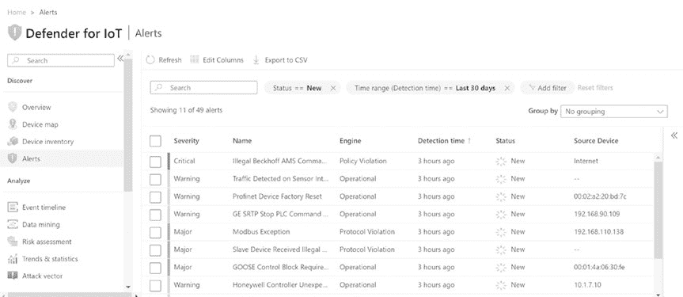

**图 2-2.** Microsoft Defender for IoT 传感器控制台上的警告示例页面

# 第 2 章：使用 Defender for IoT 为 IoT/OT 开发安全策略

## Defender for IoT 机器学习引擎

Defender for IoT 采用自学习、机器学习和分析引擎，消除了持续更新签名或定义规则的需求。这些引擎利用特定的 ICS 行为分析和数据科学来分析 OT 网络流量，识别：

*   异常
*   恶意软件
*   运营问题
*   协议违规
*   基准网络活动的偏离

Defender for IoT 传感器还包含五个分析检测引擎，根据实时和预录流量分析生成警告。

- **策略违规检测引擎**：利用机器学习对偏离基准的行为进行告警，例如未经授权使用特定函数代码、访问特定对象或设备配置发生更改。
- **协议违规检测引擎**：识别违反 ICS 协议规范的数据包结构和字段值的使用。
- **恶意软件检测引擎**：识别表明已知工业恶意软件存在的行为。
- **异常检测引擎**：检测异常的机器通信和行为。
- **运营事件检测引擎**：识别运营问题，例如间歇性连接，这可能意味着设备故障的早期迹象。

## 扩展对私有 OT 协议的支持

在物联网（IoT）和工业控制系统（ICS）领域，确保设备安全涉及适应各种协议，包括嵌入式协议以及私有、自定义或非标准协议。当 Defender for IoT 缺乏对您特定协议的原支持时，您可以利用 Horizon Open 开发环境（ODE）SDK。该工具包使您能够创建定制的分析器插件，用于解码与您的独特协议相关的网络流量。

通过开发这些自定义插件，您可以使网络得到有效的监控和保护。您还可以通过这些插件建立自定义告警，从而精确地识别特定的网络活动。例如，您可以配置告警，当传感器检测到某些操作（如向特定 IP 地址和以太网目的内存寄存器发送写入命令，或访问指定的 IP 地址）时触发告警。这些告警有助于增强您的安全态势，并促进安全、IT 和运营团队之间的无缝接接。

## 物联网安全解决方案设计框架

在设计物联网安全解决方案时，采用物联网安全框架至关重要。物联网具有互联的设备和海量的数据流，带来了复杂且多方面的安全挑战。以下是采用安全框架至关重要的五个关键原因：

### 主动威胁缓解

采用物联网安全框架使组织能够对新兴安全威胁采取主动立场。它促进了一种系统方法，从初始设计阶段就开始识别漏洞并实施稳健的安全措施。这种方法减少了网络攻击、数据泄露及相关后果的发生。

### 全面安全性

安全框架解决了物联网系统每个层面的安全问题，从设备身份验证到数据加密和访问控制。它确保安全性是系统架构不可或缺的一部分，从而留下更少的安全漏洞和缺陷。通过全面考虑安全性，组织可以保护其物联网设备、网络以及它们处理的敏感数据。

### 合规性

物联网部署通常涉及敏感数据，许多行业和地区已经制定了规范物联网网络安全的法规和标准。遵循安全框架有助于组织维持合规性，确保符合法律要求。这不仅保护了组织免受潜在的法律后果，还提升了它们作为敏感数据负责管理者的声誉。

### 风险管理与缓解

物联网设备经常部署在医疗保健、运输和工业流程等关键任务应用中。安全框架使组织能够有效识别、评估和管理风险。通过根据潜在危险优先考虑安全措施，组织可以更高效地分配资源并缓解安全泄露的影响，而这种影响在关键应用中可能是灾难性的。

### 持续改进

网络安全是一个不断演变的领域，新的威胁和漏洞定期涌现。安全框架通过定期评估和更新安全措施来鼓励持续改进。采用物联网安全框架不仅是一项最佳实践；在当今世界也是必须的。物联网设备和网络是网络攻击的首要目标，其漏洞可能会产生深远的影响。通过采用安全框架，组织可以固化其生态系统，保护敏感数据，满足监管要求并主动防御新兴威胁。

## 图 2-3：物联网安全框架

| | | |
| :--- | :--- | :--- |
| 1. 设备身份验证与授权 | 1. 安全更新与补丁管理 | 1. 设备生命周期管理 |
| 1. 安全启动与固件完整性 | 1. 数据加密 | 1. 物理安全 |
| 1. 网络安全 | 1. 访问控制 | 1. 通信协议安全性 |
| 1. 基于角色的访问控制 (RBAC) | 1. 安全审计与日志记录 | 1. 入侵检测与防御 |
| 1. 安全通信协议管理 | 1. 应急响应计划 | 1. 标准与合规性 |
| 1. 监管合规 | 1. 安全培训与意识 | 1. 供应链安全 |
| 1. 持续性监控 | 1. 第三方供应商评估 | 1. 事件响应 |
| 1. 隐私保护 | 1. 安全测试 | 1. 风险评估 |

*\*注：原文中部分项存在重复或嵌套，翻译已根据语境整合。*

## 物联网安全框架说明

### 设备身份验证与授权

- 实施强身份验证，确保只有授权的设备才能连接网络。
- 使用身份和访问管理（`IAM`）控制设备权限。

### 安全启动与固件完整性

- 启用安全启动过程，确保只有信任的固件可以在物联网设备上运行。
- 定期验证固件和软件更新的完整性。

### 数据加密

- 使用强大的加密算法对传输和存储的数据加密。
- 实现端到端加密，保护从设备到云端的数据。

### 网络安全

- 将物联网设备划分到隔离网络中，以限制攻击者的横移动。
- 使用防火墙、入侵检测系统（`IDS`）和入侵防御系统（`IPS`）监控并保护物联网网络流量。

### 安全更新与补丁管理

- 开发物联网设备交付安全更新和补丁的流程。
- 优先考虑关键安全更新，并确保具备空中下载（`OTA`）更新的能力。

### 物理安全

- 物理上保护物联网设备，防止篡改和未经授权的访问。
- 在必要时实施防改密封和外壳。

### 基于角色的访问控制 (RBAC)

- 实施 `RBAC` 控制并限制对物联网设备和系统的访问。
- 为用户和设备定义角色和权限。

### 安全通信协议

- 选择加密并验证的安全通信协议，例如用于网络流量的 `TLS`。
- 禁用不必要或不安全的协议。

### 设备生命周期管理

- 跟踪并管理 IoT 整个生命周期，包括配置、退役和处置。
- 确保退役的设备不会带来安全风险。

### 安全审计与日志

- 启用所有设备和网络活动的日志记录和审计。
- 分析日志以检测异常和潜在的安全事件。

### 侵入检测与防御

- 部署入侵检测系统（`IDS`）和入侵防御系统（`IPS`）以识别并缓解威胁。
- 使用异常检测和基于签名的方法。

### 安全标准与合规

- 遵循与 IoT 相关的行业安全标准和法规，例如《物联网网络安全改进法案》、NIST 指南和 GDPR。

### 应急响应计划

- 开发全面的应急响应计划以应对安全泄露和漏洞。
- 测试并定期更新该计划。

### 针对 IoT 的培训与意识

- 向员工和利益相关者普及 IoT 安全最佳实践。
- 营造安全意识文化。

### 供应链安全

- 验证用于 IoT 设备的组件和软件的安全性，因为漏洞可能会在供应链层面引入。

### 第三方供应商评估

- 评估 IoT 生态系统中第三方供应商和服务提供商的安全实践状况。
- 确保他们满足您的安全需求。

### 隐私保护

- 实施隐私保护措施来处理敏感数据，特别是符合数据保护法律。
- 使用匿名化和数据最小化技术。

### 持续安全监控

- 持续监控 IoT 设备和网络的安全性，应对新出现的威胁和漏洞。
- 实现自动化威胁情报馈送。

### 安全测试

- 定期进行安全评估、渗透测试和漏洞扫描。
- 及时处理已识别的漏洞。

### 监管遵循

- 确保您的 IoT 安全框架符合相关的行业法规和标准。
- 请记住 IoT 安全是一个持续的过程，随着新威胁和漏洞的出现，不断调整和改进安全措施至关重要。

## IoT 网络安全解决方案 IoT 设计原则

IoT 解决方案面临着保护多样化和异构设备负载的复杂任务，且通常直接交互极少。这一责任由 IoT 设备制造商、IoT 应用开发人员和 IoT 解决方案运营商共同承担，他们必须共同确保 IoT 解决方案整个生命周期的安全性。因此，从解决方案的设计初期就引入安全考量至关重要。理解潜在威胁是要任务，稳健的深度防御策略应该是解决方案架构不可或缺的一部分。

安全规划的基础在于创建威胁模型。该模型能够全面理解潜在攻击者如何破坏系统，反过来有助于从一开始就实施适当的防御措施。当威胁建模无缝集成到设计阶段时，其最大的价值才能得以实现。在这一过程中，可以将典型的 IoT 架构解构为不同的组件或区域，例如设备、设备网关、云网关和服务。每个区域都可以有独特的身份验证、授权和数据处理需求。这种区域划分方法有助于控制潜在损害，并减轻低信任区域对高信任区域的影响。

后续针对 IoT 工作负载的安全指导概述了关键的考量因素，并为设计和实现提供了建议。

IoT 工作负载设计方法足于架构卓越的五个支柱。这些支柱作为指导灯标，塑造了 IoT 设计关键领域的后续设计选择。随后的设计原则扩展了 `Azure Well-Architected Framework`（Azure 良好架构框架）中的质量柱，重点关注安全性。

建立安全设计原则对于确保您的 IoT 工作负载在 IoT 架构的基础层级满足规定标准起着关键作用。

我们必须承认，所有这些架构层都受到各种威胁的影响，这些威胁可以根据 `STRIDE` 类别进行系统分类：欺骗、篡改、否认、信息泄露、拒绝服务和权限提升。作为最佳实践，在着手 IoT 架构的设计和构建时，遵循 `Microsoft 安全开发生命周期` (`SDL`) 是至关重要的。图 `2-4` 展示了物联网网络安全解决方案——设计原则。


## IoT 网络安全解决方案 应急响应计划身份安全设备健康状态设备更新系统以及响应监控 IoT 安全设计原则

**图 2-4.** 物联网 – 设计原则

### 设计原则：强身份

**考量因素**：采用稳健的身份框架来验证设备和用户。建立硬件信任根以作为安全的身份基础，注册设备，颁发可更新凭据，并实施如无密码或多因素认证等高级身份验证方法。审查更广泛的 Azure 身份访问管理是必要的。

#### IoT 设备能力的无缝集成

IoT 设备与服务的协作集成对于建立稳健的设备身份至关重要。这种集成包含几个核心组件：

- **硬件信任根**：安全身份的基础，由具有安全凭据存储传输的防篡改硬件组成，用于验证设备身份。
- **强身份验证**：利用证书、多因素认证（`MFA`）或无密码认证来确保稳健且经过验证的用户和设备访问。
- **可更新凭据**：为设备的定期访问提供唯一的、可更新的操作凭据，随时间推移增强安全性。
- **组织级 IoT 设备注册**：维护一个中心化的注册表，跟踪 IoT 设备及其属性和安全相关信息。

硬件信任根具有以下属性：

- **安全凭据存储**：通过专用的防篡改硬件保护身份。
- **不可更改的入网身份**：与设备物理特征绑定的永久、不可更改的身份，通常在制造期间建立。
- **每个设备的可更新操作凭据**：用于持续访问设备的唯一且可更新凭据。

一旦完成入网过程，在 IoT 应用内部配置并使用可更新的操作身份和凭据进行身份验证和授权是关键的。这种可更新的身份允许灵活的访问管理，并在更新期间执行设备完整性和健康证明等策略。

硬件信任根对于确保设备符合安全规范并遵守必要的标准也起着关键作用。保护供应链中的硬件信任根和其他设备组件对于防止可能损害设备完整性的潜在攻击至关重要。

无密码认证通常涉及使用标准的 x509 证书来验证设备身份，比涉及密码和共享对称令牌的传统方法提供了更强的保护。高效管理证书涉及以下内容：

- 从受信任的公钥基础设施（`PKI`）颁发运行证书
- 建立符合业务需求、管理效率和成本考虑的更新时间范围
- 自动化更新过程，以最大限度地减少对访问的潜在干扰
- 实施现代密码学技术，例如证书签名请求（`CSR`），而不是传输私钥
- 根据设备的运行身份授予设备访问权限，并通过证书吊销列表（`CRL`）等机制支持凭证吊销，以便在发生泄露或盗窃时迅速撤销访问

对于只能部分实现强身份和验证实践的遗留或资源受限的 IoT 设备，使用 IoT 网关作为中介是一种可行的解决方案。这些网关在本地与能力较弱的设备接口，使其能够在遵循强身份模式的同时访问 IoT 服务，最终促进零信任方法的采用。

在虚拟机（`VMs`）、容器或服务集成了 IoT 客户端但缺乏硬件信任根支持的情况下，可以利用诸如无密码认证和可更新凭证等可用功能。采用深层防御策略通过在可行的情况下增加冗余来帮助解决安全漏洞。例如，与部署在现场的 IoT 设备相比，`VMs` 和容器可以位于数据中心等物理安全的环境中。

使用中心化的组织级 IoT 设备注册表对于管理组织内 IoT 设备的整个生命周期起着至关重要的作用。这种方法符合零信任安全原则，类似于保护员工的用户身份。基于云的身份注册表为全面的 IoT 解决方案提供了所需的扩展性、管理和安全性。

IoT 设备注册表数据有多种用途，包括：

- **库存管理**：查看并维护组织的 IoT 设备清单，跟踪其健康状况、补丁状态和安全状况。
- **运行效率**：查询和分组设备以促进规模化操作、管理、工作负载部署和访问控制。
- **未管理设备感知**：利用网络传感器检测并清点未连接到 `Azure IoT services` 的未管理 IoT 设备，增强感知和监控能力。

### 设计原则：最小权限

**考虑因素**：实施自动化系统，在访问控制中执行最小权限原则。这种方法可以最大限度地减少受损设备、身份或未经批准的工作负载产生的影响。

#### 为 IoT 安全实现最小权限访问控制

最小权限访问控制是缓解身份验证身份受损或运行未经授权的工作负载的潜在后果的关键措施。在 IoT 场景中，采用以下策略向操作员、设备和工作负载授予访问：

- **设备和工作负载访问控制**：仅为设备上的特定、范围限制的工作负载提供访问。
- **即时访问（Just-in-Time Access）**：在需要时精确授予访问。
- **强身份验证方法**：利用多因素认证（`MFA`）和无密码认证等强身份验证机制。
- **条件访问**：根据设备的上下文应用访问条件，包括 IP 地址、GPS 位置、系统配置、唯一性、时间段或网络流量模式。服务还可以使用设备上下文进行条件工作负载部署。

要实施有效的最小权限访问：

- **配置 IoT 云网关访问管理**：根据后端的功能需求定制访问权限，确保访问仅限于必要的功能。
- **最小化访问点**：通过对端口执行严格的访问控制，减少访问 IoT 设备和云应用程序的访问点。
- **防篡改与检测**：开发震慑和检测设备物理篡改的机制。
- **用户访问管理**：通过适当的访问控制模型（如基于角色或基于属性的访问控制）管理用户访问，以确保维护最小权限原则。
- **网络分段**：应用网络分段对 IoT 设备实施分层最小权限，通过受控隔离增强安全性。

网络的设计和配置为建立全面的防御策略提供了价值机会，可以根据 IoT 设备流量模式及其对风险的敏感性进行分段。这种分段策略限制了受损设备的潜在影响以及攻击者向高价值资产渗透的努力。通常，下一代防火墙是网络分段的核心。

网络微分段通过在网络层面隔离能力较弱的设备进一步深入，将其放置在网关之后或放在专用网络分段中。通过网络分段巧妙地对 IoT 设备分组并辅以终端保护，可以固化针对潜在泄露的防御。

建立整体防火墙规则策略至关重要，在需要时为设备授予网络访问，并在未授权时及时阻止访问。对于寻求通过深层防御方法提升安全级别的组织，考虑在普鲁杜模型（Purdue model）的各个层级实施微分段策略。此外，必要时在设备上引入防火墙以实施严格的网络访问控制。

通过采用这些实践，您的 IoT 生态系统获得了多层防御机制，大大增强了其对潜在威胁的韧性。通过遵循这些实践，IoT 环境可以在保持强大安全态势的同时，减少与访问控制相关的风险。

### 设计原则：设备健康

**考虑因素**：将设备健康评估作为设备访问的门禁。这涉及评估安全配置、识别漏洞、处理不安全的密码、监控潜在威胁和异常情况，并构建持续的风险画像。

#### 在零信任范式中优先考虑设备健康

在零信任框架内，设备健康成为确定其风险状况和可信度的关键决定因素。该风险状况反过来充当访问网关，确保只有健康状况良好的设备才能连接 IoT 应用程序和服务。同时，它可以帮助标记健康状况存疑的设备以便修复。

根据行业标准，设备健康评估应包含以下元素：

- **安全配置评估与证明**：验证设备保持安全配置。
- **漏洞评估**：识别潜在漏洞，包括设备内部过时的软件或已知的安全弱点。
- **不安全凭证评估**：评估设备凭证（包括证书），并对 `Transport Layer Security (TLS) 1.2` 及以上协议进行评估。
- **活跃威胁检测与告警**：对新出现的威胁进行持续监控并及时告警。
- **异常行为检测**：涵盖对网络模式和使用偏离的告警，这些偏差可能表明存在可疑或非预期的设备行为。

通过将这些健康评估标准集成到您的零信任方法中，您构建了一个稳健的安全框架，保护您的 IoT 生态系统免受受损或可疑设备的侵害。

### 设计原则：设备更新

**考虑因素**：采用持续更新策略以维护设备健康。实施集中化的配置和合规管理解决方案以及稳健的更新机制，以确保设备保持更新和健康。

为了根据健康状态调节设备访问，必须采取主动措施以确保生产设备始终保持功能正常且健康。为了实现这一目标，更新机制应具备以下属性：

- **远程部署能力**：远程部署设备更新的能力，能够快速高效地分发必要的改进


- 对环境变化的韧性：对环境变化、运行条件转变以及身份验证机制变更具有韧性，包括由于证书过期或撤销导致的证书变更等场景
- 支持更新发布验证：在更新发布期间支持验证过程的能力，确保其有效性和完整性
- 与安全监控集成：与全面的安全监控系统无缝集成，便于进行计划更新以增强安全措施

建议具备灵活性，以推迟干扰核心业务运营的更新。尽管如此，这些更新应在检测到漏洞后的预定义时间范围内完成。未打补丁的设备应被标记为不健康，强调了需要立即关注。

## 设计原则：监控系统安全并规划事件响应

考虑因素：通过持续监控未经授权或受损的设备对系统安全采取主动立场。准备好对新出现的威胁做出快速响应，确保 IoT 生态系统的整体安全。

IoT 解决方案必须能够对其所有连接的设备进行全面、大规模的监控和修复。作为深度防御策略的一部分，监控为管理良好的新部署设备提供了额外的保护层，同时也作为现有基础设施中缺乏代理支持且无法远程补丁或配置的旧、未管理设备的补偿控制。

在此背景下，决策过程应涉及以下内容：

- 建立特定的日志级别
- 确定值得监控的活动类型
- 为生成的告警定义适当的响应

日志必须安全地存储，且不包含敏感的安全机密细节。

遵循网络安全和基础设施安全局（CISA）提供的指南，稳健的安全监控计划应涵盖以下内容：

- 资产和网络发现：创建涵盖所有 IoT 和 OT 设备的最新资产清单和网络地图
- 协议识别：识别并记录跨 IoT 和 OT 网络使用的所有通信协议
- 外部连接文档：编目录所有进出这些网络的外部连接
- 漏洞评估：识别 IoT 和 OT 设备中的漏洞，并采用基于风险的方法来缓解这些漏洞
- 异常检测：实施具有异常检测能力的警觉监控，以识别恶意活动，包括 IoT 系统内部“离地攻击”（living off the land）等战术

许多 IoT 攻击遵循杀伤链模式，攻击者在其中建立立足点、提升权限并在网络中横向移动。

攻击者经常利用特权凭据绕过障碍，例如执行子网间网络分段的下一代防火墙。快速检测并响应这些多阶段攻击，需要一个涵盖 IT、IoT 和 OT 网络的统一视图，并由自动化、机器学习和威胁情报的支持。

从整个生态系统（涵盖用户、设备、应用程序和基础设施，无论是在本地还是在各种云环境中）收集数据至关重要。

在集中的安全信息和事件管理 (`SIEM`) 和扩展检测和响应 (`XDR`) 平台内分析这些数据，使安全运营中心 (`SOC`) 分析师能够寻找并发现此前未知的威胁。

最后，安全编排、自动化和响应 (`SOAR`) 平台可以对事件做出快速响应，并在严重影响组织之前缓解攻击。可以定义剧本（Playbooks），在检测到特定事件时触发自动响应，包括阻止或隔离受损设备等操作，防止其感染其他系统。

## 设计原则：威胁建模

在 IoT（物联网）和 OT（运营技术）安全设计原则中，设计威胁模型非常重要，原因如下：

- 复杂且互联的系统：IoT 和 OT 环境的特点是复杂的、互联的系统，涉及各种设备、传感器、网络和数据流。威胁建模有助于全面理解这些复杂性及其相关风险，从而采取有效的安全措施。
- 风险识别：威胁建模能够主动识别 IoT 和 OT 生态系统中的潜在安全风险和漏洞。通过预测这些风险，可以设计安全措施来缓解它们，减少安全违规的概率及其相关后果。
- 定制安全措施：由于资源受限的设备、旧设备和特定的通信协议，IoT 和 OT 系统通常具有独特的安全需求。威胁建模有助于定制安全解决方案以应对这些独特挑战，确保更有效、更高效的安全态。
- 数据保护：IoT 和 OT 系统通常处理敏感数据，维护这些数据的隐私和完整性至关重要。威胁建模有助于识别潜在的数据暴露或操纵点，从而实现稳健的数据保护机制。
- 合规与监管：许多行业对 IoT 和 OT 安全有严格的监管要求。威胁建模有助于识别合规缺口，并确保安全措施符合这些法规。
- 成本效益安全：威胁建模支持以成本效益的方式分配安全资源。通过识别最关键的威胁和漏洞，组织可以在最需要的地方优先考虑安全投资。
- 安全意识：创建威胁模型可以培养安全意识，并对组织内部的潜在风险有更深入的理解。这种增强的意识可以带来安全意识文化，并在各个层面做出更好的决策。
- 自适应安全：威胁建模不是一次性活动，而是一个适应不断演变的威胁和系统变化的迭代过程。它确保了尽管出现新的漏洞和攻击技术，安全依然有效。

# 第二章 使用 Defender for IoT 为 IoT/OT 开发安全策略

总结之，威胁建模是 IoT 和 OT 安全设计原则的核心组成部分，它使组织能够理解、评估并主动应对复杂动态环境中的安全风险和漏洞。

`STRIDE` 模型被用于计算机安全和威胁建模，以分类和分析与软件系统及应用程序相关的潜在威胁和漏洞。`STRIDE` 是一个缩写，代表六种不同类型的威胁：

- **伪造（Spoofing）**：这种威胁涉及攻击者采用虚假身份以获得对系统或资源的未授权访问。它可能包括冒充合法的用户、设备或组件。
- **篡改（Tampering）**：篡改威胁涉及对数据、软件或硬件组件进行未经授权的更改或修改。攻击者可能会篡改数据完整性、软件代码或系统配置。
- **否认（Repudiation）**：否认威胁涉及实体（用户、设备等）否认其执行了特定操作或交易的能力。这些威胁（例如维护可靠的审计跟踪）对于不可否认性需求尤为重要。
- **信息泄露（Information Disclosure）**：这种威胁涵盖敏感信息的未经授权暴露。它可能通过数据泄露、窃听或其他手段发生，导致机密或个人数据的泄露。
- **拒绝服务（Denial of Service, DoS）**：拒绝服务威胁旨在中断或降低系统的可用性和功能性。攻击者通常用过量的流量或请求泛洪目标系统，导致其无法访问或使用。
- **权限提升（Elevation of Privilege）**：权限威胁涉及攻击者获得对更高系统权限或权利的未授权访问。这允许他们执行某些操作或访问通常受限的资源。

安全专业人员和软件开发人员将 `STRIDE` 模型作为工具，在软件设计和开发过程中识别并分析潜在的威胁和漏洞。通过考虑这些类别的威胁，他们可以主动实施安全控制和保护措施来防止此类风险，确保软件和系统更具韧性和安全性。

## 威胁模型的核心要素

威胁模型的核心要素关注于进程、通信和存储。

### 进程（Processes）

进程威胁根据 `STRIDE` 模型分类如下：

- **伪造（Spoofing）**：在这一威胁场景中，攻击者通过利用软件或硬件漏洞获取加密密钥，并使用这些密钥从不同的物理或虚拟设备冒充原始设备。
- **拒绝服务（Denial of Service）**：这种威胁涉及通过干扰无线电频率或物理篡改设备，使设备失效或中断其通信。例如，监控摄像头由于断电或失去网络连接将无法传输任何数据。
- **篡改（Tampering）**：篡改涵盖多种攻击向量。攻击者可能会完全或部分替换设备的软件，可能危及其加密密钥并允许未授权的访问。篡改还涉及操纵设备以提供虚假或经过操纵的信息，即使设备在技术上是安全的。
- **信息泄露（Information Disclosure）**：运行受操纵软件的设备可能会无意中向未经方泄露数据。此外，拥有加密密钥的攻击者可以在设备与网关之间的通信路径中注入代码，从而拦截敏感信息。
- **权限提升（Elevation of Privilege）**：在这种场景中，攻击者操纵最初设计用于特定功能的设备来执行另一个非预期的操作。例如，欺骗一个被程序设定为打开一半的阀门使其完全打开。
- **否认（Repudiation）**：对于通常保护不足的消费者遥控器，攻击者可以匿名操纵设备状态，导致潜在的伪造、篡改和否认威胁。

### 通信（Communication）

通信威胁根据 `STRIDE` 模型分类如下：

- **拒绝服务（Denial of Service）**：受限设备在网络上主动监听入站连接或未经请求的数据报文时，特别受到 `DoS` 威胁的影响。攻击者可以并行开启大量链接，要么不提供服务，要么处理缓慢，或者用未经请求的流量泛洪设备。在这两种情况下，该设备在网络上都可能被有效瘫痪。
- **信息泄露（Information Disclosure）**：受限和专用设备通常依赖于密码或 PIN 码等简单安全措施。有时，它们完全信任网络并允许同一网络上的任何设备访问。如果攻击者获取了加密密钥，就可以在设备与网关之间拦截敏感信息。
- **伪造（Spoofing）**：攻击者可能拦截或部分覆盖广播信号并冒充合法源。
- **篡改（Tampering）**：攻击者可能拦截或部分覆盖广播信号并传输虚假信息。
- **信息泄露（Information Disclosure）**：攻击者可能在未经授权的情况下窃听通信并获取信息。
- **拒绝服务（Denial of Service）**：在这一威胁场景中，攻击者可能阻塞广播信号，阻止信息的发布。

### 存储（Storage）

存储威胁根据 `STRIDE` 模型分类如下：

- 存储：对于存储，实施加密和日志签名有助于降低与读取数据、篡改遥测数据或更改缓存控制数据相关的风险。额外的保护措施包括使用消息认证码（`MAC`）、数字签名以及资源访问控制列表（`ACL`）或权限等强访问控制措施。
- 存储：对于设备操作系统镜像，主要关注的是篡改或替换操作系统组件。建议通过只读分区、签名操作系统镜像和加密来解决此问题。
- 存储：字段网关存储，特别是数据队列，存储加密和日志签名可以防止未经授权的数据访问和篡改。篡改缓存或队列的控制数据以及配置或固件更新包会导致操作系统和系统组件受损。实施 `BitLocker` 是一个有效的解决方案。
- 存储：对于字段网关操作系统镜像，重点是防止篡改或替换操作系统组件。这通过只读分区、签名操作系统镜像和加密来实现。

## 设计原则：零信任安全范式

未经授权入侵 IoT 系统可能导致严重后果，包括大规模信息泄露（如工厂生产记录泄露）或未经授权的权限提升，可能允许控制物理系统，导致工厂生产线停产。采用零信任安全模型对于减少用户获取未经授权访问云或本地 IoT 服务及其相关数据的潜在影响至关重要。

零信任方法不再假设公司防火墙内部的一切都是本质安全的，而是要求在授予权限之前，对每个访问请求进行严格的验证、授权和加密。

为了符合零信任原则，IoT 设备应具备以下关键属性：

- **硬件信任根**：为了建立稳健且不可侵犯的设备身份，每台设备都必须包含硬件信任根。
- **可更新的凭证**：在常规设备操作和访问中使用可更新的凭证，以确保持续的安全性。
- **最小权限访问控制**：执行严格的最小权限访问控制措施，限制对摄像头、存储器和传感器等设备本地资源的的访问。
- **设备健康信号**：设备应发布与其自身健康状况相关的准确且实时的信号，以便根据其状态执行条件访问。
- **持续的软件更新**：在设备的整个使用寿命内提供更新代理程序及相应的软件更新，以能够应用关键的安全补丁。
- **设备管理能力**：包含设备管理能力，允许云端驱动的设备配置和自动化安全响应。
- **安全代理**：运行安全代理，并与安全监控、检测和响应系统无缝集成。
- **最小化攻击面**：通过关闭不必要的功能（如 `USB` 或 `UART` 端口以及 `Wi-Fi` 或 `蓝牙` 连接）来最小化设备的物理攻击足迹。需要时利用物理移除、覆盖或屏蔽手段。
- **数据保护**：使用标准的静态数据加密算法来对存储在设备上的数据进行保护。

Microsoft Azure 提供了多种产品和服务，以增强 IoT 设备安全：

- **Azure Sphere Guardian 模块**：这些模块促进了关键遗留设备连接到 IoT 服务，同时采用零信任措施，包括稳健的身份验证、端到端加密和定期安全更新。
- **Azure IoT Edge**：它提供了连接到 `IoT Hub` 以及其他 Azure 服务的边缘运行时，支持使用证书实现强设备身份。`IoT Edge` 同样兼容 `PKCS#11` 标准，用于设备制造身份以及存储在 `信任平台模块 (TPM)` 或 `硬件安全模块 (HSM)` 中的密钥。
- **Azure IoT Hub SDKs**：这套全面的设备客户端库和工具集成了加密和身份验证等多种安全功能，有助于开发具有具韧性且安全的设备应用程序。
- **Azure RTOS**：设计为实时操作系统，提供了一系列 `C` 语言库，适用于各种不同的嵌入式 IoT 设备平台。`Azure RTOS` 包含完整的 `TCP/IP` 栈，支持 `TLS 1.2` 和 `1.3` 以及基础的 `X.509` 能力。它与 `Azure IoT Hub`、`Azure 设备置备服务 (DPS)` 和 `Microsoft Defender` 无缝集成，通过 `X.509` 双向认证和现代 `TLS` 密码套（如 `ECDHE` 和 `AES-GCM`）等功能确保安全的网络通信。`Azure RTOS` 还为具有 `Arm TrustZone` 等硬件安全能力的微控制器平台提供了零信任设计，并兼容如法意半导体公司的 `STSAFE-A110` 等安全元件设备。
- **Azure 认证设备计划**：该计划简化了设备合作伙伴对 IoT 设备的区分和推广。它帮助解决方案构建者和客户识别配备零信任兼容功能的设备。
- **边缘安全核心计划（预览版）**：旨在验证设备是否符合关于设备身份、安全启动、操作系统加固、设备更新、数据保护和漏洞披露的安全性要求。这些要求提炼自各种行业标准和安全工程视角。

边缘安全核心计划使 `Azure Attestation Service` 等 Azure 服务能够根据设备健康状况做出条件决策，从而实现零信任模型。寻求认证的设备必须包含硬件信任根、安全启动和固件保护属性，这些属性可以被归属服务进行测量，并用于对下游的敏感资源进行条件访问。

### IoT 服务的零信任先决条件

在考虑 IoT 服务时，应优先考虑那些包含以下核心零信任能力的服务：

- **稳健的用户访问控制**：确保 IoT 服务能够为零信任用户访问控制提供全面支持。这包括强用户身份、多因素认证 (`MFA`) 以及条件用户访问的建立。
- **与用户访问控制系统集成**：寻求访问控制系统的集成能力，以实现最小权限访问和条件控制。
- **中央设备注册表**：使用中央设备注册表提供全面的清单和高效的设备管理。
- **双向认证**：强调双向认证，这涉及提供可更新的设备凭证结合稳健的身份验证机制。
- **最小权限设备访问控制**：实施最小权限设备访问控制并采用条件访问策略。这确保只有符合特定标准（如健康状态或已知位置）的设备才能建立连接。
- **空中下载 (OTA) 更新**：启用 `OTA` 更新，通过确保设备保持最新状态来维护设备的健康和安全。
- **安全监控**：为 IoT 服务和连接的 IoT 设备提供持续的安全监控，增强威胁检测和响应能力。
- **全面的终端安全**：将监控和访问控制扩展到所有公共端点，对于与这些端点的任何交互实施严格的身份验证和授权机制。

### 设计原则：Microsoft Defender for IoT 的设计

Microsoft Defender for IoT 是一种专为保护 IoT 和 OT 设备及网络定制的全面安全解决方案。值得注意的是，它采用了无代理的设备监控方法，无需在设备上安装额外的安全代理即可确保保护。利用机器学习、威胁情报和行为分析等先进技术，`Defender for IoT` 在检测 IoT 和 OT 设备、漏洞和潜在威胁方面表现出色，同时提供全网络的可可见性和安全性。该解决方案与云端、本地和混合 OT 网络无缝集成，并可以自定义通过 `Horizon Open Development Environment (ODE) SDK` 与专有 OT 协议进行交互。此外，它还可以通过 `Microsoft Defender for Endpoint` 或企业 IoT 网络传感器为企业 IoT 设备提供扩展可能性。通过 Azure 门户内统一且用户友好的界面，安全和 OT 监控团队可以获得从中心视角监控和加强所有 IT、IoT 和 OT 设备安全的能力。

因此，这种知识差距可能导致对 OT 事件及其对业务运营潜在影响的理解有限。

- **沟通与流程孤岛**：OT 实体与 SOC 实体之间低效的沟通和脱节的流程可能会阻碍响应威胁时信息的顺畅流动和协调工作。
- **技术与工具局限**：缺乏专为 OT 网络安全定制的先进技术和工具（包括可见性和自动化修复能力），这构成了巨大的障碍。

将此类工具与现有的 SOC 解决方案集成也是一项成本高昂的任务。

然而，缺乏足够的 OT 遥测数据、上下文信息以及与现有 SOC 工具和工作流的无缝集成，可能会导致对 OT 安全和运营威胁的处理不当，可能使这些威胁未被发现或未能妥善处理。在这一不断变化的格局中，必须解决这些挑战，以确保 OT 网络安全的稳健性和运行完整性。

## 应当集成 Microsoft Sentinel 和 Defender for IoT

通过利用 `Microsoft Defender for IoT` 与 `Microsoft Sentinel` 之间的集成，SOC 团队可以访问一个为安全信息和事件管理 (`SIEM`) 以及安全编排、自动化和响应 (`SOAR`) 设计的可扩展云服务。这种集成赋予了 SOC 团队从不同网络中无缝收集数据、检测、调查并主动响应安全威胁和事件的能力。

在 `Microsoft Sentinel` 平台内，`Defender for IoT` 数据连接器和解决方案提供了现成的安全内容，为 SOC 团队提供了一个全面的工具箱，用于查看、分析和处理针对运营技术 (OT) 的安全警报。这包括在更广泛的组织威胁格局背景下，对生成的事件有更深入的理解。

要利用这种集成，首先要安装 `Defender for IoT` 数据连接器，将 OT 网络警报直接流向 `Microsoft Sentinel`。此外，部署 `Microsoft Defender for IoT` 解决方案通过引入 IoT/OT 专用的分析规则、预配置的工作簿（workbooks）以及安全编排、自动化和响应 (`SOAR`) 剧本带来了额外价值。这些资源还通过与 `MITRE ATT&CK` 工业控制系统 (`ICS`) 技术对齐的事件映射得到了补充。这种集成方法增强了 SOC 团队的能力，有助于在面对不断变化的威胁时建立更稳健、响应更快的安全态势。

## 简化 IoT/OT 的检测与响应


# 利用 Defender for IoT 与 Microsoft Sentinel 协作实现快速威胁检测与响应

利用 `Defender for IoT` 的 OT 团队与利用 `Microsoft Sentinel` 的 SOC 团队之间的协作方法，能够在整个攻击时间线上实现快速威胁检测和响应。

在这一集成过程中：

1. **触发 OT 警报**：由 `Defender for IoT` 第 52 安全研究小组驱动的高置信度 OT 警报，根据摄入 `Defender for IoT` 的数据启动。
   - **创建 OT 事件**：自动触发分析规则，打开相关事件并避免 OT 环境中产生警报疲劳。

2. **SOC 团队映射业务影响**：SOC 团队评估业务影响，包括有关受影响站点、生产线、受损资产和 OT 所有者的数据。
   - **OT 事件业务影响映射**：同时，这些信息被用于在 OT 事件上下文中映射业务影响。

3. **SOC 团队进行调查**：SOC 团队将事件升级为 `Active` 状态，启动调查。他们利用网络连接、事件数据、工作簿和 OT 设备实体页面。
   - **OT 事件调查**：相应地，警报被升级为 `Active` 状态，提示 OT 团队使用 `PCAP` 数据、详细报告和设备特定细节进行调查。

4. **SOC 团队进行响应**：SOC 团队采用 OT 剧本和笔记本响应事件，根据安全最佳实践采取适当行动。
   - **OT 事件响应**：同样，OT 团队根据调查结果采取行动，要么抑制警报，要么为未来的事件获取见解。

5. **关闭事件**：在成功缓解威胁后，SOC 团队结束其事件，将其标记为 `closed`。
   - **OT 事件关闭**：与此同时，OT 团队在有效处理威胁后解决警报。

## 警报状态同步

需要注意的是，警报状态的变化仅从 `Microsoft Sentinel` 同步到 `Defender for IoT`，反之否则。为了确保方法一致性，在将 `Defender for IoT` 与 `Microsoft Sentinel` 集成时，建议在 `Microsoft Sentinel` 中结合关联事件管理警报状态。这种同步确保了 `Defender for IoT` 中的警报级别与 `Microsoft Sentinel` 中的整体事件管理保持一致，从而增强威胁响应和解决。

## Microsoft Defender for IoT 的设计元素

在本节中，让我们从了解 `Microsoft Defender for IoT` 的关键设计元素开始。

物联网 (`IoT`) 开启了一个数以十亿连接设备的时代，横跨运营技术 (OT) 网络。这些网络通常依赖于专用协议，并且可能关注运营功能而非安全性。这带来了挑战，因为传统的安全系统可能需要配备以保护这些 IoT/OT 设备。因此，每一波新的技术浪潮都扩大了这些网络的潜在风险和漏洞。

`Microsoft Defender for IoT` 通过提供被动、无代理监控提供了一种确保网络安全的专用方法。该解决方案专门为发现和保护 IoT 和 OT 设备设计。与传统的基于签名的安全措施不同，`Defender for IoT` 采用了针对 IoT 和 OT 环境定制的性分析和威胁情报。这使其能够检测出可能被忽略的复杂威胁，例如零日恶意软件或隐蔽的“离地攻击”（living-off-the-land）策略。

该系统通过自动识别网络中的未管理设备、连接和关键漏洞，成为 OT 和 IT 团队的宝贵资产。这允许 `Defender for IoT` 在不影响您的 IoT 和 OT 系统稳定性或性能的情况下，标记异常或未经授权的活动。总体而言，`Defender for IoT` 为互联环境的独特挑战提供了定制的高级安全水平。

为了解决这些安全漏洞，`Microsoft Defender for IoT` 提供了一套定制解决方案，专门用于识别和保护 IoT 和 OT 设备，并检测漏洞和威胁。它是您整个 IoT/OT 格局的全面安全层，对于缺乏内置安全功能的设备也是如此。`Defender for IoT` 的独特之处在于其网络层的无代理监控方法，允许与工业设备和安全运营中心 (`SOC`) 工具无缝集成。

`Microsoft Defender for IoT` 设计用于从各种源拉取数据以密切监控您的网络。将其想象一个中心枢纽，来自网络传感器和其他第三方工具的信息在此汇聚，为您提供 IoT 和运营技术 (OT) 安全的全景。

# 第 2 章 使用 Defender for IoT 为 IoT/OT 开发安全策略

您可以通过 `Azure portal` 访问 Defender for IoT，在其中您可以找到设备清单、安全弱点检查以及对潜在威胁的持续监控等功能。该系统支持云端和本地（现地）部署，并旨在处理分布在不同位置的大型网络。

以下是其主要部分的简要介绍：

*   **Azure Portal**：这是您的云端仪表板，您可以在此处管理一切，并连接到 `Microsoft Sentinel` 等其他微软服务。

*   **网络传感器 (Network Sensors)**：这些传感器扫描您的运营技术 (OT) 或更广泛的企业级 IoT 网络以识别设备。您可以将这些传感器安装在虚拟机或物理机上。此外，您还可以选择这些传感器是将数据发送到云端还是仅在本地运行。

*   **本地管理控制台 (Local Management Console)**：对于未连接互联网的网络（称为物理隔离环境），现场管理控制台允许您监控 OT 传感器。

因此，无论您是小规模部署还是庞大的全球网络，Microsoft Defender for IoT 都能适应您的安全需求。

## 适用于 OT 和企业 IoT 网络的传感器

Microsoft Defender for IoT 网络传感器对于监控和保护运营技术 (OT) 以及企业级 IoT 网络至关重要。这些传感器专门为此类类型的网络设计，可以轻松连接到 `SPAN port` 或网络 `TAP`。值得注意的是，它们在连接后几分钟内即可开始提供对潜在风险的洞察。这些传感器利用感知 OT/IoT 细微差别和第 6 层深度包检测 (`DPI`) 的高级分析引擎，可以根据网络上异常或未经授权的活动识别包括无文件恶意软件在内的多种威胁。

这些传感器的独特之处在于它们具备设备端数据处理能力。

从数据采集、分析到威胁告警的所有过程都直接在传感器上进行。这一特性对于带宽有限或存在高延迟问题的环境特别有益，因为只有关键的遥测数据和洞察会被转发用于进一步管理。这些总结后的结果可以根据您的设置和需求，发送到云端 `Azure portal` 或本地管理控制台。

## 云连接传感器 vs. 本地部署传感器

Defender for IoT 系统中的云连接传感器和本地管理传感器具有相似的，但在功能和管理方法上有所不同。

通过无代理设备监控，如果您的 IoT 和 OT 设备缺乏内置安全功能，它们可能会变得易受威胁，且往往被 IT 和安全团队忽略。这些未受保护的设备可能成为攻击者渗透企业网络的易切入点。Microsoft Defender for IoT 用其无代理监控系统填补了这一空白，为您的整个网络提供了全面的可见性和安全性。它从网络传感器、`Microsoft Defender for Endpoint` 以及各种第三方源提取数据，识别特定的协议、设备和机器机器 (`M2M`) 行为。

通过 Defender for IoT，您可以结合机器学习、威胁情报和行为分析来评估风险并管理漏洞。例如，系统可以识别未更新的设备、检测开放端口、标记未经授权的应用程序和连接，甚至检测到设备配置、`PLC code` 和固件的更改。它允许您跨维度和协议搜索历史流量数据，并提供全保真数据捕获 (`PCAP`) 以进行深层调查。

此外，Defender for IoT 擅长检测可能规避传统入侵指标 (`IOCs`) 的复杂威胁，例如零日攻击和无文件恶意软件。

它通过与 `Microsoft Sentinel` 等其他微软服务无缝集成，以及与第三方安全信息和事件管理 (`SIEM`)、安全编排、自动化和响应 (`SOAR`) 和扩展检测与响应 (`XDR`) 服务集成，增强了您的响应能力。

`Azure portal` 的集中用户界面允许安全和 OT 监控团队视化并保护所有的 IT、IoT 和 OT 设备，无论其物理位置如何。这使得 Defender for IoT 成为管理当今互联环境安全挑战的强大且解决方案。

当您使用云连接 OT 网络传感器时，它采集的所有数据都会显示在传感器控制台中。然而，告警也会发送到 `Azure` 以进行进一步分析并与其他 Azure 服务集成。云连接传感器的另一个优势是它们会自动接收微软的威胁情报更新。

此外，您在初始设置期间为传感器指定的名称将显示在传感器控制台中，且该名称是只读的，这意味着您无法从控制台本身更改它。

另一方面，本地管理传感器提供了更具操作性的方法。所有传感器数据都可以直接从传感器控制台中查看。如果您想查看多个传感器的汇总数据，必须使用本地管理控制台。与云连接传感器不同，您必须手动向这些本地管理单元上传威胁情报包。此外，您可以直接从传感器控制台中更改传感器名称。

总结来说，云连接传感器提供了与 `Azure` 的无缝集成和自动更新，而本地管理传感器提供了更多的控制，并更适用于需要人工监督的环境。

## 微软提供的 IoT 分析引擎

Defender for IoT 采用了一系列复杂的分析引擎来审查从网络传感器摄取的数据。这些引擎根据实时和预录的网络流量生成告警。它们结合了机器学习、分析分析、风险评估、全面的设备数据库、威胁情报和行为分析，形成了一个稳健的安全框架。

一个显著特性是策略违规检测引擎，它特别擅长建模工业控制系统 (`ICS`) 网络。该引擎使用 `NISTIR8219` 中指定的行为异常检测 (`BAD`) 来识别偏离基准的行为。这些基准是通过理解常规网络活动（如标准流量模式和用户操作）创建的。任何偏离此基准的情况（例如未经授权的代码功能或设备配置的更改）都会标记为策略违规。

Defender for IoT 的主要分析引擎包括：

*   **协议违规检测引擎**：该引擎识别包结构和字段值偏离 ICS 协议规范的任何情况。例如，如果主设备向从设备发送错误的请求，可能会触发`非法 MODBUS 操作` 告警。

*   **策略违规引擎**：标记偏离学习或手动配置的基准的行为。告警示例可能是`未经授权的 HTTP User Agent`，表示设备上使用了未经批准的 浏览器或应用程序。

*   **工业恶意软件检测引擎**：该引擎检测来自已知恶意软件变种（如 `Conficker`、`Black Energy` 和 `Stuxnet`）的活动活动。例如，如果检测到与 `Stuxnet` 恶意软件相关的活动，将触发“可疑恶意活动”警报。

*   **异常检测引擎**：该引擎专门用于识别异常的机器间 (`M2M`) 通信，由于专注于工业控制系统 (ICS) 网络，受益于更短的学习周期。警报可能包括“通信通道周期性行为”，这在工业设置中很常见。

*   **运营事件检测引擎**：该引擎旨在检测间歇性连接等运营问题，这些问题可能是设备故障的早期迹象。例如，“设备可能已断开”警报可能意味着设备关机或故障。

总之，`Defender for IoT` 提供了一套强大的分析引擎，这些引擎针对 OT 和 ICS 网络进行了高度专业化，为网络安全和运行可靠性提供了细致且实用的方法。

## 使用 Defender 管理 IoT 设备的选项

Defender for IoT 提供了多种管理选项以适应混合网络，包括云端和本地组件。一种选项是 `Azure portal`，它作为查看由云连接网络传感器收集的所有数据的集中化仪表板。该门户显示原始数据，并使用各种功能（如 `workbooks`、与 `Microsoft Sentinel` 的连接以及安全建议）对其进行增强。它也是你获取新设备、软件更新和威胁情报包的必选去处。

另一个管理界面是 `OT sensor console`。该控制台允许你监控网络中每个 OT 传感器的特定数据。你可以查看已检测设备的网络地图，跟踪与该传感器相关的事件时间线，甚至将传感器信息转发到其他系统进行进一步分析。

对于未连接到互联网的网络（通常称为物理隔离环境），Defender for IoT 提供了一个本地管理控制台。该控制台让你对所有传感器数据进行集中视图，并提供额外的 124

第 2 章 使用 Defender for IoT 维护工具为 IoT/OT 开发安全策略。需要注意的是，你本地控制台上的软件版本应与你最新的传感器版本匹配以确保兼容性。尽管本地控制台与旧版传感器版本向下兼容，但它无法连接到具有新软件版本的传感器。

总之，无论你是在云端、本地还是混合环境中运行，Defender for IoT 都提供了系列满足你特定需求的管理选项，每种选项都有其特性和优势。

## Defender for IoT 监控的设备

Defender for IoT 可以识别不同环境中的各种设备，无论是 IT、OT 还是 IoT 环境。这些设备出现在 `Defender for IoT Device Inventory` 页面中，通过其 `IP` 和 `MAC` 地址的组合进行唯一标识。

在计算设备数量时，有一些细节需要注意。拥有一个或多个网络网卡 (`NICs`) 的设备（可能包括如 `switches` 和 `routers` 等网络硬件）被视为单个设备。即使设备具有额外的模块或组件（如机架或插槽），它仍被计为一个唯一的设备。

另一方面，某些元素不会被 Defender for IoT 计为单个设备。这些包括公网 IP 地址、组播组和广播组。此类项目不会影响你的 OT 站点许可或企业 IoT 定价计划。此外，如果长时间未检测到网络活动，设备将被标记为“非活动”：OT 网络超过 60 天，企业 IoT 网络超过 30 天。

对于那些使用 `Microsoft Defender for Endpoint Plan 2` 的用户，值得注意的是，已由此服务管理的端点不会被 Defender for IoT 再次计算。这确保了你不会在网络中重复计算设备。

Microsoft Defender for IoT 是 `Microsoft Defender for Cloud` 全方位云负载保护 (`CWP`) 套件不可组成部分。该产品为 Azure 和混合资源及负载提供高级且智能的保护。

## Microsoft Defender for IoT 功能

Defender for IoT 提供了两不同的能力集，适用于不同的环境：一套适用于“终端用户组织”，另一套适用于“设备构建者”。

125

第 2 章 使用 Defender for IoT 维护工具为 IoT/OT 开发安全策略对于在 IoT/OT 环境运行的终端用户组织，Microsoft Defender for IoT 提供了无代理的网络级监控，具有以下属性：

- 快速部署

- 与各种工业设备和 `SOC`（安全运营中心）工具无缝集成

- 灵活部署在完全本地或连接 Azure 的环境以及混合环境中

对于 IoT 设备构建者以及以 `Azure IoT Hub` 为中心的 IoT 解决方案，Defender for IoT 还提供了与 `Linux` 和 `RTOS` 的轻量级代理。此 Microsoft Defender 构建器代理确保安全成为你 IoT/OT 计划不可或的一部分，跨越边缘到云端，并包含用于适应部署的源代码。

基于代理的 Defender for IoT 选项包含以下组件：

- `IoT Hub` 集成。

- 设备代理（可选）。

- 安全安全 `SDK`。

- 分析流水线。

## Microsoft Defender for IoT 基于代理的解决方案架构

Defender for IoT 安全代理提供了高级安全功能，包括对操作系统最佳实践的监控。通过该服务，你可以在维护安全环境的同时保护设备免受威胁。这些安全代理有效地从操作系统收集原始事件，聚合事件以优化成本，并通过设备数字孪生进行配置。安全消息通过你的 IoT Hub 传输到 Defender for IoT 分析服务。Microsoft Defender for IoT 基于代理的解决方案架构如图 2-5 所示。

```
IoT Edge
Microsoft Sentinel
IoT 设备
IoT Hub
Microsoft Defender for Cloud
```

图 2-5. 高级概述

需要注意的是，Microsoft Sentinel 允许组织快速检测跨越 IT 和 OT（运营技术）领域的多阶段攻击。此外，将 Defender for IoT 与 Microsoft Sentinel 的安全编排、自动化和响应 (`SOAR`) 能力相结合，允许使用针对 OT 优化的 playbook 进行自动响应和预防。然而，有关 Microsoft Sentinel 的更多细节应在本课程中探讨。

## Microsoft Defender for IoT 的关键组件

### IoT Hub 内置安全

- 在创建的每个 IoT Hub 中默认启用
- 提供实时监控、建议和警报
- 不需要在设备上安装代理
- 利用 IoT Hub 元数据进行高级分析

### Hub 保护

### Defender for IoT 微代理

- 提供对设备行为的深度安全保护和可见性
- 从设备收集、聚合并分析原始安全事件，包括 IP 连接、进程创建、用户登录和其他安全相关信息
- 提供事件聚合以管理网络吞吐量
- 提供高度定制性，允许针对特定任务进行定制使用

127

# 第 2 章 使用 Defender for IoT 为 IoT/OT 开发安全策略

## Microsoft Defender for IoT 的前提条件

部署 Microsoft Defender for IoT 的最低要求包括：

- 支持通过 `SPAN（交换端口分析）端口` 进行流量监控的网络交换机
- 用于 `NTA（网络流量分析）` 传感器的硬件设备
- `Azure Subscription Contributor` 角色（用于入驻、定义承诺设备并在无代理解决方案中连接到 `Microsoft Sentinel`）
- 用于云端管理的 `Azure IoT Hub`（免费或标准层级）`Contributor` 角色


- 兼容不断增长的设备和平台列表，以支持设备级安全模块

## 使用 Microsoft Defender for IoT 服务

Microsoft Defender for IoT 在每个新的 `IoT Hub` 中均默认启用，可以通过 `IoT Hub` 用户界面中的 Azure 门户直接访问其洞察和报告。

## 支持的服务所在区域

Microsoft Defender for IoT 不是区域性的，不依赖于特定的 Azure 区域。它将来自所有欧洲地区的流量路由到 `West Europe` 区域数据中心，并将所有其他地区的流量路由到 `Central US` 区域数据中心。

## 验证 IoT Hub 位置

在开始之前，验证您的 `IoT Hub` 位置以确保服务的可用至关重要。您可以通过以下方式进行：

- 打开您的 `IoT Hub`
- 点击“概述”（Overview）
- 确认列表的位置与支持的服务区域之一匹配

## 代理支持的平台

Microsoft Defender for IoT 代理支持广泛的设备和平台，包括基于 `C` 代理的 `Linux` 版本，以及基于 `C#` 代理的 `Linux` 和 `Windows` 版本。

## IoT 参考架构

在 `IoT` 解决方案中，事件在生成价值洞察方面起着关键作用。这些洞察反过来催化旨在优化业务流程的行动。云托管的服务和应用程序识别哪些操作适用于响应设备传输的事件。在起始阶段，设备负责产生这些事件并将其传输到位于云端的应用程序。接收到这些数据后，应用程序会仔细评估这些设备事件以得出相关的洞察。

**事件**

- 设备

**从洞察到行动**

- 行动

根据这些洞察的指导，应用程序采取行动，执行各种流程和工作流。此外，这些应用程序可以将特定命令传回给源设备，进一步体现了 `IoT` 领域中设备与云端应用程序之间的共生关系。

**图 2-6** 说明了事件如何产生洞察，这些洞察可用于指导 `IoT` 解决方案中的行动。*物联网——指导行动的洞察* 使用云端应用程序，`物联网 (IoT)` 解决方案利用多技术的技术融合，建立设备、事件和后续行动之间的连接。人们可能选择的特定技术在很大程度上取决于开发、部署和管理相关场景的独特需求。

`Azure IoT` 解决方案涵盖了设备管理和数据分析的多层级方法。首先，这些解决方案的核心是“物”（Things）。这些通常是负责生成数据的设备。一个首要例子是传输温度读数的电机。

接下来，我们进入“洞察”（Insights）阶段。从这些设备获取的数据将经过仔细分析以得出结论。使用之前的例子，人们将评估电机的温度数据以确定其性能指标。

最后，根据这些洞察制定适当的“行动”（Actions）。例如，如果数据表明电机运行性能并非最佳状态，洞察将引导人们重新评估并优先考虑其维护计划，以确保其最佳功能。

以 `Azure IoT` 解决方案为例，它们通常包含三个主要部分：

1. 第一部分是“物”，通常指负责生成数据的设备。
2. 第二部分是从这些设备数据中得出的“洞察”。这些洞察至关重要，因为它们提供了对数据中存在的底层模式或异常的更深层次的理解。
3. 第三也是最后一部分是根据这些洞察确定并执行的“行动”。

考虑一个经常传输温度数据的电机以提供一个更具体的例子。对这些数据进行分析，以评估电机是否在预期参数内运行。如果在其性能中检测到任何异常，从数据中获取的洞察对于调整和优先考虑其维护计划具有重要作用，从而确保其最佳功能和寿命。

`Azure IoT` 以与各种设备的广泛兼容性而闻名，从配备 `Azure RTOS` 和 `Azure Sphere` 的微控制器，到如 `MXCHIP` 和 树莓派等这样以开发者为中心的开发板。此外，`Azure IoT` 还兼容可以运行定制代码的智能服务器网关。某些设备设计为通过 `Azure IoT Edge` 等服务进行本地处理。相比之下，其他设备可能选择直接连接到 `Azure`，使其能够在 `IoT` 解决方案中发送和接收数据。一旦这些设备集成到云生态系统中，诸如 `Azure IoT Hub` 等服务将促进数据摄入。`IoT Hub` 作为云网关，确保设备的安全连接和高效管理。

此外，`Azure IoT Hub 设备配置服务 (DPS)` 简化了安全注册许多设备的过程，而 `Azure Digital Twins` 提供实体系统的虚拟表示。

在建立云连接后，这些设备的数据可以被处理和检查，得出关于周围环境的定制洞察。数据处理有三条路径：热路径、温路径和冷路径。这些路径根据其延迟要求和数据可用性进行区分：

- **热路径**：需要使用 `Azure Stream Analytics` 或 `Azure HDInsight` 等引擎进行实时数据分析。
- **温路径**：较为宽松，允许较长的处理时间，`Azure Data Explorer` 是理想的数据存储和检查工具。
- **冷路径**：以很长的间隔进行批处理，将大量数据存储在 `Azure Data Lake Storage` 中，并利用 `Azure Machine Learning` 或 `Azure Databricks` 等工具进行分析。

根据这些洞察，可以制定行动来优化周围环境。此类行动表现为存储信息消息、触发警报、发送电子邮件或短信通知，甚至与 `CRM` 和 `ERP` 等企业应用程序集成。`Azure` 提供了一系列服务来促进这些集成，例如用于数据可视化和协作的 `Power BI`、用于地理空间应用的 `Azure Maps`、用于内容搜索的 `Azure Cognitive Search`、用于 API 管理的 `Azure API Management` 以及用于可扩展 Web 应用程序的 `Azure App Service`。

其他工具如合并了 `CRM` 和 `ERP` 功能的 `Dynamics 365`、`Microsoft Power Automate`、`Azure Logic Apps` 和 `Azure Mobile Apps` 进一步增强了操作能力。最后，为了确保整个 IoT 解决方案的安全和监控，Azure 提供了 `Azure Monitor` 等诊断工具以及强大的安全服务，包括 `Azure Active Directory (Azure AD)` 和 `Microsoft Defender for IoT`。

# Azure 良好架构框架

云计算开启了一个变革性的时代，从根本上改变了企业应对挑战的方法论。这种创新不仅局限于工作负载的迁移，还重塑了安全框架的构建和部署方式。解决方案架构师的角色也随之演变。如今，架构师的任务不再仅仅是将业务需求转化为应用功能，还增加了一层复杂性：必须确保解决方案不仅满足其首要功能，还能抵御扩展性、韧性、效率和安全性的需求。

当我们深入物联网（IoT）时，一个稳健且全面的框架变得至关重要。一个理想的 IoT 解决方案被视为服务提供的典范，确保可用性、灵活性、可恢复性和性能，以满足云消费者的细微需求。在构建此类解决方案时，设计人员在 IoT 设计中必须遵循几项关键的设计原则。


## 第 2 章：使用 Defender for IoT 为 IoT/OT 开发安全策略

在技术语境下，“架构”一词涵盖了从规划、设计到实施和完善技术系统的一系列广泛活动。一个良好的系统架构类似于一台运行顺畅的机器——它将业务需求与实现这些需求所需的技术实力无缝集成在一起。

这一复杂的设计过程需要在风险、成本和能力之间取得合理的平衡，确保每个系统组件都能与其他组件保持协调一致。

图 2-7 展示了设计 IoT 解决方案时必须采用的物联网——Azure 良好架构框架。

### IoT 解决方案

- 安全性 (Security)
- 可靠性 (Reliability)
- 成本优化 (Cost Optimization)
- 可管理性 (Manageability)
- 性能效率 (Performance Efficiency)

**Azure 良好架构框架**

**图 2-7.** 物联网——Azure 良好架构框架。通过其良好架构框架，Azure 简化了构建顶级解决方案的流程。理解架构并不是一个具有标准模板的单体实体至关重要。每个解决方案都与其试图解决的问题一样独一无二。尽管如此，无论云提供者是谁、架构的具体细节如何或采用了什么技术，都存在着在适用性上通用的首要原则。虽然这些概念并不完善，但强调它们可以确保 IoT 解决方案架构师奠定的基础不仅坚实，而且能够根据未来需求进行灵活调整。

第 2 章：使用 Defender for IoT 为 IoT/OT 开发安全策略。

正是这些原则是 IoT 架构师和工程师强调的重点，关注可靠性、可用性、灵活性、可恢复性和性能的核心准则。

这些特性不仅仅是表面的考虑；它们深植于设计结构中，确保 IoT 解决方案的每一层都遵循这些指导性原则，最终交付一个经得起时间和需求考验的解决方案。

云计算显著改变了企业应对挑战以及处理工作负载和安全设计的方式。在这种范式下，解决方案架构师的角色超越了将业务需求转化为应用功能。设计必须确保解决方案是可扩展、具韧性、高效且安全的。

### 可管理性

Azure Digital Twins 提供了一种控制和监控连接环境的独特方式。数字孪生代表了由业务系统和 IoT 设备数据驱动的虚拟物理环境模型。此类模型对于企业和组织至关重要，因为它们提供了可操作的洞察。例如，各行业可以利用数字孪生解决方案进行制造业中的预测性维护，增强供应链透明度，实施智能货架进行实时库存管理，并开发连接型家庭和智能建筑。

### 可靠性

可靠性是任何应用的基石。它保证了应用程序能够履行对用户的承诺。具韧性的 IoT 解决方案强调业务连续性和灾难恢复。考虑高可用（HA）和灾难恢复（DR）对于确定解决方案所需的运行时间至关重要。

Azure 提供各种服务，每种服务都有独特的冗余和故障转移选项，以实现特定的运行目标。选择合适的 HA/DR 选项需要评估所需的韧性水平、实施和维护的复杂性，以及对销货成本（COGS）的影响。

### 安全性

安全性至关重要。它保护系统免受故意攻击以及对价值数据和系统的潜在滥用。如今采用的最前沿安全模型之一是零信任模型。这种方法假设泄露是不可避免的，并将每次访问尝试都视为潜在的恶意行为。实施零信任涉及：

- 确保强力设备认证
- 遵循最小权限原则
- 监控设备健康状况
- 定期更新设备
- 对新威胁保持警惕

通信安全同样重要。所有设备交互必须是可信的、加密的，并由强大的加密能力支持。固件和应用程序软件也应定期更新以解决安全漏洞。设备的物理防篡改措施（例如使用可信平台模块和入侵检测传感器）增加了额外的安全保障。

零信任安全模型运行在一个基础性信念之上：安全泄露不仅可能，而且是不可避免。在该模型下，对网络的每次访问尝试都被谨慎对待，仿佛源自不安全的网络，无论其来源如何。这种方法假设已经建立了基本的安全措施（如身份保护和受限访问）。其核心意味着验证用户并保持对他们所用设备的可视性。这允许根据实时风险评估对访问做出动态决策。一旦确保了这些基础措施，重点将转向对 IoT 解决方案更严格的要求。

这包括使用稳健的认证方法、限制对基本功能的访问、对设备健康状况进行持续监控、确保设备功能的定期更新，以及警惕的监控以识别并应对新出现的威胁。

通信安全同样关键。设备发送或接收的每条信息在本质上必须是可靠的。如果设备缺乏某些加密能力，应将其限制在本地网络通信中。此类加密能力涵盖数据加密、基于可靠对称加密算法的数字签名、对 `TLS 1.2` 或 `DTLS 1.2` 等特定通信协议的支持，以及处理 `X.509` 证书的能力。然而，可以使用更高效的 `TLS` 模式和支持的加密算法（如 AES 和 SHA-2）来替代 `X.509`。一个至关重要的特性是，每个设备应该有一个安全存储的唯一标识符，并定期或在紧急情况下进行更新。

此外，设备的固件和软件应便于更新，以修复任何发现的安全漏洞。对于无法满足这些安全标准的设备，建议使用现场网关。该网关促进了安全的设备到云的通信。

物理安全必须引起关注。设计良好的设备应该能够抵抗物理篡改，以确保系统的整体安全性和信赖。这可以通过选择微控制器或其他硬件组件来实现，这些组件为加密密钥提供安全存储空间，并且最好集成了如 `TPM` 等可信平台。这确保了启动过程和软件加载的安全性。此外，设备应配备传感器以检测未经授权的入侵或操纵，向系统发出警报并可能启动“数字自毁”以保护数据和功能。

### 成本优化

成本优化侧重于减少不必要的支出并提高运营效率。使用 `Azure pricing calculator` 等工具可以提供潜在成本的洞察。

### 性能效率

性能效率涉及工作负载根据用户需求高效扩展的能力。构建全球可扩展的解决方案涉及构建具有独立服务的 IoT 应用，这些服务可以独立进行扩展。可扩展性考虑还延伸到 Azure 服务，包括 `IoT Hub`、`Azure Functions` 和 `Stream Analytics`。每个服务都有独特的缩放因子和最佳实践，以确保最佳性能。

`IoT Hub` 是管理设备通信的关键组件。每个 `IoT Hub` 在特定的定价和规模层级内设置了指定数量的单元。这种组合定义了设备可以传输到枢纽的最大每日消息配额。值得注意的是，扩展枢纽会保持正在进行的操作不变。在考虑 `IoT Hub` 的可扩展性时，有几个因素发挥作用。这些包括每日消息配额、每个实例连接设备配额、`IoT Hub` 摄取消息的速度（摄取吞吐量）以及处理这些入站消息的速度（处理吞吐量）。`IoT Hub` 的另一个独特功能是根据 `device ID` 对设备消息进行自动分区。这确保了来自特定设备的消息始终落在同一个分区中，尽管一个分区可能包含来自多个设备的消息。因此，`partition ID` 决定了并行处理的核心单元。

转向 `Azure Functions`，当它们访问 `Azure Event Hubs` 端点时，每个事件枢纽分区的函数实例数量有一个上限。处理能力的顶峰通过单个函数实例处理来自一个分区事件的速度来衡量。函数应以分组批处理消息以提高效率。

最后，`Stream Analytics` 在其整个流水线中（从数据输入、查询到最终输出）并行运行时，能够实现最佳扩展。此类配置使 `Stream Analytics` 将任务分配到多个计算节点上，从而最大化效率和速度。

## 需要应用的 IoT 设计最佳实践

在设计 `Microsoft Defender for IoT` 时，采用稳健的网络安全实践对于保护日益增长的物联网（IoT）生态系统至关重要。IoT 设备通常资源有限，因此更容易受到安全威胁的影响。

图 2-8 展示了 IoT 网络安全设计最佳实践的组成元素。

- 设备身份验证与授权
- 安全启动与固件更新
- 网络分段
- 数据加密
- 入侵检测与防御
- 访问控制
- 安全通信协议
- 补丁管理
- 安全监控与分析
- 应急响应计划
- 符合标准与法规
- 定期安全评估与审计
- 定期安全（根据上下文推断）

**图 2-8.** *IoT 网络安全设计最佳实践的组成部分* 在此，我们深入探讨每项最佳实践的全面见解。

### 设备身份验证与授权

强设备身份验证是一项基础安全措施。设备在连接到网络之前应进行唯一标识和授权。利用数字证书、基于硬件的身份验证或生物识别方法进行多层防御。这确保了只有可信设备才能访问 IoT 生态系统。

### 安全启动与固件更新

安全启动过程在启动期间验证设备固件和操作系统的完整性，防止未经授权的修改。此外，支持空中（`OTA`）固件更新对于修复漏洞和随着时间的推移提高安全性至关重要。这些更新应该被加密，以确保它们在传输过程中不被篡改。

### 网络分段

IoT 网络应根据其功能和安全需求划分不同的区域。这种分段将关键系统和敏感数据与不关键组件隔离开，限制了攻击者的横向移动。它有助于遏制潜在的突破并减少安全事件的影响范围。

### 数据加密

端到端加密对于保护数据隐私和完整性关键。它确保数据在传输和静态状态下都是安全的。应使用强加密算法保护数据免受窃听和篡改。用于安全通信的 `TLS` 以及静态加密等协议是必不可少的组成部分。

### 入侵检测与防御

入侵检测与防御系统（`IDPS`）持续监控网络流量，寻找可疑活动的迹象。当检测到异常时，它们可以触发警报和自动响应。这些系统在实时识别和缓解潜在威胁方面至关重要，降低攻击成功的风险。

### 访问控制

应部署访问控制机制，根据“按需”原则限制权限和特权。基于角色的访问控制（`RBAC`）可以有效确保用户和设备仅拥有其角色所需的资源和功能。这最小化了潜在的攻击面并降低了未经授权访问的风险。

### 安全通信协议

IoT 设备使用各种协议通信，选择安全选项至关重要。如 `MQTT-TLS`、`HTTPS` 和带有 `DTLS`（数据报传输层安全）的 `CoAP` 等提供了加密和数据完整性，保护信息在传输过程中不被截获或更改。

### 补丁管理

实施主动的补丁管理方法。应识别并处理 IoT 设备和软件中的安全漏洞。自动化补丁部署以缩短对已知威胁的暴露窗口。定期更新并修补设备固件，还包括底层软件和库。

### 安全监控与分析

有效的安全监控和分析是不可或缺的。应使用包括机器学习和人工智能在内的先进工具和技术来分析网络流量、系统日志和行为模式，以发现异常和潜在威胁。这些解决方案增强了威胁检测能力，允许对安全事件做出及时响应。

### 应急响应计划

应急响应计划应该是详尽且记录良好的。它概述了识别、报告和响应安全事件的程序。该计划应涵盖遏制、调查、缓解、恢复和教训，以不断改进安全实践。

### 符合标准与法规

确保您的 IoT 生态系统符合相关的网络安全标准和法规。这可能包括遵循 `NIST Cybersecurity Framework`、遵守 `GDPR` 数据保护条例，或满足特定行业的指南（例如针对医疗 IoT 的 `HIPAA`）。

### 定期安全审计与评估

定期的安全审计和评估对于识别 IoT 基础设施中的漏洞和弱点至关重要。这些评估有助于维护 IoT 设备和网络的安全态势。执行渗透测试、漏洞扫描和代码审查以识别并解决潜在的安全风险。


# 通过在设计 `Microsoft Defender for IoT` 时采用这些详尽的网络安全最佳实践，您可以为 IoT 设备创建一个有弹性且安全的环境，保护它们免受不断变化的威胁和漏洞的影响。这种全面的方法确保了 IoT 生态系统得到保护，数据保持私密，并且系统的完整性不受破坏。

## 微软安全建议

微软为使用 IoT 解决方案的个人和公司开发了一套全面的安全指南。微软提供了一系列全面的指南来增强 IoT（物联网）解决方案的安全性。遵循这些建议可以确保 IoT 系统应对潜在的漏洞和威胁时具有韧性。

微软指南与微软提出的共享责任模型保持一致，强调了微软及其用户在确保安全方面的共同责任。这些指南中的很大一部分可以由 `Microsoft Defender for Cloud`（以前的 `Azure Security Center` 和 `Azure Defender`）无缝监管。该工具是保护 Azure 资源的先锋。它对 Azure 资源进行定期安全评估，识别潜在的漏洞并提供纠正这些漏洞的可操作建议。

在通用建议中，微软提倡保持平台、语言、协议和框架的最新版本更新。还强调了对身份密钥的保护，特别是在部署后，以防止恶意实体冒充注册设备。鼓励利用设备 SDK，因为它们封装了加密和身份验证等核心安全功能。随着微软对 SDK 的持续改进，用户将能够从新兴的安全增强中受益。

在身份和访问管理中，为 `IoT Hub` 划定访问控制至关重要，确保每个组件的访问与其功能相符。此外，消耗 `IoT Hub` 数据的后端服务如 `Cosmos DB`、`Stream Analytics` 和 `Blob Storage` 应具有明确定义的访问权限。

关于数据保护，设备应与 `IoT Hub` 进行安全通信。这可以使用唯一身份密钥、安全令牌或设备上的 `X.509 certificates` 实现。`IoT Hub` 对设备连接采用 `TLS` 标准，建议使用 `TLS 1.2` 以获得最佳安全性。此外，当数据传输到后端服务时，必须采用强效的加密和保护机制。

在网络方面，设备的设计应尽可能减少硬件端口，以降低未经授权访问的风险。还应包含能够检测或威慑物理篡改的功能。设备架构应以安全为优先，包含加密存储和 `Trusted Platform Module (TPM)` 等元素。还提倡保持设备软件更新并包含反病毒功能。

最后，监控起着至关重要的作用。建议使用内置的日志功能定期检查是否存在未经授权的设备访问。可以使用 `Azure Monitor` 指标评估 `IoT Hub` 解决方案的整体健康状况。此外，通过记录解决方案特定的事件并将其引导至 `Azure Monitor` 来设置诊断，可以为性能和潜在问题提供极具价值的见解。

## 复习安全基础

物联网（IoT）带来了独特的安全、隐私和合规性挑战。与传统的数字技术不同，IoT 融合了网络和物理领域，使其安全参数具有独特性。确保 IoT 解决方案的保护需要安全的设备置备、强化设备与云服务之间的连接，以及在云处理和存储期间保护数据。资源受限的设备、广泛部署以及给定解决方案内大量的设备等因素放大了这些挑战。

`Microsoft Azure` 作为应对这些挑战的强大解决方案加入了其中。Azure 提供了不断扩展的集成云服务套，从分析和机器学习到存储和安全，Azure 以其对数据保护和隐私的坚定承诺脱颖而出。该平台的内置系统提供持续的入侵检测、服务攻击防护和定期的渗透测试。多因素身份验证增强了终端用户的安全性，而对于应用程序和主机提供程序，Azure 提供了从访问控制、监控到漏洞扫描和配置管理的多种工具。

`Azure IoT Hub` 是该生态系统中的关键组件。这项全托管服务确保了 IoT 设备与 Azure 服务之间一致且安全的双向通信，采用了每个设备独立的安全凭据和访问控制。为了让设备安全地集成到 IoT 基础设施中，为其提供唯一的身份密钥是关键的。此密钥结合用户选择的设备 ID，构成了设备与 `IoT Hub` 之间所有通信的基础。

设备的物理安全也至关重要。设备的设计旨在拒绝未经请求的网络连接，以仅出站的方式建立连接。此外，它们仅与识别的服务建立连接，且系统级授权采用每个设备独立的身份以增强安全性。

`Azure IoT Hub` 在连接方面采用了 `HTTPS`、`AMQP` 和 `MQTT` 等行业标准协议。它保证了设备与云之间消息的持久性，遥测数据的缓存时间长达七天，命令缓存两天。这种健壮的设计确保即使是间歇连接的设备也能接收命令。通过 `Transport Layer Security (TLS)` 协议进一步增强安全性，`IoT Hub` 通过 `X.509` 协议进行验证。

云端的安全处理和存储通过 `Azure Active Directory` 实现用户身份验证。通过 Azure，用户可以定义并控制安全级别，监控并审计所有数据访问以防止未经授权的入侵。

此外，Azure 还提供了 IP 过滤和虚拟网络选项，在访问 Azure 资源时增强安全性，确保 IoT 解决方案在不断变化的数字格局中保持韧性。

# 分析物联网安全基础设施的基础性方面

物联网（IoT）为全球企业在安全、隐私和合规性方面带来了独特的挑战。与主要关注软件及其实现的传统网络安全不同，物联网涉及数字世界与物理世界的融合。保护物联网解决方案需要确保设备的安全设置（`set up`）、在这些设备与云端之间建立安全连接，并在云端进行数据处理和存储期间实施安全的数据保护。然而，有几个因素阻碍了这些目标的实现，包括资源受限的设备、广泛的地理部署以及单个解决方案中存在大量设备。

## Microsoft Azure – 为您的业务提供安全的物联网基础设施

Microsoft Azure 提供了一种全面的云解决方案，该方案结合了不断扩展的集成云服务套件（涵盖分析、机器学习、存储、安全、网络和 Web 服务），并对数据保护和隐私有着坚定承诺。

微软的系统包含了持续的入侵检测与防御、服务攻击防护、定期的渗透测试以及用于识别和缓解威胁的取证工具。对于寻求访问网络的终端用户，多因素身份认证增加了一层安全保护。对于应用程序和主机提供商，微软提供了访问控制、监控、反恶意软件措施、漏洞扫描、补丁管理和配置控制。

`Azure IoT Hub` 是 Microsoft Azure 生态系统的一部分，提供全托管服务，促进物联网设备与 `Azure Machine Learning` 和 `Azure Stream Analytics` 等 Azure 服务之间可靠且安全的双向通信。它为此目的采用了设备级安全凭据和访问控制。

## 确保安全的设备配置与身份验证

安全的设备配置涉及为每个设备分配一个唯一的身份密钥，物联网基础设施在设备运行期间使用该密钥与设备通信。

生成的密钥配合用户选择的设备 ID，形成了设备与 `Azure IoT Hub` 之间所有通信中所用令牌的基础。

设备 ID 可以在制造期间与设备关联（例如嵌入在硬件信任模块中），或使用现有的固定身份作为代理（例如 CPU 序列号 141）。

由于在设备中更改此类标识信息具有复杂性，因此引入逻辑设备 ID 以在保持相同逻辑设备的同时，考虑到底层硬件的变化至关重要。在某些情况下，设备身份关联可能在部署期间发生，由经过认证的工程师在与解决方案后端通信时配置新设备。`Azure IoT Hub` 身份注册表安全地存储设备身份和安全密钥，允许通过允许列表和阻止列表对设备访问进行细粒控制。

云端的 `Azure IoT Hub` 访问控制策略允许激活和禁用任何设备身份，在必要时提供将设备从物联网部署中分离的方法。这种设备的关联和解关联与每个设备的身份绑定。

额外的设备安全功能包括：

* 设备仅建立出站连接，并且不接受未请求的网络连接。
* 设备仅连接到已知的对等服务，例如 `Azure IoT Hub`。
* 使用设备级身份进行系统级授权和身份验证，使得访问凭据和权限可以以最小延迟撤销。

## 安全连接

`Azure IoT Hub` 支持通过已建立协议的安全连接，包括 `HTTPS`、`AMQP` 和 `MQTT`。云与设备之间消息的持久性通过响应消息的确认机制来维护。

额外的消息持久性通过在 `IoT Hub` 中缓存消息实现，遥测数据最多缓存七天，命令缓存两天，从而使连接断续的设备能够接收命令。`Azure IoT Hub` 为每个设备维护一个设备级队列。

可扩展性要求广泛设备之间的安全互操作性，`Azure IoT Hub` 通过与支持 IP 和非支持 IP 的设备安全连接来实现，并在需要时利用 `IoT Edge` 设备作为网关。

## 其他与其他安全相关的功能

设备与 `Azure IoT Hub` 之间以及网关与 `Azure IoT Hub` 之间的通信使用行业标准的传输层安全（`TLS`）保护，`Azure IoT Hub` 通过 `X.509` 协议进行验证。

`Azure IoT Hub` 不发起未请求的入站连接以保护设备，设备负责创建所有连接。`Azure IoT Hub` 为设备持久地存储消息，确保它们在两天内可用，以适应由于电源或连接问题导致连接断续的设备。`Azure IoT Hub` 为每个设备维护一个设备级队列。

## 云端的安全处理与存储

`Azure IoT Hub` 通过 `Microsoft Entra ID` 进行身份验证和授权对云数据实施基于策略的授权模型。该模型促进了便于审计的灵活访问管理。一旦数据留在云端，就可以在用户定义的工作流中进行处理和存储。`Microsoft Entra ID` 根据所采用存储服务控制对数据段的访问。

物联网基础设施使用的所有密钥都安全地存储在云端，并能够在需要时滚动密钥。数据可以存储在 `Azure Cosmos DB` 或 `SQL` 数据库中，提供了定义所需安全级别的灵活性。此外，Azure 还提供了监控和审计功能，提醒用户任何未经授权的访问或入侵。

## 安全网络

默认情况下，`IoT Hub` 的主机名映射到具有在线的可路由 IP 地址的公共端点。此配置允许多个客户共享同一个 `IoT Hub` 公共端点，确保通过广域网和本地网络连接的物联网设备可以访问中心。然而，对于需要限制 Azure 资源的情况，Azure 物联网解决方案支持 IP 过滤和虚拟网络以增强安全性。

## 微软推荐的设计

### 物联网安全解决方案的安全

微软建议物联网解决方案中的安全分为三个不同的领域，每个领域解决保护系统的关键方面：

* 设备安全，侧重于保护物联网设备在现实世界中的运行。
* 连接安全保证物联网设备与云服务之间交换的所有数据保持机密性并免受篡改。
* 云安全对于保护穿过云网络并存储在存储中的数据至关重要，提供了一个涵盖整个物联网生态系统的安全框架。

#### 设备安全

设备安全始于对硬件范围的仔细界定，仅包含设备功能所需的最少特性，以减少对潜在漏洞的暴露。选择内置物理篡改检测机制的防篡改硬件可进一步增强安全性。理想情况下，设备应整合安全功能，例如加密存储和基于可信平台模块（`TPM`）的安全启动功能，以保护数据并确保设备的完整性。具有密码学保障的安全固件升级对于在升级期间和升级后维护安全性至关重要。从项目启动到部署，都应遵循安全的软件开发方法论。应尽可能使用实现了加密和身份验证等安全特性的设备 SDK。在使用开源软件时，考虑开源社区的活跃程度至关重要，以确保获得持续的支持和问题解决。安全的硬件部署是必要的，特别是在不安全的地点，应采取防篡改措施（如封堵或覆盖 `USB` 端口）。身份验证密钥即使在部署后也必须保持物理安全，以防止恶意设备伪装成现有设备。保持设备操作系统和驱动程序为最新版本，并在允许的情况下实施防病毒和防恶意软件功能，是增强设备安全的进一步步骤。定期审计并遵守设备制造商的安全和部署最佳实践也同样重要。对于遗留或受限设备，可以使用现代安全的现场网关来聚合数据并提供安全功能。

#### 连接安全

在连接安全方面，建议使用 `X.509` 证书进行设备到 `IoT Hub` 或 `IoT Central` 的身份验证，在生产环境中提供强大的安全性。应使用传输层安全协议（`TLS 1.2`）来保护设备连接，因为它比旧版本的 `TLS` 提供更高的安全性。确保有更新设备上 `TLS` 根证书的方法对于维护安全连接至关重要。

随着时间的推移，可以考虑使用 `Azure Private Link` 对面向设备的公共端点的访问，进一步增强安全性。

#### 云安全

云安全是一个关键组件，始于遵循安全的软件开发方法论，强调从项目启动到部署的安全性考量。仔细选择具有活跃社区的开源软件可确保持续的支持和问题解决。软件组件的集成应谨慎进行，注意库和 `APIs` 边界处的潜在安全漏洞。保护云凭据至关重要，最佳实践包括频繁更改密码以及避免在公共机器上使用这些凭据。必须根据特定需求定义并配置 `IoT Hub`、`IoT Central` 应用以及后端服务的访问控制。通过 `Azure Monitor` 中的 `IoT Hub` 指标进行云持续监控，并设置日志和事件跟踪诊断程序，可进一步增强云安全。

通过在设备、连接和云安全领域严格遵循这些安全实践，IoT 解决方案可以有效抵御潜在威胁和漏洞，确保其可靠性和完整性。

## 总结

本章专注于为物联网（`IoT`）和运营技术（`OT`）环境建立稳健的安全策略，利用 `Microsoft Defender for IoT` 的功能。它深入探讨了各个方面，为加强 IoT 和 OT 系统的网络安全格局提供了全面的指南。

### IoT 网络安全

本章从深入探讨 IoT 生态系统固有的网络安全挑战开始。它阐明了与互联设备相关的独特漏洞，强调了采取主动和自适应安全方法的必要性。

### Microsoft Defender for IoT 如何工作

读者介绍了 `Microsoft Defender for IoT` 的工作原理，揭示了该解决方案采用的复杂机制。本节提供了有关威胁检测、事件响应以及为保护 IoT 和 OT 环境而包含的整体保护措施的见解。

### IoT 网络安全解决方案设计框架

本章的一个关键方面是展示了构建稳健 IoT 网络安全解决方案的全面设计框架。该框架是架构师和安全专业人员的路线图，引导他们完成创建安全且韧性的 IoT 基础设施所需的必要要素。

### IoT 网络安全解决方案设计原则

在框架的基础上，本章概述了支持有效 IoT 网络安全解决方案的关键设计原则。这些原则涵盖风险评估、持续监控和自适应防御策略，以确保对不断演变的网络威胁采取主动立场。

### Microsoft Defender for IoT 的设计元素

讨论缩小到 `Microsoft Defender for IoT` 的特定设计元素。读者获取了赋予该解决方案特性和功能的见解，加深了对这些元素如何有助于整体网络安全策略的理解。

### 微软推荐的 IoT 网络安全解决方案设计方法

本章通过将信息整合为微软认可的用于设计 IoT 环境安全性的推荐方法作为结语。该方法概括了最佳实践、行业标准以及 `Defender for IoT` 的创新功能，为读者加强其 IoT 和 OT 格局提供了全面的指南。

总而言之，本章对于寻求为其 IoT 和 OT 生态系统建立稳健安全态的组织和专业人士来说是不可或缺的资源。通过利用 `Microsoft Defender for IoT` 并遵循推荐策略，读者可以增强系统以抵御不断变化的网络安全威胁格局。

在下一章中，你将学习计划部署和实施 Defender for IoT 方法。

# 第 3 章 计划 Microsoft Defender for IoT

为 `Microsoft Defender for IoT` 制定全面的计划至关重要，因为物联网（`IoT`）设备存在独特的安全挑战。与传统的计算设备不同，IoT 设备通常运行在多样化和分布式环境中，使其容易受到各种威胁。需要一个结构良好的计划来应对这些挑战，并确保 IoT 生态系统的安全和完整。

首先，计划涉及对 IoT 环境进行彻底评估。

识别所有 IoT 设备，根据其功能对其进行分类并评估其关键性，有助于理解潜在安全风险的范围。定期扫描和评估漏洞，以及优先进行补丁和固件更新，对于防止已知漏洞利用至关重要。

网络分段是计划中的另一个关键要素。通过将关键 IoT 设备与网络其余部分隔离，组织可以包含潜在的漏洞并限制未经授权的访问。定义访问控制和身份验证机制可确保只有授权的实体才能与 IoT 设备交互，从而减少攻击面。计划中的威胁检测和响应方面涉及实时监控、行为分析和异常检测。应当充分定义针对 IoT 安全事件的事件响应程序，以最大限度地减少任何泄露的影响。

与现有安全基础设施的集成对于无缝运营至关重要。

确保 `Microsoft Defender for IoT` 与其他安全工具和解决方案集成，可以对威胁做出更全面、更协调的响应。定期的审计、评估以及根据发现对安全计划进行调整，有助于提高计划的持续有效性。还考虑了对法规和行业标准的合规，以确保组织满足法律要求并保持高安全性。

## 第 3 章 计划 Microsoft Defender for IoT 总结

一个结构良好的 `Microsoft Defender for IoT` 计划对于应对 IoT 设备带来的独特安全挑战至关重要。该计划涵盖了漏洞管理、网络分段、策略执行、威胁检测与响应以及与现有基础设施的集成。这种全面的方法对于维护当今互联世界中 IoT 生态系统的完整性和安全性至关重要。在本章结束时，你应该理解以下内容：

* 计划 `Microsoft Defender for IoT` 部署
* 为 `Microsoft Defender for IoT` 部署做准备


* 计划 `Microsoft Defender for IoT` 许可证
* 计划 `Microsoft Defender for IoT` 角色和权限
* 云网络安全的 `Microsoft Defender for IoT`

## 计划 Microsoft Defender for IoT 部署

`Microsoft Defender for IoT`  OT 环境中经常遇到的专用嵌入式 OT 设备和遗留 Windows 系统。该解决方案有助于对所有 IoT 设备进行清点，进行漏洞评估，提供基于风险的缓解建议，并确保对异常或未经授权的设备行为进行持续监控。

`Microsoft Defender for IoT` 采用感知 IoT 的行为分析对网络流量进行持续监控，能够识别未经授权或受损的组件。

`Microsoft Defender for IoT` 提供了专为 IoT/OT 环境定制的强大威胁检测能力，通过各种部署选项提供灵活性，包括云连接、完全本地或混合配置。本章从高层次概述了关键步骤，指导在运营技术 (OT) 监控场景下部署 `Defender for IoT` 的规划过程。

在当今的数字格局中，为您的物联网 (IoT) 实施稳健的安全策略至关重要。在此背景下，规划 `Microsoft Defender for IoT` 对于加固您的 IoT 生态系统以应对不断变化的网络威胁变得关键。`Microsoft Defender for IoT` 是一种全面的安全解决方案，旨在保护和监控 IoT 设备，确保敏感数据的完整性和机密性，148

第 3 章 计划 Microsoft Defender for IoT 和可用性。这一规划过程涉及细致检查您的 IoT 环境，包括设备分类、风险评估、网络架构、访问控制和事件响应计划。通过遵循最佳实践并与其他 `Microsoft Defender` 解决方案无缝集成，这种策略性部署增强了组织的整体韧性。规划 `Microsoft Defender for IoT` 需要严谨且全面的方法来保护物联网 (IoT)。首先创建一个详尽的 IoT 设备清单，根据其角色进行分类，并评估相关风险。开发与行业标准对齐的稳健安全策略，纳入加密和安全通信。设计韧性的网络架构，结合 `VLANs` 和 `firewalls` 来分段并保护 IoT 设备。持续监控和异常检测至关重要；配置 `Microsoft Defender for IoT` 审视网络流量和设备行为。

与 `Microsoft Defender for Endpoint` 的集成增强了威胁检测和响应。为您的团队配备定义良好的事件响应计划，进行定期演练和模拟以确保就绪。通过员工培训培养安全意识文化，强调 IoT 安全最佳实践。定期的审计、评估和渗透测试应成为常态，使安全策略能够随演变而进行调整。这种涵盖设备管理、网络安全、访问控制和持续改进的全面策略，构成了稳健 `Microsoft Defender for IoT` 部署的基础。

表格 3-1 描述了可能使 `Defender for IoT` 成为公司良好选择业务需求和场景。

149

第 3 章 计划 Microsoft Defender for IoT

### 表 3-1 Defender for IoT 的业务需求

| 业务需求 | 描述 |
| :--- | :--- |
| 设备发现 | `Defender for IoT` 传感器控制台提供全面的设备清单页面和设备地图页面，提供对网络中每个 OT/IoT 设备及其相互连接的详细洞察。 |
| 管理网络 | `Defender for IoT` 通过从每个传感器控制台访问的详细报告促进风险评估。这些报告识别了漏洞，包括未经授权的设备、未修补的系统和未使用的开放端口。 |
| 保持更新 | 确保网络中的传感器拥有最新的威胁情报 (`TI`)，带有来自 `Defender for IoT` 研究团队的最新威胁包。这些包包含了有关近期事件的情报、常见漏洞和暴露 (`CVEs`) 以及更新的资产配置文件。 |
| 管理站点和 | 在完全本地的环境中，使用本地管理控制台批量管理 OT 传感器。或者，将 OT 传感器接入云端，并在“站点和传感器”页面通过 Azure 门户进行管理。 |
| 运行引导 | 安全运营中心 (`SOC`) 团队可以利用 `IT/OT` 威胁监控解决方案提供的 `Microsoft Sentinel` 调查工作簿。这些工作簿有助于基于 OT 资产的事件、警报和活动进行调查，提供跨越 MITRE ATT&CK 框架的狩猎体验。 |
| 自动化 | 利用与 `IT/OT` 威胁缓解操作监控解决方案相关的 `Microsoft Sentinel` 剧本来自动执行常规缓解操作。这些剧本通过自动对 `Defender for IoT` 识别的事件进行响应，提高了安全团队的效率。 |

规划 Microsoft Defender for IoT 需要一种全面的方法，涵盖了图 3-1 所示的各种关键要素。启动清单并对 IoT 设备进行分类是理解生态系统的基础。随后，进行彻底的风险评估并制定稳健的安全策略对于预防性威胁缓解至关重要。处理网络架构和分段可确保防御策略的弹性，随后是强大的身份验证和访问控制。有效的更新和补丁管理计划可以保护 Microsoft Defender for IoT 免受漏洞。与 Microsoft Defender for Endpoint 的集成增强了整体安全能力。为了进一步加强防御，结合监控和异常检测机制至关重要，还需要应急响应规划以进行快速有效的应对。定期审计和评估维持了持续的安全标准，而员工培训和意识计划则在组织内部培养主动的安全文化。这种整体方法确保为 IoT 环境提供了一个稳健且自适应的安全框架。

- IoT 设备的清单管理与分类
- 风险评估与安全策略
- 网络架构与分段
- 身份验证与访问控制
- 更新与补丁管理
- 监控与异常检测
- 应急响应规划
- 与 Microsoft Defender for Endpoint 的集成
- 定期审计与评估
- 员工培训与意识

**图 3-1.** 规划 Microsoft Defender for IoT 涉及详细的步骤和考虑

以下是包含清晰说明和最佳实践的综合组件。

### IoT 设备的清单管理与分类

说明：首先为网络中的所有 IoT 设备创建清单。

根据其功能、关键性以及它们处理的数据类型对设备进行分类。

**最佳实践：**

- 维护一个包含设备详细信息的中央仓库。
- 根据设备在系统中的角色进行分类（例如：传感器、执行器、网关）。
- 评估与每个设备类型相关的风险。

### 风险评估与安全策略

说明：进行彻底的风险评估，以了解您的 IoT 环境的潜在漏洞和威胁。然后根据评估结果制定安全策略。

**最佳实践：**

- 识别每个设备类别的潜在攻击向量。
- 定义数据加密、安全通信和访问控制策略。
- 使安全策略与行业标准及法规保持一致。

## 网络架构与分段

说明：为了限制安全漏洞的影响，设计一种安全的网络架构，将 IoT 设备与关键基础设施隔离。

**最佳实践：**

- 实现 `VLANs` 以对 IoT 设备流量进行分段。
- 使用 `firewalls` 控制 IoT 设备与其他网络段之间的通信。
- 定期审查并更新网络分段策略。

### 身份验证与访问控制

说明：实施稳健的身份验证机制和访问控制，防止对 IoT 设备的未经访问。

**最佳实践：**

- 为设备访问强制强且唯一的密码。
- 在可能的情况下实施多因素身份验证 (`MFA`)。
- 使用基于角色的访问控制 (`RBAC`) 根据用户角色限制权限。

### 更新与补丁管理

说明：制定一个全面的 IoT 设备更新和补丁计划，以解决漏洞并提高安全性。

**最佳实践：**

- 建立定期应用更新和补丁的计划。
- 在部署到生产环境之前，在受控环境中测试更新。
- 监控供应商发布的安全补丁和更新。

### 监控与异常检测

说明：建立持续监控，以检测 IoT 环境内异常活动或偏离正常行为的情况。

**最佳实践：**

- 配置 `Microsoft Defender for IoT` 以监控网络流量和设备行为。
- 为设备建立基准行为并设置异常告警。
- 定期审查告警，以识别并响应潜在威胁。

### 应急响应规划

说明：制定一个针对 IoT 安全事件的定义良好的应急响应计划。

**最佳实践：**

- 明确定义应急响应团队成员的角色和职责。
- 定期进行演练和模拟，以确保计划的有效性。
- 建立报告和响应事件的通信通道和程序。

### 与 Microsoft Defender for Endpoint 的集成

说明：将 `Microsoft Defender for IoT` 与 `Microsoft Defender for Endpoint` 集成，实现统一的安全方法。

**最佳实践：**

- 利用组合能力进行全面的威胁检测和响应。
- 确保两个解决方案之间的无缝通信。
- 监控两个平台的告警和事件，以获得全局安全视图。

## 定期审计与评估

说明：定期进行审计和评估，以评估安全措施的有效性。

**最佳实践：**

- 执行渗透测试以识别漏洞。
- 根据发现的结果定期审查并更新安全策略。
- 聘请第三方安全专家进行独立评估。

### 员工培训与意识

说明：教育员工 IoT 安全最佳实践，并提高对潜在风险的意识。

**最佳实践：**

- 定期提供识别和报告安全威胁的培训课程。
- 在所有员工中培养安全意识文化。
- 分享真实案例以说明 IoT 安全的重要性。

总结，规划 Microsoft Defender for IoT 涉及一种整体方法，涵盖设备清单、风险评估、网络架构、访问控制、监控、应急响应和持续评估。定期更新您的策略以适应新兴威胁和技术进步。与其他 Microsoft Defender 解决方案的集成将增强您的 IoT 环境的整体安全态势。

### 运营技术企业计划

运营技术 (`OT`) 企业计划是一项全面策略，涉及在各个关键方面进行周密规划，以确保 `OT` 环境的安全高效运行。组织必须周密规划 `OT` 站点和区域，根据地理和功能标准策略性地对设备进行分组。同时，制定 `OT` 用户计划涉及为特定的 `OT` 运营需求定义访问控制、用户角色和身份验证机制。此外，规划 `OT` 传感器与控制台之间的连接对于无缝数据流和有效监控至关重要。

此外，企业计划还包含了针对 `Azure 连接方法` 的详细策略，确保本地 `OT` 环境与 `Azure` 云之间安全可靠的连接。这涉及考虑网络架构、加密和数据传输协议，以优化连接和数据保护。

运营技术企业计划是一种整体方法，整合了站点和用户规划、传感器与管理连接以及 `Azure 连接方法`，为组织内部的 `OT` 运营建立稳健安全的基础。这一战略框架在确保 `OT` 高效运行的同时，遵循最高的安全和操作标准。

#### 规划运营技术站点和区域

坚持将零信任的基础原则持续应用于您的运营技术（OT）网络，并与传统 IT 网络中的既有实践保持一致。然而，请根据必要的逻辑调整对这些原则进行适配。识别并管理网络与设备之间的所有连接，以防止未追踪的相互依赖关系，并减少维护期间的意外停机时间。鉴于特定的 OT 系统可能无法完全支持所需的安全实践，微软建议通过使用有限的跳板机（jump hosts）来限制连接。这些跳板机配备了强效的安全措施（包括多因素身份验证和特权访问管理系统），可以与其他设备建立安全的远程会话。

实施网络分段以限制数据访问，确保设备与段之间进行加密且安全的通信。这可以防止系统之间的横向移动，使预授权且安全的设备遵循组织策略。在信任工业控制和安全信息系统（`ICS` 和 `SIS`）内部通信的同时，将网络进一步划分为可管理的区域，有助于出于安全和维护目的有效监控。

利用设备位置、健康状况和行为信号来控制访问或触发修复操作。强制设备访问的先决条件，要求设备保持最新状态。

第 3 章计划 `Microsoft Defender for IoT` 至今，并利用分析来增强可见性，通过自动化响应扩展防御规模。

持续监控安全指标（包括授权设备和网络流量基准）对于在组织发生变化时维护您的安全边界的完整性至关重要。根据涉及人员、设备和系统的演变格局调整分段和访问策略，确保安全态势随时间推移有效。

在您的运营技术（OT）网络中策略性地部署 `Microsoft Defender for IoT` 网络传感器，以识别设备并监控流量。该解决方案可评估设备的漏洞，提供基于风险的缓解措施，并对异常或未经授权的行为保持持续警惕。在为 OT 网络部署传感器时，采用“站点（sites）”和“区域（zones）”的概念进行有效的网络分段。

在此背景下，“站点”代表特定位置的设备集群，例如指定地址的办公室。同时，“区域”定义了站点内的逻辑分段，划定了如特定生产线等功能区域。为了优化监控能力，请将每个 OT 传感器与特定的站点和区域关联，确保每个传感器都覆盖指定的网络区域。跨站点和区域的分段有助于严密跟踪段之间的流量流，允许对每个区域执行定制的安全策略。

此外，建立基于站点的访问策略，以对 `Defender for IoT` 数据和活动授予最小权限访问。这种方法确保了精细化的安全框架，符合微软对 OT 环境中网络分段的建议。

每个区域内可以容纳多个传感器，特别是在大规模部署 `Defender for IoT` 的时候。在这些情况下，单个传感器可能会捕获同一设备的不同侧面。`Defender for IoT` 会无缝合并在同一区域内检测到的设备，共享设备特征的相同等逻辑组合，例如 `IP` 和 `MAC` 地址。

在管理多个网络并遇到具有相似特征（如重复的 IP 地址范围）的独特设备的情况下，建议将每个传感器分配到不同的区域。这确保了 `Defender for IoT` 能够有效区分设备并唯一标识每个设备，增强设备检测的精确性，并便于在不同的网络环境中进行更准确的监控和管理。

第 3 章计划 `Microsoft Defender for IoT` 这种方法符合零信任安全模型的原则，强化了不应假设任何设备、用户或网络可信任的理念，从而增强了安全态势。通过实施这一策略，组织可以实现更高的监控和报告粒度，允许对网络架构特定区域内的网络活动和潜在安全威胁有更细致的理解。这种细致的分段有助于构建稳健的安全框架，符合微软对在 OT 环境中运营的组织的建议。

#### 技术用户计划

通过了解组织内将与系统交互的个人并识别他们的特定用例，为部署 `Defender for IoT` 的用户管理制定彻底策略。虽然预计安全运营中心（`SOC`）和 IT 人员是主要用户，但必须意识到组织内的其他利益相关者可能也需要对资源具有读取权限，无论是在 `Azure` 中还是本地平台上。

在 `Azure` 环境中，用户分配与 `Microsoft ID` 以及基于角色的访问控制（`RBAC`）框架紧密相关。

特别是当将网络划分为多个站点时，应考虑定义特定的站点权限，以适应不同组织单元的需求。

OT 传感器的灵活性扩展到本地用户以及与 `Active Directory` 同步的用户。在 `Active Directory` 是您的用户管理策略的情况下，确保拥有访问 `Active Directory` 服务器所需的详细信息至关重要。这种细致的用户规划为 `Defender for IoT` 部署提供了高效、安全的访问基础，符合微软的最佳实践。

#### 技术传感器与管理连接计划

在处理云连接传感器时，建立清晰的策略，将每个运营技术（OT）传感器连接到 `Azure` 云中的 `Defender for IoT`。这涉及决定必要的代理类型。

在存在物理隔离或混合环境，且您在本地管理多个 OT 网络传感器的情况下，应谨慎考虑部署本地控制台。该控制台作为一个中心化工具，允许从中心位置配置设置并可视化数据。这种规划方法确保了无缝连接和高效管理，适应不同网络环境中的各种部署场景。

确定您将为每个 OT 传感器使用哪些证书、使用哪些工具生成，以及在证书中包含哪些属性。

网络传感器与 `Azure` 建立连接以提供全面的数据，涵盖有关检测到的设备、告警以及传感器自身的健康状态的信息。这种连接具有多种用途，从提供数据到访问威胁情报包，以及与连接的 Azure 服务进行交互。

这些服务包含了许多平台，如 `IoT Hub`、`Blob Storage`、`Event Hubs`、`Aria` 以及 `Microsoft Download Center`。

无论使用何种特定的 `Azure` 服务，所有连接方法都具有共同特征，旨在增强安全性、效率和可扩展性。

一个显著的特点是安全性的内在提升，消除了对额外安全配置的需求。与 `Azure` 的连接通过特定且安全的端点建立，降低了与通配符配置相关的风险。

此外，实施了稳健的加密机制，以确保传感器与 `Azure` 资源之间通信的机密性和完整性。

利用 `Transport Layer Security (TLS 1.2)` 和 `Advanced Encryption Standard (AES-256)`，连接促进了加密数据的传输，为防止潜在的安全威胁提供了额外保护。

将网络传感器结合 `Azure` 部署确保了可扩展性，特别是对于仅在云端支持的新功能。这种集成增强了安全态势，使基础设施能够无缝应对云环境中的进步和创新。

## 第 3 章：Microsoft Defender for IoT

考虑本节列出的特定要求，以为您的云连接 `Microsoft Defender for IoT` 传感器确定最合适的连接方法。如果您的场景需要传感器与 `Azure` 之间的私有连接，如果你的站点通过 `ExpressRoute` 建立连接，或者选择 `VPN` 作为连接您的站点与 `Azure` 的连接方法，那么推荐的方法是选择由 `Azure proxy` 提供的代理连接。

或者，如果您的传感器需要通过 `proxy` 来跨越运营技术 (OT) 网络到云端的差距，或者目标是让多个传感器通过中心点汇聚并连接到 `Azure`，推荐的方法是使用带有代理链的代理连接。

对于希望传感器与 `Azure` 之间建立直接连接（不通过 `proxy` 中介）的场景，简单的选项是使用直接连接。当您打算在传感器与 Azure 云端之间建立直接且无中介的链路时，这是首选方案。


在传感器分布在多个公共云的情况下，选择多云连接变得至关重要。这种方法确保了托管在不同公共云环境中的传感器之间的无缝集成和通信，有助于构建协作且互联的 `Defender for IoT` 网络架构。

### 通过 Azure 代理建立用于代理功能的连接

图 3-2 展示了由 `Azure proxy` 提供的代理连接。该图说明了如何通过 `Azure VNET proxy` 将您的传感器连接到 Azure 中的 `Defender for IoT` 门户。这种设置保证了您的传感器与 `Azure` 之间所有交互的机密性。


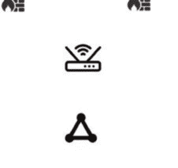


**图 3-2.** 通过 Azure 代理建立用于代理功能的连接

根据您的网络配置，可以通过 `VPN` 连接或 `ExpressRoute` 连接访问 `VNET`。

在这种方法中，在 `Azure` 内部使用代理服务器。该代理在负载均衡器后设置为自动扩展，以管理负载均衡并确保故障备能力。

### 通过代理链建立连接以增强代理功能

通过代理链建立连接以增强代理功能的方法允许通过直接 Internet 访问、私有 `VPN` 或 `ExpressRoute` 连接您的传感器。传感器建立 SSL 加密隧道，通过多个代理服务器将数据从传感器传输到服务端点。代理服务器不进行数据检查、分析或缓存。

客户负责设置和维护带有代理链的第三方代理服务；微软不提供此类支持。

图 3-3 展示了利用代理链的代理连接。该图说明了如何通过一系列代理将您的传感器连接到 Azure 中的 `Defender for IoT` 门户，并结合了普鲁 ue 模型的不同层级和企业网络层次结构。


**图 3-3.** 通过代理链建立连接以增强代理功能

### 建立到 Azure 的直接连接

图 3-4 展示了到 `Azure` 的直接连接。该图概述了如何从远程站点直接连接到 Azure 中的 `Defender for IoT` 门户，而绕过企业网络。

**图 3-4.** 建立到 Azure 的直接连接

通过 Internet 或 `Azure ExpressRoute` 直接连接到 `Azure` 数据中心的传感器，受益于到 Azure 数据中心安全的加密链路。使用 `Transport Layer Security (TLS 1.2/AES-256)` 确保了传感器与 Azure 资源之间持续且安全的通信。

传感器发起到 Azure 门户的所有连接。这种方法保护内部网络设备免受不受请求的入站连接，并消除了配置入站防火墙规则的需求。

### 跨多云连接

`Azure Hybrid Connections` 允许您将 `Azure App Service`（Web 应用程序、移动应用程序等）安全地连接到本地资源，而无需将其暴露在公共 Internet 上。

您可以选择将传感器连接到 Azure 中的 Defender for IoT 门户，从而对跨多个公云的 OT/IoT 管理进程进行监控。建立连接的方法取决于 161

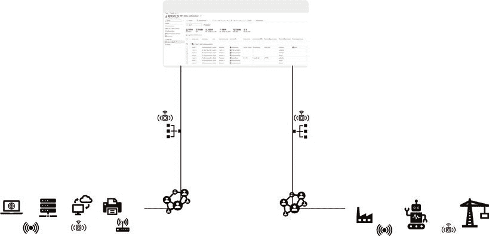

# 第 3 章 Microsoft Defender for IoT 计划

环境配置提供了灵活性，选项包括带有客户托管路由的 ExpressRoute、通过云交换提供商的 ExpressRoute，以及通过 Internet 的地对点 VPN。

## 准备 Microsoft Defender for IoT 部署

让我们开始了解 Microsoft Defender for IoT 的组件。

Defender for IoT 拥有一个强大的连接框架，可与云端和本地元素集成。它专为确保在扩展且广泛分布的环境中具有可扩展性而设计。这一复杂的系统涵盖了各种运营技术（OT）安全监控组件，以增强其能力。Microsoft Defender for IoT 涵盖并分析多种数据源。

图 3-5 展示了数据流入 Defender for IoT 的无缝流程，这些数据来自网络传感器和外部第三方源。这种集成创建了一个凝聚且全面的 IoT/OT 安全概览。在 Azure 门户中，Defender for IoT 作为一个集中枢纽，提供广泛的功能，包括提供资产清单、执行漏洞评估以及对潜在威胁进行持续监控。通过这种统一方法，Azure 门户中的 Defender for IoT 聚合了数据，并作为 IoT/OT 安全整体管理和警惕的强大工具。

Microsoft Defender for IoT

企业级 IoT

OT 网络

网络传感器

传感器

企业 IoT 环境

OT 环境

IoT 网络

OT 网络

***图 3-5.** Microsoft Defender for IOT – 关键组件* 162

第 3 章 Microsoft Defender for IoT 计划 最前的是 Azure 门户，这是一个多功能接口，便于云管理以及与一系列 Microsoft 服务（包括强大的 Microsoft Sentinel）无缝集成。这种战略联动通过利用庞 Microsoft 生态系统，增强了 Defender 对 IoT 的整体效率和响应能力。

此外，Defender for IoT 整合了尖端的运营技术（OT）和企业物联网（IoT）网络传感器。这些传感器在检测跨越您的网络格局的设备方面起着关键的作用。部署灵活性是一项关键特性，网络传感器可以安装在虚拟机或物理设备上。此外，用户可以将 OT 传感器配置为云连接型或完全本地、本地管理的传感器。这种适应性确保了能够根据不同的组织偏好和需求进行优化定制。

为了进一步增强其实用性，Defender for IoT 引入了本地管理控制台，为管理和监控 OT 传感器提供集中监督。该控制台是一个关键枢纽，特别是在对集中控制至关重要的本地、隔离环境中。Defender for IoT 提供的全套功能包强调了其承诺提供一种多功能、安全且无缝集成的解决方案，以满足现代 IoT 和 OT 安全的复杂需求。

## OT 和企业 IoT 网络传感器

Defender for IoT 网络传感器擅长发现并持续监控流经您网络设备的流量。这些专用传感器针对运营技术（OT）和物联网（IoT）网络的复杂性而精心设计，通过 SPAN 端口或网络 TAPs 建立连接。Defender for IoT 网络传感器极为敏捷，在接入网络后的几分钟内即可迅速揭示潜在风险的错综性。

这些网络传感器的效能在于它们对感知 OT/IoT 的分析引擎和网络第 6 层深度包检测（DPI）技术的熟练利用。它们的先进能力使其能够识别并定位威胁，例如根据网络环境中异常或未经授权活动的指示，来识别无文件恶意软件。

为了确保快速安全的响应，整个数据相关过程——包括收集、处理、分析和告警——直接在传感器本身上发生。

163

第 3 章 Microsoft Defender for IoT 计划 这在低带宽或高延迟连接的地方被证明特别有利，因为它最小化了对外部资源的依赖。在这个精简的过程中，只有基本的遥测数据和见解被传输用于管理目的，并定向到 Azure 门户或本地管理控制台。这种方法强调了 Defender for IoT 对运营效率、实时威胁检测以及跨不同网络格局的安全措施无缝编排的承诺。

## 云连接传感器与本地位置的传感器

当云连接传感器与 Azure 中的 Defender for IoT 集成时，它们与本地管理的传感器相比具有不同的特征。

在云连接 OT 网络传感器的背景下，所有检测到的数据不仅在传感器控制台中显示，还会同时传输到 Azure，以便与其他 Azure 服务进行全面分析和协作。此外，将 Microsoft 威胁情报包自动分发到云连接传感器简化了安全措施的强化。在此配置中，在注册期间建立的传感器名称在传感器界面中保持不变，在传感器控制台中以只读模式运行。

相反，使用本地管理传感器的方法提供了一个细致的视角。

在这里，用户可以通过传感器控制台专门查看特定传感器的数据，而多个传感器收集的信息汇总概览则需要使用本地管理控制台。值得注意的是，更新传感器名称的过程在传感器控制台中是一项灵活的任务。此外，在本地管理传感器场景下，手动上传威胁情报包成为增强安全协议的必要步骤。这种界限强调了 Defender for IoT 生态系统中云连接传感器与本地管理传感器之间相关的细微功能和管理流程。

## Defender for IoT 分析器

Defender for IoT 网络传感器通过其集成的分析引擎仔细检查摄取的数据，这些引擎随后根据实时和预录流量参数的组合触发告警。这些先进的分析引擎涵盖了一系列功能，提供机器学习能力、分析分析、风险分析、全面的设备数据库、见解生成、威胁情报集成和行为分析。

例如，该框架的策略违规检测引擎采用了复杂的方法，模拟工业控制系统（ICS）网络以识别偏离预期“基线”行为的情况。这一过程利用了行为 164

第 3 章 Microsoft Defender for IoT 计划 异常检测 (BAD)，这是在 NISTIR 8219 中概述的方法。建立这种基线涉及对网络内常规活动的全面理解，包括正常的流量模式、用户操作以及与 ICS 网络的交互。随后，BAD 系统会警密监控网络中任何偏离预期行为的异常，及时标记策略违规的实例。

基线偏差的示例包括未经授权使用功能代码、访问特定对象或修改设备配置。

在 ICS 网络中引入这种专用基线尤为重要，因为许多检测算法最初是为信息技术（IT）而非运营技术（OT）网络设计的。表 [3-2] 中列出的附加基线在适应新的检测参数时显著加速了系统的学习曲线，从而提高了 `Defender for IoT` 在保护 OT 环境方面的整体效能。

**表 3-2. Defender for IOT 的关键能力**

| 名称 | 描述 | 示例 |

| :--- | :--- | :--- |

| 协议违规 | 识别不合规的数据包 | 告警：“非法 ModBUS 操作（iCs Code Zero 中的功能结构和字段值）”——指示违反协议规范的未经授权协议请求 |

| 策略违规 | 标记偏离基线的行为并突出显示 | 告警：“未经授权的 http User agent”——指示设备作为未经授权的 http 客户端使用了未经授权的应用 |

| 工业恶意软件 | 识别表明已知恶意软件的行为，以便及时响应威胁 | 告警：“怀疑存在恶意活动 (stuxnet)”——信号与 stuxnet 恶意软件相关的疑网络活动 |

| 异常 | 检测异常的 M2M 通信，对 iCs 网络建模以加快学习 | 告警：“通信通道中的周期行为”——检测周期性数据传输，这在工业网络中很常见 |

|（续） | 更多示例包括 SMB 登录尝试过多和检测到 PLC 扫描的告警 | |

**表 3-2.（续）**

| 名称 | 描述 | 示例 |

| :--- | :--- | :--- |

| 运行事件 | 识别运行问题，指示潜在的设备故障 | 告警：“设备怀疑已断开（无响应）”——指示设备无响应，暗示可能存在问题 |

| 另一个示例涉及由 siemens s7 stop plc 命令触发的告警，指示潜在的运行事件 | |

## Microsoft Defender for IOT 的管理选项

`Defender for IoT` 通过各种管理选项提供混合网络支持，其中 `Azure portal` 作为全面管理的枢纽。

利用 `Azure portal` 作为统一接口，无缝可视化通过云连接网络传感器从设备中收集的所有数据。除了此整合视图外，`Azure portal` 通过提供工作区（workbooks）、与 `Microsoft Sentinel` 集成、安全建议等功能提供了额外价值。

### Azure Portal

`Azure portal` 是由 Microsoft 的云计算平台 `Microsoft Azure` 提供的基于 Web 的界面。它是用户管理和监控其 `Azure` 资源、服务和应用程序的中心枢纽。通过该门户，用户可以访问并与各种 `Azure services` 交互，配置设置、部署资源、监控性能并分析数据。

`Azure portal` 的关键特性包括自定义的仪表板（允许用户安排和显示相关信息）、用于发现和部署 `Azure services` 的市场，以及一系列用于监控和管理资源的工具。它为管理员、开发者和利益相关者处理 `Azure` 云服务提供了一个统一且友好的体验。

此外，利用图 3-6 所示的 `Azure portal` 执行此类任务，如获取新设备、访问软件更新、在 `Defender for IoT` 中入站和维护传感器，以及更新威胁情报包。

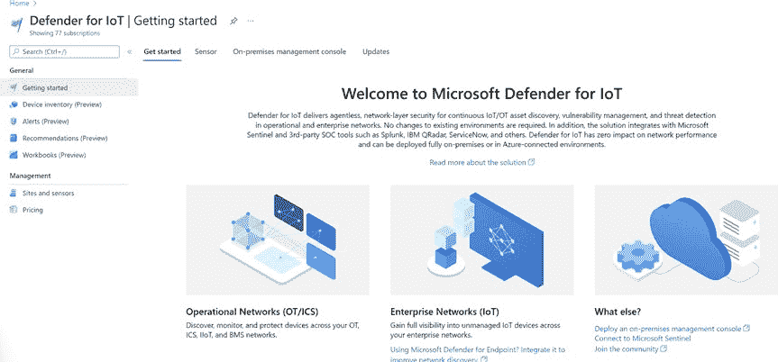
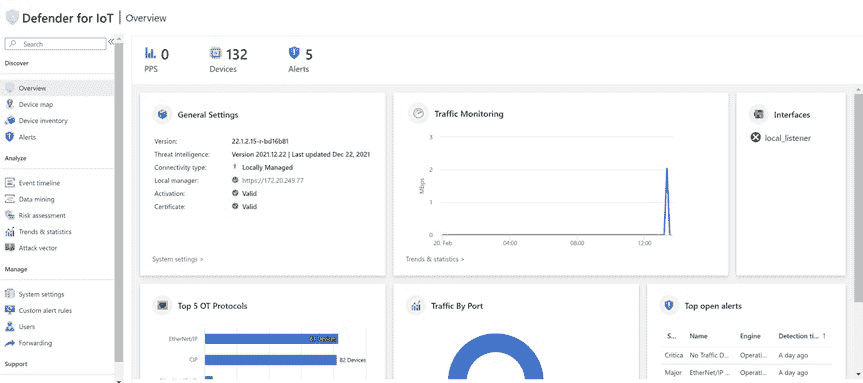

**图 3-6. Microsoft Defender for IOT – Azure portal**

### OT 传感器控制台

通过图 3-7 所示的传感器控制台探索链接到特定 OT 传感器的设备检测结果。利用传感器控制台访问由特定传感器识别的设备网络地图，查看传感器上记录的所有事件的时间线，将传感器信息传输到关联系统，并访问其他功能。

**图 3-7. Microsoft Defender for IOT – OT sensor console**

`Defender for IoT` 能够全面发现各种环境中的多种类型设备。`Defender for IoT` 内的设备清单页根据 IP 和 MAC 地址的独特组合对设备进行分类，确保了详细且组织化的表示。识别过程将单个设备分为两类：被识别为单个设备和未识别为此类设备的设备。前者包括 IT、OT 或 IoT 设备，包括交换机和路由器等网络基础设施组件，同时带有模块或背板组件的设备被视为单个实体。相反，后者排除了某些项，例如公共互联网 IP 地址、组播和广播组以及非活动设备。


网络监控设备被判定为非活动状态取决于在指定持续时间内没有网络活动，例如 OT 网络为 60 天，企业 IoT 网络为 30 天。值得注意的是，已受 `Defender for Endpoint` 管理的终端不会被视为 `Defender for IoT` 范围内的独立设备，从而简化了设备分类。

## 本地管理控制台

本地管理控制台是物理隔离环境的焦点，提供了来自所有传感器的数据整合视图。该控制台提供了额外的维护工具和报告功能以增强控制。

确保您的本地管理控制台上的软件版本与最新的传感器版本一致至关重要。虽然每个本地管理控制台版本都与旧的受支持传感器版本向下兼容，但它无法与较新的传感器版本建立连接。这种同步确保了网络环境中无缝集成和最佳性能。

## 企业网络设计

在企业中设计网络架构涉及仔细规划并考虑各种因素，以确保构建组织要求的稳健且高效的基础。设计过程涵盖几个关键要素：

### 需求分析

理解业务需求和目标以确定网络的功能需求。识别用户数量、应用程序类型、数据传输需求和安全需求。

### 拓扑设计

根据组织的规模、结构和通信需求选择合适的网络拓扑（例如星型、总线型、环型、网型）。考虑冗余和容错能力以确保高可用性。

### 网络分层

将网络划分为逻辑层，通常包括核心层、接入层。这种分层有助于扩展、易于管理和模块化升级。

### IP 地址分配与子网划分

计划并实施 IP 地址方案，确保当前和未来设备有足够的地址。子网划分有助于组织和管理 IP 地址。

### VLAN 设计

实现虚拟局域网（VLAN）进行逻辑分割，提高安全性并减少广播域。

### 路由与交换

选择合适的路由协议用于不同网络段之间的通信。实施交换技术以实现高效的本地流量。

### 安全措施

集成防火墙、入侵检测/防御系统以及 VPN 等安全功能以保护网络。在必要时采用基于角色的访问控制和加密。

### 服务质量 (QoS)

对网络流量进行优先级排序，以确保关键应用程序的最佳性能。有效管理带宽并控制网络拥塞。

### 可扩展性与未来增长

设计网络以适应增长和技术变化。考虑虚拟化和云集成等技术以实现可扩展性。

### 无线网络设计

如果需要，计划并实施安全可靠的无线网络。确保无线设备具有适当的覆盖范围和容量。

### 监控与管理

实施网络管理工具以进行性能监控、故障排除并确保主动维护。考虑对常规任务进行自动化处理，以简化操作。

## 文档工作

维护网络设计、配置以及随时间推移的任何更改的详尽文档。文档有助于故障排除、升级和知识传递。

通过在设计过程中解决这些问题，企业可以创建一个具有韧性、可扩展且安全的网络架构，该架构符合其业务目标并适应不断的技术需求。

## 网络设计的分层模型

网络设计的分层模型（通常被称为三层分层模型）是一种组织和设计网络架构的结构化方法。该模型由三层组成：接入层、分布层和核心层。每层都有特定的用途并具有不同的功能，有助于网络的整体效率、可扩展性和管理性。以下是对每一层的详细说明。

### 接入层

功能：接入层是终端用户设备的入口，并将它们连接到网络。它侧重于为单个设备（如计算机、打印机和 IP 电话）提供网络访问。

**特点**

- 接入层设备包括交换机和接入点。
- 该层负责用户身份验证、基于端口的安全和 VLAN 分配。
- 此处可能实施与服务质量 (QoS) 相关的策略以对流量进行优先级排序。

**考虑因素**

- 适应各种类型设备的可扩展性和灵活性。
- 用于控制访问和防止未经授权活动的安全措施。
- 实施 VLAN 以进行逻辑划分。

### 分布层

功能：分布层充当接入层和核心层之间的中介。它促进不同接入层设备之间的通信，并在将其转发到核心层之前聚合流量。该层对于网络分段和策略执行至关重要。

**特点**

- 分布层的设备包括路由器和三层交换机。
- VLAN 之间的路由通常在这一层发生。
- 聚合多个接入层交换机并为网络路径提供冗余。

**考虑因素**

- 高效的路由和过滤以控制流量流。
- 实施用于网络分段和安全的策略。
- 通过冗余实现高可用性和容错性。

### 核心层

功能：核心层是网络的骨干，负责在不同分布层设备之间进行高速、低延迟的数据转发。它的设计用于快速、可靠的数据传输，而不施加额外的处理或过滤。

**特点**

- 核心层设备包括高速路由器和交换机。
- 通常以网络支持的最高速度运行，通常使用光纤等技术。
- 最小化延迟并确保数据包快速转发。

**考虑因素**

- 支持整个网络流量需求的高速、容错基础设施。
- 极少的处理和过滤以维持高速数据传输。
- 冗余和负载均衡以确保网络可用性。

## 分层模型的优势

- **可扩展性**：模块化设计允许通过在特定层级内添加或升级组件来实现易于扩展。
- **可管理性**：每层都有明确的管理职责，简化了网络管理。
- **故障隔离**：某一层级中的问题会被限制在该层内，减少对网络其他部分的影响。
- **性能优化**：每层都可以针对其特定功能进行优化，提高整体网络性能。

通过遵循分层模型，网络架构师可以创建组织良好、可扩展且高效的网络架构，满足现代企业的多样化需求。

## IT 网络规划

在企业中规划 IT 网络涉及系统且全面的方法，以满足组织的需求。以下是规划过程中关键步骤的概述。

### 业务需求评估

理解 IT 网络应支持的业务目标和目的。识别不同部门和利益相关者的特定需求。

### 当前基础设施分析

评估现有的 IT 基础设施，包括硬件、软件和网络组件。评估当前网络的性能、安全可扩展性。

### 用户和设备清单

创建连接到网络的现有用户和设备清单。预测可能影响用户和设备数量的未来增长和技术进步。

### 带宽和性能需求

根据使用的应用程序和服务的性质确定数据传输所需的带宽。考虑关键应用程序和服务的性能需求。

### 安全考虑因素

评估安全风险和需求。定义访问控制、加密、防火墙和其他安全措施。确保符合行业法规和内部安全策略。

### 技术选择

选择合适的网络技术，包括路由器、交换机和无线解决方案。根据业务需求决定是否使用虚拟化、云服务和新兴技术。

### 网络拓扑设计

开发符合组织结构和要求的网络拓扑。考虑关键网络组件的冗余和容错性。

### IP 地址划分与子网划分

计划并分配 IP 地址范围以适应设备数量并便于高效的网络管理。为了组织和安全目的实施子网划分。

### 无线网络规划

如果适用，规划安全高效的无线网络。考虑覆盖范围、容量和安全协议等因素。

### 与其他系统的集成

确保与其他 IT 系统、应用程序和服务的集成。规划不同系统之间的互操作性和数据交换。

### 灾难恢复与业务连续性

开发灾难恢复和业务连续性策略，以在网络故障或灾难时减少停机时间。

### 预算

创建一个考虑硬件、软件、许可、人员和持续维护成本的预算。根据关键需求和可用资源对投资进行优先级排序。

### 实施计划

开发分阶段实施计划，尽可能减少对正在进行的操作的影响。考虑在全范围推广之前在特定区域进行试点。

### 培训与文档

计划用户培训，以确保员工能够有效使用新网络。供未来参考的文档配置、流程和故障排除过程。

## 监控与优化

实施网络监控工具以跟踪性能、检测问题并优化网络。建立定期审查流程，以使网络适应变化的业务需求。

通过遵循这些步骤，企业可以为其 IT 网络制定战略性且文档齐全的计划，使技术与业务目标一致，并确保基础设施的韧性、安全性和扩展性。

## 在规划中采用 Purdue 模型实现工业控制系统（ICS）安全

用于工业控制系统（ICS）安全的 Purdue 模型（通常被称为 Purdue 参考模型）是一个用于组织 ICS 环境架构的框架。该模型由普渡大学开发，有助于理解、设计和实施工业控制系统的安全措施。该模型将 ICS 架构划分为不同的层级，每一层代表控制系统内的特定功能。以下是 Purdue 模型中每一层的详细解释及其架构：

### 第 0 层：过程设备与物理过程

*   **描述**：这是 Purdue 模型的最低层，包含了涉及工业控制的物理过程和设备。它包括传感器、执行器以及直接与物理环境交互的设备。
*   **架构**：在此层级，重点是实时控制和数据采集。设备与较高层通信，以提供实时数据并接收控制命令。

### 第 1 层：基础控制

*   **描述**：第 1 层由负责基础控制功能的控制器组成。在离散制造中，这些通常是可编程逻辑控制器（`PLCs`），而过程制造可能使用分布式控制系统（`DCS`）。
*   **架构**：此层的控制器与 `Level 0` 设备接口以执行控制功能。它们处理传感器数据、做出决策并向执行器发送命令。

### 第 2 层：监控控制

*   **描述**：此层涉及对特定区域内多个控制过程进行监控和协调。包括人机界面（`HMIs`）、过程数据库和批处理管理系统。
*   **架构**：监控系统与 `Level 1` 控制器通信，提供过程的高级视图。它们还通过 `HMIs` 与操作人员交互并管理历史数据。

### 第 3 层：制造运营

*   **描述**：第 3 层代表负责管理站内整体制造运营的系统。包括生产调度、详细报告和整体站级运营管理。
*   **架构**：此层整合了来自较低级的信息并与企业级系统通信。它促进了制造过程的协调和优化。

### 第 4 层：业务规划与物流

*   **描述**：在此层，包含了业务相关的系统，如企业资源计划（`ERP`）。它重点关注业务规划、物流和高级决策。
*   **架构**：`Level 4` 系统与 `Level 3` 交互以收集生产数据并为业务级决策过程做出贡献。它们通常使用标准的 IT 基础设施。

### 第 5 层：企业业务规划

*   **描述**：最高层涉及全企业的业务规划和管理系统。包括战略决策以及与公司 IT 系统的集成。
*   **架构**：此层的系统与较低层交互以进行数据交换，并为公司级决策过程做出贡献。

Purdue 模型中的每一层都有其特定的安全考虑，该模型强调了适当分段和安全控制的重要性，以保护关键工业过程免受网络安全威胁。

表格 `3-3` 概述了 Purdue 模型的每一层相对于你网络中可能存在的设备。

**表 3-3. 分层 Purdue 模型**

| 层 | 描述 |
| :--- | :--- |
| level 0: 单元和区域 | 包含了对基础制造过程至关重要的各种传感器、执行器和设备。功能包括驱动电机、测量变量、设置输出以及执行喷漆、焊接和弯曲等任务。 |
| level 1: 过程控制 | 包含管理制造过程的嵌入式控制器。在离散制造中，这些通常是 `PLCs` 或 `RTUs`；在过程制造中，则是分布式控制系统（`DCS`）。 |
| level 2: 监控 | 代表用于生产设施区域进行实时监控和操作的系统。包括操作界面（`HMIs`）、报警/警报系统、过程数据库、批管理和控制室工作站。 |
| levels 3 and 3.5: 站点 | 管理对运营至关重要的站级功能的最高层。涉及生产报告、工厂数据库、生产调度、站外边界网络运营管理、设备/材料管理、补丁发布、文件服务器和工业域服务。与生产区通信并与企业系统（第 4 和 5）共享数据。 |
| levels 4 and 5: 企业 | 代表站点或企业网络系统。由 IT 组织直接管理，包含了对运营至关重要的和服务应用程序。 |

## 规划中的网络流量节点

通常，从安全角度来看，值得关注的点涉及连接默认网关与核心或汇层交换机的接口。

将这些接口识别为关键点，可以监控从 IP 段内部流向 IP 段外部的流量。考虑缺失的流量也是至关重要的，即意图离开网段的流量留在网段内的情况。

在制定 Defender for IoT 部署时，微软建议在网络流量规划中考虑表 `3-4` 中列出的组件。

**表 3-4. 网络流量规划考虑**

| 规划 | 描述 |
| :--- | :--- |
| 唯一流量类型 | 特别关注网段内以下类型的流量：网络内部广播/多播流量（发送到子网内的任何实体，包括段默认网关），以及直接转发到目的地而不跨越整个子网的单播流量。通过在接入交换机上部署传感器使用 Defender for IoT 监控单播流量。 |
| 监控双向 | 在向 Defender for IoT 流传输流量时，确保监控两个方向的流量。某些厂商/产品提供单向流，可能会导致数据空隙。监控两个方向可以提供全面的网络对话信息和更高的准确性。 |
| 定位子网 | 识别每个感兴趣子网的默认网关，考虑任何连接到作为默认网关实体的 `Default Gateway` 连接。监控子网内可能被常规关注点覆盖的流量，特别是在敏感子网上。 |
| 寻找异常 | 监控未被典型部署覆盖的流量可能需要额外的流点和网络解决方案，如 `RSPAN`、网络分路器等。通过引入额外的流点和网络解决方案来确保全面覆盖，特别是针对敏感子网。 |

发起网络流量的设备会将配置的子网掩码和 `IP` 地址与目标 `IP` 进行比较，以确定预期的目的地。目的地被识别为默认网关或 IP 分段内的其他位置。此比较还可能触发地址解析协议（`ARP`）过程，以获取与目标 IP 地址对应的 MAC 地址。

表 `3-5` 列出了该匹配过程，设备根据比较结果将网络流量分类为内部流量（发生在 IP 分段内）或外部流量（指向 IP 分段外部）。

### 表 3-5. 网络进出流量的规划考量

| 流量类型 | 描述 | 示例 |
| :--- | :--- | :--- |
| 外部 | 当目标 IP 地址位于子网掩码范围之外，设备将流量发送到指定的默认网关。 | 一个具有 `ip 10.52.2.201` 和 `subnet mask 255.255.255.0` 的 PC 通过默认网关将流量发送到 `ip 10.17.0.88` 的 Web 服务器。操作系统计算目标 IP 的范围，发现其位于所有出站流量之外。在此处部署 Defender for iot/ot 网络可确保对该 IP 范围进行监控和分析。 |
| 内部 | 如果目标 IP 位于子网掩码范围内，流量将留在段内并直接传输到目标 MAC 地址。此类类型的流量需要 `arp` 解析，涉及在 `ip 10.52.2.131` 处的广播。操作系统用于发现目标 IP 地址 MAC 地址的封包将流量直接引导至该分段内。 | 一个具有 `ip 10.52.2.17` 和 `subnet mask 255.255.255.0` 的 PC 将流量发送到另一个 PC。 |

### 单向网关

在处理如 `Waterfall`、`Owl Cyber Defense` 或 `Hirschmann` 等单向网关时（数据通过数据二极管以单方向流动），您有两种方案来放置 OT 传感器。

#### 网络边界外部（推荐）

**描述**：在此种优选方案中，请将您的 OT 传感器放置在网络边界之外。传感器通过二极管接收 `SPAN` 流量，流量从网络单向流向传感器的监控端口。此方法特别适用于大规模部署。

#### 网络边界内部

**描述**：在此方案中，将您的 OT 传感器放置在网络边界内部。传感器通过数据二极管向边界外的目标发送 `UDP syslog` 告警。请注意，网络边界内部的传感器是物理隔离的，必须进行本地管理。它们无法连接到云，也无法从 `Azure portal` 进行管理。这些传感器需要进行手动更新，包括新的威胁情报包。

**额外说明**：如果您正在处理单向网络工作，并且需要从 `Azure portal` 管理连接云的传感器，那么将您的传感器放置在网络边界之外至关重要。

### 流量镜像方法

选择流量镜像方法取决于您的网络设置和组织需求。

为了获得最佳效果，微软建议在交换机或专门设计的终端访问点（`TAP`）上配置流量镜像，该设备应仅涵盖工业 ICS 和 SCADA 流量。这确保了 Defender for IoT 仅分析监控所需的流量。

微软建议为交换机上的所有端口配置流量镜像，即使这些端口目前未被使用。未这样做可能会导致未监控的端口容易受到恶意设备连接的影响，而这些设备可能无法被 Defender for IoT 网络传感器检测。

对于采用广播或多播消息传递的 OT 网络，建议仅为 `RX`（接收）传输设置流量镜像。这种方法避免了不必要的带宽消耗，因为多播消息将在所有相关的活动端口进行复制。

Microsoft Defender for IoT 支持表 `3-6` 中列出的流量镜像方法。

### 表 3-6. 流量镜像方法的规划考量

| 方法 | 描述 | 概述 |
| :--- | :--- | :--- |
| 交换机 span 端口 | 在交换机的接口上建立远程镜像（`rspan`）会话，将分布式交换机的流量复制到同一台交换机的另一个接口，进入专用的远程 `Vlan`。 | 随后，`Vlan` 内的数据将通过汇聚端口传输，穿越多个交换机直到到达托管物理端口的交换机。 |
| 远程镜像 (remote span) | 将源端口的流量镜像到专用的远程 `Vlan` | 为您的 OT 网络传感器建立从目标端口到 `Vlan` 的连接，以便使用 Defender for IoT 监控流量。 |
| 主动或被动聚合 TAP | 当采用主动或被动聚合进行流量镜像时，会将主动或被动聚合终端访问点（`tap`）接入网络电缆，并复制流量。 | TAP 将接收到的 OT 网络传感器流量和传输流量复制到 OT 网络传感器，用于使用 Defender for iot 进行取证监控。 |
| 串式 TAP (inline tap) | TAP 是一种允许网络流量在端口间连续流动的硬件设备。它能够持续创建双向流量的精确副本，确保在不影响网络完整性的情况下进行持续监控。 | Defender for iot 已通过以下 模型的兼容性测试。其他供应商和模型例如 `Garland pGCC`、`iXia t2-CU3` 和 `Us robotics 4503` 可能也适用。 |
| 封装 erspan | 利用封装的远程交换端口（`erspan`）跨 IP 网络将输入接口复制到 OT 传感器的监控接口，特别是使用 Defender for iot 安全远程网络时。 | 传感器的监控接口以混杂模式运行，无需特定的 IP 地址。由于配置了 `erspan` 支持，传感器可以分析经过 `Gre` 隧道封装的流量有效负载。 |
| （续） | | |


# 一个 ESXi vswitch

尽管虚拟交换机缺乏原生镜像功能，但您可以在虚拟交换机环境中使用 ESXi vswitch 作为变通方案，配置类似于 SPAN 端口的监控端口。在典型场景中，SPAN 端口会将 Hyper-V vswitch 接口本地流量镜像到同一台交换机的另一个接口。

相同端口组中的虚拟机接口可以观察通过该虚拟交换机的所有流量。默认情况下，混杂模式已禁用。

## 规划网络端口

表 3-7 列出了 Microsoft Defender for IoT 网络传感器、本地控制台和部署工作站之间所有的网络通信需求，以确保服务的正常功能。

| 目的 | 源 | 目的 | 端口 | 方向 | 传输 | 协议 |
| :--- | :--- | :--- | :--- | :--- | :--- | :--- |
| 让传感器访问本地管理控制台 | 传感器和本地管理控制台 | 传感器和本地管理控制台 | 22 | 双向 | Tcp | ssh |
| 用于打开客户连接 | 传感器和本地管理控制台 | 传感器和本地管理控制台 | 443 | 双向 | Tcp | https |
| 为警报和事件发送电子邮件 | 传感器和本地管理控制台 | 本地管理控制台 | 443 | 出 | Tcp | https |
| 与 Azure 同步 | 传感器和本地管理控制台 | 用于警报和智能的 Azure | 123 | 双向 | Udp | ntp |
| 访问威胁情报 | 传感器和本地管理控制台 | 用于警报和智能的 Azure | 443 | 双向 | Tcp | tls |
| 传感器健康 | 传感器和本地管理控制台 | 用于警报和智能的 Azure | 25 | 出 | Tcp | smtp |

***表 3-7.***

| 目的 | 源 | 目的 | 端口 | 方向 | 传输 | 协议 |
| :--- | :--- | :--- | :--- | :--- | :--- | :--- |
| 监控本地管理控制台的传感器或终端用户 | 传感器和本地管理控制台 | 本地管理控制台 | 53 | 双向 | Tcp/Udp | Dns |
| 监控 Active Directory | 传感器和本地管理控制台 | 本地管理控制台 | 80 | 出 | Tcp | http |
| 监控证书验证 | 传感器和本地管理控制台 | 本地管理控制台 | 135, 1025-65535 | 出 | Tcp/Udp | Rpc |
| 上传证书 | 传感器和本地管理控制台 | 本地管理控制台 | 161 | 出 | Udp | Snmp |
| 从相关网络元素访问 | 传感器和本地管理控制台 | 本地管理控制台 | 389 | 双向 | Tcp | Ldap |
| 证书机构 | 传感器和本地管理控制台 | 本地管理控制台 | 443 | 双向 | Tcp/Udp | Snmp |
| 代理服务器 | 传感器和本地管理控制台 | 代理服务器 | 514 | 出 | Udp | Syslog |
| Syslog 服务器 | 传感器和本地管理控制台 | Syslog 服务器 | 636 | 双向 | Tcp | Ldaps |

***表 3-7.***

## 规划 Microsoft Defender for IoT 许可证

Microsoft Azure 是一项全面的云计算平台，为个人、企业和大型企业提供各种服务和解决方案。了解 Azure 云许可对于优化成本和利用平台的全部潜力至关重要。本详尽的解释深入探讨了与 Azure 云许可相关的核心概念、许可模型、关键服务以及考虑因素。

### Azure 云许可

Azure 是微软的云计算平台，提供广泛的服务，包括计算能力、存储、数据库、网络、人工智能（AI）等。Azure 许可是一个多层面的领域，旨在适应从初创公司到大型企业的各种业务需求。Azure 许可的结构对于用户有效管理资源、控制成本以及将其云策略与业务目标对齐至关重要。

### Azure 服务概述

Azure 服务跨越多个领域，每种服务都旨在满足特定的计算需求。这些服务包括：

- `Azure Virtual Machines` (VMs)：在云中提供可扩展的计算能力，虚拟机构成了系统的骨干。
- `Azure Storage`：提供可扩展的存储解决方案。
- `Azure SQL Database`：全托管的关系型数据库服务。
- `Azure App Service`：用于构建和部署应用程序。
- `Azure Kubernetes Service` (AKS)：简化容器化应用程序的部署。
- `Azure Active Directory` (AD)：提供身份和访问管理服务。
- `Azure Functions`：响应事件的无服务器代码执行。
- `Azure Key Vault`：安全地存储信息、加密密钥和证书。

### Azure 许可模型

Azure 采用多种许可模型以适应不同的使用模式。主要的许可模型包括：

- **按需付费 (Pay-As-You-Go, PAYG)**：按小时或每分钟支付 Azure 服务。这种模式适用于短期项目、测试或需求变化的负载。
- **预留实例 (RIs)**：用户承诺使用一年或三年的 VM，与 PAYG 相比可节省大量成本。预留实例适用于稳定的长期负载。
- **Azure 混合优势**：拥有本地 `Windows Server` 或 `SQL Server` 许可证的用户可以使用 Azure 混合优势降低 Azure VM 的费用。

### Azure 成本管理

有效管理成本是 Azure 云许可的关键方面。Azure 提供了诸如 `Azure Cost Management`、`Azure Advisor` 和 `Azure Pricing Calculator` 等工具。

- `Azure Cost Management`：提供资源使用情况和成本的可视性，允许用户做出明智的资源分配和优化决策。
- `Azure Advisor`：根据用户的历史使用提供个性化的最佳实践和建议。
- `Azure Pricing Calculator`：允许用户估算 Azure 成本，有助于进行预算和规划。

### Azure 核心许可考虑因素

根据所使用的服务类型，有几个关键的考虑因素：

- **虚拟机和计算服务**：Azure 虚拟机的大小在性能特性和定价上有所不同。了解应用程序的需求有助于选择合适的虚拟机大小。许可成本可能包括操作系统（Windows 或 Linux）的费用。
- **存储服务**：Azure 提供不同的存储服务，包括 Blob 存储、文件存储和磁盘存储，每种都有自己的定价模型。了解数据访问模式对于优化成本至关重要。
- **数据库服务**：Azure 提供多种数据库，例如 `Azure SQL Database`、`Azure SQL Managed Instance`、`Cosmos DB`、`MySQL` 和 `PostgreSQL`。许可成本取决于数据库类型、性能需求和数据存储等因素。
- **网络服务**：Azure 网络服务（如虚拟网络 `VNet`、`Azure Load Balancer` 和 `Application Gateway`）根据使用情况产生费用。对于网络活动频繁的组织，了解数据传输成本至关重要。
- **身份与访问管理**：`Azure Active Directory` (`Azure AD`) 有不同的许可选项，包括免费版、`Office 365` 和 `Premium` 计划。组织应根据其身份和访问管理需求进行选择。
- **无服务器计算**：`Azure Functions` 是一种无服务器计算选项，根据执行次数和资源消耗计费。这种模型对于资源需求变化的零散工作负载来说具有成本效益。

---

# 第 3 章 Microsoft Defender for IoT 计划

## Azure 许可场景

不同的场景需要不同的许可方法。理解这些场景有助于组织做出明智决策：

- **开发与测试**：可以利用 `Azure DevTest Labs` 以成本效益的方式管理开发和测试环境的资源。
- **生产工作负载**：稳定、长期的负载受益于评估预留容量选项。现有许可可以使用 `Azure Hybrid Benefit`。
- **混合环境**：具有本地和云资源混合场景的组织，可以通过利用 `Windows Server` 和 `SQL Server` 许可的 `Azure Hybrid Benefit` 来最大化节省成本。
- **初创公司和小微企业**：`PAYG`（按需付费）定价为初创公司和小微企业提供了灵活性。随着业务增长，探索预留容量等选项有助于优化成本。

## 许可管理与最佳实践

有效管理 Azure 许可需要遵循最佳实践：

- **成本监控**：定期使用 `Azure Cost Management` 工具监控支出、设置预算并在成本超支时接收警报。
- **资源规模调优**：根据实际使用情况对 `VMs` 和其他资源进行规模调整，以避免不必要的成本。
- **策略执行**：实施 `Azure Policies` 以强制执行资源标记、命名规范和合规性，有助于成本治理。
- **韧性与高可用性**：设计韧性和高可用性以确保业务连续性，并考虑与冗余相关的额外成本。

Azure 云许可是采用 `Microsoft’s cloud platform` 的一个动态且关键的方面。随着组织日益拥抱云，理解 Azure 许可对于有效管理成本、优化资源使用以及将云策略与业务目标对齐至关重要。定期根据不断变化的业务需求审查并调整许可策略，对于在不断变化的 Azure 云环境中取得成功至关重要。

在您的 `Microsoft Defender for IoT` 部署战略规划阶段，全面了解与 `Defender for IoT` 服务相关的定价计划和计费模型至关重要，让您能够做出明智决策并有效优化成本。

表 `3-8` 提供了 `Microsoft` 关于 `Defender for IoT` 的各种产品概述。

***表 3-8. Defender for IoT 许可选项***

| 许可选项 | 描述 |
| :--- | :--- |
| 企业 IoT 许可选项 | 企业 IoT 许可包含在 `Microsoft 365 E5` 中，`Microsoft 365 E5` 为 IoT 提供了全面的安全功能。 |
| `Microsoft Defender for IoT – Device license` | 个人设备许可的附加选项，允许组织增强每个 IoT 设备的安全防护。（附加）`$0.85-device/month` |
| 运营技术 (OT) 许可选项 | 针对较小的 OT 环境定制的 `Microsoft Defender for IoT`，`Xs` 站点许可为中规模站点提供全面安全措施。`$70.00-license/month`（根据 Microsoft 的说明，每个站点包含最多 100 台设备；年度订阅 – 自动续订） |

企业客户必须拥有以下许可证配置之一才能有效利用 Defender for IoT：

- `Microsoft 365 E5 (ME5)` 或 `E5 Security` 许可，配合 `Microsoft Defender for Endpoint P2` 许可。
- 或者，拥有独立的 `Microsoft Defender for Endpoint P2` 许可即可。

除了必要的许可证外，还必须访问 `Microsoft 365 Defender portal`，且用户需持有 `Global administrator`（全局管理员）权限。这些规范确保企业客户拥有必要的许可和管理权限，以实现 Defender for IoT 的优化部署和管理。

## 开始使用

要对 Defender for IoT 进行评估，您可以按照以下步骤开始免费试用。

对于 OT（运营技术）网络，可以利用为期 60 天的试用许可。在试用期间，在您的网络部署一个或多个 Defender for IoT 传感器。这些传感器对于监控网络流量、进行数据分析、生成警报以及提供网络风险和漏洞的洞察至关重要。需要注意的是，OT 试用版专门支持大型站点许可证，允许您在 60 天的试用期内全面探索 Defender for IoT 的功能和特性。

另一方面，对于企业 IoT 网络，请选择为期 90 天的独立试用许可。该试用许可作为 `Microsoft Defender for Endpoint` 的插件。在试用期内，您可以支持最多 100 台设备。此试用设置让您能够评估并体验 Defender for IoT 在更广泛的 Microsoft Defender 生态中的集成，从而对企业 IoT 网络的能力和性能进行更深入的探索。

## Microsoft Defender for IoT 角色与权限

基于角色的访问控制 (`RBAC`) 对于管理 Azure 云环境中的访问权限和权限至关重要。`RBAC` 提供了一个灵活且安全的框架，用于控制谁可以访问哪些资源以及他们可以执行哪些操作。RBAC 在 Azure 中的重要性可以通过以下几个关键方面来解释：

- **细粒度访问控制**：`RBAC` 允许管理员为用户或组分配特定角色，精确定义他们在特定 Azure 资源上可以执行的操作。这种细粒度控制确保用户拥有执行任务所需的最小权限，降低了未经授权访问或意外更改关键资源的风险。
- **安全性**：`RBAC` 通过实施最小权限原则增强了安全性。用户仅被授予执行指定任务所需的权限，限制了安全违规或误配置的潜在影响。这种方法最大限度地减少了攻击面并降低了未经授权访问的风险。
- **合规性**：许多行业和组织都有特定的法规合规性要求。`RBAC` 通过允许组织实施访问控制并监控用户活动，帮助其满足这些合规标准。这在医疗保健、金融和政府部门尤为重要，这些部门对数据隐私和安全法规非常严格。
- **高效资源管理**：`RBAC` 通过允许组织在不损害安全的情况下委托管理任务，简化了 Azure 资源的管理。管理员可以根据工作职责分配角色，使团队能够独立完成其特定任务，而无需访问不相关的资源。
- **可审计性与问责制**：`RBAC` 提供详细的日志和审计跟踪记录，允许组织跟踪用户活动和对 Azure 资源进行的更改。这种可审计性增强了责任制，使得调查事件、检测可疑行为以及维护访问事件的完整记录变得更加容易。

根据需求，通过门户或 `PowerShell` 为您的 Azure 订阅用户分配特定角色，无论是查看警报或设备数据，还是管理定价计划和传感器。

对于 `Defender for IoT` 中的本地用户，可以通过本地 OT 网络传感器、本地传感器管理控制台以及 Azure 门户访问服务和数据。

除了 Azure 门户外，还需在 OT 网络传感器和本地管理控制台上定义本地用户。默认的特权用户已安装在 OT 传感器和管理控制台上，作为定义其他管理员和用户的基础。

为传感器和本地管理控制台整合 `Active Directory` 支持。将传感器与 `Active Directory` 集成可允许 `AD` 用户登录或使用 `AD` 组，从而简化权限管理，特别是对于需要只读访问的大型用户群。

Defender for IoT 的 `Active Directory` 集成支持 `LDAP v3` 以及各种基于 `LDAP` 的认证类型：

- **完整身份验证**：从 `LDAP` 服务器检索用户详细信息，包括名字、姓氏、电子邮件和权限。
- **信任用户**：仅检索用户密码，并根据传感器中定义的用户获取其他详细信息。

为了高效管理本地 `Defender for IoT` 用户，请采用基于部门、区域和站点的全局业务拓扑结构。建立用户访问组以实施全局访问控制，定义用户访问业务拓扑中特定实体的规则。这种方法确保了跨 `Defender for IoT` 本地资源的访问权限得到简化。

## Defender for IoT 中 Azure 用户的角色与权限

Microsoft Defender for IoT 提供了用于跨 Azure 门户和本地资源的用户访问管理工具。利用 Azure 基于角色的访问控制 (`RBAC`) 可以访问 Azure 门户中 `Defender for IoT` 的监控服务和数据。

`Azure Security Reader`、`Security Admin`、`Contributor` 和 `Owner` 等角色适用于 `Defender for IoT` 内部。订阅级的用户管理在 Azure 门户中通过 `Microsoft Entra ID` 和 `Azure RBAC` 完成。Azure 订阅用户可能拥有一个或多个角色，定义了对数据和操作的访问，包括 `Defender for IoT` 内部的操作。

### 角色与权限参考

权限分配整个 Azure 订阅或（在某些情况下）特定的 `Defender for IoT` 站点中。更多细节可以在讨论“零信任与您的 OT 网络”以及“管理基于站点的访问控制”（公共预览版）的资源中找到。

在该系统中，`Security Reader` 等角色旨在授予对安全相关信息的有限读取权限。`Security Admin` 角色拥有管理各种安全相关配置的权限。`Contributors` 可以在不拥有资源的情况下更改资源，而 `Owners` 则对资源和设置拥有完全控制权和所有权。这种结构化的 `RBAC` 框架确保了系统内访问控制的细致且灵活的方法。

**表 3-9. Defender for IoT 中 Azure 用户的 RBAC**

| 操作与作用域 | Security Admin | Contributor | Owner | Reader |
| :--- | :---: | :---: | :---: | :---: |
| 授予权限 | - | - | - | 是 |
| 上线 OT/IoT 传感器 | - | 是 | 是 | 是 |
| 下载传感器软件 | 是 | 是 | 是 | 是 |
| 下载传感器详细信息 | 是 | 是 | 是 | 是 |
| 下载激活文件 | - | 是 | 是 | 是 |
| 查看计划和定价 | 是 | 是 | 是 | 是 |
| 修改计划和定价 | - | 是 | 是 | 是 |


# OT 语境下本地操作指定的用户与角色

## 使用 Defender for IoT 进行监控

在与 OT 网络交互时，`Defender for IoT` 服务和数据可以通过本地 OT 网络传感器、本地传感器管理控制台以及 Azure 访问。默认特权用户会在每个传感器和本地管理控制台上自动安装。具体而言，两者都存在一个特权支持用户，且本地管理控制台包含一个默认的 `cyberx` 用户。

这些特权支持用户和 `cyberx` 用户配备了用于故障排除和设置的高级工具，包括命令行界面 (`CLI`)。在配置传感器或本地管理控制台时，微软建议最初使用支持用户登录。随后，使用 `Admin` 角色来定义额外的用户。

在传感器版本 `23.1.x` 之前，`cyberx` 和 `cyberx_host` 特权用户是可用的。然而，在 `23.1.x` 及更高版本中，这些用户可用但默认未启用。这些密码需要修改以激活这些特权用户。在部署 OT 监控系统时，建议使用这些特权用户登录。创建第一个 `Admin` 用户。

请注意的是，应用于每个角色的权限在传感器和本地管理控制台之间可能不同。

## 角色与权限参考

在 `Defender for IoT` 系统中，不同的角色提供不同级别的访问和权限。`Admin` 角色授予用户对所有工具的全面访问，使其能够配置系统、管理用户并执行管理任务。另一方面，`Security Analysts` 的权限受限。虽然他们缺乏配置的管理员权限，但仍然可以对设备执行操作、确认告警并使用调查工具。`Security Analysts` 可以通过传感器的 `Discover` 和 `Analyze` 菜单以及本地控制台的 `NAVIGATION` 和 `ANALYSIS` 菜单访问特定选项。

同时，只读用户仅限于查看任务，例如观察地图上的告警和设备。他们可以通过传感器的 `Discover` 和 `Analyze` 菜单以及本地控制台的 `NAVIGATION` 菜单访问特定选项。这些不同的角色适用于 `Defender for IoT` 生态系统多样化的职责和访问需求。

## 操作技术 (OT) 网络传感器的角色分配权限级别

表 [3-10] 阐明了 OT 网络传感器的基于角色的权限。

**表 3-10. 本地操作 RBAC**

| 权限 | 只读 | Security Analyst | Admin |
| :--- | :---: | :---: | :---: |
| 查看仪表板 | 是 | 是 | 是 |
| 控制地图缩放视图 | - | - | 是 |
| 查看告警 | 是 | 是 | 是 |
| 管理告警：确认、学习和静音 | - | 是 | 是 |
| 在时间轴上查看事件 | 是 | 是 | 是 |
| 授权设备、已知扫描设备 | - | 是 | 是 |
| 编程设备 | - | 是 | 是 |
| 合并和删除设备 | - | - | 是 |
| 查看调查数据 | 是 | 是 | 是 |
| 管理系统设置 | - | - | 是 |
| 管理用户 | - | - | 是 |

## 本地管理控制台根据角色分配的权限级别

表 `3-11` 提供了本地管理控制台基于角色的访问控制 (RBAC) 摘要，概述了详细的权限结构。

### 表 3-11. 本地操作管理控制台的 RBAC

| 权限 | 只读 | 安全分析师 | 管理员 |
| :--- | :---: | :---: | :---: |
| 查看并过滤企业蓝图 | 是 | 是 | 是 |
| 构建站点 | - | - | 是 |
| 管理站点（添加和编辑区域） | - | - | 是 |
| 查看并过滤设备清单 | 是 | 是 | 是 |
| 查看和管理告警 | 是 | 是 | 是 |
| 生成报告 | - | 是 | 是 |
| 查看风险评估报告 | - | 是 | 是 |
| 设置告警排除 | - | 是 | 是 |
| 查看或定义访问组 | - | - | 是 |
| 管理系统设置 | - | - | 是 |
| 管理用户 | - | - | 是 |
| 修改密码 | - | - | 是 |
| 将告警数据发送给合作伙伴 | - | - | 是 |
| 管理证书 | - | - | 是 |

# 使用网络安全规划 Microsoft Defender for IoT

物联网 (IoT) 的出现带来了独特的安全、隐私和合规挑战，全球企业必须应对这些挑战。与以软件及其实现为中心的传统安全问题不同，IoT 的复杂性源于网络领域与物理世界的融合。保护 IoT 解决方案需要解决多方面的问题，包括设备的安全配置、建立设备与云端之间的安全连接，以及确保云端在处理和存储期间的数据安全保护。

企业网络中 IoT 设备的数量呈指数级增长，涵盖分布在各个办公楼的打印机、 IP 电话 (VoIP) 设备、智能电视和会议系统。

尽管数量不断增加，但许多 IoT 设备缺乏笔记本电脑和手机等受托管端点上常见的强力安全措施。这种漏洞使得未管理的 IoT 设备容易受到恶意攻击者的利用，成为横向移动或规避的潜在切入点。遗憾的是，此类策略通常会导致敏感信息的未经授权提取。

为了应对这些安全挑战，Microsoft Defender for IoT 与 Microsoft Defender XDR 和 Microsoft Defender for Endpoint 无缝集成。这种集成为 IoT 设备提供了全面的安全防护，提供专门构建的告警、建议和漏洞数据。

在 Microsoft Defender XDR 环境中，企业 IoT 安全通过提供与 IoT 设备相关的特定见解，增强了整体安全态势。这包括告警、风险评估、暴露水平、识别出的漏洞和可操作的建议。

由于多个因素对这些安全措施的影响，保护 IoT 解决方案变成了一项细致的工作。首先，资源受限的设备对可以实施的安全措施的稳健性产生了限制。这些设备通常具有计算能力和存储容量的限制，在执行全面的安全协议方面需要帮助。

此外，IoT 部署的地理分布增加了复杂性。IoT 解决方案通常分散在不同的地点，使得在整个网络中维护统一的安全措施面临挑战。IoT 部署的全球性增强了对能够适应不同监管环境和威胁格局的灵活安全策略的需求。

此外，IoT 解决方案中海量的设备加剧了挑战。管理大量设备的安全性需要可扩展且高效的解决方案，以确保数据的完整性和机密性。在大量设备上实施一致的安全协议是一项后勤方面的挑战，需要战略性的规划和协调。

面对这些挑战，参与 IoT 计划的企业必须采取整体的安全方法。必须建立安全的配置流程，以确保设备安全初始化和配置。建立设备与云端之间的安全连接通道对于保护传输中的数据至关重要。此外，云端内部的数据保护强力措施（涵盖处理和存储阶段）对于维护敏感信息的机密性和完整性是不可缺的。

IoT 安全的格局要求仔细考虑物理世界与网络世界融合带来的独特挑战。企业必须应对资源受限设备的限制，解决部署的地理分散问题，并管理与 IoT 解决方案中大量设备相关的复杂性。组织可以通过采用涵盖设备配置、连接和数据保护全面安全措施，巩固其 IoT 实现，以应对不断变化的威胁格局和监管要求。

从规划的角度来看，Microsoft 为参与 IoT 的个人和公司提供了安全指南。将这些建议纳入您的规划中，将有助于根据 Microsoft 的责任共担模型履行安全义务。

在规划阶段，需要注意的是 Microsoft Defender for Cloud（包含 Azure Security Center 和 Azure Defender）是保护 Azure 资源的主要防御层。该工具定期评估您的 Azure 资源的安全状态，识别潜在漏洞并提供建议以解决这些问题。

### 一般建议

- **保持更新**：为了确保最佳安全性，请利用最新版本的支持平台、编程语言、协议和框架。
- **保护身份验证密钥**：部署后保护设备 ID 及其身份验证密钥，以防止未经授权的访问和对注册设备的潜在身份冒充。
- **尽可能使用设备 SDK**：通过利用设备 SDK 实现加密和身份验证等安全功能。微软对 SDK 的持续投入确保了对新兴安全进展的持续支持。

### 身份和访问管理规划

- **为中心定义访问控制**：理解并定义您的 IoT Hub 解决方案中每个组件的访问级别，指定权限如 `Registry Read`、`RegistryReadWrite`、`ServiceConnect` 和 `DeviceConnect`。
- **为后端服务定义访问控制**：为消耗 IoT Hub Azure 服务建立访问权限，包括 `Cosmos DB`、`Stream Analytics`、`App Service`、`Logic Apps` 和 `Blob Storage`。

### 数据保护规划

- **安全设备认证**：为每个设备使用唯一身份密钥、安全令牌或设备端 `X.509` 证书确保设备与中心之间的安全通信，根据协议（`MQTT`、`AMQP` 或 `HTTPS`）选择适当的方法。
- **安全设备通信**：实施 `TLS 1.2` 以实现设备与 IoT Hub 之间的安全通信，确保最高级别的安全。
- **安全服务通信**：利用 `TLS` 连接 IoT Hub 端点到后端服务。

在后端为数据存储或分析实施额外的安全和加密措施。

## 网络规划

### 保护对设备的访问

尽可能减少设备中的硬件端口，以降低意外访问的风险。纳入相关机制以防止或检测对设备的物理篡改。

### 构建安全硬件

集成加密存储或可信平台模块 (`TPM`) 等安全功能，以增强设备和基础设施的安全。保持设备操作系统和驱动程序更新，采用最新的安全措施。

## 零信任安全规划

运营技术 (OT) 网络的架构通常与传统的 IT 基础设施不同。OT 系统在具有专有协议的独特技术之上，通常具有平台老旧、连接性有限和电力限制等特点。此外，OT 网络具有特定的安全需求，并且容易受到独特的物理或本地攻击，例如由外部承包商访问网络时发起的攻击。

由于在支持关键网络基础设施方面的作用，OT 系统的设计优先考虑物理安全或可用性，而不是安全访问和监控等方面。例如，OT 网络可能独立于其他企业网络流量运行，以防止在常规维护期间停机，或解决特定的安全担忧。

将 OT 网络迁移到云环境为应用零信任原则带来了挑战。多个因素导致了这种复杂性：

*   **用户管理和认证过程的限制**：OT 系统可能并非天生为多用户或全面的基于角色的访问策略设计，通常依赖于简单的认证过程。
*   **处理能力限制**：OT 系统可能需要更多的处理能力来完全实施安全访问策略。因此，可能存在信任所有接收到的流量安全的现象。
*   **老旧技术的挑战**：老旧技术对保留组织知识、实施更新以及利用标准安全分析工具获取可见性并驱动威胁检测构成了挑战。

尽管存在这些挑战，安全在任务关键系统中重要性不言而喻。OT 系统中的安全泄露将带来传统 IT 事件之外的现实世界后果。不符合安全措施可能会影响组织遵守政府和行业法规的能力，这凸显了在不断发展的 OT 网络格局中对细致且自适应安全方法的紧迫需求。

零信任安全策略运行在一个基础原则之上：预期攻击将会发生，因此需要持续验证并授予最少权限。在运营技术 (OT) 网络的背景下，零信任的应用涉及几项关键实践：

*   **网络连接的识别与管理**：实施严格措施，识别并管理 OT 环境内网络与设备之间的所有连接。这包括持续认证过程和严格的访问控制。
*   **限制和保护网络跳板机**：将零信任原则应用于网络跳板机，确保访问点受到限制，并采取安全措施来保护这些关键入口点。
*   **用于限制数据访问的网络分段**：OT 网络中零信任的一个方面是网络分段。这种做法通过创建隔离段来限制数据访问，从而包含潜在的泄露并减少安全事件的影响。设备与段之间的所有通信都经过加密和保护，以防止未经授权。
*   **防止系统间的横向移动**：零信任防止 OT 网络内部系统之间的横向移动。通过对横向移动实施严格控制，策略旨在阻碍威胁的横向传播并限制对关键资产的非法访问。
*   **用于访问控制的设备信号评估**：使用健康数据仔细评估设备位置、健康和行为等信号。这些信息被用于访问门禁，根据实时评估允许或拒绝进入。任何异常或偏差都会触发告警以进行立即修复。
*   **监控边界完整性的安全指标**：零信任扩展到持续监控安全指标，以确保安全边界的完整性。这涉及跟踪和分析各种安全参数，以识别任何可能损害网络的偏差或潜在威胁。

本质上，应用于 OT 网络的零信任策略涵盖了安全的全方位和动态方法。通过假设泄露是内在的可能性，组织实施稳健措施来验证身份、限制权限并强化网络以应对潜在威胁。对持续监控、严格访问控制和加密的强调与零信任的总体目标一致——在面对不断变化的网络威胁时建立弹性的安全态势。

Defender for IoT 通过利用站点 (sites) 和区域 (zones) 实现零信任访问分段。这种方法涉及将来自同一站点或区域传感器收集的数据分组，能够进行警惕监控以检测跨段的任何未经的流量。分段使组织能够在 Defender for IoT 中建立执行最小权限原则的策略。

站点和区域的定义如下：

*   **站点 (Sites)**：这些实体根据特定的地理位置对设备进行分类，例如位于特定地址的办公室。在站点内对设备进行分组对于组织和管理与特定物理位置相关的数据至关重要。
*   **区域 (Zones)**：站点内的分段，代表功能区域，如特定的生产线。这种更细粒度的分段允许对不同操作段内的设备和数据流进行更精细的控制和监控，增强安全性和策略实施。

## 监控规划

### 监控对设备的未经授权访问

利用设备操作系统的日志功能，监控设备和端口的安全漏洞或物理篡改。

### 从云端监控您的 IoT 解决方案

使用 `Azure Monitor` 中的可用指标监控 `IoT Hub` 解决方案的整体健康状况。

### 设置诊断

在解决方案中实施事件记录，并将诊断日志发送到 `Azure Monitor` 以增强性能可见性。利用 `Azure Monitor` 观察操作并诊断 `IoT Hub` 中的潜在问题。

通过结合这些规划视角，组织可以积极应对安全考虑，并将 IoT 解决方案与微软推荐的最佳实践对齐。这种全面的方法确保了 IoT 部署的稳健安全基础。

# Microsoft Defender for IoT 与 SOC 的集成

## Azure 原生服务

随着各种业务关键行业将其运营技术 (OT) 系统转换为数字 IT 基础设施，安全运营中心 (SOC) 团队和首席信息安全官 (CISO) 发现自己日益承担着减轻来自 OT 网络的威胁的任务。

随着这些新职责的到来，SOC 团队必须应对一系列挑战，包括：

*   **缺乏 OT 专业知识**：SOC 团队可能需要更多关于方面的专业知识和知识 OT 告警、工业设备、协议和网络行为。这种知识差距往往导致对 OT 事件及其潜在业务影响的理解模糊或碎片化。

## 第 3 章 计划通过 Microsoft Defender for IoT 解决 OT 与 SOC 之间的通信差距

OT 与 SOC 组织之间低效的通信和流程产生了孤岛，阻碍了应对新兴威胁所需的有效协作。

## 有限的技术与工具

SOC 团队在技术和工具方面面临局限性，例如需要对 OT 网络进行更多的可见性或自动化的安全修复。对于 OT 网络，跨多种数据源进行评估和关联可能具有挑战性，且与现有的 SOC 解决方案集成可能会产生高昂成本。

然而，缺乏 OT 数据、上下文以及与现有 SOC 工具和工作流的集成，可能会导致对 OT 安全和运营威胁的处置不当甚至忽视。

### 集成 Defender for IoT 和 Microsoft Sentinel

`Microsoft Sentinel` 是一种用于安全信息和事件管理 (`SIEM`) 以及安全编排、自动化和响应 (`SOAR`) 的可扩展云服务，为这些挑战提供了解决方案。集成 `Microsoft Defender for IoT` 和 `Microsoft Sentinel` 可以让 SOC 团队跨网络收集数据、检测并调查威胁，并有效响应事件。

`Microsoft Sentinel` 中的 `Defender for IoT` 数据连接器和解决方案为 SOC 团队提供了开箱即用的安全内容。这有助于对 OT 安全告警进行查看、分析和响应，从而对更广泛的组织威胁格局内生成的事件有更全面的理解。

为了简化这种集成，仅安装 `Defender for IoT` 数据连接器即可将 OT 网络告警流传输到 `Microsoft Sentinel`。此外，安装 `Microsoft Defender for IoT` 解决方案提供了额外价值，提供了针对 `IoT/OT` 的特定分析规则、工作簿（workbooks）、`SOAR` 剧本以及针对 `ICS` 技术的 `MITRE ATT&CK` 框架的事件映射。

将 `Defender for IoT` 与 `Microsoft Sentinel` 集成增强了两个平台的能力。它有助于从 `Microsoft Sentinel` 的其他合作伙伴集成中接入更多数据，有助于构建更稳健、更全面的安全态。


为了实现统一检测和响应，表 3-12 展示了 OT 团队利用 `Defender for IoT` 与 SOC 团队利用 `Microsoft Sentinel` 共同协调的快速威胁检测和响应能力，涵盖了整个攻击时间线。

### 表 3-12. 与 Defender for IoT 的检测与响应集成

| Microsoft Sentinel | 处理步骤 | Defender for IoT |
| :--- | :--- | :--- |
| 高置信度 OT 告警，生成的 OT 告警触发分析规则，由 `Defender for IoT` 部分自动打开事件，仅针对相关用例 `52` 安全研究组，是案例，从而避免了 OT 告警疲劳。 | 基于摄入到 `Defender for IoT` 的数据触发。创建 OT 事件，SOC 团队进行映射。 | |
| | SOC 团队将事件移动到业务影响，激活并开始调查，包括有关正在使用的网络连接和站点、生产线、受影响事件、工作簿、OT 资产以及 OT 所有者的数据。设备实体页面。 | |
| | 告警被移动到激活状态，OT 事件调查，SOC 团队使用 OT 剧本和笔记本进行响应。OT 团队使用 `pCap` 数据、详细报告和其他设备详情进行调查。 | OT 团队在威胁缓解后抑制告警或进行 OT 事件响应，SOC 团队根据需要为下一次进行汲训。团队关闭事件。 |
| | | 在威胁缓解后，OT 团队关闭事件。 |
| | | 告警状态的变化仅从 `Microsoft Sentinel` 同步到 `Defender for IoT`，且同步不会发生从 `Defender for IoT` 到 `Microsoft Sentinel` 的反向同步。 |

一旦配置了 `Defender for IoT` 数据连接器，它允许将 OT 网络告警流传输到 `Microsoft Sentinel`。此外，安装 `Microsoft Defender for IoT` 解决方案提供了额外价值，提供了针对 `IoT/OT` 的特定分析规则、工作簿、`SOAR` 剧本以及针对 `ICS` 技术的 `MITRE ATT&CK` 框架的事件映射。

或者，用户可以启用 `Defender for IoT` 提供的部分或全部开箱即用规则，通过在特定场景下选择性地生成事件来帮助缓解告警疲劳。可以根据更定制的需求创建自定义分析规则，可以利用开箱即用规则作为起点，也可以从头建立新规则。建议使用过滤器以避免针对同一告警 ID 生成重复事件。无论选择何种方法，每个 `Defender for IoT` 告警 ID 只应生成一个事件。

作为 `Defender for IoT` 解决方案的一部分部署到工作区的 `Microsoft Sentinel` 工作簿对于 `Defender for IoT` 数据的可视化和监控证明是非常有价值的。这些工作簿促进了跨开放事件、告警通知和涉及 OT 资产活动的引导调查。此外，它们还提供了跨越 `ICS` `MITRE ATT&CK` 框架的狩猎体验，为分析师、安全工程师和 `MSSPs` 提供态势感知。工作簿可以按类型、严重性、OT 设备类型或供应商以及随时间变化的告警来显示告警。它们还展示了告警映射到 `ICS MITRE ATT&CK` 战术的结果，以及战术的数量和时段分布。

剧本作为自动化修复操作，可以通过 `Microsoft Sentinel` 定期执行。这些剧本在自动化和编排威胁响应方面发挥着至关重要的作用，提供了手动运行或自动运行的灵活性。自动执行可以由响应特定告警或事件而触发，由分析规则或自动化规则激活。

## 总结

本章全面概述了部署和管理 `Microsoft Defender for IoT` 涉及的战略考虑和准备步骤。本章分为关键部分，每个部分解决规划过程中的关键方面。

### 计划 Microsoft Defender for IoT 部署

第一部分探讨了成功部署所需的战略规划，涵盖了网络架构、连接性和部署选项等考虑。

### 准备 Microsoft Defender for IoT 部署

第二部分提供了准备工作的见解，包括系统要求、兼容性检查以及顺利实施的任何先决条件。

### 计划 Microsoft Defender for IoT 许可

第三部分概述了 `Microsoft Defender for IoT` 的可用许可选项，帮助读者了解许可格局，并根据组织需求选择最合适的方案。

### 计划 Microsoft Defender for IoT 角色与权限

第四部分深入探讨了用户访问控制的关键方面。它讨论了 `Defender for IoT` 生态系统中的角色和权限，确保组织能够有效地管理控制用户对资源的访问。

### 使用网络安全计划 Microsoft Defender for IoT

# 第 4 章：部署 Microsoft Defender for IoT

在本书中，你正处于关键阶段，从基础步骤到 `Microsoft Defender for IoT` 部署的高级阶段。本章的每个章节都经过精心策划，旨在为保护物联网（IoT）生态系统安全的部署过程提供结构化且深入的理解。

## 部署 `Microsoft Defender for IoT` 简介

本章为寻求战略性规划和部署 `Microsoft Defender for IoT` 的读者提供了指南，涵盖了所有关键方面，以优化其在更广泛的网络安全框架内的有效性。

在本书的下一章，你将阅读有关 `Microsoft Defender for IoT` 部署的内容。

最后一节强调了将 `Defender for IoT` 集成到更广泛的网络安全策略中。这包括将 `Defender for IoT` 与网络安全最佳实践对齐，确保针对 IoT 特定威胁提供凝聚且全面的防御。

## 先决条件与基础步骤

启动 `Microsoft Defender for IoT` 部署是强化你的 IoT 基础设施的第一步。本节将引导你完成基本的先决条件，帮助你设置许可证、配置关键设置并为稳健且安全的部署奠定基础。

在第一节获得的基础知识之上，你将深入研究启用 `Microsoft Defender for IoT` 的复杂细节。发现 `Defender` 丰富的功能和能力将使你能够最大化其在防止不断变化的威胁方面强化 IoT 环境的潜力。

## 运营技术 (OT) 监控

运营技术（OT）在许多工业和企业环境中至关重要。

在本节中，你将探索 `Microsoft Defender for IoT` 提供的 OT 监控解决方案。学习如何监控网络流量、分析数据并主动识别针对 OT 网络的潜在威胁和漏洞。

## 隔离环境 (Air-Gapped Environments)

安全考虑通常决定了对隔离环境的需求。本部分解决了在隔离或物理隔离场景管理 OT 传感器的特殊需求。发现最佳实践，以确保 OT 传感器在受限网络环境中无缝安全地运行。

## 企业级 IoT 部署

本章的最后一节超越了单个部署，重点关注企业规模。深入研究使用 `Microsoft Defender for IoT` 监控大规模 IoT 部署的复杂性。了解 `Defender` 如何扩展以满足广泛 IoT 生态系统的需求，为跨越且复杂的 IoT 景观运营的企业提供全面的安全解决方案。

## 学习目标

在本章结束时，你应该能够理解以下内容：

- 开始 `Microsoft Defender for IoT` 部署
- 启用 `Microsoft Defender for IoT`
- 校准并微调 OT 环境的监控
- 隔离 OT 传感器管理

## 开始部署 Microsoft Defender for IoT

启动你的 `Microsoft Defender for IoT` 部署之旅涉及几个关键步骤，以确保设置的安全和有效。访问 `Azure portal`，这是你进入 Microsoft 云服务的网关。登录后，导航到“安全”（Security）部分，并在“高级威胁防护”下选择“IoT 安全”（IoT Security）。

在 `Defender for IoT` 专用面板中，深入研究可用的设置和配置。花时间熟悉提供的选项，因为这些对于根据特定需求定制安全措施至关重要。

确保你拥有必要的许可证至关重要，门户将引导你获取 `Microsoft Defender for IoT` 所需任何许可证。作为初始设置的一部分，配置区域和订阅详情等基本设置。此外，如果尚未定义，请在 `Azure portal` 中定义 `IoT Hub`，因为 `Defender for IoT` 与 `IoT Hub` 紧密协作。

在 `IoT Hub` 设置中启用 `Microsoft Defender for IoT`。此步骤通常涉及切换开关或选择特定的配置选项以激活你的 IoT 设备的安全功能。

验证你的 IoT 设备已正确在 `IoT Hub` 中注册，因为这些信息对于 `Defender for IoT` 有效监控和保护你的设备至关重要。设置完成后，探索 `Defender for IoT` 设置中的“建议”（Recommendations）或“最佳实践”（Best Practices）部分，以处理任何建议的操作并增强你 IoT 部署的整体安全态势。

最后，利用 `Defender for IoT` 提供的监控功能分析网络流量、检测异常并识别潜在的安全威胁。定期检查 `Defender for IoT` 的更新和警报，以了解你 IoT 环境的安全状态，确保保护 IoT 设备采取主动方法。

这一全面的过程为 `Microsoft Defender for IoT` 的稳健和安全部署奠定了基础。

## Azure Portal 和 Microsoft Defender for IoT 快速概述

`Azure portal` 是管理和监控 Microsoft Azure 提供的各种云服务的中央平台。它提供了一个统一的界面，允许用户跨 Azure 广泛的服务套件部署、管理和分析资源。`Azure portal` 为寻求可扩展灵活的云计算环境的企业提供了全面的解决方案，从虚拟机、数据库到机器学习和分析。

在 `Azure portal` 中，组织可以访问并配置 `Microsoft Defender for IoT`，这是一种为保护运营技术（OT）环境设计的专用安全解决方案。`Microsoft Defender for IoT` 提供针对工业、能源和公用事业部门独特挑战的高级威胁检测和管理能力。该解决方案帮助组织防御针对其 OT 基础设施的网络威胁，保护关键资产并确保工业过程的可靠性。

`Azure portal` 中的 `Microsoft Defender for IoT` 使安全团队能够获得其 OT 环境安全态势的洞察。它促进了网络流量的监控、异常检测和潜在网络威胁的识别。利用机器学习和行为分析，`Defender for IoT` 有助于将 OT 网络内的正常行为与可疑或恶意活动区分开。`Azure portal` 是安全分析师查看警报、调查事件和实施修复措施的中央枢纽，确保对潜在威胁做出主动且高效的响应。

此外，将 `Microsoft Defender for IoT` 与 `Azure portal` 集成为组织提供了统一且简化的安全管理体验。安全管理员可以利用 Azure 健壮的身份和访问管理功能来控制用户权限，确保只有授权的人员才能访问敏感的安全数据。这种集成体现了 Microsoft 对于提供整体、智能安全解决方案的承诺，弥补了传统 IT 和 OT 环境之间的差距。

让我们从部署前提开始，特别是针对缺少 Microsoft 租户或 Azure 订阅的客户定制。通过利用 `Defender for IoT`，用户可以有效监控 OT 网络内的流量。

在开始部署过程之前，请确保您已有一个指定的电子邮件地址作为即将生成的 Microsoft 租户的联系人。此外，请准备为新的 Azure 订阅输入信用卡详情；但请放心，只有在从免费试用切换到按需付费计划时才会产生费用。

开启 Azure 云端之旅从通过专用门户创建 Microsoft Azure 账户开始。使用有效电子邮件地址注册后，访问 Azure 门户将成为您进入云服务世界的大门。请花时间浏览门户，熟悉其布局并使用资源管理仪表板。Azure 基于订阅模式运行，作为新用户，您可以从免费订阅开始，该订阅在最初 12 个月内提供一组有限的免费服务。深入探索丰富的 Azure 服务，涵盖计算、存储、数据库、机器学习等。通过创建资源组来逻辑化地组织您的资源，以便对互联资产的管理和监控。通过部署您的第一个资源（无论是虚拟机还是 Web 应用程序）开启您的 Azure 之旅。可选，您可以熟悉 `Azure CLI` 或 `Azure PowerShell` 以进行命令行资源管理。

通过 Azure 文档和教程补充您的实操经验，探索特定服务和场景的细微差别。通过论坛和社交媒体与 Azure 社区保持联系，利用集体知识并掌握最佳实践。随着您的熟练程度提高，请探索高级功能和服务，以定制您的云环境以实现最佳安全性、可扩展性和成本效益。Azure 的灵活性可扩展性让您能够制定与独特项目需求无缝衔接的云策略。

以下是使用电子邮件 ID 激活 Azure 的高级流程：

**步骤 1：** 如图 4-1 所示，登录您的个人或业务账户进入 Azure 门户 [`portal.azure.com/`](https://portal.azure.com/)。

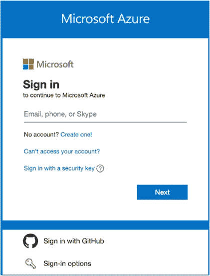
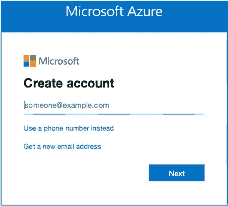

**步骤 2：** 对于初次启动的用户，您需要创建一个 Azure 账户；您可以选择使用电子邮件地址或手机号码（如图 4-2 所示）。

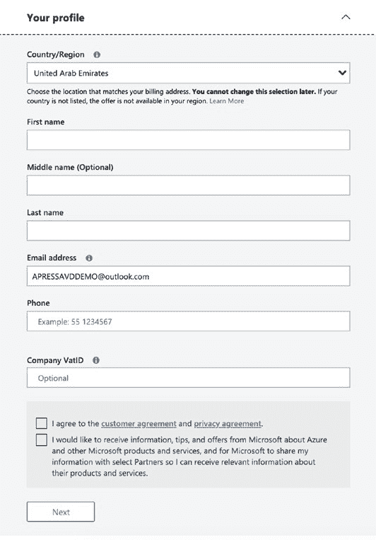

**步骤 3：** 让我们选择获取一个新的电子邮件地址，在选择后，输入首选的电子邮件地址；作为下一步，系统会提示您输入密码；完成设置（如图 4-3 所示）。

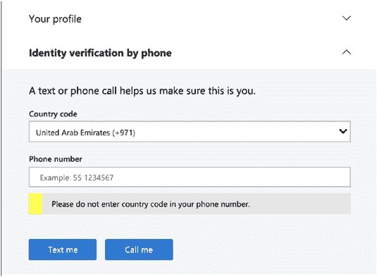

**步骤 4：** 完成包括信用卡设置在内的验证（如图 4-4 所示）。

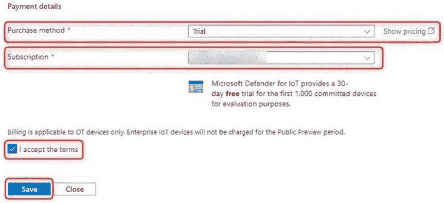

一旦您激活了 Azure 免费账户，出于知识、功能评估和概念验证的目的，Microsoft 始终鼓励使用试用许可证。

在试用期间，用户可以利用对大型站点规模的支持（可容纳多达 1000 台设备），试用期为 60 天。为了最大化试用体验，请考虑部署虚拟传感器或本地传感器。这些传感器对于监控流量、进行数据分析、生成警报至关重要。

为了将 `Defender for IoT` 扩展到 Azure，请遵循以下步骤：

**步骤 1：** 登录您的个人或业务账户进入 Azure 门户（如图 4-5 所示）。


**步骤 2：** 使用您的电子邮件地址或手机号码（如图 4-2 所示）。

**步骤 3：** 选择获取一个新的电子邮件地址，在选择后，输入首选的电子邮件地址；作为下一步，系统会提示您输入密码；完成设置（如图 4-3 所示）。

**步骤 4：** 完成包括信用卡设置在内的验证（如图 4-4 所示）。

一旦您激活了 Azure 免费账户，出于知识、功能评估和概念验证的目的，Microsoft 始终鼓励使用试用许可证。

在试用期间，用户可以利用对大型站点规模的支持（可容纳多达 1000 台设备），试用期为 60 天。为了最大化试用体验，请考虑部署虚拟传感器或本地传感器。这些传感器对于监控流量、进行数据分析、生成警报至关重要。


# 启用 Microsoft Defender for IoT

要启动启用过程，用户通常从 Microsoft Azure 门户开始，这是一个管理各种云服务的集中平台。利用 Azure 门户用户友好的界面，组织可以无缝导航到 Microsoft Defender for IoT 部分并访问必要的配置。此初始步骤为将 Defender for IoT 集成到更广泛的 Azure 生态系统中奠定了基础，为安全管理提供了全面的方法。

一旦进入 Azure 门户中的 Microsoft Defender for IoT 部分，用户将受到引导完成一系列设置程序。这涉及定义与网络拓扑、传感器部署以及与现有基础设施集成相关的特定参数。

配置这些设置可确保 Defender for IoT 与组织 OT 环境的独特需求和架构保持一致，最大限度地提高其在威胁检测和响应方面的有效性。

启用 Microsoft Defender for IoT 的一个关键方面是在 OT 网络中策略性地部署专用传感器。这些传感器充当前线防御，持续监控网络流量并分析数据模式，以识别潜在的异常或恶意活动。部署过程是可定制的，允许组织根据资产的关键性和特定的网络特征来定制传感器位置。

此外，启用 Microsoft Defender for IoT 通常还涉及与其他安全工具和系统集成，例如安全信息和事件管理（SIEM）解决方案。这种集成通过简化告警、事件响应和报告过程增强了安全生态系统。组织可以将 Defender for IoT 与其现有的安全基础设施无缝连接，营造一个协作且互操作的安全环境。

总之，启用 Microsoft Defender for IoT 是希望针对不断演变的网络威胁加固其 OT 环境的组织的战略性必要任务。

本详细指南将深入探讨启用过程的每一步，使安全专业人员能够充分利用 Azure 门户中 Defender for IoT 的潜力。从初始配置到传感器部署以及与现有安全工具的集成，这一全面的介绍旨在为 Microsoft Defender for IoT 的无缝有效实施提供可操作的见解。

# 第 4 章 部署 Microsoft Defender for IoT

从部署的角度来看，Defender for IoT 提供了无代理的网络层安全，确保了运营和企业网络内对 IoT/OT 资产的持续发现、有效的漏洞管理以及可靠的威胁检测。

它能够与 `Microsoft Sentinel` 以及各种第三方 SOC 工具（如 `Splunk`、`IBM QRadar`、`ServiceNow` 等）进行无缝集成，而无需对现有环境进行任何修改。值得注意的是，Defender for IoT 对网络性能没有影响，并提供了在完全本地或在连接到 Azure 的环境中部署的灵活性。

探索、监督并保护整个运营网络中的设备，包括 OT（运营技术）、ICS（工业控制系统）、IIoT（工业物联网）和 BMS（建筑管理系统）。对于企业 IoT，对公司网络内未管理的 IoT 设备获得全面的洞察。

Defender for IoT 使您能够简化安全管理，并在混合云工作负载和您的 Azure IoT 解决方案建立全面的威胁检测和分析能力。Azure Defender for IoT 套件包含几个核心组件：

*   **IoT Hub 集成**：与 `IoT Hub` 无缝集成，提供管理和监控安全方面的集中点。
*   **设备代理（可选）**：可以选择部署设备代理以增强设备级安全措施。
*   **发送安全消息 SDK**：便于传输用于分析的安全消息，有助于整体威胁情报体系。
*   **分析流水线**：处理和分析安全事件的分析流水线，确保稳健的防御机制。

现在，让我们深入研究概述任务的详细步骤：

## 任务 1：启用 Azure Defender for IoT

**步骤 1**：使用您的 Azure 帐户凭据登录 Azure 门户，确保使用与订阅绑定的账户登录。

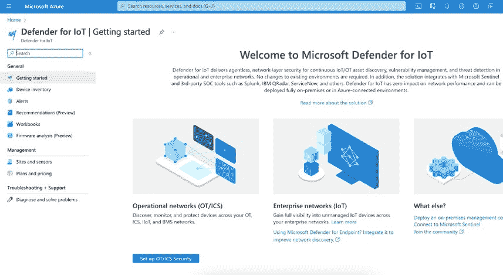

**步骤 2**：在您的 Azure 仪表板上，选择或搜索 Defender for IoT。

**步骤 3**：在左侧菜单的“Defender for IoT”下，点击“入门”。

## 配置选项

配置选项允许使用安全的、供应商批准的命令根据需要收集详细的设备信息，确保稳健的防御机制。

`Microsoft Threat Intelligence` 更新的集成增强了 Defender for IoT 的防护能力。利用每天来自 Microsoft 生态系统中数万个信号的数据（包括 `Endpoint`、`Cloud`、`Microsoft Entra ID` 和 `Microsoft 365`），结合第 52 节中的 IoT 和 OT 情报，威胁情报包提供了价值签名、恶意软件签名、`CVE` 以及其他恶意活动的指标。

与 Microsoft 生态系统集成为您的业务带来了巨大收益。

通过将 `Microsoft Sentinel` 与 Defender for IoT 告警检测相结合，您可以获得 IT/OT 边界的全视图。利用 IoT/OT 剧本实现了响应过程的自动化。此外，与 `Microsoft Defender for Endpoint` 的集成扩展了检测和响应能力，形成了扩展检测和响应 (XDR) 框架，从而主动防御攻击。

设置 OT/ICS 安全由三个阶段组成：设置传感器、配置 `SPAN` 端口或 `TAP`，最后将传感器注册到 Microsoft Defender for IoT。

### 阶段 1：配置设置传感器

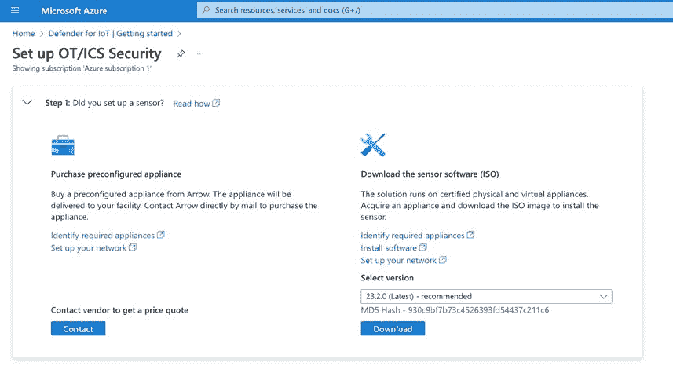

您可以使用预配置的硬件设备或虚拟设备。

#### 需要哪些设备？

您可以选择物理或虚拟设备，以帮助您为系统选择最佳设备，并确定最符合组织网络监控需求的硬件配置。或者，您也可以参考提供的规格说明，独立采购符合您云的硬件。

在高带宽的企业级 IT/OT 混合网络中，微软推荐的硬件配置是 `C5600`，它提供高达 3 Gbps 的 SPAN/TAP 吞吐量。这种多功能配置最多可监控 12,000 个资产，并支持物理和虚拟部署。它是在混合 IT 和 OT 环境中进行全面监控的理想选择，可确保高效的网络监管。

对于企业级监控，建议使用三种微软推荐的硬件配置：`E1800`、`E1000` 和 `E500`，它们提供高达 1 Gbps 的 SPAN/TAP 吞吐量。每种配置均支持监控最多 10,000 个资产，并适用于物理和虚拟部署场景。这些选项满足了站点级运营企业的多样化监控需求，便于实用的流量分析。

在生产线监控中，建议使用三种微软推荐的硬件配置，特别是在生产/任务关键环境中。`L500` 提供高达 200 Mbps 的 SPAN/TAP 吞吐量，适用于监控最多 1,000 个资产。`L100` 提供高达 60 Mbps 的吞吐量，专为具有 800 个监控资产的环境设计。最后，`L60` 的吞吐量高达 10 Mbps，是具有 100 个调查资产的小部署的理想选择。所有这些配置都支持物理和虚拟部署。

对于部署旨在管理和监控大规模多传感器设置的本地管理控制台，微软推荐的硬件配置是 `E1800`。该配置支持监控最多 300 个传感器，并在部署上具有灵活性，适用于高效管理本地环境中的大规模传感器部署。

#### 预配置设备

提供多种预配置设备以有效监控您的 OT 网络，为不同的网络需求提供定制化选择。`C5600` 采用 `HPE ProLiant DL360`，具有高达 3 Gbps 的最大带宽，可容纳 12,000 台设备。其物理规格包括 1U 安装配置以及提供灵活端口的 `15x RJ45` 或 `8x SFP (OPT)`。`E1800` 利用 `HPE ProLiant DL20 Gen10 Plus` 和 `Dell PowerEdge R350`，支持高达 1 Gbps 的最大带宽，并监控最多 10,000 台设备。这种 1U 安装设备具有 `8x RJ45` 或 `6x SFP (OPT)` 端口。`E500` 由 `Dell Edge 5200 (Rugged MIL-STD-810G)` 代表，提供高达 1 Gbps 的最大带宽，支持 10,000 台设备。

这种为恶劣环境设计的壁挂式设备具有 `8C[8T] CPU`、`32 GB RAM`、`512 GB` 存储和 `3x RJ45` 端口。`L500` 采用 `HPE ProLiant DL20 Gen10 Plus (NHP 2LFF)`，可容纳高达 200 Mbps 的最大带宽，监控最多 1,000 台设备。其 1U 安装配置和 `4x RJ45` 端口适用于特定的部署场景。`L100` 利用 `YS-Techsystems YS-FIT2 (Rugged MIL-STD-810G)`，支持高达 10 Mbps 的最大带宽，监控最多 100 台设备。该设备是多种网络环境的理想选择，具有 `DIN/VESA` 安装和 `2x RJ45` 端口。

OT 环境下的本地管理控制台提供了预配置设备，以简化监控流程。`E1800` 整合了 `HPE ProLiant DL20 Gen10 Plus` 和 `Dell PowerEdge R350`，支持最多 300 个传感器。这种 1U 安装设备具有 `8x RJ45` 或 `6x SFP (OPT)` 端口。

#### 虚拟设备

部署虚拟设备时，Defender for IoT 兼容多种虚拟机程序，包括 `VMware ESXi`（5.0 及更高版本）和 `Microsoft Hyper-V`。建议对内存和 CPU 进行静态分配以确保性能。高流量监控可能需要特定的存储和 IOPS 资源。

### 阶段 2：配置 SPAN 端口或 TAP

#### 步骤 2：将前 23 个端口配置为会话源，仅镜像 RX 数据包。

#### 步骤 3：将端口 24 配置为会话目的。

#### 步骤 4：返回到特权 EXEC 模式。

#### 步骤 5：验证端口镜像配置。

#### 步骤 6：保存配置。

#### 多 VLAN 示例 CLI SPAN 端口配置 (Cisco 2960)

只要网络交换机设置为向 Defender for IoT 发送 VLAN，Defender for IoT 就可以监控网络中的多个 VLAN 而无需额外配置。例如，在 Cisco 交换机上使用以下命令支持监控 VLAN：

监控会话：

```
monitor session 1 source interface Gi1/2
monitor session 1 filter packet type good Rx
monitor session 1 destination interface fastEthernet1/1 encapsulation dot1q
```

监控 Trunk 端口 F.E. Gi/1:

```
interface GigabitEthernet1/1
switchport trunk encapsulation dot1q
switchport mode trunk
```

### 第 4 章 部署 Microsoft Defender for IoT TAP

无论使用主动还是被动聚合来镜像流量，聚合终端访问点 (TAP) 都会策略性地插入到网络电缆中。这种主动或被动 TAP 会同时复制接收（RX）和发送（TX）流量，从而利用 Defender for IoT 实现有效监控。

TAP 是一种硬件设备，旨在促进网络流量在端口之间无缝流动而不会引起任何中断。作为通道，TAP 确保了流量流双方都能持续创建精确副本。

重要的是，此复制过程是持续的，在不损害网络的情况下维护了其完整性。

#### 已验证的 TAP 型号

Defender for IoT 经过测试，被发现与多种 TAP 型号兼容。虽然可能与其他供应商和其他型号兼容，但以下 TAP 型号已经过测试：

##### Garland P1GCCAS

当使用 Garland TAP 时，必须配置您的网络以支持聚合。

##### IXIA TPA2-CU3

对于使用 Ixia TAP 的用户，请确保已激活聚合模式。

##### US Robotics USR 4503

使用 US Robotics TAP 时，通过调整可选开关到 `AGG` 来激活聚合模式。

这些 TAP 型号已专门针对 Defender for IoT 的兼容性进行了测试，为用户提供了网络监控的可靠选择。然而，重要的是，可能也与其他不同供应商的 TAP 型号存在兼容性，鼓励用户根据特定需求验证兼容性。

#### 表 4-1. 防火墙要求

| 连接类型 | 端口号 |
| :--- | :--- |
| 收集器和 opM 控制台接口：`ssl` 连接 | `tcp` 443 |
| 用于故障排除的 `ssh` | `tcp` 22 |
| `ntp` 服务器连接（收集器/opM 到 ntp 服务器） | `ntp udp` 123 |
| 邮件服务器连接（收集器/opM 到邮件服务器） | `smtp` 25（如适用） |
| Dns 连接（收集器/opM 到 Dns） | 53（如适用） |
| 集中式日志系统连接（收集器/opM） | 您定义的端口 |
| Active Directory 连接（收集器/opM 到 aD） | 您定义的 `ldap/s` 端口（例如 `tcp` 389） |
| `snmp/mib` 存跳监控（前提：在防火墙中开放 `udp` 端口） | `udp` 161 |
| Windows 终端监控 (WMi)（前提：出站流量的 `udp` 135, `tcp` >1024 防火墙规则） | |

### 阶段 3：在 Microsoft Defender for IoT 中注册此传感器

在向 Microsoft Defender for IoT 注册传感器的步骤 3 中，您需要为传感器输入或选择特定值：

1.  在“传感器名称”字段中，为您的 OT 传感器提供一个有意义的名称。微软建议在名称中包含 OT 传感器的 IP 地址。
2.  在“订阅”字段中，选择您的订阅。如果您还没有订阅，请通过注册订阅以添加您的 Azure 订阅。
3.  可选启用“云连接”选项，以连接到其他 Microsoft 服务，并在 Azure 门户中查看数据。
4.  可选打开“自动威胁情报更新”，允许 Defender for IoT 自动向您的传感器推送威胁情报包。
5.  在“站点”部分中，提供以下信息：
    a. 资源名称：选择站点或通过“创建站点”创建一个新站点。
    如果创建新站点：
    i. 在“新站点”字段中，输入您的站点名称。
    ii. 从“站点大小”菜单中根据您的许可证选择站点大小。（注意：旧计划不包含此字段。）
    b. 显示名称：为 Defender for IoT 显示的站点输入有意义的名称。
    c. 标签：输入标签键和值，有助于在 Azure 门户中识别和定位站点及传感器。
    d. 区域：为您的传感器选择区域或通过“创建区域”创建一个区域。
6.  所有字段完成后，选择“注册”。将显示成功消息并自动下载激活文件。
7.  选择“完成”。您的传感器现在将显示在 Defender for IoT 的站点和传感器页面上。

### 第 4 章 部署 Microsoft Defender for IoT 阶段 3：配置 OT/ICS 安全

在激活之前，传感器的状态将为“等待中”。确保传感器可以访问下载的激活文件。信任根会对从 Azure 门户下载的所有文件签名，以确保您的机器使用签名资产。

#### 任务 3：配置 OT/ICS

在 Microsoft Defender for IoT 中注册和激活虚拟 OT 传感器涉及多个关键步骤，以确保无缝集成和有效监控。

在开始设置过程之前，请确保满足必要的先决条件。首先，完成快速上手以将您的 Azure 订阅与 Defender for IoT 集成。使用安全管理员、贡献者或所有者角色访问 Azure 门户，如 OT 和企业 IoT 用户角色所示。确认拥有通过 SPAN 端口进行流量监控的网络交换机，并确保至少有一个设备连接到交换机的 SPAN 端口进行监控。

#### 为传感器创建虚拟机

为托管虚拟 OT 传感器创建虚拟机 (VM)。使用虚拟机程序并根据虚拟传感器的需求分配硬件资源（CPU、内存、存储）。

为您的传感器设置虚拟机：

1.  确保您的机器上的 `VMware` 正在运行。
2.  登录 ESXi，选择相关的数据存储并访问 `Datastore Browser`（数据存储浏览器）。
3.  上传镜像并关闭窗口。
4.  导航到 `Virtual Machines`（虚拟机），然后选择 `Create/Register VM`（创建/注册虚拟机）。
5.  选择创建新虚拟机并继续下一步。
6.  分配传感器名称并指定以下选项：`Compatibility`——最新的 `ESXi` 版本，`Guest OS family`——`Linux`，`Guest OS version`——`Ubuntu Linux (64-bit)`。
7.  点击 `Next`（下一步）。
8.  选择相关的数据存储并继续下一步。

根据您的需求，参考 `Prerequisites`（前提条件）部分的规范调整虚拟硬件参数。您的 `VM` 现在已准备好安装 `Defender for IoT` 软件。

后续步骤涉及软件安装，这将在教程稍后介绍，涵盖在 `Azure portal` 中入驻您的传感器、配置流量镜像以及为云管理准备虚拟机。

## 入驻虚拟传感器

一旦 `VM` 设置完成，即可在 `Microsoft Defender for IoT` 中启动虚拟 OT 传感器的入驻流程。访问 `Defender for IoT` 控制台并按照入驻向导操作。提供传感器名称、描述和 `VM` 网络配置等详细信息。


# 启动虚拟传感器入驻流程

要启动虚拟传感器的入驻过程，导航到 `Azure portal` 并访问 `Defender for IoT` ➤ `Getting Started`（入门）页面。在左下角选择 `Set up OT/ICS Security`（设置 OT/ICS 安全）。或者，从 `Defender for IoT Sites and Sensors` 页面选择 `Onboard OT sensor`（入驻 OT 传感器）➤ `OT`。

默认情况下，在 `Set up OT/ICS Security` 页面上，向导的前两个步骤如下：

**步骤 1：** 您是否设置了传感器？

**步骤 2：** 配置 `SPAN` 端口或折叠的 `TAP`。虽然软件安装和流量镜像配置将在部署过程的后期进行，但准备好设备并规划流量镜像方法至关重要。

**步骤 3：** 使用 `Microsoft Defender for IoT` 注册此传感器；提供以下值：

- `resource name`（资源名称）：在您处选择挂载传感器的站点或创建新站点
- `display name`（显示名称）：用于在 `Defender for IoT` 中设置有意义的站点名称
- `tags`（标签）：允许您在 `Azure portal` 中输入用于站点和传感器标识的键值
- `zone`（区域）：在您处选择现有区域或创建新区域

完成所有字段后，选择 `Register`（注册）将传感器添加到 `Defender for IoT`。将出现成功消息，您的唯一激活文件将自动下载。该文件包含传感器管理模式的说明，并由信任根签名以确保安全使用。

将下载的激活文件保存在首次登录控制台的用户可以访问的位置。该文件对于激活传感器至关重要。您可以通过选择 `Activate your Sensor`（激活您的传感器）框中的相关链接来手动下载该文件。在 `Add outbound allow rules`（添加出站允许规则）框中，选择 `Download endpoint details`（下载端点详情）链接以获取必须从传感器配置为安全的 `JSON` 端点列表。将下载的文件保存到本地，并在后续步骤中使用列出的端点以确保成功连接到 `Azure`。

记住，也可以从 Sites and Sensors 页面访问所需的端点列表。完成这些步骤后，选择页面左下角的 `Finish`（完成）。

您的新传感器现在显示在 `Defender for IoT Sites and Sensors` 页面上，状态为 `Pending`（等待中）。

# 配置虚拟 SPAN 端口

`SPAN` 端口配置对于捕获流量至关重要。确保配置 `virtual switch`（虚拟交换机）以允许 `VM` 接收必要的数据包。

# 为云管理准备

为了高效的云管理，为传感器进行云集成准备。将传感器连接到 `Defender for IoT` 云服务，实现集中式监控、报告和管理。

您可以手动选择 “Install iot-sensor-<version number>” 项目以继续，或允许其在 30 秒倒计时后自动开始。

# 激活虚拟传感器

安装完成后，通过验证传感器与 Defender for IoT 平台的连接来激活虚拟传感器。确认传感器正在与云端服务通信并接收更新。此步骤对于启用实时威胁检测和响应至关重要。

要启动传感器的激活过程，请遵循以下步骤。导航到 `Activation` 标签页并选择 `Upload` 选项，以上传从 Azure 门户获取的激活文件。随后，选择条款和条件并选择 `Next: Certificates` 继续下一步。

在 `Certificates` 标签页中，在您的 OT 传感器上部署 `SSL/TLS` 证书。建议在生产环境中使用 CA 签名的证书来配置 `SSL/TLS` 证书设置。

遵循这些步骤，您可以成功地在 Microsoft Defender for IoT 中入站并激活虚拟 OT 传感器。这种集成通过提供全面的监控和对潜在威胁的防护，增强了您的 OT 环境的安全态势。定期更新传感器软件并监控其性能，以确保 IoT 基础设施的持续安全。

在 OT 传感器上安装 OT 软件后，进行彻底的系统测试以确保功能正常至关重要。此处列出的验证过程适用于所有类型的设备。

# 系统健康验证

通过系统健康验证确保 IoT（物联网）部署的有效性，对于维护安全、可靠且高效的连接环境至关重要。IoT 系统以各种设备和传感器的互联为特征，是智能家居、工业过程、医疗保健系统等不可缺的组成部分。验证系统健康的重要性在于，它能够识别并解决可能损害这些互联设备功能、安全或整体性能的潜在问题。

首先，系统健康验证在识别 IoT 生态系统中的漏洞和安全差距方面起着关键作用。IoT 设备的互联特性扩大了攻击面，使其容易受到各种网络威胁的影响。通过定期验证系统健康，组织可以主动检测可能表明安全泄露的异常或不规则情况。这种主动立场对于防止未经授权的访问、数据泄露或损害敏感信息至关重要，这些情况对个人和企业都会产生严重后果。

其次，验证 IoT 系统健康对于确保连接设备的可靠性和最佳性能至关重要。IoT 部署通常涉及许多设备，从传感器、执行器到通信模块和边缘设备。定期的健康验证使组织能够监控这些设备的状态、固件版本和连接情况。这些信息有助于识别潜在的硬件故障、过时的固件或通信问题，允许进行及时的维护或更换，以防止系统停机和中断。

此外，IoT 系统健康验证有助于符合行业法规和标准。许多行业（如医疗保健、金融和制造业）都有针对连接设备安全和隐私的特定监管要求。进行系统性的健康验证可确保组织遵守这些法规，降低法律风险和潜在责任。

对标准的合规不仅保护了敏感数据，还培养了用户和利益相关者之间的信任，增强了 IoT 生态系统的信誉。

因此，在当前互联设备的背景下，必须重视验证 IoT 系统健康的重要性。组织可以通过主动识别安全漏洞、确保设备可靠性能并满足合规性要求，构建稳健且韧性的 IoT 生态系统。这种方法不仅防御了潜在威胁，还增强了 IoT 部署的整体可靠性和效率，促进了这些技术在各个领域的广泛应用。

这些验证通过用户界面 (`UI`) 或命令行界面 (`CLI`) 支持，并供默认特权 Admin 用户使用。

# 常测试

## 完整性测试 (Sanity Test)

- 验证系统正在运行。

## 版本 (Version)

- 验证安装的软件版本是否正确。

## `ifconfig`

- 确认安装过程中配置的所有输入接口均正在运行。

## 网关检查 (Gateway Checks)

使用以下命令执行网关检查：使用 `route` 命令显示网关的 IP 地址。

```bash
<root@apress:/# route -n
Kernel IP routing table
Destination Gateway Genmask Flags Metric Ref Use Iface
0.0.0.0 172.18.0.1 0.0.0.0 UG 0 0 0 eth0
172.18.0.0 0.0.0.0 255.255.0.0 U 0 0 0 eth0
```

使用 `arp -a` 命令验证默认网关的 MAC 地址和 IP 地址的绑定。

```bash
<root@apress:/# arp -a
cusalvtecca101-gi0-02-2851.network.microsoft.com (172.18.0.1) at 02:42:b0:3a:e8:b5 [ether] on eth0
mariadb_22.2.6.27-r-c64cbca.iot_network_22.2.6.27-r-c64cbca (172.18.0.5) at 02:42:ac:12:00:05 [ether] on eth0
```

# DNS 检查

使用 `cat /etc/resolv.conf` 命令查找配置的 IP 地址。

```bash
<root@apress:/# cat /etc/resolv.conf
search microsoft.com
nameserver 127.0.1
```

使用 `host` 命令解析 FQDN。

```bash
<root@apress:/# host www.microsoft.com
www.microsoft.com has address 13.107.4.53
```

# 防火墙检查

使用 `wget` 命令验证 443 端口是否开启。

```bash
<root@apress:/# wget https://www.apress.com
--2022-11-09 11:21:15-- https://www.apress.com/
Resolving www.apress.com (www.apress.com)... 13.107.4.53, 2603:101b:4015::101:694:4a35:53
Connecting to www.apress.com (www.apress.com)|13.107.4.53|:443...
connected.
HTTP request sent, awaiting response... 200 OK
Length: 99966 (98K) [text/html]
Saving to 'index.html.1'
index.html.1 100%[===================> 97.62K --.-KB/s in 0.02s 2022-11-09 11:21:15 (5.88 MB/s) - 'index.html.1' saved [99966/99966]
```

# 设置并启动您的 OT 传感器激活

各种预设程序可以通过浏览器或命令行界面 (`CLI`) 执行。当将物理线从交换机连接到传感器时，选择浏览器方法是可行的，可以准确识别接口。确保您重新调整网络适配器以匹配传感器上的默认设置。

或者，如果您拥有网络详细信息但无法物理连接电缆，可以使用 `CLI`。如果连接传感器的唯一手段是通过 `iLO/iDRAC`，请选择 `CLI` 路径。

需要注意的是，即使通过 `CLI` 配置设置，最终步骤仍必须使用浏览器界面完成。

# 通过浏览器配置设置

按照以下步骤操作可以帮助您通过浏览器配置并激活 OT 传感器。

## 登录并更改密码

使用浏览器导航到安装期间提供的默认 IP 地址（例如 `192.168.0.101`），首次访问 OT 传感器控制台。

默认凭据（`Username: admin`，`Password: admin`）并按照提示更改 `Admin` 用户密码。

## 定义网络详情

在“管理”（Management）界面选项卡中，为您的传感器指定以下网络详情：

- 管理接口：选择用于管理所需的接口。
- IP 地址：输入用于访问传感器的 IP 地址。
- 子网掩码：指定传感器的子网掩码。
- 默认网关：设置默认网关地址。
- DNS：输入 DNS 服务器 IP 地址。
- 主机名：为传感器分配主机名。
- 启用云连接代理（可选）：如果需要，定义代理服务器。

## 定义监控接口

在“接口配置”（Interface configurations）选项卡中，配置受监控接口的设置：

- 启用/禁用切换：选择需要被监控的接口。
- 高级设置：可选地修改每个接口的模式、描述和自动协商设置。
- 保存更改。

## 重启传感器

选择“下一步：重启”（Next: Reboot）继续后续步骤，并启动重启。重启后，您将被重定向到指定的传感器 IP 地址。

## 激活传感器

- 在“激活”（Activation）选项卡中，上传从 Azure 门户下载的传感器激活文件。
- 选择条款和条件，然后进入“下一步：证书”（Next: Certificates）步骤。

## SSL/TLS 证书设置

在“证书”（Certificates）选项卡中，在您的 OT 传感器上部署 SSL/TLS 证书：导入信任的 CA 证书（推荐）：部署 CA 签名证书。

输入证书详情并上传私钥、证书以及可选的证书链文件。

## 完成设置

选择“完成”（Finish）完成设置并访问您的传感器控制台。

> **注意：** 如果初始设置是通过 `CLI` 配置的，则基于浏览器的配置将在传感器重启后恢复，引导您进入 `Defender for IoT` ➤ `概览`（Overview）页面和 `激活`（Activation）选项卡。

# 通过 CLI 配置初始设置参数

按照以下步骤操作可以帮助您通过 `CLI` 配置并激活 OT 传感器。

在安装界面上，显示默认网络详情后按 `Enter` 键。

1. 在 `D4Iot` 登录提示处，使用默认凭据登录：
   - `Username: admin`
   - `Password: admin`（输入的字符不会显示）
2. 提示时，请为 `Admin` 用户输入新密码，确保其符合指定要求。
3. 打开“软件包 Linux 配置向导”（Package configuration Linux configuration wizard）。使用方向键导航，使用 `SPACE` 键选择选项，并按 `Enter` 继续。
4. 在向导的“选择监控接口”（Select monitor interfaces）界面选择您想要监控的接口。确保所选接口已连接，以避免产生健康通知。
5. 在“选择管理接口”（Select management interface）界面，选择 Azure 门户或本地管理控制台连接接口。
6. 为传感器输入所需的 IP 地址、子网掩码、默认网关、DNS 服务器 IP 地址和主机名。
7. 可选：在“运行此传感器作为代理服务器（预览）”（Run this sensor as a proxy server (Preview)）界面中选择“是”，并在提示时提供代理凭据。
8. 配置过程启动，传感器重启，然后出现最后的登录提示。
9. 打开浏览器访问定义的传感器 IP 地址以继续设置。

# 在 OT 传感器上配置用于 Azure 连接的代理设置

## 在 OT 传感器上定义代理设置

### 访问系统设置

登录 OT 传感器并导航至 `系统设置`（System Settings）➤ `传感器网络设置`（Sensor Network Settings）。

### 启用代理并提供详情

激活 `代理`（Proxy）选项并输入您的代理服务器的必要详情：

1. `代理主机`（Proxy host）
2. `代理端口`（Proxy port）
3. `代理用户名`（Proxy username）（可选）
4. `代理密码`（Proxy password）（可选）

### 证书选项

如果需要，选择“客户端证书”（Client certificate）以上传用于 `SSL/TLS` 代理服务器访问的验证证书。

### 保存配置

保存已配置的代理设置。

如果已配置代理，则继续在传感器控制台上定义代理设置。

## 设置新的 Azure 代理

在以下场景下，您可以选择 Azure 代理来在传感器与 Defender for IoT 之间建立连接：

- 需要传感器与 Azure 之间建立私有连接时
- 您的站点通过 `ExpressRoute` 连接到 Azure 时
- 您的站点通过 `VPN` 连接到 Azure 时

### 前提条件

确保您拥有：

- 用于监控日志的 `Log Analytics` 工作空间。
- 通往 `Azure VNET` 的远程站点连接。
- 允许从传感器通过端口 `443` 的出站 `HTTPS` 流量。

# 配置传感器代理设置

让我们探讨在传感器上配置用于连接 Azure 的代理设置。这是一个七阶段的过程。

## 第一阶段：为 NSG 日志定义存储账户

Azure Storage 是 Microsoft Azure 提供的云存储服务，提供了一套可扩展且高性能的存储解决方案，适用于各种数据类型和场景。它是云环境中存储和管理数据的基础组件。Azure Storage 提供了满足多种存储需求的多种功能服务。

以下是 Azure Storage 中的关键组件：

- **Blob 存储**：`Azure Blob Storage` 设计用于存储大量的非结构化数据，如文档、图像、视频和日志文件。它具有高度扩展性，并支持不同的访问层。
- **文件存储**：`Azure File Storage` 提供全托管的文件共享，允许组织通过服务器消息块 (`SMB`) 协议创建分布式文件系统。适用于需要共享文件访问应用程序。
- **表格存储**：`Azure Table Storage` 是适用于半结构化数据的 NoSQL 数据存储。它提供无模式设计的键/属性存储，是需要扩展和低延迟存储应用程序的灵活选择。
- **队列存储**：`Azure Queue Storage` 通过提供组件间异步通信的消息队列，实现构建的可扩展应用程序。它有助于创建处理突发请求的松耦合系统。
- **磁盘存储**：`Azure Disk Storage` 为 `Azure 虚拟机` 提供可扩展的高性能块存储。托管磁盘简化了与虚拟机关联存储的管理，确保了持久性和可用性。

Azure Storage 的主要功能和特性包括：

- **可扩展性**：Azure Storage 设计可根据需求动态扩展，允许组织高效地存储和管理海量数据。
- **持久性和冗余**：Azure Storage 中的数据经过复制以确保持久性和高可用性。冗余选项包括本地冗余存储 (`LRS`)、地理冗余存储 (`GRS`) 和区域冗余存储 (`ZRS`)。
- **安全性**：Azure Storage 提供了强大的安全性功能，包括静态加密、基于角色的访问控制 (`RBAC`) 以及用于细粒度访问控制的共享访问签名 (`SAS`)。

# 第 4 章：部署 Microsoft Defender for IoT


# Azure Storage 与网络安全组 (NSG) 概述

## 与 Azure 服务的集成
Azure Storage 与多种 Azure 服务集成，允许组织利用数据进行分析、机器学习和其他场景的操作。

## 全球范围
Azure Storage 在全球范围内拥有业务布局，在世界各地设有数据中心，使组织能够在其终端用户附近部署应用并存储数据，从而降低延迟。

总体而言，Azure Storage 为希望在云端存储、管理和访问数据的组织提供了一种灵活且可靠的解决方案，支持跨行业和应用场景的各种用例。

Azure Storage 是由 Microsoft Azure 提供的云存储服务，为各种数据类型（包括 blob、文件、表格和队列）提供可扩展、安全且高可用的存储解决方案。为了确保存储在 Azure Storage 中的数据的安全性，网络安全组 (`NSGs`) 在实施网络安全控制方面起着至关重要的作用。

Azure 中的网络安全组充当虚拟防火墙，允许或拒绝访问 Azure 虚拟网络内资源的入站和出站流量。在使用 `NSGs` 保护 Azure Storage 时，重点主要是保护对存储账户及相关服务的访问。

一种基本方法是控制进出 Azure Storage 账户的网络流量。`NSGs` 允许根据源和目的 IP 地址、端口范围和协议制定入站和出站流量的规则。管理员可以通过将 `NSGs` 与子网或单个资源关联，对网络通信实施细粒度的控制。

对于 Azure Storage，可以使用 `NSGs` 解决以下关键考虑因素：

- **限制对存储账户的访问**：可以配置 `NSGs` 允许特定的 IP 范围或应用程序访问 Azure Storage 账户。这种限制对于防止未经授权的访问和潜在的数据泄露至关重要。
- **保护通信协议**：`NSGs` 有助于指定允许的通信协议规则。例如，管理员可以限制对 `HTTPS` 等安全通信协议的访问，以确保传输中数据的加密。
- **隔离存储资源**：`NSGs` 允许在虚拟网络内隔离存储资源。通过将 `NSGs` 与相关的子网或资源关联，组织可以对其网络进行分段，以增强安全性和合规性。
- **设置受信源白名单**：通过定义允许受信 IP 地址或范围的规则，组织可以确保只有授权实体才能访问或修改 Azure Storage 中的数据。
- **日志和监控**：`NSGs` 提供了日志功能，允许管理员监控和审计进出 Azure Storage 的网络流量。这有助于检测可疑活动并帮助维护安全的存储环境。

为 Azure Storage 实施 `NSGs` 涉及根据组织的特定安全需求创建和配置 `NSG` 规则。定期检查和更新 `NSG` 配置对于适应不断变化的安全需求并维护针对 Azure Storage 资源潜在威胁的稳健防御至关重要。

# 第 1 章：在 Azure 门户中创建具有指定设置的新存储账户

在 Azure 门户中，按照以下规范启动创建新的存储账户：

## 基础知识
- 性能：`Standard`
- 账户类型：`Blob Storage`
- 复制：`LRS`

## 网络
- 连接方法：`Public endpoint (selected network)`
- 在虚拟网络中：`None`
- 路由偏好：`Microsoft network routing`

## 数据保护
- 保持所有选项为空（未勾选）。

## 高级
- 保持所有默认值。

# 第 2 章：定义虚拟网络和子网

创建以下虚拟网络 (`VNet`) 及其相应的子网：

- 名称：`MD4IoT-VNET`
- 推荐大小：带有 `Bastion` 的 `/26` 或 `/25`
- 子网
    - `GatewaySubnet`：`/27`
    - `ProxyserverSubnet`：`/27`
    - `AzureBastionSubnet`（可选）：`/26`

# 第 3 章：定义虚拟或本地网关

Azure 中的虚拟网络网关（通常称为网络网关）是一种网络组件，提供了一种将本地网络连接到 Azure 虚拟网络的方法。它充当本地基础设施与 Azure 之间的桥梁，促进通过互联网进行安全且加密的通信。

虚拟网络网关的关键功能和方面包括：

- **VPN 网关**：虚拟网络网关的主要功能之一是建立虚拟专用网络 (`VPN`) 连接。它支持 `Site-to-Site VPNs`（站点到站点 VPN）和 `Point-to-Site VPNs`（点对站点 VPN）。
- **站点到站点 VPN**：将本地网络连接到 Azure 虚拟网络，将您的企业网络扩展到云端。这通常通过互联网连接完成。
- **点对站点 VPN**：允许单独计算机通过互联网连接到 Azure 虚拟网络。这对于远程用户或设备非常有用。
- **ExpressRoute 网关**：除了 VPN 连接外，虚拟网络网关还支持通过 Azure `ExpressRoute` 连接。`ExpressRoute` 提供了从本地到 Azure 的专用专用连接，比典型的基于互联网的连接具有更高的带宽和更低的延迟。
- **本地网关**：本地网关是一个相关概念，代表本地 VPN 设备或公共 IP 地址。它定义了 Azure `VPN Gateway` 连接到本地网络所需的信息。
    - **IP 地址**：指定本地 VPN 设备的公共 IP 地址。
    - **地址空间**：定义本地地址空间（范围）。
    - **BGP（边界网关协议）设置**：如果使用 BGP，则可选的 BGP 设置。

通过配置虚拟网络网关并将其与虚拟网络和本地网关关联，您可以在本地基础设施和 Azure 之间建立安全可靠的连接。这种连接对于必须扩展数据中心到云端或启用本地与云资源之间安全通信的场景至关重要。

为虚拟网关建立 `VPN` 或 `ExpressRoute Gateway`，或者根据本地网络如何连接到 Azure 来配置本地网关。将网关附加到之前创建的 `GatewaySubnet` 子网。

# 第 4 章：定义网络安全组 (NSG)

Azure 网络安全组 (`NSG`) 是 Azure 网络安全功能的基础元素。`NSGs` 充当虚拟防火墙，允许您控制进出 Azure 资源的流量。它们提供了一种基于规则实施网络安全策略的方法，根据源和目的 IP 地址、端口号和协议等各种属性允许或拒绝流量。

Azure 网络安全组的关键功能和方面包括：

- **基于规则的访问控制**：`NSGs` 基于规则运行，每个规则定义了允许或拒绝流量条件。规则根据源和目的 IP 地址、端口号和协议定义。
- **入站和出站规则**：`NSGs` 允许您定义入站和出站规则。入站规则控制进入 Azure 资源的流量，而出站规则控制离开 Azure 资源的流量。
- **优先级和顺序**：规则被分配了一个优先级，且规则的顺序非常重要。流量将按照顺序对规则进行评估，匹配流量的第一条规则将被应用。数值越小表示优先级越高。
- **默认规则**：`NSGs` 具有默认规则，允许所有出站流量，但除非规则显式允许，否则拒绝所有入站流量。这些默认规则有助于默认保护资源，并要求入站访问需要显式配置。
- **与子网或网络接口关联**：`NSGs` 可以与子网、单个网络接口或两者都进行关联。当与子网关联时，`NSG` 规则将适用于该子网内的所有资源。
- **状态过滤**：`NSGs` 是有状态的，这意味着如果你允许某个特定连接的入站流量，则该连接相应的出站流量将自动被允许。这简化了规则配置。
- **日志记录**：`NSGs` 支持日志记录，允许你捕获有关允许和拒绝流量的信息。这些日志对于监控和排除网络安全问题很有帮助。

通过使用 `Azure Network Security Groups`，你可以实施分层安全方法来保护你的 Azure 资源，并控制部署在 Azure 云中的应用程序不同组件之间的通信。

## 创建一个 NSG 并定义以下入站规则

- 创建规则 `100`，允许流量从传感器（源）通过端口 `tcp3128` 访问负载均衡器的私有 IP 地址（目的）。
- 从系统规则 `65001` 复制规则 `4095`，因为规则 `65001` 将被规则 `4096` 覆盖。
- 建立规则 `4096` 以拒绝所有流量进行微隔离。
- 可选，对于 `Bastion` 用户，创建规则 `4094` 允许 `Bastion SSH` 访问服务器，并将 `Bastion` 子网作为源。

将 `NSG` 分配到之前创建的 `ProxyserverSubnet`。

## 配置 NSG 日志

a. 选择新的 `NSG`。
b. 选择诊断设置 ➤ `添加诊断设置`。
c. 为诊断设置提供名称；将类别选择为 `allLogs`。
d. 选择 `发送到 Log Analytics 工作区`；然后选择你的 `Log Analytics workspace`。
e. 选择发送 `NSG flow logs` 并定义所需的值。

### 基础 选项卡
- 输入一个有意义的名称。
- 选择之前创建的存储账户。
- 定义所需的保留天数。

### 配置 选项卡
- 选择 `Version 2`。
- 启用 `Traffic Analytics`。
- 选择你的 `Log Analytics workspace`。

# 第 5 章：为 IoT 部署 Microsoft Defender

## 第 5 阶段：定义 Azure 虚拟机规模集

Azure 虚拟机规模集 (`VMSS`) 是 `Microsoft Azure` 中的一项服务，允许你部署和管理一组相同的、负载均衡的虚拟机。它们旨在为你的应用程序提供高可用性，并允许根据需求自动扩展。

`Azure Virtual Machine Scale Sets` 的关键特性包括：

- **可扩展性**：`VMSS` 允许你根据不断的需求快速扩展集合中的虚拟机数量。你可以手动调整 `VM` 实例的数量，或设置自动缩放规则，根据 `CPU` 使用率或网络流量等指标动态调整容量。
- **负载均衡**：`VMSS` 包含内置负载均衡功能，将传入的网络流量分到集合中的所有实例上。这确保了每台虚拟机都能获得平衡的负载份额。
- **高可用性**：`VMSS` 设计通过将虚拟机分布在多个故障域和更新域中来实现高可用性。这最大限度地减少了计划或意外维护事件期间应用程序停机的风险。
- **自动 OS 镜像更新**：`VMSS` 可以自动更新集合中所有实例的操作系统镜像。此功能简化了保持虚拟机最新安全补丁和更新的工作。
- **自定义 VM 镜像**：你可以使用自定义 `VM` 镜像来创建 `VMSS`。这允许你配置带有所需软件和设置的虚拟机，将其捕获为自定义镜像，然后使用该镜像部署多个相同的实例。
- **与 Azure 服务集成**：`VMSS` 与其他 `Azure services` 集成，例如 `Azure Virtual Network`、`Azure Load Balancer` 和 `Azure Auto Scaling`。这种集成帮助你构建全面且可扩展的解决方案。
- **灵活更新策略**：`VMSS` 为更新虚拟机提供了灵活性。你可以定义更新策略来控制每次更新多少台虚拟机，设置维护窗口并为自动更新指定参数。
- **监控和诊断**：可以使用 `Azure Monitor` 和 `Azure Diagnostics` 监控规模集中虚拟机的性能。

Azure 虚拟机规模集对于需要快速扩展以处理变化负载的应用程序特别有用，例如 Web 应用程序、API 服务和微服务。它们简化了许多相同虚拟机的部署和管理。

为你的传感器连接创建一个规模集：创建一个具有以下内容的规模集：

- 编排模式：`Uniform`
- 安全类型：`Standard`
- 镜像：`Ubuntu server 18.04 LTS`
- 大小：`Standard_DS1_V2`

在 `ProxyserverSubnet` 中生成网络接口而不定义负载均衡器。

指定缩放设置为：

- 定义初始实例计数为 `1`。
- 将缩放策略设置为 `Manual`。

配置管理设置，例如升级模式、启动诊断、标识、过度置备和自动 OS 升级。

定义健康设置：

- 启用应用程序健康状况。
- 指定 `TCP` 协议和端口 `3128`。

在高级设置下，将分布算法定义为 `Max Spreading`。

对于自定义数据脚本，根据使用的端口和服务，创建一个配置脚本。建议的最小配置为：

```bash
# Squid 监听端口
http_port 3128

# 不允许缓存
cache deny all

# 允许的站点列表
acl allowed_http_sites dstdomain .azure-devices.net
acl allowed_http_sites dstdomain .blob.core.windows.net
acl allowed_http_sites dstdomain .servicebus.windows.net
acl allowed_http_sites dstdomain .download.microsoft.com
http_access allow allowed_http_sites

# 白名单控制
acl SSL_ports port 443
acl CONNECT method CONNECT

# 拒绝连接到其他不安全的端口
http_access deny CONNECT !SSL_ports

# 默认网络规则
http_access allow localhost
http_access deny all
```

- 使用 base-64 编码脚本文件内容。
- 复制编码后的文件内容并创建配置脚本。

```yaml
#cloud-config
# Updates 软件包
apt_upgrade: true

# 安装 squid 软件包
packages:
  - squid

run cmd:
  - systemctl stop squid
  - mv /etc/squid/squid.conf /etc/squid/squid.conf.factory

write_files:
  - encoding: b64
    content: <replace with base64-encoded text>
    path: /etc/squid/squid.conf
    permissions: '0644'

run cmd:
  - systemctl start squid
  - apt-get -y upgrade; [ -e /var/run/reboot-required ] && reboot
```

# 第 6 章：创建 Azure 负载均衡器

Azure Load Balancer 是一种第 4 层（TCP、UDP）负载均衡器，它可以将传入的网络流量分到多个服务器上，以确保单个服务器不会因为流量过多而崩溃。通过在多个服务器之间分配接入请求或网络流量，它在优化应用程序可用性和可靠性方面起着至关重要的作用。这种分配确保了没有服务器承担全部负载，从而提高了应用程序的容错能力和性能。

## Azure Load Balancer 的关键特性

- **负载均衡算法**：Azure Load Balancer 使用基于哈希的算法将传入流量分到后端服务器。它支持轮询和基于哈希的分发等算法，以确保高效的负载均衡。
- **健康探测**：Azure Load Balancer 通过发送健康探测来定期检查后端服务器的健康状况。如果服务器被认为不健康，负载均衡器将停止向该服务器发送流量，直到其恢复。
- **公共和私有负载均衡**：负载均衡器可以配置为为公共和私有 IP 地址分配流量。这允许面向公众的应用程序和内部应用程序具有不同负载均衡需求的场景。
- **后端池配置**：后端池由接收流量的虚拟机或实例组成。Azure Load Balancer 允许配置后端池包含多个虚拟机，以实现冗余和扩展性。
- **会话持久性**：虽然 Azure Load Balancer 主要是第 4 层负载均衡器，但它可以与应用程序网关配合使用，进行第 7 层负载均衡和会话持久。
- **集成可用性集和虚拟机集**：Azure Load Balancer 与 Azure 虚拟机集和可用性集无缝集成，以确保高可用性和容错性。
- **出站连接管理**：通过为后端池中资源发出的外部连接提供稳定的公共 IP 地址，帮助管理这些连接。
- **总结**：Azure Load Balancer 是在 Azure 中构建扩展且可靠应用程序的基础组件。它适用于各种场景，包括 Web 应用程序、API 服务以及从多服务器分发流量中受益的工作负载。

## 使用标准 SKU 创建负载均衡器

定义前端 IP、后端池、负载均衡规则和健康探测。

为您的传感器连接创建 Azure 负载均衡器：

a. 生成一个具有标准 SKU 和 `Internal` 类型的负载均衡器，以确保其与互联网隔离。
b. 在之前创建的 `proxysrv` 子网中定义动态前端 IP 地址，并将可用性设置为 `zone-redundant`。
c. 后端部分，选择之前创建的虚拟机集。
d. 在传感器定义的端口上，创建一个 `TCP` 负载均衡规则，将前端 IP 地址与后端池连接（默认端口为 `3128`）。
e. 创建一个新的健康探测，并在端口 `3128` 上定义 `TCP` 健康探测。
f. 定义负载均衡器日志。
g. 在 Azure 门户中，导航到已创建的负载均衡器。

# 第 7 章：配置 NAT 网关

要为传感器连接设置 NAT 网关，请遵循以下步骤：

a. 首先创建一个新的 NAT 网关。
b. 在 `Outbound IP` 选项卡中，选择创建一个公共 IP 地址。
c. 导航到 `Subnet` 选项卡，选择您之前建立的 `ProxyserverSubnet` 子网。

现在已配置了您的代理。继续继续定义代理设置。

# 第 8 章：设置多云环境的连接性

本节介绍了如何将部署在 `AWS` 或 `Google Cloud` 等公有云中的传感器连接到 Azure 中的 Defender for IoT。请根据提供的流程图选择适当的多云连接方法，并相应配置您的传感器。

在公有云中部署传感器后，配置您的 OT 传感器上的代理设置以完成设置。

# 第 9 章：校准和微调 OT 环境监控


# 校准和微调运营技术（OT）环境的监控

校准和微调运营技术（OT）环境的监控对于维护关键工业过程的安全、效率和可靠性至关重要。OT 系统包含工业控制系统和监视控制数据采集（`SCADA`）系统，在管理电网、制造工厂和运输系统等关键基础设施方面发挥着基础作用。鉴于针对这些系统的网络威胁日益复杂，采取主动和自适应监控方法的必要性不言而喻。

## 建立正常行为基准

校准 OT 监控的主要原因之一是建立工业网络正常行为基准。该基准作为参考，能够检测可能指示潜在安全事件的偏差或异常。由于 OT 环境是动态且频繁变化的，校准确保了监控系统与不断变化的工业过程保持一致。有了定义的基准，将更容易区分常规操作活动和可疑行为，避免误报或相反忽视真实的威胁。

## 自定义监控参数

此外，校准过程允许组织根据其 OT 基础设施的独特特性自定义监控参数。微调涉及优化传感器的灵敏度、定义特定协议并定制检测机制，以关注最相关的受损指标。这种程度的自定义对于降低误报风险至关重要，如果不妥善管理，误报可能会导致安全人员产生警报疲劳。通过尽可能减少误报，安全团队可以将注意力更有效地转向真实威胁，确保更高效、响应更灵敏的安全态势。

## 增强弹性与识别漏洞

在 OT 环境背景下，安全泄露的后果可能非常严重，监控系统的持续校准有助于工业过程的整体弹性。它允许组织适应不断演变的网络威胁、新的攻击向量以及运营格局的变化。此外，微调监控系统有助于识别漏洞和弱点，使组织能够实施及时补救措施并增强整体网络安全态势。

## 优化资源分配

此外，校准对于优化 OT 网络内部资源的分配至关重要。通过配置监控传感器关注特定活动或关键区域，组织可以避免对网络资源的过度压力。这种针对性的方法不仅提高了监控系统的效率，还确保了关键 OT 过程不受地运行。在实时响应至关重要的环境中，通过微调进行资源优化是维持运营连续性的关键因素。

## 总结

因此，校准和微调 OT 环境监控是一项多方面的实践，解决了工业控制系统带来的独特挑战。它为正常行为建立了基准，自定义了监控参数，减少了误报，增强了对网络威胁的防御，并优化了资源分配。随着工业过程变得日益互联并依赖数字技术，主动和自适应监控策略在保护关键基础设施的完整性、可用性和安全方面重要性不言喻。

# Microsoft Defender for IoT/OT 网络传感器部署与配置

Microsoft Defender for IoT/OT 网络传感器对 IT 和 OT 流量执行深度包检测，捕获设备属性和行为等网络设备数据。在安装、激活并配置 OT 网络传感器后，您可以使用本节概述的工具分析自动检测的流量，根据需要添加额外的子网，并管理 Defender for IoT 告警中包含的信息。

## 前提条件

在执行本节中的步骤之前，请确保您已：

- 安装、配置并激活了 OT 网络传感器
- 以管理员用户身份访问您的 OT 网络传感器和本地管理控制台

## 分析您的部署情况

将新的 OT 网络传感器入载到 Microsoft Defender for IoT 后，通过分析监控的流量来验证部署是否正确。

要探索您的网络，请以管理员身份登录 OT 传感器，导航至 `System settings` ➤ `Basic` ➤ `Deployment`，并选择“Analyze”。检查每个接口标签以了解监控状态并进行必要的调整。

每个接口选项卡都会显示以下信息：

- 标签显示连接状态，可以通过选项卡名称中的绿色或红色连接图标来识别。例如，提供的图像中 `eth1` 接口显示绿色图标，表示已连接状态。
- 在选项卡顶部，显示已识别子网和 VLAN 的累计计数。
- 列出了每个子网内识别出的协议的详细信息。
- 指定了每个子网中检测到的单播地址数量。
- 指明每个子网中是否存在广播流量，作为本地网络的指示。

如果 Deployment 页面上显示的流量与您的预期不符，请考虑优化您的部署。这可能涉及调整传感器的网络位置，或确保您的监控接口具有正确的连接性。如果进行了修改，且您希望评估流量是否有所改善，请再次选择“Analyze”选项查看更新后的监控状态。

## 精调您的子网列表

在分析监控的流量并优化您的传感器部署后，可能需要对子网列表进行进一步调整。请按照此程序以确保配置准确。

虽然 OT 传感器在初始部署期间会自动学习您的网络子网，但建议分析检测到的流量并根据需要进行更新，以优化映射视图和设备清单。

利用此程序定义子网设置，指定设备在传感器设备地图和 Azure 设备清单中的呈现方式。

在设备地图中，IT 设备按子网自动分组。您可以根据需要展开或折叠每个子网视图以便详细探索。

在 Azure 设备清单中配置子网后，使用 `Network location (Public preview)` 过滤器根据您的子网列表区分本地和路由设备。与列出的子网关联设备显示为本地，而与未包含在列表中的检测子网关联的设备显示为路由。

虽然 OT 网络传感器自主学习网络子网，但建议验证学习到的设置并根据需要更新。任何未列出的子网都被视为外部网络。

要精调子网列表以优化映射视图和设备清单，在 OT 传感器设置中，`System settings` ➤ `Basic` ➤ `Subnets` 下，使用导入/导出、清除所有定义的子网或手动定义 IP 地址、掩码和名称等选项更新列出的子网。保存您的更新。

### 手动定义子网

如果 OT 传感器未能自动识别子网，您可以手动定义。这确保了设备地图和清单准确反映您的网络拓扑。

要手动定义子网：

1. 登录 OT 传感器并导航至 `System settings` ➤ `Basic` ➤ `Subnets`。
2. 点击 `+ Add Subnet`。
3. 输入子网名称、IP 地址和掩码。
4. 点击 `Save` 应用更改。

## 自定义端口和名称

通过自定义端口名称来丰富设备数据。在 OT 传感器设置中，`System settings` ➤ `Network monitoring` 下，自定义端口名称以突出特定活动。

要自定义端口名称：

1. 以管理员身份登录 OT 传感器。
2. 导航至 `System settings`，并在 `Network monitoring` 下选择 `Port naming`。
3. 在出现的端口命名面板中输入端口号和描述性名称。
4. 完成后点击 `Save`。

## 配置 DHCP 地址范围

每个 OT 传感器上定义 DHCP 地址范围以处理动态网络中的 IP 地址更改。在 OT 传感器设置中，`System settings` ➤ `Network monitoring` ➤ `DHCP Ranges` 下，添加单个或多个范围、导入/导出范围或清除配置。保存您的更改。

建立 DHCP 地址范围：

1. 登录 OT 传感器并导航至 `System settings` ➤ `Network monitoring` ➤ `DHCP Ranges`。
2. 要添加单个范围，点击 `+ Add range` 并输入 IP 地址范围以及可选名称。
3. 对于多个范围，创建一个 `.CSV` 文件，包含每个范围的 `From`、`To` 和 `Name` 数据列。利用 `Import` 功能将文件导入到 OT 传感器。从 `.CSV` 文件导入的范围值将覆盖传感器上的任何现有范围数据。
4. 要将当前配置的范围导出到 `.CSV` 文件，选择 `Export`。
5. 要清除所有当前配置的范围，选择 `Clear All`。范围名称可达 256 个字符。
6. 点击 `Save` 应用并保存更改。

## 配置流量过滤器（高级）

为了优化网络监控，通过 OT 传感器 CLI 配置捕获过滤器，在硬件层拦截高带宽流量，减少告警疲劳并增强设备性能和资源利用。

对于 Cisco 交换机：

```
monitor session 1 destination interface XX/XX encapsulation dot1q
```

# 设备清单管理与属性编辑

微软建议检查 `Name`、`Class`、`Type`、`Subtype`、`Authorization`、`Scanner device` 和 `Programming device` 等列的数据。

## 理解 OT 传感器检测到的设备

理解 OT 传感器检测到的设备，并识别需要澄清设备属性的传感器。

### 按设备编辑设备属性

对于每个需要调整属性的设备：

1. 在网格中选择该设备并点击 `Edit` 进入编辑窗。
2. 根据需要编辑以下任何设备属性：
   - `Authorized Device`：如果该设备是您网络上的已知实体，请勾选，以避免对已批准设备上的学习流量触发告警。
   - `Name`：将默认 IP 地址更新为对设备有意义的名称。
   - `Description`：如果默认为空，请为设备提供一个有意义的描述。
   - `OS Platform`：如果操作系统值被拦截了检测，请从下拉列表中选择该设备的操作系统。
   - `Type`：如果设备的类型被拦截了检测或需要修改，请从下拉列表中选择设备类型。
   - `Purdue Level`：如果检测到的设备 Purdue 层级为 `Undefined`（未定义）或 `Automatic`（自动），请选择合适的层级以微调您的数据。
   - `Scanner`：指示该设备是否为扫描设备，以避免对扫描活动触发告警。
   - `Programming Device`：标记该设备是否为编程设备，以避免对编程活动触发告警。
3. 点击 `Save` 应用更改。

### 合并重复设备

在检查检测到的设备时，请检查网络上同一设备是否存在多个条目。例如，当设备具有多个网卡或接口时可能会发生这种情况。IP 和 MAC 地址相同的设备会自动合并。合并任何重复设备，以确保每个条目都代表网络中的唯一设备。

**关键点**

设备合并是不可逆的，因此请确保合并正确以避免复杂问题。

在清单中选择两个或多个已授权设备以合并多个设备，然后点击 `Merge`。

### 增强设备数据（可选）

为了增强设备可见性并收集默认数据之外的详细信息：

- 为了提高对 Windows 设备的可见性，利用 Defender for IoT Windows 管理规范（`WMI`）工具。
- 如果网络策略阻止特定数据的摄取，考虑批量导入额外数据。

# 为学习 OT 告警建立基准

让我们探索为 OT 传感器上的学习流量建立基准的过程。

## 理解学习模式

OT 网络传感器在连接到网络和您登录后会启动自动监控。设备开始填充设备清单，并会针对网络中的安全或运行事件触发告警。

最初，这将在学习模式下进行，旨在引导 OT 传感器理解典型的网络活动，包括设备、协议以及特定设备之间的定期文件传输。持续检测到的活动构成了您网络的基准流量。

**关键点**

利用学习模式期间来评估告警，并将代表授权且预期活动的告警标记为“已学习”。已学习流量在随后的检测中不会产生新告警。一旦禁用学习模式，任何偏离已建立基准的活动都将触发告警。

## 学习模式时间线

创建 OT 告警基准可能跨越几天到几周，取决于网络规模和复杂性。当观察到新检测流量减少时，学习模式会自动结束，通常在部署后二到六周。如果您认为当前告警准确描述了您的网络活动，可以手动尽早关闭学习模式。

## 前提条件

此节中的步骤可以在 Azure 门户、OT 传感器或本地管理控制台上执行。在开始之前，请确保您已：

- 安装、配置并激活了 OT 传感器，且能由检测到的流量触发告警。
- 以 `Security Analyst` 或 `Admin` 用户身份访问您的 OT 传感器。

## 告警分类

在部署结束时，对告警进行分类，以建立网络活动的初始基准。

1. 登录您的 OT 传感器并进入 `Alerts` 页面。
2. 利用排序和分组选项对关键告警进行优先级排序。
3. 检查每个告警以更新状态并学习 OT 授权流量的告警。

# 后续步骤：与 Microsoft Sentinel 集成

禁用学习模式后，从学习模式转换为运行模式，并将 Defender for IoT 数据与 Microsoft Sentinel 集成，以统一您的 SOC 团队的安全监控。

在启动之前，请确保您的工作区满足以下要求：

1. 拥有对 Microsoft Sentinel 工作区的 `Read`（读）和 `Write`（写）权限。详细信息请参阅 Microsoft Sentinel 中的 `Permissions`。
2. 在您打算与 Microsoft Sentinel 关联的订阅上拥有 `Contributor`（贡献者）或 `Owner`（所有者）权限。
3. 在您的 Azure 订阅上有一个活动的 Defender for IoT 计划，并配置为流向 Defender for IoT。

开始激活 Defender for IoT 数据连接器，将所有 Defender for IoT 事件无缝传输到 Microsoft Sentinel。

## 要启用 Defender for IoT 数据连接器：

1. 在 Microsoft Sentinel 中，导航到 `Configuration`，选择 `Data connectors`，并找到 `Microsoft Defender for IoT` 数据连接器。
2. 在右下角点击 `Open connector page`。
3. 在 `Instructions` 选项卡中的 `Configuration` 部分，对于每个您希望将告警和设备信息流传输到 Microsoft Sentinel 的订阅，点击 `Connect`。

**注意** 如果您对连接进行了任何修改，订阅列表可能需要十秒或更长时间来更新。

# 物理隔离 OT 传感器管理

## 入门

物理隔离 OT 传感器管理是指在特意与外部网络（包括互联网）隔离的环境中对操作技术（OT）传感器进行管理和控制。这种隔离设置通常被称为“物理隔离网络”，是一种用于增强关键基础设施、敏感数据和工业控制系统保护的安全措施。物理隔离旨在降低未经授权访问、网络攻击和数据泄露的风险。

## 关键组件

- **操作技术 (OT) 传感器**：OT 传感器是用于在工业环境中监控和分析流量的专用设备。这些传感器在识别异常和潜在威胁以及确保关键基础设施安全方面起着关键的作用。
- **物理隔离网络**：物理隔离网络在物理和逻辑上与外部网络（如互联网和企业网络）隔离。这种隔离通过断开网络的外部通信通道来实现，防止未经访问并减少攻击面。
- **管理控制台**：管理控制台是配置、监控和控制 OT 传感器的中心。在物理隔离环境中，管理控制台通常部署在隔离网络内部，以便进行本地传感器管理。
- **命令行界面 (CLI) 和应用程序接口 (API)**：管理员可以使用命令行界面（`CLI`）和应用程序接口（`API`）与 OT 传感器进行交互和管理。这些接口允许与传感器直接通信，从而进行配置更改、数据检索和整体管理。

物理隔离（Air-gapped）OT 传感器管理是一个严谨的过程，旨在确保隔离网络环境中运营技术（OT）传感器的安全性和可靠性。物理隔离设置刻意地与外部网络隔离开，创建一个封闭的生态系统，以最大限度地减少网络威胁和未经授权访问的风险。该管理过程涉及几个关键步骤，用于在这一安全领地内部署、配置、监控和维护 OT 传感器。

## 部署

OT 传感器被策略性地部署在物理隔离网络中，用于监控工业流程、控制系统和网络流量。

管理控制台、`CLI` 和 `API` 也部署在物理隔离网络中，以便于本地管理。

## 配置

OT 传感器的初始配置（包括网络设置、监控参数和告警阈值）通过管理控制台、`CLI` 或 `API` 完成。

## 监控

OT 传感器监控网络流量、检测异常并针对潜在的安全事件生成告警。

管理员可以通过管理控制访问实时监控数据和告警，或使用 `CLI`/`API` 获取信息。

## 应急响应

在发生安全事件或检测到异常时，管理员可以通过管理控制台或使用 `CLI`/`API` 启动应急响应。

## 定期维护

可以使用管理控制台、`CLI` 或 `API` 执行常规维护任务、软件更新和传感器配置调整。

## 备份与恢复

定期备份传感器配置和数据对于数据完整性以及在系统故障时的恢复至关重要。管理员可以使用指定的工具管理备份过程。

## 迁移规划

在物理隔离网络需要过渡到不同架构的场景下，管理员计划并执行迁移，确保管理实践的无缝切换。

## 挑战与考量

在物理隔离环境中管理运营技术（OT）传感器面临着独特的挑战和考量，需要专业的关注。在物理隔离设置中，OT 传感器运行在隔离网络中，与外部通信通道隔离开以增强安全性。虽然这种方法显著降低了某些网络安全风险，但在部署、监控和维护方面也引入了一系列复杂性。

让我们深入探讨与物理隔离 OT 传感器管理相关的挑战，解决关键考量以确保这些封闭环境中安全措施的稳健性和有效性。从部署策略到持续维护实践，理解隔离传感器的复杂性对于寻求保护关键基础设施和工业流程的组织至关重要。

### 连接性限制

物理隔离环境限制了外部连接，限制了远程管理和更新选项。

### 物理访问要求

由于物理隔离网络在物理上是隔离的，任何管理或维护任务可能都需要直接物理访问网络组件。

### 安全疑虑

虽然物理隔离网络增强了安全性，但它们并非对所有免疫。管理员必须保持警惕，并实施额外的安全措施来应对潜在风险。

物理隔离 OT 传感器管理是确保工业环境安全的关键方面，其中网络隔离对于保护关键基础设施至关重要。这种方法确保了工业流程在面对不断演的网络威胁时保持安全、弹性且运行。管理员在管理和维护这些隔离环境中的 OT 传感器方面起着关键作用，结合工具和协议来维护工业控制系统的安全和可靠。

## 适用于物理隔离 OT 传感器网络的 Microsoft Defender for IoT

Microsoft Defender for IoT 是一种强大的解决方案，旨在帮助组织在其运营技术（OT）环境中实现并维持合规。它提供了一个全面的威胁检测和管理套件，确保覆盖并行网络。Defender for IoT 的多功能性将其支持扩展到各个领域，如工业、能源和公用事业领域，包括 NERC CIP 或 IEC 62443 等合规性。

## 物理隔离网络的独特挑战

某些行业（如政府机构、金融服务、核电运营方和工业制造业）通常运行物理隔离网络。这些网络在物理上与不安全的环境（如企业网络、访客网络或互联网）隔离。Defender for IoT 在帮助这些组织符合威胁检测、网络分等全球标准方面发挥着关键作用。


# 平衡安全与数字化转型

虽然数字化转型简化了许多业务的运营，但它给物理隔离网络带来了挑战。隔离提供的固有安全性增加了现代架构设计（如零信任）集成的复杂性。这些挑战凸显了主动监控物理隔离网络以检测并响应潜在威胁的必要性。

# 混合与物理隔离网络的架构指导

为了应对这些挑战，本建议将 `Defender for IoT` 传感器集成到现有的 IT 基础设施中（本地和远程），而不是维持封闭架构。这种集成有助于更顺畅的安全操作、高效的管理和易于维护。


# Microsoft 架构建议

为了应对这些挑战，建议将 `Defender for IoT` 传感器集成到现有的本地和远程 IT 基础设施中，而不是维持封闭的架构。这种集成有助于更顺畅的安全操作、高效的管理和易于维护。

建议的架构将 OT 传感器连接到云端和本地的多个安全管理系统。该架构包含了不同逻辑区域的路由器、防火墙以及与本地 IT 基础设施的集成。告警、日志消息和 `API` 的通信链路已明确定义，确保了部署的稳健和高效。

在图 4-11 中，三个传感器连接到策略性地部署在组织内不同逻辑区域的路由器。这些传感器位于防火墙之后，与本地 IT 基础设施无缝集成。该基础设施包含了本地备份服务器、通过安全服务边缘（SASE）的远程访问连接，以及向本地信息和事件管理（SIEM）系统传输告警。

```
Enterprise Zone
SIEM SNMP Monitoring
Backup Server
DC/SOC/MSSP
Azure
Remote Access
Broker
Demilitarized Zone
(DMZ)
Proxy
Control Zone
OT Sensor
Sens
OT Sensor
Sens
OT Sensor
T Sen
OT Sensor
Sens
OT/ICS/SCADA
OT/ICS/SCADA
OT/ICS/SCADA
OT/ICS/SCADA
```

# 图 4-11. 混合或离隙 OT 传感器管理

架构图直观地表示了警报、syslog 消息和 `API` 的通信路径。实黑线表示警报通信，而本地管理通信用紫色实线表示。云端/混合管理通信则用黑色虚线表示。

# 第 4 章 部署 Microsoft Defender for IoT

针对混合和离隙网络中 `Defender for IoT` 架构提供的指导具有多项优势。

## 利用现有组织基础设施

利用您的组织基础设施高效地监控和管理运营技术 (OT) 传感器。这种方法最大限度地减少了对额外硬件或软件投资的需求。

## 无缝集成组织安全栈

无论您的业务运行在云端还是本地，都能与日益可靠和稳健的组织安全栈组件进行无缝集成。

## 全球安全团队协作

通过实施强大的审计和访问控制机制，促进与全球安全团队的协作。这确保了无论您的 OT 环境位于云端还是本地，都能获得一致的可视性和保护。

## 增强 OT 安全能力

通过引入云资源来增强并赋能现有能力，强化您的 OT 安全系统。这些新增内容可能包括威胁情报、分析和自动化工具。

这种经过优化的架构旨在优化 `Defender for IoT` 在各种网络环境中的部署，促进协作、效率并增强安全措施。

## 部署步骤

本节提供了在离隙或混合环境中部署 `Defender for IoT` 的详细步骤。步骤包括部署 OT 网络传感器、与合作伙伴的 SIEM/syslog 服务器集成、设置代理、配置健康监控，以及从旧版本地管理控制台迁移。

按照所列的步骤操作，即可在离隙或混合环境中成功部署 `Defender for IoT` 系统。

### 传感器部署

根据您的预定义计划执行每个运营技术 (OT) 网络传感器的部署。

### 传感器集成

针对每个传感器，执行以下集成步骤。

与合作伙伴的安全信息和事件管理 (SIEM) 或 syslog 服务器集成。配置电子邮件通知。

例如：

* 建立 `Microsoft Defender for IoT` 与 `Microsoft Sentinel` 之间的连接。
* 对与物联网 (IoT) 设备相关的威胁进行调查和检测。
* 将 OT 警报信息转发到本地环境。

利用 `Defender for IoT API` 创建管理仪表板。详细信息请参阅 `Defender for IoT API` 参考文档。

### 代理设置

实施代理或系列链式代理，以便与管理环境通信。

### 健康监控

使用 `SNMP`（简单网络管理协议）管理信息库 (`MIB`) 服务器或命令行界面 (`CLI`) 建立健康监控。

### 服务器管理界面配置

配置服务器管理界面的访问，包括 `iDRAC`（集成戴尔远程访问控制器）或 `iLO`（集成光离开）等接口。

### 备份服务器配置

设置备份服务器，确保已配置相关项将备份保存到外部服务器。

通过严谨遵循这些步骤，您可以在具有离隙或混合配置的环境中有效部署 `Defender for IoT` 系统，确保稳健的安全性和运行效率。

## 从旧版管理控制台迁移

旧版本地管理控制台将支持至 2025 年 1 月 1 日。

以下重点介绍了使用本地和云 `API` 迁移到新架构。它概述了此迁移的逐步过程，确保更高效、更安全且可靠的部署。

在您将 OT 传感器迁移到新架构时，请遵循以下步骤以确保无缝且安全的部署。

### 步骤 1：旧版集成与权限评估

检查您的 OT 传感器，识别为本地安全团队配置的旧版集成和现有权限。考虑备份系统以及访问传感器数据的用户组等因素。

### 步骤 2：传感器连接到本地和云资源

根据特定站点需求，为传感器建立到本地、`Azure` 以及其他云资源的连接。这可能涉及链接到本地安全信息和事件管理 (`SIEM`) 系统、代理服务器、备份存储和合作伙伴系统。采用混合方法，确保某些站点保持离隙状态或使用数据光闸进行隔离。

### 步骤 3：访问权限和程序更新

设置权限并更新程序，以符合新的部署架构。这涉及确保根据修订后的设置妥善配置传感器访问。

### 步骤 4：安全用例审查与验证

审查并验证所有安全用例和程序，以确认顺利迁移到新架构。这一步骤对于确保安全措施有效并与更新后的部署保持一致至关重要。

### 步骤 5：禁用本地管理控制台

完成迁移后，禁用本地管理控制台。这标志着向新架构的转变，并简化了您的传感器管理以提高效率和安全性。

通过勤奋遵循这些步骤，您可以成功将 OT 传感器迁移到新架构，促进改进的安全实践和运行效能。

## 本地管理控制台的退役时间

本地管理控制台的退役计划包含以下细节：

### 2025 年 1 月 1 日之后

2025 年 1 月 1 日之后发布的传感器版本将不再兼容本地管理控制台。建议用户迁移到替代管理方法以获得最佳传感器控制。

### 2024 年 1 月 1 日至 2025 年 1 月 1 日之间

从 2024 年 1 月 1 日到 2025 年 1 月 1 日发布的传感器软件版本将继续支持本地管理控制台。持有这些版本的用户可以保持目前的管理设置。

## 离隙传感器管理

对于无法连接云端的离隙传感器，提供了直接管理方案。用户可以利用传感器控制台、命令行界面 (`CLI`) 或应用程序编程接口 (`API`) 进行无缝管理和控制。这确保了即使在云连接受限的环境也能保持功能。

## 总结

本章为希望在运营技术 (OT) 环境中实施和优化其安全态势的组织提供了全面的信息。部署过程被分为几个关键部分，为用户提供了逐步的方法。

### 开始使用 Microsoft Defender for IoT 部署

初始节为部署 `Microsoft Defender for IoT` 奠定了基础。它涵盖了前提条件，概述了部署过程的基本要求。这确保了组织在继续部署之前拥有必要的组件。

### 启用 Microsoft Defender for IoT

本节深入探讨了启用 `Microsoft Defender for IoT` 的细节，详细介绍了配置步骤和最佳实践。通过遵循这些指南，用户可以激活 Defender 为 IoT 提供的强大安全功能，增强其 OT（运营技术）环境内的威胁检测和管理能力。

### 校准与微调 OT 环境监控

考虑到 OT 环境的动态性，本节强调了校准和微调的重要性。它探讨了调整监控设置的必要性，以适应组织内部 OT 景观布局的独特特征。这一步骤确保了监控系统的精确性和效率。

### 物理隔离 OT 传感器管理

在应对物理隔离网络带来的挑战时，本节提供了在隔离环境中管理 OT 传感器的见解。它探索了有效监控和保护物理隔离系统的策略，强调了在物理上与外部网络隔离的环境维持安全运营的重要性。

# 第 4 章：部署 Microsoft Defender for IoT

总结来说，本章引导你完成 `Microsoft Defender for IoT` 的部署旅程，从基础步骤开始，到启用平台，最后到校准和物理隔离传感器管理的细致过程。这种结构化的方法为组织提供了知识和工具，使其能够强化其 OT 安全基础设施以抵御不断演变的威胁。

在书的下一章，你将学习有关 `Microsoft Defender for IoT` 的管理。

# 第 5 章：管理 Microsoft Defender for IoT

在书中，你已处于最后阶段，从基础步骤到 `Microsoft Defender for IoT` 管理和安全的最终阶段。本章为寻求优化其运营技术（OT）环境中安全运营的组织提供了一个全面的参考点。

## 第一节：入门 Microsoft Defender for IoT 管理

这本综合指南的初始部分为开启管理和监控 `Microsoft Defender for IoT` 之旅的用户奠定了基础。本节涵盖了必要的先决条件和基础步骤，确保用户对初步要求有充分的理解，为无缝过渡到后续章节铺平道路。

## 第二节：管理你的 Defender for IoT 系统

本章的后续部分致力于 `Microsoft Defender for IoT` 系统的活跃管理。本节提供了有关日常管理任务、系统优化和维护的实用指导，使用户能够根据其组织的独特需求定制 `Defender for IoT` 系统。

这一段落确保了从用户访问控制到系统配置的持续运营效率和适应性。

## 终结节：Microsoft Defender for IoT 安全基线

意识到安全在 IoT 中至关重要，我们旅程的最后一段将展开对“`Microsoft Defender for IoT` 安全基线”的探索。在这里，我们揭示了建立强大安全基线的重要性，并引导你定义、配置和执行针对你组织独特需求的安全措施。到本节结束时，你将拥有必要的知识和工具来加固你的 IoT 生态系统以防御潜在威胁。

© Puthiyavan Udayakumar 和 Dr. R. Anandan 2024

P. Udayakumar and Dr. R. Anandan, *Design and Deploy Microsoft Defender for IoT*, `https://doi.org/10.1007/979-8-8688-0239-3_5`

# 第 5 章：管理 Microsoft Defender for IoT

最后一章证明了我们的承诺，即为你提供所需的见解，以充分利用 `Microsoft Defender for IoT` 的潜力。无论你是迈出第一步，还是在寻求先进的增强策略，这些章节中的集体知识都旨在赋予你创建弹性且安全的 IoT 基础设施的能力。

在本章结束时，你应该理解以下内容：

- 入门 `Microsoft Defender for IoT` 管理
- 管理你的 `Defender for IoT` 系统
- `Microsoft Defender for IoT` 安全基线

### 入门 Microsoft Defender for IoT 管理

在快速发展的物联网（IoT）领域，安全管理已成为各行业组织的一项至关重要的任务。`Microsoft Defender for IoT` 应运而生，作为一个全面且复杂的平台，旨在解决保护 IoT 生态系统的多方面挑战。深入探讨通过 `Defender for IoT` 管理 IoT 安全的核心方面，揭示了许多有助于平台有效性的丰富功能。

设备管理不仅仅是跟踪设备的存在，还涉及协调它们的整个生命周期。`Defender for IoT` 赋予组织为设备入网建立严格策略的能力，确保只有授权实体才能访问网络。该平台直观的界面允许无缝识别新设备、排查潜在问题并实施针对性的安全措施。

传感器作为防御 IoT 威胁的前线组件，需要精细的管理以优化其有效性。`Defender for IoT` 为组织提供了对传感器部署的粒度控制，允许进行战略性放置以最大化覆盖范围。便于对传感器设置进行定期校准和微调，确保这些 IoT 领域的守护者以最高效率运行。

告警管理是任何稳健安全框架的关键功能。

`Defender for IoT` 根据严重程度对告警进行分类，使安全团队根据对组织的潜在影响优先响应。自适应告警系统随组织的安全态势演进，提供与特定运营需求匹配的定制配置。

用户管理是整体安全策略的枢纽。`Defender for IoT` 提供了复杂的用户控制功能，允许组织精确地定义角色和权限。这确保了敏感安全数据的访问仅限于授权人员，加强了安全团队在事件响应和解决中的协作努力。

计费计划管理是一个辅助关注点，但在 IoT 背景下，它变成了一个战略元素。`Defender for IoT` 允许组织选择符合其预算限制的计费计划，并随不断变化的安全需求无缝扩展。这种自适应方法确保了在不牺牲安全措施的情况下实现成本效益。

同时管理 OT 和 IoT 本地资源的独特能力使 `Defender for IoT` 脱颖而出。考虑到这些环境带来的独特挑战，该平台扩展了触角，将本地资源无缝集成到更广泛的安全策略中。这种整体方法确保了组织无论部署位置如何，都能全面地保护其 IoT 景观。

`Microsoft Defender for IoT` 脱颖而出，成为了一种动态且响应迅速的解决方案，为 IoT 安全的各个方面提供了细致的管理能力。从对设备和传感器的细致监督，到对警报、用户、计费计划以及本地资源管理复杂性的战略性处理，该平台在应对复杂的 IoT 安全格局中犹如一盏灯塔。随着企业继续拥抱 IoT 的潜力，`Defender for IoT` 在加强这些数字前沿的作用变得越来越不可或缺。

## 管理您的 Defender for IoT 系统

在动态变化的 IoT 网络安全格局中，管理设备、用户、警报和计费对于确保组织稳健的安全态势至关重要。`Microsoft Defender for IoT` 是一项全面的解决方案，为保护工业环境和关键基础设施提供了多方面的方法。本节涵盖了四个要素：设备管理、用户管理、警报管理和计费管理。

## 设备管理

在 `Defender for IoT` 中有效管理设备涉及协调其连接、配置和安全协议。这包括对设备进行入网、监控和维护，以确保最佳功能和对潜在威胁的韧性。中心化的设备管理能力使组织能够执行安全策略、实施更新并简化跨 IoT 生态系统的操作。

## 用户管理

用户访问和权限在安全架构中起着至关重要的作用。`Defender for IoT` 允许组织精细地管理用户角色，确保每个人都有与其职责相应的适当权限。无论是为管理员、安全分析师还是只读用户配置访问级别，系统都提供了细粒度的用户管理方法，增强了责任感和控制。

## 警报管理

面对不断演变的网络威胁，及时准确的警报对于快速响应和缓解至关重要。`Defender for IoT` 在警报管理方面表现出色，通过对检测到的异常、潜在的安全漏洞和其他值得关注的事件提供全面的洞察。用户可以浏览警报系统，分类严重程度，并采取主动措施以及时处理安全事件。

## 计费管理

了解使用 `Defender for IoT` 的财务方面对于优化资源和确保成本效益至关重要。计费管理功能使组织能够跟踪使用情况、评估资源消耗并高效管理订阅计划。这种透明度有助于预算编制、资源分配并将网络安全战略与组织的财务目标对齐。

在这种管理设备、用户、警报和计费的整体方法中，`Microsoft Defender for IoT` 成为了一种强大的解决方案，旨在加强工业环境的网络安全态势。通过无缝集成这些管理组件，组织可以主动保护其资产，有效应对新威胁，并在日益互联的世界中维护运营完整性。

让我们从管理 `Microsoft Defender for IoT` 的设备开始吧。

## 管理设备


# Defender for IoT 设备清单概述

Defender for IoT 的设备清单在获取特定设备的全面洞察方面证明是非常有价值的，包含了制造商、类型、序列号、固件等关键详细信息。这种细致的设备分析使您的团队能够主动调查漏洞，加强针对您最关键资产潜在威胁的防御。

## 设备管理的关键功能

- **全方位设备管理**：通过建立包含已管理和未管理设备的最新清单，高效管理您所有的 IoT/OT 设备。这种全面的方法确保了对设备格局的中心化视图，促进了有效的控制和监督。

- **基于风险的保护**：采用基于风险的方法进行设备保护，识别缺失补丁和漏洞等潜在风险。根据细致的风险评分系统优先考虑修复，并利用自动化威胁建模来增强设备的安全态势。

- **动态清单维护**：通过系统地删除无关设备并补充组织特定的信息来保持清单的实效性。这种动态维护方法允许您强调组织的偏好，确保您的清单与网络安全策略不断演变的需求一致。

将 Defender for IoT 的设备清单整合到您的网络安全框架中，使组织能够理解设备格局的复杂性并主动处理漏洞。这种主动立场对于维护关键资产的完整性和保持对新兴网络安全挑战的稳健防御至关重要。

## 设备类别

Defender for IoT 的设备清单包含各种设备类，每类在不同行业中承担特定功能。这些包括工业机器人和包装系统等制造设备，如 HVAC 系统和智能照明等建筑设备，如血糖计和监控器等医疗设备，包括闸机和火安全系统在内的交通/公用设备，以及 DCS 控制器和 PLC 等能源资源设备。此外，清单还涵盖了工作站和服务器等终端设备、智能设备和通信工具等企业设备、条码扫描器和湿度传感器的零售设备，以及一类短暂检测到的临时设备（需要彻底调查以了解对网络的影响）。此外，缺乏预定义类别的未分类设备也包含在 Defender for IoT 设备清单中。

## 表 5-1：Azure 门户 IoT 设备清单字段表

| 字段 | 说明 |
| :--- | :--- |
| authorization | 可编辑字段，指示设备是否被标记为已授权，根据设备安全情况而变化 |
| Business function | 描述设备业务功能的可编辑字段 |
| Class | 可编辑字段，指定设备的类别（默认值：`iot`） |
| Data source | 数据源，例如微代理、OT 传感器或 Microsoft Defender for Endpoint（默认值：`Microagent`） |
| Description | 包含设备描述的可编辑字段 |
| Device iD | Azure 分配给设备的 ID |
| firmware model | 设备的固件型号 |
| firmware vendor | 可编辑字段，指示设备固件的供应商 |
| firmware version | 可编辑字段，指定设备的固件版本 |
| first seen | 设备最初检测到的日期和时间（格式：MM/DD/YYYY hh:MM:ss aM/pM） |
| importance | 可编辑字段，指示设备重要性级别：低、中或高 |
| ipv4 address | 设备的 ipv4 地址 |
| ipv6 address | 设备的 ipv6 地址 |
| Last activity | 设备最后一次事件传输的日期和时间（格式：MM/DD/YYYY hh:MM:ss aM/pM） |
| Location | 指定设备物理位置的可编辑字段 |
| MaC address | 设备的 MAC 地址 |
| Model | 指示设备硬件型号的可编辑字段 |
| name | 强制性且可编辑字段，指定用户发现或输入的设备名称 |

## 设备清单属性

- 网络位置（根据预览功能，public 表示设备被定义为本地还是路由）
- 已配置的子网
- 操作系统架构
- 可编辑字段，指示设备的操作系统架构
- os 发行版：可编辑字段，指定设备的操作系统发行版（例如：`android`、`Linux`、`haiku`）
- 操作系统平台
- os 版本：可编辑字段，指定设备的操作系统版本（例如：`Windows 10`、`Ubuntu 20.04.1`）
- pLC 模式：指定 pLC 运行模式，包括 Key 状态（物理/逻辑）和运行状态（逻辑）
- 编程设备：可编辑字段，指示设备是否作为 pLC、rtU 和控制器的编程设备
- 协议：指定设备使用的协议
- Purdue 层级（purdue level）：可编辑字段，指定设备所在的 Purdue 层级
- 扫描设备：可编辑字段，指示设备是否在网络中执行类似扫描的活动
- 传感器：指定设备连接的传感器
- 序列号：设备的序列号
- 站点：指定设备站点（企业级 IoT 传感器会自动添加到企业网络站点）
- 槽位：指示设备拥有的槽位数量
- 子类型：可编辑字段，指示设备的子类型（默认：托管设备）

### 表 5-1 设备清单属性（续）

| 字段 | 说明 |
| :--- | :--- |
| tags（标签） | 指定设备标签的可编辑字段 |
| type（类型） | 指定设备类型的可编辑字段（默认：杂项） |
| Vendor（厂商） | 厂商名称，在 MAC 地址中定义 |
| VLan | 指定设备的 VLan |
| Zone（区域） | 指定设备的区域 |

# 设备管理选项

Defender for IoT 设备清单可以通过多种接口访问，每个接口都提供不同的功能。

## Azure 门户

- 可以访问由所有云连接 OT 传感器检测到的 OT 设备。
- Microsoft Sentinel 中关联的事件。
- 利用 Defender for IoT 工作簿（`workbooks`）对云连接设备清单进行全面的可见化管理，包括相关的警报和漏洞。
- 对于具有旧版企业 IoT 计划的 Azure 订阅，还包含由 Microsoft Defender for Endpoint 代理检测到的设备。

## Microsoft Defender XDR

- 由 Microsoft Defender for Endpoint 代理识别的企业级 IoT 设备。
- 跨 Microsoft Defender XDR 关联设备，整合专门构建的警报、漏洞和建议。

## OT 网络传感器控制台

- 说明：由正在使用的特定 OT 传感器检测到的设备。
- 通过网络设备地图可视化所有检测到的设备。
- 在事件时间轴（`Event timeline`）上探索相关事件。

## 本地管理控制台

- 所有连接的 OT 传感器检测到的设备。
- 通过手动导入或脚本方法增强设备数据。

这些多样化的入口点为管理 Defender for IoT 设备清单提供了灵活性，允许用户选择最符合其特定需求和操作背景的界面。

# 通过 Azure 门户管理设备清单

使用 Azure 门户上 Defender for IoT 的设备清单页面，有效管理由云连接传感器检测的网络设备，涵盖运营技术 (OT)、物联网 (IoT) 和信息技术 (IT)。此中心化平台允许您高效地识别新设备、排除潜在问题，并对您的网络生态系统获得洞见。

## 访问与操作界面

访问设备清单页面非常简单。导航至 Azure 门户上的 `Defender for IoT` ➤ `设备清单`（`Device inventory`）。用户友好界面提供了多种选项来修改或筛选显示的设备，增强了您根据需求定制视图的能力。您可以通过选择列标题对设备进行排序，使用搜索框根据特定标准进行筛选，添加自定义筛选，并修改显示的列以获得个性化体验。

### 表 5-2：通过 Azure 门户查看 IoT 设备清单操作

| 选项 | 步骤 |
| :--- | :--- |
| **排序设备（sort devices）** | 1. 点击列标题按该类别排列设备。<br>2. 再次点击列标题以更改排序顺序。 |
| **筛选设备（filter devices）** | 1. 使用搜索框查找特定设备。<br>2. 在筛选框中选择类别、操作符和值。点击应用一次性多个筛选。<br>**注意**：刷新设备页面后搜索结果将不会保存。`Location` 筛选已激活。 |
| **修改列（Modify columns）** | 1. 点击编辑列。<br>2. 在编辑列部分点击 `+` 插入新列。拖动字段以更改顺序。要删除列，请点击删除图标。点击重置恢复默认设置。<br>3. 点击保存以保留更改。 |
| **分组（group）** | 1. 在网格上方选择类别（如 `Class`、`Data source`、`Location`、`purdue level`、`site`、`type` 或 `Zone`）对设备进行分组。<br>2. 在组内，设备保持相同顺序。<br>3. 要取消分组，点击无分组。 |

要查看特定设备的完整信息，点击该设备所在的行。详细信息将出现在右侧窗格中。您也可以选择“查看详细信息”以访问详情页。

### 表 5-3：设备详细信息部分

| 部分 | 说明 |
| :--- | :--- |
| 属性（attributes） | 提供全面的设备信息，显示类别、数据源、活动类型、协议、Purdue 层级、传感器、站点、区域等细节。 |
| 背板（Backplane） | 显示背板硬件配置，提供槽位和机架的见解。在背板视图中选择槽位允许用户深入了解底层设备的细节。 |
| 漏洞（Vulnerabilities） | 高亮显示与设备相关的漏洞，利用 Defender for IoT 对支持的 OT 厂商的覆盖范围。平台检测固件型号和版本以提供漏洞数据。信息源自美国国家漏洞数据库 (NVD) 的基于标准的漏洞数据库。用户可以点击 `CVE` 名称获取详细信息。一个实用的提示是利用 Defender for IoT 漏洞工作簿查看跨网络的漏洞数据。 |
| 警报（alerts） | 显示与设备相关的当前打开警报。用户可以选择任何警报获取更多信息，并通过选择“查看详细信息”访问完整警报信息。 |
| 建议（recommendations） | 显示为设备定制的当前建议，例如“检查 pLC 运行模式”和“检查未经授权的设备”。有关建议的更多信息可以参考通过安全建议增强安全态势的文档。 |

## 基于最后活动时间识别非活跃设备

1. 在 `Device Inventory`（设备清单）页面，确保 `Last Activity`（最后活动）列可见。
2. 选择 `Edit columns`（编辑列） ➤ `Add column`（添加列） ➤ `Last Activity` ➤ `Save`（保存）。
3. 点击 `Last Activity` 列根据设备的最后活动进行排序。
4. 过滤网格以显示特定范围内的活跃设备：
    a. 点击 `Add filter`（添加筛选）。
    b. 在 `Column`（列）字段中，选择 `Last Activity`。
    c. 选择预定义的时间范围或自定义范围。
    d. 点击 `Apply`（应用）。
5. 检查筛选后的列表以确认设备的连接状态。

## 编辑设备详情

在监控网络设备时，可能需要修订它们的详情。这可能涉及由于资产变化而调整安全设置、为了改进设备识别而自定义清单，或纠正对设备的分类错误。

**操作步骤：**

1. 从网格中选择一个或多个设备，并点击 `Edit`（编辑）。
2. 如果选择了多个设备，使用 `Add field type`（添加字段类型）为所有选中设备添加字段。
3. 根据需要修改设备字段。
4. 点击 `Save`（保存）应用更改，更改将保存至所有选中设备。

**可编辑字段参考：**

### 基本信息

* **Name**（名称）：必填；在处理单个设备时支持编辑。
* **Authorized Device**（授权设备）：切换安全状态开启或关闭。
* **Description**（描述）：提供有意义的描述。
* **Location**（位置）：指定一个有意义的位置。
* **Category**（类别）：使用 `Class`（类）、`Type`（类型）和 `Subtype`（子类型）选项进行分类。
* **Business Function**（业务功能）：描述设备的业务功能。
* **Hardware Model**（硬件型号）：从下拉菜单中选择。
* **Hardware Vendor**（硬件厂商）：从下拉菜单中选择。
* **Firmware**（固件）：提供固件名称和版本。
* **Purdue Level**（Purdue 层）：指示 Purdue 层。
* **Tags**（标签）：输入有意义的标签。

### 设置

* **Importance**（重要性）：修改设备的重要性（低、普通、高）。
* **Programming Device**（编程设备）：切换开启或关闭。

## 将设备清单导出为 CSV

将您的设备清单导出为 CSV 文件，以便在 Azure 门户之外进行数据管理或共享。每次导出最多支持 30,000 台设备。

**操作步骤：**

1. 在 `Device Inventory` 页面，点击 `Export`（导出）。
2. 导出包含已应用筛选器的设备；将文件保存到本地。

## 删除设备

如果设备不再使用，请从设备清单中移除它们，以将其与 Defender for IoT 断开连接。设备不活动可能是由于 SPAN 端口配置错误、网络覆盖变化或设备被拔掉导致的。删除不活动的设备有助于维护当前网络活动的准确反映，便于在管理 Defender for IoT 许可证和计划时更清晰地了解受监控设备数量，并减少屏幕杂乱。

**操作步骤：**

1. 在 `Device Inventory` 页面中，选择要删除的设备。
2. 点击顶部工具栏中的 `Delete`（删除）。
3. 选择 `Yes`（是）确认删除。

## 合并重复设备

当传感器识别出连接到单一唯一设备的不同网络实体时，您可能发现需要合并重复设备。

**操作步骤：**

1. 在 `Device Inventory` 页面，选择两个或多个设备进行合并。
2. 点击工具栏中的 `Merge`（合并）（一次最多支持十台设备，前提是它们位于同一区域或站点）。
3. 在 `Merge` 窗中，选择：
    * **Merge**（合并）：合并并返回 `Device Inventory` 页面。
    * **Merge & View**（合并并查看）：合并并打开合并后的设备详情。

成功消息将确认已合并为单一的唯一设备。合并后的设备将保留最新活动或更新的详情。

# 在传感器控制台中使用设备清单监控 OT 和 IT 设备

Microsoft Defender for IoT 传感器控制台中的 `Device Inventory` 页面提供了一个用于监控和处理运营技术 (OT) 和信息技术 (IT) 设备的全面平台。

要访问 Azure 门户中 `Device Inventory` 页面上的已识别设备，请导航至 `Defender for IoT` ➤ `Device Inventory`。

### 表 5-4：通过传感器控制台查看 IoT 设备清单操作

| 选项 | 步骤 |
| :--- | :--- |
| **排序设备 (sort devices)** | 1. 点击列头按该列组织设备。<br>2. 再次点击同一列头以更改排序方向。 |
| **筛选设备 (filter devices)** | 1. 使用搜索框查找特定的设备详情。<br>2. 或者，选择 `add filter` 来筛选显示的设备。在 `add filter` 框中：通过列名、操作符和值指定筛选器。点击 `apply` 应用筛选器。可以同时应用多个筛选器。注意：刷新 `Device inventory` 页面时，搜索结果和筛选器不会保存。默认的 `Last active time`（最后活动时间）和 `network Location`（网络位置，预览）筛选器处于激活状态。 |
| **修改列 (Modify columns)** | 1. 点击 `edit columns`。<br>2. 在 `edit columns` 窗格中：点击 `+ add Column` 插入新列。通过拖放字段重新排列已显示的列。要删除某列，点击 `Delete` 图标。要将列重置为默认设置，点击 `reset`。<br>3. 点击 `save` 保存更改。 |
| **分组设备 (group devices)** | 1. 在网格上方，选择一个类别（如 `Class`、`Data source`、`Location`、`purdue level`、`site`、`type`、`Vendor` 或 `Zone`）对设备进行分组。<br>2. 在组内，设备保持相同的列排序。<br>3. 取消分组，选择 `no grouping`。 |

### 表 5-5：通过传感器控制台查看 IoT 设备完整信息

| 部分 | 描述 |
| :--- | :--- |
| **属性 (attributes)** | 提供设备的全面概述，显示 `class`、`data source`、`firmware`、`activity`、`type`、支持协议、`purdue level`、关联传感器、`site` 等信息。 |
| **背板 (Backplane)** | 提供背板硬件配置的见解，显示槽位和机架信息。通过选择背板视图中的特定槽位，可以访问底层详细信息。通常对于占用槽位的 `purdue level 1` 设备可见，如 `pLCs`、`rtUs` 和 `DCs`。 |
| **漏洞 (Vulnerabilities)** | 展示特定设备的漏洞。Defender for IoT 为支持的设备厂商提供漏洞覆盖，检测固件型号和版本。漏洞数据源自美国国家漏洞数据库 (NVD)。点击 `CVE` 名称可获取更多详细信息。 |


| **警报 (alerts)** | 显示与设备相关的进行警报。您可以选择任何警报获取更多详情并选择 `View full Details` 打开警报页面，提供警报的全面信息并允许采取必要行动。 |

| **建议 (recommendations)** | 突出针对设备的当前建议，例如 `review pLC operating mode` 和检查未授权设备。 |

1. 在设备清单（Device Inventory）页面上，确保 `Last Activity` 列可见。

2. 选择 `Edit Columns` ➤ `Add Column` ➤ `Last Activity` ➤ `Save`。

3. 点击 `Last Activity` 列，以根据该列对网格进行排序。

4. 过滤网格以显示特定时间范围内的活动设备：

   a. 选择 `Add Filter`。

   b. 在 `Column` 字段中，选择 `Last Activity`。

   c. 选择预定义的时间范围或定义自定义范围以进行过滤。

   d. 点击 `Apply`。

5. 在过滤后的设备列表中搜索您正在验证的设备。

## 更新设备信息

在监控网络设备时，可能需要修订它们的详细信息。这可能涉及由于资产变化调整安全值、为了改进设备识别对清单进行个性化处理，或纠正分类错误。

### 若要修改设备详情：

1. 在网格中选择一个或多个设备，然后点击 `Edit`。

2. 如果选择了多个设备，点击 `Add Field Type` 以包含您希望为所有所选设备编辑的字段。

3. 根据需要调整设备字段，并在完成后点击 `Save`。

所有进行的更改都将保存至所选设备。

表 5-6 显示了支持编辑设备字段的设备清单页面。

**表 5-6. IoT 设备详情的修改**

| Name | Description |

| :--- | :--- |

| **General Information** | |

| name | 必填。仅在修改单个设备时可编辑。 |

| authorized device | 根据设备安全需求的更改开启或关闭。 |

| Description | 为设备输入有意义的描述。 |

| Location | 为设备输入有意义的地点。 |

| Category | 利用 `Class`、`type` 和 `subtype` 选项对设备进行分类。 |

| Business function | 输入设备业务功能的有意义描述。 |

| hardware model | 从下拉菜单中选择设备的硬件模型。 |

| hardware vendor | 从下拉菜单中选择设备的硬件供应商。 |

| firmware | 定义设备的固件名称和版本。选择删除或添加固件。 |

| purdue level | 指定设备所在的 `purdue level`（普渡分级）。 |

| tags | 为设备输入有意义的标签。选择删除或添加标签。 |

| **Settings** | |

| importance | 通过选择 `Low`、`normal` 或 `high` 修改设备的重要性级别。 |

| programming | 根据您的设备需求开启或关闭 `programming Device` 选项。 |

| device | |

## 将设备清单导出为 CSV

将您的设备清单导出为 CSV 文件，以便在 Azure 门户之外高效地管理或共享数据。此过程允许您一次性导出多达 30,000 台设备。

### 导出设备清单的步骤

1. 访问设备清单页面。

2. 点击 `Export` 选项。

设备清单将带有当前应用的过滤器进行导出，您可以将文件保存到本地。

## 删除设备

如果您有不再使用的设备，将它们从设备清单中删除可以确保它们不再连接到 Defender for IoT。

设备可能由于 `SPAN` 端口配置错误、网络范围变化或从网络上拔掉而变为活动。删除活动设备是非关键的。

### 删除设备的步骤

1. 在设备清单页面上，选择您想要删除的设备。

2. 点击工具栏中的 `Delete`。

3. 选择 `Yes` 确认删除。

## 合并重复设备

可能需要合并传感器识别出的重复设备。这种情况可能涉及带有 Wi-Fi 的笔记本电脑、交换机或 HMI。

### 手动合并设备

导航到设备清单页面。选择两个或多个想要合并的设备，然后点击 `Merge`。请注意，所有所选设备必须属于同一个站点（site）。

在合并面板格中，选择以下选项之一：

1. 选择 `Merge` 以合并设备。

2. 顶部将出现一条确认消息，表示设备合并成功。

3. 返回清单页面以查看结果。

## 查看设备地图上显示的设备

OT 设备地图直观地描述了 OT 传感器识别出的网络设备。利用设备地图全面地访问、分析和监控设备信息，例如兴趣组或普渡层（Purdue layers）。在具有本地管理控制台的隔离环境中，使用区域地图（zone map）来观察跨区域的设备。

## 管理用户

Defender for IoT 在 Azure 门户和本地提供了用户管理工具。

### 通过 Azure 门户组织用户

在 Azure 门户中，用户管理在订阅级别运行，利用 Entra ID 和 Azure 角色的访问控制 (`RBAC`)。通过在订阅级别为 Entra 用户分配特定的 Azure 角色，他们可以添加或更新 Defender for IoT 定价计划、访问设备数据、管理传感器并监控整个 Defender for IoT 环境中的设备数据。

为了增强 OT 网络监控背景下的用户管理，Defender for IoT 引入了站点级别（site level）。此功能允许您增加用户管理的细粒度，能够在站点级别分配角色。这样，您可以对跨站点的相同用户应用不同的权限。

按订阅为 Defender for IoT 建立 Azure 用户定义。通过 Azure 角色的访问控制 (`RBAC`) 管理用户访问，根据其特定的功能需求为用户或组分配角色。

通过以下方法促进用户访问 Azure 资源：

1. Azure 门户：直接通过 Azure 门户授予单个用户访问 Azure 资源的权限。

2. Azure PowerShell：通过 Azure PowerShell 授予组访问权限以扩展对 Azure 资源的访问范围。

- 检查站点上现有的角色分配，包括显式拒绝特定操作的分配

- 访问特定于站点的可用角色列表。要管理基于站点的访问控制：

1. 导航至 Azure 门户中的 `Defender for IoT` ➤ `Sites and Sensors` 页面。选择您打算分配权限的 OT 站点。

2. 在右侧出现的 `Edit site` 窗格中，选择 `Manage site access control (Preview)`。

3. 在 `Sites and Sensors` 页面上将显示基于站点的访问选项快照。

4. 访问所选站点 `Defender for IoT` 中的 `Access control` 页面。该页面与任何 Azure 资源上直接 `Access control` 选项卡中的界面一致。

# 在 OT 网络传感器上开发和组织用户

Microsoft Defender for IoT 提供了在本地环境中管理用户访问的工具，特别是在 OT 网络传感器和旧版本地管理控制台中。另一方面，Azure 用户在 Azure 订阅级别上通过 Azure 角色角色的访问控制 (`RBAC`) 进行管理。

接下来的章节将深入探讨如何在 OT 网络传感器上直接管理本地用户。

## 默认特权用户

OT 网络传感器中的默认特权用户包括 `Admin` 用户，该用户在传感器设置期间自动安装。此 `Admin` 用户被授予访问用于故障排除和系统配置的高级工具的权限。在传感器初始配置期间，微软建议使用 `Admin` 用户登录，创建一个具有管理权限的初始用户，然后为安全分析师和只读访问创建额外的用户。

值得注意的是，传感器版本最早为 `23.1`。`x` 版本预装了 `cyberx` 和 `cyberx_host` 特权用户。在 `23.1.x` 及更高版本中，这些用户默认已安装，但最初不会被激活。用户需要重置密码以启用 `cyberx` 和 `cyberx_host` 用户，特别是在配合 `Defender for IoT CLI` 使用时。

## 集成 Active Directory

按照微软的建议，在您的 OT 传感器上设置 `Active Directory` 连接。此配置允许本地用户与 `Active Directory` 集成，使能够登录传感器并利用 `Active Directory` 组。通过使用 `Active Directory` 组，可以将权限批量分配给特定组内的所有用户。这种方法在处理许多您希望分配只读权限的用户时特别有利。在这种情况下，使用 `Active Directory` 有利于在组级别进行权限管理，简化了管理流程。

### 要创建 `Active Directory` 连接：

1. 访问 OT 传感器系统设置：

   - 登录您的 OT 传感器。

   - 导航至 `System Settings` ➤ `Integrations` ➤ `Active Directory`。

2. 启用 `Active Directory` 集成：

   - 开启 `Active Directory Integration Enabled` 选项。

3. 输入 `Active Directory` 服务器详细信息：

   - 为 `Active Directory` 服务器提供以下值：

     - `Domain Controller FQDN`：输入与您的 `LDAP` 服务器上完全完全限定域名 (FQDN)，例如 `host1.subdomain.contoso.com`。

     - `Domain Controller Port`：指定为您的 `LDAP` 配置的端口（例如，为 `LDAPS/SSL` 连接使用端口 `636`）。

     - `Primary Domain`：输入域名（例如 `subdomain.contoso.com`）并选择连接类型（推荐 `LDAPS/NTLMv3`、`LDAP/NTLMv3` 或 `LDAP/SASL-MD5`）。

4. 添加 `Active Directory` 组：

   - 选择 `+ Add` 以包含每个所需权限级别的 `Active Directory` 组。

   - 确保组名与您的 `LDAP` 服务器上 `Active Directory` 配置中的定义匹配。

   - 使用 `Active Directory` 添加新传感器用户时使用这些组名。

   - 支持的权限级别包括 `Read-only`、`Security Analyst`、`Admin` 和 `Trusted Domains`。

**关于 `LDAP` 参数的关键说明：**

- 定义的值与 `Active Directory` 中显示的完全一致，大小写除外。

- 仅使用小写字母，即使 `Active Directory` 配置使用了大写字母。

- `LDAP` 和 `LDAPS` 无法为同一个域配置；但您可以在不同的域中配置它们并同时使用它们。

5. 添加额外的 `Active Directory` 服务器（可选）：

   - 在页面顶部选择 `+ Add Server` 与多个 `Active Directory` 服务器集成。

   - 为每个额外的服务器提供所需的值。

6. 保存配置：

   - 添加所有 `Active Directory` 服务器后，选择 `Save` 完成集成过程。

# 添加新的 OT 传感器用户

在本节中，让我们探索为特定的 OT 网络传感器创建新用户的方法。

### 前提条件

此过程适用于 `admin`、`cyberx` 和 `cyberx_host` 用户以及任何具有 `Admin` 角色的用户。

### 步骤

1. 登录并访问用户。

2. 登录传感器控制台。

3. 导航至 `Users` ➤ `+ Add user`。

   - 在 `Create a user ➤ Users` 页面上，提供以下详细信息：

     - `Username`：为用户输入有意义的用户名。

     - `Email`：输入用户的电子邮件地址。

     - `First Name`：输入用户的名。

     - `Last Name`：输入用户的姓。

     - `Role`：选择用户角色之一——`Admin`、`Security Analyst` 或 `Read Only`。

     - `Password`：选择用户类型（`Local` 或 `Active Directory User`）。

     - 对于本地用户，按照以下要求设置密码：

       - 至少八个字符

       - 同时包含小写和大写字母

       - 至少一个数字

       - 至少一个符号

     - 本地用户密码只能由 `Admin` 用户修改。

4. 保存更改：

   - 输入所有必要的详细信息后点击 `Save`。

您新创建的用户已添加，并在传感器的 `Users` 页面可见。

### 附加操作

- 选择所需用户的 `Edit` 图标以编辑用户并进行必要的更改。

- 要删除用户，点击对应于要删除用户的 `Delete` 按钮。

**关于 Active Directory 集成的关键说明**

如果您希望使用 `Active Directory` 将用户组与特定权限级别关联，请先配置 `Active Directory` 连接再执行此过程。

# 更改传感器用户密码

在本节中，让我们探索 `Admin` 用户修改传感器上本地用户密码的步骤。`Admin` 用户有权更改自己以及 `Security Analyst` 或 `Read-Only` 用户密码。此外，特权用户可以更改自己的密码和其他 `Admin` 用户的密码。

**注意** 如果您需要恢复特权账户的访问权限，请参考有关恢复传感器特权访问的文档。

### 前提条件

此过程仅适用于 `cyberx`、`admin` 或 `cyberx_host` 用户或具有 `Admin` 角色的用户。

### 要更改传感器用户密码：

a. 登录：

   i. 登录传感器。

   ii. 访问 `Users` 部分。

   iii. 找到该用户：

b. 在 `Users` 页面上，识别需要修改密码的用户。

c. 编辑用户：

   i. 在用户行上，选择 `...` 菜单。

   ii. 选择 `Edit` 打开用户窗格。

d. 更改密码：

   i. 在用户窗格的 `Change password` 部分中：

     - 输入并确认新密码。

     - 如果是更改自己的密码，请提供您的当前密码。

e. 密码要求：

   i. 确保新密码符合以下标准：

     - 至少八个字符

     - 同时包含小写和大写字母

     - 至少一个数字

     - 至少一个符号

5. 保存更改：

   i. 选择 `Save` 以应用密码更改。

在本节中，让我们探索恢复传感器的特权访问，特别是针对 `cyberx`、`admin` 或 `cyberx_host` 用户。

### 前提条件

此程序适用于 `cyberx`、`admin` 或 `cyberx_host` 用户。

### 步骤

1. 启动密码重置：

   a. 开始登录 OT 网络传感器。

   b. 在登录屏幕上，点击 `Reset password`（重置密码）链接。

2. 选择用户并复制标识符：

   a. 在 `Reset password` 对话框中，选择需要恢复密码的用户 (`cyberx`、`admin` 或 `cyberx_host`）。

   b. 复制 `Reset password identifier` 中显示的唯一标识符代码。

3. 导航到 Azure 门户：

   a. 在 `Azure portal` 中打开 `Defender for IoT Sites and Sensors` 。您可以在保持传感器标签页开启的同时，在新浏览器标签页或窗口中打开 `Azure portal`。

4. 确保订阅正确：

   a. 在您的 `Azure portal` 设置 ➤ `Directories + subscriptions`（目录 + 订阅）中，确认已选择与您的传感器 `Defender for IoT` 入注册关联的订阅。

5. 在 Azure 门户中恢复密码：

   a. 在 `Sites and Sensors` 页面找到相关传感器，选择右侧的选项菜单 `(...)` ➤ `Recover my password`（恢复我的密码）。

6. 在 Azure 中输入唯一标识符：

   a. 在 `Recover` 对话框中，输入从传感器复制的唯一标识符并点击 `Recover`。此操作将触发下载 `password_recovery.zip` 文件。

7. 上传密码恢复文件：

   a. 返回传感器标签页，导航到 `Password recovery` 屏幕并选择 `Select file`（选择文件）。

   b. 上传之前从 `Azure portal` 下载的 `password_recovery.zip` 文件。

**关键说明：** 如果错误指示文件无效，请确保在 `Azure portal` 设置中选择了正确的订阅。

8. 生成并获取新密码：

   a. 点击 `Next`（下一步）。系统将显示为您的传感器生成的密码。请记录此密码，因为它不会再次显示。

   b. 再次点击 `Next` 使用新密码登录您的传感器。

此过程确保为指定用户恢复 OT 传感器的特权访问。

## 在 Microsoft Defender for IoT 中跟踪和审计用户活动

一旦您在 `Azure portal`、OT 网络传感器和本地管理控制台上建立了用户访问，监控和审计整个 `Microsoft Defender for IoT` 生态系统的用户活动至关重要。

#### 审计 Azure 用户活动


# 利用 Microsoft Entra 用户审计资源审计 Defender for IoT 内的 Azure 用户活动

## 审计 OT 网络传感器上的活动

在传感器的 `Event timeline`（事件时间线）上审计并跟踪用户活动。该时间线详细介绍了传感器上的事件、受影响设备以及每个事件的时间戳。按照以下步骤操作：

1. 作为默认特权 `Admin` 用户或具有 `Admin` 角色的用户登录传感器控制台。
2. 从左菜单选择 `Event Timeline`，确保过滤器设置为显示 `User Operations`（用户操作）。
3. 使用额外的过滤器或使用 `CTRL+F` 查找特定信息。

## 审计本地管理控制台上的活动

`Defender for IoT` 建议迁移到 Microsoft 云服务或现有的 IT 基础设施进行集中监控，本地管理控制将于 2025 年 1 月 1 日退役。

要审计并跟踪本地控制控制上的用户活动：

1. 登录本地管理控制台并进入 `System Settings`（系统设置） ➤ `System Statistics`（系统统计） ➤ `Audit log`（审计日志）。
2. 对话框显示当前活动审计日志的数据。每 `10 MB` 生成新日志，除了活动文件外还会存储一个之前的日志。
3. 审计日志包括 `alert ID`（告警 ID）、用户更改、排除规则、控制台升级等。

# 管理告警

在 `Microsoft Defender for IoT` 领域管理告警涉及一种结合 Azure 门户功能和 OT 传感器控制台的综合策略。这两个接口共同为用户提供了网络安全事件的集中且详细的概述。`Azure portal` 是用户访问和分析告警的强大平台，提供对告警严重程度、名称、检测引擎和状态等关键信息的可定制显示。这个中心枢纽使用户能够高效管理和组织告警，应用过滤器和分组选项来简化关注重点。

在 OT 传感器端，专用的控制台允许用户访问针对操作技术 (OT) 环境特定性定制的告警。`Admin`、`Security Analyst` 或 `Viewer` 角色决定了对传感器告警的访问级别可见性。与 `Azure portal` 类似，OT 传感器控制台提供了告警信息的详细视图，有助于有效的监控和管理。

`Azure portal` 和 OT 传感器之间的同步方法确保了参与告警管理的用户的无缝工作流。这包括修改告警状态或严重程度、学习或静音告警、访问数据包捕获 (`PCAP`) 数据以及附加预定义的注释。通过采用这种双界面策略，组织可以增强其网络安全运营，对潜在威胁做出快速响应，并在不断变化的网络安全格局中保持警惕。

## 通过 Azure 门户查看和管理告警

`Microsoft Defender for IoT` 告警通过提供日志事件的实时信息，在增强网络安全和运营方面起着关键作用。本指南概述了如何在 `Azure portal` 中管理这些告警，涵盖由 OT 和企业 IoT 网络传感器触发的告警。

网络日志事件的实时详情使得 `Microsoft Defender for IoT` 告警对于网络安全和运营至关重要。OT 网络配有传感器，可检测网络流量中的变化或可疑活动并发送告警。

`Defender for IoT` 告警可以通过多种平台访问，为用户提供灵活性和便利。这些告警通知可以通过 `Azure portal`、OT 网络传感器控制台和本地管理控制台访问。此外，企业 IoT 安全提供了由 `Microsoft 365 Defender` 检测到的设备告警。

虽然用户可以在这些任何位置查看告警的详细信息、调查其上下文并管理告警状态，但每个平台还为额外操作提供了独特的功能。以下列出了每个位置支持的特定告警以及该平台特有的操作：

### Azure Portal

- **描述**：来自所有云连接 OT 传感器的告警
- **额外操作**：
  - 查看相关的 `MITRE ATT&CK` 术语和技术。
  - 使用内置工作簿获取优先级告警的可见性。
  - 访问 `Microsoft Sentinel` 告警并使用 `Microsoft Sentinel` 笔记本和工作簿进行更深入调查。

### OT 网络传感器控制台

- **描述**：由相应传感器生成的告警
- **额外操作**：
  - 在设备地图上查看告警的源和目的。
  - 查看相关事件的 `Event timeline`。

### 本地管理控制台

- **描述**：由连接的 OT 传感器生成的告警
- **额外操作**：
  - 直接将告警转发给合作伙伴供应商。
  - 创建告警排除规则。
  - 取消告警。

### Microsoft 365 Defender

- **描述**：由 `Microsoft Defender for Endpoint` 检测到的企业 IoT 设备告警
- **额外操作**：
  - 与其他 Microsoft 365 Defender 数据一同管理告警数据，包括高级狩猎。

总之，访问 Defender for IoT 告警的多种平台确保用户可以根据需求选择最合适的界面，同时针对每个平台的能力提供特定的额外操作。

因此，您可以直接在每个 OT 网络传感器控制台上访问 OT 告警，或连接到本地管理控制台。

为了简化告警管理，可以集成 `Microsoft Sentinel`，允许您在 `Microsoft Sentinel` 中查看 Defender for IoT 告警，并将其与安全事件一起处理。

需要注意的是，如果在 `Microsoft Defender XDR` 中启用了企业级 IoT 安全，由 `Microsoft Defender for Endpoint` 检测到的与企业级 IoT 设备相关的告警将仅可在 `Defender for Endpoint` 中访问。

## 要求

要在 `Defender for IoT` 中接收告警，关键是必须入网 OT 设备，并确保网络数据正在流向 `Defender for IoT`。

在 Azure 门户上访问告警所需的权限包括成为 `Security Reader`（安全读取员）、`Security Admin`（安全管理员）、`Contributor`（贡献者）或 `Owner`（所有者）。

在 Azure 门户上主动管理告警需要 `Security Admin`、`Contributor` 或 `Owner` 权限。告警管理任务包括修改状态或级别、学习告警或访问 `PCAP` 数据。

## 在 Azure 门户中查看告警

1. 导航至 Azure 门户上 `Defender for IoT` 中的告警页面。默认情况下，网格显示以下详细信息：
   - `Severity`：预定义的告警严重程度，可根据需要修改。
   - `Name`：告警标题。
   - `Site`：关联的站点列在 `Sites and Sensors` 页面上。
   - `Engine`：触发告警的 `Defender for IoT` 检测引擎（`Micro-agent` 表示 `Defender for IoT Device Builder` 平台）。
   - `Last Detection`：最近一次告警检测的时间。
     > 如果告警状态为 `New`（新建）且相同流量再次发生，则会更新现有告警的 `Last Detection` 时间。如果告警为 `Closed`（已关闭）且流量再次发生，将触发新告警，且 `Last Detection` 时间保持不变。
   - `Status`：告警状态（`New`、`Active`、`Closed`）。更多详情请参考`告警状态和分类选项`。
   - `Source Device`：产生触发流量的 IP 地址、MAC 地址或设备名称。
   - `Tactics`：`MITRE ATT&CK` 阶段。

2. 要访问更多详情，点击右侧的 `Edit Columns`（编辑列）按钮。

在 `Edit columns` 格中，选择 `Add Column`（添加列）并包含以下额外列：
   - `Source Device Address`：源设备的 IP 地址
   - `Destination Device Address`：目标设备的 IP 地址
   - `Destination Device`：目标 IP 地址或 MAC 地址或设备名称
   - `First Detection`：初始告警检测时间
   - `ID`：唯一告警 ID
   - `Last Activity`：最后一次告警修改时间，包括手动更新或自动更改
   - `Protocol`：在网络流量中检测到的协议
   - `Sensor`：检测告警的传感器
   - `Zone`：分配给检测传感器的区域
   - `Category`：告警类别（例如：运行问题、自定义告警或非法命令）
   - `Type`：内部告警名称

## 过滤和分组告警

利用搜索框、时间范围和 `Add filter options`（添加筛选选项）根据特定参数过滤告警或定位特定告警。

例如，使用提供的选项按类别过滤告警，如图 `图 5-1` 所示。

# 管理 OT 传感器上的告警

- 查看 OT 传感器上的告警。以 `Admin`、`Security Analyst` 或 `Viewer` 用户身份登录 OT 传感器控制台。
- 要监控 OT 传感器上的告警，请使用 `Admin` 或 `Security Analyst` 凭据登录传感器。参与各种告警任务，例如调整状态或严重程度、学习或静音告警、访问 PCAP 数据或为告警添加预定义的注释。

## 导航到左侧的告警页面

登录 OT 传感器控制台并导航到左侧的 `Alerts` 页面。

### 默认格详情

默认格显示以下内容：

- `Severity`：预定义的严重程度（`Critical`、`Major`、`Warning`）。
- `Name`：告警标题。
- `Engine`：触发告警的 Defender for IoT 检测引擎。
- `Last Detection`：上次检测的时间。如果状态为 `New` 且再次看到相同的流量，`Last Detection` 时间将更新。如果状态为 `Closed` 再次看到流量，将触发新告警。
- `Status`：告警状态（`New`、`Active`、`Closed`）。
- `Source Device`：源设备 IP 地址、`MAC` 或设备名称。

## 附加列

要查看更多详情，选择 `Edit Columns` 按钮并添加额外列，如 `Destination Device`、`First Detection`、`Alert ID`、`Last Activity` 等。

## 管理 OT 传感器上的告警

要管理告警，请以 `Admin` 或 `Security Analyst` 身份登录。活动包括修改状态或严重程度、学习/静音告警、访问 PCAP 数据或添加预定义的注释。

### 过滤告警

使用搜索框、时间范围和 `Add filter` 根据特定参数过滤告警或定位特定告警。告警分组可以使用 `Device Inventory` 或 `Device Map` 中创建的自定义组。

### 分组告警

使用 `Group by` 菜单根据 `Severity`、`Name` 或 `Status` 将格折叠为子部分。这提供了有关告警数量的具体信息，例如特定严重程度或状态的告警数量。

### 检查并处理特定告警

要访问并处理特定告警，请登录 OT 传感器并导航到左侧菜单中的 `Alerts` 部分。在格中选择特定告警后，右侧窗格将显示详细视图，展示告警描述、流量源和目的等关键信息。如需深入研究，点击 `View full details`，它将重定向到告警详情页，提供告警的全面分解，并在 `Take Action` 标签页下提供修复步骤。

图 `5-3` 展示了告警视图的全详情。

## 上下文洞察和标签

要获取额外的上下文洞察，请探索各种标签：

- `Map View`：此标签在地图视图中提供源和目的设备的图形表示，直观理解它们与连接到传感器的其他设备的互连性。图 `5-4` 展示了告警的地图视图。
- `Event Timeline`：此标签允许用户查看关联设备上的特定事件和近期活动。它提供了过滤选项来定制显示的数据，提供更具定制化且关注的视角。结合 OT 传感器的详细视图和修复能力，这种双界面方法确保了对运营技术环境中告警的彻底理解和有效处理。图 `5-5` 来自 Microsoft for IoT 的告警时间线。

### 管理告警状态和分类告警

确保在采取修复步骤后更新告警状态以记录进度。无论是针对单个告警还是批量选择告警，您都可以轻松更新它们的状态。

学习告警告知 Defender for IoT 检测到的网络流量是授权的。当网络上检测到相同流量时，已学习的告警不会再次触发。另一种情况是，当不适用学习且您希望忽略网络上的特定场景时，可以静音告警。

#### 要管理告警状态：

1. 登录 OT 传感器控制台并导航到左侧的 `Alerts` 页面。
2. 在格中选择一个或多个想要更新状态的告警。
3. 利用工具栏上的 `Change Status` 按钮或右侧详情格中的 `Status` 选项修改告警状态。
4. 告警详情页也可以访问 `Status` 选项。

#### 要学习一个或多个告警：

1. 登录 OT 传感器控制台并进入左侧的 `Alerts` 页面，然后执行以下操作之一：
2. 在格中选择一个或多个可学习的告警，并在工具栏中选择 `Learn`。
3. 在告警详情页上，选择 `Take Action` 标签页内的 `Learn`。

#### 要静音告警：

1. 登录 OT 传感器控制台并访问左侧的 `Alerts` 页面。
2. 找到您想要静音的告警并打开其告警详情页。
3. 在 `Take Action` 标签页上开启 `Alert mute` 选项。

#### 要取消学习或取消静音告警：

1. 登录 OT 传感器控制台并选择左侧的 `Alerts` 页面。
2. 找到您已学习或静音的告警并打开其告警详情页。
3. 在 `Take Action` 标签页上关闭 `Alert Learn` 或 `Alert Mute` 选项。

## 访问 PCAP 数据并将告警导出为 CSV 或 PDF

如果您需要访问原始流量文件（通常称为包捕获文件或 PCAP 文件）用于调查，请遵循以下步骤：

要访问特定告警的原始流量文件，选择告警详情页左上角的 `Download PCAP`。您的浏览器将提示您打开或本地保存 PCAP 文件。

### 导出为 CSV

1. 登录 OT 传感器控制台并导航到左侧的 `Alerts` 页面。
2. 使用搜索框和过滤选项仅显示您打算导出的告警。
3. 在格上方工具栏中，选择 `Export to CSV`。

### 导出为 PDF

1. 登录 OT 传感器控制台并访问左侧的 `Alerts` 页面。
2. 选择以下方法之一：
   - 在 `Alerts` 页面上，选择一个告警，然后从格上方工具栏中选择 `Export to PDF`。
   - 在告警详情页上，选择 `Export to PDF`。

# 实现告警排除规则以减少传感器触发的告警数量

## 关键前提条件

- 若要在运营技术 (OT) 网络传感器上创建告警注释或自定义告警规则，您需要安装 OT 网络传感器，并以 `Admin` 用户身份进行访问。
- 若要在 OT 传感器上建立 DNS 白名单，必须已安装 OT 网络传感器并以 `Support` 用户身份进行访问。
- 若要在本地管理控制台上创建告警排除规则，您应该已安装本地管理控制台，并以 `Admin` 用户身份进行访问。

## 为运营技术 (OT) 传感器生成告警注释

1. 登录您的 OT 传感器账户，导航至 `System Settings`（系统设置） ➤ `Network Monitoring`（网络监控） ➤ `Alert Comments`（告警注释）。
2. 在 `Alert Comments` 格中，在 `Description`（描述）字段中输入新注释并点击“Add”。新添加的注释将显示在字段下方的 `Description` 列表中。
3. 点击“Submit”（提交），将您的注释纳入传感器上每个告警的可用注释列表中。

团队成员可以在您传感器上的每个告警中使用这些自定义注释。

## 为运营技术 (OT) 传感器生成个性化告警规则

在运营技术 (OT) 传感器上建立自定义告警规则，针对网络中未被默认功能覆盖特定活动激活告警。

例如，在 Modbus 环境中，您可以引入规则来识别针对指定 IP 地址和以太网目的地的内存寄存器进行的任何写入命令。

### 要创建自定义告警规则：

1. 登录您的 OT 传感器账户，导航至 `Custom Alert Rules`（自定义告警规则） ➤ `+ Create Rule`（创建规则）。
2. 在 `Create Custom Alert Rule`（创建自定义告警规则）格中，指定以下字段：
   - `Alert Name`（告警名称）：为告警提供一个有意义的名称。
   - `Alert Protocol`（协议）：选择您想要检测的协议。在某些情况下，为数据库事件选择 `TNS` 或 `TDS` 等协议；为文件事件选择 `HTTP`、`DELTAV`、`SMB` 或 `FTP`；为包下载事件选择 `HTTP`。对于开放端口（丢弃）事件，根据端口类型选择 `TCP` 或 `UDP`。如果跟踪 `S7` 或 `CIP` 等 OT 协议的变化，请利用相关参数如 `tag` 或 `subfunction`。
   - `Message`（消息）：编写在告警触发时显示的消息。这些消息支持字母数字和任何检测到的流量变量。使用大括号 (`{}`) 为变量包含源地址和目的地址等详细信息。
   - `Direction`（方向）：指定用于检测流量的源和目的 IP 地址。


- `Conditions` 条件：定义触发告警必须满足的一个或多个条件。使用 `AND` 运算符，利用 `+` 符号创建一个包含多个条件的条件集。如果使用 `MAC` 或 `IP` 地址作为变量，请将值从点分进制转换为十进制格式。创建自定义告警规则至少需要一个条件。

- `Detected` 检测：为要检测的流量建立日期时间范围，与维护或工作时间对齐。

- `Action` 操作：指定当告警自动触发时让 Defender for IoT 采取的操作。选择让 Defender for IoT 创建具有指定严重级别的告警或事件。

- `PCAP Included` 包含 PCAP：如果选择创建事件，请根据需要调整 `PCAP` 包含选项。对于告警，PCAP 始终包含且无法删除。

3. 规则配置完成后，选择“Save”（保存）。

通过选择规则并访问选项 `(...)` 菜单 ➤ Edit 来修订个性化告警规则。根据需要调整告警规则并保存修改。

对自定义告警规则的更改（包括对严重级别或协议的调整）记录在 OT 传感器的 `Event timeline`（事件时间线）页面。

要在不完全删除规则的情况下执行自定义告警规则，可以禁用规则。在 `Custom Alert Rules` 页面，选择一个或多个规则，然后根据需要从工具栏中选择 `Disable`（禁用）、`Enable`（启用）或 `Delete`（删除）。

## 允许运营技术 (OT) 网络内的互联网连接

通过在 OT 传感器上创建域名白名单来减少未经授权的互联网告警，从而在运营技术 (OT) 网络上启用互联网连接。配置 DNS 白名单意味着传感器在触发告警之前会将每次未经授权的互联网连接尝试与指定列表进行交叉引用。如果域名的完全限定域名 (`FQDN`) 是白名单的一部分，传感器将停止触发告警并无缝允许关联流量。

所有 OT 传感器用户都可以通过数据挖掘报告访问当前配置的域名完整列表。此报告包含 `FQDNs`、解析的 IP 地址以及最后解析的时间戳。

### 要建立 DNS 白名单：

1. 以 `Admin` 用户身份登录 OT 传感器并导航至 `Support`（支持）页面。

2. 在搜索框中输入“DNS”，并识别与 `Internet Domain Allowlist`（互联网域名白名单）描述相关的引擎。

3. 选择 `Internet Domain Allowlist` 行的“Edit”（编辑），根据需要调整配置。

4. 在 `Edit Configuration`（编辑配置）格中，在 `FQDN allowlist`（FQDN 白名单）字段中输入一个或多个域名，用逗号分隔多个条目。传感器将停止对指定域名的未经授权连接尝试生成告警。

5. 点击“Submit”（提交）保存您的更改。

## 通过数据挖掘报告检查当前白名单

在自定义数据挖掘报告中选择类别时，选择 `DNS` 类别下的“Internet Domain Allowlist”（互联网域名白名单）。

生成的数据挖掘报告显示了允许的域名以及这些域名解析的 IP 地址。此外，报告还包含了生存时间 (`TTL`) 持续时间（以秒为单位），在此期间内解析的 IP 地址将不会触发互联网告警。

## 在本地管理控制台上建立告警排除规则，以引导传感器忽略通常触发告警的特定流量

例如，如果您知道由特定传感器监控的所有运营技术 (OT) 设备将进行为期两天的维护，创建一个排除规则，指示 Defender for IoT 在预定义期间抑制检测到的告警。

### 要创建告警排除规则：

1. 登录您的本地管理控制台，并在左菜单中访问 `Alert Exclusion`（告警排除）。

2. 在 Alert Exclusion 页面，点击右上角的 `+` 按钮引入新规则。

3. 在 `Create Exclusion Rule`（创建排除规则）对话框中输入以下详细信息：

    - `Name` 名称：为您的规则提供一个有意义的名称（无引号）。

    - `By Period` ：选择时区和排除规则生效的特定期间，然后点击 `ADD`。此选项允许为不同时区创建单独的规则。例如，如果需要在三个时区的上午 8:00 到 10:00 之间应用排除规则，请使用相同的期间和相关的时区创建三个独立的排除规则。

    - `By Device Address` 设备地址：选择并输入以下值，然后点击 `ADD`：

        - 确定指定设备是源、目的还是两者。

        - 指定地址是 IP 地址、MAC 地址还是子网。

        - 输入 IP 地址、MAC 地址或子网的值。

    - `By Alert Title` 告警标题：选择一个或多个告警添加到排除规则中，然后点击 `ADD`。要查找告警标题，输入告警标题的全部或部分并从下拉列表中选择所需的项。

    - **按传感器名称**：选择一个或多个传感器添加到排除规则中，然后点击添加。要查找传感器名称，输入传感器名称的全部或部分，并从下拉列表中选择所需的项。

    - **重要说明**：告警排除规则遵循与（AND）逻辑，意味着只有在满足所有规则条件时，告警才会被排除。如果未定义某个条件，则包含所有选项。例如，如果规则中未指定传感器名称，则该规则适用于所有传感器。

对话框底部会显示规则参数的摘要。

4. 在“创建排除规则”对话框的底部验证规则摘要，并点击保存。

## 通过 API 创建告警排除规则

利用 Defender for IoT API 从外部工单系统或另一个管理网络维护流程的系统生成告警排除规则。

使用维护窗口（创建告警排除）API 定义应用规则的传感器、分析引擎、开始时间及结束时间。通过 API 创建的排除规则将在本地管理控制台中以只读方式显示。

## 分享本地运营技术 (OT) 告警

Microsoft Defender for IoT 告警通过提供对网络内记录事件的实时洞察，提升您的网络安全和运营能力。

当 OT 网络传感器识别出网络流量中的更改或可疑活动时，会激活 OT 告警，需要您的及时关注。

本节介绍了配置 OT 传感器或本地管理控制台将告警转发至合作伙伴服务、syslog 服务器、电子邮件地址等的步骤。转发的告警信息包含关键细节，包括：

- 告警日期和时间
- 检测事件的引擎
- 告警标题和描述信息
- 告警严重性
- 源和目的名称及 IP 地址
- 可疑流量识别
- 关于传感器断开的通知
- 远程备份失败的报告

### 要求

要在您所需的位置建立转发规则，请确保存在网络传感器或具有管理员用户的本地管理控制台。在 OT 传感器或本地管理控制台上配置 SMTP 设置。

### 在 OT 传感器上设置转发规则

1. 登录 OT 传感器并导航到左侧菜单中的“转发”部分。点击 `+` 创建新规则。

2. 在“添加转发规则”面板中，提供有意义的规则名称，并按照如下方式配置规则条件和操作：

    - **最小告警级别**：选择转发告警的最低严重性级别。例如，选择 `Minor` 将转发轻微告警以及任何高于此严重性级别的告警。

    - **检测到任何协议**：开启以转发来自所有协议流量的告警，或关闭并指定所需的协议。

    - **任何引擎检测到的流量**：开启以转发来自所有分析引擎的告警，或关闭并选择特定引擎。

    - **操作**：选择转发告警的服务器类型并提供任何必要的细节。要向同一条规则添加多个服务器，请选择 `+` 添加服务器并输入其他细节。

3. 配置规则后，点击保存。规则将显示在“转发”页面上。

4. 测试创建的规则：

    - i. 点击规则的选项菜单 `(...)` 并选择发送消息。
    - ii. 在目标服务处验证接收到的信息。

### 在 OT 传感器上编辑或删除转发规则

1. 登录 OT 传感器并进入左侧菜单的“转发”部分。

2. 点击所需规则的选项菜单 `(...)`，并选择以下之一：

    - i. **编辑**：根据需要更新字段，然后点击保存。
    - ii. **删除**：选择“是”确认删除。

### 在本地管理控制台上创建转发规则

1. 登录本地管理控制台并导航到左侧菜单中的“转发”部分。

2. 点击右上角的 `+` 按钮创建新规则。

3. 在“创建转发规则”窗口中，为规则提供一个有意义的名称，并按如下方式设置规则条件和操作：

    - i. **最小告警级别**：使用右上角的下拉列表选择转发的最小告警级别。例如，选择 `Minor` 将转发轻微告警以及任何高于此严重性级别的告警。
    - ii. **协议**：选择“全部”转发来自所有协议流量的告警，或选择“特定”包含特定协议。
    - iii. **引擎**：选择“全部”转发由所有传感器分析引擎触发的告警，或选择“特定”仅包含特定引擎。
    - iv. **系统通知**：选择“报告系统通知”选项以接收传感器断开或远程备份失败的通知。
    - v. **告警通知**：选择“报告告警通知”选项以接收有关告警日期和时间、标题、严重性、源目的名称及 IP 地址、可疑流量以及检测引擎的通知。
    - vi. **操作**：点击 `添加` 添加操作，指定任何必要的参数值，并对多个操作重复此过程。

4. 规则配置完成后，点击保存。规则将列在“转发”页面上。

5. 测试创建的规则：

    - i. 点击规则行上的 `测试转发规则` 按钮。如果消息发送成功，将显示成功通知。
    - ii. 在您的合作伙伴系统中验证传感器发送的信息是否已收到。

### 在本地管理控制台上编辑或删除转发规则

1. 登录您的本地管理控制台并进入左侧菜单的“转发”部分。

2. 找到规则行，然后选择 `编辑` 或 `删除` 按钮。

    - a. 如果是编辑，根据需要更新字段并点击保存。
    - b. 如果是删除，点击 `确认` 确认删除。

## 设置告警转发规则操作

在接下来的章节中，让我们深入研究支持的转发规则操作的配置，无论是在 OT 传感器还是本地管理控制台上。表 5-7 提供了操作类型和配置细节。

### 表 5-7. 操作类型和配置细节

| 操作类型 | 配置细节 |
| :--- | :--- |
| **email** | 配置电子邮件操作以将告警数据转发到指定的电子邮件地址。在操作部分，提供以下细节： <br> **email address** <br>- name: `email`<br> **action** <br>- `email`: 输入用于转发告警的远程电子邮件地址。<br>- `timezone`: 为目标系统中的告警检测选择所需的时区。 |
| **syslog server** | 配置 syslog 服务器操作以将告警数据转发到所选的 syslog 服务器格式。在操作区域，输入以下细节： <br> **syslog server** <br>- name: `syslog server`<br> **actions** <br>- server: 选择一种 syslog 格式之一：`SysLog server (Cef format)`、`SysLog server (Leef format)`、`SysLog server (object)` 或 `SysLog server (text Message)`。<br>- `host/port`: 输入 syslog 服务器的主机名和端口。<br>- `timezone`: 为目标系统中的告警检测选择时区。<br>- `protocol`: 对于文本消息，在 `TCP` 和 `UDP` 之间选择。<br>- `enable encryption`: 对于 `Cef format`，开启以使用证书文件、密钥文件和密码配置 `TLS` 加密。 |
| **Webhook** | （仅支持本地管理控制台）配置 Webhook 操作以集成 Defender for IoT 告警事件，将数据发送到外部系统。在操作部分，提供以下细节： <br> **Webhook server** |

# 管理 Microsoft Defender for IoT

## Webhook

- 名称：`Webhook` 动作
- UrL：输入 webhook 服务器的 `UrL`。
- Key/Value：使用键值对对 http 头部进行自定义，需遵循指定的字符限制。

*仅在本地管理控制台中支持* 配置 Webhook 扩展动作，以向 webhook 服务器发送额外数据。

在动作区域，请提供以下信息：

### 表 5-7. 动作详情

| 动作类型 | 配置详情 |
| :--- | :--- |
| Webhook 扩展 | 名称：`Webhook extended` 动作<br>- UrL：输入端点数据 `UrL`。<br>- Key/Value：使用键值对对 http 头部进行自定义，需遵循指定的字符限制。 |

配置 netWitness 动作以将警报信息传输到 netWitness 服务器。

在动作部分，请提供以下信息：

- netWitness action - 名称：`netWitness`
- server：选择 `netWitness`。
- hostname/port：输入 `netWitness` 服务器的主机名和端口。
- timezone：指定 `SIEM` 中警报检测时间戳的时区。

## 在合作伙伴服务中配置警报组

在将 Defender for IoT 与合作伙伴服务集成时，为合作伙伴集成设置转发规则。这有助于将警报或设备清单信息传输到另一个安全系统或设备管理系统，并与合作伙伴侧的防火墙进行通信。

合作伙伴集成对于打破安全解决方案之间的信息孤岛、提高设备可见性以及加速系统级响应以快速降低风险起着关键作用。在这些场景下，利用支持的动作输入凭据和信息，以便与集成的合作伙伴服务进行无缝通信。

通过配置转发规则将警报数据发送到 syslog 服务器、`QRadar` 和 `ArcSight`，在合作伙伴服务中建立警报组。这些警报组会自动应用于这些合作伙伴服务器。

警报组是使用这些合作伙伴解决方案的安全运营中心 (SOC) 团队的价值组织工具，允许他们根据企业安全策略和业务优先级管理警报。例如，与新检测相关的警报被归类为发现组，包含有关新设备、VLAN、用户账户、MAC 地址等的警报。

在合作伙伴服务中，警报组带有特定的前缀显示：

- `QRadar`、`ArcSight`、`Syslog CEF` 和 `Syslog LEEF` 使用前缀“cat”
- `Syslog text messages` 使用前缀“Alert Group”
- `Syslog objects` 使用前缀“alert_group”

为了在集成中有效利用警报组，请确保您的合作伙伴服务已配置为显示警报组名称。

默认情况下，警报被分为若干种类别，包括但不限于：

- 异常通信行为
- 自定义警报
- 远程访问
- 异常 HTTP 通行为
- 发现
- 重启和停止命令
- 身份验证
- 固件更改
- 扫描
- 未授权的通信行为
- 非法命令
- 传感器流量
- 带宽异常
- 访问 Internet
- 怀疑恶意软件
- 缓冲区溢出
- 操作失败
- 怀疑存在恶意活动
- 命令失败
- 运行问题
- 配置更改
- 编程

## 管理计费计划

用于 OT 监控的 Microsoft Defender for IoT 部署通过在 Microsoft 365 管理中心获取站点许可证进行监督。在获取许可证后，将其应用于 `Azure portal` 中的 OT 计划。

在执行后续操作之前，请确保您拥有以下内容：

- 一个具有 Microsoft 365 管理中心访问权限的具有 `Global`（全局管理员）或 `Billing admin`（计费管理员）权限。
- 一个 `Azure subscription`。如果需要，请注册免费账户。
- 用于集成的 `Azure subscription` 的 `Security Admin`、`Contributor` 或 `Owner` 用户角色。
- 对您所在站点规模的了解。

获取 Defender for IoT 许可证涉及本程序中概述的步骤，即在 Microsoft 365 管理中心购买许可证。

### 如需购买 Defender for IoT 许可证：

1. 导航到 Microsoft 365 管理中心并访问 `Billing` ➤ `Purchase services`。如果无此选项，请选择 `Marketplace`。

2. 搜索 `Microsoft Defender for IoT`，然后根据您的站点规模识别合适的许可证。

3. 按照提供的选项获取许可证并将其集成到 Microsoft 365 产品中。

确保您为打算监控的站点指定了所需的许可证。本程序概述了如何根据通过 Microsoft 365 管理中心获取的许可证，在 `Azure portal` 中包含 Defender for IoT 的 OT 计划。

### 如在 Defender for IoT 中添加 OT 计划：

1. 在 Defender for IoT 中，导航到 `Plans` 和 `Pricing` ➤ `Add plan`。

2. 在 `Plan settings` 格中，指定将添加计划的 `Azure subscription`。只能添加一个订阅，且您必须拥有所选订阅的 `Security admin`、`Contributor` 或 `Owner` 角色。

**注意：** 如果未列出您的订阅，请验证您的帐户详情并确保所有者已确认您的权限。此外，请确认您在 `Azure settings` ➤ `Directories + subscriptions` 页面中选择了正确的订阅。`Price plan` 将自动更新以反映您的 Microsoft 365 许可证。

3. 选择 `Next` 并检查任何已授权站点的详情。`Review and purchase` 格中的信息与通过 Microsoft 365 管理中心采购的许可证一致。

    a. 选择接受条款和条件。

    b. 如果使用本地管理控制台，选择 `Download the OT activation file`（可选）。


完成后，点击 `Save`。如果您下载了本地管理控制台激活文件，该文件将保存到本地。稍后激活本地管理控制台时将使用此文件。

## 取消 Defender for IoT 中的 OT 计划

按照以下步骤终止 `Azure subscription` 中与 OT 网络关联的 Defender for IoT 计划。在迁移到订阅或不再需要该服务时，可能是必要的。

### 先决条件

在取消之前，删除与订阅关联的所有传感器。

### 取消 OT 网络计划

1. 在 `Azure portal` 中导航到 `Defender for IoT` ➤ `Plans and pricing`。
2. 在订阅行上，点击右侧的选项 `(...)` 并选择 `Cancel plan`。
3. 在取消对话框中，通过选择“I agree to cancel the Defender for IoT plan from the subscription.”确认您的决定。

更改将在一小时后生效。

请注意，在 `Azure portal` 中取消 OT 计划不会自动取消您的 Defender for IoT 许可证。如果需要，请从 Microsoft 365 管理中心单独取消 Defender for IoT 许可证。

## 监督使用 Microsoft Defender for IoT 进行企业 IoT 监控

使用 Defender for IoT 进行企业 IoT 安全监控与 Microsoft 365 E5 (ME5) 或 E5 Security 许可证兼容。或者，也可以作为 Microsoft Defender for Endpoint 的附加组件获取额外的独立设备许可证。

### 要求

在执行本文概述的步骤之前，请确保您拥有以下任一许可证组合：

- Microsoft 365 E5 (ME5) 或 E5 Security 许可证以及 Microsoft Defender for Endpoint P2 许可证
- 拥有 Microsoft Defender for Endpoint P2 许可证
- 具有全局管理员权限并可访问 Microsoft Defender Portal

## 获取独立企业 IoT 试用许可证

获取 `Microsoft Defender for IoT` 的独立企业 IoT 监控试用许可证，其专为仅拥有 Microsoft Defender for Endpoint P2 许可证的客户设计。对于 ME5/E5 安全计划订阅者，企业 IoT 监控自动可用，无需试用。通过 `Microsoft 365 admin center` 中的 `Microsoft Defender for IoT - IoT Device License - add-on` 向导启动试用。

### 要启动企业 IoT 试用

1. 导航至 `Microsoft 365 admin center` ➤ `Marketplace`。
2. 搜索 `Microsoft Defender for IoT - IoT Device License - add-on` 并按 `Other services` 过滤结果。
3. 在加载项详细下，选择 `Start free trial`（开始免费试用）。在 `Checkout`（结账）页面，选择 `Try now`（立即尝试）。

### 使用以下步骤计算企业 IoT 监控的设备数量

1. 访问 `Assets` ➤ `Devices` 打开 `Microsoft Defender XDR` 中的 `Device inventory` 页面。
2. 相加 `Network` 和 `IoT devices` 选项卡列出的设备总数。
3. 将总数向上取整为 100 的倍数，并与可用许可证进行比较。

例如，如果您有 473 个网络设备和 1206 个 IoT 设备，总计 1679 个设备，且您拥有覆盖 1600 个设备的 320 个 ME5 许可证，则您需要 79 个独立许可证来覆盖剩余设备。

## 如果需要额外许可证请购买独立许可证

在特定情况下获取独立设备许可证：超过每许可证五个设备配额的 ME5/E5 安全客户，或寻求将企业 IoT 安全集成到组织框架中的 Defender for Endpoint 客户。这些许可证提供了灵活性可扩展性，以适应标准配额之外的设备，确保增强安全监控的全面覆盖。

### 购买独立许可证

1. 转到 `Microsoft 365 admin center` `Billing`（账单） ➤ `Purchase services`（购买服务）（或 `Marketplace`）。
2. 搜索 `Microsoft Defender for IoT - IoT Device License - add-on` 并按 `Other services` 过滤结果。
3. 在加载项页面上输入所需的许可证数量，选择计费频率，并选择 `Buy`（购买）。

## 关闭企业 IoT 安全

在 `Microsoft Defender XDR` 中禁用企业 IoT 监控；此功能专门适用于未在 `Microsoft Defender XDR` 中集成任何独立按设备许可证的客户。如果您已停止该服务，可以关闭 `Enterprise IoT` 安全选项，以确保资源不会分配给此功能。

### 禁用企业 IoT 安全

1. 在 `Microsoft Defender XDR` 中前往 `Settings`（设置） ➤ `Device discovery`（设备发现） ➤ `Enterprise IoT`。
2. 将选项切换为 `Off`（关闭）。

### 取消旧版企业 IoT 计划

1. 在 `Microsoft Defender XDR` 门户访问 `Settings` ➤ `Device discovery` ➤ `Enterprise IoT`。
2. 选择 `Cancel plan`（取消计划）。

> **关键备注：** 取消旧版企业 IoT 计划仅适用于未使用 ME5/E5 安全的特定客户，并在确认后一小时生效。费用将根据计划的有效时长收取。

## Microsoft Defender for IoT 的安全基准

确保稳健的安全是部署任何解决方案的关键要素，而当涉及到 IoT 时，由于远程物理设备的集成，会出现独特的考量因素。

想象你正处于一个为公司实施 `Azure IoT` 解决方案的团队中。组织依靠你的团队来确保解决方案符合其严格的安全要求。鉴于 IoT 环境中威胁格局带来的独特挑战，团队必须理解这些复杂性并采取有效的缓解策略，这至关重要。因此，对 IoT 安全建议和威胁缓解技术进行全面检查，是为 IoT 实现制定明智安全方案的战略性步骤。

微软为从事 IoT 解决方案业务的个人和公司提供了以下安全建议，实施这些建议有助于履行微软共享责任模型中的安全责任。

其中有几项建议可以由 `Microsoft Defender for Cloud` 自动监控（现称为 `Microsoft Defender for Cloud`，原 `Azure Security Center` 和 `Azure Defender`）。作为保护 Azure 资源的第一道防线，它定期评估您的 Azure 资源安全状态，识别潜在漏洞并提供缓解建议。

### 一般建议

- **保持更新：** 采用受支持的平台、编程语言、协议和框架的最新版本。保持 IoT 设备更新对于维护安全且稳健的环境至关重要，`Microsoft Defender for IoT` 提供了帮助实现此点的宝贵功能。定期更新 IoT 设备可确保它们获得最新的安全补丁、错误修复和功能增强，降低漏洞被利用的风险。利用 `Microsoft Defender for IoT`，管理员可以了解其 IoT 设备群的现状。该平台能够监控设备健康、检测异常并对潜在安全威胁提供实时警报。通过保持最新的安全洞察并利用 `Microsoft Defender for IoT` 的功能，组织可以增强其 IoT 生态系统的整体安全态。

- **保护身份验证密钥：** 部署后保护 `device IDs` 和身份验证密钥，防止未经授权的设备伪装成注册设备。保护身份验证密钥对于维护 IoT 设备的完整性和机密性至关重要。组织可以监控并保护这些敏感凭据。平台能够对设备身份验证机制进行持续监控，确保未经授权的访问尝试被及时检测和阻止。

- **尽可能使用设备 SDK：** 利用 `device SDKs` 以从安全功能（包括加密和身份验证）中获益，确保开发出稳健安全的设备应用程序。

## 特权访问管理 (PAM)

在 Microsoft Defender for IoT 中部署特权访问管理 (PAM) 涉及访问 Defender for IoT 门户、确保拥有足够的权限并导航到特权访问管理部分。在此部分中，通过定义角色并为用户或组分配相应权限，配置基于角色的访问控制 (RBAC)。建立基于角色的控制遵循最小权限原则。此外，设置特权访问策略，为特权访问指定规则和条件，包括基于时间的时间限制、审批工作流和多因素身份验证要求等因素。这种全面的方法旨在管理、监控和控制 IoT 环境中的访问，最大限度地减少未经授权的活动和潜在安全威胁的风险。

## 部署备份与恢复

在 Microsoft Defender for IoT 中部署备份与恢复涉及实施一种稳健策略以保护关键数据和配置，确保在面临潜在中断或数据丢失事件时业务的连续性。首先访问 Defender for IoT 门户并导航到备份与恢复部分。配置备份设置，指定数据备份的频率和保留策略。利用 `Azure Storage` 等云存储解决方案安全地存储备份数据。实施常规备份计划以定期捕获更改和更新。发生数据丢失或系统故障时，恢复过程涉及访问备份数据并将其还原到所需状态，确保停机时间最小并维护 IoT 环境的完整性。这种主动的方法增强了 IoT 部署的整体性和可靠性。

## 身份和访问管理建议

在 Microsoft Defender for IoT 领域，稳健的身份和访问管理实践对于加强您的 IoT 基础设施的安全起着关键作用。以下策略与微软推荐的最佳实践保持一致，有助于实现身份和访问管理的全面方法。

### 集中身份与验证系统

**实施**：集成集中的身份和验证系统（例如 `Azure Active Directory (AAD)`），以管理用户身份并控制对 IoT 资源的访问。

**优势**：集中化简化了用户管理，能够在整个 IoT 生态系统中实现一致的验证流程和访问控制策略。

### 数据平面访问的本地验证方法

**实施**：利用本地身份验证方法增强数据平面的安全性。这涉及直接在 IoT 设备上实现强身份验证机制，以确保安全通信和数据交换。

**优势**：通过强制本地身份验证方法，您增加了一层保护，防止对关键数据和资源的未经授权访问。

### 根据条件限制资源访问

**实施**：实施条件访问策略，根据特定条件（如设备健康、位置或用户角色）动态调整访问控制。

**优势**：动态访问限制提供了自适应安全，允许对资源访问进行精细化控制。例如，可能仅允许具有已更新安全补丁的设备或具有特定权限的用户访问。

### 限制凭据和密钥的暴露

**实施**：采用安全实践来管理凭据和密钥，例如使用 `Azure Key Vault`。通过避免在设备配置中硬编码凭据来最大限度地减少暴露。

通过保护凭据和密钥，您减少了未经授权访问和潜在被利用的风险。`Azure Key Vault` 中的集中式管理增加了额外的安全性，并简化了密钥的生命周期管理。

这些身份和访问管理措施与 Microsoft Defender for IoT 的总体目标一致，即为 IoT 环境提供稳健的安全基础。通过结合这些策略，组织可以减轻潜在漏洞，执行访问控制并提升其 IoT 部署的整体安全态。定期审查和调整这些实践，可确保在不断变化的 IoT 网络安全格局中持续应对新兴安全威胁的韧性。

- **为枢纽定义访问控制**：清晰概述您的 IoT Hub 解决方案中每个组件的访问权限，考虑到功能性并利用默认共享访问策略。
- **为后端服务定义访问控制**：理解并为从您的 IoT Hub 解决方案消费数据的 Azure 服务授予相应的访问权限，例如 `Cosmos DB`、`Stream Analytics`、`App Service`、`Logic Apps` 和 `Blob Storage`。

## 数据保护建议

在 Microsoft Defender for IoT 中，稳健的数据保护措施对于保护 IoT 生态系统中的敏感信息至关重要。以下实践与微软确保数据保护的建议一致。

### 发现、分类和标记敏感数据

**实施**：使用工具和流程在 IoT 环境中发现、分类并标记敏感数据。利用 `Azure Information Protection` 等解决方案根据敏感性自动对数据进行分类和标记。

### 监控针对敏感数据的异常和威胁

**实施**：利用 `Microsoft Defender for IoT` 持续监控并分析异常和威胁。利用高级检测机制及时识别并响应安全事件。

### 对传输中的敏感数据加密

**实施**：确保 IoT 设备和枢纽之间传输的所有敏感数据都使用安全通信协议进行加密。Microsoft Defender for IoT 支持诸如 `TLS` 等加密标准以保护传输中的数据。

### 默认启用静态数据加密

**实施**：对 IoT 环境中存储的数据默认启用静态加密。这确保了即使发生未经授权的访问，数据也保持加密且不可读。

### 需要在静态数据加密中使用客户托管密钥

**实施**：在 `Azure Key Vault` 中采用客户托管密钥 (CMK) 选项来控制用于静态加密的密钥。此选项允许组织独立管理和审计加密密钥。

### 使用安全的密钥管理流程

**实施**：建立并遵循安全的密钥管理流程以有效处理加密密钥。定期轮换密钥、限制授权访问并实施安全的密钥存储实践。

### 使用安全的证书管理流程

**实施**：实施安全的证书管理流程以保护 IoT Infrastructure 中的数字证书。这包括从可信源获取证书、监控证书有效期并在需要时及时更新或续签。

- **安全设备验证**：通过为每个设备使用唯一身份密钥、安全令牌或设备端 `X.509 证书`，确保设备与 IoT Hub 之间的安全通信。
- **安全设备通信**：使用 `TLS` 标准确保设备到 IoT Hub 的安全连接，IoT Hub 支持 `1.2` 和 `1.0` 版本以实现最大的安全性。
- **安全服务通信**：保护到后端服务的连接，保护数据到达 `Azure Storage` 或 `Event Hubs` 时的敏感信息。

这些数据保护实践符合 Microsoft Defender for IoT 强化 IoT 环境安全态势的承诺。通过采取这些措施，组织可以增强应对潜在数据泄露的韧性，符合监管要求，并维护其 IoT 部署中敏感信息的机密性和完整性。对这些实践进行定期评估和调整，可确保在面对不断演变的网络安全挑战时保持持续有效。

## 网络建议

根据 Microsoft Defender for IoT 建立网络隔离边界对于增强您的 IoT 基础设施的整体安全态势至关重要。网络隔离涉及将网络划分为多个段或区域，每个区域都有自己的安全措施和访问控制。这种做法有助于包含潜在的安全漏洞，并限制威胁在网络内部横向移动。

在 IoT 环境实现网络隔离时，必须考虑以下关键方面：

- **设备分类**：根据功能、敏感性以及对整体运营的重要性对 IoT 设备进行分类。此分类将指导隔离边界的创建。
- **流量监控与分析**：利用 Microsoft Defender for IoT 提供的监控工具分析网络流量。这能够识别正常模式和异常，有助于定义有效的隔离边界。
- **安全策略**：为每个网络段制定并执行特定的安全策略。Microsoft Defender for IoT 提供的安全建议和威胁缓解技术可以为这些策略的制定参考。
- **访问控制**：对不同段之间的通信实施严格的访问控制和权限。确保只有授权的设备和服务才能跨越隔离边界进行通信。
- **关键资产隔离**：将关键 IoT 资产隔离在专用段中，以尽地减少安全事件的影响。这确保即使某个段被攻破，也不会立即危及核心组件的安全。
- **定期审计与调整**：根据不断演变的威胁格局和 IoT 环境的变化，定期审计并调整您的网络隔离策略。Microsoft Defender for IoT 可以协助进行持续监控和分析，以实现持续的安全改进。

通过建立与 Microsoft Defender for IoT 一致的网络隔离边界，减少攻击面并更好地保护关键资产不受潜在威胁，组织可以显著增强其 IoT 安全态势。这种主动方法符合保护 IoT 环境的最佳实践，有助于构建应对演变的网络安全挑战的稳健防御。

默认情况下，`IoT Hub` 的主机名与公共端点关联，具有可通过 Internet 访问的路由 IP 地址。这种设计便于不同客户之间共享 `IoT Hub` 公共端点，确保通过广域网和本地网络连接的 IoT 设备能够无缝到达您的枢纽。然而，在某些情况下，限制对 Azure 资源的访问可能变得必要。在这种情况下，Azure IoT 解决方案支持 IP 过滤和虚拟网络，提供了有效的措施来增强安全性并按需要调节访问。

- **保护对设备的访问**：最小化设备硬件端口以避免意外访问，并实施检测或防止物理篡改的机制。
- **构建安全硬件**：集成加密存储或可信平台模块 (`TPM`) 等安全功能，以增强设备和基础设施的安全。

## 监控建议

- **监控对设备的未授权访问**：利用设备操作系统的日志功能监控安全漏洞或物理篡改。
- **从云端监控您的 IoT 解决方案**：使用 `Azure Monitor` 体系观察 `IoT Hub` 解决方案的整体健康状况。
- **设置诊断**：实施诊断以记录解决方案中的事件，将诊断日志发送到 `Azure Monitor` 以增强性能的可视性。

## Azure 资源日志与 Microsoft Defender for IoT 的集成


# Azure 资源日志与 Microsoft Defender for IoT 集成

Azure 资源日志与 `Microsoft Defender for IoT` 的集成通过对 IoT 环境内活动和事件的全面洞察，增强了监控能力。此集成利用了 `Azure 资源日志` 的强大功能，提供遥测数据的统一和集中视图，允许安全团队有效地检测、调查和响应潜在威胁。

## Azure 资源日志与 Microsoft Defender for IoT 集成的关键方面

### 统一遥测数据

- **集成**：`Azure 资源日志` 无缝收集来自 IoT 基础设施中各种 Azure 资源的遥测数据，包括 `IoT Hubs`、设备和相关服务。
- **优势**：这种整合提供了统一的信息源，有助于对整个 IoT 部署的安全格局和潜在漏洞进行整体理解。

### 实时监控

- **集成**：该集成确保收集并近实时提供遥测数据，使安全团队能够监控正在发生的事件和活动。
- **优势**：实时监控对于及时识别和响应安全事件至关重要，可以减少潜在威胁对生态系统的影响。

### 自定义日志

- **集成**：`Azure 资源日志`提供了配置灵活性，以记录与您的 IoT 环境安全态势相关的特定事件、操作或数据点。
- **优势**：自定义日志允许组织根据其独特的安全需求定制监控策略，确保捕获相关信息。

### 与 Defender for IoT 洞察的关联

- **集成**：来自 `Azure 资源日志` 的遥测数据可以与 `Microsoft Defender for IoT` 提供的洞察和告警关联，形成全面的安全视图。
- **优势**：关联增强了安全事件的上下文，简化了调查过程，并使安全团队做出更明智的决策。

### 威胁检测与分析

- **集成**：安全团队可以利用集成的遥测数据检测 IoT 环境中的模式、异常和潜在威胁。
- **优势**：增强的威胁检测能力使能够主动识别并缓解安全风险，降低攻击成功的可能性。

### 事件响应与取证

- **集成**：`Azure 资源日志` 与 `Defender for IoT` 的结合能力通过提供安全事件期间事件顺序的详细洞察，协助事件响应和取证分析。
- **优势**：这有助于理解事件的根源，促进修复工作，并提高整体事件响应效率。

## 结论

总之，将 `Azure 资源日志` 与 `Microsoft Defender for IoT` 集成为 `IoT` 部署提供了稳健的监控解决方案。通过利用这种集成，组织可以更深入地了解其 `IoT` 环境的安全态势，增强威胁检测能力，并对安全事件做出有效响应。这种统一的方法有助于构建主动且具韧性的安全策略，这对于保护 `IoT` 资产和维护连接性系统的完整性至关重要。

通过遵循这些建议，您可以加固 `IoT` 解决方案以抵御潜在的安全威胁，并符合 `Microsoft` 对实施稳健安全实践的承诺。

## 总结

*Design and Deploy Microsoft Defender for IoT* 书的最后一个章节侧重于赋能读者开启他们的 `IoT` 安全之旅，并有效管理他们的 `Defender for IoT` 系统。

该章节被分为几个关键的子章节。

### 开始使用 Microsoft Defender for IoT 管理

本节为用户奠定了基础，为启动其 `Defender for IoT` 管理之旅提供了必要的深度见解。

## 管理您的 Defender for IoT 系统

本节深入探讨了系统管理的复杂性，为优化 `Defender for IoT` 的性能和功能提供了实用的指导和策略。

### Microsoft Defender for IoT 安全基准

最后一节至关重要，强调了建立稳健安全基准的重要性。读者在建议的安全实践、威胁缓解技术以及对 `Microsoft` 共享责任模型的遵循方面汲取了宝贵的见解。通过遵循本章概述的全面建议，用户可以加强其 `IoT` 部署的安全态势，并确保具有韧性且管理良好的 `Defender for IoT` 系统。该章节是一份全面的指南，总结了实现成功且安全的 `IoT` 管理体验的要素要素。

342

## 索引

### A

- 组织安全栈，组件, 272
- `Active Directory` (`AD`), 157, 184, 298–301
- `OT` 安全系统, 272
- `Address Resolution Protocol` (`ARP`), `OT` 传感器, 267, 178, 179
- 物理访问
- 离网 `OT` 传感器管理，要求, 269, 270, 271, 代理, 273
- `OT` 安全管理与控制, 270, 传感器, 267, 传感器部署, 272
- 离网网络, 267, 特有挑战, 270, 挑战与考虑, 269
- 警报管理, 279, 280
- `CLI` 和 `API`, 268
- 在 `Azure` 门户上, 305, 306
- 与全球安全团队协作, 272
- 导出警报, 311
- 过滤和分组警报, 309
- 连接性, 269
- 管理警报级别和状态, 310
- 部署步骤, 272
- 数字化转型, 270
- 通知, 306
- 健康监控, 273
- 数据包捕获/`PCAP` 文件, 311
- 集成步骤, 272
- 实时信息, 306
- 管理与控制, 275
- 要求, 308
- 管理控制台, 268, 273, 274
- 审查与处理, 310
- 管理过程, 268
- 查看警报, 308, 309
- 备份与恢复, 269
- 配置 `OT` 传感器/本地配置, 268
- 管理控制台，部署, 268, 307, 318–329
- 事件响应, 269
- 双接口策略, 305
- 集成 `Microsoft Sentinel`, 307
- 周期性维护, 269
- 迁移规划, 269
- `Microsoft 365 Defender`, 307
- `OT 网络传感器控制台`, 306
- 在 `OT` 传感器上查看和管理警报, 312–317
- `Microsoft Defender for IoT`, 270, 343
- © Puthiy Udayakumar 和 R. Anandan, *Design and Deploy Microsoft Defender for IoT*, [`doi.org/10.1007/979-8668-0239`](https://doi.org/10.1007/979-8668-0239)

### Application

- 应用程序接口 (`APIs`), 30, 47, 64, 131, 145, 253, 271, 322
- 基于属性的访问控制 (`ABAC`), 68, 104
- `Azure Active Directory` (`Azure AD`), 34, 140, 186, 187, 132
- 技术背景, 131
- `Azure 云`, 35, 44, 155, 188, 216, 251
- `Azure Defender for IoT`, 223, 224
- 开发工具, 41
- `IoT` 解决方案, 28, 关键功能, 40
- Linux 驱动, 31
- 云到边缘技术, 27, 目标, 40
- 综合平台, 86, 40
- `Azure Kubernetes 服务` (`AKS`), 185
- `Azure 负载均衡器` (`ALB`), 33, 34
- `Azure 虚拟机集` (`VMSS`), 256
- 后端池, 256
- 通信通道, 31
- 配置 `NAT 网关`, 257
- 健康探针, 256
- 第 4 层 (`TCP`, `UDP`) 负载均衡器, 256
- 身份验证, 35
- 管理, 26
- Web 应用, 27
- `Azure` 门户, 215, 245
- 云计算安全, 53
- 架构层, 56
- 账户创建, 217
- 账户安全, 233
- 数字化孪生 (`Digital Twins`), 33
- 弹性性, 24
- 持久性, 246
- 存储服务, 47
- 存储, 246
- 磁盘存储, 241, 243, 275
- `Blob 存储`, 245
- 文件存储, 246
- 跨站脚本 (`XSS`), 69
- 队列存储, 246
- 表存储, 246
- 警报状态同步, 119
- 网络安全组 (`NSGs`), 247, 248
- 应用安全, 53
- 特性与特征, 57
- 耐久性与冗余, 246
- 挑战, 54
- 全球存在, 246
- 云安全, 53
- 集成, 246
- Defender, Sentinel, 118
- 可扩展性, 246
- 数据保护规划, 203
- 安全功能, 246
- `Defender XDR` 环境, 201
- 因素, 204
- 基础原则, 205

### Azure Storage

- 证书吊销列表 (`CRL`), 103, 184
- 基于云的存储, 245
- 证书请求 (`CSR`), 102
- 组件与服务, 47
- 云安全, 53, 144, 145
- `Blob 存储`, 245
- `磁盘存储`, 241, 243, 275
- `文件存储`, 246
- `队列存储`, 246
- `表存储`, 246
- 警报状态同步, 119
- 网络安全组 (`NSGs`), 247, 248
- 应用安全, 53
- 特性与特征, 56
- 耐久性与冗余, 246
- 挑战, 54
- 全球存在, 246
- 云安全, 53
- 集成, 246
- Defender, Sentinel, 118
- 可扩展性, 246
- 数据保护规划, 203
- 安全功能, 246
- `Defender XDR` 环境, 201
- 因素, 204
- 基础原则, 205

### B

- 行为异常检测 (`BAD`), 身份/访问管理, 123, 166
- 规划, 203
- 计费管理, 279, 280
- 计费计划, 279, 333
- 板支持包 (`BSPs`), 44

### C

- 标准过程, `OT`, 扩散, 200
- 环境, 258
- 站点/区域定义, 206
- 分析，部署, 260
- 配置捕获过滤器, 263
- 规划, 204–206
- 自定义端口和 VLAN 名称, 261
- Defender, Sentinel 平台, 118
- 设备清单页面, 263
- 设备属性, 264, 265
- 访问控制, 137
- DHCP 地址范围, 262
- 身份验证/授权, 136
- 精细调整，子网列表, 260, 261
- 通信协议, 137
- Cybersecurity
- 测试, 99
- 组件, 136
- 第三方供应商, 99
- 端到端加密, 137
- 培训/意识, 99
- 事件响应计划, 138
- 设备级安全, 52
- 入侵检测与防御系统, 137
- 域过程, 82–85
- 网络分段, 137
- 影响, 55
- 补丁管理, 137
- IoT/OT/IIoT, 15, 17, 18, 50, 51
- 定期安全审计/Microsoft 解决方案评估, 138
- 攻击面, 75
- 安全启动过程, 136

# 索引

## 网络安全与基础设施

- 平台与后端安全，52
- 网络安全安全局 (CISA)，107
- 策略/合规性，54
- 潜在解决方案，55, 56
- 原则，146

## D

- 属性，102
- 深度包检测 (DPI)，121, 163, 224
- 证书，102, 103
- 凝聚性集成，101
- Defender, IoT，145
- 决策过程，107
- 无代理设备监控，90
- 设计方法论，100
- 物理隔离网络，92, 270
- 设计原则，101
- 分析/可视化服务，89
- 网关，103
- 分析检测引擎，93
- 数据收集，108
- 身份验证与授权，88
- 自动执行修复操作，86
- 身份验证/授权
- 校准 OT 监控（参见 *校准过程*，OT 环境）
- 组件/功能，90
- 访问 Azure 门户，233
- 配置 OT/ICS 安全
- 配置，SPAN 端口/TAP，229, 230
- 容器，103
- 防火墙需求，230, 231
- 零信任安全，103, 113–116
- 与微软生态系统集成，225
- 推荐方法，146
- 微软推荐的硬件
- 配置文件，226
- 连接安全，144
- 预配置设备，226, 227
- 设备安全，144
- 使用 Microsoft Defender 注册传感器，231–233
- 虚拟设备设备，227, 228
- 资源密集型安全，48
- 敏感数据，49
- 连接模式，88
- 多个原因，49, 50
- 容器化设备代码，88
- 策略/技术，49, 211
- 网络安全领域
- 简化检测和响应，118, 119
- 优势，82

## Defender, IoT（续）

- 专用方法，120
- 设计原则，116, 117
- 设备开发，87
- 设备发现，85
- 实时监控/威胁
- 启用过程，222
- 部署，222, 223（另见安全平台，部署过程）
- 落地页，224
- 传感器，222
- 漏洞管理，83
- SIEM 系统
- 设计元素
- 基于代理的选项，82
- 现场网关/边缘网关，89
- 物理隔离环境，92
- 灵活的部署选项，91
- 异常/未经授权
- 基础组件，90
- 统计设备
- 设备/平台统计，90
- 管理/控制，95
- 微控制器 (MCUs)，87
- 微处理器 (MPUs)，87
- Hub 节点，127
- 内置安全，107
- 微软的解决方案，225
- 本地管理传感器，123
- 管理选项，124
- 分析/机器学习，93
- 行业标准/法规，76
- 网络硬件，76
- 网络级监控，79
- 无缝数据共享，76
- 未管理设备，78
- 主要分析引擎，93
- 服务区域，79
- 网络风险/漏洞，79
- 高级分析，95
- 安全框架，96
- 系统健康，95
- 系统测试，95
- 独特协议，79
- 多功能部署，94

## 安全监控与连接设备

- 安全监控，76
- 分析，138
- Defender，80–85
- 标准与法规，138
- 设备断开连接，78
- 设计框架，94, 146
- 数字化转型，77
- DoS，79
- 全方位安全，95
- 驱动因素，74
- 持续改进，95
- 特性，74
- 持续监控，99
- 工业网络，76
- 数据加密，97
- 信息泄露，79
- 检测/预防，98
- 遗留元素/不安全
- 事件响应计划，98
- 协议，79
- 全生命周期管理，98
- 恶意/异常事件，78
- 日志与审计，98
- 网络安全，97
- 网络协议，79
- 物理安全，97
- 运行事件，78
- 隐私保护，99
- 边界安全，75
- 主动威胁缓解，94
- 合格的 ICS 安全，76
- RBAC 控制，98
- 安全控制，75
- 法规/标准，95, 99
- 欺欺攻击，78
- 风险管理，95
- 篡改，79
- 安全启动过程，97
- 传统方法，75
- 三重安全方法，77
- 协议，98
- 未经授权设备，78
- 未经授权的 SMB，79
- 安全更新/补丁，97
- 未受控制的部署/标准/法规，98
- 连接，76
- 供应链级，99
- 可见性障碍

## 索引

- 网络安全，52
- 传统计算设备，48
- 物理安全，53
- 平台与后端安全，52
- 策略/合规性，54
- 潜在解决方案，55, 56
- 原则，146
- 属性，102
- 深度包检测 (DPI)，121, 163, 224
- 证书，102, 103
- 凝聚性集成，101
- 决策过程，107
- 无代理设备监控，90
- 设计方法论，100
- 物理隔离网络，92, 270
- 设计原则，101
- 分析/可视化服务，89
- 网关，103
- 分析检测引擎，93
- 数据收集，108
- 身份验证与授权，88
- 自动执行修复操作，86
- 校准 OT 监控（参见 *校准过程*，OT 环境）
- 组件/功能，90
- 访问 Azure 门户，233
- 配置 OT/ICS 安全
- 配置，SPAN 端口/TAP，229, 230
- 容器，103
- 防火墙需求，230, 231
- 零信任安全，103, 113–116
- 与微软生态系统集成，225
- 推荐方法，146
- 微软推荐的硬件
- 配置文件，226
- 连接安全，144
- 预配置设备，226, 227
- 设备安全，144
- 使用 Microsoft Defender 注册传感器，231–233
- 虚拟设备设备，227, 228
- 资源密集型安全，48
- 敏感数据，49
- 连接模式，88
- 多个原因，49, 50
- 容器化设备代码，88
- 策略/技术，49, 211
- 简化检测和响应，118, 119
- 优势，82
- 合规性，84
- 数据安全/隐私，84
- 设备开发，87
- 机器学习算法，84
- 设备发现，85
- 实时监控/威胁
- 检测，83
- 启用过程，222
- 部署，222, 223
- 安全解决方案，83
- 落地页，224
- 传感器，222
- 用户培训/意识，84
- 漏洞管理，83
- 扩展性，126
- 基于代理的选项，82
- 现场网关/边缘网关，89
- 物理隔离环境，92
- 灵活的部署选项，91
- 异常/未经授权
- 基础组件，90
- 统计设备
- 设备/平台统计，90
- 管理/控制，95


# 索引

## A

- 管理/控制，95
- 可审计性/责任制，193
- 身份验证类型，195
- 使用本地身份验证
- 非托管密钥密钥，334
- Azure 资源日志集成，225, 228, 229, 233, 235, 236

## C

- 协作/DevOps 实践，193
- 方法，336
- 协作安全，195
- 合规性/审计，194
- 合规性要求，192
- 338, 339
- 定制，194
- 证书管理流程，337
- 凭据和密钥，336
- 用户托管密钥 (CMK) 选项，337

## D

- 动态伸缩，193
- 部署，335
- 数据保护措施，337
- DoS，110
- 数据泄露，110
- 分布控制系统 (DCS)，11, 175, 177, 282, 291
- 分配控制单元 (DCUs)，76, 80

## E

- 高效应急响应，194
- 加密，113

## F

- 灵活的更新策略，253

## G

- 细粒度控制，192

## H

- 高可用性，252
- 健康设置，254
- 硬件安全模块 (HSM)，114
- Hub 节点，127

## I

- 集成，195
- 关键方面，192
- 集成，207–210
- 身份访问管理系统，335
- 身份与身份验证
- 与 Azure 服务集成，253
- 身份与访问管理 (IAM)
  - 设备，22, 25
  - 47, 53, 97, 139, 203, 215, 335, 336
  - 特性，25
- 内置安全，107
- 损害指标 (IOCs)
  - 医疗领域，25
  - 91, 122, 258
  - 行业，25–27
- 工业控制系统 (ICS)，76, 92, 94, 118, 123, 164, 350
  - 层级，21, 22
  - 中间件层，59, 60
  - 基础控制功能，175
  - 网络层，58, 59
  - 业务相关系统，176
  - 感知层，58, 59
  - 企业业务规划，176
  - 处理层，23
  - 实时监控，25
- 微控制器 (MCUs)，87
- 微处理器 (MPUs)，87
- 微软的解决方案，225
- 本地管理传感器，123
- 管理选项，124, 166
- 分析/机器学习，93
- 行业标准/法规，76
- 网络硬件，76
- 网络级监控，79
- 无缝数据共享，76
- 未管理设备，78
- 主要分析引擎，93
- 高级分析，95
- 安全框架，96
- 系统健康，95
- 系统测试，95
- 独特协议，79
- 拒绝服务 (DoS)，66–68

## K

- 关键能力，165–167
- 密钥管理流程，337

## L

- 最小权限，194
- 负载均衡，252
- 局域网 (LANs)，58, 169

## M

- 管理选项，166
- 监控/优化工具，174
- 67–69, 98, 137, 152, 157, 296, 297, 335, 354
- 监控，340
- 网络建议，334
- PAM，335
- 管理 (SIEM)，81, 82, 91, 108, 208, 222, 271, 272, 274
- 管理控制台，199, 200
- 本地操作，197–200
- 119, 120, 150, 157
- 概述，196, 197
- 保护网络，194
- 角色和权限，196, 198
- 127, 208
- 安全，192
- 意义，193
- 威胁情报数据，193
- 246, 318
- 软件定义网络 (SDN)，59
- 监控与数据采集 (SCADA) 系统，10, 16, 67, 180, 258
- 身份验证密钥，334
- 监控与诊断，253
- 可扩展性，252
- 微控制器平台，115
- 中人攻击 (MitM)，66, 70
- Microsoft Azure (参见 Azure 解决方案)
- Microsoft 解决方案，80
- Microsoft Sentinel，208, 209, 223, 225, 231, 266, 267, 273
- 多因素身份认证 (MFA)，60, 69, 71, 101, 140, 152, 335

## N

- 网络端口需求，183–185
- 网络安全，47, 52, 97, 124, 149, 250, 305, 322
- 网络安全组 (NSG)
  - 与子网关联，251
  - 默认规则，251
  - 入站和出站规则，250
  - 日志，251
  - 优先级和顺序，250
  - 规则的访问控制，250
  - 状态过滤，251
  - 入站规则，251, 252
  - 作为防火墙，250
- 网络流量分析 (NTA)，128
- 本地化管理
  - 控制台，272, 273, 297
  - 许可模式
    - 计费模型，190
    - 能力，191
    - 配置，191
    - 计费管理，186
    - 关键考虑，187
    - Defender, IOT，189, 190
    - 管理最佳实践，188
    - 管理任务，191
    - 模式/业务需求，186
    - 场景，188
    - 安全监控，190
  - 本地管理控制台，274
  - 服务概述，185
  - 审计用户活动，304, 305

## O

- 本地化管理控制台，274
- 本地操作，197–200
- 概述，196, 197
- 工业技术 (OT)，10, 82, 213
  - 物理安全，140
  - 处理/存储，143
  - 安全设备置备，141
  - 网络层，58

## P

- Purdue 模型，175–177
- 监控控制，175
- 过程，175

## R

- IoT 的韧性与可靠性
- 响应 (SOAR)，91, 108, 118, 122, 127, 208

## S

- 传感器，7, 16, 121, 161, 164, 275, 278
- 服务器消息块 (SMB)，79, 165, 234
- 交换端口分析器 (SPAN) 端口，224, 225, 228, 230, 235
- 系统健康验证，238–239
- 安全信息
- 安全编排、自动化与响应
- 安全运营中心 (SOC)，117
- 安全设计原则，108, 109
- 软件定义网络 (SDN)，59

## T

- 终端访问点 (TAP)，180, 181, 224, 225, 228, 230, 235
- 威胁建模，335
- 通信威胁，112
- 威胁建模 (续*)
- 否认性，110
- 伪装，110
- STRIDE 模型，110–112
- 传输层安全 (TLS)，106, 137, 142, 158, 161, 337
- 试用许可证，191, 192, 219–221, 331
- 可信平台模块 (TPM)，114, 134, 139, 144, 204, 339
- 篡改，110

## V

- 虚拟网络网关，249, 250
- 虚拟专用网络 (VPNs)，72, 139, 144, 204, 339
- 虚拟局域网 (VLANs)，149, 169, 180, 229, 260, 262, 328
- 虚拟机虚拟机集 (VMSS)，252
- 验证/授权，254, 255

## W

- 广域网 (WANs)，58, 143, 339
- 通用 Windows (UWP)，41
- 良好架构框架，134
- Windows 上的 Linux 边缘 (EFLOW)，41, 6, 12, 57
- 封装远程交换端口分析 (ERSPAN)，181

## Z

- 零信任安全模型，13
- 零信任规划，204–206, 356
- 管理计费计划
- Microsoft Defender for IoT 安全基线
- 摘要
- 索引

## 物联网 (IoT)

- 硬件安全模块 (HSM)，114
- 采纳，5, 6
- 人机接口 (HMI)，10, 16, 80, 175, 177, 295
- 农业，7

### 架构

- 应用层，60, 61
- 应用程序，23
- 参考架构
  - 温控器，23, 24
  - 数据处理，130
  - 用户层，61, 62
  - 洞察驱动行动，129, 131
  - 评估/规划，8
  - 技术/服务，129
  - 自动化与控制，3
  - 物/洞察/行动，130

### 安全挑战

- 组件，15
- 网络安全，15, 17, 48 (另见 Cybersecurity)
- 数据收集/分析，3
- 数据类型，14
- 定义，2, 13
- 安全重点，14
- 设备，13
- 安全建议
- 驱动业务转型，7
- 驱动决策，5
- 效率/生产力，3
- 基础方面，141
- 重要性方面，1
- 互联，3
- 关键优势，4
- 关键原因，1
- 身份/访问管理
- 通信，142
- 连性，142
- Hub，32
- 特性，142
- 延迟，14
- Microsoft Azure (参见 Azure IoT 解决方案)
- Microsoft 解决方案，80
- 监控水质，7
- 安全/隐私/合规
- 挑战，140
- 网络，14
- 责任共享模型，139
- 智能家居/城市，6
- 物理对象，1
- 供应链，7
- 技术选择，8
- 威胁建模设计，108–113
- 部署后，9
- 威胁与攻击
- 潜在/增长，3
- 应用层，69, 70
- 核心关注，13
- 显著区域，6
- 网络层，66, 67

### 物联网 (IoT) (续)

- 使用 Azure 门户，215
- 感知层，65, 66
- 用户层，70–72
- 能力，215
- 试用许可证，219, 220
- 信任/机密性/隐私，72, 73
- Microsoft Sentinel，223, 225, 231, 266, 267, 273
- 前所未有的水平，3
- 巨大的网络，10
- 多因素身份认证 (MFA)，60, 69, 71, 101, 140, 152, 335
- 入侵检测与防御系统 (IDPS)，137
- IoT Hub，31–35, 90, 115, 135, 214, 223, 336, 340

## 通信协议，22

## 剧工作本 (playbooks)，210

## 职责，207

## 信息技术 (IT)，11, 74, 123, 165, 285, 290

## 网络安全，18

## 中间件，68

## 网络层，66, 67

## 集成

## 检测和响应，209, 210

## 图形用户界面 (GUI)，43, 229

## 应用层，69, 70

## 感知层，65

## 用户层，62, 63, 71–73, 241, 299, 320

## 中间件层，59, 60

## 网络层，58, 59

## 处理层，23

## 业务相关系统，176

## 企业业务规划，176

## 基础控制功能，175

## 实时监控，25

## 核心关注，13

## 显著区域，6

## 潜在/增长，3

## 威胁与攻击

## 应用层，69, 70

## 网络层，66, 67

## 构建基块，18–21

## 组件，15

## 数据收集/分析，3

## 数据类型，14

## 定义，2, 13

## 安全重点，14

## 设备，13

## 安全建议

## 驱动业务转型，7

## 驱动决策，5

## 效率/生产力，3

## 基础方面，141

## 重要性方面，1

## 互联，3

## 关键优势，4

## 关键原因，1

## 身份/访问管理

## 通信，142

## 连性，142

## Hub，32

## 特性，142

## 延迟，14

## Microsoft Azure (参见 Azure IoT 解决方案)

## Microsoft 解决方案，80

## 监控水质，7

## 安全/隐私/合规

## 挑战，140

## 网络，14

## 责任共享模型，139

## 智能家居/城市，6

## 物理对象，1

## 供应链，7

## 技术选择，8

## 威胁建模设计，108–113

## 部署后，9

## 威胁与攻击

## 潜在/增长，3

## 应用层，69, 70

## 核心关注，13

## 显著区域，6

## 网络层，66, 67

## 使用 Azure 门户，215

## 感知层，65, 66

## 用户层，70–72

## 能力，215

## 试用许可证，219, 220

## 信任/机密性/隐私，72, 73

## Microsoft Sentinel，223, 225, 231, 266, 267, 273

## 前所未有的水平，3

## 巨大的网络，10

## 多因素身份认证 (MFA)，60, 69, 71, 101, 140, 152, 335

## 入侵检测与防御系统 (IDPS)，137

## IoT Hub，31–35, 90, 115, 135, 214, 223, 336, 340

## Azure Defender，90

## 规划 (参见 Planning Defender, IoT)

## 物理安全，140

## 处理/存储，143

## 安全设备置备，141

## 网络层，58
