# 基于 SCAPS-1D 和机器学习的高效无铅 Cs2RbGaI6 双钙钛矿太阳能电池的设计与优化

研究论文

# 基于 SCAPS-1D 和机器学习的高效无铅 $Cs_2RbGa_6$ 钙钛矿太阳能电池的设计与优化

Vishal Deshmal*, Sarita Baghel*

印度德里科技大学应用物理系，可再生能源研究实验室

# 文章信息

# 摘要

- 关键词：
- 机器学习
- 双钙钛矿太阳能电池 (DPSC)
- SCAPS-1D

无铅钙钛矿材料已成为具有卓越性能、稳定性和可靠性的替代无毒半导体材料。本工作重点关注通过 SCAPS-1D 仿真和机器学习优化 $Cs_2RbGa_6$ 基钙钛矿太阳能电池 (DPSC)。我们利用文献报道的数据计算了态密度和载流子迁移率等材料属性。使用 SCAPS-1D 软件优化了电子亲和力、缺陷密度和吸收层厚度等其他属性。还考虑了合适的电子传输层（ETL）和空穴传输层。我们找到优化参数实现了 22.17% 的 PCE。机器学习有助于验证科学主张、科学发现以及研究空白。随着近期机器学习在科学领域使用的日益增加，我们开发了一个带有 SHAP 摘要图的机器学习模型，以分析吸收层厚度和深度对 DPSC 设备工作温度的影响。为了开发这一机器学习模型，通过 SCAPS-1D 仿真生成了 1008 个数据点。

# 1. 引言

钙钛矿材料因其卓越的光电性能已成为取代传统硅基太阳能电池的竞争者 [1–5]。高效钙钛矿太阳能电池的稳定性取决于对其使用范围的限制 [6–8]。为了克服这些限制，科学界发现了双钙钛矿材料 (DP)。这些双钙钛矿太阳能电池 (DPSCs) 具有高稳定性和无毒等优点，使其成为既稳定又高效的极佳选择。

在最近的研究中，带隙为 1.8 eV 的 $Cs_2RbGa_6$ 在 [9] 中报道了其有趣的光电特性。该材料需要进一步探索以研究其作为太阳能电池的应用。在本研究中，我们利用报道的材料属性计算态密度和载流子迁移率，从而设计了基于 $Cs_2RbGa_6$ 的 DPSC，并优化了缺陷密度、电子亲和力、吸收层厚度、ETL 和 HTL 厚度以及工作温度等属性。

机器学习 (ML) 技术在光伏领域的应用有助于简化设计流程并提高效率 (PCE) [10]。与传统的仿真方法相比，机器学习模型提供了更快速、更高效的方法，即使在没有处理或解释仿真结果深层专业知识的情况下 [11]。许多机器学习技术如人工神经网络 (ANN)、支持向量机 (SVM)、随机森林 (RF) 和 XGBoost (XGB) 已经变得容易获取 [12]。这些算法利用大型数据集产生基于输入变量和目标特性的预测结果。它们检测数据内部模式和相关性的能力允许机器学习模型捕捉研究人员可能未发现的见解。

此外，随着机器学习从可用数据不断学习，它们通过适应不断演变的材料属性、变化的环境条件和设备架构的转变，变得越来越能够预测 PCE [12–15]。这种适应性允许基于机器学习的模型在计算效率和速度上超过仿真器，而牺牲了准确性。这对于钙钛矿太阳能电池 (PSC) 设计、优化和材料筛选等任务特别有利。

由于 DFT 计算的耗时性，对于研究人员并不合适。为了仿真获得这些特性的近似值，我们可以重复 DFT 计算或使用泛函半导体方程。

机器学习在处理复杂数据集和可靠预测方面正变得越来越普遍 [16]。这些整合多种机器学习算法的模型能够处理大数据集和稳健的变化，使其成为提高 PCE 和光伏研究的价值资产。

$$q_m = \frac{\mu_e \mu_h}{\mu_e + \mu_h}$$

与传统的仿真技术相比，PSC 可以更加灵活、准确和高效 [10]。

$$L_m = \sqrt{\mu_h \tau_h}$$

因此，迁移率可以如下所示计算：(2) (3)

使用 SCAPS-10 仿真生成了一个包含 1008 个点的初始数据集，随后用于训练我们的机器学习模型。通过 SHAP 摘要分析进行测试，显示了 PCE 的清晰度、缺陷和密度性能。我们的机器学习模型预测的结果与值几乎相同，这由高 $R^2$ 值所示。

$$40qa = \frac{\mu_e \mu_h}{\mu_e + \mu_h}V_n$$

在这里，$\mu_h$ 是电子/空穴的迁移率，$m^{e,h}$ 是它们的有效质量。$\tau$ 是弛豫时间，$L_m$ 是平均路径。$V_t$ 代表 300 K 下的电子/空穴热电压。CsPbI3 的晶格常数 ($a$) 为 12.63 Å []。样本的 $\mu_h$ 计算值如表1 所示。

# 2. 方法论

## 2.1. 仿真方法

在本研究中，我们使用太阳能电池模拟器 (SCAPS) 对太阳能电池器件进行数值仿真，同时考虑了太阳能电池特性之间的解耦关系。

我们首先制造并设计了器件结构，包括吸收层、电子传输层 (ETL) 和空穴传输层 (HTL)。这些层的材料属性来自之前的研究。计算了吸收层的某些材料属性。计算了载流子密度和迁移率，并在工作中优化了其他电子亲和力、密度和厚度。

优化器件结构后，我们开发了一个机器学习模型。在几个模型中，选择了随机森林，因为它产生的 $R^2$ 值为 1。该模型使用 1008 个点的数据集训练，然后通过改变参数进行仿真优化。吸收层受太阳能电池温度变化的影响。这些值取决于功率效率 (PCE) 的定义。生成了比较结果与机器学习模型预测值的对比图表。同样，我们创建了 SHAP 摘要图，有助于识别各种参数对 PCE 的影响并进行比较。我们还添加了一个 Python 脚本，可以根据三个输入参数预测设备的 PCE。最后，我们将机器学习预测的 PCE 与仿真得到的结果进行了比较。图 2 详细表示了机器学习分析的工作流程。

## 2.2. 机器学习开发

优化后太阳能电池的属性

## 表 1 优化后太阳能电池的材料属性

| 材料属性 | CsPbI3 | CsPbBr | FTO |
| :--- | :--- | :--- | :--- |
| 厚度 (nm) | 500 | 200 | 100 |
| $E_g$ (eV) | 1.7 | 2.3 | 3.5 |
| $n_e$ ($cm^{-3}$) | $10^{16}$ | $10^{16}$ | $10^{17}$ |
| $n_h$ ($cm^{-3}$) | $10^{16}$ | $10^{16}$ | $10^{17}$ |
| $\mu_e$ ($cm^2/Vs$) | 3.4 | 6 | 10 |
| $\mu_h$ ($cm^2/Vs$) | 2 | 4 | 5 |
| $\tau_e$ (s) | $2 \times 10^{-9}$ | $2 \times 10^{-9}$ | $1 \times 10^{-8}$ |
| $\tau_h$ (s) | $1 \times 10^{-9}$ | $1 \times 10^{-9}$ | $1 \times 10^{-8}$ |
| 缺陷密度 ($cm^{-3}$) | $1 \times 10^{15}$ | $1 \times 10^{15}$ | $1 \times 10^{15}$ |

*本文工作。

[5,17]

# 3. 结果与讨论

## 3.1. 层参数优化

ETL 和 HTL 在光伏器件内部电荷传输中非常重要。吸收层的电子必须离开，而 ETL 确保空穴的有效运动。空穴传输对于避免复合至关重要，有助于产生更有效的电流并提高光伏设备的 PCE。

选择这些 ETL 和 HTL 材料是因为它们在研究中的成功应用，我们在其中研究了它们集成到太阳能电池中的效率和其他优势属性 [17,19,21-32]。表 3 显示了 HTL 和 ETL 的仿真性能、不同器件结构的 J-V 曲线和光传输。

使用 ETL 和 HTL 的特定配置 (FTO/CsPbBr/SnO2/Au)，太阳能电池实现了 19.1% 的效率。我们的研究显示了三种不同厚度和带隙的 ETL 的影响如图 1 所示。基于 ZnSe 的太阳能电池显示出更大的稳定性，从而保护钙钛矿层免受紫外线辐射的影响 [26,28,33]。我们，HTLs，SnBr3 和 CsPbI

2

W. Deswal 和 S. Baghel

## 表 2

| 材料 | CBTS | Spiro | MASn3 | CuO | PEDOT |
|---|---|---|---|---|---|
| 厚度 (nm) | 200 | 199 | 300 | - | 50 |
| $V_{oc}$ (V) | 1.9 | 2 | 2.15 | 1.6 | 1 |
| $J_{sc}$ (mA/cm²) | 6.2 | 3.2 | 4.07 | 4.4 | 3.1 |
| $FF$ (%) | 5.4 | 3 | 8.2 | 18.3 | - |
| $R_s$ ($\Omega\cdot cm$) | 2.2 | $2.2 \times 10^{11}$ | $1 \times 10^{10}$ | $2.2 \times 10^9$ | - |
| $R_{sh}$ ($\Omega\cdot cm$) | 1.8 | $1.8 \times 10^8$ | $1 \times 10^8$ | $1 \times 10^7$ | - |
| $V_c$ (cm) | 1 | 1 | 1 | 1 | 1 |
| $N_t$ | $10^{16}$ | $10^{16}$ | $10^{16}$ | $10^{16}$ | $10^{16}$ |
| $\mu_e$ ($cm^2/Vs$) | 10 | 21.6 | 0.1 | 4.5 | 10.2 |
| $N_d$ ($cm^{-3}$) | 1 | $1 \times 10^{17}$ | $1 \times 10^{16}$ | $1 \times 10^{16}$ | $1 \times 10^{16}$ |
| $N_a$ ($cm^{-3}$) | 1 | $1 \times 10^{15}$ | $1 \times 10^{15}$ | $1 \times 10^{15}$ | $1 \times 10^{15}$ |
| 缺陷密度 ($cm^{-2}$) | - | 1 | 1 | 1 | 1 |
| 参考文献 | [17] | [21-24] | [25] | [26] | [21,27] |

因此，选择了 FTO/CsRbGaS/CBTS 器件结构来优化吸收层，例如厚度、性能和电子亲和力。优化层的仿真结果如表所示，未来优化的带对齐器件结构如图 1 所示。

### 3.1.1. ETL 和 HT 的优化

图显示了 ETL 和 HT 厚度对各种参数的影响。当厚度从 100 nm 增加到 600 nm 时，观察到 PCE 增加了超过 1%。当 ETL 厚度增加时，观察到 PCE 增加了近 2%。这一观察表明，较薄的 ETL 会导致更好的太阳电池效率。然而，由于这种 ETL 厚度的 PCE 增加并不显著，对于 HT 的 200 nm 阈值，选择了文献 [31] 所示的 ETL 厚度，以确保吸收层更大的透明度。

## 表 3

| 材料属性 | ZnO | TiO2 | IGZO |
|---|---|---|---|
| 厚度 (nm) | 100 | 100 | 100 |
| $V_{oc}$ (V) | 0.69 | 2.81 | 3.05 |
| $J_{sc}$ (mA/cm²) | 5.8 | 9 | 6.10 |
| $FF$ (%) | - | 8 | 16 |
| $N_t$ ($cm^{-3}$) | $2.2 \times 10^{16}$ | 18 | $5 \times 10^{18}$ |
| $N_d$ ($cm^{-3}$) | $1.8 \times 10^{18}$ | $1.8 \times 10^{17}$ | $5 \times 10^{14}$ |
| $V_c$ (cm) | 1 | 1 | 1 |
| $N_t$ | $10^{16}$ | $10^{16}$ | $10^{16}$ |
| $\mu_e$ ($cm^2/Vs$) | 400 | 20 | 15 |
| $N_d$ ($cm^{-3}$) | 1 | 10 | $9 \times 10^{16}$ |
| $N_a$ ($cm^{-3}$) | 1 | 1 | $1 \times 10^{17}$ |
| 缺陷密度 ($cm^{-2}$) | - | 1 | 1 |
| 参考文献 | [17] | [14,17,18] | [21,29] |

用于仿真的材料属性

## 3.2. 吸收层的优化

吸收层与 ETL 之间的带对齐在控制界面复合方面起着作用，从而影响开路电压 ($V_{oc}$)。调整吸收层的亲和力会影响 $J_{sc}$、填充因子 (FF) 和光电效率 (PCE)。图 7 显示了电子亲和力对各种 PSC 参数的影响。结果从 3.5 eV 变化到 6 eV，当亲和力为 0.4 eV（例如 3.5 eV）时器件表现出最佳性能；亲和力过低会作为吸收层/ETL 界面空穴流的屏障，从而增加复合，导致较低的 PCE 和 FF，如 [35,36] 所示。然而，与 ZnO 结合时为了增强钙钛矿太阳电池 (PSC) 性能，分别实现了 22.17% 和 21.86% 的效率，因此建议 CBTS 作为最佳 HT 材料，它具有可调的光隙和光吸收。其非中心对称晶体结构和尺寸使其使其太阳电池 PCE 的理想选择 [24,34]。

## 3.3. 缺陷密度优化

图 1. 不同 DPSC 层的结构和带对齐。

图 2. 机器学习工作流。

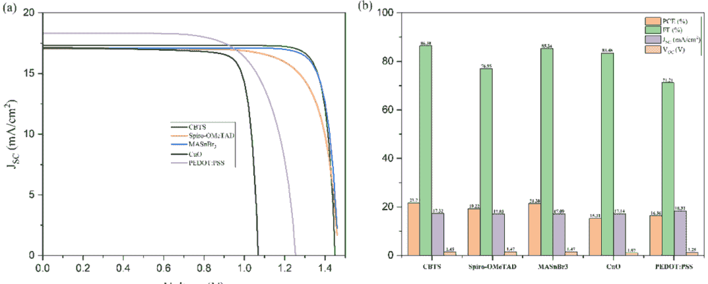

图 (a) 带 HTL 和 IGTO 的 PSC J-V 曲线，(b) 带 HTL 和 IGTO 的 PSC PCE、FF 和 $V_{OC}$。PCE 为 22.17%。

在保持厚度为 600 nm 时，吸收层中的缺陷密度 ($N_t$) 以 10 为增量进行变化。改变了 ETL、HTL 和吸收层的所有参数。发现高缺陷密度会导致电池效率降低。当 $N_t$ 为 $10^{14}$ $cm^{-3}$ 时， PCE 为 23.76%，之后开始下降，并在 $N_t$ 超过 $10^{15}$ $cm^{-3}$ 时观察到 PCE 显著下降。如下所示，在 $N_t$ 为 $10^{16}$ $cm^{-3}$ 时，FF 和 $V_{OC}$ 也观察到类似的趋势。从这些结论中，我们可以优化 $N_t$ 为 $10^{14}$ $cm^{-3}$ 的器件值，使其获得 22.17% 的 PCE。活性层中的缺陷浓度是决定器件效率的关键因素。高缺陷水平会导致复合率，引发膜降解、针孔形成和稳定性下降等问题，所有这些都会负面影响器件性能 [17]。

## 3.4. 厚度优化

使用 SCAPS-1D 进行批量仿真以评估

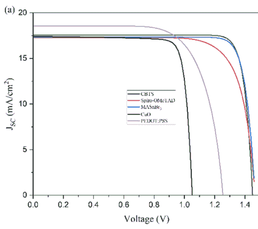

图 4. (a) 带 HTL 和 TiO 的 DPSC J-V 曲线，(b) 带 HTL 和 TiO2 的 DPSC PCE、$J_{SC}$ 和 $V_{OC}$。

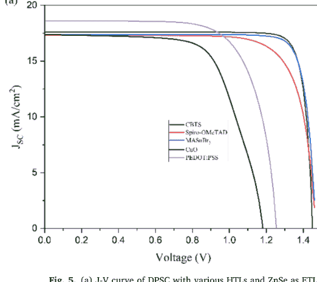

图 5. (a) 带 HTL 和 ZnSe 的 DPSC J-V 曲线，(b) 带 HTL 和 ZnSe 的 DPSC PCE、FF、$J_{SC}$ 和 $V_{OC}$。

## 3.5. 机器学习

如方法论所述，使用机器学习 (ML) 算法开发了模型，实现了 0.9985 的 $R^2$，如图 1 所示。SHAP 图证实了厚度是影响 PCE 最大的因素。缺陷密度对 PCE 有负面影响，较高的密度会导致较低的 PCE。

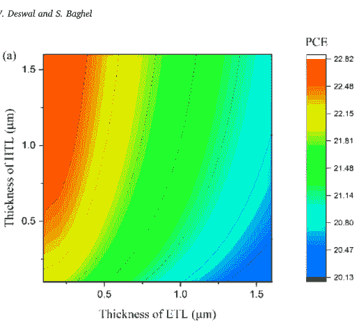

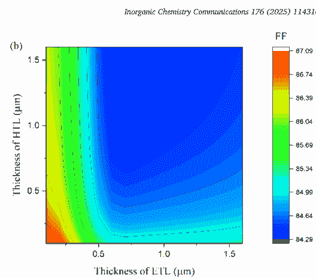

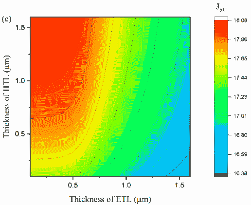

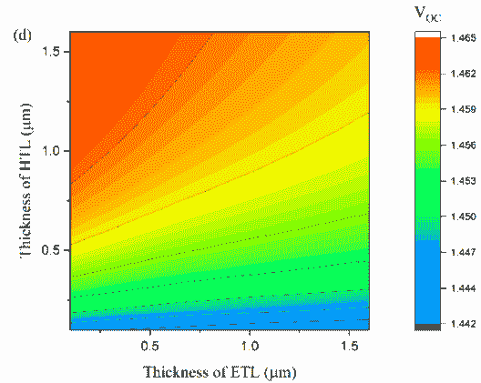

图 6. 描述 HTL 和 ETL 变化对 (a) PCE (b) FF (c) Jsc 和 (d) Voc 影响的等线图。

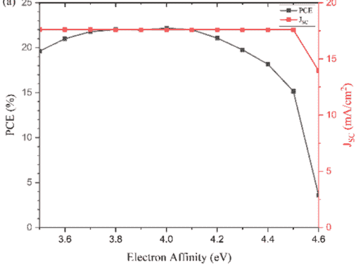

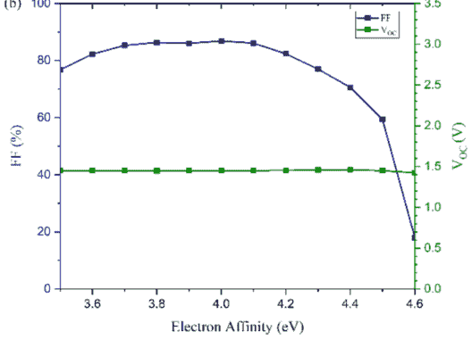

图 7. 电子亲和力对 Cs2RbGa6 基 DPSC (a) PCE 和 Jsc (b) FF 和 Voc 的影响。

# D. Desai 和 S. Baghel

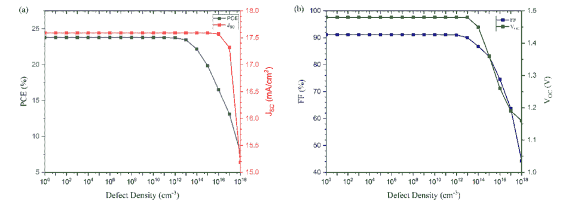

图 8. 缺陷密度对 Cs2RbGaGa4 DPSC 的 (a) PCE 和 JSC 以及 (b) 填充因子 FF 和 Voc 的影响。

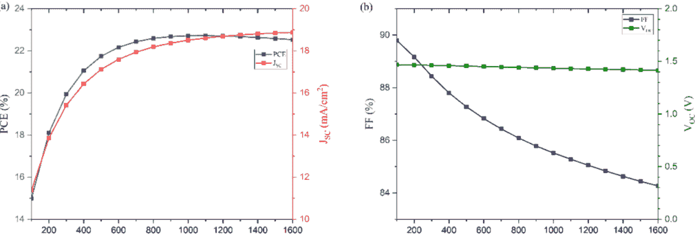

图 9. 吸收层厚度对 Cs2RbGaGa4 DPSC 的 (a) PCE 和 JSC 以及 (b) 填充因子 FF 和 Voc 的影响。

该模型将预测相同器件的 PCE。对于经过 SCAPS 优化的 DPSC 测试，在运行代码时在提示词中输入了特征值，即：600 nm 的厚度、10⁴ cm⁻¹ 的缺陷密度以及 300 K 的温度。ML 模型预测的 PCE 为 22.56%，这与模拟的 22.17% 非常接近。

# 4. 结论

在本研究中，我们全面研究并优化了 Cs2RbGaIn 无铅双钙钛矿太阳能电池 (DPSCs)，这是一种用于太阳能应用的高效材料。我们计算了 Cs2RbGaIn 的基本材料属性，如密度、导带以及载流子迁移率。还模拟了包括电子亲和力、密度和吸收层厚度在内的属性。

我们还优化了电子传输层 (ETL) 和空穴传输层 (HTL)，发现 ZnO 和 CsBT 具有最佳的光电转换效率 (PCE)，并以此推荐。通过等线图分析了 ETL 和 HTL 厚度的影响，发现较厚的 HTL (100 nm) 可以提高效率。我们还研究了电子亲和力对器件的影响，确定 4 eV 为最佳值。进一步分析了缺陷密度对器件性能的影响，结果显示，电池在优化选取值 10⁴ cm⁻¹ 的这一较高缺陷密度下即可实现高效率。吸收层厚度在 100 nm 到 160 nm 之间变化，选择 600 nm 为理想厚度。

图 10. ML 模型预测的 PCE 与通过模拟获得的实际 PCE 值的对比图。ML 模型的 R 值高达 0.9985。

此外，我们开发了一个机器学习 (ML) 模型，该模型能够分析各种特征值并根据这些输入预测太阳能电池效率。我们使用来自 SCAPS-1 真的 1000 个数据点对模型进行训练，包括器件工作温度、层厚度和缺陷密度，其 R² 达到 0.9985，表明具有高的预测准确性。使用 SHAP 摘要图来解释模型，显示在三个特征中，温度对 PCE 的影响最显著。此外，缺陷密度与 PCE 之间存在复杂的关系，表明其影响取决于其他特征的值。通过使用自定义的 Python 脚本，我们获得的 ML 预测 PCE 为 22.56%，与模拟的 22.17% 相匹配。

一旦我们开发并训练了 ML 模型，它的重要性在于它可以给出未来的值。为了实现这一点，我们在代码中添加了一个简单的 Python 脚本，以便我们输入特征值后，ML 模型即可预测 Cs2RbGaIn 基电池的 PCE。

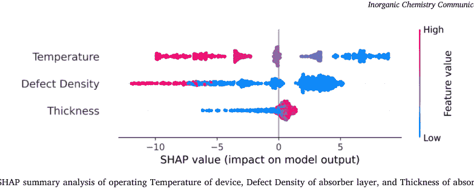

图 11. 特征值（缺陷密度、层厚度和层粗糙度）影响的 SHAP 摘要分析。

本研究通过实验探索了钙钛矿太阳能电池的潜力，其发现对于提高 PCE 耐用性很有帮助。它强调了机器学习在分析各种因素对太阳能电池影响方面的价值，并强调了基于模拟的方法在更短时间内获得准确结果的重要性。

# 作者贡献

Vishal Deswal：写作——初稿、可视化化、方法论、调查、正式分析。数据收集、概念化。Sarita Baghel：写作——编辑与验证、监督、资源、项目管理、正式分析。

# 利益冲突

作者声明他们没有知的利益冲突或可能影响本文报告工作的个人关系。

# 致谢

作者感谢 Marc Burgelman 教授（德国大学）提供 SCAPS-1 数据。作者感谢德里科技大学为本研究提供的资助。

# 数据可用性

数据可根据要求提供。

- [1] A. Kolima, T. Itura, Y. Shirai, T. Miyasaki, 用于光电池的有机卤化物钙钛矿, Am Chem Sci 131 (2009) 19988–19989, https://doi.org/10.1021/acs8906922b
- [2] H. Snaith, 钙钛矿: 新型低成本、高效太阳能电池的出现, J Phys Lett 4 (2023) 3623–3630, https://doi.org/10.1016/j.jpls.2023.10517
- [3] N. G. Park, 向20% 效率太阳能电池的有机钙钛矿光吸收材料, Nature Energy 7 (2022) 892–900, https://doi.org/10.1038/s41560-022-0093-1
- [4] J. Kim, S. Lee, J. Lee, Y. Lee, H. Lee, S. Lee, J. Kim, and H. Kim, 有机-无机杂钙钛矿带隙分析, Advanced Materials 34 (2022), 22031447, https://doi.org/10.1002/adma.2022031447
- [5] N. Ravivas, R. Ganasopadhyay, J. Takura, 钙钛矿太阳能电池的稳定性和降解, Energy Env Sci 12 (2019) 221–228, https://doi.org/10.1039/C8EE00147-A00147
- [6] W. Walsh, 有机-无机钙钛矿中的化学键与带隙工程, J. Phys. Chem C 119 (2015) 5755–5760, https://doi.org/10.1021/acpc501333a
- [7] N. M. Vasiya, S. Rao, T. Zella, N. K Thakur, M. Mohammad, 无机电池 Cs2PbI6 (Ga, Ga) 作为高效能量收集器件的稳定性: 一光电方法, Solar Energy 228 (2021) 1 https://doi.org/10.1016/j.solmat.2021.10769
- [8] A. Sora, S. Rao, T. Zella, N. K Thakur, M. Mohammad, 无机电池 Cs2PbI6 (Ga, Ga) 作为高效能量收集器件的稳定性: 一光电方法, Solar Energy 228 (2021) 1 https://doi.org/10.1016/j.solmat.2021.10769
- [9] J. Sun, H. Wang, Y. Xu, 机器学习预测 PCE, Communications 13 (2022), ... doi.org/10.1016/j.solmat.2021
- [10] Z. Liu, H. Wang, X. Yan, 机器学习设计的太阳能电池, Communications 13 (2022), ... doi.org/10.1016/j.solmat
- [11] J. L. Praadhan, S. Garg, 基于机器学习的高效率钙钛矿电池, Advanced Energy (2022)
- [12] M. Kibib, J. Jahan, I. Elsayed, A. Rayman, 钙钛矿的计算洞察, Nature Phys 24 (2023) 1297–1304
- [13] M. Li, H. Liu, A. Ahmed, 钙钛矿中的电子传输层, Energy 243 (2022) 134210
- [14] Y. Raza, H. Eladi, S. Rahman, 界面工程用于钙钛矿电池, Solar Energy 123 (2019) 948–955
- [15] J. Huang, K. Sun, Y. Xu, 缺陷密度对器件的影响, Materials 188 (2021) 1073
- [16] X. Li, H. Wang, Y. Zhang, 机器学习预测太阳能电池, Scientific Reports 13 (2022) 5018
- [17] S. Chen, T. Tang, R. Zhang, 缺陷密度优化的有机基钙钛矿太阳能电池, Opt Mater (Amer) (2022) 114527
- [18] P. Savich, N. Nullet, S. Grodziej, 多晶硅太阳能电池建模, Solar Energy 202 (2000) 361–362
- [19] D. Desai, S. Baghel, 无机化学通讯 176 (2025) 114316

