# 机器学习系统设计


机器学习系统既复杂又独特。复杂是因为它们由许多不同的组件组成，并涉及许多不同的利益相关者。独特是因为它们依赖数据，而数据在不同用例之间的差异巨大。在本书中，你将学到一种整体性的方法来设计机器学习系统，使其可靠、可扩展、可维护，并能适应不断变化的环境和业务需求。

作者Chip Huyen是Claypot AI的联合创始人，她从“每个设计决策如何帮助你的系统整体实现目标”的角度来考虑每一个设计决策——例如如何处理和创建训练数据、使用哪些特征、多久重新训练一次模型、以及监控什么。本书中的迭代框架使用了大量参考文献支持的真实案例研究。

**本书将帮助你应对以下场景：**

- 工程化数据并选择正确的指标来解决业务问题
- 自动化持续开发、评估、部署和更新模型的过程
- 开发监控系统，以快速检测并解决模型在生产中可能遇到的问题
- 架构一个可服务于多种用例的机器学习平台
- 开发负责任的机器学习系统

> “简单地说，这是你能读到的关于如何在一家公司中构建、部署和扩展机器学习模型以取得最大影响的最佳书籍。”
>
> — **Josh Wills**  
> WeaveGrid软件工程师，前Slack数据工程总监
>
> “在蓬勃发展但混乱的生态系统中，这种关于端到端机器学习的原则性观点既是你的地图，也是你的指南针：大型科技公司内外的从业者都必读。”
>
> — **Jacopo Tagliabue**  
> Coveo AI总监

Chip Huyen是Claypot AI的联合创始人，Claypot AI是一个实时机器学习平台。通过在NVIDIA、Netflix和Snorkel AI的工作，她帮助一些全球最大的组织开发和部署机器学习系统。Chip基于她在斯坦福大学教授的CS 329S：机器学习系统设计课程讲义撰写了本书。

## 赞誉 *设计机器学习系统*

> 要想成为一名高效的机器学习工程师，需要了解的信息非常多。从纷繁的信息中筛选出最相关的内容并不容易，但Chip通过这本书出色地做到了。如果你认真对待生产环境中的机器学习，并关心如何端到端地设计和实现机器学习系统，这本书是必不可少的。
> 
> —Laurence Moroney，Google AI与ML负责人

> 这是最好的资源之一，专注于为生产环境机器学习系统设计背后的第一性原理。要想在瞬息万变的工具和平台选项景观中导航，这本书是必读的。
> 
> —Goku Mohandas，Made With ML创始人

> Chip的手册是我们应得的书，也是我们当下需要的书。在蓬勃发展但混乱的生态系统中，这种关于端到端机器学习的原则性观点既是你的地图，也是你的指南针：大型科技公司内外的从业者都应该阅读——尤其是在“合理规模”下工作的人。这本书也会吸引那些寻找如何在真实环境中部署、管理和监控系统最佳实践的数据领导者。
> 
> —Jacopo Tagliabue，Coveo AI总监；纽约大学MLSys兼职教授

> 简单地说，这是你能读到的关于如何在一家公司中构建、部署和扩展机器学习模型以取得最大影响的最佳书籍。Chip是一位出色的老师，她的知识广度和深度无与伦比。
> 
> —Josh Wills，WeaveGrid软件工程师，前Slack数据工程总监

> 这是我刚开始当机器学习工程师时希望读到的一本书。
> 
> —Shreya Shankar，MLOps博士生

> *设计机器学习系统* 是应用机器学习领域的一个受欢迎的新成员。这本书为构建端到端机器学习系统的人们提供了详细指南。Chip Huyen从她构建真实世界机器学习应用的丰富实践经验的视角出发进行写作。
> 
> —Brian Spiering，Metis数据科学讲师

> Chip是机器学习系统领域真正的世界级专家，同时也是一位杰出的作者。这两点在本书中都显而易见，对于任何想了解这个主题的人来说，这本书都是一个绝佳的资源。
> 
> —Andrey Kurenkov，斯坦福AI实验室博士生

> Chip Huyen为机器学习文献经典做出了重要贡献——这本书对机器学习基础有着深刻的理解，但比起大多数书，它的方法要具体和实用得多。仅聚焦于业务需求这一点就既少见又有价值。这本书会引起刚开始接触机器学习的工程师，以及组织中任何试图理解机器学习工作机制的人的共鸣。
> 
> —Todd Underwood，Google ML SRE高级工程总监，《可靠的机器学习》合著者


- 你已获得一个业务问题和大量原始数据。你希望对这些数据进行工程化处理并选择合适的指标来解决此问题。
- 你的初始模型在离线实验中表现良好，你希望部署它们。
- 你在模型部署后对其性能的反馈很少，你希望找到一种方法来快速检测、调试和解决模型在生产中可能遇到的问题。
- 你团队的模型开发、评估、部署和更新过程大多是手动的、缓慢且容易出错的。你希望自动化并改进这一过程。
- 你组织中的每个机器学习用例都使用自己的工作流程部署，你希望建立可以跨用例共享和重用的基础（例如，模型存储、特征存储、监控工具）。
- 你担心机器学习系统可能存在偏差，你希望使系统负责任！

你也可以从本书中受益，如果你属于以下其中一类人群：

- 希望识别机器学习生产中未被满足的领域并弄清如何在生态系统中定位你的工具的工具开发者。
- 正在寻找行业中与机器学习相关职位的个人。
- 正在考虑采用机器学习解决方案以改善产品和/或业务流程的技术和业务领导者。技术背景不强的读者可能最能从第 1、2 和 11 章中受益。

## 本书不是什么

本书不是机器学习的入门读物。有许多书籍、课程和资源可用于机器学习理论，因此，本书避开了这些概念，专注于机器学习的实践方面。具体来说，本书假设读者对以下主题有基本了解：

- *机器学习模型* 如聚类、逻辑回归、决策树、协同过滤，以及各种神经网络架构，包括前馈、循环、卷积和 Transformer
- *机器学习技术* 如监督与无监督、梯度下降、目标/损失函数、正则化、泛化以及超参数调优
- *指标* 如准确率、F1、精确率、召回率、ROC、均方误差和对数似然

数据移动和数据处理引擎在机器学习课程中往往很少涉及，因此许多数据科学家可能认为它们是低级或无关的。在与许多同事咨询后，我决定因为机器学习系统依赖于数据，及早介绍数据系统的基础知识将有助于我们在本书其余部分讨论数据相关事宜时达成共识。

虽然本书涵盖了机器学习系统的许多技术方面，但机器学习系统是由人构建的、为人类服务的，并且可能对许多人的生活产生巨大影响。写一本关于机器学习生产的书籍而不包含其人性化一面是不合适的，这正是第 11 章、最后一章的重点。

请注意，“数据科学家”这一角色在过去几年中发生了很大演变，并且有过许多讨论来确定这一角色应包含的内容——我们将在第 10 章中讨论其中一些讨论。在本书中，我们将“数据科学家”作为一个总称，用来指代任何从事机器学习模型开发和部署工作的人，包括其职位名称可能是机器学习工程师、数据工程师、数据分析师等的人。

## GitHub 仓库和社区

本书附带一个 GitHub 仓库，其中包含：

- 基础机器学习概念的回顾
- 本书中使用的参考资料以及其他高级、更新的资源列表
- 本书中使用的代码片段
- 你可以在工作流程中遇到的某些问题使用的工具列表

我还在 MLOps 上运营一个 Discord 服务器，你可以在此讨论和提问关于本书的内容。

## 本书使用的约定

本书中使用了以下排版约定：

斜体
表示新术语、URL、电子邮件地址、文件名和文件扩展名。

等宽
用于程序列表，以及在段落中引用程序元素，如变量或函数名、数据库、数据类型、环境变量、语句和关键字。


此元素表示一般说明。


此元素表示警告或注意。

## 使用代码示例

如前所述，补充材料（代码示例、练习等）可在 https://oreil.ly/designing-machine-learning-systems-code 下载。

如果你在使用代码示例时有技术问题或遇到问题，请发送电子邮件至 bookquestions@oreilly.com。

本书旨在帮助你完成工作。一般来说，如果本书提供了示例代码，你可以在你的程序和文档中使用它。除非你复制了代码的很大一部分，否则你不需要联系我们征求许可。例如，使用本书中多个代码片段编写程序不需要许可。出售或分发 O’Reilly 书籍中的示例需要许可。引用本书并引用示例代码来回答问题不需要许可。将大量示例代码从本书纳入你的产品文档中需要许可。

我们感谢但通常不需要署名。署名通常包括标题、作者、出版商和 ISBN。例如：“Designing Machine Learning Systems by Chip Huyen (O’Reilly). Copyright 2022 Huyen Thi Khanh Nguyen, 978-1-098-10796-3.”

如果你认为你的代码示例使用超出了合理使用范围或上述许可，请随时联系我们 permissions@oreilly.com。

## O’Reilly 在线学习


40 多年来，O’Reilly Media 一直为公司提供技术和商业培训、知识和见解，帮助公司取得成功。


我们独特的专家和创新者网络通过书籍、文章以及我们的在线学习平台分享他们的知识和专业经验。O’Reilly 的在线学习平台为您提供按需访问实时培训课程、深入学习路径、交互式编程环境，以及来自 O’Reilly 和 200 多家其他出版商的庞大文本和视频集合。更多信息，请访问 https://oreilly.com。

## 如何联系我们

请将有关本书的评论和问题发送给出版商：

O’Reilly Media, Inc.
1005 Gravenstein Highway North
Sebastopol, CA 95472
800-998-9938（在美国或加拿大）
707-829-0515（国际或本地）
707-829-0104（传真）

我们为本书提供了一个网页，在此列出勘误、示例和任何额外信息。您可以通过以下链接访问该页面：https://oreil.ly/designing-machine-learning-systems。

如需对本书发表评论或询问技术问题，请发送电子邮件至 bookquestions@oreilly.com。

有关我们书籍和课程的新闻和信息，请访问 https://oreilly.com。

在 LinkedIn 上找到我们：https://linkedin.com/company/oreilly-media

在 Twitter 上关注我们：https://twitter.com/oreillymedia

在 YouTube 上观看我们：https://youtube.com/oreillymedia

## 致谢

本书撰写耗时两年，准备工作则花费了更长的时间。回首往事，我对在撰写本书过程中收到的巨大帮助既感到惊讶又心怀感激。我尽力在此列出所有帮助过我的人的名字，但由于人类记忆固有的缺陷，我无疑遗漏了许多人。如果我忘记包含您的名字，请知晓这并非因为我不感激您的贡献，请 kindly 提醒我，以便我尽快予以纠正！

首先，我要感谢帮助我开发本书所基于的课程和材料的课程工作人员：Michael Cooper、Xi Yin、Chloe He、Kinbert Chou、Megan Leszczynski、Karan Goel 和 Michele Catasta。我想

## 机器学习系统的概述

2016 年 11 月，Google 宣布已将其多语言神经机器翻译系统整合到 Google Translate 中，这标志着深度人工神经网络在规模化生产中取得的首次成功案例之一。¹ 根据 Google 的说法，通过此次更新，翻译质量在一跃之间提升的幅度超过了此前 10 年的总和。

深度学习的成功重新激发了人们对机器学习（ML）的广泛兴趣。自那以后，越来越多的公司转向 ML 来解决其最具挑战性的问题。短短五年内，ML 已渗透到我们生活的几乎方方面面：我们获取信息的方式、我们沟通的方式、我们工作的方式、我们寻找爱情的方式。ML 的传播速度如此之快，以至于如今很难想象没有它的生活。然而，在医疗保健、交通运输、农业，甚至帮助我们理解宇宙等领域，仍有许多 ML 用例有待探索。²

许多人听到“机器学习系统”时，只会想到所使用的 ML 算法，例如逻辑回归或不同类型的神经网络。然而，算法只是生产环境中 ML 系统的一小部分。系统还包括催生该 ML 项目的业务需求、用户和开发者与系统交互的界面、数据栈，以及用于开发、监控和更新模型的逻辑，以及实现该逻辑交付的基础设施。图 1-1 显示了 ML 系统的不同组件以及它们将在本书的哪些章节中被介绍。

## MLOps 与 ML 系统设计的关联


MLOps 中的 Ops 来自 DevOps，即 Development and Operations 的缩写。将某物操作化意味着将其投入生产，其中包括部署、监控和维护。MLOps 是一套将 ML 投入生产的工具和最佳实践。

ML 系统设计采用系统化的方法来处理 MLOps，这意味着它会整体考虑 ML 系统，以确保所有组件及其利益相关者能够协同工作，以满足指定的目标和要求。

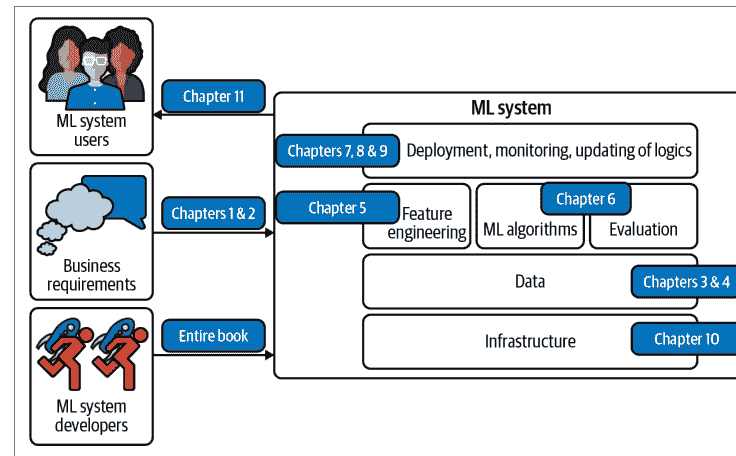

图 1-1. ML 系统的不同组件。“ML 算法”通常是人们提到机器学习时所想到的，但它只是整个系统的一小部分。

关于各种 ML 算法的优秀书籍有很多。本书不会详细介绍任何特定算法，而是帮助读者理解整个 ML 系统的整体。换句话说，本书的目标是为您提供一个框架，以便根据您可能最终使用的算法，开发出最适合您问题的解决方案。算法可能会随着新算法的不断开发而迅速过时，但本书提出的框架仍应适用于新算法。

本书的第一章旨在为您概述将 ML 模型投入生产所需的内容。在讨论如何开发 ML 系统之前，它

## 2. 复杂模式：存在可学习的模式，且它们很复杂

ML 解决方案只有在存在可学习模式时才有用。明智的人不会投资建立 ML 系统来预测公平骰子的下一个结果，因为这些结果的产生方式没有模式。⁴ 然而，股票定价的方式存在模式，因此公司已投资数十亿美元建立 ML 系统来学习这些模式。

模式是否存在可能并不明显，或者即使存在模式，您的数据集或 ML 算法可能不足以捕捉它们。例如，Elon Musk 的推文可能对加密货币价格存在影响模式。然而，在您对他的推文进行严格的训练和评估 ML 模型之前，您不会知道。即使所有模型都无法对加密货币价格做出合理的预测，这也不意味着没有模式。

考虑像 Airbnb 这样拥有大量房屋房源的网站；每个房源都附带一个邮政编码。如果您想将房源按其所在州进行分类，您不需要 ML 系统。由于模式很简单——每个邮政编码对应一个已知州——您只需使用查找表即可。

租金价格与其所有特征之间的关系遵循一种更复杂的模式，这将非常难以手动指定。ML 是此问题的良好解决方案。与其告诉系统如何根据特征列表计算价格，不如提供价格和特征，让您的 ML 系统自行找出模式。ML 解决方案与查找表解决方案以及通用传统软件解决方案之间的差异如图 1-2 所示。因此，ML 也被称为 Software 2.0。⁵

ML 在具有复杂模式的任务上取得了巨大成功，例如目标检测和语音识别。对机器而言复杂的事与对人类而言复杂的事不同。许多对人类而言困难的任务对机器来说很容易——例如将一个数字的 10 次方。对人类而言容易的许多任务对机器来说可能很困难——例如判断图片中是否有猫。

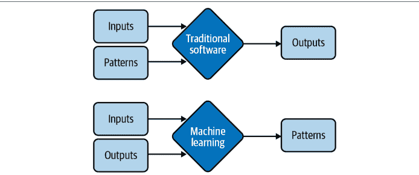

图 1-2. 与其要求手工指定的模式来计算输出，ML 解决方案从输入和输出中学习模式

## 3. 现有数据：数据可用，或可以收集数据

由于 ML 从数据中学习，因此必须有数据供其学习。设想建立一个模型来预测某人一年应缴纳多少税是很有趣的，但如果没有大量人口的税务和收入数据，就不可能实现。

在零样本学习（有时也称为零数据学习）上下文中，ML 系统可以在未针对该任务进行训练的情况下对该任务做出良好预测。然而，该 ML 系统之前已在其他任务的数据上进行过训练，这些任务通常与所考虑的任务相关。因此，即使系统不需要针对手头任务的数据进行学习，它仍然需要数据来学习。

也可以在没有数据的情况下启动 ML 系统。例如，在持续学习上下文中，ML 模型可以在未在任何数据上训练的情况下部署，但它们将在生产中从传入数据中学习。⁶ 然而，向用户提供训练不足的模型会带来某些风险，例如糟糕的客户体验。

在没有数据且没有持续学习的情况下，许多公司遵循“先假装再实现”的方法：推出一个由人类而非 ML 模型做出预测的产品，希望利用生成的数据在以后训练 ML 模型。

6 我们将在第 9 章介绍在线学习。


## 4. 预测：这是一个预测问题

ML 模型会做出预测，因此它们只能解决需要预测性答案的问题。ML 可以在你能从大量廉价但近似的预测中受益时尤其有吸引力。在英语中，“predict” 的意思是“估计未来某个值”。例如，明天的天气会怎样？今年谁会赢得超级碗？用户接下来想看什么电影？

随着预测机器（例如 ML 模型）变得更有效，越来越多的問題被重新表述为预测问题。无论你有什么问题，你总可以将它表述为：“这个问题答案会是什么？”无论这个问题是关于未来、现在还是过去。

计算密集型问题是一类被非常成功地重新表述为预测问题的問題。与其计算过程的精确结果——这可能比 ML 更耗计算资源和时间——你可以将问题表述为：“这个过程的结果会是什么样？”并使用 ML 模型来近似它。输出将是精确输出的近似值，但通常已经足够好。你可以在图形渲染中看到很多这样的例子，例如图像去噪和屏幕空间着色。7

## 5. 未见数据：未见数据与训练数据共享模式

模型从现有数据中学习到的模式只有在未见数据也共享这些模式时才有用。如果一个用于预测应用是否会在2020年圣诞节被下载的模型是用2008年的数据训练的——当时 App Store 上最受欢迎的应用是 Koi Pond——它的表现不会很好。Koi Pond 是什么？正是如此。

从技术角度来说，这意味着你的未见数据和训练数据应来自相似的分布。你可能会问：“如果数据是未见的，我们怎么知道它来自什么分布？”我们不知道，但我们可以做出假设——例如我们可以假设用户明天的行为不会与今天的用户行为太不同——并希望我们的假设成立。如果不成立，我们将拥有一个表现不佳的模型，我们可以通过监控（见第8章所述）和在生产中测试（见第9章所述）来发现。

Steve Bako, Thijs Vogels, Brian McWilliams, Mark Meyer, Jan Novák, Alex Harvill, Pradeep Sen, Tony Derose, and Fabrice Rousselle, “用于去噪蒙特卡洛渲染的核预测卷积网络,” ACM Transactions on Graphics 36, no. 4 (2017): 97, https://oreil.ly/EeI3j; Oliver Nalbach, Elena Arabadzhiyska, Dushyant Mehta, Hans-Peter Seidel, and Tobias Ritschel, “深度着色：用于屏幕空间着色的卷积神经网络,” arXiv, 2016, https://oreil.ly/dSspz.

消费者应用可能更容易分发但更难变现。然而，大多数企业用例除非你自己遇到过，否则并不明显。

根据 Algorithmia 2020 年企业机器学习现状调查，企业中的 ML 应用多种多样，既服务于内部用例（降低成本、生成客户洞察和情报、内部流程自动化），也服务于外部用例（改善客户体验、留住客户、与客户互动），如图 1-3 所示。⁸

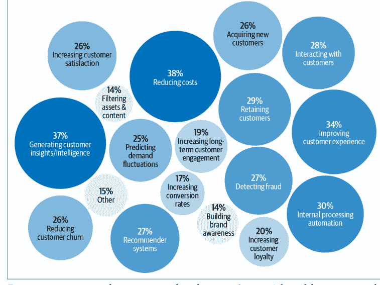

图 1-3. 2020 年企业机器学习现状。来源：改编自 Algorithmia 的图像

8 “2020 年企业机器学习现状”，Algorithmia，2020，https://oreil.ly/wKMZB.

*欺诈检测* 是企业界 ML 应用中最古老的之一。如果你的产品或服务涉及任何价值的交易，它就会容易受到欺诈。通过利用异常检测的 ML 解决方案，你可以拥有从历史欺诈交易中学习并预测未来交易是否欺诈的系统。

决定为你的产品或服务收取多少费用可能是最困难的商业决策之一；为什么不让 ML 来做呢？*价格优化* 是在特定时间段估计价格以最大化定义目标函数的过程，例如公司的利润率、收入或增长率。基于 ML 的价格优化最适用于交易数量大、需求波动且消费者愿意支付动态价格的情况——例如互联网广告、机票、住宿预订、拼车和活动。

经营企业时，能够预测客户需求很重要，这样你才能准备预算、备货、分配资源并更新定价策略。例如，如果你经营一家杂货店，你希望备货充足以便顾客找到所需商品，但你也不想囤货过多，因为那样你的杂货可能会变质而你会亏损。

获取新用户成本高昂。截至 2019 年，应用获取一名会进行应用内购买的用户平均成本为 86.6 美元⁹。Lyft 的获客成本估计为每位乘客 158 美元。¹⁰对于企业客户而言，这一成本要高得多。投资者称客户获取成本为初创企业杀手。¹¹将客户获取成本降低一点就能带来利润的大幅提升。这可以通过更好地识别潜在客户、展示更有针对性的广告、在合适的时间提供折扣等方式实现——所有这些都是适合 ML 的任务。

在花费大量资金获取客户后，如果他们离开就太可惜了。获取新用户的成本大约是留住现有用户的 5 到 25 倍。¹² *流失预测* 是预测特定客户何时即将停止使用你的产品或服务，以便你可以采取适当措施将其赢回。流失预测不仅可用于客户，也可用于员工。

9 “2018 年 9 月至 2019 年 8 月全球移动应用用户获取成本平均值，按用户操作和操作系统划分”，Statista，2019，https://oreil.ly/2pTCH.

10 Jeff Henriksen，“估值 Lyft 需要深入了解单位经济”，Forbes，2019 年 5 月 17 日，https://oreil.ly/VeSt4.

11 David Skok，“初创企业杀手：客户获取成本”，For Entrepreneurs，2018，https://oreil.ly/L3tQ7.

12 Amy Gallo，“保留合适客户的价值”，Harvard Business Review，2014 年 10 月 29 日，https://oreil.ly/OINkI.

## *ML 平台团队*

随着流量的增长，这个团队因现有系统扩展问题而在半夜被叫醒，因此他们希望推迟模型更新以优先改进 ML 平台。

## *经理*

希望最大化利润，一种实现方式可能是解散 ML 团队。^14^

> “推荐用户最有可能点击的餐厅”和“推荐能为应用带来最多收入的餐厅”是两个不同的目标，在 [“解耦目标”第 41 页] 部分，我们将讨论如何开发一个满足不同目标的 ML 系统。剧透：我们将为每个目标开发一个模型并组合它们的预测。

让我们暂时假设我们有两个不同的模型。模型 A 是推荐用户最有可能点击的餐厅的模型，模型 B 是推荐能为应用带来最多收入的餐厅的模型。A 和 B 可能是非常不同的模型。应该部署哪个模型给用户？使决策更困难的是，A 和 B 都不满足产品团队设定的要求：它们无法在 100 毫秒内返回餐厅推荐。

在开发 ML 项目时，ML 工程师了解所有相关利益相关者的需求以及这些需求的严格程度非常重要。例如，如果能在 100 毫秒内返回推荐是必须具备的需求——公司发现如果你的模型推荐餐厅超过 100 毫秒，10% 的用户会失去耐心并关闭应用——那么模型 A 和模型 B 都不可行。然而，如果这只是锦上添花的需求，你可能仍想考虑模型 A 或模型 B。

生产环境与研究环境需求不同，是成功的研究项目未必总能投入生产的原因之一。例如，集成是一种在许多 ML 竞赛获胜者中流行的技术，包括著名的 100 万美元 Netflix 大奖，但它在生产中并不广泛使用。集成将“多个学习算法组合起来，以获得比任何单一构成学习算法单独获得更好的预测性能”。^15^ 虽然它可以为你的 ML 系统带来小幅性能提升，但集成往往使系统过于复杂而无法在生产中使用，例如，

^14^ ML 和数据科学团队在公司大规模裁员中成为首批被裁对象并不罕见，正如 [IBM](https://oreil.ly/jobmz)、[Uber](https://oreil.ly/jobmz)、[Airbnb](https://oreil.ly/jobmz) 所报道的那样。另见 Sejuti Das 的分析“数据科学家在危机期间的裁员中也易受影响”，*Analytics India Magazine*，2020 年 5 月 21 日，https://oreil.ly/jobmz.

^15^ Wikipedia，条目“Ensemble learning”，https://oreil.ly/5qkgp.


预测速度更慢或结果更难解释。我们将在第 156 页的“集成”部分进一步讨论集成。

对于许多任务而言，性能的微小提升可能带来收入或成本节约的巨大增长。例如，产品推荐系统的点击率提高 0.2%，就可能使电商网站的收入增加数百万美元。然而，对于许多任务来说，微小的提升用户可能察觉不到。对于第二种类型的任务，如果简单模型能完成合理的工作，复杂模型必须表现显著更好才能证明其复杂性是合理的。

## 对 ML 排行榜的批评

近年来，ML 排行榜受到了许多批评，既有 Kaggle 等竞赛，也有 ImageNet 或 GLUE 等研究排行榜。

一个明显的论点是，在这些竞赛中，构建 ML 系统所需的大多数困难步骤都已为你完成。16

一个不太明显的论点是，由于多重假设检验的情况——当多个团队在同一 hold-out 测试集上测试时——模型可能仅凭运气就表现优于其他模型。17

研究与生产之间的利益错位已被研究人员注意到。在 EMNLP 2020 的一篇论文中，Ethayarajh 和 Jurafsky 认为，基准测试通过激励创建更精确的模型推动了自然语言处理（NLP）的进步，但以牺牲从业者重视的其他品质为代价，例如紧凑性、公平性和能源效率。18

## 计算优先级

在设计 ML 系统时，未部署过 ML 系统的人常犯的错误是过度关注模型开发部分，而忽视模型部署和维护部分。

在模型开发过程中，你可能会训练许多不同的模型，每个模型都会对训练数据进行多次遍历。每个训练好的模型随后会在验证数据上生成一次预测以报告分数。验证数据通常比训练数据小得多。在模型开发期间，

16 Julia Evans，“机器学习不是 Kaggle 竞赛”，2014，https://oreil.ly/p8mZq.

17 Lauren Oakden-Rayner，“AI 竞赛不会产生有用的模型”，2019 年 9 月 19 日，https://oreil.ly/X6RIT.

18 Kawin Ethayarajh and Dan Jurafsky，“效用在于用户眼中：对 NLP 排行榜的批判”，EMNLP，2020，https://oreil.ly/4Ud8P.

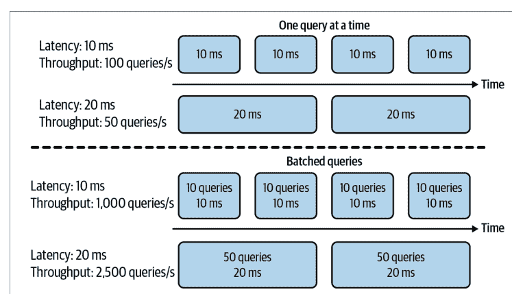

图 1-4。当逐个处理查询时，延迟越高吞吐量越低。然而，当批量处理查询时，更高的延迟也可能意味着更高的吞吐量。

如果你想批量处理在线查询，情况会更复杂。批处理要求系统等待足够多的查询到达后再进行处理，这进一步增加了延迟。

在研究中，你更关心每秒能处理多少样本（吞吐量），而较少关心每个样本的处理所需时间（延迟）。你愿意增加延迟以提高吞吐量，例如采用激进的批处理。

然而，一旦将模型部署到现实世界，延迟就非常重要。2017 年，Akamai 的一项研究发现，100 毫秒的延迟会使转化率下降 7%。20 2019 年，Booking.com 发现延迟增加约 30% 会导致转化率下降约 0.5%——“对我们的业务而言是一笔相关成本”。21 2016 年，Google 发现如果页面加载超过三秒，超过一半的移动用户会离开页面。22 如今的用户耐心更低。

20 Akamai Technologies，Akamai 在线零售性能报告：毫秒至关重要，2017 年 4 月 19 日，https://oreil.ly/bEtRu.

21 Lucas Bernardi、Themis Mavridis 和 Pablo Estevez，“150 个成功的机器学习模型：在 Booking.com 学到的 6 个经验教训”，KDD ’19，2019 年 8 月 4–8 日，安克雷奇，AK，https://oreil.ly/G5QNA.

22 “消费者洞察”，Think with Google，https://oreil.ly/JCp6Z.

为了在生产环境中降低延迟，你可能不得不减少同一硬件上同时处理的查询数量。如果你的硬件能够同时处理更多查询，使用它处理更少的查询意味着硬件利用率不足，从而增加每个查询的处理成本。

思考延迟时，重要的是要记住延迟不是一个单一数字，而是一个分布。用单个数字简化这个分布很诱人，例如在时间窗口内所有请求的平均（算术平均）延迟，但这个数字可能具有误导性。假设你有 10 个请求的延迟分别为 100 ms、102 ms、100 ms、100 ms、99 ms、104 ms、110 ms、90 ms、3,000 ms、95 ms。平均延迟为 390 ms，这会让你的系统看起来比实际更慢。可能发生的情况是网络错误导致一个请求比其他请求慢得多，你应该调查那个麻烦的请求。

通常最好用百分位来思考，因为它们能告诉你关于请求中某一百分比的信息。最常见的百分位是第 50 百分位，缩写为 p50。它也被称为中位数。如果中位数是 100 ms，则一半的请求耗时超过 100 ms，一半的请求耗时少于 100 ms。

较高的百分位也有助于发现异常值，这可能是某些问题的症状。通常，你需要查看的百分位是 p90、p95 和 p99。上述 10 个请求的第 90 百分位（p90）为 3,000 ms，这是一个异常值。

较高的百分位很重要，因为尽管它们只占用户的一小部分，有时它们可能是最重要的用户。例如，在亚马逊网站上，请求最慢的客户通常是账户数据最多的客户，因为他们购买了很多商品——也就是说，他们是最有价值的客户。23

使用高百分位来指定系统的性能要求是一种常见做法；例如，产品经理可能会规定系统的第 90 百分位或第 99.9 百分位延迟必须低于某个数值。

## 数据

在研究阶段，你使用的通常干净且格式良好，使你能够专注于模型开发。它们本质上是静态的，以便社区能够用它们来基准测试新的架构和技术。这意味着许多人可能使用并讨论过相同的数据集，且数据集的怪癖已被知晓。你甚至可能找到开源脚本来处理数据并直接将其输入模型。

你或你认识的人可能在不知情的情况下已经成为有偏见的数学算法的受害者。你的贷款申请可能会被拒绝，因为 ML 算法针对你的邮政编码，而邮政编码体现了关于个人社会经济背景的偏见。你的简历排名可能更低，因为雇主使用的排名系统针对你姓名的拼写。你的抵押贷款利率可能更高，因为它部分依赖于信用评分，而信用评分偏爱富人、惩罚穷人。现实世界中 ML 偏见的其他例子包括预测性警务算法、潜在雇主进行的性格测试以及大学排名。

2019 年，“伯克利的研究人员发现，2008 年至 2015 年间，面对面和在线贷款机构共拒绝了 130 万名信用良好的黑人和拉丁裔申请人。”研究人员“使用被拒申请的收入和信用评分但删除种族标识后，抵押贷款申请就获批了”。25 对于更令人愤慨的例子，我推荐 Cathy O’Neil 的 *Weapons of Math Destruction.*26

ML 算法并不预测未来，而是编码过去，从而延续数据中的偏见甚至更多。当 ML 算法大规模部署时，它们可以大规模地歧视人群。如果人类操作员一次只能对少数个人做出 sweeping 判断，ML 算法可以在几分之一秒内对数百万人做出 sweeping 判断。这尤其会伤害少数群体成员，因为对他们的误分类可能只会对模型的整体性能指标产生轻微影响。

如果一个算法已经能对 98% 的人群做出正确预测，而改进对另外 2% 的预测会产生数倍的成本，一些公司可能不幸地选择不这样做。在 McKinsey & Company 2019 年的一项研究中，仅有 13% 的受访大型公司表示正在采取措施减轻公平性和公正性的风险，例如算法偏见和歧视。27 然而，这一情况正在迅速改变。我们将在第 11 章讨论公平性以及负责任 AI 的其他方面。

## 可解释性

2020 年初，图灵奖得主 Geoffrey Hinton 教授提出了一个关于 ML 系统可解释性重要性的激烈争论问题。“假设你患有癌症，并且必须在黑箱 AI 外科医生之间做出选择

25 Khristopher J. Brooks，“住房贷款成本差异使少数群体损失数百万美元，研究人员发现”，*CBS News*，2019 年 11 月 15 日，https://oreil.ly/UtHUB.

26 Cathy O’Neil，*Weapons of Math Destruction*（纽约：Crown Books，2016）。

27 Stanford University Human-Centered Artificial Intelligence (HAI)，*The 2019 AI Index Report*，2019，https://oreil.ly/xs8mG.


一个无法解释其工作原理但治愈率高达90%的AI外科医生，以及一位治愈率为80%的人类外科医生。你希望这位AI外科医生是非法的吗？[^28]

几周后，当我向一群来自上市非科技公司的30位技术高管提出这个问题时，只有一半的人希望由这位高效但无法解释其原理的AI外科医生为他们做手术。另一半人则选择了人类外科医生。

尽管我们大多数人在不理解微波炉工作原理的情况下也能自如地使用它，但很多人对AI还没有这种感觉，尤其是当AI为他们的生活做出重要决定时。

由于大多数机器学习研究仍然以单一目标——模型性能——来评估，研究人员没有动力去研究模型的可解释性。然而，对于行业中的大多数机器学习用例来说，可解释性不仅仅是可选项，而是必需项。

首先，可解释性对用户（既包括业务领导者也包括最终用户）很重要，他们需要了解决策产生的原因，从而信任模型，并发现前面提到的潜在偏见。[^29] 其次，可解释性对于开发者调试和改进模型也很重要。

可解释性虽然是必需项，但这并不意味着每个人都在这样做。截至2019年，只有19%的大型企业正在努力提升其算法的可解释性。[^30]

## 讨论

有些人可能会争辩说，只了解机器学习的学术层面就可以了，因为研究领域有大量工作机会。第一部分——只了解机器学习的学术层面就可以了——是事实。第二部分则是错误的。

虽然追求纯研究很重要，但大多数公司负担不起，除非它能带来短期的商业应用。在研究界采取“更大、更好”的路线之后，情况尤其如此。新模型往往需要海量数据，仅计算成本就高达数千万美元。

随着机器学习研究和现成模型变得越来越容易获取，越来越多的个人和组织希望为它们找到应用场景，这增加了对生产中机器学习的需求。

绝大多数与机器学习相关的工作将会——而且已经是——将机器学习生产化。

[^28]: 杰弗里·辛顿（@geoffreyhinton）于2020年2月20日发布的推文。*https://oreil.ly/KdfD8.*

[^29]: 在某些国家的某些用例中，用户拥有“解释权”：即有权获得算法输出的解释。

[^30]: 斯坦福大学HAI，*2019年AI指数报告*。

## 机器学习系统与传统软件

既然机器学习是软件工程（SWE）的一部分，而且软件在生产中成功应用已有半个多世纪，有些人可能会想，为什么我们不直接采用软件工程中经过验证的最佳实践并将其应用到机器学习中呢？

这是个极好的想法。事实上，如果机器学习专家能成为更好的软件工程师，机器学习生产的现状会好得多。许多传统的SWE工具都可以用于开发和部署机器学习应用。

然而，许多挑战是机器学习应用所特有的，需要它们自己的工具。在SWE中，有一个基本假设：代码和数据是分离的。事实上，在SWE中，我们希望尽可能保持模块化和分离（参见维基百科上关于“关注点分离”的页面）。

相反，机器学习系统由三部分组成：代码、数据，以及由这两者产生的产物。过去十年的趋势表明，用数量最多或质量最好的数据开发的应用会胜出。大多数公司将专注于改进数据，而不是改进机器学习算法。由于数据变化很快，机器学习应用需要适应不断变化的环境，这可能要求更快的开发和部署周期。

在传统SWE中，你只需要关注代码的测试和版本管理。而在机器学习中，我们还必须测试和版本管理数据，而这正是难点。如何为大型数据集做版本管理？如何判断一个数据样本对你的系统是好是坏？并非所有数据样本都是平等的——有些样本对你的模型比其他样本更有价值。例如，如果你的模型已经在一百万张正常肺部扫描图像和仅一千张癌变肺部扫描图像上训练过，那么一张癌变肺部的扫描图像就比一张正常肺部的扫描图像更有价值。不加区分地接受所有可用数据可能会损害模型性能，甚至使其容易受到数据投毒攻击。[^31]

机器学习模型的规模是另一个挑战。截至2022年，机器学习模型通常拥有数亿甚至数十亿个参数，需要数GB的随机存取存储器（RAM）才能将它们加载到内存中。几年之后，十亿个参数可能都会显得有些过时——比如，“你能相信当年把人类送上月球的计算机只有32 MB的内存吗？”

然而，就目前而言，将这些大型模型投入生产，尤其是在边缘设备上[^32]，是一项巨大的工程挑战。此外，还有一个问题是如何让这些模型运行得足够快才有实用价值。一个自动补全模型毫无用处，如果

[^31]: Xinyun Chen、Chang Liu、Bo Li、Kimberly Lu和Dawn Song，“使用数据投毒对深度学习系统进行定向后门攻击”，arXiv，2017年12月15日，https://oreil.ly/OkAjb。

[^32]: 我们将在第7章介绍边缘设备。

想象一下，你在一个关注购买转化率的电商网站工作，你想把推荐系统从批量预测改为在线预测。[^3] 你可能会认为，在线预测能够提供与用户当下更相关的推荐，从而带来更高的购买转化率。你甚至可以做一个实验，证明在线预测能将推荐系统的预测准确率提高X%，而且从你网站的历史数据来看，推荐系统预测准确率每提高一个百分点，都会带来一定程度的购买转化率提升。

预测广告点击率和欺诈检测之所以成为当今机器学习最流行的用例之一，原因在于很容易将机器学习模型的性能映射到业务指标上：点击率每次提升都会带来实际的广告收入，每拦截一笔欺诈交易都能节省实际资金。

许多公司会创建自己的指标，用于将业务指标映射到机器学习指标。例如，Netflix使用*接受率*来衡量其推荐系统的性能：优质播放次数除以用户看到的推荐数量。[^4] 接受率越高，推荐系统就越好。Netflix还将推荐系统的接受率放在其他业务指标（如总流媒体播放时长和订阅取消率）的背景下来考察。他们发现，更高的接受率也会带来更高的总流媒体播放时长和更低的订阅取消率。[^5]

机器学习项目对业务目标的影响可能很难推断。例如，一个能为客户提供更个性化解决方案的机器学习模型可以让他们更满意，从而在你的服务上花更多的钱。同一个机器学习模型也能更快地解决他们的问题，从而减少他们在你服务上的支出。

要想确切回答机器学习指标如何影响业务指标，通常需要进行实验。许多公司通过A/B测试等实验来做到这一点，并选择能带来更好业务指标的模型，而不管该模型的机器学习指标是否更好。

[^3]: 我们将在第7章介绍批量预测和在线预测。

[^4]: Ashok Chandrashekar、Fernando Amat、Justin Basilico和Tony Jebara，“Netflix的艺术作品个性化”，*Netflix技术博客*，2017年12月7日，https://oreil.ly/UEDmw。

[^5]: Carlos A. Gomez-Uribe和Neil Hunt，“Netflix推荐系统：算法、商业价值与创新”，*ACM管理信息系统汇刊*，第6卷，第4期（2016年1月）：13，https://oreil.ly/JkEPB。


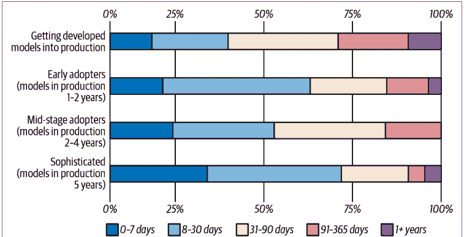

图 2-1：公司将模型投入生产所需的时间与其使用 ML 的时间成正比。来源：改编自 Algorithmia 的一张图片

## ML 系统的要求

如果不知道系统需要满足哪些要求，就不能说我们成功构建了一个 ML 系统。ML 系统的具体要求因用例而异。然而，大多数系统都应具备以下四个特性：可靠性、可扩展性、可维护性和适应性。我们将逐一详细讨论这些概念。首先来仔细看看可靠性。

## 可靠性

系统即使在面对逆境（硬件或软件故障，甚至人为错误）时，也应继续以期望的性能水平执行正确的功能。

对于 ML 系统来说，“正确性”可能很难确定。例如，你的系统可能正确调用了预测函数——如 `model.predict()`——但预测结果是错误的。如果没有真实标签可以比较，我们如何知道预测是错误的？

对于传统的软件系统，你通常会得到警告，例如系统崩溃、运行时错误或 404。然而，ML 系统可能会静默失败。最终用户甚至不知道系统已经失败，可能还会继续使用它，就好像它仍在正常工作一样。例如，如果你使用谷歌翻译将一句话翻译成你不懂的语言，即使翻译错了，你可能也很难分辨。我们将在第 8 章讨论 ML 系统在生产环境中如何失败。

后面的章节将深入探讨每个步骤在实践中需要什么。这里，我们先简要看看它们的含义：

## 步骤 1：项目范围界定

项目始于界定项目范围，列出目标、目的和约束条件。应识别并让利益相关者参与其中。应估算并分配资源。我们已经在第 1 章讨论了 ML 项目在生产环境中的不同利益相关者及一些重点。我们也在本章前面讨论了如何在业务背景下界定 ML 项目的范围。我们将在第 11 章讨论如何组织团队以确保 ML 项目的成功。

## 步骤 2：数据工程

如今绝大多数 ML 模型都从数据中学习，因此开发 ML 模型始于数据工程。在第 3 章中，我们将讨论数据工程的基础知识，包括处理来自不同来源和格式的数据。有了原始数据，我们将通过采样和生成标签来整理出训练数据，这将在第 4 章讨论。

## 步骤 3：ML 模型开发

有了初始训练数据，我们需要提取特征，并利用这些特征开发初始模型。这个阶段最需要 ML 知识，也是 ML 课程中最常涉及的部分。在第 5 章中，我们将讨论特征工程。在第 6 章中，我们将讨论模型选择、训练和评估。

## 步骤 4：部署

模型开发完成后，需要让用户能够访问它。开发 ML 系统就像写作——你永远不会到达系统完成的那一点。但你确实会到达必须将系统发布出去的那一点。我们将在第 7 章讨论部署 ML 模型的不同方式。

## 步骤 5：监控与持续学习

一旦投入生产，模型需要被监控以发现性能衰减，并加以维护以适应不断变化的环境和需求。这一步将在第 8 章和第 9 章中讨论。

## 步骤 6：业务分析

模型性能需要根据业务目标进行评估，并进行分析以产生业务洞察。这些洞察随后可用于淘汰无成效的项目或规划新项目。这一步与第一步密切相关。

## 框定 ML 问题

假设你是一家以千禧一代用户为目标客户的银行的 ML 工程主管。有一天，你的老板听说一家竞争对手银行使用 ML 来加速其客户服务支持，据说这帮助该竞争对手银行处理客户请求的速度提高了一倍。他命令你的团队也研究使用 ML 来加速你们的客户服务支持。

客户服务缓慢是一个问题，但它不是 ML 问题。ML 问题由输入、输出和指导学习过程的目标函数来定义——这三者在你老板的要求中都不明显。作为经验丰富的 ML 工程师，你的工作是运用你对 ML 可以解决哪些问题的知识，将这一请求框定为 ML 问题。

经过调查，你发现响应客户请求的瓶颈在于将客户请求路由到四个部门中的正确部门：会计、库存、人力资源（HR）和 IT。你可以通过开发一个 ML 模型来预测请求应发送到这四个部门中的哪一个，从而缓解这一瓶颈。这使得它成为一个分类问题。输入是客户请求。输出是请求应发送到的部门。目标函数是最小化预测部门与实际部门之间的差异。

我们将在第 5 章广泛讨论如何从原始数据中提取特征作为 ML 模型的输入。在本节中，我们将重点放在两个方面：模型的输出和指导学习过程的目标函数。

## ML 任务的类型

模型的输出决定了 ML 问题的任务类型。最常见的 ML 任务类型是分类和回归。在分类中还有更多子类型，如图 2-3 所示。我们将逐一介绍这些任务类型。

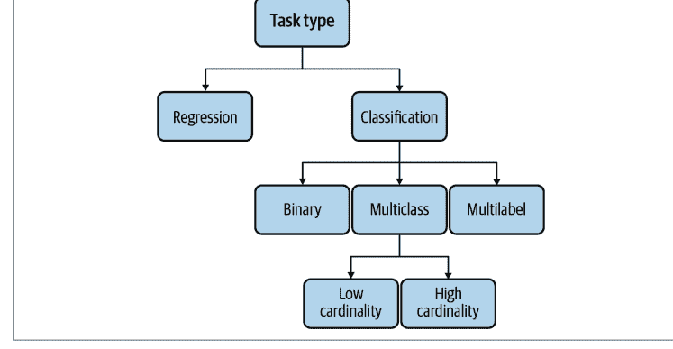

图 2-3：ML 中常见的任务类型

## 分类与回归

分类模型将输入划分为不同的类别。例如，你想将每封电子邮件分类为垃圾邮件或非垃圾邮件。回归模型输出一个连续值。一个例子是房屋预测模型，它输出给定房屋的价格。

回归模型可以很容易地被框定为分类模型，反之亦然。例如，如果我们将房价量化到不同的桶中，如低于 10 万美元、10 万–20 万美元、20 万–50 万美元等，并预测房屋应属于哪个桶，房屋预测就可以变成一个分类任务。

如果让电子邮件分类模型输出 0 到 1 之间的值，并决定一个阈值来确定哪些值应为垃圾邮件（例如，如果值高于 0.5，则该电子邮件是垃圾邮件），那么它可以变成一个回归模型，如图 2-4 所示。

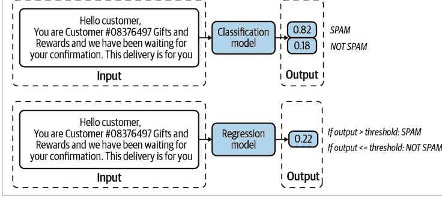

图 2-4：电子邮件分类任务也可以被框定为回归任务

## 二分类与多分类

在分类问题中，要分类的类别越少，问题就越简单。最简单的是二分类，即只有两个可能的类别。二分类的例子包括：判断评论是否有害、判断肺部扫描是否显示癌症迹象、判断交易是否欺诈。目前尚不清楚这类问题在行业中是因其在自然界中常见而普遍，还是仅仅因为 ML 从业者最擅长处理这类问题。

当类别超过两个时，问题就变成了多分类。处理二分类问题比处理多分类问题容易得多。例如，当只有两个类别时，计算 F1 和可视化混淆矩阵会直观得多。

当类别数量很多时，例如疾病诊断中疾病数量可达数千种，或产品分类中产品数量可达数万种，我们就说分类任务具有高基数性。高基数问题可能非常具有挑战性。第一个挑战是数据收集。根据我的经验，ML 模型通常需要每个类别至少有 100 个示例才能学会对该类别进行分类。所以如果你有 1,000 个类别，你就已经需要至少 100,000 个示例。对于稀有类别来说，数据收集尤其困难。当你有数千个类别时，很可能其中一些是稀有的。


## 多分类与多标签分类

当类别数量很大时，分层分类可能会很有用。在分层分类中，你有一个分类器先将每个样本划分到某个大组中，然后使用另一个分类器将该样本划分到某个子组中。例如，对于产品分类，你可以先将每个产品划分到四个主要类别之一：电子产品、家居厨房、时尚或宠物用品。在一个产品被划分到某个类别（比如时尚）之后，你可以用另一个分类器将该产品归入其子组之一：鞋子、衬衫、牛仔裤或配饰。

在二分类和多分类中，每个样本只属于一个类别。当一个样本可以属于多个类别时，我们就面临一个多标签分类问题。例如，在构建一个将文章分为四个主题——科技、娱乐、财经和政治——的模型时，一篇文章可以同时属于科技和财经。

解决多标签分类问题主要有两种方法。第一种是像处理多分类一样对待它。在多分类中，如果有四个可能的类别[科技、娱乐、财经、政治]，并且某个样本的标签是娱乐，你可以用向量[0, 1, 0, 0]表示这个标签。在多标签分类中，如果一个样本同时具有娱乐和财经两个标签，那么它的标签将被表示为[0, 1, 1, 0]。

第二种方法是将其转化为一组二分类问题。对于文章分类问题，你可以建立四个模型分别对应四个主题，每个模型输出一篇文章是否属于该主题。

在所有任务类型中，多标签分类通常是我见过的公司最头疼的问题。多标签意味着每个样本可以拥有的类别数量各不相同。首先，这使得标注工作变得困难，因为它加剧了我们在第4章中讨论的标签多重性问题。例如，一个标注者可能认为某个样本属于两个类别，而另一位标注者可能认为同一个样本只属于一个类别，并且可能很难解决他们的分歧。

其次，这种不固定的类别数量使得从原始概率中提取预测变得困难。考虑同样的文章四主题分类任务。假设给定一篇文章，你的模型输出了以下原始概率分布：[0.45, 0.2, 0.02, 0.33]。在多分类场合，当你已知一个样本只能属于一个类别时，你只需选择概率最高的类别，即本例中的0.45。而在多标签场合，由于你不知道一个样本可能属于多少个类别，你可能会选择概率最高的两个类别（对应0.45和0.33），或者概率最高的三个类别（对应0.45、0.2和0.33）。

## 构建问题的多种方式

考虑预测手机用户接下来想使用哪个应用的任务。一种天真的做法是将该任务构建为一个多分类任务——使用用户和环境特征（用户人口统计信息、时间、位置、之前使用过的应用）作为输入，并输出用户手机上每一个应用的概率分布。设N为你希望考虑推荐给用户的应用数量。在这种框架下，对于给定用户在给定时间，只需要进行一次预测，这个预测是一个大小为N的向量。图2-5展示了这一设置。

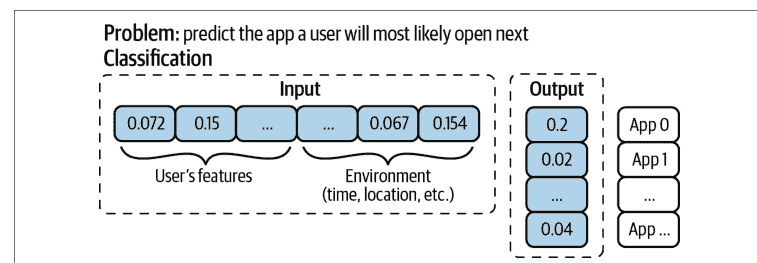

*图2-5：对于预测用户接下来最可能打开哪个应用的问题，你可以将其构建为一个分类问题。输入是用户特征和环境特征，输出是手机上所有应用的一个分布。*

这种方法很糟糕，因为每当添加一个新应用时，你可能需要从头重新训练模型，或者至少重新训练模型中所有参数数量依赖于N的组件。更好的做法是将此任务构建为一个回归任务。输入是用户、环境和应用的特征。输出是一个介于0和1之间的单一值；该值越高，表示在给定上下文下用户打开该应用的可能性越大。在这种框架下，对于给定用户在给定时间，需要进行N次预测，每个应用一次，但每次预测只是一个数字。图2-6展示了这种改进后的设置。

## 新干线时刻表

2023年3月18日修订

| 站名 | 希望号 | 光号 | 回声号 |
|------|--------|--------|--------|
| 东京 | 6:00 | 6:15 | 6:30 |
| 品川 | 6:12 | 6:27 | 6:42 |
| 新横滨 | 6:25 | 6:40 | 6:55 |
| 小田原 | 6:40 | 6:55 | 7:10 |
| 热海 | 6:52 | 7:07 | 7:22 |
| 三岛 | 7:02 | 7:17 | 7:32 |
| 新富士 | 7:15 | 7:30 | 7:45 |
| 静冈 | 7:28 | 7:43 | 7:58 |
| 挂川 | 7:40 | 7:55 | 8:10 |
| 滨松 | 7:52 | 8:07 | 8:22 |
| 丰桥 | 8:05 | 8:20 | 8:35 |
| 三河安城 | 8:18 | 8:33 | 8:48 |
| 名古屋 | 8:32 | 8:47 | 9:02 |

※ 上述时刻为2023年3月18日当前的信息。

联系方式：JR东海 0120-123-456

你可以组合各模型的输出，并根据组合得分对帖子进行排序：

α quality_score + β engagement_score

现在，无需重新训练模型，你就可以调整α和β！

一般来说，当存在多个目标时，最好先将它们解耦，因为这会让模型开发和维护更加容易。首先，如上所述，无需重新训练模型就能更容易地调整系统。其次，维护也更容易，因为不同的目标可能需要不同的维护节奏。垃圾信息技术的演变速度远快于人们对帖子质量的感知方式，因此垃圾信息过滤系统的更新频率要比质量排序系统高得多。

## 思维与数据

过去十年的进展表明，机器学习系统的成功很大程度上取决于其训练所用的数据。大多数公司不是专注于改进机器学习算法，而是专注于管理和改进数据。<sup>16</sup>

尽管使用海量数据的模型取得了成功，但许多人对将数据作为未来方向的重点持怀疑态度。在过去五年中，在我参加的每一次学术会议上，总有一些关于思维与数据力量的公开辩论。思维可能被包装成归纳偏置或智能架构设计。数据则可能被归入计算一类，因为更多的数据往往需要更多的计算。

理论上，你既可以追求架构设计，也可以利用大数据和计算，但在一方面花费时间往往会占用另一方面的时间。<sup>17</sup>

在“思维胜过数据”阵营中，有朱迪亚·珀尔博士，他是一位图灵奖得主，以在因果推断和贝叶斯网络方面的工作而闻名。他的著作《为什么》的引言标题为“思维胜过数据”，他在其中强调：“数据是极其愚蠢的。”在2020年他发布的一条颇具争议的推文中，他表达了对严重依赖数据的机器学习方法的强烈反对，并警告以数据为中心的机器学习从业者可能会在三到五年内失业：“机器学习在3-5年内将不再一样，继续遵循当前以数据为中心范式的机器学习从业者，即使不会失业，也会发现自己已经过时。请记住。”<sup>18</sup>

斯坦福人工智能实验室主任克里斯托弗·曼宁教授也提出了一个较为温和的看法，他认为巨大的计算量、海量数据加上简单的学习算法会造就极其糟糕的学习器。而结构让我们能够设计出用更少数据学习更多内容的系统。<sup>19</sup>

如今机器学习领域的许多人属于“数据胜过思维”阵营。阿尔伯塔大学计算机科学教授、DeepMind杰出研究科学家理查德·萨顿教授写了一篇出色的博文，他在文中声称，那些选择追求智能设计而非利用计算方法的研究人员，最终会得到一个苦涩的教训：“从70年人工智能研究中可以读出的最大教训是，利用计算的通用方法最终是最有效的，而且优势巨大……为了寻求在短期内产生影响的改进，研究人员试图利用他们对领域的人类知识，但从长远来看，唯一重要的是对计算的利用。”<sup>20</sup>

当被问及谷歌搜索为何如此成功时，谷歌搜索质量总监彼得·诺维格强调了大量数据而非智能算法在其成功中的重要性：“我们没有更好的算法，我们只是拥有更多的数据。”<sup>21</sup>

Jawbone前数据副总裁莫妮卡·罗加蒂博士认为，数据是数据科学的基础，如图2-7所示。如果你想利用数据科学（机器学习是其一部分的学科）来改进产品或流程，你需要从构建数据开始，包括数量和质量。没有数据，就没有数据科学。

这场争论并不是关于有限数据是否必要，而是关于它是否足够。这里的“有限”一词很重要，因为如果我们拥有无限的数据，我们或许可以通过查找直接得到答案。拥有大量数据并不等于拥有无限数据。

16. 阿南德·拉贾拉曼（Anand Rajaraman），《更多数据通常胜过更好的算法》，Datawocky，2008年3月24日，https://oreil.ly/wNwhV。
17. 里奇·萨顿（Rich Sutton），《苦涩的教训》，2019年3月13日，https://oreil.ly/RhOp9。
18. 朱迪亚·珀尔博士（@yudapearl）的推文，2020年9月27日，https://oreil.ly/wFbHb。
19. 《深度学习与先天先验》（克里斯·曼宁与扬·勒昆辩论），2018年2月2日，视频，1:02:55，https://oreil.ly/b3hb1。
20. 萨顿，《苦涩的教训》。
21. 阿隆·哈勒维（Alon Halevy）、彼得·诺维格和费尔南多·佩雷拉（Fernando Pereira），《数据的不合理有效性》，IEEE计算机学会，2009年3月/4月，https://oreil.ly/WkN6p。


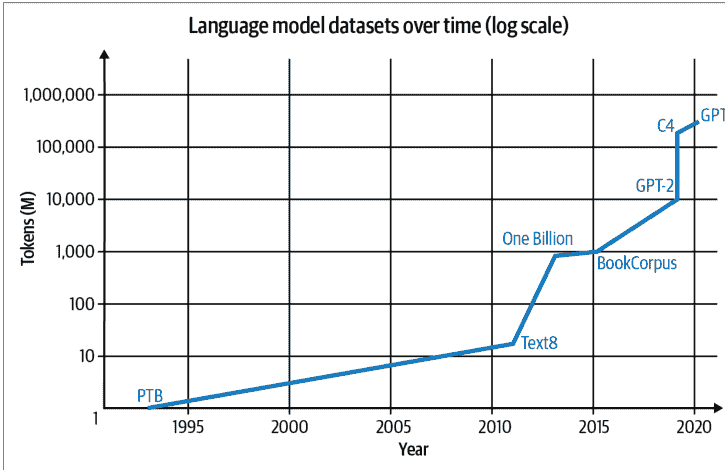

图 2-8. 随时间推移用于语言模型的数据集大小（对数刻度）

尽管过去十年深度学习的大部分进展都得益于数据量的不断增加，但更多的数据并不总是能带来模型性能的提升。质量较低的数据，例如过时的数据或标签错误的数据，甚至可能损害模型的性能。

## 摘要

我希望本章能为您介绍机器学习系统设计以及在设计机器学习系统时需要考虑的因素。

每个项目都必须从为什么需要这个项目开始，机器学习项目也不例外。我们在章节开头假设，大多数企业不关心机器学习指标，除非这些指标能推动业务指标。因此，如果为企业构建机器学习系统，它必须以业务目标为驱动，这些目标需要转化为机器学习目标，以指导机器学习模型的发展。

在构建机器学习系统之前，我们需要了解系统需要满足的要求才能被视为一个良好的系统。具体要求因用例而异，在本章中，我们重点关注了四个最通用的要求：可靠性、可扩展性、可维护性和可适应性。满足这些要求的各种技术将在全书中介绍。

构建机器学习系统不是一次性任务，而是一个迭代过程。在本章中，我们讨论了开发满足上述要求的机器学习系统的迭代过程。

我们以对数据在机器学习系统中作用的哲学讨论结束了本章。仍有许多人认为，拥有智能算法最终会胜过拥有大量数据。然而，包括 AlexNet、BERT 和 GPT 在内的系统的成功表明，过去十年机器学习进展的依赖于能够获取大量数据。24 无论数据能否压倒智能设计，没有人能否认数据在机器学习中的重要性。本书的相当一部分内容将致力于阐明各种数据问题。

复杂的机器学习系统由更简单的构建块组成。现在我们已经介绍了生产环境中机器学习系统的整体概述，接下来的章节将深入其构建块，首先从下一章的数据工程基础开始。如果本章提到的任何挑战对您来说似乎很抽象，我希望以下章节中的具体示例能使它们更具体。

24 Alex Krizhevsky, Ilya Sutskever, and Geoffrey E Hinton, “使用深度卷积神经网络的 ImageNet 分类,” in 《神经信息处理系统进展》, 第 25 卷, 编者 F. Pereira, C.J. Burges, L. Bottou, 和 K.Q. Weinberger (Curran Associates, 2012), https://oreil.ly/MFYp9; Jacob Devlin, Ming-Wei Chang, Kenton Lee, and Kristina Toutanova, “BERT：用于语言理解的深度双向变换器的预训练,” arXiv, 2019, https://oreil.ly/TN8fN; “更好的语言模型及其影响,” OpenAI 博客, 2019 年 2 月 14 日, https://oreil.ly/SGV7g.

## 数据工程基础

近年来机器学习的兴起与大数据兴起紧密相连。即使没有机器学习，大型数据系统也是复杂的。如果您没有花数年时间与它们打交道，很容易在缩写中迷失方向。这些系统会产生许多挑战和可能的解决方案。如果有的话，行业标准会随着新工具的出现和行业需求的扩展而快速演变，形成一个动态且不断变化的环境。如果您查看不同科技公司的数据栈，可能会觉得每个公司都在做自己的事情。

在本章中，我们将介绍数据工程的基础知识，希望能为您在探索自身需求的领域时提供一个稳固的立足点。我们将从典型的机器学习项目中可能处理的不同数据源开始。我们将继续讨论数据可以存储的格式。存储数据只有在您打算以后检索该数据时才有意义。要检索存储的数据，了解其格式以及其结构都很重要。数据模型定义了特定数据格式中存储的数据的结构。

如果数据模型描述现实世界中的数据，那么数据库则指定数据应如何存储在机器上。我们将继续讨论用于两种主要处理类型的数据存储引擎，也称为数据库：事务处理和分析处理。

在生产环境中处理数据时，您通常需要在多个进程和服务之间处理数据。例如，您可能有一个从原始数据计算特征的特征工程服务，以及一个基于计算特征生成预测的预测服务。这意味着您需要将计算出的特征从特征工程服务传递到预测服务。在本章的下一节中，我们将讨论进程间数据传递的不同模式。

日志可以记录系统的状态和重要事件，例如内存使用量、实例数量、调用的服务、使用的包等。它们可以记录不同作业的结果，包括用于数据处理和模型训练的大型批处理作业。这些类型的日志提供了系统运行情况的可视性。这种可视性的主要目的是用于调试并可能改进应用程序。大多数时候，您不需要查看这些类型的日志，但在出现问题时它们至关重要。

因为日志是系统生成的，所以它们出现格式错误的情况比用户输入数据要少得多。总的来说，日志不需要像您希望处理用户输入数据那样在到达后立即处理。对于许多用例，按周期处理日志是可以接受的，例如每小时或甚至每天。然而，您可能仍希望快速处理日志，以便在发生有趣的事情时能够检测到并收到通知。¹

因为调试机器学习系统很困难，所以记录尽可能多的内容是一种常见做法。这意味着您的日志量可能会非常、非常快地增长。这导致了两个问题。第一个是很难知道去哪里查找，因为信号淹没在噪音中。已有许多服务用于处理和分析日志，例如 Logstash、Datadog、Logz.io 等。它们中的许多使用机器学习模型来帮助您处理和理解海量的日志。

第二个问题是如何存储快速增长的日志。幸运的是，在大多数情况下，您只需在日志对您有用时存储它们，并在它们不再与调试当前系统相关时丢弃它们。如果您不需要频繁访问日志，它们也可以存储在低访问存储中，其成本远低于高频访问存储。²

系统还会生成数据来记录用户的行为，例如点击、选择建议、滚动、缩放、忽略弹出窗口或在某些页面上花费异常多的时间。尽管这是系统生成的数据，但它仍被视为用户数据的一部分，可能受隐私法规约束。³

1 生产环境中的“有趣”通常意味着灾难性的，例如崩溃或您的云账单达到天文数字。

2 截至 2021 年 11 月，AWS S3 Standard 这种允许您以毫秒级延迟访问数据的存储选项，每 GB 的成本约为 S3 Glacier 的五倍，而 S3 Glacier 这种允许您以 1 分钟到 12 小时延迟检索数据的存储选项。

3 一位机器学习工程师曾告诉我，他的团队只使用用户历史产品浏览和购买记录来推荐他们接下来可能想看的内容。我回应道：“所以你们根本不使用个人数据？”他看起来很困惑。“如果您指的是人口统计数据，如用户的年龄、位置，那么不，我们不用。但我认为一个人的浏览和购买活动是非常私人的。”


还有由公司各种服务和企业应用生成的*内部数据库*。这些数据库管理其资产，如库存、客户关系、用户等。此类数据可直接被机器学习模型使用，也可被机器学习系统的各种组件使用。例如，当用户在亚马逊输入搜索查询时，一个或多个机器学习模型会处理该查询以检测其意图——如果有人输入“frozen”，他们是在寻找冷冻食品还是迪士尼的*Frozen*系列？——然后亚马逊需要在对其进行排名并向用户展示之前，检查其内部数据库中这些产品的可用性。

然后是*第三方数据*这个奇妙而怪异的世界。第一方数据是贵公司已收集的关于其用户或客户的数据。第二方数据是由另一家公司在其自身客户上收集并向您提供的数据，尽管您可能需要为此付费。第三方数据公司收集的是对其非直接客户的公众数据。

互联网和智能手机的兴起使得收集各种类型的数据变得更加容易。智能手机尤其容易，因为每部手机过去都有一个唯一的广告商 ID——iPhone 使用苹果的广告商标识符（IDFA），Android 手机使用其 Android 广告 ID（AAID）——它充当唯一 ID 来汇总手机上的所有活动。来自应用、网站、签到服务等的数据被收集并（希望）匿名化，以为每个人生成活动历史记录。

各种各样的数据都可以被购买，例如社交媒体活动、购买历史、网页浏览习惯、汽车租赁，以及针对不同人口群体的政治倾向，细化到男性、年龄 25–34 岁、在科技行业工作、居住在湾区。从这些数据中，您可以推断出诸如喜欢品牌 A 的人也喜欢品牌 B 之类的信息。这些数据对于诸如推荐系统之类的系统尤其有帮助，可生成与用户兴趣相关的结果。第三方数据通常在被供应商清理和处理后出售。

然而，随着用户对数据隐私的需求增加，公司已采取措施遏制广告商 ID 的使用。2021 年初，苹果将 IDFA 改为选择加入。此项更改大幅减少了 iPhone 上可用的第三方数据量，迫使许多公司更加关注第一方数据。⁴ 为了反击这一变化，广告商一直在投资变通方法。例如，中国广告协会——中国广告行业的国家支持的行业协会——投资了一种名为 CAID 的设备指纹系统，该系统允许 TikTok 和腾讯等应用继续追踪 iPhone 用户。⁵

4 John Koetsier, “苹果刚刚削弱了 IDFA，导致价值 800 亿美元的行业陷入动荡,” *Forbes*, 2020年6月24日, https://oreil.ly/rqPX9.

5 Patrick McGee and Yuan Yang, “TikTok 希望借助国家支持的变通方法继续追踪 iPhone 用户,” *Ars Technica*, 2021年3月16日, https://oreil.ly/54pkg.

## 数据格式

一旦拥有数据，您可能希望存储它（在技术术语中称为“persist”）。由于您的数据来自多个具有不同访问模式的来源，存储数据并不总是直接的，在某些情况下甚至可能代价高昂。重要的是要考虑数据未来将如何使用，以便您使用的格式是有意义的。以下是您可能需要考虑的一些问题：

- 我如何存储多模态数据，例如可能同时包含图像和文本的样本？
- 我在哪里存储数据才能既便宜又能快速访问？
- 我如何存储复杂模型以便它们可以在不同的硬件上正确加载和运行？

将数据结构或对象状态转换为可以存储或传输并稍后重建的格式的过程是数据序列化。有许多、许多数据序列化格式。在考虑要使用的格式时，您可能希望考虑不同的特性，例如人类可读性、访问模式，以及它是基于文本还是二进制，这会影响其文件的大小。表 3-1 仅列出了您在工作中可能遇到的一些常见格式。如需更全面的列表，请查看精彩的维基百科页面“Comparison of Data-Serialization Formats”。

表 3-1. 常见数据格式及其用途

| 格式 | 二进制/文本 | 人类可读 | 示例用途 |
|---|---|---|---|
| JSON | 文本 | 是 | 无处不在 |
| CSV | 文本 | 是 | 无处不在 |
| Parquet | 二进制 | 否 | Hadoop, Amazon Redshift |
| Avro | 二进制为主 | 否 | Hadoop |
| Protobuf | 二进制为主 | 否 | Google, TensorFlow (TFRecord) |
| Pickle | 二进制 | 否 | Python, PyTorch 序列化 |

我们将介绍其中几种格式，从 JSON 开始。我们还将介绍两种常见且代表两种不同范式的格式：CSV 和 Parquet。

### JSON

JSON，Javascript Object Notation，无处不在。尽管它源自 JavaScript，但它是语言无关的——大多数现代编程语言都可以生成和解析 JSON。它是人类可读的。其键值对范式简单但强大，能够处理不同结构化程度的数据。例如，您的数据可以以如下结构化格式存储：

```
{
  "firstName": "Boatie",
  "lastName": "McBoatFace",
  "isVibing": true,
  "age": 12,
  "address": {
    "streetAddress": "12 Ocean Drive",
    "city": "Port Royal",
    "postalCode": "10021-3100"
  }
}
```

相同的数据也可以以如下非结构化文本块的形式存储：

```
{
  "text": "Boatie McBoatFace, aged 12, is vibing, at 12 Ocean Drive, Port Royal, 10021-3100"
}
```

由于 JSON 无处不在，它带来的痛苦也无处不在。一旦您将 JSON 文件中的数据提交给模式，事后回头更改模式会非常痛苦。JSON 文件是文本文件，这意味着它们占用大量空间，正如我们在第 57 页的“Text Versus Binary Format”一节中将看到的那样。

### 行优先与列优先格式

两种常见且代表两种不同范式的格式是 CSV 和 Parquet。CSV（逗号分隔值）是行优先的，这意味着一行中连续的元素在内存中彼此相邻存储。Parquet 是列优先的，这意味着一列中连续的元素在内存中彼此相邻存储。

由于现代计算机处理顺序数据比非顺序数据更高效，如果表是行优先的，则访问其行预计比访问其列更快。这意味着对于行优先格式，按行访问数据预计比按列访问数据更快。

假设我们有一个包含 1,000 个示例的数据集，每个示例有 10 个特征。如果我们将每个示例视为一行，每个特征视为一列，如机器学习中经常出现的情况，那么像 CSV 这样的行优先格式更适合访问示例，例如访问今天收集的所有示例。列优先格式像 Parquet 更适合访问特征，例如访问所有示例的时间戳。参见图 3-1。

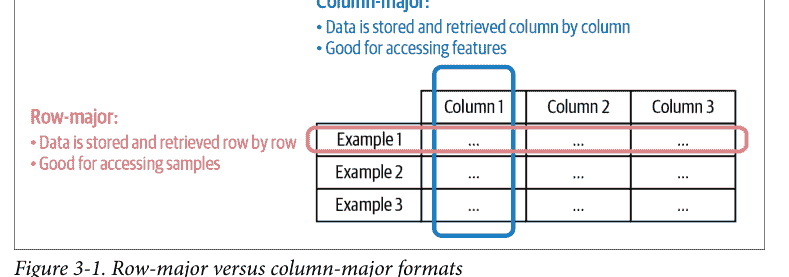

图 3-1. 行优先与列优先格式

列优先格式允许灵活的基于列的读取，尤其是在数据很大、具有数千甚至数百万个特征时。假设您有关于拼车交易的数据，共有 1,000 个特征，但您只想要 4 个特征：时间、位置、距离、价格。使用列优先格式，您可以直接读取对应这四个特征的四列。然而，使用行优先格式，如果您不知道行的大小，您将不得不读取所有列然后筛选出这四列。即使您知道行的大小，仍然可能很慢，因为您必须在内存中跳转，无法利用缓存。

行优先格式允许更快的写入。考虑当您必须不断向数据中添加新的单个示例的情况。对于每个单独的示例，将其写入数据已以行优先格式存储的文件会快得多。

总体而言，行优先格式在需要大量写入时更好，而列优先格式在需要大量基于列的读取时更好。


我以 CSV 作为行优先格式的示例，因为它很流行，而且我与科技界交流过的人都能普遍识别。然而，这本书的早期审阅者中有些人指出，他们认为 CSV 是一种糟糕的数据格式。它对非文本字符的序列化很差。例如，当你将浮点值写入 CSV 文件时，可能会丢失部分精度——0.12345678901232323 可能被随意四舍五入为“0.12345678901”——正如 Stack Overflow 线程和 Microsoft Community 线程中抱怨的那样。Hacker News 上的人们曾激烈地反对使用 CSV。

## 文本与二进制格式

CSV 和 JSON 是文本文件，而 Parquet 文件是二进制文件。文本文件是以纯文本形式存在的文件，这通常意味着它们是人类可读的。二进制文件是所有非文本文件的统称。顾名思义，二进制文件通常只包含 0 和 1，并且旨在由知道如何解释原始字节的程序读取或使用。程序必须确切知道二进制文件内部数据的布局才能使用该文件。如果你用文本编辑器打开文本文件，例如 VS Code、Notepad，你就能阅读其中的文本。如果你用文本编辑器打开二进制文件，你会看到数字块，很可能以十六进制值形式显示，对应文件的各个字节。

二进制文件更紧凑。以下是一个简单的示例，说明二进制文件与文本文件相比如何节省空间。假设你想存储数字 1000000。如果将其存储在文本文件中，它需要 7 个字符，如果每个字符是 1 字节，则需要 7 字节。如果将其作为 int32 存储在二进制文件中，则只需要 32 位或 4 字节。

作为说明，我使用 interviews.csv，它是一个 CSV 文件，文本格式，包含 17,654 行和 10 列。当我将其转换为二进制格式 Parquet 时，文件大小从 14 MB 降至 6 MB，如图 3-3 所示。

AWS 建议使用 Parquet 格式，因为“与文本格式相比，Parquet 格式卸载速度快达 2 倍，在 Amazon S3 中使用的存储空间少达 6 倍。”⁸

8 “宣布 Amazon Redshift Data Lake Export：以 Apache Parquet 格式共享数据”，Amazon AWS，2019 年 12 月 3 日，https://oreil.ly/ilDb6。

行重复，而真正的 relation 不能包含重复。然而，这个细微的差异已被大多数人安全地忽略了。

关于 SQL 最重要的一点是，它是一种声明式语言，而 Python 是一种命令式语言。在命令式范式中，你指定执行某项操作所需的步骤，计算机执行这些步骤以返回输出。在声明式范式中，你指定想要的输出，计算机[content]


我以 CSV 作为行优先格式的示例，因为它很流行，而且我与科技界交流过的人都能普遍识别。然而，这本书的早期审阅者中有些人指出，他们认为 CSV 是一种糟糕的数据格式。它对非文本字符的序列化很差。例如，当你将浮点值写入 CSV 文件时，可能会丢失部分精度——0.12345678901232323 可能被随意四舍五入为“0.12345678901”——正如 Stack Overflow 线程和 Microsoft Community 线程中抱怨的那样。Hacker News 上的人们曾激烈地反对使用 CSV。

## 文本与二进制格式

CSV 和 JSON 是文本文件，而 Parquet 文件是二进制文件。文本文件是以纯文本形式存在的文件，这通常意味着它们是人类可读的。二进制文件是所有非文本文件的统称。顾名思义，二进制文件通常只包含 0 和 1，并且旨在由知道如何解释原始字节的程序读取或使用。程序必须确切知道二进制文件内部数据的布局才能使用该文件。如果你用文本编辑器打开文本文件，例如 VS Code、Notepad，你就能阅读其中的文本。如果你用文本编辑器打开二进制文件，你会看到数字块，很可能以十六进制值形式显示，对应文件的各个字节。

二进制文件更紧凑。以下是一个简单的示例，说明二进制文件与文本文件相比如何节省空间。假设你想存储数字 1000000。如果将其存储在文本文件中，它需要 7 个字符，如果每个字符是 1 字节，则需要 7 字节。如果将其作为 int32 存储在二进制文件中，则只需要 32 位或 4 字节。

作为说明，我使用 interviews.csv，它是一个 CSV 文件，文本格式，包含 17,654 行和 10 列。当我将其转换为二进制格式 Parquet 时，文件大小从 14 MB 降至 6 MB，如图 3-3 所示。

AWS 建议使用 Parquet 格式，因为“与文本格式相比，Parquet 格式卸载速度快达 2 倍，在 Amazon S3 中使用的存储空间少达 6 倍。”⁸

8 “宣布 Amazon Redshift Data Lake Export：以 Apache Parquet 格式共享数据”，Amazon AWS，2019 年 12 月 3 日，https://oreil.ly/ilDb6。

行重复，而真正的 relation 不能包含重复。然而，这个细微的差异已被大多数人安全地忽略了。

关于 SQL 最重要的一点是，它是一种声明式语言，而 Python 是一种命令式语言。在命令式范式中，你指定执行某项操作所需的步骤，计算机执行这些步骤以返回输出。在声明式范式中，你指定想要的输出，计算机[content]


我以 CSV 作为行优先格式的示例，因为它很流行，而且我与科技界交流过的人都能普遍识别。然而，这本书的早期审阅者中有些人指出，他们认为 CSV 是一种糟糕的数据格式。它对非文本字符的序列化很差。例如，当你将浮点值写入 CSV 文件时，可能会丢失部分精度——0.12345678901232323 可能被随意四舍五入为“0.12345678901”——正如 Stack Overflow 线程和 Microsoft Community 线程中抱怨的那样。Hacker News 上的人们曾激烈地反对使用 CSV。

## 文本与二进制格式

CSV 和 JSON 是文本文件，而 Parquet 文件是二进制文件。文本文件是以纯文本形式存在的文件，这通常意味着它们是人类可读的。二进制文件是所有非文本文件的统称。顾名思义，二进制文件通常只包含 0 和 1，并且旨在由知道如何解释原始字节的程序读取或使用。程序必须确切知道二进制文件内部数据的布局才能使用该文件。如果你用文本编辑器打开文本文件，例如 VS Code、Notepad，你就能阅读其中的文本。如果你用文本编辑器打开二进制文件，你会看到数字块，很可能以十六进制值形式显示，对应文件的各个字节。

二进制文件更紧凑。以下是一个简单的示例，说明二进制文件与文本文件相比如何节省空间。假设你想存储数字 1000000。如果将其存储在文本文件中，它需要 7 个字符，如果每个字符是 1 字节，则需要 7 字节。如果将其作为 int32 存储在二进制文件中，则只需要 32 位或 4 字节。

作为说明，我使用 interviews.csv，它是一个 CSV 文件，文本格式，包含 17,654 行和 10 列。当我将其转换为二进制格式 Parquet 时，文件大小从 14 MB 降至 6 MB，如图 3-3 所示。

AWS 建议使用 Parquet 格式，因为“与文本格式相比，Parquet 格式卸载速度快达 2 倍，在 Amazon S3 中使用的存储空间少达 6 倍。”⁸

8 “宣布 Amazon Redshift Data Lake Export：以 Apache Parquet 格式共享数据”，Amazon AWS，2019 年 12 月 3 日，https://oreil.ly/ilDb6。

行重复，而真正的 relation 不能包含重复。然而，这个细微的差异已被大多数人安全地忽略了。

关于 SQL 最重要的一点是，它是一种声明式语言，而 Python 是一种命令式语言。在命令式范式中，你指定执行某项操作所需的步骤，计算机执行这些步骤以返回输出。在声明式范式中，你指定想要的输出，计算机[content]


我以 CSV 作为行优先格式的示例，因为它很流行，而且我与科技界交流过的人都能普遍识别。然而，这本书的早期审阅者中有些人指出，他们认为 CSV 是一种糟糕的数据格式。它对非文本字符的序列化很差。例如，当你将浮点值写入 CSV 文件时，可能会丢失部分精度——0.12345678901232323 可能被随意四舍五入为“0.12345678901”——正如 Stack Overflow 线程和 Microsoft Community 线程中抱怨的那样。Hacker News 上的人们曾激烈地反对使用 CSV。

## 文本与二进制格式

CSV 和 JSON 是文本文件，而 Parquet 文件是二进制文件。文本文件是以纯文本形式存在的文件，这通常意味着它们是人类可读的。二进制文件是所有非文本文件的统称。顾名思义，二进制文件通常只包含 0 和 1，并且旨在由知道如何解释原始字节的程序读取或使用。程序必须确切知道二进制文件内部数据的布局才能使用该文件。如果你用文本编辑器打开文本文件，例如 VS Code、Notepad，你就能阅读其中的文本。如果你用文本编辑器打开二进制文件，你会看到数字块，很可能以十六进制值形式显示，对应文件的各个字节。

二进制文件更紧凑。以下是一个简单的示例，说明二进制文件与文本文件相比如何节省空间。假设你想存储数字 1000000。如果将其存储在文本文件中，它需要 7 个字符，如果每个字符是 1 字节，则需要 7 字节。如果将其作为 int32 存储在二进制文件中，则只需要 32 位或 4 字节。

作为说明，我使用 interviews.csv，它是一个 CSV 文件，文本格式，包含 17,654 行和 10 列。当我将其转换为二进制格式 Parquet 时，文件大小从 14 MB 降至 6 MB，如图 3-3 所示。

AWS 建议使用 Parquet 格式，因为“与文本格式相比，Parquet 格式卸载速度快达 2 倍，在 Amazon S3 中使用的存储空间少达 6 倍。”⁸

8 “宣布 Amazon Redshift Data Lake Export：以 Apache Parquet 格式共享数据”，Amazon AWS，2019 年 12 月 3 日，https://oreil.ly/ilDb6。

行重复，而真正的 relation 不能包含重复。然而，这个细微的差异已被大多数人安全地忽略了。

关于 SQL 最重要的一点是，它是一种声明式语言，而 Python 是一种命令式语言。在命令式范式中，你指定执行某项操作所需的步骤，计算机执行这些步骤以返回输出。在声明式范式中，你指定想要的输出，计算机[content]


我以 CSV 作为行优先格式的示例，因为它很流行，且我与科技界交流的人都能普遍识别。然而，本书的早期审阅者中有人认为 CSV 是糟糕的数据格式。它对非文本字符序列化很差。例如，写入 CSV 时浮点值可能丢失精度——0.12345678901232323 可能被随意四舍五入为“0.12345678901”——正如 Stack Overflow 线程和 Microsoft Community 线程所抱怨。Hacker News 上的人也曾激烈反对使用 CSV。

## 文本与二进制格式

CSV 和 JSON 是文本文件，而 Parquet 文件是二进制文件。文本文件是纯文本，通常可读。二进制文件指所有非文本文件，通常只含 0 和 1，需由懂得解释原始字节的程序读取。程序必须确切知道二进制文件内数据的布局。打开文本文件在文本编辑器如 VS Code、Notepad 中可读；打开二进制文件则会看到数字块，很可能为十六进制。

二进制文件更紧凑。例如存储数字 1000000，文本需 7 个字符，约 7 字节；作为 int32 的二进制只需 32 位即 4 字节。

举例，我使用 interviews.csv，CSV 文本格式，17,654 行 10 列。转为 Parquet 二进制后，文件从 14 MB 降至 6 MB，如图 3-3 所示。

AWS 建议使用 Parquet 格式，因为“与文本格式相比，Parquet 格式卸载速度快达 2 倍，在 Amazon S3 中存储空间少达 6 倍。”⁸

8 “Announcing Amazon Redshift Data Lake Export: Share Data in Apache Parquet Format,” Amazon AWS, December 3, 2019, https://oreil.ly/ilDb6.

行重复，而真正的 relation 不能包含重复。然而，这个细微差异已被大多数人安全忽略。

关于 SQL 最重要的一点是，它是声明式语言，而 Python 是命令式语言。命令式范式中，你指定执行动作的步骤，计算机执行以返回输出。声明式范式中，你指定想要的输出，计算机[content]


我以 CSV 作为行优先格式的示例，因为它流行且被科技界普遍识别。然而本书早期审阅者有人认为 CSV 是糟糕的数据格式。它对非文本字符序列化很差。例如写入 CSV 时浮点值可能失真——0.12345678901232323 可能被四舍五入为“0.12345678901”——如 Stack Overflow 和 Microsoft Community 线程所抱怨。Hacker News 上也有人激烈反对 CSV。

## 文本与二进制格式

CSV 和 JSON 是文本文件，Parquet 是二进制文件。文本文件为纯文本，通常可读。二进制文件指所有非文本文件，通常只含 0 和 1，需由懂原始字节的程序使用。程序必须知道二进制内数据的布局。文本编辑器如 VS Code、Notepad 可读文本文件；打开二进制文件则看到数字块，多为十六进制。

二进制更紧凑。例如存储 1000000，文本需 7 字符约 7 字节；int32 二进制只需 32 位即 4 字节。

举例 interviews.csv 为 17,654 行 10 列的 CSV 文本，转为 Parquet 后从 14 MB 降至 6 MB，如图 3-3。

AWS 建议使用 Parquet，因为“与文本格式相比，Parquet 卸载快达 2 倍，Amazon S3 存储少达 6 倍。”⁸

8 “Announcing Amazon Redshift Data Lake Export: Share Data in Apache Parquet Format,” Amazon AWS, December 3, 2019, https://oreil.ly/ilDb6.

行重复，而真 relation 不能重复。此细微差异已被多数人忽略。

SQL 最重要的是它是声明式语言，而 Python 是命令式。命令式需指定步骤，系统执行后返回输出。声明式只需指定想要的输出，系统[content]


我以 CSV 作为行优先格式的示例，因为它很流行，且我与科技界交流的人都能普遍识别。然而，本书的早期审阅者中有人认为 CSV 是糟糕的数据格式。它对非文本字符序列化很差。例如，写入 CSV 时浮点值可能丢失精度——0.12345678901232323 可能被随意四舍五入为“0.12345678901”——正如 Stack Overflow 线程和 Microsoft Community 线程所抱怨。Hacker News 上的用户也曾激烈反对使用 CSV。

## 文本与二进制格式

CSV 和 JSON 是文本文件，而 Parquet 是二进制文件。文本文件为纯文本，通常可读。二进制文件指所有非文本文件，通常只含 0 和 1，需由懂得解释原始字节的程序使用。程序必须确切知道二进制内数据的布局。文本编辑器如 VS Code、Notepad 可读文本文件；打开二进制文件则会看到数字块，多为十六进制。


数据，无论在哪些应用中，其处理方式都相似。事务在生成时即被插入，并在某些情况发生变化时偶尔更新，或在不再需要时删除。¹⁹ 这种类型的处理被称为 *在线事务处理 (OLTP)*。

由于这些事务通常涉及用户，它们需要快速处理（低延迟），以免让用户等待。处理方法需要具有高可用性——也就是说，处理系统需要在用户想要进行事务的任何时候都可用。如果你的系统无法处理一个事务，该事务就不会完成。

事务型数据库旨在处理在线事务并满足低延迟、高可用性的要求。当人们听到事务型数据库时，通常会想到 ACID（原子性、一致性、隔离性、持久性）。以下是为需要快速回顾的人提供的定义：

## Atomicity

## 原子性

保证事务中的所有步骤作为一个整体成功完成。如果事务中的任何一步失败，所有其他步骤也必须失败。例如，如果用户的付款失败，你不希望仍然为该用户分配司机。

## Consistency

## 一致性

保证所有通过的事务必须遵循预定义规则。例如，事务必须由有效用户发起。

## Isolation

## 隔离性

保证两个事务同时发生时就像是被隔离的一样。两个用户访问同一数据时不会同时更改它。例如，你不希望两个用户同时预订同一名司机。

## Durability

## 持久性

保证一旦事务已提交，即使系统出现故障，它仍将保持提交状态。例如，在你叫车后手机没电了，你仍然希望你的车会来。

然而，事务型数据库不一定需要符合 ACID，一些开发者认为 ACID 过于严格。根据 Martin Kleppmann 的说法，“不符合 ACID 标准的系统有时被称为 BASE，即 Basically Available、Soft state 和 Eventual consistency 的缩写。这比 ACID 的定义甚至更模糊。”²⁰

¹⁹ 本段以及本章的许多部分都受到了 Martin Kleppmann 的 *Designing Data-Intensive Applications* 的启发。

²⁰ Kleppmann, *Designing Data-Intensive Applications.*


Figure 3-8. In the request-driven architecture, each service needs to send requests to two other services
Figure 3-8. 在请求驱动架构中，每个服务都需要向另外两个服务发送请求

仅有三个服务，数据传递就已经变得复杂。想象一下像大型互联网公司那样拥有数百甚至数千个服务。服务间的数据传递可能会爆炸式增长并成为瓶颈，从而拖慢整个系统。

请求驱动的数据传递是同步的：目标服务必须监听请求才能让请求通过。如果价格优化服务向司机管理服务请求数据，而司机管理服务宕机，价格优化服务将不断重发请求直到超时。而且如果价格优化服务在收到响应前就宕机，响应将被丢失。一个宕机的服务可能导致所有依赖其数据的服务都宕机。

如果有一个代理协调服务间数据传递会怎样？与其让服务直接相互请求数据并形成复杂的服务间数据传递网络，每个服务只需与代理通信即可，如图 3-9 所示。例如，与其让其他服务向司机管理服务请求下一分钟的司机预测数量，如果每当司机管理服务做出预测时，该预测就广播给代理会怎样？任何想要从司机管理服务获取数据的服务都可以检查该代理以获取最新的司机预测数量。同样，每当价格优化服务对下一分钟的 surge 费用做出预测时，该预测也会广播给代理。

## Training Data

## 训练数据

在第 3 章中，我们介绍了从系统角度处理数据的方法。在本章中，我们将介绍从数据科学角度处理数据的方法。尽管训练数据在开发和改进机器学习模型中至关重要，但机器学习课程严重偏向建模，而许多从业者认为建模是过程中的“有趣”部分。构建最先进的模型很有趣。花费数天时间处理大量格式错误的、甚至无法放入机器内存的数据是令人沮丧的。

数据是混乱的、复杂的、不可预测的，并且可能具有欺骗性。如果处理不当，很容易让整个机器学习项目失败。但这正是数据科学家和机器学习工程师应该学习如何妥善处理数据的原因，这样可以为我们节省时间和麻烦。

在本章中，我们将介绍获取或创建良好训练数据的技术。在本章中，训练数据涵盖了机器学习模型开发阶段使用的所有数据，包括用于训练、验证和测试的不同划分（训练、验证、测试划分）。本章首先介绍用于选择训练数据的不同采样技术。然后我们将讨论创建训练数据时的常见挑战，包括标签多重性问题、标签缺乏问题、类别不平衡问题，以及用于解决数据缺乏问题的数据增强技术。

我们使用“训练数据”而不是“训练数据集”这个术语，因为“数据集”表示一个有限且静态的集合。生产中的数据既不是有限的也不是静态的，这一现象将在第 237 页的“数据分布偏移”部分中讨论。像构建机器学习系统的其他步骤一样，创建训练数据是一个迭代过程。随着模型在项目生命周期中不断演进，你的训练数据也可能会演进。

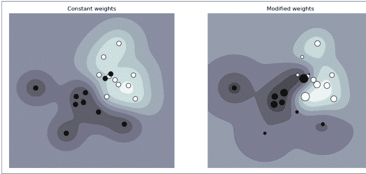

Figure 4-1. Sample weights can affect the decision boundary. On the left is when all samples are given equal weights. On the right is when samples are given different weights. Source: scikit-learn⁶
Figure 4-1. 样本权重会影响决策边界。左侧为所有样本权重相等的情况。右侧为样本权重不同的情况。来源：scikit-learn⁶

## Reservoir Sampling

## 保留采样

保留采样是一种迷人的算法，特别适用于处理流数据，而这通常就是生产环境中的情况。

假设你有一个 incoming 的推文流，你想采样一定数量 k 的推文来进行分析或训练模型。你不知道有多少推文，但你知道无法将它们全部放入内存，这意味着你事先不知道推文被选中的概率。你希望确保：

- Every tweet has an equal probability of being selected.
- 每条推文被选中的概率相等。
- You can stop the algorithm at any time and the tweets are sampled with the correct probability.
- 你可以随时停止算法，并且推文以正确的概率被采样。

解决此问题的一个方案是保留采样。该算法涉及一个保留池，可以是一个数组，并包括三个步骤：

1. Put the first k elements into the reservoir.
1. 将前 k 个元素放入保留池。
2. For each incoming nᵗʰ element, generate a random number i such that 1 ≤ i ≤ n.
2. 对于每个 incoming 的第 n 个元素，生成一个随机数 i，使得 1 ≤ i ≤ n。
3. If 1 ≤ i ≤ k: replace the iᵗʰ element in the reservoir with the nᵗʰ element. Else, do nothing.
3. 如果 1 ≤ i ≤ k：用第 n 个元素替换保留池中第 i 个元素。否则，不做任何操作。

## Labeling

## 标签

尽管无监督机器学习前景广阔，但今天生产中大多数机器学习模型都是监督的，这意味着它们需要带标签的数据来学习。机器学习模型的性能仍然在很大程度上取决于其训练所用标签数据的质量和数量。

在一次对我学生的演讲中，特斯拉人工智能总监 Andrej Karpathy 分享了一个轶事，讲述了他决定组建内部标注团队时，他的招聘人员问他需要这个团队多久。他回答：“我们需要工程团队多久？”数据标注已从辅助任务转变为许多生产中机器学习团队的核心职能。

在本节中，我们将讨论获取数据标签的挑战。我们首先将讨论数据科学家在谈论标注时通常首先想到的标注方法：手工标注。然后我们将讨论具有自然标签的任务，即标签可以从系统中推断出来而无需人工标注的任务，接着讨论当自然标签和手工标签不足时该怎么办。

## Hand Labels

## 手工标签

任何曾经在生产环境中处理过数据的人可能都切身体会到这一点：为数据获取手工标签是困难的，原因有很多。首先，手工标注数据可能很昂贵，特别是如果需要专业知识的话。要对评论是否属于垃圾邮件进行分类，你可能可以在众包平台上找到 20 名标注员，并在 15 分钟内培训他们为你的数据标注。然而，如果你想标注胸部 X 光片，你就需要找到经过委员会认证的放射科医生，他们的时间有限且昂贵。

其次，手工标注对数据隐私构成威胁。手工标注意味着有人必须查看你的数据，如果你的数据有严格的隐私要求，这并不总是可能的。例如，你不能简单地将患者的医疗记录或公司机密财务信息发送给第三方服务进行标注。在许多情况下，你的数据甚至不允许离开你的组织，你可能需要雇用或外包标注员在本地为你的数据标注。

第三，手工标注很慢。例如，语音在音素层面的准确转录可能需要比语音持续时间长 400 倍的时间。7 因此，如果你想标注 1 小时的语音，一个人需要花费 400 小时，几乎 3 个月才能完成。在一项利用机器学习帮助从 X 光片中分类肺癌的研究中，我的同事们不得不等待近一年才能获得足够的标签。

7 Xiaojin Zhu, “Semi-Supervised Learning with Graphs” (doctoral diss., Carnegie Mellon University, 2005), https://oreil.ly/VYy4C.
7 Xiaojin Zhu, “Semi-Supervised Learning with Graphs”（博士论文，卡内基梅隆大学，2005），https://oreil.ly/VYy4C.


## 自然标签

人工标注并非标签的唯一来源。你可能足够幸运，能处理那些带有自然真值标签的任务。带有自然标签的任务是指模型的预测可以由系统自动评估或部分评估的任务。一个例子是 Google 地图上估算某条路线到达时间的模型。如果你走那条路线，在行程结束时，Google 地图会知道实际花费了多长时间，从而可以评估预测到达时间的准确性。另一个例子是股价预测。如果你的模型预测未来两分钟的股价，那么两分钟后，你就可以将预测价格与实际价格进行比较。

带有自然标签的任务的典型例子是推荐系统。推荐系统的目标是为用户推荐与他们相关的物品。用户是否点击被推荐的物品，可以被视为对该推荐的反馈。被点击的推荐可以被推测为好的（即标签为正例），而过了一段时间（比如 10 分钟）仍未被点击的推荐则可以被推测为坏的（即标签为负例）。

许多任务可以被构建为推荐任务。例如，你可以将预测广告点击率的任务构建为：根据用户的活动历史和画像，向用户推荐最相关的广告。从用户行为（如点击和评分）中推断出的自然标签也被称为行为标签。

即使你的任务本身没有自然标签，也可能通过设置系统来收集模型的一些反馈。例如，如果你在构建像 Google 翻译这样的机器翻译系统，你可以提供让社区为糟糕的翻译提交替代翻译的选项——这些替代翻译可以用来训练下一轮迭代的模型（不过你可能需要先审查这些建议的翻译）。信息流排名不是一个带有固有标签的任务，但通过为每条信息流内容添加“点赞”按钮和其他反应按钮，Facebook 能够收集关于其排名算法的反馈。

带有自然标签的任务在业界相当普遍。在我接触的 86 家公司调查中，我发现其中 63% 的公司从事带有自然标签的任务，如图 4-3 所示。这并不意味着有 63% 可以从机器学习解决方案中受益的任务都带有自然标签。更有可能的是，公司发现先从带有自然标签的任务入手更容易、也更便宜。

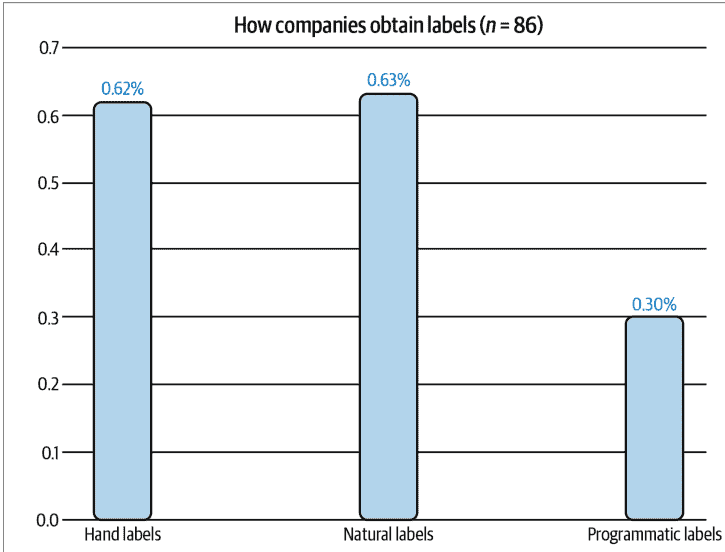

图 4-3. 我接触的公司中，63% 从事带有自然标签的任务。百分比合计不为 1，因为一家公司可能处理拥有不同标签来源的任务。⁹

在之前的例子中，过了一段时间仍未被点击的推荐可以被推测为坏的。这被称为隐式标签，因为这个负例标签是从缺乏正例标签的“无”中推断出来的。它与显式标签不同，显式标签是用户通过给出低评分或点踩来明确表达对推荐的反馈。

## 反馈回路长度

对于带有自然真值标签的任务，从预测被提供到收到反馈之间所花费的时间就是反馈回路长度。反馈回路短的任务通常能在几分钟内获得标签。许多推荐系统都有较短的反馈回路。如果推荐的物品是亚马逊上的相关产品或 Twitter 上值得关注的人，那么从物品被推荐到被点击（如果会被点击）之间的时间是很短的。

然而，并非所有推荐系统都有以分钟计的反馈回路。如果你处理的是较长的内容类型，如博客文章、文章或 YouTube 视频，反馈回路可能需要数小时。如果你像 Stitch Fix 那样构建一个为用户推荐衣物的系统，你可能要等到用户收到物品并试穿后才能获得反馈，而这可能是几周之后的事。

## 不同类型的用户反馈

如果你想从用户反馈中提取标签，重要的是要注意用户反馈有不同的类型。它们可能发生在用户在应用中的不同阶段，并在数量、信号强度和反馈回路长度上有所不同。

例如，考虑一个类似亚马逊的电商应用。用户在此应用中可能提供的反馈类型包括：点击产品推荐、将产品加入购物车、购买产品、评分、撰写评论，以及退回之前购买的产品。

点击产品比购买产品发生得更快、更频繁（因此产生了更大的数据量）。然而，与仅仅点击产品相比，购买产品是一个更强烈的信号，表明用户是否喜欢该产品。

在构建产品推荐系统时，许多公司专注于优化点击量，这能给他们带来更高数量的反馈以评估模型。但有些公司则专注于购买行为，这给他们提供了更强的信号，也与他们的业务指标（例如，产品销售收入）更为相关。两种方法都是有效的。对于你的用例应该优化哪种类型的反馈，并没有确定的答案，这值得所有相关利益方进行认真讨论。

选择正确的窗口长度需要深思熟虑，因为它涉及到速度和准确度之间的权衡。较短的窗口长度意味着你可以更快地捕获标签，这能让你利用这些标签来检测模型的问题并尽快解决。然而，较短的窗口长度也可能让你过早地把一个推荐在它被点击之前就标记为差的。

无论你将窗口长度设得多长，都可能存在过早的负例标签。2021 年初，Twitter 广告团队的一项研究发现，尽管大多数广告点击发生在最初五分钟内，但有些点击发生在广告展示数小时之后。¹⁰ 这意味着这类标签往往倾向于低估实际点击率。如果你只记录了 1,000 个正例标签，实际点击数可能略高于 1,000。

对于反馈回路较长的任务，自然标签可能数周甚至数月都不会出现。欺诈检测就是一个反馈回路较长的任务。交易后的一段特定时间内，用户可以对该交易是否属于欺诈提出异议。例如，当客户阅读信用卡账单时，看到一笔不认识的交易，他们可能会向银行提出异议，从而给银行提供反馈，将该交易标记为欺诈。典型的异议窗口期是一到三个月。在异议窗口期过后，如果用户没有提出异议，你可以推定该交易是合法的。

反馈回路较长的标签有助于在季度或年度业务报告中展示模型的表现。然而，如果你想尽快发现模型的问题，它们就不太有用了。如果欺诈检测模型出了问题，而你用了几个月才发现，那么当问题被修复时，这个有缺陷的模型所放过的欺诈交易可能已经导致一家小企业破产了。

## 应对标签不足

由于获取足够高质量标签存在诸多挑战，人们开发了许多技术来应对由此产生的问题。在本节中，我们将介绍其中四种：弱监督、半监督、迁移学习和主动学习。这些方法的总结见表 4-2。

表 4-2. 处理人工标注数据不足的四种技术总结

| 方法 | 做法 | 需要真值标签吗？ |
|---|---|---|
| 弱监督 | 利用（通常是嘈杂的）启发式规则生成标签 | 不需要，但建议使用少量标签来指导启发式规则的开发 |
| 半监督 | 利用结构性假设生成标签 | 需要，需要少量初始标签作为种子来生成更多标签 |
| 迁移学习 | 利用在其他任务上预训练的模型来完成你的新任务 | 零样本学习不需要；微调需要，但所需的真值标签数量通常远少于从头训练模型所需的数量 |
| 主动学习 | 标记对模型最有用的数据样本 | 需要 |

10 Sofia Ira Ktena、Alykhan Tejani、Lucas Theis、Pranay Kumar Myana、Deepak Dilipkumar、Ferenc Huszar、Steven Yoo 和 Wenzhe Shi，“Addressing Delayed Feedback for Continuous Training with Neural Networks in CTR Prediction,” arXiv，2019 年 7 月 15 日，https://oreil.ly/5y2WA.


获取一组最有可能正确的标签。图 4-4 从高层次展示了 LF 的工作原理。

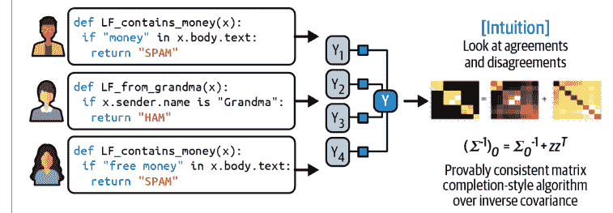

图 4-4. 标签函数组合的高层次概述。来源：改编自 Ratner 等¹² 的图像。

理论上，进行弱监督不需要任何人工标注。然而，为了了解你的 LF 的准确性，建议使用少量人工标注。这些人工标注可以帮助你发现数据中的模式，从而编写更好的 LF。

弱监督在数据有严格隐私要求时尤其有用。你只需要查看一小部分已获许可的数据子集来编写 LF，然后可以将这些 LF 应用于其余数据，而无需任何人查看这些数据。

使用 LF，专业知识可以被版本化、复用和共享。由一个团队拥有的专业知识可以被编码并供另一个团队使用。如果你的数据发生变化或需求发生变化，你只需将 LF 重新应用于数据样本即可。使用 LF 为数据生成标签的方法也称为程序化标注。表 4-3 显示了程序化标注相对于人工标注的一些优势。

## 表 4-3. 程序化标注相对于人工标注的优势

| 人工标注 | 程序化标注 |
|---|---|
| **昂贵：** 尤其在需要专业知识时 | **节省成本：** 专业知识可在组织内进行版本化、共享和复用 |
| **缺乏隐私：** 需要将数据发送给人工标注员 | **隐私：** 使用已获许可的数据子样本创建 LF，然后在不查看单个样本的情况下将 LF 应用于其他数据 |
| **缓慢：** 所需时间随所需标签数量线性增长 | **快速：** 可轻松从 1K 扩展到 1M 样本 |
| **非自适应：** 每次更改都需要重新标注数据 | **自适应：** 发生变化时，只需重新应用 LF 即可！ |

12 Ratner 等，“Snorkel：使用弱监督快速创建训练数据。”

以下是展示弱监督在实践中效果的一个案例研究。在与斯坦福医学的一项研究中¹³，由一名放射科医生在编写 LF 八小时后获得的弱监督标签训练的模型，其性能与通过近一年人工标注获得的数据训练的模型相当，如图 4-5 所示。实验结果有两个有趣的事实。第一，即使没有更多 LF，模型随着更多未标注数据的增加仍在持续改进。第二，LF 在任务之间被复用。研究人员能够在 CXR（胸部 X 光）任务和 EXR（四肢 X 光）任务之间复用六个 LF。¹⁴

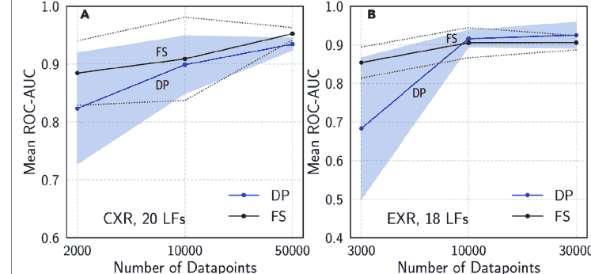

图 4-5. 在 CXR 和 EXR 任务上，使用完全监督标签（FS）训练的模型与使用程序化标签（DP）训练的模型性能比较。来源：Dunnmon 等¹⁵。

我的学生经常问，如果启发式方法对标注数据如此有效，为什么我们还需要机器学习模型？一个原因是 LF 可能无法覆盖所有数据样本，因此我们可以利用 LF 程序化标注的数据训练机器学习模型，并使用该训练好的模型为未被任何 LF 覆盖的样本生成预测。

弱监督是一种简单但强大的范式。然而，它并不完美。在某些情况下，弱监督获得的标签可能噪声过大而无法使用。但即使在这些情况下，弱监督也可以成为一个不错的起点，当你想探索机器学习的效用而又不想在前期投入太多人工标注时。

13 Jared A. Dunnmon, Alexander J. Ratner, Khaled Saab, Matthew P. Lungren, Daniel L. Rubin, and Christopher Ré, “跨模态数据编程实现快速医疗机器学习,” Patterns 1, no. 2 (2020): 100019, https://oreil.ly/nKi8E.

14 本研究中的两个任务分别仅使用 18 和 20 个 LF。在实践中，我见过团队为每个任务使用数百个 LF。

15 Dunnmon 等，“跨模态数据编程。”

## 半监督

如果弱监督利用启发式方法获得噪声标签，那么半监督则利用结构假设基于少量初始标签生成新标签。与弱监督不同，半监督需要一组初始标签。

半监督学习是一种在 90 年代就已使用的技术¹⁶，此后已开发出许多半监督方法。对半监督学习的全面回顾超出了本书范围。我们将介绍其中一小部分方法，让读者了解它们的使用方式。如需全面回顾，我推荐《半监督学习文献综述》（Xiaojin Zhu, 2008）和《半监督学习综述》（Engelen and Hoos, 2018）。

一种经典的半监督方法是 *自训练*。你首先在现有标注数据上训练模型，并使用该模型为未标注样本做出预测。假设原始概率分数高的预测是正确的，你将高概率预测的标签添加到训练集中，并在该扩展训练集上训练新模型。如此反复，直到你对模型性能满意为止。

另一种半监督方法假设具有相似特征的数据样本具有相同的标签。这种相似性可能是显而易见的，例如在对 Twitter 话题标签进行分类的任务中。你可以先将话题标签“#AI”标记为计算机科学。假设出现在同一条推文或个人资料中的话题标签很可能属于同一主题，鉴于图 4-6 中 MIT CSAIL 的个人资料，你也可以将话题标签“#ML”和“#BigData”标记为计算机科学。


*图 4-6. 由于 #ML 和 #BigData 与 #AI 出现在同一个 Twitter 个人资料中，我们可以假设它们属于同一主题*

16 Avrim Blum 和 Tom Mitchell，“Combining Labeled and Unlabeled Data with Co-Training”，载于 *Proceedings of the Eleventh Annual Conference on Computational Learning Theory*（1998 年 7 月）：92–100，https://oreil.ly/T79AE.

在大多数情况下，相似性只能通过更复杂的方法发现。例如，你可能需要使用聚类方法或 k 近邻算法来发现属于同一簇的样本。

近年来流行的一种半监督方法是基于扰动的方法。它基于这样一个假设：对样本进行小的扰动不应改变其标签。因此，你可以对训练实例应用小的扰动以获得新的训练实例。扰动可以直接应用于样本（例如，向图像添加白噪声）或应用于其表示（例如，向词嵌入添加小的随机值）。扰动后的样本与未扰动样本具有相同的标签。我们将在第 114 页的“Perturbation”部分对此进行更详细的讨论。

在某些情况下，半监督方法已达到纯监督学习的性能，即使在给定数据集中丢弃了相当一部分标签时也是如此。¹⁷

当训练标签数量有限时，半监督最有用。在数据有限的情况下进行半监督时，需要考虑其中多少数据应用于评估多个候选模型并选择最佳模型。如果使用少量数据，则在此小评估集上表现最好的模型可能是对该集过拟合最严重的模型。另一方面，如果为评估使用大量数据，则基于该评估集选择最佳模型获得的性能提升可能小于将评估集添加到有限训练集所获得的提升。许多公司通过使用合理大小的评估集来选择最佳模型，然后在评估集上继续训练冠军模型来克服这一权衡。

## 迁移学习

迁移学习是指将为一个任务开发的模型作为第二个任务模型起点而复用的方法族。首先，基础模型针对基础任务进行训练。基础任务通常是具有廉价且丰富训练数据的任务。语言建模是很好的候选，因为它不需要标注数据。语言模型可以基于任何文本语料训练——书籍、维基百科文章、聊天记录——任务是：给定一个 token 序列¹⁸，预测下一个 token。给定序列“I bought NVIDIA shares because I believe in the importance of,” 语言模型可能会输出“hardware”或“GPU”作为下一个 token。

17 Avital Oliver, Augustus Odena, Colin Raffel, Ekin D. Cubuk, and Ian J. Goodfellow, “Realistic Evaluation of Deep Semi-Supervised Learning Algorithms,” NeurIPS 2018 Proceedings, https://oreil.ly/dRmPV.

18 一个 token 可以是一个词、一个字符或一个词的一部分。


训练好的模型随后可以用于你感兴趣的任务——即下游任务——例如情感分析、意图检测或问答。在某些情况下，比如零样本学习场景，你可能能够直接在某个下游任务上使用基础模型。但在许多情况下，你可能需要对基础模型进行*微调*。微调意味着对基础模型进行小幅改动，例如在给定下游任务的数据上继续训练基础模型或其一部分。¹⁹

有时，你可能需要使用模板修改输入，以提示基础模型生成你想要的输出。²⁰ 例如，要将语言模型用作问答任务的基础模型，你可能需要使用如下提示：

问：美国成立于何时？
答：1776年7月4日。

问：谁撰写了《独立宣言》？
答：托马斯·杰斐逊。

问：亚历山大·汉密尔顿出生于哪一年？
答：

当你将该提示输入到 GPT-3 这类语言模型时，它可能会输出亚历山大·汉密尔顿出生的年份。

迁移学习对于没有大量标记数据的任务尤其有吸引力。即使对于有大量标记数据的任务，与从零开始训练相比，使用预训练模型作为起点通常也能显著提升性能。

近年来，迁移学习因合理的原因而备受关注。它使得许多以前由于缺乏训练样本而无法实现的应用成为可能。如今，生产环境中的机器学习模型有相当一部分是迁移学习的成果，包括利用在 ImageNet 上预训练的模型的目标检测模型，以及利用 BERT 或 GPT-3 等预训练语言模型的文本分类模型。²¹ 迁移学习还降低了机器学习的入门门槛，因为它有助于减少构建机器学习应用所需的前期数据标注成本。

19 Jeremy Howard 和 Sebastian Ruder，“用于文本分类的通用语言模型微调”，arXiv，2018年1月18日，https://oreil.ly/DBEbw.

20 Pengfei Liu、Weizhe Yuan、Jinlan Fu、Zhengbao Jiang、Hiroaki Hayashi 和 Graham Neubig，“预训练、提示与预测：自然语言处理中提示方法的系统性综述”，arXiv，2021年7月28日，https://oreil.ly/0lBgn.

21 Jacob Devlin、Ming-Wei Chang、Kenton Lee 和 Kristina Toutanova，“BERT：用于语言理解的深度双向Transformer预训练”，arXiv，2018年10月11日，https://oreil.ly/RdIGU；Tom B. Brown、Benjamin Mann、Nick Ryder、Melanie Subbiah、Jared Kaplan、Prafulla Dhariwal、Arvind Neelakantan 等，“语言模型是少样本学习者”，OpenAI，2020年，https://oreil.ly/YVmrr.

过去五年出现的一个趋势是：（通常）预训练基础模型越大，其在下游任务上的性能越好。大模型训练起来非常昂贵。根据 GPT-3 的配置，估计训练该模型的成本高达数千万美元。许多人推测，未来只有少数公司能够负担得起训练大型预训练模型。行业中的其他公司将直接使用这些预训练模型，或针对自身需求对其进行微调。

## 主动学习

主动学习是一种提高数据标注效率的方法。其希望在于，如果机器学习模型可以选择要学习哪些数据样本，那么使用更少的训练标签就能获得更高的准确率。主动学习有时也被称为查询学习——尽管这个术语越来越不受欢迎——因为模型（主动学习者）会以未标注样本的形式返回查询，由标注者（通常是人类）来标注。

与随机标注数据样本不同，你会根据某些指标或启发式规则，标注对模型最有帮助的样本。最直接的指标是不确定性度量——标注你的模型最不确定的样本，希望它们能帮助模型更好地学习决策边界。例如，在分类问题中，如果你的模型会输出不同类别的原始概率，它可能会选择预测类别概率最低的数据样本。图 4-7 展示了该方法在一个玩具示例上的良好效果。

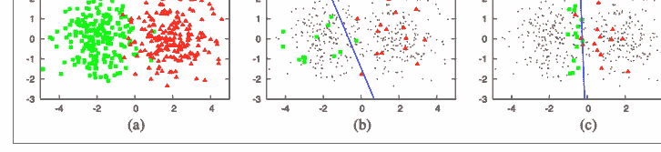

图 4-7：基于不确定性的主动学习如何工作。（a）一个包含 400 个实例的玩具数据集，均匀采样自两个类别的高斯分布。（b）在随机标注的 30 个样本上训练的模型准确率为 70%。（c）在由主动学习选择的 30 个样本上训练的模型准确率为 90%。来源：Burr Settles22

22 Burr Settles，《主动学习》（Williston, VT: Morgan & Claypool，2012年）。

另一种常见的启发式方法基于多个候选模型之间的分歧。这种方法称为委员会查询，是集成方法的一个例子。²³ 你需要一个由几个候选模型组成的委员会，这些模型通常是同一模型使用不同超参数组合训练得到的，或者同一模型在不同数据切片上训练得到的。每个模型可以就接下来要标注哪些样本进行投票，投票可能基于模型对其预测的不确定程度。然后你标注委员会分歧最大的样本。

还有其他启发式方法，例如选择那些如果在它们上面训练，会产生最大梯度更新或最大程度减少损失的样本。关于主动学习方法的全面综述，请参阅《主动学习文献综述》（Settles 2010）。

待标注的样本可以来自不同的数据场景。它们可以被合成：模型在最不确定的输入空间区域生成样本。²⁴ 它们也可以来自静态分布：你已经收集了大量未标注数据，模型从该样本池中选择样本进行标注。它们还可以来自现实世界的分布：像在生产环境中一样，数据不断流入，模型从这些数据流中选择样本进行标注。

当系统处理实时数据时，我对主动学习最为兴奋。数据时刻在变化，这一现象我们曾在第1章简要提及，并将在第8章进一步详述。在这种数据场景下，主动学习将使你的模型能够更有效地实时学习，并更快地适应环境变化。

## 类别不平衡

类别不平衡通常指分类任务中的一个问题，即训练数据中各类别的样本数量存在显著差异。例如，在通过 X 射线图像检测肺癌的训练数据集中，99.99% 的 X 射线可能是正常肺部，只有 0.01% 可能含有癌细胞。

类别不平衡也可能发生在标签连续的回归任务中。以估算医疗账单的任务为例。²⁵ 医疗账单高度偏斜——中位数账单很低，但第95百分位的账单高得惊人。在预测医院账单时，准确预测第95百分位的账单可能比预测中位数账单更重要。250美元的账单出现100%的差异是可以接受的（实际为500美元，预测为250美元），但1万美元的账单出现100%的差异则不可接受（实际为2万美元，预测为1万美元）。因此，我们可能需要训练模型使其更擅长预测第95百分位的账单，即使这会降低整体指标。

23 我们将在第6章介绍集成方法。

24 Dana Angluin，“查询与概念学习”，《机器学习》2（1988）：319–42，https://oreil.ly/0uKs4.

25 感谢 Eugene Yan 提供这个绝妙的示例！

## 类别不平衡的挑战

机器学习，尤其是深度学习，在数据分布较为均衡时表现良好，而在类别严重不平衡时通常表现不佳，如图 4-8 所示。

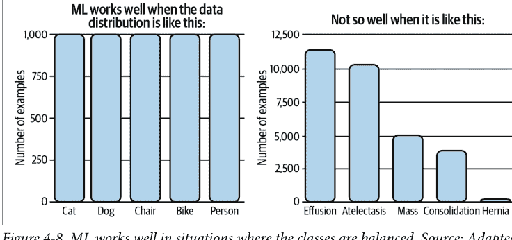

图 4-8：机器学习在类别均衡的情况下表现良好。来源：改编自 Andrew Ng 的一张图片26

第一个原因是，类别不平衡通常意味着模型没有足够的信号来学习检测少数类。当少数类实例数量很少时，问题就变成少样本学习问题：模型在必须做出决策之前，只能看到少数类几次。如果训练集中根本没有稀有类别的实例，模型可能会假设这些稀有类别不存在。

第二个原因是，类别不平衡使得模型更容易陷入非最优解，因为它可以利用简单的启发式规则，而不必学习数据底层模式中的任何有用信息。考虑前面的肺癌检测示例。如果模型学会总是输出多数类，那么它的准确率已经达到 99.99%。27 这种启发式规则可能让梯度下降非常难以

26 Andrew Ng，“弥合人工智能从概念验证到生产的鸿沟”（HAI研讨会，2020年9月22日），视频，1:02:07，https://oreil.ly/FSFWS.

27 这就是为什么对于类别不平衡的任务，准确率并不是一个好的指标，我们将在第105页“处理类别不平衡”一节进一步探讨。


由于向该启发式方法添加少量随机性可能会导致准确率变差，因此难以击败的算法。

第三个原因是类别不平衡导致错误成本不对称——对稀有类别样本的错误预测成本可能远高于对多数类别样本的错误预测成本。

例如，对含有癌细胞的 X 光片的误分类比对正常肺部的 X 光片的误分类危险得多。如果你的损失函数未配置为处理这种不对称性，你的模型将以相同的方式对待所有样本。因此，你可能会得到一个在多数类和少数类上表现同样良好的模型，而你更希望得到一个在多数类上表现稍差但在少数类上表现好得多的模型。

在学校时，我得到的绝大多数数据集的类别或多或少是平衡的。[28] 开始工作并意识到类别不平衡是常态对我来说是一个冲击。在现实世界环境中，罕见事件通常比常规事件更有趣（或更危险），许多任务都侧重于检测这些罕见事件。

类别不平衡任务的经典例子是欺诈检测。大多数信用卡交易并非欺诈。截至 2018 年，每 100 美元持卡人支出中有 6.8 美分是欺诈性的。[29] 另一个是流失预测。你的大多数客户可能没有计划取消订阅。如果他们要取消，你的业务担心的就不仅仅是流失预测算法了。其他例子包括疾病筛查（大多数人幸运地没有绝症）和简历筛选（98% 的求职者在初次简历筛选时被淘汰[30]）。

一个不太明显的类别不平衡任务例子是目标检测。目前的目标检测算法通过在图像上生成大量边界框，然后预测哪些框最有可能包含物体来工作。大多数边界框不包含相关物体。

除了类别不平衡固有于问题本身的情况外，类别不平衡也可能由采样过程中的偏差引起。考虑你想要创建训练数据来检测电子邮件是否为垃圾邮件的情况。你决定使用公司电子邮件数据库中的所有匿名电子邮件。根据 Talos Intelligence 的数据，截至 2021 年 5 月，几乎 85% 的电子邮件都是垃圾邮件。[31] 但大多数垃圾邮件

## 使用合适的评估指标

面对类别不平衡任务时，最重要的事情是选择合适的评估指标。错误的指标会让你对模型的表现产生错误的认识，进而无法帮助你开发或选择足够好的模型来完成任务。

总体准确率和错误率是报告机器学习模型性能最常用的指标。然而，对于类别不平衡任务而言，这些指标是不够的，因为它们平等对待所有类别，这意味着模型在多数类上的表现将主导这些指标。当你并不关心多数类时，这尤其糟糕。

考虑一个有两个标签的任务：CANCER（正类）和 NORMAL（负类），其中 90% 的标记数据为 NORMAL。考虑两个模型 A 和 B，其混淆矩阵如表 4-4 和 4-5 所示。

*表 4-4. 模型 A 的混淆矩阵；模型 A 可检测出 100 例癌症中的 10 例*

| 模型 A | 实际癌症 | 实际正常 |
|---|---|---|
| 预测癌症 | 10 | 10 |
| 预测正常 | 90 | 890 |

*表 4-5. 模型 B 的混淆矩阵；模型 B 可检测出 100 例癌症中的 90 例*

| 模型 B | 实际癌症 | 实际正常 |
|---|---|---|
| 预测癌症 | 90 | 90 |
| 预测正常 | 10 | 810 |

如果你像大多数人一样，你可能会更喜欢模型 B 来为你做预测，因为它更有机会告诉你是否真的患有癌症。然而，它们的准确率都是 0.9。

有助于你了解模型在特定类别上表现的指标会是更好的选择。准确率仍然是一个不错的指标，如果你对每个类别单独使用。

模型 A 在癌症类别上的准确率为 10%，模型 B 在癌症类别上的准确率为 90%。

F1、精确率和召回率是衡量二分类问题中模型相对于正类的表现的指标，因为它们依赖于真正例——模型正确预测正类的结果。[35]

### 精确率、召回率和 F1

对于需要复习的读者来说，二分类任务中的精确率、召回率和 F1 分数是使用真正例、真负例、假正例和假负例的计数计算得出的。这些术语的定义如表 4-6 所示。

*表 4-6. 二分类任务中真正例、假正例、假负例和真负例的定义*

|  | 预测为正 | 预测为负 |
|---|---|---|
| 正类标签 | 真正例（命中） | 假负例（II类错误，漏检） |
| 负类标签 | 假正例（I类错误，误报） | 真负例（正确拒绝） |

Precision = 真正例 / (真正例 + 假正例)

Recall = 真正例 / (真正例 + 假负例)

F1 = 2 × 精确率 × 召回率 / (精确率 + 召回率)

F1、精确率和召回率是不对称的指标，这意味着它们的值取决于哪个类别被视为正类。在我们的例子中，如果将癌症视为正类，模型 A 的 F1 为 0.17。然而，如果将正常视为正类，模型 A 的 F1 为 0.95。当癌症为正类时，模型 A 和模型 B 的准确率、精确率、召回率和 F1 分数如表 4-7 所示。

*表 4-7. 两个模型准确率相同，尽管其中一个模型明显更优*

|  | 癌症 (1) | 正常 (0) | 准确率 | 精确率 | 召回率 | F1 |
|---:|---:|---:|---:|---:|---:|
| 模型 A | 10/100 | 890/900 | 0.9 | 0.5 | 0.1 | 0.17 |
| 模型 B | 90/100 | 810/900 | 0.9 | 0.5 | 0.9 | 0.64 |

许多分类问题可以建模为回归问题。你的模型可以输出一个概率，并基于该概率对样本进行分类。例如，如果值大于 0.5，则为正标签；如果值小于或等于 0.5，则为负标签。这意味着你可以调整阈值以提高 *真正例率*（也称为 *召回率*）同时降低 *假正例率*（也称为 *误报概率*），反之亦然。我们可以针对不同阈值绘制真正例率与假正例率的关系图。该图被称为 *ROC 曲线*（受试者工作特征曲线）。当你的模型完美时，召回率为 1.0，曲线只是一条位于顶部的直线。该曲线显示了模型性能如何随阈值变化，并帮助你选择最适合你的阈值。越接近完美线，模型性能越好。

曲线下面积（AUC）衡量 ROC 曲线下的面积。由于越接近完美线越好，因此该面积越大越好，如图 4-9 所示。

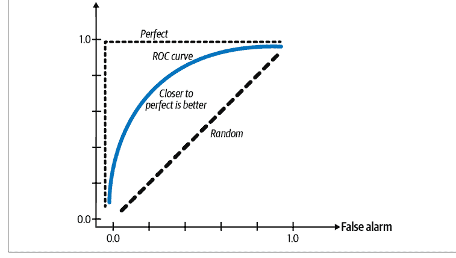

*图 4-9. ROC 曲线*

与 F1 和召回率一样，ROC 曲线仅关注正类，不显示模型在负类上的表现如何。Davis 和 Goadrich 建议我们应改绘制精确率与召回率的关系图，他们称之为精确率-召回率曲线。他们认为该曲线为类别极度不平衡任务中算法的性能提供了更有信息量的图景。[36]

---

[28] 我想象如果不必弄清楚如何处理类别不平衡，学习机器学习理论会更容易。

[29] Nilson 报告，《支付卡欺诈损失达 278.5 亿美元》，PR Newswire，2019 年 11 月 21 日，https://oreil.ly/NM5zo.

[30] “就业市场专家解释为何只有 2% 的求职者获得面试”，WebWire，2014 年 1 月 7 日，https://oreil.ly/UpL8S.

[31] “电子邮件和垃圾邮件数据”，Talos Intelligence，最后访问时间 2021 年 5 月，https://oreil.ly/I15Jr.

[35] 截至 2021 年 7 月，使用 `scikit-learn.metrics.f1_score` 时，`pos_label` 默认设置为 1，但如果你希望 0 为正类标签，可以将其更改为 0。

[36] Jesse Davis 和 Mark Goadrich，《精确率-召回率与 ROC 曲线的关系》，第 23 届国际机器学习会议论文集，2006 年，https://oreil.ly/s40F3.


## 数据级方法：重采样

数据级方法通过修改训练数据的分布来降低不平衡程度，从而使模型更容易学习。其中常见的一类技术是重采样（resampling）。重采样包括过采样（oversampling），即增加少数类样本；以及欠采样（undersampling），即移除多数类样本。最简单的欠采样方式是随机移除多数类中的实例，而最简单的过采样方式是随机复制少数类样本，直到达到你满意的比例为止。图 4-10 展示了过采样和欠采样的可视化效果。

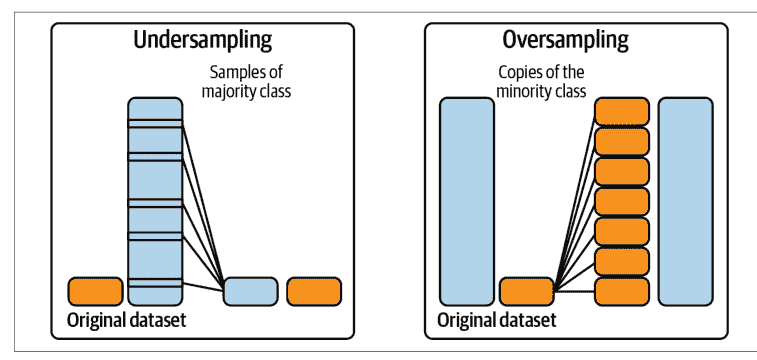

图 4-10. 欠采样和过采样工作原理的示意图。来源：改编自 Rafael Alencar 的图片[^37]

一种早在 1976 年提出的、适用于低维数据的欠采样方法是 Tomek links。[^38] 该技术寻找来自相反类别且距离相近的样本对，并在每一对中移除属于多数类的样本。

虽然这使决策边界更加清晰，并可能帮助模型更好地学习边界，但也可能降低模型的鲁棒性，因为模型无法从真实决策边界的细微差别中学习。

一种流行的低维数据过采样方法是 SMOTE（合成少数类过采样技术）。[^39] 它通过对少数类中现有数据点的凸组合进行采样，来合成新的少数类样本。[^40]

SMOTE 和 Tomek links 都仅在低维数据中被证明有效。许多复杂的重采样技术，例如 Near-Miss 和单边选择（one-sided selection），[^41] 需要计算实例之间的距离，或实例与决策边界之间的距离，这对于高维数据或高维特征空间（例如大型神经网络的情况）而言，代价高昂甚至不可行。

当你对训练数据进行重采样时，切勿在重采样后的数据上评估模型，因为这将导致模型过拟合到重采样后的分布。

欠采样存在因移除数据而丢失重要信息的风险。过采样则存在对训练数据过拟合的风险，尤其是当所添加的少数类副本是现有数据的复制品时。为降低这些风险，人们开发了许多复杂的采样技术。

其中一种技术是两阶段学习（two-phase learning）。[^42] 首先，你在重采样后的数据上训练模型。这种重采样数据可以通过随机欠采样大类直到每个类别仅包含 N 个实例来实现。然后，你在原始数据上对模型进行微调。

另一种技术是动态采样：在训练过程中，对表现较差的类别进行过采样，对表现较好的类别进行欠采样。该方法由 Pouyanfar 等人提出，[^43] 其目标是让模型少接触它已经学会的内容，多接触它尚未学会的内容。

## 算法级方法

如果说数据级方法通过改变训练数据的分布来缓解类别不平衡的挑战，那么算法级方法则保持训练数据分布不变，而是通过改进算法使其对类别不平衡更具鲁棒性。

由于损失函数（或代价函数）指导学习过程，许多算法级方法涉及对损失函数的调整。其核心思想是：如果有两个实例 x₁ 和 x₂，对 x₁ 做出错误预测所导致的损失高于 x₂，那么模型将优先对 x₁ 做出正确预测，而不是 x₂。通过给予我们关心的训练实例更高的权重，我们可以使模型更加专注于学习这些实例。

设 L(x; θ) 为参数集为 θ 的模型对实例 x 所产生的损失。模型的损失通常定义为所有实例带来的平均损失。N 表示训练样本的总数。

$$L(X; \theta) = \frac{1}{N} \sum_x L(x; \theta)$$

这个损失函数对所有实例造成的损失一视同仁，尽管对某些实例的错误预测可能比对其余实例的错误预测代价高得多。修改此代价函数的方法有很多。在本节中，我们将重点讨论其中的三种，首先是代价敏感学习。

### 代价敏感学习

早在 2001 年，基于不同类别的误分类会产生不同代价的洞察，Elkan 提出了代价敏感学习，其中对个体损失函数进行修改，以考虑这种变化的代价。[^44] 该方法首先使用一个代价矩阵来指定 Cᵢⱼ：类别 i 被分类为类别 j 时的代价。如果 i = j，则分类正确，代价通常为 0。如果不是，则为误分类。如果将 POSITIVE 示例分类为 NEGATIVE 的代价是相反情况的代价的两倍，则可以使 C₁₀ 为 C₀₁ 的两倍。

例如，如果你有两个类别，POSITIVE 和 NEGATIVE，代价矩阵可以如表 4-8 所示。

表 4-8. 代价矩阵示例

| | 实际 NEGATIVE | 实际 POSITIVE |
|---|---|---|
| 预测 NEGATIVE | C(0,0)=C₀₀ | C(1,0)=C₁₀ |
| 预测 POSITIVE | C(0,1)=C₀₁ | C(1,1)=C₁₁ |

噪声”；以及数据合成。在每种类型中，我们都会针对计算机视觉和自然语言处理分别给出示例。

### 简单的标签保持变换

在计算机视觉中，最简单的数据增强技术是随机修改图像，同时保持其标签不变。你可以通过裁剪、翻转、旋转、反转（水平或垂直）、擦除图像的一部分等方式修改图像。这是合理的，因为旋转后的狗的图像仍然是狗。常见的机器学习框架，如 PyTorch、TensorFlow 和 Keras，都支持图像增强。根据 Krizhevsky 等人在其著名的 AlexNet 论文中的说法，“变换后的图像是在 CPU 上用 Python 代码生成的，而 GPU 正在训练前一批图像。因此，这些数据增强方案实际上是计算免费的。”[^48]

在自然语言处理中，你可以随机将某个单词替换为相似单词，前提是这种替换不会改变句子的含义或情感，如表 4-9 所示。相似单词可以通过同义词词典找到，也可以在词嵌入空间中找嵌入向量彼此接近的词。

表 4-9. 从原始句子生成的三句话

| | |
|---|---|
| 原始句子 | I'm so happy to see you. |
| 生成的句子 | I'm so glad to see you. |
| | I'm so happy to see y'all. |
| | I'm very happy to see you. |

这种类型的数据增强是快速将训练数据翻倍或翻三倍的方法。

### 扰动

扰动也是一种保持标签的操作，但由于它有时被用来欺骗模型做出错误预测，我认为它值得单独用一节来介绍。

一般来说，神经网络对噪声很敏感。以计算机视觉为例，这意味着向图像中添加少量噪声可能导致神经网络对其进行错误分类。Su 等人表明，Kaggle CIFAR-10 测试数据集中的 67.97% 的自然图像以及 ImageNet 测试图像中的 16.04% 可以通过仅修改一个像素而被错误分类（见图 4-12）。[^49]

[^37]: Rafael Alencar, “Resampling Strategies for Imbalanced Datasets,” Kaggle, https://oreil.ly/p8Whs.
[^38]: Ivan Tomek, “An Experiment with the Edited Nearest-Neighbor Rule,” IEEE Transactions on Systems, Man, and Cybernetics (June 1976): 448–52, https://oreil.ly/JCxHZ.
[^39]: N.V. Chawla, K.W. Bowyer, L.O. Hall, and W.P. Kegelmeyer, “SMOTE: Synthetic Minority Over-sampling Technique,” Journal of Artificial Intelligence Research 16 (2002): 341–78, https://oreil.ly/f6y46.
[^40]: 这里的“凸”大致意思是“线性的”。
[^41]: Jianping Zhang and Inderjeet Mani, “kNN Approach to Unbalanced Data Distributions: A Case Study involving Information Extraction” (Workshop on Learning from Imbalanced Datasets II, ICML, Washington, DC, 2003), https://oreil.ly/qnpra; Miroslav Kubat and Stan Matwin, “Addressing the Curse of Imbalanced Training Sets: One-Sided Selection,” 2000, https://oreil.ly/8phe.
[^42]: Hansang Lee, Minseok Park, and Junmo Kim, “Plankton Classification on Imbalanced Large Scale Database via Convolutional Neural Networks with Transfer Learning,” 2016 IEEE International Conference on Image Processing (ICIP), 2016, https://oreil.ly/YiA8p.
[^43]: Samira Pouyanfar, Yudong Tao, Anup Mohan, Haiman Tian, Ahmed S. Kaseb, Kent Gauen, Ryan Dailey, et al., “Dynamic Sampling in Convolutional Neural Networks for Imbalanced Data Classification,” 2018 IEEE Conference on Multimedia Information Processing and Retrieval (MIPR), 2018, https://oreil.ly/D3Ak5.
[^44]: Charles Elkan, “The Foundations of Cost-Sensitive Learning,” Proceedings of the Seventeenth International Joint Conference on Artificial Intelligence (IJCAI'01), 2001, https://oreil.ly/WGq5M.
[^48]: Alex Krizhevsky, Ilya Sutskever, and Geoffrey E. Hinton, “ImageNet Classification with Deep Convolutional Neural Networks,” 2012, https://oreil.ly/aphZA.
[^49]: Jiawei Su, Danilo Vasconcellos Vargas, and Sakurai Kouichi, “One Pixel Attack for Fooling Deep Neural Networks,” IEEE Transactions on Evolutionary Computation 23, no. 5 (2019): 828–41, https://oreil.ly/LzN9D.


使用欺骗性数据诱使神经网络做出错误预测的做法称为对抗攻击。向样本中添加噪声是生成对抗样本的常用技术。随着图像分辨率的提高，对抗攻击的成功率尤其被放大。

将带噪声的样本加入训练数据，可以帮助模型识别其学习到的决策边界中的薄弱环节，并提升其性能。⁵¹ 噪声样本可以通过添加随机噪声或搜索策略来生成。Moosavi-Dezfooli 等人提出了一种名为 DeepFool 的算法，该算法能够找到所需的最小噪声注入，以高置信度引发错误分类。⁵² 这种增强方式被称为对抗增强。⁵³

对抗增强在 NLP 中不太常见（一张加了随机像素的熊的图片看起来仍然像熊，但给一个随机句子添加随机字符很可能会使其变得毫无意义），但扰动已被用于提升模型的鲁棒性。最著名的例子之一是 BERT，该模型在每个序列中随机选择 15% 的 token，并将其中 10% 的选中 token 替换为随机单词。例如，对于句子“My dog is hairy”，如果模型随机将“hairy”替换为“apple”，句子就变成“My dog is apple”。因此，所有 token 中有 1.5% 可能会产生无意义的含义。他们的消融研究表明，一小部分随机替换能给模型带来小幅性能提升。⁵⁴

在第 6 章中，我们将介绍如何使用扰动，不仅将其作为一种提升模型性能的方法，还将其作为一种评估模型性能的手段。

## 数据合成

由于收集数据既昂贵又缓慢，且存在许多潜在的隐私问题，如果我们能够完全绕开它，直接用合成数据来训练模型，那将是一个梦想。尽管我们距离合成全部训练数据还很远，但合成部分训练数据以提升模型性能是可行的。

⁵¹ Ian J. Goodfellow, Jonathon Shlens, and Christian Szegedy, “Explaining and Harnessing Adversarial Examples,” arXiv, March 20, 2015, https://oreil.ly/9v2No; Ian J. Goodfellow, David Warde-Farley, Mehdi Mirza, Aaron Courville, and Yoshua Bengio, “Maxout Networks,” arXiv, February 18, 2013, https://oreil.ly/L8mch.

⁵² Seyed-Mohsen Moosavi-Dezfooli, Alhussein Fawzi, and Pascal Frossard, “DeepFool: A Simple and Accurate Method to Fool Deep Neural Networks,” in Proceedings of IEEE Conference on Computer Vision and Pattern Recognition (CVPR), 2016, https://oreil.ly/dYVL8.

⁵³ Takeru Miyato, Shin-ichi Maeda, Masanori Koyama, and Shin Ishii, “Virtual Adversarial Training: A Regularization Method for Supervised and Semi-Supervised Learning,” IEEE Transactions on Pattern Analysis and Machine Intelligence, 2017, https://oreil.ly/MBQeu.

⁵⁴ Devlin et al., “BERT: Pre-training of Deep Bidirectional Transformers for Language Understanding.”

在 NLP 中，模板可以是一种低成本启动模型的方式。我曾合作过的一个团队使用模板为他们的对话式 AI（聊天机器人）启动训练数据。一个模板可能看起来像：“Find me a [CUISINE] restaurant within [NUMBER] miles of [LOCATION]”（见表 4-10）。通过列出所有可能的菜系、合理的数字（你可能永远不想搜索超过 1000 英里的餐厅）以及每个城市的 location（家、办公室、地标、确切地址），你可以从一个模板生成数千个训练查询。

### 表 4-10. 从一个模板生成的三个句子

| 模板 | Find me a [CUISINE] restaurant within [NUMBER] miles of [LOCATION]. |
| 生成的查询 | Find me a Vietnamese restaurant within 2 miles of my office. |
|  | Find me a Thai restaurant within 5 miles of my home. |
|  | Find me a Mexican restaurant within 3 miles of Google headquarters. |

在计算机视觉中，一种直接合成新数据的方法是将现有样本与离散标签结合，生成连续标签。考虑一个图像分类任务，可能有两个标签：DOG（编码为 0）和 CAT（编码为 1）。从标签为 DOG 的样本 x₁ 和标签为 CAT 的样本 x₂，你可以生成 x′，如下所示：

```
x′ = γx₁ + (1 − γ)x₂
```

x′ 的标签是 x₁ 和 x₂ 标签的组合：γ × 0 + (1 − γ) × 1。这种方法称为 mixup。作者证明，mixup 能提高模型的泛化能力，减少对损坏标签的记忆，增强对对抗样本的鲁棒性，并稳定生成对抗网络的训练。⁵⁵

使用神经网络合成训练数据是一种令人兴奋的方法，目前正被积极研究，但在生产中尚未普及。Sandfort 等人表明，通过将 CycleGAN 生成的图像添加到原始训练数据中，他们能够显著提高模型在计算机断层扫描（CT）分割任务上的性能。⁵⁶

如果你想了解更多关于计算机视觉数据增强的内容，《A Survey on Image Data Augmentation for Deep Learning》（Shorten 和 Khoshgoftaar 2019）是一篇全面的综述。

⁵⁵ Hongyi Zhang, Moustapha Cisse, Yann N. Dauphin, and David Lopez-Paz, “mixup: Beyond Empirical Risk Minimization,” ICLR 2018, https://oreil.ly/IlM5E.

⁵⁶ Veit Sandfort, Ke Yan, Perry J. Pickhardt, and Ronald M. Summers, “Data Augmentation Using Generative Adversarial Networks (CycleGAN) to Improve Generalizability in CT Segmentation Tasks,” Scientific Reports 9, no. 1 (2019): 16884, https://oreil.ly/TDUwm.

## 特征工程

2014 年，论文《Practical Lessons from Predicting Clicks on Ads at Facebook》声称，拥有正确的特征是在开发机器学习模型时最重要的事情。此后，我合作过的许多公司一次又一次地发现，一旦他们有了一个可用的模型，与超参数调优等巧妙算法技术相比，拥有正确的特征往往能带来最大的性能提升。最先进的模型架构如果使用不良好的特征集，仍然可能表现不佳。

由于特征工程的重要性，许多机器学习工程和数据科学工作的一大部分就是提出新的有用特征。在本章中，我们将介绍特征工程的常用技术和重要注意事项。我们将专门用一节来详细讨论一个微妙但极具破坏性的问题，这个问题曾导致许多生产环境中的机器学习系统偏离正轨：数据泄漏，以及如何检测和避免它。

本章最后将讨论如何设计良好特征，同时考虑特征重要性和特征泛化。谈到特征工程，有些人可能会想到特征存储。由于特征存储更接近于支持多个机器学习应用的基础设施，我们将在第 10 章中介绍特征存储。

### 学习特征与工程特征

我在课堂上讲授这个主题时，学生经常问：“为什么我们还要担心特征工程？深度学习不是承诺我们不再需要手工设计特征了吗？”

他们说得对。深度学习的承诺是我们不必再手工设计特征。因此，深度学习有时被称为特征学习。¹ 许多特征可以通过算法自动学习和提取。然而，我们距离所有特征都能自动化的程度还很远。更不用说，截至撰写本文时，生产环境中的大多数机器学习应用并不是深度学习。让我们看一个例子，来理解哪些特征可以自动提取，哪些特征仍然需要手工设计。

假设你想构建一个情感分析分类器，来判断一条评论是否是垃圾评论。在深度学习之前，当给定一段文本时，你不得不手动应用经典文本处理技术，如词形还原、扩展缩写、去除标点符号以及将所有字符转为小写。之后，你可能希望根据你选择的 n 值将文本分割成 n-gram。

对于不熟悉的人，n-gram 是来自给定文本样本的 n 个连续项目的序列。这些项目可以是音素、音节、字母或单词。例如，给定帖子“I like food”，它的词级 1-gram 是 [“I”, “like”, “food”]，词级 2-gram 是 [“I like”, “like food”]。如果我们希望 n 为 1 和 2，这个句子的 n-gram 特征集是：[“I”, “like”, “food”, “I like”, “like food”]。

图 5-1 展示了一个经典的文本处理技术示例，你可以用它为文本手工设计 n-gram 特征。

¹ Loris Nanni, Stefano Ghidoni, and Sheryl Brahnam, “Handcrafted vs. Non-handcrafted Features for Computer Vision Classification,” Pattern Recognition 71 (November 2017): 158–72, https://oreil.ly/CGfYQ; Wikipedia, s.v. “Feature learning,” https://oreil.ly/fjmwN.


特征工程需要领域特定的技术知识——在本例中，该领域是自然语言处理（NLP）以及文本的原生语言。它往往是一个迭代过程，可能很脆弱。当我在一个早期的 NLP 项目中采用这种方法时，我不得不反复重启流程，要么是因为我忘了应用某种技术，要么是因为我使用的某种技术效果不佳，不得不撤销它。

然而，随着深度学习的兴起，其中许多痛苦已经得到缓解。不再需要担心词形还原、标点符号或停用词去除，你只需将原始文本拆分为词（即分词），从这些词中创建词汇表，并使用该词汇表将每个词转换为 one-hot 向量。模型有望从中学习提取有用的特征。在这种新方法中，文本的特征工程很大程度上已被自动化。图像方面也取得了类似的进展。不再需要手动从原始图像中提取特征并将其输入到你的机器学习模型中，你可以直接将原始图像输入到深度学习模型中。

然而，机器学习系统可能需要超出文本和图像之外的数据。例如，在检测评论是否为垃圾信息时，除了评论本身的文本之外，你可能还想使用有关以下方面的其他信息：

- *评论*
  - 它有多少个点赞/点踩？
- *发布此评论的用户*
  - 该账户是什么时候创建的，他们发布频率如何，以及他们有多少个点赞/点踩？
- *评论所发布的帖子*
  - 它有多少次浏览？热门帖子往往会吸引更多垃圾信息。

模型可以使用许多可能的特征。其中一些在图 5-2 中显示。选择使用哪些信息以及如何将这些信息提取为机器学习模型可用的格式的过程就是特征工程。对于诸如为用户在 TikTok 上推荐下一个观看视频之类的复杂任务，所使用的特征数量可达数百万。对于诸如预测交易是否欺诈之类的特定领域任务，你可能需要具备银行和欺诈方面的专业知识才能提出有用的特征。

**表 5-2. 预测未来 12 个月内购房的示例数据**

| ID | 年龄 | 性别 | 年收入 | 婚姻状况 | 子女数量 | 工作 | 购买？ |
|---|---|---|---|---|---|---|---|
| 1 |  | A | 150,000 |  | 1 | 工程师 | 否 |
| 2 | 27 | B | 50,000 |  |  | 教师 | 否 |
| 3 |  | A | 100,000 | 已婚 | 2 |  | 是 |
| 4 | 40 | B |  |  | 2 | 工程师 | 是 |
| 5 | 35 | B |  | 单身 | 0 | 医生 | 是 |
| 6 |  | A | 50,000 |  | 0 | 教师 | 否 |
| 7 | 33 | B | 60,000 | 单身 |  | 教师 | 否 |
| 8 | 20 | B | 10,000 |  |  | 学生 | 否 |

缺失值有三种类型。这些类型的官方名称有点令人困惑，因此我们将通过详细示例来消除困惑。

### 缺失并非随机 (MNAR)

这是指值缺失的原因是因为其真实值本身。在此示例中，我们可能会注意到一些受访者未披露其收入。经调查可能发现，未报告收入的受访者的收入往往高于披露收入者。*收入值的缺失与值本身相关。*

### 随机缺失 (MAR)

这是指值缺失的原因 *并非由于值本身，而是由于另一个观测变量。* 在此示例中，我们可能会注意到性别为“A”的受访者的年龄值经常缺失，这可能是因为本次调查中性别 A 的人群不喜欢披露其年龄。

### 完全随机缺失 (MCAR)

这是指 *值缺失时没有规律。* 在此示例中，我们可能会认为“工作”列的缺失值可能是完全随机的，既不是因为工作本身，也不是因为任何其他变量。人们只是有时会无缘无故地忘记填写该值。然而，这种类型的缺失非常罕见。通常某些值缺失是有原因的，你应该进行调查。

遇到缺失值时，你可以填补缺失值（插补）或删除缺失值（删除）。我们将讨论两者。

一种常见做法是用默认值填充缺失值。例如，如果工作缺失，你可能会用空字符串“”填充它。另一种常见做法是用均值、中位数或众数（最常见的值）填充缺失值。例如，如果某个数据样本的月份值为七月，其温度值缺失，用七月的平均温度填充它并不是一个坏主意。

这两种做法在许多情况下效果都很好，但有时会导致令人抓狂的错误。有一次，在我参与的一个项目中，我们发现模型输出垃圾数据，因为应用的前端不再要求用户输入年龄，因此年龄值缺失，模型用 0 填充了它们。但模型在训练期间从未见过年龄值为 0，因此无法做出合理的预测。

总的来说，你应避免用可能的值填充缺失值，例如用 0 填充缺失的子女数量——0 是子女数量的一个可能值。这使得区分信息缺失的人和没有孩子的人变得困难。

处理特定数据集的缺失值时，可以同时或按顺序使用多种技术。无论你使用什么技术，有一点是肯定的：没有完美的处理缺失值的方法。使用删除法，你可能会丢失重要信息或加剧偏差。使用插补法，你可能会将自己的偏差注入数据并增加噪声，更糟糕的是导致数据泄漏。如果你不知道数据泄漏是什么，不要惊慌，我们将在第 135 页的“数据泄漏”部分中介绍它。

## 缩放

考虑预测某人未来 12 个月内是否会买房的任务，以及表 5-2 所示的数据。我们数据中变量年龄的值范围从 20 到 40，而变量年收入的值范围从 10,000 到 150,000。当我们将这两个变量输入机器学习模型时，它不会理解 150,000 和 40 代表不同的东西。它只会将它们都视为数字，并且由于数字 150,000 远大于 40，它可能会赋予其更大的重要性，而不管哪个变量对生成预测更有用。

在将特征输入模型之前，将它们缩放到相似范围非常重要。这个过程称为特征缩放。这是你能做的最简单的事情之一，通常会带来模型性能的提升。忽视这一点可能会导致模型做出胡言乱语的预测，尤其是在梯度提升树和逻辑回归等经典算法中。⁴

4 特征缩放曾使我的模型性能提升了近 10%。

对特征进行缩放的一种直观方法是将其缩放到 [0, 1] 范围内。给定变量 $x$，其值可使用以下公式重新缩放到该范围内：

$x' = \frac{x - \min(x)}{\max(x) - \min(x)}$

你可以验证，如果 $x$ 是最大值，则缩放后的值 $x'$ 将为 1。如果 $x$ 是最小值，则缩放后的值 $x'$ 将为 0。

如果你希望特征位于任意范围 $[a, b]$ 内——经经验，我发现范围 $[-1, 1]$ 比范围 $[0, 1]$ 工作得更好——你可以使用以下公式：

$x' = a + \frac{(x - \min(x))(b - a)}{\max(x) - \min(x)}$

缩放到任意范围在你不想对变量做任何假设时效果很好。如果你认为你的变量可能服从正态分布，将它们归一化使其具有零均值和单位方差可能会有所帮助。这个过程称为 *标准化*：

$x' = \frac{x - \bar{x}}{\sigma},$

其中 $\bar{x}$ 为变量 $x$ 的均值，$\sigma$ 为其标准差。

实际上，机器学习模型往往难以处理服从偏态分布的特征。为了缓解偏态，常用的一种技术是对数变换：对特征应用对数函数。对数变换如何使数据更少偏态的示例显示在图 5-3 中。虽然该技术在许多情况下可以带来性能提升，但并非适用于所有情况，你应谨慎对待对对数变换后的数据而非原始数据进行的分析。⁵

5 Changyong Feng, Hongyue Wang, Naiji Lu, Tian Chen, Hua He, Ying Lu, and Xin M. Tu, “Log-Transformation and Its Implications for Data Analysis,” *Shanghai Archives of Psychiatry* 26, no. 2 (April 2014): 105–9, https://oreil.ly/hHJft.


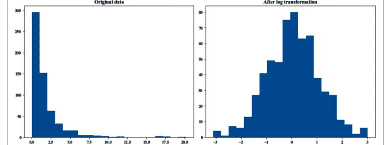

图5-3：在许多情况下，对数变换有助于减少数据的偏斜

关于缩放，有两点需要注意。一是它通常是数据泄漏的常见来源（这将在第135页的“数据泄漏”一节中详细讨论）。二是它通常需要全局统计信息——你必须查看全部或部分训练数据来计算其最小值、最大值或平均值。在推理时，你复用训练期间获得的统计信息来缩放新数据。如果新数据与训练时相比发生了显著变化，这些统计信息将不太有用。因此，定期重新训练模型以适应这些变化非常重要。

## 离散化

本书收录这一技术是为了内容的完整性，尽管在实践中，我很少发现离散化能带来帮助。假设我们使用表5-2中的数据构建了一个模型。在训练期间，模型看到了年收入值“150,000”“50,000”“100,000”等。在推理时，模型遇到一个年收入为“9,000.50”的样本。

凭直觉，我们知道年收入9,000.50美元与10,000美元/年相差不大，我们希望模型以相同方式对待它们。但模型并不知道这一点。模型只知道9,000.50不同于10,000，因此会以不同方式对待它们。

离散化是将连续特征转换为离散特征的过程。这个过程也称为量化或分箱。方法是针对给定值创建桶。对于年收入，你可能希望将其分为以下三个桶：

- 低收入：低于35,000美元/年
- 中等收入：介于35,000美元/年与100,000美元/年之间
- 高收入：高于100,000美元/年

模型无需学习无数种可能的收入，只需专注于学习三个类别，这是一个容易得多的任务。这种技术在训练数据有限时应该更有帮助。

尽管根据定义，离散化是为连续特征设计的，但它也可以用于离散特征。年龄变量是离散的，但将值分组到如下所示的桶中可能仍然有用：

- 低于18岁
- 18至22岁之间
- 22至30岁之间
- 30至40岁之间
- 40至65岁之间
- 65岁以上

缺点在于，这种分类在类别边界处引入了不连续性——34,999美元现在被视为完全不同于35,000美元，而35,000美元与100,000美元被视为相同。选择类别边界可能并不容易。你可以尝试绘制值的直方图，并选择有意义的边界。一般来说，常识、基本分位数，有时还有领域专业知识，都能有所帮助。

## 编码类别特征

我们已经讨论了如何将连续特征转换为类别特征。在本节中，我们将讨论如何最好地处理类别特征。

没有在生产环境中处理过数据的人往往认为类别是静态的，即类别不会随时间变化。对许多类别来说，这确实如此。例如，年龄区间和收入区间不太可能变化，而且你可以事先确切知道有多少个类别。处理这些类别很简单。只需为每个类别分配一个数字即可。

然而，在生产环境中，类别会发生变化。假设你正在构建一个推荐系统，预测用户可能想从亚马逊购买什么产品。你想使用的特征之一是产品品牌。当查看亚马逊的历史

因为它是一个技巧，所以常常被学术界视为“黑客式”做法，并被排除在机器学习课程之外。但它在工业界的广泛采用证明了该技巧的有效性。它对Vowpal Wabbit至关重要，并且是scikit-learn、TensorFlow和gensim框架的一部分。在持续学习场景中，它尤其有用，因为你的模型在生产环境中从新到的样本中学习。我们将在第9章中讨论持续学习。

## 特征交叉

特征交叉是将两个或多个特征组合以生成新特征的技术。该技术有助于对特征之间的非线性关系进行建模。例如，在预测某人是否会在未来12个月内想要买房的任务中，你怀疑婚姻状况和子女数量之间可能存在非线性关系，因此你将它们组合创建一个新特征“婚姻与子女”，如表5-3所示。

表5-3：两个特征如何组合以创建新特征的示例

| 婚姻 | 单身 | 已婚 | 单身 | 单身 | 已婚 |
|---|---|---|---|---|---|
| 子女 | 0 | 2 | 1 | 0 | 1 |
| 婚姻与子女 | 单身, 0 | 已婚, 2 | 单身, 1 | 单身, 0 | 已婚, 1 |

由于特征交叉有助于对变量之间的非线性关系建模，因此对于无法学习或不擅长学习非线性关系的模型（如线性回归、逻辑回归和基于树的模型）来说，它至关重要。在神经网络中，它不那么重要，但仍然可能有用，因为显式特征交叉有时有助于神经网络更快地学习非线性关系。DeepFM和xDeepFM是一族已成功利用显式特征交互进行推荐系统和点击率预测的模型。⁹

特征交叉的一个警告是，它可能使你的特征空间爆炸。假设特征A有100个可能值，特征B有100个可能值；将这两个特征交叉将得到一个具有100 × 100 = 10,000个可能值的特征。你需要更多的数据，模型才能学会所有这些可能值。另一个警告是，由于特征交叉增加了模型使用的特征数量，它可能使模型过拟合训练数据。

9 Huifeng Guo, Ruiming Tang, Yunming Ye, Zhenguo Li, and Xiuqiang He, “DeepFM：一种基于因子分解机的CTR预测神经网络”，《第二十六届国际人工智能联合会议论文集》（IJCAI，2017），https://oreil.ly/1Vs3v；Jianxun Lian, Xiaohuan Zhou, Fuzheng Zhang, Zhongxia Chen, Xing Xie, and Guangzhong Sun, “xDeepFM：结合推荐系统的显式和隐式特征交互”，arXiv，2018，https://oreil.ly/WFmFt。

## 离散与连续位置嵌入

位置嵌入最早在论文《Attention Is All You Need》（Vaswani等人，2017）中引入深度学习社区，现已成为计算机视觉和NLP中许多应用的标准数据工程技术。我们将通过一个示例来说明为什么需要位置嵌入以及如何实现它。

考虑语言建模任务，你需要基于先前的token序列预测下一个token（例如，一个词、字符或子词）。在实践中，序列长度可能达到512甚至更长。但为简单起见，我们使用单词作为token，并使用8的序列长度。给定任意8个单词的序列，例如“Sometimes all I really want to do is”，我们希望预测下一个单词。

## 嵌入

嵌入是表示一段数据的向量。我们将同一算法为某种类型的数据生成的所有可能嵌入的集合称为“嵌入空间”。同一空间中的所有嵌入向量都具有相同的大小。

嵌入最常见的用途之一是词嵌入，即用向量表示每个单词。然而，其他类型数据的嵌入也越来越受欢迎。例如，Criteo和Coveo等电子商务解决方案都有产品嵌入。¹⁰ Pinterest有图像、图、查询甚至用户的嵌入。¹¹ 既然有这么多类型的数据都有嵌入，人们对于为多模态数据创建通用嵌入产生了浓厚兴趣。

如果我们使用循环神经网络，它会按顺序处理单词，这意味着单词的顺序被隐式输入。然而，如果我们使用像transformer这样的模型，单词会被并行处理，因此需要显式输入单词的位置，以便我们的模型知道这些单词的顺序（“a dog bites a child”与“a child bites a dog”差别很大）。我们不想将绝对位置0, 1, 2, …, 7输入模型。根据经验，神经网络对非单位方差的输入效果不佳（这就是我们在第126页的“缩放”一节中讨论过要缩放特征的原因）。

10 Flavian Vasile、Elena Smirnova和Alexis Conneau，“Meta-Prod2Vec——使用辅助信息进行推荐的产品嵌入”，arXiv，2016年7月25日，https://oreil.ly/KDaEd；“产品嵌入与向量”，Coveo，https://oreil.ly/ShaSY。

11 Andrew Zhai，“推荐系统的表示学习”，2021年8月15日，https://oreil.ly/OchiL。


如果我们将位置重新缩放至 0 到 1 之间，使得 0、1、2、...、7 变为 0、0.143、0.286、...、1，那么两个位置之间的差异对于神经网络来说会太小，难以学习区分。

处理位置嵌入的一种方法是将其视为我们处理词嵌入的方式。对于词嵌入，我们使用一个嵌入矩阵，其列数为词汇表大小，每一列都是该列索引处的词的嵌入。对于位置嵌入，列数为位置数。在我们的例子中，由于我们仅处理长度为 8 的先前序列，位置从 0 到 7（见图 5-5）。

位置的嵌入尺寸通常与词的嵌入尺寸相同，以便它们可以相加。例如，位置 0 处的词“food”的嵌入是词“food”的嵌入向量与位置 0 的嵌入向量的和。截至 2021 年 8 月，这就是 Hugging Face 的 BERT 中实现位置嵌入的方式。由于嵌入会随着模型权重的更新而变化，我们说位置嵌入是可学习的。

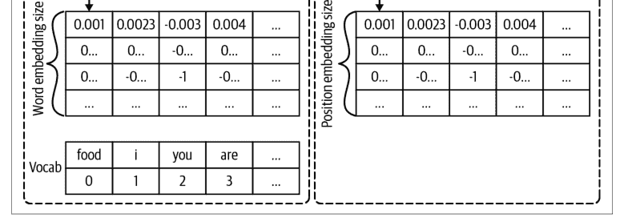

图 5-5. 将位置嵌入的一种方法是将其视为我们处理词嵌入的方式

位置嵌入也可以是固定的。每个位置的嵌入仍然是一个具有 S 个元素的向量（S 为位置嵌入大小），但每个元素都是使用一个函数预先定义的，通常是正弦和余弦。在原始 Transformer 论文中，如果元素位于偶数索引，则使用正弦；否则使用余弦。见图 5-6。

在某些其他情况下，模型“被发现捕捉到某些医院用于标记扫描的文本字体。因此，病例更严重的医院的字体变成了新冠风险的预测因子。”12

这两者都是数据泄漏的例子。数据泄漏指的是标签的一种形式“泄漏”到用于预测的特征集合中，而在推理期间该信息不可用的现象。

数据泄漏具有挑战性，因为泄漏往往是非显而易见的。它很危险，因为即使经过广泛的评估和测试，也可能导致你的模型以出乎意料且极其糟糕的方式失败。让我们再看一个例子来说明数据泄漏是什么。

假设你想构建一个 ML 模型来预测肺部 CT 扫描是否显示癌症迹象。你从 A 医院获取了数据，从数据中移除了医生的诊断，并训练了你的模型。它在 A 医院的测试数据上表现非常好，但在 B 医院的数据上表现很差。

经过深入调查，你了解到在 A 医院，当医生认为患者患有肺癌时，他们会将该患者送到更先进的扫描机器上，该机器输出略有不同的 CT 扫描图像。你的模型学会依赖扫描机器的信息来预测扫描图像是否显示肺癌迹象。B 医院随机将患者送到不同的 CT 扫描机器，因此你的模型没有可依赖的信息。我们说标签在训练期间泄漏到了特征中。

数据泄漏不仅会发生在该领域的新手身上，也曾发生在我钦佩的几位经验丰富的科研人员身上，以及我自己的一个项目中。尽管它很普遍，数据泄漏在 ML 课程中却很少被提及。

## 警示故事：Kaggle 竞赛中的数据泄漏

2020 年，利物浦大学在 Kaggle 上启动了 Ion Switching 竞赛。任务是在每个时间点识别打开的离子通道数量。他们从训练数据中合成测试数据，一些人能够逆向工程并从泄漏中获取测试标签。13 本次竞赛的两支获胜队伍正是能够利用泄漏的两支队伍，尽管他们可能即使不利用泄漏也能获胜。14

12 Will Douglas Heaven，《为了检测新冠而构建的数百种 AI 工具。没有一个有帮助》，MIT Technology Review，2021 年 7 月 30 日，https://oreil.ly/lg1b1.

13 Zidmie，“泄漏解释！” Kaggle，https://oreil.ly/1lgLj.

14 Addison Howard，“竞赛回顾——祝贺我们的获胜者！” Kaggle，https://oreil.ly/wVUU4.

## 数据泄漏的常见原因

在本节中，我们将介绍一些数据泄漏的常见原因以及如何避免它们。

### 随机拆分时间相关数据而非按时间拆分

我在大学学习 ML 时，被教导要随机将数据拆分为训练集、验证集和测试集。ML 研究论文中也常如此报告数据拆分方式。然而，这也是数据泄漏的常见原因之一。

在许多情况下，数据是时间相关的，这意味着数据生成的时间会影响其标签分布。有时这种相关性是显而易见的，例如股票价格。简单来说，类似股票的价格往往会一起变动。如果今天 90% 的科技股下跌，那么另外 10% 的科技股也很可能下跌。在构建预测未来股票价格的模型时，你希望按时间拆分训练数据，例如用前六天的数据训练模型，用第七天的数据进行评估。如果你随机拆分数据，第七天的数据就会包含在训练集中，并将当天的市场状况泄漏到模型中。我们说未来信息泄漏到了训练过程中。

然而，在许多情况下，这种相关性并不明显。考虑预测某人是否会点击歌曲推荐的任务。某人是否会听一首歌不仅取决于他们的音乐品味，还取决于当天的整体音乐趋势。如果某位艺术家某天去世，人们会更有可能收听该艺术家的作品。通过将某一天的样本包含在训练集中，当天的音乐趋势信息会被传递到你的模型中，使其更容易对当天其他样本做出预测。

为了防止未来信息泄漏到训练过程中并允许模型在评估期间作弊，请在可能的情况下按时间而非随机拆分数据。例如，如果你有五周的数据，使用前四周作为训练集，然后将第五周随机拆分为验证集和测试集，如图 5-7 所示。

### 拆分前对数据重复处理不当

如果你的数据中存在重复或近似重复，拆分数据前未能将其移除可能会导致相同的样本同时出现在训练集和验证集/测试集中。数据重复在行业中相当常见，也在流行的研究数据集中被发现。例如，CIFAR-10 和 CIFAR-100 是计算机视觉研究中使用的两个流行数据集。它们于 2009 年发布，但直到 2019 年 Barz 和 Denzler 才发现 CIFAR-10 和 CIFAR-100 数据集测试集中的 3.3% 和 10% 的图像在训练集中有重复。15

数据重复可能源于数据收集或合并不同的数据源。一篇 2021 年的 Nature 文章将数据重复列为使用 ML 检测 COVID-19 时的常见陷阱，其原因是“一个数据集合并了多个其他数据集，而没有意识到其中一个组件数据集已包含另一个组件”。16 数据重复也可能因数据处理而发生——例如，过采样可能会导致某些示例被重复。

为避免这种情况，请始终在拆分前检查重复项，并在拆分后也检查以确保无误。如果你要对数据进行过采样，请在拆分后进行。

### 组泄漏

一组示例具有强相关的标签，但被划分到不同的拆分中。例如，一名患者可能有两次相隔一周的肺部 CT 扫描，它们在是否包含肺癌迹象的标签上很可能相同，但其中一个在训练集中，另一个在测试集中。这种泄漏在目标检测任务中很常见，这些任务包含相隔毫秒拍摄的同一物体的照片——其中一些落入训练集，而其他一些落入测试集。如果不了解数据是如何生成的，很难避免这种类型的数据泄漏。

15 Björn Barz and Joachim Denzler，“我们是否在测试数据上训练？清除 CIFAR 中的近似重复”，Journal of Imaging 6, no. 6 (2020): 41.

16 Michael Roberts, Derek Driggs, Matthew Thorpe, Julian Gilbey, Michael Yeung, Stephan Ursprung, Angelica I. Aviles-Rivero, et al. “使用胸部 X 光片和 CT 扫描检测和预测 COVID-19 时的常见陷阱和建议”，Nature Machine Intelligence 3 (2021): 199–217，https://oreil.ly/TzbKJ.


理论上，如果一个特征不能帮助模型做出良好预测，像 L1 正则化这样的正则化技术应将该特征的权重降至 0。然而，在实践中，移除不再有用（甚至可能有害）的特征并优先保留优质特征，可能有助于模型更快地学习。

你可以存储被移除的特征，以便之后重新添加。你也可以只存储通用特征定义，以便在组织的各个团队之间复用和共享。当谈到特征定义管理时，有些人可能会想到特征存储（feature store）作为解决方案。然而，并非所有特征存储都管理特征定义。我们将在第 10 章进一步讨论特征存储。

在评估一个特征对模型是否有效时，你可能需要考虑两个因素：对模型的重要性以及对未见数据的泛化能力。

## 特征重要性

测量特征重要性的方法有很多。如果你使用诸如提升梯度树之类的经典机器学习算法，测量特征重要性的最简单方法是使用 XGBoost 实现的内置特征重要性函数。[^17] 对于更多与模型无关的方法，你可以了解 SHAP（SHapley Additive exPlanations，沙普利加性解释）。[^18] InterpretML 是一个非常棒的开源包，它利用特征重要性帮助你理解模型如何进行预测。

特征重要性测量的具体算法很复杂，但直观地说，一个特征对模型的重要性是通过移除该特征或包含该特征的一组特征后，模型性能下降多少来衡量的。SHAP 很棒，因为它不仅衡量特征对整个模型的重要性，还衡量每个特征对模型特定预测的贡献。图 5-8 和图 5-9 展示了 SHAP 如何帮助你理解每个特征对模型预测的贡献。

[^17]: 使用 XGBoost 的 get_score 函数。

[^18]: 一个用于计算 SHAP 的优秀开源 Python 包可以在 GitHub 上找到。

另一方面，HOUR_OF_THE_DAY 是一个很好的特征，因为一天中的时间也会影响流量，并且该特征在训练集划分中的取值区间与测试集划分 100% 重叠。

在考虑特征的泛化能力时，泛化性与特异性之间存在权衡。你可能会意识到，某个小时的流量变化仅仅取决于该小时是否为高峰时段。因此，你生成了特征 IS_RUSH_HOUR，如果小时在上午 7 点到 9 点之间，或下午 4 点到 6 点之间，则将其设为 1。IS_RUSH_HOUR 比 HOUR_OF_THE_DAY 更具泛化性，但特异性较低。仅使用 IS_RUSH_HOUR 而不使用 HOUR_OF_THE_DAY，可能会让模型丢失关于小时的重要信息。

## 小结

由于当今机器学习系统的成功仍然依赖于它们的特征，对于有兴趣在生产中使用机器学习的企业来说，投入时间和精力进行特征工程非常重要。

如何构建良好的特征是一个复杂的问题，没有万无一失的答案。最好的学习方式是通过经验：尝试不同的特征，观察它们如何影响模型性能。也可以向专家学习。我发现阅读 Kaggle 竞赛获胜团队如何设计特征非常有用，可以从中了解他们的技术和所经历的考量。

特征工程通常涉及领域专业知识，而领域专家未必总是工程师，因此设计工作流时，重要的是让非工程师也能参与其中。

以下是特征工程最佳实践的总结：

- 按时间划分数据为训练集/验证集/测试集，而不是随机划分。
- 如果对数据进行过采样，请在划分之后进行。
- 在划分后对数据进行缩放和归一化，以避免数据泄漏。
- 仅使用训练集划分的统计量（而非全部数据）来缩放特征和处理缺失值。
- 了解数据是如何生成、收集和处理的。如果可能，请让领域专家参与。
- 跟踪数据的血缘关系。
- 理解特征对模型的重要性。
- 使用泛化能力好的特征。
- 从模型中移除不再有用的特征。

拥有了一组良好的特征后，我们将进入工作流的下一部分：训练机器学习模型。在继续之前，我只想重申，进入建模阶段并不意味着数据处理或特征工程已经完成。我们对数据和特征的处理永远不会结束。在大多数现实世界的机器学习项目中，只要模型还在生产环境中，收集数据和特征工程的过程就会持续进行。我们需要利用新的传入数据来持续改进模型，这将在第 9 章中讨论。

## 模型开发与离线评估

在第 4 章中，我们讨论了如何为模型创建训练数据；在第 5 章中，我们讨论了如何从这些训练数据中设计特征。有了初始特征集，我们将进入机器学习系统的机器学习算法部分。对我来说，这始终是最有趣的一步，因为我可以尝试各种算法和技术，甚至是最新的。这也是第一步，让我看到自己在数据和特征工程上的所有努力转化为一个系统，我可以使用它的输出（预测）来评估自己工作的成效。

要构建机器学习模型，我们首先需要选择要构建的机器学习模型。现有的机器学习算法非常多，而且还在不断涌现新的算法。本章首先介绍了六条为你的任务选择最佳算法的技巧。

接下来的部分讨论模型开发的不同方面，例如调试、实验跟踪与版本管理、分布式训练和 AutoML。

模型开发是一个迭代过程。每次迭代后，你都需要将模型的性能与之前迭代的性能进行比较，并评估这次迭代对生产环境的适配程度。本章最后一节专门讨论如何在将模型部署到生产环境之前对其进行评估，涵盖一系列评估技术，包括扰动测试、不变性测试、模型校准和基于切片的评估。

我预计大多数读者已经理解常见的机器学习算法，如线性模型、决策树、*k* 近邻和不同类型的神经网络。本章将讨论围绕这些算法的技术，但不会深入讲解它们的工作原理。由于本章涉及机器学习算法，它比其他章节需要更多的机器学习知识。如果你不熟悉这些算法，我建议在阅读本章之前先上在线课程或阅读一本关于机器学习算法的书。希望快速回顾基础机器学习知识的读者

（如 BERT 或 GPT-3）可能被用来生成嵌入，输入到逻辑回归模型中。

在为你的问题选择模型时，你并不会从所有可能的模型中挑选，而通常会集中在一组适合你问题的模型上。例如，如果老板让你构建一个检测有害推文的系统，你会知道这是一个文本分类问题——给定一段文本，判断它是否有害——而常见的文本分类模型包括朴素贝叶斯、逻辑回归、循环神经网络，以及基于 Transformer 的模型，如 BERT、GPT 及其变体。

如果你的客户希望你构建一个检测欺诈交易的系统，你会知道这是经典的异常检测问题——欺诈交易就是你想要检测的异常——而这个问题常用的算法有很多，包括 k 近邻、孤立森林、聚类和神经网络。

在这一过程中，了解常见的机器学习任务及解决它们的典型方法至关重要。

不同类型的算法需要不同数量的标签以及不同数量的计算资源。有些算法训练时间较长，而有些算法预测时间较长。非神经网络算法往往比神经网络更具可解释性（例如，哪些特征对一封邮件被分类为垃圾邮件贡献最大）。

在考虑使用什么模型时，不仅要考虑模型的性能（通过准确率、F1 分数和对数损失等指标衡量），还要考虑它的其他属性，比如训练需要多少数据、计算量和时间，推理延迟以及可解释性。例如，一个简单的逻辑回归模型可能比一个复杂的神经网络准确率更低，但它启动所需的标注数据更少，训练速度快得多，部署容易得多，而且解释它为什么做出某些预测也容易得多。

比较机器学习算法不在本书的讨论范围内。无论比较多么好，一旦新算法出现，它就会过时。早在 2016 年，LSTM-RNN 风靡一时，它们是 seq2seq（序列到序列）架构的骨干，为从机器翻译到文本摘要再到文本分类的许多 NLP 任务提供动力。然而，仅仅两年后，循环架构就在 NLP 任务中被 Transformer 架构大规模取代。

要理解不同的算法，最好的方法是让自己具备基础机器学习知识，并运行你感兴趣的算法的实验。为了跟上如此多新的机器学习技术和模型，我发现关注 NeurIPS、ICLR 和 ICML 等主要机器学习会议的趋势，以及在 Twitter 上关注那些工作信噪比高的研究者是很有帮助的。


| 排名 | 模型 | EM | F1 |
|---|---|---|---|
|  | 人类表现<br>*斯坦福大学*<br>(Rajpurkar & Jia et al. '18) | 86.831 | 89.452 |
| 1<br>2021年6月4日 | IE-Net (集成)<br>*RICOH_SRCB_DML* | 90.939 | 93.214 |
| 2<br>2021年2月21日 | FPNet (集成)<br>*蚂蚁服务智能团队* | 90.871 | 93.183 |
| 3<br>2021年5月16日 | IE-NetV2 (集成)<br>*RICOH_SRCB_DML* | 90.860 | 93.100 |
| 4<br>2020年4月6日 | SA-Net on Albert (集成)<br>*QIANXIN* | 90.724 | 93.011 |
| 5<br>2020年5月5日 | SA-Net-V2 (集成)<br>*QIANXIN* | 90.679 | 92.948 |
| 5<br>2020年4月5日 | Retro-Reader (集成)<br>*上海交通大学*<br>http://arxiv.org/abs/2001.09694 | 90.578 | 92.978 |
| 5<br>2021年2月5日 | FPNet (集成)<br>*YuYang* | 90.600 | 92.899 |
| 6<br>2021年4月18日 | TransNets + SFVerifier + SFEnsembler (集成)<br>*Senseforth AI Research* | 90.487 | 92.894 |

图6-2。截至2022年1月，SQuAD 2.0 上的前20名解决方案都是集成模型

我们将通过一个示例来说明集成为何有效。假设你有三个电子邮件垃圾邮件分类器，每个的准确率为70%。假设每个分类器对每封邮件做出正确预测的概率相等，并且这三个分类器之间不相关，我们将展示通过对这三个分类器进行多数投票，可以获得78.4%的准确率。

对每封邮件，每个分类器有70%的概率正确。集成在至少两个分类器正确时为正确。表6-1显示了给定一封邮件时集成不同可能结果的概率。该集成将具有0.343 + 0.441 = 0.784，或78.4%的准确率。

表6-1. 采用三个分类器多数投票的集成可能结果

| 三个模型输出 | 概率 | 集成的输出 |
|---|---|---|
| 三个都正确 | 0.7 * 0.7 * 0.7 = 0.343 | 正确 |
| 只有两个正确 | (0.7 * 0.7 * 0.3) * 3 = 0.441 | 正确 |
| 只有一个正确 | (0.3 * 0.3 * 0.7) * 3 = 0.189 | 错误 |
| 都不正确 | 0.3 * 0.3 * 0.3 = 0.027 | 错误 |

该计算仅在集成中的分类器不相关时成立。如果所有分类器完全相关——它们对每封邮件都做出相同的预测——集成将具有与每个单独分类器相同的准确率。在创建集成时，基学习器之间的相关性越低，集成越好。因此，通常会为集成选择非常不同类型的模型。例如，你可能会创建一个集成，其中包含一个transformer模型、一个循环神经网络和一个梯度提升树。

创建集成有三种方式：bagging、boosting 和 stacking。除了有助于提升性能外，根据多篇综述论文，bagging 和 boosting 等集成方法，结合重采样，已显示出有助于处理不平衡数据集的能力。³ 我们将介绍这三种方法，首先是 bagging。

## Bagging

Bagging，源自 *自助聚合* 的缩写，旨在提高机器学习算法的训练稳定性和准确性。⁴ 它降低方差并有助于避免过拟合。

给定一个数据集，而不是在整个数据集上训练一个分类器，你通过有放回采样创建不同的数据集，称为自助样本，并在每个自助样本上训练分类或回归模型。有放回采样确保每个自助样本与其同伴独立创建。图6-3展示了 bagging 的示意图。

3 Mikel Galar, Alberto Fernandez, Edurne Barrenechea, Humberto Bustince 和 Francisco Herrera，“关于类别不平衡问题集成方法的综述：基于Bagging、Boosting和混合的方法”，《IEEE 系统、人与控制论学报，C部分（应用与评论）》42卷第4期（2012年7月）：463–84，https://oreil.ly/ZBlgE；G. Rekha, Amit Kumar Tyagi 和 V. Krishna Reddy，“使用Bagging、Boosting技术（有无噪声过滤方法）解决类别不平衡问题”，《国际混合智能系统期刊》15卷第2期（2019年1月）：67–76，https://oreil.ly/hchzU。

4 此处的训练稳定性指训练损失波动更小。

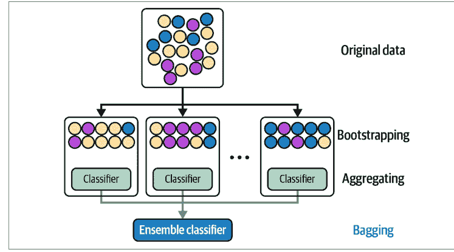

图6-3. Bagging示意图。来源：改编自 Sirakorn 的图像

如果是分类问题，最终预测由所有模型的多数投票决定。例如，如果10个分类器投票为 SPAM，6个模型投票为 NOT SPAM，最终预测为 SPAM。

如果是回归问题，最终预测是所有模型预测的平均值。

Bagging 通常能改善不稳定的方法，例如神经网络、分类和回归树，以及线性回归中的子集选择。然而，它可能会轻微降低稳定方法（如 k-最近邻）的性能。⁵

随机森林是 bagging 的一个例子。随机森林是通过 bagging 和特征随机性构建的决策树集合，其中每棵树只能从用于的随机特征子集中挑选。

## Boosting

Boosting 是一类迭代集成算法，可将弱学习器转换为强学习器。集成中的每个学习器都在同一组样本上训练，但样本在迭代之间加权不同。因此，未来的弱学习器更关注之前弱学习器误分类的示例。图6-4展示了 boosting 的示意图，其中涉及以下步骤。

5 Leo Breiman，“Bagging预测器”，Machine Learning 24 (1996): 123–40，https://oreil.ly/adzju。

XGBoost 是 GBM 的一种变体，曾是许多机器学习竞赛获胜团队的首选算法。⁶ 它已被用于从分类、排序到希格斯玻色子发现等广泛任务。⁷ 然而，许多团队已转向 LightGBM，这是一种分布式梯度提升框架，允许并行学习，通常允许在大数据集上更快地训练。

## Stacking

Stacking 指的是你从训练数据中训练基学习器，然后创建一个元学习器，该元学习器组合基学习器的输出以输出最终预测，如图6-5所示。元学习器可以简单到启发式：你取所有基学习器的多数投票（用于分类任务）或平均投票（用于回归任务）。它也可以是另一个模型，例如逻辑回归模型或线性回归模型。

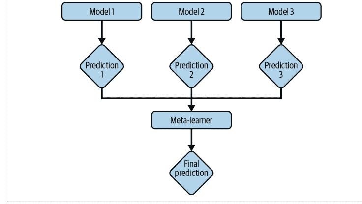

图6-5. 来自三个基学习器的堆叠集成的可视化

有关如何创建集成的更多建议，请参考 Kaggle 传奇团队之一 MLWave 的出色集成指南。

6 “机器学习挑战获胜方案”，https://oreil.ly/YfS8d。

7 Tianqi Chen 和 Tong He，“使用提升树发现希格斯玻色子”，Proceedings of Machine Learning Research 42 (2015): 69–80，https://oreil.ly/ysBYO。

这个问题本可以通过对机器学习实验进行版本控制来避免。ML系统既包含代码也包含数据，因此你不仅需要对代码进行版本控制，还需要对数据进行版本控制。代码版本控制在行业中或多或少已成为标准。然而，此时数据版本控制就像刷牙。每个人都同意这是件好事，但很少有人去做。

数据版本控制具有挑战性的原因有几个。一个原因是，因为数据通常比代码大得多，我们不能使用人们通常用来版本控制代码的相同策略来版本控制数据。

例如，代码版本控制是通过跟踪代码库所做的所有更改来完成的。更改被称为 diff，即 difference 的缩写。每个更改都是通过逐行比较来衡量的。一行代码通常足够短，使得逐行比较有意义。然而，你的数据一行，尤其是以二进制格式存储时，可能无限长。说这条100万字符的行与另一条100万字符的行不同并不会很有帮助。

代码版本控制工具允许用户通过保留所有旧文件的副本来恢复到代码库的先前版本。然而，使用的数据集可能大到多次复制它变得不可行。

代码版本控制工具允许多个人通过在每个人的本地机器上复制代码库同时在同一代码库上工作。然而，一个数据集可能无法放入本地机器。

其次，关于数据版本控制时什么构成 diff 仍然存在混淆。diffs 是否意味着数据仓库中任何文件的內容更改，仅在文件被删除或添加时，或当整个仓库的校验和发生变化时？

截至2021年，像 DVC 这样的数据版本控制工具仅在整个目录的校验和发生变化并且文件被删除或添加时才注册 diff。

另一个混淆在于如何解决合并冲突：如果开发者1使用数据版本 X 来训练模型 A，开发者2使用数据版本 Y 来训练模型 B，将数据版本 X 和 Y 合并以创建 Z 没有意义，因为没有对应 Z 的模型。

第三，如果你使用用户数据来训练模型，像通用数据保护条例（GDPR）这样的法规可能会使版本控制此数据变得复杂。例如，法规可能要求在请求时删除用户数据，使得在法律上不可能恢复数据的旧版本。

积极的实验跟踪和版本控制有助于可重复性，但并不能确保可重复性。你使用的框架和硬件可能会


以下是一些可能导致机器学习（ML）模型失败的原因：

### 理论限制

如前所述，每个模型对所使用的数据和特征都有自己的假设。模型可能会因为学习的数据不符合其假设而失败。例如，你对决策边界非线性的数据使用了线性模型。

### 模型实现不佳

模型可能很适合数据，但问题出在模型的实现上。例如，如果你使用 PyTorch，你可能会忘记在评估时停止梯度更新。模型的组件越多，可能出错的地方就越多，也就越难找出哪里出了问题。然而，随着模型日益商品化，越来越多的公司使用现成模型，这个问题正在变得不那么突出。

### 超参数选择不当

对于同一个模型，一组超参数可以带来最先进的结果，而另一组超参数可能会导致模型永远无法收敛。模型非常适合你的数据，实现也正确，但糟糕的超参数设置可能会让你的模型毫无用处。

### 数据问题

在数据收集和预处理过程中，有很多地方可能出错，从而导致模型性能不佳，例如数据样本与标签错误配对、标签含有噪声、使用过时的统计数据进行特征归一化，等等。

### 特征选择不佳

模型可以学习的特征可能有很多。特征过多可能会导致模型过拟合训练数据或造成数据泄漏。特征过少则可能缺乏预测能力，使模型无法做出良好的预测。

调试既应当是预防性的，也应当是治疗性的。你应当养成良好的实践，尽量减少 bug 扩散的机会，同时还要有一套检测、定位和修复 bug 的流程。在开发、实现和部署机器学习模型时，严格遵守最佳实践和调试流程至关重要。

遗憾的是，机器学习调试仍然没有一种科学的方法。不过，经验丰富的机器学习工程师和研究人员已经发表了许多经过验证的调试技术。以下是其中三种。有兴趣进一步了解的读者可以看看 Andrej Karpathy 的那篇精彩文章《训练神经网络的秘诀》。

### 从简单开始，逐步添加更多组件

从最简单的模型开始，然后慢慢添加更多组件，观察它是有助于还是损害性能。例如，如果你想构建一个循环神经网络（RNN），先从单层 RNN 单元开始，然后再多层堆叠或添加更多正则化。如果你想使用类似 BERT 的模型（Devlin 等人，2018），该模型同时使用掩码语言模型（MLM）和下一句预测（NSP）损失，你或许可以先只使用 MLM 损失，再添加 NSP 损失。

目前，许多人一开始就克隆一个最先进模型的开源实现，然后接入自己的数据。万一能运行，那很好。但如果不运行，调试系统就非常困难，因为问题可能由模型中的众多组件中的任何一个引起。

### 过拟合单个批次

在模型的简单实现完成之后，尝试过拟合少量训练数据，并在同一份数据上运行评估，确保达到尽可能小的损失。如果是图像识别任务，就在 10 张图像上过拟合，看能否获得 100% 的准确率；如果是机器翻译任务，就在 100 个句对上过拟合，看能否让 BLEU 分数接近 100。如果连少量数据都无法过拟合，那么你的实现可能存在问题。

### 设置随机种子

有很多因素会导致模型的随机性：权重初始化、dropout、数据打乱等等。随机性使得不同实验之间的结果难以比较——你无法知道性能变化是因为模型改变还是随机种子不同。设置随机种子可以确保不同运行之间的一致性，也能让你重现错误，并让其他人重现你的结果。

一个具有挑战性的问题是如何准确有效地聚合来自不同机器的梯度。由于每台机器都会产生自己的梯度，如果你的模型等待所有机器完成一轮运行——同步随机梯度下降（SGD）——掉队者会导致整个系统变慢，浪费时间和资源。14 掉队问题会随着机器数量的增加而加剧，因为工作节点越多，在给定迭代中至少有一个工作节点运行异常缓慢的可能性就越大。不过，已经有许多算法可以有效解决这个问题。15

如果你的模型分别使用来自每台机器的梯度更新权重——异步 SGD——梯度陈旧可能会成为一个问题，因为一台机器的梯度可能已经在另一台机器的梯度到来之前导致了权重变化。16

图 6-6 展示了同步 SGD 和异步 SGD 之间的区别。

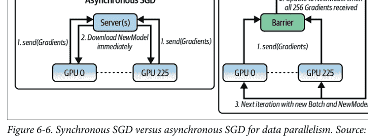

图 6-6：数据并行中的同步 SGD 与异步 SGD。来源：改编自 Jim Dowling 的一张图片。

14 Dipankar Das, Sasikanth Avancha, Dheevatsa Mudigere, Karthikeyan Vaidynathan, Srinivas Sridharan, Dhiraj Kalamkar, Bharat Kaul 和 Pradeep Dubey，“Distributed Deep Learning Using Synchronous Stochastic Gradient Descent”，arXiv，2016年2月22日，https://oreil.ly/ma8Y6。

15 Jianmin Chen, Xinghao Pan, Rajat Monga, Samy Bengio 和 Rafal Jozefowicz，“Revisiting Distributed Synchronous SGD”，ICLR 2017，https://oreil.ly/dzVZ5；Matei Zaharia, Andy Konwinski, Anthony D. Joseph, Randy Katz 和 Ion Stoica，“Improving MapReduce Performance in Heterogeneous Environments”，第8届USENIX操作系统设计与实现研讨会，https://oreil.ly/FWswd；Aaron Harlap, Henggang Cui, Wei Dai, Jinliang Wei, Gregory R. Ganger, Phillip B. Gibbons, Garth A. Gibson 和 Eric P. Xing，“Addressing the Straggler Problem for Iterative Convergent Parallel ML”（SoCC '16，加利福尼亚州圣克拉拉，2016年10月5日至7日），https://oreil.ly/wZgOO。

16 Jeffrey Dean, Greg Corrado, Rajat Monga, Kai Chen, Matthieu Devin, Mark Mao, Marc'aurelio Ranzato 等人，“Large Scale Distributed Deep Networks”，NIPS 2012，https://oreil.ly/EWPun。

17 Jim Dowling，“Distributed TensorFlow”，O'Reilly Media，2017年12月19日，https://oreil.ly/VYIOP。

理论上，异步 SGD 会收敛，但比同步 SGD 需要更多步骤。然而，在实践中，当权重数量很大时，梯度更新往往是稀疏的，这意味着大多数梯度更新只会修改参数的一小部分，来自不同机器的两个梯度更新修改相同权重的可能性较小。当梯度更新稀疏时，梯度陈旧问题就不再那么严重，同步 SGD 和异步 SGD 的模型收敛情况也相似。18

另一个问题是，将模型分布到多台机器上可能会导致批次大小变得非常大。如果一台机器处理大小为 1,000 的批次，那么 1,000 台机器处理大小为 1M 的批次（OpenAI 的 GPT-3 175B 在 2020 年使用了大小为 3.2M 的批次）。19 简单来说，如果在一台机器上训练一个 epoch 需要 1M 步，那么在 1,000 台机器上训练可能只需要 1,000 步。一种直观的做法是增大学习率，以应对每一步上更多的学习，但我们也不能让学习率过大，否则会导致收敛不稳定。在实践中，将批次大小增大到一定程度后，收益会递减。20

最后但同样重要的是，在相同的模型配置下，主工作节点有时会比其他工作节点使用多得多的资源。如果是这样，为了充分利用所有机器，你需要想办法平衡它们之间的工作负载。最简单但并非最有效的方法是，在主工作节点上使用较小的批次大小，在其他工作节点上使用较大的批次大小。

## 模型并行

在数据并行中，每个工作节点都有自己的完整模型副本，并为其模型副本执行所有必要的计算。模型并行是指模型的不同组件在不同的机器上训练，如图 6-7 所示。例如，机器 0 负责前两层的计算，机器 1 负责接下来的两层，或者一些机器负责前向传播，另一些机器负责反向传播。

18 Feng Niu, Benjamin Recht, Christopher Ré 和 Stephen J. Wright，“Hogwild!: A Lock-Free Approach to Parallelizing Stochastic Gradient Descent”，2011年，https://oreil.ly/sAEbv。

19 Tom B. Brown, Benjamin Mann, Nick Ryder, Melanie Subbiah, Jared Kaplan, Prafulla Dhariwal, Arvind Neelakantan 等人，“Language Models Are Few-Shot Learners”，arXiv，2020年5月28日，https://oreil.ly/qjg2S。

20 Sam McCandlish, Jared Kaplan, Dario Amodei 和 OpenAI Dota Team，“An Empirical Model of Large-Batch Training”，arXiv，2018年12月14日，https://oreil.ly/mcjbV；Christopher J. Shallue, Jaehoon Lee, Joseph Antognini, Jascha Sohl-Dickstein, Roy Frostig 和 George E. Dahl，“Measuring the Effects of Data Parallelism on Neural Network Training”，Journal of Machine Learning Research 20（2019）：1–49，https://oreil.ly/YAEOM。


具体来说，假设你有四台不同的机器，第一层、第二层、第三层和第四层分别位于机器 1、2、3 和 4 上。采用流水线并行时，每个小批量会被拆分成四个微批量。机器 1 先计算第一个微批量的第一层；随后，机器 2 根据机器 1 的计算结果计算第二层，同时机器 1 计算第二个微批量的第一层；依此类推。图 6-8 展示了四台机器上的流水线并行：每台机器都为神经网络的一个组件执行前向传播和反向传播。

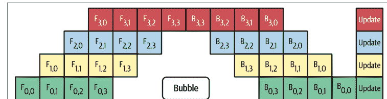

图 6-8。四台机器上神经网络的流水线并行；每台机器都为神经网络的一个组件执行前向传播（F）和反向传播（B）。来源：改编自 Huang 等人绘制的图示。22

22 Yanping Huang、Youlong Cheng、Ankur Bapna、Orhan Firat、Mia Xu Chen、Dehao Chen、HyoukJoong Lee 等人，《GPipe：使用微批量流水线并行实现轻松扩展》，arXiv，2019 年 7 月 25 日，https://oreil.ly/wehkx。

模型并行和数据并行并非互斥。许多公司会同时采用这两种方法，以更好地利用硬件，尽管同时使用这两种方法的配置可能需要投入大量工程工作。

## AutoML

有一个笑话说，优秀的机器学习研究人员就是会把自己自动化到失业的人：设计出足够智能、能够自行设计自己的 AI 算法。这个笑话一直很有趣，直到 2018 年 TensorFlow Dev Summit 大会上，Jeff Dean 登台宣布 Google 打算用多 100 倍的计算能力取代机器学习专业知识，将 AutoML 引入了这个领域，也让整个社区既兴奋又恐惧。与其花钱雇用一组 100 名机器学习研究人员或工程师，尝试各种模型并最终选出一个次优模型，为什么不把这笔钱用于计算，让系统搜索最优模型呢？图 6-9 展示了该活动录制视频中的一张截图。

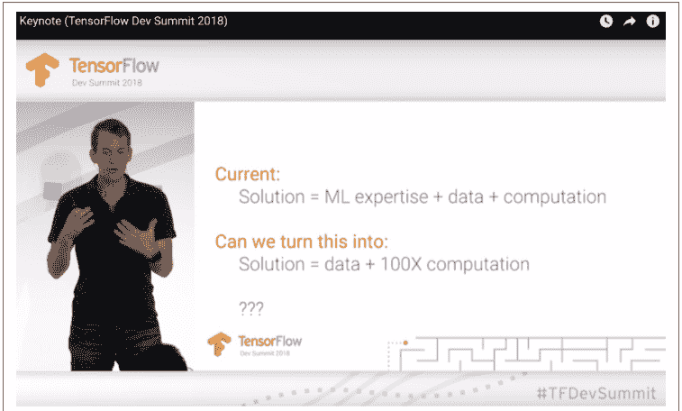

图 6-9。Jeff Dean 在 2018 年 TensorFlow Dev Summit 大会上首次公开介绍 Google 的 AutoML

### 软 AutoML：超参数调优

AutoML 指的是将寻找用于解决现实问题的机器学习算法这一过程自动化。AutoML 的一种较温和、也是生产环境中最常见的形式，是超参数调优。超参数是由用户提供的参数，其值用于控制学习过程，例如学习率、批量大小、隐藏层数量、隐藏单元数量、dropout 概率、Adam 优化器中的 β₁ 和 β₂ 等。甚至量化——例如使用 32 位、16 位还是 8 位来表示一个数字，或者混合使用这些表示方式——也可以被视为需要调优的超参数。²³

23 我们将在第 7 章介绍量化。

尽管知道超参数调优的重要性，许多人仍然倾向于手动凭直觉进行调参，而忽略系统化的方法。其中最流行的方法可以说是研究生下降法（GSD）：让一名研究生不断调整超参数，直到模型能够正常工作。24

24 GSD 是一种有充分文献记录的技术。参见《人们是如何想出这些疯狂的深度学习架构的？》，Reddit，https://oreil.ly/5vEsH；《关于 Google Brain/FAIR/DeepMind 等组织科学问题的讨论》，Reddit，https://oreil.ly/2K77r；《研究生下降法》，Science Dryad，2014 年 1 月 25 日，https://oreil.ly/dIR9r；以及 Guy Zyskind（@GuyZys），《研究生下降法：首选的 #非线性 #优化技术 #机器学习》，Twitter，2015 年 4 月 27 日，https://oreil.ly/SW1or。

不过，越来越多的人开始将超参数调优作为标准流程的一部分。流行的机器学习框架要么自带超参数调优工具，要么提供第三方工具，例如，scikit-learn 配合 auto-sklearn、TensorFlow 配合 Keras Tuner，以及 Ray 配合 Tune。超参数调优的常用方法包括随机搜索、26 网格搜索和贝叶斯优化。27 弗赖堡大学 AutoML 小组编写的《AutoML：方法、系统与挑战》一书将第一章专门用于介绍超参数优化（你可以免费在线阅读该章）。

25 auto-sklearn 2.0 还提供基本的模型选择功能。

26 我们 NVIDIA 团队开发了 Milano，这是一个与框架无关的工具，可使用随机搜索自动进行超参数调优。

27 我观察到的一种常见做法是先进行从粗到细的随机搜索，然后在搜索空间大幅缩小后，再尝试贝叶斯搜索或网格搜索。

调优超参数时，请注意模型的性能可能对某个超参数的变化比对另一个超参数的变化更加敏感，因此应当更加谨慎地调优这些敏感超参数。


绝对不要使用测试集划分来调优超参数，这一点至关重要。应根据模型在验证集划分上的性能，为模型选择最佳的超参数组合，然后报告模型在测试集划分上的最终性能。如果使用测试集划分来调优超参数，就有可能使模型对测试集划分过拟合。

### 硬 AutoML：架构搜索和学习型优化器

有些团队会将超参数调优提升到更高的层次：如果把模型的其他组件，甚至整个模型，都视为超参数，会怎么样？卷积层的大小，或者是否设置跳跃层，都可以被视为超参数。你不再手动决定是在卷积层后添加池化层，还是在线性层后添加 ReLU（整流线性单元），而是将这些构建模块交给算法，让它自行确定如何组合它们。这一研究领域称为架构搜索；对于神经网络，则称为神经架构搜索（NAS），因为它要搜索最优的模型架构。

一个 NAS 设置由三个组件组成：

- **搜索空间**：定义可能的模型架构，即可供选择的构建模块，以及这些模块可以如何组合的约束。
- **性能估计策略**：评估候选架构的性能，而不必从头开始训练每个候选架构直到收敛。当候选架构数量较多时，例如 1,000 个，将它们全部训练至收敛可能代价高昂。
- **搜索策略**：探索搜索空间。一种简单的方法是随机搜索，即从所有可能的配置中随机选择；但这种方法并不受欢迎，因为即使对于 NAS，它的成本也高得令人难以承受。常见方法包括强化学习（奖励能够改善性能估计结果的选择）和进化算法（向某个架构添加变异，选择表现最佳的架构，再向它们添加变异，依此类推）。28

28 Barret Zoph 和 Quoc V. Le，《使用强化学习进行神经架构搜索》，arXiv，2016 年 11 月 5 日，https://oreil.ly/FhsuQ；Esteban Real、Alok Aggarwal、Yanping Huang 和 Quoc V. Le，《用于图像分类器架构搜索的正则化进化算法》，AAAI 2019，https://oreil.ly/FWYjn。

对于 NAS 而言，搜索空间是离散的——最终架构会为每个层或操作只使用可用选项中的一个，29 并且你必须提供构建模块集合。常见的构建模块包括不同大小的各种卷积、线性层、各种激活函数、池化、恒等映射、零操作等。构建模块集合会根据基础架构的不同而变化，例如卷积神经网络或 Transformer。

29 可以将搜索空间设置为连续空间以支持求导，但最终得到的架构必须转换为离散架构。参见《DARTS：可微分架构搜索》（Liu 等人，2018 年）。

在典型的机器学习训练过程中，你会先有一个模型，然后有一个学习过程，即一种帮助模型针对给定数据找到能使目标函数最小化的参数集合的算法。如今，神经网络最常见的学习过程是梯度下降，它利用优化器来规定如何根据梯度更新模型的权重。30 常见的优化器包括 Adam、Momentum、SGD 等，这些你可能已经知道了。理论上，你可以将优化器作为 NAS 中的构建模块，并搜索出效果最佳的优化器。实践中，这样做很困难，因为优化器对设置非常敏感，

30 我们在本书 GitHub 仓库的“基础机器学习回顾”一节中，将更加详细地介绍学习过程和优化器。


它们的超参数，而且默认超参数在不同架构上通常效果不佳。

这引出了一个令人兴奋的研究方向：如果我们用神经网络替换指定更新规则的函数，会怎样？模型权重的更新量将由这个神经网络来计算。这种方法产生的是学习式优化器，而不是手工设计的优化器。

由于学习式优化器是神经网络，它们也需要训练。你可以在训练神经网络其余部分的同一数据集上训练你的学习式优化器，但这意味着每遇到一个任务都需要训练一个优化器。

另一种方法是，在现有任务集上一次性训练一个学习式优化器——以这些任务上的聚合损失作为损失函数，以现有设计好的优化器作为学习规则——之后对每个新任务都使用它。例如，Metz等人构建了一个包含数千个任务的任务集来训练学习式优化器。他们学习得到的优化器能够泛化到新的数据集、新的领域以及新的架构。31 这种方法的美妙之处在于，这个学习式优化器之后还可以用来训练出更好的学习式优化器，也就是一种能自我改进的算法。

无论是架构搜索还是元学习的学习规则，前期训练成本都非常高昂，以至于世界上只有少数几家公司能够承担这些研究。然而，对于对ML在生产环境中的应用感兴趣的人来说，了解AutoML的进展很重要，原因有二。首先，由此产生的架构和学习式优化器可以让ML算法在多个真实世界任务上开箱即用，从而在训练和推理过程中节省生产时间和成本。例如，EfficientNets（谷歌AutoML团队开发的一系列模型）超越了当前最先进的准确率，效率提升高达10倍。32 其次，它们或许能解决许多现有架构和优化器此前无法解决的真实世界任务。

31 Luke Metz、Niru Maheswaranathan、C. Daniel Freeman、Ben Poole和Jascha Sohl-Dickstein，《任务、稳定性、架构与计算：训练更有效的学习式优化器，并用它们训练自己》，arXiv，2020年9月23日，https://oreil.ly/IH7eT。

32 Mingxing Tan和Quoc V. Le，《EfficientNet：通过AutoML和模型缩放提高准确率与效率》，Google AI Blog，2019年5月29日，https://oreil.ly/gonEn。

## ML模型开发的四个阶段

在进入模型训练之前，让我们先来看看ML模型开发的四个阶段。一旦你决定探索ML，你的策略取决于你处于ML采用的哪个阶段。采用ML有四个阶段。某个阶段的解决方案可以用作评估下一阶段解决方案的基线：

### 阶段1：机器学习之前

如果这是你第一次尝试根据此类数据做出此类预测，请从非ML解决方案开始。你对问题的最初尝试可以是最简单的启发式规则。例如，要预测用户接下来会输入哪个英文字母，你可以显示最常见的三个英文字母“e”“t”“a”，这可能会让准确率达到30%。

Facebook信息流于2006年推出时没有任何智能算法——帖子按时间顺序显示，如图6-10所示。33 直到2011年，Facebook才开始将你最感兴趣的新闻更新显示在信息流顶部。


图6-10. 2006年左右的Facebook信息流。来源：Iveta Ryšavá34

33 Samantha Murphy，《Facebook信息流的演变》，Mashable，2013年3月12日，https://oreil.ly/1HMXh。

34 Iveta Ryšavá，《马克·扎克伯格2006年的信息流看起来是什么样》，Newsfeed.org，2016年1月14日，https://oreil.ly/XZT6Q。

Martin Zinkevich在其精彩的《机器学习规则：ML工程最佳实践》中写道：“如果你认为机器学习会带来100%的提升，那么启发式方法能帮你完成50%的路程。”35 你甚至可能会发现非ML解决方案已经足够好用，暂时还不需要ML。

### 阶段2：最简单的机器学习模型

对于你的第一个ML模型，你应该从简单的算法开始，这样你能看清它的工作过程，从而验证你的问题框架和数据的有效性。逻辑回归、梯度提升树、k近邻算法都很适合。它们也更容易实现和部署，让你能快速构建从数据工程到开发再到部署的完整框架，并对其测试、建立信心。

### 阶段3：优化简单模型

一旦你的ML框架就绪，你就可以专注于通过不同的目标函数、超参数搜索、特征工程、更多数据和集成方法来优化简单模型。

### 阶段4：复杂模型

当你达到简单模型的极限，并且你的用例要求显著的模型改进时，尝试更复杂的模型。

你还需要通过实验来确定模型在生产环境中的性能衰减速度（例如，需要多久重新训练一次），以便构建支持这种再训练需求的基础设施。36

### 模型离线评估

在帮助公司制定ML策略时，我经常遇到一个常见但相当困难的问题：“我怎么知道我们的ML模型是否足够好？” 有一次，一家公司部署ML来检测100架监控无人机的入侵行为，但他们没有办法衡量系统漏掉了多少次入侵，也无法判断哪种ML算法更适合他们的需求。

对如何评估你的ML系统缺乏清晰认识，不一定会导致你的ML项目失败，但可能使你无法找到最适合你需求的最佳解决方案，并且更难说服你的经理采用ML。你可能希望与业务团队合作，制定与公司业务更相关的模型评估指标。37

35 Martin Zinkevich，《机器学习规则：ML工程最佳实践》，Google，2019年，https://oreil.ly/YIEsN。

36 我们将在第9章深入探讨更新模型的频率问题。

37 参见第26页的“业务与ML目标”一节。

理想情况下，评估方法在开发和生产阶段应该保持一致。但在许多情况下，这种理想状态无法实现，因为开发阶段你有真实标签，而生产阶段没有。

对于某些任务，可以根据用户反馈在生产环境中推断或近似标签，如第91页的“自然标签”一节所述。例如，对于推荐任务，可以通过用户是否点击来判断推荐是否优质。然而，这伴随着许多偏见。

对于其他任务，你可能无法直接评估模型在生产环境中的表现，可能不得不依赖广泛监控来检测ML系统性能的变化和故障。我们将在第8章讨论监控。

模型部署后，你需要继续在生产环境中监控和测试模型。在本节中，我们将讨论在模型部署前评估其性能的方法。我们首先介绍用于评估模型的基线，然后介绍一些除整体准确率指标之外的常见模型评估方法。

### 基线

有人曾告诉我，她的新生成模型在ImageNet上达到了10.3的FID分数。38 我完全不知道这个数字意味着什么，也不知道她的模型是否适用于我的问题。

另外一次，我帮助一家公司实现了一个分类模型，其中正类出现频率为90%。团队里的一位ML工程师兴奋地告诉我，他们的初始模型达到了0.90的F1分数。我问他这个结果与随机相比如何。他一无所知。结果发现，因为他的任务中正类占标签的90%，如果模型随机输出正类的概率为90%，它的F1分数也会在0.90左右。39 他的模型几乎等同于在随机预测。40

38 弗雷歇初始距离（Fréchet inception distance），一种衡量合成图像质量的常用指标。数值越小，质量越高。

39 在这种情况下，准确率约为0.80。

40 请重温第106页的“使用正确的评估指标”一节，以复习F1的不对称性。


评价指标本身意义不大。在评估模型时，了解评估基准至关重要。具体的基准应因用例而异，但以下是可能在各种用例中都很有用的五个基准：

## Random baseline

如果我们的模型只是随机预测，预期性能如何？预测是根据特定分布随机生成的，可以是均匀分布或任务的标签分布。

例如，考虑一个有两个标签的任务，NEGATIVE 出现 90% 的时间，POSITIVE 出现 10% 的时间。表 6-2 显示了随机预测的基线模型的 F1 和准确率分数。然而，作为一项练习，为了看看大多数人对这些值的直觉有多难，请在查看表格之前先在脑中计算这些原始数字。

## 表 6-2. 随机预测基线模型的 F1 和准确率分数

| 随机分布 | 含义 | F1 | 准确率 |
|---|---|---|---|
| 均匀随机 | 以相等概率（50%）预测每个标签 | 0.167 | 0.5 |
| 任务的标签分布 | 90% 的时间预测为 NEGATIVE，10% 的时间预测为 POSITIVE | 0.1 | 0.82 |

## Simple heuristic

忘掉机器学习。如果只是基于简单启发式方法进行预测，会期望什么性能？例如，如果你想构建一个排名系统来对用户新闻 feed 上的项目进行排名，目标是让用户在新闻 feed 上花费更多时间，如果只是按时间倒序排列所有项目，先显示最新的一个，用户会花费多少时间？

## Zero rule baseline

零规则基线是简单启发式基线的一种特殊情况，当基线模型始终预测最常见的类别时。

例如，对于推荐用户在手机上最有可能下一步使用的应用的任务，最简单的模型就是推荐他们使用频率最高的应用。如果这种简单启发式方法可以 70% 的时间准确预测下一个应用，那么你构建的任何模型都必须显著优于它，才能证明增加的复杂性是合理的。

## Human baseline

在许多情况下，机器学习的目的是自动化原本由人类完成的工作，因此了解模型与人类专家的表现相比如何是有用的。例如，如果你从事自动驾驶系统的工作，与人类司机相比衡量系统的进展至关重要，因为否则你可能永远无法说服用户信任该系统。即使你的系统并非旨在取代人类专家，而只是为了帮助他们提高生产力，了解该系统在哪些场景对人类有用仍然很重要。

## Existing solutions

在许多情况下，机器学习系统旨在取代现有解决方案，这些解决方案可能是包含大量 if/else 语句的业务逻辑或第三方解决方案。将新模型与这些现有解决方案进行比较至关重要。你的机器学习模型并不总是必须优于现有解决方案才有用。如果一个模型的性能稍差但使用起来容易得多或便宜得多，它仍然是有用的。

在评估模型时，区分“好的系统”和“有用的系统”很重要。好的系统不一定有用，坏的系统也不一定无用。如果自动驾驶汽车相比之前的自动驾驶系统有显著改进，它可能是好的，但如果它不能至少像人类司机一样表现，它可能就没用。在某些情况下，即使机器学习系统比普通人类驾驶得更好，人们可能仍然不信任它，这使其变得无用。另一方面，如果一个系统预测用户在手机上下一个要输入的单词的能力远不如母语者，它可能被认为很差。然而，如果它的预测有时可以帮助用户更快地输入，它仍然可能有用。

## Evaluation Methods

在学术环境中，评估机器学习模型时，人们往往专注于其性能指标。然而，在生产环境中，我们还希望我们的模型具有鲁棒性、公平性、校准性，并且总体上合理。我们将介绍一些有助于衡量模型这些特征的评估方法。

## Perturbation tests

我的一组学生想构建一个通过咳嗽预测某人是否患有 COVID-19 的应用。他们最好的模型在训练数据上表现很好，训练数据由医院收集的长达两秒的咳嗽片段组成。然而，当他们将其部署给实际用户时，该模型的预测接近随机。

其中一个原因是，与医院收集的咳嗽相比，实际用户的咳嗽包含大量噪声。用户的录音可能包含背景音乐或附近的闲聊。他们使用的麦克风质量参差不齐。他们可能在录音启用后立即开始录制咳嗽，或等待一小段时间。

理想情况下，用于开发模型的输入应与模型在生产环境中需要处理的数据相似，但在许多情况下这是不可能的。这

5% 的时间，你估计的点击次数会大错特错。如果你有另一个给出相同排名但校准更好的模型，你可能想考虑校准更好的那个。

要衡量模型的校准性，一个简单的方法是计数：你统计模型输出概率 X 的次数以及该预测成真的频率 Y，并将 X 对 Y 作图。完美校准模型的图在所有数据点上 X 都等于 Y。在 scikit-learn 中，你可以使用方法 sklearn.calibration.calibration_curve 绘制二元分类器的校准曲线，如图 6-11 所示。

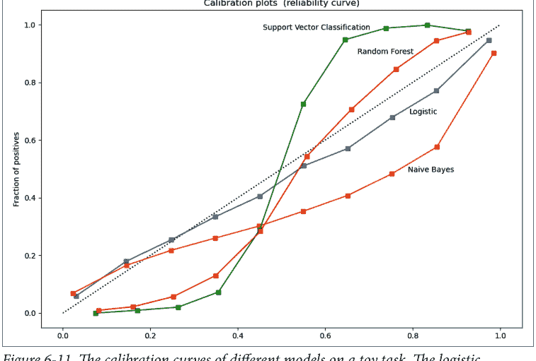

图 6-11. 玩具任务上不同模型的校准曲线。逻辑回归模型是最好的校准模型，因为它直接优化逻辑损失。来源：scikit-learn

要校准你的模型，一个常见的方法是 Platt 缩放，它在 scikit-learn 中通过 sklearn.calibration.CalibratedClassifierCV 实现。Geoff Pleiss 的另一个优秀开源实现可以在 GitHub 上找到。对于想了解更多关于模型校准重要性以及如何校准神经网络的读者，Lee Richardson 和 Taylor Pospisil 基于他们在 Google 的工作撰写了一篇优秀的博文。

如果一家公司只关注整体指标，他们可能会选择模型 A。他们可能会对该模型的高准确率非常满意，直到有一天，他们的终端用户发现该模型对少数群体有偏见，因为少数群体恰好对应于代表性不足的人口统计群体。45 关注整体性能是有害的，不仅因为潜在的公众反弹，还因为它使公司看不到巨大的潜在模型改进。如果公司看到两个模型的基于切片的性能，他们可能会采取不同的策略。例如，他们可能会决定改进模型 A 在少数群体上的性能，从而提高该模型的整体性能。或者他们可能保持两个模型不变，但现在拥有更多信息来做出更明智的部署决策。

另一个问题是，当模型应该表现不同时，它在不同数据切片上的表现相同。一些数据子集更为关键。例如，当你构建用户流失预测模型（预测用户何时会取消订阅或服务）时，付费用户比非付费用户更关键。专注于模型的整体性能可能会损害其在这些关键切片上的性能。

切片评估至关重要的一个引人入胜且看似违反直觉的原因是辛普森悖论，这是一种在多个数据组中出现趋势，但在合并组时消失或逆转的现象。这意味着模型 B 在所有数据上可能表现优于模型 A，但模型 A 在每个子组上都表现优于模型 B。请考虑表 6-4 所示的模型 A 和模型 B 在组 A 和组 B 上的表现。模型 A 在组 A 和组 B 上都优于模型 B，但合并后，模型 B 优于模型 A。

## 表 6-4. 辛普森悖论的一个例子ᵃ

|  | 组 A | 组 B | 总体 |
|---|---|---|---|
| 模型 A | 93% (81/87) | 73% (192/263) | 78% (273/350) |
| 模型 B | 87% (234/270) | 69% (55/80) | 83% (289/350) |

ᵃ 数据来自 Charig 等人在 1986 年的肾结石治疗研究：C. R. Charig, D. R. Webb, S. R. Payne, and J. E. Wickham, “Comparison of Treatment of Renal Calculi by Open Surgery, Percutaneous Nephrolithotomy, and Extracorporeal Shockwave Lithotripsy,” British Medical Journal (Clinical Research Edition) 292, no. 6524 (March 1986): 879–82, https://oreil.ly/X8oWr.


我们接着讨论了模型开发的不同方面。我们不仅涵盖了单个模型，还涵盖了模型集成，这是一种在竞赛和排行榜式研究中广泛使用的技术。

在模型开发阶段，你可能会尝试许多不同的模型。对大量实验进行细致的跟踪和版本管理通常被认为很重要，但许多机器学习工程师仍然会跳过这一步，因为做起来可能像是一件苦差事。因此，拥有能够自动完成跟踪和版本管理过程的工具和适当的基础设施至关重要。我们将在第10章介绍用于机器学习生产的工具和基础设施。

如今模型变得越来越大，消耗的数据也越来越多，分布式训练正成为机器学习模型开发者的一项必备技能。我们讨论了并行技术，包括数据并行、模型并行和流水线并行。让你的模型在大型分布式系统上运行，例如那些运行着数亿甚至数十亿参数模型的系统，可能颇具挑战，并且需要专门的系统工程专业知识。

我们在本章结尾讨论了如何评估模型以挑选出最适合部署的那一个。除非有基线可以对照，否则评估指标意义不大；我们介绍了你在评估时可能需要考虑的不同类型基线。我们还介绍了一系列评估技术，这些技术对于在生产环境中进一步评估模型之前对模型进行合理性检查是必要的。

通常，无论你对模型的离线评估有多好，在模型部署之前，你仍然无法确定它在生产环境中的表现。在下一章中，我们将介绍如何部署模型。

## 模型部署与预测服务

在第4章到第6章中，我们讨论了开发机器学习模型时需要考虑的事项，包括创建训练数据、提取特征、开发模型以及制定评估该模型的指标。这些考虑因素构成了模型的逻辑——即如何从原始数据生成机器学习模型的指令，如图7-1所示。构建这一逻辑既需要机器学习知识，也需要领域专业知识。在许多公司，这部分流程由机器学习或数据科学团队完成。

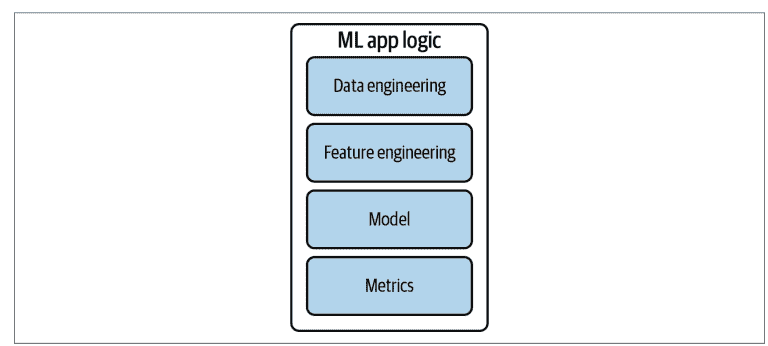

图7-1：构成机器学习模型逻辑的不同方面

在本章中，我们将讨论迭代过程中的另一个部分：部署你的模型。“部署”是一个宽泛的术语，通常指让你的模型运行起来并可以访问。在模型开发期间，你的模型通常在开发环境中运行。¹ 为了部署，你的模型必须离开开发环境。你的模型可以部署到暂存环境进行测试，也可以部署到生产环境供最终用户使用。本章重点讨论如何将模型部署到生产环境。

在继续之前，我想强调，生产环境是一个谱系。对于某些团队来说，生产意味着在笔记本中生成漂亮的图表展示给业务团队。对于其他团队来说，生产意味着让你的模型每天为数百万用户持续运行。如果你的工作属于第一种情况，你的生产环境与开发环境类似，那么本章与你的相关性不大。如果你的工作更接近第二种情况，请继续阅读。

我在网上看到过这样一句话：如果忽略所有困难的部分，部署其实很简单。如果你想部署一个模型给朋友们玩，你只需要用 Flask 或 FastAPI 将你的 predict 函数包装成一个 POST 请求端点，把这个 predict 函数运行所需的依赖放进容器中，² 然后将你的模型及其相关容器推送到 AWS 或 GCP 等云服务上以暴露该端点：

```
### Example of how to use FastAPI to turn your predict function
### into a POST endpoint
@app.route('/predict', methods=['POST'])
def predict():
    X = request.get_json()['X']
    y = MODEL.predict(X).tolist()
    return json.dumps({'y': y}), 200
```

你可以使用这个暴露的端点来服务于下游应用：例如，当应用程序收到用户的预测请求时，该请求会被发送到暴露的端点，端点会返回一个预测结果。如果你熟悉必要的工具，你可以在一个小时内完成一个可用的部署。我的学生在经过10周课程后，尽管之前很少有部署经验，但都成功地将机器学习应用部署作为他们的期末项目。³

困难的部分包括：让模型能以毫秒级延迟和99%的正常运行时间服务于数百万用户；搭建基础设施，以便在出现问题时能立即通知到合适的人；查明问题原因；并无缝地部署更新以修复问题。

1. 我们将在第10章详细介绍开发环境。
2. 我们将在第9章更深入地讨论容器。
3. CS 329S：斯坦福大学机器学习系统设计课程；你可以在YouTube上查看项目演示。

在许多公司，部署模型的责任落在开发这些模型的同一批人手中。在另外许多公司，一旦模型准备好部署，它会被导出并移交给另一个团队进行部署。然而，这种职责分离可能导致跨团队沟通开销很大，并使得模型更新缓慢。此外，如果出现问题，也会使得调试变得困难。我们将在第11章进一步讨论团队结构。


导出模型意味着将该模型转换为另一个应用程序可以使用的格式。有些人称这个过程为“序列化”。⁴ 模型可以导出两个部分：模型定义和模型参数值。模型定义规定了模型的结构，例如它有多少个隐藏层，以及每层有多少个单元。参数值则为这些单元和层提供数值。通常，这两部分会一起导出。

在TensorFlow 2中，你可能会使用 `tf.keras.Model.save()` 将模型导出为TensorFlow的SavedModel格式。在PyTorch中，你可能会使用 `torch.onnx.export()` 将模型导出为ONNX格式。

无论你的工作是否涉及部署机器学习模型，了解模型的使用方式都能让你理解它们的约束，并帮助你针对其用途进行调整。

在本章中，我们将从一些我经常听到的关于机器学习部署的常见误区开始，这些误区往往来自那些没有实际部署过模型的人。然后，我们将讨论模型生成预测并向用户提供预测的两种主要方式：在线预测和批量预测。生成预测的过程被称为*推理*。

我们将继续讨论生成预测的计算应该在哪里进行：在设备端（也称为边缘端）和云端。模型的预测服务和计算方式会影响其设计方式、所需的基础设施以及用户遇到的行为。

如果你有学术背景，本章讨论的一些主题可能会超出你的舒适区。如果遇到不熟悉的术语，请花点时间查一查。如果某一节内容过于密集，你可以随意跳过。本章是模块化的，因此跳过一节不会影响你对另一节的理解。

### 机器学习部署误区

正如第1章所讨论的，部署机器学习模型可能与部署传统软件程序有很大不同。这种差异可能会让从未部署过模型的人要么害怕这一过程，要么低估所需的时间和精力。在本节中，我们将破除一些关于部署过程的常见误区，希望能让你以良好的心态开始这一过程。本节对几乎没有部署经验的人最有益。

#### 误区1：你一次只部署一两个机器学习模型

在做学术项目时，有人建议我选择一个聚焦的小问题，这通常只会产生一个模型。我接触过的许多有学术背景的人也倾向于在单一模型的语境下思考机器学习生产。因此，他们设想的基础设施不适用于实际应用，因为它只能支持一两个模型。

实际上，公司拥有大量的机器学习模型。一个应用程序可能有许多不同的功能，每个功能可能需要自己的模型。以Uber这样的网约车应用为例。它需要模型来预测以下每一项：乘车需求、司机可用性、预计到达时间、动态定价、欺诈交易、客户流失等等。此外，如果该应用在20个国家运营，除非你能拥有跨不同用户画像、文化和语言进行泛化的模型，否则每个国家都需要自己的一套模型。那么按20个国家、每个国家10个模型来计算，你已经有200个模型了。图7-2展示了Netflix中利用机器学习的各种任务。


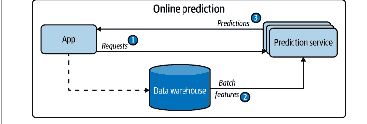

图7-5. 仅使用批量特征的在线预测简化架构

如第3章所述，从历史数据（如数据库和数据仓库中的数据）计算出的特征是*批量特征*。从流式数据（实时传输中的数据）计算出的特征是*流特征*。在批量预测中，只使用批量特征。然而，在在线预测中，可以同时使用批量特征和流特征。例如，用户在DoorDash上提交订单后，可能需要以下特征来估算配送时间：

### 批量特征

这家餐厅过去的平均备餐时间

### 流特征

在过去10分钟内，他们有多少其他订单，以及有多少可用的配送人员


## 流特征与在线特征

我听到过人们交替使用“流特征”和“在线特征”这两个术语。它们实际上是不同的。在线特征更通用，因为它们指任何用于在线预测的特征，包括存储在内存中的批量特征。

一种非常常见的用于在线预测的批量特征，尤其是基于会话的推荐，是物品嵌入。物品嵌入通常在批处理中预先计算，并在在线预测需要时获取。在这种情况下，嵌入可以被视为在线特征，但不是流特征。

流特征专指从流式数据中计算出的特征。

因为预测是预先计算的，所以你不需要担心模型生成预测需要多长时间。因此，批量预测也可以看作是一种减少更复杂模型推理延迟的技巧——获取预测的时间通常少于生成预测的时间。

批量预测适用于你想生成大量预测并且不需要立即得到结果的情况。你不必使用所有生成的预测。例如，你可以预测所有顾客购买新产品的可能性，并覆盖前10%的用户。

然而，批量预测的问题是它使你的模型对用户不断变化的偏好反应较慢。这种局限性即使在像Netflix这样技术更先进的公司也能看到。假设你最近看了很多恐怖片，所以当你第一次登录Netflix时，恐怖片主导了推荐。但今天你心情不错，所以你搜索“喜剧”并开始浏览喜剧类别。Netflix应该学会并在推荐列表中向你展示更多喜剧，对吗？截至本书写作时，它在下一次推荐生成之前无法更新列表，但我毫不怀疑这一局限性在不久的将来会得到解决。

另一个批量预测的问题是，你需要提前知道要为哪些请求生成预测。在为用户推荐电影的情况下，你提前知道要为多少个用户生成推荐。17 然而，对于查询不可预测的情况——如果你有一个从英语翻译到法语系统，可能无法预料所有可能被翻译的英语文本——你需要使用在线预测，在请求到来时生成预测。

在Netflix的例子中，批量预测造成了轻微的不便（这与用户参与度和留存率密切相关），而不是灾难性的失败。有许多应用场景中批量预测会导致灾难性失败或根本无法工作。在线预测至关重要的例子包括高频交易、自动驾驶汽车、语音助手、用面部或指纹解锁手机、老年人护理中的跌倒检测以及欺诈检测。能够检测到三小时前发生的欺诈交易仍然比完全没有检测到要好，但能够实时检测则可以防止欺诈交易发生。

批量预测是在在线预测不够廉价或不够快速时的一种变通方法。如果能在完全相同的成本和速度下按需生成每个预测，为什么要提前生成一百万个预测并操心存储和检索它们呢？

随着硬件变得更定制化和强大，以及更好的技术被开发出来实现更快、更便宜的在线预测，在线预测可能成为默认选择。

近年来，公司在从批量预测转向在线预测方面进行了重大投资。为了克服在线预测的延迟挑战，需要两个组件：

-   一个（近）实时管道，能够处理传入数据，提取流特征（如果需要），将其输入模型，并几乎实时地返回预测。具有实时传输和流计算引擎的流管道可以提供帮助。
-   一个能够以终端用户可接受的速度生成预测的模型。对于大多数消费者应用，这意味着毫秒级。

我们已经在第3章讨论了流处理。我们将在下一节继续讨论流管道与批量管道的统一。然后我们将在216页的“模型优化”一节讨论如何加速推理。

## 统一批量管道和流管道

批量预测在很大程度上是传统系统的产物。在过去十年中，大数据处理一直由MapReduce和Spark等批处理系统主导，这些系统使我们能够高效地定期处理大量数据。当公司开始使用机器学习时，他们利用现有的批处理系统进行预测。当这些公司希望在其在线预测中使用流特征时，他们需要构建一个独立的流管道。让我们通过一个例子来具体说明。

例如，通过使用包括用1×1卷积替换3×3卷积在内的一系列策略，SqueezeNets在ImageNet上达到了AlexNet级别的准确率，而参数数量减少了50倍。21

类似地，MobileNets将大小为K×K×C的标准卷积分解为深度卷积（K×K×1）和逐点卷积（1×1×C），其中K是卷积核大小，C是通道数。这意味着每个新的卷积只使用K² + C个参数，而不是K²C个参数。如果K=3，这意味着参数数量减少了8到9倍（参见图7-9）。22

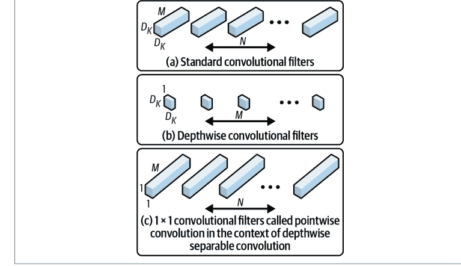

图7-9. MobileNets中的紧凑卷积滤波器。(a)中的标准卷积滤波器被(b)中的深度卷积和(c)中的逐点卷积替换，以构建深度可分离滤波器。来源：改编自Howard等人的图像。

这种方法已被用于开发更小的模型，与标准模型相比具有显著的加速。然而，它往往特定于某些类型的模型（例如，紧凑卷积滤波器特定于卷积神经网络

21 Forrest N. Iandola, Song Han, Matthew W. Moskewicz, Khalid Ashraf, William J. Dally, and Kurt Keutzer，“SqueezeNet：以50倍更少参数和小于0.5MB模型大小实现AlexNet级准确率”，arXiv，2016年11月4日，https://oreil.ly/xs3mi。

22 Andrew G. Howard, Menglong Zhu, Bo Chen, Dmitry Kalenichenko, Weijun Wang, Tobias Weyand, Marco Andreetto, and Hartwig Adam，“MobileNets：面向移动视觉应用的高效卷积神经网络”，arXiv，2017年4月17日，https://oreil.ly/T84fD。


网络），并且需要大量架构知识来设计，因此它尚未广泛适用于许多用例。

## 知识蒸馏

*知识蒸馏*是一种方法，其中一个较小的模型（学生）被训练来模仿一个较大的模型或模型集成（教师）。较小的模型才是你将部署的。尽管学生模型通常是在预训练的教师模型之后训练的，但两者也可以同时训练。[^23] 一个在生产中使用的蒸馏网络示例是 DistilBERT，它将 BERT 模型的大小减少了 40%，同时保留了 97% 的语言理解能力，并且速度提高了 60%。[^24]

这种方法的优点在于，无论教师网络和学生网络之间的架构差异如何，它都可以发挥作用。例如，你可以将随机森林作为学生模型，将 Transformer 作为教师模型。这种方法的缺点是它高度依赖于教师网络的可用性。如果你使用预训练模型作为教师模型，训练学生网络将需要较少的数据，并且可能会更快。然而，如果没有可用的教师模型，你就必须在训练学生网络之前先训练一个教师网络，而训练教师网络将需要更多的数据，并且花费更多的训练时间。这种方法对应用场景和模型架构也很敏感，因此尚未在生产中获得广泛使用。

## 剪枝

*剪枝*最初是一种用于决策树的方法，即删除树中对于分类而言不关键且冗余的部分。[^25] 随着神经网络得到更广泛的采用，人们开始意识到神经网络是过度参数化的，并开始寻找减少额外参数所导致的工作量的方法。

在神经网络语境下，剪枝有两种含义。一种是从神经网络中移除整个节点，这意味着改变其架构并减少参数数量。更常见的含义是找到对预测最无用的参数并将其设为 0。在这种情况下，剪枝不会减少参数的总数，只会减少非零参数的数量。神经网络的架构保持不变。这有助于减小模型的大小，因为剪枝使神经网络更加稀疏，而稀疏架构往往比密集结构需要更少的存储空间。实验表明，剪枝技术可以将训练后网络中的非零参数数量减少 90% 以上，在降低存储需求并提升推理计算性能的同时，不会影响整体准确率。[^26] 在第 11 章中，我们将讨论剪枝会如何将偏见引入你的模型。

尽管人们普遍认为剪枝是有效的，[^27] 但关于剪枝的实际价值一直存在许多讨论。Liu 等人认为，剪枝的主要价值不在于继承下来的“重要权重”，而在于剪枝后的架构本身。[^28] 在某些情况下，剪枝可以作为一种架构搜索范式，并且剪枝后的架构应该作为密集模型从头开始重新训练。然而，Zhu 等人表明，剪枝后的大型稀疏模型优于重新训练的密集模型。[^29]

## 量化

*量化*是最通用且最常用的模型压缩方法。它易于实施，并且可以泛化到各种任务和架构。

量化通过使用更少的位数来表示模型的参数，从而减小模型的大小。默认情况下，大多数软件包使用 32 位来表示浮点数（单精度浮点数）。如果一个模型有 100M 个参数，每个需要 32 位存储，它将占用 400 MB。如果我们使用 16 位来表示一个数字，内存占用将减少一半。使用 16 位来表示浮点数称为半精度。

除了使用浮点数，你也可以让模型完全使用整数；每个整数只需 8 位来表示。这种方法也被称为“定点”。在极端情况下，有人尝试过每个权重用 1 位表示（二值权重神经网络），例如 BinaryConnect 和 XNOR-Net。[^30] XNOR-Net 论文的作者们因此创立了 Xnor.ai，这是一家专注于模型压缩的初创公司。2020 年初，该公司被苹果收购，据报道成交价为 2 亿美元。[^31]

量化不仅减少了内存占用，还提高了计算速度。首先，它允许我们增大批大小。其次，较低的精度可以加快计算，从而进一步减少训练时间和推理延迟。以两个数字的加法为例。如果逐位执行加法，每一位需要 x 纳秒，那么 32 位数字需要 32x 纳秒，而 16 位数字只需要 16x 纳秒。

量化也有缺点。减少表示数字的位数意味着可以表示的数值范围更小。对于超出该范围的值，你必须对它们进行四舍五入和/或缩放，使其落在范围内。对数字进行四舍五入会导致舍入误差，而小的舍入误差可能会导致性能的巨大变化。你还有可能在进行舍入/缩放时导致数字下溢/溢出，从而使其变为 0。在底层实现高效的四舍五入和缩放并非易事，但幸运的是，主流框架已经内建了这一功能。

量化既可以发生在训练期间（量化感知训练），[^32] 即模型以较低精度进行训练；也可以发生在训练后，即模型先以单精度浮点数训练，然后为推理进行量化。在训练期间使用量化意味着每个参数可以使用更少的内存，这样你就能在相同的硬件上训练更大的模型。

近年来，低精度训练越来越流行，并得到了大多数现代训练硬件的支持。NVIDIA 推出了 Tensor Cores，这是一种支持混合精度训练的处理单元。[^33] Google TPU（张量处理单元）也支持使用 Bfloat16（16 位脑浮点格式）进行训练，谷歌称之为“Cloud TPU 高性能的秘密”。[^34] 定点训练还没有那么流行，但已经产生了很多有前景的结果。[^35]

定点推理已成为行业标准。一些边缘设备仅支持定点推理。大多数流行的设备端机器学习推理框架——谷歌的 TensorFlow Lite、Facebook 的 PyTorch Mobile、NVIDIA 的 TensorRT——都提供免费的训练后量化，只需几行代码即可。

[^23]: Geoffrey Hinton、Oriol Vinyals 和 Jeff Dean，“Distilling the Knowledge in a Neural Network”，arXiv，2015年3月9日，https://oreil.ly/OJEPW。

[^24]: Victor Sanh、Lysandre Debut、Julien Chaumond 和 Thomas Wolf，“DistilBERT, a Distilled Version of BERT: Smaller, Faster, Cheaper and Lighter”，arXiv，2019年10月2日，https://oreil.ly/mQWBv。

[^25]: 因此得名“剪枝”。

[^26]: Jonathan Frankle 和 Michael Carbin，“The Lottery Ticket Hypothesis: Finding Sparse, Trainable Neural Networks”，ICLR 2019，https://oreil.ly/chdl。

[^27]: Davis Blalock、Jose Javier Gonzalez Ortiz、Jonathan Frankle 和 John Guttag，“What Is the State of Neural Network Pruning?”，arXiv，2020年3月6日，https://oreil.ly/VQsC3。

[^28]: Zhuang Liu、Mingjie Sun、Tinghui Zhou、Gao Huang 和 Trevor Darrell，“Rethinking the Value of Network Pruning”，arXiv，2019年3月5日，https://oreil.ly/mB4IZ。

[^29]: Michael Zhu 和 Suyog Gupta，“To Prune, or Not to Prune: Exploring the Efficacy of Pruning for Model Compression”，arXiv，2017年11月13日，https://oreil.ly/KBRjy。

[^30]: Matthieu Courbariaux、Yoshua Bengio 和 Jean-Pierre David，“BinaryConnect: Training Deep Neural Networks with Binary Weights During Propagations”，arXiv，2015年11月2日，https://oreil.ly/Fwp2G；Mohammad Rastegari、Vicente Ordonez、Joseph Redmon 和 Ali Farhadi，“XNOR-Net: ImageNet Classification Using Binary Convolutional Neural Networks”，arXiv，2016年8月2日，https://oreil.ly/gr3Ay。

[^31]: Alan Boyle、Taylor Soper 和 Todd Bishop，“Exclusive: Apple Acquires Xnor.ai, Edge AI Spin-out from Paul Allen’s AI2, for Price in $200M Range”，GeekWire，2020年1月15日，https://oreil.ly/HgaxC。

[^32]: 截至2020年10月，TensorFlow的量化感知训练实际上并不是用低位权重来训练模型，而是收集统计数据用于训练后量化。

[^33]: Chip Huyen、Igor Gitman、Oleksii Kuchaiev、Boris Ginsburg、Vitaly Lavrukhin、Jason Li、Vahid Noroozi 和 Ravi Gadde，“Mixed Precision Training for NLP and Speech Recognition with OpenSeq2Seq”，NVIDIA Devblogs，2018年10月9日，https://oreil.ly/WDTl1。这是我写的文章！

[^34]: Shibo Wang 和 Pankaj Kanwar，“BFloat16: The Secret to High Performance on Cloud TPUs”，Google Cloud Blog，2019年8月23日，https://oreil.ly/ZG5p0。

[^35]: Itay Hubara、Matthieu Courbariaux、Daniel Soudry、Ran El-Yaniv 和 Yoshua Bengio，“Quantized Neural Networks: Training Neural Networks with Low Precision Weights and Activations”，Journal of Machine Learning Research 18 (2018): 1–30；Benoit Jacob、Skirmantas Kligys、Bo Chen、Menglong Zhu、Matthew Tang、Andrew Howard、Hartwig Adam 和 Dmitry Kalenichenko，“Quantization and Training of Neural Networks for Efficient Integer-Arithmetic-Only Inference”，arXiv，2017年12月15日，https://oreil.ly/sUuMT。


其次，当你的模型已部署在消费者的设备上时，你就可以更少地担心网络延迟。需要通过网络传输数据（将数据发送到云端模型进行预测，然后将预测结果再发送回用户）可能会使某些用例变得不可行。在许多情况下，网络延迟比推理延迟更大的瓶颈。例如，你可能可以将 ResNet-50 的推理延迟从 30 ms 降低到 20 ms，但网络延迟可能长达数秒，具体取决于你的位置以及你尝试使用的服务。

将模型部署到边缘在处理敏感用户数据时也很有吸引力。云端机器学习意味着你的系统可能需要通过网络发送用户数据，从而使其容易被拦截。云计算通常还意味着将许多用户的数据存储在同一位置，这意味着一次泄露可能影响很多人。根据《Security》杂志报道，“近 80% 的公司在过去 18 个月内经历了云数据泄露”。40

边缘计算使得遵守关于用户数据如何传输或存储的法规（如 GDPR）变得更容易。虽然边缘计算可能会降低隐私问题，但并不能完全消除它们。在某些情况下，边缘计算可能会使攻击者更容易窃取用户数据，例如他们可以直接拿走设备。

要将计算转移到边缘，边缘设备必须足够强大以处理计算，拥有足够的内存来存储机器学习模型并将其加载到内存中，并且要有足够的电池电量或连接到能源以在合理的时间内为应用程序供电。在你的手机上运行完整尺寸的 BERT（如果你的手机能够运行 BERT）是一种迅速耗尽其电池的办法。

由于边缘计算相对于云计算的诸多优势，公司们正在竞相开发针对不同机器学习用例优化的边缘设备。包括 Google、Apple 和 Tesla 在内的知名公司都已宣布计划自行制造芯片。与此同时，机器学习硬件初创公司已筹集数十亿美元来开发更好的 AI 芯片。41 预计到 2025 年，全球活跃的边缘设备数量将超过 300 亿。42

面对如此多的用于运行机器学习模型的新硬件产品，一个问题随之而来：我们如何让模型在任意硬件上高效运行？在以下章节中，我们将讨论如何编译和优化模型以在特定硬件后端上运行。在此过程中，我们将介绍在处理边缘模型时可能遇到的重要概念，包括中间表示（IRs）和编译器。

40 “过去 18 个月内近 80% 的公司经历了云数据泄露”，Security，2020 年 6 月 5 日，https://oreil.ly/gA1am.

41 参见幻灯片 #53，CS 329S 第 8 讲：部署 - 预测服务，2022 年，https://oreil.ly/cXTou.

42 “2010 年至 2025 年全球物联网（IoT）和非物联网活跃设备连接数”，Statista，https://oreil.ly/BChLN.

## 用于边缘设备的模型编译与优化

对于使用特定框架（如 TensorFlow 或 PyTorch）构建的模型，要在硬件后端上运行，该框架必须得到硬件厂商的支持。例如，尽管 TPU 于 2018 年 2 月公开发布，但直到 2020 年 9 月 PyTorch 才在 TPU 上得到支持。在此之前，如果你想使用 TPU，就必须使用 TPU 支持的框架。

在硬件后端上为框架提供支持既耗时又需要大量工程投入。将机器学习工作负载映射到硬件后端需要理解并利用该硬件的设计，而不同的硬件后端具有不同的内存布局和计算原语，如图 7-11 所示。

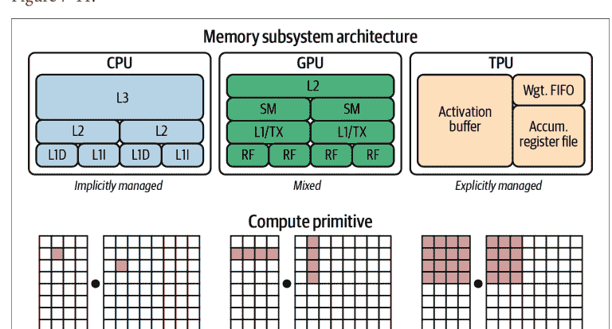

图 7-11. CPU、GPU 和 TPU 的不同计算原语和内存布局。来源：改编自 Chen 等人的图像。43

43 Tianqi Chen, Thierry Moreau, Ziheng Jiang, Lianmin Zheng, Eddie Yan, Meghan Cowan, Haichen Shen, et al., “TVM：深度学习的自动化端到端优化编译器”，arXiv，2018 年 2 月 12 日，https://oreil.ly/vGnkW.

这个过程也称为 *降低*，即你将高级框架代码“降低”为低级硬件原生代码。它不是翻译，因为两者之间没有一一映射关系。

高级 IR 通常是你的机器学习模型的计算图。计算图是一个描述计算执行顺序的图。感兴趣的读者可以阅读 PyTorch 和 TensorFlow 中的计算图。

### 模型优化

在你将代码“降低”以在所选硬件上运行模型之后，你可能会遇到性能问题。生成的机器代码可能能够在硬件后端上运行，但可能无法高效运行。生成的代码可能无法利用数据局部性和硬件缓存，也可能无法利用诸如向量或并行操作等高级特性来加速代码。

典型的机器学习工作流程包含许多框架和库。例如，你可能使用 pandas/dask/ray 从数据中提取特征。你可能使用 NumPy 进行向量化。你可能使用像 Hugging Face 的 Transformers 这样的预训练模型来生成特征，然后使用由 sklearn、TensorFlow 或 LightGBM 等各种框架构建的模型集成来进行预测。

尽管这些框架中的单个函数可能已得到优化，但在框架之间几乎没有优化。以一种朴素的方式在这些函数之间移动数据进行计算可能会导致整个工作流程慢一个数量级。斯坦福 DAWN 实验室的研究人员发现，使用 NumPy、pandas 和 TensorFlow 的典型机器学习工作负载在单线程中运行速度比手工优化的代码慢 23 倍。⁴⁵

在许多公司，通常会发生的情况是，数据科学家和机器学习工程师开发的模型在开发中似乎运行良好。然而，当这些模型部署后，它们被证明太慢，因此他们的公司会聘请优化工程师为模型运行的硬件优化模型。以下是 Mythic 优化工程师职位描述的示例：

这一愿景在 AI 工程团队中得以实现，我们的专业知识用于开发针对我们硬件优化的 AI 算法和模型，并为 Mythic 的硬件和编译器团队提供指导。

AI 工程团队通过以下方式对 Mythic 产生重大影响：
- 开发量化与鲁棒性 AI 再训练工具
- 研究利用神经网络适应性的编译器新特性
- 开发针对我们硬件产品优化的新神经网络
- 与内部和外部客户对接以满足其开发需求

优化工程师难觅且聘用成本高昂，因为他们需要在机器学习和硬件架构方面都具备专业知识。优化编译器（同时优化你的代码的编译器）是一种替代方案，因为它们可以自动化模型优化过程。在将机器学习模型代码降低为机器代码的过程中，编译器可以查看你的机器学习模型的计算图及其包含的操作符——卷积、循环、交叉熵——并找到加速的方法。

有两种优化机器学习模型的方法：局部和全局。局部是指优化模型的一个操作符或一组操作符。全局是指端到端优化整个计算图。

有一些标准的局部优化技术已知可以加速模型，其中大多数使事物并行运行或减少芯片上的内存访问。以下是四种常见技术：

### 向量化

给定一个循环或嵌套循环，而不是一次执行一个项目，同时执行内存中连续的多个元素，以减少数据 I/O 引起的延迟。

### 并行化

给定一个输入数组（或 n 维数组），将其划分为不同的、独立的工作块，并在每个块上单独执行操作。


## 图优化

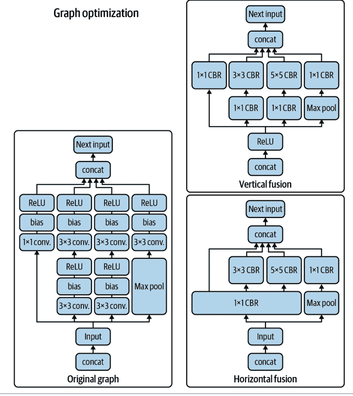

图 7-14. 卷积神经网络计算图的垂直与水平融合。来源：改编自 TensorRT 团队的一张图片。48

48 Shashank Prasanna、Prethvi Kashinkunti 和 Fausto Milletari，“TensorRT 3：更快的 TensorFlow 推理与 Volta 支持”，NVIDIA Developer，2017 年 12 月 4 日，https://oreil.ly/d9h98。CBR 代表“卷积、偏置和 ReLU”。

## 使用机器学习优化机器学习模型

正如上一节通过卷积神经网络的垂直与水平融合所提示的，执行给定的计算图有许多可能的方式。例如，给定三个算子 A、B 和 C，你可以将 A 与 B 融合，将 B 与 C 融合，或者将 A、B、C 三者一起融合。

传统上，框架和硬件供应商会聘请优化工程师，他们根据自身经验，针对如何最好地执行模型的计算图提出启发式方法。例如，NVIDIA 可能有某个工程师或一个工程师团队，专门专注于如何让 ResNet-50 在他们的 DGX A100 服务器上运行得飞快。49

手工设计的启发式方法有几个缺点。首先，它们不是最优的。无法保证工程师提出的启发式方法是最佳解决方案。其次，它们是非自适应的。在新的框架或新的硬件架构上重复这一过程需要耗费巨大的精力。

模型优化依赖于其计算图所包含的算子，这一事实使问题变得更加复杂。优化卷积神经网络不同于优化循环神经网络，也不同于优化 Transformer。像 NVIDIA 和 Google 这样的硬件供应商专注于针对其硬件优化 ResNet-50 和 BERT 等热门模型。但如果你作为机器学习研究者提出了一个新的模型架构呢？你可能需要自己优化它，以便在硬件供应商采用并优化之前，先证明它是快的。

如果你没有好的启发式方法，一种可能的解决方案是尝试所有执行计算图的方式，记录它们运行所需的时间，然后选出最佳方案。然而，考虑到可能路径的数量是组合级的，穷尽所有路径将是难以处理的。幸运的是，近似求解难以处理的问题正是机器学习所擅长的。如果我们用机器学习来缩小搜索空间，这样我们就不必探索那么多路径，并预测一条路径将花费多长时间，这样我们就不必等待整个计算图执行完毕，那会怎样？

事实证明，估计一条路径通过计算图所需的运行时间是很困难的，因为这需要对该图做出很多假设。将注意力集中在图的一小部分上要容易得多。

49 这也是为什么你不应该过度解读基准测试结果（例如 MLPerf 的结果）。一个热门模型在某类硬件上运行得很快，并不意味着任意模型都能在该硬件上运行得很快。也许只是该模型被过度优化了。

一种更有前景的方法是 WebAssembly（WASM）。WASM 是一种开放标准，允许你在浏览器中运行可执行程序。当你在 scikit-learn、PyTorch、TensorFlow 或你使用的任何框架中构建好模型后，你可以不将模型编译到特定硬件上运行，而是将模型编译为 WASM。你会得到一个可执行文件，可以直接与 JavaScript 一起使用。

WASM 是我在过去几年中看到的最令人兴奋的技术趋势之一。它性能优异、易于使用，并且拥有一个正在如火如荼增长的生态系统。51 截至 2021 年 9 月，全球 93% 的设备都支持它。52

WASM 的主要缺点是，由于 WASM 在浏览器中运行，因此速度较慢。即使 WASM 已经比 JavaScript 快得多，但与在设备上原生运行代码（例如 iOS 或 Android 应用）相比仍然很慢。Jangda 等人的一项研究表明，编译为 WASM 的应用程序运行速度比原生应用程序平均慢 45%（在 Firefox 上）到 55%（在 Chrome 上）。53

## 总结

恭喜你完成了本书中可能是最技术性的章节之一！这一章之所以技术性强，是因为部署机器学习模型是一项工程挑战，而不是机器学习挑战。

我们讨论了部署模型的不同方式，比较了在线预测与批量预测，以及边缘机器学习与云端机器学习。每种方式都有各自的挑战。在线预测使你的模型对用户不断变化的偏好响应更快，但你必须担心推理延迟。批量预测是一种变通方案，适用于模型生成预测耗时过长的情况，但它会降低模型的灵活性。

类似地，在云端进行推理易于设置，但网络延迟和云成本会使其变得不切实际。在边缘进行推理则要求边缘设备具备足够的计算能力、内存和电池。

然而，我相信这些挑战大多源于机器学习模型运行所依赖的硬件限制。随着硬件变得更强大，并且针对机器学习进行优化，我相信机器学习系统将转向在设备上执行在线预测，如图 7-16 所示。

51 Wasmer，https://oreil.ly/dTRxr；Awesome Wasm，https://oreil.ly/hlIFb。

52 我可以用 ____ 吗？，https://oreil.ly/sli05。

53 Abhinav Jangda、Bobby Powers、Emery D. Berger 和 Arjun Guha，《没那么快：分析 WebAssembly 与原生代码的性能》，USENIX，https://oreil.ly/uVzrX。

## 数据分布偏移与监控

让我们从一位高管告诉我的故事开始这一章，许多读者可能都会有共鸣。大约两年前，他的公司聘请了一家咨询公司来开发一个机器学习模型，以帮助他们预测下周每种杂货商品需要多少，以便他们据此补货。这家咨询公司花了六个月时间开发该模型。当咨询公司移交模型后，他的公司部署了它，并且对其性能非常满意。他们终于可以向投资者吹嘘，他们是一家由人工智能驱动的公司了。

然而，一年后，他们的业绩下滑了。某些商品的需求一直被高估，导致多余的商品过期。同时，某些商品的需求一直被低估，导致销售损失。¹ 最初，他的库存团队手动修改模型的预测，以纠正他们注意到的这些模式，但最终模型的预测变得非常糟糕，以至于他们再也无法使用它。他们有三个选择：支付同一家咨询公司高得离谱的费用来更新模型，支付另一家咨询公司更多的费用（因为这家公司需要时间才能熟悉情况），或聘请内部团队来持续维护模型。

1 这似乎是库存预测中相当常见的模式。Eugene Yan 在他 2021 年的文章《部署机器学习后鲜为人知的 6 大挑战》中写了一个类似的故事，用以说明退化反馈循环的问题。

如果你得到的翻译不正确，这并不一定是系统故障，因为准确度预期允许一定的误差。然而，如果你不断向系统输入不同的英文句子，却不断得到错误的翻译，那么第二个预期就被违反了，这就构成了系统故障。

运维期望违背更容易检测，因为它们通常伴随着运维中断，例如超时、网页上的 404 错误、内存不足错误或分段错误。然而，机器学习性能期望违背更难检测，因为这样做需要测量和监控生产环境中机器学习模型的性能。在前面的英法机器翻译系统示例中，如果我们不知道正确翻译应该是什么，就很难检测返回的翻译在 99% 的情况下是否正确。有无数用户在使用谷歌翻译的糟糕错误翻译，因为他们并不知道这些是错误翻译。因此，我们说机器学习系统常常静默失败。

为了有效检测并修复生产环境中的机器学习系统故障，有必要理解一个模型在开发期间被证明运行良好之后，为什么会在生产环境中失败。我们将考察两类故障：软件系统故障和机器学习特有的故障。

## 软件系统故障

软件系统故障是指那些即使不是机器学习系统也会发生的故障。以下是一些软件系统故障的例子：

- 依赖故障

你的系统所依赖的某个软件包或代码库崩溃，导致你的系统崩溃。当依赖由第三方维护时，这种故障模式很常见；如果维护该依赖的第三方已不存在，则尤其常见。²

- 部署故障

由部署错误引起的故障，例如你意外部署了模型旧版本的二进制文件而不是当前版本，或者你的系统没有读取或写入某些文件的正确权限。

2 这也是为什么许多公司对使用初创公司的产品犹豫不决、许多公司更偏好开源软件的原因之一。当你使用的产品不再由其创建者维护时，如果该产品是开源的，至少你还能访问代码库并自行维护。


错误的模型版本，或应用界面中迫使用户改变行为的缺陷。

由于这是一种影响几乎所有机器学习模型的错误模式，我们将在第 237 页的“数据分布偏移”一节中详细讨论。

## 边缘案例

想象一下，如果有一辆自动驾驶汽车，99.99% 的时间都能安全驾驶，但另外 0.01% 的时间可能会发生灾难性事故，导致你终身残疾甚至死亡。¹⁰ 你会使用这辆车吗？

如果你想说不会，你不是一个人。一个在大多数情况下表现良好，但在少数情况下失败，且这些失败会导致灾难性后果的机器学习模型，可能并不可用。因此，主要的自动驾驶汽车公司都在专注于让他们的系统能够处理边缘案例。¹¹

边缘案例是指那些极端到足以让模型犯下灾难性错误的数据样本。尽管边缘案例通常指来自同一分布的样本，但如果你的模型表现不佳的数据样本数量突然增加，这可能表明底层数据分布发生了偏移。

自动驾驶汽车常被用来说明边缘案例如何阻止机器学习系统的部署。但这同样适用于任何安全关键型应用，如医疗诊断、交通控制、电子发现¹²等。它也适用于非安全关键型应用。想象一个客服聊天机器人，它对大多数请求都能给出合理的回应，但有时会输出令人发指的种族主义或性别歧视内容。这个聊天机器人对任何想使用它的公司来说都是一种品牌风险，因而使其无法使用。

10 这意味着自动驾驶汽车比普通人类驾驶员还要安全一点。截至 2019 年，每年每 100,000 名持证驾驶员中与交通相关的死亡率为 15.8，即 0.0158%（Statista，2021，“1990 年至 2019 年美国每 100,000 名持证驾驶员的死亡率”，https://oreil.ly/w3wYh）。

11 Rodney Brooks，《自动驾驶汽车的边缘情况》，Robots, AI, and Other Stuff，2017 年 6 月 17 日，https://oreil.ly/Nyp4F；Lance Eliot，《那些无尽的边缘或角落情况是否是 AI 自动驾驶汽车的长尾末日》，Forbes，2021 年 7 月 13 日，https://oreil.ly/L2Sbp；Kevin McAllister，《自动驾驶汽车将由模拟和位置数据塑造》，Protocol，2021 年 3 月 25 日，https://oreil.ly/tu8hs。

12 电子发现（e-discovery，electronic discovery）指法律程序中的证据开示，例如诉讼、政府调查或《信息自由法》请求，其中所寻求的信息以电子格式存在。

## 边缘案例与离群值

你可能想知道离群值和边缘案例之间的区别。边缘案例的定义因学科而异。在机器学习中，由于其在生产环境中的近期采用，边缘案例仍在被发现，这使得它们的定义存在争议。

在本书中，离群值指的是数据：一个与其他样本差异显著的样本。边缘案例指的是性能：一个模型在其上表现明显差于其他样本的样本。离群值可能导致模型表现异常糟糕，从而使其成为边缘案例。然而，并非所有离群值都是边缘案例。例如，一个人在高速公路上乱穿马路是离群值，但如果你的自动驾驶汽车能够准确检测到那个人并适当地决定运动响应，那它就不是边缘案例。

在模型开发过程中，离群值会对模型的性能产生负面影响，如图 8-1 所示。在许多情况下，移除离群值可能是有益的，因为这有助于模型学习更好的决策边界，并能更好地泛化到未见过的数据。然而，在推理时，你通常无法选择移除或忽略与其他查询差异很大的查询。你可以选择对其进行转换——例如，当你在谷歌搜索中输入“mechin learnin”时，谷歌可能会询问你是不是指“machine learning”。但更有可能的是，你会希望开发一个模型，即使在意外输入上也能表现良好。

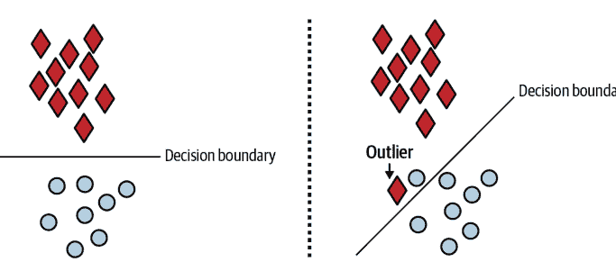

图 8-1. 左图显示没有离群值时的决策边界。右图显示存在一个离群值时的决策边界，它与第一种情况的决策边界有很大不同，并且可能不那么准确。

## 退化反馈回路

在第 91 页的“自然标签”一节中，我们将反馈回路定义为从预测显示到收到预测反馈所需的时间。该反馈可用于提取自然标签，以评估模型的性能并训练模型的下一迭代。

当预测本身影响反馈，进而影响模型的下一迭代时，就可能发生退化反馈回路。更正式地说，当系统的输出被用于生成系统的未来输入，而这些输入又反过来影响系统的未来输出时，就产生了退化反馈回路。在机器学习中，系统的预测会影响用户与系统的交互方式，而由于用户与系统的交互有时会被用作用同一系统的训练数据，因此退化反馈回路可能发生并导致意想不到的后果。退化反馈回路在具有来自用户的自然标签的任务中尤其常见，例如推荐系统和广告点击率预测。

为了让这一点更具体，假设你构建了一个系统，向用户推荐他们可能喜欢的歌曲。系统排名高的歌曲会首先展示给用户。因为它们首先展示，用户点击的次数更多，这让系统更加确信这些推荐是好的。起初，两首歌曲 A 和 B 的排名可能只有细微差别，但由于 A 原本排名略高，它在推荐列表中的位置也就更高，使用户更多点击 A，这让系统将 A 排得更高。一段时间后，A 的排名变得远高于 B 的排名。¹³ 退化反馈回路是热门电影、书籍或歌曲越来越受欢迎的原因之一，这也使得新作品难以进入热门榜单。这类场景在生产中非常常见，并且被大量研究。它有许多不同的名称，包括“曝光偏差”、“流行度偏差”、“过滤气泡”，有时还有“回音室”。

下面是另一个例子，以说明退化反馈回路的危险性。假设你构建了一个简历筛选模型，用来预测某个简历是否符合工作要求。模型发现特征 X 能准确预测某人是否合格，因此它推荐具有特征 X 的简历。你可以用“毕业于斯坦福”、“在谷歌工作”或“性别为男性”等特征替换 X。招聘人员只面试模型推荐的简历，这意味着他们只面试具有特征 X 的候选人，也意味着公司只雇佣具有特征 X 的候选人。这反过来让模型对特征 X 赋予更大的权重。¹⁴ 深入了解你的模型如何做出

13 Ray Jiang, Silvia Chiappa, Tor Lattimore, András György, and Pushmeet Kohli，《推荐系统中的退化反馈回路》，arXiv，2019 年 2 月 27 日，https://oreil.ly/b9G7o。

14 这与“幸存者偏差”有关。

如果预测显示的位置以任何方式影响其反馈，你可能希望使用*位置特征*来编码位置信息。位置特征可以是数值型的（例如，位置为 1、2、3……），也可以是布尔型的（例如，预测是否显示在第一位）。请注意，“位置特征”不同于第 5 章提到的“位置嵌入”。

下面是一个展示如何使用位置特征的简单例子。在训练期间，你将“歌曲是否被推荐到第一位”作为一个特征添加到训练数据中，如表 8-1 所示。这个特征允许你的模型了解作为顶级推荐对歌曲被点击概率的影响程度。

### 表 8-1. 向训练数据添加位置特征以缓解退化反馈回路

| ID | 歌曲 | 风格 | 年份 | 艺术家 | 用户 | 第一位 | 点击 |
|---|---|---|---|---|---|---|---|
| 1 | Shallow | 流行 | 2020 | Lady Gaga | listenr32 | False | 否 |
| 2 | Good Vibe | 放克 | 2019 | Funk Overlord | listenr32 | False | 否 |
| 3 | Beat It | 摇滚 | 1989 | Michael Jackson | fancypants | False | 否 |
| 4 | In Bloom | 摇滚 | 1991 | Nirvana | fancypants | True | 是 |
| 5 | Shallow | 流行 | 2020 | Lady Gaga | listenr32 | True | 是 |

在推理时，你希望预测用户是否会点击一首歌曲，而不管歌曲被推荐的位置如何，因此你可能希望将“第一位”特征设置为 False。然后，你查看模型对每个用户的各种歌曲的预测，并可以选择每首歌的展示顺序。

这是一个简单的例子，因为单靠这一点可能不足以对抗退化反馈回路。更复杂的方法是使用两个不同的模型。第一个模型预测用户看到并考虑某个推荐的概率，同时考虑该推荐将显示的位置。然后，第二个模型在给定用户看到并考虑该项目的情况下，预测用户点击该项目的概率。第二个模型完全不涉及位置。


P(Y|X) 表示给定输入的输出的条件概率——例如，给定邮件内容时邮件为垃圾邮件的概率。P(X) 表示输入的概率密度。P(Y) 表示输出的概率密度。标签偏移、协变量偏移和概念漂移定义如下：

## 协变量偏移

当 P(X) 发生变化但 P(Y|X) 保持不变时。这指的是联合分布的第一次分解。

## 标签偏移

当 P(Y) 发生变化但 P(X|Y) 保持不变时。这指的是联合分布的第二次分解。

## 概念漂移

当 P(Y|X) 发生变化但 P(X) 保持不变时。这指的是联合分布的第一次分解。21

如果你觉得这很令人困惑，不要惊慌。我们将在下一节中通过示例来说明它们的区别。

## 协变量偏移

协变量偏移是数据分布偏移中最受广泛研究的几种形式之一。22 在统计学中，协变量是一个独立变量，它可以影响给定统计试验的结果，但并非直接感兴趣的对象。假设你正在进行一项实验来确定位置如何影响房价。房价变量是你直接感兴趣的，但你知道房屋面积会影响价格，因此房屋面积是一个协变量。在监督式机器学习中，标签是直接感兴趣的变量，而输入特征是协变量。

从数学上讲，协变量偏移是指 P(X) 发生变化，但 P(Y|X) 保持不变，这意味着输入的分布发生变化，但给定输入的输出的条件概率保持不变。

使之具体化，考虑检测乳腺癌的任务。你知道 40 岁以上女性的乳腺癌风险更高，23 因此你将变量“age”作为输入。你在训练数据中可能有比推理数据中更多的 40 岁以上女性，因此训练数据和推理数据的输入分布不同。然而，对于给定年龄的示例，例如 40 岁以上，the

21 你可能会想，P(X|Y) 发生变化但 P(Y) 保持不变的情况如何，就像第二次分解那样。我从未在这个设定下遇到过任何研究。我询问了几位专门研究数据偏移的研究人员，他们也告诉我这个设定研究起来太困难了。

22 Wouter M. Kouw 和 Marco Loog，《An Introduction to Domain Adaptation and Transfer Learning》，arXiv，2018 年 12 月 31 日，https://oreil.ly/VKSVP。

23 “Breast Cancer Risk in American Women”，National Cancer Institute，https://oreil.ly/BFP3U。

## 概念漂移

概念漂移，也称为后验偏移，是指输入分布保持不变但给定输入的输出条件分布发生变化的情况。你可以将其理解为“相同输入，不同输出”。假设你负责一个根据房屋特征预测房价的模型。在 COVID-19 之前，三居室的旧金山公寓可能价值 $2,000,000。然而，在 COVID-19 开始时，许多人离开了旧金山，因此同一套公寓只值 $1,500,000。因此，即使房屋特征的分布保持不变，给定其特征的房屋价格的条件分布也发生了变化。

在许多情况下，概念漂移是循环的或季节性的。例如，拼车价格在工作日和周末之间会波动，机票价格在假日季节会上涨。公司可能有不同的模型来应对循环和季节性漂移。例如，他们可能有一个模型来预测工作日的拼车价格，另一个模型用于周末。

## 一般数据分布偏移

现实世界中还有其他类型的变化，尽管在研究中没有得到充分研究，但仍可能降低模型的性能。

其中之一是特征变化，例如当添加新特征、删除旧特征或特征的所有可能取值集合发生变化时。28 例如，你的模型曾使用年份作为“age”特征，但现在使用月份，因此该特征值的范围发生了漂移。有一次，我们的团队意识到我们的模型性能骤降，因为管道中的一个错误导致某个特征变成了 NaNs（“not a number”的缩写）。

标签模式变化是指 Y 的可能取值集合发生变化。与标签偏移相比，P(Y) 发生变化但 P(X|Y) 保持不变。与标签模式变化相比，P(Y) 和 P(X|Y) 都发生变化。模式描述了数据的结构，因此任务的标签模式描述了该任务标签的结构。例如，将类映射到整数值的字典，例如 {“POSITIVE”: 0, “NEGATIVE”: 1}，就是一个模式。

28 你可以将其视为 P(X) 和 P(Y|X) 都发生变化的情况。

对于回归任务，标签模式变化可能是由于标签值的可能范围发生变化而发生的。想象一下，你正在构建一个模型来预测某人的信用评分。最初，你使用的是范围从 300 到 850 的信用评分系统，但你切换到范围从 250 到 900 的新系统。

对于分类任务，标签模式变化可能是因为你有新的类别。例如，假设你正在构建一个用于诊断疾病的模型，并且有一种新疾病需要诊断。类别也可能变得过时或更细粒度。想象一下，你负责一个用于分析提及你品牌的推文的情感分析模型。最初，你的模型只预测三个类别：POSITIVE、NEGATIVE 和 NEUTRAL。然而，你的市场部门意识到最具破坏性的推文是愤怒的推文，因此他们希望将 NEGATIVE 类拆分为两个类别：SAD 和 ANGRY。原本有三个类别，现在你的任务有四个类别。当类别数量发生变化时，你的模型结构可能会发生变化，29 你可能需要重新标记数据并从头开始重新训练模型。标签模式变化在高基数任务中尤其常见——即类别数量较多的任务，例如产品或文档分类。

没有规定一次只能发生一种类型的偏移。模型可能同时遭受多种类型的漂移，这使得处理起来困难得多。

## 检测数据分布偏移

数据分布偏移只有在导致模型性能下降时才成为问题。因此第一个想法可能是监控模型在生产环境中的准确性相关指标——accuracy、F1 score、recall、AUC-ROC 等——以查看它们是否发生变化。这里的“变化”通常意味着“下降”，但如果我的模型准确率突然上升或在没有我所知原因的情况下显著波动，我会想要调查。

准确性相关指标通过将模型的预测与真实标签进行比较来工作。30 在模型开发期间，你可以访问标签，但在生产环境中，你并不总是可以访问标签，即使可以，标签也会延迟，如第 91 页“Natural Labels”一节所述。在合理的时间窗口内访问标签将极大地帮助你了解模型的性能。

29 如果你使用神经网络并使用 softmax 作为分类任务的最后一层，则该 softmax 层的维度是 [number_of_hidden_units × number_of_classes]。当类别数量发生变化时，softmax 层中的参数数量也会发生变化。

30 如果你使用无监督学习方法，则不需要真实标签，但当今绝大多数应用都是监督的。

| 检测器 | 表格 | 图像 | 时间序列 | 文本 | 分类特征 | 在线 | 特征级别 |
|---|---|---|---|---|---|---|---|
| Kolmogorov-Smirnov | ✓ | ✓ |  | ✓ | ✓ |  | ✓ |
| Cramér-von Mises | ✓ | ✓ |  |  |  | ✓ | ✓ |
| Fisher's Exact Test | ✓ |  |  |  | ✓ | ✓ | ✓ |
| Maximum Mean Discrepancy (MMD) | ✓ | ✓ |  | ✓ | ✓ | ✓ |  |
| Learned Kernel MMD | ✓ | ✓ |  | ✓ | ✓ |  |  |
| Context-aware MMD | ✓ | ✓ | ✓ | ✓ | ✓ |  |  |
| Least-Squares Density Difference | ✓ | ✓ |  | ✓ | ✓ | ✓ |  |
| Chi-Squared | ✓ |  |  |  | ✓ |  | ✓ |
| Mixed-type tabular data | ✓ |  |  |  | ✓ |  | ✓ |
| Classifier | ✓ | ✓ | ✓ | ✓ | ✓ |  |  |
| Spot-the-diff | ✓ | ✓ | ✓ | ✓ | ✓ |  | ✓ |
| Classifier Uncertainty | ✓ | ✓ | ✓ | ✓ | ✓ |  |  |
| Regressor Uncertainty | ✓ | ✓ | ✓ | ✓ | ✓ |  |  |

图 8-2. Alibi Detect 中实现的某些漂移检测算法。来源：项目 GitHub 仓库的屏幕截图

## 检测偏移的时间尺度窗口

并非所有类型的偏移都相等——有些比其他更难检测。例如，偏移以不同的速率发生，突然变化比缓慢的渐变更容易检测。37 偏移还可以在两个维度上发生：空间或时间。空间偏移是在访问点之间发生的偏移，例如你的应用程序获得了新用户群体或你的应用程序现在在不同类型的设备上提供服务。时间偏移是随时间发生的偏移。为了检测时间偏移，一种常见的方法是将机器学习应用程序的输入数据视为时间序列数据。38

37 Manuel Baena-García、José del Campo-Ávila、Raúl Fidalgo、Albert Bifet、Ricard Gavaldà 和 Rafael Morales-Bueno，《Early Drift Detection Method》，2006 年，https://oreil.ly/Dnv0s。

38 Nandini Ramanan、Rasool Tahmasbi、Marjorie Sayer、Deokwoo Jung、Shalini Hemachandran 和 Claudionor Nunes Coelho Jr.，《Real-time Drift Detection on Time-series Data》，arXiv，2021 年 10 月 12 日，https://oreil.ly/xmdqW。


## 应对数据分布漂移

企业如何应对数据漂移，取决于其机器学习基础设施的成熟度。在这个光谱的一端，有些公司刚刚开始使用机器学习，仍在努力将模型投入生产，因此他们可能还没有达到数据漂移会造成灾难性后果的阶段。然而，在未来的某个时间点——也许是三个月，也许是六个月——他们可能会意识到最初部署的模型已经退化到弊大于利的地步。这时，他们就需要让模型适应发生漂移的数据分布，或者用其他解决方案取而代之。

与此同时，许多公司认为数据漂移不可避免，因此他们会定期重新训练模型——每月一次、每周一次，甚至每天一次——而不论漂移的程度如何。如何确定重新训练模型的最佳频率，是一个重要的决策，但许多公司仍然是凭直觉，而不是依据实验数据来决定的。[^41]我们将在第9章详细讨论重新训练的频率。

要让模型在生产环境中适应新的数据分布，主要有三种方法。第一种是目前研究领域占主导地位的方法：使用海量数据集训练模型。这里的希望是，如果训练数据集足够大，模型就能学到足够全面的数据分布，以至于模型在生产环境中遇到的任何数据点都很可能来自这个分布。

第二种方法在研究领域不太流行，是在无需新标签的情况下，让已训练的模型适应目标分布。Zhang等人（2013）利用因果解释以及条件分布和边际分布的核嵌入，在无需目标分布标签的情况下，同时纠正模型在协变量漂移和标签漂移下的预测。[^42]类似地，Zhao等人（2020）提出了域不变表示学习：一种无监督的域自适应技术，可以学习对不断变化的数据分布不变的表示。[^43]然而，这一研究领域探索得还远远不够，也尚未在工业界得到广泛应用。[^44]

第三种方法也是当今工业界通常采用的做法：使用目标分布中带标签的数据重新训练模型。然而，重新训练模型并非那么简单。重新训练可能意味着在旧数据和新数据上都从头开始训练模型，或者在现有模型的基础上继续用新数据训练。后一种方法也称为微调。

如果你想重新训练模型，会遇到两个问题。第一，是从头开始训练模型（无状态重训），还是从最近的检查点继续训练（有状态重训）？第二，使用哪些数据：是过去24小时的数据、上一周的数据、过去6个月的数据，还是从数据开始漂移时的数据？你可能需要运行实验来确定哪种重新训练策略最适合你。[^45]

在本书中，我们用“重新训练”来统称从头训练和微调。我们将在下一章详细讨论重新训练策略。

熟悉数据漂移文献的读者可能会经常看到数据漂移与域自适应和迁移学习一起被提及。如果你把一种数据分布看作一个域，那么如何让你的模型适应新分布的问题，就类似于如何让你的模型适应不同域的问题。

同样，如果你把学习联合分布 P(X, Y) 视为一项任务，那么让一个在某种联合分布上训练的模型适应另一种联合分布，就可以被界定为一种迁移学习。如第4章所讨论的，迁移学习指的是一类方法，其中为某个任务开发的模型被复用为另一个任务模型的起点。区别在于，对于迁移学习，你不会为第二个任务从头重新训练基础模型。然而，为了让模型适应新分布，你可能确实需要从头重新训练模型。

应对数据分布漂移并不一定非要等到漂移发生之后才开始。也可以设计你的系统，使其对漂移更加鲁棒。一个系统使用多个特征，而不同的特征以不同的速率漂移。假设你在构建一个模型来预测用户是否会下载某个应用。你可能会忍不住把该应用在应用商店中的排名作为一个特征，因为排名越靠前的应用往往被下载得越多。然而，应用排名变化非常快。你可能希望将每个应用的排名分桶归入大致类别，例如前10名、11到100名、101到1000名、1001到10000名，以此类推。与此同时，应用类别的变化频率可能要低得多，但它们对预测用户是否会下载该应用的能力可能也较弱。在为模型选择特征时，你可能需要考虑特征性能与特征稳定性之间的权衡：某个特征可能对准确率非常有利，但会很快失效，从而迫使你更频繁地训练模型。

你可能还想设计你的系统，使其更容易适应漂移。例如，旧金山等大城市的房价可能比亚利桑那州农村地区的房价变化得快得多，因此服务于亚利桑那州农村地区的房价预测模型可能不需要像服务旧金山的模型那样频繁更新。如果你用同一个模型来服务这两个市场，你就必须使用两个市场的数据，按照旧金山所要求的速度更新模型。然而，如果你为每个市场使用单独的模型，就可以只在必要时更新它们。

在进入下一节之前，我想重申一点：并非生产中模型的所有性能下降都需要用机器学习解决方案来解决。今天的许多机器学习故障仍然是由人为错误造成的。如果你的模型故障是由人为错误引起的，你需要先找到这些错误并加以修复。检测数据漂移很难，但确定漂移的原因可能更难。

## 监控与可观测性

随着工业界意识到机器学习系统中可能出现的各种问题，许多公司开始为其生产环境中的机器学习系统投入监控与可观测性建设。

监控和可观测性有时被混用，但它们是不同的。监控指的是跟踪、测量和记录各种指标，以帮助我们判断何时出了问题。可观测性则是指以某种方式设置我们的系统，使我们能深入了解系统内部，从而帮助调查出了什么问题。以这种方式设置系统的过程也被称为“仪器化”。仪器化的例子包括：给函数添加计时器、统计特征中的 NaN、跟踪输入在系统中的转换过程、记录异常事件（如超长输入）等。可观测性是监控的一部分。没有一定程度的可观测性，监控是不可能实现的。

监控的核心是指标。由于机器学习系统是软件系统，你首先需要监控的一类指标是运维指标。这些指标旨在反映系统的健康状况。它们通常分为三个层级：系统运行所依赖的网络、系统运行所在的机器，以及系统运行的应用程序。这些指标的示例包括：延迟；吞吐量；模型在最近一分钟、一小时、一天内收到的预测请求数量；返回 2xx 状态码的请求百分比；CPU/GPU 利用率；内存利用率等。无论你的机器学习模型有多好，如果系统宕机了，你都无法从中获益。

让我们看一个例子。生产环境中的软件系统最重要的特性之一是可用性——系统能够持续向用户提供合理性能的频率。这个特性由正常运行时间衡量，即

[^41]: 正如早期审阅者 Han-chung Lee 所指出的，这也是因为小公司没有足够的模型数据。当你没有大量数据时，基于时间的固定方案要比让你的方案过度拟合不足的数据更好。

[^42]: Kun Zhang, Bernhard Schölkopf, Krikamol Muandet, and Zhikun Wang, "Domain Adaptation under Target and Conditional Shift," Proceedings of the 30th International Conference on Machine Learning (2013), https://oreil.ly/C123l.

[^43]: Han Zhao, Remi Tachet Des Combes, Kun Zhang, and Geoffrey Gordon, "On Learning Invariant Representations for Domain Adaptation," Proceedings of Machine Learning Research 97 (2019): 7523–32, https://oreil.ly/W78hH.

[^44]: Zachary C. Lipton, Yu-Xiang Wang, and Alex Smola, "Detecting and Correcting for Label Shift with Black Box Predictors," arXiv, February 12, 2018, https://oreil.ly/zKSJj.

[^45]: 一些监控供应商声称，他们的解决方案不仅能检测出你的模型何时应该重新训练，还能检测出应该使用哪些数据进行重新训练。我尚未能验证这些说法的有效性。


系统正常运行的时间百分比。判断系统是否正常运行的条件在服务等级目标（SLOs）或服务等级协议（SLAs）中定义。例如，SLA 可能会规定，如果服务的中间延迟小于 200 ms 且 99 分位延迟低于 2 秒，则认为服务处于正常运行状态。

服务提供商可能会提供一份 SLA 来规定其正常运行时间保证，例如 99.99% 的时间，如果未达到该保证，他们会向客户退款。例如，截至 2021 年 10 月，AWS EC2 服务提供的月度正常运行时间百分比至少为 99.99%（四个九），如果月度正常运行时间百分比低于该值，他们会向您提供服务积分抵扣未来的 EC2 费用。46 99.99% 的月度正常运行时间意味着服务每月只能停机略多于 4 分钟，而 99.999% 则意味着每月仅 26 秒！

然而，对于 ML 系统而言，系统健康状况超出了系统正常运行时间。如果你的 ML 系统处于运行状态但其预测结果毫无价值，你的用户不会满意。你还想监控的另一类指标是 ML 特定指标，它们可以告诉你 ML 模型的健康状况。

## ML-Specific Metrics

在 ML 特定指标中，通常有四种需要监控的产物：模型的准确性相关指标、预测结果、特征和原始输入。这些是在 ML 系统管道的四个不同阶段生成的产物，如图 8-5 所示。产物在管道中越深，经历的转换就越多，这使得该产物中的变化更可能由其中一个转换中的错误引起。然而，产物经历的转换越多，它就变得越结构化，并且越接近你真正关心的指标，这使得监控变得更容易。我们将在以下各节中详细讨论这些产物。

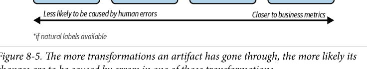

图 8-5. 产物经历的转换越多，其变化越可能由其中一个转换中的错误引起

到目前为止，我们讨论了不同类型的监控指标，从通常用于软件系统的运营指标到有助于跟踪 ML 模型健康状况的 ML 特定指标。在下一节中，我们将讨论可用于帮助指标监控的工具箱。

## Monitoring Toolbox

对复杂系统进行指标测量、跟踪和解释是一项非平凡的任务，工程师依靠一套工具来帮助完成此工作。行业普遍将指标、日志和追踪誉为监控的三大支柱。然而，我认为它们之间的区别很模糊。它们似乎是从监控系统开发者的角度产生的：追踪是一种日志形式，指标可以从日志中计算得出。在本节中，我想从监控系统用户的角度关注工具集：日志、仪表板和警报。

### Logs

传统软件系统依靠日志来记录运行时产生的事件。事件是系统开发者在事件发生时或之后用于调试和分析目的可能感兴趣的任何事物。事件的例子包括容器启动时、它占用的内存量、函数被调用时、该函数运行结束时、该函数调用的其他函数、该函数的输入和输出等。此外，不要忘记记录崩溃、堆栈跟踪、错误代码等。正如 Etsy 的 Ian Malpass 所说，“If it moves, we track it.”⁴⁹ 他们还跟踪尚未发生变化的事物，以防它们以后会发生变化。

日志数量可能非常迅速地变得非常庞大。例如，早在 2019 年，约会应用 Badoo 每天处理 200 亿个事件。⁵⁰ 当出现问题时，你需要查询日志以找到导致问题的事件序列，这个过程可能感觉像是在干草堆里找针。

在软件部署的早期，应用程序可能只是一个单一服务。当发生某事时，你知道它发生在何处。但今天，一个系统可能由许多不同的组件组成：容器、调度器、微服务、多语言持久化、网格路由、临时自动扩展实例、无服务器 Lambda 函数。一个请求从发送到收到响应可能经过 20–30 次跳转。困难的部分可能不在于检测何时发生了问题，而在于问题出在哪里。⁵¹

49 Ian Malpass, “Measure Anything, Measure Everything,” Code as Craft, 2011 年 2 月 15 日, https://oreil.ly/3KF1K.

50 Andrew Morgan, “Data Engineering in Badoo: Handling 20 Billion Events Per Day,” InfoQ, 2019 年 8 月 9 日, https://oreil.ly/qnnuV.

51 Charity Majors, “Observability—A 3-Year Retrospective,” The New Stack, 2019 年 8 月 6 日, https://oreil.ly/Logby.

### Alerts

当我们的监控系统检测到可疑情况时，有必要通知相关人员。警报由以下三个组成部分构成：

### An alert policy

这描述了警报的条件。你可能希望在指标超过阈值时创建警报，可选地持续一定时间。例如，你可能希望在模型的准确率低于 90% 时收到通知，或 HTTP 响应延迟高于一秒且持续至少 10 分钟时收到通知。

### Notification channels

这些描述了在条件满足时应通知谁。警报将显示在你使用的监控服务中，例如 Amazon CloudWatch 或 GCP Cloud Monitoring，但你也希望在他们不在这些监控服务上时联系到负责人员。例如，你可以配置警报发送到诸如 mlops-monitoring@[你的公司电子邮件域名] 的电子邮件地址，或发布到诸如 #mlops-monitoring 的 Slack 频道或 PagerDuty。

### A description of the alert

这有助于被警报的人员了解发生了什么。描述应尽可能详细，例如：

```
## Recommender model accuracy below 90%

${timestamp}: This alert originated from the service ${service-name}
```

根据警报的受众，通常有必要通过提供缓解说明或运行手册（即处理警报可能有帮助的常规程序和操作的汇编）使警报具有可操作性。

警报疲劳是一个真实的现象，如本章前面所述。警报疲劳会令人沮丧——没有人喜欢因为与自己职责无关的事情而在半夜被叫醒。它也非常危险——接触琐碎的警报会使人们对关键警报变得麻木。设定有意义的条件非常重要，这样只有关键警报才会被发出。

## Observability

自 2010 年代中期以来，行业开始采用“可观测性”一词来代替“监控”。监控不对系统内部状态与其输出之间的关系做出任何假设。你监控系统的外部输出以判断系统内部何时出现问题——无法保证外部输出会帮助你弄清楚出了什么问题。

监控以指标为中心，而指标通常是聚合的。可观测性允许更细粒度的指标，因此你不仅可以知道模型的性能何时下降，还可以知道模型对哪些类型的输入、哪些用户子群或在什么时间段内性能下降。例如，你应该能够查询日志来回答诸如：“show me all the users for which model A returned wrong predictions over the last hour, grouped by their zip codes”或“show me the outliers requests in the last 10 minutes”或“show me all the intermediate outputs of this input through the system”等问题。要实现这一点，你需要使用标签和其他标识关键字记录系统的输出，以便日后可沿数据的不同维度对这些输出进行切片和切分。

在 ML 中，可观测性涵盖了解释性。可解释性帮助我们理解 ML 模型的工作原理，而可观测性帮助我们理解整个 ML 系统（包括 ML 模型）的工作原理。例如，当模型在过去一小时内的性能下降时，能够解释哪个特征对过去一小时内所有错误预测的贡献最大，将有助于弄清楚系统出了什么问题以及如何修复它。55

在本节中，我们讨论了监控的多个方面，从监控什么数据、跟踪什么指标到用于监控和可观测性的不同工具。尽管监控是一个强大的概念，但它本质上是被动的。你等待变化发生以便检测到它。监控有助于发现问题但不会纠正它。在下一节中，我们将介绍持续学习，这是一种可以主动帮助你更新模型以应对变化的范式。

## Summary

这可能是我在本书中撰写的最具挑战性的章节。原因在于，尽管理解 ML 系统在生产中如何以及为何失败非常重要，但围绕它的文献却有限。我们通常认为研究先于生产，但这是一个 ML 领域，研究仍在努力追赶生产实践。

为了理解 ML 系统的故障，我们将其分为两种类型：软件系统故障（非 ML 系统也会发生的故障）和 ML 特定故障。尽管今天大多数 ML 故障是非 ML 特定的，但随着 MLOps 周围的工具和基础设施成熟，这可能会改变。

我们讨论了 ML 特定故障的三大主要原因：生产数据与训练数据不同、边缘情况以及退化的反馈循环。前两个原因与数据相关，而最后一个原因与系统设计相关，因为它发生在系统的输出影响同一系统的输入时。


我们聚焦于近年来备受关注的一类失败：数据分布偏移。我们研究了三种偏移类型：协变量偏移、标签偏移和概念漂移。尽管研究分布偏移正在成为机器学习研究中一个不断发展的子领域，但研究社区尚未形成一套标准的叙述。不同的论文对同一现象使用不同的名称。许多研究仍然基于这样的假设：我们事先知道分布将如何偏移，或者同时拥有源分布和目标分布数据的标签。然而，在现实中，我们不知道未来的数据会是什么样子，而获取新数据的标签可能成本高昂、速度缓慢，甚至不可行。

为了能够检测偏移，我们需要监控已部署的系统。监控对于任何生产环境中的软件工程系统（不仅仅是机器学习）来说都是一套重要的实践，而且在这一领域，我们应该尽可能多地从DevOps世界中学习。

监控的核心是指标。我们讨论了需要监控的不同指标：操作性指标——任何软件系统都应监控的指标，如延迟、吞吐量和CPU利用率——以及机器学习特定的指标。监控可以应用于与准确性相关的指标、预测、特征和/或原始输入。

监控之所以困难，是因为即使计算指标成本低廉，理解指标也并非易事。构建仪表盘来展示图表很容易，但理解图表的含义、它是否显示出偏移的迹象，以及如果存在偏移，是源于底层数据分布的变化还是流程中的错误，则要困难得多。要理解这些数字和图表，可能需要统计学知识。

检测生产环境中模型性能的下降只是第一步。下一步是如何让我们的系统适应不断变化的环境，这将在下一章中讨论。

自动化更新。所有这些概念使我们能够设计一个可维护且能适应不断变化环境的机器学习系统。

这是我最兴奋的一章，我希望我也能让你对它感到兴奋！

## 持续学习

当听到“持续学习”时，许多人会想到这样一种训练范式：模型在生产环境中对每个传入样本进行自我更新。实际上很少有公司这样做。

首先，如果你的模型是神经网络，对每个传入样本进行学习会使其容易遭受灾难性遗忘。灾难性遗忘是指神经网络在学习新信息时，完全而突然地遗忘先前所学信息的倾向。[^1]

其次，它会使训练成本更高——如今大多数硬件后端都是为批量处理而设计的，因此一次只处理一个样本会造成巨大的计算能力浪费，并且无法利用数据并行性。

在生产环境中采用持续学习的公司会以微批次的方式更新模型。例如，他们可能每处理512或1024个样本后就更新现有模型——每个微批次中的最佳样本数量取决于具体任务。

更新后的模型在评估之前不应部署。这意味着你不应直接对现有模型进行更改。相反，你应创建现有模型的副本，并在这个副本上基于新数据更新，只有当更新后的副本被证明更好时，才用更新后的副本替换现有模型。现有模型被称为冠军模型，更新后的副本被称为挑战者。这个过程如图9-1所示。为了便于理解，这里对该过程进行了极大的简化。在现实中，一家公司可能同时拥有多个挑战者，而处理失败的挑战者远比简单地丢弃它要复杂得多。

### 术语歧义

我使用“持续学习”而不是“在线学习”，因为当我提到“在线学习”时，人们通常会想到在线教育。如果你在谷歌上输入“在线学习”，靠前的结果很可能是关于在线课程的。

有些人用“在线学习”来指代模型从每个新传入样本中学习的具体情境。在这种情境下，持续学习是在线学习的一种泛化。

我也使用“持续学习”而不是“连续学习”。“连续学习”指的是模型随着每个传入样本不断学习的状态，而“持续学习”则是在一系列批次或微批次中完成学习。

“连续学习”有时也用来指机器学习的持续交付，这与持续学习密切相关，因为两者都能帮助公司加快机器学习模型的迭代周期。然而，不同之处在于，在这种意义上使用的“连续学习”是从DevOps的角度出发，旨在建立持续交付的管道，而“持续学习”则是从机器学习的角度出发。

由于“连续学习”这个术语存在歧义，我希望社区能完全避免使用这个术语。

### 为什么需要持续学习？

我们讨论了持续学习涉及建立基础设施，以便你可以随时按需更新模型并部署这些更改。但为什么你需要能够尽可能快地更新模型的能力呢？

持续学习的第一个用例是应对数据分布偏移，尤其是当偏移突然发生时。假设你在为像Lyft这样的拼车服务构建一个定价模型。[^6] 从历史上看，这个特定社区周四晚上的出行需求较低，因此模型预测的乘车价格较低，这使得司机不太愿意上路。然而，在这个周四晚上，社区里有一场大型活动，出行需求突然激增。如果你的模型无法通过提高价格预测和调动更多司机到该社区来足够快地响应这一变化，乘客将不得不等待很长时间才能乘车，这会导致负面的用户体验。他们甚至可能转向竞争对手，从而让你损失收入。

持续学习的另一个用例是适应罕见事件。假设你为像亚马逊这样的电子商务网站工作。黑色星期五是一个重要的购物活动

前一个阶段的问题已经发展成一个不容忽视的痛点。你的团队决定编写一个脚本来自动执行所有再训练步骤。然后，使用诸如Spark之类的批处理进程定期运行该脚本。

大多数拥有较为成熟机器学习基础设施的公司都处于这个阶段。一些精密的公司会进行实验来确定最佳再训练频率。然而，对于处于这个阶段的大多数公司来说，再训练频率是根据直觉设定的——例如，“每天一次好像差不多”或者“让我们在每晚有空闲计算资源时启动再训练流程”。

在创建脚本来自动化系统的再训练过程时，你需要考虑到系统中的不同模型可能需要不同的再训练计划。例如，考虑一个由两个模型组成的推荐系统：一个模型用于为所有产品生成嵌入，另一个模型用于根据查询对每个产品的相关性进行排序。嵌入模型可能需要再训练的频繁程度远低于排序模型。因为产品的特征不会经常变化，你可能可以每周再训练一次嵌入模型[^24]，而排序模型可能需要每天再训练一次。

如果模型之间存在依赖关系，自动化脚本可能会变得更加复杂。例如，由于排序模型依赖于嵌入，当嵌入发生变化时，排序模型也应该更新。

### 需求

如果你的公司在生产环境中有机器学习模型，那么你的公司很可能已经拥有了自动化再训练所需的大部分基础设施。这个阶段的可行性主要取决于编写一个脚本来自动化工作流程并配置基础设施以自动执行以下操作：

- 拉取数据。
- 如有必要，对此数据进行下采样或上采样。
- 提取特征。
- 处理和/或标注标签以创建训练数据。
- 启动训练过程。
- 评估新训练出的模型。
- 部署它。

编写这个脚本需要多长时间取决于许多因素，包括脚本编写者的能力。然而，总的来说，影响该脚本可行性的三个主要因素是：调度器、数据和模型存储。

[^1]: Joan Serrà, Dídac Surís, Marius Miron, and Alexandros Karatzoglou, “Overcoming Catastrophic Forgetting with Hard Attention to the Task,” arXiv, January 4, 2018, https://oreil.ly/P95EZ.

[^6]: 这类问题也被称为“动态定价”。

[^24]: 如果每天有很多新项目，你可能需要更频繁地训练嵌入模型。


所以在这个阶段，你需要重新配置自动更新脚本，使其在模型更新启动时，首先定位之前的检查点并将其加载到内存中，然后在此检查点上继续训练。

**需求。** 这个阶段最主要的是思维方式的转变：从头重新训练已经成为一种常态——许多公司习惯于数据科学家每次都将模型交给工程师从头部署——因此许多公司没有考虑设置基础设施以实现有状态训练。

一旦你致力于有状态训练，重新配置更新脚本就很直接。这个阶段你主要需要一种跟踪数据和模型血缘关系的方法。想象一下你首先上传模型版本 1.0。该模型使用新数据更新以创建模型版本 1.1，依此类推创建模型 1.2。然后再上传另一个模型并称为模型版本 2.0。该模型使用新数据更新以创建模型版本 2.1。过一段时间后，你可能会有模型版本 3.32、模型版本 2.11、模型版本 1.64。你可能想知道这些模型如何随时间演变，哪个模型被用作其基础模型，以及使用了哪些数据来更新它，以便你可以重现和调试它。据我所知，没有现有的模型存储具有这种模型血缘能力，所以你很可能需要在内部构建解决方案。

如果你想从实时传输中提取新鲜数据而不是从数据仓库中提取，如第 270 页“新鲜数据访问挑战”一节所述，并且你的流式基础设施不够成熟，你可能需要改造你的流式管道。

## 第 4 阶段：持续学习

在第 3 阶段，你的模型仍然基于开发者设定的固定时间表进行更新。找到最佳时间表并不简单，且可能因情况而异。例如，上周市场几乎没有发生什么事，所以你的模型衰减得不快。然而这周发生了很多事件，所以你的模型衰减得更快，需要更快的重新训练时间表。

而不是依赖固定时间表，你可能希望你的模型在数据分布发生变化且模型性能暴跌时自动更新。

圣杯是当你将持续学习与边缘部署结合时。想象一下你可以将基础模型随新设备一起交付——一部手机、一块手表、一架无人机等——该设备上的模型将持续更新并根据需要适应其环境，而无需与中央服务器同步。将不需要中央服务器，这意味着没有中央服务器成本。也无需在设备和云之间传输数据，这意味着更好的数据安全和隐私！

**需求。** 从第 3 阶段到第 4 阶段的转变是陡峭的。你首先需要一种触发模型更新的机制。此触发器可以是：

- *基于时间*
    - 例如，每五分钟一次
- *基于性能*
    - 例如，每当模型性能暴跌时
- *基于数据量*
    - 例如，每当标记数据的总量增加 5% 时
- *基于漂移*
    - 例如，每当检测到主要的数据分布偏移时

为了使此触发机制正常工作，你需要一个可靠的监控解决方案。我们在第 250 页“监控与可观测性”一节中讨论过，困难的部分不在于检测变化，而在于确定哪些变化重要。如果你的监控解决方案产生大量误报，你的模型最终会被更新得比需要更频繁。

你还需要一个可靠的管道来持续评估你的模型更新。编写一个更新模型的函数与你在第 3 阶段所做的并没有太大不同。困难的部分是确保更新后的模型正常工作。我们将在第 281 页“在生产中测试”一节中介绍各种可用的测试技术。

## 多久更新一次你的模型

现在你的基础设施已经设置好可以快速更新模型，你开始提出一个困扰各大公司机器学习工程师的问题：“我应该多久更新一次我的模型？” 在尝试回答这个问题之前，我们首先需要弄清楚模型通过使用新鲜数据更新能获得多少收益。模型能从更新数据中获得的收益越多，就应该越频繁地重新训练。

## 数据新鲜度的价值

如果我们知道模型性能通过更新会提高多少，那么多久更新一次模型的问题就会变得容易得多。例如，如果我们将模型重新训练频率从每月一次改为每周一次，能获得多少性能提升？如果改为每日重新训练呢？人们一直说数据分布会发生变化，所以更新的数据更好，但更新的数据到底好多少？

一种确定收益的方法是使用过去不同时间窗口的数据训练模型，并在今天的数据上评估它以查看性能如何变化。例如，假设你有 2020 年的数据。要衡量数据新鲜度的价值，你可以尝试用 2020 年 1 月至 6 月的数据训练模型版本 A，用 4 月至 9 月的数据训练模型版本 B，用 6 月至 11 月的数据训练模型版本 C，然后在 12 月的数据上测试这三个模型版本，如图 9-5 所示。这些版本性能的差异将让你了解模型能从更新数据中获得的性能提升。如果使用三个月前数据训练的模型远不如使用一个月前数据训练的模型，你就知道不应该等一个季度才重新训练模型。

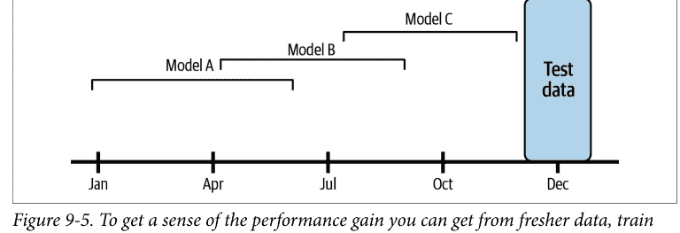

Figure 9-5. 要了解你能从更新数据中获得的性能提升，请在过去不同时间窗口的数据上训练模型，并在今天的数据上测试以查看性能如何变化

这是一个简单的例子来说明数据新鲜度实验的工作原理。实际上，你可能希望你的实验更精细，不以月为单位，而是以周、天、甚至小时或分钟为单位。2014 年，Facebook 对广告点击率预测进行了类似的实验，发现他们可以通过将重新训练频率从每周改为每日，将模型的损失降低 1%，这一性能提升足以让他们将重新训练管道从每周改为每日。25 鉴于今天的在线内容更加多样化且用户在线注意力变化更快，我们可以想象广告点击率的数据新鲜度价值甚至更高。一些拥有复杂机器学习基础设施的公司发现了足够的性能提升，将重新训练管道切换到每隔几分钟一次。26

25 Xinran He, Junfeng Pan, Ou Jin, Tianbing Xu, Bo Liu, Tao Xu, Tanxin Shi, et al., Practical Lessons from Predicting Clicks on Ads at Facebook, in ADKDD '14: Proceedings of the Eighth International Workshop on Data Mining for Online Advertising (August 2014): 1-9, https://oreil.ly/oS16J.

26 Qian Yu, Machine Learning with Flink in Weibo, QCon 2019, video, 17:57, https://oreil.ly/Yia6v.

## 模型迭代与数据迭代

我们在本章前面讨论过，并非所有模型更新都相同。我们区分了模型迭代（向现有模型架构添加新特征或更改模型架构）和数据迭代（相同的模型架构和特征，但你用新数据刷新该模型）。你可能会想知道不仅多久更新模型，还要进行哪种类型的模型更新。

理论上，你可以进行两种类型的更新，实际上，你应该不时地进行两种更新。然而，你在一方面投入的资源越多，就越少资源投入到另一方面。

一方面，如果你发现对数据进行迭代并不能带来太多性能提升，那么你应该将资源花在寻找更好的模型上。另一方面，如果找到更好的模型架构需要 100X 计算量并带来 1% 的性能提升，而用过去三小时的数据更新同一模型仅需 1X 计算量也能带来 1% 的性能提升，那么你最好进行数据迭代。

也许在不久的将来，我们将获得更多理论理解来知道在什么情况下一种方法会更好（提示“呼吁研究”），但截至今天，没有任何书籍能告诉你哪种方法对你的特定模型和特定任务更好。你必须做实验来找出答案。

关于多久更新一次模型的问题很难回答，我希望本节已经充分解释了其细微差别。在开始时，当你的基础设施尚不成熟且更新模型的过程是手动且缓慢时，答案是：尽可能频繁。

然而，随着基础设施的成熟，更新模型的过程部分自动化，可以在数小时甚至数分钟内完成，对这个问题的回答取决于以下问题的答案：“我能从更新数据中获得多少性能提升？” 运行实验来量化数据新鲜度对模型的价值非常重要。

## 在生产中测试

在整本书中，包括本章，我们谈到了部署未充分评估模型的危险。为了充分评估你的模型，你首先需要第 6 章中讨论的离线评估和本节中讨论的在线评估的混合。为了理解为什么离线评估不够，让我们回顾离线评估的两种主要测试类型：测试拆分和回测。


尚未被选中的顶部推荐。31 该团队选拔方法的工作原理可视化如图 9-7 所示。


图 9-7. 使用团队选拔方法交错来自两个排序算法的视频推荐。来源：Parks 等。32

## 赌徒问题

对于不熟悉的人来说，赌徒算法起源于赌博。赌场有多台赔付不同的老虎机。老虎机也被称为“一臂强盗”，因此得名。你不知道哪台老虎机赔付最高。你可以随着时间的推移进行实验，以找出哪台老虎机最好，同时最大化你的赔付。多臂赌徒算法允许你在利用（选择过去赔付最多的老虎机）和探索（选择可能赔付更高的其他老虎机）之间取得平衡。

31 Olivier Chapelle, Thorsten Joachims, Filip Radlinski, and Yisong Yue, “Large-Scale Validation and Analysis of Interleaved Search Evaluation,” ACM Transactions on Information Systems 30, no. 1 (February 2012): 6, https://oreil.by/lccvK.

32 Parks et al., “Innovating Faster on Personalization Algorithms.”

截至今天，在生产环境中测试模型的标准方法是 A/B 测试。通过 A/B 测试，你随机将流量路由到每个模型进行预测，并在试验结束时衡量哪个模型效果更好。A/B 测试是无状态的：你可以在不知道其当前性能的情况下将流量路由到每个模型。即使使用批量预测也可以进行 A/B 测试。

当你有多个模型需要评估时，每个模型都可以被视为一台赔付（即预测准确率）未知的老虎机。赌徒算法允许你确定如何将流量路由到每个模型进行预测，以确定最佳模型，同时最大化用户预测准确率。赌徒算法是有状态的：在将请求路由到模型之前，你需要计算所有模型的当前性能。这需要三件事：

- 你的模型必须能够进行在线预测。
-  preferably 短反馈循环：你需要获得反馈来判断预测是否良好。这通常适用于可以通过用户反馈确定标签的任务，例如推荐——如果用户点击了推荐，则推断为良好。如果反馈循环很短，你可以快速更新每个模型的收益。
- 一个收集反馈、计算并跟踪每个模型性能的机制，并根据其当前性能将预测请求路由到不同模型。

赌徒算法在学术界已被深入研究，并被证明比 A/B 测试数据效率高得多（在许多情况下，赌徒算法甚至是最优的）。赌徒算法需要的数据更少来确定哪个模型最好，同时由于它们能更快地将流量路由到更好的模型，从而降低机会成本。参见 LinkedIn、Netflix、Facebook、Dropbox、Zillow 和 Stitch Fix 上的赌徒算法讨论。欲了解更理论性的观点，请参阅《Reinforcement Learning》第 2 章（Sutton and Barto 2020）。

在 Google 的 Greg Rafferty 进行的一项实验中，A/B 测试需要超过 630,000 个样本才能获得 95% 的置信区间，而一个简单的赌徒算法（Thompson Sampling）则用不到 12,000 个样本就确定了一个模型比另一个模型好 5%。33

然而，赌徒算法比 A/B 测试更难实现，因为它需要计算并跟踪模型的收益。因此，除了少数大型科技公司外，赌徒算法在业界并不广泛使用。

33 Greg Rafferty, “A/B Testing—Is There a Better Way? An Exploration of Multi-Armed Bandits,” Towards Data Science, January 22, 2020, https://oreil.ly/MsaAK.

## MLOps 的基础设施和工具

在第 4 章到第 6 章中，我们讨论了开发 ML 系统的逻辑。在第 7 章到第 9 章中，我们讨论了部署、监控和持续更新 ML 系统的考虑因素。迄今为止，我们一直假设 ML 从业者可以访问实现该逻辑并执行这些考虑所需的所有工具和基础设施。然而，这一假设远非事实。许多数据科学家告诉我，他们知道为自己的 ML 系统应该做什么，但他们做不到，因为他们的基础设施没有以能够让他们做到这一点的方式设置。

ML 系统很复杂。系统越复杂，就越能从良好的基础设施中受益。基础设施如果设置得当，可以帮助自动化流程，减少对专业知识和工程时间的需要。这反过来可以加快 ML 应用的开发和交付，减少错误面，并实现新的用例。然而，如果设置不当，基础设施使用起来会很痛苦且更换成本高昂。在本章中，我们将讨论如何为 ML 系统正确设置基础设施。

在深入之前，重要的是要注意每个公司的基础设施需求都不同。你所需的基础设施取决于你开发的应用数量以及应用的专业化程度。在光谱的一端，你有公司将 ML 用于临时业务分析，例如预测明年新用户数量以在季度规划会议上展示。这些公司可能不需要投资任何基础设施——Jupyter Notebooks、Python 和 Pandas 将是他们的好朋友。如果你只有一个简单的 ML 用例，例如用于向朋友展示的 Android 对象检测应用，你可能也不需要任何基础设施——你只需要像 TensorFlow Lite 这样的 Android 兼容 ML 框架即可。

在光谱的另一端，有一些公司从事具有独特要求的应用程序。例如，自驾车具有独特的准确性和延迟要求——算法必须能够在毫秒内响应，其准确性必须接近完美，因为错误预测可能导致严重事故。同样，Google 搜索具有独特的规模要求，因为大多数公司不像 Google 那样每秒处理 63,000 次搜索查询，这相当于每小时 234 百万次搜索查询。¹ 这些公司很可能需要开发自己高度专业化的基础设施。Google 开发了其搜索内部基础设施的大部分；像 Tesla 和 Waymo 这样的自驾车公司也是如此。² 常见的是，专业化基础设施的一部分后来被公开并被其他公司采用。例如，Google 将其内部云基础设施扩展到公众， resulting in Google Cloud Platform。

在光谱中间的是大多数公司，那些以合理规模为多个常见应用使用 ML 的公司——欺诈检测模型、价格优化模型、流失预测模型、推荐系统等。“合理规模”指的是每天处理数据量在千兆字节和太字节级别，而不是拍字节级别的公司。他们的 数据科学团队可能从 10 人到数百名工程师不等。³ 该类别可能包括从 20 人初创公司到 Zillow 规模的公司，但不包括 FAAAM 规模。⁴ 例如，早在 2018 年，Uber 每天向其数据湖添加数十太字节的数据，而 Zillow 最大的数据集每天带来 2 太字节的未压缩数据。⁵ 相比之下，即使在 2014 年，Facebook 每天产生的数据也达 4 拍字节。⁶

1. Kunal Shah, “This Is What Makes SEO Important for Every Business,” Entrepreneur India, May 11, 2020, https://oreil.ly/teQlX.
2. For a sneak peek into Tesla’s compute infrastructure for ML, I highly recommend watching the recording of Tesla AI Day 2021 on YouTube.
3. The definition for “reasonable scale” was inspired by Jacopo Tagliabue in his paper “You Do Not Need a Bigger Boat: Recommendations at Reasonable Scale in a (Mostly) Serverless and Open Stack,” arXiv, July 15, 2021, https://oreil.ly/YNRZQ. For more discussion on reasonable scale, see “ML and MLOps at a Reasonable Scale” by Ciro Greco (October 2021).
4. FAAAM is short for Facebook, Apple, Amazon, Alphabet, Microsoft.
5. Reza Shiftehfar, “Uber’s Big Data Platform: 100+ Petabytes with Minute Latency,” Uber Engineering, October 17, 2018, https://oreil.ly/6Ykd3; Kaushik Krishnamurthi, “Building a Big Data Pipeline to Process Clickstream Data,” Zillow, April 6, 2018, https://oreil.ly/SGmNe.
6. Nathan Bronson and Janet Wiener, “Facebook’s Top Open Data Problems,” Meta, October 21, 2014, https://oreil.ly/p6QjX.


即使两家公司具有完全相同的<|message|> 基础设施需求，它们的最终基础设施也可能因其在构建与采购决策上的不同做法而有所差异——即它们希望内部构建的内容与希望外包给其他公司的内容。我们将在本章的最后一部分讨论构建与采购决策，在那里我们还将讨论对机器学习基础设施标准化且统一的抽象的期望。

让我们深入了解！

## 存储与计算

ML 系统处理大量数据，这些数据需要在某个地方存储。存储层是数据被收集和存储的地方。在最简单的形式下，存储层可以是硬盘驱动器 (HDD) 或固态驱动器 (SSD)。存储层可以位于一个地方，例如，你可能将所有数据放在 Amazon S3 或在 Snowflake 中，或分散在多个位置。[^8] 你的存储层可以部署在私有数据中心的本地或云上。过去，公司可能会尝试自行管理其存储层。然而，在过去十年中，存储层大多已商品化并迁移到云端。数据存储变得如此便宜，以至于大多数公司只需存储他们拥有的数据而无需考虑成本。[^9] 我们已在第 3 章中深入介绍过数据层，因此在本章中，我们将重点关注计算层。

计算层指的是公司可访问的所有计算资源以及决定这些资源如何使用的机制。可用的计算资源数量决定了工作负载的可扩展性。你可以将计算层视为执行作业的引擎。在最简单的形式下，计算层可以只是一个执行所有计算的单个 CPU 核心或 GPU 核心。其最常见的形式是由云提供商管理的云计算，例如 AWS Elastic Compute Cloud (EC2) 或 GCP。

计算层通常可以被切分为更小的计算单元以并发使用。例如，一个 CPU 核心可能支持两个并发线程；每个线程用作计算单元来执行自己的作业。或者多个 CPU 核心可以组合起来形成更大的计算单元以执行更大的作业。计算单元可以为特定短暂的作业创建，例如 AWS Step Function 或 GCP Cloud Run——作业完成后该单元将被消除。计算单元也可以创建得更“永久”，即不与特定作业绑定，例如虚拟机。更永久的计算单元有时被称为“实例”。

然而，计算层并不总是使用线程或核心作为计算单元。有些计算层抽象掉了核心的概念并使用其他计算单元。例如，像 Spark 和 Ray 这样的计算引擎使用“作业”作为其单元，而 Kubernetes 使用“pod”，即容器的包装器，作为其最小的可部署单元。虽然一个 pod 中可以有多个容器，但你无法独立启动或停止同一 pod 中的不同容器。

要执行作业，你首先需要将所需数据加载到计算单元的内存中，然后对该数据执行所需的操作——加法、乘法、除法、卷积等。例如，要对两个数组求和，你首先需要将这两个数组加载到内存中，然后对这两个数组执行加法。如果计算单元没有足够的内存来加载这两个数组，则在没有处理内存不足计算的算法的情况下，该操作将无法进行。因此，计算单元主要由两个指标表征：它拥有的内存量以及运行操作的快慢。

内存指标可以使用 GB 等单位指定，并且通常很容易评估：拥有 8 GB 内存的计算单元可以处理比仅有 2 GB 内存的计算单元更多的内存数据，并且通常更昂贵。[^10] 一些公司不仅关心计算单元的内存大小，还关心数据在内存中加载和卸载的速度，因此一些云提供商会宣传其实例具有“高带宽内存”或指定其实例的 I/O 带宽。

操作速度更具争议性。最常见的指标是 FLOPS——每秒浮点运算次数。顾名思义，该指标表示计算单元每秒可以运行的浮点运算次数。你可能会看到硬件厂商宣传其 GPU 或 TPU 或 IPU（智能处理单元）具有 teraFLOPS（每秒一万亿次浮点运算）或其他庞大的 FLOPS 数。

然而，该指标存在争议，因为首先，测量该指标的公司对什么算作一次操作可能有不同的看法。例如，如果一台机器将两个操作融合为一个并执行此融合操作，[^11] 这算作一次操作还是两次？其次，仅因为计算单元能够执行每秒一万亿次浮点运算，并不意味着你能够以每秒一万亿次浮点运算的速度执行你的作业。作业能够运行的 FLOPS 数与计算单元能够处理的 FLOPS 数之比称为利用率。[^12] 如果一个实例能够执行 100 万次 FLOPS，而你的作业以 0.3 百万次 FLOPS 运行，那就是 30% 的利用率。当然，你希望利用率尽可能高。然而，实现 100% 利用率几乎是不可能的。根据硬件后端和应用程序的不同，50% 的利用率可能被认为好或坏。利用率还取决于你加载数据到内存以执行下一步操作的速度——因此 I/O 带宽的重要性。[^13]

在评估新的计算单元时，评估该计算单元完成常见工作负载所需的时间很重要。例如，MLPerf 是硬件厂商衡量硬件性能的流行基准，它通过展示硬件训练 ImageNet 数据集上的 ResNet-50 模型或使用 BERT-large 模型为 SQuAD 数据集生成预测所需的时间来衡量性能。

因为思考 FLOPS 并不是很有用，为了简化，当评估计算性能时，许多人只是查看计算单元的核心数量。因此你可能会使用一个具有 4 个 CPU 核心和 8 GB 内存的实例。请记住，AWS 使用 vCPU 的概念，vCPU 代表虚拟 CPU，在实际用途中可以将其视为半个物理核心。[^14] 你可以在图 10-3 中看到一些 AWS EC2 和 GCP 实例提供的核心数和内存。

**AWS 上的一些 GPU 实例**

| 实例 | GPU | vCPU | 内存 (GiB) | GPU 内存 (GiB) |
|---|---|---|---|---|
| p3.2xlarge | 1 | 8 | 61 | 16 |
| p3.8xlarge | 4 | 32 | 244 | 64 |
| p3.16xlarge | 8 | 64 | 488 | 128 |
| p3dn.24xlarge | 8 | 96 | 768 | 256 |

**GCP 上的一些 TPU 实例**

| TPU 类型 (v2) | v2 核心 | 总内存 |
|---|---|---|
| v2-8 | 8 | 64 GiB |

| TPU 类型 (v3) | v3 核心 | 总内存 |
|---|---|---|
| v3-8 | 8 | 128 GiB |

*图 10-3. 截至 2022 年 2 月，AWS 和 GCP 上可用的 GPU 和 TPU 实例示例。来源：AWS 和 GCP 网站的屏幕截图*

[^8]: 我见过一家公司的数据分散在 Amazon Redshift 和 GCP BigQuery 上，其工程师对此并不太满意。

[^9]: 我们仅在此讨论数据存储，因为我们在第 2 章中已讨论过数据系统。

[^10]: 在撰写本书时，一个 ML 工作负载通常需要 4 GB 到 8 GB 内存；16 GB 内存足以处理大多数 ML 工作负载。

[^11]: 请参阅第 216 页“模型优化”部分中的操作融合。

[^12]: “What Is FLOPS/s and Is It a Good Measure of Performance?,” Stack Overflow，最后更新于 2020 年 10 月 7 日，https://oreil.ly/M8jPP。

[^13]: 对于对 FLOPS 和带宽以及如何为深度学习模型优化它们感兴趣的读者，我推荐文章“Making Deep Learning Go Brrrr From First Principles”（He 2022）。

[^14]: 根据 Amazon 的说法，“EC2 instances support multithreading, which enables multiple threads to run concurrently on a single CPU core. Each thread is represented as a virtual CPU (vCPU) on the instance. An instance has a default number of CPU cores, which varies according to instance type. For example, an m5.xlarge instance type has two CPU cores and two threads per core by default—four vCPUs in total” (“Optimize CPU Options,” Amazon Web Services，最后访问于 2020 年 4 月，https://oreil.ly/eeOtd)。


## 企业在云和数据中心上的支出

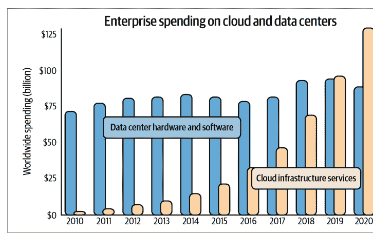

图10-4。2020年，企业在云基础设施服务上的支出增长了35%，而在数据中心上的支出下降了6%。来源：改编自Synergy Research Group的图片。

虽然利用云通常比公司早期构建自己的存储和计算层能带来更高的回报，但随着公司的发展，这种优势变得越来越不可持续。根据公开软件公司披露的云基础设施支出，风险投资公司a16z显示，云支出约占这些公司营收成本的50%。18

云计算的高成本促使公司开始将工作负载迁回自己的数据中心，这一过程被称为“云回迁”。Dropbox在2018年的S-1文件显示，由于基础设施优化改革，该公司在IPO前两年节省了7500万美元——其中很大一部分来自于将工作负载从公有云迁移到自己的数据中心。云的高成本是Dropbox独有的吗，因为Dropbox从事数据存储业务？不完全是。在上述分析中，a16z估计，“在目前利用云基础设施的50家顶级上市软件公司中，由于云对利润率的影响——相对于自行运营基础设施——它们合计损失了约1000亿美元的市场价值。”19

虽然上手云很容易，但离开云很难。云回迁需要在硬件和工程投入方面进行可观的前期投资。越来越多的公司正在采用混合方法：将大部分工作负载留在云上，同时逐步增加对数据中心的投资。

18 Sarah Wang 和 Martin Casado，“云的成本，万亿美元悖论”，a16z，https://oreil.ly/3nWU3。

19 Wang 和 Casado，“云的成本。”

## 关于多云策略

公司减少对任何单一云服务商依赖的另一种方式是采用多云策略：将工作负载分散到多个云服务商。20 这允许公司设计其系统，使其能够兼容多个云，从而利用现有最好且最具成本效益的技术，而不是被单一云服务商提供的服务所束缚，这种情形被称为供应商锁定。Gartner在2019年的一项研究显示，81%的组织正在使用两个或更多公有云服务商。21 我见过的机器学习工作负载的常见模式是在GCP或Azure上进行训练，在AWS上进行部署。

多云策略通常并不是主动选择的。正如我们早期的审稿人之一Josh Wills所说：“心智正常的人不会打算使用多云。” 跨云移动数据和编排工作负载极其困难。

通常，多云只是因为组织的不同部分独立运作，每个部分自行做出云决策而发生的。收购后也可能发生这种情况——被收购团队已经使用了与母组织不同的云，而迁移尚未进行。

在我的工作中，我见过由于战略投资而出现的多云。微软和谷歌是初创企业生态系统的重要投资者，与我合作的几家公司之前使用AWS，在微软/谷歌投资后已迁移到Azure/GCP。

20 Laurence Goasduff，“为什么组织选择多云策略”，Gartner，2019年5月7日，https://oreil.ly/ZiqQ。

21 Goasduff，“为什么组织选择多云策略。”

## 开发环境

开发环境是机器学习工程师编写代码、运行实验，并与生产环境交互的地方，在生产环境中，冠军模型被部署，挑战者模型被评估。开发环境由以下组件组成：IDE（集成开发环境）、版本控制和CI/CD。

如果你是一名每天编写代码的数据科学家或机器学习工程师，你可能对这些工具非常熟悉，并且可能觉得它们没什么好说的。根据我的经验，除了少数科技公司外，在大多数公司中，开发环境被严重低估且投入不足。根据Ville Tuulos在他的*《高效数据科学基础设施》*一书中的说法：“你会惊讶地发现，有多少公司拥有调优良好、可扩展的生产基础设施，但代码最初是如何开发、调试和测试的问题却是以临时方式解决的。”22

他建议：“如果你有时间只做好一项基础设施，那就为数据科学家打造开发环境吧。” 因为开发环境是工程师工作的地方，开发环境的改进直接转化为工程生产力的提升。

在本节中，我们将首先介绍开发环境的不同组件，然后讨论开发环境的标准化，接着讨论如何使用容器将你的更改从开发环境带到生产环境。

## 开发环境设置

开发环境应包含所有能让工程师更轻松完成工作的工具。还应该包含用于*版本控制*的工具。

截至撰写本文时，公司使用一组临时工具来对机器学习工作流进行版本控制，例如使用Git进行代码版本控制，DVC进行数据版本控制，Weights & Biases或Comet.ml在开发期间跟踪实验，以及MLflow在部署模型时跟踪模型产物。Claypot AI正在构建一个平台，可以帮助你在一个地方对所有机器学习工作流进行版本控制和跟踪。版本控制对于任何软件工程项目都很重要，但对机器学习项目更是如此，因为既可更改的内容数量庞大（代码、参数、数据本身等），又需要跟踪先前的运行以便日后重现。我们在第162页的“实验跟踪和版本控制”一节中已经讨论过这一点。

开发环境还应设置*CI/CD*测试套件，以便在将代码推送到暂存或生产环境之前进行测试。编排CI/CD测试套件的工具示例有GitHub Actions和CircleCI。由于CI/CD属于软件工程范畴，超出本书范围。

在本节中，我们将重点讨论工程师编写代码的地方：IDE。

## IDE

*IDE*是你编写代码的编辑器。IDE通常支持多种编程语言。IDE可以是原生应用，如VS Code或Vim。IDE可以是基于浏览器的，这意味着它们运行在浏览器中，例如AWS Cloud9。

## 资源管理

在云出现之前的世界（甚至今天在那些维护自己数据中心的公司中），存储和计算资源都是有限的。当时的资源管理围绕着如何充分利用有限资源展开。增加一个应用程序的资源可能意味着减少其他应用程序的资源，并且需要复杂的逻辑来最大化资源利用率，即使这意味着需要更多的工程时间。

然而，在存储和计算资源弹性大得多的云世界中，关注点已经从如何最大化资源利用率转向如何经济高效地使用资源。向一个应用程序添加更多资源并不意味着减少其他应用程序的资源，这大大简化了资源分配的挑战。许多公司愿意为应用程序增加资源，只要增加的投入能通过回报（例如额外收入或节省的工程时间）得到合理体现。

在世界上绝大多数情况下，工程师的时间比计算时间更宝贵，因此公司愿意使用更多资源，如果这意味着能帮助工程师提高生产力的话。这意味着，公司投资于工作负载自动化可能是合理的，虽然这可能比手动规划工作负载在资源使用上效率更低，但能让工程师腾出精力专注于回报更高的工作。通常，如果一个问题的解决既可以通过使用更多非人力资源（例如投入更多计算资源），也可以通过使用更多人力资源（例如需要更多工程时间重新设计），那么可能会倾向于第一种解决方案。

在本节中，我们将讨论如何管理机器学习工作流的资源。我们将重点放在基于云的资源上；不过，所讨论的想法也适用于私有数据中心。

## Cron、调度器和编排器

影响机器学习工作流资源管理的两个关键特性是：重复性和依赖性。

在本书中，我们已经详细讨论了开发机器学习系统是一个迭代过程。同样，机器学习工作负载很少是一次性操作，而是重复性的。例如，你可能每周训练一次模型，或者每四小时生成一批新的预测。这些重复过程可以进行调度和编排，以便利用可用资源平稳且经济高效地运行。

在固定时间调度重复作业正是cron所做的事情。这也是cron所做的全部：在预定时间运行脚本，并告诉你作业成功还是失败。它不关心它运行的作业之间的依赖关系——你


调度器是能够处理依赖关系的 cron 程序。它接收工作流的 DAG，并相应地调度每一步。你甚至可以基于事件触发器来调度作业，例如，每当事件 X 发生时启动一个作业。调度器还允许你指定作业失败或成功时的处理方式，例如，如果失败，在放弃之前重试多少次。

调度器通常利用队列来跟踪作业。作业可以被排队、设置优先级，并分配执行所需的资源。这意味着调度器需要了解可用资源以及运行每个作业所需的资源——所需资源要么在调度作业时作为选项指定，要么由调度器估算。例如，如果一个作业需要 8 GB 内存和两个 CPU，调度器需要在其管理的资源中找到具有 8 GB 内存和两个 CPU 的实例，并等待该实例未执行其他作业时，再在该实例上运行此作业。

以下是一个使用流行调度器 Slurm 调度作业的示例，你需要指定作业名称、作业需要执行的时间，以及为作业分配的内存和 CPU 数量：

```
#!/bin/bash
#SBATCH -J JobName
#SBATCH --time=11:00:00      # When to start the job
#SBATCH --mem-per-cpu=4096   # Memory, in MB, to be allocated per CPU
#SBATCH --cpus-per-task=4    # Number of cores per task
```

调度器还应该优化资源利用率，因为它们掌握可用资源、要运行的作业以及每个作业运行所需资源的信息。然而，用户指定的资源数量并不总是正确的。例如，我可能估计某个作业需要 4 GB 内存，因此指定为 4 GB，但这个作业实际上只需要 3 GB 内存，或者在高峰期需要 4 GB，其他时候只需要 1-2 GB。像 Google 的 Borg 这样复杂的调度器会估算作业实际需要多少资源，并将未使用的资源回收给其他作业，28 从而进一步优化资源利用率。

28 Abhishek Verma、Luis Pedrosa、Madhukar Korupolu、David Oppenheimer、Eric Tune 和 John Wilkes，《使用 Borg 在 Google 进行大规模集群管理》，EuroSys '15：第十届欧洲计算机系统会议论文集（2015 年 4 月）：18，https://oreil.ly/9TcTM。

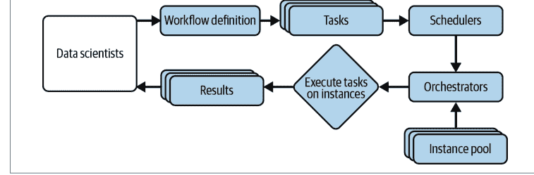

图 10-8：工作流定义后，该工作流中的任务会被调度和编排

网上有很多文章比较不同的数据科学工作流管理工具。在本节中，我们将介绍五种最常见的工具：Airflow、Argo、Prefect、Kubeflow 和 Metaflow。本节并非要全面比较这些工具，而是让你了解工作流管理工具可能需要具备的不同功能。

Airflow 最初由 Airbnb 开发并于 2014 年发布，是最早的工作流编排器之一。它是一个出色的任务调度器，附带庞大的操作符库，使 Airflow 易于与不同的云提供商、数据库、存储选项等配合使用。Airflow 是“配置即代码”原则的倡导者。其创建者认为数据工作流很复杂，应该使用代码（Python）而不是 YAML 或其他声明式语言来定义。以下是来自该平台 GitHub 仓库的 Airflow 工作流示例：

```python
from datetime import datetime, timedelta

from airflow import DAG
from airflow.operators.bash import BashOperator
from airflow.providers.docker.operators.docker import DockerOperator

dag = DAG(
    'docker_sample',
    default_args={'retries': 1},
    schedule_interval=timedelta(minutes=10),
    start_date=datetime(2021, 1, 1),
    catchup=False,
)

t1 = BashOperator(task_id='print_date', bash_command='date', dag=dag)
t2 = BashOperator(task_id='sleep', bash_command='sleep 5', retries=3, dag=dag)
t3 = DockerOperator(
    docker_url='tcp://localhost:2375',  # Set your docker URL
    command='/bin/sleep 30',
    image='centos:latest',
```

Argo 的主要缺点，除了其凌乱的 YAML 文件外，是它只能在 K8s 集群上运行，而 K8s 集群只能在生产环境中使用。如果你想在本地测试相同的工作流，就必须使用 minikube 在笔记本电脑上模拟 K8s，这可能会变得很麻烦。

接下来是 Kubeflow 和 Metaflow，这两个工具旨在通过抽象掉运行 Airflow 或 Argo 通常所需的基础设施样板代码，帮助你在开发和生产环境中运行工作流。它们承诺让数据科学家从本地 notebook 中就能访问生产环境的全部计算能力，这实际上使数据科学家能够在开发和生产环境中使用相同的代码。

尽管这两个工具都有一定的调度能力，但它们旨在与真正的调度器和编排器一起使用。Kubeflow 的一个组件是 Kubeflow Pipelines，它构建在 Argo 之上，并且旨在用于 K8s 之上。Metaflow 可以与 AWS Batch 或 K8s 一起使用。

这两个工具都是完全参数化和动态的。目前，Kubeflow 更受欢迎。然而，从用户体验的角度来看，我认为 Metaflow 更胜一筹。在 Kubeflow 中，虽然你可以用 Python 定义工作流，但仍然需要编写 Dockerfile 和 YAML 文件来指定每个组件的规格（例如，处理数据、训练、部署），然后才能将它们拼接成一个 Python 工作流。基本上，Kubeflow 通过让你编写 Kubeflow 样板来帮助你抽象掉其他工具的样板。

在 Metaflow 中，你可以使用 Python 装饰器 @conda 来指定每个步骤的要求——所需的库、内存和计算要求——Metaflow 将自动创建包含所有这些要求的容器来执行该步骤。你无需再编写 Dockerfile 或 YAML 文件。

Metaflow 允许你在同一个 notebook/脚本中无缝地使用开发和生产环境。你可以先在本地机器上用小型数据集运行实验，当你准备好用大型数据集在云端运行时，只需添加 @batch 装饰器即可在 AWS Batch 上执行。你甚至可以在不同环境中运行同一工作流的不同步骤。例如，如果一个步骤需要较小的内存占用，它可以在本地机器上运行。但如果下一步需要较大的内存占用，你只需添加 @batch 即可在云端执行。

```
### Example: sketch of a recommender system that uses an ensemble of two models.
### Model A will be run on your local machine and model B will be run on AWS.

class RecSysFlow(FlowSpec):
    @step
    def start(self):
        self.data = load_data()
        self.next(self.fitA, self.fitB)
```

```
### fitA requires a different version of NumPy compared to fitB
@conda(libraries={"scikit-learn":"0.21.1", "numpy":"1.13.0"})
@step
def fitA(self):
    self.model = fit(self.data, model="A")
    self.next(self.ensemble)

@conda(libraries={"numpy":"0.9.8"})
### Requires 2 GPU of 16GB memory
@batch(gpu=2, memory=16000)
@step
def fitB(self):
    self.model = fit(self.data, model="B")
    self.next(self.ensemble)

@step
def ensemble(self, inputs):
    self.outputs = (
        (inputs.fitA.model.predict(self.data) +
         inputs.fitB.model.predict(self.data)) / 2
        for input in inputs
    )
    self.next(self.end)

def end(self):
    print(self.outputs)
```

## ML 平台

一家大型流媒体公司的 ML 平台团队负责人告诉我他的团队是如何起步的。他最初加入该公司是为了研究他们的推荐系统。为了部署推荐系统，他们需要构建诸如特征管理、模型管理、监控等工具。去年，他的公司意识到这些相同的工具也可以用于其他 ML 应用，而不仅仅是推荐系统。他们创建了一个新团队——ML 平台团队，目标是为跨 ML 应用提供共享基础设施。由于推荐系统团队的工具最成熟，其他团队采用了他们的工具，并且推荐系统团队的一些成员被邀请加入新的 ML 平台团队。

这个故事代表了自 2020 年初以来日益增长的趋势。随着每家公司发现 ML 在越来越多的应用中的用途，利用同一套工具支持多个应用比支持每个应用各自独立的一套工具能获得更多收益。这套用于 ML 部署的共享工具构成了 ML 平台。

由于 ML 平台相对较新，究竟什么构成 ML 平台因公司而异。即使在同一个公司内，这也是一个持续

services, doing batch prediction is usually trickier.29 有些工具允许你将请求批量组合以进行在线预测，这与批量预测不同。许多公司为在线预测和批量预测设有独立的部署管道。例如，他们可能会使用 Seldon 进行在线预测，但利用 Databricks 进行批量预测。

模型部署的一个开放性问题是如何在部署前确保模型的质量。在第 9 章中，我们讨论了生产环境中测试的不同技术，例如影子部署、金丝雀发布、A/B 测试等。在选择部署服务时，你可能希望检查该服务是否便于你执行想要的测试。

## Model Store

许多公司因为模型存储听起来很简单而忽视它们。在第 320 页的“Model Deployment”部分，我们谈到为了部署模型，你必须打包模型并将其上传到生产环境中可访问的位置。Model store 暗示它存储模型——你可以通过将模型上传到像 S3 这样的存储来实现。然而，事情并非如此简单。现在想象一下，你的模型对一组输入的性能下降了。被警报通知问题的人是一名 DevOps 工程师，她在调查问题后，决定需要通知创建该模型的数据科学家。但公司里可能有 20 名数据科学家；她应该 ping 谁呢？

现在想象一下，正确的数据科学家被纳入进来。数据科学家首先想在本地复现问题。她仍然拥有用于生成该模型的笔记本和最终模型，因此她启动笔记本并使用该模型处理有问题的输入集。令她惊讶的是，模型在本地产生的输出与在生产环境中产生的输出不同。许多因素可能导致这种差异；以下是几个例子：

- 生产环境中当前使用的模型并不是她本地拥有的模型。也许她上传了错误的模型二进制文件到生产环境？
- 生产环境中使用的模型是正确的，但所使用的特征列表是错误的。也许她在推送到生产环境之前忘记在本地重建代码了？
- 模型正确，特征列表正确，但特征化代码已过时。
- 模型正确，特征列表正确，特征化代码正确，但数据处理管道出了问题。

如果不知道问题的根源，很难修复它。在这个简单示例中，我们假设负责的数据科学家仍然可以访问用于生成模型的代码。如果该数据科学家不再有权访问该笔记本，或者她已经离职或在休假怎么办？

许多公司已经意识到，仅将模型存储在 blob 存储中是不够的。为了帮助调试和维护，跟踪与模型相关的尽可能多的信息非常重要。以下是你可能想要存储的八种类型的制品。请注意，这里提到的许多制品都是应包含在模型卡中的信息，如第 351 页的“Create model cards”部分所述。

### Model definition

这是创建模型结构所需的信息，例如它使用什么损失函数。如果是神经网络，则包括它有多少隐藏层以及每层有多少参数。

### Model parameters

这些是模型参数的实际值。这些值随后与模型的形状结合，以重新创建可用于进行预测的模型。某些框架允许你同时导出参数和模型定义。

### Featurize and predict functions

给定一个预测请求，如何提取特征并将这些特征输入模型以获得预测？Featurize and predict functions 提供了执行此操作的说明。这些函数通常被包装在端点中。

### Dependencies

运行模型所需的依赖项——例如 Python 版本、Python 包——通常一起打包到容器中。

### Data

用于训练此模型的数据可能是指向数据存储位置的指针，或你的数据的名称/版本。如果你使用像 DVC 这样的工具来版本化数据，这可以是生成数据的 DVC 提交。

### Model generation code

这是指定模型如何创建的代码，例如：

- 它使用了什么框架
- 它是如何训练的
- train/valid/test 分割是如何创建的细节
- 运行的实验数量
- 考虑的超参数范围
- 最终模型实际使用的超参数集合

非常频繁地，数据科学家通过在笔记本中编写代码来生成模型。拥有更成熟管道的公司会让其数据科学家将模型生成代码提交到 GitHub 或 GitLab 上的 Git 仓库中。然而，在许多公司中，这一过程是临时性的，数据科学家甚至不签入他们的笔记本。如果负责模型的数据科学家丢失了笔记本或离职或休假，就无法将生产环境中的模型映射到生成它的代码以进行调试或维护。

### Experiment artifacts

这些是在模型开发过程中生成的制品，如第 162 页的“Experiment Tracking and Versioning”部分所述。这些制品可以是像损失曲线这样的图表。这些制品也可以是像模型在测试集上的性能这样的原始数字。

### Tags

这包括有助于模型发现和过滤的标签，例如 owner（该模型的所有者个人或团队）或 task（该模型解决的业务问题，如欺诈检测）。

大多数公司只存储这些制品的子集，而非全部。公司存储的制品可能不在同一位置，而是分散的。例如，模型定义和模型参数可能在 S3 中。包含依赖项的容器可能在 ECS（Elastic Container Service）中。数据可能在 Snowflake 中。实验制品可能在 Weights & Biases 中。Featurize and prediction functions 可能在 AWS Lambda 中。一些数据科学家可能会手动在例如 README 中跟踪这些位置，但该文件很容易丢失。

由于缺乏良好的模型存储解决方案，像 Stitch Fix 这样的公司选择构建自己的模型存储。Figure 10-10 显示了 Stitch Fix 模型存储跟踪的制品。当模型上传到其模型存储时，该模型附带序列化模型的链接、运行模型所需的依赖项（Python 环境）、模型代码生成创建的 Git 提交（Git 信息）、标签（至少指定拥有该模型的团队）等。

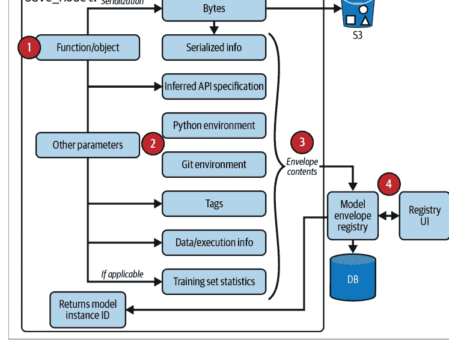

Figure 10-10. Artifacts that Stitch Fix’s model store tracks. Source: Adapted from a slide by Stefan Krawczyk for CS 329S (Stanford).

## Feature Store

“Feature store” 是一个日益含义丰富的术语，不同的人可以用它指代完全不同的事物。机器学习从业者曾多次尝试定义特征存储应具备的功能。30 其核心是，特征存储可以帮助解决三个主要问题：feature management, feature

30 Neal Lathia, “Building a Feature Store,” December 5, 2020, https://oreil.ly/DgsvA; Jordan Volz, “Why You Need a Feature Store,” Continual, September 28, 2021, https://oreil.ly/kQPMb; Mike Del Balso, “What Is a Feature Store?” Tecton, October 20, 2020, https://oreil.ly/pzy0I.

transformation, and feature consistency. A feature store solution might address one or a combination of these problems:

### Feature management

公司可能有多个机器学习模型，每个模型使用大量特征。早在 2017 年，Uber 在各团队间就有约 10,000 个特征！31 通常情况下，用于一个模型的特征对另一个模型也可能有用。例如，团队 A 可能有一个模型来预测用户流失的可能性，而团队 B 有一个模型来预测免费用户转化为付费用户的可能性。这两个模型可以共享许多特征。如果团队 A 发现特征 X 非常有用，团队 B 也可能利用它。

特征存储可以帮助团队共享和发现特征，以及管理每个特征的角色和共享设置。例如，你可能不希望公司每个人都能访问公司或其用户的敏感财务信息。在这种情况下，特征存储可以被视为特征目录。特征管理的工具示例有 Amundsen（在 Lyft 开发）和 DataHub（在 LinkedIn 开发）。

### Feature computation

特征工程逻辑在定义后需要计算。例如，特征逻辑可能是：使用昨天的平均餐食准备时间。计算部分涉及实际查看你的数据并计算此平均值。

在前一点中，我们讨论了多个模型可能共享一个特征。如果该特征的计算成本不高，每次模型需要时计算该特征是可以接受的。然而，如果计算成本高，你可能希望仅在第一次需要时执行一次，然后将其存储以供特征使用。

特征存储可以帮助执行特征计算并存储计算结果。在这种情况下，特征存储就像数据仓库一样。

### Feature consistency

在第 7 章中，我们讨论了同一个模型有两个独立管道的问题：训练管道从历史数据中提取批量特征，而推理管道提取流式特征。在开发过程中，数据科学家可能会使用 Python 定义特征并创建模型。Production

然而，出于性能考虑，代码可能会用另一种语言编写，例如 Java 或 C。

这意味着，开发期间用 Python 编写的特征定义可能需要转换为生产环境中使用的语言。因此，你不得不将相同的特征编写两次：一次用于训练，一次用于推理。首先，这既烦人又耗时。其次，由于生产环境中的一个或多个特征可能与训练环境中的对应特征存在差异，导致奇怪的模型行为，这也为 bug 创造了额外的滋生空间。

现代特征存储的一个关键卖点是，它们统一了批处理特征和流式特征的逻辑，确保训练期间的特征与推理期间的特征保持一致。

特征存储是一个较新的类别，大约在 2020 年才开始兴起。虽然人们普遍认为特征存储应该管理特征定义并确保特征一致性，但不同供应商的具体能力各不相同。有些特征存储只管理特征定义，而不根据数据计算特征；有些特征存储则两者都做。有些特征存储还进行特征验证，即检测特征何时不符合预定义的模式，而有些特征存储则将这一方面留给监控工具处理。

在撰写本书时，最受欢迎的开源特征存储是 Feast。然而，Feast 的优势在于批处理特征，而非流式特征。Tecton 是一个完全托管的特征存储，承诺能够同时处理批处理特征和在线特征，但由于需要深度集成，其实际进展缓慢。SageMaker 和 Databricks 等平台也提出了自己对特征存储的诠释。在我于 2022 年 1 月调查的 95 家公司中，只有约 40% 使用了特征存储。而在使用特征存储的公司中，有一半是自行构建特征存储。

### 自建与购买

在本章开头，我们讨论了为满足你的机器学习需求而搭建合适的基础设施是多么困难。你需要什么样的基础设施取决于你所拥有的应用程序以及运行这些应用程序的规模。

你需要为基础设置投入多少，也取决于你想在内部构建什么以及想购买什么。例如，如果你想使用完全托管的 Databricks 集群，可能只需要一名工程师。然而，如果你想自行托管 Spark Elastic MapReduce 集群，则可能需要再增加五个人。

在一个极端情况下，你可以将所有的机器学习用例外包给一家端到端提供机器学习应用的公司，那么你可能唯一需要的基础设施就是数据移动：将数据从你的应用程序移动到供应商那里，并将预测结果从该供应商移回给用户。其余的基础设施都由你的供应商管理。

在另一个极端情况下，如果你的公司处理敏感数据，因而无法使用由其他公司管理的服务，你可能需要在内部构建并维护所有基础设施，甚至拥有自己的数据中心。

然而，大多数公司都不在这两个极端之中。如果你在这样的公司工作，那么你可能会让其他公司管理一些组件，同时在内部开发一些组件。例如，你的计算资源可能由 AWS EC2 管理，数据仓库由 Snowflake 管理，但你拥有自己的特征存储和监控仪表板。

你的自建与购买决策取决于许多因素。在这里，我们将讨论三个常见的因素，这些因素是我在与基础设施负责人讨论他们如何评估这些决策时经常遇到的：

#### 公司所处的发展阶段

在初期，你可能希望利用供应商的解决方案尽快启动，以便将有限的资源集中在产品的核心功能上。然而，随着你的用例不断增多，供应商的成本可能会变得过高，此时投资于自己的解决方案可能更划算。

#### 你认为公司应该专注的方向或核心竞争优势

Stitch Fix 的机器学习平台团队经理 Stefan Krawczyk 向我解释了他的自建与购买决策：“如果是我们想要真正擅长的事情，我们会在内部管理。如果不是，我们会使用供应商。”对于技术行业之外的绝大多数公司——例如零售、银行、制造企业——机器学习基础设施并不是它们的核心，因此它们往往倾向于购买。当我与这些公司交流时，他们更喜欢托管服务，甚至是点解决方案（例如，为他们解决特定业务问题的解决方案，如需求预测服务）。对于许多技术公司而言，技术是它们的竞争优势，而且它们强大的工程团队更愿意掌控自己的技术栈，因此它们往往倾向于自建。如果他们使用托管服务，可能会更倾向于模块化和可定制化的服务，以便能够与任何组件即插即用。

#### 可用工具的成熟度

例如，你的团队可能会决定需要模型存储，你原本更希望使用供应商，但没有足够成熟的供应商能满足你的需求，因此你只好构建自己的特征存储，也许是在开源解决方案之上构建。

## 机器学习的人文层面

在整本书中，我们已经涵盖了许多设计机器学习系统的技术层面。然而，机器学习系统不仅仅是技术性的。它们涉及业务决策者、用户，当然还有系统的开发者。我们在第 1 章和第 2 章讨论了利益相关者及其目标。在本章中，我们将讨论机器学习系统的用户和开发者如何与这些系统互动。

我们将首先考虑，由于机器学习模型的概率性质，用户体验可能会如何被改变和影响。接着，我们将讨论组织结构，以便同一机器学习系统的不同开发者能够有效地协作。在本章的最后，我们将在第 339 页的“负责任的人工智能”一节中，探讨机器学习系统如何影响整个社会。

### 用户体验

我们已经详细讨论了机器学习系统与传统软件系统的不同之处。首先，机器学习系统是概率性的，而不是确定性的。通常，如果你在不同时间对同一输入运行同一软件，你会期望得到相同的结果。然而，如果你在不同时间对完全相同的输入运行同一个机器学习系统，你可能会得到不同的结果。¹ 其次，由于这种概率性质，机器学习系统的预测大多是正确，但困难的是我们通常不知道系统对哪些输入会预测正确！第三，机器学习系统也可能非常庞大，并且可能需要异常长的时间来产生预测。

1. 有时候，即使在同一时刻对同一输入运行同一个模型，你也可能会得到不同的结果。

这些差异意味着机器学习系统可能以不同的方式影响用户体验，尤其是对于迄今为止习惯于传统软件的用户。由于机器学习在现实世界中的应用相对较新，机器学习系统如何影响用户体验仍未得到充分研究。在本节中，我们将讨论机器学习系统对良好用户体验构成的三个挑战，以及如何应对这些挑战。

#### 确保用户体验的一致性

在使用应用程序或网站时，用户期望一定程度的一致性。例如，我习惯了 Chrome 浏览器在 MacBook 上的左上角有一个“最小化”按钮。如果 Chrome 把这个按钮移到右侧，我会感到困惑，甚至沮丧。

机器学习预测是概率性的且不一致的，这意味着为某个用户今天生成的预测，可能会与第二天为同一用户生成的预测不同，具体取决于预测的上下文。对于想要利用机器学习来改善用户体验的任务来说，机器学习预测的不一致性可能是一个障碍。

为了更具体地说明这一点，来看一下 Booking.com 在 2020 年发布的一个案例研究。当你在 Booking.com 上预订住宿时，大约有 200 个筛选条件可以用来指定你的偏好，例如“含早餐”、“可携带宠物”和“无烟房”。筛选条件如此之多，用户需要花时间才能找到他们想要的筛选条件。Booking.com 的应用机器学习团队希望利用机器学习，根据用户在某个浏览会话中使用过的筛选条件，自动推荐他们可能想要的筛选条件。

他们遇到的挑战是，如果他们的机器学习模型每次不断推荐不同的筛选条件，用户可能会感到困惑，尤其是当他们找不到之前已经应用过的筛选条件时。团队通过制定一个规则解决了这一挑战，该规则规定了系统在哪些条件下必须返回相同的筛选推荐（例如，当用户已应用某个筛选条件时），以及在哪些条件下系统可以返回新的推荐（例如，当用户更改目的地时）。这被称为“一致性-准确性权衡”，因为系统认为最准确的推荐可能并不是能够为用户提供一致性的推荐。

#### 应对“大体正确”的预测

在上一节中，我们讨论了确保模型预测一致性的重要性。在本节中，我们将讨论在某些情况下，我们如何希望模型的预测少一些一致性，多一些多样性。

自 2018 年以来，大型语言模型 GPT 及其后继者 GPT-2 和 GPT-3 风靡全球。这些大型语言模型的一个优点是，它们能够为各种各样的任务生成预测，且几乎不需要或完全不需要特定于任务的训练数据。例如，你可以使用一个


## 报告名称

Chip Huyen
@chiphuyen

如果我要再次学习成为一名机器学习工程师，我会优先学习这些内容：

- 1. 版本控制
- 2. SQL + NoSQL
- 3. Python
- 4. Pandas/Dask
- 5. 数据结构
- 6. 概率与统计
- 7. 机器学习算法
- 8. 并行计算
- 9. REST API
- 10. Kubernetes + Airflow
- 11. 单元/集成测试

2020年10月11日上午6:30 · Twitter Web App

查看推文分析

1,246 次转推  62 条引用推文  6,927 个赞

图 11-2. 我曾以为数据科学家需要知道所有这些内容

这条推文似乎引起了我的受众的共鸣。Eugene Yan 也写了关于“数据科学家应该更加端到端”的文章。Eric Colson，Stitch Fix 的首席算法官（此前也曾担任 Netflix 数据科学与工程副总裁），写了一篇关于“全栈数据科学通才的力量以及按职能分工的危险”的文章。

2 Eugene Yan，《不受欢迎的观点——数据科学家应更端到端》，EugeneYan.com，2020年8月9日，https://oreil.ly/A6oPi。

3 Eric Colson，《当心数据科学“图钉工厂”：全栈数据科学通才的力量与按职能分工的危险》，MultiThreaded，2019年3月11日，https://oreil.ly/m6WWu。

当我发那条推文时，我认为 Kubernetes 对于机器学习工作流程至关重要。这种情绪源于我自己工作中的挫败感——如果我对 K8s 更熟悉，我作为机器学习工程师的生活会轻松得多。

然而，随着我对底层基础设施了解得更多，我意识到期望数据科学家了解基础设施是多么不合理。基础设施需要与数据科学截然不同的一套技能。理论上，你可以学习这两套技能；实际上，你在一个方面花的时间越多，意味着你在另一个方面花的时间就越少。我喜欢 Erik Bernhardsson 的类比：期望数据科学家了解基础设施，就像期望应用程序开发人员了解 Linux 内核是如何工作的一样。⁴ 我加入一家机器学习公司是因为我想花更多时间与数据打交道，而不是启动 AWS 实例、编写 Dockerfile、调度/扩展集群或调试 YAML 配置文件。

为了让数据科学家能够拥有整个流程，我们需要好的工具。换句话说，我们需要好的基础设施。

如果我们有一个抽象层，让数据科学家能够端到端地拥有整个流程，而不必担心基础设施，会怎么样？

如果我可以直接告诉这个工具：“我的数据存储在这里（S3），运行我的代码的步骤在这里（特征化、建模），我的代码应该在这里运行（EC2 实例、AWS Batch、Lambda 等无服务器服务），我的代码在每一步需要什么（依赖项）”，然后这个工具就替我管理所有基础设施相关的事情，那会怎样？

根据 Stitch Fix 和 Netflix 的说法，全栈数据科学家的成功依赖于他们拥有的工具。他们需要能够“将数据科学家从容器化、分布式处理、自动故障转移和其他高级计算机科学概念的复杂性中抽象出来”的工具。⁵

在 Netflix 的模式中，专家——最初负责项目某一部分的人——首先创建工具来自动化他们的部分，如图 11-3 所示。数据科学家可以利用这些工具端到端地拥有他们的项目。

## 不负责任的人工智能：案例研究

在本节开始时，我们先来看两个人工智能系统失败的案例，这些失败不仅对这些系统的用户造成了严重伤害，也对开发这些系统的组织造成了严重伤害。我们将追溯组织出错的一些地方，以及从业者本可以怎么做来提前预见这些失败点。这些案例将作为我们深入探讨负责任的人工智能工程框架的背景。

在 AI Incident Database 中还记录有其他有趣的“AI 事故”示例。请记住，虽然下面的两个例子以及 AI Incident Database 中记录的那些例子引起了关注，但还有更多不负责任的 AI 案例在悄无声息地发生。

### 案例研究一：自动评分系统的偏见

2020 年夏天，由于 COVID-19 疫情，英国取消了 A-level 考试——决定大学录取的高风险考试。英国教育与考试监管机构 Ofqual 批准使用一个自动化系统来为学生分配最终 A-level 成绩——无需他们参加考试。根据 Ada Lovelace Institute 的 Jones 和 Safak 的说法，“Ofqual 最初基于以下理由拒绝了基于教师评估来授予学生成绩：学校之间的不公平、跨代际的不兼容，以及分数膨胀导致成绩贬值。Ofqual 推测，更公平的选择是将先前的成就数据和教师评估结合起来，使用一种特定的统计模型——一个‘算法’——来分配成绩。”

然而，这个算法发布的结果被证明是不公正和不可信的。它们很快引发了公众要求废除它的强烈抗议，数百名学生齐声抗议。⁸

是什么引起了公众的强烈抗议？乍一看，似乎是指向算法性能不佳。Ofqual 表示，他们的模型在 2019 年数据上测试，A-level 各科目的平均准确率约为 60%。⁹ 这意味着他们预计该模型分配的成绩中有 40% 会与学生实际成绩不同。

7 Elliot Jones 和 Cansu Safak，《算法能否及格？》，Ada Lovelace Institute Blog，2020年，https://oreil.ly/zTxR。

8 Tom Simonite，《偏斜的评分算法引发课堂外的反弹》，Wired，2020年8月19日，https://oreil.ly/GFRet。

9 Ofqual，《2020年夏季 GCSE、AS 和 A-Level 成绩授予：中期报告》，Gov.uk，2020年8月13日，https://oreil.ly/r22iz。

Ofqual 没有考虑到这样一个事实：资源较多的学校往往比资源较少的学校表现更好。通过优先考虑学校的历史表现而不是学生的当前表现，这个自动评分系统惩罚了来自资源匮乏学校的学生，而这些学校往往有更多来自弱势背景的学生。

### 失败二：用于发现偏见的细粒度模型评估不足

对来自历史上表现不佳学校学生的偏见，只是这个模型的结果公布后被发现的众多偏见之一。这个自动评分系统将教师评估作为输入，但未能解决教师在不同人群群体之间评估不一致的问题。它还“没有考虑某些受保护群体 [依据] 2010 年《平等法》可能遭受多重不利影响，这些群体将因教师期望低而受到双重/三重不利影响，[以及] 一些学校普遍存在的种族歧视。”13

由于该模型考虑了每所学校的历史表现，Ofqual 承认他们的模型对小规模学校数据不足。对于这些学校，他们没有使用该算法来分配最终成绩，而只使用教师评估的成绩。在实践中，这导致了“私立学校学生往往班级规模更小，因此成绩更好。”14

通过公开发布模型的预测成绩，并进行细粒度评估以了解模型在不同数据切片上的表现——例如，评估模型对不同规模学校以及不同背景学生的准确性——或许有可能发现这些偏见。

### 失败三：缺乏透明度

透明度是建立对系统信任的第一步，但 Ofqual 未能在为时已晚之前公开其自动评分系统的重要方面。例如，他们直到成绩公布那天才让公众知道其系统的目标是维持学校之间的公平。因此，公众无法在模型开发过程中对这一目标表达关切。

此外，Ofqual 在评估和学生排名提交之后，才让教师知道他们的评估将如何被自动评分系统使用。Ofqual 的理由是避免教师试图更改他们的评估以影响模型的预测。Ofqual 选择在结果公布日之前不发布所使用的具体模型，以确保所有人同时获知自己的结果。

13 Ofqual，《GCSE、AS 和 A-Level 成绩授予》。

14 Jones 和 Safak，《算法能否及格？》


然而，收集和共享数据集可能会侵犯这些数据集中包含数据的用户的隐私和安全。为了保护用户，人们呼吁对个人身份信息（PII）进行匿名化。根据美国劳工部，PII被定义为“任何能够通过直接或间接方式合理推断出信息所适用的个人身份的信息表示”，例如姓名、地址或电话号码。16

然而，匿名化可能不足以防止数据滥用和隐私期望的侵蚀。2018年，在线健身追踪器Strava发布了一张热力图，显示其在全球范围内记录用户锻炼时的路径，例如跑步、慢跑或游泳。该热力图汇总了2015年至2017年9月间记录的十亿次活动，覆盖了270亿公里的距离。Strava表示所使用的数据已匿名化，并“排除了被标记为私密以及用户自定义隐私区域的活动”。17

由于Strava被军人使用，其公开数据尽管经过匿名化，仍使人们能够发现暴露海外美国军事基地活动的模式，包括“阿富汗的前沿作战基地、叙利亚的土耳其军事巡逻以及叙利亚俄罗斯作战区域可能的警卫巡逻”。18 这些可区分模式的示例显示在图11-4中。一些分析师甚至认为数据可能揭示单个Strava用户的姓名和心率。19

那么匿名化出了什么问题？首先，Strava的默认隐私设置是“选择退出”，这意味着如果用户不想让其数据被收集，需要手动退出。然而，用户指出这些隐私设置并不总是清晰，可能会给用户带来意外。20 其中一些隐私设置只能通过Strava网站更改，而不能在移动应用中更改。这表明教育用户了解隐私设置的重要性。更好的是，数据选择加入（数据收集不是默认的），而不是选择退出，应该成为默认设置。

16 “关于个人可识别信息保护的指导”，美国劳工部，https://oreil.ly/FokAV

17 Sasha Lekach, “Strava健身热力图对军事存在重大安全问题”，Mashable，2018年1月28日，https://oreil.ly/9ogYx.

18 Jeremy Hsu, “Strava热力图与秘密的终结”，Wired，2018年1月29日，https://oreil.ly/mB0GD.

19 Matt Burgess, “Strava热力图数据让任何人都能看到在军事基地锻炼的人的名字”，Wired，2018年1月30日，https://oreil.ly/eJPdj.

20 Matt Burgess, “Strava热力图数据让任何人都能看到”；Rosie Spinks, “使用健身应用让我明白了隐私设置为何是女性主义问题的可怕真相”，Quartz，2017年8月1日，https://oreil.ly/DO3WR.

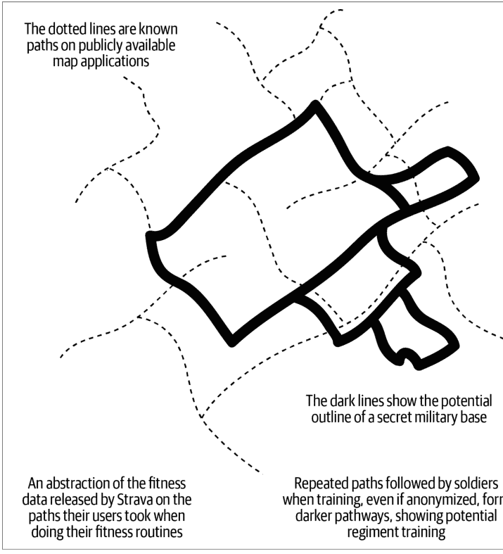

虚线是公开地图应用上已知的路径

深色线条显示秘密军事基地的潜在轮廓

Strava发布的健身数据的抽象，显示其用户在进行健身例程时的路径

即使匿名化，士兵训练时重复的路径也会形成更深的路径，显示出潜在的团级训练

图11-4. 基于BBC News21进行的分析创建的图像

当Strava热力图问题公开后，部分责任被转移到用户身上：例如，军人不应使用带GPS跟踪的非军用设备，以及应关闭定位服务。22

21 “健身应用Strava点亮军事基地的工作人员”，BBC News，2018年1月29日，https://oreil.ly/hXwpN.

22 Matt Burgess, “Strava热力图数据让任何人都能看到。”

然而，隐私设置和用户的选择仅在表面上解决了问题。根本问题在于我们今天使用的设备不断收集并报告关于我们的数据。这些数据必须被移动和存储在某处，从而创造了被拦截和滥用的机会。与亚马逊、Facebook、Google等更广泛使用的应用相比，Strava拥有的数据微不足道。Strava的失误可能暴露了军事基地的活动，但其他隐私失败可能会造成更大的危险，不仅对个人，也对整个社会。

收集和共享数据对于像AI这样的数据驱动技术的发展至关重要。然而，本案例研究显示了收集和共享数据的隐藏危险，即使数据据称已匿名化并且出于善意发布。收集用户数据的应用开发者必须理解，其用户可能没有技术知识和隐私意识来为自己选择正确的隐私设置，因此开发者必须主动努力使正确的设置成为默认，即使以收集更少数据为代价。

## 负责任的AI框架

在本节中，我们将为你作为机器学习从业者奠定基础，以便审计模型行为并制定最有助于满足项目需求的指南。该框架并非适用于每种用例。某些应用中，AI的使用可能完全不合适或不道德（例如，刑事判决决定、预测性警务），无论你遵循哪个框架。

## 发现模型偏见的来源

作为一直关注机器学习系统设计讨论的人，你知道偏见可以通过整个工作流程渗入你的系统。你的第一步是发现这些偏见如何渗入。以下是数据来源的一些示例，但请记住，这个列表远非详尽。偏见如此难以对抗的原因之一是偏见可能来自项目生命周期中的任何步骤。

“差分隐私模型的准确性对于代表性不足的类别和子群体下降得更多。”25

## 紧凑性与公平性权衡

在第7章中，我们详细讨论了模型压缩的各种技术，如剪枝和量化。我们了解到，可以在准确性成本极小的情况下显著减小模型大小，例如将模型参数数量减少90%而准确性成本极小。

如果准确性成本在所有类别中均匀分布，那么最小的准确性成本确实是最小的，但如果成本集中在少数几个类别怎么办？在他们2019年的论文《压缩深度神经网络忘记了什么？》中，Hooker等人发现“具有截然不同权重数量的模型具有可比较的顶线性能指标，但在数据集的狭窄子集上的行为却大相径庭。”26 例如，他们发现当受保护特征（例如性别、种族、残疾）处于分布的长尾时，压缩技术会放大算法伤害。这意味着压缩对代表性不足的特征造成不成比例的影响。27

他们工作中的另一个重要发现是，虽然他们评估的所有压缩技术都具有非均匀影响，但并非所有技术的不一致影响程度相同。剪枝产生的不一致影响远高于他们评估的量化技术所观察到的不一致影响。28

类似的权衡仍在不断被发现。了解这些权衡很重要，以便我们能够为机器学习系统做出明智的设计决策。如果你正在处理压缩或差分隐私的系统，建议分配更多资源来审计模型行为，以避免非预期伤害。

## 及早行动

设想市中心正在建造一座新建筑。承包商被要求建造一座将矗立75年的建筑。为了节省成本，承包商使用了劣质水泥。业主没有投资监督，因为他们想避免开销以便快速推进。承包商继续在那糟糕的基础之上建造并按时完工。

25 Eugene Bagdasaryan 和 Vitaly Shmatikov, “差分隐私对模型准确性具有不一致影响”，arXiv，2019年5月28日，https://oreil.ly/nrJGK.

26 Sarah Hooker, Aaron Courville, Gregory Clark, Yann Dauphin 和 Andrea Frome, “压缩深度神经网络忘记了什么？”，arXiv，2019年11月13日，https://oreil.ly/bgfFX.

27 Sara Hooker, Nyalleng Moorosi, Gregory Clark, Samy Bengio 和 Emily Denton, “表征压缩模型中的偏见”，arXiv，2020年10月6日，https://oreil.ly/ZTT72.

28 Hooker 等人, “表征压缩模型中的偏见。”


一年之内，裂缝开始出现，看起来建筑可能会倒塌。市政府决定该建筑构成安全风险，要求将其拆除。承包商最初为节省成本而做出的决定以及业主为节省时间而做出的决定，现在最终让业主花费了更多金钱和时间。

你可能会在 ML 系统中经常遇到这种叙述。公司可能会决定绕过 ML 模型中的伦理问题以节省成本和时间，只为在未来发现风险时付出更多代价，例如前面提到的 Ofqual 和 Strava 的案例研究。

在 ML 系统的开发周期中越早开始思考该系统将如何影响用户生活以及系统可能存在哪些偏见，解决这些偏见的成本就越低。NASA 的一项研究表明，对于软件开发而言，项目生命周期的每个阶段错误成本都会增加一个数量级。29

## 创建模型卡

模型卡是随训练好的 ML 模型一起提供的简短文档，提供有关这些模型如何训练和评估的信息。模型卡还披露模型的预期使用上下文以及其局限性。30 根据模型卡论文的作者，“模型卡的目标是通过允许利益相关者在传统评估指标之外，还沿着伦理、包容和公平的维度比较候选部署模型，来标准化伦理实践和报告。”

下面的列表改编自论文“Model Cards for Model Reporting”中的内容，以展示你可能希望为模型报告的信息：31

- *模型详情*：有关模型的基本信息。
  - 开发模型的人员或组织
  - 模型日期
  - 模型版本
  - 模型类型

## 尾声

哇，你做到了！你刚刚完成了一本相当技术性的书籍，共 10 万字以上，配有 100 多幅插图，由一位以英语为第二语言的作者撰写。在许多同事和导师的帮助下，我非常努力地完成了这本书，我很感激你在众多书籍中选择阅读它。我希望你能从这本书中获得的收获能让你的工作变得稍微轻松一些。

凭借我们现在拥有的最佳实践和工具，已经有许多令人难以置信的 ML 用例影响着我们的日常生活。我毫不怀疑，随着工具的成熟，有影响力的用例数量会随着时间推移而增长，而你可能就是其中促成这一切的人之一！我期待看到你构建的东西！

ML 系统有很多挑战。并非所有挑战都很有趣，但所有挑战都是成长和产生影响的机会。如果你想谈论这些挑战和机会，请不要犹豫联系我。你可以在 Twitter 上通过 @chip_ro 找到我，或通过电子邮件 chip@claypot.ai 联系我。

## 符号

### A

- 1NF（第一范式），59
- 2NF（第二范式），59
- A/B 测试，283-284，288
- 与准确性相关的指标，252
- ACID（原子性，一致性，隔离性，持久性），68
- 主动学习，101-102
- 临时分析，162
- 适应性，31
- 对抗攻击，272
- 对抗增强，116
- AI（人工智能），伦理，339，347-348
  - 数据驱动方法局限性，349
  - 不负责任，案例研究，341-347
  - 缓解偏见，353
  - 模型卡，351-353
  - 权衡，349
- Airflow，315-316
- 警报疲劳，255，259
- 警报策略，259
- 算法
  - bandit 算法，287-291
  - 与持续学习，273-274
  - 特征重要性，142
- 分析处理，67
- Apache Iceberg，69
- 架构搜索，174
- Argo，316-318
- 工件，162
- 人工智能（参见 AI）
- 异步预测，198

### B

- 自动化再训练，275-277
- AutoML
  - 架构搜索，174-178
  - 硬 AutoML，174-178
  - 超参数调优，173-174
  - 学习优化器，174-178
  - 软 AutoML，173-174
- 自动扩展，30
- bagging，集成，158-159
- bandit 算法，287-291
- BASE（基本可用，软状态，最终一致性），68
- 基础学习器，156
- 基础模型，微调，100
- 基线，离线模型评估，179
  - 现有解决方案，181
  - 人类，180
  - 随机，180
  - 简单启发式，180
  - 零规则，180
- 批处理管道，203-205
- 批预测，197-201
  - 迁移到在线预测，201-203
- 批处理，78-79
- 批次，过拟合，167
- 二分类，37
- 二进制数据，57
- 二进制文件大小，57
- boosting，集成，159-161
- Borg，314
- 品牌监控，12
- 浏览器，ML（机器学习）与，222
- 自建与购买，327-329
- 业务分析，35
- 业务目标，26-28

### C

- 校准，183-184
- 金丝雀发布，285
- 基数，分类任务与，37
- 灾难性遗忘，264
- 分类特征，129-132
- 冠军模型，264
- 流失预测，104
- 类别不平衡，102
  - 算法级方法，110
  - 类别平衡损失，112
  - 成本敏感学习，111
    - focal loss，112
  - 挑战，103-105
  - 评估指标，106-108
  - 重采样，109-110
- 类别平衡损失，112
- 分类
  - 作为回归问题，107
  - 二分类，37
  - 层次分类，38
  - 高基数，37
  - 多分类，37，38
  - 多标签，38
  - 情感分析，120
- 分类模型，36
- 云计算，212，300-302
  - 弹性，300
  - 多云策略，302
- 代码版本控制，164
- 列删除，125
- 列主格式，54-56
  - pandas，56
  - Parquet，54
- Commuter，305
- 紧凑卷积滤波器，206
- 计算优先级，15
- 计算密集型问题，6
- 概念漂移，238，241
- 置信度测量，185
- 容器，308-310
- 上下文 bandit，289
- 持续学习，35，264，268-270
  - 与算法，273-274
  - 与评估，272-273
  - 特征复用，277
  - 新鲜数据访问，270-272
  - 有状态训练，265-268
    - 自动化，277-278
    - 无状态再训练，265-268
      - 手动，275
    - 训练，自动化再训练，275-277
    - 与在线学习对比，268
- 便利抽样，83
- 成本敏感学习，111
- 协变量数据分布偏移，238-240
- cron，调度器，313-314
- 跨职能协作，团队，335
- CSV（逗号分隔值），行主格式，54

### D

- DAG（有向无环图），312
- 仪表板，监控与，258
- 数据，5，18
  - 心智与数据对比，43-46
  - 训练（参见训练数据）
  - 未见数据，6
- 数据增强，113
  - 对抗增强，116
  - 数据合成，116-117
  - 扰动，114-116
  - 简单保标签变换，114
- 数据分布偏移
  - 处理，248-250
  - 检测
    - 统计方法，243-244
    - 时间尺度窗口，245-247
  - ML 系统故障，237
    - 概念漂移，238，241
    - 协变量偏移，238-240
    - 特征变化，241
    - 标签模式变化，241
    - 标签偏移，238，240
- 数据重复，数据泄露与，139
- 数据工程，34
- 数据格式，53
  - 二进制，57
  - 列主，54-56
  - JSON，54
  - 多模态数据，53
  - 关系模型，NoSQL，63-66
  - 行主，54-56
- 自建与购买，327-329
- 与云计算，300-302
- 开发环境层，296，302
  - 设置，303-306
- 基础设施，295
- ML 平台层，296
- 需求，295
- 资源管理层，295
- 存储与计算层，295，296，297
  - 计算资源，297
  - FLOPS，298
- 私有数据中心，300-302
- 公有云，300-302
  - 单位，297
- 输入，监控，255
- 按需实例，300
- 集成开发环境（参见 IDE）
- 交错实验，285-287
- 内部数据库，52
- 可解释性，20
- 不变性测试，182
- IR（中间表示），215
- 迭代过程
  - 与模型开发，34
  - 性能检查，149
  - 与模型更新，281
  - 与模型训练，32-33
    - 数据工程，34
    - 项目范围界定，34

### J

- JSON（JavaScript 对象表示法），54
- 判断抽样，83

### K

- k-means 聚类模型，150
- Kaggle，数据泄露，136
- 知识蒸馏，208
- Kubeflow，318
- Kubernetes（K8s），310，314
  - EKS（Elastic Kubernetes Service），314
  - GKE（Google Kubernetes Engine），314

### L

- 标签计算，271
- 标签模式变化，241
- 标签偏移，238，240
- 标签标注，88
  - 与类别不平衡，102
  - 错误，与类别不平衡，105
  - 手工标签，88
  - 血统，90
    - 多重性，89-90
  - 缺乏标签，94
    - 主动学习，101-102
    - 半监督，98-99
    - 迁移学习，99-101
    - 弱监督，95-98
- ML 算法，151
- 自然标签，91
  - 反馈循环长度，92
  - 推荐系统，91
- 扰动，114-116
  - 简单保标签变换，114
- 语言建模，采样与，83
- 延迟，16
- 延迟与吞吐量对比，16-18
- 学习，3
- LFs（标注函数），95
  - 启发式，95
- 日志，51，51
  - 实验跟踪，162
  - 与监控，256-257
  - 存储，51
- 循环分块，模型优化，218
- 损失曲线，162
- 损失函数，40
  - （另见目标函数）
- 低秩分解，206-208

### M

- 可维护性，31
- Manning，Christopher，44
- MAR（随机缺失）值，124
- MCAR（完全随机缺失）值，124
- 合并冲突，164
- 消息队列，数据流与，77
- Metaflow，318
- 指标
  - 与监控，250
  - 与准确性相关的指标，252
  - 特征，253-255
  - 预测，252-253
  - 原始输入，255
- 性能指标，162


### M

-   心智与数据，43-46
-   随机缺失 (MAR)，124
-   完全随机缺失 (MCAR)，124
-   缺失数据，测试拆分统计与，138
-   非随机缺失 (MNAR)，124
-   ML（机器学习）
  -   浏览器与，222, 223
  -   云计算，212-223
  -   复杂模式，4
  -   深度学习与，1
  -   边缘计算，212-223
  -   现有数据与，5
  -   学习，3
  -   模型优化，220-221
  -   预测与，6
  -   生产与，12-21
  -   重复，7
  -   研究与，12-21
  -   规模，7
  -   智能手机与，9
  -   未见数据，6
  -   用例，9-12
  -   何时使用，3-12
-   ML 算法，2, 149
  -   深度学习与，150
  -   标签，151
  -   与神经网络相比，150
-   ML 模型逻辑，191
-   ML 模型
  -   持续学习，35
  -   数据迭代，267
  -   调试，165
  -   部署，320
  -   边缘计算，优化，214-221
  -   集成，156, 157
    -   套袋法，158-159
    -   基础学习器，156
    -   提升，159-161
    -   堆叠，161
  -   评估，150
    -   生产中测试，281-291
  -   实验跟踪，162-163
  -   导出，193
  -   失败
    -   批次，过拟合，167
    -   组件，167
    -   数据问题，166
    -   特征选择，166
    -   超参数与，166
    -   模型实现不佳，166
    -   随机种子，167
    -   理论约束，166
  -   迭代，267
  -   监控，35
  -   离线评估，178
    -   基线，179-181
    -   方法，181-188
  -   优化，220-221
  -   参数，模型存储，322
  -   性能指标，162
    -   系统性能，163
  -   选择标准，151
    -   人类偏见，153
    -   模型，155
    -   现在和以后的性能，153
    -   简单模型，152
    -   最先进陷阱，152
    -   权衡，154
  -   速度，163
  -   训练，32-33
    -   数据工程，34
    -   分布式，168-172
  -   更新频率，279
    -   数据新鲜度与，279-280
    -   数据迭代与，281
    -   模型迭代与，281
  -   更新，267
  -   版本控制，163-165
-   ML 平台，319
  -   模型部署，320
  -   模型存储，321-325
-   ML 平台层，基础设施，296
-   ML 系统故障
  -   数据分布偏移，237
    -   处理，248-250
  -   概念漂移，238, 241
  -   协变量偏移，238-240
  -   检测，242-247
  -   特征变化，241
  -   标签模式变化，241
  -   标签偏移，238, 240
  -   ML 系统特定
    -   退化反馈循环，233-236
    -   边缘情况，231
    -   生产数据与训练数据不同，229-231
    -   运行期望违规，227
    -   软件
      -   崩溃，228
      -   依赖失败，227
      -   部署失败，227
      -   停机，228
      -   硬件故障，228
-   ML 系统
  -   声明式，62
  -   故障，226
  -   迭代过程，32-35
  -   要求
    -   适应性，31
    -   可维护性，31
    -   可靠性，29
    -   可扩展性，30-31
  -   与传统软件相比，22-23
-   MLOps，ML 系统设计与，2-3
-   MNAR（非随机缺失）值，124
-   模型偏见，AI 伦理，347-348
-   模型校准，183-184
-   模型卡片，AI 伦理，351-353
-   模型压缩，206
  -   知识蒸馏，208
  -   低秩分解，206-208
  -   裁剪，208-209
  -   量化，209-211
-   模型开发，34
-   模型实现，故障与，166
-   模型并行，分布式训练与，170-172
-   模型性能，业务分析，35
-   监控，250, 263
  -   （另见生产中测试）
  -   警报与，259
  -   仪表板与，258
  -   日志与，256-257
  -   指标与，250
    -   与准确性相关的指标，252
    -   特征，253-255
    -   预测，252-253
    -   原始输入，255
-   多类分类，37, 38
-   多标签分类，38
-   多模态数据，53

### N

-   n-gram，120
-   NAS（神经架构搜索），174
-   自然标签，91
  -   反馈循环长度，92
  -   推荐系统，91
-   自然语言处理 (NLP)（见 NLP）
-   神经架构搜索 (NAS)，174
-   神经网络，150
  -   位置嵌入，133
-   新闻推送
  -   排名帖子，41
  -   用户参与与，41
-   NLP（自然语言处理），114
  -   数据增强与，113
  -   特征工程，122
-   非概率抽样，83
  -   偏见，83
-   Norvig, Peter，44
-   NoSQL，63
  -   文档模型，63
  -   图模型，65
-   笔记本，IDE 与，304
-   NSFW（工作不安全）内容过滤，41
-   NumPy，56

### O

-   目标函数，40-43
-   可观测性，250, 259-261
-   模型的离线评估，178
  -   基线，179
    -   现有解决方案，181
    -   人类，180
    -   随机，180
    -   简单启发式，180
    -   零规则，180
  -   方法，181-188
-   OLAP（在线分析处理），69
-   OLTP（在线事务处理）系统，69
-   按需实例，300
-   按需预测，198
-   语言建模十亿词基准，45
-   在线特征，199
-   在线学习，268
-   在线预测，197-201, 288
  -   从批预测迁移，201-203
  -   流式管道，203-205
-   运行期望违规，227
-   算子融合，模型优化与，218
-   编排器
  -   HashiCorp Nomad，314
  -   Kubernetes (K8s)，314
-   异常值，边缘情况与，232
-   过采样
  -   过拟合，110
  -   SMOTE，110

### P

-   pandas，56
-   Papermill，305
-   并行化，模型优化与，217
-   随时间变化的参数值，163
-   Pareto 优化，42
-   Parquet，54, 57
  -   二进制文件，57
-   模式
  -   变化，8
  -   复杂，4
-   Pearl, Judea，43
-   性能指标，162
  -   系统性能，163
-   扰动，114-116
-   半监督的扰动方法，99
-   扰动测试，181-182
-   位置嵌入，133-135
  -   固定，135
-   精确率指标，107
-   预测，6, 39
  -   异步，198
  -   批预测，197-201
    -   迁移到在线预测，201-203
  -   “大多正确”，用户体验，332-334
  -   按需预测，198
  -   在线，197-201
    -   流式管道，203-205
  -   同步，198
-   预测，监控，252-253
-   特征的预测能力，140
-   价格优化服务，73
-   问题框架，35-43
-   处理
  -   分析，67
  -   批处理，78-79
  -   ETL（提取，转换，加载），70-72
  -   流处理，78-79
  -   事务，67
    -   ACID 与，68
-   生产环境，192
-   生产，ML 与，12-21
-   项目目标，26-28
-   项目范围界定，34
-   原型制作，批预测与，201
-   裁剪，208-209
-   公有云与私有数据中心，300-302

### Q

-   量化，209-211
-   查询语言，60
-   配额抽样，83

### R

-   随机基线，180
-   实时传输
  -   数据流与，74-77
  -   流数据与，78
-   合理规模，294
-   召回率指标，107
-   推荐系统，标签，91
-   回归
  -   类不平衡与，102
  -   任务，39
-   回归模型，36
-   关系数据库，60
-   关系模型，59-62
  -   数据规范化，59
  -   NoSQL，63
    -   文档模型，63
    -   图模型，65
  -   表，59
-   可靠性，29
-   重复，7
-   重复性作业，调度，311
-   请求驱动的数据传递，75
-   重采样，109
  -   动态采样，110
  -   过采样
    -   过拟合与，110
    -   SMOTE，110
  -   两阶段学习，110
  -   欠采样，109
-   水库采样，86-87
-   资源管理，311
-   资源管理层，基础设施，295
-   REST（表述性状态转移），74
-   乘车管理服务，73
-   ROC（接收器操作特性）曲线，108
-   Rogati, Monica，44
-   ROI（投资回报率），采用成熟度阶段，28
-   行删除，125
-   行主格式，54-56
  -   CSV（逗号分隔值），54
  -   NumPy，56
-   RPC（远程过程调用），74

### S

-   采样，82
  -   重要性采样，87
  -   非概率，83
    -   偏见，83
  -   水库采样，86-87
  -   简单随机采样，84
  -   分层采样，84
  -   加权采样，85
-   可扩展性，30-31
  -   自动扩展，30
-   规模，7
  -   部署神话，196
-   调度器，313-314
  -   Borg，314
  -   Slurm，314
-   模式，文档模型，64
-   项目范围界定，34
-   自训练，98
-   半监督，98-99
-   情感分析分类器，120
-   序列化，193
-   服务
  -   数据流与，73-74
  -   司机管理，73
  -   价格优化，73
  -   乘车管理，73
-   SGD（随机梯度下降），169
-   影子部署，282
-   SHAP（Shapley Additive exPlanations），142
-   简单启发式，离线评估，180
-   简单的标签保持变换，114
-   简单随机采样，84
-   Simpson 悖论，186
-   偏斜分布，特征缩放与，127
-   基于切片的评估，185-188
-   切片
  -   错误分析，188
  -   基于启发式，188
  -   切片查找器，188
-   Slurm，314
-   智能手机
  -   数据源与，52
  -   ML（机器学习）与，9
-   平滑失败，用户体验，334
-   SMOTE（合成少数类过采样技术），110
-   Snorkel，95
-   滚雪球抽样，83
-   软 AutoML，173-174
-   软件系统故障
  -   崩溃，228
  -   依赖，227
  -   部署，227
  -   硬件，228
-   垃圾邮件过滤，41
-   拆分
  -   数据重复，139
  -   数据泄漏与，138
-   SQL，60
-   SQL 数据库，61
-   SSD（固态磁盘），297
-   堆叠，集成，161
-   利益相关者，研究项目，13-15
-   最先进模型，152
-   有状态训练，265-268
  -   自动化，277-278
-   无状态再训练，265-268
  -   手动，275
-   随机梯度下降 (SGD)，169
-   存储和计算层，基础设施，295, 296, 297
  -   计算资源，297
  -   FLOPS（每秒浮点运算次数），298
  -   私有数据中心，300-302
  -   公有云，300-302
  -   单位，297
-   存储引擎，67
-   分层采样，84
-   流处理，78-79
-   流数据，实时传输，78
-   流特征，199
-   流式管道，203-205
-   结构化数据，66-67
-   Sutton, Richard，44
-   同步预测，198
-   合成少数类过采样技术 (SMOTE)，110
-   系统性能指标，163
-   系统生成数据，50


### T

- 标签、模型存储，323
- 任务
  - 分类，36
    - 二分类，37
    - 高基数分类，37
    - 多分类，37, 38
    - 多标签分类，38
  - 标签，91
  - 回归，36, 39
- 团队
  - 跨职能协作，335
  - 数据科学家，336-339
  - 生产管理，336
- 遥测，260
- 生产环境测试，263, 281
  - A/B 测试，283-284
  - 多臂老虎机，287-291
  - 金丝雀发布，285
  - 交错实验，285-287
  - 影子部署，282
- 文本数据，57
- 文本文件大小，57
- 理论约束，失败，166
- 第三方数据，52
- 时间相关数据，数据泄漏，137
- 训练
  - 自动重训练，275-277
  - 分布式训练，168
    - 数据并行，168-170
    - 模型并行，170-172
  - 有状态训练，265-268
    - 自动化，277-278
  - 无状态重训练，265-268
    - 手动，275
- 训练数据，81
  - 类别不平衡，102
    - 算法级方法，110-113
    - 挑战，103-105
    - 评估指标，106-108
    - 重采样，109-110
  - 数据增强，113
    - 扰动，114-116
    - 简单的标签保持变换，114
  - 数据分布，229
  - 数据泄漏，135
  - 标注，88
    - 人工标签，88-90
    - 缺乏标签，94-102
    - 自然标签，91-94
    - 用户反馈，93
  - n-gram，121
  - 噪声样本，116
  - 采样，82
    - 重要性采样，87
    - 非概率采样，83-84
    - 蓄水池采样，86-87
    - 简单随机采样，84
    - 分层采样，84
    - 加权采样，85
- 训练模型，迭代，32-33
  - 数据工程，34
  - 项目范围界定，34
- 事务处理，67
  - ACID，68
- 迁移学习，99-101
- 两阶段学习，110

### U

- 欠采样，109
- 未见数据，6
- 非结构化数据，66-67
- 更新，部署误区，196
- 用例，9-12
- 用户体验，331
  - 一致性，332
  - 预测，大部分正确，332-334
  - 平滑失败，334
- 用户反馈，93
- 用户输入数据，50

### V

- vCPU（虚拟 CPU），299
- 向量化，模型优化，217
- 版本管理，163-165
  - 代码版本管理，164

### W

- WASM（WebAssembly），223
- 弱监督，95-98
  - Snorkel，95
- 加权采样，85
- 词嵌入，133
- 工作流管理，314
  - Airflow，315-316
  - Argo，316-318

## 关于作者

Chip Huyen（https://huyenchip.com）是 Claypot AI 的联合创始人兼 CEO，致力于开发实时机器学习的基础设施。此前，她曾在 NVIDIA、Snorkel AI 和 Netflix 工作，帮助一些全球最大的组织开发和部署机器学习系统。

在斯坦福大学就读期间，她创建并教授了“用于深度学习研究的 TensorFlow”课程。她目前在斯坦福大学教授 CS 329S：机器学习系统设计。本书基于该课程的讲义编写。

她还是四本越南语畅销书的作者，其中包括《Xách ba lô lên và Đi》系列（Quảng Văn，2012、2013）。该系列在 2014 年入选 FAHASA 读者选择奖前十名。

Chip 的专业领域处于软件工程和机器学习的交叉点。LinkedIn 将她评为 2019 年软件开发领域十大顶尖声音之一，以及 2020 年数据科学与 AI 领域十大顶尖声音之一。

## 关于封面

《设计机器学习系统》封面上的动物是红腿石鸡（*Alectoris rufa*），也被称为法国石鸡。

这种雉科鸟类被驯养了几个世纪，作为猎禽具有重要的经济价值，主要不迁徙，原产于欧洲大陆西部，但也已被引入其他地区，包括英格兰、爱尔兰和新西兰。

红腿石鸡体型相对较小但身体粗壮，拥有华丽的色彩和羽毛图案：背部羽毛呈浅棕色至灰色，腹部浅粉色，喉咙奶油色，喙鲜艳的红色，两胁有红褐色或黑色横纹。

红腿石鸡主要以种子、树叶、草和根为食，也吃昆虫，每年在干旱的低地地区（如农田）繁殖，将蛋产在地面巢穴中。尽管它们仍被大量繁殖，但由于过度捕猎和栖息地消失等因素导致的种群数量急剧下降，这些鸟类现在被视为近危物种。和 O'Reilly 封面上的所有动物一样，它们对我们的世界至关重要。

封面插画由 Karen Montgomery 绘制，基于《The Riverside Natural History》中的古董线雕版画。封面字体为 Gilroy Semibold 和 Guardian Sans。正文字体为 Adobe Minion Pro；标题字体为 Adobe Myriad Condensed；代码字体为 Dalton Maag 的 Ubuntu Mono。

