# 安全软件设计：开发者指南


**设计安全软件。** 版权所有 © 2022 Loren Kohnfelder

保留所有权利。未经版权所有者和出版商事先书面许可，不得以任何形式或任何方式（包括复印、录制或任何信息存储和检索系统）复制或传播本书的任何部分。

首次印刷

25 24 23 22 21 1 2 3 4 5 6 7 8 9

ISBN-13: 978-17185-0192-8 (印刷版)

ISBN-13: 978-17185-0193-5 (电子书)

出版商：William Pollock

制作经理：Rachel Monaghan

制作编辑：Katrina Taylor

责任编辑：Frances Saux

技术审校：Cliff Janzen

封面插画：Rick Reese

封面与内页设计：Octopod Studios

文案编辑：Rachel Head

排版：Jeff Lytle, Happenstance-Type-O-Rama

校对：May Huang

如需了解图书分销商或翻译版权事宜，请直接联系 No Starch Press, Inc.：

No Starch Press Inc.

245 8th Street, San Francisco, CA 94103

电话：1-415-863-9900；info@nostarch.com

[www.nostarch.com](https://www.nostarch.com)

*美国国会图书馆预订编目数据*

作者：Kohnfelder, Loren, 作者。

书名：设计安全软件：开发者指南 / Loren Kohnfelder 著。

描述：旧金山 : No Starch Press, 2022. | 包含索引。 |

摘要："本书介绍计算机安全，重点关注基本安全概念，如威胁以及开发人员如何缓解威胁。它涵盖了从安全角度审查设计文档的过程，并探讨了攻击者利用系统的技术，以及如何通过安全编码和开发实践来防范这些攻击"——出版商提供。


# 标识符

- LCCN 2021032322 (印刷版) | LCCN 2021032323 (电子书)
- ISBN 9781718501928 (印刷版) | ISBN 9781718501935 (电子书)

# 主题

LCSH: 软件工程。| 软件架构。| 计算机安全。| 应用软件——开发。

# 分类

- LCC QA76.758 .K675 2022 (印刷版) | LCC QA76.758 (电子书)
- DDC 005.1--dc23

LC 记录可在 <https://lccn.loc.gov/2021032322> 查询

LC 电子书记录可在 <https://lccn.loc.gov/2021032323> 查询

No Starch Press 和 No Starch Press 徽标是 No Starch Press, Inc. 的注册商标。本书提及的其他产品和公司名称可能是其各自所有者的商标。我们没有在每个商标名称后都加上商标符号，而是仅以编辑方式使用这些名称，并有利于商标所有者，无意侵犯商标。

本书中的信息按“原样”分发，不提供任何担保。尽管在准备本作品时已采取一切预防措施，但作者和 No Starch Press, Inc. 对任何人或实体因本书所含信息直接或间接造成或声称造成的任何损失或损害均不承担任何责任。

谨以此书纪念 robin。

献给所有让数字世界持续运转的软件专业人士，他们日复一日致力于改善安全。他们最大的成功，是那些无事发生的难得平凡的日子。

# 作者简介

Loren Kohnfelder 编程生涯已逾五十年。作为 MIT 本科生，他的论文《迈向实用的公钥密码系统》(1978) 首次描述了数字证书和公钥基础设施 (PKI) 的基础。

他的软件职业生涯跨越了各种编程工作，从穿孔卡片、编写磁盘控制器驱动程序、链接加载器、视频游戏、两次在日本的工作经历，到半导体研究实验室的设备控制软件。在微软，他重返安全领域，先在 Internet Explorer 团队工作，后在 .NET 平台安全团队工作，为业界首个主动安全流程方法论做出了贡献。

最近，在 Google，他先后担任安全团队软件工程师和隐私团队创始成员，对大规模商业系统进行了超过一百次安全设计审查。

# 技术审阅者简介

自 Commodore PET 和 VIC-20 早期以来，技术一直是 Cliff Janzen 的长久伴侣（有时甚至是痴迷！）。Cliff 大部分工作时间用于管理和指导一支优秀的安全专业团队，但他通过处理从安全策略审查到渗透测试再到事件响应的各项工作，努力保持技术相关性。他觉得很幸运，能拥有一份也是他最爱好的职业，以及一位支持他的妻子。

# 前言

你刚开始阅读的这本书在许多方面都很不寻常。它篇幅小巧、文字精炼，是一本包含极少代码的技术书籍。这是一本为非安全专家设计的安全书籍。正如 Loren 所讨论的，这是一位发布过大型商业产品、发明过重要安全技术、并在产品安全领域深耕多年的人，基于深刻的个人视角撰写的关于技术的书籍。

2006 年，我加入微软，被委以负责我们在所有产品和服务中如何进行威胁建模的重任。我们使用的主要方法基于 Loren 的 STRIDE 工作。STRIDE 是一个助记符，帮助我们考虑欺骗、篡改、抵赖、信息泄露、拒绝服务和权限提升这些威胁。它已成为我的一个关键基石。（它太核心了，以至于我经常需要纠正那些认为我发明了 STRIDE 的人。）事实上，当我读这本书时，欣喜地发现 Loren 引用我的“四个问题框架”，就像我引用 STRIDE 一样。该框架是一种通过询问我们在做什么、可能出什么问题、我们打算如何应对这些问题，以及我们是否做得好来解决问题的方法。本书中的许多经验表明，尽管我们从未直接共事，但 Loren 和我实际上一直在协作。

如今，世界正在改变。安全缺陷已成为头版新闻。你的客户比以往任何时候都更期待更好的安全性，并通过在评估标准中纳入安全性、起草合同条款、向销售人员和高管施压、推动新法律出台等方式提出这些要求。现在是将更好的安全设计引入软件（从构想到编码）的大好时机。这本书讲的就是这个困难的主题：如何设计安全的软件。

之所以困难，主要有两大挑战。第一个挑战，即安全和信任既自然又微妙，是第 1 章的主题，我就不多说了。第二个挑战是，软件专业人员往往希望软件不需要设计。软件看似无限可塑，不同于其他工程学科的产品。在其他学科中，我们在弯曲钢材、浇筑混凝土或光刻硅片之前，会先构建模型和原型。相比之下，我们编写代码、完善代码，然后将其发布给世界，而不是遵循 Fred Brooks 的著名建议：你构建的第一个系统注定要被扔掉，所以你最好计划将其视为原型。我们讲述的软件演进故事很少停留在徒劳的摸索上。我们倾向于忽略那些没点亮的无数灯泡，转而谈论正确的设计是如何偶然降临给我们的。有时，我们甚至自己也信了。即使在写下这些时，我也意识到有个风险：你可能会认为我——或者更糟，Loren——是为设计而设计的鼓吹者。而我不得不做这个免责声明，又引出了本书出色应对的另一个挑战：提供关于软件设计的实用建议。

这是一本为一群很少受到尊重和同情对待的人写的书：初涉安全领域的技术专业人士。欢迎来到这个专业领域。正如你将在书中发现的，你对所从事系统所做的选择会影响安全性。但你不必成为安全专家就能做出更好的选择。这本书会带你走得很远。你们中的一些人会想走得更远，外面有大量材料供你阅读。而另一些人仅通过应用这里学到的知识就能做得很好。

ADAM SHOSTACK

Shostack + Associates 总裁

《威胁建模：为安全而设计》(Wiley, 2014) 作者

华盛顿大学 Paul G. Allen 计算机科学与工程学院 兼职教授

---

# 序言

> 如果你不能——从长远来看——告诉所有人你在做什么，那么你的所作所为就是毫无价值的。
>
> ——Erwin Schrödinger

陪我一起徒步穿越软件安全的版图吧。

我最喜欢的徒步路线始于考艾岛 (Kauaʻi) 顶端附近的雨林，那里常年笼罩在迷蒙细雨中。小径起先坡度平缓，随后沿着倾斜地形的等高线下行，部分路段陡峭，经常下雨后变得危险湿滑。再往下，穿过被入侵种姜花扼杀的山谷或长满带刺马缨丹灌木丛的区域，泥泞不堪，意志不坚定者便会折返。再走几英里，树木稀疏，环境随海拔降低逐渐变暖，变得干旱。继续前行，四周太平洋的长距离视野开始展开，隐约可见小径许诺的景致。

依我经验，许多软件专业人士初涉安全领域时感到畏惧：如雾里看花，甚至隐约感到险恶。这并非毫无缘由。如果编程行为对应一个物理环境，那大概就是这副光景。


小径的最后一段穿越的地形因松散的火山岩而变得险峻，由于该岛在地质上年仅五百万年，这些岩石尚未来得及风化成土壤。代码坚硬且不留情面，宛如岩石，却又如此脆弱，一个微小的缺陷就可能导致灾难，正如在小径上一步踏错。幸运的是，沿山脊延伸的徒步小径路线选得很好，最陡峭的路段有天然的手握点：坚固的玄武岩突出部或欧希亚树裸露、结实的根系。

快到小径尽头时，你会发现自己正沿着一道深峡谷的边缘行走，脚下的松散地面几乎像滚珠轴承一样。右侧是一处垂直落差超过 2000 英尺的悬崖峭壁。有些地方小径仅容一人通过。我见过恐高症的徒步者在此折返，无法鼓起勇气继续前行。然而大多数人在这里感到很自在，因为小径*略微向远离危险的一侧倾斜*。左侧风险极小；你面临同样棘手的立足点，但处于缓坡上，充其量不过滑落几英尺。写作本书时，我常想起这条小径，并竭力提供这样一条路径，利用像这样的故事和类比来攻克最棘手的主题，希望能帮助你抵达精华所在。

安全之所以具有挑战性，原因有很多：它抽象、主题广泛，而当今的软件既脆弱又极其复杂。如何在不因信息过载而让读者不知所措的前提下，以足够的深度解释安全的复杂性，从而引起读者共鸣？本书以站在峡谷边缘小径上的徒步者精神直面这些挑战：通过远离“试图面面俱到”的危险。为了不让读者流失，我宁可偏向简化，略去一些细枝末节。这样做，我希望能防止读者在隐喻上“掉进峡谷”——即因过度困惑或沮丧而放弃。本书应当成为一块跳板，激发你对软件安全实践持续探索的兴趣。

当你走近小径终点时，山脊变宽并变得平坦，行走轻松自如。转过最后一个弯，你将享受到传说中的纳帕利海岸令人惊叹的全景。右侧是一片郁郁葱葱的悬谷，从山体陡峭地切割而出。一道瀑布汇入蜿蜒的河流，几乎就在正下方清晰可见。错综复杂的海岸线延伸向远方，西边地平线上的邻岛相伴相随。造访此地的回报永远令人回味无穷。尽情领略这番体验后，返程攀登将是一场不错的锻炼。

---------------

正如我永远无法走遍这座岛屿的每一寸土地，我也无法学尽软件安全的所有知识，当然，也没有任何一本书能完全覆盖这个广泛的主题。我拥有的向导，是我自己的经验。我们每个人都在这一主题上开辟出自己独特的路径，我很幸运能长期从事这项工作。我亲眼见证了一些关键发展，并见证了软件开发的技术与文化从早期至今的演变。

本书的目的是向你展示安全领域的地形概貌，并对小径上的一些险情提出警示，以便你能自信地自行进一步探索。就安全而言，适用于所有情况的现成指导极为罕见。相反，我的目标是从这片领域中展示一些简单的例子，以激发你的兴趣并加深你对核心概念的理解。对于本书涵盖的每个主题，总有更多可说的内容。解决现实世界的安全挑战总是需要更多背景信息，以便更好地评估可能的解决方案；最佳决策建立在对设计细节、实现细节等具体情况的扎实理解之上。当你掌握了底层思想并开始应用它们，通过实践，这项工作会变得直觉化。幸运的是，即便是随时间推移的微小改进，也让这份努力物超所值。

回顾我在大型软件公司安全团队的工作经历，总有一个错失的良机让我印象深刻。在大型盈利性企业工作有许多福利：除了现场按摩和丰盛的自助餐，还配备了随时可用的安全专家（如我）和设计评审流程。然而，鲜有其他软件开发项目能享受到这种级别的安全专业知识和从设计阶段就整合安全的流程。本书旨在赋能软件社区，使这种做法成为标准实践。

设计师需要平衡无数关注点，忙得不可开交。优秀的设计师当然了解安全考量，但他们很少能获得安全设计评审。（而且我的业内熟人中，甚至没人听说过顾问提供这项服务。）开发者的安全知识程度也参差不齐，除非他们将其作为专业方向钻研，否则他们的知识充其量只是零散拼凑。一些公司确实足够重视安全而聘请专家顾问，但这总是发生在流程后期，所以他们是在事后补救，赶在发布前加固安全。在最后“拧螺丝”式地加装安全已成为行业的标准策略——这与从一开始就“烘焙”进安全背道而驰。

多年来，我试图在同事中温和地推广安全意识。总能很快发现，某些人“懂了”；而另一些人，则不然。人们为何反应迥异是个谜，这或许更多是心理层面而非技术层面的原因，但它确实引出了一个有趣的问题。什么是“懂”安全，以及如何教授它？我指的不是世界级的知识，甚至不是精通，而是对基础知识有足够的掌握，能意识到挑战并知道如何进行渐进式改进。从这一点出发，软件专业人士可以继续研究以填补任何空白。这就是本书努力要达成的目标。

在撰写本书的过程中，我对这项工作所包含挑战的理解显著加深。起初，我惊讶于为何不存在此类书籍；现在我想我明白其中缘由了。安全概念往往违背直觉；攻击手段常诡秘且不显而易见，而软件设计本身就已高度抽象。当今软件如此丰富多样，保护它代表着艰巨的挑战。软件安全仍是一个未解之题，但我们确实理解了其中的大部分，并且正在变得更擅长应对——要是它不是个移动得如此之快的靶子就好了！我当然没有所有问题的完美答案。所有针对安全挑战的简单答案早已内置在我们的软件平台中，所以留下的都是难题。本书在战略上强调概念和安全思维的培养。它邀请更多人参与安全建设，带来更多元化的新视角和更持续的安全关注。

希望你能加入我这趟穿越安全版图的私人向导之旅，途中我将与你分享我所能提供的最有趣的见解和最有效的方法论。如果本书能说服你重视从设计阶段就将安全“烘焙”进软件、贯穿全过程考量安全，并超越本书所能提供的内容去探索，那么它便算成功了。

# 致谢

> 知识归根结底建立在承认之上。
>
> ——路德维希·维特根斯坦


我怀着感激之情撰写了本书，感谢学术界和业界的许多同事，我从他们身上学到了很多。安全工作可能令人感到极其不被感激——成功往往无形，而失败却会受到严厉审视——令人欣慰的是，有那么多优秀的人将其巨大的才华和精力奉献给这一事业。

选择 No Starch Press 出版是我让本书臻于完善的最佳决定。无一例外，每一位同事都非常棒，且拥有无限的耐心，包容了我无休止的问题和建议。

我要感谢手稿的早期阅读者们提供的宝贵反馈：Adam Shostack、Elisa Heymann、Joel Scambray、John Camilleri、John Goben、Jonathan Lundell 和 Tony Cargile。Adam 的支持超出预期，引发了广泛的深入讨论，向 No Starch Press 向我大力推荐，并慷慨撰写了序言，画上了完美的句号。

如果能记录下撰写本书过程中修正的所有错误，那将会很有趣，这当然也是一次极佳的谦卑课。我感谢大家敏锐的目光，对于可能遗漏的错误，我承担全部责任。请参阅 `https://www.nostarch.com/designing-secure-software/` 的在线勘误表以获取最新勘误。

我也受益于科技圈外他人的大力支持，有几位值得特别致谢：Rosemary Brisco，感谢她的营销建议；Lisa Steres 博士，感谢她坚定不移的热情和对该项目持久的关注。

最后，*arigatou*（日语“谢谢”）献给我的妻子 Keiko，感谢她在整个项目过程中给予的无尽支持。

# 简介


本书是为希望更好地理解软件安全学科核心概念，并学习如何实践安全软件设计与实现艺术的软件专业人士编写的指南。书中涉及的几个主题是我有幸亲自开创的。其他主题，则是我亲眼见证其发展并扎根的。基于我自身的行业经验，本书汇聚了大量可落地的思路，你可以立即应用到工作中，使你负责的软件更加安全。

两大核心主题贯穿全书：鼓励软件专业人士在软件构建过程的早期就关注安全，以及让整个团队参与到安全的过程与责任中。在这两个方面，无疑都有巨大的提升空间，而本书将展示如何实现这些目标。

在我的职业生涯中，我有幸在软件安全的一线工作，现在我希望尽可能广泛地分享我的心得。20 多年前，我是微软团队的一员，该团队首次在大型软件公司规模化应用威胁建模。多年后，在 Google，我参与了同一基础实践的演进，并体验了一种全新的应对挑战的方式。本书第二部分基于我进行的上百次设计评审经验。回顾来路，让我获得了绝佳的视角来重新阐述这一切。

设计、构建和运营软件系统本质上是一项充满风险的事业。每一个选择、每一步操作，都在将引入安全漏洞的风险向上或向下推动。本书涵盖了我最擅长、源自亲身经历的知识。我从第一性原理传达安全思维，并展示如何在整个开发过程中“烘焙”进安全。在此过程中，我提供了设计和代码示例，尽量不依赖特定技术，以最大程度地提高通用性。文中穿插了大量故事、类比和示例，以增加趣味性，并尽可能有效地传达抽象概念。

安全思维对某些人来说更容易形成，因此我专注于构建这种直觉，帮助你以新的方式思考，从而在工作中形成软件安全视角。我还要补充一点，根据我自己的经验，即使对于那些天生擅长此道的人，总能获得新的见解。

这是一本内容丰富却精炼的书，写作过程中我逐渐认识到，其简短性对于其可能取得的成功至关重要。软件安全是一个广度和深度都令人望而生畏的领域，保持书籍的精简，我希望能让它更易于被广泛接受。我的目标是让你以新的方式思考安全，并让你能轻松地将这一新视角应用到自己的工作中。

## 谁应该阅读本书？

本书面向所有已在软件设计和开发的某个方面具备专业能力的人士，包括架构师、UX/UI 设计师、项目经理、软件工程师、程序员、测试人员和管理人员。只要技术专业人员理解软件工作的基本原理及其构建方式，就不会在理解概念性内容上遇到困难。软件的使用极其普遍且种类繁多，我不会说*所有*软件都需要安全；然而，大多数软件很可能需要，当然任何连接互联网或与人深度交互的软件肯定需要。

在写作过程中，我发现将潜在读者分为三类很有帮助，我想在这里对每一类读者说几句话。

*安全新手*，尤其是那些对安全感到畏惧的人，是我写作的主要受众，因为让所有从事软件工作的人都理解安全、从而为改进安全做出贡献至关重要。为了未来构建更安全的软件，我们需要所有人参与，我希望本书能帮助刚开始学习安全的人快速入门。

*安全意识者*是指对安全感兴趣但知识有限、寻求深化理解并学习更多将这些技能应用于工作的实用方法的读者。我写这本书是为了填补空白，并提供大量你可以立即付诸实践的方法。

*安全专家*（你们知道自己是谁）构成了最后一类读者。他们可能熟悉大部分内容，但我相信本书提供了一些新视角，仍能给他们带来很大收获。具体而言，本书讨论了安全设计、安全评审和“软技能”等重要相关主题，这些内容在文献中鲜见著述。

本书第三部分涵盖实现漏洞与缓解措施，包含用 C 或 Python 编写的简短代码片段。部分示例假设读者熟悉内存分配的概念，以及整数和浮点类型（包括二进制算术）的理解。少数地方使用了数学公式，但仅限于模运算和指数运算。觉得代码或数学过于技术化或无关的读者，可以放心跳过这些部分，而不必担心失去整体叙事的脉络。诸如 `man(1)` 之类的参考是 *nix（Unix 系列操作系统）的命令 `(1)` 和函数 `(3)`。

## 本书涵盖哪些主题？

本书共 13 章，分为三部分，涵盖概念、设计和实现，外加结语。

### 第一部分：概念


# 第一部分：概念

## 第 1 章：基础

> 诚实是基石，通常也是坚实的基石。即使我因所言所行而惹上麻烦，这也是我能够坚守的立足点。
>
> ——Charlamagne tha God


软件安全既是一项逻辑实践，也是一门基于直觉决策的艺术。它要求理解现代数字系统，同时也要求对与这些系统交互并受其影响的人类保持敏感。如果这听起来令人望而生畏，说明你已敏锐地洞察到了本书致力于阐述的根本挑战。这一视角也揭示了软件安全为何长期以来持续挑战该领域，以及为何迄今取得的扎实进展付出了如此巨大的努力，哪怕只是解决了一部分问题。然而，这种现状也蕴含着极好的消息，因为这意味着我们所有人都可以通过提高在流程每个阶段对更好安全性的意识和参与度，从而产生真正的影响。

## 第 1 章至第 5 章为本书其余部分提供了概念基础。

**第 1 章：基础** 概述了信息安全和隐私的基础知识。

**第 2 章：威胁** 介绍了威胁建模，在保护资产的背景下充实了攻击面和信任边界的核心概念。

接下来的三章介绍了读者构建安全软件可用的宝贵工具。

**第 3 章：缓解措施** 讨论了用于防御性缓解已识别威胁的常用策略。

**第 4 章：模式** 展示了一些有效的安全设计模式，并标记了一些应避免的反模式。

**第 5 章：密码学** 采用工具箱方法，解释如何使用标准密码库来缓解常见风险，而不深入探讨底层数学原理（这在实践中很少需要）。

## 第二部分：设计

本书的这一部分或许是对潜在读者最独特、最重要的贡献。

**第 6 章：安全设计** 和 **第 7 章：安全设计评审** 分别从设计者和评审者的角度，提供了关于安全软件设计的指导和实现它的实用技术。在此过程中，它们解释了为何从一开始就将安全性融入软件设计至关重要。

这些章节借鉴了第一部分介绍的思想，提供了将它们融入构建安全设计的具体方法论。评审方法论直接基于我的行业经验，包含一个分步流程，你可以将其调整以适应你的工作方式。建议在阅读这些章节时浏览 **附录 A** 中的示例设计文档，作为如何将这些想法付诸实践的范例。

## 第三部分：实现

**第 8 章至第 13 章** 涵盖了实现阶段的安全性，并涉及部署、运维和生命周期结束。在拥有安全设计后，本书的这一部分解释了如何在开发软件时不引入额外的漏洞。这些章节包含代码片段，既说明了漏洞如何潜入代码，也展示了如何避免它们。

**第 8 章：安全编程** 介绍了程序员面临的安全挑战，以及真实漏洞在代码中实际的样子。

**第 9 章：底层编码缺陷** 涵盖了计算机算术的怪癖，以及 C 风格显式管理动态内存分配如何破坏安全性。

**第 10 章：不受信任的输入** 和 **第 11 章：Web 安全** 涵盖了许多众所周知多年却久治不愈的常见缺陷（如注入、路径遍历、XSS 和 CSRF 漏洞）。

**第 12 章：安全测试** 涵盖了测试以确保代码安全这一极其未被充分利用的实践。

**第 13 章：安全开发最佳实践** 总结了安全实现指南，涵盖了一些通用最佳实践，并对常见陷阱提供了警示性警告。

本书这一部分的代码片段通常演示了应避免的漏洞，随后给出了修补版本，展示如何使代码安全（分别标记为“漏洞代码”和“修复代码”）。因此，此处的代码不打算被复制用于生产软件。即使是修复后的代码，在另一个上下文中也可能因其他问题而存在漏洞，因此你不应将本书呈现的任何代码视为对任何应用程序都保证安全。

## 结语

后记为本书画上句号，并描述了我希望它产生积极影响的一些方式。在此我总结了书中的要点，尝试展望未来，并提供了一些推测性想法，这些想法有助于逐步提升软件安全，始于本书如何为未来更安全的软件做出贡献的愿景。

## 附录

**附录 A** 是一个示例设计文档，展示了安全感知设计在实践中的样子。

**附录 B** 是贯穿全书的软件安全术语词汇表。

**附录 C** 包含一些开放式练习和问题，供有进取心的读者享受研究的乐趣。

**附录 D** 由一系列速查表组成，总结了关键概念和流程。

此外，书中提到的参考资料汇编可在 <https://designingsecuresoftware.com/> 找到（并从 <https://nostarch.com/designing-secure-software/> 链接过去）。

## 祝你安全、愉快地学习

在开始之前，我想针对负责任地使用本书呈现的安全知识，补充一些重要的警示之词。为了解释如何使软件安全，我不得不描述各种漏洞的工作原理，以及攻击者如何潜在地利用它们。实验是从攻击和防御两个角度磨练技能的好方法，但谨慎使用这些知识非常重要。

切勿在生产系统上通过探究安全性来“玩耍”。例如，当你读到跨站脚本（XSS）时，可能会想尝试用棘手的 URL 浏览你最喜欢的网站，看看会发生什么。请不要这样做。即使出于最好的意图，这些探索在网站管理员眼中也可能看起来像真正的攻击。重要的是要尊重他人可能将你的行为解读为威胁的可能性——当然，在某些国家，你可能也在触犯法律。运用你的常识，包括考虑你的行为可能如何被解读，以及错误和意外后果的可能性，并倾向于克制。相反，如果你想尝试 XSS，请使用虚假数据搭建自己的 Web 服务器；然后你就可以随心所欲地摆弄它。

此外，虽然本书基于多年软件安全工作经验提供了我能给出的最佳通用建议，但没有任何指导是完美的，或适用于所有可想象的场景。书中提到的解决方案从来不是“银弹”：它们是建议，或值得了解的常见方法示例。在评估安全决策时，请依赖你最好的判断。没有任何书能替你做这些选择，但本书能帮助你做对它们。


# 理解安全

我们首先考虑安全究竟是什么。鉴于安全的主观性质，清晰地思考其基础至关重要。本书代表了我基于自身经验对现有最佳思想的理解。信任支撑着所有安全，因为没有人是在真空中工作的，而且现代数字系统过于复杂，无法从芯片层面开始单枪匹马地构建；你必须信任他人提供你自己不创建的一切（从硬件、固件、操作系统到编译器）。在此基础上，接下来我将介绍安全的六大经典原则：经典信息安全的三个组成部分以及用于强制执行它的三部分“黄金标准”。最后，关于信息隐私的部分增加了必要的人类和社会因素，随着数字产品和服务日益融入现代生活最敏感的领域，这些因素必须予以考虑。

尽管读者对 `security`（安全）、`trust`（信任）或 `confidentiality`（机密性）等词汇的含义无疑有很好的直觉，但在本书中，这些词汇具有特定的技术含义，值得仔细推敲，因此我建议仔细阅读本章。向更有经验的读者发起挑战，我邀请你尝试自己写出更好的描述——毫无疑问，这对每个人来说都是一次极具教育意义的练习。

# 理解安全

所有生物都有天然的本能，避开危险、抵御攻击，并朝着能找到的任何庇护所前进。

当这种与生俱来的物理安全感发挥作用时，重要的是要认识到它是多么非凡。相比之下，在虚拟世界中，我们几乎没有真实的信号可供利用——而伪造的信号却很容易制造。在从技术角度探讨安全之前，让我们先看一个真实的故事，作为人类能力的例证。（正如我们稍后将看到的，在数字领域，我们需要一套全新的技能。）

以下是一位汽车销售员的真实经历。在进行客户试驾后，销售员和客户返回了车场。销售员下车，一边聊天一边绕到车头。“当我直视他的眼睛时，”销售员回忆道，“我就说了，‘糟糕。这家伙要偷车。’” 事态迅速升级：变身为窃贼的客户挂上档位飞驰而去，而销售员却悬在车外，经历了他一生中最惊心动魄的*趴在车盖上的旅程*。肇事者疯狂驾驶，企图将他甩下车，但未果。（幸运的是，销售员未受重伤，罪犯很快被捕、定罪，并被命令赔偿损失。）

当两人四目相对时，发生了一次微妙的风险计算。在几分之一秒内，销售员处理了复杂的视觉信号，这些信号源自客户的面部表情和肢体语言，并将其提炼为一个明确的敌意意图。现在想象一下，同一位销售员成为了 `spear phishing`（鱼叉式网络钓鱼）攻击的目标（这是一种旨在欺骗特定目标而非大众受众的欺诈性电子邮件）。在数字领域，由于缺乏他在面对面时所捕捉到的那些信号，他更容易受骗。

当涉及信息安全、计算机、网络和软件时，如果我们想要保护数字系统有任何希望，就需要进行分析性思考来评估我们面临的风险。而且我们必须在无法直接看到、闻到或听到比特或代码的情况下做到这一点。每当你在网上检查数据时，你都在使用软件以人类可读的字体显示信息，通常在你和实际比特之间有大量代码；事实上，这可能是一个镜花水月的迷宫。因此，你必须信任你的工具，并相信你真正检查的是你自以为在检查的数据。

软件安全的核心是保护数字资产免受一系列威胁的侵害，这项工作主要由一组基本安全原则驱动，本章其余部分将讨论这些原则。通过从这些首要原则分析系统，我们可以了解漏洞是如何潜入软件的，以及如何主动避免和缓解问题。这些基础原则，连同后续章节涵盖的其他设计技术，不仅适用于软件，也适用于自行车锁、银行金库或监狱的设计与运营。

术语 `information security`（信息安全）特指数据的保护以及访问授权的方式。`Software security`（软件安全）是一个更广泛的术语，侧重于可信软件系统的设计、实现和运行，包括可靠地强制执行信息安全。

# 信任

信任在数字领域同样至关重要，却往往被视为理所当然。软件安全最终取决于信任，因为你无法控制系统的每个部分、编写所有自己的软件，或审查所有依赖项的供应商。现代数字系统如此复杂，即使是大型科技巨头也无法从零开始构建完整的技术栈。从芯片到操作系统、网络、外设，以及使一切协同工作的众多软件层，我们日常依赖的系统是规模巨大、复杂度极高的卓越技术成就。既然没有人能独自构建这些系统，组织就依赖硬件和软件产品，选择时往往基于功能或价格——但重要的是要记住，每个依赖项也都涉及一个 `trust decision`（信任决策）。

安全要求我们仔细审视这些信任关系，尽管没有人有时间和资源去调查和验证一切。信任不足意味着在不太可能存在真实威胁的情况下，做大量不必要的工作来保护系统。另一方面，过度轻信可能意味着日后遭遇意外打击。直白地说，当你完全信任一个实体时，它们可以毫无后果地失职。信任可以通过两种根本不同的方式被破坏：恶意（欺骗、撒谎、诡计）和无能（错误、误解、疏忽）。

在面对不完整信息时做出关键决策的需求，正是信任最适用的场景。但我们与生俱来的信任感依赖于微妙的感官输入，这完全不适合数字领域。以下讨论从信任的概念本身入手，剖析我们所体验到的信任是什么，然后转向与软件相关的信任。在阅读过程中，尝试寻找共同点，并将你对软件的思考与你对信任的直觉联系起来。挖掘你现有的信任技能是一种强大的技巧，随着时间的推移，它能给你带来一种对软件安全的直觉，其效果胜过任何数量的技术分析。

### 感受信任

理解信任的最好方式是在体验依赖信任的实际感觉时保持关注。这里有一个思想实验——或者找一个你*真正信任*的人亲自尝试一下——它能让你深刻体会信任的确切含义。想象一下，你和一位朋友沿着繁忙的干道行走，车流距离你仅几英尺远。看到前方有人行横道，你解释说希望由他们引导你过马路，你依赖他们安全通过，并且你将闭上眼睛，听话地跟随他们。你们牵着手走到人行横道，他们轻轻转动你的身体面向马路，通过触觉示意你等待。听着疾驰车辆的轰鸣声，你很清楚你的朋友（现在也是你的守护者）正在等待安全通过的时机，但你的心跳极有可能也明显加快了，你可能会发现自己全神贯注地倾听任何即将来临的危险声响。


现在，你的朋友毫不犹豫地带领你向前，引导你从路缘石上迈下。如果你决定闭着眼睛踏入马路，你感受到的就是纯粹的信任——或者也许是某种程度的缺乏信任。你的大脑敏锐地感知到切实的风险，你的感官竭力直接确认安全，而内心深处有个声音在警告你不要这么做。你内部的安全监控系统证据不足，希望你在移动前睁开眼睛；万一你的朋友以某种方式误判了形势，或者更糟，正在对你玩一个致命的恶作剧呢？归根结底，是你对朋友投入的信任让你得以覆盖那些本能，从而过马路。

提高你对数字信任决策的意识，并帮助他人认识到其对安全影响的重要性。理想情况下，当你选择一个组件或为关键服务选择供应商时，你将能够调动与刚才练习中描述的信任决策相同的直觉。

## 你看不见比特

所有这些讨论都是为了强调一个事实：当你以为你在“直接查看数据”时，实际上你是在查看一个遥远的表现形式。事实上，你正盯着屏幕上的像素，你相信它们代表了某些字节的内容，而这些字节的物理位置你根本无法精确知晓，而且很可能执行了数百万条指令，才将数据映射成了你显示器上人类可读的形式。数字技术让信任变得格外棘手，因为它太抽象、太快、且隐藏在直接视野之外。每当你检查数据时，请记住，内存中的实际数据与形成我们所解读为数据值的字符的像素之间，隔着大量的软件和硬件。如果其中某个环节恶意歪曲了实际数据，你怎么可能知道呢？关于数字信息的基本事实极难直接观察。

请看 Web 浏览器地址栏中的锁形图标，它指示与网站的连接是安全的。这些独特像素的出现或消失，向用户传达了一个比特的信息：安全或不安全。在幕后，有大量的数据和大量的计算（将在第 11 章详述），所有这些最终汇总成一个二元的“是/否”安全指示。即使是专家开发者，要手动确认哪怕仅一个实例的有效性，也将面临一项赫拉克勒斯般的任务。所以我们所能做的就是信任软件——而且我们有充足的理由信任它。这里的重点是认识到这种信任有多深、多普遍，而不仅仅是理所当然地接受它。

## 能力与不完美

大多数攻击始于利用软件缺陷或错误配置，这些源于程序员和 IT 人员诚实、善意的努力，他们恰好是人，因此是不完美的。由于许可证通常免除几乎所有责任，所有软件的使用都基于*买者自负*原则。如果像经常声称的那样，“所有软件都有漏洞”，那么其中一部分漏洞将是可利用的，最终攻击者会发现其中一些并有机会恶意利用它们。软件专业人员因误信恶意软件而遭受攻击、从而导致直接攻击的情况相对罕见。

幸运的是，关于操作系统和编程语言的重大信任决策通常很容易做出。许多大型企业拥有提供和支持优质软硬件产品的悠久记录，信任它们是完全合理的。信任那些记录较少的其他方可能风险更大。虽然他们很可能有许多技术娴熟、积极性高的人在勤奋工作，但行业缺乏透明度，导致其产品的安全性难以评判。开源提供了透明度，但这取决于项目维护者提供的监督程度，以防止贡献者引入有漏洞甚至彻头彻尾的恶意代码。值得注意的是，没有任何软件公司试图通过承诺更高级别的安全性或在遭受攻击时提供赔偿来区分自己，所以作为客户，我们没有这种选择。法律、监管和商业协议都提供了缓解信任决策不确定性的额外途径。

严肃对待信任决策，但要认识到没有人能 100% 做对。坏消息是，这些决策永远不会完美，因为正如美国证券交易委员会警告我们的，“过往业绩不代表未来结果”。好消息是，人类高度进化出了衡量信任的能力——尽管这在面对面时效果最好，绝对不是通过数字媒体——并且在绝大多数情况下，只要我们拥有准确信息并有意识地行动，我们就会做出正确的信任决策。

## 信任是一个光谱

信任总是分度授予的，信任评估总是带有一定的不确定性。在光谱的远端，比如接受大手术时，我们可能真正地将生命托付给医疗专业人员，心甘情愿地不仅放弃对身体的控制权，还放弃意识和监控手术的能力。在最坏的情况下，如果他们辜负了我们且我们未能存活，我们实际上完全没有任何追索权（遗产的法律权利除外）。日常信任则要有限得多：信用卡有额度以限制银行因未付款而遭受的潜在损失，而汽车有代客泊车钥匙，以便我们限制对后备箱的访问。

既然信任是一个光谱，“信任但验证”策略就是一个有用的工具，它弥合了完全信任与完全不信任之间的鸿沟。在软件中，你可以通过授权与勤勉审计的结合来实现这一点。通常，这涉及 `自动化审计`（准确检查大量大多重复的活动日志）和 `人工审计`（抽查、处理异常情况，并让人工介入回路以做出最终决策）的结合。我们将在本章后面更详细地介绍审计。

## 信任决策

在软件中，你面临一个二元选择：信任，还是不信任？虽然某些系统确实对应用程序强制执行各种权限，但你仍然需要对每个给定的权限选择允许或不允许。拿不准时，你可以安全地倾向于不信任，前提是至少有一个候选方案能合理地赢得你的信任。如果你的评估标准过高，导致没有任何产品能获得你的信任，那么你就陷入了不得不自己构建组件的境地。

将做信任决策想象成砍掉决策树上原本实际上无限延伸的分支。当你能信任某个服务或计算机是安全的，这就省去了你做更深入分析的精力。另一方面，如果你不愿信任，则需要构建和保护系统的更多部分，包括所有子组件。图 1-1 展示了一个做信任决策的示例。如果没有你完全信任可存储数据的云存储服务，那么你就必须自己运营该服务，这将引发进一步的信任决策：使用受信任的托管服务还是自建，使用你信任的现有数据库软件还是自己编写。请注意，当你不信任某个提供商时，更多的信任决策必然会随之而来，因为你无法事必躬亲。


# 针对显式不信任的输入

对于显式不信任的输入——这应当涵盖几乎所有输入，尤其是来自公共互联网或任何客户端的内容——请怀疑并以最高级别的谨慎对待该数据（更多内容请参见第 4 章第 68 页的“不愿信任”）。即使对于受信任的输入，假设它们完全可靠也是有风险的。当容易实施时，不妨伺机添加安全检查，哪怕只是为了降低整个系统的脆弱性，并防止因无心之失导致错误传播。

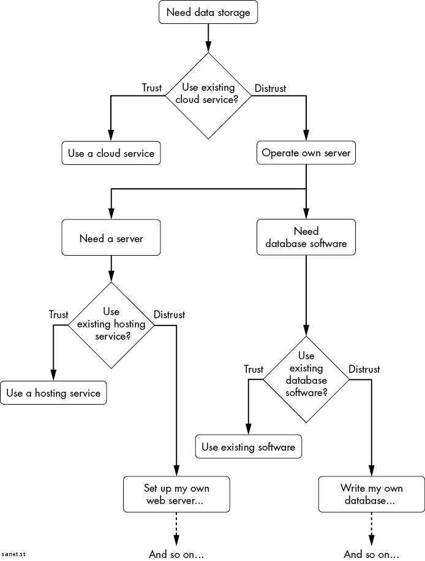

图 1-1：包含信任决策的决策树示例

## 隐式受信任组件

每个软件项目都依赖一个庞大的技术栈，这些技术被`隐式信任`，包括硬件、操作系统、开发工具、库以及其他难以逐一审查的依赖项，因此我们基于供应商的声誉来信任它们。尽管如此，你仍应保持对何为`隐式信任`的敏感度，并对这些决策给予应有的考量，尤其是在大幅扩大隐式信任范围之前。

管理隐式信任没有简单的技巧，但这里有个思路可以提供帮助：将你信任的方的数量最小化。例如，如果你已决定使用微软（或苹果等）操作系统，则倾向于使用其编译器、库、应用程序及其他产品和服务，以尽量减少风险敞口。推理大致是：信任额外的公司会增加这些公司中任意一家让你失望的机会。此外，还有一个实际层面：一家公司的产品线在搭配使用时，往往兼容性更好、联合测试更充分。

## 成为值得信任的一方

最后，不要忘记做出信任决策的另一面，即当你提供产品和服务时要`建立`信任。每个软件产品都必须说服最终用户它是值得信任的。通常，仅展现可靠专业的形象就足够了，但如果产品承担关键功能，则至关重要的是给客户提供信任的坚实基础。

以下是一些增强工作可信度的基本建议：

*   透明度孕育信任。公开工作允许客户评估产品。
*   引入第三方通过其独立性建立信任（例如聘请审计师）。
*   有时你的产品是与其他产品集成的第三方。 因为处于臂长关系的双方难以串通，所以信任会随之增长。
*   当问题出现时，要乐于接受反馈，果断行动，并公开披露任何调查结果及为防止复发所采取的措施。
*   特定的功能或设计元素可以使信任可视化——例如，一个归档解决方案实时显示有多少备份已在分布式位置保存并验证。

行动产生信任，而空洞的宣称如果有什么作用的话，只会削弱精明客户的信任。提供切实可验证的值得信任的证据，最好以客户能潜在地自行验证的方式。即使极少有人真正审查开源代码的质量，但知道他们*可以*审查（并假设其他人很可能正在这样做）几乎同样具有说服力。

# 经典原则

信息安全的指导原则起源于计算机早期，当时计算机从特殊的上锁、空调恒温、架空地板的机房中走出，开始以网络形式连接。这些传统模型是现代信息安全的“牛顿物理学”：是许多应用的优秀且简明的指南，但并非终极真理。例如，信息隐私是现代数据保护和管理中更微妙的考量之一，而传统信息安全原则并未涵盖。

基础原则很好地分为两组，每组三条。前三条原则，我称之为`C-I-A`，定义了数据访问要求；后三条原则，我们称之为`黄金标准`，则关注访问如何被控制和监控。这两组原则相互依存，只有作为一个整体才能保护数据资产。

在防止未授权数据访问之外，还存在一个问题：谁或什么组件和系统应被委以访问权限。这是一个更难的信任问题，最终超出了信息安全的范畴，尽管为了保护任何数字系统，直面这一问题是不可避免的。

## 信息安全的 C-I-A

我们传统上基于信息安全的三大基本原则构建软件安全：`机密性`、`完整性` 和 `可用性`。这三大支柱围绕数据保护的基础而构建，其单独含义直观明了：

### 机密性

1.  仅允许授权的数据访问——不泄露信息。

## 完整性

1.  准确维护数据——不允许未授权的修改或删除。

## 可用性

1.  保持数据的可用性——不允许重大延迟或未授权的关闭。

这些简短的定义均描述了目标及针对其破坏的防御措施。在审查设计时，思考可能破坏安全的方式，并倒推防御措施，往往很有帮助。

`C-I-A` 的三个组成部分均代表理想状态，关键在于避免坚持完美。例如，即使对可靠加密的网络流量进行分析，也可能让有决心的窃听者推断出两个端点之间通信的某些情况，如交换的数据量。从技术上讲，这种数据交换削弱了端点间交互的机密性；但出于实际目的，若不采取极端措施无法修复，且通常风险微小到可安全忽略。（隐藏通信事实的一种方法是让端点始终交换恒定体积的数据，在实际流量较低时按需添加虚拟包。）流量对应什么活动？对手如何利用该知识？下一章将详细解释类似的威胁评估。

请注意，授权内在于 `C-I-A` 的每个组成部分，它仅授权正确的披露、数据修改或可用性控制。什么构成“正确”是一个重要细节，授权策略需要规定这一点，但这不属于这些基本数据保护原语概念的一部分。这部分内容将在“黄金标准”（第 14 页起）中讨论。

### 机密性

维护机密性意味着仅以授权方式披露私密信息。这听起来简单，但实践中涉及诸多复杂性。

首先，仔细识别哪些信息视为私密至关重要。设计文档应明确这一区分。虽然什么算敏感有时似乎显而易见，但人们的看法竟有如此差异，令人惊讶；若无显式规范，我们就冒着误解的风险。最稳妥的假设是：默认将所有外部收集的信息视为私密，直到显式策略声明如何以及为何可以放宽该指定。

以下是一些常被忽视的将数据视为私密的理由：

*   最终用户可能天然期望其数据是私密的，除非被告知否则，即使披露并无害处。
*   用户可能将敏感信息输入到原本用于其他用途的文本字段中。


## 信息安全基础

信息的收集、处理和存储可能受到许多人未察觉的法律法规约束。（例如，如果欧洲用户浏览您的网站，可能适用欧盟法律，如《通用数据保护条例》（GDPR）。）

处理私人信息时，需确定何为适当访问。决定何时以及如何披露信息本质上是一个信任决策，不仅值得明文规定规则，还值得解释这些规则背后的主观考量。

机密性泄露呈现一个光谱。在完全泄露中，攻击者获取整个数据集（含元数据）；在光谱低端可能只是微不足道的信息泄露，如内部错误消息或类似的无实质后果的泄露。作为部分泄露的例子，考虑给新客户分配顺序编号的做法：狡猾的竞争对手可注册为新客户并不时获取新客户编号，然后计算连续差值，从而推断各时间段内新增的客户数量。任何受保护数据细节的泄露，在一定程度上都是机密性的妥协。

极易低估微小泄露的潜在价值。攻击者可能以开发者原本意想不到的完全不同方式利用数据，组合微小信息片段能提供比单个部分更强大的洞察。仅知道某人的邮政编码可能无关紧要，但若同时知晓其大致年龄且为医学博士（MD），便可能结合这些信息在人口稀少地区识别出该个体——这一过程称为**去匿名化**或**重识别化**。研究人员通过分析 Netflix 发布的所谓匿名数据集，成功将大量用户账户与 IMDb 账户匹配：原来您喜爱的电影是一种有效的个人唯一标识手段。

## 完整性

在信息安全语境下，完整性简单指数据的真实性和准确性，使其免受未授权篡改或删除。除了防范未授权修改，准确记录数据的**溯源**——原始来源及任何授权变更——可成为更强有力的完整性保证。

抵御篡改攻击的经典防御是保留关键数据的版本并记录其溯源。简而言之，保持良好的备份。增量备份是极佳的缓解措施，因其部署简单高效，并提供一系列快照，精确记录何时变更了何种数据。然而，完整性需求远超数据保护，通常还包括确保组件、服务器日志、软件源代码及版本，以及发生问题时确定篡改原始来源所需的其他取证信息的完整性。除有限的管理访问控制外，安全摘要（类似校验和）和数字签名也是强有力的完整性检查（详见第 5 章）。

请记住，篡改可通过多种方式发生，不一定是修改存储中的数据。例如，在 Web 应用中，篡改可能发生在客户端、客户端与服务器之间的传输线路上、通过欺骗授权方进行变更、修改页面脚本等多种途径。

## 可用性

可用性攻击是互联互联世界的悲哀现实，且可能是最难防御的攻击之一。最简单的情况下，攻击者仅向服务器发送异常繁重的流量，用看似合法的服务使用使其不堪重负。这意味着信息**暂时**不可用；永久丢失的数据虽也不可用，但通常被视为根本上的完整性妥协。

匿名拒绝服务（DoS）攻击（常为勒索）威胁任何互联网服务，构成棘手挑战。最佳防御是托管在具有抗重负载基础设施的大规模服务上，并保持快速迁移基础设施的灵活性以应对问题。没人确切知道 DoS 攻击的普遍程度或成本，因许多受害者私下解决。但毫无疑问，您应提前制定详细计划以备此类事件。

许多其他可用性威胁也可能存在。对 Web 服务器而言，触发 Bug 导致崩溃或无限循环的畸形请求可摧毁其服务。其他攻击也可能使应用的存储、计算或通信容量过载，或使用破坏缓存有效性的模式，均构成严重问题。未授权销毁软件、配置或数据（即使有备份，延迟也会产生）也会不利地影响可用性。

## 黄金标准

若 C-I-A 是安全系统的目标，黄金标准则描述了达成该目标的手段。*Aurum* 是金的拉丁语，故化学符号为“Au”，巧合的是，安全执行的三项重要原则均以这两字母开头：

### 认证

1.  对主体身份的高可靠性确定

### 授权

1.  可靠地仅允许经过认证的主体执行操作

### 审计

1.  维护主体操作的可靠记录以供检查

**主体**是指任何可靠认证的实体：个人、企业或组织、政府实体、应用、服务、设备，或任何有权行事的代理。

**认证**是可靠确立主体凭证有效性的过程。系统通常允许注册用户通过证明其知晓与用户账户关联的密码来认证，但认证范围可更广。凭证可能是主体**知晓**的（密码）、**持有**的（智能卡），或**固有**的（生物特征数据）；下节将详述凭证。

经认证的主体的数据访问受**授权**决策约束，根据既定规则允许或拒绝其操作。例如，具有访问控制设置的文件系统可使特定文件对特定用户只读。在银行系统中，职员可记录一定金额内的交易，但大额交易可能需要经理批准。

若服务保留安全日志，准确记录主体所做之事（包括尝试执行某操作的失败尝试），管理员可事后进行**审计**，检查系统表现并确保所有操作恰当。准确的审计日志是强安全的重要组成部分，因其提供实际事件的可靠报告。详细日志记录发生了什么，在异常或可疑事件发生时揭示确切经过。例如，若发现重要文件丢失，日志理想情况下应提供谁在何时删除的详情，为进一步调查提供起点。

黄金标准作为保护 C-I-A 的执行机制。我们将机密性和完整性定义为防范**未授权**披露或篡改，可用性也受授权管理员控制。只有系统使用者得到妥善认证，才能真正执行授权决策。审计通过提供谁在何时做了什么的可靠日志（定期审查异常、追究行动方责任）完善了全貌。


# 安全设计：将认证与授权分离

安全设计应始终显式地将**认证**与**授权**分离，因为将它们结合会导致混淆，而当这些阶段被清晰划分时，审计追踪会更加清晰。这两个现实世界的例子说明了分离的重要性：

*   “你为什么让那个家伙进金库？” “我不知道，但他看起来很正规！”
*   “你为什么让那个家伙进金库？” “他的身份证件对应‘Sam Smith’，并且他持有分行经理的手写便条。”

第二个回答比第一个完整得多，第一个回答除了证明守卫是个蠢蛋外毫无帮助。如果金库被攻破，第二个回答将提供明确的细节供调查：分行经理是否有权授予金库访问权限并书写便条？如果守卫保留了身份证复印件，该信息有助于识别并找到 Sam Smith。相比之下，如果分行经理的便条只写着“允许持有者进入金库”——即无认证的授权——安全防线被突破后，调查人员将几乎不知道发生了什么，也不知道入侵者是谁。

### 认证

认证过程基于凭据测试主体的身份声明，以证明他们确实是他们声称的那个人。或者服务可能使用更强形式的凭据，例如数字签名或质询，这证明主体拥有与该身份关联的私钥，这也是浏览器通过 `HTTPS` 对 Web 服务器进行认证的方式。数字签名是一种更好的认证形式，因为主体可以在不泄露秘密的情况下证明他们知晓该秘密。

适合用于认证的证据分为以下几类：

*   **你知道的东西**，如密码
*   **你拥有的东西**，如安全令牌，或在模拟世界中某种不可伪造的证书、护照或签名文件
*   **你本身的东西**——即生物特征（指纹、虹膜图案等）
*   **你所在的地方**——你经过验证的位置，如连接到安全设施内的私有网络

这些方法中有很多都相当不可靠。你知道的东西可能被泄露，你拥有的东西可能被盗或复制，你的位置可能以各种方式被操纵，甚至你本身的东西也可能被伪造（一旦泄露，你无法改变你本身的东西）。除了这些顾虑之外，在当今的网络世界中，认证几乎总是跨网络进行的，这使得任务比面对面认证更困难。例如在 Web 上，浏览器充当信任中介，在本地对用户进行认证，仅当成功时，才将加密凭据传递给服务器。系统通常使用多因素认证来缓解这些担忧，频繁审计这些因素是另一个重要的保障措施。两个弱认证因素比一个好（但好得有限）。

然而，在组织能够为某人分配凭据之前，必须解决一个棘手的问题：当某人入职、注册账户或致电服务台在忘记密码后恢复访问时，如何确定其真实身份。

例如，当我入职 Google 时，所有新员工周一早上聚集在几位 IT 管理员对面，他们将我们的护照或其他身份证件与新员工名单核对。只有在那之后，他们才给我们发放工牌和公司配发的笔记本电脑，并让我们设置登录密码。

通过检查我们提供的凭据（身份证件）是否正确地将我们识别为我们声称的那个人，IT 团队确认了我们的身份。此识别的安全性取决于我们提供的政府签发身份证件及支持文件（例如出生证明）的完整性。这些文件签发得有多准确？伪造或欺诈获取它们有多难？理想情况下，从出生登记开始的关联链将在我们的一生中保持完整，从而唯一且真实地识别我们每个人。安全地识别人很大程度上具有挑战性，因为最有效的技术散发着威权主义的气息，在社会上是不可接受的，因此为了保留一定的隐私和自由，我们在日常生活中选择了较弱的方法。如何确定一个人的真实身份超出了本书范围，本书将专注于**黄金标准**，而非这个更难的**身份管理**问题。

只要可行，就应依赖现有的可信认证服务，不要不必要地重复造轮子。即使是简单的密码认证，要安全地实现也相当困难，而安全地处理忘记密码的情况甚至更难。一般来说，认证过程应检查凭据并提供通过或失败的响应。避免指示部分成功，因为这可能帮助攻击者通过试错法锁定凭据。为缓解暴力猜测威胁，常见策略是使认证过程本身在计算上固有地繁重，或在过程中引入不断增加的延迟（另见第 4 章第 61 页的“避免可预测性”）。

在认证用户后，系统必须找到一种方法将身份安全地绑定到主体。通常，认证模块向主体颁发令牌，主体可在后续请求中用它代替完整认证。思路是主体通过代理（如 Web 浏览器）呈现认证令牌，作为其声称身份的简略保证，为未来的请求创建一个**安全上下文**。此上下文将存储的令牌绑定起来，以便代表已认证的主体随未来请求一同呈现。网站通常通过与浏览会话关联的安全 Cookie 来实现这一点，但针对其他类型的主体和接口，还有许多不同的技术。

经过认证的身份的安全绑定可能以两种根本不同的方式被破坏。显而易见的一种是攻击者篡夺受害者的身份。另一种是经过认证的主体可能串通，试图泄露其身份，甚至将其强加给他人。后一种情况的一个例子是共享付费流媒体订阅。Web 并没有提供很好的方法来防御这种情况，因为绑定是松散的，且依赖于主体的配合。

### 授权

允许或拒绝关键操作的决定应基于认证所确立的主体身份。系统在业务逻辑、访问控制列表或其他某种正式访问策略中实现授权。

匿名授权（即无认证的授权）在极少数情况下可能有用；现实世界的例子可能是持有繁忙车站公共储物柜的钥匙。基于时间的访问限制（例如，数据库访问仅限工作时间）是另一个常见例子。

单个守卫应对给定资源强制执行授权。散落在代码库各处的授权代码是维护和审计的噩梦。相反，授权应依赖一个通用框架来统一授予访问权限。良好的结构化设计有助于开发人员正确实现。应尽可能使用众多标准授权模型之一，而不是令人困惑的临时逻辑。


# 基于角色的访问控制 (RBAC)

*基于角色的访问控制 (RBAC)* 在认证和授权之间架起桥梁。RBAC 根据分配给已认证主体的角色授予访问权限，通过统一框架简化访问控制。例如，银行中的角色可能包括出纳员、经理、贷款专员、保安、财务审计员和 IT 管理员。RBAC 不再为每个人单独选择访问权限，而是根据每个人的职责指定一个或多个角色，从而自动且统一地分配相关联的特权。在更高级的模型中，一个人可能拥有多个角色，并显式选择针对特定访问应用哪个角色。

授权机制可以比操作系统传统提供的简单读/写访问控制更加细粒度。通过设计更健壮的授权机制，您可以在不失去有用功能的前提下，通过限制访问来增强安全性。这些更高级的授权模型包括*基于属性的访问控制 (ABAC)*、*基于策略的访问控制 (PBAC)* 等。

考虑一个简单的银行出纳员示例，了解细粒度授权如何收紧策略：

## 速率限制

1. 出纳员每小时最多可处理 20 笔交易，超过此数量将被视为可疑。

## 时间限制

1. 出纳员交易必须在营业时间内、打卡上班期间进行。

## 禁止自助服务

1. 禁止出纳员使用其个人账户进行交易。

## 多主体授权

1. 超过 10,000 美元的出纳员交易需要单独的经理批准（消除单个恶意行为者一次性转移大量资金的风险）。

最后，即使是只读访问对于某些数据（如密码）来说权限也可能过高。系统通常通过比较摘要来检查登录密码，这避免了泄露实际明文密码的任何可能性。用户名和密码发送到前端服务器，该服务器计算密码的摘要并将其传递给认证服务，迅速销毁明文密码的任何痕迹。认证服务无法从凭据数据库中读取明文密码，但它可以读取摘要，并将其与前端服务器提供的摘要进行比较。通过这种方式，它验证凭据，但认证服务永远无法访问任何密码，因此即使被攻破，该服务也无法泄露密码。除非接口设计提供这些替代方案，否则将错失这些减轻数据泄露可能性的机会。我们将在第 4 章第 57 页讨论“最少信息”模式时进一步探讨这一点。

### 审计

为了使组织能够审计系统活动，系统必须生成一份包含所有对维护安全至关重要的事件的可靠日志。这些事件包括认证和授权事件、系统启动和关闭、软件更新、管理访问等。审计日志还必须防篡改，理想情况下甚至应难以让管理员篡改，才能被视为完全可靠的记录。审计是金标准的关键一环，因为事件确实会发生，且认证和授权策略可能存在缺陷。审计还能提供必要的监督，以减轻授权主体背叛信任的内部作案风险。

如果操作得当，审计日志对于常规监控、衡量系统活动水平、检测错误和可疑活动至关重要，在事件发生后，还能确定攻击实际发生的时间和方式，并评估损害程度。请记住，完全保护数字系统不仅仅是正确执行策略的问题；更关乎做信息资产的负责任的管家。审计确保受信主体在其广泛的权限范围内正当行事。

2018 年 5 月，Twitter 披露了一个尴尬的漏洞：他们发现代码变更导致原始登录密码意外出现在内部日志中。这不太可能导致任何滥用，但肯定损害了客户信心，且本不应发生。日志应记录操作细节，但不应存储任何实际私人信息，以最大程度降低披露风险，因为许多技术人员可能会例行查看日志。有关此要求的详细处理，请参阅附录 A 中的示例设计文档，其中详述了一个解决此问题的日志工具。

系统还必须防止任何人篡改日志以掩盖恶行。如果攻击者可以修改日志，他们就会清除所有活动痕迹。对于高风险的特别敏感的日志，应由在不同管理和操作控制下的独立系统来管理审计日志，以防止内部作案的实施者掩盖自己的踪迹。这很难完全做到，但独立监督的存在本身往往就是一种强大的威慑，就像适度的围栏和显眼的视频监控摄像头可以有效阻止闯入一样。

此外，任何试图规避系统的行为都会显得高度可疑，任何失误都会给违规者带来严重后果。一旦被抓住，他们将难以推卸责任。

*不可否认性* 是审计日志的重要属性；如果日志显示某位具名管理员在特定时间运行了某个命令且系统随即崩溃，就很难将责任推给他人。反之，如果组织允许多个管理员共用同一个账户（这是个糟糕的主意），就无法确切知道是谁实际执行了操作，从而为所有人提供合理的否认空间。

归根结底，只有在您监控审计日志、仔细分析异常事件并跟进采取必要行动时，审计日志才有用。为此，遵循*刚刚好原则* 记录适当数量的细节非常重要。日志过多会膨胀监督数据量，过于嘈杂或杂乱无章的日志难以提取有用信息。另一方面，细节不足的稀疏日志可能会遗漏关键信息，因此找到正确的平衡是一项持续的挑战。

## 隐私

除了信息安全的基础——CIA 三要素和金标准——我还想介绍另一个基础主题：信息隐私这一相关领域。安全与隐私的界限难以清晰界定，它们既紧密相关又截然不同。在本书中，我想关注它们的共同交集，不是试图将它们统一，而是将安全和隐私都纳入软件构建过程。

为了尊重人们的数字信息隐私，我们必须在考虑额外人为因素的基础上扩展机密性原则，包括：

*   客户对信息收集和使用的期望
*   关于适当信息使用和披露的清晰政策
*   与收集和使用各类信息相关的法律和监管问题
*   处理个人信息的政治、文化和心理层面

随着软件在现代生活中变得无处不在，人们以更亲密的方式使用它，涉及生活中敏感领域，导致许多复杂问题。过去的事故和滥用提高了风险的可见性，随着社会通过政治和法律手段应对新挑战，妥善处理私人信息变得极具挑战性。

在软件安全的背景下，这意味着：

*   考虑所有数据收集和共享对客户和利益相关者的后果


# 隐私最佳实践

*   标记所有潜在问题，并在必要时寻求专家建议
*   制定并遵循关于私人信息使用的清晰政策和指南
*   将政策和指导转化为软件强制执行的检查与平衡机制
*   保存数据获取、使用、共享和删除的准确记录
*   审核数据访问授权和非常规访问以确保合规

隐私工作往往不如安全工作定义明确，后者相对清晰明了，主要涉及维护对系统的适当控制并提供恰当的访问权限。此外，随着社会迈向数据收集更加普遍的未来，我们仍在摸索隐私期望和规范。鉴于这些挑战，明智的做法是考虑对数据使用实行最大程度的透明度，包括保持政策足够简单以便所有人理解，并仅收集最少的数据，尤其是个人身份信息。

仅为特定目的收集信息，且仅在其有用的期间内保留。除非设计预见到授权用途，否则首先应避免收集。为“将来某天”可能的用途而轻率收集数据是有风险的，几乎从来都不是好主意。当数据的最后一个授权用途变得不再必要时，最好的保护是安全删除。对于特别敏感的数据，或为了最大程度的隐私保护，应采取更强有力的措施：当披露的潜在风险超过保留的潜在价值时，即删除数据。保留多年的电子邮件偶尔可能派上用场，但很难说是出于明确的业务需求。然而，如果内部邮件泄露或被披露（例如通过传票强制力），可能构成责任。与其无限期地保留所有数据“以防万一”，最好的政策通常是将其删除。

全面阐述信息隐私超出了本书的范围，但隐私和安全是任何收集人员数据的系统设计中紧密相连的两个侧面——人们以这样或那样的方式与几乎所有数字系统交互。只有当安全可靠时，强有力的隐私保护才成为可能，因此这些文字旨在呼吁关注，将隐私考量纳入软件设计之中。

尽管隐私问题复杂，但有一条最佳实践广为人知：清晰传达隐私期望的必要性。与安全不同，隐私政策在信息服务是否以及如何利用客户数据方面，可能留有很大的回旋余地。“我们将重复使用并出售您的数据”是隐私光谱的一个极端，但“某些日子我们可能不保护您的数据”在安全方面则不是一个可行的立场。隐私失效源于用户期望与实际隐私政策不符，或存在明确政策却以某种方式被违反。前者源于未主动向用户解释数据处理方式。后者发生在政策不明确、责任人员忽视政策，或因安全故障导致政策被破坏时。

# 2 威胁

> 威胁通常比事物本身更可怕。
>
> — 索尔·阿林斯基


威胁无处不在，但如果你善于管理，就能与之共存。软件也是如此，不同之处在于你无法享受数百万年进化带来的准备优势。这就是为什么你需要采用软件安全思维，这要求你从构建者的视角转换到攻击者的视角。了解系统面临的潜在威胁，是将可靠的防御和缓解措施烘焙进软件设计的必要起点。但要首先感知这些威胁，你必须停止思考典型用例和按预期使用软件。相反，你必须直面其本质：一堆代码和组件，数据在四周流动、到处存储。

例如，回形针：它巧妙地设计用于将纸张夹在一起，但如果你恰到好处地弯折回形针，它很容易被改造成一根硬铁丝。安全思维能让人洞察到，你可以将这根铁丝插入锁孔，操纵弹子在没有钥匙的情况下打开锁。

值得强调的是，威胁包括导致危害发生的各种方式。有意图的对抗性攻击是讨论的重要焦点，但这并不意味着你应该排除由软件缺陷、人为错误、意外、硬件故障等引起的其他威胁。

威胁建模提供了一种视角，可指导软件开发过程中影响安全的任何决策。以下论述侧重于概念和原则，而非具体的威胁建模方法论。2000 年代初微软首创的早期威胁建模被证明是有效的，但它需要大量培训，以及相当大的精力投入。幸运的是，你可以用多种方式进行威胁建模，一旦理解了概念，就很容易根据可用的时间和精力调整流程，同时仍能产生有意义的结果。

着手列举大型软件系统中的所有威胁并识别所有脆弱点是一项艰巨的任务。然而，明智的安全工作旨在逐步提高门槛，而非追求完美。你最初的努力可能只能发现一小部分潜在问题，并仅缓解其中一部分：即便如此，这也是实质性的改进。这种努力或许就能避免一起重大安全事件——这是真正的成就。遗憾的是，你几乎永远不知道被挫败的攻击，这种缺乏反馈的情况会让人感到失望。你越锻炼安全思维肌肉，就越能擅长识别威胁。

最后，重要的是要理解，威胁建模能提供超越安全范畴的、对目标系统的新层面理解。通过以新方式审视软件，你可能获得见解，从而提出各种改进、效率提升、简化方案以及与安全无关的新功能。

## 对抗视角

> 漏洞利用是我们在现实世界中体验到的最接近“魔法咒语”的事物：构建正确的咒语，获得对设备的远程控制。
>
> — 哈尔瓦·弗莱克

人类肇事者是终极威胁；安全事件不会凭空发生。任何协同的软件安全分析都包括考虑假设的对手可能尝试什么，以预判并防御潜在攻击。攻击者群体形形色色，从 `script kiddies`（没有技术技能、使用自动化恶意软件的犯罪分子）到复杂的国家级行为体，以及介于两者之间的各种角色。你能在多大程度上从对手的视角思考，那就多有帮助，但不要愚蠢地认为你能准确预测他们的每一步行动，或花费太多时间试图钻进他们的脑子里，像大师级侦探智取狡猾的敌人那样。了解攻击者的心态有帮助，但就我们构建安全软件的目的而言，他们可能用来探测、渗透和窃取数据的实际技术细节并不重要。


# 考虑系统中显而易见的目标可能是什么

考虑系统中显而易见的目标可能是什么（有时，对对手有价值的东西对你来说价值较低，反之亦然），并确保这些资产得到强有力的保护，但不要浪费时间去揣测假设攻击者的意图。与其花费不必要的精力，他们往往会专注于最薄弱的环节来达成目的（或者他们可能在盲目摸索，这很难防范，因为他们的行为看起来毫无目的且随意）。缺陷肯定会吸引注意力，因为它们暗示了弱点；偶然发现明显缺陷的攻击者会尝试各种创造性的变体，看看是否真的能攻破系统。泄露系统内部细节的错误或副作用（例如详细的堆栈转储）是攻击者利用和扩大战果的绝佳素材。

一旦攻击者发现弱点，他们很可能会投入更多精力，因为在持续攻击下，一些微小的缺陷往往会扩大并产生更严重的后果（我们将在第 8 章详细探讨）。通常，可以将两个单独来看无关紧要的微小缺陷结合起来，发动一场大规模攻击，因此明智的做法是认真对待所有漏洞。熟练的攻击者肯定了解威胁建模，尽管他们在没有内部信息的情况下工作（至少在设法实现一定程度的渗透之前是这样）。

尽管我们永远无法真正预知对手会花时间攻击什么，但考虑假设攻击者的动机作为勤奋攻击可能性的衡量标准是有意义的。从根本上说，这相当于一位著名罪犯解释他为什么抢银行：“因为钱在那里。”关键在于，攻击系统的潜在收益越大，你就越能预期潜在攻击者会投入更高水平的技能和资源。尽管这种分析带有推测性，但它作为相对指南很有用：强大的企业、政府、军事和金融机构是大目标。你的猫咪照片则不是。

归根结底，与所有形式的暴力一样，攻击和造成破坏总比防御容易得多。攻击者可以选择切入点，凭借决心他们可以尝试任意多的漏洞利用，因为他们只需要成功一次。所有这些都进一步说明了为什么优先开展安全工作很重要：防御者需要利用一切可用的优势。

### 四个问题

Adam Shostack 多年来在微软推广威胁建模，他将该方法论浓缩为四个问题：

*   我们在做什么？
*   可能出什么问题？
*   我们打算怎么应对？
*   我们做得怎么样？

第一个问题旨在确定项目的背景和范围。回答它包括描述项目的需求和设计、组件及其交互，以及考虑运维问题和用例。接下来，作为方法的核心，第二个问题试图预判潜在问题，而第三个问题则探讨针对我们识别出的问题的缓解措施。（我们将在第 3 章更仔细地研究缓解措施，但首先我们将探讨它们如何与威胁相关联。）最后，最后一个问题要求我们反思整个过程——软件做什么、如何出错、我们缓解威胁的效果如何——以评估风险降低情况，并确认系统将足够安全。如果仍有未解决的问题，我们将再次遍历这些问题以填补剩余的空白。

威胁建模的内容远不止这些，但仅凭这四个问题就能走多远，令人惊讶。掌握这些概念，结合本书中的其他思想和技术，你可以显著提高所构建和运营系统的安全标准。

# 威胁建模

“可能出什么问题？”

我们经常问这个问题来开个愤世嫉俗的玩笑。但当不带讽刺意味地认真提问时，它简洁地表达了威胁建模的出发点。回答这个问题要求我们识别和评估威胁；然后我们可以对它们进行优先级排序，并致力于降低重要威胁风险的缓解措施。

让我们拆解一下前面那句话。以下步骤概述了基本的威胁建模过程：

1.  基于系统模型开展工作，以确保我们考虑了范围内的所有内容。
2.  识别系统中需要保护的 `assets`（有价值的数据和资源）。
3.  逐个组件地搜寻系统模型中的潜在威胁，识别 `attack surfaces`（攻击可能发起的位置）、`trust boundaries`（连接系统中受信任度较高部分与受信任度较低部分的接口）以及不同类型的威胁。
4.  分析这些潜在威胁，从最具体的到假设性的。
5.  对威胁进行排序，从最关键到最不关键。
6.  提出缓解措施，以降低最关键威胁的风险。
7.  实施缓解措施，从影响最大且最容易的开始，一直做到边际效益递减的临界点。
8.  测试缓解措施的有效性，从最关键威胁的缓解措施开始测试。

对于复杂系统，所有潜在威胁的完整清单将会庞大，全面分析几乎肯定是不可行的（正如如果你发挥想象力，枚举做任何事的所有可想象方式永远不会结束，而攻击者往往很有想象力）。在实践中，第一轮威胁建模应仅关注针对高价值资产的最大且最可能的威胁。一旦你理解了这些威胁并部署了第一道防线缓解措施，你可以通过迭代考虑已识别的剩余次要威胁来评估剩余风险。从那时起，你可以根据需要执行一轮或多轮额外的威胁建模，每次撒下更广的网，以纳入额外的资产、更深入的分析以及更多不太可能或次要的威胁。当你对最重要的威胁有了足够透彻的理解、规划了必要的缓解措施，并认为剩余已知风险可接受时，该过程即告停止。

人们在日常生活中直觉上会做类似威胁建模的事情，采取我们所谓的常识性预防措施。在公共场所发送私密消息时，大多数人会选择输入而不是对着手机语音输入。用威胁建模的语言来说，消息内容是信息资产，泄露是威胁。在旁人听得到的地方说话是攻击面，使用无声的替代输入法是一种良好的缓解措施。如果有好奇的陌生人在旁窥视，你可以增加额外的缓解措施，比如用另一只手捂住手机遮挡屏幕。但虽然我们在现实世界中很自然地一直在做这类事情，将这些相同技术应用于复杂的软件系统（我们熟悉的物理直觉不再适用）则需要严格得多的纪律。

## 基于模型工作

你需要一种严谨的方法来彻底识别威胁。传统上，威胁建模使用数据流图（DFD）或统一建模语言（UML）来描述系统，但你可以使用任何你喜欢的模型。无论你选择哪种系统的高层描述——无论是 DFD、UML、设计文档，还是非正式的“白板会议”——关键在于审视系统的一个抽象视图，只要它具有足够的颗粒度来捕获分析所需的细节即可。


# 威胁建模的方法论与资产识别

## 方法论的权衡

更正式的方法往往更严谨，产生的结果更准确，但代价是需要额外的时间和精力。多年来，安全社区发明了许多替代方法论，它们提供了不同的权衡方案，这在很大程度上是因为全面的威胁建模方法（涉及 DFD 等正式模型）成本高昂且极其耗费精力。如今，你可以使用专用软件来辅助这一过程。最好的工具能自动完成大量工作，尽管解读结果和进行风险评估始终需要人工判断。本书将传授你独立进行威胁建模所需的一切知识，无需特殊图表或工具，只要你足够了解系统，能彻底回答“四个问题”即可。在此基础上，你可以根据需要逐步迈向更高级的形式。

无论你基于何种模型工作，都应在适当的分辨率下全面覆盖目标系统。遵循“金发姑娘原则”选择分析的适当细节层级：不要试图过度深入细节，否则工作将无穷无尽；也不要层级过高，否则会遗漏重要细节。快速完成流程却几乎没有产出，是粒度不足的明确信号；正如花费数小时却寸进难行，则表明模型可能过于细化。

## 粒度选择示例：通用 Web 服务器

让我们思考一下通用 Web 服务器的合适粒度。假设你拿到一个模型，它是一个块图：左侧是“互联网”，中间连接“前端服务器”，右侧是第三个组件“数据库”。这没有帮助，因为几乎所有曾经设计的 Web 应用都符合此模型。所有资产推测都在数据库中，但究竟是什么？系统与互联网之间必定存在信任边界，但这难道是唯一的吗？显然，该模型层级过高。另一个极端是展示每个库的详细拆解、框架的所有依赖，以及远低于你想要分析的应用层级的组件关系。

“金发姑娘版本”介于这两极之间。数据库中存储的数据（资产）会被归类，每类作为一个整体处理：例如客户数据、库存数据和系统日志。服务器组件会被拆解为足以揭示多个进程的粒度，包括各进程运行的权限、宿主机上的内部缓存，以及用于与互联网和数据库通信的通道和网络描述。

## 识别资产

有条不紊地遍历模型，识别资产及其潜在威胁。资产是系统中必须受保护的实体。大多数资产是数据，但也可能包括硬件、通信带宽、计算容量和物理资源（如电力）。

威胁建模初学者自然想保护所有东西，这在完美世界里很棒。但在实践中，你需要对资产进行优先级排序。例如，考虑任何 Web 应用：互联网上任何人都可使用浏览器或其他你无法控制的软件访问它，因此无法完全保护客户端。此外，你应始终保持内部系统日志私密，但如果日志仅包含对外部人员无价值的无害细节，则投入大量精力保护它们讲不通。这并非意味着完全忽略此类风险；只需确保不那么重要的缓解措施不会占用其他地方所需的精力。例如，仅需一分钟即可通过设置权限（仅管理员可读）来保护非敏感日志，这属于物超所值的付出。

另一方面，你可以将代表金融交易的数据视同真金白银并相应优先处理。个人信息是另一个日益敏感的资产类别，因为获知某人的位置或其他身份细节可能危害其隐私，甚至使其陷入风险。

此外，我通常建议不要尝试执行复杂的风险评估计算。例如，避免试图分配美元价值以进行风险排序。为此，你必须以某种方式为许多未知数赋予概率：会有多少攻击者以何种力度针对你、意图何为？他们多久成功一次、程度如何？客户数据库究竟值多少钱？（注意：其对公司的价值、攻击者可出售的价格、以及用户赋予自身数据的价值往往各不相同。）假设的安全事件将耗费多少工时和其他开支？

相反，一种出奇制胜的简单资产优先级排序方法是按“T 恤尺寸”排名——这是我发现很有用的简化方法，虽非行业标准做法。将“Large”分配给必须保护的核心资产，“Medium”分配给价值较低的重要资产，“Small”分配给后果轻微的次要资产（通常甚至不列入清单）。高价值系统可能拥有“Extra-Large”资产，值得非同寻常的保护级别，如金融机构的银行账户余额，或锚定通信安全的私有加密密钥。在此简化方案中，保护和缓解工作优先聚焦 Large 资产，随后*机会性地*覆盖 Medium 资产。机会性保护指低投入、少负面影响的工作。但即使你能以极高的机会性保护 Small 资产，也应在花费任何时间在这些资产之前，先防御所有 Large 资产。第 13 章详细讨论了漏洞排序，其中许多内容同样适用于威胁评估。

你选择优先保护的资产可能包括客户资源、个人信息、业务文档、运营日志、软件内部数据等。对数据资产的保护优先级排序需考量多种因素，包括信息安全（第 1 章讨论的 CIA 三元组），因为数据泄露、篡改和销毁造成的危害可能截然不同。信息泄露（包括部分信息披露，如信用卡号后四位）难以评估，因为你必须考虑攻击者能利用该信息做什么。当攻击者能将多个信息碎片拼合成完整数据集的近似值时，分析难度进一步增加。

如果将资产归类，可大幅简化分析，但当心在此过程中丢失分辨率。例如，若你统一管理多个数据库、以相似方式授权访问、用于存储来源相似的数据、且存放在同一位置，将它们视为一个整体是合理的。然而，若上述任何因素存在显著差异，你就有充分理由分别处理。请务必在风险分析和缓解措施中考量这些区别。


最后，始终从所有相关方的角度考虑资产的价值。例如，社交媒体服务管理各类数据：内部公司计划、广告数据和客户数据。这些资产的价值各不相同，取决于你是公司的 CEO、广告商、客户，又或是寻求经济利益或追求政治议程的攻击者。事实上，即使在客户群体中，你也很可能会发现他们在对通信隐私重要性的认知上，或对其数据价值的评估上存在巨大差异。良好的数据管理原则表明，你对客户和合作伙伴数据的保护程度，理应超过对公司自身专有数据的保护（我甚至听说过公司高管将其作为明确政策）。

并非所有公司都采取这种做法。Facebook 的 Beacon 功能曾自动将用户的购买详情发布到他们的动态消息中，随后因客户的强烈愤慨和几起诉讼而迅速关闭。虽然 Beacon 从未危及 Facebook 本身（除损害品牌声誉外），但它对客户构成了真实的危险。对客户信息泄露后果进行威胁建模，本可以迅速揭示出：圣诞或生日礼物、甚至更糟——订婚戒指等购买记录的无意泄露，极有可能引发麻烦。

### 识别攻击面

请特别关注攻击面，因为这是攻击者的首个入口点。你应将任何最小化攻击面的机会视为巨大的胜利，因为这能彻底切断潜在的麻烦源头。许多攻击可能会在系统中扩散蔓延，因此尽早阻止它们能起到很好的防御作用。这也是为什么安全的政府大楼在唯一的公共入口内侧设有安检点和金属探测器。

软件设计通常比物理建筑设计复杂得多，因此识别完整的攻击面并非易事。除非你能将系统嵌入受信任的安全环境中，否则拥有一定的攻击面是不可避免的。互联网始终提供了一个巨大的暴露点，因为实际上任何人都可以从任何地方匿名连接。虽然可能会诱导你将 `intranet`（内部网，即私有网络）视为受信任的，但你大概不应该这样做，除非它在物理和 IT 安全方面都具备极高的标准。至少，应将其视为风险降低的攻击面。对于设备或自助终端应用，应将机箱的外部部分（包括屏幕和用户界面按钮）视为攻击面。

请注意，攻击面也存在于数字领域之外。以自助终端为例：公共区域的显示屏可能会通过“肩窥”泄露信息。攻击者还可能实施更隐蔽的 `side-channel attacks`（侧信道攻击），通过监控系统的电磁辐射、热量、功耗、键盘声音等，推断系统的内部状态信息。

### 识别信任边界

接下来，识别系统的信任边界。由于信任与权限几乎总是成对出现的，如果这样更容易理解，你可以从权限边界的角度来思考。信任边界的人类类比可能是经理（知晓更多内部信息）与员工之间的接口，或者是你家的门，你决定允许谁进入。

考虑一个经典的信任边界示例：操作系统的内核-用户态接口。这种架构流行于大型机普及、机器常由多用户共享的时代。系统启动内核，内核将应用程序隔离在不同的用户态进程实例中（对应不同的用户账户），防止它们相互干扰或导致整个系统崩溃。每当用户态代码调用内核时，执行流就跨越了一条信任边界。信任边界很重要，因为向更高权限执行的转换是引发更大麻烦的机会。

SSH 安全外壳守护进程（`sshd(8)`）是采用信任边界进行安全设计的绝佳范例。SSH 协议允许授权用户远程登录主机，然后通过互联网上安全的网络通道运行 Shell。但 SSH 守护进程持续监听连接以启动协议，因此需要极其谨慎的设计，因为它跨越了信任边界。监听进程通常需要超级用户权限，因为当授权用户提供有效凭据时，它必须能够为任意用户创建进程。然而，它也必须监听公共互联网，使其暴露在全世界面前接受攻击。

为了接受 SSH 登录请求，守护进程必须生成一个防窃听和防篡改的安全通信通道，然后处理并验证敏感凭据。只有在此之后，它才能在主机上使用正确的权限实例化一个 Shell 进程。整个过程涉及大量代码，以最高权限运行（以便为任意用户账户创建进程），必须完美运行，否则就有深度危害系统的风险。传入请求可能来自互联网的任何地方，最初难以与攻击区分，很难想象比这更具吸引力、风险更高的攻击目标。

鉴于巨大的攻击面和任何漏洞的严重性，为守护进程投入大量精力来降低风险是合理的。图 2-1 简要展示了其如何设计以保护这一关键信任边界。

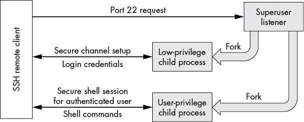

图 2-1：SSH 守护进程的设计如何保护关键信任边界

从顶部开始，每个传入连接都会派生一个低权限子进程，该进程监听套接字并与父进程（超级用户）通信。该子进程还建立协议复杂的安全通道加密，并接收登录凭据将其传递给特权父进程，由父进程决定是否信任传入请求并授予 Shell 权限。为每个请求派生新的子进程在信任边界上提供了战略性保护；它尽可能隔离大部分工作，并最大程度地降低了主守护进程内无意副作用累积的风险。当用户成功登录时，守护进程会使用经过认证的用户账户权限创建一个新的 Shell 进程。当登录尝试认证失败时，处理该请求的子进程会终止，从而避免未来对系统产生不利影响。

与资产一样，你需要决定何时合并或拆分信任级别。在操作系统中，超级用户当然是最高信任级别，其他一些管理用户可能权限接近，你应视其为同样高权限。授权用户通常位于信任图腾柱的次高位置。某些用户可能组成拥有特殊权限的更受信任群体，但通常无需在他们之间细分信任程度。访客账户通常信任级别最低，你大概应重点保护系统免受其侵害，而非保护他们的资源。


# Web 服务与信任边界

Web 服务需要抵御恶意客户端用户，因此 Web 前端系统可能会验证传入流量，仅转发格式良好的请求以供服务处理，实际上是跨越了通往互联网的信任边界。Web 服务器通常连接到防火墙后更受信任的数据库和微服务。如果涉及资金（例如信用卡处理服务），专用的高信任系统应处理付款，理想情况下应隔离在数据中心的围栏区域内。经过身份验证的用户应被信任访问其自身的账户数据，但除此之外，你应将他们视为极不受信任的，因为通常任何人都可以创建登录账号。匿名公共 Web 访问代表了更低的信任级别，静态公共内容可由未连接任何私有数据服务的机器提供服务。

始终通过定义良好的接口和协议来跨越信任边界。你可以将这些想象为国际边境和入境口岸由武装警卫把守的检查站。正如边境管制人员会要求查看你的护照（一种身份验证形式）并检查你的随身物品（一种输入验证形式）一样，你应将信任边界视为缓解潜在攻击的绝佳机会。

最大的风险通常隐藏在低到高信任的转换中（如 SSH 监听器示例），原因显而易见。然而，这并不意味着你应该忽略高到低信任的转换。每当你的系统将数据传递给一个较低信任的组件时，都值得考虑是否在泄露信息，以及这样做是否会成为问题。例如，即使是低权限进程也能读取其运行所在计算机的主机名，因此不要使用敏感信息命名机器，以免攻击者在获得立足点并在系统上运行代码时得到线索。此外，每当高信任服务代表低信任请求工作时，如果用户态请求者设法使内核过载，你就面临 DoS 攻击的风险。

## 识别威胁

现在我们开始威胁建模的核心工作：识别潜在威胁。基于你的模型，仔细审视系统的各个部分。威胁往往聚集在资产周围和信任边界处，但也可能潜伏在任何地方。

我建议从粗略的一遍开始（例如，从 10,000 英尺高空俯瞰系统），然后稍后再回来对更富有成果或更有趣的部分进行更彻底的检查（在 1,000 英尺高空）。保持开放的心态，并务必包含各种可能性，即使你目前还无法确切看出如何利用它们。

识别针对资产的直接威胁应该很容易，信任边界处的威胁也是如此，攻击者可能轻易诱骗受信任组件为其所用。本书全书给出了许多此类威胁在特定情境下的示例。然而，你可能还会发现间接威胁，也许是因为没有可立即危害的资产，或者没有信任边界可跨越。在考虑此类威胁如何作为事件链的一部分发挥作用之前，不要立即忽视它们——可将它们想象为台球中的库射，或形成路径的垫脚石。为了造成破坏，攻击者必须组合多个间接威胁；或者，间接威胁配合 Bug 或设计不良的功能，可能会给攻击者提供可乘之机。视其前景如何以及风险资产的关键程度，即使是较小的威胁也可能值得缓解。

### 银行金库示例

到目前为止，这些概念可能仍显得相当抽象，所以让我们通过对一个虚构的银行金库进行威胁建模，在具体情境中来看看它们。阅读此演示时，请专注于概念，如果你留心的话，应该能够扩展我提出的观点（这些观点并非详尽无遗，这是有意为之）。

想象一下你家乡的一家银行网点。假设它是一座老建筑，正门前厚重的实心橡木双开门两侧矗立着令人印象深刻的罗马柱。建于人工和材料廉价的年代，厚实的钢筋混凝土墙壁看起来坚不可摧。为便于示例，让我们仅关注存放在银行大楼核心区域安全金库中的大量黄金：这是我们要保护的主要资产。我们将使用大楼的建筑图纸作为模型，基于一张 10 英尺对 1 英寸比例的平面图，该图提供了整栋大楼布局的概览。

主要信任边界显然在金库门处，但在柜台后仅限员工区域的锁着的门处还有一个，银行大门处还有一个，将客户大厅与外部隔开。为简化起见，我们将从模型中省略后门，因为它始终被严格锁定，仅在警卫在场时罕见地开启。这使得前门和易于进入的客户大厅区域成为唯一重要的攻击面。

所有这些为寻找潜在威胁的真正工作奠定了基础。显然，黄金被盗是头号威胁，但这太模糊，无法提供太多防范见解，所以我们继续寻找细节。攻击者需要未经授权地进入金库才能窃取黄金。为此，他们需要未经授权地进入金库所在的员工专用区域。到目前为止，我们不知道此类抽象威胁*如何*发生，但我们可以将其分解并使其更具体。以下仅是几个潜在威胁：

*   秘密观察金库密码组合。
*   猜测金库密码组合。
*   通过化妆和假发冒充银行行长。

诚然，这些编造的威胁相当荒诞，但请注意我们是如何从模型中推导出它们的，以及我们是如何从抽象威胁过渡到具体威胁的。

在更详细的第二遍中，我们现在使用的模型包含完整的建筑图纸、水电布局和金库设计规格。有了更多细节，我们可以更容易地想象具体的攻击。以我们刚列出的第一个威胁为例：攻击者观察金库密码组合。这可能通过几种方式发生。让我们看看其中三种：

*   一个目光敏锐的抢劫犯在大厅游荡，观察金库的开启过程。
*   金库密码组合写在便利贴上，柜台前的客户可见。
*   街对面的同伙通过瞄准镜观察金库密码拨盘。

自然，仅知道金库密码组合无法让入侵者获得任何黄金。外部人员得知密码组合是一个重大威胁，但这只是完整攻击链的一部分，后者还必须包括进入员工专用区域、进入金库，然后带着黄金逃脱。

现在我们可以对列举的威胁进行优先级排序并提出缓解措施。以下是针对我们已识别的每种潜在攻击的一些直接缓解措施：

*   大厅游荡者：在金库前放置不透明屏蔽屏。
*   便利贴泄露：制定政策禁止未加保护的书面副本。
*   瞄准镜窥视：安装不透明的半透明玻璃窗。

这些只是众多可能的防御性缓解措施中的一小部分。如果在大楼设计阶段就考虑过这些类型的攻击，或许布局本可以从一开始就消除其中一些威胁（例如，确保没有从任何外部窗户到金库区域的直接视线，从而避免事后更换不透明玻璃的需求）。

真实的银行安全和金融风险管理当然要复杂得多，但这个简化的示例展示了威胁建模过程是如何运作的，包括它如何推动分析向前发展。金库里的黄金是资产中最简单的一种了，但现在你应该会想，究竟如何审视复杂软件系统的模型，才能洞悉其面临的威胁？


#### 使用 STRIDE 对威胁进行分类

20 世纪 90 年代末，Microsoft Windows 占据了个人计算领域的统治地位。随着 PC 成为企业和家庭的必备工具，许多人认为该公司的销售额将无限增长。但微软才刚刚开始摸索网络该如何运作。互联网（当时通常仍拼写为大写的 Internet）和一种叫作万维网的新事物正迅速普及，微软的 Internet Explorer 浏览器已激进地从开创者 Netscape Navigator 手中抢夺了市场份额。如今，公司面临着一个新的安全问题：谁知道将世界上所有的计算机连接在一起会打开怎样的潘多拉魔盒？

当一支微软测试团队正在创造性地寻找安全缺陷时，世界其他地方似乎发现这些缺陷的速度快得多。在对暴露在网络上的漏洞发布补丁这种被动行为持续了几年后，公司组建了一个特别工作组以抢在曲线前面（注：意为主动预防）。作为这项工作的一部分，我与 Praerit Garg 合著了一篇论文，描述了一种简单的方法论，帮助开发人员发现其自家产品中的安全缺陷。基于 `STRIDE` `威胁分类法` 的威胁建模推动了一场覆盖公司所有产品组的大规模教育行动。20 多年后，业界研究人员仍在继续使用 STRIDE 及其许多独立衍生版本来枚举威胁。

STRIDE 通过提供一份待考虑的特定威胁类别清单，聚焦了识别威胁的过程：什么可以被 `欺骗 (S)`、`篡改 (T)` 或 `抵赖 (R)`？什么 `信息 (I)` 可能被泄露？`拒绝服务 (D)` 或 `权限提升 (E)` 如何发生？这些类别足够具体，能聚焦你的分析，又足够通用，让你能在脑海中充实与特定设计相关的细节，并以此深入挖掘。

尽管安全社区成员常将 STRIDE 称为一种威胁建模方法论，但这在术语上是一种误用（至少在我看来是这样，作为这个首字母缩略词的创造者）。STRIDE 仅仅是软件威胁的一种分类法。该首字母缩略词提供了一种简单且易记的助记符，确保你没有遗漏任何威胁类别。它不是一个完整的威胁建模方法论，后者必须包含我们在本章中已经探讨的许多其他组成部分。

要了解 STRIDE 如何工作，让我们从欺骗开始。逐个组件地审视模型，考虑安全运行如何依赖于用户（或机器、或代码上的数字签名等）的身份。如果攻击者能在此欺骗身份，他们可能获得什么优势？这种思考应该会给你提供大量可追踪的线索。通过从威胁视角出发，在模型上下文中审视每个组件，你可以更容易地搁置“它应该如何工作”的想法，转而开始感知“它可能如何被滥用”。

这里有一个我多次成功使用的绝佳技巧：在威胁建模会议开始时，在白板上写下这六个威胁名称。为了起步，先头脑风暴几个这些抽象威胁，然后再深入细节。“头脑风暴”一词可能有不同含义，但这里的想法是快速移动，覆盖大量领域，不过度思考或过早评判想法（稍后可以跳过那些不靠谱的）。这个热身程序让你为要寻找的东西做好准备，也帮助你切换到必要的心态。即使你熟悉这些威胁类别，把它们都过一遍也是值得的，其中有几个不太熟悉且更技术性的类别值得仔细解释。

表 2-1 列出了六个安全目标、其对应的威胁类别，以及每个类别中的若干威胁示例。安全目标和威胁类别是同一枚硬币的两面，有时从其中一方面入手更容易——要么站在防御方（目标），要么站在进攻方（威胁）。

**表 2-1：STRIDE 威胁类别摘要**

| **目标** | **STRIDE 威胁** | **示例** |
| --- | --- | --- |
| 真实性 | 欺骗 | 网络钓鱼、窃取密码、冒充、重放攻击、[BGP 劫持](https://www.cloudflare.com/learning/security/glossary/bgp-hijacking/) |
| 完整性 | 篡改 | 未授权的数据修改和删除、[Superfish 广告注入](https://us-cert.cisa.gov/ncas/alerts/TA15-051A) |
| 不可抵赖性 | 抵赖 | 似是而非的否认、日志记录不足、销毁日志 |
| 机密性 | 信息泄露 | 数据泄露、侧信道攻击、弱加密、残留缓存数据、[Spectre/Meltdown](https://meltdownattack.com/) |
| 可用性 | 拒绝服务 | 同时请求淹没 Web 服务器、勒索软件、[memcrashed](https://blog.cloudflare.com/memcrashed-major-amplification-attacks-from-port-11211/) |
| 授权 | 权限提升 | SQL 注入、xkcd 的“[妈妈的漏洞利用](https://xkcd.com/327/)” |

STRIDE 这组威胁中有一半直接威胁到你在第一章学到的信息安全基础：信息泄露是机密性的敌人，篡改是完整性的敌人，拒绝服务破坏可用性。另一半 STRIDE 威胁则针对“金标准”。欺骗通过假冒身份破坏真实性。权限提升破坏适当的授权。剩下的抵赖则是针对审计的威胁，这可能不那么显而易见，因此值得仔细研究。

根据金标准，我们应保存系统内关键操作的准确记录，并对这些操作进行审计。当某人可信地否认他们执行了某项操作时，就会发生抵赖。在从事软件安全工作的这些年里，我从未见过有人直接抵赖任何事（没人曾在我面前大喊“我干了！”和“我没干！”）。但会发生的是，比如说，一个数据库突然消失了，没人知道为什么，因为没有任何日志记录，丢失的数据无影无踪。组织可能会怀疑发生了入侵。也可能是内部恶意人员所为，或者是管理员的一个令人遗憾的失误。但没有任何证据，没人知情。这是个大问题，因为如果你无法在事后解释发生了什么，就很难防止其再次发生。在物理世界中，这种完美犯罪很少见，因为抢劫银行等活动涉及物理接触，固有地会留下各种痕迹。软件不同；除非你提供一种可靠收集证据和记录事件的方法，否则不会留下指纹或泥泞的靴印作为证据。

通常，我们通过运行这样一些系统来缓解抵赖威胁：管理员和用户明白他们对自己的行为负责，因为他们知道存在准确的审计追踪。这也是避免将管理员密码写在便利贴上供大家共享的又一个充分理由。如果你那样做，麻烦发生时，每个人都能可信地声称是别人干的。即使你完全信任所有人，这也适用，因为意外总会发生，当麻烦来临时，可用的证据越多，恢复和补救就越容易。

#### 电影中的 STRIDE

为了好玩（也为了巩固这些概念），请看看将 STRIDE 威胁应用于电影《十一罗汉》剧情的情况。这部经典的盗窃故事很好地演示了威胁建模概念，包括从攻击者和防御者双方视角出发的完整 STRIDE 类别。对于为简洁和聚焦而对剧情做出的简化，以及剧透内容，敬请谅解。


# 丹尼·奥申违反假释（一种`权限提升`），飞往拉斯维加斯与旧时犯罪搭档会合。他向一位富有的赌场内部人士推销了一个大胆的抢劫计划，对方向他透露了赌场的运营细节（`信息泄露`），随后他召集了一帮前科犯。他们利用一个为练习而建造的全尺寸复制品金库来策划行动。在命运之夜，丹尼现身赌场，并按预期被安保人员逮捕，从而制造了完美的不在场证明（对罪行的`抵赖`）。很快，他通过风管溜走，经过一系列周折，他和同伙从金库中取走了半数现金（`篡改`了金库的完整性），并用一辆遥控货车转移了赃款。

他们威胁要炸毁金库里剩下的数百万（一场代价高昂的`拒绝服务`），以此谈判保留货车里的钱。赌场老板拒绝并召唤特警队，在随之而来的混乱中，歹徒们销毁了金库内容物并逃之夭夭。烟消云散后，赌场老板检查金库，为全盘损失痛心疾首，随即发现了一个看似不妥的细微细节。老板质问丹尼——此时丹尼已回到牢房，仿佛从未离开过——我们得知特警队其实就是那帮歹徒（通过冒充警察实施`欺骗`），他们在假战斗结束后，将钱藏在战术装备包里走了。演练用的模拟金库提供了视频画面，使其看起来`像是`（对地点的`欺骗`）真金库已被攻破，而实际上直到赌场授予假特警队完全访问权限（对歹徒的一次`权限提升`）时，真金库才真正被攻破。丹尼和团伙带着巨款安然脱逃——对肇事者而言是个大团圆结局，但如果赌场聘请了威胁建模顾问，结局可能截然不同！

## 缓解威胁

此时，你应该已经收集了一系列潜在威胁。现在你需要对它们进行评估和优先级排序，以最好地指导有效的防御。既然威胁充其量只是对未来事件的合理推测，你所有的评估都将包含一定程度的主观性。

究竟什么是理解威胁？这个问题没有简单的答案，但它涉及完善我们已知的信息，并保持健康的怀疑态度，以避免陷入“我们已经彻底弄清楚了”的思维陷阱。在实践中，这意味着快速扫描以收集一堆大多抽象的威胁，然后深入挖掘每一个以了解更多。也许我们会发现一两个相当明确的攻击，或构成攻击的部分要素。我们不断详述，直到撞上边际效益递减的墙。

此时，我们可以通过以下四种方式之一来处理已识别的威胁：

*   **缓解** 风险：通过重新设计或增加防御措施，降低其发生几率或将危害程度降至可接受水平。
*   **移除** 受威胁资产（如果非必要），或如果无法移除，则寻求减少其暴露面或限制增加威胁的可选功能。
*   **转移** 风险：将责任外包给第三方，通常以补偿为交换。（例如，保险是常见的风险转移形式，或将敏感数据处理外包给有保密义务的服务商。）
*   **接受** 风险：在充分了解后，认为其为合理可承担的风险。

始终尝试缓解任何重大威胁，但要认识到结果往往好坏参半。在实践中，最佳解决方案并不总是可行的，原因多种多样：重大变更成本可能过高，或你可能被迫使用无法控制的外部依赖。其他代码可能也依赖于有漏洞的功能，修复可能导致破坏。在这些情况下，缓解意味着采取任何能降低威胁的措施。任何对防御有利的优势都有帮助，哪怕很微小。

以下是一些实施部分缓解的示例：

### 降低危害发生的可能性

1.  使攻击仅在极少数情况下奏效。

### 降低危害的严重程度

1.  使只有少量数据会被销毁。

### 使危害可撤销

1.  确保能轻松从备份中恢复任何丢失的数据。

### 使危害显而易见

1.  使用防篡改包装，使消费者易于检测产品是否被修改。（在软件中，完善的日志记录有助于此。）

本书其余大部分内容关注缓解：如何设计软件以最小化威胁，以及哪些策略和安全软件模式有助于设计各类缓解措施。

## 隐私考量

隐私威胁与安全威胁同等真实，在对系统威胁进行全面评估时需要单独考量，因为它们给信息泄露的风险增添了人为因素。除了可能的法规和法律考量，个人信息处理还可能涉及伦理顾虑，尊重利益相关者的期望至关重要。

如果你收集任何类型的个人数据，应将隐私作为基准立场严肃对待。视自己为人们私人信息的管家。努力时刻铭记用户的视角，包括仔细考虑他们可能拥有的广泛隐私顾虑，并倾向于谨慎行事。软件构建者在沉浸于系统构建逻辑时，很容易低估个人数据的敏感程度。代码中看似只是数据库模式里的又一个字段，一旦泄露，可能对真实的个人造成实际后果。随着现代生活日益数字化、移动计算无处不在，隐私将越来越多地依赖于代码，甚至可能以难以想象的新方式依赖。所有这些都表明，你现在保持极度警惕、走在时代前沿将是明智之举。

以下是一些最大程度减少隐私威胁的非常通用的考量：

*   通过建模实际用例场景来评估隐私，而非抽象思考。
*   了解适用的隐私政策或法律要求，并严格遵守条款。
*   将数据收集限制在仅必要的范围内。
*   对“看起来令人毛骨悚然”的可能性保持敏感。
*   如果没有明确的使用意图，绝不收集或存储私人信息。
*   当已收集的信息不再使用或无用时，主动删除它。
*   将与第三方的信息共享降至最低（若发生，应有完善文档记录）。
*   将敏感信息的披露降至最低——理想情况下仅在“需知”基础上进行。
*   保持透明，帮助最终用户理解你的数据保护实践。

## 无处不在的威胁建模

此处描述的威胁建模过程，是我们在世界中导航方式的形式化；我们通过将风险与机遇权衡来管理风险。在危险环境中，所有生物体都基于这些相同的基本原则做决策。一旦你开始寻找，你会发现到处都有威胁建模的实例。


## 缓解措施

> 凭借技艺与勤勉，万事皆可化解。
>
> —盖乌斯·普林尼乌斯·凯基利乌斯·塞昆杜斯（小普林尼）


本章聚焦于第二章提出的四大问题中的第三个：“我们打算怎么做？”预判威胁，进而防范潜在漏洞，这就是安全所谓的*缓解*——降低问题的严重性、范围或影响——正如你在上一章所见，这是我们一直在做的事情。喂婴儿时用来接住不可避免洒漏的围嘴、安全带、限速、火灾报警器、食品安全规范、公共卫生措施和工业安全法规，只是缓解措施的几个例子。这些措施的共同点在于：面对风险，它们采取主动措施来避免或减轻预期的伤害。这在很大程度上就是我们让软件更安全所做的工作。

务必牢记，缓解措施只能降低风险，而无法消除风险。明确地说，如果你能以某种方式消除风险——例如，移除一个已知不安全的遗留功能——那就大胆地去做，但我不会称之为缓解措施。相反，缓解措施侧重于让攻击不太可能发生、更难实施，或在发生时危害更小。甚至那些让漏洞利用更易被检测到的措施也是缓解措施，类似于防篡改包装，如果它们能带来更快的响应和补救。每一份微小的努力都能提升系统整体的安全性，即使是微小的胜利，累积起来也能带来显著更好的防护。

本章首先从概念上探讨缓解措施，随后介绍若干通用技术。重点在于基于威胁建模视角获得的结构性缓解措施，这些措施可用于保护几乎任何系统设计。后续章节将在此基础上深入，提供更详细的方法，深入探讨具体技术和威胁。

本章其余部分针对软件设计中反复出现的安全挑战提供指导：建立访问策略和访问控制、设计接口，以及保护通信和存储。这些讨论共同构成了一本应对常见安全需求的战术手册，将在本书的剩余部分中得到充实。

## 应对威胁

威胁建模揭示了可能出错的地方，从而将我们的安全关注点集中在最关键的地方。但认为我们总能消除漏洞将是天真的。风险点——关键事件或决策阈值——是实施缓解的绝佳机会。

正如你在上一章所学，你应始终优先应对最大的威胁，最大限度地加以限制。例如，对于处理敏感个人信息的系统，未经授权的泄露威胁不可避免地占据主导地位。针对这一重大风险，可考虑采取以下任何或所有措施：将数据访问权限降至最低、减少收集的信息量、在不再需要时主动删除旧数据、通过审计实现妥协事件的早期发现，以及采取措施降低攻击者窃取数据的能力。在确保最高优先级风险得到控制后，在不给设计增加太多开销或复杂性的前提下，伺机缓解次要风险。

一个明智缓解措施的好例子是最佳实践：将每次登录尝试提交的密码与加盐哈希值进行比对，而不是与明文实际密码比对。保护密码至关重要，因为泄露会威胁到基本的认证机制。比对哈希值仅比直接比对多需要一点点工作量，却是巨大的胜利，因为它消除了存储明文密码的必要性。这意味着即使攻击者以某种方式攻破系统，也无法那么轻易地获取实际密码。

这个例子阐释了降低危害的理念，但非常具体于密码检查。现在让我们考虑更广泛适用的缓解策略。

## 结构性缓解策略

缓解措施往往源于常识：在有机会的地方降低风险。威胁建模帮助我们从攻击面、信任边界和资产（需要保护的目标）的角度来看潜在漏洞。*结构性缓解措施*通常适用于模型的这些特征，但其实现取决于设计的具体细节。以下小节讨论的技术应具有广泛适用性，因为它们在模型抽象层面上发挥作用。

### 最小化攻击面

一旦识别出系统的攻击面，你就知道漏洞利用最可能从何处发起，因此，任何能强化系统“外壳”的措施都将是重大胜利。思考攻击面缩减的一个好方法是，从每个入口点向下游追踪，看涉及多少代码和数据。提供多个接口执行相同功能的系统，可能受益于统一这些接口，因为这意味着可能包含漏洞的代码更少。以下是这一常用技术的几个例子：


# 减少攻击面

*   在客户端/服务器系统中，可以通过将功能下推到客户端来减少服务器的攻击面。任何需要服务器请求的操作都代表了额外的攻击面，畸形请求或伪造凭据可能会利用这一点。相反，如果必要的信息和计算能力存在于客户端，则会同时减少服务器的负载和攻击面。

*   将功能从任何人都可以匿名调用的公开暴露 API 移动到经过身份验证的 API，可以有效减少攻击面。账户创建带来的额外摩擦会减缓攻击速度，还有助于追踪攻击者并实施速率限制。

*   使用内核服务的库和驱动程序，可以通过最小化与内核的接口以及内核内的代码来减少攻击面。这样不仅减少了可被攻击的内核转换次数，而且即使攻击成功，用户态代码也无法造成太大破坏。

*   部署和运维提供了许多减少攻击面的机会。对于企业网络，将所有能放在防火墙后面的东西都移到防火墙后面是一个简单有效的举措。

*   启用网络远程管理的配置设置是另一个很好的例子：此功能可能很方便，但如果很少使用，请考虑禁用它，必要时改用有线访问。

这些只是攻击面减少起作用的一些最常见场景。对于特定系统，你可能会发现更多富有创意的定制化机会。持续思考如何减少外部访问、最小化功能和接口，并保护那些不必要暴露的服务。你越了解功能实际使用的位置和方式，就能发现越多此类缓解措施。

### 缩小脆弱性窗口

这种缓解技术类似于攻击面减少，但它减少的不是隐喻的表面积，而是漏洞可能发生的有效时间间隔。这同样基于常识，这也是为什么猎人只在开火前才打开保险，射击后立即关上保险。

我们通常将此缓解措施应用于信任边界，即低信任数据或请求与高信任代码交互的地方。为了最好地隔离高信任代码，应尽量减少其需要执行的处理。例如，如果可能，应在调用高信任代码之前执行错误检查，以便它能完成工作并快速退出。

*[代码访问安全性](https://docs.microsoft.com/en-us/dotnet/framework/misc/code-access-security)* *(`CodeAccessSecurity`，简称 `CAS`)* 是一种如今很少使用的安全模型，它完美诠释了这种缓解措施，因为它提供了对代码有效权限的细粒度控制。（完全公开：我曾担任 .NET Framework 1.0 版本的安全项目经理，该版本将 `CAS` 作为一项主要安全功能突出展示。）

`CAS` 运行时根据信任级别向不同代码单元授予不同权限。以下伪代码示例演示了通用 `permission` 的常用习语，它可以授予对特定文件、剪贴板等的访问权限。实际上，`CAS` 确保高信任代码继承调用它的代码的较低权限，但在必要时，它可以暂时断言其较高权限。以下是此类权限断言的工作原理：

```
Worker(parameters) {
  // 当从低信任调用者调用时，权限会降低。
  DoSetup();
  permission.Assert();
  // 断言后，现在可以使用指定的权限。
  DoWorkRequiringPrivilege();
  CodeAccessPermission.RevertAssert();
  // 撤销断言可消除其效果。
  DoCleanup();
}
```

此示例中的代码拥有强大的权限，但可能由受信任度较低的代码调用。当由低信任代码调用时，该代码最初以调用者的降级权限运行。从技术上讲，有效权限是授予该代码、其调用者、其调用者的调用者等一直到堆栈顶部的所有权限的交集（即最小值）。`Worker` 方法所做的某些工作需要比其调用者拥有的更高权限，因此在完成设置后，它会在调用 `DoWorkRequiringPrivilege` 之前断言必要的权限，后者也必须拥有该权限。完成该部分工作后，它会立即通过调用 `RevertAssert` 放弃特殊权限，然后执行不需要特殊权限的其余清理工作并返回。在 `CAS` 模型中，时间窗口最小化允许在必要时使用此类权限断言，并在不再需要时立即撤销。

考虑以另一种方式应用缩小脆弱性窗口。网上银行提供了便利和速度，移动设备让我们可以随时随地进行银行业务。但将银行凭据存储在手机中有风险——如果你丢失手机（这在移动设备上更有可能发生），你不希望有人掏空你的银行账户。我希望在整个银行业界看到的一项极好的缓解措施是，能够为每个设备配置你满意的权限级别。谨慎的客户可能会将移动应用限制为仅查询余额和设定适度的每日交易金额限额。这样客户就能放心地通过手机进行银行业务。其他有用的限制可能包括时间窗口、地理位置、仅限本币等。所有这些缓解措施都有帮助，因为它们限制了发生任何类型妥协时的最坏情况。

### 最小化数据暴露

针对数据泄露风险的另一种结构性缓解措施是限制敏感数据在内存中的生命周期。这与前面的技术非常相似，但这里你最小化的是敏感数据可访问和潜在暴露的持续时间，而不是代码以高权限运行的持续时间。回想一下，进程内访问很难控制，因此数据仅存在于内存中就会使其面临风险。当风险很高时，例如处理极其敏感的数据，你可以将其视为“计时器在运行”。对于最关键的信息——诸如私有加密密钥、认证凭据（如密码）等数据——一旦不再需要，立即覆盖内存中的任何副本可能是值得的。这减少了通过任何方式发生泄露的可能时间。正如我们将在第 9 章看到的，`Heartbleed` 漏洞威胁了大部分网络的安全，暴露了内存中残留的各种敏感数据。限制此类数据的保留时间可能是一种有用的缓解措施（“止血”，如果你愿意这么比喻的话），即使没有预知该漏洞利用代码。


# 数据存储设计与访问策略

您也可以将此技术应用于数据存储设计。当用户在系统中删除其账户时，通常会导致其数据被销毁，但系统通常会提供一项手动恢复账户的功能，以防意外或恶意关闭。简单的实现方式是将已关闭的账户标记为待删除，但在最终删除所有内容之前，将数据保留在原地，例如 30 天（在手动恢复期结束后）。要使其生效，大量代码需要检查账户是否已计划删除，以免意外访问用户要求销毁的账户数据。如果批量邮件任务忘记检查，可能会错误地向用户发送某些通知，而在用户看来，这在关闭账户后似乎违背了他们的意愿。这种缓解措施表明了一种更好的选择：用户删除账户后，系统应将其内容推送到离线备份，并及时删除数据。仍可使用备份数据完成极少数需要手动恢复的情况，而现在没有任何漏洞可能导致那种错误。

一般来说，主动擦除数据副本是一种极端措施，仅适用于最敏感的数据，或账户关闭等重要操作。某些语言和库有助于自动执行此操作，除非涉及性能问题，否则一个简单的包装函数即可在内存被回收前将其内容擦除干净。

## 访问策略与访问控制

标准操作系统权限提供了非常基础的文件访问控制。这些控制基于进程的用户和组所有权，以全有或全无的方式控制单个文件的 `read`（机密性）或 `write`（完整性）访问。鉴于此功能，在为资产和资源设计保护措施时，很容易陷入同等受限的思维模式——但正确的访问策略可能更加细粒度，并取决于许多其他因素。

首先，考虑传统访问控制为何不适合许多现代系统。Web 服务和微服务旨在代表主体运行，而这些主体通常不对应进程所有者。在这种情况下，一个进程为所有经过身份验证的请求提供服务，需要随时访问所有客户端数据。这意味着一旦存在漏洞，所有客户端数据都可能面临风险。

定义有效的访问策略是一项重要的缓解措施，因为它缩小了应允许的访问与系统碰巧提供的访问控制之间的差距。与其从可用的操作系统访问控制入手，不如思考通过系统行事的各个主体的需求，并定义一个理想的访问策略，准确描述什么构成了适当的访问。细粒度的访问策略可能提供丰富的选项：您可以限制每分钟、每小时或每天的访问次数，或强制执行最大数据量、对应工作时间的基于时间的限制，或基于同伴活动或历史速率的可变访问限制（仅举几个明显的机制）。

确定安全的访问限制是一项艰巨但值得的工作，因为它有助于您理解应用程序的安全需求。即使策略未完全在代码中实现，它至少也能为有效的审计提供指导。有了合适的控制集，您可以从宽松的限制开始，以衡量实际使用情况，然后随着时间的推移，随着您了解系统在实践中是如何被使用的，逐步收紧策略。

例如，考虑一个为客户服务代理团队提供服务的假设系统。代理需要访问可能联系他们的任何客户的记录，但在给定的一天里，他们只与有限数量的客户打交道。一个合理的访问策略可能将每个代理在一个班次中访问的不同客户记录限制在不超过 100 条。如果拥有随时访问所有记录的权限，不诚实的代理可能会泄露所有客户数据的副本，而有限的策略则大大限制了最坏情况下的每日损害。

一旦您拥有了细粒度的访问策略，就会面临设定正确限制的挑战。当您必须避免在极端边缘情况下阻碍正当使用时，这可能很困难。在客户服务示例中，例如，您可能将代理限制为每个班次最多访问 100 位客户的记录，以适应季节性高峰需求，尽管在大多数日子里，即使需要 50 条记录也属罕见。为什么？因为全年调整策略配置是不切实际的，并且您希望留有余地，以免限制阻碍工作。此外，基于固定日期定义更具体、更详细的策略可能效果不佳，因为随时可能出现意外的活动激增。

但是，是否有办法缩小正常情况与系统应允许的罕见最高需求情况之间的差距？处理这种棘手情况的一个绝佳工具是：在策略中规定自声明例外，用于特殊情况。此选项允许个别代理通过提供理由，在短时间内提高自己的限额。有了这种“安全阀”，基本访问策略可以被严格约束。当需要时，一旦代理达到访问限制，他们可以提交一个快速通知——例如说明“今日来电量大，我加班赶进度”——并获得额外的访问授权。此类通知可被审计，如果变得司空见惯，管理层可在确知需求合法增长并了解原因的前提下，调高策略限额。这种灵活的技术使您能够创建具有较软限制的访问策略，而非往往显得武断的硬性限制。

## 接口

软件设计由对应系统功能部分的组件组成。您可以将这些设计可视化为框图，线条代表各部分之间的连接。这些连接表示*接口*，它们是安全分析的重点——不仅因为它们揭示了数据和控制流，还因为它们充当定义明确的关键节点，您可以在其中添加缓解措施。特别是在存在信任边界的地方，主要安全关注点在于从低信任组件到高信任组件的数据和控制流，因此这通常是需要防御措施的地方。

在大型系统中，通常存在网络之间、进程之间以及进程内部的接口。网络接口提供最强的隔离，因为端点之间的任何交互几乎肯定会通过网络进行，但其他类型的接口则更为复杂。操作系统在进程边界提供强隔离，因此进程间通信接口几乎与网络接口一样可信。在这两种情况下，通常都无法绕过这些通道以其他方式交互。攻击面被清晰地限定，因此大多数重要的信任边界都位于此处。因此，进程间通信和网络接口是威胁建模的主要焦点。


# 接口与安全边界

接口也存在于进程内部，那里的交互相对不受限制。编写良好的软件仍可在进程内创建有意义的安全边界，但这些边界只有在所有代码协同良好且不越界时才有效。从攻击者的角度来看，进程内边界更容易渗透。然而，由于攻击者可能只能通过特定漏洞获得有限程度的控制，因此你能提供的任何保护都总比没有强。打个比方，想象一个只有几秒钟作案时间的强盗：即使是微弱的预防措施，也可能足以防止损失。

任何大型软件设计都面临着一个微妙的任务：构建组件以最小化高度特权访问区域，并限制敏感信息流动，以降低安全风险。在设计将信息访问限制在一组隔离良好的最小组件范围内的程度上，攻击者将更难获取敏感数据。相比之下，在较弱的设计中，各种数据到处流动，导致组件内任何位置的漏洞都会造成更大的暴露面。接口的架构是决定系统保护资产成败的主要因素。

# 通信

现代网络系统非常普遍，以至于脱离网络的独立计算机已成为罕见的例外。云计算模型结合移动连接，使得网络访问无处不在。因此，通信是当今几乎所有正在使用的软件系统的基础，无论是通过互联网连接、私有网络，还是通过蓝牙、USB 等外设连接。

为了保护这些通信，通道必须在物理上防窃听和窥探，或者必须对数据进行加密以确保其完整性和机密性。依赖物理安全通常是脆弱的，因为如果攻击者绕过了它，他们通常能获得完整的数据流访问权限，且此类入侵难以检测。现代处理器速度足够快，加密的计算开销通常是可以接受的，因此很少有不加密通信的正当理由。我将在第 5 章介绍基础加密，并在第 11 章专门介绍用于 Web 的 HTTPS。

然而，即使是最好的加密也不是灵丹妙药。一个剩余的威胁是加密无法隐藏*通信这一事实*。换句话说，如果攻击者能读取通道中的原始数据，即使他们无法解读其内容，仍能看到数据正在线路上发送和接收，并大致估算数据流量。此外，如果攻击者能篡改通信通道，他们可能完全延迟或阻断传输。

# 存储

数据存储的安全性很像通信安全性，因为存储数据类似于将其发送到未来，届时你将检索它以备某用。从这个角度看，正如通信中的数据在线路上易受攻击，静止在存储介质上的数据也处于风险之中。保护静态数据免遭潜在篡改或泄露，需要物理安全或加密。同样，可用性取决于备份副本的存在或成功的物理保护。

存储在系统设计中无处不在，因此很容易将数据安全操作的细节推给运维处理，但这样做会错失在设计阶段主动缓解数据丢失的良机。例如，数据备份需求是软件设计的重要组成部分，因为这些需求绝非显而易见，且存在许多权衡。你可以规划冗余存储系统，旨在防止故障导致的数据丢失，但这些系统可能昂贵且带来性能成本。你的备份可能是整个数据集的副本，也可能是增量式的，记录累积起来可用于重建准确副本的事务。无论哪种方式，它们都应在可接受的延迟限度内，以特定频率可靠地独立存储。云架构可以提供近乎实时的冗余数据复制，或许是最佳的持续备份解决方案，但这是有代价的。

所有静止数据，包括备份副本，都面临未授权访问导致的泄露风险，因此你必须对其进行物理保护或加密。备份副本越多，因副本众多而导致泄露的风险就越大。考虑极端情况会使这一点变得清晰。照片是珍贵的回忆，是每个家庭史中不可替代的一部分，因此保留多个备份副本是明智的——如果你没有任何副本且原始文件丢失、损坏或损毁，损失可能是毁灭性的。为了防范此事，你可能会将家庭照片的副本发送给尽可能多的亲戚保管。但这也有负面影响，因为它增加了其中一人数据被盗（通过恶意软件，或可能是笔记本电脑被盗）的几率。这也可能是灾难性的，因为这些是私密回忆，如果这些照片公开散布在网络上，将构成隐私侵犯（如果陌生人能以可能导致剥削的方式识别出照片中的儿童，威胁可能更大）。这是一个基本的权衡，要求你在数据丢失风险与泄露风险之间权衡——你无法同时将两者降至最低，但可以在一定程度上平衡这些顾虑。

作为对这些威胁的折衷，你可以给亲戚发送加密照片。（当然，这意味着他们无法查看。）然而，现在你有责任保管你选择不托付给他们的密钥，如果你丢失了密钥，加密副本就毫无价值。

保存照片还引出了备份数据的一个重要方面，即介质寿命与淘汰问题。物理介质（如硬盘或 DVD）不可避免地会随时间降解，随着新硬件的演进，对传统介质的支持逐渐消失（作者很久以前曾亲自将数据从几十张软盘——只有古旧电脑才能使用——迁移到一个 USB 记忆棒上，现已复制到云端）。即使介质和设备仍能工作，新软件也倾向于放弃对旧数据格式的支持。因此数据格式的选择很重要，强烈推荐广泛使用的开放标准，因为专有格式一旦正式退役就必须进行逆向工程。在更长的时间跨度里，可能需要转换文件格式，因为软件标准在演进，应用程序对旧格式的支持变得不再推荐使用。

本章提到的示例为解释目的已进行简化，虽然我们涵盖了许多可用于缓解已识别威胁的技术，但这只是冰山一角。请根据每个应用程序的需求调整具体的缓解措施，理想情况下应将其作为设计的组成部分。虽然这听起来很简单，但在实践中有效的缓解措施具有挑战性，因为必须在每个系统的背景下考虑多种多样的威胁，而你能做的只有这么多。下一章将介绍具有有用安全属性的主要模式，以及需要警惕的反模式，这些对于将这些缓解措施作为安全设计的一部分非常有用。

## 第 4 章：模式

> 艺术是受审美感知启发的模式。
>
> —赫伯特·里德


### 安全设计模式

建筑师长期以来一直使用设计模式来构想新建筑，这种方法对于指导软件设计同样有用。本章介绍了许多促进安全设计的最有用模式。其中几个模式源自古老的智慧；诀窍在于知道如何将它们应用于软件，以及它们如何增强安全性。

这些模式要么缓解，要么避免各种安全漏洞，构成了一个应对潜在威胁的重要工具箱。许多模式很简单，但也有更难理解的，最好通过示例来解释。不要低估那些简单的模式，因为它们应用广泛，且属于最有效的模式之一。还有一些概念可能更容易作为反模式来掌握，反模式描述的是*不*该做什么。我根据共同特征将这些模式分组呈现，你可以将这些分组视为工具箱的不同分区（图 4-1）。

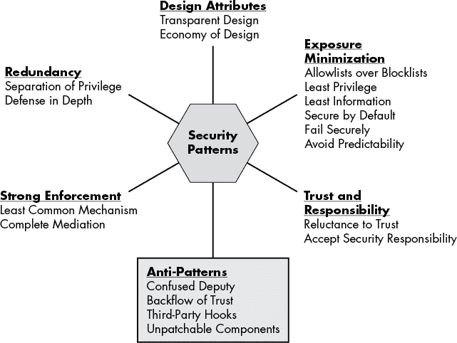

**图 4-1：本章涵盖的安全软件模式分组**

何时何地应用这些模式需要判断力。让必要性和简洁性指导你的设计决策。这些模式虽强大，但切勿过度使用；正如你不需要在门上装七道插销和链条，你也不需要应用所有可能的设计模式来解决一个问题。如果有多个模式都适用，选择最好的一两个，或者针对关键安全需求可能需要更多。过度使用可能适得其反，因为随着复杂性和开销的增加，边际收益递减会迅速超过额外的安全收益。

## 设计属性

第一组模式从高层描述了安全设计的样貌：简单且透明。这些源自“保持简单”和“你不应有什么可隐瞒”的格言。尽管这些模式可能很基础且显而易见，但它们应用广泛且威力巨大。

### 设计经济性

设计应尽可能简单。

*设计经济性*提高了安全门槛，因为更简单的设计可能拥有更少的 Bug，从而减少未被发现的漏洞。尽管开发者常声称“所有软件都有 Bug”，但我们知道简单的程序完全可以没有 Bug。对于安全机制，应优先选择竞争设计中最简单的一个，并对执行关键安全功能的复杂设计保持警惕。

乐高积木是这一模式的绝佳例子。一旦标准积木元件的设计和制造臻于完善，它就能支持构建无数种创意设计。一个由许多不那么通用的零件组成的类似系统将更难构建；任何特定设计都需要更大的零件库存，并涉及其他技术挑战。

你可以在为在大规模数据中心运行而构建的大型 Web 服务的系统架构中找到许多设计经济性的例子。为了实现大规模的可靠性，这些设计将功能分解为更小的、自包含的组件，它们共同执行复杂的操作。通常，一个基础前端终结 HTTPS 请求，将传入的数据解析并验证为内部数据结构。该数据结构被发送给多个子服务进行处理，子服务再使用微服务执行各种功能。

以 Web 搜索应用为例，不同的机器可能会并行独立构建响应的不同部分，然后由另一台机器将它们融合成完整的响应。构建许多小服务来分别完成整体任务的各个部分——查询解析、拼写纠正、文本搜索、图像搜索、结果排版和页面布局——比在一个庞大的程序中完成所有工作要容易得多。

设计经济性并非要求一切必须始终简单的绝对命令。相反，它强调了简洁性的巨大优势，并指出只有当复杂性增加显著价值时，才应拥抱复杂性。请考虑 *nix 和 Windows 中访问控制列表（ACL）设计的差异。前者很简单，按用户或用户组，或针对所有人指定读/写/执行权限。后者复杂得多，包含任意数量的允许和拒绝访问控制条目以及继承功能；值得注意的是，求值取决于列表中条目的顺序。（这些简化描述是为了阐述设计观点，并非旨在详尽无遗。）该模式正确地表明，更简单的 *nix 权限更容易正确强制执行，除此之外，系统用户也更容易正确理解 ACL 的工作原理，从而正确使用它们。然而，如果 Windows ACL 恰好为特定应用提供了正确的保护且能被准确配置，那么它可能是一个很好的解决方案。

设计经济性模式并不意味着简单的选项绝对更好，或复杂的选项一定有问题。在本例中，*nix ACL 并非天生更优，Windows ACL 也不一定有 Bug。然而，Windows ACL 确实代表了更陡峭的学习曲线，使用其更复杂的功能很容易让人困惑，并招致意外后果。这里的关键设计选择——我将不予置评——是 ACL 设计在多大程度上最适合用户需求。也许 *nix ACL 过于简化，无法满足真实需求；另一方面，也许 Windows ACL 功能过剩，在典型使用模式下显得笨重。这些都是我们必须为各自目的自行回答的困难问题，但该设计模式为此提供了洞见。

### 透明设计

强大的保护绝不应依赖保密。

或许未能遵循*透明设计*模式最著名的例子是《星球大战》中的死星，其热排气口直通战斗站的核心。如果达斯·维达像对待莫蒂上将那样严厉地要求建筑师遵守这一原则，故事的结局将截然不同。揭示一个构建良好的系统的设计，应当通过展示其坚不可摧来威慑攻击者。这不应让攻击者的任务变得更容易。相应的反模式可能更为人所知：我们称之为*靠保密求安全*。

该模式专门警告不要*依赖*设计的保密性。这并不意味着必须公开披露设计，也不意味着保密信息有什么不对。如果对设计的完全透明会削弱它，你应该修复设计，而不是依赖保密。这绝不适用于合法的机密信息，例如加密密钥或用户身份，这些信息一旦泄露确实会危及安全。这就是为什么该模式称为透明*设计*，而非绝对透明。完全披露加密方法的设计——密钥大小、消息格式、加密算法等——根本不应削弱安全性。反模式应是一个巨大的危险信号：例如，不要信任那些自封“专家”，他们声称发明了惊人的加密算法，好到无法公开细节。毫无例外，这些都是伪科学。

靠保密求安全的问题在于，虽然它可能暂时阻碍对手，但极其脆弱。例如，设想一种设计使用了过时的加密算法：如果攻击者发现该软件仍在使用 DES（一种 1970 年代的遗留对称加密算法），他们可以轻松在一天内破解它。相反，应做必要的工作以达到可靠的安全基础，使其无话可藏，无论设计细节是否公开。

## 暴露最小化


# 最大的一类模式要求谨慎：要想到“宁可错杀一千，不可放过一个（以安全为重）”。

这些是基本风险/收益策略的表达，即除非有重要理由，否则要稳妥行事。

## 最小权限

仅使用完成工作所需的足够特权，这始终是最安全的。

绝不要清理已上膛的枪。更换锯片时要拔掉电锯的电源插头。这些常见的安全实践都是 `Least Privilege`（最小权限）模式的例子，该模式旨在降低执行任务时出错的风险。这也是重要系统的管理员在工作时登录状态下不应随意浏览互联网的原因；如果他们访问了恶意网站并遭到入侵，攻击极易造成严重危害。

\*nix 系统的 `sudo(1)` 命令正是为此目的而设。拥有高权限的用户账户（称为 `sudoers`）需要小心，不要因意外或被入侵而无意中使用其超常权限。为了提供这种保护，用户必须在超级用户命令前加上 `sudo` 前缀，这可能会提示用户输入密码，以便运行这些命令。在该系统下，大多数命令（不需要 `sudo` 的命令）将仅影响用户自己的账户，而无法影响整个系统。这类似于消防警报开关上的“紧急情况打破玻璃”盖板，用于防止误触发，因为这强制要求在激活开关前执行一个明确的步骤（对应 `sudo` 前缀）。有了玻璃盖板，没人能声称是意外拉响了火警，正如称职的管理员绝不会意外地输入 `sudo` 和一个破坏系统的命令。

此模式之所以重要，原因很简单：当漏洞被利用时，攻击者拥有的特权越小，可利用的杠杆就越少。仅在严格必要时、且在最短可能的时间内，才使用超级用户特权等全能授权。即使是超人也实践了最小权限：只有有活干时才穿制服，救完世界后，立马换回克拉克·肯特的身份。

在实践中，有选择地、节制地使用提升的特权确实需要更多精力。正如拔掉电动工具电源以进行维修需要更多精力一样，使用权限时保持审慎需要自律，但做得正确永远更安全。在遭遇攻击时，这意味着区别在于微小的入侵还是整个系统的沦陷。实践最小权限还可以减轻 Bug 和人为错误造成的损害。

像所有经验法则一样，使用此模式要有平衡感，以避免过度复杂化。最小权限并不意味着系统应始终授予字面上最低级别的授权（例如，为了写入文件 X，创建的代码仅被授予对该单一文件的写入权限）。你可能会想，为什么不总是将这个优秀的模式发挥到极致？除了保持总体平衡感、认识到任何缓解措施都有边际效应递减之外，一个重要因素是控制授权的机制粒度，以及调整权限上下所产生的成本。例如，在 \*nix 进程中，权限是基于用户和组 ID 访问控制列表赋予的。除了在有效 ID 和真实 ID 之间切换的灵活性（这正是 `sudo` 所做的）之外，没有简单的方法在不派生进程的情况下临时放弃不需要的特权。代码应在可能的地方以降低的环境特权运行，在必要的部分使用较高特权，并在自然的决策点进行过渡。

## 最小信息

收集和访问完成工作所需的最少量私人信息，这始终是最安全的。

`Least Information`（最小信息）模式是最小权限在数据隐私方面的类比，有助于将非预期泄露风险降至最低。调用子程序、请求服务或响应请求时，避免提供超出必要范围的私人信息，并在每一个机会中遏制不必要的信息流动。在实践中实施此模式可能具有挑战性，因为软件倾向于在未针对特定目的优化的标准容器中传递数据，因此往往会包含并不真正需要的额外数据。

软件未能遵循此模式的情况屡见不鲜，因为接口的设计会随着时间演变以服务于多种目的，为了保持一致性，复用相同的参数或数据结构很方便。结果是，并非严格必要的数据作为额外负担被一并发送，看似无害。问题当然出在当这些不必要的数据在系统中流动时，为攻击创造了额外的机会。

例如，设想一个企业各类员工使用的大型客户关系管理（CRM）系统。不同员工为各种目的使用该系统，包括销售、生产、发货、支持、维护、研发和会计。根据角色不同，每个人被授权访问该信息的不同子集。为实践最小信息，该企业中的应用程序应仅请求执行特定任务所需的最少数据量。考虑一位响应来电的客户支持代表：如果系统使用来电显示查找客户记录，支持人员不需要知道他们的电话号码，只需知道购买历史即可。将其与一种更基础的设计形成对比，后者要么允许要么禁止查找包含所有数据字段的客户记录。理想情况下，即使代表拥有更多访问权限，他们也应能针对特定任务请求所需的最小数据集并以此开展工作，从而将泄露风险降至最低。

在实现层面，最小信息设计包括在不再需要时擦除本地缓存的信息，或者可能在屏幕上仅显示可用数据的一个子集，直到用户明确请求查看某些详细信息。将密码显示为 `********` 的常见做法利用此模式来降低窥屏风险。

在设计阶段应用此模式尤为重要，因为事后实施极其困难，因为接口的双方需要同步变更。如果你设计适合特定任务的独立组件，而这些任务需要不同的数据集，你更有可能做对。处理敏感数据的 API 应提供灵活性，允许调用者指定他们需要的数据子集，以最大限度地减少信息暴露（表 4-1）。

### 表 4-1：最小信息如何改变 API 设计

| 不符合最小信息的 API | 符合最小信息的 API |
| --- | --- |
| `RequestCustomerData(id='12345')` | `RequestCustomerData(id='12345', items=['name', 'zip'])` |
| `{'id': '12345', 'name': 'Jane Doe', 'phone': '888-555-1212', 'zip': '01010', ...}` | `{'name': 'Jane Doe', 'zip': '01010'}` |

左栏中的 `RequestCustomerData` API 忽略了最小信息模式，因为调用者别无选择，只能通过 ID 请求完整的数据记录。他们不需要电话号码，所以无需请求它，即使忽略它，仍然会扩大攻击者试图获取它的攻击面。右栏是同一 API 的一个版本，允许调用者指定所需字段并仅交付这些字段，从而将私人信息的流动降至最低。

同时考虑到安全默认模式，`items` 参数的默认值应为一组最小字段，前提是调用者可以准确请求他们所需的内容，以最大限度地减少信息流动。

## 安全默认

软件“开箱即用”就应当是安全的。


# 设计软件使其默认安全

设计软件使其**默认安全**，包括其初始状态，以便操作员的不作为不构成风险。这适用于整体系统配置，以及组件和 API 参数的配置选项。带有默认密码的数据库或路由器以违反此模式而臭名昭著，直至今日，此设计缺陷依然令人惊讶地普遍存在。

如果你对安全性认真负责，切勿以稍后再使其安全为目的而配置不安全状态，因为这会造成一段脆弱期，且极易被遗忘。例如，如果你必须使用带有默认密码的设备，请先在防火墙后的私有网络中对其进行安全配置，然后再将其部署到网络中。作为该领域的先驱，加利福尼亚州已通过法律强制要求此模式；其 [2018 年参议院第 327 号法案](https://leginfo.legislature.ca.gov/faces/billTextClient.xhtml?bill_id=201720180SB327) 禁止联网设备使用默认密码。

默认安全适用于任何可能产生不利安全影响的设置或配置，而不仅仅是默认密码。权限应默认为更严格的设置；用户只有在需要且安全的情况下，才应显式地将其更改为限制较少的设置。默认禁用所有潜在危险选项。反之，默认启用提供安全防护的功能，使其从一开始就生效。当然，保持软件完全最新也很重要；不要从旧版本（可能包含已知漏洞）开始，并指望它在某个时间点得到更新。

理想情况下，你永远不应该需要不安全选项。仔细考虑拟议的可配置选项，因为提供一个不安全选项可能很简单，但它此后会成为他人的陷阱。还要记住，每个新选项都会增加可能的组合数量，随着选项数量的增加，确保所有这些设置组合确实有用且安全的任务会变得更加困难。每当你必须提供不安全配置时，都要特别注意主动向管理员解释风险。

不过，默认安全的适用范围远不止配置选项。未指定 API 参数的默认值应为安全选择。浏览器接受地址栏中输入的不带任何协议的 URL 时，应假定站点使用 HTTPS，仅在前者连接失败时才回退到 HTTP。两个对等端协商新的 HTTPS 连接时，应默认优先接受更安全的密码套件选择。

## 允许列表优于阻止列表

在设计安全机制时，首选**允许列表**而非**阻止列表**。`允许列表` 是安全事物的枚举，因此本质上是有限的。相比之下，`阻止列表` 试图枚举所有不安全的事物，并在此过程中隐式地允许一组你*希望*是安全的无限事物。哪种方法风险更大显而易见。

首先，举一个非软件示例，以确保你理解允许列表与阻止列表的含义，以及为何允许列表始终是正道。在 COVID-19 居家紧急命令的最初几个月里，我所在州的州长下令关闭海滩，但附带以下条件（此处为简化形式）：

> 除“在海滩上跑步、慢跑或散步，前提是保持社交距离要求”（穿越海滩去冲浪也被允许）外，任何人不得在任何海滩上坐、站、躺、闲逛、日光浴或徘徊。

第一条款是阻止列表，因为它列出了不允许的活动，而第二个例外条款是允许列表，因为它授予了列出活动的许可。由于法律问题，这种措辞可能有充分理由，但从纯逻辑角度来看，我认为它有很大改进空间。

首先看阻止列表：我相信还有其他人们在海滩上可能进行的高风险活动，第一条款未能予以禁止。如果该命令的意图是让人们保持移动，它遗漏了许多——例如跪姿、瑜伽和活雕像表演。阻止列表的问题在于，任何遗漏都会成为缺陷，因此除非你能完全枚举每一种可能的坏情况，否则它就是一个不安全的系统。

现在看允许的海滩活动允许列表。虽然它也不完整——谁会争辩说跳绳也不可以？——但这不会造成大的安全问题。也许极少数在海滩跳绳的人会受到不公平惩罚，但危害微乎其微，更重要的是，不完整的枚举不会打开允许高风险活动的漏洞。最初遗漏的其他安全项目可根据需要轻松添加到允许列表中。

更一般地，想象一个连续体，左边是不允许，逐渐过渡到右边的允许。中间某处有一条分界线。目标是允许线右边的好东西，同时禁止左边的坏东西。允许列表从右侧划线，然后随着允许事物列表的增长逐渐向左移动，纳入连续体的更多部分。如果你从允许列表中遗漏了某个好东西，你仍处于那条难以捉摸的真实分界线的安全一侧。你可能永远无法达到允许所有安全行为的精确点（此时添加任何内容都会过头），但使用此技术可以轻松保持在安全一侧。对比阻止列表方法：除非你枚举真实分界线左侧的所有事物，否则你就在允许本不该允许的东西。最安全的阻止列表将包含几乎所有事物，这可能过于严格，因此无论哪种方式效果都不佳。

通常，允许列表的用途显而易见，以至于我们未将其视为一种模式。例如，银行合理地授权一小部分受信任的经理批准高价值交易。没人会想维护一份*未*获授权的所有员工的阻止列表，从而隐式地允许任何其他员工拥有此类特权。然而，马虎的程序员可能会尝试通过检查值不包含无效字符列表中的任何字符来进行输入验证，在此过程中容易忘记 `NUL`（ASCII 0）或 `DEL`（ASCII 127）等字符。

具有讽刺意味的是，也许最畅销的消费级安全产品——防病毒软件——试图阻止所有已知恶意软件。现代防病毒产品比依靠将摘要与已知恶意软件数据库比对的老派版本复杂得多，但它们似乎仍在某种程度上基于阻止列表工作。（一个绝佳的**靠保密实现安全**示例，大多数商业防病毒软件是专有的，所以我们只能推测。）它们被困在阻止列表技术中是合情合理的，因为它们知道如何收集恶意软件样本，而在软件发布前以某种方式允许列出世界上所有良性软件的前景似乎行不通。我的观点不关乎任何特定产品或其价值评估，而是关乎凭借阻止列表实现防护的设计选择，以及为何这必然充满风险。

## 避免可预测性

任何可预测的数据（或行为）都无法保持私密，因为攻击者可以通过猜测获知它。


# 软件设计中数据的可预测性

软件设计中数据的可预测性可能导致严重缺陷，因为它可能导致信息泄露。例如，考虑分配新客户账户 ID 这一简单示例。当新客户在网站注册时，系统需要一个唯一的 ID 来标识该账户。一种显而易见且简单的方法是将第一个账户命名为 `1`，第二个账户命名为 `2`，以此类推。这行得通，但从攻击者的角度来看，这泄露了什么信息？

现在，新账户 ID 为攻击者提供了一种简便的方法，以了解迄今为止创建了多少用户账户。例如，如果攻击者定期创建一个新的一次性账户，他们就能准确掌握该网站在特定时间点拥有多少客户账户——这是大多数企业不愿向竞争对手透露的信息。根据系统的具体情况，还可能存在许多其他陷阱。这种糟糕设计的另一个后果是，攻击者可以轻松猜测分配给下一个新建账户的账户 ID，掌握这一信息后，他们可能会通过冒充新账户来干扰新账户的设置过程，从而混淆注册系统。

可预测性问题有多种表现形式，不同的设计可能导致不同类型的泄露。例如，包含账户持有者姓名的几个字母或邮政编码的账户 ID 会毫无必要地泄露关于账户所有者身份的线索。当然，这个问题同样适用于网页、事件等的 ID。针对这些问题，最简单的缓解措施是：如果 ID 的目的是作为唯一句柄，你就应该让它仅仅是唯一句柄——绝不要是用户计数、用户邮箱或基于其他识别信息。

避免这些问题的简便方法是使用 `securely random`（安全随机）ID。真正的随机值无法被猜测，因此不会泄露信息。（严格来说，ID 的长度泄露了可能的最大 ID 数量，但这通常不是敏感信息。）标准系统工具随机数生成器有两种类型：伪随机数生成器和安全随机数生成器。除非你确定可预测性无害，否则应使用较慢的安全选项。更多关于安全随机数生成器的内容请参见第 5 章。

## 安全失败

如果发生问题，请确保最终处于安全状态。

在物理世界中，这纯粹是常识。老式的电熔断器就是一个绝佳例子：如果电流过大流经它，热量会熔化金属，从而断开电路。物理定律使其不可能以维持过大电流流动的方式失效。这种模式或许看起来是最显而易见的，但鉴于软件的本质（我们没有物理定律站在我们这边），它很容易被忽视。

许多乍看似乎微不足道的软件编码任务，往往因错误处理而变得复杂。正常的程序流程可能很简单，但当连接中断、内存分配失败、输入无效或其他各种潜在问题出现时，代码需要在可能的情况下继续执行，或在不可能时优雅地回退。编写代码时，你可能会感觉花在处理这些干扰上的时间比处理手头任务的时间还多，因此很容易草率地将错误处理代码视为不重要，这成为漏洞的常见来源。如果攻击者能够触发这些错误情况，他们会故意这么做，希望能发现可利用的漏洞。

错误情况往往很繁琐，难以彻底测试，特别是当多个错误的组合会复合成新的代码路径时，这可能成为攻击的温床。确保每个错误都得到安全处理，或导致请求被完全拒绝。例如，当有人向照片分享服务上传图片时，应立即检查其是否格式良好（因为格式错误的图片常被恶意利用），如果不是，则及时从存储中移除该数据以防止其进一步被使用。

# 强制执行

这些模式关注如何通过彻底执行规则来确保代码按预期运行。漏洞是任何法律法规的祸根，因此这些模式展示了如何避免创造钻空子的方法。与其编写代码并推断你认为它不会做某事，不如在结构上设计它，使得禁止的操作根本无法发生。

## 完全中介

保护所有访问路径，强制执行相同的访问控制，不例外。

`Complete Mediation`（完全中介）是一个晦涩的术语，却代表了一个显而易见的思想：安全地、一致地检查对受保护资产的所有访问。如果存在多种访问资源的方法，它们都必须接受相同的授权检查，不能有任何提供免通行证或更宽松策略的捷径。

例如，假设一家金融投资公司的信息系统策略规定：普通员工未经经理批准不得查询客户的税号，因此系统为他们提供删减了该字段的客户记录简化视图。经理可以访问完整记录，而在极少数非经理有正当需求的情况下，他们可以请经理帮忙查询。员工以多种方式协助客户，其中之一是：如果客户因故未收到邮寄的税务文件，提供替代税务文件。在确认客户身份后，员工请求一份副本表单（PDF），将其打印并邮寄给客户。该系统的问题在于，员工本不应访问的客户税号却出现在税务表单上：这是 `Complete Mediation` 的失败。不诚实的员工可以以请求替代表单为由，索取任意客户的税务表单，从而获知其税号，绕过了防止向员工泄露信息的策略。

遵循这一模式的最佳方式是，在可能的情况下，设置一个单一的点来做出特定的安全决策。这通常被称为 `guard`（守卫），或非正式地称为 `bottleneck`（瓶颈/单一入口）。其思想是：对给定资产的所有访问都必须通过这一个关口。或者，如果这不可行且需要多个路径设置守卫，那么对同一访问的所有检查在功能上应当等效，且理想情况下应作为相同的代码实现。

在实践中，要始终如一地实现这一模式可能颇具挑战。根据现有的守卫机制，合规程度有所不同：

### 高合规

1.  资源访问仅允许通过一个通用例程（瓶颈守卫）

### 中合规

1.  资源访问分散在各处，每个都由相同的授权检查保护（通用多重守卫）

### 低合规

1.  资源访问分散在各处，由不一致的授权检查分别保护（不完全中介）

一个反面例子说明了为什么对于给定资源，将授权检查集中在单一瓶颈代码路径中的简单授权策略设计，是正确实现这一模式的最佳方式。一位 Reddit 用户最近报告了一个极易出错的案例：

> 我发现我 8 岁的妹妹在用她的 iPhone 6（iOS 12.4.6）看 YouTube，超过了屏幕使用时间限制。原来，她发现了信息应用中屏幕使用时间的一个漏洞，允许用户使用 iMessage App Store 中可用的应用。

Apple 设计 iMessage 时包含了自己的应用，使得可以通过多种方式调用 YouTube 应用，但它没有在这条通往观看视频的替代路径上实施屏幕使用时间检查——这是 `Complete Mediation` 失败的经典案例。


# 避免访问同一资源存在多条路径

避免访问同一资源存在多条路径，且每条路径都有可能以略微不同方式工作的自定义代码，因为任何差异都可能导致某些路径上的防护比其他路径更薄弱。多重防护将要求多次实现本质上相同的检查，并且更难以维护，因为你需要在多个地方做匹配的修改。使用多重防护会增加出错的几率，并增加彻底测试的工作量。

## 最小公共机制

通过最小化共享机制，保持独立进程之间的隔离。

为了最好地理解其含义及其如何提供帮助，让我们来看一个例子。多用户操作系统的内核管理运行在不同用户上下文中的进程的系统资源。内核的设计从根本上确保了进程的隔离，除非它们显式地共享资源或通信通道。在底层，内核维护着为所有用户进程的请求提供服务所需的各种数据结构。该模式指出，这些结构的公共机制可能会无意中连接进程，因此最好尽量减少此类机会。例如，如果某些功能可以在用户态代码中实现，进程边界必然将其隔离在该进程内，那么该功能就不太可能以某种方式连接用户进程。这里的术语*连接*具体是指泄露信息，或允许一个进程在未经授权的情况下影响另一个进程。

如果这仍然感觉很抽象，请考虑这个非软件类比。你在报税截止日期前一天拜访会计师审核你的纳税申报表。会计师的桌子上堆满了文件和文件夹，宛如微型摩天大楼。在翻阅这混乱的堆叠后，他们拿出你的文件开始会议。等待时，你能清楚地看到桌上摆放着印着别人姓名和纳税识别号的纳税表格和银行对账单。也许会计师不小心把关于你税务的简短备记记在了别人的文件里。这正是最小公共机制模式所要避免的那种因会计师将桌面作为公共工作空间而产生的、在独立当事人之间建立的连接。

第二年，你雇了一位不同的会计师，当你与他们会面时，他们从柜子里取出你的文件。他们在桌上打开文件，桌面整洁，看不到任何其他客户的文件。这就是正确应用最小公共机制的方式，将混淆或好奇的客户看到其他文件的风险降至最低。

在软件领域，通过设计面向独立进程或不同用户的服务来应用此模式。与其使用一个包含所有人数据的单体数据库，你能否为每个用户提供单独的数据库，或以其他方式根据上下文限定访问范围？将所有数据放在一个地方可能有充分的理由，但当你选择不遵循此模式时，要警惕由此增加的风险，并显式地强制实施必要的隔离。Web Cookie 是使用此模式的绝佳例子，因为每个客户端独立存储自己的 Cookie 数据。

# 冗余

*冗余* 是工程安全领域的核心策略，体现在许多常识性做法中，例如汽车的备胎。这些模式展示了如何应用冗余使软件更安全。

## 深度防御

组合独立的防护层可构建更强大的整体防御，其效果往往具有协同性，远超任何单一层。

这一强大技术是我们用于使不可避免地充满缺陷的软件系统比其组件更安全的最重要模式之一。想象一个你想改造成暗室的房间，你在窗户上钉胶合板。你有大量的胶合板，但有人在每张板上随机钻了几个小孔。只钉一张板，无数针孔就会破坏黑暗。再在上面钉第二张板，除非两个孔恰好对齐，否则你现在就有了一个完全黑暗的房间。同时使用金属探测器和拍身搜查的安检点是该模式的另一个例子。

在软件设计领域，通过分层部署两个或更多独立的防护机制来强制执行特别关键的安全决策，即可实施*深度防御*。就像有漏洞的胶合板一样，每个实现中可能都存在缺陷，但任何特定攻击同时穿透两层的可能性微乎其微，就像两个胶合板上的孔恰好对齐透光一样。由于两个独立检查需要双倍的工作量并花费双倍的时间，你应该谨慎使用此技术。

一个平衡了工作量、开销与收益的绝佳示例是*沙箱*的实现，这是一个可以安全运行不受信任的任意代码的容器。（现代 Web 浏览器在[安全沙箱中运行 WebAssembly](https://webassembly.org/)。）如果出现任何问题，在系统中运行不受信任的代码可能会导致灾难性后果，这证明了多层防护的开销是合理的（图 4-2）。

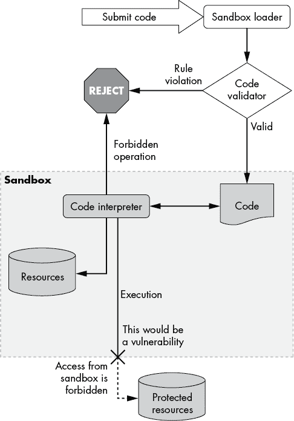

图 4-2：沙箱作为深度防御模式的示例

用于沙箱执行的代码首先会被分析器扫描（防护层一），分析器根据一组规则对其进行检查。如果发生任何违规，系统将完全拒绝该代码。例如，一条规则可能禁止调用内核；另一条规则可能禁止使用特定的特权机器指令。当且仅当代码通过扫描器检查后，它才会被加载到解释器中运行，同时解释器还会强制执行多项限制，旨在防止同类过度特权操作。要攻破该系统，攻击者必须首先绕过扫描器的规则检查，还要欺骗解释器执行被禁止的操作。该示例之所以特别有效，是因为代码扫描和解释从根本上是不同的，因此同一缺陷同时出现在两层中的可能性很低，尤其是如果它们是独立开发的。即使扫描器遗漏特定攻击技术的概率是百万分之一，解释器也是如此，一旦组合，整个系统实际失效的概率约为万亿分之一。这就是该模式的威力。

# 权限分离

两方比一方更可信。

也称为*职责分离*，*权限分离* 模式指的是一个不争的事实：当两把锁有不同的钥匙且分别交由两个不同的人保管时，两把锁比一把锁更坚固。虽然那两个人可能串通一气，但这种情况极少发生；此外，有很好的方法可以将该风险降至最低，无论如何，这总比完全依赖单个个体要好得多。

例如，保险箱的设计使得银行维护包含所有箱子的金库的安全性，而每个箱子持有者拥有单独的钥匙来打开自己的箱子。银行职员若不暴力破坏（如钻锁）就无法进入任何箱子，但没有任何客户知道打开金库的密码。只有当客户获得银行的准入并使用自己的钥匙时，他们的箱子才能被打开。


# 权限分离

当受保护资源存在不同的重叠职责时，应用此模式。保护数据中心是一个典型案例：数据中心有一名系统管理员（大型运营可能有一个团队），负责以超级用户权限操作机器。此外，保安控制对设施的物理访问。这些独立的职责，配合相应的凭证和访问密钥控制，应属于向组织中不同高管汇报的员工，从而降低串通可能性，并防止一位老板命令违反协议的非常规行动。具体而言，远程工作的管理员不应拥有对数据中心机器的物理访问权限，而身处数据中心的人员不应知晓任何登录机器的访问代码，或解密存储单元所需的任何密钥。这需要来自两个控制领域的两个人串通，一人拥有物理访问权限，另一人拥有管理员访问权限，才能完全破坏安全性。在大型组织中，不同小组可能负责数据中心内管理的各种数据集，作为额外的分离层级。

此模式的另一种用法，通常保留给最关键的功能，是将一项职责拆分为多项任务，以避免因单个行为者的错误或恶意意图导致严重后果。作为防止数据备份副本泄露的额外保护，你可以用分别托管的不同密钥对其加密两次，以便只有在双方协助下才能使用。一个极端的例子是触发核导弹发射，需要同时转动相距 10 英尺的锁中的两把钥匙，确保没有任何单个个体能单独执行该操作。

通过权限分离保护审计日志，由一个团队负责事件的记录和审查，另一个团队负责发起事件。这意味着管理员可以审计用户活动，但需要一个单独的小组来审计管理员。否则，恶意行为者可能会阻止记录其自身的腐败活动，或篡改审计日志以掩盖踪迹。

你无法在单台计算机内实现权限分离，因为拥有超级用户权限的管理员拥有完全控制权，但仍有许多方法可以很好地近似实现它。实施具有多个独立组件的设计仍可作为一种有价值的缓解措施，即使管理员最终能够破坏它，因为它增加了颠覆的复杂性；任何攻击都将耗时更长，攻击者在过程中更容易犯错，从而增加被抓获的可能性。管理员的强权限分离可以通过强制管理员通过单独控制的特殊 `ssh` 网关工作来设计，该网关全面记录其会话细节，并可能施加其他限制。

内部威胁难以消除，在某些情况下甚至不可能消除，但这并不意味着缓解措施是浪费时间。仅仅知道有人在监视，本身就是一种巨大的威慑。此类预防措施不仅仅关乎不信任：诚实的员工应该欢迎任何能增加问责制并降低其自身失误风险的权限分离。迫使恶意内部人员努力工作以干净利落地掩盖踪迹，会拖慢他们的速度，并增加他们被当场抓获的几率。幸运的是，人类拥有针对与同事面对面交往而高度进化的信任系统，因此在实践中，内部欺诈极为罕见。

## 信任与责任

信任与责任是使合作得以运作的粘合剂。软件系统日益互联互依，因此这些模式是重要的指路标。

### 不轻易信任

信任应始终是一种明确的选择，并基于可靠证据做出。

该模式承认信任可贵，因此敦促保持怀疑态度。在软件出现之前，罪犯就利用人们天生倾向于信任他人的弱点，乔装成工人以获取进入权限，兜售蛇油，或实施无穷无尽的其他骗局。*不轻易信任*告诫我们不要假设穿制服的人一定是合法的，并要考虑到自称来自 FBI 的来电者可能是骗子。在软件中，该模式适用于安装前检查代码的真实性，以及授权前要求强身份验证。

HTTP Cookie 的使用是该模式的一个绝佳示例，第 11 章将详细解释。Web 服务器在响应客户端时设置 Cookie，期望客户端在未来的请求中发回这些 Cookie。但由于客户端实际上没有义务遵守，服务器应始终谨慎对待 Cookie，绝对信任客户端将始终忠实执行此任务是巨大的风险。

即使没有恶意，**不轻易信任**也很重要。例如，在关键系统中，确保所有组件都达到相同的高质量和安全标准至关重要，以免危及整体。错误的信任决策，例如为关键功能使用匿名开发者的代码（其中可能包含恶意软件，或者仅仅是有漏洞），会迅速破坏安全性。该模式简单且合理，但在实践中可能具有挑战性，因为人们天生倾向于信任，而拒绝信任可能让人感觉像是患了妄想症。

### 承担安全责任

所有软件专业人员都有明确的义务承担安全责任；他们应在所生产的软件中体现这种态度。

例如，设计师在审查要纳入系统的外部组件时，应包含安全需求。在两个系统的接口处，双方都应明确承担各自将遵守的特定责任，并确认其依赖调用方维护的任何保证。

你不想遇到的反模式是：总有一天遇到问题，两个开发者互相说：“我以为你在处理安全，所以我不必管。”在大型系统中，双方很容易发现自己都在指责对方。考虑这样一种情况：组件 A 接受不受信任的输入（例如，Web 前端服务器接收匿名互联网请求），并将其传递给组件 B 中的业务逻辑，过程中可能进行一些处理或重新格式化。组件 A 可能完全不承担安全责任，盲目传递所有输入，假设 B 会通过适当的验证和错误检查安全地处理不受信任的输入。从组件 B 的角度来看，很容易假设前端验证了所有请求，并仅将安全请求传递给 B，因此 B 无需担心此事。处理这种情况的正确方式是通过明确协议；决定由谁验证请求，以及向下游提供何种保证（如果有）。为实现最大安全性，请使用纵深防御，让两个组件独立验证输入。


考虑另一个非常常见的情况，即责任缺口出现在软件的设计者和用户之间。回顾我们在讨论“默认安全”模式时提到的配置设置示例，特别是当提供了一个不安全选项时。如果设计者知道某个可配置选项安全性较低，他们应仔细考虑提供该选项是否真有必要。也就是说，不要仅仅因为提供选项很容易，或者因为“也许将来某天有人会想要这个”就把选项交给用户。这无异于设下陷阱，终有人会不经意掉进去。当存在正当理由需要潜在的高风险配置时，首先应考虑通过更改设计来允许以安全的方式解决问题。如果无法做到这一点，且该需求本质上是不安全的，设计者应当告知用户，并在用户不知后果的情况下保护他们不去配置该选项。不仅要记录风险并建议可能的缓解措施以抵消漏洞，用户还应收到明确的反馈——最好比那种推卸责任的“你确定吗？（了解更多：`<link>`）”对话框要好得多。

## 反模式

> 要学会从他人的灾难中看出你应避免的弊端。
>
> ——普布利利乌斯·西鲁斯

有些技能最适合通过观察大师如何工作来学习，但另一种重要的学习方式来自于避免他人过去的错误。初学化学的人学到稀释酸时，必须将酸加入盛水的容器中——绝不能反过来，因为在大量酸的环境下，第一滴水会突然反应，产生大量热量，可能瞬间使水沸腾，导致水和酸爆炸性地喷溅。没人想通过模仿来学会这个教训，基于这种精神，我在此列举了几个为安全起见最好避免的反模式。

以下几节简要列出了一些软件安全反模式。这些模式通常带有安全风险，因此最好避免，但它们并非实际漏洞。与前几节介绍的命名模式（通常是公认的术语）不同，其中一些没有公认的固定名称，因此我为了方便选择了描述性的名称。

### 混淆的代理

*混淆的代理*问题是一个根本性的安全挑战，是许多软件漏洞的核心。可以说这是所有反模式之母。为了解释其名称和含义，一个短故事是很好的切入点。假设一名法官签发逮捕令，指示其副手逮捕诺曼·贝茨。副手查到诺曼的地址，逮捕了住在那里的男子。该男子坚称弄错了，但副手以前听过这种借口。我们故事的反转（这与《惊魂记》无关）是：诺曼预料到会被抓获，多年来一直使用虚假地址。副手被这一诡计搞得晕头转向，错误地行使了逮捕权；可以说诺曼“耍”了他们，设法将副手合法获得的权力用于其自身的恶意目的。（卑鄙的“虚假报警”罪行——谎报紧急情况以指使警力对付无辜受害者——是混淆的代理问题的完美例证，但我不想详细讲述那些悲伤的故事。）

常见的混淆代理示例包括被用户态代码调用的内核，或被互联网调用的 Web 服务器。被调用者之所以是*代理*，是因为高权限代码受调用是为了代表低权限调用者执行操作。这种风险直接源于信任边界的跨越，这也是威胁建模中极度关注信任边界的原因。在后续章节中，将介绍多种混淆代理的方式，包括缓冲区溢出、输入验证不当和跨站请求伪造（CSRF）攻击，仅举几例。与人类代理不同，后者可以依赖直觉、过往经验和其他线索（包括常识），软件极易被诱骗去做非预期的事情，除非在设计和实现时已充分预见并采取所有必要的预防措施。

#### 意图与恶意

回顾第 1 章，要使软件值得信任，需要满足两个条件：它必须由你信任的人构建，这些人既诚实又有能力交付高质量产品。这两个条件的区别在于意图。逮捕诺曼·贝茨的问题不在于副手贪污腐败，而在于未能正确核实被捕者身份。当然，代码不会抗命或偷懒，但编写糟糕的代码很容易以非预期的方式运行。虽然许多轻信的计算机用户，甚至偶尔一些技术娴熟的软件专业人士，确实会被骗去信任恶意软件，但许多攻击是通过利用那些理应受信任但恰好存在缺陷的软件中的混淆代理来实施的。

混淆代理漏洞常因原始请求的上下文在代码早期丢失而产生——例如，请求者的身份不再可用。这种混淆在同时被高权限和低权限调用的共享通用代码中尤为常见。图 4-3 展示了这种调用的样子。

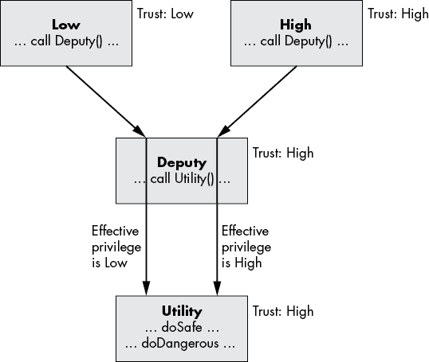

图 4-3：混淆的代理反模式示例

中间的 `Deputy` 代码同时为低权限和高权限代码工作。当从右侧的 High 调用时，它可能会为其受信任的调用者执行潜在的危险操作。来自 Low 的调用代表信任边界跨越，因此 `Deputy` 应仅执行适合低权限调用者的安全操作。在实现内部，`Deputy` 使用子组件 `Utility` 来完成工作。`Utility` 内部的代码没有高、低权限调用者的概念，因此容易错误地代表 `Deputy` 执行潜在的危险操作，而这些操作是低权限调用者不应被允许执行的。

#### 可信的代理

让我们分析如何成为一名可信的代理，首先考虑危险所在。回顾一下，信任边界是混淆潜在开始的地方，因为攻击混淆代理的目标是利用其更高的权限。只要代理理解请求及请求者，并进行适当的授权检查，一切应该就没问题。

回顾前面涉及 `Deputy` 代码的示例，问题出在底层的 `Utility` 代码中，当从 Low 调用时，它没有应对信任边界。从某种意义上说，`Deputy` 无意中使 `Utility` 成为了一个混淆的代理。如果 `Utility` 最初不打算防御低权限调用者，那么要么 `Deputy` 需要彻底屏蔽它以防其被欺骗，要么 `Utility` 可能需要修改以感知低权限调用。


### 密码学

> 密码学通常是被绕过的，而不是被攻破的。
>
> ——阿迪·沙米尔


回想高中时，我差点没通过驾驶教育课程。那是很久以前的事了，那时公立学校还有经费开设驾驶课，汽油里还含有铅（当时没人对那个“绝妙主意”进行威胁建模）。我最初的驾驶尝试并不顺利。我清晰地记得第一次坐上大众甲壳虫汽车驾驶座的那一天，那是一辆手动挡汽车，坐在副驾驶位置上的体育教练那张严肃的脸上写满了显而易见的忐忑。我很快就明白了一个道理：下坡时踩离合器会导致车子加速，而不是像我预想的那样减速。但从那个错误开始，我突然开窍了，竟然会开车了。教练毫不掩饰地表现出了惊讶，如释重负，因为这意外的转折实在令人难以置信。事后看来，我认为我的突破归功于开手动挡那种实实在在的手感，它让我与车辆建立了更直接的联系，让我第一次能凭直觉驾驶。

正如驾驶教育教会学生如何安全驾驶汽车，而不是如何设计或进行大修，本章通过探讨如何正确使用密码学，介绍了密码学的基本工具集，而不深究其内部运作的原理细节。为了让数学基础较弱的读者也能理解密码学，本章摒弃了数学公式，仅保留了一个实例——我实在忍不住要把它放进来，因为它太巧妙了。

这是一种非传统的处理方式，但也很重要。密码学工具之所以未被充分利用，正是因为密码学被视为专家领域，准入门槛极高。现代库提供了密码学功能，但开发者需要知道如何使用这些库（以及如何正确使用），它们才能发挥作用。我希望本章能作为一个跳板，为密码学的潜在用途提供有用的直观认识。你应根据具体需求，通过进一步研究来补充这些内容。

## 密码学工具

从本质上讲，现代密码学很大程度上源于纯数学，因此只要使用得当，它确实行之有效。这并不意味着算法被证明是坚不可摧的，而是意味着攻破它们需要数学领域的重大突破。

密码学提供了一套丰富的安全工具，但要想让它们发挥作用，你必须深思熟虑地使用它们。正如本书反复建议的那样，依赖提供完整解决方案的高质量代码库。选择一个提供适当抽象层级接口的库非常重要，这样你才能完全理解它在做什么。


# 密码学的历史及其背后的数学原理令人着迷，但就创建安全软件而言，现代工具箱包含一组适度的基本工具。以下列表列举了基本的加密安全函数，并描述了每个函数的作用，以及每个函数的安全性取决于什么：

*   **随机数**可用作填充和一次性数值，但前提是它们必须不可预测。
*   **消息摘要**（或**哈希函数**）充当数据的指纹，但前提是它们必须能抵抗碰撞。
*   **对称加密**基于双方共享的密钥来隐藏数据。
*   **非对称加密**基于仅接收者知道的秘密来隐藏数据。
*   **数字签名**基于仅签名者知道的秘密来认证数据。
*   **数字证书**基于对根证书的信任来认证签名者。
*   **密钥交换**允许双方在公开信道上建立共享秘密，即使存在窃听。

本章其余部分将更详细地介绍这些工具及其用法。

## 随机数

人类的思维难以掌握随机性的概念。出于安全目的，我们可以将**不可预测性**视为随机数最重要的属性。正如我们将看到的，在必须防止攻击者正确猜测的情况下，这些数字至关重要，就像可预测的密码会很弱一样。随机数的应用包括认证、哈希、加密和密钥生成，每一种都依赖于不可预测性。以下小节描述了软件可用的两类随机数，它们在可预测性方面的差异，以及何时使用哪一种。

### 伪随机数

**伪随机数生成器（PRNG）**使用确定性计算来生成看起来像无限随机数序列的输出。它们生成的输出可以轻易超出人类的模式检测能力，但分析和对抗性软件可能会轻易学会模仿 PRNG，因此由于其可预测性，它们不适合用于安全场景。

然而，由于计算伪随机数的速度非常快，它们非常适合广泛的非安全用途。例如，如果你想运行蒙特卡洛模拟，或为 A/B 测试随机分配网页设计变体，PRNG 是最佳选择，因为即使有人在极不可能的情况下预测到了算法，也不会构成真正的威胁。

看一个伪随机数的例子可能有助于加深你对其并非真正随机原因的理解。请考虑这个数字序列：

```
94657640789512694683983525957098258226205224894077267194782684826
```

这个序列是随机的吗？碰巧 1 和 3 相对较少，而 2 不成比例地多，但在真正的随机数中出现这种偏离均匀分布的情况并不算异常。然而，尽管这个序列看起来很随机，如果你知道诀窍，就很容易预测接下来的数字。正如透明设计模式所警示的，假设我们能保守方法秘密是有风险的。事实上，如果你在简单的网络搜索中输入这串数字，你会发现它们是圆周率小数点后 200 位开始的数字，接下来的几位数字将是 `0147`。

作为无理数的小数位，圆周率的数字在统计上呈正态分布，从通俗意义上讲，完全是随机的。另一方面，作为一个易于计算且广为人知的数字，这个序列完全可预测，因此不适合用于安全目的。

### 密码学安全的伪随机数

现代操作系统提供**密码学安全伪随机数生成器（CSPRNG）**函数，以解决在需要用于安全的随机位时 PRNG 的缺陷。你可能也会看到它写作 CSRNG 或 CRNG；重要的是那个“C”，意味着它对加密是安全的。包含“伪”字是承认这些生成器也可能达不到完美的随机性，但专家认为它们对于所有实际目的而言都足够不可预测，因此是安全的。

当安全受到威胁时，请使用这种随机数生成器。换句话说，如果假设性地预测一个所谓随机数的值会削弱你的安全性，请使用 CSPRNG。这适用于本书中提到的随机数的每一种安全用途。

根据定义，真正的随机数据不是由算法生成的，而是来自不可预测的物理过程。盖革计数器可以作为这种**硬件随机数生成器（HRNG）**，也称为**熵源**，因为放射性衰变事件的时间是随机的。HRNG 内置于许多现代处理器中，或者你可以购买硬件附件。软件也可以提供熵，通常通过从事件的时间导出，例如磁盘访问、键盘和鼠标输入事件，以及依赖于与外部实体复杂交互的网络传输。

一家主要的互联网科技公司使用一排熔灯来多彩地生成随机输入。但请考虑这种技术的威胁模型：因为该公司选择在其办公室（而且还是在接待区）展示这些熔灯，潜在攻击者可能能够观察该输入的状态，并对熵源做出合理的猜测。然而在实践中，熔灯仅仅是为（推测）幕后更传统的熵源增加熵，从而降低了这种展示导致公司系统轻易被攻破的风险。

熵源需要时间来产生随机性，如果你过快地要求太多位，CSPRNG 会慢到爬行。这是安全随机性的代价，也是 PRNG 作为可靠快速替代品具有重要用途的原因。除非你拥有快速的 HRNG，否则请节制地使用 CSPRNG，并且在吞吐量成为问题的地方，请测试它不会成为瓶颈。

## 消息认证码

消息**摘要**（也称为**哈希**）是使用单向函数从消息计算出的固定长度值。这意味着每个唯一的消息都将有一个特定的摘要，任何篡改都会导致不同的摘要值。单向性很重要，因为它意味着摘要计算是不可逆的，因此攻击者不可能找到一个恰好具有相同摘要结果的不同消息。如果你知道摘要匹配，那么你就知道消息内容未被篡改。

如果两条不同的消息产生相同的摘要，我们称之为**碰撞**。由于摘要将大块数据映射到固定长度的值，碰撞在所难免，因为可能的消息比摘要值多。优秀摘要函数的决定性特征是碰撞极难找到。**碰撞攻击**在攻击者找到产生相同摘要值的两个不同输入时即告成功。对摘要函数最毁灭性的攻击是**原像攻击**，即给定一个特定的摘要值，攻击者可以找到一个产生该值的输入。

密码学安全的摘要算法是强单向函数，它们使碰撞极不可能发生，以至于你可以假设它们永远不会发生。利用摘要的威力需要这个假设，因为这意味着通过比较两个摘要是否相等，你本质上是在比较完整的消息。可以将其想象为比较两个指纹（这也是摘要的一个非正式术语），以确定它们是否由同一手指留下。


如果每个人都对所有事物使用相同的摘要函数，那么攻击者就可以对其进行深入研究和分析，并最终可能发现一些碰撞或其他弱点。防范这种情况的一种方法是使用`keyed hash functions`（带密钥的哈希函数），它接受一个额外的秘密密钥参数来转换摘要计算。实际上，一个接受 256 位密钥的带密钥哈希函数就是一个包含 2²⁵⁶ 个不同函数的类。这些函数也被称为`message authentication codes (MACs)`（消息认证码），因为只要哈希函数密钥是秘密的，攻击者就无法伪造它们。也就是说，通过使用唯一的密钥，你就得到了一个专属于你的定制摘要函数。

## 使用 MAC 防止篡改

MAC 通常用于防止攻击者篡改数据。假设 Alice 想通过公共信道向 Bob 发送消息。他们私下共享了一个特定的秘密密钥；他们不关心窃听，因此不需要加密数据，但如果未被检测到，伪造消息将是个问题。假设邪恶的 Mallory 能够篡改线路上的通信，但她不知道密钥。Alice 使用该密钥计算并随每条消息发送一个 MAC。当 Bob 收到通信时，他计算接收消息的 MAC 并将其与 Alice 发送的附带 MAC 进行比较；如果不匹配，他将其作为伪造品忽略。

这种安排在防御狡猾的 Mallory 方面有多安全？首先，让我们考虑一下显而易见的攻击：

*   如果 Mallory 篡改消息，其 MAC 将与消息摘要不匹配（Bob 将忽略它）。
*   如果 Mallory 篡改 MAC，它将与消息摘要不匹配（Bob 将忽略它）。
*   如果 Mallory 捏造一条全新的消息，她将无法计算 MAC（Bob 将忽略它）。

然而，还有一种情况我们需要防范。你能发现 Mallory 的另一个可乘之机，以及如何防御它吗？

## 重放攻击

前面描述的 MAC 通信方案还存在一个问题，这应该能让你了解使用加密工具对抗坚定攻击者是多么棘手。假设 Alice 每天向 Bob 发送订单，指明第二天想要交付多少个零件。Mallory 观察到此流量并收集 Alice 发送的消息和 MAC 对：第一天她订购三个零件，第二天订购五个。第三天，Alice 订购 10 个零件。此时，Mallory 想到了如何篡改 Alice 消息的主意。Mallory 拦截 Alice 的消息，并用第一天的消息副本（指定三个零件）替换它，连同 Alice 已经帮忙计算好的相应 MAC，而 Mallory 之前已经记录了该 MAC。当然，这欺骗了 Bob。

这就是`replay attack`（重放攻击），安全通信协议需要解决它。问题不在于密码学薄弱，而在于它没有被正确使用。在这种情况下，根本问题是订购三个零件的真实消息是相同的，这从根本上说是一个可预测性问题。

## 安全的 MAC 通信

有多种方法可以修复 Alice 和 Bob 的协议并击败重放攻击，它们都取决于确保消息始终是唯一且不可预测的。一个简单的修复可能是让 Alice 在消息中包含一个时间戳，并约定 Bob 应忽略带有旧时间戳的消息。现在，如果 Mallory 在周三重放周一的三个零件订单，Bob 在比较时间戳时就会注意到并发现欺诈。然而，如果消息频繁或网络延迟大，时间戳可能效果不佳。

针对重放攻击威胁的一个更安全的解决方案是让 Bob 在 Alice 每次发送消息前发送一个`nonce`（一次性随机数）。然后 Alice 可以发回一条消息，连同 Bob 的 nonce 以及消息和 nonce 组合的 MAC。这能阻止重放攻击，因为 nonce 随每次交换而变化。Mallory 可以拦截并更改 Bob 发送的 nonce，但如果返回不同的 nonce，Bob 会注意到。

这个简单示例的另一个问题是消息很短，仅包含零件数量。撇开重放攻击的危险不谈，非常短的消息容易受到暴力攻击。计算带密钥哈希函数所需的时间通常与消息数据长度成正比，对于仅几位的数据，计算速度将非常快。Mallory 尝试不同可能的哈希函数密钥的速度越快，猜中与真实消息 MAC 匹配的正确密钥就越容易。知道密钥后，Mallory 现在就可以冒充 Alice 发送消息。

你可以通过用随机位填充消息直到达到合适的最小长度来缓解短消息漏洞。计算这些较长消息的 MAC 需要时间，但这很好，因为它将 Mallory 的暴力攻击减慢到不可行的地步。事实上，希望哈希函数是昂贵的计算正是出于这个原因。这是一个需要填充为随机（而不是可预测的伪随机）以让 Mallory 尽可能费力的情况。

## 对称加密

所有加密都通过将`plaintext`（明文）或原始消息转换为称为`ciphertext`（密文）的不可识别形式来隐藏消息。对称加密算法使用一个秘密密钥来为通信双方的私人使用定制消息的转换，通信双方必须事先商定一个密钥。解密算法使用相同的秘密密钥将密文转换回明文。我们称这种可逆转换为`symmetric cryptography`（对称密码学），因为掌握秘密密钥允许你既加密也解密。

本节介绍几种对称加密算法来说明其安全属性，并解释安全使用它们所需的一些预防措施。

## 一次性密码本

密码学家很久以前就发现了理想的加密算法，尽管正如我们将看到的，它几乎从未被实际使用，但由于其极致的简洁性，它是讨论加密的一个很好的切入点。这种算法被称为`one-time pad`（一次性密码本），它要求通信双方事先商定一个秘密的、随机的比特串作为加密密钥。为了加密消息，发送方将消息与密钥进行异或（exclusive-or）运算，生成密文。接收方然后将密文与相同的对应密钥位进行异或运算以恢复明文消息。回想一下，在异或（⊕）运算中，如果密钥位为零，则相应的消息位保持不变；如果密钥位为一，则消息位被反转。图 5-1 以图形方式说明了一个简单的一次性密码本加密和解密示例。

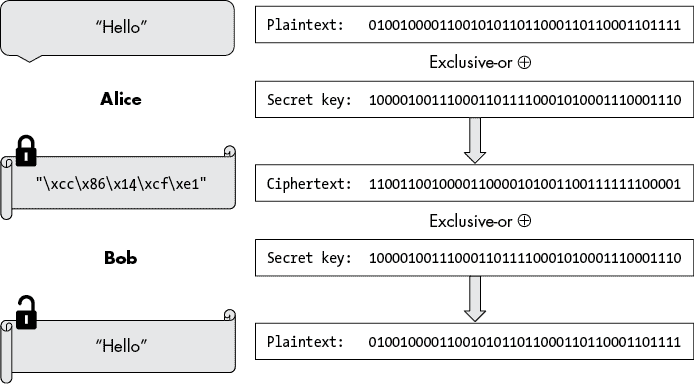

图 5-1：Alice 和 Bob 使用一次性密码本加密

后续消息使用秘密密钥比特串中更靠后的位进行加密。当密钥用尽时，通信双方需要以某种方式商定一个新的秘密密钥。有充分的理由说明它是`one-time`（一次性）密钥，我将稍后解释。假设密钥是随机的，消息位要么随机反转，要么保持不变，因此攻击者在不知道密钥的情况下无法辨别原始消息。随机翻转一半的位是消息的完美伪装，因为显示或反转大多数位都会部分泄露明文。尽管这可能对分析攻击免疫，但很容易看出为什么这种方法很少使用：密钥长度限制了消息长度。


# 让我们考虑禁止重复使用一次性密码本密钥的规定

假设 Alice 和 Bob 使用相同的密钥 `K` 来加密两条不同的明文消息 `M1` 和 `M2`。Mallory 截获了两个密文：`M1 ⊕ K` 和 `M2 ⊕ K`。如果 Mallory 对这两个加密的密文进行异或运算，密钥就会抵消，因为当你将任意数字与其自身进行异或运算时，结果为零（1 变为 0，而 0 保持不变）。结果是两条消息的弱加密版本：

```
(M1 ⊕ K) ⊕ (M2 ⊕ K) = (M1 ⊕ M2) ⊕ (K ⊕ K) = M1 ⊕ M2
```

虽然这不会直接泄露明文，但它开始泄露信息。在剥离了密钥位后，分析可能会揭示消息内部模式的线索。例如，如果任一消息包含一串零位，则另一消息的对应位将泄露出来。

一次性密钥使用限制是大多数应用场景的**致命障碍**：Alice 和 Bob 可能无法预先知道他们想要加密多少数据，这使得预先决定密钥需要多长变得不可行。

## 高级加密标准

`高级加密标准` (`AES`) 是一种常用的现代对称加密分组密码算法。在`分组密码`中，长消息被分割成块大小的块，较短的消息则用随机位填充以补齐块的剩余部分。`AES` 使用通常为 256 位长的密钥加密 128 位的数据块。Alice 使用同一个商定好的密钥来加密数据，Bob 用它来解密。

让我们考虑一些可能的弱点。如果 Alice 随时间向 Bob 发送相同的消息块，这些将导致相同的密文，聪明的 Mallory 会注意到这些重复。即使 Mallory 无法破译这些消息的含义，这也代表了一个需要缓解的重大信息泄露。通信也容易受到重放攻击，因为如果 Alice 可以重发相同的密文来传达相同的明文消息，那么 Mallory 也可以这样做。

以相同方式加密相同消息称为`电子密码本 (ECB) 模式`。由于容易受到重放攻击，这通常是一个糟糕的选择。为了避免这个问题，你可以使用其他模式，这些模式在后续块中引入反馈或其他差异，使得生成的密文取决于前面块的内容或序列中的位置。这确保了即使明文块相同，密文结果也会完全不同。然而，虽然以块链式加密数据流是有利的，但它确实要求通信双方有义务维护顺序上下文以正确加密和解密。因此，加密模式的选择通常取决于应用程序的特定需求。

## 使用对称密码学

对称加密是现代加密的**主力军**，因为在正确应用时它既快速又安全。加密保护通过不安全信道传输的数据，以及静止存储中的数据。使用对称加密时，重要的是要考虑一些基本限制：

### 密钥建立

1.  加密算法依赖于密钥的预先安排，但不指定应如何建立这些密钥。

### 密钥保密性

1.  加密的有效性完全取决于在需要时仍可用的前提下保持密钥的保密性。

### 密钥大小

1.  较大的密钥更强（一次性密码本在理论上是理想选择），但管理大密钥变得昂贵且笨重。

对称加密本质上依赖于共享密钥，除非 Alice 和 Bob 能直接会面进行可信交换，否则很难建立。为了解决这一限制，`非对称加密` 提供了一些令人惊讶的有用新功能，非常适合互联互联的世界需求。

### 非对称加密

非对称密码学是一种**极其反直觉**的加密形式，其力量正在于此。使用对称加密时，Alice 和 Bob 可以使用同一个密钥进行加密和解密，但使用非对称加密时，Bob 可以向 Alice 发送他自己无法解密的秘密消息。因此，对 Bob 而言加密是单向函数，而只有 Alice 知道能让她反转该函数（即解密消息）的秘密。

非对称密码学使用一对密钥：用于加密的`公钥`和用于解密的`私钥`。我将描述 Bob（或世界上的任何人）如何向 Alice 发送加密消息；对于双向对话，Alice 将使用 Bob 完全独立的密钥对，遵循相同的过程回复。使用这两个密钥进行的变换是逆函数，但仅知道其中一个密钥无助于推导出另一个；因此，如果你保守一个密钥的秘密，则只有你能执行该计算。由于这种不对称性，Alice 可以创建一个密钥对，然后向世界公开其中一个密钥（她的公钥），使任何人都能加密只有她能用相应的私钥解密的消息。这是革命性的，因为它基于知晓一个秘密，赋予了 Alice 一种独特的能力。在接下来的页面中，我们将看到这能实现什么。

存在许多非对称加密算法，但这些算法的数学细节对于理解如何将它们作为加密工具使用并不重要——重要的是你理解其安全含义。我们将重点关注 `RSA`，因为它是数学上最不复杂的鼻祖。

## RSA 密码系统

在 MIT，我有幸与 `RSA` 密码系统的三位发明者中的两位共事，我的学士论文探讨了非对称密码学如何提高安全性。以下简化的讨论遵循 [RSA 原始论文](https://people.csail.mit.edu/rivest/Rsapaper.pdf)，尽管（出于各种我们无需在此深究的技术原因）现代实现更为复杂。

`RSA` 的核心思想是：将两个大素数相乘很容易，但给定该乘积，将其分解为组成素数却是不可行的。开始时，选择一对随机的大素数，你将保守它们的秘密。接下来，将这对素数相乘。从结果（我们称之为 `N`）中，你可以计算出一对唯一的密钥。这两个密钥中的每一个，连同 `N`，都允许你计算出两个互为逆函数的函数 `D` 和 `E`。也就是说，对于任意正整数 `x` < `N`，`D(E(x))` 为 `x`，`E(D(x))` 也为 `x`。最后，选择密钥对中的一个作为你的私钥，并将另一个作为相应的公钥连同 `N` 一起公开给世界。只要你保守私钥和最初的两个素数的秘密，只有你能高效地计算函数 `D`。

以下是 Bob 如何为 Alice 加密消息，以及她如何解密。这里函数 `E[A]` 和 `D[A]` 分别基于 Alice 的公钥和私钥，连同 `N`：

*   Bob 使用 Alice 的公钥将消息 `M` 加密为密文 `C`：`C = EA`。
*   Alice 使用她的私钥从 Bob 的密文 `C` 中解密出消息 `M`：`M = DA`。

由于公钥不是秘密，我们假设攻击者 Mallory 知道它，这确实引发了公钥加密特有的新担忧。如果窃听者能猜测到可预测的消息，他们可以使用公钥自行加密各种可能的消息，并将结果与线路上传输的密文进行比较。如果他们发现传输的密文匹配，就知道了产生它的明文。这种`选择明文攻击`可以通过用适量的随机位填充消息来轻松挫败，从而使猜测变得不切实际。


RSA 并非首个发布的非对称密码系统，但它引起了轰动，因为破解它（即从某人的公钥推导出其私钥）需要解决一个著名的难题：大素数乘积的因式分解。由于我在 RSA 公开首秀时曾以微薄之力与其发明者合作，我可以提供一个历史注记，或许能让你对其当时与现在的意义感兴趣。该算法对当时的计算机来说计算量太大，因此其使用需要昂贵的定制硬件。因此，我们设想它仅会被大型金融机构或军事情报机构使用。我们知道摩尔定律，它提出计算能力随时间呈指数级增长——但当时没人能想象到 40 年后，普通人会日常使用联网的移动智能手机，其处理器能够完成必要的数字运算！

如今，RSA 正被更新的方法取代，例如 `椭圆曲线算法`。这些算法依赖不同的数学原理来实现类似的功能，提供了更高的“性价比”，用更少的计算量产生强加密。由于非对称加密通常比对称加密计算成本更高，加密通常通过选择一个随机密钥、非对称加密该密钥，然后对称加密消息本身来处理。

### 数字签名

公钥密码学也可用于创建数字签名，让接收方确信消息的真实性。独立于消息加密，Alice 的签名向 Bob 保证消息确实来自她。如果 Alice 否认发送过该消息，签名还可作为通信的证据。正如你从第 2 章回忆的那样，真实性和不可抵赖性是通信中仅次于机密性的两个最重要的安全属性。

让我们通过一个示例来说明其具体工作原理。Alice 使用使公钥加密成为可能的同一密钥对来创建数字签名。因为只有 Alice 知道私钥，所以只有她能计算签名函数 `S[A]`。Bob，或任何拥有公钥（和 `N`）的人，都可以通过使用函数 `V[A]` 来检查签名，从而验证 Alice 的签名。换句话说：

*   Alice 对消息 `M` 签名以生成签名 `S = SA`。
*   Bob 通过检查 `M = VA` 是否成立，来验证消息 `M` 是否来自 Alice。

还有一些细节需要解释，以便你充分理解数字签名的工作原理。由于验证仅依赖公钥，Bob 可以向第三方证明 Alice 对某消息签名，而无需泄露 Alice 的私钥。此外，签名和加密消息是独立的：你可以根据应用需求只做其中一项，或两者都做。本书不探讨 RSA 的底层数学，但你应该知道，签名和解密函数（都需要私钥）实际上是同一计算，验证和加密函数（使用公钥）也是同一计算。为避免混淆，最好根据其用途用不同的名称称呼它们。

图 5-2 总结了左侧对称加密与右侧非对称加密的根本区别。使用对称加密时，签名是不可能的，因为双方通信者都知道密钥。非对称加密的安全性依赖于仅一方通信者知道的私钥，因此只有他们能将其用于签名。由于验证仅需要公钥，该过程不会泄露任何秘密。

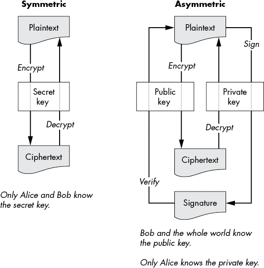

图 5-2：对称与非对称密码学的对比

数字签名广泛用于签署数字证书（下一节主题）、电子邮件、应用程序代码和法律文件，以及保护比特币等加密货币。按照惯例，为了方便起见，会对消息的摘要进行签名，这样一次签名操作即可覆盖整个文档。现在你可以理解为什么对摘要函数的成功原像攻击非常糟糕。如果 Mallory 能炮制出一个具有相同消息摘要的支付协议，Bob 的本票也将作为该协议的有效签名。

### 数字证书

当我初次向发明者学习 RSA 算法时，我们在 MIT 就可能的未来应用进行了头脑风暴。公钥加密的决定性优势在于其提供的便利性。它让你能用一个密钥处理所有通信，而无需为每个通信对象管理单独的密钥，前提是你能向全世界公布你的公钥供任何人使用。但该如何做到这一点呢？

我在论文研究中想出了一个答案，该想法此后被广泛实施。为了推广数字公钥加密这一新现象，我们需要一种新型组织，称为 `证书颁发机构` (`CA`)。开始时，新的 CA 会广泛发布其公钥。随着时间的推移，操作系统和浏览器会预装一组可信的 CA `根证书`，这些证书使用其各自的公钥进行自签名。

CA 收集申请人的公钥（通常收费），然后为每个申请人发布一个数字证书，其中列出其姓名（如“Alice”）及其他详细信息，连同其公钥。CA 对数字证书的摘要进行签名以确保其真实性。理论上，CA 服务的重要部分将涉及审核申请以确保其真来自 Alice，人们只会选择信任可靠执行此项工作的 CA。实际上，验证身份非常困难，尤其是在互联网上，这已被证明是个问题。

一旦 Alice 拥有数字证书，她想与谁通信就可发送一份副本给对方。如果他们信任签发该证书的 CA，则拥有该 CA 的公钥，并可验证提供“Alice”公钥的数字证书签名。数字证书基本上是 CA 签名的一条消息，声明“Alice 的公钥是 X”。此时，接收方可立即开始为 Alice 加密消息，通常先发送他们自己的数字证书（在签名消息中），以向 Alice 保证消息送达了正确的人。

上述对数字证书的简化解释侧重于受信 CA 如何认证姓名与公钥的关联。实际上情况更复杂；人们并不总有唯一姓名，姓名会变更，不同州的公司可能同名，等等。（第 11 章将在 Web 安全背景下深入探讨其中一些棘手问题。）如今，数字证书用于将密钥绑定到各种身份，包括 Web 服务器域名和电子邮件地址，并用于多种特定目的，如代码签名。

## 密钥交换

Whitfield Diffie 和 Martin Hellman 在 RSA 发明前不久开发出一种实用的密钥交换算法。要理解密钥交换的奇迹，请想象 Alice 和 Bob 以某种方式建立了通信信道，但他们没有预先约定的密钥，甚至没有可信任的 CA 作为公钥来源。令人难以置信的是，密钥交换允许他们在 Mallory 观察一切的公开信道上建立共享密钥。这一事实极反直觉，因此我想展示数学原理，让你亲自看看它是如何工作的。

幸运的是，数学原理足够简单，对于小数字也易于计算。可能让部分读者不熟悉的唯一符号是后缀 `(mod p)`，意为除以整数 `p` 取除法余数。例如，`2⁷ (mod 103)` 等于 25，因为 128 – 103 = 25。


# Diffie–Hellman 密钥交换

这是 Diffie–Hellman 密钥交换算法的基础：

1.  Alice 和 Bob 公开商定一个素数 `p` 和一个随机数 `g (1 < g < p)`。
2.  Alice 选取一个随机自然数 `a (1 < a < p)`，并将 `g^a (mod p)` 发送给 Bob。
3.  Bob 选取一个随机自然数 `b (1 < b < p)`，并将 `g^b (mod p)` 发送给 Alice。
4.  Alice 计算 `S = (g^b)^a (mod p)` 作为他们的共享密钥 `S`。
5.  Bob 计算 `S = (g^a)^b (mod p)`，得到与 Alice 相同的共享密钥 `S`。

图 5-3 使用较小的数字演示了一个玩具示例，以表明这确实行得通。此示例并不安全，因为对大约 60 种可能性进行穷举搜索很容易做到。然而，相同的数学原理适用于大数字，在几百位数字的规模下，进行这种穷举搜索是极其不可行的。

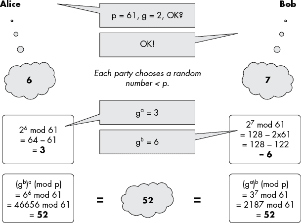

**图 5-3：Alice 和 Bob 通过密钥交换安全地选择共享密钥**

在这个为保持数字较小而选择的示例中，巧合的是 Alice 选择了 6，这恰好等于 Bob 的结果 (`g^b`)。这在实践中不会发生，但当然算法仍然有效，只有 Alice 会注意到这个巧合。

重要的是，双方必须真正从 `CSPRNG` 中选择安全的随机数，以防止 Mallory 可能猜测他们的选择。例如，如果 Bob 使用公式根据 `p` 和 `g` 计算他的选择，Mallory 可能通过观察许多密钥交换来推断这一点，并最终模仿它，从而破坏密钥交换的保密性。

密钥交换基本上是一个不需要任何欺骗的魔术。Alice 和 Bob 从舞台两侧走入，而 Mallory 正站在正中间。Alice 喊出数字，Bob 回答，经过两轮来回交换后 Mallory 依然一无所知。Alice 和 Bob 将他们的共享密钥数字写在大卡片上，在一个信号下举起卡片，显示出代表商定密钥的相同数字。

如今，密钥交换对于在互联网上任意两个端点之间建立安全通信通道至关重要。大多数应用程序使用椭圆曲线密钥交换，因为这些算法性能更高，但概念大致相同。密钥交换在互联网上建立安全通信通道（例如使用 `TLS` 协议）时特别方便。两个端点首先使用 `TCP` 通道——Mallory 可能正在观察的流量——然后进行密钥交换，与尚未确认的对方通信者协商一个密钥。一旦他们拥有了共享密钥，加密通信就能实现安全的私有通道。这就是任何一对通信者如何在没有预先约定密钥的情况下引导建立一个安全通道。

# 使用加密技术

本章在“驾驶员教育”层面解释了加密工具箱中的工具。密码学安全随机数增加了不可预测性，以挫败基于猜测的攻击。摘要是将数据的唯一性提炼为用于完整性检查的相应令牌的安全方式。加密有对称和非对称两种形式，可保护机密性。数字签名是一种认证消息的方式。数字证书通过利用对 `CA` 的信任，使共享真实公钥变得容易。而密钥交换则完善了加密工具箱，允许远程双方通过公共网络连接安全地商定一个密钥。

图 5-4 中的漫画说明了本章开头题词所表达的观点：构建良好的加密技术非常强大，主要威胁在于它会被绕过。从本章中或许最重要的收获是，正确使用加密技术至关重要，以免无意中为攻击提供这样一个切入点。

加密技术可以帮助解决软件设计中出现的许多安全挑战，或通过威胁建模识别出的挑战。如果您的系统必须通过互联网向合作伙伴数据中心发送数据，请对其进行加密（以保证机密性）并进行数字签名（以保证完整性）——或者您可以用简单的方式，使用 `TLS` 安全通道来认证端点。安全摘要提供了一种巧妙的方式来测试数据相等性，包括作为 `MAC`，而无需您存储数据的完整副本。通常，您将使用现有的加密服务，而不是自行构建，本章让您了解何时以及如何使用它们，以及安全使用该技术所涉及的一些挑战。

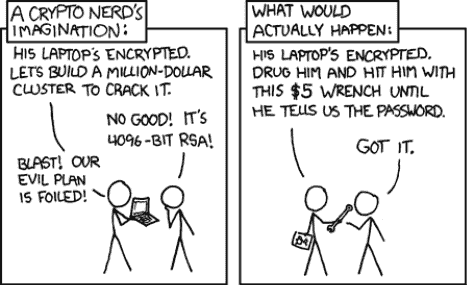

**图 5-4：安全对抗 5 美元扳手（由 Randall Munroe 提供，[xkcd.com/538](http://xkcd.com/538)）**

金融账户余额和信用卡信息是您绝对必须保护的数据的明确示例。这种敏感数据流经更大的分布式系统，即使对设施的访问受到限制，您也不希望有人能够物理上插入网络窃听器并窃取敏感数据。一种强有力的缓解措施是在敏感数据首次到达前端 Web 服务器时立即对其进行加密。立即使用公钥加密信用卡号，使您能够在处理交易时将加密数据作为不透明的 blob 传递。最终，这些数据到达受到高度保护的财务处理机器，该机器持有私钥，可以解密数据并与银行系统核对交易。这种方法允许大多数应用程序代码安全地传递敏感数据以供后续处理，而自身不冒泄露风险。

另一种常见技术是将对称加密的数据和密钥存储在不同的位置。例如，考虑一个企业想要将长期数据存储用于备份外包给第三方。他们会移交加密数据以妥善保管，而将密钥保存在自己的保险库中，以便在需要从备份恢复时使用。从威胁角度来看，数据存储服务被委托保护完整性（因为他们可能会丢失数据），但只要密钥安全且加密操作正确，就不存在机密性风险。

这些只是几个常见用法，您会发现更多使用这些工具的方法。（加密货币是一个特别巧妙的应用。）现代操作系统和库提供了许多当前可行算法的成熟实现，因此您永远不必考虑亲自实现实际计算。

然而，加密并非万能药，如果攻击者能够观察加密数据的频率和体量或其他元数据，您可能会向他们泄露一些信息。例如，考虑一个基于云的安全摄像头系统，当它检测到房屋内有移动时会捕获图像。当家人外出时，没有移动，因此摄像头没有传输。即使图像被加密，能够监控家庭网络的攻击者也可以轻松推断家庭的日常规律，并通过摄像头流量的下降来确认房屋何时无人居住。


密码学的安全性建立在数学的已知极限和数字硬件技术的最先进水平之上，而这两者都在不可阻挡地进步。如果数学家将来能发现更高效的计算方法从而削弱现代算法，将获得极大的声誉。此外，另一种计算技术的前景，如量子物理学，也是另一个潜在威胁。甚至有可能某个强大的民族国家已经实现了这种突破，并正在谨慎地使用它，以免暴露底细。像所有缓解措施一样，加密固有地包含权衡和未知风险，但它仍然是一套非常值得使用的优秀工具。

# 第二部分：设计

## 第 6 章：安全设计

> 过载、杂乱和混乱不是信息的属性，它们是设计的失败。
>
> ——爱德华·塔夫特


一旦你对安全原则、模式和缓解措施有了扎实的理解，将安全集成到软件设计中的实践就会变得相对简单。当你识别出设计面临的威胁时，可以根据需要应用这些工具，并探索能够从根本上降低风险的更好的设计替代方案。

本章专注于安全软件设计。它作为第 7 章的配套章节，第 7 章涵盖安全设计评审。这两个主题是同一活动的两个方面，只是视角不同。软件设计师应在整个设计过程中考虑本章讨论的概念并应用这些方法；他们不应将系统的安全留待评审人员稍后再来修补。反过来，评审人员应通过威胁和缓解措施的视角审视设计，作为额外的一层安全评估。安全设计过程是综合性的，而安全设计评审是分析性的——协同使用，它们能产生内置安全的更好设计。

软件设计是一门艺术，本章仅关注安全方面。无论你是按照正式流程设计还是完全在脑海中构思，都不必改变工作方式来融合此处提出的理念。威胁建模和安全视角不必驱动设计，但应指导设计。

此处描述的安全设计实践遵循大型企业的典型流程，但你可以将这些技术调整为适应你的工作方式。小型组织的运作将更加非正式，设计师和评审人员可能是同一个人。所呈现的技术以通用方式解决问题，以便轻松应用于你喜欢的任何软件设计方式。

## 在设计中集成安全

> 我将主张概念完整性是系统设计中最重要的考量。
>
> ——弗雷德·布鲁克斯（出自《人月神话》）

设计阶段为将安全原则和模式构建进软件项目提供了绝佳机会。在这个早期阶段，你可以在投入实施并被过去的决策束缚之前，轻松探索各种替代方案。

在设计阶段，开发人员应创建*设计文档*来捕捉软件项目的重要高层特征，这类似于建筑结构的蓝图图纸。我强烈建议投入精力记录你的设计，因为这有助于确保严谨性，还能创建一个有价值的工件，让他人理解你所做的决策——特别是在权衡威胁与缓解措施及其中涉及的取舍时。

设计文档通常由*功能描述*（从外部视角看软件如何工作）和*技术规格说明*（从内部视角看软件如何工作）组成。当存在竞争利益相关者、协调大型工作、设计必须符合正式需求规格说明或严格的兼容性要求、面临艰难的取舍等情况时，更正式的设计尤为重要。

当你审视一个拟议的软件设计时，戴上你的“安全帽”。然后，在编码开始之前，你可以进行威胁建模、识别攻击面、梳理数据流等。如果拟议的设计使得从结构上保护系统变得困难，现在正是考虑天生更安全的替代方案的最佳时机。你还应在设计文档中指出重要的安全缓解措施，以便实施人员提前看到这些需求。

经验更丰富的设计师会从一开始就将安全融入设计。如果这看起来令人生畏，从“功能完整”的草稿设计开始，然后再以安全为重点进行第二轮审查也可以，但这要多花很多功夫。如果在流程早期发现，重大变更最容易做出，避免了事后返工的浪费。尽早探索新架构并推敲基本需求，而不是等到后来，因为那时更容易做到。正如乔什·布洛赫曾风趣地说：“一周的编码往往能节省一小时的思考。”

### 使设计假设显性化

20 世纪 80 年代中期，我曾为一家公司工作，该公司从零开始设计并构建了当时功能强大的计算机：包括硬件和软件。经过多年的开发，两个团队的工作终于在操作系统被加载到原型硬件中时汇聚在一起……然后立即崩溃了。原来硬件团队主要来自 IBM，那里使用大端架构，而软件团队大多来自 HP，传统上使用小端架构，因此“位 0”在硬件上指高位，在软件上却指低位。在多年的规划、会议和原型制作中，每个人都只是假设了他们所来自的公司文化的字节序。（当然，一旦弄清这一点，不得不由软件团队做出必要的更改。）

未书面化的假设会削弱安全设计评审的有效性，因此设计师应努力将其记录下来（评审人员也应询问任何不明确的地方）。在设计文档正文之前的“背景”部分记录这些显性假设是个好地方。

考虑记录假设的一种方法是预判严重的误解，这样你就永远不会听到有人说：“但我以为……”。以下是一些在设计中重要但容易被省略的常见假设列表：

*   限制设计空间的预算、资源和时间约束
*   系统是否可能成为攻击目标
*   不可协商的需求，例如与遗留系统的兼容性
*   关于系统必须达到的安全级别的预期
*   数据的敏感性及安全保护其的重要性
*   系统未来预期的变更需求
*   系统必须达到的特定性能或效率基准

假设的澄清对安全很重要，因为误解往往是薄弱接口设计或组件间交互不匹配的根本原因，攻击者可利用这些漏洞。此外，它确保设计评审人员对项目有清晰一致的认识。

通常在一个企业或任何一组相关项目中，许多假设在一组设计中将保持相同，在这种情况下，你可以在共享文档中编制一个列表，提供通用背景。各个设计则只需引用这个通用基础，并详述适用假设不同的任何例外情况。例如，计费系统可能受到更高的安全标准约束，并需要使信用卡处理组件符合特定的金融法规，而企业的其他应用程序则不需要。


### 定义范围

如果对审查范围存在不确定性，就不可能对设计的安全性进行良好的审查。明确范围对于回答第二章提出的四个问题中的第一个——“我们在做什么？”——也至关重要。为了理解其中的原因，请考虑一个新的客户计费系统的设计。该设计是否包含用于收集可计费工时报告的 Web 应用程序，还是说那是一个单独的设计？它所依赖的现有数据库呢——这些系统的安全性在范围内还是不在？审查是否应包括你将用于向企业会计系统报告的新基于 Web 的 API 的设计？

通常，设计者会就是如何定义范围做出战略决策，选择“咬下”多少内容。当范围由他人定义时，设计者必须理解规定的范围及其背后的原因。你可以将设计范围定义为进程中运行的代码、框图中表示的系统特定组件、库中的代码、源代码仓库的一个划分，或任何其他最合理的方式，只要对所有相关人员都清晰明了即可。我在上一段提到的计费系统设计可能应该包含新 API，因为它是同一设计的延伸。相反，现有数据库可能不在范围内，前提是它们没有以一种根本性的新方式被使用，并且已经得到了足够的安全关注。

如果设计范围模糊不清，审查者可能会假设安全性的某些重要方面不在范围内，而设计者可能对此问题毫不知情。由于这种遗漏，问题可能会被忽略。例如，几乎每个软件设计都会涉及某种数据存储。除非数据是可牺牲的（这很少见），否则维护良好的备份是针对各种威胁（无论是恶意的还是意外的）导致的完整性丢失风险的显而易见的缓解措施。设计者经常省略此类显而易见的要点，但如果没有明确的设计范围声明，每个人都可能假设其他人定期对生产系统中的所有存储执行备份，导致这项任务被搁置——直到第一次故障发生时，教训才被刻骨铭心地学会。

不要让将设计生态系统的某部分排除在范围之外导致其落入监管盲区。当你接手一个遗留系统时，你最初理解它的努力应集中在其最敏感的部分、对安全性最基础的部分，或者可能是最明显的攻击目标上。然后审慎地对构成独立组件的系统其他部分进行审查，直到覆盖所有内容。

你可以通过定义一个与重新设计发生位置相对应的狭窄范围，来处理设计迭代、冲刺以及现有系统的重大修订。一旦你为新的设计工作划定了边界，设计所定义的明确前置条件就位于该范围之外，你可以在内部自由地重新开始一切。现有的设计文档使这项工作变得更容易、更可靠，并且更新后的设计应推动文档的受控变更。

重新设计蔓延到其预期边界之外是常见现象，通常也是好事，当这种情况发生时，你应该根据需要调整范围。例如，增量设计变更可能需要修改现有的接口或数据格式，如果变更涉及处理更敏感的数据，你可能需要因新的安全假设而在接口的另一侧进行更改。

很少有软件设计存在于真空中；它们依赖于现有的系统、流程和组件。确保设计与其依赖项良好配合至关重要。特别是，匹配安全预期是关键，因为你无法用不安全的组件构建安全的应用程序。值得注意的是，安全/不安全并非二元选择；它是一个连续体，其中假设和预期需要保持一致。请阅读同行系统和依赖项的安全设计审查报告，以证实你对它们的安全预期。

### 设定安全需求

安全需求主要源自四个问题中的第二个：“什么可能出错？” CIA 三要素是一个有用的起点：描述保护私有数据免遭未经授权泄露的需求（**机密性**）、保护和备份数据的重要性（**完整性**），以及系统需要具备的稳健和可靠程度（**可用性**）。许多软件系统的安全需求很简单，但为了完整性和传达优先级，详细说明它们仍然非常值得。对你来说完全显而易见的事情，对其他人可能并非如此，因此阐述期望的安全立场是个好主意。

有一个极端情况值得注意，即安全性不重要——或者至少，有人认为它不重要。这是一个重要的假设，必须明确指出，因为团队中的其他人可能认为它当然重要（你可以想象，这种不匹配的预期最终会在何种情况下暴露出来）。如果你正在设计一个处理人造虚拟数据的原型，你可以跳过安全审查，但要记录下来，以免代码被重新利用，稍后用于处理个人信息。另一个低安全性应用的例子可能是由多个研究小组共享的气象数据收集：温度和其他大气条件任何人都可以免费测量，泄露无害。

在另一个极端，安全关键型软件值得额外的关注和对其安全相关需求的仔细列举。这些将为威胁建模、安全审查和测试提供焦点，以确保最高质量。请参阅示例设计文档（附录 A），了解安全需求如何指导设计的基本示例。受复杂法规约束的大型系统可能有严格规定的安全需求，以确保高水平的合规性，但这是一项专业性工作，不在我们的讨论范围内。

对于具有关键或不寻常安全需求的软件设计，请考虑以下一般准则：

*   将安全需求表述为最终目标，而不规定“如何做”。
*   考虑所有利益相关者的需求。特别是，当这些需求可能冲突时，有必要找到一个良好的平衡。
*   承认关键缓解措施可接受的成本和权衡。
*   当存在不寻常的需求时，解释其动机以及目标。
*   设定可实现的安全目标，而非完美的强制指令。

以下极端示例说明了具有重大安全需求的系统的需求声明可能是什么样子：

**在国家安全局，保护国家最敏感的机密**

系统管理员将拥有对海量绝密文档的非凡访问权限，鉴于这对国家安全构成的威胁，我们必须在最高程度上缓解内部攻击。具体来说，一个能够冒充拥有广泛访问权限的高级军官的管理员，可能会窃取许多文件，并通过伪装成许多不同主体的众多独立访问事件来掩盖踪迹。（关于爱德华·斯诺登窃取 NSA 内部文档战术的非官方报道表明，他使用了这种技术。）

**大型金融机构的认证服务器**


# 服务器私有加密密钥泄露

服务器私有加密密钥的泄露将彻底破坏我们所有面向互联网系统的安全性。虽然内部攻击不太可能发生，但运维人员必须*不*具备合理的否认性。要求可能包括：将密钥存储在放置于受物理看护位置的防篡改硬件设备中，以及制定密钥创建和轮换的正式仪式，所有访问操作均须由至少两名受信人员共同在场监督。（注：这包括“操作指南”，作为阐述信任分发以及物理与逻辑安全重叠组合的最直接方式。）

## 昂贵科学实验的数据完整性

我们计划仅进行一次该实验，且所需资金在未来数年内不太可能再次获得，因此我们无法承担丢失仪器收集信息的后果。流式数据必须即时复制并冗余存储在不同的存储介质上，同时通过两个不同的网络传输到物理隔离的远程存储系统，作为额外的备份。

# 威胁建模

改进软件架构安全性的最佳方法之一，是将威胁建模纳入设计流程。软件设计涉及在相互竞争的需求和策略中进行创造性的权衡，对系统的某些方面进行迭代决策，有时还需调整方向以逐步实现完整愿景。通过威胁建模的视角审视这一过程，可以揭示设计权衡，因此极有潜力引导设计师走向正确方向——但要弄清如何确切达成改进结果，仍需一些尝试与错误。

首先，存在一种将威胁建模融入软件设计的简化方法。这包括构思一系列潜在设计，依次对每个设计进行威胁建模，通过某种汇总评估进行评分，然后选择最优方案。在实践中，这些以安全为中心的评估会影响其他重要因素，包括易用性、性能和开发成本。但由于产出多个设计并逐个进行威胁建模的工作量过大，设计师往往需要凭直觉判断哪些权衡蕴含良机，再通过分析设计备选方案的差异来进行对比，而非从头重新评估每一个方案。

在软件系统设计的早期阶段，应密切关注信任边界和攻击面，因为它们对于建立有利于安全的架构至关重要。敏感信息的数据流应尽可能远离拓扑结构中暴露程度最高的部分。例如，考虑一个供巡回销售人员使用的应用程序，他们需要离线访问客户联系信息以便在外拨打销售电话。将整个客户数据库放入每台移动设备将代表巨大的泄露风险，但如果员工前往连接条件差的偏远地区，这可以说是必要的。威胁建模会凸显这一风险，促使你评估替代方案。也许仅提供数据库的区域子集即可，根据代表所在位置或出差行程动态更新；又或者，不提供客户电话号码，而是给每位销售人员分配每个客户的一个代码，他们可结合唯一 PIN 码通过转接服务拨打电话，这样他们根本不需要访问电话号码。

设计师还应考虑其所构建软件的`基本威胁模型`，将其作为一种基准，以此衡量备选设计。我的意思是理想化设计中固有的安全风险模型，无论该设计如何构建。例如，如果客户端/服务器系统从客户端收集个人身份信息（PII），则存在该信息被客户端泄露、在传输中泄露，或在处理数据的服务器上泄露的不可避免的安全风险。没有设计魔法能消除这些风险，尽管它们通常需要适当的缓解措施。

当固有安全风险较高时，设计师应尽可能考虑替代方案。延续 PII 示例，是否真的有必要为所有用例收集所有（或任何）此类信息？如果不是，那么支持避免在源头收集部分信息的子用例，很可能值得付出努力。

基本威胁模型指导设计的另一种方式，是凸显因设计决策而产生的额外风险来源。此类效应的一个例子可能是：为提高响应时间，选择为敏感数据增加缓存层。数据的额外存储（可能成为攻击者瞄准的资产）必然增加新风险，特别是当缓存存储靠近攻击面时。这说明设计变更总会修改威胁模型——或好或坏——了解安全影响后，设计师便能明智地权衡备选方案的优劣。

归根结底，良好的软件设计取决于主观判断。这些判断平衡各种因素，以找到并非最佳，但至少令人满意的结果。安全虽重要，却非一切，因此艰难抉择在所难免。多年来我发现，尽管有时令人畏惧，但保持对妥协讨论的开放态度，比宣称安全顾虑至上要高效得多。

当最大化安全性的成本较低时，推动其实施很容易——但情况并非总是如此。当妥协成为必要时，请牢记以下几个好的策略：

*   为灵活性而设计，以便日后轻松添加安全防护（即，不要将自己逼入不安全的死角）。
*   如果存在特别关注的特定攻击，应对系统进行检测，以便监控疑似滥用实例。
*   当易用性与安全性冲突时，探索用户界面替代方案。此外，在真实情境下制作原型并衡量易用性；有时易用性顾虑是臆想的，在实践中并不体现。
*   利用源自威胁模型的潜在场景解释安全风险，说明特定设计可能导致的主要负面后果，并以此论证不实施缓解措施的代价。

## 内置缓解措施

在你定义了软件系统的范围和安全需求，回答了四个问题中的前两个之后，便该考虑第三个问题：“我们打算怎么做？”该问题引导设计师将所需的防护和缓解措施融入设计中。在以下小节中，我们将探讨如何针对接口和数据这两个软件设计中最常见的反复出现的主题来实现这一点。后续的讨论和示例仅涉及设计中缓解措施可能性的皮毛。前三章中的所有观点均可根据特定设计的需求加以应用。

### 设计接口

接口定义了系统的边界，划定了设计或其组成部分的界限。它们可能包括系统调用、库、网络（客户端/服务器或点对点）、进程间及进程内 API、公共数据存储中的共享数据结构等。复杂的接口（如安全通信协议）往往值得单独进行设计。

定义设计范围内的所有接口，确保你清楚了解共享该接口的组件的安全职责。记录输入是否经过可靠验证，或应被视为不受信数据。若存在信任边界，请说明跨越该边界的认证和授权处理方式。


# 与外部组件的接口

与外部组件（即设计范围之外的组件）的接口应符合这些组件现有的设计规范。如果没有此类信息，请记录你的假设，或考虑采取防御性策略以弥补不确定性。例如，如果你无法确定输入是否经过验证，则假设输入是不可信的。

要设计安全的接口，首先要对其工作原理有一个可靠的描述，包括其必要的安全属性（即 C-I-A、黄金标准或隐私要求）。审查接口的安全性相当于验证它们将正常运行并能抵御潜在威胁。除非设计人员明确安全要求，否则安全审查人员（以及稍后使用该接口的开发人员）将不得不猜测设计人员的意图，如果他们低估或高估了要求，就会产生混淆。

有时，你不得不使用现有组件，而这些组件在设计时未考虑安全性，或其安全性不足以满足你的要求——或者你根本不知道这些组件有多安全。如果你别无选择，请将其标记为一个问题，并尽可能进行研究，了解组件安全属性的相关信息（这可能包括尝试攻击测试模型）。在某些情况下，另一种选择是封装接口以增加安全防护。例如，针对易受数据泄露影响的存储组件，你可以设计一个额外的软件层来提供加密和解密，确保该组件仅存储加密数据，即便泄露也无害。

## 设计数据处理

数据处理是几乎所有设计的核心，因此保护其安全是一个重要步骤。安全数据处理的一个良好起点是概述你的数据保护目标。当特定数据子集需要额外保护时，要明确这一点，并确保在整个设计中一致地处理它。例如，在在线购物应用程序中，对信用卡信息应用额外的保护措施。

限制移动敏感数据的需求。这是在设计层面以显著方式降低风险敞口的关键机会（参见第 4 章中的“最小信息”模式），而在实现阶段往往无法做到这一点。减少传递数据需求的一种方法是将其与一个不透明标识符关联，然后使用该标识符作为句柄，在必要时将其转换为实际数据。例如，如附录 A 中的示例设计所示，你可以使用此类标识符记录交易，以使客户详细信息不出现在系统日志中。在极少数需要调查日志条目的情况下，审计员可以查阅这些详细信息。

识别公开信息，或以其他方式免除保密要求的数据。这构成了数据处理要求的一个重要例外，允许你在合理的地方放宽保护。在应用此类方法时，请记住数据取决于上下文，因此公开数据与其他信息配对后很可能变得敏感。例如，大多数企业的地址及其首席执行官的姓名通常是公开信息。然而，特定人员何时在场所内应保持私密。

在没有明确决定的情况下，始终将个人信息视为敏感信息，并且仅在有特定用途时才收集此类数据。无限期存储敏感数据会产生无休止的保护义务。你可以在可能的情况下销毁不再使用的信息（例如，在数年的不活动后）来尽量避免这种情况。设计应预见到当私密数据不再需要时最终将其从系统中移除的需求，并指定触发删除的条件，包括备份副本的删除。

# 将隐私集成到设计中

未能保护私密信息经常成为头条新闻。我认为，将信息隐私考量集成到软件设计中是公司做得更好的一个重要途径。隐私问题关乎数据保护的人为影响，不仅涉及法律和法规问题，还涉及客户期望和未经授权披露的潜在影响。要做到这一点需要专门的专业知识和主观判断。但部分问题的关键在于授权第三方使用数据，这需要允许访问。在这方面，良好的软件设计可以建立控制措施，以最大程度地减少失误。

作为起点，设计人员应熟悉所有适用的隐私政策，并理解这些政策与设计的关系。提出问题，并最好从隐私政策所有者处获得书面答复，以便明确要求。这包括可能适用于通过合作伙伴获取的数据的任何第三方隐私政策义务。这些隐私政策管辖数据收集、使用、存储和共享，因此如果这些活动发生在设计中，政策条款即意味着要求。如果面向公众的隐私政策缺乏细节，请考虑制定一个描述必要细节的内部版本。

隐私失误往往发生在人员或流程误解政策中的承诺，或根本未考虑这些承诺时。数据安全防护提供了将限制构建到设计中以确保合规的机会。首先考虑隐私政策做出的明确承诺，然后确保设计在可能的情况下强制执行它们。例如，如果政策规定“我们不共享你的数据”，则要警惕使用让共享变得容易的云存储服务，除非有其他规定到位以确保错误配置不会暴露数据。

审计是隐私管理的重要工具，哪怕只是为了可靠地记录对敏感数据的正当访问。通过仔细监控访问，可以及早发现并补救有问题的访问和使用。发生泄露后，如果没有谁访问过相关数据的记录，就很难有效应对。

尽可能设计显式的隐私保护。在你无法对隐私合规性做出判断的情况下，让负责隐私政策的官员对设计进行签署确认。将隐私集成到软件设计中的一些常见技术包括：

*   识别新类型数据的收集，并确保其符合隐私政策。
*   确认政策允许你为预期目的使用数据。
*   如果设计可能导致无限制的数据使用，请考虑仅限熟悉隐私政策约束及如何审计合规性的员工访问。
*   如果政策限制数据保留期限，请设计一个确保及时删除的系统。
*   随着设计的演进，如果数据库中的某个字段变得不再使用，请考虑将其删除，以降低泄露风险。
*   考虑为数据共享建立审批流程，以确保接收方获得管理层批准。

# 为完整的软件生命周期做规划


软件设计往往隐性假设系统将永远运行，忽视了所有软件生命周期均有限这一现实。系统最终生命周期的许多方面——从首次发布和部署，经过更新和维护，到最终退役——都具有重要的安全隐含意义，这些在后期极易被忽视。无论软件设计多么出色，无论它是成功还是失败，随着环境演进都将经历变更。这些变更的影响最好在设计过程中预判并加以解决，至少也要为后人留下记录。在企业内部，许多此类问题具有通用性，通用的处理方式应能覆盖大多数系统，个别设计中按需指定例外情况即可。

在创建新设计时，很难想象系统的终结，但大多数隐含意义应当清晰，任何设计至少应考虑数据的长期处置。特定的法律或业务原因可能要求在一定期限内保留数据，但不再需要时应将其销毁，包括备份副本。某些系统在接近生命周期末期时需经历特定阶段，良好的设计可从一开始就通过建立合适的结构和配置选项，使这一过程易于正确实施。例如，采购系统可能停止接单，但仍需继续为薪资和记录保存提供数据长达一年，随后归档交易记录以供长期保留。

## 权衡取舍

在没有简单选择时平衡各种取舍，需要大量的工程判断力，同时还要权衡许多其他因素。实施更多安全缓解措施可降低风险，但仅限于复杂性导致整体 Bug 增加的临界点之前——应始终警惕收益递减却投入更多开发精力的情况。本书将反复建议设计者在相互竞争的优先级之间妥协，但说起来容易做起来难。本节介绍一些实现这些重要平衡的经验法则。

**预判最坏情况**：如果未能保护特定系统资产的机密性、完整性或可用性，后果有多严重？每种场景都有不同程度的灾难性后果需考量：可能有多少数据受影响？多长时间的不可用会构成严重问题？主要缓解措施通常能限制最坏情况；例如，每小时备份可确保至多一小时的事务数据面临丢失风险。请注意，最坏情况下的机密性丢失尤为难以控制，因为数据一旦被窃取，通常无法撤销披露（2017 年 Equifax 数据泄露事件即为典型案例）。

大多数设计工作发生在企业或项目社区内，所需安全级别通常在广泛的项目范围内保持一致。若特定设计可能偏离这一基线——要求更高或更低的安全级别——在设计前言中明确指出该假设非常有必要。以下示例阐释了这一重要观点。在线商店网站应考虑为处理信用卡支付的软件设定更高的安全标准，因为它是显而易见的攻击目标，且因巨大的财务责任而受特殊要求约束。反之，网页设计公司可能搭建一个完整网站展示设计案例；既然仅供信息参考且从不收集真实最终用户数据，其安全防护合理地可以降低要求。

设计阶段是在软件相互竞争的需求之间寻找恰当平衡的最佳时机。坦白说，面对进度截止日期、预算和人力限制、遗留兼容性问题以及冗长的功能清单，安全极少甚至从未被作为首要任务全力支持——这几乎是常态。设计者处于最佳位置，可考虑包括激进方案在内的多种备选，并做出日后难以实施的基础性变更。

在这些理想化原则与构建现实系统的务实需求之间找到恰当平衡，是安全软件设计的核心。完美安全从非目标，额外缓解措施的收益有其极限。最佳平衡点究竟在何处从不易于确定，但能将这些取舍显性化的软件设计，更有机会找到合理的折中方案。

## 设计简洁性

> 简洁是最高级的复杂性。
>
> —列奥纳多·达·芬奇

正如达·芬奇名言所暗示，讽刺的是，产出简洁设计往往需要大量思考与努力。早期天文学家为天体力学开发出各种复杂计算，直到哥白尼将太阳而非地球设为中心参考点而简化了模型，进而使牛顿通过推导万有引力定律从根本上简化了计算。我最喜欢的杰出软件设计案例是 \*nix 操作系统的核心，其大部分至今仍在使用。追求优美简洁的设计，即使很少完全达成，往往直接有助于提升安全性。

在软件设计中，简洁以多种面貌呈现，但没有现成的公式能发现最简洁、最优雅的设计。第 4 章讨论的多个模式拥抱简洁，如“设计经济性”和“最小公共机制”。任何时候安全依赖于某个复杂决策或机制的完美运作，都应警惕：看看是否有更简单的方式达到相同目的。

当错综复杂的功能与安全机制交互时，结果往往导致复杂性爆炸。一项研究得出结论，1979 年三哩岛核电站事故无特定成因，而是源于系统的巨大复杂性，包括其众多冗余安全措施。安全可能妨碍预期功能，反过来使全面防护更棘手。解决之道常在于将安全与功能分离，创建分层模型，通常将安全置于“外部”作为保护外壳，所有功能分别存在于“内部”。然而，采用“硬外壳、软内核”设计时，强制执行这种分离至关重要。为城堡设计安全护城河相对容易，但在软件中，很容易无意中开辟出一条绕过外部保护层、直通内部的路径。

# 第 7 章 安全设计评审

> 一个良好、富有同理心的评审总是令人愉悦的惊喜。
>
> —乔伊斯·卡罗尔·奥茨


将安全烘焙进软件的最佳途径之一，是戴上“安全帽”单独评审设计。本章解释如何在*安全设计评审*（`SDR`）中应用上一章讨论的安全与隐私设计概念。可将此过程类比为建筑师设计建筑，工程师随后评审设计以确保其安全可靠。设计者与评审者都需懂结构工程和建筑规范，通过协作可达成更高质量和信任度。

理想情况下，安全评审者不参与设计工作，以保持距离和客观性，且熟悉软件运行的系统与上下文及其使用方式。不过这些并非硬性前提；对设计不太熟悉的评审者往往会提出更多问题，但也能做好工作。


# 分享这些方法并鼓励更多软件专业人士自行执行 SDR，是我编写本书的核心目标之一。

你几乎肯定能比那些拥有更多安全经验但不熟悉这些系统的人，对你所工作且熟知的软件系统做出更好的 SDR。本书提供指导帮助你完成这项任务，我希望借此能在一定程度上为提高软件安全标准做出贡献。

# SDR 后勤准备

在介绍 SDR 方法论之前，有必要提供一些背景信息并讨论基本的后勤准备。SDR 的目的是什么？如果我们要执行 SDR，应在设计过程的哪个阶段进行？最后，我将提供一些关于准备工作的建议，特别强调文档的重要性。

## 为什么要进行 SDR？

我亲自执行过几百次 SDR，可以报告说它从未让人感觉像是在浪费时间。SDR 仅占总设计时间的极小一部分，却能识别出增强安全性的重要改进点，或提供强有力的保证，证明设计妥善解决了安全问题。简单直接的设计审查起来很快，而对于较大的设计，审查过程提供了一个识别和验证主要热点的有用框架。即使你审查的设计表面上涵盖了安全的所有基础，确认这一点也是良好的尽职调查。当然，当 SDR 确实发现重大问题时，这项工作证明是极其值得的，因为在实现阶段发现这些问题将非常困难，而在事后补救则成本高昂。

此外，SDR 还能产生有价值的新见解，从而导致与安全无关的设计变更。SDR 为引入不同视角（用户体验、客户支持、市场、法务等）提供了绝佳机会，让大家共同思考那些容易被忽视的主题，例如滥用的可能性和意外后果。

## 何时进行 SDR

计划在设计（或设计迭代）完成且稳定时执行 SDR，通常在功能评审之后，但在设计最终确定之前，因为可能还需要进行更改。我强烈建议不要试图将安全作为功能评审的一部分来处理，因为所需的心态和关注领域截然不同。此外，让每个人——而不仅仅是评审者——都专注于安全至关重要，而在合并评审中这很难做到，因为人们倾向于更多地关注设计的运作机制。

复杂或安全关键的设计通常受益于一次额外的初步 SDR，此时设计开始成型但尚未完全定型，以便尽早获得关于主要威胁和整体策略的意见。初步 SDR 可以不那么正式，预览特别感兴趣的安全点（预期会深入挖掘的地方）并高层面地讨论安全权衡。优秀的软件设计师应始终在整个设计过程中考虑并解决安全和隐私问题。必须明确的是，设计师**绝不**应忽视安全并指望 SDR 来替他们修复这些问题。他们应始终对其设计的安全性负全责，安全评审者扮演支持角色，帮助确保他们做得彻底。反过来，安全评审者不应说教，而应清晰且有说服力地向设计师陈述发现，不带评判色彩。

## 文档至关重要

有效的 SDR 依赖于最新的文档，以便所有相关方对被审查的设计拥有准确且一致的理解。非正式的口头 SDR 总比没有强，但关键细节极易遗漏或传达错误，且没有书面记录，宝贵的成果极易丢失。就我个人而言，我总是希望在会议前有设计文档可供预览，这样我可以提前研究设计，而不必占用会议时间来了解我们在做什么。

依我的经验，设计文档的质量对于提供出色的 SDR 而言是无价的辅助。当然，在实践中详尽的文档可能不可用，第 122 页开始的案例研究也讨论了如何应对这种情况。例如，任何设计文档若模糊地指定“安全地存储客户数据”，除非随后描述了这意味着什么以及如何做到，否则都应标记一个大大的红旗。缺乏细节的笼统陈述几乎总是暴露出天真和对安全缺乏扎实理解。

# SDR 流程

以下对 SDR 流程的解释描述了我在一家大型软件公司（该公司拥有正式的强制性评审流程）中如何执行它们。也就是说，软件设计的实践方式多种多样，你可以将相同的策略和分析应用于不那么正式的组织。

从清晰完整的书面设计出发，SDR 包含六个阶段：

1.  **学习** 设计和支持文档，以获得对项目的基本理解。
2.  **询问** 关于设计的问题，并就基本威胁提出澄清性问题。
3.  **识别** 设计中最关键的安全部分，以便重点关注。
4.  **协作** 与设计师一起识别风险并讨论缓解措施。
5.  **撰写** 发现和建议的摘要报告。
6.  **跟进** 后续的设计变更，在签署确认前验证问题已解决。

对于小型设计，你通常可以在一次会话中完成大部分阶段；对于大型设计，按阶段拆分工作，某些阶段可能需要多次会话才能完成。专门与设计团队会面的会话是理想选择，但如果必要，评审者可以独自工作，然后通过电子邮件或其他方式与设计团队交换笔记和问题。

每个人都有不同的风格。一些评审者喜欢深入进行“马拉松式”评审。我更倾向于（并推荐）在几天内增量式地工作，给自己一个“睡一觉再想”的机会，这往往是我最佳思考发生的地方。

以下 SDR 流程的演练解释了每个阶段，并用要点总结了有用的技巧。当你执行 SDR 时，可以在处理每个阶段时参考该阶段的要点。

## 1. 学习

学习设计和支持文档，以获得对软件的基本理解，为评审做准备。除了安全专业知识，评审者最好还具备领域特定的专业知识。如果缺乏这一点，尽量在过程中学习你能学到的，并保持好奇心。权衡是大多数安全决策固有的，因此单一地追求越来越多的安全很可能会矫枉过正，并在过程中毁了设计。要理解过度安全为何有害，请想象一座仅为降低火灾风险而设计的房子。它完全由混凝土建成，只有一扇厚钢门且没有窗户，造价高昂且丑陋，没人愿意住进去。

在这个准备阶段：

*   首先，阅读文档以获得对设计的高层理解。
*   接着，戴上你的“安全帽”，带着威胁感知的心态再通读一遍。
*   做笔记，记录你的想法和观察以备将来参考。
*   标记潜在问题留待后续处理，但在此阶段进行深入的安全分析还为时过早。

## 2. 询问


# 安全设计评审流程

## 1. 提问

向设计师提出澄清性问题，以了解系统面临的基本威胁。对于易于理解的简单设计，或设计师已产出可靠文档的情况，您可以跳过此阶段。请将其视为一个机会，在深入推进前确认您对设计的理解，并消除任何歧义或未决问题。评审员无需像设计师那样精通设计的每个细节即可高效工作，但您确实需要牢固掌握其大纲及主要组件的交互方式。

此阶段是您在深入挖掘前填补空白的机会。以下是一些指引：

*   确保设计文档清晰完整。
*   如有遗漏或需修正之处，协助在文档中修复。
*   理解设计以便能对话交流，但不必达到专家级水平。
*   询问团队成员最担心什么；若他们没有安全顾虑，请追问以了解原因。

作为安全评审员，您提出的问题无需严格局限于设计文档内容。了解对等系统对于评估其对设计安全性的影响极有帮助。被省略的细节最难被发现。例如，若设计隐式存储数据却未提供任何处理细节，请询问存储方式及其安全性。

## 2. 识别

识别设计中安全关键的部分，并聚焦于这些部分进行深入分析。从基本原则出发，透过安全视角审视：从 `C-I-A`、黄金标准、资产、攻击面和信任边界的角度思考。虽然这些部分需要特别关注，但目前应保持安全评审聚焦于整体，以免完全忽略其他部分。话虽如此，对于与安全关联性极低或无关的设计方面，略过即可。

在此探索阶段，您应：

*   检查接口、存储和通信——这些通常是核心关注点。
*   从暴露程度最高的攻击面向内推进，直达最有价值的资产，正如坚定的攻击者所为。
*   评估设计在多大程度上显式地解决了安全问题。
*   若有需要，指出关键防护措施，并使其在设计中作为重要特性被明确标注。

## 3. 协作

与设计师协作，传达发现并讨论替代方案。理想情况下，设计师与评审员会面讨论，逐一过一遍问题。这是一个双方共同学习的过程：设计师获得设计的新视角并学习安全知识，评审员深入了解设计及设计师意图，从而加深对安全挑战和最佳缓解方案的理解。共同目标是使设计整体更优；安全是评审的重点，但不是唯一考量。现场无需对变更做最终决定，但最终必须就哪些设计变更值得考虑达成一致。

以下是高效协作的指南：

*   作为评审员，在需要时提供关于风险和缓解措施的安全视角。即使设计已足够安全，这也能强化良好的安全实践。
*   考虑勾勒一个场景，说明安全变更如何在未来带来收益，以帮助说服设计师采纳缓解措施的必要性。
*   尽可能提供不止单一解决方案，并帮助设计师看清各方案的优劣。
*   接受设计师拥有最终决定权，因为他们对设计负最终责任。
*   记录想法交流，包括哪些内容将纳入设计、哪些不会。

关于“最终决定权”的补充：实践中，这种平衡取决于组织及其文化、适用的行业标准、可能的监管要求及其他因素。在大型或高度规范化的组织中，最终决定权可能涉及多方签署，包括架构委员会、标准合规官员、可用性评估员和高管利益相关者。当需要多方批准时，设计师必须平衡相互竞争的利益，因此安全评审员应特别留意这一动态，并尽可能保持灵活。

## 4. 撰写

撰写评审发现与建议的**评估报告**。发现是安全评审员对设计安全性的评估。报告应聚焦于值得考虑的潜在设计变更，以及对现有设计安全性的分析。设计师已同意的任何变更应显著标识，并留待后续验证。考虑为建议变更加入优先级排序，例如采用以下简单的三级方案：

*   **Must**（必须）：最强等级，表示别无选择，通常暗示紧迫性。
*   **Ought**（应当）：中等等级：我用它表示作为评审员我倾向于“Must”，但这有商榷余地。
*   **Should**（建议）：最弱等级，用于可选的推荐变更。

在设计阶段更精确的排序较难实施，但若想尝试，第 13 章提供了系统分配更细粒度排序的指南，可直接用于此目的。

SDR 形式多样，我从未使用过标准化模板撰写评估报告，而是采用叙述性方式描述发现。我倾向于根据评审过程中记录的粗略笔记撰写，让报告最终形式自然演变。若您能可靠地在脑中保留所有细节，则可在评审会议后撰写报告。

以下提示也可作为撰写框架：

*   围绕解决安全风险的具体设计变更组织报告。
*   将大部分精力和篇幅投入最高优先级问题，按比例减少对低优先级问题的投入。
*   提供替代方案和策略，但不试图替设计师完成其工作。
*   使用优先级排序对发现和建议进行排序。
*   聚焦安全，但可另行提供供设计师参考的单独意见。在 SDR 范围外应更谦逊，不吹毛求疵，避免稀释安全信息。

区分设计师与评审员角色很重要，但实践中具体如何区分差异极大，取决于双方的职责及协作能力。在您的评估报告中，避免代为做设计工作，同时为所需变更提供清晰指引，让设计师知晓该怎么做。主动提出评审并评论因当前评审而产生的任何重大重新设计。经验法则：优秀的评审员帮助设计师看到安全威胁及潜在后果，并建议缓解策略，而非强制规定实际设计变更。要求过高的评审员常发现其建议无效，即便建议正确，且有迫使设计师做出其不完全理解或不见其必要性的变更的风险。


## 评估设计安全性

如果这种严谨程度让你觉得过于繁琐，你可以简化报告的撰写，但很有可能你，或者其他参与软件开发的人，稍后会希望这些细节已被记录下来以备将来参考。至少，我建议花时间发送一封电子邮件摘要给团队存档。即使是最简略的报告，也不应只说“看起来不错！”，而应用实质性的摘要来支撑这一结论。如果设计涵盖了所有安全基础，请引用几个安全性所依赖的最重要的设计特性，以强调其重要性。如果安全性在设计中并非考量因素（例如，我曾审查过一个不收集任何私人信息的信息类网站），请阐述得出该结论的理由。

这些报告的风格、长度和详细程度因组织文化、可用时间、利益相关者数量及许多其他因素而异。作为审查员，当你与软件设计师密切协作时，你或许能将所需条款直接纳入设计文档，而非在报告中列举需要更改的问题。即使对于小型、非正式的项目，指定单独的设计师和审查员角色也是值得的，这样可以有多双眼睛审视工作，并确保安全性得到应有的考量。然而，即使是单人设计，也能从设计师戴上“安全帽”回头审视自己的工作以获得新视角中受益。

## 6. 后续跟进

跟进因安全审查而达成一致的设计变更，以确认它们已被正确解决。当协作顺利时，我通常只检查文档更新是否已发生，而不查看实现细节（根据我的经验，这种方法从未适得其反）。在其他情况下，根据你的判断，审查员可能需要更加警惕。在审查完成时签署确认，包括对所有必要变更的验证。在项目缺陷跟踪器中分配 SDR 是可靠跟踪进度的好方法。否则，如果你愿意，可以使用或多或少正式的流程。以下是针对这一最终阶段的几点建议：

*   对于重大的安全设计变更，你可能希望与设计师协作，以确保变更正确无误。
*   当意见不一致时，审查员应包含双方立场的陈述以及未被采纳的具体建议，以将其标记为未决问题。（“管理分歧”在第 121 页对此话题有更详细的讨论。）

在最理想的情况下，设计师将审查员视为安全资源，并将根据需要持续保持沟通。

## 评估设计安全性

既然我们已经介绍了 SDR 流程，本节将深入探讨进行审查背后的思维过程。本书截至目前的内容已为你提供了执行 SDR 所需的概念和工具。基础原则、威胁建模、设计技术、模式、缓解措施、加密工具——所有这些都是构建安全设计的要素。

### 以“四个问题”作为指导

第 2 章中用于威胁建模的“四个问题”是帮助你进行有效 SDR 的绝佳指南。如果你有时间并愿意投入精力，显式的威胁建模固然很好；但如果没有，将“四个问题”作为试金石，是将威胁视角融入审查的好方法。更详细的解释将在后续小节中给出，但在最高层面上，以下是这些问题如何映射到 SDR 的：

1.  **我们在做什么？**
    审查员应理解设计的高层目标，作为审查的背景。*完成目标最安全的方式是什么？*
2.  **什么可能出错？**
    这是“安全思维”发挥作用的地方，也是应用威胁建模的地方。*设计是否未能预见或低估了关键威胁？*
3.  **我们打算怎么做？**
    审查你在设计中发现的保护措施和缓解措施。*我们能否以更好的方式应对重要威胁？*
4.  **我们做得好吗？**
    评估设计中的缓解措施是否足够，是否有些需要更多工作，或者是否有缺失。*设计有多安全，如果不足，如何使其达标？*

你可以在进行 SDR 时将“四个问题”作为提示清单。如果你已阅读设计文档并标记了关注领域，但尚不清楚具体要找什么，请过一遍“四个问题”——特别是第 2 和第 3 个问题——并考虑它们如何应用于设计的特定部分。从那里，你的评估将自然转向第 4 个问题。如果答案不是“我们做得很好”，这很可能暗示了一个很好的讨论话题，或是一条应包含在评估报告中的条目。

#### 我们在做什么？

这个问题有几种具体方式能让你保持正轨。首先，了解设计的目的很重要，这样你才能自信地建议裁剪任何虽有风险但非真正必要的部分。反之，当你确实建议变更时，你不想破坏一个实际需要的功能。也许最重要的是，你或许能为一个有风险的功能建议一个采取新方向的替代方案。

例如，在隐私领域，如果你正在审查一个从所有员工收集个人信息的薪资系统，你可能会识别出某个健康问题尤为敏感。如果有关数据项确实多余，那么从设计中移除它是正确的举措。然而，如果它对设计服务的业务功能很重要，你可以转而提出严格防范该数据泄露的方法（如早期加密，或在短时间内删除）。

#### 什么可能出错？

审查应确认设计师已预见到系统面临的重要威胁。仅让设计师知晓这些威胁是不够的；他们必须创建了一个能经受住这些威胁考验的设计。

某些威胁可能是可接受的并保持未缓解状态，在这种情况下，审查员的工作是评估该决定。但重要的是要确保设计师知晓该威胁并选择了不予缓解。如果设计未明确说明这就是他们的做法，请在 SDR 中记录这一点，以复核这是否为有意为之。同时记录所接受的风险并解释为何可容忍。例如，你可能会写道：“线路上的未加密数据代表了窃听威胁。然而，我们确定该风险可接受，因为数据中心物理安全有保障，且不存在 PII 或业务机密数据泄露的可能性。”

尝试预判可能使接受风险的决定失效的未来变更。基于刚才的例子，你可能会补充：“如果系统迁移至第三方数据中心，我们应重新审视这一物理网络访问风险决定。”

#### 我们打算怎么做？

当审查员研究设计时，安全保护机制和缓解措施应变得显而易见。审查员通常将大部分时间花在最后两个问题上：识别是什么让设计安全，以及评估其安全程度。完成此任务的一种方法是将威胁与缓解措施进行匹配，以查看是否所有基础都已覆盖。指出源于此问题的问题，并确认设计令人满意，是 SDR 最重要的贡献之一。


# 设计评审中的安全反馈与流程

## 提供建设性的安全反馈

如果设计在缓解安全风险方面做得不够，你应该列出缺失的内容。为了使反馈有用，你需要解释未解决的具体威胁，以及它们为何重要，并可能为每个威胁提供一组大致的解决方案。基于多种原因，我不建议在 SDR（安全设计评审）中提出具体的补救措施。然而，非正式地提供帮助非常好，如果被要求，可以与设计师合作考虑替代方案，甚至详细阐述设计变更。例如，你的反馈可能会说：“监控 API 不应公开暴露，因为它泄露了我们网站的使用水平，这可能给竞争对手带来优势。我建议要求访问密钥来验证对 RESTful API 的请求。”

当设计确实为给定威胁提供了缓解措施时，评估其有效性，并考虑是否可能存在更好的替代方案。有时，设计师会通过从头构建安全机制来“重复造轮子”：好的反馈会建议改用标准库。如果设计虽然安全，但这是以巨大的性能成本为代价的，如果可能的话，提出另一种方式。一个例子可能是指出冗余的安全机制，例如对通过加密的 HTTPS 连接发送的数据进行加密，并描述如何简化设计。

## 我们做得好吗？

这个最后的问题触及了底线：你认为该设计安全吗？称职的设计师应该已经解决了安全问题，因此 SDR 的大部分价值在于确保他们看到了全貌并预判了主要威胁。根据我的经验，SDR 能快速识别问题和机会，或者至少提出值得现在考虑的有趣权衡决策（因为以后你将没有轻松进行更改的奢侈）。

我建议在报告顶部用一句话总结你对整个设计的总体评价。以下是一些示例：

* 我发现该设计在现有状态下是安全的，没有建议的更改。
* 该设计是安全的，但我有几个建议的更改，会使其更加安全。
* 我对当前设计有顾虑，并提供一组建议使其更安全。

在总结之后，如果有多个需要修复的不合格领域，将它们分解并逐一解释。如果你能将弱点归因于设计的特定部分，设计师就能更容易地定位问题、清晰地看到它并做出必要的补救。

当然，没有设计是完美的，因此在判断设计存在缺陷时，明确你用什么标准来衡量它很重要。这在抽象层面上很难表达，所以一个好的方法是指出具体的威胁、漏洞和后果来阐述你的观点。最好从可比产品的安全性角度来评估；例如，“我们的主要竞争对手声称防勒索软件是主要卖点，但该设计特别容易受到此类攻击，因为它将库存数据库本地维护在员工也用来上网的计算机上。”

## 挖掘重点

深入大型设计的每个角落是不切实际的，因此评审人员需要尽快将精力集中在安全关键的关键领域。我鼓励安全评审人员在决定将精力集中在设计的哪些部分时遵循直觉。首先通读设计，根据直觉记下感兴趣的领域。接下来，回到最关注的领域，更仔细地研究它们，并收集要问的问题，让潜在威胁和四个问题成为你的向导。其中一些线索会比其他线索更有成效。如果你确实开始走上一条无成效的路径，通常很快就会意识到这一点，从而将精力重新集中在别处。

浏览与安全和隐私无关的设计部分是可以的，只需吸收足够的信息以对所有活动部件有基本的了解。如果你把自己关在家门外，你会知道去检查是否有敞开的窗户或未锁的门：没有人会花时间逐寸检查整个外部。同样，最有效的方法是锁定设计中你察觉到一丝弱点的地方，或密切关注设计如何保护最有价值的资产。

留意攻击面并给予应有的关注。它们越容易接触到——匿名互联网暴露是典型的最坏情况——就越有可能成为潜在的攻击来源。守护宝贵资源的信任边界，特别是当它们可从攻击面到达时，是设计中评审人员应确保在分析中重点强调的主要通用特征。有时宝贵资产可以更好地与外部面向组件隔离，但通常暴露是不可避免的。这些是评审人员需要在整个过程中搜寻和评估的因素。

## 隐私评审

根据你的技能组合和组织职责，你可能希望在 SDR 范围内处理信息隐私，或单独处理。SDR 中的隐私反馈应集中在适用的隐私政策上，以及它们如何与设计范围内的数据收集、使用、存储和共享相关联。

一个好的技巧是浏览隐私政策，记下与设计相关的段落，然后寻找防止违规的方法。正如上一章所述，技术重点是确保设计符合政策。对于需要更多专业知识的问题，获得隐私专家和法务部门的签署。

## 评审更新

一旦发布，软件似乎有了自己的生命，随着时间的推移，变化是不可避免的。这在敏捷或其他迭代开发实践中尤其如此，设计变更是一个持续的过程。设计文档很容易在途中被忽视，多年后变得丢失或无关。然而，软件设计的变更可能会影响其安全属性，因此执行增量 SDR 更新以确保设计保持安全是明智之举。

设计文档应该是记录软件架构形式演变的活文档。版本化文档是设计如何成熟（或在某些情况下变得复杂）的重要记录。你可以使用这些相同的文档作为指南，将增量评审集中在自上次 SDR 以来的精确变更集（设计增量）上以更新它。当安全关键区域（或其附近）发生变更时，评审人员通常明智的做法是跟进，以确保设计文档中没有遗漏虽小但影响重大的重要细节。如果增量评审确实发现了实质性内容，将其添加到现有评估报告中，使其现在讲述完整的故事。如果没有，只需更新报告以注明其涵盖的设计版本。

低估“简单变更”的影响是招致安全灾难的常见诱因，重新评审设计是主动有效评估此类影响的好方法。如果设计变更微不足道以至于不需要评审，评审人员也可以立即确认没有安全影响。对于任何非微不足道的设计变更，我建议不要跳过 SDR 更新，因为错过这一重要保障的风险太大。

## 管理分歧

> 无论你在生活中做什么，都要让聪明且敢于与你争辩的人围绕在你身边。
>
> ——John Wooden


# 从我多年推广安全的经验中汲取的一个重要教训——虽然事后看来显而易见，却是吃了苦头才学会的——那就是良好的人际沟通对于开展成功的 SDR（安全设计评审）至关重要。分析过程当然是技术性的，但评审设计需要良好的沟通与协作，因此人为因素也是关键。安全专家（无论是内部还是外包）往往名声不佳（无论是否实至名归），被视为挑剔的闯入者，永远不知足。这种看法会在潜移默化中毒害互动，不仅让工作变得困难，还会对所有人努力的成效产生不利影响。我们必须正视这一因素，才能做得更好。

## 圆滑沟通

SDR 本质上具有对抗性，因为其主要内容是指出人们往往倾注大量心血的设计中的风险和潜在缺陷。一旦被识别出来，设计弱点在事后看来往往显而易见，评审者很容易陷入将其归咎于粗心，甚至无能的误区——但以这种方式沟通*从来*没有成效。相反，应将出现的问题视为教学良机。一旦设计师理解了问题，往往会主导讨论深入到评审者可能遗漏的其他富有成效的领域。让别人指出你自己设计中的漏洞，是学习安全的最佳途径。

如果一个 SDR 花费大量时间无情地拆解薄弱设计，并单方面长篇大论地强调将安全最大化凌驾于一切之上，那么它不太可能富有成效（如果你设身处地想象一下作为接收方，原因显而易见）。虽然这种情况不幸有时会发生，但我不认为这一定是因为评审者刻薄，而是因为在专注于所需的技术变更时，很容易忘记保持语气的尊重。竭尽全力维护善意、强化“大家在同一条船上”、带来多元视角、为达成恰当平衡的共同目标而努力，这绝对值得。体育教练经常走这条微妙的界线：他们指出看到的弱点（知道对手会利用这些弱点），但要求不过分，以帮助团队完成必要的工作，从而发挥最佳水平。正如马克·库班所说：“友善比刻薄走得更远。”

在传达可能不受欢迎的信息时与人相处融洽，当然是可取的，但说起来容易做起来难。这是一本技术软件书籍，所以我不会提供关于如何赢得朋友和影响开发者的自我帮助建议。但人为因素至关重要——更准确地说，忽视它可能会破坏工作成效——因此它值得显著提及。我的根本指导原则很简单：注意你传达信息的方式，并考虑他人将如何接收并可能做出怎样的反应。为了展示这在 SDR 中如何运作，我提供一个真实案例和一组我逐渐依赖的技巧。

## 案例研究：一次棘手的评审

我最难忘的一次 SDR 是软技能重要性的绝佳反面教材。它始于一场痛苦的邮件往来，我发起它只是为了获取文档并询问几个基本问题。这次交流立即表明，团队负责人视 SDR 为彻底的浪费时间。更糟糕的是，因为他们不知情有这个产品发布要求，它突然成了一个不受欢迎的新障碍，拦住了他们正全力以赴冲刺的发布进程。这个故事的第一个关键收获是：认识到其他参与者对流程的看法（无论对错）并做出相应调整，这至关重要。

我最终拿到的文档草率、不完整且严重过时。直接用如此措辞指出这一点将毫无建设性，并会进一步恶化关系。第二个关键点是：要推动改进、绕过问题并有效开展 SDR，采用以下策略更为富有成效：

*   提出修复或补充建议，包括每条建议背后的安全理由。
*   在可行的情况下，主动提出帮助评审文档、建议修改，或做任何能促进流程的事（但不包括替他们干活）。
*   将初步的 SDR 反馈作为“我的观点”呈现，而非作为要求。
*   使用“三明治”法：以正面评价开头，指出需改进之处，最后以正面评价结尾（例如说明这些变更将如何提供帮助）。
*   如果你的反馈内容繁多，先询问如何最好地传达。（不要用一封包含 97 个要点的邮件，或凭空提交大量 Bug 来给他们“惊喜”。）
*   探究你注意到的所有线索，但将反馈限制在最重要的几点上。（不要做完美主义者。）
*   一个好的经验法则是：如果缺失的信息对许多读者普遍有用，那就值得记录下来；但如果只是针对你的特定需求，你应该非正式地直接提问。（如有必要，你可以将问题详情包含在评估报告中。）

与其抱怨或评判文档质量，不如寻找创造性的替代方式来了解软件，例如使用内部原型（如果有），或阅读代码和代码评审。请求旁听一次常规团队会议，可以在不占用任何人时间的情况下了解设计。

在邮件中，感觉他们很粗鲁，但当我们最终见面时，我发现这只是一位压力巨大的首席开发者。我没有完全依赖负责人，而是找到了另一位工作没那么饱和、乐于回答我问题的团队成员。为了节省 SDR 会议的准备时间，我只追踪那些需要提前解决的重要问题，将其他问题留到会议上，那时我拥有“被迫倾听”的受众。

为 SDR 会议做准备是一场平衡术。你不应该零准备地“裸奔”进场，因为团队可能不欣赏不得不向你描述一切，尤其是在已向你提供文档后。提前尝试识别你不熟悉的主要组件和依赖关系，至少赶上进度，以便在会议上提问。准备期间，一个好的做法是记下问题和疑问，然后将它们分类：

*   需提前提问的问题，以便会面时能直接深入安全议题
*   你能自行找到答案的问题
*   最适合在会议上探讨的主题
*   将包含在评估报告中但无需讨论的观察结果

等到我们终于召开会议时，首席工程师公开表达了不满，因为 SDR 现在成了发布产品的主要障碍。第一次会议略显波折，但我们取得了良好进展，大家都保持专注。又开了几次会（逐渐变得更轻松、更短），我批准了该设计。我们在第一次会议上就达成了一些变更共识，但确认细节并开会敲定它们，对所有人来说都是一种重要的保证。如果你不花时间确认设计所需变更确实已落实，沟通失误很容易溜过缝隙。

要让忙碌的人相信你占用他们的时间是在帮他们，这从来都不容易，*告诉*他们通常没用。然而，标记出哪怕微小的安全改进机会，并*展示*这些机会如何促成最终产品，是达成双方满意结果的绝佳途径。


到 SDR 结束时，产品团队对安全性——进而对他们自己的产品——有了更深入的理解。最终，他们确实看到了评审的价值，并承认产品因此得到了改进。更棒的是，对于第二版，团队主动联系了我，我们轻松愉快地完成了更新 SDR。

### 升级处理分歧

当设计师和评审员无法达成共识时，他们应同意保留分歧。如果问题较小，评审员可以直接在评估报告中记录分歧点，并尊重设计师的决定。在这种情况下，应明确记录分歧，例如在一个名为“被拒绝的建议”的章节中，解释建议的设计变更及推荐理由，以及不做该变更的潜在后果。然而，如果针对重大决策存在严重争议，评审员应升级处理该问题。

在这种情况下，设计师和评审员都应撰写各自的立场，首先尝试找出一些他们确实认同的共同基础，并交换草稿，以便所有人都了解双方的观点。他们各自的立场将结合成一份备忘录，解释风险，并列出建议的结果及其成本。这份备忘录作为评估报告的补充，并作为会议的基础，或作为管理层决定如何推进的指南。最终决定的结果连同升级备忘录，应纳入评估报告。

多年来进行安全评审，我从未有过升级处理问题的情况，但曾几次接近这种情况。强烈的分歧几乎总是源于基本假设的深层分裂，一旦被识别出来，通常就能得到解决。此类差异往往源于对软件用途的隐性假设，或对其将处理何种数据的假设。在实际操作中，软件如何被使用极难控制，且用例通常会随时间演变，因此倾向于安全一侧通常是最佳策略。

另一个导致脱节的主要原因是设计师未能意识到数据机密性或完整性很重要，通常是因为他们缺乏必要的最终用户视角，或未考虑全部可能的用例。还有一个重要因素需要考虑：假设发布后我们改变了主意，那时再做更改会难多少？没人想事后诸葛亮地说“我早就说过”，但将对立条件书面化通常是做出正确选择的最佳方式。

## 实践，实践，再实践

为了巩固你在本章所学并真正将其内化，我强烈建议读者迈出这一步，找一个软件设计，并为其执行一次 SDR。如果你目前感兴趣的领域没有现成的软件设计，请选择任何可用的现有设计作为练习进行评审。如果你选择的软件没有正式的书面设计，请先自行创建一个设计的粗略表示（不必是完整或润色过的文档，甚至一个框图就足够了），然后评审它。通常，最好从规模适中的设计开始，以免陷入过深，或者从大型系统中剥离出一个组件，仅评审该部分。读到这里应该已让你做好开始的准备。如果你还不够自信分享评估报告，可以先为自己做快速评审。

随着你掌握 SDR 的关键技能，你可以将其应用于遇到的任何软件。研究大量设计是了解软件设计艺术的绝佳途径——既能看到大师如何操作，也能发现他人犯下的错误——以这种方式练习应用是提升技能的极佳练习。

一个特别容易上手的方法是评审附录 A 中的示例设计文档。其中的安全条款已高亮显示，以提供一个在设计中应寻找什么的现实示例。阅读设计，注意高亮部分，然后设想如果这些安全相关细节缺失，你会如何识别并补充它们。想要更大挑战，可寻找让设计更安全的额外方法（绝不意味着我声称或期望它是完美无瑕的理想品！）。

每进行一次 SDR，你的熟练度都会提高。即使未发现任何重大漏洞，你也将增强对设计的理解，以及你的安全技能。确实不缺乏需要安全关注的软件，所以我邀请你开始行动。我相信你掌握这套宝贵技能的速度会让你惊讶。

# 第三部分：实现

## 第 8 章：安全编程

> 第一原则是你绝不能欺骗自己，而你是最容易被自己欺骗的人。
>
> —理查德·P·费曼


一个考虑了安全性并经过创建和评审的完整软件设计，只是产品旅程的开始：接下来是实现、测试、部署、运行、监控、维护，最终在生命周期结束时将其退役。虽然所有这些的具体细节在不同的操作系统和语言中会有很大差异，但宏观的安全主题却普遍得近乎通用。

开发者不仅必须忠实地实现优秀设计中明确的安全条款，在这样做的过程中，还必须小心避免因代码缺陷而无意中引入额外的漏洞。木匠根据建筑师的图纸建造房子是个很好的比喻：粗制滥造和劣质材料会导致成品出现各种问题。如果木匠打钉子打歪了把钉子弄弯，问题显而易见且容易补救。相比之下，有缺陷的代码容易被忽视，但仍可能造成可被利用并导致严重后果的漏洞。本章的目的不是教你如何编码——我假设你已经懂了——而是讲解代码如何变得脆弱以及如何使其更安全。后续章节涵盖了许多继续困扰软件项目的常见实现漏洞。

设计与实现之间的界限并不总是清晰的，也不应当清晰。深思熟虑的设计师可以预见编程问题，就安全至关重要的领域提供建议，并做更多工作。实现工作的程序员必须充实设计并消除任何歧义，以便编写出接口精确定义的功能代码。他们不仅必须安全地实现设计——这本身就是一项艰巨的任务——还必须在提供全细节的必要代码过程中，避免引入额外的漏洞。

在理想世界中，设计应指定主动安全措施：为保护系统、其资产及其用户而构建的软件功能。相反，开发中的安全性关乎避免软件易受的陷阱——如果你愿意，可以说是组件和工具上的粗糙边缘。当实现过程中出现新风险时，需要针对这些风险的特定缓解措施，因为没有理由指望设计师能预见到它们。


# 安全编码的挑战

本章重点探讨某些 Bug 如何演变为漏洞、其成因以及如何规避各种陷阱。它以通用术语切入这些议题，为后续章节做铺垫，后者将深入剖析历史上被证明饱受安全问题困扰的主要领域。我们将首先探究安全编码挑战的本质，包括攻击者如何利用切入点并将影响力向代码深处延伸。我们还将谈论 Bug：漏洞如何由其衍生、微小的 Bug 如何形成漏洞链从而酿成更大隐患，以及如何透过熵的视角审视代码。

避免代码中的漏洞需要保持警惕，但这要求了解代码如何破坏安全。为了使编码漏洞的概念具体化，我们将演示一个毁灭性真实漏洞代码的简化版本，展示单行编辑失误如何击溃全互联网的安全。随后我们将审视几类常见漏洞，作为潜在可被利用且后果严重的 Bug 的例证。

第三部分中，大多数代码示例将采用 Python 和 C 语言，这两种广泛使用的语言跨越了从高级到低级的抽象层级。这是使用特定语言特性的真实代码，但本书中的概念具有普适性。即使你不熟悉 Python 或 C，代码片段也应足够简单，以便任何熟悉现代编程语言的读者理解。

## 挑战

“安全编程”原本是本章标题的显而易见之选，尽管它可能具有误导性。一个更准确表达目标（但不适合作章节标题）的说法是“避免不安全编码”。我的意思是，安全编码的挑战很大程度上在于不引入可被利用的漏洞性缺陷。程序员当然会构建主动提升安全性的防护机制，但这些通常在设计或 API 特性中显性体现。我主要想关注无心之失形成的陷阱，因为它们不显而易见，且构成了大多数安全失效的根本原因。可将安全编码类比为学习路面坑洼的位置，专心驾驶并持续规避它们。

我认为许多程序员对软件安全（在某些情况下，更直观地是针对他们眼中“多管闲事”的“安全警察”——或更难听的称呼）持负面态度，或许颇有道理，因为他们在实现层面常听到“不要搞砸”的信息。“别搞砸了！”对即将切割稀有钻石的珠宝商而言是无益建议，理由相同：他们全力以赴，额外压力只会让人更难专注、把活干好。善意的“警察”提供了必要建议，但往往未以最友善、建设性的方式表达。我自己也犯过这类错误多次，正努力走好这条微妙的界限，恳请读者谅解。

谨慎确实必要，因为程序员的一次失误（稍后我们将看到 GotoFail 漏洞）极易酿成灾难性后果。问题的根源在于大型现代软件系统的极度脆弱与复杂，预计未来只会愈演愈烈。专业开发者懂得测试和调试代码，但安全另当别论，因为脆弱代码在缺乏勤勉攻击时通常运行良好。

软件设计师构想理想化概念，因尚未落地，理论上甚至可以完美安全。但让软件真正跑通会引入新的复杂层级，要求完善设计之外的细节，所有这些不可避免地带来安全隐患。好消息是完美不是目标，占常见漏洞大头的编码失效模式既被充分理解，又不难做对。诀窍在于持续警惕，并学会如何在代码中识别危险缺陷。本章呈现一些概念，助你牢固掌握安全代码与脆弱代码的长相，并附带示例。

### 恶意影响

思考安全编码时，关键考量是理解攻击者如何潜在地*影响*运行中的代码。想象一台庞大复杂的机器平稳运转，恶作剧者拿根棍子捅刺机关。某些部件（如汽油机气缸）完全受缸体保护，而另一些部件（如风扇皮带）暴露在外，极易塞入异物导致故障。这类比攻击者试图渗透系统时的探刺：他们从攻击面出发，利用精心构造的意外输入试图搅乱机关，继而诱骗系统内部代码听命于己。

不受信输入以两种方式潜在影响代码：直接与间接。从能注入不受信输入的任何位置开始——例如字符串“BOO!”——他们尝试期望数据避开拒绝并向系统深处传播。穿过 I/O 与各类接口的层层关卡，字符串“BOO!”通常会进入多条代码路径，其影响力渗透至系统更深处。偶尔，不受信数据与代码的交互会触发 Bug，或触发可能产生不幸副作用的特性。一次“BOO!”的网页搜索可能涉及数据中心成百上千台计算机，每台为搜索结果贡献一份力量。结果，该字符串必须被写入数千处内存。这是大量的影响力扩散，即便危害几率极微，也可能危险。

这种数据对代码影响的技术术语是*污染*，少数语言实现了追踪特性。Perl 解释器可为缓解注入攻击（第 10 章）追踪污染。早期 JavaScript 曾有污染检查，因缺乏使用早已移除。尽管如此，理解来自不受信源的数据对代码的影响对于预防漏洞至关重要。

输入数据还有其他间接影响代码的方式，且无需存储数据。假设给定输入字符串“BOO!”，代码避免存储其任何进一步副本：这能将系统与其影响隔离吗？绝对不能。例如，给定 `input = "BOO!"`：

```
if "!" in input:
    PlanB()
else:
    PlanA()
```

输入中感叹号的存在导致代码转而执行 `PlanB()` 而非 `PlanA()`，尽管输入字符串本身既未存储也未传递给后续处理。

这个简单示例阐释了不受信输入的影响如何能深入代码，即使数据（此处为“BOO!”）本身传播不远。在大型系统中，考虑从攻击面出发的传递闭包（所有路径的聚合范围），你能体会到渗透进大量代码的潜力。这种跨越多层的能力很重要，因为它意味着攻击者能触及比你预期更多的代码，从而获得控制代码行为的机会。我们将在第 10 章进一步探讨管理不受信输入。

### 漏洞即 Bug

> 如果调试是消除 Bug 的过程，那么编程必定是制造 Bug 的过程。
>
> ——Edsger Dijkstra


所有软件都有 Bug，这已是广为人知的事实，几乎无需在此赘述。当然，这一概括也存在例外：简单的代码、可证明正确的代码，以及运行在航空、医疗或其他关键设备上的高度工程化软件。但对于其他所有软件而言，认识到 Bug 的普遍存在是切入安全编码的良好起点，因为这些 Bug 的一个子集将对攻击者有用。因此，Bug 是我们关注的重点。

**漏洞** 是对攻击者有用、可造成危害的软件 Bug 子集。要准确地将漏洞与其他 Bug 区分开来几乎是不可能的，因此最简单的方法可能是从识别明显不是漏洞的 Bug 入手——即完全无害的 Bug。让我们以一个在线购物网站为例。一个无害 Bug 的典型例子可能是网页布局未按设计工作：页面有点乱，但所有重要内容均完全可见且功能正常。虽然出于品牌形象或易用性考虑可能需要修复，但显然该 Bug 不存在安全风险。但为了强调漏洞发现的棘手性，也可能存在类似的破坏布局且有害的 Bug，例如遮挡了用户为做出准确安全决策必须看到的重要信息。

在有害的一端，有这样一个令人胆寒的漏洞值得深思：管理界面意外地以无保护状态暴露在互联网上。现在，任何访问网站的人都可以点击按钮进入管理员用于修改价格、查看机密业务和财务数据等的控制台。这显然是授权的彻底失效，也是明确的安全威胁。

当然，在这两个极端之间存在一个连续体，中间有一大片模糊地带，需要对 Bug 造成危害的潜力做主观判断。正如下一节将看到的，多个 Bug 往往不可预见的累积效应，使得确定其危害潜力变得尤为棘手。出于安全考虑，我自然建议您宁可信其有，倾向于修复更多 Bug，只要它们有可能是漏洞。

我参与过的每个项目都有一个装满大量 Bug 的跟踪数据库，却没有协同努力将已知 Bug 数量（这与实际 Bug 数量截然不同）减少到零。因此可以肯定地说，通常我们都在一堆已知 Bug（更不用说未知 Bug）的陪伴下编程。如果尚未主动进行，请考虑梳理已知 Bug 并标记可能的漏洞以便修复。还有一点很重要：直接修复一个 Bug 几乎总是比调查并证明它无害要容易。第 13 章提供了评估和排序安全 Bug 的指南，帮助您确定漏洞优先级。

# 漏洞链

**漏洞链** 的核心思想在于：看似无害的 Bug 可以组合在一起，形成严重的安全 Bug。这是为攻击者服务的 Bug 协同效应。想象一下散步时遇到一条想要渡过的溪流。溪流太宽无法一跃而过，但你注意到水面露出几块石头：通过在石头间跳跃，轻松过河且不湿鞋。这些石头代表次要 Bug，它们本身不是漏洞，但组合在一起却在溪流中开辟出一条新路径，让攻击者深入系统内部。这些垫脚石 Bug 组合在一起，形成了一个可利用的漏洞。

下面是一个简单的例子，说明这种漏洞链如何在在线购物 Web 应用中产生。最近一次代码变更后，应用的订单表单新增了一个字段，预填了一个代码，指示由哪个仓库处理发货。以前，后端的业务逻辑在客户下单后分配仓库。现在，一个由客户可编辑的字段决定了处理订单的仓库。称之为 **Bug #1**。负责此变更的开发人员认为没人会注意到这个新增字段，而且即使有人修改了系统默认提供的仓库指定，另一个仓库也不会有所需商品库存，因此会被标记并纠正：“无害，无过错”。基于此分析，但在未进行任何测试的情况下，团队将 **Bug #1** 安排在下一个发布周期。他们庆幸避免了一次紧急修补和进度延期，将有 Bug 的代码变更推向了生产环境。

与此同时，某个 **Bug #2** 正在 Bug 数据库中以 Priority-3 级别（意为“总有天修”，即大概率永不修复）躺尸，早已被遗忘。多年前，一名测试人员在发现以下情况后提交了 **Bug #2**：如果下单时指定了错误的仓库，系统会立即退款，因为该仓库无法履约；但随后另一个处理阶段会将订单重新分配给正确的仓库，后者完成履约并发货。测试人员视此为严重问题——公司将白白送出商品——并将其定为 Priority-1。在分级会议上，程序员坚持认为测试人员在“作弊”，因为后端在确认库存后处理仓库分配（在 **Bug #1** 引入之前）。换句话说，在发现时，**Bug #2** 纯属假设性的，在生产环境中永远不可能发生。由于业务逻辑各阶段的交互难以理清，团队决定搁置并将其定为 Priority-3，随即被遗忘。

如果你跟上了这个“让沉睡的 Bug 继续睡”的故事，大概已经预见到其悲剧结局。随着 **Bug #1** 的引入，它与 **Bug #2** 结合，形成了一个成熟的漏洞链，几乎肯定无人知晓。现在仓库指定字段可由客户篡改，触发 **Bug #2** 的错误仓库场景变得易如反掌。只需一个狡猾甚至只是好奇的客户尝试编辑仓库字段；惊喜地收到全额退款且免费获得商品后，他们下次可能会大量回购，或将秘密分享给他人。

让我们看看 Bug 分级在哪里出了错。**Bug #2**（较早发现）是一个严重的脆弱性，本应首当其冲地修复。支持搁置它的理由建立在仓库信任其他后端逻辑能完美指导它的假设上，前提是（当时正确的）订单中的仓库分配字段完全与攻击面隔离。尽管如此，这显然是一个令人担忧的脆弱性，后果显然很坏，而业务逻辑难以修复这一事实表明重写可能是个好主意。

**Bug #1** 后引入，开辟了新的攻击面，暴露了仓库指定字段供篡改。不修复它的不幸决定，依赖于篡改无害这一错误假设。事后诸葛亮地看，如果有人做过一点测试（当然是在测试环境，绝不在生产环境），本可轻易发现其推理的缺陷，并在发布 **Bug #1** 前做正确的事。理想情况下，如果发现 **Bug #2** 的测试人员或了解它的人在场，他们可能会串联起两者，将两个 Bug 都定为 Priority-1 修复。


与这个人为的示例相比，识别 Bug 何时形成漏洞链通常非常具有挑战性。一旦理解了这一概念，就很容易体会到尽可能主动修复 Bug 的明智之处。此外，即使你确实怀疑存在漏洞链，我也必须警告你：在实践中，往往很难说服他人花时间去修复一个看似模糊假设的问题，尤其是当修复相关 Bug 需要大量工作时。大多数大型系统很可能都充满了未被发现的漏洞链，这使得我们的系统更加脆弱。

这个示例说明了两个 Bug 如何对齐形成因果链，就像一个棘手的台球击球，母球击中另一个球，后者再将目标球击入袋中。信不信由你，漏洞链可能涉及更多环节：在 Pwn2Own 竞技黑客大赛中，一支队伍成功将*六个 Bug*串联起来，实现了一个困难的利用。

当你理解了漏洞链，就能更好地体会代码质量与安全性之间的关系。引入脆弱性的 Bug，尤其是关键资产周围的 Bug，应当被积极修复。因为“绝不会发生”而搁置 Bug（如我们的 Bug #2）是冒险的，你应该记住：一个人的“觉得没事”观点仅仅是观点，而非证明。这种思维类似于“靠隐藏实现安全”反模式，充其量只是权宜之计，而非良好的最终分诊决策。

## Bug 与熵

在考察了漏洞和漏洞链之后，接下来要考虑的是：软件也容易受到不那么精确的事件序列的影响而遭受破坏。某些 Bug 倾向于以不可预测的方式破坏事物，这使得分析其可利用性（如同分析漏洞链）变得困难。这一现象的证据是：我们通常会重启手机和电脑，以清除因大量 Bug 而随时间积累的熵。（此处我宽泛地使用“熵”一词，旨在唤起混乱和隐喻性腐蚀的形象。）攻击者有时可以利用这些 Bug 及其后果，因此对抗措施有助于提高安全性。

源于执行线程间意外交互的 Bug 是一类容易引起此类麻烦的 Bug，因为它们通常以多种方式呈现，看似随机。内存损坏 Bug 是另一类，因为栈和堆的内容处于持续变化中。这类以不可预测方式扰动系统的 Bug，几乎可能成为更诱人的攻击目标，因为它们提供了潜在的无限可能。攻击者擅长利用此类混乱的 Bug，自动化使得重复低收益尝试直到走运变得容易。反面来看，大多数程序员不愿接手这些难以定位、常被视为太不稳定而不值得关注的难缠 Bug，因此它们往往长期得不到解决。

即使无法确定清晰的因果链，诱发熵的 Bug 也可能很危险，非常值得修复。所有 Bug 都会向系统引入某种程度的“熵”，因为它们是对正确行为的微小偏离，这些微小的扰动会迅速累积——尤其是在狡猾攻击者的协助下。类比热力学第二定律，熵在封闭系统中必然累积，增加了此类 Bug 在某个时刻变得可利用从而导致危害的风险。

## 警惕性

我喜欢徒步，我所在地区的小径常泥泞湿滑，裸露着树根和岩石，滑倒跌落是持续的威胁。经过练习和经验积累，滑倒变得罕见，但奇怪的是：在特别险峻、我高度专注的路段，我从未滑倒。虽然我偶尔仍会跌倒，但通常不是因为障碍物，而是在较轻松的路段，*只是因为我不够专注*。这里的观点是：有了觉察，困难挑战可被掌控；反之，不专注容易让你败下阵来，即使路况轻松。

软件开发者面临着同样的挑战：若缺乏对潜在安全陷阱的觉察和持续专注，很容易不经意掉入其中。开发者本能地编写代码以应对正常用例，但攻击者常尝试意想不到的输入，希望找到可能导致利用的缺陷。保持警惕以预判所有可能的输入和事件组合至关重要，正如前文结合漏洞链和熵所描述的，这是交付安全代码的关键。

以下章节将广泛、有代表性地调查困扰现代软件的各类漏洞，并使用“玩具”代码示例展示实现漏洞的样貌。正如我在麻省理工学院期间有幸结识的人工智能传奇人物 Marvin Minsky 所言：“在科学中，通过研究最简单的事物可以学到最多。”在此语境下，这意味着简化的代码示例通过让人易于聚焦于关键缺陷来辅助解释。在实践中，漏洞编织在大量代码的肌理中，伴随着许多对任务重要但与安全含义无关的事物，因此不易被识别。若想查看真实代码示例，可浏览任何开源软件项目的 Bug 数据库——它们必定包含安全 Bug。

警惕性起初需要自律，但通过练习，当你知道要留意什么时，它会变成第二天性。请记住，如果你的警惕性奏效并成功抵御了潜在攻击者，你大概率永远不会知道——所以为每一个小小的胜利庆祝吧，因为每一次修复都避免了假设的未来攻击。

# 案例研究：GotoFail

某些漏洞是不遵循任何模式的恶性 Bug，不知怎地通过了测试并被发布。漏洞的一个特性使得这种情况比你预期的更可能发生：代码在典型用法下往往能正常工作，仅在遭受蓄意攻击的压力测试时才显露有害行为。2014 年，Apple 悄然为其大多数产品发布了一组关键安全补丁，以“保护客户”为由拒绝解释问题。世人很快得知，该漏洞源于一个明显的编辑失误，有效地破坏了关键的安全防护。通过检查一小段实际代码片段，很容易理解发生了什么。让我们来看看。

## 单行漏洞

铺垫背景：相关代码在安全连接建立期间运行。它检查一切是否正常工作，以保障后续通信安全。安全套接字层（SSL）协议的安全性建立在验证服务器根据其数字证书对协商密钥进行签名这一基础上。更准确地说，服务器对临时密钥派生自的几段数据的哈希值进行签名。第 11 章介绍 SSL 基础，但即使不了解那些细节，也能理解此漏洞背后的代码。以下是 C++ 代码：

**易受攻击的代码**


/*
 * Copyright (c) 1999-2001,2005-2012 Apple Inc. All Rights Reserved.
 *
 * @APPLE_LICENSE_HEADER_START@
 *
 * This file contains Original Code and/or Modifications of Original Code
 * as defined in and that are subject to the Apple Public Source License
 * Version 2.0 (the ‘License’). You may not use this file except in
 * compliance with the License. Please obtain a copy of the License at
 * http://www.opensource.apple.com/apsl/ and read it before using this
 * file.
 *
 * The Original Code and all software distributed under the License are
 * distributed on an ‘AS IS’ basis, WITHOUT WARRANTY OF ANY KIND, EITHER
 * EXPRESS OR IMPLIED, AND APPLE HEREBY DISCLAIMS ALL SUCH WARRANTIES,
 * INCLUDING WITHOUT LIMITATION, ANY WARRANTIES OF MERCHANTABILITY,
 * FITNESS FOR A PARTICULAR PURPOSE, QUIET ENJOYMENT OR NON-INFRINGEMENT.
 * Please see the License for the specific language governing rights and
 * limitations under the License.
 *
 * @APPLE_LICENSE_HEADER_END@
 */
--snip--
    if ((err = SSLHashSHA1.update(&hashCtx, &clientRandom)) != 0)
      goto fail;
    if ((err = SSLHashSHA1.update(&hashCtx, &serverRandom)) != 0)
      goto fail;
      goto fail;
    if ((err = SSLHashSHA1.update(&hashCtx, &signedParams)) != 0)
      goto fail;
--snip--

fail:
    SSLFreeBuffer(&signedHashes);
    SSLFreeBuffer(&hashCtx);
    return err;
```

三次调用 `SSLHashSHA1.update` 将各自的数据块送入哈希函数，并检查非零返回错误情况。哈希计算的细节与我们的目的无关，此处不展示；只需知道此计算对安全性至关重要，因为其输出必须与预期值匹配，才能对通信进行身份验证。

在函数底部，代码释放了几个缓冲区，然后返回 `err` 的值：零表示成功，非零错误代码表示失败。

代码的预期模式很明确：持续检查指示错误的非零返回值，如果一切正常则以零值通过，最后返回该值。你可能已经发现了错误——重复的 `goto fail` 行。尽管缩进具有暗示性，但这行代码无条件将执行流转向 `fail` 标签，跳过了剩余的哈希计算，完全跳过了哈希检查。由于额外跳转前 `err` 的最后一次赋值为零值，该函数突然无条件批准所有内容。推测此漏洞未被发现，是因为有效的安全连接仍能工作：代码未检查哈希，但如果检查了，它们本都会通过。

### 警惕“脚枪”

GotoFail 有力地论证了按缩进构建代码结构的明智之举，正如 Python 等语言所做的那样。C 语言通过语法确定程序结构，从而提供了一种“脚枪”（一种容易让自己脚中枪的特性）。这允许存在按标准代码风格约定可能产生误导的缩进，因为它暗示了不同的语义，尽管编译器完全忽略它。观察这段代码时：

```
if ((err = SSLHashSHA1.update(&hashCtx, &serverRandom)) != 0)
  goto fail;
  goto fail;
```

程序员很容易将其理解为（除非他们小心翼翼地在脑中编译代码）：

```
if ((err = SSLHashSHA1.update(&hashCtx, &serverRandom)) != 0) {
  goto fail;
  goto fail;
}
```

而编译器明确看到的是：

```
if ((err = SSLHashSHA1.update(&hashCtx, &serverRandom)) != 0) {
  goto fail;
}
goto fail;
```

一个简单的编辑错误恰好容易被忽视，却在关键安全检查的核心处显著改变了代码。这正是严重漏洞的典型特征。

警惕语言、API 和其他编程工具及数据格式中此类“脚枪”。你将在后续章节看到许多示例，但我在此提及的另一个来自 C 语法的例子是编写 `if (x = 8)` 而非 `if (x == 8)`。前者将 `8` 赋值给 `x`，因该值非零而无条件执行 then 子句；后者将 `x` 与 `8` 比较，仅当为真时执行 then 子句——二者截然不同。虽然有人出于风格原因反对，但我倾向于编写 `if (8 == x)` 这样的 C 语句，因为如果我忘记写双等号，它会成为语法错误，编译器会捕获它。

编译器警告有助于标记此类疏忽。GCC 编译器的 `-Wmisleading-indentation` 警告选项正是针对导致 GotoFail 漏洞的此类问题。某些警告以更微妙的方式指示潜在麻烦。未使用变量警告看似无害，但假设有两个名称相似的变量，你在重要的访问测试中误输入了错误的一个，既导致了警告，又导致关键测试使用了错误数据。虽然警告绝非所有漏洞的可靠指示器，但它们易于检查，或许能挽救局面。

### GotoFail 的教训

我们可以从 GotoFail 中吸取几个重要教训：

*   关键代码中的微小失误可能对安全性造成毁灭性影响。
*   存在漏洞的代码在预期情况下仍能正确工作。
*   对于此类代码，测试其拒绝无效情况比测试其通过正常合法用例对安全性而言可以说更重要。
*   代码审查是防范疏忽引入 Bug 的重要手段。很难想象仔细查看代码差异的审查者会错过此问题。

此漏洞提出了许多本可防止其发生的对策。其中一些针对该特定 Bug，但即使这些也应提示你在其他地方可采取何种预防措施，以避免编写有缺陷代码的痛苦。有用的对策包括：

*   更好的测试，当然。至少应为每个 `if` 设置测试用例，确保所有必要检查均生效。
*   留意不可达代码（许多编译器有标记此项的选项）。在 GotoFail 案例中，这本可提醒程序员漏洞的引入。
*   使代码尽可能显式，例如大量使用括号和花括号，即使在可省略的地方。
*   使用源代码分析工具（如“linters”），可提升代码质量，过程中可能标记出一些潜在漏洞以便预防性修复。
*   考虑临时的源代码过滤器，以检测可疑模式，如本例中的重复源代码行，或其他反复出现的错误。
*   衡量并要求完整的测试覆盖率，特别是针对安全关键代码。

这些只是你可用来发现可能破坏安全性的 Bug 的一些基本技术。当你遇到新类别的 Bug 时，考虑如何应用工具系统性地避免未来重复发生——这长期来看应能减少漏洞。

## 编码漏洞

> 幸福的家庭都是相似的；不幸的家庭各有各的不幸。
>
> ——列夫·托尔斯泰

遗憾的是，列夫·托尔斯泰小说《安娜·卡列尼娜》的著名开篇白在软件领域同样适用：新种类 Bug 的前景是无穷无尽的，试图编制一份涵盖所有潜在软件漏洞的完整清单将是愚蠢的差事。分类虽有用，我们也将涵盖许多类别，但请勿将其与涵盖所有可能性的完整分类法混淆。

本书绝不提供所有潜在缺陷的详尽清单，但确实涵盖了许多最常见类别的代表性范围。这一基础调查应能为你提供良好的开端，随着经验积累，你将开始直觉性地发现更多问题，并学会如何安全地避开它们。

### 原子性


我听到的许多最糟糕的编码“惨痛教训”都涉及多线程或分布式进程，由于意外的事件序列，它们以奇怪的方式零星交互。漏洞往往源于这些相同的条件，唯一的庆幸是所需的敏感时序可能会使漏洞利用过于不可靠，不值得攻击者尝试——尽管你不应指望这能轻易阻止他们尝试。

即使你的代码是单线程且行为良好的，它几乎总是运行在一个拥有许多其他活动进程的机器上，因此当你与文件系统或任何公共资源交互时，你可能正在处理涉及你一无所知的代码的竞态条件。软件中的`原子性`描述的是保证能作为单一步骤有效完成的操作。这是此类情况下的一个重要防御武器，用于防止可能导致漏洞的意外情况。

为了解释可能发生的情况，请考虑一个将敏感数据复制到临时文件的简单示例。已弃用的 Python `tempfile.mktemp` 函数返回一个保证不存在的临时文件名，旨在供应用程序用作它们创建并随后使用的文件名。不要使用它：请改用新的 `tempfile.NamedTemporaryFile`。原因如下。在 `tempfile.mktemp` 返回临时文件路径与你的代码实际打开该文件之间的时间间隔内，另一个进程可能有机会进行干扰。如果另一个进程能猜到接下来生成的名称，它就可以先创建该文件，并（在许多可能性中）向临时文件注入恶意数据。新函数提供的简洁解决方案是使用原子操作来创建并打开临时文件，过程中没有任何干预的可能性。

# 时序攻击

`时序攻击`是一种侧信道攻击，它通过执行操作所需的时间来推断信息，从而间接了解本应是私有的系统状态。时序差异有时会提供线索——即它们会泄露一点受保护的信息——从而使攻击者受益。作为一个简单的例子，考虑尝试猜测 1 到 100 之间的秘密数字的任务；如果已知回答“不”所需的时间与猜测偏离程度成正比，这一怪癖会帮助猜测者更快地锁定正确答案。

Meltdown（熔断）和 Spectre（幽灵）是针对现代处理器的时序攻击，它们在软件层面以下运行，但原理直接适用。这些攻击利用了`投机执行`的怪癖，处理器会竞相向前预计算结果，同时为了速度而暂时放松各种检查。当这包含通常被禁止的操作时，处理器最终会检测到这一点，并在结果变为最终结果之前将其取消。这种复杂的投机完全符合处理器设计，对于实现我们享受的惊人速度至关重要。然而，在投机执行、规则暂停期间，每当计算访问内存时，都会产生将其缓存的副作用。当投机执行被取消时，缓存不受影响，而这种副作用代表了一个潜在的线索，这些攻击利用它来推断投机执行期间发生了什么。具体来说，攻击代码可以通过检查缓存的状态来推断取消的投机执行期间发生了什么。内存缓存加快了执行速度，但并未直接暴露给软件；然而，代码可以通过测量内存访问时间来判断内存位置的内容是否在缓存中，因为缓存内存的速度快得多。这是一个针对复杂处理器架构的复杂攻击，但对于我们的目的而言，关键在于当时序与受保护的信息状态相关联时，它就可以作为泄露被利用。

对于一个更简单的、纯基于软件的时序攻击示例，假设你想确定你的朋友（或敌友？）是否在某个特定在线服务拥有账户，但你不知道他们的账户名。“忘记密码”选项要求用户提供账户名和电话号码以发送“提醒”。然而，假设实现首先在数据库中查找电话号码，如果找到，则继续查找关联的账户名以查看是否与输入匹配。假设每次查找需要几秒钟，因此时间延迟用户可感知。首先，你尝试几个随机账户名（比如乱敲键盘）和不太可能匹配实际用户的电话号码，了解到可靠地需要约三秒才能收到“无此账户”的响应。接下来，你用自己的电话号码注册，并尝试使用你的号码加上一个随机未使用的账户名来使用“忘记密码”功能。现在你观察到在这种情况下，获得响应需要五秒钟，或者几乎是两倍的时间。

掌握这些事实后，你可以尝试你朋友的电话号码配上一个未使用的账户名：如果获得回复需要五秒钟，那么你知道他们的电话号码在数据库中；如果需要三秒钟，则不在。仅通过观察时序，你就可以推断给定的电话号码是否在数据库中。如果成员身份可能揭示敏感私人信息（例如某个医疗状况患者的论坛），此类时序攻击可能导致有害的信息泄露。

当存在一系列缓慢操作（想想 `if...if...if...if...`）时，软件自然会产生时序差异，并且从了解执行进行到事件序列的多深程度中可以推断出有价值的信息。准确地说，泄露信息需要多大或多小的时序差异取决于许多因素。在上述在线账户检查示例中，考虑到网络施加的正常访问延迟，需要几秒钟来代表一个清晰的信号。相比之下，在同一台机器上运行代码利用 Meltdown 或 Spectre 时，亚毫秒级的时间差可能是可测量且显著的。

最佳的缓解选项是将时间差减少到可接受的——即不可感知的——水平。为了防止数据库中电话号码的存在泄露，更改代码以使用单次数据库查找来处理这两种情况就足够了。当存在固有的时序差异且时序侧信道可能导致严重泄露时，你几乎能做的唯一缓解风险的方法就是引入人为延迟以模糊时序信号。

# 序列化

`序列化`是指将数据对象转换为字节流的常用技术，有点像《星际迷航》中的传送器，以便将它们通过时空“传送”。存储或传输生成的字节允许你随后通过`反序列化`重新构建等效的数据对象。这种“脱水”对象然后“补水”的能力对面向对象编程很方便，但如果中间存在任何篡改的可能性，该技术本质上就是一个安全风险。攻击者不仅可以导致关键数据值发生变异，还可以通过构造无效的字节序列，导致反序列化代码执行有害操作。由于反序列化仅在使用受信任的序列化数据时才安全，这是不受信任输入问题的一个例子。


问题不在于这些库构建得不好，而在于它们需要信任才能执行必要的操作，以构建任意对象来完成其工作。反序列化实际上是一个解释器，它会执行其输入的序列化字节所指示的任何操作，因此将其用于不可信数据从来都不是个好主意。例如，Python 的反序列化操作（称为“unpickling”）很容易被诱导执行任意代码，方法是在待 unpickle 的数据中嵌入恶意字节序列。除非序列化字节数据能够在没有篡改可能性的情况下安全地存储和传输（例如使用 MAC 或数字签名，如第 5 章所述），否则最好完全避免使用。

## 老面孔

> 魔鬼玩过的最精彩的把戏，就是说服世人他不存在。
>
> ——夏尔·波德莱尔

接下来的几章将介绍许多在代码中作为漏洞不断涌现的“老面孔”。在本章中，我们探讨了 GotoFail 以及原子性、时序攻击和序列化的问题。以下是我们接下来将探讨的主题预览：

*   定宽整数漏洞
*   浮点数精度漏洞
*   缓冲区溢出及其他内存管理问题
*   输入验证
*   字符串处理不当
*   注入攻击
*   Web 安全

这些问题中的许多看似显而易见，但它们作为软件漏洞的根本原因，在很大程度上仍在持续复发，且看不到终结。从过去的失败中吸取教训很重要，因为这些漏洞类别中的许多已经存在了几十年。然而，采取回顾性的方法，就好像所有可能的安全漏洞都已被详尽编目，那将是一个错误。没有任何一本书能预警所有可能的陷阱，但你可以研究这些示例，以了解其背后更深层的模式和教训。

# 9 低级编码缺陷

> 低级编程有益于程序员的灵魂。
>
> ——约翰·卡马克


接下来的几章将调查程序员出于安全原因需要了解的大量编码陷阱，从经典问题开始。本章涵盖了贴近机器级别的代码常见的基本缺陷。此处讨论的问题发生在数据超出定宽数字或已分配内存缓冲区的容量时。现代语言倾向于提供更高级的抽象，使代码免受这些风险的影响，但使用这些更安全语言的程序员仍然能从理解这些缺陷中受益，哪怕只是为了充分了解为他们做了什么，以及为什么这很重要。

像 `C` 和 `C++` 这样暴露这些低级能力的语言在许多软件领域仍占主导地位，因此它们构成的潜在威胁绝非理论上的。像 `Python` 这样的现代语言通常对硬件进行了足够的抽象，使得本章描述的问题不会发生，但为了最大效率而接近硬件级别的诱惑依然强大。一些流行语言为程序员提供了两全其美的选择。除了类型安全的对象库，`Java` 和 `C#` 的基础类型包含定宽整数，并且它们拥有“unsafe”模式，可移除许多通常提供的保护措施。正如“浮点数精度漏洞”（第 149 页）所述，Python 的 `float` 类型依赖硬件支持并继承了其局限性，这必须加以应对。

从不使用暴露低级功能语言的读者可能会想跳过本章，这样做不会影响对本书整体叙述的理解。不过，我建议还是通读一遍，因为最好了解你所使用的语言和库提供或不提供哪些保护，并充分体会为你所做的一切。

如果做得好，贴近硬件级别的编程极其强大，但代价是增加了工作量和脆弱性。在本章中，我们将重点关注使用低级抽象编码特有的最常见漏洞类别。

既然本章全是关于代码处于或接近硬件级别时产生的 Bug，你必须明白，许多此类操作的确切结果会因平台和语言而异。我设计示例的初衷是尽可能具体，但实现差异可能导致不同的结果——正是因为计算可能以不可预测的方式变化，这些问题才容易被忽视并对安全产生影响。细节将取决于你的硬件、编译器和其他因素，但本章介绍的概念普遍适用。

## 算术漏洞

不同的编程语言以不同方式定义其算术运算符，要么按数学定义，要么按处理器的相应指令定义，正如我们稍后将看到的，两者并不完全相同。所谓*低级*，是指依赖于机器指令的编程语言特性，这要求处理硬件的怪癖和局限性。

代码中充满了整数算术。它不仅用于计算数值，还用于字符串比较、数据结构的索引访问等。由于硬件指令比处理更大范围值的软件抽象快得多且易于使用，因此难以抗拒，但这种便利和速度伴随着*溢出*的风险。当计算结果超出定宽整数的容量时，就会发生溢出，导致意外结果，从而可能产生漏洞。

浮点算术比整数算术拥有更大的范围，但其有限的精度也可能导致意外结果。即使是浮点数也有极限（单精度约为 10³⁸ 阶），但当超出极限时，它们有一个很好的特性，即产生一个表示无穷大的特定值。

有兴趣深入了解算术指令实现直至硬件级别的读者，可参阅 Jonathan E. Steinhart 所著的《The Secret Life of Programs》（No Starch Press, 2019）。

### 定宽整数漏洞

在我的第一份全职工作中，我在小型计算机上用汇编机器语言编写设备驱动程序。虽然按现代标准来看性能可笑地低下，但小型计算机提供了一个绝佳的机会来了解硬件如何工作，因为你可以看着电路板，看到每一个连接和每一颗芯片（内部包含有限数量的逻辑门）。我能*看到*连接到算术逻辑单元（只能执行加法、减法和布尔运算）和内存的寄存器，所以我完全知道计算机是如何工作的。相比之下，现代处理器极其复杂，包含数十亿个逻辑门，远超通过随意观察就能理解的范围。

如今，大多数程序员学习和使用高级语言，这些语言将他们与机器语言和 CPU 架构的复杂性隔离开来。定宽整数是许多语言（包括 `Java` 和 `C/C++`）最基本的构建块，如果任何计算超出了它们有限的范围，你会*静默地*得到错误的结果。

现代处理器通常具有 32 位或 64 位架构，但我们可以通过讨论较小的尺寸来理解它们的工作原理。让我们看一个基于无符号 16 位整数的溢出示例。16 位整数可以表示 0 到 65,535（2¹⁶ – 1）之间的任何值。例如，300 乘以 300 应该得到 90,000，但该数字超出了我们使用的定宽整数的范围。因此，由于溢出，我们实际得到的结果是 24,464（比预期结果少 65,536）。


有些人从数学角度将溢出视为*模运算*，即除法的余数（例如，前面的计算给出了 90,000 除以 65,536 的余数）。其他人则从二进制或十六进制截断，或硬件实现的角度来理解它——但如果这些都对你讲不通，只需记住：对于超大值，结果将不会是你所预期的。由于溢出的缓解措施首先会尝试避免溢出，因此精确的结果值通常并不重要。

这里重要的是预判二进制运算的怪癖，而不是确切知道计算会产生什么值——这取决于语言和编译器，可能未被明确定义（即语言规范拒绝保证任何特定值）。在语言中技术上被指定为“未定义”的操作可能看起来可预测，但如果语言规范不提供保证，你就是在薄冰上行走。安全的底线是：了解语言规范并避免潜在的未定义计算非常重要。不要自作聪明地通过实验寻找检测未定义结果的棘手方法，因为换个硬件或新版编译器，你的代码可能就不工作了。

如果你错误计算了算术结果，你的代码可能会以多种方式崩溃，且影响往往会滚雪球般演变成一连串的功能失调，最终导致崩溃或蓝屏。由整数溢出导致的漏洞常见示例包括缓冲区溢出（详见第 157 页“缓冲区溢出”）、值的错误比较、本应收费却给予了赠款的情况等。

最好在执行任何可能越界的计算之前，在所有数字仍在范围内时，就缓解这些问题。做对这件事的简单方法是：使用比最大允许值更大的整数尺寸，并辅以检查，确保无效值永远不会混入。例如，如前所述，要计算 `300 × 300`，请使用 32 位算术，它能处理任意两个 16 位值的乘积。如果必须将结果转换回 16 位，请用 32 位比较来保护它，确保结果在范围内。

以下是在 C 语言中将两个 16 位无符号整数相乘得到 32 位结果的样子。为了清晰起见，我倾向在强制类型转换外加一组额外的括号，尽管运算符优先级使得强制转换先于乘法结合（稍后在本章中我将提供一个更全面的示例，更真实地展示这些漏洞是如何溜进来的）：

```
uint32_t simple16(uint16_t a, uint16_t b) {
  return ((uint32_t)a) * ((uint32_t)b);
}
```

定宽整数会发生静默溢出，这不难理解，但在实践中，这些缺陷依然困扰着经验丰富的程序员。部分问题在于整数运算在编程中无处不在——包括其隐式用法，如指针运算和数组索引，这些地方必须应用相同的缓解措施。另一个挑战是必要的严谨性：不仅要时刻牢记每个变量合理的取值范围可能是什么，还要考虑到狡猾攻击者的操纵，代码可能会遇到什么可能的取值范围。

编程时往往感觉我们只是在操作数字，但我们绝不能忽视这些计算的脆弱性。

### 浮点数精度漏洞

在很多方面，浮点数比定宽整数更健壮、古怪情况更少。就我们的目的而言，你可以把浮点数看作一个符号位（用于正数或负数）、一个固定精度的小数部分，以及一个小数部分乘以的 2 的指数。流行的 IEEE 754 双精度规范提供 15 位十进制数字（53 位二进制数字）的精度，如果你超过了其极大的边界，你会得到一个有符号无穷大——或者对于少数运算得到 *NaN（非数字）*——而不是像定宽整数那样截断为疯狂的值。

既然 15 位数字的精度足以用分（美分）计算美国联邦预算（目前数万亿美元），精度丢失的风险很少成为问题。尽管如此，它确实会在低位数字上静默发生，这可能令人惊讶，因为浮点数的表示是二进制而非十进制。例如，由于十进制小数不一定在二进制中有精确表示，`0.1 + 0.2` 将得到 `0.30000000000000004`——一个*不*等于 `0.3` 的值。这种混乱的结果之所以会发生，是因为正如分数 `1/7` 在十进制中是循环小数一样，`1/10` 在二进制中无限循环（它是 `0.00011001100...`，`1100` 永远继续下去），所以最低位会有误差。既然这些误差引入在低位，这被称为*下溢*。

尽管下溢差异在比例上很小，但当值的量级不同时，它们仍可能产生反直觉的结果。请看用 JavaScript 编写的以下代码，这是一种所有数字都是浮点数的语言：

**易受攻击的代码**

```
var a = 10000000000000000
var b = 2
var c = 1
console.log(((a+b)-c)-a)
```

从数学上讲，最后一行表达式的结果应该等于 `b-c`，因为值 `a` 先被加上再被减去。（`console.log` 函数是输出表达式值的便捷方式。）但实际上，`a` 的值足够大，以至于在有限精度下，加上或减去小得多的值毫无效果，所以当最后减去 `a` 时，结果为零。

当像本例这样的计算是近似时，误差无害；但当你需要全精度，或不同量级的值参与计算时，优秀的程序员必须小心。当这种差异可能影响代码中的安全关键决策时，就会产生漏洞。下溢错误可能会成为校验和计算或复式记账等计算的问题，这些场景需要精确结果。

对于许多浮点计算，即使没有像我们刚才展示的例子那样剧烈的下溢，当值没有精确表示时，少量误差也会在低位累积。比较浮点值的相等（或不等）几乎总是不明智的，因为这种操作无法容忍计算值中哪怕微小的差异。因此，不要用 `(x == y)`，而应在一个小范围内比较值 `(x > y - delta && x < y + delta)`，其中 `delta` 取适合应用的值。Python 提供了 `math.isclose` 辅助函数，执行这个测试的一个稍微复杂一点的版本。

当你必须拥有高精度时，考虑使用超高精度浮点表示（IEEE 754 定义了 128 位和 256 位格式）。根据计算需求，任意精度十进制或有理数表示可能是最佳选择。库通常会为不包含原生支持的语言提供此功能。

### 示例：浮点数下溢

浮点数下溢容易被低估，但丢失的精度可能造成毁灭性后果。这里有一个 Python 在线订购系统业务逻辑使用浮点值的简单示例。以下代码的任务是检查采购订单是否已全额支付，如果是，则批准发货：

**易受攻击的代码**


# 订单验证与浮点数漏洞分析

## 代码实现

```python
from collections import namedtuple
PurchaseOrder = namedtuple('PurchaseOrder', 'id, date, items')
LineItem = namedtuple('LineItem', 'kind, detail, amount, quantity',
                      defaults=(1,))
def validorder(po):
    """Returns an error text if the purchase order (po) is invalid,
    or list of products to ship if valid [(quantity, SKU), ...].
    """
    products = []
    net = 0
    for item in po.items:
        if item.kind == 'payment':
            net += item.amount
        elif item.kind == 'product':
            products.append(item)
            net -= item.amount * item.quantity
        else:
            return "Invalid LineItem type: %s" % item.kind
    if net != 0:
        return "Payment imbalance: $%0.2f." % net
    return products
```

## 业务逻辑

采购订单由明细项组成，明细项要么是产品详情，要么是支付详情。支付总额减去订购产品的总成本应为零。支付已预先验证，需明确一点：若客户立即全额取消扣款，借方和贷方均作为明细项出现，无需查询信用卡处理商（这会产生手续费）。我们还假设明细项列出的价格均正确。

## 浮点数漏洞演示

聚焦浮点数运算，对于支付明细项，`amount` 会加到 `net`；对于产品，`amount * quantity` 会被减去（以下调用以 Python `doctest` 形式编写，`>>>` 行是待运行代码，随后是预期返回值）：

```python
>>> tv = LineItem(kind='product', detail='BigTV', amount=10000.00)
>>> paid = LineItem(kind='payment', detail='CC#12345', amount=10000.00)
>>> goodPO = PurchaseOrder(id='777', date='6/16/2022', items=[tv, paid])
>>> validorder(goodPO)
[LineItem(kind='product', detail='BigTV', amount=10000.0, quantity=1)]
>>> unpaidPO = PurchaseOrder(id='888', date='6/16/2022', items=[tv])
>>> validorder(unpaidPO)
'Payment imbalance: $-10000.00.'
```

代码按预期工作，批准了全额支付电视的第一笔交易，并拒绝了未记录支付的订单。

现在我们要“攻破”这段代码，“偷走”一些电视。如果你已发现漏洞，不妨亲自尝试欺骗该函数。以下是我免费获得 1,000 台电视的方法，代码后附解释：

```python
>>> fake1 = LineItem(kind='payment', detail='FAKE', amount=1e30)
>>> fake2 = LineItem(kind='payment', detail='FAKE', amount=-1e30)
>>> tv = LineItem(kind='product', detail='BigTV', amount=10000.00, \
                  quantity = 1000)
>>> nonpayment = [fake1, tv, fake2]
>>> fraudPO = PurchaseOrder(id='999', date='6/16/2022', items=nonpayment)
>>> validorder(fraudPO)
[LineItem(kind='product', detail='BigTV', amount=10000.0, quantity=1000)]
```

诀窍在于伪造金额为 `1e30`（即 10³⁰）的离谱支付，随后立即冲销。这些虚假数字通过了会计检查，因为它们求和为零（10³⁰ – 10³⁰）。注意，在抵消的借方和贷方之间，插入了一条订购 1,000 台电视的明细项。因第一个数字极大，扣除电视成本时发生了完全下溢；随后加入贷方（负数）后，结果变为零。若贷方紧随支付之后、电视明细项之前，结果将不同，错误会被正确标记。

## 下溢深度分析与安全范围界定

为更准确地理解下溢，并展示如何衡量安全值范围以保障代码安全，我们深入分析。攻击中选用 10³⁰ 属任意选择，该技巧在约 10²⁴ 即可奏效，但 10²³ 不行。1,000 台电视、单价 $10,000 的总成本为 $10,000,000（即 10⁷）。故伪造扣款 10²³ 时，10⁷ 开始轻微改变计算，对应约 16 位精度（23 – 7）。前述 15 位精度是安全的经验法则近似值（二进制精度对应 15.95 位十进制数字），因我们习惯十进制思维而实用，但浮点表示实为二进制，可能相差几比特。

基于此推理，修复漏洞。若坚持用浮点数，需限制数值范围。假设最低产品成本 $0.01（10^–2）且有 15 位精度，可设最大支付金额为 $10¹³（15 – 2），即 $10 万亿。此上限可避免下溢，但实践中，对应现实最大订单金额的较小限制更佳。

使用任意精度数字类型可避免下溢：Python 中可用原生整型或 `fractions.Fraction`。高精度浮点计算能防范此特定攻击，但面对更极端值仍易下溢。因 Python 动态类型特性，调用时传入这些类型的值，攻击即失效。但即便我们用任意精度类型编写代码并视为安全，若攻击者设法混入 `float`，漏洞会重现。因此，进行范围检查——或在调用者不可信、无法保证提供预期类型时，在计算前将输入值转换为安全类型——至关重要。

## 示例：整数溢出

定宽整数溢出漏洞事后往往显而易见，这类 Bug 为人熟知多年。然而经验丰富的程序员仍屡屡陷入陷阱，或因不信溢出会发生、或误判其无害、或根本未考虑。下例在较大计算中展示漏洞，让你了解此类 Bug 如何轻易混入。实践中，易受攻击的计算往往更复杂，变量值更难预判，为便于解释，此处用简单代码演示核心原理。

考虑这一简单薪资计算公式：工时 × 时薪 = 应发总额。此简易计算以分数小时和美元进行，可得全精度。但引入舍入后，细节变复杂，整数溢出极易发生。

为获精确精度，采用 32 位整数，以分（$0.01 单位）计算美元值，以毫小时（0.001 小时单位）计算工时，数值因此变大。但最高 32 位整数值 `UINT32_MAX` 超 40 亿（2³² – 1），按以下逻辑我们假设安全：公司政策限制周工时 100 小时（100,000 毫小时），时薪上限 $400/小时（40,000 分），最大工资单为 4,000,000,000（$40,000 是不错的周薪）。

以下为 C 语言薪资计算代码，所有变量和常量均定义为 `uint32_t`：

```c
if (millihours > max_millihours       // 100 hours max
    || hourlycents > max_hourlycents) // $400/hour rate max
  return 0;
return (millihours * hourlycents + 500) / 1000; // Round to $.01
```

该 `if` 语句针对超范围参数返回错误指示，是防止后续计算溢出的关键防护。


`return` 语句中的计算值得解释。由于我们用千分之一小时来表示小时数，因此必须将结果除以 1,000 才能得到实际工资，所以我们首先加上 500（除数的一半）用于四舍五入。一个简单的例子可以证实这一点：10 小时（10,000）乘以 10.00 美元/小时（1,000）等于 10,000,000；为四舍五入加上 500，得到 10,000,500；再除以 1,000，得到 10,000，即 100.00 美元，这是正确的值。即使在这一点上，你也应该认为这段代码是脆弱的，因为它存在因定宽整数限制而导致截断的可能性。

到目前为止，代码对所有输入都能正常工作，但假设管理层宣布了一项新的加班政策。我们需要修改代码，为所有加班小时数（前 40 小时之后的工作小时数）在工资率基础上增加 50%。此外，该百分比应作为一个参数，以便管理层日后可以轻松更改。

为了增加加班小时数的额外工资，我们引入了 `overtime_percentage`。此处未展示该变量的代码，但其值为 150，意味着加班小时数按正常工资的 150% 计算。由于工资会增加，400 美元/小时的限制将不再适用，因为它不足以防止整数溢出。但无论如何，该工资率作为一个实际限制都是不切实际的，所以为了保险起见，我们将其减半，规定 200 美元/小时为最高工资率：

**易受攻击的代码**

```
if (millihours > max_millihours       // 最多 100 小时
    || hourlycents > max_hourlycents) // 最高 200 美元/小时费率
  return 0;
if (millihours > overtime_millihours) {
  overage_millihours = millihours - overtime_millihours;
  overtimepay = (overage_millihours * hourlycents * overtime_percentage
                 + 50000) / 100000;
  basepay = (overtime_millihours * hourlycents + 500) / 1000;
  return basepay + overtimepay;
}
else
  return (millihours * hourlycents + 500) / 1000;
```

现在，我们检查小时数是否超过加班工资门槛（40 小时），如果没有超过，则应用相同的计算。在加班的情况下，我们首先计算 `overage_millihours`，即超过 40.000 小时的部分（以千分之一小时为单位）。对于这些小时数，我们将计算出的工资乘以 `overtime_percentage`（150）。由于我们有一个百分比（两位小数）和千分之一小时（三位小数），在加上该值的一半用于四舍五入后，必须除以 100,000（五个零）。在计算出前 40 小时的基本工资（不含加班调整）后，代码将两者相加以计算总工资。为了效率，我们本可以合并这些相似的计算，但此处的意图是让代码在结构上与计算过程相匹配，以保持清晰。

这段代码大多数情况下能正常工作，但并非总是如此。一个异常结果的例子是：按 50.00 美元/小时的费率工作 60.000 小时，工资得出 2,211.51 美元（本应是 3,500.00 美元）。问题出在乘以 `overtime_percentage`（150）上，在较高工资率下，加班小时数的乘法极易溢出。在整数运算中，我们无法将 150/100 预先计算为一个分数——作为整数那只是 1——所以我们必须先进行乘法运算。

为了修复这段代码，我们可以用 `(X*3)/2` 替换 `(X*150)/100`，但这会破坏加班百分比的参数化，而且如果费率变为其他不易简化的值，这种方法也行不通。一种保持参数化的解决方案是拆分计算，使乘法和除法使用 64 位运算，然后向下转型为 32 位结果：

**修复后的代码**

```
if (millihours > max_millihours      // 最多 100 小时
   || hourlycents > max_hourlycents) // 最高 200 美元/小时费率
  return 0;
if (millihours > overtime_millihours) {
  overage_millihours = millihours - overtime_millihours;
  product64 = overage_millihours * hourlycents;
  adjusted64 = (product64 * overtime_percentage + 50000) / 100000;
  overtimepay = ((uint32_t)adjusted64 + 500) / 1000;
  return basepay + overtimepay;
}
else
  return (millihours * hourlycents + 500) / 1000;
```

为了说明目的，64 位变量的名称中包含了该标识。我们也可以使用大量显式转换来编写这些表达式，但那样会变得冗长且可读性较差。

三个值的乘法被拆分为先将其中两个相乘并存入 64 位变量，从而在溢出发生前完成；一旦上转型，与百分比的乘法即为 64 位运算，将能正确工作。由此产生的代码确实更加混乱，添加注释解释推理会有所帮助。最简洁的解决方案是将所有相关变量升级为 64 位，仅以极微小的效率损失为代价。这就是在计算中使用定宽整数所涉及的权衡。

### 安全算术

整数溢出比浮点数下溢更常造成问题，因为它可能产生截然不同的结果，但我们绝不能忽视浮点数下溢。由于编译器在设计上以可能偏离数学正确性的方式进行算术运算，开发者有责任处理其后果。一旦意识到这些问题，你可以采取几种缓解策略来帮助避免漏洞。

避免使用棘手的代码来处理潜在的溢出问题，因为任何错误都难以通过测试发现，且代表潜在的可利用漏洞。此外，一个技巧可能在你的机器上有效，但不可移植到其他 CPU 架构或不同的编译器上。以下是如何安全地进行这些计算的总结：

*   小心使用可能截断或扭曲结果的类型转换，就像计算本身可能导致这种情况一样。
*   尽可能约束计算的输入，以确保所有可能的值均可表示。
*   使用更大的定长整数以避免可能的溢出；在转换回较小的整数之前，检查结果是否在范围内。
*   请记住，中间计算值可能会溢出并导致问题，即使最终结果始终在范围内。
*   在安全敏感代码内部及周边检查算术正确性时要格外小心。

如果定宽整数和浮点数计算的细微差别仍让你感到晦涩难懂，请密切关注它们，并预料到在看似基本的计算中会出现意外。一旦你知道它们可能很棘手，用你选择的语言编写一些临时代码进行少量测试，就是了解计算机数学基本构建块极限的好方法。

一旦你识别出存在此类 Bug 风险的代码，就要创建测试用例，使用所有输入的极端值调用计算，然后检查结果。精心挑选的测试用例可以检测出溢出问题，但有限的测试集并不能证明代码对溢出免疫。

幸运的是，越来越多的现代语言（如 Python）使用任意精度整数，通常不受这些问题困扰。正确进行算术计算的前提是精确理解你所使用的语言在完整细节上是如何工作的。你可以在一个容易记忆的 URL [floating-point-gui.de](http://floating-point-gui.de) 找到一份优秀的参考资料，其中包含多种流行语言的详细信息，提供了深入的解释和最佳实践编码示例。

## 内存访问漏洞

我们将要讨论的另一类漏洞涉及不当的内存访问。直接管理内存功能强大且潜在效率极高，但如果代码出现任何错误，就伴随着任意严重后果的风险。


大多数编程语言提供完全托管的内存分配并限制对正确边界的访问，但出于效率或灵活性的原因，有时也因为遗留代码的惯性，其他语言（主要是 C 和 C++）将内存管理的工作交给了程序员。当程序员承担这项工作时——即使是经验丰富的程序员——也很容易出错，尤其是当代码变得复杂时，会产生严重的漏洞。正如前面描述的算术缺陷一样，当违反内存管理协议的行为未被捕获并继续悄无声息地发生时，危害最大。

本节重点关注直接管理和访问内存且缺乏内置保护机制的代码的安全方面。代码示例将使用原始 C 标准库的经典动态内存函数，但这些经验普遍适用于许多提供类似功能的变体。

## 内存管理

指针允许通过地址直接访问内存，它们或许是 C 语言最强大的特性。但就像使用任何电动工具一样，采取负责任的安全预防措施来管理随之而来的风险非常重要。软件在需要时分配内存，在可用边界内工作，在不再需要时释放内存。任何超出这种空间和时间约定的访问都会产生意外后果，这也是漏洞产生的根源。

C 标准库为大型数据结构，或在编译时无法确定大小的数据结构提供动态内存分配。这部分内存从*堆*分配——进程地址空间中用于提供工作内存的一大块区域。C 程序使用 `malloc(3)` 分配内存，不再需要时，通过调用 `free(3)` 释放每次分配以供重用。这些分配和释放函数有许多变体；为简单起见，我们将重点关注这两个，但这些思想适用于任何直接管理内存的代码。

当大量代码共享一个最终被释放的数据结构，但指针的副本仍然保留并被错误使用时，很容易发生释放后访问。内存被回收后，任何对这些旧指针的使用都违反了内存访问完整性。另一方面，使用后忘记释放内存有耗尽堆并导致内存耗尽的风险。以下代码片段展示了堆内存的基本正确用法：

```
uint8_t *p;
// Don't use the pointer before allocating memory for it.
p = malloc(100);  // Allocate 100 bytes before first use.
p[0] = 1;
p[99] = 123 + p[0];
free(p);          // Release the memory after last use.
// Don't use the pointer anymore.
```

这段代码在分配和释放调用之间、分配内存边界内访问内存。

在实际使用中，分配、内存访问和释放可能分散在代码各处，使得始终正确执行这套流程变得棘手。

## 缓冲区溢出

当代码访问预期目标缓冲区之外的内存位置时，会发生*缓冲区溢出*（或称为*缓冲区越界*）。弄清其含义非常重要，因为术语容易混淆。*缓冲区*是内存中任意区域的通用术语：数据结构、字符串、数组、对象或任意类型的变量。*访问*是读或写内存的统称。这意味着缓冲区溢出涉及在预期内存区域之外进行读或写，尽管“溢出”更自然地描述写入行为。虽然读和写的效果从根本上不同，但将它们放在一起思考有助于理解问题。

缓冲区溢出不局限于堆内存，也可能发生在任何类型的变量上，包括静态分配和栈上的局部变量。所有这些都可能以任意方式修改内存中的其他数据。非预期的越界写入几乎可以改变内存中的任何内容，聪明的攻击者会优化此类攻击以试图造成最大破坏。此外，缓冲区溢出漏洞可能意外读取内存，可能向攻击者泄露信息，或以其他方式导致代码行为异常。

不要低估准确做到显式内存分配、边界内访问和释放未使用存储的难度和重要性。包含异常处理在内的简单分配、使用和释放模式是最好的，这能确保释放操作永远不会被跳过。当一个组件的分配将引用移交给其他代码时，将后续释放内存的责任明确划分给接口的一方至关重要。

最后，要认识到即使在完全范围检查、带垃圾回收的语言中，你仍可能遇到麻烦。任何直接操作内存中数据结构的代码都可能犯下等同于缓冲区溢出问题的错误。例如，考虑操作字节字符串，如 Python 字节数组中的 TCP/IP 数据包。读取内容和进行修改涉及计算数据偏移量，即使不发生数组越界访问，也可能存在漏洞。

### 示例：内存分配漏洞

让我们看一个展示动态内存分配出错危险的示例。我将使这个示例简单直接，但在实际应用中，关键代码片段往往是分离的，使得这些缺陷更难被发现。

#### 简单数据结构

此示例使用一个表示用户账户的简单 C 数据结构。该结构包含一个标志（用户为管理员时设置）、用户 ID、用户名和设置集合。这些字段的语义对我们无关紧要，除了 `isAdmin` 字段非零时会赋予无限授权（使该字段成为极具吸引力的攻击目标）：

```
#define MAX_USERNAME_LEN 39
#define SETTINGS_COUNT 10
typedef struct {
  bool isAdmin;
  long userid;
  char username[MAX_USERNAME_LEN + 1];
  long setting[SETTINGS_COUNT];
} user_account;
```

下面是创建用户账户记录的函数：

```
user_account* create_user_account(bool isAdmin, const char* username) {
  user_account* ua;
  if (strlen(username) > MAX_USERNAME_LEN)
    return NULL;
  ua = malloc(sizeof (user_account));
  if (NULL == ua) {
    fprintf(stderr, "malloc failed to allocate memory.");
    return NULL;
  }
  ua->isAdmin = isAdmin;
  ua->userid = userid_next++;
  strcpy(ua->username, username);
  memset(&ua->setting, 0, sizeof ua->setting);
  return ua;
}
```

第一个参数指定用户是否为管理员。第二个参数提供用户名，其长度不得超过指定的最大长度。全局计数器 `userid_next`（声明未显示）提供顺序唯一 ID。所有设置的值初始为零，除非错误导致返回 `NULL`，否则代码返回指向新记录的指针。请注意，代码在分配前检查 `username` 字符串的长度，因此仅在内存将被使用时才进行分配。

#### 写入索引字段

创建记录后，可以使用以下函数设置所有设置的值：

**易受攻击的代码**

```
bool update_setting(user_account* ua,
                    const char *index, const char *value) {
  char *endptr;
  long i, v;
  i = strtol(index, &endptr, 10);
  if (*endptr)
    return false;  // Terminated other than at end of string.
  if (i >= SETTINGS_COUNT)
    return false;
  v = strtol(value, &endptr, 10);
  if (*endptr)
    return false;  // Terminated other than at end of string.
  ua->setting[i] = v;
  return true;
}
```


该函数接受一个设置索引和一个值，均为十进制数字字符串。在将它们转换为整数后，它将该值作为索引对应的设置存储在记录中。例如，要将设置 1 赋值为 14，我们将调用函数 `update_setting(ua, "1", "14")`。

函数 `strtol` 将字符串转换为整数值。`strtol` 设置的指针（`endptr`）告诉调用者解析了多远；如果该指针不是空终止符，则字符串不是有效的整数，代码返回错误。在确保索引（`i`）不超过设置数量后，它以相同方式解析值（`v`）并将设置的值存储在记录中。

### 缓冲区溢出漏洞

所有这些设置本身很简单，尽管 C 语言往往比较冗长。现在让我们直奔主题。存在一个 Bug：没有检查负索引值。如果攻击者设法让该函数作为 `update_setting(ua, "-12", "1")` 被调用，他们就可以成为管理员。这是因为对 settings 的赋值会向记录中向后访问 48 字节，因为每个项的类型是 `long`，占 4 字节。因此，该赋值将值 `1` 写入 `isAdmin` 字段，授予了过度特权。

在这种情况下，允许在数据结构内使用负索引导致了未经授权的内存写入，违反了安全保护机制。你需要留意这一主题的许多变体，包括因缺少限制检查或算术错误（如溢出）导致的索引错误。有时，对一个数据结构的错误越界访问可能会修改恰好位于错误位置的其他数据。

修复方法是防止接受负索引值，将写入访问限制在有效的设置范围内。向 `if` 语句添加以下内容可拒绝 `i` 的负值，从而堵住漏洞：

```
if (i < 0 || i >= SETTINGS_COUNT)
```

额外的 `i < 0` 条件现在将拒绝任何负索引值，阻止该函数进行任何意外修改。

### 内存泄露

即使我们修复了负索引覆盖缺陷，仍然存在一个漏洞。`malloc(3)` 的文档带有下划线警告：“The memory is not initialized.”（内存未初始化。）这意味着内存可能包含任何内容，少量实验确实显示残留数据会出现在其中，因此回收未初始化的内存代表了私有数据泄露的潜在风险。

我们的 `create_user_account` 函数确实向结构体的所有字段写入数据，但它仍然会泄露作为回收内存存在于数据结构中的字节。编译器通常会对齐字段偏移量以允许高效写入：在我的 32 位计算机上，字段偏移量是 4 的倍数（4 字节，每字节 8 位，即 32 位），其他架构执行类似的对齐。需要对齐是因为写入跨越 4 的倍数地址的字段（例如，向地址 `0x1000002` 写入 4 字节）需要两次内存访问。因此，在本例中，偏移量 0 处的单字节布尔型 `isAdmin` 字段之后，`userid` 字段位于偏移量 4，留出了中间未使用的三个字节（偏移量 1-3）。图 9-3 以图形形式展示了数据结构的内存布局。

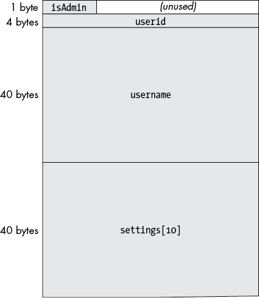

图 9-3：user_account 记录的内存布局

此外，为用户名使用 `strcpy` 会留下另一块处于未初始化状态的内存。此字符串复制函数在空终止符处停止复制，因此，例如，一个 5 字符的字符串将只修改前 6 字节，留下 34 字节由 `malloc` 偶然获取的任何内容。所有这些的要点是，新分配的结构体包含残留数据，除非覆盖每一个字节，否则可能会泄露。

减轻这些无意内存泄露的风险并不难，但你必须勤勉地覆盖可能暴露的数据结构的所有字节。你不应试图精确预测编译器可能如何分配字段偏移量，因为这可能随时间和平台而变化。相反，避免这些问题的最简单方法是在分配后将缓冲区清零，除非你能以其他方式确保它们被完全写入，或知道它们不会跨越信任边界被披露。请记住，即使你的代码本身不使用敏感数据，此内存泄露路径也可能暴露进程中任何地方的其他数据。

一般来说，你应该避免使用 `strcpy` 复制字符串，因为有太多方式会用错。`strncpy` 函数既用零填充目标中未使用的字节，又防止超出缓冲区大小的字符串溢出。然而，`strncpy` *不* 保证结果字符串将有空终止符。这就是为什么必须分配大小为 `MAX_USERNAME_LEN + 1` 的缓冲区，确保始终有空间容纳空终止符的原因。另一种选择是使用 `strlcpy` 函数，它确实确保空终止；然而，为了效率，它不填充未使用的字节。正如本例所示，当你直接处理内存时，有许多因素必须小心应对。

现在我们已经介绍了内存分配的机制，并通过构造的示例看到了漏洞的样子，让我们考虑一个更现实的案例。以下示例基于几年前一起引人注目的安全惨案，它危害了世界主要 Web 服务的很大一部分。

## 案例研究：Heartbleed（心脏出血）

2014 年 4 月初，头条新闻警告了一场勉强避免的全球性灾难。主要操作系统平台和网站推出了协调一致的修复方案，在秘密中匆忙安排，试图在新发现的安全缺陷细节公开时将其暴露降至最低。Heartbleed 不仅因为是“第一个拥有酷炫 Logo 的安全 Bug”而登上新闻，还因为它揭示了一个可被轻易利用的漏洞，存在于任何部署了流行的 OpenSSL TLS 库的服务器中。

以下是对十年来最可怕的安全漏洞之一的深入剖析，它应能为你提供背景，了解严重错误可能有多严重。此详细讨论的目的是说明管理动态分配内存的 Bug 如何演变成毁灭性的漏洞。因此，我简化了代码和复杂 TLS 通信协议的一些细节，以展示漏洞的核心。从概念上讲，这与实际发生的情况直接对应，但活动部件更少，代码简单得多。

Heartbleed 是 OpenSSL 实现的 TLS 心跳扩展中的缺陷，该扩展于 2012 年在 RFC 6520 中提出。该扩展提供了一种低开销的方法来保持 TLS 连接存活，避免客户端在一段时间不活动后必须重新建立新连接。所谓的心跳本身是一个往返消息交换，包含一个*心跳请求*，其载荷为 16 到 16,384 (2¹⁴) 字节的任意数据，并作为包含相同载荷的*心跳响应*回显回来。图 9-4 显示了该协议的基本请求和响应消息。

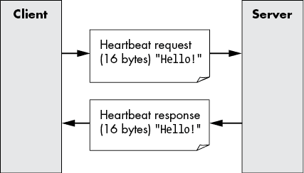

图 9-4：心跳协议（简化版）

下载完 HTTPS 网页后，客户端稍后可能会在连接上发送心跳请求，让服务器知道它想要维持连接。在正常使用的示例中，客户端可能会发送填充零的 16 字节消息“Hello!”作为请求，服务器将通过发送相同的 16 字节进行响应。（至少按设计是这样工作的。）现在让我们看看 Heartbleed Bug。


# Heartbleed 漏洞分析

严重缺陷发生在畸形的心跳请求中，这些请求提供的载荷很小，却声称拥有更大的载荷字节计数。为了确切了解其工作原理，让我们首先看看对等方交换的简化心跳消息之一的内部结构。示例中的所有代码均为 C 语言：

```c
typedef struct {
  HeartbeatMessageType type;
  uint16_t payload_length;
  char bytes[0];  // 变长载荷和填充
} hbmessage;
```

数据结构声明 `hbmessage` 展示了这些心跳消息的三个部分。第一个字段是消息 `type`，指示它是请求还是响应。接下来是消息载荷的字节长度，称为 `payload_length`。第三个字段称为 `bytes`，声明为零长度，但旨在与动态分配配合使用，以添加所需的适当大小。

恶意客户端可能会通过首先与目标服务器建立 TLS 连接，然后发送一个 16 字节的心跳请求并声称字节计数为 16,000 来攻击该服务器。以下是其作为 C 语言声明的样子：

```c
typedef struct {
  HeartbeatMessageType type = heartbeat_request;
  uint16_t payload_length = 16000;
  char bytes[16] = {"Hello!"};
} hbmessage;
```

发送此请求的客户端在撒谎：消息称其载荷长 16,000 字节，但实际载荷只有 16 字节。要了解此消息如何欺骗服务器，请查看处理传入心跳请求消息的 C 代码：

```c
hbmessage *hb(hbmessage *request, int *message_length) {
  int response_length = request->payload_length + sizeof(hbmessage);
  hbmessage* response = malloc(response_length);
  response->type = heartbeat_response;
  response->payload_length = request->payload_length;
  memcpy(&response->bytes, &request->bytes, response->payload_length);
  *message_length = response_length;
  return response;
}
```

`hb` 函数使用两个参数调用：传入的心跳 `request` 消息和一个名为 `message_length` 的指针，该指针存储函数返回的响应消息的长度。前两行计算响应的字节长度作为 `response_length`，然后分配该大小的内存块作为 `response`。接下来两行填充响应消息的前两个值：消息 `type` 及其 `payload_length`。

接下来是致命的 bug。服务器需要将请求中接收到的消息字节发送回去，因此它将数据从请求复制到响应中。因为它信任请求消息准确报告了其长度，所以函数复制了 16,000 字节——但由于请求消息中只有 16 字节，响应中包含了数千字节的内部内存内容。最后两行存储响应消息的长度，然后返回指向它的指针。

图 9-5 说明了这种消息交换，详细展示了前面的代码如何泄露进程内存的内容。为了具体说明该漏洞利用的危害，我描绘了几个包含秘密数据的额外缓冲区，它们已经位于请求缓冲区附近的内存中。从仅包含 16 字节载荷的缓冲区复制 16,000 字节——此处用过大的虚线区域说明——导致秘密数据最终进入响应消息，服务器将其发送给客户端。

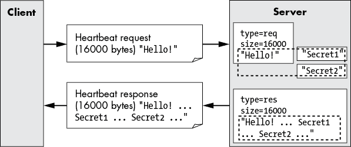

图 9-5：利用 Heartbleed 漏洞进行攻击（简化版）

此缺陷无异于将服务器配置为提供一个匿名 API，该 API 对所有调用者拍摄快照并发送数千字节的工作内存——这是暴露在互联网上的内存隔离的完全破坏。使用 HTTPS 安全性的 Web 服务器在工作内存中拥有任何数量的敏感机密，这不足为奇。根据 Heartbleed 漏洞的发现者称，他们能够轻松地从自己这里窃取“用于我们 X.509 证书的密钥、用户名和密码、即时消息、电子邮件以及业务关键文档和通信”。由于泄露的确切数据取决于内存分配的特性，攻击者利用此漏洞反复访问服务器内存的能力最终产生了各种敏感数据。要查看 Heartbleed 的更简单视图，请参阅图 9-6。

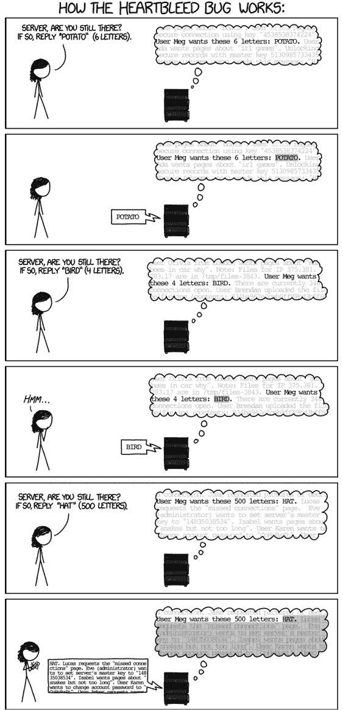

图 9-6：Heartbleed 解释（由 Randall Munroe 提供，[xkcd.com/1354](http://xkcd.com/1354)）

事后看来，修复很简单：预判那些“撒谎”的心跳请求，即请求的载荷多于它们提供的载荷，并按照 RFC 的明确规定忽略它们。多亏了 Heartbleed，世界了解到如此多的服务器多么依赖 OpenSSL，以及有多么少的志愿者在维护互联网基础设施如此依赖的关键软件。该 bug 典型地说明了为什么许多安全缺陷难以检测，因为在格式良好的请求情况下一切都完美运行，只有出于好意的代码不太可能发出的畸形请求才会导致问题。此外，心跳响应中泄露的服务器内存不会对服务器造成直接伤害：只有通过仔细分析过度的数据泄露，潜在损害的程度才变得明显。

作为近年来发现的最严重的安全漏洞之一，Heartbleed 应该作为安全漏洞本质的宝贵范例，以及微小缺陷如何导致我们系统安全的大规模动摇。从功能角度来看，人们很容易认为这是一个小 bug：它不太可能发生，乍一看，发回比请求提供的更多的载荷数据似乎完全无害。

Heartbleed 是低级语言脆弱性的绝佳反面教材。微小的错误可能产生巨大的影响。如果高价值机密恰好位于内存中恰好错误的位置，缓冲区溢出可能会暴露它们。设计（协议规范）通过指示应忽略字节长度不正确的心跳请求来预判这一错误，但如果没有显式测试，没有人注意到该漏洞长达两年多。

这只是一个库中的一个 bug。还有多少类似的 bug 仍然存在？

# 10 不受信任的输入

> 我喜欢工程，但我热爱创意输入。
>
> ——John Dykstra


*不受信任的输入*或许是编写安全代码的开发者最大的担忧来源。该术语本身可能令人困惑，或许最好理解为涵盖系统的所有输入，这些输入不是*受信任的输入*，即来自你可以信任其提供格式良好数据的代码的输入。不受信任的输入是那些不在你控制范围内且可能被操纵的输入，包括进入系统的任何你不完全信任的数据。也就是说，它们是你*不应该信任*的输入，而不是你*错误地信任*的输入。


## 输入验证

> 在向他人寻求认可之前，先试着在自己身上找到它。
>
> ——格雷格·贝伦特

任何来自外部并进入系统的数据，最好都视为不可信。系统的用户可能是友善、值得信赖的人，但在安全方面，他们最好也被视为不可信，因为他们可能做任何事——包括成为他人诡计的受害者。不可信输入令人担忧，因为它们代表了一条*攻击向量*，一种深入系统并制造麻烦的途径。跨越信任边界的恶意构造输入尤为令人担忧，因为它们能深入系统内部，导致特权代码中出现漏洞利用，因此拥有良好的第一道防线至关重要。互联网是世界上最大的不可信输入来源，而且软件完全断网的情况极其罕见，这对几乎所有系统都构成了严重威胁。

*输入验证*（或*输入清理*）是一种防御性编码实践，它对输入施加限制，强制其符合既定规则。通过验证输入是否满足特定约束，并确保代码对所有有效输入都能正常工作，你就能成功抵御这些攻击。本章重点介绍如何使用输入验证来管理不可信输入，以及这样做对安全为何重要。这个话题可能看起来枯燥乏味，技术上也不算困难，但需求极其普遍，因此更好地进行输入验证或许是开发人员减少漏洞所能采摘的最具影响力的“触手可及的果实”。因此，我们将深入探讨。字符串输入带来了特定挑战，而 Unicode 的安全隐鲜为人知，所以我们也将概述它们带来的基本问题。接着，我们将通过一些示例，演示如何利用不可信数据配合各种技术实施注入攻击：SQL、路径遍历、正则表达式和 XML 外部实体 (XXE)。最后，我将针对这一广泛的漏洞集总结可用的缓解技术。

现在你已了解何为不可信输入，请考虑它们在系统内的潜在影响以及如何防范危害。不可信输入经常在系统中流转，往往深达多层，直达受信组件——所以即便你的代码是直接由受信代码调用的，也无法保证那些输入是可信的。问题在于组件可能在传递来自任何地方的数据。攻击者能潜在操纵数据的方式越多，该数据就越不可信。后续的示例将阐明这一点。

输入验证是一种良好的防御手段，因为它将不可信输入限制在应用程序能安全处理的数值范围内。输入验证的基本任务是确保不可信输入符合设计规范，以便验证之后的下游代码只需处理格式良好的数据。假设你正在编写一个用户登录认证服务，它接收用户名和密码，如果凭证正确则颁发认证令牌。通过将用户名限制在 8 到 40 个字符之间，并要求其由定义明确的 Unicode 码点子集组成，你可以大大简化对该输入的处理，因为它是一个已知量。后续代码可以使用固定大小的缓冲区来保存用户名的副本，而无需担心生僻字符的后果。基于这一保证，你或许还能以其他方式简化处理。

在上一章中，我们已经见过用于修复低级漏洞的输入验证。工资整数计算代码中的输入验证由一条 `if` 语句组成，用于防范过大的输入值：

```
if (millihours > max_millihours       // 最多 100 小时
    || hourlycents > max_hourlycents) // 时薪上限 $200
  return 0;
```

无需重复对此代码的解释，但它是一个基础输入验证的绝佳示例。你编写的几乎任何代码只能在特定限制内正确工作：它无法处理极端值，例如海量内存大小，或不同语言的文本。无论限制是什么，我们都不希望让代码暴露在其未设计处理的输入下，因为这会带来意外后果的风险，进而可能产生漏洞。缓解这种危险的一个简单方法是对输入施加人为限制，以筛选掉所有有问题的输入。

不过，有几个细微之处值得指出。当然，限制绝不能拒绝本应被正确处理的输入；例如在工资示例中，我们不能将 40 小时工作周判定为无效。如果代码无法处理所有有效输入，则需要修复代码以使其能处理更广泛的输入范围。此外，输入验证策略可能需要考虑多个输入之间的交互。在工资示例中，正如第 9 章所示，时薪与工作时长的乘积可能超出定宽整数的大小，因此验证可以限制这两个输入的乘积，或分别对每个输入设定上限。前者更宽容，但可能增加调用方的适配难度，因此正确的选择取决于具体应用。

一般来说，你应该尽早验证不可信输入，以将未受约束的输入流向可能无法妥善处理它的下游代码的风险降至最低。一旦通过验证，后续代码就能受益于仅接触行为良好的数据；这有助于开发人员编写安全代码，因为他们确切知道输入的范围。一致性是关键，因此一个良好的模式是将输入验证置于处理传入数据的第一层代码中，然后将有效输入传递给更深层的业务逻辑，后者可以放心地假设所有输入均为有效。

我们主要将输入验证视为针对不可信输入的防御——具体来说，是针对攻击面上的内容——但这并不意味着可以轻率忽略所有其他输入。无论你多么信任某数据的提供者，都可能因失误导致意外输入，或因攻击以某种方式攻破系统的一部分而有效扩大攻击面。基于所有这些原因，防御性输入验证是你的得力助手。宁可采取冗余的输入验证，也不要冒创建微妙漏洞的风险——如果你无法确定传入数据已可靠验证，你大概率需要亲自验证以确保万无一失。

## 确定有效性

输入验证始于决定什么是有效的。这并不像听起来那么简单，因为它等同于预判所有未来可能的有效输入值，并找出合理的理由拒绝其余值。这个决定通常由开发人员做出，他们必须在用户可能想要的功能与允许更宽范围所需的额外编码工作之间权衡。理想情况下，软件需求规范会规定什么构成有效输入，良好的设计也能提供指导。

对于整数输入，32 位整数的完整范围似乎是一个显而易见的选择，因为它是标准数据类型。但着眼未来，如果代码稍后需要将这些值相加，那就需要更大的整数，所以 32 位的限制就变得武断了。另一种思路是，如果你能合理地为有效性设定一个下限，那么就可以确保这些值的和适合 32 位整数。确定什么构成有效输入的正确答案，需要结合特定应用的上下文进行考察——这是领域知识对安全至关重要的一个绝佳例证。一旦确定了被视为有效的值的范围，就很容易确定要使用的适当数据类型。


# 通常行之有效的做法是，对输入设定明确的限制，然后在实现中留出充足的余量，以确保能正确处理所有有效输入。

所谓余量，我的意思是：如果你要将一个文本字符串复制到一个 4,096 字节的缓冲区中，应将 4,000 字节作为最大有效长度，从而留出一点备用空间。（在 C 语言中，额外的空终止符导致缓冲区溢出一个字节，是一个容易犯的经典错误。）有些程序员喜欢挑战高难度，但如果你过于慷慨（允许尽可能宽泛的输入范围），就会迫使实现承担比必要更大、更难的工作，导致代码复杂性和测试负担增加。即使你的在线购物应用能管理包含十亿件商品的购物车，尝试处理这种不切实际的交易也会适得其反。最友善的做法是拒绝该输入（这很可能是某人的猫趴在键盘上造成的）。

## 验证标准

大多数输入验证检查包含若干标准，包括确保输入不超过最大尺寸、数据以正确格式到达、以及数据在可接受的取值范围内。

检查值的大小是一项快速测试，主要旨在避免针对代码的 DoS 威胁，此类威胁会导致应用在海量不可信输入的重压下运行缓慢甚至崩溃。数据格式可以是表示数字的数字序列、由特定允许字符组成的字符串，或更复杂的格式，如 XML 或 JSON。通常，按以下顺序检查比较明智：首先限制大小，以免浪费时间处理过大的输入；然后确保输入格式良好，再进行解析；最后检查解析出的值是否在可接受范围内。

确定有效取值范围可能是最主观的选择，但设定具体限制很重要。范围的定义方式取决于数据类型。对于整数，范围不小于最小值且不大于最大值。对于浮点数，可能还存在精度（小数位数）限制。对于字符串，则是最大长度、编码，以及通常由正则表达式等决定的允许格式或语法。我建议以字符数而非字节数来指定最大字符串长度，至少这样非程序员也有希望理解这一约束的含义。

将输入视为“针对特定目的有效”而非抽象地“有效”会很有帮助。例如，语言翻译系统可能接受先经过验证、符合所有支持语言通用的受支持字符集和最大长度的输入。如果下一处理阶段分析文本以确定其语言，选定语言后，你可以进一步将文本限制为相应的字符集。

又如，考虑验证一个表示采购发票上订购商品数量的整数输入。任何客户实际可能订购的最大数量很难确定，但这是一个值得提前考虑的好问题。如果你有过往数据，一个快速的 SQL 查询可能会返回一个值得参考的有趣案例。有人可能会辩称，最大 32 位整数值限制最少、因此是最佳选择，但在实践中这很少讲得通。谁会不认为订购 4,294,967,295 件任何商品不是某种错误呢？既然非程序员永远记不住源自二进制的这种奇怪数字，选择一个更友好的限制（如 1,000,000）更合理。如果有人真的合法地触及了这种限制，了解这一点很可能是值得的，且调整起来也应该很容易。此外，开发人员在此过程中会了解到一个之前未曾想象的真实用例。

输入验证的主要目的是确保无效输入无法通过。最简单的方法就是直接拒绝无效输入，正如我们在前面的讨论中隐性地做的那样。一种更宽容的替代方案是检测无效输入并将其修改为有效形式。让我们看看这些不同的方法，以及何时采用哪种。

## 拒绝无效输入

拒绝不符合指定规则的输入是最简单、可以说也是最安全的方法。完全接受或完全拒绝最为清晰明了，通常也最容易做对。这就像决定是否安全在海里游泳的常识性建议：“拿不准时，别下水。”这可以简单到：如果网页表单有任何字段填写不当，就拒绝处理；也可以极端到：因为某条记录中的单个违规，就拒绝整批传入数据。

每当人们直接提供输入时（如网页表单），提供信息丰富的错误消息是最友善的做法，这能让他们轻松纠正错误并重新提交。用户提交无效输入推测要么是失误，要么是不知晓验证规则，两者皆非好事。叫停并要求数据源提供有效输入，是进行输入验证的保守做法，也给常规提供者提供了学习和适应的良机。

当输入验证拒绝来自人的错误输入时，最佳实践包括：

*   作为用户界面的一部分，解释什么构成有效输入，至少能省去阅读者猜测和重试的麻烦。（我怎么知道区号应该用连字符分隔而不是用括号括起来？）
*   一次性标记多个错误，以便一次性纠正并重新提交。
*   当人们直接提供输入时，保持规则简单明了。
*   将复杂的表单拆分为多个部分，每部分使用单独的表单，这样人们能看到自己在取得进展。

当输入来自其他计算机而非直接来自人时，更严格的输入验证可能更明智。实现这些需求的最佳方式是编写文档，精确描述预期的输入格式和任何其他约束。对于来自专业运行系统的输入，完全拒绝整批输入（而不是尝试部分处理有效的数据子集）可能最讲得通，因为这表明规格出了问题。这允许纠正错误并再次提交完整数据集，而无需分拣哪些已处理、哪些未处理。

## 修正无效输入

虽然坚持只接收完全有效的输入并拒绝其他一切既安全又简单，但这绝不总是最佳选择。对于不惜一切代价寻求客户的在线商家，结账时拒绝输入可能导致更多令人恐惧的“弃购”情况，造成销售损失。对于交互式用户输入，僵化的规则会让人沮丧，因此如果软件能帮助用户提供有效输入，就应该这么做。

如果你不想因小错误而叫停流程，输入验证代码可以尝试修正无效输入，将其转换为有效值，而不是拒绝它们。简单的例子包括将过长的字符串截断为最大允许长度，或移除多余的前导或尾随空格。其他修正无效输入的例子则更复杂。考虑按邮政服务允许的确切格式输入邮寄地址这一常见例子。由于对精确间距、街道名称拼写和缩写形式的要求，这是一个相当大的挑战。几乎唯一的办法是提供官方格式的相似地址最佳匹配供填写者选择。


解决棘手验证需求的最佳良方是将输入设计得尽可能简单。例如，我们许多人在提供电话号码时都曾感到困扰，因为要求区号必须用括号括起，或短横线必须位于特定位置。相反，应允许电话号码为纯数字字符串，从一开始就避免语法规则。

虽然调整输入可能节省时间，但任何修正都带来了这样一种可能性：即修正会以一种非预期的方式（从用户的角度来看）修改输入。以电话号码表单字段为例，预期输入长度为 10 位数字。去除常见字符（如连字符）并接受输入（如果结果产生 10 个有效数字）应该是安全的，但如果输入包含过多数字，用户可能意在提供国际号码，也可能只是输错了。无论哪种情况，截断它大概都不是安全的。

适当的输入验证需要审慎的判断，但它能使软件系统更加可靠，因此也更加安全。它缩小了问题空间，消除了不必要的棘手边缘情况，提高了可测试性，并使整个系统定义得更好、更稳定。

## 字符串漏洞

> 如果你是一个在 2006 年工作的程序员，却不懂字符、字符集、编码和 Unicode 的基础知识，如果被我抓到，我会惩罚你在潜艇里剥洋葱六个月。
>
> ——Joel Spolsky

几乎所有软件组件都会处理字符串，至少是在处理命令行参数或以可读形式显示输出时。某些应用程序大量处理字符串；这些包括文字处理器、编译器、Web 服务器和浏览器等。字符串处理无处不在，因此了解其中常见的安全陷阱非常重要。以下列举了许多需要注意的问题，以避免无意中造成漏洞。

### 长度问题

长度是首要挑战，因为字符串的长度可能是无界的。极长的字符串在复制到固定长度的存储区域时会引发缓冲区溢出。即使处理得当，海量字符串如果消耗过多的周期或内存，也会导致性能问题，潜在地威胁可用性。因此，第一道防线是将传入的不可信字符串长度限制在合理范围内。冒着说废话的风险，在分配缓冲区时，不要混淆字符计数与字节长度。

### Unicode 问题

现代软件通常依赖 Unicode，这是一个涵盖世界书面语言的丰富字符集，但这种丰富性的代价是大量隐藏的复杂性，这可能成为漏洞利用的温床。有许多字符编码可将世界文本表示为字节，但软件最常将 Unicode 用作一种*通用语*。Unicode 标准（13.0 版）长达 1000 多页，规定了 140,000 多个字符、规范化算法、传统字符编码标准兼容性以及双向语言支持；它涵盖了几乎所有的世界书面语言，编码了超过一百万个码位。

Unicode 文本有几种不同的编码需要了解。`UTF-8` 最常见，但也有 `UTF-7`、`UTF-16` 和 `UTF-32` 编码。准确地在字节和字符之间转换对安全至关重要，以免文本内容在过程中意外变形。*Collation*（排序顺序）取决于编码和语言，如果不了解这一点，可能会产生意外结果。某些操作在不同的区域设置上下文中可能表现不同，例如在配置为另一个国家或语言的计算机上运行时，因此在所有这些情况下测试正确性非常重要。当无需支持不同区域设置时，考虑显式指定区域设置，而不是从系统配置继承任意一个。

由于 Unicode 有许多令人惊讶的特性，安全方面的底线是：使用可信赖的库来处理字符串，而不是试图直接操作字节。可以说在这方面，Unicode 类似于密码学，最好将繁重的工作留给专家。如果你不懂行，某个你从未听说过的晦涩字符或语言的某个怪癖可能会引入漏洞。本节详述了一些非常值得了解的主要问题，但要全面深入探讨 Unicode 的复杂性，足以写成一整本书。关于开发人员需要了解的细节安全注意事项的详细指南，可从 Unicode 联盟获取。`UTR#36: Unicode Security Considerations` 是一个很好的切入点。

#### 编码与字形

Unicode 编码的是字符，而非*字形*（字符的渲染视觉形式）。这一简单的原则有许多影响，但或许最简单的解释是：大写字母 I (U+0049) 和罗马数字 1 (U+2160) 是单独的字符，但可能显示为相同的字形（称为*同形异义字*）。Web URL 支持国际语言，利用外观相似的字符欺骗用户是攻击者众所周知的伎俩。著名的例子是，有人利用一个西里尔字母 (U+0420) 获得了合法的服务器证书，该字母看起来就像 PayPal 中的 P，从而制造了完美的钓鱼陷阱。

Unicode 包含组合字符，允许同一字符有不同的表示形式。拉丁字母 Ç (U+00C7) 也有一种双字符表示，由大写字母 C (U+0043) 后跟“组合变音符”(U+0327) 组成。单字符和双字符形式显示为相同的字形，且无语义差异，因此代码通常应将它们视为等价形式。典型的编码策略是首先将输入字符串规范化为标准形式，但遗憾的是，Unicode 有几种规范化形式，因此要处理好细节还需要进一步学习。

## 大小写转换

将字符串转换为大写或小写是规范化文本的常用方法，使代码将 `test`、`TEST`、`tEsT` 等视为相同。然而事实证明，英语字母表之外的字符在大小写转换下具有令人惊讶的特性。

例如，以下字符串不同，但对普通观察者来说几乎相同：`'This ıs a test.'` 和 `'This is a test.'`（注意第一句中第二个小写 `i` 缺少上方的点）。转换为大写后，它们都变成相同的 `'THIS IS A TEST.'`，因为不带点的小写 `ı` (U+0131) 和熟悉的小写 `i` (U+0069) 都变成大写 `I` (U+0049)。要了解这如何导致漏洞，考虑检查输入字符串中是否存在 `<script>`：代码可能会转为小写，扫描该子串，然后转为大写用于输出。字符串 `<scrıpt>` 会漏网，但在输出中显示为 `<SCRIPT>`，这可能允许网页上的脚本注入——这正是代码试图阻止的。

## 注入漏洞

> 如果你曾向政治注入真理，政治将不复存在。
>
> ——Will Rogers


# 未经请求的信用卡推销与注入攻击

未经请求的信用卡推销构成了堵塞邮政系统的无数吨垃圾邮件的主要部分，但一位聪明的收件人成功将局势扭转，反制了银行。德米特里·阿加科夫没有扔掉一份条款令他不满的推广办卡邀请，而是扫描了随附的合同，并仔细修改了文本，规定了对他极其有利的条款，包括 0% 利息、无限额度，以及如果银行取消信用卡他将获得的一笔丰厚赔偿。他签署了修改后的合同并寄回银行，不久后收到了他的新信用卡。德米特里享受了这份独特有利合同的优厚条款一段时间，但当银行最终察觉时，情况变得很糟。经过一场旷日持久的法律斗争，其中包括一项维持修改后合同有效性的有利判决，他最终在庭外达成和解。

这是一个现实世界的*注入攻击*案例：合同不同于代码，但它们强制签署人执行规定的动作，方式与程序的行为非常相似。通过篡改合同条款，德米特里迫使银行违背意愿行事，这几乎就像他修改了管理信用卡账户的软件以使其对自己有利一样。软件也容易受到此类攻击：不受信的输入可以欺骗软件做出意想不到的事情，这实际上是一种相当常见的漏洞。

存在一种常见的软件技术，它通过构建一个编码了待执行操作的字符串或数据结构，然后执行它来完成指定任务。（这类似于银行起草一份定义其信用卡服务如何运作的合同，期望条款被原封不动地接受。）当涉及来自不受信源的数据时，它可能会影响执行时发生的行为。如果攻击者能够改变操作的预期效果，这种影响可能会跨越信任边界，并被以更高权限运行的软件执行。这就是注入攻击的抽象概念。

在解释一些常见注入攻击的细节之前，让我们考虑一个简单的例子，说明不受信数据的影响如何具有欺骗性。根据一个杜撰的故事，一支校内垒球队巧妙地选择了“无比赛安排”作为队名，成功利用了这种混淆。多次对手在赛程表上看到这个名字，以为意味着那天没有比赛，结果因弃权而输掉了比赛。这是一个注入攻击的例子，因为队名是排程系统的输入，但“无比赛安排”被误解为来自排程系统的一条消息。

相同的注入攻击原则适用于许多不同的技术（即代表操作的构造字符串形式），包括但不限于：

*   `SQL` 语句
*   文件路径名
*   正则表达式（作为 DoS 威胁）
*   `XML` 数据（具体指 `XXE` 声明）
*   Shell 命令
*   将字符串解释为代码（例如，JavaScript 的 `eval` 函数）
*   `HTML` 和 `HTTP` 头部（第 11 章介绍）

以下章节将详细解释前四种注入攻击。Shell 命令注入和代码注入的工作原理与 `SQL` 注入类似，都是由于粗糙的字符串构造导致可被不受信输入利用。我们将在下一章介绍 Web 注入攻击。

## SQL 注入

经典的 `xkcd` 漫画 #327（图 10-1）描绘了一次大胆的 `SQL` 注入攻击，其中父母给孩子起了一个不寻常且难以发音的名字，其中包含特殊字符。当这个名字被录入当地学区的数据库时，破坏了学校的记录。

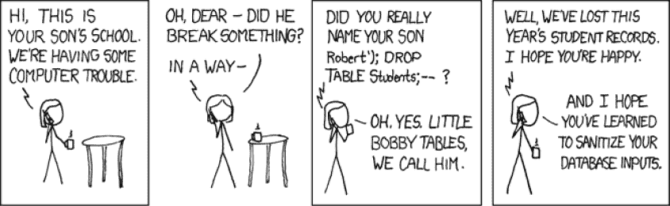

图 10-1：妈妈的漏洞利用（由 Randall Munroe 授权，[xkcd.com/327](http://xkcd.com/327)）

要理解其工作原理，假设学校注册系统使用 `SQL` 数据库，并使用如下形式的 `SQL` 语句添加学生记录：

```
INSERT INTO Students (name) VALUES ('Robert');
```

在这个简化的例子中，该语句将名字“Robert”添加到数据库中。（实际上，两个括号列表中会出现不仅仅是 `name` 的更多列；此处为简化起见省略了它们。）

现在想象一个学生有一个荒谬的名字：`Robert'); DROP TABLE students;--`。考虑生成的 `SQL` 命令，其中对应学生名字的部分已高亮显示：

```
INSERT INTO Students (name) VALUES ('Robert'); DROP TABLE Students;--');
```

根据 `SQL` 命令语法规则，该字符串实际上包含两条语句：

```
INSERT INTO Students (name) VALUES ('Robert');
DROP TABLE Students; --');
```

这两条 `SQL` 命令中的第一条按预期插入了一条“Robert”记录。然而，由于学生的名字包含 `SQL` 语法，它还注入了第二条非预期的命令 `DROP TABLE`，该命令会删除整个表。双破折号表示注释，因此 `SQL` 引擎会忽略后面的文本。这个技巧通过吞噬尾部语法（单引号和右括号）来避免阻止执行的语法错误，从而使漏洞利用生效。

现在让我们更仔细地看看代码，了解 `SQL` 注入漏洞的样子以及如何防止它。假设的学校注册系统代码通过形成文本字符串形式的 `SQL` 命令（如我们介绍的第一个基本示例），然后执行它们。输入数据提供姓名和其他信息以填充学生记录。理论上，我们甚至可以假设工作人员根据官方记录验证了这些输入以确保其准确性（假设法律名字可以包含 `ASCII` 特殊字符，这需要打个大大的折扣）。

程序员的致命错误在于编写了如下字符串拼接语句，而没有考虑到异常名字可能会“突破”单引号的限制：

**易受攻击的代码**

```
sql_stmt = "INSERT INTO Students (name) VALUES ('" + student_name + "');";
```

缓解注入攻击并不难，但需要保持警惕，以免因马虎而编写出这样的代码。将不受信的输入与命令字符串混合是漏洞的根本原因，因为这些输入可以突破引号的限制，导致意想不到的有害后果。

确定什么字符串构成有效姓名是一个重要的需求问题，但让我们只关注此 `SQL` 语句中用作单引号的撇号字符。由于存在包含撇号的名字（如 O’Brien），而撇号是破解 `SQL` 命令语法的关键，应用程序不能将此字符作为输入验证的一部分予以禁止。该名字可以正确地写为带引号的字符串 `'O''Brien'`，但在完整的解决方案中，可能还有许多其他特殊字符需要特殊处理才能有效消除漏洞。

作为进一步的防御，你应该配置 `SQL` 数据库，使注册学生的软件不具备删除任何表的管理权限，因为这不是其工作所需。（这是第 4 章提到的“最小权限”模式的一个例子。）

与其通过自定义 `SQL` 清理代码“重复造轮子”，最佳实践是使用旨在构建 `SQL` 命令的库来处理这些问题。如果没有可靠的库可用，请创建测试用例，以确保尝试的注入攻击要么被拒绝，要么被安全处理，并且对于像 O’Brien 这样名字的学生一切正常。

以下是一些简单的 `Python` 代码片段，展示了错误的做法，然后是正确的做法。首先是错误的方式，使用 Bobby Tables 攻击的模拟：

**易受攻击的代码**


## SQL 注入示例

```
import sqlite3
con = sqlite3.connect('school.db')
student_name = "Robert'); DROP TABLE Students;--"
# The WRONG way to query the database follows:
sql_stmt = "INSERT INTO Students (name) VALUES ('" + student_name + "');"
con.executescript(sql_stmt)
```

创建到 SQL 数据库的连接（`con`）后，代码将学生姓名赋值给变量 `student_name`。接着，代码通过将字符串 `student_name` 插入 `VALUES` 列表来构建 SQL `INSERT` 语句，并赋值给 `sql_stmt`。最后，该字符串作为 SQL 脚本执行。

正确的处理方式是让库来插入涉及不可信数据的参数，如下面的代码片段所示：

### 修复后的代码

```
import sqlite3
con = sqlite3.connect('school.db')
student_name = "Robert'); DROP TABLE Students;--"
# The RIGHT way to query the database follows:
con.execute("INSERT INTO Students (name) VALUES (?)", (student_name,))
```

在此实现中，`?` 占位符由包含 `student_name` 字符串的元组参数填充。请注意，`INSERT` 语句字符串内不需要引号——这会由库自动处理。这种语法避免了注入，并安全地将 Bobby 的特殊姓名录入数据库。

有一个细节值得澄清。要使原始攻击奏效，需要使用 `executescript` 库函数，因为 `execute` 仅接受单条语句，这在一定程度上防御了此特定攻击。但认为所有注入攻击都涉及额外命令，且此限制能提供充分保护，那将是错误的。例如，假设学校里有另一位名字难以发音的学生，名为 `Robert', 'A+');--`。他和普通的 Robert 都不及格——但当他的成绩记录在另一个 SQL 表中时，他的分数却被提升为 A+。这是如何发生的？

当使用易受攻击的代码提交普通 Robert 的成绩时，命令按预期录入 F 等级：

```
INSERT INTO Grades (name, grade) VALUES ('Robert', 'F');
```

但对于名字 `Robert', 'A+');--`，该命令变为：

```
INSERT INTO Grades (name, grade) VALUES ('Robert', 'A+');--', 'F');
```

关于 xkcd “Little Bobby Tables” 示例，细心的读者可能已注意到最后一点说明。抛开前提的荒谬性，Bobby 的父母能预见数据库表任意选定的特定名称（`Students`），这实在是巧合，最好用艺术加工来解释。

## 路径遍历

文件路径遍历是一种常见漏洞，与注入攻击密切相关。不同于前节示例中看到的从引号中转义，这种攻击通过转义到父目录来获取对文件系统其他部分的意外访问。例如，为提供图像集合，实现可能将图像文件收集在名为 `/server/data/image_store` 的目录中，然后通过从（不可信的）输入名称 `X` 形成的路径获取图像数据来处理对名为 `X` 的图像的请求：`/server/data/image_store/X`。

显而易见的攻击是请求名称 `../../secret/key`，这将返回本应为私有的文件 `/server/secret/key`。回顾一下，`.*`（点）是当前目录的特殊名称，`..`（点点）是允许向文件系统根遍历的父目录，如下面这组等效路径名所示：

*   `/server/data/image_store/../../secret/key`
*   `/server/data/../secret/key`
*   `/server/secret/key`

防御此类攻击的最佳方法是限制输入中允许的字符集（示例中的 `X`）。通常，确保输入为字母数字字符串的输入验证足以彻底堵住漏洞。这效果很好，因为它排除了逃离预期文件系统部分所需的麻烦文件分隔符和父目录形式。

然而，有时这种方法过于限制。当必须处理任意文件名时，这种简单方法过于严格，你需要做更多工作（而且可能变得复杂，因为文件系统很复杂）。此外，如果代码需跨平台运行，你需注意可能的文件系统差异（例如，\*nix 路径分隔符是斜杠，但在 Microsoft Windows 上是反斜杠）。

下面是一个简单示例，展示了一个函数，在将输入字符串作为子路径用于访问该 Python 代码所在目录（用 `__file__` 表示）中的文件前，先对其进行检查。思路是仅提供对特定目录或其子目录中文件的访问——绝对不提供对其他位置任意文件的访问。此处展示的版本中，防护函数 `safe_path` 检查输入是否以斜杠（指向文件系统根）或父目录点点开头，并拒绝包含这些内容的输入。要做到万无一失，你应该使用标准库（如 Python 的 `os.path` 功能套件）处理路径，而非临时的字符串操作。但仅此还不足以确保不会突破预期目录：

### 易受攻击的代码

```
def safe_path(path):
    """Checks that argument path is a safe file path. If not, returns None.
    If safe, returns the normalized absolute file path.
    """
    if path.startswith('/') or path.startswith('..'):
        return None
    base_dir = os.path.dirname(os.path.abspath(__file__))
    filepath = os.path.normpath(os.path.join(base_dir, path))
    return filepath
```

此防护剩下的漏洞在于，路径可以指定一个有效目录，然后向上到父目录，以此类推从而突破。例如，由于该示例代码运行的当前目录位于根目录下五层，路径 `./../../../../../etc/passwd`（包含五个点点）将解析为 `/etc/passwd` 文件。

我们可以通过拒绝任何包含点点的路径来改进基于字符串的无效路径测试，但这种方法有风险，因为很难确定我们是否预料到了所有可能的技巧并完全阻止了它们。相反，有一个直接的解决方案，依赖 `os.path` 库，而非用自己的代码构造路径字符串：

### 修复后的代码

```
def safe_path(path):
    """Checks that argument path is a safe file path. If not, returns None.
    If safe, returns the normalized absolute file path.
    """
    base_dir = os.path.dirname(os.path.abspath(__file__))
    filepath = os.path.normpath(os.path.join(base_dir, path))
    if base_dir != os.path.commonpath([base_dir, filepath]):
        return None
    return filepath
```

这种防护非常可靠，原因如下。基础目录是可靠路径，因为不涉及不可信输入：它完全由程序员完全控制的值派生而来。在与输入路径字符串连接后，该路径被规范化，这会解析任何点点父引用以生成绝对路径（`filepath`）。现在我们可以检查这些路径的最长公共子路径是否为我们想要限制访问的预期目录。

## 正则表达式

正则表达式（`regex`）高效、灵活且易于使用，提供了极其广泛的功能，或许是我们用于解析文本字符串的最通用工具。它们通常比临时代码更快（无论是编写还是执行），也更可靠。正则库编译状态表，由解释器（有限状态机或类似自动机）执行以匹配字符串。


即使你的正则表达式构造正确，它仍可能导致安全问题，因为某些正则表达式容易导致过长的执行时间，如果攻击者能够触发这些情况，就可能造成严重的 DoS（拒绝服务）攻击。具体来说，如果正则表达式发生*回溯*——即它向前扫描了很长一段距离，然后需要回退并反复重新扫描以寻找匹配——执行时间就会急剧膨胀。安全风险通常源于允许不受信任的输入指定正则表达式；或者，如果代码中已包含回溯型正则表达式，则源于不受信任的输入提供了一个冗长的最坏情况字符串，从而最大化计算工作量。

回溯型正则表达式看起来可能无害，下面通过一个例子来说明。以下 Python 代码在我的简配版树莓派 4B 型上运行需要三秒多。你的处理器可能快得多，但由于示例中 24 后面每增加一个 `D` 就会使运行时间翻倍，因此用稍长一点的字符串就能轻松让任何处理器卡死：

```
import re
print(re.match(r'(D+)+$', 'DDDDDDDDDDDDDDDDDDDDDDDD!')) 
```

只要涉及对不受信任输入的解析，且存在回溯或其他非线性计算可能失控的情况，就存在过长运行时的危险。在下一节中，你将看到一个沿这些思路的 XML 实体示例，还有许多类似的情况。

缓解这些问题的最佳方式取决于具体的计算，但有几种通用的方法可以应对这些攻击。避免让不受信任的输入影响那些可能失控的计算。就正则表达式而言，不要让不受信任的输入定义正则表达式，如果可能则避免回溯，并限制正则表达式匹配的字符串长度。弄清最坏情况下的计算量可能是什么，然后对其进行测试，确保其不会过慢。

### XML 的危险

XML 是表示结构化数据最流行的方式之一，因为它功能强大且人类可读。然而，你应该意识到 XML 的强大功能也可能被武器化。不受信任的 XML 利用 XML 实体造成危害主要有两种方式。

*XML 实体声明*是一个相对冷门的功能，不幸的是，攻击者在寻找滥用这些功能的方法方面颇具创造力。在下面的示例中，命名实体 `big1` 被定义为一个四字符字符串。另一个命名实体 `big2` 被定义为八个 `big1` 实例（共 32 个字符），`big3` 又是八个 `big2`，以此类推。等到 `big7` 时，你处理的已是兆字节级的数据，而且很容易继续往上扩展。这个示例构造了一个 8 兆字节的 XML 块。正如你所见，只需再添加几行就能达到千兆字节级别：

```
<!DOCTYPE dtd[
  <!ENTITY big1 "big!">
  <!ENTITY big2 "&big1;&big1;&big1;&big1;&big1;&big1;&big1;&big1;">
  <!ENTITY big3 "&big2;&big2;&big2;&big2;&big2;&big2;&big2;&big2;">
  <!ENTITY big4 "&big3;&big3;&big3;&big3;&big3;&big3;&big3;&big3;">
  <!ENTITY big5 "&big4;&big4;&big4;&big4;&big4;&big4;&big4;&big4;">
  <!ENTITY big6 "&big5;&big5;&big5;&big5;&big5;&big5;&big5;&big5;">
  <!ENTITY big7 "&big6;&big6;&big6;&big6;&big6;&big6;&big6;&big6;">
]>
<mega>&big7;&big7;&big7;&big7;&big7;&big7;&big7;&big7;</mega>
```

利用外部实体声明可以玩出更多花样。请看下面这个例子：

```
  <!ENTITY snoop SYSTEM "file:///etc/passwd>" >
```

这正是你所想的那样：读取密码文件，并使其内容在此后 XML 中 `&snoop;` 出现的任何位置可用。如果攻击者能将其作为 XML 提交，并看到实体扩展的结果，他们就能泄露任何他们能命名的文件的内容。

防御此类问题的第一道防线是将不受信任的输入排除在代码处理的任何 XML 之外。一些现代库会专门检查这种攻击，但如果你需要依赖这一点，应自行确认。如果你不需要 XML 外部实体，则可以通过从输入中排除它们，或禁用此类声明的处理来防范此类攻击。

## 缓解注入攻击

正如各种注入攻击都依赖于利用不受信任的输入来影响应用程序上下文中执行的语句或命令这一共同伎俩，针对这些问题的缓解措施也有共同之处，尽管细节各异。输入验证始终是良好的第一道防线，但视允许的输入可能包含的内容而定，仅靠这一点未必足够。

避免尝试将不受信任的数据插入到用于执行的构造字符串中，例如作为命令。针对 SQL 和其他易受注入攻击功能的现代库，应提供辅助函数，允许你将数据与命令分开传入。这些函数会处理引用、转义或任何必要的操作，以安全地对所有输入执行预期操作。我建议查看库文档中关于安全性的具体说明，因为确实存在粗制滥造的实现，它们只是简单地拼接字符串，却披着 API 的外衣，容易遭受注入攻击。如果拿不准，安全测试用例（见第 12 章）是一个很好的理智检查方法。

如果你不能或不愿使用安全的库——再次警告，不要陷入“能出什么事？”这种滑坡谬误的思维——首先考虑寻找替代方法来规避注入风险。与其构造 \*nix `ls` 命令来枚举目录内容，不如使用系统调用。理由很清楚：`readdir(3)` 所能做的仅仅是返回目录项信息；相比之下，调用 Shell 命令可能会做任何事情。

在某些情况下，使用文件系统作为自制数据存储可能是最快的解决方案，但我几乎无法将其推荐为一种安全的方法。如果你坚持冒险这样做，不要低估为预判并阻断所有潜在攻击以完全保障其安全所需的工作量。输入验证是你的好帮手；如果你能将字符串限制在安全字符集内（例如，仅由 ASCII 字母数字组成的名称），那可能就没问题了。作为额外的防御层，研究你正在构建的命令或语句的语法，并确保应用所有必要的引用或转义，以确保万无一失。仔细阅读适用的规范很有价值，因为可能存在你未曾知晓的晦涩形式。

好消息是，那些注入风险显现的危险操作通常很容易在源代码中扫描出来。检查 SQL 命令是否使用参数安全构造，而非临时拼接的字符串。对于 Shell 命令注入，留意 `exec(3)` 及其变体的使用，并确保正确引用命令参数（Python 提供了 `shlex.quote` 专门用于此目的）。在 JavaScript 中，审查 `eval` 的使用，要么安全地限制它，要么考虑在不受信任的输入可能影响构造表达式时不使用它。

本章涵盖了多种注入攻击及相关常见漏洞，但注入是一种非常灵活的手段，可能以多种伪装出现。在下一章中，我们将在 Web 漏洞的背景下再次看到它（两次）。

# 11 Web 安全

> 文字出现时，人人都说这是奇迹。但没人指出网络本身就是个奇迹。
>
> ——E. B. White（出自*《夏洛的网》*）


# Web 安全基础

万维网的巨大成功在很大程度上归功于一个显著的事实（如今已被完全视为理所当然）：无数百万人习惯性地使用它，却丝毫不了解它是如何工作的。对于如此复杂的技术融合体而言，这一独特成就既是福也是祸。毫无疑问，网络的易用性支撑了其广泛增长。但另一方面，保护一个由无数毫不知情的终端用户使用的、独立数字服务组成的全球网络，确实是一项极其艰巨的任务。安全或许是这个大难题中最难的部分。

一个使安全变得尤为棘手的复杂因素是，早期的网络设计相当天真，几乎未考虑安全性。因此，现代网络是标准长期演进的产物，这一过程因竞争激烈的“浏览器大战”和向后兼容性限制而变得错综复杂。简而言之，网络是历史上事后诸葛亮、“打补丁式安全”最极端的例子——尽管我们拥有的成果，在其发明逾四分之一世纪后，已颇为可观。

然而，尽管现代网络可以被构建得安全，但其纠缠不清的历史意味着它也相当脆弱，且充满了许多“安全和隐私上的缺陷”，正如 `RFC 6265`（一份关于 Web Cookie 的规范）的作者们那样生动地描述的。软件专业人士需要了解所有这些，以便在为 Web 构建应用时不触犯这些问题。细微的失误极易造成漏洞。鉴于互联网的“西部荒野”本质，恶意行为者拥有自由，可轻松探测网站如何工作，并匿名摸索寻找攻击入口。

本章重点关注 Web 安全模型是如何演进的，以及使用它的正确与错误方式。漏洞源于细节，一个安全的网站必须让许多事情完全做对。我们将涵盖 Web 安全的所有基础知识，首先强烈建议构建在能为你处理复杂性的安全框架之上。随后，我们将看到安全通信（`HTTPS`）、`HTTP` 协议的正确使用（包括 Cookie）以及同源策略如何共同保障网站安全。最后，我们将介绍两种 Web 特有的主要漏洞（`XSS` 和 `CSRF`），并讨论许多其他的缓解措施，这些措施组合起来，对保护现代 Web 服务器大有裨益。尽管如此，本章绝非 Web 安全的完整大全，其具体细节浩如烟海且演变迅速。

此处的目标是传达主要常见陷阱的宏观印象，以便你能识别并知道如何应对它们。Web 应用程序还受制于本书其他章节涵盖的许多其他漏洞：本章的重点不应被理解为暗示这些是唯一的潜在安全顾虑。

## 构建于框架之上

> 利用设计作为框架，从混乱中带来秩序。
>
> —Nita Leland

得益于现代 Web 开发工具，构建网站已变得几乎与使用网站一样简单。我构建安全网站的首要建议是：依赖高质量框架，绝不覆盖其提供的防护措施，并让胜任的专家处理所有棘手的细节。

依赖可靠的框架应能使你免受后续章节所涵盖的那些漏洞的侵害，但准确理解框架做什么和不做什么，以便有效地使用它们，仍然很有价值。从一开始就选择一个安全的框架也至关重要，因为你的代码将严重依赖它，如果它让你失望，日后更换将非常痛苦。你如何知道一个 Web 框架是否真正安全？这归结为信任——既信任其制造者的善意，也信任其专业能力。

Web 框架的流行度和关注度的兴衰几乎赶得上巴黎时尚，你的选择将取决于许多因素，因此我不会尝试给出具体推荐。不过，我可以建议一些供你自行评估的通用准则：

*   选择由值得信赖的组织或团队生产、并积极开发维护的框架，以跟上不断变化的 Web 技术和实践。
*   在文档中寻找明确的安全声明。如果找不到，我会直接取消该框架的资格。
*   考察过往表现：框架不需要完美的记录，但反应迟缓或持续出现问题的模式都是危险信号。
*   构建一个小型原型，检查生成的 `HTML` 是否进行了正确的转义和引用（使用本章示例中的此类输入）。
*   搭建一个简单的测试环境，尝试基本的 `XSS` 和 `CSRF` 攻击，正如本章稍后所解释的。

## Web 安全模型

> 我很高兴网络有点完全无政府状态。这对我来说没问题。
>
> —Roger Ebert

Web 是一种客户端/服务器技术，理解其安全模型需要同时考虑这两个视角。这样做很快就会变得有趣，因为双方的安全利益往往相互冲突，尤其是考虑到潜在攻击者可能通过互联网入侵的威胁。

以典型的在线购物网站为例。此处涉及的安全原则或多或少适用于所有类型的 Web 活动。为了开展业务，商家和客户必须在一定程度上相互信任，在绝大多数情况下这确实会发生。尽管如此，不可避免地存在一些恶意行为者，因此网站不能完全信任每个客户，反之亦然。以下几点突出了商家与客户之间这种试探性相互信任的一些细微差别。

以下是商家的一些基本要求：

*   其他网站不应能干扰我的客户交互。
*   我希望在有益地告知合法客户的同时，最大限度地降低竞争对手抓取我的产品和库存详情的能力。
*   客户不应能篡改价格或订购无库存的产品。

以下是客户的一些要求：

*   我需要保证我访问的网站是真实的。
*   我要求在线支付是安全的。
*   我期望商家保护我的购物活动隐私。

显然，双方都必须保持警惕，Web 才能良好运行。话虽如此，客户对商家有许多期望。解决教育困惑或轻信客户这一难题超出了本文范围，即便那可能实现。相反，在 Web 安全中，我们专注于从商家的角度保护网站。只有服务器出色地提供安全保障，Web 才能运作，这才使得诚实的最终用户有机会获得安全的 Web 体验。商家不仅要决定能在多大程度上信任客户，还要直觉判断客户可能在多大程度上信任他们。

Web 安全模型的另一个怪异之处在于客户端浏览器的角色。设计 Web 服务颇具挑战，因为它们需要与完全无法控制的浏览器进行交互。恶意客户端可以轻松使用能做任何事的修改版浏览器。或者，粗心的客户端可能正在运行一个布满安全漏洞的远古浏览器。即使 Web 服务器试图将客户端使用的浏览器类型限制在特定版本，请记住浏览器可以轻易伪造身份以绕过此类限制。值得欣慰的是，诚实的客户希望使用安全的浏览器并定期更新，因为这符合他们自身利益。最重要的是，只要服务器保持安全，一个恶意客户端就无法干扰其他客户端接收到的服务。


# Web 服务器过度信任客户端浏览器

Web 服务器过度信任潜在的不可信客户端浏览器，是许多 Web 安全漏洞的根源。我之所以反复强调这一点，冒着重复的风险，是因为它太容易被遗忘了（正如我将在本章中解释的那样）。

## HTTP 协议

> 任何认为协议不重要的人，从来没跟猫打过交道。
>
> ——Robert A. Heinlein

HTTP 协议本身是 Web 的核心，因此在深入探讨 Web 安全之前，简要回顾一下它的工作原理是很有必要的。这个高度简化的解释为后续的安全讨论提供了一个概念框架，我们将重点关注安全发挥作用的部分。对许多人来说，浏览网页已成为日常生活中司空见惯的事，值得退后一步重新审视。

Web 浏览总是从统一资源定位符（URL）开始。以下示例展示了其组成部分：

```
http://www.example.com/page.html?query=value#fragment
```

`scheme`（方案）位于冒号之前，指定浏览器必须用来请求所需资源的协议（此处为 `http`）。基于 IP 的协议以 `//` 开头，后跟 `hostname`（主机名），对于网页而言，这就是 Web 服务器的域名（在本例中为 `www.example.com`）。其余部分均为可选：`/` 后跟 `path`（路径），`?` 后跟 `query`（查询），`#` 后跟 `fragment`（片段）。路径指定浏览器请求的是哪个网页。查询允许对网页内容进行参数化。例如，在 Web 上搜索某物时，结果页面的 URL 路径可能是 `/search?q=something`。片段命名页面内的次级资源，通常是链接的目标锚点。总之，URL 指定了如何以及在何处请求内容、站点上的具体页面、用于自定义页面的查询参数，以及命名页面特定部分的方式。

当你给浏览器一个 URL 时，它要做大量工作来显示网页。首先，它查询域名系统（DNS）以获取主机名的 IP 地址，从而知道将请求发送到何处。请求包含 URL 路径和其他参数，这些被编码为 `request headers`（请求头）（包括任何 Cookie、用户的首选语言等），并发送给 Web 服务器主机。服务器发回一个响应，包含状态码和 `response headers`（响应头）（可能设置 Cookie 以及许多其他内容），随后是由网页 HTML 组成的内容主体。对于所有嵌入资源（如脚本、图片等），这一相同的请求/响应过程会重复进行，直到内容完全加载并显示。

现在让我们看看 Web 服务器必须正确做什么才能保持安全。一个尚未提及的重要细节是，请求指定了 `HTTP verb`（HTTP 动词）。就我们的目的而言，我们将重点关注最常见的两个动词。`GET` 从服务器请求内容。相反，客户端使用 `POST` 动词提交表单或上传文件。GET 请求明确为非状态改变操作，而 POST 请求旨在改变服务器的状态。尊重这一语义区别很重要，正如我们在介绍 CSRF 攻击时将看到的那样。目前请记住，尽管客户端指定要使用的请求动词，但决定如何处理它的是服务器。此外，通过在其页面上提供超链接和表单，服务器实际上引导客户端发起后续的 GET 或 POST 请求。

较真者会指出，完全可以运行一个响应 GET 动词请求而改变状态、却又乖张地拒绝为表单 POST 提交改变状态的服务器。但如果你严格遵循标准规则，要让服务器安全得多。可以这样想：是的，翻越悬崖边标着“禁止入内！”的围栏，在悬崖边缘行走而不坠落，这是可能的，但这样做会白白让你的安全陷入危险。

一个相关的安全禁忌是将敏感数据嵌入 URL 中；相反，应使用表单 POST 请求将数据发送给服务器。否则，`REFERER` 头可能会泄露导致该请求的网页 URL，从而暴露数据。例如，点击 URL 为 `https://example.com?param=SECRET` 的网页上的链接，会使用 GET 请求导航到链接目标，并携带包含该 URL（其中包含 `SECRET`）的 `REFERER` 头，从而泄露秘密数据。此外，日志或诊断消息也有泄露 URL 中所含数据的风险。虽然服务器可以使用 `Referrer-Policy` 头来阻止这种情况，但它们必须依赖客户端遵守该策略——这远非完美的解决方案。（规范中 `REFERER` 头的拼写确实是错的，所以我们只能将错就错，但策略名称的拼写是正确的。）

一个容易犯的错误是在 URL 中包含用户名。即使是不透明的标识符（如用户名的哈希值）也会泄露信息，因为它可能允许窃听者匹配两个单独观察到的 URL，并推断它们指代同一用户。

## 数字证书和 HTTPS

> 如果所传达的信息是虚假的，那几乎不能称之为通信。
>
> ——Benjamin Mays

安全 Web 浏览面临的首要挑战是可靠地与正确的服务器通信。为此，你必须知道正确的 URL，并查询提供正确 IP 地址的 DNS 服务。如果网络正确地路由和传输请求，它应该能到达预期的服务器。这涉及许多必须做对的因素，构成了巨大的攻击面：恶意行为者可能干扰 DNS 查找、路由，或路径上任意一点的线上数据。如果请求被转移到恶意服务器，用户可能永远不会意识到；搭建一个足以骗过几乎所有人的仿冒网站并不难。

HTTPS 协议（也称为 `HTTP over TLS/SSL`）专门设计用于缓解这些威胁。HTTPS 使用第 5 章介绍的许多技术来保护 Web。它提供了一个安全的端到端防篡改加密通道，并向客户端保证预期的服务器确实位于该通道的另一端。可以将安全通道视为一个防篡改的数据管道，它确认了服务器的身份。窃听攻击者可能看到加密数据，但没有密钥，这些数据无法与随机比特区分。攻击者可能篡改无保护网络上的数据，但如果使用 HTTPS，任何篡改都将被检测到。攻击者可能阻止通信（例如物理切断电缆），但你可以确信伪造数据永远无法通过。


# HTTPS：从可选到必选

没有人会质疑使用 HTTPS 保护网络金融交易的必要性，但主要网站推迟全面启用 HTTPS 的时间实在太长了。（例如，Facebook 直到 2013 年才这样做。）当 HTTPS 协议首次实施时，存在一些微妙的缺陷，且所需的计算量对于当时的硬件来说过于繁重，不足以证明大规模采用的合理性。好消息是，随着时间的推移，开发者修复了漏洞并优化了协议。得益于协议优化、更高效的加密算法和更快的处理器，HTTPS 如今速度快、健壮性强，并正迅速走向普及。它被广泛用于保护私密数据通信，但即使对于仅提供公开信息的网站，HTTPS 对于确保真实性和强完整性也至关重要。换句话说，它确保客户端正在与请求 URL 中指名的真实服务器通信，且二者之间传输的数据未被窃听或篡改。如今，很难想出任何充分的理由*不*将网站配置为专门使用 HTTPS。话虽如此，目前仍有大量非安全的 HTTP 网站存在。如果你使用它们，请记住 HTTPS 的良好安全特性不再适用，并采取适当的预防措施。

## 理解 HTTPS 的安全边界

准确理解 HTTPS 对客户端/服务端交互的安全保护作用（以及其局限性），对于掌握其价值、了解它如何提供帮助以及它能和不能改变什么至关重要。除了确保服务器真实性、Web 请求和响应内容的机密性与完整性外，安全通道还保护 URL 路径（位于请求头的第一行——例如 `GET /path/page.html?query=secret#fragment`），防止窃听者看到客户端请求了网站的哪个页面。（HTTPS 还可以选择性地向服务器认证客户端。）然而，HTTPS 流量本身在网络上仍然是可观测的，并且由于端点的 IP 地址未受保护，窃听者通常可以推断出服务器的身份。

表 11-1 从潜伏在客户端/服务端通信两端之间的攻击者能力角度，对比了 HTTP 和 HTTPS 的安全属性。

### 表 11-1：HTTP 与 HTTPS 安全属性对比

| **攻击者能否……** | **HTTP** | **HTTPS** |
| --- | --- | --- |
| 查看客户端/服务端端点间的 Web 流量？ | 是 | 是 |
| 识别客户端和服务端的 IP 地址？ | 是 | 是 |
| 推断 Web 服务器的身份？ | 是 | 有时（见下方注释） |
| 查看站点内请求的具体页面？ | 是 | 否（在加密的头部中） |
| 查看网页内容和 POST 请求的主体？ | 是 | 否（加密） |
| 查看头部（包括 Cookie）和 URL（包括查询部分）？ | 是 | 否 |
| 篡改 URL、头部或内容？ | 是 | 否 |

## Let’s Encrypt：消除证书获取障碍

随着 HTTPS 和技术环境的成熟，广泛采用的最后障碍是获取服务器证书的开销。大公司能够承担受信任证书颁发机构收取的费用，并有员工管理续期流程，而小型网站所有者却因额外成本和管理开销而望而却步。到 2015 年，HTTPS 已趋成熟，大多数联网硬件运行速度足以应对，且随着对 Web 隐私重要性认识的迅速提高，互联网社区正逐渐达成共识：需要保护大多数 Web 流量。缺乏免费且简单的服务器证书获取途径，被证明是最大的剩余障碍。

得益于电子前哨基金会（Electronic Frontier Foundation）的大力推广以及众多行业公司的赞助，非营利组织互联网安全研究小组（Internet Security Research Group）的产品 Let’s Encrypt 向世界提供了一个免费、自动化且开放的证书颁发机构。它免费向任何网站所有者提供域名验证（DV）证书。以下是 Let’s Encrypt 工作原理的简化说明。请注意，在实践中，以下过程是自动化的：

1.  通过生成密钥对并发送公钥，向 Let’s Encrypt 标识自己。
2.  查询 Let’s Encrypt，询问需要做什么来证明你控制该域名。
3.  Let’s Encrypt 下发挑战，例如为该域名配置指定的 DNS 记录。
4.  你通过创建请求的 DNS 记录来满足挑战，并请求 Let’s Encrypt 验证你的操作。
5.  一经验证，生成的密钥对所属的私钥即被 Let’s Encrypt 授权用于该域名。
6.  现在你可以通过发送由授权私钥签名的请求，向 Let’s Encrypt 申请新证书。

Let’s Encrypt 颁发有效期为 90 天的 DV 证书，并提供 “certbot” 处理自动续期。有了作为免费服务提供的自动续期证书，安全的 Web 服务如今已广泛成为一种零额外成本的开箱即用解决方案。2020 年，HTTPS 占 Web 流量的 85% 以上，是 2016 年 Let’s Encrypt 推出时 40% 水平的两倍多。

## 证书类型：DV、OV 与 EV

DV 证书通常足以证明网站身份。DV 证书仅断言经过认证的 Web 服务器的域名，别无其他。也就是说，`example.com` 证书仅会颁发给 `example.com` Web 服务器的所有者。相比之下，提供更高信任级别的证书，如组织验证（OV）和扩展验证（EV）证书，不仅认证网站身份，还在一定程度上认证所有者的身份和信誉。然而，随着免费 DV 证书的普及，其他类型的证书是否仍能生存变得越来越不确定。极少用户关心此类信任差异，且 OV 和 EV 证书在技术和法律上的细微差别很微妙。除非你是律师（即使你是），否则很难准确掌握它们的确切优势。

## 强制 HTTPS 与防范降级攻击

一旦你配置 Web 服务器使用带有证书的 HTTPS 协议，必须确保它*始终*使用 HTTPS。为此，你必须拒绝*降级攻击*，此类攻击试图强制通信使用弱加密或不加密。这些攻击有两种方式。最简单的情况下，攻击者尝试将 HTTPS 请求改为 HTTP（可被窃听和篡改），配置不当的 Web 服务器可能会被欺骗而照做。另一种方法利用 HTTPS 协议选项，让双方协商加密通道的*密码套件*。例如，服务器可能“讲” 一套加密“方言”，客户端可能“讲” 另一套，因此双方需要预先商定一个双方都支持的方言。这一过程为攻击者敞开了大门，攻击者可能诱骗双方选择一个不安全的选项，从而破坏安全性。

最好的防御是确保 HTTPS 配置仅使用安全的现代加密算法。准确判断哪些密码套件安全属于高度技术性工作，最好交给密码学家。你还必须取得平衡，避免排除或降低旧版和低性能客户端的体验。如果你无法获得可靠的专家建议，可以参考主要可信网站的做法并照做。单纯假设默认配置将永远安全，是失败的根源。


# 通过始终将 HTTP 重定向到 HTTPS，并将 Web Cookie 限制为仅限 HTTPS，来缓解此类攻击。在响应 HTTP 标头中包含 `Strict-Transport-Security` 指令，以便浏览器知道该网站始终使用 HTTPS。要使 HTTPS 网页完全安全，它必须是纯 HTTPS。这意味着服务器上的所有内容都应使用 HTTPS，所有脚本、图片、字体、CSS 和其他引用资源也是如此。未能采取所有必要的预防措施会削弱安全防护。

## 同源策略

> 怀疑是智慧的起源。
>
> —勒内·笛卡尔

浏览器将不同网站的资源（通常是窗口或标签页）相互隔离，使它们无法互相干扰。这被称为 `Same Origin Policy (SOP)`（同源策略），该规则仅允许主机域名和端口号匹配的资源之间进行交互。同源策略可以追溯到 Web 早期，并随着 JavaScript 的出现而变得必要。Web 脚本通过 `Document Object Model (DOM)`（文档对象模型）与网页交互，DOM 是一个结构化的对象树，对应于浏览器窗口及其内容。不需要安全专家也能看出，如果任何网页都能使用脚本 `window.open` 打开任何其他站点，并以编程方式随意操作其内容，将会引发无数问题。最初实施的限制——包括多年来针对人们发现的各种巧妙绕过方法的修复——演变成了今天的同源策略。

同源策略适用于脚本和 Cookie（带有一些额外的特殊规定），两者都可能在独立网站之间泄露数据。然而，网页可以包含来自其他网站的图片和其他内容，例如网络广告。这是安全允许的，因为这些内容无法访问其所在窗口的内容。

虽然同源策略阻止了来自其他网站的页面脚本*伸手进来*，但网页如果愿意，始终可以选择*伸手出去*访问不同的网站，将它们的内容拉入窗口中。网页包含来自其他网站的内容（以显示图片、加载脚本或 CSS 等）是非常常见的。从其他网站引入任何内容都是一个重要的信任决策；因为这会使网页容易受到可能源自那里的恶意内容的攻击。

## Web Cookie

> 当行路变得艰难，坚强者就烤饼干。
>
> —厄尔玛·邦贝克

`Cookies`（Cookie）是服务器要求客户端代表其存储、并在后续请求中发回给服务器的小数据字符串。这一巧妙的创新使开发人员能够轻松地为特定客户端定制网页。服务器响应可以将命名的 Cookie 设置为某个值。然后，在 Cookie 过期之前，客户端浏览器会在后续请求中发送适用于给定页面的 Cookie。由于客户端保留自己的 Cookie，服务器不一定需要识别客户端即可将 Cookie 值绑定到它，因此该机制具有潜在的隐私保护性。

这里有一个简单的类比：如果我经营一家商店，想统计每位顾客的到访次数，一个简单的方法是给每位顾客一张写着“1”的纸条，并请他们下次再来时带回。然后，每当顾客返回，我就取回他们的纸条，在上面的数字上加一，再还给他们。只要顾客配合，我就不需要做任何账目记录，甚至不需要记住他们的名字，就能保持准确的统计。

我们在 Web 上将 Cookie 用于各种用途，其中跟踪用户是最具争议的之一。Cookie 通常用于建立安全会话，以便服务器能够可靠地区分其所有客户端。为每个新客户端生成唯一的 `session cookie`（会话 Cookie），使服务器能够通过请求中出现的 Cookie 来识别客户端。

虽然任何客户端都可能篡改自己的 Cookie 并伪装成不同的会话，但如果会话 Cookie 设计得当，客户端就不应能伪造有效的会话 Cookie。此外，客户端可能会将其 Cookie 的副本发送给另一方，但这样做只会损害他们自己的隐私。这种行为不会威胁无辜用户，无异于共享自己的密码。

设想一个假设的在线购物网站，它将客户购物车的当前内容（作为商品列表和总费用）存储在 Cookie 中。聪明且不道德的购物者完全可以修改本地 Cookie 存储。例如，他们可以将一批贵重商品的价格改为微不足道的小额。这并不意味着 Cookie 无用；Cookie 可用于记住客户的偏好、收藏商品或其他细节，篡改这些内容不会损害商家利益。这只是意味着你应该始终在“信任但验证”的基础上使用客户端存储。如果有用，尽管将商品费用和购物车总额存储为 Cookie，但在接受交易前，务必在服务器端验证每件商品的费用，并拒绝任何被篡改的数据。这个例子将问题阐述得清清楚楚。然而，同类信任错误的其他形式更为隐蔽，攻击者经常利用这类漏洞。

现在让我们从客户端的角度来看这个同样的例子。当两个人使用一个在线购物网站并浏览到同一个 `/mycart` URL 时，他们看到的购物车各不相同，因为他们拥有不同的会话。通常，唯一的 Cookie 建立独立的匿名会话，或者对于已登录用户，标识特定账户。

服务器设置会话 Cookie 并指定过期时间，但由于不能总是依赖客户端遵守该意愿，它们还必须对需要续期的会话 Cookie 的有效性强制执行限制。（从用户的角度来看，这种过期表现为在一段时间不活动后被要求重新登录。）

Cookie 受同源策略约束，并针对子域间的共享有明确规定。这意味着由 `example.com` 设置的 Cookie 对子域 `cat.example.com` 和 `dog.example.com` 可见，但在这些子域上设置的 Cookie 彼此隔离。此外，虽然子域可以看到父域设置的 Cookie，但不能修改它们。打个比方，州政府依赖护照等国家级凭证，但不能签发它们。在一个域内，Cookie 还可以通过路径进一步限定作用域（但这不是一种强安全机制）。表 11-2 详细说明了这些规则。此外，Cookie 可以指定 `Domain` 属性以进行显式控制。

### 表 11-2：同源策略 (SOP) 下带子域的 Cookie 共享

| **下列主机提供的网页能否……** | **……看到为这些主机设置的 Cookie？** |
| --- | --- |
| | ***example.com*** | ***dog.example.com*** | ***cat.example.com*** | ***example.org*** |
| ***example.com*** | 是（同域） | 否（子域） | 否（子域） | 否（SOP） |
| ***dog.example.com*** | 是（父域） | 是（同域） | 否（同级域） | 否（SOP） |
| ***cat.example.com*** | 是（父域） | 否（同级域） | 是（同域） | 否（SOP） |
| ***example.org*** | 否（SOP） | 否（SOP） | 否（SOP） | 是（同域） |


脚本名义上可以通过 DOM 访问 Cookie，但这种便利性会让设法在网页中运行的恶意脚本有机可乘，窃取 Cookie，因此最好通过指定 `httponly` Cookie 属性来阻止脚本访问。HTTPS 网站还应应用 `secure` 属性，指示客户端仅通过安全通道发送 Cookie。遗憾的是，由于此处不便详述的遗留约束，即使同时使用这两个属性，完整性和可用性问题依然存在（详见 RFC 6265）。我提到这一点不仅是作为一个警示，也是 Web 安全中反复出现的模式的一个绝佳示例；向后兼容性与现代安全用法之间的张力导致了妥协方案，这说明了为什么如果安全性不是从一开始就内置，往往会变得难以捉摸。

HTML5 为安全模型增加了许多扩展。一个典型的例子是跨源资源共享（CORS），它允许有选择地放宽同源策略限制，以便其他受信任的网站访问数据。浏览器还提供了 Web Storage API，这是一种更现代的 Web 应用客户端存储能力，同样受同源策略约束。从安全角度来看，这些较新的特性设计得好得多，但仍不能完全替代 Cookie。

## 常见 Web 漏洞

> 网站应由内而外都看起来不错。
>
> ——Paul Cookson

既然我们已经勘察了网站构建和使用的主要安全亮点，现在是时候谈谈常见的具体漏洞了。Web 服务器易受各种安全漏洞的影响，包括本书其他章节涵盖的许多漏洞，但本章我们将重点关注 Web 特有的安全问题。前面的章节解释了 Web 安全模型，包括许多避免削弱安全性的潜在方法以及有助于更好地保护 Web 资产的有用功能。即使假设你做对了所有这些，本节还将介绍 Web 服务器可能出错并变得脆弱的更多方式。

第一类 Web 漏洞，也是最常见的，是跨站脚本攻击（XSS）。我们将要介绍的另一个漏洞可能是我最喜欢的，因为它的隐蔽性：跨站请求伪造（CSRF）。

### 跨站脚本攻击

> 我不让自己在网上“冲浪”，否则我可能会溺水。
>
> ——Aubrey Plaza

同源策略提供的隔离是构建安全网站的基础，但如果我们不采取必要的预防措施，这种保护很容易失效。*跨站脚本攻击（XSS）*是一种特定于 Web 的注入攻击，恶意输入会改变网站的行为，通常导致运行未经授权的脚本。

让我们通过一个简单的例子来看看它是如何工作的，以及为什么防范它至关重要。攻击通常始于无辜的用户已经登录到受信任的网站。然后用户打开另一个窗口或标签页去冲浪，或者可能不慎点击了电子邮件中的链接，浏览到了攻击者的网站。攻击者通常旨在劫持用户在目标网站上的已认证状态。即使没有打开受害者网站的标签页，只要 Cookie 存在，他们就能做到（这就是为什么在完成操作后退出银行网站是个好习惯）。让我们看看受害者网站中的 XSS 漏洞到底是什么样子，如何确切地利用它，最后如何修复它。

假设出于某种原因，受害者网站（`www.example.com`）的某个页面想要以几种不同的颜色渲染一行文本。开发者没有构建除该行颜色外完全相同的单独页面，而是选择在 URL 查询参数中指定所需的颜色。例如，带有绿色文本行的网页版本的 URL 将是：

```
https://www.example.com/page?color=green
```

服务器随后将高亮的查询参数插入到以下 HTML 片段中：

```
<h1 style="color:green">This is colorful text.</h1>
```

如果使用得当，这工作得很好，这正是这些缺陷容易被忽视的原因。要看到问题的根源，需要查看负责处理此任务的服务端 Python 代码（以及构成网页的一些狡猾代码）。

你可以在最后一行找到 XSS 漏洞。在那里，程序员创建了一条从 URL 的内容（在互联网上，任何人都可以发送给服务器）直接通向提供给客户端的 HTML 内容的路径。这是第 10 章中熟悉的注入攻击模式，构成了一个未受保护的信任边界跨越，因为参数输入字符串现在位于网页 HTML 内容之中。仅此条件就足以敲响警钟，但要看到该 XSS 漏洞的全貌，让我们尝试利用它。

攻击需要一点想象力。回顾一下 `<h1>` HTML 标签，考虑高亮颜色名称的其他可能替代。跳出框框思考，或者在本例中，跳出双引号字符串 `style="color:green"`。或者你能完全跳出 `<h1>` 标签吗？这是一个说明何为“跳出”的 URL：

```
https://www.example.com/page?color=orange"><SCRIPT>alert("Gotcha!")</SCRIPT><span%20id="dummy
```

所有高亮的内容都会像以前一样被忠实地插入到 `<h1>` HTML 标签中，产生截然不同的结果。

在实际 HTML 中，这段代码将显示为单行，但为了可读性，我在此处缩进以展示它是如何被解析的：

```
<h1 style="color:orange">
  <SCRIPT>alert("Gotcha!")</SCRIPT>
  <span id="dummy">This is colorful text.
</h1>
```

新的 `<h1>` 标签在语法上指定了橙色。然而，请注意攻击者的 URL 参数值提供了右尖括号。这不仅仅是为了好看：攻击者需要关闭 `<h1>` 标签，以便创建一个格式良好的 `<SCRIPT>` 标签并将其注入 HTML，确保脚本得以运行。在本例中，脚本打开一个警告对话框——这是一种无害但无可辩驳的利用证明。在结束的 `</SCRIPT>` 标签之后，注入的其余部分只是填充物，用于掩盖篡改的发生。新的 `<span>` 标签有一个 `id` 属性，只是为了让后面的双引号和右尖括号作为 `<span>` 标签的一部分出现。如果缺少结束标签，浏览器会例行提供 `</span>` 标签，因此被利用的页面是格式良好的 HTML，除非用户检查 HTML 源代码，否则修改对用户不可见。

要真正远程攻击受害者，攻击者还有更多工作要做，以诱使人们浏览到恶意 URL。此类攻击通常只有在用户已经过目标网站认证时才有效——即存在有效的登录会话 Cookie 时。否则，攻击者不如在自己的浏览器中输入 URL。他们追求的是你的网站会话，它显示你的银行余额或私人文档。一个严肃的攻击者定义的脚本会立即加载额外的脚本，然后继续在用户的上下文中窃取数据或进行未经授权的交易。


XSS 漏洞并不难被攻击者发现，因为他们可以轻松查看网页内容，了解 HTML 的内部运作。（准确地说，他们无法看到服务器上的代码，但通过尝试 URL 并观察生成的网页，不难对其工作原理做出有用的推断。）一旦他们注意到从 URL 到网页的注入，就可以执行快速测试（如此处所示的示例），以检查服务器是否容易受到 XSS 攻击。此外，一旦他们确认 HTML 元字符（如尖括号和引号）从 URL 查询参数（或其他攻击面）流向生成的网页，他们就可以查看页面的源代码并调整尝试，直到攻击成功。

XSS 攻击有几种类型。本章的示例是*反射型 XSS* 攻击，因为它是通过 HTTP 请求发起并在即时服务器响应中体现的。一种相关形式是*存储型 XSS* 攻击，涉及两个请求。首先，攻击者设法将恶意数据存储在服务器或客户端存储中。设置完成后，后续请求会诱使 Web 服务器将存储的数据注入到后续请求中，从而完成攻击。存储型 XSS 攻击可跨不同客户端工作。例如，在博客上，如果攻击者发布的评论导致评论渲染时发生 XSS，则后续查看网页的用户将获得恶意脚本。

第三种攻击形式称为*基于 DOM 的 XSS*，它使用 HTML DOM 作为恶意注入的来源，但其他方面工作方式大致相同。抛开分类不谈，关键在于所有这些漏洞都源于将不受信任的数据注入 Web 服务器允许流入网页的内容中，从而引入恶意脚本或其他有害内容。

安全的 Web 框架应内置 XSS 保护，在这种情况下，只要你坚持使用框架，就应该是安全的。与任何注入漏洞一样，防御措施要么是避免不受信任的输入流入网页并可能破坏结构，要么是执行输入验证以确保输入将被安全处理。在彩色文本示例中，前一种技术可以通过简单地提供命名网页（例如 `/green-page` 和 `/blue-page`）而无需棘手的查询参数来实现。或者，在 URL 中使用颜色参数，你可以将查询参数值限制在允许列表中。

### 跨站请求伪造

> 蜘蛛网的形态无法与其起源方式分离。
>
> — Neri Oxman

*跨站请求伪造*（*CSRF*，有时称为 *XSRF*）是对同源策略根本局限性的攻击。这些攻击利用的漏洞在概念上简单但极其微妙，因此问题的确切所在及修复方法起初可能难以看清。Web 框架应提供 CSRF 保护，但对底层问题的深刻理解仍然很有价值，以便你确认其有效且不干扰该机制。

网站当然可以且经常包含通过 HTTP GET 从不同网站获取的内容（如图片）。同源策略允许这些请求，同时隔离内容，因此图片数据不会在不同域的不同网站间泄露。例如，站点 X 可以在其页面上包含来自站点 Y 的图片；用户将嵌入的图片视为页面的一部分，但站点 X 本身无法“看到”该图片，因为浏览器通过 DOM 阻止脚本访问图片数据。

但同源策略对 POST 和 GET 的工作方式相同，而 POST 请求可以修改站点的状态。具体发生的情况是：浏览器允许站点 X 向站点 Y 提交表单，并包含 Y 的 Cookie。浏览器确保来自站点 Y 的响应与站点 X 完全隔离。威胁在于 POST 可以修改 Y 服务器上的数据，而 X 本不应能做到这一点，*且按设计*，任何网站都可以向任何其他网站发起 POST。由于浏览器促成了这些未经授权的请求，Web 开发人员必须显式防御这些修改服务器数据的尝试。

一个简单的攻击场景将说明 CSRF 漏洞的样子、如何利用它们，以及如何防御攻击。考虑一个社交网站 Y，拥有许多各自拥有账户的用户。站点 Y 正在进行投票，每个用户有一票。站点在投票页面为每个经过身份验证的用户放置一个唯一 Cookie，然后每个用户只接受一票。

投票页面上发布的一条评论说：“投票前看看这个！”，并链接到另一个网站 X 的页面，该页面提供投票建议。许多用户点击链接并阅读页面。在同源策略的保护下，会出什么问题？

如果你还没看出来问题，这里有个大提示：想想站点 X 的窗口里可能发生了什么。假设站点 X 由一些卑鄙狡猾的作弊者运营，试图窃取选票。每当用户浏览到 X 时，该页面上的脚本会在用户的浏览器上下文中（使用他们来自 Y 的 Cookie）向社交网站提交站点所有者偏好的投票。

由于站点 X 被允许使用每个用户的 Y Cookie 提交表单，这足以窃取选票。攻击者只想在服务器上实现状态更改；他们不需要看到确认用户投票的响应页面，而这正是同源策略所阻止的全部内容。

为防止 CSRF，请确保有效的状态更改请求不可猜测。换句话说，将每个有效的 POST 请求视为仅在其预期使用上下文中生效一次的特殊实体。一种简单的方法是在所有表单中包含一个作为隐藏字段的秘密令牌，然后检查每个请求是否包含与给定 Web 会话对应的秘密。创建和检查用于 CSRF 保护的秘密令牌包含大量细微细节，因此深入了解这些细节很有价值。一个像样的 Web 框架应该为你处理这个问题，但让我们看看细节。

下面是一个带有反 CSRF 秘密令牌（高亮显示）的投票表单示例：

```
<form action="/ballot" method="post">
  <label for="name">Voting for</label>
  <input type="text" id="name" name="name" value=""/>
  <input type="hidden" name="csrf_token"
         value="mGEyoi1wE6NBWCyhBN9IZdEmaJLQtrYxi0J23XuXR4o="/>
  <input type="submit" value="Vote"/>
</form>
```

隐藏的 `csrf_token` 字段不会出现在屏幕上，但会包含在 POST 请求中。该字段的值是会话 Cookie 内容的 SHA-256 哈希的 Base-64 编码，但任何每个客户端唯一的秘密都可行。下面是为会话创建反 CSRF 令牌的 Python 代码：

```
def csrf_token(self):
    digest = hashlib.sha256(self.session_id.encode('utf-8')).digest()
    return base64.b64encode(digest).decode('utf-8')
```

该代码从会话 Cookie（字符串值 `self.session_id`）派生令牌，因此它对每个客户端都是唯一的。由于同源策略阻止站点 X 知道受害者的站点 Y Cookie，因此 Y 的创建者无法伪造一个满足这些条件的真实表单来 POST 并窃取选票。

Y 服务器上的验证代码只是计算预期的令牌值，并检查传入表单中对应的字段是否与之匹配。以下代码通过在实际处理表单前，如果令牌不匹配则返回错误消息，来防止 CSRF 尝试：

```
    token = fields.get('csrf_token')
    if token != self.csrf_token():
        return 'Invalid request: Cross-site request forgery detected.'
```


有许多方法可以缓解 CSRF 攻击，但从会话 Cookie 派生令牌是一个不错的解决方案，因为执行检查所需的所有信息都会随 POST 请求到达。另一种可能的缓解措施是使用 `nonce`（一次性使用的不可猜测令牌），但要抵御 CSRF 攻击，仍必须将其绑定到预期的客户端会话。此解决方案涉及为表单的 CSRF 令牌生成随机 `nonce`，将令牌存储在以会话为索引的表中，然后通过查找该会话的 `nonce` 并检查其是否匹配来验证表单。

现代浏览器支持 Cookie 上的 `SameSite` 属性以缓解 CSRF 攻击。`SameSite=Strict` 会阻止在页面上为任何第三方请求（发往其他域）发送 Cookie，这可以阻止 CSRF，但当导航到另一个期望接收其 Cookie 的站点时，可能会破坏一些有用的行为。还有其他可用设置，但不同浏览器品牌和旧版本之间的支持可能不一致。由于这是一种客户端 CSRF 防御，服务器完全依赖它可能有风险，因此应将其视为一种额外的缓解措施，而非唯一的防御手段。

## 更多漏洞与缓解措施

> 只有跨越了那条线，你才能知道线在哪里。

> 
> —Dave Chappelle

回顾一下：为了安全，你应该使用优质框架构建纯 HTTPS 网站。除非你真正了解自己在做什么——即理解 XSS 和 CSRF 等漏洞是如何产生的——否则不要覆盖框架提供的保护功能。现代网站通常会引入外部脚本、图片、样式等，你应该只依赖可信来源的资源，因为你允许它们将内容注入你的网页。

当然，这还不是故事的结局，因为当将服务器暴露在 Web 上时，仍有许多惹麻烦的方式。网站向公共互联网暴露了巨大的攻击面，那些不受信任的输入很容易触发服务器代码中的各种漏洞，例如 SQL 注入（Web 服务器经常使用数据库进行存储）等。

还有许多值得一提的 Web 特有陷阱。以下是一些需要注意的更常见的额外问题（尽管此列表远非详尽）：

*   不要让攻击者将不受信任的输入注入 HTTP 头部（类似于 XSS）。
*   指定准确的 MIME 内容类型，以确保浏览器正确处理响应。
*   开放重定向可能会有问题：不要允许重定向到任意 URL。
*   仅使用 `<IFRAME>` 嵌入你信任的网站。（许多浏览器支持 `X-Frame-Options` 头部缓解措施。）
*   处理不受信任的 XML 数据时，当心 XML 外部实体（XXE）攻击。
*   CSS `:visited` 选择器可能会泄露给定 URL 是否在浏览器历史记录中。

此外，网站应使用一项很棒的新功能——HTTP `Content-Security-Policy` 响应头部，以减少 XSS 暴露。它通过指定脚本或图片（以及许多其他此类功能）的授权来源来工作，允许浏览器阻止尝试注入内联脚本或来自其他域的其他恶意内容。市面上有很多浏览器，且对该功能的兼容性仍不一致，因此使用此头部不足以认为漏洞已完全修复。请将其视为额外的一道防线，但由于它是客户端的且不受你控制，不要将其视为授予完美 XSS 免疫力的通行证。

如前所述，指向不受信任的第三方网站的链接可能有风险，因为浏览器可能会发送 `REFERER` 头部，并在 DOM 中为目标页面提供 `window.opener` 对象。除非这些功能有用且目标可信，否则应分别使用 `rel="noreferrer"` 和 `rel="noopener"` 属性来阻止它们。

为大型现有网站事后添加新安全功能可能令人望而生畏，但有一种相对简单的方法可以朝着正确的方向迈进。在测试环境中，在所有网页中添加限制性安全策略，然后测试网站并逐一追踪被阻止的内容。如果你禁止从已知安全且打算使用的站点加载脚本，则通过逐步放宽脚本策略，你将快速找到正确的策略例外。借助自动化的浏览器内测试以确保整个站点都经过测试，你应该能以适度的精力投入在安全性上取得巨大进展。

有许多 HTTP 响应头部可帮助你指定浏览器应该或不应该允许的内容，包括 `Content-Security-Policy`、`Referrer-Policy`、`Strict-Transport-Security`、`X-Content-Type-Options` 和 `X-Frame-Options` 头部。规范仍在不断演进，且不同浏览器的支持可能不同，因此这是一个棘手且不断变化的领域。理想情况下，先在服务端保障网站安全，然后将这些安全功能作为第二层防御，同时牢记*仅*依赖客户端机制是有风险的。

考虑到所有可能出错的方式、Web 的演变历程以及它承载的海量关键数据，Web 实际上是多么安全，这令人惊叹。回顾过去，也许安全技术随着 Web 的全球广泛采用而缓慢成熟，这是最好的结果。如果早期的创新者当时试图设计一个完全安全的系统，任务将极其艰巨，一旦失败，整个事业可能就此夭折。

# 12 安全测试

> 测试导致失败，失败导致理解。

> 
> —Burt Rutan


本章介绍安全测试作为开发可靠、安全代码的重要组成部分。主动测试以检测安全漏洞既被充分理解且不难实施，但在实践中却严重未被充分利用，因此代表了一个提高安全保障的重大机遇。

本章首先快速概述安全测试的用途，随后演示安全测试如何本可使世界免受重大漏洞之害。接下来，我们将探讨编写安全测试用例以检测和捕获漏洞或其前兆的基础知识。模糊测试是一种强大的补充技术，可帮助你发掘更深层的问题。我们还将介绍安全回归测试，这是针对现有漏洞而创建的，旨在确保不再重蹈覆辙。本章最后将讨论测试如何帮助防止拒绝服务（DoS）及相关攻击，并总结安全测试最佳实践（涵盖广泛的安全测试思路，但绝非详尽无遗）。

## 什么是安全测试？

首先，定义何为“安全测试”很重要。大多数测试通过运行代码来检查功能是否按预期工作。安全测试则反其道而行之，确保那些*不*应该被允许的操作确实不被允许（稍后的代码示例将阐明这一区别）。

安全测试必不可少，因为它确保缓解措施正常工作。考虑到程序员合理地专注于让预期功能在正常使用下工作，那些做出意外行为的攻击很难被完全预料。前几章涵盖的材料应立即暗示许多安全测试的可能性。以下是对应前文主要漏洞类别的一些基本安全测试用例类型：

**整数溢出**


## 安全测试

## 核心测试领域

### 允许的值范围
1. 建立允许的值范围，并确保对超出范围的值的检测和拒绝机制正常工作。

### 内存管理问题
1. 测试代码是否正确处理极大的数据值，并在数据过大时予以拒绝。

### 不受信任的输入
1. 测试各种无效输入，确保它们要么被拒绝，要么被转换为可安全处理的有效形式。

# Web 安全
1. 确保 HTTP 降级攻击、无效身份验证和 CSRF 令牌以及 XSS 攻击均会失败（详见前一章）。

### 异常处理缺陷
1. 强制代码走过其各种异常处理路径（对于罕见路径可使用依赖注入），以检查其是否能合理恢复。

所有这些测试的共同点在于：它们偏离了正常使用的常规路径，因此极易被遗忘。而由于所有这些领域都极易遭受攻击，彻底的测试能产生巨大差异。安全测试通过预判此类情况并确认必要的保护机制始终生效，使代码更加安全。此外，对于安全关键代码，我建议进行彻底的代码覆盖率测试，以确保尽可能高的质量，因为这些领域的 Bug 往往具有毁灭性。

安全测试很可能是你着手切实改进应用安全性的最佳途径，而且并不难实施。软件行业究竟做了多少或多少安全测试，并无公开统计数据，但反复出现的漏洞强烈暗示：这是一个巨大的被错失的机会。

## 安全测试 GotoFail 漏洞

> 逆境是对性格的考验。
>
> ——Harry Emerson Fosdick

回顾我们在第 8 章中研究的 GotoFail 漏洞，它导致安全连接检查被绕过。在该处简化示例的基础上，让我们看看安全测试如何能轻松检测出此类问题。

GotoFail 漏洞是由一行代码意外重复导致的，如下面代码片段中高亮显示的行所示。由于该行是一条 `goto` 语句，它短路了一系列重要检查，导致验证函数无条件产生通过的返回码。之前我们只查看了关键代码行（在我的简化版本中），但要对其进行安全测试，我们需要检查整个函数：

### 存在漏洞的代码

```c
/*
 * Copyright (c) 1999-2001,2005-2012 Apple Inc. All Rights Reserved.
 *
 * @APPLE_LICENSE_HEADER_START@
 *
 * This file contains Original Code and/or Modifications of Original Code
 * as defined in and that are subject to the Apple Public Source License
 * Version 2.0 (the 'License'). You may not use this file except in
 * compliance with the License. Please obtain a copy of the License at
 * http://www.opensource.apple.com/apsl/ and read it before using this
 * file.
 *
 * The Original Code and all software distributed under the License are
 * distributed on an 'AS IS' basis, WITHOUT WARRANTY OF ANY KIND, EITHER
 * EXPRESS OR IMPLIED, AND APPLE HEREBY DISCLAIMS ALL SUCH WARRANTIES,
 * INCLUDING WITHOUT LIMITATION, ANY WARRANTIES OF MERCHANTABILITY,
 * FITNESS FOR A PARTICULAR PURPOSE, QUIET ENJOYMENT OR NON-INFRINGEMENT.
 * Please see the License for the specific language governing rights and
 * limitations under the License.
 *
 * @APPLE_LICENSE_HEADER_END@
 */
int VerifyServerKeyExchange(ExchangeParams params,
                            uint8_t *expected_hash, size_t expected_hash_len) {
  int err;
  HashCtx ctx = 0;
  uint8_t *hash = 0;
  size_t hash_len;
  if ((err = ReadyHash(&ctx)) != 0)
    goto fail;
1 if ((err = SSLHashSHA1.update(ctx, params.clientRandom, PARAM_LEN)) != 0)
    goto fail;
2 if ((err = SSLHashSHA1.update(ctx, params.serverRandom, PARAM_LEN)) != 0)
    goto fail;
    goto fail;
3 if ((err = SSLHashSHA1.update(ctx, params.signedParams, PARAM_LEN)) != 0) 
    goto fail;
  if ((err = SSLHashSHA1.final(ctx, &hash, &hash_len)) != 0)
    goto fail;
  if (hash_len != expected_hash_len) {
    err = -106;
    goto fail;
  }
4 if ((err = memcmp(hash, expected_hash, hash_len)) != 0) {    
    err = -100;  // Error code for mismatch
  }
  SSLFreeBuffer(hash);
      
fail:
  if (ctx)
    SSLFreeBuffer(ctx);
  }
  return err;
}
```

`VerifyServerKeyExchange` 函数接受一个 `params` 参数（包含三个字段），计算其内容的消息摘要哈希值，并将结果与对数据进行身份验证的 `expected_hash` 值进行比较。返回值为零表示哈希值匹配，这是有效请求所必需的。非零返回值表示出现了问题：哈希*值*不匹配（`-100`）、哈希*长度*不匹配（`-106`），或哈希计算库因未指明的错误返回了某个非零错误码。安全性取决于此：对哈希值或数据的任何篡改都会导致哈希不匹配，从而发出异常信号。

让我们先梳理正确版本的代码逻辑（即未引入重复 `goto` 语句之前）。在设置好 `HashCtx ctx` 上下文变量后，它依次对 `params` 的三个数据字段进行哈希计算（位置 1、2 和 3）。如果发生任何错误，它会跳转到 `fail` 标签，返回变量 `err` 中的错误码。否则，它继续执行，将哈希结果复制到缓冲区，并将其（位置 4）与预期哈希值进行比较。比较函数 `memcmp` 相等时返回 `0`；如果哈希不同，代码将错误码 `-100` 赋给 `err` 并继续向下执行以返回该结果。

### 功能测试

在考虑安全测试之前，让我们先为 `VerifyServerKeyExchange` 函数编写一个功能测试。功能测试检查代码是否按预期执行，此处的简单示例绝非详尽无遗。本示例使用 C 语言的 MinUnit 测试框架。你只需知道：`mu_assert(condition, message)` 会检查表达式 `condition` 是否为真；如果不为真，断言失败并打印所提供的 `message`：

```c
mu_assert(0 == VerifyServerKeyExchange(test0, expected_hash, SIG_LEN),
    "Expected correct hash check to succeed.");
```

此调用使用已知良好的参数调用该函数，因此我们期望返回值为 `0` 以通过测试。在函数内部，三个字段将被哈希（位置 1、2 和 3）。哈希值在位置 4 处比较相等。未展示的是三个数据字段的测试值（在名为 `test0` 的 `ExchangeParams` 结构体中）以及服务器会签名的预计算正确哈希值（`expected_hash`）。

### 带漏洞的功能测试

现在引入 GotoFail 漏洞（那行高亮代码），看看会产生什么影响。当我们用额外的 `goto` 重新运行功能测试时，测试仍然通过。代码在重复的 `goto` 之前运行正常，但随后跳过了第三个数据字段的哈希计算（位置 3）和哈希比较（位置 4）。函数将继续验证正确的输入，但现在也会验证一些本应拒绝的错误输入。然而，我们尚不知情。这正是安全测试如此重要——且如此容易被忽视——的原因。

更彻底的功能测试可能会包含额外的测试用例，例如检查验证失败（非零返回值）的情况。然而，功能测试往往止步于全面覆盖所有需要验证函数出于安全考虑而拒绝输入的情况。这就是安全测试发挥作用的地方，我们将在接下来看到。

## 安全测试用例


现在让我们编写一些安全测试用例。由于有三块数据需要哈希，这意味着要编写三个相应的测试；每个测试都会以某种方式改变数据值，导致哈希值与预期值不匹配。目标 `verify` 函数应该拒绝这些输入，因为被更改的值可能代表数据篡改，而哈希比较正是为了防止这种情况。实际的值（`test1`、`test2`、`test3`）是正确的 `test0` 的副本，只是在三个数据字段中的一个上有细微变化；这些值本身并不重要，因此未展示。以下是这三个测试用例：

```
mu_assert(-100 == VerifyServerKeyExchange(test1, expected_hash, SIG_LEN),
    "Expected to fail hash check: wrong client random.");
mu_assert(-100 == VerifyServerKeyExchange(test2, expected_hash, SIG_LEN),
    "Expected to fail hash check: wrong server random.");
mu_assert(-100 == VerifyServerKeyExchange(test3, expected_hash, SIG_LEN),
    "Expected to fail hash check: wrong signed parameters.");
```

由于该漏洞，这三个测试都将失败。`verify` 函数在遇到麻烦的 `goto` 之前工作正常，但随后无条件跳转到标签 `fail`，导致其哈希工作未完成，且从未比较哈希值。因为我们编写这些测试时预期验证失败为正确行为，所以返回值 `0` 会导致测试失败。现在我们有了一个测试安全网，本可以在发布前捕获此漏洞，从而避免由此引发的惨剧。

为了追求完整性，还可以想到另一个安全测试用例。如果所有三个值都正确（如 `test0` 情况），但使用了不同的签名哈希（`wrong_hash`）会怎样？这是该测试用例：

```
mu_assert(-100 == VerifyServerKeyExchange(test0, wrong_hash, SIG_LEN),
    "Expected check against the wrong hash value to fail.");
```

正如预期的那样，由于错误的 `goto`，此测试也会失败。虽然对于这个特定漏洞，只需其中一个测试就能捕获，但安全测试的目的是覆盖尽可能广泛的潜在漏洞范围。

### 安全测试的局限性

安全测试旨在检测代码中潜在的主要故障点，但永远无法覆盖代码出错的无数种方式。有可能引入我们刚编写的测试无法检测到的漏洞，但这种情况不太会无意中发生。除非测试覆盖率极其彻底，否则始终存在制造出能溜过测试的 Bug 的可能性；然而，主要威胁在于无意的 Bug，因此一组适度的安全测试用例可能非常有效。

确定安全测试用例需要多彻底需要判断力，但经验法则很明确：

*   对于对安全至关重要的代码，安全测试更为重要。
*   最重要的安全测试通常检查拒绝访问、拒绝输入或失败（而非成功）等行为。
*   安全测试用例应确保每个关键步骤（在我们的示例中，即三个哈希和哈希比较）都能正确工作。

在仔细研究了一个由简单（尽管意外）原因导致的真实安全漏洞，以及如何针对此类情况进行安全测试之后，让我们考虑一般情况，看看我们如何能预见此类问题并主动避免它。

## 编写安全测试用例

> 一个好的测试用例是指那些极有可能发现尚未被发现的错误的测试用例。
>
> —Glenford Myers

安全测试用例确认特定的安全故障不会发生。这些测试的动机源于四个问题中的第二个：什么可能出错？这与*渗透测试*不同，后者是诚实的人以合乎道德的方式猛烈敲打软件以发现漏洞，以便在坏人发现之前修复它们，因为安全测试并不试图探明所有可能的利用方式。安全测试还通过提供针对未来漏洞引入的保护，与渗透测试有所不同。

安全测试用例检查保护机制是否正常工作，这通常涉及拒绝或中和无效输入和不允许的操作。虽然没人能专门预见 GotoFail Bug，但很容易看出 `VerifyServerKeyExchange` 函数中的所有 `if` 语句都对安全至关重要。在一般情况下，此类代码要求对每个强制执行安全检查的条件进行测试覆盖。有了这种级别的测试，当多余的 `goto` 造成漏洞时，其中一个测试用例就会失败并引起你的注意。

你应该在编写其他单元测试时创建安全测试用例，而不是作为发现漏洞后的反应。安全系统通过阻止不当操作、拒绝恶意输入、拒绝访问等方式来保护宝贵资源。在这些安全机制存在的任何地方，都应创建安全测试用例，以确保未经授权的操作确实会失败。

常见的安全测试用例的通用示例包括：测试使用错误密码的登录尝试会失败、从用户空间未经授权访问内核资源的尝试会失败、以及以各种方式无效或格式错误的数字证书总是会被拒绝。阅读代码是获取优秀安全测试用例想法的好方法。

### 测试输入验证

让我们考虑输入验证的安全测试用例。作为一个简单的例子，我们将测试要求字符串长度至少 10 个字符、最多 20 个字符，且仅由字母数字 ASCII 字符组成的输入验证代码。

你可以创建辅助函数来执行这种标准化的输入验证，确保其统一且无故障地发生，然后将输入验证与匹配的测试用例结合起来，确认验证检查有效，且代码在允许的限制内正常运行，一直到极限值。事实上，由于 off-by-one 错误（边界错误）在编程中非常普遍，最好同时检查恰好在限制处和刚好超出限制处的情况。以下单元测试涵盖了此示例的输入验证测试用例：

*   检查长度为 10 的有效输入能通过，但长度为 9 或更短的输入会失败。
*   检查长度为 20 的有效输入能通过，但长度为 21 或更长的输入会失败。
*   检查包含一个或多个无效字符的输入总是会失败。

当然，功能测试应该已经检查过满足所有约束条件的示例输入能否正常工作。

再举一个类似的例子，假设被测代码将字节数组参数存储在长度为 *N* 字节的固定长度缓冲区中。安全测试用例应确保代码对大小不超过 *N* 的输入按预期工作，但大小为 *N*+1 的输入会被安全地拒绝。

### 测试 XSS 漏洞

现在让我们看一个更具挑战性的安全测试用例，以及一些可用的不同测试策略。回顾第 11 章的 XSS 漏洞，不可信的输入将自身注入到 Web 服务器生成的 HTML 中并突破到页面中，例如通过引入脚本来运行并发起攻击。该漏洞的根本原因是转义不当，因此我们的安全测试将集中于此。

假设被测代码是以下 Python 函数，它根据描述内容的字符串组合 HTML 片段：

**易受攻击的代码**

```
def html_tag(name, attrs):
    """Build and return an HTML fragment with attribute values.
    >>> html_tag('meta', {'name': 'test', 'content': 'example'})
    '<meta name="test" content="example">'
    """
    result = '<%s' % name
    for attr in attrs:
        result += ' %s="%s"' % (attr, html.escape(attrs[attr]))
    return result + ">"
```


注释（由 `"""` 分隔）中的 `doctest` 示例（以 `>>>` 前缀标记）演示了如何使用此函数为 `<meta>` 标签生成 HTML 文本。第一行构建结果文本字符串的第一部分：即打开每个 HTML 标签的尖括号（`<`），后跟标签名称。然后循环遍历属性（`attrs`），为每个属性追加一个空格及其声明（形式为 `X="Y"`）。

代码正确地将 `html.escape` 函数应用于每个属性字符串值，但我们仍应对其进行测试。（就我们的目的而言，我们假设属性值是唯一需要转义的潜在不受信输入来源。虽然在实践中这通常已足够，但任何情况皆有可能，因此某些应用中可能需要更多的转义或输入验证。）

让我们使用 Python 的 `unittest` 库编写测试用例：

```
class ExampleTestCases(unittest.TestCase):
    def test_basic(self):
        self.assertEqual(html_tag('meta', {'name': 'test', 'content': '123'}),
                         '<meta name="test" content="123">')

    def test_special_char(self):
        self.assertEqual(html_tag('meta', {'name': 'test', 'content': 'x"'}),
                         '<meta name="test" content="x&quot;">')

if __name__ == '__main__':
    unittest.main()
```

第一个测试用例是一个基本的功能测试，展示了这些单元测试如何工作。当从命令行运行时，模块会调用最后一行中的单元测试框架 `main`。这会自动调用所有 `unittest.TestCase` 子类的各个方法，这些方法包含单元测试。`assertEqual` 方法比较其参数，二者应相等，否则测试失败。

现在让我们看看名为 `test_special_char` 的安全测试用例。既然我们知道 XSS 可以通过跳出不受信输入所在的双引号来利用代码，我们就用一个包含双引号的字符串来测试转义。正确的 HTML 转义应将其转换为 HTML 实体 `&quot;`，正如 `assertEqual` 语句中的预期字符串所示。如果我们在目标方法中移除 `html.escape` 函数，此测试确实会失败，这正是我们所期望的。

到目前为止一切顺利。但请注意，为了编写测试，我们必须预先知道哪些类型的输入可能有问题（双引号字符）。由于 HTML 规范相当复杂，我们如何知道不需要更多重要的测试用例？我们可以尝试许多其他特殊字符，`escape` 函数会将其中许多转换为各种 HTML 实体值（例如，将大于号转换为 `&gt;`）。然而，像这样调整测试用例以覆盖所有可能性将涉及大量工作。

既然我们在处理 HTML，我们可以使用详细了解规范的库来为我们分担繁重的工作。以下测试用例检查形成 HTML 标签的结果，正如我们之前对相同的两个测试值所做的那样：正常情况和包含双引号字符的字符串，依次赋值给变量 `content`：

```
    def test_parsed_html(self):
        for content in ['x', 'x"']:
            result = html_tag('meta', {'name': 'test', 'content': content})
            soup = BeautifulSoup(result, 'html.parser')
            node = soup.find('meta')
            self.assertEqual(node.get('name'), 'test')
            self.assertEqual(node.get('content'), content)
```

循环内部是测试这两种情况的通用代码，始于调用目标函数以构建字符串 HTML `<meta>` 标签。

我们不检查显式的预期值，而是调用 BeautifulSoup 解析器，它生成一个对象树，在逻辑上表示解析后的 HTML 结构（形象地称为对象的*汤*）。变量 `soup` 是 HTML 节点结构的根，我们可以通过对象模型使用它来导航和检查其内容。

`find` 方法在汤中查找第一个 `<meta>` 标签，我们将其赋值给变量 `node`。`node` 对象拥有一个 `get` 方法，可按名称查找属性的值。代码测试 `<meta>` 标签的 `name` 和 `content` 属性均具有预期值。使用解析器的巨大优势在于，它负责处理 HTML 文本中的空格或换行，处理转义和反转义，转换实体表达式，并执行 HTML 解析所涉及的一切其他工作。

因为我们使用了解析器库，此安全测试用例在解析后的对象上工作，免受 HTML 特性的干扰。如果 XSS 注入了设法跳出双引号的恶意输入，解析后的 HTML 在 `<meta>` 标签的 `node` 对象中将不会具有相同的值。因此，即使你完全不知道双引号字符对某些 XSS 攻击有问题，你也可以轻松尝试一系列特殊字符，并依赖解析器来判断哪些工作正常（哪些不正常）。下一个主题将这种尝试多种测试用例变体的想法进行了大规模自动化。

## 模糊测试

*模糊测试* 是一种自动生成测试用例的技术，旨在用测试输入轰炸目标代码。这有助于你确定特定输入是否可能导致代码失败或进程崩溃。这里有个类比可能会有帮助：洗碗机通过旋转喷臂从许多不同角度喷射水流来清洁。在不知道餐具如何摆放或以什么角度喷水有效的情况下，它随机喷射，却仍能把所有东西洗干净。与出于特定意图编写的安全测试用例不同，模糊测试这种撒网式的方法能非常有效地发现更广泛的 Bug，其中一些将是漏洞。

对于安全测试用例，典型的方法是对不受信输入进行“模糊处理”（即尝试大量不同的值），并寻找异常结果或崩溃。要真正识别安全漏洞，你需要调查模糊测试结果产生的线索。

你可以通过检查更多字符，将上一节的 `test_parsed_html` 转换为模糊测试。

```
    def test_fuzzy_html(self):
        for fuzz in string.punctuation:
            content = 'q' + fuzz
            result = html_tag('meta', {'name': 'test', 'content': content})
            soup = BeautifulSoup(result, 'html.parser')
            node = soup.find('meta')
            self.assertEqual(node.get('name'), 'test')
            self.assertEqual(node.get('content'), content)
```

这段代码不再尝试精选的测试用例列表，而是循环遍历所有 ASCII 标点字符，这些字符由标准字符串库中的常量定义。在每次迭代中，变量 `fuzz` 取一个标点字符的值，并将其前置字母 `q` 以构建双字符的 `content` 值。其余代码与原始示例相同，只是这里运行了更多的测试用例。

这个例子简单到了有点勉强算作模糊测试的地步，但它说明了以编程方式暴力测试 32 个用例的威力，而不是精心挑选并手工编写一系列测试用例。该代码的一个更复杂的版本可能会使用由麻烦的 HTML 引用和转义字符组成的更长字符串来构建更多用例。

有许多库提供各种模糊测试功能，从随机模糊测试到基于对 HTML、XML 和 JSON 等特定格式的了解来生成变体。如果你有特定的测试策略，当然可以编写自己的测试用例并尝试。关键在于测试用例成本低廉，大量生成它们是获得良好测试覆盖率的简便方法。

## 安全回归测试


> 退步者，永不进步。
>
> —欧麦尔·本·哈塔卜

一旦被识别并修复，安全漏洞是我们最不希望卷土重来、再次咬我们一口的 Bug。然而这种情况确实会发生，且发生频率高于预期，一旦发生，便清楚地表明安全测试不足。在响应新发现的安全漏洞时，一项重要的最佳实践是创建*安全回归测试*，以检测潜在的 Bug。这既可作为一个方便的*复现用例*（重现 Bug 的测试用例），又能确认修复确实消除了漏洞。

话虽这么说，但这一做法似乎并未被严格遵循，即使是规模最大、技术最成熟的软件制造商也不例外。例如，Apple 在 2019 年发布 iOS 12.4 时，重新引入了一个与 iOS 12.3 中已发现并修复的 Bug 完全相同的漏洞，导致本应彻底关闭的大门再次敞开。如果原始修复包含安全回归测试用例，这本不该发生。

值得注意的是，在某些情况下，安全回归可能比新漏洞危害更大。该 iOS 回归问题尤为棘手，因为该 Bug 已为安全研究社区所熟知，他们迅速将为 iOS 12.3 构建的现有越狱工具改造为适用于 iOS 12.4（*越狱*是一种权限提升，绕过制造商施加的、限制用户在其设备上能执行操作的限制）。

我建议先编写测试用例，再着手修复。在紧急情况下，如果修复方案明确，你可能会优先修复，但除非你独自工作，否则让他人并行开发回归测试是个好习惯。在开发有效回归测试的过程中，你可能会更深入地了解问题，甚至获得关于相关潜在漏洞的线索。

一个好的安全回归测试不应仅尝试单一的、与已知攻击完全相同的特定测试用例；它应更具通用性。例如，针对第 10 章所述的 SQL 注入攻击，仅测试已知的“Bobby Tables”攻击现在失败是不够的。还应尝试过长的名字，这可能暗示输入验证也需要对名字输入字符串进行长度检查。尝试攻击的变体，例如使用双引号代替单引号，或在名字末尾使用反斜杠（SQL 字符串转义字符）。还要尝试同一表的其他列，或其他表中的类似攻击。正如你不会通过仅拒绝以 `Robert');` 开头的名字来修复 SQL 注入 Bug（尽管这能阻止那次特定攻击），你也不应以这种狭隘方式编写回归测试。

除了解决新发现的漏洞外，调查通常还会暗示系统其他地方存在可能同样可被利用的类似漏洞。利用你对系统内部结构的深入了解和对源代码的熟悉，保持领先于潜在对手。如果可能，立即探测类似 Bug 的存在，以便将它们作为关闭原始漏洞的更新的一部分一并修复。这一点很重要，因为你可以肯定攻击者也会在寻找它们。

## 可用性测试

> 担心不可用；担心缺席或欺诈。
>
> —安·拉莫特

DoS 攻击代表了一种独特的潜在威胁，因为系统应能承受的负载限制难以界定。特别是，该陈述中的*负载*一词包含大量含义，包括：处理能力、内存消耗、操作系统资源、网络带宽、磁盘空间及其他潜在瓶颈（回顾第 5 章中 CSPRNG 的熵池）。运维人员通常针对生产环境使用情况监控这些因素，但在少数情况下，安全测试可以防范故意利用性能漏洞的攻击。

安全测试应包含用于识别可能遭受非线性性能退化的代码的测试用例。我们在第 10 章中看到了此类漏洞的一些示例，当时我们讨论了回溯正则表达式和 XML 实体扩展爆炸。由于这些会对性能产生指数级的不利影响，因此它们是特别强效的漏洞。当然，这只是更大现象的两个实例，同类问题可能发生在各种代码中。

接下来的章节解释了测试此类问题的两种基本策略：测量特定功能的性能，以及针对各种负载监控整体性能。

## 资源消耗

对于已知可能遭受可用性攻击的功能，添加安全测试用例以测量并确定输入的合理限制，防止爆炸性增长发生。然后进一步测试，确保输入验证能阻止更大的输入使系统过载。

例如，在回溯正则表达式的情况下，你可以使用长度为 *N* 和 *N*+1 的字符串进行测试，以估算计算时间增长的几何速率。利用该因子推算最长有效输入所需的时间，再检查其是否低于最大阈值以通过测试。

姑且假设 *N* = 20 耗时 1 秒，*N* = 21 耗时 2 秒，即额外的一个字符使运行时间翻倍。如果最大输入长度为 30 个字符，你可以估算处理将耗时 1,024 秒（2¹⁰），并据此判断是否可行。通过数学推算处理时间而非实际执行 *N* = 30 的用例，可避免测试用例运行极其缓慢。但请记住，实际性能时间可能取决于其他因素，因此可能需要两次以上的测量来验证合适的模型。

除了这种针对性测试外，还要测量整体系统的性能指标并设定宽裕的上限，以便某次迭代导致显著退化时，测试能将其标记出来供检查。通常，这些测量可轻松添加到现有的大型测试中，包括冒烟测试、负载测试和兼容性测试。


防止代码变更导致内存消耗急剧增加的一个简单技术，是在人为制造的资源受限条件下运行测试。此处的*内存*是指栈和堆空间、交换空间、磁盘文件和数据库等。单元测试应在极少可用内存的情况下运行；如果测试套件触及了限制，那就值得调查。较大的集成测试将需要与生产环境中可用资源相当的资源，而在最小余量下运行时，它们可以充当“煤矿中的金丝雀”。例如，如果你能在仅有生产环境 80% 内存可用的情况下成功测试系统，这能提供一定的保证，即存在 20% 的余量（额外容量）。

## 阈值测试

在达到基本限制之前建立预警信号，是保护系统可用性的一项重要但容易被忽视的措施。一个经典的超限案例发生在不久前一家知名软件公司身上：用于给系统管理的对象分配唯一 ID 的 32 位计数器从 `2,147,483,647` 回绕到 `0`，导致低编号对象的 ID 被复制。修复该问题耗时数小时——这场本可轻松避免的灾难，只需监控计数器是否接近其限制，并在其达到（例如）`0.99*INT_MAX` 时发出警告即可。当然，在产品早期，很难想象计数器会达到其最大值，但随着公司发展，这一前景成为潜在问题时，却无人考虑这种可能性。

此类阈值的预警通常被视为运维监控的责任，而非安全测试的责任，但这类问题极易遗漏，且修复极其简单，因此将这些意外情况同时纳入这两个类别通常是值得的。务必也留意其他系统会撞得头破血流的限制，而不仅仅是计数器。

存储容量是另一个需要大量提前预警的领域，以便你能平稳应对。与其设定任意阈值（如限制的 99%），更有用的计算方法是查看*时间序列*（随时间变化的一组测量值），并推算达到限制所需的时间。

也不要忘记提前应对时间限制。数字证书的过期日期极易被忽视，直到突然无法验证时才被发现。依赖提供数据源的合作伙伴证书的系统应监控这些证书并提前预警，以避免中断——在你的客户眼中，这会看起来像是你的问题。

“Y2K 千年虫”如今已成为一场未发生事件的遥远记忆（这可能归功于当时为避免计算机系统在 1999 年跨入 2000 年时、因以两位数值存储年份而可能引发的混乱所做出的非凡努力）。然而，我们现在面临的是“Y2k38 问题”，它将在 2038 年 1 月 19 日到来，届时自 1970 年 1 月 1 日 `00:00:00 UTC`（Unix 纪元，参见图 12-1）起将已过去 `2,147,483,647` 秒。在不到二十年的时间里，我们将达到自纪元以来经过的秒数溢出 32 位数字范围的临界点，这几乎肯定会以各种恶性 Bug 的形式显现出来。如果现在为代码库添加针对此问题的检测手段还嫌太早，那什么时候才是合适的时机？

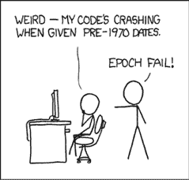

图 12-1：Bug（由 Randall Munroe 提供，[xkcd.com/376](http://xkcd.com/376)）

### 分布式拒绝服务攻击

拒绝服务攻击是对可用性产生不利影响的单一行为；分布式拒绝服务攻击则通过多次协同行动的累积效应来实现这一点。对于连接互联网的系统，互联网的开放架构带来了额外的 DDoS 攻击风险，例如来自协调僵尸网络的攻击。来自分布式匿名源的暴力过载，归根结底通常是算力规模的较量。缓解这些攻击通常需要依赖拥有海量数据中心容量并具备网络专业知识的 DDoS 防护供应商。

我将此单独列出，区别于其他可用性威胁类别，是因为如果你的服务器不幸成为严重 DDoS 攻击的目标，这不是你能轻松自行缓解的。

## 安全测试最佳实践

编写可靠的安全测试用例是提高任何代码库安全性的重要途径。虽然安全测试用例无法保证完美的安全，但它们能确认你的防护和缓解措施正在发挥作用，因此是朝着正确方向迈出的重要一步。一套健壮的安全测试用例，结合安全回归测试，能大幅降低发生重大安全事故的几率。

### 测试驱动开发

当你编写关键代码并思考其安全隐患时，安全测试用例尤为重要。我强烈推荐*测试驱动开发*（*TDD*），即在编写新代码的同时编写测试用例——该方法的严格实践者实际上会先编写测试，仅编写新代码以修复最初失败的测试。从一开始就包含安全测试用例的 TDD 能确保安全性内建于代码中，而非事后诸葛亮，但无论你采用何种测试方法，安全测试用例都需要成为你测试套件的一部分。

如果由他人编写测试，开发人员应提供指导，描述所需的安全测试用例，因为如果不深入理解代码的安全需求，这些用例可能难以凭直觉想出。

### 利用集成测试

*集成测试*让系统经受考验，以确保所有已单独通过单元测试的组件能按预期协同工作。这些测试对质量保证至关重要——但一旦你投入了精力，稍作扩展就能轻松用于安全测试。

2018 年，一家主要社交媒体平台建议其客户更改密码，原因是一个自酿的安全漏洞：一个 Bug 导致账户密码以明文形式泄露到内部日志中。通过利用集成测试，他们本可以轻松在代码发布到生产环境前检测并修复引入此漏洞的代码。该服务的集成测试本应包含使用假用户账户（例如 `USER1`）和某个密码（如 `/123!abc$XYZ`，即使是假账户也应使用安全密码）进行登录。测试完成后，安全测试会扫描输出中是否存在该独特的密码字符串，如果发现匹配项则报错。这种测试方法不仅适用于日志文件，还适用于潜在泄露可能发生的任何地方：其他残留文件、公开可访问的网页、客户端缓存等。此类测试可以像 `grep(1)` 命令一样简单。

密码只是为了解释方便而举的例子，但此技术适用于任何私密数据。测试系统需要大量合成数据来代表生产环境中的实际用户数据，所有这些私密内容都可能以同样的方式泄露。更全面的泄露测试会扫描所有未明确受保护为机密的系统输出，查找任何私密测试输入数据的痕迹。

### 安全测试补课


# 安全开发最佳实践

> 他们说没有人是完美的。然后他们又告诉你熟能生巧。我希望他们能统一一下意见。
>
> —温斯顿·丘吉尔


在第三部分中，我们迄今为止已经调研了一系列在开发阶段出现的安全漏洞。在本章中，我们将重点关注开发过程本身的各个方面如何与安全相关，以及可能出现的问题。我们将首先讨论代码质量：良好的代码卫生、彻底的错误和异常处理、安全属性文档化，以及代码审查在促进安全方面的作用。其次，我们将探讨依赖项管理：具体来说，它们如何将漏洞引入系统。第三个涉及的领域是缺陷分类——一项在安全与其他紧迫需求之间取得平衡的关键技能。最后，安全开发取决于维护一个安全的工作环境，因此我将提供一些基本建议，说明你需要做些什么以避免遭受攻击。

出于实际原因，以下指导原则具有通用性。读者应能将其应用于自己的开发实践。许多其他有效技术则特定于编程语言、操作系统和给定系统的其他细节。因此，重要的是你要识别出以下讨论中的主要模式，同时也要警惕在你自己的工作中出现的其他安全相关问题和机会。

## 代码质量

> 质量永远时尚。
>
> —罗伯特·根恩

第三部分前面的章节解释了漏洞滋生于代码的多种方式，但在这里我想重点关注一般缺陷与安全之间的关系。如果你能提高代码质量，从长远来看，无论你是否意识到，都会使代码更加安全。所有漏洞都是缺陷，因此缺陷越少意味着漏洞和漏洞链越少。但当然，在消除所有缺陷之前，边际效应递减早已出现，因此采取平衡的方法是最好的。

以下讨论涵盖了为了安全而应重点关注的一些关键领域。

### 代码卫生

程序员通常对他们正在处理的代码质量有很好的直觉，但由于各种原因，他们往往选择接受已知缺陷，而不是进行必要的改进。代码异味、面条代码，以及标记后续所需工作的推迟“TODO”注释，所有这些往往都是漏洞的温床。至少在安全性受到特别关注的领域，识别并消除这些粗糙边缘，无需进行任何安全分析即可了解缺陷如何被利用，这可能是避免漏洞的最佳方法之一。

除了你对代码状况的直觉之外，还要使用工具来标记这些问题。使用全量警告编译代码，然后修复代码以解决重要问题。其中一些自动化警告，例如误导性缩进或没有执行路径的未使用代码，本可以识别出我们在第 8 章讨论并在第 12 章进行安全测试的 `GotoFail` 漏洞。`Lint` 和其他静态代码分析工具能提供更丰富的代码审查，给出的提示有时能揭示缺陷和漏洞。

代码分析并不总能将安全缺陷识别为安全缺陷，因此你必须撒下更大的网。在开发过程中频繁使用这些工具，以降低潜在缺陷的总体数量。这样，如果工具的输出发生显著变化，你将有更大的机会注意到它，因为新内容不会淹没在旧消息的洪流中。

如果修复很简单，或者当你看到某个问题可能很严重时，请修复所有警告。例如，不可达代码表明虽然有人编写该代码是有原因的，但它现在已脱离上下文，这肯定是不对的。另一方面，关于变量命名约定的警告虽然是很好的建议，但可能与任何安全漏洞无关。

找时间进行这种清理工作总是具有挑战性的。采取增量式方法；即使每周只花一两个小时，随着时间的推移也会产生巨大差异，而且这个过程是熟悉大型代码库的好方法。如果所有警告太多难以处理，请从最有希望的警告开始（例如 `GCC` 的 `-Wmisleading-indentation`），然后修复被标记的问题。

### 异常和错误处理

1996 年的 `Ariane 5 Flight 501 Failure Report`（阿丽亚娜 5 号飞行 501 失败报告）痛苦地详述了糟糕的异常处理所导致的后果。虽然这场灾难性的缺陷纯粹是自找的，不涉及任何恶意行为者，但它作为一个例子，展示了攻击者如何利用由此产生的行为来攻破系统。

`Ariane 5` 运载火箭发射后不久，计算中的浮点数到整数转换导致了一个异常。异常处理机制被触发，但由于该转换错误未被预料到，异常处理程序代码没有针对该情况的应急预案。代码关闭了发动机，导致飞行 36.7 秒后发生灾难性故障。

防御此类问题始于认识到草率的异常处理的风险，并为即使是最不可能的异常做好准备。一般来说，最好尽可能靠近源头处理异常，因为那里拥有最多的上下文，且进一步复杂化问题的时间窗口最短。

也就是说，大型系统可能需要一个顶层处理程序来捕获任何冒泡上来的未处理异常。一种好的方法是确定一个行动单元，并使其整体失败。例如，Web 服务器可能会在 `HTTP` 请求期间捕获异常并返回通用的 `500`（服务器错误）响应。通常，Web 应用程序应将状态更改请求作为事务处理，以便任何错误都导致无状态更改。这避免了可能使系统处于脆弱状态的部分更改。

将草率的异常处理与潜在漏洞联系起来的大部分推理，也适用于一般的错误处理。与异常一样，错误情况可能不常发生，因此开发人员容易忘记它们，导致它们不完整或未经测试。攻击者发现漏洞的一个常用伎俩是尝试引发某种错误，然后观察代码的行为，希望能发现弱点。因此，最好的防御是从一开始就实施可靠的错误处理。这是安全漏洞不同于其他缺陷的一个经典例子：在正常使用中，某些错误可能极其罕见，但在协同攻击的背景下，触发错误可能是一个明确的目标。


# 可靠测试

可靠测试对于正确处理错误和异常至关重要。确保测试覆盖所有代码路径，尤其是不常见的路径。监控生产环境中的异常日志并追踪其原因，以确保异常恢复能正确工作。积极调查并修复间歇性异常，因为如果聪明的攻击者学会了如何触发其中一个，他们可能会进一步将其微调为恶意漏洞利用。

## 文档化安全

当你编写具有重要安全后果的代码时，需要在注释中向他人（或几个月、几年后健忘的自己）解释多少决策细节，以免他们意外破坏安全性？

对于关键代码，或任何值得解释安全隐患的地方，注释非常重要，因为它能让任何打算修改代码的人了解其中的利害关系。编写安全相关注释时，要解释安全隐患并做到具体：仅写 `// 注意：安全后果` 并不算解释。要清晰明了，切中要害：废话太多会让人要么视而不见，要么干脆放弃阅读。回顾我们在第 9 章讨论、第 12 章进行安全测试的 Heartbleed 漏洞，一个好的注释会解释：拒绝字节计数超过实际提供数据的无效请求至关重要，因为这可能导致缓冲区以外的私有数据泄露。如果安全分析过于复杂，无法在注释中解释清楚，请在单独的文档中写明详情，然后提供对该文档的引用。

这并不意味着你应该试图标记所有安全依赖的代码。相反，目标是警告读者注意那些未来可能容易被忽视的不那么显而易见的问题。归根结底，注释无法完全替代时刻警惕安全隐患的知识渊博的程序员，这也是为什么这项工作并不容易。

编写良好的安全测试用例（如第 12 章所述）是用机制来支撑文档、防止他人在未来修改中无意中破坏安全性的理想方式。作为攻击面貌的可运行模型，此类测试不仅能防范意外的不利变更，还能准确展示代码可能出错的方式。

## 安全代码审查

专业软件开发流程将同行代码审查作为标准实践，我主张在审查中明确纳入安全审查。通常最好将其作为代码审查工作流中的一个步骤，连同审查者应留意的潜在问题清单（包括代码正确性、可读性、风格等）一起进行。

我建议同一代码审查者增加一个显式步骤来考虑安全性，通常在首遍阅读代码之后，再戴上“安全帽”通读一遍。如果审查者觉得自己无法胜任安全审查，应将该部分委托给有能力的人。当然，对于明显没有安全隐患的代码变更，可以跳过此步骤。

审查代码变更的安全性不同于 SDR（第 7 章主题），因为你只关注系统的一个狭窄子集，而没有审查整体设计时获得的全局视角。务必考虑代码如何处理各种不受信输入，检查任何输入验证是否稳健，并避免潜在的“受骗代理”问题。自然，对安全至关重要的代码应获得额外关注，通常需要更高的质量标准。让额外的一双眼睛专注于代码安全，极有可能改善整个系统。

代码审查也是确保已创建的安全测试用例（如第 12 章所述）充分的绝佳机会。作为审查者，如果你假设某些输入可能有问题，请编写安全测试用例看看会发生什么，而不是靠猜测。如果你的探索性测试用例揭示了漏洞，请提出问题并贡献该测试用例，以确保漏洞得到修复。

### 依赖项

> 依赖导致屈从。
>
> ——托马斯·杰斐逊

现代系统倾向于构建在庞大的外部组件栈之上。这些依赖项在不止一种方面都是有问题的。许多平台（如 `npm`）会自动拉取大量难以追踪的依赖项。而使用存在已知漏洞的旧版本外部代码，是行业尚未系统性消除的最大持续威胁之一。此外，还存在在软件供应链中引入恶意组件的风险。这可能通过多种方式发生；例如，名称与知名包相似的包可能被误选，你也可能通过其他组件的依赖间接引入恶意软件。

向系统添加组件可能会损害安全性，即使这些组件旨在增强安全性。你不仅要信任组件的来源，还要信任来源所信任的一切。除了额外代码不可避免地带来 Bug 和增加整体复杂性的风险外，组件还可能以意想不到的新方式扩大攻击面。二进制分发几乎是不透明的，但即使有源代码和文档，仔细审查和理解包内的所有内容通常也是不可行的，所以往往归结为盲目信任。杀毒软件可以检测和阻止恶意软件，但它也使用深入系统的普遍钩子，需要超级用户访问权限，并可能增加攻击面，例如当它“回传”以获取最新恶意软件数据库并上报发现时。选择有漏洞的组件这一不明智之举，最终可能会降低安全性，即使你的初衷是增加一层额外防护。

## 选择安全组件

要使整个系统安全，其每个组件都必须安全。此外，它们之间的接口也必须安全。选择安全组件时，以下是一些基本考量因素：

*   相关组件及其制造商的安全记录如何？
*   组件的接口是专有的，还是有兼容替代品？（更多选择可能提供更安全的替代方案。）
*   当（而非如果）在组件中发现安全漏洞时，你是否确信其开发者会快速响应并发布修复？
*   保持组件更新的运营成本（即精力、停机时间和费用）是多少？

带着安全视角选择组件非常重要。用于处理私密数据的组件应提供防止信息泄露的保证。如果处理数据的副作用是记录内容或将其存储在不安全的存储中，这就构成了潜在泄露。不要将编写用于处理（例如）海洋温度（完全没有隐私顾虑）的软件，重新用于处理敏感医疗数据。同时也要避免使用原型组件，或除高质量生产版本以外的任何版本。

## 保护接口

良好的文档化接口应明确指定其安全和隐私属性，但在实践中这往往做不到。为了效率，程序员很容易省略输入验证，尤其是当他们假设验证已由前序环节处理时。另一方面，让每个接口都执行冗余的输入验证确实是浪费。拿不准时，如果可以，请测试接口的行为；如果仍有疑虑，最好在接口前添加一层输入验证以防万一。


# 避免使用已弃用的 API

避免使用已弃用的 API，因为它们往往掩盖着潜在的安全问题。API 制造者通常会弃用（而非完全移除）包含不安全特性的 API。这能阻止他人使用有漏洞的代码，同时为现有的 API 消费者保持向后兼容性。当然，弃用也可能因其他原因发生，但作为 API 消费者，调查弃用原因是否具有安全隐患至关重要。请记住，攻击者也可能在跟踪 API 弃用情况，并可能正准备发动攻击。

除了这些基本示例之外，每当接口暴露其内部结构时，都要格外小心，因为这些内部结构经常会被以非预期的方式使用，从而轻易造成漏洞。请参考《世界上最危险的代码》（Georgiev 等人，2012 年），这是一个极佳的案例研究，讲述了一个广泛使用的 SSL 库如何被研究人员发现反复以不安全的方式使用，完全破坏了其本应提供的安全属性。作者发现：“这些漏洞的根本原因大多是底层 SSL 库 API 的糟糕设计。”

还要警惕配置选项复杂的 API，特别是当安全性取决于这些选项时。在设计自己的 API 时，应遵循“默认安全”模式，记录如何安全地配置系统，并在适当的地方提供辅助方法以确保正确配置。当你必须暴露潜在的不安全功能时，要尽一切可能确保没有人能在不完全清楚自己在做什么的情况下合理地使用它。

## 不要重复造安全轮子

尽可能使用标准的、高质量的库来实现基础安全功能。每当有人试图从头缓解查询参数中的 XSS 攻击等问题时，即使他们对 HTML 语法了如指掌，也有可能遗漏某种晦涩的攻击形式。

如果没有现成的好方案，可以考虑创建一个库供整个代码库使用，以解决特定的潜在缺陷，并务必对其进行彻底测试。在某些情况下，自动化工具可以帮助查找代码中常演变为漏洞的特定缺陷。例如，扫描 C 代码中的旧版“不安全”字符串函数（如 `strcpy`），并将其替换为更新的“安全”版本（`strlcpy`）以实现相同功能。

如果你正在编写库或框架，请仔细查找安全缺陷，以便一次性妥善处理。然后跟进落实，明确记录提供了哪些保护，哪些未提供。仅宣传“使用这个库，你的安全烦恼将全部解决”是没有帮助的。如果我依赖你的代码，我怎么知道到底处理了什么、没处理什么？例如，Web 框架应描述其如何使用 Cookie 管理会话、如何防止 XSS、如何为 CSRF 提供一次性随机数、如何强制使用 HTTPS 等。

虽然这可能感觉像是把所有鸡蛋放在一个篮子里，但用库或框架一次性解决潜在安全问题通常是最好的选择。持续使用此类层提供了一个天然的瓶颈，可解决该潜在问题的所有实例。稍后当你发现新漏洞时，只需对通用代码进行单一更改，这易于修复和测试，并应能覆盖所有用法。

安全感知库有时必须提供对底层功能的原始访问，而这些功能无法得到完全保护。例如，HTML 框架模板可能允许应用注入任意 HTML。当这种情况必要时，要详细记录常规保护不再适用的所有位置，并解释 API 用户的责任。理想情况下，应以一种能明确提示风险的方式命名 API，例如 `unsafe_raw_html`。

底线是：安全漏洞可能很隐蔽，可能的攻击手段很多，只需一个成功即可——因此明智的做法是避免独自应对此类挑战。基于同样的理由，一旦有人成功解决了一个问题，将其作为通用解决方案复用就是明智之举。人为错误是攻击者的帮凶，因此使用那些让安全做法变得容易的解决方案是最好的。

## 应对遗留安全问题

数字技术发展迅速，但安全工具由于多种原因往往滞后。这代表了一个重要的持续性挑战。就像温水煮青蛙的寓言一样，除非有人严肃审视、明确指出风险，并提出更安全的解决方案和过渡计划，否则遗留安全方法往往会被使用过久。

必须明确的是，我并非说现有安全方法一定薄弱，而是说几乎所有事物都有“最佳使用期限”。此外，我们需要结合不断演变的威胁形势，定期重新评估现有系统。如果基于密码的认证变得容易遭受钓鱼攻击，可能需要通过第二因素来加固。加密实现基于现代硬件的成本和能力评估，正如摩尔定律所言，这是一个移动的目标；随着量子计算的成熟，高安全系统已开始转向被认为能抵抗新技术的后量子算法。

薄弱的安全措施往往在过期后很长一段时间内仍然存在，原因有几点。首先，惯性是一股强大的力量。由于系统通常是增量演进的，没人会质疑当前认证或授权的实现方式。其次，企业安全架构通常要求所有子系统兼容，因此任何变更都意味着修改每个组件以以新方式互操作。这往往感觉是个巨大的工程，从而引发强烈抵触。

此外，较旧的子组件可能成问题，因为遗留硬件或软件可能不支持更现代的安全技术。还有个容易找的反驳理由：目前的安全措施至今奏效，所以没必要修复未损坏的东西。除此之外，设计遗留安全系统的人可能已不在，没人能完全理解它。或者原设计者还在，但可能会为自己的工作辩护。

没有简单的答案能解决所有这些顾虑，但威胁建模可能识别出遗留薄弱安全的具体问题，从而使其代表的风险显而易见。

一旦确定了逐步淘汰遗留代码的必要性，就需要规划变更。将具有兼容接口的新组件集成到代码库中会让工作更轻松，但有时这不可行。在某些情况下，一个好方法是增量实施更好的安全性：系统的各部分可逐件转换为新实现，直到遗留代码不再需要时将其移除。

# 漏洞分级

> “分级”一词通常指决定谁优先获得关注。
>
> ——Bill Dedman

大多数安全问题一经识别，修复起来都很简单，团队也能轻松就修复方式达成共识。然而，偶尔也会对安全问题产生分歧，特别是在中间地带——即漏洞的可利用性不明确或修复困难时。除非存在迫使权宜行事的重大约束，否则如果存在哪怕一丝可能被利用的风险，通常明智的做法是修复该漏洞。请记住，正如第 8 章所见，当多个小漏洞组合在一起时，可能产生漏洞链，从而造成重大漏洞。永远要记住，仅仅因为你看不出如何利用一个漏洞，绝不代表有决心的攻击者就无法利用它。

## DREAD 评估


# 维护安全的开发环境

> 景观的秘诀不在于创造……而在于维护。
>
> ——迈克尔·多兰

良好的卫生习惯是一个有用的类比：要生产安全的食品，制造商需要来自可信供应商的新鲜食材、卫生的工作环境、消毒过的工具，等等。同样，在整个开发过程中必须遵循良好的安全实践，最终产品才能安全。

哪怕开发过程中仅有一次疏忽，恶意代码就可能混入产品中，这一事实应引起警觉。开发人员最不希望看到的就是他们的软件成为恶意软件的传播媒介。

## 将开发环境与生产环境分离

## 使用 DREAD 模型评估风险

在极少数情况下，如果您的团队无法迅速就修复缺陷达成共识，请对该缺陷所代表的风险进行结构化评估。`DREAD 模型`最初由杰森·泰勒构想，并由我们两人在微软推广，是一个用于评估特定威胁风险的简单工具。`DREAD` 列举了漏洞所暴露风险的五个方面：

### 潜在破坏力

1.  如果被利用，危害有多大？

## 可重现性

1.  攻击是每次都能成功、有时成功，还是极少成功？

## 可利用性

1.  从技术难度、工作量和成本来看，利用该漏洞有多难？攻击路径有多长？

### 受影响用户

1.  是所有、部分还是极少数用户会受到影响？特定目标是否容易遭受攻击，还是说受害者是随机的？

### 可发现性

1.  攻击者发现该漏洞的可能性有多大？

根据我的经验，最好将 `DREAD` 评级视为五个独立的维度。我个人不建议为每个维度分配数值评分，因为严重程度并非完全线性。我倾向于使用 T 恤尺码（S、M、L、XL）来表示主观量级，如下例所示。如果您确实使用数值评分，我特别建议不要将这五个分数相加得到一个总分，再用该总分对不同威胁进行排序，因为这本质上是在拿苹果比橘子。除非有几个因素的 `DREAD` 评分相当低，否则应将该威胁视为重大威胁，很可能值得缓解。

如果该问题需要通过分诊会议来解决，请使用 `DREAD` 陈述您的观点。根据需要讨论各个因素，以清晰地了解漏洞的后果。通常，当某个组件得分较低时，辩论将集中在其对整体影响意味着什么。

让我们看看 `DREAD` 在实践中如何运作。假设我们刚刚发现了 Heartbleed 漏洞，并想为其做一个 `DREAD` 评级。回顾一下，该漏洞允许匿名攻击者发送恶意的 Heartbeat 请求，并接收回 Web 服务器内存的大块数据。

以下是针对该信息泄露威胁的快速 `DREAD` 评分：

**潜在破坏力：XL**

1.  服务器的内部内存可能会泄露密钥。

**可重现性：M**

1.  由于多种因素，泄露的内存内容会有所不同，在某些情况下可能无害，但不可预测。

**可利用性：L**

1.  匿名攻击者只需发送一个简单的请求数据包；提取有用的机密信息需要一点专业知识，再加上一些运气。

**受影响用户：XL**

1.  服务器和所有用户都面临风险。

**可发现性：L**

1.  取决于攻击者是否想到尝试这一点（一旦公开宣布就显而易见）；它很容易尝试和验证。

此 `DREAD` 评级具有主观性，因为在我们的场景中，除了快速确认漏洞外，没有时间深入调查。假设我们已经看到服务器密钥被泄露（因此潜在破坏力为 XL），但在反复测试中内存内容变化很大，暗示了 M 级的可重现性评级。可发现性尤其棘手：如何衡量某人想到尝试这一点的可能性？我认为，如果您已经想到了，那么最好假设其他人也很快会想到。

对 `DREAD` 评分的讨论是揭示这些判断细微差别的绝佳方式。当您陷入讨论时，请仔细倾听并充分考虑其他观点。Heartbleed 是历史上最严重的漏洞之一，但我们并未将其所有 `DREAD` 因素都评为最高级，这很好地演示了为何评级必须经过仔细解读。由于该缺陷发生在运行在数百万 Web 服务器上的代码中，并破坏了 HTTPS 的安全性，您可以说潜在破坏力和受影响用户的评分实际上已超出图表范围（比如 XXXXXXXL），足以弥补那些中等评分的不足。`DREAD` 评级的价值在于揭示漏洞不同方面的相对重要性，从而清晰地了解其所代表的风险。

## 编写可行的利用代码

构建一个可行的概念验证攻击是主张修复漏洞的最有力方式。对于某些漏洞，攻击方式显而易见，当编写利用代码很容易时，这便锁定了结论。然而，依我之见，这很少必要，原因有二。首先，编写演示性利用代码通常涉及大量工作。在确定底层漏洞后，实际可行的利用代码往往需要大量改进。更重要的是，即使您是经验丰富的渗透测试人员，仅仅因为您未能创建出功能性的利用代码，绝不代表该漏洞不可利用。

这是一个有争议的话题，但我的观点是，鉴于所有这些原因，很难为创建可行利用代码以解决安全漏洞这一目的而付出的努力辩护。话虽如此，请务必编写回归测试（如第 12 章所述），以直接触发该漏洞，即使它不是成熟的可行攻击。

## 做出分诊决策

在使用 `DREAD` 或进行任何漏洞评估时，请记住，低估实际威胁比高估要容易得多。发现潜在漏洞却不采取行动可能是一个悲剧性的错误，这显然是最好避免的。我输掉过几场这样的战斗，可以向您保证，事后诸葛亮地说“我早就说过”毫无满足感可言。不修复重大缺陷是一场不值得玩的俄罗斯轮盘赌：“直接修复它”是一项极好的固定策略。

以下是做出更好安全分诊决策的一些通用经验法则：

*   特权代码中的漏洞，或访问宝贵资产的代码中的漏洞，应予以修复，并经过仔细测试，以防引入新漏洞。
*   与任何攻击面完全隔离且看似无害的漏洞，通常可以延后处理。
*   仔细核实漏洞无害的说法：修复漏洞可能比准确评估其全部潜在影响更容易。
*   积极修复可能成为漏洞链（见第 8 章讨论）一部分的漏洞。
*   最后，当难以抉择时，我总是建议修复问题：宁可信其有，不可信其无。

当需要更多调查时，指派专人研究该问题并带着提案汇报；不要浪费时间争论假设性情况。在讨论中，专注于理解其他观点，而不是试图改变他人想法。相信您的直觉。随着实践积累，当您知道该关注什么时，这将迅速变得更容易。


# 严格分离开发环境和生产环境

如果您尚未这样做，请严格分离您的开发环境和生产环境。核心思想是在两者之间提供一道“墙”，通常由独立的子网组成，或者至少是相互排斥的访问权限机制。也就是说，在开发软件时，程序员不应有权访问生产数据。生产机器和运维人员也不应有权访问开发环境和源代码（写入权限）。在由一人同时负责生产和开发的小型团队中，您可以在用户账户之间切换。切换的不便远远不及避免哪怕一次错误所挽回的损失。此外，这还能让人高枕无忧。

## 保障开发工具安全

在安装和使用开发工具及库代码之前，请仔细审查。从“某处”下载的某个小工具，即使仅供一次性使用，带来的麻烦也可能超出其价值。考虑为核心开发流程之外的实验或零工搭建一个安全隔离的沙箱。使用虚拟机即可轻松实现。

如果最终产品要安全，参与开发的所有计算机都必须安全。所有源代码仓库和其他服务也是如此，因为这些都是漏洞潜入最终产品的潜在入口。事实上，情况更为深远：开发过程中涉及的所有操作系统、编译器和库也必须安全。这是一个艰巨的挑战，听起来几乎不可能，但幸运的是，完美并非目标。您必须首先识别这些风险，然后寻找机会进行渐进式改进。

降低这些风险的最佳方法是对开发环境和流程进行威胁建模。针对一系列威胁分析攻击面，将源代码视为主要资产。针对典型开发工作的基本缓解措施包括：

*   安全配置并定期更新开发用计算机。
*   限制开发用计算机的个人使用。
*   系统性地审查新组件和依赖项。
*   安全管理用于构建和发布流程的计算机。
*   安全管理机密信息（如代码签名密钥）。
*   使用强身份验证安全管理登录凭据。
*   定期审计源代码变更提交，以发现异常活动。
*   妥善保管源代码和构建环境的安全备份副本。

## 发布产品

使用正式的发布流程连接开发与生产。这可以通过一个共享仓库来实现，该仓库仅允许开发人员修改，而运维人员只能读取。这种**职责分离**确保了相关方的责任不仅清晰而且得到强制执行，从根本上使得单人“独行侠”式地快速修改代码并绕过审批渠道直接将新版本推送到生产环境（从而极易引入安全缺陷）成为不可能。

# 后记

> 我们的使命是成为未来的架构师，而非其受害者。
>
> ——R. 巴克敏斯特·富勒


在见证了计算技术过去 50 年的演变后，我深知试图预测未来是愚蠢的。然而，为了结束这本书，我想分享我对安全领域未来发展方向的一些思考，我认为这些方向将极具价值，尽管其中一些不太可能实现。以下绝非预测，而只是构成重大进步的可能性。

1988 年，莫里斯蠕虫首次展示了在线恶意软件的潜在威力及其如何通过利用现有漏洞进行传播，这给初生的互联网敲响了警钟。30 多年后，尽管我们在许多战线上取得了惊人的进展，我不禁怀疑我们是否已充分理解这些风险，并是否已充分确定缓解工作的优先级。攻击和私人数据泄露的报道仍然司空见惯，且看不到尽头。有时，似乎攻击者如鱼得水，而防御者却在拼命挣扎求生。重要的是要记住，许多事件被保密，甚至可能持续存在却未被发现，因此现实几乎肯定比我们所知的更糟。很大程度上，我们已经学会了与脆弱的软件共存。

值得注意的是，尽管我们不完美的系统持续遭到攻破，一切似乎仍能设法继续运转。这或许就是安全问题持续存在的原因：现状“足够好”了。但即使我理解投资回报率的冷酷逻辑，内心深处我就是无法接受这一点。我认为，当我们作为一个行业接受现状为最佳状态时，我们就阻碍了真正的进步。为安全利益辩护额外工作总是困难的，因为我们很少了解失败的攻击，甚至不知道哪些特定防线行之有效。

本结束章勾勒出有前景的未来方向，以提升我们集体软件安全水平的层级。第一部分重述了本书的核心主题，总结了如何将本书中的方法有效地应用于实践。本章其余部分设想了进一步的创新和未来的最佳实践，带有更多推测性。关于移动设备数据保护的讨论，提供了一个例子，说明在真正实现“最后一公里”的有效安全方面，还需要做多少工作。我希望本书中的概念性和实用性思想能激发您对这一至关重要且不断发展的领域的兴趣，并成为您致力于构建安全软件的跳板。

## 行动号召

> 教育的伟大目标不是知识，而是行动。
>
> ——赫伯特·斯宾塞

本书围绕推广两个简单的理念构建，我相信这将带来更好的软件安全：让参与构建软件的每个人都参与到促进其安全中来，并从需求和设计阶段就整合安全视角和策略。我恳请本书的读者帮助引领这场变革。

此外，持续关注我们所创建软件的质量将有助于提高安全性，因为 Bug 越少，可被利用的 Bug 就越少。高质量软件需要付出努力：称职的设计、仔细的编码、全面的测试和完整的文档，所有这些都必须随着软件的演进而保持最新。开发人员和最终用户都必须继续推动更高的质量和打磨标准，以确保这一重点得以维持。

### 安全是每个人的工作

安全分析最好由深入了解软件的人来完成。本书奠定了良好安全实践的概念基础，赋予任何软件专业人士理解设计安全侧面、学习安全编码等能力。与其因为安全长期被忽视而请专家来查找和修复漏洞，不如让我们齐心协力，确保我们生产的所有软件至少达到一个适度的基准线。然后，我们可以依靠专家处理更深奥和技术性的安全工作，在那里他们的技能能得到最佳发挥。理由如下：

*   无论外部专家顾问多么精通安全，作为局外人，他们无法在上下文中完全理解软件及其需求，包括软件必须如何在企业文化及其最终用户的环境中运行。
*   安全在融入整个软件生命周期时效果最好，但长期聘请安全顾问并不切实际。
*   熟练的软件安全专业人员需求旺盛，难以寻觅，且难以在短期内安排日程。聘用他们成本高昂。


安全思维并不难，但它具有抽象性，初次接触时可能会感到陌生。大多数漏洞在事后看来往往显而易见；尽管如此，我们似乎一遍又一遍地犯着同样的错误。诀窍当然在于在潜在问题显现之前就将其识别出来。本书提供了大量方法，帮助你学会如何做到这一点。好消息是，没人能在这件事上做到完美，所以哪怕只是从一份微小的贡献开始，也比毫无作为要强。随着时间的推移，你会越来越擅长于此。

更广泛的安全参与最好被理解为一种团队协作，每个人发挥各自的所长。其理念并非让每个个体都能独自完成整项工作，而是拥有多元技能的团队成员通过综合投入，协同产出最佳结果。无论你在软件产品的生产、维护或支持中扮演何种角色，都应将其作为你的主要贡献点。但同时，考虑相关组件的安全性，并复核队友的工作以确保他们没有疏漏，也是很有价值的。即使你的角色微不足道，你也可能发现一个关键缺陷，就像足球守门员偶尔也能进球一样。

必须明确的是，外部专业知识在执行差距分析或渗透测试、平衡组织能力，以及作为拥有深厚经验的“新鲜眼光”方面，具有重要价值。然而，专家顾问应当是对扎实的内部安全理解和落地实践的补充，而不应被寄希望于独自承担安全重担。即便专家确实对整体安全态势有所贡献，他们最终也会离开去参与其他项目。因此，让负责软件的团队中尽可能多的人定期思考安全问题，始终是最佳策略。

### 将安全“烘焙”进去

桥梁、道路、建筑、工厂、船只、大坝、港口和火箭，都是经过精心设计和严格评审以确保质量和安全，然后才付诸建设的。在任何其他工程领域，公认在纸面上完善设计优于事后加装安全措施。然而，大多数软件却是先构建，后加固。

本书的一个核心前提——作者在业界反复见证其被验证——是更早的安全尽职调查能节省时间并带来显著回报，从而提升成果质量。当设计充分考虑了安全性，实现者交付安全解决方案的工作就会轻松得多。通过构建组件结构来促进安全，能让人轻松预判潜在问题。

最坏的情况，也是将安全前置到设计阶段（“左移”，用流行的行业术语）最有力的理由，是为了避免设计层面的安全缺陷。设计中内置的安全缺陷——无论是在组件化、API 结构、协议设计，还是架构的任何其他方面——都可能造成毁灭性后果，因为事后若不破坏兼容性，几乎无法修复。尽早发现并修复这些问题，是避免痛苦且耗时的被动式重新设计的最佳途径。

良好的安全设计决策拥有更大的益处，但这些往往不被认可。良好设计的本质是在不妥协必要功能的前提下实现极简主义。应用到安全领域，这意味着设计将攻击面面积和关键组件交互降到最低，进而意味着实现者犯错的机会更少。

以安全为中心的设计评审至关重要，因为软件设计的功能性评审视角不同，提出的问题不考虑安全性。“它是否满足所有必要需求？是否易于操作和维护？有没有更好的方式？”事实上，一个不安全的设计完全可能轻松通过所有这些测试，却容易遭受毁灭性攻击。用安全评估来补充设计评审，通过理解其面临的威胁并考虑其可能如何失效或被滥用，从而审查设计的安全性。

软件安全的实现层面，在于了解并警惕性地避免无意中引入漏洞的诸多潜在方式，或者至少缓解那些常见陷阱。安全导向的设计将实现阶段引入漏洞的机会降至最低，但永远无法神奇地让软件变得坚不可摧。开发人员必须勤勉尽责，不因陷入各种潜在陷阱而破坏安全性。

安全是一个贯穿软件系统整个生命周期的过程，从构想到其不可避免的退役。数字系统复杂而脆弱，随着软件“吞噬世界”，我们对它的依赖日益加深。我们是不完美的人类，使用不完美的组件，为不完美的人构建“足够好”的系统。但正因为完美无法企及，并不意味着我们不能进步。相反，这意味着每一个修复的缺陷、每一次改进的设计、每一个新增的安全测试用例，或大或小地都在帮助系统变得更值得信赖。

## 未来的安全

> 未来取决于你今天做什么。
>
> ——圣雄甘地

本书围绕我实践过并见证其持续奏效的安全改进方法构建，但除此之外还有大量工作要做。以下小节勾勒了几个我认为很有前景的想法。虽然这些概念需要进一步发展，但我相信它们可能带来显著的进一步进步。

人工智能或其他先进技术充满希望，但我的直觉是，所需的大量工作属于“砍柴挑水”式的苦活。我们每个人能做出贡献的一种方式，是致力于确保我们生产的软件质量，因为漏洞源于缺陷。其次，随着系统能力和范围的增长，复杂性必然增长，但我们必须对其进行管理，以免不堪重负。第三，在撰写本书的调研过程中，我对世界软件现状及其安全程度缺乏可靠数据感到失望（但不意外）：毫无疑问，更高的透明度将带来更清晰的视野，更好地指引我们前行。第四，真实性、信任和责任是软件社区安全协作的基石，然而实现这些的现代机制在很大程度上是临时拼凑且不可靠的——这些领域的进步可能会成为颠覆性的变革。

### 提升软件质量

“程序员因写入 Bug 而获薪，也因修复 Bug 而获薪。”这是 25 年前我作为微软项目经理时听到的最令人难忘的观察之一，这种关于 Bug 不可避免的态度至今仍盛行，短期内几乎没有改变的可能。但 Bug 是漏洞的基石，因此清楚认识到有缺陷软件的全部成本至关重要。

提升安全的一种方法，是在传统的 Bug 分类处理基础上，额外考量每个 Bug 是否可能成为攻击链的一环，并优先修复那些可能性较大且风险高的 Bug。即使这些修复仅有一小部分真正封堵了漏洞，我认为这些努力完全值得。

### 管理复杂性

> 除非投入工作来降低复杂性，否则不断演进的系统会变得越来越复杂。
>
> ——Meir Lehman


# 从最小化透明度到最大化透明度

或许，对软件安全现状最悲观的评价源于这句（有多种归属）的格言：“如果你无法衡量它，你就无法改进它。” 遗憾的是，世界软件质量的度量指标匮乏，尤其是在安全方面。公众对安全漏洞的了解仅限于部分情况：开源软件、专有软件的公开发布（通常需要对二进制文件进行逆向工程），或研究人员发现缺陷并公开详细分析的实例。极少有企业会考虑公开其软件安全记录的完整细节。作为一个行业，我们从安全事件中学到的东西很少，因为完整细节极少披露——这在很大程度上源于恐惧。虽然这种恐惧并非毫无根据，但必须权衡其与更充分披露对更广泛社区的潜在价值。

即使我们接受全面公开披露所有安全漏洞所面临的障碍，仍有巨大的改进空间。主流操作系统的安全更新披露通常缺乏有用的细节，这是以牺牲用户利益为代价的，而用户很可能会发现更多信息有助于响应和评估风险。依作者之见，主要软件公司往往将其提供的信息模糊化，甚至到了说空话的地步。以下是近期某操作系统安全更新中的几个例子：

*   “通过改进限制解决了一个逻辑问题。”（这几乎适用于任何安全漏洞。）
*   “通过改进内存处理解决了一个缓冲区溢出问题。”（修复缓冲区溢出难道还有别的方式吗？）
*   “通过改进输入清理解决了一个验证问题。”（同样，这适用于任何输入验证漏洞。）

这种缺乏细节的做法已成为太多产品的条件反射；它损害客户利益，软件安全社区将从更充分的披露中受益。软件发布商几乎总能在不损害未来安全的前提下提供更多信息。现实地讲，攻击者会分析更新中的变化并获取基本细节，因此无用的发布说明仅会剥夺诚实客户获取重要细节的权利。负责任的未来软件提供商应当从完全披露开始，然后根据必要性进行编辑，以免削弱安全性。更好的做法是，在利用风险过去后，披露那些被搁置的、对我们理解主要商业软件产品安全性有价值的额外细节——哪怕只是事后诸葛亮。

提供详细的漏洞报告可能会令人尴尬，因为事后诸葛亮时问题通常显而易见，但我认为诚实面对这些疏忽是健康且富有成效的。完全披露的学习潜力足够大，如果我们认真对待长期安全，就需要更高的透明度。作为客户，如果软件供应商的安全修复发布说明包含以下内容，我会印象深得多：

*   漏洞被报告、分类、修复、测试和发布的日期，以及对任何不当延迟的解释。
*   关于漏洞何时以及如何被引入的描述（例如：粗心的编辑、对安全影响的无知、沟通失误或恶意攻击）。
*   包含有缺陷代码的提交是否经过审查。如果审查了，为何遗漏；如果没审查，为什么？
*   是否曾努力查找同类缺陷。如果有，发现了什么？
*   为防止回归或未来出现类似缺陷而采取的预防措施详情。

推动行业转向一种文化，即更坦诚地披露漏洞、其成因及缓解措施，能让我们所有人从这些事件中学习。缺乏细节或背景，这些披露只是走过场，对任何人都没有益处。

一个最佳实践的绝佳范例是美国国家运输安全委员会（NTSB），它发布详细报告，航空业和飞行员均可据此从事故中学习。由于多种原因，软件无法完全照搬该流程，但它是一个值得追随的模范。理想情况下，领先的软件制造商应将公开披露视为一个机会，确切解释幕后发生了什么，展示其在响应方面的能力和专业精神。这不仅有助于广泛学习和预防其他产品出现类似问题，还有助于重建对其产品的信任。

# 改进软件真实性、信任与责任

大型现代软件系统由许多组件构建而成，所有组件都必须是真实的，并由值得信任的实体使用安全的子组件和安全的工具栈构建。这条链条延绵不断，字面意义上追溯到现代数字计算的黎明时期，回溯到几个早期的自编译编译器。我们系统的安全性取决于构建现代软件栈的所有这些迭代的安全性，但确切的传承链早已淹没在计算史的迷雾中。Ken Thompson 的经典论文“[Reflections on Trusting Trust](https://www.cs.cmu.edu/~rdriley/487/papers/Thompson_1984_ReflectionsonTrustingTrust.pdf)”优雅地论证了安全性如何依赖于这所有的历史，以及一旦恶意软件深度嵌入，要发现它有多难。我们如何真正知道那里没有潜伏着什么不妥之处？

确保软件构建完整性所需的工具现在已免费可用，且合理地假设它们按宣称工作。然而，它们的使用往往令人沮丧地临时性和手动化，使得流程容易受人为错误影响，甚至潜在的蓄意破坏。有时人们为了节省时间，可以理解地跳过检查。例如，考虑验证 \*nix 发行版的合法性。从可信网站下载镜像后，还需下载单独的权威密钥和校验和文件，然后使用几条命令（从可信来源获取）进行验证。只有所有检查都通过后，才应继续安装。但在实践中，管理员实际执行这些额外步骤有多彻底，尤其是主要发行版从未出现过这些检查失败的情况？即使他们总是执行，我们也无记录可作保证。


# 交付“最后一公里”

> 回家的最后一英里最漫长。
>
> ——佚名

如今，软件发布者会对发布的代码进行签名，但签名仅能保证比特流在完整性上未被篡改。这暗示着签名代码是值得信赖的，然而随后发现的任何漏洞绝不会使签名失效，因此这种解读根本不安全。

未来，更好的工具——包括可审计的真实性链记录——能够提供更高的完整性保障，为我们系统安全所依赖的信任决策和依赖关系提供参考。例如，新计算机应包含一份软件清单，记录操作系统、驱动程序、应用程序等均为正版。记录和认证组件的软件物料清单（SBOM）及构建环境需要付出巨大努力，但我们不应因困难而放弃从完整解决方案的一个子集着手，并随时间逐步改进。如果我们开始认真对待软件溯源和真实性，就能更好地保证重要软件版本是由安全组件构建的，未来会感谢我们的。

即使你严格遵循每一项最佳实践，应用本书所述技术，编码时注意避免“陷阱”，进行评审，彻底测试，并完整记录整个系统，我真希望能说你的工作将完美安全。但当然，情况比那复杂得多。安全工作永无止境，而且即使设计良好、工程扎实的系统，在现实世界中仍可能无法提供预期的安全级别。

“最后一公里”一词源自电信和运输行业，指将个人用户接入网络的挑战。这通常是服务交付中成本最高、难度最大的部分。例如，互联网服务提供商可能已在你所在社区铺设了高速光纤基础设施，但获取每位新用户都需要一次服务呼叫、可能铺设线缆并安装调制解调器。这些都难以规模化，时间和费用成为巨大的额外前期投入。同理，部署一个设计良好、安全的系统，往往只是真正交付实际安全的开始。

为了理解安全领域的这些“最后一公里”挑战，让我们透过一个简单问题的视角，深入审视移动设备数据安全的当前最先进水平：“如果我丢了手机，别人能读取其内容吗？”经过多年的密集工程投入，产出了一套强大且构建精良的现代加密技术套件，但即便对于当今的高端手机，答案似乎仍是：“是的，他们大概率能获取你的大部分数据。”鉴于这或许是近期最大规模的单一软件安全工程，理解其不足之处及原因至关重要。

以下讨论基于 2021 年论文“[移动设备数据安全：当前最先进水平、开放问题与建议方案](https://securephones.io/)”，由约翰霍普金斯大学的三位安全研究人员撰写。该报告描述了交付稳健软件安全往往难以实现的几个重要方面。为了突显该案例对安全的更大启示，我将极大地简化讨论。

首先，我们来谈谈数据保护级别。移动应用功能繁多——单一加密方案无法适用于所有场景——因此移动操作系统提供了一系列选择。iOS 平台提供三级数据保护，其主要区别在于如何激进地最小化加密密钥驻留内存的时间窗口，以便访问受保护数据。你可以将其类比为银行金库大门敞开的频率。早间打开厚重大门、仅在闭馆时关上，虽让员工全天便利进出，但也意味着金库在非使用时更易遭入侵。反之，若员工每次进出都需找行长开门，便以便利换取了更高安全性：金库大多时间处于安全锁定状态。对移动设备而言，要求用户解锁加密密钥（通过密码、指纹或面部识别）以访问受保护数据，大致相当于请行长开金库。

在最高保护级别下，加密密钥仅在手机解锁且使用时可用。虽极安全，但对大多数应用构成阻碍，因为设备锁定时它们将失去数据访问权。例如，日历应用会在会议时间提醒你。锁定的手机会导致应用无法访问日历数据。后台操作（包括同步）在锁定状态下也会被阻断。这意味着若手机锁定时有新事件加入日历，除非你碰巧提前解锁手机使其同步，否则你将收不到通知。即使是限制最宽松的保护类别——`After First Unlock (AFU，首次解锁后）`，它要求重启后凭用户凭据重组加密密钥——也存在严重局限。顾名思义，刚重启的设备没有可用加密密钥，因此日历通知届时也会被阻断。

我们可以设想设计应用来规避这些限制：根据数据需求时间，将数据划分到不同保护类别的独立存储中。或许对日历应用，时间保持无保护以便可用，通知模糊提示“下午 4 点有个会议”，需用户解锁设备获取详情。缺标题的通知会让人恼火，但用户也期望日历为隐私加密，故需权衡。信息敏感度因用户而异，取决于会议细节，但让用户逐一显式决定也不可行，因为人们期望应用自主运行。最终，大多数应用为方便管理数据而选择较低级别的数据保护——甚至完全不保护。

当大多数应用为便利选择“无保护”选项时，若攻击者能检查设备，所有数据便成了待捕猎物。这虽不易，但正如约翰霍普金斯报告详述，复杂技术常能找到进入内存的途径。在 `AFU` 保护下，攻击者只需找到加密密钥——因设备大多时间处于此状态，密钥常驻留内存。

机密通讯应用是主要例外；它们使用“完全保护”类别。鉴于其特殊用途，用户倾向于容忍设备锁定时功能缺失及使用所需的额外精力。这些应用属少数，仅占本地存储用户数据极小比例，但大多数手机用户（甚至那些根本考虑安全的人）大概都以为其所有数据都是安全的。


如果图景还不够惨淡，让我们考虑一下云集成对许多应用程序的重要性，以及它如何与强数据保护背道而驰。云计算模型彻底改变了现代计算，我们现在习惯了触手可及、无处不在的互联数据中心，网络搜索、实时翻译、图像和音频存储以及其他无数服务即时可用。例如，使用人脸识别在照片库中搜索人物等功能，其所需算力远超现代设备相当可观的计算能力，因此非常依赖云端。云数据模型还使多设备访问变得容易（无需再同步），如果我们丢失设备，数据安全地存储在云端，我们只需购买新硬件即可。但为了利用云端的力量，我们必须将数据托付给它，而不是将其通过加密锁定在我们的设备上。

当然，所有这些无缝数据访问都与强数据保护背道而驰，特别是在丢失连接云端的手机的情况下。大多数移动设备持续拥有云数据访问权限，因此捡到设备的人也可能访问存储的数据。这些数据极有可能未加密；即使我们试想一个将端到端加密数据存储在云端的照片应用，那也意味着只能存储不透明的比特块，因此我们将失去云端搜索或提供照片共享的能力。而且由于解密密钥必须严格保存在设备上，多设备访问场景将变得困难。此外，如果设备上的密钥发生意外，云端的所有数据可能都会变得毫无用处。鉴于所有这些原因，依赖云端的应用程序几乎完全放弃了加密数据保护。

我们在这里只是触及了移动设备数据保护有效性完整技术细节的皮毛，但就我们的目的而言，更普遍问题的轮廓应该很清晰。移动设备存在于一个丰富且复杂的生态系统中，除非数据保护对所有组件和场景都有效，否则它很快就会变得不可行。最好的建议依然是：不要用手机做任何如果丢失后可能泄露你会非常介意的事情。

我想强调的这个故事的教训超越了移动设备加密的设计，大体上适用于任何寻求提供安全性的大型系统。关键在于，尽管进行了勤勉的设计，并拥有丰富的数据保护功能集，但在“最后一公里”完全交付安全性却非常容易功亏一篑。强大的安全模型只有在开发者使用它、用户理解其优势时才有效。实现有效安全需要提供实用的功能平衡，这些功能要与应用程序协同工作，而不是相互对抗。所有需要保护的数据都必须得到保护，与基础设施（如本例中的云端）的交互或依赖不应削弱其有效性。最后，所有这些都必须与典型工作流集成，使最终用户有助于安全机制，而不是与之对抗。

多年前，我在 `.NET Framework` 发布时目睹了一个在“最后一公里”功亏一篑的案例。安全团队努力将代码访问安全（`CAS`）——第 3 章所述——引入这个新编程平台，但未能充分宣传其用法。回顾一下，`CAS` 要求托管代码被授予执行特权操作的权限，并在需要时断言这些权限——这是“最小权限”模式的理想工具。不幸的是，运行时团队之外的开发者将其视为负担，未能看到该功能的安全收益。结果，应用程序通常不会在仅需的地方使用系统提供的细粒度权限，而是在程序启动时一次性断言完全特权，然后完全在无限制的情况下运行。这在功能上行得通，但意味着应用程序在过度权限下运行——打个比方，银行金库的大门始终敞开——导致任何漏洞面临的风险暴露程度远高于按预期使用 `CAS` 时的情况。

这些考量代表了所有系统面临的挑战，也是安全工作永无止境的一个重要原因。在构建出优秀的解决方案后，我们需要确保开发者和用户都理解它、实际使用它、并正确使用它。软件总会以其制造者从未预料到的新方式被使用，随着我们了解这些情况，考虑安全影响并在必要时进行调整非常重要。所有这些因素及其他因素对于构建真正有效的安全系统至关重要。

## 结论

软件拥有独特而吉祥的属性：完全由比特组成——只是一堆 0 和 1——所以我们可以真正地从无到有地创造它。材料免费且数量无限，因此我们的想象力和创造力是唯一的限制因素。这对正义的力量和寻求作恶的人同样适用，因此承诺和严峻挑战都是无限的。

本章提供了行动号召和一些前瞻性思路。开发软件时，请在流程早期考虑安全影响，并让更多人思考安全，以提供更多元化的视角。增强安全意识能在整个软件生命周期中带来健康的怀疑精神和警惕性。减少对人工检查的依赖，提供更多自动化验证。在实现系统的过程中，保留所有关键决策和行动的可审计记录，以便系统的安全属性定义明确。明智地选择组件，但也要测试假设和系统的重要属性。降低脆弱性；管理复杂性和变更。当漏洞出现时，调查其根本原因，汲取教训，并主动降低未来风险。批判性地审视现实场景，致力于将安全交付到“最后一公里”。尽可能负责任地充分公开细节，以便他人能从你遇到的问题及应对方式中学习。以小步快跑的方式持续迭代，以提高安全性并尊重隐私。

感谢你加入我这趟软件安全山谷峰峦的跋涉之旅。我们当然没有覆盖每一寸土地，但你现在应该已掌握了地形概貌。希望你能在此找到有用的思路，并凭借更好的理解，从今天开始将它们付诸实践。这本书不是*唯一*答案，但它提供了*一些*提高软件安全门槛的答案。最重要的是，请不时戴上你的“安全帽”，在自己的工作中应用这些概念和技术，从今天开始。

# 附录 A

示例设计文档


以下文档是一个假设的设计，旨在说明对实际设计执行安全设计审查（`SDR`）的过程。作为学习工具，它省略了真实设计中会出现的许多细节，而是专注于安全方面。因此，它不是真实软件设计文档的完整示例。

## 标题 – 私有数据日志记录组件设计文档

**目录**

1. 第 1 节 – 产品描述

2. 第 2 节 – 概述

    1. 2.1 目的

    2. 2.2 范围

    3. 2.3 概念

    4. 2.4 需求

    5. 2.5 非目标

    6. 2.6 未决问题

    7. 2.7 替代设计

1. 第 3 节 – 用例

2. 第 4 节 – 系统架构

3. 第 5 节 – 数据设计

4. 第 6 节 – API

    1. 6.1 Hello 请求

    2. 6.2 Schema 定义请求


# 第 1 部分 – 产品描述

本文档描述了一个日志组件（以下称为 Logger），该组件提供标准的软件事件日志记录功能，以支持审计、系统监控和调试，旨在降低无意中泄露信息的风险。**Logger 将显式处理日志中的私有数据，以便非私有数据可自由访问以供常规使用。在极少数情况下，如果此访问级别不足，可在明确批准并采取限制措施以最大限度减少潜在暴露的前提下，提供对受保护的私有日志数据的有限访问。**

*在日志系统中显式单独处理私有数据的概念，是安全中心设计思维的一个例子。与从一开始就将其纳入设计相比，向现有系统添加此功能效率较低，且需要大量的代码变更。*

# 第 2 部分 – 概述

有关基线项目设计假设，请参阅第 10 部分列出的文档。

## 2.1 目的

数据中心中的所有应用程序都需要记录重要软件事件的详细信息，由于这些日志可能包含私有数据，因此必须实施严格的访问控制。Logger 提供标准组件来生成日志、存储日志，并对授权人员实施适当的访问控制，同时保留一份可靠且**不可抵赖**的访问记录。由于不同系统的日志记录、访问和保留要求各不相同，Logger 基于一个简单的策略配置运行，该配置指定了访问策略。

## 2.2 范围

本文档解释了 Logger 软件组件的设计，而不强制规定实现语言、部署或运维方面的选择。

## 2.3 概念

日志的过滤视图概念是设计的核心。其思路是允许在过滤掉任何私有细节的情况下相对自由地检查日志，这种访问级别应足以满足大多数用途。此外，在需要时，可在额外授权的前提下检查已记录的敏感数据。访问事件本身也会被记录，使得检查行为具有可审计性。这种分级访问机制允许应用程序记录重要的私有细节，同时仍将内部员工为合法用途接触该数据的风险降至最低。对于敏感到绝不应出现在日志中的数据，根本就不应记录在日志中。

例如，Web 应用程序通常会将 HTTPS 请求作为系统使用记录及其他原因进行记录。这些日志通常包含私有信息（包括 IP 地址、Cookie 等），这些信息必须被捕获，但极少被需要。例如，IP 地址在调查恶意攻击（以识别攻击源头）时很有用，但对于其他用途则无关紧要。日志的过滤视图会隐藏或“包装”私有数据，同时显示非敏感数据。过滤视图中的指定化名可以显示例如标记为“IP7”的所有事件的 IP 地址相同，而不泄露实际地址。这种过滤视图通常能为监控、收集统计数据或调试提供足够的信息。如果是这样，完全避免暴露任何私有数据就是有利的。日志仍然包含完整数据，在极少数需要受保护信息的情况下，可在适当授权下以受控方式获取非过滤视图。

假设一个 Web 应用程序收到用户登录尝试，触发了一个导致进程崩溃的 Bug。以下是日志可能包含内容的简化示例：

```
2022/10/19 08:09:10 66.77.88.99 POST login.htm {user: "SAM", password: ">1<}2{]3[\4/"}
```

此日志中的项目包括：时间戳（非敏感）、IP 地址（敏感）、HTTP 动词和 URL（非敏感）、用户名（敏感）和密码（高度敏感）。调查可能需要考虑所有这些信息以复现 Bug，但除非绝对必要，否则不希望以明文显示这些数据，且仅向授权代理显示。

为了满足各种系统的安全需求，各类日志数据的敏感度应可配置，且日志系统应仅有选择地揭示机密数据。例如，作为最佳实践，URL 不应包含敏感信息，但遗留系统可能已知违反此经验法则，需要通常不必要的保护——这会导致过滤视图对某些调试不那么有用。对于 URL，正则表达式可便于将特定 URL 配置为比其他 URL 更敏感。

省略或包装敏感数据后的上述示例日志的过滤视图可能如下所示：

```
2022/10/19 08:09:10 US1(v4) POST login.htm {user: USER1(3), password: PW1(12)} 
```

IP 地址、用户名和密码均被包装为标识符以隐藏数据，但替代的标识符可用于上下文中，以查询具有匹配值的其他请求。在本例中，`US1` 代表美国的一个 IP 地址；`USER1` 代表与该事件关联的用户名，但不透露其具体内容；`PW1` 代表提交的密码。括号中的后缀指示实际数据的格式或长度，在不透露具体细节的情况下提供提示：我们可以看到这是一个 IPv4 地址，用户名有 3 个字符，密码有 12 个。**例如，如果过长的密码导致了问题，仅凭其惊人的长度就能看出这一事实。知道密码长度会泄露少量信息，但在实践中不应构成泄露风险。**

当过滤视图不足以完成手头任务时，可提出额外请求以解包 `US1` 等标识符。这使得查看敏感数据成为一种明确的选择，并允许分级揭示数据。例如，如果只需要 IP 地址，则用户名和密码值仍保持不公开。

## 2.4 需求

日志可靠存储，经授权后可立即访问，并在要求的保留期结束后销毁。为支持大量使用，日志捕获接口必须快速，一旦报告成功，生成应用程序理应确信日志已存储。

日志可在不知私有细节的情况下进行监控，因此过滤后的日志视图可广泛提供给大多数用途，仅在严格必要时，凭特殊授权才能查看包含私有数据在内的完整数据。

本设计的一个重要目标是允许记录高度敏感的私有数据，以便在调查可能的安全事件或极少数仅在生产环境中出现的调试问题时可用。完全防御内部攻击是不切实际的目标，但采取一切合理预防措施并保留可靠的审计跟踪作为威慑手段非常重要。

日志存储经过加密，以防物理介质被盗时发生泄露。

生成日志的软件完全受信；它必须正确识别私有数据，Logger 才能正确处理。

## 2.5 非目标

由于 Logger 供管理员使用，因此不需要华丽的 UI。

**内部攻击（如代码篡改或滥用管理员 root 权限）不在范围内。**

**要有效，Logger 需要仔细的配置和监管。如何实施必须由系统管理定义，但应包括审查流程、审计以及制衡检查。**

## 2.6 未决问题

# 第 3 部分 – 6.3 事件日志请求

# 第 4 部分 – 6.4 告别请求

# 第 5 部分 – 第 7 部分 – 用户界面设计

# 第 6 部分 – 第 8 部分 – 技术设计

# 第 7 部分 – 第 9 部分 – 配置

# 第 8 部分 – 第 10 部分 – 参考资料


# 日志访问配置、用户身份验证以及无过滤访问授权的授予细节仍有待明确。

**查询加密的私有数据本质上是缓慢的。本设计设想日志数据量足够小，以至于按需解密记录的暴力遍历（即不依赖索引）也能保证性能。未来更具野心的版本可能会解决加密数据的索引和快速查询问题。**

需要识别错误情况并明确处理方式。

未来版本 Logger 可考虑的增强功能包括：

*   定义过滤视图的级别，以提供不同详细程度的信息
*   提供捕获日志部分内容以进行长期安全存储的功能，这些内容最终会例行删除

## 2.7 替代设计

**最终选定的设计基于完全信任 Logger 在日志中存储所有敏感信息，即“将所有鸡蛋放在一个篮子里”。曾考虑过一种允许按来源对敏感信息进行隔离的替代方案。由于几个原因（简述如下），该方案似乎与重要使用场景不兼容，因此未予采纳，但值得注意的是，这可以说是一种更安全的日志记录解决方案。**

### 替代设计

1.  日志源将创建一个非对称加密密钥对，并使用它在将日志记录发送给 Logger 之前加密其中的敏感数据部分。如果操作得当，Logger 仍（很可能）能为过滤视图生成假名（例如，用 `US1` 代表美国的某个 IP 地址）。授权访问无过滤视图则需要私钥来解密数据。这种方法的主要优势在于，存储的日志数据泄露不会导致已加密的敏感数据泄露，而且 Logger 甚至不持有必要的密钥。

### 未采纳的理由

1.  这种设计将加密和密钥管理的负担同时加在了日志源和授权访问者身上。哪些数据敏感以及如何分区由日志源决定，且在此时固定下来。通过将信任集中在 Logger 中，这两个方面均可根据需要重新配置，并可通过对日志查看者进行身份验证来控制细粒度访问。

# 第 3 部分 – 用例

数据中心中的应用程序使用 Logger 生成重要软件事件的日志。常规监控软件和相关运维人员被允许进行过滤访问（不泄露任何私有数据的数据视图）以履行其日常职责。包括流量水平、活跃用户、错误率等在内的运营统计数据均由过滤日志视图生成。

极少数情况下，当支持或调试需要访问无过滤日志时，授权人员可根据策略获得有限访问权限。访问请求需指定所需的日志子集、时间窗口及访问理由。一经批准，将签发令牌以允许访问，该访问将被记录以供审计。完成后，请求者需添加备注描述调查结果，由批准人审核以确保合规性。

将生成报告，详细记录请求摘要、批准情况、审计复核、日志量趋势及过期日志数据删除确认，以供管理层参考。

# 第 4 部分 – 系统架构

在数据中心内，Logger 服务**实例运行在独立操作的物理分离机器上**，独立于其服务的应用程序，通过标准的发布/订阅协议通信。Logger 由三个新服务组成，按以下功能组织：

### Logger Recorder（记录器）

1.  一项日志存储服务。应用程序通过**加密通道**将日志事件数据流式传输至 Logger Recorder 服务，在那里它们被写入持久化存储。一个实例可配置为处理多个应用程序的日志。

### Logger Viewer（查看器）

1.  一个供技术人员手动检查过滤日志的 Web 应用程序，可根据策略授权显示无过滤视图。

### Logger Root Recorder（根记录器）

1.  Logger Recorder 的一个特殊实例，用于记录 Logger Recorder 和 Viewer 的事件。*为简化起见，我们省略了该日志过滤视图和无过滤视图的细节。*

# 第 5 部分 – 数据设计

日志数据直接从应用程序收集，由应用程序决定记录什么事件及其详细信息。**日志是软件事件的仅追加记录，除到期删除外绝不修改。**

应用程序定义日志事件类型的模式，包含零个或多个预配置的数据项，如下例所示。所有日志事件必须包含时间戳和至少另一项标识数据。

```
{LogTypes: [login, logout, ...]}
{LogType: login, timestamp: time, IP: IPaddress, http: string, 
 URL: string, user: string, password: string, cookies: string}
{LogType: logout, timestamp: time, IP: IPaddress, http: string, 
 URL: string, user: string, cookies: string}
{Filters: {timestamp: minute, IP: country, verb: 0, URL: 0, 
 user: private, password: private, cookies: private}}
```

*由于该部分示例已足以说明这些定义的基本思路，因此省略了许多关于内置类型、格式等方面的细节。*

**请求和响应必须是长度不超过 100 万字符的 UTF-8 编码有效 JSON 表达式。单个字段值限制为最多 10,000 字符。**

第一行（`LogTypes`）枚举了该应用程序将生成的日志事件类型。对于每种类型，带有相应 `LogType` 条目的 JSON 记录（第二行对应 `LogType: login`）列出了此类日志可能提供的允许数据项。

第四行（`Filters`）声明了每个数据项的处理方式：`0` 表示非敏感数据，`private` 表示需“包装”的私有数据，以及其他特殊的数据处理类型，包括：

#### `minute`

1.  时间值四舍五入到最近的分钟（模糊精确时间）

#### `country`

1.  在过滤视图中，IP 地址映射为来源国家

过滤器应由可插拔组件定义，并易于扩展以支持各种应用程序所需的自定义数据类型。

**请注意，“非敏感”数据仅供有限的内部查看；此标识并不意味着该数据应公开披露。** 要求声明所有数据项（包括处理方式：私有或非私有），是为了确保在应用程序上下文中对每一项都做出明确决定。**这些定义及任何更新必须经过仔细审查，以确保日志处理的完整性，这至关重要。**

以下是该模式下无过滤视图的示例日志条目：

```
2022/10/19 08:09:10 66.77.88.99 POST login.html {user: "SAM", password: ">1<}2{]3[\4/"}
```

这是对应的过滤视图：

```
2022/10/19 08:09 US1(v4) POST login.html {user: USER1(3), password: PW1(12)}
```

数据持久化存储，直至达到策略配置的过期日期（按事件日志时间戳以来的经过时间计算）为止。

日志仅为暂时性数据，旨在用于监控和调试，或在发生安全漏洞时用于取证分析，因此仅保留有限时间。**通过将数据存储在专用机器上，并使用 RAID（或类似）磁盘阵列实现冗余持久化存储，可缓解潜在数据丢失。日志旨在作为审计和诊断用途的短期存储。任何此类数据的长期存储应单独存放。**

# 第 6 部分 – API

Logger Recorder 的网络接口接受以下远程过程调用：

### Hello

1.  必须是会话的第一个 API 调用；标识应用程序和版本

### Schema


## 第 6 节 – Logger 服务 API

每个应用程序通过专用通道连接到其日志记录服务。**HTTPS 保护经过身份验证的端点之间的 API 调用；预配置的服务器名称（通过其数字证书）对客户端进行身份验证，确保其连接到有效的 Logger 服务实例。** 以下是请求类型。

### 6.1 Hello 请求

任何将使用 Logger 服务的进程都会发送此请求以启动日志记录：

```json
{"verb": "Hello", "source": "Sample application", "version": "1"}
```

以下响应通过 OK 或错误消息确认请求，并提供会话的字符串令牌：

```json
{"status": "OK", "service": "Logger", "version": "1", "token": "XYZ123"}
```

该令牌用于后续请求中，以标识与 `Hello` 对应的发起应用程序的上下文。**令牌是随机生成的，具有足够的复杂性和熵，以防止猜测：建议的最小令牌大小为 120 位，或 base64 编码下约 20 个字符。此处使用较短的令牌仅为简洁起见。**

### 6.2 Schema 定义请求

此请求定义后续日志记录的数据模式，如第 5 节所述：

```json
{"verb": "Schema", "token": "XYZ123", ...}
```

*为简洁起见，省略了此请求的详细信息。*

模式定义了将出现在日志内容中的字段名称、类型和其他属性，如下一节所示的示例事件日志请求所示（包含字段 `timestamp`、`ipaddr`、`http`、`url` 和 `error`）。

### 6.3 Event Log 请求

此请求实际上向 Logger 服务记录一条记录：

```json
{"verb": "Event", "token": "XYZ123", "log": {
 "timestamp": 1234567890, "ipaddr": "12.34.56.78", 
 "http": "POST", "url": "example", "error": "404"}}
```

`log` JSON 提供要记录到日志中的内容，必须与模式匹配。

响应通过 OK 或错误消息确认请求：

```json
{"status": "OK"}
```

*为简洁起见，省略了错误详细信息。* **日志记录错误（例如存储空间不足）非常严重，需要立即关注，因为如果没有日志记录，系统操作将不可审计。**

### 6.4 Goodbye 请求

此请求完成一个日志记录会话：

```json
{"verb": "Goodbye", "token": "XYZ123"}
```

响应通过 OK 或错误消息确认请求：

```json
{"status": "OK"}
```

此后该令牌不再有效。要恢复日志记录，客户端必须首先发出 `Hello` 请求。

## 第 7 节 – 用户界面设计

Logger 的用户界面是由 Logger Viewer 提供的 Web 界面，用于检查日志。**该 Web 应用仅允许授权的运维人员访问，并通过企业单点登录进行身份验证。** 经过身份验证的用户将看到他们被允许访问的日志列表，并提供链接以浏览或搜索最近的过滤日志条目，或者在允许的情况下，请求访问未过滤的日志（需经批准）。

*为简洁起见，此处仅提供 Web 界面的高级描述。*

审批请求在一个提供基本信息的 Web 表单中排队处理：

*   请求访问的原因，包括具体细节，如客户问题单号
*   请求的访问范围（通常是特定的用户账户或 IP 地址）

审批请求会触发自动发送邮件给审批人，邮件中包含指向 Web 应用页面的链接以审核这些请求。每当做出决定时，一封邮件会通知请求者，内容包括：

*   批准或拒绝
*   如适用，拒绝的原因
*   批准访问的时间窗口

过滤和未过滤的日志均可在对应每个日志的页面上查看。可输入查询以指定要查看的日志条目。空查询显示最近的条目，并提供 Next/Previous 链接以翻页浏览结果。

查询指定日志条目字段和值，并结合布尔运算符以选择匹配的日志条目。默认按最近优先排序，除非查询中给出了显式排序。*为简洁起见，省略了查询语法的详细信息。*

过滤后的日志使用符号标识符（见第 2.3 节）显示，而不是原始日志内容。查询可使用过滤日志内容中存在的符号标识符；例如，如果过滤后的日志条目显示 IP 地址为 `US1`，则查询 `[IP = US1]` 将查找来自该 IP 地址的其他日志，而不会泄露地址本身。

**针对过滤日志的查询必须禁止使用确切值搜索过滤字段。例如，即使不显示 IP 地址，如果用户可以猜测 `[IP = 1.1.1.1]`（以此类推），他们最终可能会命中某个日志条目，该条目将显示类似 `USA888` 的内容，从而能够推断出实际值。**

即使批准了未过滤访问，用户也必须选择一个选项才能开始未过滤的查看和查询。**最佳实践是最大限度地使用过滤日志，仅在按需基础上揭示过滤值，并且用户界面鼓励这一点非常重要。**

用户可以在任务完成后放弃未过滤日志访问权限。用户界面应在一段时间不活动后提示这一点，以最大限度地降低不必要访问的风险。

**显示日志内容的 Web 页面不应被用户代理在本地缓存，以避免意外泄露，并确保在过期时日志数据不再可用。**

## 第 8 节 – 技术设计

Logger Recorder 服务由一个供应用程序流式传输日志事件数据的只写接口组成，这些数据将被写入持久存储，以及一个用于获取这些日志视图的查询接口。存储是一系列写追加文件，由 UTF-8 文本行组成，每行一个日志事件。如相关模式所述（见上文），日志数据映射到/从文本的规范表示。*为简洁起见，省略了格式化详细信息。*

**需过滤的日志数据字段除原始数据外，还应以过滤后的表示形式存储，原始数据使用服务生成的 AES 密钥加密，每天使用一个新密钥。请使用硬件密钥存储或适当的手段安全保护这些密钥。**

由于耗尽可用存储对日志记录服务而言属于致命错误，因此会根据可用空间测量写入速率（`free_storage_MB` / `avg_logging_MB_per_hour`），如果剩余空间在假设写入量恒定的情况下不足 10 小时的数据量，则会触发优先运维警报（此警报小时数可配置）。

为提高性能，可考虑使用 SQL 数据库记录过滤后的日志事件信息（时间戳、日志类型、文件名和偏移量），以补充实际日志文件从而实现高效访问。

过滤后的日志使用符号标识符隐藏私有数据（例如，用 `US1` 表示美国的 IP 地址）。**为避免存储未过滤的私有数据，这些映射从未过滤数据值的安全摘要映射到过滤后的代号。** 此映射是临时的，由 Logger Viewer 为每个用户上下文单独维护。用户可以清除映射以重新开始，或者在 24 小时未使用后，它们会自动清除，以防止随时间推移产生无用的堆积。

## 第 9 节 – 配置

日志保留配置如下。**数据在保留期后将自动、安全且永久地删除（不仅仅是移至回收站；请使用 `shred(1)` 命令或类似工具）。**

```json
Retention: {
  "Log1": {"days": 10},
  "Log2": {"hours": 24},
}
```

日志访问通过配置授权用户列表来授予：


```json
Access: {
  "Log1": {"filtered": ["u1", "u2", "u3", . . .],
           "unfiltered": ["x1", "x2", "x3", . . .]},
           "approval": ["a1", "a2", "a3", . . .]},
}
```

允许对日志 `Log1` 进行过滤访问的用户列在方括号内，如上所示（例如 `u1`、`u2`、`u3`）。允许非过滤访问的用户以类似方式列出。这些用户仅在经过批准的请求后才会被授予访问权限。最后，拥有授予有限非过滤访问权限批准权力的用户以相同方式列出。

## 第 10 节 – 参考资料

以下文档有助于理解本设计文档。

*这些为虚构文档。*

*   企业基线设计假设文档（参见第 2 节）
*   企业通用数据保护策略和指南
*   发布/订阅协议设计文档（参见第 4 节)

## 文档结束

# 附录 B：术语表


软件安全特有的术语看似简单明了，但细微差别至关重要，必须准确理解。基于我在多家公司和多个不同项目中的经验，我总结出了以下术语的安全专用含义。虽然这些定义普遍被接受，但如果你发现实际使用中的术语存在差异，也不必感到惊讶。如果你仔细留意，会注意到安全专家对同一术语的定义和使用方式略有不同，他们将自己独特的视角带入了该领域的基础原则中。预期会听到许多变体，因为没有公认的标准词汇；不过，通常这些变体在上下文中很容易推断。

### 受影响用户

对因利用特定漏洞而可能受影响的用户比例的评估。（`DREAD` 的组成部分）

### 允许列表

应被允许的安全值的枚举。（参见 `阻止列表`）

### 评估报告

安全设计审查（`SDR`）的书面结果，包含按等级排序的发现和建议摘要，包括具体的设计变更和改进安全的策略。

### 资产

有价值的数据或资源，特别是可能成为攻击目标的对象，需要受到保护。

### 非对称加密

使用独立密钥进行加密（公钥）和解密（私钥）的数据加密方式。（参见 `对称加密`）

### 攻击

为违反安全而采取的行动。

### 攻击者

致力于破坏系统安全的恶意主体。（也称为 `威胁行为体`）

### 攻击面

系统所有潜在攻击入口点的总和。

### 攻击向量

形成完整攻击的一系列步骤，从攻击面开始，最终导致访问资产。

### 审计

维护主体操作的可靠记录，以便定期检查，从而检测表明不当活动的可疑行为。（`黄金标准` 的组成部分）

### 认证

高可信度地确定主体的身份。（`黄金标准` 的组成部分）

### 真实性

数据真实可信的保证，比数据完整性的要求更强。

### 授权

确保特权访问仅限于特定经过认证的主体的安全策略控制。（`黄金标准` 的组成部分）

## 可用性

保证授权主体始终可以访问数据；换句话说，系统避免了阻碍合法访问的重大延迟或中断。（`C-I-A` 的组成部分）

### 回溯

算法（如正则表达式匹配）的一种行为，其进度可能前进和后退，呈指数级重复。当回溯导致过度计算从而降低可用性时，会产生潜在的安全问题。

### 分组密码

一种对称加密算法，处理固定长度的数据块，而非比特流。

### 阻止列表

应被禁止的不安全值的枚举。通常不推荐使用，因为除非列表穷尽无遗，否则存在漏洞风险。（参见 `允许列表`）

### 瓶颈

代码执行路径中守卫特定资产所有访问权限的单一节点。瓶颈对安全至关重要，因为它们确保对所有访问执行统一的授权检查。

## 缓冲区溢出

一类涉及超出已分配内存边界的无效访问的漏洞。

### 证书颁发机构 (CA)

数字证书的颁发者。

### 选择明文攻击

对加密的分析，攻击者能够获取其所选明文对应的密文，从而削弱加密强度。

### C-I-A

基本的信息安全模型。（参见 `机密性`、`完整性` 和 `可用性`）

### 密文

没有密钥就毫无意义的消息加密形式。（参见 `明文`）

### 代码访问安全 (CAS)

一种安全模型，根据所有调用者的权限动态调整授权，以缓解 `混淆的代理` 漏洞。

### 冲突

两个不同的输入产生相同的消息摘要值。

### 冲突攻击

利用已知冲突来破坏依赖加密消息摘要值唯一性的真实性的攻击。

### 命令注入

一种允许恶意输入导致运行攻击者控制的任意命令的漏洞。

### 机密性

强制仅授权访问数据的基本信息安全属性。（`C-I-A` 的组成部分）

### 混淆的代理

一种脆弱模式，未经授权的代理可以诱骗授权的代理或代码代表前者执行有害操作。

### 凭据

作为认证基础的身份、属性或权限的证据。

## 跨站请求伪造 (CSRF 或 XSRF)

一种修改 Web 服务器状态的攻击，通常使用带有受害者客户端 Cookie 上下文的 `POST` 请求。

### 跨站脚本 (XSS)

一种特定于 Web 的注入攻击，恶意输入改变网站行为，通常导致运行未经授权的脚本。

### 密码学

通过可逆地转换数据以隐藏数据的数学技艺。

### 密码学安全伪随机数生成器 (CSPRNG)

一种被认为不可预测到足以使猜测变得不可行的随机数源，因此适用于密码学。（参见 `伪随机数生成器`）

### 潜在破坏力

对利用特定漏洞可能造成多大危害的评估。（`DREAD` 的组成部分）

### 去匿名化

对所谓匿名数据的分析，通过推断识别特征来破坏匿名程度。

### 解密

将密文转换回原始明文消息的过程。

### 拒绝服务 (DoS)

一种消耗计算资源以降低可用性的攻击。（也是 `STRIDE` 的组成部分）

### 依赖项

软件运行所需的软件库或系统的其他组件。

### 对话框疲劳

人类对重复或无信息量的软件对话框的反应，往往导致为绕过对话框以完成目标而做出的条件反射式响应。当用户未能理解或考虑其行为的安全后果时，就会产生安全影响。

### 摘要

从任意大小的数据输入计算出的固定大小的唯一数值。不同的摘要值保证输入不同，但冲突仍有可能发生。（也称为 `哈希`）

### 数字证书

签名者断言特定声明的数字签名声明。常见的数字证书标准包括用于安全通信的 `TLS/SSL`（服务端和客户端均适用）、代码签名、邮件签名以及证书颁发机构（根、中间、叶子）。

### 数字签名

证明签名者知晓私钥从而验证签名者真实性的计算。

### 可发现性


# 关于特定漏洞的存在被潜在攻击者轻易获知程度的评估。（`DREAD` 的组成部分）

## 分布式拒绝服务攻击 (DDoS)

协同的拒绝服务攻击，通常通过大量僵尸网络编排发起。

### DREAD

一种用于评估漏洞以衡量其严重性的五要素系统的首字母缩写。（参见 `Damage potential`、`Reproducibility`、`Exploitability`、`Affected users` 和 `Discoverability`）

## 电子密码本 (ECB) 模式

一种分组密码加密模式，其中每个分组独立加密。由于相同的分组会产生相同的输出，ECB 较弱，通常不推荐使用。

## 权限提升

代理获取更高权限的任何方式，特别是攻击者利用漏洞时。（`STRIDE` 的组成部分）

## 加密

一种将明文转换为密文以秘密传递消息的算法。

## 熵源

一种产生不可预测比特流的随机输入源。

## 漏洞利用

一种违反安全并造成危害的有效攻击配方。

## 可利用性

关于利用特定漏洞有多容易的评估。由于存在许多未知因素，这通常是一种主观推测。（`DREAD` 的组成部分）

## 通信事实

关于两个通信方是否交换过信息的知识，例如窃听者观察到他们无法解密的加密消息。

## 缺陷

一种可能是也可能不是漏洞的 Bug，无论是在设计还是实现中。

## 易错特性 / 脚枪

一种软件特性，使得引入 Bug（尤其是漏洞）变得很容易。

## 模糊测试

使用任意输入进行的自动化暴力测试，以发现软件缺陷。

## 金标准

三种基本安全实施机制的昵称。（参见 `Auditing`、`Authentication` 和 `Authorization`）

## 守卫

软件中的一种授权实施机制，用于控制对资源的访问。

## 硬件随机数生成器 (HRNG)

一种旨在高效产生高度随机数据的硬件设备。（参见 `Cryptographically secure pseudo-random number generator`）

## 哈希

参见 `Digest`。

## 哈希消息认证码 (HMAC)

一类消息摘要函数，其中每个密钥值决定一个唯一的消息摘要函数。

## 事件

安全攻击的一个具体实例。

## 信息泄露

未经授权的信息泄漏。（`STRIDE` 的组成部分）

## 注入攻击

一种利用恶意输入来利用漏洞的安全攻击，其中部分输入被以意想不到的方式解释。常见形式包括 SQL 注入、跨站脚本、命令注入和路径遍历。

## 输入验证

对输入数据的防御性检查，以确保其格式有效，能被下游正确处理。

## 集成测试

多个组件协同运行的软件测试。（对比 `Unit testing`）

## 完整性

维护数据准确性，或仅允许授权的修改和删除这一基本信息安全属性。（`C-I-A` 的组成部分）

## 密钥

密码算法的一个参数，决定数据如何被转换。（参见 `Private key`、`Public key`）

## 带密钥哈希函数

参见 `Hash message authentication code (HMAC)`。

## 密钥交换

一种协议，允许两个通信方建立一个共享密钥，即使交换的所有消息内容被攻击者知晓，该密钥仍然安全。

## 消息认证码 (MAC)

随消息附带的数据，作为消息真实且未被篡改的证据。（对比 `Hash message authentication code`）

## 消息摘要

参见 `Digest`。

## 缓解措施

一种预防性对策，用于防止潜在攻击或减轻其危害，例如通过最小化损害、使攻击可恢复或使其易于检测。

## Nonce / 一次性数字

一个仅使用一次的任意数字，例如在通信协议中用于防止重放攻击。

## 一次性密码本

一种用于消息加密的共享密钥，只能使用一次，因为重用会削弱其安全性。

## 溢出

当数值超过变量容量时，算术指令产生的错误结果。当溢出未被检测到时，往往会引入意外结果而导致漏洞。

## 路径遍历

一种常见漏洞，恶意输入将意外内容注入文件系统路径，从而访问预期访问范围之外的文件。

## 明文

加密前的原始消息，或预期接收者解密后的消息。

## 原像攻击

针对消息摘要函数的攻击，试图找到一个产生特定消息摘要值的输入值。

## 主体

一个经过认证的代理：个人、企业、组织、应用程序、服务或设备。

## 私钥

解密所需的参数，由授权接收者保密。

## 来源 / 来历

关于来源和保管链的可靠历史记录，为数据的有效性提供信心。

## 伪随机数生成器 (PRNG)

一种“相当不错”的随机数生成器，但容易受到复杂分析的预测。这些随机数可用于许多用途（如模拟），但不适合密码学，因为它们不够随机。（对比 `Cryptographically secure pseudo-random number generator`）

## 公钥

一个广为人知的参数，用于为特定接收者加密消息。

## 随机数

一个任意选择的、无法可靠预测的数字。

## 速率限制

一种减慢流程的方法，常用于缓解依赖暴力重复才能成功的攻击。

## 重放攻击

通过重发之前的真实消息来攻击安全通信协议。如果攻击者重发之前真实通信的副本，并被误认为是原发送者发送的后续相同消息，则重放攻击成功。

## 可重现性

关于在多次重复尝试中，利用特定漏洞能否可靠成功的评估。（`DREAD` 的组成部分）

## 抵赖

对行为的合理否认，具体指允许攻击者逃避责任。（`STRIDE` 的组成部分）

## 根证书

授权信任证书颁发机构的自签名数字证书。

## 同源策略 (SOP)

Web 客户端强制执行的一组限制，用于限制不同网站的不同窗口之间的访问。

## 沙箱

一种受限的执行环境，旨在限制在其中执行的代码可获得的最大权限。

## 安全设计评审 (SDR)

对软件设计安全性的结构化评审。

## 安全帽 / 安全思维模式

一个术语，指有意专注于安全心态，思考事情可能如何出错。

## 安全回归

先前已修复的已知安全 Bug 再次出现。

## 安全测试用例

检查安全控制是否正确实施的软件测试用例。

## 安全测试

确保安全控制正常工作的软件测试。

# 侧信道攻击

一种间接推断机密信息的攻击，而非直接击败保护机制。例如，通过产生结果的时间延迟，可靠地推断出计算结果。

## 投机执行

现代处理器使用的一种优化方法，即提前执行未来指令以潜在节省时间，并具有在稍后不需要时丢弃结果的回溯逻辑。投机执行对缓存状态的影响可能会泄露原本无法访问的信息，使其成为安全威胁。

# 欺骗

对认证的破坏，攻击者伪装成授权主体。（`STRIDE` 的组成部分）

## SQL 注入

一种允许攻击者构造恶意输入以运行任意 SQL 命令的漏洞。

# STRIDE


# 术语表

# STRIDE
六种基本软件安全威胁的首字母缩写，用于指导威胁建模。（参见 *Spoofing*、*Tampering*、*Repudiation*、*Information disclosure*、*Denial of service*、*Elevation of privilege*）

## Symmetric encryption（对称加密）
一种加密方法，使用相同的密钥进行加密或解密。对称性在于：任何能够加密的人也能解密。（参见 *Asymmetric encryption*）

## Tainting（污点分析）
一种追踪数据在软件中来源的过程，用于缓解不受信任的输入，或受这些输入影响的数据，被用于注入攻击等特权操作。

## Tampering（篡改）
对数据的未授权修改。（*STRIDE* 的组成部分）

## Threat（威胁）
潜在的或假设的安全问题。

## Threat actor（威胁行为体）
参见 *Attacker*。

## Threat modeling（威胁建模）
对系统模型进行分析，以识别需要缓解的威胁。

## Timing attack（时序攻击）
一种侧信道攻击，通过测量操作的时序来推断信息。

## Trust（信任）
选择依赖某个主体或组件，而在其未能提供保护时没有追索权。

## Underflow（下溢）
浮点运算结果中精度的丢失。

## Unit testing（单元测试）
在隔离于其他组件的情况下，对单个模块进行的软件测试。

## Untrusted input（不受信任的输入）
源自不受信任来源的输入数据，特别是来自潜在攻击面的数据。

## Vulnerability（漏洞）
一种使安全攻击成为可能的软件缺陷。

## Vulnerability chain（漏洞链）
一组漏洞，当它们组合在一起时，构成一次安全攻击。

## Weakness（弱点）
一种导致脆弱性并因此可能成为漏洞的缺陷。

# 附录 C：练习

> 探索是驱动创新的引擎。
>
> — Edith Widder


本附录包含一些供进一步探索的想法、开放性问题以及挑战，适合希望超越本书涵盖内容的读者。

## 第 1 章：基础

*   本书侧重于传统计算机系统的信息安全，但设备和装置也运行软件，且这些设备越来越多地连接到互联网。我们如何扩展 C-I-A 等原则，以保护与物理世界交互的软件？

## 第 2 章：威胁

*   对现有的软件设计，或大型系统的某个组件进行威胁建模。
*   为了好玩，对电影中喜爱的场景或书中对手为争夺珍贵资产而战的情节进行威胁建模。

## 第 3 章：缓解措施

*   编写辅助函数，以限制内存中敏感数据的暴露，如“Minimize Data Exposure”（第 47 页）所述。
*   故意编写一个 Confused Deputy（混淆代理）并尝试利用它，或挑战同事这样做。修复漏洞并确认代码安全。
*   为现有的数据访问 API 设计一个库，以强制执行可扩展的访问策略。

## 第 4 章：模式

*   接手一个现有设计或着手一个新设计，看看能使用本章多少模式使其尽可能安全。
*   你还能想到哪些额外的安全模式和反模式？保持一个持续更新的列表，在本章介绍的基础上添加，并与同事分享。
*   允许列表是否总是优于阻止列表？想一个例外，或解释为什么不存在例外。

## 第 5 章：密码学

*   使用真实加密工具的一个简单方法是 OpenSSL 命令行（`https://wiki.openssl.org/index.php/Main_Page`）。你可以用它来试验对称和非对称加密，以及 MAC（在 `openssl(1)` 中称为 *digests*），甚至创建和检查你自己的证书。
*   找一个高质量的加密库，尝试用它实现本章描述的基本操作。API 的易用性如何？你对自己的实现是否安全有多大信心？
*   如果上一个练习很困难，如何重新设计 API 使其更易用，且更不易出错？
*   编写你想到的加密 API 改进，或封装原始库以提供更好的 API。

## 第 6 章：安全设计

*   探索 Google 的设计文档编写指南（`https://www.industrialempathy.com/posts/design-docs-at-google/`）。
*   如果你以前没写过软件设计文档，下次有机会时试着写一个（可以尽可能非正式和高层级）。
*   如果你在一个没有书面设计文档的代码库上工作，事后创建一个。对于大型系统，一次为一个组件创建设计，重点关注对安全最重要或其他感兴趣的组件。

## 第 7 章：安全设计评审

*   找到现有的设计并对其进行评审作为学习练习。不要只找漏洞；要对优缺点进行广泛评估，包括安全最重要的地方、设计如何增强安全、缓解措施的替代方案，以及如何改进安全或使其更易用。
*   与同事分享并讨论上述练习的发现。

## 第 8 章：安全编程

*   为了了解真实安全漏洞的例子，寻找你的代码库或开源软件项目中已发现并修复的安全漏洞。建议关注开源项目，因为漏洞通常描述详细且你可以看到代码。美国国土安全部赞助了一个公开已知漏洞的大型数据库（`https://cve.mitre.org/`）。Chromium 漏洞数据库是另一个很好的公开漏洞来源（`https://bugs.chromium.org/p/chromium/issues/list/`）。一个好的起点是筛选这些数据库中的已修复安全漏洞，以便查看实际的代码变更。
*   *Underhanded coding*（隐蔽编码），也称为 *obfuscated coding*（混淆编码），是利用足枪和其他技巧编写代码的高超艺术，使其行为与随意检查代码所显示的不同。隐蔽编码比赛挑战程序员展示他们将编程语言推向极限的创造力。但用于将恶意代码伪装成良性代码的相同技术，如果无意中被发现，也可能成为足枪。请查看这些网站以作开始，或尝试自己设计：`http://www.underhanded-c.org/` 和 `https://underhandedcrypto.com/`。

## 第 9 章：底层编码缺陷

*   为什么提供固定宽度整数类型的语言不提供任何检测溢出的机制？这有帮助吗？如果有，你会如何扩展 C 语言以利用它？
*   探索分析工具（如 Valgrind）如何检测内存管理问题（`https://valgrind.org/docs/manual/mc-manual.html`）。
*   编写一个小程序，包含几种内存管理漏洞，如读和写缓冲区溢出。使用 Valgrind 等工具查看它是否能检测到这些漏洞。尝试改变代码使其更难分析，看看能否瞒过工具。

## 第 10 章：不受信任的输入

*   识别你工作的系统主要攻击面上的不受信任输入，并查看输入验证实现和测试的彻底程度。
*   如果你发现不受信任的输入可能代表漏洞，请实施输入验证。
*   通常，系统的输入验证是重复的。寻找使用通用代码或辅助函数可靠处理它的机会。考虑将输入验证烘焙到框架中，以免被意外遗忘。

## 第 11 章：Web 安全


*   为创建和验证 Web 会话的组件编写安全需求。对其进行设计和威胁建模，并找一位朋友进行安全评审。
*   将你的 Web 会话实现构建到一个简单的 Web 应用中。尝试冒充另一个会话，或窃取必要的会话状态。更好的是，找一位朋友来“攻击”你的实现。
*   向组件添加 CSRF 保护机制，并在你的 Web 应用中对其进行测试。
*   探索在不使用 Cookie 的情况下保护 Web 会话的方法，作为一项实验来理解安全挑战的本质。
*   找到某个 Web 框架的源代码（最好还有书面设计文档），了解它是如何实现会话、防止 XSS 和 CSRF 漏洞，以及如何确保 HTTPS 保护所有 Web 交互的。通过威胁建模或其他手段，你能发现任何漏洞吗？如果你想尝试攻击它，请搭建自己的测试服务器来进行。

# 第 12 章：安全测试

*   在你选择的代码库中，找到某个安全至关重要的区域，寻找应当添加的额外安全测试用例。编写并贡献新的安全测试用例。
*   考虑这个我们编写的安全测试无法捕获的 GotoFail 漏洞的替代示例——不是额外的 `goto fail;`，而是插入如下行：

```
if (expected_hash[0] == 0x23) goto fail;
```

*   这种技术可能被用来秘密植入一种需要特定触发条件的漏洞，作为一种后门。检测这需要一个首字节为 `0x23` 的预期哈希值的测试用例。在不了解具体细节的情况下，你能编写测试来检测这类漏洞吗？
*   检出一个具有已知漏洞的开源软件项目的旧版本。运行测试套件并确保所有测试通过。编写一个安全回归测试来确认该漏洞。同步更新到修复该漏洞的下一个版本，并合并你的回归测试。你的安全回归测试现在应该能通过；如果不能，请修复它。然后，在最新版本中检查是否存在其他相关漏洞。

# 第 13 章：安全开发最佳实践

*   探索进行增量代码质量改进的简便方法，例如使用 lint 或代码扫描工具，以及检查错误和异常处理的测试覆盖率。
*   了解代码库的安全相关文档做得如何，并进行必要的改进。
*   每当你进行代码评审时，在适当的时候戴上“安全帽”再过一遍。
*   在进行缺陷分类时考虑安全因素，或者带着安全意识浏览你的缺陷数据库，看看那些具有安全隐患的缺陷是否被搁置了。

# 后记

*   寻找机会按照结语中提到的方向进行改进，即使这意味着迈出小步子：更广泛的安全参与、更早地整合安全视角和策略、降低或管控复杂性、提高安全实践的透明度，等等。
*   确定一个独特的安全挑战，设计并开发一个可复用的组件来应对它。
*   追求你自己的其他想法，以提高安全标准并推广宣传。

# D  

备忘单

> 你的意识应该被用作聚焦工具，而非存储场所。
>
> —David Allen

## 第 1 章

### 经典安全原则

| **信息安全 (C-I-A)** | | |
| --- | --- | --- |
| 机密性 | | 仅允许授权的数据访问——不泄露信息 |
| 完整性 | | 维护数据准确性——不允许未授权的修改或删除 |
| 可用性 | | 保持数据可用——不允许重大延迟或未授权的关闭 |

| **黄金标准** | | |
| --- | --- | --- |
| 认证 | | 对主体身份进行高可信度的确定 |
| 授权 | | 可靠地仅允许经过认证的主体执行操作 |
| 审计 | | 维护主体操作的可靠记录以供检查 |

## 第 2 章

### 四个问题

*   我们在做什么？
*   可能出什么问题？
*   我们打算怎么应对？
*   我们做得怎么样？

# STRIDE

表 2-1：STRIDE 威胁类别汇总

| **目标** | **STRIDE 威胁** | **示例** |
| --- | --- | --- |
| 真实性 | 欺骗 | 网络钓鱼、窃取密码、冒充、重放攻击、[BGP 劫持](https://www.cloudflare.com/learning/security/glossary/bgp-hijacking/) |
| 完整性 | 篡改 | 未授权的数据修改和删除、[Superfish 广告注入](https://us-cert.cisa.gov/ncas/alerts/TA15-051A) |
| 不可抵赖性 | 抵赖 | 合理的否认、日志记录不足、销毁日志 |
| 机密性 | 信息泄露 | 数据泄露、侧信道攻击、弱加密、残留缓存数据、[Spectre/Meltdown](https://meltdownattack.com/%20) |
| 可用性 | 拒绝服务 | 并发请求淹没 Web 服务器、勒索软件、[memcrashed](https://blog.cloudflare.com/memcrashed-major-amplification-attacks-from-port-11211/%20) |
| 授权 | 权限提升 | SQL 注入、xkcd 的“[妈妈的漏洞利用](https://xkcd.com/327/)” |

## 第 4 章

### 安全设计模式


## 第 7 章

### 安全设计评审

安全设计评审的六个阶段：

1.  **学习** 设计和支持文档，以获得对项目的基本理解。
    *   首先，阅读文档以获得对设计的高层理解。
    *   接着，戴上你的“安全帽”，带着威胁感知的心态再通读一遍。
    *   做笔记，记录你的想法和观察以备将来参考。
    *   标记潜在问题以便稍后处理，但在此阶段过早进行深入的安全分析为时过早。
2.  **询问** 关于设计的问题，并就基本威胁提出澄清性问题。
    *   确保设计文档清晰完整。
    *   如果有遗漏或需要修正，帮助修复文档。
    *   充分理解设计以便能对话交流，但不一定要达到专家级水平。
    *   询问团队成员最担心什么；如果他们没有安全顾虑，追问以了解原因。
3.  **识别** 设计中最关键的安全部分以便重点关注。
    *   检查接口、存储和通信——这些通常是核心关注点。
    *   从暴露程度最高的攻击面向内推进，直达最有价值的资产，正如坚定的攻击者所做的那样。
    *   评估设计在多大程度上显式地解决了安全问题。
    *   如有需要，指出关键防护措施并使其在设计中作为重要特性被标注出来。
4.  **协作** 与设计师一起识别风险并讨论缓解措施。
    *   作为评审人，在需要时提供安全视角下的风险和缓解措施。
    *   考虑勾勒一个场景，说明安全变更如何在未来带来回报，以帮助说服设计师采纳缓解措施的必要性。
    *   尽可能提供不止一种解决方案，并帮助设计师看到这些备选方案的优劣势。
    *   接受设计师拥有最终决定权，因为他们最终对设计负责。
    *   记录想法的交流，包括什么将纳入设计、什么不会。
5.  **编写** 发现和建议的总结报告。
    *   围绕解决安全风险的具体设计变更来组织报告。
    *   将大部分精力和篇幅花在最高优先级的问题上，按比例减少对低优先级问题的投入。


*   提供替代方案和策略，而非试图替设计师完成他们的工作。
*   对发现和建议进行优先级排序，使用优先级排名。（将要点分类为必须/应该/可以。）
*   专注于安全，但也可随时为设计师的考量提供单独的备注。

6.  **跟进**后续的设计变更，在签署确认前验证问题是否已解决。
    *   对于重大的安全设计变更，你可能希望与设计师协作，以确保变更正确无误。
    *   如有意见分歧，评审员应包含双方立场的声明，以及未被采纳的具体建议，将其标记为未决问题。

# 第 13 章

### DREAD

**损害潜力**

1.  若被利用，后果有多严重？

**可复现性**

1.  攻击是每次都成功、有时成功，还是极少成功？

**可利用性**

1.  从技术难度、工作量和成本来看，漏洞有多难利用？
2.  攻击路径有多长？

**受影响用户**

1.  是所有、部分还是极少数用户会受到影响？
2.  特定目标是否容易遭受攻击，还是说受害者是任意的？

**可发现性**

1.  攻击者发现该漏洞的可能性有多大？

# 索引

请注意，索引链接指向每个术语的大致位置。

**A**

`ABAC` (attribute-based access control，基于属性的访问控制), 17

`Accept Security Responsibility`（接受安全责任）模式, 69

访问控制列表 (`ACL`), 55

访问控制, 48

访问策略

自定义, 48

细粒度, 49

“泄压阀”, 49

高级加密标准 (`AES`), 82

对手, 24

攻击者优势, 25

目标, 25

Agarkov, Dmitry, 175

允许列表, 60. *另见* 阻止列表

`Allowlists over Blocklists`（允许列表优于阻止列表）模式, 60

反模式

`Backflow of Trust`（信任回流）, 73

`Confused Deputy`（受困副手）, 71, 224

`Intention and Malice`（意图与恶意）, 72

`Trustworthy Deputy`（可信副手）, 73

`Security by Obscurity`（通过隐匿实现安全）, 135

`Third-Party Hooks`（第三方钩子）, 74

`Unpatchable Components`（不可修补的组件）, 74

防病毒软件, 61, 225

“您确定吗？”对话框, 70

Ariane 5, 223

算术

32 位, 149

64 位, 154

二进制, 148

浮点数与整数, 146

模运算, 147

安全运算, 155

漏洞, 146–156

评估报告. *参见* 安全设计评审 (`SDR`)

资产, 26

聚合, 29

估值差异, 29

识别, 28

隔离, 120

移除, 38

估值, 25

原子性, 140

攻击

拒绝服务 (`DoS`), 13, 216

分布式拒绝服务 (`DDoS`), 219

注入, 175

原像攻击, 79

重放攻击, 79, 82

侧信道攻击, 11, 30, 141

时序攻击, 141–142

攻击面, 26, 101, 113, 119

加固, 45

识别, 30

互联网, 30

最小化, 45

基于属性的访问控制 (`ABAC`), 17

审计, 14

内部作案, 18

共享账户问题, 19

审计日志, 14

“刚刚好”原则, 19

监控需求, 19

不可抵赖性, 19

私密信息问题, 19

防篡改, 18

认证, 14

绑定攻击, 17

绑定主体, 16

与授权分离, 15

生物特征（你是谁）, 15

持有物（你拥有什么）, 15

知识（你知道什么）, 15

位置（你在何处）, 15

`authN`. *参见* 认证

授权, 14

匿名, 17

基于属性的访问控制 (`ABAC`), 17

守卫, 17

最小权限, 18

多主体, 18

无自助服务, 18

基于策略的访问控制 (`PBAC`), 17

速率限制, 18

基于角色的访问控制 (`RBAC`), 17

时间, 18

`authZ`. *参见* 授权

可用性, 11, 13

可用性测试, 216–218

`Avoid Predictability`（避免可预测性）模式, 61

**B**

`Backflow of Trust`（信任回流）反模式, 73

备份, 13

`BeautifulSoup` 解析器, 214

二进制数学复习, 148

Bloch, Josh, 97

阻止列表, 60. *另见* 允许列表

瓶颈. *63*

桥接（用户进程间）, 64

暴力猜测, 16

缓冲区溢出, 157

示例, 158

缓冲区越界, 157, 158

**C**

加利福尼亚州参议院第 327 号法案 (2018), 59

`CAS`. *参见* 代码访问安全 (`CAS`)

案例研究

困难的 `SDR`, 122

GotoFail 漏洞, 137

Heartbleed 漏洞, 162

世界上最危险的代码, 226

证书颁发机构 (`CA`), 87

选择明文攻击, 84

`C-I-A`, 11–14, 99

原则. *另见* 信息安全

密文, 81, 84

代码访问安全 (`CAS`), 73, 243

.NET Framework, 46

权限, 46

代码示例, 130

代码质量

代码卫生, 222

文档, 224

异常处理, 223

安全评审, 224

碰撞攻击, 78

胜任力与不完美, 7

编译器警告, 139, 222

完全中介模式, 63

合规程度, 63

组件

安全考量, 225

选择, 225

机密性, 11–13

泄露, 12

`Confused Deputy`（受困副手）反模式, 71, 224

`Intention and Malice`（意图与恶意）, 72

`Trustworthy Deputy`（可信副手）, 73

Cookie. *参见* HTTP 协议


# C

C 编程语言，130，138

凭据，14。*另请参阅* 认证

跨源资源共享 (CORS)，196

跨站请求伪造 (CSRF 或 XSRF)，201。*另请参阅* Web 安全

示例，199

缓解措施，200

跨站脚本 (XSS)。*另请参阅* Web 安全

基于 DOM 的，199

示例，197

缓解措施，199，202

反射型，198

存储型，198

测试，212–214

加密货币，86

密码学安全伪随机数生成器 (CSPRNG)，77

密码学。*请参阅* 加密

加密工具箱，76，89

CSRF。*请参阅* 跨站请求伪造 (CSRF 或 XSRF)

Cuban, Mark，121

## D

数据

备份，13

不可见性，6

私有数据，12

溯源，13

篡改，13

数据流图 (DFD)，27

数据隐藏，73

数据保护

备份，51

静态数据，51

最小化数据暴露，47

离线备份，48

DDoS（分布式拒绝服务）攻击，219

去匿名化，12–13

默认密码，59

纵深防御模式，65

拒绝服务。*请参阅* 可用性测试，STRIDE

拒绝服务攻击，13，181，206

依赖项，228

选择组件，225

遗留代码，227

库和框架的使用，227

安全设计，99

安全接口，226

软件供应链，225

弃用，226

DES 加密算法，56

反序列化，143

设计。*另请参阅* 安全设计

常见假设，98

文档，97

假设的重要性，98

整合安全性，96

范围，98

未定义范围的后果，99

超越范围，99

安全考量，97

设计模式分组，54

DFD（数据流图），27

Diffie-Hellman 密钥交换算法，88

Diffie, Whitfield，87

用于完整性的摘要，13

数字证书。*请参阅* HTTPS 协议

数字签名

算法，85

用于完整性，13

签名验证，85

分布式拒绝服务 (DDoS) 攻击，219

安全文档，224

文档对象模型 (DOM)，193

域名系统 (DNS)，189

DoS（拒绝服务），13

降级攻击，192

DREAD 模型

示例，229

T 恤尺码，229

动态内存分配，157

## E

设计经济模式，54，108

电子密码本 (ECB) 模式，82

权限提升。*请参阅* STRIDE

椭圆曲线算法，85

电子邮件保留，21

加密

非对称加密

椭圆曲线，85

私钥，83

公钥，83

RSA，84

备份数据应用，90

密文，81

通信，50

加密货币应用，90

数字签名，85

ECB 模式，82

异或，81

金融数据应用，90

基础，91

局限性，91

明文，81

对称加密，81

AES，82

分组密码，82

密钥建立，83

密钥保密性，83

密钥长度，83

局限性，83

熵，136

来源，78

Equifax 数据泄露，107

错误处理，223

`eval` 函数，184

示例

会计师，64

阿丽亚娜 5 号，223

备份照片，51

银行金库，33–35

儿童安全防护，40

COVID-19 居家紧急令，60

信用卡合同，175

客户关系管理 (CRM)，58

字节序混淆，97

浮点数下溢，151

使用熔灯生成随机数，78

HTTP Cookie，68

iMessage，64

整数溢出，153

乐高，55

内存分配漏洞，158

Norman Bates，71

《十一罗汉》，37

有 Bug 的在线购物应用，134

胶合板，65

可预测的账户 ID，61

Reddit 用户，64

保险箱，67

《星球大战》，56

超人，57

税号隐私，63

出差销售人员，101

异常处理，223

## F

Facebook Beacon，30

安全失败模式，62

浮点数

相等测试有问题，150

精度，149

Python 示例，151

易错点，138\-139

四个问题，25，98–99，103

作为安全设计评审的指导，116–119

`free` 函数，157

功能测试，209

包含 GotoFail 漏洞，209

模糊测试，215

示例，214

## G

Garg, Praerit，35

GCC 编译器，139

通用数据保护条例 (GDPR)，12

金发姑娘原则，28

金标准，11，16–19，37

审计，14

认证，14

授权，14

名称含义，14

与 C-I-A 的关系，15

GotoFail 漏洞，137，140

经验教训，139

源代码，138

防护，63

## H


# 索引

## H

- 硬件随机数生成器 (HRNG)，78
- 哈希。*请参阅* 消息摘要
- SHA-256，200
- 堆，157
- 心跳，TLS，162
- Heartbleed 漏洞，47
- Hellman, Martin，87
- 同态体，174
- 基于 TLS/SSL 的 HTTP。*请参阅* HTTPS 协议
- HTTP 协议，188
  - Cookie 属性
    - `httponly`，195
    - `SameSite`，201
    - `secure`，195
  - Cookie
    - 会话，194–195，198，200
    - 共享，195
  - 跨源资源共享 (CORS)，196
  - GET，189，199
  - POST，189，199–200
  - 请求头，189
    - `REFERER`，189，202
  - 响应头，189
    - `Content-Security-Policy`，202
    - `Referrer-Policy`，190，202
    - 安全相关，202
  - 动词，189
- HTTPS 协议
  - 采用情况，190
  - 密码套件，193
  - 数字证书
    - Let’s Encrypt，192
    - 类型，192
  - 降级攻击，192
  - 安全属性，191
  - `Strict-Transport-Security` 指令，193

## I

- 身份管理，16
- IEEE 754。*请参阅* 浮点数
- IMDb，13
- 从设计到实现，129
- 影响代码，131
- 信息收集，20
- 信息泄露。*请参阅* STRIDE
- 信息安全，5
  - 原则 (C-I-A)，11–14
  - 与授权的关系，11
- 注入攻击，175
  - 避免，183
  - 回溯正则表达式，181，217
  - 跨站脚本，196–199
  - 缓解，183
  - “No Game Scheduled”，176
  - 路径遍历，179
  - Shell 命令，183
  - SQL，176–179
  - XML 实体，182
- 输入验证，168
  - 字符串长度，173
  - 纠正无效输入，172
  - 范围检查，169
  - 拒绝无效输入，171
  - 要求，170
  - 大小检查，170
  - Unicode 问题，174
  - 适用于特定目的，171
- 内部作案，18
- 保险，38
- 整数溢出，146
  - 缓解，155
  - 安全测试，206
- 集成测试
  - 数据泄露检测，220
- 完整性，11，13
- 意图与恶意。*请参阅* 受困代理反模式
- 接口
  - 组件间，225
  - 进程内，50
  - 种类，49
  - 安全设计，103
  - 保护，226

## K

- 密钥哈希函数，79
- 密钥交换，87
  - Diffie–Hellman 算法，88
  - 随机性要求，89
  - 安全通信建立，89

## L

- 最后一公里，240
- 泄露，内存，160
- 最小公共机制模式，64，108
- 最小信息模式，57，104
- 最小权限模式，56，178
- 遗留安全，227
- Let’s Encrypt，192
- 漏洞，62
- 底层编程，146

## M

- `malloc` 函数，157，160
- 管理复杂性，237
- `math.isclose` 函数，150
- Meltdown（熔断）漏洞，141
- 内存
  - 访问漏洞，156–162
  - 缓冲区溢出，157
  - 堆，157
  - 泄露，160
  - 管理，156
- 消息认证码 (MAC)，78
  - 随机数，80
  - 重放攻击，79
  - 安全通信用途，80
  - 篡改防护，79
- 消息摘要，78–80
  - 冲突，78
  - 重放攻击，79
- Microsoft Windows，35
- Minsky, Marvin，136
- 误导性缩进警告，139
- 缓解，38，43–52
  - 定义，44
  - 最小化攻击面，45
  - 最小化数据暴露，47
  - 缩小脆弱性窗口，46
  - 部分，39
  - 保护通信，50
  - 保护接口，49
  - 保护存储，51
  - 现实案例，43
  - 结构性，45–48
- 移动数据安全，241
- 模型
  - 代码访问安全 (CAS)，46，73
  - 数据流图 (DFD)，27
  - 统一建模语言 (UML)，27
- Morris 蠕虫，233

## N

- 国家安全局 (NSA)，100
- 国家运输安全委员会 (NTSB)，239
- Netflix，13
- .NET Framework，46，243
- Netscape Navigator，35
- 随机数，80，201

## O

- 过时
  - 软件支持，52
  - 存储介质，51
- 一次性密码本，81
  - 重用问题，82
  - 使用限制，82
- OpenSSL，162
- 机会性保护，29
- 溢出
  - 缓冲区，157
  - 整数，146
    - 常见漏洞，149
    - 示例，153
    - 缓解，155

## P

- 填充，80
- 路径遍历，179
- 模式
  - 承担安全责任，69
  - 允许列表优于阻止列表，60
  - 避免可预测性，61
  - 完全中介
    - 合规程度，63
  - 深度防御，65
  - 设计属性，54–56
  - 设计经济性，54，108
  - 暴露最小化，56–62
  - 安全失败，62
  - 通用用法，54


# 索引

## L

最小公共机制，64，108

最小信息，57，104

最小权限，56

冗余，65–68

不信任原则，68

默认安全，59，226

职责分离，232

权限分离，67

强制执行，62–65

透明设计，56，77

信任与责任，68–70

## P

个人数据

- 收集，39
- 披露缓解，40

个人可识别信息 (PII)，102

明文，81，84

基于策略的访问控制 (PBAC)，17

原像攻击，79

主体，14

信息安全原则

- 可用性，11，13
- 机密性，11
- 完整性，11，13

隐私，39

- 电子邮件保留，21
- 人为因素，20
- 信息收集，20
- 策略，21
- 与安全的关系，19
- 软件安全挑战，20

隐私策略，120

- 审计，105
- 显式保护，105
- 所有者，105
- 隐私审查，120

私有数据，12

私钥，83

溯源，13，240

伪随机数生成器 (PRNG)，77

伪随机数，77。*另请参阅* 随机数

- 密码学安全，77

公钥，83

Pwn2Own 竞技黑客大赛，135

Python 编程语言，130

- 缩进结构化，138

## R

随机数

- 应用，77
- 类别，77
- 密码学安全伪随机数生成器，77
- 熵源，78
- 硬件随机数生成器，78
- 伪随机数生成器，77
- 不可预测性，77

RBAC (基于角色的访问控制)，17

正则表达式 (regex)

- 回溯，181，217

重识别，13

不信任原则模式，68

重放攻击，79，82

抵赖，37。*另请参阅* STRIDE

风险接受，38

风险评估，29，229–230

- T 恤尺码，29

风险转移，38

基于角色的访问控制 (RBAC)，17

根证书，87

RSA 密码系统

- 算法，84
- 历史，84
- 数学基础，84

## S

同源策略 (SOP)，193–196

- CSRF 漏洞，199

示例设计文档，19，96，245

沙箱，65

SDR。*参见* 安全设计审查 (SDR)

默认安全模式，59，226

安全设计，95–108

- 平衡方法，102
- 缓存影响，102
- 数据处理，104
- 依赖项，99
- 设计假设，97
- 示例，98
- 显式化的重要性，97
- 生命周期结束，106
- 探索替代方案，107
- 高安全要求，100
- 接口，103
- 最低安全要求，100
- 缓解措施，103
- 隐私，105
- 需求陈述，100
- 示例设计文档，19，96，245
- 范围定义
  - 重要性，98
  - 迭代设计，99
- 软件生命周期，106
- 权衡，106

安全开发环境，231

安全随机 ID，62

安全编程，130

安全

- 目标，36
- 信息，5
- 思维模式，23
- 物理，4
- 软件，5
- 信任但验证，8
- 理解，4

通过隐匿实现安全反模式，56，135

安全代码审查，224

安全设计审查 (SDR)，109–125

- 评估报告，114
- 最小化，115
- 组织，115
- “建议被拒”章节，123
- 优势，110
- 与设计师协作，113
- 设计更新，120
- 文档，111
- 指导，116–119
- 上下文的重要性，117
- 增量更新，120
- 独立审查员，109
- 后勤，110
- 管理分歧，121–124
  - 升级，123
  - 会议准备，123
- 缺失的缓解措施，118
- 实践，124
- 问题解决，122
- 流程，111
- 进度跟踪，116
- 建议排序，114
- 与安全设计的关系，95
- 审查员角色，115
- 三明治反馈法，122
- 与功能审查分离，110
- 演示优于讲述，123
- 阶段，111–116
- 总结陈述，119
- 得体沟通，121
- 威胁识别，117
- 时机，110
- 实践方式，124
- 深入挖掘点，119

安全回归测试

- Heartbleed 示例，216
- 编写方法，216
- 重要性，215

安全需求

- 数据收集，101
- 高价值私钥，101
- 绝密文档，100

安全测试，205–220

- 最佳实践，219
- 补救措施，220
- 跨站脚本，212
- 拒绝服务攻击，216
- 异常处理，206


# GotoFail 漏洞
207, 209

## 重要性
207

## 输入验证
211

## 整数溢出
206

## 局限性
210

## 内存管理
206

## 资源消耗
217

## 阈值测试
218

# 不可信输入
206

# Web 安全
206

## 编写测试用例
211

# 职责分离模式
67, 232

# 权限分离模式
67

# 序列化
143

# SHA-256 哈希
200

# Shostack, Adam
25

# 侧信道攻击
11, 30, 141

# Snowden, Edward
100

# 软件质量
237

# 软件安全
5

# 软件供应链
225

# SOP (同源策略)
193–196

## Spectre (幽灵)
141

# 推测执行
141

# 欺骗
36。*另请参阅* STRIDE

## SQL 注入
176–179

# 故事

## 汽车推销员
4

## 驾驶教育
75

## “无比赛安排”
176

## 过马路
6

# `strcpy` 函数
161

# STRIDE
35–38

## 定义
35

## 起源
35

## 与信息安全原则的关系
37

## 抵赖
37

# `strlcpy` 函数
161

# `strtol` 函数
160

# `sudo`
57

# T

# 污点标记
132

# 篡改
13, 37, 78, 143。*另请参阅* STRIDE

## 使用 MAC 进行防范
79

# Taylor, Jason
229

# 测试驱动开发 (TDD)
219

# 世界上最危险的代码
226

# 第三方钩子反模式
74。*另请参阅* 信任回流反模式

# Thompson, Ken
240

# 威胁建模
78, 101–103

## 资产优先级排序
29

## 平衡安全需求
102

## 定义
26

## 早期尝试
24

## 基本威胁模型
102

## 粒度
28

## 融入设计
101

## 迭代过程
27

## 方法论种类
27

## 概述
26

## 个人身份信息
102

## 现实生活中的应用
41

## 现实世界
40

## 现实世界与数字世界
27

## 基于模型工作
27

# 威胁
23–41 *另请参阅* 攻击

## 应对
44

## 可用性
13

## 暴力猜测
16

## 使用 STRIDE 分类
35

## 通信事实
50

## 识别
33

## 缓解
38, 43–52

## 隐私
39

## 威胁分类法
*请参阅* STRIDE

# 时序攻击

## 忘记密码示例
142

## Meltdown (熔断)
141

## 缓解
142

## Spectre (幽灵)
141

## 推测执行示例
141

# 工具箱
*请参阅* 加密工具箱

## 透明性
238

# 透明设计模式
56, 77

# 传输层安全性 (TLS)
89, 162

## 心跳扩展
162

# 分诊
*请参阅* 漏洞分诊

# 信任
5

## 行动
10

## 可信赖
10

## 决策
8

## 决策树
8

## 特性
10

## 信任感
6

## 独立第三方
10

## 谱系
8

## 透明性
10

## 信任但验证
8

# 信任边界
26, 101, 120

## 识别
30

## 内核/用户态接口
31

# 信任级别

## 聚合或拆分
32

# 信任与权限
31

# 可信代理
*另请参阅* 受困代理反模式

# Twitter
19

# U

# 下溢
150

## 缓解
152

# 理解安全
4–5

## Unicode

## 大小写转换
175

## 组合字符
175

## 同形异义字
174

# 统一建模语言 (UML)
27

# 统一资源定位符 (URL)
188

# 不可修补组件反模式
74

# 反序列化
143

# 不可信输入
132, 143, 167–168

# 用户态
*请参阅* 信任边界

# V

# 漏洞
130, 133。

## 缓冲区溢出
160

## 字符串
173–175

## 对策
140

## 跨站请求伪造 (CSRF 或 XSRF)
199

## 跨站脚本
196

## 链式漏洞示例
134

## 定宽整数
147

## 浮点数
149

## GotoFail
137

## Heartbleed (心脏出血)
162, 216

## 注入
175, 199

## 路径遍历
179

## 正则表达式
181

## 与 Bug 的关系
133

## SQL 注入
176\-179

## Unicode
174

## XML 实体
182

# 漏洞，缩小窗口期
46

# 漏洞链
134

# 漏洞分诊
228–231

## 制作可用的漏洞利用代码
230

## 决策制定
231

## DREAD 评估
229

# W

# Web 安全
185–203

## 客户端/服务端模型
187

## 常见漏洞
196–201

## CSS 访问过选择器
202

## 框架
186

## HTML5
196

## HTTP 头注入
202

## HTTP 响应头
202

## 模型
187

## 重定向
202

## `rel="noopener"` 属性
202

## `rel="noreferrer"` 属性
202

## 会话 Cookie
194–195, 200

## `X-Frame-Options` 头
202

## XML 外部实体攻击
202


# 索引

## 符号

- `window.open`, 193
- 万维网, 185. *另请参阅* web security

## X

### xkcd 漫画

- 纪元故障 (376), 219
- 妈妈的漏洞利用 (327), 176
- Heartbleed 解释 (1354), 165
- 安全对抗 5 美元扳手 (538), 90

- XSRF. *参见* 跨站请求伪造 (CSRF or XSRF)
- XSS. *参见* 跨站脚本 (XSS)

## Y

- Y2k38 bug, 218
- Y2K bug, 218

## Z

- 邮政编码, 12

