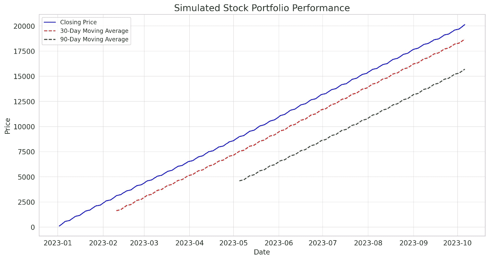
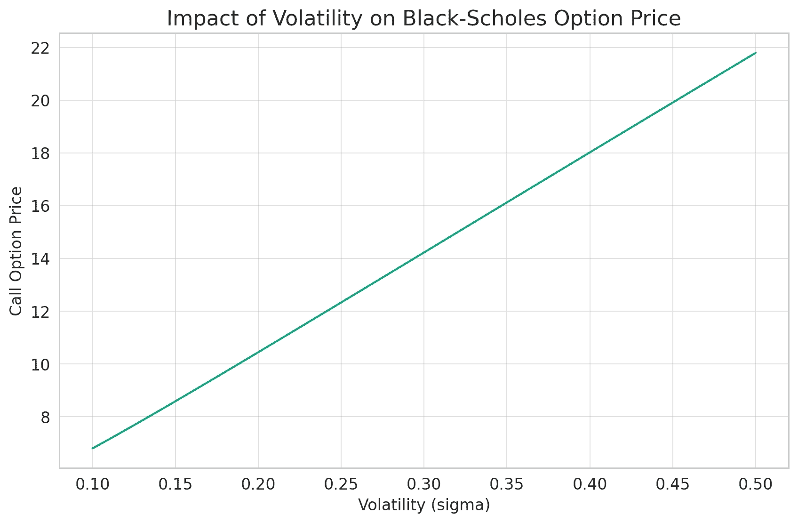

# Deus Ex Machina：金融机器学习：Python 风格金融机器学习精简指南


“机器学习是数字时代的炼金术，它将我们世界的原始数据转化为洞察与可能的织锦。它不仅关乎预测未来，更是从过去中学习，以塑造一个更智能、更直觉的现在。”


献我的父亲，你的智慧引导我进入金融世界——你的教诲成为我职业的指南针。尽管你已不在见证这段旅程，但每一次成功都是对你奠定基础和灌输价值观的致敬。你的精神继续激励着我做的每一个决定。感谢你为我在星辰间设定航程。


# 引言

苏黎世，这座以金融实力和创新著称的城市，正见证着一场金融革命，其程度堪比艺术文艺复兴。这一变革时代的核心是先进的机器学习，它重塑了我们对数据的理解，并改变了金融行业的传统规则。这场革命涵盖了复杂的市场分析、复杂交易策略的自动化、多元投资组合的管理以及细致的信用风险评估。这股创新浪潮正显著重塑着金融格局。

在苏黎世的金融领域，机器学习不仅仅是在分析市场。交易传统上是优秀金融专家的领域，现在正通过自动化发生变革。先进的交易算法以超越人类能力的速度和精度执行复杂策略。这些系统运行速度更快，且能够 `24/7` 全天候运行，挖掘常规交易时间之外的机会。

《机械之神》邀请你，尊贵的读者，进入一份指南，它反映了苏黎世在金融精通和求知好奇心方面的传承。本书深入探讨了金融与机器学习之间复杂的相互作用，为渴望理解当今金融世界细微差别的人提供了一个整合的知识平台。

这种探索超越了传统的金融、银行和投资概念。你将学习通过处理海量数据以获取有价值洞察的算法。我们将引导你了解预测分析、深度学习和强化学习策略的细微之处，这些策略正在彻底改变金融模型和投资方法。

作为你的向导，我们从机器学习的基础开始，涵盖其统计和计算基础。然后我们进入更复杂的领域，例如分析非结构化数据、精炼算法交易系统以及解释市场信号，始终将理论与实际应用相结合。

我们的叙述包含了案例研究和现实示例，突出了理论与金融挑战的融合。你将见证先进机器学习在风险管理、欺诈检测和投资组合优化等领域的重大影响。我们还探索了最新的进展和伦理考量，让你能够负责任地运用和引导金融领域强大的机器学习力量。

这段旅程结束时，你将对受机器学习影响的金融格局有一个全面的理解，并能够预测和应对其未来发展。

这场智力之旅不仅是启性的；它还强调了在金融创新前沿进行跨学科协作和好奇驱动探索的重要性。在这里分享的知识超越了对未来的简单窥视；它是当下行动的指南，也是准备好为后代重塑金融的开拓者的蓝图。

所以，点燃你的智慧，激发你的雄心，当你翻开这一页时，开始掌握机器学习最令人兴奋和最具变革的应用之一。

诚心的问候，

Vincent Bissette


# 第一章：机器学习的基石

## 1.1 量化金融的演变

在柏林清晨的光芒中，一名交易员盯着屏幕，脸被金融数据的光光照亮。这为我们探索量化金融奠定了舞台。金融曾是经济学家和会计师的领域，已通过数字化创新转变为由量化分析师主导的领域。这种转型以持续创新为特征，力求在不确定的世界中追求准确性。

量化金融的早期以简单工具和手动计算为特征，根于传统经济学。然而，随着技术的进步，金融策略也随之发展。20 世纪 50 年代，哈里·马科维茨（Harry Markowitz）引入了现代投资组合理论 (`MPT`)，将金融转向方差和协方差的数学概念，强调了组合管理中的风险与收益。

随后，尤金·法马（Eugene Fama）提出的有效市场假设 (`EMH`) 认为市场完美反映了所有已知信息，仅通过分析获得持续超额收益是不可能的。20 世纪 70 年代，布莱克-斯科尔斯-墨顿模型彻底改变了欧期权的定价，为计算金融奠定了基础。


然而，这些早期模型基于对市场行为和数据正态性的假设显示出了局限性，特别是在金融危机期间。显而易见，金融需要更具适应性的工具。

机器学习的出现为量化金融带来了复兴。神经网络、集成方法和强化学习等技术扩展了金融建模的潜力，使其超越了旧有的僵化假设，转向动态的预测性分析。

量化金融的演进不仅是技术上的，更是哲学上的，它整合了行为经济学的教训，并承认了市场波动中人类的非理性。这代表了一个关于复杂性和变化的故事，是一个对更深层次理解和更高预测准确性的持续追求。

最初，统计方法构成了金融分析的基础，并严重依赖 `Gaussian model` 和 `linear regression`。然而，金融市场的不可预测性与其说像汹涌的海浪，不如说像 `Gaussian model` 的平静。1987 年的“黑色星期一”崩盘凸显了传统统计模型在解释市场异常方面的不力。

这些局限性促使了向机器学习的转变，提供了超越 `linear regression` 限制的工具。金融分析师开始接触 `decision trees`、`support vector machines` 和 `neural networks`，为金融分析带来了灵活性适应性。这种转变与计算能力的增强和数据可用性的提高相契合，推动了该领域的发展。

量化金融的叙事是一个不断演变的过程，反映了自然的复杂性。这是一个由必要性和可能性共同驱动的创新故事，机器学习不仅推向了金融的边界，还挑战分析师去创造性且符合伦理地应用这些工具。这段历史概述不仅是对过去的反思，更是未来金融创新的催化剂。

## 1.1.2 具有影响力的金融模型及其局限性

曾经，人们对塑造了数十年投资策略的经典金融模型持有广泛的崇敬。这些模型是金融业的支柱，是试图将混乱的市场提炼为可理解方程和可预测结果的理论构建。

这些有影响力的模型中首首是 `Capital Asset Pricing Model (CAPM)`，它假定了资产的预期收益与其相对于市场的风险之间存在线性关系。`CAPM` 的简单和优雅使其成为金融理论的基石，引入了 `beta` 作为系统性风险的衡量标准，并为风险定价和有效投资组合的构建提供了见解。

紧随 `CAPM` 知识路线之后，`Efficient Market Hypothesis (EMH)` 应运生，它主张股价完全反映了所有可用信息。根据 `EMH`，任何分析（无论是基本还是技术）都无法持续产生高于市场平均水平的收益，因为价格变化是不可预事件的结果，使得市场本质上是不可预测的。

`Fama-French Three-Factor Model` 通过在市场风险之外加入 `size` 和 `value` 因素扩展了 `CAPM` 框架，从而对资产收益的驱动因素提供了更细致的视角。该模型成为实证资产定价研究的基石，预示着向多因素解释收益的转变，承认了市场的复杂性。

尽管这些模型在智力上取得了成功，但其假设中固有的局限性变得日益明显。`CAPM` 关于单一因素（市场风险）主导收益的假设过于简单，无法捕捉风险的多方面特质。`EMH` 对市场效率的断言与从业者和学者观察到的心理和行为异常相冲突——这些现象后来被行为金融学领域所归纳。

此外，这些模型在很大程度上取决于历史数据，正如任何 `Pacific Exchange` 的资深交易员所证言的那样，对于未来预测来说，这是一个不稳定的基础。金融市场的动荡本质，伴随着突如其的变化和 `black swan events`，暴露了在动态世界中依赖静态模型的愚蠢。

这些传统金融模型的局限性催化了对更具适应性和数据驱动方法的寻找。机器学习凭借其从数据中学习并随数据进化的能力，开始展现其作为金融领域转型力量的潜力。当行业与既有模型的缺陷斗争时，显而易见，一个以数据为中心且算法复杂的模型的新时代正在到来。

## 机器学习在金融领域的引入

机器学习在金融领域的承诺在于其发现海量数据集中模式的内在能力——这些模式对于传统的统计模型来说过于复杂或细微。这一不断发展的领域利用计算算法，这些算法在接触到更多数据时自适应地提高其性能，这一特征特别适合金融信息的流动性和海量性。

向机器学习的过渡并非突然发生，而是一个逐渐的觉醒。该领域的先驱开始将 `linear regression` 等基础技术应用于金融预测，却发现这些方法可以通过机器学习的细致方法得到极大的增强。例如，`decision trees` 使分析师能够描绘更准确代表金融场景的非线性决策路径。同时，`support vector machines` 提供了稳健的分类能力，证明是市场数据模式识别的强大工具。

机器学习潜力的早期宣告者之一是 `algorithmic trading`，在其中，自动化过程可以以人类交易员无法实现的速度和频率执行交易。这些算法最初是直接的，遵循基于技术指标的设定规则。然而，随着机器学习模型变得越来越复杂，它们开始整合各种信号，包括历史价格数据、新闻文章和社交媒体情绪，以做出更明智的交易决策。

金融部门对机器学习日益增长兴趣也导致了风险评估和管理的进步。传统风险模型在预测极端事件方面往往不从心，但机器学习的预测能力为潜在风险分析带来了新的深度，使机构能够更快速、有效地对市场压力做出反应。

`ensemble learning` 是一种通过结合多个模型来提高预测性能的技术，开始改变信用评分。通过聚合各种分类器的见解，金融机构可以生成比以往任何时候更准确、更细粒度的信用评估——这对于贷款人和借款人都是有利的。

然而，尽管潜力巨大，机器学习在金融领域的应用也面临挑战。某些算法（特别是 `deep learning` 的算法）的黑箱性质引发了对可解释性和信任的担忧。金融机构受监管和透明度需求的限制，在平衡这些模型的性能与解释其决策过程的要求之间进行挣扎。

此外，机器学习模型的优坏取决于其训练数据。诸如 `overfitting` 等问题（即模型在历史数据上表现优异，但在未见数据上泛化失败）成为了关注的焦点。数据质量、隐私以及机器学习的伦理使用也成为金融界激烈讨论的话题。

## 1.1.4 金融市场与工具概述


股票是金融市场的核心，代表了上市公司的所有权股份。交易这些股份的交易所——从纽约证券交易所到东京证券交易所——是经济健康的晴雨表，对新闻动态、收益报告和投资者情绪的脉搏做出瞬时反应。股票只是更广泛生态系统的一个组成部分，该系统还包括债券、大商品、货币、衍生品等。

债券市场通常被视为波动剧烈的股票市场中温和的兄弟，交易的是固定收益证券。它是寻求稳定收益的投资者的避风港，但通过允许政府和公司融资，它在经济运行中起着至关重要的作用。债券的范围从极安全的政府发行国债到高收益垃圾债，每种债券都提供不同水平的风险和回报。

大商品市场交易贵金属、石油和农产品等实物。这些市场具有原始的经济重要性，其波动可以波及全球每一个角落，影响通货膨胀、汇率，甚至是地缘政治动态。大商品的定价涉及供需、生产成本和宏观因素之间复杂的相互作用。

货币市场（或外汇市场）规模巨大且流动性强，每日交易额达数万亿美元。货币以货币对进行交易，反映了全球贸易和金融的互联性。汇率持续波动，受利率差、经济数据和全球事件的影响。外汇市场是世界经济相互互通的证明，一个国家的政策转变可能在全球范围内引发涟漪。

衍生品包括期货、期权和掉期，是其价值源于底层资产的金融合约。它们有各种用途，从对冲价格波动的风险到进行投机性活动不等。衍生品市场复杂且强大，既能够降低风险，而且正如历史所示，当使用不当时也会加剧金融危机。

这些每个市场都运行在监管和技术基础设施的网络中，这些确保了流动性、透明度和公平。由先进算法和机器学习模型驱动的现代交易平台允许交易的快速执行和对市场状况的复杂分析。算法交易影响力的增长带来了效率的提高，也带来了新的挑战，例如自动化交易错误可能导致的闪崩风险。

### 1.1.5 金融建模中的伦理考量与偏差

金融建模并非一种价值中立的科学。我们构建的模型往往反映了创造者的价值观，无论是显性的还是隐性的。因此，伦理考量必须处于模型开发的前沿，引导我们做出的选择——从数据选择到算法设计。伦理建模尊重公平、问责和透明原则，力在减少损害的同时增强共同利益。

偏差（偏离公正标准的现象）可能是具有隐蔽性的，通过各种渠道渗透到模型中。当用于训练算法的历史数据包含偏见性元素时，就会出现数据偏差，导致倾斜或歧视性的结果。当模型本身处理数据的方式强化了刻板印象或系统性不平等时，就可能发生算法偏差。确认偏误（倾向于支持证实既有信念的信息的倾向）可能会蒙蔽分析师的判断，影响构建模型的基础假设。

考虑有偏差的信誉评分模型的影响，这些模型可能会系统性地不利某些人口群体；或者交易算法可能在无意中加剧了市场不平等。此类结果不仅仅是技术故障，而是对个人和社会产生实质影响的伦理失范。

解决这些问题始于承认所有数据和模型都携带的固有偏差。这要求对数据源进行严密审查，不断针对新的、无偏的数据进行验证，并愿意挑战和完善我们的假设。机器学习从业者必须保持警惕，确保他们的模型不会延续或放大现有偏差，而是朝着消除偏差的方向努力。

此外，模型应该是透明且可解释的。利益相关者必须理解决策是如何做出的、哪些数据提供了支持以及可能存在的局限性。透明度促进信任，并允许对识别和纠正伦理违规进行审查。

金融建模中的伦理还延伸到隐私问题。大量个人财务数据的聚合和分析引发了关于同意和敏感信息妥当管理的问题。数据科学家有责任保护这些数据，确保隐私不会在分析能力的祭坛上被牺牲。

伦理 AI 框架的实施以及对监管指南的遵循（如欧洲的 `GDPR`），有助于将必须嵌入金融建模的伦理考量正式化。这些框架鼓励问责，要求机构能够对其自动决策过程的结果提供合释。

在金融建模不断演变的图中，机器学习带来了力量也带来了复杂性，我们有责任负责任地使用这些工具。当我们继续探索机器学习在金融领域的应用时，让我们带着对伦理诚信的承诺进行，确保未来的金融模型构建时不仅具有先进性，而且具有深远的社会责任感。

当我们转向下一节时，我们将探索数据科学家必须掌握的关键金融概念，以便创建不仅强大且具预测性，而且公平公正的模型。通过以伦理为基础的机器学习方法，我们可以追求一个反映我们最高理想并与更公平、更繁荣的社会相一致的金融生态系统。

## 1.2 数据科学家的关键金融概念

货币的时间价值概念是金融理论中的关键支柱，对于投资和风险评估模型至关重要。它基于这样一个观点：由于潜在的获利能力，今天的美元比明天的美元更有价值。对于数据科学家来说，掌握这一概念是正确对未来现金流折现并准确计算现值的关键。

理解财务报表是公司金融的基础。分析公司的资产负债表、利润表和现金流量表对于评估其表现和投资潜力至关重要。精通此类分析的数据科学家可以检测趋势、评估财务状况，并识别可能预示不准确或欺诈的异常情况。

在金融市场中，风险和回报在本质上是相互联系的。风险涉及收益的不确定性和结果偏离预期的概率，而回报则代表投资的收益或亏损。掌握风险与潜在回报之间的平衡，对于开发能够抵抗市场波动的韧性金融模型至关重要。

哈里·马科维茨引入的基础投资组合理论认为，多元化可以降低投资组合的风险而不影响预期回报。该理论认为，不同风险水平的资产组合可以创造出一个整体波动最小的投资组合。对于数据科学家来说，理解相关性和风险量化对于将机器学习有效应用于投资组合优化中至关重要。


行为金融学引入了心理学因素，挑战了市场完全理性的观点。它展示了认知偏差和情绪反应如何显著影响投资者行为。将这些见解纳入机器学习模型中，可以提高它们的预测能力，从而对市场动态有更深入的理解。

基于这些基本金融概念的应用机器学习，为高级分析创建了一个稳健的平台。精通这些原理使数据科学家能够开发出在技术上可靠，且针对金融部门独特领域进行精细调的模型。

### 1.2.1 货币时间价值原理

货币时间价值（TVM）基于这样一个公理：由于具有潜在的收益能力，现在的资金比未来的相同金额资金更有价值。这一原则是构建复利帝国的基石。它是投资者在评估向新创企业投入资金的可行性，或家庭决定为孩子的教育储蓄时，所参考的概念。

为了阐明货币时间价值，考虑一个计算单笔资金未来值的简单 Python 代码段：

```python
def future_value(present_value, annual_rate, periods_per_year, years):
    # 计算若干年后的未来价值
    rate_per_period = annual_rate / periods_per_year
    periods = periods_per_year * years
    return present_value * (1 + rate_per_period) ** periods

# 使用示例:
present_value = 1000  # 美元现值
annual_rate = 0.05    # 小数形式的年利率
periods_per_year = 12 # 每月复利
years = 5             # 计算年数
fv = future_value(present_value, annual_rate, periods_per_year, years)
print(f"The future value of the investment is: ${fv:.2f}")
```

使用此类代码，数据科学家可以快速计算当前投资的未来价值。了解此点使得合理的经济规划成为可能，无论是在个人财务、企业投资策略还是政府财政政策。

折现现金流（DCF）分析是一种应用 TVM 来评估投资机会的技术，是金融分析师武器中的有力工具。它使分析师能够确定预期未来现金流的现值，并考虑了封装了资本占用风险和机会成本的折现率。

让我们用 Excel 中的示例来说明，Excel 通常是数据科学家在金融分析中的伴侣。想象你正在评估一个项目在未来五年预期的一系列现金流。使用 Excel 中的 DCF 公式 `=NPV(discount_rate, range_of_cash_flows)`，你可以轻松地将未来的美元换算为今天的价值，揭示项目的真实价值。

TVM 还延伸到年金和永年金领域——这些概念塑造了退休规划以及债券等金融工具的定价。计算这些资金流的现值或未来值的能力，是处理金融模型的数据科学家的一项核心技能。

精通货币时间价值原理开启了对利率、通货膨胀和投资心理学的更深层理解。这是一个渗透进社会金融织理的概念，在银行、投资公司和大学的走廊里回响。

当我们通过机器学习的视角进一步深入金融的细微差别时，我们带上了货币时间价值。这是一个贯穿于所有后续概念的基本真理，是一条以坚定稳定性贯织在金融叙事中的线。它赋予数据科学家构建预测模型的能力，这些模型不仅是数据模式的反映，还注入了金融理论的长期智慧。

### 1.2.2 面向数据科学家的财务报表分析

财务报表是封装公司财务状况和运营效率的基石文件。它们由资产负债表、利润表和现金流量表组成，每份报表都是观察公司财务状况各个方面的窗口。

资产负债表类似于一张快照，提供了公司资产、负债和股东权益的瞬间洞察。它反映了公司拥有和欠有的东西，是其在特定时间财务状况的账本。对于数据科学家来说，资产负债表是一个用于分析和预测建模的宝库。

同时，利润表像小说的叙事一样流动，详细说明了公司一段时间内的收入、支出和利润。它讲述了公司在运营过程中产生收益的发展故事。数据科学家可以深入研究这种叙事，利用机器学习算法识别模式并预测未来表现。

现金流量表讲述了流动性的故事，记录了现金的流入和流出。它是组织的血液，揭示了其如何管理现金以支持运营、支付债务和进行投资。通过统计模型分析现金流，数据科学家可以预测公司维持运营和增长的能力。

为了说明，让我们考虑一个实际示例，数据科学家利用 Python 分析公司的财务比率——这些源自财务报表数据的定量指标：

```python
import pandas as pd

# 假设我们有一个包含财务报表数据的 DataFrame 'financials'
financials = pd.DataFrame({
    'Total Assets': [1000000],
    'Total Liabilities': [500000],
    'Shareholders Equity': [500000],
    'Net Income': [150000],
    'Revenue': [500000],
    'Operating Cash Flow': [200000]
})

# 计算关键财务比率
financials['Current Ratio'] = financials['Total Assets'] / financials['Total Liabilities']
financials['Debt to Equity Ratio'] = financials['Total Liabilities'] / financials['Shareholders Equity']
financials['Return on Equity'] = financials['Net Income'] / financials['Shareholders Equity']
financials['Profit Margin'] = financials['Net Income'] / financials['Revenue']
financials['Operating Cash Flow to Revenue'] = financials['Operating Cash Flow'] / financials['Revenue']

print(financials)
```

通过采用此类分析，数据科学家可以识别企业的财务优势和缺点，识别随时间变化的趋势，并预测未来的偿债能力和盈利能力。

在 Excel 中，财务报表分析可能围绕构建公式以跨历史数据计算这些比率而展开。精通 Excel 高级函数（如 `VLOOKUP`、`PIVOT TABLE` 和 `CONDITIONAL FORMATTING`）的数据科学家可以制作全面的仪表板，提供公司财务状况的可视化表示。

财务报表的分析不仅仅是数字计算；它关乎讲述公司过去的故事并预测其未来的叙事。通过利用机器学习和计算工具的力量，现代数据科学家可以将经过时间考验的金融分析实践提升到新的高度，揭示传统分析师肉眼无法发现的模式。


在金融宇宙中，风险与收益如同阴与阳，是塑造投资图谱的基本力量。对于在金融世界中编织预测织锦的数据科学家来说，理解这对动态组合至关重要。它们是同一枚硬币的两面，是每项投资决策的本质，也是金融策略的核心。

金融中的风险概念是指投资实际收益与预期收益之间存在差异的概率，涵盖了向上和下行波动的可能性。另一方面，收益是承担风险的报酬——风险越高，预期收益也应该越高。这一原则是引力，维持着金融工具轨道的稳定运行。

为了深入研究，让我们揭开方差（variance）概念的神秘纱——这是一种衡量离散程度的统计指标，用于量化投资世界中的风险：

```python
import numpy as np

# 假设我们有一个某只股票的历史收益数组
stock_returns = np.array([0.12, 0.08, 0.06, -0.02, 0.07])
# 计算平均收益（均值）
average_return = np.mean(stock_returns)
# 计算收益的方差
variance = np.var(stock_returns)
print(f"Average Return: {average_return}")
print(f"Variance: {variance}")
```

方差捕捉了风险的本质；它告诉我们股票收益围绕均值的离散程度。高方差意味着高水平的风险，因为投资收益更具不可预测性。

在组合管理的背景下，数据科学家利用多元化（diversification）概念——这是一种风险管理技术，在组合中混合多种投资。其原理显而易见：不同的资产类别通常以不同的方向移动，因此当某项资产出现波动时，其他资产可能保持稳定甚至上涨，从而降低整体风险。

一个实用的 Excel 练习可能涉及计算资产之间的相关性，为多元化策略提供参考。相关性衡量两个证券相互变动的程度：

```excel
=CORREL(array1, array2)
```

相关性接近 1 意味着资产以相同方向移动，而相关性接近 -1 则表示它们以相反方向移动。

但风险并非单一整体；它是一块马赛克，具有数据科学家必须剖析的不同类型。信用风险涉及借款人可能违约贷款；市场风险源于市场价格波动；流动性风险则涉及无法以当前市场价格执行交易的能力。

与此同时，投资的预期收益并非简单的算术平均值。它是基于各种因素的概率预期，包括无风险利率（无财务损失风险的投资收益）、贝塔系数（beta，衡量资产相对于整体市场的波动性指标）以及权益风险溢价（投资者为了承担与股票相关的额外风险，在无风险利率之上所要求的额外收益）。

人们可以构思一个 Python 脚本，它利用资本资产定价模型（CAPM）来计算预期收益：

```python
def calculate_expected_return(risk_free_rate, beta, market_return):
    return risk_free_rate + beta * (market_return - risk_free_rate)

# 示例值
risk_free_rate = 0.03  # 3%
beta = 1.2
market_return = 0.10  # 10%
expected_return = calculate_expected_return(risk_free_rate, beta, market_return)
print(f"Expected Return: {expected_return}")
```

这段代码段提供了一个框架，用于理解不同因素如何影响资产的预期收益。

风险与收益的传奇历史悠久，但数据科学为其注入了新生命。通过算法、机器学习和稳健统计工具的力量，今天的数据科学家能够以以前所未有的精度分析并模拟风险与收益。然而，当他们从海量数据集中提取洞察并构建复杂的模型时，必须不能忽视人为因素——即那些财富和未来正受这些模型影响的投资者。

风险和收益不仅是数学构架；它们是金融决策的骨肉。理解这些原理不仅仅是一项智力练习——对于任何渴望在金融领域足足脚的数据科学家来说，这是基础性的要求。

## 1.2.4 基础组合理论

在最基础的层面，基础组合理论研究投资者如何构建组合，以便在给定的市场风险水平下优化或最大化预期收益，强调风险是高回报的内在部分。它是战略资产配置的真正支柱，为投资组合的决策过程提供了系统的方法。

该理论源于哈里·马科维茨（Harry Markowitz）1952 年的开创性工作，引入了多元化概念以减少非系统性风险。通过选择相互相关性不完美的各种资产类别，投资者可以构建一个具有较低波动性和更稳定收益潜力的组合。

为了应用这些思想，数据科学家可能会使用 Python 模拟不同的组合组合，并评估它们的潜在风险和收益。这里是一个简化的示例，使用蒙特卡洛模拟来视觉化各种组合组合可能的风险-收益概况：

```python
import numpy as np
import matplotlib.pyplot as plt

# 假设我们有两个资产，及其预期收益和标准差
asset1_return, asset1_std = 0.10, 0.15
asset2_return, asset2_std = 0.12, 0.20
# 资产之间的相关系数
rho = 0.5
# 模拟的组合数量
num_portfolios = 10000
# 用于存储模拟收益和风险的数组
port_returns = []
port_risks = []
for _ in range(num_portfolios):
    # 随机分配权重
    weights = np.random.random(2)
    weights /= np.sum(weights)
    # 预期组合收益
    port_return = weights[0] * asset1_return + weights[1] * asset2_return
    port_returns.append(port_return)
    # 组合风险（标准差）
    port_risk = np.sqrt((weights[0]*asset1_std)**2 + (weights[1]*asset2_std)**2 + 2*weights[0]*weights[1]*asset1_std*asset2_std*rho)
    port_risks.append(port_risk)

# 将列表转换为数组
port_returns = np.array(port_returns)
port_risks = np.array(port_risks)

# 绘制模拟组合的风险-收益概况
plt.scatter(port_risks, port_returns, c=port_returns/port_risks, marker='o')
plt.title('Portfolio Optimization Simulation')
plt.xlabel('Portfolio Risk (Standard Deviation)')
plt.ylabel('Portfolio Return')
plt.colorbar(label='Sharpe Ratio')
plt.show()
```

这种可视化有助于识别“有效边界”（efficient frontier）——在定义的风险水平下提供最高预期收益的组合组合，或在给定的预期收益水平下提供最低风险的组合。

使用 Microsoft Excel 的实际方法可能涉及使用 `SOLVER` 工具来优化组合中资产的权重分布，以最大化夏普比率（Sharpe ratio），这是风险调整收益的衡量。`SOLVER` 可以调整分配权重以找到夏普比率最高的组合，同时满足权重和为 1 以及任何其他投资者施加的约束。

基础组合理论还区分了系统性风险和非系统性风险。系统性风险（市场风险）影响所有投资，被认为是不可分散的。非系统性风险（特定风险）是特定公司或行业的特性，可以通过多元化来减轻。


机器学习在投资组合理论中的应用可以扩展到历史数据中的模式识别，以预测未来的收益和协方差，促进算法再平衡，甚至可以根据个人风险偏好定制个性化的投资策略。

## 1.2.5 面向建模者的行为金融学洞察

行为金融学的本质在于承认：投资者并不总是理性的，市场也不总是高效的，而且认知偏差和情绪会显著影响投资决策。这种对预期效用最大化和有效市场假说的偏离，为数据科学家和建模师探索金融分析的新维度提供了肥沃的土壤。

例如，人们可以探索过度自信现象，即投资者会高估自己知识或预测的准确性。基于 Python 的机器学习模型可以分析历史交易数据，以识别暗示过度自信的模式，例如过高的交易量或分散化不足。

以下是一个如何在 Python 中实现交易行为基础分析的示例：

```python
import pandas as pd
import numpy as np
# Assume 我们有一个名为 `trades` 的 DataFrame，包含 'investor_id', 'trade_volume' 和 'diversification' 列
trades = pd.read_csv('investor_trading_data.csv')
# 计算每个投资者的平均交易量和分散化指数
investor_stats = trades.groupby('investor_id').agg({'trade_volume': 'mean', 'diversification': 'mean'})
# 定义过度自信指标的阈值
high_volume_threshold = investor_stats['trade_volume'].quantile(0.9)
low_diversification_threshold = investor_stats['diversification'].quantile(0.1)
# 识别可能过度自信的投资者
overconfident_investors = investor_stats[(investor_stats['trade_volume'] > high_volume_threshold) &
(investor_stats['diversification'] < low_diversification_threshold)]
print(overconfident_investors)
```

这种初步分析可以作为进一步研究投资者行为倾向的起点。

在 Microsoft Excel 领域，金融建模师可以使用 Excel 函数和数据透视表进行类似的分析，对数据进行排序和过滤，创建描述性统计突出数据集中潜在的行为偏差。

行为金融学还考虑了启发式方法，即简单高效的规则——无论是学习来的还是与生俱脑的——它们为了使决策更快、更易而演化出来。然而，这些心理捷径可能会导致对逻辑、概率或理性选择理论的系统性偏。

对于数据科学家来说，将行为金融学洞察纳入金融建模意味着承认并考虑这些偏差。机器学习算法，特别是分类和聚类算法，可以根据其行为模式（如羊群效应、锚定效应或损失厌恶）对投资者进行分类。

引入自然语言处理 (NLP) 等技术对金融新闻、博客或社交媒体进行情感分析，可以进一步丰富金融模型。通过量化市场论述的情绪或主观色调，数据科学家可以整合出更细致的市场动态图。

考虑这样一个例子：我们利用 Python 中的情感分析库来评估金融新闻标题的情绪：

```python
from textblob import TextBlob
import pandas as pd
# 加载金融新闻标题
news_headlines = pd.read_csv('financial_news_headlines.csv')
# 计算每个标题的情绪极性
news_headlines['sentiment'] = news_headlines['headline'].apply(lambda x: TextBlob(x).sentiment.polarity)
# 探索情感极性的分布
print(news_headlines['sentiment'].describe())
```

结合了这些洞察的模型可能通过预测由投资者心理驱动的市场波动来提供优势，而不仅仅依赖基本面指标。

## 1.3 统计基础

在现代金融跳动的心脏之下，存在着统计理论和实践组成的复杂血管系统。定量分析的这一基石允许对金融数据进行系统剖析，对市场的概率机制和投资收益的行为提供了深刻的见解。

在本节中，我们将深入研究机器学习模型的统计基础，从统计推断的核心原理开始。这涉及到从数据得出关于总体或科学结论的过程。为了说明，考虑一个试图推断市场指数平均年收益的金融分析师。通过使用 Python 的统计库，该分析师可以执行类似于下面的脚本：

```python
import numpy as np
import scipy.stats as stats
# Assume 'annual_returns' 是市场指数 yearly 收益的 NumPy 数组
annual_returns = np.array([...])
# 计算样本平均值和标准差
sample_mean = np.mean(annual_returns)
sample_std = np.std(annual_returns, ddof=1)
# 为平均年收益构建 95% 置信区间
confidence_interval = stats.t.interval(0.95, len(annual_returns)-1, loc=sample_mean, scale=stats.sem(annual_returns))
print(f"平均年收益的 95% 置信区间是: {confidence_interval}")
```

此代码段示例了统计推断如何提供一个真实平均年收益可能存在的范围，为投资者提供了更具信息的视角。

统计基础的另一个基石是概率分布分析。在金融领域，使用不同类型的分布来模拟资产收益的行为。例如，虽然股票收益通常被假设遵循正态分布，但这种假设可能是天真的。肥尾和偏态是金融数据固有的特征，学生 t 分布等模型可以更准确地反映这些特征。在实践中，金融建模师将进行正态性检验并相应调整他们的模型，如下所示：

```python
import scipy.stats as stats
# 收益的正态性检验
k2, p = stats.normaltest(annual_returns)
alpha = 1e-3
print(f"p = {p}")
# 原假设：样本来自正态分布
if p < alpha:
    print("拒绝原假设。数据可能不符合正态分布。")
else:
    print("无法拒绝原假设。数据可能符合正态分布。")
```

此外，时间序列分析在金融领域是不可或缺的。金融变量（如股价和利率）通常具有序列相关性并表现出波动聚集。自回归整合移动平均 (ARIMA) 模型或广义回归条件异方差 (GARCH) 模型等技术专门用于捕捉时间序列数据中的这些时间依赖和波动性。


最后，我们讨论了过拟合和欠拟合的概念。过拟合发生在模型不仅学习了训练数据中的底层信号，还学习了其噪声的情况下，导致对未见数据的泛化能力较差。相反，欠拟合发生在模型过于简单而无法捕获底层结构的情况下。这两种情况对模型性能都有害处，而交叉验证、正则化和模型选择标准等技术对于防止这些问题的发生至关重要。

### 1.3.1 概率框架与推理

概率论作为概率框架的数学骨柱，是应用于金融领域的机器学习算法的基础构建模块。它赋予了模型管理不确定性和做出明智预测的能力。从金融的角度来看，这些框架被用于评估风险、预测市场趋势以及估计金融事件（如违约或股价波动）的概率。

推理是概率框架的关键组成部分，数据科学家通过它从数据样本中推导出更广泛的含义。从观测数据到一般性结论的跨越需要精心构建能够解释随机性和不确定性的概率模型。例如，贝叶斯推理提供了一种在有新证据时更新信念的结构化方法。贝叶斯方法结合了对模型参数的先验信念，并在新数据可用时更新这些信念。

考虑这样一个例子：数据科学家目标是根据历史数据推断资产收益率的概率分布。他们可能会选择贝叶斯方法，将数据以及对市场的任何先验信念结合起来。此过程的 Python 代码段如下：

```python
import pymc3 as pm

# 资产的历史收益率数据
historical_returns = np.array([...])

# 构建贝叶斯模型
with pm.Model() as model:
    # 未知平均收益率的先验分布
    mu = pm.Normal('mu', mu=0, sd=1)
    # 未知标准差的先验分布
    sigma = pm.HalfNormal('sigma', sd=1)
    # 观测值的似然（采样分布）
    returns = pm.Normal('returns', mu=mu, sd=sigma, observed=historical_returns)
    # 后验分布采样
    trace = pm.sample(1000)
pm.plot_posterior(trace)
```

在上面的代码段中，使用 `PyMC3` 定义了一个对资产收益率均值和标准差具有正态先验的模型。`pm.Normal` 和 `pm.HalfNormal` 指定了对这些参数的先验信念。然后，通过 `returns` 变量将观测数据纳入模型中。最后，`pm.sample` 方法从后验分布中提取，这反映了在考虑数据后更新的信念。`pm.plot_posterior` 函数可视化了生成的分布，为估计的参数提供了见解。

推理也扩展到了频率派方法，在这些方法中，使用了置信区间和假设检验等工具，而不依赖于先验分布。这些方法为从金融数据中得出结论提供了另一种途径，通常通过构建 `p-values` 和检验统计量来反驳或支持关于市场行为的假设。

概率框架在金融中的应用通过蒙特卡洛模拟得到了进一步说明。这些模拟依赖随机性来预测各种场景下的结果。例如，在评估投资组合风险时，蒙特卡洛模拟可能会生成数千个潜在的未来资产价格，并计算相应的投资组合价值，从而估计可能结果的分布以及亏损的概率。

当我们从通用概率框架转向复杂的，[注：原文似乎截断或重复，此处保持了核心内容] 概率框架在金融中的应用通过蒙特卡洛模拟得到了进一步说明。

### 分布及其在金融中的重要性

推理也扩展到了频率派方法，在这些方法中，使用了置信区间和假设检验等工具，而不依赖于先验分布。这些方法为从金融数据中得出结论提供了另一种途径，通常通过构建 `p-values` 和检验统计量来反驳或支持关于市场行为的假设。

概率框架在金融中的应用通过蒙特卡洛模拟得到了进一步说明。这些模拟依赖随机性来预测各种场景下的结果。例如，在评估投资组合风险时，蒙特卡洛模拟可能会生成数千个潜在的未来资产价格，并计算相应的投资组合价值，从而估计可能结果的分布以及亏损的概率。


考虑到分布与金融现象之间的相互作用，显而易见，它们远不仅仅是数学构型；它们是金融分析的心脏。当我们从静态分布转向动态金融时间序列时，识别和建模这些概率结构的能力成为了金融数据科学家工具箱中了一项至关重要的技能。正是在这一框架，我们准备探索时间序列分析的基础元素，这些元素将为我们预测和应对金融市场迷宫提供必要的工具。

### 1.3.3 时间序列分析与预测基础

时间序列数据如一条涓涓小溪流经在金融版图中，其水流蕴含着丰富的时间模式和趋势，等待着解读。时间序列分析是金融预测的命脉，是一项核心学科，使分析师能够根据观测到的历史数据预测未来的市场行为。

这项分析的核心是提取数据意义统计量和其他特征的艺术与科学。金融时间序列具有等时间间隔分布的顺序数据点，为应用机器学习技术提供了肥沃的土壤，以挖掘肉眼往往无法察觉的模式。

预测作为时间序列分析的远见维度，类似于在不可预测的未来暗流中航行。这门学科深根于定量精确和定性洞察之中，力求在不确定性允许范围内尽可能清晰地审视金融地平线。在柏林的天际线上，正如在金融图表中一样，数据点的高低织成了关于市场动态的故事——这是一个由季节性模式、周期性趋势和不可预见的干扰构成的叙事。

预测的关键在于理解金融时间序列数据的性质，它们通常表现出趋势、季节性和噪声等显著特征。趋势代表序列的长期进展，季节性显示了由于季节因素引起的规律模式，而噪声则是掩盖底层信号的随机波动。

时间序列预测的一种简单且稳健的方法是自回归移动平均模型（`ARIMA`），它结合了自回归（`AR`）、差分（`I`）和移动平均（`MA`）组件。每个组件捕获了时间序列数据的不同维度：

- `AR` 部分利用观测值与多个滞后观测值之间的关系。
- `I` 组件用于使时间序列平稳——这是许多需要恒均值和方差的统计模型的必要步骤。
- `MA` 部分将预测误差建模为过去误差的组合。

Python 的 `statsmodels` 库为构建 `ARIMA` 模型提供了直观的接口。以下是一个用 Python 代码实现时间序列预测 ARIMA 模型的示例代码：

```python
import pandas as pd
from statsmodels.tsa.arima.model import ARIMA
import matplotlib.pyplot as plt

# 加载时间序列数据集
df = pd.read_csv('financial_time_series.csv', index_col='Date', parse_dates=True)
time_series = df['Asset_Returns']

# 拟合 ARIMA 模型
model = ARIMA(time_series, order=(5,1,0))
model_fit = model.fit()

# 模型摘要
print(model_fit.summary())

# 预测未来 10 个周期
forecast = model_fit.forecast(steps=10)
print(forecast)

# 绘制历史数据和预测图
plt.figure(figsize=(10,6))
plt.plot(time_series, label='Historical Data')
plt.plot(forecast, label='Forecast', color='red')
plt.legend()
plt.show()
```

在这段代码中，`ARIMA(5,1,0)` 模型被拟合到 `Asset_Returns` 时间序列上，其中 `order` 参数分别指定了 `AR` 项、差分操作和 `MA` 项的数量。模型摘要提供了关于每个项显著性的见解，并生成了未来 10 个周期的预测，且与历史数据进行了对比。

随着我们从基础模型转向更高级的机器学习技术，预测变得变得越来越细致。诸如向量自回归（`VAR`）、随机森林等机器学习算法，以及长短期记忆（`LSTM`）网络等深度学习方法扩展了时间序列分析师的武器库。这些模型能够处理多元时间序列并捕获数据中的复杂关系，为金融决策提供更丰富、更具洞察力的预测。

时间序列分析和预测的基础为深入研究更复杂的金融建模技术奠定了基础。它们是构建高级分析方法高大建筑的基础地层，使我们能够预测市场波动并做出明智的投资决策。当我们过渡到过拟合和欠拟合的研究时，我们带着时间序列分析的原则，确保我们的模型是稳健、可靠，并准备好应对金融领域不可预测的潮汐。

### 1.3.4 回归分析与假设检验

在柏林广阔的空下，想象一位经济学家正在分析房价价格的波动。他们使用回归分析来解读各种因素（如利率、收入水平等）是如何相互作用并影响这些价格的。同样，在金融领域，回归是揭示影响资产价格、收益率和差别的复杂因素的有效工具。

回归分析的核心是模型——一种表示因变量与一个或多个自变量之间关系的结构化方程。线性回归作为最基础的形式，探索两个变量（预测变量和响应变量）之间的关系，而多元回归将这种探索扩展到多个预测变量。目标是构建一个能最好预测响应变量的线性方程。

Python 的 `statsmodels` 库擅长辅助此类分析。考虑以下示例，其中采用多元回归模型来分析资产收益数据：

```python
import statsmodels.api as sm

# 假设 'df' 是一个包含必要金融数据的 DataFrame
X = df[['Interest_Rate', 'GDP_Growth', 'Unemployment_Rate']] # 预测变量
y = df['Stock_Return'] # 响应变量

# 为预测变量添加常数项
X = sm.add_constant(X)

# 拟合回归模型
model = sm.OLS(y, X).fit()

# 输出回归结果摘要
print(model.summary())
```

这段代码构建了一个多元线性回归模型，其中 `Stock_Return` 是由利率、GDP 增长和失业率预测的因变量。`summary()` 方法显示了关键的统计信息，如系数值、t 统计、p 值和 R 方——这些对于假设检验和模型解释至关重要。

回归分析中的假设检验是一种严谨的统计机制，用于确定变量间关系假设的有效性。在这里我们进入了零假设（通常假设特定系数为零）和备择假设（假设系数不为零）的世界。通过这种检验得到的 p 值告诉我们是否可以拒绝零假设并假设变量之间存在统计学显著的关系。

考虑一位资产经理正在思考新财政政策对市场波动的影响。通过在回归模型中构建假设检验，他们可以确定政策变化是否显著影响了波动率，从而为投资策略或风险管理方法提供参考。


当我们于复杂的金融建模网络中不断推进时，必须时刻警惕过拟合和欠拟合双重幽灵——这也是我们的下一个停靠站。过拟合发生在模型学习了训练数据中的噪声，以至于对模型在新数据上的性能产生了负面影响。相反，欠拟合则是当模型过于简单，无法捕捉数据中的底层模式。

这两种现象对我们模型的泛化能力和稳健性构成了重大威胁。过拟合的模型在历史数据上可能产生惊人的结果，但在现实应用中会惨败；而欠拟合模型可能会忽略重要的信号，导致预测结果不佳。在接下来的章节中，我们将深入探讨这些挑战。我们深知，机器学习在金融领域的真正力量在于我们平衡模型复杂性与预测保真度之间的能力。

## 1.3.5 金融背景下的过拟合与欠拟合

过拟合就像一套精细定制的西装，它完美地贴合主人的体型，以至于其他人完全无法穿着。同样，过拟合的模型过于贴近训练数据集的特性，将转瞬即逝的噪声视为信号，从而失去了对未见数据的预测能力。这种模型在训练数据上的高准确率令人印象深刻，但在面对新的样本外数据时，其糟糕的表现却令人失望。

另一方面，欠拟合就像一件宽大而空洞的大衣，披在架子上，却无法定义任何形状或功能的轮廓。欠拟合模型由于其粗线条的描述，无法捕捉数据中的细微差别，导致即使在训练数据集中缺乏预测洞察力，因此在应用到新数据时也是如此。

为了进一步说明这一概念，让我们考虑在 Python 中使用正则化回归方法，例如 `Ridge` 和 `Lasso`，这些方法通过对系数的大小施惩罚来缓解过拟合：

```python
from sklearn.linear_model import Ridge, Lasso
# Assuming 'X_train' 和 'y_train' 是我们的训练数据
# 'X_validate' 和 'y_validate' 用于验证
# 带有控制正则化强度 alpha 参数的 Ridge 回归模型
ridge_model = Ridge(alpha=1.0)
ridge_model.fit(X_train, y_train)
# 带有 alpha 参数的 Lasso 回归模型
lasso_model = Lasso(alpha=0.1)
lasso_model.fit(X_train, y_train)
# 使用验证数据评估模型
ridge_predictions = ridge_model.predict(X_validate)
lasso_predictions = lasso_model.predict(X_validate)
# 预测值与实际值以评估模型性能
```

在上面的示例中，`Ridge` 和 `Lasso` 是两种正则化技术，它们通过向损失函数引入惩罚项来解决过拟合。`alpha` 参数控制正则化的程度：较高的 `alpha` 会增加惩罚，可能防止过拟合；而过高的 `alpha` 则可能导致欠拟合。

在金融建模的过程中，由于预测错误的成本可能是天文数字，我们必须时刻警惕这两种威胁。模型验证技术（如交叉验证）是防止过拟合的堡垒，它系统地将数据划分为训练集和测试集，以确保模型对未见数据具有良好的泛化。

例如，使用交叉验证的金融分析师可能会将其时间序列数据分为多个训练和验证期，从而测试模型在不同市场条件和经济周期下的表现。这种做法不仅有助于验证模型性能，还有助于调整超参数，以实现偏差和方差之间的平衡。

为了解决欠拟合，我们通常转向模型复杂度，也许通过增加更多特征或使用更复杂的算法。然而，虽然复杂度可以增强模型识别复杂模式的能力，但必须谨慎对待。从线性模型到非线性模型，或从简单统计到深度学习的跨越，必须始终有底层经济逻辑支撑，并通过性能指标进行验证。

在随后的章节中，我们将探索使我们能够在过拟合和欠拟合之间走钢丝的工具和方法。我们将深入研究机器学习算法的丰富织锦，每种算法都有独特的优势和脆弱性，并学习如何将这些算法应用于严苛但具有可能的回报的金融领域。

在接下来的章节中，我们将进一步完善对如何在金融领域运用机器学习强大工具的理解，确保我们的模型保持稳健，我们的见解保持敏锐，同时对过拟合和欠拟合的危险保持敏锐意识——这是通往预测之光道路上的双哨兵。

## 1.4 机器学习算法的基础要素

监督学习是构建许多预测模型的基石。这种类型的机器学习算法涉及教模型根据输入-输出对来做预测。它就像导师给学生提供一系列示例，每个示例都由一组输入和对应的正确输出组成。在金融领域，监督学习可以用于信用评分，通过过去的贷款数据训练模型来预测未来的贷款违约。

考虑以下 Python 示例，我们使用 scikit-learn 中的决策树（一种流行的监督学习算法）根据金融指标预测股票走势：

```python
from sklearn.tree import DecisionTreeClassifier
from sklearn.model_selection import train_test_split
from sklearn.metrics import accuracy_score
# 加载数据集
X = financial_data.drop('Stock_Move', axis=1)  # 输入特征
y = financial_data['Stock_Move']              # 目标变量
# 将数据分为训练集和测试集
X_train, X_test, y_train, y_test = train_test_split(X, y, test_size=0.3, random_state=42)
# 初始化决策树分类器
tree_model = DecisionTreeClassifier(max_depth=5)  # 限制深度以防止过拟合
# 训练模型
tree_model.fit(X_train, y_train)
# 进行预测
predictions = tree_model.predict(X_test)
# 评估模型
accuracy = accuracy_score(y_test, predictions)
print(f"Model accuracy: {accuracy * 100:.2f}%")
```

相比之下，无监督学习就像一个没有地图绘制未知领土的探险家。算法必须在没有任何明确指导寻找什么的情况下，从数据中识别模式和结构。这种学习形式可以用于金融领域，根据交易模式对股票进行分类，或对交易数据进行异常检测，标记潜在的欺诈或市场操纵案例。

例如，K-means 聚类技术可以根据收益率波动将股票分为不同的组：

```python
from sklearn.cluster import KMeans
import matplotlib.pyplot as plt
# Assume 'stock_features' 是一个包含每只股票特征的 DataFrame
kmeans = KMeans(n_clusters=5, random_state=42)
clusters = kmeans.fit_predict(stock_features)
# 绘制聚类
plt.scatter(stock_features.iloc[:, 0], stock_features.iloc[:, 1], c=clusters, cmap='viridis')
plt.xlabel('Feature 1')
plt.ylabel('Feature 2')
plt.show()
```


强化学习是第三类，是一种通过与环境交互进行学习的范式。智能体（Agent）采取动作并获得相应的奖励或惩罚，随着时间的推移学习选择最大化累积奖励的动作。在金融领域，强化学习可以应用于交易执行，其中算法交易智能体学习最佳交易动作，以最小化市场影响和滑点。

让我们让我们考虑一个简化的 Python 示例，使用强化学习库来展示一个交易智能体如何学习做出买卖决策：

```python
import gym
import numpy as np

# 定义交易环境
env = gym.make('StockTradingEnv')
state_size = env.observation_space.shape[0]
action_size = env.action_space.n

# 初始化 Q-table
q_table = np.zeros((state_size, action_size))

# 定义超参数
learning_rate = 0.1
discount_rate = 0.9
exploration_rate = 1.0
max_steps_per_episode = 100

# 强化学习循环
for episode in range(total_episodes):
    state = env.reset()
    done = False
    for step in range(max_steps_per_episode):
        # 选择一个动作
        if np.random.uniform(0, 1) < exploration_rate:
            action = env.action_space.sample()  # 探索动作空间
        else:
            action = np.argmax(q_table[state, :])  # 利用已学习的值
        # 执行动作并观察新状态和奖励
        new_state, reward, done, info = env.step(action)
        # 更新 Q-table
        q_table[state, action] = q_table[state, action] + learning_rate * (reward + discount_rate * np.max(q_table[new_state, :]) - q_table[state, action])
        # 转移到新状态
        state = new_state
        if done:
            break
    # 减少探索率
    exploration_rate = min_exploration_rate + \
    (max_exploration_rate - min_exploration_rate) * np.exp(-decay_rate*episode)
```

在上面的强化学习示例中，`'StockTradingEnv'` 代表一个自定义环境，智能体在其中交互并学习交易。`q_table` 在每个动作后都会更新，以反映学习到的奖励。

在我们阅读这本书的过程中，每种算法都将进行拆解、阐述并放在金融建模的背景中。实际示例（如提供的示例）将与理论基础的讨论交替进行，以确保深入且彻底的理解。仅仅理解这些算法的机制是不够的；还必须掌握其应用背后的金融直觉，确保机器的学习服务金融分析师的目标。

通过掌握这些核心内容，我们为机器学习在金融领域中的精细整合铺平了道路。随后的章节将在此基础上，深入探讨更复杂的算法及其针对金融问题的定制化适配。我们将探索如何利用这些算法来构建稳健、具有洞察力，且最重要的是能够利用金融数据中固有预测能力的模型。

### 1.4.1 监督学习 vs. 无监督学习

为了对机器学习的主要领域进行细致的剖析做好准备，我们将目光转向监督学习与无监督学习的对比上——这两种方法是双支柱，支撑着金融领域中庞大的数据驱动决策大厦。

监督学习是两者中更广为人知的类型，其核心概念是使用带标记的数据集来教”或“训练”算法，使其能够根据新的、未见的数据做出预测或决策。它在推断函数的指导下运行，该函数将输入映射到所需的输出，它类似于一个导航员，在拿着地图多次旅行过某路径后，现在可以放心地在没有地图的情况下启程。

为了进一步分析，让我们使用 Python 来演示如何利用监督学习通过逻辑回归来预测公司的财务困境，逻辑回归是二分类任务的代表性算法。

```python
from sklearn.linear_model import LogisticRegression
from sklearn.metrics import classification_report, confusion_matrix

# 假设 'financial_distress_data' 是包含公司财务状况的预处理 DataFrame
X = financial_distress_data.drop('Is_Distressed', axis=1)  # 预测变量
y = financial_distress_data['Is_Distressed']      # 响应变量，表示困境

# 初始化逻辑回归模型
logistic_model = LogisticRegression()

# 使用历史数据训练模型
logistic_model.fit(X, y)

# 假设 'new_company_data' 是包含待预测公司财务状况的 DataFrame
predictions = logistic_model.predict(new_company_data)

# 变量 'predictions' 现在持有新公司财务困境的概率
```

另一方面，无监督学习是从“未标记”数据中揭示隐藏结构的艺术。这种范式不依赖于预定义的标签来引导其学习过程；它自主地识别数据中的模式、关联和结构。想象一位敏锐的金融分析师埋头研究图表和数字，在他人看到随机性的地方察觉到关系和趋势——这是数据领域真正的寻藏者。

为了说明无监督学习，我们可以使用 Python 的 `scikit-learn` 库深入研究聚类分析，根据收益率和波动性将股票分为不同的组，而无需预先知道分组。

```python
from sklearn.preprocessing import StandardScaler
from sklearn.decomposition import PCA
from sklearn.cluster import KMeans

# 标准化数据
scaler = StandardScaler()
X_scaled = scaler.fit_transform(stock_returns_data)

# 为了可视化目的进行降维
pca = PCA(n_components=2)
X_pca = pca.fit_transform(X_scaled)

# 应用 K-means 聚类
kmeans = KMeans(n_clusters=3, random_state=42)
kmeans.fit(X_pca)
clusters = kmeans.predict(X_pca)

# 聚类的可视化
plt.scatter(X_pca[:, 0], X_pca[:, 1], c=clusters, cmap='viridis')
plt.xlabel('PCA Feature 1')
plt.ylabel('PCA Feature 2')
plt.title('股票收益聚类分析')
plt.show()
```

在这个插图中，我们首先对股票收益数据进行标准化以确保权重相等。然后，我们使用主成分分析（`PCA`）减少特征的维度以获得更清晰的视觉表示。最后，应用 `K-means` 聚类来识别分组，并在散点图中将其可视化。

监督学习和无监督学习在金融分析中都有其支柱和应用。前者通常用于结果已知且目标是根据历史数据预测该结果的未来实例的情况，例如信用评分、欺诈检测或流失预测。后者被用于探索数据的内在结构，例如市场细分或异常检测，在这些情况下结果并不是预先定义的。

这种探索仅仅是这些方法所提供的可能性一角。

### 1.4.2 集成方法及其金融应用

集成方法作为机器学习武器库中的一种高级堡垒，日益成为寻求增强预测性能的金融分析师的标准。这些方法通过合并多个模型来形成一个更强大的复合预测器，其效果通常超过任何单一组成模型的能力。


在金融领域，由于风险极高且错误成本往往非常昂贵，如 `Random Forests`、`Gradient Boosting` 和 `Stacking` 等集成学习方法被证明是特别有效的。这些技术擅长处理金融数据中常见的混乱且非线性的模式，提供了单一模型可能无法实现的稳健性和准确性。

想象一家投资公司正在分析信用风险。从单个模型来看，它们可能会将噪声误读为信号，或者忽略微妙的模式。然而，集成方法可以协调这些迥异的见解，从而实现更全面、更准确的评估。让我们深入探讨一个 Python 示例，其中我们实现了一个 `Random Forest` 算法来分类借款人的信用状况：

```python
from sklearn.ensemble import RandomForestClassifier
from sklearn.model_selection import train_test_split
from sklearn.metrics import accuracy_score
# Let 'credit_data' be a preprocessed DataFrame containing borrower credit information
X = credit_data.drop('Creditworthy', axis=1)  # Predictor variables
y = credit_data['Creditworthy']               # Response variable, indicating creditworthiness

# Split the data into training and testing sets
X_train, X_test, y_train, y_test = train_test_split(X, y, test_size=0.3, random_state=42)

# Initialize the Random Forest classifier
random_forest_model = RandomForestClassifier(n_estimators=100, random_state=42)

# Train the model with training data
random_forest_model.fit(X_train, y_train)

# Predict the creditworthiness on the test set
predictions = random_forest_model.predict(X_test)

# Evaluate the model
accuracy = accuracy_score(y_test, predictions)
print(f'Accuracy of the Random Forest model: {accuracy:.2f}')
```

在这种场景下，`Random Forest` 分类器——一个决策树的集合——通过考虑每棵树的集体决策对个人的信用状况给出裁定，从而降低了对训练数据过拟合的风险，并提高了了对未见数据的泛化能力。

`Gradient Boosting` 是另一种集成方法，它按顺序构建模型，每个模型都会纠正前一个模型的错误。这种方法类似于接力赛，每个位跑者都旨在追回前一个跑者失去的距离。在金融领域，`Gradient Boosting` 在预测股票走势或经济指标方面可以比单一模型更高的精确度。

让我们考虑一个 Python 中的 `Gradient Boosting` 示例，用于预测股票价格的波动方向：

```python
from sklearn.ensemble import GradientBoostingClassifier
# Let 'stock_data' be a DataFrame with features for predicting stock price movements
X = stock_data.drop('Price_Movement', axis=1)
y = stock_data['Price_Movement']

# Initialize the Gradient Boosting classifier
gradient_boosting_model = GradientBoostingClassifier(n_estimators=100, learning_rate=0.1, max_depth=3, random_state=42)

# Train the model
gradient_boosting_model.fit(X_train, y_train)

# Predict the movement direction on the test data
predictions = gradient_boosting_model.predict(X_test)

# Evaluate the model
accuracy = accuracy_score(y_test, predictions)
print(f'Accuracy of the Gradient Boosting model: {accuracy:.2f}')
```

在这种场景下，`Random Forest` 分类器——一个决策树的集合——通过考虑每棵树的集体决策对个人的信用状况给出裁定，从而降低了对训练数据过拟合的风险，并提高了对未见数据的泛化能力。

`Gradient Boosting` 是另一种集成方法，它按顺序构建模型，每个模型都会纠正前一个模型的错误。这种方法类似于接力赛，每个位跑者都旨在追回前一个跑者失去的距离。在金融领域，`Gradient Boosting` 在预测股票走势或经济指标方面可以比单一模型更高的精确度。


神经网络检测金融数据中细微且复杂信号的能力，结合其适应性和学习能力，使其成为量化分析师工具箱中一种强大的工具。当我们深入研究神经网络和深度学习的复杂性时，我们正在让自己掌握相关知识，以充分利用它们的潜力，同时降低在动态且往往不可预测的金融世界中应用它们时相关的风险。

## 1.4.4 交易策略中的强化学习

强化学习（`RL`）是机器学习在金融领域应用中新兴的支柱，特别是在创新交易策略开发方面。从本质上讲，`RL`涉及训练一个智能体通过与环境交互来决策，以实现累积奖励化。这种方法天然适用于交易领域，其目标是随时间实现财务收益的最大化。

在交易背景下，`RL`智能体学习在模拟市场环境中执行买入和卖出操作。智能体的决策由`策略`驱动，该策略随着智能体对其交易结果的评估而不断完善。`策略`旨在捕捉金融市场的顺序性和随机性，当前的行动可能对未来的奖励产生深远影响。

考虑一种场景：我们使用 `Q-learning` 算法（一种 `RL` 技术）来构建自主交易系统。该系统的目标是通过根据市场状态买入、卖出或持有资产来学习最优交易策略。我们可以使用 Python 的强化学习库，如`Stable Baselines` 或 `RLlib`来实现：

```python
from stable_baselines3 import A2C
from stable_baselines3.common.envs import DummyVecEnv
from stable_baselines3.common.evaluation import evaluate_policy
from envs import StockTradingEnv  # 基于历史数据的自定义环境

# 将历史股票数据加载到交易环境中
historical_data = load_stock_data('AAPL')  # 将'AAPL'替换为所需的股票代码

env = DummyVecEnv([lambda: StockTradingEnv(historical_data)])

# 初始化 RL 智能体
model = A2C('MlpPolicy', env, verbose=1)

# 训练智能体
model.learn(total_timesteps=100000)

# 评估智能体性能
mean_reward, _ = evaluate_policy(model, env, n_eval_episodes=10)
print(f"Mean reward: {mean_reward:.2f}")
```

在这个简化的示例中，我们采用了`A2C`（优势 Actor-Critic）算法，它使用两个神经网络：Actor（演员）根据当前状态建议动作，Critic（评论者）通过计算优势函数来评估提议的动作。`StockTradingEnv`是一个使用历史数据模拟股票交易的自定义环境。

`RL`在交易中的核心在于探索（exploration）与利用（exploitation）之间的微妙平衡。智能体必须探索各种策略以发现获利的策略，同时利用已已的策略来积累收益。这类似于交易员在现实市场中面临的持续平衡动作，使得`RL`成为捕捉交易动态细微差别的恰当工具。

然而，`RL`在交易中的应用并非没有挑战。金融市场以非平稳性闻名；由于市场状况不断变化，过去的策略在未来可能被证明是无效。此外，通过`RL`评估交易策略需要一个健壮的模拟环境来准确反映市场行为，包括交易成本和市场影响等方面。

此外，部署基于`RL`的交易策略需要严谨的回测，以确保模型良好地泛化到未见过的数据，且不会陷入过拟合。必须仔细考虑部署自主交易系统的伦理影响，确保它们在监管标准的范围内运行，并对金融市场的整体完整性做出贡献。

当我们深入探索`RL`与金融的交汇点时，我们揭示了一个在交易策略开发方面具有突破性进展潜力的巨大景观。只有通过细致的研究、负责任的创新以及对金融技术和伦理维度的深刻理解，我们才能在金融领域利用强化学习的变革力量。

## 1.4.5 非传统算法：遗传编程与量子计算

在金融领域探索非传统算法异于跨越新的前疆，其中遗传编程和量子计算代表了这趟开辟性之旅的前沿。这两种方法都为金融建模和交易策略开发提供了诱人的可能性，分别利用了进化原理和量子领域的亚原子特殊性。

遗传编程（`GP`）是一种进化算法，它通过演化计算机程序来自主解决问题。它利用自然选择、遗传继承、变异和交叉的原理来育出候选解决方案群体。在金融领域，`GP`可以用于进化交易策略、风险管理模型或定价算法，通过将它们表示为树形结构并通过模拟进化过程对其不断完善。

例如，一个`GP`系统可能从一组简单的交易规则开始，并在连续的代中演化这些规则以实现利润最大化或风险最小化。遗传操作使得能够发现金融数据中复杂的非线性关系，而传统的分析方法可能会忽略这些。在 Python 中部署`GP`可以使用如`DEAP`（Python 分布式进化算法）等库来实现：

```python
from deap import base, creator, tools, algorithms
import numpy as np
import pandas as pd
from trading_strategies import TradingStrategy  # 自定义交易策略类

# 加载历史金融数据
historical_data = pd.read_csv('financial_data.csv')

# 定义适应度函数
def eval_trading_strategy(individual):
    strategy = TradingStrategy(rules=individual)
    return strategy.simulate_trading(historical_data),

# 设置遗传编程环境
creator.create('FitnessMax', base.Fitness, weights=(1.0,))
creator.create('Individual', gp.PrimitiveTree, fitness=creator.FitnessMax)
toolbox = base.Toolbox()
toolbox.register('evaluate', eval_trading_strategy)
toolbox.register('select', tools.selTournament, tournsize=3)
toolbox.register('mate', gp.cxOnePoint)
toolbox.register('mutate', gp.mutUniform, expr=toolbox.expr_mut, pset=pset)

# 运行遗传算法
population = toolbox.population(n=300)
algorithms.eaSimple(population, toolbox, cxpb=0.5, mutpb=0.2, ngen=40, verbose=False)

# 选择最优个体
best_strategy = tools.selBest(population, k=1)[0]
print(f'Best trading strategy: {str(best_strategy)}')
```

另一方面，量子计算利用量子力学原理以与经典计算机根本不同的方式处理信息。量子算法能够比其经典对手快指数地执行某些计算（如优化和模拟）。在金融领域，这可能会彻底改变风险分析、组合优化和期权定价，因为它能够在极缩短的时间内评估极其庞大的解决方案空间。

例如，`Grover's`和`Shor's`等量子算法被认为对金融数据的加密安全以及复杂金融计算的执行速度具有重大影响。然而，量子计算在金融领域的实际应用仍处于起步阶段，因为可扩展且稳定的量子硬件仍在开发中。


尽管这些技术前景广阔，但遗传编程和量子计算都面临着独特的挑战。`GP` 需要仔细的设计以避免过拟合，并确保演化出的解决方案保持可解释性和可操作性。量子计算虽然在理论上非常强大，但受限于当前的技术局限以及量子领域算法设计的复杂性。

这些非传统算法体现了计算金融的前沿水平，理论创新与实际应用的大胆结合预示着一个具有变革性潜力的未来。当我们利用这些先进计算技术时，必须在追求伦理考量时保持警惕，确保它们所释放的力量在金融市场中以负责任和远见的方式发挥。

## 1.5 金融领域的数据管理

应对涌入金融领域的数据洪流是一项艰性任务。有效管理这些数据不仅是存储和检索的问题，更是一种可以提供竞争优势的战略性要务。在数据科学与金融的交汇点，数据管理变成了一项严谨的追求，旨在从混沌中提取清晰性，从信息中获取洞察。

在金融行业中，数据是驱动决策和战略的命脉。它涵盖了多种类型的数据，从历史价格记录和财务报表等结构化数据集，到新闻文章、社交媒体动态和经济报告等非结构化数据。高效管理这些数据并确保其准确性、可用性和及时性，对于任何希望利用机器学习和高级分析的金融机构来说至关重要。

这段数据管理之旅的第一步是严谨的数据源过程。金融模型的完整性与输入数据的质量紧密相连。因此，数据科学家必须建立稳健的数据收集程序，无论是通过接入实时市场馈送的 `APIs`、与数据供应商合作，还是使用从公共领域提取特定信息的网络爬虫工具。

数据收集完成后，必须经过严格的验证和清洗过程，以识别并纠正错误、填补空白并协调差异。Python 广泛的数据处理库（如 `pandas` 和 `NumPy`）是此类任务的基础性工具：

```python
import pandas as pd
import numpy as np

# 加载财务数据集
df = pd.read_csv('financial_dataset.csv')

# 识别缺失值
missing_data = df.isnull().sum()

# 使用列平均值填充缺失值
df.fillna(df.mean(), inplace=True)

# 检测并纠正数据中的错误
df['price'] = df['price'].apply(lambda x: x if x > 0 else np.nan)
df.dropna(subset=['price'], inplace=True)
```

除了清洗之外，特征工程的艺术也发挥了作用，数据科学家通过它将原始数据转换为适用于机器学习的格式。这涉及到创建新的变量来捕捉相关的金融洞察，例如移动平均线、波动率衡量或流动性指标。这是一个既需要金融敏锐度需要技术技能的创造过程。

随着金融格局的不断变化，数据管理策略必须是动态的，能够适应新类型的数据和不断变化的市场状况。这种适应性延伸到了处理高频数据——在这个领域，微秒之间就能产生差异——以及它带来的特殊挑战，例如对卓越计算速度和容量的需求。

此外，在大数据时代，数据隐私和监管合规的重要性不言而喻。确保数据管理实践符合 `GDPR` 和 `MiFID II` 等法规不仅是一项法律义务，也是维护金融体系信任和诚信的基石。

金融数据管理并不是门静态的学科；它是一个充满活力且不断演进的功能，跨了数据从产生到销的整个生命周期。它要求技术实力、对金融系统的稳健理解以及对伦理标准的坚定承诺无缝整合。通过这种方式，数据管理充当了金融机器学习应用架构中的基石，支撑着让复杂分析工作得以实现的结构。

### 1.5.1 金融建模的数据源与完整性

金融建模对精度的追求始于数据溯——这是一场收集最可靠、最相关信息的远征，作为预测分析和机器学习的基础。金融模型的完整性取决于构建这些模型的数据质量，这使得数据的准确获取和验证不仅是一项操作性任务，更是一项战略性工作。

在数据溯的背景下，多样性和深度备受重视。数据科学家必须进行尽职调查，以收集一个涵盖广泛金融指标的数据集，包括市场价格、交易量、经济指标和公司基本面。然而，广度不能以牺牲深度为代价；跨越多个市场周期的历史数据对于构建能够抵抗金融风暴的稳健模型是必不可少的。

数据溯的追求延伸到了传统的金融数据库之外。通过一种创新的方式，替代数据流（如零售停车场的卫星图像、信用卡交易日志以及来自新闻和社交媒体的情感分析）正变得越来越流行。这些细微的数据集可以提供竞争优势，揭示传统金融指标可能忽略的模式和相关性：

```python
import requests
import json

# 使用 API 获取数据的示例
api_url = "https://financialdata.api.provider/prices"
api_key = "YOUR_API_KEY"
response = requests.get(api_url, headers={"Authorization": f"Bearer {api_key}"})
if response.status_code == 200:
    market_data = json.loads(response.content)
    # 转换为 DataFrame
    df_market_data = pd.DataFrame(market_data)
    # 此处进行进一步的处理和验证
```

然而，数据的丰富也带来了确保其完整性的挑战。金融建模要求数据不仅准确，而且要一致且完整。为此，采用了了严格的验证技术，从与信誉来源进行交叉比对，到使用先进的统计方法识别离群值和异常。

其中一种方法是异常检测，涉及应用机器学习算法来识别明显偏离既模式的数据点：

```python
from sklearn.ensemble import IsolationForest

# 假设 df_market_data 是带有市场数据的 DataFrame
isolation_forest = IsolationForest(n_estimators=100)
anomalies = isolation_forest.fit_predict(df_market_data)

# 过滤异常值
df_market_data['anomaly'] = anomalies
df_valid_data = df_market_data[df_market_data['anomaly'] == 1]
```

适当的数据溯和完整性检查是稳健金融建模的基石。它们需要领域知识与技术实力的严密结合，确保数据驱动的模型不仅强大而且值得信赖。此外，这一过程必须是迭代且持续的，这反映了金融市场动态且不断演变的本质。


总而言之，金融建模的数据来源和完整性关乎保护一个信息宝库——这是一个既庞大又经过审核、既多样又可靠的库。这是开发复杂金融模型之旅中的关键第一步，这些模型能够充分利用机器学习的潜力进行预测、分析并最终驱动财务成功。

### 1.5.2 金融数据集的特征工程

特征工程处于数据科学与领域知识的交汇点，这是一个变革性的过程，通过该过程，原始数据被精心转化为解释变量。这种蜕变对于金融建模至关重要，因为它通过将金融洞察提取并编码为计算模型可以有效解释和利用的形式，增强了机器学习算法的预测能力。

特征工程的炼金术涉及多个复杂的步骤，每一步都需要对金融领域和数据处理技术有深入的理解。起，领域专家会分析金融数据集，以识别驱动市场波动和投资者行为的关键因素。这些因素可能从宏观经济指标到公司特定指标（例如每股收益、负债比率，甚至是市场情绪的细微差别）。

在特征工程的熔炉中，原始数字被转化为有意义的特征。例如，简单的价格序列可以分解为移动平均线、百分比变化和波动率指标，每个指标都捕捉了市场行为的不同方面：

```python
import pandas as pd

# Assuming df_market_data 是一个包含收盘价的 DataFrame
df_features = pd.DataFrame()

# 计算 7 天滚动平均值
df_features['7_day_avg'] = df_market_data['close'].rolling(window=7).mean()

# 计算与前一日的百分比变化
df_features['pct_change'] = df_market_data['close'].pct_change()

# 计算 30 天滚动窗口的波动率
df_features['30_day_vol'] = df_market_data['close'].rolling(window=30).std()
```

以此方式构建的每个特征都是金融预测复杂织锦中的一根线，其选择基于其相关性和提高模型性能的潜力。特征选择成为一个关键过程，数据科学家借此应用 Lasso 回归或随机森林重要性衡量等技术，识别并仅保留最有信息的特征，同时丢冗余或引入噪声的变量。

```python
from sklearn.feature_selection import SelectFromModel
from sklearn.linear_model import LassoCV

# Assume df_features 是一个包含特征的 DataFrame，df_target 是目标向量
lasso = LassoCV()
selector = SelectFromModel(lasso.fit(df_features, df_target))
selected_features = selector.transform(df_features)
```

特征工程的迭代过程并非结束于选择，而是延伸到通过回测进行的验证，在回测中，根据特征在历史场景中对模型预测准确性的贡献对其进行评估。这种回顾性分析对于精调特征至关重要，确保它们不仅能够捕捉真实的市场信号，而且对过拟合具有鲁棒性。

在构建金融数据集的特征时，还必须应对金融时间序列固有的非平稳性和异方差挑战。变换技术（如差分或应用对数变换）有助于稳定方差并使序列更易于分析：

```python
# 应用对数变换以稳定方差
df_features['log_close'] = np.log(df_market_data)

# 差分消除趋势
df_features['diff_close'] = df_features['log_close'].diff()
```

特征工程的画布是广阔的，最终目标是将原始输入转换为丰富的、准备用于机器学习的数据集。

## 1.5.3 处理金融中的缺失和非结构化数据

在严谨的数据分析领域，缺失和非结构化数据的存在构成了多方面的挑战。解决这些问题至关重要，因为它们可能会扭曲分析结果并导致不准确的解释。将不完整且模糊的数据转换为结构化信息过程是一项结合了统计方法的严谨性与艺术的任务。

缺失数据的处理始于对其性质和起源的探索。由于多种原因，金融数据集可能充满漏洞——从传输过程中的技术故障到交易活动的缺失。处理此类缺失的方法取决于缺失的程度和模式。简单的插值技术（如均值或中位数替换）在数据随机缺失且间隙零散时可能足够。然而，金融世界通常需要更复杂的方法，例如时间序列插值，它考虑了市场数据中的时间相关性：

```python
from sklearn.impute import KNNImputer

imputer = KNNImputer(n_neighbors=5)
df_filled = imputer.fit_transform(df_market_data)
df_market_data_filled = pd.DataFrame(df_filled, columns=df_market_data.columns)
```

另一方面，非结构化数据代表了另一种野兽。金融市场每天通过新闻文章、社交媒体帖子和财务报告产生大量的非结构化信息。从此类数据中提取可操作的洞察需要将自然语言处理（NLP）技术与传统的金融分析融合。情感分析、主题建模和命名实体识别是在复杂的非结构化文本迷宫中筛选信息的关键工具：

```python
from nltk.sentiment.vader import SentimentIntensityAnalyzer

# Assuming df_news 在一个名为 'content' 的列中包含金融新闻文章
sia = SentimentIntensityAnalyzer()
df_news['sentiment_score'] = df_news['content'].apply(lambda article: sia.polarity_scores(article)['compound'])
```

处理缺失和非结构化数据的过程是迭代且自适应的，并考虑当下的上下文和用例。它涉及数据增强策略，引入外部数据集来填补空白并增强现有信息。记录链接（record linkage）等技术有助于异构数据源的合并，从而丰富数据集并弥补缺失数据带来的信息损失。

此外，缺失和非结构化数据的处理不能与数据科学家的伦理责任脱钩。必须保持处理漏洞的透明度以及对非结构化信息的谨慎处理，以维护金融模型的完整性。


在金融数据分析的叙述中，对不完整且无序的数据进行敏锐管理是数据科学家灵活能力的体现。这是在保持原始数据真实性、进行智能插值以及应用转换性自然语言处理（NLP）技术以挖掘文本中隐藏的丰富信息之间的一种微妙相互作用。完善数据集的每一步都是在向更准确、更具洞察力的金融模型迈进，这种模型能够经受回测的审视和市场的波动。

对于金融领域的从业者来说，处理缺失和非结构化数据的任务不仅是一个技术障碍——它是深层次理解市场细微差别的门户，也是创建能够应对不断变化的全球金融格局的稳健模型的机会。

### 1.5.4 高频数据的挑战

高频金融数据——像柏林的细雨一样快速且无情情——是当代金融市场的关键要素。这些数据以详尽的细节记录市场波动，通常以毫秒级的时间戳标记。高频数据的吸引力在于能够揭示以闪电速度发生的洞察；然而，这种速度也引入了一系列需要谨慎且详尽应对的挑战。

处理高频数据的主要挑战在于其海量。每一笔交易、报价或市场信号都会向不断扩张的信息库做出贡献，这会轻易淹没传统的数据处理系统。为了解决这个问题，金融分析师采用了高性能计算解决方案，能够以隼般的敏捷解析 TB 级的数据。Python 库如用于数据处理的 `Pandas` 和用于并行计算的 `Dask` 成为数据科学家工具箱中不可或缺的：

```python
import dask.dataframe as dd

# 将高频交易数据加载到 Dask DataFrame 中并行处理
ddf = dd.read_csv('high_frequency_trade_data.csv', parse_dates=['timestamp'])
```

另一个重大挑战是数据质量。在如此频率下，任何噪声或异常都会被放大，可能导致错误的结论。离群值、微观结构噪声和数据损坏必须以手术般的精度进行识别和处理。分析师可能会应用严格的数据清洗程序，然后使用指数加权移动平均（EWMA）等平滑技术，以确保提取的信号并非幻影：

```python
from pandas import ewma

# 假设 df_hf 包含带有 'price' 列的高频交易数据
df_hf['smoothed_price'] = ewma(df_hf['price'], span=50)
```

对高频数据的分析还需要对市场微观结构的理解。买卖订单之间的相互作用、做市商的角色以及算法交易的影响，都是影响数据中模式的细微元素。解读上的失误可能导致策略错误——这在风险极高的金融世界里是一个危险的后果。

此外，高频数据的时间分辨率引入了异步性的挑战。不同的金融工具可能不在同一时间进行交易，导致数据错位，从而混淆跨资产分析。复杂的对齐技术（如时间柱采样和成交量同步）被用于将不同的数据流带入和谐：

```python
# 使用时间柱重采样对齐异步数据的示例
df_aligned = df_hf.resample('1T').agg({'price': 'ohlc', 'volume': 'sum'})  # 1 分钟
```

高频数据的存储和检索也构成了挑战。传统数据库在负载过载下可能会失效。像 `KDB+` 或 `InfluxDB` 这样针对时间序列优化的数据库对于维持性能至关重要。

### 1.5.5 数据隐私与监管合规

在金融部门，个人和敏感数据类似于货币，保护此类数据至关重要。当我们深入数据管理时，显而易见，一个稳健的数据隐私框架并非事后考虑，而是基本的前提。

治理数据的法规织网既复杂又动态。诸如欧盟的《通用数据保护条例》（`GDPR`）和美国的《加州消费者隐私法案》（`CCPA`）等法规对数据处理、存储和操作提出了严格要求。这些法规迫使金融机构在数据方面采取积极立场。

Python 在这一领域的角色是多方面的，既作为确保合规的工具，也作为应对不同司法辖区的手段。例如，`Pandas` 和 `NumPy` 等 Python 库可用于数据集的匿名化，消除个人身份信息（`PII`）并降低数据泄露的风险。此外，Python 的机器学习能力可以用于监控交易并检测指示数据滥用的模式，从而加强保护敏感信息的围墙。

让我们考虑一个示例，即使用 Python 自动化确保金融数据集符合监管要求的过程。我们首先导入必要的库：

```python
import pandas as pd
from sklearn.model_selection import train_test_split
from privacy import DataAnonymizer

# 加载金融数据集
df = pd.read_csv('financial_data.csv')

# 分离特征和目标变量
X = df.drop('target', axis=1)
y = df['target']

# 将数据分为训练集和测试集
X_train, X_test, y_train, y_test = train_test_split(X, y, test_size=0.2, random_state=42)

# 使数据集中的敏感特征匿名
anonymizer = DataAnonymizer()
X_train_anonymized = anonymizer.fit_transform(X_train)
X_test_anonymized = anonymizer.transform(X_test)

# 匿名数据现在可以用于模型训练和进一步分析
```

在此代码段中，我们模拟了在遵守隐私法规的情况下准备金融数据集所需的初始步骤。`DataAnonymizer` 是一个假设的类，代表了一系列匿名化技术（如 k-匿名或差分隐私），这些技术可以从现有的 Python 库中开发或适配。


在数据隐私的决策机制之外，是监管合规领域，金融机构在该领域必须保持警觉和敏捷。随着法规的演变和数据量的激增，机器学习在自动化合规任务中的应用变得越来越有价值。机器学习模型可以经过训练，以解析复杂的监管文本并提取适用要求，或者实时监控交易，在潜在的合规问题演变成昂贵的违规行为之前对其进行标记。

从柏林充满活力的金融科技格局视角来看，初创公司和传统银行在利用机器学习进行合规方面的创新进步是显而易见的。在一个创新与监管交汇的城市，这些机构反映了全球向智能合规解决方案的趋势，这些解决方案既灵活又严谨。

总之，金融领域内数据隐私与监管合规的交汇证明了创新与责任之间微妙的平衡。在这个领域，机器学习和数据科学的严谨应用可以产生巨大收益，在保护个人数据神性的同时，确保金融机构处于法律允许范围内。


# 第 2 章：新兴创新：金融领域的机器学习工具与技术

## 2.1 金融分析的计算环境

计算环境充着数字熔炉，将数据（原始矿石）转化为价值见解（类似于精炼黄金）。金融分析的这一方面至关重要，因为工具的选择和计算架构的设计极大影响了分析的效果和效率。

`Python` 已成为金融数据科学中的主导语言，它拥有适用于各种定量任务的全面库和框架生态系统。然而，这些工具的有效性取决于在开始编码或加载数据集之前对计算工作空间进行的细心设计。这一准备阶段对于确保分析过程的无缝和高效产出至关重要。

建立用于金融分析的计算环境从选择开发平台开始。无论是用于交互式数据探索的 `Jupyter Notebooks`、适用于更全面开发需求的如 `PyCharm` 等强力 IDE，还是提供可扩展计算资源的如 `Google Colab` 等云端解决方案，平台都为分析性能奠定了基础。

一旦选择了平台，安装和配置科学计算栈就至关重要。用于数值操作的 `NumPy`、用于数据处理的 `pandas`、用于可视化的 `Matplotlib` 和 `Seaborn`以及用于机器学习的 `scikit-learn` 等库是数据科学家工具箱的基础组件。

考虑以下 Python 代码段，它展示了专为金融分析定制的计算环境的初始设置：

```python
# 导入必要的库
import numpy as np
import pandas as pd
import matplotlib.pyplot as plt
import seaborn as sns
from sklearn.preprocessing import StandardScaler
from sklearn.decomposition import PCA

# 配置 Matplotlib 以内联显示
%matplotlib inline

# 设置图表的审美风格
sns.set_style("whitegrid")

# 加载金融数据集
df = pd.read_csv('finance_data.csv')

# 标准化数据集
scaler = StandardScaler()
df_scaled = scaler.fit_transform(df.drop(columns=['Date', 'Ticker']))

# 执行主成分分析以降维
pca = PCA(n_components=5)
principal_components = pca.fit_transform(df_scaled)
```

在这个示例中，我们通过导入必要的库来准备环境，并对金融数据集执行基本的预处理步骤，例如通过 `PCA` 进行标准化和降维。

但计算环境超了个人设置的限制。它们包含了高性能计算 (HPC) 资源，以处理计算密集型任务，例如对数十年的市场数据进行交易策略回测，或训练具有数百万参数的深度神经网络。在这里，并行处理和 GPU 加速不是奢侈品，而是必需。

例如，人们可能利用 `Python` 中的 `multiprocessing` 能力在多个 CPU 核心上并行执行计算密集型任务。或者，诸如 `TensorFlow` 和 `PyTorch` 等框架可以了使用 GPU 资源来加速复杂机器学习模型的训练。

在柏林技术先进的金融部门中，采用尖端的 HPC（高性能计算）解决方案和云计算标志着对保持在金融科技前沿的投入。该领域的金融科技公司以其创新策略闻名，频繁使用诸如 `AWS` 或 `Azure` 等云端平台。这种方法允许他们通过利用可扩展和适应性强的计算资源来获得竞争优势。

因此，金融分析的计算环境是软件、硬件和方法论严谨性精心安排的交响乐。这是一个动态的格局，效率、可扩展性和精度在此至关重要——这是一个金融数据科学家必须像精通金融一样一样同样精通技术工具的熔炉。

当我们继续揭示金融领域机器学习的多个方面时，显而易见，架构良好的计算环境不仅是一个促进者，而且是构建稳健金融分析的石。

### 2.1.1 设置数据科学环境

在追求金融见解的过程中，数据科学环境类似于炼金术士的实验室，信息的原始元素在这里被仔细地结合并转化为预测能力。建立这个环境是确保后续分析不仅可行，而且针对金融数据固有的复杂性进行优化的关键第一步。

要建立稳健的数据科学环境，必须从所有数据科学工作的基石——编程语言开始。由于其简单性、多功能性以及大量的金融和机器学习库可用，`Python` 成为首选方案。然而，从安装 `Python` 到执行复杂的金融模型并非易事，需要系统化的方法来进行环境设置。

首先，必须确保在系统中正确安装了 `Python`。诸如 `pyenv` 等版本管理系统对于维护多个 Python 版本非常有价值，可以满足各种项目需求而不产生冲突。在安装 `Python` 之后，通常使用 `venv` 或 `conda` 等工具建立虚拟环境。该虚拟环境充当隔离的工作空间，允许安装包和库而不影响全局 Python 安装，确保了一个清洁、受控且可重复的设置。

让我们考虑使用 `conda` 设置虚拟环境并安装关键包的过程：

```python
# 如果尚未安装，请安装 Miniconda 或 Anaconda（遵循官方指南）

# 创建一个新的 conda 虚拟环境
conda create --name finance_env python=3.8

# 激活虚拟环境
conda activate finance_env

# 安装金融数据科学所需的库
conda install numpy pandas matplotlib seaborn scikit-learn jupyterlab

# 安装特定金融分析的额外库
conda install -c conda-forge pmdarima arch yfinance

# 启动 JupyterLab 开始处理金融数据集
jupyter lab
```


```
在上面的示例中，使用了 `conda` 命令创建了一个名为 `finance_env` 基于 Python 3.8 的新虚拟环境。随后，在该环境中安装了数据科学的核心库以及用于金融分析的特定包。最后，启动了 `JupyterLab`，提供了一个交互式的 Web 界面用于开发和可视化金融模型。

数据科学环境还扩展到了对 `PyCharm` 或 `Visual Studio Code` 等集成开发环境（IDE）的整合。这些 IDE 提供了高级的代码编辑、调试和项目管理功能，显著提高了生产力。例如，`Visual Studio Code` 凭借其 `Python` 扩展，为编写和调试 `Python` 代码、管理 `Git` 仓库以及集成 `Jupyter` 笔记本提供了一个精简的界面。

此外，在金融数据科学的背景下，环境搭建可能涉及配置数据源。诸如 Alpha Vantage、`Quandl` 甚至专有数据馈等 API 被整合进来，将实时或历史金融数据直接流到分析流水线中。这种设置包括编写脚本或函数来处理 API 调用、数据检索和初步数据处理（如解析、清洗和存储）。

例如，使用 `yfinance` 库，可以轻松获取用于分析的股票股票数据：

```python
import yfinance as yf

# 下载特定股票的历史数据
stock_data = yf.download('AAPL', start='2020-01-01', end='2023-01-01')

# 显示 DataFrame 的前几行
print(stock_data.head())
```

上述脚本利用 `yfinance` 下载了 2020 年到 2023 年苹果公司（Apple Inc.）的股价，展示了在配置良好的数据科学环境中访问金融数据的便利性。

## 2.1.2 高性能计算与并行处理

为了穿透市场数据的复杂性和算法交易的复杂性，金融模型所需的计算能力远超平均水平。`HPC`（高性能计算）提供了必要的动力，允许同时处理海量数据集并快速执行复杂的定量模型。多核处理器、超级计算机和分布式计算资源的使用，将分析能力提升到了实时处理和决策成为可能现实的层次。

并行处理是 `HPC` 不可缺的组成部分，它涉及将计算任务分解更小的、独立的部分，并在多个 `CPUs` 或核心上同时执行。这种方法对于蒙特卡洛模拟、优化程序和大规模风险评估等任务特别有利，在这些任务中，计算负载可以被有效分配。

在实践中，`Python` 的 `multiprocessing` 库提供了一种简单的任务并行方法。考虑以下示例，将一个计算密集型任务（如期权定价的蒙特卡洛模拟）在多个核心上并行化：

```python
from multiprocessing import Pool
import numpy as np

# 定义期权定价的蒙特卡洛模拟
def monte_carlo_simulation(option_parameters):
    # 执行模拟（这是实际计算的占位符）
    simulated_price = np.random.normal(option_parameters['mean'], option_parameters['std_dev'])
    return simulated_price

# 模拟参数
simulations = [{'mean': 100, 'std_dev': 15} for _ in range(1000)]

# 设置一个等于可用 CPU 核心数的进程池
with Pool(processes=None) as pool:
    results = pool.map(monte_carlo_simulation, simulations)
    print(f"平均模拟期权价格为: {np.mean(results)}")
```

在上面的示例中，创建了一个进程池，并在模拟参数列表上映射蒙特卡洛模拟函数。这允许任务并行执行，显著缩短了计算时间。

超出单机的限制限制，金融计算通常延伸到云端，如 `Amazon Web Services (AWS)` `Elastic Compute Cloud (EC2)`、`Google Cloud Platform (GCP)` `Compute Engine` 以及 `Microsoft Azure Virtual Machines` 等服务提供了扩展且灵活的计算资源。基于云的 `HPC` 使金融机构能够按需访问强大的计算基础设施，针对密集工作负载进行扩展，或在低需求期间进行缩减，从而优化了性能和成本。

例如，使用海量金融数据部署机器学习模型来预测股价，可以通过云端服务进行高效管理。人们可以利用 `AWS EC2` 实例来训练模型，利用基于 `GPU` 的实例处理深度学习任务，随后将训练好的模型部署在如 `AWS SageMaker` 等托管平台上。

并行处理和 `HPC` 不仅仅是技术奇迹；它们是驱动金融行业向前发展的引擎。这些技术在金融领域的实施，证明了对分析卓越性的不懈追求。

## 2.1.3 云服务与可扩展基础设施

在不断演变的金融科技版图中，云服务为量化人员和数据科学家提供了一套真正的武器库，以应对他们交易中的计算巨兽。云计算提供的可扩展基础设施是现代金融分析的基石，提供了在这个数据驱动时代中不可或缺的弹性和力量。

云范式的特点是按需资源配置和按需付费的定价模式，这使得金融公司能够适应不同的计算需求。人们可以将云想象成一片巨大的计算资源海洋，人们可以在其中提取所需的精确处理能力，以应对波诡云谲的市场。

利用云服务，金融分析师可以部署各种机器学习模型，从预测信用风险的回归分析到预测市场趋势的复杂深度学习算法。云端巨大的仓库和强大的计算能力促进了在海量数据集上训练这些模型，而这在本地机器上是无法实现的。

`Python` 丰富的库和框架与云服务无缝集成，允许从本地开发到云端部署的平滑过渡。例如，考虑一个与云存储交互以检索金融分析数据的 Python 脚本：

```python
from google.cloud import storage
import pandas as pd

# 初始化 Google Cloud 客户端
client = storage.Client()

# 存储金融数据集的存储桶（bucket）
bucket = client.get_bucket('financial-data-bucket')

# 从云存储检索数据文件
blob = bucket.blob('stock_prices.csv')
blob.download_to_filename('local_stock_prices.csv')

# 将数据集加载到 Pandas DataFrame 中分析
df = pd.read_csv('local_stock_prices.csv')

print(df.head())
```

在此示例中，脚本使用 Google Cloud 的存储客户端来访问并下载数据集以供后续分析。这仅仅是如何利用云服务来管理金融数据的一角。


`AWS`、`GCP` 和 `Azure` 等云提供商还为机器学习和人工智能提供了专门的服务。这些平台为机器学习开发提供了预构建环境，配备了必要的工具和库，从而加速了模型开发生命周期。此外，它们还提供如 `AWS SageMaker`、`Google AI Platform` 和 `Azure Machine Learning` 等托管服务，这些服务抽象了基础设施管理的复杂性，让分析师能够专注于模型的创新和完善。

然而，云的真正力量在其可扩展性上体现得最为充分。随着金融模型复杂性的增加和数据集规模的扩大，云服务可以动态分配额外资源来满足这些需求。这种扩展性确保了金融计算不会受到硬件限制的抑制，而是可以随着计算需求的起伏而扩展或收缩。

此外，云服务提供了全球数据中心网络，确保了对全球金融市场和数据源的延迟访问。这种地理分布对于需要实时数据处理和执行的高频交易算法和其他时间敏感型金融应用至关重要。

在安全合规性至重要的金融应用中，云提供商提供了强大的安全功能并遵守行业法规。这确保了金融数据得到保护，并且计算过程符合金融监管机构设立的严格标准。

采用云服务和可扩展基础设施是金融机构的战略性举措，超越了传统 IT 资源的局限性，开启了金融创新的新时代。当我们深入研究金融领域机器学习的复杂性时，越来越清楚地看到，云不仅是一个工具，更是释放金融数据全能潜力不可或缺伙伴。

### 2.1.4 金融领域的容器化与微服务

容器化是一项变革性技术，它将应用程序及其依赖项封装到容器中，使其能够在各种计算环境中一致地运行。在金融领域，这项技术是实现软件部署和运行中高水平效率、可移植性和可扩展性的支柱。

微服务架构是一种设计方法，将一个大型应用程序分解为较小的、独立的服务，它通过增强灵活性并促进持续部署与集成实践，补充了容器化的优势。在金融领域，市场状况和监管要求的瞬息万变构成了其格局，微服务提供了快速且敏捷地演进所需的适应性。

容器化和微服务共同编织了一系列模块化金融应用的杰作，每个应用都执行其专门的功能。这些应用范围涵盖从风险评估模块到实时交易系统，所有应用都通过定义良好的接口和谐地交互。

考虑一个金融背景下容器化的实际示例，利用了 `Docker`，这是一个用于开发、交付和运行容器的流行平台：

```python
# 用于简单的基于 Python 的金融分析服务的 Dockerfile
FROM python:3.8-slim

# 在容器中设置工作目录
WORKDIR /usr/src/app

# 复制需求文件并安装 Python 依赖
COPY requirements.txt ./
RUN pip install --no-cache-dir -r requirements.txt

# 复制应用程序的源代码
COPY . .

# 运行应用程序的命令
CMD ["python", "./financial_analytics_service.py"]
```

在这个 `Dockerfile` 中，一个金融分析服务被容器化，封装了它的 Python 环境和依赖项。该容器可以部署在不同的环境中——无论是开发者的本地工作站、测试环境还是生产云集群——而不会出现“在我的机器上可以运行”的问题。

涉及到金融领域的微服务，想象这样一个场景：各种金融流程（如交易订单管理、投资组合再平衡和合规检查）被实现为独立的容器化微服务。这些微服务可以由不同的团队开发和维护，确保每个领域都应用了专业知识，并且更新可以在不影响整个金融系统的情况下发布。

这种架构不仅通过隔离故障增加了金融应用的韧性，还允许进行细粒度的扩展。例如，如果交易订单管理服务在市场高峰期间遇到需求激增，它可以独立地进行扩容，而不需要扩展整个应用程序套件，从而优化了资源利用和成本。

此外，微服务的解耦特性有助于将新技术和算法集成到金融生态系统中。数据科学团队可以将新的机器学习模型作为微服务部署，而无需重新构架现有系统。该微服务随后可以通过 API 与其他服务进行交互，以增强决策过程，例如信用评分或欺诈检测。

通过利用容器化和微服务，金融行业可以采用更具迭代性和灵活性的软件开发方法。这允许对新功能进行快速实验和部署，营造了一个创新繁荣的环境。当金融机构应对全球市场的复杂性时，这些技术成为保持竞争优势和按需求速度交付价值的关键工具。

## 2.1.5 与现有金融系统和 API 的集成

金融行业是一个由系统和协议构成的复杂网络，每个系统都承担着多样但相互互连的功能。将新的软件解决方案——特别是由机器学习和数据分析驱动的解决方案——集成到现有金融系统中，是一项需要战略规划、技术精确性以及对新旧系统进行全面理解的任务。

应用程序编程接口，或 `APIs`，是这些异构系统进行通信和交换数据的枢纽。构建稳健的 `API` 策略对于无缝集成至关重要，确保机器学习模型可以在更广泛的金融基础设施获取所需数据并执行操作。

为了说明此类集成的细微差别，让我们深入研究一个与现有金融系统 API 接口的 Python 示例。假设我们正在使用一个提供实时股票市场数据的 API，目标是集成一个根据这些数据预测股票走的机器学习模型。

```python
import requests
import json
from sklearn.ensemble import RandomForestClassifier
from sklearn.model_selection import train_test_split
from sklearn.metrics import accuracy_score

# 定义终端 URL 和你的 API key
API_URL = "https://api.financialmarketdata.com/stocks"
API_KEY = "your_api_key"

# 获取市场数据的函数
def fetch_market_data(symbol):
    params = {
        'access_key': API_KEY,
        'symbols': symbol
    }
    response = requests.get(API_URL, params=params)
    return response.json()

# 获取特定股票的数据
stock_data = fetch_market_data('AAPL')

# 处理数据并为机器学习模型做好准备
# ... [数据预处理步骤]

# 机器学习模型训练
# 假设 X_train, y_train 在预处理数据后已定义
model = RandomForestClassifier(n_estimators=100)
model.fit(X_train, y_train)

# 预测股票走势
# 假设 X_test 已定义
predictions = model.predict(X_test)

# 评估模型
```


# 假设 `y_test` 已定义

```python
print(f"Model accuracy: {accuracy_score(y_test, predictions):.2f}")
```

在此示例中，集成过程是多层次的。首先，我们通过 `requests` 库使用 API 获取必要的财务数据。然后，我们为机器学习模型准备这些数据，这包括清洗、归一化、特征工程和其他预处理步骤。

在训练了 `RandomForestClassifier`（一种适用于分类问题的机器学习算法）之后，我们将其部署用于预测。这些预测可以为交易决策、风险评估或其他金融分析提供参考。随后，使用 `scikit-learn` 中的 `accuracy_score` 对模型性能进行评估，以衡量其预测准确性。

通过 API 将机器学习模型有效集成到金融系统中需要仔细关注数据安全和隐私，特别是在处理敏感财务信息时。使用安全的 HTTP 协议（`HTTPS`）、身份验证方法（如 API 密钥或 `OAuth`）以及加密是保护传输数据的标准做法。

此外，金融机构必须遵守各种法规和行业标准，例如用于数据隐私的《通用数据保护条例》（`GDPR`）或用于支付数据的《支付卡行业数据安全标准》（`PCI DSS`）。这意味着任何集成策略都必须包含合规检查和数据治理策略。

集成过程并不随着机器学习模型的部署而结束。需要持续的监控和维护，以确保模型性能随时间推移保持最佳。这包括使用新数据重新训练模型、微调参数，以及根据需要更新 API 接口以适应外部金融系统或法规的变化。

通过掌握将机器学习模型与现有金融系统及 API 集成的艺术，金融机构可以释放其数据驱动计划的潜力。这种能力使他们能够提供更个性化的服务、做出更明智的决策并对市场变化做出快速反应，从而在瞬息变化的金融世界中保持竞争优势。

## 2.2 数据探索与可视化工具

在金融分析的马赛中，数据探索和可视化工具是数据科学家识别模式、趋势和异常情况的透镜。它们是将原始数字转变为生动洞察图景的工具，使利益相关者能够通过直观且交互式的表示理解复杂的金融概念。

金融数据可视化既是一门艺术也是一门科学，需要能够处理金融数据集复杂性和规模的工具。Python 凭借其丰富的库，在该领域堪称巨擘。`Matplotlib`、`Seaborn` 和 `Plotly` 等库提供了创作的画布，允许从通常枯燥且难以理解的金融数据中构建引人胜目的叙事。

为了展示这些工具的力量，让我们考虑一个 Python 示例，其中我们利用可视化分析股票组合随时间变化的性能。我们的目的是创建一个显示历史价格数据和移动平均线的仪表板，作为投资者的决策支持工具。

```python
import pandas as pd
import matplotlib.pyplot as plt
import seaborn as sns

# 将历史股票价格数据加载到 pandas DataFrame
# 假设 'historical_prices.csv' 包含列 'Date' 和 'Close' 的股票价格
df = pd.read_csv('historical_prices.csv', parse_dates=['Date'])
df.set_index('Date', inplace=True)

# 计算移动平均线
df['MA_30'] = df['Close'].rolling(window=30).mean()
df['MA_90'] = df['Close'].rolling(window=90).mean()

# 设置 Seaborn 绘图风格
sns.set_style('whitegrid')

# 创建图表
plt.figure(figsize=(14, 7))
plt.plot(df.index, df['Close'], label='Closing Price', color='blue')
plt.plot(df.index, df['MA_30'], label='30 日移动平均线', color='red', linestyle='--')
plt.plot(df.index, df['MA_90'], label='90 日移动平均线', color='green', linestyle='--')

# 添加图表标题和标签
plt.title('Stock Portfolio Performance')
plt.xlabel('Date')
plt.ylabel('Price')

# 为图表添加图例
plt.legend()

# 显示图表
plt.show()
```



在此片段中，`pandas` 用于高效地管理和操作金融时间序列数据。`rolling` 函数计算移动平均线，这是一种平滑短期波动并突出股票价格长期趋势的常用技术。`Matplotlib` 和 `Seaborn` 协同工作打造视觉叙事，通过简单且信息丰富的折线图为数据提供背景和清晰度。

这些工具的灵活性允许进行自定义和扩展。例如，使用 `Plotly`，可以创建一个交互式仪表板，用户可以在其中缩放特定时间段、比较多个资产，甚至根据历史数据运行模拟。可视化可以根据用户的需求进行定制，无论他们是交易员、分析师还是投资组合经理。

数据探索不仅限于可视化。它包括描述性统计、相关性分析和假设检验——这些都是理解金融数据集底层特征的基础。诸如 `Pandas Profiling` 等工具可以生成总结数据集的综合报告，提供即时洞察并加速探索性过程。

数据探索与可视化工具之间的协同作用对于揭示金融数据背后的内在故事至关重要。正是这种协同作用使得复杂的、多维的数据集转化为可操作的洞察，为那些在金融领域熟练运用这些强大工具的人士提供了竞争优势。

通过探索和可视化金融数据，利益相关者可以基于对市场动态更细致的理解来做出数据驱动的决策。随着金融数据量和多样性的增长，这些工具在提取价值、制定策略和驱动金融行业创新方面重要性也随之增加。

### 2.2.1 描述性分析与金融仪表板

任何稳健金融分析的基础都在于其描述性分析——这是理解原始数据的第一步也是关键一步。描述性分析提供了过去性能的视角，概述了趋势和塑造金融叙事的指标。它是构建更高级分析的基石。

在金融领域，仪表板发挥着关键作用，提供了一个动态且交互的界面，将大量信息封装成易理解的可视化。它们将抽象变为具体，使用户能够轻松精确地筛选数据。

```python
import pandas as pd
import numpy as np
import dash
import dash_core_components as dcc
import dash_html_components as html
from dash.dependencies import Input, Output

# 示例数据：假设 'portfolio_data.csv' 包含投资组合数据
#get 'Asset', 'Sector', 'Cost Basis', 'Current Value', 'P&L' 列
portfolio_df = pd.read_csv('portfolio_data.csv')

# 计算额外的 KPI
```


`portfolio_df['P&L%'] = (portfolio_df['Current Value'] - portfolio_df['Cost Basis']) / portfolio_df['Cost Basis'] * 100`

`sector_performance = portfolio_df.groupby('Sector').agg({'P&L%': 'mean'})`

# Dash app setup

```python
app = dash.Dash(__name__)

app.layout = html.Div([
    html.H1('Investment Portfolio Dashboard'),
    dcc.Graph(id='sector_performance_chart'),
    html.Label('Select Sector:'),
    dcc.Dropdown(
        id='sector_dropdown',
        options=[{'label': i, 'value': i} for i in sector_performance.index],
        value=sector_performance.index[0]
    ),
    dcc.Graph(id='sector_details_chart'),
])

@app.callback(
    Output('sector_performance_chart', 'figure'),
    Input('sector_dropdown', 'value')
)
def update_sector_performance(selected_sector):
    # 根据所选板块过滤数据
    filtered_data = portfolio_df[portfolio_df['Sector'] == selected_sector]
    # 创建图表
    fig = {
        'data': [
            {'x': filtered_data['Asset'], 'y': filtered_data['P&L%'], 'type': 'bar', 'name': selected_sector},
        ],
        'layout': {
            'title': 'Sector Performance',
            'xaxis': {'title': 'Asset'},
            'yaxis': {'title': 'Profit & Loss (%)'},
        }
    }
    return fig

if __name__ == '__main__':
    app.run_server(debug=True)
```

这段 Python 代码段展示了 `dash` 的实际应用，`dash` 是一个用于构建分析型 Web 应用的 Python 框架。在这里，我们创建了一个简单而实用的仪表板，显示组合中不同板块的平均性能，允许对单个资产进行更深入的检查。

交互式下拉菜单使用户能够选择板块并在柱状图中查看相应的性能指标。这种即时视觉反馈使利益相关者能够识别哪些板块正在推动增长，哪些板块可能落后，从而有助于做出明智的决策。

该仪表板通过损亏百分比等关键绩效指标（KPI）汇总数据，体现了描述性分析的原则，这是衡量投资成功的直接标准。随意聚合和拆分数据的能力，既满足了执行人员所需的高层概览，也满足了分析师寻求的详细分析。

通过利用此类财务仪表板，组织可以培养以数据为中心的文化，在这种文化中，洞察不再隐藏在电子表格中，而是生动地呈现出来，引发行动和对话。仪表板变成了一个故事性的工具，每个图表和数字都是叙事线索，构组合性能宏大叙事的一部分。

因此，财务仪表板不仅仅是数据聚合器；它们是允许探索、提供清晰度并驱动战略性财务管理的复杂工具。通过它们，描述性分析不仅提供了信息，还转型了财务决策的流程。

### 2.2.2 交互式可视化框架

在金融分析不断进步的前沿领域，交互式可视化的力量变得愈发明显。它是数字超越抽象转变为具有切实影响力的洞察的熔炉。交互式可视化框架是驱动这种转型的引擎，促进了静态图表永远无法实现的参与度和理解水平。

Python 以其多功能性和简单性著称，提供了大量的框架，旨在为金融数据可视化引入交互性。如 `Bokeh`、`Plotly` 和 Matplotlib 的 `mplfinance` 模块等库，每个为不同的分析需求提供了独特的功能。

以 `Bokeh` 为例，这是一个 Python 库，能够创建高度交互且多功能的可视化效果，并能轻松处理大量数据。Bokeh 擅长制作复杂的金融图表，例如蜡烛图，这些图对于交易中的技术分析至关重要。让我们深入一个 Python 示例，在示例中使用 `Bokeh` 来可视化具有交互能力的股票价格数据：

```python
from math import pi
from bokeh.plotting import figure, show
from bokeh.models import ColumnDataSource
from bokeh.io import output_file
import pandas as pd

# 示例数据：假设 'stock_data.csv' 包含股票价格数据
# 包含列 'Date', 'Open', 'Close', 'High', 'Low', 'Volume'
stock_df = pd.read_csv('stock_data.csv', parse_dates=['Date'])

# 为 Bokeh 准备数据
source = ColumnDataSource(data=dict(
    Date=stock_df['Date'],
    Open=stock_df['Open'],
    Close=stock_df['Close'],
    High=stock_df['High'],
    Low=stock_df['Low'],
    Volume=stock_df['Volume']
))

# 输出文件设置
output_file("candlestick.html")

# 创建蜡烛图
p = figure(plot_width=800, plot_height=350, x_axis_type="datetime", title="Stock Closing Prices")
p.grid.grid_line_alpha = 0.3

# 定义蜡烛元素的宽度
w = 12*60*60*1000  # 毫秒中的半天

# 定义线段
p.segment(stock_df.Date, stock_df.High, stock_df.Date, stock_df.Low, color="black")

# 定义蜡烛图的矩形
p.vbar(stock_df.Date[stock_df.Close >= stock_df.Open], w, stock_df.Open[stock_df.Close >= stock_df.Open], color="#D5E1DD")
p.vbar(stock_df.Date[stock_df.Close < stock_df.Open], w, stock_df.Open[stock_df.Close < stock_df.Open], color="#F2583E")

# 旋转 x 轴标签
p.xaxis.major_label_orientation = pi/4

# 显示图表
show(p)
```


降维技术，例如主成分分析（`PCA`）和 t 分布随机邻域嵌入（`t-SNE`），允许我们将复杂的金融数据集提炼为更易管理、更具解释性的形式。通过这种方式，它们揭开了高维数据的复杂性，实现了更清晰的可视化和更高效的计算。

让我们通过一个 Python 示例探索降维领域的基石 `PCA`，阐明其在简化金融数据集的应用：

```python
import numpy as np
import pandas as pd
from sklearn.decomposition import PCA
from sklearn.preprocessing import StandardScaler
import matplotlib.pyplot as plt

# 样本数据：假设 'financial_data.csv' 包含各种财务指标
# 例如一组公司的市盈率、市净率、ROE 等
fin_df = pd.read_csv('financial_data.csv')

# 在应用 PCA 之前对数据进行标准化
scaler = StandardScaler()
fin_std = scaler.fit_transform(fin_df)

# 应用 PCA
pca = PCA(n_components=2)  # 为了可视化，将维度降到 2 维
principal_components = pca.fit_transform(fin_std)

# 转换为 DataFrame 以于绘图
principal_df = pd.DataFrame(data=principal_components, columns=['PC1', 'PC2'])

# 绘制结果
plt.figure(figsize=(8,6))
plt.scatter(principal_df['PC1'], principal_df['PC2'])
plt.xlabel('Principal Component 1')
plt.ylabel('Principal Component 2')
plt.title('PCA on Financial Dataset')
plt.show()
```

在此代码段中，我们首先对金融数据进行标准化，以确保每个变量在 `PCA` 中具有相同的权重。然后使用 `PCA` 对标准化后的数据进行转换，将其维度降低到两个主成分。这种转换通过散点图可视化，提供了数据结构的直观视图。

生成的图通常会揭示数据点的聚类情况，表明了潜在的模式，例如具有相似财务特征的公司群体。分析师可以利用这些见解做出明智的决策，例如识别投资机会或进行同类群分析。

金融领域另一种强大的降维方法是 `t-SNE`，它特别擅长以突出单个数据点层面聚类的方式来可视化高维数据。虽然 `PCA` 是一种线性技术，但 `t-SNE` 是非线性的，使其适用于捕捉 `PCA` 无法显现的复杂关系。

随着机器学习和大数据出现推动金融不断演进，降维技术成为数据科学家工具箱中的关键工具。它不仅有助于可视化，还能通过减少过拟合和提高计算效率来增强预测模型的性能。

总而言之，金融领域的降维类似于在复杂中寻找简单。这是一个从噪声中提取信号的过程——揭示了金融市场的底层结构，并让分析师能够关注真正重要的元素。通过这些技术，人们可以将错综复杂的财务指标网络转化为一张清晰的地图，以精确和洞察力指导战略决策。

### 2.2.4 金融背景下的网络分析

金融领域的特点不仅在于数字和个体实体，还在于将市场、机构和工具结合成复杂网络网的错综相互联系。网络分析成为一种解码这一网络网纠缠的关键工具，为我们理解金融生态系统提供了脚手架。

考虑以下 Python 示例，我们在其中构建并可视化了该网络：

```python
import networkx as nx
import pandas as pd
import matplotlib.pyplot as plt

# 样本数据：假设 'trading_relationships.csv' 包含
# 银行、对冲基金等之间的交易量信息
edges_df = pd.read_csv('trading_relationships.csv')

# 初始化有向图
financial_network = nx.DiGraph()

# 向网络添加节点和边
for idx, row in edges_df.iterrows():
    source = row['source']
    target = row['target']
    volume = row['volume']
    financial_network.add_edge(source, target, weight=volume)

# 可视化网络
plt.figure(figsize=(10,8))
pos = nx.spring_layout(financial_network) # 使用弹簧布局节点节点
edge_weights = nx.get_edge_attributes(financial_network, 'weight')
nx.draw(financial_network, pos, with_labels=True, node_color='skyblue', node_size=1500)
nx.draw_networkx_edge_labels(financial_network, pos, edge_labels=edge_weights)
plt.title('Financial Trading Network')
plt.show()
```

在代码中，我们读取交易关系数据并构建了一个有向图来表示交易流。每个节点对应一个金融实体，而每条边的权重反映了交易量。可视化该网络使分析师能够识别关键参与者（入度或出度高的节点）、潜在的瓶颈以及资本的总流动。

### 2.2.5 复杂金融模型的可可视化

将抽象金融概念转化为具体见解的“炼金术”通常取决于可视化所提供的清晰度。复杂的金融模型充斥着多维方程和海量数据，对于未经训练的人眼来说，可能是不可逾越的堡垒。可视化是开启这些堡垒的钥匙，将金融模型复杂的架构转化为可理解且可交互的形式。


在对复杂金融模型可视化的探索中，我们深入研究了将数字转化为叙事的艺术与科学，利用视觉辅助来增强理解和决策。我们运用了多种工具，包括 Python 强大的库如 `Matplotlib`、`Seaborn` 和 `Plotly`，以说明可视化如何揭示金融数据中隐藏的模式和关键洞察。

例如，考虑一个 Python 示例，我们可视化了不同变量对名为 Black-Scholes（布莱克斯科斯）的期权定价模型的影响：

```python
import numpy as np
import matplotlib.pyplot as plt
from scipy.stats import norm
# Black-Scholes option pricing formula

def black_scholes(S, K, T, r, sigma):
    # S: stock price, K: option strike price, T: time to maturity
    # r: risk-free interest rate, sigma: volatility
    d1 = (np.log(S / K) + (r + 0.5 * sigma2) * T) / (sigma * np.sqrt(T))
    d2 = d1 - sigma * np.sqrt(T)
    call_option_price = (S * norm.cdf(d1) - K * np.exp(-r * T) * norm.cdf(d2))
    return call_option_price

# Visualizing the impact of volatility (sigma) on option price
volatility_range = np.linspace(0.1, 0.5, 100)
option_prices = [black_scholes(100, 100, 1, 0.05, sigma) for sigma in volatility_range]
plt.plot(volatility_range, option_prices)
plt.title('Impact of Volatility on Black-Scholes Option Price')
plt.xlabel('Volatility (sigma)')
plt.ylabel('Call Option Price')
plt.grid(True)
plt.show()
```

在这个代码段中，我们创建了一个可视化图，描绘了看涨期权价格如何随波动率水平的变化而，波动率是 Black-Scholes 模型中的关键输入。随着波动率的增加，盈利潜力和风险随之增长，这在我们图的上升斜率中得到了清晰展示。这种可视化可以帮助交易员和分析师理解期权定价对各种市场参数的敏感性。

在该脚本中：
* `S` 是当前股票价格，
* `K` 是期权的行权价，
* `T` 是到期时间，
* `r` 是无风险利率，以及
* `sigma` 是股票收益的波动率。



可视化复杂金融模型通常需要超越静态图表，采用交互式和多维图形。这在处理具有多个输入和输出的模型时特别有价值，因为变量之间的相互作用可能非常复杂。例如，交互式仪表板允许用户实时调整参数并观察对模型输出的即时影响，从而促进更深入的理解并实现场景分析。

可视化的另一个引人注的应用是蒙特卡洛模拟的表示，它在金融领域广泛用于对由于随机变量干扰而难以预测的过程进行概率建模。蒙特卡洛模拟的可视化表示有助于说明可能的结果范围及其携带的概率，使其成为风险评估和决策不可或缺的工具。

以下是可视化蒙特卡洛模拟的方法：
1. 定义参数：`initial_price`（初始价格）、`expected_return`（预期收益）、`volatility`（波动率）、`time`（时间）。
2. 生成随机游走：`stock_price`（股票价格）。
3. 绘制模拟图：`plt.plot`。
4. 分析结果：`plt.show`。

```python
import matplotlib.pyplot as plt
import numpy as np

# Parameters
initial_price = 100
expected_return = 0.05
volatility = 0.2
time = 1
days = 252

# Generate Random Walks
stock_price = np.zeros((days, 100))
stock_price[0] = initial_price
for i in range(1, days):
    returns = np.random.normal(0, volatility, 100)
    stock_price[i] = stock_price[i-1] * np.exp(expected_return - 0.5 * volatility**2 + returns)

# Plot the Simulations
plt.figure(figsize=(10, 6))
for i in range(100):
    plt.plot(stock_price[:, i])
plt.title('Impact of Volatility on Black-Scholes Option Price')
plt.xlabel('Time (Days)')
plt.ylabel('Stock Price')
plt.grid(True)
plt.show()
```


然而，在某些情况下，数据复杂性的深度只有通过先进算法（如集成方法）的精细程度才能匹配，这些方法通过结合多个模型来产生更强大的聚合预测。随机森林、梯度提升机和堆叠泛化（stacked generalizations）都是这一武器库的一部分，每种方法都展现了其独特的优势。

考虑以下 Python 示例，我们使用 scikit-learn 库构建了一个梯度提升模型：

```python
from sklearn.ensemble import GradientBoostingClassifier

# 定义 the model
gb_clf = GradientBoostingClassifier(n_estimators=100, learning_rate=0.1, max_depth=3, random_state=0)

# 使用 RFE 选择的特征拟合模型
gb_clf.fit(X[:, selected_features], y)

# 预测结果
predictions = gb_clf.predict(X_test[:, selected_features])

# 评估模型性能
print(f'Model Accuracy: {gb_clf.score(X_test[:, selected_features], y_test)}')
```

在这个示例中，我们提取了 `RFE` 识别为影响最大的特征，并将其输入梯度提升分类器——这是一种能够捕捉复杂交互和非线性关系的强大模型。

当我们交织特征选择和模型构建这两个过程时，我们必须保持警惕，防止过拟合的危险，即模型过于紧密地拟合训练数据，而无法泛化到未见的数据。交叉验证和正则化是 我们用来保护模型完整性的盾牌，确保它们在部署到金融市场时是稳健且可靠的。

特征选择和模型构建不仅是技术专业知识的问题，也关乎战略技巧。通过选择正确的特征和构建有效的模型，我们为金融预测奠定了基础，这些预测能够经受市场的波动和利益相关者的审查，将我们的机器学习愿景根植于坚实的数据科学实践基石之上。

### 2.3.1 高维数据中的特征选择技术

为了应对这一多维领域，我们采用了一系列复杂的技术，每种技术都旨在提炼数据集的本质并增强我们金融模型的预测能力。我们在这里探索的策略不仅仅是工具，更是将原始金融数据转化为可操作洞察的“炼金”过程。

我们武器库中的主要技术之一是主成分分析（`PCA`），这种方法允许我们在尽可能保留变异性的同时降低维度。`PCA` 通过识别主成分（即数据中方差最大的方向）并将原始数据投影到维度较少的新子空间来实现这一目标。

考虑以下在金融背景下使用 `PCA` 的 Python 示例：

```python
from sklearn.decomposition import PCA
from sklearn.preprocessing import StandardScaler

# 标准化数据
scaler = StandardScaler()
X_scaled = scaler.fit_transform(X)

# 应用 PCA
pca = PCA(n_components=5)
X_pca = pca.fit_transform(X_scaled)

# 检查解释方差率
print(f'Explained Variance: {pca.explained_variance_ratio_}')
```

我们武器库中的主要技术之一是主成分分析（`PCA`），这种方法允许我们在尽可能保留变异性的同时降低维度。`PCA` 通过识别主成分（即数据中方差最大的方向）并将原始数据投影到维度较少的新子空间来实现这一目标。

另一种关键技术是正则化，例如 `Lasso` 和 `Ridge` 回归。这些方法有助于收缩不重要特征的系数。`Lasso` 使用 `L1` 惩罚执行自动特征选择，而 `Ridge` 使用 `L2` 惩罚。

```python
from sklearn.linear_model import LassoCV

# 使用交叉验证初始化 LassoCV
lasso = LassoCV(cv=5, max_iter=10000)
lasso.fit(X, y)

# 识别非零系数
selected_features = X.columns[lasso.coef_ != 0]
print(f'Selected Features: {list(selected_features)}')
```

如 `RandomForest` 等基于树的模型通过特征重要性提供了宝贵的见解。

```python
from sklearn.ensemble import RandomForestClassifier
import numpy as np

# 拟合分类器
rf = RandomForestClassifier(n_estimators=100, random_state=42)
rf.fit(X, y)

# 获取重要性
importances = rf.feature_importances_
# 按重要性降序排序
indices = np.argsort(importances)[::-1]

# 显示特征排名
print("Feature ranking:")
for f in range(X.shape[1]):
    print(f"{f + 1}. feature {indices[f]} ({importances[indices[f]]:.4f})")
```

### 2.3.2 模型训练的流水线构建

在机器学习领域，特别是在节奏快速金融市场环境中，效率和可复现性是必须的。构建一个稳健的训练流水线（pipeline）类似于为洞察建立一条生产线——这是一个将原始金融数据转换为精细模型的流线流程。

机器学习中流水线（pipeline）的概念与其运行的算法一样是基础。它封装了数据处理和模型构建的序列，允许数据的无缝转换和各种技术的系统化应用。一个良好的流水线不仅自动化了模型训练过程，还确保了一致性，并有助于防止信息从训练集泄露到验证集。

```python
from sklearn.pipeline import Pipeline
from sklearn.preprocessing import StandardScaler, OneHotEncoder
from sklearn.compose import ColumnTransformer
from sklearn.impute import SimpleImputer

# 为数值列定义预处理
numeric_features = X.select_dtypes(include=['int64', 'float64']).columns
numeric_processor = Pipeline(steps=[
    ('imputer', SimpleImputer(strategy='median')),
    ('scaler', StandardScaler())
])

# 为类别列定义预处理
categorical_features = X.select_dtypes(include=['object']).columns
categorical_processor = Pipeline(steps=[
    ('imputer', SimpleImputer(strategy='constant', fill_value='missing')),
    ('onehot', OneHotEncoder(handle_unknown='ignore'))
])

# 组合预处理
preprocessor = ColumnTransformer(
    transformers=[
        ('num', numeric_processor, numeric_features),
        ('cat', categorical_processor, categorical_features)])

# 创建完整的流水线
pipeline = Pipeline(steps=[('preprocessor', preprocessor),
                      ('classifier', RandomForestClassifier(n_estimators=100))])

# 拟合整个流水线
pipeline.fit(X, y)
```


```python
numeric_transformer = Pipeline(steps=[
    ('imputer', SimpleImputer(strategy='median')),
    ('scaler', StandardScaler())])

# # 为类别特征定义预处理（对其进行编码）
categorical_features = X.select_dtypes(include=['object']).columns
categorical_transformer = Pipeline(steps=[
    ('imputer', SimpleImputer(strategy='constant', fill_value='missing')),
    ('onehot', OneHotEncoder(handle_unknown='ignore'))])

# # 使用 ColumnTransformer 创建预处理步骤
preprocessor = ColumnTransformer(
    transformers=[
        ('num', numeric_transformer, numeric_features),
        ('cat', categorical_transformer, categorical_features)]])

# # 通过追加分类器创建最终流水
pipeline = Pipeline(steps=[('preprocessor', preprocessor),
    ('classifier', RandomForestClassifier(n_estimators=100, random_state=42))])

# # 将数据分为训练集和测试集
X_train, X_test, y_train, y_test = train_test_split(X, y, test_size=0.2, random_state=42)

# # 训练完整的流水
pipeline.fit(X_train, y_train)

# # 评估模型
print(f'Training score: {pipeline.score(X_train, y_train)}')
print(f'Test score: {pipeline.score(X_test, y_test)}')
```

在这个说明性示例中，我们构建了一个包含多个步骤的流水线。首先，我们处理数值型和类别数据的预处理，对缺失值进行填充，并根据需要进行缩放或编码。然后，我们使用 `ColumnTransformer` 组合这些预处理步骤，这允许我们将这些应用于其各自的列类型。

流水线的最后一部分是模型本身——在本例中，是一个 `RandomForestClassifier`，该选择是基于其稳健性以及处理金融数据非线性的能力。通过将此分类器追加到预处理步骤的末尾，我们将从原始数据到训练训练模型的整个过程封装在一个单一且连贯的结构中。

训练流水线就像在训练数据上调用 `fit` 方法一样简单。这种方法确保了每个步骤都按照正确的顺序执行，变换在训练数据上进行拟合，然后应用于训练集和测试集，而不会发生信息泄漏。

流水线的强大之处在于易于修改、扩展和重用。人们可以轻松将分类器更换为不同的机器学习算法，或调整预处理步骤以反映金融数据不断演变的特性。

此外，流水线的架构本质上促进了最佳实践，例如交叉验证和网格搜索，这些方法可以被整合以微调模型和超参数。这种系统化的方法在金融领域特别有价值，在金融领域中，模型必须对未见数据进行严谨验证，以确保它们捕捉到真实的预测信号，而不是虚假的噪声。

总之，用于模型训练的流水线的构建是一个关键过程，它为我们的机器学习工作流注入了效率、一致性和可重复性的优点。它证明了数据科学家的远见和智慧，他们构建了这些框架来驯服金融数据的复杂性，并将其提炼为能够以信心和精度应对市场不确定性的模型。

### 2.3.3 金融领域中的交叉验证与网格搜索

在金融领域追求卓越的过程中，交叉验证和网格搜索这两大支柱是验证和优化预测模型的关键方法。在追求模型不仅在历史数据上表现良好，还能有效泛化到新的、未见数据的过程中，这些技术是不可缺的。

交叉验证是一种重采样程序，用于在有限的数据样本上评估机器学习模型。该程序有一个名为 `k` 的参数，指的是给定数据样本要被划分的组数。因此，该程序通常被称为 k 折交叉验证。当选择特定的 `k` 值时，它可以用于替代模型引用中的 `k`，例如将 `k=10` 变为 10。

交叉验证主要用于在未见数据上估计模型性能。这种方法易于理解，因为它比简单的训练/测试划分产生更不乐观的估计。

网格搜索是参数调优的一种方法，通过在手动指定的超参数空间内进行穷式搜索来实现。通用流程如下：

- 随机洗牌数据集。
- 将数据集分为 `k` 组
- 对于每个唯一的组：
    - 取该组作为测试集
    - 取剩余组作为训练集
    - 在训练集上拟合模型并在测试集上评估
    - 保留评估分并丢弃模型
- 总结模型的技能。

k 折交叉验证的伪代码如下：

```python
# 交叉验证伪代码
Procedure k-Fold CrossValidation(data, k)
  fold_sizes = size(data) / k
  data = shuffle(data)
  folds = split(data, fold_sizes)
  scores = []
  for fold in folds:
    model = build_model(fold.train)
    accuracy = evaluate_model(model, fold.test)
    scores.append(accuracy)
  end
  return mean(scores), std(scores)
end
```

每个折将被用作一次验证，而剩下的 `k - 1` 折组成训练集。

另一方面，网格搜索是一种参数调优方法，它会为每个算法组合系统地构建并评估模型。


网格搜索

网格搜索通过系统地遍历多种参数调优组合来补充交叉验证，并在过程中进行交叉验证，以确定哪种调优能提供最佳性能。网格搜索的妙之处在于其简单性；它可以被并行化以加速过程，使得即使在计算密型的金融领域也能对复杂模型进行评估。

例如，一个开发市场预测模型的量化人员可能会使用网格搜索来优化支持向量机（SVM）的超参数，例如惩罚参数 `C` 或核系数 `gamma`。结合交叉验证，他们可以确保所选参数不会导致模型在历史数据上表现优秀，但无法正确预测未来的市场走向。

让我们来看一个 Python 示例，它展示了如何使用 `scikit-learn` 中的 `GridSearchCV` 来优化机器学习模型的超参数：

```python
from sklearn.model_selection import GridSearchCV, train_test_split

# 示例金融数据集
X, y = load_financial_data()

# 超参数网格
param_grid = {
'C': [0.1, 1, 10, 100],
'gamma': [1, 0.1, 0.01, 0.001]
}

# 模型定义
model = SVC()

# 执行带交叉验证的网格搜索
grid_search = GridSearchCV(estimator=model, param_grid=param_grid, cv=5)
grid_search.fit(X_train, y_train)

# 最佳参数和得分
print(f'Best parameters: {grid_search.best_params_}')
print(f'Best cross-validated score: {grid_search.best_score_}')
```

在这段代码段中，我们对金融数据集进行 5 折交叉验证网格搜索，以为 `SVM` 寻找最佳超参数。`GridSearchCV` 函数自动化了这一过程，评估 `param_grid` 中列出的所有所有组合。网格搜索对象的 `best_params_` 和 `best_score_` 属性揭示了最优参数及其对应的性能得分。

交叉验证和网格搜索是金融建模师工具箱中的核心组成部分。它们能够开发出稳健且具泛化能力的模型，这些模型可以经受时间的考验和金融市场的不可预测性。通过这些技术，我们可以追求在保持金融模型完整性和可靠性的同时，实现最高水平的预测能力。

### 2.3.4 金融领域的迁移学习

迁移学习本质上是一种策略，即为特定任务开发的模型被用作第二个任务模型的训练起点。它是深度学习中一种流行的方法，由于在计算机视觉和自然语言处理任务上开发神经网络模型需要巨大的计算和时间资源，且这些模型在相关问题上提供了技能的巨大飞跃，因此人们通常使用预训练模型作为这些任务的起点。

迁移学习的精妙之处在于其效率和效能。在金融领域，在某一个细分市场的海量数据集上训练的模型可以进行微调，以预测另一个细分市场的结果，从而节省计算资源和时间。它使得那些没有资源积累大型数据集的小型机构也能部署前沿的预测模型。

让我们来看一个金融领域可以使用迁移学习的场景。想象有一个基于历史数据训练的预测股票价格的模型。为了说明迁移学习的应用，请考虑以下 Python 代码：

```python
from tensorflow.keras import Model
from tensorflow.keras.layers import Dense
from tensorflow.keras.optimizers import Adam

# 假设加载了一个预训练模型
base_model = load_model('tech_model.h5')

# 冻结除最后一层以外的所有层
for layer in base_model.layers[:-1]:
    layer.trainable = False

# 为金融任务添加新层
output = Dense(1, activation='linear', name='output')(base_model.output)
model = Model(inputs=base_model.input, outputs=output)

# 编译模型
model.compile(optimizer=Adam(), loss='mean_squared_error')

# 使用再生能源数据微调模型
model.fit(X_renewable, y_renewable, epochs=10, validation_split=0.2)
```

示例中，模型的大部分层被冻结，保留了其之前获取的知识，只有最后一层被修改以适应新数据。综之，迁移学习代表了金融模型开发和部署方式的范式转变。它提供了一种既节省时间又节省资源的复杂建模路径，允许快速适应市场变化。

### 2.3.5 集成技术与模型堆叠（Stacking）

集成方法涉及构建和组合多个模型来解决同一个问题。在金融领域，这种方法特别有吸引力，因为它降低了由于市场噪声和数据异常导致模型失败的风险。通过汇总不同模型的预测结果，集成模型可以利用各自的优势并弥补短板。

模型堆叠（Model stacking）是一种复杂的集成学习类型，它将各种模型的预测结果作为最终“元模型”的输入，由该模型做出最终预测。这种技术有效整合了各种基模型的预测能力，通常会导致比任何单一模型实现的更优结果。

为了让这个概念具象化，让我们深入研究一个 Python 代码示例，展示如何构建一个模型堆栈来预测金融风险：

```python
from sklearn.ensemble import StackingRegressor
from sklearn.linear_model import RidgeCV, LassoCV
from sklearn.tree import DecisionTreeRegressor
from sklearn.model_selection import train_test_split
from sklearn.datasets import make_regression

# 生成合成金融相关数据集
X, y = make_regression(n_samples=1000, n_features=10, noise=0.1, random_state=42)

# 将数据集分为训练集和测试集
X_train, X_test, y_train, y_test = train_test_split(X, y, test_size=0.2, random_state=42)

# 定义基础模型
base_models = [
    ('ridge', RidgeCV()),
    ('lasso', LassoCV()),
    ('tree', DecisionTreeRegressor(random_state=42))
]

# 初始化堆叠集成模型
stacked_model = StackingRegressor(
    estimators=base_models
)
```


```python
final_estimator=RidgeCV()
```

# 在训练集上拟合叠加模型

`stacked_model.fit(X_train, y_train)`

# 在测试集上预测风险

`predictions = stacked_model.predict(X_test)`

```python
在示例中，我们创建了一个带有代表金融风险的回归目标的合成数据集。然后，我们建立了一个由 Ridge 回归、Lasso 回归和决策树组成的基模型堆栈（stack）。这些基模型的预测结果随后被作为最终 Ridge 回归模型的输入，该模型作为我们的元模型（meta-model）。

在实践中，堆栈中的金融模型可以包括随机森林、梯度提升机（GBM）甚至神经网络等算法，每个算法都为数据提供了独特的视角。最终的集成模型可能用于预测股票波动、估计信用风险或优化资产配置策略，每个基学习器都为更细致的集体洞察贡献了力量。

模型堆叠（Model Stacking）背后的原理是，它通常比任何单一模型都表现更好，因为它平滑了各个模型的预测差异。通过这种方式，它减少了方差和偏差，使得预测对金融数据集的特异性更具韧性。

此外，在金融领域使用模型堆叠必须对过拟合有仔细的理解。在一个错误预测成本可能巨大的领域，确保集成模型能够良好泛化到未见数据至关重要。交叉验证和谨慎的特征选择等技术在构建可靠的叠加模型方面起着至关重要的作用。

金融领域对集成技术和模型堆叠的使用，体现了机器学习应用于复杂现实世界问题的独特性。在一个不确定性是唯一确定性的领域里，这些方法为获得更清晰的洞察和更有信心的决策提供了希望之光。通过集成技术将多种预测模型汇聚，代表了集体智慧的强大汇聚，这正在重塑金融分析和预测的格局。
```

## 2.4 机器学习框架与库

金融领域数据科学家的武器库充满了各种框架和库，每种库都是算法预测与分析这一庞大机器中的关键齿轮。这些工具不仅仅是实现目的的手段；它们是一个抵御市场波动风暴和经济趋势地震般变化时屹立不倒结构的筋骨。

在这支技术大队的前沿是如 `scikit-learn` 这样的框架，该库为经典机器学习任务提供了多种算法。它的简单性和易用性使其成为许多从业者的首选工具。然而，当分析航程进入大型数据集和复杂模型的深水区时，`TensorFlow` 和 `PyTorch` 作为双巨脱颖而出，为构建和训练神经网络提供了无与伦比的灵活性和扩展性的先进功能。

让我们通过一个 Python 示例来说说明这些框架的实际用途，展示如何使用 `scikit-learn` 构建和评估机器学习模型。该模型可以负责根据历史数据预测信用卡客户的违约概率：

```python
from sklearn.ensemble import GradientBoostingClassifier
from sklearn.metrics import accuracy_score, roc_auc_score
from sklearn.model_selection import train_test_split
import pandas as pd

# 加载数据集（假设是一个预处理过的 DataFrame）
df = pd.read_csv('credit_card_default.csv')

# 准备特征矩阵和目标向量
X = df.drop(columns=['default'])
y = df['default']

# 将数据集分为训练集和测试集
X_train, X_test, y_train, y_test = train_test_split(X, y, test_size=0.2, random_state=42)

# 初始化模型
stacked_model = GradientBoostingClassifier(n_estimators=100, learning_rate=0.1, max_depth=3)

# 在训练集上拟合叠加模型
stacked_model.fit(X_train, y_train)

# 在测试集上预测风险
predictions = stacked_model.predict(X_test)

# 评估模型
accuracy = accuracy_score(y_test, predictions)
roc_score = roc_auc_score(y_test, stacked_model.predict_proba(X_test)[:, 1])

print(f"Accuracy: {accuracy}")
print(f"ROC AUC: {roc_score}")
```


PyTorch 最初是 Facebook AI 研究实验室的产物，它提供了动态计算图，这对于研发工作具有特别的吸引力。它允许进行直观的模型构建和调试，且其快速执行模式（eager execution mode）使得原型设计变得轻而易举。在处理金融市场的不可预测性时，PyTorch 处理动态输入和即时修改图的能力是无价的。

为了更好地理解每个框架的相对优缺点，让我们深入探讨一个对比示例，评估它们在金融预测任务中的适用性：

Scikit-learn 的简单性在处理线性问题或执行如聚类或主成分分析（`PCA`）等任务时表现得尤为典型。然而，它并不是为处理股票价格数据或高频交易记录中常见的时间依赖关系而设计的。

TensorFlow 拥有一套全面的工具集，包括 `LSTM`（长短期记忆）层，使其成为金融时间序列分析的强有力竞争者。它处理数据序列和捕捉长期依赖关系的能力，对于金融领域中准确预测至关重要。

PyTorch 提供与 TensorFlow 类似的能力，允许以更具 Python 风格（Pythonic）且灵活的方式来构建循环神经网络（`RNNs`）。在实验如注意力机制等新架构，或在数据数据到达时微调模型时，其动态特性具有显著优势。

考虑以下 PyTorch 示例，它概述了如何创建一个基于历史数据预测股市趋势的 `LSTM` 模型：

```python
import torch
import torch.nn as nn
import torch.optim as optim

# Defining the LSTM model
class StockPredictor(nn.Module):
    def __init__(self, input_dim, hidden_dim, num_layers, output_dim):
        super(StockPredictor, self).__init__()()
        self.hidden_dim = hidden_dim
        self.num_layers = num_layers
        # LSTM layer
        self.lstm = nn.LSTM(input_dim, hidden_dim, num_layers, batch_first=True)
        # Output layer
        self.linear = nn.Linear(hidden_dim, output_dim)

    def forward(self, x):
        # Initialize hidden state with zeros
        h0 = torch.zeros(self.num_layers, x.size(0), self.hidden_dim).requires_grad_()
        # Initialize cell state
        c0 = torch.zeros(self.num_layers, x.size(0), self.hidden_dim).requires_grad_()
        # We need to detach as we are making a new forward pass
        # Forward pass through LSTM layer
        out, (hn, cn) = self.lstm(x, (h0.detach(), c0.detach()))
        # Only need the last time step output
        out = self.linear(out[:, -1, :])
        return out

# Instantiate the model with hyperparameters
model = StockPredictor(input_dim=number_of_features, hidden_dim=100, num_layers=2, output_dim=1)
criterion = nn.MSELoss()
optimizer = optim.Adam(model.parameters(), lr=0.01)

# Assume we have a DataLoader train_loader containing our time series data
for epoch in range(num_epochs):
    for inputs, targets in train_loader:
        # Forward pass
        outputs = model(inputs)
        loss = criterion(outputs, targets)
        # Backward pass and optimization
        optimizer.zero_grad()
        loss.backward()
        optimizer.step()
        print(f'Epoch [{epoch+1}/{num_epochs}], Loss: {loss.item():.4f}')
```

在这段代码段中，`LSTM` 模型捕捉了 PyTorch 灵活性的精髓，允许快速迭代和调整——这在响应金融市场的动态性质时是一个关键特性。

在比较这些框架时，必须还要考虑生态系统和社区支持。TensorFlow 的 `Keras` API 简化了模型构建，让初学者也能轻松上手。PyTorch 易于使用的方法在研究社区中赢得了大量追随者。Scikit-learn 详尽的文档和教程迎合了希望快速实现各种机器学习技术的人士。

总之，在金融领域选择机器学习框架取决于任务的具体需求——无论是模型的复杂性、数据集的大小，还是对快速原型设计的需求。本指南的这一部分不仅是对比分析，更是一份战略指南针，引导金融数据科学家做出明智选择，将理论与实践相结合，确保部署的模型既有深度又具有盈利能力。

## 2.4.2 用于快速原型设计的高级库

在机器学习的迭代世界中，快速原型设计模型的能力是一项炙求的技能，特别是在金融这种高风险的领域。那些加速从概念到具体实现过程的高级库是数据科学工具箱中的炼金术士。这些库抽象了与低级机器学习框架相关的样板代码，从而加速了模型开发过程。

其中一种因以为中心的设计而脱颖出的库是 `Keras`，它运行在 `TensorFlow` 之上。其高级神经网络 API 用 Python 编写，旨在实现快速实验。通过 `Keras`，得益于其良好的构建层、设置优化器和定义损失函数的模块，人们可以用极少的精力快速构建神经网络。

考虑这样一个场景：金融分析师寻求原型化预测信用风险的网络。使用 `Keras`，他们可以使用 `Sequential` API 或更灵活的 `Functional` API 快速组装一个功能性模型。`Sequential` API 允许线性地堆叠层，而 `Functional` API 则提供了构建具有复杂拓扑结构、多输入或输出模型的工具。

让我们用一段 `Keras` 代码来说明这一点，组装一个指示信用风险的二分类简单神经网络：

```python
from keras.models import Sequential
from keras.layers import Dense
from keras.optimizers import Adam

# Define a Sequential model
model = Sequential()
# Add fully connected layers
model.add(Dense(64, input_shape=(number_of_features,), activation='relu'))
model.add(Dense(32, activation='relu'))
model.add(Dense(1, activation='sigmoid'))

# Compile the model with an optimizer and loss function for binary classification
model.compile(optimizer=Adam(lr=0.001), loss='binary_crossentropy', metrics=['accuracy'])

# Assume training_data and training_labels are prepared datasets
# Fit the model to the data
model.fit(training_data, training_labels, epochs=10, batch_size=32, validation_split=0.2)
```

在这个示例中，`Keras` 库简化了设置神经网络的过程，让金融分析师能够更多地关注架构和超参数调优，而不是底层机制。

另一个备受关注的高级工具是 `H2O` 的 `AutoML`。`H2O` 的产品对于寻求自动化模型选择和超参数调优过程的金融分析师来说是巨大的福音。通过 `H2O AutoML`，分析师可以输入数据集，库将迭代地训练和验证大量模型，范围从简单的线性回归到复杂的集成模型。

使用 `Keras` 和 `H2O AutoML` 等高级库的关键优势在于它们能够使机器学习普及民主化。它们为那些可能没有机器学习或编程深厚背景，但拥有金融领域专业知识的人士打开了大门。这些个人可以利用先进算法的力量，而无需深陷模型构建和优化的细节之中。


总而言，在构建下一代金融模型时，明智地使用高级库进行快速原型开发的重要性不言而喻。这些库对于将理论构想快速转换为实用的工具至关重要，这些工具可以在不断演变的金融版图中进行测试、迭代，并最终部署。本节提供的内容为读者配备了有效利用这些库的知识，从而助力他们在金融机器学习领域取得重大进展。

## 2.4.3 金融模型的自定义算法开发

自定义算法的制备始于对问题领域的深度挖掘，即识别想要建模或预测的特定金融现象。这可能涵盖从预测资产价格到检测市场操纵的异常交易模式等。开发过程本质上是迭代的，每个阶段都经过精细调整，以提高模型的预测能力。

Python 作为数据科学的通用语言，为开发者提供了广泛的库，如 `NumPy`、`pandas` 和 `scikit-learn`，每个库都作为构建自定义算法的基础基石。例如，`pandas` 提供了处理时间序列数据的灵活性，而 `NumPy` 则提供了数值计算所需的数学工具。

开发自定义算法可能涉及以下阶段：

1. **定义目标**：清晰地阐述模型的金融目标——无论是风险评估、交易信号生成还是投资组合优化。
2. **数据收集与预处理**：收集相关的金融数据，可能包括历史价格、交易量或经济指标。预处理包括清洗数据、处理缺失值以及构建作为模型输入特征特征工程。
3. **算法设计**：根据目标，设计一种可以处理输入特征并输出预测或决策的算法。这可能涉及统计方法、机器学习技术或混合方法。
4. **回测**：在历史数据上实现算法以评估其性能。回测对于理解模型在现实场景中的潜在有效性至关重要。
5. **优化**：根据回测结果调整模型参数和结构以增强性能。这一步可能采用网格搜索、贝叶斯优化或遗传算法等技术。
6. **验证**：在样本外上测试优化后的模型，以验证其泛化能力和抗过拟合的稳健性。
7. **部署**：一旦通过验证，算法即可集成到实时交易系统中，或用于金融分析的决策支持。

为了阐明这一过程，让我们考虑构建一个用于日内交易的自定义算法。开发者可能会选择专注于一种基于动量的策略，以利用短期价格波动。他们将从收集高频交易数据开始，提取移动平均线或价格震荡器等特征，然后设计一种根据这些指标触发买入或卖出订单的决策算法。

这是一个描述思路的简化 Python 伪代码：

```python
import numpy as np
import pandas as pd

# 加载日内交易数据
intraday_data = pd.read_csv('intraday_prices.csv')

# 定义一个简单的基于动量的交易信号
def generate_trading_signal(data, window):
    # 计算移动平均
    moving_average = data['close_price'].rolling(window=window).mean()
    # 当价格高于移动平均时生成信号
    signals = np.where(data['close_price'] > moving_average, 1, 0)
    return signals

# 将交易信号应用到日内数据
intraday_data = pd.read_csv('intraday_prices.csv')
# ... (其余逻辑)
```

（注：提供的原文包含碎片化的伪代码；我已根据您的指令对结构进行了清理。）

上述示例展示了如何利用领域特定库，而自定义算法开发是一项严谨且回报丰厚的工作。随着新数据源出现带来的金融格局演变，构建自定义算法的能力仍然是追求精通的人士的一项关键技能。

## 2.4.4 针对时间序列和量化金融的领域特定库

在这些库中，我们发现了如用于统计分析的 `statsmodels` 等经典工具，它可以探索时间序列。它的功能扩展到自回归移动平均 (ARIMA) 模型，这对于捕捉波动和趋势至关重要。

然而，在该领域的真正精通不仅是对预构建模型的简单吟唱。它要求对时间序列数据有深刻的理解，并借助 `arch` 和 `pyflux` 等库进行增强，这些库提供了诸如自回归异方差 (ARCH) 及其变体等高级建模技术。

另一颗皇明珠是 `QuantLib`，这是一个专为量化金融设计的库，为衍生品定价、利率建模和风险管理提供全套工具。它是开源协作力量的证明，在其代码中封装了数十年的金融理论和计算专业知识。

深入 Python 代码，让我们考虑使用 `arch` 库实现广义回归异方差 (GARCH) 模型——该模型在理解和预测市场波动方面至关重要：

```python
from arch import arch_model
import pandas as pd

# 加载金融时间序列数据
financial_data = pd.read_csv('financial_time_series.csv', index_col='Date', parse_dates=True)

returns = 100 * financial_data['Close'].pct_change().dropna()

# 指定一个 GARCH(1,1) 模型
garch_model = arch_model(returns, vol='Garch', p=1, q=1)

# 将模型拟合到数据
res = garch_model.fit(update_freq=5)

# 显示模型拟合摘要
print(res.summary())
```

这段代码说明了如何利用领域特定库来揭示市场的隐藏低语，将波动从一个神秘的幽灵变为可量化的指标。然而，对预测能力的追求并在此此结束。由 Facebook 数据科学团队开发的 `fbprophet` 允许通过其直观的 API 进行时间序列数据预测，该 API 考虑了季节性和假日效应——这些因素在建模金融时间序列时具有特别的相关性。


凭借这些库，量化金融从业业者能够构建出日益复杂的模型。他们可以剖析并重构时间序列数据，从中获取影响投资决策、风险管理策略以及市场转向预测的潜在信号。

领域特定库的武器库并非静态，而是处于不断扩张之中，这反映了金融领域自身的演变。随着新挑战的出现，新工具也随之诞生，每种工具都是为了消除支撑金融市场的不确定性基石。

## 2.4.5 集成开源与专有解决方案

开源软件提供了丰富的资源，从基础的 `Python` 和 `R` 语言到用于数据处理的 `pandas` 以及用于机器学习的 `scikit-learn` 等专业库。这些工具在活跃的开发者社区的培养下，为金融分析师提供了用于刻画其预测模型的原材料。

然而，将这些开源工具与专有系统集成并非没有复杂性。专有平台通常带有自己的一套 `APIs` 和数据格式，这需要在开源工具箱和存储大量金融数据的封闭生态系统之间搭建一座桥梁。

考虑这样一个例子：一名金融分析师希望通过机器学习能力增强专有的风险管理系统。他们可能会利用开源库 `scikit-learn` 开发一个预测模型，然后将其嵌入专有平台中。实现这一点需要对开源库和专有系统的架构都有深入的理解。

以下是一个 Python 代码段，展示了如何使用 `scikit-learn` 创建机器学习模型，并将其集成到专有的风险管理系统中：

```python
from sklearn.ensemble import RandomForestClassifier
from sklearn.datasets import make_classification
from sklearn.model_selection import train_test_split
from sklearn.metrics import accuracy_score

# 生成合成数据集
X, y = make_classification(n_samples=1000, n_features=20, n_informative=2, n_redundant=10, random_state=42)

# 将数据划分为训练集和测试集
X_train, X_test, y_train, y_test = train_test_split(X, y, test_size=0.2, random_state=42)

# 初始化森林分类器
rf_classifier = RandomForestClassifier(n_estimators=100, random_state=42)

# 在训练数据上拟合模型
rf_classifier.fit(X_train, y_train)

# 在测试集上预测
y_pred = rf_classifier.predict(X_test)

# 评估模型
print(f"Model accuracy: {accuracy_score(y_test, y_pred)}")
```

在确认模型性能后，分析师必须随后采取步骤将其集成到更大的专有系统中。这可能涉及使用 `joblib` 或 `pickle` 等库将模型导出为序列化对象，然后可以在专有环境中加载并执行该模型。

然而，集成过程不仅超了纯粹的技术执行。它需要一个全面的策略，涵盖数据治理、模型管理和持续监控，以确保模型随着时间的推移依然保持高效和相关性。专有系统必须具备足够的活性，以适应机器学习模型开发和部署的迭代性质。

此外，集成工作必须考虑到合规性和监管要求，确保开源解决方案与专有解决方案的结合使用符合行业标准和最佳实践。

在柏林这座科技创新繁荣、金融部门不断扩张的城市，熟练融合开源与专有解决方案的技能具有巨大的价值。当地公司可以利用该市丰富的人才储备来应对这些挑战，营造出一种创意在开源领域和专有金融系统安全参数内都能蓬勃发展的氛围。

关键在于意识到，金融建模的真正力量并不仅取决于开源工具或专有平台，而在于两者的智能结合。正是这种汇流将规划量化金融的未来路线图，推动行业走向一个洞察深度仅与其技术基础的稳健性相匹配的地平线。

## 2.5 模型部署与监控

一旦巧妙地协调了开源的智慧与专有系统的稳健性的融合，量化师征程中的下一步就是部署这些机器学习模型。然而，部署并非终点；它是一场持续史诗的开始，在这场史诗中，警的监控对于模型在多变的金融市场中取得成功至关重要。

在金融机构中的部署涉及周密的规划。模型一旦局限于研究环境，现在必须在实时市场中证明自己的能力。这种从受控环境到现实世界的过渡充满了潜在危险，因此需要稳健的部署策略。

考虑一个旨在预测信用违约概率的模型场景。此类模型的部署需要无缝集成到银行的贷款审批系统中。这一过程涉及多个步骤，例如：

1. **模型序列化**：使用 `Python` 中的 `joblib` 或 `pickle` 等工具将模型转换为适用于部署的格式。
2. **微服务**：将模型封装在微服务架构中，以确保扩展性和可管理性。
3. **API 创建**：开发应用程序接口 (`API`)，允许模型与银行的贷款处理应用程序之间进行无缝通信。
4. **版本控制**：实施版本控制系统以管理模型的不同迭代，并在需要时便于回滚。

成功部署后，工作远未结束。监控成为部署不可或缺的伴侣。实时观察模型的性能至关重要，以确保其预测保持准确和相关。在我们的信用违约预测模型中，监控可能涉及在实时更新的仪表板上跟踪 ROC 曲线下积 (`AUC`) 或混淆矩阵等性能指标。


```python
id='interval-component',
interval=1*1000, # 毫秒
n_intervals=0
)

# 定义实时更新的回调
@app.callback(Output('live-update-graph', 'figure'),
             [Input('interval-component', 'n_intervals')])
def update_metrics(n):
    # 在此处查询您的模型监控指标
    # 出演示目的，我们模拟随机数据
    import random
    time_of_day = ['Morning', 'Afternoon', 'Evening']
    default_probabilities = [random.uniform(0, 1) for _ in time_of_day]
    # 构建图表
    figure = {
        'data': [
            {'x': time_of_day, 'y': default_probabilities, 'type': 'bar', 'name': 'Probability'},
        ],
        'layout': {
            'title': 'Credit Default Probability Monitoring'
        }
    }
    return figure

# 运行应用
if __name__ == '__main__':
    app.run_server(debug=True)
```

通过此仪表板，利益相关者可以监控关键性能指标，深入了解模型的运行健康状况，并在出现差异时做出明智的决策。

## 2.5.1 机器学习模型在生产环境中的部署策略

将机器学习模型部署到生产环境中，类似于在瞬息万变的金融海域中航行船只。这需要船长的果断和工程师的精密。本节将介绍成功部署所需的策略，确保模型具有稳健性、可扩展性，并准备好提供可操作的智能信息。

首先，策略必须涵盖模型验证。在模型进入生产环境之前，必须经过严格的测试。验证不仅仅是形式上的过场；它是锻造模型完整性的熔炉。这一过程包括：

- **回回测试**：在历史数据上运行模型，以确保其准确性和有效性。
- **交叉验证**：使用统计技术评估模型结果将如何泛化到独立数据集。
- **敏感性分析**：评估不同的输入变化如何影响模型的输出，以确保稳定性。

一旦确保了验证，重点将转向部署架构。模型必须被封装在一个支持实时数据摄取、高速计算以及与现有系统无缝集成的框架内。在这里，策略分出几个关键考虑因素：

- **容器化**：使用 `Docker` 等技术创建封装模型及其依赖项的容器，确保开发、测试和生产环境之间的一致性。
- **微服务**：将应用程序结构化为一组松耦合的服务，以增强模块化并促进持续交付和部署。
- **编排**：使用 `Kubernetes` 等工具管理容器、处理扩展性问题，并确保系统对需求波动的韧性。

部署不是一次性的事件，而是对模型维护这一持续性承诺的序曲。因此，稳健的策略还必须包含以下内容的规定：

- **持续集成/持续部署 (CI/CD)**：建立一个自动部署模型更新的流水线，允许快速迭代，并对新数据或市场状况的变化做出响应。
- **A/B 测试**：实时比较不同版本模型的性能，以确定最有效的方法。

最后，部署策略必须考虑到其所处的基础设施。无论是利用具有内在安全性和控制优势的本地服务器，还是利用具有巨大可扩展性和灵活性的云平台，选择都必须符合金融机构的需求和合规性。

一个使用 Python 的 CI/CD 流水线示例可能涉及 `Jenkins` 用于自动化、`Git` 用于版本控制的工具。一个自动化模型部署的简化脚本可能如下：

```python
# Jenkinsfile (声明式流水线)
pipeline {
    agent any
    stages {
        stage('Build') {
            steps {
                // 从 Git 获取最新代码
                git 'https://github.com/your-repo'
                script {
                    // 安装依赖并运行测试
                    sh 'pip install -r requirements.txt'
                    sh 'pytest'
                }
            }
        }
        stage('Deploy') {
            steps {
                script {
                    // 将模型部署到生产环境
                    sh './deploy_model.sh'
                }
            }
        }
    }
    post {
        success {
            echo '部署成功。'
        }
        failure {
            echo '部署失败。'
        }
    }
}
```

在上述脚本中，定义了一个 `Jenkins` 流水线来自动化模型部署。该流水线从仓库拉取代码，通过 `./deploy_model.sh` 进行部署。

## 2.5.2 模型版本控制与生命周期管理

模型版本控制是跟踪和管理模型版本的严谨做法。就像账本记录交易一样，模型版本控制记录了每一次变化。这种记录不仅仅是为了后世，它还具有几个关键功能：

- **可重复性**：确保结果可以被复制和验证。
- **可追溯性**：提供开发轨迹审计轨迹。
- **协作性**：通过允许数据科学家同时处理不同方面来促进团队。

另一方面，生命周期管理处理模型从概念到退役的整个历程。这是一个涵盖以下阶段的奥德：

- **开发**：收集数据、特征工程并进行初始训练。
- **部署**：将模型投入生产，使其开始影响金融决策。
- **监控**：持续观察模型性能以确保其准确性。
- **更新**：响应新数据或变化进行调整和重新训练。
- **退役**：当模型不再产生价值或过时时，将其淘汰。

机器学习的版本控制和生命周期管理可以通过 `MLflow` 或 `DVC`（数据版本控制）等工具来实现。这些工具有助于自动跟踪实验、参数和数据，使模型版本控制过程更易管理。例如，`DVC` 可以使用简单的命令跟踪并切换不同版本：

```bash
# 初始化 DVC
dvc init

# 使用 DVC 跟踪模型文件
dvc add models/my_model.pkl

# 将版本提交到 Git
git add models/my_model.pkl.dvc .gitignore
git commit -m "添加模型版本 1.0"

# 切换到模型的另一个版本
dvc checkout models/my_model-v1.1.pkl.dvc
```

在上面的示例中，`DVC` 用于将模型文件添加到版本控制中，通过 `Git` 提交该版本，并在需要时切换到不同的版本。此过程确保每个版本的模型都可以根据需要被检索、分析或部署。


随着我们继续迈向机器学习模型对金融市场产生巨大影响的时代，稳健的版本控制和生命周期管理实践的重要性无论如何强调都不为过。正是这些实践确保了模型不会成为过时的遗迹，而是成为在瞬息万变的金融世界中行的活跃工具。

### 2.5.3 动态市场中的性能监控与评估

性能监控是对机器学习模型的持续监督，以确保其运行符合预期。这涉及跟踪各种反映模型在实时环境下准确性、可靠性和稳健性的指标。这是一门需要高度警惕的学科；由于市场动态的变化或经济关系的结构性突破，模型的性能可能会随着推移而下降。

性能监控中使用的指标包括：
- 分类任务的准确率指标，如精确率（precision）、召回率（recall）和 F1 分数。
- 回归任务的误差指标，如平均绝对误差（`MAE`）和均方根误差（`RMSE`）。
- 当模型直接关联交易策略时的盈利指标。

为了说明，让我们考虑一个 Python 代码段，它可以计算回归模型在金融时间序列数据集上的 `MAE` 和 `RMSE`：

```python
from sklearn.metrics import mean_absolute_error, mean_squared_error
import numpy as np
# 假设 y_true 是真实值，y_pred 是模型的预测值
y_true = [100, 101, 102, 103, 104]
y_pred = [101, 100, 103, 102, 105]
mae = mean_absolute_error(y_true, y_pred)
rmse = np.sqrt(mean_squared_error(y_true, y_pred))
print(f"Mean Absolute Error: {mae}")
print(f"Root Mean Squared Error: {rmse}")
```

在这个简单的示例中，`MAE` 和 `RMSE` 提供了对模型预测误差的快速洞察，让我们感知模型捕捉数据底层趋势的能力优劣。

另一方面，评估通常是对模型性能进行更严谨、频率更低的测试。它们可能涉及对历史数据进行回测、在极端市场场景下进行压力测试，或者在不承担实际风险的情况下通过模拟交易来测试策略。

性能评估至关重要，原因如下：
- 它验证了模型在不同时间范围和市场条件下的预测能力。
- 它揭示了模型在初始测试中可能不明显的潜在弱点或偏见。
- 它为模型优化、重新校准或退役决策提供了依据。

在动态市场中，模型仅在过去表现良好是不够的；它必须在面对市场波动时适应并保持其性能。可以使用滚动窗口分析或自适应学习（即在新数据可用时更新模型参数）等技术，确保模型与最新的市场保持同步。

考虑一个使用滚动窗口方法随时间评估模型性能的示例：

```python
# 假设窗口 _size 为 30 天，且有一个每日收益率列表 (returns_list)
window_size = 30
rolling_mae = []
for i in range(len(returns_list) - window_size):
    window_true = returns_list[i:i+window_size]
    window_pred = model.predict(window_true)
    rolling_mae.append(mean_absolute_error(window_true, window_pred))
# 绘制随时间变化的滚动 MAE
import matplotlib.pyplot as plt
plt.plot(rolling_mae)
plt.title('Rolling Mean Absolute Error Over Time')
plt.xlabel('Time')
plt.ylabel('MAE')
plt.show()
```

在此代码段中，使用了 30 天的滚动窗口来持续评估模型的 `MAE`，提供了其性能的动态视图，并能够检测模型准确性何时开始下降的能力。

性能监控与评估并非仅仅是学术练习；它们是确保机器学习模型在不可预测的金融市场版图中保持相关性和有效性的支柱。这些实践使从业人员能够充满心地应对金融领域的变幻莫，而他们所拥有的模型不仅先进，而且在解码经济系统复杂性方面也坚不可摧。

### 2.5.4 实时分析与流式数据

在实时分析的世界里，金融专业人士被赋予了在市场运动发生时的预见性。这种及时情报对于算法交易系统至关重要，在这些系统中，毫秒之差可能意味着利润与亏损的区别。使用 Python 这种既强大又多功能的语言，可以构建出稳健的框架，以极高的敏捷性解析、分析并处理金融数据流。

考虑使用诸如 `Pandas` 用于数据处理、`NumPy` 用于数值计算的库，它们与流式 API 结合时可以形成实时分析引擎的核心。在实践中，可以编写一个 Python 脚本来订阅市场数据馈，应用移动平均或其他统计措施，在满足特定条件的瞬间触发交易信号。

事件驱动库（如 `pyalgotrade`）的引入使交易员和分析师能够设计对市场事件做出反应的策略。例如，可以定义一个 Python 类来封装交易策略，赋予其根据实时价格交叉或成交量激增执行交易的逻辑。

此外，机器学习模型集成到此架构中提升了其预测能力。想象一个在历史数据上训练的循环神经网络，现在部署用于根据实时市场推送预测短期价格波动。Python 生态系统拥有深度学习库 `keras` 等，不仅提供了构建此类模型的工具，还提供了能够在摄取新数据时不断完善模型的工具。


金融建模领域的持续集成（Continuous Integration）涉及将新数据、特征和算法定期整合到现有模型中。这一过程确保了金融模型始终保持最新状态，并反映最新的市场动态。例如，纳入新的经济指标或适应近期的监管变化，可以通过 CI 进行无缝管理。

通过使用 `Python`，人员可以在每次集成时对金融模型进行自动化测试，确保新更改不会破坏现有功能。可以使用如 `pytest` 类的工具编写全面的的测试套件，以验证模型在各种场景下的准确性和性能。

```python
import pytest
from my_financial_model import FinancialModel

# 金融模型预测准确性的示例测试用例
def test_predictive_accuracy():
    model = FinancialModel()
    historical_data, expected_outcomes = model.load_test_data()
    predictions = model.predict(historical_data)
    assert model.accuracy(predictions, expected_outcomes) > 0.90
```

在此示例中，`my_financial_model` 是一个包含 `FinancialModel` 类的 Python 模块，该类代表金融模型。`load_test_data` 方法检索用于测试的历史数据和预期结果，而 `predict` 方法根据这些数据产生预测。`accuracy` 方法将预测值与预期结果进行比较，断言检查预测准确性是否超过了特定阈值。

另一方面，持续交付（Continuous Delivery）专注于将这些模型快速、可靠地部署到生产环境中（例如交易平台或风险管理系统）。在实践中，这可能意味着更新信用评分系统的风险评估模型，或向经纪商的执行引擎部署新精炼交易算法。

在金融领域，由于该行业的高风险性质，CD 流水线必须稳健且安全。部署策略可能涉及金丝发布（canary releases），即将新模型版本发布给小比例的流量，以便在全面部署之前监控性能。Python 的多功能性允许与 `Jenkins`、`Docker` 和 `Kubernetes` 等部署工具集成，这些工具可以用最少的人工干预编排复杂的部署过程。

以下是一个说明使用 Python 结合 Docker 部署金融模型的代码片段：

```python
# 金融模型的 Dockerfile 
FROM python:3.8-slim
WORKDIR /app
COPY requirements.txt requirements.txt
RUN pip install -r requirements.txt
COPY . .
CMD ["python", "run_model.py"]
```

此 `Dockerfile` 定义了运行基于 Python 的金融模型的环境，指定了依赖项并启动了模型执行脚本。通过容器化，模型可以在一致、隔离的环境中进行测试和部署，减少部署相关的错误风险。

金融模型的 CI/CD 不仅仅关乎技术，还关乎文化。它要求向拥敏捷转变，数据科学家和定量开发人员与 IT 运维紧密协作，简化模型开发和部署。通过采用 CI/CD 实践，金融机构可以确保其模型既保持先进又稳健，能够敏捷且自信地应对波诡云谲的市场。


# 第 3 章：探索深度学习：金融分析中的应用

## 3.1 神经网络与金融

神经网络的引入标志着金融领域的一个重要时代，其特征是具有卓越的预测能力和模式识别技能。这些高级算法在金融领域特别有效，因为它们能够检测数据内部复杂的非线性关系。鉴于金融市场固有的复杂性和噪声，这一属性特别有用，使神经网络成为各种金融应用中不可或缺的工具。

考虑前馈神经网络（feedforward neural networks）的实现，这是一种典型的结构，信息仅向一个方向移动——从输入节点到输出节点。这些网络在预测股价方面找到了自己的领域，这项任务看似简单，但实际上它是变量和变幻的市场情绪的迷宫。

要使用 Python 中的前馈神经网络来为股票价格创建预测模型，可能会使用 `TensorFlow` 或 `Keras` 等库。以下是说明这一过程的简化示例：

```python
import numpy as np
import pandas as pd
from keras.models import Sequential
from keras.layers import Dense
from sklearn.preprocessing import StandardScaler

# 加载历史股价数据
data = pd.read_csv('historical_stock_prices.csv')
features = data.drop('Price', axis=1).values
prices = data['Price'].values

# 标准化特征数据
scaler = StandardScaler()
features_scaled = scaler.fit_transform(features)

# 创建前馈神经网络模型
model = Sequential()
model.add(Dense(64, activation='relu', input_shape=(features_scaled.shape[1],)))
model.add(Dense(32, activation='relu'))
model.add(Dense(1, activation='linear'))

# 编译模型
model.compile(optimizer='adam', loss='mean_squared_error')

# 拟合模型到数据
model.fit(features_scaled, prices, epochs=50, batch_size=32)
```

在此代码段中，加载并预处理了历史股价数据。神经网络使用 `Keras` 的 `Sequential` 模型构建，分别有两个包含 64 和 32 个神经元的隐藏层。模型使用 `'adam'` 优化器和 `'mean_squared_error'` 损失函数进行编译，这些适用于股价预测等回归问题。然后在缩放后的特征数据上对模型进行训练。

这些预测模型可以用于指导交易决策、管理投资组合风险，甚至引导机器人投顾（robo-advisors），这些服务在零售投资者中变得越来越流行。神经网络可以实时处理大量的金融数据，并在新模式出现时进行适应，这在节奏快速的金融行业中至关重要。

神经网络在金融领域的另一个关键方面是在信用评分中的作用。通过分析历史贷款数据，神经网络可以预测贷款违约的概率。这对于金融机构来说是变革性的，因为它使他们能够做出更明智的贷款决策，从而降低风险。

然而，神经网络在金融领域的应用并非没有挑战。主要的担忧之一是这些模型的“黑箱”性质，因为它们的决策过程并不总是透明的。这在金融等受监管行业中代表了一个重大障碍，因为解释性对于合规和信任至关重要。

此外，神经网络的训练需要大型数据集，这在数据稀缺或敏感的某些金融领域可能是一个限制。此外，过拟合风险（即模型在训练数据上表现良好，但在未见数据上泛化失败）无处不在。

尽管存在这些挑战，神经网络在金融领域的整合无疑改变了范式，使得更复杂的分析和决策过程成为可能。随着技术的不断演进，其在金融领域的应用也将随之演进，承诺在这个数据驱动的世界中释放出更大的洞察力和效率。

### 3.1.1 用于预测和分类的前馈神经网络


前馈神经网络（FNNs）是金融领域许多现代预测和分类任务的基石。这些网络以层级结构构建，创建了一个有向无环图，数据从输入流向输出，将原始金融指标转化为可操作的洞察。

为了深入探讨 FNN 在金融领域的实际应用，让我们考虑信用卡欺诈检测任务，这是金融机构密切关注的重点之一。FNN 可以通过训练将交易分类为合法或欺诈交易，从而保护客户和机构免受财务损失的影响。

以下 Python 代码使用了 FNN 进行信用卡欺诈检测：

```python
import pandas as pd
from sklearn.model_selection import train_test_split
from sklearn.preprocessing import StandardScaler
from keras.models import Sequential
from keras.layers import Dense

# 加载数据集
data = pd.read_csv('credit_card_transactions.csv')
# 准备特征和目标值
X = data.drop('Class', axis=1).values
y = data['Class'].values
# 将数据集划分为训练集和测试集
X_train, X_test, y_train, y_test = train_test_split(X, y, test_size=0.2, random_state=42)
# 特征缩放
scaler = StandardScaler()
X_train = scaler.fit_transform(X_train)
X_test = scaler.transform(X_test)
# 构建 FNN 模型
model = Sequential()
model.add(Dense(16, input_dim=X_train.shape[1], activation='relu'))
model.add(Dense(8, activation='relu'))
model.add(Dense(1, activation='sigmoid'))
# 编译模型
model.compile(loss='binary_crossentropy', optimizer='adam', metrics=['accuracy'])
# 训练模型
model.fit(X_train, y_train, epochs=20, batch_size=256, validation_data=(X_test, y_test))
```

在这个示例中，数据集包含信用卡交易特征，以及一个二分类 `Class` 标签，用于表示是欺诈（1）还是合法（0）交易。数据集经过标准化处理并被分为训练集和测试集，随后构建了一个具有两个隐藏层的 FNN。模型在隐藏层使用 `relu` 激活函数以引入非线性，并在输出层使用 `sigmoid` 激活函数，适用于二分类。模型使用二元交叉熵损失函数进行训练，这适用于二分类问题。

FNN 在股票市场预测中也起着重要作用，这是金融领域另一个适合机器学习应用的领域。通过向 FNN 输入历史股票数据，可以预测未来的股价或预判趋势，从而为交易策略和投资组合管理决策提供支持。

必须指出，虽然 FNN 能够非常有效，但它们的成功取决于输入数据的质量和相关性。金融数据通常具有噪声和非平稳性，因此需要仔细的特征工程和预处理，以确保网络接收到有意义的输入。此外，虽然 FNN 能够捕捉从输入到输出的复杂映射，但它们本身并不能考虑金融时间序列数据中的时间依赖性——这是其他神经网络架构（如循环神经网络 RNN）旨在解决的局限性。

尽管存在这些局限性，FNN 已经证明自己是金融行业中强大的工具，为应对预测和分类挑战提供了稳健的方法。当使用得当时，它们是金融数据科学家工具箱中的关键资产，推动着金融分析和决策领域边界的突破。

### 3.1.2. 防止过拟合的正则化技术

正则化是防止过拟合“塞壬之歌”的守护者，确保我们用于管理金融风险和机会的预测模型不会伪装成模式的噪声的欺骗诱惑所捕捉。本节探讨了调节前馈神经网络（FNN）复杂性的正则化技术，使其能够对未见数据具有更好的泛化能力——这在波诡云谲的金融市场中是一项关键能力。

L1 和 L2 正则化是构建中的两大支柱。L1（Lasso 回归）通过惩罚系数的绝对值来实现稀疏性，而 L2（Ridge 回归）通过惩罚系数的平方来防止单个特征产生过大影响。

Python 生态系统为这些正则化技术提供了无缝集成。以下是一个在 FNN 中实现 L2 正则化的示例：

```python
from keras.models import Sequential
from keras.layers import Dense
from keras.regularizers import l2

# 构建带有 L2 正则化的 FNN 模型
model = Sequential()
model.add(Dense(64, input_dim=X_train.shape[1], activation='relu', kernel_regularizer=l2(0.01)))
model.add(Dense(32, activation='relu', kernel_regularizer=l2(0.01)))
model.add(Dense(1, activation='linear'))

# 编译模型
model.compile(loss='mean_squared_error', optimizer='adam')
# 训练模型
model.fit(X_train, y_train, epochs=50, batch_size=32, validation_data=(X_test, y_test))
```

在此示例中，L2 正则化通过 `kernel_regularizer` 应用于每层的权重，lambda 值为 0.01。lambda 的选择至关重要——它代表了偏差和方差之间的平衡，其最优值通常通过交叉验证确定。

Dropout 是另一种强大的正则化技术，特别是在深度学习架构中。它的原理不同：在每次训练迭代期间随机“丢弃”一定比例的神经元。这种随机消除强制网络避免过度依赖单个神经元，从而提高冗余性并减少过拟合。

以下是在 FNN 中应用 Dropout 的方法：

```python
from keras.layers import Dense, Dropout

# 构建带有 Dropout 的 FNN
model = Sequential()
model.add(Dense(64, input_dim=X_train.shape[1], activation='relu'))
model.add(Dropout(0.2))
model.add(Dense(32, activation='relu'))
model.add(Dropout(0.2))
model.add(Dense(1, activation='linear'))

# 如前所述编译并训练模型
```

在此代码段中，`Dropout` 层指定了丢弃率为 0.2，这意味着 20% 的神经元将被随机忽略。

早停是另一种类的正则化方法，它监控模型在验证集上的性能，并在性能停止提升时停止训练。这种直观的方法利用了以下观察结果：过拟合通常发生在训练的后期，此时模型开始记忆而非泛化。

```python
from keras.callbacks import EarlyStopping

# 定义早停
early_stopping = EarlyStopping(monitor='val_loss', patience=5)

# 使用早停策略训练模型
model.fit(X_train, y_train, epochs=100, batch_size=32, validation_data=(X_test, y_test), callbacks=[early_stopping])
```


正则化技术对于构建稳健的金融模型至关重要。它们是防止过拟合的堡垒，确保模型在面对金融数据集固有的波动性和噪声时，依然能够保持韧性和性能。通过这些技术，我们力求构建出不仅能捕捉金融市场内在动态，而且在面对新的、未见的数据时能保持其完整性的模型。

### 3.1.3 针对金融结果的代价函数选择

在打造与金融市场涨跌共鸣的预测模型过程中，选择合适的代价函数不仅是一项技术选择，更是一项战略选择。代价函数定义了机器学习算法试图导航的景观轮廓——它是算法据此识别最小阻力路径并最终找到通往优化之路的衡量标准。

在金融领域，并非一种方法适用于所有场景；不同的金融结果需要根据其追求的独特目标，定制的代价函数。本节将深入探讨与特定金融目标对齐的代价函数选择标准，无论是预测资产价格、管理投资组合风险，还是检测欺诈交易。

考虑预测股价的场景。一种常见的代价函数选择是均方误差（`MSE`），它对模型偏离实际价格的偏差进行惩罚。然而，金融分析师可能更关注价格变动的方向而非精确价格。在这种情况下，可能会选择一种非对称的代价函数，如果首要考虑是避免低估投资，则会对低估进行更严厉的惩罚。

以下是在 Python 中实现自定义非对称 MSE 的示例，它可以用于低估成本认为比高估成本更高的模型：

```python
import tensorflow as tf

def asymmetric_mse(y_true, y_pred):
    residual = tf.subtract(y_true, y_pred)
    # 定义低估的乘法因子
    underestimation_multiplier = 1.5
    loss = tf.where(tf.less(residual, 0),
                    underestimation_multiplier * tf.square(residual),
                    tf.square(residual))
    return tf.reduce_mean(loss, axis=-1)

# 自定义的损失函数随后可以用于编译 Keras 模型
model.compile(loss=asymmetric_mse, optimizer='adam')
```

在这段 Python 代码中，`asymmetric_mse` 函数通过 1.5 倍的因子调整低估的误差，更加强调正确预测价格的大幅下跌，这对于某些交易策略或风险管理协议至关重要。

金融领域的另一个关键应用是信誉评分，其中假阴性（即将坏信誉风险归为良好）的成本可能远高于假阳性。在这种背景下，可能会采用代价敏感学习方法，其代价函数的设计旨在反映与误分类错误相关的不同成本。

```python
def weighted_binary_crossentropy(y_true, y_pred):
    # 为假阴性分配更高的代价
    weights = (y_true * 10.0) + 1.0
    bce = tf.keras.losses.binary_crossentropy(y_true, y_pred)
    weighted_bce = tf.multiply(weights, bce)
    return tf.reduce_mean(weighted_bce)

# 应用自定义损失函数以专注于最小化假阴性
model.compile(loss=weighted_binary_crossentropy, optimizer='adam')
```

在这段 Python 代码中，`weighted_binary_crossentropy` 函数通过 1.5 倍的因子调整低估的误差，更加强调正确预测价格的大幅下跌，这对于某些交易策略或风险管理协议至关重要。

金融领域的另一个关键应用是信誉评分，其中假阴性（即将坏信誉风险归为良好）的成本可能远高于假阳性。在这种背景下，可能会采用代价敏感学习方法，其代价函数的设计旨在反映与误分类错误相关的不同成本。

### 3.1.4 金融中的反向传播与优化

反向传播本质上是人工神经网络从错误中学习的方法。它是一种通过链式法则计算损失函数对每个权重的梯度，并将误差从输出层传播到输入层的算法。这种迭代改进的过程不仅仅是数学上的新奇发现；它是金融模型适应细微差别的机制。

金融领域的优化景观充满了局部极值和欺骗性的平台期，使得通往最优参数集的旅程充满重重。金融市场其固有的噪声和随机性增加了这种复杂性。因此，配合反向传播的优化算法的选择非常重要。它决定了模型多快、多准确地收敛到一组参数。

考虑一个用于预测股价的神经网络。常见的优化挑战是避免过拟合，即模型在历史数据上表现良好，但无法泛化到未见的市场状况。这就是梯度下降算法（如随机梯度下降 `SGD` 及其变体 `Adam` 或 `RMSprop`）发挥作用的地方。它们增量地调整网络权重，对每一步计算出的误差做出响应，确保模型学习的是总体趋势而非噪声。

让我们通过使用 Keras 的 Python 示例来说，我们实现了一个预测股票收益的神经网络，并使用 `Adam` 优化器进行反向传播：

```python
from keras.models import Sequential
from keras.layers import Dense
from keras.optimizers import Adam

# 定义简单的神经网络架构
model = Sequential()
model.add(Dense(64, input_dim=input_size, activation='relu'))
model.add(Dense(64, activation='relu'))
model.add(Dense(1, activation='linear')) # 回归输出层

# 使用均方误差损失和 Adam 优化器编译模型
model.compile(loss='mean_squared_error', optimizer=Adam(lr=0.001))

# 使用训练数据拟合模型
model.fit(x_train, y_train, epochs=50, batch_size=32, validation_split=0.2)
```


在此代码段中，`x_train` 代表源自历史股票数据的输入特征，而 `y_train` 代表目标股票收益。`model.fit` 函数将执行反向传播算法，使用 `Adam` 优化器更新权重并在各个训练轮（epochs）中最小化损失。

金融领域的优化还要求对模型过拟合风险有敏锐的感知。`regularization`（正则化）、`dropout`（丢弃）和`early stopping`（早停）等技术被用于简化模型复杂度并确保其稳健性。在神经网络中包含 `dropout` 层可以在训练期间随机忽略一部分神经元，从而帮助防止过拟合：

```python
from keras.layers import Dropout

# Adding a dropout layer to the neural network

model.add(Dense(64, activation='relu'))
model.add(Dropout(0.5))  # Dropout 50% 的神经元
model.add(Dense(1, activation='linear'))
```

通过集成 `dropout`，网络对神经元的特定权重敏感性降低，从而鼓励形成更具泛化的学习模式。

此外，`early stopping` 会监控模型在验证集上的性能，并在未发现改进时停止训练，如下例所示：

```python
from keras.callbacks import EarlyStopping

early_stopping_monitor = EarlyStopping(patience=5)

# Fit the model with early stopping

model.fit(x_train, y_train, epochs=100, batch_size=32, validation_split=0.2, callbacks=[early_stopping_monitor])
```

在这里，如果验证损失在连续五个训练轮中没有下降，`EarlyStopping` 回调函数将终止训练过程，防止模型学习噪声并对训练数据过拟合。

深入研究金融领域中反向传播与优化的复杂世界，为构建能够应对变幻莫测的金融市场模型开启了无限可能。通过这些方法对神经网络进行精细校准，好比通过星辰规划航线，每一次迭代让模型更接近支配金融现象的真实模式，而每一次预测都是迈向洞察宝库的一步。

### 3.1.5 模型可解释性 vs 预测能力

可解释性是指人类理解模型输出背后原因的易易程度。简单的 `linear regression`（线性回归）模型具有很高的可解释性；每个特征对预测的影响是透明的，其影响的方向和幅度也是如此。然而，这些模型可能缺乏处理复杂金融现象所需的细致预测能力，因为在这些现象中，非线性关系和变量间的交互作用是常态。

相反，预测能力反映了模型准确预测结果的能力。例如，`Neural networks`（神经网络）和`deep learning`（深度学习）模型因强大的预测能力而闻名，但通常因其“黑箱”性质而受到批评。这些网络中的深层和非线性变换使得难以区分单个特征对最终预测的特定贡献。

为了说明这种紧张关系，考虑一个用于预测股票市场波动的神经网络。该网络可能产生惊人的预测准确率，但对于驱动其预测的具体经济因素几乎提供不了见解。试图理解模型预测逻辑的金融分析师可能会发现自己无从下手。

利用 `LIME`（局部可解释模型无关说明，一个用于解释复杂模型预测的流行库）的 Python 代码可以阐明这个问题：

```python
import lime
import lime.lime_tabular

from sklearn.ensemble import RandomForest

# ... (rest of the logic)
```


```python
cnn_model.add(Conv2D(filters=64, kernel_size=(3, 3), activation='relu'))

cnn_model.add(MaxPooling2D(pool_size=(2, 2)))

# Flattening the layers

cnn_model.add(Flatten())

# Full connection

cnn_model.add(Dense(units=128, activation='relu'))

cnn_model.add(Dense(units=1, activation='sigmoid'))

# Compiling the CNN

cnn_model.compile(optimizer='adam', loss='binary_crossentropy', metrics=['accuracy'])

# Assume X_train_chart and y_train_chart are preprocessed chart images and labels

cnn_model.fit(X_train_chart, y_train_chart, batch_size=32, epochs=100)
```

在这个示例中，我们设计了一个包含两个卷积层的简单 CNN，每个卷积层后面都跟着一个最大池化层。在对池化特征进行展平后，我们添加了一个全连接层用于分类。该模型用于识别金融图表中的模式，其中 `X_train_chart` 代表图表图像，`y_train_chart` 代表表示特定模式存在的对应标签。

虽然 CNN 在金融领域的预测能力极具吸引力，但与与其他深度学习方法一样，这些模型的可解释性仍然是一个关注的问题。卷积层及其捕获特征的复杂性使得人们难以阐述特定预测背后的逻辑。

然而，CNN 在金融领域的愿景不仅在于模式识别，还在于这些网络对替代数据源的创新应用。例如，卫星图像可以通过分析零售商停车场的车辆数量或油罐阴影的大小来估算储备，从而预测经济活动。

将 CNN 应用于此类非结构化数据源为金融分析开辟了新领域。例如，通过在农田的卫星图像上训练 CNN，可以预测农业产量并对大宗商品期货做出明智决策。这一过程将涉及对图像进行预处理以合适的大小和格式，训练 CNN 识别作物生长的各个阶段，然后使用训练好的模型根据当前的卫星数据预测产量。

当我们探索 CNN 在金融领域的潜能时，必须敏锐地关注其预测能力与可解释性必要性之间的平衡。CNN 应用于金融数据的每一步，都是在迈向一个未来：在这个未来中，机器学习不仅能为金融决策提供信息，还能明其背后的逻辑，并遵循最高透明度和伦理实践标准。

### 3.2.1 金融领域的图像处理应用（例如：卫星图像）

图像处理应用在金融领域的出现，为擅长从视觉数据中提取含义的投资者和分析师开启了大量机会。最引人注目的应用之一是对卫星图像的分析——在该领域，卷积神经网络（CNN）表现出色，因为它们能够解析视觉模式并提取人类肉眼无法立即识别的特征。

卫星图像可以成为金融领域强力的替代数据来源。它允许对全球事件进行实时监控，这些事件可能对商品价格、供应链动态甚至地缘政治稳定产生深远影响。例如，通过卫星图像监控新工厂的建设进度，可以提供公司扩张活动的早期信号，而这可能是股价波动的先兆。

为了在金融领域利用卫星图像的力量，需要一种系统的方法来处理和分析庞大且复杂的数据。Python 再次成为首选语言，诸如 `TensorFlow` 或 `PyTorch` 等库提供了构建和训练用于图像分析的 CNN 所需的工具。

这是一个如何使用 Python 处理卫星图像并预测对大宗商品交易至关重要的农业产量的示例：

```python
from keras.preprocessing.image import ImageDataGenerator

# Assume satellite_images 是一个包含农田图像的目录

train_datagen = ImageDataGenerator(rescale=1./255,
shear_range=0.2,
zoom_range=0.2,
horizontal_flip=True)

training_set = train_datagen.flow_from_directory('satellite_images/',
target_size=(64, 64),
batch_size=32,
class_mode='binary')

# CNN 架构将与之前的示例类似
# 将模型拟接到训练集
cnn_model.fit_generator(training_set,
steps_per_epoch=8000,
epochs=10,
validation_steps=2000)
```

在这个简化的示例中，我们使用 Keras 的 `ImageDataGenerator` 来增强我们的数据集，这在处理有限数量图像时至关重要。增强技术（如随机缩放和翻转）通过模拟数据集中的变化，帮助模型更好地泛化到新的、未见过的数据上。

一旦在增强的数据集上训练好 CNN，就可以用它对新的卫星图像进行预测，提供有关作物健康和预期产量的见解。这些信息反过来可以为大宗商品期货交易提供决策。

此外，卫星图像在金融领域的应用不仅限于农业。它们可以扩展到通过停车场占用率跟踪零售活动、通过观察储油罐的阴影估计油量，甚至通过绘制基础设施增长地图来评估地区的经济发展。

我们将这些先进图像处理技术与传统的金融分析相结合时，必须对数据的质量和完整性保持警惕。云层、阴影和图像捕捉角度等问题可能会向数据引入噪声。预处理步骤（如图像归一化、对齐和清理）对于确保 CNN 在清洁、高质量的数据上训练至关重要。

图像处理与金融的交叉是创新的沃土。通过利用 CNN 和其他机器学习算法，金融专业人士可以挖掘未开发的数据，获取提供显著优势的见解。

### 3.2.2 金融数据的 CNN 架构与超参数调优

CNN 的架构至关重要，因为它决定了网络捕捉图像数据空间层次结构的能力。在金融领域，每个像素都可能包含重要信息，选择正确的架构与分析本身一样关键。金融数据通常有多种形式，架构必须足够稳健以处理这种异质性。

用于金融图像处理的标准 CNN 架构可能由多个卷积层组成，每个层后面跟着一个池化层以减少维度并捕捉主特征。在这样的组合之后，网络通常包含一个或多个全连接层，最终进入用于做出预测或分类的输出层。

例如，让我们考虑一种识别与经济活动相关的卫星图像模式的 CNN 架构：


```python
cnn_model.add(Dense(units=1, activation='sigmoid'))
```

# 编译 CNN

```python
cnn_model.compile(optimizer='adam', loss='binary_crossentropy', metrics=['accuracy'])
```

在这种架构中，我们从一个具有 32 个过滤器的卷积层开始以捕捉低级特征，随后是一个最大池化层。然后，我们引入了一个更复杂的 64 过滤器卷积层来检测更高级特征，之后同样是最大池化。在对池化后的特征进行展平（flatten）后，我们使用全连接层对图像进行分类。

超参数调优是下一个关键步骤。超参数是用于构建学习过程的配置设置，包括卷积层中的过滤器数量、卷积核大小、池化尺寸、激活函数、优化器类型和学习率等选择。

调优这些超参数的艺术在于平衡模型从复杂数据中学习的能力与对噪声产生过拟合风险。在金融应用中，错误预测的成本可能很高，因此超参数调优的精度至关重要。

以学习率为例。高学习率可能会导致模型快速收敛，但可能会超过最小损失值。学习率过低可能导致训练过程过长，并存在陷入局部最优解的风险。因此，找到合适的学习率至关重要：

```python
from keras.callbacks import ReduceLROnPlateau

# 设置学习率衰减器
learning_rate_reduction = ReduceLROnPlateau(monitor='val_acc',
patience=3,
verbose=1,
factor=0.5,
min_lr=0.00001)

# 我们现在可以使用学习率衰减器来拟合模型
cnn_model.fit_generator(training_set,
epochs=30,
validation_data=validation_set,
callbacks=[learning_rate_reduction])
```

在这个示例中，`ReduceLROnPlateau` 回调函数监控验证准确率，如果准确率在三个 epoch（epoch）后没有提高，则将学习率降低为原来的 `0.5` 倍。这有助于在训练过程中微调学习率以获得更好的收敛效果。

通过网格搜索、随机搜索或贝叶斯优化等技术，可以使超参数调优的过程更加高效，这些技术系统地探索超参数空间，以为当前任务找到最有效的组合。

在金融背景下，将模型架构和超参数调优与金融分析的特定目标对齐也同样重要。例如，如果目标是预测短期价格波动，那么对新数据反应快速的模型可能更合适。相比之下，对于长期趋势分析，捕捉数据中更多全局且更稳定模式的模型可能更合适。

通过精细地构建 CNN 架构并微调超参数，金融分析师可以增强模型从图像数据中提取可操作洞察的能力，从而在市场分析和决策中提供显著优势。

### 3.2.3 视觉模式与技术分析

金融领域的技术分析是一个视觉模式识别起着关键作用的领域。它是通过研究过去的市场数据（主要是价格和成交量）来预测未来的价格走势。这种方法基于这样一个观点：历史交易活动和价格变化是未来价格走势的指标。

机器学习（特别是卷积神经网络 CNN）在技术分析中的应用正在彻底改变交易员和分析师感知市场状况的方式。CNN 特别擅长识别和解释数据中的视觉模式，这使得它们非常适合分析金融图表。

例如，考虑在股票价格图中识别经典的“头肩顶”模式的任务，这种模式预示着市场趋势的反转。CNN 可以经过训练来识别这种模式等其他模式，以发出潜在的买入或卖出信号。为了实现这一点，可以在标记有是否存在该模式的图像数据集上构建并训练 CNN：

```python
from keras.preprocessing.image import ImageDataGenerator

# 预处理输入数据
train_datagen = ImageDataGenerator(rescale=1./255, shear_range=0.2, zoom_range=0.2, data_range=0.2, horizontal_flip=True)
validation_datagen = ImageDataGenerator(rescale=1./255)

# 加载训练集
train_set = train_datagen.flow_from_directory(
    'data/training',
    target_size=(150, 150),
    batch_size=20,
    class_mode='binary')

# 加载验证集
validation_set = validation_datagen.flow_from_directory(
    'data/validation',
    target_size=(150, 150),
    batch_size=20,
    class_mode='binary')

# 构建 CNN
cnn_model = Sequential()
cnn_model.add(Conv2D(32, (3,3), activation='relu', input_shape=(150, 150, 3)))
cnn_model.add(MaxPooling2D(2,2))
cnn_model.add(Conv2D(64, (3,3), activation='relu'))
cnn_model.add(MaxPooling2D(2,2))
cnn_model.add(Conv2D(128, (3,3), activation='relu'))
cnn_model.add(MaxPooling2D(2,2))
cnn_model.add(Flatten())
cnn_model.add(Dense(512, activation='relu'))
cnn_model.add(Dense(1, activation='sigmoid'))

# 编译 CNN
cnn_model.compile(optimizer='adam', loss='binary_crossentropy', metrics=['accuracy'])

# 训练模型
cnn_model.fit_generator(training_set,
steps_per_epoch=100,
epochs=20,
validation_data=validation_set,
validation_steps=50)
```


```python
from keras.applications import VGG16
from keras.layers import Dense, Flatten
from keras.models import Model

# Load a pre-trained VGG16 model without the top layer (fully connected layers)
base_model = VGG16(weights='imagenet', include_top=False, input_shape=(224, 224, 3))

# Freeze the layers of the base model
for layer in base_model.layers:
    layer.trainable = False

# Add custom layers on top of the base model
x = Flatten()(base_model.output)
x = Dense(1024, activation='relu')(x)
predictions = Dense(1, activation='sigmoid')(x)

# Create the final model
model = Model(inputs=base_model.input, outputs=predictions)

# Compile the model
model.compile(optimizer='adam', loss='binary_crossentropy', metrics=['accuracy'])

# Continue with the training process on your financial dataset...
```

在这个示例中，选择 `VGG16` 是因为其在图像识别方面的精通程度。通过排除顶层并添加一个为二分类（例如，价格上涨或下跌）定制的自定义层，该模型被重新用于金融图像分析。冻结预训练模型的层可以确保在新的金融数据集上进行初始阶段训练期间，保留已学习到的权重。

迁移学习在标记数据稀缺的金融领域特别有益。


LSTM 是一种特殊的 RNN，它们通过引入一系列控制信息流的门控克服了这一局限性。这些门控——输入门、输出门和遗忘门——允许 LSTM 单元随时间推维持或丢弃状态信息。这种设计使 LSTM 能够在长序列上进行学习和记忆，并发现数据中的长期模式，使得它们特别适用于长期依赖关系很常见的金融时间序列预测。

例如，考虑预测股票价格的任务。LSTM 网络可以学习哪些历史价格对预测未来价格是重要的（哪些不是）。让我们来看一个用于股票价格预测的简单 LSTM 模型：

```python
import numpy as np

from keras.models import Sequential

from keras.layers import LSTM, Dense

# 假设 'historical_prices' 是一个股票价格的 numpy 数组，形状为 (number_of_samples, time_steps, features)
# 'time_steps' 可以是我们为了进行预测而回溯的天数
# 'features' 可能包括股票的开盘价、最高价、最低价、收盘价和成交量
# 为 LSTM 准备输入数据（此代码仅用于说明，假设数据已经经过预处理）
X_train = np.array(historical_prices)
# LSTM 的目标数据（例如，次日的收盘价）
y_train = np.array(next_day_closing_prices)
# 定义 LSTM 模型架构
model = Sequential()
model.add(LSTM(units=50, return_sequences=True, input_shape=(X_train.shape[1], X_train.shape[2])))
model.add(LSTM(units=50))
model.add(Dense(1))  # 预测下一个收盘价
# 编译模型
model.compile(optimizer='adam', loss='mean_squared_error')
# 在训练数据上拟合模型
model.fit(X_train, y_train, epochs=20, batch_size=32)
# 训练后，我们可以使用 model.predict() 来预测未来的股票价格
```

LSTM 已应用于价格预测之外的各种金融领域，如投资组合配置、风险管理和衍生品定价。它们对时间依赖结构进行建模的能力使其成为捕捉随时间展开的复杂金融关系的强大工具。

当我们深入研究这些领域时，我们发现了许多 LSTM 可以大放异彩的机会。例如，在风险管理中，可以训练 LSTM 来预测资产收益的波动性，这是计算风险价值 (`VaR`) 和其他风险指标的关键组成部分。在投资组合配置中，LSTM 可用于预测未来的资产相关性，这对于构建多元化的投资组合至关重要。

RNN 和 LSTM 的多功能性并非没有挑战。训练这些模型需要对超参数和正则化器进行精细调优，以防止对历史数据过拟合，而历史数据在金融应用中可能具有很强的噪声性。此外，尽管 LSTM 能够学习复杂的时间关系，但它们仍然是“黑箱”模型，这使得在涉及金融决策时，可解释性面临挑战。

尽管存在这些挑战，RNN 和 LSTM 继续推向金融建模和分析的可能边界。它们从过去学习并预测未来的能力使其成为在快速演变的量化金融领域中无价的资产。

### 3.3.1 使用 RNN 进行时间序列建模

进一步进入序列分析领域，我们探索了循环神经网络 (`RNNs`) 在时间序列建模中的应用，这种技术在金融分析中具有至关重要的意义。时间序列数据本质上是按顺序的，而正是这种顺序特征是 `RNNs` 擅长捕捉和分析的。

金融时间序列（如股票价格、利率和经济指标）通常包含时间性模式，这些模式可以为未来趋势提供重要见解。`RNNs` 特别适用于此任务，因为它们能够处理数据序列并保持对之前输入的“记忆”。这种记忆是网络循环结构的结果，这种循环结构允许信息持续存在。

在用 `RNNs` 进行时间序列建模时，数据通常被分为代表事件顺序的序列。对于金融时间序列预测，这些序列可以是连续几日的股票价格、成交量，甚至是影响市场的宏观经济变量。`RNNs` 然后可以用于预测序列中的中的下一个序列，这可能是证券的未来价格或某种经济趋势。

让我们考虑一个应用 `RNN` 来建模和预测股票价格的例子。以下 Python 代码段说明了如何使用 Keras 库为该目的设置 RNN：

```python
import numpy as np

from keras.models import Sequential

from keras.layers import SimpleRNN, Dense

# 假设 'stock_data' 是一个股票价格的 numpy 数组，形状为 (number_of_samples, time_steps, features)
# 'time_steps' 是我们为了进行预测而回溯的天数
# 'features' 可能包括股票的开盘价、最高价、最低价、收盘价和成交量
# 为 RNN 准备输入数据（此代码仅用于说明，假设数据已经经过预处理）
X_train = np.array(stock_data)
# RNN 的目标数据（例如，次日的收盘价）
y_train = np.array(target_stock_prices)
# 定义 RNN 架构
model = Sequential()
model.add(SimpleRNN(units=50, activation='relu', return_sequences=False, input_shape=(X_train.shape[1], X_train.shape[2])))
model.add(Dense(1))  # 预测下一个收盘价
# 编译模型
model.compile(optimizer='adam', loss='mean_squared_error')
# 在训练数据上拟合模型
model.fit(X_train, y_train, epochs=30, batch_size=64)
# 训练后，我们可以使用 model.predict() 来预测未来的股票价格
```

在这个例子中，使用了 `SimpleRNN` 层来构建基础 RNN 模型。RNN 层中的单元数量代表了输出空间的维度，这可以被认为是网络的“记忆”能力。`return_sequences` 参数设置为 False，因为我们只对预测序列中的下一个值感兴趣，而不是未来值的序列。

在金融时间序列建模中使用 `RNNs` 时必须保持谨慎，因为金融市场本质上充满噪声且是非平稳的。非平稳意味着数据的统计特性（如均值和方差）会随时间变化，这会导致模型训练和预测准确性的挑战。

此外，减轻过拟合风险非常重要，即模型在训练数据上表现良好，但无法对未见数据进行泛化。Dropout、正则化和验证等技术有助于解决过拟合问题。此外，引入影响股价的外变量（如利率、汇率甚至来自新闻文章的情绪指标）可以提高模型的预测能力。

总结来说，`RNNs` 为金融时间序列建模提供了一个强大的框架。它们能够发现时间依赖并根据学习的历史模式进行预测。然而，这些模型的有效性很大程度上取决于数据质量、网络架构以及超出训练数据集泛化的能力。因此，在金融时间序列预测的背景下，必须对 `RNNs` 的设计、训练和验证进行仔细的考虑。

### 3.3.2 LSTM 及其金融应用


LSTM 解决了传统 RNN 面临的一个关键局限性：梯度消失问题。在训练过程中，`RNNs` 可能难以通过跨越许多层神经元传播梯度，导致梯度呈指数级减小，从而无法学习远距离事件之间的相关性。LSTM 通过其独特的门控机制规避了这个问题，该机制可以调节信息流，并允许网络在长序列中重保留或遗忘数据。

在金融领域，LSTM 被用于分析复杂的时间序列数据，为驱动战略决策提供洞察。例如，在算法交易中，可以训练 LSTM 根据历史数据预测价格走势，这些数据时间跨度可能长达几个月甚至几年。它们还被用于估计资产的波动性，这是风险管理中的关键环节。

为了说明 LSTM 在金融建模中的应用，请考虑以下使用 Keras 的 Python 示例，其中我们构建了一个模型根据过去价格序列预测次日股价：

```python
import numpy as np

from keras.models import Sequential

from keras.layers import LSTM, Dense

# 假设 'stock_data' 是一个股票价格 numpy 数组，形状为 (number_of_samples, time_steps, features)
# 'time_steps' 是我们进行预测时回溯的天数
# 'features' 可能包括股票的开盘价、最高价、最低价、收盘价和成交量
# 准备输入和目标数据（此代码用于说明，假设数据已预处理）
X_train = np.array(stock_data)
y_train = np.array(target_stock_prices)

# 定义 LSTM 模型架构
model = Sequential()
model.add(LSTM(units=50, activation='relu', return_sequences=False, input_shape=(X_train.shape[1], X_train.shape[2])))
model.add(Dense(1))  # 预测收盘价

# 编译模型
model.compile(optimizer='adam', loss='mean_squared_error')

# 在训练数据上拟合模型
model.fit(X_train, y_train, epochs=50, batch_size=32)

# 我们现在可以使用 model.predict() 为未来的股价生成预测
```

在该模型中，`LSTM` 层被配置为解释数据点序列。单元数（units）表示 LSTM 单元内部状态的大小，可以被看作是记忆信息的能力。通过将 `return_sequences` 设置为 `False`，我们指示 LSTM 仅输出序列中的最终预测。

LSTM 在金融领域中的实际应用远超价格预测。它们在交易数据的异常检测中也具有极价值，异常可能预示着欺诈活动。通过学习合法交易的典型模式，LSTM 可以标记出可能指示欺诈的偏差。

另一个应用是情感分析领域。通过处理来自新闻文章、财务报告或社交媒体的文本数据序列，LSTM 可以衡量市场情绪及其对资产价格的潜在影响。

尽管 LSTM 非常强大，但它们并非没有挑战。它们需要大量的数据和大量的计算资源来进行有效训练。过拟合仍然是一个问题，需要对网络超参数进行仔细调优并使用正则化技术。此外，LSTM 的黑箱性质使得解释其预测变得困难，这在透明度和解释性至关重要的金融背景下是一个非常重要的考虑因素。

结论，LSTM 为金融建模提供了一个强大的工具，尽管它们需要仔细的实现以及对内在局限性的理解。

### 3.3 RNN 面的挑战：梯度消失

梯度消失问题是金融领域中一个神秘的敌人。随着梯度通过层层反向传播，它可能会变得极其微小，使得网络无法捕捉长期依赖关系，特别是当序列长度增加时。

处理长序列长度的问题加剧了挑战。随着 `RNN` 处理的序列变长，不仅梯度消失的风险会增加，处理这些序列所需的计算资源也会爆炸式增长。这可能导致更长的训练时间以及更高的过拟合概率。

为了提供一个直观的例子，让我们探索一段 Python 代码，展示在训练 RNN 时梯度消失的影响：

```python
import numpy as np

from keras.models import Sequential

from keras.layers import SimpleRNN, Dense

# 生成一个简单的数据集，目标是之前数值之和
sequence_length = 50  # 一个长序列
X_train = np.random.rand(1000, sequence_length, 1)  # 随机输入
y_train = np.sum(X_train, axis=1)  # 求和作为目标

# 构建 RNN
model = Sequential()
model.add(SimpleRNN(units=20, activation='relu', input_shape=(sequence_length, 1)))
model.add(Dense(1))

# 编译模型
model.compile(optimizer='adam', loss='mean_squared_error')

# 训练模型
model.fit(X_train, y_train, epochs=10, batch_size=32)
```

在这个示例中，由于梯度消失问题，`SimpleRNN` 层可能无法有效地学习目标和，特别是当序列长度增加时。

为了缓解这些问题，可以采用多种策略。梯度裁剪（Gradient clipping）是一种技术，涉及设置一个阈值来限制反向传播期间的梯度，防止它们变得太小（在梯度爆炸问题的情况下则是防止过大）。另一种策略是使用 LSTM 中的门控机制。

以下是如何在 Keras 模型编译中包含梯度裁剪：

```python
from keras.optimizers import Adam

# 定义带有梯度裁剪的优化器
adam_optimizer = Adam(clipvalue=0.5)  # clipvalue 是裁剪的阈值

# 使用带有梯度裁剪编译模型
model.compile(optimizer=adam_optimizer, loss='mean_squared_error')
```


### 3.3.4 注意力机制与金融事件预测

将注意力机制引入循环神经网络（`RNNs`）标志着金融事件预测领域的一个重大突破。这些机制使得模型在进行预测时能够动态地关注序列的特定部分，这在处理并非所有信息都同等相关的长序列时特别有益。

注意力机制运行基于这样一个前提：在金融数据序列中，某些信号比其他信号对未来事件更具指示性。例如，在市场发生重大转变之前，注意力模型可以学习到赋予某些经济指标或公司公告比其他指标更高的权重。

为了具体化这一概念，让我们来看一个 Python 代码示例，它展示了如何实现带有 `Attention` 层的 `RNN` 来预测金融事件：

```python
import numpy as np

from keras.models import Model
from keras.layers import Input, LSTM, Dense
from keras.layers import Attention

# 假设我们已经对金融时间序列数据进行了预处理
# X_train 是形状为 (num_samples, timesteps, features) 的输入
# y_train 是指示金融事件发生的二分类输出
X_train = np.random.rand(1000, 60, 10)  # 示例数据
y_train = np.random.randint(0, 2, size=(1000, 1))  # 示例二目标

# 定义输入层
sequence_input = Input(shape=(X_train.shape[1], X_train.shape[2]))

# 定义 LSTM 层
lstm_out = LSTM(64, return_sequences=True)(sequence_input)

# 应用注意力层
attention_output = Attention()([lstm_out, lstm_out])

# 应用带有 sigmoid 激活函数的密集层以预测二分类事件
output = Dense(1, activation='sigmoid')(attention_output)

# 创建模型
model = Model(inputs=sequence_input, outputs=output)

# 编译模型
model.compile(optimizer='adam', loss='binary_crossentropy', metrics=['accuracy'])

# 训练模型
model.fit(X_train, y_train, batch_size=32, epochs=10)
```

在这个示例中，`Attention` 层将 `LSTM` 层的输出同时作为查询（query）和键值对（key-value pairs），这允许它计算 `LSTM` 输出序列的加权平均值。模型随后使用此上下文向量对金融事件的发生做出最终预测。

注意力机制不仅提高了模型在涉及长序列任务中的性能，还提供了可解释性。通过分析注意力权重，我们可以确定模型认为输入序列中哪些部分影响最大，从而为算法的决策过程提供宝贵的见解。

例如，在央行利率决议之后，注意力模型可能会为紧邻公告周围的时间步分配更高的权重。这表明模型识别到了该事件在影响市场波动方面重要性，允许分析师理解模型的逻辑，并可能推导出一种在未来利用类似事件的策略。

基于注意力的模型的多功能性非常适用于各种金融事件预测任务，从预测股价飙升到识别市场低迷的早期信号。通过有效捕捉无论其在序列中位置如何的依赖关系，这些模型增强了预测能力。

### 3.3.5 用于投资组合配置和风险管理的 RNN

`RNNs` 的应用显著扩展到了投资组合配置和风险管理。`RNNs` 的时间属性允许它们处理时间序列数据，这对于预测未来收益率和波动率指标至关重要。

在投资组合配置的背景下，`RNNs` 可用于预测资产收益，帮助优化投资组合权重。通过分析历史趋势，模型可以建议在给定风险水平下实现收益最大化的配置方案。

对于风险管理，`RNNs` 在预测风险价值（`VaR`）和条件风险价值（`CVaR`）方面特别有用用。这些指标有助于帮助金融机构理解在不利市场条件下的潜在损失，从而实现更好的资本配置。

下面的 Python 示例展示了使用 RNN 预测次日的 `VaR`：

```python
import numpy as np
from keras.models import Sequential
from keras.layers import LSTM, Dense, Dropout

# 假设我们有历史组合收益作为输入数据
X_train = np.random.rand(1000, 60)  # 示例数据（1000 天，60 天回溯）

# 初始化 RNN 模型
model = Sequential()
model.add(LSTM(units=50, return_sequences=True, input_shape=(60, 1)))
model.add(Dropout(0.2))
model.add(LSTM(units=50))
model.add(Dropout(0.2))
model.add(Dense(units=1))

# 编译模型
model.compile(optimizer='adam', loss='mse')

# 假设 y_train 包含历史 VaR 值
y_train = np.random.rand(1000, 1)  # 示例 VaR 值

# 训练模型
model.fit(X_train, y_train, epochs=100, batch_size=32)

# 预测次日的 VaR
predicted_var = model.predict(X_train[-1].reshape(1, 60, 1))
```


这两个示例都展示了 `s` 在处理投资组合管理和风险评估的时间维度方面的潜力。这些模型并不仅仅是对市场变化做出反应；它们会根据新信息进行主动调整，从过去学习并为未来的决策提供参考。

## 3.4 用于交易的强化学习

强化学习（`RL`）是算法交易领域中一项巨大的范式转移。在该领域，学习做出决策的迭代过程类似于交易员在金融市场的潮汐中导航。`RL` 的核心概念是智能体学习如何在环境中采取最优行动，以实现长期累积奖励的最大化。

`RL` 与交易之间的协同作用是自然的。市场参与者不断根据盈亏形式的反馈从其行为中学习。`RL` 将这种过程形式化为一种计算模型，交易策略通过与市场的持续互动不断演化和适应。

交易中最著名的 `RL` 技术之一是 `Q-learning`，特别是其深度学习变体，即深度 Q 网络（`DQNs`）。`DQNs` 具有近似最优动作值函数的能力，该函数表示在给定市场状态下采取特定动作的预期收益。

考虑以下这个简化的 Python 代码示例，其中使用 `DQN` 智能体来学习交易策略：

```python
import numpy as np
from tensorflow.keras.models import Sequential
from tensorflow.keras.layers import Dense, LSTM
from tensorflow.keras.optimizers import Adam

# Define the DQN agent
class DQNAgent:
    def __init__(self, state_size, action_size):
        self.state_size = state_size
        self.action_size = action_size
        self.memory = deque(maxlen=2000)
        self.gamma = 0.95  # Discount rate
        self.epsilon = 1.0  # Exploration rate
        self.epsilon_decay = 0.995
        self.epsilon_min = 0.01
        self.learning_rate = 0.001
        self.model = self._build_model()

    def _build_model(self):
        # Neural Net for Deep-Q learning Model
        model = Sequential()
        model.add(LSTM(50, input_shape=(self.state_size, 1), return_sequences=True))
        model.add(LSTM(50))
        model.add(Dense(self.action_size, activation='linear'))
        model.compile(loss='mse', optimizer=Adam(lr=self.learning_rate))
        return model

# other agent methods would be defined here...
# Assume we have market state data and possible actions
state_size = 60  # Number of previous timesteps to consider
action_size = 3  # Hold, Buy, or Sell
agent = DQNAgent(state_size, action_size)

# Pseudocode for the training loop
for episode in range(total_episodes):
    state = get_initial_state()  # Function to get the initial market state
    for time_step in range(max_time_steps):
        action = agent.act(state)  # The agent picks an action
        next_state, reward, done = execute_action(action)  # Execute the action in the market simulator
        agent.remember(state, action, reward, next_state, done)  # Remember the experience
        state = next_state  # Update the state
        if done:
            break  # End the episode if the market is closed or another termination criterion is met
    agent.replay(batch_size)  # Train the agent with experiences sampled from memory
```

在这个示例中，智能体的 `act` 方法根据当前的市场状态决定是买入、持有还是卖出，这些状态可能包括价格信息、技术指标或其他相关特征。`execute_action` 函数模拟了动作在市场中的执行，并返回新状态、`reward`（奖励）以及回合是否已结束（例如交易日的结束）。`replay` 方法是智能体从过去经验中学习的地方，通过调整神经网络权重来更好地预测动作值函数。

策略梯度方法为交易中的 `RL` 提供了另一种途径。与关注价值函数的 `Q-learning` 不同，策略梯度方法直接学习将状态映射到最佳动作的策略。这些方法在处理连续动作空间时（例如调整交易规模）时可能特别为有效。

`RL` 在交易中的应用并非没有挑战。金融市场是一个复杂、充满噪声且非平稳的环境。`RL` 模型容易受到过拟合的影响，并可能需要复杂的技术来实现良好的泛化。此外，必须仔细管理探索与利用之间的平衡，以避免过度承担风险。

尽管存在这些挑战，`RL` 变革交易策略的潜力是巨大的。通过不断学习和适应新的市场状况，`RL` 智能体有潜力发现静态模型可能会错过的盈利机会。与任何强大的工具一样，在交易中**负责任地使用 `RL** 需要对涉及的风险有敏锐的感知，并具备一个稳健的风险管理框架。

在不断发展的算法图中，`RL` 是创新的灯塔，为新策略开启了大门，这些策略随着每一次市场互动而学习并变得日益复杂。这是一段程，算法本身变成了一个演化的实体，被市场的数据浪不断塑造，力求在金融舞台上捕捉最优决策的本质。

### 3.4.1 金融领域强化学习概述

在金融领域，强化学习（`RL`）的采用标志着投资和交易策略方法的范式转变。这种转变根源于 `RL` 的核心假设：开发能够通过试错学习最优行动的算法，而环境则是金融市场。

`RL` 框架由几个关键部分组成：智能体、一组状态、一组动作和一个奖励函数。智能体代表了决策者——通常是一个交易算法——运行在状态空间内，该空间包含了价格波动、成交量和波动性。

让我们深入探讨一个金融背景，其中 `RL` 智能体的任务是最大化组合回报。为了说明，想象构建一个管理股票组合的 `RL` 智能体。状态可以包括历史价格数据、移动平均线或 `RSI`（相对强度指数）等技术指标以及宏观经济变量。动作空间由离散动作（每只股票的买入、卖出、持有）或连续动作（买卖每只股票的数量）组成。奖励可以是价值的变化，并可以使用夏普比率等指标进行风险调整。

以下 Python 代码片段概述了使用 `Q-learning` 方法构建此类 `RL` 智能体的初始设置：

```python
import numpy as np
from collections import deque
from tensorflow.keras.models import Sequential
from tensorflow.keras.layers import Dense, Dropout

# Define the Q-learning agent
classLearningAgent:
    def __init__(self, state_dim, action_dim):
        self.state_dim = state_dim
        self.action_dim = action_dim
        self.memory = deque(maxlen=10000)
        self.gamma = 0.99  # discount factor for future rewards
        self.epsilon = 1.0  # exploration rate
        self.epsilon_min = 0.01
        self.epsilon_decay = 0.995
        self.model = self._build_model()

    def _build_model(self):
        # Build a neural network model
        model = Sequential()
        model.add(Dense(64, input_dim=self.state_dim, activation='relu'))
```


```python
model.add(Dropout(0.5))

model.add(Dense(32, activation='relu'))

model.add(Dense(self.action_dim, activation='linear'))

model.compile(loss='mse', optimizer='adam')

return model
```

# 在此处定义其他代理方法...

# 用于表示市场状态的特征数量
state_dim = 10  # 例如，10 种不同的指标

# 可能动作的数量（例如，对 3 只股票分别进行买入、卖出、持有）
action_dim = 3 * 3

agent = QLearningAgent(state_dim, action_dim)

```

在此代码中，`QLearningAgent` 类根据状态空间和动作空间的维度进行初始化。使用 `Keras` 构建的神经网络模型作为函数逼近器，用于估计状态-动作对的预期奖励。当代理与市场进行交互时，它会将经验存储在内存中，随后后通过最小化预测奖励与实际奖励之间的损失来更新模型。

强化学习（RL）在金融领域的应用不仅限于投资组合管理。它涵盖了多个领域，包括订单执行（其目标是最小化市场影响和滑点）、做市（代理在管理库存风险的同时提供流动性）以及风险管理（代理学习如何平衡收益目标与风险约束）。

尽管前景广阔，强化学习在金融领域的应用仍面临若干挑战。金融市场是充满噪声且非平稳的环境，历史模式可能无法预测未来的行为。奖励信号可能是稀疏且延迟的，增加了学习过程的复杂性。此外，新策略的探索必须与巨大财务损失的风险之间的平衡。

为了应对这些挑战，金融强化学习应用通常包含稳健的风险管理技术、模拟训练环境，并使用特征归一化等技术来稳定学习。此外，它们可能采用安全机制来限制探索空间，从而防止导致巨额损失的异常行为。

总结，强化学习为开发动态、自适应的交易策略提供了一个强大的框架。这是一个持续研究和创新的领域，在竞争激烈的金融领域具有产生显著优势的潜力。随着强化学习的不断成熟，它将在未来的金融决策中发挥日益重要的作用。

### 3.4.2 Q-learning 与深度 Q 网络 (DQNs)

在金融科技分析引擎的深处，Q-learning 已成为强化学习（RL）的灯塔，引导算法交易策略迈向光明的地平线。该算法不受模型化环境的限制，通过直接从经验中学习动作的质量（标记为 `Q-values`）来引导决策过程。

Q-learning 的本质在于其能够估计特定状态下动作的价值，目标是最大化累积奖励。它通过 `Q-table` 实现这一目标，这是一个矩阵，其中行对应状态，列对应动作。表中的每个条目代表了在给定状态下采取给定动作并在随后遵循最优策略的预期效用。

在金融领域，Q-learning 可以被调整以优化交易决策。例如，考虑一个 Q-learning 代理，它必须在每个时间步决定买入、持有还是卖出某种金融资产。状态可以用技术指标（如移动平均线和动量）的组合来表示，而 `Q-table` 则将编码每个交易动作的潜在长期收益。

然而，当状态空间变得庞大或连续时，`Q-table` 就变得不切实际。这时深度 Q 网络 (DQNs) 派上了用场，它使用神经网络来近似 `Q-function`。

```python
import numpy as np
from collections import deque
from tensorflow.keras.models import Sequential
from tensorflow.keras.layers import Dense
from tensorflow.keras.optimizers import Adam

# DQN Agent
class DQNAgent:
    def __init__(self, state_size, action_size):
        self.state_size = state_size
        self.action_size = action_size
        self.memory = deque(maxlen=2000)
        self.gamma = 0.95
        self.epsilon = 1.0
        self.epsilon_decay = 0.995
        self.epsilon_min = 0.01
        self.learning_rate = 0.001
        self.model = self._build_model()

    def _build_model(self):
        # 神经网络
        model = Sequential()
        model.add(Dense(24, input_dim=self.state_size, activation='relu'))
        model.add(Dense(24, activation='relu'))
        model.add(Dense(self.action_size, activation='linear'))
        model.compile(loss='mse', optimizer=Adam(lr=self.learning_rate))
        return model
```


# 投资组合优化中的策略梯度方法

在机器学习技术的广大体系中，策略梯度方法（policy gradient methods）为投资组合优化带来了全新的复杂性。与关注估计未来回报的基础方法（value-based approaches）不同，策略梯度方法直接调整策略——从状态到动作的映射——以实现期望收益的最大化。这种视角转变释放了开发精细投资策略的潜力，这些策略能够灵活适应金融市场不断变化的动态机制。

## 核心概念

策略梯度方法的核心在于优化策略参数，使期望收益最大化。通过沿着期望收益相对于策略参数的梯度来实现，因此得了“策略梯度”的名称。这种方法的优之处在于其直接性，以及处理复杂的、随机策略的能力，而这些策略可能根本没有价值函数的表示。

## 在投资组合优化中的应用

在投资组合优化的背景下，`policy`（策略）可以代表在一组金融工具中分配资金的策略。状态可能包括各种经济指标、历史性能指标和风险评估，而动作则是分配给每个资产的组合权重。

考虑一种场景：投资者希望将其资本分布在股票、债券和大宗商品的混合组合中。策略梯度方法涉及定义一个神经网络，其输入是金融环境的状态，输出是动作——在此例中为组合权重。网络的权重是需要优化的策略参数。

## REINFORCE 实现

这是一个使用名为 `REINFORCE` 的策略梯度方法的简化 Python 示例：

```python
import numpy as np
import tensorflow as tf
from tensorflow.keras.models import Sequential
from tensorflow.keras.layers import Dense
from tensorflow.keras.optimizers import Adam

# 策略梯度代理
class PolicyGradientAgent:
    def __init__(self, state_size, action_size):
        self.state_size = state_size
        self.action_size = action_size
        self.model = self._build_model()
        self.action_history = []
        self.state_history = []
        self.reward_history = []

    def _build_model(self):
        # 用于策略梯度模型的神经网络
        model = Sequential()
        model.add(Dense(64, input_dim=self.state_size, activation='relu'))
        model.add(Dense(self.action_size, activation='softmax'))
        model.compile(loss='categorical_crossentropy', optimizer=Adam(lr=0.01))
        return model

    def update_portfolio(self, states, actions, rewards):
        # 归一化奖励
        rewards = np.array(rewards)
        rewards -= np.mean(rewards)
        rewards /= np.std(rewards)
        # 计算梯度
        with tf.GradientTape() as tape:
            for s, a, r in zip(states, actions, rewards):
                action_probs = self.model(s)
                action_taken = a
                loss = -tf.math.log(action_probs) * r
                grads = tape.gradient(loss, self.model.trainable_variables)
        # 将梯度应用于模型权重
        self.model.optimizer.apply_gradients(zip(grads, self.model.trainable_variables))
        # 重置历史
        self.action_history = []
        self.state_history = []
        self.reward_history = []

# 使用示例
state_size = 10  # 作为输入的金融指标数量
action_size = 5  # 组合中分配的资产数量
agent = PolicyGradientAgent(state_size, action_size)
# 假设 `env` 是某个提供金融状态和奖励的环境
# 且 `action_size`数量的组合权重之和为 1
for episode in range(1000):  # 运行若干回合
    state = env.reset()
    episode_reward = 0
    while True:  # 直到回合结束
        action = agent.model.predict(state)  # 从策略获取动作
        next_state, reward, done, _ = env.step(action)  # 在环境中执行动作
        agent.state_history.append(state)
        agent.action_history.append(action)
        agent.reward_history.append(reward)
        state = next_state
        episode_reward += reward
        if done:
            agent.update_portfolio(agent.state_history, agent.action_history, agent.reward_history)
            break
```

在上面的示例中，`PolicyGradientAgent` 实例化时带有状态大小（state size）和动作大小（action size）。
`_build_model` 方法构建了一个带有一个隐藏层的神经网络，通过 softmax 层输出组合权重，确保它们之和为 1，并可以解释为跨资产的有效分配。

`update_portfolio` 方法通过归一化奖励和使用梯度胶带（gradient tape）记录用于自动求导的操作来处理代理的经验。然后，它计算累积损失相对于策略参数的梯度，并据此更新模型的权重。

这个示例是投资组合优化中策略梯度方法的初级插图。在实践中，通常会采用更复杂的版本，如近端策略优化（`PPO`）或置信区域策略优化（`TRPO`），来处理金融市场的复杂性并提高学习的稳定性。

策略梯度方法特别适用于金融市场等动态且不确定的环境，在这些环境中，奖励信号可能存在噪声且格局不断变化。通过直接优化策略，这些方法可以学习不受限于价值函数预测的策略，从而对决策空间进行更细致的探索。

### 3.4.4 多智能体系统与市场模拟

MAS 允许我们构建虚拟环境，其中每个代理可以代表不同的市场角色——长期视野的养老基金、寻求短期利润的日内交易员，或执行高频策略的算法交易系统。

金融领域多智能体模拟的威力在于能够模拟复杂的自适应系统。市场不是静态的；它们根据参与者的集体行为演变。MAS 使我们能够研究局部交互如何产生全局现象，例如泡沫、崩溃和肥尾事件。

让我们深入一个 Python 示例，创建一个包含多个智能体的市场模拟：

```python
import numpy as np
import matplotlib.pyplot as plt

# 定义基础市场智能体
class MarketAgent:
    def __init__(self, cash, asset_quantity):
        self.cash = cash
        self.asset_quantity = asset_quantity

    def decide_trade(self, market_price):
        # 简单策略：随机决定买卖
        if np.random.rand() < 0.5:
            self.buy(market_price)
        else:
            self.sell(market_price)

    def buy(self, market_price):
        if self.cash >= market_price:
            self.cash -= market_price
            self.asset_quantity += 1

    def sell(self, market_price):
        if self.asset_quantity > 0:
            self.cash += market_price
            self.asset_quantity -= 1

# 初始化智能体列表
agents = [MarketAgent(cash=10000, asset_quantity=100) for _ in range(100)]

# 市场
market_prices = []
for day in range(1, 201):
    # 市场价格由随机游走决定
    market_price = market_prices[-1] + np.random.randn() if market_prices else 100
    market_prices.append(market_price)
    # 每个智能体根据当前市场价格做出决策
    for agent in agents:
        agent.decide_trade(market_price)

# 绘制随时间变化的市场价格
plt.plot(market_prices)
plt.xlabel('天')
plt.ylabel('价格')
plt.title('多智能体市场模拟')
plt.show()
```


在模拟中，我们创建了 100 个智能体，每个智能体初始拥有 10,000 现金和 100 份资产。每个智能体的策略被刻意简化——每天随机决定买入或卖出单一资产。市场价格遵循随机游，就像在高度简化的股市中一样。随着时间的推移，智能体的行为共同影响了模拟市场的价格动态变化。

在实践中，金融领域更复杂的多智能体模拟可能会包含具有不同风险承受能力、信息不对称或对市场事件反应速度的智能体。它们还可能包含使用强化学习或其他 AI 技术进行学习和适应的能力，使模拟能够捕捉真实市场中的自适应行为。

例如，通过强化学习，智能体可以根据过去的表现演化其交易策略，从而对市场动态进行更真实的还原。它们可以学习识别并利用模式，或适应其他智能体的策略，导致某种“军备竞赛”，反映了真实的金融市场。

此类模拟可以成为研究和分析的价值工具，提供了一个沙箱环境，监管机构可以在其中测试新规则的潜在影响，交易员可以在其中探索部署新交易算法的可能结果。通过模拟大量场景，多智能体系统（MAS）有助于揭示金融系统特征性的复杂反馈回路和传染效应，对市场机制和系统性风险潜力提供更深层次的理解。

### 3.4.5 RL 系统中的风险管理与回撤控制

金融领域充满了不确定性，在这个领域，投资的果实可能会在市场波动面前枯萎。正在此，谨慎应用强化学习（RL）系统可以证明其无价价值，特别是在风险管理和回撤控制领域。

在算法交易的丛林中，回撤——投资在特定记录期间内从峰值到谷底的下跌——是困扰每个策略的幽灵，是衡量投资者所承受潜在痛苦的指标。因此，控制回撤不仅是一个偏好问题，更是保护资本的基本方面。

`RL` 系统内部的风险管理是一项多方面的挑战，需要细致的方法。`RL` 智能体的任务是学习一种 `policy`，该策略不仅要最大化预期收益，还要符合预定义的风险偏好。这需要一个精心设计的奖励函数，以封装盈利能力和风险规避的双重目标。

考虑一个设计用于管理交易组合的强化学习智能体。其目标是在市场价格波动的波涛中航行，避开大回撤的危险水域。这里是一个 Python 代码草，展示了带有回撤控制的 RL 设置：

```python
import gym
import numpy as np

# 定义交易环境
class TradingEnv(gym.Env):
    def __init__(self, initial_balance=10000, max_drawdown=0.2):
        super(TradingEnv, self).__init__()
        self.initial_balance = initial_balance
        self.max_drawdown = max_drawdown
        self.reset()

    def reset(self):
        self.balance = self.initial_balance
        self.max_balance = self.initial_balance
        self.drawdown = 0
        return self._next_observation()

    def _next_observation(self):
        # 用于说明目的的简化观测空间
        return np.array([self.balance, self.max_balance, self.drawdown])

    def step(self, action):
        # 执行交易（买入、持有、卖出）
        market_price = self._get_market_price()
        self._trade(action, market_price)
        # 更新回撤
        if self.balance > self.max_balance:
            self.max_balance = self.balance
        self.drawdown = (self.max_balance - self.balance) / self.max_balance
        # 对超过最大允许的回撤进行惩罚
        reward = self.balance - self.initial_balance
        if self.drawdown > self.max_drawdown:
            reward -= (self.drawdown - self.max_drawdown) * self.max_balance
        done = self.drawdown >= self.max_drawdown
        return self._next_observation(), reward, done, {}

    def _get_market_price(self):
        # 用于说明目的市场价格模拟
        return np.random.normal(100, 10)

    def _trade(self, action, market_price):
        # 根据动作实现交易逻辑
        pass

# 定义 RL 智能体
class RLAgent:
    def __init__(self, env):
        self.env = env

    def train(self):
        # RL 智能体的训练循环
        pass

# 初始化环境和智能体
env = TradingEnv()
agent = RLAgent(env)
# 训练智能体
agent.train()
```

在此摘录中，我们的 `TradingEnv` 环境封装了交易动态，其 `step` 函数模拟了交易执行并更新投资组合余额。该函数的一个关键部分是回撤计算，以及在奖励函数对于超过最大允许回撤时应用惩罚。

必须注意的是，这是一个高度简化的表示，仅作为概念框架，而非可即插部署的系统。在实践中，`RL` 智能体的环境将包含一个完整的市场模拟，具有复杂的订单簿、交易成本、滑点以及一个能够捕捉金融收益和风险复杂特性的真实奖励结构。

复杂的 `RL` 模型可能会采用诸如 `policy gradients` 或 `actor-critic` 方法等技术来学习细致的交易行为，在对收益的追求与风险控制的紧迫需求之间取得平衡。此外，智能体可能会接触到丰富的市场数据，从价格历史到经济指标，学习解释此类信息以做出明智的交易决策。

随着 `RL` 智能体在无数回合中训练，它不仅必须学会识别盈利机会，还必须预测并应对市场低迷，收紧头寸以防止不可接受的损失，从而主动管理回撤。通过这种智能系统，`RL` 在金融领域中的承诺超越了纯粹的利润最大化；它预示了一个新纪元，算法在那里不仅寻求收益，还拥有抵御市场波动无常的睿智。

## 3.5 生成式模型与异常检测

通用模型如 `Generative Adversarial Networks (GANs)` 和 `Variational Autoencoders (VAEs)` (VAEs) 已经脱颖而出，这不仅是因为它们在图像和语音合成方面的卓越能力，还因为它们在金融应用中的潜力。通过学习金融数据的底层分布，这些模型可以生成新的合成数据集，这些数据集体现了真实数据的统计属性，允许进行稳健的场景分析，并在合成压力条件下对金融系统进行测试。

另一方面，异常检测充当了敏锐的眼睛，识别偏离既有模式的离群值。这对于预防欺诈活动和运营风险至关重要。擅长此任务的机器学习模型包括 `Isolation Forests`（孤立森林）、`One-Class SVMs`（一类支持向量机）以及基于神经网络的自动编码器，后者可以重构正常交易并通过重构误差突出显示异常。

让我们深入探讨一个使用 `VAE` 进行金融交易异常检测的示例。`VAE` 可以在正常交易数据集上进行训练，使其学习如何有效地压缩和解压缩这些交易。当异常交易被输入 `VAE` 时，其重构误差可能会更高，从而发出潜在异常的信号。

以下是一个为此目的使用 `VAE` 的简化 Python 示例：


```python
from keras.layers import Input, Dense, Lambda
from keras.models import Model
from keras import backend as K
from keras.losses import binary_crossentropy
import numpy as np

# 加载预处理过的金融交易数据
# X_train 包含训练用的正常交易
# X_test 包含用于测试的正常和异常交易
X_train, X_test = load_transaction_data()

# VAE 模型参数
input_dim = X_train.shape[1]
intermediate_dim = 64
latent_dim = 2

# 编码器架构
inputs = Input(shape=(input_dim,))
h = Dense(intermediate_dim, activation='relu')(inputs)
z_mean = Dense(latent_dim)(h)
z_log_var = Dense(latent_dim)(h)

# 重参数化技巧
def sampling(args):
    z_mean, z_log_var = args
    epsilon = K.random_normal(shape=(K.shape(z_mean)[0], latent_dim), mean=0., stddev=1.0)
    return z_mean + K.exp(z_log_var / 2) * epsilon

z = Lambda(sampling)([z_mean, z_log_var])

# 实例化编码器
encoder = Model(inputs, [z_mean, z_log_var, z], name='encoder')

# 解码器架构
latent_inputs = Input(shape=(latent_dim,))
x = Dense(intermediate_dim, activation='relu')(latent_inputs)
outputs = Dense(input_dim, activation='sigmoid')(x)

# 实例化解码器
decoder = Model(latent_inputs, outputs, name='decoder')

# 实例化 VAE
outputs = decoder(encoder(inputs)[2])
vae = Model(inputs, outputs, name='vae_mlp')

# 定义 VAE 损失
reconstruction_loss = binary_crossentropy(inputs, outputs) * input_dim
kl_loss = 1 + z_log_var - K.square(z_mean) - K.exp(z_log_var)
kl_loss = K.sum(kl_loss, axis=-1)
kl_loss *= -0.5
vae_loss = K.mean(reconstruction_loss + kl_loss)

# 编译并训练 VAE
vae.add_loss(vae_loss)
vae.compile(optimizer='adam')
vae.fit(X_train, epochs=50, batch_size=256, validation_data=(X_test, None))

# 异常检测
reconstructions = vae.predict(X_test)
reconstruction_errors = np.mean(np.abs(X_test - reconstructions), axis=1)

# 为异常检测设置阈值
threshold = np.quantile(reconstruction_errors, 0.99)

# 将重构误差较高的交易标记为异常
anomalies = reconstruction_errors > threshold
```

在这个示例中，`X_train` 由由预处理过的金融交易数据组成，我们用它来训练 VAE。VAE 的编码器部分将输入数据压缩到低维潜在空间，而解码器部分则尝试从潜在空间表示重构输入数据。重构损失和 KL 散度被用于训练模型，目标是最小化整体 VAE 损失。

训练完成后，我们使用 VAE 来重构测试数据并计算重构误差。超过特定阈值（由重构误差的第 99 分位数确定）的交易被标记为潜在异常。

这种方法可以实时审查金融交易，确保快速识别需要进一步调查的嫌疑活动。机器学习模型的生成和判别能力为维护金融系统的完整性提供了一个稳健的框架。通过部署此类模型，金融机构可以增强对渗透金融领域不断变化的威胁的警惕性和韧性。

### 3.5.1 金融领域的生成对抗网络 (GANs)

在金融领域，生成对抗网络（GANs）的引入标志着我们建模和理解复杂系统的方式发生了范式转移。GAN 是一种由两个网络——生成器和判别器组成的深度神经网络架构，它们通过竞争和适应的动态过程进行同步训练。

生成器创建与其训练过的真实金融数据的合成数据，而判别器则评估真实数据和生成数据的真实性。生成器的目标是产生与实际数据无法区分的数据，从而“欺骗”判别器。这种对抗过程增强了生成器模拟真实世界金融数据分布的能力。

GANs 在金融的各个方面具有巨大潜力：

1. **数据增强**：它们可以生成额外的合成数据来增强现有数据集，特别是在处理不平衡数据集时有用，例如在欺诈检测中，欺诈交易相对较少见。
2. **异常检测**：通过学习数据的正常分布，GANs 可以识别代表潜在欺诈或市场操纵的异常模式。
3. **风险管理**：GANs 可以模拟极端但可能的市场场景，为金融模型和风险管理策略的压力测试提供沙箱。
4. **算法测试**：交易员和定量研究人员可以使用 GAN 生成的数据来测试新的交易算法，从而通过不在实时市场中进行测试来维护市场完整性。
5. **隐私保护**：GANs 可以创建保留原始数据集统计特征且不暴露敏感信息的合成数据集，有助于符合数据保护法规。

让我们探索 GANs 在创建合成金融时间序列数据中的一个实际应用。在这个示例中，我们将使用一个简单的 GAN 架构来生成类似于给定历史股价数据的合成股价数据。

```python
import numpy as np
from keras.models import Sequential
from keras.layers import Dense, LeakyReLU, BatchNormalization
from keras.optimizers import Adam

# 加载真实历史股价数据
real_data = load_stock_price_data()

# 定义生成器
generator = Sequential([
    Dense(128, input_dim=latent_dim),
    LeakyReLU(alpha=0.01),
    BatchNormalization(momentum=0.8),
    Dense(real_data.shape[1], activation='tanh')
])

# 定义判别器
discriminator = Sequential([
    Dense(128, input_dim=real_data.shape[1]),
    LeakyReLU(alpha=0.01),
    Dense(1, activation='sigmoid')
])
discriminator.compile(loss='binary_crossentropy', optimizer=Adam(0.0002, 0.5), metrics=['accuracy'])

# 组合生成器和判别器
gan = Sequential([generator, discriminator])
discriminator.trainable = False
gan.compile(loss='binary_crossentropy', optimizer=Adam(0.0002, 0.5))

# 训练 GAN
def train_gan(epochs, batch_size):
    for epoch in range(epochs):
        # 生成合成价格
        noise = np.random.normal(0, 1, (batch_size, latent_dim))
        gen_data = generator.predict(noise)
        # 与真实股价数据组合
        combined_data = np.concatenate([real_data[np.random.randint(0, real_data.shape[0], batch_size)], gen_data])
        # 真实和合成数据的标签
        labels = np.concatenate([np.ones((batch_size, 1)), np.zeros((batch_size, 1))])
        # 训练判别器
        d_loss_real = discriminator.train_on_batch(real_data[np.random.randint(0, real_data.shape[0], batch_size)], np.ones((batch_size, 1)))
        d_loss_fake = discriminator.train_on_batch(gen_data, np.zeros((batch_size, 1)))
        d_loss = 0.5 * np.add(d_loss_real, d_loss_fake)
        # 训练生成器
        noise = np.random.normal(0, 1, (batch_size, latent_dim))
        g_loss = gan.train_on_batch(noise, np.ones((batch_size, 1)))
        # 如果达到保存间隔 => 保存生成的股价数据和模型检查点
        if epoch % save_interval == 0:
            save_gen_data(gen_data)
            generator.save('generator_model.h5')

# 参数
latent_dim = 100
epochs = 10000
batch_size = 32
save_interval = 1000

# 开始训练
train_gan(epochs, batch_size)
```


在这个示例中，生成器通过获取随机向量（噪声）并将其映射到股票价格数据的输出空间来创建新数据。判别器被训练以区分真实数据和合成数据。随后，两个网络都会以改进各自性能的方式进行更新：生成器变得更擅长生成真实数据，而判别器变得更擅长区分它们。

合成的金融数据可以供定量分析师用于开发和测试金融模型，而无需担心对历史数据产生过拟合风险，从而确保模型对未见的数据条件具有良好的泛化能力。

GAN 代表了金融建模的一种尖端方法，它利用了竞争性市场的对抗本质，并将其转化为创新和洞察的工具。与任何强大的技术一样，在金融领域使用 GAN 也伴随着责任——即要确保金融市场的完整性，并防止欺骗性或恶意金融工具的产生。

### 3.5.2 用于市场生成与分析的变分自动编码器

变分自动编码器（`VAEs`）代表了生成模型领域的一项关键创新，对金融具有具有远影响。`VAE` 架构不仅学习将数据压缩为低维表示，还能生成与原始输入相似的新数据。它通过对经典自动编码器概念引入概率处理来实现这一目标，即将潜在空间建模为分布而非固定向量。

在金融领域，`VAEs` 可应用于市场数据的生成和分析，具有几个关键应用：

1. **市场数据合成**：利用 `VAEs` 可以创建金融时间序列的合成版本，这对于历史数据有限或过于敏感而无法直接使用的机器学习模型训练是有益的。
2. **风险管理**：通过对市场场景进行建模，`VAEs` 可以为压力测试和场景分析生成新的市场条件，为投资组合在不同市场条件下的表现提供见解。
3. **异常检测**：`VAEs` 可以在正常市场行为上进行训练，然后用于重建市场数据；输入与其重构之间的偏差可能标志着潜在的异常或市场波动。
4. **特征提取**：`VAE` 的潜空间编码了数据的压缩表示，可以揭示驱动市场运动的潜在因素或特征，有助于更精细的分析和交易策略。
5. **投资组合多元化**：`VAEs` 可以帮助识别资产之间的非线性关系，可能发现隐藏的相关性，用于构建更稳健、多元化的投资组合。

考虑这样一种场景：金融机构旨在增强其预测股票价格趋势的模型。通过使用 `VAE`，该机构可以生成反映各种市场条件的额外合成股票价格时间序列，从而增加模型训练可用数据的多样性。

以下是一个如何为该目的实现 `VAE` 的简化示例：

```python
import numpy as np

from keras.layers import Input, Dense, Lambda
from keras.models import Model
from keras import backend as K
from keras.losses import binary_crossentropy

# 加载真实的历史股票价格数据
real_data = load_stock_price_data()

# VAE 模型参数
input_dim = real_data.shape[1]
latent_dim = 2
intermediate_dim = 256
epsilon_std = 1.0

# 编码器架构
inputs = Input(shape=(input_dim,))
h = Dense(intermediate_dim, activation='relu')(inputs)
z_mean = Dense(latent_dim)(h)
z_log_var = Dense(latent_dim)(h)

# 重参数化技巧
def sampling(args):
    z_mean, z_log_var = args
    epsilon = K.random_normal(shape=(K.shape(z_mean)[0], latent_dim), mean=0., stddev=epsilon_std)
    return z_mean + K.exp(z_log_var / 2) * epsilon

z = Lambda(sampling, output_shape=(latent_dim,))([z_mean, z_log_var])

# 解码器架构
decoder_h = Dense(intermediate_dim, activation='relu')
decoder_mean = Dense(input_dim, activation='sigmoid')
h_decoded = decoder_h(z)
x_decoded_mean = decoder_mean(h_decoded)

# VAE 模型实例化
vae = Model(inputs, x_decoded_mean)

# 损失函数：重构损失 + KL 散度
reconstruction_loss = binary_crossentropy(inputs, x_decoded_mean) * input_dim
kl_loss = -0.5 * K.sum(1 + z_log_var - K.square(z_mean) - K.exp(z_log_var), axis=-1)
vae_loss = K.mean(reconstruction_loss + kl_loss)
vae.add_loss(vae_loss)
vae.compile(optimizer='rmsprop')

# 训练 VAE
vae.fit(real_data, shuffle=True, epochs=epochs, batch_size=batch_size)

# 生成新的合成数据
def generate_synthetic_data(num_samples):
    # 从潜空间中采样
    z_sample = np.random.normal(size=(num_samples, latent_dim))
    # 生成合成股票价格数据
    synthetic_data = decoder_mean.predict(z_sample)
    return synthetic_data

# 使用该函数生成新数据
synthetic_data = generate_synthetic_data(1000)
```

在此代码段中，编码器学习将高维输入数据（真实股票价格）映射到低维的潜空间，捕捉最显著的特征。解码器随后学习从此潜空间表示重构输入数据。“重参数化技巧”是一个巧妙的解决方案，允许通过随机采样进行反向传播。

生成的合成数据随后可以用于增强现有的模型，或者创建能够能够过拟合并适应不断市场动态的新模型。作为一种生成和分析金融数据的先进方法，`VAEs` 在灵活性和深度方面具有巨大的优势，有望推动定量金融的重大进展。

### 3.5.3 用于欺诈和金融犯罪的异常检测

当良好金融系统的静静运行被欺诈和金融犯罪的不和谐音符干扰时，异常检测成为了维护完整性的警卫。本小节深入探讨了在海量交易数据中识别可能信号恶意活动的的艺术与科学。

首先，考虑典型的交易场景——一个合法与欺诈活动并存、肉眼难以区分的领域。在这里，异常检测算法充当敏锐的分析师。它们是模式识别的工匠，经过训练可以区分良性恶意。

利用无监督学习技术（如 `k-means clustering` 或 `one-class SVM`），这些算法可以识别偏离常的交易。例如，`k-means clustering` 可能会发现具有异常模式的组合，而 `one-class SVM` 则擅长分类那些不属于正常行为学习表示的数据。


为了说明异常检测的应用，请想象这样一个场景：一家金融机构采用神经网络来分析客户的交易模式。在深夜，一笔突然的、不寻常的高额转账可能会触发算法的审查。该模型在随时间推移学习了典型的客户行为后，识别出这是一个离群值——一个需要进一步检查的异常情况。

机器学习在此背景下的优之处在于其具备持续学习的能力。随着新类型欺诈的出现，算法会不断适应，吸收最新的欺诈方案，并重新校准它们对正常与异常界定的理解。在欺诈者不断创新的不断变化的战场上，这种灵活性至关重要。

在金融犯罪领域，“了解你的交易 (KYT)”的概念正变得像“了解你的客户 (KYC)”一样关键。异常检测通过提供交易行为的全景视图，促进了 `KYT`，标记出那些偏离合法性路径的交易。

请考虑一下，将异常检测集成到更大的反欺诈框架中。它作为基于规则的系统的补充力量，提供了额外的防御层。当交易被异常检测系统标记时，它可以进入队列由取证分析师进行进一步调查，分析师将利用其专业知识来确定交易的合法性。

在实践中，实施异常检测系统需要细致的数据预处理，以确保输入数据的质量和一致性。这涉及归一化、处理缺失值以及处理不平衡的数据集（在数据集中欺诈交易远少于合法交易）。

此外，对异常的追求并非孤立的行为。与领域专者的合作至关重要，这允许数据科学家将行业知识整合到特征工程中。交易频率、金额、时间和位置等特征可以为模型提供关键的信号。

### 3.5.4 用于压力测试的合成数据生成

压力测试的核心在于追求预测稀有但灾难性事件的影响——即金融领域的“黑天鹅”。传统的历史数据虽然含有丰富的见解，但本质上受限于其对过去的反映。另一方面，合成数据生成开启了通往“如果……会怎样”等未知领域的大门，为测试前所未的情况提供了一个沙盒。

构建合成数据集涉及统计方法与创造性远见的艺术融合。生成式模型，如 `Generative Adversarial Networks (GANs)` 或 `Variational Autoencoders (VAEs)`，充当了这些新数据领域的架构师。它们学习真实金融数据的底层分布，并利用这些知识生成新的合成实例，这些实例在保留统计特性的同时，又展示了特征和行为的新颖组合。

可以设想这样一个场景：一家金融机构为了评估其投资组合在市场崩盘时的韧性，采用 `GANs` 来产生合成的市场价格轨迹，这些轨迹镜像了之前崩盘的情况，但具有足够的变异来涵盖不可预见的因素。这些合成数据随后成为测试投资组合策略的熔炉，揭示了脆弱性和优势。

合成数据的生成并非没有复杂之处。合成数据对真实金融现象的保真度至关重要。必须在数据的真实性及其引入的新颖性之间取得平衡。偏离现实太远，压力测试将变成徒劳的堂堂之谈；偏离太小，它们则无法捕捉到潜在危机的本质。

为了应对这些复杂性，数据科学家必须采用严谨的方法论。这从根据手头金融数据的特征选择合适的生成模型开始。随后在真实数据上对模型进行训练，在此期间，它学习识别定义数据集的重要特征和模式。

在本小节中，`Python` 代码示例将阐明创建合成数据的路径。读者将引导完成一个 `GAN` 的实现，从生成器和判别器的架构开始，到训练过程，最后到合成数据的生成。

生成的数据将随后用于一系列压力测试。读者将学习如何构建不同程度的情景，从轻微的经济衰退到严重的市场崩盘，并将它们应用于合成数据集。压力测试不仅将评估金融模型在压力下的性能，还将有助于识别潜在的风险集中，并为更好的风险管理实践提供信息。

从最终分析来看，压力测试的合成数据生成是概率与想象力之间的动态舞蹈。在过去不再是未来完美镜子的世界里，这是一种主动的姿态。通过创建合成世界，金融机构武装了远见，，准备好以信心和充分的准备应对不确定性的风暴大海。

现在，让我们从概念转向具体，深入研究为合成数据生成注入生命的代码，这是金融风险管理交响乐中的一种至重要工具。

### 3.5.5 生成式模型的局限性与伦理考量

在生成式模型的创新领域中穿行虽然充满机会，但也对其局限性以及在金融领域应用时伴的伦理影响进行审慎评估。生成式模型在合成数据方面尽管具有强大的威力，但并非没有限制和潜在的误用，因此需要进行详尽且批判性的审查。

生成式模型固有的局限性往往源于赋予它们的算法本身。生成式模型的有效性取决于其训练数据；如果这些数据不完整、有偏见或有缺陷，合成输出将从本质上反映这些相同的缺陷。这种现象在数据科学界被称为“垃圾进，垃圾出 (garbage in, garbage out)”，强调了为模型训练筛选高质量、具代表性的数据集的关键性。

模型的复杂性也可能一把双刃剑。虽然深度学习架构使这些模型能够捕捉复杂的数据模式，但它们也会导致过拟合——即模型对训练数据的学习过度，包括其噪声和异常，导致无法泛化到未见的数据。这种过拟合可能导致合成数据过度接近训练集，在提供新见解或有效的压力测试场景方面作用甚微。

在伦理考量方面，在金融领域部署生成式模型必须遵循清晰的道德指南针。最迫切的担忧之一是合成数据延续现有偏见的可能性。如果训练数据反映了历史偏见或社会经济差异，生成式模型可能会在无意中放大这些问题，导致合成数据加剧不平等而非挑战不平等。

透明度是另一个伦理挑战。生成式模型的复杂性往往导致缺乏解释性——一种“黑箱”困境，即生成输出背后的推理是不透明的。在金融背景下，这引发了关于问责的问题，特别是当合成数据影响市场动态或个人生计的决策时。


此外，在合规管理和报告中使用合成数据可能会导致伦理困境。虽然合成数据可以增强压力测试和风险管理，但不能用它来掩盖或误导利益相关者对机构真实财务状况或风险敞口的认知。使用合成数据进行内部测试与将其用于外部通信之间的区别必须是清晰且在伦理上行得通的。

解决这些局限性和伦理关切至关重要，这涉及多方面的方法。这始于对数据多样性的承诺，以及对训练数据集进行审计以最大限度地减少偏差。通过与真实结果进行定期验证可以降低过拟合的风险。为了提高透明度，开发可解释人工智能（XAI）方法可以阐明生成模型的内部工作机制，为其决策决策过程提供洞察。

在随后的 Python 代码示例中，我们将不仅探索构建生成模型的技术，还将评估它们的局限性和偏见。我们将深入研究一些类方法，例如敏感性分析（探测模型对各种输入的响应）和差异性影响分析（评估模型的输出是否不成比例地影响不同群体）。

最终，在金融领域审慎地使用生成模型取决于一个支持伦理标准的稳健框架，确保这些强大的工具被用于更大的利益，不仅提供财务稳健性，还维护金融生态系统中的公平和正义原则。

在下一节中，我们将应对这些伦理考虑的实际方面，努力确保我们的合成数据生成符合负责任人工智能的最高标准。让我们将这些指导原则转化为具体的实践，以维护金融建模的完整性。


# 第 4 章：预测分析：金融中的时间序列分析与预测

## 4.1 基础时间序列概念

时间序列分析中的核心概念之一是平稳性（stationarity）——这一属性意味着生成时间序列的过程的统计特征不随时间而改变。在金融时间序列背景下，平稳性是一个至关重要的假设，因为许多传统的时间序列预测统计方法（如 `ARIMA` 模型）都是基于这一属性。平稳序列没有趋势、季节性影响和变化的波动率，使其更容易进行分析和预测。然而，金融时间序列通常表现出非平稳行为，需要通过差分或去趋势等变换来实现平稳性。

另一个基本概念是自相关性（autocorrelation），它衡量时间序列滞后值之间的线性关系。在金融市场中，过去有时是未来的预言，理解和识别自相关性可以为资产价格的可预测性提供见解。自相关函数（`ACF`）和偏自相关函数（`PACF`）是用于量化这种关系的工具，对于为给定的金融时间序列识别合适的模型至关重要。

季节性也是时间序列分析中需要考虑的关键概念。它指的是时间序列数据在定期间隔发生的周期性波动，例如季度收益报告或年度购物季。虽然季节性在宏观数据中比在高频金融数据中更常见，但在任何全面的金融时间序列分析中，它仍然是一个需要考虑和解释的重要因素。

波动聚集（Volatility clustering）是金融时间序列中经常观察到的一种现象，即高波动时期之后是高波动，低波动时期之后是低波动。诸如 `GARCH`（广义自回归条件异方差模型）等被用于捕捉和预测这种条件波动，为金融市场固有的风险和不确定性提供了宝贵的见解。

本节介绍的最后一个概念是协整（cointegration），这在处理多个时间序列时经常遇到。它指的是一组非平稳序列通过某种长期均衡关系联系在一起，使得它们的线性组合是平稳的。这一概念在配对交易策略中特别相关，其中对两个历史上共同移动的资产进行交易，利用其与长期关系之间的临时偏差来获利。

### 4.1.1 时间序列分解与平稳性

剥开时间序列数据的层层，揭示了金融序列的多维度特性。时间序列分解是一种数学程序，将一个序列分解为它的组成部分：趋势、季节性和残差。趋势反映了序列的长期进展，表现为跨整个数据集的上升或下降的持续且整体的运动。季节性捕捉了反复的短期周期，这些周期可能受到季度财务报告或节性经济活动的影响。最后，残差包含了在考虑趋势和季节性成分后留下的随机变异，通常被称为数据中的“噪声”。

趋势成分可以被认为是时间序列的骨干，是一条展示随时间方向运动的平滑路径。移动平均或多项式拟合等技术被用于提取和检查这种趋势。季节性是数据的节奏，通过时间序列季节性分解（`STL`）或傅里叶分析等方法揭示，这些方法可以分离并量化嵌入金融时间序列中的周期性模式。

在金融领域，平稳性的重要性怎么强调都不为过。平稳时间序列是指其统计属性（均值、方差和自相关性）随时间保持不变的序列。这一属性不仅是一个理论上的完善，它是许多时间序列模型的基假设。非平稳序列会导致虚假的结果和不可靠的预测。趋势或季节性的存在是非平稳性的来源，因此需要进行分解，这允许我们分离这些元素并可能将序列转换为平稳序列。

为了进行实际说明，我们将深入 Python 并利用 `statsmodels` 库执行时间序列分解。考虑以下 Python 代码段：

```python
import statsmodels.api as sm
import matplotlib.pyplot as plt

# 加载金融时间序列数据集，例如 S&P 500 指数价格
# data = ... (加载和预处理步骤)
# 使用 seasonal_decompose 分解时间序列
decomposition = sm.tsa.seasonal_decompose(data, model='additive', period=252)
trend = decomposition.trend
seasonal = decomposition.seasonal
residual = decomposition.resid

# 绘制原始时间序列及其分解成分
plt.subplot(411)
plt.plot(data, label='Original')
plt.legend(loc='upper left')
plt.subplot(412)
plt.plot(trend, label='Trend')
plt.legend(loc='upper left')
plt.subplot(413)
plt.plot(seasonal, label='Seasonality')
plt.legend(loc='upper left')
plt.subplot(414)
plt.plot(residual, label='Residuals')
plt.legend(loc='upper left')
plt.tight_layout()
plt.show()
```


在上面的代码中，我们应用 `seasonal_decompose` 函数处理金融时间序列数据集。如果季节性变化大致保持不变，则指定“加法”（additive）模型；如果随时间序列的水平成比例变化，则指定“乘法”（multiplicative）模型。`period` 参数设置为 252，代表一年的典型交易天数，以考虑年度季节性。

分解完成后，我们绘制每个分量的图表，以可视化它们对时间序列整体行为的贡献。这种视觉分析结合平稳性统计检验（如增广迪基-富勒测试 ADF ），使我们对时间序列的动力学机制有更深入的理解。

通过掌握时间序列分解和平稳性，我们为更高级的时间序列建模技术奠定了基础，确保我们的模型建立在统计严谨性和相关性的坚实基础之上。随着学习深入，这些工具将成为我们揭示金融数据复杂性并获取经得起现实应用审查的预测性见解不可不可缺的工具。

## 4.1.2 自回归和移动平均模型

自回归模型的基础是这样一个假设：时间序列中的当前值可以表示为过去值的线性组合。这种关系类似于一个具有记忆的系统，过去的回声在当下延续。在数学术语中，阶为 p 的 AR 模型记为 `AR(p)`，可以写为：

`Y_t = c + φ₁Yₜ₋₁ + φ₂Yₜ₋₂ + ... + φₚYₜ₋ₚ + εₜ`

其中 `Yₜ` 是 t 时的值，`c` 是常数，`φ₁` 到 `φₚ` 是待估计参数，而 `εₜ` 是白噪声。

相反，移动平均模型假设序列的当前值是过去白噪声项的函数。阶为 q 的 MA 模型记为 `MA(q)`，可以表示为：

`Yₜ = μ + θ₁εₜ₋₁ + θ₂εₜ₋₂ + ... + θₚεₜ₋ₚ + εₜ`

其中 `μ` 是序列的平均值，`θ₁` 到 `θₚ` 是参数，`εₜ` 是白噪声。

在实践中，这些模型可以熟练地捕捉金融时间序列内部的时间依赖关系。AR 部分有助于理解资产价格的动量或均值回归特性，而 MA 部分可以对系统冲击进行建模，反映如市场市场波动或公司特定新闻等事件。

要在 Python 中构建 ARIMA 模型，通常会依赖 `statsmodels` 库，其中 `ARIMA` 类提供了拟合和分析这些模型的全面功能。下面是一个演示如何对金融时间序列数据拟合 ARIMA 模型的 Python 代码段：

```python
from statsmodels.tsa.arima.model import ARIMA

# 假设 'data' 是一个关于金融时间序列数据的 pandas Series

# 定义并拟合 ARIMA 模型
# 阶元组 (p, d, q)，其中 p 是 AR 阶，d 是差分阶数，
# q 是 MA 阶。这里我们假设数据已经是平稳的，因此 d=0。
arima_model = ARIMA(data, order=(2, 0, 2))  # 示例：阶数为 2 AR 和 2 MA
arima_result = arima_model.fit()

# 打印拟合结果摘要
print(arima_result.summary())

# 未来可以使用以下方式进行预测：
# forecast = arima_result.get_forecast(steps=5).predicted_mean
```

在代码中，我们通过指定 AR 和 MA 组件的阶数实例化了一个 ARIMA 模型。`fit` 方法用于极大似然估计来估计模型的参数。

ARIMA 的优之处在于它对广泛的金融时间序列数据具有适应性和稳健性。它是一种不假设数据具有任何固定结构的模型，使其变得非常通用。然而，它并非没有局限性；线性假设以及对数据平稳性的要求可能具有限制性。此外，在瞬息万变的金融领域，这些限制可能会产生制约。


当我们继续探索金融时间序列的多方面格局时，我们发现了丰富的信息图谱，通过熟练的分析，这些信息为理解市场行为提供了更深层次的。关键在于识别驱动金融现象的潜在模式和节奏，并利用它们来增强预测模型和投资策略。

### 4.1.4 使用 ARCH/GARCH 进行波动率建模

传统的波动率模型（如收益率的简单移动平均）在捕捉波动率聚集性方面表现不佳，这种现象是指剧烈波动往往伴随着更大的剧烈波动，而平静期则伴随着更多的平静。为了有效地对这一特征进行建模，我们转向自回归条件异异（ARCH）模型及其后代——广义 ARCH（GARCH）模型。

由 Robert Engle 引入的 ARCH 模型假设当期波动率是前时期平方残差的函数。这种关系公式化为：

```python
from arch import arch_model

# Assuming 'returns' is a pandas Series of asset returns
# Fit an ARCH(1) model
arch_model_1 = arch_model(returns, p=1, q=0)
arch_results_1 = arch_model_1.fit(update_freq=5)
print(arch_results_1.summary())
```

在上面的代码段中，使用了 `arch` 库中的 `arch_model` 函数对 `returns` 拟合 ARCH(1) 模型，其中 `p=1` 表示单阶滞后，`q=0` 表示我们没有包含移动平均成分。

GARCH 模型通过添加平方残差的移动平均成分扩展了 ARCH 模型，允许模型同时捕捉波动率中的短期长期影响。一个标准的 GARCH(1,1) 模型可以指定为：

```python
# Fit a GARCH(1,1) model
garch_model_1_1 = arch_model(returns, p=1, q=1)
garch_results_1_1 = garch_model_1_1.fit(update_freq=5)
print(garch_results_1_1.summary())
```

在这里，`p=1` 指定 ARCH 项的滞后，`q=1` 指定 GARCH 项的滞后，结合了自回归和移动平均成分。

将 ARCH/GARCH 模型纳入金融分析，使我们能够通过提供更准确的风险衡量来动态适应变化的市场。例如，期权定价模型（如 Black-Scholes）假设波动率是常数，这在市场动态面前是不现实的场景。通过整合基于 GARCH 的波动率预测，我们可以完善这些定价模型，以更密切地反映市场现实。

此外，GARCH 模型是构建风险价值（VaR）模型至关重要的组成，它告诉我们投资组合潜在的最坏损失情况。通过捕捉时间波动率聚集性，这些模型为压力测试和场景分析提供了关键输入，帮助机构准备不利的市场状况。

### 4.1.5 多变量时间序列与协整

在金融市场多层次的世界里，各种经济指标、资产价格和利率之间的相互作用可以通过多元时间序列分析来捕捉。在这里，我们深入多个金融时间序列相互作用的领域，引导我们理解协整的概念——这是一种统计属性，表示两个或多个时间序列之间存在长期均衡关系。

考虑货币汇率、商品价格和股票指数之间的相互关系。虽然这些序列在短期内可以独立波动，但长期来看可能被内在的经济力量所缚，将它们联系在一起。协整分析允许我们识别这些连接，这些连接通常隐藏在日常市场波动的噪声中。

为了便于深入理解协整，我们引入了 Johansen 检验——这种方法将用于单变量时间序列的增广 Dickey-Fuller 检验（ADF test）的思想扩展到多元框架中。Johansen 检验评估了一组非平稳时间序列中是否存在协整关系以及不同协整向量的数量。

使用 Python 实现 Johansen 检验的示例如下：

```python
import numpy as np
import statsmodels.api as sm
from statsmodels.tsa.vector_ar.vecm import coint_johansen

# Assuming 'dataframe' is a pandas DataFrame containing multiple time series
# 'det_order' denotes the deterministic terms in the model (0 = no deterministic term, -1 = constant term, 1 = linear trend)
# 'k_ar_diff' is the number of lags in the test
johansen_test = coint_johansen(dataframe, det_order=0, k_ar_diff=1)
print(johansen_test.lr1)  # Eigenvalues of the test
print(johansen_test.cvt)  # Critical values for test statistics at different significance levels
# The 'evec' attribute provides the cointegrating vectors
cointegrating_vectors = johansen_test.evec
```

在这个示例中，使用了 `statsmodels` 库中的 `coint_johansen` 函数对选定的 `dataframe` 进行 Johansen 协整检验。输出包含了确定协整关系数量所需的检验统计量临界值。

协整关系的发现对于构建统计套利策略至关重要。通过识别长期内共同移动的资产，交易者可以形成均值回归的配对或组合，允许他们对价格收敛下注。此类策略构成了配对交易（一种常见的对冲基金的战术）的基石。

此外，协整在误差修正模型（ECM）中起着关键作用，该模型描述了系统的短期动态，同时考虑了由协整建立的长期均衡。ECM 调整自变量的变化，不仅基于其与长期关系的当前偏离，还考虑了系统恢复均衡的速度。

```python
# Assuming 'cointegrating_vector' is one of the vectors from 'cointegrating_vectors'
# and 'dataframe' includes the time series involved in the cointegrating relationship
# Construct the error correction term
error_correction_term = np.dot(dataframe, cointegrating_vector)
# Include the error correction term in a regression model to predict short-term adjustments
model = sm.OLS(target_series, sm.add_constant(np.column_stack((predictor_series, error_correction_term))))
results = model.fit()
print(results.summary())
```

上面的代码段展示了如何将从协整向量的误差修正项纳入普通最小二法（OLS）回归模型。这允许将非均衡状态的修正纳入短期价格波动的预测中。


其中一种技术是状态空间模型的应用，它为时间序列数据建模提供了一个灵活的框架。状态空间模型的优之处在于它能够将各种形式的时间序列模型（包括 ARIMA 和 GARCH）封装在一个统一的结构中。它们特别擅长处理缺失数据、时变参数和不规则采样间隔——这些都是金融数据集中的常见问题。

卡尔曼滤波（Kalman filter）作为状态空间模型库中的一种算法，特别值得关注。它为线性二次估计问题提供了一种递归解决方案，能够在新数据可用时对估计进行实时更新。其应用范围涵盖了从跟踪飞机轨迹到根据市场状况调整对冲基金风险敞口的各个领域。

为了说明，让我们考虑一个 Python 示例，该示例使用卡尔曼滤波来估计金融时间序列的隐藏状态：

```python
from pykalman import KalmanFilter

# 假设 'time_series' 是一个观测金融数据的 numpy 数组
# 使用任意参数初始化卡尔曼滤波器
kf = KalmanFilter(initial_state_mean=0, n_dim_obs=1)

# 估计隐藏状态
(state_means, state_covariances) = kf.filter(time_series)
```

这个基础示例使用一个一维观测空间初始化了卡尔曼滤波器，并将其应用于 `time_series` 数据。`filter` 方法估计了隐藏状态，该状态可以被解释为金融时间序列噪声观测中的底层信号。

另一种高级时间序列方法是小波分析（wavelet analysis），它允许我们将时间序列分解为其频率分量。与仅提供频域视图的傅里叶分析不同，小波提供了信号的时频域表示，同时捕捉了周期性和时间动态性。

小波在金融领域的实用性体现在：它们能够隔离特定事件在不同时间尺度上的影响，检测数据中的瞬态特征，并通过识别具有非重叠频域特征的资产来提高组合的多样化。

这里有一个使用 Python 将小波分解应用于金融时间序列的示例：

```python
import pywt

# 假设 'time_series' 是一个金融数据的 numpy 数组
# 使用 'db1' (Daubechies) 小波执行离散小波变换
coefficients = pywt.wavedec(time_series, 'db1', level=2)

# 'coefficients' 是一个数组列表，包含了每个分解层次的细节系数和最终的近似系数
```

该代码对 `time_series` 执行了离散小波变换，将其分解为不同级别的细节系数和近似系数。这些系数可以告诉我们信号在不同时间尺度上的行为，并可用于重建增强或抑制了特定细节的时间序列。

高级时间序列方法在金融分析师的工具箱中是不可缺的，提供了剖析和预测复杂市场行为的方法。从状态空间模型的优雅到小波的多功能，这些技术使我们能够构建出既捕捉金融数据细微差别又能经受瞬息市场测试的模型。

### 4.2.1 状态空间模型与卡尔曼滤波

状态空间模型和卡尔曼滤波领域代表了金融时间序列分析领域数学优雅性和计算能力的巅峰。这些模型擅长从市场噪声的嘈杂中提炼清晰度，为捕捉金融系统的动态本质提供了一个稳健的框架。

状态空间模型是一种数学构造，通过一组方程描述系统，封装了观测状态和隐藏状态随时间的演化。该框架在金融领域特别强大，因为市场的真实状态从不是完全可观测的，必须从间接测量中推断。

状态空间模型的本质可以提炼为两个主要部分：转移方程，描述隐藏状态随时间如何演化；观测方程，将隐藏状态与我们观测到的测量值联系起来。

在金融时间序列背景下，隐藏状态可能代表资产的“真实”价值，我们试图从受各种噪声源（如交易量波动或宏观新闻发布）影响的观测价格中估计该值。

卡尔曼滤波以 Rudolf E. Kalman 命名，是一种在状态空间框架内运行的算法，通过递归过程提供隐藏状态的估计。它被设计用于在线性高斯环境中工作，其中状态变量和观测值假设从正态分布。

卡尔曼滤波分两步骤操作：预测和更新。在预测步骤中，算法使用转移方程根据当前估计预测下一个状态。在更新步骤中，它利用观测方程结合新的测量值来完善状态估计。

卡尔曼滤波的卓越之处在于它能够权衡预测和测量的不确定性。它对相关不确定性较小的信息分配更多的信任，从而随着每个新信息的不断持续改进对隐藏状态的估计。

在金融应用中，这种方法可以用于跟踪和预测资产价格、估计波动率，或优化交易订单的执行。例如，量化交易员可能会使用卡尔曼滤波器为高频交易算法估计资产的“真实”价格，从而在市场中获得竞争优势。

让我们深入研究一段 Python 代码，它实现了一个基础卡尔曼滤波器，用于估计不可观测的金融指标，例如根据观测收价估计股票的内在价值：

```python
import numpy as np
from pykalman import KalmanFilter

# 股票的观测收价（用于说明的合成数据）
observed_prices = np.array([...])

# 构建卡尔曼滤波器
kf = KalmanFilter(transition_matrices=[1],
                  observation_matrices=[1],
                  initial_state_mean=observed_prices[0],
                  initial_state_covariance=1,
                  observation_covariance=1,
                  transition_covariance=0.01)

# 使用观测价格估计隐藏状态（内在价值）
state_estimates = kf.em(observed_prices, n_iter=5).smooth(observed_prices)[0]

# 'state_estimates' 包含了股票的估计内在价值
```

状态空间模型和卡尔曼滤波只是现代量化金融骨干的高级时间序列方法中的两种。对于任何旨在从海量且波动的市场数据中提取精确信号的数据科学家或金融分析师来说，它们都是必不可少的。通过这些方法，人们可以更深地理解金融现象，从而做出更明智的决策，最终制定利用金融时间序列波动中隐藏的预测能力的策略。

### 4.2.2 高频交易动态与模型


高频交易的动态机制取决于算法检测并利用不同交易场所之间细微价格差异的能力。这些算法（或“交易机器人”）的程序设定为对市场状况的反应比任何人类都快，在眨眼之间执行大量交易。高频交易系统的架构是工程学的奇迹，专为最小化延迟和优化吞吐量而设计。

高频交易中使用的核心模型是多层，通常涉及复杂的统计和机器学习技术来预测短期价格走势。这些模型捕捉了市场行为的无数侧面，从订单簿动态到交易成本分析，并针对历史数据进行严谨的回测以确保其稳健性。

高频交易中的精髓模型之一是做市策略。该模型试图通过持续提供资产买卖报价来从`bid-ask spread`（买卖差）中获利，从而为市场提供流动性。成功的做市策略取决于对短期价格波动的精确预测以及用于降低风险的复杂库存管理。

一个实现做市策略初步模拟的 Python 示例可能如下：

```python
import numpy as np

# 模拟参数
bid_ask_spread = 0.01  # 市市商将报价的买卖差
inventory_limit = 100  # 市市商愿意持有的最大股数

# 股票股票的中间价（仅用于说明）
mid_prices = np.array([...])

# 初始化做市商的库存和现金余额
inventory = 0
cash_balance = 0

for mid_price in mid_prices:
    # 根据中间价确定买入和卖价格
    bid_price = mid_price - bid_ask_spread / 2
    ask_price = mid_price + bid_ask_spread / 2

    # 模拟市场订单到达（随机生成以供说明）
    buy_order = np.random.choice([True, False])  # 随机买单
    sell_order = np.random.choice([True, False])  # 随机卖单

    # 根据订单到达和库存限制执行交易
    if buy_order and inventory < inventory_limit:
        inventory += 1
        cash_balance -= bid_price
    elif sell_order and inventory > -inventory_limit:
        inventory -= 1
        cash_balance += ask_price

# 'inventory' 和 'cash_balance' 现在反映了模拟后的最终状态
```

虽然这个模拟极大简化了高频交易中实际做市的复杂性，但它说明了低买（以`bid_price`买入）高卖（以`ask_price`卖出）的基本原理，同时管理库存以最小化对不利价格波动的敞口。

除了做市之外，高频交易策略还包括统计套利、动量交易和事件套利等。每种策略都需要数据处理能力、预测模型和执行算法的定制结合。

例如，统计套利涉及构建一个多头和空头头寸组合，使得整体头寸是市场中性的，即不受广观市场波动的影响。这种策略通常采用协整和均值回归模型来识别并利用资产间价格关系中的临时低效性。

在高频交易领域，由于技术和基础设施的持续军备竞赛，动态变得更加复杂。更复杂的机器学习模型（如深度神经网络）的出现以及计算硬件（如`GPUs`和`FPGAs`）的进步，进一步增强了交易者识别转瞬即逝的机会并以前所未有的速度执行交易的能力

因此，高频交易的叙事是一个永恒演化的过程，数据、技术和分析能力的汇聚定义了前沿。在这个领域，适应和创新的能力不仅是竞争优势——它是生存的必要条件。

### 4.2.3 非线性与阈值模型

非线性模型特别擅长建模此类现象：自变量对因变量的影响并非不变，而是随着自变量的不同水平而变化。在金融市场中，这种非线性可以以波动聚集的形式出现，即高波动时期之后是高波动，低波动时期之后是低波动——这是一个线性模型难以捕捉的模式。

非线性模型的经典例子是自回归条件异方差（`ARCH`）模型及其广义版本`GARCH`模型，我们通过它们来模拟随变化的波动。然而，金融分析师的工具箱中还充满了其他更复杂的非线性模型，例如平滑过渡自回归（`STAR`）模型和神经网络模型。

阈值模型，如阈值自回归（`TAR`）和自激励阈值自回归（`SETAR`）模型，假设金融过程具有由阈值特征的不同区域（regimes）。例如，货币对在汇率高于某一水平时的行为与低于该水平时的行为可能不同。这些模型在捕捉市场崩盘或反弹动态方面特别有用，一旦突破了某些价格水平，市场参与者的行为就会发生变化。

在 Python 中实现`SETAR`模型，可能会采用以下方法：

```python
import numpy as np
import statsmodels.api as sm

# 用于说明的模拟时间序列数据
time_series_data = np.array([...])

# 为 SETAR 模型定义阈值值和延迟参数
threshold_value = 1.5
delay = 1

# 根据阈值值和延迟将数据划分为两个区域
regime1_data = time_series_data[time_series_data[:-delay] < threshold_value]
regime2_data = time_series_data[time_series_data[:-delay] >= threshold_value]

# 对每个区域拟合自回归模型
regime1_model = sm.tsa.ARIMA(regime1_data, order=(1, 0, 0)).fit()
regime2_model = sm.tsa.ARIMA(regime2_data, order=(1, 0, 0)).fit()

# 拟合的模型 'regime1_model' 和 'regime2_model' 现在可以用于预测
# 取决于观测数据确定的区域。
```

在上面的代码中，我们首先建立了划分区域的`threshold_value`。然后，我们对数据进行分割并对每个区域拟合自回归模型。尽管经过了简化，这个示例捕捉了`SETAR`模型应用于金融时间序列的本质。

非线性和阈值模型在金融领域的吸引力在于，它们比线性模型能更准确地反映市场行为的现实。通过考虑到金融市场可能在不同状态或区域之间切换（例如牛市、熊市、高流动性、低流动性）这一事实，这些模型对市场动态提供了更细致的理解。

此外，这些模型的应用超出了纯粹的学术好奇。组合经理、风险分析师和算法交易员利用从此类模型中获得的洞察来更好地评估市场风险、调整资产配置，并设计更符合市场现实的交易算法。

### 4.2.4 金融中的小波分析与频谱分析

小波的优势在于它们能够在时间和频率上同时实现局部化，这与局限于频域的传统傅里叶变换不同。这种双局部化允许对金融时间序列进行细致剖析，揭示通常隐藏在原始数据中的瞬态特征和异常。


在小波分析的实践中，时间序列可以分解为一系列小波函数——每个函数代表不同的频率——这使我们能够在多个分辨率上检查市场数据的变化。这种多分辨率方法对于检测市场情绪的变化、识别市场趋势的开始或观察经济公告对资产价格的影响具有极高的价值。

例如，考虑使用小波变换将资产价格分解为不同的时间尺度分量，从中可以提取出关于短期波动与长期趋势的实操见解。在 Python 中，这可以实现如下：

```python
import pywt
import numpy as np
import matplotlib.pyplot as plt

# Simulated asset price data for illustration
asset_prices = np.array([......])

# 对资产价格数据应用离散小波变换 (DWT)
coefficients = pywt.wavedec(asset_prices, 'db1', level=5)

# 绘制原始信号和分解后的组件
plt.figure(figsize=(15, 10))
for i, coef in enumerate(coefficients):
    plt.subplot(len(coefficients), 1, i + 1)
    plt.plot(coef)
    plt.title(f'DWT Level {i}')
plt.tight_layout()
plt.show()
```

在上述代码段中，`pywt.wavedec` 使用 Daubechies 小波 (`db1`) 对资产价格数据进行离散小波变换，并将信号分解为多个层次。每个层次对应一个不同的频带，绘制这些图表可以对跨尺度的信号特征进行视觉检查。

另一方面，频谱分析用于识别金融时间序列中的周期性行为，某些周期可能对应经济或商业周期、市场情绪周期或季节性。通过快速傅里叶变换 (`FFT`) 等技术将时间序列数据转换为频域，分析师可以识别驱动市场波动的主导频率和周期。

将频谱分析整合到金融计量学中，有助于检测在时域中并不显而易见的周期。此类周期对组合管理、风险评估和交易策略开发产生深远影响。例如，频谱分析可以识别并过滤掉噪声，提高信噪比，从而提高预测模型的可靠性。

当我们深入小波和频谱分析领域时，我们不仅是在与抽象的数学结构接触；我们是在挖掘驱动金融现象的基本振荡。这种对频域的探索为更复杂、更细致的金融分析开启了可能领域，使市场参与者能够以更具洞察力和远见的方式导航金融海洋。

虽然上述实现为进入小波和频谱分析世界的跳板，但这些技术在真实金融数据背景下的实际应用才真正体现了它们的威力。随着我们不断完善这些方法，我们利用了不仅能够解释过去还能预测未来的能力，在全球金融市场瞬息万变的浪潮中开辟道路。

### 贝叶斯方法为理解金融时间序列的概率本质提供了一个深刻的框架。与提供点估计并依赖频率派原则的经典统计方法不同，贝叶斯方法允许我们纳入先验信念，并在新信息可用时更新这些信念。这种概率观点与不断变化的金融市场格局无缝衔接，在市场上，昨天的确定性就是今天的疑问。

贝叶斯时间序列分析的核心是后验分布的概念，它封装了我们在观察新数据后对模型参数的更新信念。这种动态更新过程特别适用于金融领域，因为模型必须适应新的市场状况和信息流。

对于寻求估计未来资产价格或波动率的金融数据科学家来说，贝叶斯方法提供了灵活的工具 set。通过利用编码历史知识或主观经验的先验，分析师可以构建既有信息又具适应性的模型。

考虑一个预测股票收益的贝叶斯模型。分析师可能会从一个反映股票长期平均收益的先验分布开始，该分布由历史分析或市场基准提供启发。随着新收益数据的可用，分析师使用贝叶斯定理更新预测收益的分布，提供考虑了最新市场动态的修正预测。

在 Python 中对贝叶斯时间序列分析的实际实现可能涉及使用如 `PyMC3` 或 `Stan` 等概率编程库。这些库允许指定复杂模型并执行推断以估计感兴趣的后验分布。使用 `PyMC3` 进行收益的简单贝叶斯模型示例如下：

```python
import pymc3 as pm
import numpy as np

# Simulated returns data for illustration
returns_data = np.array([......])

with pm.Model() as model:
    # 定义平均收益的先验分布
    mu_prior = pm.Normal('mu_prior', mu=0.05, sd=0.1)
    # 定义给定先验下观察数据的似然性
    likelihood = pm.Normal('likelihood', mu=mu_prior, sd=0.05, observed=returns_data)
    # 执行马尔可夫链蒙特卡洛 (MCMC)采样以估计后验
    trace = pm.sample(1000, tune=2000)
    # 分析平均收益的后验分布
    pm.plot_posterior(trace)
```

在上述示例中，`mu_prior` 代表我们对平均收益的先验信念，我们设定为 5%，标准差为 10%，反映了某种程度的不确定性。`likelihood` 函数指定了给定先验下观察到数据的概率。`pm.sample` 函数随后运行 MCMC 算法，从平均收益的后验分布中生成样本，我们可以分析这些样本并用它们指导决策。

贝叶斯方法特别适用于金融时间序列分析，因为它们具有管理和量化不确定性的内在能力。它们擅长处理金融数据中常见的各种复杂性，例如时变波动率（异方差性）、状态转换和结构性断。通过将这些特征整合到一个连贯的贝叶斯框架中，分析师可以产生更稳健、更真实的预测。

贝叶斯方法的通用性扩展到广泛的金融应用，从资产配置到风险管理。例如，贝叶斯模型可以用于估计极端损失（尾部风险）的概率，或在各种假设场景下进行压力测试。

## 4.3 时间序列数据的机器学习

在探索时间序列数据时，机器学习提供系列工具，能够以极敏锐的洞察发现模式并预测未来观测。当我们深入金融时间序列的复杂性时，我们构建的预测模型不仅仅是数学结构；它们是连接过去市场行为与未来趋势预测的筋脉。


金融领域的时间序列数据通常表现出自相关性（过去的值影响未来的值）以及非平稳性。机器学习凭借其适应性，特别适合捕捉这些动态变化。从股票的普遍性到利率的波动，机器学习的应用领域非常广泛。

## 循环神经网络

考虑循环神经网络（`RNNs`），特别是长短期记忆网络（`LSTM`）在时间序列中的应用。这些模型具有独特的架构，能够学习序列数据中的长期依赖关系和模式，对于预测股票价格非常强大。

使用 `LSTM` 进行预测的示例可能涉及以下 `keras` 库的步骤：

```python
from keras.models import Sequential
from keras.layers import LSTM, Dense
import numpy as np

# 预处理时间序列数据
X_train = np.array([...])
y_train = np.array([...])

# 定义 LSTM 模型
model = Sequential()
model.add(LSTM(50, return_sequences=True, input_shape=(X_train.shape[1], 1)))
model.add(LSTM(50))
model.add(Dense(1))

# 编译并训练模型
model.compile(optimizer='adam', loss='mean_squared_error')
model.fit(X_train, y_train, epochs=50, batch_size=32)

# 预测股票价格
predicted_stock_price = model.predict(X_train)
```

在上面的代码段中，`X_train` 包含序列，`y_train` 持有我们要预测的目标值。`LSTM` 模型由两个 `LSTM` 层构建，随后是一个输出预测股票价格的全连接层。该模型使用了优化器和损失函数进行编译。

## 替代机器学习技术

除了 `LSTMs` 之外，其他机器学习技术如随机森林和梯度提升机（`GBMs`）为时间序列预测提供了稳健的替代方案。这些集成方法结合许多决策树的预测来提高泛化能力并降低过拟合风险。在处理金融数据集中的非线性关系和复杂的相互作用时，它们特别有用。

例如，用于时间序列预测的随机森林模型可能涉及使用 `scikit-learn` 的实现：

```python
from sklearn.ensemble import RandomForestRegressor
# 预处理的时间序列数据
X_train = np.array([...])
y_train = np.array([...])

# 定义并训练随机森林模型
rf_model = RandomForestRegressor(n_estimators=100, random_state=42)
rf_model.fit(X_train, y_train)

# 预测时间序列的未来值
predictions = rf_model.predict(X_train)
```

在这里，`X_train` 和 `y_train` 的结构使得时间序列的滞后值成为特征，允许随机森林模型从数据中学习。

## 序列到模型和 LSTM 网络

### 4.3 序列到模型和 LSTM 网络

序列到模型特别擅长处理输出为序列的任务。让我们考虑一个使用 `LSTM` 的序列到模型的实际实现。以下示例展示了如何构建此类模型：

```python
from keras.models import Model
from keras.layers import Input, LSTM, Dense

# 定义序列长度和特征
input_seq_length = 60  # 过去观测的数量
output_seq_length = 10 # 未来观测的数量
n_features = 1         # 假设为单变量时间序列

# 定义编码器输入层
encoder_inputs = Input(shape=(input_seq_length, n_features))
encoder = LSTM(100, return_state=True)
encoder_outputs, state_h, state_c = encoder(encoder_inputs)

# 定义解码器输入层和初始状态
decoder_inputs = Input(shape=(None, n_features))
decoder_lstm = LSTM(100, return_sequences=True, return_state=True)
decoder_outputs, _, _ = decoder_lstm(decoder_inputs, initial_state=[state_h, state_c])

decoder_dense = Dense(n_features)
decoder_outputs = decoder_dense(decoder_outputs)

# 定义序列到序列模型
seq2seq_model = Model([encoder_inputs, decoder_inputs], decoder_outputs)

# 编译并训练模型
seq2seq_model.compile(optimizer='adam', loss='mean_squared_error')
seq2seq_model.fit([X_train, y_train], y_train, batch_size=32, epochs=30)

# 预测未来序列
predicted_sequences = seq2seq_model.predict([X_train, y_train])
```


带有 `LSTM` 网络的序列到序列模型是金融分析师和量化交易员的强大工具。通过利用这种模型，他们可以尝试预测市场趋势、优化交易策略并更有效地管理风险。它封装了金融时间序列预测的核心：过去市场行为对未来结果影响的复杂相互作用，而这一切都通过机器学习的精密设备进行建模。

本书的这一部分不仅阐明了序列到序列模型和 `LSTM` 网络的各个方面，还强调了它们在金融行业中的战略应用。它既是一份技术指南，也是一个战略指南针，指明了通向更加信息化和数据驱动的金融分析方法。

## 4.3.2 用于时间序列的随机森林和梯度提升

在机器学习技术的宝堂中，`random forests`（随机森林）和 `gradient boosting`（梯度提升）脱颖而出，为时间序列分析提供了稳健且多化的方法。在金融时间序列的背景下，这些集成学习方法将决策树的力量应用于解决复杂的预测问题，捕捉金融数据中常见的非线性关系。

`random forests` 是装袋法（bagging）集成方法的一种，其工作原理是在训练期间构建许多决策树。每棵树都在数据的随机子集上生长，并做出自己的预测。然后 `random forest` 聚合这些多样化的预测以得出最终预测，从而减少方差并降低过拟合风险，这在金融应用中是至关重要的。在数据点选择和特征子集中注入的随机性确保了树森林对噪声具有鲁棒性，这是金融时间序列的一个重要特征。

另一方面，`gradient boosting` 是一种提升法（boosting）集成方法，它按顺序构建树，每棵新树都试图纠正前序树的错误。通过在每一步关注预测任务中最挑战性的方面，`gradient boosting` 模型通常能够获得比 `random forests` 更高的精度。在金融时间序列预测中，`gradient boosting` 在噪声中捕捉信号方面特别强大，能够识别出那些不敏感模型可能会忽略的细微模式。

要将这些方法应用于金融时间序列预测，必须首先将序列转换为监督学习问题。这涉及到创建滞后特征（lagged features），将过去的观测值作为输入变量，以预测未来的值作为输出变量。以下如何在 Python 中使用随机森林算法的示例，利用了 `scikit-learn` 库中的 `RandomForestRegressor`：

```python
from sklearn.ensemble import RandomForestRegressor

import numpy as np
import pandas as pd

# 假设 df 是包含时间序列数据的 pandas DataFrame
# 准备用于监督学习的数据集

def create_lagged_features(df, n_in=1, n_out=1, dropnan=True):
    n_vars = df.shape[1]
    cols, names = list(), list()
    # 输入序列 (t-n, ... t-1)
    for i in range(n_in, 0, -1):
        cols.append(df.shift(i))
        names += [('var%d(t-%d)' % (j+1, i)) for j in range(n_vars)]
    # 预测序列 (t, t+1, ... t+n)
    for i in range(0, n_out):
        cols.append(df.shift(-i))
        if i == 0:
            names += [('var%d(t)' % (j+1)) for j in range(n_vars)]
        else:
            names += [('var%d(t+%d)' % (j+1, i)) for j in range(n_vars)]
    # 合并所有列
    agg = pd.concat(cols, axis=1)
    agg.columns = names
    # 删除包含 NaN 值的行
    if dropnan:
        agg.dropna(inplace=True)
    return agg

# 定义作为输入特征的滞后观测值数量
n_lag = 5
values = df.values
data = create_lagged_features(df, n_lag)
# 分划分输入和输出
X, y = data.values[:, :n_lag], data.values[:, -1]
# 将数据分为训练集和测试集
n_train = int(len(X) * 0.8)
X_train, X_test = X[:n_train], X[n_train:]
y_train, y_test = y[:n_train], y[n_train:]
# 定义模型
model = RandomForestRegressor(n_estimators=100, random_state=1)
# 拟合模型
model.fit(X_train, y_train)
# 进行预测
yhat = model.predict(X_test)
# 评估模型
from sklearn.metrics import mean_squared_error
mse = mean_squared_error(y_test, yhat)
print(f'Test MSE: {mse}')
```

在此示例中，`n_lag` 决定了使用多少个之前的时间步来预测下一个时间步。`create_lagged_features` 函数构建了一个 DataFrame，其中每行包含引导特定时间步的滞后观测值，这些值将用于预测该时间点的输出。然后在训练数据集上训练模型，并在测试数据集上进行评估，均方误差提供了模型预测性能的量化衡量。

随机森林和梯度提升模型应用于金融时间序列，为传统的计量经济模型提供了一种稳健的替代方案。这些方法能够处理金融市场的复杂性，考虑了影响价格波动和趋势的无数因素。本书的这一部分提供了关于利用这些强大的机器学习方法进行稳健金融时间序列预测的全面指南，并附带了实用示例和模型考虑因素。

### 4.3.3 时间序列聚类与分类

时间序列聚类可以揭示复杂的关联性，并识别出具有相似动态的市场状态。例如，聚类可以将高波动时期与稳定阶段区分开，或者将对市场反应相似的资产聚集。这对于风险管理和投资组合多元化策略特别有用。

`k-means` 算法是聚类的热门选择；然而由于数据的顺序性质，应用于时间序列需要谨慎的方法。动态时间规整（DTW）经常被用作时间序列聚类的距离标准，因为它可以对齐速度不同但形状相同的时间序列。以下是在 Python 中使用 DTW 实现 k-means 聚类的方法：

```python
from tslearn.clustering import TimeSeriesKMeans
from tslearn.preprocessing import TimeSeriesMeanVariance
from tslearn.metrics import dtw

# 假设 data 是形状为 (n_series, max_sz, n_features) 的三维 数组
# 其中 n_series 是时间序列的数量，max_sz 是时间序列的最大长度
# 缩放时间序列数据
scaler = TimeSeriesMeanVariance()
data_scaled = scaler.fit_transform(data)

# 定义类数
n_clusters = 3
# 使用 DTW 作为距离指标定义模型
model = TimeSeriesKMeans(n_clusters=n_clusters, metric="dtw", verbose=True, random_state=1)
# 拟合模型
y_pred = model.fit_predict(data_scaled)

# 现在，y_pred 包含了每个时间序列的类索引
```


```python
from sklearn.svm import SVC
from sklearn.preprocessing import StandardScaler
from sklearn.pipeline import make_pipeline

# Assuming X_train, X_test, y_train, y_test are prepared datasets from the time series
# X_train and X_test are 2D arrays where rows are time series instances and columns are features
# y_train and y_test are 1D arrays containing the class labels
# Create an SVM classifier with a radial basis function (RBF) kernel
svm_model = make_pipeline(StandardScaler(), SVC(kernel='rbf'))

# Fit the model
svm_model.fit(X_train, y_train)

# Make predictions
y_pred = svm_model.predict(X_test)

# Evaluate the model
from sklearn.metrics import classification_report
print(classification_report(y_test, y_pred))
```

在这个示例中，`SVC` 被用于创建一个具有 `RBF` 的的支持向量机分类器，它特别适用于非线性数据。该分类器是流水线的一部分，在训练或进行预测之前，会对特征进行标准化。`classification_report` 提供了分类器性能的详细分析，包括每个类的精确率、召回率和 F1 分。

时间序列聚类和分类是金融分析师工具箱中的关键方法，允许对市场动态进行更细致的理解并辅助开发预测模型。指南的这部分深入了这些技术的理论和实际应用，说明了如何使用它们从复杂的金融数据流中提取有意义的见解。

### 4.3.4 从时间序列提取特征（例如 TSFRESH）

对于 Python 爱好者来说，此目的最全面的库之一是 `TSFRESH`——基于可扩展假设检验的时间序列特征提取。该工具包自动提取大量的时间序列特征，从而弥补了时间数据与渴望享用丰富特征盛宴的预测模型之间的鸿沟。

`TSFRESH` 的优势在于能够生成广泛的特征，从均值和方差等基本统计数据到更复杂的傅里叶变换、小波系数和自相关因子。这种特征提取的广泛性允许捕捉时间序列的全局和局部特征，为数据行为提供多维的视角。

为了说明，让我们使用 `TSFRESH` 从金融时间序列数据集提取特征：

```python
import pandas as pd
from tsfresh import extract_features
from tsfresh.feature_extraction import ComprehensiveFCParameters

# 将你的时间序列数据加载到 pandas DataFrame 中。该 DataFrame 至少包含两列：
# id（识别每个时间序列）和 time（时间戳）。我们称其为 'df'。
# df 看起来像这样：
#      id   time  value
# 0      1      1     10.1
# 1      1      2     11.3
# ...
# 定义特征提取的设置
extraction_settings = ComprehensiveFCParameters()

# 提取特征
extracted_features = extract_features(df, column_id='id', column_sort='time', default_fc_parameters=extraction_settings)

# 现在，'extracted_features' 是一个包含每个时间序列提取特征的 DataFrame
```

需要注意的是，特征提取过程可能会产生大量的特征，这可能会引入维度灾难。因此，通常需要后续的特征选择步骤来识别最相关且信息量最丰富的特征，避免引入可能导致过拟合的噪声。

`TSFRESH` 的实用优雅之处在于其多功能性，允许用户指定要提取的特征类型，从而根据金融领域的特定需求定制该过程。无论是在分析股票价格走势、经济指标还是加密货币市场的复杂震荡，`TSFRESH` 都是从原始数据到预测见解旅程中的忠实伴侣。

`TSFRESH` 在此背景下的应用不仅是简单的提取；它更是探索金融时间序列数据深邀请。通过利用这一工具的力量，数据科学家构建了一个富特征的数据集，这些特征已准备好输入到机器学习模型。这些模型反过来准备好揭示市场变化的预言，为复杂金融世界中的决策和策略提供指导。

通过 `TSFRESH` 的视角，我们获得了一个既细微又宏大的视角，捕捉了时间序列数据的精髓，并将其转换为适用于驱动金融预测和策略开发的严谨分析的形式。因此，关于特征提取的章节是我们全面指南的关键组成部分，为读者提供了将时间数据转变为可操作智能所需的知识和工具。

### 4.3.5 针对高维时间序列的深度学习

深度学习模型的多层性质特别适用于高维数据集，在这些数据中，传统方法可能会由于规模和复杂性而力不从心。这些模型中，循环神经网络 (`RNNs`) 及其更高级的变体，如长短期记忆 (`LSTM`) 网络和门控循环单元 (`GRUs`)，在处理序列数据方面表现尤为出色，成为时间序列分析的自然选择。

例如，考虑预测股市趋势的任务，其中数据不仅是高维的，而且表现出时间依赖性。`LSTM` 网络具有记忆长期依赖的能力，可以经过训练以不仅考虑股票价格，还考虑遥远的过去，比考虑较窄时间范围的模型提供更细致的预测。

以下是一个使用 Keras 等高级库构建 LSTM 网络的示例：

```python
from keras.models import Sequential
from keras.layers import LSTM, Dense, Dropout

# 假设 'X_train 是你的输入特征，y_train 是你的标签
# X_train 的形状将是 [样本, 时间步, 特征]
# 定义 LSTM 模型
model = Sequential()
model.add(LSTM(units=50, return_sequences=True, input_shape=(X_train.shape[1], X_train.shape[2])))
model.add(Dropout(0.2))
model.add(LSTM(units=50, return_sequences=False))
model.add(Dropout(0.2))
model.add(Dense(units=1))

# 编译模型
model.compile(optimizer='adam', loss='mean_squared_error')

# 在数据集上训练模型
model.fit(X_train, y_train, epochs=50, batch_size=32)
```

该模型体现了深度学习处理高维数据的力量，其 `LSTM` 层处理时间序列输入，`Dropout` 层防止过拟合，`Dense` 层输出预测。

除了 `LSTMs` 之外，传统用于图像处理的卷积神经网络 (`CNNs`) 也在时间序列分析中找到了一席之地。卷积层检测局部模式和特征的能力可以应用于金融时间序列数据，价格走势和指标通常表现出局部趋势或周期。

此外，注意力机制的出现（如 `Transformer` 模型所示）为处理高维时间序列提供了额外的工具。通过选择性地关注输入序列的某些部分，这些模型可以优先考虑最相关的信息，从而可能导致更准确的预测。


随着对这些深度学习架构的探索，我们明显发现，它们的优势不仅在于单个模型的能力，更在于它们的组合。集成方法通过结合多个模型的预测，可以利用每种架构的独特优势。例如，一个将擅长捕捉时间依赖的 `LSTM` 预测与擅长识别局部模式的 `CNN` 预测相结合的集成模型，可能比任何单一模型都能产生更稳健的预测结果。

然而，在金融领域，为高维时间序列实现深度学习模型并非没有挑战。过拟合仍然是一个长期存在的问题，特别是在处理含有大量噪声的金融数据时。严谨的验证策略（例如前向验证/滚动验证，walk-forward validation）是至关重要的，以确保模型的性能并非过度乐观回测的产物。

此外，深度学习模型的可解释性是金融领域的一个至关重要的考虑因素，因为利益相关者可能需要对模型的决策给出解释。诸如 `SHAP`（Shapley 加性性解释）和 `LIME`（局部可解释模型无关解释）等技术可以帮助揭示深度神经网络的黑箱本质，为模型预测的驱动因素提供洞察。

## 4.4 金融决策的预测

金融预测的核心是对金融变量（如股票价格、利率或经济指标）进行预判，这些预测为无数战略决策提供依据。在这一过程中采用的方法种类类万足，从历史趋势的简单外推，到复杂的机器学习模型，后者通过处理海量输入来揭示潜在的未来场景。

现代金融预测前沿的一种方法是实现机器学习算法，这些算法可以处理海量数据集，从复杂模式中学习，并生成以往传统统计方法无法达到的准确度预测。这些算法涵盖了基于树的方法（如随机森林 `Random Forests` 和梯度提升树 `Gradient Boosted Trees`）到基于核的技术（如支持向量机 `Support Vector Machines` 或 `SVMs`）。

为了说明这一点，让我们考虑一个金融分析师旨在预测季度股票收益率的场景。该分析师可以使用`梯度提升回归器`（GradientBoosting Regressor），这是一种强大的集成机器学习技术，它以分阶段的方式构建预测模型。以下 Python 代码段演示了如何使用 `scikit-learn` 库来实现此任务：

```python
from sklearn.ensemble import GradientBoostingRegressor

# 假设 'X_train' 包含训练特征，'y_train' 是目标股票收益率
# 假设 'X_test' 包含我们想要预测未来收益率的测试特征
# 初始化梯度提升回归器
gbr = GradientBoostingRegressor(n_estimators=100, learning_rate=0.1, max_depth=3, random_state=0)

# 训练模型
gbr.fit(X_train, y_train)

# 预测未来股票收益率
predicted_returns = gbr.predict(X_test)
```

该模型证明了机器学习在金融预测中的力量，能够识别特征之间的非线性关系和相互作用，而这些关系在传统的线性模型可能会被遗漏。

金融决策预测的另一个关键组成部分是场景分析。这种方法涉及构建多个假设场景，以探索不同条件如何影响市场结果。机器学习可以通过快速评估大量场景来增强这一过程，每个情景都反映了经济指标、政策决策或市场事件的不同组合。

例如，可以使用`蒙特卡洛`（Monte Carlo）模拟来衡量各种风险因素对投资组合收益的影响。通过使用从风险因素的概率分布中生成随机样本的方法，金融分析师可以建立概率模型来模拟一系列可能的结果。以下 Python 代码段使用 `NumPy` 来执行基础的蒙特卡洛模拟：

```python
import numpy as np

# 假设 'mean_return' 是预期投资组合收益率，'std_dev' 是标准差
# 'num_simulations' 是模拟场景的数量，'time_horizon' 是投资期
# 生成随机样本
simulated_returns = np.random.normal(mean_return, std_dev, (num_simulations, time_horizon))

# 计算累积收益
cumulative_returns = np.cumprod(1 + simulated_returns, axis=1)
```

通过此类模拟，分析师可以评估可能的未来状态。这种模型能够预测未来状态的范围，而非单一的预测估计。

然而，尽管机器学习模型为金融预测提供了先进的能力，它们也面临独特的挑战。其中一个挑战是金融市场的动态性，结构性突破和状态切换会导致历史模式过时。能够根据新信息更新预测的模型，或专门考虑状态切换的模型，是至关重要的。

### 4.4.1 股票价格和收益率预测

预测股票价格和收益率堪比导航市场情绪、经济指标和全球事件的迷宫。在这个领域，精确性和远见至关重要，对市场运动的微小预测就能带来战略优势。

在机器学习的世界中，众多模型竞争股票价格和收益率的预测。这些模型从捕捉股票价格与其基本属性之间关系的线性回归，到能够揭示数据内部非线性依赖关系的复杂神经网络。

例如，数据科学家可能会利用长短期记忆（`LSTM`）神经网络来预测收益率。`LSTM` 是循环神经网络（`RNN`）的一种，能够学习序列预测中的顺序依赖，使其特别适用于价格预测中常见的时间序列数据。

以下演示了如何使用 `Keras` 库构建 `LSTM` 来根据历史价格数据预测次日收益：

```python
from keras.models import Sequential
from keras.layers import LSTM, Dense

# 假设 'X_train' 和 'y_train' 分别是训练特征和目标
# 'X_train' 可能包括过去的股票价格，'y_train' 是次日收益
# 初始化顺序模型
model = Sequential()
# 添加 LSTM 层——假设我们使用 5 天的窗口
model.add(LSTM(units=50, return_sequences=True, input_shape=(5, 1)))
model.add(LSTM(units=50))
model.add(Dense(1))

# 编译模型
model.compile(optimizer='adam', loss='mean_squared_error')

# 训练模型
model.fit(X_train, y_train, epochs=100, batch_size=32)
```

这种 `LSTM` 模型体现了市场分析中复杂的编排，捕捉时间模式并利用它们来实现预测能力。这种模型的魅力之处在于其适应性；随着新数据的流入，`LSTM` 可以更新并完善其预测，不断从不断发展的市场叙事中学习。


虽然深度学习模型提供了强大的能力，但其复杂性要求精细的调优和验证以防止过拟合。过拟合的模型在历史数据上的表现可能异常出色，但在面对新的未见过的数据时可能会出现灾难性的失败。为了缓解这一点，可以采用`dropout regularization`（丢弃正则化）、`early stopping`（早期停止）或`cross-validation`（交叉验证）等技术，确保模型的稳健性和泛化能力。

除了机器学习模型的结构设计外，输入特征（或预测变量）的选择对于预测股价和收益同样至关重要。移动平均线、动量震荡器或相对强度指数（`RSI`）等技术指标可以为市场趋势和投资者情绪提供有价值的见解。同时，每股收益（`EPS`）、市盈率（`P/E`）以及宏观经济变量等基本因素也不应被忽视，因为它们提供了股票内在价值的补充视角。

预测股价和收益的追求充满了挑战和复杂性，但对于金融分析师和数据科学家来说，这仍然是一个极具吸引力的课题。通过机器学习的视角，本节揭示了预测市场波动的一些复杂方法，为那些寻求预知金融未来的人提供了窥可用强大工具库的窗口。

## 4.4.2 预测经济指标及其影响

预测经济指标并理解其对金融市场的后续影响是一项具有西西弗斯式艰巨的任务，但只要配备了正确的机器学习工具和数据，我们就可以追求更贴近未来经济状况的近似值。经济指标——从国内生产总值（`GDP`）增长率、通胀率到就业统计数据——充当着经济健康的脉搏，对市场情绪和投资决策具有重大影响。

利用机器学习来预测这些指标涉及艺术与科学的精细平衡。它要求理解经济理论以选择相关特征，并精通数据科学以构建和微调预测模型。最终目标是构建一个不仅能以高准确度预测经济指标，还能解释这些指标可能如何影响市场行为的系统。

让我们考虑一个使用 `Python` 预测失业率的实际示例——失业率是一个关键的经济指标，可以信号经济健康状况，并影响消费支出、企业利润，进而影响股市表现。为此，我们可能会使用像`Random Forest`（随机森林）这样的集成方法，因为它能够处理特征之间的非线性关系和交互。

以下是一个使用 `scikit-learn` 实现`Random Forest` 模型来预测失业率的简化示例：

```python
from sklearn.ensemble import RandomForestRegressor
from sklearn.model_selection import train_test_split
from sklearn.metrics import mean_squared_error

# 假设 'data' 是包含特征和目标变量的 DataFrame
# 特征可能包括滞后失业率、GDP 增长、通胀率等
# 目标变量 'y' 是我们想要预测的失业率
X = data.drop('UnemploymentRate', axis=1)
y = data['UnemploymentRate']

# 将数据分为训练集和测试集
X_train, X_test, y_train, y_test = train_test_split(X, y, test_size=0.2, random_state=42)

# 初始化随机森林回归器
rf = RandomForestRegressor(n_estimators=100, random_state=42)

# 拟合模型
rf.fit(X_train, y_train)

# 进行预测
predictions = rf.predict(X_test)

# 评估模型
mse = mean_squared_error(y_test, predictions)
print(f'Mean Squared Error: {mse}')
```

在这个示例中，`Random Forest` 模型充当了我们的先知，从历史数据中获取见解以预测未来的失业率。通过`Mean Squared Error`（均误差）等指标评估模型性能，我们可以衡量其预测准确性并相应调整其参数。

然而，预测经济指标的用途不仅限于预测本身。真正的价值在于将这些预测转化为可操作的见解。例如，预测失业率的上升可能意味着消费支出即将放缓，这可能会不利地影响零售行业表现。精明的投资者或金融分析师可以使用这些信息调整投资组合，对冲潜在的下行风险，或捕捉此类经济变化带来的机会。

在综合经济理论与机器学习时，必须意识到处于起作用的时间动态机制。经济指标通常按月或季度发布，模型必须考虑到这种周期性。此外，财政政策的变化、地缘政治事件或对系统的不可预见冲击（如全球疫情）可能会推翻最稳健的预测，因此需要灵活且适应的建模方法。

在我们探索解读经济指标与金融市场之间复杂相互作用的过程中，我们必须结合分析的严谨性和背景意识来完成。本指南的这部分剥开了这一复杂金融谜题的一个侧面的层次，揭示了机器学习在解锁隐藏在经济数据中的预测能力方面的潜力。

### 4.4.3 场景分析与蒙特卡洛模拟

在追求理解金融市场多方面性的过程中，场景分析是一项关键工具，允许我们根据不同的假设和输入设想各种未来状态。这种技术类似于象棋大师在思考一系列招式和反击，并从棋盘的当前状态向前投影。当与`Monte Carlo simulations`（蒙特卡洛模拟）的统计威力相结合时，场景分析就变成了一个在不确定条件下评估风险和机会的稳健框架。

为了说明这一概念，让我们深入研究基于 `Python` 的示例，使用`Monte Carlo simulations`对潜在投资进行场景分析。目标是评估投资在不同经济场景下的风险-收益状况，包括利率、通胀或市场冲击的变化。

`Monte Carlo simulation` 涉及生成大量随机样本以对结果的概率进行建模。在金融分析背景下，这可能意味着在各种市场条件下模拟投资组合的收益，以估计其未来价值的概率分布。

以下是用 `Python` 执行 `Monte Carlo simulation` 的分步骤指南：

```python
import numpy as np
import matplotlib.pyplot as plt

# 设置模拟次数和时间跨度
num_simulations = 1000
time_horizon = 252  # 假设一年 252 个交易日

# 假设我们有投资的历史收益
historical_returns = np.random.normal(loc=0.001, scale=0.02, size=(time_horizon,))

# 初始化存储模拟结果的数组
simulation_results = np.zeros((num_simulations, time_horizon))

# 执行模拟
for i in range(num_simulations):
    # 从初始投资价值开始
    investment_value = 100
    for t in range(time_horizon):
        # 假设投资根据模拟收益率每日增长
        simulated_return = np.random.choice(historical_returns)
        investment_value *= (1 + simulated_return)
        simulation_results[i, t] = investment_value

# 绘制结果
plt.figure(figsize=(10, 6))
plt.plot(simulation_results.T, color='blue', alpha=0.25)
plt.title('Monte Carlo Simulations of Investment Returns')
plt.xlabel('Days')
```


```python
plt.ylabel('Investment Value')
plt.show()
```

在这个 Python 脚本中，我们模拟了投资价值在一年内的变化轨迹，假设每天它都能从历史收益率集中获得任何收益，且该收益遵循高斯分布。通过运行一千次模拟，我们为投资创造了一千种可能的未来。

场景分析增强了这一过程，允许我们通过更改模拟参数来反映不同的经济状况。例如，我们可以调整模拟收益率的平均值和标准差，以模拟熊市市场情景，或者在特定时间点对系统引入冲击以模拟股市崩溃。

通过分析不同场景下产生的投资价值分布的离散程度和形状，金融分析师可以获得有关投资潜在风险和收益的宝贵见解。这使他们能够在资产配置、风险管理和战略规划方面做出更明智的决策。

然而，蒙特卡洛模拟和场景分析并非没有局限性。模拟的准确性取决于所用历史数据的质量和相关性，以及模型中建立的假设。此外，模拟固有的随机性质意味着它们提供的是可能范围而非确定性。分析师有责任在当前经济环境的更广泛背景以及他们对市场动态的理解来解释结果。

### 4.4.4 预测模型的压力测试与回测

深植于金融建模这一严谨领域，压力测试和回测是构成了维护预测模型结构完整性的双重支柱。这些方法对于模型验证过程至关重要，分别用于阐明预测性构造在压力下以及通过历史数据长河时的韧性和可靠性。

压力测试这种技术类似于建筑师在极端载荷下测试桥的耐用性，涉及将金融模型置于反映不利但可能的假设性情景中。这是一种预见性工具，旨在预测模型在面对动荡市场事件（如经济衰退、地缘政治危机或利率急剧变化）时的表现。通过将模型推向其概念上的极限，分析师可以衡量极端事件对投资组合、资产估值和机构整体财务状况的潜在影响。

在 Python 中实际应用压力测试时，可以使用 `pandas` 等库进行数据处理，使用 `NumPy` 进行数值计算，以建模并分析严重但假设的市场状况的影响。以下示例展示了对金融模型进行压力测试的一种简单方法：

```python
import pandas as pd
import numpy as np

# 假设一个基于市场指数的组合估值简单模型
def portfolio_valuation(market_index, portfolio_weights):
    return np.dot(market_index, portfolio_weights)

# 定义基准场景 - 当前市场状况
current_market_index = np.array([10000, 12000, 8000])  # 示例指数水平
portfolio_weights = np.array([0.4, 0.3, 0.3])  # 示例组合权重
baseline_value = portfolio_valuation(current_market_index, portfolio_weights)

# 定义压力场景（例如市场下跌 30%）
stress_market_index = current_market_index * 0.7
stress_value = portfolio_valuation(stress_market_index, portfolio_weights)

# 计算影响
impact = baseline_value - stress_value
print(f"The portfolio value under stress is: {stress_value}")
print(f"The impact of the stress scenario is: {impact}")
```

回测是压力测试在时间维度上的对应物，是将预测模型应用于历史数据，以评估其随时间推移的准确性和有效性的实践。这类似于历史学家翻阅时间年册，根据过去事件的发展来验证理论的真真性。通过将模型应用于历史数据，从业人员可以评估模型的预测能力，并识别潜在的过拟合现象（即模型在训练数据上表现良好，但在未见数据上表现不佳）。

在 Python 中进行回测时，可以利用庞大的数据分析工具生态系统。例如，常用 `pandas` 用于时间序列操作，`matplotlib` 用于可视化，来分析模型在历史期间的性能：

```python
import pandas as pd
import matplotlib.pyplot as plt

# 加载历史市场数据
historical_data = pd.read_csv('historical_market_data.csv', index_col='Date', parse_dates=True)

# 假设我们有一个针对市场收益的预测模型
def predictive_model(features):
    # 模型细节在此示例中被抽象
    return model_predictions

# 将模型应用于历史数据
historical_data['Predicted Returns'] = predictive_model(historical_data['Features'])

# 绘制预测收益与实际收益的对比图
plt.figure(figsize=(10, 6))
plt.plot(historical_data['Actual Returns'], label='Actual Returns')
plt.plot(historical_data['Predicted Returns'], label='Predicted Returns', alpha=0.7)
plt.legend()
plt.title('Backtesting Predictive Model')
plt.xlabel('Date')
plt.ylabel('Returns')
plt.show()
```

压力测试和回测对于发现预测模型的优缺点都起着作用，使分析师能够完善他们的预测并增强其决策过程。然而，这两种方法都不是万无一失的；它们受限于其所基于的假设和所利用的数据。金融模型建模者有责任不断精炼这些测试，从结果中挖掘见解，并将这些学习整合到不断演变的模型中，以捕捉金融市场动态的本质。

### 4.4.5 结合基本面分析与技术分析

当我们进入基本面分析与技术分析这两门学科交叉的领域时，我们发现发现了一种用于金融预测的强大协同效应。将对公司内在价值的严谨评估与图表分析的模式纪律相结合，这种汇合为市场预测提供了一种全面的方法。

基本面分析深入研究决定资产公平价值的经济基础。分析师变成了侦探，审查财务报表、行业趋势、经济指标和管理能力。这种方法的精髓在于对长期价值的关注，以及发现市场尚未充分认可的投资的潜力。

在光谱的另一端，技术分析基于这样一个假设：价格波动并非随机，而是市场情绪和潜在趋势的指示。通过分析历史价格图和成交量，技术分析师试图预测未来的价格走势。如头肩底、三角形和移动平均线等模式，成为了技术人员穿越波动市场海域的地图。

结合这两种方法需要巧妙的技巧以及对它们互补优势的认识。基本面分析可以识别低估或高估的资产，而技术分析可以根据市场动量和情绪建议最佳的入场和退出点。

为了在 Python 环境中说明这些方法的汇合，请考虑以下结合了基本面数据分析和技术图图的示例：

```python
import pandas as pd
import matplotlib.pyplot as plt
import yfinance as yf

# 获取历史股票数据和基本面数据
stock_symbol = 'AAPL'
```


```python
stock_data = yf.download(stock_symbol, start='2020-01-01', end='2022-12-31')

fundamental_data = yf.Ticker(stock_symbol).info

# 计算技术分析的移动平均线
stock_data['50_MA'] = stock_data['Close'].rolling(window=50).mean()
stock_data['200_MA'] = stock_data['Close'].rolling(window=200).mean()

# 绘制带有移动平均线的价格图
plt.figure(figsize=(12, 6))
plt.plot(stock_data['Close'], label=f'{stock_symbol} Close Price')
plt.plot(stock_data['50_MA'], label='50-Day Moving Average', alpha=0.7)
plt.plot(stock_data['200_MA'], label='200-Day Moving Average', alpha=0.7)
plt.title(f'Technical Analysis of {stock_symbol}')
plt.xlabel('Date')
plt.ylabel('Price (USD)')
plt.legend()
plt.show()

# 基本面分析快照
print("Fundamental Analysis Snapshot:")
print(f"Market Cap: {fundamental_data['marketCap']}")
print(f"PE Ratio: {fundamental_data['trailingPE']}")
print(f"Dividend Yield: {fundamental_data['dividendYield']}")
print(f"Profit Margins: {fundamental_data['profitMargins']}")
```

在这个示例中，我们集 Python 的 `yfinance` 库来获取苹果公司（Apple Inc.）的历史股票数据和公司基本面数据。移动平均线通常用作趋势方向和强度的指标，它们被与股票收盘价一起计算并绘制。同时，关键的基本面指标提供了公司财务状况的快照。投资者可以利用这些见解做出明智的决策，将技术模式建议的时机与基本面分析提供的价值视角相结合起来。

## 4.5 预测模型的评估与验证

任何预测模型的金石标准都是其在未见数据上的良好表现能力。这正是过拟合和欠拟合概念揭示其真实影响的地方。过拟合发生在模型不仅学习了底层模式，还学习了训练数据集中的噪声时，导致对准确性的虚假感，这种准确性在新的数据上会失效。相反，欠拟合是指模型完全未能捕捉到底层模式，导致在已知和新数据上产生糟糕的预测。

为了应对这种微妙的平衡，采用了多种评估技术：

1. **样本外测试（Out-of-Sample Testing）**：这涉及留出部分数据集（模型模型在训练阶段未见过），以测试其预测。这种做法有助于评估模型如何泛化到新的、未见的数据上。
2. **交叉验证（Cross-Validation）**：在这种方法中，数据集被分为 `k` 个子集（折）。模型在 `k-1` 个折上训练，并在剩余的一个折上测试。此过程重复 `k` 次，每个折都作为一次测试集。然后对结果取平均值，以产生更稳健的性能估计。
3. **前向分析（Walk-Forward Analysis）**：该方法对于时间序列预测特别有用，它涉及将训练窗口随时间移动并预测随后的时期。这更符合现实场景，在这些场景中，模型必须根据历史数据预测未来事件。
4. **回测（Backtesting）**：一种将模型预测与实际历史数据对比的模拟。这是观察模型如果在过去使用将会如何的极佳方法。

为了补充这些方法，使用了一系列指标来量化模型性能。这些包括：

- **平均绝对误差（MAE）**：它衡量误差的平均幅度，不考虑其方向。
- **均方根误差（RMSE）**：该指标在取平均之前之前误差进行平方，因此比 MAE 对较大误差的惩罚更严重。
- **平均绝对百分比误差（MAPE）**：将误差表示为实际值的百分比，提供了误差的规模感。

在 Python 中，可以使用 `sklearn` 等库轻松地计算这些指标：

```python
from sklearn.metrics import mean_absolute_error, mean_squared_error

# 假设 'actuals' 是实际值的 numpy 数组，'predictions' 是模型的预测值
mae = mean_absolute_error(actuals, predictions)
rmse = mean_squared_error(actuals, predictions, squared=False)
```

虽然这些指标提供了模型性能的量化衡量，但考虑模型应用的业务背景也同样重要。如果一个模型的 MAE 较低但未能捕捉到市场崩溃或飙升等关键业务事件，它的价值可能仍比 MAE 较高的模型要低。

最后，模型必须针对不同的市场状况进行稳健性检查、评估极端场景下性能的压力测试，以及对可能扭曲预测的潜在偏差进行检查。只有通过这些全面的评估和验证过程，预测模型才能被信赖于金融决策和策略，确保它们的部署不仅在科学上是合理的，而且符合金融市场的实际情况。

### 4.5.1 评估预测准确性的指标与标准

要在金融预测的惊险波涛中航行，必须灵敏且精准地运用指标和标准的“罗盘”。对预测准确性的评估是一项多领域任务，需要一系列工具来剖析预测模型的性能。

审慎选择指标至关重要，每种指标都提供了一个独特的视角：

- **均方误差（MSE）**：一种衡量预测值与实际值之间平方差的指标。它对离群值的敏感性使其成为预测质量的严苛测试。
- **平均绝对缩放误差（MASE）**：通过简单的基准预测（通常是历史平均值）的平均绝对误差来规范绝对误差。这种缩放使得 MASE 成为跨数据集比较模型性能的重要工具。
- **泰勒 U 统计（Theil's U Statistic）**：一种将预测模型与朴素模型（通常是随机游模型）对比的相对衡量。泰勒 U 为预测评估增加了一个比较维度，以简单预测器为基衡量预测能力。

Python 的计算能力可以用于计算这些指标，通常只需利用 `numpy` 和 `statsmodels` 等库编写几行代码：

```python
import numpy as np
from statsmodels.tools.eval_measures import mse, meanabs

# 假设 'actuals' 和 'predictions' 是实际值和预测值的 numpy 数组
mse_value = mse(actuals, predictions)
mase_value = meanabs(actuals, predictions) / meanabs(actuals[1:] - actuals[:-1])
```


预测的时间维度也需要仔细考虑。短期预测对交易策略可能更有意义，而长期预测则可能为投资或对冲决策提供参考。所选的指标和标准必须与模型预期用途的时间范围相匹配。

此外，模型输出的可解释性是一个不容忽视的标准。利益相关者可能非常重视理解预测背后的“为什么”，这会影响他们对模型预测的接受度和信任度。

总而言之，预测准确性的评估是一个微妙的过程，超越了单纯的计算。它涉及到定量衡量与定性判断的和谐融合，并针对依赖这些预测的金融实体的战略目标和风险偏好量身定制。只有通过这种全面的方法，才能确保模型不仅能够预测，还能阐明并引导。

### 4.5.2 走前进分析与滚动窗口

在对金融保实的追求中，走前进分析（Walk-forward Analysis）策略是实证严谨性的灯塔，这种方法为交易策略指明了避开过拟合阴子的路径。结合滚动窗口概念，它为模型随时间演变的预测能力提供了稳健且动态的评估奠定了基础。走前进分析是时间验证的体现；它是一个模拟交易模型实时应用的迭代过程。模型在指定的样本内期间进行训练，随后在样本外的正瞻期内进行测试——这就是一个“走前进”步骤。这种时间上的跨越至关重要；它是理论与实证相汇的地方，模型预测在此处面对不断演的市场波动接受检验。

考虑这样一个例子：一个机器学习模型（可能是神经网络或集成树方法）被用于预测资产价格。数据集被分为两个部分：用于拟合模型的训练集和用于评估性能的测试集。在传统的回测中，这种划分是静态的，但走前进分析引入了时间顺序上的推进。初始评估之后，样本内和样本外的窗口会向前滚动，类似于时间的稳步前进，迭代地重新训练和重新评估模型。

这个过程让人联起不列颠哥比亚省起伏的地形，小径的每个转弯都提供新的景观和视角。正如徒步者必须适应不断变化的地形一样，金融模型也必须适应市场的未知领域。

滚动窗口概念进一步完善了这种方法。在每次迭代中，窗口都会向前滑动，封装一个反映最新市场状况的新数据子集。窗口的大小——类比于相机的光圈——控制了所考虑的历史数据量。窗口太宽，模型可能会被过时信息负担；窗口太窄，它可能会变得短视，忽视主主市场行为的长期趋势。

在 Python 中，这种复杂的技术可以使用 `pandas` 进行数据处理以及 `scikit-learn` 进行机器学习组合来实现。一个概述这种方法的代码片段如下：

```python
from sklearn.ensemble import RandomForestRegressor
from sklearn.metrics import mean_squared_error
import pandas as pd

# 假设 'data' 是一个包含我们金融时间序列数据的 pandas DataFrame
# 具有 'features' 和 'target' 列。
window_size = 36  # 训练窗口的大小（月）
for step_index in range(window_size, len(data)):
    train = data.iloc[step_index-window_size:step_index]
    test = data.iloc[step_index:step_index+window_size]
    model = RandomForestRegressor()
    model.fit(train['features'], train['target'])
    predictions = model.predict(test['features'])
    mse = mean_squared_error(test['target'], predictions)
    print(f"Window {step_index} - MSE: {mse}")
```

### 4.5.3 模型置信集与包含测试

在这个蓬勃发展的领域，模型置信集（MCS）作为一个允许系统比较多个模型的框架脱出来。它采用重采样技术（如自助法）来评估每个模型的性能。通过这种方式，承认模型的真实性是

在金融领域，采用 MCS 是严谨实证的标志。例如，在预测收益或评估风险时，可能会面对一系列模型，每个模型都拥有不同的假设和复杂性。MCS 允许从业者筛选出一个在统计学上性能无区分的模型置信集。这种选择为决策提供了稳健的基础，因为它减少了模型选择偏差的风险，并增强了预测的可信度。

为了补充 MCS，包含测试（Encompassing Tests）作为模型的审查员，检查单个模型的预测是否包含了一组竞争模型所提供的信息。其逻辑简单而深远：如果一个模型的预测能够有效总结其他模型的信息，则认为它“包含”了那些模型，表明其具有优越的预测能力。

Python 生态系统提供了丰富的库，可以促进 MCS 和包含测试的实现。以下代码片段示例了使用假设的模型预测集和 `mcs` 包来应用 MCS，该包在执行前必须安装：

```python
from mcs import ModelConfidenceSet
import numpy as np

# 假设 'model_predictions' 是一个 NumPy 数组，行代表不同的时间点
# 列代表不同模型的预测。
# 定义损失函数为均方误差 (MSE)
def mse_loss(y_true, y_pred):
    return (y_true - y_pred)**2

# 假设 'actual_returns' 是包含真实值的 NumPy 数组。
loss_matrix = np.apply_along_axis(mse_loss, 0, model_predictions, y_true=actual_returns)

# 在 95% 置信水平下初始化并计算 MCS
mcs = ModelConfidenceSet(loss_matrix, confidence_level=0.95)
mcs.compute()

# 结果
included_models = mcs.included  # 在 MCS 中的模型
excluded_models = mcs.excluded  # 不包含在 MCS 中的模型
```


```python
print(f"Included models: {included_models}")
print(f"Excluded models: {excluded_models}")
```

MCS（蒙特卡洛模拟）和包容测试强调了在面对复杂性时保持谦逊的必要性；它们承认没有单一模型是完美无缺的，而多个模型见解的汇聚会加深我们的理解。在金融市场这样一个变幻莫测且多面的环境中，这些统计工具在我们追求清晰度和确定性的过程中是不可或缺的。

## 4.5.4 机制切换与市场冲击下的评估

随着全球金融潮流的此起彼伏，市场运行的机制也随之变化，这些变化往往由突如其来的冲击引起，并会在复杂的经济相互依赖网络中产生回响。因此，不仅要构建在稳定条件下稳健的模型，还需要在机制切换和市场冲击的压力下对这些预测结构进行压力测试，这变得至关重要。

机制切换是指市场动力学的重大转变，可能导致金融时间序列出现结构性断裂。这些转变可能由多种因素引发：从政策变动、地缘政治动荡到技术创新以及投资者情绪的变化。在稳定时期相对平静的环境中锻造的传统模型，如果不能适应新秩序，就会变成过时的遗迹。

另一方面，市场冲击是突然且剧烈的扰动，会导致极端的价格波动和波动——就像投入平静池塘的巨石激起的涟漪。它们通常源于不可预见的事件，例如金融危机、自然灾害或政治动荡。一个金融模型能够承受此类冲击、吸收并反映新现实的能力，是其韧性的证明。

在这些测试条件下评估模型时，必须考虑一种多管齐下的方法：

1. **压力测试 (Stress Testing)**：这涉及模拟极端但合理的场景，以评估模型在严峻压力下的表现。场景可能包括波动性的突然激增、流动性枯竭或利率剧烈变化。
2. **场景分析 (Scenario Analysis)**：与关注极端情况的压力测试不同，场景分析基于历史先例或假设情景，评估模型在各种可能的未来世界状态下的表现。
3. **结构性断裂分析 (Structural Break Analysis)**：诸如 `Chow Test` 等技术可检测模型参数可能发生变化的时间点，这表明发生了机制切换。模型必须足够灵活，以适应这些断裂或根据断裂进行重新校准。
4. **稳健性检查 (Robustness Checks)**：确保模型在不同时间范围和各种市场条件下保持有效至关重要。这可能涉及使用滚动窗口分析持续验证模型的预测能力。

让我们考虑一个 Python 示例，利用金融数据集进行简单的压力测试分析。此示例在没有实际数据集和必要的 Python 库的情况下无法运行，但用于说明该过程：

```python
import numpy as np
import pandas as pd
from sklearn.linear_model import LinearRegression
from scipy.stats import chowtest

# 假设 'financial_data' 是一个包含 'Date', 'Returns' 以及可能的其他特征的市场数据的 DataFrame
# 定义一个执行滚动窗口回归和结构性断裂 Chow 测试的函数

def rolling_window_chow_test(data, window_size=252):
    chow_test_stats = []
    for start in range(len(data) - window_size):
        end = start + window_size
        train_data = data.iloc[start:end]
        test_data = data.iloc[end:]
        model = LinearRegression().fit(train_data.drop(['Date', 'Returns'], axis=1), train_data['Returns'])
        predictions = model.predict(test_data.drop(['Date', 'Returns'], axis=1))
        f_stat, p_value, _ = chowtest(train_data['Returns'], predictions, len(train_data), len(test_data))
        chow_test_stats.append((data['Date'].iloc[end], f_stat, p_value))
    return pd.DataFrame(chow_test_stats, columns=['Date', 'F-statistic', 'P-value'])

# 假设 'financial_data' 已按日期排序
chow_test_results = rolling_window_chow_test(financial_data)
# 现在，人们可以分析结果以寻找统计学显著的结构性断裂
structural_breaks = chow_test_results[chow_test_results['P-value'] < 0.05]
print(structural_breaks)
```

在上述假设分析中，采用了滚动窗口 `Chow test` 来检测金融时间序列可能发生结构性断裂的时间点，这可能预示着机制的切换。这对于理解模型何时需要重新校准以保持有效性至关重要。

在机制切换和市场冲击下评估模型的过程不仅仅是学术练习，而是一项务实的需求。它告知了风险管理策略，并指导模型的重新校准，以确保其在不断演变的金融格局面前保持效力。本节深入探讨了增强我们的金融模型抵御意外的方法，确保它们不仅是稳健的，而且是韧性的。

## 4.5.5 向利益相关者传达预测结果

有效沟通预测结果本身是一门艺术，需要清晰度、透明度以及对受众知识水平和预期的理解。本节深入探讨了展示预测结果时的策略和考虑因素。

1. **定制化报告 (Tailored Reporting)**：报告的粒度和复杂性应与利益相关者的专业知识匹配。数据科学家可能会欣赏模型架构的复杂性，而投资组合经理可能更关注预测对投资策略的影响。
2. **视觉辅助 (Visual Aids)**：设计良好的图表或统计图往往比单纯的数字更有效地传递趋势和模式。Python 中的 `Matplotlib` 和 `Seaborn` 等工具提供了丰富的选择来创建具有洞察力的可视化效果。这里有一个创建折线图说明预测收益与实际收益的简单示例：

```python
import matplotlib.pyplot as plt

# 假设 'forecasted_returns' 和 'actual_returns' 是带有日期索引的 Pandas Series
plt.figure(figsize=(10, 5))
plt.plot(forecasted_returns.index, forecasted_returns.values, label='Forecasted Returns')
plt.plot(actual_returns.index, actual_returns.values, label='Actual Returns', alpha=0.7)
plt.legend()
plt.title('Forecasted vs. Actual Returns')
plt.xlabel('Date')
plt.ylabel('Returns')
plt.show()
```

3. **清晰清晰 (Clear Language)**：避免使用术语和复杂的词汇，除非它们在受众领域是标准用法。目标是告知而非困惑。使用简单、直接的语言来描述趋势和预测的潜在影响。
4. **场景分析 (Scenario Analysis)**：展示各种场景下的结果，以说明不同的假设或市场状况如何影响预测。这有助于利益相关者理解潜在结果的范围和相关风险。
5. **可操作的见解 (Actionable Insights)**：利益相关者对预测的“那意味着什么”感兴趣。传达结果的影响以及如何将其指导决策过程。例如，如果预测波动性将增加，投资组合经理可能会考虑对冲策略。
6. **置信区间 (Confidence Intervals)**：在预测周围提供范围（置信区间）可以传达确定性水平以及偏离预测值的可能性。这对于风险评估和规划至关重要。
7. **局限性与假设 (Limitations and Assumptions)**：没有任何预测是没有局限性的。透明地说明模型的假设、使用数据的质量以及任何可能的偏见是非常重要的。这种透明度可以建立信任，并允许利益相关者做出明智决策。


## 8. 持续反馈循环：鼓励利益相关者对预测报告提供反馈。这些输入对于改进未来的预测以及沟通方式具有无法值的价值。

有影响力的沟通本质在于将数据转化为能够引起利益相关者共鸣的引人叙述，使他们理解预测的意义以及其如何融入宏观财务蓝图之中。这种叙述应当具有洞察力、吸引力，而且最重要的是具有可操作性，能够引导利益相关者做出明智决策，最终推动组织在金融市场上取得成功。


# 第 5 章：新前沿：算法交易与高频金融策略

## 5.1 算法交易简介

算法交易是一种突破性的方法，它利用算法快速、精确地执行交易，性能优于人类交易员的能力。它显著地改变了市场动态，特别是在金融枢纽柏林，那里宏伟的钢筋玻璃结构体现了交易员和分析师的雄心壮志。本节将深入探讨算法交易的概念及其与高频金融的联系。

算法交易也称为程序交易（algo-trading），使用遵循一组定义指令（即算法）的计算机程序来执行交易。其目标是在人工交易无法比及的频率和速度产生利润。订单的时间、价格和成交量等因素被这些算法所剖析，以发现可能暗示盈利交易的趋势。

算法交易的起源可以追溯到对冲基金和投资银行采用的复杂数学模型和模拟。然而，先进计算技术的出现使得从理论到实践的变为可能。以下 Python 代码段示例了如何简单地设置算法来监控并交易移动平均线交叉，这是一种基础但有效的交易策略：

```python
import numpy as np
import pandas as pd

# 加载历史股票数据
data = pd.read_csv('stock_data.csv', parse_dates=True, index_col='Date')
# 计算移动平均线
short_window = 40
long_window = 100
data['Short_Moving_Avg'] = data['Close'].rolling(window=short_window, min_periods=1).mean()
data['Long_Moving_Avg'] = data['Close'].rolling(window=long_window, min_periods=1).mean()

# 生成信号
data['Signal'] = 0
data['Signal'][short_window:] = np.where(data['Short_Moving_Avg'][short_window:] > data['Long_Moving_Avg'][short_window:], 1, 0)
# 计算日收益
data['Returns'] = data['Close'].pct_change()
# 计算策略收益
data['Strategy_Returns'] = data['Returns'] * data['Signal'].shift(1)
# 根据信号执行交易
# 注意：在实时交易系统中，此步骤将涉及向经纪商发送订单
```

在这个示例中，算法使用历史收盘价数据来计算短期和长期移动平均线。当短期移动平均线上穿过长期移动平均线上时，就会生成一个信号，指示多头头寸的潜在入场点。

然而，算法交易的复杂性远超简单的技术指标。它涉及到对市场微观结构的理解——即交易执行的机制以及订单如何在市场中进行路由。高频交易（HFT）作为算法交易的一个子集，利用市场微观结构和技术优势，在几分之一秒内完成大量交易。

此外，算法交易并非没有挑战和争议。市场闪崩——价格由于激进的算法交易策略而突然暴跌并恢复——凸显了潜在风险。监管机构一直在努力制定措施防止此类事件发生，包括实施熔断机制，当某证券的价格波动过大时临时停止该证券的交易。

在接下来的章节中，本书将探索各种类型的算法交易策略、高频交易所需的技术基础设施，以及塑造这一领域的监管格局。当我们深入探索算法交易的世界时，我们将揭示它所提供的机遇以及它所要求的责任，为读者对现代金融的这一关键方面提供全面的理解。

### 5.1.1 算法交易策略的演变与类型

算法交易的演变历程是一场创新与适应的旅行。在婴儿阶段，这些策略是原始的，主要关注大订单执行的自动化以最小化减少对市场的影响。随着技术进步，策略变得更加复杂，采用复杂的算法剖析市场数据并根据特定的市场条件执行交易。

理解算法交易策略的类型需要对其旨在实现的多样化目标有所欣赏。广而言之，它们可以分为以下几类：

1. **统计套利**：该策略利用统计模型来识别相关金融工具之间的价格低效。通过同时买卖这些工具，交易员旨在从临时性定价错误中获利。统计套利的迷之处在于其数学上的优雅性——发现肉眼无法察觉的相关性和协整性。
2. **做市**：在这里，算法被通过以优惠的价格不断买卖证券来提供流动性。做市策略从买卖差差中获利，并需要快速执行，以随着市场条件的变化实时调整报价。
3. **动量与趋势跟踪**：这些策略利用现有市场趋势的持续性获利。算法监控市场波动和信号（例如移动平均线或价格突破），以确定趋势的强度并执行跟随市场动量的交易。
4. **均值回归**：与动量策略相反，均值回归策略基于一个假设：价格会随时间推移回归其历史平均值。算法识别过度的价格波动，并预期价格向均值回归而进行交易。
5. **情感分析**：随着新闻文章、社交媒体帖子和财务报告等非结构化数据的扩散，情感分析算法处理大量文本以衡量市场情绪并预测其对资产价格的影响。
6. **基于机器学习的策略**：机器学习的出现为算法交易开启了新的前沿。这些策略采用预测模型，从市场数据中学习并适应，以发现传统统计方法可能会错过的非线性模式和关系。

让我们考虑一个展示简单均值回归策略的 Python 代码示例：

```python
import numpy as np
import pandas as pd

# 将财务数据加载到 DataFrame
data = pd.read_csv('financial_data.csv', parse_dates=True, index_col='Date')
# 计算收盘价的移动平均线标准差
window = 20
data['Moving_Average'] = data['Close'].rolling(window=window).mean()
data['Standard_Deviation'] = data['Close'].rolling(window=window).std()
# 定义均值回归的 z 评分
data['Z_Score'] = (data['Close'] - data['Moving_Average']) / data['Standard_Deviation']
# 设置买卖阈值
z_entry_threshold = -1
z_exit_threshold = 0

# 生成信号
data['Position'] = 0
```


`data['Position'] = np.where(data['Z_Score'] < z_entry_threshold, 1, data['Position'])`  # 买

`data['Position'] = np.where(data['Z_Score'] > z_exit_threshold, 0, data['Position'])`  # 卖

# 假设我们在开盘价处入场
`data['Strategy_Returns'] = data['Position'].shift(1) * data['Open'].pct_change()`

```
在这段代码中，算法根据移动平均和标准差计算 z-score，以识别资产价格何时显著偏离均值。当 z-score 低于某个阈值时，它生成一个信号，资产可能被低估；当 z-score 高于阈值时则退出位置（在实时系统中，这将通过 API 执行交易）。

算法交易策略的动态性反映了市场自身的节奏。随着它们的演变，它们引发了现有理论与新兴技术之间的对话。后续章节将深入探讨支持这些策略的基础以及市场力量。

### 5.1.2 市场微观结构与订单簿

理解市场微观结构的核心是订单簿——一个电子账本，记录了不同价格水平上的所有买单和卖单。订单簿是一个充满活力的表格，反映了任何时刻市场参与者的集体意图。

订单簿根据价格优先原则运行：最高买价和最低卖价（称为最佳买卖价，BBO）形成了价差，价差是流动性和深度的关键指标。窄价差通常意味着市场参与者之间的激烈竞争，而宽价差可能意味着流动性较低且成本较高。

在算法交易领域，理解订单簿的动态性至关重要。交易者利用算法以惊人的速度解析订单簿层，识别人类无法察觉的交易机会。例如，高频交易（HFT）算法可能会分析订单流以预测价格波动。它们可以在微秒内执行交易，利用价格差异。其他策略可能涉及“冰山订单”，即只有订单订单的一部分对市场可见，以此掩盖交易者的真实意图并防止价格影响。让我们探索一个模拟订单簿的 Python 示例：

```python
import queue

class OrderBook:
    def __init__(self):
        self.buy_orders = queue.PriorityQueue()
        self.sell_orders = queue.PriorityQueue()

    def add_order(self, order_type, price, quantity):
        order = (-price, quantity) if order_type == 'buy' else (price, quantity)
        if order_type == 'buy':
            self.buy_orders.put(order)
        else:
            self.sell_orders.put(order)

    def match_orders(self):
        while not self.buy_orders.empty() and not self.sell_orders.empty():
            buy_price, buy_quantity = self.buy_orders.get()
            sell_price, sell_quantity = self.sell_orders.get()
            buy_price = -buy_price  # 转回正数
            if buy_price >= sell_price:
                trade_quantity = min(buy_quantity, sell_quantity)
                print(f"执行了 {trade_quantity} 笔，价格为 {sell_price}")
                if buy_quantity > trade_quantity:
                    self.buy_orders.put((-buy_price, buy_quantity - trade_quantity))
                elif sell_quantity > trade_quantity:
                    self.sell_orders.put((sell_price, sell_quantity - trade_quantity))
                else:
                    break

# 示例用法
order_book = OrderBook()
order_book.add_order('buy', 100, 10)
order_book.add_order('sell', 100, 5)
order_book.add_order('sell', 101, 5)
order_book.add_order('buy', 99, 10)
order_book.match_orders()
```

在这个基础模拟中，订单被添加到订单簿并根据价格优先进行匹配。最高买价与最低卖价匹配，当兼容订单在簿中相同时。在设计和部署算法策略时，掌握市场微观结构和订单簿的细微差别至关重要。这是一个微秒即可决定盈的世界，订单和执行的数字化的决定了市场的节奏。

### 5.1.3 执行算法及其目标

执行算法（通常被称为“algos”）的任务是将大订单拆分为具有策略性时间的小额交易，以管理市场可见性和影响。这些算法的目标是多面的，包括追求最优执行、遵守时间约束以及符合风险参数。

一种常见的执行算法类型是成交加权平均价格（VWAP）策略。VWAP 旨在根据市场量执行订单，目标是在指定范围内达到平均价格。通过全天分配大订单并按市场量执行，VWAP 算法努力与背景活动融合，从而减少滑点——预期价格与实际执行价格之间的差异。让我们考虑一个说明 VWAP 策略概念的 Python 示例：

```python
import numpy as np

class VWAPExecutionStrategy:
    def __init__(self, total_quantity, vwap_window):
        self.total_quantity = total_quantity
        self.vwap_window = vwap_window
        self.quantity_executed = 0

    def execute_order(self, current_volume, current_price):
        # 根据当前成交量计算目标数量
        target_quantity = (current_volume / self.vwap_window) * self.total_quantity
        # 确定执行数量，但不超过总量
        quantity_to_execute = min(target_quantity - self.quantity_executed, self.total_quantity - self.quantity_executed)
        # 执行交易
        self.quantity_executed += quantity_to_execute
        execution_cost = quantity_to_execute * current_price
        print(f"执行了 {quantity_to_execute},价格为 {current_price}，总执行：{self.quantity_executed}")
        return execution_cost

# 示例用法
vwap_strategy = VWAPExecutionStrategy(total_quantity=1000, vwap_window=10000)
market_volume = np.random.randint(100, 500, 10)  # 模拟市场量
market_prices = np.random.uniform(99, 101, 10)  # 模拟市场价格

for volume, price in zip(market_volume, market_prices):
    vwap_strategy.execute_order(current_volume=volume, current_price=price)
```

在这个简化的 VWAP 执行策略中，算法根据实时市场量计算执行总订单的比例，确保交易足迹与自然市场波动保持一致。

另一个关键的执行算法是时间加权平均价格（TWAP），它寻求在指定时间范围内均匀地执行订单，而不考虑成交量的波动。这种方法在订单规模相对于平均成交量巨大的市场中是有益的，或者当交易者希望对短期成交激增反应不那么敏感时。执行算法还用于更具战术目的，例如实施冰山订单，即任何时候只有总订单大小的一部分对市场可见。这种战术隐藏了交易者的完整意图，从而减轻了由于市场感知存在大卖方或大买家而导致不利价格波动的风险。


“狙击”（sniping）等算法针对特定的流动性事件，而“挂钩”（pegging）策略则旨在维持订单簿上特定水平的头位。更复杂的算法利用机器学习模型来预测短期价格走势，并据此优化执行方案。

执行算法的目标与市场条件和交易者的策略紧密相连。例如，在波动的市场中，重点可能会转向执行的速度和确定性；而在较稳定的市场环境下，最小化市场影响可能成为优先考虑。

随着金融市场由于复杂性和速度不断提高而演变，执行算法的开发和完善仍然是一个关键关注领域。交易者和量化研究人员协作，打造新的工具和策略以适应市场的流体动力学，其目标始终是在供需无休止的博弈中保持竞争优势。

## 交易成本分析与滑点

交易成本分析（TCA）是现代交易业务的基石，是一项量化金融交易执行成本的严谨过程。它涵盖了从显性成本（如佣金费用）到诸诸如滑点和市场影响等更微妙且难以捉摸的成本的各项费用。TCA 的目标不仅是衡量这些成本，更是为了剖析和理解它们，使交易者和机构能够做出明智决策，从而优化交易策略并最终提高执行性能。

滑点是一个在 TCA 背景下经常出现的术语，指的是交易的预期价格与实际执行价格之间的差异。滑点发生在价格快速波动的时刻，或者由于流动性不足导致大订单无法以理想价格成交时。它是金融市场中一个隐秘的敌人，会侵蚀策略的盈利能力，特别是在高频交易领域，在那里，对微秒级的争夺可能转化为巨大的财务收益或损失。

为了说明管理滑点的重要性，我们可以通过一个 Python 示例进行深入探讨。在这里，我们将模拟一系列交易的交易成本分析，并纳入显性成本和滑点：

```python
import pandas as pd

# 模拟交易数据集
data = {
  'order_size': [100, 500, 300, 200],
  'expected_price': [20.50, 20.55, 20.60, 20.65],
  'actual_price': [20.52, 20.58, 20.63, 20.67],
  'commission_fee': [0.02, 0.02, 0.02, 0.02]
}
trades_df = pd.DataFrame(data)

# 计算显性成本、滑点和总成本
trades_df['explicit_cost'] = trades_df['order_size'] * trades_df['commission_fee']
trades_df['slippage'] = (trades_df['actual_price'] - trades_df['expected_price']) * trades_df['order_size']
trades_df['total_cost'] = trades_df['explicit_cost'] + trades_df['slippage']

# 总结 TCA
total_explicit_cost = trades_df['explicit_cost'].sum()
total_slippage = trades_df['slippage'].sum()
total_cost = trades_df['total_cost'].sum()

print(f"Total explicit cost: ${total_explicit_cost:.2f}")
print(f"Total slippage: ${total_slippage:.2f}")
print(f"Total cost of trades: ${total_cost:.2f}")
```

在上面的示例中，我们评估了每笔交易的显性成本和滑点，并汇总了总成本。这种分析当应用于真实的交易数据时，可以产生具有操作价值的洞解。例如，人们可能会发现一天中某些时间段会导致较高的滑点，并据此调整订单执行的时机。

除了直接的财务影响外，TCA 还具有战略性功能。它为执行算法的选择和设计（如之前讨论过的）提供了参考。通过理解交易的模式和来源，交易者可以完善算法使其更具成本效益，或许通过选择不同的订单类型、调整交易时机，甚至通过选择性地参与提供更优惠的市场或交易场所。

此外，TCA 对于合规性要求和最佳执行指令至关重要，这些指令要求金融机构证明其在每笔交易中都采取了合理措施，为客户争取尽可能理想的结果。这需要一个稳健的 TCA 框架，以经受审计师和监管机构的审查。

交易成本分析的多重性质及其对量化和策略的双重强调，突出了它在金融行业中不可或缺的地位。随着市场的演变，在对金融交易复杂生态系统中对效率、透明度和竞争优势的不懈追求下，支撑 TCA 的方法论和技术将继续进步。

## 监管环境与市场公平性

这些法规的核心是旨在维护市场公平和效率的原则。这包括透明度要求，例如交易场所有义务发布交易、报价和订单簿深度的实时数据。此类措施对于防止市场操纵并确保所有市场参与者都能基于完整、准确的信息做出决策至关重要。

让我们通过一个 Python 示例来考虑监管要求对交易算法的影响。假设我们需要确保符合某项法规，该法规规定单笔交易对市场价格的影响不应超过特定百分比。以下 Python 脚本演示了如何在算法中实现此类检查：

```python
import numpy as np

# 模拟市场数据
market_orders = np.array([100, 150, 200, 250, 300])
market_prices = np.array([20.40, 20.45, 20.50, 20.55, 20.60])

# 监管价格影响阈值
price_impact_threshold = 0.01  # 1%

def check_compliance(order_size, market_orders, market_prices):
    # 计算交易前的加权平均价格
    weighted_avg_price = np.average(market_prices, weights=market_orders)
    # 以下一个价格执行订单
    execution_price = market_prices[np.searchsorted(market_orders.cumsum(), order_size)]
    # 计算价格影响
    price_impact = (execution_price - weighted_avg_price) / weighted_avg_price
    # 检查交易是否符合监管阈值
    if abs(price_impact) > price_impact_threshold:
        return "违反价格影响阈值", price_impact
    else:
        return "符合法规", price_impact

# 示例交易检查
order_size = 220  # 即将交易的大小
compliance_status, impact = check_compliance(order_size, market_orders, market_prices)
print(compliance_status)
```

在这种场景下，算法在执行前计算交易的潜在价格影响，并将其与定义的阈值进行比较。如果影响超过阈值，交易将被标记待审查或进行调整以符合法规。

法规还针对高频交易（HFT）公司的行为，其极快的执行速度可以比其他市场参与者获得巨大优势。美国《多德-弗兰克法案》中的“沃尔克尔规则”（Volcker Rule）等规定试图限制银行某些类型的投机性交易，旨在减少系统性风险。欧洲的《金融工具市场指令 II》（MiFID II）引入了报告要求和算法交易测试等措施，以增加透明度并降低与高频交易相关的风险。


对此类法规的遵守并非形式主义，而是一项动态挑战，要求对交易系统进行持续监控和适应。金融机构在合规基础设施方面投入巨资，包括能够实时检测潜在违规行为的技术。这些系统需要像交易算法本身一样灵活，随着监管更新和市场创新同步演进。

对市场公平性的追求超出了对成文法的简单遵循。它还涵盖了伦理考量，特别是当人工智能和机器学习在交易中发挥着日益重要的角色时。在这种背景下，伦理人工智能意味着算法不会为了创造或利用市场失灵而损害其他参与者的利益，且不会加剧市场的不稳定性。

总之，监管环境是金融生态系统中不可或缺的一个方面，它促进了市场公平性并保护了所有参与者的利益。它是测试交易策略、确保合规性以及将伦理考量织入金融决策体系的熔炉。随着机器学习改变金融格局，遵守监管和促进市场公平性仍然是至关重要的，引导着行业迈向一个既有原则又前瞻性的未来。

## 5.2 策略设计与回测

开发交易策略类似于指挥一场复杂的交响乐。每一个市场洞察都是一个独特的音符，而等待理想交易的耐心时刻则像乐曲中的休止。策略真正的有效性和韧性通过回测得以显，在回测中，策略面对历史数据以衡量其性能和强度这一阶段至关重要，因为它测试了策略的协调性以及承受市场波动的能力，就像交响乐在不同的声学环境和观众面前的坚持一样。

### 5.2.1 量化策略开发流程

量化策略开发流程是一个由数据分析、统计理论和计算能力交织而成的复杂网络。它是将混乱的市场波动提炼为系统化、纪律化并最终盈利的交易算法的艺术与科学。

这一过程的核心是对金融数据中那些肉眼无法立即察觉的模式和信号的不懈追求。这是一场始于对市场行为的问题或理论的旅程，并最终于构建一个利用这种行为获取财务收益的模型。

这项艰巨但极具智力回报的任务中，第一步是制定投资假设。该假设应该植根于金融理论或经验观察，并清晰地阐述为何存在特定的市场失灵。例如，某人可能会假设在某些经济条件下，小盘股的表现优于大盘股。

在假设之后，我们进行严谨的数据收集阶段。现代量化人员拥有大量的数据源，从传统的收盘价数据馈到卫星图像或社交媒体情绪等复杂的替代数据数据集。收集到的数据必须经过细致的清洗和预处理，以确保其完整性，正如俗语所：“垃圾进，垃圾出”。

在拿到干净的数据后，下一步是探索性数据分析（EDA）。这涉及数据的可视化、描述性统计计算以及进行初步测试以理解数据的特征。EDA 至关重要，因为它可以提供关于数据结构的早期洞察，并指导后续的特征工程阶段。

特征工程可能是最具创造力的一步。在这里，量化开发人员构建了模型用于做出预测或生成信号的变量——即特征。这是一个将领域专业知识与统计技术相结合的炼金术般的过程。例如，从原始价格数据中，我们可以推导出动量指标、均值回归信号或套利机会。

一旦定义了特征，我们就进入了量化策略开发的核心：模型选择与优化。这涉及选择合适的机器学习算法并校准其参数，以最好捕捉假设的市场失灵。从线性回归模型到复杂的深度神经网络，每个模型都有其自身的假设和复杂之处。

这里 Python 丰富的机器学习库生态系统大显身手。诸如 `scikit-learn` 等库提供了用于模型选择和评估的广泛算法和工具。例如，我们可以采用网格搜索（grid search）或随机搜索（random search）技术，为预测股票价格波动的支持向量机寻找最优超参数。

这一阶段的关键考量是模型验证。人们必须使用交叉验证（cross-validation）等技术来防止过拟合，将数据划分为训练集和测试集，以确保模型的性能是真实的，而不是数据特异性产生的偶然产物。

回测前的最后一步是建立风险管理框架。该框架应该定义仓位大小控制、止损和止盈的规则。它还应该指定策略如何应对变化的市场状况或可能导致黑鹅事件的重大地缘政治事件。

量化策略开发流程是迭代且动态的。这是一个假设、测试和完善的循环，随着新数据的出现和市场状况的演变，可以无限循环。这是一门对完美追求永无止境的学科，即使是最老练的量化也在不断学习和适应。

这一严谨过程的结晶是一个可以进行回测（如前所述）并最终部署到实交易环境中的策略。这种策略证明了量化人员利用数据和算法力量航纵金融市场的技能。

### 5.2.2 数据窥探与前瞻偏差

数据窥探（Data snooping）发生在模型对其训练时使用的历史数据进行过度调优时，通常是因为在开发过程中反复使用这些数据。这导致了准确性和预测能力的幻象，遗憾的是，这种幻象无法转化为实盘交易。这种现象类似于裁缝为模特精心制作一套西装——在工作室内完美无缺，但在现实生活的动态轮廓中却不合身。

为了说明，考虑一种在多种技术指标和参数组合上进行测试的算法，直到它在历史数据上取得了卓越性能。然而，这种性能可能是过拟合的产物——它本质上是“记忆”了数据集，包括噪声和随机波动，而不是识别出底层、可泛化的模式。

数据窥探的危险因前瞻偏差（Look-ahead bias）而进一步加剧。当模型无意中使用了交易时无法获得的信息时，这种隐蔽的错误就会渗透进去。想象这样一个场景：交易信号是基于下周的价格生成的，这在实时交易中显然是不可能的。这种模型在回测中会表现出不切的高性能，但在面对时间的推移时就会溃败。


在 Python 中，缓解数据窥探（data snooping）的一种方法是将数据集分为独立的训练集、验证集和测试集。可以使用 `scikit-learn` 中的 `train_test_split` 函数来实现。此外，k 折交叉验证等技术有助于确保模型在数据的不同子集上进行性能测试，从而降低针对特定数据特征进行模型过度调优的风险。

为了说明，这里有一个概述该过程的简单代码片段：

```python
from sklearn.model_selection import train_test_split, cross_val_score
from sklearn.ensemble import RandomForestClassifier
# Assume X 是特征矩阵，y 是目标向量
X_train, X_test, y_train, y_test = train_test_split(X, y, test_size=0.2, random_state=42)
# 初始化模型
model = RandomForestClassifier(n_estimators=100, random_state=42)
# 执行交叉验证以评估模型
scores = cross_val_score(model, X_train, y_train, cv=5)
print("Cross-validation scores:", scores)
```

为了避免前瞻偏差（look-ahead bias），特征工程流水线的仔细设计至关重要。对于时间序列数据，必须确保在时间 `t` 生成的任何特征都严格使用在时间 `t` 或之前可用的信息。这可以通过使用 `pandas` 中的 `shift` 方法来实现，该方法根据时间序列对齐对齐。

例如：

```python
import pandas as pd
# Assume 'df' 是一个包含 DateTimeIndex 的股票价格数据的 DataFrame
df['Lagged_Price'] = df['Price'].shift(1)  # 将价格数据后移一个周期
```

在上面的示例中，`Lagged_Price` 是为了防止前瞻偏差而工程化的特征，确保了模型在任何点 `t` 只暴露于来自 `t-1` 或更早的数据。

与这些偏差的斗争是一场持续的战斗，通过严谨的验证和负责的模型设计作为武器来进行。仅仅创建一个在过去数据上表现良好的模型是不够的；真正的成功标准是模型能够在现实金融市场不可预测且瞬息万变的水域航行。

### 5.2.3 回测框架与考虑因素

一个稳健的回测框架不仅允许在历史数据上模拟策略执行，还要考虑到市场影响、交易成本和风险控制。它应该尽可能地模拟市场状况，以对策略可能产生的表现提供真实的评估。

Python 的 `backtrader` 库是此类综合框架的一个示例。它是一个多功能工具，允许交易员使用历史数据测试其策略，并纳入滑点和佣金模型等因素，这些对于近似现实情况至关重要。以下是使用 `backtrader` 设置回测的简述：

```python
import backtrader as bt
# 创建一个继承自 bt.Strategy 的策略类
class MyStrategy(bt.Strategy):
    # 在定义策略参数、指标和信号
# 初始化回测引擎
cerebro = bt.Cerebro()
# 将策略添加到引擎中
cerebro.addstrategy(MyStrategy)
# 设置初始资金、佣金和其他参数
cerebro.broker.set_cash(10000)
cerebro.broker.setcommission(commission=0.001)
# 添加历史数据
data = bt.feeds.YahooFinanceData(dataname='AAPL', fromdate=datetime(2010, 1, 1),
todate=datetime(2020, 12, 31))
cerebro.adddata(data)
# 回测
backtest_result = cerebro.run()
```

在设计回测过程时，必须考虑以下几个基本因素：

1. **历史数据质量**：回测的准确性直接取决于所用历史数据的质量。数据应该没有偏差、错误和间隙。它还必须代表测试期间的市场状况，包括买卖价差、成交量和流动性。
2. **策略参数与优化**：虽然优化参数可以提高策略的历史表现，但避免过拟合至关重要。必须谨慎不要让策略参数过细地拟合历史数据，因为这可能导致实盘交易表现糟糕。
3. **样本外测试（Out-of-Sample Testing）**：为了确保策略具有真正的预测能力，应该在样本外数据上进行测试——即在优化过程中未使用的数据。这有助于确认策略能够对新的、未见的数据进行良好的泛化。
4. **真实的交易成本**：包括滑点、佣金和市场影响在真实的交易成本，对于模拟策略在实际交易中的表现至关重要。这些成本会大幅侵蚀利润，必须在回测框架中考虑。
5. **风险管理**：回测应该模拟回撤并纳入风险管理措施。设置止损位、最大回撤限制和头寸大小规则对于确保策略符合预定义的风险容忍度至关重要。
6. **基准比较（Benchmarking）**：将策略表现与相关的基准（例如股票的标普 500 指数）进行比较，可以提供其相对表现的视角。这有助于评估策略是否比简单的被动投资提供了更有意义的优势。
7. **稳健性检查**：在各种市场状况（如高波动期或市场崩溃）下对策略进行压力测试，可以洞察其稳健性，并有助于预测其在市场动荡期间的表现。

全面的回测框架结合深熟的考虑，为开发稳健的量化策略奠定了基础。这不仅仅是使用历史数据测试假设；它是一种为了能够实时市场要求而验证和完善交易概念。

### 5.2.4 性能指标与评估

在算法交易领域，对策略性能的评估超越了简单的盈亏账户；它深入到多维评估中，多种指标汇聚勾勒出策略有效性和稳健性的画像。性能指标作为导航灯塔，引导交易员的算法策略穿越金融市场的危险水域。

所选指标必须不仅提供收益的洞察，还要提供风险以及收益的一致性。最经典的指标之一是夏普率，它衡量单位风险的超额收益，定义如下：

```python
def sharpe_ratio(returns, risk_free_rate=0.02):
    excess_returns = returns - risk_free_rate
    annualized_excess_returns = excess_returns.mean() * 252
    annualized_std_dev = excess_returns.std() * np.sqrt(252)
    return annualized_excess_returns / annualized_std
```

在这个代码片段中，`returns` 指策略的每日收益数组，`risk_free_rate` 是无风险资产的收益率（通常是债券利率）。年化因子 252 假设每年有 252 个交易日。较高的夏普率表示更理想的风险后收益。

然而，夏普率并非没有争议，因为它假设收益呈正态分布，并对上下行波动进行同等惩罚。为了解决这个问题，可以关注索提诺率，它只针对下行波动：

```python
def sortino_ratio(returns, risk_free_rate=0.02, target_return=0):
    downside_returns = returns[returns < target_return]
    annualized_downside_std_dev = downside_returns.std() * np.sqrt(252)
    annualized_returns = (returns.mean() * 252) - risk_free_rate
```


```python
return annualized_returns / annualized_downside_std_dev
```

此 Python 函数计算索提诺比率（Sortino ratio），该比例考虑了投资者通常更关注负收益的频率和幅度，而不是正向波动。

另一个值得关注的指标是最大回撤（Maximum Drawdown），它告诉我们投资组合在策略历史测试期间，价值从峰值到谷值的最大跌：

```python
def max_drawdown(cumulative_returns):
    highwater_marks = cumulative_returns.cummax()
    drawdowns = (cumulative_returns - highwater_marks) / highwater_marks
    return drawdowns.min()
```

`max_drawdown` 函数根据策略的累计收益计算最大回撤，直观地展示了潜在的亏损情况，这是评估策略韧性的一个至关重要的信息。

除了这些指标，还有许多其他指标可以阐明性能的不同方面，例如卡玛比率（Calmar ratio）、奥米比率（Omega ratio）和 Beta 系数（beta coefficient），每种指标都为策略表现图景提供了独特的视角。

这些指标的熟练运用并非简单的数字游戏；它们在回测后的阶段至关重要，是策略有效性的仲裁者。例如，一个收益惊人但最大回撤很高的策略可能被认为在实际部署中风险过大。相反，一个以较低波动性持续击败基准的策略，尽管收益中等，也可能吸引规避风险的投资者。

评估算法交易策略的性能类似于复杂的数字芭蕾——每个指标都对整体编排做出贡献。关键在于不要孤立地依赖单一指标，而在于多种衡量标准的融合，它们共同织出一个全面的性能叙事。这种叙事必须指导交易者的决策，鼓励策略的完善，并确保对财务收益的追求不会超过对相关风险的考虑。

通过采用全面的性能指标及其评估，交易者和量化分析师可以审慎地判断其算法尝试的价值。这种严谨的策略验证方法不仅是对分析严谨性的证明，更是对算法交易领域追求卓越的承诺。

### 5.2.5 回测中的过拟合与稳健性

过拟合（Overfitting）的阴影在算法交易领域挥之不去，这是一种欺骗性的幻象，可能会让毫无防备的量化分析师陷入诱人但虚假的性能指标陷阱。当一个模型过于复杂并过度拟合历史数据的特性时，它捕捉的是噪声而非底层信号，这就发生了过拟合。这好比裁缝在特定时间点为某个人量体了一件极其合身的西装，以至于在稍微不同的情况下，它无法适合任何其他人（甚至是同一个人）身上。

为了防止这种有害的陷阱，设计具有稳健性（robustness）的策略至关重要——即在不同市场条件和未见数据上表现出一致的性能。这种稳健性是应对金融市场固有的随机性和波动性的屏障。

Python 提供了实现此类验证技术的强大工具。以下是一个关于如何划分数据集并在未见数据上评估策略性能的简单示例：

```python
from sklearn.model_selection import train_test_split
# 假设 'data' 是包含金融时间序列数据的 DataFrame
# 且 'labels' 是包含信号的 Series（1 为买，-1 为卖，0 为持）
data_train, data_test, labels_train, labels_test = train_test_split(
    data, labels, test_size=0.3, shuffle=False)
# 'shuffle=False' 对于保持时间序列数据的时间顺序至关重要
```

对抗过拟合的另一个基石是使用交叉验证，特别是时间序列交叉验证。这种技术涉及系统地在历史数据上移动样本外测试期，从而让策略暴露在不同的市场条件下。例如，使用 `sklearn.model_selection` 中的 Python `TimeSeriesSplit`，我们可以执行针对时间序列数据定制交叉验证：

```python
from sklearn.model_selection import TimeSeriesSplit
tscv = TimeSeriesSplit(n_splits=5)
for train_index, test_index in tscv.split(data):
    data_train, data_test = data.iloc[train_index], data.iloc[test_index]
    labels_train, labels_test = labels.iloc[train_index], labels.iloc[test_index]
# 在 data_train 和 data_test 上评估策略的性能
```

引入滚动向前分析（walk-forward analysis）也是明智的，这是一种稳健性测试机制，在滚动数据窗口上对模型进行重新训练和验证，从而模拟策略随时间推移更真实的应用。

在讨论过拟合时，提到简单性概念是非常关重要的。利用参数较少的模型通常更稳健。这一原理被称为奥卡姆剃刀（Occam's razor），认为在预测效果同样佳的竞争假设中，应该选择假设最少的一个。应用于金融模型，这意味着当性能相似时，倾向于选择更简单的模型而非更复杂的模型。

此外，模型复杂度可以通过正则化技术来控制，这些技术在模型的损失函数中引入了复杂性的惩罚项。L1（Lasso）和 L2（Ridge）等正则化方法可以使用 Python 的机器学习库轻松地应用：

```python
from sklearn.linear_model import Lasso
# 假设 'features' 是输入变量的二维数组，'target' 是预期输出的数组
lasso_model = Lasso(alpha=0.1)  # Alpha 是正则化强度
lasso_model.fit(features_train, target_train)
```

`alpha` 的值控制正则化的程度，值越高，对复杂性的惩罚越显著，从而引导模型向简单性发展。

仅仅让模型在回测中表现良好是不够的。要真正经受住时间的考验和市场的波动，模型必须表现出与其样本内结果一致的样本外性能。只有通过严谨应用这些技术，量化师才能打造出不仅在过去成功而且在面对未来不确定性时稳健的策略。

## 5.3 高频交易算法

高频交易算法并非单一；它们是一个多样化的生态系统，每种物种都是为了在市场的细分领域生存而演化的。其核心由复杂的数学模型和前沿技术支撑。它们针对延迟（交易启动与执行之间的延迟）进行了精密的优化。

高频交易算法的构造始于市场数据处理。市场数据（交易和报价更新的原始流）以最小延迟被处理。对这些数据进行高效解析非常关键，这里可以使用 Python 的 `pandas` 库及其高性能 DataFrame 结构：

```python
import pandas as pd
# 假设 'market_data_stream' 是市场数据的实时流
df = pd.DataFrame(market_data_stream)
# 处理数据流以提取相关特征
```


数据解析完成后，算法进入信号生成阶段。这是策略逻辑执行的地方。例如，统计套利算法可能会使用均值回归模型，该模型能够识别价格在历史上同步移动但近期发生背离的股票对。当某只股票的价格偏离其配对股票时，算法预测它将回归，并据此执行交易。

Python 的 `numpy` 和 `scipy` 库为这些统计模型底层的数学计算提供了强大的功能：

```python
import numpy as np
from scipy import stats
# 假设 'prices_a' 和 'prices_b' 是两个历史相关资产的的价格数组
correlation, _ = stats.pearsonr(prices_a, prices_b)

# 如果 'correlation' 低于阈值，算法可能会决定针对背离进行交易
```

信号生成后，算法进入订单执行阶段。在这里，算法将确定最佳的订单规模、时间和类型，以最大限度地减少市场影响和交易成本。它还必须穿越复杂的交易所规则和微观结构差异的迷宫。高频交易（HFT）算法的执行模块可能是最复杂的部分之一，因为它需要在紧急性与谨慎性之间取得平衡，以实现最佳性能。

HFT 算法设计的一个核心方面是回测和模拟环境。它必须紧密模拟真实市场状况，包括模拟网络延迟和交易所机制。Python 事件驱动回测框架（如 `backtrader` 或 `zipline`）在此阶段可以起到关键作用：

```python
import backtrader as bt
# 设置回测环境
cerebro = bt.Cerebro()
# 向回测器添加策略和数据
cerebro.addstrategy(StatArbStrategy)
cerebro.adddata(historical_data)
# 运行回测
backtest_result = cerebro.run()
```

HFT 对速度的不懈追求也意味着这些算法经常超越 Python 的边界，进入 C++ 等低级语言领域，以利用其卓越的性能。然而，Python 仍然是原型设计、策略开发和分析的不可或缺的工具。

为了保持竞争优势，HFT 算法必须不断演进。这种演进不仅涉及完善策略本身，还要跟上硬件和网络技术的进步。随着 HFT 格局的不断变化，算法的设计必须考虑适应性，能够学习并适应新的市场动态。

HFT 算法的独特之处不仅在于它们以近乎超自然的速度执行交易的能力，还在于它们对市场结构的细致理解。它们是金融理论、数据分析和技术实力的结晶——是一个在现代交易平台硅片心跳中上演的精密杰作。

### 5.3.1 高频交易的特点

高频交易（HFT）是算法交易的一种，其特点是极高的速度、高周转率和高订单成交比。它利用高频金融数据和电子交易工具。虽然它包含了多种策略，但 HFT 的共同特征是其对速度的关注以及复杂的科技基础设施。

#### 速度与延迟
HFT 的核心是对降低延迟的不懈追求。延迟是指交易订单从提交到执行所需的时间。在 HFT 中，减少延迟涉及复杂的算法，这些算法能够比竞争对手更快地响应市场事件。即使是微秒也能对盈利能力产生巨大影响。为了达到这种水平，HFT 公司在尖端硬件、托管服务和直接市场访问方面投入了巨资，使其能够以最小的延迟直接在交易所进行交易。

#### 高周转率
HFT 公司每天的交易量惊人。交易通常持有时间极短，有时仅几秒钟甚至毫秒。其目标不是隔夜持仓，而是从市场的快速短期波动中获利。高周转率也是高订单成交比的结果，即每笔交易可能对应多个订单，这种现象被称为订单填充（layering）或订单注入（order stuffing）。

#### 市场流动性与做市
许多 HFT 策略通过快速买卖证券为市场提供流动性，这被称为做市（market making）。HFT 做市商通过买卖差价获利，为其他市场参与者提供便利的服务。他们使用复杂的算法在买卖价之外发布限价单，以维持市场流动性。

#### 复杂的算法
HFT 中使用的算法是大量研究的产物，旨在检测并利用市场的临时失效。它们通常基于历史数据的预测模型来预测市场趋势。这些算法具有适应性，能够从市场中学习并实时调整策略。

#### 技术基础设施
HFT 公司的基础设施是其运营能力关键。这包括从高速服务器、网络交换机等物理硬件到交易和风险管理平台的软件。软件基础设施通常包括复杂的事件处理系统，能够处理海量的实时市场数据并在微秒内做出交易决策。

#### 监管与伦理考虑
HFT 并非没有争议。一些人认为它会导致市场不稳定，并使无法在速度上竞争的投资者处于劣势。还有市场公平性的担忧，因为 HFT 公司可能获得更快的数据和更先进的技术。全球监管机构一直在审查 HFT 行为，以确保其不会导致市场滥用或系统性风险。

#### Python 与 HFT
在 HFT 领域，由于拥有强大的数据分析库生态系统，Python 常用于策略开发和回测。然而，对于实时交易，HFT 公司可能会使用低级语言实现最终算法，以利用速度和效率优势。尽管如此，Python 在策略创建和完善的初始阶段仍然是不可或缺的工具。Python 开发 HFT 策略的一个示例是分析历史逐级数据以发现未来交易的模式：

```python
import pandas as pd
# 加历史逐级数据到 DataFrame
tick_data = pd.read_csv('historical_tick_data.csv')
# 计算价格的移动平均值
tick_data['moving_average'] = tick_data['trade_price'].rolling(window=5).mean()
# 根据移动平均线的交叉识别潜在交易信号
signals = tick_data['moving_average'].diff().apply(np.sign)
```

随着我们继续探索高频交易的多方面世界，我们将深入探讨具体的策略、支持这些策略的基础，以及速度、效率与市场完整性之间复杂的平衡。后续章节将全面介绍 HFT 算法在金融市场格局中的实际应用。

### 5.3.2 做市与库存管理


做市是高频交易（HFT）中的一项关键策略，其其实法是通过随时准备买卖证券为市场提供流动性。这是一把双刃剑，不仅需要预测市场走势的能力，还需要管理所持证券库存的精细技巧。这种平衡行动通过精心设计的算法来实现，这些算法能够快速对市场动态做出响应，同时降低风险。

## 做市与库存管理

做市商工具箱的核心是对库存（即交易者持有的证券）的算法化管理。其目标是维持一个平衡的账目，使对市场波动的风险降至最低。高频做市商采用算法，根据实时市场状况和专有交易信号动态调整其库存水平。这些算法经过调优，以控制头寸规模和周转率，确保在不损害做市商提供流动性作用的前提下降低持有库存的风险。

做市商通过买卖差获利，买卖差是指他们买入（买价）和卖出（卖价）证券的价格之间的差。算法设计用于不断报价买入和卖价，以微秒级间隔调整这些差价，以反映市场状况的变化。差价的大小是市场流动性和风险的衡量标准，较宽差价通常意味着更高的风险或较低的流动性。高频做市商的目标是在大量交易中从每笔交易中获取微利，因此来自差价的累计收益可能是相当巨大的。

做市的一个至关重要的部分是对风险的实时评估。算法用于监控并响应各种风险因素，包括波动性、市场深度以及做市商自身的资本限制。这些算法能够根据风险敞口快速调整交易策略，确保做市商在市场压力时期不会过度扩张。

为了优化库存，做市商使用统计模型来预测短期价格走势，并利用优化算法确定最佳库存水平。他们可能使用均值回归策略（假设价格会随时间推移回归至平均水平）或动量策略（利用价格移动的趋势获利）。策略的选择取决于做市商的风险承受能力、交易目标以及当时的市场状况。

## 用于做市策略的 Python

Python 强大的库（如 `NumPy`、`pandas` 和 `scikit-learn`）可以用于统计分析并为做市构建预测模型。以下是一个使用 Python 模拟简单做市策略的示例：

```python
import numpy as np
import pandas as pd

# 模拟移动平均线周围的买入和报价
def simulate_market_making(data, window_size, spread):
    moving_averages = data['price'].rolling(window=window_size).mean()
    data['bid'] = moving_averages - (spread / 2)
    data['ask'] = moving_averages + (spread / 2)
    return data

# 带有模拟证券价格的数据
price_data = pd.DataFrame({
    'price': np.random.lognormal(mean=0, sigma=0.1, size=1000)
})

# 应用做市模拟
market_making_quotes = simulate_market_making(price_data, window_size=20, spread=0.05)
```

这种简单的表示展示了做市商如何根据证券价格的移动平均线设置买价和卖价，并带有定义的差价来获取利润。在现实中，这些算法要复杂得多，并且考虑了各种市场因素和做市商当前的库存。

做市和库存管理是高频交易中硬币的两面。这些策略的成功取决于在盈利与风险控制狭窄交汇点运行的算法的精确性。通过利用先进的计算技术和对市场动态的深刻理解，高频公司可以有效提供流动性，同时管理其库存以确保财务稳健。后续章节将基于这些基础概念，探索使做市商在快节奏的高频金融世界中蓬勃发展的特定技术和方法。

## 5.3.3 高频统计套利与配对交易

统计套利代表了复杂的数学理论与现代计算强力速度相结合的典型范例。在高频交易（HFT）领域，统计套利是一种寻求利用预计会随时间修正的临时市场低效率的策略。这种策略通常通过配对交易的方法实施，即同时交易两个在历史上具有相关性的金融工具。

配对交易基于均值回归概念，假设假设两个协整资产之间的价格价差最终将回归其历史平均水平。交易者识别出表现出长期关系的股票、大商品或其他金融工具对。当两者之间的价差发生背离时，交易者将做空表现优的资产并做多表现差的资产，押注于价格的收敛。

可交易配对的识别是一个数据密集型过程，需要对历史价格数据进行相关性和协整性的审查。在高频交易中，这一过程以极快的速度进行，算法不断扫描市场寻找机会。例如，可以使用 Python 的 `statsmodels` 库进行协整测试，例如 `Engle-Granger` 两步法，以识别潜在的配对：

```python
from statsmodels.tsa.stattools import coint
import yfinance as yf

# 获取两个资产的历史价格数据
asset_a = yf.download('AAPL', start='2020-01-01', end='2021-01-01')['Close']
asset_b = yf.download('MSFT', start='2020-01-01', end='2021-01-01')['Close']

# 执行 Engle-Granger 协整测试
coint_test = coint(asset_a, asset_b)
p_value = coint_test[1]

# 如果 p 值低于于阈值，则该配对可能是协整的
if p_value < 0.05:
    print("The pair is cointegrated.")
else:
    print("No cointegration found.")
```

一旦识别出配对，算法就会根据偏离均值价差的情况生成交易信号。如果价差超过特定阈值，算法可能会自动执行交易以从预期的回归中盈利。

在高频交易中，统计套利的成功不仅取决于机会的识别，还取决于执行速度。由于这些机会可能只存在几分之一秒，高频公司利用超低延迟系统在微秒内执行订单，并使用直接市场接入（`DMA`）缩短执行时间。

尽管算法复杂且执行速度快，但统计套利并非没有风险。预期的均值回归可能在预期时间内发生，或者根本不发生，从而导致潜在损失。因此，风险管理是配对交易策略的关键方面。算法配备了限制敞口的风险参数，例如止损订单、最大持有期和波动率调整，以防止不利的市场波动。


高频套利和配对交易代表了预测性分析与计算敏捷性的汇点。通过利用历史数据和数学模型，高频交易（HFT）公司试图从瞬时存在的价格差异中获利。随后的讨论将进一步探讨实现这些策略的这种进步，探索促进高频决策的基础设施，以及推动算法交易边界的创新技术。

### 5.3.4 延迟降低技术与基础设施

在高频交易（HFT）领域对速度的无懈追求中，延迟是头号敌人。每节省一个微秒，都可能成为捕捉转瞬即逝的机会与落入竞争对手之手之间的区别。正是在这种背景下，交易系统的基础设施和减少延迟的技术变得至关重要。

金融交易中的延迟是指交易订单传输、处理和执行所需的时间。在算法以亚秒级进行交易的 HFT 中，降低延迟是一场持续军备竞赛。公司投入巨资用于尖端技术和基础设施，以消除其交易过程中任何可以想象的延迟。

降低延迟的主要方法之一是通过直接市场接入（`DMA`）。`DMA` 允许交易者直接与交易所的订单簿交互，跳过中间环节，并缩短订单到达市场的时间。在这里，与交易所的物理距离至关重要。HFT 公司通常将其服务器托管在交易所相同的数据中心，以最大限度地缩短物理传输时间。

除了服务器托管外，HFT 公司正转向硬件加速以获得优势。现场可编程门阵列（`FPGAs`）和图形处理器（`GPUs`）被用于处理数据并以传统 CPU 无法实现的速度执行交易。特别是 `FPGAs`，它们可以被编程以执行特定的交易任务，在纳秒内执行订单。

优化从交易者到交易所的网络路径至关重要。公司使用专用光纤连接，以确保数据走最最短、最快的路线。此外，还利用复杂的网络协议和算法来优先处理交易流量并管理数据流，减少瓶颈概率。

降低延迟不仅关乎硬件和物理基础设施。它还涉及交易算法本身的优化。高效的编码实践，例如使用低延迟编程语言（如 `C++`）、优化代码路径以及减少系统调用，对降低延迟有显著贡献。

由于交易决策是在微秒级内做出的，跨系统的精确时间同步至关重要。HFT 公司实施精密时间协议，如精密时间协议（`PTP`），确保其系统时与协调世界时间（`UTC`）的误差在几微秒以内。

尽管做出了降低延迟的努力，风险管理仍不能忽视。系统必须足够强大，以处理高吞吐量和低延迟的需求，而不牺牲稳定或安全性。这包括实施保护措施以防止算法失控或闪崩，这在高风险回报的 HFT 世界中可能是灾难性的。

最后，对更低延迟的追求是永无止境的。HFT 公司保持警惕，持续监控其系统并寻求改进。无论是通过量子计算的进步、探索用于更快数据传输的新材料，还是采用人工智能进行预测性分析，对速度的追求仍在继续。

#### Python 代码示例：网络延迟测量

这是一个如何使用 Python 和 `ping3` 库（用于发送 ping 请求）测量到金融交易所的网络延迟的示例：

```python
from ping3 import ping

# 定义交易所服务器的 IP 或主机名
exchange_server = 'exchange.example.com'

# 以秒测量往返时间 (RTT)
rtt = ping(exchange_server)

# 为了清晰起见，将 RTT 转换为毫秒
rtt_ms = rtt * 1000 if rtt is not None else None

print(f"到交易所服务器的网络延迟为: {rtt_ms} ms")
```

该脚本可以是 HFT 公司使用的更大型诊断工具包的一部分，用于持续监控其网络性能并识别可以进一步降低延迟的区域。

通过技术实力和战略远见的复杂平衡，HFT 公司在效率的巅峰不断努力。后续的章节将探索算法交易的其他方面，这些共同构成了现代高频金融的复杂织锦。

### 5.3.5 高频交易的挑战与未来

高频交易（HFT）处于金融市场演化的顶点，这是一个算法在能力边缘运行的领域，然而这个领域充满了即使是对先进交易公司也面临的挑战。当我们穿过这一迷宫般的格局时，也必须前瞻性地思考 HFT 可能采取的轨迹。

HFT 的速度和复杂性引起了全球监管机构对市场稳定公平性的关注。2010 年的闪崩事件（道琼斯工业指数在几分钟内下跌了近 1000 点后又回升，说明了这种破坏性的潜力。作为回应，美国的《沃尔克尔规则》（Volcker Rule）和欧洲的 `MiFID II` 等法规对市场参与者（包括 HFT）提出了更严格的要求。在不牺牲性能的情况下应对这些监管，是 HFT 公司面临的主要挑战之一。

对速度的追求导致 HFT 策略的市场饱和。随着许多公司部署类似的算法，对盈利机会的竞争变得激烈。这种饱和导致某些策略的收益递减，迫使 HFT 公司不断创新，否则就会过时。

HFT 不仅仅是速度的军备竞赛，也是技术创新的。维持顶级基础设施（如最新的处理器、优化软件和最快的网络连接）的成本可能是极高的。小型公司可能难以跟上财力雄厚的大实体，导致行业整合。

市场的互联性意味着一个 HFT 系统的错误或异常可能会迅速传播，可能导致系统性风险。对自动化系统的依赖引发了对闪崩或其他破坏性事件的忧虑。确保算法在所有市场情况下都按预期运行是一项巨大的挑战，需要稳健的测试和风险管理协议。

展望未来，HFT 的未来在于对新兴技术的采用以及对不断变化的监管环境的适应。量子计算有望以以前所未有的速度处理海量信息，可能会彻底改变 HFT 策略和执行。机器学习和人工智能在开发应对复杂市场变化的预测模型方面发挥日益核心的作用。

对低延迟网络的持续追求可能会看到新技术的出现，例如空心光纤，它承诺比传统的实心光纤更快的光传输。此外，随着交易所和市场的演变，HFT 策略需要适应新的资产类别，包括加密货币和去中心化金融平台，这些平台带来了独特的挑战和机遇。


# Python 代码示例：实时市场数据流模拟

模拟实时市场数据流是高频交易（HFT）算法测试的重要部分。以下是一个使用 `pandas` 和 `random` 生成的简化 Python 示例，用于生成模拟的价格数据流：

```python
import pandas as pd
import random
from time import sleep

def simulate_market_data(symbol, frequency='1S'):
    """
    为指定的股票代码模拟实时市场数据流。
    :param symbol: 要模拟数据的股票代码。
    :param frequency: 数据更新的频率，默认为 1 秒。
    """
    print(f"Simulating market data for {symbol} every {frequency}.")
    while True:
        # 模拟价格变化并创建时间戳
        price_change = random.uniform(-0.5, 0.5)
        timestamp = pd.Timestamp.now()
        # 输出模拟数据
        print(f"{timestamp}: {symbol} price change: {price_change}")
        # 在生成下一个数据点之前等待指定的频率
        sleep(pd.Timedelta(frequency).total_seconds())

# 示例用法
simulate_market_data('XYZ', frequency='1S')
```

该脚本是数据流的初级表示，每秒输出一次新的价格变化。在真实的高频交易场景中，数据流将要复杂得多，涉及买卖价差、成交量和其他市场因素。

在我们为高频交易规划航程时，必须不能忽视其所蕴含的责任。创新与颠覆的潜力是巨大的，这需要一种审慎的方法。能够胜出的企业将是那些能够在对速度的不懈追求与对市场诚信及伦理规范的坚定承诺之间平衡的企业。高频交易的未来虽然充满不确定，但无疑是金融技术最先进、最具变革性发展的熔炉。

## 结论

在对机器学习的全面探索中，读者加深了对当前及新兴机器学习技术的理论基础和实际应用的理解。他们深入研究了这些技术通过数据驱动解决方案解决的现实世界挑战。

预测性分析、算法交易、风险管理和个性化金融服务等关键领域已得到了彻底审查，凸显了机器学习在金融领域的变革性作用。从基础数据预处理到神经网络和深度学习模型的复杂历程，提供了一个全面的教育体验，旨在培养该领域熟练且具有创新能力的从业者。

反思这些内容显而易见，机器学习与金融的汇合不仅充满了机遇，也面临着伦理挑战。本书强调了负责任使用人工智能的重要性，探索了算法决策与监管合规之间的平衡，并强调了自动化金融服务中透明度和公平性的必要性。

当我们结束对金融机器学习的探索时，意识到该领域不断演变的本质至关重要。所讨论的技术和方法论将发生变化，这要求相关人员进行持续的学习和适应。在该领域，持续教育不仅是一项建议；它是持续成功和创新的关键。

通过提供金融领域中各种机器学习应用的详尽概述，本书为新手和资深人士奠定了坚实的基础。它鼓励人们在机器学习与金融的交汇点开启一段追求卓越的旅程，以技能、洞察力和伦理远见来驾驭金融科技的未来。它提醒我们，金融的未来不仅关乎我们创造的算法，更关乎算法赋予的决策以及它们所带来的的人文价值。让我们带着好奇、谨慎和对改善金融世界的坚定承诺继续前行。

祝愿，

Hayden Van Der Post

## 结语：从柏林展望未来边界

随着《机械之神》（Deus Ex Machina）进入尾，我们发现自己处于反思与前瞻热忱的关键交汇点，特别是从柏林充满活力的金融和科技部门的角度来看。本指南最初旨在揭示机器学习融入复杂金融领域的深度奥秘，如今它已演变为一个关于可能与赋能的叙事，与柏林的创新理念产生了共鸣。

在这段广阔的旅程中，我们穿越了数据驱动分析的广阔领域，通过尖端算法的视角进行审视，并被预测洞察的变革力量所震撼。这段航程与柏林作为技术进步熔炉的地位相契合。我们配备了工具，来构建不仅能揭示历史数据隐藏故事，还能利用这些发现来塑造未来的模型。

我们共同的道路——从统计学和概率的基础到神经网络和深度学习的复杂领域——反映了柏林自身的轨迹：挑战挑战又令人兴奋，偶尔令人令畏，但总有回报。在这些挑战中，我们发现了我们共同追求的本质，反映了这座城市持久的韧性和对创新的偏爱。

当你，这位敏锐的读者，掌握了在混乱中识别模式的艺术时，你已成为这一卓越技能的守护者。你现在能够熟练解读市场趋势，用洞察力和远见指导决策，并在一个对全球进步至关重要的行业促进创新。在柏林动态的金融格局中，曾经深奥的机器学习原则现在是你信赖的盟友，它们将数据从一个静态组件转变为你金融故事的主角。

当本书接近尾声时，请不要将其视为终点，而是更广泛探索的开始。金融世界，特别是在像柏林这样充满活力的城市，正处于不断变化之中，被技术进步不断重塑。凭借你所获取的知识和技能，你现在是这股先锋浪潮中的关键人物。

让这本书不仅作为知识的库，更作为创新的催化剂。它应该激励你挑战传统，释放数据的潜能，并在金融领域引领前所未有的突破。记住，在金融机器学习的世界里，你的局限仅取决于想象力的广度和好奇心的深度。

向前迈，塑造未来；你的能力具有重新定义未来经济格局的潜力。每一行代码、每一个模型、每一次预测，都是对金融成为一种强大且仁慈力量的贡献。

带着成就与乐观，我们出发。

## 其他资源

书籍：

1\. 《The Elements of Statistical Learning: Data Mining, Inference, and Prediction》， Trevor Hastie, Robert Tibshirani 和 Jerome Friedman 著

2\. 《Pattern Recognition and Machine Learning》，Christopher M. Bishop 著


# 图籍

3. 《Python 金融：掌握量化金融的数据分析、可视化与机器学习》，作者：Yves Hilpisch
4. 《面向资产管理者的机器学习》，作者：Marcos López de Prado
5. 《金融机器学习进阶》，作者：Marcos López de Prado
6. 《算法交易：获胜策略及其原理》，作者：Ernie Chan
7. 《量化交易：如何建立自己的算法交易业务》，作者：Ernie Chan

# 文章与论文

1. 发表在 `arXiv` (`http://arxiv.org/`) 量化金融板块的文章。
2. 发表在 `Journal of Financial Data Science` (`https://jfds.pm-research.com/`) 的研究论文。
3. 《金融信号处理与机器学习》，由 Ali N. Akansu 等人编（可在 IEEE Xplore 上获取）。
4. `Google Scholar` (`https://scholar.google.com/`) 可用于搜索特定主题和最新文章。

# 网站与在线平台

1. `Quantopian` (`https://www.quantopian.com/`) - 他们提供了一个用于设计和回测交易策略的平台。
2. `QuantConnect` (`https://www.quantconnect.com/`) - 一个支持回测和实盘的算法交易平台。
3. `Towards Data Science` (`https://towardsdatascience.com/`) - 一个中期出版物，提供大量关于机器学习和数据科学的实践教程和文章。
4. `DataCamp` (`https://www.datacamp.com/`) - 通过交互练习学习数据科学和机器学习。
5. `Kaggle` (`https://www.kaggle.com/`) - 一个数据科学社区，举办包含金融数据集的竞赛。

# 组织

1. `CFA 协会` (`https://www.cfainstitute.org/`) - 为金融专业人士提供资源和认证，并越来越多地纳入数据科学。
2. `全球风险专业协会 (GARP)` (`https://www.garp.org/`) - 提供风险管理（包括量化金融）的资源、认证和研究。

# 工具与库

1. Python 的 `scikit-learn` (`https://scikit-learn.org/`) - 一个 Python 机器学习库。
2. `TensorFlow` (`https://www.tensorflow.org/`) - 谷歌的开源机器学习框架。
3. `PyTorch` (`https://pytorch.org/`) - 由 Facebook 开发的开源机器学习库。
4. `Pandas` (`https://pandas.pydata.org/`) - 一个用于 Python 数据处理和分析库。
5. `NumPy` (`https://numpy.org/`) - Python 科学计算的基础包。
6. `Zipline` (`http://www.zipline.io/`) - 用 Python 编写的开源算法交易模拟器。

# 课程与认证

1. Coursera 上 Google Cloud 提供的“交易机器学习”课程 (`https://www.coursera.org/specializations/machine-learning-trading`)
2. edX 上来自各大学的“数据科学 Python”课程 (`https://www.edx.org/learn/python-data-science`)
3. Udemy 的“金融机器学习”课程 (`https://www.udemy.com/`)

# 示例交易程序 分步骤指南

## 示例交易程序 1 - 通用型

### 步骤 1：导入库并设置环境

让我们从导入必要的库开始。

```python
import pandas as pd
import numpy as np
import matplotlib.pyplot as plt
from sklearn.ensemble import RandomForestClassifier
from sklearn.metrics import accuracy_score
from sklearn.model_selection import train_test_split
```

### 步骤 2：导入并预处理数据

对于此示例，让我们使用例如苹果公司（AAPL）的历史股票数据。你可以从各种来源（如 Yahoo Finance 或专用 API）获取这些数据。

```python
# 假设 df 是一个包含历史数据的 DataFrame
# df = pd.read_csv('AAPL_data.csv')
# 计算移动平均线
df['SMA_50'] = df['Close'].rolling(window=50).mean()
df['SMA_200'] = df['Close'].rolling(window=200).mean()
```

### 步骤 3：特征工程

让我们添加一些可能与交易相关的特征，如波动率和动量。

```python
# 波动率
df['Volatility'] = df['Close'].rolling(window=50).std()
# 动量
df['Momentum'] = df['Close'].diff(4)
```

### 步骤 4：创建标签

让我们为监督学习标记我们的数据。如果价格在未来 5 天内上涨，则标记为 1；否则为 0。

```python
df['Future_Close'] = df['Close'].shift(-5)
df['Label'] = np.where(df['Future_Close'] >= df['Close'], 1, 0)
```

### 步骤 5：为模型准备数据

```python
features = ['SMA_50', 'SMA_200', 'Volatility', 'Momentum']
X = df[features].dropna()
y = df['Label'][df.index.isin(X.index)]
X_train, X_test, y_train, y_test = train_test_split(X, y, test_size=0.2, random_state=42)
```

### 步骤 6：构建并训练模型

我们在这个示例中使用随机森林分类器。

```python
model = RandomForestClassifier(n_estimators=100)
model.fit(X_train, y_train)
```

### 步骤 7：评估模型

```python
y_pred = model.predict(X_test)
```

### 步骤 8：实施策略并回测

这是一个入门的简单示例。在实际应用中，你必须通过广泛的回测来验证策略，优化特征并实施风险管理。

```python
# Python – 完整程序
# 导入库
import pandas as pd
import numpy as np
import matplotlib.pyplot as plt
from sklearn.ensemble import RandomForestClassifier
from sklearn.metrics import accuracy_score
from sklearn.model_selection import train_test_split

# 步骤 2：导入并预处理数据
# 假设你有一个名为 'AAPL_data.csv' 的 CSV 文件
# df = pd.read_csv('AAPL_data.csv')
# 为了演示，我们生成模拟数据
df = pd.DataFrame({
    'Close': np.random.rand(1000)
})

# 计算移动平均线
df['SMA_50'] = df['Close'].rolling(window=50).mean()
df['SMA_200'] = df['Close'].rolling(window=200).mean()

# 步骤 3：特征工程
# 波动率
df['Volatility'] = df['Close'].rolling(window=50).std()
# 动量
df['Momentum'] = df['Close'].diff(4)

# 步骤 4：创建标签
df['Future_Close'] = df['Close'].shift(-5)
df['Label'] = np.where(df['Future_Close'] >= df['Close'], 1, 0)

# 步骤 5：为模型准备数据
features = ['SMA_50', 'SMA_200', 'Volatility', 'Momentum']
X = df[features].dropna()
y = df['Label'][df.index.isin(X.index)]
X_train, X_test, y_train, y_test = train_test_split(X, y, test_size=0.2, random_state=42)

# 步骤 6：构建并训练模型
model = RandomForestClassifier(n_estimators=100)
model.fit(X_train, y_train)

# 步骤 7：评估模型
y_pred = model.predict(X_test)
print(f'Accuracy: {accuracy_score(y_test, y_pred)}')

# 步骤 8：实施策略并回测
df['Predicted_Label'] = model.predict(df[features].dropna())
df['Strategy_Returns'] = df['Close'].pct_change() * df['Predicted_Label'].shift()
cumulative_strategy_returns = (1 + df['Strategy_Returns']).cumprod()
cumulative_market_returns = (1 + df['Close'].pct_change()).cumprod()

plt.figure(figsize=(10,5))
plt.plot(cumulative_market_returns, label='Market Returns')
plt.plot(cumulative_strategy_returns, label='Strategy Returns')
plt.legend()
plt.show()
```


请注意，你需要通过取消读取 CSV 文件的行将随机虚拟数据替换为实际的历史数据。请记住，这只是一个示例，并不是真正的交易建议。在考虑任何实盘交易策略之前，请务必进行彻底的回测。

# 示例交易程序 2 - 通用

## 第 1 步：导入库
我们将使用 `Pandas` 进行数据处理，使用 `Matplotlib` 进行绘图，并使用 `NumPy` 进行数值计算。

```python
import pandas as pd
import numpy as np
import matplotlib.pyplot as plt
```

## 第 2 步：导入并预处理数据
假设你有一个包含历史数据的 CSV 文件（例如 AAPL 股票的数据）。

```python
# df = pd.read_csv('AAPL_data.csv')
# 出于演示之目的，让我们生成一些随机数据
df = pd.DataFrame({
    'Close': np.random.rand(1000) * 1000
})
```

## 第 3 步：特征工程
计算 20 周期的滚动平均值和标准差。

```python
df['Rolling_Mean'] = df['Close'].rolling(window=20).mean()
df['Rolling_STD'] = df['Close'].rolling(window=20).std()
```

## 第 4 步：创建布林带
上带是滚动平均值 + (2 * 滚动标准差)，下带是滚动平均值 - (2 * 滚动标准差)。

```python
df['Upper_Band'] = df['Rolling_Mean'] + (df['Rolling_STD'] * 2)
df['Lower_Band'] = df['Rolling_Mean'] - (df['Rolling_STD'] * 2)
```

## 第 5 步：创建标签
如果收盘价高于上带，我们卖出 (-1)；如果低于下带，我们买入 (1)。

```python
df['Signal'] = 0
df.loc[df['Close'] > df['Upper_Band'], 'Signal'] = -1
df.loc[df['Close'] < df['Lower_Band'], 'Signal'] = 1
```

## 第 6 步：实施策略
计算每日收益率。

```python
df['Daily_Return'] = df['Close'].pct_change()
df['Strategy_Return'] = df['Signal'].shift() * df['Daily_Return']
```

## 第 7 步：回测
计算策略和市场的的累计收益率。

```python
df['Cumulative_Market_Returns'] = (1 + df['Daily_Return']).cumprod()
df['Cumulative_Strategy_Returns'] = (1 + df['Strategy_Return']).cumprod()
```

## 第 8 步：绘制策略收益与市场收益对比图

```python
plt.figure(figsize=(10,5))
plt.plot(df['Cumulative_Market_Returns'], label='Market Returns')
plt.plot(df['Cumulative_Strategy_Returns'], label='Strategy Returns')
plt.legend()
plt.show()
```

这里是完整的代码。你需要将虚拟数据替换为真实的历史数据。

```python
import pandas as pd
import numpy as np
import matplotlib.pyplot as plt

# 第 2 步：导入并预处理数据
# df = pd.read_csv('AAPL_data.csv')
# 用于演示的虚拟数据
df = pd.DataFrame({
    'Close': np.random.rand(1000) * 1000
})

# 第 3 步：特征工程
df['Rolling_Mean'] = df['Close'].rolling(window=20).mean()
df['Rolling_STD'] = df['Close'].rolling(window=20).std()

# 第 4 步：创建布林带
df['Upper_Band'] = df['Rolling_Mean'] + (df['Rolling_STD'] * 2)
df['Lower_Band'] = df['Rolling_Mean'] - (df['Rolling_STD'] * 2)

# 第 5 步：创建标签
df['Signal'] = 0
df.loc[df['Close'] > df['Upper_Band'], 'Signal'] = -1
df.loc[df['Close'] < df['Lower_Band'], 'Signal'] = 1

# 第 6 步：实施策略
df['Daily_Return'] = df['Close'].pct_change()
df['Strategy_Return'] = df['Signal'].shift() * df['Daily_Return']

# 第 7 步：回测
df['Cumulative_Market_Returns'] = (1 + df['Daily_Return']).cumprod()
df['Cumulative_Strategy_Returns'] = (1 + df['Strategy_Return']).cumprod()

# 第 8 步：绘图
plt.figure(figsize=(10,5))
plt.plot(df['Cumulative_Market_Returns'], label='Market Returns')
plt.plot(df['Cumulative_Strategy_Returns'], label='Strategy Returns')
plt.legend()
plt.show()
```

# 示例交易程序 3 – 盈透证券 (Interactive Brokers)

```python
from ib_insync import IB, Stock, util, MarketOrder

# 第 1 步：连接到盈透证券
ib = IB()
ib.connect('127.0.0.1', 7497, clientId=1)

# 第 2 步：定义合约并请求历史 K 线
contract = Stock('AAPL', 'SMART', 'USD')
ib.qualifyContracts(contract)
bars = ib.reqHistoricalData(
    contract,
    endDateTime='',
    durationStr='30 D',
    barSizeSetting='1 hour',
    whatToShow='MIDPOINT',
    useRTH=True)
# 转换为 DataFrame
df = util.df(bars)

# 第 3 步：定义简单移动平均策略
sma_short = df['close'].rolling(window=5).mean()
sma_long = df['close'].rolling(window=20).mean()

# 第 4 步：根据策略生成交易信号
signals = []
for short, long in zip(sma_short, sma_long):
    if short > long:
        signals.append(1)  # 买入
    else:
        signals.append(0)  # 卖出

# 第 5 步：执行交易
for i in range(1, len(signals)):
    if signals[i] > signals[i - 1]:
        # 买入逻辑
        pass
    elif signals[i] < signals[i - 1]:
        # 卖出逻辑
        pass
ib.disconnect()
```

# 示例交易程序 4 – 交易交易 (MetaTrader)

//------------------------------------------------------------------+
//|                                              MovingAverage.mq4|
//|                                  Copyright 2023, MetaQuotes |
//|                                              https://www.mql5.com|
//+----------------------------------------------------------------
#property copyright "MetaQuotes Software"
#property link "https://www.mql5.com"
#property version "1.00"

// 外部变量（可在 MetaTrader 中调整）
extern int TakeProfit = 100;
extern int StopLoss = 50;
extern int FastMA = 5;
extern int SlowMA = 20;

//+------------------------------------------------------------------
//| 专家程序初始化函数                               |
//+------------------------------------------------------------------
int OnInit()
{
    // 初始化你的算法
    return(INIT_SUCCEEDED);
}

//+------------------------------------------------------------------
//| 专家程序去初始化函数                               |
//+------------------------------------------------------------------
void OnDeinit(const int reason)
{
    // 去初始化你的算法
}

//+------------------------------------------------------------------
//| 专家程序分跳执行函数                               |
//+------------------------------------------------------------------
void OnTick()
{
    double fastMA = iMA(NULL, 0, FastMA, 0, MODE_SMA, PRICE_CLOSE, 0);
    double slowMA = iMA(NULL, 0, SlowMA, 0, MODE_SMA, PRICE_CLOSE, 0);

    if(fastMA > slowMA)
    {
        // 买入逻辑
        if(OrderSend(Symbol(), OP_BUY, 1, Ask, 3, 0, Ask + TakeProfit * Point, "", 0, Green) > 0)
        {
            // 成功下买单
        }
    }
    else if(fastMA < slowMA)
    {
        // 卖出逻辑
        if(OrderSend(Symbol(), OP_SELL, 1, Bid, 3, 0, Bid - StopLoss * Point, "", 0, Red) > 0)
        {
            // 成功下卖单
        }
    }
}

# 术语表

1.  算法 (Algorithm): 一组旨在执行特定任务或解决特定问题的规则或指令，特别是在计算机和数据分析领域。
2.  人工智能 (Artificial Intelligence, AI): 指用机器（特别是计算机系统）模拟人类智能的过程，包括学习、推理和自我纠正。
3.  大数据 (Big Data): 极大型数据集，可以通过计算方法来揭示模式、趋势和关联性，特别是与人类行为和交互相关的关联。
4.  数据挖掘 (Data Mining): 对大型现有数据库进行检查以产生新信息和见解的实践。


## 5. 深度学习：人工智能中机器学习的一个子集，其网络能够从非结构化或未标记的数据中进行无监督学习。

## 6. 金融建模：以表格的形式创建公司支出和收入摘要的过程，该摘要可计算未来事件或决策的影响。

## 7. 机器学习 (ML)：对算法和统计模型的科学研究，计算机系统利用这些模型在不使用显式指令的情况下，通过依赖模式和推理来执行特定任务。

## 8. 预测性分析：利用数据、统计算法和机器学习技术，根据历史数据识别未来结果的概率。

## 9. 强化学习：机器学习的一个领域，关注软件代理如何在环境中采取行动，以最大化某种形式的累积奖励。

## 10. 风险管理：对风险进行识别、评估和优先排序，随后通过协调且经济效益的资源应用，以最小化、监控和控制不幸事件发生的概率或影响。

## 11. 统计分析：收集和分析数据以识别模式和趋势的过程，对于做出预测和明智决策至关重要。

## 12. 交易算法：一种根据预定义标准自动在股票市场进行交易的逐步程序。

## 13. 非结构化数据：既没有预定义数据模型，也未以预定义方式组织的信息，通常包含大量文本。

## 14. 信用风险评估：确定借款人违约债务概率的过程。

## 15. 投资组合优化：选择投资组合中持有的各种资产比例的过程，使得根据某些标准，该组合优于任何其他组合。

## 16. 算法交易系统：用于交易证券的自动化系统，利用算法确定订单的时机、价格或数量。

## 17. 市场噪声：干扰市场趋势解读的随机或无关数据及波动。

## 18. 欺诈检测：为防止通过虚假手段获取资金或财产而采取的一系列活动。

## 19. 人工智能中的伦理考虑：规范人工智能使用的原则和标准，重点关注其对社会、个人和环境的影响。

## 20. 计算能力：计算机系统高效、快速处理和分析大量数据的能力。

# 后记

翻开《机械神》（Deus Ex Machina）的最后一页，标志着不仅是一本书的结束，更是一场穿越金融与机器学习之间复杂相互作用的启迪性之旅的终点。

在本指南中，我们穿行了金融理论的稠密领域，揭示了机器学习的核心原理，并明了它们的交汇点。我们看到历史数据如何通过机器学习的棱镜，转化为一幅丰富的画布，以惊人的精准度描绘金融的未来。

从基础概念到前沿应用，从有监督学习技术到无监督学习和强化学习的新奇领域，这种演进反映了金融业不断演变的本质。作为金融专业人士或爱好者，我们被提醒该领域内存在不断的流动和快速的创新。传统的金融理论正在被自适应算法重塑，预示着一个金融决策深根于数据驱动洞察的未来。

这本书提供的不仅是关于算法和数据结构的高级讨论；它是一份重新思考金融挑战的全面指南。我们所探索的技术——神经网络、深度学习、自然语言处理、强化学习——使我们能够解读复杂的市场动态、精炼风险管理并提高交易精度，而这些曾一度被认为仅仅是科幻的。

在奠定充满可能的基础的同时，本书也承认了机器学习的局限性；它是人类专业知识的补充，而非替代。我们促使人们考虑将人工智能整合到金融世界的伦理、可解释性和治理方面的问题。

展望未来，机器学习的快速演进将不断改变金融格局。作为这一领域的参与者，我们承担着持续学习的责任，不仅要利用这些进步，还要思考它们对经济、社会和个人生活的更广泛影响。

当你放下本指南时，我们希望你带着对金融和技术的崭新视角继续前行。装备了深度和广度的知识后，你将机器学习的定量严谨性与金融分析的微妙艺术结合起来。这本书旨在赋予你创新和适应所需的智工具，无论是在构建金融模型、实施交易算法还是转型业务方面。

总之，我们通过《机械神》的之旅既具有启发性，又舞人心。未来提供了同等的挑战与机遇——你新掌握的知识使你能够应对这些挑战。愿你在金融与机器学习交汇处的努力既果实累累又具有影响力，愿本指南成为你发现与成长之旅中的恒久参考。

感谢你加入我们的智力之旅。祝你在机器学习与金融的迷人交汇点继续探索。

再见，直到我们不断进步的领域进入下一个转型阶段。

文森特·比塞特 (Vincent Bissette)

