# 基于CT图像的碳纤维增强聚酰胺6显微结构表征的计算、图像处理和深度学习方法开发


> "生命中没有什么是需要害怕的，只有需要理解的。现在是理解更多的时候了，以便我们能较少恐惧。"

玛丽·居里

## 摘要

不连续纤维增强聚合物（如长纤维增强热塑性塑料）因其良好的密度特定力学性能、相对较低的成本、快速的循环时间以及在汽车工程等轻量化设计相关领域的潜在功能集成而受到重视。然而，其复杂的微观结构加剧了构件的建模和设计。为表征微观和介观结构，三维计算机断层扫描（CT）的获取及后续图像分析已确立为一种非破坏性方法。尤其是碳纤维增强聚合物，给这种方法带来挑战：其较小的直径与周围基体之间较低的图像对比度（由于衰减系数相似）会使先前开发的用于评估纤维体积含量等力学参数的方法应用复杂化。因此，本论文介绍了两种从该材料扫描中确定纤维体积含量的新方法，其中一种是基于人工智能的卷积神经网络方法。此外，即使对于可以使用已实现方法确定的量（如纤维取向张量），计算机断层扫描图像也存在高分辨率与小试件几何尺寸相关的问题。这反过来又降低了从小试件确定的量的跨尺度意义。因此，测试了三种不同的纤维取向张量插值方法（两种代数方法和一种人工神经网络方法），以便从由小试件确定的张量的少量支持点中获取整个板材的取向信息。塑化料的取向分布，因此也是压缩成型工艺所基于的初始状态，也得到了调查。此外，还出现了 CT 扫描获取能耗高且耗时的问题。人工微观结构可以减少这种扫描工作量。然而，使用常规堆积算法生成的碳长纤维增强材料人工微观结构与真实微观结构不足够相似。因此，生成式神经网络这一相对较新的方法被成功用于生成与计算机断层扫描图层尽可能相似的二维图像。尽管存在物理上不利的初始情况，本论文的研究表明，图像评估及特别是基于人工智能的方法在用于碳长纤维增强聚合物的计算机断层扫描图像调查方面具有潜力。

## 短摘要

不连续纤维增强塑料（如长纤维增强热塑性塑料）因其良好的密度特定力学性能、相对较低的成本、快速的循环时间以及可能的功能集成，而在汽车工程等轻量化相关行业中受到重视。然而，其复杂的微观结构对构件的建模和设计构成阻碍。为表征微观和介观结构，制作三维计算机断层扫描及随后的图像分析已确立为一种非破坏性测试方法。使用碳纤维给这种方法带来挑战：其较小的直径与周围基体之间较低的图像对比度，会使由于高图像噪声而难以应用已开发的用于评估机械特性（如纤维体积分数）的方法。出于此原因，本论文介绍了两种从该材料扫描中确定纤维体积含量的新方法，其中一种是基于人工智能的卷积神经网络方法。此外，即使对于可以使用已实现方法确定的量（如纤维取向张量），在计算机断层扫描中也存在高分辨率与小试件几何尺寸相关的问题。小试件尺寸反过来又降低了由此确定的量的跨尺度说明力。因此，实现并评估了三种不同的纤维取向张量插值方法（两种代数方法和一种人工神经网络方法），以便从由小试件确定的张量的少量支撑点处获取整个板材的取向信息。塑料的取向分布，因此也是压模工艺所基于的初始状态，也得到了调查。此外，还出现了制作 CT 扫描能耗高且耗时的问题。人工微观结构可以减少这种扫描工作量。然而，使用常规堆积算法生成的碳长纤维增强材料的人工微观结构与真实结构不足够相似。因此，生成式神经网络这一相对较新的方法被成功使用，以基于计算机断层扫描的图层生成尽可能相似的二维图像。通过本论文的研究，尽管存在物理上不利的初始情况，图像评估及特别是利用基于人工智能的方法来调查碳长纤维增强聚合物的计算机断层扫描图像的潜力得以体现。


## 致谢

首先，特别感谢 Kay André Weidenmann 教授，正是他授予我职位并自我撰写本科论文起就信任我，才使我能够撰写这篇博士论文。同时，我也要感谢他始终如一的支持和善良的性格、对电子邮件和各类询问的极速回复，以及学术讨论。感谢 Peter Elsner 教授，他不幸在我博士期间逝去。他是我的主要导师，起初我能够从他务实且学术化的建议以及沉稳的性格中获益良多。我也借此机会感谢 Luise Kärger 教授，她随后善意地接任了我的 KIT 监督教授。我非常感激她对我工作的杰出科学意见以及她谦逊谦虚的性格。还要感谢 Kaan Inal 教授，我的加拿大导师，他给了我很大支持，并使我两次前往加拿大成为可能。他那份鼓励与信任并挑战性要求的结合，始终帮助我不断进步。还要感谢 Thomas Böhlke 教授，他在 IRTG 中始终支持我，并在必要时的一对一会议中为我提供建议。

此外，我想感谢 Dr.-Ing. Wilfried Liebig，我的小组组长和直接上级，他始终支持我，感谢他的学术支持、人文关怀以及在日常工作中的帮助。感谢 IRTG 和 IAM-WK 的所有同事。我特别借此机会感谢我的办公室同事 Benedikt Scheuring 的友谊和帮助。我们一起度过了许多充满乐趣又让人筋疲力尽的时光，这些经历我难以忘怀并将永远铭记。还要感谢 Nicolas Christ，他是我的一位朋友，交情比我的博士生涯更长。我与他们两人都在加拿大度过了令人兴奋、充满挑战又美好的时光。我也想感谢 IAM-WK 的所有其他同事，特别是来自 HWL 的同事。感谢 Anselm 无数次的交谈——不仅限于材料科学——以及 Daniel 让我发笑，还有 Ludwig 和 Miriam 在开始时的精心指导，以及 Markus、Henrik 和 Christoph。你们所有人让美好时光更加美好，让紧张时光变得可以忍受。我也非常感谢车间和技术人员的支持，我们都从他们多年的经验中受益。特别感谢我的学生 Steffen Klinder、Philipp Kunze、Noah Kresin 和 Francisco Xabier Landa，他们通过与我一起撰写论文和/或担任学生助理帮助了我。

特别是，我想感谢并致谢我的哥们们，是他们陪我一起在机械工程学习中闯荡，没有他们，我可能永远走不到今天，也不会成为今天的我。也要感谢我的（足球）女孩们和室友们，她们在我的学习和博士期间陪伴和支持我，我对她们的友谊深怀感激。特别要衷心感谢我的爱人，感谢你始终如一的关怀与支持，让我的生命充满欢乐与意义。你让我每天都变得更好。

最后，我想感谢我的家人。我的妹妹在我上学前就教会了我阅读，我的哥哥常常帮我做数学和物理作业，我的父母在情感和经济上始终支持着我。你们在这篇论文中功不可没，我爱你们。

卡尔斯鲁厄，2024 年 6 月

Juliane Blarr

## 符号与缩略语

### 缩略语

- (μ)CT （微-）计算机断层扫描
- .ipynb Jupyter 笔记本
- .py 原生 Python 文件
- 2D 二维
- 3D 三维
- ABS 丙烯腈-丁二烯-苯乙烯
- ADAM 自适应矩估计
- AI 人工智能
- ANN 人工神经网络
- AOA 平均或高于（阈值法）
- BCE 二元交叉熵
- bwHPC 巴登－符腾堡高性能计算
- Ci 板件加载区域特定试件标签
- CA 分量平均
- CeGAN 连续条件 GAN
- CF 碳纤维
- CFi 板件加载区与流动区过渡区域特定试件标签
- CFRP 碳纤维增强聚合物
- cGAN 条件 GAN
- CNN 卷积神经网络
- Co 连续（增强聚合物）
- CoDicoFRP 连续-不连续纤维增强聚合物
- CoFRP 连续纤维增强聚合物
- CT 计算机断层扫描
- DCGAN 深度卷积生成对抗网络
- DFG 德国研究基金会
- Dico 不连续（增强聚合物）
- DicoFRP 不连续纤维增强聚合物
- DL 深度学习
- ED 欧氏距离
- F_i 板件流动区域特定试件标签
- FASEP 品牌名称 - 纤维长度分布测定系统
- FE 有限元（模型）
- FID Fréchet 开始距离
- FIJI 图像处理软件包（ImageJ2 的一个发行版，包含大量便于科学图像分析的插件）
- FLD 纤维长度分布
- FOD 纤维取向分布
- FODF 纤维取向分布函数
- FOT 纤维取向张量
- FRP 纤维增强聚合物
- fSAM 熔融顺序添加与迁移
- FVC 纤维体积含量
- **FVF**：纤维体积分数
- **GAN**：生成对抗网络
- **GF**：玻璃纤维
- **GPa**：吉帕
- **GPU**：图形处理器
- **HSV**：色调、饱和度和明度
- **HT**：高强力
- **IBOF**：基于不变量的最优拟合
- **IDW**：（Shepard 的）反距离加权
- **InfoGAN**：信息最大化 GAN
- **IRTG**：国际研究培训小组（在本作品中：IRTG2078，由德国研究基金会资助）
- **LFT**：长纤维增强热塑性塑料
- **LFT-D**：长纤维增强热塑性塑料直接工艺
- **LFT-G**：长纤维增强热塑性塑料颗粒工艺
- **MAE**：平均绝对误差
- **MEP**：最大熵法
- **ML**：机器学习
- **MLP**：多层感知机
- **MPa**：兆帕
- **MSE**：均方误差
- **MSSIM**：平均结构相似性指数（SSIM）
- **ODF**：取向分布函数
- **PA(6)**：聚酰胺（6）
- **PAN**：聚丙烯腈
- **PC**：聚碳酸酯
- **PET**：聚对苯二甲酸乙酯
- Pixel (px) 图像元
- PP 聚丙烯
- RAM 随机存取存储器
- ReLU 修正线性单元
- ROI 感兴趣区域
- ROM 混合定则
- RSA 随机顺序吸附
- RVE 代表性体元
- SAM 顺序添加与迁移
- SEM 扫描电子显微镜
- SFT 短纤维增强热塑性塑料
- SGD 随机梯度下降
- SLP 单层感知机
- SMC 片状模塑料
- SNR 信噪比
- SPD 对称正定
- SR 超分辨率
- SSE 平方和误差
- SSH 安全外壳协议
- SSIM 结构相似性指数
- SVE 统计/随机体元
- TEM 透射电子显微镜
- TGA 热重分析
- Voxel (vx) 体素
- WGAN Wasserstein GAN
- WGAN-GP 带梯度惩罚的 Wasserstein GAN

### 标量

| Symbol | Definition |
| :--- | :--- |
| \(\alpha\) | 吸收系数 |
| \(\bar{\mu}_m\) | 有效质量衰减系数 |
| \(\bar{\phi}\) | 插值方案 |
| \(\bar{E}\) | 复合材料有效杨氏模量 |
| \(\eta\) | 距离变量 |
| \(\gamma\) | （剪切）应变 |
| \(\lambda_i\) | 特征值 |
| \(\mathbb{E}\) | 期望算符 |
| \(\mu\) | 衰减系数 |
| \(\mu_0, \mu_1, \mu_T\) | 类均值水平 |
| \(\mu_m\) | 质量衰减系数 |
| \(\mu_r, \mu_g\) | 真实图像和生成图像的均值 |
| \(\mu_s\) | 散射系数 |
| \(\nu\) | 泊松比 |
| \(\omega_0, \omega_1\) | 类出现概率 |
| \(\phi_i\) | 离散值 |
| \(\psi\) | 概率分布函数 |
| \(\rho\) | 密度 |
| \(\rho_i\) | 标准差（在结构张量语境下） |
| \(\sigma\) | 滤波窗口宽度/高斯核标准差 |
| \(\sigma(u)\) | 激活函数 |
| \(\sigma_0, \sigma_1\) | 类方差 |
| \(\sigma^2_B\) | 类间方差 |
| \(\sigma^2_W\) | 类内方差 |
| \(\sigma_i\) | i 方向正应力 |


| 符号 | 描述 |
|--------|-------------|
| τ | 剪切应力 |
| θ_G | 生成器参数 |
| ε | (正)应变 |
| ξ | 经验几何因子 |
| A | 面积 |
| ar | 长径比 |
| b | 偏置 |
| C | 刚度 |
| c | 角度的余弦 |
| Cfiber | 纤维周长 |
| cov(x, y) | 变量x和y的协方差 |
| covr, covg | 真实图像和生成图像的协方差 |
| D | 判别器 |
| d | 直径 |
| d(x, xi) | 从已知点xi到未知点x的距离 |
| dE | 欧几里得距离 |
| D_x | 结构元素的定义域 |
| E | 杨氏模量 |
| e | 电子电荷 |
| E_p | 距离函数或误差/代价函数 |
| F × F | 滤波器尺寸 |
| F | 力 |
| f | 映射 |
| f(x, y) | 滤波掩模 |
| f_1 | 纤维长度概率密度函数 |
| G | 生成器 |
| G(x, y) | 高斯函数 |
| G_f, G_m, G_ij | 剪切模量（纤维、基体或考虑两个坐标轴i和j） |
| G_A | 图元到张量A |
| h^(l) | 隐藏层 |
| I | 辐射强度 |
| i | 输入 |
| I(x) | 图像强度函数 |
| I_0 | 辐射强度的初始条件 |
| K_i | 正交K不变量 |
| l | （纤维）长度 |
| l(y, y_hat) | 对数损失/二进制交叉熵损失 |
| l_c | 临界纤维长度 |
| l_d | 探测器像素尺寸 |
| L_FD | 焦点与探测器之间的距离 |
| L_FO | 焦点与物体之间的距离 |
| l_t | 传递载荷所需的纤维长度 |
| l_v | 体素尺寸 |
| L_i | 第i根纤维的特定纤维长度 |
| m | 质量 |
| m_e | 电子质量 |
| m_g | 几何放大倍数 |
| m_i | i的矩 |
| N × N | 图像尺寸 |
| n / N | 数量（某参数/变量的实例数量） |
| O | 输出尺寸 |
| o | 软符号激活函数 |
| o(x) | 输出图像 |
| P | 填充 |
| p_g | 生成器分布 |
| p_z | 噪声变量分布 |
| p_i | 概率 |
| p_j | 低于和高于阈值像素的比例 |
| R | 纤维垂直于其长度方向的平均间距 |
| r / r_f | 半径 / 纤维半径 |
| r_1 | 学习率 |
| R_i | 正交R不变量 |
| S | 步长 |
| s | 角度的正弦 |
| s | 各向同性体素尺寸 |
| t | 阈值 |
| T_Otsu | Otsu阈值 |
| u | 激活势 |
| U_a | 加速电压 |
| V | 体积 |
| v | 速度 |
| V(D, G) | 值函数 |
| v_f | 纤维体积含量 |
| w_f | 纤维重量含量 |
| w_i | 权重（比例） |
| x_n | 输入值 |
| y_j | 输出值 |
| z_i | 类别标签 |
| z_j | 灰度值 |

## 向量

| 符号 | 描述 |
|--------|-------------|
| h | 隐藏层向量（输出） |
| p | 描述纤维取向的单位向量 |
| v_i | 特征向量 |
| x | 位置 |

## 二阶张量

| 符号 | 描述 |
|--------|-------------|
| $\bar{\sigma}$ | 有效应力 |
| $\bar{\varepsilon}$ | 有效应变 |
| $\Lambda$ | 对角特征值矩阵 |
| $\sigma$ | 应力 |
| $\tau$ | 剪切应力 |
| $\varepsilon$ | 应变 |
| A | （纤维）二阶取向张量 |
| C | 二阶刚度张量 |
| H | 黑塞矩阵 |
| J | 最终结构张量 |
| $K_\sigma$ | 宽度为$\sigma$的高斯模糊 |
| R | 旋转矩阵（由特征向量$v_i$组成） |
| S | 结构张量 |
| W | 权重矩阵 |
| **UL, ..., LR** | 测得的二阶张量（分别表示“左上”、“…”、“右下”等）。它们共同构成测得张量的集合$\mathcal{T}_m$ |

## 四阶张量

| 符号 | 描述 |
|--------|-------------|
| A | （纤维）四阶取向张量 |
| C | 四阶刚度张量 |
| E | 艾希比张量 |
| H⁰ | 参考张量 |
| I | 单位张量 |
| Iˢ | 对称张量上的单位张量 |
| L | 定位张量 |
| M | 定位张量 |
| S | 柔度张量（刚度张量的逆） |

## 集合

| 符号 | 描述 |
|--------|-------------|
| ℝ³ | 3维实坐标空间 |
| C | 闭合近似 |
| P | 沿方向p发现纤维的概率 |
| S | 二维单位球面 |
| Tₘ | 二阶测得张量集 |
| Tᵢ = Tₓ,ᵧ | 特定(x,y)网格位置的二阶插值张量集 |
| SO(3) | 三维特殊正交群 |

## 算子

| 符号 | 描述 |
|--------|-------------|
| (·)’ | 偏差部分 |
| (·)ᵀ | 转置 |
| (·)⁻¹ | 逆 |
| : | 张量双重缩并 |
| * | 卷积 |
| (̄·) | 平均/有效量 |
| · | 标量乘积或张量单重缩并 |
| det | 行列式 |
| (̇·) | 材料时间导数 |
| ∇(·) | 梯度 |
| ⟨·⟩ | 体积平均 |
| ||(·)|| | 欧几里得张量范数 |
| ∇ | 根据上下文，梯度、散度或旋度三种微分算子之一 |
| ⊖ | 腐蚀 |
| ⊕ | 膨胀 |
| ⊗ | 二元积 |
| ∂ | 偏导数 |
| * | 莱利积 |
| tr(·) | 矩阵的迹 |
| d | 导数 |

## 四元数

| 符号 | 描述 |
|--------|-------------|
| q | 单元四元数 |


# 1 引言

在本论文开篇，将阐述所讨论主题的动机，随后介绍本工作的目标以及论文结构的简要概述。随后，将澄清引用作者自身出版物中的文本/图形的情况。

## 1.1 动机

欧洲绿色协议要求所有欧盟成员国于2050年实现气候中和[1]。为此，德国在联邦气候保护法中设定了中期目标，即到2030年相比1990年水平降低55%的温室气体排放[2]。交通运输部门通过汽车交通和航空业对排放作出重大贡献，因此在这些领域减排同样至关重要。近年来，各类科学领域均已开展相关研究，特别是材料科学领域的轻量化设计对此做出了重要贡献。这是因为车辆质量线性地进入五种行驶阻力中的四种，因此在燃料消耗中起着决定性作用[3]。这使得那些相对轻质，同时又为车辆乘员安全和功能维持提供令人信服的结构刚度和强度的材料类别尤为重要。纤维增强聚合物在此背景下，凭借其重量比优异的力学性能，可以说是目前最为知名的相对较新的材料体系[4]，因此在其表征和建模方面投入了大量研究经费。

所谓连续(Co)纤维增强部件由于其微结构（高各向异性和高纤维体积含量）而具有更高的刚度和强度，而不连续(Dico)纤维增强部件则制造更快、更容易，并提供高度的设计自由度。结合Co和Dico以协同发挥两类材料的优势，是国际研究培训小组(IRTG) 2078的核心课题，本博士论文正是在此框架下撰写。该项目由德国研究基金会(DFG)资助。Dico材料表现出非均匀微结构，其表征对于理解和模拟材料行为至关重要。因此，IRTG 2078的C2项目（本工作即在此背景下开展）旨在更详细地分析每一代所使用的Dico材料的微结构；在此第三代碳纤维增强聚酰胺6中。除了常规的宏观和微观破坏性测试方法外，计算机断层扫描(CT)已成为可能是最重要的非破坏性成像表征方案。允许通过不同灰度值对复合材料组分进行空间区分的3D图像，可以通过图像处理算法提供重要的微结构表征参数，例如纤维体积含量、纤维长度分布或纤维取向分布。

尽管玻璃纤维增强聚合物CT图像评估方法的开发已取得相当大进展，但当使用更刚性、更强但也更昂贵的碳纤维作为增强材料时，会出现新的挑战。由于聚合物和碳纤维在化学上相当相似，因此其衰减系数差异很小，图像中的对比度相对较低。此外，碳纤维的直径通常为5 µm - 7 µm，在扫描合理尺寸的试样时低于图像分辨率，而且通常也低于常规CT设备的可能图像分辨率。这使得无法识别单个纤维，并导致图像中噪声显著增加。这些条件为本工作带来了若干问题，从而导致下一节所述的研究目标。


## 1.2 论文目标

首先，为CT检测选择合适的试样尺寸并非易事。试样过大会相应地限制最大可能的图像分辨率，而试样过小则代表过于局部化且难以推广到该材料整个宏观板材的微观组织现象。此外，在后一种情况下，图像质量会降低。假设选择了合适的试样尺寸，则存在诸如基于梯度的纤维取向确定等可用程序，尽管单个纤维分割不可行。然后获得纤维取向信息，例如以该板离散小区域上的纤维取向张量形式。这提出了这项工作的首要重大问题之一：如何从特定点上的这些纤维取向张量获得连续的纤维取向张量场，该场适用于与工艺模拟产生的取向过程进行比较，或用于刚度建模以与实验结果进行比较？这种张量插值问题具有不同的特性，与标量插值相比需要替代方法。就此问题，测试了三种不同的方法，它们在基本概念（线性代数与人工智能（AI））以及实现和计算/人力工作方面都有所不同。

另一方面，某些变量的评估需要阈值方法，这些方法对碳纤维增强聚合物的扫描效果不佳，例如纤维体积含量的确定。阈值方法是否可以适当调整以适用于低对比度和非单纤维分辨率图像，或者转向AI是否是一个合理的选择，仍是一个开放的问题。

此外，使用常规堆积算法创建旨在模仿这些材料并通常以代表性体元（RVE）形式用于材料建模的人工微观结构具有挑战性。

同样，需要评估所谓生成对抗网络形式的人工智能的适用性。

此外，还需要评估初始坯料/塑料作为压制工艺基础的微观结构的影响。具体来说，将调查孔隙率和材料取向。总之，这项工作评估了以下开放性研究问题：

- 1. 小试样的信息如何与大尺寸相关（参见尺度桥接、上-和下-尺度），尤其是在纤维取向张量插值方面？
- 2. 如何从碳纤维增强聚合物的µCT图像中可靠提取诸如纤维体积含量（需要阈值）等特征量？
- 3. 能否使用生成对抗网络生成逼真的µCT图像以节省扫描资源，并且它们在代表性体元创建中是否具有潜力？
- 4. 涵盖上述所有要点的问题是：常规方法（线性代数或经典图像处理）是否优于或劣于基于人工智能的解决方案。

## 1.3 论文大纲

第2章介绍了纤维增强聚合物（FRP）材料、其建模、特征微观组织量、基于图像的评估、计算机断层扫描和人工智能的基本原理，以便让后续方法清晰易懂。具体而言，这些领域的相关研究贡献被研究、分类并部分复现。第3章重点阐述和推导自主开发的方法。第4章致力于详细且客观地展示所应用方法的结果。对这些结果的评估和质量分析是第5章讨论的主题。还包括这些领域的可能进一步发展和未来研究展望。最后，工作在第6章中总结并得出结论。

## 1.4 关于在本论文中使用自有出版物的说明

这项工作的部分内容之前由作者在期刊论文/会议论文集中发表过。如果自有出版物的文本以相同方式被复制，仅因不同记号、编号等而进行了必要的微小语言修改，则该部分用脚注标记。脚注中使用"extracted"一词，并附上相应的出版物。同样，如果图形/表格之前已完全相同地发表过，则其标题中使用相同的措辞。在图形/表格是新创建但基于自有出版物或他人出版物的情况下，"based on"短语及相应的出版物是标题的一部分。但是，如果文本是新撰写并由作者大幅发表过，则将引用此工作，如果它影响整个段落，则再次使用带有"based on"表达的脚注。作者的出版物列于本工作末尾。

# 2 技术现状

技术现状首先总体描述纤维增强聚合物及其机械描述。然后，展示了不连续纤维增强聚合物微观组织定量描述的可能性。在关于计算机断层扫描（CT）和已知CT图像处理可能性的章节之后，最后一节介绍了人工智能，特别是人工神经网络（ANN）、卷积神经网络（CNN）和生成对抗网络（GAN）。

## 2.1 纤维增强聚合物

复合材料是一类材料，其特征是结合了两种通常在性能上有显著差异的组分。所希望的最佳结果是协同效应，使复合材料的性能优于各单独组分之和。[5] 长期以来，日常使用中有各种复合材料的例子，例如建筑中的钢筋混凝土或胶合板等层压复合材料。在这方面，FRP是一个特殊群体，其进一步的科学发展主要得益于其在轻量化设计方面的巨大潜力。由于其高比强度和比刚度，FRP被用于运输行业（汽车、航空航天）、体育行业以及能源领域，例如风力涡轮叶片。它们由嵌入通常低密度聚合物基体中的高强高刚度纤维组成，基体在结构上给纤维定位，将载荷传递给它们[5]并保护它们免受环境影响[6]。典型的纤维材料包括成本相对较低且强度高的玻璃，比玻璃更强更硬但也显著更昂贵的碳纤维，以及芳纶，以及目前越来越多的天然纤维，如亚麻或大麻[5]。细纤维形状的选择并非随意。根据最弱环节理论，所谓尺寸效应描述了在较小材料体积中降低强度缺陷的统计减少[7, 8]，以及这些缺陷尺寸的减小，这也是可追溯到韦伯的脆性断裂统计理论的基础[9]。基体材料可以是热固性或热塑性材料（在极少数情况下也为弹性体）。过去，前者由于其高强度和高刚度以及对环境因素的低敏感性，在工程承重应用中更常被使用，而近年来后者的使用正在增加[10]。由于链间缺乏共价键，热塑性塑料表现出较低的有效力学性能[5]。此外，它们对温度敏感，并且取决于具体物质，也对湿度敏感，尽管程度更加多变[11]。但是，它们可熔融，这使它们具有优越的回收潜力，并且可以快速制造，从而降低生产成本[10]。

### 2.1.1 纤维增强结构

纤维可以以多种方式嵌入基体中。增强相的尺寸和形状对力学性能至关重要，每种增强类型也直接与为其开发的工艺相关。[5]

#### 2.1.1.1 连续（Co）纤维增强

连续纤维增强表示在特定方向上故意插入纤维束，纤维长度通常超过或等于零件长度。出于后一种原因，它通常也被称为无尽纤维增强。连续纤维增强聚合物（CoFRP）通常


由不同单层组成，每层具有定义取向。还有预浸半成品，通常以片材、带材或丝材形式提供。这些包括单向（UD）带材等预浸料，除了具有 0° 取向的层外，还始终具有 45° 或 90° 取向的层。还有纯纤维半成品，即所谓的纺织品（有时也称为织物），未预浸。在后一种情况下，区分广泛使用的无捻叠布与织物、编织物和针织物。这两种半成品最终都可以堆叠成所谓的层合板。通过选择层板的铺排，材料行为可以根据主要载荷方向进行定制。因此，它可以从几乎单向变为准平面各向同性特性。[5] 所有连续增强聚合物的共同点是，与 DicoFRP 相比，它们表现出极好的特定力学性能以及较不复杂、因此易于表征的显微结构，但作为回报，它们提供的设计自由度很小 [12]。

#### 2.1.1.2 断续（Dico）纤维增强

对于断续纤维，要么在工艺中将其切割为低于构件长度的定义长度，要么在挤出机中通过剪切将纤维切割为长度分布，该分布倾向于由相对较短的纤维主导，与 CoFRP 相比。因此，它们通常具有更复杂、非均匀的显微结构，而单纤维 [13] 和纤维束 [14] 都可能出现。一般来说，DicoFRP 既存在于热塑性塑料中，也存在于热固性塑料中。后者最著名的类型是所谓的片状模塑化合物（SMC）。SMC 是束状结构 [14] 的典型代表。断续纤维增强可进一步细分为短纤维和长纤维增强聚合物，热塑性塑料中缩写为 SFT 和 LFT [5]。区分依据是长径比 $a_r = \frac{l}{d}$（长度与直径之比），低于 100 的值仍被视为短纤维材料，高于 100 的值被视为长纤维材料 [15]。

### 长纤维增强热塑性塑料（LFT）

LFT 以其良好的加工性、与 CoFRP 相比经济生产大批量的可能性，以及由于其更长的纤维而通常比 SFT 具有更好的力学性能为特征 [5]。连同通过熔化热塑性塑料实现可回收性的可能性，这组材料呈现出尤为有趣的挑战与机遇的结合，因此它们是本工作的研究对象。它们通常在挤出压缩成型工艺中生产。这些工艺始于挤出机中聚合物-纤维混合物的熔融塑化，随后将产生的塑化料/初始充填物放置在压力机的模具型腔中。然后闭合模具，从而得到最终产品，例如板材形状，这在本工作中主要使用。还有所谓的 LFT-G（颗粒）和 LFT-D（直接）工艺之间的另一种区别。两种工艺的区别在于，LFT-G 工艺中加工的是半成品，即含有热塑性基体和长纤维的颗粒。相反，LFT-D 工艺是本论文中所用材料的生产方法，其特点是热塑性颗粒的在线加工以及连续纤维束直接引入聚合物熔体中（参见图 2.1）。

The advantages of the LFT-D process are the independence of prefabricated semi-finished products and the associated cost benefits, high output capacities and flexibility in fiber and polymer adaptations [18]. Thermoplastics like polyethylene terephthalate (PET), polycarbonate (PC), polypropylene (PP) or acrylonitrile butadiene styrene (ABS) can be used in this process. In this work, polyamide 6 (PA6) was the thermoplastic matrix material used.

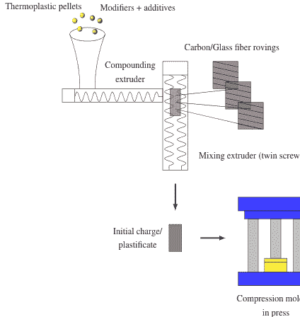

Figure 2.1: Schematic representation of the long fiber reinforced thermoplastic direct (LFT-D) process. Based on [16] and Barr et al. [17].

#### 2.1.1.3 连续断续（CoDico）纤维增强

为了有利可图地利用连续和断续纤维增强聚合物的对比优势（参见表 2.1），发展出了连续断续纤维增强聚合物（简称 CoDicoFRP）的理念 [12]。它利用了 DicoFRP 的设计自由度和成本效益高的生产，同时在承受特别强烈应力的点上局部使用 CoFRP 对构件进行加固。

Table 2.1: Advantages and disadvantages of CoFRP and DicoFRP to illustrate the effect of joint use. Data based on [12].

| 特性 | Co | Dico |
| :--- | :---: | :---: |
| 质量特定力学性能 | + | - |
| 高纤维体积含量 | + | - |
| 纤维取向程度 | + | - |
| 低显微结构复杂性 | + | - |
| 易成形性 | - | + |
| 低制造成本 | - | + |
| 高生产速率 | - | + |
| 低废料率 | - | + |

### 2.1.2 FRP 的基本弹性力学

本节介绍了 FRP 的弹性力学，从基本同质化方程开始，接着是宏观建模方法，如混合法则及相应的 Reuss 和 Voigt 界以及 Halpin-Tsai 模型。在此背景下，还解释了 DicoFRP 的临界纤维长度概念。在概述了微观和 RVE 模型以及均质场模型的概念后，Mori-Tanaka 模型作为后者的典型代表被给出。

整体全局行为，使得有效应力 $\bar{\sigma}$ 和有效应变 $\bar{\varepsilon}$ 通过所谓的定位张量 $\mathbb{L}$ 和 $\mathbb{M}$ 以下述方式给出：

$$ \boldsymbol{\varepsilon}(\boldsymbol{x}) = \mathbb{L}(\boldsymbol{x})[\bar{\boldsymbol{\varepsilon}}], $$ $$ \boldsymbol{\sigma}(\boldsymbol{x}) = \mathbb{M}(\boldsymbol{x})[\bar{\boldsymbol{\sigma}}]. $$ (2.1)

定位张量满足以下关系

$$ \langle \mathbb{L}(\boldsymbol{x}) \rangle = \mathbb{I}^S \quad \text{and} \quad \langle \mathbb{M}(\boldsymbol{x}) \rangle = \mathbb{I}^S. $$ (2.2)

应用 Hill-Mandel 条件 [19, 20]，该条件指出无论从微观还是宏观角度观察，整个系统的功均不变，有效应力 $\bar{\sigma}$ 和有效应变 $\bar{\varepsilon}$ 可以通过对代表体积 $V$ 进行体积平均 $\langle \cdot \rangle$ 来给出：

$$ \bar{\boldsymbol{\sigma}} = \langle \boldsymbol{\sigma}(\boldsymbol{x}) \rangle = \frac{1}{V} \int_V \boldsymbol{\sigma}(\boldsymbol{x}) \ dV, $$ $$ \bar{\boldsymbol{\varepsilon}} = \langle \boldsymbol{\varepsilon}(\boldsymbol{x}) \rangle = \frac{1}{V} \int_V \boldsymbol{\varepsilon}(\boldsymbol{x}) \ dV. $$ (2.3)

假设线性弹性行为，有效应力 $\bar{\sigma}$ 与有效应变 $\bar{\varepsilon}$ 之间的关系由广义胡克定律给出

$$ \bar{\boldsymbol{\sigma}} = \bar{\mathbb{C}}[\bar{\boldsymbol{\varepsilon}}] = \langle \mathbb{C}(\boldsymbol{x})[\boldsymbol{\varepsilon}(\boldsymbol{x})] \rangle, $$ (2.4)

其中 $\mathbb{C}(\boldsymbol{x})$ 为局部刚度张量，$\bar{\mathbb{C}}$ 为有效刚度张量。有效刚度张量 $\bar{\mathbb{C}}$ 类似地定义为

$$ \bar{\mathbb{C}} = \langle \mathbb{C}(\boldsymbol{x})\mathbb{L}(\boldsymbol{x}) \rangle. $$ (2.5)


#### 2.1.2.2 宏观建模

建模复合材料时，必须考虑根本不同的方法。前面的同质化方程是以下混合法则（ROM）以及 Voigt 和 Reuss 边界（作为一阶能量原理）的基础，可归类为宏观同质化方法，同时也是 Halpin-Tsai 半经验方法的基础。在宏观建模中，材料被视为各向异性的均质材料。不同方向的应力和应变可通过实验确定，并可利用逆向工程最终确定现象学模型中的未知常数。尽管这些方法对真实情况进行了明显的简化，因为它们忽略了复合材料始终表现出的局部变化的材料性能，但由于其计算简单，尤其在工业或大型系统中仍广受欢迎。[5]

### 混合法则（Reuss 和 Voigt 边界）

最简单的微观力学能量模型是所谓的混合法则（ROM）。假设在单轴张力 \(\sigma_{11}\) 下（参见图 2.2）完全对齐的单向纤维增强复合材料材料仍完好无损，则基体和纤维的应变必须相等，因为它们相互粘合。

这遵循所谓的 Voigt 假设 [21]。此外，根据胡克定律假设两种成分均表现为线性弹性行为，则可写成

\(\varepsilon_c = \varepsilon_m = \varepsilon_f = \frac{\sigma_c}{E_c} = \frac{\sigma_m}{E_m} = \frac{\sigma_f}{E_f}.\) (2.6)

在本及随后的方程中，下标 c、m 和 f 分别表示复合材料、基体和纤维的相应属性。

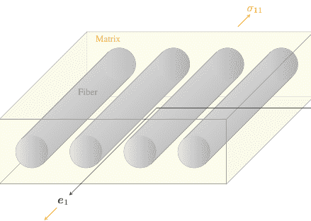

**图 2.2：** 单轴张力 \(\sigma_{11}\) 下完全单向连续纤维增强聚合物的示意图。基于 [5]。

基于应力定义为

\(\sigma = \frac{F}{A},\) (2.7)

的前提，力平衡

\(F_c = F_m + F_f\) (2.8)

在借助方程 (2.6) 的帮助下可改写为

\(E_c \varepsilon_c A_c = E_m \varepsilon_m A_m + E_f \varepsilon_f A_f\) (2.9)

并进一步改写为

\(E_c = E_m \frac{A_m}{A_c} + E_f \frac{A_f}{A_c}.\) (2.10)

引入纤维体积含量/分数 \(v_f\)，可得

\(E_{11} = E_c = E_m(1 - v_f) + E_f v_f. \quad (2.11)\)

应当指出，在给定条件下，剪切模量和体积模量遵循 ROM，而杨氏模量仅在纤维和基体的泊松比相等时才服从 ROM [22]。否则（即正常情况），纵向方向的实际杨氏模量 \(E_{11}\) 实际上会大于方程 (2.11) 所给出的值，后者是 Voigt 的一阶上界。

考虑横向方向，即垂直于纤维的载荷 \(\sigma_{22}\)，根据 Reuss 假设 [23]（等应力 \(\sigma_{22} = \sigma_c = \sigma_m = \sigma_f\)），可得到逆 ROM，

\(E_{22} = E_c = \left( \frac{1 - v_f}{E_m} + \frac{v_f}{E_f} \right)^{-1} , \quad (2.12)\)

作为一阶下界模量。Hill 于 1952 年首次表明这些是上界和下界 [24]。它们在图 2.3 中以可视化方式展示。Voigt 边界与实际值较接近，因为纤维方向的并联连接是一个相当好的近似。另一方面，Reuss 边界则远离实际值，因为横向方向的串联连接不是现实的类比。因此，复合材料的所有材料属性（如杨氏模量）均位于两个极限之间。这既适用于载荷不完全为纵向或横向而存在混合载荷的情况，也适用于没有优化单轴增强 FRP，而是例如不连续增强复合材料的情况。Voigt 和 Reuss 边界也直接源自第 2.1.2.1 节中的方程 (2.5)。引入两种相位（基体、纤维）及相应的纤维体积分数 \(v_f\) 后，描述 Voigt 上界（参见方程 (2.11)）的方程很容易重新得到。通过定义顺应度

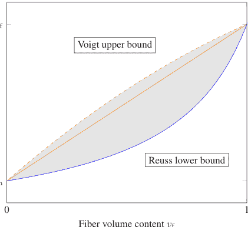

**图 2.3：** 图示纤维体积含量 $v_f$ 对复合材料有效杨氏模量 $\bar{E}$ 的影响（灰色区域），包含一阶上界 Voigt（橙色）和下界 Reuss（蓝色）。实橙色线表示当两种成分具有相同泊松比时的上界，虚橙色线是针对不同泊松比的提升改编。基于 [22, 25]。

tensor $\mathbb{S} = \mathbb{C}^{-1}$ 作为逆刚度张量，Reuss 的同质化刚度张量（参见方程 (2.12)）也会再次得到。

Hashin–Shtrikman [26] 实际上在 1962 年利用变分原理表明，弹性模量的上界和下界可能比 Voigt 和 Reuss 边界更窄，此处不再进一步讨论。即使使用这个简化模型，也能传达局部纤维体积含量对复合材料同质化的重要性。

### 临界纤维长度概念

在 DicoFRP 的情况下，纤维不贯穿构件的全长。自然会提出这样一个问题：基体与纤维之间的负载传递概念是否因此仍可不受限制地工作。在

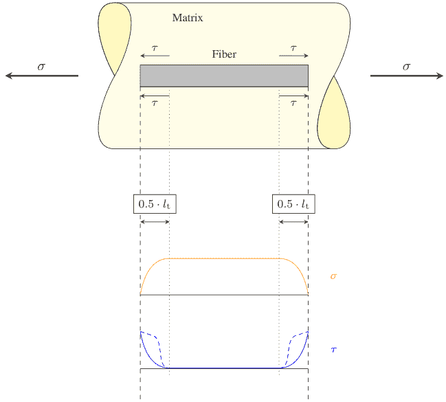

**图 2.4：** 嵌入基体中单根不连续纤维的示意图。复合材料在纤维方向承受拉应力。基体到纤维的相应负载传递以纤维中拉应力分布和基体中剪应力分布的定性图示形式表现。剪应力的蓝色线对应完全弹性基体（大致为热固性材料）的材料响应，而虚蓝色线则关联于粘弹性基体，即热塑性材料。基于 [5, 27]。

为解决此问题，使用单根嵌入圆柱形基体中的不连续纤维模型（参见图 2.4）。

当该复合材料沿纤维方向承受拉应力时，基体会发生变形，并通过剪切将负载传递给纤维，尤其是在纤维的两端。离纤维边缘越远，剪应力越小。因此，当纤维足够长，使得剪应力在纤维长度中点之前降为零时，纤维中会产生最大正应力。这使得最大力传递得以发生，从而利用纤维有利的拉伸性能，而非更关键的界面性能。界面处剪应力的变化趋势取决于基体类型。在大多呈弹性变形的热固性材料中，纤维末端会出现尖锐峰值（图 2.4 中的蓝色曲线），而热塑性材料的粘弹性材料行为则倾向于提供更平缓的过渡（图 2.4 中的蓝色虚线曲线）。[5]

作为建模简化，假设对于热塑性基体，边缘处的剪应力会骤增至 \(\tau\)，然后保持在此值直到纤维边缘，则界面处的剪力由下式给出

\(\begin{aligned} F_{Shear} = C_f \tau \frac{1}{2} l_t = \frac{\pi d l_t \tau}{2}, \end{aligned}\) (2.13)

其中 \(C_f = \pi d\) 为纤维周长，\(l_t\) 为负载传递所需的纤维长度。最大纤维力可通过以下公式计算：

\(\begin{aligned} F_f = A_f \sigma_f = \frac{\pi d^2 \sigma_f}{4}, \end{aligned}\) (2.14)

其中 \(A_f = \pi r^2 = \pi \frac{d^2}{4}\) 为纤维面积。

使用方程 (2.6)，由于载荷平行于纤维方向，可得

\(\begin{aligned} \frac{\sigma_f}{E_f} = \frac{\sigma}{E_{11}}. \end{aligned}\) (2.15)

为了获得从基体向纤维传递全部载荷所需的长度，必须将剪力与纤维中的力相等，从而得到


\( l_t = \frac{\sigma_f d}{2\tau} = \frac{E_f}{E_{11}} \frac{\sigma d}{2\tau} \). (2.16)

在失效情况下，要么纤维断裂，要么界面失效。最优情况下，两者同时发生，达到粘结剪切强度 \(\tau_b\) 和纤维最终强度 \(\sigma_{fu}\)。这导致方程 (2.16) 重新表述为

\( l_c = \frac{\sigma_{fu}d}{2\tau_b} \), (2.17)

其中 \(l_c\) 被称为临界纤维长度。[5]

在这个简化模型中，最小纤维长度以及纤维长度的一般影响变得清晰。在以下部分，将讨论明确考虑此类微观结构性质的均质化方法。

## Halpin-Tsai

作为一种标量和最简单的方法之一，Halpin-Tsai 模型 [28] 通过纳入长径比 \(\frac{l}{d}\) 来处理短纤维增强复合材料。在 Halpin-Tsai 方程中，引入了一个依赖于加载方向的经验因子 \(\xi\)，定义如下：

\(\xi_{11} = 2\big(\frac{l}{d}\big) \quad \text{(纵向)},\) (2.18)
\(\xi_{22} = 2 \quad \text{(横向)}.\)

因此，这是一种半经验均质化方法，是 Voigt (\(\xi = \infty\)) 和 Reuss (\(\xi = 0\)) 的改进。虽然几何因子 \(\xi\) 可以正确地表示为弹性常数和泊松比之差的组合，但做出了工程刚度方程对泊松比之差不敏感的合理假设 [29]。基于此假设开发的 \(\xi\) 的表达式/数值的有效性已通过实验和精确方程的计算机计算得到验证 [29]。此外，定义 \(\eta\) 和 \(\lambda\) 为

\(\eta_{11,22} = \frac{\frac{E_f}{E_m} - 1}{\frac{E_f}{E_m} + \xi_{11,22}},\)
\(\lambda = \frac{\frac{G_f}{G_m} - 1}{\frac{G_f}{G_m} + 1},\)
(2.19)

导出纵向和横向杨氏模量 \(E_{11}\) 和 \(E_{22}\) 以及剪切模量 \(G_{12}\) 的以下方程：

\(E_{11} = E_m \left( \frac{1 + \xi_{11} \eta_{11} v_f}{1 - \eta_{11} v_f} \right),\)
\(E_{22} = E_m \left( \frac{1 + \xi_{22} \eta_{22} v_f}{1 - \eta_{22} v_f} \right),\)
\(G_{12} = G_m \left( \frac{1 + \lambda v_f}{1 - \lambda v_f} \right).\)
(2.20)

对于 \(\frac{l}{d} \to \infty\)，即在 CoFRP 的情况下，这些方程可以（例如借助 L’Hôpital 法则）转换为 ROM（参见方程 (2.11)）。

泊松比定义为

\(\nu_{21} = \nu_m (1 - v_f) + \nu_{f21} v_f,\)
\(\nu_{12} = \nu_{21} \frac{E_{22}}{E_{11}},\)
(2.21)

其中第一个索引描述收缩方向，第二个索引描述加载方向。[5]

先前的方程包含纤维体积含量以及（至少是平均）纤维长度。应力-应变关系表示为

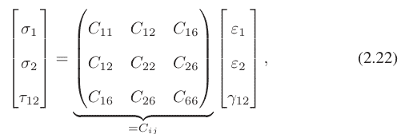

与由以下定义的刚度张量分量

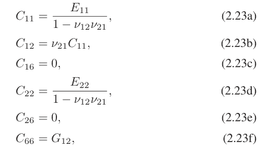

如果加载方向与主纤维取向重合。如果复合材料的加载方向和纤维方向现在偏移一个角度 \(\theta\)，则非轴向刚度矩阵 \(C'_{ij}\) 的分量可以按如下计算：

\(\begin{bmatrix} C'_{11} \\ C'_{22} \\ C'_{12} \\ C'_{66} \\ C'_{16} \\ C'_{26} \end{bmatrix} = \begin{pmatrix} c^4 & s^4 & 2c^2s^2 & 4c^2s^2 \\ s^4 & c^4 & 2c^2s^2 & 4c^2s^2 \\ c^2s^2 & c^2s^2 & c^4 + s^4 & -4c^2s^2 \\ c^2s^2 & c^2s^2 & -2c^2s^2 & (c^2 - s^2)^2 \\ c^3s & -cs^3 & cs^3 - c^3s & 2(cs^3 - c^3s) \\ cs^3 & -c^3s & c^3s - cs^3 & 2(c^3s - cs^3) \end{pmatrix} \begin{bmatrix} C_{11} \\ C_{22} \\ C_{12} \\ C_{66} \end{bmatrix} \, , \quad (2.24)\)

其中 \(c = \cos \theta\) 且 \(s = \sin \theta\)。[30] 方程采用 Voigt 表示法给出。这样，通过纳入特定角度的纤维含量，可以在 Halpin-Tsai 均质化中考虑纤维取向。在实践中，通常纳入纤维出现在特定角度范围（例如 20\(^\circ\)）的情况，而不是精确角度。

## Shear-lag modified Halpin-Tsai

另一种用于单向不连续短纤维增强聚合物的知名模型是所谓的根据 Cox [31] 的剪切滞后模型。该名称基于这样一个事实：当施加载荷时，纤维和基体经历不同的位移。与基体相比，这导致纤维-基体界面附近的位移出现“滞后”。精确推导可见 Fu 等人的著作 [32]。最终结果是纤维方向刚度的以下方程：

\( E_\mathrm{L} = E_\mathrm{f} v_\mathrm{f} \left( 1 - \frac{\tanh(\chi l/2)}{\chi l/2} \right) + E_\mathrm{m}(1 - v_\mathrm{f}) \, , \quad (2.25) \)

其中 \(l\) 为平均纤维长度，\(\chi\) 由以下给出

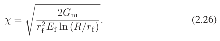

其中，平均纤维半径由 r_f 给出，R 表示纤维沿长度方向法向的平均间距。然后可以将方程 (2.25) 用作 Halpin-Tsai 模型中的 E_11（参见方程 (2.20)），从而得到剪切滞后修正的 Halpin-Tsai 方程。据作者所知，首次在 Halpin-Tsai 模型中考虑使用剪切滞后的是 Fu 等人在 2002 年 [30]。

#### 2.1.2.3 微尺度/多尺度建模

另一方面，在微尺度建模时，必须考虑每根纤维、基体、每个空隙以及几何排列。为此，在微观水平（µm）使用 RVEs。虽然在小规模上这是可能的（玻璃纤维直径在 14 µm 到 20 µm 之间，碳纤维在 5 µm 到 7 µm 之间），但在仅一平方毫米内可能有如此多的纤维，以至于在部件层面考虑时，这在计算上几乎不是一种现实的方法。如果 RVE 用于均质化并与宏观建模（mm）耦合，则这被视为多尺度建模。微尺度建模中的这些单元应被选择为尽可能小但又尽可能大。这意味着它们应在优化情况下代表全局有效材料行为，而不仅仅是局部特征，同时又足够小以进行高效计算。因此，该 RVE 尺寸的选择具有挑战性，尤其是对于 DiocoFRP。材料性质随后可以在 RVE 内进行均质化。宏观材料行为可以通过从该 RVE 的副本在有限元（FE）模型中反复组装部件来获得。[5]

根据微观结构，多尺度建模也可以指在介观尺度上离散使用材料单元。以具有典型束状结构的 SMC 为例，纤维束可以从 CT 图像中分割为一个单元 [14]。这种束-基体结构随后可作为结构材料模拟 [33] 以及注塑过程介观模拟 [34] 的基础。

## RVEs 的微观结构生成

在此背景下，创建可在模拟中离散使用的 RVE 是一个全新的问题。存在一些程序可以基本上从 CT 图像自动创建离散 RVE 模型。然而，这仅适用于分辨率和对比度非常高的 CT 图像，并且在精度方面存在一定的局限性。传统上，使用 CT 图像的图像分析和实验程序来确定纤维取向、纤维长度分布、纤维体积含量和孔隙率等量，用于预期 RVE 的尺寸，然后试图从这些信息重建微观结构。因此，对微观结构生成器进行编程。这些通常基于所谓的球堆积算法。其中，人们试图以非重叠方式将颗粒或纤维堆积到单元中，并尽可能精确地匹配纤维体积含量、纤维取向和纤维长度等指定属性。为了实现堆积，科学家们依赖于多种方法，例如机械压缩或更受化学影响的分子动力学概念，直到收缩的 RVE 单元。典型示例包括随机连续吸附（RSA）[35]、Lubachevsky 和 Stillinger [36] 或 Torquato 和 Jiao [37] 的方法以及机械收缩 [38]。这些堆积算法存在局限性。特别高的纤维体积含量对它们来说是一个问题，但纤维曲率也难以纳入。然而，在本工作使用的材料中观察到了这两种效果。特别是，纤维束和单纤维的可见混合物无法被覆盖，即使使用较新的、改进的或扩展的方法也是如此。因此，这一主题将在技术现状的第 2.2.4 节中再次讨论。使用 AI 生成微观结构 CT 图像将开辟微观结构生成乃至最终 RVE 生成的全新方向。


#### 2.1.2.4 平均场均匀化

平均场均匀化可被视为迄今所提各种均匀化方法之间的中间路径。其目的是确定某一体积的平均材料参数，该体积被认为代表复合材料的微观结构。这里的重要假设是，每根纤维在基体中都是一个椭球体，椭球体的长径比代表纤维的长径比 \(\left(\frac{l}{d}\right)\)。进一步假设纤维是直的且分布均匀，并且不存在纤维与纤维之间的相互作用。然后，对于具有简化结构的这 RVE，需要确定均匀化的材料性能。[5, 39, 40]

在平均场均匀化的背景下，Eshelby 于 1957 年提出的具有椭球包围体的无限线性弹性体中应力与应变的解析解起到了决定性作用 [41]。他发现，当包围体暴露于固有应变 \(\epsilon_{\text{m}}\) 时，包围体内存在均匀应变 \(\epsilon_{\text{inclusion}}\)，两者关系为

\[
\epsilon_{\text{inclusion}} = \mathbb{N}\epsilon_{\text{m}}. \tag{2.27}
\]

因此，无限弹性体与椭球包围体中的应变不相等。\(\mathbb{N}\) 是一个四阶张量，是基体四阶刚度张量 \(\mathbb{C}_{\text{m}}\) 和包围体四阶刚度张量 \(\mathbb{C}_{\text{f}}\) 的函数，定义为

\[
\mathbb{N} = \left[ \mathbb{I} - \mathbb{E}\mathbb{C}_{\text{m}}^{-1}(\mathbb{C}_{\text{f}} - \mathbb{C}_{\text{m}}) \right]^{-1}. \tag{2.28}
\]

其中 \(\mathbb{I}\) 为四阶单位张量，\(\mathbb{E}\) 为四阶 Eshelby 张量，其分量定义为包围体长径比（其中已考虑平均纤维长度）及其周围弹性体泊松比的函数。分量的精确定义可从原始文献 [41] 中查阅。[5] 图 2.5 展示了均匀化复合材料的不同选项概览。

宏观尺度
平均场
微观尺度

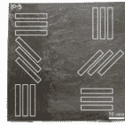

试件测试
实验应力-应变
曲线拟合

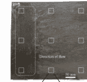

CT 扫描
RVE
FVC、FLD、FOT 测量
椭球包围体
离散微观结构生成 + RVE 均匀化

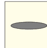

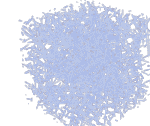

图 2.5：纤维增强复合材料各种均匀化选项概览，从左到右复杂度递增。有关进一步说明，应查阅相应的文本章节。顶部展示了本工作中使用的 CF-PA6 板材图片，并给出了不同评估方法的可能试件几何形状。扫描的 3D 视图是一个 25 mm × 25 mm × 3 mm GF-PA6 试样的图像。最右侧生成的微观结构是一种特别创建的微观结构，包含 1000 根纤维，纤维体积含量为 0.2，该结构采用 RSA 算法实现，其中球柱体被堆积。

#### Mori-Tanaka

由于 Eshelby 仅针对单个椭球包围体推导了上述表达式，因此不允许包围体之间存在相互作用，因而包围体中的应力仅能由基体引起。由于复合材料并非如此，Mori 和 Tanaka [42] 将该模型扩展到具有包围体间相互作用的双相系统，从而得出了一种最著名的平均场均匀化方法。[5]

引入了一个新的四阶张量 T 作为 N 的调整，得到

\[
\epsilon_{\text{inclusion}} = T\epsilon_{\text{m}}. \tag{2.29}
\]

T 取决于 N 和体积分数 \(v_f\)，表达式为

\[
\mathbb{N} = \left[ (1 - v_f)\mathbb{I} + v_f T \right]^{-1} T. \tag{2.30}
\]

如果纤维体积含量为零，T 和 N 相等。复合材料的刚度张量随后可计算为

\[
\mathbb{C}_{\text{c}} = \bar{\mathbb{C}} = \mathbb{C}_{\text{m}} + v_f\left( (\mathbb{C}_{\text{f}} - \mathbb{C}_{\text{m}}) T \right). \tag{2.31}
\]

该表达式中已考虑纤维体积含量和长径比。若材料不是单向材料，随后有两种选项也可考虑纤维取向。参考张量 \(\mathbb{H}^0\)（见第 2.2.3.1 节和 [43]）可以在刚度确定之后随后相乘。这对应于线性依赖。或者，取向确定可以直接与张量 T 耦合，这不再符合依赖关系中的线性，并且据作者所知，首次由 Benveniste [44] 引入。更多细节可见 Bauer 和 Böhlke [45] 以及 Benveniste [44] 的著作。前文还表明，这对于复合材料中一种纤维的有效值并无重大差异。然而，如果例如在混合复合材料中存在两种不同取向的纤维类型，则取向的线性调整不再合理。

## 2.2 DicoFRP 微观结构的定量指标及其确定

随着时间推移，开发了各种用于定量描述不连续纤维增强聚合物复杂非均匀微观结构的参数。下面概述了这些参数，并描述了导致确定这些量的既定方法——无论是破坏性还是非破坏性、实验性还是基于图像评估。

### 2.2.1 纤维体积含量

纤维体积含量（FVC），通常也称为纤维体积分数（FVF），在本工作中表示为 \(v_f\)，决定了纤维在材料总体积中的比例。一般来说，更高的纤维浓度意味着更高的弹性模量，以及更高的强度和更好的冲击行为，尽管对后两者的影响通常在某种程度上会逆转（至少对于 DicoFRP 而言），这是由于未浸渍束的形成 [5]。

#### 2.2.1.1 FVC 确定的实验破坏性方法

获得板材/零件近似 FVC 的首要起点当然是在纤维喂料过程中设定的标称值。但是，由于此信息相当不准确，且纤维含量因工艺原因在板材上有所差异，因此测量成品材料的 FVC 具有重要意义。通常，从零件中切下较小的试样，通过去除基体并将纤维重量与试样总重量进行比较，以破坏性方式测量纤维体积含量。此方法也称为热重分析（TGA）。聚合物最常通过焚烧（也称为热解）去除，因为这是最直接的方法 [5]。焚烧过程的温度和时间剖面必须针对每种聚合物单独调整，Rohde 等人 [46] 对聚丙烯进行了示例说明。决定还取决于可用时间以及纤维是否随后继续测量，因此可能不会变得更脆或烧结。对于玻璃纤维，原则上这效果良好，但对于本工作中最常处理的碳纤维，出现了问题，因为碳纤维可能受到燃烧过程的损害。如果试样焚烧时间过短或温度过低，基体尚未完全溶解，纤维因此仍相互连接。然而，如果试样处理时间更长或温度更高，纤维已明显受到攻击。由于碳纤维增强塑料热解中遇到的困难，初步测试后不再采用该方法。或者，可以使用酸溶解基体。同样，对于特定聚合物的经验在精确测试程序（不同酸的选择、浓度、时间段和温度）中也起作用。精确方法和参数值将在方法部分中介绍。随后，当纤维被分离时，使用高精度天平对其进行称重，并除以试样的总质量 \(m_{tot}\) 以获得纤维质量含量：

\[
w_f = \frac{m_f}{m_{tot}}. \tag{2.32}
\]

要在此基础上确定纤维体积含量，必须使用组分的密度和平凡关系 \(m_m = m_{tot} - m_f\)，从而得到


\(v_f = \frac{\frac{m_f}{\rho_f}}{\frac{m_f}{\rho_f} + \frac{m_m}{\rho_m}}.\) (2.33)

#### 2.2.1.2 通过考虑复合材料密度来确定 FVC

在复合材料密度 \(\rho_c\) 定义为

\(\rho_c = w_f \rho_f + (1 - w_f) \rho_m,\) (2.34)

纤维重量含量 \(w_f\) 可确定为

\(w_f = \frac{\rho_c - \rho_m}{\rho_f - \rho_m}.\) (2.35)

两种组分（纤维和基体）的密度通常可从数据表中得知。复合材料的密度可以通过阿基米德原理来确定，前提是材料是非多孔的。否则，复合材料样品的体积也可以通过 CT 测量非常准确地确定，并且质量可以称重。

#### 2.2.1.3 用于 FVC 确定的计算无损方法

无损确定纤维体积含量有多种必要原因。首先，CT 扫描用于对 FRP 进行每一种整体表征，例如，纤维取向无法通过其他方法很好地局部确定（除非使用微切片上的椭圆法 [5]）。从 3D CT 图像中无损确定任何其他参数，能够使调查更加高效，而无需进一步承担热解/酸溶解的费用。此外，在实验 FVC 确定的情况下，通常将直径在 10 mm 到 30 mm 之间的圆形或矩形样品作为整体进行处理。这并未提供沿不同轴线纤维体积含量变化趋势的任何信息。然而，有充分理由怀疑，这对于平板样品的厚度尤其具有意义，例如，用于研究注塑成型中出现的芯壳效应 [5]。试样外表面低 FVC 从而导致的较低刚度和强度可能至关重要，尤其是对于弯曲载荷，其最大弯曲应力在横截面最外缘表现为拉应力或压应力。理论上，也可以通过铣削薄层并随后进行热解来破坏性地获得 FVC 的 3D 信息，这已经有先例 [5]。然而，这种程序需要大量努力，并且由于材料量少以及铣削过程可能导致的纤维缩短，测量不准确性尤其严重。此外，如果涉及天然纤维，则既不可能进行热解也不可能进行化学溶解，因为天然纤维会被两者侵蚀。

经典图像评估中的首选方法是全局阈值法。利用纤维和基体的不同衰减系数，它们在 CT 图像中呈现不同的灰度值。因此，需要寻找一个作为阈值的灰度值，使图像中所有灰度值的直方图正好在体素所代表的材料发生变化的点处被分开。在阈值处理程序中，不考虑这些体素的位置。可以简单地在商业软件（如 ImageJ）中手动搜索阈值，通过创建阈值并直观估计检测到多少纤维来实现。然而，还有大量所谓的自动阈值，它们基于解析考虑进行计算，例如 Otsu 阈值 [47]、Tsai 的矩保持方法 [48] 或平均阈值 [49–51]。它们既在 ImageJ 中预先实现，也在可用于 Python 或 C++ 的图像处理包中预先实现。最知名方法的计算在 2.3.4.2 节中解释。然后可以将检测为纤维的像素/体素数量除以总数，从而得到纤维体积含量。这种方法的难点在于确定的 FVC 直接取决于阈值。然而，即使在对比度良好的高分辨率 CT 图像中，也无法确定阈值。Pinter [52] 将大量不同的阈值技术应用于 GF-LFT 和 GF-SMC，并将其与 TGA 测量进行了比较，但未能找到一个完美匹配的方法，并建议这些值应谨慎对待，并且需要纤维与基体之间具有高对比度。Gandhi 等人 [5] 引入了一种新的 μCT 程序，试图消除选择真实阈值的歧义。他们选择直方图中代表玻璃纤维的平均值与代表基体的平均值之间的中点作为阈值。虽然这并不代表真实的阈值，但将值略微调高或调低只会导致 FVC 分布略微上移或下移，而其趋势保持不变。然后，他们通过将分布值除以整个数据集的平均纤维浓度来对分布值进行归一化。这使曲线回到大约相同的值，无论最初使用了哪个阈值。然而，这种方法只有在 CT 图像的直方图中能识别出两个清晰峰值时才有效。对于直径为 5 µm - 7 µm 的碳纤维，情况并非如此，因为它们的密度与聚合物相似，在 CT 中呈现低对比度。这一挑战将在关于计算机断层扫描的 2.3 节中详细阐述。

在进一步回顾文献后，很明显，纤维与基体之间的简单阈值明显过于不精确 [53–55]。它们在孔隙和空隙的情况下仍然被广泛使用，因为气体包裹通常容易检测 [56]。即便如此，深度学习（DL）解决方案在特定情况下（如小空隙或低孔隙率）已经超过了阈值法 [57]。DL 与阈值法的组合也已用于低对比度和噪声的 X 射线图像 [58]。对于通过 CT 图像图像分割可靠确定碳纤维增强聚合物（CFRP）的 FVC 这一特定问题，DL 提供了一个有希望的机会。特别是卷积神经网络（CNN）已被证明能够处理低对比度图像并改善由此得出的结论 [59–64]。在类似的情况下，这似乎特别诱人，因为不需要工程师自行寻找必要的滤波和图像处理步骤，尽管这些步骤通常在 CNN 训练之前需要。因此，在方法（第 3 章）中，将针对这种用例展示一个 CNN，以及一个自适应阈值方法作为比较。

### 2.2.2 纤维长度分布

纤维长度分布（FLD）描述了样品体积中作为纤维长度函数的纤维量。如第 2.1 节所述，它对机械性能起着重要作用，特别是在包含损伤机制时 [52]。随着纤维长度的增加，杨氏模量、强度和冲击行为均会改善，效果在非常高的长度时趋于饱和，或者在纤维体积含量高的情况下甚至会下降 [5]。它可以给定为概率密度函数 f_l(l)。与经典概率密度函数类似，f_l 是非负的、可积的，并归一化，使得总积分取值为 1：

\[
\int_0^\infty f_l(l)dl = 1. \quad (2.36)
\]

两参数威布尔分布主要用于模拟纤维长度分布 [65–68]，定义为

\[
f_l(L) = \frac{m}{n} \left( \frac{l}{n} \right)^{m-1} \exp\left[-\left( \frac{l}{n} \right)^m \right]; \quad l > 0, \quad (2.37)
\]

其中 n 和 m 为尺度和形状参数，l 为纤维长度。

或者，在实践中使用长度直方图，其中定义长度区间内的纤维被汇总。

#### 2.2.2.1 用于 FLD 确定的实验破坏性方法

有几种破坏性确定纤维长度的方法，它们都与基体去除相关，基体去除也用于确定纤维体积含量。其次，在大多数情况下，首先会选择一定比例的代表性纤维，因为样品中通常纤维太多，无法进行有意义的测量。Gandhi 等人 [5] 推荐样本量为 1000 到 2000 根纤维。应用某种纤维分散方法后，纤维被分离。纤维可以手动或通过空气在扫描仪上分散。由于这会造成困难，大多数当前方法都基于液体中的分散，随后手动或使用超声波进行混合 [46, 69]，包括下面简要描述的两种商业方法。随后，纤维长度可以例如通过逐步过滤来确定，这是一种快速、机械但相当不精确的过程。直接光学方法更常见。因此，通过显微镜或光学文档扫描仪创建数字图像，然后对图像进行分析。每根纤维的单个长度可以通过选择相应的端点手动检测，也可以借助图像处理算法进行检测。也使用混合方法。[5]

### FASEP

使用商业可用的 FASEP 系统（IDM Systems，德国达姆施塔特）[70]，可以检测纤维增强热塑性材料中理论长度高达 25 mm 以及弯曲或交叉的纤维。在第一步中，如前所述，样品要么进行热解，要么溶解在酸中以去除基体。纤维分离后，必须将其分散。这是通过将剩余纤维加入加有甘油的蒸馏水中来完成的。混合物被轻轻搅拌，并通过加入更多水和甘油进行多次稀释步骤 [5]。然后将少量混合物移注到直径 90 mm 的培养皿中。


使用定制的暗场成像方法获得纤维混合物的数字图像。1700dpi 的光学分辨率对应 14.9µm 的像素尺寸。图像本身中的追踪是使用由 FASEP 公司内部开发的 ALF 算法进行的。[52, 69] 通常，依次检查样品的多个这样的子集，以获得至少 3000 根纤维的集合，并将结果合并为频数直方图。

## FibreShape FiVer

样品制备可以类似于 FASEP 方法进行。然后将蒸馏水和少量清洁剂与纤维一起加入尺寸为 6 cm × 12 cm 的样品容器中。用铲刀尽可能均匀地分布纤维，且不损断纤维。然后将样品容器支架放入所谓的 FiVer 扫描仪中。使用 Silverfast 软件扫描图像。实际光学分辨率对应 8 µm，因此可以检测 30 µm 至 5 cm 之间的纤维长度。取决于样品的不均匀性，每个样品拍摄五到七张这样的图像，测量后可对应超过 10,000 个元素。特别是，高分辨率还使得可以测量直径较细的纤维，例如碳纤维。然后使用 FibreShape (IST AG, 瑞士菲尔特) 程序从图像中测量相应的长度。作者不知道该公司确切的长度检测算法。输出为测地长度，因为被测纤维通常是弯曲的。测地长度指示如果纤维是直的，则会测量到的相应长度。该程序基于弯曲纤维图像面积或周长相等的原理计算该值。该程序符合 ISO 9276-1 和 ISO 13322 的规范。[52]

本文采用该方法确定纤维长度分布，主要原因是该技术在 FIBRE (不来梅) 可用，此前在那里进行了化学基体溶解。

#### 2.2.2.2 FLD 确定的计算无损方法

已开发出多种算法，用于从 µCT 图像中无损测量纤维长度。据作者所知，所有这些算法均针对玻璃纤维增强聚合物的示例开发而成。

Salaberger 等人 [71] 在 2011 年介绍了一种用于测量短纤维增强聚合物长度的方法，其中他们提出了两种概念。第一种程序通过准确检测每根纤维的起点和终点来工作。因此，首先应用各向异性扩散滤波器来减少噪声而不模糊任何边缘。然后通过应用 Otsu 阈值对图像进行二值化，以将纤维与基体分离。为了将每根纤维的信息减少到其中轴，即仅一条体素线，进行二值化细化。该过程也称为骨架化 [72]。接下来，进行聚类分析，其目的是将接触的纤维（即具有聚类纤维相关体素的区域）划分为单个对象。该方法由 Pfeifer [73] 引入。聚类定义为具有两个以上邻居的体素。它们在形态上被识别。然后利用聚类信息进行纤维追踪，即沿纤维追踪至其终点或直到遇到聚类。如果检测到的线段低于用户定义的长度，则将其分配给图像噪声，不作为纤维评估。随后，分析所有检测到的线段，将其识别为纤维，或在遇到聚类时将其合并为纤维。连接决策通过分析聚类中所有线段的角度来做出。Salaberger 等人选择 160° 的折角和 14 µm 的聚类距离（近似于纤维直径）作为该算法的参数。随后，在找到所有纤维路径后，即可进行长度确定本身。

由于在短纤维的情况下可以假设为直纤维，第 $i$ 根纤维的长度简单地由纤维起点 $x_{i1}, y_{i1}, z_{i1}$ 和终点 $x_{i2}, y_{i2}, z_{i2}$ 的欧几里得距离确定，如下所示：

$l_i = \sqrt{(x_{i2} - x_{i1})^2 + (y_{i2} - y_{i1})^2 + (z_{i2} - z_{i1})^2}$. [13] (2.38)

由于 Salaberger 等人 [71] 提出的第二种概念与下一段中 Teßmann 等人 [74] 提出的方法相似，因此本文不再详细描述。它直接对灰度图像进行操作而无需二值化，并需要通过计算黑森矩阵并分析其特征值来确定纤维取向，这属于绕道方法。黑森矩阵是 2D/3D 图像局部曲率的度量。虽然最初用于拓扑问题中的山谷和山脊检测 [52]，但 Daniels 等人 [75] 于 2006 年首次实现了用于体积图像局部取向评估的 3D 黑森矩阵。在数学上，它定义为图像 $I(x)$ 的二阶偏导数构成的方阵：

$$H(x) = \nabla^2 I(x) = \begin{bmatrix} \frac{\partial^2 I}{\partial x^2} & \frac{\partial^2 I}{\partial x \partial y} & \frac{\partial^2 I}{\partial x \partial z} \\ \frac{\partial^2 I}{\partial y \partial x} & \frac{\partial^2 I}{\partial y^2} & \frac{\partial^2 I}{\partial y \partial z} \\ \frac{\partial^2 I}{\partial z \partial x} & \frac{\partial^2 I}{\partial z \partial y} & \frac{\partial^2 I}{\partial z^2} \end{bmatrix}.$$ (2.39)

除了局部取向外，还会考虑纤维截面横向的灰度值分布。其应大致与轴向垂直方向的高斯分布匹配，因此在纤维中心处显示最高的灰度值。由此，可以将纤维归约为其中心体素。然后可以像之前的方法一样对该数据集进行检查，以检测纤维的起点和终点并确定长度。在另一篇关于短玻璃纤维增强聚丙烯所描述方法的可重复性和准确性的研究中，该方法可达到最高 97% 的准确性 [76]。然而，较低分辨率下平均纤维长度会降低。由于这些方法没有考虑长纤维增强聚合物中普遍存在的纤维弯曲，因此下面将描述另外两种方法。

Teßmann 等人 [74] 在 2010 年提出了一种用于长纤维增强热塑性试样 µCT 图像纤维长度确定的替代方法。该方法基于合理的假设：(a) 纤维具有圆柱形状，(b) 如前一段所述，纤维的灰度值剖面在其中心处最高，(c) 所有纤维都具有恒定且事先已知的直径。随后，分割分为几个子步骤。首先，图像经过闭运算进行滤波和缩减。此步骤是必要的，因为当纤维紧密堆积时，种子区域生长 [77] 等标准分割方法会失效。因此，对图像应用形态学腐蚀滤波器，以增强纤维边缘。随后，必须通过基于特征值分析的判别函数确定纤维的中心体素，该方法由 Frangi 等人 [78] 引入。此步骤中，对每个体素计算已提及的黑森矩阵。由此检测到的中心点被用作追踪算法的起始种子。因此，使用一种基于模型的圆柱近似方案，该方案基于前文提到的纤维形状假设。沿最小特征向量的两个方向跟踪一个起点候选点，得到一个中心点列表，从中可以构建圆形形状。一旦纤维完全分割，就将其从原始图像中移除，并重复该过程，直到图像中不再有潜在纤维。最后，纤维长度可以轻松确定为

$L_i = ns,$ (2.40)


令 $n$ 表示单根纤维的中心点体素数量，$s$ 表示各向同性体素大小。在 Teßmann 等人 [74] 的论文中，详细解释了交叉纤维或部分纤维分割的某些特殊情况。最后，该算法在人工生成的测试图像和选定的真实元件图像上进行了测试。

最后，这里介绍了 Pinter 等人 [13] 于 2016 年提出的 FLD 确定方法。他们提出了一种可靠的程序来确定 LFT 材料的 FLD，该程序——与 Teßmann 的方法不同——甚至应能适用于中等图像质量。该方法首先借助 Bertram 和 Pinter [79] 开发的 CircularVoting 滤波器对图像进行预处理，该滤波器作为开源软件在 SourceForge 上提供，作为所谓的 Composight 包的一部分。通过这个预滤波器，通过对几乎相互接触的纤维进行细化并从而增加它们之间的距离，避免了它们的连接。关于 CircularVoting 方法的准确细节，读者请参阅所引用的论文。然而，该想法基于相干性度量与表面法向量重叠度量的结合。后者仅使用玻璃纤维的固定纤维半径。前者利用图像结构张量的特征值。结构张量也用于确定本工作中的纤维取向张量，因此将在此处介绍。据作者所知，Krause 等人 [80] 是 2010 年最早使用结构张量方法从 FRP 的 CT 图像中获取取向信息的人之一。它定义如下：

$$
\mathbf{S} = \nabla I_{\sigma}(\boldsymbol{x}) \otimes \nabla I_{\sigma}(\boldsymbol{x}) = \nabla I_{\sigma}(\boldsymbol{x}) \nabla I_{\sigma}(\boldsymbol{x})^{\top} = \begin{bmatrix} \left(\frac{\partial I_{\sigma}}{\partial x}\right)^2 & \frac{\partial I_{\sigma}}{\partial x} \frac{\partial I_{\sigma}}{\partial y} & \frac{\partial I_{\sigma}}{\partial x} \frac{\partial I_{\sigma}}{\partial z} \\ \frac{\partial I_{\sigma}}{\partial y} \frac{\partial I_{\sigma}}{\partial x} & \left(\frac{\partial I_{\sigma}}{\partial y}\right)^2 & \frac{\partial I_{\sigma}}{\partial y} \frac{\partial I_{\sigma}}{\partial z} \\ \frac{\partial I_{\sigma}}{\partial z} \frac{\partial I_{\sigma}}{\partial x} & \frac{\partial I_{\sigma}}{\partial z} \frac{\partial I_{\sigma}}{\partial y} & \left(\frac{\partial I_{\sigma}}{\partial z}\right)^2 \end{bmatrix} \quad (2.41)
$$

该方法基于图像的第一阶数值导数结合固定“窗函数”（在此情况下为用于平滑的宽度为 σ 的高斯模糊），是一种鲁棒的方法 [80–82]。

应用 CircularVoting 预滤波器后，对图像应用用户定义的阈值以将其二值化 [52]。然后，通过骨架化 [72] 将纤维简化为中心轴。借助 Ignacio Arganda-Carrera 开发的 ImageJ 插件 Skeletonize (2D/3D) 和 AnalyzeSkeleton 的修改版本来追踪纤维 [83, 84]。原始代码并非用于没有连接点的纤维。因此，Pinter 等人 [13, 52] 对其进行了修改，考虑局部取向，以便去除结果图中的交叉链接并连接属于同一根纤维的分支。关于该方法的更多细节，读者请参阅来源 [13, 52]。

虽然 Salaberger 等人 [71] 的第一种方法仅适用于短纤维增强聚合物，但后两种由 Teßmann 等人 [74] 和 Pinter 等人 [13] 提出的方法也能处理长纤维增强聚合物的扫描。然而，两者都强调需要高分辨率，即使在 Pinter 的工作中也是如此，并且两者仅适用于玻璃纤维。然而，玻璃纤维的高分辨率（例如 5 µm）可能对应于直径方向上的三个甚至四个体素。这将相当于碳纤维的 2 µm 以下分辨率。本工作中极高所需分辨率与图像质量差、噪声高和对比度低之间的频繁矛盾意味着无法实现这一目标。因此，这些算法未用于本工作中的材料，而仅使用破坏性方法来确定 FLD。

### 2.2.3 纤维取向分布

短纤维和长纤维增强聚合物中的大多数纤维不具有均匀取向。取向分布的必要描述可以由取向的概率分布函数 ψ [43] 给出，有时也称为取向分布函数（ODF）[85] 或纤维取向密度分布函数 [86]，它们都描述相同的性质。首先，假设任何坐标系中纤维的取向可以由单位向量 \(\boldsymbol{p} \in \mathcal{S}\) 描述，其中 \(\mathcal{S} = \{ \boldsymbol{p} \in \mathbb{R}^3 \mid \| \boldsymbol{p} \| = 1 \}\)。\(\mathcal{S}\) 表示二维单位球面，作为 \(\boldsymbol{p}\) 的所有可能方向的集合。\(\boldsymbol{p}\) 的分量可以通过纤维与坐标系轴线所成的角度（参见图 2.6）使用三角函数确定，如下所示：

$$
p_1 = \sin \theta \cos \phi
p_2 = \sin \theta \sin \phi
p_3 = \cos \theta.
\quad (2.42)
$$

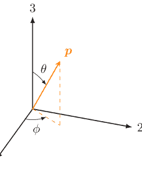

图 2.6：带有相对于坐标轴角度的坐标系和纤维。基于 TikZ 库 [87]，但针对本情况进行了修改。

该向量的长度固定，满足

$$
p_i p_i = 1.
\quad (2.43)
$$

纤维取向分布函数（FODF）\(\psi : \mathcal{S} \rightarrow \mathcal{P}\) 描述了在方向 \(\boldsymbol{p}\) 中找到纤维的概率，其中 \(\mathcal{P} = \{ \psi \in \mathbb{R} \mid 0 \le \psi \le 1 \}\) [43]。\(\psi\) 的定义方式是，在角度 \(\theta_1\) 与 \((\theta_1 + d\theta)\) 之间以及 \(\phi_1\) 与 \((\phi_1 + d\phi)\) 之间找到纤维的概率由以下公式给出：

$$
\(\mathcal{P}(\theta_1 \le \theta \le \theta_1 + d\theta, \phi_1 \le \phi \le \phi_1 + d\phi) = \psi(\theta_1, \phi_1) \sin \theta_1 d\theta d\phi\) [43].
\quad (2.44)
$$

在实践中，取向分布可以以直方图的形式给出，作为取向基础概率密度函数的离散近似 [88]（如图 4.33 右侧所示）。

函数 \(\psi(\boldsymbol{p})\) 必须满足多个数学条件。首先，纤维有取向但没有方向 [85]，这意味着角度为 \(\theta, \phi\) 的纤维对该函数而言与角度为 \(\pi - \theta, \phi + \pi\) 的纤维相同 [43]。换句话说，无法区分纤维的起点和终点 [86]。因此，\(\psi(\boldsymbol{p})\) 是周期函数，因此是对称函数：

$$
\(\psi(\boldsymbol{p}) = \psi(-\boldsymbol{p}).\)
\quad (2.45)
$$

函数 \(\psi(\boldsymbol{p})\) 也是非负的 [85]：

$$
\(\psi(\boldsymbol{p}) \ge 0.\)
\quad (2.46)
$$

其次，\(\psi(\boldsymbol{p})\) 必须归一化，因为每根纤维都有取向 [43]，即：

$$
\(\int_{\theta=0}^{\pi} \int_{\phi=0}^{2\pi} \psi(\theta, \phi) \sin \theta d\theta d\phi = \oint \psi(\boldsymbol{p}) d\boldsymbol{p} = \int_S \psi(\boldsymbol{p}) dp = 1,\)
\quad (2.47)
$$

使用单位球面上的积分，从而对 \(\boldsymbol{p}\) 的所有可能方向进行积分 [43]。

最后，\(\psi(\boldsymbol{p})\) 满足连续性条件 [86]

\(\dot{\psi} = -\text{grad}_\zeta(\psi(\boldsymbol{p})\dot{\boldsymbol{p}}). \qquad (2.48)\)

该方程描述了当纤维随流体的整体运动而移动时，纤维取向分布函数随时间的变化。因此，当提供描述平均纤维角速度 \(\dot{\theta}\)、\(\dot{\phi}\) 或平均纤维方向速度 \(\dot{\boldsymbol{p}}\) 的适当表达式时，就可以确定 \(\psi(\boldsymbol{p})\) [43]。这一最后条件在模拟流动过程的建模和仿真背景下尤为重要，本文不会详细讨论。

虽然纤维取向分布函数是纤维取向状态的一种封闭、显式 [25]、完整且无歧义 [43] 的描述，但它可能变得任意复杂 [86]。因此，Kanatani [89] 以及 Advani 和 Tucker [43] 建议使用该函数的矩，这些矩被称为纤维取向张量。受傅里叶级数展开的启发，它们提供了改进的存储可能性、降低的复杂性以及代数运算的应用 [85]。

#### 2.2.3.1 纤维取向张量（FOT）

虽然 Kanatani [89] 区分了第一类和第三类取向张量，但这里仅讨论第一类取向张量，这类张量也在 Advani 和 Tucker [43] 的工作中讨论。

作为分布函数统计矩的取向张量定义为向量 \(\boldsymbol{p}\) 的 dyadic 乘积的积分。由于 \(\psi(\boldsymbol{p})\) 的对称性，奇数阶积分为零，因此仅存在偶数阶张量，其中二阶和四阶张量是最常用的 [43, 85, 86]:


$$
\boldsymbol{A} = \int_{\mathcal{S}} \psi(\boldsymbol{p}) \, \boldsymbol{p} \otimes \boldsymbol{p} \, \mathrm{d}p,
$$

$$
A_{ij} = \oint \psi(\boldsymbol{p}) \, p_i p_j \, \mathrm{d}p,
$$

$$
\mathbb{A} = \int_{\mathcal{S}} \psi(\boldsymbol{p}) \, \boldsymbol{p} \otimes \boldsymbol{p} \otimes \boldsymbol{p} \otimes \boldsymbol{p} \, \mathrm{d}p,
$$

$$
A_{ijkl} = \oint \psi(\boldsymbol{p}) \, p_i p_j p_k p_l \, \mathrm{d}p.
$$

(2.49)

在索引表示法中，基 \(\boldsymbol{e}_i$ 分别已被省略。在实践中，在感兴趣区域测量 \(N$ 根纤维的取向后，例如通过 \(\mu$CT 图像的图像处理，二阶和四阶取向张量可以通过以下方式计算

$$
\boldsymbol{A} = \frac{1}{N} \sum_{i=1}^N (\boldsymbol{p} \otimes \boldsymbol{p})_k ,
$$

$$
A_{ij} = \frac{1}{N} \sum_{i=1}^N (p_i p_j)_k ,
$$

$$
\mathbb{A} = \frac{1}{N} \sum_{i=1}^N (\boldsymbol{p} \otimes \boldsymbol{p} \otimes \boldsymbol{p} \otimes \boldsymbol{p})_k ,
$$

$$
A_{ijkl} = \frac{1}{N} \sum_{i=1}^N (p_i p_j p_k p_l)_k \, \text{[88, 89].}
$$

(2.50)

测得的二阶 FOT 集合稍后将以花体字母表示，例如 \(\mathcal{T}_m$。

取向张量完全对称 [43]，因此 $a_{ij} = a_{ji}$ 或 $\boldsymbol{A} = \boldsymbol{A}^T$，$a_{ijkl} = a_{jikl} = a_{kijl} = a_{lijk} = a_{klij}$ 等等。(2.51)

成立。对称性将唯一描述二阶取向张量所需的张量分量数量减少到仅六个（$a_{11}$、$a_{22}$、$a_{33}$、$a_{12}$、$a_{13}$、$a_{23}$），而不是九个。作为方程 (2.47) 中归一化条件的结果，二阶 FOT 的迹必须为一：

$\boldsymbol{A} \cdot \boldsymbol{I} = \text{tr}(\boldsymbol{A}) = 1$，(2.52)

其中 $\boldsymbol{I}$ 为单位张量。这种关系进一步将所需的张量分量减少到仅五个 [90, 91]。

所有高阶张量都包含相应的低阶张量 [85]，导致以下缩并 [86]

$\mathbb{A} : \boldsymbol{I} = \boldsymbol{A}$。(2.53)

相比之下，从低阶张量确定高阶张量并非易事，需要某种封闭近似，这将在本节下一段中简要再次讨论。

如果所有最高阶为 \(n = \infty$ 的 FOT 均可用，则分布函数 \(\psi(p)$ 可以通过傅里叶分析精确重建 [92]。在所有其他情况下，它可以从一个 FOT 近似恢复，如下面针对二阶张量所示的方程所示：

$\psi(p) \approx \frac{1}{4\pi} + \frac{15}{8\pi} \boldsymbol{B} \boldsymbol{F}(p)$，(2.54)

其中 \(\boldsymbol{B} = \boldsymbol{A} - \frac{1}{3} \boldsymbol{I}$ 且 \(\boldsymbol{F}(p) = \boldsymbol{p} \otimes \boldsymbol{p} - \frac{1}{3} \boldsymbol{I}\) [43]。

通过 FOT 表示分布函数的这种三维张量傅里叶级数，也称为球谐展开 [89, 93]。它在方程 (2.54) 中在前两项后截断。关于高阶张量的相应关系，读者可参阅 Advani 和 Tucker 的文章 [43] 以及 Jack 等人的文章 [94]。还应注意，取向张量是方程 (2.54) 中部分显示的完整级数的截断，而高阶张量更准确地表示分布函数。然而，二阶和四阶张量在实践中已足够，且属于最先进的技术。[43]

## 封闭近似

封闭近似 \(\mathcal{C}\) 是一种映射 \(\mathbb{A} = \mathcal{C}(\boldsymbol{A})\) [92]。封闭近似的需求源于纤维悬浮液过程模拟。取向演化可以通过 Jeffery 模型 [95] 或 Folgar 和 Tucker 模型 [96] 等方法描述，后者纳入了 FODF 并在前一方程中添加了扩散项 [86]。当用 FOT 表示上述模型时，需要四阶张量 \(\mathbb{A}$ 来求解输运问题。

随着时间的推移，发展出了许多不同复杂度和精度的封闭近似。二次封闭近似可以被视为最简单的解析封闭近似，由以下给出

\(\mathbb{A}^Q = \boldsymbol{A} \otimes \boldsymbol{A}\) (2.55)

并且仅对单向 FRP [43, 86, 97] 是精确的。相反，线性封闭近似 [43, 98] 对各向同性纤维取向给出正确结果 [86]。然后，还有结合这些思想的混合封闭近似 [99, 100] 以及更先进的各向异性拟合封闭近似 [101, 102]，后者使用特征值拟合。广泛使用的基于不变量的最优拟合（IBOF）封闭近似 [103, 104] 也是一种在物理上更自洽的方法 [92]，例如由 Meyer 等人 [34] 用于片状模塑料（SMC）压缩成型过程的模拟，或由 Brylka [90] 用于聚丙烯长纤维增强热塑性复合材料（LFT）与 Mori-Tanaka 方法的线性弹性同质化，作为精度和计算成本之间的良好折中方案 [86]。关于各种封闭算法的更全面分析和讨论，读者可参阅 Breuer 等人的工作 [105]。

在此点应提到，使用封闭近似不可避免地会引入错误。例如，Brylka 使用二阶 FOT 和 IBOF 封闭近似在其 Mori-Tanaka 方法中计算得到的最大刚度误差为：样品尺度上 7%，厚度方向各个单层中 15%，这与直接使用四阶 FOT 相比 [90]。此外，还应注意，还有使用间接封闭方法的可能性 [93, 106]，这类方法通过从二阶张量重建 FODF \(\psi$ 来绕道求解，进而可用于确定四阶张量 [92]。然而，这些方法同样基于假设，且假设可能因方法而异。Shannon 最大熵法（MEP）[107] 是一个著名的例子。

## FOT 示例及与 FRP 中具体纤维分布的关联

为了能够将取向张量与实际纤维分布（例如在 CT 扫描中可见）相关联，图 2.7 展示了单向、近似平面和各向同性状态的三个简单 FOT，并与描绘 FOT 取向状态的相应 FRP 微观结构并列展示。

这些微观结构是使用 Lauff 等人 [108] 的 "fSAM" 算法生成的。近似平面各向同性纤维取向状态被认为生成特征值接近 \(a_{33} = 0$ 的微观结构在计算上极其昂贵。本工作第 2.2.4 节将进一步介绍纤维堆积算法。

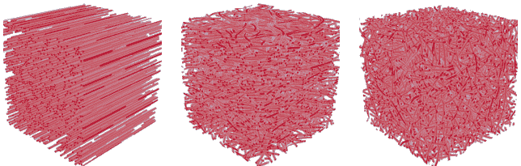

| 取向状态 | 二阶取向张量 |
|---|---|
| 单向 | \(\begin{bmatrix} 1 & 0 & 0 \\ 0 & 0 & 0 \\ 0 & 0 & 0 \end{bmatrix}\) |
| 近似平面各向同性 | \(\begin{bmatrix} 0.49 & 0 & 0 \\ 0 & 0.49 & 0 \\ 0 & 0 & 0.02 \end{bmatrix}\) |
| 各向同性 | \(\begin{bmatrix} \frac{1}{3} & 0 & 0 \\ 0 & \frac{1}{3} & 0 \\ 0 & 0 & \frac{1}{3} \end{bmatrix}\) |

**图 2.7：** 特定纤维分布生成微观结构中不同取向状态及其相应取向张量的示例。

## FOT 的参数化

任何二阶 FOT \(\mathbf{A}$ 都是对称的（见方程 (2.51)），并且是半正定的，因为其所有特征值均非负，\(\lambda_i \ge 0$（参见方程 (2.46)）。因此，它可以以一种仅对角线上有元素的方式旋转，因此可以对角化。矩阵的这种所谓特征值分解定义如下

\(\mathbf{A} = \mathbf{R} \unknown \mathbf{R}^T = \mathbf{R} \star \unknown,\) (2.56)

其中 \(\mathbf{R} \in SO(3)$ 是正交矩阵（\(\mathbf{R}\mathbf{R}^T = \mathbf{R}^T \mathbf{R} = \mathbf{I}$ 成立），其第 \(i$ 列是 \(\mathbf{A}$ 的特征向量 \(\mathbf{v}_i$（三个特征向量相互标准正交），由于上述原因有时也称为旋转矩阵。\(\unknown$ 是包含相应特征值的对角矩阵，\(\unknown = \mathbf{I}\lambda$，其中 \(\lambda = [\lambda_1, \lambda_2, \lambda_3]^\mathsf{T}$。特征值存在一种常见的排序惯例 [85, 91, 109–111]，如下


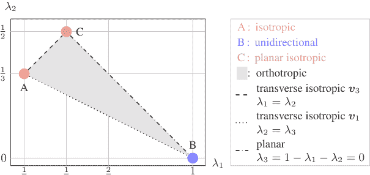

图 2.8：定义取向三角形的材料对称性和约束。基于 [85]。

```
\lambda_1 \ge \lambda_2 \ge \lambda_3.
```

方程 (2.52) 转换为

```
\lambda_1 + \lambda_2 + \lambda_3 = 1.
```

这种取向张量的参数化允许通过 \(\lambda_1\) 和 \(\lambda_2\) 的配对（连同定义取向坐标系的映射 \(\boldsymbol{R}\)）在二维空间中描绘各种 FOT [85]。这种表示法也称为取向三角形，如图 2.8 所示，也可见于 Bauer 和 Böhlke [85]、Gajek 等人 [91]、Goldberg 等人 [109]、Cintra 等人 [101]、Chung 等人 [103] 或 Köbler 等人 [110] 的著作中。

这简化了将不同材料对称性分配给特定 FOT 的过程。正交各向异性中最弱的材料对称性作为图 2.8 中的灰色区域，由三种极端取向状态的点来定义：各向同性 (A)、单向性 (B) 和平面各向同性 (C)。连接这三个点的连线本身描述了特殊的材料对称性，其中 A 与 B 之间的连线描绘了关于主轴 $v_1$ 的横向各向同性状态，A 与 C 之间的连线描绘了关于 $v_3$ 的横向各向同性状态，而 C 与 B 之间的连线则代表了纤维取向的平面状态。有关更多细节，读者可参阅 Bauer 和 Böhlke 关于纤维取向张量多样性的全面著作 [85]。

## 通过张量形状可视化纤维取向张量

特别是对于第 2.2.3.3 节中描述的 FOT 插值，需要一种简单、描述性强且全面的方法来可视化纤维取向张量及其各向异性。因此，采用了通过形状（通常为椭球体）来描绘对称正定 (SPD) 张量的可能性，这是科学可视化中的一个知名概念，最初主要用于扩散张量 [112–114]。它对于张量场可视化尤其有用，此时张量在网格的不同点上均可用。每个网格点上描绘的形状（有时也称为图标）是一种符号参数对象，用于以视觉方式表示其所描绘张量的特征 [115]。因此，张量的属性以某种方式必须映射到形状的参数（或自由度）[115]。如 Kindlmann 在 [116] 中所述，采用初始形状几何体 $G$（在本例中为椭球体几何体），并按如下方式将其转换为张量形状 $G_A$：

```
$G_A = R \Lambda G,$
```

然后在给定取向张量 $A$ 的特定网格位置绘制 $G_A$。这回溯到方程 (2.56) 中描述的 SPD 张量的谱分解，但通过特意不旋转回来，可以描绘张量的取向。椭球体的形状代表特征值，并与张量的各向异性相伴随，椭球体的取向分别代表特征向量。更具体地说，三个特征值决定了椭球体在三个主要空间方向上的半径。椭球体的中心设置在张量的位置。然后，变量 x、y 和 z 中的坐标与旋转矩阵（特征向量）一起旋转，以表示张量的取向。

Kindlmann 于 2004 年 [116] 进一步开发了超四次形张量形状，以解决不对称和歧义问题，这些问题于 2010 年 [117] 进一步推广，甚至也用于纤维取向张量 [92]。然而，标准形状可视化在本工作中已足够。

形状提供了一种方法，通过可视化 FOT 场中取向张量的演化来解释不同插值方法的成功。本工作的渲染使用了 MATLAB R2020b，并借助 Barmpoutis 等人 [118] 的 fanDTasia ToolBox 中的“plotDTI”函数完成。

在图 2.9 中，可以看到使用上述函数渲染的一些特殊张量形状示例。随后将展示多个现实张量形状字段。

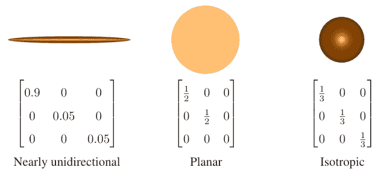

图 2.9：在 MATLAB R2020b 中使用 Barmpoutis 等人 [118] 的“plotDTI”函数渲染的张量形状示例。左侧可以看到近乎单向状态，因为完全单向情况无法作为椭球体可视化（见上一节）。高各向异性可通过纤细的椭球体身体识别，且 x 方向（水平向右）的强取向可见。随后是完全平面状态，其被可视化为平板。可见平面中的各向同性可通过其完全圆润观察到，缺失的阴影意味着 z 方向（垂直于可见平面）中缺失的扩展。最后，各向同性情况导致所有坐标方向上尺寸相等的完美球体。就平面情况而言，无法感知首选取向。

#### 2.2.3.2 从 µCT 扫描中确定纤维取向张量的计算方法

为了从 µCT 扫描中确定纤维取向，可以构想两种通常不同的方法。如第 2.2.2.2 节中关于纤维长度计算确定的描述，可以跟踪每根纤维的中心线来获取每种纤维取向的矢量，如 [76] 中所做。然而，此方法需要图像的高分辨率和足够对比度，而这两方面在本例以及碳纤维增强聚合物中普遍都不足。幸运的是，与纤维长度不同，纤维取向可以在体素基础上确定，且不包括其连接性 [81]。Pinter 在 [81]（也见 [52, 119]）中介绍了三种此类方法的准确性评估。第一种方法由 Lampert 和 Wirjadi 提出，基于各向异性高斯滤波器 [120]。如果当前检查的体素中的纤维更好地与给定取向表中的某个取向对齐，则该滤波器返回较高值，反之亦然。第二种概念基于之前介绍的黑森矩阵（比较方程 (2.39)），由 Daniels 等人 [75] 提出。最后，也测试了之前已介绍的结构张量（参见方程 (2.41)）。所有三种实现的方法都由 Bertram 和 Pinter [79] 在开源项目 Composight 中发布。由于最后一种方法对人工图像和玻璃纤维增强聚合物的真实图像表现最好，并且 Pinter 等人 [81] 表明它甚至是低对比度碳纤维增强聚合物图像中唯一有效的方法，因此本工作中采用了 Bertram 和 Pinter [79] 实现的结构张量方法，因此它也是唯一在后面详细描述的方法。后期所做的一个小调整在方法部分中解释（参见第 3.6 节）。

由 van Ginkel [121] 描述为一种分析 3D 图像中取向的方法，Krause 等人 [80] 于 2010 年首次使用基于结构张量的方法对 FRP 进行取向分析。结构张量 $S$ 由所谓的高斯导数 $\nabla I_\sigma(x)$ [80] 的二重积组成，定义为

```
\nabla I_\sigma(x) = \nabla(K_\sigma * I)(x) \quad (2.60)
```

这在方程 (2.41) 中已可见。它由函数 $I$ 的偏导数与在固定窗口宽度为 $\sigma$ 的高斯模糊 $K_\sigma$ 相结合而成。高斯导数是一种正则化，因为如果没有它，梯度的计算是不适定的 [80]。应用高斯模糊与将图像与高斯函数卷积相同，这将在第 2.3.4.1 节关于滤波器的内容中再次提及。随后，Krause 和 Pinter 都使用了额外的非强制性高斯平滑 $K_{\rho_1}$，标准差为 $\rho_1$，作为额外正则化，从而得到最终结构张量 $J_{\rho_1}$：

```
$J_{\rho_1}(x) = K_{\rho_1} * (\nabla I_\sigma \nabla I_\sigma(x)^T)(x). \quad (2.61)$
```

Pinter 等人 [81] 指出，第二个模糊参数 $\rho_1$ 必须大于用于求导的第一个参数 $\sigma$。得到的结构张量在纤维状结构且垂直于局部纤维取向排列的情况下是扁平的椭球体，见图 2.10。最终，纤维取向矢量是通过求解结构张量的最小特征值及其对应特征向量来计算的。

得到的纤维取向矢量将在 MATLAB 中进一步处理为取向张量、伪彩色图像等，这将在方法部分中解释（参见第 3.6 节）。


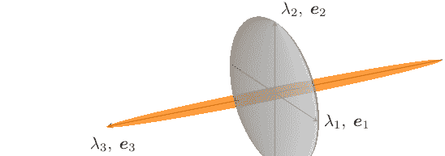

图 2.10: 与向量 \(e_3\) 平行的纤维状邻域（橙色）的平坦结构张量（灰色）。梯度方向因此分散开但垂直于 \(e_3\)，导致结构张量呈煎饼状，\(\lambda_1 \approx \lambda_2 \gg \lambda_3\)。

#### 2.2.3.3 纤维取向张量插值的必要性

FRP 材料试样的纤维取向可以相应地通过 CT 扫描并随后应用上述方法来确定。此处样本体积大小的问题并非无关紧要。该问题在第 3.1.6 节中详细讨论。然而，相当小试样的纤维取向张量可能代表非常局部出现的纤维取向行为（例如，单个纤维束的强各向异性取向）是显而易见的。相比之下，非常大的试样一方面会导致算法无法检测小纤维束，因为分辨率此时会太低。另一方面，以这种方式得到的纤维取向张量意味着对大量不同纤维取向进行大幅平均，这可能导致非常各向同性且不具代表性的 FOT。

在本作品中，根据应用情况（参见第 3.1.6 节），在板材尺寸为 400 mm \(\times\) 400 mm \(\times\) 3 mm 的情况下使用了边长在 10 mm 到 30 mm 之间的试样尺寸。显而易见，此类试样的特定取向张量仅代表压制板材整体纤维取向行为的一小部分（参见图 2.11）。

然而，对于刚度建模，通常需要此类板材的代表性平均 FOT，而这种方式无法获得。用于拉伸

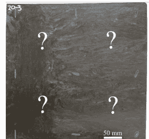

图 2.11: 插值问题的可视化：九个 10 mm × 10 mm × 3 mm 试样的测量张量以蓝色张量符号的形式显示在相应的提取点上。背景中显示了一个带有 400 mm × 400 mm × 3 mm 尺寸的原始板材的透明照片。小测量区域之间的纤维取向行为未知。基于 Blarr et al. [17]。

试验，其中人们希望将不同方向中发现的刚度和强度与测量的纤维取向进行比较，其尺寸通常也大于 CT 试样。此外，压制过程的模拟通常在每个网格点提供一个 FOT，这与仅在特定点确定的少数几个 FOT 进行比较比较困难。然而，切割和扫描整个板材然后进行纤维取向分析将极其耗时。平均扫描长度为两小时，后处理工作约再花费一小时，这在实践中似乎无法实现。因此，产生了从特定网格点的少量给定张量确定各种网格点处张量的科学问题。这对应于张量插值的数学问题。虽然标量值的插值已被广泛研究，但张量的插值则不太为人所知。

# 张量插值研究现状

与应力和应变张量等张量相比，纤维取向张量的插值问题可以通过切换到标量分布函数在理论上避免。必须指出，这种切换不是唯一的，因为二阶 FOT 包含的信息太少。尽管如此，该函数可以在假设下恢复，并划分为离散方向，随后的插值将等同于标量值函数 $\bar{\Psi}$ 的欧几里得插值。事实上，这正好对应于张量分量的平均（权重取决于距离）。这可以用积分是线性映射这一事实来解释。然而，这种标准方法导致了一种“人工”各向同性，其表现为张量符号表示形式中向圆角的形状变化。这不一定代表有用的平均，因为所谓的张量膨胀问题既出现在医疗技术领域从 MRI 图像插值扩散张量 [122–124]，也出现在过程模拟应用中的 FOT 映射 [125]。这种膨胀效应是由于张量行列式的非单调插值引起的，并且欧几里得方法不保持正定性。科学讨论的一部分是，作为两个指向不同方向的各向异性张量之间插值的更各向同性的张量是否仍然构成纤维的合理行为。这将意味着，在流向变化的区域中，首先有些纤维转向而另一些保持原方向，直到大部分都转向为止。相反的观点是大部分纤维先稍微转向，然后完全转向新方向，这反而表明中心的张量不应比旁边的两个张量显著少各向异性。作为参考解，本论文中实现并使用的第一种张量插值方法就是这种欧几里得插值，从现在起将其称为分量平均法（CA）。

复杂的黎曼插值是另一种“全局”插值方法 [126]。然而，如果使用超过两个输入参数，底层计算只能隐式求解，这需要迭代计算，因此计算成本高昂。由于本论文明确寻求一种在保持最高可能质量的同时尽可能快速和简单的面向应用的方法，因此不会进一步讨论黎曼插值。Arsigny et al. [122] 引入了另一种对数但可显式求解的方法：Log-Euclidean 张量插值法。该方法已被 Krauß 和 Kärger [125] 用于 FOT。由于它在 [125] 中表现出与基本欧几里得插值（分量平均法）相似的行为，因此不会在本作品中使用。

一种完全不同的方法是所谓的分解方法。这些方法利用 SPD 张量可以在谱分解中分解为特征值和特征向量的事实（参见方程 (2.56））。就张量符号而言，特征值负责形状，而特征向量负责张量在空间中的取向。因此，形状和取向可以根据各种可能的距离度量进行加权，并分别插值，然后重新组合成一个张量。这可以直接通过特征值和特征向量来完成，也可以通过其他不变量（例如四元数）进行迂回实现。这种方法尤其允许解决膨胀效应 [123, 125]。此处应当指出，并非只有一种分解方法，而应将其理解为一种统称，其在各个步骤中可以执行得非常不同。Krauß 和 Kärger [125] 对 FOT 的这一概念的唯一先前用途，例如与本作品中实现的方法不同。分解方法所使用的确切概念将在方法章中详细解释（参见第 3.7.3 节），作者之前已在 [17, 127] 中对其进行了总结，但关于分解方法的基本考虑将在下一段中详细阐述。

就形状而言，直接插值特征值是可以设想的。也有采用这种方式的方法 [128]。但 Ennis et al. [124] 开发了正交不变量的概念，该概念似乎在物理问题中表现非常好。每组不变量都用正交基分解张量形状，使得这些不变量 \( I_i \) 相对于（纤维取向）张量 \( \boldsymbol{A} \) 的导数表现如下：

```
\frac{\partial I_i}{\partial \boldsymbol{A}} \cdot \frac{\partial I_j}{\partial \boldsymbol{A}} = 0, i \neq j. \qquad (2.62)
```

Ennis et al. 建立了所谓的 K- 和 R-不变量，本文也使用了它们。他们认为，尽管特征值也构成一组正交不变量，但它们的缺点在于无法隔离张量形状的关键属性（如大小和各向异性），而 K- 和 R-不变量集则提供了这些属性。直接插值特征值仍作为测试执行过，但确实似乎扭曲了结果，因此不会在本作品中进一步考虑。

在张量取向插值方面，有多项研究集中于 3D 旋转（即 3D 旋转群 \( SO(3) \) 中的元素）的插值，将其作为独立于张量或其形状的单独数学问题 [129–132]。然而，许多论文侧重于两个或少数几个不同取向状态之间的平滑旋转。这些方法对于多个且分散的取向张量不一定同样有效。通常，3D 线性代数中一般基的取向是相对于固定坐标系用欧拉角来描述的。通常必须考虑，一个取向可以由 24 个不同的坐标系来描述。通过约定来消除这种歧义，这包括决定使用右手系以及按大小对特征值进行排序。但是，在遵循约定后，仍有四种可能的坐标系可用于描述一个取向。根据选择，可以影响在两个（例如仅相隔 20\( ^\circ \)）取向之间，插值张量旋转 10\( ^\circ \)（这对应于——至少初看——显然是正确的选项）还是旋转 170\( ^\circ \)（这将对应于镜像坐标系）。


对于两个需要进行插值的张量，因此实现查询并限制角度大小是有意义的。然而，对于在多个支撑点处的一组测量张量 \(\mathcal{T}_m\)，其中距离当前要计算的张量更远的张量权重较小，但仍被包含在此插值张量的计算中，这就不那么明显了。出于这个原因，本工作中未实现角度限制（cf. 第 3.7.3 节）。该方面将在讨论部分（cf. 第 5.4.4.4 节）中再次讨论。

一种经过大量研究的方法是通过四元数进行方向插值。汉密尔顿描述的四元数扩展了复数系统，通常以以下形式表示：

```
q = a + bi + cj + dk with (2.63)
i^2 = j^2 = k^2 = ijk = -1 (compare complex numbers).
```

结果是一个四维数系统（数学上：向量空间），由一个实部（包含一个实分量）和一个虚部（包含三个分量）组成，虚部也称为向量部分。四元数的乘法不满足交换律。在许多情况下，四元数允许对三维欧几里得空间进行计算优雅的描述，特别是在旋转的语境下。使用四元数代替欧拉角可以避免万向节锁问题，并且它们更容易组合。与旋转矩阵相比，四元数更紧凑、高效且数值稳定。尽管如此，并非所有歧义都可以避免。单位四元数 q 和 -q 表示相同的旋转。这意味着从单位范数四元数到三维旋转群 SO(3) 存在 2:1 同态。换句话说，SO(3) 被四元数二重覆盖。在从旋转矩阵计算四元数时，必须注意这种符号歧义。

例如，Köbler 等人 [110] 开发了替代的纤维取向插值方法。他们在代用模型中开发了一种机械插值方法，即，他们首先计算了离散纤维取向的材料响应，然后对纤维取向三角形使用线性插值（一种作为取向三角形函数的材料模型）。虽然这能产生良好的结果，但它需要事先建立机械模型，因此在本工作设想的应用中无关紧要。

Sabiston 等人 [133] 探索了使用 AI 进行纤维取向张量插值。作者们使用了大量 FOT——如同本工作一样——从同一工艺的多个板材的 µCT 图像中获得。这代表了他们的基准真值，他们用它来训练人工神经网络（ANN），随后该网络能够预测该工艺板材的张量分量，其偏差小于相邻微观结构单元之间的变异性。由于这代表了一种完全新的、非物理的、也非经典线性代数的方法，神经网络在本工作中被用作第三种插值方法。然而，与 Sabiston 的工作不同，ANN 仅使用所有方法比较中考虑的九个测量张量进行训练。然后，使用训练好的网络预测其余 160 个。尽管九个张量各提供五个信息值，但使用如此少量的输入数据进行 AI 应用较为罕见，但其目的是评估是否仍能产生相当有用的结果，或者是否在给定少量额外张量的情况下就可以期望有用的结果。2 这种方法的有效性将在讨论部分（cf. 第 5.4.4.3 节）中再次讨论。

因此，在本论文中，方法章节（见第 3.7 节）介绍了三种不同的方法，结果章节（第 4.6 节）介绍了它们的结果，以获取板材上纤维取向张量的全场分布。经典欧几里得插值（张量分量的平均值）、基于通过正交不变量分别插值形状和通过四元数插值张量取向的分解方法，以及 Sabiston 等人 [133] 开发的 ANN 与给定应用的适应性均经过测试。所有想法均非在纤维取向张量的语境下开发，而是在专注于数学的理论论文中开发的。然而，将前两种方法应用于纤维取向张量是由 Krauß 和 Kärger [125] 完成的，背景略有不同，即不同网格之间的纤维取向张量映射。Sabiston 的 [133] ANN 使用了来自不同板材的大量输入张量，旨在对某一工艺的平均纤维取向进行一般预测。据作者所知，将这些方法应用于从 CT 图像中测得的少量纤维取向张量并在给定张量之间生成更多数量，是一种新颖方法，首次出现在自行出版的论文 [17] 和会议论文集 [127] 中。

2 至此，本节摘自作者的出版物 [17]，仅做了轻微的语言修改。

### 2.2.4 代表性体元和微观结构生成

在建模 FRP 时，为了避免必须再现整个零件的复杂结构，在同质化方法中通常的做法是开发一个具有代表性的小子单元，以代表整个微观结构。此类单元（其材料响应应对应于整个零件的平均值）— 如前所述 — 也称为代表性体元（RVE）[134–136]。一些作者引入了统计体元（或随机体元，SVE）[137–139] 的概念，以纳入微观结构变异性。此类体元的边长通常难以确定，例如可以使用测得的纤维长度进行估算，以避免将其缩短过多或改变尺寸之间的纤维体积含量等微观结构量。在讨论试样取样时，这将在本论文中再次讨论（cf. 第 3.1.6 节）。RVE 内部的纤维结构可以通过 CT 图像的体素数据直接离散化来创建。这首先要求分辨率足够高以实现单根纤维检测，其次要求与基体的对比度足够高以进行正确的阈值分割。然而，此类人工微观结构也可以独立于图像数据以算法方式生成。CT 图像可以作为模型，并可使用已从 CT 图像或实验中测得的纤维体积含量、纤维长度分布和纤维取向分布/张量作为将纤维填充到单元中的参数。可用于此目的的算法类称为填充算法，它们发展自最初的球体填充算法。存在许多不同的方法，从相当简单的想法开始，例如 Feder 于 1980 年引入的随机连续吸附（RSA）[35]，其中对象被依次以随机位置无重叠地填充到单元中。一种更具动态性的带速度向量的方法是 Lubachevsky-Stillinger [36]。另一方面，Williams-Philipse [38] 的机械收缩方法通过收缩单元，然后再去除重叠来工作。最后，一种完全基于优化的方法是 Torquato-Jiao [37]。这些算法已被成功用于球体填充和结构简单的纤维填充。Schneider [140] 于 2017 年引入了所谓的顺序添加与迁移（SAM）算法，可可靠地产生短纤维增强聚合物的微观结构，即使具有较大的长宽比和体积分数。Schneider [141] 改进并扩展了这种方法，通过允许纤维弯曲来生成长纤维增强结构。还有其他关于 LFT 材料微观结构生成的文献 [142]。尽管纤维弯曲和更高的长宽比目前似乎可以处理，但这些方法中的大多数仍难以可靠地生成本工作主题的碳纤维增强聚酰胺 6 中所见的微观结构（cf. 第 4.1 节）。特别是碳纤维的细度（5 µm - 7 µm）以及混合束和单纤维结构具有挑战性，尤其是单纤维在 CT 图像中甚至无法检测。在本工作中，针对此问题从 CT 图像确定纤维取向的方法是基于体素的。那么，是否可以生成基于体素的微观结构，而不是离散纤维？事实上，Ian Goodfellow 等人 [143] 开发的生成对抗网络（简称 GANs）的理念自 2014 年以来一直存在于 AI 领域，可从训练图像生成图像。因此，在本工作中，二维


artificial microstructure CT images via GANs is explored with the possible future extension towards directly creating RVEs with these networks.

## 2.3 计算机断层扫描

After Wilhelm Conrad Röntgen famously discovered a radiation with the ability to penetrate optically opaque objects at the end of the 19th century, called X-rays [144], the first computerized computed tomography (CT) system was realized by Hounsfield [145] in 1972. Together with Cormack, he won a Nobel Prize in 1979 for this development, as did Röntgen previously for the discovery of X-rays. With time, micro-computed tomography (μCT) systems developed that increased the range of CT applications from medical use towards non-destructive material testing.

### 2.3.1 理论原理

#### 2.3.1.1 X射线产生

X-ray radiation is on the electromagnetic spectrum and is generated through the deceleration of fast electrons that are emitted from a heated filament and then enter a solid metal anode [144]. Thereby emitted wavelengths range between approximately 10⁻⁸ m and 10⁻¹³ m. The electron velocity v determines the radiation energy. The velocity depends on the acceleration voltage Ua between cathode and anode. Energy conservation leads to the following equation,

\[
eU_{\mathrm{a}} = \frac{1}{2}m_{\mathrm{e}}v^{2}, \tag{2.64}
\]

with the charge of an electron e and the mass of an electron me, with which the electron velocity can be determined. Typical ranges of acceleration voltages can lie between 25 kV and 500 kV, whereas the smaller values are typically chosen for medical diagnostics and higher values are rather relevant for material testing, where radiation exposure hazards can be neglected. [144]

#### 2.3.1.2 光子-物质相互作用

When X-rays enter a material, the amount of photons, i.e., the radiation density, decreases exponentially due to absorption and scattering. This attenuation of the radiation intensity is material-dependent. The correlation is expressed in the Beer–Lambert law [146–148]

\[
I(\eta) = I_0 e^{-\mu \eta}, \tag{2.65}
\]

with the radiation intensity \( I \), a distance variable \( \eta \), the attenuation coefficient \( \mu \) and the initial condition \( I(0) = I_0 \). The linear attenuation coefficient \( \mu \) is thereby the sum of a scatter coefficient \( \mu_s \) and an absorption coefficient \( \alpha \) [144]:

\[
\mu = \mu_s + \alpha. \tag{2.66}
\]

The unit of \( \mu \) is m\(^{-1}\). Apart from being influenced by the photon energy, the attenuation coefficient is also dependent on the type of irradiated material and more specific on its effective atomic number and its mass density \( \rho \) [25, 149]. As a result, the mass attenuation coefficient \( \mu_m \) gives a density invariant attenuation coefficient and is hence defined as

\[
\mu_m = \frac{\mu}{\rho}. \tag{2.67}
\]

Mass attenuation coefficients are often given in \(\frac{\text{cm}^2}{\text{g}}\) and tabular collocations of values for different elements and compound materials can be found, e.g., in [150] or in [151] [25].

For composites, the effective mass attenuation coefficient \(\bar{\mu}_\mathrm{m}\) is calculated from the respective weight fraction \(w_i\) and mass attenuation coefficient \(\mu_{\mathrm{m}, i}\) of each constituent \(i\):

\[
\bar{\mu}_\mathrm{m} = \sum_i w_i \mu_{\mathrm{m}, i} \quad \text{[25, 152].} \tag{2.68}
\]

#### 2.3.1.3 计算机断层扫描系统的功能

CT devices consist of the X-ray tube with its anode and cathode that create the effective target area, which is also called the optical X-ray focus. In a CT system, X-rays are created from a nearly point-like source, as bigger diameters result in a so-called penumbra (shadow area, that is reached by only a part of the light) fringe (for details, the reader is referred to Buzug [144]). After passing the object to be scanned, it impinges on a detector, which in modern CT devices typically consists of a scintillator medium and a photon detector (for details cf. [144]) as shown in Figure 2.12. An image of the geometry and material composition of the object can be generated by the detector based on the difference between the initially transmitted beam intensity and the intensity received due to attenuation by the object material. This difference is converted to a spectrum of different gray values. Before the scan, the initial transmitted beam intensity is typically measured in a so-called correction step, where the tube is raised to nearly the uppermost position in order to irradiate onto the detector with no object interference.

The platform on which the object is placed and the detector can be moved in horizontal direction. Thereby, the image region and the resolution can be adjusted [52]. The object platform rotates 360° in the beam path. The CT user can set a number of projections, \(n_\text{projections}\). Projections are the singular 2D scans taken during a stop of the rotation. Hence, the object rotates in steps of \(\varphi = 360^\circ/n_\text{projections}\). All of the 2D projections then have to be reconstructed by an algorithm to create the required 3D image of the object. Many different algebraic and statistical reconstruction methods have developed over time, many are summed up in [153]. In the present work the cone-beam algorithm that works with convolution-backprojection of Feldkamp et al. [154] is used. It is fairly common and implemented in VG Studio Max 3.4.2; a software that was used in this work for all immediate post-processing, including reconstruction, registration and cutting of regions of interest (ROI). For further processing, the volumetric image obtained this way, is often cut again in 2D slices for easier processing (Matlab, Python) or easier visualization (ImageJ). However, these slices are linearly aligned with a coordinate axis (often perpendicular to the thickness of the specimen) and not a rotation angle.

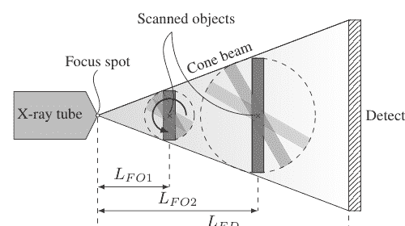

Figure 2.12: Simplified setup of a cone beam computed tomography device. Two alternative positions for differently sized objects in the beam path are shown to illustrate the dilemma between sample size and resolution. Based on Schöttl [25].

The volumetric images consist of discrete, in this case cubic, volume elements, that are called voxels (from "**volume x element**"); analogously to pixels in 2D. The voxel size or the in this case isotropic voxel edge length are a measure of the image resolution [25]. The geometric magnification \( m_g \) is defined as the division of the distance between focus and detector \( L_{FD} \) by the distance between focus and object \( L_{FO} \):

\[
m_g = \frac{L_{FD}}{L_{FO}},\qquad \tag{2.69}
\]

as visible in Figure 2.12. The voxel size \( l_v \) can subsequently be determined based on the detector pixel size \( l_d \) and the magnification as

\[
l_v = \frac{l_d}{m_g}. \tag{2.70}
\]

### 2.3.2 CFRP CT扫描的特定挑战

#### 2.3.2.1 组分间对比度低

Both carbon fibers and polyamide 6 are mainly composed of C elements. Therefore, they have similar densities and even the density independent attenuation coefficient values are very close. For a photon energy of 400 keV, carbon has a mass attenuation coefficient \( \mu_m \) of 9.546e\(^{-2}\) [150] and polyamide 6 has an experimentally measured mass attenuation coefficient of 10.86e\(^{-2}\) at 356 keV [156]. This chemical similarity leads to poor contrast between the two materials in the CT scans, which impedes the determination of fiber-dependent microstructure quantities.

#### 2.3.2.2 单根碳纤维检测的不可能性

The used \( \mu\text{CT}\) device in this work (cf. Section 3.6) could theoretically produce images up to a resolution of 1 \( \mu\text{m/voxel} \). However, there are two main reasons why the resolutions of all scans used in this work were significantly higher: The image noise rises with higher resolutions (cf. next Section 2.3.2.3) and the required specimen sizes to realistically depict the microstructure were too large for higher resolutions. Hence, the resolutions of the scans used in this work range between 8.57 \( \mu\text{m/voxel} \) and 25.98 \( \mu\text{m/voxel} \). The diameter of carbon fibers is between 5 \( \mu\text{m} \) and 7 \( \mu\text{m} \). In order to reliably segment an individual fiber, one requires voxel sizes that are three to six times smaller than the fiber diameter [13, 25, 76, 157, 158]. This is of course not the case with the resolutions of the scans used in this work. Therefore, it must always be assumed that all methods


只能检测纤维团簇或纤维束，而不能检测单个纤维。但是，由于大量纤维似乎以纤维束（大小不一）的形式出现，后来的结果仍与实验测定结果吻合良好。总体而言，本工作中只开发和使用不直接检测纤维、而是采用基于体素方法的方法。

#### 2.3.2.3 模糊和噪声

正如 Sprawls 在 [159] 中所描述的，CT 成像中加剧结构检测的主要特征是模糊和噪声。前者会降低小物体的可见性，从而降低图像细节。后者会降低低对比度物体的可见性。纤维同时符合这两种描述。虽然小体素和边缘增强滤波器可以减少模糊，但小体素吸收的光子更少，因此会增加噪声，这种噪声是由体素之间衰减系数的变化引起的。噪声图像可以通过大体素、增加辐射剂量或使用平滑滤波器来改善。然而，后者会再次增加模糊。[159] 由于减少模糊和噪声的措施部分上相互排斥，本工作的重点是降低噪声，因为单纤维检测无论如何已被排除。因此，使用了较大体素、增加的辐射剂量和平滑滤波器来改善图像。

#### 2.3.2.4 图像分辨率与物体尺寸之间的矛盾

试样的尺寸根据包括纤维长度、不同试样尺寸下测得的纤维体积含量以及合理的 RVE 显微结构（参见第 3.1.6 �）等因素，针对不同检查单独确定。因此，其边长在 10 mm 到 30 mm 之间。为了使其完全进入束路，必须相应地将其移离光源（见图 2.12），这反过来降低了分辨率。这个问题在 CT 图像中普遍存在，有时被称为样本尺寸与图像分辨率之间的矛盾 [25]，因此不仅局限于所使用的材料组合。

### 2.3.3 伪影

CT 图像会受到各种来源于不同原因的伪影影响 [144]。例如，部分体积伪影出现在物体边界不准确位于探测器元素边缘时，导致这些元素中的强度平均化以及物体边界模糊。另一个众所周知的伪影是束硬化伪影。这种效应是指辐射的非单色能量谱沿路径发生变化。低能量（即软 X 射线）比高能量（硬 X 射线）吸收得更多，因此束在穿过物体时会发生硬化。这可能导致条纹伪影或杯状伪影，使图像中部（通常是旋转轴周围的区域）的灰度值降低，从而显得更暗。由于这种伪影，物体常被放置在束中，相对于旋转轴有轻微角度偏置。还有环伪影、运动伪影等各种其他伪影，由于本工作并非专注于 CT 扫描的制作，而是专注于其 FRP 特定的分析与评估，因此这里不作详细解释，但可参考相关文献（如 [144]）进行探究。

### 2.3.4 图像处理

借助数字计算机通过算法对数字图像进行处理通常被称为数字图像处理 [160]。这种处理的目标可以从分类、特征提取到模式识别不等。许多可用于图像处理的常规技术中，一些对当前应用特别有用的技术将在以下小节中解释。基于 AI 的方法在第 2.4 节中解释。今后，图像应被理解为一个函数 i(x, y)，它将图像中的位置映射到特定（在此情况下）的灰度值。例如，对于 8 位灰度值图像，每个像素 $(x, y)$ 都有一个介于 0（黑色）和 255（白色）之间的灰度值。

图像处理的目的总体上在于增强或修改图像属性，以及/或者提取有价值的信息（如边缘）。更改可以直接在图像平面本身上进行，这称为空间域。相比之下，操作也可以在变换域中执行，这意味着转移到变换域，在其中进行处理，然后再转移回空间域。后者的概念根本上基于傅里叶变换，本工作中不再详细解释；但是，与之相关的重要基础知识（如卷积，也是图像处理中许多其他概念的基础）将在本工作的其他章节中介绍（参见第 2.4.1.6 �）。以下章节则专注于空间处理，其中又存在两个基本类别，即强度变换和空间滤波。虽然强度变换操作图像的单个像素，是对比度操作、直方图处理和图像阈值处理（将在第 2.3.4.2 节中讨论）的基础，而空间滤波在图像中每个像素的邻域内执行操作。后者的概念将在下一节第 2.3.4.1 节中详细阐述。

#### 2.3.4.1 空间滤波器的选择

在滤波中起核心作用的是所谓的核或掩模，这是特定滤波器特有的数组。它是一个带有数值的小矩形，滑过图像的每个像素，根据滤波操作（包括周围像素）的结果更改中心像素的值。将滤波掩模移过图像并在每个位置计算乘积和的过程也称为相关性 [160]，并定义为

```
f(x, y) * I(x, y) = \sum_{i=0}^{m} \sum_{j=0}^{n} f(i, j) I(x + i, y + j), \quad (2.71)
```

其中，\(f(x, y)\) 是大小为 \(m \times n\)（均为奇数整数）的滤波器，\(I(x, y)\) 是图像。相关性与卷积相似但不完全相同；这是大多数文献中未得到充分体现的微小差别。在卷积情况下，右侧的加法将替换为减号，这会翻转 \(f\)（即将其旋转 \(180^\circ\)）。因此，如果滤波器 \(f\) 仅仅旋转 \(180^\circ\)，则相关性对应于卷积。但是，由于大多数滤波掩模因其相关性表示而为人所知，这也是本工作中采用的惯例。无论如何，这仅在不对称核的情况下才相关。

根据核的不同，滤波器对图像可能具有平滑效果或锐化效果，例如，用于增强边缘。平滑滤波器用于模糊和噪声降低，将在下一段中详细阐述。线性空间滤波器输出滤波掩模邻域内像素的平均值，因此也称为平均滤波器或低通滤波器。它们减少强度中的突变，从而降低噪声但增加边缘的模糊。[160] 以下将简要介绍不同类型的平滑滤波器。应当指出，根据所需效果（核越大，模糊越强）和图像分辨率，可以使用不同的奇数核大小。为简化起见，所有显示的滤波器均描绘了大小为三的核。此外，如何处理图像边缘的问题自然而然地产生。当核中的中心像素是边缘像素时，核的一些位置未被占用。可以仅使用边缘像素旁边的像素作为中心像素，但这会导致结果图像尺寸的减小。另一种可能性是所谓的 *填充*，即添加额外的行和列数值来解决该问题。例如，众所周知的零填充是指在边框周围添加零，从而在图像周围形成黑色边框。还有其他填充可能性，例如镜像边界旁的数值等，读者可参考 [160–163]。


标准 \( 3 \times 3 \) 模糊滤波器是一种线性平滑滤波器，它计算九个周围像素的平均值：

```
\(\frac{1}{9} \begin{bmatrix} 1 & 1 & 1 \\ 1 & 1 & 1 \\ 1 & 1 & 1 \end{bmatrix} \quad (2.72)\)
```

出于计算简便性的考虑，系数全部设为 1，归一化因子随后相乘。标准模糊滤波器的一个重要特征是内核中所有像素的权重均匀。它有时也称为盒式滤波器。

高斯模糊滤波器与盒式滤波器相似，但使用加权平均值，靠近中心像素的邻域像素具有更高的权重。权重随高斯正态函数的强度递减。因此，内核可由定义的二维高斯函数确定：

```
\(G(x, y) = \frac{1}{2\pi\sigma^2} e^{-\frac{x^2+y^2}{2\sigma^2}}, \quad (2.73)\)
```

其中 \(x\) 和 \(y\) 分别是到内核水平和垂直中心的距离，\(\sigma\) 是高斯内核的标准差。正确计算的高斯模糊内核的一个常用近似如下：

```
\(\frac{1}{16} \begin{bmatrix} 1 & 2 & 1 \\ 2 & 4 & 2 \\ 1 & 2 & 1 \end{bmatrix} \quad (2.74)\)
```

与平均模糊相比，高斯平滑旨在提供更自然的模糊效果，并更好地保留图像中的边缘。

作为有序统计非线性滤波器的代表，*中值滤波器*不从内核中现有的值计算新值，而是用掩码中存在的中位数替换中心像素值，如以下图 2.13 所示。

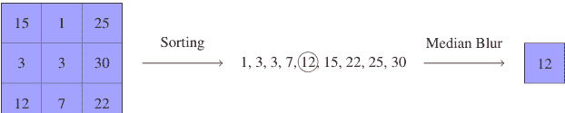

**图 2.13：** 中值模糊滤波器原理的图形演示。

它对所谓的椒盐噪声具有高度有效性，并对离异值具有鲁棒性。与平均模糊滤波器的情况不同，矩形内核维度是不可能的；它必须是方形的。

另一种降噪平滑滤波器是 *双边滤波器* [164]。它是一种用于模糊图像同时保留物体边缘的非线性滤波器。该滤波器之所以能保留边缘，是因为与高斯模糊不同，权重不仅取决于像素的欧氏距离（即不仅取决于它们的几何接近度），还取决于它们的光度相似性（例如，范围差异，如色彩强度、深度距离等）。它在域和范围中都偏好近值而非远值。可以对接近性函数 \(c(\xi, x)\) 和相似性函数 \(s(\phi, i)\) 使用不同的滤波器内核。高斯函数基于其参数之间的欧氏距离，两者均被广泛使用。因此，双边滤波表示结合域和范围滤波，并为输入图像 \(I(x)\) 提供输出图像 \(o(x)\)，如下所示：

```
o(x) = k^{-1}(x) \int_{-\infty}^{\infty} \int_{-\infty}^{\infty} I(\xi)c(\xi, x)s(I(\xi), I(x))d\xi,  (2.75)
```

带有归一化

$k(x) = \int_{-\infty}^{\infty} \int_{-\infty}^{\infty} c(\xi, x) s(I(\xi), I(x)) d\xi. \quad [164] \quad (2.76)$

#### 2.3.4.2 阈值方法

阈值处理是指选择一个或多个强度值/界限，将直方图分为两个或多个区域，在每个区域中仅出现特定对象/材料的像素/体素。这些组通常称为类。这种图像的细分可以通过二值化来突出：

$o(x, y) = \left\{ \begin{array}{ll} 1, & \text{if } i(x, y) > T \\ 0, & \text{if } i(x, y) \le T \end{array} \right. . \quad (2.77)$

如果分割问题需要不止两个阈值，通常不得不切换到替代方法。此外，某些阈值方法的成功应用特别需要强度峰值的清晰分离和低噪声含量，这也说明了为什么该方法在用于本工作的 CT 扫描时也可能造成困难。然而，由于其（计算）简单性，阈值处理至今仍然高度相关。阈值处理有不同的子类别。整个图像中恒定阈值的基本情况称为 *全局阈值处理*。反之，则存在 *变量阈值处理*。如果一点的阈值取决于其邻域，这种变量阈值处理也称为 *局部或区域阈值处理*。另一方面，*动态* 或 *自适应阈值处理* 这个术语用于阈值 $T$ 直接取决于空间坐标 $x$ 和 $y$ 的情况。然而，Gonzalez 和 Woods 指出图像处理文献中这些术语的使用不一致。[160]

如果适用，全局阈值的确定通常需要更复杂的算法，且不能轻易推导。以下描述了三种知名的、全局且自动的阈值处理方法的计算示例，这些方法通常已预先实现在 ImageJ (FIJI) 等科学图像处理软件或 MATLAB 库或 Python 图像处理包中，并在本工作的不同案例中使用。

Nobuyuki Otsu 的方法，称为 *Otsu 方法* 或 *Otsu 阈值*，通过最小化类内方差（也称为类内强度方差），或等价地，通过最大化类间方差（也称为类间方差）来找到分离前景和背景的阈值 [47]。假设一幅图像表示为 \(L\) 个灰度级，且阈值 \(t\) 存在于这些级别之一。类内方差 \(\sigma_W^2\) 定义如下

```
\(\sigma_W^2 = \omega_0 \sigma_0^2 + \omega_1 \sigma_1^2,\)
```

其中 \(\omega_0\) 和 \(\omega_1\) 为各类出现的概率，\(\sigma_0\) 和 \(\sigma_1\) 为各类方差。概率按以下方式计算

```
\(\omega_0(t) = \sum_{i=0}^{t-1} p_i \quad \text{and} \quad \omega_1(t) = \sum_{i=t}^{L-1} p_i.\)
```

显然，\(\omega_0 + \omega_1 = 1\) 成立。

类方差由以下给出

```
\(\sigma_0^2 = \sum_{i=0}^{t-1} (i - \mu_0)^2 \frac{p_i}{\omega_0} \quad \text{and} \quad \sigma_1^2 = \sum_{i=t}^{L-1} (i - \mu_1)^2 \frac{p_i}{\omega_1}.\)
```

类间方差 \(\sigma_B^2\) 由以下给出

\(\sigma_\mathrm{B}^2 = \omega_0(\mu_0 - \mu_\mathrm{T})^2 + \omega_1(\mu_1 - \mu_\mathrm{T})^2 = \omega_0\omega_1(\mu_1 - \mu_0)^2,\)

(2.81)

其中类均值级别为

\(\mu_0(t) = \sum_{i=0}^{t-1} \frac{ip_i}{\omega_0(t)} \text{ and } \mu_1(t) = \sum_{i=t}^{L-1} \frac{ip_i}{\omega_1(t)} \text{ and } \mu_\mathrm{T} = \mu(L) = \sum_{i=0}^{L-1} ip_i.\)

(2.82)

最后，最优阈值 \(t\) 通过最大化类间方差或最小化类内方差来确定：

\(t = \arg \left\{ \max_{0 \le t \le L-1} \{ \sigma_\mathrm{B}^2(t) \} \right\} = \arg \left\{ \min_{0 \le t \le L-1} \{ \sigma_\mathrm{W}^2(t) \} \right\} [47, 165].\)

(2.83)

另一种自动阈值处理程序是 Tsai [48] 的 *矩保持阈值*。因此，选择一个阈值，使得得到的二值化图像 _o_ 中图像 _i_ 的前三个时刻得以保留。图像 _i_ 的时刻定义为

\(m_i = \frac{1}{n} \sum_j n_j(z_j)^i = \sum_j p_j(z_j)^i,\)

(2.84)

其中 _n_ 是图像 _i_ 的像素总数，_nj_ 是图像 _i_ 中灰度值为 _zj_ 的像素总数，且 \(p_j = \frac{n_j}{n}\)。应用阈值并二值化图像后，_o_ 的前三个时刻可以按以下方式计算：

\( m'_i = \sum_{j=0}^{1} p_j(z_j)^i, \quad i = 1, 2, 3; \) (2.85)

其中 \( p_0 \) 和 \( p_1 \) 分别表示低于阈值和高于阈值的像素比例。在 \( o \) 中保留 \( i \) 的前三个时刻意味着，

\( m'_i = m_i, \quad i = 1, 2, 3 \) (2.86)

必须成立。此外，

\( p_0 + p_1 = 1. \) (2.87)

最后两个方程可以转换为以下方程组

\( p_0 z_0^0 + p_1 z_1^0 = m_0, \)
\( p_0 z_0^1 + p_1 z_1^1 = m_1, \)
\( p_0 z_0^2 + p_1 z_1^2 = m_2, \)
\( p_0 z_0^3 + p_1 z_1^3 = m_3. \) (2.88)

\( m_i \) 借助方程 (2.84) 计算，且 \( m_0 \) 定义为 1。然后求解方程以获得 \( p_0 \) 和 \( p_1 \)，这必然导致选择 \( t，使得

\( p_0 = \frac{1}{n} \sum_{z_j \le t} n_j. \) (2.89)

可能不存在满足此条件的精确 \( t \) 值，因此应选择最接近的灰度值。[48]


此外，均值阈值 [49–51] 通过将 $t$ 选为像素值分布的均值来定义。类似地，中位阈值作为 Doyle $p$-tile 方法 [166] 的一种特殊方法，被设定为使 50% 的像素分布在两个二进制类中各一半 [49]。

关于碳纤维增强聚合物的这些不同阈值技术的应用将在方法部分（第 3 章，第 3.4.2.2 节和第 3.6 节）中再次讨论。

## 2.4 人工智能

人工智能一词描述的是机器或软件的智能。它是计算机科学的一个研究领域，其技术已广泛应用于工业、政府、科学和娱乐等各个领域。人工智能由艾伦·图灵在20世纪50年代发起 [167]，并在过去十年中，随着大量计算能力和大数据存储与处理可能性的出现 [168]，才实现了其最初的愿景。这导致了2010年代末和2020年代初的人工智能热潮，有时也被称为人工智能之春 [169]。

人工智能的大领域被进一步细分。机器学习（ML）可能是最大的子类别 [168]。它是指能够自动改进特定任务执行的算法 [170]。Hong 等人 [168] 强调，常规编程与机器学习编程之间的主要区别在于 ML 通过归纳法工作。在前者中，程序员必须制定一般规则，算法能够针对特定观察推导出结果，而在 ML 中，算法本身从给定的观察中发现一般规则 [168]。程序员的工作在于开发算法的结构和环境，以便其能可靠地归纳出这些规则。所谓深度学习（DL） [168]，要么是 ML 的另一个子类别，要么是 AI 和 ML 概念的混合物（取决于定义）。深度学习是指通过受生物神经网络启发的人工神经网络（ANN）来处理观察结果。形容词“深”强调了网络中使用多个层。

还存在进一步细分为*受监督*和*无监督*机器学习。前者是指在人工标记的输入数据上工作的网络，而后者是指在没有任何其他人工指导的情况下，必须寻找共同模式并进行预测的网络 [170]。

下文将首先阐述人工神经网络的一般理论原理，然后再概述这些网络的具体类型。

### 2.4.1 人工神经网络的理论原理

#### 2.4.1.1 单层感知机

人工神经网络的最小子单元是所谓的单层感知机（SLP）。基于 McCulloch 和 Pitts 于 1943 年提出的原始神经元模型，它首次由 Rosenblatt 在 1957 年作为感知机引入，是一种结构类似于生物神经元的线性分类器（参见图 2.14）。[171, 172]

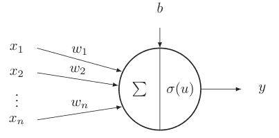

**图 2.14：** Rosenblatt 描述的单层感知机示意图 [171]。基于 [173]。

不同输入 \(\{x_1, x_2, ..., x_n\}\)（类似于生物神经元树突收集的冲动）根据其相对重要性由权重 \(\{w_1, w_2, ..., w_n\}\) 加权，随后由线性聚合器求和。一个较低的阈值 _b_，也称为偏置，决定之后是否触发输出信号。激活函数 \(\sigma(u)\) 取决于 \(b\) 与线性聚合器结果（即激励电位 \(u\)）之间的差值。这得出了 SLP 的输出信号 \(y\)

\(y = \sigma(u) = \sigma \left( \sum_{i=1}^n w_i x_i - b \right) .\) (2.90)

激活函数因此将可能的输出值限制在一定范围内。[174] 通过添加一个虚拟输入 \(x_0 = 1\) 和相应的权重 \(w_0 = b\)，可以简化公式 (2.90) 为

\(y = \sigma \left( \sum_{i=0}^n w_i x_i \right) = \sigma(\boldsymbol{x} \cdot \boldsymbol{w}) = \sigma(\boldsymbol{w}^{\top}\boldsymbol{x}) ,\) (2.91)

这将 \(\boldsymbol{x}\) 和 \(\boldsymbol{w}\) 的向量维度各增加 1 [175]。

有多种不同的激活函数可供选择，包括阶跃函数、线性函数、Sigmoid 函数、tanh 函数或整流线性单元（ReLu）[174]。为演示目的，假设一个简单的双极阶跃函数，其定义为

\(y = \sigma(\boldsymbol{x} \cdot \boldsymbol{w}) = \left\{ \begin{array}{ l l } 1 & \text{if } \boldsymbol{w} \cdot \boldsymbol{x} > 0, \\ -1 & \text{if } \boldsymbol{w} \cdot \boldsymbol{x} \le 0, \end{array} \right.\) (2.92)

这样就能得到一个与（可能是非二元的）输入无关的二进制输出 \(y\) [174, 175]。如果只给出两个输入值和权重，则会得到以下不等式

\(w_1 x_1 + w_2 x_2 - b \ge 0,\) \(w_1 x_1 + w_2 x_2 - b < 0,\) (2.93)

这在两个类之间创建了一个线性边界 [174]。如果输入和权重参数超过两个，则需要将此方法扩展到由 \( w \cdot x = 0 \) 定义的超平面 [176]。SLP 作为分类器的此功能如图 2.15 所示。

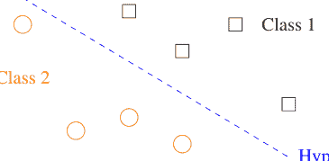

**图 2.15：** 由 SLP 给出的不等式系统分离两个类的超平面（虚线蓝色线）的二维示意图。基于 [176]。

当感知机做出错误决策时，通过调整权重来进行学习。这种更新或学习规则是一个递归算法。假设给定输入值 \( x_i \) 的相应类标签 \( z_i \) 由以下给出

\( z_i = \begin{cases} 1 & \text{if } x_i \in \text{ of the first class,} \\ -1 & \text{if } x_i \in \text{ of the second class.} \end{cases} \) (2.94)

对于一组 p 个训练样本 \( (x_i, z_i) \ \forall \ i = 0, 1, ..., p \)，\( y = y(w) \) 基于当前权重和偏置，对给定 \( x_i \) 给出 \( z_i \) 的（二进制）预测。权重 \( w_i \) 的变化然后定义为

\( w_i \rightarrow w_i + \Delta w_i, \) (2.95)

其中

\(\Delta w_i = r_1(z_i - y_i)x_i.\)

此学习规则也称为*德尔塔规则*，是一种用于优化的梯度下降算法。参数 \(r_1 \in [0, 1]\) 表示学习因子，或更常见的*学习率*。Rosenblatt 在感知机收敛定理中证明了该学习规则在有限次迭代后的收敛性。[171, 175, 176]

#### 2.4.1.2 多层感知机（MLP）

标准神经网络通常由多个感知机层组成，更准确地说是输入层、若干隐藏层和输出层；因此至少有三层。输入层通常不计入层数，因为它不执行处理，仅向下一层具有分布功能 [177]。这类神经网络常被称为“香草”神经网络，以强调其简单性和作为其种类的第一个网络 [178]。一个具有一个隐藏层的简单全连接 MLP 的示意图如图 2.16 所示。

在神经网络的语境中，输入值 \(\boldsymbol{x} = \{x_1, x_2, ..., x_n\}\) 通常被称为“特征”，从而使 \(\boldsymbol{x}\) 成为特征向量 [174]。接下来，一层或多层隐藏节点 \(h_i\) 处理输入，直到它到达最终输出层，结果在输出向量 \(\boldsymbol{y}\) 中给出。激活函数将权重映射到下一层 [179]。多层感知机这一名称具有误导性或不正确，因为与原始感知机使用的阶跃激活函数不同，现代神经网络依赖于非线性激活函数，使其能够区分非线性可分数据 [180]。不同类型的激活函数将在第 2.4.1.5 节中简要概述。在这种情况下，仅允许相邻层节点之间以及前向方向上的连接，因此它们也被称为*前馈*网络 [175]。


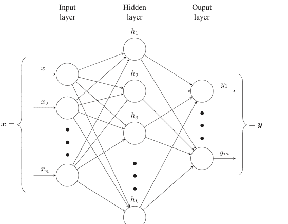

图 2.16: 每个节点包含线性聚合器、激活函数和偏置的简单 MLP 结构示意图。基于 [176]。

与公式 (2.90) 类似，假设所有层使用相同的激活函数 \(\sigma\)，特定隐藏层 \(h^{(l)}, 1 \le l \le N\) 中单个节点 \(j\) 的输出由以下公式给出

\(\begin{aligned} h_j^{(l)} = \sigma \left( \sum_{i=1}^{k_{l-1}} w_{ij}^{(l)} h_i^{(l-1)} - b_j^{(l)} \right), \quad (2.97) \end{aligned}\)

其中 \(k_l\) 表示隐藏层 \(h^{(l)}\) 中节点的总数，\(w_{ij}^{(l)}\) 表示第 \(l\) 个隐藏层中单元 \(j\) 与前一层中另一单元 \(i\) 之间的权重 [181]。应注意，不同层可能使用不同的激活函数，因此需要对不同的 \(\sigma\) 进行区分。第一个隐藏层 \(h^{(1)}\) 的输出等效表达式为

\(h_j^{(1)} = \sigma \left( \sum_{i=1}^n w_{ij}^{(1)} x_i - b_j^{(1)} \right), \qquad (2.98)\)

其中 $n$ 为输入特征的数量，输出值 $y_j$ 为

\(y_j = \sigma \left( \sum_{i=1}^{k_{l-1}} w_{ij}^{(l)} h_i^{(l-1)} - b_j^{(l)} \right).\ \text{[181]} \qquad (2.99)\)

以包含节点数量 $k_1$ 和 $k_2$ 的两个连续隐藏层 $h^{(1)}$ 和 $h^{(2)}$ 为例，如图 2.17 所示（$k_1 = 4$ 且 $k_2 = 3$），第二层中第一个单元 $h_1^{(2)}$ 的输出可根据公式 (2.97) 计算如下

\(h_1^{(2)} = \sigma(w_{11}^{(2)} h_1^{(1)} + w_{12}^{(2)} h_2^{(1)} + \dots + w_{1k_1}^{(2)} h_{k_1}^{(1)} - b_1^{(2)}). \qquad (2.100)\)

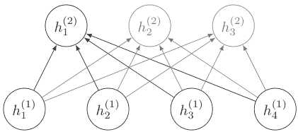

**图 2.17:** MLP 中两个连续隐藏层 $h^{(1)}$ 和 $h^{(2)}$ 的示意描述。
为简单起见，未显示前一层或后续层。为了说明节点 $h_1^{(2)}$ 输出的计算，未直接连接的所有其他单元均显示为灰色。

对第二层中所有其他单元重复此计算，将得到 $k_2$ 个不同的方程。将前一层的所有输出组合为单个向量 $\boldsymbol{h}^{(1)}$，将偏置组合为向量 $b$，得到第二层输出向量 $\boldsymbol{h}^{(2)} = h_1^{(2)}, h_2^{(2)}, \dots, h_{k_2}^{(2)}$ 的线性代数描述为

\( h^{(2)} = \sigma \left( \begin{bmatrix} w_{11} & w_{12} & \cdots & w_{1k_1} \\ w_{21} & w_{22} & \cdots & w_{2k_1} \\ \vdots & \vdots & \ddots & \vdots \\ w_{k_2 1} & w_{k_2 2} & \cdots & w_{k_2 k_1} \end{bmatrix} \begin{bmatrix} h_1^{(1)} \\ h_2^{(1)} \\ \vdots \\ h_{k_1}^{(1)} \end{bmatrix} + \begin{bmatrix} b_1 \\ b_2 \\ \vdots \\ b_{k_1} \end{bmatrix} \right), \quad (2.101) \)

其中权重矩阵 \( W = [w_{ij}^{(2)}] \) 对 \( 1 \le j \le k_1 \) 和 \( 1 \le i \le k_2 \) 有效。这种符号张量记法将两层之间的过程压缩为一个方程，并简化了代码中的使用：

\( h^{(2)} = \sigma \left( W^{(2)} h^{(1)} + b^{(2)} \right). \quad (2.102) \)

对任何隐藏层 \( h^{(l)} \) 推广，可得

\( h^{(l)} = \sigma \left( W^{(l)} h^{(l-1)} + b^{(l)} \right). \quad [182, 183] \quad (2.103) \)

它们更复杂的结构使得 MLP 可以应用于从模式识别 [181] 到聚类再到优化 [176] 的各种问题。但是，全连接层的一些缺点包括

- 参数数量多
- 训练收敛慢，且
- 应用于新训练数据时泛化效果差 [179]

尽管 MLP 或 ANN 的复杂性可以在层数和每层节点数量上任意增加，但这会导致对高计算能力或时间的需求，并增加所谓 *过拟合* [184] 的风险。过拟合是指网络在输入/训练数据上被完美训练，从而也拟合了其中的噪声和不规则特性，而不是寻找能够对新数据点进行良好预测的一般预测规则 [185]。模型复杂度增加和过拟合相当于降低偏差（由所用模型无法捕获底层模型所致的误差）和增加方差（由于对数据中噪声的敏感性所致的误差）。与此相反的欠拟合通常表现为高偏差和低方差。寻找最优模型复杂度的这一困境在图 2.18 中有所描绘。[186]

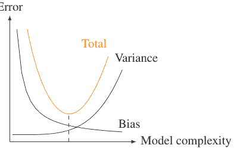

图 2.18: 方差与偏差及其对网络误差影响的定性描述。过于简单以至于无法捕获底层真实模型的模型通常表现出高偏差和低方差；它们发生欠拟合。相比之下，过于复杂的模型可能具有低偏差和高方差，因此发生过拟合。基于 [186]。

#### 2.4.1.3 训练与反向传播

神经网络的基本训练过程基于迭代优化，如图 2.19 所示。

多层 ANN 的训练通常与 SLP 的训练类似，SLP 在公式 (2.95) 和 (2.96) 中作为差分规则引入。通过激活的前向传播产生输出在上一节中已介绍。但是，在大多数现代前馈网络中，涉及第二个训练阶段，其中错误在所谓的 *反向传播* 中向后传播。[177] 这种基于链式法则的监督学习的高效应用由 Linnainmaa [190] 引入，并由 Werbos [191] 和 Rumelhart [192] 进行了重大改进和分析。根据 Rojas 的说法，反向传播算法可分解为四个主要步骤，即前馈计算、向输出层的反向传播、向隐藏层的反向传播，最后是权重更新 [193]。当前馈计算结果可用时，对于每一对输入输出训练向量 \((\boldsymbol{x}, \boldsymbol{y})\) 中的 \(q\) 个训练向量对，都存在网络输出（即预测）\(\boldsymbol{y} = \boldsymbol{y}(\boldsymbol{w})\)。然后，需要最小化比较输出 \(\boldsymbol{y}\) 和期望目标 \(\boldsymbol{z}\) 的误差或代价函数 \(E\)

\(\min_w E = \sum_{p=1}^q E_p,\)

其中 \(E_p\) 是某种距离函数。基于欧氏距离的平方和误差（SSE）定义为

\(E_p = ||\boldsymbol{z}_p - \boldsymbol{y}_p||^2,\)

是一种广泛应用的误差函数。[194]

$E$ 仅通过节点函数的复合计算得到，从而构成关于 $l$ 个网络权重 \(\{w_1, w_2, ..., w_l\}\) 的连续可微函数。为了最小化此误差，使用梯度下降的迭代过程，为此必须确定误差函数的梯度，由以下公式给出

\(\nabla E = \left( \frac{\partial E}{\partial w_1}, \frac{\partial E}{\partial w_2}, \dots, \frac{\partial E}{\partial w_l} \right). \quad (2.106)\)

随后，可以通过沿梯度下降方向按以下方式增量调整权重

\(\Delta w_i = -r_1 \frac{\partial E}{\partial w_i}, \quad i=1, 2, \dots, l, \quad (2.107)\)

其中学习率 \(r_1\) 定义每次迭代的步长。此过程重复有限次步骤，始终选择最陡下降的校正路径，直到找到误差函数的最小值（\(\nabla E = 0\)）或实现误差函数的满意降低。[193]

这种所谓的 *广义差分规则* [194] 在图 2.20 中有所描绘。

经典反向传播的缺点包括收敛速度慢以及对所选参数（如初始权重，尤其是学习率）的强烈依赖。此外，真实的误差曲面并不像图 2.20 中的简化形状那样，而是通常表现出峡谷状特征和许多凹坑状局部最小值 [173]。这可能导致反向传播将网络训练到一个可能无法逃脱的局部最小值。但是，在实践中，达到全局最小值并不总是必要的，只要找到一组对于当前应用足够准确的权重即可。[173, 195]


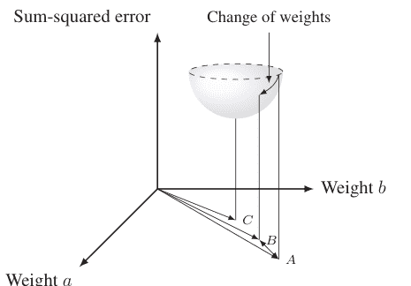

图 2.20：2D 权重的理想化碗状误差曲面，权重沿着通向底部 C 的最陡路径变化，C 为所需最小值（当前权重位于点 A，校正后的权重位于 B）。基于 [173]。

#### 2.4.1.4 优化算法

尽管已经开发出多种用于最小化损失函数的优化算法，但本节将简要介绍其中两种：随机梯度下降（SGD）和 ADAM 优化器。选择的依据是，这两种算法在常见问题上表现良好，且是最广泛使用的算法之一。此外，在本工作实现的三种不同网络中，一种采用 SGD，另外两种采用 ADAM。

**随机梯度下降（SGD）** 基础梯度下降最早由 Cauchy [196] 提出，已在前一节 2.4.1.3 的公式 (2.106) 和公式 (2.107) 中介绍，此处为完整起见再次汇总：

```
$w_{i+1} \rightarrow w_i - r_1 \nabla E(w_i).$ (2.108)
```

需要注意的是，在学习率非恒定的情况下 \( r_1 = r_{1,i} \) [197]。它有时也被称为批量梯度下降，因为它是在整个训练集上执行的优化方法，需要高计算开销 [197, 198]。相比之下，存在随机优化方法，其中 SGD 最早由 Robbins 和 Monro [199] 描述，并在 Kiefer 和 Wolfowitz [200] 中以更接近当今深度学习中 SGD 的形式提出，是最突出的代表 [197]。SGD 在每个训练样本 \( x_i, y_i \) 上执行权重更新：

```
\( w_{i+1} \rightarrow w_i - r_1 \nabla E(w_i, x_i, y_i) \quad [198], \quad (2.109) \)
```

这可以被视为实际完整梯度的随机估计。由于计算需求降低，SGD 通常能实现快速迭代，代价是收敛率较低 [197]。然而，在当今实践中，通常既不使用纯随机优化方法，也不使用纯批量优化方法，因为 SGD 可以在随机选择的数据子集上使用，或使用所谓的*小批量*（mini-batches），且没有限制 [197]。它大多仍被称为 SGD [198]，或有时称为小批量梯度下降。

**ADAM 优化器** 深度学习中最常用的优化方法之一是 Kingma 等人于 2014 年提出的自适应矩估计（ADAM）[201, 202]。它是一种基于自适应低阶矩估计的一阶梯度优化算法 [201]。尽管 ADAM 优化器有多种不同的定义 [202]，但下面将介绍 [201] 中的原始算法（算法 1）的伪代码。

实证结果表明，ADAM 优化器在训练成本方面优于许多其他已知优化器（如 "AdaGrad" 或 SGD），无论是在逻辑回归、多层全连接神经网络还是深度卷积神经网络中 [201]。其局部收敛性已被证明 [202]。如需更多信息，请参阅原文 [201]。

```
**Algorithm 1** Pseudo code for ADAM optimizer computation. The proposed parameter settings are \(r_1 = 0.001, (\beta_1, \beta_2) = (0.9, 0.999)\) and \(\epsilon = 10^{-8}\). Slightly modified from: [201].

**Require:** \(r_1\): Step size (i.e. learning rate)
**Require:** \(\beta_1, \beta_2 \in [0, 1)\): Exponential decay rates for estimating the moments
**Require:** \(f(\theta)\): Stochastic objective function with parameters \(\theta\)
**Require:** \(\theta_0\): Initial parameter vector
\(m_0 \leftarrow 0 \quad \triangleright\) Initialisation of first moment vector
\(v_0 \leftarrow 0 \quad \triangleright\) Initialisation of second moment vector
\(t \leftarrow 0 \quad \quad \quad \quad \triangleright\) Initialisation of time step
**while** \(\theta_t\) not converged **do**
    \(t \leftarrow t + 1\)
    \(g_t \leftarrow \nabla_\theta f_t(\theta_{t-1}) \quad \triangleright\) Obtain gradients w.r.t. the stochastic objective at time step \(t\)
    \(m_t \leftarrow \beta_1 \cdot m_{t-1} + (1 - \beta_1) \cdot g_t \triangleright\) Update biased first moment estimate
    \(v_t \leftarrow \beta_2 \cdot v_{t-1} + (1 - \beta_2) \cdot g_t^2 \triangleright\) Update biased second moment estimate
    \(\hat{m}_t \leftarrow m_t / (1 - \beta_1^t) \triangleright\) Compute bias-corrected first moment estimate
    \(\hat{v}_t \leftarrow v_t / (1 - \beta_2^t) \triangleright\) Compute bias-corrected second moment estimate
    \(\theta_t \leftarrow \theta_{t-1} - r_1 \cdot \hat{m}_t / (\sqrt{\hat{v}_t} + \epsilon) \triangleright\) Update parameters
**end while**
**return** \(\theta_t \quad \quad \quad \quad \quad \quad \triangleright\) Resulting parameters
```

#### 2.4.1.5 常用激活函数

已经提到过，激活函数必须是非线性的，才能使模型能够学习复杂的相关性。存在多种不同的激活函数并已被使用，下面将介绍其中一些主要函数。一般来说，激活函数定义为一个函数 \(h : \mathbb{R} \rightarrow \mathbb{R}\)，它在几乎到处都是连续可微的（反向传播的要求）[203]。

单个隐藏单元 \(h^{(l)}\) 的激活值由下式给出：

```
\(h^{(l)} = \sigma(u) = \sigma(\boldsymbol{w}^{(l)^\top} \boldsymbol{x}),\) (2.110)
```

其中，\(\sigma\) 为相关联的激活函数，\(\boldsymbol{w}^{(l)}\) 为对应的权重向量，\(\boldsymbol{x}\) 为输入向量（参见公式 (2.91)）[204]。

### 二阶跃函数

最接近生物神经元反应的激活函数是一个简单的二阶跃函数，其值要么为 0 要么为正，定义如下：

```
\( h^{(l)} = \left\{ \begin{array}{ll} 1 & \text{if } \boldsymbol{w}^{(l)\top} \boldsymbol{x} \ge 0, \\ 0 & \text{if } \boldsymbol{w}^{(l)\top} \boldsymbol{x} < 0, \end{array} \right. \) (2.111)
```

如图 2.21 所示。

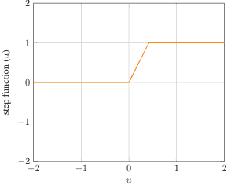

图 2.21：二阶跃函数。

### Sigmoid 函数

Sigmoid 函数是有界且可微的函数，是非递减的且恰好有一个拐点 [205]。下面简要介绍两种 Sigmoid 函数：逻辑 Sigmoid 函数（有时仅称为 Sigmoid 函数）和双曲正切函数。

逻辑 Sigmoid 函数定义如下：

```
h^{(l)} = \frac{1}{1 + \exp(-w^{(l)^\top}x)},
(2.112)
```

它将介于 $(-\infty; \infty)$ 之间的任何输入映射到范围 $[0; +1]$，因此可以被视为二阶跃函数的平滑版本 [205]。虽然二阶跃函数在 $x=0$ 处不可微，但逻辑函数在其整个定义域上可无限次求导 [205, 206]。由于其将实数值“压缩”到有限区间的效果，它们有时被称为压缩函数（参见图 2.22）[205]。因此，它们可能会遭受梯度消失的问题，尤其是在深层网络中 [206, 207]。因此，逻辑 Sigmoid 函数常用于较浅的网络，或常用于网络的输出层，因其值分布 [206]。

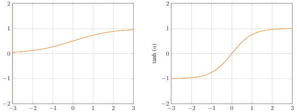

图 2.22：Sigmoid (a) 逻辑和 tanh (b) 激活函数。

作为进一步的发展，类似的双曲正切函数由以下公式给出：

```
\tanh(u) = 2\text{sigmoid}(2u) - 1,
(2.113)
```

这给出了以下激活函数：

\( h^{(l)} = \frac{2}{1 + \exp(-2w^{(l)^\top} x)} - 1 \quad [206, 207]. \quad (2.114) \)

将输入值限制在 [-1; +1] 范围内（参见图 2.22(b)），其导数比逻辑函数更陡，但仍然会遭受梯度消失问题 [207]。一般来说，Sigmoid 函数的梯度在两端趋近于零，因此属于软饱和：

\( \lim_{x \to +\infty} \sigma'(u) = 0, \quad \lim_{x \to -\infty} \sigma'(u) = 0 \quad [206]. \quad (2.115) \)

同样，双曲正切函数也主要用于输出层，尤其是在输入值被映射到 -1 到 1 之间的情况下 [206]。

### 整流线性单元（ReLU）和漏整流线性单元

受神经科学启发，Nair 等人 [208] 于 2010 年最初为受限玻尔兹曼机提出了 ReLU 作为一种分段线性激活函数，此后它已成为最常用的激活函数之一 [207]。与先前展示的函数不同，ReLU 是一种非饱和函数，能够实现高收敛速度并避免梯度消失 [209]。该函数可表示为

\( h^{(l)} = \max(w^{(l)^\top} x, 0) = \begin{cases} w^{(l)^\top} x & \text{if } w^{(l)^\top} x \ge 0, \\ 0 & \text{if } w^{(l)^\top} x < 0, \end{cases} \quad (2.116) \)

如图 2.23 左侧所示。缺点包括最初未被激活的神经元单元会“死亡”，因为其权重不会被更新，以及梯度持续为零时训练过程缓慢 [204, 206]。


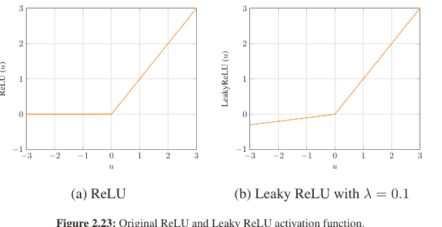

正因为如此，Maas et al. 引入了 Leaky ReLU 作为标准 ReLU 函数的改进，其定义为

```
\( h^{(l)} = \max(w^{(l)\top} x, 0) = \begin{cases} w^{(l)\top} x & \text{if } w^{(l)\top} x \ge 0, \\ \lambda w^{(l)\top} x & \text{if } w^{(l)\top} x < 0 \quad [204]. \end{cases} \quad (2.117) \)
```

如右图所示，图 2.23 中的 Leaky ReLU 函数斜率按原始论文 [204] 的建议设为 \(\lambda = 0.01\)。当单元饱和且不活跃时，漏整流器允许存在小的非零梯度，而标准 ReLU 激活函数则不允许 [204]。牺牲 ReLU 所谓的硬零稀疏性（hard-zero sparsity）可在优化过程中获得潜在更稳健的梯度 [204]。

#### 2.4.1.6 层的类型

增加层数以改进网络的效果是有限的，因此开发了此前介绍的全连接层（也称为线性层）的替代方案。下面简要说明了一些在本工作所用网络中最重要的层类型。在某些情况下，特定类型层的使用也决定了网络的名称，例如，具有一个或多个卷积层的 ANN 将成为 CNN。

**脱落层** 由 Hinton et al. 于 2012 年引入，脱落层可用于 ANNs 以防止过拟合并实现对网络架构选择的更强鲁棒性 [210]。脱落层是指在一个 epoch 中随机选择的一定比例神经元被忽略，暂时移除与其他单元的所有连接。该方法部分动机或至少与这一事实相关：与无性生殖相比，有性生殖过程中协调基因集的打破使得更高级的生物体进化而来，从而随着时间的推移提高了剩余单元的鲁棒性 [211]。示例见图 2.24。

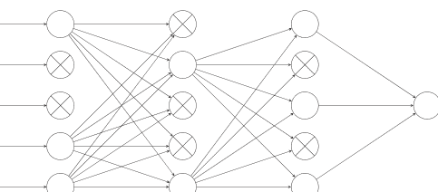

图 2.24：稀疏脱落神经网络模型，其中被划掉的单个单元被丢弃。基于 [212]。

脱落的一个缺点是由于其随机性导致训练时间增加两到三倍。这主要源于每次训练不同的随机架构，因为丢弃的单元在每次迭代中都会变化。与所有网络一样，带有脱落层的 ANNs 需要进行大量的超参数调优，且对网络大小（即层数）、更高的学习率等提出了更高要求 [212]。

**批量归一化** 批量归一化，由 Ioffe 和 Szegedy 于 2015 年提出 [213]，是指对网络中每一层的输入进行归一化（并且对每个小批量重复此过程），而不仅仅是输入层。它可以包含在反向传播中 [213]。批量归一化允许使用更高的学习率，将训练过程加速多达 14 倍 [213]，因为消除了每层输入分布的变化。它还降低了对初始超参数仔细选择的重要性。虽然其影响可与脱落层相媲美（脱落层可由其替代），但其额外的正则化效果在某些情况下可能完全消除对脱落层的需求。[213, 214]

**卷积层** 卷积在连续情况下定义如下：

```
$(f * g)(t) := \int_{-\infty}^{\infty} f(x)g(t-x)dx \quad \text{[215].} \quad (2.118)$
```

两个函数 $f$ 和 $g$ 的卷积可以理解为将函数 $g$ 沿 y 轴镜像，随后添加时间偏移 $x$，最后将函数 $g$ 从 $-\infty$ 滑动到 $\infty$。在此过程中它会经过函数 $f$。每当两个函数相交时，会计算它们乘积的积分，即由函数 $g$ 加权的函数 $f$ 下的面积。卷积具有交换性。

在神经网络的背景下，卷积层作为任何 CNN 的基本组件，由 LeCun et al. 引入 [216]，用于执行所谓的特征提取。它们通常由线性卷积和非线性激活函数的组合构成。在此方面，采用卷积的离散定义（将积分改为求和并在有限序列上操作）。它可以理解为一小串数字（称为内核或滤波器）在输入张量上滑动。通过将内核和输入的每个元素逐项相乘，然后将这些乘积相加，可以得到所谓的特征映射（参见图 2.25）。

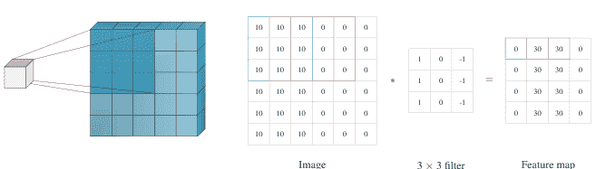

图 2.25：神经网络中卷积层的示意图。将具有特定内核大小（本例为 3 x 3）的滤波器应用于原始图像，以获得所谓的特征映射。特征映射之所以得名，是因为使用这种方法可以保留甚至增强图像中最重要的特征，而与原始图像相比尺寸会减小。

尤其是当对不同滤波器内核重复此过程时，输入图像的特征或属性会被增强并捕获。卷积层的输出通常尺寸会减小。如果不需要这种情况，则会应用所谓的填充（padding，通常为零填充，即在输入张量的每一侧添加零行和零列），以便在卷积操作过程中保持相同的平面尺寸。如果相反地，希望减小尺寸，则另一个影响最终输出大小的参数——步长参数（stride parameter）发挥作用，它定义了两个连续内核位置之间的距离。[217] 将步长设置为大于一可以减少重叠，但也可能导致棋盘状伪影，尤其是当输出窗口和内核的大小不是步长的倍数时 [218]。应用池化层以进一步减小输出尺寸的替代方案将在下一段中讨论。

最终输出大小可按以下公式计算：

```
O = 1 + \frac{N + 2P - F}{S}, \quad (2.119)
```

其中图像维度为 $N \times N$，滤波器维度为 $F \times F$，步长为 $S$，填充厚度为 $P$ [219]。例如，在图 2.25 的情况下，取 $N = 6, P = 0, F = 3$ 和 $S = 1$，输出尺寸为 4。

隐藏卷积层的输出向量 $\boldsymbol{h}^{(l)}$ 可类似于 MLP 的方程，并使用卷积的离散定义（参见公式 (2.103)）按如下方式计算：

```
$$h_i^{(l)} = \sigma \left( \sum_{i \in M_j} h_i^{(l-1)} * W_{ij}^{(l)} + b_j^{(l)} \right), \quad (2.120)$$
```

其中 $M_j$ 是输入映射的选择 [220, 221]。权重 $W_{ij}$ 通过反向传播和随机梯度下降进行更新，方式与之前介绍的全连接层相同 [221]，内核值是唯一需要学习的参数（而其大小、填充、步长等是预先设置的超参数）[217]。逆操作在某些 CNN 以及深度卷积生成对抗网络（DCGANs）中使用；这些层随后称为反卷积层。

**池化层** 池化层用于减小平面维度。它们还引入了对图像中小平移和失真的更高平移不变性，并减少了后续可学习参数的数量。应当强调，与卷积层不同，任何池化层中都没有可学习参数。[217] 图 2.26、图 2.27 和图 2.28 展示了本工作中 CNN 使用的一些常见且自解释的池化操作。

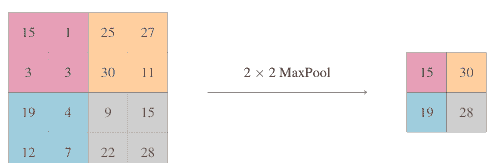

图 2.26：最大池化层的描绘。

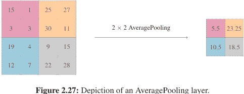

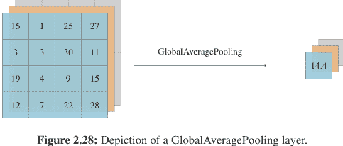

### 2.4.2 生成对抗网络

生成对抗网络（GANs）由 Goodfellow et al. [143] 于 2014 年引入，此后被认为是 AI 科学领域最重大的发现之一 [222]，这一点从原始论文至今已有超过 78,000 次引用 [223] 便可看出。仅在 2020 年，就发表了约 28,500 篇与 GANs 相关的论文，相当于每天约 78 篇，即每小时超过三篇 [222]。GANs 的主要功能是在给定训练图像数据集上训练后，生成看起来逼真的图像 [143]。可能的应用领域范围从 3D 对象生成、医学、大流行病（主要在 COVID-19 期间）、图像处理、人脸检测和文本转换到交通控制及更多 [224]。在这些应用领域中，GAN 的功能不仅限于图像本身的生成，还包括降噪、分类、人体运动检测、从 2D 图像生成 3D 图像、人脸识别或图像超分辨率 [224]。经过缓慢的起步阶段，GANs 也在材料科学领域站稳了脚跟。它们已被用于


用于材料逆化学设计 [225, 226]、用于材料数据挖掘的显微图像数据增强 [227]、钢材虚拟微观结构设计 [228]、混凝土抗压强度预测（使用表格 GANs）[229] 或多孔铝泡沫合成图像生成 [230]。关于 GAN 与 FRP 相关的研究相对较少。相关论文可见关于玻璃纤维增强复合材料 μCT 图像的 3D 修复 [231]、利用同步辐射 CT 图像超分辨率进行单向碳纤维增强聚合物纤维断裂分析 [232]、各种微观结构二维切片生成 3D 结构 [233] 以及单向纤维增强复合材料逼真二维横截面微观结构生成 [234]。上述来源带来希望，即 GAN 也代表与不连续碳纤维增强 CT 扫描相关的微观结构生成的一种严肃选项。

#### 2.4.2.1 基本理论

**纳什均衡** GAN 的原初想法源自博弈论的一个核心概念 [235]。它基于两名独立行动、不进行沟通且试图改进自身收益的两人零和博弈，其中一名玩家的收益恰好是另一名玩家的损失，导致双方利益总和为零 [235, 236]。在这种优化过程中（也称为极小极大博弈 [143, 235]），目标是达到所谓的纳什均衡，约翰·纳什在 1950 年证明在任何遵循这些标准的无限博弈中该均衡都存在 [236]。在这个均衡点，任何一方单方面改变策略都不会对任一玩家有益。

受此概念启发，Goodfellow 等人 [143] 描述的传统 GAN 由两个相互竞争的神经网络组成，一个被称为 *生成器*，另一个被称为 *判别器*。生成器试图捕捉给定真实训练数据的分布，并创建能够模仿真实样本的新样本。与此同时，作为二元分类器的判别器旨在尽可能准确地区分真实样本和生成样本。在竞争驱动下，生成器和判别器都需要不断改进才能赢得比赛 [143, 237]。在原始论文中，该过程被比作伪造者（生成器）制造假币和警察（判别器）试图识别假币 [143]。一旦达到纳什均衡的鞍点，这种对抗性训练就结束，并且认为生成器已正确估计了真实数据分布 [222]。在现实中，考虑到目标函数非凸、参数连续且参数空间高维 [238]，要达到纳什均衡非常具有挑战性。尽管如此，GANs 已取得卓越成果，并且一旦训练得当，能够生成理论上无限的数据，这尤其令人印象深刻。

### 传统 GAN 结构

图 2.29 展示了基本 GAN（也称为香草 GAN）的结构流程图。其中，生成器 G 从预先定义的噪声函数（如高斯分布）接收噪声样本 z，并输出生成的样本 G(z)。这些样本与来自真实数据分布的样本一起提供给判别器 D，后者尝试通过将检测为生成的数据标记为零、将检测为真实的数据标记为一来对数据进行分类。在判别器反馈和实际真实标签的基础上，可以计算损失函数，并基于此使用反向传播更新生成器和判别器网络的权重。

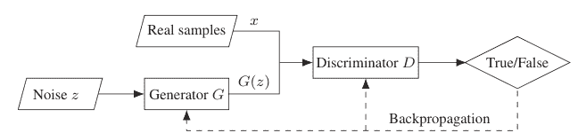

图 2.29：Goodfellow 等人提出的香草 GAN 基本结构流程图。基于 [235]。

在香草 GAN 中，生成器和判别器都是带有可训练参数 \(\theta\) 的普通多层感知机 [143]。值函数 \(V(G, D)\) 用于评估训练成本。在训练过程中，只更新一个模型的参数，而另一个模型的参数保持固定 [239]。

代表生成器 \(G\) 的 MLP 是具有参数 \(\theta_G\) 的可微函数。为了学习真实数据 \(\boldsymbol{x}\) 上的分布 \(p_g\)，需要将输入噪声变量 \(p_z(\boldsymbol{z})\) 映射到数据空间 \(G(\boldsymbol{z}, \theta_G)\)。代表判别器的第二个 MLP \(D(\boldsymbol{x}, \theta_D)\) 输出单个标量。\(D(\boldsymbol{x}) \in [0, 1]\) 描述了 \(\boldsymbol{x}\) 来自训练数据而非生成器分布 \(p_g\) 的概率 [143]。因此，生成器被训练以最大化概率 \(D(G(\boldsymbol{z}))\) 或最小化 \(\log(1 - D(G(\boldsymbol{z}))\)，在判别器固定时得到以下生成器训练方程：

\(\min_G V(D, G) = \mathbb{E}_{\boldsymbol{z} \sim p_z(\boldsymbol{z})} [\log(1 - D(G(\boldsymbol{z})))] \ [143]. \quad (2.121)\)

期望算子 \(\mathbb{E}\) 表示特定分布函数的期望值 [179]。参数 \(\theta_G\) 通过基于该方程计算并随后下降随机梯度来更新 [143]。

判别器从未知输入分布 \(p_{\text{data}}(\boldsymbol{x})\) 和（在判别器训练时）固定的生成器样本中获取样本。因此，值函数由以下给出：

\(\max_D V(D, G) = \mathbb{E}_{\boldsymbol{x} \sim p_{\text{data}}(\boldsymbol{x})} [\log D(\boldsymbol{x})] + \mathbb{E}_{\boldsymbol{z} \sim p_z(\boldsymbol{z})} [\log(1 - D(G(\boldsymbol{z})))] \ [143]. \quad (2.122)\)

判别器参数通过基于该方程上升随机梯度以类似方式更新。

Goodfellow 等人进一步证明，全局最优仅在 \( p_{data} = p_G \) 时达到，即输入数据分布与生成器学习到的分布相匹配时。在这种情况下，\( D(x) = \frac{1}{2} \) 成立，这会导致训练过程中的退化 [143]。

结合方程 (2.121) 和方程 (2.122) 得到 GAN 优化的以下极小极大博弈：

```
\(\min_G \max_D V(D, G)\)
\(= \mathbb{E}_{x \sim p_{data}(x)} [\log D(x)] + \mathbb{E}_{z \sim p_z(z)} [\log (1 - D(G(z)))] .\)
(2.123)
```

\(\log (1 - D(G(z)))\) 给出了 \([0 \ 1]^T\) 和 \([D(G(z)) \ 1 - D(G(z))]^T\) 之间的交叉熵。交叉熵由 Rubinstein [240] 在 1997 年提出，是衡量概率分布模型质量的一种指标。正如名称所暗示的那样，它使用交叉熵或 Kullback–Leibler 散度作为两个采样分布之间接近程度的度量 [241]。类似地，\(\log D(x)\) 给出了 \([1 \ 0]^T\) 和 \([D(x) \ 1 - D(x)]^T\) 之间的交叉熵。因此，值函数 \(V(G, D)\) 是一个二元交叉熵（BCE）函数，常用于二元分类问题 [238]。实际上，任何单调递增函数都可以替代对数函数 [242]。

介绍完方程后，训练程序应该已经变得明显：判别器接收一批生成器样本和一批真实样本。然后，上升判别器方程的随机梯度以更新判别器。生成器接收噪声样本并下降生成器方程的随机梯度，以此类推。相应的伪代码可从 [143] 获取。理论上，判别器每次迭代可以更新 \(k\) 次，而生成器只更新一次，但在原始论文中，他们使用了最低成本且目前最常用的选项，即 \(k = 1\)。


如果判别器在学习早期阶段过于优秀，log (1 – D(G(z))) 将会饱和。这个问题可以通过训练生成器来最大化 log D(G(z)) 来解决，这在早期学习中提供了更强的梯度。[143]

训练 GAN 时已经提到的熟悉困难源于这样一个事实：由于 Equation (2.123) 中的极小极大博弈，对抗网络的最优权重对应于损失函数的鞍点，而不是其极小值（这是常规 ANNs 的情况）[242]。该问题在图 2.30 中得到可视化。

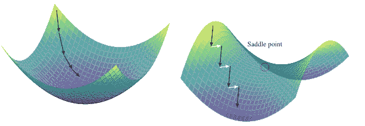

**(a) 标准 ANN**   **(b) 对抗网络**

**图 2.30:** 标准神经网络 (a) 和对抗网络 (b) 的梯度方法示意图。经典损失函数从下方有界，这意味着沿着梯度通常会导致一个极小值，方法在那里停止。与此相反，对抗网络的损失函数可能从下方无界，训练在最小化步骤和最大化步骤之间交替进行。如果这两者不平衡，解路径可能会“滑出”损失表面，永远无法到达所需的鞍点，使算法不稳定，并导致网络突然“崩溃”。基于 [242]。

鞍点问题的解通过交替随机梯度方法确定，在下降步骤和上升步骤之间切换。通常，梯度由自动求解器（如已经介绍的 ADAM 优化器）进行更新。[242]

#### 2.4.2.2 训练 GAN 时常见的挑战

除了不收敛的一般问题之外，训练 GAN 时还有特定的典型挑战，其中两项将在以下段落中详细阐述。这些问题主要源于每个模型都试图抵消另一个模型的影响 [243]。解决其中一个问题不一定能带来成功，因为这些不同的挑战可能并行发生或在训练过程的不同阶段出现 [244]。

**模式崩溃** 第一个常见挑战是所谓的模式崩溃，也称为灾难性崩溃，这意味着生成器创建的输出数据非常相似且缺乏多样性 [244]。当判别器陷入局部最优时，就会发生模式崩溃 [244]。通常，生成器随后可以生成一个判别器识别为真实的现实数据样本，并将坚持使用它；牺牲了生成与训练数据分布相似的数据分布的目标。或者，生成器只学习了特定的、有限的模式子集，有时这被称为部分模式崩溃 [238, 245]。判别器函数在局部平衡附近的真实数据点周围通常表现出陡峭的梯度 [246]，因此判别器梯度对许多相似点指向相似方向（判别器过拟合）（参见图 2.31）。由于判别器独立处理每个生成的图像，梯度之间没有交互（也称为灾难性遗忘 [247]）。因此，生成器没有被告知要使其输出多样化。[248]

避免模式崩溃的一种可能解决方案是使用前面提到的小批量判别，其中判别器一次接收多个图像而不是单个图像 [248]。此外，提出了多种 GAN 的进一步发展，例如深度卷积 GANs [250]，通过使用不同的网络结构、新的目标函数或不同的训练算法来解决这个问题。一些重要的特定类型在第 2.4.2.3 节中提到。

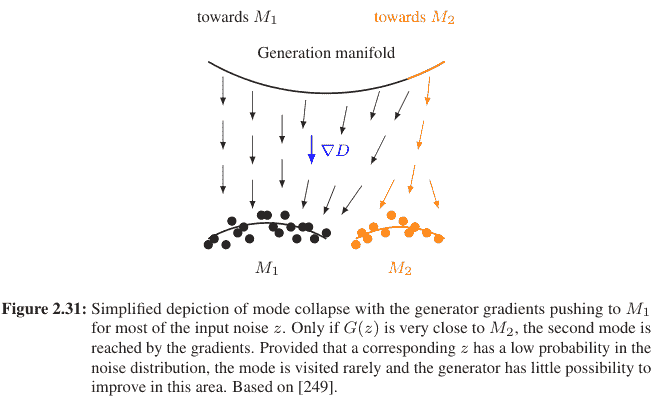

**梯度消失** 如果判别器在将假图像分配为零、将真图像分配为一的工作上过于出色，生成器梯度将趋近于零。这种行为称为梯度消失，阻碍了训练进展。它通常出现在判别器已经接近最优解时。[238, 244] 可以例如通过使用 Wasserstein 距离作为计算 GAN 损失的替代方法来解决（参见第 2.4.2.3 节）[251]。

#### 2.4.2.3 其他类型的 GANs

在本节中，介绍了原始 GAN 思路的流行改编的一个简短、绝非全面的列表。

由 Arjovsky 等人 [251] 首先描述，Wasserstein GAN (WGAN) 与原始 GAN [143] 具有相同的结构，但使用 Wasserstein 距离（也称为 Earth Mover 距离）来计算生成器和判别器损失 [235, 252]。它旨在解决梯度消失问题 [235]，但也可能本身显示出生成样本图像质量差或收敛失败的问题。这由 Gulrajani 等人 [253] 通过添加梯度惩罚进行了改进，引入了 WGAN-GP。

由 Radford 等人 [250] 在 2016 年引入的 DCGANs 不仅由全连接层组成，而且在生成器中具有反卷积层（更准确地称为转置或分数步长卷积），在判别器中具有卷积层。这也是本工作中使用的 GAN 类型。虽然基本结构相同，但 DCGANs 通常在隐藏层中包含批量归一化，允许更深的梯度传播，因为生成器崩溃的风险降低了。为了避免梯度的稀疏选择，生成器中使用 ReLU 激活（输出层除外，输出层使用 tanh），而判别器中选择 Leaky ReLU 激活，输出层使用 sigmoid 激活。[179]

由 Mirza 等人 [254] 在 2014 年描述的条件 GANs (cGANs) 通过添加通常为相应标签的离散辅助信息作为另一个输入层，对生成器和判别器进行条件约束。这使得训练好的生成器可以根据请求的标签输出结果，而不是生成随机输出。[254] 在连续变量的情况下，给定的额外输入信息可以分为单独的类别。在那种情况下，Ding 等人开发的连续条件 GAN (CcGAN) 可能是另一种选择 [255]。

cGAN 的另一种扩展是由 Chen 等人 [256] 在 2016 年引入的信息最大化 GAN (InfoGAN)。

### 2.4.3 材料科学中的神经网络

AI 正在渗透到所有科学领域；材料科学也不例外。除了已经使用一段时间的经典 ML 算法之外，神经网络越来越多地被使用，并在更复杂的尺度（多层）上被归类为 DL。它们可用于预测机械性能 [257]、焊接特性 [258]、裂纹扩展 [259] 和晶体结构 [260]，以及分类表面缺陷 [261]、断裂表面 [261, 262] 和微观组织 [263, 264]，或分割相分数 [265]、晶界 [266] 或析出相 [267]。深度学习还可以在材料科学中发挥作用，用于物体识别 [263]、裂纹检测 [25]、从透射电子显微镜 (TEM) 或扫描电子显微镜 (SEM) 图像中提取特征 [268]，或创建数字孪生 [269]。另一种技术是通过超分辨率 (SR) 网络提高图像分辨率，该技术在材料科学中已断续使用 [270]，但也正在商业可用软件中出现。GANs 在材料科学中的应用已在前面的第 2.4.2 节中详细阐述。

在本工作中，实现并评估了三种神经网络。一种用于张量插值的较经典 ANN，一种用于从 3D 扫描中确定 FVC 的 CNN，以及一种用于生成逼真 2D CT 图像的 DCGAN。

# 3 材料与方法

方法章节首先讨论材料和 CT 扫描，它们是本论文所有调查的基础。然后解释了用于检查塑化物的方法。接着是描述确定纤维体积含量、纤维长度分布和纤维取向分布的方法。在解释纤维取向张量的插值之后，本章最后详细阐述了用于人工图像生成的生成对抗网络。

## 3.1 材料与工艺

以下内容介绍了材料组成成分，以及用于生产最终复合材料的工艺、试样的尺寸和提取点，以及背后的考虑。

### 3.1.1 聚酰胺 6

PA6 有时也称为聚己内酰胺、Perlon 或尼龙 6，是聚酰胺组中的一种热塑性、半结晶聚合物。数字 6 之所以被赋予，是因为分子链中氮原子之间有六个碳原子。化学式为 (C₆H₁₁NO)ₙ。与大多由缩聚反应形成的其他聚酰胺不同，PA6 是通过 ε-己内酰胺的环开聚合反应合成的（参见图 3.1）。


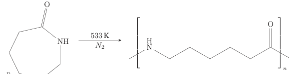

图 3.1: 通过 ε-己内酰胺开环聚合合成聚酰胺 6 的示意图。ε-己内酰胺在氮气惰性气氛中加热至约 533 K - 553 K，持续数小时，直至环开裂并发生聚合。最初需要少量水，因此该合成工艺也称为水解聚合。但是，也有其他替代合成工艺。基于 [271]。

PA6 的熔化温度约为 222 °C，玻璃化转变温度在 50 °C 至 60 °C 之间，密度为 1.14 g/cm³。在 50% 相对湿度下吸湿率为 3%，在水中吸湿率甚至高达 9.5%，PA6 可吸收相当高的水分。[271] 水在 PA 中起增塑剂作用，使玻璃化转变温度在完全干燥和最大吸水之间降低约 50 °C。[272] 此外，剪切模量和弹性模量取决于温度，这与热塑性材料的典型特征一致。[272] 这些对气候和环境条件的依赖性加剧了工程师在使用 PA6 进行设计和表征材料行为时的工作。

在本具体工作中，使用的 PA6 基体材料是带母粒的 TECHNYLSTAR XS 1352 BL NATURAL。该材料由德国勒纳的 DOMO Chemicals GmbH 公司慷慨提供。

### 3.1.2 聚碳酸酯

为考虑基体系统选择的影响（尤其是对塑化物结构的影响），本论文中有时将聚碳酸酯用作参考系统。所用聚碳酸酯材料由德国勒沃库森的 Covestro AG 提供，型号为 Makrolon 2405 PC。

### 3.1.3 碳纤维

碳纤维是一种细长（直径通常约 5 μm - 7 μm）且主要由碳原子组成的材料。其高强度和杨氏模量归功于在制造过程中平行于纤维方向排列的石墨状平面碳结构。生产碳纤维时，原材料（也称为前驱体）大多数情况下是聚丙烯腈 (PAN)，较少情况下是粘胶或沥青，这些材料都含有长长的碳结合分子链。通过在空气中将纤维加热至 200 °C - 300 °C 对前驱体的长丝进行热稳定化后，接着是所谓的碳化步骤。在无氧气氛中将纤维加热数分钟至 1,000 °C 至 3,000 °C 之间的温度，非碳原子会从纤维中逸出。经过表面轻微氧化处理后，纤维最后涂覆一种与基体材料相容的材料。该工艺也称为施胶。[273]

本工作采用了由美国圣路易斯 ZOLTEK Corporation 提供的高强度 (HT) 碳纤维 PX 35，带有适用于 PA6 的施胶剂。根据相应的数据表，制造商声明碳含量为 95%，密度为 1.81 g/cm³，直径为 7.2 μm，杨氏模量为 242 GPa，抗拉强度为 4,137 MPa，断裂伸长率为 1.7%。tex 号为 3750。

### 3.1.4 玻璃纤维

玻璃纤维由美国丹佛的 Johns Manville Corp 提供。类型为 StarRov © 895 2400，tex 号为 2400。然而，在本工作中它们仅起次要作用，因此不再提供进一步的机械参数。

### 按方法澄清材料使用情况

在此应明确，本工作的主要研究材料是碳纤维增强聚酰胺 6。只有在下面详细说明的个别情况下，才会使用其他纤维或基体材料进行比较。在塑化物检测中，为了更好地理解 CF-PA6 材料的特性（例如孔隙率增加），还包括了 GF-PA6 和 GF-聚碳酸酯。在纤维体积含量检测中，仅使用 CF-PA6，因为与玻璃纤维的材料组合开发方法几乎没有潜力，因为 FVC 测定在那种情况下即使以非破坏性方式也能相当可靠地工作。使用了来自板 2 和板 3 的试样，如图 3.4 所示。相关研究已发表在 [188]。至于纤维取向测定，研究了 CF-PA6、GF-PA6 和混合 CF-GF-PA6。使用了来自板 3 (CF-PA6)、板 4 (GF-PA6) 以及带有相同切割模式的混合 CF-GF-PA6 板的试样，该混合板在此论文中未明确显示。GF-PA6 的方法已由 Bertram 和 Pinter [79] 实现，针对另外两种材料类型所需的轻微调整在方法部分的相应第 3.6 节中解释。关于张量插值，最初仅考虑 CF-PA6，因为各种方法基于此进行评估。仅使用了来自板 1 (图 3.4) 的试样。这些结果已发表在 [17]。确定的 CF-PA6、GF-PA6 和混合 CF-GF-PA6 的取向张量及其插值被考虑用于 Mori-Tanaka 和 Halpin-Tsai 以及与实验值的相应比较。这些样本和板对应于纤维取向测定上下文中提到的那些。这些结果已发表在 [274]。对于 GAN，再次仅使用了 CF-PA6 样本，即来自板 3 和另一块未印刷的纯 CF-PA6 板，具有相同的切割模式，但塑化物衬垫旋转了 180°。这一决定是因为在准备本工作过程中，发现的偏斜流前被视为工艺错误，而非值得描绘的理想工艺特性。通过使用塑化物插件反转的板，训练数据集在这方面在某种程度上可以中和。这些研究已发表在 [275]。

### 3.1.5 LFT-D 制造工艺

长纤维热塑性直接 (LFT-D) 工艺在图 2.1 中以示意图形式展示。聚酰胺 6 颗粒与母粒一起在挤出机中混合，温度在 260 °C - 280 °C 之间。在第二台带有双螺杆的混合挤出机中，纤维粗纱未经切割就被引入聚合物熔体中，并由挤出机的剪切运动不规则地切断。所得的初始充填物（在本工作中也称为塑化物，其中两种类型在图 3.2(a) 和图 3.2(b) 上方显示），通过特定喷嘴排出。随后，它被直接放入压机 (Dieffenbacher)，从而避免了在其他已知 LFT 生产工艺中所需的半成品再加热。

在压机中，塑化物在所谓的压缩成型工艺中被转化为板或部件（取决于插入的模具），并同时冷却（参见图 3.3）。压机温度约为 80 °C - 90 °C。本工作中常用的板材模具尺寸为 400 mm × 400 mm，板材高度通过间隔件固定为 3 mm。这些板材正面和背面的图像可见于图 3.3 左侧。左侧塑化物的插入区域清晰可见。

应指出，塑化物的数量和几何形状以及模具中的插入位置严重影响模具充填行为。这反过来又影响部件的宏观质量，尤其是显微结构，进而影响机械性能中的各向异性和弱点。这些研究不属于本工作范围，由工艺开发人员和工艺模拟人员进行。然而，本工作的目的是通过有针对性的表征，能够对工艺过程及随后机械测试中的行为得出结论


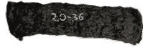

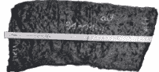

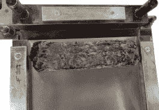

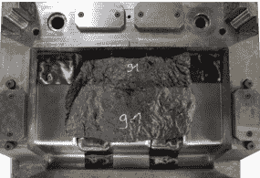

图 3.2: (a) 用于板材生产的初始坯料/塑化体（340 mm × 75 mm × 35 mm）及其在 400 mm × 400 mm 模具中的(c) 插入位置，以及(b) 用于“MaiQFast”部件（带有加劲肋的汽车底盘部件）的初始坯料/塑化体（275 mm × 175 mm × 29 mm）及其在“MaiQFast”部件模具中的(d) 插入位置（中间有两个重叠的插入塑化体，以及例如在上侧的三条带，用于额外的连续增强）。图像(b)中的比例尺不适用于所有图像，因此相应尺寸已在此图注中给出。

用于板材的微结构的定量再现。在本工作中使用的板材中，一根长度约 340 mm、宽度 75 mm、高度 35 mm 的单根较长塑化体被插入 400 mm × 400 mm 模具的左侧（见图 3.2 左侧）。应补充说明，图 3.2 图注中给出的塑化体尺寸为理论值，实际塑化体几何有时与之存在显著偏差，特别是 MaiQFast 生产中使用的较宽塑化体。

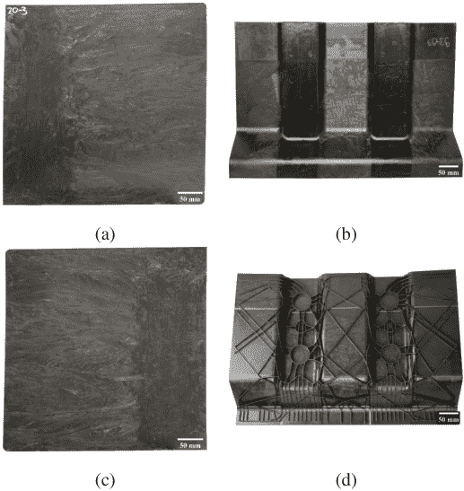

图 3.3: 本工作中使用的 400 mm × 400 mm × 3 mm CF 板在压制工艺后的正面(a)和背面(c)图像，以及尺寸为 600 mm × 400 mm 的额外连续增强“MaiQFast”部件在压制工艺后的正面(b)和背面(d)图像。

### 3.1.6 试样制备

为了在 CT 设备中检查材料，通过水刀切割从材料中切割出较小的试样。试样的尺寸和位置特别引人关注。关于试样的位置，初始坯料插入区域（通常标记为 C）、过渡区域（CF）以及由材料流动主导的区域（F）之间的差异特别引人关注。因此，在大多数情况下，从这些区域各取了三个试样，如图 3.4 (a)、(c) 和 (d) 所示。

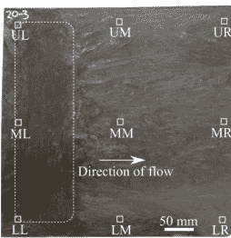

(a) 板 1

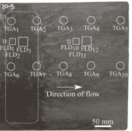

(b) 板 2

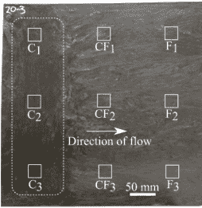

(c) 板 3

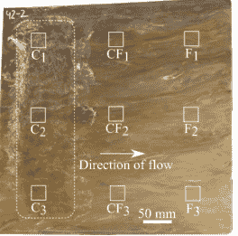

(d) 板 4

**图 3.4:** 通过水刀切割叠加在 CF 板图像（(a)、(b) 和 (c)）及 GF 板图像（d）上的不同切割方案，用于提取不同尺寸和不同位置的试样。

考虑到尺寸，很明显试样应该足够小，以便在 CT 图像中达到高分辨率，但又要足够大，以便不仅描绘非常局部的效果。多种因素影响了特定应用/评估的试样尺寸选择，因此不同方法使用了部分不同的试样尺寸（参见图 3.4）。就所需分辨率的首个问题而言：单纤维检测需要 3 个体素 - 4 个体素横跨纤维直径，即分辨率为 1 μm - 2 μm。这与合理可证明的试样尺寸不兼容，也并非必不可少，因为不依赖单纤维分割的算法是可能的。下一个方面是表示不太局部的微结构，这更难把握。因此，在将试样切割到尺寸后，由工艺产生的板材中的随机纤维长度分布仍应尽可能具有代表性地映射，这似乎是合理的。为了研究试样尺寸对 FLD 的影响，从板 2 中取了三个尺寸为 10 mm × 10 mm、20 mm × 20 mm 和 30 mm × 30 mm 的试样，既在坯料区域也在流动区域（见图 3.4）。这些样品的纤维长度是通过实验确定的，可见第 4.4 节。虽然偶尔出现显著超过 10 mm 的纤维长度，但约 0.5 mm 的峰值、约 0.48 mm 的中位长度以及基于数量的约 1.07 mm 的平均（算术平均）长度清楚地表明绝大多数纤维出现在 2 mm 以下的范围内（见图 4.15）。基于这一考虑，对于张量插值问题的开发阶段，可以证明边长为 10 mm 的初始试样尺寸是合理的，因为只有极少数纤维会被决定性地截断（见图 3.4 中的板 1）。然而，对于所有后续研究，出于多种原因选择了边长为 25 mm 的较大样品（见图 3.4 中的板 3 和板 4），原因简要总结如下。首先，为了开发插值方法，故意期望具有非常不同局部取向的各向异性张量的极端情况，因为这将确保该方法在最坏情况下也能工作。对于所有进一步评估，情况并非如此，其中要求对这种板中预期的微结构进行现实表示。此外，在两种情况下，不同尺寸的测试样品的平均纤维长度从最小样品到中间样品都有所增加，但从中间样品到最大样品并未显示出明确趋势（见图 4.16）。因此，假设样品尺寸对纤维长度分布的影响在边长 20 mm 至 30 mm 之间达到饱和。此外，测试样品的纤维体积含量也通过酸基溶解（参见第 3.4.1 节）确定，随着样品尺寸增大而增加（参见第 4.3.1 节）。用于商业系统 LECO TGA801 热重分析的可用坩埚，作为通过热解确定 FVC 的替代方法，直径为 25 mm。出于所有这些原因，随后认为边长 25 mm 是合适的。

在本工作中，除了纯 CF 增强板材（参见图 3.4 (a)、(b) 和 (c)）和 GF 增强板材（参见图 3.4 (d)）外，还零星考虑了同时含有碳纤维和玻璃纤维的杂化增强板材；特别是在可靠地从这种板材的 CT 数据中提取两个分离的纤维取向的背景下。

## 3.2 CT 扫描

下面简要说明 CT 设备、创建 CT 扫描的过程以及使用的参数。

### 3.2.1 设备

本工作中的大多数 CT 扫描是使用研究所（卡尔斯鲁厄理工学院应用材料研究所）自身的 CT 设备进行的。它是一台 YXLON-CT（Yxlon International CT GmbH, Hattingen, Germany）精密 µCT 系统，配备钨靶 µ 焦点 X 射线透射管和 PerkinElmer（Waltham, MA, USA）Y.XRD1620 平板式正方形 2048 像素（px）× 2048 像素（px）探测器。

在内部 CT 维修期间，另一台设备在卡尔斯鲁厄理工学院 wbk 生产科学研究所使用。该设备是一台 Zeiss Metrotom 800 锥束 µCT 系统，配备 PaxScan2520V 平板探测器，分辨率为 1536 px × 1920 px，因此是矩形探测器，与所使用的另一台不同。

### 3.2.2 程序

安装试样并将其放置在光路后，为扫描选择了适当的参数（参见第 3.2.3 节）。扫描过程完成后，将样品在光路中旋转生成的相应 2D 投影使用 Feldkamp 锥束算法 [154] 重建为体积图像。随后，重建的扫描在 VG Studio Max 3.4.2 中进行处理。

### 3.2.3 参数设置

为本工作中使用的不同扫描选择了不同的参数。一些最重要扫描（图 3.4 中引用的四个主要板材及试样）的参数概述如下表 3.1 所示。

**表 3.1:** 不同板材的扫描参数。板 2 的矩形试样在 Zeiss 设备上扫描，所有其他试样在 Yxlon 设备上扫描。

| 参数 | 单位 | 板 1 | 板 2 | 板 3 | 板 4 |
| :--- | :--- | :--- | :--- | :--- | :--- |
| 电压 | kV | 150 | 100 | 110 | 125 |
| 电流 | mA | 0.25 | 0.16 | 0.13 | 0.12 |
| 体素尺寸 | μm/voxel | 8.57 | 25.98 | 17.39 | 19.17 |
| Linebinning 参数 | - | 2 | - | 2 | 2 |
| 投影数量 | - | 1950 | 1450 | 2220 | 2100 |
| 曝光/积分时间 | ms | 500 | 1000 | 800 | 1000 |


## 3.3 初始料坯/塑化物的调查

显然，最终板材的微观结构特别依赖于插入塑化物的初始结构。出于这个原因，基于 CT 图像的塑化物微观结构调查最初引起了兴趣，旨在理解压制过程中的整体流动和材料行为。

### 3.3.1 初始取向状态

首先，塑化物中的初始纤维取向似乎对板材的纤维取向和微观结构起着决定性作用。基本上，可以使用与板材样品相同的程序来确定纤维取向张量，该程序在第 3.6 节中介绍，并基于第 2.2.3.2 节中解释的原理。因此，从塑化物中获取了 CT 图像，CF-PA6 可见于图 3.5，GF-PA6 可见于图 3.6。

两个图的图像 (a) 中都能清楚地看到塑化物中心的两个涡流。然而，尤其是 CF 塑化物，但也包括 GF 塑化物，纤维和基体之间无法进行真正的区分。这是因为塑化物的尺寸要求较差的分辨率，以及材料混合物中含有大量空气，其灰度值差异非常明显，导致纤维和基体之间微小的差异几乎无法识别。因此，经典的纤维取向分析几乎不可能。然而，基于梯度的方法仍然可以使用，只需确定空气和材料之间的梯度。这样就能确定整体材料取向。可以合理地假设，纤维沿着基体流动移动，因此应该以与整体材料相似或相同的方式取向。

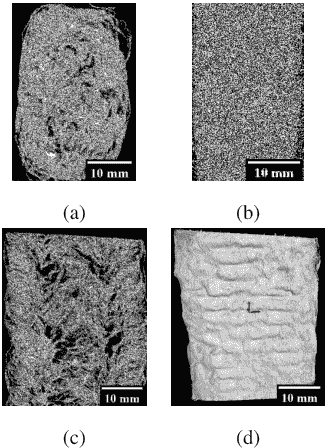

**Figure 3.5:** CF-PA6 塑化物的上部 (a)、右侧 (b)、前部 (c) 2D 截面视图和 3D 视图 (d)。该扫描使用 KIT bwk 生产科学研究所的 Zeiss Metrotom 800 锥束 µCT 系统完成。扫描分辨率为 73 µm/voxel，也用于作者的出版物 [276]。

Accordingly，在塑化物上放置了网格（见图 3.7），并应用用于确定纤维取向张量的方法（见第 3.6 节）来评估立方体的材料取向张量。

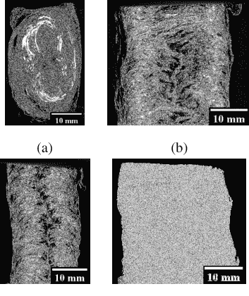

Figure 3.6: GF-PA6 塑化物的上部 (a)、右侧 (b)、前部 (c) 2D 截面视图和 3D 视图 (d)。该扫描使用研究所自有的 YXLON CT 设备完成。扫描分辨率为 77.5 µm/voxel。

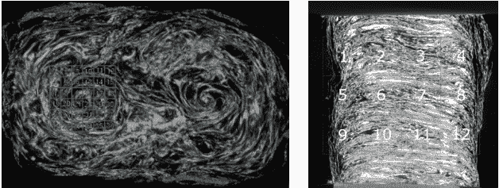

Figure 3.7: (a) 带有叠加网格的 CF 塑化物扫描截面图像，网格包围左侧涡流，由 36 个 3.33 mm × 3.33 mm × 3.33 mm 立方体组成。(b) 沿挤出方向带有叠加网格的 GF 塑化物扫描截面图像（平面不同于 (a)），网格由 12 个 20 mm × 20 mm × 20 mm 立方体组成。

### 3.3.2 孔隙率和体积确定

板材中的纤维取向测量表明，工艺中的流锋似乎略有偏斜。在排除各种原因后，考虑了塑化物的某些不规则几何形状及其孔隙率分布。

因此，图像首先加载到 Python 中（作为 `.raw` 图像文件读入），然后转换为具有正确维度的 numpy 数组。随后，对每个切片应用 Otsu 阈值将图像二值化。之后，需要实现塑化物区域及其中孔隙的分割。这在一定程度上是困难的，因为被孔隙穿透的塑化物区域无法通过阈值方法划定，因为空气既在外部也在内部，且由于其分支形状，也无法通过区域生长方法或类似方法划定。解决方案是形态学方法。这些方法将一个可以是任何形状或大小（通常是方形或圆形）的结构元素应用于输入图像并生成输出图像。这些方法的优点在于它们不仅可以去除噪声，还可以隔离单个元素，并特别将图像中不连续的元素连接起来，这对于将塑化物作为整体捕捉是必需的。最基本和最著名的形态学操作是膨胀和腐蚀，两者都在此应用中使用，并在以下部分中解释。NumPy [277]、OpenCV cv2 [278] 库和 Matplotlib [279] 用于这些操作和绘图的创建。

### 膨胀

图像 $I$ 与核 $X$ 进行卷积。核通过命令 `cv.getStructuringElement` 设置，在此情况下选择椭圆形状。椭圆通过函数 `cv.MORPH_ELLIPSE` 定义为半径为核大小 15 的圆形——同样在此特定工作中。核的中心通常是核的锚点，锚点在图像上滑动。对于膨胀操作（`cv.dilate`），锚点像素值被核捕获的最大像素值替换：

```
$(I \oplus X)(x, y) = \max\{I(x + s, y + t) + X(s, t) | (s, t) \in D_x \}, \qquad (3.1)$
```

其中 $D_x$ 为结构元素的定义域。在该意义上，它类似于最大滤波器，但不同之处在于对特殊结构元素的重要选择，这将决定性地改变结果。膨胀会导致图像内的亮区域增长（见图 3.8），因此得名。

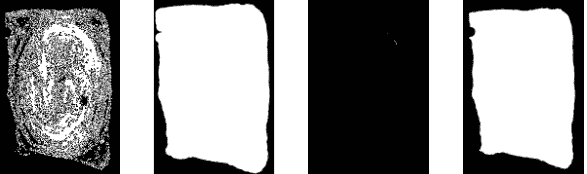

(a) (b) (c) (d)

**Figure 3.8:** (a) 原始扫描的二值化切片。(b) 应用膨胀后的同一切片。整个塑化物已变为白色，边界已膨胀。(c) 与 (a) 相同的切片，但在应用腐蚀后。整个图像几乎变为黑色。(d) 依次应用膨胀和随后腐蚀的切片。塑化物内部仍然完全是白色，但扩展的边界被随后的腐蚀缩小。可以进行塑化物分割。

### 腐蚀

腐蚀（`cv.erode`）就像是膨胀的拮抗剂，计算给定核区域上的局部最小值：

```
(I \ominus X)(x, y) = min { I(x+s, y+t) - X(s, t) | (s, t) \in D_x }. [280, 281] (3.2)
```

如图 3.8 所示，通过对扫描图像应用膨胀，可以填充孔隙。然而，边缘也超出了实际塑化物的边缘。随后的腐蚀操作可以逆转这种边缘扩展。结果是一张图像（除边缘处的小错误外）已很好地分割了塑化物。

因此，可利用完全白色塑化物（d）与原始图像（a）之间的差异来生成仅孔隙为白色的图像。通过计算所有孔隙像素和所有分配给塑化物的像素，并将它们相除，得到每个切片的孔隙率比例。此外，通过将分配给材料的像素除以扫描总像素的比例，可以确定塑化物的面积比例。这两个方面均在结果中共享，然后进行讨论。

## 3.4 纤维体积含量确定

以下将介绍确定纤维体积含量的实验方法，然后是两种计算方法。其中部分内容已发表在论文 [188] 中，并已相应标记。

### 3.4.1 化学溶解 1

为了化学去除基体，向锥形瓶中的样品加入约 50 ml 浓硫酸，然后将其放置在加热板上（见图 3.9）。

接着加热直到产生烟雾。随后，样品在此温度下反应一小时。样品冷却至“温热”后，与约 25 ml 35% 过氧化氢溶液混合，并加热直到溶液变澄清且不再有气泡上升。

1 本节摘自作者的出版物 [188]，仅做了轻微的语言修改。


图 3.9：(a) 标本在 Erlenmeier 锥形瓶中的硫酸滴落和 (b) 分离纤维的分散。来源：FIBRE Bremen。摘自 Blarr 等人 [188]。

剩余纤维被放入新的标本杯中，可用于通过称重进行纤维体积含量测定以及纤维长度分布测定。

调查在 FIBRE（不来梅）进行。对于 Plate 2，直接采用 FIBRE 计算的 FVC 值作为结果；对于 Plate 3 的标本，随后通过纤维质量含量和相应密度计算了 FVC。

### 3.4.2 计算方法

本节在再次解决现有方法存在的问题后，解释了使用图像评估方法确定 FVC 的两种方法。

#### 3.4.2.1 常用技术的应用与不足 2

2 本节摘自作者的出版物 [188]，仅做了轻微的语言修改。

Gandhi et al. 的纵向纤维浓度分析在技术现状 [5] 中有所提及。但是，无法将此程序应用于本工作的 µCT 扫描，因为选择中点阈值的第一步对于 CFRP 扫描的直方图来说不可行，这将在下一节（第 3.4.2.2 节）中阐明，并在图 3.12 中可以看到（仅可见一个峰值）。作为对本工作所介绍方法的比较，测试了常规自动阈值方法，如附录（第 9 节）中的表 A.1 和表 A.2 所示。因此，应用了两种常见的自动阈值方法 Otsu (opencv [278]) 和 mean (scikit image [282])，一次不进行图像预滤波，一次在先应用我们自实现方法的最佳滤波选项（分别为 Plate 2 和 Plate 3 的内核大小为 15 和 23 的 median-Blur）。scikit image 的最小阈值甚至无法编译，报错 "RuntimeError: Unable to find two maxima in histogram"，这证实了先前的发现。虽然两种可用的阈值方法已在 Python 中应用以支持后续值处理，但相同的阈值和滤波方法也可在 ImageJ 中应用。结果与实验值相差甚远。值得注意的是，与实验结果相比，纯阈值方法的结果平均偏差近 100%。尤其引人注目的是，每个样本的计算 FVC 值几乎相同。因此，对阈值进行纯恒定偏移似乎没有意义，因为这也无法涵盖样本之间的差异。使用 median blur 至少显著改善了 Otsu 阈值的结果。看来在高纤维体积含量复合材料的低对比度 CT 图像中，简单阈值不足以进行纤维分割，文献 [283] 也支持这一点。

#### 3.4.2.2 "平均或以上" (AOA) 阈值 ³

³ 本节摘自作者的出版物 [188]，仅做了轻微的语言修改。

新型阈值方法在 Python 3.8.7 中实现，借助 SimpleITK [284–286]、OpenCV [278] 和 NumPy [277] 等库。样本的扫描生成为 .raw 和 .mhd 文件格式的 16 位 3D 图像。对于所有后续步骤，这些扫描均转换为 8 位。切掉了由于标本表面不完全平整而导致的边缘暗切片及其他图像错误。每个加载的扫描均转换为 3D 数组。在以下步骤中，每个切片单独处理；因此遍历了样本的厚度并在 2D 图像上进行工作。首先，应用了滤波器以降低噪声。测试的滤波器包括“正常”模糊滤波器、中值模糊滤波器、高斯模糊滤波器和双边滤波器，均使用各种内核大小。内核大小定义了滑过图像并执行滤波器特定计算的窗口尺寸。随后，通过将计算得到的纤维体积含量与实验值进行比较来评估滤波器的性能。Plate 2 标本的结果可见表 A.3、表 A.4 和表 A.5，Plate 3 标本的结果可见附录（第 9 节）中的表 A.6 和表 A.7。具有分辨率适配内核大小的中值滤波器表现最佳。其通过在中心像素周围创建像素内核来工作。将数值排序，并用中值替换中心像素。然后，从去噪图像中使用 Otsu 算法确定阈值。Otsu 算法通过最大化各部分之间的灰度强度类间方差，将图像分为两部分：

```
$\sigma_\mathrm{B}^2(t) = \omega_1(t) \cdot \omega_2(t) (\mu_1(t) - \mu_2(t))^2 . \quad (3.3)$
```

$t$ 是正在搜索的阈值的灰度值，$i$ 是运行变量，$i \in [0, L]$。$\omega_1$ 和 $\omega_2$ 是两个部分的概率，其中

```
$\omega_1(t) = \sum_{i=0}^{t-1} p(i) \text{ and } \omega_2(t) = \sum_{i=t}^{L-1} p(i), \quad (3.4)$
```

而 $p(i)$ 表示每个灰度强度的概率。

μ₁(t) · ω₁(t) 表示第一部分的平均强度值（第二部分同理），其中

```
μ₁(t) = Σ (i=0 to t-1) [i · p(i) / ω₁(t)]   and   μ₂(t) = Σ (i=t to L-1) [i · p(i) / ω₂(t)] .   (3.5)
```

计算每个切片的 Otsu 阈值 T 后，将其随厚度绘制。图 3.10 中显示了标本 F₁,carbon 的图示作为示例。


图 3.10：来自样本 F₁,carbon 的阈值示例。基于 Blarr 等人 [188]。

考虑阈值随样本高度的变化趋势，可以注意到阈值在中心最高，并在标本边缘降至远低水平。逐个切片检查扫描时，可以注意到与样本中央层相比，这些边缘区域可见纤维较少，如图 3.11 所示。

这种现象是由于压缩成型过程中的材料流动造成的。在注塑成型术语中，零件外层与中心之间由工艺引起的差异称为芯壳效应，可通过考虑纤维体积含量和纤维取向来检测 [5, 17]。然而，这将意味着中心 
层中代表纤维的较亮灰度值更多、代表基质的较暗灰度值更少，但区分两个峰值的阈值不应移动。因此，这不能是阈值随厚度变化趋势的主要原因。

第二个可能的解释是束硬化效应，这是计算机断层扫描中的一种常见现象。射线穿透材料越远，光子的平均能量就越高，因为低能光容易散射。然而，未校正的图像通常显示灰度值向中心（即 CT 的旋转轴）增加。因此，这种效应与所观察到的相反。此外，偶尔会同时扫描多个标本，这会使该效应在多个样本上叠加。

考虑直方图，可以更好地理解问题。图 3.12 给出了标本 F1carbon 的示例直方图。

在图 3.12(a) 中显示了整个标本的直方图，在图 3.12(b) 中可以看到靠近标本边缘的单个切片的直方图，在图 3.12(c) 中给出了标本中心单个切片的直方图。在图 3.12(a) 的整个直方图中，很明显不存在预期的两个峰值。恰恰相反，所有体素似乎都显示大约符合单个正态分布的灰度值。这


图 3.12: 整个试样 F1_carbon (a)、边缘 (b) 和中间切片 (c) 的直方图比较（应用中值滤波后）。(b) ⊂ (a) ∧ (c) ⊂ (a)。根据 Blarr et al. [188]。

这是由于 CT 中碳纤维与聚合物之间的对比度差，如前所述，例如可见于图 3.16(b)，这是由密度接近引起的。此外，还需要更高的分辨率才能至少接近分辨单个碳纤维，而这些扫描的分辨率无法做到。这两个事实都导致了非常嘈杂的图像。因此，Otsu 阈值法（或任何阈值方法）无法按预期工作，而是计算整个灰度分布的某种中位值。观察边缘切片的直方图（图 3.12(b)），峰值强度略微向左移动，且分布左侧可见一个小肩峰。将其与中心切片的直方图（图 3.12(c)）比较，在此情况下分布向右移动，且分布右侧有一个明显的肩峰。这导致阈值向扫描中心升高。由于这些值比边缘计算的低阈值更正确，因此需要在扫描中心之前对阈值进行非恒定自适应。

因此，实现了一种两阶段程序。

- 1. 第一阶段包含前述方法。对每个切片应用中值模糊滤波器。之后，确定阈值并保存为 $T_{Otsu}[i]$，其中 $i$ 为对应的切片。

- 2. 在第二阶段开始时，计算平均阈值

$$T_{average} = \overline{T} = \frac{\sum_{i=0}^{n+1} T_{Otsu}[i]}{n}$$ (3.6)

随后，声明一个新数组 $T_{new}$。如果 $T_{Otsu}[i]$ 小于 $T_{average}$，则 $T_{new}[i]$ 将被设置为等于 $T_{average}$。否则，$T_{new}[i]$ 将被设置为等于 $T_{Otsu}[i]$。

该流程可见于图 3.13 的流程图中。

之后，通过使用阈值 $T_{new}[i]$ 从每个切片 $i$ 创建一个二值图像。从这些二值图像中，可以通过确定非零值像素的百分比来计算每个切片的 FVC。$T_{Otsu}$ 和 $T_{new}$ 的比较可见于图 3.14。

这种两阶段方法的效果可见于图 3.15。这种经验程序是测试的多种方案之一，但考虑到反映厚度方向灰度分布变化的阈值非恒定自适应，它是最合理的方案。


**图 3.13:** 新型阈值法的流程。首先，使用 Otsu 算法计算每个 _n_ 图像的阈值并存储在 **_T_**Otsu 中。随后，确定所有切片的平均阈值 _T_average。然后，将每个图像 _i_ 的阈值 **_T_**Otsu[_i_] 与 _T_average 进行比较。然后将两个值中较大的一个存储在 **_T_**new 中作为 **_T_**new[_i_]。摘自 Blarr et al. [188]。


**图 3.14:** 样本 $F_{1,carbon}$ 的阈值示例。蓝线表示 $T_{Otsu}$，橙线表示 $T_{average}$，绿线表示 $T_{new}$。基于 Blarr et al. [188]。


**图 3.15:** 原始图像 (a) 与第一阶段 (b) 和第二阶段 (c) 后的二值图像的比较。摘自 Blarr et al. [188]。

#### 3.4.2.3 卷积神经网络

**输入数据和数据处理** 4 卷积神经网络在 Python 3.6.8 中实现，借助了包括 NumPy、Scikit-image [282] 和 SimpleITK 包在内的多个工具。Tensorflow [287] 和 Keras [288] 被用作 AI 框架。计算在 bwHPC 集群 2 提供的 CPU 上进行。对于 CNN，16 位扫描直接加载到 Python 脚本中进行进一步处理。与阈值法不同，扫描作为 3D 数组处理，无需遍历切片的循环。应用了一套全面的统一化方法，以便神经网络的训练算法仅针对扫描数据之间预期的差异来训练网络。对于数据加载、统一化和增强，SimpleITK、Keras 和 Numpy 的 Python 库提供了大量有用的方法。但是，由于数据以 3D 方式处理，必须定制一系列处理方法。这些辅助函数也可以在相应的 GitHub 仓库中找到（参见 [188] 中的链接或本著作第 9 章末尾）。用于处理扫描的步骤如下：

- 1. 切割

首先，将扫描单独裁剪到实际核心材料体积，以避免扫描体积边缘的噪声（参见图 3.16）。每个试样裁剪的单独切片数量可从表 3.2 中获取。


图 3.16: FLD2 扫描顶部附近的示例切片 (a)，显示标记和不均匀表面条件，与 (b) 同一扫描深入材料 30 层的切片形成对比。部分摘自 Blarr et al. [188]。

表 3.2: 原始扫描数据概览。分辨率以每个维度的绝对体素数量给出。"Front/Back cut" 下方的数字指数据预处理期间移除的切片数量。基于 Blarr et al. [188]。

| 扫描 | 破坏性测得的 FVC | 原始扫描分辨率 | 前切片数 | 后切片数 |
| :--- | :--- | :--- | :--- | :--- |
| $FLD_1$ | 22.3 % | 122 x 386 x 386 | 5 | 10 |
| $FLD_2$ | 25.5 % | 128 x 780 x 780 | 12 | 12 |
| $FLD_3$ | 28.6 % | 148 x 1168 x 1162 | 35 | 35 |
| $FLD_{10}$ | 17.9 % | 130 x 391 x 395 | 9 | 14 |
| $FLD_{11}$ | 24.0 % | 135 x 777 x 772 | 16 | 16 |
| $FLD_{12}$ | 26.6 % | 132 x 1164 x 1167 | 13 | 15 |
| $F_{1,\text{carbon}}$ | 23.1 % | 168 x 1424 x 1425 | 0 | 0 |
| $F_{2,\text{carbon}}$ | 22.1 % | 165 x 1421 x 1425 | 4 | 0 |
| $F_{3,\text{carbon}}$ | 23.1 % | 165 x 1416 x 1428 | 0 | 0 |
| $CF_{1,\text{carbon}}$ | 25.6 % | 171 x 1403 x 1415 | 1 | 5 |
| $CF_{2,\text{carbon}}$ | 22.3 % | 161 x 1422 x 1421 | 4 | 0 |
| $CF_{3,\text{carbon}}$ | 22.8 % | 165 x 1406 x 1415 | 0 | 0 |
| $C_{1,\text{carbon}}$ | 26.4 % | 165 x 1409 x 1421 | 2 | 4 |
| $C_{2,\text{carbon}}$ | 23.1 % | 155 x 1414 x 1421 | 0 | 4 |
| $C_{3,\text{carbon}}$ | 23.8 % | 161 x 1406 x 1425 | 0 | 4 |

- 2. 调整大小

所有用于训练 CNN 的数据应具有相同的形状，以便建立一个网络输入大小。此外，将所有数组重塑为立方体增加了一个额外的旋转轴，可以在不改变形状的情况下旋转数据。这允许一个额外的增强步骤，从而使增强后的输入数据量翻倍。为了将长方体扫描重塑为立方体，使用了 scikit-image 库的 transform()-方法。立方体的目标尺寸受 bwHPC 集群可用计算能力的限制。迭代测试表明，它可以稳定执行脚本，直到立方体大小为 \( 100 \times 100 \times 100 \) 体素，因此将其选为数组维度。

- 3. 增强

神经网络需要大量数据来改进其训练过程。由于可用扫描量较少（14 个），使用了多个阶段的 3D 图像增强来扩大输入数据集。

在第一步中，每个扫描都旋转了 \( 90^\circ \)，并与原始扫描具有相同的 FVC 被添加到数据集中。由于转换后数据的长方体形状允许绕三个独立轴旋转，该过程对剩余两个正交轴重复。仅按 \( 90^\circ \) 的倍数旋转可确保不会因数组范围之外而丢失边缘数据。此外，与按随机角度旋转相比，这种方法计算效率高得多，因为只需交换数组索引。

在通过添加原始扫描的旋转使数据集乘以 4 之后，所有扫描在第二步中进行翻转。类似于第一步，原始扫描的副本在一个平面上镜像，然后以与其原始相同的 FVC 添加到数据集中。该过程对剩余两个正常平面重复，使数据集进一步乘以 8。

总之，通过结合三次旋转和三次镜像步骤，输入数据量可以乘以 \( (1 + n_{\text{rotations}}) \cdot 2^{n_{\text{reflections}}} = (1 + 3) \cdot 2^3 = 32 \) 的因子。因此，14 个原始扫描变成了 448 个样本的数据集。更多组合是可能的，但它们会导致数组的精确重复，这些重复可以通过上述方法获得，即绕一轴连续两次 \( 90^\circ \) 旋转等于关于两个不同平面的两次反射。

4 本节摘自作者的出版物 [188]，仅做了轻微的语言修改。


## 4. Split

在馈入神经网络之前，由 CT 扫描数组及其各自经实验（破坏性）观察得到的 FVC 值组成的数据，被拆分为*训练集*和*验证集*。较大的训练集用于类似 [289] 中所述的网络参数初始调优。

在每个训练周期之间，验证集用于验证模型在未见数据上的性能，从而防止过拟合，并允许估计模型在训练集之外的泛化能力。关于训练过程的更多细节将在下文的*网络训练过程*段落中讨论。

### 网络架构

本工作所实现网络的一个特殊特征是，它直接输入一个 3D 扫描，以及一个表示相应 FVC 的单一标量值，从而构成混合网络。但是，对于给定的扫描，网络的输出仅是一个介于 0 和 1 之间的单一标量形式的预测 FVC 值。

对于图像处理任务，传统的神经网络类型是 CNN。

本工作的模型架构由多个卷积层、池化层、全连接层和丢弃层组成。总体而言，神经网络可分为两个阶段：特征提取阶段（在此阶段进行卷积）和随后的特征处理阶段（在此阶段将提取的特征映射到相应的输出）。

输入层接收一个表示 CT 扫描数据的 3D 张量（深度、宽度和高度），由于 CT 扫描是灰度图像，其作为单个通道输入。此外，还将 FVC 的单一标量值一并传递。

提取输入数据特征的后续卷积层之后接一个最大池化层，该层对卷积层输出进行下采样，以减小数据维度并捕获最重要的特征。在此案例中，卷积后接一个 2 x 2 x 2 最大池化层，其中 2^3 = 8 个体素中仅最大值会传递到下一层。这样，在相关信息没有重大损失的情况下实现了 87.5% 的数据减少，因为对于特征提取而言，特征的确切位置不那么重要。此外，更强的特征会被进一步增强，因为仅核区域内的最高值会被传递。

经过卷积层和最大池化层后，输出通过带有 ReLU 激活函数的多个全连接层。在本研究中，评估的是 FVC 百分比，任何负值都是不合理的，并通过这种方式自动过滤掉。这些层使模型能够学习输入和输出之间的复杂关系。在每个全连接层之后添加丢弃层以防止过拟合。

在分析过程中，进入网络越深，空间信息就越不重要，因为最终目标是计算一个描述整个扫描的单一标量。全局平均池化层将全连接层的 3D 输出转换为单行向量。其维度对应于特征提取阶段传递的特征图数量。这种技术以及全局平均池化与全局最大池化的选择受到 Zunair 等人 [290] 的启发，并提高了 CNN 的性能。

最后，输出层是带有 sigmoid 激活函数的全连接层。其输出表示 CT 扫描的预测 FVC 值。

最终网络架构如图 3.17 所示。定义所有使用层形状的参数通过参数扫描确定，将在下文的网络优化段落中讨论。该图表是借助发布在 [291] 的 LaTeX 代码制作的。


图 3.17：CNN 的最终架构。摘自 Blarr 等人 [188]，并基于 [291]。

### 网络训练过程

迄今描述的 CNN 在所有层中均使用随机权重初始化。因此，训练集扫描的初始预测也将是随机的，不太可能与其实际 FVC 值存在任何因果关系。为以使网络能够进行合理预测的方式调整权重，使用了训练算法。训练可分为两个主要步骤：模型编译和模型拟合。在模型编译步骤中，设置配置参数。本任务选择的损失函数是二元交叉熵（BCE）。BCE 损失（也称为 log loss 或负对数概率）定义如下

```
l(y, \hat{y}) = - \left( y \log(\hat{y}) + (1 - y) \log(1 - \hat{y}) \right), (3.7)
```

其中 y 为真实值（0 或 1），\hat{y} 为预测概率（介于 0 和 1 之间）[292, 293]。在模型完美预测 0 或 1 的理想情况下，损失为零。然而，在本工作中，真实项 y 不仅是 0 或 1，而是中间的连续值。尽管这并非 BCE 损失最初的设计目的，但它的效果优于其他不适用于二元输入（和输出）的常用损失函数，如均方误差（MSE）或平均绝对误差（MAE）或常规交叉熵。文献也表明它在实践中有效 [294, 295]，因此本工作使用了 BCE 损失。应当注意的是，当真实值不是二元值时，BCE 是不对称的，且最小损失不再为零。例如，对于 y = 0.24（约为本例中 FVC 的平均值），当 \hat{y} = y = 0.24 时，最小损失为 0.5511（参见图 3.18）。在结果部分评估损失图时，这一点将相关（参见第 4.3.3 节）。


图 3.18：当真实值 y = 0.24 时，预测值 \hat{y} 在 0 到 1 之间变化时 BCE 损失的变化趋势。摘自 Blarr 等人 [188]。

本任务选择的优化器是 ADAM。它是一种自适应学习率优化算法，能够在训练期间动态调整学习率，从而更快地收敛到最优解。由于其计算效率高且内存需求小 [201]，它是训练深度神经网络的热门选择，因为它在更新模型参数方面既高效又有效。此外，均方误差（MSE）被用作训练期间评估模型性能的指标。它衡量预测值与真实值之间的平均平方差。因此，它提供了关于模型在训练过程中预测整体准确性的见解。

模型编译后，使用 Tensorflow 的 *模型拟合()* 函数将模型拟合到训练数据。该方法利用编译过程中设置的参数实现机器学习的一般过程：使用网络在该阶段提供的权重，所有训练扫描都通过网络传递。生成的标量（预测值）与相应样本的实际 FVC 值进行比较。之前指定的损失函数将预测值和真实值作为参数，计算损失分数。随后，所选优化器根据分数的表现调整层中的权重，然后按照开始时指定的周期数重复整个过程。图 2.19 直观地描述了此过程。

在训练集的同时，验证集也使用相同的模型和损失函数进行评估。最后，使用训练损失和验证损失值生成损失图，如图 4.13 所示。该图将两者均显示为周期数的函数。这种可视化有助于监控训练期间模型的收敛性和性能，其中损失下降表明模型随时间在学习和改进。

此外，此方法还负责打乱输入数据并将其分割为训练集和验证集，比例设定为 2/3 到 1/3。训练周期数设置为 40，表示在训练期间整个训练数据集通过模型的次数。模型训练完成后，用于预测测试数据的纤维体积含量。然后将预测值与真实标签之间的偏差绘制出来，如图 4.14 所示。

### 网络优化

CNN 需要定义大量参数。最初使用类似文献 [187, 289] 中提供的值，并针对当前问题进行了调整。大多数参数是通过所谓的

6 本节摘自作者的出版物 [188]，仅进行了少量语言修改。

7 本节摘自作者的出版物 [188]，仅进行了少量语言修改。


参数扫描。不再使用单个值，而是为参数提供了一组值列表，并对其进行循环。通过同时更改两个参数值，可以找到性能最佳的组合。例如，3D卷积层中的滤波器数量在Keras中是可选择的。连接的密集-丢弃层的最佳数量也不确定。因此，将卷积层中滤波器数量的列表（\(n_{\text{filters}} = \{2, 4, 8, 16, 32\}\)，以2为基数的指数值，以覆盖更广范围）和密集-丢弃层数量的列表（\(n_{\text{dd-layers}} = \{1, 2, 3, 4, 5\}\)）提供给了网络，而不是这些参数的单值。然后对这些列表进行迭代，并对每个组合（即每个新网络）进行训练。最后比较每个网络结果的标准平均偏差，并使用导致最佳FVC预测的参数组合。

对丢弃层中的丢弃率参数、最大池化层中的池化大小以及卷积层中的核大小参数也采用了类似的程序。同理，测试了多个初始学习率、损失函数和优化器，直到作者得出图3.17中所示的架构。

## 3.5 纤维长度分布的确定

以下内容将说明单个样品的纤维长度分布是如何通过实验确定的。

### 实验方法

由于纤维长度存在与工艺相关的随机离散性，在LFT材料的情况下，确定纤维长度分布特别感兴趣。由于无法在CF-PA6扫描的CT图像中分离单个纤维，因此仅在FIBRE进行了实验确定。这种纤维长度分析是在周围基体分解后进行的。

由于热解结果无法充分保证所得纤维的分散性，此处仅考虑通过板2化学溶解所调查试样的FLD。

因此，将蒸馏水和清洁剂加入到由酸性溶解获得的碳纤维的样品容器中。然后在不破坏纤维的前提下，将其均匀分布在样品容器内。在上面放置盖玻片后，将其放置在所谓的"FiVer"扫描仪中（参见第2.2.2.1节）。然后对液体中的纤维进行多次扫描。这些图像加载到"FibreShape"软件中，用于执行纤维长度分析。完成后得到的.csv文件由作者在第4.4节结果中进行了可视化。这些调查也在FIBRE（不来梅）进行。

## 3.6 纤维取向张量的确定

为确定纤维取向张量，将通过水射线切割从板材/零件中切出的试样安装在CT设备的回转台上。在调整特定扫描参数后，进行CT扫描。所得的2D投影使用Feldkamp锥束算法[154]在VG Studio Max的3.3.2、3.4.2和2023.2.1版本中进行重建。在同一软件中加载重建版本后，执行对象的配准，即将（通常为直的）对象边界与视角的坐标系对齐。如果一次扫描中有多个试样，则对每个单独对象重复此过程。随后将这些对象作为ROI切出，并分别导出为.raw文件。连同相应的尺寸大小，这些文件可以加载到软件FIJI/ImageJ中，在那里进行亮度调整，随后确定用于区分纤维和基体的近似灰度阈值。虽然ImageJ中有预实现的自动阈值可用（Otsu、Mean、Moments、Median等），但在CFRP这种敏感情况下，有时手动确定阈值更为合理。所得的2D图像堆栈保存为.mhd文件，允许在无需额外信息的情况下进行进一步处理。随后是实际的取向确定。Bertram和Pinter在Composight [79]中发布的C++代码用于此项评估。其基于结构张量的基本功能在第2.2.3.2节“现有技术”中已说明。在实践中，使用了该代码的可执行（.exe-）版本，并通过控制台访问。除之前确定的.mhd图像文件和阈值外，还需要指定与求导结合使用的高斯模糊宽度σ以及第二个模糊参数ρ（也称为掩码大小）。σ通常设置为0.2，而ρ通常为八或更小，但始终大于σ。运行后，输出一个包含三个通道的另一个.mhd文件的矢量值图像，存储每个坐标方向中的取向信息。最后，该.mhd文件被读入MATLAB R2020b，作为由Dirk-Jan Kroon于2010年开发的Read Medical Data 3D工具包中的Mathworks File Exchange上可用的mha_read_volume函数处理的四维矩阵[296]。在MATLAB中，将确定二阶和四阶取向张量以及许多其他评估，这些内容将在以下部分中说明，其结果将在第4.5节展示。整个过程在图3.19的流程图中总结。

### FOT计算

导入矢量值图像（由Bertram和Pinter [79]的C++代码在图3.19中生成的.mhd文件）后，采用了由Schöttl [25]实现的以下FOT计算程序。体素的组件可以按以下方式访问：

```
image(c, x, y, z),
```


**Figure 3.19:** 确定纤维取向张量的典型程序流程图。

其中c是位置x、y、z处取向矢量的组分。因此，可以通过对所有体素的图像两个通道使用求和函数和逐元素乘法（在MATLAB中使用.*运算符）来确定二阶取向张量。例如，要计算_A_<sub>11</sub>分量，需要将第一个通道的体素值与自身相乘；对于_A_<sub>12</sub>，则使用第一个和第二个通道，等等。）：

FOT2(n)=sum(sum(sum(image(i,:,:,:).*image(j,:,:,:)))).

由于张量对称性，九个分量中只有六个被计算并按以下顺序保存：

[A_11 A_12 A_13 A_22 A_23 A_33].

为了保证迹条件（参见公式(3.15)），FOT按以下方式归一化：

FOT2=FOT2/(sum([ FOT2(1) FOT2(4) FOT2(6) ])).

四阶FOT按类似方式计算并按以下顺序保存：

A_3333 A_3332 A_3322 A_3222 A_2222 A_3331 A_3321 A_3221 A_2221 A_3311 A_3211 A_2211 A_3111 A_2111 A_1111. [52]

### 通过伪彩色图像进行可视化

为了可视化切片中纤维的平面取向，纤维根据其角度进行着色，从而生成伪彩色图像。该程序也由Schöttl [25]实现。因此，x轴与体素矢量之间的角度通过反正切计算如下：

phi(:,:,:) = atan(img(2,:,:,:)./img(1,:,:,:)) + pi/2.

该角度成为HSV（色相、饱和度、明度）颜色空间中的H值，如下所示（图3.20）。

进一步的S和V值均设置为1，意味着全饱和度和亮度。彩色切片最终保存为.tiff堆栈。[25] 这种可视化方式对检测角度确定中的缺陷特别有帮助。


Figure 3.20: 关于纤维取向对称性（$p \doteq -p$）的HSV颜色空间可视化。摘自[274]。

### 取向信息的进一步描绘

为了判断取向随试样（即板材）厚度的变化行为，而不仅仅为每个试样获得一个单一张量，对每个切片依次绘制了确定的主要分量$A_{11}$、$A_{22}$和$A_{33}$。这使得可以得出与工艺相关的结论。

此外，虽然FOT用于Mori-Tanaka均质化，但Halpin-Tsai需要角度出现的分布。出现的角度被划分为$n_{centers} = 20$个中心，间隔弧长为$n_i \in [i \cdot \pi/20, (i + 1) \cdot \pi/20)$，其中$i = \{x \in \mathbb{N}_0 : x < 20\}$。随后统计每个特定角度组中符合条件的角度在试样中出现的次数，以获得离散纤维取向直方图。

### CFRP和混合增强材料的挑战

虽然取向确定对GFRP没有问题，但CF-PA6 CT扫描显示出更多的椒盐噪声，导致HSV图像中明显的取向识别不一致。因此，与Pinter等人[52]的描述相比，还有一个额外的


中值滤波（核大小为 10）仅应用于碳纤维增强试样的图像。

另一个挑战是混合 GF-CF 增强材料的取向确定，因为 CT 扫描中四种不同成分（空气、聚合物、GF、CF）的阈值分割更为困难。因此，采用了多重阈值分割程序来分离不同的纤维类型。玻璃纤维首先进行阈值分割，因为它们与基体具有更好的对比度。在将生成的图像堆栈从原始图像中减去后，对空气进行阈值分割。随后，生成的图像堆栈再次从原始堆栈中减去。此时，空气呈完全黑色，玻璃纤维呈完全白色。随后，应用了双重有限阈值，切断空气（黑色）、玻璃（白色）以及与碳纤维灰度值最接近的基体。最后，将原始图像堆栈连同玻璃纤维阈值一起输入到 C++ 代码中以评估玻璃纤维 FOT。紧接着刚才描述的流程之后，最终堆栈连同碳纤维阈值一起提供给 C++ 代码，以获取碳纤维 FOT。

## 3.7 纤维取向张量插值

寻找适用于纤维取向张量插值的张量插值方法的动机已在第 2.2.3.3 节中给出。在以下各节中，将解释本论文中实现并评估的三种用于获取全场 FOT 信息的方法。这些章节摘自作者的出版物 [17]。

### 3.7.1 关于插值方法的一般说明

通常，所有插值方法主要在 Python 3.8 中实现。

SPD 张量可以可视化为张量纹样 [116, 117]。本工作将使用此方法，因为它构成了一种描述性和可解释的方式来评估不同实现的插值方法的成功程度。该可视化是在 Matlab R2020b 中借助 Barmporntis 等人开发的 fanDTasia ToolBox 的 "plotDTI" 函数实现的 [118]。

所有三种已实现插值方法的总体思路是，通过在给定网格位置上的九个测量 FOT 进行计算，获得板中 160 个缺失位置的 FOT 值。基于测量值集，在此即测量 FOT 的集合 \(\mathcal{T}_m = \{\text{UL, UM, UR, ML, MM, MR, LL, LM, LR}\}\)（分别表示“左上”、“上中”、“右上”、“中左”、…、“左下”、“右下”等）的计算值确定，描述了一个经典插值问题。插值方案 \(\bar{\phi}\) 定义为映射 \(f\)，它连接其参数，一方面是一组 \(N \ge 1\) 个离散值 \(\phi_i\)，另一方面是它们相关的权重 \(w_i \in [0; 1]\)：

```
\(\bar{\phi} = f(\phi_i, w_i).\)
```

作为权重函数，可设想多种选项，可能最简单的是 Shepard 反距离加权（IDW）[297]

```
\(w_i(\boldsymbol{x}) = \frac{1}{d(\boldsymbol{x}, \boldsymbol{x}_i)^p},\)
```

作为一种显式方法，其中 $x$ 表示待插值的任意点，$x_i$ 是已知插值点，$d$ 是已知点 $x_i$ 到未知点 $x$ 的给定距离。$p$ 是一个正实数，称为“幂参数”。随着距离从插值点增加，权重会降低。$p$ 的更大值会给最接近插值点的值赋予更大的影响，这导致 $p$ 取较大值时插值值几乎为常数。

### 3.7.2 分量平均

回顾 Kanatani [89] 以及 Advani 和 Tucker [43] 所述的二阶取向张量定义，

$A = \int_{\mathcal{S}} \Psi(p) p \otimes p \, dp, \quad (3.10)$

其中 $\mathcal{S}$ 为单位球面，$dp$ 为其上的面元，而 $p$ 为纤维方向的单位向量，可以看出 $A$ 关于 $\Psi(p)$ 是线性的。假设表面可以分为两个大小相等的区域 $\mathcal{S}_1$ 和 $\mathcal{S}_2$，具有两个分布函数 $\Psi_1(p)$ 和 $\Psi_2(p)$ 且 $\Psi_i(n) = \frac{1}{2}(\Psi_1(n) + \Psi_2(n))$ 成立，这意味着 $A_i = \frac{1}{2}(A_1 + A_2)$ 是精确的，因为积分是线性泛函且积分域始终可以分为子区间。这进一步表明，取向函数的直接平均等同于取向张量分量的平均。因此，算法将每个测量 FOT 的分量乘以一个取决于其与所计算张量距离的权重。如前所述，Shepard 反距离加权方法 [297] 被用作所有三种方法的权重函数，其中 $p = 2$：

$$w_i = \frac{1}{\|x_i - x\|^p} \frac{1}{\sum_j \|x_j - x\|^{-p}}.$$
(3.11)

与公式 (3.9) 相比，公式 (3.11) 具有一个必要的归一化因子。

### 3.7.3 分解方法

使用张量谱分解的方法在图 3.21 中以示意图形式展示，并在下文中描述。


图 3.21：已实现分解方法的概念概览。基于作者出版物 [17] 中的图形。

10 本节摘自作者的出版物 [17]，仅有轻微的语言改动。

对于所选的分解方法，张量的形状和取向将分别插值。因此，使用基于特征值问题的众所周知的谱分解：

$$A = R \Lambda R^T = R \star \Lambda.$$
(3.12)

其中 **A** 表示主对角线上包含特征值的张量，而 **R** 定义为由归一化特征向量组成的正交旋转矩阵。

### 取向

旋转矩阵 **R** 可以解释为围绕旋转轴的旋转，因此可以按照现有技术中描述的方式转换为四元数：

```
q = a + bi + cj + dk,
q = \cos \frac{\theta}{2} + (u_x \boldsymbol{i} + u_y \boldsymbol{j} + u_z \boldsymbol{k}) \sin \frac{\theta}{2},
```

其中旋转轴为 \(\boldsymbol{u} = (u_x, u_y, u_z)^T\)，旋转角为 \(\theta\)。

四元数通过给定的旋转矩阵 \(\boldsymbol{R}\) 计算得出：

```
t = \text{tr}(\boldsymbol{R}), \quad r = \sqrt{1+t} \quad \text{and} \quad a = \frac{r}{2} \quad \text{with}
b = \text{sgn}(R_{zy} - R_{yz}) \left| \frac{1}{2} \sqrt{1 + R_{xx} - R_{yy} - R_{zz}} \right|,
c = \text{sgn}(R_{xz} - R_{zx}) \left| \frac{1}{2} \sqrt{1 - R_{xx} + R_{yy} - R_{zz}} \right|,
d = \text{sgn}(R_{yx} - R_{xy}) \left| \frac{1}{2} \sqrt{1 - R_{xx} - R_{yy} + R_{zz}} \right|.
```

随后是实际插值：\(q_{ges} = \sum_i w_i q_i\)，权重为：\(\sum_i w_i = 1\)，以及 \(q_{ges}\) 重新转换为 \(\boldsymbol{R}\)：

\(\mathbf{R} = \begin{bmatrix} a^2 + b^2 - c^2 - d^2 & 2(bc - ad) & 2(bd + ac) \\ 2(bc + ad) & a^2 - b^2 + c^2 - d^2 & 2(cd - ab) \\ 2(bd - ac) & 2(cd + ab) & a^2 - b^2 - c^2 + d^2 \end{bmatrix} . \quad (3.13)\)

### 形状

对于形状的插值，对每个张量形成三个线性无关的不变量并分别进行插值。将使用已提到的 K- 和 R-不变量 [124] 中的 \(K_1\)、\(R_2\) 和 \(R_3\)（可比于 [123]）：

\(K_1 = \text{tr}(\mathbf{A}), \quad R_2 = \sqrt{\frac{3}{2}} \frac{|\mathbf{A}'|}{|\mathbf{A}|} \text{ and } R_3 = 3\sqrt{6} \frac{\text{det}(\mathbf{A}')}{|\mathbf{A}'|}. \quad (3.14)\)

\(\mathbf{A}'\) 是 \(\mathbf{A}\) 的偏差部分。

尽管 \(K_1\) 和 \(R_2\) 不是正交的 [124]，但可以通过确保取向张量的迹为 1 来证明使用 \(K_1\) 是合理的。对于这种特定的应用情况，不一定非要有正交不变量。

随后分别对不变量进行插值：\(K_{1,\text{ges}} = \sum_i w_i K_{1i}\)、\(R_{2,\text{ges}} = \sum_i w_i R_{2i}\) 和 \(R_{3,\text{ges}} = \sum_i w_i R_{3i}\)。权重保持不变：\(\sum_i w_i = 1\)。

从插值不变量中，使用以下公式计算相关特征值（参见 [123]）：

对于 \(i = 1, 2, 3\) 成立：\(\lambda_i = \frac{1}{3} K_1 + \frac{2 K_1 R_2}{3 \sqrt{3 - 2 R_2^2}} \cos \left( \frac{\cos^{-1}(R_3) + P_i}{3} \right)，其中 \(P_i = 0, 2\pi, -2\pi\)。

有了这些特征值，随后可以重新创建 \(\mathbf{\Lambda}\)。


### 3.7.4 人工神经网络¹¹

本研究中使用的人工神经网络基于Sabiston等人[133]的思想与实现。与其他两种方法一样，神经网络的目的是确定板内160个缺失位置中每个指定点的FOT。对于ANN，给定FOT的九个x、y（和z）坐标已被归一化（由于有13行和列的FOT，因此除以14）。这些\(\tilde{x}\)、\(\tilde{y}\)和\(\tilde{z}\)表示输入数据。ANN的输出数据是九个给定二阶取向张量的各自分量。由于这些分量已在-1到1之间，因此该数据无需归一化。坐标作为一个.csv文件读入作为输入，分量按\(A_{11}\)、\(A_{33}\)、\(A_{12}\)、\(A_{13}\)和\(A_{23}\)分隔为五个单独的.csv文件作为输出。

对于对称张量，通常有六个独立分量，但取向张量只需五个独立分量，因为取向张量受一个额外条件约束，即张量的迹必须加起来为1：

\(\sum_{i=1}^{3} A_{ii} = 1.\) (3.15)

因此，仅将\(A_{11}\)和\(A_{33}\)作为输出参数输入网络，并通过\(A_{22} = 1 - A_{11} - A_{33}\)确定\(A_{22}\)。该选择明确做出，根据Sabiston等人[133]的研究结果，仅使用一个面内坐标和一个厚度方向坐标（\(A_{22}\)和\(A_{33}\)同样可以类似工作），以减少误差并满足方程(3.15)。这是因为两个面内坐标明显大于厚度方向坐标，进而意味着如果单独预测\(A_{11}\)和\(A_{22}\)，它们可能会超过1。

¹¹ 本节摘自作者的出版物[17]，仅做了轻微的语言修改。

ANN由一个输入层组成，其中给定了\(i=9\)个不同点的归一化输入坐标，以及两个具有\(n=48\)个神经元的隐藏层。第一层隐藏层的输出是第二层隐藏层的输入。在输出层中，针对给定的\(i=9\)个点，预测五个独立张量分量\(A_{11}\)、\(A_{33}\)、\(A_{12}\)、\(A_{13}\)和\(A_{23}\)。ANN的结构如图3.22所示。


**图3.22：** 用于FOT插值的ANN示意概念。摘自Blarr等人[17]。

使用的优化器是SGD，这是一种用于优化具有适当平滑性属性的目标函数\(Q(w)\)的迭代方法。具体而言，在选择初始参数向量\(w\)和学习率\(r_1\)后，重复两个步骤直到获得近似最小值：随机打乱训练集中的样本，并为\(i=1,2,\dots,n\)设置\(w := w - r_1 \nabla Q_i(w)\)（其中\(Q_i\)通常与数据集中用于训练的第\(i\)个观测值相关联的求和函数）。

选择的损失函数是MAE，定义如下：

```
$MAE = \frac{1}{n} \sum_{i=1}^{n} \left| A_{jk(i)} - \hat{A}_{jk(i)} \right|, \quad (3.16)$
```

其中n为样本数量，\(A_{jk(i)}\)为样本位置处的取向张量分量值，\(\hat{A}_{jk(i)}\)为该样本位置处的取向张量分量预测值。MAE相对于百分比误差被优先选用作为误差度量，因为许多值（特别是非轴向和\(A_{33}\)分量）接近于零。因此，百分比误差往往会变得相当大。此外，与均方根误差等二次误差度量相比，使用MAE似乎能更好地滤除异常值，而均方根误差更容易导致过拟合并偏向异常值。此外，模型中使用了软符号激活函数，因为它能够计算负数，并且由于其更平滑的渐近线（多项式而非指数），在饱和度方面表现不同（例如，与双曲正切相比）[298]。不过，这当然会影响训练所需的时代数量，因为它饱和得不够快。软符号激活函数给出为

```
$o = \frac{i}{1 + |i|}, \quad (3.17)$
```

其中i为函数的输入，o为函数的输出。此外，在ANN输出的损失权重(w)上放置了偏置，以给面内取向更大的权重。偏置为\(A_{11}\)的0.4，以及其他四个分量各0.15，总和为1。研究中使用了经典的25%数据验证划分。选择了高达100,000个时代的数量，即神经网络迭代训练每个神经元权重以优化给定输入步骤输出的次数。虽然增加时代数通常会减少误差，但也可能导致过度训练并延长计算时间。ANN的所有选定参数在表3.3中汇总。

表3.3：FOT插值神经网络的参数。摘自Blarr等人[17]。

| 参数 | 值 |
| :--- | :--- |
| 软件 | Keras 2.4.3 in Python 3.8.5 |
| 优化器 | SGD |
| 损失函数 | MAE |
| 层数 | 2个隐藏层（加上1个输入层和1个输出层） |
| 每层神经元数 | 48 |
| 训练数据 | 75 % |
| 验证集 | 25 % |
| 时代数 | 100,000 |

一旦模型训练完成，一个包含除网络训练所用的九个坐标之外的所有160个归一化坐标的.csv文件将被提供给训练好的ANN，以预测缺失FOT的分量。

### 3.7.5 四阶张量简化分解方法

为随后测试纤维取向张量插值的质量，计划在Mori-Tanaka中使用平均（来自所有测量和插值的）纤维取向张量，并在Halpin-Tsai中使用平均（同样来自所有测量和插值的）角分布。这可提供给定角度的刚度，然后可与实验结果进行比较。然而，Mori-Tanaka需要一个四阶纤维取向张量。尽管可以使用二阶张量的插值方法，并通过闭合近似将最终平均张量转换为四阶张量，但闭合近似会给方法引入不可忽略的不准确性。因此，开发了一种四阶张量的直接插值方法。由于分解方法证明特别有用，该思想也被用于四阶张量的插值。不过，在此情况下选择了一种简化。未考虑转换为四元数和正交不变量，因为该转换并不直接。因此，直接使用四阶张量的旋转矩阵和特征值。因此，张量以Mandel符号读入Python，随后使用NumPy的linalg库[277]将其分解为特征值（6 × 1）和旋转矩阵（6 × 6）。随后，按大小对特征值进行排序。使用Mandel符号将3D张量表示为2D从而得到6 × 6矩阵的事实，使作者能够应用谱分解。此后，如前所述，还使用Shepard的反距离加权[297]计算了每个待确定张量位置对每个测量张量应用的距离依赖权重。重新组装新加权的旋转矩阵和特征值，即可得到特定点的插值张量。

## 3.8 通过生成对抗网络进行微观结构生成

下文解释了由DCGAN进行的图像生成方法。首先讨论计算资源和软件，接着是输入数据的准备和网络架构，然后是网络和生成图像的各种定量评估方法。部分内容已在一篇论文[275]中发表并相应标记。


### 3.8.1 计算资源与软件

由于生成器和判别器各自可包含数百万个可训练参数，大量的计算能力是不可避免的。因此，GAN 的训练在巴登-符腾堡高性能计算（bwHPC）资源上进行，特别是在 bwUniCluster 2.0 的 GPU x4 分区上。其硬件和架构如下表 3.4 所示。

表 3.4：bwUniCluster 2.0 上 GPU x4 分区计算节点的规格。基于 [299]。

| GPU x4 分区资源 |
| --- |
| 处理器 | Intel Xeon Gold 6230 |
| 插槽数量 | 2 |
| 处理器频率 | 2.1 GHz |
| 核心总数 | 40 |
| 主内存 | 384 GB |
| 加速卡 | 4x NVIDIA Tesla V100 |
| 加速卡内存 | 32 GB |
| 互连 | IB HDR |

尽管第 3.4.2.3 节中的 CNN 仅通过 Jupyter 网页访问（JupyterLab 3.6.2）进行训练，但这种方法仅用于计算开销较小的 GAN 任务，因为在这种情况下可用资源有限。对于所有需要高随机存取内存（RAM）、多图形处理单元（GPU）使用（NVIDIA CUDA）或更长计算时间的任务，都使用了通过命令提示符使用标准安全外壳协议（SSH）进行的直接远程访问来访问 bwUniCluster 2.0。

整个代码使用 Python 编写，同时使用原生 Python 文件（.py）和 Jupyter 笔记本（.ipynb）。ImageJ2 的 Fiji 应用程序对图像可视化很有帮助 [300]。以下 Python 库和模块在虚拟环境中被使用：

- PyTorch 1.10.1 和 Torchvision 0.11.2 库 [301, 302]
- Numpy 1.19.5 [277]
- 用于图像编辑的 OpenCV cv2 4.7.0.72 库 [278]
- Matplotlib 3.3.4 用于创建图表 [279]
- TorchMetrics 0.8.2 用于评估图像质量 [303]
- Torchinfo 1.5.4 用于模型结构信息 [304]
- IPython 7.16.3 用于 Jupyter 笔记本中的实时进度 [305]
- tqdm 4.64.1 用于显示进度条 [306]
- Mahotas 1.4.13 用于计算 Haralick 特征 [307]
- SimpleITK 2.2.1 用于图像编辑 [284]

Jupyter 网页访问运行于 Python 3.9.7，而较旧的 Python 3.6.8 安装在集群本身上，切换时需要一些修改。

### 3.8.2 图像预处理

使用了 Plate 3 中九个试样的扫描，以及另一块 CF-PA6 板在位置相同的九个试样的扫描。后者的唯一区别（该板未在第 3.1.6 节和图 3.4 中显示或编号）是插入了旋转 180° 的塑化物，以发现纤维取向漂移的可能变化。然而，整体纤维取向和材料行为是相同的。此外，使用了非常相似的扫描参数。这 18 张原始图像的进一步处理在图 3.23 中总结，并将在随后的段落中简要描述。


**图 3.23：** 从 CT 扫描到训练图像的图像预处理流程示意图。

#### 3.8.2.1 删除边界层

18 个 3D 扫描的宽度、高度和层数（厚度）略有变化，最小值为宽度 × 高度 × 层数 = 1366 × 1346 × 155 体素。它们沿厚度方向切片，以获得每个切片尺寸最大且信息最多的 2D 图像。对于这些原始图像中的每一个，都删除了第一层和最后 30 层。它们特别容易显示伪影或富气区域（参见图 3.24(a)）。虽然这些靠近试样表面的外层由于制造过程也显示出低于平均值的纤维体积含量（参见图 3.24(b)），但图像中 FVC 的变化实际上是所需的。现实（非伪影基础）微观结构描绘的多样性使网络能够实际再现多样的输出。幸运的是，即使切掉了第一层和最后 30 层，在单个扫描内部以及不同扫描之间仍然有足够的 FVC 多样性。

#### 3.8.2.2 裁剪图像

为了避免 2D 图像中的深色边框区域，考虑了特定的裁剪区域。为了进一步增加可用扫描中的训练图像数量，决定使用多个裁剪区域。因此，从剩余的每一层中裁剪出四个 1,024 像素 × 1,024 像素的感兴趣区域，每个区域在 x 和 y 方向上从中心处都有给定的任意选择的 128 像素偏移量（参见图 3.25）。虽然裁剪区域的大小也可以任意选择，但其优势在于它是后续的倍数


(a) 具有表面粗糙度和空气包裹体的示例第一层

(b) 低 FVC 的示例第九层

图 3.24：不同扫描的两个示例外层，显示富气区域和斑驳表面（a）以及低 FVC（b）。

#### 3.8.2.3 降采样与图像平滑

在考虑降采样时，寻求计算时间与输入和生成图像中足够细节级别之间的平衡。最初设置了 128 像素 × 128 像素的大小后，最终选择了 256 像素 × 256 像素的大小。降采样操作使用了 cv2 推荐的 INTER_AREA 插值进行。虽然这种更高的分辨率允许识别更小的纤维束和其他细节，但它也带来了相当多的椒盐噪声。为了避免生成器将此噪声作为可取特征学习并将其应用于输出图像，在将裁剪图像调整到所需输入分辨率之前，使用中值滤波器对其进行了模糊处理。选择了 5 像素 × 5 像素的内核大小。图 3.26 示例显示了带有（a）和不带（b）中值滤波器的 CT 扫描切片图像。


模糊效果可见，但大多数细节仍可辨认。事实上，所有未使用中值滤波器的输入图像的平均信噪比（SNR）为

图 3.25: 带有中心（绿色）和 x、y 方向上 ±128 像素偏移（黄色）的示例层，叠加了 1.024 像素 × 1.024 像素的裁剪区域。


图 3.26: 带有（a）和不带（b）中值滤波器的 CT 扫描切片示例图像。

数值为 5.27，低于所有使用中值滤波器的输入图像的平均 SNR 5.90。因此，后者被用作训练的输入图像。

#### 3.8.2.4 图像增强

与大多数神经网络一样，GAN 需要大量的训练数据集才能检测重复出现的图像特征。现代高分辨率 GAN 建议的图像数量为 10⁵–10⁶ 张 [308]。大量图像对于减少过拟合 [309] 特别重要，过拟合会导致判别器反馈对生成器变得毫无意义，并最终导致训练发散 [308]。由于达到如此大量的原始训练数据既麻烦有时也不可能，图像增强已发展成为乘倍数据集的默认解决方案 [308, 309]。增强是指对现有训练图像进行有意的轻微更改，以创建新的训练图像，在有意义的范围内扩展原始图像，从而增加输入数据集的多样性并改善训练。灰度图像的增强策略包括但不限于旋转、翻转、平移、缩放以及亮度和对比度的修改 [308]。在本论文提出的 GAN 中，每个裁剪图像都旋转了 180°（对应点反射），并且还同时在水平和垂直方向进行了镜像，如图 3.27 所示。

由于水平和垂直轴的同时镜像与 180° 旋转重复，因此被省略。此外，± 90° 的旋转也被省略，以保留由压缩成型材料流动产生的优先纤维取向。经过所有切割和增强步骤后，总共得到 29,280 张 2D 训练图像，作为输入馈送到网络中。


图 3.27: 通过 (a) 旋转和 (b) 镜像对图像增强的可视化。箭头指示图像的方向。

### 3.8.3 网络架构 12

官方 PyTorch 教程中提供的代码 [310] 为 DCGAN 结构提供了起点，并逐渐调整以适应给定的训练数据集。对于更大的图像分辨率，发现 Milad Hasani [311] 的 DCGAN 结构效果良好。受此启发，开发了用于更大分辨率的网络结构（参见图 3.28）。生成器采用包含 100 个条目的高斯采样噪声向量，并使用转置卷积层、批量归一化和 ReLU 激活的组合来输出分辨率为 256 像素 × 256 像素的图像。Tanh 被用作最终激活。在判别器中，使用了卷积层、批量归一化和 Leaky ReLU 激活。后者在最终层中被 Sigmoid 激活所取代。完整代码可在第 9 章链接的相应 GitHub 仓库中找到。

12 本节摘自作者的出版物 [275]，仅做了轻微的语言修改。


图 3.28: 最终 DCGAN 网络架构图。借助 Haris Iqbal [291] GitHub 仓库中的 LaTeX 代码设计。摘自 Blarr 等人 [275]。

在第一步中，输入数据集中的所有图像均加载为 PyTorch 张量（每个图像一个 3D 数组，包含 x 值、y 值和灰度值），并归一化到 [-1,1] 范围内的值，以避免等于 0 的系数。随后，图像张量被随机打乱并分成单独的批次。最后一个不完整的批次会被丢弃，即这些图像不用于训练。与原始 DCGAN 论文 [250] 不同，未定义初始权重，因为这被发现会增加该特定配置下稳定训练过程的可能性。训练损失基于常用的 BCE 与 ADAM 优化器计算。将 ADAM 优化器参数设置为 \((\beta_1, \beta_2)\) = (0.5, 0.999) 被发现能提高训练的稳定性，正如 Radford 等人 [250] 所述。为了实现多 GPU 并行化并因此加快训练，使用了 NVIDIA CUDA 和 PyTorch 的 "DataParallel" 方法 [310]。

实际训练过程遵循以下方案：首先，基于随机噪声向量创建一批生成的图像，并将其与相应的标签关联（0 表示生成）。然后，将这些图像连同仅包含训练数据集中真实图像的一批图像（标记为 1 表示真实）一起输入到判别器中。基于两批图像上计算损失（遵循公式 (2.123)）的平均值，更新判别器偏置。作为下一步，再次将采样自高斯分布的随机噪声向量传递给生成器，生成器输出一批生成的图像。基于判别器对这些图像的反馈，随后更新生成器。每个 epoch 包含多个迭代，并在以这种方式处理完整个输入数据集后结束。应当指出，损失在每次迭代后均被保存，而 Fréchet 开始距离 (FID) 仅在每个 epoch 后计算，以避免过多减慢训练速度。此外，每个 epoch 后，还会基于固定噪声向量保存一些生成的图像，以便日后直观分析训练进度。由于所需的计算开销，图像质量评估在后续步骤中进行。

### 3.8.4 定量质量指标 13

除了对生成图像进行直观的、因此属于定性的评估外，近年来还开发了多种定量措施来评估生成网络的性能 [312]。其中，基于两种不同度量的 FID 和最近邻评估被进行了如下概述。

13 本节摘自作者的出版物 [275]，仅做了轻微的语言修改。

#### 3.8.4.1 Fréchet 距离 (FID) 14

Fréchet 开始距离 [313] 作为开始分数 [314] 的改进，是一种用于确定生成样本与真实训练图像之间特征向量差异的指标。它基于在 ImageNet [316] 上预训练的 Inception v3 网络 [315]。FID 比较了真实 \( p_r(x) \) 和生成 \( p_g(x) \) 图像 [317] 的开始网络倒数第二层的激活值。这些真实图像和生成图像的分布被建模为由其均值 \( \mu \) 和协方差 \( cov(x, y) \) 定义的多维高斯分布。因此，距离定义为

\( d^2((\mu_r, cov_r)(\mu_g, cov_g)) = |\mu_r - \mu_g|^2 + \text{tr}(cov_r + cov_g - 2(cov_r cov_g)^{1/2}). \) (3.18)

因此，较低的 FID 值对应于真实数据和生成数据两个分布之间更小的距离。FID 值取决于相应的调整大小或压缩操作，甚至可能针对压缩程度更高（即分辨率较差）的图像而提高 [318]。因此，FID 值必须被视为使用同一网络在不同 epoch 中创建的图像质量的基准，且对比较不同网络的适用性有限。FID 为每个 epoch 的 128 个生成图像计算。

#### 3.8.4.2 最近邻过程 15

一个自然而然出现的问题是，网络是否仅复制训练数据，这涉及过拟合。为解决这个问题，执行 k-最近邻搜索，它计算给定生成图像从整个训练数据集中找到的 k 个最近邻。这等同于根据合适的距离度量找到训练数据集中与生成图像距离最小的图像。在以下内容中，我们简要介绍欧氏距离和计算开销更大的结构相似性指数测度 (SSIM)，因为它们是本文结果中 k-最近邻搜索的基础。

- 欧氏距离 (ED)

欧氏距离是确定两个数组之间相似性的最简单方法之一，也是最近邻搜索中最常用的距离度量 [319]。对于大小为 \(M\) 像素 × \(N\) 像素的两个灰度图像 \(\boldsymbol{x} = (x_1, x_2, ..., x_{MN})\) 和 \(\boldsymbol{y} = (y_1, y_2, ..., y_{MN})\)，可以按如下方式计算：

\(d^2_{\text{E}}(\boldsymbol{x}, \boldsymbol{y}) = \sum_{k=1}^{MN} (x_k - y_k)^2 \quad (3.19)\)

其中，位置 \((k, l)\) 处的灰度级分别为 \(x_{kN+l}\) 和 \(y_{kN+l}\)。计算值越小，相似性越高。由于存在不考虑空间关系等重大限制，通过计算 ED 找到的最近邻有时与人类感知不一致。因此，考虑了第二个距离度量。由于计算简单性，仍然计算 ED。

- 结构相似性指数测度 (SSIM)

评估 GANs 最近邻的另一个选项是由 Wang 等人在 2005 年 [319] 引入的 SSIM [312]。它特别关注通过评估亮度 L、对比度 C 和结构 S 而对人类感知也相关的因素。这三个方面分别通过两个图像 \(\boldsymbol{x}\) 和 \(\boldsymbol{y}\) 的均值 \(\mu_x\) 和 \(\mu_y\)、标准差 \(\sigma_x\) 和 \(\sigma_y\) 以及互相关系数 \(\sigma_{xy}\) 单独在数学上定义。详细公式可见 Wang 等人 [319] 的论文。为避免小值时的不稳定性，添加了常数 \(C_i\)。

这三个量的乘积，分别通过三个幂参数 \(\alpha > 0\)、\(\beta > 0\) 和 \(\gamma > 0\) 进行相对加权，得到 \(SSIM(x, y)\)。选择 \(\alpha = \beta = \gamma = 1\) 和 \(C_3 = C_2/2\) 导致以下 SSIM 公式：

\(SSIM(x, y) = \frac{(2\mu_x\mu_y + C_1)(2\sigma_{xy} + C_2)}{(\mu_x^2 + \mu_y^2 + C_1)(\sigma_x^2 + \sigma_y^2 + C_2)}.\) (3.20)

取值范围为 (-1, 1]，值为 1 对应最佳相似性，即图像相等。应当指出，SSIM 通常不在全局计算，而是在覆盖局部方形补丁并在整个图像上逐像素滑动的高斯窗口内计算。在所谓的均值-SSIM 或 MSSIM 中，所有局部值求和并除以窗口总数 \(m\)，以获得单一的质量度量。通常，MSSIM 常被称为 SSIM，本工作中也将类似处理。

### 3.8.5 所有选定参数概览 16

重要参数的所有值在以下列表中汇总。

- 图像分辨率 256 像素 x 256 像素
- 学习率 \(r_1\) 0.0001
- ADAM 优化器 \((\beta_1, \beta_2) = (0.5, 0.999)\)


- 训练轮数：75 轮

- 输入图像数量：n_scans × f_cut × f_augmentation = n_final
  1,830 × 4 × 4 = 29,280

- 每批图像数：128

- 每轮迭代次数（最后一个不完整批次被丢弃）：29,280/128 = 228.75

一些参数（如学习率）是通过在参数扫描中逐步增加学习率并分析相应结果来选择的。

# 4 结果

本章首先讨论 CT 扫描中显著的微观结构特征。然后，按照与“方法”章节相同的顺序，呈现塑化物检验结果、纤维体积含量及其新开发的评估方法以及纤维长度分布。随后是纤维取向分布、纤维取向张量插值以及基于 GAN 的图像生成结果。

## 4.1 微观结构特征

观察图 4.1 中的扫描示例图像可见，玻璃纤维增强试样的图像质量显著更好。由于直径更大，即使在图 4.1(b) 中，基体里的单根纤维也能辨认出来。然而，这种视觉感知难以转化为定量指标。例如：图 4.1(b) 中示例图像的信噪比为 2.95，低于图 4.1(a) 中碳纤维增强试样的 5.74。出于此原因，在本论文图像生成部分的图像评估中采用了不同类型的指标（参见第 4.7 节）。

此外，CF 和 GF 增强材料都强烈倾向于形成纤维束。由于这些相当大的纤维束，预计会对材料性能产生特定影响，并在使用已知材料建模方法进行预测时遇到困难。特别有趣的是，这些纤维束通常包含未浸渍区域，如图 4.2 所示。


图 4.1：板 3（CF-PA6）中试样 \(CF_{1,carbon}\) 的扫描切片图像（a）和板 4（GF-PA6）中试样 \(CF_{1,glass}\) 的扫描切片图像（b）。


图 4.2：板 3（CF-PA6）中试样 \(F_{3,carbon}\) 的未浸渍纤维束示例（纤维束区域左上角的黑色区域位于白色纤维束区域中）。

这些无基体区域或至少纤维-基体结合较差的区域通常是样品在测试（例如拉伸试验）中失效的起点，其中基体-纤维结合强度是 DicoFRP 的两种主要临界失效模式之一（另一种是纤维断裂）[5]。还可以假设它们即使在线弹性范围内也会影响弹性模量。

与特定微观结构量（如 FVC 或 FOD）相关的进一步微观结构特征将在相应章节中讨论（参见第 4.3 节和第 4.5 节）。

## 4.2 塑化物研究

为增强对工艺及其建模的理解，对作为后续板材基础的塑化物进行了扫描。研究了两个平面上的材料取向以及初始料坯的孔隙率。

如图 4.3 所示，材料组分影响塑化物的形状、孔隙率和行为。


图 4.3：CF-PA6（a）、GF-PA6（b）和 GF-PC（c）塑化物扫描的切片，用于对比。

虽然 PA6 与 CF 的组合（a）在内部显示出许多气包，但 GF-PA6（b）似乎具有一个略微突出的松散表面层。另一方面，如果选择不同的基体材料（聚碳酸酯），塑化物（c）总体上看起来更致密。与本工作所用材料出现的较不致密的塑化物形状也可能使对成品板影响的评估变得复杂。

如预期，在第一种情况下无法区分纤维和基体，但玻璃纤维似乎也难以区分，因此在后续内容中，取向必须被视为材料取向而非纤维取向。这基于合理的考虑：纤维沿基体材料排列，这在“方法”部分已经描述过（参见第 3.3 节）。

### 4.2.1 初始取向

以 y 为挤出方向，首先关注 x-z 平面上的取向。因此，在 3D CT 图像中，将塑化物的四分之一分割为 15 个尺寸为 10 mm × 10 mm × 10 mm 的立方体（在不同 y 位置重复）。使用结构张量方法评估取向，并将得到的取向张量绘制为图元，得出了图 4.4 的结果。四分之一的结果垂直、水平以及同时垂直和水平镜像，以同时用张量图元覆盖剩余的四分之三，假设行为对称。此假设基于自身观察和文献 [320–322]。

可见，角落处的张量主要沿挤出方向取向。总体而言，张量趋向于向塑化物中部变得各向同性。除此之外，CT 扫描中可见的双螺杆挤出机的两个涡流也被图元很好地再现。图 4.5 对该涡流区域进行了放大，显示了更多细节。


图 4.4：在 CF-PA6 塑化物四分之一区域评估并镜像后的纤维取向张量图元。所选网格由 3 × 5 个尺寸为 10 mm × 10 mm × 10 mm 的立方体组成。图元图由 Louis Schreyer 为联合论文集合作绘制 [276]。


图 4.5：围绕 CF-PA6 塑化物双螺杆挤出机涡流评估的纤维取向张量图元。所选网格由 2 × 2 个尺寸为 10 mm × 10 mm × 10 mm 的立方体组成。图元图由 Louis Schreyer 为联合论文集合作绘制 [276]。

为更详细地分析这一点，评估了更细的 6 × 6 网格，立方体边长为 3.33 mm，如图 4.6 所示。


图 4.6：围绕 CF-PA6 塑化物双螺杆挤出机涡流评估的纤维取向张量图元。所选网格由 6 × 6 个尺寸为 3.33 mm × 3.33 mm × 3.33 mm 的立方体组成。图元图由 Louis Schreyer 为联合论文集合作绘制 [276]。

可接受的一致圆形取向使得基于几何考量更简单地重建初始取向状态，这将在讨论（第 5 节）中阐明。

为评估挤出方向 y 方向上的取向行为，需要在 x-y 平面进行切片。在中位 z 位置，网格由 3 × 4 个尺寸为 20 mm × 20 mm × 20 mm 的立方体组成。结果可见于图 4.7。

两个外层（考虑 x 方向）在张量的 33 分量方面具有较高值，因此更偏向 z 方向取向，这与之前在其他平面上的评估结果一致。虽然它们也显示略高的 22 分量，因此更偏向 y 方向取向（挤出方向），但整体张量行为非常以 11 分量（x 方向）为主。与类似研究相比，这又简化了几何重建，后者发现 y 方向上存在更显著的取向，这也将在第 5 节中讨论。


**图 4.7:** 同一 GF-PA6 塑化物两个不同部位扫描的切面，其方向张量以叠加的张量符形表示。在 GF-PA6 塑化物的 x-y 平面上评估的纤维取向张量符形。所选网格由 3 × 4 个立方体组成，尺寸为 20 mm × 20 mm × 20 mm。

### 4.2.2 孔隙率和体积

考虑到塑化物的孔隙率，特别有必要了解工艺参数对其的影响，以及孔隙率沿塑化物挤出方向的变化趋势。

在图 4.8 中，二值化图像（a）、塑化物区域的检测（b）以及由方法章节（第 3.3 节）中描述的算法确定的塑化物中的孔隙（c）均有展示。

在示例图像中，塑化物外边界的检测效果较好，但对于表面更多流苏状的基于聚酰胺 6 的塑化物来说则更困难（比较图 4.3）。

评估沿挤出方向的孔隙率以及不同配置塑化物的平均孔隙率（百分比），可以得出与过程观察一致的结论。在图 4.9 中，可以看到四个孔隙率图。


图 4.8：左侧是二值化 GF-PC 扫描切片的示例图像，中间是算法识别为塑化物的区域（白色）。右侧标记了所有检测到的孔隙（白色）。

图（a）和（b）展示了同一 GF-PA6 塑化物两半的孔隙率曲线。在（a）中可以看到先从双螺杆挤出机喷嘴出来的末端，即“前端”；在（b）中是最后挤出的“后端”。值得注意的是，前端的平均孔隙率（红色虚线）为 0.4310，显著高于后端的 0.3746。这与过程试验的观察一致，在试验中，塑化物在滚筒输送机上放置较长时间时似乎会膨胀（又称 lofting）。在图（a）中这一点很明显，朝向最老端（层号较高）时，切片中塑化物占据的面积（平均 0.8001）以及因此在整体扫描中的三维体积，还有孔隙率都在增加。图（b）中覆盖的平均面积略小，为 0.7886。顺便说一句，在计算孔隙率或所占体积时，3D 扫描边缘切掉了 20 个切片，因为这些切片存在伪影或因不平整等原因已经显示出富含空气的区域。面积和体积比较仅在两个塑化物半部在一次扫描中扫描、因此具有相同扫描切面和相同分辨率的情况下才有效。


图 4.9：GF-PA6 塑化物“前端”（a）和“后端”（b）的孔隙率变化。此外，还展示了两个 GF-PC 塑化物的孔隙率变化，一个是螺杆转速为 45 rpm 制造的（c），另一个是 100 rpm 制造的（d）。

观察图（c）和（d），可以看到在不同条件下生产的两个独立 GF-PC 塑化物的孔隙率曲线。图（c）中展示的塑化物在 45 rpm 的螺杆转速下生产，而图（d）中展示的塑化物在 100 rpm 下生产。低转速生产的塑化物平均孔隙率为 0.2196，显著低于快速挤出塑化物的 0.3248。（c）中的低转速和低孔隙率也确保了切片间相对一致的孔隙率和体积剖面，而（d）中生产过程的高转速会导致向末端孔隙率和体积增加。

## 4.3 纤维体积含量

在本节中，展示了试样纤维体积含量（FVC）的实验测定结果，以及基于试样扫描的自行实现新方法的计算确定结果。

### 4.3.1 化学溶解 1

生产期间设定的标称纤维体积含量为 25%。由于样板 2（参见图 3.4）中溶于酸的样品尺寸不同，可以展示纤维体积含量对样品尺寸的依赖性。实际上，这种效应似乎非常明显，如表 4.1 所示：纤维体积含量从试样 1 到 3 以及从 10 到 12 单调递增。试样 1 最小（10 mm × 10 mm × 3 mm），试样 2 为第二大（20 mm × 20 mm × 3 mm），试样 3 最大（30 mm × 30 mm × 3 mm），可以发现试样越大，FVC 越大。此外，充料区（试样 1、2、3）的纤维体积含量似乎高于过渡区（试样 10、11、12），这一发现与样板 3 的样品结果相矛盾（参见表 4.2）。样板 3 中表 4.2 的 FVC 结果首次由 Scheuring 等人 [274] 发布。虽然三个充料试样（C1、C2、C3）的平均 FVC 与全局平均值 23.57% 相等，但它确实略高于三个流动区试样（F1、F2、F3）的平均 FVC 22.74%。在本样板中，过渡区（试样 CF1、CF2、CF3）显示出最大的平均 FVC，为 24.42%。

1 本节摘自作者的出版物 [188]，仅做了轻微的语言修改。

表 4.1：样板 2（参见图 3.4）试样基于酸的基体溶解测定的 FVC（%）。摘自 Blarr et al. [188]。

| 试样 | FVC |
|---|---|
| FLD1 | 22.3 % |
| FLD2 | 25.5 % |
| FLD3 | 28.6 % |
| 平均值 | 25.5 % |
| 标准差 | 2.6 % |
| FLD10 | 17.9 % |
| FLD11 | 24.0 % |
| FLD12 | 26.6 % |
| 平均值 | 22.8 % |
| 标准差 | 3.6 % |
| 总体平均值 | 24.2 % |
| 总体标准差 | 3.4 % |

### 4.3.2 “平均或以上”（AOA）阈值处理 2

2 本节摘自作者的出版物 [188]，仅做了轻微的语言修改。

需要测定 FVC 的扫描均显示出椒盐噪声。因此，实现的阈值处理方法的第一步是应用滤波器。滤波器类型和核大小的选择是在定义程序所有其他步骤后确定的。进行了一项研究，以确定哪种滤波器和核大小能产生最接近测量值的 FVC。最终，中值模糊导致计算结果与测量结果之间的平均偏差最小。

表 4.2：样板 3（参见图 3.4）试样基于酸的基体溶解测定的 FVC（%）。数据来自 Scheuring et al. [274]。摘自 Blarr et al. [188]。

| 试样 | FVC |
|---|---|
| $F_1$ | 23.07 % |
| $F_2$ | 22.08 % |
| $F_3$ | 23.06 % |
| 平均值 | 22.74 % |
| 标准差 | 0.46 % |
| $C_1$ | 25.57 % |
| $C_2$ | 22.31 % |
| $C_3$ | 22.81 % |
| 平均值 | 23.56 % |
| 标准差 | 1.43 % |
| $CF_1$ | 26.36 % |
| $CF_2$ | 23.10 % |
| $CF_3$ | 23.81 % |
| 平均值 | 24.42 % |
| 标准差 | 24.42 % |
| 总体平均值 | 23.57 % |
| 总体标准差 | 1.37 % |

值得注意的是，两个不同样板之间最佳核大小存在差异。对于由 FLD1 到 FLD12 组成的样板 2 试样，15 × 15 像素核大小的中值模糊滤波器显示出最小平均偏差，以及最小最大偏差。结果可见附录中的表 A.3、表 A.4 和表 A.5。对于由 C1 到 F3 组成的样板 3 试样，23 像素 × 23 像素核大小的中值模糊显示出最小平均偏差，以及最小最大偏差，如表 A.6 和表 A.7 所示。在


图 4.10：利用样品 FLD3 的示例扫描，说明了通过 AOA 阈值法确定 FVC 的全过程。(a) 显示了读入 Python 的原始 3D CT 图像的中间切片。(b) 应用中值滤波器（本例中内核大小为 15）后显示了相同的切片。(c) 确定了每个切片的 Otsu 阈值并将其绘制在切片上。计算出的阈值以蓝色显示，平均值以橙色显示，最终应用的值以绿色显示。如果切片的实际阈值低于平均值，则使用平均值，否则使用高于它的计算值。（参见图 3.14）。(d) 显示了应用阈值后的切片。(e) 最后，该方法确定的纤维体积含量在切片上绘制出来。边缘处体积含量的下降清晰可见。所有切片的橙色平均值是最终确定的值，再次与实验确定的值进行比较。根据 Blarr et al. [188]。

在板 3 的结果表中，仅列出了一些滤波器中看起来最相关的测试内核大小。比较不同板的图像尺寸（如表 3.2 所示），板 3 的平均图像尺寸大于板 2，因此板 3 的图像分辨率更高（参见表 3.1）。显然，所需的中值模糊内核大小取决于所用扫描的尺寸和分辨率。通过比较图 4.10 中图像 (a) 和 (b)，可以看出中值模糊的效果。应用该特定切片的 AOA 阈值法后确定的二值图像显示在 (d)。

然而，并非所有 FVC 的最终结果都令人信服（对比表 A.4，列 "medianBlur(...,15)"，和表 A.6，列 "medianBlur(...,23)"）。虽然大多数样品在不包括异常值时显示出不错的结果，第一测试系列的相对平均偏差为 1.81 %，第二测试系列为 3.42 %，但也有偏差要大得多的样品。个别样品显示的相对偏差高达 116.09 %（FLD10）。算法性能的这些差异原因并不完全清楚。FLD10 是一个小型试样，且扫描分辨率较低，这总体来说并非最佳组合。这种情况产生的原因是希望同一板中所有样品具有相同的分辨率，而较低的分辨率是为了将最大的试样放入光路中所必需的。因此，图像质量不足，但 FLD1 的情况也是如此，不过它没有产生那么大的偏差。此外，FLD10 的实验测量 FVC 要低得多，并假设微小的测量不确定性导致了该值。出于这些原因，FLD10 被排除在 AOA 阈值法的误差计算之外，也未用作 CNN 的训练数据。然而，其他两个异常值 C2 和 F2 被包含进来。在这两个扫描中，未检测到任何视觉偏差，也未检测到直方图、亮度水平或其他用于图像比较的指标中的偏差，因此它们被包含在绝对平均偏差中，并也用作 CNN 的训练数据。这样一来，使用分别为 15 和 23 的 medianBlur 滤波器的最终 AOA 阈值法的绝对平均偏差约为 2.7 %。最终结果如表 4.3 所示。

# 表 4.3：最终 AOA 阈值法的预测（对比表 A.4 和表 A.6 中的绿色列）以及最终 CNN 结构的预测。CNN 的值为原始图像及所有具有相同 FVC 的增强 3D 图像版本的平均预测。摘自 Blarr et al. [188]。

| 试样 | 实验值 FVC | AOA 阈值法 FVC | 绝对偏差 | CNN FVC | 绝对偏差 |
|---|---|---|---|---|---|
| FLD1 | 22.30 % | 22.97 % | 0.67 % | 26.04 % | 3.74 % |
| FLD3 | 25.50 % | 24.18 % | 1.32 % | 28.62 % | 3.12 % |
| FLD3 | 28.60 % | 28.5 % | 0.1 % | 28.41 % | 0.19 % |
| FLD11 | 24 % | 23.91 % | 0.09 % | 25.24 % | 1.24 % |
| FLD12 | 26.60 % | 26.64 % | 0.04 % | 25.6 % | 1 % |
| C1 | 23.07 % | 24.07 % | 1 % | 23.24 % | 0.17 % |
| C2 | 22.08 % | 42.2 % | 20.12 % | 22.85 % | 0.76 % |
| C3 | 23.06 % | 23.04 % | 0.02 % | 22.49 % | 0.57 % |
| CF1 | 25.57 % | 26.6 % | 1.03 % | 23.12 % | 2.46 % |
| CF2 | 22.31 % | 23.53 % | 1.22 % | 22.35 % | 0.04 % |
| CF3 | 22.81 % | 22.53 % | 0.28 % | 22.80 % | 0.01 % |
| F1 | 26.36 % | 25.48 % | 0.88 % | 21.98 % | 4.37 % |
| F2 | 23.10 % | 32.76 % | 9.66 % | 24.78 % | 1.68 % |
| F3 | 23.81 % | 25.11 % | 1.3 % | 22.68 % | 1.12 % |
| Mean | 24.23 % | 26.54 % | | 24.3 % | 1.46 % |
| Abs. aver. dev. | | | 2.7 % | | |

如上所述，应用中值滤波器后通过 AOA 阈值法确定的 FVC 最终结果也在图 4.11 中绘制出来。$C_{2,\text{carbon}}$ 和 $F_{2,\text{carbon}}$ 的两个偏离值可以清晰地检测到。


图 4.11：十四个试样的原始（橙色）和使用新型阈值技术计算（蓝色）的 FVC 值，以及测量的平均 FVC（橙色虚线）和计算的平均 FVC（蓝色虚线）。根据 Blarr et al. [188]。

以试样 $F_2$ 为例，考虑试样中纤维含量的变化过程，图 4.12 中可以清楚地看到明显的非单调过程。样品边缘的较低值以及 FVC 向中心增加的情况是预料之中的。这种行为是由于压缩成型工艺造成的，将在讨论部分进一步阐述。

### 4.3.3 卷积神经网络 ³

如图 4.13 所示，将 40 个 epoch 用作 CNN 的训练是足够的，因为模型的验证损失和训练损失在大约 15 个 epoch 后收敛，此后没有显著改善。训练损失


图 4.12：以试样 F2 为例，展示了试样厚度方向上 FVC 的示例性变化过程。可以清楚地看到 FVC 向试样中心增加的典型情况。摘自 Blarr et al. [188]。

40 个 epoch 后的值为 0.5539，验证损失为 0.5535。最初训练数据中的损失大于验证数据的这一不寻常事实在第 5.2.3 节中进行了更详细的讨论。考虑到在方法部分（第 3 节）中简要讨论过的可达到的最小损失值的转移，这可以被视为成功的训练过程。


图 4.13：最终图表，显示训练过程中作为 epoch 函数的测试和验证数据集的损失。摘自 Blarr et al. [188]。

图 4.14 进一步评估了 CNN 的性能。在 448 个 3D 输入扫描中，根据三分之二的划分，299 个用于训练，149 个用于验证。图 4.14 显示了所有具有相同实验测量 FVC（共 14 个不同值）的验证扫描的预测 FVC 平均值（包括原始扫描和增强扫描）。因此，对于五个点，平均值由十个预测值确定，其余九个点由十一个预测值确定，总共得到 149 个验证扫描。标准差非常小，某点最大值为 0.0009，14 个点的平均值为 0.0005，因此未使用箱线图，而是采用与图 4.11 中阈值结果相同的格式。因此，该网络对于具有相同 FVC 的给定扫描，无论是否进行了增强，都会计算出稳定且一致的值。这表明该网络具有良好的几何独立性。此外，使用相同设置进行了多次 CNN 训练，结果也几乎没有差异，表明 CNN 的内在不确定性较低。各次运行之间最大的变化在于损失图达到最小值的 epoch，这可能会有 5-10 个 epoch 的差异。


图 4.14：十四个试样的原始（橙色）和使用 CNN 计算（蓝色）的 FVC 值，以及测量的平均 FVC（橙色虚线）和计算的平均 FVC（蓝色虚线）。摘自 Blarr et al. [188]。

在最佳通用情况下，即在第 3.4.2.3 节中描绘和描述的最终网络中，实现了 1.46 % 的绝对平均偏差（参见表 4.3）。


除了用于训练网络的epoch数量之外，还调整了多个变量以提高预测的准确性。例如，增强过程包含多个翻转和旋转图像的步骤。关于使用较少或更多增强步骤的实验表明，使用最多的步骤取得了最佳结果。更改程序最初输入的扫描产生了很大影响，并通过系统性下采样，实现了绝对平均偏差低于0.9%，因此性能提高了约40%。然而，由于该网络的目标是为CF-PA6样本扫描提供一种通用方法，因此改用所有数据，以便以后能更好地适用于不同的扫描。$FLD_{10}$已经被证明是阈值法的异常值，在此情况下构成一个例外。其实现在所有情况下都导致性能显著下降，缺乏可识别的理由，因此如前所述，该扫描必须从整个数据集中删除。

## 4.4 纤维长度分布

在图4.15中，可以看到板2（参见图3.4(b））中样品$FLD_1$到$FLD_3$和$FLD_{10}$到$FLD_{12}$的长度分布。


**Figure 4.15:** 每个试样中特定长度（mm）的纤维数量直方图，包括$FLD_1$到$FLD_3$和$FLD_{10}$到$FLD_{12}$。

该图在纤维长度6.5 mm处被截断，已知偶尔会出现长度高达32 mm的纤维。一般来说，纤维出现在极宽的长度范围内，但大部分纤维位于0 mm到1 mm的区域。特别是来自充填区的三个样品，即$FLD_1$到$FLD_3$，在0.3 mm到0.5 mm左右的范围内显示出强峰。在六个样品中测量的所有纤维中，测量了超过58,000个单独的纤维，它们总体平均值（相对于总数）为1.07 mm。然而，中位数为0.48 mm。这里已经可以注意到，平均值确定方法的选择可能对材料可能建模的结果产生显著影响。长径比被包含在例如Mori-Tanaka和Halpin-Tsai均质化方法中，因此得到的机械性能依赖于平均纤维长度。关于单个样品，平均值和中位数值可以在图4.16中再次看到。


**Figure 4.16:** 每个试样（$FLD_1$到$FLD_3$和$FLD_{10}$到$FLD_{12}$）的平均（蓝色）和中位数（橙色）纤维长度，以及所有试样的平均值（虚线蓝色和橙色）。

可以注意到，充填区样品（$FLD_1$到$FLD_3$）的平均值总体上低于流动区样品（$FLD_{10}$到$FLD_{12}$）的平均值。此外，从观察平均值来看，纤维长度从最小的样品（$FLD_1$和$FLD_{10}$）到下一个较大样品（$FLD_2$和$FLD_{11}$）显著增加。假设对于10 mm × 10 mm的样品面积，非常长的纤维已经被截断，而对于20 mm × 20 mm则不太可能出现这种情况。从中等样品（$FLD_2$和$FLD_{11}$）到最大的样品（$FLD_3$和$FLD_{12}$），平均纤维长度仅略微增加，或者在流动样品的情况下甚至降低。因此，为板3的试样选择了25 mm × 25 mm的试样尺寸，因为可以假设样品尺寸对纤维长度分布的影响在中等和最大样品之间大约趋于饱和。然而，中位数和平均值的行为再次不同。因此，无法清楚地显示样品尺寸效应，但两个平均值都可以看出流动区和充填区之间的差异。

## 4.5 纤维取向

在下一节中，将呈现所有与纤维取向相关的结果。首先，展示了基于结构张量方法用于本论文材料纤维取向评估的应用验证结果。随后，讨论了沿厚度方向（z轴）评估的纤维取向张量的特殊特征。考虑x-y平面的纤维取向张量的行为将在下一节4.6中讨论，该节涉及FOT的插值。

### 4.5.1 结构张量方法应用验证

纤维取向确定方法的验证是有限的，因为它无法通过实验直接测量。Pinter等人[81]创建了具有给定特性的人工微观结构，并用它们来验证他们的结构张量方法（也在该工作中应用）。在这方面，该方法已针对类似的微观结构得到验证。然而，对于本论文中的材料，无法进行精确验证，因为生成真正对应于CF-PA6及其束和单纤维混合物的微观结构目前不可能或无法实现。还有两种进一步的验证可能性，一种是定性，一种是间接定量。这里将首先讨论定性方法。应用结构张量算法后，将创建一个矢量值图像（3个通道），将每个像素中三个空间方向的取向比例映射出来，即从中可推导出大量取向矢量。算法检测到的取向随后可以通过HSV空间中的伪颜色显示，并放置在原始切片上。如果取向的视觉印象与检测到的颜色/角度很好地对应，则检测似乎是成功的，如图4.17所示。

图4.17-1(a)显示了CF-PA6扫描中心的一个示例切片（在此情况下为板3的样品CF2，参见图3.4），图4.17-2(a)显示了GF-PA6扫描（板4的CF2），图4.17-3(a)显示了混合增强CF-GF扫描（也是CF2，即中间样品，类似于板3和板4的切片模式）。下方是带有算法检测到的取向伪颜色表示的相同图像，其中图4.17-3(b)显示了玻璃纤维的取向，图4.17-3(c)显示了混合增强样品中碳纤维的取向。如果将2(b)和3(b)中的颜色与子图4中HSV颜色圆中的结果角度进行比较，算法的识别与CT扫描中角度的视觉印象非常吻合。然而，在纯CF增强的情况下，可以清楚地看出，在纤维束取向相当均匀的区域中，会出现轻微斑点图案


图4.17：CF增强板CF2堆栈CT扫描中间的一个切片（1(a)），GF增强板CF2堆栈（2(a)）以及混合CF-GF增强板（3(a)）。4：HSV（色相-明度-饱和度）颜色空间中的颜色-角度相关性。1(b)：通过Pinter等人[81]的代码，对1(a)中所示切片检测到的纤维取向，在HSV颜色空间中可视化。2(b)：对2(a)中所示切片检测到的纤维取向，在HSV颜色空间中可视化。3(b)：对3(a)中所示切片中玻璃纤维检测到的纤维取向，在HSV颜色空间中可视化。3(c)：对3(a)中所示切片中碳纤维检测到的纤维取向，在HSV颜色空间中可视化。摘自作者共同撰写的出版物[274]。

会出现其他颜色和因此其他取向，这些是不可理解的。这些是由于更大的图像噪声造成的。仅对纯CF增强样品的CT扫描（在取向确定之前）应用核大小为10的中值滤波器，试图抵消这些错误检测。这种以盐椒噪声消除而闻名的滤波器的效果在图4.18中可见。

可以清楚地看到，在原本取向均匀的纤维束中，几乎不再有随机分布的偏差色斑。然而，非常精细的结构也无法再检测。小束


**Figure 4.18:** 应用于CF-PA6试件CT扫描切片的中值滤波效果。(a)中显示未使用中值滤波器的HSV彩色图像，(b)中显示使用中值滤波器的图像。

并且单独的纤维完全不再包含在取向检测中。由于CF增强板的检测纤维取向无论如何都由束主导，并且如后文所示，这与机械试验吻合良好，可以假设这提供了更准确的解决方案。

上文提到的另一种定量间接验证类型是在机械均质化模型中使用提取的取向信息。然后可以将得到的刚度或强度与实验测量值进行比较。由于这些实验测量的刚度是用从板上不同角度取出的样品进行的，不同取向的刚度值的准确性可用于对建模中所用取向信息的质量得出结论。但是，由于建模的取向信息使用了张量插值（将在下一节描述），因此该程序和结果将在4.6.4节中更详细地说明，并在5.4.4.5节的讨论中进行辩论。

### 4.5.2 z轴沿线的FOD特性

仅显示纤维取向张量似乎无法全面理解纤维取向的行为。因此，板上（x-y平面）的结果将在下一节关于纤维取向插值的张量图形可视化形式中呈现。但是，由此难以识别z轴方向上的行为，因此图4.19中绘制了单个试件纤维取向张量三个主要分量的特征曲线。


**Figure 4.19:** 板3（CF-PA6）中试件C2（a）和F2（b）以及板4（GF-PA6）中试件C2（c）和F3（d）沿厚度方向（按切片）的主要分量。

两个上方的图显示CF增强试件的结果，而下方的图显示GF增强试件的结果。此外，两个左侧图分别来自充填区的一个试件，两个右侧图分别来自板材流动区的一个试件。很明显，充填区两个试件中都可见边缘效应。A22分量似乎在试件边缘增加，而占试件中心主导地位的A11分量则减少。相比之下，流动区中主要分量的曲线趋于恒定，并且明显以A11为主。是否可以将这种效应称为“壳-芯效应”（因为它让人联想到注塑过程中取向分量随厚度变化的现象），将在5.4节的讨论中讨论。还将讨论这种改变的表面取向可能来自何处，特别是为什么它仅出现在充填区而不出现在流动区。

## 4.6 纤维取向张量插值

下面介绍了三种二阶纤维取向张量插值方法的结果，形式为每种情况下生成的张量，以及通过确定先前测量的单个张量进行的定量评估。使用了板1的试件（参见图3.4）。这些结果已在论文[17]中发表。接下来介绍了四阶张量略修改的分解方法的结果。但是，这些结果在均质化方法中的应用以及与实验刚度值的比较包含在讨论（第5.4.4.5节）中。

### 4.6.1 分量平均法

图4.20中，通过CT扫描及随后的结构张量计算得到的测量取向张量集合T_in由蓝色张量图形表示，插值张量集合T_i = { T_xy ∀ x ∈ 1, ..., 13 ∩ y ∈ 1, ..., 13 }由橙色张量图形表示。

全局坐标系的原点位于板的左下角。原始LFT充填覆盖了400 mm x 400 mm模具左侧的几乎整个区域，宽度约为x = 90 mm（向右），长度约为y = 350 mm（向上），高度约为z = 60 mm。因此，当压机闭合时，人们会预期一种近似1D的向右流动。然而，在图4.20中可以看到测量（蓝色）纤维取向有明显的渐变。


**Figure 4.20:** 使用本论文中描述的分量平均插值法时，插值（橙色）和测量（蓝色）张量的可视化。摘自Barr et al. [17]。

在左区域由熔体（即LFT-D工艺中的最后挤出步骤）产生明显的优选方向后，似乎向板材中部转向以x轴为主导的取向（顶部区域除外）。在右侧，又发生了向更以y轴方向为主的取向的转变（最低张量图形除外，该图形总体上似乎比其他张量各向同性更强）。考虑到这些测量张量，插值张量应遵循某种曲线。实际上，插值似乎并未平滑地涵盖这种行为，而是通过圆化张量来实现取向变化。根据文献，这种行为是预期的（参见技术状态（第2.2.3.3节）中的膨胀效应）并可以得到证实。

为了能够进行定量误差分析并更好地评估插值行为，每次都省略了一个测量张量T_m，并改用插值方法进行确定。可视化结果显示在图4.21的九幅图中。

为了获得定量误差值，形成了测量张量及其各自插值替代品的弗勾本尼乌斯范数（Frobenius norm）。插值张量与原始张量的弗勾本尼乌斯范数之差的结果可以作为误差图在图4.22中看到。该方法似乎最差地预测了MM、LM和LL张量。难以判断弗勾本尼乌斯范数是否适合作为定量评估，但将在讨论中进一步讨论。

因此，考虑了一种第三种误差分析可能性，即插值张量与测量张量之间的直接分量比较。图4.23展示了分量平均法的情况。

图4.23中的九个图对应3 x 3张量的九个不同张量分量。每个图在y轴上显示九个测量张量（在x轴上描绘，从UL开始）中的测量张量（蓝色）和插值张量（橙色）的分量值。虽然对于数值最大且波动较大的分量，差异最大


**Figure 4.21:** 该图显示了在排除一个测量张量并改用分量平均法进行插值时，测量（蓝色）和插值（橙色）纤维取向张量图形。摘自Blarr et al. [17]。（主要是$A_{11}$和$A_{22}$），分量平均法的特征在这种误差分析类型中也很明显。因此，插值张量的分量几乎类似于测量张量分量的移动平均。


图 4.22：组件平均法在插值张量板上，相对于测量张量（在计算中排除特定张量时）的不连续（左图）和连续（右图）误差的可视化。值通过 Frobenius 范数确定。摘自 Blarr 等人 [17]。


图 4.23：组件平均法中，九个测量张量的每个张量的九个分量与插值张量相应生成分量的比较。摘自 Blarr 等人 [17]。

### 4.6.2 分解 ⁵

在图 4.24 中，可以看到基于四元数分解方法的插值结果。


图 4.24：使用本论文中描述的基于分解的插值方法时，插值（橙色）和测量（蓝色）张量的可视化。摘自 Blarr 等人 [17]。

先前提及的取向演变可以直观地追踪为一条清晰的曲线。就插值方法本身而言，视觉结果大部分非常吸引人。单独测量的 FOT 之间的插值良好，两个相邻张量之间的过渡也显得合理。通过“圆化张量”，两个方向不同的张量之间的各向异性并未基本丢失。两个相邻张量的旋转以小角度发生，因此很平滑。唯一的例外可见于右上边缘：就行的行为而言，UM 和 UR 中间的插值张量 $T_{10,13}$ 表现得有些奇怪。

⁵ 本节摘自作者的出版物 [17]，仅做了轻微的语言修改。

与其通过分段变化 10° 来消除 $UM$ 和 $UR$ 之间估计的 20° 角度，张量 $T_{10,13}$ 的取向角度相对于测量值偏差约为 80°。然而，张量 $MM$ 也被考虑用于该张量的计算（就像集合 $\mathcal{T}_m$ 中所有其他测量张量一样），尽管其权重低于 $UM$ 和 $UR$，这考虑到全局取向行为，有利于最上方行中张量的大旋转。此外，就该列的行为而言，其表现远好于如果张量围绕 z 轴以数学负方向（顺时针）而非所选正方向（逆时针）旋转时所预期的效果。当从“真值”中排除测量张量并改为对其进行插值时，取向路径会发生确定的变化，如图 4.25 所示。

例如，当省略 $UM$ 或 $UR$ 时，前述 $T_{10,13}$ 的行为会发生显著变化。然而，总体而言必须指出，当使用分解方法且省略单个张量时，取向路径会对变化做出非常灵活和合理的反应。

基于 Frobenius 范数的定量评估在图 4.26 中可视化。左侧和上侧边缘的插值效果较差，而板材中部（及右下角）的性能相对较好，这一点值得注意。

考虑到图 4.27 中显示的分量偏差，值得注意的是，在这种情况下对于该坐标系而言，这些偏差相当高。然而，值得注意的是，该方法大多保留了不同张量之间的主要趋势（例如，参见 $A_{11}$）。

- 无 UL
- 无 UM
- 无 UR
- 无 ML
- 无 MM
- 无 MR
- 无 LL
- 无 LM
- 无 LR

图 4.25：该图形显示了在从计算中排除一个测量张量并分别用分解方法对其进行插值时的测量（蓝色）和插值（橙色）纤维取向张量图形。摘自 Blarr 等人 [17]。


图 4.26：在计算中排除特定张量时，分解方法在插值张量板上相对于测量张量的不连续（左图）和连续（右图）误差的可视化。值通过 Frobenius 范数确定。摘自 Blarr 等人 [17]。


图 4.27：分解方法中，九个测量张量的每个张量的九个分量与插值张量相应生成分量的比较。摘自 Blarr 等人 [17]。

### 4.6.3 人工神经网络 ⁶

使用神经网络进行插值时张量场的结果如图 4.28 所示。


图 4.28：使用本文中描述的基于 ANN 的插值方法时，插值（橙色）和测量（蓝色）张量的可视化。摘自 Blarr 等人 [17]。

值得注意的是，当用测量张量训练此网络时，它能够在缺失张量的点上生成既非常各向异性又非常各向同性的张量，而相比之下，其他两种主要方法往往只取其一而舍弃另一。虽然某些区域（例如上部和右侧区域）看起来比较平滑，但对于 MM 和 LL 等点，存在非单调插值行为，因为周围张量比测量张量更具各向同性，且取向也相当不同（特别是查看张量 LL 时）。当使用相同的输入数据多次训练网络时，结果非常相似，这说明该方法具有鲁棒性。

⁶ 本节摘自作者的出版物 [17]，仅做了轻微的语言修改。

然而，查看从输入数据中排除测量张量时的张量场图（图 4.29）时，部分非单调行为再次出现（例如，参见无 MM 和无 MR 的场景）。

因此，这两种情况下的 Frobenius 范数差异显著较大，UM 张量的插值误差也是如此，这些均在图 4.30 中描绘。


图 4.30：在计算中排除特定张量时，ANN 方法在插值张量板上相对于测量张量的不连续（左图）和连续误差的可视化。值通过 Frobenius 范数确定。摘自 Blarr 等人 [17]。

考虑到图 4.31 中的分量误差，结果仍然相对较好。最大偏差尤其出现在先前提到的三个张量上。与其他两种方法的情况一样，最大偏差主要出现在 $A_{11}$ 和 $A_{22}$ 分量上。关于三种方法在测量与插值张量分量差异方面的比较将在讨论部分（参见第 5.4.4 节）中再次探讨。

还必须考虑神经网络在错误度量随训练轮数演变方面的质量。作为错误度量，使用了先前提到的 MAE，其随轮数的变化趋势如图 4.32 所示。正如预期的那样，由于训练数据量较少，网络表现并不理想。然而，图表既显示过拟合（$A_{23}$、$A_{33}$、$A_{31}$）也显示欠拟合（$A_{11}$）趋势。因此，很难得出普遍结论。过拟合更倾向于主张使用更多训练数据或在较低轮数停止，除了一些需要特定方法且高度依赖模型的解决方案。根据欠拟合的原因，可以采取不同措施来应对欠拟合；要么增加训练轮数（此处不太可能），要么增加模型参数可以有所帮助，


图 4.31: 九个测量张量的每个分量与插值张量对应分量在 ANN 方法中的比较。摘自 Blarr et al. [17]。

或切换到完全不同的模型。然而，更多训练数据也有助于缓解欠拟合，在所考虑的情况下欠拟合最有可能发生。

### 4.6.4 通过自适应分解法对四阶张量进行插值

借助在第 3.7.5 节中解释的四阶张量简化分解方法，可以创建类似的纤维取向张量场。它们在图 4.33 左侧绘制，对应 CF-PA6 板 3（参见图 3.4）(a)、GF-PA6 板 4（参见图 3.4）(b)、混合板的 CF 评估 (c) 和混合板的 GF 评估 (d)。四阶张量与二阶椭球体相比的不同形状可以清晰看到。此外，值得注意的是，与异质


图 4.32: 每个张量分量在 ANN 训练时期上的 MAE。摘自 Blärr et al. [17]。

初始状态。这是因为前一情况中的样本显著更小（10 mm 对比 25 mm 边长），因此取向是在非常局部的范围内评估的。这使得插值变得显著更加困难，并导致了上述的临界点。然而，在这些情况下，插值看起来是均匀且单调的，因为输出张量高度相似。在四种情况下也可以看到轻微的上升漂移，尽管其强度略有不同。

此外，在板的下半部分右端也部分存在轻微且不那么明显的下降漂移。

将所有 169 个张量平均为一个平均张量，可得到整体纤维行为的表示。这些平均张量可见于图 4.33 的第 2 列。总体而言，它们形状相似，代表碳纤维的平均张量略微各向同性（更圆），这与 CT 扫描中的观察相符。轻薄的碳纤维行为更随机，角度偏差较大，且与整体流动方向的对齐程度较低。在取向方面，所有张量都显示出轻微的上升漂移——强度再次有所不同。

对于图 4.33 的第三列，九次扫描中检测到的取向向量被分箱到 20 个角度类别中，每个类别包含长度为 π/20 的间隔。结果被平均并绘制为纤维取向直方图。这里也可以看到向略微正角度值的转移。碳纤维的分布也有些许更平坦（特别是在混合情况下），或在较大角度值处显示出更高的出现频率，这与略微各向同性的张量符号相匹配。

随后，四阶平均张量符号（无需事前闭合近似）被用作 Mori-Tanaka 匀化的输入，取向直方图则用于剪切滞后修正的 Halpin-Tsai 匀化。在将得到的刚度与实验测量刚度进行比较时，使用 169 个张量作为平均基础得到的刚度体比仅使用九个测量张量更接近实验结果。这将在第 5 章中详细讨论。


图 4.33: 四阶张量场 (1)、所有 169 个四阶张量的平均张量符号 (2) 以及所有试样平均取向分布直方图（角度，20 组，每列宽度：180°/20），针对 CF 板 (a)、GF 板 (b)、混合板中的碳纤维 (c) 和混合板中的玻璃纤维 (d)。摘自作者合著的出版物 [274]。

## 4.7 通过生成对抗网络进行微观结构图像生成

接下来，介绍最终 DCGAN 网络的结果——从实际生成的图像，到以损失图形式进行的网络质量评估，再到以 FID 计算和基于 ED 与 SSIM 两种不同度量的最近邻考虑形式进行的生成图像质量评估。以下各节的结果均已在一篇论文 [275] 中发表。

### 4.7.1 生成的图像

DCGAN 在 29,280 张输入图像（参见第 3.8.2 节）上训练了 75 个时期，每批 128 张图像，在丢弃最后一个不完整批次时对应每个时期 228 次迭代（参见第 3.8.5 节）。随机选取的真实图像与生成图像的比较如图 4.34 所示。

可以观察到每个生成的微观结构都不同。生成的图像大多看起来逼真（参见图 4.34 中带橙色边框的图像），包括纤维和纤维束。压缩成型过程中流动导致的整体纤维取向可见（参见第 4.5 节），图像之间的对比度和亮度变化与训练图像一样。然而，少数图像显示输入数据集中未体现的特征，例如图像相对两侧的两个深色边框区域（参见图 4.34 中带紫色边框的图像）。这一现象必须是不同图像特征组合的结果，如同原始图像中，最多一侧显示与扫描过程相关的这种伪影。总体而言，生成图像中观察到的深色边框区域出现大部分不能追溯到 DCGAN 结构，而是取决于训练数据集的质量。另一方面，应当


图 4.34: (a) 随机选取的生成图像（75 个训练时期后）与 (b) 训练数据集中真实图像的随机选取并排比较。选定的图像以颜色突出显示，因为它们看起来特别逼真（橙色）、显示很少或没有纤维（蓝色）或显示过量的纤维和纤维束（黄色）。此外，一些真实和生成图像包含伪影，例如深色图像边框（紫色）或条纹图案（绿色）。摘自 Blarr et al. [275]。

积极强调的是，条纹图案（参见图 4.34 中带绿色边框的图像）在训练数据中出现并同样代表图像伪影，但在生成的图像中未再发现。由于这些伪影不如边缘深色区域常见，它们在训练过程中消失了。此外，一些图像可能显示很少或没有纤维（参见图 4.34 中带蓝色边框的图像），或在不现实取向下显示过量的纤维和纤维束，从而显著偏离整体流动方向或显示极端曲率（参见图 4.34 中带黄色边框的图像）。

### 4.7.2 损失图和 FID

发生器和鉴别器网络的损失值可以分析，以获取训练过程稳定性的信息。该图如图 4.35 所示。可以看出，两个损失在仅几个时期后便相互趋近。然而，虽然鉴别器的损失在其余训练过程中保持在非常小的值，但发生器损失略微增加，且振荡变大。发生器和鉴别器的最小可能损失值均为零，但它们不能同时达到此值。因此，理想情况下，两个损失应趋同于近似相同的值，从而实现发生器和鉴别器的平衡，或者平均单调地减少至不同值，表明训练过程稳定。这基于博弈论和达到纳什均衡的目标。尽管图 4.35 中的发生器损失不呈单调递减（不计振荡），但本文中的 DCGAN 仍实现了稳定的训练过程和有意义图像的生成。事实上，其他 GAN 也观察到了类似的损失图形状 [323–326]。损失图的行为及其对生成图像质量的影响，以及评估其所需的不同度量，将在讨论部分（第 5.5 节）中详细阐述。

8 本节摘自作者的出版物，仅做了轻微的语言修改 [275]。


**图 4.35:** 最终网络的生成器和判别器损失曲线图。损失值的平滑曲线计算为 228 次迭代（对应一个时代）上的浮动平均值。判别器损失在开始时仅略有增加，随后下降并保持在非常低的水平，表明对图像的评估正确。与之相反，生成器损失在开始出现小谷后上升，但总体保持在大约恒定的损失范围内，尽管剧烈波动。摘自 Blarr et al. [275]。

为了进一步定量评估生成的图像，相关的 FID 值在每个时代后都被计算并如图 4.36 所示。它在最初几个时代内急剧下降，随后保持在此水平且无大幅波动。最后 45 个时代的平均值约为 150.6，标准差约为 5.7。

这与视觉感知的一致性远优于损失曲线图：基于固定噪声向量在每个时代后显示一张随机选择的生成图像（参见图 4.37 和图 4.38）表明，图像随时间略有改善而非变差，这将在第 5.5 节中进一步讨论。


图 4.36: 最终网络生成图像的 FID 曲线图。数值在约 30 个时代前下降，此时真实图像与生成图像分布之间的距离保持或多或少不变。因此，FID 至少在其初始过程中比损失曲线图更符合视觉感知。摘自 Blarr et al. [275]。

### 4.7.3 最近邻 9

最后一批生成图像（75 个时代后）中每幅图像到其最近邻的距离如图 4.39(a) 所示。数值按升序排列（从左到右）。对于 ED 和结构相似性指数（SSIM）而言，图像分布广泛，到其最近邻的距离相对相似，图中没有明显的阶跃。可能的 SSIM 值范围为 (-1, 1]，这意味着图中仅覆盖约 2%。相比之下，对于本工作中使用的大小为 256 × 256px 且元素取值范围为 [-1,1] 的归一化图像张量（参见第 3.8.4.2 节，公式 (3.19)），ED 可输出 0 到 512 之间的数值。因此，计算出的 ED 值覆盖了可能范围的更大比例（超过 16%）。然而，这些值无法直接比较，因为距离值的分布不是线性的，且对 ED 和 SSIM 有所不同。可以注意到，对于 ED 而言，曲线在右侧边缘急剧上升，这暗示一些生成图像即使与输入数据集中最接近的图像相比，相似度也较弱。


**图 4.37:** 选定代表图像的演变。从一个时代到下一个时代，新的显微结构特征出现，现有特征被细化。摘自 Blarr et al. [275]。


图 4.38: 选定代表图像的演变。从一个时代到下一个时代，新的显微结构特征出现，现有特征被细化。摘自 Blarr et al. [275]。

另一方面，SSIM 曲线在左侧下降（即趋向较高值），表明基于 SSIM 也有少量图像与其来自输入数据集的最近邻非常接近。对于 ED 和 SSIM 均不清楚哪种曲线形状是理想的。高质量图像（即看起来逼真且非输入数据集复制件的图像）与因复制图像区域而具有近距离最近邻的图像可能获得同样低的数值。此外，整个测试批次中持续的高质量不一定意味着均匀分布（即水平线）。这是由于输入数据集中图像的差异所致。图 4.39 展示了两个示例生成图像（图 4.39(b) 和图 4.39(e)）及其基于 ED 和 SSIM 距离度量的相应最近邻的并排比较。例如对于图像 (b)，两种方法都找到了合适的最近邻。由 ED 确定的最近邻甚至似乎更接近一些。然而，在图像 (e) 的情况下，通过 SSIM 测量找到的最近邻更贴合。似乎对于具有清晰可辨且边界明确的纤维束且位置与训练图像相同的图像，ED 是合适的度量。一旦纤维相对于输入图像以角度重新排列或发生偏移，或整幅图像中的纤维数量发生变化导致大面积不匹配区域，则 SSIM 被发现是更强健的度量。

为了不仅评估最终生成图像与训练数据集的接近程度，还评估其在训练过程中的接近度演变，绘制了每个时代中某一固定生成图像的最小 ED 值和最高 SSIM 值。这些结果可在图 4.40 和图 4.41（第一张图像）以及图 4.42 和图 4.43（第二张图像）中看到，分别对应图 4.37 和图 4.38 中的相应图像序列。在两种情况下，ED 和 SSIM 曲线在开始时下降，随后要么在末尾略微上升（第一张图像序列的 ED 和 SSIM，图 4.40 和图 4.41），要么保持大约恒定（第二张图像序列的 ED 和 SSIM，图 4.42 和图 4.43）。值得注意的是，数值较低，即在训练数据集中与最近邻高度接近，出现在显示较小


(a) 基于 ED 或 SSIM，最后一批（75 个时代后）生成图像与其在训练数据集中最近邻之间的距离。数值按升序排列（从左到右）。注意，对于 ED，较小值对应较高相似度；而对于 SSIM，数值范围在 -1 到 1 之间，值为 1 意味着完美相似（即相同图像）。


(b) 生成的图像   (c) 最近邻 (ED)   (d) 最近邻 (SSIM)


(e) 生成的图像   (f) 最近邻 (ED)   (g) 最近邻 (SSIM)

图 4.39: 上部：75 个时代后最后一批生成图像及其在训练数据集中相应最近邻的 ED 和 SSIM 曲线图。下部：两个生成图像（(b) 和 (e)）及其在训练数据集中相应最近邻图像的示例，基于 ED（分别为 (c) 和 (f)）或 SSIM（分别为 (d) 和 (g)）。摘自 Blarr et al. [275]。


图 4.40: 在训练过程中，某一选定生成图像（参见图 4.37）与训练数据集之间最小 ED 值的曲线图。摘自 Blarr et al. [275]。


图 4.41: 在训练过程中，某一选定生成图像（参见图 4.37）与训练数据集之间最高 SSIM 值的曲线图（较高值对应较高相似度）。摘自 Blarr et al. [275]。

数量的纤维，因此灰度值波动较小，结构相对平滑且均匀分布。此类图像出现在训练数据集中，但更常见的是纤维和纤维束广泛分布的图像。因此，特征接近后者描述的生成图像应能得到至少同样接近的最近邻。


图 4.42：在训练过程中，所选生成图像（参见图 4.38）与训练数据集之间最小 ED 值的图表。摘自 Blarr et al. [275]。

图 4.43：在训练过程中，所选生成图像（参见图 4.38）与训练数据集之间最高 SSIM 值的图表（较高值对应较高相似度）。摘自 Blarr et al. [275]。

# 5 讨论

在以下内容中，将讨论塑化体调查的结果，以及纤维体积含量、其评估方法和纤维长度。其他章节涉及纤维取向和纤维取向张量插值的结果，以及由 GAN 生成的微结构。

## 5.1 塑化体调查

首先应指出，塑化体调查更多是一种现象学调查，而非统计验证的调查。在许多情况下，目视观察（螺杆涡旋周围的材料取向、塑化体膨胀）或国际研究培训小组（IRTG）同事进行的另一种检查结果（通过 GOM Atos 3D 扫描仪进行体积检测、称重、密度计算）应得到验证，或需要激励新程序。然而，将塑化体调查纳入本论文，是因为大多数研究仍关注压缩成型后成品的表征，而非塑化体本身。

围绕螺杆涡旋的相当均匀圆形结构是预料之中的，并且从扫描中已经可以目视检测到。这种截面中的双螺旋结构，例如已被 McLeod et al. [322] 描述。此外，Radtke 在他的论文 [321] 中还声称，塑化体丝中的纤维在双螺杆装置出料时会产生预取向。他证实了本工作中的观察结果：在外层，纤维平行于挤出方向排列，因为它们被粘附在挤出机壁和排出喷嘴壁上的聚合物对齐。根据 Radtke 的说法，在丝体内部，纤维的排列主要受螺杆旋转和材料进料的影响，这也与作者的发现一致。

相比之下，塑化体中纤维相对垂直于挤出方向的恒定排列更令人惊讶。Radtke 还在 2009 年利用塑化体丝的计算机断层扫描确定了预取向 [321]。他单独检查了厚度方向上的五个层。尽管该工作不幸未显示出挤出平面（x-y 平面）上的平面评估，这使得与本工作结果的直接比较更加复杂，但某些角度出现频率的图表也显示出明显的 0° 趋势，然后在正负方向上都相当线性地下降到 90°，因此不垂直于挤出方向的角度也频繁出现。这种行为无论检查厚度方向上的哪个层，都相当规律地出现。[321] 这证实了 Tröster 早期论文的发现 [320]。他还发现了本工作和 Radtke 观察到的塑化体厚度方向上的纤维取向对称性以及沿挤出方向取向的表面层。此外，他还确认了塑化体长度方向上取向相似的发现，这在本工作中也得到了显示。特别是，他发现了与 Radtke 相同的角度变化过程，尽管其关于塑化体长度轴的取向是镜像对称的。具体来说，他示意图描绘了纤维相对于挤出方向沿 -60°（塑化体中长轴左侧）和 +60°（塑化体中长轴右侧）取向。[320] Tröster 和 Radtke 的这一结果是唯一明显与本工作结果不一致的结果。然而，Radtke 和 Tröster 都研究了玻璃纤维增强聚丙烯。仅图 4.3 中的一个聚碳酸酯扫描就显示了基质系统对塑化体的强烈影响。此外，纤维体积含量和挤出速度当然也会影响取向，为了对此做出确定性结论，需要调查多种这种参数组合。无论如何，本工作中评估的聚酰胺塑化体取向行为与扫描和实物塑化体切片的视觉印象一致。

塑化体中的预取向对于在过程模拟中正确预测最终零件的纤维取向至关重要。这种由挤出机几何结构影响的非均匀局部纤维取向状态，迄今通常要么通过假设各向同性或平面各向同性取向状态而被忽略，要么通过类似于本工作的扫描图像处理进行测量，然后将其映射到模拟中使用的坯料有限元模型 [5]。涡旋取向和挤出方向取向的规律性反过来允许以不同方式生成这些初始纤维取向状态，而不是每次都通过耗时的 CT 扫描来确定它们。因此，Schreyer 开发了一种新方法，利用作者确定的张量并基于几何假设来确定初始纤维取向状态 [276]。根据挤出机类型和塑化体尺寸，该工具可以生成一个三维数据集，输出网格信息以及初始纤维取向状态的张量表示。借助这种简化的生成，可以在无需任何实验工作的情况下，估计塑化体不同几何变体、不同挤出机变体以及塑化体在压机中不同插入位置对压缩成型过程最终产品的影响。这种生成的示例（右侧）以及 CF-PA6 塑化体相应的原始状态（左侧）如图 5.1 所示。[276]


图 5.1：CF-PA6 塑化体扫描的截面，左侧涡旋处绘制了测得的取向张量，右侧涡旋处绘制了几何生成的取向张量，作为张量形象图叠加。摘自作者共同撰写的出版物 [276]。

关于塑化体的孔隙率和膨胀，替代方法的观察和结果能够证实本工作的结果。当同事 Christoph Schelleis 系统地通过 GOM Atos 3D 扫描仪测量各种塑化体旧端和新端的体积、重量并计算由此得出的密度时，他能够确定每次前端的孔隙率更高（因此密度更低）。使用相同的方法，Sven Löwe 在他的学士论文 [327] 中也证明了孔隙率与螺杆转速之间存在相同的相关性。他始终表明，无论纤维体积含量高低，较高的旋转速度都会导致较小的密度，因此孔隙率更高。他还表明，与纤维体积含量较低的塑化体相比，较高的纤维体积含量会导致较低的密度和较高的孔隙率。[327]

## 5.2 纤维体积含量的确定

对于短纤维增强聚合物，精确确定纤维体积含量特别感兴趣。这既允许检查设定的工艺参数以实现所需的纤维体积含量，也允许为建模提供精确值。


基于CT图像开发识别技术，而非仅依赖实验方法的动机，已在“技术现状”（第2.2.1.3节）中给出。以下将评价所有所用方法的结果，并提出可能的改进建议。

### 5.2.1 化学方法

至于方法本身，基于化学酸的基体溶解法是确定CFRP纤维体积含量的标准方法，但比TGA [328, 329]更复杂、更费力。没有可比值，也没有更好或同等优良的方法——因此无法检查结果的质量。不过，这些测量值仍被用作基准真值，因为根据目前的认知，不存在更优的方法。

关于FVC结果，起初，试样边缘的数值较低，而向厚度中部的数值较高，这一点十分显著。注塑成型中所知的所谓“壳-芯效应”，是指板材壳层与芯层之间纤维体积含量和纤维取向的变化 [5, 17]。尽管纤维取向效应仅在初始充料区域可见（将在第5.4节继续讨论），在流动区域不存在，但压缩成型工艺对沿厚度方向的FVC的影响清晰可见。

一般而言，测得的平均值（板2为24.2%，板3为23.6%）偏离了25%的目标值。很难解释为什么真实值略低于工艺参数实际设定的值。这很可能是测量误差，尽管原因可能各不相同。工艺计算可能不够准确，或者纤维进料速度可能与计算值略有偏差。挤出机中的纤维损失也是可能的。

此外，使用较大样本时数值明显增加，这令人惊讶。当然，这六个样本无法提供足够的统计确定性，但效应似乎非常明显。虽然由于小试样会截断较长纤维，随着试样尺寸增大平均纤维长度增加是合理的，但纯纤维含量在小试样中更低并没有明显原因。关于此问题的文献检索未果；虽然机械测试常使用不同尺寸的样本，但大多数作者仅用一种样本尺寸来测定FVC。以下将讨论两种可能的解释。首先，较小试样的FVC值意义通常较低，因为统计上更可能碰巧截取到板材中纤维或基体特别丰富的区域。然而，在所测的情况下，那么每次都必须是基体含量非常高的区域。另一种可能的解释是，当样本从板材上切割并取出时，纤维可能会从切割面被拉出。由于小试样的比表面积（表面积与体积之比）较高，这种效应对它们更为显著。此外，纤维也可能卡在试样中并从板材上脱落，从而可能增加FVC。但是，对于小试样，纤维较大部分卡在板材中的概率特别高，这反过来可能导致试样中较短的部分被撕出。对于较大试样，较长部分不在试样中的概率较低。该思路在图5.2中以图形方式说明。此外，焚烧问题中类似的效应也可以作为可能原因：由于比表面积较差，较大试样需要更长时间暴露于酸中以溶解基体。然而，由于对较小试样选择了相同的处理时间，基体可能被更快去除，随后纤维受到攻击，因为硫酸实际上具有氧化性并会与石墨反应。这也可能导致测得的纤维体积含量较低。

充料区与流动区之间也存在可识别的差异。板2充料区中的三个试样（FLD1 - FLD3）的平均FVC高于流动区中的试样（FLD10 - FLD12），板3的C1 - C3平均纤维含量也多于F1 - F3。然而，板3的中心试样，其FVC甚至高于充料试样，与这一图景不太符。由于板3不同区域之间的平均值差异平均  小于1%，因此必须考虑到这些差异可能是由测量误差或板材整体波动引起的。总体而言，样本数量太少，无法得出可靠结论。同样值得注意的是，所有三列中心位置的数值（即试样C2、CF2和F2）均最小。考虑到图5.5所示的熔融塑料流动，大多数纤维被推向主要是板材的上部以及部分下部，这是合理的。板3的结果在图5.3中全面以箱线图形式汇总。

Radtke在其博士论文中对不同板材区域的纤维体积含量进行了类似测量 [321]。他发现，板材宽度方向上的结果波动大于沿流动路径的波动。这一观察与我们的结果一致：C区和CF区内的标准差较大（见图5.3）。然而，板材高度方向上流动区的波动较小。相比之下，沿流动路径的3号试样（底部）和2号试样（中心）区域的FVC值相当恒定。只有沿1号试样（顶部）的偏差与板材充料区和过渡区内的偏差相似。上部试样（顶部，1号试样）通常表现出较高的FVC。然而，这与发现的偏斜流动前沿非常吻合，该流动前沿将在图5.3的上下文中解释 ：图5.3：板3纤维体积含量结果的箱线图，分为（a）充料区、过渡区和流动区，以及（b）顶部（1）、中心（2）和底部（3）试样。数据首次由Scheuring等人[274]发表。测定的纤维取向表明，略微向上指向的纤维取向及其流动前沿也可能导致板材上端纤维体积含量增加。流动区沿流动前沿的平均FVC最小；大概到达那里的纤维不太多。

### 5.2.2 "平均或以上"（AOA）阈值处理

1 本节基于作者的出版物 [188]。

关于确定纤维体积含量的两种计算方法，首先将讨论新的阈值处理方法AOA。这里应直接指出，这种方法可以说是应运而生的，因为常规阈值处理方法不起作用（如附录所示），而诸如Gandhi方法 [5] 等替代方法也不可能实现。

化学溶解法测定的FVC平均值为24.2%，而AOA方法测得的平均值为26.5%。因此，绝对平均偏差为2.7%，大于CNN的约1.5%（参见表4.3）。偏差主要由两个离群值引起，这两个离群值被纳入结果，因为没有解释为什么那些扫描应该不同（与其他扫描的直方图相似，视觉感知相似等）。然而，如果没有这两个离群值，AOA阈值处理的平均偏差仅为0.6%，这比CNN好两倍多。此外，图4.11中的AOA结果比图4.14中的CNN结果看起来更可靠、更合理。CNN平均值匹配良好是由于训练数据的平均值或纯属巧合。逐个样本比较，一致性远不如AOA阈值处理。因此，如果需要确定新样本的FVC，AOA阈值处理可能比CNN更可信。

若要对该方法本身进行评价，必须批判性地审查该方法的普遍适用性。无法保证它也适用于替代材料体系或质量不同的扫描。它从根本上基于这样一个事实：试样边缘（相对于厚度）的纤维束较少，而试样中部的纤维束较多。这改变了每个切片的直方图，这些直方图通常不显示两个清晰的峰值。因此，在厚度方向变化的直方图下，难以有意义地确定阈值。对于不表现出这一特性的所有材料/扫描，该方法都不会感兴趣，至少不会以完全相同的方式。关于厚度方向阈值确定的调整，相比于本工作中选择的单个切片的Otsu阈值与整个堆栈的平均Otsu阈值之间的二元决策，可以使用替代的/更复杂的方法。相反，可以开发另一种非恒定的阈值调整。可以对厚度方向直方图的变化进行数学确定，并对阈值进行相应的连续调整。理论上，仍然可以使用高分辨率的小型CT扫描对分辨率较低的CT扫描（即单个纤维和基体混合为平均灰度值）进行局部增强，以便更好地解释灰度值。然而，上述更高分辨率下随机噪声增加的困难使分割更加困难。此外，样本还将不得不


被切割成更小的碎片，以便样本填满整个视野，否则会产生更多噪声。这反过来又会造成不同的边界条件，如果FVC仍需以破坏性方式测定，而在这方面本工作中已不再可能。

先前应用滤波器对结果质量有不可忽视的影响。不过，应强调的主要因素是阈值处理。例如，查看图3.15时可以清楚地看出，尽管对两幅图像都应用了中值滤波器，但正常Otsu阈值仍大大高估了纤维含量。滤波器的正确选择是额外的精细调节因素。考虑到神经网络本质上只是一系列滤波器，不应低估滤波器选择的重要性，特别是在处理低对比度的噪声图像时。

AOA阈值方法绝非最优，但简单的全局阈值处理证明不可行。文献也出奇匮乏，特别是对于不连续纤维增强聚合物。除了《现有技术》章节已提及的少数来源外，Yu et al. [55] 例如，利用结合扫描电子显微镜和微计算机断层扫描的方法研究了纤维体积含量；然而，对于纺织复合材料中的纱线，其结构又完全不同。Wintiba et al. [330] 的工作也涉及编织复合材料。出于这些原因，测试了各种方法，包括根据扫描的平均灰度值/亮度对阈值进行归一化，但没有一种方法像AOA方法那样令人信服。它是一种快速且简单的方法，与CNN的高开发和训练工作量相比，在样本层面上结果甚至更好。然而，特别令人信服的是，该方法计算的FVC值随着实验值的增加或减少（除两个离群值外），因此趋势大多正确。

当然应强调轻松研究样本厚度方向上FVC变化趋势的可能性，这在动机部分已提及。如图4.12所示，本研究检验的材料朝向边缘纤维浓度显著降低，中间处达到最大值。Gandhi et al. [5] 对注塑成型的LFT也得出了类似结果（另见[331]）。他们还表明，芯层宽度和最大浓度随标称纤维含量的提高而增加。这种贯穿厚度的纤维分布在弯曲测试中当然尤为重要，因为大部分载荷作用于外部区域。

### 5.2.3 CNN 2

乍一看，CNN预测平均FVC为24.3%（与实验值24.2%相比），平均绝对偏差仅1.5%（见表4.3），结果令人信服。然而，如前一节所述，这可能是由于训练数据的平均值或只是巧合。如果单个值通常不正确，则不应过分重视平均值的一致性。注意的是，与阈值方法一样，某些样本预测得非常好，而其他样本的偏差超过一个百分点。然而，除了AOA阈值的两个离群值外，CNN的预测比AOA方法更差。因此，虽然CNN的最大误差较低，但逻辑关系（实验FVC增加导致预测FVC增加）在阈值方法中出现的频率较低（如图4.14所示）。由于CNN使用实验数据作为训练基础，而AOA不使用，但CNN仍然做出了相对较弱的预测，这明确支持AOA阈值。

结果中提到的损失行为可能有多种原因，即验证损失小于训练损失。第一种可能是所谓正则化方法（如dropout）的影响。这种有意的、随机的神经元连接遗漏在训练过程中用于更好地泛化训练，如

## 5 Discussion

在《现有技术》中所述。这常常以牺牲部分训练精度为代价。但是，验证过程中不使用dropout，这也是Keras的默认设置。因此，验证损失可能优于训练损失。例如，可以通过在验证阶段手动应用dropout来确定这种正则化损失，在这种情况下曲线可能会有所不同。另一个原因可能是损失计算的时机。训练损失通常在一个epoch内作为一个批次损失的平均值连续报告。另一方面，验证损失在一个epoch结束时确定一次，此时模型在整个epoch期间已经更新，使其能够充分受益于该epoch的学习。如果将验证损失向左移动半个epoch（对应平均报告时间差），图表也会看起来不同。最后且可能是最糟糕的原因是验证集过于简单。这在本工作中是可以想象的，因为样本的训练数据（原始和增强扫描）并未严格属于训练集或验证集。调整这一点将是必要的改进。

改进CNN的方法还有几种。也许最明显的是使用更多样化的输入训练数据。尽管训练使用了448个扫描，但这些扫描都来自仅14个经过增强的原始扫描。不使用更多原始扫描是因为实验FVC仅来自14个样本，因为这些检查必须在FIBRE外部进行。此外，这14个样本的纤维体积含量均在22.08%至28.6%之间。因此，网络经过高度训练以在此范围内进行预测。扩充该数据集的唯一尝试是使用纯PA6的扫描，因为其保证的FVC为0%，但这并不成功。如果包含更广泛的FVC范围，无疑会从长远来看提高CNN的准确性。然而，这里应提及，就平均误差而言，CNN自然优于简单对每个样本的FVC值取平均。使用这些纤维体积含量非常相似的样本的原因同样归因于可用数据：这些板材在Fraunhofer ICT制造，而CF-PA6板材仅以相同的平均FVC生产。因此，FVC的波动纯粹是由于板材上的FVC波动造成的。这些波动并不小，这反过来表明了此类局部调查的必要性。提高性能的另一种方法是使用更高分辨率的扫描。由于计算资源限制，降至100 px × 100 px × 100 px是必要的。任何更高的分辨率都会导致用于计算的bwHPC集群出现内存问题。更高的分辨率将允许更好地包含单根纤维或较小的纤维束，并改善纤维与基体无关灰度偏差的区分。然而，还应提及，与其他CNN [332–334]相比，此分辨率颇具竞争性。当然，CT扫描原本更高的分辨率也可以进一步改善这一点，但这又回到了本论文的基本困境之一，即这将导致非常小的试样，其在FVC等机械表征参数方面的信息价值较低（更不用说还需要相应的设备质量）。前述低分辨率下噪声的增加进一步复杂化了评估，因此即使是小型高分辨率样本与相应的较大但低分辨率扫描相结合也不是最佳解决方案。

与材料科学领域其他使用CT扫描作为训练数据的CNN [334, 335]相比，直接使用3D扫描应被强调为独特的卖点。无需预先切片。当然，完整的3D扫描评估会极大地减慢计算速度。就上述计算资源匮乏的问题而言，使用2D切片当然非常有帮助。它还简化了来自tensorflow（以及pytorch）的预实现方法的使用，因为其中大多数是为2D图像设计的。总的来说，与AOA阈值相比，开发工作量和训练工作量当然必须被负面强调。但是，训练完成后，确定FVC所需的工作量远小于实验工作量。


## 5.3 Fiber length distributions

The results of the fiber length evaluation in Figure 4.15 and Figure 4.16 show an average fiber length of just over one millimeter. While this does not sound like much for a long fiber reinforced material, it corresponds to an aspect ratio of a good 150 for carbon fibers of 7 µm, which can certainly be counted as long fibers. However, the fact that the median is less than half as large as around half a millimeter raised the question of the correct means of a distribution function. In fact, depending on the choice of the mean value in a model, significant differences can be achieved. This would be a separate mathematical topic that shall not be addressed here.

It was also noticeable that the average fiber lengths in the charge area appeared to be smaller than in the flow area. This is consistent with the results of Radtke [321]. He also found that the fiber length distribution at the end of the flow path showed a shift towards longer fibers. Such an effect is also observed directly behind the insertion area, which corresponds more to the position of the specimens FLD10 - FLD12 in this study. According to Radtke, the proportion of fine fibers at the end of the flow path is lower than in the charge area, which means that greater average fiber lengths are observed towards the end of the flow path. Longer fibers offer more interaction with the melt and are therefore entrained for longer. This is consistent with the fiber length distributions in Figure 4.15.

It is also noticeable that the average lengths increase with the size of the specimens. This is not surprising, as longer fibers are cut off at the edge of smaller specimens and it is therefore statistically more likely to have fewer long fibers in the specimen. These long fibers have a strong influence on the average fiber length and therefore raise the average. As this was no longer quite so clearly visible between the medium-sized and large specimens, it was assumed that this effect is saturated at around 25 mm side length (due to the fact that hardly any fibers are longer than this side length). For this reason (and also because, for example, the diameter of the round samples for commercial FVC determination by ashing was also 25 mm), this size was used for the FVC investigation and retained for the microstructure GAN.

In principle, the average fiber lengths are rather short compared to the results of Radtke [321] and Tröster [320]. However, both used glass fibers and it is assumed that the thin and fragile carbon fibers are cut/destroyed much more easily by the screw extruder and the shearing. Tröster also explains that a maximum stiffness of 95 % is already achieved with a fiber length of approximately 1 mm [320], see also [5, 336]. In systematic studies of the influence of fiber length, Thomas and Vlug even found no dependence of stiffness on fiber length above 0.5 mm as long as FVC and FOT are the same [337]. However, the influence on the strength is still existent, otherwise there would be no need for long fibers.

## 5.4 Fiber orientation distributions

The measured fiber orientation distributions and fiber orientation tensors, of which selected ones were shown in the Results, showed partly expected and partly surprising characteristics, which are discussed in the following.

### 5.4.1 A₁₁ dominant and planar orientation

Looking first at the measured orientations of Plate 3 and Plate 4 in Figure 4.33, for example, it becomes clear that the tensors are - as expected - very much aligned with the direction of flow of the material in the press. The tensors of Plate 3 are printed below for clarification. In addition, the main components of the nine tensors are shown again in Figure 5.4, where the dominance of the A₁₁ component becomes even more visible.

\( C_1 = \begin{bmatrix} 0.798318 & 0.153878 & 0.004610 \\ 0.153878 & 0.195227 & 0.006829 \\ 0.004610 & 0.006829 & 0.006455 \end{bmatrix} \)

\( CF_3 = \begin{bmatrix} 0.876894 & 0.080256 & -0.008694 \\ 0.080256 & 0.121239 & -0.000411 \\ -0.008694 & -0.000411 & 0.001867 \end{bmatrix} \)

\( C_2 = \begin{bmatrix} 0.902426 & 0.055382 & 0.009222 \\ 0.055382 & 0.090359 & 0.006853 \\ 0.009222 & 0.006853 & 0.007215 \end{bmatrix} \)

\( F_1 = \begin{bmatrix} 0.871685 & 0.204490 & -0.020035 \\ 0.204490 & 0.124755 & 0.003296 \\ -0.020035 & 0.003296 & 0.003560 \end{bmatrix} \)

\( C_3 = \begin{bmatrix} 0.810983 & 0.098676 & 0.003675 \\ 0.098676 & 0.185093 & -0.002959 \\ 0.003675 & -0.002959 & 0.003929 \end{bmatrix} \)

\( F_2 = \begin{bmatrix} 0.851010 & 0.086686 & 0.005897 \\ 0.086686 & 0.140799 & 0.009363 \\ 0.005897 & 0.009363 & 0.008191 \end{bmatrix} \)

\( CF_1 = \begin{bmatrix} 0.821371 & -0.026740 & -0.011685 \\ -0.026740 & 0.176429 & 0.001062 \\ -0.011685 & 0.001062 & 0.002200 \end{bmatrix} \)

\( F_3 = \begin{bmatrix} 0.749631 & -0.234513 & -0.000550 \\ -0.234513 & 0.247066 & -0.001583 \\ -0.000550 & -0.001583 & 0.003303 \end{bmatrix} \)

\( CF_2 = \begin{bmatrix} 0.923717 & 0.032840 & -0.005360 \\ 0.032840 & 0.074781 & -0.000746 \\ -0.005360 & -0.000746 & 0.001502 \end{bmatrix} \)


**Figure 5.4:** Main components of the nine measured tensors of Plate 3 (CF-PA6).

However, if you look at the tensors of Plate 1 (cf., e.g., blue tensors in Figure 4.24), you can see that the A₂₂ component is also dominant in some cases and not all tensors are strongly aligned in the direction of flow. This difference is caused by the different specimen sizes. The 10 mm × 10 mm large specimens of Plate 1 cover very small, local areas where a fiber bundle part can sometimes be oriented against the flow direction and this is not compensated by enough other fibers and fiber bundles that are oriented "normally". An A₁₁-dominant orientation can therefore certainly be assumed, as the results of Plate 3 (and 4 and the hybrid one) are to be regarded as more generally valid. However, as a starting scenario for the tensor interpolation, this rather complex state of Plate 1 was not undesirable in order to test the methods for difficult cases.

It is also noticeable that all the orientation tensors/distributions measured over an entire specimen are almost planar states. The A₃₃ component is always below 0.1 (in the case of Plate 3 even below 0.01, cf. Figure 5.4). This was also to be expected due to the thicker plastificate, the thinness of the final plate and the resulting flow path.

### 5.4.2 Orientation behavior across thickness

Figure 4.19 shows curves of the main components of the fiber orientation tensors over the thickness of different specimens. For the carbon fiber reinforced specimens, similar plots of the main components were found for the same specimen positions as for the glass fiber reinforced specimens. Slight differences at the edge of the thickness may also be due to slightly different cuts of the scans of the samples. Cutting away the unevenness at the edges correctly without taking away too much of the specimen is challenging. In contrast, what clearly differs are the curves of different specimen positions; especially the curves of charge specimens and flow specimens. The curves of flow specimens were relatively predictable with constant values across the thickness and a strong A₁₁ component. In contrast, the A₁₁ component of the specimens in the charge region drops sharply at both edges and the A₂₂ component increases there.

While this effect is also a kind of shell-core effect, it is not the shell-core effect known in injection molding, which occurs due to the fountain flow [5]. Because the mass has to flow from the center to the edge, the fibers in the core layer are mainly directed against the flow and in the shell layers rather in the direction of the flow [5]. This is not the case here. Instead, the observed courses are due to a different phenomenon: The plastificate is inserted in the charge area and the fibers in its outer layer there are mainly oriented in the extrusion direction, i.e. e₂₂ direction. On contact with the "cold" tool surface, the orientation there freezes directly as it appears in the plastificate. In the flow area, however, the orientation of the material flow in the e₁₁ direction naturally dominates. This is consistent with the results of Radtke [321]. He also claims that the longitudinal orientation prevailing in the outer layers of the plastificate remains unchanged in the test plates in the insertion area, as it freezes immediately on contact with the mold [321].

### 5.4.3 Skewed flow front

As already seen, the expected main flow direction also developed in the plates. Due to the fact that the length of the plastificate does not extend completely over one side of the plate, a slight widening of the flow in the direction of the upper and lower edge of the plate at the end is to be expected, as shown in Figure 5.5.

In fact, this phenomenon can also be seen, e.g. in the tensors of the plates on the left-hand side in Figure 4.33. In addition, however, the averaged tensors of these plates (see middle column in Figure 4.33) are never completely oriented in the e₁₁ direction (or also 0° direction). Instead, they all point slightly upwards. This was already evident in the tensors of second-order of Plate 1 with the smaller specimens, which was used for the interpolation method evaluation (see e.g. Figure 4.24). This deviation from the extrusion direction has already been partially observed in literature [320, 321]. The reasons for this could be manifold. An uneven tool in the press would immediately come to mind, but this was checked and did not appear to be the case. This is also contradicted by


图 5.5：基于初始情况的预期主要一维流动模式的示意图。

尝试将旋转 180° 的塑化体插入并检测到向下漂移这一事实。因此，这似乎是由塑化体本身引起的，塑化体在某种程度上似乎是不均匀的。Tröster 得出了相同的结论：除了塑化体的插入位置外，塑化体的方向对于产生的纤维取向也具有决定性，尤其是对流动方向的偏差。然而，他没有进一步调查为什么会出现这种情况。Radtke [321] 通过热成像图像调查了原因。他在塑化体条的前端和后端之间记录了约 10 K - 30 K 的温差。由于塑化体从塑化体喷嘴排出，先排出的端部塑化体会稍微冷却更多。排出喷嘴出口处的隧道加热器部分但不完全地补偿了这种热量损失。他声称，塑化体条中的这种温度梯度导致条内粘度差异。这可能导致流动前端相对于模具边缘稍微旋转的取向。[321] 然而，在此案例的测量中未能检测到明显的温差。反过来，假设塑化体的几何和/或孔隙率可能起决定性作用。相应的调查已在第 5.1 节中所示。Radtke 还提到了塑化体前端所谓的“蓬松”（由于相对刚性纤维的恢复导致条的膨胀，这些纤维未固定在熔融基体中）[321]。然而，由于纤维相当短，蓬松也可能由基体引起。挤出模具中随后的短停留时间导致条膨胀。这种蓬松导致横截面沿挤出方向的偏差增加以及几何本身（挤出方向前端延长）和前端孔隙率增加。这些效应可能使这种倾斜的流动前端成为可能，从而导致主取向的偏差，进而导致材料各向异性。

### 5.4.4 纤维取向张量插值

#### 5.4.4.1 分量平均法 3

3 本节基于作者的出版物 [17]。

基于欧几里得距离的分量加权算术平均是一种线性方法，且远为最简单。它凭借计算速度给人留下深刻印象，在实现简单性和一般复杂性方面具有优势。因此，它仍被频繁使用。在现有技术 [122–125] 中已讨论过的张量膨胀问题在该工作中也显而易见。因此，张量特征没有单调插值，这被视为一个缺点。在此过程中，区分插值和平均的科学问题也出现了（参见 [338]）。这种分量平均方法当然可以放心地用于确定一组张量的平均值。然而，插值寻找给定值之间的值，作者认为这种方法无法提供。

#### 5.4.4.2 分解法 4

4 本节基于作者的出版物 [17]。

分解法凭借其单调行为给人留下深刻印象。这在张量的灵敏旋转行为和形状的有意义变化中也具有视觉吸引力，其他作者也观察到了这一点 [123, 125]。尽管在数学上更复杂，计算仍然极快，至少在测试的较小范围内是这样。看到相同的九个给定张量在不同坐标系（按角度旋转）中提供时，插值效果同样出色，这令人印象深刻。该方法本身已经工作得很好，一种替代方案是使用投影仪代替四元数进行旋转插值，如 Krauß 和 Kärger [125] 所实现的。这些投影仪的决定性优势在于，对于给定张量它们是唯一的。

#### 5.4.4.3 ANN 5

5 本节基于作者的出版物 [17]。

ANN 显然需要最多的时间来输出插值张量。在办公笔记本电脑（Intel(R) Core(TM) i5-10210U CPU @ 1.60 GHz, 2.11 GHz 和 16.0 GB RAM）上训练时间不足一小时，随后输出 160 个张量，与单次扫描和单个张量约需两小时相比，这仍然很快。但是，必须考虑到这种网络增加的实现工作量。在此情况下，其实际工作量较低，因为已为类似应用开发的网络进行了调整。ANN 的插值由于具有类似于分量平均法的非单调行为，并不十分令人信服。尽管如此，随着进一步发展，可能会期待更好的结果。当然，一个更一般的问题是，对于这样一个数据集如此小的应用，一种依赖大量训练数据的神经网络是否真的有用。推测，为了获得更好的性能，网络可能需要额外的输入。使用稀缺（或稀疏）数据及其相关挑战自人工神经网络使用初期就一直伴随着它们 [339]，并且是一个独立的研究领域。解决方案范围从迁移学习 [340] 和新的数据增强方法 [341] 到开发新的“贪心”算法 [342]。当然，在该网络中除了九个张量外还使用 Sabiston 等人 [133] 使用的数据，由于使用了不同的试样位置和其他初始基础不同，这并未带来任何改进。或者，该网络的应用必须限于预测整个过程（包含数千个值）的 FOT，而非单一板材，如 Sabiston 等人在 [133] 中所做，该网络也是为此开发的，并且在其中表现出色。它还有另一个非常决定性的缺点：另外两种方法对于它们需要插值的每个后续张量集都能即时工作。然而，ANN 在理论上必须针对新的初始状态重新训练。

#### 5.4.4.4 三种方法的定量比较 6

在结果部分，通过每次省略一个测量张量并使用相应方法确定它，对插值方法也进行了定量分析。随后计算了测量张量和计算张量的 Frobenius 范数。这些范数之间的差异（表示两个张量之间的差异，以一个数值表示）在结果章节（第 4.6 节）中为每种方法绘制了图表。然而，产生了这样一个问题：将张量信息简化为这个范数的单个值是否能公正地回答这个问题。因此，每种方法的各个张量分量的绝对差异可以在图 5.6 中看到，所有九个张量按分量和方法的平均差异可以在表 5.1 中看到。


图 5.6：所有方法关于测量张量和相应插值张量相同分量之间绝对差异的比较。摘自 Blarr 等人 [17]。

表 5.1：所有九个测量张量中，特定方法下特定分量的计算值相对于测量值的平均偏差。摘自 Blarr 等人 [17]。

| 分量 | 不同方法的平均绝对误差 |
| :--- | :--- |
| | CA | D | AI |
| $A_{11}$ | 0.233 | 0.401 | 0.248 |
| $A_{12}$ | 0.09 | 0.169 | 0.105 |
| $A_{13}$ | 0.009 | 0.112 | 0.02 |
| $A_{22}$ | 0.236 | 0.421 | 0.258 |
| $A_{23}$ | 0.043 | 0.071 | 0.04 |
| $A_{33}$ | 0.021 | 0.05 | 0.011 |
| MAE | 0.105 | 0.204 | 0.114 |


采用分解方法时表现最差。这与观察到的插值行为几乎不一致。因此，将在此处讨论所考虑的误差度量的缺陷。首先，这种“替代计算”意味着初始状态发生变化，因为计算所使用的数据集减少了1/9。此外，如果省略角张量，确定角张量尤其有问题：这类似于外推，因为位置在给定张量的网格之外。因此，正在评估方法的根本不同属性，即外推而不是插值。事实上，如果从计算中省略这些角张量，误差值会显著降低——尤其是考虑分解方法时（见表5.2）。

**表5.2:** 特定方法中特定分量计算值与测量值的偏差，对\(\mathcal{T}_m\)的五个张量进行平均且不包含角节点（**UL**、**UR**、**LL**、**LR**）。摘自Barr et al. [17]。

| 分量 | 不同方法的平均绝对误差 | | |
|---|---|---|---|
| | CA | D | AI |
| \(A_{11}\) | 0.158 | 0.181 | 0.172 |
| \(A_{12}\) | 0.061 | 0.073 | 0.065 |
| \(A_{13}\) | 0.007 | 0.087 | 0.01 |
| \(A_{22}\) | 0.161 | 0.206 | 0.179 |
| \(A_{23}\) | 0.022 | 0.047 | 0.023 |
| \(A_{33}\) | 0.01 | 0.039 | 0.008 |
| MAE | 0.07 | 0.106 | 0.076 |
| 与所有张量的误差偏差 | 0.035 | 0.098 | 0.038 |

然而，张量分量之间的这种直接差异是否适合作为误差度量仍然不明确。已有研究表明，仅靠分量似乎不足以描述其本质，只有通过不变量和特征向量的替代描述才能初步把握其结构。

此外，当然还有其他讨论点。提到异常复杂的初始状态（即测量张量旋转差异很大）当然很重要，因为这种状态不代表该过程中出现的典型纤维走向。在撰写论文过程中清楚地认识到，所选的10 mm × 10 mm样本尺寸相当小，反映了非常局部的效果。因此，为了更好地代表过程行为，在随后的讨论中与实验值进行比较时选择了显著更大的样本。然而，如前所述，这使得方法能在一种最坏情况场景下进行测试，而这反过来并非不可取。许多出于数学动机的张量插值方法甚至根本没有使用超过两个张量进行测试，更不用说更复杂的初始状态了，这使得现实或非学术用途相当困难。因此，本工作旨在避免这种情况。

一般挑战在于使用方法来求解一个实际上受物理边界条件和流动现象约束的应用的代数问题。这自然引发了一个问题：是否应该向此类方法添加物理条件（例如，熔体的插入或熔体的取向信息）。尽管如此，决定不追求此方向，因为这被认为是一种不自然的实现预期结果的手段。出于同样的原因，未实施可能角度的限制，例如Krauß和 Kärger [125]所做的那样。Brannon甚至认为，旋转混合方法必须根据物理应用来选择 [343]。这反驳了存在普遍有效程序的观点。

改进的可能性有很多。首先，可以设想对此处实现的方法进行调整。上述可能角度的限制可以通过比较所涉及四元数的标量积来实现。通过选择标量积最大的组合，可以获得最小的角度。对四元数进行归一化也很重要，以便在加法时获得单位四元数。ANN当然可以通过层数、层深、学习率、批量大小、损失函数的选择等进行优化。特别是，应该解决ANN中张量各向同性增强的问题（类似于分量平均中的膨胀效应）。

作为一种完全不同的方法，论文[17]的部分作者在另一篇论文[338]中采用复杂方法解决了四阶张量的直接插值问题。此外，作者针对四阶张量的简化分解方法也取得了成功，这将在下文讨论。

就进一步研究而言，关于试样几何形状和位置以及不同张量场（不同板材）的敏感性分析应该是有价值的。特别是，更中心的试样应该能获得更好的结果（尤其是分解方法）。这些方法也适用于3D几何，因此应该使用比板材更复杂几何形状的零件进行测试（尤其是关于z轴）。

#### 5.4.4.5 通过简化分解方法验证四阶张量插值7

Benedikt Scheuring对从板材中取出、在不同角度进行的拉伸试样进行了拉伸试验 [274]。这使得可以确定不同加载方向的刚度。板材流动区域多次拉伸试验所得刚度的平均值以极坐标图的形式显示在图5.7（CF板材）和图5.8（GF板材）中。

由于流动区域的结构根本上更均匀，因此选择其作为比较对象。然而，与充填区域的差异并不显著。由于预期的对称性，所确定的数值相应地进行了镜像处理。

7 本节基于作者合著的出版物 [274]。


图5.7：基于输入纤维取向张量的Plate 3（CF-PA6）的实验刚度、通过Halpin-Tsai建模的刚度以及不同Mori-Tanaka建模的刚度的极坐标图。基于发表在[274]中的实验和建模数据。

0°（即流向）相对于90°的更高增强程度同样清晰可见，就像最高刚度值向约5°而不是0°漂移一样，这在CT评估中已经观察到。这些观察或多或少适用于CF和GF两种材料。两者之间最显著的区别在于0°和90°方向之间的比率不同。CF材料在流向上的刚度约是90°方向的三倍，而GF材料的比率仅约为二。这是因为碳纤维本身的刚度更高。

作者确定的纤维取向信息随后又用于建模方法，以将所得刚度与实验刚度进行比较。带有剪切滞后修正的Halpin-Tsai建模


图5.8：基于输入纤维取向张量的Plate 4（GF-PA6）的实验刚度、通过Halpin-Tsai建模的刚度以及不同Mori-Tanaka建模的刚度的极坐标图。基于发表在[274]中的实验和建模数据。

该方法在技术现状中已有解释（参见第2.1.2.2节），需要确定的取向直方图（参见图4.33）。因此，对板材九个试样的所有出现角度进行了平均。然后使用Python包HomoPy [344]计算了Halpin-Tsai刚度。然而，对于Mori-Tanaka（参见第2.1.2.4节），需要四阶纤维取向张量。对于输入张量考虑了几种方法。首先，对CF板和GF板都采用相同的方法获取了九个测量的四阶张量并取平均。此外，将带有前置中值滤波器的自适应张量确定方法应用于CF板的扫描，并对所得的九个张量取平均。最后，所介绍的用于张量的简化分解方法


四阶（参见第 3.7.5 节）方法分别应用于 CF 板和 GF 板，得到的 169 个张量分别进行了平均。作为概览，得到的平均张量作为张量图元绘制在图 5.9 和图 5.10 中。


**图 5.9：** CF 板不同平均张量的张量图元。这些平均张量的基础为（a）带有前序中值滤波器的所有测量和插值张量，（b）评估中不带中值滤波器的所有测量和插值张量，以及（c）仅带有前序中值滤波器的测量张量。


**图 5.10：** GF 板不同平均张量的张量图元。这些平均张量的基础为（a）所有测量和插值张量，以及（b）仅测量张量。

随后，利用这些平均张量结合 Mori-Tanaka 法（再次借助 HomoPy 包 [344]）计算了刚度。得到的刚度也在图 5.7 和图 5.8 中绘制。

在极坐标图中，最初可以注意到，基于无前序中值滤波器的取向评估的刚度曲线似乎旋转了近 45°，且形状也显得过于各向同性。因此，前序滤波似乎具有巨大影响，这导致了更现实的结果。

同样可以注意到，对于 CF 板和 GF 板，所有其他刚度曲线（无论是实验的还是模型的）与最大刚度的夹角均大致相同。这表明测量的纤维取向张量与板中实际/实验确定的纤维取向分布之间存在良好的一致性。然而，对两块板同样值得注意的一点是，模型刚度显著高估了实际值。对于 CF 板，这种高估稍微更明显。此外，与 Halpin-Tsai 相比，Mori-Tanaka 建模的这种高估稍微更大。可以认为，这种误差也源于这两种模型均未针对如此复杂的混合单纤维和束状结构设计。特别是，注意到拉伸试验中的试样常在未完全浸渍的束处失效。尽管失效行为与杨氏模量或刚度没有直接关系，但这些未浸渍或仅部分浸渍的纤维束可能在线弹性段中仅部分地对力传递做出贡献。因此，真实的平均纤维长度和真实的纤维体积含量可能显著低于实验测量并相应提供给模型的数值。纤维波浪性也可能在降低的有效刚度中发挥作用。未来，通过测量较大束的频率及其长度/宽度/体积，得出可能降低的材料参数的结论将会很有趣。当然，对先前的均化模型进行进一步开发也是可以设想的。同样可以注意到，Mori-Tanaka 模型的刚度曲线差异不大，无论是仅对九个测量张量还是对包含插值张量的张量进行平均。事实上，这在本例中是支持插值方法的有力论据，因为相应的板初始情况相当均匀各向异性（沿 11 方向取向），且不应期望有强烈偏离的张量，这似乎得到了证实。总体而言，这些结果表明取向测量与实验值吻合得有多好。

总体而言，作者针对四阶张量的简化分解方法取得了非常好的结果（参见图 4.33 中的张量场）。事实上，在相当大的二维张量场这一上下文中使用时，它的效果甚至优于 Bauer 等人 [338] 所使用的更为复杂且在数学上更严谨的方法。

## 5.5 通过生成对抗网络进行微观结构生成 8

首先，应指出，使用 GAN 生成本工作材料的人工 CT 图像应被视为一种可行性研究。尽管生成的图像没有直接应用，但评估这些网络在生成 DicoFRP 等相当不规则结构方面的巨大潜力是很重要的。借助下文将讨论的一些进一步发展，它们可能会提供巨大帮助。

### 5.5.1 生成图像的评估

经过对网络的大量优化后，最终网络架构生成的图像看起来惊人地令人信服。虽然有些图像显示异常多的或几乎没有可辨认的纤维结构，有些图像似乎以不合适的方式结合了不同图像的属性，但也有图像即使对于训有素的眼睛也难以与原图区分开来。这种方差在定量评估方法中也很明显。首先，考虑了输出图像的信噪比，其值为 3.70，低于输入图像，但仍明显高于 1，表明与背景噪声相比存在有意义的信号。

检查灰度直方图后，可以清楚地看出，与输入图像相比，输出图像的剖面更平坦，最大值更暗（参见图 5.11）。


Figure 5.11: 所有无中值滤波器和带有中值滤波器的输入图像以及 128 张输出图像批次的灰度值强度全局直方图。摘自 Blarr 等人 [275]。

这一偏差的根本原因难以确定，潜在的纠正措施同样难以确定。实现直方图之间更精确匹配的一个潜在解决方案是将直方图的均值甚至整个分布作为额外输入（参见下文关于条件生成对抗网络（cGANs）和 InfoGANs 的解释）。在神经网络的上下文中，评估通常基于损失图，这些图提供了关于网络预测收敛性和准确性的洞察。然而，该 GAN 的损失图表现出显著的振荡，并未显示出持续下降（参见图 4.35）。尽管如此，训练足够稳定。假设生成器损失的振荡行为是由于判别器变得非常好，因此后来输出非常相似的概率。因此，生成器获得的有意义反馈很少。梯度消失和一般收敛问题都可能导致这种失效模式。损失的这种行为也不寻常，这已在结果部分（参见第 4.7 节）中提及。最新技术（第 2.4.2 节）也阐明，在生成器和判别器之间达到最佳平衡几乎是不可能的，因为最佳点是鞍点，而非如大多数其他类型神经网络那样的极小值 [242]。不过，由于生成器损失没有指数增长，这里假设存在一种亚稳态。然而，也很明显，必须采用更多指标来评估网络的质量。随后，采用定量指标直接评估生成图像的性能，这将在下文讨论。

FID 图（参见图 4.36）说明了每个轮次 128 张生成图像的平均 FID。可以观察到，随着距离减小，生成图像的质量有所提高。然而，这种下降在某个点后出现平台期，表明图像不再进一步改善。为了更详细地研究这一点，评估了单张生成图像在各轮次中的发展情况。在初始示例中（参见图 4.37），无法确定图像在最后 30 个轮次中是否“改善”。这表明提前终止训练也是可能的。相比之下，在其他示例中（参见图 4.38），最终图像似乎是最好的。很明显，图像中的结构在最后几个轮次中继续发生显著变化，这可以归因于损失图中观察到的波动。然而，由于无法对哪张图像代表最佳结果进行绝对评估，因此无法就最佳训练时长制定明确的建议。尽管如此，这些示例表明，随着训练的继续，图像不会突然恶化。此外，与计算工作量相比，在第 75 个轮次之后不太可能观察到任何可察觉的改善。回到 FID 图，可以观察到最终值相对较高，可能表明最终图像效果较差。然而，重要的是要注意，FID 高度依赖于样本数量。事实上，样本越少，分数越高 [312]。因此，在评估绝对值并将其与其他网络进行比较时，必须谨慎。在考虑 CT 图像时，这一点尤其相关，因为 CT 图像与该类网络生成的大多数图像所面临的条件完全不同。对 ImageNet 的比较


数据集（FID在此数据集上预训练）与灰度图像相比较表明，前者包含日常的、彩色的、带有清晰可定义对象、人物等的照片，无法与后者中随机分布的纤维相比。此外，在其他取得良好结果的论文中也可以找到相似的FID值 [345]。

通过为每个生成图像在训练数据集中搜索最近邻来研究了DCGAN生成新图像的能力。两种不同的指标，ED和SSIM，被用作此调查的基础（参见图4.39）。

两种指标都展示了选择适当图像作为最近邻的能力，并且都能证明网络生成的图像与训练图像有显著差异。

ED指标，尽管是计算起来更直接、更快速的方法，但在某些情况下无法为高度新颖的图像找到合适的最近邻。

这是因为ED无法将空间位置略有偏移的相似结构识别为相似 [319]。

因此，使用SSIM确定的邻居通常被认为更接近视觉上观察到的邻居。

还为两个单个图像发展绘制了到最近邻的ED值和SSIM值（图4.40和图4.41对应图4.37中的第一个，图4.42和图4.43对应图4.38中的第二个）。

所有图表起初都显示下降，随后第一个示例出现上升，或在波动之外保持一段相对稳定的性能。

这印证了此前在FID背景下确定的困难，即确定图像何时达到无法进一步改善的点。

显然，仅经过几个时代，就生成了可以找到与最终生成图像同样接近邻居的图像。

值得注意的是，低距离值（即与训练图像高度对应）通常出现在少数可识别为纤维的结构的图像中。

推测，这些图像在结构上如此均匀，以至于训练数据集中纤维数量同样少的图像仅显示高度对应。

但是，由于训练数据集中有更多纤维丰富的图像，但它们与相似生成图像的距离通常较大，因此建议不将这些最近邻确定主要用于评估单个生成图像的发展。

FID可能更适合此目的。

然而，原则上，最近邻方法本身以及两个指标ED和SSIM都被证明对于评估网络非常有帮助。

ED特别适用于快速比较，而SSIM适用于更精确的比较。

### 5.5.2 进一步发展

对该网络的进一步发展是可以设想的并且被推荐的。一种选择是为网络提供关于训练图像的额外信息。

这里有各种可能的量。

除了诸如来自Haralick特征[346]的Haralick熵（提供图像异质性信息）等纯基于图像的信息外，本文提到的机械参数FVC、FLD和FOD/FOT也将特别感兴趣。

这种物理信息将确保网络能够识别和再现单个体素之间的上层结构关系。

网络需要相应地进行修改。

在文献中，首先引入了一种所谓的条件GAN（简称cGAN），它能够为每个训练图像分配特定标签 [254]。

为此问题测试了这种方法，即为每个图像分配其Haralick熵的值。

然而，单个此类值的意义较低，因此这并未改善网络。

相反，在图像中以网格形式评估多个熵值将更有益。

或者，先前提到的机械参数绝对应该被采用。

后续发展，例如连续条件GAN（CcGAN）[255]或所谓的InfoGAN [256]，更适合此目的。

一种进一步发展（向连续条件DCGAN，CcDCGAN）结合机械参数可用于开发真正的微结构生成器，能够生成用户请求的特定FVC、FLD或FOD的图像。

此外，开发能够处理和生成3D图像的网络必须在长期内推进，以便利用创建RVE的潜力。

# 6 结语

## 6.1 总结

在本工作中，首先呈现了关于塑化体的调查。

证明挤出过程中的旋转速度和塑化体的扬升都对其孔隙率有影响。

如预期，取向结果显示由于双螺杆挤出机而在横截面中出现双圆结构，且几乎与挤出方向垂直取向。

为了从扫描中确定纤维体积含量，开发并验证了一种经过略微调整的阈值方法和一个卷积神经网络，使用了实验获得的数据。

虽然网络表现良好，但AOA阈值在逐个样本的基础上更好。

进一步发展并包含纤维体积含量更具变化性的样本将是有用的。

引言中提出的第二个研究问题旨在探讨如何从更难处理的CFRP扫描中可靠提取诸如纤维体积含量之类的量。

本工作表明，已知方法的调整，但尤其是基于AI的方法，确实可以为低对比度或噪声图像提供补救措施。然而，消除原因并首先生成更好的图像当然会是更好的措施，但这在本论文范围内是不可能的。

关于二阶纤维取向张量的插值，测试了三种不同的方法，其中基于谱分解的分解方法最具说服力。然后将其以简化形式应用于四阶纤维取向张量。由此得到的平均张量反过来可以用于莫里-坦纳均质化而无需闭合近似，得到的模型刚度可以与实验确定的刚度进行比较。关于取向，结果在很大程度上是一致的。

这种张量插值为最初提出的第一个研究问题提供了初步答案，即如何将较小试样的信息转移到更大的尺寸。首先应指出，考虑较小试样的信息而不是纯宏观观察是有意义的，考虑到机械变量在（例如）本工作中这样的板上的波动。为了获得宏观行为的参考，上述描述的插值方法是合适的。即使对于更复杂的张量情况，也有能够生成现实插值的方法。然而，对于碳纤维等如此小的组分材料，CT扫描的分辨率问题大大复杂化了中等尺寸样品的处理。但是，样本过小也会加剧这些方法，因为获得的信息可能过于局部且与全局材料行为偏差太大，以至于相应的插值再次变得困难。因此，该问题尚未得到最终澄清，特别是还应通过插值纤维体积含量或纤维长度分布来检查。

最后，展示了生成对抗网络用于生成人工二维CT图像的开发及成功应用。从作者的观点来看，本论文的第三个研究问题因此可以明确肯定地回答。GAN可以生成逼真的图像，并且未来生成三维RVE也有潜力。然而，第二部分必须带有保留和谨慎地肯定回答，因为这必须先进行大量的进一步开发工作。

为了回答论文的最终研究问题：基于AI的方法（尤其是神经网络）在应用于此类材料科学表征问题方面的巨大潜力可以被明确证明。


网络在图像评估/生成问题上表现得特别出色，其中卷积层被证明很强大。在张量插值方面，更复杂的代数方法被证明是更好的解决方案。然而，也应指出基于 AI 的方法的风险。虽然 GAN 生成了非常逼真的图像，但其客观评估很困难。不过，使用此类生成的图像来协同训练网络（作为“真实”数据集的扩展）不应该有问题，并肯定可以提高其他网络的性能。CNN 中推测发生的过拟合（仅在其训练区域内输出纤维体积含量）也应受到批判性看待。然而，训练数据集中的偏差会导致结果偏差这一结论很直观，因此在创建训练数据集时应投入大量先验知识和工作。关于神经网络“黑箱”不科学的论点依然成立，因为层深度、分支和权重通常难以理解。

## 6.2 结论

本论文展示了如何使用图像分析方法（尤其是神经网络）从长碳纤维增强聚合物的 CT 扫描中确定微观和介观力学参数。除了经典宏观表征外，这还使得对力学量进行全面表征和跨尺度衔接成为可能。

本文可得出以下结论：

具有卷积层的神经网络是图像处理或图像生成（即使是稍有噪声的 CT 图像）的强大工具。但是，在选择训练数据和网络架构时必须考虑材料科学的先验知识。插值方法可以帮助弥合从小样本中可评估的微结构变量与宏观材料行为之间的差距。但是，它不能解决分辨率与样本尺寸之间的两难困境，也不能解决由于纤维尺寸小且与基体对比度低而导致的 CT 图像质量差的问题。当然，对于所有评估和处理方法，对图像的根本改进仍然是可取的。此外，可以得出结论：正如预期的那样，工艺对最终工件质量有巨大影响，加深对工艺的理解对于改进工艺至关重要。特别是 LFT-D 工艺还有大量研究工作需要进行。原则上，无论是否基于 AI，图像处理都为快速微观结构分析开辟了巨大的可能性，甚至超出了纤维增强聚合物领域，迟早将在材料科学的各个方面得到应用。

# 7 作者的出版物

- [127] J. Blarr, N. Kresin, C. Krauß, K. A. Weidenmann, W. V. Liebig, and P. Elsner, “从计算机断层扫描图像中确定纤维取向张量的张量插值方法的应用,” in Composites Meet Sustainability - 第 20 届欧洲复合材料会议论文集. Anastasios, Vassilopoulos, 2022

- [276] L. Schreyer, J. Blarr, K. Höger, N. Meyer, and L. Kärger, “长纤维增强热塑性压缩成型模拟的初始纤维取向状态生成,” in Composites Meet Sustainability - 第 20 届欧洲复合材料会议论文集. Anastasios, Vassilopoulos, 2022

- [347] J. Blarr, “碳纤维增强聚酰胺 6 试样的 3D µCT 图像，这些图像的纤维取向张量数据，以及用于两种不同代数方法和一种基于机器学习的张量插值算法的三个 Python 代码文件,” KIT Open, 2022, dataset, DOI: 10.5445/IR/1000153725

- [17] J. Blarr, T. Sabiston, C. Krauß, J. K. Bauer, W. V. Liebig, K. Inal, and K. A. Weidenmann, “应用于从 CT 图像获得的纤维取向张量场的代数和基于机器学习的张量插值方法的实现与比较,” Computational Materials Science, vol. 228, p. 112286, 2023

- [348] J. Blarr, “15 种不同碳纤维增强聚酰胺 6 试样的计算机断层扫描（原始文件（16 位）和进一步切片扫描文件（8 位））,” KIT Open, 2023, dataset, DOI: 10.35097/1707

- [349] J. Blarr and S. Klinder, “碳纤维增强聚酰胺 6 CT 扫描的 2D 图像,” KIT Open, 2023, dataset, DOI: 10.35097/1822

- [188] J. Blarr, P. Kunze, N. Kresin, W. V. Liebig, K. Inal, and K. A. Weidenmann, “用于从 3D µCT 图像中确定纤维体积含量的新阈值方法和卷积神经网络,” NDT & E International, vol. 144, p. 103067, 2024

- [350] L. Schreyer, B. M. Scheuring, N. Christ, J. Blarr, C. Krauß, W. V. Liebig, K. A. Weidenmann, T. Böhlke, A. Hrymak, and L. Kärger, “连续-不连续纤维增强热塑性（CoDi-CoFRTP）压缩成型过程的连续模拟,” in 第二十三届国际复合材料会议论文集（ICCM23）. Queen’s University Belfast, 2023

- [275] J. Blarr, S. Klinder, W. V. Liebig, K. Inal, L. Kärger, and K. A. Weidenmann, “用于不连续碳纤维增强聚合物微结构计算机断层扫描图像生成的深度卷积生成对抗网络,” Nature Scientific Reports, vol. 14, no. 1, 2024

- [274] B. M. Scheuring, N. Christ, J. Blarr, W. V. Liebig, J. Hohe, J. Montesano, and K. A. Weidenmann, “混合长纤维增强热塑性塑料的实验和取向依赖均相属性,” International Journal of Mechanical Sciences, p. 109470, 2024

- [338] J. K. Bauer, C. Krauß, J. Blarr, P. L. Ninon, L. Kärger, and T. Böhlke, “基于分解的四阶纤维取向张量插值方法的评估：一个特征系统方法,” Mathematics and Mechanics of Solids, p. 10812865241241002, 2024

- [351] N. Afrasiabian, A. Elmoghazy, J. Blarr, B. Scheuring, A. Prahs, D. Schneider, W. V. Liebig, K. A. Weidenmann, C. Denniston, and B. Nestler, “聚合物的结晶和晶体形貌：一项多相场研究,” Journal of Thermoplastic Composite Materials, p. 08927057241296472, 2024

- [352] L. Kehrer, B. Scheuring, J. Blarr, and T. Böhlke, “纯 PA6 和不连续长碳纤维增强 PA6 的水热行为及均相化,” Proceedings in Applied Mathematics and Mechanics, p. e202400135, 2024

# 8 受监督的学生论文

Landa, Francisco Xabier (2022): 用于计算机断层扫描系统的双轴拉伸试验装置设计。硕士论文。卡尔斯鲁厄理工学院，卡尔斯鲁厄。应用材料研究所（IAM-WK）。

Klinder, Steffen (2023): 基于 µCT 数据的生成对抗网络碳纤维增强聚酰胺 6 微结构生成。学士论文。卡尔斯鲁厄理工学院，卡尔斯鲁厄。应用材料研究所（IAM-WK）。

# 9 代码和数据可用性

在以下部分，为本文中已由作者以第一作者身份发表的所有主要主题提供了获取代码和相应数据（例如扫描文件）的链接。相应的链接包含更详细的信息（例如数据集的确切内容）。

- FVC:
  - Code AOA: https://github.com/jewelsbla/A0A_thresholding
  - Code CNN: https://github.com/jewelsbla/FVC_CNN
  - Data: https://doi.org/10.35097/1707 [348]
- FOT interpolation:
  - Code: https://github.com/jewelsbla/oriopy
  - Python package: Oriopy https://pypi.org/project/oriopy/
  - Data: https://doi.org/10.5445/IR/1000153725 [347]
- GAN:
  - Code: https://github.com/sklinder/microDCGAN
  - Data: https://doi.org/10.35097/1822 [349]


## 参考文献

- [1] 欧委会和传播总司，“欧洲绿色协议——实现我们的目标”，https://ec.europa.eu/commission/presscorner/api/files/attachment/869807/EGD_brochure_EN.pdf.pdf，2021，在线，访问于 2024-06-24，卢森堡市，卢森堡。

- [2] W. Frenz，“联邦气候保护法（KSG）”，载于《气候保护法》，W. Frenz 和 S. Altenschmidt 编。柏林：埃里希·施密特出版公司，2022，第 525–841 页。

- [3] T. Gänsicke, M. Goede, 和 J. Sandino，“技术动机”，载于《车辆技术中的轻量化》，H. E. Friedrich 编。Springer Vieweg，维斯巴登，2017，第 33–44 页。

- [4] E. R. Fuchs, F. R. Field, R. Roth, 和 R. E. Kirchain，“汽车车身战略材料选择：聚合物复合材料设计的经济机遇”，《复合材料科学与技术》，卷 68，第 9 期，第 1989–2002 页，2008。

- [5] U. Gandhi, T. A. Osswald, S. Goris, 和 Y.-Y. Song，《不连续纤维增强复合材料：基础与应用》，第 1 版。辛辛那提：汉瑟出版公司，2020。

- [6] G. Mittal, K. Y. Rhee, V. Mišković-Stanković, 和 D. Hui，“多尺度聚合物复合材料中的增强材料：加工、性能与应用”，《复合材料 B 部分：工程》，卷 138，第 122–139 页，2018。

- [7] T. Tagawa 和 T. Miyata，“碳纤维拉伸强度中的尺寸效应”，《材料科学与工程：A》，卷 238，第 2 期，第 336–342 页，1997。

- [8] A. A. Griffith 和 G. I. Taylor，“VI. 固体中的破裂与流动现象”，《伦敦皇家学会哲学汇刊。A 系列，包含数学或物理特性论文》，卷 221，第 582–593 期，第 163–198 页，1921。

- [9] F. W. Zok，“关于最弱环节理论和韦布勒统计”，《美国陶瓷学会杂志》，卷 100，第 4 期，第 1265–1268 页，2017。

- [10] R. Stewart，“热塑性复合材料——可回收且加工快速”，《增强塑料》，卷 55，第 3 期，第 22–28 页，2011。

- [11] E. Parodi, G. W. M. Peters, 和 L. E. Govaert，“聚酰胺 6 中塑性控制失效的预测：温度和相对湿度的影响”，《应用聚合物科学杂志》，卷 135，第 11 期，第 45942 页，2018。

- [12] T. Böhlke, F. Henning, A. N. Hrymak, L. Kärger, K. A. Weidenmann, 和 J. T. Wood，《连续-不连续纤维增强聚合物：一种集成工程方法》，第 1 版。辛辛那提：汉瑟出版公司，2019。

- [13] P. Pinter, B. Bertram, 和 K. A. Weidenmann，“从 µCT 数据确定纤维长度分布的新方法”，第六届工业计算机断层扫描 (iCT) 会议 2016，2016 年 2 月 9–12 日，奥地利韦尔斯，2016。

- [14] L. Schöttl, K. A. Weidenmann, T. Sabiston, K. Inal, 和 P. Elsner，“基于计算机断层扫描图像的片状模塑料微观结构纤维束跟踪分析方法”，《NDT & E 国际》，卷 117，第 102370 页，2021。

- [15] T. A. Osswald 和 G. Menges，《工程师聚合物材料科学》，第 3 版。慕尼黑：汉瑟，2012。

- [16] O. Geiger, F. Henning, P. Eyerer, R. Brüssel, 和 H. Ernst，“LFT-D：面向新应用的定制材料”，《增强塑料》，卷 50，第 1 期，第 30–35 页，2006。

- [17] J. Larr, T. Sabiston, C. Krauß, J. K. Bauer, W. V. Liebig, K. Inal, 和 K. A. Weidenmann，“应用于从 CT 图像获得的纤维取向张量场的基于代数和机器学习的张量插值方法的实现与比较”，《计算材料科学》，卷 228，第 112286 页，2023。

- [18] W. Krause, F. Henning, S. Tröster, O. Geiger, 和 P. Eyerer，“LFT-D——纤维增强热塑性部件大规模生产的工艺技术”，《热塑性复合材料期刊》，卷 16，第 4 期，第 289–302 页，2003。

- [19] R. Hill，“金属复合材料和多晶体构成定律的基本结构”，《固体力学与物理学杂志》，卷 15，第 79–95 页，1967。

- [20] R. Hill，“增强固体的弹性性能：一些理论原理”，《固体力学与物理学杂志》，卷 11，第 357–372 页，1963。

- [21] W. Voigt，“关于各向同性物体两个弹性常数之间的关系”，《物理学年鉴》，卷 274，第 12 期，第 573–587 页，1889。

- [22] W. Yu，“微观力学导论”，《应用力学与材料》，卷 828，第 3–24 页，2016。

- [23] A. Reuss，“基于单晶塑性条件的混合晶屈服极限计算”，《ZAMM - 应用数学与力学杂志》，卷 9，第 1 期，第 49–58 页，1929。

- [24] R. Hill，“晶体聚集体的弹性行为”，《物理学会会刊 A》，卷 65，第 349–354 页，1952。

- [25] L. Schöttl，“利用原位计算机断层扫描开发片状模塑料损伤表征方法”，博士论文，卡尔斯鲁厄理工学院，卡尔斯鲁厄，2021。

- [26] B. Z. Hashin 和 S. Shtrikman，“多晶体弹性行为理论的变分方法”，《固体力学与物理学杂志》，卷 10，第 343–352 页，1962。

- [27] R. F. Ker，“软胶原负载承载组织的设计”，《实验生物学杂志》，卷 202，第 23 期，第 3315–3324 页，1999。

- [28] S. W. Tsai 和 N. J. Pagano，《复合材料的不变性质》，Technomic 出版公司，1968。

- [29] J. C. H. Affdl 和 J. L. Kardos，“Halpin–Tsai 方程：综述”，《聚合物工程与科学》，卷 16，第 5 期，第 344–352 页，1976。

- [30] S.-Y. Fu, G. Xu, 和 Y.-W. Mai，“关于混合颗粒/短纤维/聚合物复合材料的弹性模量”，《复合材料 B 部分：工程》，卷 33，第 4 期，第 291–299 页，2002。

- [31] H. L. Cox，“纸及其他纤维材料的弹性与强度”，《英国应用物理学杂志》，卷 3，第 72–79 页，1951。

- [32] S.-Y. Fu, B. Lauke, 和 Y.-W. Mai 编，《短纤维增强聚合物复合材料的科学与工程》，第 2 版，伍德黑德出版复合材料科学与工程系列。剑桥：伍德黑德，2008。

- [33] J. Görthofer，“片状模塑料复合材料的微观结构生成与微观力学建模”，博士论文，卡尔斯鲁厄理工学院，卡尔斯鲁厄，2022。

- [34] N. Meyer, L. Schöttl, L. Bretz, A. N. Hrymak, 和 L. Kärger，“片状模塑料压缩成型过程的直接束模拟方法”，《复合材料 A 部分：应用科学与制造》，卷 132，第 105809 页，2020。

- [35] J. Feder，“随机序列吸附”，《理论生物学杂志》，卷 87，第 2 期，第 237–254 页，1980。

- [36] B. D. Lubachevsky 和 F. H. Stillinger，“随机圆盘堆积的几何性质”，《统计物理学杂志》，卷 60，第 5/6 期，第 561–583 页，1990。

- [37] S. Torquato 和 Y. Jiao，“通过线性规划生成多类稠密无序和有序球体堆积的稳健算法”，《Phys. Rev. E》，卷 82，第 061302 页，2010 年 12 月。

- [38] S. R. Williams 和 A. P. Philipse，“通过机械收缩模拟的球体和圆柱胶囊随机堆积”，《Phys. Rev. E》，卷 67，第 051301 页，2003 年 5 月。

- [39] O. Pierard, C. Friebel, 和 I. Doghri，“多相热弹性复合材料的均场均质化：一般框架及其验证”，《复合材料科学与技术》，卷 64，第 10–11 期，第 1587–1603 页，2004。

- [40] B. Klusemann 和 B. Svendsen，“多相弹性复合材料的均质化方法：比较与基准”，《Technische Mechanik》，卷 30，第 4 期，2010。

- [41] J. D. Eshelby，“椭圆包含体弹性场的确定及相关问题”，《伦敦皇家学会会刊 A 系列。数学与物理科学》，卷 241，第 1226 期，第 376–396 页，1957。

- [42] T. Mori 和 K. Tanaka，“基体中的平均应力及带有错配包含体材料的平均弹性能”，《金属学报》，卷 21，第 5 期，第 571–574 页，1973。

- [43] S. G. Advani 和 C. L. Tucker，“使用张量描述和预测短纤维复合材料中的纤维取向”，《流变学杂志》，卷 31，第 8 期，第 751–784 页，1987。


- [44] Y. Benveniste, “复合材料中莫里-田中理论应用的新方法,” 材料力学, 卷 6, 页 145–157, 1987.

- [45] J. K. Bauer and T. Böhlke, “平面四阶纤维取向张量对取向平均场均匀化依赖性研究,” 材料力学, 卷 170, 页 104307, 2022.

- [46] M. Rohde, A. Ebel, F. Wolff-Fabris, and V. Altstädt, “加工参数对注塑成型长玻璃纤维增强聚丙烯纤维长度和冲击性能的影响,” 国际聚合物加工, 卷 16, 期 3, 页 292–303, 2011.

- [47] N. Otsu, “基于灰度直方图的阈值选择方法,” IEEE 系统、人与控制论汇刊, 卷 9, 期 1, 页 62–66, 1979.

- [48] W.-H. Tsai, “矩保持阈值处理：一种新方法,” 计算机视觉、图形与图像处理, 卷 29, 期 3, 页 377–393, 1985.

- [49] C. A. Glasbey, “基于直方图的阈值算法分析,” CVGIP：图形模型与图像处理, 卷 55, 期 6, 页 532–537, 1993.

- [50] T. W. Ridler and S. Calvard, “基于迭代选择方法的图像阈值处理,” IEEE 系统、人与控制论汇刊, 卷 8, 期 8, 页 630–632, 1978.

- [51] H. J. Trussell, “关于‘基于迭代选择方法的图像阈值处理’的评论,” IEEE 系统、人与控制论汇刊, 卷 9, 期 5, 页 311, 1979.

- [52] P. Pinter, “基于体积图像的连续-不连续纤维增强聚合物微观结构表征,” 博士论文, 卡尔斯鲁厄理工学院, 卡尔斯鲁厄, 2018.

- [53] J. S. Rathore, T. Konopczyński, J. Hesser, G. Lucchetta, and S. Carmignato, “基于微注塑成型短玻璃纤维增强复合材料的断层扫描基无损表征研究,” 工程系统无损评价、诊断与预后期刊, 卷 3, 期 2, 2020.

- [54] J. A. Butenegro, M. Bahrami, Y. Swolfs, J. Ivens, M. Á. Martínez, and J. Abenojar, “用碳纤维增强环氧复合材料废弃杆加固的新型热塑性复合材料：开发与表征,” 聚合物, 卷 14, 期 19, 2022.

- [55] X.-W. Yu, H. Wang, and Z.-W. Wang, “基于扫描电子显微镜和X射线微计算机断层扫描的纺织复合材料纱线纤维体积分数分析,” 增强塑料与复合材料期刊, 卷 38, 期 5, 页 199–210, 2019.

- [56] I. Tretiak and R. A. Smith, “复合材料中X射线CT孔隙率表征分割阈值的参数研究,” 复合材料 Part A：应用科学与制造, 卷 123, 页 10–24, 2019.

- [57] P. Galvez-Hernandez, K. Gaska, and J. Kratz, “未固化预浸料X射线CT微照相的相分割,” 复合材料 Part A：应用科学与制造, 卷 149, 页 106527, 2021.

- [58] F. Sosa-Rey, Y. Abderraafi, A. Diouf Lewis, D. Therriault, N. Piccirillo, and M. Lévesque, “Openfiberseg：增材制造短纤维增强复合材料断层扫描中单个纤维和孔隙率的开源分割,” 复合材料科学与技术, 卷 226, 页 109497, 2022.

- [59] J. R. Ferreira, D. A. C. Cardenas, R. A. Moreno, M. D. F. de Sá Rebelo, J. E. Krieger, and M. A. Gutierrez, “用于改善低对比度胸部X射线图像肺炎分类的多视图集成卷积神经网络,” 收录于 2020 年 IEEE 工程医学与生物学学会第 42 届国际年会 (EMBC). IEEE, 2020, 页 1238–1241.

- [60] Y. S. Moon, B. G. Han, H. S. Yang, and H. G. Lee, “基于简单反射模型卷积神经网络的低对比度图像增强,” 科学、技术与工程系统期刊, 卷 4, 期 1, 页 159–164, 2019.

- [61] R. Kaur, H. GholamHosseini, and R. Sinha, “使用带上下文信息聚合卷积神经网络去除黑色素瘤皮肤图像中的毛发并增强低对比度,” 生物医学信号处理与控制, 卷 76, 页 103653, 2022.

- [62] Y. Doi, A. Teramoto, A. Yamada, M. Kobayashi, K. Saito, and H. Fujita, “使用卷积神经网络估计低对比度分辨率的主观评价,” 医学物理与工程科学, 卷 44, 期 4, 页 1285–1296, 2021.

- [63] L. Zhang, F. Yang, Y. D. Zhang, and Y. J. Zhu, “基于深度卷积神经网络的道路裂缝检测,” 收录于 2016 年 IEEE 国际图像处理会议 (ICIP). IEEE, 2016, 页 3708–3712.

- [64] E. Palovcak, D. Asarnow, M. G. Campbell, Z. Yu, and Y. Cheng, “使用卷积神经网络提高 cryo-EM 图像的信噪比并生成对比度,” IUCrJ, 卷 7, 第 6 部分, 页 1142–1150, 2020.

- [65] S.-Y. Fu and B. Lauke, “短纤维增强聚合物抗拉强度中纤维长度和取向分布的影响,” 复合材料科学与技术, 卷 56, 页 1179–1190, 1996.

- [66] J. Andersons, R. Joffe, M. Hojo, and S. Ochiai, “常用实验方法测定的玻璃纤维强度分布,” 复合材料科学与技术, 卷 62, 页 131–145, 2002.

- [67] N. Le Moigne, M. den van Oever, and T. Budtova, “天然纤维增强复合材料混炼后纤维尺寸和形状分布的统计分析,” 复合材料 Part A：应用科学与制造, 卷 42, 期 10, 页 1542–1550, 2011.

- [68] A. Bernasconi, P. Davoli, A. Basile, and A. Filippi, “短玻璃纤维增强尼龙-6疲劳行为中纤维取向的影响,” 国际疲劳期刊, 卷 29, 期 2, 页 199–208, 2007.

- [69] R. Maertens, A. Hees, L. Schöttl, W. Liebig, P. Elsner, and K. A. Weidenmann, “注塑成型玻璃纤维增强酚醛模塑料过程中的纤维缩短：纤维长度测量方法的开发与验证,” 聚合物-塑料技术与材料, 卷 60, 期 8, 页 872–885, 2021.

- [70] M. R. Hartwich, N. Höhn, H. Mayr, K. Sandau, and R. Stengler, “玻璃纤维增强产品中纤维长度分布的 FASEP 超自动化分析,” 收录于 工业检测光学测量系统 VI, SPIE 论文集, P. H. Lehmann (编). SPIE, 2009, 页 738921.

- [71] D. Salaberger, K. A. Kannappan, J. Kastner, J. Reussner, and T. Auinger, “基于纤维增强聚合物计算机断层扫描数据的纤维长度分布评估,” 国际聚合物加工, 卷 26, 期 3, 页 283–291, 2011.

- [72] T. Lee, R. Kashyap, and C. Chu, “通过 3D 中间表面轴细化算法构建骨架模型,” CVGIP：图形模型与图像处理, 卷 56, 期 6, 页 462–478, 1994.

- [73] F. Pfeifer, J. Kastner, and R. Freytag, “基于微 X 射线计算机断层扫描的玻璃纤维增强注塑件中纤维分布三维评估与可视化方法,” 收录于 第 17 届世界无损检测大会 (WCNDT), 2008, 页 1–7.

- [74] M. Teßmann, S. Mohr, S. Gayetskyy, U. Häfler, R. Hanke, and G. Greiner, “使用 3D CT 数据自动确定复合材料中纤维长度分布,” EURASIP 信号处理进展期刊, 卷 2010, 期 1, 2010.

- [75] F. Ibrahim, N. A. A. Osman, and J. Usman, “3D 工程组织中胶原取向的定量,” 收录于 IFMBE 论文集, 卷 15. Springer-Verlag, 2007.

- [76] D. Salaberger, M. Jerabek, T. Koch, and J. Kastner, “短玻璃纤维增强聚合物定量 X 射线 CT 分析精度考量,” 材料科学论坛, 卷 825-826, 页 907–913, 2015.

- [77] R. Adams and L. Bischof, “带种子区域生长,” IEEE 模式分析与机器智能汇刊, 卷 16, 期 6, 页 641–647, 1994.

- [78] A. F. Frangi, W. J. Niessen, R. M. Hoogeveen, T. van Walsum, and M. A. Viergever, “基于模型的 3D 磁共振血管造影图像定量,” IEEE 医学图像汇刊, 卷 18, 期 10, 页 946–956, 1999.

- [79] B. Bertram and P. Pinter, “Composight：http://sourceforge.net/projects/composight/,” 2015, 版本 0.2.0.

- [80] M. Krause, J. M. Hausherr, B. Burgeth, C. Herrmann, and W. Krenkel, “使用结构张量和局部 X 射线变换确定复合材料中纤维取向,” 材料科学期刊, 卷 45, 期 4, 页 888–896, 2010.

- [81] P. Pinter, S. Dietrich, B. Bertram, L. Kehr, P. Elsner, and K. A. Weidenmann, “纤维增强复合材料计算机断层扫描图像数据中 3D 纤维取向分析的比较与误差估计,” 无损检测国际期刊, 卷 95, 页 26–35, 2018.

- [82] B. Jähne, 数字图像处理与图像生成, 第 7 版. Springer-Verlag Berlin, Heidelberg, 2012.


- [83] I. Aranda-Carreras, R. Fernández-González, A. Muñoz-Barrutia, and C. Ortiz-De-Solorzano, “组织切片的3D重建：应用于乳腺腺体组织,” 显微镜研究与技术, vol. 73, no. 11, pp. 1019–1029, 2010.

- [84] M. Doube, M. M. Klosowski, I. Aranda-Carreras, F. P. Cordelières, R. P. Dougherty, J. S. Jackson, B. Schmid, J. R. Hutchinson, and S. J. Shefelbine, “BoneJ：ImageJ中免费且可扩展的骨骼图像分析,” Bone, vol. 47, no. 6, pp. 1076–1079, 2010.

- [85] J. K. Bauer and T. Böhlke, “纤维取向张力的多样性,” 固体力学与数学, p. 108128652110576, 2021.

- [86] N. Meyer, “片状成型材料模具充填过程的介观模拟,” 博士论文, 卡尔斯鲁厄理工学院, 卡尔斯鲁厄, 2021.

- [87] I. Neutelings, “3D坐标系统,” 2021, tikZ.net - LaTeX中TikZ图形, https://tikz.net/axis3d/.

- [88] C. L. Tucker III, 纤维取向基础：描述、测量与预测. Carl Hanser Verlag GmbH Co KG, 2022.

- [89] K. Kanatani, “方向数据和织构张力的分布,” 工程科学国际期刊, vol. 22, no. 2, pp. 149–164, 1984.

- [90] B. Brylka, “长纤维增强聚丙烯刚度的表征与建模,” 博士论文, 卡尔斯鲁厄理工学院, 卡尔斯鲁厄, 2017.

- [91] S. Gajek, M. Schneider, and T. Böhlke, “短纤维增强塑料构件多尺度分析的FE–DMN方法,” 应用力学与工程计算机方法, vol. 384, p. 113952, 2021.

- [92] C. Krauß, “纤维增强聚合物虚拟工艺链中方向依赖的结果数据传输及其对结构模拟的影响,” 博士论文, 卡尔斯鲁厄理工学院, 卡尔斯鲁厄, 2023.

- [93] J. K. Bauer and T. Böhlke, “基于四阶平面纤维取向张力的纤维取向分布,” 固体力学与数学, vol. 28, no. 3, pp. 773–794, 2023.

- [94] D. A. Jack and D. E. Smith, “短纤维聚合物复合材料的弹性特性：从取向张力推导并证明期望与方差的解析形式,” 复合材料期刊, vol. 42, no. 3, pp. 277–308, 2008.

- [95] G. B. Jeffery, “浸入粘性流体中的椭圆形颗粒运动,” 伦敦皇家学会学报。A系列，包含数学和物理性质的论文, vol. 102, no. 715, pp. 161–179, 1922.

- [96] F. Folgar and C. L. Tucker III, “浓悬浮液中纤维的取向行为,” 增强塑料与复合材料期刊, vol. 3, no. 2, pp. 98–119, 1984.

- [97] M. Doi, “各向同性和液晶相中棒状聚合物浓溶液的分子动力学与流变特性,” 聚合物科学期刊：聚合物物理版, vol. 19, no. 2, pp. 229–243, 1981.

- [98] G. L. Hand, “各向异性流体理论,” 流体力学期刊, vol. 13, no. 1, p. 33–46, 1962.

- [99] S. G. Advani and C. L. Tucker III, “三维结构张力的封闭近似,” 流变学期刊, vol. 34, no. 3, pp. 367–386, 1990.

- [100] K.-H. Han and Y.-T. Im, “流动诱导纤维取向预测的修正混合封闭近似,” 流变学期刊, vol. 43, no. 3, pp. 569–589, 1999.

- [101] J. S. Cintra Jr and C. L. Tucker III, “流动诱导纤维取向的各向异性封闭近似,” 流变学期刊, vol. 39, no. 6, pp. 1095–1122, 1995.

- [102] D. H. Chung and T. H. Kwon, “流动诱导纤维取向各向异性封闭近似的改进模型,” 聚合物复合材料, vol. 22, no. 5, pp. 636–649, 2001.

- [103] D. H. Chung and T. H. Kwon, “基于不变量的流动诱导纤维取向数值预测最佳拟合封闭近似,” 流变学期刊, vol. 46, no. 1, pp. 169–194, 2002.

- [104] V. Verleye, “复杂注塑件中纤维取向的预测,” ASME应用力学分会, vol. 175, pp. 139–163, 1993.

- [105] K. Breuer, M. Stommel, and W. Korte, “纤维取向重建方法的分析与评价,” 复合材料科学期刊, vol. 3, no. 3, p. 67, 2019.

- [106] V. Müller and T. Böhlke, “使用纤维取向张力预测纤维增强复合材料的有效弹性特性,” 复合材料科学与技术, vol. 130, pp. 36–45, 2016.

- [107] C. E. Shannon, “通信的数学理论,” 贝尔系统技术期刊, vol. 27, no. 3, pp. 379–423, 1948.

- [108] C. Lauff, M. Schneider, J. Montesano, and T. Böhlke, “利用熔融顺序添加与迁移方法生成长纤维增强复合材料的微观结构,” 待发表, 2024.

- [109] N. Goldberg, F. Ospald, and M. Schneider, “短纤维增强复合材料超弹性Tucker平均值计算的纤维取向自适应积分方案,” 计算力学, vol. 60, no. 4, pp. 595–611, 2017.

- [110] J. Köbler, M. Schneider, F. Ospald, H. Andrä, and R. Müller, “短纤维增强复合材料部件多尺度分析的纤维取向插值,” 计算力学, vol. 61, no. 6, pp. 729–750, 2018.

- [111] J. Mandel, “W.T. Koiter塑性理论的推广,” 固体与结构国际期刊, vol. 1, no. 3, pp. 273–295, 1965.

- [112] C. Pierpaoli and P. J. Basser, “迈向扩散各向异性的定量评估,” 医学磁共振, vol. 36, no. 6, pp. 893–906, 1996.

- [113] P. J. Basser and C. Pierpaoli, “定量扩散张量MRI阐明的组织微观结构与生理特征,” 磁共振期刊, vol. 213, no. 2, pp. 560–570, 2011.

- [114] D. H. Laidlaw, E. T. Ahrens, D. Kremers, M. J. Avalos, R. E. Jacobs, and C. Readhead, “小鼠脊髓扩散张量图像的可视化,” 收录于《可视化’98论文集》（Cat. No.98CB36276）. IEEE, 1998, pp. 127–134.

- [115] F. J. Post, T. van Walsum, F. H. Post, and D. Silver, “特征可视化的图标技术,” 收录于《可视化’95论文集》. IEEE计算机学会出版社, 1995, pp. 288–295.

- [116] G. Kindlmann, “超四方体张力字形,” 收录于第六届Eurographics-IEEE TCVG可视化联合会议论文集, 2004, pp. 147–154.

- [117] T. Schultz and G. L. Kindlmann, “对称二阶张力的超四方体字形,” IEEE可视化与计算机图形学报, vol. 16, no. 6, pp. 1595–1604, 2010.

- [118] A. Barmpoutis, B. C. Vemuri, T. M. Shepherd, and J. R. Forder, “用于DT-MRI插值与近似的张力样条及其在孤立大鼠海马分割中的应用,” IEEE医学图像学报, vol. 26, no. 11, pp. 1537–1546, 2007.

- [119] P. Pinter, S. Dietrich, and K. A. Weidenmann, “各种微观结构三维μCT图像中取向张力确定算法,” 收录于ICCM20会议论文集, 哥本哈根, 2015.

- [120] O. Wirjadi, K. Schladitz, A. Rack, and T. Breuel, “计算2D和3D纤维取向的各向异性图像滤波器的应用,” 收录于《立体学与图像分析——第10届ISS欧洲会议》. 米兰, 2009, pp. 107–112.

- [121] M. van Ginkel, “基于可导滤波器的取向空间图像分析,” 博士论文, 德尔夫特理工大学, 2002.

- [122] V. Arsigny, P. Fillard, X. Pennec, and N. Ayache, “扩散张力快速简单微积分的Log-欧几里得度量,” 医学磁共振, vol. 56, no. 2, pp. 411–421, 2006.

- [123] J. K. Gahm, N. Wisniewski, G. Kindlmann, G. L. Kung, W. S. Klug, A. Garfinkel, and D. B. Ennis, “心脏扩散张量MRI中的线性不变张力插值,” 医学图像计算与计算机辅助干预：MICCAI（医学图像计算与计算机辅助干预国际会议）, vol. 15, no. Pt 2, pp. 494–501, 2012.

- [124] D. B. Ennis and G. Kindlmann, “正交张力不变量及扩散张力磁共振图像分析,” 医学磁共振, vol. 55, no. 1, pp. 136–146, 2006.

- [125] C. Krauß and L. Kärger, “纤维增强复合材料虚拟制造链中的张力插值,” 机械科学国际期刊, vol. 226, p. 107378, 2022.


- [126] F. Hiai and D. Petz, “与均值相关的正定矩阵上的黎曼度量,” 《线性代数及其应用》, vol. 430, no. 11-12, pp. 3105–3130, 2009.

- [127] J. Blarr, N. Kresin, C. Krauß, K. A. Weidenmann, W. V. Liebig, and P. Elsner, “应用张量插值法从计算机断层扫描图像中确定纤维取向张量,” in 《复合材料与可持续发展 - 第20届欧洲复合材料会议论文集》. Anastasios, Vassilopoulos, 2022.

- [128] S. Jung, A. Schwartzman, and D. Groisser, “对称正定矩阵的缩放-旋转距离与插值,” 《SIAM矩阵分析与应用期刊》, vol. 36, no. 3, pp. 1180–1201, 2015.

- [129] F. L. Markley, Y. Cheng, J. L. Crassidis, and Y. Oshman, “四元数平均,” 《制导、控制与动力学期刊》, vol. 30, no. 4, pp. 1193–1197, 2007.

- [130] R. Hartley, J. Trumpf, Y. Dai, and H. Li, “旋转平均,” 《国际计算机视觉杂志》, vol. 103, no. 3, pp. 267–305, 2013.

- [131] M. Moakher, “旋转群中的均值与平均,” 《SIAM矩阵分析与应用期刊》, vol. 24, no. 1, pp. 1–16, 2002.

- [132] S. Han and O. A. Bauchau, “关于运动的全局插值,” 《应用力学与工程计算机方法》, vol. 337, pp. 352–386, 2018.

- [133] T. Sabiston, K. Inal, and P. Lee-Sullivan, “应用人工神经网络预测长纤维压缩模塑复合材料中的纤维取向,” 《复合材料科学与技术》, vol. 190, p. 108034, 2020.

- [134] C. Sun and R. Vaidya, “基于代表性体元预测复合材料性能,” 《复合材料科学与技术》, vol. 56, no. 2, pp. 171–179, 1996.

- [135] S. Bargmann, B. Klusemann, J. Markmann, J. E. Schnabel, K. Schneider, C. Soyarslan, and J. Wilmers, “异质材料3D代表性体元生成：综述,” 《材料科学进展》, vol. 96, pp. 322–384, 2018.

- [136] J. Görhofer, M. Schneider, F. Ospald, A. Hrymak, and T. Böllke, “基于高保真代表性体元的片状成型化合物复合材料计算同质化,” 《计算材料科学》, vol. 174, p. 109456, 2020.

- [137] K. A. Acton and S. C. Baxter, “基于统计体元划分的随机复合材料性能表征,” 《工程力学期刊》, vol. 144, no. 2, 2018.

- [138] X. Yin, W. Chen, A. To, C. McVeigh, and W. K. Liu, “用于预测微观结构-本构性能关系的统计体元方法,” 《应用力学与工程计算机方法》, vol. 197, no. 43-44, pp. 3516–3529, 2008.

- [139] T. Sabiston, K. Inal, and P. Lee-Sullivan, “利用X射线微计算机断层扫描评估压缩模塑复合材料，确定由二阶纤维取向张量表示所需的微观结构尺寸的方法,” 《复合材料科学与技术》, vol. 182, p. 107777, 2019.

- [140] M. Schneider, “用于短纤维增强塑料同质化的代表性体元生成的顺序添加与迁移方法,” 《计算力学》, vol. 59, no. 2, pp. 247–263, 2017.

- [141] M. Schneider, “生成长纤维纤维增强复合材料微观结构的算法,” 《工程数值方法国际期刊》, vol. 123, no. 24, pp. 6197–6219, 2022.

- [142] S. Fliegener, M. Luke, and P. Gumbsch, “长纤维增强热塑性塑料的3D微观结构建模,” 《复合材料科学与技术》, vol. 104, pp. 136–145, 2014.

- [143] I. Goodfellow, J. Pouget-Abadie, M. Mirza, B. Xu, D. Warde-Farley, S. Ozair, A. Courville, and Y. Bengio, “生成对抗网络,” 《ACM通讯》, vol. 63, no. 11, pp. 139–144, 2020.

- [144] T. M. Buzug, 计算机断层扫描：从光子统计到现代锥束CT. Berlin: Springer, 2008.

- [145] G. N. Hounsfield, “计算机化横轴扫描（断层扫描）：第1部分。系统描述,” 《英国放射学杂志》, vol. 46, no. 552, pp. 1016–1022, 1973.

- [146] Beer, “确定彩色液体中红光的吸收,” 《物理学年鉴》, vol. 162, no. 5, pp. 78–88, 1852.

- [147] J. H. Lambert, Lambert’s Photometrie: (光度学，即关于光的度量和等级、颜色及阴影) (1760). Wilhelm Engelmann, Leipzig, 1892.

- [148] D. F. Swinehart, “Beer-Lambert定律,” 《化学教育期刊》, vol. 39, no. 7, p. 333, 1962.

- [149] R. Paris, “第17章 - 应用于海啸沉积物的X射线断层扫描,” in 《海啸及其他极端波浪的地质记录》, M. Engel, J. Pilarczyk, S. M. May, D. Brill, and E. Garrett, Eds. Elsevier, 2020, pp. 365–380.

- [150] J. H. Hubbell and S. M. Seltzer, “元素z = 1到92及48种剂量学感兴趣的额外物质1 keV至20 meV的X射线质量衰减系数和质量能量吸收系数表,” National Inst. of Standards and Technology-PL, Gaithersburg, MD (United States), Tech. Rep., 1995.

- [151] I. Han, L. Demir, and M. Şahin, “某些天然矿物质量衰减系数、有效原子数和电子数的测定,” 《辐射物理与化学》, vol. 78, no. 9, pp. 760–764, 2009.

- [152] I. M. Low and N. Z. N. Azman, 用于X射线屏蔽的聚合物复合材料和纳米复合材料. Springer, 《复合材料科学与技术(CST)》丛书, 2020.

- [153] G. T. Herman, 计算机断层扫描基础：来自投影的图像重建. Springer Science & Business Media, 2009.

- [154] L. A. Feldkamp, L. C. Davis, and J. W. Kress, “实用锥束算法,” 《美国光学学会杂志A》, vol. 1, no. 6, pp. 612–619, 1984.

- [155] J. J. Lipton, “评估尺寸计算机断层扫描中由于体素大小导致的标准不确定度,” 《精密工程》, vol. 79, pp. 245–250, 2023.

- [156] C. V. More, R. R. Bhosale, and P. P. Pawar, “检测新型聚合物材料作为伽玛射线屏蔽材料,” 《固体中的辐射效应与缺陷》, vol. 172, no. 5-6, pp. 469–484, 2017.

- [157] P. A. Hessman, T. Riedel, F. Welschinger, K. Hornberger, and T. Böhlke, “基于X射线微计算机断层扫描的短玻璃纤维增强热塑性塑料微观结构分析,” 《复合材料科学与技术》, vol. 183, p. 107752, 2019.

- [158] J. Kastner, C. Heinzl, B. Plank, D. Salaberger, C. Gusenbauer, and S. Senck, “用于研究和工业的新X射线计算机断层扫描方法,” in 第7届工业计算机断层扫描会议(iCT2017), ICT, Leuven, Belgium. http://www.ndt.net, 2017.

- [159] P. Sprawls, “AAPM教程。CT图像细节与噪声,” 《放射学图谱》, vol. 12, no. 5, pp. 1041–1046, 1992.

- [160] R. C. Gonzalez and R. E. Woods, 数字图像处理, 4th ed. New York, NY: Pearson, 2018.

- [161] M. Hashemi, “输入卷积神经网络前放大较小图像：零填充与插值,” 《大数据期刊》, vol. 6, no. 1, 2019.

- [162] G. Liu, A. Dundar, K. J. Shih, T.-C. Wang, F. A. Reda, K. Sapra, Z. Yu, X. Yang, A. Tao, and B. Catanzaro, “用于填充、修复和图像合成的部分卷积,” 《IEEE模式分析与机器智能汇刊》, vol. 45, no. 5, pp. 6096–6110, 2023.

- [163] M. Xu, C. Li, S. Zhang, and P. Le Callet, “360°视频/图像处理的最新进展：感知、评估与压缩,” 《IEEE选定信号处理专题期刊》, vol. 14, no. 1, pp. 5–26, 2020.

- [164] C. Tomasi and R. Manduchi, “灰度和彩色图像的双边滤波,” in 第六届国际计算机视觉会议 (IEEE Cat. No. 98CH36271). IEEE, 1998, pp. 839–846.

- [165] D. Liu and J. Yu, “Otsu方法与k-means,” in 2009年第九届混合智能系统国际会议, J.-S. Pan, Ed. Piscataway, NJ: IEEE, 2009, pp. 344–349.

- [166] W. Doyle, “用于相似性不变模式识别的有用运算,” 《ACM期刊》, vol. 9, no. 2, pp. 259–267, 1962.

- [167] A. Turing and B. J. Copeland, Eds., 必备图灵：计算、逻辑、哲学、人工智能与人工生命的奠基性著作，以及恩尼格玛的秘密. Oxford and New York: Clarendon Press, 2010.


- [168] Y. Hong, B. Hou, H. Jiang, and J. Zhang, “机器学习和人工神经网络加速材料科学中的计算发现,” WIREs 计算分子科学, vol. 10, no. 3, 2020.

- [169] J. Manyika and J. Bughin, “AI春天的到来,” 麦肯锡全球研究院, 2019.

- [170] S. J. Russell and P. Norvig, 人工智能：一种现代方法. Pearson, London, 2016.

- [171] F. Rosenblatt, “感知机：大脑中信息存储和组织的概率模型,” 心理学评论, vol. 65, no. 6, pp. 386–408, 1958.

- [172] W. S. McCulloch and W. Pitts, “神经活动中内在于观念的逻辑演算,” 数学生物学通报, vol. 5, pp. 115–133, 1943.

- [173] D. Hammerstrom, “使用神经网络,” IEEE 频谱, vol. 30, no. 7, pp. 46–53, 1993.

- [174] J. Singh and R. Banerjee, “单层和多层感知机神经网络研究,” in 2019年第3届计算方法与通信国际会议（ICCMC）论文集. IEEE, 2019, pp. 35–40.

- [175] B. Cheng and D. M. Titterington, “神经网络：统计视角下的回顾,” 统计科学, vol. 9, no. 1, pp. 2–30, 1994.

- [176] C. Shao, “多层感知机的量子模型,” arXiv预印本 arXiv:1808.10561, 2018.

- [177] B. J. Wythoff, “反向传播神经网络：教程,” 化学计量学与智能实验室系统, vol. 18, no. 2, pp. 115–155, 1993.

- [178] T. Hastie, R. Tibshirani, J. H. Friedman, and J. H. Friedman, 统计学基础：数据挖掘、推断与预测. Springer, 2009, vol. 2.

- [179] J. Cheng, Y. Yang, X. Tang, N. Xiong, Y. Zhang, and F. Lei, “生成对抗网络：文献综述,” KSII 互联网与信息系统期刊 (TIIS), vol. 14, no. 12, pp. 4625–4647, 2020.

- [180] G. Cybenko, “Sigmoidal函数的叠加逼近,” 控制、信号与系统数学, vol. 2, no. 4, pp. 303–314, 1989.

- [181] C. M. Bishop, 模式识别的神经网络. Oxford university press Inc., New York, 1995.

- [182] M. T. Hagan, H. B. Demuth, and O. de Jesús, “控制系统中神经网络应用简介,” 鲁棒与非线性控制国际期刊, vol. 12, no. 11, pp. 959–985, 2002.

- [183] K. Atanassov and S. Sotirov, “多层感知机的索引矩阵解释,” in 2013 IEEE INISTA, 2013, pp. 1–3.

- [184] K. O'Shea and R. Nash, “卷积神经网络简介,” arXiv预印本 arXiv:1511.08458, 2015.

- [185] T. Dietterich, “机器学习中的过拟合与欠计算,” ACM 计算机调查 (CSUR), vol. 27, no. 3, pp. 326–327, 1995.

- [186] J. Lever, M. Krzywinski, and N. Altman, “模型选择与过拟合,” 自然方法, vol. 13, no. 9, pp. 703–704, 2016.

- [187] F. Chollet, 用Python进行深度学习. Simon and Schuster, 2021.

- [188] J. Blarr, P. Kunze, N. Kresin, W. V. Liebig, K. Inal, and K. A. Weidenmann, “基于3D µCT图像的纤维体积含量测定的新阈值方法和卷积神经网络,” NDT & E International, vol. 144, p. 103067, 2024.

- [189] O. H. Rodriguez and J. M. Lopez Fernandez, “链式法则教学的符号学反思,” 数学爱好者, vol. 7, no. 2–3, pp. 321–332, 2010.

- [190] S. Linnainmaa, “累积舍入误差的泰勒展开,” BIT, vol. 16, no. 2, pp. 146–160, 1976.

- [191] P. J. Werbos, “非线性敏感性分析进展的应用,” in 系统建模与优化：第10届IFIP会议论文集，美国纽约市，1981年8月31日至9月4日. Springer, 2005, pp. 762–770.

- [192] D. E. Rumelhart, G. E. Hinton, and R. J. Williams, “通过错误传播学习内部表征,” in 神经计算，第1卷：研究基础. The MIT Press, Cambridge, MA, 1988.

- [193] R. Rojas, 神经网络：系统性介绍. Berlin and Heidelberg: Springer, 1996.

- [194] J. Leonard and M. Kramer, “训练神经网络的反向传播算法改进,” 计算机与化学工程, vol. 14, no. 3, pp. 337–341, 1990.

- [195] W. Jin, Z. J. Li, L. S. Wei, and H. Zhen, “BP神经网络学习算法的改进,” in WCC 2000 - ICSP 2000. 2000年第5届信号处理国际会议论文集. 2000年第16届世界计算机大会 2000, vol. 3, 2000, pp. 1647–1649 vol. 3.

- [196] A. Cauchy, “同时方程组求解的通用方法,” Comp. Rend. Sci. Paris, vol. 25, no. 1847, pp. 536–538, 1847.

- [197] L. Bottou, F. E. Curtis, and J. Nocedal, “大规模机器学习优化方法,” SIAM 评论, vol. 60, no. 2, pp. 223–311, 2018.

- [198] S. Ruder, “梯度下降优化算法概述,” https://arxiv.org/abs/1609.04747, 2016.

- [199] H. E. Robbins, “随机逼近方法,” 数理统计学年鉴, vol. 22, pp. 400–407, 1951.

- [200] J. Kiefer and J. Wolfowitz, “回归函数最大值的随机估计,” 数理统计学年鉴, pp. 462–466, 1952.

- [201] D. P. Kingma and J. Ba, “Adam：一种随机优化方法,” arXiv预印本 arXiv:1412.6980, 2014.

- [202] S. Bock and M. Weiß, “Adam优化器局部收敛性证明,” in 2019国际神经网络联合会议 (IJCNN), 2019, pp. 1–8.

- [203] C. Gulcehre, M. Moczulski, M. Denil, and Y. Bengio, “带噪声激活函数,” in 机器学习国际会议. PMLR, 2016, pp. 3059–3068.

- [204] A. L. Maas, A. Y. Hannun, A. Y. Ng et al., “整流非线性改善神经网络声学模型,” in 第30届国际机器学习会议 (ICML) 论文集, vol. 30, no. 1. Atlanta, GA, 2013, p. 3.

- [205] J. Lederer, “人工神经网络中的激活函数：系统概述,” arXiv预印本 arXiv:2101.09957, 2021.

- [206] B. Ding, H. Qian, and J. Zhou, “深度神经网络中的激活函数及其特性,” in 2018中国控制与决策会议 (CCDC), 2018, pp. 1836–1841.

- [207] A. D. Rasamoelina, F. Adjailia, and P. Sinčák, “人工神经网络激活函数综述,” in 2020 IEEE第18届应用机器智能与信息学世界研讨会 (SAMI), 2020, pp. 281–286.

- [208] V. Nair and G. E. Hinton, “整流线性单元改善受限玻尔兹曼机,” in 第27届国际机器学习会议 (ICML-10) 论文集, 2010, pp. 807–814.

- [209] B. Xu, N. Wang, T. Chen, and M. Li, “卷积网络中整流激活的实证评估,” arXiv预印本 arXiv:1505.00853, 2015.

- [210] G. E. Hinton, N. Srivastava, A. Krizhevsky, I. Sutskever, and R. R. Salakhutdinov, “通过防止特征检测器共适应改善神经网络,” arXiv预印本 arXiv:1207.0580, 2012.

- [211] A. Livnat, C. Papadimitriou, N. Pippenger, and M. W. Feldman, “性别、可混性与模块化,” 美国国家科学院院刊, vol. 107, no. 4, pp. 1452–1457, 2010.

- [212] N. Srivastava, G. Hinton, A. Krizhevsky, I. Sutskever, and R. Salakhutdinov, “Dropout：防止神经网络过拟合的简单方法,” 机器学习研究期刊, vol. 15, no. 1, pp. 1929–1958, 2014.

- [213] S. Ioffe and C. Szegedy, “批归一化：通过减少内部协变量偏移加速深度网络训练,” in 第32届国际机器学习会议论文集，机器学习研究论文集丛书，F. Bach 和 D. Blei 编，vol. 37. Lille, France: PMLR, 07–09 Jul 2015, pp. 448–456.

- [214] C. Garbin, X. Zhu, and O. Marques, “Dropout与批归一化：它们对深度学习影响的实证研究,” 多媒体工具与应用, vol. 79, no. 19–20, pp. 12777–12815, 2020.

- [215] S. B. Damelin and W. Miller, 信号处理的数学. Cambridge University Press, Cambridge, UK, 2012, no. 48.

- [216] Y. LeCun, B. Boser, J. Denker, D. Henderson, R. Howard, W. Hubbard, and L. Jackel, “带有反向传播的手写数字识别


network,” in 《神经信息处理系统进展》, D. Touretzky, Ed., vol. 2. 摩根·考夫曼, 1989.

- [217] R. Yamashita, M. Nishio, R. K. G. Do, and K. Togashi, “卷积神经网络：概述及在放射学中的应用,” 《成像洞察》, vol. 9, no. 4, pp. 611–629, 2018.

- [218] A. Odena, V. Dumoulin, and C. Olah, “反卷积与棋盘伪影,” Distill, vol. 1, no. 10, p. e3, 2016.

- [219] S. Albawi, T. A. Mohammed, and S. Al-Zawi, “卷积神经网络理解,” in 《2017 工程与技术国际会议（ICET）》, 2017, pp. 1–6.

- [220] J. Bouvrie, “卷积神经网络笔记,” 麻省理工学院, 2006.

- [221] J. Koushik, “卷积神经网络理解,” arXiv 预印本 arXiv:1605.09081, 2016.

- [222] J. Gui, Z. Sun, Y. Wen, D. Tao, and J. Ye, “生成对抗网络综述：算法、理论与应用,” 《IEEE 知识与数据工程汇刊》, vol. 35, no. 4, pp. 3313–3332, 2023.

- [223] G. Scholar, “Ian J. Goodfellow 的 Google 学术引用统计,” https://scholar.google.de/citations?user=iYN86KEAAAAJ&hl=de&oi=ao, 2024, 访问日期: 2024-06-24.

- [224] A. Aggarwal, M. Mittal, and G. Battineni, “生成对抗网络：理论与应用概述,” 《信息管理数据洞察国际期刊》, vol. 1, no. 1, p. 100004, 2021.

- [225] Y. Dan, Y. Zhao, X. Li, S. Li, M. Hu, and J. Hu, “基于生成对抗网络 (GAN) 的无机材料逆设计化学组成空间高效采样,” 《npj 计算材料》, vol. 6, no. 1, 2020.

- [226] Y. Mao, Q. He, and X. Zhao, “利用生成对抗网络设计复杂结构材料,” 《科学进展》, vol. 6, no. 17, 2020.

- [227] B. Ma, X. Wei, C. Liu, X. Ban, H. Huang, H. Wang, W. Xue, S. Wu, M. Gao, Q. Shen, M. Mukeshimana, A. O. Obuassba, H. Shen, and Y. Su, “面向材料数据挖掘的显微图像数据增强,” 《npj 计算材料》, vol. 6, no. 1, 2020.

- [228] J.-W. Lee, N. H. Goo, W. B. Park, M. Pyo, and K.-S. Sohn, “利用生成对抗网络进行钢材虚拟组织设计,” 《工程报告》, vol. 3, no. 1, 2021.

- [229] A. Marani, A. Jamali, and M. L. Nehdi, “利用表格生成对抗网络预测超高性能混凝土抗压强度,” 《材料》, vol. 13, no. 21, 2020.

- [230] D. Fokina, E. Muravleva, G. Ovchinnikov, and I. Oseledets, “使用基于样式的生成对抗网络进行微观组织合成,” 《物理评论 E》, vol. 101, p. 043308, 2020.

- [231] R. Karamov, S. V. Lomov, I. Sergeichev, Y. Swolfs, and I. Akhatov, “使用深度学习对纤维材料微 CT 图像进行修复,” 《计算材料科学》, vol. 197, p. 110551, 2021.

- [232] R. Karamov, C. Breite, S. V. Lomov, I. Sergeichev, and Y. Swolfs, “单向复合材料自动纤维断裂分析的同步 CT 图像超分辨率处理,” 《聚合物》, vol. 15, no. 9, 2023.

- [233] S. Kench and S. J. Cooper, “基于生成对抗网络维度扩展，从二维切片生成三维结构,” 《自然机器智能》, vol. 3, no. 4, pp. 299–305, 2021.

- [234] R. Guo, M. Alves, M. Mehdikhani, C. Breite, and Y. Swolfs, “利用生成对抗网络生成单向纤维增强复合材料逼真二维横截面微观组织,” in 《第 20 届欧洲复合材料会议论文集—复合材料与可持续发展（第 1-6 卷）》, vol. 4. EPFL 洛桑，复合结构实验室；瑞士洛桑, 2022, pp. 827–834.

- [235] K. Wang, C. Gou, Y. Duan, Y. Lin, X. Zheng, and F.-Y. Wang, “生成对抗网络：导论与展望,” 《IEEE/CAA 自动化学报》, vol. 4, no. 4, pp. 588–598, 2017.

- [236] J. Nash, “非合作博弈,” 《数学年刊》, vol. 54, no. 2, pp. 286–295, 1951.

- [237] L. Gonog and Y. Zhou, “综述：生成对抗网络,” in 《2019 第 14 届 IEEE 工业电子与应用会议（ICIEA）》, 2019, pp. 505–510.

- [238] D. Saxena and J. Cao, “生成对抗网络（GAN）：挑战、解决方案与未来方向,” 《ACM 计算机调查》, vol. 54, no. 3, 2021.

- [239] A. Creswell, T. White, V. Dumoulin, K. Arulkumaran, B. Sengupta, and A. A. Bharath, “生成对抗网络：概述,” 《IEEE 信号处理杂志》, vol. 35, no. 1, pp. 53–65, 2018.

- [240] R. Y. Rubinstein, “稀有事件计算机仿真模型优化,” 《欧洲运筹学期刊》, vol. 99, no. 1, pp. 89–112, 1997.

- [241] Z. I. Botev, D. P. Kroese, R. Y. Rubinstein, and P. L’Ecuyer, “第 3 章 - 优化的交叉熵方法,” in 《统计手册》, ser. 《统计手册》, C. Rao and V. Govindaraju, Eds. Elsevier, 2013, vol. 31, pp. 35–59.

- [242] A. Yadav, S. Shah, Z. Xu, D. Jacobs, and T. Goldstein, “利用预测方法稳定对抗网络,” arXiv 预印本 arXiv:1705.07364, 2017.

- [243] A. Sajeeda and B. M. M. Hossain, “探索生成对抗网络与对抗训练,” 《工程认知计算国际期刊》, vol. 3, pp. 78–89, 2022.

- [244] Z. Ding, S. Jiang, and J. Zhao, “深入探讨 GAN 中的模式坍缩与梯度消失,” in 《2022 IEEE 第 2 届电子技术、通信与信息国际会议（ICETCI）》, 2022, pp. 597–602.

- [245] K. S. Lee, N.-T. Tran, and N.-M. Cheung, “InfoMax-GAN：通过信息最大化和对比学习改进对抗图像生成,” in 《IEEE/CVF 计算机视觉应用冬季会议论文集（WACV）》, 2021 年 1 月, pp. 3942–3952.

- [246] N. Kodali, J. Abernethy, J. Hays, and Z. Kira, “关于 GAN 的收敛与稳定性,” arXiv 预印本 arXiv:1705.07215, 2017.

- [247] H. Thanh-Tung and T. Tran, “GAN 中的灾难性遗忘与模式坍缩,” in 《国际神经网络联合会议（IJCNN）》, IEEE, 2020, pp. 1–10.

- [248] T. Salimans, I. Goodfellow, W. Zaremba, V. Cheung, A. Radford, X. Chen, and X. Chen, “训练 GAN 的改进技术,” in 《神经信息处理系统进展》, D. Lee, M. Sugiyama, U. Luxburg, I. Guyon, and R. Garnett, Eds., vol. 29. Curran Associates, Inc., 2016.

- [249] T. Che, Y. Li, A. P. Jacob, Y. Bengio, and W. Li, “模式正则化生成对抗网络,” arXiv 预印本 arXiv:1612.02136, 2016.

- [250] A. Radford, L. Metz, and S. Chintala, “基于深度卷积生成对抗网络的无监督表征学习,” arXiv 预印本 arXiv:1511.06434, 2015.

- [251] M. Arjovsky, S. Chintala, and L. Bottou, “Wasserstein 生成对抗网络,” in 《国际机器学习会议》, PMLR, 2017, pp. 214–223.

- [252] L. Weng, “从 GAN 到 WGAN,” arXiv 预印本 arXiv:1904.08994, 2019, https://arxiv.org/abs/1904.08994.

- [253] I. Gulrajani, F. Ahmed, M. Arjovsky, V. Dumoulin, and A. C. Courville, “Wasserstein GAN 的改进训练,” 《神经信息处理系统进展》, vol. 30, 2017.

- [254] M. Mirza and S. Osindero, “条件生成对抗网络,” arXiv 预印本 arXiv:1411.1784, 2014.

- [255] X. Ding, Y. Wang, Z. Xu, W. J. Welch, and Z. J. Wang, “CcGAN：用于图像生成的连续条件生成对抗网络,” in 《国际学习表征会议》, 2020, https://openreview.net/forum?id=PrzjugOsDeE.

- [256] X. Chen, Y. Duan, R. Houthooft, J. Schulman, I. Sutskever, and P. Abbeel, “InfoGAN：通过信息最大化生成对抗网络进行可解释表征学习,” in 《第 30 届神经信息处理系统会议（NIPS 2016）》, 西班牙巴塞罗那, 2016.

- [257] C. Herriott and A. D. Spear, “使用机器学习和深度学习方法预测增材制造金属中依赖微观组织的力学性能,” 《计算材料科学》, vol. 175, p. 109599, 2020.

- [258] L. Yin, J. Wang, H. Hu, S. Han, and Y. Zhang, “基于深度学习的双丝 CMT 焊 5083 铝合金焊缝成形预测,” 《世界焊接》, vol. 63, no. 4, pp. 947–955, 2019.


- [259] Y.-C. Hsu, C.-H. Yu, and M. J. Buehler, “使用深度学习预测晶体固体中的断裂模式,” Matter, vol. 3, no. 1, pp. 197–211, 2020.

- [260] K. Ryan, J. Lengyel, and M. Shatruk, “通过深度学习进行晶体结构预测,” Journal of the American Chemical Society, vol. 140, no. 32, pp. 10158–10168, 2018.

- [261] A. R. Kitahara and E. A. Holm, “基于迁移学习和无监督学习的微观结构聚类分析,” Integrating Materials and Manufacturing Innovation, vol. 7, no. 3, pp. 148–156, 2018.

- [262] M. X. Bastidas-Rodriguez, L. Polonia, A. Gruson, and F. Prieto-Ortiz, “金属材料断口分类的深度学习,” Engineering Failure Analysis, vol. 113, p. 104532, 2020.

- [263] E. A. Holm, R. Cohn, N. Gao, A. R. Kitahara, T. P. Matson, B. Lei, and S. R. Yarasi, “概述：用于微观结构表征和分析的计算机视觉与机器学习,” Metallurgical and Materials Transactions A, vol. 51, no. 12, pp. 5985–5999, 2020.

- [264] S. M. Azimi, D. Britz, M. Engstler, M. Fritz, and F. Mücklich, “基于深度学习方法的先进钢材微观结构分类,” Scientific reports, vol. 8, no. 1, p. 2128, 2018.

- [265] B. L. DeCost, B. Lei, T. Francis, and E. A. Holm, “利用深度学习进行复杂微观结构的高通量定量金相学：超高碳钢案例研究,” Microscopy and microanalysis : the official journal of Microscopy Society of America, Microbeam Analysis Society, Microscopical Society of Canada, vol. 25, no. 1, pp. 21–29, 2019.

- [266] K. Pazdernnik, N. L. LaHaye, C. M. Artman, and Y. Zhu, “基于深度学习方法的未照射 LiAlO2  pellets 微观结构分类,” Computational Materials Science, vol. 181, p. 109728, 2020.

- [267] C. Shashank Kaira, X. Yang, V. de Andrade, F. de Carlo, W. Scullin, D. Gursoy, and N. Chawla, “利用深度学习对大型透射 X 射线显微镜 (TXM) 断层扫描图进行自动相关分割,” Materials Characterization, vol. 142, pp. 203–210, 2018.

- [268] M. Ziatdinov, O. Dyck, A. Maksov, B. M. Hudak, A. R. Lupini, J. Song, P. C. Snijders, R. K. Vasudevan, S. Jesse, and S. V. Kalinin, “原子分辨率图像的深度分析：显式特征与隐式特征,” arXiv preprint arXiv:1801.05133, 2018.

- [269] Q. Qiao, J. Wang, L. Ye, and R. X. Gao, “用于加工刀具状态预测的数字孪生,” Procedia CIRP, vol. 81, pp. 1388–1393, 2019.

- [270] K. de Haan, Z. S. Ballard, Y. Rivenson, Y. Wu, and A. Ozcan, “利用深度学习进行扫描电子显微镜分辨率提升,” Scientific reports, vol. 9, no. 1, p. 12050, 2019.

- [271] W. Kaiser, 《面向工程师的塑料化学：从合成到应用》，第 3 版。慕尼黑：Hanser，2011.

- [272] P. Eyerer, T. Hirth, and P. Elsner, 《聚合物工程》。柏林，海德尔堡：Springer Berlin Heidelberg，2008.

- [273] Zoltek, “碳纤维是如何制造的？” https://zoltek.com/carbon-fiber/how-is-carbon-fiber-made/, 2024.

- [274] B. M. Scheuring, N. Christ, J. Blarr, W. V. Liebig, J. Hohe, J. Montesano, and K. A. Weidenmann, “混合长纤维增强热塑性塑料取向相关性能的实验与均质化,” International Journal of Mechanical Sciences, p. 109470, 2024.

- [275] J. Blarr, S. Klinder, W. V. Liebig, K. Inal, L. Kärger, and K. A. Weidenmann, “用于不连续碳纤维增强聚合物微观结构计算机断层扫描图像生成的深度卷积生成对抗网络,” Nature Scientific Reports, vol. 14, no. 1, 2024.

- [276] L. Schreyer, J. Blarr, K. Höger, N. Meyer, and L. Kärger, “长纤维增强热塑性塑料压缩成形模拟初始纤维取向状态的生成,” in 复合材料与可持续发展 - 第 20 届欧洲复合材料会议论文集. Anastasios, Vassilopoulos, 2022.

- [277] C. R. Harris, K. J. Millman, S. J. van der Walt, R. Gommers, P. Virtanen, D. Cournapeau, E. Wieser, J. Taylor, S. Berg, N. J. Smith, R. Kern, M. Picus, S. Hoyer, M. H. van Kerkwijk, M. Brett, A. Haldane, J. F. del Río, M. Wiebe, P. Peterson, P. Gérard-Marchant, K. Sheppard, T. Reddy, W. Weckesser, H. Abbasi, C. Gohlke, and T. E. Oliphant, “NumPy 中的数组编程,” Nature, vol. 585, no. 7825, pp. 357–362, 2020.

- [278] G. Bradski, “OpenCV 库.” Dr. Dobb’s Journal: Software Tools for the Professional Programmer, vol. 25, no. 11, pp. 120–123, 2000.

- [279] J. D. Hunter, “Matplotlib：二维图形环境,” Computing in Science & Engineering, vol. 9, no. 3, pp. 90–95, 2007.

- [280] G. Bradski and A. Kaehler, 《Learning OpenCV：使用 OpenCV 库进行计算机视觉》. O’Reilly Media, Inc., 2008.

- [281] J. Serra, 《图像分析与数学形态学》. Academic Press, Inc., 1983.

- [282] S. van der Walt, J. L. Schönberger, J. Nunez-Iglesias, F. Boulogne, J. D. Warner, N. Yager, E. Gouillart, and T. Yu, “scikit-image：Python 中的图像处理,” PeerJ, vol. 2, p. e453, 2014.

- [283] M. J. Emerson, K. M. Jespersen, A. B. Dahl, K. Conradsen, and L. P. Mikkelsen, “来自 3D X 射线计算机断层扫描的单个纤维分割，用于表征单向复合材料中的纤维取向,” Composites Part A: Applied Science and Manufacturing, vol. 97, pp. 83–92, 2017.

- [284] R. Beare, B. Lowekamp, and Z. Yaniv, “使用 SimpleITK 在 R 中进行图像分割、配准与表征,” Journal of statistical software, vol. 86, 2018.

- [285] Z. Yaniv, B. C. Lowekamp, H. J. Johnson, and R. Beare, “SimpleITK 图像分析笔记本：面向教育和可重复研究的协作环境,” Journal of digital imaging, vol. 31, no. 3, pp. 290–303, 2018.

- [286] B. C. Lowekamp, D. T. Chen, L. Ibáñez, and D. Blezek, “SimpleITK 的设计,” Frontiers in neuroinformatics, vol. 7, p. 45, 2013.

- [287] M. Abadi, A. Agarwal, P. Barham, E. Brevdo, Z. Chen, C. Citro, G. S. Corrado, A. Davis, J. Dean, M. Devin, S. Ghemawat, I. Goodfellow, A. Harp, G. Irving, M. Isard, Y. Jia, R. Jozefowicz, L. Kaiser, M. Kudlur, J. Levenberg, D. Mané, R. Monga, S. Moore, D. Murray, C. Olah, M. Schuster, J. Shlens, B. Steiner, I. Sutskever, K. Talwar, P. Tucker, V. Vanhoucke, V. Vasudevan, F. Viégas, O. Vinyals, P. Warden, M. Wattenberg, M. Wicke, Y. Yu, and X. Zheng, “TensorFlow：异构系统上的大规模机器学习,” Software available from tensorflow.org, 2015.

- [288] F. Chollet et al., “Keras,” https://keras.io, 2015.

- [289] J. Pang, W. Sun, J. S. Ren, C. Yang, and Q. Yan, “级联残差学习：用于立体匹配的两阶段卷积神经网络,” in Proceedings of the IEEE international conference on computer vision workshops, 2017, pp. 887–895.

- [290] H. Zunair, A. Rahman, N. Mohammed, and J. P. Cohen, “用于结核病预测的处理 CT 扫描的 3D CNN 统一化技术,” in 医学预测智能：第三届国际研讨会，PRIME 2020，与 MICCAI 2020 同期举行，秘鲁利马，2020 年 10 月 8 日，论文集 3. Springer, 2020, pp. 156–168.

- [291] Haris Iqbal, “Harisqbal88/plotneuralnet v1.0.0.” Zenodo, 2018.

- [292] J. Brownlee, 《机器学习概率：使用 Python 发掘如何驾驭不确定性》. Machine Learning Mastery, 2019.

- [293] M. M. Noel, A. Banerjee et al., “替代损失函数可以提高人工神经网络的性能,” arXiv preprint arXiv:2303.09935, 2023.

- [294] F. Chollet et al., “在 Keras 中构建自动编码器,” The Keras Blog, vol. 14, 2016.

- [295] A. Creswell, K. Arulkumaran, and A. A. Bharath, “关于训练以最小化二进制交叉熵的去噪自动编码器,” arXiv preprint arXiv:1708.08487, 2017.

- [296] D.-J. Kroon, “读取 3D 医疗数据,” https://www.mathworks.com/matlabcentral/fileexchange/29344-read-medical-data-3d, 2024, 访问日期：2024-06-24，来源：MATLAB Central File Exchange.

- [297] D. Shepard, “不规则间距数据的二维插值,” in Proceedings of the 1968 23rd ACM national conference, 1968, pp. 517–524.

- [298] X. Glorot and Y. Bengio, “理解深度前馈神经网络训练的难点,” in Proceedings of the Thirteenth International Conference on Artificial Intelligence and Statistics, ser. Proceedings of Machine Learning Research, Y. W. Teh and M. Titterington, Eds., vol. 9. 意大利撒丁岛 Chia Laguna Resort: PMLR, 2010 年 5 月 13–15 日, pp. 249–256.

- [299] BwUniCluster2.0/硬件和架构 - bwHPC Wiki, https://wiki.bwhpc.de/e/BwUniCluster2.0/Hardware_and_Architecture, 2024, 访问日期：2024-06-24.


- [300] J. Schindelin, I. Arganda-Carreras, E. Frise, V. Kaynig, M. Longair, T. Pietzsch, S. Preibisch, C. Rueden, S. Saalfeld, B. Schmid, J.-Y. Tinevez, D. J. White, V. Hartenstein, K. Eliceiri, P. Tomancak, and A. Cardona, “Fiji：生物图像分析的开源平台”，Nature Methods, 卷 9, 期 7, 676–682 页, 2012.

- [301] A. Paszke, S. Gross, F. Massa, A. Lerer, J. Bradbury, G. Chanan, T. Killeen, Z. Lin, N. Gimelshein, L. Antiga 等, “PyTorch：一种命令式风格、高性能深度学习库”，神经信息处理系统进展, 卷 32, 2019.

- [302] S. Marcel 和 Y. Rodriguez, “Torchvision：Torch的机器视觉包”，载于第18届ACM多媒体国际会议论文集，MM '10. New York, NY, USA: 计算机协会, 2010, 1485–1488 页.

- [303] N. S. Detlefsen, J. Borovec, J. Schock, A. H. Jha, T. Koker, L. D. Liello, D. Stancl, C. Quan, M. Grechkin, and W. Falcon, “Torchmetrics：测量PyTorch中的可重复性”，开源软件期刊, 卷 7, 期 70, 4101 页, 2022.

- [304] T. Yep, “torchinfo”，https://github.com/TylerYep/torchinfo, 2020.

- [305] F. Perez 和 B. E. Granger, “IPython：交互式科学计算系统”，科学与工程计算, 卷 9, 期 3, 21–29 页, 2007.

- [306] C. O. da Costa-Luis, “tqdm：面向Python和CLI的快速可扩展进度条”，开源软件期刊, 卷 4, 期 37, 1277 页, 2019.

- [307] L. P. Coelho, “Mahotas：面向可编程计算机视觉的开源软件”，开放研究软件期刊, 2013年7月.

- [308] T. Karras, M. Aittala, J. Hellsten, S. Laine, J. Lehtinen, and T. Aila, “使用有限数据训练生成对抗网络”，神经信息处理系统进展, 卷 33, 12104–12114 页, 2020.

- [309] Z. Zhao, Z. Zhang, T. Chen, S. Singh, and H. Zhang, “GAN训练的图像增强”，arXiv预印本 arXiv:2006.02595, 2020.

- [310] N. Inkawhich, “DCGAN教程”，https://pytorch.org/tutorials/beginner/dcgan_faces_tutorial.html, 2023.

- [311] M. Hasani, “肺部DCGAN 128 × 128”，Kaggle, 2021.

- [312] A. Borji, “GAN评估度量的优缺点”，计算机视觉与图像理解, 卷 179, 41–65 页, 2019.

- [313] M. Heusel, H. Ramsauer, T. Unterthiner, B. Nessler, and S. Hochreiter, “采用双时间尺度更新规则训练的GANs收敛于局部纳什均衡”，神经信息处理系统进展, 卷 30, 2017.

- [314] T. Salimans, I. Goodfellow, W. Zaremba, V. Cheung, A. Radford, and X. Chen, “训练GAN的改进技术”，神经信息处理系统进展, 卷 29, 2016.

- [315] C. Szegedy, V. Vanhoucke, S. Ioffe, J. Shlens, and Z. Wojna, “重新思考计算机视觉的Inception架构”，载于IEEE计算机视觉与模式识别会议论文集, 2016, 2818–2826 页.

- [316] J. Deng, W. Dong, R. Socher, L.-J. Li, K. Li, and L. Fei-Fei, “ImageNet：大规模层次图像数据库”，载于2009年IEEE计算机视觉与模式识别会议, 2009, 248–255 页.

- [317] K. Shmelkov, C. Schmid, and K. Alahari, “我的GAN有多好？”，载于欧洲计算机视觉会议(ECCV)论文集, 2018, 213–229 页.

- [318] G. Parmar, R. Zhang, and J. Zhu, “关于别名调整大小及GAN评估中惊人细节的探讨”，载于2022年IEEE/CVF计算机视觉与模式识别会议(CVPR). Los Alamitos, CA, USA: IEEE计算机学会, 2022年6月, 11400–11410 页.

- [319] L. Wang, Y. Zhang, and J. Feng, “关于图像的欧氏距离”，IEEE模式分析与机器智能汇刊, 卷 27, 期 8, 1334–1339 页, 2005.

- [320] S. Tröster, “直接工艺中热塑性纤维增强复合材料的材料开发与表征”，博士论文，Fraunhofer化学技术研究所ICT, 2004.

- [321] A. Radtke, “基于纤维取向和纤维长度分布的不连续纤维增强热塑性材料刚度计算”，博士论文，斯图加特大学, 2009.

- [322] M. McLeod, É. Baril, J. Hétu, T. Deaville, and M. Bureau, “直接长纤维热塑料注塑与压塑内联复合的形态和力学性能比较”，ACCE会议录, 109–118 页, 2010.

- [323] G. Cao, Y. Yang, J. Lei, C. Jin, Y. Liu, and M. Song, “TripletGAN：使用三元损失训练生成模型”，arXiv预印本 arXiv:1711.05084, 2017.

- [324] E. Barsoum, J. Kender, and Z. Liu, “HP-GAN：通过GAN进行概率3D人体运动预测”，载于IEEE计算机视觉与模式识别会议研讨会论文集, 2018, 1418–1427 页.

- [325] J. McGinn, C. Messenger, I. S. Heng, and M. J. Williams, “利用生成对抗网络的广义引力爆发生成”，经典与量子引力, 卷 38, 期 15, 155005 页, 2021.

- [326] S. Kora Venu 和 S. Ravula, “基于深度卷积生成对抗网络的胸部X射线图像数据增强评估”，未来互联网, 卷 13, 期 1, 8 页, 2021.

- [327] S. Löwe, “长纤维增强热塑性成型材料在混炼与挤压界面处的增塑剂表征”，学士论文，卡尔斯鲁厄理工学院, 卡尔斯鲁厄, 2023.

- [328] D. Bücheler, A. Kaiser, and F. Henning, “利用热重分析法测定纤维增强塑料中碳纤维重量百分比”，复合材料B部：工程, 卷 106, 218–223 页, 2016.

- [329] M. Mohsin, L. Iannucci, and E. Greenhalgh, “利用热重分析法测量碳纤维增强热塑性复合材料的纤维体积分数”，Heliyon, 卷 5, 期 1, 2019.

- [330] B. Wintiba, D. Vasiukov, S. Panier, S. V. Lomov, K. Ehab Moustafa Kamel, and T. J. Massart, “具有局部纤维体积分数控制的3D编织复合材料CT扫描自动重建与一致离散化”，复合结构, 卷 248, 112438 页, 2020.

- [331] S. Goris 和 T. Osswald, “长纤维增强热塑料中的工艺诱导纤维基体分离”，复合材料A部：应用科学与制造, 卷 105, 321–333 页, 2018.

- [332] P. Weinberger, B. Plank, B. Fröhler, J. Kastner, and C. Heinzl, “利用卷积神经网络分割碳纤维增强聚合物中的多种特征”，载于先进材料、航空航天、土木基础设施和交通无损表征与监测XVI, H. F. Wu, A. L. Gyekenyesi, P. J. Shull, and T. Yu 编, 卷 12047, 国际光学与光子学学会. SPIE, 2022, 120470Z 页.

- [333] P. Bleiziffer, J. Hofmann, R. Zboray, T. Wiege, and R. Herger, “利用惯性矩和卷积神经网络预测玻璃纤维增强聚合物中的纤维取向”，人工智能工程应用, 卷 104, 104351 页, 2021.

- [334] R. Helwing, D. Hülsbusch, and F. Walther, “纤维增强聚合物X射线计算机断层扫描数据中疲劳损伤的深度学习分析与分割方法”，复合材料科学与技术, 卷 230, 109781 页, 2022.

- [335] J. H. Jeon, E. Chemali, S. S. Yang, and Y. J. Kang, “基于微型计算机断层扫描图像的纤维材料传输参数估计卷积神经网络”，美国声学学会杂志, 卷 149, 期 4, 2813–2828 页, 2021年4月.

- [336] M. Schemme, “汽车制造中的GMT/LFT材料及应用”，SKZ汽车车身概念塑料专题会议, 2002.

- [337] J. Thomason 和 M. Vlug, “纤维长度和浓度对玻璃纤维增强聚丙烯性能的影响：1. 拉伸和弯曲模量”，复合材料A部：应用科学与制造, 卷 27, 期 6, 477–484 页, 1996.

- [338] J. K. Bauer, C. Krauß, J. Larr, P. L. Kinon, L. Kärger, and T. Böhlke, “四阶纤维取向张量分解基础插值方法评估：一种特征系统方法”，固体数学与力学, 10812865241241002 页, 2024.

- [339] P. Siriphala, “数据稀缺时人工神经网络过拟合控制”，博士论文，威奇塔州立大学, 2000.

- [340] Y.-Y. Tsai, P.-Y. Chen, and T.-Y. Ho, “不知情的迁移学习：使用稀缺数据和有限资源重新编程黑盒机器学习模型”，载于第37届国际机器学习会议论文集，机器学习研究论文集, H. D. III 和 A. Singh 编, 卷 119. PMLR, 2020年7月13–18日, 9614–9624 页.


- [341] H. L. Cheung, P. Uvdal, and M. Mirkhalaf, “稀缺数据增强——深度学习建模复合材料的新方法，”《复合材料科学与技术》，卷 249，页 110491，2024。

- [342] A. de Wynter, “基于稀缺数据的模型更小表示学习算法，” arXiv，2020。

- [343] R. M. Brannon, 《旋转、反射和坐标系变换》，丛书 2053-2563。IOP 出版社，2018。

- [344] N. Christ, B. M. Scheuring, J. Montesano, and J. Hohe, “用于纤维增强聚合物均质化程序的 Python 软件包，”《开源软件期刊》，第 8 卷，第 87 期，页 5295，2023。

- [345] G. Lambard, K. Yamazaki, and M. Demura, “基于样式生成对抗网络从有限数据生成合金高度逼真显微结构图像，”《科学报告》，第 13 卷，第 1 期，页 566，2023。

- [346] R. M. Haralick, K. Shanmugam, and I. Dinstein, “图像分类的纹理特征，”《IEEE 系统、人与控制论汇刊》，第 SMC-3 卷，第 6 期，页 610–621，1973。

- [347] J. Blarr, “碳纤维增强尼龙 6 试片的 3D µCT 图像、这些图像的纤维取向张量数据以及用于两种不同代数方法和一种基于机器学习的张量插值算法的三个 Python 代码文件，” KIT Open，2022，数据集，DOI: 10.5445/IR/1000153725 。

- [348] J. Blarr, “15 种不同碳纤维增强尼龙 6 试件的计算机断层扫描（包括原始文件（16 位）和进一步切割扫描的文件（8 位）），” KIT Open，2023，数据集，DOI: 10.35097/1707。

- [349] J. Blarr and S. Klinder, “碳纤维增强尼龙 6 的 CT 扫描 2D 图像，” KIT Open，2023，数据集，DOI: 10.35097/1822 。

- [350] L. Schreyer, B. M. Scheuring, N. Christ, J. Blarr, C. Krauß, W. V. Liebig, K. A. Weidenmann, T. Böhlke, A. Hrymak, and L. Kärger, “连续-不连续纤维增强热塑性塑料（CoDiCoFRTP）压缩成型工艺的连续模拟，”载于 *第二十三届国际复合材料会议（ICCM23）论文集*。贝尔法斯特女王大学，2023。

- [351] N. Afrasiabian, A. Elmoghazy, J. Blarr, B. Scheuring, A. Prahs, D. Schneider, W. V. Liebig, K. A. Weidenmann, C. Denniston, and B. Nestler, “聚合物的结晶与晶体形貌：多相场研究，”*热塑性复合材料期刊*，页 08927057241296472，2024。

- [352] L. Kehrer, B. Scheuring, J. Blarr, and T. Böhlke, “纯 PA6 的热水性能及不连续长碳纤维增强 PA6 的均质化，”*应用数学和力学论文集*，页 e202400135，2024。

## 附录

## A FVC 评估

### A.1 不同传统阈值法确定的 FVC 结果

表 A1：通过化学溶解以及 Python 中典型的逐层传统阈值法确定的第一块试板试件的纤维体积含量，这些方法也可在 ImageJ 中使用。为便于与附录 B 的结果相比较，FLD10 行的结果未纳入最终最大偏差、相对偏差之和及相对平均偏差。摘自 Blair et al. [188]。

| 试件 | 实测 FVC | openvc Otsu FVC | openvc Otsu 偏差 | medianBlur(...15...) + O. FVC | medianBlur(...15...) + O. 偏差 | skimage 均值 FVC | skimage 均值 偏差 | medianBlur(...15) + m. FVC | medianBlur(...15) + m. 偏差 |
|---|---|---|---|---|---|---|---|---|---|
| FLD1 | 22.30 % | 48.90 % | 119.28 % | 33.18 % | 48.79 % | 49.58 % | 122.33 % | 44.10 % | 97.76 % |
| FLD2 | 25.50 % | 48.89 % | 91.73 % | 28.20 % | 10.59 % | 49.66 % | 94.75 % | 43.50 % | 70.59 % |
| FLD3 | 28.60 % | 48.93 % | 71.08 % | 30.89 % | 8.01 % | 49.69 % | 73.74 % | 43.55 % | 52.27 % |
| FLD10 | 17.90 % | 49.31 % | 175.47 % | 44.36 % | 147.82 % | 49.77 % | 178.04 % | 47.88 % | 167.49 % |
| FLD11 | 24 % | 48.69 % | 102.88 % | 32.49 % | 35.38 % | 49.49 % | 106.21 % | 43.74 % | 82.25 % |
| FLD12 | 26.60 % | 48.88 % | 83.76 % | 31.45 % | 18.23 % | 49.59 % | 86.43 % | 42.51 % | 59.81 % |
| 最大偏差 | | | 119.28 % | | 48.79 % | | 122.33 % | | 97.76 % |
| 相对偏差之和 | | 468.73 % | | 312.09 % | | 49.59 % | | 106.43 % | 525.51 % |
| 相对平均偏差 | | 93.75 % | | 24.20 % | | 96.69 % | | 72.54 % | |

表 A.2：通过化学溶解以及 Python 中典型的逐层传统阈值法确定的第二块试板试件的纤维体积含量，这些方法也可在 ImageJ 中使用。摘自 Blarr et al. [188]。

| 试件 | 实测 FVC | openvc Otsu FVC | openvc Otsu 偏差 | medianBlur(.,.23) + O. FVC | medianBlur(.,.23) + O. 偏差 | skimage 均值 FVC | skimage 均值 偏差 | medianBlur(.,23) + m. FVC | medianBlur(.,23) + m. 偏差 |
|---|---|---|---|---|---|---|---|---|---|
| $C_1$ | 23.07 % | 47.97 % | 107.96 % | 30.88 % | 33.87 % | 49.30 % | 113.73 % | 44.69 % | 93.74 % |
| $C_2$ | 22.08 % | 48.78 % | 120.91 % | 46.33 % | 109.82 % | 49.47 % | 124.04 % | 49.00 % | 121.91 % |
| $C_3$ | 23.06 % | 48.10 % | 108.60 % | 33.84 % | 46.75 % | 49.32 % | 113.89 % | 45.71 % | 98.23 % |
| $C^lF_1$ | 25.57 % | 48.32 % | 88.94 % | 33.25 % | 30.01 % | 49.37 % | 93.05 % | 44.16 % | 72.68 % |
| $C^lF_2$ | 22.31 % | 47.44 % | 112.60 % | 36.85 % | 65.14 % | 49.06 % | 119.86 % | 45.64 % | 104.54 % |
| $C^lF_3$ | 22.81 % | 47.77 % | 109.42 % | 32.94 % | 44.40 % | 49.16 % | 115.51 % | 46.13 % | 102.23 % |
| $F_1$ | 26.36 % | 48.27 % | 83.14 % | 39.78 % | 50.93 % | 49.47 % | 87.69 % | 46.88 % | 77.87 % |
| $F_2$ | 23.10 % | 48.98 % | 112.01 % | 46.58 % | 101.62 % | 49.71 % | 115.17 % | 49.00 % | 112.10 % |
| $F_3$ | 23.81 % | 48.22 % | 102.55 % | 36.07 % | 51.51 % | 49.34 % | 107.25 % | 46.43 % | 95.03 % |
| 最大偏差 | | | 120.91 % | | 109.82 % | | 124.04 % | | 121.91 % |
| 相对偏差之和 | | | 946.13 % | | 534.07 % | | 990.19 % | | 878.31 % |
| 相对平均偏差 | | | 105.13 % | | 59.34 % | | 110.02 % | | 97.59 % |

### A.2 基于 AOA 阈值法对不同预滤波器确定的试板 2 的 FVC 结果

表 A.3：通过化学溶解以及在 CT 图像上应用不同配置的“模糊”滤波器时的新型阈值法确定的纤维体积含量。摘自 Blair et al. [188]。

| 试件 | 实测 FVC | blur(...(11,11)) FVC | blur(...(11,11)) 偏差 | blur(...(13,13)) FVC | blur(...(13,13)) 偏差 | blur(...(15,15)) FVC | blur(...(15,15)) 偏差 | blur(...(19,19)) FVC | blur(...(19,19)) 偏差 |
|---|---|---|---|---|---|---|---|---|---|
| FLD1 | 22.30 % | 25.43 % | 14.04 % | 23.66 % | 6.10 % | 22.41 % | 0.49 % | 21.05 % | -5.61 % |
| FLD2 | 25.50 % | 26.77 % | 4.98 % | 25 % | -1.96 % | 23.76 % | -6.82 % | 21.26 % | -16.63 % |
| FLD3 | 28.60 % | 29.83 % | 4.30 % | 28.95 % | 1.22 % | 28.36 % | -0.84 % | 27.64 % | -3.36 % |
| FLD10 | 17.90 % | 36.30 % | 102.79 % | 35.09 % | 96.03 % | 34.16 % | 90.84 % | 32.97 % | 84.19 % |
| FLD11 | 24 % | 26.07 % | 8.63 % | 24.65 % | 2.71 % | 23.26 % | -3.08 % | 21.91 % | -8.71 % |
| FLD12 | 26.60 % | 26.24 % | -1.35 % | 23.58 % | -11.35 % | 22.56 % | -15.19 % | 20.40 % | -23.31 % |
| 最大偏差 | | | 14.04 % | | 23.55 % | | 15.19 % | | 23.31 % |
| 相对偏差之和 | | | 33.30 % | | 23.34 % | | 26.43 % | | 57.61 % |
| 相对平均偏差 | | | 6.66 % | | 4.67 % | | 5.29 % | | 11.52 % |

表 A.4：通过化学溶解以及在 CT 图像上应用不同配置的“medianBlur”滤波器时的新型阈值法确定的纤维体积含量。摘自 Blarr et al. [188]。

| 试件 | 实测 FVC | medianBlur(...,11) FVC | 偏差 | medianBlur(...,13) FVC | 偏差 | medianBlur(...,15) FVC | 偏差 | medianBlur(...,19) FVC | 偏差 |
| :--- | :--- | :--- | :--- | :--- | :--- | :--- | :--- | :--- | :--- |
| FLD1 | 22.30 % | 26.12 % | 17.13 % | 24.37 % | 9.28 % | 22.97 % | 3.00 % | 21.26 % | -4.66 % |
| FLD2 | 25.50 % | 27.57 % | 8.12 % | 25.64 % | 0.55 % | 24.18 % | -5.18 % | 22.49 % | -11.80 % |
| FLD3 | 28.60 % | 30.14 % | 5.38 % | 29.16 % | 1.96 % | 28.50 % | -0.35 % | 27.69 % | -3.18 % |
| FLD10 | 17.90 % | 36.30 % | 102.79 % | 39.47 % | 120.50 % | 38.68 % | 116.09 % | 36.81 % | 105.64 % |
| FLD11 | 24 % | 26.68 % | 11.17 % | 25.06 % | 4.42 % | 23.91 % | -0.37 % | 22.31 % | -7.04 % |
| FLD12 | 26.60 % | 29.20 % | 9.77 % | 27.56 % | 3.61 % | 26.64 % | 0.15 % | 25.79 % | -3.05 % |
| 最大偏差 | | | 17.13 % | | 9.28 % | | 5.18 % | | 11.80 % |
| 相对偏差之和 | | | 51.57 % | | 19.82 % | | 9.06 % | | 29.74 % |
| 相对平均偏差 | | | 10.31 % | | 3.96 % | | 1.81 % | | 5.95 % |


## 表 A.5：通过化学溶解和新型阈值技术在 CT 图像上应用 "gaussianBlur" 和 "bilateralFilter" 后确定的纤维体积含量。摘自 Blarr et al. [188]。

| 试件 | 实验值 FVC | GaussianBlur...(.15,15,0) FVC | 偏差 | bilateralFilter...(.15,.350,50) FVC | 偏差 |
|---|---|---|---|---|---|
| FLD1 | 22.30 % | 28.30 % | 26.91 % | 24.39 % | 9.37 % |
| FLD2 | 25.50 % | 30.96 % | 21.41 % | 25.56 % | 0.24 % |
| FLD3 | 28.60 % | 32.39 % | 13.25 % | 29.23 % | 2.20 % |
| FLD10 | 17.90 % | 39.79 % | 122.29 % | 35.52 % | 98.44 % |
| FLD11 | 24 % | 28.39 % | 18.29 % | 25.11 % | 4.63 % |
| FLD12 | 26.60 % | 29.87 % | 12.29 % | 25.01 % | -5.98 % |
| 最大偏差 | | | 26.91 % | | 22.41 % |
| 相对偏差之和 | | | 92.15 % | | |
| 相对平均偏差 | | | 18.43 % | | 4.48 % |

### A.3 不同预滤波器下采用 AOA 阈值法确定的斑块 3 的 FVC 结果

## 表 A.6：通过化学溶解和新型阈值技术，在 CT 图像上应用 "medianBlur" 滤波器的不同配置后确定的纤维体积含量。摘自 Blarr et al. [188]。

| 试件 | 实验值 FVC | 实验值 medianBlur 偏差 | medianBlur(...,15) FVC | medianBlur(...,15) medianBlur 偏差 | medianBlur(...,21) FVC | medianBlur(...,21) medianBlur 偏差 | medianBlur(...,23) FVC | medianBlur(...,23) medianBlur 偏差 | medianBlur(...,25) FVC | medianBlur(...,25) medianBlur 偏差 |
|---|---|---|---|---|---|---|---|---|---|---|
| C1 | 23.07 % | 25.88 % | 41.43 % | 12.21 % | 24.41 % | 5.81 % | 24.07 % | 4.36 % | 25.39 % | 10.06 % |
| C2 | 22.08 % | 41.43 % | 87.61 % | 42.06 % | 50.50 % | 42.20 % | 9.10 % | 42.20 % | 42.56 % | 92.73 % |
| C3 | 23.06 % | 25.48 % | 10.52 % | 23.43 % | 1.62 % | 23.04 % | -0.08 % | 22.59 % | -2.03 % | |
| CF1 | 25.57 % | 22.65 % | -11.42 % | 25.58 % | 0.02 % | 26.60 % | 4.01 % | 28.31 % | 10.70 % | |
| CF2 | 22.31 % | 24.52 % | 9.90 % | 23.65 % | 5.97 % | 23.53 % | 5.44 % | 23.48 % | 5.24 % | |
| CF3 | 22.81 % | 23.33 % | 2.28 % | 21.97 % | -3.69 % | 22.53 % | -1.24 % | 22.41 % | -1.76 % | |
| F1 | 26.36 % | 26.90 % | 2.07 % | 25.70 % | -2.48 % | 25.48 % | -3.33 % | 25.28 % | -4.09 % | |
| F2 | 23.10 % | 32.43 % | 40.37 % | 32.52 % | 40.74 % | 32.76 % | 41.81 % | 35.16 % | 52.19 % | |
| F3 | 23.81 % | 26.46 % | 11.15 % | 25.29 % | 6.23 % | 25.11 % | 5.49 % | 25.00 % | 5.01 % | |
| 最大偏差 | | | 12.21 % | 6.23 % | 5.49 % | | | | 10.70 % | |
| 相对偏差之和 | | | 59.55 % | 25.82 % | 17.45 % | | | | 38.89 % | |
| 相对平均偏差 | | | 8.51 % | 3.69 % | 5.56 % | | | | | |
| 含异常值的相对平均偏差 | | | 20.84 % | 17.43 % | | | | | 20.42 % | |

## 表 A.7：通过化学溶解和新型阈值技术，在 CT 图像上应用 'gaussianBlur' 和 'Blur' 后确定的纤维体积含量。摘自 Blarr et al. [188]。

| 试件 | 实验值 FVC | GaussianBlur ((...,21)(2,0)) FVC | 偏差 | blur ((...,15)(1,5)) FVC | 偏差 |
|---|---|---|---|---|---|
| C1 | 23.07 % | 27.03 % | 17.20 % | 25.86 % | 12.13 % |
| C2 | 22.08 % | 39.09 % | 77.03 % | 41.19 % | 86.55 % |
| C3 | 23.06 % | 26.53 % | 15.05 % | 24.99 % | 8.36 % |
| CF1 | 25.57 % | 22.47 % | -12.14 % | 21.03 % | -17.78 % |
| CF2 | 22.31 % | 25.47 % | 14.16 % | 24.85 % | 11.39 % |
| CF3 | 22.81 % | 23.83 % | 4.45 % | 22.53 % | -1.24 % |
| F1 | 26.36 % | 26.00 % | -1.35 % | 24.97 % | -5.28 % |
| F2 | 23.10 % | 30.93 % | 33.88 % | 30.41 % | 31.64 % |
| F3 | 23.81 % | 27.81 % | 16.80 % | 26.51 % | 12.89 % |
| 最大偏差 | | | 17.20 % | | 17.78 % |
| 相对偏差之和 | | | 81.15 % | | 69.07 % |
| 相对平均偏差 | | | 11.59 % | | 9.87 % |
| 含异常值的相对平均偏差 | | | 21.34 % | | 20.81 % |

完整的卷册目录请参见出版社商店

- 第 50 卷 Michael Selzer  
  基于相场法的机械和流体力学拓扑-
  优化。
  ISBN 978-3-7315-0431-3

- 第 51 卷 Michael Mahler  
  基于凝聚力区模型的小样本断裂力学试验
  评价方法开发。
  ISBN 978-3-7315-0441-2

- 第 52 卷 Christoph Bohnert  
  单晶钨在微观尺度上的变形和
  断裂行为数值研究。
  ISBN 978-3-7315-0444-3

- 第 53 卷 Stefan Guth  
  各种相位下镍基合金在热机械疲劳
  载荷下的损伤和寿命。
  ISBN 978-3-7315-0445-0

- 第 54 卷 Markus Klinzmann  
  内部应力和锂传输对锂离子电池储存材料断裂的影响。
  ISBN 978-3-7315-0455-9

- 第 55 卷 Thomas Straub  
  高循环和超高循环疲劳体系中面心立方
  材料裂纹萌生的实验研究。
  ISBN 978-3-7315-0471-9

- **第 56 卷** Maren Lepple  
  铜氧化物和铁氧化物作为锂离子电池转换型电极材料：热力学和电
  化学研究。
  ISBN 978-3-7315-0482-5

- **第 57 卷** Stefan Andreas Slaby  
  17-4PH 不锈钢微零件的拉伸和疲劳
  性能表征与评估：
  微粉末注射成型和
  常规制造材料的比较。
  ISBN 978-3-7315-0484-9

- **第 58 卷** Kumar Ankit  
  合金和地质脉沟中微结构图案形成的相场建模。
  ISBN 978-3-7315-0491-7

- **第 59 卷** Kuo Zhang  
  铁素体-马氏体钢 P91 的累积塑性变形行为表征与建模。
  ISBN 978-3-7315-0503-7

- **第 60 卷** 未出版

- **第 61 卷** Fabian Lemke  
  考虑缺陷化学的 SrTiO3 烧结行为研究。
  ISBN 978-3-7315-0510-5

- **第 62 卷** Johannes Kümmel  
  考虑工具磨损的 C45E 钢干式切削中
  积屑瘤形成的详细分析。
  ISBN 978-3-7315-0518-1

- **第 63 卷** László Hagymási  
  低压氨和乙炔碳
  氮共渗中物质传输的建模。
  ISBN 978-3-7315-0568-6

- **第 64 卷** Reza Eslami  
  用于小尺度多轴高循环疲劳预测的新型微观力学模型。
  ISBN 978-3-7315-0583-9

- 第 65 卷 Sebastian Schulz  
  基于热力学数据集的多组分凝固和粗化相场模拟。
  ISBN 978-3-7315-0618-8

- 第 66 卷 Markus Stricker  
  从离散位移动力学向连续体描述传递微结构特性。
  ISBN 978-3-7315-0658-4

- 第 67 卷 Luis Straßberger  
  氧化物颗粒增强钢的粘塑性变形行为研究与建模。
  ISBN 978-3-7315-0674-4

- 第 68 卷 Mark Wobrock  
  利用高分辨率方法表征的理想单晶 Ag 悬臂的微塑性。
  ISBN 978-3-7315-0682-9

- 第 69 卷 Amritesh Kumar  
  定向凝固 NiAl-Cr 共晶复合材料的微观力学变形行为研究。
  ISBN 978-3-7315-0694-2

- 第 70 卷 Johannes Hötzer  
  用于微结构演化研究的大规模并行相场模拟。
  ISBN 978-3-7315-0693-5

- 第 71 卷 Thomas Hupfer  
  LATP 作为固体电解质的制备及其特性。
  ISBN 978-3-7315-0702-4

- 第 72 卷 Florentin Pottmeyer  
  接近零件载荷下嵌入 CFK 层压板的 Inserts 的损伤行为。
  ISBN 978-3-7315-0719-2

- 第 73 卷 Andres Höweling  
  掺杂 LiNi0.5Mn1.5O4 高压尖晶石的高压稳定性和过放电研究。
  ISBN 978-3-7315-0728-4

- **第 74 卷**  
  Tabea Gisela Schwark  
  **不同长度尺度下软磁复合材料 Somaloy 700 3P 的变形和断裂性能。**  
  ISBN 978-3-7315-0759-8

- **第 75 卷**  
  Klaudia Lichtenberg  
  **以金属玻璃 Ni**<sub>60</sub>**Nb**<sub>20</sub>**Ta**<sub>20</sub> 作为增强元件的金属基复合材料 **– 制备与表征。**  
  ISBN 978-3-7315-0782-6

- **第 76 卷**  
  Claudio Findeisen  
  **不稳定元材料的表征与建模。**  
  ISBN 978-3-7315-0869-4

- **第 77 卷**  
  Nilesha Mishra  
  **应变对柔性基板上喷墨打印薄膜和器件功能的影响。**  
  ISBN 978-3-7315-0853-3

- **第 78 卷**  
  Simon Werner Bonk  
  **高度冷轧超细晶钨板中的塑性变形机制。**  
  ISBN 978-3-7315-0878-6

- **第 79 卷**  
  Tim Gränung  
  **奥氏体 ODS 钢的制备、表征与优化。**  
  ISBN 978-3-7315-0732-1

- **第 80 卷**  
  Peter Rupp  
  **新型铝泡沫-CFK 三明治夹芯复合材料的制备、测试与建模。**  
  ISBN 978-3-7315-0880-9

- **第 81 卷**  
  Benjamin Sebastian Ehreiser  
  **机械载荷对钢-玻璃陶瓷复合材料制备的影响。**  
  ISBN 978-3-7315-0954-7

- **第 82 卷**  
  Hans Giel  
  **锂离子电池热力学材料数据测定实验方法的进一步发展。**  
  ISBN 978-3-7315-0981-3


- 第83卷
  Anna Trauth
  结构应用连续-不连续片状模塑聚合物复合材料的表征与建模
  ISBN 978-3-7315-0950-9

- 第84卷
  Jonas Johannes Hüter
  回收对碳纤维增强塑料纤维及复合材料性能的影响
  ISBN 978-3-7315-0983-7

- 第85卷
  Nicolas A. Mayer
  锂离子电池氧化钴阳极材料的热力学及其电化学行为
  ISBN 978-3-7315-0996-7

- 第86卷
  Ulrich Führer
  铁素体-马氏体钢循环除弱中保持时间影响的研究与建模
  ISBN 978-3-7315-0837-3

- 第87卷
  Ebru Cihan
  基于多层模型合金的摩擦学界面结构演变研究
  ISBN 978-3-7315-0999-8

- 第88卷
  Markus Sudmanns
  位错网络中位错迁移率连续介质描述的发展
  ISBN 978-3-7315-1001-7

- 第89卷
  Tao Zhang
  二次电池电极颗粒中相变与机械应力的相场建模
  ISBN 978-3-7315-1002-4

- 第90卷
  Markus Ganser
  固态电池中电-化学-力学耦合及其对形貌界面稳定性的影响
  ISBN 978-3-7315-1047-5

- 第91卷
  Michael Kellner
  相场方法中多组分材料系统的建模及模拟微结构分析
  ISBN 978-3-7315-1044-4

- 第92卷
  Felix Schröckert
  锂镧钛酸盐薄膜的制备及其作为固态电解质的应用
  ISBN 978-3-7315-1008-6

- 第93卷
  Ephraim Schoof
  基于相场方法的钢热处理化学力学建模
  ISBN 978-3-7315-1050-5

- 第94卷
  Alexander Valentin Brabänder
  高温下中子照射材料注册式硬度测量
  ISBN 978-3-7315-1097-0

- 第95卷
  Denny Schmidt
  压实对锂离子电池电极微结构及电化学性能的影响
  ISBN 978-3-7315-1098-7

- 第96卷
  Svenja Dittrich
  固体氧化物燃料电池玻璃封料丝网印刷浆料的开发
  ISBN 978-3-7315-1085-7

- 第97卷
  Michael Dippon
  锂离子电池快充运行极限的确定
  ISBN 978-3-7315-1123-6

- 第98卷
  Patricia Haremski
  固体氧化物燃料电池中镍的扩散特性
  ISBN 978-3-7315-1124-3

- 第99卷
  Florian Wankmüller
  高温燃料电池（SOFC）多尺度表征
  ISBN 978-3-7315-1142-7

- 第100卷
  Niklas Russner
  基于模型的固体氧化物电池堆运行分析
  ISBN 978-3-7315-1144-1

- 第101卷
  Theo Fett, Karl G. Schell, Ethel C. Bucharsky, Gabriele Rizzi, Pascal Hettich, Susanne Wagner, Michael J. Hoffmann
  二氧化硅/水反应产生羟基的后果——第一部分：扩散与膨胀
  ISBN 978-3-7315-1148-9

- 第102卷
  Theo Fett, Karl G. Schell, Ethel C. Bucharsky, Gabriele Rizzi, Susanne Wagner, Michael J. Hoffmann
  二氧化硅/水反应产生羟基的后果——第二部分：全局和局部膨胀 第三部分：损伤和杨氏模量
  ISBN 978-3-7315-1159-5

- 第103卷
  Johannes Dornheim
  有限时域制造过程最优离散时间控制策略的无模型学习
  ISBN 978-3-7315-1158-8

- 第104卷
  Markus Muth
  内在制造承载纤维增强塑料/金属混合构件的基础研究
  ISBN 978-3-7315-1161-8

- 第105卷
  Oleg Birkholz
  基于电阻网络和数学半电池模型的分层结构锂离子电池阴极传输性能与电化学性能建模
  ISBN 978-3-7315-1172-4

- 第106卷
  Verena Irene Becker
  颗粒阴极力学及有效传输性能建模及其对锂离子电池电化学性能的影响
  ISBN 978-3-7315-1174-8

- 第107卷
  Nikolai Zimber
  高剂量照射铍微结构的纳米尺度分析
  ISBN 978-3-7315-1178-6

- 第108卷
  Francesco Mazzocchi
  蓝宝石和金刚石基底上基于NbN的动感应探测器的开发，用于聚变等离子体分光诊断
  ISBN 978-3-7315-1181-6

- 第109卷
  Adrian Schmidt
  锂离子电池多尺度建模
  ISBN 978-3-7315-1227-1

- 第110卷
  Maximilian Röhe
  气体扩散电极中氧还原反应的动态模型分析
  ISBN 978-3-7315-1234-9

- 第111卷
  Michael Späth
  水热环境中断裂形成、结晶和溶解过程的相场建模
  ISBN 978-3-7315-1242-4

- 第112卷
  Friedemann Streich
  无铅弛豫铁电复合材料数值建模与仿真
  ISBN 978-3-7315-1259-2

- 第113卷
  Paul S. Zielonka
  用于高摩擦磨损滑动系统的氮化硅/碳化硅复合材料开发与表征
  ISBN 978-3-7315-1269-1

- 第114卷
  Carsten Bonnekoh
  超细晶钨中脆韧转变
  ISBN 978-3-7315-1264-6

- 第115卷
  Marcel Heinzmann
  基于电化学阻抗谱的PEM燃料电池分析与建模
  ISBN 978-3-7315-1319-3

- 第116卷
  Felix Sutter
  具有压电和挠电特性的铁电功能陶瓷材料非线性连续介质建模
  ISBN 978-3-7315-1337-7

- 第117卷
  Lukas Schöller
  纤维增强热固性树脂中固化与裂纹扩展的多尺度建模
  ISBN 978-3-7315-1340-7

- 第118卷
  Benjamin Hauck
  基于阻抗的锂离子电池电压预测
  ISBN 978-3-7315-1347-6

- 第119卷
  Yannick Lingelbach
  数据挖掘和机器学习方法在工业热处理过程中的硬度预测应用
  ISBN 978-3-7315-1352-0

- 第120卷
  Philipp Lied
  钨热轧和冷轧材料的钾掺杂以提高聚变能源技术中的热稳定性
  ISBN 978-3-7315-1356-8

- 第121卷
  Paul Wilhelm Hoffrogge
  基于相场建模和分析的固体氧化物燃料电池阳极降解现象研究
  ISBN 978-3-7315-1363-6

- 第122卷
  Bastian Kraft
  高温应用Nb-和Ta-Al2O3复合材料的制备与表征
  ISBN 978-3-7315-1378-0

- 第123卷
  Peter Smyrek
  结构化锂镍锰钴氧化物厚膜电极的激光诱导等离子体光谱
  ISBN 978-3-7315-1380-3

- 第124卷
  Juliane Blarr
  基于CT图像的碳纤维增强聚酰胺6微结构表征计算、图像处理和深度学习方法开发
  ISBN 978-3-7315-1396-4

## 卡尔斯鲁厄理工学院（KIT）
### 应用材料研究所丛书

不连续纤维增强聚合物表现出复杂的微观结构。用于表征后者的量已随时间开发，例如纤维体积含量或纤维取向分布，可通过计算机断层扫描图像及后续图像处理获取。本工作在此背景下涉及确定性和基于AI方法的开发，特别是考虑碳纤维的对比度和分辨率挑战以及尺度跨越问题。

ISSN 2192-9963
ISBN 978-3-7315-1396-4


