# 数字区块链：医疗生态系统中的大数据、人工智能与虚拟现实

---

## 页码导航

- V
- VI
- VII
- VIII
- 1
- 2
- 3
- 4
- 5
- 6
- 7
- 8
- 9
- 10
- 11
- 12
- 13
- 14
- 15
- 16
- 17
- 19
- 20
- 21
- 22
- 23
- 24
- 25
- 26
- 27
- 28
- 29
- 30
- 31
- 32
- 33
- 34
- 35
- 36
- 37
- 38
- 39
- 40
- 41
- 42
- 43
- 44
- 45
- 46
- 47
- 48
- 49
- 50
- 51
- 52
- 53
- 54
- 55
- 56
- 57
- 58
- 59
- 60
- 61
- 62
- 63
- 64
- 65
- 66
- 67
- 68
- 69
- 70
- 71
- 72
- 73
- 74
- 75
- 77
- 78
- 79
- 80
- 81
- 82
- 83
- 84
- 85

### 前言

技术的快速发展正以意想不到的方式重塑医疗保健和制药行业。区块链、大数据和人工智能（AI）的结合，为药物研究、临床试验和患者护理创造了新的机遇。本书《数字区块链——医疗生态系统中的大数据、人工智能与虚拟现实》探讨了这些技术在制药和医疗保健行业中的革命性潜力。区块链确保数据的完整性、机密性和透明度，而大数据和 AI 则推动了药物开发、临床试验和个性化医疗的新进展。虚拟现实在医学培训、患者康复和治疗中的应用日益广泛，创造出沉浸式环境，从而改善患者预后并提升医疗专业人员的能力。

本书从人工智能（AI）和大数据在药物研究中的基础讲起，引导读者了解这些技术与其在医疗保健中应用之间的复杂关系。它探讨了区块链在制药供应链安全中日益重要的地位，以及 AI 驱动决策系统的进步。这些数字技术对药物研究和交付的整个生命周期，以及伦理、监管和知识产权方面的考量，都产生了重大影响。

医疗保健的未来取决于制药公司、初创企业和学术机构之间建立合作，以充分发挥 AI、大数据和区块链的潜力。本书为医疗从业者、技术人员、行业专家和学者提供了一份指南，作为一本融合颠覆性技术于医疗生态系统的前瞻性资源。

### 序言

由于区块链、大数据、人工智能（AI）和虚拟现实等数字技术的广泛采用，医疗保健行业正在经历一场演变式的变革。这些技术不仅增强了药物研究、药物开发和临床试验，还改变了患者护理、安全和数据管理。由 Rishabha Malviya 博士及其团队撰写的《数字区块链：医疗生态系统中的大数据、人工智能与虚拟现实》一书，探讨了这些技术在医疗保健和制药领域的各种应用。

制药行业长期以来在全球医疗保健体系中发挥着重要作用，但药物开发研究困难、数据管理复杂和法规合规等问题依然存在。区块链和 AI 通过提高透明度和加速药物发现来应对这些挑战。新兴技术的出现为构建更好、更高效的医疗保健系统开辟了新的可能性。

每一章都提供了新的见解，阐述区块链的透明度和安全性、AI 的计算能力以及大数据的分析技能如何改变医疗价值链的每一个阶段。无论是智慧制药、药物生产、临床试验还是上市后监测，本书都详尽地论证了技术不仅是在提升，更是在显著地改变医疗保健的方方面面。

本书强调了行业利益相关者之间合作的价值，包括研究机构、制药公司、技术企业家和监管组织。这些组织的结合预示着一个未来：患者预后得到改善、系统更加透明、医疗更加个性化和可及。

内容技术先进且具有前瞻性，在带领读者了解当前发展的同时预测未来趋势。随着 AI、区块链、大数据和虚拟现实融合形成医疗保健的新兴标准，本书成为医疗从业者、技术专家、行业专家和研究人员的必备资源。

阅读愉快，致以最美好的祝愿。

**Dr. Dhruv Galgotia**

CEO, Galgotias University, Greater Noida, India

# 第 1 章 智慧制药导论：AI 与大数据的基础

## 摘要

凭借彻底改变制药业务的潜力，人工智能（AI）已成为医学界的一个强大工具。然而，这种潜力尚未完全实现。本章提供了关于制药及其他医疗保健行业中 AI 和大数据的信息。尽管如此，大数据和自然语言处理（`NLP`）等 AI 技术可以通过促进对大型数据集更精确、高效的分析，来加速和优化流程。为此，测试管理可以得到简化。AI 在化学领域的应用最近引起了广泛关注，因其有望为开发高效的药物递送系统提供有价值的见解。AI 对药物制造工艺和药物再定位策略产生了重大影响。尽管面临诸多障碍，AI 仍有潜力增强医学影像服务并辅助诊断患者。然而，医疗系统有责任告知患者 AI 支持的医疗系统的利弊。本章在考虑 AI 与 AI 集成医疗系统快速进步的情况下，提供了 AI 在医疗行业应用的最新现状综述。

**关键词：** 制药、AI、大数据、深度学习、机器学习、`NLP`、数字健康

### 1.1 导论

#### 人工智能在药物化学与药物发现中的应用

制药行业受到人们对 AI 在药物化学中应用的兴趣激增的显著影响。漫长而复杂的药物发现过程历来依赖高通量筛选和实验测试等资源密集型方法，其目标是识别和开发新型药物。然而，通过实现对大数据集更精准、更有效的分析，AI 中的机器学习（`ML`）和自然语言处理（`NLP`）方法为加速和改进这一过程提供了契机。研究人员最近表明，深度学习（`DL`）可成功应用于精准预测药物分子的疗效。

近年来，人们对在医学领域实施 AI 的兴趣显著增加，因为它有可能彻底改变制药行业。漫长而错综复杂的药物发现过程历来依赖高通量筛选和试错测试等资源密集型技术来识别和推广新型药物。因此，通过实现对大数据集更精准、更有效的分析，AI 中的 `ML` 与 `NLP` 技术提供了一种加速和改进该过程的途径。研究人员最近表明，`DL` 可成功应用于精准预测药物分子的疗效 [1, 2, 3]。

目前，药物化学的特点是采用试错法和密集筛选程序。其中一种技术是分析大量可能的治疗分子，以找到符合要求的分子。然而，人们观察到这些方法成本高昂、耗时费力，且经常产生准确性较低的结果。此外，其应用范围可能受到适当化学品可获得性的限制，以及准确预测其生理反应所面临的挑战的制约。众多 AI 算法，如无监督学习策略、强化学习，以及进化算法或基于规则的算法，在解决这些问题方面可能提供巨大帮助 [4, 5, 6]。

##### AI 在药物研发中的应用

AI 给药物研究与开发（`R&D`）领域带来了重大变革。它涉及对蛋白质和小分子化合物的研究，协助规划临床试验，并监测药物上市后的情况 [7]。

AI 包含多个方法学领域，如信息表示、推理、求解，以及最重要的是作为基础范式的机器学习（`ML`）。`ML` 中使用的算法可以识别特定分类数据集中的模式。深度学习（`DL`）是 `ML` 的一个特定子领域，专注于人工神经网络（`ANNs`）的应用。上述要素结合在一起，形成了一个由相互连接的高度发达计算单元组成的网络，称为“感知器”，其设计旨在模仿人脑中的实际神经元，并以类似的方式传递电信号 [8, 9]。

`NLP` 算法可以从各种书籍、文章和专利中发现的非结构化数据中提取相关细节。对提取信息的进一步研究可能揭示多篇文献中隐藏的知识关联，从而减轻研究人员原本需要逐一检查每份文档的工作量 [10, 11]。

此外，基于合成可行物质能力生成虚拟筛选的算法包括最近邻分类器、随机森林（`RF`）、极限学习机、支持向量机（`SVMs`）和深度神经网络（`DNNs`） [12, 13]。这些算法还可以预测毒性和体内活性。

为了提供一个完整的框架，以协助在免疫肿瘤学和心血管疾病等领域识别和开发治疗方法，一组生物制药公司已与 IT 公司建立了合作伙伴关系 [14]。仅基于分子的化学结构，`AI/ML` 模型还可能预测未经测试或合成的分子可能的生物学相互作用。吸收、分布、代谢和排泄（`ADME`）领域的科学家利用 `AI/ML` 模型，根据 `ADME` 特征识别出最具合成、测试和工艺开发潜力的小分子 [15, 16]。

人工智能（AI）有助于药物递送系统的最佳运行，是药物发现和药物再利用的有力工具。它从多个来源收集信息，评估药代动力学、患者和分子数据，并将未知化合物与已知化合物进行对比。药物递送方法的选择精度（考虑患者需求和疾病状况）决定了疗效 [17, 18]。

##### AI 在药物递送系统中的应用

通过检查药理学性质、制剂成分和生理参数之间的复杂联系，AI 算法可以在多个层面预测药物的行为。它们能够预测药物化合物的理化特性、稳定性和体外释放曲线，从而促进对高效药物递送系统（`DDS`）和给药过程的更全面理解。

上述方法也被用于进行体内-体外相关性研究，并改进体内药代动力学参数和药物分布的评估。通过应用适当的 AI 技术，研究人员可以在开发早期识别与药物递送系统（`DDS`）相关的潜在风险和障碍，从而进行主动调整和修改，以降低风险并提高药物疗效。AI 和计算机建模通过减少对昂贵且耗时的试错实验的依赖，有助于降低意外结果发生的可能性 [19, 20]。

##### 挑战与未来方向

尽管 AI 在药学中的应用前景广阔，但仍有许多未解决的研究问题。其中包括药物依从性等长期影响、关于数据隐私和潜在偏见的伦理顾虑、数据集成和系统维护的技术难题，以及患者和化学家的易用性。患者对设备的满意度是另一个因素。为了增进对将 AI 整合进药理学系统影响的理解，科学家们可以解决这些知识空白，开发优化其益处、减轻其弊端并确保其合乎伦理使用的解决方案 [21]。

### 1.2 大数据在制药领域的格局

#### 医疗数据数字化与大数据分析

在大数据的增长与发展的帮助下，医疗数据已实现数字化。由于过去几年数据的快速扩张，一个被称为“大数据”的新领域应运而生。大数据分析和其他智能医疗解决方案（同样能节省成本并提高效率）正使医疗服务变得更加移动化和智能化。通过采用预测分析来预测药理学结果并精准定位最能从药物治疗中获益的患者，化学家能够更深入地了解药物的危险性和不良反应 [22, 23, 24]。大数据在医疗和健康领域的潜在效益使其成为近年来的一个显著研究课题。利用大数据驱动的临床决策支持系统在治疗阿尔茨海默病等疾病方面已显示出前景。利用大数据技术，电子病历优化也已得以实现。在毒理学、药剂学和药理学领域，已生成了关于化学特性、药代动力学、临床行为和药物毒性的数据。高通量筛选（`HTS`）和新一代测序（`NGS`）显著增加了数据产出，并相应地增加了数据量 [25, 26]。

大数据分析将实现数字化医疗，这将减少面诊需求，改善患者预后，并确保临床医生能即时访问所有患者病历。通过数字医疗结合聚合的实时数据，大数据分析将成为医疗机构的重要工具，为主动干预提供更多机会，并提供患者状况的更全面图景 [27, 28]。在现代，由于电子病历的使用、各类传感器传输的海量数据以及患者在社交媒体上发布的信息，数据流在持续扩大。医疗保健行业一直产生海量数据。医疗领域也产生大量数据，如基因信息、临床笔记、影像数据和健康相关行为。通过有效利用这些数据，医疗机构可协助疾病监测、医疗决策和公共卫生管理 [29]。利用电子健康记录（`EHRs`）可解决该问题，`EHRs` 是以数字格式汇编的电子患者健康数据。`EHRs` 正日益在贫困国家实施。通过强大的网络连接，这些记录可在不同医疗环境间交换。数字化记录的健康档案不太可能包含重复数据，因为它们可在不同医疗系统中共享、更新和修改，从而降低遗漏任何必要文书工作的风险。医生、患者和医院管理层均能从 `EHR` 计划中立即受益 [30]。电子病历是电子健康利用的关键要素，因为它包含患者的健康信息。电子病历由在医院环境中生成的法律文件组成。因此，这些数据作为电子健康记录的主要信息来源。据一位研究人员称，“电子健康”一词最早于二十一世纪初提出，意指将现代通信和信息技术融入医疗服务的提供中。电子健康的有效管理以及跨更远地理距离共享医疗信息的能力，需要一支在计算机科学、仪器仪表和通信方面拥有经验的多学科团队 [31, 32]。在大数据分析中，这是关键步骤之一，包含五个阶段：数据生成、获取、保存、分析和可视化 图 1.1。数据生成的主要来源是互联网，随后是数据获取，即收集、分类和交换海量数据。利用大规模基础设施高效存储数据，以保证其未来的可用性。利用 `ML`、计算智能和数据挖掘技术，数据分析可从海量数据中提取数据，确保有效利用并在未来实现更好的利用 [33]。

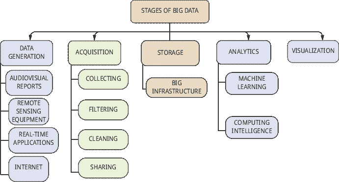

**图 1.1：** 大数据的不同阶段及分类。

#### 大数据与人工智能在药物研究中的融合

通过利用海量数据，大数据为临床试验项目提供实时监控，使组织能够高效规划试验阶段并管理患者参与。大数据分析在提供智能信息以规避或解决潜在问题、以及发掘提升效率和节约成本的新机遇方面大有裨益。例如，在罕见病领域，大数据分析被用于预测与新出版物、研究发现或药物相互作用相关的风险。大数据将预测分析应用于细分和销售团队聚焦药品销售、供应链运营等流程，衡量情绪，辅助营销和销售决策，并分析高频产品交易 [34, 35]。

在监测和诊断糖尿病等各种疾病方面，便携式传感器的使用日益增加。这些传感器使患者能够获得关于伤口液中生物因子（如 pH 值、温度、细菌物质和汗液生物标志物）的准确评估和建议。嵌入绷带或敷料中的多种传感器提供了一种伤口液中分析物浓度的实时监测方法。喷墨打印传感器被用于智能绷带，以检测伤口部位的间歇性出血、pH 波动和气压变化。此外，智能绷带探测器可与微针生物传感器连接，以检测酪氨酸酶（`TYR`）等癌症生物标志物并筛查皮肤黑色素瘤 [36, 37, 38, 39, 40, 41, 42, 43, 44, 45]。

此外，通过改善公共卫生评估和监测，预测分析和大数据可以提高公共卫生的精准度。因此，从公共卫生的角度来看，大规模数据收集是流行病学研究、人群健康评估需求、基于人群的治疗评价以及科学决策制定的宝贵工具 [46, 47]。通过协助确定为每位患者独特治疗的最有效方式，医疗保健领域对大数据分析的应用可以支持个性化护理，这可能会影响降低医疗成本、提高生活水平和减少医疗资源浪费。科学家可以通过使用数据挖掘等技术分析数据，运用归纳推理发掘探索性数据中与任何特定假设无关的模式。因此，进行预测分析和实时分析成为可能，这有助于医疗专业人员更早地开始治疗，并降低其发病率和死亡率风险 [48]。

### 1.3 大数据与人工智能在药物研究中的融合

寻找新药的过程，在医药进步的背景下，是对生物复杂性和人类创造力的致敬。随着一切继续步入信息时代，大数据和人工智能这两股强大的力量已在包括医疗保健和制药在内的少数行业中脱颖而出，成为领军者 [49, 50]。将人工智能与大数据相结合，可能会显著改变新药发现的过程。这种结合可能为解决以前困扰该行业的几个问题提供答案，包括加速药物研发管线、提高治疗结果预测的精准度以及优化研发支出 [51, 52]。随着人工智能和大数据的进步，用于加速药物开发过程的方法论也同步演变。在人工智能方法的帮助下，药物候选物现在可以以更有条理、更具成本效益的方式，并以显著更快的速度进行开发。利用现有信息提供卓越分析和分类的算力和算法，贯穿于从潜在药物发现到制药行业生产流程的整个药物开发过程 [53, 54, 55]。

#### 大数据与人工智能在药物研发中的应用

大数据，即来自多个领域的海量数据集合，正日益广泛地应用于药物研发。为了分析这些异构数据——范围涵盖从临床到生物测定等各类数据——需要先进的计算机策略和处理能力。随着大数据量的不断扩大，大数据分析正向高性能计算机、云服务和 `GPU` 迈进。数据的复杂性在一定程度上必须依靠 AI 来解决，这凸显了制药行业对复杂计算技能的必要性 [56, 57]。

药物研究与发现高度依赖多维数据，如靶点结构、化学测定、化学框架和临床数据。随着这些数据源的快速增长，AI 在药物开发中成功应用的机会也随之增加。硬件的进步也提升了数据的可用性和处理能力，开辟了大规模网络等新的建模方法。由于生物相容性纳米材料——一种现代纳米技术——为癌症等全身性疾病提供了灵活可靠的药物递送系统，它们对药物研发产生了重大影响。生物相容性纳米材料、AI 和硬件的发展正在为更成功、更高效的药物发现方法铺平道路 [58, 59]。

分子动力学（`MD`）模拟是早期将 AI 应用于药物研发纳米模拟的基础。随后，类似的方法被用于评估碳纳米管对有机物质的敏感性 [60, 61]。

AI 算法，尤其是机器学习模型，依赖于数据。输入的数据越多，它们变得越准确、预测性越强、适应性越好。AI 逐渐演变为药物研发行业中用于大数据解读、分析和应用的工具。此外，大数据为全面的患者分析提供了平台。个性化医疗日益普及，凸显了理解个体基因组成对其药物反应影响的重要性。通过 AI 驱动的大规模遗传数据分析，根据个体患者画像定制药物成为可能，这提高了治疗疗效并减少了不良反应 [62, 63, 64]。

药物发现过程中产生并通过开放数据库公开的大数据，可能在降低整个流程中的药物淘汰率方面发挥巨大作用。传统的机器学习技术（如 `QSAR` 建模）可用于确定具有特定药理作用的药物候选物的优选排序顺序。该技术也可用于剔除不合适或具有已知副作用的物质。AI 的进步使 `CADD` 研究能够利用大数据研究的稳健架构，从而将该领域推向新的高度。这些进步包括多种深度学习算法的创建和处理能力的显著提升 [65, 66]。

借助 `QSAR` 这一有效方法，仍然可以在化学框架及其特性和活性之间建立重要联系。当 `QSAR` 建模首次用于药物研发时，它基于适度的数据集和简单的线性回归技术。`ML` 在药物研究和发现中的应用不仅限于 `QSAR`。例如，化学模式匹配研究的数字轮廓被用于利用生成模型进行从头药物设计 [67, 68, 69, 70, 71]。这些生成模型可以产生具有正确特性和功能的合成分子。因此，通过对包括公共数据库在内的多种数据类型使用 `ML` 建模，`CADD` 可在大数据时代创造巨大价值 [72, 73]。

### 1.4 利益相关者的作用

# 利益相关者分析

利益相关者分析，即根据获取的信息识别和排序利益相关者，是健康创新设计中的关键步骤。由于参与式研究中的利益相关者选择标准有时模棱两可，因此在制定参与式规划程序时必须考虑利益相关者的结果。利益相关者分析有助于理解新技术开发和投入使用的背景；它指导规划过程涉及相关个人、组织或群体；并制定计划以促进开发和使用中的创新，同时避免可能阻碍系统集成的障碍。通过将利益相关者分析整合到参与式规划程序中，该过程的公平性和开放性确保了利益相关者适当地参与健康创新规划 [74, 75, 76, 77, 78, 79]。

被称为客户关系管理（CRM）的营销方法非常强调产品的最终用户，甚至推测用户可能是制药营销中的患者。然而，行业销售人员建立联系的对象是医生、批发商和零售商，而非患者。医生开具特定企业生产的药物处方，但商家和批发商是供应链的重要组成部分，他们可以通过告知当地医生促销信息或为特定处方提供替代方案来增加销量。销售人员从未与他们的最终客户——患者——交谈，但患者仍然购买并使用产品。因此，确定制药行业的真正参与者至关重要。如图 1.2 所示，多个利益相关者参与了制药政策框架的制定和执行。除了州政府和联邦政府（包括卫生、贸易、商业和工业等所有部委）之外，这些利益相关者还包括：监管机构、患者、医生、药剂师、保险公司、学术机构、专业组织、非政府组织、非营利组织以及无积极参与的消费者团体。国家和跨国药品制造商也在其中。政府包含州当局、联邦政府以及负责药品生产、进出口、投资、许可、定价、研发和质量控制的任何相关部委。

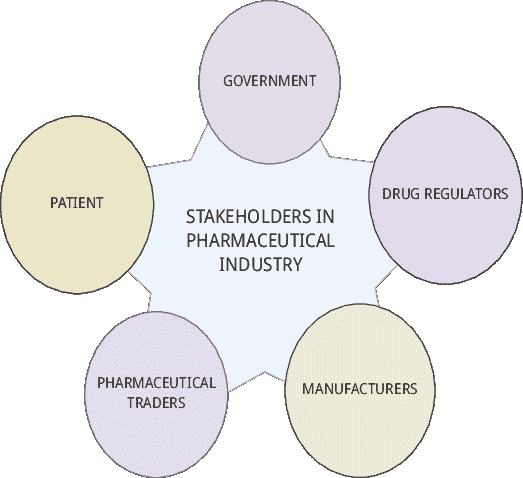

**图 1.2：制药行业的不同利益相关者。**

在制药政策的制定、规划、实施和监管方面，他们是关键参与者，在某种意义上也是先行者。在制定新的制药政策时，政府必须主动出击，在颁布政策框架前与所有相关利益相关方进行协商。各国政府的政治意愿是制定有效政策的关键因素，这些政策旨在确保药品的安全高效利用、采购、分发和质量控制，以及药品的平等可及性、可负担性和财务风险缓释 [[80]](#9783111573861_000727.xhtml#b_9783111574288-001_ref_080)，[[81]](#9783111573861_000727.xhtml#b_9783111574288-001_ref_081)。药品监管机构在印度药品法律的制定和实施中发挥着至关重要的作用，特别是在许可、营销、分发、储存、临床试验、生产、进口、出口和进出口方面。然而，在印度等国家，由于部委直接负责制定药品政策，药品监管机构并不处于该过程的最前沿。因为他们了解在将这些政策付诸实施时出现的困难和障碍，所以他们对于实施稳健、全面且可行的政策制定至关重要。药品监管机构是印度制定全面、实用和稳健法规的关键参与者，因为他们在一线执行这些政策，并了解执行过程中出现的挑战和障碍 [[82]](#9783111573861_000727.xhtml#b_9783111574288-001_ref_082)。

此外，得益于药品供应网络和监管相对宽松的市场，生产商能够让医生、药师和患者使用其产品。这使制造商处于评估药品质量、进而评估其治疗常见疾病适用性的地位。他们还有权决定药品价格，从而降低低社会经济地位人群的处方成本。然而，众所周知，制药公司是以盈利为目的的企业，其主要目标是最大化股东财富 [[83]](#9783111573861_000727.xhtml#b_9783111574288-001_ref_083)，[[84]](#9783111573861_000727.xhtml#b_9783111574288-001_ref_084)。药品贸易商（如总代理、分销商、运输和货运代理、零售商、批发商和医药代表）在制药行业和处方医生之间提供了至关重要的渠道。出于商业利益，他们从品牌药推广中获益良多，并能显著影响处方实践 [[85]](#9783111573861_000727.xhtml#b_9783111574288-001_ref_085)。患者是最后但绝非最不重要的利益相关者，因为他们是所有其他利益相关者关注的焦点。作为持牌受监管制药企业生产药品的最终使用者，他们受到政府监管。药师分发这些药品，医生开具处方，药品商进行营销、供应和销售。他们充当枢纽，支持链条上所有其他环节的任务和努力。政策框架的有效性取决于其缓解患者痛苦并协助他们控制病情的能力。因此，在制定过程中，必须仔细分析患者的需求、愿望和期望，以构建以结果为导向、以患者为驱动的制药战略 [[86]](#9783111573861_000727.xhtml#b_9783111574288-001_ref_086)。其他利益相关群体包括化学家、医疗基金、健康保险计划和药品分销商。鉴于他们对处方决策的影响，应在更广泛的意义上将他们视为客户。制药行业的三大主要客户群体是付费方、医生和患者。因此，医生、医院、批发商、药房、最终用户和患者是制药公司目前集中销售力量的三大客户板块 [[87]](#9783111573861_000727.xhtml#b_9783111574288-001_ref_087)，[[88]](#9783111573861_000727.xhtml#b_9783111574288-001_ref_088)，[[89]](#9783111573861_000727.xhtml#b_9783111574288-001_ref_089)。

# 1.5 智慧制药中的挑战与制胜策略：AI 与大数据的基石

## AI 在药物发现中的挑战与结论

### 挑战与局限性

尽管 AI 在药物发现方面具有潜在优势，但也存在各种必须考虑的缺点和挑战。最重大的障碍之一是相关数据的获取。基于 AI 的技术训练通常需要使用大量数据集。由于所提供数据的数量有限、质量参差不齐或质量低下，结果的可靠性和准确性经常受到影响 [90, 91, 92]。它提供了大量数据，供逐步训练的模型使用。由于成本较高，公司从多个数据库获取数据的模式遭受了巨大损失。此外，需要大量可信数据来保证药理学分析的可靠性。

阻碍生物医药行业充分采用 AI 的另一个障碍是缺乏熟练人员来监督基于 AI 的平台 [93]。大型企业（如制药公司）利用 AI 和 ML 取代人力员工，以及小型组织缺乏资金，导致了失业。在基于 ML 的过程中，决策由输入数据生成；然而，从输入到输出的路径并不透明。在 CNNs 中，输入数据本质上被几个复杂的层改变，最终产生不可预测的行为 [94]。此外，当黑箱机器学习模型的预测缺乏推理依据时，人类在数据解读中的错误会影响机器学习预测。但逻辑模型和决策树（如关系机器学习）并不显示根本问题。人类用户无法理解预期结果，影响了对模型性能的依赖。尽管 ML 模型初步结果令人鼓舞，但关于预测置信度的担忧依然存在。当算法试图寻找其应用范围之外的机制时，机器学习方法生成的假设更有可能发生病理性失败 [95]。

当利用基于 AI 的解决方案创造创新药物时，由于可能产生偏见和公平性问题，会出现伦理问题。不准确的数据会影响发现的可靠性和准确性，因此人类研究人员需要确保 AI 得到公平和合乎道德的使用。AI 仅限于根据其可用的事实进行预测；人类研究人员仍需确认和解释结果。因此，在创造新型药物时，必须保证 AI 得到公平和道德的应用 [96, 97, 98, 99, 100]。

制药公司的数据集中拥有数百万种化合物可用于新药开发；这对于传统机器学习技术来说可能过于庞大。利用定量构效关系（QSAR）的计算机模型可以迅速确定大量化合物或关键理化性质（如 log P 或 log D）。因此，这些模型无法准确预测特定物质的疗效和副作用，因为这些是复杂的生物学特征。此外，基于 QSAR 的模型还受到缺乏实验验证、训练集中实验数据错误以及训练集长度过短的限制 [101]。

AI 通过其处理大量放射学数据的能力，展示了在改善医学影像服务方面的卓越效用。基于 AI 的软件有潜力提高患者诊断的精确度，从而减轻医务人员的负担并简化其职责。随着数据收集的增加和医学研究的发布，AI 支持的医疗项目有潜力提升智能化水平。如果告知患者能获得更快、更精确的诊断、更少的错误和更低的医疗费用，不熟悉 AI 的患者可能会被说服参与系统支持的操作。医疗系统应向客户提供关于 AI 集成医疗系统优缺点的信息 [102]。

# 1.6 结论

AI 已改变制药行业，显著提高了药物发现和研究的效率。AI 方法（如机器学习和自然语言处理）的应用，促进了大数据集的检查、药物化合物疗效的预测以及优化药物递送系统的创建。大数据也影响了制药行业的格局，使医疗系统变得更加移动化和高效。AI 有潜力实现个性化医疗，从而提高生活水平、减少资源浪费和降低医疗成本。然而，仍有障碍需要克服，如寻找相关数据的困难、缺乏训练有素的人员以及伦理顾虑。医疗系统必须向患者提供关于 AI 支持医疗系统优缺点的信息。尽管存在这些挑战，AI 仍能显著改善医学影像服务和患者诊断。

# 参考文献

[1] Tripathi A, Misra K, Dhanuka R, Singh JP. Artificial intelligence in accelerating drug discovery and development. Recent Patents on Biotechnology. 2023 Mar 1;17(1):9–23. →

[2] Xu Y, Liu X, Cao X, Huang C, Liu E, Qian S, Liu X, Wu Y, Dong F, Qiu CW, Qiu J. Artificial intelligence: A powerful paradigm for scientific research. The Innovation. 2021 Nov 28;2(4):1–20. →

[3] Zhuang D, Ibrahim AK. Deep learning for drug discovery: A study of identifying high efficacy drug compounds using a cascade transfer learning approach. Applied Sciences. 2021 Aug 24;11(17):7772. →

[4] Pu L, Naderi M, Liu T, Wu HC, Mukhopadhyay S, Brylinski M. e toxpred: A machine learning-based approach to estimate the toxicity of drug candidates. BMC Pharmacology and Toxicology. 2019 Dec;20:1–5. →

[5] Wess G, Urmann M, Sickenberger B. Medicinal chemistry: Challenges and opportunities. Angewandte Chemie International Edition. 2001 Sep 17;40(18):3341–50. →

[6] Chen R, Liu X, Jin S, Lin J, Liu J. Machine learning for drug-target interaction prediction. Molecules. 2018 Aug 31;23(9):2208. →

[7] Zhong F, Xing J, Li X, Liu X, Fu Z, Xiong Z, Lu D, Wu X, Zhao J, Tan X, Li F. Artificial intelligence in drug design. Science China Life Sciences. 2018 Oct;61:1191–204. →

[8] Beneke F, Mackenrodt MO. Artificial intelligence and collusion. IIC-International Review of Intellectual Property and Competition Law. 2019 Jan 15;50:109–34. →

[9] Steels L, Brooks R, eds. *The artificial life route to artificial intelligence: Building embodied, situated agents*. Routledge; 2018 May 15. Isayev O. Text Mining Facilitates Materials Discovery. *Nature*. 2019;571(7763):42–43. →

[10] Zhao S, Su C, Lu Z, Wang F. Recent advances in biomedical literature mining. *Briefings in Bioinformatics*. 2021 May;22(3):bbaa057. →

[11] Álvarez-Machancoses Ó, Fernández-Martínez JL. Using artificial intelligence methods to speed up drug discovery. *Expert Opinion on Drug Discovery*. 2019 Aug 3;14(8):769–77. →

[12] Dana D, Gadhiya SV, St. Surin LG, Li D, Naaz F, Ali Q, Paka L, Yamin MA, Narayan M, Goldberg ID, Narayan P. Deep learning in drug discovery and medicine; scratching the surface. *Molecules*. 2018 Sep 18;23(9):2384. →

[13] Mak KK, Pichika MR. Artificial intelligence in drug development: Present status and prospects. *Drug Discovery Today*. 2019 Mar 1;24(3):773–80. →

[14] Minko T, Rodriguez-Rodriguez L, Pozharov V. Nanotechnology approaches for personalized treatment of multidrug resistant cancers. *Advanced Drug Delivery Reviews*. 2013 Nov 30;65(13–14):1880–95. →

[15] Sun M, Zhao S, Gilvary C, Elemento O, Zhou J, Wang F. Graph convolutional networks for computational drug development and discovery. *Briefings in Bioinformatics*. 2020 May 21;21(3):919–35. →

[16] Piroozmand F, Mohammadipanah F, Sajedi H. Artificial neural network (ANN) in drug delivery. *A Handbook of Artificial Intelligence in Drug Delivery* 2023 Jan 1 (pp. 97–122). Academic Press. →

[17] Cui P, Wang S. Application of microfluidic chip technology in pharmaceutical analysis: A review. *Journal of Pharmaceutical Analysis*. 2019 Aug 1;9(4):238–47. →

[18] Lou H, Lian B, Hageman MJ. Applications of machine learning in solid oral dosage form development. *Journal of Pharmaceutical Sciences*. 2021 Sep 1;110(9):3150–65. →

[19] Jiang J, Ma X, Ouyang D, Williams RO III. Emerging artificial intelligence (AI) technologies used in the development of solid dosage forms. *Pharmaceutics*. 2022 Oct 22;14(11):2257–65. →

[20] Fatima M, Sherwani NU, Khan S, Khan MZ. Assessing and predicting operation variables for doctors employing industry 4.0 in health care industry using an adaptive neuro-fuzzy inference system (ANFIS) approach. *Sustainable Operations and Computers*. 2022 Jan 1;3:286–95. →

[21] Pramanik MI, Lau RY, Demirkan H, Azad MA. Smart health: Big data enabled health paradigm within smart cities. *Expert Systems with Applications*. 2017 Nov 30;87:370–83. →

## 参考文献

[22] Hernandez I, Zhang Y. Using predictive analytics and big data to optimize pharmaceutical outcomes. *American Journal of Health-system Pharmacy*. 2017 Sep 15;74(18):1494–500.

[23] Hassan W, Zafar M. Pharmacology Toxicology, and Pharmaceutics Research Output in One Hundred and Fifty Countries for the Year 2019–2020. *Canadian Journal of Medicine*. 2021 Feb 1;3(1):56–60.

[24] Biglu MH, Omidi Y. Scientific profile of pharmacology, toxicology and pharmaceutics fields in Middle East countries: Impacts of Iranian scientists. *International Journal of Advances in Pharmaceutical Sciences*. 2010 Dec 1;1–20.

[25] Agrawal R, Prabakaran S. Big data in digital healthcare: Lessons learnt and recommendations for general practice. *Heredity*. 2020 Apr;124(4):525–34.

[26] Raghupathi W, Raghupathi V. Big data analytics in healthcare: Promise and potential. *Health Information Science and Systems*. 2014 Dec;2:1–0.

[27] Senthilkumar SA, Rai BK, Meshram AA, Gunasekaran A, Chandrakumarmangalam S. Big data in healthcare management: A review of literature. *American Journal of Theoretical and Applied Business*. 2018 Jul 3;4(2):57–69.

[28] Sahney R, Sharma M. Electronic health records: A general overview. *Current Medicine Research and Practice*. 2018 Mar 1;8(2):67–70.

[29] Achampong EK. Electronic health record (EHR) and cloud security: The current issues. *International Journal of Cloud Computing and Services Science*. 2013 Nov 1;2(6):417–20.

[30] Kiah ML, Zaidan BB, Zaidan AA, Nabi M, Ibraheem R. MIRASS: Medical informatics research activity support system using information mashup network. *Journal of Medical Systems*. 2014 Apr;38:1–5.

[31] Bendre MR, Thool VR. Analytics, challenges and applications in big data environment: A survey. *Journal of Management Analytics*. 2016 Jul 2;3(3):206–39.

[32] Wiener M, Saunders C, Marabelli M. Big-data business models: A critical literature review and multiperspective research framework. *Journal of Information Technology*. 2020 Mar;35(1):66–91.

[33] Verma S. Big Data and advance analytics: Architecture, techniques, applications, and challenges. *International Journal of Business Analytics (IJBAN)*. 2017 Oct 1;4(4):21–47.

[34] Guinovart T, Valdés‐Ramírez G, Windmiller JR, Andrade FJ, Wang J. Bandage‐based wearable potentiometric sensor for monitoring wound pH. *Electroanalysis*. 2014 Jun;26(6):1345–53.

[35] Phair J, Newton L, McCormac C, Cardosi MF, Leslie R, Davis J. A disposable sensor for point of care wound pH monitoring. *Analyst*. 2011;136(22):4692–95.

[36] Salvo P, Dini V, Kirchhain A, Janowska A, Oranges T, Chiricozzi A, Lomonaco T, Di Francesco F, Romanelli M. Sensors and biosensors for C-reactive protein, temperature and pH, and their applications for monitoring wound healing: A review. *Sensors*. 2017 Dec 19;17(12):2952.

[37] Pusta A, Tertiș M, Cristea C, Mirel S. Wearable sensors for the detection of biomarkers for wound infection. *Biosensors*. 2021 Dec 21;12(1):1–20.

[38] Rahimi R, Ochoa M, Parupudi T, Zhao X, Yazdi IK, Dokmeci MR, Tamayol A, Khademhosseini A, Ziaie B. A low-cost flexible pH sensor array for wound assessment. *Sensors and Actuators B: Chemical*. 2016 Jun 28;229:609–17.

[39] Liu L, Martinez Pancorbo P, Xiao TH, Noguchi S, Marumi M, Segawa H, Karhadkar S, Gala de Pablo J, Hiramatsu K, Kitahama Y, Itoh T. Highly scalable, wearable surface‐enhanced Raman spectroscopy. *Advanced Optical Materials*. 2022 Sep;10(17):2200054.

[40] Dargaville TR, Farrugia BL, Broadbent JA, Pace S, Upton Z, Voelcker NH. Sensors and imaging for wound healing: A review. *Biosensors and Bioelectronics*. 2013 Mar 15;41:30–42.

[41] McLister A, McHugh J, Cundell J, Davis J. New developments in smart bandage technologies for wound diagnostics. *Advanced Materials*. 2016 Jul;28(27):5732–37.

[42] Prakashan D, Roberts A, Gandhi S. 纳米疗法在加速手术创伤和糖尿病溃疡慢性伤口愈合过程中的最新进展。*Biotechnology and Genetic Engineering Reviews*。2023 年 1 月；17：1–29。

[43] Ciui B, Martin A, Mishra RK, Brunetti B, Nakagawa T, Dawkins TJ, Lyu M, Cristea C, Sandulescu R, Wang J. 可穿戴无线酪氨酸酶绷带和微针传感器：迈向黑色素瘤筛查。*Advanced Healthcare Materials*。2018 年 4 月；7(7)：1701264。

[44] Österreich G. 公共卫生、远程医疗和医疗保健领域大数据研究。欧洲委员会，卫生与食品安全总司。布鲁塞尔。2016 年 12 月；1–30。

[45] Pastorino R, De Vito C, Migliara G, Glocker K, Binenbaum I, Ricciardi W, Boccia S. 医疗保健领域大数据的益处与挑战：欧洲倡议概述。*European Journal of Public Health*。2019 年 10 月 1 日；29(Supplement_3)：23–27。

[46] Hartwig K, Doell F, Reuter C. 以用户为中心的误导信息干预措施全景——系统文献综述。*ACM Computing Surveys*。2024 年 7 月 22 日；56(11)：1–36。

[47] Mohs RC, Greig NH. 药物发现与开发：基础生物学研究的作用。*Alzheimer’s & Dementia: Translational Research & Clinical Interventions*。2017 年 11 月 1 日；3(4)：651–57。

[48] Yang YC, Islam SU, Noor A, Khan S, Afsar W, Nazir S. [已撤稿] 大数据和人工智能在医疗保健中的影响力应用。*Computational and Mathematical Methods in Medicine*。2021；2021(1)：5812499。

[49] Blanco-Gonzalez A, Cabezon A, Seco-Gonzalez A, Conde-Torres D, Antelo-Riveiro P, Pineiro A, Garcia-Fandino R. AI 在药物发现中的作用：挑战、机遇与策略。*Pharmaceuticals*。2023 年 6 月 18 日；16(6)：891。

[50] Liu B, He H, Luo H, Zhang T, Jiang J. 人工智能和大数据促进靶向药物发现。*Stroke and Vascular Neurology*。2019 年 12 月 1 日；4(4)：206–14。

[51] Zhao L, Ciallella HL, Aleksunes LM, Zhu H. 通过大数据和数据驱动机器学习建模推进计算机辅助药物发现(CADD)。*Drug Discovery Today*。2020 年 9 月 1 日；25(9)：1624–38。

[52] Réda C, Kaufmann E, Delahaye-Duriez A. 机器学习在药物开发中的应用。*Computational and Structural Biotechnology Journal*。2020 年 1 月 1 日；18：241–52。

[53] Tang B, Pan Z, Yin K, Khateeb A. 深度学习在生物信息学和计算生物学中的最新进展。*Frontiers in Genetics*。2019 年 3 月 26 日；10：214。

[54] De Souza A, Bittker JA, Lahr DL, Brudz S, Chatwin S, Oprea TI, Waller A, Yang JJ, Southall N, Guha R, Schürer SC. 设计、整合和交付 BARD 面临的挑战概述：一个面向多组织、多地点、多学科的公共化学生物学资源与查询门户。*Journal of Biomolecular Screening*。2014 年 6 月；19(5)：614–27。

[55] Sivarajah U, Kamal MM, Irani Z, Weerakkody V. 大数据挑战与分析方法的批判性分析。*Journal of Business Research*。2017 年 1 月 1 日；70：263–86。

[56] Minko T, Rodriguez-Rodriguez L, Pozharov V. 多药耐抗癌症个性化治疗的纳米技术方法。*Advanced Drug Delivery Reviews*。2013 年 11 月 30 日；65(13–14)：1880–95。

[57] Smith TT, Stephan SB, Moffett HF, McKnight LE, Ji W, Reiman D, Bonagofski E, Wohlfahrt ME, Pillai SP, Stephan MT. 利用合成 DNA 纳米载体原位编程白血病特异性 T 细胞。*Nature Nanotechnology*。2017 年 8 月；12(8)：813–20。

[58] Liu J, Hopfinger AJ. 利用膜相互作用定量构效关系分析，识别插入膜双分子层的碳纳米管可能的纳米毒性来源。*Chemical Research in Toxicology*。2008 年 2 月 18 日；21(2)：459–66。

[59] Liu J, Yang L, Hopfinger AJ. 药物和小分子生物活性物质对碳纳米管的亲和力：药效学和纳米毒性因素？*Molecular Pharmaceutics*。2009 年 6 月 1 日；6(3)：873–82。

[60] Lee JW, Maria-Solano MA, Vu TN, Yoon S, Choi S. 用于计算机辅助药物设计(CADD)的大数据和人工智能(AI)方法学。*Biochemical Society Transactions*。2022 年 2 月 28 日；50(1)：241–52。

[61] Hassan M, Awan FM, Naz A, deAndrés-Galiana EJ, Alvarez O, Cernea A, Fernández-Brillet L, Fernández-Martínez JL, Kloczkowski A. 面向个性化医疗和健康护理的基因组学和大数据分析创新：综述。*International Journal of Molecular Sciences*。2022 年 4 月 22 日；23(9)：4645。

[62] Hulsen T, Jamuar SS, Moody AR, Karnes JH, Varga O, Hedensted S, Spreafico R, Hafler DA, McKinney EF. 从大数据到精准医疗。*Frontiers in Medicine*。2019 年 3 月 1 日；6：34–40。

[63] Clark E, Hahn W, St Clair R, Morris P, Teti M. 深度学习的进展及其在化学信息学与药物发现中的应用效用。*ABSTRACTS OF PAPERS OF THE AMERICAN CHEMICAL SOCIETY*。2019 年 3 月 31 日；257：1155。

[64] Fleming N. 人工智能如何改变药物发现。*Nature*。2018 年 5 月 1 日；557(7706)：S55–60。

[65] Martin YC. *Quantitative Drug Design: A Critical Introduction*。CRC Press；2010；292。

[66] Mak KK, Pichika MR. 人工智能在药物开发中的应用：现状与未来前景。*Drug Discovery Today*。2019 年 3 月 1 日；24(3)：773–80。

[67] Wolber G, Seidel T, Bendix F, Langer T. 计算机辅助药物设计中的分子-药效团叠合与模式匹配。*Drug Discovery Today*。2008 年 1 月 1 日；13(1–2)：23–29。

[68] Schneider G, Fechner U. 类药分子的计算机辅助从头设计。*Nature Reviews Drug Discovery*。2005 年 8 月 1 日；4(8)：649–63。

[69] Schneider G. 用于人工智能分子设计的生成模型。*Molecular Informatics*。2018 年 1 月；37(1–2)：1880131。

[70] Merk D, Friedrich L, Grisoni F, Schneider G. 利用人工智能从头设计生物活性小分子。*Molecular Informatics*。2018 年 1 月；37(1–2)：1700153。

[71] Merk D, Grisoni F, Friedrich L, Schneider G. 调控人工智能以从头设计天然产物启发的视黄醇 X 受体调节剂。*Communications Chemistry*。2018 年 10 月 22 日；1(1)：68。→

[72] Lalonde L, Goudreau J, Hudon É, Lussier MT, Bareil C, Duhamel F, Lévesque L, Turcotte A, Lalonde G. 心血管疾病初级预防最佳实践 TRANSIT 小组。开发初级护理心血管预防的跨专业项目：一种参与式研究方法。*SAGE Open Medicine*。2014 年 2 月 17 日；2：205。→

# 第 2 章 制药业的新兴技术以及人工智能和区块链的作用

## 摘要

[73] Noyes J, Lewis M, Bennett V, Widdas D, Brombley K. 现实的护士主导政策实施、优化与评估：新颖的方法学范例。*Journal of Advanced Nursing*。2014 年 1 月；70(1)：220–37。→

[74] Van Limburg M, Wentzel J, Sanderman R, Van Gemert-pijnen L. 实施感染控制电子健康门户的商业建模：关于与利益相关者共同创造的反思。*JMIR Research Protocols*。2015 年 8 月 13 日；4(3)：e4519。→

[75] Ennis L, Robotham D, Denis M, Pandit N, Newton D, Rose D, Wykes T. 为患有严重且持久心理健康问题的人群协作开发电子个人健康档案。*BMC Psychiatry*。2014 年 12 月；14：1–7。→

[76] Bryson JM, Quick KS, Slotterback CS, Crosby BC. 设计公众参与流程。*Public Administration Review*。2013 年 1 月；73(1)：23–34。→

[77] Gilson L, Erasmus E, Borghi J, Macha J, Kamuzora P, Mtei G. 利用利益相关者分析支持迈向全民覆盖：来自 SHIELD 项目的经验教训。*Health Policy and Planning*。2012 年 3 月 1 日；27(suppl_1)：i64–76。→

[78] Blomkamp E. 面向政府的协同设计：神奇子弹还是机器学习公平性中的神奇公平。载于 *2022 年 AAAI/ACM 人工智能、伦理与社会会议论文集* 2022 年 7 月 26 日（第 664–664 页）。→

[97] Grebner C, Matter H, Kofink D, Wenzel J, Schmidt F, Hessler G. 深度神经网络模型在药物发现项目中的应用。*ChemMedChem*。2021 年 12 月 14 日；16(24)：3772–86。→

[98] Schraagen JM, Van Diggelen J. 专业知识与人工智能关系简史。*Expertise at Work: Current and Emerging Trends*。2021；149–75。→

[99] Gilpin LH, Bau D, Yuan BZ, Bajwa A, Specter M, Kagal L. 解释解释：机器学习可解释性概述。载于 *2018 年 IEEE 第 5 届数据科学与高级分析国际会议论文集*，DSAA 意大利都灵，2018 年 10 月 1–3 日；电气电子工程师学会：美国新泽西州皮斯卡特维，2019；第 80–89 页。→

[100] Zhu H. 用于药物发现的大数据与人工智能建模。*Annual Review of Pharmacology and Toxicology*。2020 年 1 月 6 日；60：573–89。→

[101] Ciallella HL, Zhu H. 在大数据时代利用人工智能推进计算毒理学：化学毒性的数据驱动与机制驱动建模。*Chemical Research in Toxicology*。2019 年 3 月 14 日；32(4)：536–47。→

[102] Lee D, Yoon SN. 基于人工智能技术在医疗保健行业中的应用：机遇与挑战。*International Journal of Environmental Research and Public Health*。2021 年 1 月；18(1)：271。→

对新型化学实体（NCE）和旨在增进人类健康的生物制品的研究、开发、制造和分销，构成了制药行业的核心活动，该行业遵循一种系统且复杂的商业模式。

本章提供了关于制药领域引入的创新技术的信息。特别是药物发现和监管审批这两个领域，制药行业可能因人工智能而经历根本性变革。区块链技术可显著增强数据机密性的保护和知识产权资产生成的验证。区块链技术也适用于医疗咨询框架，保护用户的隐私和安全，这从患者角度来看，在心理和性疾病方面是一项基本考量。尽管如此，区块链技术仍必须克服若干障碍，包括数据管理、隐私问题、数据冗余以及与现有医疗系统的集成。本章概述了人工智能和区块链技术的最新发展。

**关键词：** 区块链、制药、`ELN`、`LifeCrypter`、`GCoin`、电子健康记录数据

## 2.1 绪论

制药部门的商业模式错综复杂且目标明确，主要侧重于旨在改善人类健康的新型化学实体（NCE）和生物制品的生产、营销、研究与开发 [[1]](#9783111573861_002146.xhtml#b_9783111574288-002_ref_001)。在制药行业中，“高级分析”被贯穿于整个价值链，包括研发、安全、生产以及监管。这些分析源自各个行业 [[2]](#9783111573861_002146.xhtml#b_9783111574288-002_ref_002)。医疗体系最重要的组成部分是制药部门，其负责制造和分销用于疾病诊断和治疗的药物、生物制品和医疗器械。此外，制药行业还从事研究以创造有益于人类福祉的新产品。由于许多药品关乎生命，保持最终产品的质量对于避免任何潜在健康风险至关重要 [[3]](#9783111573861_002146.xhtml#b_9783111574288-002_ref_003)。建立药品生产单位是实现国际组织可持续发展目标的一个基本前提。鼓励和提升民众的能力对于掌控其健康以及生产既负担得起又有效的新药至关重要。这将有助于实现可持续性的主要目标之一，即减少贫困 [[4]](#9783111573861_002146.xhtml#b_9783111574288-002_ref_004)，[[5]](#9783111573861_002146.xhtml#b_9783111574288-002_ref_005)。

“传统技术”指的是第四次工业革命之前使用的三步能量转换过程。武装部队和平民患者以及医疗服务提供者的需求，无法通过传统药品制造得到充分满足。传统制造不足以胜任监督和管理复杂的、计算机化的制造流程，以实现定制化产品的熟练且盈利的生产。用于材料开发（包括医疗应用材料）的常规技术能力已达极限 [[6]](#9783111573861_002146.xhtml#b_9783111574288-002_ref_006)。借助人工智能（AI）的帮助，可以消除因从选择框中选错选项而导致的处方错误，AI 在该过程中发挥着重要作用，如图 2.1 所示。人工智能（AI）可通过分析患者病历识别此类错误。降低药物过量及其他健康风险的几率，有助于提高护理标准。AI 减少了 CT 和 MRI 扫描诊断中的人为错误，提高了治疗精度。它降低了对患者健康的威胁，维护了医院声誉，并减少了因敏感患者信息泄露而产生的成本 [[7]](#9783111573861_002146.xhtml#b_9783111574288-002_ref_007)。近几十年来，技术显著改变了人类生活的方方面面，包括交通、通信、制造、商业以及制药和医疗领域。制药行业已开始从传统职业转向更先进的职业，以促进下一代药物的生产。随着职业机会的持续改善，制药研究行业可提供的工作种类正在扩大。得益于技术进步，前沿职业机会正在涌现。通过创新研究，这些可能性已被证明能极大地提升制药行业的产出，并将下一代药物推向市场 [[8]](#9783111573861_002146.xhtml#b_9783111574288-002_ref_008)，[[9]](#9783111573861_002146.xhtml#b_9783111574288-002_ref_009)。

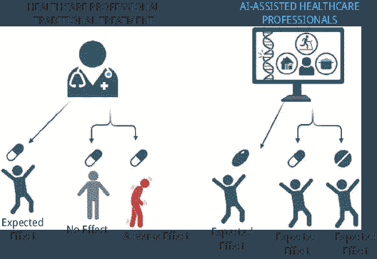

**图 2.1：** 医疗专业人员的传统治疗与 AI 辅助医疗专业人员的对比。

## 2.2 区块链在制药行业中的作用

越来越多的机构、公司和学者对区块链技术产生兴趣，尤其是在使用比特币这一类虚拟货币方面。除区块链外，智能技术的应用已改变了多个不同的领域和行业，如航空航天、汽车、计算与电子、工程、商业与会计、银行与金融、国防和医疗保健。这些技术包括人工智能、虚拟现实、物联网和机器学习 [10, 11, 12, 13, 14]。区块链技术包含一种新颖、集成、独特且创新的计算技术。该系统包含透明交易、复杂的共识构建过程、动态公钥算法加密、可编程智能合约、去中心化点对点网络和去中心化存储 [15]。区块链技术的众多优势之一是，纳入分布式数据库的合同和交易不受篡改影响。去中心化、透明性、信任、隐私和稳定性是区块链技术的众多属性之一。通过在制药行业实施区块链技术，已找到一种防止假冒药品销售的可行方法。区块链技术可实现对原材料采购、药品分销和药品溯源的监控。此外，实施区块链技术可减少中间商数量，从而提高制药流程的安全等级并降低成本 [16, 17]。

整个供应链系统配备了验证流程，可在以下技术参数范围内验证产品序列号。此外，药品可追溯性已得到改善以防止盗窃，并通过利用数字签名实现了质量控制。另外，为确保质量保持一致，已从供应商到药店建立了区块链链码、医疗记录和数据挖掘 [18]。此外，交付延迟会损害整体业务运营，在制药和医疗领域，可能导致死亡或病情加重。制药供应链已实施区块链技术。药品监控和溯源对于法规遵从、患者健康和业务运营至关重要。复杂且安全的监控与跟踪技术可实现运输中产品及时送达预定目的地，从而保障制药业务和患者管理。为加快药品全球发货，建立了一个安全的全球注册库。尽管该技术为大型制药公司提供了巨大机遇，但对小型企业也有益处 [19, 20]。

药物发现、药物开发以及监管认证，构成了制药研发这一多年、复杂的过程。区块链是一个去中心化计算机网络，为成员提供安全账本的访问权限，且无需中央服务器即可运行。通过为网络内的每笔交易加盖时间戳，它消除了对外部组织的需求。每个网络节点维护自己的本地账本并保存记录的本地副本。对本地账本的微小更改会反映到整个网络。除了加密货币，区块链技术还支持任何类型数字资产的创建和监控。在制药供应链中，制造商创建并注册在网络上的产品可像加密货币一样转移给其他参与者，因为它被视为一种数字资产。再次强调，区块链在隐私保护方面排名首位。区块链网络的每个成员都会获得一个密钥对，作为其身份标识 [21, 22]。区块链方法在维护患者隐私和数据安全的同时，为患者招募提供了特殊优势。通过使用区块链分布式账本，匿名注册的患者可关联至各个临床试验站点，从而缩短患者招募时间。因此，研究人员可根据研究计划从一组患者中选择所需受试者。还提出了一种涉及多重合同的区块链结构，用于管理临床试验研究并让患者参与其中 [23]。此外，临床试验采用区块链技术进行追踪，这在增强对结果信心的同时，也鼓励他人参与临床研究。由于透明度可减少选择性掩盖阳性结果的临床试验，因此它是药物发现研究的重要组成部分。因此，将区块链技术应用于临床试验，除了增强数据完整性和透明度外，还促进了赞助商与不同临床研究站点之间建立更好的关系 [24]。

### 区块链技术在临床研究与制药供应链中的应用

临床研究的参与者也能因区块链技术而访问共享数据。尽管大数据增加了临床试验（CT）的存储容量，但其海量的数据量、多样性和记录的快速增长给去中心化存储框架带来了诸多挑战 [25]。区块链的一个引人注目的特性是其能够安全地与多方利益相关者共享真实数据，这可以简化临床试验的管理。临床试验在新药开发后评估其有效性。临床试验是漫长的程序，涉及位于不同地点的众多监管审查委员会和不同数据源之间错综复杂的交互。临床试验数据必须在保持机密性和专有信息的前提下进行收集和共享。不过，准确有效地管理来自各种信息来源的临床数据颇具难度。通过为所有相关方提供一个统一的信息共享平台，区块链技术可以提升临床试验结果的质量 [26]。

首先，来自社交媒体、实验室、医疗设备等不同来源的所有数据被整合以创建原始数据。随后，这些数据演变为大数据。这些后续数据是基于区块链的医疗保健系统不可或缺的部分，并作为技术栈初始层的主要构建要素。与区块链技术相集成的非结构化信息层，是构建四组件安全医疗架构的基础框架。共识协议和算法是不同区块链平台间各异的特性之一。正如图 2.2 所示，已开发出众多区块链平台以帮助用户生成和管理其交易 [27, 28]。

一种名为 `LifeCrypter` 的基于区块链的解决方案被引入，旨在提升全球制药供应链的安全性和可信度。通过采用清晰的识别标签，该系统可在其交易历史中维护所有权数据，从而构建一个可靠、透明且可追溯的药品供应链网络。引入 `GCoin` 区块链的另一个原因是提供一个透明的、共识驱动的且不可篡改的药品供应链。为检测假冒和流失药物，创建了一个基于 `Hyperledger` 的框架，以确保患者隐私、安全性和透明度 [29]。

此外，研究人员已利用基于区块链的智能合约来管理、保护和实时分析传感器，以及处理此类传感器产生的受保护健康信息（PHI）。研究人员为医疗保健提出了一种完全基于分层的设计，其中持续的医疗监测系统由以患者为中心的代理管理。为管理实时数据流，一些研究人员还引入了一种涉及患者代理的架构，该代理协调区块链的实施 [30, 31]。

区块链技术可显著促进知识产权资产的创建演示和数据机密性的保护。支持区块链的电子实验记录本（`ELN`）是一种数字笔记本，可促进实验室数据的系统化、安全且高效的共享与归档。该系统保证安全性，并允许延迟提交数量减少的、具有合法利益的新型药物产品。在将知识产权文档转移到区块链并在账本上创建记录之前，研究人员会对其进行加密以防止未经授权的访问。研究人员可通过在区块链上提交文档上传期间生成的加密密钥来获得区块链证书 [32]。

此外，药物在交付给消费者之前，可能要从生产设施运输数千公里。物流公司必须监控药物在整个供应链中的流转，以确保其以最佳方式被处理、运输和储存。对适当条件的不当维护可能会对产品功效产生不利影响。区块链技术的去中心化结构、不可变性和透明性确保所有参与方均遵守规则。智能合约可用于通过通知相关供应链利益相关者来管理任何违反合规条件的行为。研究人员正在利用区块链进行研究以监控和追踪产品。此外，研究人员正在引入物联网（IoT）传感器，以监控整个供应链中的最佳温度和湿度水平 [33]。

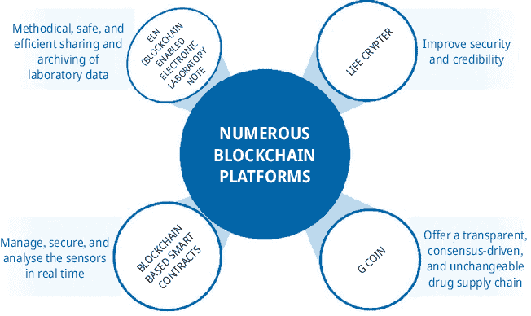

**图 2.2：** 制药领域使用的众多区块链平台，用于帮助用户。

电子健康记录（EHR）数据在机构内部及机构之间的设计、共享和保存，一直是区块链技术领域广泛研究的主题。研究人员通过为患者的私人医疗记录创建安全的在线存储，构建了一个安全的区块链结构以促进医疗数据共享。在该结构内，通过使用具有信息所有者访问控制权限的数字档案来实现医疗数据管理。数据通过链下云加密进行存储。另一位研究人员在一项相关研究中，利用区块链技术和多方权威机构创建了一种基于属性的认证方案，该方案保证并验证了 EHR。它简化了组消息的广播，并可能抵抗串谋攻击。此外，一些研究人员建议了一种基于区块链和基于属性的数字货币的安全云电子病历系统。数字签名结合基于身份的加密和基于身份的签名被用于加密医疗数据。除了区块链技术，还实施了其他方法以确保医疗机构的真实性和问责制 [34, 35]。

## 2.3 AI 与区块链在制药行业的融合

### 区块链与 AI 的融合：跨行业的变革潜力

#### 概述

区块链仍被视为一种潜在的变革性技术，有潜力彻底改变人们沟通、进行金融交易、监控市场和记录交易的方式。区块链技术的潜力在于消除对中央权威机构的需求，以监督和认证多方之间的交易与协议。另一个正迅速获得关注的显著领域是 AI。AI 使机器能够从数据中获取知识，并基于所获知识做出决策。去中心化 AI 的理念近年来取得了进展。去中心化 AI 建立在区块链与 AI 的结合之上。它促进了经过精心分类、值得信赖且共享的数据在区块链上的分布式、无中介处理与存储。现在预计区块链将作为存储数据的可靠媒介，而 AI 据称能够处理海量数据。智能合约可融入区块链编程，使可靠的第三方能够监控用户数据的共享与访问 [36, 37, 38, 39]。当与 AI 结合时，区块链技术有潜力以多种方式改善供应链。通过在供应链中整合区块链技术和 AI，可实现对本地或区域供应系统的保护，并提供提升运营效率所需的智能。它能促进决策制定，增强数据安全性和效率。区块链安全地存储海量数据，而 AI 则分析、推断并从数据行为中生成新的场景和模式 [40, 41, 42]。

#### 供应链自动化

通过将 AI 与区块链集成，供应链可实现全面自动化并经历根本性变革。AI 平台可通过与区块链集成，从销售数据、销售点信息和过往购买记录等多种来源收集数据。这使得识别数据特征并应用预测分析成为可能，这对路线规划、需求预测、收入预测和网络管理等任务很有用。研究人员在其研究中建议实施区块链技术和 AI，以确保药品在整个供应链中的安全分发。触发的请求-响应机制允许链中任何产品在经过验证的链成员之间转移。产品可通过智能合约追溯至其源头，智能合约利用区块链记录实体间的每一次交换。实验结果表明，该方法既可行，又比现有方法安全得多 [43, 44]。

#### 医疗健康应用

研究人员通过整合 AI 和 BC（区块链）技术，解决了小型医疗评估的问题。在医疗咨询框架中使用 BC 可确保用户的隐私和安全，从患者角度来看，这对于心理和性疾病至关重要。AI 和 BC 技术在医疗保险行业均有广泛应用。AI 已被用于为慢性病患者创建个性化方案，协助保险（案例）经理处理保险索赔，并帮助他们更准确、果断地评估案件 [45]。

区块链和 AI 是两种在医疗健康行业均显示出进步潜力的技术。科学界对在 EHR（电子健康记录）数据处理中使用这些方法感兴趣。然而，区块链开始在医疗行业更频繁地出现。它解决了当前 EHR 框架互操作性的问题，以防止患者信息被恶意滥用和篡改记录。目前，包括 Epic 在内的多种基于 EHR 的系统类型，均采用实时 AI 解决方案进行人群健康管理，并利用临床决策支持平台预测患者病情恶化、死亡率、住院率和风险水平。同样，基于区块链的平台 MedRec 已使患者能够访问信息 [46, 47]。虽然区块链技术可确保安全性和完整性，但增加 AI 功能对医疗行业可能有利。AI 目前主要用于识别 CT 和 X 光扫描中的异常，其效果至少与人类相当，这一任务确保了更个性化的治疗。鉴于降低医疗成本和提高护理标准可能带来的显著优势，专家预测未来将出现重大发明 [48]。因此，将最先进的 AI 工具与区块链技术相结合，将促进生物医学研究和医疗健康的去中心化和加速发展。研究表明，深度学习（DL）是一种强大的 AI 技术，已被有效应用于某些研究人员研究的各个学科，如药物分类、化学合成、医学诊断和细胞图像分析。此外，还证明了 DL 已被证实是药物发现和研究的有用工具 [49]。通过将区块链技术与 AI 相结合，可推进个性化心血管医学的目标。此外，通过共享专有 AI 算法以实现泛化、去中心化供应商或医疗系统数据库、为表现优于其他方案的解决方案提供激励，以及大幅增加可用于 AI 开发和训练的数据，研究该组合的其他研究人员发现了加速其发展的方法。这些应用仍处于起步阶段，关于如何使用它们存在一些顾虑。在技术信任、伦理考量、补偿机制，以及竞争企业在实践中是否会批准数据流动等领域，仍需进一步研究 [50]。

### 区块链智能合约与 AI 的融合应用

除其他可能性外，整合 AI 模型的基于区块链的智能合约可能建议退回过期商品、根据指定限制和事件进行库存重组、支付或采购、解决争议，并选择最环保的运输选项。研究人员考察了 AI 和区块链技术对自动化服务的影响。调查者采用二手数据收集方法，以获取与研究主题相关的数据和详情 [51]。区块链还通过促进从内部和外部来源获取海量数据、增强对数据使用和模型共享的控制、生成更多可操作的见解，以及促进更可靠、透明的信息市场，为 AI 的进步做出了贡献。研究人员提出了一个框架，利用外部组织（或预言机）来处理数据，该框架利用区块链作为账本和智能合约平台来控制机器人。研究人员演示了如何使用智能合约来监管机器人、安全地记录事件，并与外部 AI 系统接口以分析图像 [52]。区块链上的数据极其安全，因为加密技术已直接集成其中。在区块链上存储敏感和机密数据（如健康记录或个人推荐）似乎合乎逻辑。AI 需要海量的持续数据集。研发工作目前集中在开发能够安全处理加密数据的 AI 算法上。

#### 2.4 制药行业 AI 的监管考量

尽管 AI 在制药监管事务中的应用仍处于起步阶段，但它有望彻底改变该行业。AI 可以通过提供该领域最新进展的信息（特别是 AI 在监管审批和药物发现方面的潜在优势）来协助监管事务工作。AI 可以通过自动化流程、识别新机遇和优化判断，帮助制药研究人员加快并改进决策。它促进了新药更快地推向市场。监管事务是指制药公司内部作为与国家和全球监管机构中介的部门，旨在根据现行规则和法规获得产品批准。监管机构根据药物发现和产品开发过程中提交的信息和文件批准产品 [53, 54]。区块链、基于互联网的计算、3D 生物打印和 AI 是在医疗保健领域有应用的消费技术创新示例。这些发展需要新的法规以跟上技术快速发展的领域 [55]。美国食品药品监督管理局（FDA）通过制定技术标准和指南，以及定义补充目标以改进监管审批流程，在推动创新技术发展方面发挥着关键作用。AI 算法的最新进展及其广泛的适用性，表明对医疗技术和医疗保健有重大影响。通用人工智能（AGI）被定义为表现出类人智能、能够执行人类任何智力任务的 AI。FDA 的一项分析表明，人工窄智能（ANI）——医疗技术中常用的一类 AI——是专门为单一目标设计的 [56, 57]。

必须立即对 AI 进行监管，因为它开始超越人类智能，且 AI 的广泛应用可能带来不利后果。欧洲委员会的“机器人法律项目”研究了机器人技术的法律后果，制定了《机器人监管指南》。由于其新兴属性，AI 无法被限制在单一司法管辖区内，因此需要全球监管。AI 算法开发者必须应对的风险包括数据集漂移、粗心的混杂因素拟合和无意的歧视性偏见。向新群体的泛化以及新算法对健康结果可能产生的无意不利影响，是需要仔细考量和监管的额外挑战 [58]。AI 算法开发者必须应对的风险是无意的歧视性偏见、疏忽的混杂因素拟合和数据集漂移。向新群体的泛化以及新算法对健康结果可能产生的意外负面影响，是需要仔细考量和监管的更多担忧。FDA 提供了从真实世界场景中提取验证信息并以此为依据发布医疗产品的机会，而无需建立专门的临床研究。真实世界数据是指可从产品和疾病数据库、电子健康记录或家庭环境中收集的患者生成数据等来源获取的、关于患者健康状况的任何信息。这些举措表明，FDA 认为数据驱动策略和动态开发流程能够改善基于软件的设备机会以及患者健康。AI 系统通常必须被视为动态系统。随着提供更多数据，其性能旨在变得更好 [59, 60]。

##### 基于 AI 的设备与监管挑战

因此，基于 AI 的设备旨在成为动态的，而非具有固定状态。另一方面，医疗器械法规要求发布版本处于固定状态。发布前需要对状态进行彻底验证。每当接收到新数据，设备都需要重新发布。这防止了数据库在应用程序运行时持续变更。将需要对整个流程进行验证和发布。从概念上讲，面向流程的验证不仅限于产品，还延伸至组织质量体系中使用的其他基于软件的工具。因此，当根据 MDR 强制要求使用 AI 工具持续评估医疗器械时，这也同样适用。FDA 的 Pre-Cert（预认证）计划目前正在实施面向该方法的基本措施 [61]。该法规规定了以下内容：(i) 联盟内 AI 系统销售、使用和运行的标准操作程序；(ii) 特定 AI 技术应用的限制；(iii) 高风险 AI 系统的特殊规范及运营者责任；(iv) AI 与 COVID-19 药物警戒应用的标准操作程序；用于生成或修改图像、声音或视频内容的 AI 系统、情绪识别和生物特征分类系统、旨在与人互动的 AI 系统的透明度管理规则；以及 (v) 市场监督和监测法律 [62]。欧盟委员会准备建立一个法律框架，重点关注与 AI 系统特定应用相关的风险。基于风险的方法区分了三类 AI 应用：(1) 不可接受的风险，(2) 高风险，和 (3) 中低风险 [63]。被认定为风险“不可接受”的某些 AI 系统将被禁止。众多“高风险” AI 系统可获批准，但仅限于满足特定条件并履行特定义务后，方可进入欧盟市场。对仅构成“有限风险”的 AI 系统，将适用极低的透明度要求。

卫生部一直在努力履行质量管理、整合、数据收集和同意标准制定方面的监管职责，依据包括 NDHB（2019）和 EHR 标准（2016）。使生态系统能够以适合 AI 的方式共享和汇编数据，将推动其技术进步。为促进数据共享，政府不应仅制定计划和标准，而应建立数据市场和合作倡议。由于医疗行业仍处于起步阶段，管辖 AI 的法规仍在不断演变。此外，还有机会实施适应性监管，并从过去的错误中吸取教训，在过度监管（可能大规模阻碍有意义的公共卫生倡议的实施）和监管不足（可能危及用户信任、安全性、有效性和采纳）之间寻找理想的平衡。因此，监管机构必须考虑两件事：AI 模型的临床评估，以及正在使用的 AI 模型的上市后监督和追踪 [65]。

#### 2.5 医药领域区块链面临的挑战

区块链技术研究领域正在不断扩大。最初局限于银行业，区块链技术现已被政府机构、物联网、信誉框架和安全服务所采用。制药行业最近实施了区块链技术，主要是为了解决假冒伪劣问题。得益于其去中心化特性，区块链技术具有两大核心优势：信息安全和隐私保护。尽管如此，它需要更强的处理能力。约 50% 的能耗用于抵御恶意用户攻击；若缺乏高效的追踪和溯源，用户可能因盗窃和物品丢失而遭受损失 [66]。区块链技术可促进全球安全银行交易，但互操作性问题构成严峻挑战。分布式账本技术可用于标准化区块链操作 (DLT)。尽管国际电信联盟 (ITU) 正努力识别和标准化 DLT 应用及其服务，但仍需进一步研究以确定实施 DLT 应用的最佳方法。边缘计算、云计算和先进物联网应用的利用，显著提升了数据可访问性 [67]。这种巨大增长给区块链的实施带来了诸多挑战，包括数据管理、隐私问题、冗余问题和可访问性问题。此外，由于不当行为和管理不善的供应链，行业试图利用区块链技术加速医疗交易、保障患者安全，并实现追踪与溯源 [68, 69]。确保不同医疗设备和系统之间的互操作性也至关重要。为实现各医院和系统间的信息顺畅交换与交互，需要强大的互操作性解决方案。随着医疗数据量的扩大，区块链网络必须在不降低性能的前提下适应更高的交易率。为确保区块链实施符合 GDPR 和 HIPAA 等严格的数据保护要求，细致的设计和执行协议必不可少 [68, 69, 70, 71, 72]。

### 2.6 结论

医疗保健依赖于制药行业，后者负责药物、生物化合物和医疗器械的研究、开发、制造和营销。传统制造方法已达极限，而 AI 可帮助消除处方错误并改善护理。区块链技术，特别是比特币，因其去中心化、透明性、信任性、保密性和稳定性，在制药领域引起了关注。它已被用于避免假药、追踪药源、改善药物透明度和质量控制，并协助制药供应链。区块链允许安全交易并保护隐私，缩短患者招募时间，提高数据的精确度和透明度。`LifeCrypter`、`GCoin`、`Hyperledger` 等平台及智能合约已被开发，以提高制药供应链的安全性和可信度。区块链技术被用于创建、交换和保护 EHR 数据，确保医疗机构的有效性和问责制。AI 在改变制药领域方面具有巨大潜力，尤其是在药物发现和监管审批流程中。美国食品药品监督管理局（FDA）和欧盟委员会的“RoboLaw 项目”为 AI 算法提供了技术标准和指南。然而，区块链技术面临数据管理、可访问性、冗余、隐私以及与现有医疗系统集成等挑战。

#### 区块链在医疗保健中集成的挑战

研究人员断言，将区块链技术与现有医疗系统集成面临重大挑战。由于许多医院仍在使用遗留系统，因此需要周密的规划以确保向后兼容性和平稳过渡。此外，必须解决与区块链技术相关的能耗问题，特别是工作量证明共识机制。医疗机构应考虑节能且环保的区块链解决方案 [73, 74, 75, 76, 77]。此外，管理存储容量是另一项挑战。区块链旨在记录和管理交易数据，范围有限，因此只需最小存储容量。随着技术演进并渗透医疗领域，存储挑战随之出现。每日来自医疗领域的海量数据需要处理。在区块链环境下，所有数据（如患者记录、病史、检测结果、MRI 扫描、X 光片及其他影像）将对网络中每个节点可见，这需要巨大的存储容量。

随着区块链技术的进步，它不仅面临上述技术问题，还面临社会障碍，包括文化变革。接受并实施一种完全脱离传统工作方法的技术始终是具有挑战性的。医疗行业正逐步向数字化转型；但在完全采用技术（特别是目前缺乏临床验证的区块链）之前，仍需取得实质性进展。要让医生依赖技术而非文书工作，需要时间和努力。由于医疗行业采纳新技术和政策的速度较慢，所提供的政策并未广泛获得信任 [78, 79, 80, 81]。

区块链技术仍处于开发和完善的早期阶段。该技术初期将增加机构成本，并需要随时间推移被采纳和集成。同时也有必要解决非标准化、可扩展性、信息衰变风险以及与现有遗留系统集成等问题。一个相关问题是区块链交易验证时间。技术实施挑战包括未经验证的系统、隐性运营成本，以及对连接计算机网络（节点）的需求以处理交易和创建区块 [82, 83]。不存在激励机制来利用区块链技术构建庞大的互联信息“区块”网络以取代国家记录保存。区块链可改善现有系统，但无法取代它。大多数医疗数据不会存储在区块链上。每个“区块”仅保留少量信息以描述特定患者或程序 [84]。

在某些场景下，不断增长的日交易量导致区块链变得臃肿，从而引发可扩展性问题。这使得开发基于区块链的实时医疗应用变得困难，因为它们无法处理数百万医疗记录。此外，由于目前区块容量有限，矿工可能会优先验证交易奖励较高的交易，而延迟处理较小的交易。另一方面，大尺寸区块会降低交易速度。区块链网络需要安全性，因为用户生成地址而非使用真实身份。由于每个私钥的余额和活动对所有网络参与者可见，基于区块链的解决方案无法提供交易机密性。在医疗领域，保护敏感患者数据至关重要，这使得该问题显得关键 [85, 86]。

因此，区块链技术仍在发展中并解决诸如文化转变等社会问题。偏离传统工作方法的技术难以被接受。区块链技术正逐步进入制药行业，但全面采用该技术需要时间。由于大多数患者不喜欢共享其数据，可能会出现文化阻力。要在框架中使用区块链，一些人必须改变行为以接受分布式数据共享 [87]。

## 参考文献

[1] Peake BM, Braund R, Tong A, Tremblay LA The Life-cycle of Pharmaceuticals in the Environment. Elsevier; 2015 Nov 13; 203–27. →

[2] Ugvekar N, Krishnanand KK, Subramanyam EV, Shabaraya AR A review of change management system in the pharmaceutical industry. International Journal Of Drug Regulatory Affairs. 2021;9(3):37–41. →

[3] Lakner Z, Kiss A, Popp J, Zéman Z, Máté D, Oláh J From basic research to competitiveness: An econometric analysis of the global pharmaceutical sector. Sustainability. 2019 Jun 3;11(11):3125. →

[4] Argiyantari B, Simatupang TM, Basri MH Pharmaceutical supply chain transformation through application of the Lean principle: A literature review. Journal of Industrial Engineering and Management (JIEM). 2020;13(3):475–94. →

[5] Steinwandter V, Borchert D, Herwig C Data science tools and applications on the way to Pharma 4.0. Drug discovery today. 2019 Sep 1;24(9):1795–805. →

## 参考文献

[6] Uma S. 区块链与 AI：在医疗保健行业潜在增长设计中的颠覆性数字技术。载于 *AI and Blockchain in Healthcare*（第 137–150 页）。Springer Nature Singapore，2023 年 5 月 1 日。

[7] Ding B. 医药工业 4.0：可持续医药供应链的文献综述与研究机遇。*Process Safety and Environmental Protection*，119，115–130（2018 年 10 月 1 日）。

[8] Balasegaram M, Kolb P, McKew J, Menon J, Olliaro P, Sablinski T, Thomas Z, Todd MH, Torreele E, Wilbanks J. 开源制药路线图。*PLoS Medicine*，14(4)，e1002276：1–7（2017 年 4 月 18 日）。

[9] Perera S, Nanayakkara S, Rodrigo MN, Senaratne S, Weinand R. 区块链技术：在建筑行业中是炒作还是真实？*Journal of Industrial Information Integration*，17，100125：41–53（2020 年 3 月 1 日）。

[10] Viriyasitavat W, Hoonsopon D. 现代业务流程中的区块链特征与共识。*Journal of Industrial Information Integration*，13，32–39（2019 年 3 月 1 日）。

[11] Lu Y. 区块链：最新进展与研究挑战。*Journal of Industrial Information Integration*，15，80–90（2019 年 9 月 1 日）。

[12] Viriyasitavat W, Anuphaptrirong T, Hoonsopon D. 当区块链遇上物联网：特征、挑战与商业机遇。*Journal of Industrial Information Integration*，15，21–28（2019 年 9 月 1 日）。

[13] Kumari A, Tanwar S, Tyagi S, Kumar N. 面向医疗 4.0 环境的雾计算：机遇与挑战。*Computers & Electrical Engineering*，72，1–3（2018 年 11 月 1 日）。

[14] Viriyasitavat W, Da Xu L, Bi Z, Sapsomboon A. 面向工业 4.0 中服务组合的基于区块链的业务流程管理 (BPM) 框架。*Journal of Intelligent Manufacturing*，31(7)，1737–1748（2020 年 10 月）。

### 第 3 章 制药行业的伙伴关系与协作

## 摘要

制药行业是治疗方法和疫苗研发的重要贡献者。为开发疫苗或治疗方法（如针对 COVID-19 的），科学与研究界、初创企业及制药公司之间的关系以及开放的跨学科协作一直是关键成功因素。本章探讨了制药公司为与初创企业互动、实现企业可持续增长而创建、资助和支持的开放创新（OI）不断演进的模式。开放创新模式的基础是成熟企业与初创企业之间联盟的理念。公私合作伙伴关系（PPP）体系是一种初创企业与公司的资源共享安排，可用于在各种药物发现和开发情境中促进创新。本章主要关注各类协作及其在制药行业中的重要性。本章的结论表明，当发现新的药理机制、赋能技术和转化模型时，制药行业需要与初创企业、生产商以及来自各个领域的企业协作，以加速创新。

**关键词：** 伙伴关系、协作、制药行业、公私合作伙伴关系、初创企业、挑战

#### 3.1 引言

显而易见，制药行业需要以一种快速的方法来补充其传统的创新方法，该方法侧重于快速了解初创企业和创新者，并重新利用易于获取的概念、专业知识和技术。开发疫苗和发现治疗方法（如针对 COVID-19 的）的关键成功因素，一直是科学与研究界、初创企业和制药公司之间的关系以及开放的跨学科协作。企业风投基金、伙伴关系计划，以及用于搜寻和发掘的内部和外部系统，在产生制药公司可采纳的创意，或提出利用现有设施、服务和产品作为冠状病毒危机解决方案的新方法方面，其作用从未像现在这样关键。大公司参与开放创新的主要战略原因是建立新联盟、探究新兴技术和发掘新商业前景 1，2。学术、商业和非营利伙伴关系可以为财务回报较低的项目提供足够的推动力使其得以推进；这在药物发现行业尤为真实。公私合作伙伴关系（PPP）提供战略指导；行业团体由强烈的产品导向流程和广泛专业知识主导；学术界通常在财务回报微薄的情况下合作开展高风险项目；每个合作伙伴都带来一套独特的技能和技术诀窍，使项目整体受益 3。维持和增长股东价值及成功的制造水平的需求持续驱动着制药行业。在推动候选物通过开发管线方面，研发联系更紧密的中小型制药和生物技术企业，表现优于其大型同行。为了满足未被满足的市场需求，它们已更擅长创建生物制品，包括单克隆抗体、疫苗和肽类 4，5。

## 参考文献

[15] Huang Y, Wu J, Long C. Drugledger：一个用于药品溯源与监管的实用区块链系统。载于 *2018 IEEE International Conference on Internet of Things (iThings) and IEEE Green Computing and Communications (GreenCom) and IEEE Cyber, Physical and Social Computing (CPSCom) and IEEE Smart Data (SmartData)*（第 1137–1144 页）。2018 年 7 月 30 日。

[16] Bera B, Saha S, Das AK, Kumar N, Lorenz P, Alazab M. 面向基于 5G 的物联网无人机环境的区块链愿景安全数据交付与收集方案。*IEEE Transactions on Vehicular Technology*，69(8)，9097–9111（2020 年 6 月 8 日）。

[17] Makarov AM, Pisarenko EA. 区块链技术在医药产品生产与供应中的应用。载于 *International Scientific and Practical Conference on Digital Economy (ISCDE 2019)*（第 646–650 页）。2019 年 12 月。

[18] Ahmad RW, Salah K, Jayaraman R, Yaqoob I, Ellahham S, Omar M. 区块链与 COVID-19 大流行：应用与挑战。*Cluster Computing*，26(4)，2383–2408（2023 年 8 月）。

[19] Garankina RY, Zakharochkina ER, Samoshchenkova IF, Lebedeva NY, Lebedev AV. 区块链技术及其在药品流通领域的应用。*Journal of Pharmaceutical Sciences and Research*，10(11)，2715–2717（2018 年 11 月 1 日）。

[20] “BlockRx，” iSolve，[在线]。可用：`https://www.blockrx.com/` [访问于 2023 年 11 月 29 日]。

[21] Zhuang Y, Sheets LR, Shae Z, Chen YW, Tsai JJ, Shyu CR. 应用区块链技术增强临床试验招募。载于 *AMIA Annual Symposium Proceedings 2019*（第 2019 卷，第 1276 页）。

[22] Omar IA, Jayaraman R, Salah K, Yaqoob I, Ellahham S. 临床试验中区块链技术的应用：综述与开放性挑战。*Arabian Journal for Science and Engineering*，46(4)，3001–3015（2021 年 4 月）。

[23] Saraf C, Sabadra S. 区块链平台：汇编。载于 *2018 IEEE International Conference on Innovative Research and Development (ICIRD)*（第 1–6 页）。2018 年 5 月 11 日。

[24] Schöner MM, Kourouklis D, Sandner P, Gonzalez E, Förster J. 制药行业中的区块链技术。德国法兰克福：法兰克福学区块链中心；2017 年 7 月 20 日；1–9。

[25] Tseng JH, Liao YC, Chong B, Liao SW. 通过 GCoin 区块链实现药品供应链治理。*International Journal of Environmental Research and Public Health*，15(6)，1055（2018 年 6 月）。

[26] Pandey P, Litoriya R. 利用区块链保护电子健康网络免受假药渗透。*Wireless Personal Communications*，117，7–25（2021 年 3 月）。

[27] Uddin MA, Stranieri A, Gondal I, Balasubramanian V. 以患者为中心的代理实现持续患者监测：一种区块架构。*IEEE Access*，6，311–326（2018 年 6 月 13 日）。

[28] Uddin MA, Stranieri A, Gondal I, Balasubramanian V. 一种用于管理区块链以进行远程患者监测的患者代理。载于 *Transforming Healthcare through Innovation in Digital Health*（第 105–115 页）。2018 年。

[29] 药物发现中的区块链技术：研发用例。`https://www.ddw-online.com/informatics/p320746-blockchain-technology-in-drug-discovery:-use-cases-in-r%26d.html`（访问于 2019 年 8 月 18 日）。

[30] 巴塞尔医疗保健领域的区块链势头正在增长。`https://www.baselarea.swiss/baselarea-swiss/channels/innovation-report/2018/12/Momentum-for-blockchain-in-healthcare-is-growing-in-Basel.html`（访问于 2019 年 8 月 18 日）。

[31] Guo R, Shi H, Zhao Q, Zheng D. 面向电子健康记录系统中区块链的多授权中心安全基于属性的签名方案。*IEEE Access*，6，11676–11686（2018 年 2 月 2 日）。

[32] Wang H, Song Y. 基于属性密码系统和区块链的安全云端 EHR 系统。*Journal of Medical Systems*，42(8)，152（2018 年 8 月）。

[33] Singh SK, Rathore S, Park JH. Blockiotintelligence：一种支持区块链的智能物联网架构，融合了人工智能。*Future Generation Computer Systems*，110，721–743（2020 年 9 月 1 日）。

[34] Dinh TN, Thai MT. AI 与区块链：一种颠覆性的融合。*Computer*，51(9)，48–53（2018 年 9 月）。

[35] Taherdoost H. 区块链接受模型的批判性综述——区块链技术采用框架与应用。*Computers*，11(2)，24（2022 年 2 月 8 日）。

[36] Wood G. Ethereum：一种安全的去中心化通用交易账本。*Ethereum Project Yellow Paper*，151(2014)，1–32（2014 年 4 月）。

[37] Pimenidis E, Patsavellas J, Tonkin M. 区块链与人工智能管理安全且可持续的供应载。载于：*网络安全、隐私与自由保护：第 13 届全球安全、安全性与可持续性国际会议论文集，伦敦，2021 年 1 月*。Cham: Springer International Publishing; 2021 年 5 月 21 日. 第 367–77 页。

[38] Banerjee M, Lee J, Choo KK. 面向物联网安全的区块链未来：一份立场论文。 *数字通信与网络*。 2018 年 8 月 1 日;4(3):149–60。

[39] Ahmed I, Zhang Y, Jeon G, Lin W, Khosravi MR, Qi L. 面向可持续城市的区块链与人工智能赋能的智能物联网框架。 *国际智能系统期刊*。 2022 年 9 月;37(9):6493–507。

[40] Gohil D, Thakker SV. 用于解决供应链挑战的区块链集成技术。 *现代供应链研究与应用*。 2021 年 5 月 24 日;3(2):78–97。

[41] D’souza S, Nazareth D, Vaz C, Shetty M. 制药供应链中的区块链与 AI。载于：*国际智能数据智能会议论文集 (ICSMDI 2021)*。 2021 年 5 月 24 日. 第 1–14 页。

[42] *健康保险中的人工智能：基于自学习软件的智能理赔管理* | 麦肯锡 [互联网]。 2022 [引用日期 2022 年 5 月 1 日]. 可从以下网址获取：`https://www.mckinsey.com/industries/healthcaresystems-and-services/our-insights/artificial-intelligence-in-healthinsurance-smart-claims-management-with-self-learning-software`

[43] Ellingsen G, Hertzum M. 用户需求遇上大规模 EHR 套件：挪威为 Epic 所做的准备。载于：*2020 年数字个性化健康与医学*。IOS Press; 2020. 第 703–07 页。

[44] Roehrs A, Da Costa CA, Da Rosa Righi R, De Oliveira KS. 个人健康记录：一项系统性文献综述。 *医学互联网研究期刊*。 2017 年 1 月 6 日;19(1):e5876。

[45] Tran VT, Riveros C, Ravaud P. 患者对可穿戴设备及医疗 AI 的看法：来自 ComPaRe 电子队列的发现。 *NPJ 数字医学*。 2019 年 6 月 14 日;2(1):53。

[46] Bai Q, Tan S, Xu T, Liu H, Huang J, Yao X. MolAICal：一种利用人工智能与经典算法进行蛋白质靶点 3D 药物设计的软工具。 *生物信息学简报*。 2021 年 5 月;22(3):bbaa161。

[47] Krittanawong C, Rogers AJ, Aydar M, Choi E, Johnson KW, Wang Z, Narayan SM. 融合区块链技术与人工智能用于心血管医学。 *自然评论心脏病学*。 2020 年 1 月;17(1):1–3。

[48] Lopes V, Alexandre LA, Pereira N. 利用人工智能与联盟链控制机器人。 *arXiv 预印本 arXiv:1903.00660*。 2019 年 3 月 2 日: 1–18。

[49] Li W, Su Z, Li R, Zhang K, Wang Y. 面向 6G 网络中人工智能应用的基于区块链的数据安全。 *IEEE Network*。 2020 年 12 月 2 日;34(6):31–37。

[50] Paul D, Sanap G, Shenoy S, Kalyane D, Kalia K, Tekade RK. 药物发现与开发中的人工智能。 *药物发现今日*。 2021 年 1 月;26(1):80。

[51] Algorri M, Cauchon NS, Abernathy MJ. 利用结构化数据管理解决方案转型化学、制造与控制内容：简化监管提交。 *药学杂志*。 2020 年 4 月 1 日;109(4):1427–38。

[52] 美国食品药品监督管理局；器械与放射卫生中心。 *增材制造医疗器械技术考量：行业指导原则与 FDA 工作人员指导原则 前言 公众意见征询* [互联网]。 2017 [引用日期 2023 年 11 月 12 日]. 可从以下网址获取：`http://www.regulations.gov`

[53] Mccarthy J. *什么是人工智能？* [互联网]。 2007 [引用日期 2023 年 11 月 12 日]。

[54] Müller VC, Bostrom N. *人工智能未来进展：专家意见调查* [互联网]。 2014 [引用日期 2023 年 11 月 12 日]。

[55] Chen CP, Zhang CY. 数据密集型应用、挑战、技术与技艺：大数据综述。 *信息科学*。 2014 年 8 月 10 日;275:314–47。

[56] Warren J, Marz N. *大数据：可扩展实时数据系统的原则与最佳实践*。Simon and Schuster; 2015 年 4 月 29 日. 第 251–60 页。

[57] Krumeich J, Jacobi S, Werth D, Loos P. 面向预测性制造控制的大数据分析——来自过程工业的案例研究。载于：*2014 IEEE 国际大数据大会*。IEEE; 2014 年 6 月 27 日. 第 530–37 页。

[58] Wuest T, Weimer D, Irgens C, Thoben KD. 制造业中的机器学习：优势、挑战与应用。 *生产与制造研究*。 2016 年 1 月 1 日;4(1):23–45。

[59] 欧盟委员会。 *关于欧洲议会和理事会 2021 年 4 月 21 日制定协调一致的人工智能规则（人工智能法案）并修改某些联盟立法行为的法规提案*。 2021。

[60] 欧盟委员会。 *2021 年 4 月 15 日关于促进欧洲人工智能方法的委员会通讯*。

[61] 欧盟委员会。 *委员会关于人工智能的协调计划 2021 年审议，附件：2021 年 4 月 15 日关于促进欧洲人工智能方法的委员会通讯*。

[62] 欧盟委员会。 *委员会 2020 年 2 月 19 日白皮书“人工智能——欧洲通往卓越与信任之路”*。

[63] Plotnikov V, Kuznetsova V. 数字技术“区块链”在医药市场的应用前景。载于：*MATEC 网络会议*。第 193 卷. EDP Sciences; 2018. 第 02029 页。

[64] Sinclair D, Shahriar H, Zhang C. 基于 Hyperledger Composer 的药品供应链安全需求原型设计：一个区块链应用。载于：*第 3 届密码学、安全与隐私国际会议论文集*。 2019 年 1 月 19 日. 第 158–63 页。

[65] Kim JW, Lee AR, Kim MG, Kim IK, Lee EJ. 基于区块链的以患者为中心的用药史记录系统。载于：*2019 IEEE 国际生物信息学与生物医学会议 (BIBM)*。IEEE; 2019 年 11 月 18 日. 第 1513–17 页。

[66] Gürsoy G, Brannon CM, Gerstein M. 利用以太坊区块链通过智能合约存储和查询药物基因组学数据。 *BMC 医学基因组学*。 2020 年 12 月;13:1–1。

[67] Ngabo D, Wang D, Iwendi C, Anajemba JH, Ajao LA, Biamba C. 物联网雾计算架构中医疗数据的基于区块链的安全机制。 *电子学*。 2021 年 8 月 30 日;10(17):2110。

[68] Islam MS, Ameedeen MA, Rahman MA, Ajra H, Ismail ZB. Healthcare-chain: Blockchain-enabled decentralized trustworthy system in healthcare management industry 4.0 with cyber safeguard. *Computers*. 2023 Feb 20;12(2):46.

# 参考文献

[69] Fusco A, Dicuonzo G, Dell’Atti V, Tatullo M. Blockchain in healthcare: Insights on COVID-19. *International Journal of Environmental Research and Public Health*. 2020 Oct;17(19):7167.

[70] Farooq MS, Suhail M, Qureshi JN, Rustam F, De la Torre Díez I, Mazón JL, Rodríguez CL, Ashraf I. Consortium framework using blockchain for asthma healthcare in pandemics. *Sensors*. 2022 Nov 7;22(21):8582.

[71] Sonkamble RG, Bongale AM, Phansalkar S, Sharma A, Rajput S. Secure data transmission of electronic health records using blockchain technology. *Electronics*. 2023 Feb 17;12(4):1015.

[72] Ismail L, Materwala H. Blockchain paradigm for healthcare: Performance evaluation. *Symmetry*. 2020 Jul 22;12(8):1200.

[73] Ahmed S, Lakhan A, Thinnukool O, Khuwuthyakorn P. Blockchain socket factories with RMI-enabled framework for fine-grained healthcare applications. *Sensors*. 2022 Aug 4;22(15):5833.

[74] Jo BW, Khan RM, Lee YS. Hybrid blockchain and internet-of-things network for underground structure health monitoring. *Sensors*. 2018 Dec 4;18(12):4268.

[75] Esposito C, De Santis A, Tortora G, Chang H, Choo KK. Blockchain: A panacea for healthcare cloud-based data security and privacy?. *IEEE Cloud Computing*. 2018 Mar 28;5(1):31–37.

[76] Bennett B. Blockchain HIE overview: A framework for healthcare interoperability. *Telehealth and Medicine Today*. 2017;2(3).

[77] Pirtle C, Ehrenfeld J. Blockchain for healthcare: The next generation of medical records?. *Journal of Medical Systems*. 2018 Sep;42(9):172.

[78] McKinlay JB. Background Challenges and Legal Issues. *DLA Piper Publications*: London, UK; 2016.

[79] Gordon WJ, Catalini C. Blockchain technology for healthcare: Facilitating the transition to patient-driven interoperability. *Computational and Structural Biotechnology Journal*. 2018 Jan 1;16:224–30.

[80] Yaeger K, Martini M, Rasouli J, Costa A. Emerging blockchain technology solutions for modern healthcare infrastructure. *Journal of Scientific Innovation in Medicine*. 2019 Jan 24;2(1):1.

[81] Pirtle C, Ehrenfeld J. Blockchain for healthcare: The next generation of medical records?. *Journal of Medical Systems*. 2018 Sep;42(9):172.

[82] Kiktenko EO, Pozhar NO, Anufriev MN, Trushechkin AS, Yunusov RR, Kurochkin YV, Lvovsky AI, Fedorov AK. Quantum-secured blockchain. *Quantum Science and Technology*. 2018 May 31;3(3):035004.

[83] Zheng Z, Xie S, Dai HN, Chen X, Wang H. Blockchain challenges and opportunities: A survey. *International Journal of Web and Grid Services*. 2018;14(4):352–75.

[84] Kosba A, Miller A, Shi E, Wen Z, Papamanthou C. Hawk: The blockchain model of cryptography and privacy-preserving smart contracts. In *2016 IEEE symposium on security and privacy (SP)* 2016 May 22 (pp. 839–58). IEEE.

[85] Raj JS, Bashar A, Ramson SJ, editors. Innovative Data Communication Technologies and Application: ICIDCA 2019. *Springer Nature*; 2020 Jan 30.

# 制药行业中的公私合作伙伴关系（PPP）

公私合作伙伴关系（PPP）是私营企业与公共组织之间为实施特定项目而建立的伙伴关系。这些合同通常用于资助建设公园和公共交通系统等项目。在制药领域，这些协议通过公共资金或慈善组织促进研发（R&D）工作的资助，以创造新型药物，特别是在医疗需求未被满足且制药研究活动水平较低的治疗领域 [6]。制药行业的广泛专业知识和高度以产品为导向的流程，结合 PPP 的战略指导以及学术界倾向于从事高风险、低回报项目的特点，可以创造一个肥沃且富有成效的环境 [7]。伙伴关系、联盟和协作可以在显著提高临床成功率的同时，降低总体成本并延长开发时间。通过这些合作，每家企业仅专注于维持其核心技能，并依赖外部方了解其非核心领域的知识。近年来，研发高管们意识到，仅靠内部努力不足以维持研究项目的全部广度和深度。许多制药公司已将其研发中心迁至部分顶尖大学附近 [8]。美国国家癌症研究所–技术转移中心（NCI-TTC）促进各类规模的企业、跨广泛地域和开发阶段、以及拥有多样化生命科学研发兴趣的各方之间建立许可合作伙伴关系和协作。拥有充足财力开展临床试验的领先医疗保健企业，对于将创新技术推向市场至关重要。因此，大型制药公司连同中小型及早期公司，必须开展协作和许可伙伴关系，因为它们更需要获取专家级的临床和研究专长、实操经验以及新技术 [9, 10]。研究人员将产学合作作为一项包含多方利益相关者和目标的综合性举措，考察其成效。从组织角度来看，从公司的角度来看，最重要的因素之一是企业吸收新技术并将其融入业务价值链的能力。学者们通过断言企业优先考虑研究的影响力而非项目结果，来支持这一观点。评估知识转移成效的一个重要标准是新信息将如何提升组织的绩效。强有力的领导、高层管理支持、激励结构以及研究人员的动力，都是影响协作的重要大学层面因素 [11, 12, 13]。

大学与制药行业之间的研发合作本身并非新概念。它建立已久，旨在促进新产品开发并维持制药创新 [14, 15]。通过许可从学术界向企业进行的技术和知识转移日益频繁。然而，企业与大学的目标不同。相反，研究人员计划在专业期刊上发表研究成果，以向公众传播发现。学术声誉对研究人员而言比利润更重要，但实业家非常看重财务绩效 [15, 16, 17]。此外，尽管大学在科学创新方面处于领先地位，但在大多数领域，以产品或工艺为导向的技术变革发生在企业内部。为实现企业可持续增长，本研究探讨了葡萄牙中部地区的大学-制药行业合作。讨论将聚焦于看似相悖的利益是否有利于制药公司 [18, 19, 20]。其已发展为多利益相关者、更加水平化的 PPP。主要原因之一是多利益相关者 PPP 模式建立了必要的共同基础，使政府机构、教育机构、患者组织、健康基金会和商业组织能够汇聚资源和专业知识。PPP 使这些利益相关者能够协作解决制药创新领域共同关心的核心问题 [21, 22]。近来且强度日益增加的是，大型制药企业一直是协作与伙伴关系、并购（M&A）、产品与流程外包等交易的重要参与者，这些交易需要对研发进行彻底重组。跨国制药企业开始充分认识到开放创新的潜力，效仿其他早期采用知识共享的行业。此外，FDA 和 EMA 决定向任何人开放其临床试验数据库，使他们能够利用数据加速新药开发并简化审批流程 [23]。

## 3.2 制药行业涉及的伙伴关系类型

当这些组织中的多方协作时，会产生一些发现新型药物的最佳成果。制药行业高度以产品为导向的流程、广泛的专业知识、企业间 PPP 的战略指导以及学术界倾向于从事高风险、低回报项目的特点，可以创造一个肥沃且成功的环境。这些类型的伙伴关系已如图 3.1 所示浮现。

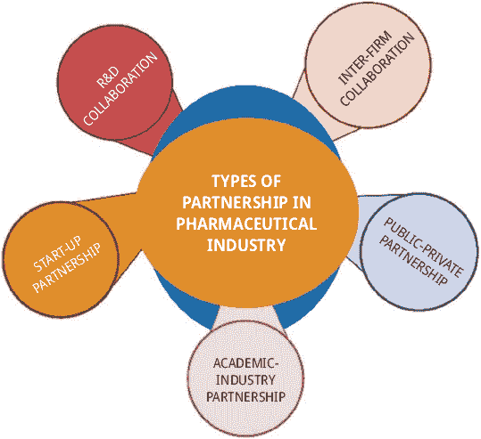

图 3.1：制药行业中的各类伙伴关系。

### 3.2.1 企业间协作

### 3.2.2 公私合作伙伴关系

此类举措形式多样，从双方协议到大型的、由私人和公共资金共同资助的财团不等，涉及生命科学领域的公司、学院、大学、政府以及非营利和非政府组织。开放获取和受控合作能够促进共享，这对于当前研究不足和关注度不高的领域大有裨益。这可能为新发现开辟途径，进而造福公共健康。虽然制药行业提供了众多资产共享模式，但 PPP 模式因其作为刺激药物发现与开发全谱系创新的有力手段而备受关注。为进一步研究特定疾病和治疗领域，或实现特定目标（如靶点识别、靶点确认、生物标志物开发，以及药物安全性和有效性评价），PPP 也已被引入。针对特定疾病或治疗领域的 PPP 包括阿尔茨海默病神经影像学计划（ADNI）、邓迪激酶联盟、加速药物合作伙伴关系（AMP）、国家癌症研究所（NCI）社区癌症中心计划（NCCP）以及重大疾病联盟（CAMD）[27, 28, 29, 30, 31]。此外，制药公司还开发了公开可获取的筛选文库，例如由葛兰素史克（GSK）整理的 Tres Cantos 抗疟疾化合物集（TCAMS）。疟疾研究领域的众多研究者已成功应用 TCAMS [32, 33, 34, 35, 36, 37]。结构基因组学联盟（SGC）是一个旨在鉴定可作为药物发现计划靶点的蛋白质结构的非营利性 PPP，获得了众多制药公司的支持 [38]。

### 3.2.3 学术界-产业界合作伙伴关系

学术医学中心正投入资源以确保与制药公司的成功合作，因为它们重燃了对此类合作的兴趣。这些合作不应是单方面的，信息应双向流动。其制药界同行可为学术界同事提供宝贵见解。大多数学术中心均可从技术、知识管理、项目管理和运营卓越等方面的经验交流中受益。制药企业必须建立机制，让学者能够获取其庞大的化合物文库、机密数据集、尖端工具和技术平台。参与生物医药领域的战略性协同创新，对于充分发掘新型生物标志物或疾病靶点的潜力、并跟上快速的发现步伐至关重要。制药企业当前的商业战略建立在通过收购、合作伙伴关系和并购来识别临床候选药物的基础上。与学术界建立积极的合作伙伴关系，以解决关键科学问题并将新靶点转化为治疗方案，从而用创新药物补充未来的药物管线，这至关重要 [39, 40]。

新的转化模型、赋能技术和治疗机制正以日益加快的速度被发现。过去，在组织内部隔离制药研究是常见做法。同样，近年来学术药物发现发生了巨大变化，与私营部门合作变得更有价值。其价值不仅限于资金。这些多学科合作汇聚了最创新的概念和方法，用于定位新治疗靶点、解决转化化学生物学中的缺陷，并创造新化学和技术，以增加这些公共资助发现的实际应用 [41, 42]。

### 3.2.4 与初创企业合作

为保持竞争力、拓展新市场、管理合格专业人才的流动性、缩短产品生命周期，以及应对技术日益增加的复杂性、专业化和融合性，企业始终在寻求新的创新方法。企业数量稳步增加。初创企业汇聚了拥有强烈创业意识、敢于冒险、乐于拥抱变革和数字化力量的年轻人才，且充满激动人心的想法，尽管它们缺乏资源、品牌公信力和便捷的市场准入。为提高成功几率，它们通常需要与其他企业合作。包括制药行业在内的多个组织正与初创企业合作，以在边界之外追求创新。这些举措设计良好且互利共赢，为客户创造价值 [43, 44, 45]。

### 3.2.5 与研发行业的合作

建立成功的研发战略合作伙伴关系存在若干固有风险，尤其是在考虑跨国企业（MNEs）知识挪用的背景下时。根据基于资源的理论，尽管存在技术秘密被挪用的可能性，中小企业（SMEs）仍需与大公司合作开展研发项目。这需要强有力的知识产权政策（IPPs）来保护中小企业的关键专有技术。此外，大规模合作多技术产品的增长带来了研发外包与合作 [49, 50]。如果中小企业没有足够的资源，大企业将无法获取增加价值所需的尖端信息和工具。对交换充分信息能力的信任，是大公司与中小企业合作的关键成功因素之一。基于所进入的新市场类型、知识管理系统和研发系统，研究人员提出了开放式创新与封闭式创新之间的显著区别。某些研究人员基于行业、规模和开放式创新类型（包括技术探索与利用）等因素分析开放式创新案例。研究表明，中型企业比小型企业从事更多的开放式创新，并受新市场开发和客户需求实现等因素驱动在市场上开展合作。其他研究人员讨论了开放式创新战略及企业规模对战略选择程度的影响 [51, 52]。

## 3.3 制药行业联盟的动因

小型生物技术公司为制药行业提供研发的“外部”来源。内部开发的不足是大公司寻求外部新产品技术的主要原因。然而，许多次要因素经常促使企业利用外部采购来推动行业新技术创新的发展：(1) 受许可企业的职能能力对新技术具有较高的吸收能力；(2) 高层管理者认为外部来源将补充内部来源；(3) 由于产品快速更迭和监管不确定性，环境被视为过于恶劣和危险，不利于研发投资；(4) 公司管理层规避风险；(5) 公司拥有丰富的外部采购经验；(6) 管理层具有强烈的全球导向；(7) 存在大量的外部采购机会 [53, 54]。企业可通过联盟贡献大量资源，其总和大于各个合作企业单独所能提供的资源。这些联盟经常将拥有互补核心竞争力的企业联合起来，促进企业拓展新市场、克服贸易障碍和开发新产品 [55]。联盟的战略理由如下：(1) 解决技术差距；(2) 降低进入新市场（包括国际市场）的相关风险；(3) 加速新产品上市；(4) 实现规模经济；(5) 减少贸易和法律障碍；(6) 拓展现有业务范围；(7) 降低撤资成本 [56]。

## 3.4 制药合作中的挑战

在医疗保健领域，营利性组织与非营利性组织之间最为人熟知的关系类型，是制药公司、医疗服务提供者（包括专业人员和医疗机构）以及大规模互动之间的相互作用 [57, 58, 59, 60]。根据多国研究，绝大多数医生与制药公司有互动，且少数美国生物医学研究人员接受来自行业的资助 [61, 62, 63, 64]。学者、专业人士、媒体和政治家正越来越多地审视制药公司与医疗服务提供者之间的互动，但专家们对于这些互动是否提升社会价值并产生积极影响意见不一 [65, 66, 67, 68]。

互动分为两类：(a) 侧重教育的互动，以及 (b) 侧重研究的互动。教育导向型互动旨在通过传播事实性和指导性信息，提升专业人员（如医生或护士）对新产品和服务的认知、知识和心态 [69, 70, 71, 72]。研究导向型互动则是专门设计用于赞助、资助或协助研究计划的互动。研究表明，优先考虑教育的制药公司和医疗服务提供者会影响医生的处方行为。换言之，参与教育互动的医生开具的品牌药数量更多，并更频繁地使用特定注射剂 [73, 74]。最后，在两项研究中，医生的处方行为呈二元性，均受教育导向型互动影响。换句话说，医生的处方实践并未因教育导向型互动的货币价值增加而显著改变 [75]。对研究导向型互动的进一步研究显示，主要将自己视为企业家、且职业身份与制药公司紧密一致的医生，更有可能允许制药公司对研究项目的不同方面施加更大控制 [76]。

# 企业制药行业的特点是竞争激烈

企业制药行业的特点是竞争激烈，每个组织都力求在推出创新大宗化合物的竞赛中脱颖而出。业界众所周知，率先进入市场的公司比推出跟进分子的公司获利更多。此外，早期进入者有足够的时间优化其产品并确定市场价格。制药公司始终在寻找并开发针对相同或极其相似药物靶点的新化合物 [77]。考虑到针对制药研发的巨额资金投入，这些重复的研究计划最终消耗了本可更好地分配给其他未满足医疗需求疾病研发的资源。为提升制药研发绩效，已提出并采用了多项合作协议 [78, 79]。制药公司、生物技术企业和学术药物发现部门共同致力于开展基础研究，以促进未来的药物发现与创新，尽管它们在其他方面属于竞争关系。因此，它们在临床前竞争性研究方面开展合作。简单而言，临床前竞争性研究是在全面的研发药物项目启动前，确定追求特定治疗路径的科学可行性 [80]。临床前竞争性研究可在多个领域开展，如靶点验证与识别、化合物库共享、分析法与生物标志物开发。临床前竞争性合作具有诸多优势，例如因企业共享资源和知识而降低研究费用、因企业专注核心技能并提升质量而提高生产力，以及科学家间的思想交流 [81]。因此，临床前竞争性研究、伙伴关系及合作策略提高了药物发现效率。应将罕见病和被忽视疾病的研究拓展至服务不足的治疗领域。这将保护那些即将面临大宗药物专利到期的公司。

## 3.5 AI 辅助的制药合作

尽管产学合作呈上升趋势，但某些问题和障碍仍然影响着合作机制，如图 3.2 所示。可能存在截然不同的时间跨度、保密性和排他性；组织差异也可能存在，这些都会直接影响资金水平、大学预算、学术激励和研究优先级。企业由利润驱动的解决方案和结果所驱动，而大学研究人员则由学术声望和兴趣所驱动。大学与工业研发研究之间肯定存在文化差异，前者专注于应用问题解决研究，而后者更具探索性。由于价值观分歧和误解，可能导致学术界和工业界合作伙伴之间出现严重冲突 [82, 83]。对知识生产与使用的不同视角，以及研究者与实践者之间从自上而下到自下而上、从顺序式到互动式、多维度的联系，阻碍了协作与伙伴关系研究 [84, 85]。基于研究传统和/或经验，研究人员和利益相关者可能对知识和学习持有截然不同的基本假设 [86]。研究人员发现，社会关系可能因角色模糊、职位差异和角色冲突而削弱。他们还识别出诸如组织变革、文化差异和研究产出标准等障碍，以及对实际应用的积极影响 [87]。作为许多创新工作实践基础的协作知识平台的发展，也面临着诸多现实障碍。例如：形成关键贡献者群体、标准化并确保录入数据的质量、策划生成的数据库、利用合适的工具进行分析和可视化，以及保护临床样本数据 [88]。

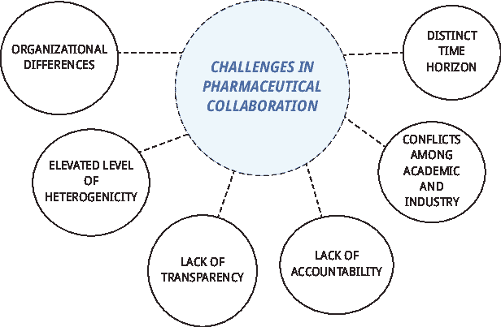

**图 3.2：** 制药行业合作面临的各种挑战。

公私合作伙伴关系（PPP）缺乏问责制和透明度，这是全球公平医疗卫生的另一大障碍。与私营部门的合作伙伴协议经常禁止公众审查。私营合作伙伴的选择、目标的设定以及管理政策的制定，这些过程都是不透明的。这种明显的缺乏透明度使得难以确定已设定的公平目标以及应对履行这些目标负责的人员。由于结构错综复杂、私营和公共部门的问责流程不同以及治理复杂，私营公司因失败的 PPP 而被追责可能颇具挑战 [89]。大学-产业合作的成效受多重挑战影响。组织差异也带来各种挑战。然而，大学-产业（UI）伙伴关系中最常见的问题，是由大学和企业之间的组织差异引起的。工业界和学术机构拥有不同的制度环境，优先事项也不同 [90]。大学的组织结构比企业更僵化、适应性更差。尽管挑战源于这些结构性差异，但我们仍不完全了解各种合作是如何应对这些挑战的。关于这些组织差异如何影响合作，特别是在涉及学生时，存在认知匮乏 [91, 92]。影响这些合作的另一个问题是高度的异质性，通常出现在执行阶段 [90, 91]。合作的复杂性源于聚在一起共事的多样化特性、价值观和传统。研究人员经常抱怨企业没有提供他们开展工作所需的信息。先前的研究表明，产学互动越紧密，组织差异就越小。由于参与合作的各方习惯于从另一合作伙伴的角度看问题，组织差异会影响合作过程 [92, 93, 94, 95]。

公共/政府、私营/商业和公民社会组织之间的伙伴关系，可以通过创造性地整合各类组织的多样化资源和人才，改善贫困人口的健康状况。公共机构在产品开发、制造、营销、分销和生产流程开发等薄弱领域，受益于与私营部门的合作。在以下情景中，伙伴关系似乎是最合适的选择：传统独立解决问题的方法影响有限；潜在合作者能就具体期望目标达成共识；双方拥有相关的互补专业知识；各方的长远利益得到满足，且资源和专业知识的贡献相当平衡。不应假设 PPP 将履行位于其他地方的义务。总体而言，PPP 应被视为旨在寻找解决复杂健康问题更有效策略的社会倡议 [97]。

## 3.6 结论

制药行业需要与初创企业、创新者以及来自不同领域的企业合作，以协作并加速创新。研发资金通过公私合作伙伴关系提供。协作可以节省开支、推迟开发（注：原文为 "postpone development"，此处直译，语境下或指分担风险/分阶段开发）并改善临床结果。在制药领域，合作伙伴关系有助于新药的创制。企业、学术机构、政府和非营利组织共同合作，共享资源和知识产权，以开发和商业化产品。学术医学中心与制药公司的投资建立合作伙伴关系。双方应在这些合作中交换信息。这些协作通过解决重大科学问题和创造新的治疗靶点，提供了超越经济利益的价值。当发现新的治疗机制、赋能技术和转化模型时，与学术机构合作对于创制创新药物至关重要。时间跨度、保密性、排他性，以及行业与大学研究之间的文化差异，是制药协作面临的一些挑战。公私合作伙伴关系缺乏透明度和问责制，也会阻碍全球医疗公平。组织架构的差异以及大学与企业之间的异质性也可能阻碍协作。此外，在公共组织、商业组织和民间社会组织的协助下，制药 AI 共同致力于改善健康并解决棘手的健康问题。拥有共同目标、互补专长和公平贡献的合作伙伴关系对公共机构有利。为了创制新药和生物标志物，制药公司已与 AI 初创公司联手。

### AI 在药物开发中的应用

针对医疗保健领域 AI 的快速采用，许多制药公司已建立合资企业并投资 AI 公司，以开发更复杂的医疗仪器。这些应用涵盖药理学靶点的识别、新药的开发，以及生物标志物或诊断技术的进步。随后，将底层数据的 ML/DL 分析相结合，开发出对 AI 融合的现代医疗保健进步有重大贡献的算法 [[98]](#9783111573861_003373.xhtml#b_9783111574288-003_ref_098)，[[99]](#9783111573861_003373.xhtml#b_9783111574288-003_ref_099)。因此，最近制药与人工智能领域之间形成了多个国际联盟。

#### Benevolent AI

Benevolent AI 是目前用于药物开发的 AI 技术之一。它采用文本挖掘技术分析现有专利，以及额外的遗传和生物学数据，以推断这些实体之间的联系。这促成了包含超过十亿种关系的动态图谱的高度启发性图表的开发 [[100]](#9783111573861_003373.xhtml#b_9783111574288-003_ref_100)。

#### Exscientia

Exscientia 是一家专注于表型药物发现的 AI 企业。在高内涵表型药物发现领域，AI 显著不及人类对极其复杂数据集的分析。测试每一种新开发的化合物，随后将其预期性能与其他分子进行比较，有助于药物设计的快速演进。

#### Numerate

Numerate 也是一家知名的 AI 企业。Numerate 强调算法通过分析大量药物开发数据集来解决关键治疗空白，从而彻底改变新药搜索的潜力，特别关注经典方法在组合 ML、ADMET 和配体化学中的应用 [[101]](#9783111573861_003373.xhtml#b_9783111574288-003_ref_101)。

### 制药科学家与 AI 研究人员之间的协作

针对多种疾病开发创新且有效的疗法，取决于制药科学家与 AI 研究人员之间的协作。他们可以利用各自的专业知识和经验，创建基于机器学习的算法和模型。这将使他们能够预测潜在药物候选物的疗效，并加速药物发现过程。协作可以通过利用 AI 算法分析临床试验期间获得的数据，以识别趋势和正在测试的药物的潜在副作用，从而提高临床试验的精确度和功效 [[102]](#9783111573861_003373.xhtml#b_9783111574288-003_ref_102)。它可以加快整个药物开发进程，并帮助制药公司就追求哪些潜在药物做出明智的判断。

此外，通过制药科学家与 AI 研究人员的协作，可以提高医疗保健的可负担性和可及性。通过分析大量人群的数据并识别模式和趋势，可以预测潜在药物候选物对特定患者群体的疗效。人工智能 (AI) 算法可用于实现这一点。它能够实现疗法的个性化，以满足每位患者的独特需求 [[103]](#9783111573861_003373.xhtml#b_9783111574288-003_ref_103)。

研究人员认为，实施 AI 算法和大数据可能会加速制药行业的进步。研究人员将 AI 最有前景的应用之一指定为制药行业寻找治疗罕见疾病的药物。当缺乏市场需求时，制药公司不太倾向于分配资源用于药物开发 [[104]](#9783111573861_003373.xhtml#b_9783111574288-003_ref_104)，[[105]](#9783111573861_003373.xhtml#b_9783111574288-003_ref_105)。相比之下，AI 可以确定哪些患者从临床试验中获益最大。通过建立理想候选者的画像，可以显著降低制药行业成本最高的阶段——临床试验阶段——的失败风险。另一个研究重点领域是 AI 算法在取代人类方面将发挥的作用 [[106]](#9783111573861_003373.xhtml#b_9783111574288-003_ref_106)，[[107]](#9783111573861_003373.xhtml#b_9783111574288-003_ref_107)。

## 参考文献

[1] Von Krogh G, Kucukkeles B, Ben-Menahem SM. Lessons in rapid innovation from the COVID-19 pandemic. *MIT Sloan Management Review*. 2020 Jul 1;61(4):8–10. →

[2] Chesbrough H, Brunswicker S. Managing open innovation in large firms. Garwood Center for Corporate Innovation at California University, Berkeley in US & Fraunhofer Society in Germany. 2013 May;1–40. →

[3] Ferrins L, Pollastri MP. The importance of collaboration between industry, academics, and nonprofits in tropical disease drug discovery. *ACS Infectious Diseases*. 2017 Nov 14;4(4):445–48. →

[4] Drews J. Strategic trends in the drug industry. *Drug Discovery Today*. 2003 May 1;8(9):411–20. →

[5] Gudiksen M, Fleming E, Furstenthal L, Ma P. What drives success for specialty pharmaceuticals? *Nature Reviews Drug Discovery*. 2008 Jul;7(7):563–67. →

[6] Swinney DC. Challenges and hurdles to business as usual in drug development for treatment of rare diseases. *Clinical Pharmacology & Therapeutics*. 2016 Oct;100(4):339–41. →

## 参考文献

[7] Jacobs RT, Nare B, Wring SA, Orr MD, Chen D, Sligar JM, Jenks MX, Noe RA, Bowling TS, Mercer LT, Rewerts C. SCYX-7158, an orally-active benzoxaborole for the treatment of stage 2 human African trypanosomiasis. *PLoS Neglected Tropical Diseases*. 2011 Jun 28;5(6):e1151. →

[8] Schuhmacher A, Gassmann O, Hinder M. Changing R&D models in research-based pharmaceutical companies. *Journal of Translational Medicine*. 2016 Dec;14:1–1. →

[9] Baker RG, Hoos AX, Adam SJ, Wholley D, Doroshow JH, Lowy DR, Tabak LA, Collins FS. The partnership for accelerating cancer therapies. *The Cancer Journal*. 2018 May 1;24(3):111–14. →

[10] Cunningham JA, Link AN. Fostering university-industry R&D collaborations in European Union countries. *International Entrepreneurship and Management Journal*. 2015 Dec;11:849–60. →

[11] Phan PH, Siegel DS. The effectiveness of university technology transfer. *Foundations and Trends® in Entrepreneurship*. 2006 Nov 23;2(2):77–144. →

[12] Pertuze JA, Calder ES, Greitzer EM, Lucas WA. Best practices for industry-university collaboration. *MIT Sloan Management Review*. 2010 Jun 26. →

[13] Blumenthal D, Campbell EG, Causino N, Louis KS. Participation of life-science faculty in research relationships with industry. *New England Journal of Medicine*. 1996 Dec 5;335(23):1734–39. →

[14] Tootell A, Kyriazis E, Billsberry J, Ambrosini V, Garrett-Jones S, Wallace G. Knowledge creation in complex inter-organizational arrangements: Understanding the barriers and enablers of university-industry knowledge creation in science-based cooperation. *Journal of Knowledge Management*. 2021 May 24;25(4):743–69. →

[15] Fernandes G, O’Sullivan D. Managing a major university–industry collaboration R&D program. *Managing Collaborative R&D Projects: Leveraging Open Innovation Knowledge-Flows for Co-Creation*. 2021;163–82. a, b

[16] Radnejad AB, Vredenburg H. Disruptive technological process innovation in a process-oriented industry: A case study. *Journal of Engineering and Technology Management*. 2019 Jul 1;53:63–79. →

[17] Krätzig O, Sick N. Exploring the role of entrepreneurial passion for facilitating university technology commercialization: Insights from battery research as an interdisciplinary field. *Journal of Engineering and Technology Management*. 2021 Apr 1;60:101627. →

[18] Lim MD. Consortium sandbox: Building and sharing resources. *Science Translational Medicine*. 2014 Jun 25;6(242):242. →

## 参考文献

[19] Yildirim O, Gottwald M, Schüler P, Michel MC. Opportunities and challenges for drug development: Public–private partnerships, adaptive designs and big data. *Frontiers in Pharmacology*. 2016 Dec 6;7:461.

[20] Reslinski MA, Wu BS. The value of royalty. *Nature Biotechnology*. 2016 Jul;34(7):685–90.

[21] Yoon J, Rosales C, Talluri S. Inter-firm partnerships–strategic alliances in the pharmaceutical industry. *International Journal of Production Research*. 2018 Jan 17;56(1–2):862–81.

[22] Stephenson D, Sauer JM. The predictive safety testing consortium and the coalition against major diseases. *Nature Reviews Drug Discovery*. 2014 Nov;13(11):793–94.

[23] National Institutes of Health (NIH). Accelerating-Medicines-Partnership-Amp. `https://www.nih.gov/research-training/accel` (accessed December 12, 2023); Accelerating Medicines Partnership (AMP).

[24] Mullard A. Partnering between pharma peers on the rise. *Nature Reviews Drug Discovery*. 2011 Aug 1;10(8):-561.

[25] Holden DJ, Reiter K, O’Brien D, Dalton K. The strategic case for establishing public-private partnerships in cancer care. *Health Research Policy and Systems*. 2015 Dec;13:1–9.

[26] Williamson AE, Ylioja PM, Robertson MN, Antonova-Koch Y, Avery V, Baell JB, Batchu H, Batra S, Burrows JN, Bhattacharyya S, Calderon F. Open source drug discovery: Highly potent antimalarial compounds derived from the tres cantos arylpyrroles. *ACS Central Science*. 2016 Oct 26;2(10):687–701.

[27] Raphemot R, Lafuente-Monasterio MJ, Gamo-Benito FJ, Clardy J, Derbyshire ER. Discovery of dual-stage malaria inhibitors with new targets. *Antimicrobial Agents and Chemotherapy*. 2016 Mar;60(3):1430–37.

[28] Crowther GJ, Hillesland HK, Keyloun KR, Reid MC, Lafuente-Monasterio MJ, Ghidelli-Disse S, Leonard SE, He P, Jones JC, Krahn MM, Mo JS. Biochemical screening of five protein kinases from Plasmodium falciparum against 14,000 cell-active compounds. *PloS One*. 2016 Mar 2;11(3):e0149996.

[29] Cui L, Su XZ. Discovery, mechanisms of action and combination therapy of artemisinin. *Expert Review of Anti-infective Therapy*. 2009 Oct 1;7(8):999–1013.

[30] Roy A. Reigniting pharmaceutical innovation through holistic drug targeting. *Drug Discovery*. 2016;45.

[31] Chorghade M, Liebman M, Lushington G, Naylor S, Chaguturu R. Translational chemical biology. *Drug Discovery World*. 2017;18:72–90.

[32] Bonzom A, Netessine S. 500Corporations: How do the World’s Biggest Companies deal with the Startup Revolution?

[33] Weiblen T, Chesbrough HW. Engaging with startups to enhance corporate innovation. *California Management Review*. 2015 Feb;57(2):66–90.

[34] Grando N. Beyond corporate venture capital: New ways corporations can engage with startups. *FEA USP*. 2016.

[35] Larkin M, O’Halloran D. Collaboration between Start-Ups and Corporates a Practical Guide for Mutual Understanding. In *World Economic Forum* 2018 (pp. 1–22).

[36] Boni AA, Joseph D. Four models for corporate transformative, open innovation. *Journal of Commercial Biotechnology*. 2019 Oct 1;24(4).

[37] Siota J, Alunni A, Riveros-Chacón P, Wilson M, Dinnetz MK. Corporate Venturing: Insights for European Leaders in Government, University and Industry. *Publications Office of the European Union*; 2020; 241–52.

[38] Dushnitsky G, Shaver JM. Limitations to interorganizational knowledge acquisition: The paradox of corporate venture capital. *Strategic Management Journal*. 2009 Oct;30(10):1045–64.

[39] Bierly PE III, Gallagher S. Explaining alliance partner selection: Fit, trust and strategic expediency. *Long Range Planning*. 2007 Apr 1;40(2):134–53.

[40] Diestre L, Rajagopalan N. Are all ‘sharks’ dangerous? New biotechnology ventures and partner selection in R&D alliances. *Strategic Management Journal*. 2012 Oct;33(10):1115–34.

## 参考文献

[41] Van de Vrande V, De Jong JP, Vanhaverbeke W, De Rochemont M. 中小企业开放式创新：趋势、动因与管理挑战。*Technovation*。2009 年 6 月 1 日；29(6–7)：423–37。

[42] Lichtenthaler U. 向外开放式创新及其对企业绩效的影响：考察环境因素。*R&d Management*。2009 年 9 月；39(4)：317–30。

[43] Atuahene‐Gima K. 内向技术许可作为新产品开发中内部研发的替代：一个概念框架。*Journal of Product Innovation Management: An International Publication of the Product Development & Management Association*。1992 年 6 月；9(2)：156–67。

[44] Liston P, Byrne J, Heavey C, Byrne PJ. 用于评估虚拟组织的离散事件仿真。*International Journal of Production Research*。2008 年 3 月 1 日；46(5)：1335–56。

[45] Pansiri J. 管理者特征与认知在战略联盟实践中的影响。*Management Decision*。2005 年 10 月 1 日；43(9)：1097–113。

[46] Bekelman JE, Li Y, Gross CP. 生物医学研究中财务利益冲突的范围与影响：系统综述。*Jama*。2003 年 1 月 22 日；289(4)：454–65。

[47] Moynihan R. 谁为披萨买单？重新定义医生与药企的关系。1：纠葛。*Bmj*。2003 年 5 月 29 日；326(7400)：1189–92。

[48] Lexchin J. 医生从医药代表那里获得什么信息？*Canadian Family Physician*。1997 年 5 月；43：941。

[49] Lexchin J. 医生与制药行业的互动：文献怎么说？*CMAJ: Canadian Medical Association Journal*。1993 年 11 月 11 日；149(10)：1401。

[50] Taylor SC, Huecker JB, Gordon MO, Vollman DE, Apte RS. 医生-行业互动与美国眼科医生抗血管内皮生长因子药物的使用。*JAMA Ophthalmology*。2016 年 8 月 1 日；134(8)：897–903。

[51] Feng H, Wu P, Leger M. 探索行业-皮肤科医生财务关系：来自公开支付数据的洞见。*JAMA Dermatology*。2016 年 12 月 1 日；152(12)：1307–13。

[52] Wazana A. 医生与制药行业：礼物只是礼物吗？*Jama*。2000 年 1 月 19 日；283(3)：373–80。

[53] Campbell EG, Gruen RL, Mountford J, Miller LG, Cleary PD, Blumenthal D. 医生-行业关系的全国性调查。*New England Journal of Medicine*。2007 年 4 月 26 日；356(17)：1742–50。

[54] Fadlallah R, Nas H, Naamani D, El-Jardali F, Hammoura I, Al-Khaled L, Brax H, Kahale L, Akl EA. 患者和公众对医生与制药及器械行业互动的认知、信念和态度：系统综述。*PLoS One*。2016 年 8 月 24 日；11(8)：160。

[55] Lancet T. 美国医学教育中的药企影响。*The Lancet*。2000；356(9232)：781。

[56] Angell M. 学术医学出售了吗？载于*Research Ethics* 2017 年 5 月 15 日（第 517–19 页）。Routledge。

[57] Sillup GP, Dehshal MH, Namini MT. 制药公司与医生：评估他们的关系。*International Journal of Healthcare Management*。2013 年 11 月 1 日；6(4)：276–80。

[58] Taylor SC, Huecker JB, Gordon MO, Vollman DE, Apte RS. 医生-行业互动与美国眼科医生抗血管内皮生长因子药物的使用。*JAMA Ophthalmology*。2016 年 8 月 1 日；134(8)：897–903。

[59] Andersen M, Kragstrup J, Søndergaard J. 开展临床试验如何影响医生的指南依从性和药物偏好。*Jama*。2006 年 6 月 21 日；295(23)：2759–64。

[60] Choudhry NK, Stelfox HT. Detsky AS. 临床实践指南作者与制药行业的关系。*Jama*。2002；287(5)：612–17。

[61] Glass HE. 第三阶段临床试验中的临床资助支付惯例是否影响后续临床研究者的处方行为？*Disease Management: DM*。2004；7(1)：77–87。

[62] Gray GC. 制药研究资助伦理：一种社会组织方法。*The Journal of Law, Medicine & Ethics: A Journal of the American Society of Law, Medicine & Ethics*。2013；41(3)：629–34。

[63] Myers RP, Shaheen AA. Lee SS. 制药行业赞助与大学赞助对调查回复率的影响：在加拿大丙型肝炎护理提供者中的随机试验。*Canadian Journal of Gastroenterology = Journal Canadien de Gastroenterologie*。2007；21(3)：169–75。

[64] Svider PF, Bobian M, Lin HS, Setzen M, Baredes S, Eloy JA, et al. 行业财务联系是否与学术耳鼻喉科医生更大的学术影响力相关？*The Laryngoscope*。2017；127(1)：87–94。

[65] Yeh JS, Franklin JM, Avorn J, Landon J, Kesselheim AS. 行业向医生支付款项与马萨诸塞州品牌他汀类药物处方的关联。*JAMA Internal Medicine*。2016；176(6)：763–68。

[66] Cha M, Yu F (2018) 制药业的先发优势 | 麦肯锡。`https://www.mckinsey.com/industries/pharmaceuticals-and-medical-products/ourinsights/pharmas-first-to-market-advantage`。访问于 2023 年 12 月 11 日。

[67] Munos BH, Chin WW. 如何重振制药行业的突破性创新。*Science Translational Medicine*。2011；3：89cm16–89cm16。

[68] Yildirim O, Gottwald M, Schüler P, Michel MC. 药物开发的机遇与挑战：公私合作伙伴关系、适应性设计和大数据。*Frontiers in Pharmacology*。2016 年 12 月 6 日；7：461。

[69] Medicine (US) 临床前竞争合作的类型。National Academies Press (US)；2010。

[70] Gastfriend E, Lee B. 制药业的临床前竞争合作。2015；3–17。

[71] Bruneel J, d’Este P, Salter A. 探究削弱大学-产业合作障碍的因素。*Research Policy*。2010 年 9 月 1 日；39(7)：858–68。

[72] Perkmann M, Walsh K. 大学-产业关系与开放式创新：迈向研究议程。*International Journal of Management Reviews*。2007 年 12 月；9(4)：259–80。

[73] Huberman M. 研究利用：现状。*Knowledge and Policy*。1994 年 12 月；7(4)：13–33。

[74] Svensson L, Ellström PE, Brulin G. 导论——关于互动式研究。*International Journal of Action Research*。2007；3(3)：233–49。

## 参考文献

[75] Nyström ME, Höög E, Garvare R, Weinehall L, Ivarsson A. 大规模变革项目中的变革与学习策略：描述健康促进项目中所用策略的差异。*组织变革管理杂志*。2013 年 10 月 11 日；26(6)：1020–44。

[76] Sibbald SL, Tetroe J, Graham ID. 研究资助方要求的研究合作伙伴关系：一项定性探究。*实施科学*。2014 年 12 月；9：1–2。→

[77] Hunter J. 制药行业面临的挑战：可持续人类健康的新型合作伙伴关系。*皇家学会哲学汇刊 A 辑：数学、物理与工程科学*。2011 年 5 月 13 日；369(1942)：1817–25。→

[78] Asante AD, Zwi AB. 公私合作伙伴关系与全球健康公平：前景与挑战。*印度医学伦理杂志*。2007 年 10 月 1 日；4(4)：176–80。→

[79] Bertello A, Ferraris A, De Bernardi P, Bertoldi B. 传统中小企业开放创新面临的挑战：产学研合作中预竞争项目的分析。*国际创业与管理杂志*。2022 年 3 月；18(1)：89–104。→

[80] Van de Vrande V, De Jong JP, Vanhaverbeke W, De Rochemont M. 中小企业中的开放创新：趋势、动机与管理挑战。*技术创新*。2009 年 6 月 1 日；29(6–7)：423–37。→

[81] Valentín EM. 大学-产业合作：效益与障碍框架。*产业与高等教育*。2000 年 6 月；14(3)：165–72。→

[82] Bjerregaard T. 产学趋同：研发合作的微观制度维度。*技术创新*。2010 年 2 月 1 日；30(2)：100–08。→

[83] Galán‐Muros V, Plewa C. 是什么驱动和阻碍了欧洲的大学-企业合作？一项综合评估。*研发管理*。2016 年 3 月；46(2)：369–82。→

[84] Ghauri P, Rosendo-Rios V. 面向创新的合作伙伴关系背景下的组织跨文化差异。*跨文化与战略管理*。2016 年 2 月 1 日；23(1)：128–57。→

[85] HAI. 阿姆斯特丹，国际健康行动（网络通讯，2001 年 6 月 4 日）。→

[86] Widdus R. 卫生领域的公私合作伙伴关系：其主要目标、多样性及未来方向。载于《全球健康》2017 年 5 月 15 日（第 431–38 页）。Routledge。→

[87] Swan AL, Stekel DJ, Hodgman C, Allaway D, Alqahtani MH, Mobasheri A, Bacardit J. 一种用于从组学数据中识别生物学相关且最小生物标志物组合的机器学习启发式方法。*BMC 基因组学*。2015 年 12 月；16：1–2。→

[88] Krittanawong C. 人工智能的崛起与医生未来的不确定性。*欧洲内科学杂志*。2018 年 2 月 1 日；48：e13–4。→

[89] Powles J, Hodson H. 算法时代的 Google DeepMind 与医疗保健。*健康与技术*。2017 年 12 月；7(4)：351–67。→

[90] Lee EJ, Kim YH, Kim N, Kang DW. 深入大脑：卒中影像学中的人工智能。*卒中杂志*。2017 年 9 月；19(3)：277。a，b

[91] 可在线获取：[`www.fiercebiotech.com/biotech/numerate-forms-drug-discovery-collaboration-merck-to-utilize-numerate-s-silico-drug-design`](https://www.fiercebiotech.com/biotech/numerate-forms-drug-discovery-collaboration-merck-to-utilize-numerate-s-silico-drug-design)（访问于 2024 年 9 月 12 日）。a，b

[92] 利用制药 AI 刺激行业增长的公司。可在线获取：[`www.p360.com/data360/11-companies-using-pharma-ai-to-stimulate-growth-in-the-industry-1/`](https://www.p360.com/data360/11-companies-using-pharma-ai-to-stimulate-growth-in-the-industry-1/)（访问于 2024 年 9 月 12 日）。a，b

[93] Southall NT, Natarajan M, Lau LP, Jonker AH, Deprez B, Guilliams T, Hunter L, Rademaker CM, Hivert V, Ardigò D. 利用或生成生物医学数据及现有药物发现和建立罕见病患者新疗法——IRDiRC 数据挖掘与药物再利用工作组的建议。*罕见病孤儿药杂志*。2019 年 12 月；14：1–8。→

[94] Bessen J. 人工智能与就业。*人工智能经济学：议程*。2019 年 5 月 22 日；291。→

[95] Vedapradha R, Hariharan R, Shivakami R. 人工智能：招聘中的技术原型。*服务科学与管理杂志*。2019 年 3 月 11 日；12(3)：382–90。→

[96] Sony M, Naik S. 行业 4.0 与社会技术系统理论的融合：系统综述与理论模型构想。*社会技术*。2020 年 5 月 1 日；61：101248。

[97] Soni K, Hasija Y. 人工智能辅助药物研究与开发。载于《2022 年 IEEE 德里分会会议(DELCON)》2022 年 2 月 11 日（第 1–10 页）。IEEE。→

[98] Sahu A, Mishra J, Kushwaha N. 药物与制药领域的人工智能(AI)。*组合化学与高通量筛选*。2022 年 9 月 1 日；25(11)：1818–37。→

[99] Shaheen MY. 人工智能(AI)在医疗保健中的应用：综述。*ScienceOpen Preprints*。2021 年 9 月 25 日。→

[100] Saeed A, Hotchkiss P, Frey J, Garelick H, Gubala V, Saha B, Boyd R, Forman JE. 人工智能辅助化学。*化学国际*。2023 年 7 月 1 日；45(3)：30–35。→

[101] Li J, Ding R, Wang C. 规范抗菌药物合理使用与提升医疗大数据质量：作为 AI 辅助医疗前奏的开发与可用性研究。*电气系统杂志*。2024；20(7s)：378–99。→

[102] Bairagee D, Verma P, Jain N, Jain NK, Dwivedi S, Ahamad J. 人工智能助力药物开发。载于《健康 4.0 的人工智能：挑战与应用》2023 年 3 月 10 日（第 233–68 页）。River Publishers。→

[103] Baldoni J, Begoli E, Kusnezov DF, MacWilliams J. 利用 AI 解决难题：通过独特的公私合作伙伴关系大幅加速药物发现。*商业生物技术杂志*。2020 年 12 月 11 日；25(4)。→

[104] Srivastava SK, Srinivasan S. 智能自动化引领的临床数据管理变革：面向更智能生物制药行业的新解决方案。载于《2020 IEEE-HYDCON》2020 年 9 月 11 日（第 1–5 页）。IEEE。→

[105] Malandraki-Miller S, Riley PR. 利用人工智能增强表型药物发现。*药物发现今日*。2021 年 4 月 1 日；26(4)：887–901。→

[106] Mazzi F. AI 生成发明的专利性：制药领域的案例研究。2022；112–213。→

[107] Sharma K, Manchikanti P. Regulation of artificial intelligence in drug discovery and health care. Biotechnology Law Report. 2020 Oct 1;39(5):371–80. →

### 第 4 章 智能制药中的教育与培训

## 摘要

医疗保健的数字化引发了一场“互联健康”运动，同时也降低了人均成本，提升了护理质量，并改善了患者预后。制药行业因数字化而迅速扩张，数字化利用通过社交媒体、移动电话及其他技术共享的信息来洞察消费者需求并优化供应链效率。机器学习算法可检索药物相互作用并预测其效果。大数据分析通过消除面诊的必要性，并确保临床医生能即时访问所有医疗记录，从而实现数字医疗。软件、嵌入式系统和电子传感器的物理联网，允许数据从任何位置跨网络共享，这被称为物联网。制药行业正利用区块链技术加速监管审批、药物开发与发现。物联网也被用于监测健康问题、预测患者相关事件、变更数据、降低费用和挽救生命。本章为智能制药行业提供了最先进的培训方法。

**关键词：** 制药、虚拟现实、游戏化、学术、协作、物联网

#### 4.1 绪论

制药行业是全球经济领域中增长率最快的行业之一。数字化通过移动设备、系统集成及众多其他渠道交换信息，以洞察和预判消费者需求，从而提升供应链效率。在 COVID-19 之后，各行各业的企业比以往任何时候都更依赖数字技术，通过提高制造生产力、增强竞争力、改善长期财务生存能力，以及使用更精准的预测和规划来提升绩效[[1]](#9783111573861_004895.xhtml#b_9783111574288-004_ref_001)。医疗保健领域的数字化革命正在促进一场“互联健康”运动，该运动有望通过改善治疗体验、降低人均成本和改善患者预后，使所有相关方受益[[2]](#9783111573861_004895.xhtml#b_9783111574288-004_ref_002)，[[3]](#9783111573861_004895.xhtml#b_9783111574288-004_ref_003)。例如，实施数字化以创造防伪且拥有可在整个供应链中追踪序列号的药物，将保证质量并确保遵守即将出台的序列化法规[[4]](#9783111573861_004895.xhtml#b_9783111574288-004_ref_004)。制药公司可将数字化作为满足预期全球市场需求的额外工具。他们可利用数字化更有效地与分销商和供应商沟通、遵守法规，并通过基于云的信息交换发现节约成本的生产效率[[5]](#9783111573861_004895.xhtml#b_9783111574288-004_ref_005)，[[6]](#9783111573861_004895.xhtml#b_9783111574288-004_ref_006)。此外，利用自动化、先进传感器、社交媒体和医疗应用在全球范围内预测需求并跟踪服药依从性，使实时制造成为可能[[7]](#9783111573861_004895.xhtml#b_9783111574288-004_ref_007)，[[8]](#9783111573861_004895.xhtml#b_9783111574288-004_ref_008)。

AI 能够识别非结构化文档中的关键关系，这些关系可用于疾病的诊断、缓解和治疗。几乎医学的任何学科都能从新兴的计算思维领域所采用的几种较新技术的应用中受益。为解决复杂的临床问题，必须面对收集、评估和实施海量知识的挑战[[9]](#9783111573861_004895.xhtml#b_9783111574288-004_ref_009)。由于缺乏合适的技术，从化学空间开发众多药物分子是一项艰巨的任务。然而，通过整合人工智能（AI），药物开发流程得以改进[[10]](#9783111573861_004895.xhtml#b_9783111574288-004_ref_010)。得益于 AI，医疗保健领域机器人技术的应用大幅增加。机器人技术和 AI 正在通过改善患者护理、评估和治疗，引发一场医疗保健革命。AI 系统可检查包括代谢组学、蛋白质组学和基因组学数据在内的大型数据集，以确定潜在的治疗靶点并阐明疾病的运作机制[[11]](#9783111573861_004895.xhtml#b_9783111574288-004_ref_011)，[[12]](#9783111573861_004895.xhtml#b_9783111574288-004_ref_012)。科学家可通过这一过程深入了解不同疾病的分子成因，并寻找开发药物的潜在靶点。此外，利用 AI 驱动的虚拟筛选技术，可在大型化合物库中发现有希望的药物候选物，其效果优于传统的高通量筛选技术。AI 算法可预测潜在药物候选物的药代动力学、毒性和生物活性[[13]](#9783111573861_004895.xhtml#b_9783111574288-004_ref_013)，[[14]](#9783111573861_004895.xhtml#b_9783111574288-004_ref_014)。因此，实验验证所需的资金和时间减少。通过采用深度学习（DL）技术预测潜在化合物的属性，AI 可促进从零开始开发新型药物分子。被称为生成对抗网络（GANs）的机器学习（ML）算法，能够生成具有所需生物功能和类药性质的新型分子结构[[15]](#9783111573861_004895.xhtml#b_9783111574288-004_ref_015)，[[16]](#9783111573861_004895.xhtml#b_9783111574288-004_ref_016)。

药物相互作用的效果可利用 AI 进行预测和挖掘。为简化药物相互作用的提取，研究人员将基于核的方法和基于特征的方法与 ML 方法论相结合[[17]](#9783111573861_004895.xhtml#b_9783111574288-004_ref_017)。某些研究人员实施了自动化药物相互作用检测方法，以加强医院环境中的药物安全监测[[18]](#9783111573861_004895.xhtml#b_9783111574288-004_ref_018)。AI 可用于预测药物相互作用的效果。为高效提取药物相互作用，研究人员将基于核和基于特征的技术与 ML 方法相结合[[18]](#9783111573861_004895.xhtml#b_9783111574288-004_ref_018)。ML 通过使其模型能够从有限的药物相互作用组合中学习，从而预测大量潜在的药物相互作用，可显著增强药物警戒[[19]](#9783111573861_004895.xhtml#b_9783111574288-004_ref_019)。此外，ML 可用于识别易感人群并指导个性化护理。而且，ML 方法论可用于识别特定患者，特别是那些易受氟嘧啶毒性影响的患者。研究人员采用 ML 方法分析毒性模式，从而预测 DPD 相关毒性个体的患病率。尽管存在相当大的过拟合风险，该模型在未来仍可能证明具有优势[[20]](#9783111573861_004895.xhtml#b_9783111574288-004_ref_020)。

#### 4.2 智能制药中的关键技术

##### 智能制药技术

智能制药涉及多种利益相关者，如医院、医生、患者和研究机构。它是一个复杂的有机实体，包含多种功能，包括健康决策、医院管理、医学研究、诊断治疗以及疾病预防与监测。包括区块链、物联网、机器学习、深度学习和大数据在内的信息技术是智能制药的基础，如图 4.1 所示。

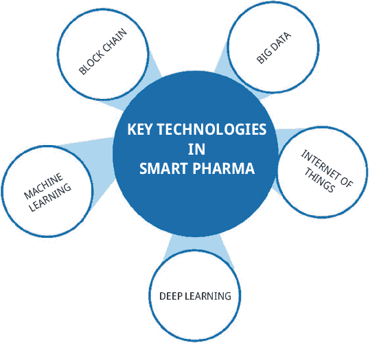

**图 4.1：** 智能制药中涉及的各种关键技术的图形化表示。

###### 4.2.1 智能制药中的大数据

医疗数据的数字化促进了大数据的扩展与进步。由于过去几年数据呈爆发式增长，一个被称为“大数据”的新领域应运而生。得益于大数据分析和其他智能医疗解决方案，医疗保健正变得更加移动化和智能化，同时也降低了成本并提高了效率。化学家可以利用统计分析预测药理结果，并识别出最可能从药物治疗中受益的患者，这有助于他们更好地理解药物的风险和副作用 [[21]](#9783111573861_004895.xhtml#b_9783111574288-004_ref_021)，[[22]](#9783111573861_004895.xhtml#b_9783111574288-004_ref_022)，[[23]](#9783111573861_004895.xhtml#b_9783111574288-004_ref_023)。近年来，由于大数据在健康和医学领域的潜在用途，它已成为一个热门研究课题。通过利用大数据驱动系统进行临床决策，它在阿尔茨海默病等疾病的治疗中显示出了前景。电子病历优化也通过大数据技术的应用得以实现。毒理学、药剂学和药理学产生了关于化学性质、药代动力学、临床行为和药物毒性的数据。高通量筛选（`HTS`）和新一代测序（`NGS`）导致数据量显著增加 [[24]](#9783111573861_004895.xhtml#b_9783111574288-004_ref_024)，[[25]](#9783111573861_004895.xhtml#b_9783111574288-004_ref_025)。

通过减少面诊需求、改善患者预后，并确保临床医生能即时访问所有患者病历，大数据分析将实现数字化医疗保健。通过数字健康和聚合的实时数据，大数据分析提供了更多主动干预的机会和更全面的患者状况图景，将成为医疗服务提供者的关键工具 [[26]](#9783111573861_004895.xhtml#b_9783111574288-004_ref_026)，[[27]](#9783111573861_004895.xhtml#b_9783111574288-004_ref_027)。当前时代的特点是数据流的持续激增，这归因于电子病历的广泛使用、各类传感器传输的海量数据，以及患者在社交媒体平台上传播的信息。医疗行业持续产生大量数据，包括基因信息、医疗记录、影像数据和健康相关行为。医疗机构有效利用数据有助于疾病追踪、医疗决策和公共卫生管理 [[28]](#9783111573861_004895.xhtml#b_9783111574288-004_ref_028)。为解决这一问题，电子健康记录（`EHRs`）作为电子患者健康数据的数字化集合应运而生。`EHRs` 的使用在发展中国家正不断增长。这些记录可通过稳健的网络连接在不同医疗环境间共享。由于数字健康记录可在不同医疗系统间共享、修订和修改，重要文件遗漏的可能性降低，从而减少了重复数据。`EHR` 计划为医院管理、医生和患者提供了即时收益 [[29]](#9783111573861_004895.xhtml#b_9783111574288-004_ref_029)。

### 4.2.2 智能制药中的区块链

药物研发是一个跨越多年、复杂的过程，包括药物发现、药物开发和监管审批。区块链是一个去中心化的计算机网络，为其成员提供安全的交易账本访问权限，且无需中央服务器即可运行。通过为网络内的每笔交易加盖时间戳，它消除了对外部机构的依赖。每个网络节点维护自己的本地账本，并保存记录的本地副本。对本地账本的微小更改会反映到整个网络中。除了加密货币，区块链技术还支持创建和监控任何类型的数字资产。在制药供应链中，制造商创建并注册在网络上的产品可像加密货币一样转移给其他参与者，因为它被视为一种数字资产。再次强调，区块链在隐私保护方面排名第一。区块链网络的每个成员都会获得一个作为其身份标识的密钥对 [[30]](#9783111573861_004895.xhtml#b_9783111574288-004_ref_030)。区块链方法在保护患者隐私和数据安全的同时，为患者招募提供了独特优势。通过使用区块链分布式账本，匿名注册的患者可关联至各个临床试验中心，从而缩短了患者招募时间。因此，研究人员可根据研究计划从患者群体中筛选所需受试者。还有提议采用涉及多重合约的区块链结构来管理临床试验并让患者参与其中 [[31]](#9783111573861_004895.xhtml#b_9783111574288-004_ref_031)。此外，临床试验采用区块链技术进行追踪，这不仅鼓励他人参与临床研究，还增强了对结果的信心。由于透明度可减少选择性掩盖积极结果的临床试验，因此它是药物发现研究的重要组成部分。因此，将区块链技术应用于临床试验，除了增强数据完整性和透明度外，还能促进赞助商与不同临床研究机构之间建立更好的关系 [[32]](#9783111573861_004895.xhtml#b_9783111574288-004_ref_032)。

### 4.2.3 智能制药中的机器学习

传统药物开发的初始阶段是确定与疾病相关的靶标蛋白。该过程资源密集且耗时。该程序涉及对海量化学库进行筛选，以寻找与靶标相互作用的化合物。因此，通过迭代优化程序来改善类药性质 [33]。该策略通常以实施过程漫长和高淘汰率为特点。然而，由于机器学习（ML）技术的应用，该范式正在发生转变。预测潜在药物候选物的生物活性、溶解度、稳定性、毒性、吸收、分布、代谢和消除（ADMET）特性，是 ML 有效应用的典范。通过分析包含理化性质、活性谱和分子结构的海量数据集，ML 算法能够检测出人类可能忽视的关联和模式。因此，不再需要进行昂贵且耗时的实验研究来确定物质在生物结构中的作用机制 [34]。化合物筛选和选择是 ML 在药物发现中的公认应用。基于现有活性和非活性化合物训练的 ML 模型，可以预测新型分子对特定靶标展现活性的可能性 [35]。

### 4.2.4 深度学习在智慧制药中的应用

在计算机游戏、语音识别、自然语言处理、计算机视觉和自动驾驶汽车等多个领域，深度学习（DL）均取得了显著成功。它得益于计算能力的无限扩展和数据量的激增。DL 通过其神经网络架构的适应性，与大多数其他 ML 方法区分开来。这些架构包括全连接前馈网络、循环神经网络（RNN）和卷积神经网络（CNN）。随着数据规模和处理能力的提升，单层神经网络在 QSAR（定量构效关系）建模中的持续应用，自然引出了多层前馈神经网络在生物功能预测中的应用 [36]。几年前无人预料到 RNN 会被用于从头设计，这属于一个颇为意外的发展。随着高通量成像技术的广泛普及，CNN 在计算机视觉方面展现出惊人的成功，目前已成为处理生物图像的热门选择。近年来，DL 应用显著加速了制药研究和药物发现。其效用超出预期，并在解决各类药物发现问题方面展现出前景。其在科学技术领域，特别是生物医学和生物信息学中的广泛应用显而易见。新型化学化合物的自动化合成（具有特定性质）、分子结构和功能的预测，以及 DL 复杂的图像分析技能，使其成为药物发现的有力竞争者。DL 的应用可惠及药物发现过程的每个阶段，包括靶标识别、预后生物标志物发现、药物开发、设计以及协同拮抗作用的预测 [37]。

### 4.2.5 物联网在智慧制药中的应用

制药行业是物联网（IoT）大有可为的领域之一。全球学者正致力于将这项迷人的技术应用于制药领域。由于相互之间的互联网连接，大多数研究人员预测，他们将在下一代药品革命领域投入大量工作。该网络利用动态数据连接各类事物，包括家用电器、汽车、卡车和工业设备，以及其他联网设施 [38]。物联网（IoT）一词用于描述软件、嵌入式设备和电子传感器的物理连接，这实现了从任意位置跨网络共享数据。IoT 对制药行业的主要贡献在于其跟踪健康问题、利用前沿技术预测患者相关未来事件、转换数据、降低成本和挽救生命的能力 [39]。射频识别（RFID）技术在制药行业的制造和供应链流程中展现出巨大潜力。但与条形码不同，物联网（IoT）设备无需扫描，因为它们通过互联网实时向其他设备传输数据。IoT 对所有服务的管理至关重要，因为它在制药领域提供医疗服务 [40]。此外，IoT 可助力监控和精简各部门，实现实时控制和监控，从而在药品制造过程中提高生产效率。IoT 可用于制药供应链管理和仓储，以实时监控药品的储存条件并提高可视性，从而提升运营效率 [41]。

### 4.3 智慧制药中的创新培训方法

#### 印度制药行业的变革与虚拟现实应用

印度制药行业正在经历重大变革，在错综复杂且竞争激烈的商业环境中，组织的成功取决于多种因素。任何公司培养持续学习文化的能力都是促成其成功的关键要素之一。为了获得总体竞争优势，学习必须覆盖所有员工层级。制药行业的学习与发展（L&D）还展示了其创造性解决问题的能力，确保培训不仅是一项活动，更与业务契合，成为真正的业务合作伙伴。游戏化和虚拟培训是智能制药领域的两种前沿方法 [42]。

过去十年大多数研究表明，虚拟现实（VR）安全、有效，并能在很大程度上提高用户满意度。随着 VR 技术价格越来越亲民、适应性增强和便携性提高，现在可用于住院和门诊环境的医疗治疗 [43]。研究表明，虚拟现实是缓解多种医疗和心理问题相关疼痛的有效方法 [44, 45]。它已被确定为治疗多种疾病的潜在手段，如偏头痛、瘙痒、糖尿病神经病变、癌症，以及导致急性或慢性疼痛的损伤 [46, 47]。VR 在医疗或手术后的疼痛治疗中也显示出前景，如牙科治疗、静脉置管、伤口换药。VR 有助于增强镇痛药的疗效，并支持传统药物疗法 [48, 49]。在七项被评审的研究中，有五项显示 VR 是传统阿片类镇痛疗法的有用非药物补充 [50, 51, 52, 53]。在这些研究中，接受不适医疗程序的成人和儿童患者在使用 VR 时报告的疼痛和焦虑较少 [54, 55, 56]。另一项随机试验研究了单独给予镇痛药与结合虚拟现实游戏给予镇痛药的对比。试验表明，虚拟现实结合镇痛药在减轻接受烧伤治疗儿童的疼痛方面，比单独使用镇痛药显著更有效 [57]。此外，还开展了研究以确定虚拟现实的优势是否能在初始治疗方案之外持续存在 [58]。

与药物设计和发现中使用的替代计算机方法相比，虚拟现实提供了许多优势，包括化合物和靶点增强的三维可视化。近几十年来，FDA 的药物批准量未能匹配不断上升的药物开发成本，这要求采取快速有效的药物开发方法。此外，存在许多未知的药理学靶点，利用分子建模完全沉浸在虚拟现实中，以识别和创造具有重大潜力的创新药物候选物。在检查配体（潜在药物）与大分子之间的相互作用时，可视化技术对于药物设计和发现至关重要。精确可视化配体与广泛复杂结构（如蛋白质）的结合至关重要。虚拟现实（VR）使科学家能够专注于配体结合位点和其他相关区域，同时监测蛋白质结构构象的动态变化 [59, 60]。

#### 游戏化

游戏化涉及将游戏元素或功能融入产品以增强用户参与度。虽然通过玩视频游戏来学习生理学或药代动力学等主题似乎很荒谬，但研究表明这能增强医疗专业人员的自信心和技能组合。传统讲座侧重于向学习者传授特定学科知识，使其能在临床情境中应用知识。应用学校所教知识远不止死记硬背。它要求运用批判性思维和决策能力，以及培养与患者和其他医疗服务提供者有效沟通的技能。通过利用课堂时间练习整合知识，游戏化概念提供了锻炼这些技能的额外机会 [61]。教学材料将游戏设计组件（包括游戏机制）作为方法论的一部分加以融入。游戏化致力于为消费者提供激励性工具，即“游戏”，以增强其动力。研究表明，与游戏化实施相关的活动存在差异 [62, 63, 64]。通过以下交付模式，可以利用进度追踪器、排行榜、积分和反馈等激励工具面向学习者 [63]。研究显示，游戏化对内在动机的影响因个体用户而异，差异显著。游戏化通过迎合人们的自主感和胜任感，既有可能“促进内在驱力”，也有可能“削弱内在驱力” [64]。此外，现有文献对于游戏化影响内在动机的持续时间尚无定论。由于对游戏化的描述不够精确，且该方法存在广泛的变体，因此比较该策略的有效性颇具挑战。大量研究支持开展更多全面且可重复的研究，以探究游戏化的效果。文献报告反复证实的游戏化优势之一是其对用户满意度的积极影响 [65, 66, 67]。商业密室逃脱面向广泛人群。教育密室逃脱的谜题必须进行修改，因为其目标受众极为有限，通常是学习特定学科的学生 [68]。因此，深入了解目标学生的能力和态度对于逃脱室的成功至关重要 [69]。这些因素表明，应在学生学习了课程的很大一部分后，再在学校环境中安装逃脱室，从而让他们能积极参与解决挑战 [70]。

### 4.4 产学合作

学术医学中心投入资金，以确保其与制药公司的合作取得成功，因为人们对这类合作伙伴关系的兴趣日益浓厚。这些合作应实现双向信息共享。药理学领域的学术同行可互相传授宝贵知识。大多数学术机构可从技术、项目管理、知识管理和运营卓越等领域的经验交流中获益。制药企业必须找到途径，授予学术界访问其庞大化学库、私有数据集、最先进仪器和技术平台的权限。战略性合作创新是跟上生物医学发现步伐、充分发掘新靶点或疾病生物标志物潜力的唯一途径。制药企业当前的商业策略依赖合作、收购和整合来寻找临床候选药物。与学术机构建立有效合作，以解决重大科学问题并将新靶点整合到治疗方案中，对于用创新药物充实未来的制药管线至关重要 [71, 72]。

人们不断寻找新的转化模型、促进技术和治疗机制。制药研究过去常在组织内部分属不同部门，但现在已不再如此。同样，与私营部门的合作变得更有价值，学术药物发现近年来经历了重大变革。其价值胜过现金。这些多学科合作汇聚了最具创意的概念和方法，用于识别新治疗靶点、解决转化化学生物学中的空白、开发新化学和技术，从而增加这些公共资助发现的实际意义 [73, 74]。可在课程中增加培训课程，帮助学生提升技能。研究生阶段可要求学生参加其感兴趣领域的课程。基础职业技能的理解将使新生实现目标。此类培训计划可作为产学合资项目实施，并应更重视工业相关领域。作为产学合作的一部分，企业应主动出击，根据其开发培训模块的需求调整教育内容。应促进产学互动，并将其视为教育的一部分。众多 IT 企业已开始与大学和工程学院合作 [75]。

#### 大学-产业协同研发（UIC R&D）

大学-产业协同研发（UIC R&D）是一个涵盖更透明的制药创新流程的术语。在此过程中，科学家与产业组织协作，以识别技术突破和知识，并随后基于这些发现开发新药 [76, 77, 78]。分子、生物和化学药理学知识通过大学与产业集团之间的正式或非正式协作得以推进。这些协作的目标是将知识转化为造福社会和经济的新药创制和商业化举措。这被称为制药 UIC R&D [79, 80]。利用多元化的 UIC 研发策略，如建立技术转移办公室（TTO）和启动学术创业公司孵化计划，大学致力于加强学术界与产业界的联系，以推进高效且富有成效的创新生态系统，用于新药发现 [81]。然而，由于学术与产业组织拥有不同的目标、指导原则和时间表，完全且无瑕疵地由大学-产业协作驱动的药物开发流程仍然寥寥无几。这些因素在冲突解决和谈判问题中发挥了作用。关于学术机构与私营企业之间制药研发合作伙伴关系的构成与协调，鲜有（甚至没有）全面的研究。由于这一现象，大量学术贡献聚焦于单一或少数几个大学-产业协作中的制药研发成果。深入了解影响制药领域大学-产业研发的成因和因素，有助于提高生产力和有效性 [82]。与他人合作可能提供在多种体制背景下进行富有成效的专业化分工的潜力。与其将产业实践纳入学术界，产业协作可通过降低专利率和提高发表率来改善学术框架。在兼具科学与商业潜力的研究领域，学术界与产业界的协作可能导致任务和责任更富有成效的分工，使各方能专注于其体制环境中最具回报的方面：对学术界而言，是更深层科学发现的发展；对企业而言，是这些发现的商业化。既往研究表明，学术机构在探讨更基础、根本的问题上具有比较优势，而企业在开发和商业化方面具有相对优势。科学家倾向于根据自身兴趣，专攻产业或学术领域。更倾向于进入学术界的科学家，往往具有更强的“科学品味”或偏好非财务回报；而更倾向于应用研究和财务激励的科学家，则倾向于进入产业界。此外，学术机构内部发生的智力与物质交流特别有利于好奇心驱动的研究，而企业的资源和经验则有利于高效商业化 [83, 84]。

### 4.5 智慧制药面临的挑战

图 4.2 展示了必须考虑的障碍和弊端，尽管 AI 在药物发现中具有潜在优势。获取相关数据是一大挑战。训练 AI 方法通常需要大量数据聚合。可用数据的数量有限、质量参差不齐或质量低劣，有时会损害结果的可靠性和精确度 [85, 86, 87]。它提供了大量数据，供逐步训练的模型使用。由于通过不同数据库获取数据的模式成本更高，公司遭受了巨大损失。此外，需要大量可信数据以保证制药分析。阻碍制药和生物领域充分采用 AI 的另一障碍是缺乏监督基于 AI 平台的熟练人员 [88]。小型组织资金短缺，以及大型企业（如制药公司）利用 AI 和 ML 替代人力劳动力，导致了失业。在 ML 过程中，决策由输入数据生成；然而，从输入到输出的过程并不透明。输入数据在 CNN 中通过多个复杂层进行转换，导致最终出现不可预测的行为 [89]。此外，针对黑箱 ML 模型的预测缺乏基本原理，因人为数据解读错误而影响 ML 预测。但逻辑模型和决策树（如关系型 ML）并不显示这一根本问题。人类用户无法理解预期结果，影响了对模型性能的依赖。尽管 ML 模型初步结果令人鼓舞，但关于预测置信度的担忧依然存在。当算法尝试搜索其适用域之外的领域时，更有可能导致 ML 技术产生的假设出现病理性失效 [90]。

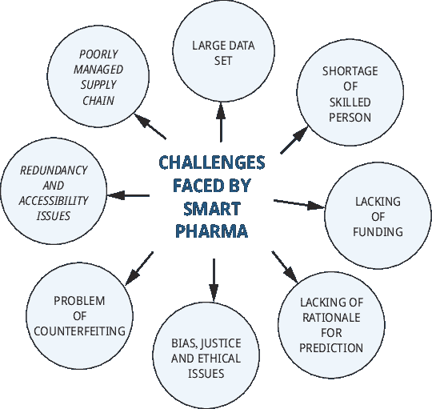

图 4.2：智慧制药面临的各种挑战。

#### 药物研发中的人工智能与区块链挑战

##### 人工智能中的数据质量与伦理问题

由于可用数据质量参差不齐、数量不足或质量低劣，结果的可靠性和准确性有时会受到影响。另一个伦理问题是基于人工智能的解决方案可能引发关于偏见与公平性的质疑。如果训练集包含有偏见或无代表性的数据，机器学习系统可能会产生不准确或不公平的预测。在新型药品的开发中，必须考虑人工智能的伦理与公平实施。人类研究人员积累的知识和经验，以及传统的实验程序，无法被当前基于人工智能的方法所取代。由于人工智能仅限于基于可用数据进行预测，因此随后需要人类研究人员来验证和解释结果 [91, 92, 93, 94, 95, 96, 97]。

制药公司数据库中拥有数百万种用于药物开发的化合物，这对于传统机器学习工具来说可能过于庞大而难以管理。计算模型可以利用定量构效关系（QSAR）快速预测多种化学物质或关键理化特性，例如 `log P` 或 `log D`。尽管如此，这些模型在预测复杂的生物学特性（如某些药物的有效性和副作用）方面表现出的熟练度很低。缺乏实验验证、训练集中源自实验误差的数据以及训练集规模受限，阻碍了基于 QSAR 模型的进步 [98, 99]。

##### 区块链技术的应用与挑战

假冒伪劣问题是区块链技术的主要应用领域之一，制药行业最近最多地采用了该技术。信息安全和隐私保护是区块链技术的两大优势，该技术在很大程度上是去中心化的。这需要更多的处理能力。大约一半的算力用于抵御恶意用户攻击；如果没有高效的追踪和溯源，用户面临货物丢失和遭受盗窃的风险 [100]。

区块链技术可以实现安全的跨国银行交易，但互操作性问题构成了重大障碍。通过使用分布式账本技术（DLT）可以实现区块链操作的标准化。尽管国际电信联盟（ITU）致力于识别和标准化 DLT，但仍需进一步研究以确定实施 DLT 应用的最有效方法。智能物联网应用、云服务和边缘计算的部署显著提高了数据的可用性 [101]。

由于大规模增长，区块链的部署面临诸多挑战，包括数据管理、隐私、冗余和可访问性问题。此外，由于不当行为和供应链管理不善，人们尝试利用区块链技术加速医疗交易、保护患者，并实现追踪与监控 [102, 103]。

确保各种医疗系统和设备之间的互操作性也至关重要。不同医院和系统之间进行有效通信和数据交换，需要强大的互操作性解决方案。随着医疗数据量的增加，区块链网络必须能够在不出现性能下降的情况下容纳更高的交易率。区块链部署需要经过周密的设计和执行程序，以遵守 GDPR 和 HIPAA 等严格的数据保护法律 [104, 105, 106, 107, 108]。

##### 集成、能源与存储挑战

研究人员声称，将区块链技术与现有医疗系统集成具有挑战性。由于许多医院继续沿用遗留系统，因此需要周密的规划以确保平稳过渡和向后兼容性。此外，解决区块链的能耗问题至关重要，特别是与工作量证明共识机制相关的问题。医疗机构应考虑环保且节能的区块链解决方案 [109, 110, 111, 112]。

管理存储容量是另一个前沿难题。因为区块链是为存储和分析交易数据而开发的，而交易数据的范围是有限的，所以它不需要大量的存储空间。

### 伦理问题与缓解策略

伦理问题也构成了挑战，因为基于人工智能的解决方案可能引发关于公正性和偏见的担忧 [113]。例如，如果训练数据存在偏见或无代表性，机器学习系统生成的预测可能是错误的或不公平的 [114]。考虑到在新药物分子创建中人工智能的伦理和公平实施至关重要 [115]。

可以利用各种策略和技术来克服人工智能在化学药物领域面临的挑战。一种方法是采用数据增强，即生成合成数据以丰富现有数据集。增加用于训练机器学习算法的数据量和多样性，可以提高结果的准确性和一致性 [116]。另一种旨在为机器学习算法产生的预测提供简洁明了解释的方法是应用可解释人工智能（XAI）方法 [117]。这有可能减轻对基于人工智能技术的公正性和偏见的担忧 [113]，并提供对预测背后基本假设和机制的更透彻理解。

除了数据限制外，深度学习（DL）方法还缺乏可解释性。提到 DL 方法时，它们被视为一个谜团，这与传统机器学习（ML）方法形成鲜明对比，后者经常基于数学推理接受彻底的验证分析。尽管 DL 在大多数任务上优于 ML，但研究人员往往无法理解 ML 为何能产生如此出色的结果。如果 DL 模型产生了一个偏离先前研究的新结果，其可解释性问题会使该结果令人不满意。与其他领域不同，药物发现拥有关于生物通路调控系统、分子代谢过程以及化合物作用机制的丰富知识。全面了解相关生物过程对于保证药物的安全性和有效性至关重要。这些过程包括药物的物理特性、它们在体内结合的蛋白质、结合机制、它们引发的生物学反应以及它们的代谢途径。DL 仅限于接受输入和生成预测输出；它无法对生成输出的过程提供全面解释 [118]。

#### 4.6 结论

得益于数字化，制药行业正经历快速增长，数字化利用通过系统集成、移动电话和其他技术共享的信息来了解消费者需求并提高供应链效率。医疗保健领域的数字化革命正在带来一场“互联健康”运动，改善患者预后、降低人均成本并提升护理体验。机器人技术改善了患者护理、诊断和治疗，而人工智能（AI）能在非结构化文档中发现重要关联并协助药物研发。药物-药物相互作用可以被检索，其效应可由机器学习算法预测。通过消除面诊的必要性并确保临床医生能即时访问所有医疗记录，大数据分析正在实现数字化医疗保健。制药行业正利用区块链技术加速监管审批、药物开发和发现。物联网（IoT）也被用于追踪健康问题、预测患者相关事件、转换数据、降低成本和挽救生命。印度制药行业正在经历重大变革，培养持续学习的文化对成功至关重要。智慧制药的两种前沿方法包括游戏化和虚拟培训。高等教育中的教育密室逃脱应专注于学生学习和产学合作，以推进分子、生物和化学药理学相关知识的进步。

## 参考文献

[1] Faraj S, Renno W, Bhardwaj A. Unto the breach: What the COVID-19 pandemic exposes about digitalization. Information and Organization. 2021 Mar 1;31(1):100–337. →

[2] Iglehart JK. Connected Health: Emerging Disruptive Technologies. Health Affairs (Millwood). 2014;33(2):190. →

[3] Fecha PM. *The Return of the Investment of the Digital Channels in the Pharmaceutical Industry* (Master's thesis, Universidade de Coimbra (Portugal)). →

[4] Lakshmi B, Patel S Digital Marketing in Pharmaceutical Industry–An Overview and Assessment. International Journal of Pharmaceutical Science & Innovation. 2020 Jul 15;1(1). →

[5] Anderson S. The Digitization of the Pharmaceutical Historian Archive. Pharmacy in History. 2018;48:2. →

[6] Rosenbaum MS, Ramírez GC, Edwards K, Kim J, Campbell JM, Bickle MC. The digitization of health care retailing. Journal of Research in Interactive Marketing. 2017 Sep 10;11(4):432–46. →

[7] Kumar L, Panigrahi CM Communication with doctors: Empowering Pharma field force with modern marketing techniques. Asian Journal of Management Research. 2014 Nov 19;5(2). →

[8] Van Velthoven MH, Cordon C, Challagalla G. Digitization of healthcare organizations: The digital health landscape and information theory. International Journal of Medical Informatics. 2019 Apr 1;124:49–57. →

[9] Holmes J, Sacchi L, Bellazzi R. Artificial intelligence in medicine. Annals of the Royal College of Surgeons of England. 2004;86:334–38. →

[10] Vyas M. Artificial Intelligence: The Beginning of a New Era in Pharmacy Profession. Asian Journal of Pharmaceutics. 2018;12:72–76. →

[11] Bhattamisra SK, Banerjee P, Gupta P, Mayuren J, Patra S, Candasamy M. Artificial intelligence in pharmaceutical and healthcare research. Big Data and Cognitive Computing. 2023 Jan 11;7(1):10. →

[12] Hoppe N, Härting RC, Rahmel A. Potential benefits of artificial intelligence in healthcare. In Artificial Intelligence and Machine Learning for Healthcare 2023 (pp. 225–49). Cham: Springer. →

[13] Vijayan RS, Kihlberg J, Cross JB, Poongavanam V. Enhancing preclinical drug discovery with artificial intelligence. Drug Discovery Today. 2022 Apr 1;27(4):967–84. →

[14] Murugan NA, Priya GR, Sastry GN, Markidis S. Artificial intelligence in virtual screening: Models versus experiments. Drug Discovery Today. 2022 Jul 1;27(7):1913–23. →

[15] Palazzesi F, Pozzan A. Deep learning applied to ligand-based de novo drug design. Artificial Intelligence in Drug Design. 2022;273–99. →

[16] Tripathi S, Augustin AI, Dunlop A, Sukumaran R, Dheer S, Zavalny A, Haslam O, Austin T, Donchez J, Tripathi PK, Kim E. Recent advances and application of generative adversarial networks in drug discovery, development, and targeting. Artificial Intelligence in the Life Sciences. 2022 Dec 1;2:100045. →

[17] Abacha AB, Chowdhury MF, Karanasiou A, Mrabet Y, Lavelli A, Zweigenbaum P. Text mining for pharmacovigilance: Using machine learning for drug name recognition and drug–drug interaction extraction and classification. Journal of Biomedical Informatics. 2015 Dec 1;58:122–32. →

[18] Calix RA, Gupta R, Gupta M, Jiang K Deep gramulator: Improving precision in the classification of personal health-experience tweets with deep learning. In 2017 IEEE International Conference on Bioinformatics and Biomedicine (BIBM) 2017 Nov 13 (pp. 1154–59). IEEE. a, b

[19] Dewulf P, Stock M, De Baets B. Cold-start problems in data-driven prediction of drug–drug interaction effects. Pharmaceuticals. 2021 May 2;14(5):429. →

[20] Correia Pinheiro L, Durand J, Dogné JM. An application of machine learning in pharmacovigilance: Estimating likely patient genotype from phenotypical manifestations of fluoropyrimidine toxicity. Clinical Pharmacology & Therapeutics. 2020 Apr;107(4):944–47. →

[21] Raja R, Mukherjee I, Sarkar BK. A systematic review of healthcare big data. Scientific Programming. 2020;2020(1):5471849. →

## 参考文献

[22] Pramanik MI, Lau RY, Demirkan H, Azad MA. 智慧医疗：智慧城市中大数据赋能的健康范式。*Expert Systems with Applications*。2017 年 11 月 30 日；87：370–83。→

[23] Hernandez I, Zhang Y. 利用预测分析和大数据优化药学成果。*American Journal of Health-system Pharmacy*。2017 年 9 月 15 日；74(18)：1494–500。→

[24] Hassan W, Zafar M. 2019–2020 年一百五十个国家的药理学、毒理学和药剂学研究产出。*Canadian Journal of Medicine*。2021 年 2 月 1 日；3(1)：56–60。→

[25] Biglu MH, Omidi Y. 中东国家药理学、毒理学和药剂学领域的科学概况：伊朗科学家的影响。*International Journal of Advances in Pharmaceutical Sciences*。2010 年 12 月 1 日；1–20。→

[26] Agrawal R, Prabakaran S. 数字医疗中的大数据：经验教训及对全科医疗的建议。*Heredity*。2020 年 4 月；124(4)：525–34。→

[27] Raghupathi W, Raghupathi V. 医疗保健中的大数据分析：前景与潜力。*Health Information Science and Systems*。2014 年 12 月；2：1–10。→

[28] Senthilkumar SA, Rai BK, Meshram AA, Gunasekaran A, Chandrakumarmangalam S. 医疗保健管理中的大数据：文献综述。*American Journal of Theoretical and Applied Business*。2018 年 7 月 3 日；4(2)：57–69。→

[29] Sahney R, Sharma M. 电子健康记录：总体概述。*Current Medicine Research and Practice*。2018 年 3 月 1 日；8(2)：67–70。→

[30] *‘BlockRx,’* iSolve，在线。[`https://www.blockrx.com/`](https://www.blockrx.com/) （访问于 2023 年 12 月 16 日）→

[31] Zhuang Y, Sheets LR, Shae Z, Chen YW, Tsai JJ, Shyu CR. 应用区块链技术增强临床试验招募。载 *AMIA Annual Symposium Proceedings* 2019（第 2019 卷，第 1276 页）。美国医学信息学协会。→

[32] Nugent T, Upton D, Cimpoesu M. 利用区块链智能合约提高临床试验的数据透明度。*F1000Research*。2016；5。→

[33] Husnain A, Rasool S, Saeed A, Hussain HK. 革新药学研究：利用机器学习实现药物发现的范式转变。*International Journal of Multidisciplinary Sciences and Arts*。2023 年 9 月 27 日；2(2)：149–57。→

[34] Yılmaz A. 深度学习与心脏病学：CardioBot：利用深度学习实现心脏护理的突破性创新，革新心血管医学中的诊断、管理和预后。*All Rights Reserved It may not be reproduced in any way without the written permission of the publisher and the editor, except for short excerpts for promotion by reference. ISBN: 978-625-6925-25-0 1st Edition*，第 252 页。→

[35] Shahid AH, Khattak WA. 利用机器学习改善患者护理：医疗保健的游戏规则改变者。*Applied Research in Artificial Intelligence and Cloud Computing*。2022 年 11 月 18 日；5(1)：150–63。→

[36] David L, Arús-Pous J, Karlsson J, Engkvist O, Bjerrum EJ, Kogej T, Kriegl JM, Beck B, Chen H. 深度学习在工业药学研究中利用大规模异质化合物数据的应用。*Frontiers in Pharmacology*。2019 年 11 月 5 日；10：1303。→

[37] Sumathi S, Suganya K, Swathi K, Sudha B, Poornima A, Varghese CA, Aswathy R. 深度学习驱动药物发现综述：策略、工具与应用。*Current Pharmaceutical Design*。2023 年 4 月 1 日；29(13)：1013–25。→

[38] Rose K, Eldridge S, Chapin L. 物联网：概述。*The Internet Society (ISOC)*。2015 年 10 月 15 日；80(15)：1–53。→

[39] Macaulay J, Buckalew L, Chung G. 物流中的物联网：DHL 和 Cisco 关于对物流行业影响和用例的合作报告。*DHL Trend Research and Cisco Consulting Services*。2015；439–49。→

[40] Vázquez I. 社交设备：物联网的语义技术。*Week@ ESI, Zamudio, Spain*；2009 年 6 月。→

[41] Sharma A, Kaur J, Singh I. 物联网（IoT）在药物制造、仓储和供应链管理中的应用。*SN Computer Science*。2020 年 7 月；1(4)：232。→

## 参考文献

[42] Srinivas KS. 印度制药行业趋势对培训与开发实践的影响及创新方法的诞生。*International Journal of Management and Social Science Research Review*。2014 年 8 月 25 日；1(2)。→

[43] Dascal J, Reid M, IsHak WW, Spiegel B, Recacho J, Rosen B, Danovitch I. 虚拟现实与住院患者：随机对照试验的系统评价。*Innovations in Clinical Neuroscience*。2017 年 1 月；14(1–2)：14。→

[44] Wiederhold BK, Soomro A, Riva G, Wiederhold MD. 未来方向：为疼痛管理设计的虚拟环境的进展与启示。*Cyberpsychology, Behavior, and Social Networking*。2014 年 6 月 1 日；17(6)：414–22。→

[45] 华盛顿大学人类光子学实验室（HPL）。*Virtual Reality Pain Reduction*。[`http://www.vrpain.com`](http://www.vrpain.com) （访问于 2023 年 12 月）→

[46] Riva G, Baños RM, Botella C, Mantovani F, Gaggioli A. 转变体验：增强现实和虚拟现实在增强个人和临床变革方面的潜力。*Frontiers in Psychiatry*。2016 年 9 月 30 日；7：164。→

[47] Maples-Keller JL, Bunnell BE, Kim SJ, Rothbaum BO. 虚拟现实技术在焦虑症及其他精神障碍治疗中的应用。*Harvard Review of Psychiatry*。2017 年 5 月 1 日；25(3)：103–13。→

[48] Li L, Yu F, Shi D, Shi J, Tian Z, Yang J, Wang X, Jiang Q. 虚拟现实技术在临床医学中的应用。*American Journal of Translational Research*。2017；9(9)：3867。→

[49] Dascal J, Reid M, IsHak WW, Spiegel B, Recacho J, Rosen B, Danovitch I. 虚拟现实与住院患者：随机对照试验的系统评价。*Innovations in Clinical Neuroscience*。2017 年 1 月；14(1–2)：14。→

[50] Schmitt YS, Hoffman HG, Blough DK, Patterson DR, Jensen MP, Soltani M, Carrougher GJ, Nakamura D, Sharar SR. 一项关于沉浸式虚拟现实镇痛的随机对照试验，用于儿童烧伤患者的物理治疗期间。*Burns*。2011 年 2 月 1 日；37(1)：61–68。→

[51] Hoffman HG, Patterson DR, Seibel E, Soltani M, Jewett-Leahy L, Sharar SR. 水箱中烧伤创面清创术期间的虚拟现实疼痛控制。*The Clinical Journal of Pain*。2008 年 5 月 1 日；24(4)：299–304。→

[52] Patterson DR, Jensen MP, Wiechman SA, Sharar SR. 用于物理创伤恢复相关疼痛的虚拟现实催眠。*International Journal of Clinical and Experimental Hypnosis*。2010 年 5 月 26 日；58(3)：288–300。→

## 参考文献

[53] Li WH, Chung JO, Ho EK. 利用虚拟现实电脑游戏进行治疗性游戏，促进住院癌症儿童心理健康的有效性。*Journal of Clinical Nursing*。2011 年 8 月；20(15‐16)：2135–43。→

[54] Carrougher GJ, Hoffman HG, Nakamura D, Lezotte D, Soltani M, Leahy L, Engrav LH, Patterson DR. 虚拟现实对烧伤成人疼痛和活动范围的影响。*Journal of Burn Care & Research*。2009 年 9 月 1 日；30(5)：785–91。→

[55] Kipping B, Rodger S, Miller K, Kimble RM. 虚拟现实用于接受烧伤伤口护理的青少年急性疼痛减轻：一项前瞻性随机对照试验。*Burns*。2012 年 8 月 1 日；38(5)：650–57。→

[56] Morris LD, Louw QA, Crous LC. 低成本虚拟现实系统在发展中国家物理治疗期间减轻成人烧伤患者疼痛和焦虑的可行性及潜在效果。*Burns*。2010 年 8 月 1 日；36(5)：659–64。→

[57] Das DA, Grimmer KA, Sparnon AL, McRae SE, Thomas BH. 玩虚拟现实游戏调节急性烧伤儿童疼痛的功效：一项随机对照试验 [ISRCTN87413556]。*BMC Pediatrics*。2005 年 12 月；5：1–10。→

[58] Spiegel BM. 虚拟医学：虚拟现实如何缓解疼痛、安抚神经并改善健康。*Medical Journal of Australia*。2018 年 9 月；209(6)：245–47。→

[59] Ratamero EM, Bellini D, Dowson CG, Römer RA. 用虚拟裸手触摸蛋白质：利用游戏硬件在自制虚拟现实中可视化蛋白-药物复合物及其动力学。*Journal of Computer-aided Molecular Design*。2018 年 6 月；32：703–09。→

[60] Liu XH, Wang T, Lin JP, Wu MB. 利用虚拟现实进行药物发现：寻找新先导化合物的有前景新途径。*Expert Opinion on Drug Discovery*。2018 年 12 月 2 日；13(12)：1103–14。→

[61] Persky AM, Stegall-Zanation J, Dupuis RE. 学生对基础和临床药代动力学课堂教学融入游戏的看法。*American Journal of Pharmaceutical Education*。2007 年 4 月 4 日；71(2)。→

[62] Nah FF, Telaprolu VR, Rallapalli S, Venkata PR. 利用电脑游戏实现教育游戏化。载于*Human Interface and the Management of Information. Information and Interaction for Learning, Culture, Collaboration and Business*，第 15 届国际会议，HCI International 2013，美国内华达州拉斯维加斯，2013 年 7 月 21-26 日，论文集，第 III 部分 15 2013（第 99-107 页）。Springer Berlin Heidelberg。→

[63] Hamari J, Koivisto J, Sarsa H. 游戏化有效吗？——游戏化实证研究文献综述。载于*2014 47th Hawaii international conference on system sciences* 2014 年 1 月 6 日（第 3025-34 页）。Ieee。a，b

[64] Arruzza E, Chau M. 随机对照试验范围综述，评估游戏化在健康科学高等教育学生中的价值。*Journal of Medical Imaging and Radiation Sciences*。2021 年 3 月；52(1)：137–46。a，b

[65] Dahlstrøm C. 游戏化对内在动机的影响。2003。访问日期：2023 年 12 月 16 日。`https://www.ntnu.edu/documents/139799/1279149990/04+Article+Final_camildah_fors%C3%B8k_2017-12-06-13-53-55_TPD4505.Camilla.Dahlstr%C3%B8m.pdf` →

[66] Arufe Giráldez V, Sanmiguel-Rodríguez A, Ramos Álvarez O, Navarro-Patón R. 游戏化能影响学生的学业表现吗？*Sustainability*。2022 年 4 月 24 日；14(9)：5115。→

[67] Berthod F, Bouchoud L, Grossrieder F, Falaschi L, Senhaji S, Bonnabry P. 在密室逃脱中学习良好生产规范：一种新教学工具的验证。*Journal of Oncology Pharmacy Practice*。2020 年 6 月；26(4)：853–60。→

[68] Grande-de-prado M, García-Martín S, Baelo R, Abella-García V. Edu-escape rooms（教育密室逃脱）。*Encyclopedia*。2020 年 12 月 22 日；1(1)：12–19。→

[69] Nybo SE, Klepser SA, Klepser M. 为一、二年级药学学生设计灾害准备密室逃脱。*Currents in Pharmacy Teaching and Learning*。2020 年 6 月 1 日；12(6)：716–23。→

[70] Wilby KJ, Kremer LJ. 为本科药学学生开发癌症主题密室逃脱学习活动。*International Journal of Pharmacy Practice*。2020 年 10 月；28(5)：541–43。→

[71] Cui L, Su X. 青蒿素的发现、作用机制及联合治疗。*Expert Review of Anti-Infective Therapy*。2009；7(8)：999–1013。→

[72] Lushington GH, Chaguturu R. 生物医学研究：一座纸牌屋？*Future Medicinal Chemistry*。2016；8(1)：1–5。→

[73] Roy A, Patwardhan B, Chaguturu R. 通过整体药物靶向重燃制药创新。*Drug Discovery World*。2016；夏季：45–55。→

[74] Chorgade M, Liebman M, Lushington G, et al. 转化化学生物学：推进药物发现、开发和精准医疗的差距评估。*Drug Discovery World*。2016/2017；冬季：72–90。→

[75] Balakrishnan A, Thunga G, Nair S, Kunhikatta V, Khera K. 弥合制药教育中产学界的差距。*Indian Journal of Pharmaceutical Education and Research*。2018 年 10 月 1 日；52(4)：S7–10。→

[76] Dong JQ, McCarthy KJ. 过犹不及：制药联盟网络与突破性创新。*Drug Discov Today*。2019；24：673–77。→

[77] Du J, Leten B, Vanhaverbeke W. 管理基于科学和基于市场合作伙伴的开放创新项目。*Research Policy*。2014；43：828–40。→

[78] Havenaar M, Hiscocks P. 战略联盟与市场风险。*Drug Discovery Today*。2012；17：824–27。→

[79] Bekkers R, Bodas Freitas IM. 分析大学与产业间的知识转移渠道：行业因素在多大程度上也很重要？*Research Policy*。2008；37：1837–53。→

[80] Huang MH, Chen DZ. 如何提高产学合作中的学术创新绩效？*Technological Forecasting and Social Change*。2017；123：210–15。→

[81] Hagen R. 全球化、大学转型与经济再生：英国公私部门合作案例研究。*International Journal of Public Sector Management*。2002；15：204–18。→

[82] Birnbaum MJ. 制药业与学术界：我们面临的是沟通失败。*Cell Metabolism*。2016；24：365–67。→

[83] Sauermann H, Stephan P. 冲突的逻辑？工业与学术科学的多维视角。*Organization Science*。2013；24(3)：889–909。→

## 参考文献

[84] Roach M, Sauermann H. A Taste for Science? PhD Scientists’ Academic Orientation and Self-Selection into Research Careers in Industry. *Research Policy*. 2010;39(3):422–34. →

[85] Vamathevan J, Clark D, Czodrowski P, Dunham I, Ferran E, Lee G, Li B, Madabhushi A, Shah P, Spitzer M, Zhao S. 机器学习在药物发现与开发中的应用。 *Nature Reviews Drug Discovery*。 2019 年 6 月；18(6)：463–77。 →

[86] Tsuji S, Hase T, Yachie-Kinoshita A, Nishino T, Ghosh S, Kikuchi M, Shimokawa K, Aburatani H, Kitano H, Tanaka H. 基于人工智能的计算框架，用于药物靶点优先级排序及阿尔茨海默病新型药物再定位推断。 *Alzheimer’s Research & Therapy*。 2021 年 5 月 3 日；13(1)：92。 →

[87] Gómez-Bombarelli R, Wei JN, Duvenaud D, Hernández-Lobato JM, Sánchez-Lengeling B, Sheberla D, Aguilera-Iparraguirre J, Hirzel TD, Adams RP, Aspuru-Guzik A. 基于分子数据驱动连续表示的自动化化学设计。 *ACS Central Science*。 2018 年 2 月 28 日；4(2)：268–76。 →

[88] Esmaeilzadeh P. AI 基础工具在医疗用途中的应用：来自消费者视角的调查研究。 *BMC Medical Informatics and Decision Making*。 2020 年 12 月；20：1–9。 →

[89] Gupta R, Srivastava D, Sahu M, Tiwari S, Ambasta RK, Kumar P. 从人工智能到深度学习：药物发现的机器智能方法。 *Molecular Diversity*。 2021 年 8 月；25：1315–60。 →

[90] Hie B, Bryson BD, Berger B. 利用机器学习中的不确定性加速生物学发现与设计。 *Cell Systems*。 2020 年 11 月 18 日；11(5)：461–77。 →

[91] Basu T, Engel-Wolf S, Menzer O. 医学科学中机器学习的伦理：我们今天站在何处？ *Indian Journal of Dermatology*。 2020 年 9 月 1 日；65(5)：358–64。 →

[92] Kleinberg J. 算法公平性中的固有权衡。载 *2018 年 ACM 测量与建模计算机系统国际会议摘要论文集*，美国加利福尼亚州欧文，2018 年 6 月 18-22 日；美国纽约：计算机协会（ACM）；2018 年；第 40 页。 →

[93] Silvia H, Carr NK. 世界碰撞时：保护物理世界利益免受虚拟世界不法行为侵害。 *The Michigan Technology Law Review*。 2019；26：279。 →

[94] Shimao H, Khern-am-nuai W, Kannan K, Cohen MC. 公平机器学习中的策略最佳响应公平性。载 *2022 年 AAAI/ACM 人工智能、伦理与社会会议论文集* 2022 年 7 月 26 日（第 664–664 页）。 →

[95] Grebner C, Matter H, Kofink D, Wenzel J, Schmidt F, Hessler G. 深度神经网络模型在药物发现项目中的应用。 *ChemMedChem*。 2021 年 12 月 14 日；16(24)：3772–86。 →

[96] Schraagen JM, Van Diggelen J. 专业知识与人工智能关系简史。 *Expertise at Work: Current and Emerging Trends*。 2021；149–75。 →

[97] Gilpin LH, Bau D, Yuan BZ, Bajwa A, Specter M, Kagal L. 解释解释：机器学习可解释性综述。载 *2018 年 IEEE 第 5 届数据科学与高级分析国际会议（DSAA）* 2018 年 10 月 1 日（第 80–89 页）。IEEE。 →

# 第 5 章 利用人工智能进行药物制造与质量控制

## 摘要

人工智能（AI）利用先进的仪器和网络来模拟人类智能。人工智能在制药行业中的应用日益广泛，用于自动化处理和管理大型数据集。质量源于设计（QbD）和人工智能能够提高制药行业的产品质量、减少浪费并加快生产速度。本章提供了关于在制药行业中利用 AI 进行药物制造和质量控制的信息。医学研究领域必须将区块链和 AI 等技术融入其核心竞争力中才能蓬勃发展。本章探讨了欧盟基于 AI 的制造合规法规的目标，旨在使技术与欧盟的核心价值观、权利和原则保持一致。本章回顾了关于物联网隐私和安全措施的研究现状，以及围绕那些承诺提供极致安全的广泛使用技术的迷思。为了提高制药行业数据处理的标准，本章讨论了基于结果的前沿区块链和 AI 方法，用于数据的共享、处理、评估和分类。

**关键词：** 药物、生产、质量、管理、安全、法规合规、质量源于设计

## 5.1 绪论

人工智能（AI）在社会许多领域的应用日益增长，其中首当其冲的便是制药行业。随着流程日益数字化，获取、评估以及将知识应用于复杂的临床问题变得更加困难[1]。这促进了 AI 的使用，因为它能自动处理大量数据。AI 利用先进工具和网络模拟人类智能[2]，[3]。然而，它并不威胁在现实世界中完全取代人类。AI 利用软硬件执行独立分析、学习和决策，以实现预定义目标[4]。训练完成后，当 AI 系统被用于控制临床试验或制造等程序时，其随时间学习的能力往往会丧失。自从近期采用质量源于设计（QbD）技术以来，制药行业已实现增长，工业 4.0 举措表明了快速发展[5]。成功的治疗需要为药物分子合成选择正确的靶点。许多蛋白质参与疾病的进展，其中少数表达过量。因此，预测目标蛋白的分子结构对于设计专门针对该疾病的药物分子至关重要。AI 可以通过结构分析，建模与靶蛋白位点化学环境相对应的蛋白质三维构型，从而促进药物发现。它有助于在合成或制造前预测化合物的靶点影响并确保安全性[6]。

AI 有潜力取代试错法。QSPR 使许多计算技术能够解决制剂设计挑战，包括稳定性、溶出度、孔隙率等[7]，[8]。反馈机制监控整个过程并偶尔调整以支持决策工具。基于药物的理化性质，它们利用基于规则的系统选择辅料的类型、用量和种类[9]。AI 为简化开发和生产制造流程提供了大量选项。AI 可带来质量改进。此外，通过以多种方式使用 AI，包括加速流程，它可以减少材料浪费并提高生产效率[10]。为了确保质量并在预定时间内生产出药物制剂，需要一个利用 AI 的周密科学方法来进行质量保证和控制。研究人员考察药理学物质的特性及其与设备、单元操作和其他物质的相互作用。应用包括相关性、第一性原理模型、启发式方法和决策树。利用这些信息做出的决策包括机器规格、辅料和制造工艺等。AI 结合相关网络、方法和工具，用于提高产品质量和减少浪费。制药公司将因此受益。为保证产品质量，质量源于设计（QbD）得以应用，如图 5.1 所示。

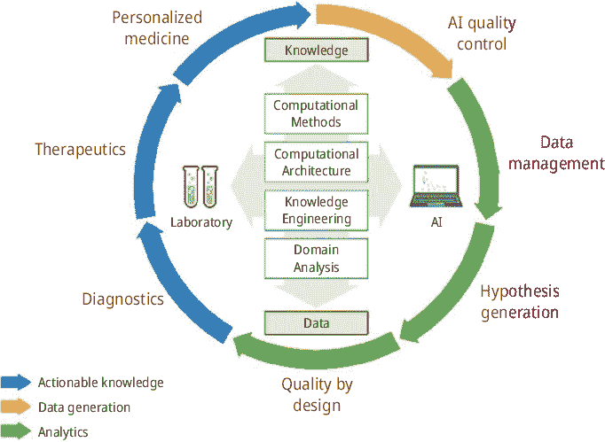

**图 5.1：** AI 和实验室在制药行业中应用的图形化表示。

## 5.2 AI 在药物制造中的应用

与往年相比，由于药物技术的显著进步和近期的进展，制造的复杂性有所增加。经过测试的产品的质量和疗效对于复杂的工艺过程也至关重要。现代药物制造系统将人类专业知识融入机器中以改进工艺。AI 在药物生产中可能会推动行业发展[11]。AI 工具将有助于实现许多药物活动的机械化。它不仅能帮助解决制造工艺问题，还能支持数值模拟。通过利用其他最先进的制造技术，AI 可以融入药物制造过程，以达到预期的结果水平。美国 FDA 发布的一份讨论文件列出了 AI 在药品生产过程中的潜在应用。基于 AI 的药物质量控制和质量保证系统预计将产生效益[12]。制药公司使用频带来确保产品质量，尽管它们可能不准确。制药领域的 AI 应用可以预测可能影响产品疗效和安全性的微小变化。基于 AI 的药物质量保证和控制可以提高工艺精度和产品质量[13]。此外，通过使用具有多目标优化的计算方法，可以降低临床前先导分子的失败率。药物设计中的 AI 利用计算机软件来评估、探索并从海量药物数据中学习，以发现新的治疗化合物。它是通过以统一、完全自动化的方式结合 ML 的进步来实现的[14]。基于机器学习（ML）的方法论是 AI 的一个分支，它强调将大量生物医学大数据转化为新颖的见解和实用知识，而不是复杂理化原理的理论进步[15]。如今，深度学习（DL）范式和其他 AI 技术拥有令人难以置信的特征提取和泛化能力，使它们对药物设计极具吸引力。虽然 DL 方法可以自动从输入数据中提取特征，并通过多层特征提取将基本特征重组为复杂特征，但传统 ML 方法使用手工生成的属性[16, 17]。

制药行业受到工艺分析技术（PAT）和 QbD 方法论的推动进行创新。QbD 方法强调理解产品和工艺的重要性，以确定关键物料属性（KMA）和关键工艺参数（CPP），这些参数会实质性地影响产品和工艺的关键质量属性（CQA）。其结果是创建一个具有可接受质量标准的设计空间。在已获法规批准的设计空间内操作不构成变更；因此，可以增加生产灵活性。AI 主要指执行通常与类人认知过程相关的任务的计算技术，如模式识别和决策制定。这些任务由 AI 中的 ML 技术执行，它们从数据集中学习并在无需显式编程的情况下生成响应。随着训练数据集的扩大，ML 可以调整模型行为以持续提升其性能，这对于数据驱动的制造应用特别有用[18, 19, 20, 21, 22]。此外，医药监管机构对 AI/ML 技术的接受度越来越高。然而，关于 ML 过程在药物制造过程中的实时适用性，仍需更多研究以做好智能制造的准备。ML 可以利用过去的工艺数据来估算结晶结果。例如，研究人员利用各种工业批次结晶的数据创建了 ANN 和 GA 模型。使用了九个描述符来模拟晶体密度，经过优化后，显著改善了最终产品，并有助于识别关键参数。在另一项研究中，基于少量实验运行和四个输入变量，可以研究共结晶过程的设计空间。用于操作变量（水分、过饱和度、搅拌速度以及种子属性）的 ANN 输入，其产生的晶体生长速率估算比众多非线性回归更准确[23, 24]。此外，在构建片剂压制工艺时，必须首先考虑压片机内压实粉末混合物的行为。对于每次填充，混合物的流动性必须足够高，以确保几乎相同量的粉末进入模孔。某些研究人员采用前馈和反向传播人工神经网络（FF-BP ANN）来预测特定粉末通过圆形孔口的速率。粉末的输入参数通常包括松装密度、振实密度、粒径、长宽比、圆度、凸度和真密度。其他研究人员提出的流动方程不如图 5.2 所示获得的流速值精确[25, 26]。

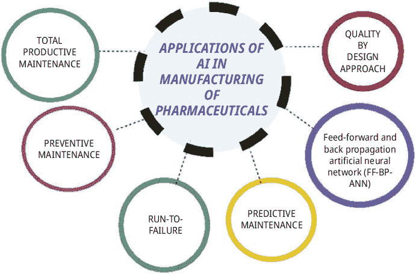

**图 5.2：** AI 在药物制造中的各种应用。

### 人工智能在药品质量控制中的应用

随着停机时间和经济损失变得日益重要，预测性维护已成为制造系统中一种流行的异常预测技术。预测性维护可利用机器学习算法预测健康状态，并利用智能电传感器持续监控制造机械。制造企业采用的维护策略可分为预防性、预测性和运行至故障三类。运行至故障最为简单，因为它仅在系统发生故障时才使用。然而，如果生产线停工、工业设备维修和生产设施调整，制造工艺的直接成本将会增加。相比之下，预测性维护在系统故障前实施效果更好，因为它能检查、观察并预防早期故障。全员生产维护的理念是基于生产率原则建立的，旨在提高组织各层级员工的满意度、降低制造成本并改善生产设备的整体性能 [27]。利用机器学习算法确定何时需要维护工作可节省运营开支。其次，通过利用统计技术、工程方法和历史数据，它能做出更准确的预测。第三，因为它能及早发现故障，所以能延长工业设备的使用寿命并改善工作条件 [28]。尽管预测性维护是故障检测最高效的方法，但仍面临两大挑战。一方面，预测性维护使用机器学习算法，但数据表示的质量往往限制了其性能。具体而言，具有冗余属性和低属性重要性的数据会导致机器学习算法性能不佳 [29]。机器学习技术还可为供应链设计和配置的战略决策提供依据。研究人员提出了一种基于贝叶斯网络的风险传播模型。该模型除考虑不同风险间的相互依赖性外，还考虑了供应链网络结构的特殊性，以生成特定的风险度量。最后，仿真研究展示了如何在供应链环境中使用输出风险度量 [30]。通过自动化高风险任务，他们能够通过改进供需计划降低库存成本、缩短开发周期、提高工程生产率、减少错误、提高安全性、通过改进销售线索识别和成本优化增加收入等。结果，他们实现了快速增长。“智能制造”这一新颖概念是一种聪明的生产方式，即在极少监督下，人与机器协同并肩工作。西门子制造部门最好地诠释了智能制造。工人创建可编程逻辑电路，并利用模拟真实车间的虚拟工厂来监督和管理生产。条形码让物品能与制造它们的机械“对话”，机械之间也可相互“交谈”以交换零件和排查故障 [31, 32, 33]。

制造商正在借助人工智能优化关键绩效指标并实时进行复盘。例如，利用虚拟程序定制模型可改善能耗，并更好地预测、检测和预防人员配置和物料瓶颈。更为重要的是，它能提前通知工程师潜在问题并提出修复建议。人工智能赋能的制造加快了上市速度、减少了浪费、降低了成本，并高效执行装配线程序。已有证明，利用协作机器人、自动驾驶汽车和机器学习算法可降低库存水平并改善仓储费用 [34]。深度学习是机器学习的一个子类，它利用大量实验数据，通过人工神经网络等先进方法进行学习。多层神经网络中的神经元通常在深度学习模型中非线性地改变数据。最近，卷积神经网络和循环神经网络已在药学科学中得到有效应用，用于开发精准剂型的各种应用。这些应用包括片剂缺陷检测、颗粒流动性预测、贮存稳定性预测和药物溶出曲线预测 [35, 36, 37, 38, 39]。机器学习建模过程完成后，必须评估模型的预测准确性。研究人员探讨了如何利用深度神经网络预测片剂溶出时间。在后续工作中，改进的最大差异算法被用于分离通过文献挖掘收集的各种药物制剂数据的训练子集和测试子集。值得注意的是，MD-FIS 是一种先进的数据选择技术，可实现数据集的验证和测试 [40]。

## 5.3 人工智能在药品质量控制中的应用

基于“质量哲学”，其高度重视目标管理、全员参与、技术共享、解决问题、适应变革、传承保护和以人为本的实践；此外，“核心价值观”强调系统集成作为手段的重要性、健康环境的可持续发展以及务实效益作为激励，构成了组织的基石 [41]。参与者在酿造过程中需要深思熟虑并付出极大努力。由于“工业 4.0”这一术语在业界极具争议，作者们仅能专注于高质量专家领域的人才培养，而未制定任何对策 [42]。任何用于临床环境的基于人工智能的应用，都需要建立质量保证工作流，以定期单独验证人工智能输出的有效性。

## 5.4 数据管理与安全

所有验证程序均包含在病例特定的质量保证（QA）中，这些程序确认专门为每位患者或每台机器创建的基于 AI 的应用程序的结果。一旦 QA 结果被认为令人满意，输出即可用于放疗（RT）工作流的后续阶段。如果质量检查的病例特定保证不成功，输出将接受验证。某些应用程序的有效性可使用单独的次级算法进行评估 [43]。此外，近期已开展利用 ML 进行自动分割质量保证的研究。利用每个 ROI 的独特特征，可构建决策树以对特定自动分割输入的形态进行分类 [44]。

近年来，DL 和 ML 领域的研究与开发显著增加。由于数据的增强可用性和计算能力的提升，研究人员开发出了日益复杂的算法和模型，从而在各个领域取得了显著进展。自然语言处理（NLP）是取得重大进展的研究领域之一 [45, 46, 47]。研究人员利用 `transformers` 和 `recurrent neural networks (RNNs)` 等 DL 模型来构建更准确、更高效的语言模型。这些模型可能会带来更好的人机连接、更简便的客户服务流程自动化，以及更复杂的搜索引擎和自动助手。

计算机视觉是另一个取得重大进展的领域 [48, 49, 50, 51]。`convolutional neural networks (CNNs)` 使更准确的图像分类和物体识别成为可能。这些模型有望改善自动驾驶、制造质量控制和医学影像分析 [52, 53, 54, 55, 56, 57, 58]。

[98] Zhu H. 用于药物发现的大数据与人工智能建模。 *The Annual Review of Pharmacology and Toxicology*。 2020。 60；573–89。 →

[99] Ciallella HL, Zhu H. 在大数据时代利用人工智能推进计算毒理学：化学毒性的数据驱动与机制驱动建模。 *Chemical Research in Toxicology*。 2019 年 3 月 14 日；32(4)：536–47。 →

[100] Plotnikov V, Kuznetsova V. 数字技术“区块链”在医药市场中的应用前景。载 *MATEC web of conferences* 2018（第 193 卷，第 02029 页）。EDP Sciences。 →

[101] Sinclair D, Shahriar H, Zhang C. 利用 Hyperledger Composer 进行药物供应链安全需求原型设计：一个区块链应用。载 *第 3 届密码学、安全与隐私国际会议论文集* 2019 年 1 月 19 日（第 158–63 页）。 →

[102] Kim JW, Lee AR, Kim MG, Kim IK, Lee EJ. 基于区块链的以患者为中心的用药史记录系统。载 *2019 年 IEEE 生物信息学与生物医学国际会议（BIBM）* 2019 年 11 月 18 日（第 1513–17 页）。IEEE。 →

[103] Gürsoy G, Brannon CM, Gerstein M. 利用以太坊区块链通过智能合约存储和查询药物基因组学数据。 *BMC Medical Genomics*。 2020 年 12 月；13：1–1。 →

[104] Ngabo D, Wang D, Iwendi C, Anajemba JH, Ajao LA, Biamba C. 物联网雾计算架构中医疗数据的基于区块链的安全机制。 *Electronics*。 2021 年 8 月 30 日；10(17)：2110。 →

[105] Islam MS, Ameedeen MA, Rahman MA, Ajra H, Ismail ZB. Healthcare-chain：医疗管理工业 4.0 中基于区块链的去中心化可信系统及网络防护。 *Computers*。 2023 年 2 月 20 日；12(2)：46。 →

[106] Fusco A, Dicuonzo G, Dell’Atti V, Tatullo M. 医疗保健中的区块链：关于 COVID-19 的见解。 *International Journal of Environmental Research and Public Health*。 2020 年 10 月；17(19)：7167。 →

[107] Farooq MS, Suhail M, Qureshi JN, Rustam F, De la Torre Díez I, Mazón JL, Rodríguez CL, Ashraf I. 利用区块链的联盟框架用于大流行时期的哮喘医疗保健。 *Sensors*。 2022 年 11 月 7 日；22(21)：8582。 →

[108] Sonkamble RG, Bongale AM, Phansalkar S, Sharma A, Rajput S. 利用区块链技术实现电子健康记录的安全数据传输。 *Electronics*。 2023 年 2 月 17 日；12(4)：1015。 →

[109] Ismail L, Materwala H. 医疗保健的区块链范式：性能评估。 *Symmetry*。 2020 年 7 月 22 日；12(8)：1200。 →

[110] Ahmed S, Lakhan A, Thinnukool O, Khuwuthyakorn P. 面向细粒度医疗应用的基于 RMI 框架的区块链套接字工厂。 *Sensors*。 2022 年 8 月 4 日；22(15)：5833。 →

[111] Jo BW, Khan RM, Lee YS. 用于地下结构健康监测的混合区块链与物联网网络。 *Sensors*。 2018 年 12 月 4 日；18(12)：4268。 →

[112] Esposito C, De Santis A, Tortora G, Chang H, Choo KK. 区块链：医疗云数据安全与隐私的灵丹妙药？ *IEEE Cloud Computing*。 2018；5：31–37。 →

[113] Kleinberg J. 算法公平性中的固有权衡；《2018 年 ACM 测量与建模计算机系统国际会议摘要论文集》；美国加利福尼亚州欧文。2018 年 6 月 18-22 日；美国纽约：计算机协会（ACM）；2018 年。第 40 页。 a，b

# DL 方法可自主识别并生成抽象特征

DL 方法可自主识别并生成抽象特征，而传统 ML 方法通常需要领域专业知识来进行特征构建或工程 [59]。在各种检测应用中，利用 `recurrent neural networks (RNNs)`、`autoencoders` 和 `CNNs` 的 DL 技术展现出卓越成果 [60]。研究人员使用 `deep ensemble learning model` 来检查汽车车身表面缺陷。在完成相同任务时，其方法的表现优于人工检查员 [61]。文献 [62] 的研究人员使用 `CNN` 定位纹理表面的缺陷。结果显示在多类数据集上具有较高的缺陷检测准确率。文献 [63] 的研究人员利用 `CNN-based transfer learning technique` 识别半导体制造缺陷；然而，其他研究人员 [64] 建议使用能够处理时间序列数据的 `CNN model`。文献 [65] 的研究人员建议使用 `deep CNNs` 进行下水道系统检测。他们声称 `CNN-based techniques` 在高度可变的图像数据上表现优于手工特征提取方法。文献 [66] 的研究人员使用优化的 `VGG model` 进行激光焊接检测。当使用多样化的图像阵列对 `VGG model` 进行预训练时，会采用 `transfer learning methodology`。文献 [67] 的研究人员描述了一种缺陷识别系统，该系统将预训练的 `AlexNet` 用于特征提取，并结合了 `Random Forest (RF)` 和 `Support Vector Machines (SVM)`。

## `smart quality inspection (SQI)` 方法

`smart quality inspection (SQI)` 方法旨在提高模型功效，并解决影响视觉检测过程的诸多因素。外包检测过程的片段可实现对各种任务方面、外部影响和其他变量的调控。通过文献回顾过程发现研究空白，这与评估算法的开发密切相关。创建 `SQI` 的策略提出了一种在现场利用 AI 驱动视觉检测的方法论。检测任务被分配给 `CNN`，该 AI 模型因其独特的架构而被选中。该应用程序允许用户上传产品离开装配线时的图像。随后，`CNN model` 将分析图像，以确定产品是合格还是缺陷，以及是否通过或未通过所需的检测。此外，操作员可选择利用 `SQI application` 将结果添加到检测记录中 [68, 69, 70]。

# 医疗数据管理中的互操作性与区块链

## 互操作性的必要性

互操作性对于使智能医疗数据管理系统能够接收必要的数据输入至关重要，因为各种数据源通常以多种形式存储和处理信息。在持续产生的海量数据中获取相关信息的挑战显而易见。美国国家卫生信息技术协调办公室最近发布了一项关于信息阻断和互操作性的草案规则，强调需要授予患者无障碍访问其电子健康记录的权利 [71, 72]。同时确保隐私和互操作性似乎是不兼容的，这使得实现变得困难。

## 用于医疗数据管理的区块链技术

最近，前沿区块链技术在医疗数据管理中的潜在用例在学术界和商业界引发了大量讨论 [73, 74, 75, 76]。区块链技术通过赋予用户对其数据和隐私的完全控制权，消除了对中心化权威的必要性，从而可以增强并加速私人健康信息的共享。

### 慢性病中的数据共享

由于患者流动性、因专科中心而涉及多家医院进行诊断和治疗、对“第二意见”的需求以及患者使用多种药物，数据共享在慢性病领域至关重要 [73, 77, 78]。

### 药品供应链优化

利用区块链技术优化药品供应链可以使临床试验和整体医学研究受益 [79, 80, 81]。

## 区块链实施方法

通过仅在区块链上存储元数据（可能包括患者同意书）而非医疗记录，区块链技术可以保证患者健康数据的可追溯性和不可篡改性。各个网络节点可以存储庞大且敏感的医疗数据，其智能表现形式将保留在链下 [73]。另一种方法涉及利用合规的基于云的服务进行临时存储（即在患者指定的时间范围内）和数据共享 [78]。

### FHIR 链

FHIR 链是一种基于区块链的数据共享方法，它通过快速医疗互操作性资源（FHIR）标准封装临床数据。通过有效管理链上同意书并建立同意书中规定的访问控制机制，在保护隐私的同时，初级保健数据的共享将得到加速和简化。

### 供应链应用

利用区块链技术贯穿供应链的应用开始逐渐成型。这些应用包括改善公共卫生供应链、保护医疗设备、提高医疗物联网设备的可用性，以及利用区块链的不可篡改性和透明度打击假冒药品 [79]。此外，这些应用确保制药公司保留对退回药品的控制权。研究人员展示了区块链技术如何提供改善药品可追溯性特别是供应链管理的总体功能 [80]。确保药品供应链的合规性至关重要，确认运输和储存条件同样重要。

## 电子数据采集与临床数据管理

制药公司也在朝着直接从源头获取患者记录数据并将其录入电子系统的目标迈进，以便逐步、稳定地发送给申办方或客户。从纸质数据收集转向电子系统被称为“电子数据采集”。来自临床试验的未经处理的患者或志愿者数据保存在一种称为电子数据系统（EDC）的软件系统中 [81, 82, 83, 84]。在录入系统之前，信息首先被记录下来，然后保存为电子病例报告表（eCRF）。

### 临床试验软件

临床试验软件对各类组织都有益，包括制药、生物技术、医疗和研究机构。这些程序协助临床试验的各个方面，涵盖研究提交、归档和招募。这些程序既适用于小规模的初步研究，也适用于涉及数千名参与者的大规模调查。“临床数据管理系统”或“软件”一词指的是可用于数据管理的应用程序集合。这些程序至关重要，因为它们可以管理多中心系统或试验中的海量数据。

### CDM 软件示例

许多软件程序，包括 `ORACLE CLINICAL`、`MACRO`、`RAVE`、`CLINTRIAL`、`eClinicalSuite`、`EZentry` 等，被用作药房中的 CDM 软件 [85, 86, 87]。这些程序的功能基本相似，因此无法相互超越。这些软件程序的缺点是成本高昂，并且组织要运行它们，必须获取复杂的信息技术通信设施。

### 医疗记录管理软件的优势

医疗记录管理软件提供了多项优势，包括加快研究时间表和控制成本、提供精确的临床试验预测、实现稳健的项目建模、简化招募、排程和筛选流程、支持医生，以及轻松应对外汇汇率波动 [88, 89, 90, 91]。

# 基于 AI 的制造中的法规合规性

成功的秘诀在于将现成的技术（如 AI、区块链和其他技术）内化为公司的核心竞争力 [92]。为了加强临床研究并实现以患者为中心，行业必须利用技术创建以用户和客户为中心的界面，基于数据做出决策以实现创新的数据处理方法，并改善结果 [93, 94]。例如，AI 可协助患者识别和优先排序，用于药物开发和监测，这对于标准化药物生产和加快进度至关重要 [92]。AI 和数字化药物设计技术被用于分析临床试验数据，以确定剂量、评估药物配方的疗效，并对已上市药物进行再利用。通过引入安全且自动化的数据分析，区块链促进了系统设计中账本或内容区块的创建和维护。所有健康相关数据的安全记录和分析，使得能够及时向付费方、医疗专业人员和医生提供更新。然而，由于需要大量的计算资源，区块链在存储大量记录（如全面的电子病历或基因数据记录）方面效率极低。这是区块链技术的一个重大缺陷，因为它使在区块链内查询数据的过程变得复杂 [95, 96]。

然而，通过集成区块链和 AI 算法，有办法解决这一问题。风险评估必须是保护生命科学和医疗保健领域敏感个人信息和 PHI（受保护健康信息）的初始阶段。建议实施美国国家标准与技术研究院（NIST）的网络安全框架（CSF）以建立网络安全计划。NIST 网络安全框架包含用于管理关键基础设施网络安全的标准、指南和最佳实践。但是，基于云和 AI 的产品、服务和技术被用于利用框架构建业务流程，以开发安全计划，使该经济领域的从业者能够做好准备保护敏感数据，并能及时响应任何事件或安全威胁 [97, 98, 99]。为了从流程和政策角度创建一个全面的安全计划，研究人员从 NIST 网络安全框架（NIST CSF）入手。然后，他们利用 SAP Cloud 的技术，特别是 `SAP S4/HANA` 及其基于 AI 的云服务，来弥补不足。`SAP S4/HANA` 将成为真实来源和记录系统。生命科学行业的数字化和数字化转型比以往任何时候都更加重要。`SAP S4/Cloud` 产品提供所有必需的产品和服务，以及私有云服务等控制功能，使生命科学公司能够访问利用云和 AI 服务的最先进技术和解决方案。它们仍然掌控着自己的私人信息，这有助于它们遵守全球隐私和数据法律。凭借 `SAP S4/HANA` 云产品提供的公有、私有和混合模型，用户可以选择最适合其需求并产生最高投资回报率（ROI）的模型，同时保持保护公司目标、保障敏感数据以及通过临床研究和研发持续创新和生产新药所需的所有控制 [100, 101, 102]。由物联网驱动的区块链技术和 AI 将改善生物医学和医疗保健数据账本，加速生物学和临床研究。这些评估基于区块链和 AI 的基本方面，包括增强的安全性、弹性、去中心化管理、不可篡改的审计追踪，以及最重要的是权利的恢复。创新和最先进的技术正利用区块链和 AI 进行开发，以改善医疗数据处理、协作、加工、评估和基于结果的分类。由物联网驱动的医疗保健行业正在被区块链技术重新定义。这是通过提高生产力、访问控制、技术进步、隐私保护和运营数据流程安全来实现的 [103]。

物联网解决方案的安全性和隐私性问题迫在眉睫，但很大程度上被忽视。研究作者回顾了物联网中隐私和安全措施的研究，还审视了关于声称极其安全的技术的常见误解。研究人员讨论了基于雾计算的物联网环境中的用户认证方法和安全密钥管理。`SAKA-FC` 安全系统包含一个双组件框架，具有三因素密钥管理和用户认证机制 [104]。在另一项研究中，研究人员 [105] 检查了植入式医疗设备（IMD）的安全性，包括起搏器和胰岛素泵。研究作者为植入式医疗设备提出了一种基于椭圆曲线密码学的三因素轻量级远程用户授权方法。该安全方案展示了如何使用 Dolev-Yao 威胁结构来实施建议方案。这是一个与用户（U）、控制器节点（CN）和 IMD 相关联的系统模型。通过采用三因素验证策略，提高了远程监控的安全性。为了保证通信安全，它要求在 CN 和 IMD 之间建立双边密钥，以及通过会话密钥实现 U 和 CN 之间的相互认证。其他研究人员为移动健康解决方案提出了一种具有可追溯性的轻量级数据共享方案，即 `LiST`。模型中的系统由医疗专业人员（数据用户）、公有云、WBSN（数据所有者）和密钥生成中心（KGC）组成，后者被视为一个完全可靠的组织，为整个系统生成公共属性并向数据用户提供密钥。作者断言 `LiST` 提供轻量级用户撤销、轻量级测试算法、轻量级加密、基于关键字的轻量级后门生成和轻量级叛徒追踪 [106]。该方案实施了一种轻量级撤销机制，以消除未经授权的用户及其解密权限，从而保护 EHR 的隐私。

# 结论

如今的立法者和监管机构对企业治理和合规有了相当高的标准。在强制性和完整的企业信任与透明度方面，出现了明显的倾向性转变。欧盟的立法者和监管机构正在考虑首次制定关于数字技术（特别是 AI）使用的合规规定。几年前，欧盟委员会发布了一项 AI 法规，以确保技术的应用方式维护欧盟的理想、原则和基本权利 [107, 108]。为确保 AI 的安全性、透明度、伦理性、中立性和人工监督而实施的一项措施示例是欧盟委员会的《AI 法案》。欧盟现在根据 AI 应用的风险等级对其进行分类，并根据分类建立了相应的规范和法规。例如，社会评分风险太大而无法使用，而低风险聊天机器人只需遵守透明度规则。尽管合规在数字技术框架中意义重大，但目前法律专家和数字技术专家均未对该问题提供彻底的科学方法或给予重点关注。因此，AI 仍然是欧洲立法机构探讨这些事务的唯一显著实例。欧盟医疗器械法规规定，在医疗器械（包括 AI 软件设备）可用于临床实践之前，必须满足严格的监管要求。必须满足取代欧盟医疗器械指令的欧盟 MDR [109]。首次，欧盟 MDR 的许多术语和规范也适用于医疗保健组织为内部使用而创建的医疗器械软件。

根据医疗器械定义中量化的任何目标（包括疾病的监测、治疗、预防、诊断和缓解）提供数据的软件 [109]，均受欧盟 MDR 监管。它涵盖既独立提供诊断或治疗的软件，也仅提供数据以帮助医疗从业者得出最佳诊断或治疗方案的软件。无论软件是可执行程序、动态网站、网络服务、脚本，甚至是简单的电子表格宏，欧盟 MDR 均适用。此外，如果软件旨在用于医疗目的，并打算与人类或其数据一起使用，则被视为医疗器械，无论处理的复杂性、对患者或用户构成的风险、是否由医疗专业人员使用，或其运行的计算平台如何 [110, 111, 112]。AI 可能会对药物疗效与免疫反应之间的复杂关系进行预测，从而大幅改善药物发现 [113, 114]。AI 对于更复杂的任务（如多个基因组问题的分析）或更简单的任务（如电子文档的最佳实践）也可能有益 [115, 116]。AI 已被部署用于增强与肿瘤学和放射学相关的医疗报告 [117, 118]。对于分析实验室而言，协议和程序偶尔可达数百甚至数千页，且页数随每种新疗法的增加而增长，这令人鼓舞。AI 可以根据输入数据快速创建有用的方法并预测文本 [119]。AI 语言翻译工具也可应用于全球共享的方法，以提高实验室间的可重复性。此外，稳定性和新批次 cGMP 测试期间产生的数据需要经过仔细检查，任何不一致之处都需要通过质量调查进行追查。AI 工具能够进行调查和校对分析数据以发现错误 [120]。

在敏感领域，应极其谨慎地使用 AI 系统，因为基于偏斜数据或错误标准做出的判断可能产生深远影响 [121]。因此，这些系统需要广泛的验证，以有效解决 AI 特有的问题，如黑箱问题。许多作者推测 XAI 可能在验证中发挥作用，但具体策略尚未被创建和评估。验证概念由四个阶段组成，可以重复或分步执行。第一阶段称为设置阶段，处理创建和实施新 IS 所涉及的典型设计任务。随后的技术设置和性能阶段涵盖了专门与 AI 开发相关的步骤，以创建一个可靠的 AI 系统。迄今为止，该过程与验证方法论或黑箱 AI 系统性能评估有相似之处 [122]。对于在不敏感环境中运行的 AI 系统，预定义的性能指标可能已足够；然而，根据拟议的验证概念，还需要进一步的工作来验证 AI 系统已按预期开发并正常运行。XAI 评估的第三阶段提供了推荐的 XAI 方法，举例说明了如何适当使用决策规则和/或空间。最后阶段是压力测试，旨在根据评估结果确定 AI 系统使用的极限。在技术、学术、工业和 GMP 审计专家的协助下，一个研发项目中开发出了一种验证方法。该策略在医药制造领域成功应用 [123]。不过，实施 AI 系统的企业仍必须评估所创建验证策略的几个要素。因此，建议未来的研究重点放在为敏感用例（如医药行业）创建和建立指南及标准上。这可能会减少所需的验证工作量，从而使全面的验证技术对于涉及不那么敏感数据的用例更具可行性 [124]。

## 制药行业越来越多地利用人工智能来管理海量数据并增强自动化

制药行业越来越多地利用人工智能来管理海量数据并增强自动化。人工智能可以通过复杂的工具和网络模拟人类智能，但它无法在现实世界中取代人类。制药行业已通过质量源于设计（QbD）技术得到提升，而人工智能有望提高产品质量、减少浪费并加快制造流程。人工智能还可用于药物设计，以评估、学习并发掘与制药相关的大数据，以高度自动化和统一的方式整合机器学习（ML）的进展。智能制造让人机在极少监督下协同工作，已被用于优化性能指标、改善能耗，并预测人员配置和物料瓶颈。临床环境中基于人工智能的应用必须具备质量保证工具，以确认人工智能输出的有效性。科学家们已利用卷积神经网络（CNN）开发出用于自动驾驶、制造质量控制和医学影像分析的物体识别和分类模型。循环神经网络（RNN）、自编码器和基于 CNN 的深度学习技术在各类检测应用中均取得了卓越成果。医学研究行业要想成功，必须将区块链、人工智能（AI）及其他技术纳入核心竞争力。欧盟正在考虑实施针对基于人工智能制造的合规法规，旨在使技术与欧盟的原则、价值观和基本权利保持一致。

# 参考文献

[1] Holmes J, Sacchi L, Bellazzi R. 医学中的人工智能. 英国皇家外科医学院院刊. 2004;86:334–38. →

[2] Miles JC, Walker AJ. 人工智能在交通运输中的潜在应用. 在 IEE proceedings-intelligent transport systems. 2006 Sep 1 (Vol. 153, No. 3, pp. 183–98). IET Digital Library. →

[3] Yang Y, Siau KL 人工智能时代营销与销售的定性研究 (2018): 41–50. →

[4] Wirtz BW, Weyerer JC, Geyer C. 公共部门的人工智能——应用与挑战. 国际公共管理杂志. 2019 May 19;42(7):596–615. →

[5] Tripathi A, Misra K, Dhanuka R, Singh JP. 人工智能加速药物发现与开发. 生物技术近期专利. 2023 Mar 1;17(1):9–23. →

[6] Wan F, Zeng J. 用于化合物-蛋白质相互作用预测的带特征嵌入的深度学习. Biorxiv. 2016 Nov 7:086033. →

[7] Guo M. 用于硬明胶胶囊制剂开发的原型智能混合系统. 药物技术. 2002;6:44–52. →

[8] Mehta CH. 用于制剂设计的计算建模. 药物发现今日. 2019;24:781–88. →

[9] Zhao C. 面向药品开发的智能决策支持. 药物创新杂志. 2006;1:23–35. →

[10] Dwivedi YK, Hughes L, Ismagilova E, Aarts G, Coombs C, Crick T, Duan Y, Dwivedi R, Edwards J, Eirug A, Galanos V. 人工智能（AI）：关于新兴挑战、机遇及研究、实践和政策议程的多学科视角. 国际信息管理杂志. 2021 Apr 1;57:101994. →

[11] Mak KK, Pichika MR. 药物开发中的人工智能：现状与未来前景. 药物发现今日. 2019;24(3):773–80. →

[12] Intelligence UA. 药物与生物制品开发中的机器学习. 美国食品药品监督管理局, HHS. 2023;1–12. →

## 参考文献

[13] AI 会在质量保证和质量控制职业中发挥重要作用吗？[互联网] 2017 [引用于 2023 年 12 月 15 日] https://www.aaps.ca/blog/will-ai-playan-important-role-in-quality-assurance-and-qualitycontrol-careers

[14] Duch W, Swaminathan K, Meller J. 用于合理药物设计与发现的人工智能方法. 当前药物设计. 2007 May 1;13(14):1497–508.

[15] Lavecchia A, Di Giovanni C. 药物发现中的虚拟筛选策略：一项批判性综述. 当前药物化学. 2013 Aug 1;20(23):2839–60.

[16] Melville JL, Burke EK, Hirst JD. 虚拟筛选中的机器学习. 组合化学与高通量筛选. 2009 May 1;12(4):332–43.

[17] Ma J, Sheridan RP, Liaw A, Dahl GE, Svetnik V. 深度神经网络作为定量构效关系的一种方法. 化学信息与建模杂志. 2015 Feb 23;55(2):263–74.

[18] Pawar MA, Khandelwal MH. 国际协调会议及 ICH (Q1) 药物开发稳定性测试指南概述——国际会议. 应用科学与工程技术研究国际期刊. 2019;7:1042–52.

[19] Hinz DC. 制药行业中的过程分析技术：FDA 的 PAT 倡议. 分析化学与生物分析化学. 2006 Mar;384(5):1036–42.

[20] Agatonovic-Kustrin S, Beresford R. 人工神经网络（ANN）建模的基本概念及其在药学研究中的应用. 药学与生物医学分析杂志. 2000;22(5):717–27.

[21] Vamathevan J, Clark D, Czodrowski P, Dunham I, Ferran E, Lee G, et al. 机器学习在药物发现与开发中的应用. 自然药物发现评论. 2019;18(6):463–77.

[22] Valizadeh H, Pourmahmood M, Mojarrad JS, Nemati M, Zakeri-Milani P. 利用人工智能工具对虾外骨胺制备葡萄糖胺进行建模. 药物开发与工业药学. 2009;35(4):396–407.

[23] Velásco-Mejía A, Vallejo-Becerra V, Chávez-Ramírez AU, Torres-González J, Reyes-Vidal Y, Castañeda-Zaldivar F. 利用神经网络和遗传算法对药物结晶过程进行建模与优化. 粉体技术. 2016;292:122–28.

[24] Shaikh R, Shirazian S, Walker GM. 应用人工神经网络预测利用机械化学合成进行药物共结晶的粒径. 神经计算与应用. 2021;33(19):12621–40.

[25] Vasanth Kumar K, Martins P, Rocha F. 利用人工神经网络建模批次蔗糖结晶动力学：与传统回归分析的比较. 工业与工程化学研究. 2008;47(14):4917–23.

[26] Kachrimanis K, Karamyan V, Malamataris S. 人工神经网络（ANNs）与粉体流动建模. *International Journal of Pharmaceutics*. 2003;250(1):13–23.

[27] McKone KE, Schroeder RG, Cua KO. 全面生产维护实践对制造绩效的影响. *Journal of Operations Management*. 2001 年 1 月 1 日;19(1):39–58.

[28] Aremu OO, Cody RA, Hyland-Wood D, McAree PR. 一种基于相对熵的预测性维护资产数据特征选择框架. *Computers & Industrial Engineering*. 2020 年 7 月 1 日;145:106536.

[29] Jiang Y, Dai P, Fang P, Zhong RY, Zhao X, Cao X. 基于机器学习的工业设备预测性维护 A2-LSTM 模型. *Computers & Industrial Engineering*. 2022 年 10 月 1 日;172:108560.

[30] Garvey MD, Carnovale S, Yeniyurt S. 供应网络风险传播的分析框架：一种贝叶斯网络方法. *European Journal of Operational Research*. 2015 年 6 月 1 日;243(2):618–27.

[31] Patel P, Ali MI, Sheth A. 从原始数据到智能制造：面向工业 4.0 的 AI 与语义万物网. *IEEE Intelligent Systems*. 2018 年 10 月 18 日;33(4):79–86.

[32] Bughin J, Hazan E, Sree Ramaswamy P, W DC, Chu M. 人工智能：下一个数字前沿（2017）：1–20.

[33] Martin C, Leurent H. 面向生产未来的技术与创新：加速价值创造. 载于*World Economic Forum*. 2017 年 3 月（第 1–38 页）.

[34] O’Reilly C, Binns AJ. 颠覆性创新的三个阶段：构思、孵化与规模化. *California Management Review*. 2019 年 5 月;61(3):49–71.

[35] 深度学习与机器学习——有何区别？| Flatiron School. 在线获取：[`flatironschool.com/blog/deep-learning-vs-machine-learning`](https://flatironschool.com/blog/deep-learning-vs-machine-learning) （访问日期：2023 年 12 月 15 日）.

[36] Ma X, Kittikunakorn N, Sorman B, Xi H, Chen A, Marsh M, Mongeau A, Piché N, Williams RO III, Skomski D. 深度学习卷积神经网络在片剂内部缺陷检测中的应用：高准确率、高通量与高适应性. *Journal of Pharmaceutical Sciences*. 2020 年 4 月 1 日;109(4):1547–57.

[37] Westphal E, Seitz H. 一种基于卷积神经网络的选择性激光烧结缺陷检测与可视化机器学习方法. *Additive Manufacturing*. 2021 年 5 月 1 日;41:101965.

[38] Hesse R, Krull F, Antonyuk S. 利用深度卷积神经网络与离散元法模拟预测非球形颗粒的随机堆积密度与流动性. *Powder Technology*. 2021 年 11 月 1 日;393:559–81.

[39] Goh WY, Lim CP, Peh KK, Subari K. 循环神经网络在药物溶出曲线预测中的应用. *Neural Computing & Applications*. 2002 年 4 月;10:311–17.

[40] Han R, Yang Y, Li X, Ouyang D. 利用神经网络技术预测口服崩解片剂处方. *Asian Journal of Pharmaceutical Sciences*. 2018 年 7 月 1 日;13(4):336–42.

[41] Fadziso T, Adusumalli HP, Pasupuleti MB. 万物云与互操作物联网平台：战略与执行概览. *Asian Journal of Applied Science and Engineering*. 2018;7:85–92.

[42] Rahman MM, Pasupuleti MB, Adusumalli HP. 高级计量基础设施数据：大数据框架概览. *ABC Research Alert*. 7(3);159–68.

[43] Vandewinckele L, Claessens M, Dinkla A, Brouwer C, Crijns W, Verellen D, Van Elmpt W. 放疗中基于人工智能应用的综述：实施与质量保证建议. *Radiotherapy and Oncology*. 2020 年 12 月 1 日;153:55–66.

[44] Baduge SK, Thilakarathna S, Perera JS, Arashpour M, Sharafi P, Teodosio B, Shringi A, Mendis P. 建筑与施工 4.0 的人工智能与智能视觉：机器学习与深度学习方法及应用. *Automation in Construction*. 2022 年 9 月 1 日;141:104440.

[45] Amini M, Sharifani K, Rahmani A. 面向制造与机械工程数据收集方法评估的机器学习模型. *International Journal of Applied Science and Engineering Research*. 2023;15(2023):349–62.

[46] Abd Elaziz M, Dahou A, Abualigah L, Yu L, Alshinwan M, Khasawneh AM, Lu S. 深度神经网络应用中的先进元启发式优化技术：综述. *Neural Computing and Applications*. 2021 年 11 月;1:1–21.

[47] Sharifani K, Amini M, Akbari Y, Aghajanzadeh Godarzi J. 跨自然语言处理技术运行机器学习以改进虚假新闻模型. *International Journal of Science and Information System Research*. 2022;12(9):20–44.

[48] Balouji E, Gu IY, Bollen MH, Bagheri A, Nazari M. 一种基于 LSTM 的深度学习方法及其在电压暂降分类中的应用. 载于*2018 年第 18 届谐波与电能质量国际会议(ICHQP)*. 2018 年 5 月 13 日（第 1–5 页）. IEEE.

[49] Amini M, Rahmani A, Abedi M, Hosseini M, Amini M, Amini M. Mahamgostar.com 作为案例研究：采用 Laravel 框架作为中小企业基于 PHP 的 Web 开发最佳编程工具. *Journal of Innovation & Knowledge, ISSN*. 2021 年 5 月;1:100–10.

[50] Hamilton WL, Ying R, Leskovec J. 图上的表征学习：方法与应用. arXiv 预印本 arXiv:1709.05584. 2017 年 9 月 17 日.

[51] Amini M, Bakri A. 马来西亚中小企业云计算采用：基于 DOI 理论与 TOE 框架的多视角框架. *Journal of Information Technology & Information Systems Research (JITISR)*. 2015;9(2):121–35.

[52] Amini M, Sadat Safavi N. 一种无需迁移的 IaaS 云放置问题动态 SLA 感知启发式解决方案. *International Journal of Computer Science and Information Technologies*. 2014 年 7 月;6(11):25–30.

[53] Janiesch C, Zschech P, Heinrich K. 机器学习与深度学习. *Electronic Markets*. 2021 年 9 月;31(3):685–95.

[54] Amini M. “影响中小企业采用云计算的因素.”（2014）：41–48.

[55] Sharma N, Sharma R, Jindal N. 机器学习与深度学习应用——展望. *Global Transitions Proceedings*. 2021 年 6 月 1 日;2(1):24–28.

[56] Amini M, Sadat Safavi N, Mirzaeyan Bahnamiri R, Mirzaei Omran M, Amini M. 面向中小企业采用云计算的环境背景影响评估工具开发. *Australian Journal of Basic and Applied Sciences (AJBAS)*. 2014 年 6 月；8(10)：129–35。

[57] Mahrishi M, 等，编. *机器学习与深度学习在实时应用中的研究*. IGI global；2020；187–218。

[58] Amini M, Bakri A, Sadat Safavi N, Javadinia SA, Tolooei A. 高层管理者行为在中小企业采用云计算中的作用. *Australian Journal of Basic and Applied Sciences (AJBAS)*. 2014 年 2 月；8(1)：490–98。

[59] Wang J, Ma Y, Zhang L, Gao RX, Wu D. 面向智能制造的深度学习：方法与应用. *Journal of Manufacturing Systems*. 2018 年 7 月 1 日；48：144–56。

[60] Yang J, Li S, Wang Z, Dong H, Wang J, Tang S. 利用深度学习检测制造缺陷：综述与当前挑战. *Materials*. 2020 年 12 月 16 日；13(24)：5755。

[61] Chang F, Liu M, Dong M, Duan Y. 基于深度集成学习的汽车车身光滑表面微小缺陷检测移动视觉检测系统. *Measurement Science and Technology*. 2019 年 9 月 30 日；30(12)：125905。

[62] Wang T, Chen Y, Qiao M, Snoussi H. 一种用于产品质量控制的快速鲁棒卷积神经网络缺陷检测模型. *The International Journal of Advanced Manufacturing Technology*. 2018 年 2 月；94：3465–71。

[63] Imoto K, Nakai T, Ike T, Haruki K, Sato Y. 一种用于半导体制造缺陷分类的基于 CNN 的迁移学习方法. *IEEE Transactions on Semiconductor Manufacturing*. 2019 年 9 月 16 日；32(4)：455–59。

[64] Lee KB, Cheon S, Kim CO. 一种用于半导体制造工艺故障分类与诊断的卷积神经网络. *IEEE Transactions on Semiconductor Manufacturing*. 2017 年 3 月 1 日；30(2)：135–42。

[65] Kumar SS, Abraham DM, Jahanshahi MR, Iseley T, Starr J. 基于深度卷积神经网络的下水道闭路电视检测自动缺陷分类. *Automation in Construction*. 2018 年 7 月 1 日；91：273–83。

[66] Yang Y, Pan L, Ma J, Yang R, Zhu Y, Yang Y, Zhang L. 一种用于激光焊接自动光学检测的高性能深度学习算法. *Applied Sciences*. 2020 年 1 月 31 日；10(3)：933。

[67] Ullah I, Khan RU, Yang F, Wuttisittikulkij L. 高压电气设备基于深度学习图像的缺陷检测. *Energies*. 2020 年 1 月 13 日；13(2)：392。

[68] Dabhi, Ravirajsinh 面向质量检测的铸造产品图像数据. 在线获取：[`https://www.kaggle.com/datasets/ravirajsinh45/real-life-industrial-dataset-of-casting-product`](https://www.kaggle.com/datasets/ravirajsinh45/real-life-industrial-dataset-of-casting-product) （访问日期：2023 年 12 月 17 日）.

[69] Nair V, Hinton GE. 修正线性单元改进受限玻尔兹曼机. 载 *第 27 届国际机器学习会议论文集 (ICML-10)*. 2010（第 807–14 页）.

[70] Kingma DP, Ba J Adam：一种随机优化方法. *arXiv 预印本 arXiv:1412.6980*. 2014 年 12 月 22 日.

[71] “健康信息隐私 美国卫生与公众服务部”，[`http://www.hhs.gov/hipaa/`](http://www.hhs.gov/hipaa/)，最后访问日期：2019-04-05。

### 第 6 章 通过人工智能进行药物开发和临床试验

## 摘要

人工智能（AI）深刻影响了临床试验和药物开发，深度学习技术的表现优于传统的机器学习策略。尽管其潜力和可及性受限，高通量虚拟筛选（HTVS）已被提出作为昂贵且耗时方法的替代方案。本章概述了利用人工智能（AI）识别药物靶点、验证药物并开展临床试验的计算机辅助药物开发技术。此外，本章还描述了一种新颖的深度学习技术，该技术通过仅从数据中获取控制方程，旨在构建 `PK/PD` 模型，以预测患者反应时间并模拟未知给药方案的影响。该技术在保持剂量-浓度-效应药理学合理性的同时，使模型能够预测治疗结果并复制患者的给药时间表。药物-靶点相互作用（DTIs）对于定位潜在药物以及提供副作用和药物机制信息至关重要。此外，最后一节提出了关于社会鸿沟、数据安全、知情同意、医疗咨询、共情以及同情心等伦理问题，这些问题影响着医疗行业中 AI 赋能的临床试验。

**关键词：** 药物-靶点相互作用，`PK/PD` 模型，高通量虚拟筛选，验证，伦理问题

#### 6.1 引言

近年来，机器学习（ML）方法在计算机辅助药物开发中的应用显著增加。深度学习方法（如具有多个隐藏层的人工神经网络）能够从输入数据中自主提取特征并建模非线性输入-输出关系，这最近引起了极大的关注 [[1]](#9783111573861_008368.xhtml#b_9783111574288-006_ref_001)，[[2]](#9783111573861_008368.xhtml#b_9783111574288-006_ref_002)，[[3]](#9783111573861_008368.xhtml#b_9783111574288-006_ref_003)，[[4]](#9783111573861_008368.xhtml#b_9783111574288-006_ref_004)，[[5]](#9783111573861_008368.xhtml#b_9783111574288-006_ref_005)，[[6]](#9783111573861_008368.xhtml#b_9783111574288-006_ref_006)。深度学习方法的特点补充了使用人类创建的分子描述符的传统机器学习方法。深度学习在药物发现领域的回归略显迟缓，但在此期间，它产生了前所未有的新型建模技术和应用浪潮。深度学习的持续进步已被证明对化学领域的许多领域有益 [[7]](#9783111573861_008368.xhtml#b_9783111574288-006_ref_007)，[[8]](#9783111573861_008368.xhtml#b_9783111574288-006_ref_008)，[[9]](#9783111573861_008368.xhtml#b_9783111574288-006_ref_009)，[[10]](#9783111573861_008368.xhtml#b_9783111574288-006_ref_010)。

## 参考文献

[72] “构想用于护理交付与研究中患者生成健康数据的采集、使用与共享的数据基础设施，展望 2024”，[`https://www.healthit.gov/sites/default/files/oncpghdfinalwhitepaper.pdf`](https://www.healthit.gov/sites/default/files/oncpghdfinalwhitepaper.pdf)，最后访问日期：2019-04-05。

[73] “2018 年可信交换框架草案”，[`https://www.healthit.gov/sites/default/files/draft-trusted-exchange-framework.pdf`](https://www.healthit.gov/sites/default/files/draft-trusted-exchange-framework.pdf)，最后访问日期：2019-05-05。

[74] Azaria A, Ekblaw A, Vieira T, Lippman A. Medrec：利用区块链进行医疗数据访问与权限管理。载 *2016 年第 2 届开放与大数据国际会议 (OBD)*。2016（第 25–30 页）。IEEE。

[75] Dillenberger DN, Novotny P, Zhang Q, Jayachandran P, Gupta H, Hans S, Verma D, Chakraborty S, Thomas JJ, Walli MM, Vaculin R 区块链分析与人工智能。*IBM Journal of Research and Development*。2019 年 2 月 20 日；63(2/3)。

[76] Hölbl M, Kompara M, Kamišalić A, Nemec Zlatolas L. 区块链在医疗保健中应用的系统综述。*Symmetry*。2018；10(10)：470。

[77] Vazirani AA, O’Donoghue O, Brindley D, Meinert E. 实施区块链以实现高效医疗保健：系统综述。*Journal of Medical Internet Research*。2019 年 2 月 12 日；21(2)：e12439。

[78] Zhang P, White J, Schmidt DC, Lenz G, Rosenbloom ST. Fhirchain：应用区块链安全且可扩展地共享临床数据。*Computational and Structural Biotechnology Journal*。2018；16：267–78。

[79] Dubovitskaya A, Xu Z, Ryu S, Schumacher M, Wang F. 利用区块链实现安全可信的电子病历共享。载 *AMIA 年度会议论文集*。2017（第 2017 卷，第 650 页）。美国医学信息学协会。

[80] Haq I, Esuka OM. 制药行业中的区块链技术以防止假冒药品。*International Journal of Computer Applications*。2018；975：8887。

[81] Hackius N, Petersen M. 物流与供应链中的区块链：馈赠还是陷阱？载 *汉堡国际物流会议论文集 (HICL)*。Epubli。2017（第 3–18 页）。

[82] Bocek T, Rodrigues BB, Strasser T, Stiller B. 无处不在的区块链——制药供应链中的区块链用例。载 *2017 IFIP/IEEE 集成网络与服务管理研讨会 (IM)*。2017（第 772–77 页）。IEEE。

[83] Clauson KA, Breeden EA, Davidson C, Mackey TK. 利用区块链技术增强医疗保健供应链管理。*Blockchain in Healthcare Today*。2018；1–12。

[84] Scott T, Post AL, Quick J, Rafiqi S. 评估区块链应用于 DSCSA 合规性的可行性。*SMU Data Science Review*。2018；1(2)：4。

[85] Gangarapu P, Jayachandra Reddy P, Alagu Sundaram M, Sabareesh M, Prabhakaran V. 临床数据管理中的监管考量。*International Journal of Current Pharmaceutical Research*。2015;5(3):143–52.

[86] 良好临床实践指南。国际协调会议（ICH）。<http://www.ich.org>。[访问于 2023 年 12 月 5 日]。

[87] Kawado M, Hinotsu S, Matsuyama Y, Yamaguchi T, Hashimoto S, Ohashi Y. 大声朗读法与双重数据录入法错误检出率的比较。*Controlled Clinical Trials*。2003;24(5):560–69。

[88] Argraves S, Brandt CA, Money R, Nadkarni P. 改进临床研究实施的信息学工具。*Contemporary Clinical Trials*。2006;27(2):112–22。

[89] Gerritsen MG, Sartorius OE, Vd Veen FM, Meester GT. 多中心临床试验中的数据管理及全国计算机网络的作用：为期 5 年的评估。*Proceedings the Annual Symposium on Computer Application Medical Care*。1993;659–62。

[90] Almenoff JS, Pattishall EN, Gibbs TG, DuMouchel W, Evans SJ, Yuen N. 用于监测上市药物安全性的新型统计工具。*Clinical Pharmacology and Therapeutics*。2007;82(2):157–66。

[91] Litchfield J, Freeman J, Schou H, Elsley M, Fuller R, Chubb B. 临床试验的未来是基于互联网的吗？一项集群随机临床试验。*Clinical Trials*。2005;2(1):72–79。

[92] Tanwar S, Parekh K, Evans R. “面向医疗 4.0 应用的基于区块链的电子健康记录系统。*Journal of Information Security and Applications*。2250 2020 年 2 月;50:Art. no. 102407。

[93] Campanella P, Lovato E, Marone C, Fallacara L, Mancuso A, Ricciardi W, Specchia ML. 电子健康记录对医疗质量的影响：系统评价和荟萃分析。*The European Journal of Public Health*。2016 年 2 月 1 日;26(1):60–64。

[94] Siyal AA, Junejo AZ, Zawish M, Ahmed K, Khalil A, Soursou G. 区块链技术在医药卫生领域的应用：挑战与未来展望。*Cryptography*。2019 年 1 月 2 日;3(1):3。

[95] Tagde P, Tagde S, Bhattacharya T, Tagde P, Chopra H, Akter R, Kaushik D, Rahman MH. 电子健康领域的区块链与人工智能技术。*Environmental Science and Pollution Research*。2021 年 10 月;28:52810–31。

[96] NIST 网络安全框架。[在线]。获取地址：<https://www.nist.gov/cyberframewor>

[97] SAP 面向生命科学行业的解决方案。[在线]。获取地址：<https://www.sap.com/industries/life-sciences.html>

[98] 埃森哲、生命科学行业与 SAP。[在线]。获取地址：<https://www.accenture.com/us-en/services/life-sciences/value-case-sap>

[99] 电子书，利用 SAP 转型生命科学。[在线]。获取地址：<https://www.sap.com/dmc/exp/2022-09-84988-life-sciencesebook/index.html>

[100] 生命科学行业的未来在云端 [在线]。获取地址：<https://www.sap.com/documents/2022/04/68f9a608-257e-0010-bca6-c68f7e60039b.html>

[101] Sivasankari B, Varalakshmi P. 医疗保健领域的区块链与物联网技术：综述。*Challenges of Trustable AI and Added-Value on Health*。2022;277–78。

[102] SAP 帮助，企业威胁检测云版 [在线]。获取地址：<https://help.sap.com/docs/SAP_ENTERPRISE_THREAT_DETECTION_CLOUD_EDITION>

[103] Rajawat AS, Bedi P, Goyal SB, Shaw RN, Ghosh A, Aggarwal S. 智慧城市中医疗数据安全的人工智能与区块链。*AI and IoT for Smart City Applications*。2022;185–98。

[104] Wazid M, Das AK, Kumar N, Vasilakos AV. 面向雾计算服务的安全密钥管理与用户认证方案设计。*Future Generation Computer Systems*。2019 年 2 月 1 日;91:475–92。

[105] Wazid M, Das AK, Kumar N, Conti M, Vasilakos AV. 一种用于植入式医疗设备部署的新型认证与密钥协商方案。*IEEE Journal of Biomedical and Health Informatics*。2017 年 6 月 29 日;22(4):1299–309。

[106] Yang Y, Liu X, Deng RH, Li Y. 轻量级可共享可追踪的安全移动健康系统。*IEEE Transactions on Dependable and Secure Computing*。2020;17(1):78–91。

[107] Schuh G, Anderl R, Dumitrescu R, Krüger A, Ten Hompel M 工业 4.0 成熟度指数。管理企业的数字化转型 – (acatech 研究)。(2020): 11–21。

[108] 欧盟委员会。关于人工智能的统一规则（人工智能法案）及修订某些联盟立法行为。2021。

[109] 欧洲议会和理事会 2017 年 4 月 5 日关于医疗器械的法规 (EU) 2017/745，修订指令 2001/83/EC、法规 (EC) No 178/2002 和法规 (EC) No 1223/2009 并废除理事会指令 90/385/EEC 和 93/42/EEC（具有 EEA 相关性的文本）。第 117 卷。2017。

[110] 2013 年 12 月 5 日欧盟理事会指令 2013/59/Euratom，规定防范电离辐射暴露危险的基本安全标准，并废除指令 89/618/Euratom、90/641/Euratom、96/29/Euratom、97/43/Euratom 和 2003/122/Euratom，无日期。<https://eur-lex.europa.eu/eli/dir/2013/59/oj>（访问于 2020 年 11 月 30 日）。

[111] EC. RP174 欧洲医学物理专家指南。2014。<http://op.europa.eu/en/publication-detail/-/publication/b82ed768-4c50-4c9a-a789-98a3b0df5391>（访问于 2024 年 1 月 5 日）。

[112] Hasanzadeh A, Hamblin MR, Kiani J, Noori H, Hardie JM, Karimi M, Shafiee H. 人工智能能否彻底改变基因治疗和 mRNA 疫苗纳米载体的开发？*Nano Today*。2022 年 12 月 1 日;47:101665。

[113] Bhardwaj A, Kishore S, Pandey DK. 生物科学中的人工智能。*Life*。2022 年 9 月 14 日;12(9):1430。

[114] Caudai C, Galizia A, Geraci F, Le Pera L, Morea V, Salerno E, Via A, Colombo T. 功能基因组学中的人工智能应用。*Computational and Structural Biotechnology Journal*。2021 年 1 月 1 日;19:5762–90。

[115] Dias R, Torkamani A. 临床和基因组诊断中的人工智能。*Genome Medicine*。2019 年 11 月 19 日；11(1)：70。

[116] Jeblick K, Schachtner B, Dexl J, Mittermeier A, Stüber AT, Topalis J, Weber T, Wesp P, Sabel BO, Ricke J, Ingrisch M. ChatGPT 让医学变得易于接受：一项关于简化放射学报告的探索性案例研究。*European Radiology*。2024 年 5 月；34(5)：2817–25。

[117] Chen S, Kann BH, Foote MB, Aerts HJ, Savova GK, Mak RH, Bitterman DS. 人工智能聊天机器人在癌症治疗信息中的应用。*JAMA Oncology*。2023 年 10 月 1 日；9(10)：1459–62。

[118] Lee DG, Seo YS. 利用基于人工智能的文档生成模型改进缺陷报告分拣性能。*Human-centric Computing and Information Sciences*。2020 年 6 月 16 日；10(1)：26。

[119] Tsai SC. 在 EFL 草稿中使用谷歌翻译：一项初步调查。*Computer Assisted Language Learning*。2019 年 7 月 4 日；32(5–6)：510–26。

### 参考文献

[120] Zhao H. 基于人工智能的智能校对系统设计。载于 *2021 年第 3 届人工智能与先进制造国际会议 (AIAM)*。2021 年 10 月 23 日（第 159–162 页）。IEEE。

[121] Buolamwini J, Gebru T. 性别阴影：商业性别分类中的交叉准确性差异。载于 *公平性、问责制与透明度会议*。2018 年 1 月 21 日（第 77–91 页）。PMLR。

[122] Gerlings J, Shollo A, Constantiou I. 审视可解释人工智能 (xAI) 的必要性。*arXiv preprint arXiv:2012.01007*。2020 年 12 月 2 日。

[123] Arrieta AB, Díaz-Rodríguez N, Del Ser J, Bennetot A, Tabik S, Barbado A, García S, Gil-López S, Molina D, Benjamins R, Chatila R. 可解释人工智能 (XAI)：概念、分类法、机遇与挑战，迈向负责任的 AI。*Information Fusion*。2020 年 6 月 1 日；58：82–115。

[124] Adadi A, Berrada M. 窥探黑箱：可解释人工智能 (XAI) 综述。*IEEE Access*。2018 年 9 月 16 日；6：52138–60。

[125] Meske C, Bunde E, Schneider J, Gersch M. 可解释人工智能：目标、利益相关者与未来研究机遇。*Information Systems Management*。2022 年 1 月 2 日；39(1)：53–63。

### 6.2 计算药物发现技术

当代药物化学技术主要依赖严格的测试方案和循环方法论 [11]。这些方法评估多种潜在药理学物质，以识别具备必要特质的物质。然而，这些程序可能昂贵、劳动密集且产生不准确的结果 [12]。其局限性可能源于缺乏合适的测试物质，以及难以精准预测其在体内的行为 [13]。这些问题可通过各种人工智能（AI）算法解决，包括强化学习、进化算法、基于规则的系统，以及有监督和无监督学习方法。这些策略通常依赖于对提供众多应用的海量数据集的分析 [13, 14, 15]。与现有方法相比，这些算法能更精准、有效地预测新型治疗分子的安全性和有效性 [16, 17]。此外，AI 驱动的算法可为药物开发确定新靶点，涵盖与疾病相关的特定蛋白质或遗传通路 [18]。超越传统方法增强药物发现，最终可能促成新型且更有效疗法的创造。通过实施机器学习（ML）和其他 AI 技术，可克服这些限制。ML 算法能辨别人类研究者可能忽视的海量数据集中的模式和趋势。与传统技术相比，这有助于加快提出副作用更少的现代生物活性物质。最近，一个包含已知药物物质及其相关生物学过程的数据集被用于训练深度学习算法 [19]。随后，该程序在预测新化学物质的活性方面表现出了卓越的精度。通过利用已知有害和无毒物质的海量数据集训练 ML 算法，在降低潜在治疗分子毒性方面做出了重大贡献 [20]。此外，药物发现中 AI 的应用需要高质量数据集。技术和高通量测序的进步加速了许多免费开放获取药物发现数据库的建立。如图 6.1 所示，这些数据库加速了药物发现流程，并助其步入大数据时代。目前，人工筛选的数据库如 `ChEMBL` 包含超过两百万种具有类药特性的化合物 [21]。

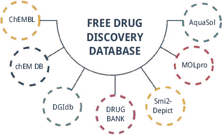

**图 6.1：药物发现的各类数据库。**

`ChEMBL` 收集沉积化合物的分子特性、毒性、靶点相互作用、代谢、消除、吸收、分布和排泄机制数据。`ChemDB` 是一个公开可用的数据库，提供理化性质（如可旋转键、分子质量和溶解速率）以及近 500 万种易获取小分子的信息 [22]。此外，`ChemDB` 包含多种化学信息学工具，包括 `Reaction Predictor`、`MOLpro`、`AquaSol` 和 `Smi2Depict`，有助于药物发现。`药物-基因相互作用数据库 (DGIdb)` 提供可能与药物相互作用的基因和基因产物信息 [23]。为查找药物-基因相互作用，用户可使用搜索字段模块输入药物或基因列表，或浏览各组中的基因。此外，`DGIdb` 可通过基于网络的界面 API 自动获取。`DrugBank` 是一个易于获取的参考药物数据库。目前收录了众多药物，以及关于药物类别、相互作用、靶点-药物关系和反应的大量知识。利用集成工具，用户可从 `DrugBank` 搜索、调研和检索文本、图像和结构数据。目前，它是全球药物筛选、设计和代谢预测最广泛使用的资源 [24]。这些平台整合面临的两大主要问题是管理 AI 使用的严格法规和预期的岗位流失。然而，这些技术旨在使任务更轻松，而非完全取代人类 [25]。除了使先导化合物识别快速且无误外，AI 还能识别相关的结构-活性关系（SAR）、推荐最佳化学结构、理解药物-靶点关系，并为这些药剂建议合成路线。在添加基础药物后，AI 可协助快速决策，并提供关键信息以将药物改进为合适的剂型。因此，可更快、更一致地批次间生产高质量产品。通过深入的市场分析和预测，AI 可确保行业内的最佳匹配与定价，并有望协助确定药剂在临床试验中的安全性和有效性。

通过分析与患者相关的基因组-环境暴露组属性，AI 可协助识别特定患者队列以参与 II 期和 III 期临床试验。它可通过更先进的监测方法，实现对入选参与者现有治疗靶点的监测 [26, 27]。辅助 AI 能力的利用，如预测性 ML 和替代预测算法，促进了分子的临床前评估和先导化合物的识别，从而增强了对指定患者群体中适合临床试验的先导分子的预测 [27]。患者脱落约占临床研究失败的三分之一，导致必须满足额外的入组要求才能完成试验，这增加了试验的经济和时间负担。通过密切的患者监督和支持，遵循正确的临床试验方案，可避免此类问题 [28]。在一项 II 期试验中，“`AiCure`” 发布了智能手机软件，追踪规律服药的精神分裂症患者。结果，患者依从频率略有上升，确保了临床试验的成功。

#### 药物开发中的计算方法

计算方法是药物开发过程中至关重要且实用的工具。寻找一种能在几何和化学上同时契合靶蛋白特定空腔的化学化合物，是药物开发的目标。计算方法使许多任务变得更加容易，如图 6.2 所示，包括先导化合物优化、设计、搜索、比较、建模、结合能估算和药代动力学预测。得益于计算能力的提升以及分析算法和方法的进步，药物开发与发现领域取得了诸多进展 [29]。高通量虚拟筛选，也称为硅基虚拟筛选（`HTVS`），为昂贵且耗时的高通量筛选实验方法提供了一个有价值的替代方案。通过虚拟筛选化合物目录以提高配体富集度并推进实验验证的能力，已促成许多先导化合物的产出。`HTVS` 通过计算手段筛选大型虚拟化合物数据库，这些化合物要么与已解析的受体结构互补，要么类似于已知抑制剂（基于配体）。它使研究人员能够搜索大型数据库或化合物库，以找到可用于实验确认活性的窄范围目标子集 [30]。但与需要详尽列表的传统 `HTS` 不同，从头药物设计依赖搜索方法来高效扫描化学空间。`HTS` 可处理数千个文库成员，验证结合剂，通过高精度的生物物理实验重现发现结果，并消除假阳性命中，且不依赖靶点的 3D 结构信息。随后那个在时间和金钱上都高效的阶段——即潜在改善先导药物的理化特性——在很大程度上依赖于 `HTVS` [31]。

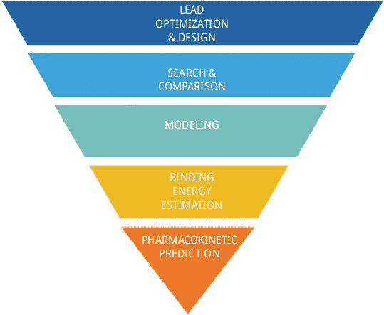

**图 6.2：** 药物发现计算方法的图示表示。

##### 高通量筛选（HTS）

在 `HTS` 中，各种生物效应子和调节剂会针对不同的特定靶点进行评估和测试。因此，当靶点知识不足且基于结构的药物设计不切实际时，通常首选 `HTS`。`HTS` 也可结合替代策略使用，包括计算方法和基于片段的药物创制 [32, 33]。靶点发现、分子管理、化学制备、分析优化和筛选是高通量筛选（`HTS`）的要素。高通量筛选结合多孔板细胞平台，能够鉴别相关信号传导和代谢通路的小分子调节剂。中枢神经系统疾病新药的开发，特别是神经退行性疾病，充满风险，因为候选药物在漫长且昂贵的临床和非临床研究后失败率极高。因此，建立用于量化神经退行的准确分析方法，是制订神经退行性疾病疗法的关键初步步骤。准确定位启动并导致细胞死亡的相关过程，对于开发有效的分析方法至关重要。为此，已开发出分析方法来识别生化事件，如能量代谢、代谢波动和 DNA 片段化，这些事件会导致神经元死亡 [34, 35]。历史上，利用荧光标记或染料的细胞保护研究，对于分类诱导神经元死亡的疗法至关重要 [35, 36, 37]。制药公司定期采用多种测试，这些测试可轻松改编为高通量筛选方法，以评估药物的神经毒性及其潜在不良反应。研究人员设计了一种适用于初级神经元的高通量筛选（`HTS`）方法，可用于广泛研究，涵盖化合物文库和全基因组 RNA 干扰（`RNAi`） [38, 39]。该方法可用于筛选哺乳动物细胞系，包括 `CHO` 细胞，以检测微小颗粒 [40, 41]。针对信号通路的细胞实验，其读出方式的选择可以是灵活的。靶向和细胞导向的筛选程序已被用于探索阿尔茨海默病、帕金森病、双相情感障碍、自闭症和精神分裂症的各种创新药物递送系统。基于细胞的筛选可同时评估多个靶点，结果反映了对细胞通路或网络的影响。模型无法精确反映神经退行性疾病的病理生理环境，是高通量筛选在寻找潜在治疗候选药物过程中面临的主要挑战。高通量筛选对神经退行性疾病的药物发现过程至关重要 [42, 43, 44]。高通量筛选（`HTS`）的疗效受限于所评估化合物库的质量和数量，以及缺乏与人类相关的神经退行性疾病（`NDD`）模型。因此，增加通过高通量筛选可获得的小分子数量，提高了为神经退行性疾病鉴别出有效疾病修饰疗法的可能性。制药行业化学信息学的进步、药物发现中 `AI` 的兴起以及动态组合化学（`DCC`）的发展，预计将产生大量化合物，这些化合物可能在初步高通量筛选（`HTS`）分析中表现出疗效，从而带来更多靶向药物 [46, 47, 48]。

### 6.3 用于临床试验和药物开发的 AI 驱动靶点确定与验证

鉴于计算技术的进步以及与不断扩大的治疗靶点谱相关的结构、化学和生物学数据呈指数级增长，近年来利用化学信息学、分子模拟和 AI 等计算机模拟方法大幅增加是合乎情理的。

分子对接是一种首选且有效的基于结构的计算机模拟技术，用于预测分子与生物靶点之间的相互作用 [49, 50]。该技术通常始于预测配体在受体内的分子取向，随后通过评分函数评估其互补性。利用匹配算法（使用化学和形状信息），将配体定位于蛋白质的活性区域。药效团用于表征配体和蛋白质。连接药效团的距离矩阵以及相应的配体原子决定了新的配体构象。对于每个匹配项，都会计算药效团在配体和蛋白质内的距离。`DOCK` [54]、`FLOG` [55]、`LibDock` [56] 和 `SANDOCK` [57] 等程序提供了配体对接的匹配算法。一种整合多个评分以评估对接构象的较新方法是共识评分 [58]。如果配体或潜在结合剂在多个评分系统中均表现良好，则可能被认可。共识评分通常在结合构象、姿态预测和虚拟筛选富集方面产生显著增益 [59]。尽管如此，结合能的预测可能仍然存在偏差。受体柔性仍然是对接研究中的一个重大障碍，特别是在涉及配体和催化剂结合的几个关键受体额外组分的运动，以及核心结构的柔性方面。某些解决侧链柔性的技术在特定情况下适用且成功。从构象选择的角度来看，蛋白质集合体是解决整体柔性的一种流行方案。能够容纳配体的蛋白质结构应包含在集合体中，因为对接需要一种获取和选择可靠蛋白质结构的有效方法。此外，该方法的计算开销是另一个缺点。评分函数是增强对接这些优点的关键组成部分。有效的例子展示了利用计算方法设计新型小分子化合物并评估来自大型数据库的结果。然而，仍需要实验技术来实现小分子与受体之间真实的相互作用。精确且计算成本低廉的评分函数可改进对接应用 [60]。

创新药物研发是一个成本高昂且耗时的过程。由于成本呈指数级增长，制药行业面临着维持令人满意的投资回报率的挑战。精准预测临床试验结果可通过削减失败成本来简化制药公司的管线。它还能帮助投资银行和对冲基金的代表在管理投资组合时做出更好的决策 [61, 62, 63, 64]。早期临床试验结果预测可提高制药研发的功效，促进有效资金来源的创建，并催生用于生物技术研究融资的创新金融工具。深度学习方法正迅速渗透到生物医学领域，因为它们已开始在图像识别等各种任务中超越人类。`DL` 广泛应用于药物发现和药物再利用 [65, 66, 67]。制药公司在临床试验运营中广泛采用 `ML`；然而，关于在制药研发过程中利用 `ML/AI` 预测技术和监管成功几率的验证报告尚未发表 [68]。尽管有许多预测临床试验结果的方法和资源可用，但这些方法中使用的主要技术是之前临床试验阶段的读数或试验设计 [69, 70, 71]。目标是将所有评分策略、生物学背景和多模态数据源与最新的深度学习模型相结合。

此外，采用由生物分析仪器和深度学习算法组成的流水线，in-silico 团队首次准确预测了 I 期和 II 期临床试验的结果。采用原子间、转录组和通路活性评分来计算靶点网络评分。这些评分是利用 in-silico Medicine 所采用的独特生物医学知识图谱和 `Panda Omics` 平台得出的。使用 in-silico 通路激活网络分解分析（`iPANDA`）工具进行了通路扰动分析和降维。正如图 6.3 [72, 73] 所示，该算法为靶点识别以及双靶点抑制剂和组合的协同效应评估提供了一种可靠的方法。此外，`ML` 是 `AI` 的一个强大子集，它增强了转化研究，并具备通过复杂的数据驱动决策解决方案加速药物发现的能力 [74, 75, 76, 77, 78]。`ML` 在药物开发中的应用在现代已显示出显著优势。这些方面包括靶点识别、患者分层、先导化合物生成、从头化学合成、生物活性预测、药物再创制和精准医疗。利用 `AI` 和 `ML` 的 in-silico 方法可以改进药物发现过程的每个阶段 [79, 80, 81]。过去几年，集成 `ML` 算法和 in-silico 统计工具的软件及分析平台的开发，使临床前研究和筛选分析变得容易得多。如果表型筛选是基于对生物学的预先设想而设计和评估的，它比基于靶点的筛选更具偏倚，但它仍然存在一些固有偏倚 [82, 83, 84, 85]。虚拟筛选已有一段时间成为寻找新型治疗靶点和识别先导化合物的成功途径，节省了时间和金钱 [86]。得益于 `DL` 算法以及硬件和算力的 in-silico 进步，超大规模筛选（Ultra-screens）现已成为现实，它利用高通量对接（`HT docking`）和基于结构的算法来识别高质量命中分子，并采样相当大一部分可用化学空间。因此，假阳性结果减少，产生了更多高亲和力结合剂 [87, 88]。

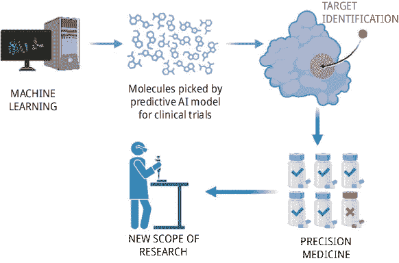

**图 6.3：** 通过机器学习进行药物靶点识别的图示表示。

可以利用多种方法学进行靶点解卷积和化学丰度分析（`MoA`）。这些技术包括蛋白质微阵列、化学蛋白质组学、亲和层析和功能基因组学技术，包括 `CRISPR` 和 RNA 干扰。参与该项目的研究团队创建了一个可以预测药物靶点的平台 [89]。它使用一种贝叶斯 `ML` 方法，结合各种形式的数据收集来预测药物结合靶点。此外，它还利用层次聚类作为案例研究来寻找从头微管蛋白可能性。它还预测了靶点未知但具有良好临床活性的小分子化合物的靶点。此外，药物-靶点相互作用（`DTIs`）有助于识别潜在药物，这进一步限制了生物化学实验领域可进行的研究范围。此外，它们可能为药物的作用机制和不良反应提供实质性的新见解 [90]。因此，`DTI` 预测是利用整合化学和基因组空间的 `ML` 进行药物发现的必要前提 [91]。

制药工艺验证是当前良好生产规范（`cGMPs`）中最重要和最广泛接受的方面之一。质量体系（`QS`）法规似乎要求确认工艺 [92]。质量体系的目的是确保所生产的产品始终适合其设计要履行的功能。将靶点选择和试验设计方法中的训练和验证划分应用于元模型，以对其进行训练和验证。人体试验过渡预测的回顾性验证 [93] 显示了令人印象深刻的性能。相反，回顾性验证方法可能容易受到各种偏倚的影响，并且可能无法正确代表现实场景中产生的预测精度。大多数提供预测的公司是公开交易的中小市值制药企业。研究设计受到公开交易的中小市值制药公司主动发布关于其 II 期临床试验结果的新闻稿的影响。作为前者管线更新的一部分，大市值和私营公司另一方面可能根本不披露任何临床研究结果，或者披露每年停止的 II 期临床项目 [94]。这两种情况都是可能的。另一方面，与大市值制药公司相比，可用于中小市值制药公司的证券和衍生品流动性显著较低。因此，做空中小市值制药股票变得越来越困难。因此，可能有必要利用看跌期权合约等衍生品来构建高质量的投资组合。

### 6.4 药代动力学和药效学中的机器学习算法

#### 利用机器学习进行药代动力学和 PK/PD 建模

药代动力学和药代动力学/药效学（PK/PD）建模是药物发现、开发、监管评估和批准中的基本方法。药代动力学/药效学建模对于临床试验设计、数据分析和剂量确定至关重要。

非室室分析缺乏结构模型假设，可产生宏观药代动力学参数（曲线下面积、平均驻留时间和驻留时间变异），这些参数定义了循环系统中药物浓度水平的时间变化 [95]。尽管如此，该方法在外推应用方面存在局限，例如纳入时间相关的药效学数据，且无法描述药代动力学数据的时间演变。

此外，生理学基础药代动力学建模（PBPK）利用血液循环和器官的解剖组成，能更精确地反映实际生理状况。然而，该方法仍依赖结构模型，且建模需要相当大量的数据。此外，它基于许多难以验证的假设 [96]。

存在多种基于结构的 PK/PD 模型，每种模型均取决于药物的作用机制、PK/PD 采样的可行性及其他因素。随着日益稳健的深度学习神经网络的发展，深度学习目前广泛应用于包括药物研究在内的众多领域。利用神经网络进行药代动力学（PK）和药代动力学/药效学（PK/PD）建模的兴趣日益浓厚 [97]。

研究人员利用长短期记忆（LSTM）网络评估基于间接反应模型的假设药物的 PK/PD 数据，证明该网络能熟练捕捉药代动力学/药效学（PK/PD）关系中的时间相关性。LSTM 网络被应用于检查用于 PK/PD 数据评估的数据 [98]。

# 用于 PK/PD 模型的新型深度学习技术

一种新型深度学习技术创建的 PK/PD 模型能够通过直接从数据中学习控制方程，模拟未知给药方案的效果并预测患者反应时间进程。该方法在两方面独具特色。

首先，深度学习模型的架构保证了剂量-浓度-效应药理学原则的保留。这意味着模型预设了一种因果关系：药物浓度由剂量驱动，效应动态随后由浓度驱动。

其次，网络架构的设置使给药数据通过两个不同的端口进入模型，确保模型除了能预测当前可用的治疗数据外，还能模拟患者的给药方案 [99]。

# 基于 ML 的 QSAR 与 PBPK 集成

定量构效关系（QSAR）模型用于预测 ADME 性质并分析药物和纳米颗粒复杂的药代动力学特征，已利用 ML 技术开发而成。此外，研究人员最初将支持向量机（一种著名的 ML 方法）作为 QSAR 研究中的前瞻性工具，用于预测有机化合物在各组织中的组织/血液分配系数（Kp）。

后续研究利用 ML 技术预测多种药理参数，包括个体的肠道吸收。研究人员通过将基于 ML 的 QSAR 模型与简化的 PBPK 模型相结合，开展了多项研究，评估人和动物的组织和血浆浓度，以及各种药代动力学参数（包括 AUC、Cmax 和 t1/2）[100, 101]。

同样，其他研究人员利用基于 ML/AI 的药代动力学/药效学建模程序 `BIOiSIM` 计算药代动力学参数，如 AUC、Cmax、Vd 和平均驻留时间。`BIOiSIM` 是一种 AI 生物仿真程序，利用具有代表基本器官的众多独立隔室为特征的 PBPK 模型。该模型结合现有的体内数据集，预测一级吸收速率常数 (h1)、Kp 和血浆比。随后执行了 PBPK 模型 [101]。

# XGBoost 在移植药代动力学中的应用

研究人员使用 `XGBoost` ML 算法计算肾移植受体中依维莫司的剂间 AUC。由于包含真实患者数据的训练数据集比其他免疫抑制剂的数据集更小，因此 ML 算法在患者数据、模拟数据和混合数据上进行训练。

随后，将估算值与 MAP-BE AUC 估算值进行比较，后者源自通过大量采样编制的、独立的肾移植受体数据库获得的梯形 AUC，以及 ISBA 专家系统使用的三点有限采样策略。因此，使用多种指标评估了不同规模的模拟训练数据集，以不精确度（即 RMSE）为主要参数 [102]。

在无患者数据的大量模拟数据上训练的 ML 算法获得了最佳结果。然而，RMSE 并不代表特定患者的确切误差；而是代表数据集内的不精确度。研究人员在有限的 PK 概况集上训练 PK 模型，在此过程中生成了 MAP-BE。然而，该模型并未经过独立验证。

同样，另一研究团队使用一个 PK 模型解释全血和外周血单核细胞中的 PK，其表现仅比在患者数据上训练的算法略好 [103, 104]。

尽管在大量数据上训练，`XGBoost` 算法的表现仅略优于之前的 MAP-BE。由于一小时时极高的峰值浓度，这些异常的平坦概况要么导致对非典型病例的低估，要么导致对典型病例的高估。有意预测广泛场景的建模方法推测能更好地处理这些场景。

要收集同等数量的真实患者数据，以提升 ML 算法并使一对药物达到同等精度和准确度，将花费很长时间 [105, 106]。

研究人员选择通过在训练数据集中结合患者和模拟概况，或完全依赖大量模拟，来增强 ML 作为一种可用于其他药物的测试。后一种策略被证明最为成功，因为它在外部验证数据集的整个 AUC 数值范围内产生了更优的结果 [107]。

# 6.5 AI 赋能临床试验面临的伦理挑战

关于医疗保健领域 AI 伦理的研究明显失衡，过分强调全球健康以外的主题，尤其是疾病监测。该领域的大量研究表明，对于在全球健康领域广泛采用或大规模实施 AI 驱动治疗所需的伦理、法律或实际问题，鲜有阐释。此外，还存在用于报告和决策支持所需的来源与数据类型的相互依赖性，以及个人和人群层面的疾病监测问题 [117, 118, 119]。

AI 在医学影像、电子病历（`EMR`）、实验室评估与治疗、新药发现、预防策略、精准医疗、生物数据分析、流程优化以及医疗机构信息管理等方面的应用，已深刻变革了医疗行业。尽管如此，科学领域必须直面若干伦理和法律问题。必须考虑图 6.4 中所示的若干参数。这些要素涵盖社会差异、数据保护与隐私、知情许可、医疗咨询、共情与同情 [120, 121, 122, 123, 124]。

基于联盟的数据处理者或控制者根据这些要求管理个人信息，同时配合国际组织和企业的运作，以保证个人数据得到充分保护 [125]。《遗传信息非歧视法案》（`GINA`）禁止美国雇主基于个人的遗传健康信息做出歧视性决定。AI 可以评估消费者健康数据和医疗设备影像，从而加速健康研究并改善诊断和预后。此外，与医疗专业人员就伦理披露、决策能力和文档记录进行沟通的过程被称为知情同意 [127]。

伦理责任规定，患者有权了解其诊断、健康状况、计划护理、治疗结果、检验结果、费用、保险计划及其他相关医疗详情。患者同意必须明确无误、清晰具体，且适合预期目的。随着 AI 在医疗应用中的实施，对该问题的担忧日益加剧。

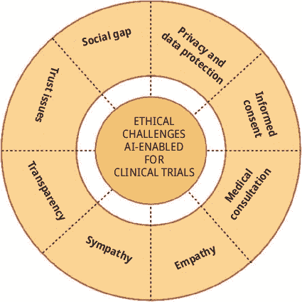

**图 6.4：** AI 赋能临床试验伦理挑战的图示。

# 6.6 结论

AI 深刻影响了药物研究和临床试验，深度学习方法增强了传统机器学习技术。AI 可以预测新型治疗分子的毒性和疗效，锁定新靶点，并设计更有效的药物。优质数据集，包括 `ChEMBL database`、`ChemDB` 和 `DGIdb`，在大数据时代推动了药物开发。AI 可以提出最佳化学结构、药物-靶点相互作用、合成路线和构效关系（`SAR`）。AI 可以促进针对 II 期和 III 期临床试验的特定疾病队列的识别，从而更准确地预测治疗靶点。高通量虚拟筛选（`HTVS`）为传统方法提供了一种具有成本效益且高效的替代方案，尽管其潜力和可及性仍受限。靶点解卷积和分子丰度分析的方法包括蛋白质微阵列、化学蛋白质组学、亲和层析和功能基因组学技术。深度学习方法已被用于创建药代动力学/药效学模型，以预测患者反应时间曲线并模拟实验给药方案的影响。此外，医疗保健领域 AI 驱动的临床试验相关的伦理问题包括社会不平等、数据隐私和安全、知情同意、医疗监督、共情与同情。因此，AI 未来可以极大地增强制剂在适宜剂型中的优化与整合。AI 可以协助在上市前的临床试验中评估产品的安全性和有效性。然而，在技术被广泛采用之前，仍存在若干挑战。尽管如此，制药行业极有可能很快就会认识到 AI 是一项宝贵的资产。

## 参考文献

[1] Vamathevan J, Clark D, Czodrowski P, et al. Applications of machine learning in drug discovery and development. Nature Reviews Drug Discovery. 2019;18(6):463–77. →

[2] Lavecchia A. Machine-learning approaches in drug discovery: Methods and applications. Drug Discovery Today. 2015;20(3):318–31. →

[3] Lo Y-C, Rensi SE, Torng W, et al. Machine learning in chemoinformatics and drug discovery. Drug Discovery Today. 2018;23(8):1538–46. →

[4] Yang X, Wang Y, Byrne R, et al. Concepts of artificial intelligence for computer-assisted drug discovery. Chemical Reviews. 2019;119(18):10520–94. →

[5] Xue L, Bajorath J. Molecular descriptors in chemoinformatics, computational combinatorial chemistry, and virtual screening. Combinatorial Chemistry and High Throughput Screening. 2000;3(5):363–72. →

[6] Wu Z, Ramsundar B, Feinberg E, 等. MoleculeNet: 分子机器学习的基准. *Chemistry Sciences*. 2018;9(2):513–30. →

[7] Kearnes S, McCloskey K, Berndl M, 等. 分子图卷积: 超越指纹. *Journal of Computer-Aided Molecular Design*. 2016;30(8):595–608. →

[8] Gawehn E, Hiss JA, Schneider G. 深度学习在药物发现中的应用. *Molecular Informatics*. 2016;35(1):3–14. →

[9] Zhang L, Tan J, Han D, 等. 从机器学习到深度学习: 理性药物发现中机器智能的进展. *Drug Discovery Today*. 2017;22(11):1680–85. →

[10] Chen H, Engkvist O, Wang Y, 等. 深度学习在药物发现中的崛起. *Drug Discovery Today*. 2018;23(6):1241–50. →

[11] Wess G, Urmann M, Sickenberger B. 药物化学: 挑战与机遇. *Angewandte Chemie International Edition*. 2001 Sep 17;40(18):3341–50. →

[12] Pu L, Naderi M, Liu T, Wu HC, Mukhopadhyay S, Brylinski M. e toxpred: 一种基于机器学习的方法, 用于评估药物候选物的毒性. *BMC Pharmacology and Toxicology*. 2019 Dec;20:1–5. →

[13] Chen R, Liu X, Jin S, Lin J, Liu J. 用于药物-靶点相互作用预测的机器学习. *Molecules*. 2018 Aug 31;23(9):2208. a, b

[14] Gómez-Bombarelli R, Wei JN, Duvenaud D, Hernández-Lobato JM, Sánchez-Lengeling B, Sheberla D, Aguilera-Iparraguirre J, Hirzel TD, Adams RP, Aspuru-Guzik A. 利用分子的数据驱动连续表示进行自动化学设计. *ACS Central Science*. 2018 Feb 28;4(2):268–76. →

[15] Hansen K, Biegler F, Ramakrishnan R, Pronobis W, Von Lilienfeld OA, Muller KR, Tkatchenko A. 分子性质的机器学习预测: 化学空间中精确的多体势与非局域性. *The Journal of Physical Chemistry Letters*. 2015 Jun 18;6(12):2326–31. a, b

[16] Gawehn E, Hiss JA, Schneider G. 深度学习在药物发现中的应用. *Molecular Informatics*. 2016 Jan;35(1):3–14. →

[17] Lysenko A, Sharma A, Boroevich KA, Tsunoda T. 一种用于预测毒性相关药物安全性的综合机器学习方法. *Life Science Alliance*. 2018 Dec 1;1(6). →

[18] You J, McLeod RD, Hu P. 利用深度学习模型预测药物-靶点相互作用网络. *Computational Biology and Chemistry*. 2019 Jun 1;80:90–101. →

[19] Blanco-Gonzalez A, Cabezon A, Seco-Gonzalez A, Conde-Torres D, Antelo-Riveiro P, Pineiro A, Garcia-Fandino R. AI 在药物发现中的作用: 挑战、机遇与策略. *Pharmaceuticals*. 2023 Jun 18;16(6):891.

[20] Pérez Santín E, Rodríguez Solana R, González García M, García Suárez MD, Blanco Díaz GD, Cima Cabal MD, Moreno Rojas JM, López Sánchez JI. 基于人工智能的毒性预测: 一个多学科概述. *Wiley Interdisciplinary Reviews: Computational Molecular Science*. 2021 Sep;11(5):e1516. →

[21] Mendez D, Gaulton A, Bento AP, Chambers J, De Veij M, Félix E, Magariños MP, Mosquera JF, Mutowo P, Nowotka M, Gordillo-Marañón M. ChEMBL: 面向生物分析数据直接存储. *Nucleic Acids Research*. 2019 Jan 8;47(D1):D930–40. →

[22] Chen J, Swamidass SJ, Dou Y, Bruand J, Baldi P. ChemDB: 一个小分子公共数据库及相关化学信息学资源. *Bioinformatics*. 2005 Nov 15;21(22):4133–39. →

[23] Wishart DS, Feunang YD, Guo AC, Lo EJ, Marcu A, Grant JR, Sajed T, Johnson D, Li C, Sayeeda Z, Assempour N. DrugBank 5.0: 2018 年 DrugBank 数据库的重大更新. *Nucleic Acids Research*. 2018 Jan 4;46(D1):D1074–82. →

[24] Tang J, Ravikumar B, Alam Z, Rebane A, Vähä-Koskela M, Peddinti G, Van Adrichem AJ, Wakkinen J, Jaiswal A, Karjalainen E, Gautam P. Drug target commons: 一个构建药物-靶点相互作用共识知识库的社区努力. *Cell Chemical Biology*. 2018 Feb 15;25(2):224–29. →

[25] Davenport TH, Ronanki R. 面向现实世界的人工智能. *Harvard Business Review*. 2018 Jan 1;96(1):108–16. →

[26] Persidis A. 药物再定位的益处. *Drug Discovery World*. 2011 Mar 1;12:9–12. →

[27] Harrer S, Shah P, Antony B, Hu J. 临床试验设计中的人工智能. *Trends in Pharmacological Sciences*. 2019 Aug 1;40(8):577–91. a, b

[28] Fogel DB. 与临床试验失败相关的因素及提高成功率的机会: 综述. *Contemporary Clinical Trials Communications*. 2018 Sep 1;11:156–64. →

[29] Tiwari A, Singh S. 药物设计中的计算方法. *Bioinformatics* 2022 Jan 1 (pp. 207–17). Academic Press. →

[30] Ripphausen P, Nisius B, Bajorath J. 基于配体的虚拟筛选现状. *Drug Discovery Today*. 2011 May 1;16(9–10):372–76. →

[31] Tripathi NM, Bandyopadhyay A. 肽库的高通量虚拟筛选 (HTVS): 配体发现的技术进步. *European Journal of Medicinal Chemistry*. 2022 Dec 5;243:114766. →

[32] Johnson EO, Hung DT. 系统化学生物学的一个拐点与反思. *ACS Chemical Biology*. 2019 Oct 15;14(12):2497–511. →

[33] Parker CG, Pratt MR. 蛋白质组学研究中的点击化学. *Cell*. 2020 Feb 20;180(4):605–32. →

[34] Bordone MP, Salman MM, Titus HE, Amini E, Andersen JV, Chakraborti B, Diuba AV, Dubouskaya TG, Ehrke E, Espindola de Freitas A, Braga de Freitas G. 高能大脑——一份从学生到学生的综述. *Journal of Neurochemistry*. 2019 Oct;151(2):139–65. →

[35] Galluzzi L, Vitale I, Aaronson SA, Abrams JM, Adam D, Agostinis P, Alnemri ES, Altucci L, Amelio I, Andrews DW, Annicchiarico-Petruzzelli M. 细胞死亡的分子机制: 细胞死亡命名委员会 2018 年建议. *Cell Death & Differentiation*. 2018 Mar;25(3):486–541. a, b, c, d

## 参考文献

[36] Kepp O, Galluzzi L, Lipinski M, Yuan J, Kroemer G. 用于药物发现的细胞死亡分析. *Nature Reviews Drug Discovery*. 2011 Mar;10(3):221–37. →

[37] Galluzzi L, Joza N, Tasdemir E, Maiuri MC, Hengartner M, Abrams JM, Tavernarakis N, Penninger J, Madeo F, Kroemer G. 没有生命就没有死亡: 凋亡效应因子的生命维持功能. *Cell Death & Differentiation*. 2008 Jul;15(7):1113–23. a, b

## 参考文献

[38] Sharma P, Ando DM, Daub A, Kaye JA, Finkbeiner S. 原代神经元中的高通量筛选。载 *Methods in Enzymology*。2012 年 1 月 1 日（第 506 卷，第 331–60 页）。Academic Press。→

[39] Martinez-Mayorga K, Madariaga-Mazon A, Medina-Franco JL, Maggiora G. 化学信息学对制药行业药物发现的影响。*Expert Opinion on Drug Discovery*。2020 年 3 月 3 日；15(3)：293–306。

[40] Chan HS, Shan H, Dahoun T, Vogel H, Yuan S. 通过人工智能推进药物发现。*Trends in Pharmacological Sciences*。2019 年 8 月 1 日；40(8)：592–604。→

[41] He W, Gao Y, Zhu G, Wu H, Fang Z, Guo K. 脂肪酸酯的微流控合成：动态组合化学与规模效应的整合。*Chemical Engineering Journal*。2020 年 2 月 1 日；381：122721。→

[42] Song CM, Lim SJ, Tong JC. 计算机辅助药物设计的最新进展。*Briefings in Bioinformatics*。2009 年 9 月 1 日；10(5)：579–91。

[43] Bettens K, Sleegers K, Van Broeckhoven C. 阿尔茨海默病分子遗传学现状：从过去、现在到未来。*Human Molecular Genetics*。2010 年 4 月 15 日；19(R1)：R4–11。

[44] Cookson MR, Bandmann O. 帕金森病：来自通路的见解。*Human Molecular Genetics*。2010 年 4 月 15 日；19(R1)：R21–7。

[45] Haggarty SJ, Silva MC, Cross A, Brandon NJ, Perlis RH. 利用患者特异性干细胞模型推进神经精神疾病的药物发现。*Molecular and Cellular Neuroscience*。2016 年 6 月 1 日；73：104–15。

[46] Macalino SJ, Gosu V, Hong S, Choi S. 计算机辅助药物设计在现代药物发现中的作用。*Archives of Pharmacal Research*。2015 年 9 月；38：1686–701。→

[47] D’Agostino D, Clematis A, Quarati A, Cesini D, Chiappori F, Milanesi L, Merelli I. 用于计算机模拟药物发现的云基础设施：经济与实践层面。*Biomed Research International*。2013；2013：138012。→

[48] Jorgensen WL. 计算在药物发现中的多重角色。*Science*。2004；303：1813–18。→

[49] Kapetanovic IM. 计算机辅助药物发现与开发（CADDD）：硅-化-生物学方法。*Chemico-Biological Interactions*。2008；171：165–76。→

[50] Kitchen DB, Decornez H, Furr JR, Bajorath J. 用于药物发现的虚拟筛选中的对接与评分：方法与应用。*Nature Reviews Drug Discovery*。2004；3：935–49。→

[51] Brint AT, Willett P. 用于识别三维最大公共子结构的算法。*Journal of Chemical Information and Computer Sciences*。1987；27：152–58。

[52] Fischer D, Norel R, Wolfson H, Nussinov R. 通过计算机视觉技术识别表面基元：搜索、检测及其对蛋白质-配体识别的启示。*Proteins*。1993；16(3)：278–92。

[53] Norel R, Fischer D, Wolfson HJ, Nussinov R. 基于计算机视觉技术的分子表面识别。*Protein Engineering*。1994；7(1)：39–46。

[54] Kuntz ID, Blaney JM, Oatley SJ, Langridge R, Ferrin TE. 大分子-配体相互作用的几何方法。*Journal of Molecular Biology*。1982；161(2)：269–88。→

[55] Miller MD, Kearsley SK, Underwood DJ, Sheridan RP. FLOG：一种选择与已知三维结构受体互补的“准柔性”配体的系统。*Journal of Computer-Aided Molecular Design*。1994；8(2)：153–74。→

[56] Diller DJ, Merz KM Jr. 用于文库设计和文库优先级排序的高通量对接。*Proteins*。2001；43(2)：113–24。→

[57] Burkhard P, Taylor P, Walkinshaw MD. 通过数据库挖掘发现的一个蛋白质配体实例：对接方法的描述及其通过凝血酶-配体复合物 2.3 Å X 射线结构的验证。*Journal of Molecular Biology*。1998；277(2)：449–66。→

[58] Charifson PS, Corkery JJ, Murcko MA, Walters WP. 共识评分：一种从将三维结构数据库对接进蛋白质中获得更高命中率的方法。*Journal of Medicinal Chemistry*。1999；42(25)：5100–09。→

[59] Feher M. 蛋白质-配体相互作用的共识评分。*Drug Discovery Today*。2006；11(9–10)：421–28。→

[60] Meng XY, Zhang HX, Mezei M, Cui M. 分子对接：一种用于基于结构的药物发现的强大方法。*Current Computer-aided Drug Design*。2011 年 6 月 1 日；7(2)：146–57。→

[61] Scannell JW, Blanckley A, Boldon H, Warrington B. 诊断制药研发效率的下降。*Nature Reviews Drug Discovery*。2012 年 3 月；11(3)：191–200。→

[62] Yang X, Debonneuil E, Zhavoronkov A, Mishra B. 癌症巨额基金结合体外和体内验证：通过金融工程加速癌症药物发现而不引发金融危机。*Oncotarget*。2016 年 9 月 9 日；7(36)：57671。→

[63] Fernandez JM, Stein RM, Lo AW. 通过证券化技术实现生物医学研究商业化。*Nature Biotechnology*。2012 年 10 月；30(10)：964–75。→

[64] Mamoshina P, Vieira A, Putin E, Zhavoronkov A. 深度学习在生物医学中的应用。*Molecular Pharmaceutics*。2016 年 5 月 2 日；13(5)：1445–54。→

[65] Vanhaelen Q, Mamoshina P, Aliper AM, Artemov A, Lezhnina K, Ozerov I, Labat I, Zhavoronkov A. 用于计算机模拟药物再利用的高效计算工作流设计。*Drug Discovery Today*。2017 年 2 月 1 日；22(2)：210–22。→

[66] Aliper A, Plis S, Artemov A, Ulloa A, Mamoshina P, Zhavoronkov A. 基于转录组数据利用深度学习预测药物药理特性及药物再利用的应用。*Molecular Pharmaceutics*。2016；13：2524–30。→

[67] Tripathi A, Misra K, Dhanuka R, Singh JP. 人工智能在加速药物发现与开发中的应用。*Recent Patents on Biotechnology*。2023 年 3 月 1 日；17(1)：9–23。→

[68] Kolluri S, Lin J, Liu R, Zhang Y, Zhang W. 机器学习和人工智能在药学研究与开发中的应用：综述。*The AAPS Journal*。2022 年 2 月；24：1–0。→

[69] Lo AW, Siah KW, Wong CH. 利用统计插补的机器学习预测药物审批。*SSRN*。2019 年 7 月 1 日；12–38。→

[70] Feijoo F, Palopoli M, Bernstein J, Siddiqui S, Albright TE. 通过机器学习识别临床试验阶段转换的关键指标。*Drug Discovery Today*。2020 年 2 月 1 日；25(2)：414–21。→

[71] Qi Y, Tang Q. 通过深度学习建模 II 期临床试验受试者层面数据来预测 III 期临床试验结果。载 *Machine Learning for Healthcare Conference*。2019 年 10 月 28 日（第 288–303 页）。PMLR。→

[72] Pun FW, Leung GH, Leung HW, Liu BH, Long X, Ozerov IV, Wang J, Ren F, Aliper A, Izumchenko E, Moskalev A. 基于衰老标志物的双重疾病与年龄相关靶点，利用 PandaOmics AI 驱动发现引擎预测。*Aging (Albany NY)*。2022 年 3 月 3 日；14(6)：2475。→

## 参考文献

[73] Ravi R, Noonan KA, Pham V, Bedi R, Zhavoronkov A, Ozerov IV, Makarev E, Artemov AV, Wysocki PT, Mehra R, Nimmagadda S. 双功能免疫检查点靶向抗体-配体陷阱可同时失活 TGFβ，增强癌症免疫疗法的疗效。*Nature Communications*。2018 年 2 月 21 日；9(1):741。

[74] Toh TS, Dondelinger F, Wang D. 透过炒作看本质：应用 AI 与机器学习在转化医学中的实践。*EBioMedicine*。2019 年 9 月 1 日；47:607–15。

[75] Dias R, Torkamani A. 临床与基因组诊断中的人工智能。*Genome Medicine*。2019 年 11 月 19 日；11(1):70。

[76] Shen D, Wu G, Suk HI. 医学图像分析中的深度学习。*Annual Review of Biomedical Engineering*。2017 年 6 月 21 日；19(1):221–48。

[77] Yang KK, Wu Z, Arnold FH. 用于蛋白质工程的机器学习引导定向进化。*Nature Methods*。2019 年 8 月；16(8):687–94。

[78] Camacho DM, Collins KM, Powers RK, Costello JC, Collins JJ. 用于生物网络的下一代机器学习。*Cell*。2018 年 6 月 14 日；173(7):1581–92。

[79] Vamathevan J, Clark D, Czodrowski P, Dunham I, Ferran E, Lee G, Li B, Madabhushi A, Shah P, Spitzer M, Zhao S. 机器学习在药物发现与开发中的应用。*Nature Reviews Drug Discovery*。2019 年 6 月；18(6):463–77。

[80] Álvarez-Machancoses Ó, Fernández-Martínez JL. 利用人工智能方法加速药物发现。*Expert Opinion on Drug Discovery*。2019 年 8 月 3 日；14(8):769–77。

[81] Chan HS, Shan H, Dahoun T, Vogel H, Yuan S. 通过人工智能推进药物发现。*Trends in Pharmacological Sciences*。2019 年 8 月 1 日；40(8):592–604。

[82] Mullard A. 机器学习使细胞成像的前景聚焦成现实。*Nature Reviews Drug Discovery*。2019 年 9 月 1 日；18(9):653–56。

[83] Bray MA, Singh S, Han H, Davis CT, Borgeson B, Hartland C, Kost-Alimova M, Gustafsdottir SM, Gibson CC, Carpenter AE. 细胞绘像，一种利用多重荧光染料进行形态学分析的高内涵图像分析检测。*Nature Protocols*。2016 年 9 月；11(9):1757–74。

[84] Pennisi E. “细胞绘像”凸显药物和毒素的反应。2016；877–78。

[85] Loo LH, Wu LF, Altschuler SJ. 基于单细胞的药物反应图像多变量分析。*Nature Methods*。2007 年 5 月；4(5):445–53。

[86] McInnes C. 药物发现中的虚拟筛选策略。*Current Opinion in Chemical Biology*。2007 年 10 月 1 日；11(5):494–502。

[87] Gorgulla C, Boeszoermenyi A, Wang ZF, Fischer PD, Coote PW, Padmanabha Das KM, Malets YS, Radchenko DS, Moroz YS, Scott DA, Fackeldey K. 一个开源药物发现平台实现超大规模虚拟筛选。*Nature*。2020 年 4 月 30 日；580(7805):663–8。

[88] Rifaioglu AS, Atas H, Martin MJ, Cetin-Atalay R, Atalay V, Doğan T. 深度学习与机器智能在硅基药物发现中的最新应用：方法、工具与数据库。*Briefings in Bioinformatics*。2019 年 9 月；20(5):1878–912。

[89] Madhukar NS, Khade PK, Huang L, Gayvert K, Galletti G, Stogniew M, Allen JE, Giannakakou P, Elemento O. 一种利用多源数据进行药物靶点识别的贝叶斯机器学习方法。*Nature Communications*。2019 年 11 月 19 日；10(1):5221。

[90] Ding H, Takigawa I, Mamitsuka H, Zhu S. 用于预测药物-靶点相互作用的基于相似性的机器学习方法：简要综述。*Briefings in Bioinformatics*。2014 年 9 月 1 日；15(5):734–47。

[91] Chen R, Liu X, Jin S, Lin J, Liu J. 药物-靶点相互作用预测的机器学习。*Molecules*。2018 年 8 月 31 日；23(9):2208。

[92] Akiba T, Sano S, Yanase T, Ohta T, Koyama M. Optuna：一种新一代超参数优化框架。载于：第 25 届 ACM SIGKDD 知识发现与数据挖掘国际会议论文集。KDD ’19。Association for Computing Machinery。2019:2623–31。

[93] Artemov AV, Putin E, Vanhaelen Q, Aliper A, Ozerov IV, Zhavoronkov A. 整合深度学习转录组学与基于结构的预测器以预测临床试验结果。*BioRxiv*。2016 年 12 月 20 日；095653。

[94] Kudrin R, Bushmakin I, Novitskaia O, Ustiugova A, Polykovskiy D, Kamya P, Aliper A, Zhavoronkov A. 用于临床试验结果预测的多模态 AI 引擎。*Prospective Case Study H2*。2023；1–15。

[95] Liu X, Liu C, Huang R, Zhu H, Liu Q, Mitra S, Wang Y. 用于药代动力学-药效学建模的长短期记忆循环神经网络。*International Journal of Clinical Pharmacology and Therapeutics*。2021 年 2 月 1 日；59(2):138。

## 参考文献

[96] Liu C, Xu Y, Liu Q, Zhu H, Wang Y. 基于机器学习方法在暴露-反应分析中的应用。*Journal of Pharmacokinetics and Pharmacodynamics*。2022 年 8 月；49(4):401–10。

[97] Tang A. 用于药代动力学/药效学建模的机器学习。*Journal of Pharmaceutical Sciences*。2023 年 5 月 1 日；112(5):1460–75。

[98] Chou WC, Lin Z. 通过整合体外、体内毒性及人类流行病学研究，采用基于贝叶斯的剂量-反应评估结合生理基药代动力学（PBPK）建模方法，对全氟辛烷磺酸（PFOS）进行概率人类健康风险评估。*Environment International*。2020 年 4 月 1 日；137:105581。

[99] Maltarollo VG, Gertrudes JC, Oliveira PR, Honorio KM. 应用机器学习技术进行 ADME-Tox 预测：综述。*Expert Opinion on Drug Metabolism & Toxicology*。2015 年 2 月 1 日；11(2):259–71。

[100] Kamiya Y, Handa K, Miura T, Ohori J, Kato A, Shimizu M, Kitajima M, Yamazaki H. 机器学习预测简化生理基药代动力学模型的三个主要输入参数，随后用于生成人口服 212 种不同化学物质后的时间依赖性血浆浓度数据。*Biological and Pharmaceutical Bulletin*。2022 年 1 月 1 日；45(1):124–28。

[101] Kamiya Y, Handa K, Miura T, Yanagi M, Shigeta K, Hina S, Shimizu M, Kitajima M, Shono F, Funatsu K, Yamazaki H. 硅基预测简化生理基药代动力学模型的输入参数，用于估算大鼠口服 246 种不同化学物质后的血浆、肝脏和肾脏暴露量。*Chemical Research in Toxicology*。2021 年 1 月 12 日；34(2):507–13。

[102] Antontsev V, Jagarapu A, Bundey Y, Hou H, Khotimchenko M, Walsh J, Varshney J. 一种混合建模方法，用于利用机器学习集成建模平台评估小分子体内分配的机制模型。*Scientific Reports*。2021 年 5 月 27 日；11(1):11143。

[103] Woillard JB, Labriffe M, Debord J, Marquet P. 利用机器学习预测他克莫司暴露量。*Clinical Pharmacology & Therapeutics*。2021 年 8 月；110(2)：361–69。

[104] Woillard JB, Labriffe M, Debord J, Marquet P. 利用机器学习预测霉酚酸暴露量。*Clinical Pharmacology & Therapeutics*。2021 年 8 月；110(2)：370–79。

[105] Woillard JB, Labriffe M, Prémaud A, Marquet P. 基于已发表药代动力学模型模拟，利用机器学习估算药物暴露量：以他克莫司为例。*Pharmacological Research*。2021；167：105578。

[106] Robertsen I, Debord J, Åsberg A, Marquet P, Woillard JB. 一种有限采样策略，利用群体药代动力学建模和贝叶斯估计量，估算肾移植受者全血和外周血单核细胞中依维莫司的暴露量。*Clinical Pharmacokinetics*。2018；57(11)：1459–69。

[107] Labriffe M, Woillard JB, Debord J, Marquet P. 基于模拟和患者药代动力学谱训练的机器学习算法，用于估算依维莫司暴露量。*CPT: Pharmacometrics & Systems Pharmacology*。2022 年 8 月；11(8)：1018–28。

[108] Talevi A, Morales JF, Hather G, Podichetty JT, Kim S, Bloomingdale PC, Kim S, Burton J, Brown JD, Winterstein AG, Schmidt S. 药物发现与开发中的机器学习 第 1 部分：入门。*CPT: Pharmacometrics & Systems Pharmacology*。2020 年 3 月；9(3)：129–42。

[109] Keutzer L, You H, Farnoud A, Nyberg J, Wicha SG, Maher-Edwards G, Vlasakakis G, Moghaddam GK, Svensson EM, Menden MP, Simonsson US. 用于预测药代动力学数据的机器学习与药物动力学建模：以利福平为例说明差异、相似性与挑战。*Pharmaceutics*。2022 年 7 月 22 日；14(8)：1530。

[110] Herrgårdh T, Madai VI, Kelleher JD, 等。卒中护理的混合建模：综述及针对风险评估和场景模拟的新方法建议。*Neuroimage Clinical*。2021；31：102694。

[111] Destere A, Marquet P, Labriffe M, Drici M-D, Woillard J-B. 一种结合群体药代动力学与机器学习的混合算法，用于伊沙康唑暴露量预测。*Pharmacological Research*。2023；40：951–59。

[112] Lee S, Song M, Han J, Lee D, Kim B-H. 应用机器学习分类以改进万古霉素治疗药物监测的性能。*Pharmaceutics*。2022；14：1023。

[113] Chan A, Peck R, Gibbs M, Van Der Schaar M. 合成模型组合：一种用于药物动力学模型集成的新机器学习方法。*CPT Pharmacometrics Syst Pharmacol*。2023；psp4.12965：953–62。

[114] Wilbaux M, Demanse D, Gu Y, 等。机器学习对肝细胞癌患者接受 Roblitinib (FGF401)药物治疗时肿瘤生长抑制建模的贡献。*CPT Pharmacometrics Syst Pharmacol*。2022；11：1122–34。

[115] Keizer RJ, Dvergsten E, Kolacevski A, 等。Get real：整合真实世界数据以改善患者护理。*Clinical Pharmacology and Therapeutics*。2020；107：722–25。

[116] Zhu S, Gilbert M, Chetty I, Siddiqui F. 2021 年 FDA 批准的人工智能/机器学习医疗器械概况：特性与预期用途分析。*International Journal of Medical Informatics*。2022；165：104828。

[117] Blasimme A, Vayena E. 生物医学研究、患者护理和公共卫生中 AI 的伦理。*Patient Care and Public Health*。*Oxford Handbook of Ethics of Artificial Intelligence*。即将出版。2019 年 4 月 9 日；10–24。

[118] Murphy K, Di Ruggiero E, Upshur R, Willison DJ, Malhotra N, Cai JC, Malhotra N, Lui V, Gibson J. 促进健康的人工智能：伦理文献的范围综述。*BMC Medical Ethics*。2021 年 12 月；22：1–7。

[119] Schwalbe N, Wahl B. 人工智能与全球健康的未来。*The Lancet*。2020 年 5 月 16 日；395(10236)：1579–86。

[120] Varkey B. 临床伦理原则及其在实践中的应用。*Medical Principles and Practice*。2021 年 6 月 4 日；30(1)：17–28。

[121] Jahn WT. 适用于法医活动的 4 项基本伦理原则为：尊重自主、行善、不伤害和正义。*Journal of Chiropractic Medicine*。2011 年 9 月；10(3)：225。

[122] WHO. *Review of Ethical Issues in Medical Genetics*。20 Avenue Appia, 1211 Geneva 27. Human Genetics Programme, Management of Noncommunicable Diseases: Switzerland；2003。<https://www.who.int/genomics/publications/en/ethical_issuesin_medgenetics%20report.pdf>

[123] Farhud DD, Nickzat N, Mahmoodi M. 德黑兰医生、护士和助产士群体对医学遗传学伦理原则的看法。*Iranian Journal of Public Health*。1999；28(1–4)：193–98。

[124] Farhud D. 表观遗传学与伦理：伦理特质如何遗传？*International Journal of Ethics and Society*。2019 年 12 月 10 日；1(3)：1–4。

[125] Regulation (EU) 2016/679 of the European Parliament and of the Council of 27 April 2016 on the protection of natural persons with regard to the processing of personal data and on the free movement of such data, and repealing Directive 95/46/EC 2016。<https://eurlex.europa.eu/eli/reg/2016/679/oj>

[126] *The Genetic Information Nondiscrimination Act (GINA)*：American Society of Human Genetics (ASHG)。<https://www.ashg.org/advocacy/gina/>

[127] *Informed Consent*：American Medical Association (AMA)。<https://www.ama-assn.org/delivering-care/ethics/informed-consent>

[128] Farhud DD, Zokaei S. 医学和医疗保健中人工智能的伦理问题。*Iranian Journal of Public Health*。2021 年 11 月；50(11)：i–v。

[129] Nordling L. 医疗保健中 AI 更公平的前进道路。*Nature*。2019 年 9 月 1 日；573(7775)：S103–10。

[130] The Guardian Gd (2020)。RoboDoc：印度的机器人如何承担新冠患者护理。<https://www.theguardian.com/global-development/2020/dec/02/robodoc-how-india-robots-are-taking-on-covid-patient-care-mitra>

[131] Yew GC. 对护理机器人的信任与伦理设计：关怀伦理的论据。*International Journal of Social Robotics*。2021 年 7 月；13(4)：629–45。

[132] Coghlan S. 机器人与人文关怀的可能性。*International Journal of Social Robotics*。2022 年 12 月；14(10)：2095–108。

[133] Wangmo T, Lipps M, Kressig RW, Ienca M. 智能辅助技术使用中的伦理问题：来自专业利益相关者定性研究的发现。BMC Medical Ethics。2019 年 12 月；20：1–11。

[134] Séroussi B, Hollis KF, Soualmia LF. 医疗信息学过程的透明度作为医护人员和患者信任与采纳的条件：伦理要求的兴起。Yearbook of Medical Informatics。2020 年 8 月；29(01)：007–10。a，b

[135] D’Antonoli TA. 人工智能的伦理考量：当前放射学领域的概述。Diagnostic and Interventional Radiology。2020 年 9 月；26(5)：504。

[136] Paulus JK, Kent DM. 可预测的不平等：理解并解决算法临床预测可能加剧健康差异的担忧。NPJ Digital Medicine。2020 年 7 月 30 日；3(1)：99。

[137] Fenech ME, Buston O. 心脏成像中的 AI：基于英国视角应对伦理、社会和政治挑战。Frontiers in Cardiovascular Medicine。2020 年 4 月 15 日；7：54。

[138] Vellido A. 在医学中应用人工智能的社会问题。Kidney Diseases。2019 年 9 月 3 日；5(1)：11–17。

[139] Walsh CG, Chaudhry B, Dua P, Goodman KW, Kaplan B, Kavuluru R, Solomonides A, Subbian V. 污名化、生物标志物与算法偏见：利用人工智能实现精准行为健康的建议。JAMIA Open。2020 年 4 月；3(1)：9–15。

[140] Academy of Medical Royal Colleges. 医疗保健中的人工智能。Academy of Medical Royal Colleges：英国伦敦；2019；在线获取：[`www.aomrc.org.uk/wp-content/uploads/2019/01/Artificial_intelligence_in_healthcare_0119.pdf`](https://www.aomrc.org.uk/wp-content/uploads/2019/01/Artificial_intelligence_in_healthcare_0119.pdf)。(访问于 2024 年 8 月 26 日)。

# 第 7 章 面向制药高管的 AI 驱动临床决策支持系统

## 摘要

人工智能（AI）是一种强大的工具，使数据处理、分析和解读成为可能。本章提供制药企业在其临床决策支持系统中采用的 AI 算法相关信息。涵盖了实施 AI-CDSS 的困难及未来可能性。预计基于 AI 的算法（如`logistic regression`、`support vector computations`、`naive Bayes`、`random forests`、`decision tree models`和`ANN`）将在优化药物成分和改善治疗结果方面发挥关键作用，同时还能在患者特定剂型配制和安全性评估中预测潜在毒性及副作用。AI 驱动的 CDSS 通过评估患者数据，帮助医生、护士和患者做出明智决策。`NLP`改善了患者沟通和电子健康记录。通过对患者体征、症状、病历及背景信息的细致分析，`NLP`驱动的临床决策支持系统可提出潜在诊断、治疗策略和药物干预措施。这些困难包括组织和社会因素、人为因素，以及医疗专业人员缺乏信心。

**关键词：** 临床决策支持、制药、支持向量机、人工神经网络、决策树、伦理考量

### 7.1 介绍

# 人工智能驱动的决策支持系统在医疗保健与制药领域的应用

人工智能（AI）和机器学习（ML）日益重要的地位，加上临床数据获取渠道的不断拓宽，加剧了人们对 AI 应用（即计算机化临床决策支持系统 [CDSS]）的兴趣。最初，CDSS 被认为能够取代医生进行决策过程。通过分析大量数据，对 CDSS 角色的一种更复杂且现代的理解是：协助医生做出比医疗服务提供者或 CDSS 单独所能实现的更好的决策。当代临床决策支持系统（CDSS）通常向医生提供建议，医生预计将独立做出决策，并驳回任何其认为不合适的建议[[1]](#9783111573861_010289.xhtml#b_9783111574288-007_ref_001)。大型跨国制药公司引领行业大力采用 AI、ML 和数据挖掘技术，以缩短药物研发的周期和降低成本。在药物开发的商业与管理规划阶段，除探索性药物发现程序外，必须战略性地采用人工智能技术[[2]](#9783111573861_010289.xhtml#b_9783111574288-007_ref_002)。制药公司在考虑其业务的管理和市场条件时，会思考下一个研究项目应以何种药物为目标[[3]](#9783111573861_010289.xhtml#b_9783111574288-007_ref_003)。大多数情况下，关于在研药物的决策可能是基于公司董事会的意见或公司拥有的技术而定性做出的。换句话说，人类判断在药物开发决策中历来扮演的角色比正式的分析或基于数据的方法论更大。因此，迫切需要一种能够提高药物开发成功率的高效模型或方法[[4]](#9783111573861_010289.xhtml#b_9783111574288-007_ref_004)。

## AI 驱动决策支持系统的关键组件

人工神经网络、决策树、随机森林、朴素贝叶斯、逻辑回归、支持向量机以及许多其他 AI 方法已成功应用于药物开发。各种模型的集成比传统机器学习方法更高效地增强和优化了药物发现流程。这正是集体学习（集成学习）显示出优势的地方。

随机森林分析是决策树的一种集成方法，它利用装袋技术通过选取随机样本生成单个树 [[5]](#9783111573861_010289.xhtml#b_9783111574288-007_ref_005)。支持向量机（SVM）是另一种工具，它通过利用一种独特的方法在学习过程中最小化结构风险，同时增加分类所需数学函数的复杂性，从而提高预测准确性。多层感知机以其复杂的隐藏层排列为特征，构成了深度学习神经网络中的多隐藏层架构。它通过减少过拟合和优化超参数选择来增强模型泛化能力，从而实现卓越性能 [[6]](#9783111573861_010289.xhtml#b_9783111574288-007_ref_006)。

人工神经网络（ANN）广泛应用于药物释放研究、药代动力学/药效学（PK/PD）建模以及生物过程模拟。ANN 被用于通过确定适当的溶出特性、生物利用度、药代动力学概况和体外-体内相关性（IVIVC）来开发控释制剂 [[7]](#9783111573861_010289.xhtml#b_9783111574288-007_ref_007)。可植入微芯片有效用于持续/脉冲药物递送方法以及用于调节药物递送的药物储存库。据报道，AI 技术可为基因和药物递送应用提供集成的可植入机器人，从而实现靶向药物递送的优化。关于用于眼部药物递送的磁性微型机器人的持续研究可能有利于眼部靶向治疗。纳米机器人路径优化由群体感应和细菌觅食策略支持。生物纳米机器人用于计算与癌症相关的生物标志物数量，如图 7.1 所示 [[8]](#9783111573861_010289.xhtml#b_9783111574288-007_ref_008)，[[9]](#9783111573861_010289.xhtml#b_9783111574288-007_ref_009)。借助医用胶囊机器人（MCR），诊疗一体化药物递送与疾病监测变得更加容易，MCR 利用人工智能系统取代了无线胶囊内镜（WCE） [[10]](#9783111573861_010289.xhtml#b_9783111574288-007_ref_010)，[[11]](#9783111573861_010289.xhtml#b_9783111574288-007_ref_011)，[[12]](#9783111573861_010289.xhtml#b_9783111574288-007_ref_012)。

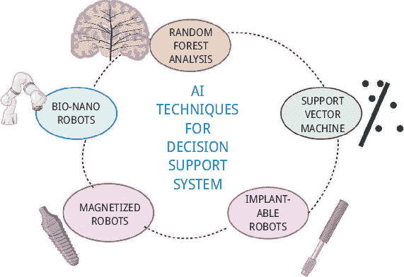

**图 7.1：** 医疗保健决策支持系统中的各种 AI 技术。

AI 和 ML 算法在生物医学研究中变得越来越重要，并正在影响临床决策过程。因此，它们直接影响医疗实践以及医生与患者之间的信息交流 [[13]](#9783111573861_010289.xhtml#b_9783111574288-007_ref_013)。传统医患关系的基础是就医疗建议和治疗选择进行开放沟通，以及个人信任。如果医生不再是唯一做出诊断或选择最佳治疗方案的人，而是深受使用 AI 和学习算法的机器影响，决策过程就会变得不透明。

临床决策支持系统（CDSS）有多种形式和分类，其子类别包括主动或被动交付方式以及干预时机。它们通常按基于知识和非基于知识进行分类 [[14]](#9783111573861_010289.xhtml#b_9783111574288-007_ref_014)，[[15]](#9783111573861_010289.xhtml#b_9783111574288-007_ref_015)。基于知识的系统根据患者、实践或文献循证生成规则。随后系统收集数据以评估规则并产生输出或动作。非基于知识的 CDSS 需要数据源；然而，它们不利用专业医学知识进行决策，而是依赖统计模式识别、ML 或 AI。尽管 CDSS 是医学中 AI 应用的一个快速增长的用例，但它面临诸多困难，例如数据收集相关的问题以及理解 AI 用于生成建议的逻辑（黑箱）[[16]](#9783111573861_010289.xhtml#b_9783111574288-007_ref_016)。

药物制剂是极其复杂的结构，具有大量变量，这些变量有时对其行为的影响定义不清。由于制备技术复杂，使用传统分析方法极难表征药物制剂。数百个定义明确的理化参数正被简化为理论上有用的描述，这些描述在未来不会影响决策支持。因此，药剂学中具体难题的表征仍高度依赖经验数据。因此，当使用数据数值分析来创建合适模型时，经验建模是该领域的首选方法 [[17]](#9783111573861_010289.xhtml#b_9783111574288-007_ref_017)。它使得仅从数据构建模型成为可能，无需先验知识和先验假设。封装了对问题当前理解的数据被用来构建模型。数据驱动模型的主要优势在于其公正性，因为它不受既有理论的束缚。在缺乏可靠理论的情况下，来自其他领域的部分验证理论或假设可能导致误解 [[18]](#9783111573861_010289.xhtml#b_9783111574288-007_ref_018)。ANN 就是一种已成为经验建模应用高效工具的经验建模工具。

此外，CDSS 还用于分诊、检测健康相关症状的变化、从病历中提取患者数据、提供住院协助、评估治疗和监测。当研究人员和开发人员准备实施 CDSS 时，必须考虑 CDSS 的五个“正确”：正确的信息、正确的人员、正确的干预格式、正确的渠道和正确的工作流时间，如图 7.2 所示 [[19]](#9783111573861_010289.xhtml#b_9783111574288-007_ref_019)，[[20]](#9783111573861_010289.xhtml#b_9783111574288-007_ref_020)。

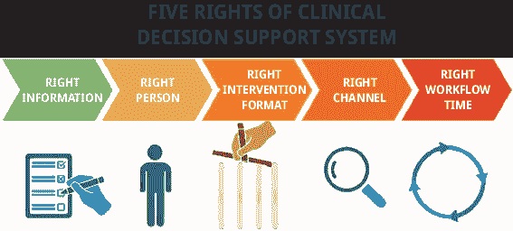

**图 7.2：** 临床决策支持系统五个“正确”的图示。

### AI 驱动的临床决策支持系统详解

AI 驱动的临床决策支持系统（CDDS）可以帮助医生、护士、患者和其他护理人员做出更明智的选择。它分析患者过去、现在和未来的数据，以识别治疗路径中的错误或缺陷，并向用户提出改进建议或安全问题。决策支持系统分为两类：机器学习（ML）系统和基于规则的专家系统（ES）[21]。许多医院的电子健康记录（EHR）已被纳入决策支持系统，这些系统利用预设规则来指导决策。因为这些系统只需要二元选择，所以它们更易于配置。另一方面，ML 系统依靠统计学来做决策。这需要彻底理解医疗专业人员评估患者数据并得出重要结论的标准流程[22]。一项近期的病例对照研究表明，一种旨在内镜检查期间诊断*幽门螺杆菌*感染的 AI 系统能以良好的准确性和可行性检测出该感染。这些工具可以协助病理学家识别*幽门螺杆菌*感染，或取代他们的位置。在胃癌方面，AI 的诊断精度和功效与普通病理学家持平，甚至更胜一筹。通过卷积神经网络，深度学习模型能在几分钟或几秒钟内识别和分类食管鳞状细胞癌及其浸润深度。它对检测腺癌也效果良好[23]。AI 模型已被有效开发用于评估结直肠癌（CRC）、胆道癌和肝细胞癌（HCC）患者的预后[24]。目前胃癌的预后仍不确定。在一项队列研究中，利用全切片图像（WSI）开发了一种深度学习模型，产生了肿瘤风险评分（TRS）作为预后标志物。临床分期方法无法像 TRS 那样，凭借其预测功效，将患者统一分为多达五组且预后显著不同。尽管它们潜力巨大，但 AI 驱动的决策支持系统在应用于临床环境之前仍需解决诸多问题。这些挑战包括数据一致性、有效性、伦理、政府批准以及医学界的接受度。要让胃肠病学开始利用 AI 技术，必须解决这些问题。AI 驱动的决策支持系统通过提供快速准确的诊断、个性化的治疗方案和更优质的患者护理，可以提升胃肠病学水平[25]。

#### 医疗保健领域的 AI 应用：临床决策支持系统与机器学习技术

随着 AI 及其他新兴技术的迅猛发展，医疗保健领域 AI 应用的使用显著增加，这些技术具备通过高效的数据处理和分析来创造新机遇并消除现有障碍的能力 [26]。得益于临床决策技术和电子健康记录（EHR），当今的医疗保健行业能够更好地避免许多错误和不幸事件。这些技术的例子包括用于录入药物医嘱、预测多种重大疾病等的技术 [27, 28]。

富裕国家的医疗机构正热情拥抱 AI，这从对医疗领域多个真实应用案例的回顾中可见一斑。这些机构正利用 AI 赋能的系统协助医务人员诊断和治疗各类疾病，同时最大化护理和与医院服务相关的行政职责的效率。

##### 临床决策支持系统（CDSS）的选择与评估

在选择 CDSS 时，主要有两个因素需要考量：CDSS 的质量及其弥补临床质量差距的适用性。必须至少在两个层面评估 CDSS 的质量：技术平台层面以及构建时所用的数据或知识层面。开发医学领域所用软件的通用质量保证技术，应用于 CDSS 的设计、实施、测试和文档编制中，因为 CDSS 属于可能同时也是医疗器械的软件 [29]。

对于基于机器学习或统计分析所得模型构建的 CDSS，需要对源数据的质量进行评估 [30, 31]。与基于 AI 的 CDSS 相关的进一步风险包括偏见和对训练数据的过拟合等因素。这可能导致在本地部署点出现未被察觉的性能不佳，因为 CDSS 无法从训练数据中外推。因此，必须高度重视缓解 CDSS 可能产生的任何负面影响。关键在于要仔细选择符合部署点需求的 CDSS。与任何其他医疗技术一样，CDSS 在本地机构需要经过严格的验收测试、调试和质量保证 [32, 33]。

##### 用于 CDSS 的机器学习技术

###### 支持向量机（SVM）

机器学习（ML）是一门研究能够从数据中学习并基于数据预测结果的算法的创建与发展的学科。这些算法从样本输入生成模型，从而实现数据驱动的预测或判断，而非仅依赖静态的程序指令。一种称为 `SVM` 的技术通过构建超平面来识别异常值，并分析数据以进行回归和分类。该技术利用一组带标签的训练样本，在两个线性可分类别之间创建最大间隔。实例被描绘为空间框架中的点，当新实例投影到同一空间时，根据其落在间隔的哪一侧进行分类。核技巧利用指定空间中向量的点积，将非线性数据转换为线性表示。`SVM` 是临床管理决策模型中 AI 的一种流行替代方案。然而，`SVM` 的局限性包括其无法提供直接的概率估计，以及当特征数量超过样本量时性能欠佳 [34, 35, 36, 37, 38]。

###### 决策树与随机森林

决策树学习是一种预测建模技术，它利用统计学、数据挖掘和机器学习，从项目观测值创建决策树，从而推断项目的目标值。决策树主要分为两类：(1) 离散决策树模型，其中目标变量仅取离散值；(2) 连续决策树。决策制定和执行过程可以通过决策树清晰且直观地描绘。

随机森林，也称随机决策森林，是一种用于分类、回归和其他各种应用的集成学习方法。其工作原理是在训练阶段生成多棵决策树，并输出单个树预测结果的平均值（用于回归）或出现频率最高的类别（用于分类）。随机决策森林降低了决策树对其训练数据集过拟合的倾向 [39, 40]。

###### 深度学习神经网络（DLNN）

一种称为 `深度学习神经网络（DLNN）` 的机器学习技术利用表征学习，使系统能够自动发现所需的表征。深度人工神经网络及其他方法被用于从原始数据中识别和分类特征。`DLNN` 通过采用多个隐藏层，利用分层特征表征从数据中获取复杂特征。与层数较少的网络不同，`DLNN` 通过更大量的数学运算执行输入数据（特征），这使得其训练计算量更大 [41, 42]。

##### 医学影像中的应用

`ANN`、`CNN` 和 `DLNN` 模型已作为基于 AI 的 CDSS 引擎进行了深入分析。放射学常用于疾病诊断（如通过乳腺 X 线摄影诊断乳腺癌）、分层/分类（如肺部疾病）、基于影像的预测（如吸烟者的 CT 影像）、影像结果预测（如 V/Q 扫描上的肺水肿）以及疾病行为的多组学基因型-表型评估（如多发性硬化症）。在 AI 的医学影像应用中，`DLNN` 备受青睐。这些应用涵盖图像分割、加速图像采集、病变检测和基于影像的临床决策支持 [43, 44, 45]。

## 将 AI 融入制药高管决策

基于 AI 的应用日益普及，引发了对数据安全和隐私的担忧。由于健康信息的敏感性，它往往是数据泄露的目标。因此，患者数据安全至关重要 [60]。由于大型医疗机构与 AI 公司之间的数据共享，已引发法律诉讼，这让患者在数据收集过程中对潜在的隐私泄露感到担忧。数据获取之后，随之而来的挑战是 AI 技术的进步 [61]。当系统识别出患者属性与结果之间虚假关联时，可能会出现过拟合。这是由于变量参数相对于结果过多导致的；因此，算法使用不合适的特征进行预测 [62]。近年来，人们对 AI 在制药行业和临床医疗中应用的兴趣显著增加，从而产生了越来越多的相关文献和研究。它提供了关于 AI 如何改善临床结果和患者护理的信息，这与医疗管理和个性化医疗相一致 [63]。大数据实践考虑了医疗行业即将到来的人才需求和新申请人。大数据为医疗从业者、药房人员和卫生政策专家提供了重要机遇，使他们能够做出数据驱动的决策，最终改善患者护理 [64, 65]。它有能力改变医疗人力资源实践的根基和装备，以全面提高生产力，更深入地了解数据存储库，并得出明确的观点或选择。在以下情况下，大数据对任何人力资源部门都至关重要，不仅在于留住员工，还在于他们更好地了解周围环境并做出最佳决策的能力 [66, 67]。如图 7.3 所示，基于大数据的决策过程中可采用三种策略 [68, 69]。

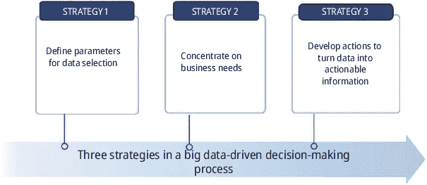

**图 7.3：** 基于大数据的决策过程中使用的三种策略。

研究人员提出利用人工神经网络（ANN）揭示隐藏信息和价值的能力，以提高护理效率，并支持医疗部门采用“精益思维”或基于价值的决策制定 [70]。ANN 协助将精益思维融入医疗保健的一个例子是对癌症患者之间的“信息流”进行建模，展示生活质量与临床结果之间的关系 [71, 72]。支持向量机被认为是解决传统统计分析无法回答的问题的先进方法。它们被用于对高维数据进行建模。尽管具备分析能力，但广泛实施仍具挑战性，主要归因于方法论复杂性和可扩展性顾虑 [73]。一项利用电子健康记录数据的深度学习模型系统性考察识别出与信息不一致性和及时性相关的问题，包括源自短期和长期事件的临床特征间的隐性相关性。如果这些困难得不到充分解决，模型性能可能会下降 [74]。研究表明，ANN 在商业应用中被广泛使用，特别是在决策辅助、股价预测以及财务困境和破产事务方面。此外，混合网络已被开发用于提高传统模型在商业环境中的功效。将 ANN 与次级 AI 和元启发式方法（包括模糊逻辑、遗传算法、蜂群优化和人工免疫系统）相结合，已被建议用于解决与 ANN 相关的挑战，如网络结构选择、初始权重分配和控制参数优化。混合智能系统被应用于各个领域，包括自然语言处理、机器人技术、医学评估和制造过程监督 [75]。

AI-CDSS 部署的功效不仅受技术进步影响，还受人为因素影响；包括可解释性、隐私和公平性，以及医疗实践的社会和组织维度 [76, 77, 78, 79, 80]。例如，因为后文案例中的最终用户临床医生不信任或不理解 AI-CDSS 的能力，他们可能不愿采用或使用它。原因之一可能是许多 AI-CDSS 就像“黑箱”一样运行，这意味着临床医生无法理解它们是如何得出建议的。这些问题可能导致系统采用率低和用户接受度低 [81, 82]。参与该项目的研究人员断言，人类决策者与 AI 集成系统之间合作联盟的成功，在很大程度上依赖于用户对这些系统的信任。这指出了影响 CDS 系统信心的几个变量 [83]。例如，参与者寻求药物建议验证的两个来源是专业学会发布的指南和权威临床期刊发表的文章。虽然指南被视为更可靠的建议，但医生知道指南的更新比出版物中的发现要慢。从根本上说，信任寄托于临床研究的底层过程，特别是随机临床试验 [84]。随机临床试验方法长期以来因其据称与实际医疗经验的联系薄弱而受到批评，且并非没有争议 [85]。已有证据表明，临床试验的参与者往往比那些将使用实验性治疗或药物的人更年轻、病情更重，且男性更多。

# 验证并投入使用 AI 仍是医学领域需要完成的主要任务

在 AI 技术能够以安全且合乎道德负责的方式广泛应用之前，目前在治理和监管监督方面需要重大创新。必须在临床环境中验证 AI，并在同行评审期刊上发布算法 [86]。也许在未来，AI 应与科学家和医疗专业人员合作，为患者提供最佳护理，而不是试图取代专家。AI 不太可能处理患者入院、诊断和治疗选择的所有方面。因此，必须关注患者的精神和社会需求。机器不太可能提供这些类型的护理 [87]。为了让任何算法在临床环境中得到验证，需要进行一些训练。因此，患者数据必须在医疗机构之间交换，有时甚至跨越国界 [88]。

## 7.4 法规合规与伦理考量

### AI 在制药监管事务与医疗健康领域的应用、法规与伦理挑战

#### AI 在制药监管事务中的革命性潜力

制药监管事务领域虽处于 AI 应用的早期阶段，但可能迎来全面变革。AI 可通过提供行业最新进展的实时知识来协助监管事务，在药物发现和监管审批方面展现显著潜力。AI 能够识别新机遇、自动化任务并增强决策能力，从而加速并优化药物发现专业人员的决策流程，最终加快新药上市进程。

“监管事务”指制药企业内部作为联络点的部门或单位，负责与国家及国际监管机构沟通，依据现行规则法规获取产品批准。监管机构则依据药物发现和产品开发阶段提交的数据与记录授予产品批准 [[89]](#9783111573861_010289.xhtml#b_9783111574288-007_ref_089)[[90]](#9783111573861_010289.xhtml#b_9783111574288-007_ref_090)。区块链、互联网计算、3D 生物打印和 AI 等消费技术进步在医疗行业的应用，使得新法规的制定势在必行，以跟上技术快速演变的步伐 [[91]](#9783111573861_010289.xhtml#b_9783111574288-007_ref_091)。美国食品药品监督管理局（FDA）是推动这些突破性技术发展的主要催化剂，其制定新目标以优化监管审批流程，并提供技术标准与建议。AI 算法的广泛应用与最新进展表明，医疗技术与医疗健康将受到深远影响。

通用人工智能（AGI）指能执行人类一切认知活动、展现类人智能的 AI。根据 FDA 评估，狭义人工智能（ANI）是为特定目的设计的 AI，常用于医疗器械中 [[92]](#9783111573861_010289.xhtml#b_9783111574288-007_ref_092)[[93]](#9783111573861_010289.xhtml#b_9783111574288-007_ref_093)。

#### GDPR 与 AI 监管框架

《通用数据保护条例》（GDPR）为科学研究确立了新法律框架，深刻影响数据主体权利。当个人数据用于研发目的时，联盟或成员国法律可允许对访问权（第 15 条）、更正权（第 16 条）、删除权（第 17 条）、限制处理权（第 18 条）和反对权（第 21 条）作出例外规定。仅当行使这些权利会导致研究目标无法实现或受到实质性阻碍时，方可给予例外；否则不予批准 [[94]](#9783111573861_010289.xhtml#b_9783111574288-007_ref_094)。

GDPR 无法为 AI 系统提供全方位保护，因其仅涉及 AI 系统监管的两个方面：私人信息处理和保护数据主体免受自动化决策（ADM）影响。在医疗服务和医学研究领域，此类主体的监管需要更复杂的法律框架和严格执法 [[95]](#9783111573861_010289.xhtml#b_9783111574288-007_ref_095)。欧洲委员会（EC）强调需要监管框架以促进新技术发展并管控风险，尽管欧盟目前尚无专门针对 AI 的法律结构（欧洲委员会，2020）。AI 技术对经济、法律框架和社会的影响，使其成为欧盟近年重要的政策议题 [[96]](#9783111573861_010289.xhtml#b_9783111574288-007_ref_096)。

#### 医疗 AI 的伦理标准与人类自主权

所有相关方必须遵守并执行管辖医疗领域 AI 技术开发与应用的统一伦理标准与原则。AI 技术利用多种数据集和技术，包括监督学习、半监督学习和无监督学习。尽管潜力巨大，但医疗从业者和学者因其复杂性，对这些“机器驱动”的分析技术持谨慎态度。与其他 AI 应用不同，医疗 AI 直接关乎人类生命，可能对患者多方面产生重大影响。

医疗领域实施 AI 技术增加了系统自主化的可能性，从而危及人类自主权。医疗 AI 有能力让机器做决策。医疗决策和基于 AI 的医疗系统必须完全处于人类控制之下。任何情况下 AI 技术都不应干涉患者自主权。因判断差异，用户或患者可能不知该信任 AI 系统还是医生的临床决策 [[97]](#9783111573861_010289.xhtml#b_9783111574288-007_ref_097)。此类情况下必须向患者提供双重选择。

在医疗领域部署任何 AI 技术前，所有研究计划和评估项目必须遵循知情同意协议。必须向患者充分传达使用 AI 技术的优势，以及相关的社会、心理和生理风险。患者必须完全拥有接受或拒绝 AI 技术的自主权。在 AI 开发和实施的每个阶段，必须严格透明地监控道德考量和人类价值观。

## 7.5 制药行业中 AI 的未来趋势

在医疗保健领域实施 AI 技术增加了系统变得自主的可能性，从而危及人类的自主权。医疗保健领域的人工智能具备让机器做出决策的能力。医疗决策和 AI 驱动的医疗系统必须完全保持在人类监督之下。在任何情况下，AI 技术都不得损害患者自主权。由于这些差异，患者可能不确定该信任哪个权威机构，关于 AI 系统和医生做出的临床判断。在此类情况下，必须向患者提供这两种选择。在医疗保健领域部署任何 AI 技术之前，所有研究计划和评估项目都必须遵守知情同意协议。患者必须充分了解使用 AI 技术的优势，以及随之而来的风险——社会、心理和生理方面的。必须充分赋予患者接受或拒绝 AI 技术的权利。在 AI 开发和应用的每一个阶段，道德考量和人类价值观都应得到有效且透明的监控 [98]。用于 AI 医疗的任何预后或诊断工具最理想的特性是可信度。临床医生必须像对其他使用的工具建立信心一样，对 AI 技术也建立信心。临床医生和医疗服务提供者希望有一种简单可靠的方法来评估 AI 技术的有效性和可靠性，以实现最佳使用。一个可靠的 AI 驱动系统必须在提供精准健康数据分析的同时，保持合法、合乎道德、可靠和真实。AI 驱动技术必须确保在完整的开发和实施阶段中的数据安全和隐私。赢得所有利益相关者（特别是医疗接受者）对其数据安全使用的信任，对于 AI 的有效和广泛部署至关重要 [99]。数据隐私的主要目的是防止未经授权的访问、篡改和销毁个人信息。人工智能对个人数据的使用不得过度限制个人感知到的或实际的自由。这些程序在医疗保健行业至关重要，因为医疗信息包含敏感数据，这些数据可能被用来对付患者或导致歧视，即使是无意的。理想情况下，特定患者的数据应进行匿名化处理，除非临床或研究需求要求以可识别格式保留。个人或组织对其行为负责、解释其活动并透明披露结果的义务称为问责制。旨在用于医疗保健行业的 AI 系统需要随时准备接受相关当局的审查。为了使 AI 技术发挥最佳性能，需要频繁的内部和外部审计。这些审计报告必须向公众发布。用于训练和测试系统的数据从根本上决定了人工智能的结果，因为它是一种数据驱动技术。在健康 AI 方面尤为重要，因为有偏见和倾斜的数据集可能导致偏见和歧视等问题。健康 AI 和其他数据驱动技术被认为最容易受到数据偏见的影响 [100]。必须采取措施，确保“训练数据”不含既定偏见，并准确代表目标受众的很大一部分。

人工智能将为制药行业开启一个变革时代。考虑到潜在的副作用和毒性，预计 AI 算法将在个性化剂型配制和安全性评估、优化药物成分以及改善治疗结果方面发挥关键作用。可穿戴技术、传感器和 AI 赋能的监测设备将通过个性化治疗建议增强远程患者护理并优化服药依从性。人工智能影响患者选择、招募和临床研究设计。利用基因图谱和电子健康记录来寻找合格患者，降低试验成本，并加速审批流程。此外，预计 AI 的持续监测和监管能力将优化药物制造工艺，保证效率和一致性 [101]。正如某些当前概念化所述，战略决策不局限于工厂设计或全球供应链管理，而是影响组织的所有职能领域和层级。同样，短期和中期决策现在跨越更大的领域，不再局限于生产调度和计划任务。此外，为了更好地满足现实世界的需求及其动态，整合各个决策层级已成为当务之急 [102]。

因此，公司目前的决策结构要复杂和广泛得多，涵盖各种时间尺度以及企业职能和活动、影响和范围变化、物理网络变化，最后是多种技术环境。未来，患者将成为决定相关运营绩效指标以及产品或服务规格的主要影响者 [103]。为改善从初步发现到治疗交付的客户体验，公司必须将患者视角纳入其决策过程。决策支持模型将熟练应对诸如更广泛的产品范围和产量、以患者为中心的分销网络、提高的服务水平精度，以及通过闭环信息系统对整个客户体验进行实时评估等挑战 [104, 105]。公司所有的技术资产都存放在技术层。组织必须利用所有这些能力，以优化已开发的决策模型所能提供的所有协助的价值。因此，在关于最相关的未来特性和特定技术选择的决策中，应尽可能考虑经济和/或环保的替代方案。在制造层面，随着采用更经济的技术（如连续制造）并开发基于复杂优化和仿真方法的先进决策支持工具，生产成本、交货时间和库存水平将不可避免地降低。预计资源和能源效率的提高，以及灵活性和对市场变化响应能力的增强，将导致产能利用率提升 [106, 107]。

## 7.6 结论

人工智能（AI）、机器学习（ML）和数据挖掘正被制药公司越来越多地用于改进模型泛化、药物发现和决策支持系统（DSS）。这些技术分为两类：基于知识的和非基于知识的。经验建模是制药制剂中创建合适模型的首选方法，无需先验知识和假设。基于 AI 的临床决策支持系统（CDSS）可通过检查患者的过去、现在和未来数据，帮助医生、护士和患者做出明智的决策。决策支持系统的两种类型是 ML 系统和基于规则的专家系统（ES）。AI 系统在诊断`幽门螺杆菌`感染和胃癌方面表现出良好的准确性，而深度学习模型可识别和分类食管鳞状细胞癌和腺癌。自然语言处理（NLP）在医疗领域的应用日益增加，旨在为临床医生提供与患者沟通的途径，并增强非结构化电子健康记录（EHR）的利用。医学领域 AI-CDSS 的实施面临人为因素、社会和组织层面以及临床医生缺乏信任等挑战。医疗保健中的 AI 技术有可能变得自主并威胁人类自主权，但它必须完全处于人类控制之下，并充分了解其优势和风险。可信度、数据安全、隐私和频繁审计对于基于 AI 的诊断工具至关重要。未来，患者将成为决定运营绩效指标和产品规格的主要影响因素。具有成本效益的技术和先进的决策支持工具可降低生产成本、交货时间和库存。建议社会与行为科学、心理健康和认知科学领域的专家合作，共同开发基于 ML 的决策支持系统。

开发基于 ML 的 CDSS 时，多学科流程应考虑到所有利益相关者的需求。当这些系统与可解释人工智能（XAI）集成时，这一点尤为重要。应考虑使用这些系统的决策者、受决策结果影响的人员以及系统设计者 [108, 109]。建议在开发模型时，心理与社会行为心理学、心理健康和认知科学领域的专家进行合作 [110]。尽管 XAI 有助于识别数据相关问题，但非结构化医疗数据仍然是实用基于 AI 系统进步的难题。有必要考虑特定领域的需求，例如明确掌握系统目标、评估现有系统的有效性和可解释性，以及确定所需解释的类型和数量。此外，科学家们 [108] 建议除非必要，否则不要使用那些黑箱模拟。他们建议尽可能避免使用需要事后应用 XAI 方法的复杂算法。相反，他们建议使用透明的或设计上可解释的算法。在确定应提供何种类型的解释时，必须考虑受众的认知能力和局限性，以及对伦理、正义和安全的影响。需要更彻底的用户研究 [111]。一些作者 [112] 声称，虽然向医生提供生成系统推荐诊断所用数据的更详细解释增强了信任，但也导致了过度依赖的问题。另一方面，不那么详尽的解释产生了相反的影响，导致参与者怀疑系统的可靠性并产生自我依赖问题 [113]。一些研究人员通过调查发现，不准确的 ML 建议会影响临床医生并降低决策准确性，仅靠解释不足以解决对提出错误决策的算法的过度依赖。研究发现，解释策略的选择应基于临床医生对 ML 的经验，且 ML 的建议对有先前经验的人更有用。

然而，生成化学、ML 和帕累托优化等方法正越来越多地用于 AI 的先导化合物发现方法中。提供 AI4DD 技术资源和信息的社区平台是这一趋势的有力支持者。预测毒理学取得了重大进展，监管机构正准备从 AI 中获益 [114]。AI 技术可通过提高生产率和减少错误来降低医疗费用。必须承认，在药学中使用 AI 仍存在某些限制和挑战，需要加以解决。例如，使用 AI 驱动的系统跟踪患者信息可能引发安全和隐私问题。药剂师可能还需要额外培训，以便正确应用和整合人工智能到工作中。未来的研究也可能关注药学中使用 AI 的伦理影响。随着技术进步，必须解决算法偏见、数据安全与保密性，以及 AI 系统取代人力劳动的可能性等问题。通过审慎且主动地应对这些问题，药剂师可以以合乎伦理且行之有效的方式整合 AI [115]。

## 参考文献

[1] Topol EJ. High‐performance medicine: The convergence of human and artificial intelligence. Nature Medicine. 2019;25:44. →

[2] Schuhmacher A, Gassmann O, Hinder M. Changing R&D models in research-based pharmaceutical companies. Journal of Translational Medicine. 2016 Dec;14:1–1. →

[3] Vamathevan J, Clark D, Czodrowski P, Dunham I, Ferran E, Lee G, Li B, Madabhushi A, Shah P, Spitzer M, Zhao S. Applications of machine learning in drug discovery and development. Nature Reviews Drug Discovery. 2019 Jun;18(6):463–77. →

[4] Jekunen A. Decision-making in product portfolios of pharmaceutical research and development–managing streams of innovation in highly regulated markets. Drug Design, Development, and Therapy. 2014 Oct;21:2009–16. →

[5] Serafim MS, Dos Santos Júnior VS, Gertrudes JC, Maltarollo VG, Honorio KM. Machine learning techniques applied to the drug design and discovery of new antivirals: A brief look over the past decade. Expert Opinion on Drug Discovery. 2021 Sep 2;16(9):961–75. →

[6] Serafim MS, Gertrudes JC, Costa DM, Oliveira PR, Maltarollo VG, Honorio KM. Knowing and combating the enemy: A brief review on SARS-CoV-2 and computational approaches applied to the discovery of drug candidates. Bioscience Reports. 2021 Mar;41(3):BSR20202616. →

[7] Hassanzadeh P, Atyabi F, Dinarvand R. The significance of artificial intelligence in drug delivery system design. Advanced Drug Delivery Reviews. 2019 Nov 1;151:169–90. →

## 参考文献

[8] Nebot A, Cellier FE, Linkens DA. 利用模糊归纳推理合成麻醉药物给药系统。*Artificial Intelligence in Medicine*。1996 年 5 月 1 日；8(2)：147–66。→

[9] Petrović J, Ibrić S, Betz G, Đurić Z. 利用 Elman 动态神经网络和决策树优化基质片控释给药。*International Journal of Pharmaceutics*。2012 年 5 月 30 日；428(1–2)：57–67。→

[10] Banharnsakun A, Achalakul T, Batra RC. 基于群体微机器人的药物递送。*International Journal of Computational Intelligence and Applications*。2016 年 6 月 14 日；15(02)：1650006。→

[11] Fusco S, Ullrich F, Pokki J, Chatzipirpiridis G, Özkale B, Sivaraman KM, Ergeneman O, Pane S, Nelson BJ. 微机器人：眼部药物递送的新纪元。*Expert Opinion on Drug Delivery*。2014 年 11 月 1 日；11(11)：1815–26。→

[12] Mapara SS, Patravale VB. 医用胶囊机器人：诊断、药物递送和手术治疗的复兴。*Journal of Controlled Release*。2017 年 9 月 10 日；261：337–51。→

## 参考文献

[13] Sloane EB, Silva RJ. 医疗器械和临床决策支持系统中的人工智能。*Clinical Engineering Handbook*。2020 年 1 月 1 日（第 556–68 页）。→

[14] Berner ES. *Clinical Decision Support Systems*。Springer Science+ Business Media, LLC：纽约；2007；3–44。→

[15] Osheroff JA, Teich J, Levick D, Saldana L, Velasco F, Sittig D, Rogers K, Jenders R. *Improving Outcomes with Clinical Decision Support: An Implementer’s Guide*。Himss Publishing；2012 年 2 月 17 日；第 2 卷，241–328。→

[16] Deo RC. 医学中的机器学习。*Circulation*。2015 年 11 月 17 日；132(20)：1920–30。→

[17] Mendyk A, Jachowicz R. 神经网络作为药物制剂开发中的决策支持系统——聚焦固体分散体。*Expert Systems with Applications*。2005 年 2 月 1 日；28(2)：285–94。→

[18] Mendyk A, Jachowicz R. 基于人工神经网络的药物制剂开发决策支持系统。*Decision Support Systems*。2010 年 1 月 1 日；99。→

[19] Pombo N, Araújo P, Viana J. 疼痛管理临床决策支持系统中的知识发现：系统综述。*Artificial Intelligence in Medicine*。2014 年 1 月 1 日；60(1)：1–1。→

[20] Campbell R. 临床决策支持的“五大”原则。*Journal of AHIMA*。2013 年 10 月 1 日；84(10)：42–47。→

[21] Sanchez-Martinez S, Camara O, Piella G, Cikes M, González-Ballester MÁ, Miron M, Vellido A, Gómez E, Fraser AG, Bijnens B. 临床决策制定中的机器学习：心血管成像中的挑战与机遇。*Frontiers in Cardiovascular Medicine*。2022 年 1 月 4 日；8：765693。→

[22] Muzammil MA, Mazhar IJ, Zohair M, Ahmed O, Rasool W, Fariha FN, Nashwan A. 用于改善胃肠病学诊断和治疗的人工智能驱动决策支持系统。*Available at SSRN 4564402*。2023；6–21。→

[23] Pan Y, He L, Chen W, Yang Y. 基于深度学习的早期食管鳞状细胞癌内镜诊断中人工智能的现状。*Frontiers in Oncology*。2023 年 5 月 24 日；13：1198941。→

[24] Calderaro J, Kather JN. 胃肠道和肝胆癌的人工智能病理学。*Gut*。2021 年 6 月 1 日；70(6)：1183–93。→

[25] Shi JY, Wang X, Ding GY, Dong Z, Han J, Guan Z, Ma LJ, Zheng Y, Zhang L, Yu GZ, Wang XY. 基于深度学习探索肝细胞癌病理图像中的预后指标。*Gut*。2021 年 5 月 1 日；70(5)：951–61。→

[26] Kushwaha PK, Kumaresan M. 医疗系统中的机器学习算法：综述。载于 *2021 International Conference on Technological Advancements and Innovations (ICTAI)*。2021 年 11 月 10 日（第 478–81 页）。IEEE。→

[27] Ozdemir Z, Barron J, Bandyopadhyay S. 在转换成本下数字健康记录采用情况的分析。*Information Systems Research*。2011 年 9 月；22(3)：491–503。→

[28] Murray E, Hekler EB, Andersson G, Collins LM, Doherty A, Hollis C, Rivera DE, West R, Wyatt JC. 评估数字健康干预：关键问题与方法。*American Journal of Preventive Medicine*。2016 年 11 月 1 日；51(5)：843–51。→

[29] Fox J, Thomson R. 临床决策支持系统：质量、安全和法律责任问题的探讨。*Proceedings AMIA Symposium*。2002；2002：265–69。→

[30] Redman TC. *Data Driven: Profiting from Your Most Important Business Asset*。Harvard Business Press：马萨诸塞州布莱顿；2008；273。→

[31] Ash JS, Sittig DF, Campbell EM, Guappone KP, Dykstra RH. 临床决策支持系统的一些意外后果。*AMIA Annual Symposium Proceedings AMIA Symposium*。2007；11：26–30。→

[32] Jenders RA. 临床决策支持的进展：2015–2016 年实践与文献亮点。*Yearbook of Medical Informatics*。2017；26：125–32。→

[33] Liberati EG, Ruggiero F, Galuppo L, et al. 是什么阻碍了医院计算机化决策支持系统的采用？一项定性研究和实施框架。*Implementation Science*。2017；12：113。→

[34] Olson DL, Delen D. *Advanced Data Mining Techniques*。Springer Science & Business Media；2008；22–64。→

[35] Akay MF. 结合特征选择的支持向量机用于乳腺癌诊断。*Expert Systems with Applications*。2009 年 3 月 1 日；36(2)：3240–47。→

[36] Hu X, Wong KK, Young GS, Guo L, Wong ST. 支持向量机多参数 MRI 识别切除胶质母细胞瘤患者的假性进展与肿瘤复发。*Journal of Magnetic Resonance Imaging*。2011 年 2 月；33(2)：296–305。→

[37] Yao J, Dwyer A, Summers RM, Mollura DJ. 利用纹理分析和支持向量机分类进行肺部感染的计算机辅助诊断。*Academic Radiology*。2011 年 3 月 1 日；18(3)：306–14。→

[38] Wu B, Khong PL, Chan T. 利用支持向量机在 PET/CT 上自动检测和分类鼻咽癌。*International Journal of Computer Assisted Radiology and Surgery*。2012 年 7 月 1 日；7(4)：635–46。→

[39] Chao WH, Chen YY, Lin SH, Shih YY, Tsang S. 利用带有空间信息的决策树自动分割磁共振图像。*Computerized Medical Imaging and Graphics*。2009 年 3 月 1 日；33(2)：111–21。→

[40] Azar AT, El-Metwally SM. 用于自动医学诊断的决策树分类器。*Neural Computing and Applications*。2013 年 12 月 1 日；23(7–8)：2387–403。→

## 参考文献

[41] Guan Q, Huang Y, Zhong Z, Zheng Z, Zheng L, Yang Y. 像放射科医生一样诊断：用于胸部疾病分类的注意力引导卷积神经网络。arXiv 预印本 arXiv:1801.09927。2018；2–9。→

[42] González G, Ash SY, Vegas-Sánchez-Ferrero G, Onieva Onieva J, Rahaghi FN, Ross JC, Díaz A, San José Estépar R, Washko GR. 利用胸部计算机断层扫描中的深度学习对吸烟者进行疾病分期和预后判断。美国呼吸与危重症医学杂志。2018 年 1 月 15 日；197(2)：193–203。→

[43] Eng J. 预测急性肺栓塞的存在：人工神经网络、逻辑回归和阈值模型的比较分析。美国放射学杂志。2002 年 10 月；179(4)：869–74。→

[44] Okuda DT, Srinivasan R, Oksenberg JR, Goodin DS, Baranzini SE, Beheshtian A, Waubant E, Zamvil SS, Leppert D, Qualley P, Lincoln R. 多发性硬化症的基因型-表型相关性：HLA 基因影响由 1HMR 波谱和 MRI 测量推断的疾病严重程度。Brain。2009 年 1 月 1 日；132(1)：250–59。→

[45] Shitrit O, Raviv TR. 通过对抗神经网络加速磁共振成像。载于《医学图像分析中的深度学习与临床决策支持的多模态学习》。2017 年 9 月 14 日（第 30–38 页）。Springer：Cham。→

[46] Shen L, Wright A, Lee LS, Jajoo K, Nayor J, Landman A. 临床决策支持系统，利用专家共识衍生的逻辑和自然语言处理，减少了接受内镜检查患者的镇静类医嘱错误。美国医学信息学会杂志。2021 年 1 月；28(1)：95–103。→

[47] Lederman A, Lederman R, Verspoor K. 任务即需求：重构临床自然语言处理研究范式，以实现真实世界的决策支持。美国医学信息学会杂志。2022 年 9 月；29(10)：1810–17。→

[48] Bansal T, Gunasekaran K, Wang T. 用于 NLP 元学习的自监督任务的多样化分布。arXiv 预印本 arXiv。2021。→

[49] Obermeyer Z, Emanuel EJ. 预测未来——大数据、机器学习与临床医学。新英格兰医学杂志。2016；375(13)：1216–19。→

[50] Prum BE, Rosenberg LF, Gedde SJ, 等。原发性开角型青光眼首选实践模式(®)指南。眼科学。2016；123(1)：P41–P111。→

[51] Crabb DP, Russell RA, Malik R, 等。*监测新诊断青光眼患者时视野检查的频率：混合方法与建模*。NIHR 期刊库；2014。[访问于 2024 年 1 月 3 日]。→

[52] Emanuel EJ, Wachter RM. 医疗保健中的人工智能：价值能否匹配炒作？JAMA。2019；321(23)：2281–82。→

[53] Sirajuddin AM, Osheroff JA, Sittig DF, Chuo J, Velasco F, Collins DA. 来自一本关于利用临床决策支持改善药物使用和结果的新指南的实施经验。健康信息管理杂志。2009；23(4)：38–45。→

[54] Sutton RT, Pincock D, Baumgart DC, Sadowski DC, Fedorak RN, Kroeker KI. 临床决策支持系统概述：益处、风险及成功策略。Npj Digital Medicine。2020；3(1)：1–10。→

[55] Berner ES, La Lande TJ. 临床决策支持系统概述。临床决策支持系统：理论与实践。2016；1–7。→

[56] Kawamoto K, Kukhareva P, Shakib JH, 等。新生儿胆红素管理电子健康记录附加应用程序与医生效率和护理质量的关联。JAMA Network Open。2019；2(11)：e1915343。→

[57] Page N, Baysari MT, Westbrook JI. 医院 CPOE 系统中中断性用药处方警示改变处方者行为和改善患者安全有效性的系统评价。国际医学信息学杂志。2017；105：22–30。→

[58] Curtis CE, Al Bahar F, Marriott JF. 计算机化决策支持对医院抗生素使用效果的系统评价。PloS One。2017；12(8)：e0183062。→

[59] Borab ZM, Lanni MA, Tecce MG, Pannucci CJ, Fischer JP. 使用计算机化临床决策支持系统预防手术患者静脉血栓栓塞：系统评价和荟萃分析。JAMA Surgery。2017；152(7)：638–45。→

[60] Murdoch B. 隐私与人工智能：新时代保护健康信息的挑战。BMC Medical Ethics。2021 年 12 月；22(1)：1–5。→

[61] Cohen IG, Mello MM. 大数据、大科技与保护患者隐私。JAMA。2019 年 9 月 24 日；322(12)：1141–42。→

[62] Wiens J, Shenoy ES. 医疗保健的机器学习：处于医疗保健流行病学重大转变的边缘。Clinical Infectious Diseases。2018；66(1)：149–53。→

[63] Ahmed A. 利用人工智能推动制药领域的进步：综述。2023；224–56。→

[64] Alonso S, Torre Díez I, Rodrigues J, Hamrioui S, Lópezcoronado M. 医疗保健领域大数据技术与来源的系统评价。Journal of Medical Systems。2017；41(11)：1–9。→

[65] Balan S, Otto J. 居家医疗服务的大数据分析。Information Technology & Management Science。19(1)：53。→

[66] Brock V, Khan H. 大数据分析：组织因素是否影响技术接受？Journal of Big Data。4(1)：1。→

[67] Murdoch TB, Detsky AS. 大数据在医疗保健中的必然应用。JAMA。2013；309(13)：1351–52。→

[68] Barkhordari M, Niamanesh M. Chabok：一种基于 Map-Reduce 解决数据仓库问题的方法。Journal of Big Data。5(1)：1。→

[69] Barkhordari M, Niamanesh M. Kavosh：一种有效的基于 MapReduce 的关联规则挖掘方法。Journal of Big Data。5(1)：1。→

[70] Moghimi FH, Wickramasinghe N. 第 2 章：用于促进医疗环境中精益思维采用的卓越人工神经网络。精益医疗。Springer Science：New York；2014；177–84。→

[71] Sharma AS, Chopra A. 人工神经网络：管理中的应用。Journal of Business and Management。2013；12(5)：32–40。→

[72] Sharma SK, Govindaluri SM, Gattoufi S. 理解和预测电子政务服务质量决定因素：一个两阶段回归-神经网络模型。Journal of Modelling in Management。2015；10(3)：325–40。→

## 参考文献

[73] Milenova B, Yarmus JS, Campos MM, 编. *Oracle Database 10g 中的 SVM：消除支持向量机广泛采用的障碍*. 第 31 届 VLDB 会议论文集. 2005 (pp. 1152–63). →

[74] Xiao C, Choi E, Sun J. 利用电子健康记录数据开发深度学习模型的机遇与挑战：系统综述. *美国医学信息学会杂志*. 2018;25(10):1419–28. →

[75] Tkac M, Verner R. 商业领域的人工神经网络：二十年的研究. *应用软计算*. 2016;38:788–804. →

[76] Cheng HF, Wang R, Zhang Z, O’connell F, Gray T, Harper FM, Zhu H. 通过 UI 解释决策算法：帮助非专家利益相关者的策略. 在 *2019 年人机交互系统 CHI 会议论文集* 中. 2019 年 5 月 2 日 (pp. 1–12). →

[77] Magrabi F, Ammenwerth E, McNair JB, De Keizer NF, Hyppönen H, Nykänen P, Rigby M, Scott PJ, Vehko T, Wong ZS, Georgiou A. 临床决策支持中的人工智能：评估 AI 的挑战与实际意义. *医学信息学年鉴*. 2019 年 8 月;28(01):128–34. →

[78] Knop M, Weber S, Mueller M, Niehaves B. 影响医疗专业人员与 AI 赋能的临床决策支持系统交互的人因与技术特征：文献综述. *JMIR 人因*. 2022 年 3 月 24 日;9(1):e28639. →

# 参考文献

[79] Hidalgo CA, Orghian D, Canals JA, De Almeida F, Martin N. *人类如何评判机器*. 2021 年 2 月 2 日 (pp. 105–49). MIT Press.

[80] Zihni E, Madai VI, Livne M, Galinovic I, Khalil AA, Fiebach JB, Frey D. 为临床决策支持打开人工智能黑箱：一项预测卒中结局的研究. *Plos One*. 2020 年 4 月 6 日;15(4):e0231166.

[81] Schoonderwoerd TA, Jorritsma W, Neerincx MA, Van Den Bosch K. 以人为本的 XAI：为临床决策支持系统的解释开发设计模式. *国际人机交互研究杂志*. 2021 年 10 月 1 日;154:102684.

[82] Tahaei M, Constantinides M, Quercia D. 面向以人为本的负责任人工智能：CHI 研究与行业工具包综述. *arXiv 预印本 arXiv:2302.05284*. 2023.

[83] Vereschak O, Bailly G, Caramiaux B. 如何评估 AI 辅助决策中的信任？实证方法论综述. *ACM 人机交互会议论文集*. 2021 年 10 月 18 日;5(CSCW2):1–39.

[84] Epstein S. *非纯科学：艾滋病、行动主义与知识政治*. 加州大学出版社; 1996; Vol. 7, 12–52.

[85] Kennedy-Martin T, Curtis S, Faries D, Robinson S, Johnston J. 关于随机对照试验样本代表性的文献综述及其对试验结果外部效度的影响. *Trials*. 2015 年 12 月;16:1–4.

[86] Deist TM, Dankers FJ, Valdes G, Wijsman R, Hsu IC, Oberije C, Lustberg T, Van Soest J, Hoebers F, Jochems A, El Naqa I. (化学)放疗结局预测的机器学习算法：分类器的实证比较. *医学物理学*. 2018 年 7 月;45(7):3449–59.

[87] Taylor L. 作为公共产品的大数据伦理：哪个公众？谁的利益? *皇家学会哲学汇刊 A 辑：数学、物理与工程科学*. 2016 年 12 月 28 日;374(2083):20160126.

[88] Dzobo K, Adotey S, Thomford NE, Dzobo W. 融合人工智能与人类智能：生物医学工程与医学负责任创新的伙伴关系. *组学：整合生物学杂志*. 2020 年 5 月 1 日;24(5):247–63.

[89] Tripathi A, Misra K, Dhanuka R, Singh JP. 加速药物发现与开发的人工智能. *生物技术近期专利*. 2023 年 3 月 1 日;17(1):9–23.

[90] Algorri M, Cauchon NS, Abernathy MJ. 利用结构化数据管理解决方案转型化学、制造和控制内容：简化监管提交. *药学杂志*. 2020 年 4 月 1 日;109(4):1427–38.

[91] Pacifici E, Bain S, 编. *FDA 监管产品概览：从药物和化妆品到食品和烟草*. [引用于 2024 年 1 月 3 日].

[92] Lee N. 人工智能与数据挖掘. 在 *反恐与网络安全：全面信息感知* 中. 2024 年 8 月 2 日 (pp. 379–98). Springer International Publishing: Cham.

[93] Müller VC, Bostrom N. 人工智能的未来进展：专家意见调查. *人工智能基本问题*. 2016:555–72.

[94] 金融行为监管局 (2015). *监管沙箱*. 可在以下网址获取: <https://www.fca.org.uk/publication/research/regulatory-sandbox.pdf> (访问于 2024 年 1 月 3 日).

[95] 欧盟委员会 (2020). *人工智能白皮书——欧洲通往卓越与信任之路*. 布鲁塞尔. 可在以下网址获取: <https://ec.europa.eu/info/sites/default/files/commission-white-paper-artificial-intelligence-feb2020_en.pdf> (访问于 2024 年 1 月 3 日).

[96] 欧盟委员会 (2019a). *关于建立以人为本的人工智能信任的通讯*. 布鲁塞尔, 168. COM 可在以下网址获取: <https://eur-lex.europa.eu/legal-content/EN/TXT/PDF/?uri=CELEX:52019DC0168&from=BG> (访问于 2024 年 1 月 3 日).

[97] “什么是人在回路(HITL)机器学习？– BMC Software | 博客.” <https://www.bmc.com/blogs/hitl-human-in-the-loop/> (访问于 2022 年 7 月 5 日).

[98] “澳大利亚人工智能伦理框架 | 工业、科学、能源与资源部.” <https://www.industry.gov.au/data-andpublications/australias-artificial-intelligence-ethics-framework>.

[99] 印度政府卫生与家庭福利部(电子健康科), “DISHA 或医疗健康数字信息安全法.” 2017 年 11 月; (2): 1–6.

[100] “印度卫生与家庭福利部(MoHFW)通知. G.S.R. 102(E), 印度公报: 特别版, 第 II 部分- 第 3(i)节, 2020 年 2 月 11 日.”

# 参考文献

[101] Bhabad S, Lamkhade D, Koyate S, Karanjkhele K, Kale V, Doke R. 变革性趋势：人工智能在医疗保健和制药研究中作用的综合评述。2023;8(4):210–19.

[102] Marques CM, Moniz S, De Sousa JP, Barbosa-Póvoa AP. 一种整合工艺设计与规划决策的仿真优化方法，适用于技术与市场不确定性下的化工制药行业案例。Computers & Chemical Engineering。2017 年 11 月 2 日;106:796–813.

[103] Marques CM, Moniz S, de Sousa JP. 制药行业的战略决策制定：统一决策框架。Computers & Chemical Engineering。2018 年 11 月 2 日;119:171–89.

[104] Matsunami K, Miyano T, Arai H, Nakagawa H, Hirao M, Sugiyama H. 固体制剂制造中批次与连续技术选择的决策支持方法。Industrial & Engineering Chemistry Research。2018 年 4 月 11 日;57(30):9798–809.

[105] Ning C, You F. 整合稳健优化与主成分分析及核平滑方法的数据驱动不确定性决策制定。Computers & Chemical Engineering。2018 年 4 月 6 日;112:190–210.

[106] Nematollahi M, Hosseini-Motlagh SM, Heydari J. 两级制药供应链中就诊间隔与服务水平的经济与社会协同决策。Journal of Cleaner Production。2017 年 1 月 20 日;142:3956–69.

[107] Shirahata H, Hirao M, Sugiyama H. 生物制药无菌灌装中一次性与多用途技术选择的多目标决策支持工具。Computers & Chemical Engineering。2019 年 3 月 4 日;122:114–28.

[108] Arrieta AB, Díaz-Rodríguez N, Del Ser J, Bennetot A, Tabik S, Barbado A, García S, Gil-López S, Molina D, Benjamins R, Chatila R. 可解释人工智能（XAI）：概念、分类、机遇与挑战，迈向负责任的 AI。Information Fusion。2020 年 6 月 1 日;58:82–115. a, b

[109] Vellido A. 可解释性与可视化在医学与医疗保健机器学习应用中的重要性。Neural Computing and Applications。2020 年 12 月;32(24):18069–83.

[110] Adadi A, Berrada M. 窥探黑箱：可解释人工智能（XAI）综述。IEEE Access。2018 年 9 月 16 日;6:52138–60.

[111] Miller T, Howe P, Sonenberg L. 可解释 AI：当心囚徒管教疯人院，或：我如何学会不再担忧并热爱社会与行为科学。arXiv 预印本 arXiv:1712.00547。2017 年 12 月 2 日.

[112] Doshi-Velez F, Kim B. 迈向严谨的可解释机器学习科学。arXiv 预印本 arXiv:1702.08608。2017 年 2 月 28 日;1–13.

[113] Bussone A, Stumpf S, O’Sullivan D. 解释在临床决策支持系统信任与依赖中的作用。载于 2015 年国际医疗信息学会议。2015 年 10 月 21 日（第 160–69 页）。IEEE.

[114] Jacobs M, Pradier MF, McCoy TH Jr, Perlis RH, Doshi-Velez F, Gajos KZ. 机器学习推荐如何影响临床医生治疗选择：抗抑郁药选择的案例。Translational Psychiatry。2021 年 2 月 4 日;11(1):108.

[115] Hasselgren C, Oprea TI. 用于药物发现的人工智能：我们到了吗？Annual Review of Pharmacology and Toxicology。2024 年 1 月 23 日;64(1):527–50. Khan O, Parvez M, Kumari P, Parvez S, Ahmad S. 药学的未来：AI 如何革新行业。Intelligent Pharmacy。2023 年 6 月 1 日;1(1):32–40.

# 第 8 章 基于 AI 的药物警戒与药品安全

## 摘要

药物警戒（PV）是一门科学与应用领域，旨在识别、评估、理解并最小化药物相关不良反应。本章提供了关于基于人工智能的药物警戒工具、药品安全及其监管方面的信息。它涵盖了为识别、评价、理解和减轻药物不良后果或可能的药物相关问题所做的科学与应用努力。不良反应（ADR）检测与上报、技术性不良事件（AE）编码、安全性个案报告、严重性评估以及与疑似药物的关联性判断，是药物警戒领域最重要的职责之一。人工智能（AI）正被用于药物警戒和患者安全，以收集不良药物反应（ADR）及不良药物事件（ADE）数据，根据国际临床标准处理报告，获取药物相互作用，预测药物副作用，指示临床试验，并将估计的不可预测性纳入诊断分类算法中。在药理学和药品安全背景下，已解决的一些挑战包括：缺乏跨专业培训机会、隐私问题、医疗保健组织的数据模型，以及中低收入国家教育和培训的不足。

**关键词：** 药物警戒、药品安全、药物不良反应、自然语言处理、XAI、监管方面

## 8.1 介绍

### 人工智能在药物警戒中的基础

希腊语“pharmakon”（意为药物）以及拉丁语“vigilare”（意为监视、守望）是“pharmacovigilance”（药物警戒）一词的来源。检测、评估、理解和预防药物不良反应或潜在的药物相关问题，是被称为“药物警戒”（PV）的科学和实践活动 [[1]](#9783111573861_011894.xhtml#b_9783111574288-008_ref_001)。在全球范围内，药物警戒系统每天都在收集大量数据。处理这些海量数据集构成了重大挑战。最近，该计划的范围已扩展至草药、血液制品、医疗器械、传统和补充药物、草药警戒、血液警戒和器械警戒 [[2]](#9783111573861_011894.xhtml#b_9783111574288-008_ref_002)。

机器学习（ML）和自然语言处理（NLP）是人工智能（AI）独特特征的两个例子。ML 技术检查结构化数据，包括基因和影像数据。NLP 是一种解释系统，能够理解和处理人类语言，可用于区分非结构化和自由文本形式。AI 还被用于搜索引擎、临床环境中的治疗、检测和结果预测，以及医学诊断。在适当的监控下，它也被用于医疗保健行业，以预防人类健康问题 [[3]](#9783111573861_011894.xhtml#b_9783111574288-008_ref_003)。

PV 设计的首要目标是优先考虑患者安全，因为患者在临床试验和研究中接触治疗药物的机会有限。它允许对药物特性进行长期观察和使用。它还涵盖特定人群，包括老年人、种族化群体、儿童和孕妇。由于缺乏长期用药的完整数据，PV 研究是必要的 [[4]](#9783111573861_011894.xhtml#b_9783111574288-008_ref_004)。抗逆转录病毒药物、抗结核药物和抗癌药物等救命药物在快速通道制度下获批，使患者能够迅速获得。PV 负责权衡这些药物的利弊。

新药上市后，药物安全目前面临重大风险。临床试验或上市后阶段侵蚀的主要原因是药物不可预测的毒性，即使在正常剂量下也可能导致发病率和死亡率。许可持有者必须从制药公司收集 ADR 数据并提交给当地药品监管机构。ADR 检测和报告、技术性 AE 编码、安全性个案报告编写、严重性评估以及与疑似药物的关联，是 PV 行业中最关键的任务。因此，由于当前方法依赖耗时的人工干预，需要一种新技术来检测 ADR。一家跨国制药公司和一家咨询公司创建了一个 AI 和 ML 系统，以便更轻松地处理并维护质量和合规标准 [[5]](#9783111573861_011894.xhtml#b_9783111574288-008_ref_005)−[[7]](#9783111573861_011894.xhtml#b_9783111574288-008_ref_007)。AI 和 ML 正因其在 PV 整个生命周期中产生影响的潜力而被研究 [[6]](#9783111573861_011894.xhtml#b_9783111574288-008_ref_006)，[[7]](#9783111573861_011894.xhtml#b_9783111574288-008_ref_007)。此外，ML 还被用于在安全数据中寻找复杂模式或综合征，并执行一系列预测建模任务。此外，药物流行病学（研究药物与人群的相互作用）正广泛使用机器学习（ML）来考察药物使用的优势、缺点和实际应用 [[8]](#9783111573861_011894.xhtml#b_9783111574288-008_ref_008)，[[9]](#9783111573861_011894.xhtml#b_9783111574288-008_ref_009)。

药物警戒还利用机器学习来评估 NLP 技能在患者安全事件报告中对非结构化文本分类的效果。基于研究人员对系统自主分类患者安全事件中自由文本并判定伤害结果严重程度能力的测试，NLP 可以通过识别导致严重伤害或死亡的病例，充当一层保护屏障。多项研究考察了利用机器学习从电子健康记录等来源筛选患者安全报告的可能性 [[10]](#9783111573861_011894.xhtml#b_9783111574288-008_ref_010)。研究人员发现，被动监测系统收集的未遂事件报告，以及大量半结构化或杂乱无章的不良事件集合，可以使用文本挖掘和机器学习算法进行有效筛选和评估 [[11]](#9783111573861_011894.xhtml#b_9783111574288-008_ref_011)。研究人员采用了更聚焦的策略，创建了一个深度学习模型并在各种数据集上进行测试，以识别医院安全报告自由文本叙述中的过敏反应，并评估模型的泛化能力 [[12]](#9783111573861_011894.xhtml#b_9783111574288-008_ref_012)。根据该研究，该模型可用于改善过敏治疗，可能实现系统增强和医疗错误的实时监测事件。可避免的患者风险不存在以及接受医疗护理导致伤害的可能性降低，被称为患者安全。医疗保健系统正在整合 AI，这正在改变当前的动态（如医疗提供者的角色）并创造新的机会以改善患者安全 [[13]](#9783111573861_011894.xhtml#b_9783111574288-008_ref_013)，[[14]](#9783111573861_011894.xhtml#b_9783111574288-008_ref_014)。

# 8.2 人工智能在药物警戒中的基础

## AI 在药物警戒与患者安全中的应用

得益于机器学习，计算机系统现在可以识别潜在信息，并利用标记数据（监督学习）和未标记数据（无监督学习）对数据进行预测，且无需显式编程。在 AI 的众多应用中，ML 连同自然语言处理，因其社会影响力和在医学领域的频繁应用而脱颖而出 [[15]](#9783111573861_011894.xhtml#b_9783111574288-008_ref_015)。强化学习是机器学习的第三种类型，算法在完成任务的过程中从成功和失败中学习（图 8.1）。深度学习和人工神经网络也包含在机器学习中。自然语言处理的目标是使计算机能够理解人类语言，并将文本转换为机器可读的、有组织的信息，以便使用机器学习技术进一步研究 [[16]](#9783111573861_011894.xhtml#b_9783111574288-008_ref_016)，[[17]](#9783111573861_011894.xhtml#b_9783111574288-008_ref_017)，[[18]](#9783111573861_011894.xhtml#b_9783111574288-008_ref_018)。电子健康记录（EHR）可从移动设备和常规医疗护理中收集，也包含实时、实用的健康数据。这可能会导致一种潜在的主动监测和安全信号识别策略。ML 和 NLP 技术的出现，为在主要为非结构化的自由文本 EHR 数据中识别药物安全信号创造了新机会 [[19]](#9783111573861_011894.xhtml#b_9783111574288-008_ref_019)。

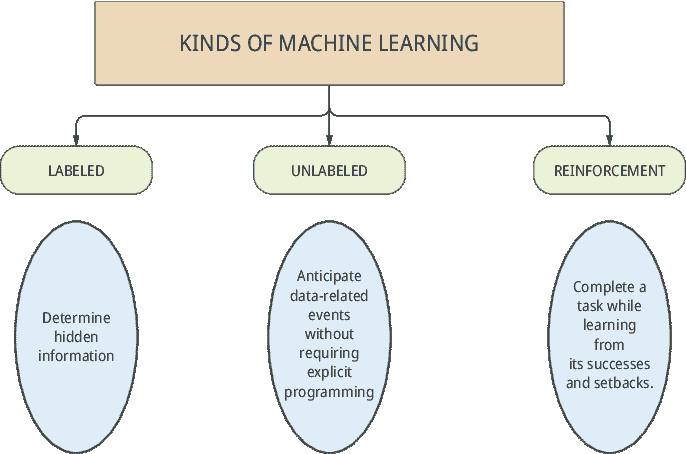

**图 8.1：** 用于药物警戒研究的不同种类的 ML。

为了提高患者安全性和药物警戒水平，AI 正被积极用于收集不良药物反应（ADR）和不良药物事件（ADE）的数据，处理国际临床标准报告（ICSR），提取药物-药物相互作用并预测其效果，识别 ADR 高风险人群并为个性化护理提供信息，预测药物副作用，描绘临床试验，以及将预测不可预测性纳入诊断分类器中 [20]。研究人员将患者多样性和多重用药确定为机器学习在 ADR 检测中的两个潜在应用 [21]。临床前到上市后的安全性评估是药物开发过程中可能出现这些机会的两个阶段 [22]。

由于患者遇到的疾病状态、药物以及 ADR 的多样性，使用机器学习技术的自动化价值日益增长。某些组织通过使用机器学习将参考标准进行比较，以加快不良事件报告的利用，这种方法属于半监督且基于规则 [23]。研究人员检查并对比了社交媒体平台上关于 2 型糖尿病、类风湿关节炎、囊性纤维化和哮喘患者报告用药结果的信息。虽然他们发现社交媒体平台是分析药物结果的适当且互补的来源，但他们也敦促更多地关注开发更可靠的文本挖掘和自然语言处理技术。此外，研究人员 [24] 评估了发布在用户论坛上的患者撰写的药物抗癌药物评论，并将官方药物标签与报告的问题进行了比较。`支持向量机`被用于高效地对 ADR 态度进行分类。此外，其他学者 [25] 探讨了利用抑郁症相关论坛的用户生成内容，建模用户间关于抑郁症药物疗法的数据交换的潜力。他们发现 NLP 可用于更精确地识别这些药物的 ADR，并借助相关医学文献验证了这些 ADR。机器学习在药物警戒中的另一个用途是评估 NLP 对患者安全事件报告中非结构化文本分类的效果。研究人员发现，通过识别导致严重伤害或死亡的病例，NLP 是一种安全网。为了确定伤害结果的程度，他们评估了患者安全事件报告中的自由文本能否被自动分类。然而，这并非完美的方法，目前还不能完全取代人工审核 [26]。

此外，可解释 AI（XAI）通过为医生和患者提供更友好的支持系统，可以保证 AI 模型的可解释性和可解释性。除了提高模型的透明度和可追溯性外，它还可以简化评估过程。系统地管理和跟踪基于 XAI 的模型，并与临床医生密切合作，通过持续的微调改进系统，从而实现更准确、高效的临床决策支持交付，这极具前景。通过管理规则、风险和其他要求，PV XAI 的透明度还可以降低与 PV 模型治理相关的成本，减少人工检查中昂贵错误的需求，并降低无意偏见的可能性 [27]。监督式 ML 通过使用标记数据，学习减少其预测与标签中所代表的（已知）现实之间差距的方法。相反，由于模式出现在高维空间中且通常对人类不可见，无监督机器学习技术试图在未标记数据中识别它们。因此，在药物警戒环境中，监督学习中的标签可以揭示患者是否经历过不良药物反应，由此产生的模型被训练用于区分个体 [28, 29]。除其他场所外，社交媒体、博客和论坛上都会产生大量文本数据。与此并行，人工智能的巨大进步产生了有效的 NLP 技术和算法，使得处理和理解人类生成的文本成为可能。这为文本分析和社交媒体挖掘开辟了新途径 [30]。这些领域近年来取得了显著创新。文本挖掘是分析文本数据（如非结构化或半结构化文本）以发现其中隐藏的模式和信息的过程。因此它融合了 NLP 和数据挖掘。为了提取支持数据驱动决策的见解，需要检查大量人类语言文本，这催生了文本挖掘 [31, 32]。

## 人工智能在药物警戒与药品安全中的应用

近年来，为了改善药物警戒，统计分析和机器学习技术获得了越来越多的关注。在一项研究中，使用了两种机器学习技术：决策树以及归纳逻辑编程，如图 8.2 所示，以根据联合药物和靶点描述符研究常见的副作用特征。其中，归纳逻辑编程方法在关系学习中最为有效，优于决策树，且不仅利用药物特性，还利用既往知识 [[33]](#9783111573861_011894.xhtml#b_9783111574288-008_ref_033)。在另一项研究中，使用人工神经网络分析单核苷酸突变；然而，未获得显著发现。用于药物毒性预测（包括致癌风险、致突变性、肝毒性、急性口服毒性以及心血管毒性）的几种常用算法包括朴素贝叶斯、支持向量机、随机森林和反向传播神经网络。这些技术具有完善的理论基础且易于应用 [[34]](#9783111573861_011894.xhtml#b_9783111574288-008_ref_034)。

此外，`Naive Bayesian (NB)` 是一种简单的贝叶斯概率分类器。分析中的特征向量在很大程度上不受决策变量的影响。每一条数据都需要作为输入进行分类，输出则作为训练样本和特征属性。在分类器训练阶段，会对每个类别的每个特征属性的条件概率估计进行分类，随后计算训练样本中每组出现的频率。后续使用分类器对分类项目进行归类。利用药物信息来源，以下方法已被研究用于副作用预测 [[35]](#9783111573861_011894.xhtml#b_9783111574288-008_ref_035)。它也已被研究用于新药临床前安全性评价，以及各种物质致癌性、致突变性和肝毒性的预测。

`ANNs` 受生物神经网络启发，利用基于实例的学习来解决现实世界的问题 [[36]](#9783111573861_011894.xhtml#b_9783111574288-008_ref_036)。它是一种利用高度网络化的神经元处理信息的范式。因其处理不精确数据集和从复杂数据集中发现复杂模式的卓越能力，它被定位为科学与工程研究专家。它已被研究用于根据药物副作用信息预测不良反应 [[37]](#9783111573861_011894.xhtml#b_9783111574288-008_ref_037)。通过提取表征 ADR 的词子序列，该技术被用于对其进行分类 [[38]](#9783111573861_011894.xhtml#b_9783111574288-008_ref_038)。潜在应用包括用于药品安全的单核苷酸变异变化分析、新药临床前安全性评价，以及基于建模和仿真的化学物质致癌性和致突变性预测 [[39]](#9783111573861_011894.xhtml#b_9783111574288-008_ref_039)，[[40]](#9783111573861_011894.xhtml#b_9783111574288-008_ref_040)，[[41]](#9783111573861_011894.xhtml#b_9783111574288-008_ref_041)，[[42]](#9783111573861_011894.xhtml#b_9783111574288-008_ref_042)。

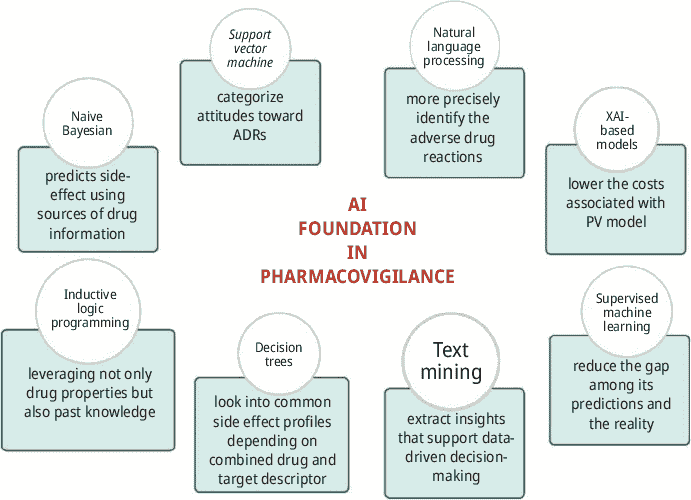

**图 8.2：** 用于药物警戒和药品安全的各种基于 AI 的工具。

表征学习（Representational learning）从数据中生成预测特征，是机器学习中的一个基本概念。该过程减少了非机器学习技术中繁琐且有时必要的人工特征工程的需求。回归是一种可增强的表征学习方法。非机器学习 AI 明确使用人类推理的符号表示和编码的领域知识。这些分析可被视为属于药物警戒中人工智能（`AIPV`）范畴之外，因为它们最初依赖无法自我纠正或自我学习的静态规则 [[43]](#9783111573861_011894.xhtml#b_9783111574288-008_ref_043)。然而，人工智能总体而言，特别是 `AIPV`，仍在不断发展，尽管有时不幸的是与炒作周期同步。二十一世纪正在见证非机器学习符号 AI 的某种复兴，因此不应完全将其排除在外。有两个说明性例子。首先，描述逻辑是一种基于 Web 的知识表示系统，使数据能被机器分析和阅读 [[44]](#9783111573861_011894.xhtml#b_9783111574288-008_ref_044)。该语言使更好的不良事件病例和查询、数据集集成及推理成为可能。这些要素在许多不同的 PV 领域都很重要。其次，混合方法结合了符号 AI 和深度学习以相互增强。神经符号 AI 就是一个例子。这些方法目前正用于 PV 相关领域 [[45]](#9783111573861_011894.xhtml#b_9783111574288-008_ref_045)。

# 8.3 人工智能在药物警戒与药品安全中的挑战与机遇

在低收入和中等收入国家（LMICs），由于培训和教育机会不足，药物警戒医疗专业人员（HCP）严重短缺。在传统 PV 体系中，专业人员在四个领域工作：药物警戒合格人员（`QPPV`）、系统、运营和监测。传统 PV 需要 `QPPV`、数据/系统安全管理员、药品安全医生和药品安全主管。但对于基于 AI 的 PV，还需要各种 AI 领域的专家。例如，机器学习以及自然语言处理（`NLP`）算法开发需要工程师。这对 LMICs 而言是另一个重大障碍。极少数 LMICs 属于为数不多的提供基于 AI 的 PV 跨专业甚至跨语言学习的国家。尽管 AI 技术已被用于药物警戒系统，但目前全球专门针对基于 AI 的药物警戒系统的培训项目非常少。低收入和中等收入国家医疗专业人员（HCP）资金的匮乏也可能限制其参加这些课程的机会。尽管如此，发达国家的 HCP 可以接受数据挖掘、深度学习和自然语言处理等 AI 技术的培训。然而，LMICs 中几乎没有 AI 培训选择 [[46]](#9783111573861_011894.xhtml#b_9783111574288-008_ref_046)。

每个医疗机构支持的数据模型各不相同，每种数据模型都有可能因其自身的术语集和值表示而有所不同。跨多个机构，来自不同来源的数据必须被合并并转换为与通用数据模型（CDM）兼容的格式。为此，工程师和医疗专业人员（HCP）转换数据将耗费时间和精力。由于基于 AI 的药物警戒（PV）中的算法和训练模型依赖带有标注的数据来对未标注数据进行预测，数据标注至关重要。高昂的标注成本以及缺乏用于模型训练的高质量数据阻碍了基于 AI 的 PV 研究。许多个别病例安全性报告（ICSR）可在结构化数据库中找到，但这些数据库无法识别潜在的 PV 信号 [47]。用于软件训练以检测潜在药物安全问题的结构化和整理数据的可用性是 AI 采用的主要障碍之一。在药物警戒中使用 AI 也引发了隐私担忧，因为在数据用于其他目的之前可能未获得参与者的同意，如图 8.3 所示 [48]。

每个人都有权享有隐私和其私人医疗数据的保护。此外，法律法规旨在保护可用于在区域和国家层面识别特定个人的敏感信息的隐私。PV 系统从业人员需要具备特定的知识和能力 [49, 50]。这些结构目前是使用成熟可靠的方法构建的，但当应用机器学习时，传统的 PV 和 IT 接口会被打破。现有证据表明，人工智能有潜力在各种医学科学领域匹配甚至超越人类表现。变更管理涉及受变更影响的个人和职能 [51, 52]。PV 系统跨越营销授权持有人（MAH）安全分部以外的许多领域，新 IT 的引入将影响上下游的众多利益相关者 [53, 54]。实施此类系统可能会带来意想不到的困难，但也会带来意想不到的机会，从而全面增强 PV 系统。智能自动化对业务连续性规划的影响重大。随着自动化程度的提高，明智的做法可能是专注于重新启动自动化流程并停止使用手动变通方法。然而，为了遵守 PV 法规并在中断期间保持警惕以保障患者安全，保持适应性至关重要 [54, 55, 56]。此外，在存在混杂变量（即与暴露和结局均相关的变量）和碰撞因子（即同时受暴露和结局影响的因素）的情况下，利用观察数据区分因果关系和关联关系，在引入机器学习时提出了特别重大的挑战。尽管多变量回归方法常用于解释混杂因素的可能性，但无法直接估计因果效应。此外，在建立因果联系之前，必须进行观察性研究以捕获和评估时间关系 [57, 58]。

因此，人们认为这为将因果推断范式应用于药物警戒行业目前面临的主要机器学习问题提供了机会。因果研究设计的示例，包括格兰杰因果、假设推理以及 do-calculus，在药物警戒任务中较少使用。调查这些类型的研究设计尤为重要。此外，缺乏研究探讨通过引入因果范式来解决机器学习公平性问题的可能性。这可能是药物警戒研究追求的新路径 [59]。尽管生命科学组织对 AI 和 ML 感兴趣，但它们担心 ML 和 AI 无法产生与传统病例处理相同的结果。因为无法充分理解自动化 PV 报告系统能为其运营带来的潜力，许多健康科学行业的企业难以向开发人员提出严格要求，并仔细评估市场上可用的供应商和平台。因为不确定平台的全部潜力，它们可能选择降低预期，转而选择或开发遵循既定程序的解决方案，而不是寻求重新考虑的空间 [60]。即使输出仅中等有利，也将导致药物警戒运营在时间和金钱上的显著减少，以及结果质量的提高。制药公司可以雇佣技术专家而非行业专家，结果却发现这些合作伙伴不了解管理国际药物警戒实践的复杂规则和法规，即使他们几乎已采用用于此类应用的现有平台。此外，发展中国家和贫困国家的参与程度可能会受到诸如有限的可访问性、可靠性、处理专业知识不足以及对技术使用接受度不高等挑战的阻碍 [61]。

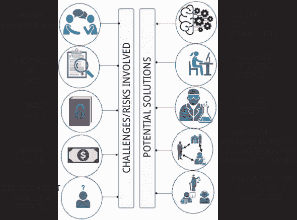

**图 8.3：** AI 在药物警戒和药物安全中的各种挑战与解决方案。

# 8.4 药物安全的合作与伙伴关系

# 8.5 药物警戒和药品安全中 AI 的监管层面

公共和私营部门之间具有合作性质的协议被称为“公私合作伙伴关系”，即 PPP。在这种安排中，两个部门通过共享资源、风险和职责，共同努力实现兼容或互利的目标。公私合作伙伴关系（PPP）的前提建立在这样一种信念之上：从实验室到临床，公共部门或私营部门单独都无法在较长时期内成功监测和维持创新 [62]。专为公共部门创建的研发程序可能过于迟缓且低效。公私合作伙伴关系（PPP）的主要优势之一，在于公共和私营部门能够协作并共享资源，包括资金、知识、数据、样本、医学知识、患者群体、设施、风险和回报。更重要的是，它们能建立拥有不同观点的专家更广泛的网络。除了使创新过程更高效、更具成本效益和有时限约束外，公私合作伙伴关系（PPP）还能促进和改善研发过程的整体流畅性和整体性 [63]。私营部门常规使用药物的频率远高于公共部门。不良药物反应（ADR）是主要死因之一，预计在不太遥远的未来将成为主要公共卫生问题 [64, 65]。根据国家抽样调查办公室（NSSO）的调查结果，在城乡地区，私人医生是唯一的医疗服务提供者。此外，由于私营制药行业的爆发式增长，私营部门急需帮扶支持，以克服 ADR 报告不足、建立国家患者安全数据库等障碍，并追求相互认可、避免监管行动等共同利益 [66, 67, 68]。药物警戒需要医疗专业人员的参与才能成功。因此，PvPI 与学术医疗机构、公立和私立医院的合作，建立了用于 ADR 追踪、报告和评估的强大系统和工具 [69, 70]。因此，PvPI 通过告知和劝说医院管理层和医务人员，指出报告 ADR 完全是自愿的，不会导致纪律处分，从而解决这些问题。来自公共部门的报告，其完成质量评分甚至高于私营部门。私营部门的报告总体评分较低，因为它们因担心诉讼和希望保持机密性而隐瞒了关于替代性争议解决的信息 [71]。

历史上，国家药品监管机构（NRA）的主要目标是与医疗服务提供者和行业合作，通过纸质和在线报告渠道报告被动 ADR。NRA 是药物警戒领域必不可少的监管者。在过去几年中，药物警戒探索了使用人工智能和保存电子健康记录的可能性 [72]。越来越多的人开始理解并接受这样一种观点：患者和护理人员应参与健康产品的创建和监管过程。既然他们最终将在医疗行业使用这些产品，患者应受到教育、参与其中，并被视为其护理过程的参与者。他们还拥有关于自身观点、经历和见解的最深层知识。因此，患者的观点和生活经验有助于在健康产品生命周期的不同阶段对其进行改进 [73]。这些阶段包括监管审批、上市后监测、临床试验设计、研究优先级和技术评估。患者参与药物监测至关重要，因为它提供的背景信息比医疗服务提供者的报告更丰富。一个例证是：患者报告通常包含更详尽的描述，特别是关于对日常生活的影响，而这可能无法被医疗专业人员完全理解。它增强了患者参与其护理的程度，补充了医疗服务提供者提供的报告，并提高了对 ADR 的认知 [74, 75]。

在数字时代，患者现在可以通过互联网和智能手机在线报告 ADR，这变得更加容易 [76]。在上述法国研究中，该研究考察了影响患者参与药物警戒观察和患者参与度发展的变量，发现数字解决方案的可用性影响了患者报告不良药物反应的增加 [77]。在药品安全沟通领域——这是药物警戒的重要组成部分——患者之间进一步的重要合作伙伴关系必不可少。一项考察八个东盟国家药物警戒环境的研究发现，沟通是一个共同问题 [78]。尽管关于药物优势、缺点和疗效的公开诚实沟通，增加了患者安全用药的可能性。为了公众健康，药品安全信息必须易于获取、易于访问并能成功传达。

### 人工智能在药物监管事务中的应用

人工智能有望彻底改变制药行业，尽管其在药物监管事务中的应用仍处于起步阶段。通过传播行业最新发展的信息，人工智能可协助管理监管事务。这在监管审批和药物发现方面人工智能的潜在优势方面尤为明显。

#### 监管事务概述

“监管事务”一词是指制药公司内部作为与国家和全球监管机构沟通渠道的团队或部门，旨在根据现行法律法规获得产品批准。反过来，监管机构根据药物发现全过程以及产品开发过程中提供的信息和文件批准产品 [79]。

#### 药物警戒与人工智能

中央药品标准控制组织（CDSCO）强制要求上市许可持有人（MAHs）将在印度上市的任何药物的个例安全性报告（ICSR）上报至国家药物警戒计划协调中心（NCC-PvPI）及上市许可持有人自身。由于 ICSR 报告数量不断增加，这些文件的管理和处理变得更加昂贵、耗时且费力。因此，为减少处理 ICSR 病例所需的时间、资源和人力，PvPI 也可采用机器智能技术，如人工智能 [80]。

在获取精确数据方面，人工智能技术在药物警戒（PV）中的应用极具优势。借助人工智能工具，PV 中处理病例和风险追踪的几乎所有方面均可实现自动化或简化，从而有助于缩短总体处理时间。

##### 有益人工智能

一种名为“有益人工智能”的理念被提出，即以安全方式开发并造福社会的人工智能。为构建有益的人工智能，已提出两类措施：

- **外在措施**：人工智能设计师须采用有益设计。这些设计可通过纳入特定要求、激励和约束来实施。
- **内在措施**：社会规范的形成与沟通的组织。

外在措施可能受内在措施影响 [81]。

##### 药物警戒中的人工智能工具

此外，药物警戒中的人工智能技术极大地辅助了信息提取过程的准确性。借助人工智能工具，几乎所有 PV 病例处理和风险追踪任务均可实现自动化或简化，有助于总体缩短处理时间 [82]。

###### VigiBase

PV 数据库 `VigiBase` 以结构化且有序的格式存储信息，便于轻松分析记录的数据。该系统关联的一些医学和药物分类包括：WHO 国际疾病分类、WHO 药物分类、以及 WHO 不良反应术语/医学监管活动医学词典（`MedDRA`）。`VigiBase` 是一款公众可用于浏览并轻松获取药物不良反应信息的 Web 应用程序 [83]。

###### VigiLyze

此外，`VigiLyze` 是一项在线资源，提供 `VigiBase` 的清晰简明概览，可在线进一步探究详情 [84]。

###### VigiGrade

`VigiGrade` 是一款在线 ICSR 管理系统，用于全球药物监测。它通过收集、处理和传播数据以实现高效的数据分析。该系统支持 `MedDRA` 和 WHO Drug [85]。

###### VigiMatch

因此，`VigiMatch` 是一种通过概率模式匹配查找相似个例报告的算法。重要的是要记住，`VigiGrade` 的主要目标是以有条理的方式系统评估个例报告中临床相关数据的完整程度。此过程作为告知各国数据质量的一部分而执行 [86]。

#### 电子 CTD 提交

各监管机构正从纸质提交转向电子 CTD 提交。多个机构已停止接收 CTD（纸质版）提交。决定采取行动以加快提交流程并实现流程集中化。从纸质向通用技术文档（CTD）电子提交的转变极大地影响了全球法规 [87, 88]。

接受 CTD 电子提交格式的申报已实现资源优化、效率提升和申报跟踪改进。从纸质向通用技术文档（CTD）电子提交的转变极大地影响了全球法规。

美国食品药品监督管理局（FDA）已针对多种申请类型（如生物制品许可申请、新药申请以及简略新药申请）实施了电子临床试验数据（`eCTD`）提交要求。电子 CTD 提交的实施对监管流程产生了积极影响 [89]。

拥有电子文档提交（`eCTD`）经验的个人可展示相较于纸质提交的成本节约，并缩短其提交获批所需时间。无论组织规模或提交量大小，这一现象均在广泛机构中被观察到。此外，电子提交与审评（`eCTD`）的利用使电子提交的审评和生命周期管理过程更加简便，从而推动了电子提交与审评计划的协调统一 [90, 91]。

由于这些趋势对药物研究、医疗实践以及监管专业人员职责的影响，每个趋势都有一系列需要解决的相关问题。伦理考量涵盖广泛的主题，如隐私、福祉和人类自主权的维护 [91]。在机器学习和人工智能中使用的深度学习模型方面，确保透明度并允许能力解释至关重要。此外，这些技术必须以负责任且可问责的方式加以利用。数字颠覆的出现，给寻求通过员工技能提升和再培训计划来改善员工能力和理解的企业带来了显著障碍。实施导师计划——即经验丰富的员工在过渡期为经验较少的同事提供建议和支持——是解决这些问题的一种可能途径 [92, 93, 94]。此外，印度国家药物警戒计划于 2004 年 11 月由中央药品标准控制组织启动，旨在通过收集和评估不良药物反应数据来提高药品安全性。采用三方结构和多中心模式可加快法规实施，以保障公共卫生。其主要目标是在医生和其他医务人员（如护士和药师）中推广报告文化。该计划允许报告甚至已上市药物的常见或表层副作用，尽管药品监管机构可能更有兴趣了解新上市药物的不良反应 [95]。其目的是激励所有医疗服务提供者开始披露不良事件。报告表格保护患者隐私。尽管如此，为便于信息核实并阻止虚假信息的提交，仍要求提供报告者身份识别。持证医疗专业人员（包括药师）现在可以建立外围药物警戒中心 [96]。当今的药物警戒 (PV) 系统使用基于二元逻辑的算法技术处理安全数据。这些由用户管理的算法利用标准化的、客观的专家知识，确保用户熟悉并理解数据处理结果。报告表格保护患者隐私。尽管如此，为便于信息核实并阻止虚假信息的提交，仍要求提供报告者身份识别。持证医疗专业人员（包括药师）现在可以建立外围药物警戒中心 [97]。

## 8.6 结论

药物警戒 (PV) 是一项科学与应用并重的事业，旨在识别、评估、理解并尽量减少药物的负面影响或潜在药物相关问题。自然语言处理和机器学习是 AI 在网络搜索、临床环境、治疗、监测、结果预测和医学诊断中应用的两个显著特征。数据摄入、异常检测和重复检测均受益于 AI/ML。AI 正被用于药物警戒和患者安全，以收集 ADE 和 ADR 信息、根据国际临床标准处理报告、获取药物相互作用、预测药物不良反应、呈现临床试验，并将估计的不可预测性纳入诊断分类算法。机器学习技术在预测药物副作用、识别药物不良反应高风险人群以及将预测不可预测性纳入诊断分类器方面变得越来越有用。文本挖掘是药物警戒领域的一个新兴方向，它结合了 NLP 和数据挖掘。人工神经网络 (ANN) 被用于 ADR 分类、副作用预测和药物毒性预测。然而，药物警戒和药品安全仍面临障碍，包括跨专业培训机会稀缺、隐私担忧、医疗机构的数据模型问题，以及低收入和中等收入国家 (LMICs) 培训和教育有限。公私合作伙伴关系 (PPP) 有助于解决这些问题并改进创新流程。

## 参考文献

[1] Deye N, Vincent F, Michel P, Ehrmann S, Da Silva D, Piagnerelli M, 等. 2013 年 TTM 试验后心脏骤停患者体温管理的变化：一项国际调查的结果. Annals of Intensive Care. 2016;6:4. →

[2] Meyboom RH, Egberts AC, Gribnau FW, Hekster YA. 药物警戒的透视. Drug Safety. 1999;21:429–447. →

[3] Mockute R, Desai S, Perera S, Assuncao B, Danysz K, Tetarenko N, 等. 药物警戒中的人工智能：识别认知服务及其验证框架的一种途径. Pharmaceutical Medicine. 2019;33:109–120. →

[4] *CIOMS 工作组 IV 报告.* 日内瓦: CIOMS; 1998. 国际医学科学组织理事会. 上市药物的获益-风险平衡：评估安全信号. No. 762. →

[5] Basile AO, Yahi A, Tatonetti NP. 药物毒性和安全性的人工智能. Trends in Pharmacological Sciences. 2019;40:624–635. →

[6] Ball R, Dal Pan G. 药物警戒的“人工智能”：已准备好大显身手了吗？ Drug Safety. 2022;45:429–438. →

[7] Bate A, Luo Y. 安全用药的人工智能和机器学习. Drug Safety. 2022;45:403–405. →

[8] Norén GN, Meldau EL, Chandler RE. 用于药物警戒中病例系列识别和不良事件谱的共识聚类. Artificial Intelligence in Medicine. 2021;122:102199. →

[9] Caster O, Juhlin K, Watson S, Norén GN. 通过在 vigiRank 中结合多个证据强度方面，改进药物警戒中的统计信号检测. Drug Safety. 2014;37:617–628. →

[10] Evans HP, Anastasiou A, Edwards A, Hibbert P, Makeham M, Luz S, 等. 使用监督机器学习 (ML) 方法对初级保健患者安全事件报告内容和严重程度进行自动分类. Health Information Journal. 2019;26(4):3123–3139. →

[11] Marella WM, Sparnon E, Finley E. 使用机器学习筛选电子健康记录相关的患者安全报告. Journal of Patient Safety. 2017;13(1):31–36. →

[12] Yang J, Wang L, Phadke NA, Wickner PG, Mancini CM, Blumenthal KG, 等. 开发和验证一种深度学习模型，利用跨医院的安全事件报告检测过敏反应. JAMA. 2020;3(11):e2022836–e. →

[13] Hashimoto DA, Rosman G, Rus D, Meireles OR. 手术中的人工智能：希望与危险. Annals of Surgery. 2018 Jul;268(1):70–76. →

## 参考文献

[14] Bhardwaj R, Nambiar A, Dutta D. 医疗保健中机器学习的研究. In 2017 Presented at: 2017 IEEE 41st Annual Computer Software and Applications Conference (COMPSAC). 2017 July 4–8. Turin, Italy. →

[15] Kong H. 医疗保健系统中非结构化大数据的管理. Healthcare Informatics Research. 2019 Jan;25(1):1–2. →

[16] Lee R, Lober W, Sibley J, Kross E, Engelberg R, Curtis J. 利用机器学习和自然语言处理在电子健康记录中识别护理目标对话. American Journal of Respiratory and Critical Care Medicine. 2020;201(1):A1089. →

[17] Esteva A, Robicquet A, Ramsundar B, Kuleshov V, DePristo M, Chou K, et al. 医疗保健深度学习指南. Nature Medicine. 2019 Jan;25(1):24–29. →

[18] Jiang F, Jiang Y, Zhi H, Dong Y, Li H, Ma S, et al. 医疗保健中的人工智能：过去、现在与未来. Stroke and Vascular Neurology. 2017 Dec;2(4):230–243. →

[19] Guan M. 电子健康记录中药物安全性分析的机器学习. In Machine Learning and Deep Learning in Computational Toxicology 2023 Feb 8 (pp. 595–610). Springer International Publishing: Cham. →

[20] Alvaro N, Conway M, Doan S, Lof C, Overington J, Collier N. 众包 Twitter 标注以识别处方药使用的第一手经历. Journal of Biomedical Informatics. 2015;58:280–287. →

[21] Basile AO, Yahi A, Tatonetti NP. 药物毒性和安全性的人工智能. Trends Pharmacological Sciences. 2019;40(9):624–635. →

[22] Bean DM, Wu H, Iqbal E, Dzahini O, Ibrahim ZM, Broadbent M, et al. 未知不良药物反应的知识图谱预测及在电子健康记录中的验证. Scientific Reports. 2017;7(1):16416. →

[23] Benin AL, Fodeh SJ, Lee K, Koss M, Miller P, Brandt C. 不良事件报告系统中文本理解的电子化方法. Journal of Healthcare Risk Management. 2016;36(2):10–20. →

[24] Mishra A, Malviya A, Aggarwal S. 面向自动药物警戒：分析肿瘤药物的患者评论和情感. In Proceedings of the 2015 IEEE 15th International Conference on Data Mining Workshops. 2015 November 14–17 (pp. 1402–1409). Atlantic City, NJ, USA. →

[25] Akay A, Dragomir A, Erlandsson BE, Akay M. 利用智能数据监测和在线论坛挖掘评估抗抑郁药. IEEE Journal of Biomedical and Health Informatics. 2016;20:977–986. →

[26] Evans HP, Anastasiou A, Edwards A, Hibbert P, Makeham M, Luz S, et al. 使用监督机器学习 (ML) 方法对初级保健患者安全事件报告的内容和严重程度进行自动分类. Health Informatics Journal. 2019;26(4):3123–3139. →

[27] Vilone G, Longo L. 可解释人工智能的可解释性概念和评估方法. Information Fusion. 2021 Dec;76:89–106. →

[28] Samuel AL. 利用跳棋游戏进行机器学习研究. IBM Journal of Research and Development. 1959;3(3):210–229. →

[29] Kaas-Hansen BS, Placido D, Rodríguez CL, et al. 与语言无关的药物警戒文本挖掘，以从临床笔记和医院用药记录中获取副作用. Basic and Clinical Pharmacology Toxicology. 2022;131(4):282–293. →

[30] Tekin M, Etlioğlu M, Koyuncuoğlu Ö, Tekin E. 数字营销中的数据挖掘. In: Durakbasa NM, Gencyilmaz MG, eds. Proceedings of the 2018 International Symposium for Production Research; Vienna, Austria. 28–31 August 2018. 2018 (pp. 44–61). Springer International Publishing: Cham, Switzerland. →

[31] Wall J, Krummel T. 数字化外科医生：大数据、自动化和人工智能将如何改变外科实践. Journal of Pediatric Surgery. 2020;55:47–50. →

[32] Gandomi A, Haider M. 超越炒作：大数据概念、方法与分析. International Journal of Information Management. 2015;35:137–144. →

[33] Bresso E, Grisoni R, Marchetti G, Karaboga AS, Souchet M, Devignes MD, Smaïl-Tabbone M. 用于理解药物副作用谱的整合关系机器学习. BMC Bioinformatics. 2013;14(1):207. →

[34] Hillerton T. 基于神经网络方法预测癌症治疗中的不良药物反应. Student Thesis, University of Skövde, School of Bioscience, p.33, 2018, urn:nbn:se:his:diva-15659. →

[35] Hillerton T. 基于神经网络方法预测癌症治疗中的不良药物反应. Student Thesis, University of Skövde, School of Bioscience, p.33, 2018. →

### 参考文献

[36] Zhang L, Zhang H, Ai H, Hu H, Li S, Zhao J, Liu H. 机器学习方法在药物毒性预测中的应用. *Current Topics in Medicinal Chemistry*. 2018;18(12):987–997.

[37] Khan MI. 使用机器学习方法进行药物副作用预测. Available at: [`urn.fi/URN:NBN:fi:aalto-201712188103`](http://urn.fi/URN:NBN:fi:aalto-201712188103), accessed on 9.01.2024.

[38] Zhang H, Cao ZX, Li M, Li YZ, Peng C. 用于预测化学品致癌性的新型朴素贝叶斯分类模型. *Food and Chemical Toxicology*. 2016;97:141–149.

[39] Xu C, Cheng F, Chen L, Du Z, Li W, Liu G, Lee PW, Tang Y. 化学物质 Ames 致突变性的计算机模拟预测. *Journal of Chemical Information and Modeling*. 2012;52:2840–2847.

[40] Zhang H, Ding L, Zou Y, Hu SQ, Huang HG, Kong WB, Zhang J. 利用朴素贝叶斯分类器方法预测人类药物性肝损伤. *Journal of Computer-Aided Molecular Design*. 2016;30:889–898.

[41] Huynh T, He Y, Willis A, Rüger S. 基于深度神经网络的不良药物反应分类. In *Proceedings of COLING, Technical Papers*. 2016 (pp. 877–887).

[42] Fjodorova N, Vračko M, Novič M, Roncaglioni A, Benfenati E. 致癌性的新公共 QSAR 模型. *Chemistry Central Journal*. 4:2010.

[43] Hauben M, Reynolds R, Caubel P. 解构药物警戒炒作周期. *Clinical Therapeutics*. 2018;40:1981e1990.

[44] Souvignet J, DeClerck G, Asfari H, et al. OntoADR 一个描述不良药物反应的语义资源，以支持搜索、编码和信息检索. *Journal of Biomedical Informatics*. 2016;63:100e107.

[45] Alshahrani M, Khan MA, Maddouri O, 等. 生物学知识图谱上的神经符号表征学习. *Bioinformatics*. 2017;33:2723e2730.

[46] Luo Y, Thompson WK, Herr TM, Zeng Z, Berendsen MA, Jonnalagadda SR, 等. 基于 EHR 的药物警戒自然语言处理：结构化综述. *Drug Safety*. 2017;40(11):1075–1089.

[47] Skentzos S, Shubina M, Plutzky J, Turchin A. 结构化与非结构化：影响 EMR 知识库中不良药物反应记录的因素. *AMIA Annual Symposium Proceedings*. 2011;2011:1270–1279.

[48] Salas M, Petracek J, Yalamanchili P, Aimer O, Kasthuril D, Dhingra S, Junaid T, Bostic T. 人工智能在药物警戒中的应用：文献系统综述. *Pharmaceutical Medicine*. 2022 Oct;36(5):295–306.

[49] 欧盟委员会. 通用数据保护条例 (GDPR) 2016/679. 2016. <https://eur-lex.europa.eu/legal-content/EN/TXT/?uri=celex%3A32016R0679>. 访问日期：2024 年 1 月 10 日.

[50] 英国议会. 英国 2018 年数据保护法案. 2018. <https://www.legislation.gov.uk/ukpga/2018/12/schedule/19>. 访问日期：2024 年 1 月 10 日.

[51] Grace K, Salvatier J, Dafoe A, Zhang B, Evans O. AI 何时将超越人类表现？来自 AI 专家的证据. 更新于 2018 年. <https://arxiv.org/abs/1705.08807>. 访问日期：2024 年 1 月 10 日.

[52] Beam AL, Kohane IS. 将人工智能转化为临床护理. *JAMA*. 2016;316(22):2368–2369.

[53] Zaidi D. AI 正在改变医学诊断、假肢和视觉辅助. *Venture Beat*. 2017. <https://venturebeat.com/2017/10/30/ai-is-transforming-medical-diagnosis-prosthetics-and-vision-aids/>. 访问日期：2024 年 1 月 10 日. a, b

[54] Zitnik M, Nguyen F, Wang B, Leskovec J, Goldenberg A, Hoffman MM. 生物学与医学中数据整合的机器学习：原则、实践与机遇. *Information Fusion*. 2018;50:71–91.

[55] Yu KH, Beam AL, Kohane IS. 医疗保健中的人工智能. *Nature Biomedical Engineering*. 2018;2:719–731.

[56] Danysz K, Cicirello S, Mingle E, 等. 人工智能与药物安全专业人员的未来. *Drug Safety*. 2018;42(4):491–497.

[57] Rubin DB. 为了客观的因果推断，设计胜过分析. *Annals of Applied Statistics*. 2008;2(3):808–840.

[58] Rubin DB. 观察性研究因果效应的设计与分析：与随机试验设计的类比. *Stat Med*. 2007;26(1):20–36.

[59] Zhao Y, Yu Y, Wang H, Li Y, Deng Y, Jiang G, Luo Y. 因果推断中的机器学习：在药物警戒中的应用. *Statistics in Medicine*. 2022 May;45(5):459–476.

[60] Gupta J, Patrick J, Poon S. 临床安全事件分类学在 C4.5 决策树和随机森林上的表现. *Studies in Health Technology and Informatics*. 2019;266:83–88.

[61] Kwak YH, Chih Y, Ibbs CW. 为全面理解基础设施发展的公私合作伙伴关系. *CMR*. 2009;51:51–78.

[62] Mittra J. 通过公私合作伙伴关系利用转化医学：苏格兰转化医学研究合作的案例研究. 见 Mittra J, Milne C-P, 编. *Translational Medicine: The Future of Therapy?* 2013 (pp. 213–232). Pan Stanford Publishing: Boca Raton, FL.

[63] Pandey V, Fozia Khanum A, Singhal M, Sethiya NK, Kumar B. 变革药物安全：AI 在药物警戒中的作用. 2023;2319–2333.

[64] Patel PB, Patel TK. 住院后发生的不良药物反应导致的患者死亡率：一项荟萃分析. *European Journal of Clinical Pharmacology*. 2019;75:1293–1307.

[65] Hadi MA, Neoh CF, Zin RM, Elrggal ME, Cheema E. 药物警戒：药师对自发不良药物反应报告的看法. *Integrated Pharmacy Research and Practice*. 2017;6:91.

[66] 世界卫生组织. WHO 的工作，1990–1991：总干事向世界卫生大会和联合国提交的两年一度报告. *World Health Organization*. 1992;21–25.

[67] Kalaiselvan V, Prasad T, Bisht A, Singh S, Singh GN. 印度药物警戒计划中的不良药物反应报告文化. *Indian Journal of Medical Research*. 2014 Oct 1;140(4):563–564.

[68] Rout SK, Sahu KS, Mahapatra S. 印度公共和私人医疗保健中医疗服务的利用：原因和决定因素. *International Journal of Healthcare Management*. 2021 Apr 3;14(2):509–516.

[69] Bhat R. 印度私营卫生部门的监管. *International Journal of Health Planning and Management*. 1996;11:253–74.

[70] Brown P, Bahri P. 患者和医疗专业人员在监管药物警戒中的“参与”：建立概念和方法学框架. *European Journal of Clinical Pharmacology*. 2019 Sep 1;75:1181–1192.

[71] Kalaiselvan V, Shukla S, Arora S, Shrivastava TP, Raghuvanshi RS. 确保药物安全使用的公私合作伙伴关系 (3Ps)：印度经验. *Frontiers in Public Health*. 2022 Aug 11;10:930696.

[72] 美国疾病控制与预防中心. 关于疫苗不良事件报告系统 (VAERS). <https://wonder.cdc.gov/controller/datarequest/D8>. 访问日期：2024 年 1 月 11 日.

[73] 药品和医疗器械监管管理局 (MHRA). 黄卡计划：MHRA. <https://yellowcard.mhra.gov.uk/information>. 访问日期：2024 年 1 月 22 日.

[74] Cavaller-Bellaubi M, Faulkner SD, Teixeira B, 等. 药物全生命周期中维持有意义的患者参与：行动路线图. *Therapeutic Innovation and Regulatory Science*. 2021;55(5):936–953.

[75] Adopo D, Daynes P, Benkebil M, 等. 患者参与药物警戒：2011 年至 2020 年法国报告的决定因素和演变. *European Journal of Clinical Pharmacology*. 2023;79(2):229–236.

### 第 9 章 制药行业的知识产权与数据隐私

## 摘要

在制药行业，数据隐私对于提供优质医疗服务至关重要。然而，保护海量数据已被证明是一项艰巨的任务，医疗行业仍易受数据泄露的侵害，此类事件屡见报端。知识产权（IPR）对制药行业至关重要，因为它们允许发明人在预定期限内依法保持其发明的机密性。发明人和创作者从其发明中获利的专有权利被称为知识产权（IPR）。这些权利受各种法律保护，包括专利、版权和商标。本章还探讨了区块链技术如何用于管理知识产权并改善患者隐私。文章重点介绍了制药行业数据隐私面临的挑战，包括网络安全风险和遵守数据保护法规。在复杂的制药供应链中，分销商、制造商和其他利益相关者之间的合作对于保障数据隐私至关重要。总体而言，本章强调了制药行业错综复杂且受严格监管的性质，以及对数据隐私和知识产权采取平衡方法的必要性。文章指出，解决不公平做法和促进创新有助于消费者福祉和社会进步。

**关键词：** 数据隐私、版权、专利、商标、认证、加密、网络安全

#### 9.1 引言

# 知识产权格局

在大多数经济体中，制药行业受到高度监管且极为复杂。对“学识中介人”（如医生和药剂师）的利用、广告和促销的限制、公共和私人保险计划，以及政府采购和价格管制，所有这些都对药品需求产生重大影响。竞争格局同样由严格的产品安全审查、制造监管监督，以及管辖商业实体与公共资助的生物医学研究机构之间技术转让的法律框架所塑造 [1]。

人类智力的一切原创成果，无论是在艺术、科学、技术还是文学领域，均被视为知识产权（IP）。创作者或发明人在特定期限内对其创意或创新保持保密的合法权利，被称为知识产权（IPRs） [2]。在特定期限内，这些法律权利赋予发明人或其受让人独家实施其发明的专有权。知识产权在现代经济环境中的重要性已获认可很长一段时间。此外，已明确确立：发现背后的智力劳动因其对公共福利的贡献而理应获得认可。研究与开发（R&D）支出不断攀升，导致将创新技术推向市场所需的投资相应增加 [3]。

欧洲是知识产权规则和法规的发源地。十四世纪标志着授予专利倾向的开端。英国在特定领域表现出比其他欧洲国家更优越的科学进步，因此在有利条件下吸引了移民工人。意大利是公认版权的起源地。历史上导致首部法律和法律体系诞生的大多数法学思想发生在威尼斯，这也是该城市被公认为知识产权制度发源地的原因 [4]。

总体而言，在独立后时代，跨国公司控制了印度药品市场。印度曾是全球药价最昂贵的国家之一，进口药品成本更高。委员会正确地指出，专利法中应包含一项明确建议，以保障印度民众对食品、药品和医疗器械的需求。这些产品应以尽可能低廉的价格向公众提供，同时专利权人获得公正补偿。1957 年，印度政府采取了两项重大行动：第一，通过联合国儿童基金会协议成立了印度抗生素有限公司；第二，指定拉贾戈帕拉·艾扬加法官委员会修订专利法，并建立一个可在本地维持的市场 [5, 6, 7]。

知识产权通常被视为在制药领域具有两个主要影响领域。首要关切是定价和可及性问题，即知识产权（特别是专利权）与创新药物成本和可及性之间的相互作用。第二个问题是知识产权在为创新药物的开发、商业化和发现提供激励方面的作用，即研发（R&D）激励。此外，知识产权影响研发支出及其在疾病、国家和组织间的分配。这两大关切错综复杂地交织在一起，其相互作用带来了许多严峻的政策和经济挑战 [8]。

利用知识产权有效协调降价和竞争性药品供应带来的“静态”消费者利益，与突破性产品带来的“动态”利益，即便在单一国家范围内也面临重大挑战。一方面，有效专利期限缩短和研发成本增长严重挤压行业财务。然而，尽管药品创新对经济和公共卫生有巨大的积极影响，即使在富裕国家，非处方药的高昂价格也常引发关于弱势或低收入群体获取公平性问题的激烈政治辩论，以及如何最佳配置公共医疗资金的争论 [9]。

制药行业的现状表明，知识产权得到不公平的推广和利用，损害了竞争和消费者福利。药企创新不足和规避风险的倾向，凸显了对社会福利造成的不公。这种不公无法仅靠立法改革来补救。尽管旨在解决现行法规缺陷并颁布新法规以进一步遏制制药行业不公平商业行为的立法举措可能提供一些缓解，但反垄断法必须有效介入 [10]。

反垄断法已严格审查制药领域的某些企业活动，包括不竞争协议和并购；然而，仍有许多其他做法亟待关注。反垄断法有助于在多个领域维持激励创新与保护竞争之间的平衡，例如：为过时药物的次要成分授予专利、重新配方药物以获取新专利，以及利用广告和品牌延伸提高仿制药竞争对手的准入门槛 [11]。

因此，在全球化浪潮下，保持创新并在创意上保持领先，对于在竞争激烈的贸易和技术市场中竞争至关重要。印度以其在软件工程、导弹技术、月球或木星任务等多个技术领域的智力优势而闻名 [12, 13, 14]。

知识产权及其政策框架直接影响任何社会的发展。对知识产权的无知会导致发明的消亡、侵权风险增加、财务损失，以及国家智力时代的终结。因此，迫切需要普及知识产权信息，以支持国内在研究和技术领域的发明与进步 [15, 16, 17]。

#### 9.2 知识产权格局

##### IPR 指公众认定为专有的思想、创作和艺术作品

IPR 赋予所有者专有权，使他们能够将发明或声誉货币化。各种法律，如专利、版权、商标等相关法律，保护图 9.1 所示的知识产权。

###### 9.2.1 专利

为旧问题提供新颖解决方案或提供新技术途径的产品或技术称为发明。发明有权获得专有专利，这赋予专利持有者对其发明的保护。这种保护在有限期限内实施。未经专利持有者同意，专利创新不得为营利目的而制造、使用、销售或传播。在专利保护期内，专利持有者负责决定谁可以使用该创新以及在什么条件下使用。专利所有人可在双方可接受的条件下许可第三方使用该发明。所有人可将发明权利转让给第三方，后者随后成为专利所有人。专利期满后，发明丧失其专有权，可供他人进行经济开发，从而结束其保护 [18]。“发明进入公有领域”这一短语即表示这一概念。大多数国家已颁布国内法以保护其 IPR。授予特定国家（如印度）或地区（如欧盟）发明人和创作者的保护是地域性的，不能转移到其他国家或地区，版权除外 [19]。在印度授予的专利仅在该司法管辖区内有效，不能在美国强制执行。为创意申请专利的主要动机是利用其排他性获利。如果发明人或其受让人：(a) 在考虑客户修改意见后开发出重大发明；且 (b) 该发明在专利代理人编写的专利说明书中得到了精确阐述和权利要求；则由此产生的专利将赋予专利所有人专有市场权利。专利持有人可通过直接向消费者销售专利发明或将其许可给另一实体来行使其专有权利 [20]。

此外，一项名为《专利合作条约》（PCT）的多国协定于 1978 年生效。通过在 PCT 申请中指定感兴趣的国家，PCT 缔约国的发明人可同时在任何或所有成员国获得其发明的优先权。这免除了发明人在每个成员国分别提交申请的必要性 [21]。为在国际上保护创新，必须在每个相关国家提交单独的专利申请；在某些情况下，必须在指定时间内完成，以便在这些司法管辖区获得优先权。这需要大量且及时的资金投入，以支付申请费、翻译费、法律费用及其他相关开支。此外，有限的时间框架可能导致关于在某国申请专利必要性的结论出现偏差 [22]。

### 9.2.2 版权

“版权”是指授予已出版作品的法律保护，禁止除作者外的任何人出版或销售这些作品。版权是一套专有权利，规定了以特定方式使用创意或信息的权利。从最广泛的意义上讲，它指“复制”原创作品的权利。受版权保护的作品示例包括：戏剧、小说、诗歌和参考书等文学作品，技术图纸、地图和广告，以及计算机程序、数据库、电影、音乐作品、照片、雕塑和建筑。作为人类智力和创造力产物的作品受版权保护。已出版和未出版的作品均包含在内。版权保护的是思想的表达，而非思想本身。在预定期限内，它允许版权持有者阻止他人复制该作品 [23]。由于版权法赋予内容创作者对其原创作品的专有权利，因此至关重要。除其他外，它为艺术、音乐、文学和电影作品提供保护。由于版权法，作者可以管理其作品的复制、分发、公开表演和改编。当内容创作者了解版权保护的范围，包括权利期限、版权登记要求以及合理使用的概念时，他们就能更好地保护自己的作品 [24]。

不同国家开展了大量研究计划，从不同角度审视版权立法。该研究作者专注于版权和公有领域立法。研究表明，公有领域是版权法的基本组成部分，其纳入符合历史和逻辑标准。不引用“公有领域版权”，就无法为自己的行为辩护。研究进而指出，版权和公有领域相似之处在于它们具有相似的评价价值。根据一项相关研究，公众是版权的利益相关者。据作者称，美国版权法赋予创作者若干专有权利，其中许多创作者或知情或不知情地将这些权利让渡给商业实体 [25]。既然公众现在被视为版权的利益相关者，公民应支持考虑其利益的版权体系。传统既得利益必须优先考虑。三项关于版权政策的额外研究展示了版权的伦理和财务方面。一项研究的主题是保护期限。研究结论认为，延长保护期将是有害且不必要的。根据第二项研究，版权法存在两个不同流派：第一流派强调创作者对其作品收益的固有权利，第二流派强调建立最大化社会福利的版权框架的高昂成本。研究结果最终表明，“自然权利观”对加拿大版权法的影响大于经济视角 [26]。

### 9.2.3 商标

#### 《与贸易有关的知识产权协定》第 15 条

《与贸易有关的知识产权协定》（TRIPS 协定）第 15 条规定：“任何标志，或者标志的任何组合，能够将一个企业的商品或服务与其他企业的商品或服务区分开来，均应能够构成商标。”由于工业化的发展，商标在当代国际贸易中变得愈发重要 [27]。商标是一种独特的标志或徽标，表明某特定产品由某个人、组织或经济部门制造或提供。服务标志与商标类似，用于将服务提供者与其竞争对手区分开来。一家企业可对不同商品使用各类商标，而商号则用于将其与竞争企业区分开来。商号和商标有助于企业建立品牌、提高知名度并赢得消费者信任。消费者通常依赖商标，因为快速评估产品或服务以判断其质量存在困难 [28]。根据印度《商标法》，任何可识别的标志，或能以图形方式表现并用于区分一家公司商品和服务与他人商品和服务的标志，均有资格进行商标注册。商标不授予可能被滥用的专有权，因此其有效期不应受限。然而，如果商标有效期没有时间限制，将会出现过多无实际使用的注册商标 [29]。

### 9.2.4 商业秘密

商业秘密是指被保密、不为公众广泛知晓，并赋予其权利人经济或竞争优势的任何知识。商业秘密价值极高——可达数千万甚至数亿美元——商业秘密诉讼中也曾判决巨额赔偿。当通过“不正当手段”获取商业秘密时，即构成侵占。尽管如此，如果主张的商业秘密是独立创造的、已为公众知晓、或未被保密，那么这些抗辩理由可能成功反驳商业秘密侵占的指控。尽管商业秘密是任何企业极具内在价值的无形资产，但其知名度不如其他知识产权 [30]。其不为人知归因于多种因素：首先，商业秘密无需注册。商业秘密的形成和维护通常归功于标准的商业惯例和商业道德。尽管商业秘密法律基于不断演进的法律理论，但目前执法体系薄弱。第三，涉及此类秘密的纠纷很少公开审理，意味着获取此类事务信息的途径通常受限，导致商业秘密相对不为大众所知。第四，与其他类型的知识产权不同，商业秘密不授予其权利人独家使用信息的权利。当知识被独立创造或通过逆向工程获得时，该权利可能属于他人。商业秘密为企业提供多重经济利益 [31]。由适当的商业秘密保护所支持的任何发明获得适当回报，可为公司提供财务稳定性。为防止泄露，无需建立昂贵的体系。此外，企业始终担心知识溢出导致公司信息被滥用。商业秘密在适当披露与保密之间取得平衡，尽管其依赖合理方法维持机密性。因此，商业秘密可能导致独立发明或知识扩散。非排他性限制在维持与绝对保密的必要区别和确保机密性之间达到了完美平衡。

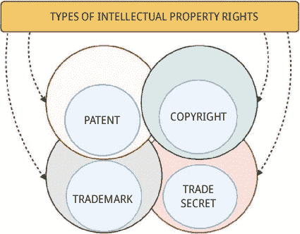

**图 9.1：** 知识产权类型示意图。

## 9.3 制药行业的数据隐私

医疗机构发送、存储和管理大量数据，以确保提供有效且适当的医疗服务。多年来，保护数据一直是一项极具挑战性的当务之急。更糟糕的是，医疗行业仍是公开披露的数据泄露事件中最脆弱的行业之一。确实，数据泄露发生在黑客通过数据挖掘技术和程序发现敏感信息并将其公开之时。实施安全措施的复杂性未变，但风险不断升级，因为绕过安全控制的复杂手段层出不穷。因此，组织必须采用符合监管标准并保护关键资产的医疗数据安全措施。近年来，高级持续性威胁（APT）的发生率上升，其特点是针对信息系统的定向攻击，主要旨在窃取攻击者可利用的可恢复数据。因此，患者隐私泄露被视为大数据分析中的重大关切，增加了组织应对这些多样、相互关联且紧迫挑战的难度。数据隐私根据隐私规则和法规划定数据访问范围，明确谁有权访问财务、医疗、个人或机密信息。反之，数据安全管控数据在其整个生命周期内的访问权限 [32]。多种技术确保医疗数据的机密性和隐私。最常用的技术包括（图 9.2）：

### 9.3.1 认证

认证是验证由或关于主体所作断言真实性的过程。多数加密方法包含端点认证，以缓解中间人攻击（MITM）。真实性通常关乎一个人的出身、主张、承诺和动机的真实性。认证是验证由或关于主体所作断言真实性的过程。信息认证常与身份验证同时进行；然而，它可能带来独特问题，特别是关于中间人攻击方面。大多数加密方法采用端点认证，以各种形式缓解中间人攻击。例如，`传输层安全性 (TLS)` 和 `安全套接字层 (SSL)` 等加密协议可促进互联网等网络上的安全通信。在传输层，网络连接片段通过 `TLS` 和 `SSL` 加密实现端到端保护。这些协议的多个版本广泛应用于语音互联网协议 (VoIP)、即时通讯、网络传真、电子邮件和网页浏览等各类应用中 [33]。

### 9.3.2 加密

#### 有效加密数据可防止未经授权访问机密信息

有效加密数据可防止未经授权访问机密信息。数据的所有权在整个数据生命周期中得到保障，涵盖数据中心、终端（包括管理员、临床医生和医师的移动设备）以及云端。加密可防范数据包嗅探和存储设备窃取等安全漏洞 [34]。应采用时间和成本约束最小的高效方法，因为医学图像加密是密码系统不断扩展的应用领域。要将输入图像转换为密文图像，必须采用对称或非对称的加密方法。可以采用多种技术和环境来加密医学图像。医学图像可通过多种技术进行加密，包括逐位 XOR 扩散、混沌方法、边缘映射、高速置换等 [35]。此外，大多数情况下，加密方法会阻止对加密数据进行处理，因此数据以原始格式进行处理。另一方面，同态加密允许用户在对加密数据进行计算后获得加密结果。同态加密不仅使处理加密数据成为可能，还能在整个过程中保护隐私 [36]。

为了提供更有效的医疗服务和护理，得益于医疗数字化时代，现在可以快速访问数据。大量医疗专业人员目前正在使用电子健康记录（`EHR`）系统。大多数医疗机构已转向使用第三方云在中心化数据仓库中存储患者数据，但这些仓库不安全且不可靠。当 `EHR` 数据存储在潜在不可靠的第三方云上时，会引发关于信息保存、访问安全和隐私的担忧。鉴于医疗机构日常管理敏感数据，加密是安全性和可靠性的关键来源。关于云存储提供可扩展、受监管且自适应访问的能力，人们提出了诸多担忧 [37]。研究人员撰写了一篇研究文章，探讨基于云的个人健康记录系统相关的安全和隐私问题。该研究分析了适用于云系统的各种基于属性的加密（`ABE`）方法，以提供细粒度、可扩展且灵活的访问控制。当代密码技术（如 `ABE`）被纳入 `PHR` 系统，以缓解与基于云的 `PHR` 相关的安全和隐私问题 [38]。

### 9.3.3 数据掩码

由于掩码不构成真正的加密方法，因此无法从掩码值获取原始值。它用无法区分的值替换敏感数据项。它利用一种对数据集进行去标识化或模糊化的方法，抑制或泛化准标识符（如邮政编码和出生日期），并隐藏个人标识符（包括姓名和社会安全号码）。因此，数据掩码是实时数据匿名化最常用的技术之一。最初，某些研究人员引入了 k-匿名方法，该方法可防范属性泄露，但无法保护身份免遭揭露 [39, 40]。在许多现行的数据掩码策略中，目标应用程序被视为对掩码数据不敏感。它可能涉及社会安全号码（`SSNs`）等身份识别信息，但根据预期应用（特别是在医疗环境下），也可能包含年龄等其他敏感信息。在这种情况下，数据通常在传输前进行加密以防止未经授权的访问。尽管如此，加密方法会损害性能，且往往导致响应时间和存储容量方面的显著成本。此外，它们无法防止信誉良好的外部 `AI/ML` 研究人员在解密后利用信息；因此，在传播此类材料时，通常会纳入法律协议以禁止私人数据的泄露或推断 [41, 42, 43]。

### 9.3.4 访问控制

访问控制策略通常基于患者或可靠第三方授权的每位从业者所享有的特权和权利，将继续管控用户对信息系统的访问。因此，该策略演变为一种高效且灵活的工具，用于授予用户权限。它提供高级授权控制，以确保用户只能执行其被允许的任务，包括数据访问、作业提交、集群管理和其他职责。通过多种方法缓解了安全和访问控制问题，其中基于角色的访问控制（`RBAC`）和基于属性的访问控制（`ABAC`）是 `EHR` 最常用的模型 [44, 45, 46]。此外，区块链技术因其固有优势，是增强医疗隐私的可行解决方案。由于账本的分布式和去中心化特性，数据分散在多个网络节点上。因此，单点故障或攻击目标的概率降低。其次，区块链技术可促进智能合约的创建，在遵守隐私法规的前提下自主分发数据。区块链技术有潜力增强患者隐私；不过，仍有一些问题有待解决 [47]。一个主要问题是各种区块链平台之间的不兼容性，可能导致医疗服务提供者使用碎片化且非集成的系统。区块链技术集成了多种隐私增强技术，以加强敏感患者信息的安全性。加密实现医疗数据的安全传输和存储，将访问权限限制在拥有必要解密密钥的授权个人范围内。患者可利用智能合约中的同意管理决定谁可以访问其数据，从而确保医疗数据治理尊重患者意愿 [48, 49]。

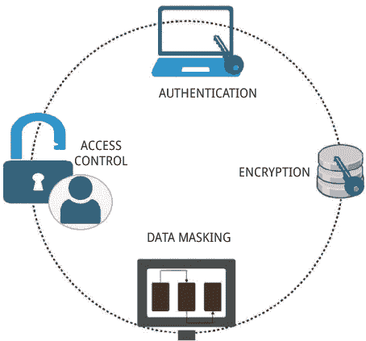

**图 9.2：** 制药行业数据隐私的各种技术。

## 9.4 新兴技术与知识产权

### Blockchain Technology Applications in Healthcare and Intellectual Property

The application of blockchain technology has grown across multiple sectors, including healthcare, with relevant studies cited in references [50], [51], [52]. Blockchain technology provides a transparent, immutable, decentralized shared database that can be used to build reliable value chains. With the digitization of the healthcare industry, medical information systems are being created [53]. Individual survival depends on healthcare, as do the statistics required for disease diagnosis and treatment decisions. Historically, information was recorded on media susceptible to damage or tampering [54], [55]. These systems must transmit data efficiently and securely [56]. They must also provide enhanced access control, privacy, and anonymity for every user. A lack of security, privacy, or trust may hinder individuals from seeking treatment or disclosing sensitive information. Due to its distributed nature, reliance on blockchain technology may evolve. It possesses the ability to withstand challenges and attacks steadfastly and collectively, while also providing documentation of data ownership and authenticity [57]. Consequently, blockchain is emerging as a versatile technology with applications spanning multiple domains and use cases, including contract management, identity management, supply chain management, and healthcare [58].

#### Blockchain-Based Intellectual Property Systems

Thanks to blockchain-based Intellectual Property Rights (IPRs) systems, data access for various intellectual property objects has become more convenient. The critical "trusted timestamp" function of Blockchain Technology (BCT) can provide this information. Therefore, BCT enhances the competitiveness and management capabilities of all stakeholders [59]. To harmonize the interests of IP rights holders and end-users, technical and legal standards must be established before integrating blockchain technology into IP systems. BCT represents a pioneering approach to managing patent systems (specifically) and IP systems (broadly). The security attributes of blockchain facilitate the efficient storage and use of confidential information, enabling patent applicants to accelerate the IP patent acquisition process while protecting their rights against potential infringement [60]. Furthermore, researchers suggest utilizing blockchain technology to improve the operations of IP offices, enhance customs processes for identifying counterfeit goods, and increase the effectiveness of rights holders in managing their rights. They also offer recommendations on how to drive the development and adoption of blockchain technology and how to successfully integrate it into various IP management services and registration/transaction channels [61]. Acquiring intellectual property not only confers rights but also serves as a resource that owners can leverage. Therefore, once an author or inventor owns a work, they may freely dispose of their rights and prohibit others from using, copying, or selling it without permission. Since IP protection covers authors and inventors throughout the entire lifecycle of a work, managing these rights should encompass three core tasks: monitoring each intellectual property right; ensuring authors and inventors receive fair remuneration for the use of their works; and ensuring no third party infringes upon their rights. Blockchain technology has the potential to eliminate the need for intermediaries and reduce costs associated with rights exploitation, particularly in the context of copyright law. Blockchain technology can also be used to enhance owners' rights during management and exploitation. As demonstrated, blockchain can be used to store information regarding work ownership or related details. Once all relevant information (such as work attributes, author or inventor, ownership, authorized right types, localization, etc.) is recorded on the blockchain, rights holders can use smart contracts to track the usage of their works. AI programs (such as Oracles or IoT devices) notify the owner whenever they identify that their work has been used [62].

## Private Blockchain Applications in Product Development

Another study proposes utilizing private blockchain technology to manage data and processes related to product development, with a focus on additive manufacturing. The study employs a blockchain-based multi-agent system to distribute and verify manufacturing intellectual property. The process involves storing intellectual property (IP) or production-stage data on the blockchain among managers, designers, engineers, and stakeholders inside and outside the organization. Transactions are authenticated on the blockchain via the sender's private key to prevent any tampering by participating stakeholders. All product-related information (including CAD files and other technical documentation) is housed in a cloud-based repository [63]. To mitigate fraud risks, a verifiable cryptographic hash is generated for each block by combining checksums of the sender's and receiver's public keys within the CAD file. The authors established a secure Virtual Networked Innovation Room (NIR) to enhance communication and collaboration among Small and Medium-sized Enterprises (SMEs). Before entering the secure collaborative environment, participating SMEs must electronically sign a Non-Disclosure Agreement (NDA), explicitly defining the IP or information—timestamped and stored on the blockchain as part of their contribution to the NIR. The Ethereum platform is used to implement the NDA as a smart contract. It details the co-creations and intellectual property that must be protected and stipulates that they can only be used within the NIR [64].

## 9.5 Challenges of Data Privacy in the Pharmaceutical Industry

### 数据隐私挑战

制药行业处理的信息具有敏感性和高价值，这给强数据隐私带来了诸多挑战。其中最主要的挑战在于维护患者数据的固有困难，这些数据包括基因信息、医疗记录和治疗历史。每一项数据保护法律，包括《健康保险流通与责任法案》（HIPAA）、《通用数据保护条例》（GDPR）等，都有行业必须遵循的特定要求。因此，全球监管合规构成了一个复杂的网络。此外，网络安全漏洞是持续存在的风险，因为它们危及患者隐私，而制药行业的知识产权价值巨大。网络攻击（如勒索软件和数据泄露）不仅带来财务风险，还危及制药公司的声誉和患者的信任。在复杂的制药供应链中，脆弱性已超出企业边界，数据隐私保护需要分销商、制造商和其他利益相关者之间的协作。这种协作带来了一种微妙的平衡，既需要交换信息以推进研究，又要同时保护专有知识。人为错误仍是导致数据泄露的重要因素，这凸显了持续开展员工教育和意识宣传活动的重要性。机器学习、人工智能（AI）和物联网等新兴技术给数据隐私带来了额外困难，要求重新评估适当的安全措施。此外，随着制药公司跨国扩张运营，它们在维护跨境数据传输机密性和确保遵守各种数据驻留要求方面面临更大挑战。同样重要的是审慎管理与合作伙伴和供应商相关的第三方风险，以及高效管理数据生命周期（涵盖从数据收集到数据销毁的全过程）。

存储数据的体量（涵盖从临床试验结果到个人健康档案的所有内容）是使隐私保护更加关键的另一因素。制药业务在全球范围内开展，这要求彻底理解并遵守大量数据保护法，进一步增加了难度。网络安全威胁为局势增添了复杂性。由于恶意行为者不断演变其策略（无论是社会工程学还是高级黑客攻击），安全预防措施必须定期审查。制药供应链的每个阶段（从制造到分销，对行业运营至关重要）都引入了漏洞。在高效团队协作需求与严格数据安全程序之间寻找中间地带，是一个永无止境的持续挑战。行业正以越来越快的速度拥抱新兴技术，同时新的隐私担忧也随这些技术的潜在益处而出现。例如，AI 应用引发了关于患者数据伦理使用和算法过程透明度的担忧。随着研发活动分布在多个地点，数据驻留的复杂性及跨境数据传输相关的法律问题再次成为焦点。管理整个数据生命周期（包括实施安全销毁程序）是该行业的关键组成部分，因为过时或未充分利用的数据可能仍包含极其敏感的信息。此外，依赖外部第三方引入了额外的外部风险因素，必须进行彻底调查。获取新疗法和药物的专利是创新企业的关键步骤，但也使它们陷入永无止境的竞争中，需要在独占需求与公众对负担得起、易获取药物的渴望之间取得平衡。商标和品牌不仅对市场定位和产品识别至关重要，还给品牌保护和防止假冒带来挑战。在研究人员经常协作的环境中，保护商业秘密成为一项微妙的任务，因为创新过程和研究技术通常是专有的。随着制药行业探索机器学习和区块链等各种尖端技术，创新的基础正在发生变化。用于药物发现分析大数据集的 AI 算法，除了拥有巨大潜力外，还引发了关于数据使用和保护的伦理问题。区块链技术用于保障供应链安全，除了引入透明度的新范式外，还在一个主要依赖多元全球网络的行业中引发了关于标准化和可访问性的担忧。

制药行业对这些挑战的应对因其频繁卷入法律诉讼和纠纷而更加复杂，这些纠纷往往涉及对知识产权法律的复杂评估。知名案例不仅传授了重要的法律策略，还教会我们如何在保护专有信息和在市场中注入健康竞争水平之间取得微妙平衡。相比之下，成功案例则展示了企业如何成功地将数据隐私和知识产权融入其核心业务计划。这些案例展示了行业内的创造性解决方案和最佳实践。行业必须完成的最具挑战性的任务之一是跟上最新的新兴趋势。随着数字孪生等创新的发展以及严重依赖数据的领域日益融合，格局在不断变化。鉴于这些技术开发和实施的快速步伐，伦理顾虑变得日益重要。因此，需要采取主动策略来预判和解决潜在风险 [71]。用户从物联网中获益良多；然而，它也带来了诸多挑战。据引述的研究人员和安全专家称，他们的主要顾虑与网络安全和隐私风险有关。由于这两个因素，许多公共和商业组织面临重大挑战。物联网技术的易受攻击性已通过频繁发生的重大网络安全漏洞得到证实。随着技术变得更加被动并融入日常生活，用户必须相信物联网设备和服务能充分防范漏洞。物联网设备和服务缺乏足够的安全协议，使其成为网络攻击和数据泄露的主要目标。这是因为留下了无保护的数据流 [72]。

由于物联网设备的互联性，如果设备的安全性和连接性得不到充分保障，可能会影响互联网在全球范围内的弹性和安全性。这种行为仅仅是广泛使用同类物联网设备所带来的挑战的结果 [73]。这表明，物联网的消费者和创造者必须确保他们不会将其他用户和互联网本身置于潜在相互伤害的境地，从而危及他人；此外，某些设备还能与其他设备进行机械绑定。目前，需要采取协作方法来针对物联网面临的问题制定合适且成功的应对措施。鉴于这些问题的复杂性，迫切需要一个全面的计划来加强制药行业针对数据隐私侵犯的防护。该计划应考虑所有相关方面。该策略除应包含技术创新、法律知识、员工教育和培训外，还应包含针对新兴威胁的主动应对方法 [74, 75]。

## 9.6 结论

在制药行业，知识产权至关重要，因为它们使发明者能够在设定的时间内保持其创造物的机密性。公众授予称为知识产权（IPR）的概念、创新和创造性表达的权利。这些权利受各种法律保护，包括专利、版权和商标。此外，数据隐私在制药行业对于有效提供护理至关重要。然而，保护海量数据已被证明极具挑战性，医疗行业易受数据泄露之害。企业需要实施符合合规要求并保护宝贵资产的数据安全解决方案，以保护敏感信息。保护医疗数据安全和隐私的主流技术包括身份验证、加密和端点认证。这些技术有助于保护敏感信息，并确保制药行业敏感信息的安全。区块链技术正被应用于医疗信息系统、身份管理、供应链管理、医疗保健、保险和合同管理等多个领域。它提供了一种去中心化、透明且不可篡改的分布式数据库，适合构建可靠的价值链。基于区块链的知识产权系统增加了关于各种知识产权对象的信息可用性，允许高效存储和使用敏感数据。研究人员建议利用区块链管理专利系统、强化海关流程并改进知识产权管理服务。因此，迫切需要一个全面的策略来加强制药行业针对数据隐私泄露的防线。这是因为这些问题的复杂性使得制定此类策略势在必行。该策略必须考虑所有相关因素。同时，该策略应包含技术创新、法律理解、员工培训和员工教育，并应采取针对新威胁的主动态度。

## 参考文献

[1] Gupta C. One product, many patents: Imperfect intellectual property rights in the pharmaceutical industry. Many Patents: Imperfect Intellectual Property Rights in the Pharmaceutical Industry. 2023 June 22;1–51. →

[2] Pandey N, Dharni K. Intellectual property rights. PHI Learning Pvt. Ltd. 2014 Jul 30;1–18. →

[3] Manap NA, Shapiee RB, Tehrani P, Shariff AA. Protecting R&D inventions through intellectual property rights. Journal of Intellectual Property Rights. 2016 Mar 16;110–16. →

[4] Davis J. Intellectual Property Law Core Text. Oxford University Press: USA; 2012 May 3; 1–53. →

[5] Controller General of Patents, Designs and trademarks. History of Indian Patent System. [Last accessed on 2024 Jan 15]. Available from: [`www.ipindia.nic.in/history-of-indian-patent-system.htm`](http://www.ipindia.nic.in/history-of-indian-patent-system.htm). →

# 参考文献

[6] Ghai D. Patent protection and Indian pharmaceutical industry. International Journal of Pharmaceutical Sciences Review and Research. 2010;3:43–48.

[7] Indian Patents Act. 1970. [Last updated on 2017 Jun 23; Last accessed on 2024 Jan 15]. Available from: [`www.ipindia.nic.in/writereaddata/Portal/IPOAct/1_113_1_The_Patents_Act_1970__Updated_till_23_June_2017.pdf`](http://www.ipindia.nic.in/writereaddata/Portal/IPOAct/1_113_1_The_Patents_Act_1970__Updated_till_23_June_2017.pdf)

[8] Baker, B.K. A Critical Analysis of India's Probable Data Exclusivity/ Data Compensation Provisions. Health Gap. available at [`www.healthgap.org`](http://www.healthgap.org), 2004;11–15.

## 参考文献

[9] Krattiger A, Mahoney RT, Nelsen L, Thomson JA, Bennett AB, Satyanarayana K, Graff GD, Fernandez C, Kowalski S. *卫生与农业创新中的知识产权管理：最佳实践手册*。2007;1:21–35.

[10] Gottlieb S. 药企利用法律漏洞保护品牌名称。*Bmj*。2000;321:320.

[11] Glasgow LJ. 知识产权的极限延伸：制药业是否走得太远？*IDEA 法律与技术期刊*。2001;41:227–58.

[12] Chudasama D, Patel S. 知识产权的重要性。*知识产权法期刊*。2021;4(2):16–22.

[13] Rao TJ, Sinha BK. 统计学简史及其在印度次大陆的发展。*国际统计科学期刊*。2011;11:1–5.

[14] Rajashekar TB, Jayakanth F. 印度科学院的机构知识库，印度。*INASP 通讯*。2004;26:6.

[15] Gaikwad A, Dhokare CS, CMA A. 知识产权及其对商业意义的研究。*信息与计算科学期刊*。2020 年 9 月;10(2):552–61.

[16] Mackey A. 美国制造：亚洲与美国时装设计版权法保护的比较分析。*美国大学商法评论*。2011;1:368.

[17] 新德里：印度商法出版有限公司；2004。佚名。*1999 年商标法连同 2002 年商标规则*。

[18] Savale SK, Savale VK. 知识产权 (IPR)。*世界药学与药物科学期刊*。2016 年 4 月 22 日;5:2559–92.

[19] 佚名。*1970 年专利法，经 2005 年专利(修正案)法修正*。新德里：印度商法出版私人有限公司；2005。

[20] Field Jr TG. 知识产权——一些实用与法律基础。*Idea*。1994;35:79.

[21] Yu PK. 全球知识产权秩序及其未定的未来。*WIPO 期刊*。2009 年 10 月 8 日;1:1–5.

[22] August CP, Buchenhorner MJ. 全球环境下知识产权组合开发策略：在恶劣环境中保护知识产权。*美加法律期刊*。1995;21:261.

[23] Bashir S, Khan G. 知识产权：文学视角下的版权故事。*法律与社会期刊*。2016;47:141.

[24] Prasad A. 内容创作时代的知识产权。*英联邦法律评论*。2023;9:196.

[25] Huang H. 论版权法中的公有领域。*中国法律前沿*。2009 年 6 月;4:178–95.

[26] Sun H. 版权与责任。*哈佛体育与娱乐法律期刊*。2013;4:263.

[27] Vohora D, Singh G, 编。*制药医学与转化临床研究*。Academic Press；2017 年 11 月 14 日。

[28] Gangwar P. 比较广告与商标侵权。SSRN 2281768 可获取。2013 年 6 月 19 日。

[29] Mishra N. 非传统商标的注册。*知识产权期刊*。2008 年 1 月;13(1)。

[30] Papageorgiadis N, Sharma A. 知识产权与创新：面板分析。*经济学快报*。2016 年 4 月 1 日;141:70–72.

[31] Ullah F, Abbas Q, Akbar S. 计算机软件和生物技术小企业融资中啄食顺序假说的相关性：来自英国的一些证据。*国际创业与管理期刊*。2010 年 9 月;6:301–15.

[32] Maritsch F, Cil I, McKinnon C, Potash J, Baumgartner N, Philippon V, Pavlova BG. 科学出版物中的数据隐私保护：制药公司的流程实施。*BMC 医学伦理*。2022 年 12 月;23(1):1–0.

[33] Zhang R, Liu L. 面向医疗应用云的安全模型与需求。载 *2010 IEEE 第 3 届云计算国际会议* 2010 年 7 月 5 日 (pp. 268–75)。IEEE。

[34] Abouelmehdi K, Beni-Hssane A, Khaloufi H, Saadi M. 医疗卫生领域的大数据安全与隐私：综述。*计算机科学汇刊*。2017 年 1 月 1 日;113:73–80.

[35] Ma S, Zhang Y, Yang Z, Hu J, Lei X. 一种基于混沌序列的新型明文相关图像加密方案。*IEEE Access*。2019 年 2 月 24 日;7:30344–60.

[36] Munjal K, Bhatia R. 同态加密及其在医疗行业贡献的系统综述。*复杂与智能系统*。2023 年 8 月;9(4):3759–86.

[37] Nimje AR, Gaikwad VT, Datir HN. 云计算安全中基于属性加密技术：综述。*国际计算机趋势与技术期刊*。2013;4(3):419–22.

[38] Vahidhunnisha J, Ramasamy S, Balasubramaniam T. 云计算中个人健康记录的多授权基于属性加密综述。*国际工程与技术最新趋势期刊 (IJLTET)*。2013 年 11 月;3(2):223–29.

[39] Sweeney L. 利用泛化和抑制实现 k-匿名隐私保护。*国际不确定性、模糊性与基于知识系统期刊*。2002 年 10 月;10(05):571–88.

[40] Samarati P. 微数据发布中受访者身份的保护。*IEEE 知识与数据工程汇刊*。2001 年 11 月;13(6):1010–27.

[41] Al-Shayea QK. 人工神经网络在医学诊断中的应用。*国际计算机科学问题期刊*。2011 年 3 月 1 日;8(2):150–54.

[42] Santos RJ, Bernardino J, Vieira M. 面向数据仓库的数据掩码技术。载 *第 15 届国际数据库工程与应用研讨会论文集* 2011 年 9 月 21 日 (pp. 61–69)。

[43] Shlomo N. 发布微数据：披露风险估计、数据掩码与效用评估。

[44] 科学应用国际公司 (SAIC)。*基于角色的访问控制 (RBAC) 角色工程流程 版本 3.0*。2004 年 5 月 11 日。

[45] Mohan A, Blough DM. 一种具有动态冲突解决的基于属性授权策略框架。载 *第 9 届互联网身份与信任研讨会论文集* 2010 年 4 月 13 日 (pp. 37–50)。

[46] Singh AK, Lv Z, Rho S, Singh SK, Chang X, Puech W. IEEE Access 专刊社论：远程医疗应用的信息安全解决方案。*IEEE Access*。2018 年 12 月 26 日;6:79005–09.

# 第 10 章：制药行业的监管事务与合规

## 摘要

[47] Azaria A, Ekblaw A, Vieira T, Lippman A. Medrec: Using blockchain for medical data access and permission management. In 2016 2nd international conference on open and big data (OBD) 2016 Aug 22 (pp. 25–30). IEEE.

[48] Yaqoob I, Salah K, Jayaraman R, Al-Hammadi Y. Blockchain for healthcare data management: Opportunities, challenges, and future recommendations. Neural Computing and Applications. 2022 Jul 1;1–6. Hewa T, Ylianttila M, Liyanage M. Survey on blockchain based smart contracts: Applications, opportunities and challenges. Journal of network and computer applications. 2021 Mar 1;177:102857.

[49] McGhin T, Choo KK, Liu CZ, He D. Blockchain in healthcare applications: Research challenges and opportunities. Journal of Network and Computer Applications. 2019 Jun 1;135:62–75.

[50] Esposito C, De Santis A, Tortora G, Chang H, Choo KK. Blockchain: A panacea for healthcare cloud-based data security and privacy? IEEE Cloud Computing. 2018 Mar 28;5(1):31–37.

[51] Epiphaniou G, Daly H, Al-Khateeb H. Blockchain and healthcare. Blockchain and Clinical Trial: Securing Patient Data. 2019;1–29.

[52] Khoshavi N, Tristani G, Sargolzaei A. Blockchain applications to improve operation and security of transportation systems: A survey. Electronics. 2021 Mar 9;10(5):629.

[53] Kuo TT, Zavaleta Rojas H, Ohno-Machado L. Comparison of blockchain platforms: A systematic review and healthcare examples. Journal of the American Medical Informatics Association. 2019 May;26(5):462–78.

[54] Hölbl M, Kompara M, Kamišalić A, Nemec Zlatolas L. A systematic review of the use of blockchain in healthcare. Symmetry. 2018 Oct 10;10(10):470.

[55] Khan FA, Gumaei A, Derhab A, Hussain A. A novel two-stage deep learning model for efficient network intrusion detection. IEEE Access. 2019 Feb 15;7:30373–85.

[56] Khalid U, Asim M, Baker T, Hung PC, Tariq MA, Rafferty L. A decentralized lightweight blockchain-based authentication mechanism for IoT systems. Cluster Computing. 2020 Sep;23(3):2067–87.

[57] Burniske C, Vaughn E, Cahana A, Shelton J. How Blockchain Technology Can Enhance Electronic Health Record Operability. Ark Invest; New York, NY, USA; 2016.

[58] Savelyev A. Copyright in the blockchain era: Promises and challenges. Computer Law & Security Review. 2018 Jun 1;34(3):550–61.

[59] Ruzakova OA, Grin ES. Application of blockchain technologies in systematizing the results of intellectual activity. Perm University Herald Juridical Sciences. 2017;38:508.

[60] Gürkaynak G, Yılmaz I, Yeşilaltay B, Bengi B. Intellectual property law and practice in the blockchain realm. Computer Law & Security Review. 2018 Aug 1;34(4):847–62.

[61] Mbaye MF. The Application of Blockchain for the Intellectual Property Protection. 2021;21–48.

[62] Papakostas N, Newell A, Hargaden V. A novel paradigm for managing the product development process utilising blockchain technology principles. CIRP Annals. 2019 Jan 1;68(1):137–40.

[63] Samaniego M, Deters R. Virtual Resources & Blockchain for Configuration Management in IoT. Journal of Ubiquitous Systems and Pervasive Networks. 2017;9(2):1–3.

[64] Thapa C, Camtepe S. Precision health data: Requirements, challenges and existing techniques for data security and privacy. Computers in Biology and Medicine. 2021 Feb 1;129:104130.

[65] Silva MT, Da Fonseca EL, Hartz Z, Magalhães J. Challenges in Risk Analysis in Pharmaceutical Process Control for Data Security in the Health Sector. In Handbook of Research on Digital Transformation and Challenges to Data Security and Privacy 2021 (pp. 345–56). IGI Global.

[66] Bonomi L, Huang Y, Ohno-Machado L. Privacy challenges and research opportunities for genomic data sharing. Nature Genetics. 2020 Jul;52(7):646–54.

[67] Ogbuke NJ, Yusuf YY, Dharma K, Mercangoz BA. Big data supply chain analytics: Ethical, privacy and security challenges posed to business, industries and society. Production Planning & Control. 2022 Feb 17;33(2–3):123–37.

[68] Srinivas N, Biswas A. Protecting patient information in India: Data privacy law and its challenges. NUJS Law Review. 2012;5:411.

# 参考文献

[69] Rana ME, Kubbo M, Jayabalan M. Privacy and security challenges towards cloud-based access control. Asian Journal of Information Technology. 2017;16(2–5):274–81.

[70] Hunter J. Privacy breach in B.C. health ministry led to freeze on medical research data. The Globe and Mail. 2016. [www.theglobeandmail.com/news/british-columbia/privacy-breach-in-bc-health-ministry-ledto-freeze-on-medical-research-data/article29767108/](https://www.theglobeandmail.com/news/british-columbia/privacy-breach-in-bc-health-ministry-ledto-freeze-on-medical-research-data/article29767108/). Accessed 15 December 2023.

[71] Khan MA, Salah K. IoT security: Review, blockchain solutions, and open challenges. Future Generation Computer Systems. 2018 May 1;82:395–411.

[72] Zaldivar D, Lo’Ai AT, Muheidat F. Investigating the security threats on networked medical devices. In 2020 10th annual computing and communication workshop and conference (CCWC) 2020 Jan 6 (pp. 0488–93). IEEE.

[73] Tawalbeh LA, Tawalbeh H. Lightweight crypto and security. Security and Privacy in Cyber‐Physical Systems: Foundations, Principles and Applications. 2017 Nov;13:243–61.

[74] Alaba FA, Othman M, Hashem IA, Alotaibi F. Internet of Things security: A survey. Journal of Network and Computer Applications. 2017 Jun 15;88:10–28.

[75] Chaudhry PE, Zimmerman A. Protecting Your Intellectual Property Rights: Understanding the Role of Management, Governments, Consumers and Pirates. Springer Science & Business Media; 2012 Dec 9; 112–18.

# 正文

制药行业负责保证治疗产品的安全性、有效性和质量。在制药制造领域实现全球竞争力，要求严格遵守持续的质量、环境保护、职业健康和安全标准。本研究分析了美国食品药品监督管理局（`US FDA`）的建议及有效实施策略。本章旨在提供美国法规合规性的详尽概述，重点强调 `US FDA` 规则。人工智能（`AI`）是一种先进的技术工具，正在显著改变多个 `GMP` 领域。`AI` 系统能够理解复杂的法规文件，从而帮助制药公司跟上药物研究和审批过程中不断变化的合规要求。`AI` 的应用延伸至包装和标签合规等关键领域，显著提高了法规事务的效率和准确性。

**关键词：** 法规事务，`US FDA`，`DCGI`，`CDSCO`，`GCP`，`GLP`，`GMP`

## 10.1 简介

法规事务（`RA`），或称政府事务，是银行、能源、制药和医疗器械等受监管行业中的一个专业职能。“法规事务”在医疗保健行业具有重要意义，涵盖药品、医疗器械、生物制品以及功能性食品 [[1]](#9783111573861_014526.xhtml#b_9783111574288-010_ref_001)、[[2]](#9783111573861_014526.xhtml#b_9783111574288-010_ref_002)、[[3]](#9783111573861_014526.xhtml#b_9783111574288-010_ref_003)、[[4]](#9783111573861_014526.xhtml#b_9783111574288-010_ref_004)。大多数公司都设有专门的 `RA` 人员部门，无论其是小型创新生物技术公司还是大型跨国制药企业。`AI` 正在迅速改变制药行业，包括法规事务领域。`AI` 在制药法规事务中的应用正在发展中，尽管它有潜力改变该行业。将 `AI` 融入 `RA` 将有助于监测当前行业趋势，并增进对 `AI` 在药物创制及其法规审批流程中潜在优势的理解 [[5]](#9783111573861_014526.xhtml#b_9783111574288-010_ref_005)。制药部门负责了解新产品获批所需的法律规范。他们知晓企业向批准产品的主管部门做出的承诺。他们还向主管部门提供年度报告和补充资料。`RA` 通常与 `FDA` 总部的中心之一（如药物评价与研究中心）打交道，而不是当地的分支机构。虽然不直接涉及法规问题，但公司必须理解并评估药物制造和测试方案的变更，以确定通知 `FDA` 的适当时机和必要性 [[6]](#9783111573861_014526.xhtml#b_9783111574288-010_ref_006)。

在当前的竞争环境中，产品的成功，进而企业的成败，取决于其上市速度。因此，公司管理 `RA` 的熟练程度对其财务表现至关重要。数据报告不充分可能会阻碍上市申请的及时和有利审评。创新药物的研发成本可能高达数百万欧元、美元或英镑，上市延迟三个月可能导致巨大的财务后果。如果未全面披露所有相关数据，或分发了标签错误的产品，可能需要召回产品 [[7]](#9783111573861_014526.xhtml#b_9783111574288-010_ref_007)、[[8]](#9783111573861_014526.xhtml#b_9783111574288-010_ref_008)、[[9]](#9783111573861_014526.xhtml#b_9783111574288-010_ref_009)。法规事务部门通常充当公司与政府的主要联络人。`RA` 团队与市场、研发及其他部门合作，利用近期的技术和法规突破创造创新产品，以缩短上市时间。预期的新产品有望为公司核心业务带来显著效益，其价值超过因上市时间微幅缩短而带来的影响，从而大幅改善结果和生产力。推广适应性临床试验志愿者招募、争取更快的法规审批以及规避程序风险，均可促进新药快速开发，同时将昂贵的错误和延误降至最低 [[10]](#9783111573861_014526.xhtml#b_9783111574288-010_ref_010)。`RA` 团队与市场和研发部门协作，利用近期的法规和技术突破创造创新产品，以加快市场准入。预期新产品的推出将显著提升公司盈利能力，因为上市时间的微小节省都能带来可观的收入和利润增长。加快法规审批、采用适应性临床试验设计以及缓解流程风险，可促进新产品快速开发，同时将昂贵的错误和延误降至最低 [[11]](#9783111573861_014526.xhtml#b_9783111574288-010_ref_011)。

印度经济在过去 20 年里不断发展，从基于配额、政府控制的体系转变为更加自由化的商业环境。尽管如此，普遍认为法律和监管合规方面的变化繁重且对商业不利，且未能与时俱进 [12]。受访者指出，公司架构、员工、生态及工厂相关合规的主要问题在于要求陈旧、程序不友好以及法律法规不明确。受访者为减轻合规负担提出的主要建议是：简化法律法规和程序，推行自我认证和自我监管，提高流程自动化水平，并更熟练地管控政府官员的自由裁量权 [13]。要在制药和药品制造领域实现全球竞争力，需要高度的合规性，涵盖持续的质量、环境保护以及职业健康安全等议题。过度的合规措施和不良的合规表现都将不利于竞争能力。因此，评估合规水平、核算合规成本，并在企业内部建立合规水平与运营指标之间的关联，变得日益重要。此外，更加重视吸引外资投资制造业 [14]。合规错误可能给公司带来经济损失，但承担风险的合规官员面临真正的个人责任风险，因为他们负责组织内部的合规工作。合规高度依赖道德行为，个人有责任遵守适用于特定业务的法规。合规工作往往仅限于少数部门甚至个人，但其他职能部门可能需要提供意见以满足特定法规要求。如果选择不启用专家团队，公司可能会产生负面成本。每个人都应了解合规包含的内容、它如何影响自身角色，以及它如何融入整体大局。时间也是不合规的另一项成本。虽然许多国家要求亲自提交表格，但有些国家允许企业在线提交文件。因此，企业需要专家协助，用当地语言填写表格，并向当地主管部门提交所有必要文件 [15]。

## 10.2 监管机构与框架

全球各国药品立法的目标都是评估并解决药品法律的全球趋同与协调问题。国家药品评价的主要依据是疗效、安全性和质量要求的统一性。尽管如此，各国立法和技术规范存在差异，有时差异巨大，为实现这些相同目标而执行的程序和体系也明显不同。全球存在多种药品监管框架 [16]。这些框架由公共卫生需求、制药市场规模和可用资源决定。由于各国历史、文化、政治经历和经济概况的多样性，建立了各异的制度化药品体系。此外，尽管近年有所进步，发达国家和发展中国家的监管能力之间仍存在显著差距。全球各地区的药品可及性、药品体系和法规状况差异巨大。正如图 10.1 所示，资源丰富地区与资源有限地区在财力和人力资源上的差距正在扩大而非缩小监管体系的鸿沟。

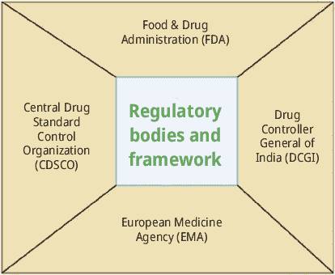

图 10.1：制药领域各类监管机构与框架的示意图。

### 10.2.1 食品药品监督管理局（FDA）

处方药安全是数百万依赖这些药物进行疾病管理和治疗的美国民众的重要公共卫生问题。《联邦食品、药品和化妆品法案》（`FDC` 法案）指定美国食品药品监督管理局（`FDA`）负责确保所有处方药供患者使用时的安全性和有效性。药物研发实体必须向 `FDA` 提交申请以供评估和批准，并附带充分的数据和信息以证明药物的疗效和安全性，方可获准向美国消费者销售。`FDA` 在依据 `FDC` 法案及其相关法规决定批准或可能撤回处方药时，会评估其利弊。该法规未为药物安全性结论设定定量阈值，也未规定具体的药物安全性分析方法 [17]。`FDA` 根据提交的支持数据，在监管框架内批准药物用于特定适应症。药物申办方在三个阶段开展了大量临床试验，以评估药物用于预期用途的疗效和安全性。通常，六项全面的 III 期试验为随机对照临床试验，包含治疗组和对照组以供比较分析。`FDA` 还批准药物标签，其中包含药物化学成分、毒性作用、临床数据、证据、警告及用法特性等详尽信息。这些说明面向医疗专业人员，包括医生和药剂师。标签随药物从申办方流转至配发方 [18]。

### 10.2.2 欧洲药品管理局（EMA）

随着 `EMEA` 的成立，建立了两种新的药品审批程序。生物技术和其他高科技产品必须经过集中审批程序，而其他产品则可豁免以下要求。单一国家实体负责进行科学评估，专有药委员会负责监督评估过程。在国家层面，实施了次要的分散程序。申请提交给“参比成员国”，即企业打算推出其产品的市场 [19, 20, 21]。随后，该机构协助其他“相关成员国”承认上市许可。现行的国家程序仍适用于仅对一个国家感兴趣的申请人。新法规未改变这些程序的基本组成部分，但带来了一定的修改。此外，`EMEA` 因缺乏透明度而长期受到批评 [22, 23, 24]。为解决此问题，新规则引入了多项条款。国家主管部门现被强制要求连同其程序性法规发布会议纪要和详细信息。获批后，主管部门将及时发布上市许可、评估报告、意见依据和产品特性摘要。历史上，国家机构并未被强制要求披露其评估结果。新规则涉及欧洲公开评估报告（`EPAR`），该报告提供由 `EMEA` 批准的新申请的评价。虽然未达到许多批评者期望的程度，但现在要求其“以公众可理解的方式”撰写信息，并明确列出与产品使用相关的条款和条件 [25, 26]。

### 10.2.3 其他监管机构

印度国家监管机构称为中央药品标准控制组织（`CDSCO`）。卫生总局（`DGHS`）是卫生与家庭福利部的一个部门，在印度政府领导下运作。《药品和化妆品法》指定 `CDSCO` 为药品的主要监管机构，负责执行分配给中央政府的职责。总部位于新德里 [27, 28]。颁发静脉注射液、疫苗、血清以及血液和血液制品许可证的权力由 `CDSCO` 和州监管机构共享。印度药品控制器总局（`DCGI`）在 `CDSCO` 下监管医疗器械和药品。`DCGI` 向药品咨询委员会（`DCC`）和药品技术咨询委员会（`DTAB`）征询意见。中央许可批准机构（`CLAA`）负责监督医疗设备的分类和许可。其职责包括制定和执行安全标准、实施上市后监督、提醒消费者，以及在出现不良反应时召回药品 [29]。治疗用品管理局（`TGA`）是澳大利亚的监管机构，负责监管与治疗产品相关的所有操作，包括产品开发、生产和分销。`TGA` 监管处方药、非处方药、互补和替代疗法、防晒霜、医疗设备、生物制品、血液及其成分以及其他治疗产品 [30, 31, 32, 33, 34]。

英国卫生和社会保健部下属的药品和医疗产品监管局（`MHRA`）是另一个可能具有重大全球影响力的监管机构。这可能归因于几家在全球分销产品且总部和制造设施设在英国的大型制药公司，如葛兰素史克和阿斯利康。这两个监管机构可能都有关于良好生产规范（`GMP`）的法规，市场将予以实施 [35, 36]。

## 10.3 制药行业基于 AI 的合规策略

监管合规对于确保食品和医疗保健行业产品的安全性、有效性和质量至关重要。美国 `FDA` 负责制定政策和法规以保障公众健康，并监督美国的监管架构。在受监管领域运营的实体，包括药品、医疗器械和食品饮料，均须遵守美国 `FDA` 法规 [37]。监管合规至关重要，因为它确保产品完整性、保护消费者利益、减轻健康风险，并维持公众对多个行业的信任。作为主要监管机构，美国 `FDA` 通过各种立法和指令制定和执行法律，以管辖受监管产品的生产、营销、标签和分销 [38]。良好生产规范（`GMP`）、良好临床规范（`GCP`）和良好实验室规范（`GLP`）是制药行业采用的法律合规标准，如图 10.2 所示。

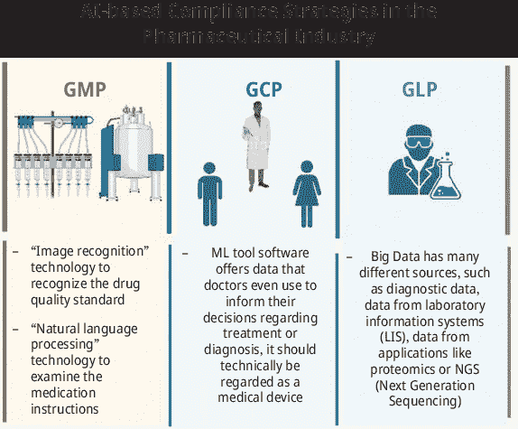

图 10.2：制药行业应用的各种基于 AI 的合规策略。

### 10.3.1 良好生产规范（GMP）

#### 药品生产的良好生产规范 (GMP)

制药行业的一套强制性指南被称为药品生产良好生产规范 (`GMP`)，简称 `GMP`。制药制造商必须遵守 `GMP`，以保证药品的安全生产，维护可靠的制药设备工艺，并根据相关国家要求严格维护质量管理和验证体系。新药研发越来越依赖现代科学技术。人工智能是一项最先进的技术工具，正在显著推进并变革各个 `GMP` 领域。在 `GMP` 质量控制下生产的药品，需要进行多种质量评估，包括药物成分分析、微生物定量评价以及药理和毒理学检测。传统检测方法可能准确率低，且需要大量的人力和物力资源。利用深度学习和产品数据分析，`AI` 技术可以提高检测的效率和精度。为提高检测效果，可采用“图像识别”技术评估药品质量标准 [39]，并采用“自然语言处理”技术审查药品说明书。`AI` 技术在 `GMP` 质量控制中主要用于数据收集。它可以收集并汇编全面的生产数据，涵盖生产状态、药品检验数据和仪器数据，以建立准确完整的数据库。`AI` 技术可以利用机器学习 (`ML`) 等技术手段，对药品生产过程中产生的各类数据进行评估和改进，包括数据筛选、分类和分析。它实现了对生产环节的自动化监控。`AI` 技术可以迅速执行大量检验任务，并有效分析和比较检验结果，从而加快消除生产过程中的潜在质量问题 [40]。

人工智能可以完全实现药品生产全生命周期的自动化，从而减少人工介入的必要性。相反，传统的药物制造方法需要大量劳动力来管理生产操作。在理想情况下，遵守 `GMP` 管理规范意味着在既定参数和约束内实现自动化和信息化的最大程度融合，旨在替代人工动作和操作，从而实现批次控制和管理流程的完全自动化 [41]。在国内药品生产中，常见因药品生产各环节的误差导致药品质量出现差异。`AI` 还可以细致地监督和管理生产过程的每一步，以减少人工介入的需求。人工智能 (`AI`) 技术实时监控整个药品生产过程，以尽早发现潜在问题，并提高成品的安全性、有效性和质量 [42]。

### 10.3.2 良好临床实践 (GCP)

海量数据的可用性和卓越的算力正在推动 AI 的广泛应用，但也带来了需要解决的伦理和社会问题，以最大化优势并最小化风险。虽然在临床试验 (CT) 中应用机器学习 (ML) 的方式多种多样，包括患者招募、研究设计、终点定义和更精准的诊断，但对这些技术的评估正影响着监管机构 (RAs) 批准临床研究的工作 [43]。从监管角度来看，缺乏明确的指南和标准化协议给申请人和监管机构带来了不确定性 [44]，使得这些工具的定义变得复杂，因为根据其声明的预期用途，它们有时可用于临床试验，例如用于住院患者入组选择，以减少劳动密集型程序的相关成本，因此可能不被归类为医疗器械。尽管如此，由于 ML 工具软件提供的数据甚至被医生用于辅助治疗或诊断决策，从技术上讲，它应被视为医疗器械 [45]。研究人员开发了一个 ML 预测模型，以确定在临床试验环境中使用 AI 或 ML 系统时应考虑的最重要问题。训练模型的有效性取决于数据质量，特别是其代表性，这对任何 ML 算法的学习过程至关重要。通常需要三个数据集用于训练、模型优化和评估：训练集、验证集和测试集。初始样本数据集必须严格创建并适合其预期目的，涵盖接受 CT 扫描的特定患者队列的预后特征，以辅助 ML 预测模型的训练和验证 [46]。影响最大的问题组合领域凸显了数据在指导自适应算法方面的重要性。数据对评估过程至关重要，并与技术安全性和可靠性密切相关。软件的准确性关乎其做出精准预测的能力；错误的输出可能导致意外后果，例如建议一种临床疗效较差且不良反应更多的药物。用于形成最终临床试验研究结论的数据质量，最终决定了支撑工具开发阶段的临床试验所产生的证据强度，这也影响工具的技术完整性和安全性。性能指标通过分析风险和准确性来评估 ML 模型的预测功效 [47]。

可能存在不平等的数据集的代表性构成了另一个潜在的偏倚来源。利用这些数据集训练算法可能导致研究结果的高估或低估 [48]，产生预测准确性降低的有偏系统，在人群分组中建立或加剧偏见，违背公平标准。透明度可以增强临床试验的科学严谨性，而出版偏倚可能会削弱这种严谨性，出版偏倚是一个重大问题，即只披露有利的临床研究结果，可能会产生适合算法训练的数据。算法技术具有内在的不透明性，这使得创建算法的科学家难以彻底理解其生成的复杂输出背后的基本原理，也难以阐明所涉及的技术程序 [49, 50]。这种被称为“黑箱”的特性，使 AI 的可预测性降低，并增加了对可能失去人工监督的担忧，进而使 AI 的可信度降低。

### 10.3.3 良好实验室规范 (GLP)

#### 实验室医学与数字化

实验室医学始终位列数字化程度最高的医学专业之中。自其起步以来，自动化、电子数据传输和电子报告已变得日益普及 [51]。医学实验室维护着包含质控报告和检验结果的大型数据库。此外，它们通常还建立了复杂的质量管理体系。因此，实验室医学成为医疗卫生数字化的典范学科，这并不令人意外。

反之，数据科学的最新进展，包括 `ML` 和人工智能，尚未完全渗透到实验室医学领域。本基于经验的观点文章并不主要聚焦于实验室医学中 AI 和 `ML` 的最新及即将到来的突破，因为已有多篇近期出版物提供了全面的评估。

#### 实验室医学中的大数据

大数据涵盖多种来源，包括诊断数据、实验室信息系统（`LIS`）、蛋白质组学和新一代测序（`NGS`） [52, 53, 54, 55]。

易于查找的数据必须存储以便于检索。将单个结果分配给相应的患者和采集时间以进行“常规”检查，通常通过使用患者标识符（`PID`）和日期来完成。说起来容易做起来难，这取决于实验室的设置方式。一些潜在的陷阱包括：不同分支实验室的不同患者可能被分配了相同的 `PID`；或者，对身份不明的急诊患者进行的分析，在其身份确认后可能无法关联到正确的个体。此外，出于研究目的，来自不同患者的结果可能会被合并归属到一个“集体” `PID` 下 [56]。

此外，如果样本是按计划采集日期而非实际采集日期记录的，数据可能会变得混乱，导致分析时间戳早于采集时间。专业检查设备经常未与 `LIS` 集成，这增加了检索的难度。

#### 语义互操作性

语义互操作性代表了实验室医学大数据中一个重要且潜在的关键层面。每个数据项都必须被唯一且语义化地标识；其最佳方法是使用标准化编码，例如 `LOINC`（逻辑观察标识符名称和代码） [57]。

采用实验室分析的研究工作的规范要求精确的颗粒度；仅凭其表面标题来识别它们是不够的。因此，任何类型的肌酐测量可能足以满足“安全实验室检测”的需求，但对于技术比较研究或建立参考区间则是不够的 [58]。

### 10.4 AI 在法规事务中的应用

AI 可通过提供行业最新进展的知识来协助 `RA`，特别是关于 AI 在药物研究和监管审批方面的潜在益处。通过发掘新机遇、实现任务自动化和增强决策能力，人工智能（`AI`）可帮助药物发现领域的专业人士更快、更有效地做出决策。这使他们能更快地推出新药。制药公司的 `RA` 部门或小组充当国家和国际监管机构的渠道，后者的目的是根据现行法律法规批准产品。因此，监管机构根据药物发现和产品开发过程中提交的数据和记录来批准产品 [59, 60]。

针对特定病例的质量保证（`QA`）包括验证专门为每位患者或每台机器开发的基于 AI 的应用结果的所有验证流程。如果质量保证（`QA`）结果被认为可接受，则该输出可用于 `RT` 工作流的后续阶段。如果针对特定病例的质量检查保证被证明不成功，则输出将接受二次验证。可能会使用不同的次级算法来评估某些应用的功效 [61]。

此外，基于 `ML` 的自动分割质量保证一直是近期研究的主题。可以通过为每个 `ROI` 采用不同的特征来开发决策树，以对特定自动分割输入的形态进行分类。由于数据可用性和处理能力的增强，研究人员开发出了越来越复杂的算法和模型，这显著推动了各个领域的发展。一个取得显著进展的著名研究领域是自然语言处理（`NLP`） [62, 63, 64]。

研究人员采用包括 Transformers 和循环神经网络（`RNNs`）在内的深度学习架构，开发出了更精准高效的语言模型。这些模型能够增强人机交互、简化客户服务的流程自动化，并开发更先进的搜索引擎和自动化助手。计算机视觉领域也经历了实质性的进步 [65, 66, 67, 68, 69, 70, 71]。

卷积神经网络（`CNNs`）促进了目标识别和图像分类的增强。这些模型有望改进医学影像分析、制造质量保证和自动驾驶。虽然深度学习方法能自主识别和生成抽象特征，但传统 `ML` 技术通常需要领域专业知识来进行特征工程或创建 [72, 73, 74, 75]。

利用 `RNN`、自编码器和 `CNN` 的深度学习方法在许多检测应用中产生了良好的结果 [76, 77, 78]。

### 10.5 结论

总之，法规事务（RA）在制药行业至关重要，确保药物研发和审批符合法律和法规标准。各国的监管框架各不相同，由美国的 `FDA`、欧洲的 `EMA` 以及印度的 `NRAs` 等机构监督审批流程。遵守 `GMP`、`GCP` 和 `GLP` 等规范对于保证药品的安全性、有效性和质量至关重要。

人工智能（AI）正越来越多地应用于法规事务，以提高效率和准确性。AI 可实现流程自动化、分析海量数据并辅助决策，特别是在药物发现和监管审批方面。它还可协助不良药物反应监测、药物警戒和智能包装合规。然而，AI 在法规事务中的应用也带来了挑战。临床试验中 `ML` 应用需要明确的指南和标准化程序，且必须考虑伦理和社会问题。此外，实验室医学的数字化以及 AI 在质量保证和自动分割中的应用，仍是需要进一步发展的领域。

为改善监管环境，建议包括简化法律法规和程序、增加自我认证和自我监管，以及更有效地管理政府官员的自由裁量权。协调各国药品法律法规也是监管机构的目标之一。将 AI 融入监管活动可提高效率、优化决策并确保合规。该领域正处于持续发展之中，并有望改变制药业务。

## 参考文献

[1] 维基百科自由百科全书中的“Regulatory Affairs”，修订于 4 月 7 日，可在 [`en.wikipedia.org/wiki/Regulatory_Affairs`](http://en.wikipedia.org/wiki/Regulatory_Affairs) 获取。

[2] 国际法规事务更新，2005。可在 [`www.iraup.com/about.php`](http://www.iraup.com/about.php) 获取。

[3] Pisano DJ, & Mantus DS. 《FDA 法规事务教科书：处方药、医疗器械和生物制品指南》，第二版。

[4] learning plus, inc. 提供的法规事务资料，可在 [`www.cgmp.com/ra.htm`](http://www.cgmp.com/ra.htm) 获取。

[5] Patil RS, Kulkarni SB, Gaikwad VL. 制药法规事务中的人工智能。《药物发现今日》。2023 年 7 月；12:103700。

## 参考文献

[6] Gundersen LE. Careers in regulatory affairs: from practitioner to professional. *Nature Biotechnology*. 2002 Apr 1; 20(4):409–10.

[7] Hanuja GS, Kumari BS, Nagabhushanam MV, Reddy DN, Bonthagarala B. Regulatory requirements for registration of generic drugs in BRICS Countries. *International Journal of Pharmaceutical Science and Health Care*. ISSN 2249 – 5738, November-December 2016;6(6): 20–40.

[8] Kumari BS, Hanuja GS, Nagabhushanam MV, Reddy DN, Bonthagarala B. Current regulatory requirements for registration of medicines, compilation and submission of dossier in Australian therapeutic goods administration. *International Journal of Advanced Scientific and Technical Research*. ISSN 2249-9954 November-December 2016;6(6): 144–57.

[9] Basha SS, Shakeel SM, Nagabhushanam MV, Reddy DN, Bonthagarala B. The assesment of current regulatory guidelines for biosimilars-A global scenario. *World Journal of Pharmaceutical Research*, ISSN. 2016 Nov 9:2277–7105.

[10] The Belmont Report. Office of the secretary, ethical principles and guidelines for the protection of human subjects of research. The National Commission for the Protection of Human Subjects of Biomedical and Behavioral Research. April 18, 1979; 7.

[11] Philip S, Philip A. The scope of regulatory affairs in the pharmaceutical industry. *Hygeia Journal for Drugs and Medicines*. 2010;2(1):1–6.

[12] Ainapur, R. An empirical study on the cost of compliance in manufacturing industry.

[13] Nijsen, A. SCM to Measure Compliance Costs. In *Business Regulation and Public Policy: The Costs and Benefits of Compliance*. New York, NY: Springer New York; 2008 Oct 30; 1–22.

[14] Amin MK, HabibZaman M. Which Comes First in the Apparels Industry: Process or Compliance? *SAGE Publications: SAGE Business Cases Originals*; 2020;1–21.

[15] Kuehnel S, Zasada A. An approach toward the economic assessment of business process compliance. In *Advances in Conceptual Modeling: ER 2018 Workshops Emp-ER, MoBiD, MREBA, QMMQ, SCME, Xi’an, China, October 22–25, 2018, Proceedings 37* 2018 (pp. 228–238). Springer International Publishing.

[16] Cushen M, Kerry J, Morris M, Cruz-Romero M, Cummins E. Nanotechnologies in the food industry–recent developments, risks and regulation. *Trends in Food Science & Technology*. 2012 Mar 1;24(1):30–46.

[17] Congress US. Food and drug administration amendments act of 2007. *Public Law*. 2007 Jul; 2007:115–85.

[18] Fain KM, Nachman KE, Rutkow L. An analysis of FDA’s drug safety authorities: Challenges and opportunities under a new regulatory framework. *NYUJ Legis. & Pub. Pol’y*. 2014;17:1.

[19] Abbasi K, Herxheimer A. The European medicines evaluation agency: Open to criticism. Transparency must be coupled with greater rigour. *BMJ*. 1998;317:898–900.

[20] Permanand G, Mossialos E, McKee M. Regulating medicines in Europe: The European medicines agency, marketing authorisation, transparency and pharmacovigilance. *Clinical Medicine*. 2006 Jan 1;6(1):87–90.

[21] Medicines in Europe Forum. European pharmaceutical policy is turning its back on public health. *Prescrire International*. 2002;22:464–66.

[22] Permanand G, Mossialos E, McKee M. Regulating medicines in Europe: The European medicines agency, marketing authorisation, transparency and pharmacovigilance. *Clinical Medicine*. 2006 Jan 1;6(1):87–90.

[23] Anonymous. European medicines evaluation agency (editorial). *International Society of Drug Bulletins Newsletters*. 2001;15:11–13.

[24] Papanicolaou S, Sykes D, Mossialos E. EMEA and the evaluation of health-related quality of life data in the drug regulatory process. *International Journal of Technology Assessment in Health Care*. 2004;20:311–24.

[25] Florêncio D, Herley C, Shostack A. FUD: A plea for intolerance. *Communications of the ACM*. 2014 Jun 1;57(6):31–3.

## 参考文献

[26] Epiney A, Egbuna-Joss A. Regulation (EC) No. 562/2006 of the European Parliament and of the Council of 15 March 2006 establishing a Community Code on the rules governing the movement of persons across borders (Schengen Borders Code). *EU Immigration and Asylum Law: A commentary*. 2016:52–115.

[27] Mankar SD, Gholap VD, Zende TP, Dighe RS. Drug regulatory agencies in India, USA, and Japan—a review. *International Journal of Institutional Pharmacy and Life Sciences*. 2014;4(2):288–97.

[28] Chakraborty K, & Yadav K. Drug approval process in US, Europe and India and its regulatory requirements: A Review. *International Journal of Drug Regulatory Affairs (IJDRA)*. 2018;6(3):31–9.

[29] Central Drugs Standard Control Organization. Available at: [`https://www.cdscoonline.gov.in/CDSCO/homepage`](https://www.cdscoonline.gov.in/CDSCO/homepage).

[30] Zareen SR, Ahmed O, Reshma MS, Rasheed A. Pharmaceutical regulatory agencies of India. *European Journal of Biomedical*. 2023;10(2):113–15.

[31] Aziza F. Comparison review of two regulatory agencies regulation: Therapeutic Goods Administration (TGA) and the European Medicine Agency (EMA) in relation to Good Manufacturing Practice (GMP) guideline. *Majalah Farmaseutik*. 2021;17(2):243–48.

[32] Therapeutic Goods Administration (TGA) n.d. Overview of supplying therapeutic goods in Australia, viewed 16 March 2019 <[`https://www.tga.gov.au/overviewsupplying-therapeutic-goods-australia`](https://www.tga.gov.au/overviewsupplying-therapeutic-goods-australia)>.

[33] Aziza F. Comparison review of two regulatory agencies regulation: Therapeutic Goods Administration (TGA) and the European Medicine Agency (EMA) in relation to Good Manufacturing Practice (GMP) guideline. *Majalah Farmaseutik*. 2021;17(2):243–48.

[34] Therapeutic Goods Administration (TGA) n.d. What the TGA regulates, viewed 16 March 2024.

[35] Medicines and Healthcare products Regulatory Agency. 2015. UK and India regulators agree on a deal for closer collaboration to improve public safety, viewed 10 March 2022 < [`https://www.gov.uk/government/news/uk-and-indiaregulators-agree-deal-for-closercollaboration-to-improve-public-safety`](https://www.gov.uk/government/news/uk-and-indiaregulators-agree-deal-for-closercollaboration-to-improve-public-safety)>.

[36] Medicines and Healthcare products Regulatory Agency 2016, Improving international collaboration—MHRA and Swissmedic sign MoU, viewed 10 March 2024.

## 参考文献

[37] 美国食品药品监督管理局（USFDA）。联邦法规第 21 篇——食品和药品；2021。可访问：[`www.accessdata.fda.gov/scripts/cdrh/cfdocs/cfcfr/CFRSearch.cfm`](https://www.accessdata.fda.gov/scripts/cdrh/cfdocs/cfcfr/CFRSearch.cfm)

[38] 美国食品药品监督管理局（USFDA）。指导文件；2021。可访问：[`www.fda.gov/regulatoryinformation/searchfdaguidancedocuments`](https://www.fda.gov/regulatoryinformation/searchfdaguidancedocuments)。

[39] 吴春、李慧霞、H. Xueya. 图像识别技术在药品管理系统中的应用。*福建电脑*。2020；36(12)：152–53。

[40] Z. Xinyue. 人工智能技术发展与应用研究。*数字传播世界*。2022；10：133–35。

[41] T. Jiliang. 自动化与信息技术：医药工业现代化的必由之路。*自动化博览*。2014；10：52–7。

[42] Y. Shen. AI 对 GMP 的影响——以 GMP 质量控制为例。*人工智能实践杂志*。2023 年 4 月 28 日；6(3)：8–14。

[43] 关于人工智能的理事会建议（OECD 法律文书。OECD/LEGAL/0449。）

[44] DA Dri、M. Massella、D. Gramaglia、C. Marianecci、S. Petraglia。临床试验与机器学习：监管方法综述。*近期临床试验评论*。2021；16(4)：341–350。

[45] T. Minssen、S. Gerke、M. Aboy、N. Price、G. Cohen。对医疗机器学习的监管回应。*法律与生命科学杂志*。2020 年 1 月；7(1)：lsaa002。

[46] DA Dri、M. Massella、D. Gramaglia、C. Marianecci、S. Petraglia。临床试验与机器学习：监管方法综述。*近期临床试验评论*。2021；16(4)：341–350。

[47] MD Abràmoff、D. Tobey、DS Char。关于自主 AI 的经验教训：在开发过程中寻找一条安全、有效且合乎伦理的路径。*美国眼科学杂志*。2020；214：134–42。

[48] DS Char、NH Shah、D. Magnus。在医疗保健中实施机器学习——应对伦理挑战。*新英格兰医学杂志*。2018；378(11)：981–83。

[49] I. Rahwan、M. Cebrian、N. Obradovich、J. Bongard 等。机器行为。*自然*。2019；568(7753)：477–86。

[50] K. Chinzei、A. Shimizu、K. Mori、K. Harada、H. Takeda、M. Hashizume、M. Ishizuma、N. Kato、K. Kawamori、S. Kyo、K. Nagata、T. Yamane、I. Sakuma、K. Ohe、M. Mitsuishi。基于 AI 的医疗器械和系统的监管科学。*先进生物医学工程*。2018；7：118–23。

[51] J. Cadamuro. 机器的崛起：医学和医学实验室与人工智能不可避免的交织演变——叙述性综述。*诊断学*。2021 年 8 月 2 日；11(8)：1399。

[52] D. Gruson、S. Bernardini、PK Dabla、B. Gouget、S. Stankovic。协作式 AI 与实验室医学在精准心血管医学中的融合。*临床化学学报*。2020 年 10 月 1 日；509：67–71。

[53] F. Cabitza、G. Banfi。实验室医学中的机器学习：静候洪流？*临床化学与实验室医学（CCLM）*。2018 年 4 月 1 日；56(4)：516–24。

[54] L. Ronzio、F. Cabitza、A. Barbaro、G. Banfi。洪水是否已涌入地下室？关于实验室医学中机器学习的系统文献综述。*诊断学*。2021 年 2 月 22 日；11(2)：372。

[55] F. Mannello、M. Plebani。临床实验室医学的当前问题、挑战与未来展望。*临床医学杂志*，2022，1 月 26 日；11(3)：634。

[56] C. Bizer、T. Heath、T. Berners-Lee。链接数据——迄今为止的故事。载 *链接世界信息：关于 Tim Berners-Lee 发明万维网的论文集* 2023 年 7 月 7 日（第 115–143 页）。

[57] FM Dahlweid、M. Kämpf、A. Leichtle。瑞士实验室数据的互操作性——聚焦伯尔尼。*实验室医学杂志*。2018 年 12 月 19 日；42(6)：251–58。

[58] 瑞士医学实验室 L4CHLAB 项目。2021。在线获取：[`sphn.ch/wp-content/uploads/2021/04/2021-L4CHLAB-Process.pdf`](https://sphn.ch/wp-content/uploads/2021/04/2021-L4CHLAB-Process.pdf) （访问日期：2024 年 3 月 11 日）。

[59] A. Tripathi、K. Misra、R. Dhanuka、JP Singh。人工智能在加速药物发现与开发中的应用。*生物技术新专利*。2023 年 3 月 1 日；17(1)：9–23。

[60] M. Algorri、NS Cauchon、MJ Abernathy. 利用结构化数据管理解决方案转换化学、制造和控制内容：简化监管提交。*药学杂志*。2020 年 4 月 1 日；109(4)：1427–38。

[61] L. Vandewinckele、M. Claessens、A. Dinkla、C. Brouwer、W. Crijns、D. Verellen、W. Van Elmpt。放疗中基于人工智能应用的概述：实施与质量保证建议。*放疗与肿瘤学*。2020 年 12 月 1 日；153：55–66。

[62] SK Baduge、S. Thilakarathna、JS Perera、M. Arashpour、P. Sharafi、B. Teodosio、A. Shringi、P. Mendis。建筑与施工 4.0 的人工智能与智能视觉：机器学习与深度学习方法及应用。*建筑自动化*。2022 年 9 月 1 日；141：104440。

[63] M. Amini、K. Sharifani、A. Rahmani。面向制造与机械工程中数据收集方法评估的机器学习模型。*应用科学与工程研究国际期刊*。2023；15(2023)：349–62。

[64] M. Abd Elaziz、A. Dahou、L. Abualigah、L. Yu、M. Alshinwan、AM Khasawneh、S. Lu。深度神经网络应用中的先进元启发式优化技术：综述。*神经计算与应用*。2021 年 11 月；1：1–21。

[65] K. Sharifani、M. Amini、Y. Akbari、J. Aghajanzadeh Godarzi。跨自然语言处理技术运行机器学习以改进虚假新闻模型。*科学与信息系统研究国际期刊*。2022 年 10 月；12(9)：20–44。

[66] E. Balouji、IY Gu、MH Bollen、A. Bagheri、M. Nazari。一种基于 LSTM 的深度学习方法及其在电压暂降分类中的应用。载 *2018 年第 18 届谐波与电能质量国际会议（ICHQP）*，2018 年 5 月（第 13 卷，第 1–5 页）。IEEE。

[67] M. Amini、A. Rahmani、M. Abedi、M. Hosseini、M. Amini、M. Amini。Mahamgostar.com 作为案例研究，探讨采用 Laravel 框架作为中小企业基于 PHP 的 Web 开发的最佳编程工具。*创新与知识杂志*，ISSN。2021 年 5 月；1：100–10。

### 第 11 章 上市后监测中的 AI 与大数据

#### 摘要

上市后监测（PMS）涉及在临床试验和成功上市后对药物安全性进行监测。PMS 的主要目标是“及时识别”在“临床性质、程度和频率”方面各不相同的“新型”不良药物反应（ADR）。本章涵盖的新技术示例包括机器学习、人工智能和大数据分析。在上市后监测中使用 AI 存在许多障碍，这些技术使得数据隐私保护变得更加困难。大数据分析极大地受益于药物安全监测，因为它使早期发现问题和实时监测潜在信号变得更加容易。可调整的、基于事实的质量保证框架的建立，该框架鼓励创新和更明智的决策，可借助 AI 解决方案予以推进。它们还能协助 PMS 从业者和医疗器械制造商满足 EU MDR/IVDR 法规要求。此外，本文还讨论了在上市后监测中使用 AI 进行隐私保护时面临的诸多障碍。因此，医疗 AI 应用使用复杂的算法，即使采用了“匿名化”处理，也会让私营 AI 公司接触到患者医疗数据，从而构成隐私风险。

关键词：监测、数据分析、药物安全、机器学习、不良药物反应、利益相关者

#### 11.1 引言

## 参考文献

[68] Ju W, Fang Z, Gu Y, Liu Z, Long Q, Qiao Z, Qin Y, Shen J, Sun F, Xiao Z, Yang J. A comprehensive survey on deep graph representation learning. Neural Networks. 2024 Feb 27:106207.

[69] Amini M, Bakri A. Cloud computing adoption by SMEs in Malaysia: A multi-perspective framework based on DOI theory and the TOE framework. Journal of Information Technology & Information Systems Research (JITISR). 2015 Sep;9(2):121–35.

[70] Amini M, Sadat Safavi N. A dynamic SLA-aware heuristic solution for cloud placement problem without migration. International Journal of Computer Science and Information Technologies. 2014 Jul;6(11):25–30.

[71] Janiesch C, Zschech P, Heinrich K. Machine learning and deep learning. Electronic Markets. 2021 Sep;31(3):685–95.

[72] Amini M. The factors that influence the adoption of cloud computing for small and medium enterprises. 2014.

[73] Sharma N, Sharma R, Jindal N. Machine learning and deep learning applications—a vision. Global Transitions Proceedings. 2021 Jun 1;2(1):24–8.

[74] Amini M, Sadat Safavi N, Mirzaeyan Bahnamiri R, Mirzaei Omran M, Amini M. Development of an instrument for assessing the impact of environmental context on adoption of cloud computing for small and medium enterprises. Australian Journal of Basic and Applied Sciences (AJBAS). 2014 Jun;8(10):129–35.

## 参考文献

[75] Patel P, Thakkar A. The upsurge of deep learning for computer vision applications. International Journal of Electrical and Computer Engineering. 2020 Feb 1;10(1):538.

[76] Amini M, Bakri A, Sadat Safavi N, Javadinia SA, Tolooei A. The role of top manager behaviours on adoption of cloud computing for small and medium enterprises. Australian Journal of Basic and Applied Sciences (AJBAS). 2014 Feb;8(1):490–98.

[77] Wang J, Ma Y, Zhang L, Gao RX, Wu D. Deep learning for smart manufacturing: Methods and applications. Journal of Manufacturing Systems. 2018 Jul 1;48:144–56.

[78] Yang J, Li S, Wang Z, Dong H, Wang J, Tang S. Using deep learning to detect defects in manufacturing: A comprehensive survey and current challenges. Materials. 2020 Dec 16;13(24):5755.

[79] Alvaro N, Conway M, Doan S, Lof C, Overington J, Collier N. Crowdsourcing Twitter annotations to identify first-hand experiences of prescription drug use. Journal of Biomedical Informatics. 2015;58:280–87.

[80] Benin AL, Fodeh SJ, Lee K, Koss M, Miller P, Brandt C. Electronic approaches to making sense of the text in the adverse event reporting system. Journal of Healthcare Risk Management. 2016;36(2):10–20.

[81] Akay A, Dragomir A, Erlandsson BE. Assessing antidepressants using intelligent data monitoring and mining of online forums. IEEE Journal of Biomedical and Health Informatics. 2016 May 3;20(4):977–86.

[82] Evans HP, Anastasiou A, Edwards A, Hibbert P, Makeham M, Luz S, et al. Automated classification of primary care patient safety incident report content and severity using supervised machine learning (ML) approaches. Health Informatics Journal. 2019;26(4):3123–39.

[83] Sarkar S. Pharmaceutical serialization: Impact on drug packaging. International Journal. 2022 Mar;10(3):21–26.

[84] Vora LK, Gholap AD, Jetha K, Thakur RR, Solanki HK, Chavda VP. Artificial intelligence in pharmaceutical technology and drug delivery design. Pharmaceutics. 2023 Jul 10;15(7):1916.

[85] Kamble SJ, Pawar PS, Kolse PB, Kashid GA, Sutar RC, Menon G. Regulatory Innovation in artificial intelligence for accelerated medication. Journal of Coastal Life Medicine. 2023 Jan 11;11:1971–79.

[86] Fakhouri TH, Liu Q, ElZarrad MK. Artificial intelligence in regulatory decision-making for drug and biological products. In Artificial Intelligence in Clinical Practice 2024 Jan 1 (pp. 373–375). Academic Press.

## 上市后监测与人工智能应用

在药学领域，药物创新过程是一项持续不断的工作，经常导致新型治疗药物的发现。从构想到最终产品，药物的开发被认为是一个极其复杂的过程，它审视药物的各个方面，以确保在批准时具有足够的安全性。

**上市后监测** 可定义为药物在临床试验成功上市后对其安全性进行监测的过程 [[1]](#9783111573861_015802.xhtml#b_9783111574288-011_ref_001)。PMS 研究的主要目的是识别新的有益和有害作用。其他重要因素包括药物的超说明书用药、孤儿药问题，以及在儿童群体中开展国际研究的困难。它是一个至关重要的工具，通过将药物暴露的强度与不良事件的原因联系起来，有助于更清晰地描绘药物在长期给药过程中可能开始呈现的获益与风险 [[2]](#9783111573861_015802.xhtml#b_9783111574288-011_ref_002)。

**IV 期研究** 是与 PMS 相关的研究，因为大多数药物在完成 III 期临床试验之前无法商业化。仅靠开展新型药品安全性和有效性评价的临床试验，只能部分揭示罕见的不良药物反应。结果更加真实，因为它们发生在更自然的环境中，并提供证据支持或改进已批准药物的安全性 [[3]](#9783111573861_015802.xhtml#b_9783111574288-011_ref_003)，[[4]](#9783111573861_015802.xhtml#b_9783111574288-011_ref_004)。

**药物警戒** 和 **药物流行病学** 是上市后药物监测计划所涵盖的药理学两个领域。药物警戒，也称为药物安全性监测，其主要目标是“及时发现”在“临床性质、严重程度以及频率”方面各不相同的“新型”不良药物反应 (ADR)。“针对药物使用及其相关风险的基于人群的研究”是药物流行病学的定义。必须强调药物警戒的重要性，以及药物的实际应用始于其上市之时这一理念 [[5]](#9783111573861_015802.xhtml#b_9783111574288-011_ref_005)，[[6]](#9783111573861_015802.xhtml#b_9783111574288-011_ref_006)，[[7]](#9783111573861_015802.xhtml#b_9783111574288-011_ref_007)。

### 监管格局

世界卫生组织建议公司在文献和其他来源中查找信息，以了解与使用或操作器械相关的任何新风险。欧盟 (EU) 新颁布的 **医疗器械法规 (MDR)** 和 **体外诊断医疗器械法规 (IVDR)** 表明，对体外诊断和医疗器械公司的 PMS 要求大幅增加。收集和评估相关的专业、科学和技术来源是其中一项要求 [[8]](#9783111573861_015802.xhtml#b_9783111574288-011_ref_008)。法规并未规定使用文献记录或检索过程文档的格式；它们仅要求对选定的数据来源、收集策略和评估技术进行详尽描述。

新的欧盟法规要求生产体外诊断和医疗器械的公司主动搜集有关其产品安全性和/或有效性的信息。这将确保器械保持最新状态并改善问题的早期发现。行业无疑将从向主动监测的转变中受益 [[9]](#9783111573861_015802.xhtml#b_9783111574288-011_ref_009)，[[10]](#9783111573861_015802.xhtml#b_9783111574288-011_ref_010)。

为遵守新法规，企业将需要在新程序、人员和规则上投入大量资金。值得注意的是，许多中小型企业，特别是那些拥有过时或碎片化数据系统的企业，发现很难充分审查和分析来自各种来源的海量数据。新的欧盟法规要求生产体外诊断和医疗器械的公司主动搜集有关其产品安全性和/或有效性的信息 [[11]](#9783111573861_015802.xhtml#b_9783111574288-011_ref_011)，[[12]](#9783111573861_015802.xhtml#b_9783111574288-011_ref_012)。

为跟上新法规，企业将需要在新程序、人员和规则上投入大量资金。值得注意的是，许多中小型企业，特别是那些拥有过时或碎片化数据系统的企业，发现很难充分审查和分析来自多个来源的海量数据。这适用于包括医疗保健在内的广泛领域 [[13]](#9783111573861_015802.xhtml#b_9783111574288-011_ref_013)。

### 上市后监测中的人工智能

如 **图 11.1** 所示，能够提高信号检测的速度和准确性并实现更广泛数据覆盖的人工智能 (AI) 工具包括 **机器学习 (ML)**、**深度学习 (DL)** 以及 **自然语言处理 (NLP)** [[14]](#9783111573861_015802.xhtml#b_9783111574288-011_ref_014)，[[15]](#9783111573861_015802.xhtml#b_9783111574288-011_ref_015)，[[16]](#9783111573861_015802.xhtml#b_9783111574288-011_ref_016)，[[17]](#9783111573861_015802.xhtml#b_9783111574288-011_ref_017)。这些系统在医疗保健的许多方面展现出巨大潜力，例如风险管理、药物发现、诊断以及临床决策和发现 [[18]](#9783111573861_015802.xhtml#b_9783111574288-011_ref_018)，[[19]](#9783111573861_015802.xhtml#b_9783111574288-011_ref_019)。

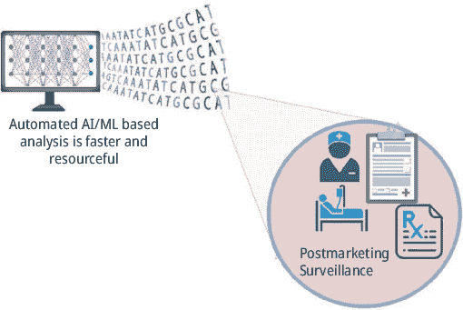

**图 11.1：** 通过 AI 进行上市后监测分析的示意图。

### AI 在药物警戒和上市后监测中的应用

在 Celgene 和 IBM 发布的一项研究中，用于评估 ICSR 处理的深度学习技术超过了许多准确率阈值，表明 AI 有潜力在提高报告效率的同时，改善数据的一致性和质量[20]。根据 Celgene 全球药物安全与风险管理部门进行的一项调查，药物安全专业人员青睐药物警戒中的 AI 应用。这是因为 AI 能让他们从繁重的劳动密集型任务中解脱出来，专注于信息评估和分析[21, 22, 23, 24]。同样，人工智能（AI）解决方案为 PMS 从业者和医疗器械制造商提供了巨大价值。它们通过降低遵守 EU MDR/IVDR 法规所涉及的时间和成本，并建立灵活的、基于事实的质量管理体系，从而促进创新和更审慎的决策。深知 AI 能够增强并简化对 QIAGEN、Huma 及 EU MDR/IVDR 的遵守，AI 开发了一个最先进的上市后情报平台，通过文献监测增强信号检测，并加速与风险和绩效评估相关的 PMS 工作流[25]。关注已发表的研究对于 PMS 至关重要，因为它能提供关于病原体遗传学、患者人口统计学特征、新兴技术、器械安全性和有效性以及可能的超说明书用药的重要见解。尽管如此，生物医学数据库（如 PubMed）中存储了超过 3500 万条引文和摘要[26]，每年新增约 140 万条引文[27, 28]。

## 11.2 机器学习在上市后监测中的作用

一直以来，都需要可靠、有效且具成本效益的技术来评估学生的书面和口语能力。由 Ellis Page 于 1966 年创建的 Project Essay Grader (PEG) 是一款应用程序，它根据语法、文章长度和结构等写作特征生成计算机评分。随之而来的是自动作文评分（AES）技术的进步[29, 30]。AES 系统（如 PEG）旨在使作文评分更快、更容易，目标是辅助或取代人工评分员[31]。这类系统使用预测模型来分析文本，并根据结果与人工评分生成的分数相关程度，以不同精度生成标准化分数以进行预测。自 PEG 发布以来，许多其他 AES 系统相继问世，旨在提高预测模型的准确性，并提供关键反馈和抄袭检查等额外功能。目前，AES 系统主要分为两大类：使用原始文本技术的系统和使用手工设计作文特征的系统[32]。手工设计特征利用领域专家知识生成文本的数值化表征，使基本统计建模技术能够发现与评分相关的模式，长期以来一直是行业标准。在原始文本方法中，可能的词汇空间通过统计模型（通常是神经网络）映射到一个更高维度的融合空间，从而编码对词汇的更深层理解[33]。

此外，`BERT` 被证明是所有宏观结构成分中最高效的技术。`BERT` 成功的原因可追溯到一种称为迁移学习的方法，该方法涉及在大规模语料库上对系统进行预训练，使其深入理解英语。该技术也可用于训练模型，使其在更广泛的序列语境中理解每个词的嵌入，以帮助解释语义不明确的词汇。最后，词嵌入创建了一个语义关联的低维空间，其中未知短语尽管与已知词汇相关联，仍可被表征，这使得 `BERT` 和 `GVEL` 能够处理训练中未见过的词汇[34]。另一种方法是，在没有任何预训练的情况下，`CMRF` 和 `TIRF` 方法被迫从头建模叙事结构，以对这些不同要素进行评分。例如，`CMRF` 和 `TIRF` 没有处理文本序列性质的结构，因此要对“引发事件”评分，它们必须从少量的多个叙事样本中推断出引发事件的表述方式。这些模型无法处理初始训练集中未包含的词汇，这使它们在实践中更加受限，并可能导致它们在未展示的测试中表现不佳。然而，`GVEL` 利用了一些迁移学习原则，并通过 `LSTM` 自然地处理序列。考虑到文献中关于 `LSTM` 性能的报道，拥有足够训练数据的 `LSTM` 有可能胜过 `BERT`。然而，实验表明，从未知权重训练 `LSTM` 非常困难，最终不可行，需要大量叙事来获取这些依赖关系和模式[35, 36]。

虽然 AES 系统有许多显而易见的应用，但其在开发中的主要用途是对 SAT 和 GRE 等高风险书面评估进行评分。AES 技术非常有用，但并不总是易于获取，尽管 PEG、E-Rater 和 IntelliMetric 等知名系统是不向公众开放的专有技术。因此，如果包括心理学、病理学和教育学在内的各学科临床从业者要从 AES 技术中受益，就必须开发开放获取技术。许多 AES 系统依赖整体评分技术（旨在使用积分制评估整体写作质量）这一事实，是这些系统的另一个缺点。虽然这是 GRE 等标准化考试评分的首选方法，但基于量表的评分系统可以通过突出作者作品中优劣势的具体领域，提供更详细的反馈。教育工作者、心理学家和临床医生经常使用基于量表的工具来识别儿童的语言缺陷领域，并追踪儿童语言能力随时间的变化[37]。特别建议医疗专业人员（如言语语言病理学家 SLPs）采集患者的语言样本，以识别其优势和劣势，并在干预期间追踪改善情况。在学龄期，叙事语言样本是理想的引导情境；然而，由于时间限制，许多临床医生并不使用它们[38]。

### 大数据分析在上市后监测中的作用

在医学领域，临床记录是主要的沟通手段。与电子健康记录（EHR）中通用的编码部分相比，叙述性记录提供了患者病史和评估的更全面、更独特的描述，从而增强了临床决策的背景信息。自然语言处理（NLP）的研究是人工智能的一个分支，它研究以自然语言表达的数据的分析与综合。它已多次证明，可以从临床叙述中提取证据，并使其可用于后续的大规模分析。机器学习作为克服知识获取信息障碍的灵丹妙药而广受欢迎，其主要理由是手动标注数据比实际获取知识要简单得多 [39]。然而，训练机器学习模型所需的数据量进行标注，所花费的时间可能与获取知识的过程一样长 [40]。类似于能量守恒原理，引导精确计算模型开发所需的信息，似乎只是从一种格式转换到了另一种格式。机器学习依赖以标注及其分布形式存在的隐性知识，获取这些标注的时刻几乎是恒定的，这与以规则形式存在的显性理解形成对比。由于医疗数据的敏感性和安全顾虑，临床叙述的可获取性给机器学习方法带来了挑战 [41]。由于这些问题（即缺乏手动标注数据），训练数据可能不够具有代表性，这可能导致相关机器学习模型表现不佳 [42]。

作为政府对医疗器械（MD）分发监管的一个组成部分，安全监测在全球范围内 [43, 44, 45] 和俄罗斯 [46, 47] 都至关重要。为保证日常使用的医疗器械的有效性和安全性，会进行以下类型的监测。使用高风险（III 类）医疗器械时，需要更严格的监管。因此，即使产品不存在风险或不良事件，欧亚经济委员会理事会的决定 [48] 仍强制要求，在注册证签发后的三年内，每年对 III 类风险医疗器械进行一次检查。基于机器学习技术的作为医疗器械的软件（SaMD-AI），利用技术解决方案模拟人类认知，产生至少等同于人类表现的结果 [49, 50]。SaMD-AI 无法解释数据，因此在使用过程中需要额外的监督。当应用于不同于机器学习训练时所用的人群等情况下，可能会导致偏倚 [51, 52]。此外，与不包含 AI 技术的 SaMD 不同，它可能通过持续的（自我）学习集成深度神经网络。SaMD-AI 作为一种“隐形”医疗器械的快速更新，以及随之而来的 SaMD-AI 再注册周期延长，引起了研究人员的担忧。FDA（食品药品监督管理局）指出，此类医疗器械需要一个覆盖产品全生命周期的独特注册体系。该计划需要足够灵活，以适应 SaMD-AI 在适应和使用过程中的变化，同时保持医疗器械的有效性和安全性 [53]。其他作者详细阐述了为确保 SaMD-AI 及时、安全地注册并将这些产品整合到实际临床环境中必须遵循的程序。作者强调，排除 SaMD-AI 特性任何潜在离散/分散的唯一方法，是使用实际临床数据评估 SaMD-AI 的性能。SaMD-AI 的开发者应了解任何潜在风险，例如与新患者群体互动时的困难和无意中导致的有害健康结果。必须同时检查预测指标（如阳性或阴性预测值）和 SaMD-AI 的主要性能指标（指标），包括特征曲线下面积 [52]。

### 11.3 大数据分析在上市后监测中的作用

由机器、群体和个人每日产生的海量结构化和非结构化数据被称为“大数据”。它包含难以用传统数据处理方法处理或评估的海量数据。大数据呈指数级增长，并具有多项优势（图 11.2）。一个促进增长的主要因素是社交媒体、网络和连接设备的引入。大数据的速度是其显著特征之一。为了获得可操作的洞察，了解数据以前所未有的速度生成的情况，组织必须能够实时收集、处理和评估数据。例如，社交媒体平台从用户互动、帖子、点赞和分享中产生海量数据 [53]。企业可以利用这些数据更好地了解趋势、情感分析和客户偏好，从而做出更好的商业决策并提高客户参与度。大数据的多样性是另一个重要特征。它包含广泛的数据类型，例如交易记录、文本、照片、视频和传感器数据。这种多样性超出了传统数据库和信息处理方法的能力。然而，得益于技术发展，如 `Hadoop` 和 `Spark` 等分布式计算框架，企业现在能够存储、处理和分析大规模且多样化的数据集。组织可以通过整合和分析多个数据源，发现先前隐藏的相关性、模式和洞察，从而改进决策和创新 [54]。

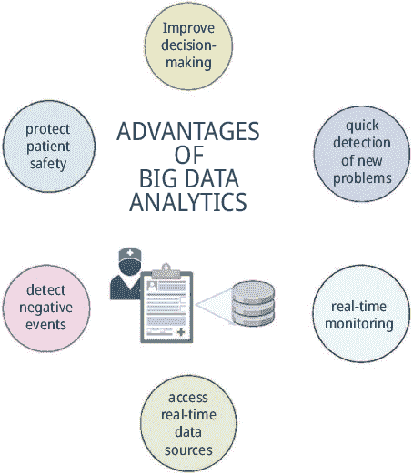

图 11.2：大数据分析在上市后监测中的各种优势。

#### 药物安全监测与大数据分析

药物安全监测是医疗体系的关键组成部分，对于保障患者的安全与健康至关重要。它涉及对与药物使用相关的风险和副作用信息进行系统性的收集、检查和评估。药物安全监测通过监控和评估药品的安全性概况，以识别潜在的安全问题、指导监管行动，并促进制定降低风险和提高患者安全性的计划。药物安全监测的数据来源广泛 [[55]](#9783111573861_015802.xhtml#b_9783111574288-011_ref_055)。这些来源包括非官方报告系统，如不良事件报告系统（`AERS`）和黄卡计划（`Yellow Card Scheme`），患者和医疗服务提供者可在其中报告疑似不良事件。科学文献、临床试验、上市后研究和电子健康记录（`EHRs`）也是重要的安全信息来源 [[56]](#9783111573861_015802.xhtml#b_9783111574288-011_ref_056)。通过整合来自多个来源的数据，药物安全监测系统能提供全面的药物安全视角，从而实现更准确的评估和及时的干预。

大数据分析凭借其从众多来源汇编海量健康数据的能力，彻底改变了医疗行业。这些来源包括社交媒体平台、保险索赔数据库、`EHRs` 和患者论坛。整合来自不同来源的数据能带来对药物使用趋势和潜在安全问题的透彻理解。大数据分析收集海量医疗数据的能力，为识别和分析药物使用模式提供了独特机遇。

大数据分析极大地受益于药物安全监测，因为它使早期发现问题和实时监控潜在信号变得更加容易。通过持续分析从社交媒体帖子、在线健康论坛和自发报告系统收集的数据流，可以识别不良事件的早期预警指标并追踪其发展。大数据分析访问即时数据源的能力是其主要优势之一 [[57]](#9783111573861_015802.xhtml#b_9783111574288-011_ref_057)。社交媒体和健康论坛上关于药物使用的用户生成内容丰富，分享了真实的经历和观点。通过监控这些平台，大数据分析技术能快速识别与潜在负面事件相关的对话、提及和情绪。实时监控使得能够迅速发现新问题，从而让医疗专业人员和监管机构采取必要行动。利用大数据分析，这些系统可被持续监控以识别报告的不良事件中的趋势和模式。算法能通过筛选海量报告，迅速发现潜在的安全信号，并对药物相关风险提供早期预警 [[58]](#9783111573861_015802.xhtml#b_9783111574288-011_ref_058), [[59]](#9783111573861_015802.xhtml#b_9783111574288-011_ref_059)。有了这种能力，就更容易进行及时调查并采取必要行动以保障患者安全。大数据分析捕捉药物安全信号演变性质的能力，是实时监控的一大优势。由于不良事件会随时间变化，因此需要持续监测以有效跟踪它们及任何相关模式。大数据分析方法可持续分析数据流以追踪不良事件的发展。它们能识别这些事件发生的频率、强度或患者人口统计学特征的任何变化。这种全面的视角使主动应对药物安全成为可能，从而能迅速识别和解决潜在问题 [[60]](#9783111573861_015802.xhtml#b_9783111574288-011_ref_060)。

大数据分析的另一优势是其整合多数据源的能力，这有助于验证和优先排序。整合来自 `EHRs`、临床试验和索赔数据库等各种来源的信息，能带来对安全指标更全面、更可靠的理解。这种整合通过强化证据和验证发现，增加了已识别信号的可靠性和重要性 [[61]](#9783111573861_015802.xhtml#b_9783111574288-011_ref_061)。整合来自 `EHRs`、临床试验和索赔数据库等各种来源的信息，能带来对安全指标更全面、更可靠的认识。这是因为这些网络在日常药物警戒中最接近大数据的特征。大多数数据库网络由电子病历（`EMRs`）和索赔数据库组成，但也可关联社交媒体、生物库中保存的生物样本或遗传信息 [[62]](#9783111573861_015802.xhtml#b_9783111574288-011_ref_062), [[63]](#9783111573861_015802.xhtml#b_9783111574288-011_ref_063), [[64]](#9783111573861_015802.xhtml#b_9783111574288-011_ref_064)。得益于记录链接，医疗数据库可整合来自多个来源的信息，呈现个体健康状况的完整图景，并促进国际患者研究。这可通过使用匿名患者标识符来实现，同时保护患者隐私。随着医疗数据库网络的使用日益增加，越来越多的分析技术被用于利用海量异构数据 [[65]](#9783111573861_015802.xhtml#b_9783111574288-011_ref_065), [[66]](#9783111573861_015802.xhtml#b_9783111574288-011_ref_066), [[67]](#9783111573861_015802.xhtml#b_9783111574288-011_ref_067)。不仅分散数据网络正在为分析而构建，网络本身也在演变。观察性健康数据科学与信息学（`OHDSI`）等研究合作创建技术和资源，以构建数据库网络基础设施；创新药物倡议的 `PROTECT` 等数据合作展示了如何通过共享协议而非集中分析汇总数据来进行多数据库合作 [[68]](#9783111573861_015802.xhtml#b_9783111574288-011_ref_068)。

大数据在药物警戒中的应用日益广泛，但这不应削弱传统观察性研究方法的重要性。实际上，大多数中等收入和低收入国家缺乏准确且系统收集的电子医疗数据 [[69]](#9783111573861_015802.xhtml#b_9783111574288-011_ref_069)。在医疗信息计算机化流程更加统一之前，基于原始数据收集和其他方法的观察性研究，连同自发报告的使用，在这些国家仍将至关重要。然而，随着数据处理和评估方法的普及和广泛可用，大数据的使用在可用的情况下很可能只会增长 [[70]](#9783111573861_015802.xhtml#b_9783111574288-011_ref_070), [[71]](#9783111573861_015802.xhtml#b_9783111574288-011_ref_071)。

### 11.4 上市后监测中 AI 面临的挑战

#### 医疗 AI 中的隐私、安全与监管挑战

当机构被激励共同合作以确保“设计时即隐私保护”时，可以实现强有力的隐私保护 [72]。隐私可针对商业医疗 AI 应用进行管理，但此时有新的目标在起作用。显而易见，如果企业能从数据中获利或以其他方式将其货币化，且法律施加的处罚不足以阻止这种行为，企业可能没有足够的动力持续维护隐私保护。使用商业 AI 处理大数据还存在额外风险：隐私侵犯可能源于算法系统本身极其复杂的特性 [73, 74, 75]。美国、加拿大和欧洲只是全球医疗数据泄露激增的几个地区。此外，犯罪黑客让保护医疗数据变得更加困难，尽管他们可能尚未大量将 AI 与其他算法结合使用。即使采用了“匿名化”技术，将患者健康数据的控制权授予私营 AI 公司也会增加隐私风险。这不同于国家机构直接管理患者数据的情况，因为责任、保险和其他务实考量也被提出来了 [76, 77]。由于私营 AI 构建者和维护者在与海量患者数据交互时可能承担多样且复杂的法律风险，因此需要精心起草合同，明确相关方的权利和义务，以及对任何潜在负面结果的责任归属 [78, 79, 80]。

##### 监管合规与网络安全风险

行业必须遵守每部数据保护法规定的具体要求，例如《通用数据保护条例》（GDPR）、《健康保险流通与责任法案》（HIPAA）等。这导致了一个复杂的国际监管合规网络。此外，由于患者隐私受到威胁且制药行业拥有重要的知识产权价值，网络安全漏洞构成了持续风险 [81]。网络攻击（如勒索软件和信息泄露）不仅危及制药公司的财务风险，还危及其声誉及患者的信任。此外，脆弱性不仅存在于企业内部，也存在于复杂的制药供应链中，分销商、制造商和各利益相关方必须共同努力保护数据隐私。这种合作工作需要在推进研究的信息共享与保护专有知识之间取得微妙的平衡。人为错误仍是数据泄露的主要促成因素，这一事实凸显了持续开展员工意识和教育工作的重要性 [82]。大数据、AI 和机器学习等新兴技术增加了保护个人信息的难度。必须结合这些新挑战重新评估正确的安全措施。存储数据量巨大（从个人健康档案到临床试验结果）是增加隐私保护重要性的另一个因素。制药活动在全球范围内开展，要求严格遵守众多数据保护法，这增加了难度。网络安全威胁使局势更加复杂。由于恶意行为者不断改进其战术（无论是复杂的黑客攻击还是社会工程学），必须定期审查安全预防措施。从制造到分销，对行业运营至关重要的药品供应链的每个阶段都引入了漏洞 [83, 84]。

##### 法律纠纷、知识产权与数据协调

制药行业经常陷入法庭案件和纠纷，其中许多涉及对知识产权法的复杂分析，这使得应对这些挑战更加困难 [85]。知名案例不仅能传授宝贵的法律策略，还能展示如何在保护机密信息与促进健康的市场竞争之间谨慎平衡。另一方面，成功案例展示了企业如何有效地将知识产权和数据隐私纳入其核心业务战略。这些叙述凸显了创新修复方案和行业最佳实践。跟上最新新兴趋势是行业面临的最难任务之一。数字孪生等创新的出现以及数据密集型领域日益加深的融合意味着形势在不断变化。考虑到这些技术开发和应用的速度，伦理考量变得越来越关键。因此，需要采取主动方法来预见和应对潜在风险。每类医疗机构支持一种独特的数据模型，拥有独特的术语集和货币表征，每种数据模型彼此不同。必须合并并格式化来自不同来源的数据，使其兼容跨多机构的通用数据模型（CDM）。为此，工程师和医疗专业人员（HCP）将不得不投入时间和精力进行数据转换。由于基于 AI 的训练模型和药物安全算法依赖带注释的数据，因此数据注释对无注释数据至关重要。缺乏用于模型训练的优质信息以及高昂的注释成本是基于 AI 的药物安全研究的障碍 [86]。缺乏可用于软件创建以检测潜在药物安全问题的有组织且经过审核的数据，是 AI 采用的主要障碍之一。药物警戒中使用 AI 也引发了隐私担忧，因为在数据被用于其他目的前，可能未获得参与者的同意 [87]。

社会鸿沟问题是社会因人工智能发展而面临的另一个问题。随着每一项新发展、新发现和新发明，地球上每个国家的人们都面临着日益加剧的社会不平等，以及对社会正义信念的日益衰退。尽管人工智能让人们更容易获取关于科学技术、国际政治、环境问题和世界事件的更多信息，但它却加剧了社会不平等 [88]。医疗机器与人类共同进化的可能性也很小，因为人类拥有情感。与自主（机器人）系统不同，医生以及其他医疗服务提供者应当咨询同事或转诊以寻求建议。这在自主系统中是不可能实现的 [89]。机器人医生和护士无法从事以下类型的工作。因为机器人护士和医生缺乏人性特质，患者将不再以同情、善意或得体的行为与他们互动。患者也将无法表现得得体。此外，大多数关于活动能力问题检测技术的研究都使用移动设备来收集相关信号，将其发送到其他设备进行分析、可视化结果，并通知用户结果 [90, 91]。透明度是指理解人工智能系统如何做出决策的能力。更准确地说，黑箱的基本分析程序和决策过程是不透明的。基于有偏数据编程或忽视特定人口学特征的算法会使这些问题恶化 [92]。

子问题主要关注 AI 工具或医疗行业中的高风险 AI 可能造成的不必要或潜在危害。提高护理质量和患者安全、扩大医疗服务覆盖范围、为患者和医生提供本地实时建议、发现脓毒症等医疗急症，只是将 AI 融入医疗保健的几个优势。然而，AI 赋能的支持服务并非万无一失，其算法可能会向患者建议危险的选项或建议，从而危及他们的健康 [93]。

### 11.5 结论

上市后监测（PMS）是药学科学中的一项关键程序，它在药物经过临床试验上市后，持续监控药物的安全性。它有助于识别不良反应和有益反应、药物的超说明书用药、孤儿药问题，以及在儿科患者身上开展全球临床试验时遇到的困难。欧盟（EU）的《医疗器械法规》（MDR）和《体外诊断医疗器械法规》（IVDR）增加了对体外诊断和医疗器械公司的 PMS 要求。遵守这些法规需要在新政策、新程序和熟练员工方面进行大量资金投入。自然语言处理、机器学习和深度学习等人工智能（AI）技术可以覆盖更广泛的数据范围，并提高信号检测的速度和准确性。在 Celgene 和 IBM 的一项研究中，深度学习方法超过了准确率阈值，表明人工智能（AI）可能能够提高数据功效、一致性和报告效率。AI 解决方案可以协助开发灵活的、循证的质量控制框架，以促进创新和更明智的决策。它们还可以协助 PMS 从业者和医疗器械制造商满足欧盟 MDR/IVDR 法规要求。1966 年，自动作文评分（AES）技术首次被引入，旨在简化和加快作文评分流程。它可以补充或替代人工评分员。然而，在将 AI 用于上市后监测时，隐私保护面临诸多障碍。如果企业能通过数据获利或将数据货币化，它们可能缺乏持续坚持隐私保护的动力，而现有的法律惩罚不足以阻止此类行为。由于医疗 AI 应用涉及复杂算法，即使采用了“匿名化”处理，向私营 AI 公司提供患者健康数据仍存在隐私风险。鉴于这些技术开发和应用的速度，伦理问题变得愈发重要。

## 参考文献

[1] Huang YL, Moon J, Segal JB. A comparison of active adverse event surveillance systems worldwide. Drug Safety. 2014;37:581–96. →

[2] Vlahovic V, Mentzer D. Postmarketing surveillance. Handbook of Experimental Pharmacology. 2011;205:339–51. →

[3] Spelsberg A, Prugger C, Doshi P, Ostrowski K, Witte T, Hüsgen D, Keil U. Contribution of industry-funded post-marketing studies to drug safety: Survey of notifications submitted to regulatory agencies. BMJ. 2017 Feb 7;356:1–8. →

[4] Zhang X, Zhang Y, Ye X, Guo X, Zhang T, He J. Overview of phase IV clinical trials for postmarket drug safety surveillance: A status report from the ClinicalTrials. gov registry. BMJ Open. 2016 Nov 1;6(11):e010643. →

[5] Faillie JL, Montastruc F, Montastruc JL, Pariente A. L’apport de la pharmaco-épidémiologie à la pharmacovigilance. Therapies. 2016 Apr 1;71(2):203–09. →

## 参考文献

[6] Ibrahim H, Saad A, Abdo A, Eldin AS. Mining association patterns of drug-interactions using post marketing FDA’s spontaneous reporting data. *Journal of Biomedical Informatics*. 2016 Apr 1;60:294–308.

[7] Lafond J. Pharmacovigilance implemented by patients: A necessity in the 21st century. *Therapie*. 2016;71:245–47.

[8] World Health Organization. Guidance for post-market surveillance and market surveillance of medical devices, including in vitro diagnostics. [`www.who.int/publications/i/item/9789240015319`](https://www.who.int/publications/i/item/9789240015319); 2020 [28 March 2024].

[9] European Parliament and the Council of the European Union. Regulation (EU) 2017/745 of the European parliament and of the council of 5 April 2017 on medical devices, amending directive 2001/83/EC, regulation (EC) No 178/2002 and regulation (EC) No 1223/2009 and repealing council directives 90/385/EEC and 93/42/EEC. [`eur-lex.europa.eu/legal-content/EN/TXT/PDF/?uri=CELEX:32017R0745`](https://eur-lex.europa.eu/legal-content/EN/TXT/PDF/?uri=CELEX:32017R0745); 2017 [28 March 2024].

[10] European Parliament and the Council of the European Union. Regulation (EU) 2017/746 of the European parliament and of the council of 5 April 2017 on in vitro diagnostic medical devices and repealing directive 98/79/EC and commission decision 2010/227/EU. [`eur-lex.europa.eu/legal-content/EN/TXT/PDF/?uri=CELEX:32017R0746&from=EN`](https://eur-lex.europa.eu/legal-content/EN/TXT/PDF/?uri=CELEX:32017R0746&from=EN); 2017 [28 March 2024].

[11] Reniewicz J, Suryaprakash V, Kowalczyk J, Blacha A, Kostello G, Tan H, Wang Y, Reineke P, Manissero D. 用于体外诊断试剂上市后监测的人工智能/机器学习工具。*New Biotechnology*。2024 年 3 月 25 日；79：82–90。

[12] 美国国家医学图书馆。按财年新增至 MEDLINE 的文献，<http://www.nlm.nih.gov/bsd/stats/cit_added.html>；2022 [访问于 2024 年 3 月 28 日]。

[13] Liu F, Panagiotakos D. 真实世界数据：方法、应用、挑战与机遇简述。*BMC Medical Research Methodology*。2022；22：287。

[14] Holzinger A, Keiblinger K, Holub P, Zatloukal K, Müller H. 面向生命的 AI：生物技术领域人工智能的趋势。*New Biotechnology*。2023；74：16–24。

[15] Liang H, Tsui BY, Ni H, Valentim CCS, Baxter SL, Liu G, 等. 利用人工智能对儿科疾病进行评估和准确诊断。*Nature Medicine*。2019；25：433–38。

[16] Kermany DS, Goldbaum M, Cai W, Valentim CCS, Liang H, Baxter SL, 等. 通过基于图像的深度学习识别医学诊断和可治疗疾病。*Cell*。2018；172：1122–31。

[17] Hosny A, Parmar C, Quackenbush J, Schwartz LH, Aerts H. 放射学中的人工智能。*Nature Reviews Cancer*。2018；18：500–10。

[18] Müller H, Holzinger A, Plass M, Brcic L, Stumptner C, Zatloukal K. 欧盟体外诊断法规背景下，人工智能辅助医学图像分析的可解释性与因果性。*New Biotechnology*。2022；70：67–72。

[19] Liu Z, Roberts RA, Lal-Nag M, Chen X, Huang R, Tong W. 基于 AI 的语言模型驱动药物发现与开发。*Drug Discovery Today*。2021；26：2593–607。

[20] Bohr A, Memarzadeh K. 医疗保健应用中人工智能的崛起。载 *Artificial Intelligence in Healthcare* 2020 年 1 月 1 日（第 25–60 页）。Academic Press。

[21] Basile AO, Yahi A, Tatonetti NP. 药物毒性与安全性的人工智能。*Trends in Pharmacological Sciences*。2019；40：624–35。

[22] Wong A, Plasek JM, Montecalvo SP, Zhou L. 自然语言处理及其对药物安全未来的影响：近期进展与挑战的叙述性综述。*Pharmacotherapy*。2018；38：822–41。

[23] Oracle Health Sciences. 应对药物警戒的数据挑战。<https://www.oracle.com/webfolder/s/delivery_production/docs/FY16h1/doc34/Oracle-Pharmacovigilance-WP-R5.pdf>；2018 [访问于 2024 年 3 月 28 日]。

[24] Abatemarco D, Perera S, Bao SH, Desai S, Assuncao B, Tetarenko N, Danysz K, Mockute R, Widdowson M, Fornarotto N, Beauchamp S. 为药物警戒训练增强智能能力：将深度学习方法应用于个别病例安全性报告处理。*Pharmaceutical Medicine*。2018 年 12 月；32：391–401。

[25] Danysz K, Cicirello S, Mingle E, Assuncao B, Tetarenko N, Mockute R, Abatemarco D, Widdowson M, Desai S. 人工智能与药物安全专业人员的未来。*Drug Safety*。2019 年 4 月 5 日；42：491–97。

[26] TÜV SÜD Akademie GmbH. 人工智能与质量管理——机遇与挑战，<https://de-qm-lexikon.tuvsud.com/qm-blog-english/blog-detail-quality-management/Artificial-intelligence-and-quality-management.html>；2021 [访问于 2024 年 3 月 28 日]。

[27] Huma. 利用日常语言实现监管情报的 AI 知识自动化，<https://www.huma.ai/regulatory-intelligence>；2023 [访问于 2023 年 6 月 5 日]。

[28] PubMed.gov. PubMed 概览，<https://pubmed.ncbi.nlm.nih.gov/about/>；2022 [访问于 2024 年 3 月 28 日]。

[29] Dikli S. 自动作文评分概述。*The Journal of Technology, Learning and Assessment*。2006 年 8 月 16 日；5(1)：12–23。

[30] Ramineni C, Williamson DM. 自动作文评分：心理测量指南与实践。*Assessing Writing*。2013 年 1 月 1 日；18(1)：25–39。

[31] Ke Z, Ng V. 自动作文评分：现状综述。载 *IJCAI* 2019 年 8 月 10 日（第 19 卷，第 6300–6308 页）。

[32] Hussein MA, Hassan HA, Nassef M. 自动语言作文评分系统：文献综述。*PeerJ Preprints*。2019 年 5 月 9 日；7：e27715v1。

[33] Zupanc K, Bosnić Z. 基于语义分析的自动作文评价。*Knowledge-Based Systems*。2017 年 3 月 15 日；120：118–32。

[34] Gillam SL, Gillam RB, Fargo JD, Olszewski A, Segura H. 监测学术语言指标：一种测量叙事话语技能的进展监测工具。*Communication Disorders Quarterly*。2017 年 2 月；38(2)：96–106。

[35] Pavelko SL, Owens RE Jr, Ireland M, Hahs-Vaughn DL. 学校语言病理学家使用语言样本分析的情况：全国性调查结果。*Language, Speech, and Hearing Services in Schools*。2016 年 7 月；47(3)：246–58。

[36] Westerveld MF, Claessen M. 澳大利亚语言取样实践的临床医生调查。*International Journal of Speech-Language Pathology*。2014 年 6 月 1 日；16(3)：242–49。

[37] James CL. 验证用于评估写作和安排学生进入作文课程的计算机评分系统。*Assessing Writing*。2006 年 1 月 1 日；11(3)：167–78。

[38] Jones S, Fox C, Gillam S, Gillam RB. 通过机器学习进行自动叙事分析的探索。*Plos One*。2019 年 10 月 31 日；14(10)：e0224634。

[39] Rosenbloom ST, Denny JC, Xu H, Lorenzi N, Stead WW, Johnson KB. 临床笔记数据：关于结构化与灵活文档之间张力的视角。*Journal of the American Medical Informatics Association*。2011；18(2)：181–86。

[40] Spasić I, Uzuner O, Zhou L. 文本分析的新兴临床应用。*International Journal of Medical Informatics*。2020 年 2 月；134：103974。

[41] Spasić I, Livsey J, Keane JA, Nenadić G. 癌症相关信息的文本挖掘：现状回顾与未来方向。*International Journal of Medical Informatics*。2014 年 9 月；83(9)：605–23。

[42] Witten IH, Frank E. *Data Mining: Practical Machine Learning Tools and Techniques*. Second Edition. (Morgan Kaufmann Series in Data Management Systems) Burlington, Massachusetts, USA: Morgan Kaufmann; 2008.

[43] 医疗器械上市后监督和市场监督指南，包括体外诊断医疗器械。URL：[`www.who.int/docs/default-source/essential-medicines/in-vitro-diagnostics/draft-public-pmsdevices.pdf?sfvrsn=f803f68a_2`](https://www.who.int/docs/default-source/essential-medicines/in-vitro-diagnostics/draft-public-pmsdevices.pdf?sfvrsn=f803f68a_2)。

[44] 医疗器械软件临床评价（MDR）/ 性能评价（IVDR）指南。URL：[`ec.europa.eu/health/sites/default/files/md_sector/docs/md_mdcg_2020_1_guidance_clinic_eva_md_software_en.pdf`](https://ec.europa.eu/health/sites/default/files/md_sector/docs/md_mdcg_2020_1_guidance_clinic_eva_md_software_en.pdf)。

[45] 《联邦食品、药品和化妆品法》第 522 条下的上市后监督。行业指南和食品药品监督管理局员工指南。URL：[`www.fda.gov/media/81015/download`](https://www.fda.gov/media/81015/download)。

[46] 2011 年 11 月 21 日俄罗斯联邦第 323-FZ 号联邦法律“关于在俄罗斯联邦保护公民健康基础的法律”（经修订和补充，自 2021 年 10 月 1 日起生效）。

[47] 俄罗斯卫生部 2012 年 9 月 14 日第 175n 号令“关于批准医疗器械安全监测程序”（俄罗斯司法部于 2012 年 12 月 25 日登记，登记号 26356）。

[48] 欧亚经济委员会理事会 2015 年 12 月 22 日第 174 号决定“关于批准医疗器械安全性、质量和有效性监测规则”。

[49] Karpov OE, Klimenko GS, Lebedev GS. 智能系统在医疗保健中的应用。*Sovremennye Naukoemkie Tehnologii*。2016;7–1:38–43。

[50] Gusev AV, Dobridnyuk SL. 人工智能在医学和医疗保健中的应用。*Informacionnoe Obsestvo*。2017;4–5:78–93。

[51] Benjamens S, Dhunnoo P, Meskó B. 基于人工智能的 FDA 批准医疗器械和算法的现状：一个在线数据库。*NPJ Digital Medicine*。2020 年 9 月 11 日;3(1):118。

[52] Kelly CJ, Karthikesalingam A, Suleyman M, Corrado G, King D. 利用人工智能实现临床影响的关键挑战。*BMC Medicine*。2019;17(1):195。a，b

[53] 人工智能/机器学习（AI ML）医疗器械软件（SaMD）修改的拟议监管框架。讨论文件和反馈征求。URL：[`www.fda.gov/media/122535/download`](https://www.fda.gov/media/122535/download)。a，b

[54] Hordri NF, Samar A, Yuhaniz SS, Shamsuddin SM. 深度学习在大数据分析中特性的系统文献综述。*International Journal of Advances in Soft Computing & Its Applications*。2017 年 3 月 1 日;9(1):33–49。

[55] Alyass A, Turcotte M, Meyre D. 从大数据分析走向面向所有人的个性化医疗：挑战与机遇。*BMC Medical Genomics*。2015 年 6 月;8(1):1–12。

[56] Kim EC, Kim EY, Lee HC, Yoo BJ. 韩国三大数据法修正案的细节与展望：重点关注国内金融和数据产业的变化。*Informatization Policy*。2021;28(3):49–72。

[57] Choi B, Lee Y, Kyung Y, Kim E. 利用语义相似性进行常识问答的知识图谱编码器 ALBERT。arXiv 预印本 arXiv:2211.07065。2022;26:72–75。

[58] Jagannatha A, Liu F, Liu W, Yu H. 首个从电子健康记录笔记中提取药物、适应症和不良药物事件的自然语言处理挑战概述（MADE 1.0）。*Drug Safety*。2019 年 1 月 21 日;42:99–111。

### 参考文献

[59] Uyyala P. 使用卷积神经网络进行手语识别。*Journal of Interdisciplinary Cycle Research*。2022;14(1):1198–207。→

[60] Mofenson LM, Pozniak AL, Wambui J, Raizes E, Ciaranello A, Clayden P, Ehrenkranz P, Fakoya A, Hill A, Khoo S, Mahaka I. 优化妊娠期药物安全信号应对：以多替拉韦和神经管缺陷为例。*Journal of the International AIDS Society*。2019 年 7 月;22(7): e25352。→

[61] Uyyala P. 使用机器学习技术预测降雨。*Journal of Interdisciplinary Cycle Research*。2022;14(2):1284–92。→

[62] Bate A, Pariente A, Hauben M, Bégaud B. 药物警戒中的定量信号检测与分析。*Mann's Pharmacovigil*。2014;11:331–54。→

[63] 美国食品药品监督管理局（FDA）。按年份接收的报告和录入 FAERS 的报告。[`www.fda.gov/Drugs/GuidanceComplianceRegulatoryInformation/Surveillance/AdverseDrugEffects/ucm070434.htm`](https://www.fda.gov/Drugs/GuidanceComplianceRegulatoryInformation/Surveillance/AdverseDrugEffects/ucm070434.htm)。访问日期：2017 年 7 月 25 日。→

[64] 乌普萨拉监测中心。Vigibase 网页。[`www.who-umc.org/vigibase/vigibase/`](https://www.who-umc.org/vigibase/vigibase/)。访问日期：2017 年 7 月 25 日。→

[65] 欧洲药品管理局。2016 年提交欧洲议会、理事会和委员会的 EudraVigilance 年度报告。[`www.ema.europa.eu/docs/en_GB/document_library/Report/2017/03/WC500224056.pdf`](http://www.ema.europa.eu/docs/en_GB/document_library/Report/2017/03/WC500224056.pdf)。→

[66] Platt R, Wilson M, Chan KA, Benner JS, Marchibroda J, McClellan M. 新哨点网络——改善医疗产品安全性证据。*New England Journal of Medicine*。2009;361:645–47。→

[67] Coloma PM, Schuemie MJ, Trifiró G, Gini R, Herings R, Hippisley-Cox J, Mazzaglia G, Giaquinto C, Corrao G, Pedersen L, van der Lei J, Sturkenboom M, Consortium EU-ADR. 整合欧洲电子医疗数据库以实现大规模药物安全监测：EU-ADR 项目。*Pharmacoepidemiology and Drug Safety*。2011;20:1–11。→

## 参考文献

[68] Trifiró G, Coloma PM, Rijnbeek PR, Romio S, Mosseveld B, Weibel D, Bonhoeffer J, Schuemie M, van der Lei J, Sturkenboom M. 结合多个医疗保健数据库以开展上市后药物和疫苗安全监测：为何及如何？ *Journal of Internal Medicine*（《内科学杂志》）。 2014;275(6):551–61. →

[69] De Bie S, Coloma PM, Ferrajolo C, Verhamme KM, Trifiró G, Schuemie MJ, Straus SM, Gini R, Herings R, Mazzaglia G, Picelli G, Ghirardi A, Pedersen L, Stricker BH, Van der Lei J, Sturkenboom MC, consortium EU-ADR. 电子医疗记录数据库在儿童用药安全监测中的作用：一项回顾性队列研究。 *British Journal of Clinical Pharmacology*（《英国临床药理学杂志》）。 2015;80(2):304–14. →

[70] Trifiró G, De Ridder M, Sultana J, Oteri A, Rijnbeek P, Pecchioli S, Mazzaglia G, Bezemer I, Garbe E, Schink T, Poluzzi E, Frøslev T, Molokhia M, Diemberger I, Sturkenboom MCJM. 阿奇霉素的使用与室性心律失常的风险。 *CMAJ*（《加拿大医学协会杂志》）。 2017;189(15):E560–8. →

[71] Blake KV, Devries CS, Arlett P, Kurz X, Fitt H. 提高上市后研究的科学标准、独立性和透明度：欧洲药物流行病学和药物警戒中心网络的作用。 *Pharmacoepidemiology and Drug Safety*（《药物流行病学与药物安全》）。 2012;21(7):690–96. →

[72] Canadian Association of Radiologists (CAR) Artificial Intelligence Working Group. 加拿大放射学会关于放射学中人工智能相关伦理和法律问题的白皮书。 *Canadian Association of Radiologists Journal*（《加拿大放射学会杂志》）。 2019;70(2):107–18. →

[73] HIPAA Journal. 医疗数据泄露统计数据。 `https://www.hipaajournal.com/healthcare-data-breach-statistics/`. 访问日期：2024 年 2 月 29 日。 →

[74] Verizon Enterprise. 2020 年数据泄露调查报告。 2020. `https://enterprise.verizon.com/resources/reports/2020-data-breach-investigations-report.pdf`. 访问日期：2024 年 2 月 29 日。 →

[75] CBC News. LifeLabs 在网络攻击导致卑诗省和安大略省 1500 万客户信息泄露后支付赎金。 2019. `https://www.cbc.ca/news/canada/british-columbia/lifelabs-cyberattack-15-million-1.5399577`. 2024 年 3 月 29 日。 →

[76] Hunter J. 不列颠哥伦比亚省卫生部隐私泄露导致医学研究数据冻结。 *The Globe and Mail*（《环球邮报》）。 2016. `https://www.theglobeandmail.com/news/british-columbia/privacy-breach-in-bc-health-ministry-ledto-freeze-on-medical-research-data/article29767108/`. 访问日期：2024 年 3 月 29 日。 →

[77] Solomon H. 研究称加拿大数据泄露成本持续上升。 *IT World Canada*（《加拿大 IT 世界》）。 2018. `https://www.itworldcanada.com/article/cost-ofcanadian-data-breaches-continues-to-rise-says-study/406976`. 访问日期：2024 年 3 月 29 日。 →

[78] European Union Agency for Cybersecurity. 2019 年 1 月至 2020 年 4 月数据泄露 ENISA 威胁态势。 2020. `https://www.enisa.europa.eu/publications/enisa-threat-landscape-2020-data-breach/at_download/fullReport`. 访问日期：2024 年 3 月 29 日。 →

[79] University of California–Berkeley. 加州大学伯克利分校。人工智能进步威胁健康数据隐私。 *EurekAlert!* 2019. `https://www.eurekalert.org/pub_releases/2019-01/uoc--aia010319.php`. 访问日期：2024 年 3 月 29 日。 →

[80] Kolata G. 你的数据被“匿名化”了？这些科学家仍能识别出你。 *New York Times*（《纽约时报》）。 2019. `https://www.nytimes.com/2019/07/23/health/data-privacy-protection.html`. 访问日期：2024 年 3 月 29 日。 →

[81] Thapa C, Camtepe S. 精准健康数据：数据安全与隐私的需求、挑战及现有技术。 *Computers in Biology and Medicine*（《生物学与医学中的计算机》）。 2021 年 2 月 1 日;129:104130. →

[82] Lopez JJ. 通过纵深防御系统最大化制药业的数据安全。 *Manufacturing Chemist*（《制造化学家》）。 2024 年 1 月 1 日;95(1):26–9. →

[83] Ogbuke NJ, Yusuf YY, Dharma K, Mercangoz BA. 大数据供应链分析：对商业、行业和社会构成的伦理、隐私和安全挑战。 *Production Planning & Control*（《生产计划与控制》）。 2022 年 2 月 17 日;33(2–3):123–37. →

[84] Srinivas N, Biswas A. 保护印度患者信息：数据隐私法及其挑战。 *NUJS Law Review*（《NUJS 法律评论》）。 2012;5:411. →

[85] Rana ME, Kubbo M, Jayabalan M. 面向基于云的访问控制的隐私与安全挑战。 *Asian. Journal of Information Technology*（《亚洲信息技术杂志》）。 2017;16(2–5):274–81. →

[86] Skentzos S, Shubina M, Plutzky J, Turchin A. 结构化与非结构化：影响 EMR 存储库中不良药物反应记录的因素。 *AMIA Annual Symposium Proceedings*（《AMIA 年会论文集》）。 2011;2011:1270–79. →

[87] Salas M, Petracek J, Yalamanchili P, Aimer O, Kasthuril D, Dhingra S, Junaid T, Bostic T. 人工智能在药物警戒中的应用：文献系统综述。 *Pharmaceutical Medicine*（《药物医学》）。 2022 年 10 月;36(5):295–306. →

[88] Farhud DD, Zokaei S. 医学和医疗保健中人工智能的伦理问题。 *Iranian Journal of Public Health*（《伊朗公共卫生杂志》）。 2021 年 11 月;50(11):i. →

[89] Nordling L. 医疗保健中 AI 更公平的前进道路。 *Nature*（《自然》）。 2019 年 9 月 1 日;573(7775):S103–108. →

[90] The Guardian Gd (2020). RoboDoc：印度机器人如何承担新冠患者护理工作。 `https://www.theguardian.com/global-development/2020/dec/02/robodoc-how-india-robots-are-taking-on-covid-patient-care-mitra` →

[91] Séroussi B, Hollis KF, Soualmia LF. 医疗信息学过程的透明度作为医疗专业人员和患者信任与采纳的条件：伦理要求的兴起。 *Yearbook of Medical Informatics*（《医学信息学年鉴》）。 2020 年 8 月;29(01):007–10. →

[92] D’Antonoli TA. 人工智能的伦理考量：当前放射学领域的概览。 *Diagnostic and Interventional Radiology*（《诊断与介入放射学》）。 2020 年 9 月;26(5):504. →

[93] Academy of Medical Royal Colleges. Artificial Intelligence in Healthcare. London, UK: Academy of Medical Royal Colleges; 2019; Available online: https://www.aomrc.org.uk/wp-content/uploads/2019/01/Artificial_intelligence_in_healthcare_0119.pdf. accessed on 29 March 2024. →

### 第 12 章 挑战与伦理考量

## 摘要

在医疗行业，人工智能（AI）至关重要，因为它有助于疾病诊断、治疗规划和运营效率提升。然而，存在偏见、数据泄露和伦理后果等问题。本章旨在提供关于医疗 AI 研究人员面临的挑战以及一些伦理考量的知识。如果建立适当的治理框架，AI 与临床医生之间的协作便能取得成功。本章概述了围绕医疗 AI 的挑战与伦理困境。可解释 AI（XAI）技术解决了偏见和透明度问题。数据隐私、算法透明度和伦理问题属于主要困难。在医疗领域实施 AI 之前，提升医务人员技能、解决偏见问题以及获取患者知情同意均属必要。此外，医疗专业人员需要信任 AI，才能推动其采纳。研究表明，AI 在改善患者预后和医疗服务交付方面大有可为。仍需更多研究，以充分掌握 AI 将如何影响医疗专业人员的角色与职责。

**关键词：** 挑战、伦理、可解释 AI、数据隐私、安全性、算法、患者视角、患者依从性

#### 12.1 引言

人工智能（AI）作为一个由硬件和软件组成的系统被应用。在软件方面，算法是 AI 的主要焦点。有限的资源、不断增长的患者需求以及慢性疾病给医疗系统带来了压力。随着数字健康技术的进步，每个医疗机构的数据量也随之增加 [[1]](#9783111573861_017182.xhtml#b_9783111574288-012_ref_001)。若应用得当，医疗专业人员在专注于病因的同时，能够监测干预和预防措施的有效性。因此，决策者、立法者及其他相关人员必须知晓这一点。数据科学家、计算机科学家以及临床企业家一致认为，AI，特别是机器学习（ML），是医疗改革成功的关键 [[2]](#9783111573861_017182.xhtml#b_9783111574288-012_ref_002)，[[3]](#9783111573861_017182.xhtml#b_9783111574288-012_ref_003)。在计算机科学中，“人工智能”一词描述的是计算机程序执行类似人类智力操作（如学习和推理）的能力。就其应用而言，新技术引发了担忧，因为它可能导致数据泄露和错误。高风险医疗领域的错误可能给受影响患者带来致命后果。关键在于要认识到，患者在其日常生活中处于高度脆弱时刻时，会与医生打交道 [[4]](#9783111573861_017182.xhtml#b_9783111574288-012_ref_004)，[[5]](#9783111573861_017182.xhtml#b_9783111574288-012_ref_005)。AI 与临床医生的协作（AI 辅助指导医疗决策并提供循证管理）若能被适当利用（AI-Health），将会行之有效。它可在诊断、药物发现、流行病学、个性化护理和运营效率等领域提供医疗服务。研究人员指出，将 AI 解决方案整合到医疗实践中时，健全的治理体系对于保护个人免受伤害（特别是源于不道德行为的伤害）至关重要。希波克拉底誓言的建立源于医师希波克拉底，他奠定了医学的伦理基础 [[6]](#9783111573861_017182.xhtml#b_9783111574288-012_ref_006)。

# 总体而言，医学中的 AI 可分为三类：虚拟、物理以及混合（结合机器人与虚拟现实）

在临床和研究背景下，这些领域均已被证明具有非凡的优势和/或潜力 [[7]](#9783111573861_017182.xhtml#b_9783111574288-012_ref_007)。作为 AI 的一个子集，虚拟 AI 以及基于 ML 的 AI，由一系列技术组成，用于自动识别数据中的模式，以预测趋势或在不可预测的情况下做出决策。机器学习仍被用于协助遗传学和分子医学研究 [[8]](#9783111573861_017182.xhtml#b_9783111574288-012_ref_008)，[[9]](#9783111573861_017182.xhtml#b_9783111574288-012_ref_009)，[[10]](#9783111573861_017182.xhtml#b_9783111574288-012_ref_010)，[[11]](#9783111573861_017182.xhtml#b_9783111574288-012_ref_011)。此外，通过将“组学”的基因型数据与电子健康记录（`EHR`）的表型数据相结合，AI 可以支持精准医疗。近年来高通量测序的出现，使得获取大量蛋白质、DNA 和分子相互作用数据成为可能。如今，大多数治疗靶点和诊断生物标志物均可直接或通过与算法交互来发现。这些技术还可用于优化新药和治疗方法创建的研究，从而降低这些研究的复杂性和成本。这些研究可能涵盖数据驱动的精准治疗规划、临床结果预测和流程管理简化（如患者招募和保留） [[12]](#9783111573861_017182.xhtml#b_9783111574288-012_ref_012)，[[13]](#9783111573861_017182.xhtml#b_9783111574288-012_ref_013)，[[14]](#9783111573861_017182.xhtml#b_9783111574288-012_ref_014)，[[15]](#9783111573861_017182.xhtml#b_9783111574288-012_ref_015)，[[16]](#9783111573861_017182.xhtml#b_9783111574288-012_ref_016)。此外，随着 `EHR` 和高通量测序的广泛应用，AI 在数字医疗时代已被证明极具裨益。AI 或许能在医生做出临床判断时主动提供建议。病理诊断与治疗、影像学以及预测均显示出前景和成功案例。机器人是医疗领域物理 AI 分支的最佳例证；它们协助老年患者并辅助外科医生。养老机构越来越多地使用护理机器人。美国公司 Sensible Surgeons 制造的手术系统，可通过微创方式从控制台操作，以执行复杂手术 [[16]](#9783111573861_017182.xhtml#b_9783111574288-012_ref_016)，[[17]](#9783111573861_017182.xhtml#b_9783111574288-012_ref_017)，[[18]](#9783111573861_017182.xhtml#b_9783111574288-012_ref_018)。

## 医疗保健领域的 AI 方法与应用

AI 方法及其应用可用于更准确地诊断疾病、利用机器人照料和监测老年人、比以往更早、更快地检测癌症等。ML 技术可处理海量数据，还能实现日益精准的评估和预测 [19, 20, 21]。虽然 ML 促进了 AI 的进步，但也引发了伦理担忧，尤其是在医疗保健领域。在各行业创建和使用 AI 时，应将伦理置于优先地位。根据社会、伦理和法律标准评估并选择备选方案的分析过程，被称为 AI 系统的伦理决策 [22]。后续的伦理考量影响着 AI 的持续开发和实施，特别是在医疗保健领域，技术必须遵守法规、法律和隐私规范，以保障公共利益。采用深度学习和其他复杂技术的高级 ML 算法会生成不透明且难以解释的模型，称为“黑箱”。黑箱模型的制造者在阐释 AI 系统的决策过程时会遇到困难 [23, 24]。用户被迫在缺乏理由的情况下做出决策。化学医学领域 AI 面临的问题可通过多种策略解决。数据增强是一种通过生成合成数据来改进现有数据集的技术。因此，可利用更广泛、更多样化的数据集来训练 ML 算法，从而产生更准确、更可靠的结果。另一种策略是实施可解释 AI (`XAI`) 工具，旨在为机器学习算法做出的预测提供清晰的理由。它增强了对支撑预测的核心过程和假设的理解，同时也缓解了关于基于 AI 方法论的公平性和偏见的担忧 [25, 26, 27, 28]。

### 12.2 在医疗保健领域实施 AI 面临的挑战

为了可靠地定义或预测各种任务，ML 以及深度学习模型需要大型数据集。在有大型数据集支持更复杂、更精确算法的行业中，机器学习取得了最大进展。然而，医疗保健行业的数据获取是一个复杂的问题。健康数据对组织而言成本高昂，医院间共享数据意愿低，因为每家医院都将其视为管理患者的资产 [29]。另一个问题是：分析数据的算法推出后，数据能否持续可用。理想情况下，基于 ML 的系统需要通过不断扩大的数据集训练来实现持续改进。然而，由于组织阻力，这往往难以实现。为了达成此目标，有人建议，要想让信息技术和 AI 在医疗保健领域取得进展，必须将重点从治疗特定患者彻底转移到全方位的患者预后上。这将促进数据共享以改善临床结果 [30, 31]。使用 AI 的应用引发了隐私和数据安全担忧。安全漏洞往往以敏感健康数据为目标。因此，保护患者数据至关重要。随着 AI 的发展，人们可能开始将 AI 系统误认为是人类，这会加剧对数据隐私的担忧，并导致更多无意的数据收集。患者同意对于解决数据隐私问题至关重要，因为如果缺乏充分的个人同意，医疗保健组织可能会允许大量使用患者数据进行 AI 训练 [32, 33]。

海量数据集是 AI 驱动系统和技术的基本要素，引发了与数据共享和收集相关的隐私担忧。由于患者记录包含个人信息，跨多个数据库交换和管理疾病相关数据极具挑战性 [34, 35]。这意味着软件开发组织必须遵守保密法规，这可能会阻碍 AI 开发。AI 技术依靠机器学习根据现有信息得出结论，而非考虑每位患者的独特情况，因此引发了道德、伦理和法律担忧。AI 技术应符合规范个人公共行为的道德标准、法律义务和个人信念。在数字时代，众多行业已从孤立的孤岛转型。这也适用于医疗领域 [36]。医疗保健领域过去被视为涉及医生、护士等医疗专业人员提供患者护理。除了获得优质医疗服务，现代健康还通过采取健康的生活方式选择来实现，包括均衡饮食、规律锻炼和日常自我护理实践。这使得预防医学日益重要，增加了区分医生角色、技术利用和健康生活方式维护的复杂性。AI 不受时间或空间参数限制。因此，封闭式医疗保健系统的概念已过时 [37]。

#### AI 技术进步面临的挑战

AI 技术的进步带来了新的障碍。当系统捕捉到患者特征与结果之间无关的相关性时，会发生过拟合。由于关于结果的变量参数过多，算法使用不合适的特征进行预测 [38]。因此，算法在应用于训练数据集时可能工作正常，但在应用于未来事件时可能产生不可靠的结果。数据泄露是另一个问题。如果数据集中的协变量无意中泄露了结果，就像算法过于乐观的准确率过高时那样，该算法在训练数据集之外预测结果的有效性可能会受到质疑 [39, 40]。针对 AI 的一个普遍批评是“黑箱”问题。深度学习算法通常难以为其做出的预测提供全面的解释。如果建议被证明是不正确的，系统无法保护其结论就会造成法律挑战。这也使得科学家更难理解数据与预测之间的关系。更重要的是，由于“黑箱”问题，患者可能会减少对系统的信任 [41, 42]。

#### AI 伴随的异议与伦理困境

自 AI 出现以来，它一直伴随着异议和伦理困境。除了之前提到的数据安全和保密性担忧外，问责制仍然是主要的担忧。在医疗保健领域，错误的决策可能导致严重后果，大家一致认为必须建立问责制。有时，人们将 AI 视为“黑箱”，导致特定建议或预测背后的算法逻辑难以捉摸 [43]。可以认为，用于强调效率或运营改进而非以患者为中心的低风险应用中的算法，不应担心“黑箱”问题。因此，如果系统有缺陷，谁应该承担责任仍然模棱两可。将责任归咎于医生似乎不公平，因为他们未参与或无权决定算法的创建；同时，将问责制归咎于开发者似乎与临床环境过于脱节。在中国，AI 不能合法地做出任何医疗决策；所有决策都必须涉及人类的决策和问责 [44]。

#### 医疗 AI 的安全性顾虑

AI 在医疗保健中的一个主要关注点是安全性，如 Fig. 12.1 所示。IBM Watson for Oncology 体现了应用 AI 算法分析医疗记录数据并支持医生为患者提供癌症治疗方案。最近，它因涉嫌认可“不安全和不正确”的癌症疗法而遭到抨击 [45]。

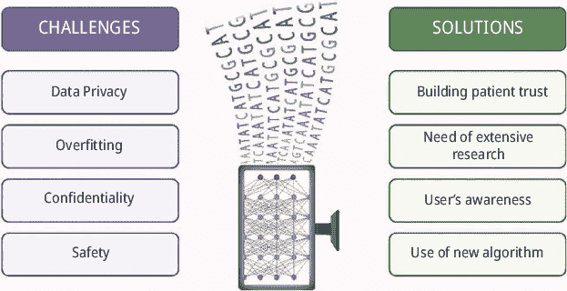

**Fig. 12.1: AI 在医疗保健中的挑战与潜在解决方案示意图。**

#### 透明度、伦理与隐私挑战

此外，维持必要的透明度对于保护患者信任和安全至关重要。在理想情况下，所有数据和算法都将可供公众审查；尽管如此，仍存在关于保护投资和知识产权以及减轻网络安全风险的合理担忧 [46]。医疗保健部门面临重大的伦理和隐私挑战，需要严格遵守法律、规范和法规。医学中 AI 的实施引发了若干伦理和隐私问题，包括患者信息的保密性、创新的道德影响，以及技术进步对医生和患者的实际影响。为了有效利用医疗保健中的 AI，必须做出战略决策，以平衡相互竞争的利益和价值，包括隐私、可靠性、知识产权和开放性 [47, 48, 49, 50, 51]。建立患者信任在医疗行业至关重要。这尤其适用于基于 AI 的技术。医疗专家和决策者承认，由于面对面咨询医生的历史意义，公众可能不愿完全依赖 AI 生成的建议。此外，由于公众对 AI 在医学中潜在益处和局限性的普遍误解，医疗人员在使用这些技术时可能会遇到困难 [52, 53, 54]。

#### 实施障碍与互操作性

此外，某些医疗专业人员（如医生、护士和护理助理）可能未充分关注数字技术，从而阻碍了 AI 在医疗保健中的实施。AI 算法的可解释性和不透明性构成了重大挑战，特别是在非结构化数据的背景下。由于医院管理人员和医生经常面临技术担忧，AI 系统遇到了困难。互操作性标准对于使用 AI 模型和实现来自各种电子健康记录的数据集成至关重要 [55, 56]。

### 12.3 AI 驱动医疗保健中的伦理考量

#### 确保医疗领域 XAI 的负责任部署

为确保 `XAI` 在医疗领域的负责任且有益的部署，严格评估其伦理影响至关重要。

##### 核心伦理原则与评估框架

研究人员强调了 AI 效能、可解释性和可阐释性在健康技术中的重要性。其研究结果表明，评估医疗技术的组织必须获取关于机器学习算法功能及其预测能力的大量知识 [57]。作者主张开发并应用工具以评估这些因素，从而在利益相关者中培养问责意识。

##### 诊断应用中的权衡

部分研究人员将 AI 用于诊断目的，并考察与 AI 可解释性和可靠性相关的潜在利弊。虽然 AI 有能力提升诊断产出和准确性，但它对临床专业的技能组合构成风险。该研究主张将 AI 作为人类专业知识的辅助工具加以利用，而非试图取代它。

##### 偏见与公平性问题

部分文献强调了医疗领域所用 AI 和大数据应用中潜在的偏见 [58, 59]。它们提出了改进 AI 算法公平性的建议，并警告不要使用非代表性样本训练这些算法。

##### 数据治理与激励机制

作者通过强调激励患者披露其健康数据的必要性，为 AI 时代的数据监管政策讨论做出了贡献。作者认为，数字版权内容（如音乐）的创收性质能够传授重要知识，并提供一种基于 `GDPR` 的补救措施，使数据流动不受阻碍 [60]。他们主张，该策略可能提供一种切实可行且行之有效的方式来鼓励数据共享，而不限制数据获取，这对医疗 AI 的进步和功效至关重要。

##### 全球南方与以人为本的 AI

学者们探讨了医疗领域对以人为本的 AI 的迫切需求，尤其是在所谓的“全球南方”——一个主要由低资源地区组成的区域 [61, 62]。根据 Okolo 的观点，有偏见的 AI 系统可能会无意中扩大这些领域现有的鸿沟，因此应避免使用此类系统。作者强调，在创建 AI 系统时考虑当地需求和条件至关重要，以提供更公平有效的医疗解决方案。

##### 心理健康服务中的伦理考量

同样，研究人员讨论了将 AI 和大数据整合到心理健康服务中的道德影响——作者将这一概念称为“iHealth”。在对 iHealth 可能性的深入伦理审视中，Rubeis 确定了三把双刃剑：数据挖掘、生态瞬时评估（`EMA`）和自我监测 [63]。

##### 透明度与问责制

此外，应将透明度置于首位，`XAI` 应如图 12.2 所示，为其判断提供清晰的理由。它通过使消费者和医疗专业人员能够理解 AI 生成的建议或诊断背后的推理，促进了问责制。透明的 AI 系统通过避免“黑箱”问题，帮助消费者验证并信任结果。

##### 偏见缓解策略

在有偏数据上训练的 AI 系统可能会强化并放大预存偏见，这可能对医疗结果产生歧视性影响。在合乎伦理地实施 `XAI` 时，必须在数据收集、预处理和模型训练阶段主动且审慎地考虑偏见 [64]。对 `XAI` 系统偏见的监测和补救可带来更合理的医疗实践。

##### 知情同意与患者自主权

患者有权知晓其治疗中是否使用了 AI（包括 `XAI`）。为获得知情同意，必须就 AI 系统的目的、局限性和潜在风险进行清晰沟通。患者应能获得人工解释和指导，以确保其选择和自主权受到尊重。

##### 临床决策支持与专业责任

伦理 `XAI` 的重要要素包括将患者福祉置于首位，并确保 AI 系统做出符合患者最佳利益的选择 [65]。医疗专业人员在做决策时应由 `XAI` 协助，`XAI` 的构建应充分考虑其特定需求和偏好。医疗专业人员必须正确理解并应用 `XAI` 系统。这要求坚守其临床专长，批判性地评估 AI 输出，并了解 AI 系统的局限性和潜在偏见。医疗工作者应接受充分的 `XAI` 教育和培训，以确保其负责任且高效地使用。

##### 伦理框架与指南遵循

通过遵循公认的伦理框架（包括仁慈、不伤害、自主和正义原则），可指导医疗领域 `XAI` 的开发和应用。针对医疗领域的特定伦理指南（如政府或专业医疗组织提供的指南）有助于应对 `XAI` 带来的特定伦理挑战 [66, 67]。

##### 图示

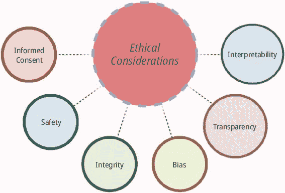

图 12.2: 医疗 AI 伦理考量的示意图表示。

### 12.4 对医疗专业人员的影响

另一位研究人员解释称，隐私是在使用 AI 时需要考虑的关键伦理因素。关于 AI 系统如何收集、存储和使用个人数据的担忧被称为 AI 隐私问题。AI 系统可以收集和分析大量个人数据，数据管理不善可能导致严重的隐私担忧 [68]。AI 系统通常从个人那里收集大量个人数据，随后用于对他们做出判断。这引发了关于数据收集、存储和利用方法的询问。在监控系统中实施 AI 可能会侵犯隐私权。要使医疗 AI 发挥最大潜力，必须解决四个主要伦理问题：(1) 数据利用的知情许可；(2) 安全性与完整性；(3) 算法公平性与偏见；(4) 个人数据隐私保护。关于 AI 的大多数法律论述集中在算法透明度的局限性上。在高风险情境下应用 AI 使得透明、公平且可问责的 AI 设计与治理成为必要。信息的可访问性和可理解性是透明度的两个基本要素。故意掩盖算法运作机制是标准做法 [69, 70]。AI 算法中潜在的偏见（可能导致医疗结果的差异）代表了另一个伦理问题。无代表性的训练数据集可能导致有偏见的 AI 模型，从而不成比例地影响特定人口群体。这可能导致医疗获取的不公平，并加剧医疗结果中预先存在的差异。为确保公平与公正，开发者必须通过包容多样的数据集、持续监控和迭代算法改进来积极对抗偏见 [71]。AI 决策中的可解释性是一个重要的伦理考量，特别是在医疗领域，因为决策会影响患者的生活质量。深度学习网络和其他复杂的 AI 模型可能难以解释，导致难以理解系统得出特定结论的方式 [72]。

此外，医疗 AI 应用中需要特别考虑的另一个伦理基石是知情同意。患者应了解 AI 技术如何用于其医疗过程，并有权选择接受或拒绝 AI 驱动的诊断或治疗。这包括概述 AI 在医疗中的优势，以及其局限性和潜在风险 [73]。AI 自动化医疗行业某些任务的能力可能导致工作岗位流失，这引发了关于其如何影响劳动力的伦理问题。在利用 AI 效率优势的同时保留人类角色需要审慎考虑。医疗机构必须优先考虑再培训和技能提升计划，以确保其员工能够适应并与 AI 技术协作 [74, 75]。

AI 在医疗领域的应用包括任务自动化、异常检测、相关性分析、非结构化数据分析和人工工作者支持。这些是通过使用 `DL`、`ML` 和 `NLP` 算法实现的。`NLP` 算法识别原始电子病历数据中的关键术语和短语，以辅助决策。看着 AI 如何以创新方式将数据转化为能够改善临床实践和医疗专业人员护理质量的结果，令人着迷 [76, 77, 78, 79, 80]。研究考察了 AI 是否会被接受或使用，这取决于该技术被视为多有益以及如何使其工作得更好。AI 研究主要集中在技术上——将其连接在何处以及如何最好地利用它。尽管如此，人类是这一切中另一个基本要素。现在有必要考虑技术将如何影响用户——医疗专业人员——以及如何影响他们提供护理的能力 [81, 82, 83]。AI 的使用和能力在不同医疗专业人员和学科间会有所不同。由于医疗 AI 没有被广泛接受的定义，医疗专业人员可能不知道他们在工作中正在使用 AI。理解临床医生如何看待医疗服务中的 AI，对于确保一支长期的、准备好应对快速演变的数字医疗环境的医疗队伍至关重要。需要更多研究来确定临床医生与技术之间的互动 [84, 85, 86]。研究人员调查影响医疗专业人员认可 `AIMDSS` 的潜在因素，符合标准。研究人员有限的观察性研究表明，当医疗从业者对该技术持怀疑态度，或缺乏对其改善患者结果或护理交付能力的认知时，他们在常规实践中使用 AI 的倾向较低。该结论专门针对医疗行业，强调了不包含 AI 的数字健康技术方面的相似性 [87, 88, 89, 90]。

### 12.5 患者视角与参与

公众对为研究目的共享健康数据的感受是众所周知的[101][102][103]。虽然人们经常对数据共享的安全性、保密性和商业影响提出担忧，但当他们相信研究将造福社会或大众，并信任实施研究的机构时，通常会支持该研究[104]。尽管如此，公众和患者对为 AI 研究传播医疗信息的看法尚未得到充分阐述[105]。不能假设公众对数据共享的有条件支持适用于研究主题，因为为 AI 研究共享数据是一个有争议的问题。该领域的医学文献正在迅速扩展，AI 有能力显著改变患者与医疗从业者的互动方式。最近的一期期刊分析了 AI 技术的优缺点，包括医疗功效和质量的提高，以及对患者自主权、知情同意权和隐私的威胁。然而，目前关于患者如何看待 AI 及其在医疗保健中的应用的认知缺乏深度和清晰度[106]。根据其他研究人员的观点，人们可能会失去对 AI 系统能力的信任。例如，在医疗干预方面，人们可能不信任 AI 的诊断和预测能力。根据另一项研究，用户对 AI 系统可信度的感知受其自主性的影响[107][108][109]。此外，一些研究人员为了解消费者对医学中 AI 的看法而进行的一项调查显示，报名参加 AI 诊断的参与者比报名接受医疗服务提供者诊断的参与者要少。同一项研究中，大多数受访者更倾向于人类提供者而非 AI，即使 AI 误诊的几率更低。此外，他们还表明，如果最终治疗决定由医生而非 AI 做出，患者更倾向于选择 AI[110]。

历史上，医疗从业者主要决定其患者的健康决策。这限制了患者与医疗服务提供者之间协作和集体决策的机会。研究表明，数字技术已经改变了患者与医务人员之间的关系[111][112][113][114]。这些技术的实施促进了患者与医生之间更具协作性的联系，使人们能够更容易地表达对其护理的关切。对自身病情更加了解的患者会开始进行自我管理。其特点是医疗专业人员系统地分发知识和支持措施，以提高个人管理其健康问题的能力和信心[115]。在理想情况下，患者将具备应对其社会、情感和身体挑战的信心。数字技术正在增强医疗领域的患者参与度和预防医学。研究表明，医疗保健中融入数字技术增强了患者对其生活方式选择的认知，并鼓励他们更积极主动地参与健康管理。研究人员发现，当退伍军人能够访问其健康数据时，他们管理健康的动力会增强。此外，个性化是指修改数字平台、产品或服务的用户体验，以契合个人的特定需求、兴趣、行为和特征[116][117][118]。这意味着利用数据和算法生成相关且有用的交互、推荐和用户专属内容。它促进了权力动态的转变：从医生为患者做决定，转变为一个将患者需求纳入考量的协作过程。为患者开发用户友好的在线界面可能是提升其参与护理程度的关键[119]。

### 12.6 结论

AI 是医疗领域的一种强大工具，特别是在机器学习方面，有助于监测干预措施的功效并理解疾病。由于数据可访问性问题和组织阻力，医疗机构可能抵制实施 AI，因此需要转向关注总体患者预后。对于数据隐私而言，患者知情同意至关重要，特别是因为 AI 严重依赖海量数据集。医疗领域负责任的 AI 实施需要道德考量，优先保障患者信任、问责制和透明度。由 AI 系统基于有偏数据训练得出的医疗结果可能具有歧视性，这凸显了在数据收集和模型训练中解决偏见的必要性。算法透明度的局限性一直是法律讨论的焦点；然而，在高风险场景中，透明、公平且合乎道德的 AI 设计至关重要。将再培训计划作为优先事项创建出来，对于确保医疗专业人员能够使用 AI 技术必不可少。医疗专业人员对数字系统的有限掌握，凸显了加强关于 AI 利弊教育的必要性。尽管对 AI 错误的刑事处罚仍存担忧，但医疗专业人员越来越有兴趣利用 AI 来处理诊断所需的海量数据。归根结底，医疗领域的 AI 具备改善患者预后和医疗服务交付的潜力；然而，必须解决透明度、数据隐私和伦理顾虑等因素。AI 的成功应用需要医学专家之间的协作。还需要进一步的研究，以全面了解 AI 对患者和医疗专业人员的影响，从而实现 AI 在医疗领域的适当且有效的整合。

## 参考文献

[1] Morley J, Floridi L. An ethically mindful approach to AI for health care. *The Lancet*. 2020 Jan 25;395(10220):254–55. →

[2] Drukker L, Noble JA, Papageorghiou AT. Introduction to artificial intelligence in ultrasound imaging in obstetrics and gynecology. *Ultrasound in Obstetrics & Gynecology*. 2020 Oct;56(4):498–505. →

[3] Rong G, Mendez A, Assi EB, Zhao B, Sawan M. Artificial intelligence in healthcare: Review and prediction case studies. *Engineering*. 2020 Mar 1;6(3):291–301. →

[4] Miller DD, Brown EW. Artificial intelligence in medical practice: The question to the answer?. *The American Journal of Medicine*. 2018 Feb 1;131(2):129–33. →

[5] Smith H. Clinical AI: Opacity, accountability, responsibility and liability. *AI & Society*. 2021 Jun;36(2):535–45. →

[6] Taddeo M, Floridi L. How AI can be a force for good. *Science*. 2018 Aug 24;361(6404):751–52. →

[7] Bini SA. Artificial intelligence, machine learning, deep learning, and cognitive computing: What do these terms mean and how will they impact health care?. *The Journal of Arthroplasty*. 2018 Aug 1;33(8):2358–61. →

[8] Kapoor R, Walters SP, Al-Aswad LA. The current state of artificial intelligence in ophthalmology. *Survey of Ophthalmology*. 2019;64(2):233–40. →

[9] Williams AM, Liu Y, Regner KR, et al. Artificial intelligence, physiological genomics, and precision medicine. *Physiological Genomics*. 2018;50(4):237–43. →

[10] Parola C, Neumeier D, Reddy ST. Integrating high‐throughput screening and sequencing for monoclonal antibody discovery and engineering. *Immunology*. 2018;153(1):31–41. →

[11] Hammond R, Athanasiadou R, Curado S, Aphinyanaphongs Y, Abrams C, Messito MJ, Gross R, Katzow M, Jay M, Razavian N, Elbel B. Predicting childhood obesity using electronic health records and publicly available data. *PloS One*. 2019 Apr 22;14(4):e0215571. →

[12] Shen R, Martin A, Ni A, Hellmann M, Arbour KC, Jordan E, Arora A, Ptashkin R, Zehir A, Kris MG, Rudin CM. Harnessing clinical sequencing data for survival stratification of patients with metastatic lung adenocarcinomas. *JCO Precision Oncology*. 2019 Mar;3:1–9. →

[13] Retson TA, Besser AH, Sall S, Golden D, Hsiao A. Machine learning and deep neural networks in thoracic and cardiovascular imaging. *Journal of Thoracic Imaging*. 2019 May 1;34(3):192–201. →

[14] Hamet P, Tremblay J. Artificial intelligence in medicine. *Metabolism*. 2017;69S:S36–S40. →

[15] Ye JJ. Artificial intelligence for pathologists is not near−it is here: Description of a prototype that can transform how we practice pathology tomorrow. *Archives of Pathology & Laboratory Medicine*. 2015;139(7):929–35. →

## 参考文献

[16] Ho CW, Soon D, Caals K, Kapur J. 医疗保健领域自动化图像分析与人工智能分析的治理。*Clinical Radiology*。2019 年 5 月 1 日；74(5)：329–37。a, b

[17] Vandemeulebroucke T, Dierckx de Casterlé B, Gastmans C. 护理机器人在老年护理中的应用：基于论证的伦理文献系统综述。*Archives of Gerontology and Geriatrics*。2018；74：15–25。→

[18] Sullivan LS, Klein E, Brown T, Sample M, Pham M, Tubig P, Folland R, Truitt A, Goering S. 牢记残障视角：植入式脑机接口研究的案例研究。*Science and Engineering Ethics*。2018 年 4 月；24：479–04。→

[19] Meenigea N, Kolla VR. 探索人工智能在医疗保健领域的现状。*International Journal of Sustainable Development in Computing Science*。2023 年 3 月 23 日；5(1)。→

[20] Bartoletti I. 医疗保健中的人工智能：伦理与隐私挑战。载于《医学人工智能：第 17 届医学人工智能会议，AIME 2019，波兰波兹南，2019 年 6 月 26-29 日，论文集 17》2019 年（第 7-10 页）。Springer International Publishing。→

[21] Habuza T, Navaz AN, Hashim F, Alnajjar F, Zaki N, Serhani MA, Statsenko Y. 机器人技术、诊断图像分析和精准医疗中的人工智能应用：现有局限、未来趋势、医学 CAD 系统指南。*Informatics in Medicine Unlocked*。2021 年 1 月 1 日；24：100596。→

[22] Esteva A, Kuprel B, Novoa RA, Ko J, Swetter SM, Blau HM, Thrun S. 基于深度神经网络的皮肤癌皮肤科专家级分类。*Nature*。2017 年 2 月；542(7639)：115–8。→

[23] Lee H, Tajmir S, Lee J, Zissen M, Yeshiwas BA, Alkasab TK, Choy G, Do S. 用于骨龄评估的全自动深度学习系统。*Journal of Digital Imaging*。2017 年 8 月；30：427–41。→

[24] Char DS, Abràmoff MD, Feudtner C. 识别机器学习医疗应用的伦理考量。*The American Journal of Bioethics*。2020 年 11 月 1 日；20(11)：7–17。→

[25] Lata K, Dave M, KN N. 基于生成对抗网络的数据增强。载于《第 2 届先进计算与软件工程国际会议(ICACSE)论文集》，2019 年 2 月（第 8 卷，第 120-22 页）。→

[26] Taylor L, Nitschke G. 利用通用数据增强改进深度学习。载于《2018 年 IEEE 计算智能研讨会系列(SSCI)》2018 年 11 月 18 日（第 1542-47 页）。IEEE。→

[27] Minh D, Wang HX, Li YF, Nguyen TN. 可解释人工智能：综述。*Artificial Intelligence Review*。2022 年 6 月；1：1–66。→

[28] Arrieta AB, Díaz-Rodríguez N, Del Ser J, Bennetot A, Tabik S, Barbado A, García S, Gil-López S, Molina D, Benjamins R, Chatila R. 可解释人工智能(XAI)：面向负责任人工智能的概念、分类、机遇与挑战。*Information Fusion*。2020 年 6 月 1 日；58：82–115。→

[29] Johnson KW, Torres Soto J, Glicksberg BS, Shameer K, Miotto R, Ali M, Ashley E, Dudley JT. 心脏病学中的人工智能。*Journal of the American College of Cardiology*。2018 年 6 月 12 日；71(23)：2668–79。→

[30] Lopez K, Fodeh SJ, Allam A, Brandt CA, Krauthammer M. 通过多模态学习减轻标注负担。*Frontiers in Big Data*。2020 年 6 月 2 日；3：19。→

[31] Sun TQ, Medaglia R. 绘制公共部门人工智能挑战图谱：来自公共医疗保健的证据。*Government Information Quarterly*。2019 年 4 月 1 日；36(2)：368–83。→

[32] Luxton DD. 关于人工智能护理提供者伦理使用与设计的建议。*Artificial Intelligence in Medicine* [互联网]。2014；62：1–10。[引用于 2024 年 3 月 9 日]。→

[33] Dilsizian SE, Siegel EL. 医学与心脏成像中的人工智能：利用大数据与先进计算提供个性化医疗诊断与治疗。*Current Cardiology Reports* [互联网]。2014；16：441。[引用于 2024 年 3 月 9 日]。→

[34] Safavi K, Kalis B. 人工智能如何改变医疗保健的未来。*Harvard Business Review*。2019；在线获取：[`hbr.org/webinar/2019/02/how-ai-can-change-the-future-of-health-care`](https://hbr.org/webinar/2019/02/how-ai-can-change-the-future-of-health-care) 访问于 2024 年 6 月 15 日 →

[35] Rigby MJ. 医疗保健中使用人工智能的伦理维度。*AMA Journal of Ethics*。2019 年 2 月 1 日；21(2)：121–24。→

[36] Hurst W, Merabti M, Fergus P. 关键基础设施安全综述。载于《关键基础设施保护 VIII：第 8 届 IFIP WG 11.10 国际会议，ICCIP 2014，美国弗吉尼亚州阿灵顿，2014 年 3 月 17-19 日，修订精选论文 8》2014 年（第 127-138 页）。Berlin Heidelberg：Springer。→

[37] ABI Research. 新报告确定医疗保健领域领先的人工智能应用。2018。在线获取：[`www.abiresearch.com/press/ai-save-healthcare-sector-us52-billion-2021/`](https://www.abiresearch.com/press/ai-save-healthcare-sector-us52-billion-2021/) （访问于 2020 年 8 月 15 日）。→

[38] Houlton S. 人工智能如何改变医疗保健 [互联网]。*Prescriber* 2018 [引用于 2024 年 3 月 9 日]。[`www.prescriber.co.uk/article/how-artificial-intelligence-is-transforming-healthcare/`](https://www.prescriber.co.uk/article/how-artificial-intelligence-is-transforming-healthcare/)。→

## 参考文献

[39] Wiens J, Shenoy ES. 医疗保健的机器学习：医疗保健流行病学即将发生重大转变。*Clinical Infectious Diseases* [互联网]。2018；66：149–53。[引用于 2024 年 3 月 9 日]。→

[40] Wang F, Preininger A. 健康领域的人工智能：现状、挑战与未来方向。*Yearbook of Medical Informatics*。2019；28：016–26。→

[41] Price WN. 医疗保健中的人工智能：应用与法律启示。*The SciTech Lawyer* [互联网]。2017；14：10–13。[引用于 2024 年 3 月 9 日]。→

[42] Watson DS, Krutzinna J, Bruce IN, Griffiths CE, McInnes IB, Barnes MR, Floridi L. 机器学习算法的临床应用：超越黑箱。*Bmj*。2019 年 3 月 12 日；364：1–9。→

[43] Lopez K, Fodeh SJ, Allam A, Brandt CA, Krauthammer M. 通过多模态学习减轻标注负担。*Frontiers in Big Data*。2020 年 6 月 2 日；3：19。→

[44] Sun TQ, Medaglia R. 绘制公共部门人工智能挑战图谱：来自公共医疗保健的证据。*Government Information Quarterly* [互联网] 2018 [引用于 2024 年 3 月 9 日]。→

## 参考文献

[45] Saraswat D, Bhattacharya P, Verma A, Prasad VK, Tanwar S, Sharma G, Bokoro PN, Sharma R. 面向医疗健康 5.0 的可解释人工智能：机遇与挑战。*IEEE Access*。2022 年 8 月 8 日；10：84486–517。→

[46] Aung YY, Wong DC, Ting DS. 人工智能的前景：回顾医疗健康领域人工智能的机遇与挑战。*British Medical Bulletin*。2021 年 9 月；139(1)：4–15。→

[47] Vayena E, Blasimme A, Cohen IG. 医学中的机器学习：应对伦理挑战。*PLoS Med*。2018；15(11)：4–7。→

[48] Bartoletti I. 伦理与隐私挑战。载于《医学人工智能：第 17 届医学人工智能会议，AIME 2019，波兰波兹南，6 月 26–29 日，论文集 17》2019 年（第 7–10 页）。Springer International Publishing。→

[49] Cohen IG, Evgeniou T, Gerke S, Minssen T. 欧洲人工智能战略：对数字健康的影响与挑战。*The Lancet Digital Health*。2020；2(7)：e376–9。→

[50] Gerke S, Minssen T, Cohen G. 人工智能驱动医疗健康的伦理与法律挑战。*Artificial Intelligence in Healthcare*。2020；26：295–336。→

[51] Sun TQ, Medaglia R. 绘制公共部门人工智能挑战图谱：来自公共医疗健康的证据。*Government Information Quarterly*。2019；36(2)：368–83。→

[52] Vollmer S, Mateen BA, Bohner G, Király FJ, Ghani R, Jonsson P, Cumbers S, Jonas A, McAllister KS, Myles P, Grainger D. 造福患者的机器学习与人工智能研究：关于透明度、可复制性、伦理与有效性的 20 个关键问题。*BMJ*。2020 年 3 月 20 日；1–11：368。→

[53] Iliashenko O, Bikkulova Z, Dubgorn A. 医疗健康领域人工智能的机遇与挑战。*E3S Web of Conferences*。2019；31：02028。→

[54] Singh RP, Hom GL, Abramoff MD, Campbell JP, Chiang MF. 医疗健康系统、提供者和患者采用现实世界人工智能面临的当前挑战与障碍。*Translational Vision Science & Technology*。2020；9(2)：1–6。→

[55] Hee Lee D, Yoon SN. 基于人工智能技术在医疗健康行业的应用：机遇与挑战。*International Journal of Environmental Research and Public Health*。2021；18(1)：1–18。→

[56] Hofer IS, Burns M, Kendale S, Wanderer JP. 将机器学习切实融入临床实践：机遇、挑战与潜在未来的路线图。*Anesthesia & Analgesia*。2020；130(5)：1115–18。→

[57] Farah L, Murris JM, Borget I, Guilloux A, Martelli NM, Katsahian SI. 基于人工智能的健康技术的性能、可解释性和可阐释性评估：医疗健康利益相关者需要了解的内容。*Mayo Clinic Proceedings: Digital Health*。2023 年 6 月 1 日；1(2)：120–38。→

[58] Hallowell N, Badger S, McKay F, Kerasidou A, Nellåker C. 民主化还是颠覆诊断？罕见病诊断中使用 AI 工具引发的伦理问题。*SSM-Qualitative Research in Health*。2023 年 6 月 1 日；3：100240。→

[59] Norori N, Hu Q, Aellen FM, Faraci FD, Tzovara A. 应对医疗健康大数据与 AI 中的偏见：呼吁开放科学。*Patterns*。2021 年 10 月 8 日；2(10)1–8。→

[60] Fosch-Villaronga E, Drukarch H, Khanna P, Verhoef T, Custers B. 医疗 AI 中的多样性核算。*Computer Law & Security Review*。2022 年 11 月 1 日；47：105735。→

[61] Panagopoulos A, Minssen T, Sideri K, Yu H, Compagnucci MC. AI 时代激励医疗健康数据共享。*Computer Law & Security Review*。2022 年 7 月 1 日；45：105670。→

[62] Okolo CT. 为全球南方医疗健康优化以人为本的 AI。*Patterns*。2022 年 2 月 11 日；3(2)1–8。→

[63] Rubeis G. iHealth：精神医疗健康中人工智能与大数据的伦理。*Internet Interventions*。2022 年 4 月 1 日；28：100518。→

[64] Li X, Wen X, Shang X, Liu J, Zhang L, Cui Y, Luo X, Zhang G, Xie J, Huang T, Chen Z. 基于临床数据和光学相干断层扫描血管造影，利用机器学习算法识别糖尿病视网膜病变分类。*Eye*。2024 年 6 月；13：1–9。→

[65] Angelov PP, Soares EA, Jiang R, Arnold NI, Atkinson PM. 可解释人工智能：分析性综述。*Wiley Interdisciplinary Reviews: Data Mining and Knowledge Discovery*。2021 年 9 月；11(5)：e1424。→

[66] Hulsen T. 可解释人工智能 (XAI)：医疗健康领域的概念与挑战。*AI*。2023 年 8 月 10 日；4(3)：652–66。→

[67] Amann J, Blasimme A, Vayena E, Frey D, Madai VI. Precise4Q 联盟。医疗健康人工智能的可解释性：多学科视角。*BMC Medical Informatics and Decision Making*。2020 年 12 月；20：1–9。→

[68] Solomonides AE, Koski E, Atabaki SM, Weinberg S, McGreevey III JD, Kannry JL, Petersen C, Lehmann CU. 界定 AMIA 的人工智能原则。*Journal of the American Medical Informatics Association*。2022 年 4 月 1 日；29(4)：585–91。→

[69] Rodrigues R. AI 的法律与人权问题：差距、挑战与脆弱性。*Journal of Responsible Technology*。2020 年 12 月 1 日；4：100005。→

[70] 关于欧洲议会和理事会关于个人数据处理和此类数据自由流动方面保护个人的法规提案的报告（通用数据保护条例）。*Europarleuropaeu*。→

[71] Kasula BY. 医疗健康领域人工智能的伦理影响与未来前景：研究综合。*International Meridian Journal*。2024 年 1 月 17 日；6(6)：1–7。→

[72] Tatineni S. AI 与数据科学中的伦理考量：偏见、公平性与问责制。*International Journal of Information Technology and Management Information Systems (IJITMIS)*。2019；10(1)：11–21。→

[73] Rokhshad R, Ducret M, Chaurasia A, Karteva T, Radenkovic M, Roganovic J, Hamdan M, Mohammad-Rahimi H, Krois J, Lahoud P, Schwendicke F. 牙医学中人工智能的伦理考量：框架与清单。*Journal of Dentistry*。2023 年 8 月 1 日；135：104593。→

[74] Huriye AZ. 人工智能伦理：审视 AI 开发与使用中的伦理考量。*American Journal of Technology*。2023 年 4 月 25 日；2(1)：37–44。→

## 参考文献

[75] Herington J, McCradden MD, Creel K, Boellaard R, Jones EC, Jha AK, Rahmim A, Scott PJ, Sunderland JJ, Wahl RL, Zuehlsdorff S. 人工智能在医学影像中的伦理考量：部署与治理。*核医学杂志*。2023 年 10 月 1 日；64(10)：1509–15。

[76] 阿联酋。人工智能战略，2017。<http://www.uaeai.ae/en/>

[77] Hsieh ST, Chen CD, Chen JH, 等。用于呼吸道感染诊断的专家系统应用。载于：第九届泛在智能与计算国际会议暨第九届自主与可信计算国际会议，日本福冈，9 月 4-7 日，（第 673-78 页）。纽约：IEEE。

[78] Gagnon M-P, Ghandourel K, Talla PK, 等。医生对电子健康记录的接受度：检验一个综合理论模型。*生物医学信息学杂志*。2014；48：17–27。

[79] Gagnon M-P, Simonyan D, Ghandour EK, 等。影响医生采用电子健康记录的因素：一项多层次分析。*信息管理国际期刊*。2016；36：258–70。

[80] Rho M, Choi I, Lee J. 医生对远程医疗服务接受度及行为意向的预测因素。*医学信息学国际期刊*。2014；83(8)：559–71。

[81] Fan W, Liu J, Zhu S, 等。探究医护人员采用基于人工智能的医学诊断支持系统（AIMDSS）的影响因素。*运筹学年刊*。2018 年 3 月 19 日在线发表；DOI：10.1007/s10479-018-2818-y。

[82] Venkatesh V, Thong JYL, Chan FKY, 等。扩展两阶段信息系统持续使用模型：纳入 UTAUT 预测因子及情境的作用。*信息系统期刊*。2011；21：527–55。

[83] Li X, Hess TJ, Valacich JS. 我们为何信任新技术？一项关于组织信息系统初始信任形成的研究。*战略信息系统期刊*。2008；17：39–71。

[84] Zhou T, Lu Y, Wang B. 整合 TTF 与 UTAUT 以解释移动银行用户采用行为。*计算机与人类行为*。2010；26：760–67。

[85] Wu IL, Li JY, Fu CY. 医院专业人员采用移动医疗的整合视角。*决策支持系统*。2011；51：587–96。

[86] Dulle FW, Minishi-Majanja MK. 统一技术接受与使用理论（UTAUT）模型在开放获取采纳研究中的适用性。*信息发展*。2011；27：32–45。

[87] Nakrem S, Solbjor M, Pettersen IN, 等。护理关系岌岌可危？居家医疗专业人员使用数字药物分配器的体验：一项定性研究。*BMC 卫生服务研究*。2018；18(1)：26–26。

[88] Mead D, Moseley L. 是态度、获取还是应用：决策支持系统在医疗保健中渗透率低的原因是什么？*健康信息学期刊*。2001；7：195–97。

[89] Lluch M. 医疗专业人员面临的健康信息技术组织障碍：文献综述。*医学信息学国际期刊*。2011；80(12)：849–62。

[90] Kolltveit BC, Gjengedal E, Graue M, Iversen MM, Thorne S, Kirkevold M. 糖尿病足部护理中的远程医疗：医疗专业人员的体验。*BMC 卫生服务研究*。2016 年 12 月；16：1–8。

[91] Nilsen ER, Dugstad J, Eide H, Gullslett MK, Eide T. 探索市政医疗服务中福利技术实施的阻力——一项纵向病例研究。*BMC 卫生服务研究*。2016 年 12 月；16(1)：1–4。

[92] Magnusson L, Hanson EJ. 一个旨在支持居家虚弱老人及其家庭照护者的研究、技术与开发项目引发的伦理问题。*社区健康与社会护理*。2003 年 9 月；11(5)：431–39。

[93] 世界卫生组织。数字健康。载于：第七十一届世界卫生大会，2018 年 5 月 25 日（第 21-35 页）。日内瓦：Godinho MA, Martins H, Al-Shorbaji N, Quintana Y, Liaw ST。

[94] Masselink CE. 在职业治疗实践框架中考量技术。*职业治疗开放期刊*。2018；6：1–11。

[95] Hofmann B, Svenaeus F. 医疗技术如何塑造疾病体验。*生命科学、社会与政策*。2018；14(1)：3。

[96] Price WN, Gerke S, Cohen IG. 医生使用人工智能的潜在法律责任。*JAMA*。2019。<https://jamanetwork.com/journals/jama/fullarticle/2752750>。访问日期：2019 年 10 月 6 日。

[97] Schif D, Borenstein J. 临床医生应如何与患者沟通关于人工智能团队成员的角色？*AMA 医学伦理期刊*。2019；21(2)：138–45。

[98] Balthazar P, Harri P, Prater A, Safdar NM. 在大数据、人工智能和预测分析时代保护患者利益。*美国放射学会杂志*。2018；15(3 Pt B)：580–86。

[99] Turner PJ, Van den Bruel A, Jones CHD, Plüddemann A, Heneghan C, Thompson MJ, 等。英国初级保健中的即时检测：一项确立临床需求的调查。*家庭医学*。2016；33(4)：388–94。

[100] Vellido A. 医学中应用人工智能的社会问题。*肾脏疾病*。2019；5(1)：11–17。

[101] Ipsos MORI 社会研究院。单向镜：公众对商业获取健康数据的态度。单向镜：公众对商业获取健康数据的态度。2017。URL：<https://wellcome.figshare.com/articles/journal_contribution/The_One-Way_Mirror_Public_attitudes_to_commercial_access_to_health_data/5616448/1> [访问日期：2024-3-14]

[102] Aitken M, De St Jorre J, Pagliari C, Jepson R, Cunningham-Burley S. 公众对为研究目的共享和关联健康数据的反应：系统评价与定性研究主题综合。*BMC 医学伦理*。2016 年 11 月；17(1)：73。

[103] Kalkman S, Van Delden J, Banerjee A, Tyl B, Mostert M, Van Thiel G. 患者和公众对为研究共享健康数据的观点与态度：实证证据的叙述性综述。*医学伦理杂志*。2019 年 11 月；21：1–11。

### 第 13 章 医疗保健领域 AI 的未来趋势与创新

## 摘要

# 人工智能（AI）在医疗保健中的未来趋势与创新

人工智能（AI）是一项重要的技术进步，它使人类能够在各个行业中以更强的心理和逻辑能力取代体力劳动，这超越了机器所推动的单纯体力劳动替代。本章重点阐述医疗保健系统中 AI 的未来趋势及其他创新。近年来 AI 发展迅速，现已应用于至关重要的医疗保健行业，带来诸多益处。本章概述了 AI 在医疗和健康领域的现状，重点关注该技术的未来前景。AI 现在被用于在关键医疗保健领域提供诸多优势，特别是在早期检测和诊断方面。随着通过 `H-IoT` 系统提供未来医疗保健成为现实——这得益于科学界协助铺平道路的关键方法的发展——当前的技术状态为改进和创新提供了无数机会。AI 现在被用于在关键医疗保健领域提供诸多优势，尤其是在早期检测和诊断领域。在智能互联医疗（SCH）的未来，AI 将被用于更智能的医院和医患互动。

**关键词：** 创新、Healthify、Dehealth、HintVR、bump galaxy、health blocks、AccuVein

## 13.1 引言

自工业革命以来，技术已显著进步，并持续作为增长和生产的主要驱动力。替代人力密集型工作的机器技术发展，推动了人类发展的重大进步。人工智能（AI）是一项重要的技术进步，它使人类能够在各行业以更大的心智和逻辑能力承担体力劳动，这超越了机器提供的单纯人力辅助[1]。AI 是一个研究领域和技术进步的集合，它使智能机器和软件应用程序能够执行通常需要人类智能的任务。因此，AI 的主要优势之一是其能够在各种情境下复制人类行为、从错误中学习并适应新情况。AI 利用大数据和其他相关数据源来提高任务性能。在最近 AI 快速发展中受益的众多领域中，至关重要的医疗保健领域名列前茅[2]。AI 已在许多领域用自动化系统取代了人工健康系统。在某些应用中，人类只需管理患者和医疗资源等基本任务，而更复杂的程序则由 AI 组件处理或交由其自行处理。正如图 13.1 所示，AI 驱动的医疗系统正在迅速演变，特别是在诊断和早期检测领域[3]。

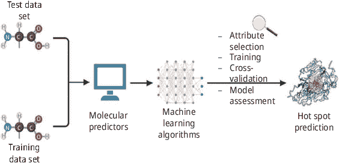

**图 13.1：** 用于热点预测的 `ML` 算法示意图。

### 通过利用相关信息源，AI 提升了各类任务的性能

近年来 AI 发展迅速，并在包括关键医疗保健领域在内的众多行业中取得了显著成效。医疗保健行业是受益于 AI 极大的行业之一。在许多领域，AI 已将医疗保健行业电子化地转变为计算机化版本 [4, 5]。因此，在某些程序中，人工干预仅限于管理患者和医疗资源等基本医疗任务；复杂操作要么完全由人工执行，要么由 AI 组件执行。AI 驱动的医疗系统正在迅速发展，特别是在早期检测和诊断领域。因此，AI 现在能够以更低的成本，以与 AI 相同的有效性、可靠性、细致性和速度，完成人类难以同等胜任的任务 [6, 7, 8, 9]。如果 AI 开发者成功创建出能够执行特定任务的系统，医疗保健数字化带来的技术进步可能有助于克服其他障碍。例如，AI 有望在提升患者护理质量的同时，大幅降低医疗费用。预计全球人口的增长将导致对更快速提供医疗服务的需求增加。因此，医疗行业需要创新的 AI 解决方案，以在不增加成本的前提下提高生产力和有效性 [10]。

### AI 利用相关数据源提升性能

通过使用相关数据源，AI 提升了各类任务的性能。近年来 AI 发展迅速，并在包括关键医疗保健领域在内的众多行业中取得了显著成效。医疗保健行业从 AI 中获益良多 [11]。AI 已将医疗系统的许多领域电子化地转变为计算机化版本。因此，在某些程序中，复杂流程要么由 AI 组件管理，要么主要由人工处理，人类仅需处理管理客户和医疗资源等基本医疗实务任务。AI 驱动的医疗系统正在迅速发展，特别是在早期检测和诊断方面 [12]。

### 智能互联医疗（SCH）与创新解决方案

智能互联医疗（SCH）将采用更多富有创意和独创性的解决方案来改善医患互动。移动应用将使网络在发生意外时能在地理上超链接至最近的医院，并在入院前传输数据，从而有可能挽救生命 [13]。预计未来将采用数字领域技术进步所实现的新型自我护理方法。例如，持续及闪光血糖监测系统允许传感器作为显示设备，无线传输血糖数据至读取器或移动应用，并生成低血糖和高血糖警报 [14]。眼动追踪可通过可用性测试流程，指导以患者为中心的药物输送新系统（自注射系统）的产品开发。该开发可极大地改善联网系统各部分（如传感器、输液泵、手持设备和移动应用）之间的交互方式，从而提高产品的整体功效 [15]。虚拟现实（VR）和增强现实（AR）等尖端技术通过使用户能够与这些世界互动并完全沉浸其中，可提升医疗实践的标准。这些技术包括头戴式显示器、触觉设备、`AR` 眼镜、软件和追踪传感器。在整形外科领域，虚拟现实（VR）已变得流行，并在导航、培训和手术准备方面具有潜在应用。基于 VR 的培训已得到充分研究。目前，市场上已有多款用于医学教育的商业 VR 产品 [16]。

## 13.2 AI 在药物发现中的未来趋势与创新

药物开发仍是一个漫长、昂贵、低效且困难的过程，新型有效疗法的发现率较低，尤其是考虑到疾病的复杂性。在 `AI/ML` 技术的帮助下，研究人员克服了药物发现中的障碍，这些方法在不同疾病的药物发现项目中有着广泛的应用。总体而言，学术界和业界的研究人员对将 `AI/ML` 应用于药物开发表现出了极大的兴趣 [17]。此外，大量制药公司已与高校及 AI 初创公司合作，并投资其基于 AI 的研究计划。为应对 `COVID-19` 大流行，学术界和业界近期展现出了令人印象深刻的合作水平。得益于开源平台，数据和流水线现可与 AI 实验室和企业共享。例如，公众现可查看 `Google DeepMind` 的 `AlphaFold` 系统预测的 `SARS-CoV-2` 蛋白 3D 模型。尽管 AI 已成为革新医学开发过程的关键工具，但将 AI 技术应用于增强药物发现仍处于起步阶段 [18]。由于大多数下一代 AI 结构是“黑箱”，发现新药变得更具挑战性。由于 `AI/ML` 结果难以解释，其应用受到限制。这对较简单的 `ML` 模型（如 `XGBoost`、`TensorFlow`、`Lasso`、`Ridge` 和 `Elastic Net`）或更复杂的模型（如 `DNN`）均不成立。因此，科学家无法理解模型输出背后的生物学过程。这些模型不可预测的故障进一步增加了故障排除的难度。因此，开发解锁深度学习黑箱的策略至关重要 [19]。

## 13.3 药物制造中 AI 的未来趋势与创新

此外，由于成功开发算法需要大量的训练数据，可用数据的数量直接影响 `AI/ML` 模型的有效性。为多种无已知治疗方法的神经系统疾病寻找新靶点或药物是一项独特的挑战。迁移学习技术（将一个任务的知识应用于另一个任务）可以解决特定药物发现任务缺乏训练样本的问题。然而，科学领域内的信息共享似乎是解决数据稀缺问题最有前景的长期方案 [20]。药物开发过程将极大地受益于这种广泛的数据共享，而在不久的将来，量子计算等硬件进步可能会带来更快的设备。难以识别靶点是利用 `AI/ML` 进行药物发现的一个特定局限性，因为许多神经系统疾病的病理生理学尚不清楚。需要更复杂的 AI 和 ML 工具，以从跨不同生物层面（如转录组学、蛋白质组学和代谢组学）创建的数据集中提取信息，从而研究复杂的疾病机制并确定合适的生物学靶点 [21]。胶囊网络是一种面向未来的 AI 构架，可对此提供帮助。它是一个容纳 `CNN` 的网络模块。胶囊网络在初始应用阶段预测材料心血管副作用的卓越能力，凸显了其在药物发现工作中的独特潜力。由于 `CNN` 的模块化设计，胶囊神经网络可以从各种数据集中学习，同时保持数据的有序特征。由于疾病记录具有高度自适应的结构，胶囊网络可用于研究各层蛋白质分子、代谢物和基因如何针对不同疾病相互连接并改变功能 [22]。

有机合成中 AI 的复兴归功于大数据、算力、深度神经网络和优化算法的发展。其主要缺点是依赖于明确的化学变化和反应 [23, 24, 25]。这些必须手动构建和组装。`Transformer` 表示和序列到序列模型是两种自然语言处理方法，最近在该领域获得了关注。这一研究路线的驱动力在于发现有机分子片段的分布序列与英语单词序列具有可比性。当应用无规则方法时，产物通常被构想为基于文本表示的一部分。处理产物后，使用编码器-解码器架构在单步反应距离上预测其相应的人工前体 [26]。此外，数据表明，将 AI 应用于药物研发开始获得关注。这些方法逐渐满足了科学界部分期望，并在合成规划、从头分子设计和定量构效关系（QSAR）建模等领域展示了显著进展。然而，这些方法是否有助于科学家“更快地创造更好的药物”尚不清楚。基于更“原始”化学图像（如图神经网络和基于 `SMILES` 的循环神经网络）的技术，在基于配体的性质预测背景下，其表现至少应与标准描述符模型相当。此外，深度学习技术可轻松应用于更广泛的化学材料和建模任务，通过在线学习和多任务学习实现更有效的数据利用。目前，构象感知深度学习尚处于起步阶段，特别是考虑到在构建中利用三维不平衡的方法时。尽管如此，它们在药物发现以及材料科学和量子力学等相关领域也应迅速发展，特别是在替代计算量更大的第一性原理计算时 [27, 28]。

## 参考文献

[104] Ipsos MORI Social Research Institute. *Public views of machine learning*. 2017. URL: <https://royalsociety.org/-/media/policy/projects/machine-learning/publications/public-views-of-machine-learning-ipsos-mori.pdf> [accessed 2020-11-20]

[105] McCradden MD, Sarker T, Paprica PA. Conditionally positive: A qualitative study of public perceptions about using health data for artificial intelligence research. *BMJ Open*. 2020 Oct;10(10):e039798.

[106] Rigby MJ. Ethical dimensions of using artificial intelligence in health care. *AMA Journal of Ethics*. 2019;21(2):E121–E124.

[107] Sun TQ, Medaglia R. Mapping the challenges of artificial intelligence in the public sector: Evidence from public healthcare. *Government Information Quarterly*. 2019 Apr;36(2):368–83.

[108] Lee J, Kim KJ, Lee S, Shin D. Can autonomous vehicles be safe and trustworthy? Effects of appearance and autonomy of unmanned driving systems. *International Journal of Human–Computer Interaction*. 2015 Jul 09;31(10):682–91.

[109] Longoni C, Bonezzi A, Morewedge CK. Resistance to medical artificial intelligence. *Journal of Consumer Research*. 2019;46(4):629–50.

[110] Hengstler M, Enkel E, Duelli S. Applied artificial intelligence and trust – The case of autonomous vehicles and medical assistance devices. *Technological Forecasting and Social Change*. 2016 Apr;105:105–20.

[111] Bernaerdt J, Moerenhout T, Devisch I. Vulnerable patients' attitudes towards sharing medical data and granular control in patient portal systems: An interview study. *Journal of Evaluation in Clinical Practice*. 2021;27:429–37.

[112] Gordon HS, Solanki P, Bokhour BG, Gopal RK. I'm not feeling like I'm part of the conversation patients' perspectives on communicating in clinical video telehealth visits. *Journal of General Internal Medicine*. 2020;35:1751–58.

[113] Porter AS, O'Callaghan J, Englund KA, Lorenz RR, Kodish E. Problems with the problem list: Challenges of transparency in an era of patient curation. *Journal of the American Medical Informatics Association*. 2020;27:981–84.

[114] Lambert-Kerzner A, Havranek EP, Plomondon ME, Albright K, Moore A, Gryniewicz K, Magid D, Ho PM. Patients' perspectives of a multifaceted intervention with a focus on technology: A qualitative analysis. *Circulation: Cardiovascular Quality and Outcomes*. 2010 Nov;3(6):668–74.

[115] Drossman DA, Chang L, Deutsch JK, Ford AC, Halpert A, Kroenke K, Nurko S, Ruddy J, Snyder J, Sperber A. A review of the evidence and recommendations on communication skills and the patient–provider relationship: A Rome foundation working team report. *Gastroenterology*. 2021 Nov 1;161(5):1670–88.

[116] Riggare S, Stamford J, Hägglund M. A long way to go: Patient perspectives on digital health for Parkinson's disease. *Journal of Parkinson's Disease*. 2021;11:S5–S10.

[117] Rief JJ, Hamm ME, Zickmund SL, Nikolajski C, Lesky D, Hess R, Fischer GS, Weimer M, Clark S, Zieth C, Roberts MS. Using health information technology to foster engagement: Patients' experiences with an active patient health record. *Health Communication*. 2017 Mar 4;32(3):310–19.

[118] Silver MP. Patient perspectives on online health information and communication with doctors: A qualitative study of patients 50 years old and over. *Journal of Medical Internet Research*. 2015;17:e3588.

[119] Morrissey EC, Casey M, Glynn LG, Walsh JC, Molloy GJ. Smartphone apps for improving medication adherence in hypertension: Patients' perspectives. *Patient Prefer Adherence*. 2018;12:813–22.

利用生成模型和深度学习，科学家可以生成具有靶点结合特性的新物质，从而提高药物疗效并减少副效应。借助 AI，针对每位患者的个性化给药制剂将成为可能。AI 算法将考虑年龄、体重、遗传和疾病状态等患者特异性因素，以优化药物剂量和给药技术，改善治疗结果。应用 AI 算法预测拟议药物的毒性和副效应将彻底改变安全性评价。AI 驱动的监测系统将使服药依从性管理和远程患者护理成为可能。可穿戴技术和仪器将便于持续收集数据，这将使 AI 算法能够制定更个性化的治疗方案并提高依从性。AI 优化了患者招募、患者选择和临床试验设计。AI 算法将通过利用基因图谱、生物标志物和电子健康记录来识别合格患者，降低试验成本并加快审批 [29, 30]。AI 模型对关键变量的实时监测和监管将优化连续制造操作。通过数据分析和反馈，AI 算法将使药物制造保持一致性和有效性。AI 将分析海量数据集以支持监管决策。它将加快监管机构对药物的审批流程并增强安全性。由于药物的创建和研究需要如此巨大的时间和资金投入，因此必须采用更多创新的方法和程序 [31]。医药领域因 AI 而迎来重大机遇。这些机遇包括：广泛的多变量数据分析；可行给药系统开发中的复杂问题求解；增强决策制定；疾病分类；给药比例优化；快速药物开发；药物反应和生物活性预测；细胞反应；联合用药疗效；以及其他众多主题。正如各节所示，AI 和机器学习具有巨大潜力，可改变药物给药方式并提高传染病疗法的疗效 [32]。

### AI 在制造业控制中的应用与挑战

#### 1. 背景与现状

最初，基于 AI 的制造控制方法仅限于那些因工艺复杂或开发可调工艺控制器的计算成本高昂，而缺乏官方或解析结构的服务。然而，与其他工厂群体一样，随着仪器数量的增加、收集海量数据的能力增强以及提取关键工艺信号和特征的能力提升，这类应用将持续成为可能。这些应用不需要精确的数学模型或基于物理的结构化系统演示 [33, 34]。随着企业密集利用 AI 将来自各个生产系统组件的数据转化为有用见解，工厂正变得更加智能。然而，仍有许多鸿沟需要弥合，以确保将 AI 集成到制造过程中变得简单。

#### 2. 机器学习在制造层级中的应用现状

在制造链层级的每个环节，机器学习（ML）都已被专门采用。然而，与其在工艺监控、优化和预测性健康管理（PHM）等专业化应用中的成功相比，ML 在系统级决策中的普及度不如从前。主要原因在于复杂的多阶段工艺、工艺的随机与非线性动态特性，以及制造系统中产生的海量多样化信息之间的依赖关系。此外，尽管 ML 有潜力解决常见于智能优化问题中的非确定性多项式（NP）完全问题，但选择最佳技术和算法仍具挑战性。必须知晓或深入研究问题的完整理解、根本原因、后果及预期解决方案，以增加选择高效 AI 工具的可能性，并促进后续的模型创建、数据分析和解释。所有这些问题的根源在于问题定义阶段对充足领域知识的需求。这要求确保问题的每个侧面都被理解，且未遗漏任何重要信息或假设。

位于制造层级顶端的众多相互关联的工厂管理结构控制着工厂的整体性能。尽管开发了独立的机器学习方法，但没有单一的 AI 工具，甚至工具组合，能够弥合并整合这些控制系统的任何性能目标。一种称为强化学习（RL）的技术已被提出 [35]。

此外，由于以有组织的方式从不同制造配置和运行条件下收集数据成本过高且劳动密集，现实应用中通常难以实施。此外，安全顾虑可能导致通过私有和公共网络进行信息交换和访问受限。为应对这些挑战，科学界探索了两种策略：数据合成和迁移学习。

#### 3. 迁移学习与数据合成

将现有模型通过一系列方法从初始数据丰富的源域迁移到目标数据稀缺的目标域的过程称为迁移学习。迁移学习在故障诊断、预后和状态监测中最著名的优势在于，它允许利用无缺陷机器的实验数据，在真实生产线发生故障工况时构建模型 [36]。

迁移学习的一个应用是在装配过程中人机协作背景下的人体动作识别。该示例展示了迁移学习如何通过适当的变换匹配特定制造场景来解决模型可扩展性问题，从而可能建立通用解决方案而非针对特定制造方面的专用方案。然而，目前观察到迁移学习仍局限于临时的、试错式的方法 [37]。为确保基于迁移学习的方法被广泛适用和接受，仍需对数据可迁移性等主题进行更彻底的理论研究。

通过学习真实数据的足够特征，我们可以创建高度模仿真实数据的合成数据，从而绕过数据可用性的限制。这一过程称为数据合成 [38]。传统数据合成方法（如合成少数过采样技术 SMOTE）常依赖插值，不足以捕捉数据中的复杂特征。生成对抗网络（GANs）是一种深度学习技术，在合成高保真数据和学习显著特征方面取得了重大进展。GAN 的基本思想是两个组件间的博弈：一个将合成数据与真实数据区分开的判别器，和一个利用真实数据分析来创建合成数据的生成器。已有关于早期 GAN 实现工作的报道 [39]。例如，为开发齿轮箱故障诊断模型，研究人员探讨了合成振动信号的使用。根据频谱分析，合成数据成功捕捉了特征频率和其他故障相关信号特征。与其他深度学习方法类似，仍需对 GAN 的底层理论进行全面分析，以证明该技术在解决数据限制问题上的适用性 [40]。

#### 4. 数据可用性提升带来的新挑战

制造系统中各类数据可用性的提升带来了新挑战。首先，很大一部分数据要么完全缺失，要么包含大量不必要和无关的信息。由于制造数据的准确性和可用性对 AI 算法关于预期结果的适用性和有效性有重大影响，这些信息整理问题对 ML 算法的实际应用构成了挑战。其次，数据收集和构建过程中创建的环境决定了从数据分析中获得的任何信息的质量。鉴于生产中存在广泛的视角，收集和整理数据的技术必须动态关联各种数据集、信息及模型，以考虑多用途的多视角。改进的数据质量可能使基于局部相关性的对齐预测（如刀具健康状态和单个工序状态）成为可能。这将使工厂中发生的复杂动态制造过程的因果理解成为可能 [41]。

### 13.4 医疗保健领域 AI 的未来趋势与创新

鉴于当代技术使用上的限制会影响关乎人们生活的决策，要替换当今医疗保健基础设施中每一个陈旧或传统的科学技术可能颇具难度。除非当前基础设施的每个要素——包括医务人员——都支持改善现状和可用资源，否则这些问题无法得到解决。此外，理解利用该技术潜在的利弊至关重要，这可能需要对现有基础设施进行修改。归根结底，这需要负责监管医疗保健基础设施的组织提供大量的预算和财政支持。尽管当代技术的使用存在某些限制，会让负责做出关乎人们生活的关键决策者处于困境，但要替换当前医疗体系中采用的所有陈旧或传统技术手段，仍可能面临困难 [42]。除了在解决其各自研究领域当前问题的主要作用外，基于 AI 和 ML 的解决方案还可在多个医疗保健细分领域实施。其中一个导致全球死亡率逐年上升的领域，是常见疾病的诊断。借助深度神经网络和其他基于 AI 的技术，可以解决该问题的很大一部分。随着人口的快速增长，医生和其他工作人员也会因工作量过大和缺乏空闲时间而难以有效完成职责。因此，医院可以利用 ML 和 AI 来帮助解决这一问题。这些技术能够以极小的误差在每个阶段预测所有可能的结果，从而节省关键时间和资源，加快后续流程。然而，为实施此类解决方案，医院可能需要投资培训医生使用该技术，这需要准备大规模数据集。尽管如此，现有基础设施只需极少的前期成本即可融合虚拟智能，以建立内部诊断中心。预计长期收益将超过这些初始成本 [43]。

近年来，健康研究和倡议中的 AI 应用激增，整合了各种临床数据要素，建立了生物样本库与临床数据之间的联系，并创建了临床数据与制药研发之间的联系。更重要的是，必须将知识和数据相结合，才能创建行之有效的健康 AI 算法。与视觉和语音评估等其他计算领域不同，后者可以获得海量信息，患者数据通常稀疏且存在显著变异性 [44, 45]。此外，现实世界的健康问题往往错综复杂。例如，基于规则的系统是具有高可解释性的传统 AI 技术。尽管深度学习模型和其他最新 AI 技术可能实现有益的定量性能，但它们在很大程度上被忽视了。模型可解释性至关重要，近期一直是诸多讨论的主题。模型可解释性并不总像人们想象的那么重要，特别是在 AI 算法能持续且广泛地产生准确结果的场景中。然而，医疗领域并非如此——至少在计算机科学目前主导医疗分析的情况下并非如此 [46, 47, 48]。例如，有研究表明，在利用索赔数据和电子健康记录进行医院再入院预测任务时，深度学习模型能达到与逻辑回归相当的效果。虽然深度学习算法在医学图像分析方面展示了最先进的功效，但其泛化能力仍存疑。换句话说，很难断言一个在某放射科中心的医学图像数据集上表现良好的模型，在另一放射科中心的数据集上也会表现良好。此外，医疗决策通常由人类临床医生做出，AI 算法作为辅助工具。为了让临床医生放心，提供这些 AI 算法所做假设的全面解释至关重要。此外，将 AI 算法集成到常规临床工作流中将增强其临床效用 [49, 50]。

尽管有大量 AI 模型正在为医疗保健开发，但其安全性存在潜在风险。研究人员发现，自动驾驶系统极易被交通标志上的污染所欺骗。研究人员发现，即使预测器训练有素，患者电子健康记录的微小变化也能显著改变预测器的死亡率估计 [51, 52, 53, 54]。另一位研究人员更详细地解释了医疗保健领域“开发对抗性攻击的激励机制”可能引发的担忧。该研究作者指出：(i) 医疗从业者必须了解潜在风险；(ii) AI 研究人员需针对医疗对抗性攻击构建强有力的防御；(iii) 建议政策制定者在制定新监管框架时考虑模型安全风险的可能性。所有 AI 模型都需要训练数据样本 [55]。通常，源自患者数据的训练样本量无法很好地捕捉患者群体的变迁及其健康问题的复杂性。利用单一机构患者数据创建的模型，往往不适用于另一机构的患者。AI 在医疗行业仍面临的主要问题之一是该问题，也称为数据偏见。研究者声称，此类偏见会加剧健康差异。收集广泛且多样的患者数据集是减少偏见的一种策略 [56, 57, 58]。

### 13.5 结论

由于人工智能的发展，更高的心智和智力能力已在包括医疗保健在内的许多行业中取代了体力劳动。在智能互联医疗的未来，AI 将被应用于更智慧的医院和医患互动中。AI 利用相关数据源来提升各项任务的性能。VR 与增强现实（AR）等技术创新，使用户能够交互并完全沉浸于虚拟环境中，有望提高医疗和保健程序的标准。最初，AI 技术在制造过程控制中的应用仅限于拥有有限数量形式或分析模型的场景。然而，得益于仪器设备的普及、数据收集的扩展以及提取关键过程信号和特征能力的增强，这些应用正变得越来越简单。随着 AI 在制造过程中应用越来越广泛，工厂正变得更加智能。关于技术和算法的最佳选择做出决策仍然具有挑战性。必须口头阐述或深入研究对问题、其成因、后果及期望解决方案的全面理解，以增加选择有效 AI 工具的可能性，并促进模型创建、数据评估和解读的过程。众多知名医疗保健机构，包括 `HealthLand.io`、`DeHealth`、`Bump Galaxy`、`AccuVein`、`HintVR` 和 `HealthBlocks`，已披露其当前和未来的元宇宙计划。这些计划旨在消除医疗差距、改善心理健康服务、提高血管通路成功率并简化医疗体系。`5G` 技术的商用推出推动了基于 `MEMS` 的新型生物材料、智能材料、智能织物和传感器、远程监测及疾病诊断的发展。这些系统的 `QoS` 可用于评估其整体性能。当前的技术状态为改进和创新提供了众多机会，得益于关键技术的发展帮助了研究界，未来通过 `H-IoT` 系统提供的医疗服务正成为现实。

## 参考文献

[1] Ali O, Murray PA, Muhammed S, Dwivedi YK, Rashiti S. Evaluating organizational level IT innovation adoption factors among global firms. *Journal of Innovation & Knowledge*. 2022 Jul 1;7(3):100213.

[2] Kumar P, Sharma SK, Dutot V. 医疗保健中人工智能（AI）赋能的 CRM 能力：对服务创新的影响。*International Journal of Information Management*。2023 年 4 月 1 日；69：102598。

[3] Ali O, Abdelbaki W, Shrestha A, Elbasi E, Alryalat MA, Dwivedi YK. 医疗保健领域人工智能的系统文献综述：效益、挑战、方法论和功能。*Journal of Innovation & Knowledge*。2023 年 1 月 1 日；8(1)：100333。

[4] Minz A, Mahobiya C. 使用 Adaboost 进行 MR 图像分类以识别脑肿瘤类型。载于 *2017 IEEE 7th International Advance Computing Conference (IACC)* 2017 年 1 月 5 日（第 701–05 页）。IEEE。

[5] Ribbens A, Hermans J, Maes F, Vandermeulen D, Suetens P. 异质性脑部 MR 图像群体的无监督分割、聚类和群组配准。*IEEE Transactions on Medical Imaging*。2013 年 6 月 19 日；33(2)：201–24。

[6] Strachna O, Asan O. 为人工智能重构临床决策支持系统。载于 *2020 IEEE International Conference on Healthcare Informatics (ICHI)* 2020 年 11 月（第 30 卷，第 1–3 页）。IEEE。

[7] Kitsios F, Kamariotou M, Syngelakis AI, Talias MA. 医疗保健领域人工智能的最新进展：系统文献综述。*Applied Sciences*。2023 年 6 月 25 日；13(13)：7479。

[8] Bernardini M, Romeo L, Frontoni E, Amini MR. 一种用于预测短期肾脏疾病演变的半监督多任务学习方法。*IEEE Journal of Biomedical and Health Informatics*。2021 年 4 月 20 日；25(10)：3983–94。

[9] Yu H, Zhou Z. 基于物联网的人工智能辅助远程医疗健康分析系统优化。*IEEE Access*。2021 年 6 月 10 日；9：85034–48。

[10] Dhieb N, Ghazzai H, Besbes H, Massoud Y. 一种用于自动化保险系统的安全 AI 驱动架构：欺诈检测与风险测度。*IEEE Access*。2020 年 3 月 25 日；8：58546–58。

[11] Merhi MI. 影响人工智能实施的关键成功因素评估。*International Journal of Information Management*。2023 年 4 月 1 日；69：102545。

[12] Bashar BS, Ismail MM. “基于智能手机技术的医院智能报警系统。*Telkomnika*。2020；18(1)：450–55。

[13] Lohmeyer Q, Schneider A, Jordi C, Lange J, Meboldt M. “以患者为中心的新时代？眼动追踪技术在连接式自注射系统开发中的应用。*Expert Opinion Drug Delivery*。2019 年 2 月；16(2)：163–75。

[14] Ginnavaram SRR, Myneni MB, Padmaja B. “一种面向轻度认知障碍老年人的智能辅助 VR 工具：VR 组件与应用。*International Journal of Advanced Science and Technology*。2020；29(4)：796–803。

[15] Kim Y, Kim H, Kim YO. “整形外科中的虚拟现实与增强现实：综述。*Archives of Plastic Surgery*。2017 年 5 月；44(3)：179–87。

[16] 利用人工智能进行药物发现的初创公司。<https://blog.benchsci.com/startups-using-artificialintelligence-in-drug-discovery>

[17] Chan HCS, Shan H, Dahoun T, Vogel H, Yuan S. 通过人工智能推进药物发现。*Trends in Pharmacological Sciences*。2019；40(8)：592–604。

[18] Mak K‐k, Pichika MR. 药物开发中的人工智能：现状与未来前景。*Drug Discovery Today*。2019；24(3)：773‐780。

[19] Hinton GE, Krizhevsky A, Wang SD. *Transforming Auto‐Encoders*。Springer；柏林、海德堡、德国；2011。

[20] Becker G, Bolbos R, Costes N, Redoute J, Newman‐Tancredi A, Zimmer L. 选择性 5-羟色胺 5-HT1A 受体偏向性激动剂引发独特的大脑激活模式：一项药理学 MRI 研究。*Scientific Reports*。2016；6：26633。

[21] Vatansever S, Schlessinger A, Wacker D, Kaniskan HÜ, Jin J, Zhou MM, Zhang B. 中枢神经系统疾病中人工智能和机器学习辅助药物发现：现状与未来方向。*Medicinal Research Reviews*。2021 年 5 月；41(3)：1427–73。

[22] Sutskever I, Vinyals O, Le QV. 利用神经网络进行序列到序列学习。载于 Ghahramani Z, Welling M, Cortes C 等编。*Advances in Neural Information Processing Systems 2014*（第 27 卷，第 3104–3112 页）。加拿大蒙特利尔：Curran Associates, Inc.

## 参考文献

[23] Devlin J, Chang M-W, Lee K, 等。BERT：用于语言理解的深度双向 Transformers 预训练。*arXiv* [cs. CL]。2018；51：25–42。→

[24] Cadeddu A, Wylie EK, Jurczak J, Wampler‐Doty M, Grzybowski BA. 有机化学作为一种语言及化学语言学对结构和逆合成分析的启示。*Angewandte Chemie International Edition*。2014 年 7 月 28 日；53(31)：8108–12。→

[25] Liu B, Ramsundar B, Kawthekar P, Shi J, Gomes J, Luu Nguyen Q, Ho S, Sloane J, Wender P, Pande V. 使用神经序列到序列模型进行逆合成反应预测。*ACS Central Science*。2017 年 10 月 25 日；3(10)：1103–13。→

[26] Schneider P, Walters WP, Plowright AT, Sieroka N, Listgarten J, Goodnow RA Jr, Fisher J, Jansen JM, Duca JS, Rush TS, Zentgraf M. 人工智能时代的药物设计重思。*Nature Reviews Drug Discovery*。2020 年 5 月；19(5)：353–64。→

[27] Bender A, Cortés-Ciriano I. 药物发现中的人工智能：什么是现实的，什么是幻觉？第 1 部分：产生影响的途径，以及我们为何尚未达成。*Drug Discovery Today*。2020；26(2)：511–24。→

[28] Levin S, Toerper M, Hamrock E, Hinson JS, Barnes S, Gardner H, Dugas A, Linton B, Kirsch T, Kelen G. 基于机器学习的电子分诊比急诊严重程度指数能更准确地根据临床结果区分患者。*Annals of Emergency Medicine*。2018 年 5 月 1 日；71(5)：565–74。→

[29] Lau AY, Staccini P. 医疗健康领域的人工智能：新机遇、挑战与实际意义。*Yearbook of Medical Informatics*。2019 年 8 月；28(01)：174–8。→

[30] Pokhriyal P, Chavda VP, Pathak M. AI 和 ML 在制药领域实施的未来前景与挑战。*Bioinformatics Tools for Pharmaceutical Drug Product Development*。2023 年 2 月；27：401–16。→

[31] Magill E, Demartis S, Gavini E, Permana AD, Thakur RR, Adrianto MF, Waite D, Glover K, Picco CJ, Korelidou A, Detamornrat U. 用于持续给药的固体可植入装置。*Advanced Drug Delivery Reviews*。2023 年 8 月 1 日；199：114950。→

[32] Xu C, Shin YC. 适用于一般单调多输入单输出 (MISO) 系统的模糊逆模型构建方法。*IEEE Transactions on Fuzzy Systems* (IEEE 模糊系统汇刊)。2008 年 4 月 30 日；16(5)：1216–31。→

[33] Xu C, Shin YC. 一类多输入多输出非线性系统的自整定模糊控制器。*Engineering Applications of Artificial Intelligence* (人工智能工程应用)。2011 年 3 月 1 日；24(2)：238–50。→

[34] Wuest T, Weimer D, Irgens C, Thoben KD. 制造业中的机器学习：优势、挑战与应用。*Production & Manufacturing Research* (生产与制造研究)。2016 年 1 月 1 日；4(1)：23–45。→

[35] Yan R, Shen F, Sun C, Chen X. 用于旋转机械故障诊断的知识迁移。*IEEE Sensors Journal* (IEEE 传感器期刊)。2019 年 10 月 23 日；20(15)：8374–93。→

[36] Xiong Q, Zhang J, Wang P, Liu D, Gao RX. 用于人体动作识别的可迁移双流卷积神经网络。*Journal of Manufacturing Systems* (制造系统期刊)。2020 年 7 月 1 日；56：605–14。→

[37] Kozjek D, Kralj D, Butala P. 循环制造过程中故障工况的解释性识别。*Journal of Manufacturing Systems* (制造系统期刊)。2017 年 4 月 1 日；43：214–24。→

[38] Goodfellow I, Pouget-Abadie J, Mirza M, Xu B, Warde-Farley D, Ozair S, Courville A, Bengio Y. 生成对抗网络。*Advances in Neural Information Processing Systems* (神经信息处理系统进展)。2014；27：1–9。→

[39] Wang Z, Wang J, Wang Y. 一种基于生成对抗学习深度神经网络的智能诊断方案及其在行星齿轮箱故障模式识别中的应用。*Neurocomputing* (神经计算与应用)。2018 年 10 月 8 日；310：213–22。→

[40] Regli W, Rossignac J, Shapiro V, Srinivasan V. 材料结构计算建模的新前沿。*Computer-Aided Design* (计算机辅助设计)。2016 年 8 月 1 日；77：73–85。→

[41] Kumar K, Kumar P, Deb D, Unguresan ML, Muresan V. 基于人工智能和机器学习的医疗基础设施干预：综述与未来趋势。*Healthcare* (医疗保健)。2023 年 1 月 10 日；11(2)：207。MDPI。→

[42] Mak KK, Wong YH, Pichika MR. 人工智能在药物发现与开发中的应用。*Drug Discovery and Evaluation: Safety and Pharmacokinetic Assays* (药物发现与评价：安全性与药代动力学分析)。2023 年 9 月；28：1–38。→

[43] Zhang X, Chou J, Wang F. 基于记忆图卷积网络的患者健康记录与神经影像的整合分析。载 *Proceedings of IEEE International Conference on Data Mining (ICDM)* (IEEE 国际数据挖掘会议论文集)；2018（第 767–76 页）。→

[44] McCarty CA, Chisholm RL, Chute CG, Kullo IJ, Jarvik GP, Larson EB, Li R, Masys DR, Ritchie MD, Roden DM, Struewing JP. eMERGE 网络：关联电子病历数据以开展基因组研究的生物样本库联盟。*BMC Medical Genomics* (BMC 医学基因组学)。2011 年 12 月；4：1–1。→

[45] Gottesman O, Kuivaniemi H, Tromp G, Faucett WA, Li R, Manolio TA, Sanderson SC, Kannry J, Zinberg R, Basford MA, Brilliant M. 电子病历与基因组学 (eMERGE) 网络：过去、现在与未来。*Genetics in Medicine* (遗传医学)。2013 年 10 月；15(10)：761–71。→

[46] Li L, Cheng WY, Glicksberg BS, Gottesman O, Tamler R, Chen R, Bottinger EP, Dudley JT. 通过患者相似性拓扑分析识别 2 型糖尿病亚组。*Science Translational Medicine* (科学转化医学)。2015 年 10 月 28 日；7(311)：311ra174–。→

[47] Simonite T. Google 的 AI 大师希望计算机能更像大脑一样思考。*Wired Business*。2018 年 12 月 12 日。[`www.wired.com/story/googles-ai-guru-computers-think-more-like-brains/`](https://www.wired.com/story/googles-ai-guru-computers-think-more-like-brains/) →

[48] Poursabzi-Sangdeh F, Goldstein DG, Hofman JM, Wortman Vaughan J, Wallach H. 操纵与度量模型可解释性。*arXiv Preprint arXiv:1802.07810*。2018；31：1–9。→

[49] Holm EA. 为黑箱辩护。*Science* (科学)。2019；364(6435)：26–27。→

[50] Rajkomar A, Oren E, Chen K, Dai AM, Hajaj N, Hardt M, Liu PJ, Liu X, Marcus J, Sun M, Sundberg P. 基于电子健康记录的可扩展且准确的深度学习。*NPJ Digital Medicine* (NPJ 数字医学)。2018 年 5 月 8 日；1(1)：1–0。→

[51] Min X, Yu B, Wang F. 基于机器学习利用患者索赔数据预测医院再入院风险：以 COPD 为例。*Scientific Reports* (科学报告)。2019；9(01)：2362。→

[52] Wang F, Casalino LP, Khullar D. 医学中的深度学习——前景、进展与挑战。*JAMA Internal Medicine* (JAMA 内科医学)。2019；179(03)：293–94。→

[53] Sitawarin C, Bhagoji AN, Mosenia A, Chiang M, Mittal P. Darts：利用毒性标志欺骗自动驾驶汽车。*arXiv Preprint arXiv:1802.06430*。2018；45：2–11。→

[54] Sun M, Tang F, Yi J, Wang F, Zhou J. 通过对深度预测模型的对抗攻击识别医疗记录中的易感位置。载 *Proceedings of the 24th ACM SIGKDD International Conference on Knowledge Discovery & Data Mining (KDD)* (第 24 届 ACM SIGKDD 国际知识发现与数据挖掘会议论文集)；2018（第 793–801 页）。→

[55] Finlayson SG, Bowers JD, Ito J, Zittrain JL, Beam AL, Kohane IS. 医疗机器学习面临的对抗攻击。*Science* (科学)。2019；363(6433)：1287–89。→

[56] Khullar D. AI 可能加剧健康差距。*The New York Times* (纽约时报)。2019 年 1 月 31 日。[`www.nytimes.com/2019/01/31/opinion/ai-bias-healthcare.html`](https://www.nytimes.com/2019/01/31/opinion/ai-bias-healthcare.html) →

[57] Fröhlich H, Balling R, Beerenwinkel N, Kohlbacher O, Kumar S, Lengauer T, Maathuis MH, Moreau Y, Murphy SA, Przytycka TM, Rebhan M. 从炒作到现实：数据科学赋能个性化医疗。*BMC Medicine* (BMC 医学)。2018 年 12 月；16：1–5。→

[58] *World's First Sport & Health Metaverse & NFT Store*（全球首个体育与健康元宇宙及 NFT 商店），2022 年 6 月，[在线] 可用：[`healthland.io/`](https://healthland.io/) →

[59] *The World's First Healthcare Metaverse From Dehealth*（来自 Dehealth 的全球首个医疗元宇宙），2022 年 6 月，[在线] 可用：[`www.dehealth.world/post/the-worlds-first-healthcare-metaverse-from-dehealth`](https://www.dehealth.world/post/the-worlds-first-healthcare-metaverse-from-dehealth) →

[60] *Bump Galaxy – Mental Healthcare Metaverse*（Bump Galaxy – 心理健康医疗元宇宙），2022 年 6 月，[在线] 可用：[`gitcoin.co/grants/2026/bump-galaxy-mental-healthcare-metaverse`](https://gitcoin.co/grants/2026/bump-galaxy-mental-healthcare-metaverse) →

[61] *AccuVein® Vein Vein Visualization: The Future of Healthcare is Here*（AccuVein® 静脉可视化：医疗的未来已来），2022 年 6 月，[在线] 可用：[`www.accuvein.com/why-accuvein/ar/`](https://www.accuvein.com/why-accuvein/ar/) →

[62] *The Future is Here*（未来已来），2022 年 6 月，[在线] 可用：[`www.8chili.com/products/`](https://www.8chili.com/products/) →

[63] **HealthBlocks Beta**，2022 年 6 月，[在线] 可用：<https://www.healthblocks.ai/>。Qadri YA, Nauman A, Zikria YB, Vasilakos AV, Kim SW. 面向未来的医疗物联网：新兴技术综述。*IEEE Communications Surveys & Tutorials*。2020 年 2 月 11 日；22(2)：1121–67。→

[64] Usmani UA, Jaafar J. 医疗保健中的机器学习：当前趋势与未来。载于 *International Conference on Artificial Intelligence for Smart Community: AISC 2020, 17–18 December, Universiti Teknologi Petronas, Malaysia* 2022 年 11 月 14 日（第 659–75 页）。新加坡：Springer Nature Singapore。→

[65] Mannam S. 深度学习在医疗保健中的应用。*J Young Invest*。2020；1：15–7。→

# De Gruyter 工程与信息科学数学应用丛书

## 已出版卷册

### 第 19 卷：医疗保健人工智能：机器学习与诊断

Rishabha Malviya, Shivam Rajput, Mukesh Roy, Irfan Ahmad, Saurabh Srivastava（编）

ISBN 978-3-11-154758-9, e-ISBN (PDF) 978-3-11-154972-9, e-ISBN (EPUB) 978-3-11-154984-2

### 第 18 卷：系统可靠性建模的运行视角：系统动力学研究工具

Deepti Aggrawal, Adarsh Anand, Yoshinobu Tamura, Mohini Agarwal（编）

ISBN 978-3-11-147540-0, e-ISBN (PDF) 978-3-11-147610-0, e-ISBN (EPUB) 978-3-11-147713-8

### 第 17 卷：算法：大数据、优化技术、网络安全

Sushil C. Dimri, Abhay Saxena, Bhuvan Unhelkar and Akshay Kumar（编）

ISBN 978-3-11-122800-6, e-ISBN (PDF) 978-3-11-122915-7, e-ISBN (EPUB) 978-3-11-122963-8

### 第 16 卷：分布传递函数法：工程中的一维问题

Bingen Yang, Kyoungrae Noh

ISBN 978-3-11-075854-2, e-ISBN (PDF) 978-3-11-075893-1, e-ISBN (EPUB) 978-3-11-075900-6

### 第 15 卷：网络安全机器学习

Malik Preeti, Nautiyal Lata, Ram Mangey（编）

# 书籍系列信息

ISBN 978-3-11-076673-8, e-ISBN (PDF) 978-3-11-076674-5, e-ISBN (EPUB) 978-3-11-076676-9

## 第 14 卷：多准则决策方法：管理决策的应用

Mohini Agarwal, Adarsh Anand, Deepti Aggrawal

ISBN 978-3-11-074356-2, e-ISBN (PDF) 978-3-11-074363-0, e-ISBN (EPUB) 978-3-11-074374-6

## 第 13 卷：积分变换及其应用

Nita H. Shah, Monika K. Naik

ISBN 978-3-11-079282-9, e-ISBN (PDF) 978-3-11-079285-0, e-ISBN (EPUB) 978-3-11-079292-8

[www.degruyter.com](http://www.degruyter.com)

## 第 12 卷：面向大数据分析的噪声滤波

Souvik Bhattacharyya, Koushik Ghosh（编）

ISBN 978-3-11-069709-4, e-ISBN (PDF) 978-3-11-069721-6, e-ISBN (EPUB) 978-3-11-069726-1

## 第 11 卷：信号处理与无线通信人工智能

Abhinav Sharma, Arpit Jain, Ashwini Kumar Arya, Mangey Ram（编）

ISBN 978-3-11-073882-7, e-ISBN (PDF) 978-3-11-073465-2, e-ISBN (EPUB) 978-3-11-073472-0

## 第 10 卷：元启发式优化技术：工程应用

Anuj Kumar, Sangeeta Pant, Mangey Ram, Om Yadav（编）

ISBN 978-3-11-071617-7, e-ISBN (PDF) 978-3-11-071621-4, e-ISBN (EPUB) 978-3-11-071625-2

## 第 9 卷：线性整数规划：理论、应用、最新进展

Elias Munapo, Santosh Kumar

ISBN 978-3-11-070292-7, e-ISBN (PDF) 978-3-11-070302-3, e-ISBN (EPUB) 978-3-11-070311-5

## 第 8 卷：可靠性工程数学：现代概念与应用

Mangey Ram, Liudong Xing（编）

ISBN 978-3-11-072556-8, e-ISBN (PDF) 978-3-11-072563-6, e-ISBN (EPUB) 978-3-11-072559-9

## 第 7 卷：数学流体力学：对流不稳定性与不可压缩流体流动的进展

B. Mahanthesh（编）

ISBN 978-3-11-069603-5, e-ISBN (PDF) 978-3-11-069608-0, e-ISBN (EPUB) 978-3-11-069612-7

## 第 6 卷：分布式拒绝服务攻击：概念、数学与密码学解决方案

Rajeev Singh, Mangey Ram（编）

ISBN 978-3-11-061675-0, e-ISBN (PDF) 978-3-11-061975-1, e-ISBN (EPUB) 978-3-11-061985-0

## 第 5 卷：系统可靠性工程：建模与性能改进

Amit Kumar, Mangey Ram（编）

ISBN 978-3-11-060454-2, e-ISBN (PDF) 978-3-11-061737-5, e-ISBN (EPUB) 978-3-11-061754-2

## 第 4 卷：系统性能建模

Adarsh Anand, Mangey Ram（编）

ISBN 978-3-11-060450-4, e-ISBN (PDF) 978-3-11-061905-8, e-ISBN (EPUB) 978-3-11-060763-5

## 第 3 卷：计算智能：理论进展与高级应用

Dinesh C. S. Bisht, Mangey Ram（编）

ISBN 978-3-11-065524-7, e-ISBN (PDF) 978-3-11-067135-3, e-ISBN (EPUB) 978-3-11-066833-9

## 第 2 卷：供应链可持续性：建模与创新研究框架

Sachin Kumar Mangla, Mangey Ram（编）

ISBN 978-3-11-062556-1, e-ISBN (PDF) 978-3-11-062859-3, e-ISBN (EPUB) 978-3-11-062568-4

## 第 1 卷：软计算：工程科学技术

Mangey Ram, Suraj B. Singh（编）

ISBN 978-3-11-062560-8, e-ISBN (PDF) 978-3-11-062861-6, e-ISBN (EPUB) 978-3-11-062571-4

# 索引

## A

- 问责制 1
- ADME 1
- 高级分析 1
- 不良药物反应 1, 2
- AiCure 1
- 通用人工智能 (AGI) 1
- 人工智能 (AI) 1
- 专用人工智能 (ANI) 1
- 人工神经网络 (ANNs) 1
- 基于属性的访问控制 (ABAC) 1
- 基于属性的加密 1
- 增强现实 1

## B

- 贝叶斯机器学习 1
- BERT 1
- 偏差 1
- 大数据 1, 2, 3
- 黑箱 1
- 区块链 1
- 区块链平台 1
- Bump Galaxy 1

## C

- ChEMBL 1, 2, 3
- ChemDB 1, 2
- 临床数据管理系统 1
- CNN 1
- 通用技术文档 (CTD) 1
- 计算机化临床决策支持系统 (CDSS) 1
- 连接健康 1, 2, 3
- 现代临床决策支持 (CDS) 1
- 现代密码学技术 1
- 卷积神经网络 (CNNs) 1, 2

## C

- `copyright` 1
- `critical process parameters (CPPs)` 1
- `customer relationship management (CRM)` 1

## D

- `data masking` 1
- `data synthesis` 1
- `decentralized Metaverse` 1
- `decision tree learning` 1
- `deep learning` 1, 2, 3
- `Deep Learning Neural Network` 1
- `deep neural networks` 1
- `description logic` 1
- `DGIdb` 1, 2
- `digital health care` 1
- `distributed ledger technology (DLT)` 1
- `DrugBank` 1
- `drug discovery procedure` 1
- `drug regulators` 1, 2
- `drug target interactions` 1
- `DTI prediction` 1

## E

- `e-health` 1
- `electronic case report form (eCRF)` 1
- `electronic data capture` 1
- `electronic data system` 1
- `electronic health record` 1, 2
- `electronic health records` 1
- `Electronic Laboratory Note (ELN)` 1
- `encryption` 1
- `ethereum platform` 1
- `European Medicine Agency (EMA)` 1
- `explainability` 1
- `Exscientia` 1
- `eye-tracking` 1

## F

- `FHIR chain` 1
- `Food and Drug Administration (FDA)` 1

## G

- `gamification` 1
- `GCoin` 1, 2
- `GCoin blockchain` 1
- `General Data Protection Regulation` 1
- `generative adversarial networks (GANs)` 1
- `Genetic Information Non-Discrimination Act (GINA)` 1
- `Global South` 1
- `Good Laboratory Practices (GLP)` 1, 2
- `Good Manufacturing Practice` 1
- `good manufacturing practices (cGMPs)` 1

## H

- `Healthify` 1
- `Health Insurance Portability and Accountability Act` 1
- `high-throughput docking (HT docking)` 1
- `high-throughput screening (HTS)` 1
- `high-throughput virtual screening` 1
- `HintVR` 1
- `HTS` 1, 2
- `HTVS` 1, 2, 3
- `Hyperledger` 1, 2

## I

- `Industry 4.0` 1
- `in-silico virtual screening` 1
- `intellectual property rights` 1
- `intelligent manufacturing` 1
- `IntelliMetric` 1
- `inter-firm collaborations` 1
- `International Telecommunication Union (ITU)` 1
- `Internet of Things (IoT)` 1
- `invention` 1
- `In Vitro Diagnostics Medical Device Regulation` 1
- `iPANDA` 1

## K

- `key material attributes (KMAs)` 1

## L

- `LifeCrypter` 1, 2, 3
- `ligand` 1

## M

- `maximum dissimilarity algorithm (MD-FIS)` 1
- `Medical Device Regulation` 1, 2
- `micro-electro-mechanical systems (MEMS)` 1
- `MITM` 1
- `ML` 1
- `molecular dynamic (MD)` 1, 2
- `multinational enterprises’ (MNEs’)` 1

## N

- `naive bayesian` 1
- `National Cancer Institute–Technology Transfer Center (NCI-TTC)` 1
- `National Institute of Standards and Technology (NIST)` 1
- `natural language processing` 1, 2, 3
- `Network Innovation Rooms` 1
- `next-generation sequencing (NGS)` 1
- `NLP` 1
- `NLP (natural language processing)` 1
- `novel chemical entities` 1

## O

- `open innovation (OI)` 1

## P

- `Patent Cooperation Treaty` 1
- `patent holder` 1
- `patient identifier (PID)` 1
- `patient safety` 1
- `perceptions` 1
- `perceptons` 1

## 索引

### P

- 药物开发与研究 1
- 制药行业 1
- 药物流行病学 1, 2
- 药物测量学 (PM) 1
- 药效团 1
- 药物警戒 1, 2, 3
- 药物/毒药 1
- 上市后监测 (PMS) 1
- 预测性维护，或 PdM 1
- 隐私 1
- 过程分析技术 (PAT) 1
- PROTECT 1
- 公共领域版权 1
- 公私合作伙伴关系 1, 2
- PV 系统 1, 2

### Q

- QSAR 1
- QSAR 建模 1
- 设计质量 1, 2
- 质量理念 1
- 定量构效关系 (QSAR) 1

### R

- 研发 1
- 射频识别 (RFID) 1
- 随机决策森林 1
- 循环神经网络 (RNNs) 1
- 参比成员国 1
- 注册事务 1, 2
- 强化学习 1
- 表征学习 1
- 复制权 1
- RoboLaw 项目 1
- 基于角色的访问控制 (RBAC) 1

### S

- SaMD-AI 1
- 设置阶段 1
- 智能合约 1, 2, 3, 4, 5
- 智能制药 1
- 智能质量检测 (SQI) 1
- 言语语言病理学家 1
- 利益相关者分析 1
- 基于结构的算法 1
- 支持向量机 (SVM) 1
- SVM 1

### T

- 治疗用品管理局 (TGA) 1
- 商标 1
- 商业秘密 1
- 传统技术 1
- 迁移学习 1, 2
- Tres Cantos 抗疟疾化合物集 1
- TRIPS 1

### U

- 大学-产业协同研发 (UIC R&D) 1

### V

- VigiBase 1, 2
- VigiGrade 1
- 虚拟 AI 1
- 虚拟现实 1, 2, 3

### W

- 全切片图像 (WSIs) 1

### Y

- 黄卡计划 1
