# 数字取证与调查：从数据到数字证据


# 关于作者


**Anne Wade 博士** 在刑事司法领域担任研究员和导师 27 年。她目前是卡罗来纳州某社区学院的副教授。她拥有教育领导力教育博士学位和公共安全领导力/刑事司法哲学博士学位。她的研究兴趣是犯罪学、受害者学和人类服务。她与 Wesley Wade 结婚。她还是一位艺术家、作家、研究人员、教师和培训师。


- 前言............................................................................................................. xvii


参考文献.................................................................................................. 257
索引 ................................................................................................ 261


全面地获取各种数字证据来源的优势，评估并将一些数字取证的重要原则整合到调查中。它解码了数字证据与开源工具之间的关系。本书编写是为了满足法医调查员、信息安全工程师、安全分析师、网络犯罪调查员、防火墙工程师、法医科学家、律师、执法人员、计算机专业以及信息通信技术（ICT）行业其他专业人士的需求。


本书分为10章。第一章对数字取证进行了全面分析。第一节向读者介绍了法医检查的概念。第二节讨论了数字证据的起源；第三节强调了数字证据的原则，而最后一节则对反取证提供了见解。第二章让读者了解法医调查中当前的调查流程，并解释了由研究人员和调查人员建立的各种模型。第三章告知读者网络和互联网在法医调查中的作用。该章分为两部分：第一部分（第52–58页）提供了有关在获取网络证据时使用的网络类型和示例的信息；第二部分（第58–64页）提供了关于互联网、电子邮件和社交网络在法医中应用的信息。第64–71页详细阐了文件分析、涉及的元素以及防止入侵的措施。第四章解释了数字取证中操作系统的类型及其运行模式。第五章解释了基础云计算、部署模型类型，以及对云取证中挑战和机遇的分析。第六章尝试提供在法医常规中从手机获取数据的常用方法的概述。还讨论了从各种类型手持设备检索数据的移动取证工具和流程。第七章尝试给出系统安全要求的系统概述，并强调了满足这些要求的潜在手段。本章目的是提供一个良好的框架，读者可以在此做出合理的购买和执行决策。第八章讨论了“数字取证与法律程序”，讨论了与数字证据相关的操作和法律问题。新科学发现的法医应用在刑事审判中表现得最为显著。本书涵盖了上述在刑事诉讼中具有充分效力的科学法医证据。

第九章探讨了网络跟踪作为网络犯罪的主要形式。由于其比任何其他类型的网络犯罪都广泛，该主题被单独处理。本章指出了网络跟踪者的反常行为、与网络跟踪犯罪相关的战术以及立法干预措施。分享了一些案例研究，使读者能够直观了解中讨论的内容。十章通过三个不同的子标题或章节解释了内容相关的网络犯罪，即儿童色情、仇恨言论和网络恐怖主义。本章还强调了国际组织为应对危害全球社会的网络犯罪而采取的一些案例研究和法律框架。

# 数字取证导论

> “犯罪分子日益使用技术也有了一个积极方面——计算机在犯罪中的参与导致了大量的数字证据，这些证据可以用于捕获和起诉罪犯。”
—— 欧根·凯西 (Eoghan Casey)


数字取证是一门相对新的科学，随着网络犯罪分子利用网络和计算机执行其不法活动，这门科学正逐渐流行。恐怖分子正通过互联网利用高科技手段进行招募、通信和执行其致命行动。因此，对于应对网络犯罪及渗入社会的相关威胁的全球政府机构来说，这是一个负担。数字取证领域的专业人士必须具备技能组合，包括对硬件和软件、法医学、计算机网络和政府法律的深度理解。本章将让读者了解数字取证的概念、涉及的方法，以及在犯罪调查中采用的各种模型和框架。

## 1.1 数字取证概述

随着科技的发展以及日常生活中对计算机的频繁使用，将计算机内容作为正式证据已变得十分。笔记本电脑、服务器和台式机对我们来说很熟悉，因为我们经常使用它们；然而，还有其他存储法医证据的方法。其他具有类似能力的设备还包括个人数字助理（PDA）、内存卡和视频游戏机。数字取证的重点基于这些数据以及设备的使用。数字取证是发现和读取电子数据的过程。它也可以定义为从计算机源获取数字证据，并涉及收集、保护、记录、验证、分析和展示的过程，这应用了已建立的科学方法，这对于事件重建或犯罪学是有益的。Marcella 和 Menendez 指出，网络取证、电子发现、数字取证、计算机和计算机取证基本上意思相同，但已成为一种事实标准（2008）。他们进一步对计算机取证给出了操作性定义，即“从不同设备中定位、提取和分析类型数据的科学，专家随后将其解释为法律证据。”他们还重申计算机取证是一门科学学科，因为它涉及从计算机系统、存储设备、网格和无线基础设施中收集和分析数据，这种方式在法庭上是可以接受的。另一种定义将数字取证识别为

# 数字取证导论

“通过科学衍生和证明的技术方法和工具，对来自数字源的信息进行保护、收集、验证、识别、分析、记录和展示，以促进或推进事件的重建”（Willassen & Mjølsnes, 2005）。这种定义侧重于事件的重建而非犯罪。数字取证利用综合技术从电子设备中确定可行信息，这可以被法庭接受。这包括监管链和记录。收集数字取证的过程可以分为两个不同的领域。第一个领域涉及在不改变任何内容的情况下收集证据，并确保其在法庭上具有可采性。第二个领域是执法级和标准取证政策的实际应用，这些政策允许证据在法庭上接受。本文的目的是对涉及证据收集和评估的过程提供简要概述。数字取证是一个不断发展的科学领域，有许多子学科。这些子学科包括：

- 1. 计算机取证涉及从笔记本电脑、台式计算机和其他存储介质获取的证据进行识别、保护、汇、记录和分析，用于技术检查和法律程序。
- 2. 网络取证涉及对网络操作进行实时跟踪、捕获、存储和审查，以检测网络犯罪、异常网络流量、安全侵害以及恶意软件或病毒攻击。
- 3. 移动取证涉及从智能手机、手机卡、个人助理、全球定位系统（GPS）设备、平板电脑和游戏机等各种设备中检索电子证据。
- 4. 数字图像取证涉及对照片进行抽象和检查，通过检索图像文件的元数据来确认其原始性。
- 5. 数字视频/音频取证涉及对音频和视频录像的汇、研究和评估。法医学的这一方面用于判断录像是否为原始、


# 数字取证调查：从数据到数字证据

……被篡改、毁坏。(6) 内存取证涉及从运行计算机的随机存存储器（RAM）中提取数字证据，这也被称为现场取证（live acquisition）。

## 1.2 数字取证与证据的起源

数字取证的起源可以追溯到 20 世纪 70 年代，当时军事调查人员开始研究网络犯罪，并需要详细的技术方法来解决这些问题。许多机构现在在其课程计划中加入了计算机取证课程，以向学生有效讲授其的发展以及对个人和整个社会的影响。这种近期引入的专业创新的采用始于美国，当时政府机构意识到，在解决与高科技设备相关的犯罪活动时，需要采用调查措施。1984 年联邦调查局（FBI）磁性媒体部门的启动促成了计算机取证引入该体系。该计划后来被更命名为计算机分析与响应小组（CART）。

随后，计算机证据国际组织（IOCE）于 1995 年成立。从 20 世纪 90 年代中期至今，计算机取证领域的发展超想象；因此，执法机构已将在网络犯罪领域培训其员工视为职责所在，以检测网络犯罪分子。

- 1984 年 FBI 磁性媒体项目建立……随后演变为 CART
- 1993 年首届国际计算机证据会议
- 1995 年计算机证据国际组织 (IOCE) 成立
- 1997 年 G8 国家成员在 12 月的《莫斯科公报》中宣布：“执法人员必须经过培训并配备设备以应对高科技犯罪”
- 1998 年 3 月，G8 委任 IICE 创建了与数字证据流程相关的国际原则
- 1998 年 国际刑警组织法医学研讨会
- 1999 年 FBI CART 案量超过 2000 起，检查了 17 TB 的数据
- 2000 年，首个 FBI 区域计算机取证实验室建立
- 2003 年 FBI CART 案量超过 6500 起，检查了 782 TB 的数据


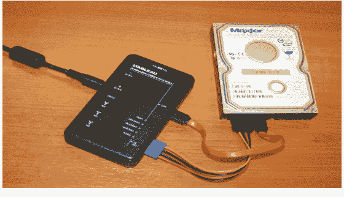

**图 1.1:** 数字证据工具。来源：https://www.tcea.org/blog/when-people-fail-technology/。

数字或电子证据是任何以数字形式存储或传输的具有证明性的信息，法院可以在审判中使用它。法院将证明数字证据对于其预期目的具有可接受性或相关性。在美国，许多法院以传统方式将《联邦证据规则》应用于数字证据，尽管已观察到诸如缺乏惯用标准和指南等主要差异。此外，数字证据似乎体量庞大、易被篡改或复制，且易于获取。因此，某些法院有时会为了验证、传闻、最佳证据规则和特权等目的，以不同的方式使用数字证据。2006 年 12 月，《联邦民事诉讼规则》制定了要求保护和披露数字存储证据的规则。数字证据经常因其易被篡改的倾向而其真实性受到质疑，尽管现在法院在没有篡改证据的情况下已反驳了这一观点。

### 1.2.1 数字证据的类型

数字取证中有两种基本数据类型，即持久性数据（persistent data）和易失性数据（volatile data）。持久性数据存储在本地硬盘上的数据形式，计算机关闭时会保留；易失性数据存储在注册表、缓存和 RAM 中的数据形式。计算机关闭或断电时易失性数据可能会丢失，因为它是瞬时的，调查人员需要知道恢复数据的最佳方法，这对识别和分析安全事件至关重要。然而，Bates (2002) 将信息源分为四类，即临时、易失、半永久和永久性。

### 1.2.2 数字证据的来源

取证调查人员必须在犯罪现场识别出合适的证据来源。台式计算机现在拥有足够的磁盘存储空间，甚至大到无法打印。如果获取的数据过多，会混乱整个分析，司法公正也可能超出搜查令的范围。美国司法部在一份期刊上描述了这种情况。

……计算机硬件、软件和电子文件可能以两种截然的方式对犯罪调查变得重要：(1) 对象本身可能是违禁品、证据、工具或犯罪果实；/或 (2) 对象可以用作存储设备，以电子数据的形式包含违禁品、证据、工具或犯罪果实。《联邦刑事诉讼规则》第 41 规则允许政府搜索并没收作为犯罪证据、违禁品、犯罪工具和/或犯罪果实的计算机硬件、软件和电子文件。

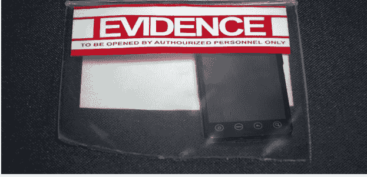

**图 1.2:** 证据袋。来源：https://www.linkedin.com/pulse/holistic-mobile-cellular-investigations-patrick。

这意味着如果软件、硬件或其他任何证据是违禁品（如非法制造的设备）、犯罪果实（如被盗的版权材料）、工具（如破解破解）以及任何犯罪数字证据，就可以被没收。犯罪现场的一些明显来源包括固定或可移动硬盘、已删除的文件碎片、操作系统。


数字证据经常因其易被篡改的倾向而其真实性受到质疑，尽管现在法院在没有篡改证据的情况下已反驳了这一观点。数字取证分析是一个揭示数据的仔细过程。

### 1.3.1 选择调查流程

自 1984 年以来，数字取证是一种随着最新技术步伐演进的调查方法。然而，混乱的流程会导致数据随机，因此制定设计计划并选择合适的工具和软件至关重要。

### 1.3.2 获取

一旦案例研究确定并有了确定的计划，第一个基础步骤涉及以电子拷贝形式获取文件、视频、浏览器历史、社交媒体存档、财务记录和其他形式的数据。此外，计算机取证的一个主要部分涉及从手机中提取信息，包括预约详情、电话录详情、短信、日程、视频和图像文件。在此阶段，专家确保证据是使用法律方法并获得授权人员批准后恢复的。

### 1.3.3 识别

在这一阶段，分析师数字化的分离重要的发现，并将其转换为外人士和法官可以理解的文件。检索的数据可以以原始形式存储。随后原始数据可以被丢弃和处理。最终结果可以使用取证工具（如 Forensic Toolkit (FTK)、Mobile Phone Examiner (MPE+) 和 dtSearch）进行结构良好的良好的。关键数据可以托管在基于互联网的证据平台上。

### 1.3.4 评估

这一阶段是数字取证调查中最重要的阶段，因为它决定了是否发现了原始且确定的证据，并控制诉讼的结果。之前阶段的机制被识别、保护和连接，从而建立程序时间线，并得出与案件相关的推断，为支持被告提供具体的支持。

### 1.3.5 采纳

如果精心准备的报告和事实证据没有用处，法院可能会忽略它们，并将其作为“不可采纳的证据”丢弃。因此，证据碎片必须通过


## 1.4 数字取证原理

数字取证提供了一系列经过验证的大型探索性技术和方法，用于实现本文中广泛提到的目标。通过法证，我们指的是证据中符合事实可接受标准的特征，以及其基于证据具有说服力的能力。本质上，法证科学是科学在法律领域的应用，并最终通过法庭使用来检验检验。例如，对昆虫的科学研究有许多分析应用，包括对腐烂尸体上昆虫的研究——法医昆虫学。与昆虫学相关的证据已被法院认可，有助于确定特定区域暴露尸体动物的持续时间。法证科学的另一个例子涉及对犯罪现场鞋印的检查、保护和鉴定。法证鉴定员利用这些鞋印的物理属性来确定鞋子的类型，并最终通过仔细分析将留下鞋印的鞋子联系起来。同样，对数字数据采用的方法论与犯罪的调查和起诉有关。当黑客获取组织的计算机系统访问并盗取个人身份信息（PII）时，组织必须准备好提供监管机构的指南，以便逮捕和起诉罪犯。因此，以敏感的方式处理数字证据是必要的。即使协议完全在组织内部处理，任何调查都能从法证科学的影响中获益也是理想的。此外，法证科学可以通过科学方法的应用、假设测试以及理论的生成来帮助重建犯罪事件，这些可以帮助处理离散的数字证据片段。本质上，以妥当的方式处理数字证据对于解决商业环境中的事件和纠纷，以及刑事和民事案件至关重要。为了鼓励企业数字调查员应用书中介绍的法证原理，法证科学可以被更好地定义为科学在犯罪调查和起诉中的应用。

### 1.4.1 证据交换

任何调查的主要目标都是追踪犯罪分子在犯罪时留下的痕迹，并将罪犯与犯罪现场联系起来。尽管证人可能认出嫌疑人，但个人对犯罪的参与对于识别嫌疑人更有说服力；个人参与的实物证据通常更具说服力和可靠性。法证分析师被雇用于揭露者、受害者和犯罪现场之间具有说服力的关系。


**图 1.4:** 数字数字交换 (FDX)。来源：http://www.forensic-pathways.com/forensic-digital-exchange/。

洛卡德交换原理指出，物品之间的接触会导致交换。这一原理适用于犯罪现场的任何接触，包括犯罪者与受害者之间、持武器的人之间，以及人与犯罪现场之间。这种交换以数字和物理形式发生，并可以在物理形式上提供它们之间的直接联系；犯罪者可能会不小心地在犯罪现场留下指纹或头发，并从现场带走一根纤维。例如，在谋杀案中，犯罪者可能会通过在受害者计算机上输入遗书来误导调查人员，无意中留下指纹。通过这一单一证据，调查人员可以建立犯罪者与犯罪的联系。然而，有了两件证据，犯罪者与犯罪的联系将变得更强且更易证明。数字证据可以通过犯罪者与受害者之间的通信渠道泄露信息，其他信息为调查提供了数字视角。在计算机入侵中，入侵者会在周围留下痕迹，特别是在注册表、网络级日志、文件系统和系统日志中。此外，入侵者可以将犯罪现场的组件带走，如文件或数据库中的加密密码或 PII。这种证据可以用于入侵调查。通过基于网络的电子邮件服务发送破坏性消息的过程也可以为识别罪犯提供线索。网络浏览器可用于保存发送者硬盘上的文件和数据，并结合时间参考。因此，法证分析师可能会发现有关犯罪者硬盘上已发送消息的足够信息。
### 1.4.2 证据特征

发生的交换产生痕迹类别：
- (a) 符合特征的证据
- (b) 不符合特征的证据

- 例如，如果法证分析发现了全面的模式，则可以建立更强的联系。
- 这有助于减少误差。


分析人员可以判断其是否为伪造文档，因为它可能是使用在声称创建日期之后发布的 Microsoft Word 版本生成的。当担心数字证据被掩盖或破坏时，类别特征可能会揭示存储证据的计算机上使用了特定的加密机制。

- 某些打印机会在每页上留下一个设备唯一的图案。
- 为了确定使用扫描仪或数码相机的嫌疑人的参与，可以在数字照片上留下独特的标记。
- 同样，精确的软驱器会在软磁盘上留下独特的磁印，有助于建立软磁盘与嫌疑人设备之间的联系。


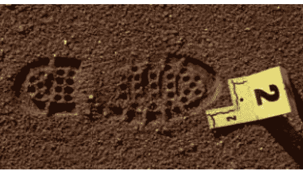

**图 1.5:** 一张印象证据的照片。

来源：https://www.forensicmag.com/article/2011/06/step-toward-better-track-evidence-photos

### 1.4.3 法证完备性 (Forensic Soundness)

数字证据必须以一种健全的方式进行保存和审查，以便其在调查过程中具有实用性。数字取证领域的某些专家认为，只有当保存或检查数字证据没有以任何方式改变原始证据源时，该方法才是健全的。这并非事实。传统的法证学科（如脱氧核糖核酸 DNA 分析）表明，法证完备性并不要求实际证据保持不变。在收集有机材料样本时，该过程通常会对实际证据造成污损。对样本进行法医分析会进一步改变样本，因为 DNA 测试具有破坏性。尽管在保存和处理过程中发生了变化，这些方法仍被认为具有法证完备性，且 DNA 证据经常被采为证据。在数字取证中，从硬盘中获取数据的单调任务（即使使用硬件写写保护器）也会改变硬盘的独特状态。此类更改可能包括使硬盘的隐藏区域可用，或更新现代硬盘上由自我监控、分析和报告技术（S. M. A. R. T）维持的信息。此外，获取运行中的计算机系统和移动设备内存内容的大多数方法都会更改或覆盖部分内存，但这在数字取证中是广泛接受的。事实上，在某些案件中，法院开始强制保存易失的计算机数据，这要求数字调查人员在活动系统上保存数据。例如，在“哥伦比亚影业工业公司诉布尼尔”（Columbia Pictures Industries V. Bunnell）案中，法院认为服务器上的 RAM 可能包含重要的日志数据，因此属于本案中可发现信息的范围。可能无法遵守这种标准，因此在某些情况下，符合此类标准是不可能的，从而将此标准作为“最佳实践”提出，将使数字证据遭受与调查问题无关的批评。法证完备性的关键之一是文档记录。案件的建立建立在支持性文档之上，这些文档报告了证据的来源以及如何处理的。从法证角度来看，获取过程应尽可能地改变原始证据，任何变化都应在最终结果的背景下进行记录和评估。具有法证完备性的数字证据可以根据对实际数据的完整准确获取进行验证，这种获取是实际数据的绝对表示。在保存易失数据时，数字调查人员必须记录保存这些数据的日期和时间。本书稍后部分将讨论所有输出的 MD5 哈希值。在处理计算机时，注意计算机的日期和时间并与可靠的时间源比较是重要的。

### 1.4.4 身份认证 (Authentication)

一些与数字取证相关的文献声称，身份认证是确保恢复的证据与最初扣押的数据相同的过程，但这一概念被低估了。从技术角度来看，并不总是可以将获取的数据与实际数据进行比较。运行中的计算机的 RAM 内容在不断波动。在某种意义上，内存内容和网络流量都是瞬态的，必须在传输过程中捕获。一旦捕获了网络流量，只剩下副本，实际数据已不可用。处理数字证据时的无意错误和遗漏可能不会导致证据无效。对证据项如何管理的担忧可以通过文档记录、法证分析或证言来解决。因此，处理发生任何问题的最佳方法是彻底记录它们，并寻找减轻其对证据影响的方法。你能做的最坏事情就是试图掩盖错误，因为这可能会混乱整个过程并可能使你的信誉受到质疑。从法律角度来看，身份认证是判断证据是否值得采用的过程。身份认证意味着让法院相信：(a) 记录的内容保持不变；(b) 记录中的信息确实源于其声称的来源（无论是人类还是机器），以及 (c) 不必要的信息（如记录的表面日期）是准确的。如果可用，可以通过口头证据和间接证据，或者通过系统或记录中的技术特征来证明必要的认证程度。认证实际上是一个两步骤的过程，首先对证据进行初步检查。

### 1.4.5 监管存链 (Chain of Custody)

法证完备性的关键之一是文档记录。案件的建立建立在支持性文档之上，这些文档报告了证据的来源以及如何处理的。从法证角度来看，获取过程应尽可能地改变原始证据，任何变化都应在最终结果的背景下进行记录和评估。具有法证完备性的数字证据可以根据对实际数据的完整准确获取进行验证，这种获取是实际数据的绝对表示。在保存易失数据时，数字调查人员必须记录保存这些数据的日期和时间。本书稍后部分将讨论所有输出的 MD5 哈希值。在处理计算机时，注意计算机的日期和时间并与可靠的时间源比较是重要的。

认证实际上是一个两步骤的过程，首先对证据进行检查以确定其真实性。同样，是对证据进行更仔细的检查以证明其价值。监管存链是一个过程文件，记录了物理或电子证据的保管、控制、传输、分析和处置顺序。它是从收集证据到提交法庭期间保管情况的时间顺序记录。没有稳固的监管存链，很难证明占有的连续性。破坏监管存链的潜在成本包括识别错误、掺假或证据丢失。

| 监管链与分析请求 |
| :--- |
| 表格-008 |
| 版本 5.0 |

| 公司或客户： | 州： |
| :--- | :--- |
| 地址： | |
| 城市： | |
| 人员： | |
| 电子邮件： | |
| 项目（名称）： | |
| 邮政编码： | |

| 接收： | 接收人： |
| :--- | :--- |
| 日期： | |
| 发布： | |
| 日期： | |

* 监管链必须在“接收人”处签名，作为对证据的认可。


**图 1.6:** 监管链。来源：http://greenanalytical.com/forms/.

### 1.4.6 证据完整性 (Evidence of Integrity)

完整性检查的目的是证明证据从收集以来未发生更改，从而支持身份认证过程。在数字取证中，验证证据完整性的过程通常涉及将收集时取的证据数字指纹与证据当前的状态进行比较。为了理解这一验证过程如何工作，需要具备消息摘要和加密哈希值的基础知识。对于本书而言，消息摘要算法可以被视为一个接受数字对象（例如文件、程序或磁盘）并产生一个数字的盒子。对于给定的输入，消息摘要算法总是产生相同的数字。对于不同的输入。因此，完全相同的副本具有与原始数据相同的消息摘要；如果文件发生细微变化，其消息摘要将与真实的不同。身份认证软件用于确认证据未被更改。目前，数字取证中计算消息摘要的常用算法是 MD5 和安全哈算法 1 (SHA-1)。SHA 与 MD5 非常相似，目前是美国政府选择的消息摘要算法。MD5 生成加密的哈希值。MD5 采用隐含的数学方法将数据保存到驱动器或文档中。这用于


# 数字取证引论

确认副本数据与原始数据一致。需要解密工具来访问密码保护的计算机、文件或两者。如果从嫌疑者的计算机中检索到的数据是加密的，则必须遵循特定的程序。MD5 算法接收任意长度的消息作为输入，并生成 128 位的“指纹”或“消息摘要”作为输出。据估计，在实际上生成两个具有相似消息摘要的消息，或生成任何具有特定预设摘要的消息，是不可能的。请注意“指纹”一词的使用。使用这种类比的目的是强调使用 MD5 算法计算出的消息摘要具有近邻唯一性。基本上，MD5 算法使用数字对象中的统计数据来计算 32 个数字和字母的组合。这本质上是一个 16 字符的十六进制值，每个字节由一对字母和数字表示。除非两个项目是重复的，否则它们具有相似消息摘要的可能性极低。这与人类的指纹和 DNA 非常相似。据估计，生成两个具有相似消息摘要的消息概率在 $2^{64}$ 次操作级，而生成特定消息摘要的概率在 $2^{128}$ 次操作级。这种近邻唯一性的特征使得 MD5 等消息摘要算法成为记录数字证据的强大工具。例如，通过在收集前和收集后计算磁盘的 MD5 值，可以确定收集过程没有修改自收集以来的数据。请记住，仅凭 MD5 和 SHA-1 值并不能说明关联证据是可靠的；因为人员可能在计算哈希值之前就已经修改了证据。例如，如果收集证据的人在计算数字指纹之前对其进行了改动，那么这种改动不会通过后续对数字指纹的评估被检测出来。最终，数字证据的可信度取决于处理它的人员的信誉以及支持性文档的强度。

### 1.4.7 客观性

取证分析的基础是客观性。证据的解释和呈现应该不带偏见，以便让决策者对事实有良好的理解。考虑到先入为主的观念以及达到特定结论的外部压力，这可能会很困难。保持中立的最有效方法是让证据过程自然运行。每个结论都应该与所有的支持性事实证据一起呈现。确保客观性的另一种有效方法是建立同行评审流程，对取证分析师的结果是否存在偏见或任何其他弱点进行评估。

### 1.4.8 可重复性

科学方法的一个重要方面是，任何实验或观察必须是可重复的，以便能够进行自主验证。在取证背景下，能够自主验证发现至关重要，因为此时一个人的自由和收入来源可能会受到影响。因此，一个取证分析师可能需要完全或部分重复另一位取证分析师执行的技术分析。为了实现这种对取证发现的验证，详细详细记录发现和分析数字证据的步骤是非常重要的，以便他人能够独立验证结果。这些文档可能包括数字证据的位置和其他特征，以及用于分析数据的工具。

## 1.5 反取证技术

随着过去十年计算机技术的巨大发展，技术的使用产生了积极和消面的影响。虽然有些人利用技术发明造福社会的有用事物，但另一些人利用它损害社会。技术的一个关键问题是，一旦某种技术被识别和调查犯罪分子而被发现，犯罪分子也会挖掘出另一种可以帮助他们隐藏身份的技术。一个很好的例子是虚拟专用网络（VPN），它有助于隐藏个人的身份和位置，但被用于实施其非法活动。这是今天取证人员面临的巨大挑战。与许多其他物理证据来源不同，数字证据很容易被修改、删除或隐藏，而不会留下任何有助于识别犯罪者的痕迹或线索。因此，反取证已成为数字取证的一大挑战。根据 Rekhis 和 Boudiga (2010) 的观点，反取证技术可以分为以下类别：

- 1. 加密
- 2. 隐写术
- 3. 隐通道
- 4. 存储空间中的数据隐藏
- 5. 残留数据擦除
- 6. 尾部混淆

### 1.5.1 加密

加密是一个只有拥有正确解码密钥的人才能解码和读取的过程。加密用于在受侵害的系统中隐藏证据或使其不可读。2007年发生过一起事件，美国海关在加拿大公民兼美国合法居民 Sebastian Boucher（Sebastian Boucher）的笔记本电脑上发现了儿童色情内容（Balogh & Pandelic, 2011）。该笔记本电脑作为证据被没收，他被指控运输犯罪驱动器 Z，并被发现这是一个非常好的隐私加密容器。虽然在笔记本关闭后创建了硬盘的取证副本，但检查员无法打开该加密容器。攻击者使用各种加密方法，为了使数据可用，调查人员必须解密加密数据。这个过程是枯燥且耗时的，有时加密数据无法被解密。

### 1.5.2 隐写术

隐写术是隐藏在众目之下的数据。隐写术是一种与密码学结合用于加密数据的补充技术。隐写技术可以应用于图像、视频文件或音频文件。然而，通常隐写术用包括哈希标记在内的字符编写，但其在图像中的用法也很常见。无论如何，隐写术可以防止版权材料被盗版，并协助未经授权的查看。隐写术还有一个被称为“水印”的分支，这是在文本文档或其他类型的版权材料中隐藏数据的手段，旨在标记并防止文件的非法复制。


### 1.5.3 隐通道

“通信协议中的隐通道允许攻击者在网络上隐藏数据，并可能绕过入侵检测技术。通常，选择一种网络协议并修改其头部以在攻击者之间泄露信息，利用了头部在传输过程中只有少数字段被修改的事实。”Rekhis & Boudiga，2010）。隐通道可用于提取信息或向组织植入信息。互联网隐通道带有秘密隔层的公文包的数字等，间谍可能利用它将敏感文件带入或带出安全设施。攻击者可以使用隐通道无阻地传输敏感文件——在这种情况下，绕过的是网络安全措施而非安保人员。就像间谍在进入安全设施时可以使用那个秘密隔层向安保人员隐藏武器一样，攻击者可以使用互联网隐通道隐藏网络武器，例如从外部服务器向组织内部网络的主机下载恶意软件。

### 1.5.4 存储空间中的数据隐藏

攻击者将某些数据隐藏在存储区域内部，并模糊普通的系统命令和程序。这使得调查变得更加复杂和耗时，有时数据也可能会损坏。根内核是用于在存储中隐藏数据的流行技术之一


数字取证导论 21

空间。根据微软（2014）的研究，恶意软件设计者使用根内核（rootkits）将恶意软件隐藏在受害计算机内部。识别根内核非常困难，大多数计算机用户不知道如何删除它们。用户模式根内核能够隐藏进程、文件、系统驱动程序、网络端口，甚至系统服务（Kassner, 2008）。

### 1.5.5 残留数据擦除

当攻击者使用计算机实现其目标时，会有一些隐藏的进程（例如临时文件、命令历史）在攻击者不知情的情况下运行。但智能的攻击者可以通过掩盖自己的踪迹并擦除每一个痕迹，使系统运行就像未被使用过一样，从而规避这种风险。

### 1.5.6 尾混淆

最常用的技术是攻击源的混淆（Rekhis & Boudriga, 2010）。在这里，攻击者使用一些虚假信息来误导调查人员（例如错误的邮件头部和更改文件扩展名）。因此，有时调查人员可能会丢失一些具有取证价值的数据。硬盘具有一些细微之处，使得机猾的人能够隐藏其存在的大量数据。磁盘上的第一个磁道，也被称为维护轨道（maintenance track），用于存储有关驱动器的信息，如其几何结构和坏道位置。通过故意将磁盘部分标记为坏道，个人可以向操作系统隐藏位于这些区域的数据。

# 参考文献

- 1. Andrew J., & Craig V. (2008). Building a digital forensic laboratory: Establishing and managing a successful facility. Burlington, MA: Elsevier Academic Press.
- 2. Casey, E. (2000). Digital evidence and computer crime: Forensic science, computers and the internet. London: Academic Press.
- 3. Casey, E. (ed.). (2010). Handbook of digital forensics and investigation. London: Elsevier Academic Press.
- 4. National Institute of Justice. (2015). Digital evidence and forensics. Retrieved于 November 23, 2017, from http://www.nij.gov/topics/forensics/evidence/digital/Pages/welcome.aspx
- 5. Rehkis, S., & Boudiga, N. (2010). Formal digital investigation of anti-forensic attacks. Proceedings of the Fifth International Workshop on Systematic Approaches to Digital Forensic Engineering, Oakland, CA: IEEE Press.
- 6. Searching and seizing computers and obtaining electronic evidence in criminal investigations. (2002). Retrieved于 November 23, 2017, from http://www.usdooj.gov/criminal/cybercrime/searching.html
- 7. US-CERT. Computer Forensics. (2008). Retrieved于 November 23, 2017, from http://www.us-cert.gov/sites/default/files/publications/forensics.pdf
- 8. Willassen, S., & Mjølsnesnes, S. (2005). Digital forensics research. Telektronik, 1 92-97.


> “数字取证是一门精确科学——指的不是程序，而是结果。”
—Edewede Oriwoh


# 数字取证模型

- (c) 处置策略；开发一套程序，以便在最大限度减少对受害者影响的同时，最大化未受污染证据的收集。
- (d) 保护；涉及对物理和数字证据状态的隔离、安全和保护。
- (e) 收集；涉及物理现场的记录，并使用标准且被认可的程序复制数字证据。
- (f) 检查；涉及对与嫌疑相关的证据进行深度搜索。
- (g) 分析；涉及确定证据的意义、重建数据碎片，并根据发现的证据得出结论。
- (h) 汇报；涉及对结论的总结和解释。
- (i) 归还证据；确保物理和数字财产归还给所有者。

尽管该模型通常很好地反映了取证过程，但它至少面临一种批评。它的第三阶段（处置策略）在某种程度上是其第二阶段（准备阶段）的重复。


- (a) 适用于多种数字设备的多元方法论
- (b) 这种方法论非技术人员观察者也能轻松理解
- (c) 有可能在抽象模型中纳入非数字的电子技术


- (a) 模型的通用性可能会带来一些实际挑战。
- (b) 没有简单或明显的方法来测试该模型。

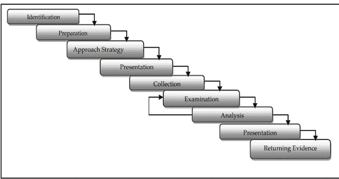

**图 2.3:** 抽象数字取证模型。来源：http://resources.infosecstitute.com/digital-forensics-models/.


Brian Carrier 和 Eugene Spafford 提出了另一个模型——综合数字调查过程（IDIP），该模型被分为 5 组，共包含 17 个阶段。这是一个完全的模型，它通过包含数字和物理犯罪现场阶段，考虑了数字取证调查的双重性质。该模型预见到，尽管犯罪是使用数字设备作为手段或目标实施的，但取证调查涵盖了物理和数字犯罪现场，因此有必要将它们纳入调查中。在数字环境中进行复制相对容易，这更容易在实验室创建一个创建一个符合取证要求的镜像备份供分析。与许多主要关注数字证据的流程模型不同，该模型生动地强调了数字环境与物理环境之间的交互。

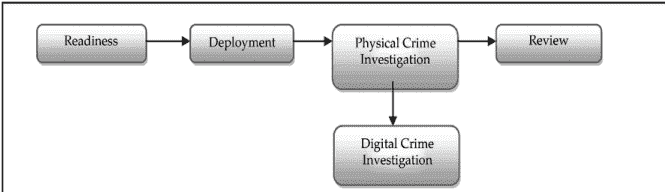


来源：http://www.rroij.com/open-access/survey-on-different-phases-of-digitalforensics-investigation-models.php?aid=53809


此阶段的目标是确保运行基础设施能够充分支持调查。它包括两个阶段：

- (a) 运行就绪阶段；确保基础人员能力经过充分培训和装备，以应对可能发生的的事件。
- (b) 基础设施就绪阶段；确保基础基础设施足以处理发生的事件。例如，视频摄像头和读卡器等设备齐位且处于良好状态。
### 2.4.2 部署阶段

目的是为事件的检测和确认提供机制。它包括两个阶段：

- (a) 检测和通知阶段；在此阶段检测到事件并通知相关人员。
- (b) 确认和授权阶段；确认事件并获得法律批准的授权以执行搜查令。


这些阶段的目标是收集和分析物理证据，并重建事件期间发生的动作。它包括六个阶段：

- (a) 保护阶段；试图保护犯罪现场，以便后续由受过数字证据识别培训的人员识别和收集。
- (b) 勘查阶段；要求调查人员走过犯罪现场并识别物理证据。
- (c) 记录阶段；涉及对犯罪现场和物理证据拍照、绘制草图、拍摄视频。目标是尽可能捕捉大量信息，以便犯罪现场的布局和重要细节得到保存和记录。
- (d) 搜索和收集阶段；涉及对现场进行彻底搜索和收集，以识别额外的物理证据，从而为数字犯罪调查的开始铺路。
- (e) 重建阶段；涉及组织分析结果，并使用它们制定关于事件的理论。
- (f) 汇报阶段；向法院或公司管理层展示物理和数字证据。

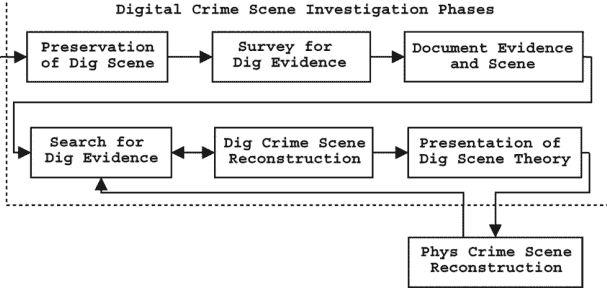

图 2.5: 物理犯罪现场调查阶段。

来源：https://www.researchgate.net/publication/220542528_Getting_Physical_with_the_Digital_Investigation_Process/figures?lo=1
### 2.4.4 数字犯罪现场调查阶段

目标是收集和分析从物理调查中获得的数字证据。它包括以下六个阶段：

- (a) 保护阶段；试图保护犯罪现场，以便后续由受过数字证据识别培训的人员识别和收集。
- (b) 勘查阶段；要求调查人员走过犯罪现场并识别物理证据。
- (c) 记录阶段；涉及对犯罪现场和物理证据拍照、绘制草图、拍摄视频。目标是尽可能捕捉大量信息，以便犯罪现场的布局和重要细节得到保存和记录。
- (d) 搜索和收集阶段；涉及对现场进行彻底搜索和收集，以识别额外的物理证据，从而为数字犯罪调查的开始铺路。
- (e) 重建阶段；涉及组织分析结果，并使用它们制定关于事件的理论。
- (f) 汇报阶段；向法院或公司管理层展示物理和数字证据。

### 2.4.5 审查阶段

此阶段的目标是审查调查并识别改进领域。这涉及对整个过程的审查，包括数据保护、获取、提取、质询、规范化、分析和报告领域。


计算机取证分诊流程模型（CFFTPM）定义为在调查最初几个小时内进行的调查过程，为嫌疑人审讯和搜查执行提供所需的信息。由于需要在较短的时间内获取信息，该模型通常涉及对相关计算机系统进行现场分析。


# 数字取证模型 33

增加嫌疑人的谈话和配合意愿。这些触发因素可以在位于嫌疑人系统中的数字证据中找到。例如电子邮件往来、数字地图、图片和聊天日志。FFTPM 使用了源自 Carrier 和 Spafford (2002) 的 IDIP 模型以及 Rogers (2006) 开发的数字犯罪现场分析 (DCSA) 模型阶段。这些阶段包括：规划、分检、使用和用户配置、时间顺序、互联网活动和特定案件的证据。这六个阶段构成了高层次的分类，每个阶段都包含若干子任务和考虑因素，这些因素根据调查案件的具体情况、文件系统和正在调查的操作系统而异。使用高级别的分类使得过程模型可以推广到各种类型的调查中。多项研究已经确定，通用模型是执法调查务实方法的核心组成部分。在讨论模型的每个阶段之前，重要的是对 FFTPM 的使用进行界定，因为该模型并不适用于所有情况。

由于长度限制，本节将仅提供这六个阶段的简要描述。并将介绍适用于每个阶段的主要调查考虑因素。

FFTPM 从规划阶段开始，这对于提高调查成功率至关重要。调查人员关注嫌疑人的能力、活动、地点时间和机器类型。其次是分检阶段，调查人员根据重要性和优先级对证据和事项进行安排。在这里关注的是可能位于系统的位置：易失性内存、临时文件等。来自嫌疑人的信息至关重要。接下来是使用配置阶段，调查人员专注于用户配置和以及在主目录、系统注册表中发现的信息。在用配置分析之后，调查人员需要按时间顺序构建案件。时间顺序阶段处理文件何时被访问、修改或创建的问题。在互联网阶段，对相关伪物如即时消息日志、网络浏览器和电子邮件进行检查。应该注意的是，分析电子邮件可能花费大量时间。该模型的最后阶段是特定案件的证据阶段，要求调查人员根据犯罪类型将注意力集中在当前案件上。


**图 2.6**: 计算机取证现场分检模型。来源：https://www.researchgate.net/publication/279270088_An_Introduction_to_Digital_Crimes/figures?1

## 2.51 规划

CFTPM 的第一阶段是适当规划。理想情况下，首席调查人员将拥有一个矩阵，量化犯罪现场、嫌疑人和数字证据的各种可能性，以及调查小组的各种专业知识。对于首席调查人员来说，该矩阵用于定义已知的、未知的，以及想要知道的信息。类似于作战命令 (OpOrd) 的情况，该矩阵识别“敌方”和“友方”情况以防止预防性情报。在 OpOrd 中，敌方通常通过缩写 SALUTE 来定义：力量（Strength）、活动（Activity）、地点（Location）、制式（Uniform）和设备（Equipment）。在到达犯罪现场之前，同一缩写可用于收集有关敌方/嫌疑人的情报。力量最初确定嫌疑人的人数及任何其他参与者（具体数字会有帮助），但也可能包括嫌疑人的已知或可能的能力。活动定义了嫌疑人的特定行为（即使是细节也可以）。地点不仅是现场的物理位置，还包括网络空间的虚拟可能性。制式更多涉及军事，但在网络空间中，它可以包括电子邮件地址、统一资源定位符 (URL)、用户名、密码、网络域以及其他相关的映射、符号或公司或机构标识符。时间显然建立在之前收集的情报的基础上，为调查提供时间范围。最后，设备涵盖了接触数字犯罪现场时预期的各种有线和无线硬件设备及应用程序。根据 SALUTE 定的案件情报，首席调查人员将在到达犯罪现场之前做出许多特定决策。一旦确定了 SALUTE 矩阵的敌方/嫌疑元素，首席调查人员就可以识别用于处理该现场的友方信息。从 OpOrd 来看，矩阵的这部分包括调查任务、确定提供调查专业知识的必要人员以及如何处理意外情况的知识。调查任务通常由所犯犯罪的类型决定，从而决定调查的水平和所需的专业水平。如果犯罪需要多个物理和虚拟位置、多个有线和无线网络、多个操作系统 (OS)、个人数字技术或其他特定的技术需求，调查人员可以据此制定计划。然而，如果调查中存在未知数，首席调查人员确定还可以联系谁来协助调查是至关重要的。有了这些关于嫌疑人和调查小组的汇总情境案件情报，首席调查人员就可以制定攻击计划，确定要寻求哪些证据并用于进一步调查。

## 2.5.2 使用/用户配置

一旦在分检阶段识别并优先了系统或存储介质，就会进行实际检查和分析。当在数字媒体上发现有说服力的证据时，证据与特定嫌疑人之间的联系是至关重要的。在某些情况下，这几乎是既定事实；例如，当可以清楚地显示只有一个人物理接触 PC 时。在许多情况下，多人有访问 PC 的权限，因此有必要找到并检查数字伪物及其属性，以确定是个人或哪些个人对存储介质上发现的犯罪数据负责或知情。通常，需要将伪物置于可验证的现实事件背景中。这种回报可能是巨大的。当一个嫌疑人面对明确证据，表明其本人没有其他人对访谈期间恢复的证据负责时，可能会被迫承认罪行。


对访谈期间恢复的证据可能被迫承认罪行。这种挑战一直存在，是大多数“传统”数字证据检查的要素要素。在 CFFTPM 的背景下，挑战不仅在于快速完成这一点，还在于快速判断是否可以在时间限制内完成（某些情况下，证据的细节可以消除评估的需要，例如当非法文件仅位于特定用户的主目录时）。深入了解用户配置和与使用的伪物对于实现这一目标至关重要。

## 2.5.3 主目录

在 Microsoft Windows 操作系统中，最明显的用户相关伪物是“主目录”。默认情况下，主目录仅供关联账户访问。此外，与各种应用程序关联的存储文件位置被设置为主目录下的子文件夹。犯罪文件出现在嫌疑人的主目录或其子文件夹中（包括著名的“桌面”、“我的文档”和“收藏夹”）是一个可靠指标，表明只有嫌疑人（或可以登录该账户的人）过过文件。此外，创建具有唯一子文件夹名称的子目录可以很大程度上表明对子目录结构中发现对象的认知和责任

## 2.5.4 文件安全属性

检查具有已知证据价值的对象的所有权和安全属性可能是有用且高效的。设置和读取安全权限在 FAT 中不可用，在 Windows XP 中即使使用了 NTFS 文件系统，默认也是关闭的。当使用 NTFS 并开启该功能时，文件的安全属性（特别是“所有者”和“权限”）可能对于确定哪个账户访问过甚至创建了特定文件有用（National White Collar Crime Center, 2003）。当创建文件时，登录的用户账户被记录为文件安全描述符的“所有者”（这只有在管理员“接管文件所有权”时才能更改，此时管理员将被记录为所有者）。


权限在确定罪责方面的用途可能受到限制。只有具有相应权限的账户才能访问对象；然而，这可能是一个或多个用户账户，且对对象拥有权限的账户可能会随时间改变。在 2 月 25 日具有“读取”权限的账户，在 2 月 24 日可能不再拥有相同的权限。

## 2.5.5 注册表

如果调查人员不清楚自己在寻找什么以及确切去哪里寻找，注册表可能会变成一个陷阱，导致浪费宝贵的时间。另一方面，一个对想要恢复的信息有清晰规划的知识调查人员，可以在几分钟内找到几项极具价值的项目。例如，HKEY_USERS\suspect’s SID\Software\Microsoft\Windows

### 2.5.6 年代顺序

调查的时间范围可以根据案件实例定义。在调查中，数字证据由其时间价值来定义，即 MAC 时间（Casey, 2004）。在不具体针对每个操作系统对 MAC 时间进行详细叙述的情况下，以下是针对 Windows MAC 时间的一些通用指南。Windows MAC 时间在 FAT32 和 NTFS 文件系统中定义为：

- (a) 修改时间（Modification）定义为文件内容更改的时间。
- (b) 访问时间（Access）定义为查看文件的时间。
- (c) 创建时间（Created）定义为文件创建的时间。

尽管 MAC 时间看起来很简单，但已有文献证明，MAC 时间存在许多不一致之处，而且在描述其他特定操作系统（例如用于个人数字技术设备的系统，如 PDA、手机、MP3 播放器）时，还有许多其他弱点。一旦调查人员获得了相关文件及其各自的 MAC 时间，就可以开始限定搜索，从而对证据进行量化（Casey, 2004）。对于 CFFTP，应该通过在调查的时间范围内根据各种 MAC 时间对文件进行排序，检查几项量化。第一种量化包括嫌疑人以及计算机或设备其他已知用户正常该设备的时间段（Casey, 2004; Farmer & Venema, 2005）。这可以通过将已知用户访问计算机的情况与在此期间被修改、访问或创建的文件相关起来来获得。按用户或时间段进行组织有助于量化在哪些时间段做了什么。这种组织还可能提供突出或看起来独特的时间段。这些类型的时间段可以向外研究，试图发现其他重要的关系或价值。

另一种量化包括识别和分析在感兴趣的时间范围内使用或访问的软件应用程序和数据文件。同样，这可以通过将已知用户与 MAC 时间相关联，提供具有重大价值的独特时间段。在特定时间段内组织应用程序或文件可以量化这些时间段内发生的活动。在刑事案件发生之前、期间或之后访问的应用程序或文件可能是参与或意图的主要迹象。

最后，第三种量化包括对最近快捷方式和存储信息的识别和分析。这可能包括但不限于桌面上的项目、常用的软件应用程序以及互联网浏览器 Cookie、缓存和索引文件的各种位置。请注意，各种互联网结构（Cookie、缓存和索引文件）在确定时间顺序情报方面非常有用，因为它们提供了比仅 MAC 时间更多基于时间的证据。具体而言，每个 `index.dat` 文件为每个互联网服务器请求提供了日期时间戳。

## 2.5.7 互联网

几乎每个案件都需要对与互联网活动相关的产物进行检查，例如即时消息 (IM)、电子邮件和网页浏览（见第 3 章，网络与互联网）。价值、时间成本和时间紧迫性差异很大，取决于具体情况，包括涉及的具体应用程序、正在检查的活动类型以及被检查的 PC 是属于嫌疑人还是受害者（例如在失踪案中）。有效的做法是计算机取证人员评估他们认为嫌疑人（受害者）参与了哪些互联网活动，并评估这些活动是否以及如何与案件有关。活动类型可能包括网页浏览、电子邮件、即时消息、阅读或发布 USENET 新闻组、交易文件。

### (1) 浏览器产物

虽然具体细节有所不同，但大多数网页浏览程序存储某种存储“Cookie”的方法（无论是作为文件还是单独的文件）、某些存储临时互联网文件的方法，以及某些存储用户信息和偏好的方法（例如输入的 URL 和“收藏”）。

单个 Cookie 的特定内容由每个单独网站决定，很少具有证据价值。在大多数情况下，Cookie 的证据价值限于其大小。通常，Cookie 的名称将与存放 Cookie 的网站 URL 匹配，表明 PC 在过去的某个时候访问过该网站。这不能说明意图，因为无论是从另一个网站重定向，还是通过输入 URL 有意指向该网站，Cookie 都会被创建。与 Cookie 关联的日期和时间可能有助于确定访问网站的时间，并可用于创建调查时间线。

临时互联网文件本质上是本地 PC 上网页组件（图形）的缓存副本。其调查价值在于，这些文件是在没有用户意图或干预的情况下存储的，某些文件（例如违禁图像）具有固有的证据价值。调查人员必须记住，这些文件很容易被大多数浏览程序或第三方工具清除。最重要的是，调查人员必须对潜在价值与搜索缓存所需的时间进行权衡。（注：此处原文存在大量重复句式，译文已按要求处理，保持逻辑一致）。

### (2) 电子邮件产物

电子邮件产物可能具有巨大的价值，但可能需要投入时间。检查电子邮件和提取有用数据的程序取决于特定的电子邮件，可能非常耗时。如果使用基于 Web 的电子邮件，通常没有本地存储。这可能花费数小时。

### (3) 即时消息产物

大多数即时消息客户端都会维护用户与其在线联系人之间发生的某些对话。在大多数情况下，此日志功能默认关闭的，但用户可以且经常开启。大多数 IM 应用程序的联系人信息维护在服务器上，可能在本地 PC 上找不到。聊天日志包含丰富的数据，包括对话本身以及其他方的屏幕名称。单个聊天日志可能包含数小时的对话。对多个日志进行彻底检查可能会产生昂贵的时间成本。如果需要检查聊天日志，调查人员对自己在寻找什么有一个明确的思路。应该尽可能实施字符串搜索工具。一种“老式”检查可能涉及对所有这些和其他产物进行彻底检查。CFFTP 的指令要求调查人员审慎地评估检查每种产物的潜在收益与与其相应的时间成本。

## 2.5.8 案件特定证据

计算机取证人员能够将每次检查的重点调整到该案件的细节是重要的。这这种技能需要以不仅适用于案件类型、而且适用于每种特定情况的方式，来协调一系列冲突的要求。有几种做法可以促进资源的有效优化。计算机取证人员应该能够评估时间资源、利用搜查情报、自定义搜索目标并对搜索目标进行排序。在调查人员可获得的所有资源中，时间通常是最短缺的。在考虑时间要求是“有边界”还是“无边界”时的一个考虑因素是是否存在一个定义的截止日期（有边界），在此之后搜索将停止，或者证据将失去所有价值？发现是否可行，即使需要几天（无边界）？例如，许可性搜索可能只允许直到面试结束，而对失踪人员 PC 的搜索可能会尽可能地进行，但仍可能持续数小时。时间显然对两个案件都是重要的，但无边界案件中缺乏限制可以证明某些调查方向是合理的。作为一般的


原则，通常最好先执行那些可以最快完成的任务。规划和搜查前情报的价值不言而喻。在搜索之前，提前获得有关搜索词、联系人、活动类型、所用应用程序等的可靠信息，可以使取证人员在到达现场前制定出一些搜索策略。通过这种方式节省的每一分钟，都潜在地变成了用于执行调查本身的另一分钟。


-   (a) 该模型非常关注时间，因此有助于在时间紧迫的情况下进行快速的信息收集和调查。

-   (b) 该模型用于现场调查，具有与调查人员建立反馈回路的额外益处。

-   (c) 它还让取证分析师能够根据主要调查人员以及与嫌疑人直接接触的人员，在现场直接修改他们的搜索。

-   (a) 该模型仅适用于在现场进行的调查。

-   (b) 它可能被视为一个不完整的调查模型，被调查的案件可能需要在现场外完成额外工作。

-   (c) 由于其时间紧迫的性质，在使用该模型时存在证据受损的风险。


Perumal 根据马来西亚的调查流程（2009）提出了一种数字取证调查模型。该模型由七个阶段组成，如下所示。如图所示，前两个阶段即规划和识别，这在大多数数字取证模型中都是常见的。侦查阶段（Reconnaissance）涉及从运行系统中收集证据，通常被称为法证分析。根据作者的观点，获取关注易失证据的现场数据可以提高调查成功的概率。在接下来的两个步骤中，数据被安全地移动并存储，等待分析。接着，使用正确的方法和工具对数据进行检查。在演示阶段，与之前的其他模型一样，调查人员必须证明他们的发现。最后一步是妥善保存证据以备后用。

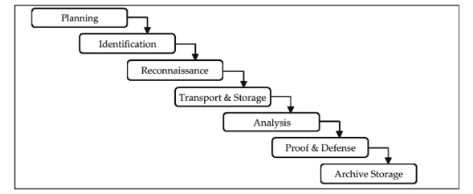

图 2.7: 基于马来西亚调查流程的数字取证模型。

来源：https://www.semanticsolar.org/paper/Common-Phases-of-Computer-Investigation-Yusoff-Ismail/10488d8dacb665f1099b63d


EDIP 由 Venansius 等（2004）开发，是基于 Brian 等（2003）部署阶段的扩展。EDIP 模型有两个犯罪现场类别：嫌疑人所在的主要犯罪现场和受害者所在的次要犯罪现场。该模型分为五个阶段，即就绪、部署、回溯、动态和审查。模型从就绪阶段开始，涉及运营准备，且所需的能力经过了培训和装备以应对情况。部署阶段提供了检测和确认事件的机制。该阶段有五个阶段，包括检测与通知、物理犯罪现场、数字犯罪现场、确认以及提交子阶段。回溯阶段负责嫌疑人物理犯罪现场的操作，分为数字犯罪现场调查和授权阶段。回溯阶段之后是审查阶段。对整个调查过程进行审查，并在审查阶段识别可能的改进领域。

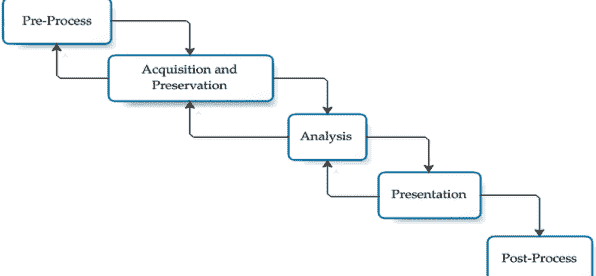

图 2.8: 增强数字调查模型。

来源：http://lmsaidi.blogspot.com.ng/2015/08/masalah-dan-solusi-dari-rang-kuman-paper.html

### 2.7.1 就绪阶段

### (1) 部署阶段

部署阶段提供了检测和确认事件的机制。它们发生在事件发生地点，由：

-   (a) 检测与通知
-   (b) 物理犯罪现场
-   (c) 数字犯罪现场
-   (d) 确认
-   (e) 提交子阶段

回溯阶段负责嫌疑人物理犯罪现场的操作，分为：

-   (a) 数字犯罪现场调查
-   (b) 授权阶段


回溯阶段负责嫌疑人物理犯罪现场的操作，分为：

-   (a) 数字犯罪现场调查
-   (b) 授权阶段


动态阶段对主要现场进行调查，目的是收集和分析发现的物品，包括：

-   (a) 物理犯罪现场调查
-   (b) 数字犯罪现场调查
-   (c) 重建阶段
-   (d) 通讯阶段


证据，以及对调查过程的审查是为了总结经验，并对未来的调查进行改进。

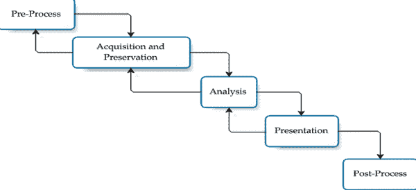

**图 2.9:** 通用计算机取证调查模型。来源：http://intruderit.blogspot.com/2012/12/gcfim-model.html。


数字取证是许多领域之一，它为调查人员提供了灵活的工具来解决刑事案件。然而，单一工具具备通用功能的能力仍然并不常见。实时处理数拍字节（petabytes）的海量信息分析以及手机的使用是数字取证尚未适应的一些意外情况。如果一个工具可以适用于任何情况，那将是明智的；然而，它无法应用于这些突发发展。多功能工具可能提供的某些工具甚至是调查人员并不需要的，反而可能成为他们的负担。取证工具的分类是根据用户的使用需求来进行的。一方面，执法机构可能需要能够在不损害证据完整性的情况下生成可靠结果的工具；而另一方面，网络管理员可能需要支持他们检测网络中任何类型入侵的工具。这导致了推导出两个可靠的结论：第二个推论是，所有专业人士（调查员、律师等）都需要能够持续提供非法数据提取解决方案。基于这两个结论，FTK 将提供多种工具，调查人员可以根据各自的领域进行选择。以下简要概述数字取证调查人员使用的三种常用工具：


EnCase 是由 Guidance Software 建立的一款取证软件。它是一个用 C++ 编写的 1 兆字节程序。其产品系列包含许多产品，包括 EnCase 网络安全、EnCase 便携版、EnCase 取证和 EnCaseDiscovery。全球有超过 2000 家执法机构在使用该工具。它可以用于多种目的，包括分析、报告和证据获取。该软件还具有 EnScript，这是一种脚本设施，配合证据使用。EnCase 使调查人员能够对证据进行识别、搜索和审查，以决定是否需要进行额外的调查；这节省了大量时间并减少了积压工作。该工具还可以从文件系统、移动设备和操作系统收集证据，并确保任何案件中都不会缺失证据。

调查人员将相关人员的硬盘放在取证计算机上；它可以是任何操作系统，如 Windows、Linux 或 DOS 机器。EnCase 对硬盘创建位级镜像镜像，该镜像以只读方式挂载，因此任何人无法对其进行修改。为了确认其与原始文件一致，EnCase 计算 MD5 哈希值和冗余校验和。该工具恢复硬盘的文件汇编/系统，并通过 Windows 图形界面（GUI）检查硬盘。EnCase 在此过程中会深入操作系统，进入未分配的空间或 Windows 交换文件，由于被删除的文件在那里可以被保留。


FTK 是由 AccessData 制作的数字取证软件。它可以扫描并检查硬盘以获取检查员所需的任何数据，例如删除的电子邮件，或扫描文本字符串以将其用作破解任何加密的潜在密码。该工具包包含一个简单但简洁的磁盘镜像程序，称为 FT Imager。FT Imager 将硬盘镜像保存在文件或分段中，可以根据需要随时重新组装。FTK 使用简单并由数据库驱动，也就是说，所有数据都堆在一个案例数据库中，这增强了重用性并降低了成本和复杂性。FTK 中没有遇到任何与内存相关的工具。它是一种高速工具，设计用于提供精确、快速且一致的处理，并支持多线程和分布式处理。FTK 会估计由 MD5 哈希算法给出的值，以便在丢弃任何文件之前确认数据的完整性。它以镜像文件的形式提供产品，并以多种格式保存。


NMAP 是 Network Mapper 的缩写，是由 Gordon Lyon 编写的一款免费开源取证工具。它用于安全审计以及发现网络上的服务和主机，从而为我们提供网络“地图”；许多网络管理员和系统管理员也使用它执行日常任务，如监控服务或主机运行时间以及管理服务升级。尽管最初是为大型网络创建的，但对单个主机同样有效。NMAP 最初仅作为 Linux 实用，但适用于 Linux、Windows、Solaris、AmigaOS 和 Mac 在所有操作系统上，并为它们提供了官方二进制包。它可以适应任何网络状况（如延迟和拥塞），而扫描过程具有便携性、简单、强大、灵活且文档详尽。该工具使用特殊构造的 IP 包并将其指向目标主机，以了解网络上有哪些主机和服务、反向 DNS 名称、使用的防火墙类型、操作系统检测、MAC 地址以及更多信息。此外，NMAP 还提供了一个调试工具 (Ncat)、图形界面版本 (Zenmap) 等。


互联网的创建是为了服务国防机构的通信需求。然而，它已演变成黑客用来窃取用户身份和对服务器发起恶意攻击的系统。安全问题以及网络攻击复杂性的增加是网络取证的主要因素。大多数攻击者现在以一种无法被检测的方式掩盖踪迹。本章讨论了进行网络取证所需的各种工具和技术，并重点介绍了各种 IP 回溯机制。本章的最后一页描述了我们使用的框架——蜜罐网络架构（Honeynet Architecture）和蜜罐主机（Honeypots），以及它们在检测网络攻击、流量和保护生产系统中的应用。文中介绍了该框架的每一个阶段。

## 3.1 网络与互联网的技术概述

互联网是目前最强大的通信手段，因为它传输了广泛的数据，并有助于促进业务、服务、经济增长和维持生存。它是许多用户的避风港；然而，它也已成为各种类型网络战争的平台。电子商务行业是网络犯罪分子的主要目标，因为所有交易都是在线且直接进行的。互联网需要免受这些攻击的侵害，必须采取适当措施来减少其负面影响。网络取证被定义为“使用科学证明的技术，从多个活动处理和传输的数字源中收集、融合、识别、检查、关联、分析和记录数字证据，目的是揭示与计划意图、或旨在破坏、损坏和损害系统组件的未经授权活动的测得成功相关的事实，并提供协助对这些活动进行响应或从中恢复的信息”（Palmer, 2001）。简单来说，网络取证是对网络流量的捕获和检查，并通过录像来分析发生的事件，以确定安全泄露的源头。它涉及检查网络流量以是否存在异常。如果有，则确定网络攻击的性质并获取事件响应。网络取证的目标是检查通过防火墙或无线网络设备（如路由器）或入侵检测方法记录的流量数据，追踪攻击的源头，以便对犯罪分子进行起诉。网络取证已经研究了多年，但它看起来仍然是一门非常年轻的科学，因为许多问题仍然不清楚。网络取证不是网络安全的同义词。网络安全是网络取证的重要组成部分，因为取证分析的数据可以从用于检测和防止入侵的安全产品中收集。网络取证涉及某些法律上可以起诉的犯罪，但它们可能没有违反网络安全策略。网络安全保护系统不受攻击，而网络取证则不然。

网络安全产品寻找与各种攻击相关的可能的有害行为，并24 小时监控网络。网络取证在许多情况下是对攻击进行事后调查。在某些情况下是限制性的，并在犯罪通知后专门针对特定攻击启动。网络取证确保攻击者花费更多的时间和精力掩盖踪迹，增加攻击成本。犯罪分子也会谨慎以避免因非法行为受到起诉。这起到了威慑作用并降低了网络犯罪率，从而提高了安全性。只要有资源处理和分析流量，网络取证也可以实时启动调查。

## 3.2 使用 TCP/IP 连接取证网络

网络设备（如路由器和服务器）是收集互联网相关证据的良好来源。根据 Wikipedia，路由器是一种在计算机网络之间转发数据包的网络设备。服务器是设计用于接受并响应另一个计算机程序或设备（称为“客户端”）请求的计算机。对于利用这些设备的设备来说，保留它们的数据日志是关重要的。这允许对跨网络活动进行静态监控和复制。传输控制协议/IP (TCP/IP) 包在取证调查中发挥着异常重要的作用，它是为什么企业应该保留网络流量日志的良好示例。当消息通过互联网发送时，它以 TCP/IP 包的形式创建并传输，然后在另一端重新排序。每个包都包含一个头部，其中包含源和目标计算机的信息。地址在取证调查期间是关注的。源地址可能提供有关攻击者身份的信息，目的地址可能提供系统内精确目标的信息，而数据本身可能识别攻击的源头。每个包还包含几个额外的字段，这些在调查期间可能很有用。例如，错误检查信息可用于确认数据符合地址。此外，头部包含六个在数据包发送时留空的额外位。大多数防火墙的设计是检查这六个位，并丢弃在这些位中包含信息的包。然而，如果发生了攻击，这些位中的信息可能是重要的。因此，如果系统发现了其中一个这样的数据包，它应该将其重定向到安全的地方并进行记录。

### TCP/IP 模型

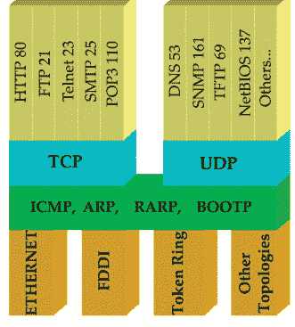

**图 3.1:** TCP/IP 协议模型。来源：https://www.pinterest.com/pin/315252042638657528/。

## 3.3 网络取证系统的类型

Garfinkel 将网络取证系统分为两类：随捕系统（Catch-it-as-you）和停止-观察-监听系统（Stop-look-and-listen）(2002)。

### 3.3.1 随捕系统

该系统捕获网络流量，并具有存储大量数据和以批模式分析数据的能力。这种方法需要大量的存储空间。

### 3.3.2 停止-观察-监听系统

每个数据包都在内存中以基础方式进行分析，仅保存某些信息以备以后分析。这需要更快的处理器来匹配传入流量的速度。该系统没有前者的存储能力。

## 3.4 网络取证分析工具

网络取证分析工具 (NFATs) 允许管理员跟踪网络，积累有关异常流量的所有信息，为网络引发的犯罪调查做出贡献，并在事件响应前生成适当的输出。NFATs 还帮助检查内部盗窃案件和资源滥用、预测未来的攻击、执行风险评估、评价性能以及防御知识产权。NFATs 捕获整个网络流量，允许用户研究并发现有关流量的重要特征。NFATs 与入侵检测系统 (IDSs) 和防火墙协同工作，使得长期保存网络流量记录以便快速分析成为可能（Core et al., 2002）。流量可以重放，攻击者的行为可以审查其恶意意图。NFATs 组织捕获的网络流量包，使其可以视为单个传输层和机器之间的连接，这实际上允许用户分析包内容和协议层、执行数据传输，并提取各种机器之间的流量配置。


收集器负责在不中断网络性能的情况下执行数据包捕获功能，并模拟基于超文本传输协议（HTTP）、邮局协议（POP）、互联网邮件访问协议（IMAP）、简单邮件传输协议（SMTP）、Telnet（电传字网络）和网络新闻传输协议（NNTP）的内容。分析器是基础报告器以及将收集器数据汇总的组件。在执行此操作后，分析器使用 n-gram 分析为管理员定义模式。分析器的功能不仅限于简单的嗅探器或入侵检测系统（IDS），因为它可以分析防火墙日志和 IDS 数据。最后一个组件是可视化器，它能够创建整个网络的三维图像。流行操作系统中的许多命令也支持 NFAT 角色：nslookup、traceroute、net、nbtstat、whois、ping 和 wget。还有两个因网络取证分析而著名的工具：Python 日志分析图形用户界面 (pyFLAG) 和系统互联网级知识 (SiLK)，它们分别分析 pcap 文件和网络流记录。


| 专有 | 开源 |
|---|---|
| NetIntercept | Wireshark tcpptrace |
| NetDetector | Snort tcpstat |
| NetWitness | Bro nmap |
| SilentRunner | Tcpdump p0f |

来源：一种网络取证通用框架 (2010) 计算机应用国际期刊 (0975–8887)

### 3.4.1 Python 取证日志分析图形用户界面

PyFlag（其中 GUI 代表图形用户界面）是一种先进的取证工具，用于分析如硬盘镜像和网络捕获等海量日志文件。PyFlag 用于日志分析、文件碎片恢复、磁盘取证、内存取证和网络取证。PyFlag 能够能够分析 tcpdump 格式（.pcap 文件）的网络捕获数据，同时作为许多网络协议的备份。

## 网络与互联网 57

网络取证工具必须能够处理巨大的捕获文件，提取高层信息，并对每项推断进行验证。PyFlag 的网络取证模块集成了上述所有方面，因为它提供了更高层次的信息，同时准确定位每条数据的来源。其架构具有递归检查多个层级数据的能力，这非常适合通常分层的网络协议，其中高层协议在低层协议之前执行。网络取证模块的主要功能组件是重组器、数据包处理器和流分析器。PyFlag 解析 peap 文件，提取数据包，并在低层协议（IP、TCP 或用户数据报文）上对其进行分解。相关数据包通过重组器收集成流。然后使用高层协议分析器（如 HTTP 和互联网相对聊天协议 IRC）来分析这些流。PyFlag 不具备超文本标记语言（HTML）渲染能力，但它能够分析高层应用程序中的显式数据。它自主地管理每个案例，并在加载时对输入和输出源使用唯一标识。它识别类型，填充虚拟文件系统，并以树结构形式显示。显示不同源和目的之间的入出流量。可以查看每个数据包的内容和协议信息。建立的连接、聊天对话以及域名系统（DNS）请求也会显示出来供分析。

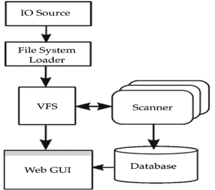

**图 3.2：** PyFlag 结构概述 (Cohen & Collett, 2005)。来源：https://commons.erau.edu/cgi/viewcontent.cgi?article=1071&context=jdfsl

### 3.4.2 系统互联网级知识

SiLK 支持基于 Cisco NetFlow 的网络流数据进行高效捕获、存储和分析。SiLK 工具是由 CERT 网络态感知 (NetSA) 组开发的。该套件为分析师提供了理解、查询和总结网络流记录中新旧流量数据的方法。该工具支持识别入侵痕迹、漏洞利用、蠕虫行为等的网络取证工作。该套件包含两个主要组件：收集系统和分析工具集。收集系统将 Cisco NetFlow V5 协议数据单元（PDU）转换为压缩二进制格式。一系列分析工具对这些记录进行处理并对数据进行控制和总结。收集系统通过存储所需字段来最小化存储空间，减少存储某些信息所需的比特数，并通过避免存储无关信息来节省空间。

SiLK 中有六种基础工具。rwfilter 获取数据并对其分区以隔离流记录。rw 提供了一套统计分析和计数功能，允许根据不同元素对流量进行组织和排序；rwcount 提供字节、数据包和流记录数量的时间限制计数。rwcut 读取过滤器文件，并以管道分隔符分隔的表格格式向用户生成输出的可读版本。rwsort 是一个用于 SiLK 流记录的高速排序工具。Rwuqi 统计多字段键组合的记录数。

SiLK 中有许多控制流记录文件的分析工具。rwcat 和 rwappend 工具用于合并流记录文件。rwdedupe 设计用于允许分析师高效删除重复的流记录。rwsplit 将大量流记录分成若干部分并同时单独分析每一部分。rwptflow 为 tcpdump 文件中的每个 IP 数据包生成单个数据包流记录。rwmatch 匹配 tcpdump 文件并根据 SiLK 记录中的流记录进行过滤。SiLK 是一种具有高性能的关键工具，因为它通过存储信息来管理海量流量。


在 2000 年，电子邮件和 AOL 即时消息为定罪 Sharee Miller 谋杀丈夫并协助自杀提供了有力证据。Miller 通过互联网诱引了受害者（丈夫（Jerry Cassaday），并伪装成其丈夫发送了攻击性信息。在此案例中，由于 AOL 即时消息可能被伪造，其真实性遭到了质疑（Bean, 2003）。该场景定义了从互联网提取的数字证据的重要性及其在发现罪犯方面的应用。

### 3.5.1 即时消息

即时消息工具（IM）已成为通信的重要手段。无论年龄、国籍和计算机水平，全球互联网社区每天都在使用 IM。这就是为什么可以在聊天记录中发现数字证据。常见的包括 Live Messenger、ICQ、Yahoo! Messenger、Viber、微信、Skype 和 WhatsApp。在中国，QQ 非常受欢迎，拥有超过十亿用户。

### 3.5.2 社交网络

社交网络逐渐成为传统 IM 的新面貌越来越多的通信从公共聊天室和私信工具迁移到在线社交网络。从社交网络中提取的通信对调查人员具有极高价值。

### 3.5.3 浏览器

网页取证是指通过浏览疑人的浏览历史获取与犯罪相关的关键信息，包括访问网页或网站的次数、时长、网页下载期间设置的 Cookie 以及在不同网站上上传和下载的文件。网页浏览也被称为上网。网页浏览器的重要性显而易见，因为它能细致地帮助调查人员暴露可疑活动。网页缓存可能会存储禁止内容以及基于 JavaScript 的恶意软件。通过检查浏览历史、缓存页面和图像以及存储的密码，可以获得重要的数字证据。不显露的犯罪可以通过 Google 搜索进行分析。目前有很多浏览器在使用。微软的 IE 将用户的浏览历史存储在


index.dat 文件以及 Firefox/Mozilla/Netscape 家族的浏览器会将网络活动保存在名为 history.dat 的文件中。这些文件通常是隐藏的，如果不先将浏览器设置为显示所有系统文件和隐藏文件，就无法查看。另一个问题是这两个文件无法通过正常方式删除。此外，没有确切证明删除这些文件可以优化用户的浏览体验。Mandiant 网络历史记录器（Web historian）帮助用户查看存储在常用浏览器历史归档中的网站 URL。该工具允许取证人员调查人员确定入侵者查看不同网站的动作、时间、位置和手段。

Web historian 可用于解析特定的历史文件，或迭代搜索给定的驱动器，或者查找该工具已知并分析的所有浏览器历史文件。Web historian 会生成单一报告，该报告可以保存为多种格式或作为输出。它能确定位来自所有网络浏览器历史的在线活动。index.dat 分析器是一个用于查看、检查和删除 index.dat 文件内容的取证工具。该工具可以同时或独立地查看历史、缓存和 cookie。该工具可以提供有关 cookie 的基本信息、与 cookie 关联的时间和日期以及与之相关的网站 URL。它还支持直接访问分析器输出列出的网站，并打开上传到网站或从网站下载的文件。这两个工具的辅助工具被称为 Total Recall。它可以用于提取存储在浏览器历史记录中的收藏网站列表。

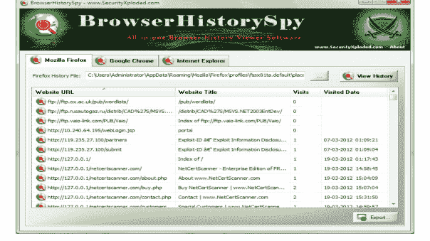

图 3.3：浏览器历史记录软件。来源：http://securityploded.com/browser-history-spy.php。

## 3.5.4 电子邮件

邮件取证涉及研究电子邮件的来源和内容作为证据，识别消息的真实发送者和接收者，并在可能的情况下确定日期、时间和所在位置。尽管即时消息服务和社交网络的使用日益增加，但电子邮件仍然是传递信息的主要手段，对于企业组织而言尤其如此。电子邮件是强大的通信手段之一，范围从内部会议请求到文档分发和普通对话。电子邮件现在被用于各种通信，包括提供隐私性、验证、不可否认性和数据完整性。市面上有 Microsoft Outlook、Outlook Express、Windows Mail、Live Mail、Thunderbird、TheBat 以及许多其他电子邮件应用程序。由于大量的在线和离线电子邮件通信，如果不经过适当检查，很容易忽略重要信息。随着电子邮件使用量的增加，攻击者和黑客开始使用电子邮件进行非法活动。垃圾邮件成为互联网社区的一个主要问题。电子邮件更容易被捕获，并可能被黑客用于获取秘密信息。电子邮件通常包含恶意软件、威胁和诈骗，可能导致数据丢失、机密信息甚至身份盗窃。本节描述的工具提供了灵活的浏览器格式、自动化报告和易于访问的工具栏功能。这些工具有助于识别消息来源、追踪垃圾邮件导航的路径，并定位试图从接收者处获取机密信息的钓鱼邮件。

EmailTrackerPro 分析电子邮件头部以检测发送消息机器的 IP 地址，以便跟踪发送者。所有电子邮件消息都包含一个位于邮件顶部的头部。在“发件人”（From）行和“接收”（Received）行中，头部列出了电子邮件在传输过程中被拦截的每一个点以及日期和时间。消息头部提供了电子邮件经过的每台机器的清单路径。EmailTrackerPro 拥有一个内置位置数据库，有助于跟踪邮件到世界的某个国家或地区，并在全球地图上显示信息。要使用此工具，只需将电子邮件头部复制并粘贴到 EmailTrackerPro 中。主 GUI 界面将显示基础追踪，并获得一份诊断报告。该诊断报告提供了解决此问题的另一种方法。用户可以向发送者或受害者网络的管理员报告特定电子邮件地址的滥用情况，报告中还包含了一些对取证分析和调查有用的关键信息。报告包括发送者 IP 地址的地理位置，如果无法确定，报告至少包含目标互联网服务提供商（ISP）的位置。根据发送者电子邮件地址的不同，报告还包括网络所有者或 ISP 的域名联系信息。域名注册提供了有关网站地址、时间、发送的邮件数量等信息。

SmartWhoIs 是一个免费的网络实用程序，用于查找有关 IP 地址、域名、国家、州或省份、城市、ISP 名称、管理员以及技术支持服务的详细联系信息。有时，人们必须将 SmartWhoIs 与 EmailTrackerPro 一起使用获取完整信息。一旦安装在机器上，SmartWhoIs 按钮将作为扩展程序添加到 Internet Explorer (IE) 工具栏中。使用这个简单的工具，用户可以使用 SmartWhoIs 获取有关最近访问或正在访问网站的任何额外信息。通过 SmartWhoIs，用户可以同时探测多个 IP 地址、主机名或域名。

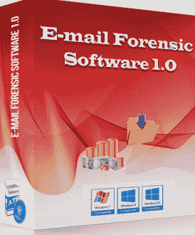

**图 3.4：**电子邮件取证软件。来源：http://www.bulkecommerce.com/store/e-mail-forensics-software-136.html。

## 3.5.5 点对点和文件交换软件

点对点（也称为 P2P）是由一组互连的节点创建的分布式系统，每个节点都相互连接。P2P 的形成维护基于清晰定义的协议。文件交换客户端可能包含非法图像、视频、知识产权侵权等。通常，用于执行取证的 P2P 系统具有以下要求：

- (a) 允许节点作为数据的生产者和消费者。
- (b) 允许网络的动态添加和删除。
- (c) 必须在应用层进行通信。
- (d) 必须减少网络开销。
- (e) 必须以常见格式交换数据。
- (f) 必须确保隐私性。
- (g) 必须确保完整性不受受破坏。
- (h) 必须确保可用性。

图 3.5：P2P 网络示例。来源：http://slideplayer.com/slide/4615691

P2P 网络分为三类：中心化、完全去中心化和半中心化。

- 中心化：中心服务器维护节点列表。想要加入网络的节点定期向中心服务器发送身份信息。一个例子是 Napster 协议。Napster 是允许用户直接共享音频文件的第一个工具。

- 完全去中心化：在这里，所有节点在信息和功能方面非常相似。没有节点比其他节点包含更多信息。这种网络没有中心服务器。Gnutella 协议（v0.4）是去中心化的例子。然而，当 Gnutella 协议依赖泛洪来检测文件时，最近引入的协议使用哈希表来定位网络上的文件。

- 半中心化：网络中有多个包含信息的节点。Kazaa 是混合 P2P 模型的示例。这种半中心化网络实际上是在去中心化模型的基础上创建了较小的子网络，每个子网络都有中心服务器作为超级节点。每个超级节点维护其子网络内的文件列表，并与其他超级节点共享该信息。

## 3.6 分页文件和休眠分析

随着 Windows 2000 发布，微软引入了一项允许系统关机同时保持其瞬态状态的功能。这是通过将 RAM 内容保存到名为 hiberfil.sys 的文件中实现的。当计算机再次启动时，瞬态状态将恢复，系统将从保存的状态恢复。休眠文件是数字取证从业人员的良好信息来源，因为它们将瞬态数据从 RAM 存储到非易失性存储器，而无需在目标设备上运行特定工具。像 Volatility 和 Rekall 这样的内存分析框架可以以后内存转储的方式分析文件；但这些工具不共享通用规范，无法与最新 Windows 版本的休眠文件兼容。这种现象由于微软发布 Windows 8，该版本还对休眠格式进行了修改。休眠文件，也称为挂起到磁盘

休眠（hibernation）是许多桌面操作系统的功能，允许将系统的当前状态序列化到非易失性介质中。这种状态以休眠文件的形式存在，并用于在未来的日期恢复系统。此外，休眠文件包含了系统所使用的物理内存的片段。通过检查此文件，可以重建系统地址空间的部分内容。为了缩短休眠过程，操作系统供应商通常只包含恢复系统状态所需的最少内容。这意味着系统当前未使用的部分地址空间被省略了。然而，这些区域包含一些实用的信息，例如已终止进程的残留信息。因此，休眠文件并不提供完整的镜像。休眠通常被认为比睡眠模式（通常称为挂起到内存或 S3）更安全、更可靠的替代方案。当系统（通常是笔记本电脑）进入睡眠状态时，除内存模块外的所有组件都会关闭。内存仍然接收电源，其内容得以保留，允许系统从挂起状态中快速恢复。虽然挂起到内存的速度远快于休眠，但它要求内存模块在此期间保持活跃。这对于桌面和笔记本系统来说都是一个挑战。为了改进这一点，自 Vista 和 Mac OS Leopard 之后的这些 Windows 版本和 Mac OS 集成了一种名为“安全睡眠”（safe sleep）的功能，在将系统放入睡眠之前生成一个休眠文件。在断电的情况下，该文件被用于恢复系统。从法证角度来看，对于将计算机系统挂起到内存的用户，也可以获取休眠文件。这还为调查人员提供了一种产生休眠文件作为输出的方便方法。许多系统被设计为在按下电源按钮或（对于笔记本电脑）关闭盖子时进入睡眠状态。不同的操作系统对休眠文件的内部配置不同，且极少被记录。该文件通常经过压缩，有时为了安全起见会加密。为了实现此目的，需要特殊的程序来进行检查。

在加密休眠文件的情况下，加密密钥是从用户的登录密码创建的。如果休眠文件是在系统进入睡眠时生成的（如安全睡眠技术所示），有时可以恢复密钥。这是因为密钥极可能存在系统的内存中，并可以使用某些成像技术获取。休眠文件的主要优势是它们具有异常的一致性。事实上，这种一致性对于恢复系统状态是必要的。然而，休眠文件的可靠性仍存争议。大多数操作系统都有钩子（hooks），可以在系统自我休眠时通知应用程序，使得恶意软件可以在休眠时自终止。该功能的缺点是，某个软件（无论是原始还是恶意的）留在系统上，能够存活休眠过程。任何不具备此能力的软件都将会有很短半衰期。这对比文件在磁盘上的定位方式产生了限制，使得任何具有足够权限的应用程序都可以对其进行事后修改。这可以通过确保系统上没有应用程序在休眠文件写入后有机会更改它来解决。这通常意味着在使用该文件恢复系统之前获取它。值得注意的是，由于其本质，休眠文件无法用于对系统进行现场分析。

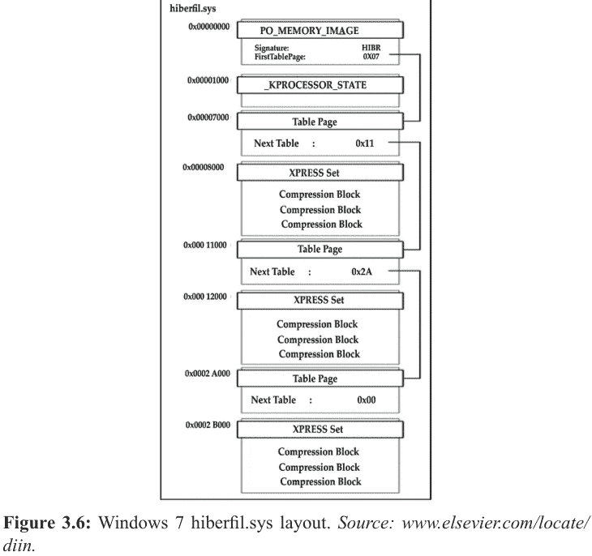

## 3.7 现场软件获取

通常，操作系统提供了一个设备文件以获取系统物理地址空间的访问。通过读取此文件，应用程序可以生成内存转储；在 Microsoft Windows 中，文件被指定为 `\Device\PhysicalMemory`，而包括 Mac OS X 和 GNU/Linux 在内的 Unix 类系统为此提供 `/dev/mem`。最近，出现了一种限制访问此类文件的趋势。随着 Windows Server 2003 Service Pack 1 的发布，Microsoft 删除了用户态应用程序访问物理内存设备的能力，Apple 则在 Mac OS X Tiger 的 Intel 版本中默认禁用了 `/dev/mem`。尽管 `/dev/mem` 仍然存在许多 GNU-Linux 发行版中，但它通常被限制在前 1 MiB 内存。成像应用程序的开发者通过包含内核模块来模拟缺失的功能作为回应。此外，目前市场上的大多数工具都是两部分的，由一个提供适当设备的内核模块和一个用于从其读取内容的用户态应用程序组成。许多开源和专有工具都包含了 MDD (2009) 和 Memory Toolkit (2010)。对于 GNU-Linux，该模块可以模拟该功能。现代工具的两部分式设计在一致性方面并不理想。镜像的一致性在很大程度上取决于获取时系统上运行的活跃进程数量。不活跃的进程不会修改内存，因此不太可能是不一致的来源。因此，在使用内存快照将系统置于休眠状态的同时，逐步淘汰系统上运行的用户态应用程序是理想的。然而，只有当成像工具不依赖用户态即可运行时，这才是可行的。问题在于现有工具，因为它们利用了用户态组件。通过将此代码移入内核，就可以对获取过程实施很大程度的控制。现场获取受到可靠性问题的困，因为它取决于操作系统提供的系统调用。这些调用用于启动进程、将模块加载到内核以及访问文件系统等。检测此类软件（通常以 rootkit 的形式出现）是困难的。在某些情况下，如果没有硬件帮助，甚至是不可能的。这使得现场获取不适用于敌对系统的成像。

## 数字取证与调查：从数据到证据

使用任何工具都会留下痕迹。这些痕迹的程度取决于几个变量，包括成像应用程序的内存占用、加载的任何内核模块的大小以及保存镜像的方法。将镜像发送到网络设备可能比写入可移动设备（必须插入系统）留下的痕迹更少。传输速度取决于设备，可以达到 80 Mi/s 以上或 1 Gbit/s，或者对于以太网连接为 10 MiB/s。

## 3.8 蜜罐与蜜罐网络

内网蜜罐网络（Honeynet）是一种专门设计用于被攻破的网络。一个被攻破的蜜罐网络可以用于观察入侵者的活动和行为。蜜罐网络允许对入侵者使用的工具进行彻底分析，以识别入侵者利用以攻破蜜罐的弱点。通常情况下，蜜罐的范围可以从简单的端口监听套字程序到可以在各种操作系统上模拟的完整生产系统。有时，蜜罐会通过充当诱饵系统来吸引流量，在互联网上将自己呈现为一个提供服务的合法系统。核心思想是，任何指向蜜罐的流量已知是攻击或入侵。任何从蜜罐发起的入站连接都可能是扫描、探测或攻击。从蜜罐发出的任何出站连接意味着有人攻破了蜜罐并开始了出站操作。


- 系统。蜜罐（Honeypots）可以帮助我们识别之前模糊或未见的漏洞。根据供攻击者攻破或探测系统的可用配置服务，蜜罐可以分为两类：低交互蜜罐和高交互蜜罐。高交互蜜罐可以被完全攻破。它赋予了攻击者访问操作系统所有层面的权限，以及发起更多网络攻击的权限。安装的蜜罐越多，越有可能高效地获取有关网络攻击的信息。例如，大多数 TCP 连接请求是生成并发送到随机选择的 IP 地址的。TCP 可以识别出在连接之前，TCP 握手已完成且接收到了包含恶意内容的负载。这种情况发生的概率越高，蜜罐的数量就越多。

蜜罐网络（Honeynet）通常利用蜜罐墙（Honewall），它作为防火墙，保护外部世界免受来自蜜罐网络内部的攻击。为了保护非蜜罐系统免受来自被攻破蜜罐的攻击，可以建立具有许多数据控制和数据捕获功能的蜜罐墙。蜜罐墙可以限制每小时允许的连接数。还可以限制攻击者流量的可用带宽范围。TCP 还可以限制精确针对其他系统弱点的恶意数据包的实时更改并将其变为无害。蜜罐墙可以捕获并监控蜜罐网络中所有进入**离开和驻留的数据流量。调查攻击者破解蜜罐的步骤以及被攻破的蜜罐是如何被进一步使用的。为了防止蜜罐墙阻塞通信，攻击者可能会安装某些加密软件来加密攻击者机器与蜜罐之间所有的技术和情报信息。在这种情况下，蜜罐墙可能无法解密通信。为了解决这个问题，最近开发了一种名为 Sebek 的日志软件。Sebek 是一个集成到每个蜜罐中的软件工具，是机器操作系统的一部分。Sebek 只在攻击者的加密软件对其进行解密后拦截数据。解密后的信息被定向到远程服务器进行进一步调查。


# 图 3.7: 蜜罐网络的示意图。

来源：http://adityabeyingthepresentationsit.blogspot.com.ng/2014/06/honeyypots-and-honeynets.html

### 3.8.1 虚拟蜜罐

物理蜜罐是具有唯一 IP 地址的真实机器。虚拟蜜罐是模拟机器，可以根据要求建模运行。在单个系统上可以模拟运行相似或不同操作系统的多个虚拟蜜罐。这些虚拟蜜罐中的每一个都可以配置特定的服务，攻击者将利用这些服务获取对蜜罐的访问权限。当攻击者尝试连接到随机选择 IP 地址的机器时，设置具有相同服务的虚拟蜜罐数量越多，越有助于捕获攻击者创建的连接请求和负载流量。Honeyd 是一个用于虚拟蜜罐的框架，用于在网络层模拟计算系统。它构建了包含任意路由拓扑结构的虚拟网络，并具有可配置的链路特征，如延迟、带宽、丢包率等。Honeyd 被用作针对 Xprobe 或 Nmap 等 TCP/IP 栈指纹识别工具的欺骗工具，让攻击者认为虚拟蜜罐正在运行特定的操作系统。这是通过模拟目标操作系统的 TCP/IP 实现的。虚拟蜜罐根据其安装的服务对网络请求做出响应。

### 3.8.2 串行与并行架构

蜜罐网络可以建立在串行架构或并行架构上。在串行架构下，蜜罐墙过滤所有发送到生产系统防火墙（提供重要服务的机器网络）的流量，且生产系统的所有进入和流流量都会通过蜜罐网络。如果蜜罐网络被攻破，会通知生产系统的防火墙。即使攻击正在蜜罐网络中进行，防火墙也会确保攻击不会侵入生产系统。当蜜罐网络中收集到足够的证据时，就可以停止蜜罐网络并开始分析发送给它的异常流量。串行架构蜜罐网络的优势是它保护了生产系统免受直接的恶意攻击。然而，缺点是每条进入和流出的流量都会遭受延迟。

在并行架构下，蜜罐网络和生产系统都直接暴露，从而避免产生延迟。如果蜜罐网络获得某些流量，它会分析这些流量并通知防火墙。然后防火墙在保护生产系统方面会变得更加强大。

## 3.9 数据雕刻（DATA CARVING）

雕刻（Carving）是一个通用术，指根据格式特征从原始数据中提取组织化数据。数据雕刻是一种基本方法，允许在文件系统信息损坏或丢失时检索被删除的文件。要使用这种提取方法，文件应具有一个称为文件头（文件开始）的标准文件签名。通过搜索来定位文件头，并持续直到到达文件脚（文件结束）。这两个点之间的数据将被提取并分析以验证文件。提取算法使用不同的方法。

# 数字取证与调查：从数据到数字证据

鉴于今天庞大的数据量，许多文件雕刻实现方案在准确恢复碎片化文件方面表现挣扎，或者其扩展性不足而无法实际应用。在传统的刑事调查和计算机应急响应中，主要关注点都是给定取证方法的准确性及其执行速度。不准确或不及时的证据在这些追求中价值微乎其微。两种通用的通用文件雕刻技术是基于结构的雕刻和基于内容的雕刻。然而，还有其他策略在后文中讨论。

### 3.9.1 基于结构的雕刻

该技术利用文件的内部布局。元素包括头、脚、标识符字符串、大小信息等。基于结构的雕刻是最早提出的雕刻策略之一，并实现在 Foremost、PhotoRec 和 Scalpel 等工具中。在基于结构的雕刻期间，会对数据量进行搜索，寻找与特定文件类型相关的已知值或数据结构。一个常见的例子（在本项目后期也会使用）是具有特定字节序列作为有效起始的文件。使用该策略的简单雕刻器找到包含关联脚的内存簇，并假设两者之间（包含在）的簇属于要恢复的文件。注意，这种假设仅在文件被存储为连续的内存段，且在头和脚之间没有其他已分配或空簇时才成立，并且这种简单的策略将无法恢复碎片化文件。

### 3.9.2 基于内容的雕刻

这是一项由松散结构（MBOX、HTML、XML）组成的系统。该技术具有内容属性、字符计数、数据白/黑名单、文本/语言识别、信息熵和统计属性（卡方值）。高级雕刻技术包括图论雕刻、智能雕刻、加密卷雕刻和双碎片间隙雕刻。


# 网络与互联网

# 73

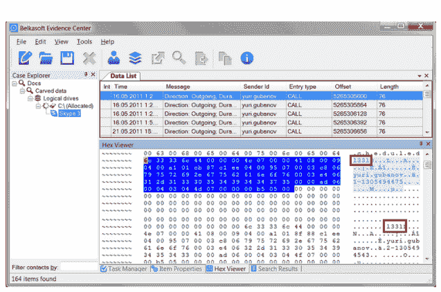

**图 3.8：Belksoft Evidence Center 显示的十六查看器。** 来源：http://ru.belksoft.com/en/retrieving-digital-evidence-methods-techniques-issues。

在图中，Belksoft Evidence center 在 2012 年提取了这些数据，它显示特征签名 1331 位于实际 Skype 3 通话之前。

### 3.9.3 其他数据提取技术

另一种方法涉及收集碎片并尝试在正确的应用程序中打开它们。如果文件可以打开，则假设它不是损坏的假阳性。其他研究将数据提取（carving）定义为图像数据与文件数据之间的映射函数，成为一个优化函数问题。该问题也被描述为最优路径构建问题。基于上下文的数据提取是另一种建议的方法。首先将碎片分类到代表其中文件的类别中。它们可能属于文本或可执行文件等。然后，根据某个碎片可能紧接在前一个碎片之后的可能性，重新组合相似类型的碎片。SmartCarver 是文件提取的另一种解决方案。Smart Carver 通过移除任何被识别为已分配的磁盘簇并仅提取未分配的簇，减少了提取阶段需要处理的数据量。在某种程度上，这与没有现有文件系统的情况是不同的问题。然而，即使在文件系统可用的情况下也需要文件提取，这是非常值得的。

# 参考文献

- 1. Bean, M. (2003). Mich. v. Miller: Sex, lies and murder. Court TV. 取自 www.courttv.com/trials/taped/miller/background.html
- 2. Garfinkel, S. (2002). Network forensics: Tapping the internet. 取自 http://www.oreillynet.com/pub/a/network/2002/04/26/nettap.html
- 3. Palmer, G. (2001). A road map for digital forensic research (pp. 15–30). First Digital Forensic Research Workshop, Utica, New York.
- 4. PyFlag. 取自 http://www.pyflag.net
- 5. Sira, R. (2003). Network forensics analysis tools: An overview of an emerging technology. GSEC (1.4).

# 第 4 章

# 司法取证中的操作系统

> “我认为 Linux 是一个很棒的东西，因为 Linux 是 Windows 的替代品，而且在当今所有相关的操作系统中，Unix 是那一大堆糟糕东西中最好的一个。”

>—Jamie Zawinski

# 目录

- 4.1 术语 ................................................................................ 76
- 4.2 Windows XP.................................................................................................. 77
- 4.3 Windows 文件系统............................................................................... 78
- 4.4 Linux 系统 ....................................................................................... 85
- 4.5 Macos X 系统...................................................................................... 91
- 4.6 数据的删除与破坏........................................................... 98
- 参考文献......................................................................................................... 101

# 数字取证与调查：从数据到数字证据

操作系统以及它们支持的文件系统，在设计和实现上可以从本质上使得司法取证调查不那么耗时且更加可靠，并协助将发现的证据在起诉犯罪者时使用。目前，调查人员使用许多外部软件工具，所有这些都依赖于操作系统提供的接口。本章将带你了解调查的关键组件和操作系统功能，包括文件系统、数据恢复、内存取证、系统配置、互联网访问、云计算、痕迹跟踪、可执行文件布局、恶意软件和日志文件。本质上，它涵盖了专注于计算机取证与操作系统设计及实现之间关系的关键技术主题。

## 4.1 术语

### 4.1.1 磁盘

磁盘指的是物理存储设备——例如 SCSI 或 SATA 硬盘，或来自数码相机的数字存储卡。对该层级项目的分析通常超出了大多数取证员的能力——对传统硬盘的物理介质分析需要大量的专业培训和知识、进入净室以及昂贵的电子显微镜设备。然而，随着闪存媒体和固态硬盘（SSD）的兴起，这一层级的介质分析可能属于更大取证人员的范围。

### 4.1.2 卷

卷使用一个或多个磁盘的全部或部分创建。取决于配置，单个磁盘可能包含多个卷，或者一个卷可能跨越多个磁盘。“分区”一词通常与“卷”通用；但载体对此有区分，即“分区”限于单个物理磁盘，而“卷”是一个或多个分区的集合。简单来说，卷描述了磁盘（系统）上的若干扇区。

### 4.1.3 文件系统

文件系统建立在卷上，描述文件及其相关元数据的布局。文件系统层中的项目包括

司法取证中的操作系统 77

专门用于文件系统操作的项——Ext2 超块（superblock）就是一个很好的例子。

### 4.1.4 数据单元

数据单元是给定文件系统中可用的最小独立数据存储可用单元。在 Unix 派的文件系统中，这些是块（blocks）。

### 4.1.5 元数据

元数据是指关于数据的数据。在 Unix 派的文件系统中，这些被称为节点（inodes）。

### 4.1.6 文件名

文件名层是人类操作的层。

## 4.2 Windows XP

Windows XP 多年来一直一直是标准操作系统。自从 2001 年问世以来，数百万 Windows 用户已经习惯了其友好的界面、相对高效的操作，以及相对于 Windows 2000 和 Windows ME 等以前版本的改进。XP 有三个主要版本（即家庭版、媒体中心版和专业版），目标针对微软计算客户的不同群体。从文件系统的角度来看，XP 持续运行在文件分配表（FAT）和新技术文件系统（NTFS）之上。

微软于 2008 年停止销售 XP，但计划一直到 2014 年支持这一深受喜的版本，这意味着在未来的许多年里，它很可能仍然是取证员生活的重要组成部分。在本章中，除非另有说明，对 Windows XP 操作和痕迹的讨论通常也适用于 Windows Server 2003 系统。

## 4.3 Windows 文件系统

最容易理解的 Windows 文件系统是 FAT（文件分配表）文件系统：FAT12、FAT16 和 FAT32。虽然相对老旧，但 FAT 文件系统仍用于许多存储系统，作为数码相机和移动设备的可移动介质。由于其广泛的使用和简单的结构，FAT 文件系统是取证分析师理解文件系统和恢复删除数据的良好起点。理解 NTFS 的基础也同样，它比 FAT 更复杂，且结构显著不同。本节提供了这两种 Windows 文件系统的概述，重点关注从取证分析角度来看重要的方面。

### 4.3.1 文件分配表

FAT 文件系统可能是最简单的文件系统之一，并从 MS-DOS 开始在微软操作系统中广泛可用。FAT 是 MS-DOS 系统和软盘磁片的主要文件系统，也广泛用于 Windows 3.x 以及 Windows 95 和 98。这种文件系统仍用于可移动存储设备，


例如 U 盘，以及用于数码相机的紧凑闪存卡。FAT 文件系统被其他操作系统支持，因此它是将数据从一个系统（Linux、macOS）移动到另一个系统（Windows）的良好介质；如果你正在通过 Linux 系统进行分析，可以保存提取出的文件并在稍后从 Windows 系统轻松地访问它们。然而，请记住，FAT 文件系统不具备像 NTFS 等其他文件系统那样的安全机制。FAT 文件系统有多种不同的变体：FAT12、FAT16、FAT32 和 exFAT。它被认为是一种相对简单的文件系统，因为它拥有的数据结构较少。在 FAT 文件系统中，簇或卷根据所使用的 FAT 版本被划分为特定大小的簇。例如，对于 FAT12，簇大小范围从 512 字节到 8 千字节（KB）。对于 FAT16，簇大小范围从 512 字节到 64 KB。微软提供了一篇知识库文章（Microsoft Knowledge Base article），从高层面描述了 FAT32 文件系统。在该描述中，微软表示 FAT32 文件系统可以支持多达 2 太字节（TB）的分区，但 Windows 2000 只支持多达 32 吉字节（GB）的分区。使用 4-KB 簇，FAT32 使用空间更高效；簇大小范围从 512 字节到 32 KB。FAT16 和 FAT32 之间的主要区别在于逻辑分区的大小。在磁盘上，FAT 文件系统引导扇开始（微软知识库文章 140418 提供了 FAT 引导扇的详细描述），随后是 FAT 区域 1 和 2（第二个 FAT 区域是第一个区域的副本）、根目录、文件和其他文件夹。FAT 映射到卷中的每个簇，并告诉操作系统每个簇是如何被使用的；它是被使用状态、作为文件的一部分正在使用，还是文件的结束。文件在 FAT 卷中以簇的形式排列，并由 32 字节的条目引用，这些条目包含文件起始簇号的地址。如果一个文件占用的超过一个簇，那么起始簇将以下一个簇的编号结束，以此此类推直到到达最后一个簇。这个最终簇被标记为结束指示（0xffff）。FAT 格式的卷使用目录和文件分配表来组织文件和文件夹。根目录（例如 C:\）位于卷上的预指定位置，操作系统知道在哪里可以找到它。该文件夹包含软磁盘上的文件和子目录列表，以及相关的属性，如 X-Ways Forensics 所示。

| 名称 | 类型 | 大小 | 创建 | 修改 | 访问 | 第1 扇区 |
| --- | --- | --- | --- | --- | --- | --- |
| [directory] | | 7.0KB | 05/08/2003 14:41:44 | 05/08/2003 14:41:44 | 05/08/2003 | 18 |
| opt | | | 0.0KB | 05/08/2003 14:43:00 | 05/06/2003 14:34:16 | 05/12/2003 | 168 |
| geendir.ld | | | 19.5KB | 05/08/2003 23:43:15 | 02/17/2003 12:49:16 | 05/12/2003 | 306 |
| contacts.as | | | 16.5KB | 05/08/2003 23:43:15 | 02/17/2003 12:39:16 | 05/12/2003 | 345 |
| diskinfo.dat | | | 21.5KB | 05/08/2003 23:43:15 | 02/17/2003 12:39:16 | 05/12/2003 | 218 |
| todo.txt | | | 12.2KB | 05/08/2003 24:43:15 | 02/17/2003 12:49:16 | 05/12/2003 | 257 |
| newpass.txt | | | 12.2KB | 05/08/2003 24:43:15 | 02/17/2003 12:49:16 | 05/12/2003 | 258 |
| Root | | | 0.0KB | | | |
| FAT | | | 4.5KB | | | |
| Idle | | | 4.5KB | | | |

NTFS 的另一个有趣特性是备用数据流（ADS），或“ADSs”。ADS 自 Windows NT 3.1 第一版本起就是 NTFS 文件系统的一部分，用于与 Macintosh 分层文件系统（HFS）兼容。NTFS 使用分支（forks）来保持从一个系统（HFS）到另一个系统（NTFS）的互性。ADS 实际上是与文件相关的附加流，而所有版本


## 84 数字取证与调查：从数据到数字证据

Windows 包含一种创建任意备用数据流（ADs）的手段（某些 Windows 版本实际上会创建和使用特定的 ADS），但直到 Vista 版本，才提供了用于查看任意 ADS 的原生功能。从 Windows Vista 开始，`dir/r` 命令允许分析人员在存运行系统上搜索任意的 ADS。然而，运行 NTFS 文件系统的 Windows 系统长期以来具有创建和使用 ADS 的原生能力。

为了演示如何创建一个任意的 ADS，请通过 DOS 或 `mkdir` 命令创建一个名为 "ads" 的新目录（如果你愿意的话），打开命令提示符进入或使用 `cd` 进入该目录，然后输入以下命令：

```bash
C:\ads>echo "this is an ADS" > myfile.txt:ads.txt
```

如果你输入 `dir` 命令，你会发现文件 "myfile.txt" 存在且大小为 0 字节。我们刚刚将一个长度为 14 字节的字符串 `echo` 到一个文件中（显然），它去哪儿了？如果我们使用 `type` 命令尝试查看输入到 ADS 中的字符串，在 Windows XP 上，我们将收到一条关于命令语法的错误消息。输入以下命令：

```bash
C:\ads>notepad\myfile.txt:ads.txt
```

当记事本窗口打开时，我们可以看到我们输入的字符串……它是从哪里来的？该字符串存储在备用数据流中，它是一个文件，但在名称中没有用冒号表示。ADS 可以添加或附加到文件或目录列表（使用如 "C:\ads:ads.txt" 等命令）。

某些 Windows 应用程序实际上会使用特定的 ADS。在 Windows XP Service Pack 2 中，附件管理器（Attachment Manager）会为通过 Internet Explorer 或 Outlook 附件下载的文件添加一个名为 "Zone.Identifier" 的 ADS。这些 ADS 的大小通常不会超过 26 或 28 字节。每当用户想要打开或执行文件时，系统都会向他们发出警告，询问他们是否确定要启动该文件。ADS 还可以用于“隐藏”可执行内容。在许多 Windows 版本中，可执行映像文件（.exe 文件）可以隐藏并从 ADS 中运行。不仅“隐藏”在 ADS 中的 Perl 脚本，Windows 脚本宿主机（Windows Scripting Host）文件也可以“隐藏”在 ADS 中并从其运行。

## 司法调查中的操作系统 85

再次强调，ADS 是 NTFS 文件系统特有的产物。许多商业司法取证程序将在应用程序的 GUI 中用红色显示 ADS。Dave Roth [6] 发布了一部名为“listdatastream.pl”的 Perl 脚本，该脚本用于在运行系统上定位 ADS。该脚本使用了 Dave 的 Win32:API:Prototype 模块并依赖于原生 Windows 编程接口（API）函数。

## 4.4 LINUX 系统

随着 Linux 普及率的提高，犯罪现场遇到 Linux 的将会越来越多，特别是作为服务器的首选操作系统。然而，从 Microsoft Windows 系统恢复证据所需的技能和专业知识并不适用于 Linux 系统上的相同任务。例如，Microsoft NTFS、FAT 和 Linux Ext2/3 文件系统的工作方式有很大不同，理解其中一个对于了解其他系统如何运作帮助不大。在本章中，我们将使用命令行工具演示 Linux 系统的数字取证程序。从运行系统中收集证据的能力尤为重要，因为如果取证响应人员不优先收集现场证据，RAM 中的证据可能会丢失。讨论的取证程序包括从 RAM 和磁介质中识别和恢复被删除文件的方法、识别重要文件和木马，以及寻找隐藏文件和重命名文件（重命名了扩展名的文件）。

我们首先描述从运行的 Linux 系统中恢复被删除的文件。由于 Linux 系统通常被用作服务器，大多数演示都是针对入侵者在进入系统后已知使用的活动和技术。

### 4.4.1 Linux 文件系统架构

在编写本文时，当前的 Linux 系统使用 Ext3 文件系统。Ext3 是 Ext2 的继承者，增加了日志功能，但保留了 Ext2 的底层结构。事实上，如果用户恰当使用 `mount` 命令，Ext3 卷可以很方便地挂载为 Ext2。Linux 内核还提供了其他文件系统，包括 ReiserFS、XFS 和 JFS。由于这些文件系统通常不用于默认的 Linux 安装，它们的出现可能表明这是一个定制的系统（而非通用型桌面系统）。

## 86 数字取证与调查：从数据到数字证据

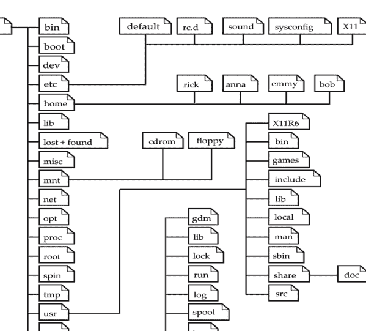

**图 4.4：** 典型的 Linux 文件结构。

来源：https://www.everything-linux-101.com/blog/linux-file-system-structure-explained/

### 4.4.2 文件系统层

Ext 文件系统由两个构成文件文件结构的部分：超级块（superblock）和组描述符表（group descriptor tables）。超级块是位于 Ext 文件系统开始处 1024 字节处的数据结构。它包含了有关文件系统布局的信息，包括块和 inode 分配信息，以及指示文件系统上次挂载或读取时间的元数据。组描述符表位于紧随超级块的块中。该表包含文件系统上找到的块组的分配状态信息。Sleuth Kit 中的 `fsstat` 工具可解析这些数据结构的内容并显示有关文件系统的信息。

### 4.4.3 Linux 中的文件系统

Linux 将设备视为文件，存储在 `/dev` 中。大多数 Linux 发行版使用基本的目录结构，其主要目录如下：

- `/bin`：基本命令
- `/boot`：启动所需的文件，包括内核
- `/dev`：设备文件
- `/var`：可变数据
- `/home`：用户目录
- `/root`：root 用户目录
- `/etc`：配置文件
- `/lib`：系统库
- `/mnt`：挂载点
- `/opt`：可选和第三方软件
- `/usr`：用户级软件

为了查找系统信息，可以使用以下命令：

- `uname -a`：返回内核和版本
- `ls -l`：返回当前目录的文件列表
- `ls -ul`：返回访问时间
- `netstat -s`：返回协议信息

UNIX 和 Linux 使用树形层次级结构来存储文件。在 UNIX 结构中，顶级目录是根目录 `/`。根目录有许多目录，这些目录又有子目录。例如，在 `/usr/game` 中，`game` 是 `/usr` 的子目录，而 `/usr` 是父目录。

当创建文件系统时，还会创建一个超级块，它记录文件系统类型、设备块大小、最大文件数等相关信息。

数字取证与调查：从数据到数字证据

在超级块之后，另一个重要的结构是 inode。inode 是文件的索引。每个节点代表存储在磁盘上的文件。使用 `-I` 选项命令可以查看文件的 节点 号。

第二个扩展（ext2）文件系统可能是最方便的 Linux 文件系统。它改进了算法并增加了最后访问和数据修改的时间戳。它还可以跟踪文件系统的状态。

### 4.4.4 Linux 发行版的类型

Linux 是由 Linux Torvalds 在全球开发者协助下的基于 UNIX 的开源操作系统。它有多个版本，称为发行版，包括 Red Hat、SUSE、Debian 和 Ubuntu。每个版本都有其优缺点。

有三种基本的 Linux 发行版：

- (a) 桌面发行版：包含图形界面和常用程序，适用于家庭使用。
- (b) 服务器或企业发行版：主要用于业务应用程序，也可以作为家庭服务器。
- (c) Live-CD 发行版：存储在可启动存储设备上。Live CD 是一个直接加载到 RAM 中的操作系统版本，独立于目标计算机的操作系统运行。


# 司法取证中的操作系统 89

## 4.4.6 从内存中恢复文件

磁盘上内容已被覆盖的已删除文件仍然可以被恢复。为了说明这种取证技术，假设入侵者执行了一个程序并将其从磁盘中删除以隐藏其踪迹。

这种情况经常发生，例如入侵者通过执行 `netcat` 工具在受害者系统上安装后门，并从磁盘中删除该工具。只要程序作为内存中的运行进程仍然存在，就可以恢复原始的可执行文件。文件之所以恢复是因为 Linux 内核使用伪文件系统跟踪系统的总体状态，包括运行的进程、挂载的文件系统、内核信息以及数百个其他关键系统信息。这些信息存储在虚拟内存中，可以通过 `/proc` 目录访问。下方的部分列表显示了运行的 Linux 系统上 `/proc` 目录的内容。

每个数字都对应一个处理器 ID 以及一个包含运行进程信息的目录。

```
# Is/proc
1 4 4513 4703 4777 excdom mdstat swaps
1693 40 4592 4705 acpi fb meminfo sys
2 4045 4593 4706 asound filesystems misc
2375 41 4594 4708 bus buddyinfo fs ms sysvipc
2429 4163 4595 4709 bus ide modules tty
2497 4166 4596 4712 cmdline interrupts iomem mtr uptime
2764 4186 4597 4713 config.gz iomem mtr version
29 42 4620 4715 cpufreq ioports netstat
```

为了说明恢复已删除文件，假设一个入侵者下载了一个密码破解器并正尝试破解系统密码，这是入侵者的非常常见目标。入侵者使用 `john` (http://www.open.com) 密码破解器配合一个名为 `pass` 的密码列表文件进行运行。随后，入侵者删除了可执行文件和包含密码的文本文件，但在进程被杀死之前，该可执行文件仍然留在内存中。`ps` 命令显示运行中的进程。下方的列表显示可执行文件“John”已在上午 10:10 使用“pass”文件调用，已运行了 22 秒，且所有者为 `root`。

## 4.4.7 Linux 作为取证工具的使用

Linux 经常被用于计算机取证，原因如下：

- (a) 具有更大的控制力；
- (b) 将每个设备视为文件；
- (c) 不需要单独的写保护器；
- (d) 功能强大；
- (e) 可以从 CD 启动；
- (f) 可以识别多种文件系统；
- (g) 灵活性高；
- (h) 诸如 The Farmer's Boot CD 和 Sleuth 这样的发行版，本身就是一种司法取证工具。

## Linux 在司法取证中的优势

在司法调查中使用 Linux 有若干种优势，包括：

- (a) 软件的可用性与易访问性；
- (b) 免费提供的软件和源代码；
- (c) 工具可以进行严密分析；
- (d) 效率高；
- (e) 允许大量的自动化和脚本化；
- (f) 优化与定制；
- (g) 软件可以修改以适应特殊需求；
- (h) 良好的支持；
- (i) 支持即时社区支持；
- (j) 使用开放、发布的标准；
- (k) 跨技术和跨组织的兼容性。

## Linux 在司法取证中的劣势

当然，在司法取证中使用 Linux 也有劣势。由于 Linux 操作系统与 Windows 或 Mac OS 非常不同，调查调查人员可能需要经过专门培训才能使用 Linux。此外，由于 Linux 是一个开源操作系统，更新频繁。实施这些更改需要时间，而且这些更改绝不被认为是永久或最终的。

## 4.5 MACOS 系统

Apple Macintosh 系统作为数字证据来源受到的关注比其他系统少，可能是因为它们的数量较少，且人们对其不够熟悉。然而，这些系统不能被忽视，因为罪犯会使用它们，而且用户型的图形界面并不等同于用户型的数字检查。如果说有什么的话，数字证据检查员需要对这些系统投入更多精力。更多新款、色彩丰富、紧凑的 Macintosh 桌面和笔记本系统正在向全球销售，而基于 UNIX 的 Mac OS X 的出现吸引了更多技术用户，他们欣赏 UNIX 的强大功能和 Macintosh 界面的便利性。虽然可以使用数字取证工具对 Macintosh 系统进行某些取证检查，但最有效的方法是使用经过特殊配置的带有原生工具的 Macintosh 系统来检查这些系统。

为了让应用程序在启动时运行，用户需要执行以下基本步骤：

- (a) 在 `Library/StartupItems` 下创建一个子目录。例如，如果用户正在为 MySQL 设置启动项，他或她可以创建目录 `/Library/StartupItems/MySQL`。
- (b) 在该子目录中放入一个启动文件。它的名称应与其父文件夹相同，即 `in/Library/StartupItems/MySQL/MySQL`。例如，用户可以查看 Mac OS X 的 Apache 启动项 `/System/StartupItems/Apache/Apache`。
- (c) 至少在该子目录中添加一个 `StartupParameters.plist` 文件。再次，使用现有的启动项作为模板。
- (d) 如果用户使用控制变量来确定应用程序是否启动，可以在 `plist` 文件中找到。

### 4.5.1 操作系统文件系统

使用 HFS+，文件系统基于 B-tree 结构。目录文件（Catalog file）包含所有文件和文件夹的元数据，而溢出文件（Extents Overflow file）包含文件碎片的信息。

### 4.5.2 文件属性

Macintosh 系统支持各种文件属性，这些属性存储在目录文件中。这些属性对于取证分析以确定文件来源和使用情况至关重要。

### 4.5.3 数据与分支（Forks）

Macintosh 使用两种类型的分支（Forks）：数据分支（data fork）和资源分支（resource fork）。数据分支包含文件的的实际内容，而资源分支包含如图标、权限和属性等元数据。

### 4.5.4 文件删除

由于 HFS+ 的特性，当文件被删除时，目录文件中的条目会被标记为可用。然而，目录文件中的元数据可能仍然，节点可能会被新数据覆盖。

### 4.5.5 HFS+ 结构

分级文件系统（HFS+）由 Apple 在 2000 年开发以取代 HFS 作为 Macintosh 的默认系统。HFS+ 对 HFS 进行了了一些改进，使用 32 位长度存储块地址和分配映射，使用 Unicode（UTF-16）编码文件和目录名称，并引入了分支（nforked）概念。此外，Mac OS X 10.4 为 HFS+ 文件系统增加了访问控制列表（ACL）功能。HFS+ 有不同的元素，如卷头、目录文件、扩展溢出、分配文件和启动文件。聚焦于取证，最重要的元素是目录文件，它是一个 B-tree 结构，包含所有文件和文件夹的元数据：用户和组（HFSPlusBDIInfo）、权限、文件 ID 等。关于时间戳，它包含了四个不同的时间戳：文件元数据最后一次修改的时间（犯罪修改时间），……所有时间戳字段均为无符号 32 位整数（UInt32）值，表示自 GMT 1904 年 1 月 1 日午夜以来的秒数。作为无符号 32 位整数，它可以存储到 GMT 2040 年 2 月 6 日 06:28:15 的时间戳。


开发者在应用实现过程中必须意识到将 GMT 值转换为本地时间。目录文件（Catalog File）中的每个文件和目录都包含名为 DataFork 和 ResourceFork 的属性。它们都是 `HFPlusForkData` 类型，包含两个重要属性：`logicalSize` 和 `totalBlocks`。`logicalSize` 包含分配或预留给文件（实际上是 fork）的数据字节数，而 `totalBlocks` 包含文件所使用的分配块数量。参考 DataFork，它包含了该文件的预留文件位置和大小，而 ResourceFork 则包含相关数据和资源信息。此外，目录中的每个文件都包含一个 `HFPlusExtentDescriptor`，它指示第一个块的编号（`startBlock`）以及该位置的块数量（`blockCount`）。

卷头（volume header）是 HFS+ 卷的核心结构之一。它存储了关于文件系统的数据，包括分配块大小、卷创建时间戳以及 HFS+ 操作所需的特殊文件位置（将在本章稍后部分讨论）。卷头始终位于卷起始前 1024 字节处，备份副本位于卷结束前 1024 字节处。HFS+ 使用分配块作为数据单位。单个分配块的大小在卷头中定义，但 4K 是一个常见值。分配块可以进一步分组为簇（clumps），这与 Linux 下 Ext 文件系统中的块分配组有些相似。文件数据通过扩展区（extents）进行寻址。一个 HFS+ 扩展简单来说是一个指向起始分配块的 4 字节指针，以及一个指示扩展区长度的 4 字节值。HFS+ 文件可以有任意数量的数据流分支（forks）。主分支是数据分支（data fork）和资源分支（resource fork）。通常，数据分支持有实际内容，而资源分支可能为空或包含关于文件的非本质支持信息。可以为特定的应用程序目的为文件创建额外的分支。我们可以使用 Sleuth Kit 中的 `fsstat` 命令从卷头读取有关文件系统的信息。在检查基本文件系统数据时，我们将使用来自 Digital Corpora 的 `nps-2009-hfsjst1/img.gen1.dmg` 文件作为测试镜像。

# 文件系统信息

- 文件系统类型：HFS+
- 文件系统版本：HFS+

# 司法医调查中的操作系统

- 卷名：image
- 卷标识符：9bee54da586b82f5
- 最后挂载于：Mac OS X, Journaled
- 卷未正常卸载
- 挂载计数：11
- 创建日期：2009年1月29日 星期四 09:33:30 
- 最后写入日期：2009年1月29日 星期四 09:33:42
- 最后备份日期：1969年12月31日 星期三 16:00:00
- 最后检查日期：2009年1月29日 星期四 09:33:30
- 日志信息块：2

### 元数据信息

- 范围：2–28
- 可启动文件夹 ID：0
- 启动应用 ID：0
- 启动打开文件夹 ID：0
- Mac OS 8/9 幸运系统文件夹 ID：0
- Mac OS X 幸运系统文件夹 ID：0
- 文件数量：7
- 文件夹数量：4

### 内容信息

- 块范围：0–2559
- 分配块大小：4096
- 空闲块数量：443

Altheide & Carvey, (2011)

从此输出中，我们可以确认 4K 分配块大小、与访问卷相关的某些时间信息，以及另外几个特定于操作系统的元数据，这些元数据在非系统卷上是不相关的，因此显示为“0”。这些包括两个启动项和“幸运（Blessed）”系统文件夹行。这些将指向 OS X 启动卷上 `/System/Library/CoreServices` 目录下的条目。尽管 HFS 和 HFS Plus 之间的文件夹和文件记录格式有所不同，但它们包含相似的信息。文件夹记录包含以下字段，以及系统使用的一些详细信息。

# 数字取证与调查：从数据到数字证据

- 记录类型：0x0100
- 名称：文件夹名称
- 效值（Valence）：此文件夹直接包含的文件和文件夹数量
- CNID：唯一目录节点 ID
- 创建日期：此文件夹创建的时间
- 修改日期：文件或文件夹被创建的时间
- 修改日期：文件或文件夹被创建的时间
- 访问日期：此文件夹创建的时间
- 备份日期：此文件夹创建的时间

- 记录类型：0x0100
- 名称：文件夹名称
- 效值（Valence）：此文件夹直接包含的文件和文件夹数量
- CNID：唯一目录节点 ID
- 创建日期：此文件夹创建的时间
- 修改日期：文件或文件夹被创建的时间
- 修改日期：文件或文件夹被创建的时间
- 访问日期：此文件夹创建的时间
- 备份日期：此文件夹创建的时间


# 取证调查中的操作系统 99

为了将大规模的擦除模式与纯未使用的磁盘空间区分开来。其他工具，例如 Windows 原生工具 cipher，会（在默认情况下）使用看似随机的数据擦除空空间。调查人员首先尝试确定数据破坏工具的存在以及安装程序的位置，可以对证据进行关键词和哈希搜索，寻找与已知数据破坏工具相关的术语或文件的命中，但这种方法可能取决于运气。

## 4.6.2 碎片整理

调查人员可能会遇到的另一种数据破坏方法是执行 Windows（或第三方）簇碎片整理工具。碎片整理将分散在磁盘上的数据结构（如 MFT 或具有许多文件扩展的 1.3 GB AVI 文件）放置在连续的簇中（如果可能），从而提升系统运行并增强用户体验。由于碎片整理过程是从磁盘的一个位置获取数据并将其写入另一个位置，重写的数据通常会覆盖数字调查人员可以识别的未分配空间中的数据，从而难以恢复删除的文件和文件夹。碎片整理通常以三种方式之一发生：(a) 用户手动执行 (b) 用户计划执行 (c) Windows 自动（有限）碎片整理。

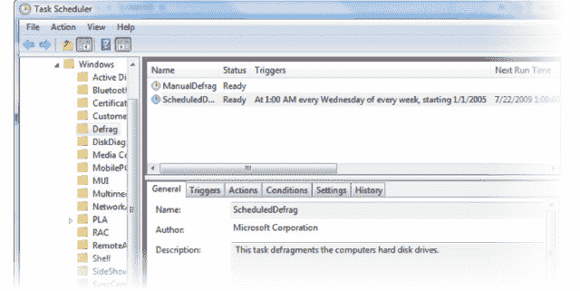

4.7: 任务调度程序。

来源：https://digital-forensics.sans.org/blog/2009/08/17/de-mystifying-defrag-identifying-when-the-windows-defragmenter-has-been-used-for-anti-forensics-part-2-vista

## 4.6.3 文件删除

特定用户删除文件（而非破坏/擦除）的证据带来了其自身的一系列挑战，特别是因为在 Windows 中删除文件不需要特定的程序或工具。简单地将文件发送到回收站（在本章较早部分已介绍）并不是（根据最常见的取证定义）实际删除文件；然而，在用户本应保护或保护数据的案件中，用户将文件发送到回收站通常被认为具有法律意义。此外，回收站中的文件通常易于识别，且由 INFO2 记录或 $I 文件（Vista/7 回收站操作）提供的数据可以帮助调查人员确定文件在删除时的位置，以及数据被发送到回收站时是由哪个用户账户发送的。即使回收站是空的，查看相关 INFO2 记录的最后写入时间戳也可以为调查人员提供有关回收站清理的大致时间的宝贵数据。取证检查员通常可以恢复删除文件的数据和相关元数据，即使在回收站信息可用的情况下。特别是在处理 NTFS 时，恢复的 MFT 条目可以提供取证检查员所需的关于删除数据的所有信息。在任何情况下，调查人员在打开文件删除源之前，仔细关联和权衡每一件证据都是至关重要的。

# 参考文献

- 1. Carvey. H. (2014). Windows forensic analysis toolkit. Burlington, MA: Syngress.
- 2. Carvey, H, & Altheide, C. (2011). Digital forensics with open source tools. Burlington, MA: Syngress, 2011.
- 3. Casey, E., Daywalt, C., Johnston, A., & Maguire, T. (2009). Network investigations. Digital forensics and investigation. Boston: Elsevier.
- 4. The role of operating systems in computer forensics. Retrieved March 17, 2018, from https://www.researchgate.net/publication/228748574_The_role_of_operating_systems_in_computer_forensics

# 第 5 章

## 云计算与数字取证

> 各种规模的云服务公司……云属于每个人。云是一场民主。 — Marc Benioff, Salesforce 创始人、首席执行官兼主席

### 目录

- 5.1 云平台简介 .................................................................................... 104
- 5.2 云的类型.................................................................................................... 105
- 5.3 服务模型 ................................................................................................................ 111
- 5.4 取证中采用云计算面临的挑战.......... 123
- 参考文献 ................................................................................................................................... 127

## 104 数字取证与调查：从数据到数字证据

随着云计算作为信息技术（IT）业务解决方案站稳脚跟，且数据在云端变得集中，犯罪元素已将数据中心和云提供商成为严重目标。由于应用虚拟化技术和远程存储，传统的数字取证方法并不完全适用于云环境。由于云环境的动态性以及基础设施即服务（IaaS）、软件即服务（SaaS）和平台即服务（PaaS）等服务，描述可能证据的任务变得复杂。本章探讨了云计算的本质及其各种模型。此外，它还了一些改进云取证调查的方法。

## 5.1 云平台简介

简单来说，云意味着通过互联网提供可扩展的资源。最广为人认可的定义由美国标准与技术研究院（NIST）提供，它指出云计算模型模型能够对共享的可配置计算资源池（例如网络、服务器、存储、应用程序和服务）实现无处不在、便捷的按需网络访问，这些资源可以快速配置和释放。公云是第一个进入 IT 行业词汇的云服务部署模型。公云指的是一种服务交付模型，其中服务提供商通过互联网向公众提供大规模可扩展的 IT 资源（如 CPU 和存储容量）或软件应用程序。公云通常按使用模式提供。公云的概念清楚地证明了云计算模型的长期潜力，并点燃了行业和研究界的想象力。互联网上有各种用于不同目的的云，它们有自己的有限边界。互联网作为远程访问云资源的共同媒介，以便以较低成本执行更多工作。云计算的另一个名称是按需服务，按服务付费。服务的所有维护都由云提供商执行，因此终端用户或消费者获得了无需维护的服务。传统取证与云取证的一个主要区别在于，在传统取证中，执法部门将检查并物理查看硬件和日志等取证产物以获得完全控制权，而在云取证中，一切都是远程的。下表显示了传统取证与云取证的对比分析。

表 5.1：传统取证与云取证的对比

| 传统取证 | 云取证 |
|---|---|
| 资源的物理访问 | 无法访问的分布式资源 |
| 资源和日志的所有权 | CSP 拥有资源和日志 |
| 用户之间资源隔离 | 多租户 |
| 已建立的取证工具 | 可用工具限制 |
| 非云环境 | 依赖云服务 |
| 数据访问和既有标准 | 多用户访问策略、地理法律标准 |

> 来源：https://www.semanticsolar.org/paper/Cloud-forensics-challenges-from-a-service-model-and-Frawal/84b0ab350270237d37ec32ce4adf7869cc6d55

云是

## 5.2 云的类型

Liu 等人将云部署模型分为四类（2011）。本节全面分析了现有的云的类型。


## 106 数字法证与取证：从数据到数字证据

如今有许多公共云服务提供者提供着各种服务。Amazon EC2、Force.com 和 Google App Engine 是一些广为人知的公共云示例，但目前市场竞争异常激烈。公共云为用户提供了一种简洁的、无基础设施的模式，使其从 IT 服务中获益，其颠覆性的本质也吸引了研究界的关注。然而，将目前大多数 IT 服务（例如企业环境中的业务应用程序）迁移到公共云模型是不现实的。对数据安全、公司治理、合规性和性能可靠性方面的担忧，阻碍了此类 IT 应用移出“受控领域”（即企业防火墙内部），而公共云基础设施、政府监管和公众认可度仍在不断提高。

## 部署模型

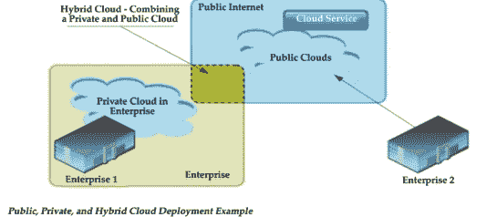

**图 5.1：云部署模型。** 来源：http://slideplayer.com/slide/6258634/。

### 5.2.2 私有云

相比之下，私有云代表了一种部署模型，企业（通常是具有多地业务的大型公司）通过企业网络（可以是虚拟专用网络）向其位于防火墙保护环境背后的内部用户提供云服务。虚拟化和数据中心整合的最新进展，使得企业网络和数据中心管理员能够有效地成为服务提供者，满足这些企业内部客户的需求。私有云让大型公司受益于与云计算相关的“资源池化”概念以及其自身的规模优势，同时解决了了目前对公共云相关的数据安全、公司治理、政府监管、性能和可靠性问题等担忧。私有云的批评者指出，这些公司“仍然必须购买并管理云”，并没有从更低的前期资本成本和更少的人工管理中获益，本质上“缺乏让云计算成为如此引人入胜的概念的经济模型”。虽然这些批评从守旧者的角度来看是正确的，但在云计算作为一种新型 IT 模型的整体采纳过程中，私有云是一种可行且必要的部署模型。人们认为，如果没有大型企业的拥抱，云计算将永远无法成为主流的计算和 IT 模型。私有云代表了向公共云中更广泛采用 IT 服务迈出的赋能及过渡性步骤。随着公共云基础设施、政府监管和公众认可的不断提高，将比 IT 应用更多以服务的形式在私有云环境中提供，然后迁移到公共云。企业环境中电子邮件服务的迁移路径——从最初的多个邮件服务器到如今的单企业级邮件云，再到公共邮件云——提供了一个典型的范例。虽然守旧者可能会用非黑即白的术语进行争论，但我们认为私有云作为云计算的可行部署模型将存在很长时间，并值得商业界和研究界的关注。

### 5.2.3 混合云

混合云比其他部署模型更复杂，因为涉及两个或多个云（私有云、社区云或公共云）的组合。每个成员仍然是一个独立的实体，但通过标准化或专有技术相互绑定，实现了它们之间应用程序和数据的可移植性。混合云由至少一个私有云和至少一个公共云组成。混合云通常以两种方式之一提供：供应商拥有私有云并与公共云提供者建立合作伙伴关系，或者公共云提供者与提供私有云平台的供应商建立合作伙伴关系。混合云基础设施是由两个或多个独立实体的云组成的组合，但同时通过标准化或专有技术结合在一起，实现了数据和应用程序的可移植性。在混合云中，组织在内部和外部提供并管理资源，例如，将人力资源 (HR) 和客户关系管理 (CRM) 数据放在 Salesforce.com 等公共云中，但将机密数据放在自己的私有云中。理想情况下，混合方法允许业务利用扩展性和成本效益，而不会将关键任务暴露给第三方风险。这种类型的云也被称为混合 IT。由于公共云和私有云代表了云光谱的两端，混合云是一种组织在内部和外部提供并管理资源的部署模型。一刀切的方法是不可能的，混合云允许为正确的工作使用正确的工具。同时，随着公共云基础设施、政府监管和公众认可的不断提高，将比 IT 应用更多以服务的形式在私有云环境中提供，然后迁移到公共云。企业环境中电子邮件服务的迁移路径——从最初的多个邮件服务器到如今的单企业级邮件云，再到公共邮件云——提供了一个典型的范例。虽然守旧者可能会用非黑即白的术语进行争论，但我们认为私有云作为云计算的可行部署模型将长期存在，并值得商业界和研究界的关注。


## 110 数字取证与调查：从数据到数字证据

这种方法将如何影响企业身份及其对组织安全的影响。(c) 当组织使用管理工具来管理复杂的混合云环境时（无论是作为云平台的一部分还是作为第三方工具），组织应该考虑使用此类工具的安全影响。例如，管理工具应该能够处理身份并在整个混合云环境中统一执行安全策略。(d) 混合云使得数据从私有环境向公有云的流动变得更加容易。这种数据移动涉及隐私和完整性问题，因为公有云环境中的隐私控制与私有云相比存在显著差异。(e) 跨越混合云环境的安全策略也存在风险，例如与私有云环境相比，公有云中加密密钥的托管方式可能存在问题。

### 5.2.4 社区云

在社区云中，服务由具有相似数据处理需求和共同隐私处理方法的组织共享。从目标消费者群体的角度来看，社区云介于公有云和私有云之间。它与私有云某些之处相似，但基础设施和计算资源是两个或多个具有共同隐私、安全和合规考虑的组织专享，而不是单一组织。社区云旨在将绿色计算的分布式资源提供、数字生态系统的分布式控制、以及绿色计算的可持续性与云计算的用例相结合，同时充分利用自主计算的自管理进展，并本质上通过塑造用户机器的未充分利用资源来形成社区云，从而取代供应商云，其中节点可能履行所有角色：消费者、生产者以及最重要的协调者。

社区云的优势包括：

(a) 通过所有参与者分摊成本，建立社区云的成本可能比单个私有云更便宜。

(b) 社区云的管理可以外包给云服务提供商。这里的优势在于，提供商是一个中立的第三方，受合同约束，除了合同规定的要求外，对涉及的任何客户均无偏好。

(c) 位于社区云中的工具可以利用所存储的信息为消费者和供应链提供服务，例如退货跟踪以及准时制生产和分发。

社区云的缺点：

(a) 成本高于公有云。
(b) 固定带宽和数据存储在所有社区成员之间共享。社区内的所有方均可访问信息，并安全地分布在他们之间。社区云可以托管在现场或场外，并由一个或多个参与组织或第三方管理。成本在组内共享，因此参与者可以以较低的价格获得私有云的部分利润。在这种模型中，控制云的责任证明是具有挑战性的。社区云的概念仍处于早期阶段，在初创企业和中小企业中迅速普及。

## 云计算的重要性

传统，组织拥有自己的网络存储服务器，所有数据和相关服务都存储在那里。这在支出以及性能和效率方面产生了高昂成本。以谷歌为例，每秒有数百万请求访问服务器。如果服务器托管在本地，那么为所有客户端提供服务的服务器将面临巨大的负载。如今的人期望服务器响应越快越好，这种预期不仅是秒，而是毫秒或更短。为了使用物理数据存储来满足此类请求是很困难的，托管服务器上的整个负载可以托管在网络上，我们可以获得更高的吞吐量服务、合理的成本、提高效率以及最少的维护。每个组织都可以在互联网上托管自己的私有/公有云。灵活性、低成本和快速性能是云计算成功的因素。

## 5.3 服务模型

云服务模型描述了如何向客户提供云服务。最基础的服务模型包括 IaaS（基础设施即服务）、PaaS（平台即服务）和 SaaS（软件即服务）的组合。这些服务模型之间可能存在协同效应。

数字取证与调查：从数据到数字证据

### IaaS PaaS

| IaaS | PaaS | SaaS |
|---|---|---|
| GUI | GUI | GUI |
| Application | Application | Application |
| Solution Stack | Solution Stack | Solution Stack |
| Virtual Machine | Virtual Machine | VM |
| Hypervisor | Hypervisor | OS |
| Compute & Storage | Compute & Storage | Compute & Storage |
| Network | Network | Network |
| Facility | Facility | Facility |

**图 5.3:** 云服务模型中的划分。
来源：https://pen-testing.org/2012/07/pen-testing-the-cloud.

## 5.1 软件即服务

客户租用在云服务提供商（CSP）中运行的现成应用程序：办公生产力、客户关系管理、销售智能以及更多社交媒体平台。用户从管理任务中解放出来，能够专注于核心业务，但反之，对关键功能或数据传输的影响能力较小。SaaS 应用程序示例包括在线邮件、项目管理系统、CRM。Salesforce 只是 SaaS 的一个例子。SaaS 基于按需许可软件。

## 云计算与数字取证

### 表 5.2 服务模型

| 云服务模型 | 描述 | 示例 |
|---|---|---|
| SaaS 软件即服务 | 通过网络部署的应用程序，通常通过浏览器访问；有时被称为软件需求。 | Facebook、Google Apps（邮件、日历、文档）、Salesforce.com、Twitter、ZenDesk、Zoho Office |
| PaaS 平台即服务 | 用户可以使用语言、库和服务构建应用程序的平台。 | Force.com、Google App Engine、Red Hat OpenShift、Windows Azure |
| IaaS 基础设施即服务 | 用户控制处理和存储容量、网络和其他计算资源；有时被称为实用计算。 | Amazon Web Services (EC2)、S3, DynamoDB、GoGrid、ServePath、FlexiScale、RackMos |

SaaS 模型包含了许多独特特性：(a) 虽然消费者失去了某种程度的控制，但 SaaS 模型将获取和运行应用程序的负担从消费者转移到了供应商。它允许用户利用软件功能，而无需自己部署和管理软件。应用程序通过基于 Web 的界面访问，通常从浏览器运行。这种交付机制允许随着新用户的增加而轻松扩展。(b) 通常，而不是在客户计算机或服务器上进行许可、安装和维护软件，SaaS 模型让用户按需付费的方式在互联网上访问供应商的软件。(c) 每个消费者都可以选择与其他消费者共享软件访问权限（多租户架构），从而使总成本降低并产生规模效应，或者决定成为单租户，从而提供更大的控制和安全性。(d) SaaS 模型包含了对软件的系统性支持，而不是年度维护和向所有订阅者上传修复程序和补丁。(e) SaaS 使每个消费者都能从供应商最新的技术功能中获益，而不会受到软件更新和升级带来的中断和成本的影响。(f) SaaS 模型消除了持续支持企业级应用而部署额外人员资源的成本和复杂性。购买软件的传统方法需要消费者在计算机上本地安装应用程序并使用许可授权使用。使用 SaaS，消费者以订阅方式支付软件费用。


# 数字取证与调查：从数据到数字证据

……级别，且无需在他们的计算机上安装任何软件。该软件（应用程序）而是通过浏览器通过互联网访问。一个示例是 Google Docs，这是一种在线提供的文字处理应用程序。

### 5.3.2 桌面即服务 (DaaS)

桌面即服务（Desktop as a Service）是软件服务（SaaS）的一种特殊变体，它提供虚拟化的类桌面个人空间并将其镜像发送到用户的真实桌面。用户无需使用本地桌面，而是为了方便可以从不同的地方访问自己的云端桌面，同时享受 SaaS 的收益。“全球托管操作系统”（G.ho.st (2010)）是一个免费且完整的基于互联网的虚拟计算机（VC）服务，包括个人桌面、文件和应用程序。G.ho. 提供了一个使用 Flash 和 Javascript 在网页浏览器中模拟的操作系统镜像，可以通过任何浏览器访问。G.ho.st 应用服务由 Amazon Web Services（AWS）平台托管，因此用户可以通过 G.ho.st 桌面利用 EC2 和 S3 资源。G.ho.st 的局限性在于，作为一种轻量级桌面服务，它仅支持在线应用程序，无法在上面运行旧程序。与 G.ho.st 基于浏览器的桌面镜像不同，Desktopone Virtual-D 平台（2010）通过将基于虚拟机的桌面（称为虚拟桌面基础设施，简称 VDI）封装成服务，实现了桌面即服务。VDI 的优势在于，它可以提供与原生操作系统相同的环境，并允许用户安装自己的软件。Desktopone Virtual-D 平台整合了所有的桌面虚拟化层并简化了桌面管理，提高了安全性和合规性（The Desktopone Virtual-D Platform—Fact Sheet, 2009）。该解决方案以部署在云上的、高效益订阅服务形式提供桌面。

### (1) Google Apps

Google Apps (2010) 是一种简单的 SaaS 实现。它提供了多种具有相似功能的 Web 应用，类似于传统的办公软件（文字处理、电子表格等），但同时也允许用户轻松高效地进行交互、创建和协作工作。由于所有应用都存储在网络上并通过网页浏览器运行，用户可以从任何互联网连接访问他们的账户，无需在本地安装任何其他内容。Google Apps 拥有许多组件。通信组件包括 Google Mail 和 Google Talk，它们支持电子邮件、即时消息和语音通话。办公组件包括用户用于创建在线文档的文档和电子表格，这些文档有助于搜索和协作。Google Calendar 是一个用于结构化会议和事件的可调日历应用。通过“网页”，Google 管理员可以毫不而易举地发布网页，而“网页”用户可以对其进行自定义。Google Apps 有许多重要功能。首先，它提供了一个灵活的控制面板，可以加速最常见的管理任务，如启用/禁用应用程序、运行账户和修改界面。其次，尽管托管在 Google 上，但用户可以控制所有界面上的品牌标识——电子邮件地址将仅包含用户的域名，邮件正文中不会提到 Google（Wikipedia, Google App, 2010），且用户可以自定义其网页、启动页的界面、布局和颜色。第三，管理员可以将现有平台整合进来，并利用所提供的应用程序编程接口（APIs）扩展核心 Google Apps 的功能。它提供了用于置备、报告和迁移的 API，以及用于操作日历和电子表格中的数据、并与单登录（SSO）系统集成的 API（Google Apps Products Overview, 2010）。

## DaaS 是如何工作的？

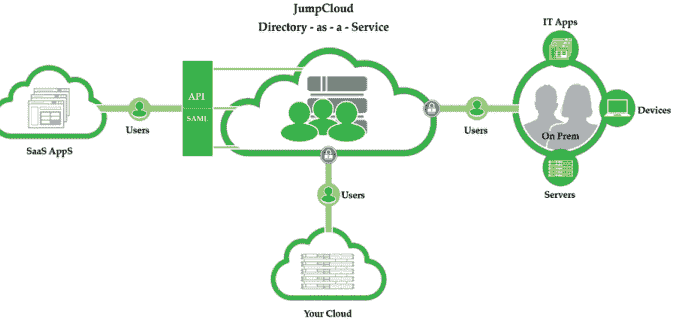

图 5.4：JumpCloud 交互。来源：https://jumpcloud.com/daas-glosary/the-benefits-of-moving-to-a-hosted-ldap-solution/

### (2) Salesforce

Salesforce (2010) 是一个企业级 SaaS 云平台，为消费者提供可定制的应用程序，主要是客户关系管理（CRM）服务。Salesforce 生产了许多产品。Sales Cloud 是一组提高业务活动便利性和效率的全面应用程序；Service Cloud 用于集成 Facebook 和 Twitter 等社交网络应用，以构建用户的客户服务社区。Salesforce CRM 服务部署在 Force.com 云平台上，该平台运行着一种面向多租户的元数据驱动架构（Force.com, 2009b）。多租户允许许多用户之间共享相同版本的应用程序，但每个用户只能访问自己的私有数据，从而保持其活动被相互隔离。所有应用程序的功能和配置都通过元数据描述，因此用户可以根据自己的意愿自定义应用程序。尽管共享应用模型可能会导致用户之间的干扰，但 Salesforce SaaS 云具有以下优势：(a) 服务提供商只需开发一个版本的应用程序，无需担心异构的执行环境；(b) 物理计算资源、操作系统和运行环境的共享降低了应用程序服务的成本；(c) 服务消费者可以自由选择他们偏好的应用程序版本并对其进行定制以适应其业务。

### 5.3.3 平台即服务 (PaaS)

这是允许用户使用 Java 或 C# 等高级编程语言从头开发应用程序，并通过提供者暴露的应用程序编程接口（即私有接口）利用 CSP 的硬件资源的可能性。仍然存在与应用程序管理无关的管理任务。PaaS 模型为客户端提供一个应用程序平台；客户端需要花费时间构建底层基础设施。在后端，PaaS 根据应用程序需求自动进行扩展和置备基础设施组件。通常，PaaS 解决方案提供一个包含一组程序化开发函数的 API。Google App Engine 是一个流行的 PaaS 提供者，亚马逊云 服务除了 IaaS 之外，也提供了一些 PaaS 解决方案。

## 云计算与数字取证

### (1) Google App Engine (GAE)

Google App Engine (GAE) 的主要目标是高效运行用户的应用程序。它在应用程序服务器上维护 Python 和 Java 运行时环境，并带有一些访问 Google服务的 API。前端通过负载均衡和路由策略分发 HTTP 请求。位于应用程序服务器上的运行时处理应用程序的逻辑并提供动态 Web 内容，而静态页面由共享基础设施提供（Alon, 2009）。为了将持久化数据与应用程序解耦，GAE 将数据放入 Datastore 而不是本地文件系统。应用程序可以通过 GAE 提供的 API 集成数据和其他 Google 服务，如电子邮件、图像存储等。除了服务，Google 还提供了一些工具帮助开发者在 GAE 上轻松构建 Web 应用。然而，由于它们与 Google 基础设施紧密连接，受到了一些限制。

### (2) Microsoft Azure

微软的云战略是构建一个用户可以无缝迁移应用程序的云平台，并确保托管资源可以被云和服务本地应用程序访问。为了实现这一点，微软推出了 Windows Azure 平台（WAP），它由一个名为 Windows Azure 的云操作系统和一个支持服务组成。Windows Azure 是 WAP 的主要部分。它采用虚拟机作为运行时环境。微软云提供的应用程序分为两种类型：Web 角色实例可以通过互联网信息服务（IIS）处理 Web 请求；角色实例只能接收来自其他角色实例或本地应用程序的消息（Davis, 2009a）。Windows Azure 采用“织控制器”（fabric controller）来管理微软数据中心物理机上的所有虚拟机和存储服务器。类似于 GAE 的数据源，WAP 还提供了一种名为 SQL Azure 的数据库服务用于在云中存储数据。SQL Azure 的功能之一是提供了一个跨本地或远程数据库进行数据同步的工具。


# Microsoft Azure 云平台

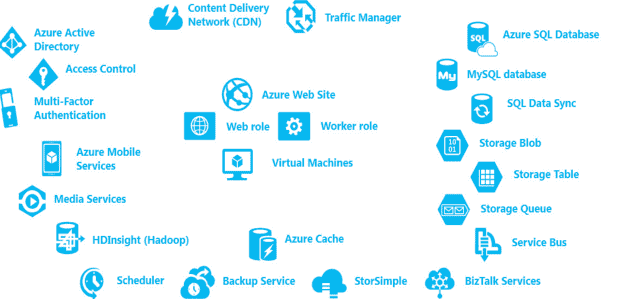

**图 5.5:** Azure 云服务。来源：http://oniwebblog.blogspot.com//2016/01/windows-azure-cloud-computing-part-1.html

## PaaS 的特性

对于什么是构成 PaaS（平台服务）有许多不同的观点，但一些基本特性包括：
- (a) 在同一个集成开发环境中进行应用程序的开发、测试、部署、托管和维护。满足应用程序开发过程所需的所有各种化服务。
- (b) 基于 Web 的用户界面创建工具有助于创建、修改、测试和部署不同的 UI 场景。
- (c) 多租户架构，多个并发用户可以使用同一个开发应用程序。
- (d) 部署软件具有内置的可扩展性，包括负载均衡和故障转移。
- (e) 通过通用标准与 Web 服务和数据库进行集成。
- (f) 支持开发团队协作——某些 PaaS 解决方案包含了项目规划和通信工具。
- (g) 处理计单和订阅管理的工具。

## 5.3.4 基础设施即服务

基础设施即服务（IaaS）提供者提供计算基础设施，如虚拟服务器空间、带宽、网络连接、IP 地址和负载均衡器。通过这种服务模型，您的企业负责管理应用程序、数据、操作系统、中间件和运行时环境。在物理上，您的硬件资源源自多个服务器和网络，通常位于不同的数据中心。通过这种方式，IaaS 服务模型在最小化您的硬件开出的同时，最大化了可扩展性。除了企业基础设施外，组织还使用 IaaS 在虚拟服务器上托管网站。当网站面临意外需求时，不会出现单点故障，因为云托管使用了冗余的物理服务器网络。IaaS 还用于虚拟数据中心（VDC），即公有云或私有云中互连虚拟服务器的虚拟化网络。每个数据中心的物理安全由服务提供商负责，您的组织仅为所使用的部分付费。IaaS 模型为客户提供基础设施组件。组件可能包括虚拟机、存储、网络、防火墙、负载均衡器等。通过 IaaS，客户端可以直接访问栈中最低层的软件——即虚拟机上的操作系统，或防火墙或负载均衡器的管理面板。Amazon Web Services（AWS）是最大的 IaaS 提供者之一。

## IaaS 的特性

与之前的两个部分 SaaS 和 PaaS 一样，IaaS 是一个快速发展的领域。尽管如此，仍有一些描述 IaaS 是什么的核心特性。IaaS 通常认为符合以下标准：
- (a) 资源以服务的形式分布
- (b) 允许动态扩展
- (c) 变动成本、公用事业定价模型
- (d) 通常在单台硬件上包含多个用户

### IaaS 的组件

云基础设施包含多个用于基础设施服务模型的组件。它们是用户共享的共享资源，因此对服务提供者面临着多挑战。某些组件包括：
- (1) 服务水平协议 (SLA)
- (2) 云软件
- (3) 平台虚拟化
- (4) 网络和互联网连接性
- (5) 计算机硬件

# 数字取证与调查：从数据到数字证据


**图 5.6:** IaaS 提供者示例。来源：https://www.slidesshare.net/ibahram1/cloud-computing-20829494

- (a) **服务水平协议：** 在部署云计算服务架构之前，客户关注的问题之一是所提供服务的可靠性和质量。这些服务的期望因客户而异，因此服务提供商和客户之间需要达成共识。关于服务质量和可靠性的协议被称为服务水平协议（SLA）。其目的是定义、描述和谈判服务提供商与客户之间的合同条款和条件，以达成最终裁决。QoS 属性也是 SLA 的一部分，并且需要妥善定义。服务质量（QoS）可能包括功能响应时间、内存占用、吞吐量等，并且需要密切监控。这非常关键，因为如果跳过或未讨论任何条款或条件，将给用户和服务提供者带来问题。SLA 还包括其他特性，如服务衡量、服务状况评估以及适当使用的管理服务成本。它确保了基础设施的可扩展性得到妥善管理。它允许服务提供商在用户数量增加时，不停止服务即可增强系统。
- (b) **云软件：** 云软件用于集成云基础设施的不同组件并使其同步。市场上有很多许多开源软件，例如 Eucalyptus 和 Nimbus，但它们并非没有漏洞和安全风险，这些漏洞可能会损害云系统。此外，云服务提供商开发并使用 API（应用程序编程接口），即 SOAP、REST 和带有 XML 的 HTTP 来执行不同的功能，例如访问控制等。
- (c) **平台虚拟化：** 虚拟化是云基础设施的基础任务，因为在在单个系统上提供多个虚拟系统，同时执行多个任务。它通过共享硬件资源减少了硬件维护。通过这种方式，它降低了云资源的复杂性并增强了其可扩展性。
- (d) **网络和互联网连接性：** 云基础设施分布在不同位置，以最小化资源的延迟和损坏。这些云基础设施组件通过局域网（LAN）本地连接，这些组件通过高速互联网相互连接。这些单个组件构成了
- (e) **计算机硬件：** 每个数据中心的物理安全由服务提供商负责，您的组织仅为所使用的部分付费。IaaS 模型为客户提供基础设施组件。组件可能包括虚拟机、存储、网络、防火墙、负载均衡器等。

## IaaS 示例

### (1) Amazon 弹性云 (EC2)

Amazon 提供了一种名为 EC2 的通用解决方案。该解决方案于 2006 年 8 月 25 日以限量测试发布，但在后的几年中迅速增长。在 Amazon 为 EC2 增加了许多重要功能后，它于 2008 年 10 月 23 日取消了测试标签。今天，EC2 提供了完全控制。用户可以使用简单的服务接口启动、运行、监控和终止实例。此外，他们可以根据需要随时添加上述任何功能。

### (2) GoGrid

[后续包含标题]

# 数字取证与调查：从数据到数字证据

EC2 部署的精细粒度和精度使其成为云计算领域的基准模型。Amazon 的 EC2 提供了基于虚拟机的计算环境。它使用 Xen 虚拟机程序（2010）来管理亚马逊镜像（AMI）。AMI 是“包含启动实例所需的所有信息的镜像”（Amazon EC2, 2010）。

### (3) Amazon 简单存储服务 (S3)

Amazon 简单存储服务（S3）是由 Amazon Web Services 提供的在线 Web 服务。通过 REST 风格的 HTTP 接口或涉及 SOAP 接口使用。像其他云服务一样，用户可以根据需要请求少量或大量的存储，提供了一个高度可扩展的存储系统。Amazon S3 将存储空间组织成许多“存储桶”（buckets），每个存储桶都有一个全球唯一的命名空间，以帮助定位数据地址、识别用于支付的用户账户并收集用户信息（ASSSDG, 2010）。S3 将所有类型的数据处理为对象并存储它们


# 云计算与数字取证

元数据存储在数据所有者选择的桶（bucket）中。对象可以通过其键（key）和版本 ID 的 URL 进行访问，并将桶命名空间作为前缀。Amazon S3 的用户遍布各个领域，例如 SmMug、Slideshare 和 Twitter 使用 Amazon S3 图像，Apache Hadoop 使用 S3 存储计算，而 Dropbox 和 Ubuntu One 等在线同步工具则使用 S3 作为它们的存储和传输设施。

## (4) Rackspace Cloud

Rackspace Cloud 最初于 2006 年 3 月 4 日以“Mosso”之推出。在接下来的三年里，它的名称从“Mosso LLC”变为“Mosso: The Hosting Cloud”，并最终于 2009 年 6 月 17 日改为“Rackspace Cloud”。这家公司提供包括云服务器、云文件和云站点在内的服务。该云服务是一种基于公用事业计算的云存储服务，提供无限的在线存储和用于多媒体的内容分发网络（CDN）。除了在线控制面板外，该公司还提供了一种可以通过 RESTful API 访问且具有开源代码的 API 服务。Rackspace 通过在多个区域的多个计算机上复制三份完整的数据副本来解决安全问题，每个操作都受安全套字层（SSL）的保护。

## 5.4 取证中采用云计算面临的挑战

云计算由于其资产和局限性，对于受传统培训的信息安全专业人员来说，要理解网络存在漏洞以及传统的取证无法完全适应全球分布的云计算环境，可能是一个非常困难的环境。本节识别了与云取证相关的最问题。

### 5.4.1 数据安全

数据安全是采用云计算面临的最大障碍。数据是企业最宝贵的资产，公司希望其数据是安全的。当公司在内部存储数据时，它们会感到很有信心，因为它们拥有完全控制权。尽管无法保证内部存储的数据保护一定比公云更好。事实上，公云中的数据可能更安全，因为公云提供者可能比客户拥有更高的数据安全专业知识。存储在公云时，数据可能在数据生命周期的不同阶段受到损害：从内部网络传输到公云时、存储在公云中时，以及数据备份和恢复过程中。

### 5.4.2 控制权的缺失

总的来说，由于数据存储在其他处且无法访问，取证调查过程的控制权出现了普遍的缺失。这反过来阻碍了现场重建，因为缺乏对数据实际存储位置的了解意味着很难整合事件序列并创建时间线。控制权的的因素可以分为两类：技术性控制权缺失和组织性控制权缺失。组织性控制权缺失更多与人为因素有关，这些因素可能会为云计算转型带来障碍。这些因素可能包括某些个人对失去组织影响力的恐惧、如果云转型在功能上影响特定职位而导致失工作的恐惧，以及简单的无法接受改变。对失去控制的恐惧不仅存在于向云计算的转型。技术性控制权缺失包括访问控制、软件版本和更新，以及对数据备份和恢复等技术操作时机的控制等因素，与上述讨论的数据安全问题部分相关。为了应对技术性控制权缺失的挑战，云提供者应该提供工具，使与公司资产相关的所有云操作具有完全可见性。

### 5.4.3 服务水平协议（SLA）

服务水平协议（SLA）是云服务提供者与云客户之间的合同文件，规定了云资源的使用条款。目前大多数服务水平协议并未包含有关取证调查和从云环境中恢复证据的条款。关于从云环境中取证检索证据的某些条款应纳入协议中。这些包括取证调查期间的数据访问，以及关于在多司法辖区和多租户环境中调查的规定，包括法律法规、保密和隐私。目前，服务条款通常由云提供者规定，且通常是不可协商的。因此，客户对于云服务提供者可能披露和可能不披露的数据几乎没有发言权。最终，责任在于客户与提供者协商一份合适的服务水平协议，以解决云环境证据检索以及如多司法辖区、数据所有权和监管链建立等棘手问题。

### 5.4.4 性能

大多数云提供者的 SLA 协议仅涵盖基础设施可用性，而不涵盖性能。如果公司应用有特定的性能需求，公司应与云提供者讨论这些需求并确认这些需求可以得到支持。将这些需求包含在 SLA 合中是一个好主意，与云服务提供者协商 SLA 合同是标准做法。云客户负责监控云性能并确保其符合要求和 SLA。此外，应对对收集的性能指标进行反复分析。如果在全球范围内使用托管的应用，监控所有主要客户位置的网络延迟等性能参数至关重要。

### 5.4.5 成本不确定性

市场上有很多种不同的云产品，它们的定价模型差异巨大。这产生了不确定性，并难以估计云计算的真实财务效益。这种不确定性对于组织内部的非技术人员特别麻烦，他们可能会被定价模型的复杂性感到困惑和恐惧。云提供者之间的定价差异可能包括数据存储、CPU、内存、IP 地址、域名服务和负载均衡费用。云服务定价没有单一标准，比较提供者之间的价格可能非常复杂。预测特定提供者的未来价格也很困难——一旦公司锁定了一个提供者，要将整个基础设施迁移到其他云并不容易。

### 5.4.6 数据可迁移性/集成

将位于公有离线云的数据集成到公司内部数据中心在技术上可能是困难的。考虑使用混合云（数据跨私有云和公云）的组织可能会面临数据集成问题：

- (a) 安全问题（数据治理、网络连通性等）
- (b) 事务完整性问题（无法跨跨事务）
- (c) 处理海量数据的困难
- (d) 缺乏检测数据变化的机制
- (e) 数据质量控制问题
- (f) 数据源头的问题

每个云提供者都提供一套独特的服务和工具用于操作和控制其云。学习一个新的云环境类似于学习一种新技术：需要投入精力和才能精通。在基于 IaaS 的云服务（在基础设施平台上）上，这可能会更容易，但在 PaaS 或 SaaS 云平台上，客户必须学习提供者特定的接口和 API 以与这些平台交互并进行管理。不同提供者之间没有统一的云管理软件标准，一旦公司投入时间和和资源在某个云平台上建立业务，切换起来就会很困难。不建议公司锁定在特定的云提供者上，因为这种依赖可能会限制对成本和技术托管选项的选择。云提供者提高服务价格或更改其技术产品并不罕见。

### 5.4.7 法律问题

最后一个问题源于计算机取证的法律/人员方面，即从调查中获取的任何数字证据最终必须提交给陪审团，由他们对案件进行判决。在传统的计算机取证中，调查人员必须向陪审团展示他们的发现，这通常要求调查人员使用技术术语解释证据是如何获取的以及证据的的确含义什么。在处理传统的本地计算机系统时这可能已经具有挑战性，更不用说是距离数千英里、在 512 台服务器上运行 40,000 台虚拟机并由 1000 个租户访问的云数据中心了，考虑到平均陪审员仅掌握使用家庭 PC 的基本知识，这对于陪审员来说可能太难以理解了。


# 参考文献

- 1. Foster, I., Zhao, Y., Raicu, I., & Lu, S. (2008). 云计算与网格计算360度对比 (pp. 1-10). 网计算环境会议, GCE'08.
- 2. Gorelik, E. (2013). 云计算模型。Cambridge, MA: 马萨诸塞理工学院。
- 3. Ruan, K., Carthy, J., Kechadi, T., & Crosbie, M. (2011). 云取证。收录 G. Peterson, & S. Shenoi (编)，数字取证进阶 VII (pp. 35-46)。柏林，海德堡: Springer。

# 第6章
# 移动设备取证

> “回到夏尔克·摩斯，我们有一种在侦探小说中体现的法医学科学传统。”
——Jeffery Deaver

# 目录

- 6.1 引言........................................................................................... 130
- 6.2 用户识别模块.................................................................................. 131
- 6.3 取证软件工具包............................................................................... 134
- 6.4 数据存储................................................................................................ 139
- 6.5 对 Sim 模块的攻击....................................................................... 141
- 6.6 手机证据提取流程 ................................ 142
- 6.7 移动取证的挑战.............................................................................. 154
- 参考文献 ............................................................................................ 156

130 数字取证与调查：从数据到数字证据

除了最基础的手机外，所有手机都为个人提供了加载额外应用程序的能力，能够独立于桌面或笔记本电脑存储和处理个人及敏感信息，并可以选择地在之后同步结果。随着数字技术演进，这些设备的能力继续快速提高。当手机或其他蜂窝设备涉及犯罪或事件时，取证人员需要能够妥善检索和快速检查设备上现有信息的工具。本章概述了当前的取证软件，这些软件旨在对手持设备上发现的数据进行采集、检查和报告，并了解其能力和局限性。

## 6.1 引言

移动设备正成为我们生活中不可或缺的一部分，描述着我们日常生活的各个方面。随着智能手机和平板等持续的发展，我们可以存储大量信息。移动取证只是从数字数据痕迹中收集证据的方法，这些痕迹通常难以删除，可在法庭中使用。随着数据环境的演变，数字数据痕迹很容易留在这些设备上。移动设备通常定义为可以在移动网络上连接并运行的设备，包括手机、无线调制解调器和传寻器。网络服务提供者作为核心网络保留使用日志和计费记录，调查人员拦截来自移动设备的网络流量。因此，调查人员必须理解网络背后的主要技术、移动网络中可能存在的数据库类型以及如何收集和分析数字证据源。移动取证的类型包括通话、数字照片、短信邮件、电话号码、GPS位置、网站，有时以及手机上的数字录音。当为了法律目的收集设备时，它们可能会被保留和维护，以防止重要的数字数据被取消或损坏。通常，移动设备取证被应用于已删除通信数据的数字检索。它们可以帮助法律团体或警察创建并提供法律证据。数字证据稳妥取证调查的基本原则是原始证据不应被更改。这对于移动设备来说特别为困难。某些取证工具需要移动通信；在取证采集过程中，这种标准的写保护将不起。其他取证

# 移动设备取证 131

采集方法可能涉及在提取数据进行取证检查之前，移除芯片或在移动设备上安装引导加载程序。如果在修改设备配置的情况下无法进行检查或数据收集，则这些过程和更改必须经过记录。在取证采集过程中，这种标准的写保护将不起。在检查设备时，遵循正确的方法和指南很重要，因为它提供了证据的可信度测量。与任何智能卡一样，如果不遵循妥当程序，可能会导致证据丢失或损坏。

**图 6.1:** 高级移动站。来源：http://www.ftforensics.com/cell-phone-html

## 6.2 用户识别模块

SIM 是一种插入设备中的可拔式卡，起源于全球移动通信（GSM）。分类蜂窝设备的一种有用方法是根据它们是否使用 SIM。GSM 标准强制使用 SIM。没有它，手机无法运行。相反，码分多址（CDMA）手机不需要 SIM。相反，SIM 功能直接集成在设备中。SIM 是一种特殊的智能卡，通常包含 16 KB 到 64 KB 的内存、一个处理器和一个操作系统。SIM 唯一标识用户，并包含了验证用户接入网络所需的算法。用户可以从一台手机中移除 SIM，插入另一台兼容的手机并恢复使用，无需涉及网络运营商。SIM 的分级文件系统用于存储名称和电话号码、接收和发送的短信以及网络配置信息。根据手机的不同，部分信息可能与手机内存共存，也完全位于手机内存中。虽然 SIM 在 GSM 系统中使用得广泛，兼容模块也用于 iDEN 手机和 UMTS 用户设备（即 USIM）。由于灵活性，SIM 使设备能够传输身份和信息，最终所有蜂窝手机预计都包含 SIM 功能。虽然 SIM 标准了两种尺寸，但目前广泛使用的是图中较小的尺寸。该模块宽度为 25 mm，高度为 15 mm，厚度为 0.76 mm，大约是邮票的大小。它的八针连接器没有像预期那样对齐底部边缘，而是形成了嵌入塑料框架的智能卡芯片。此外，SIM 卡槽通常无法从手机外部访问，就像内存卡一样。当 SIM 插入手机并建立引脚接触时，使用串口通过半双工协议与计算平台通信。SIM 可以从手机中取出并使用专用 SIM 卡读取器和软件进行读取。SIM 也可以放在标准的智能卡适配器中，使用传统的智能卡读取器进行读取。与任何智能卡一样，其内容受到保护，可以设置 PIN 以限制访问。存在两个 PIN，有时称为 PIN1 和 PIN2 或 CHV1 和 CHV2。这些 PIN 可以由用户修改或禁用。SIM 只允许在被锁定前尝试输入正确的 PIN（通常为三次）。输入解锁密钥（PUK）可以重置 PIN 码和计数器。可以根据 SIM 的身份从服务提供商获取 PUK。如果输入 PUK 的次数超过限制（通常为 10 次），该卡将被永久锁定。除了其他个人信息外，SIM 卡还持有用户最后一次注册系统的信息、资费信息以及设备上开启的服务。下表给出了三个级别手机标准功能的比较。


# 移动设备取证 133

设备分为基础级、高级和智能。手机的类型将影响需要检索和分析的证据类型。

# 表 6.1：软件特征描述

| | 基础级 | 高级 | 智能型 |
| --- | --- | --- | --- |
| OS (操作系统) | 私有 | 私有 | Linux, Windows Mobile, RIM, Palm OS, Symbian |
| PIM (个人信息管理) | 简单通讯录 | 通讯录和日历 | 提醒列表、增强型通讯录和日历 |
| 应用 | 无 | MP3 播放器 | MP3 播放器、办公文档查看 |
| 消息 | 短信 | 带有简单嵌入图像和声音的短信（增强文本） | 文本、增强文本、多媒体消息 |
| 聊天 | 无 | SMS 聊天 | 即时消息 |
| 电子邮件 | 无 | 通过网络运营商的服务网关 | 通过 POP 或 IMAP 服务器 |
| 网页 | 无 | 通过 WAP 网关 | 直接 HTTP |
| 无线 | IrDA (红外) | IrDA, 蓝牙 | IrDA, 蓝牙, Wi-Fi |

来源：http://www.ccsc.org/southcentral/E-Journal/2009/Papers/AllynStottFinal-Version.pdf


图 6.2：手机 SIM 卡特写。来源：http://www.alamy.com/stock-photo-close-up-of-a-sim-card-subscriber-identity-module-card-for-mobile-78998374.html

# 6.3 取证软件工具包

专业取证工具的特征在很大程度上取决于它们针对的取证分析领域以及所针对的市场。目前有大型的数字取证框架和软件解决方案，如 Digital Forensics Framework、Open Forensics Architecture、Computer-Aided Investigative Environment、X-Ways Forensics、SANS Investigative Toolkit、EnCase、Sleuth Kit 等。然而，许多专业取证专家更倾向于根据完全符合其需求和偏好的单个工具来构建自己的定制工具箱。本节描述了调查人员使用的一些常用取证工具。

## 6.3.1 个人数字助理 3.0.3.89

Paraben Seizure 版本 3.0.3.89 是一款取证软件工具包，允许取证人员对获取、搜索、检查并报告与运行 Palm OS、Windows CE 和 RIM OS 的个人数字助理（PDA）相关的数据。尽管它可以用于运行这些操作系统的智能手机，但该工具包面向非蜂窝设备，并忽略了针对手机的功能，例如 GSM 手机的 SIM 卡提取。Paraben Seizure 的功能包括执行逻辑和物理提取的能力，提供内部内存视图以及有关单个文件和数据库的相关信息。Pada Seizure 使用 MD5 哈希函数来保护获取文件的完整性。其他功能还包括对信息进行书签标记以便以报告格式进行过滤和组织、在获取的数据中搜索文本字符串，以及将发现的图像自动汇总到一个目录下。

Pilot-link 是最初为 Linux 社区开发的开源软件套件，允许在 Linux 主机和 Palm OS 设备之间传输信息。除了 Linux 之外，它还运行在其他几个桌面操作系统上，包括 Windows 和 Mac OS。该软件由约 30 个命令行程序提供。要执行物理和逻辑转储，pilot-link 通过 HotSync 协议建立与设备的连接。取证人员感兴趣的两个程序分别是 pi-get 和 pi-getrom，分别从设备检索 RAM 和 ROM 的物理内容。另一个实用程序是 pilot-xfer，它允许安装程序以及数据库的备份和恢复。pilot-xfer 提供了一种逻辑获取设备内容的方法。使用这些实用程序检索的内容可以使用 Palm OS 模拟器、如 EnCase 等兼容取证工具或十六进制编辑器进行手动检查。Pilot-link 不提供获取信息的哈希值。必须单独执行一个步骤来获取所需的哈希值。

### 6.3.2 手机提取 (Cell Seizure)

Paraben 的 Cell Seizure 版本 2.0.0.33660 是一款取证软件工具包，允许取证人员获取、搜索、检查并报告与 CDMA、时分多址（TDMA）和 GSM 网络上的手机相关的数据。要使用 Paraben 的 Cell Seizure 软件从手机获取数据，必须从 Cell Seizure 工具箱或兼容电缆（例如 DataPoint）中选择合适的电缆，以在手机和取证工作站之间建立数据链路。提取的手机类型需要相应的电缆接口。串口 RS-232 和 USB 数据连接通过手机数据端口或电池下方接口建立。其他功能还包括对信息进行基准测试以便以报告格式进行过滤和组织、搜索区分大小的单词文本和十六进制值，以及将发现的图像自动汇总到一个目录下。使用该工具通常可以在大多数手机上找到以下数据：

(a) 短信：收件箱：发送箱
(b) 通讯录：SIM 卡、自己的号码、快捷号、固定拨号
(c) 通话记录：拨出号码、接听、未接电
(d) 日历：提醒、会议、备忘
(e) 标志：呼者标志、启动标志、欢迎语
(f) 图形：壁纸、图片图像、EMS 模板
(g) WAP：Wap 设置、Wap-bin
(h) SIM：GSM 特有数据。

### 6.3.3 Oxygen 手机管理器

Oxygen Phone Manager (OPM) 的取证版本适用于警方部门、执法部门以及所有希望将该软件用于调查目的的政府机构。取证版本与非取证版 OPM 的区别在于禁止对数据获取进行任何更改。OPM 允许人员从设备获取数据并将获取的数据导出到多种支持的格式。Oxygen 软件专为诺基亚、索尼、西门子、松下、Sendo、华为和部分三星手机及智能手机定制。Oxygen 软件为开发人员提供了 Borland Delphi 的软件库、ActiveX 库和组件。

### 6.3.4 GSM.XRY

Micro Systemation 的 SoftGSM: XRY 是一款用于从 GSM、CDMA、3G 手机和 SIM/USIM 卡获取数据的取证软件工具包。XRY 可以通过红外（IR）端口、蓝牙或电缆接口连接到手机设备。建立连接后，将识别手机型号并显示相应的手机图片、设备名称、制造商、型号、序列号 (IMEI)、用户 ID (IMSI)、制造商代码、设备时。从手机设备获取的数据存储在 XRY 格式中，无法更改可以导出到外部格式。成功获取后，可能会填充以下字段：摘要、案件数据、常规信息、联系人、通话、日历、短信音频、任务、网络信息、视频等。

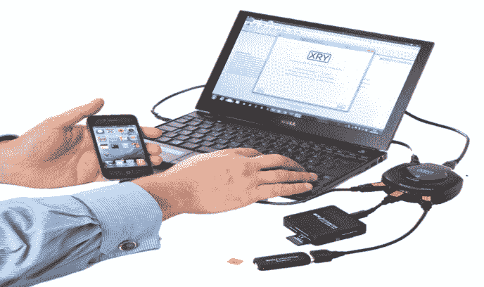

图 6.3：XRY 软件应用。来源：http://www.alzomar.com/products.asp?ID=32&Page=20Investigation

### 6.3.5 取证 SIM

Radio Tactic 的 Forensic SIM 工具包由以下组件组成：提取终端、控制卡、数据存储卡、分析应用程序和读卡器。提取终端是一个独立单元，引导人员完成提取过程的每一步。Forensic SIM 工具包处理两个过程：数据提取和数据分析。数据提取使用提取终端进行。数据分析使用连接到运行分析程序的 PC 的 SIM 卡读卡器进行。终端的主要功能是从目标 SIM 获取数据副本到一组数据存储卡。控制卡用于授权人员访问提取终端，防止未经授权的使用。数据存储卡包括主数据存储卡、控方数据卡、辩方存储卡和手机访问卡。该工具包允许人员对 SIM 卡进行只读访问，并根据获取的内容生成文本报告。报告可以在内部查看、保存到磁盘或打印演示。

### 6.3.6 取证读卡器

取证读卡器 (FCR) 由一个带有 USB 连接的智能卡读卡器和 FCR 软件组成，允许人员在不修改的情况下从 SIM 获取数据。人员可以选择特定的数据元素，稍后存储并显示在最终报告中。操作详情（如案件号、证据号和人员）可以自动合并到报告及其文件名中。可以获取所有常规数据元素（例如电话簿、快捷拨号、固定拨号和短信），以及 SIM 和用户的标识符。GSM 手机 SIM 卡和 3G 手机 SIM 卡均可配合 FCR 使用。可以扩展电话录条目，包括额外的号码和电子邮件。提供的 FCR 读卡器允许人员无需适配器即可使用大或小 SIM 卡。


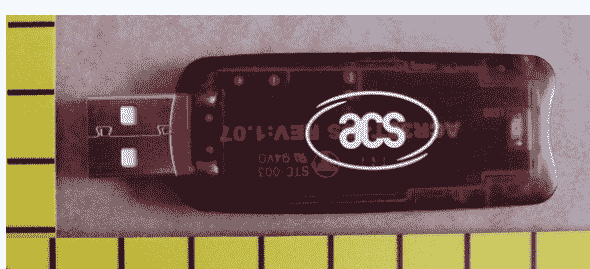

**图 6.4:** SIM 卡读取器。

来源：https://www.digitalforensics.com/sim-cards-forensic-analysis-with-oxygen-software/

### 6.3.7 MOBILED

MOBILEdit 是一款赋予调查人员从 GSM/CDMA/PCS 手机设备中进行逻辑获取、搜索、检查和报告数据的应用程序。MOBILEdit 能够通过 IR 端口、蓝牙链接或电缆接口连接到手机设备。建立连接后，将通过其制造商、型号数字和序列号——国际移动设备识别码（IMEI）以及相应的手机图片来识别手机型号。从手机设备获取的数据以主题文件格式存储。成功获取后，以下字段将填充：订阅者信息、设备规格、电话录、SIM 电话、未接听、拨打号码、来电、收件箱、发送项目、草稿、文件文件夹。文件文件夹中的项目（从图形文件到相机照片和铃声）取决于手机的功能。其他功能包括 PhoneSafe.com 服务，该服务提供访问 IMEI 数据库，以注册并检查被盗手机。

### 6.3.8 TULP 2G

TULP2G（第二代）源于荷兰法医学的开源法医软件工具，允许调查人员从移动手机和 SIM 卡中提取并读取数据。TULP2G 需要运行 Windows 2000 或 XP 的法医工作站，最好安装了最新的补丁和服务程序包，并安装了 .NET 1.1 SP1。为了利用最近发布的 1.1 插件，需要 Windows XP SP2。TULP 使用适当的数据线、蓝牙或 IrDA 连接以及兼容的协议插件从手机中获取数据。读取 SIM 卡需要与 PC/SC 兼容的智能卡读取器，可能还需要一个适配器将小型 SIM 卡转换为标准尺寸的智能卡格式。

### 6.3 BitPIM

BitPIM 是一种运行在 Windows、Linux 和 Mac OS 上的手机程序，允许查看和管理手机上的数据。这些数据包括电话录、日历、壁纸、铃声和嵌入文件系统。要使用 BitPIM成功获取数据，调查人员必须拥有适当的驱动程序和电缆，在手机与法医工作站之间建立连接。BitPIM 的帮助文件中提供了详细信息，列出了支持的手机、针对特定型号建议使用的电缆，以及特定情况的说明和技术知识。BitPIM 以 GNU 公共许可作为开源软件分发。

## 6.4 数据存储

手机包含各种信息，而智能手机包含的内容不仅是电子邮件或文件。移动设备可以包含视频、网页浏览、位置和社交网络。所有这些组件在移动取证中都用于发现有用的证据。

### 6.4.1 存储在手机中的数据

现代手机的以下内容可能具有证据价值：IMEI、短号、短信、设置（语言、日期/时间/音量等）、存储的音频录音、存储的计算机文件、记录的来电和拨打号码、存储的可执行程序、存储的日历事件、GPRS、WAP 和 Internet 设置。大部分此类信息可以通过电缆和制造商特定软件获取。

140 数字法医学与调查：从数据到数字证据

然而，对内存进行直接分析可能会揭示其他隐藏信息，例如已删除的短信。此类分析是作者已知晓但尚未执行的。

### 6.4.2 存储在 SIM 卡中的数据

用于 GSM 手机的 SIM 卡是一种智能卡，能够连接到 GSM 网络，并使订阅者在网络中被唯一标识。SIM 卡包含许多文件，包含用户的订阅者信息和个人信息，例如：(a) IMSI，它是 SIM 卡的全球唯一标识符。(b) 语言偏好和网络（服务提供商）信息。(c) 货币信息，如通话费用计数器。(d) 关于移动手机当前（或最近）位置的信息。(e) 电话条目。(f) 发送和接收的 SMS 短信。(g) 最近拨打的号码。SIM 卡上的许多功能是可选的，因此并非每个手机或服务提供商都会实现（ETSI 2004a）。

### 6.4.3 存储在手机内存中的数据

除了 SIM 内存外，手机内部的内存用于存储手机软件和额外数据。此空间可用于扩展 SIM 内存，存储额外的电话录数据、通话日志等。以下是手机内存中可能找到额外信息的示例：(a) 手机设置 (b) 日历信息 (c) SMS/MMS 消息 (d) 通话日志条目 (e) 时间和日期 (f) 铃声 (g) 手机额外功能需要/产生的数据，如音频和视频录像以及图像。(h) 手机通用数据。(i) 可执行文件（Willassen 2005，ETSI 2004b）。许多现代手机具有较大的板内存。例如，诺基亚9300 拥有 80MB 板内存，并可以使用存储卡进行扩展（诺基亚2005b）。这些可存储卡通常用于


**图 6.4:** SIM 卡读取器。

来源：https://www.digitalforensics.com/sim-cards-forensic-analysis-with-oxygen-software/

140 数字法医学与调查：从数据到数字证据

### 6.4.4 存储在 SIM 卡中的数据

用于 GSM 手机的 SIM 卡是一种智能卡，能够连接到 GSM 网络，并使订阅者在网络中被唯一标识。SIM 卡包含许多文件，包含用户的订阅者信息和个人信息，例如：(a) IMSI，它是 SIM 卡的全球唯一标识符。(b) 语言偏好和网络（服务提供商）信息。(c) 货币信息，如通话费用计数器。(d) 关于移动手机当前（或最近）位置的信息。(e) 电话条目。(f) 发送和接收的 SMS 短信。(g) 最近拨打的号码。SIM 卡上的许多功能是可选的，因此并非每个手机或服务提供商都会实现（ETSI 2004a）。

## 6.5 对 SIM 模块的攻击

必须意识到，手机或 SIM 卡与计算机建立接口需要满足若干基本要求。一旦满足了这些要求，制造商就可以自由实现任何其他功能。


# 移动设备取证 143

按照它们所希望的方式。这意味着手机取证工具无法针对每种类型手机的每一个功能，换句话说，每部移动设备的证据提取和取证检查可能会有所不同。此外，移动网络所基础的不同技术（如 TDMA、CDMA 以及较新的 3G 技术如 WCDMA）各自分要求手手机实现不同的标准。如果取证人员能够遵循一致的取证流程，这将有助于确保从每部手机中提取的证据都得到了良好的记录，并且结果是可重复且可信的。获取数据有多种不同的方法。然而，目前还没有一种公认的标准，制造商在设计手机时的自由度意味着每部手机都必须被单独考虑。不过，下图提供了从移动设备中提取证据的流程考虑因素概述。

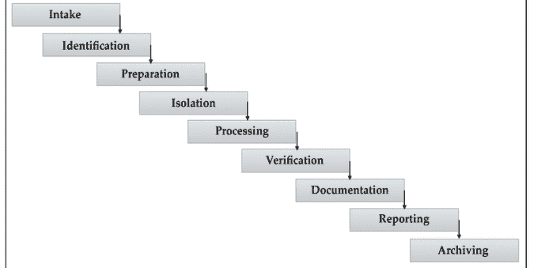

**图 6.6：** 手机证据提取流程。来源：https://www.safarifookonline.com/library/view/practical-mobile-forensics/9781786462400/ch0is03.html

## 6.6.1 证据接收阶段

证据接收阶段涉及处理取证请求的程序。该阶段在数字取证中非常重要，因为它收集了移动设备提供的数字证据。在这一阶段，调查人员应保持设备处于原始状态。此外，还要扣收与活动相关的手机，以确保证据不会发生任何变化。扣收移动设备意味着切断所有无线网络。此阶段的任何失败将导致后续所有阶段的失败。扣收的目标是保护证据，因为它了关闭设备。证据接收阶段涉及表格和接收文件，用于记录监管链、所有权信息以及手机涉及的事件类型，并概述有关请求者希望从手机中提取或记录的数据类型的通用信息。取证此阶段的一个关键方面是为每次取证制定特定目标。这不仅有助于记录取证人员的目标，还有助于取证的分检，并作为每部被检查手机的取证过程记录。这些信息允许取证人员对手机手机进行分检。

### 6.6.2 识别阶段

对于每次取证，取证人员应识别以下内容：(a) 检查手机的法律依据 (b) 取证目标 (c) 手机本身的品牌、型号和识别信息 (d) 可拆卸和外部数据存储器 (e) 其他潜在证据来源

- (1) **法律授权** 关于手机手机内包含数据搜索的判例法几乎处于不断变化的状态。取证人员确定并记录搜索手机手机具有何种法律授权，以及在检查设备之前对手机搜索实施了哪些限制，是至关重要的：(a) 如果根据搜查令搜索手机手机，取证人员应注意将搜索限制在搜查令的范围之内。(b) 如果根据同意搜索手机手机，则应考虑同意的任何可能限制（例如仅同意检查通话记录），并在检查手机之前确定同意是否仍然有效。(c) 在在逮捕时附带（incident to arrest）搜索手机的情况下，取证人员需要格外小心，因为该领域的现行判例法特别有问题，且搜索手机手机的法律授权应咨询取证人员当地的熟练的检察官或法律顾问。

- (2) **取证目标** 虽然检查任何给定手机手机的通用流程应尽可能一致，但每部手机的取证目标可能存在显著差异。不太可能任何取证实验室都有能力在各种案件中检查所有包含证据价值数据的手机手机。因此，识别对于任何给定手机手机合适的何种取证水平是有用的。两个主要考虑因素之是谁将负责数据记录过程。第二个主要考虑因素是检查需要多深。在提交到实验室进行取证的手机中，根据特定案件的事实和情况，每次取证的目标将有所不同。在某些情况下，手机手机的证据可以通过手动或照片方式记录。一小部分手机手机手机可能会被提交进行取证，目标是有针对性地提取具有证据价值的数据。特定针对性的数据，如照片、视频、通话记录、短信或其他特定数据对调查具有重要意义，而其他存储数据则是无关的。也可能由于法律限制，只能检查数据的特定子集。在这种情况下，限制检查范围可能会使数据的提取和记录不那么耗时。取证目标还可能包括尝试从手机内存中恢复已删除的数据。只有当有针对特定手机的工具可以从物理层提取数据时，这种方法才是可能的。如果有此类工具，那么取证将涉及传统的计算机取证方法，如数据雕刻（data carving）和十六进制解码，并且取证过程可能是一个耗时且技术复杂的任务，因为更深层次的检查需要技术上更复杂且更耗时的过程。

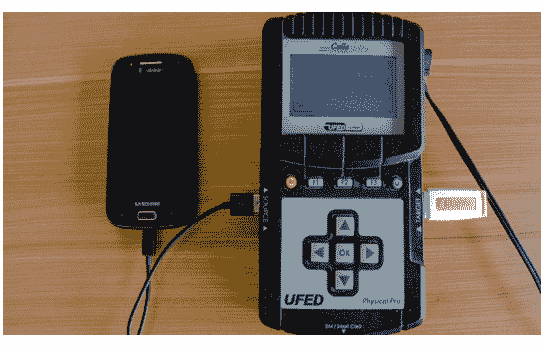

**图 6.7：使用 Celebrite UFED 从 Samsung Galaxy S Relay 4G 提取数据。来源：https://www.magnetforensics.com/mobile-forensics/and-celebrite-on/**

- (3) **手机本身的品牌、型号和识别信息：** 在检查任何手机手机的过程中，手机本身的识别信息应被记录。这不仅能让取证人员识别特定的手机手机，还有助于确定哪些工具适用于手机手机的品牌和型号。对于所有手机，制造商、运营商以及与手机相关的电话号码应被记录。根据所涉及的手机手机技术，应记录额外的识别信息，如下：

- (a) **CDMA 手机手机** 电子序列号（ESN）位于手机手机电池盖下。它是分配给网络上每个移动设备的唯一 32 位数字。ESN 可能以十进制（11 位）和十六进制（8 位）列出。取证人员应注意 ESN 的十六进制版本并非十进制值的直接转换。ESN 转换器可以在 http://www.elfqin.com/esnh.html 找到。移动设备 ID（MEID）也位于电池下，由于 32 位数字数量的限制，它取代了 ESN。MEID 以十六进制列出，其中第一个字节是区域代码，接三个字节是制造商代码，剩余三个字节是制造商分配的序列号。CDMA 手机通常不包含 SIM 卡，但某些混合手机包含 CDMA 和 GSM 技术，可以在 CDMA 或 GSM 网络上使用。这些双技术手机内部有一个 SIM 卡槽。这些手机电池盖下方的识别信息可能除了 ESN/MEID 号外，还列出了一个 IMEI 号。CDMA 手机还有两个识别号码，即移动识别码（MIN）和移动目录号码（MDN）。MIN 是运营商分配的、运营商唯一的 24 位（10 位）电话号码。拨打电话时，手机会将 ESN 和 MIN 发送到本地基站。MDN 是手机的全球唯一电话号码。在无线号码携带业务之前，MIN 和 MDN 是相同的，但在今天环境中，客户即使更换运营商也可以保留其电话号码（MDN）。

- (b) **GSM 手机手机** IMEI 是用于识别网络上 GSM 手机手机的唯一 15 位数字。该数字通常位于手机手机的电池下。前 8 位是类型分配代码（TAC），接下来的 6 位是设备序列号。最后一位是校验位，通常设为 0。在 GSM 手机上，至少有一个 SIM 卡槽，通常也位于电池下方。


## 148 数字取证与调查：从数据到数字证据

SIM 卡上可能会印有其注册所属的网络名称。SIM 卡上还设有 ICCID，这是一个 18 到 20 位的数字（10 字节），用于唯一标识每张 SIM 卡。ICCID 编号与 IMSI 绑定，IMSI 通常是一个 15 位的数字（56 位），由三部分组成，包括移动国家代码（MCC；3 位）、移动网络代码（MNC；在美国和加拿大为 3 位，其他地区为 2 位）以及移动台站识别码（在美国和加拿大为 9 位，其他地区为 10 位），这些信息以电子方式存储在 SIM 卡中。可以通过分析 SIM 卡或通过运营商获取 IMSI。MSIDN 是手机的 15 位全球唯一号码。MSIDN 遵循国际电信联盟的 E.164 电话编号计划，由 1–3 位的国家代码和特定的国家特定号码组成。在北美，第一位是 1，后面是 3 位的区号。


**图 6.9:** 原版诺基亚 105 GSM手机。来源：https://www.dhgate.com/product/refurbished-original-nokia-105-gsm-cell-phone/39981757.html

- (c) **iDen 手机**：iDen 手机包含一个 IMEI，用于识别其网络上的 iDen 手机。该号码通常位于手机电池下方。iDen 手机也包含 SIM 卡，具有上述描述的识别信息，但它们采用的技术与 GSM SIM 卡不同，且与 GSM 手机不兼容。iDen 手机的特有的是直接连接号码（Direct Connect Number），也称为 MOTOTalk ID、Radio-Private ID 或 iDen 号。DCN 是用于与其他 iDen 手机进行设备对设备直接通信的识别码。该号码由一系列格式化为 ###*******###### 的数字组成，其中前三位是区域 ID（主运营商网络的区域），接下来的三位是网络 ID（iDen 运营商），最后五位是用户识别码，有时与手机号的后五位对应。（Punja & Mislan, 2008）

- (d) **可移动/外部数据存储**：市场上的许多手机都有将数据存储到可移动存储设备中的能力，例如 Trans Flash Micro SD 内存扩展卡。如果提交检查的手机安装了此类卡，检查人员应将存储卡取出并使用传统的数字取证技术进行处理。在存储卡仍安装在手机内的情况下使用手机取证工具处理存储卡，可能会导致数据卡上文件的数据和时间戳发生更改。此外，手机可能允许在用户计算机可以访问的网络存储区域内存储外部数据。访问存储在手机提供商网络上的数据可能需要进一步的法律授权，且通常超出手机终端检查的范围。然而，检查人员应考虑网络数据存储存在的可能性。许多功能手机和智能手机还设计为与用户的计算机同步，以便于在手机之间访问和传输数据。手机数据的完整备份可能会位于手机主的计算机上。检查人员应考虑这些替代存储区域存在的可能性，作为源自手机的额外数据源。

- (e) **其他潜在证据收集**：在开始检查手机之前，应考虑是否存在其他证据收集问题。手机可能是 DNA、指纹或其他生物证据的良好来源。DNA、生物学和指纹证据的收集应在检查手机之前完成，以避免污染问题。

### 6.6.3 准备阶段

在流程的识别阶段（Identification phase）中，检查人员已经对手机检查参与了大量的准备工作。然而，准备阶段涉及对相关手机的具体研究、检查期间使用的适当工具以及检查的准备。

### 6.6.4 隔离阶段

手机的设计初衷是通过蓝牙、红外线和无线（Wi-Fi）与网络通信。因此，将手机与这些网络隔离至关重要，以防止向手机添加新数据。隔离还可以防止意外覆盖现有数据。在现场对手机进行隔离可以通过法拉第袋（Faraday bags）或专为此设计的射频屏蔽布来实现。锡箔等物品也可用于隔离手机。然而，这些隔离方法的一个问题是，一旦使用，就很难或无法对手机操作。此外，美国联邦政府的实验室可能会使用信号干扰设备来限制信号的发送或接收。对于许多组织来说，使用此类设备是非法的，只有在核实了特定组织使用此类设备的合法性后才应实施。有关 FCC 例外的信息可以在 www.fcc.org 找到。另一种可行的方案是将手机包裹在射频屏蔽布中，并将手机设置为飞行模式（也称为独立模式、关闭无线、待机模式或关机模式）。如何将手机设置为飞行模式的说明可以在特定型号手机制造商的用户手册中找到。遗憾的是，并非所有手机都有飞行模式，有时即使是最万无一失的隔离方法也会失效。

### 6.6.5 处理阶段

一旦手机从手机和其他通信网络中隔离，就可以开始对手机进行实际处理。在之前描述的步骤已经确定了实现检查目标的适当工具，现在可以理想地使用它们从手机中提取所需数据。通过处理手机来访问存储在这些卡上的数据可能会更改存储卡的数据，因此任何安装的数据/内存卡都应从手机中取出，并使用传统的计算机取证方法单独处理，以确保存储在数据存储/内存卡上的文件日期信息在检查期间不会被更改。同样，SIM 卡应与其安装的手机分开处理，以保护 SIM 卡中数据的完整性。应考虑检查手机期间使用的软件和硬件工具。这种方法的益处是


# 152 数字取证调查：从数据到数字证据

在检查手机的过程中，所用工具的顺序应保持一致性。这种一致性有助于检查人员在稍后回想起检查时使用的工具顺序。

### 6.6.6 验证阶段

在处理手机后，检查人员必须对从手机中提取出的数据的准确性进行某种形式的验证。遗憾的是，手机工具出现错误或不完整地报告数据，或者不同工具报告冲突信息的情况，并不罕见。可以通过以下几种方式实现对提取数据的验证：

(1) **提取出的数据与手机本身的对比**：将提取的数据与手机本身进行对比，简单来说就是确保从手机手机中提取的数据与手机本身显示的数据相。这是确保工具报告手机信息正确的唯一权威方法。

(2) **使用多种工具**：确保提取数据准确性的另一种方法是使用多个工具从手机手机中提取数据，并通过比较不同工具报告的数据来验证结果。如果存在不一致之处，检查人员应使用其他手段验证从手机中提取出的数据的准确性。即使两个工具报告的信息是一致的，对手机进行人工检查来验证也是权威的。

(3) **使用哈希值**：如果支持文件系统提取，可以使用传统的取证工具通过多种方式验证提取的数据。取证人员可以首先提取手机的文件系统，然后对提取的文件进行哈希处理。随后可以对任何单独提取的文件进行哈希处理并与原始文件对比，以验证单个文件的完整性。或者，检查人员可以先提取手机的文件系统，进行检查，然后再次提取手机的文件系统。然后对两次文件系统提取进行哈希处理，并比较哈希值，以查看在检查过程中手机上是否发生了任何变化。应对对任何已更改的文件进行详细检查，以确定其是系统文件还是用户文件，从而可能确定文件发生更改的原因。需要注意的是，哈希处理仅验证数据离开手机后的存在状态。其他论文中已经记录了数据提取过程实际上修改数据的情况。在某些情况下，可能会结合多种验证技术来验证从手机中提取数据的完整性。

### 6.6.7 记录与报告阶段

检查的记录应贯穿整个过程，形式为对检查期间所工作的现场笔记。检查工作表在检查过程中非常有帮助，可以确保记录了基本信息。检查人员的笔记和记录应包括以下信息：

- (a) 开始检查的日期和时间
- (b) 手机的物理状况
- (c) 手机及各个组件（例如 SIM 卡和内存卡）的照片以及带有识别信息的标签
- (d) 接收时手机的状态（关机或开）
- (e) 品牌、型号和识别信息
- (f) 检查期间使用的工具
- (g) 检查期间记录了哪些数据。

大多数手机工具都包含报告功能，但这些功能可能无法满足记录需求。有时，手机工具可能会报告不准确的信息，如错误的 ESN、MIN/MDN 、型号或错误的日期和时间，因此在数据验证后必须小心记录正确的信息。出于执法目的，从手机中提取数据所使用的方法、所提取的数据类型以及记录的任何相关发现，都应在报告中准确记录。即使检查人员使用可用工具成功提取了所需数据，通过照片对这些信息进行额外记录也可能有用，特别是对于法庭陈述之目的。

### 6.6.8 演示阶段

在整个检查过程中，都应该考虑如何将提取并记录的信息清晰地呈现给其他调查人员、检察官和法庭。在许多情况下，接收者可能倾向于同时拥有纸质和电子格式的提取数据，这样所有历史或其他数据就可以排序或导入到其他软件中进行进一步分析。调查人员可能还提供有关数据来源和时间信息的参考信息、从图像或其他数据格式中提取的 EXIF 数据，以便数据接收者能够更好地理解这些信息。对于法庭目的，手机中原始状态的数据照片或视频作为证物可能有用或具有说服力。提取的短信可能是极佳的证据，但相同短信的照片对陪审团来说可能更加熟悉且在视觉上更具吸引力。通过简单的 PowerPoint 演示按时间顺序展示一系列短信和通话记录日志通常非常有用，这样就可以向观众清晰地展示通信的进展过程，无论观众是调查人员、检察官还是陪审团。如果一个案件涉及多部手机，这种方法尤为有效。

### 6.6.9 归档阶段

保护从手机中提取并记录的数据是整个过程的重要部分。有必要以可用格式保留数据，以备持续的诉讼过程、未来参考以及记录保存的要求。某些案件在最终裁决之前可能会持续多年，而且大多数司法管辖区要求出于上诉目的将数据保留不同长度。由于市场上用于手机数据提取和记录的各种工具具有专有性，应考虑日后访问保存数据的能力。在标准介质上以专有和非专有格式存储数据，以便在原始软件工具不再可用时以后可以访问。保留工具本身的副本可能也是一种良好的做法，以便日后查看数据。

## 6.7 移动取证的挑战

深知移动取证的重要性，了解当前面临的挑战至关重要。以下是一些挑战。

### 6.7.1 运营商与制造商

在手机调查中，首要行动必须是识别手机。由于有多个运营商（仅美国就有至少 17 家）和设备制造商（美国有 30 多家），仅凭视觉识别手机是极其困难的。一个制造商可能拥有许多不同的名称。一个很好的例子是摩托罗拉 RAZR，它以至少 24 个不同的产品名称进行销售。

### 6.7.2 数据保护

对于手机调查，重要的是防止设备接收任何进一步的数据。如果断电时间足够长，手机电池将耗尽所有电力。由于许多手机将信息存储在挥性内存中，完全断电可能意味着信息的丢失。因此，让手机处于充电状态是理想的。由于短信按“先进先出”的顺序存储，任何接入短信都会删除旧短信。同样，入入电话可能会删除历史日志，某些设备（如 RIM Blackberry）如果不受保护可能会被远程擦除。因此，在初始获取时，这些手机必须放在保护容器中。可以使用多种技术来实现，成功率各不相同。这些工具从三层普通铝箔到镍银铜三织网，再到能够抵抗无线频率的阳极氧化铝屏蔽罩。

### 6.7.3 电源与数据接口

调查人员面临的另一个挑战是如何为手机供电。如果长时间不插电源，手机电池将失去所有电力。由于许多手机将信息存储在内存中，电力完全丢失可能意味着信息丢失。因此，最好保持手机充电状态。令人沮丧的是，目前手机的电源需求没有标准。电源标准的缺乏由于电缆接口也没有标准而变得更加严重。目前在使用的有数百种不同的手机电源接口。因此，即使两个手机使用相同的电压进行充电，它们的电源接口可能也不兼容。

### 6.7.4 操作系统

阻碍取证工具开发的另一个挑战是手机上使用的各种操作系统。手机已经演变成功能强大的平台，要求供应商使用复杂的操作系统以便在上面运行各种软件应用程序。几种常见的操作系统包括 RIM 的 Blackberry、IDEN、Palm、Symbian、Windows Mobile、Macintosh OS X 以及 Linux 开源系统的多个版本。某些操作系统也是硬件制造商专有的。例如，诺基亚是系列 30 和 40 手机的 ISA 平台。


- 4. 理解云计算栈 SaaS、PaaS、IaaS。检索于 2018 年 3 月 21 日， http://broadcast.rackspace.com/hosting_knowledge/whitepapers/Understanding-the-Cloud-Computing-Stack.pdf

# 第 7 章
# 计算机入侵与检测

> “如果你认为全球范围内的软件工程师在无法写出没有安全漏洞的操作系统或应用程序的情况下，还能转过头来突然写出没有安全漏洞的虚拟化层，那么你完全是幻觉的，甚至可以说是愚蠢的。”
—Theo De Raad, 2007

# 目录

- 7.1 计算机入侵简介 ................................... 158
- 7.2 标准计算机入侵策略 ................................................ 159
- 7.3 现有的计算机入侵策略 ........................................ 160
- 7.4 攻击检测 ..................................................................... 164
- 7.5 入侵检测系统 (IDS) ............................................ 164
- 7.6 漏洞扫描器 ................................................................ 171
- 7.7 入侵调查............................................................... 174
- 7.8 入侵调查的挑战.................................................. 178
参考文献 ..................................................................................... 181

158 数字取证与调查：从数据到数字证据

计算机系统应当提供机密性、完整性以及防止拒绝服务的保障；然而，由于连接性的增强，越来越多的系统受到入侵者的攻击。因此，对系统的安全机制的设计至关重要，以防止对系统资源和数据的未经授权访问。入侵检测 (ID) 在预防性安全失效时接管工作。它的目的是识别，并在某些情况下限制入侵计算机系统的的发生和影响。此类入侵很难通过传统的访问控制技术来防止，因为它们通常通过利用实现中的缺陷来规避访问控制。本章讨论了 ID、ID 系统以及入侵调查的方法。最后一节详细阐述了入侵取证中涉及的挑战。

## 7.1 计算机入侵简介

在数字时代，计算机系统中的数据可能具有巨大的价值，犯罪分子也变得依赖计算机。组织使用计算机存储所有形式的信息，包括医疗和财务数据。此类信息的泄露会导致财务损失和完整性破坏。例如，由于违反了安全措施，苏格兰的皇家银行被侵吞了超过 1000 万美元。2008 年，Heartland Payment Systems 公司发生了一次数据泄露，泄露了超过 1 亿条信用卡记录。个人在用计算机进行购物、进行网上银行以及存储私有数据（包括税务文件和其他业务记录以及健康信息）时，也会成为攻击目标。此类敏感信息的泄露会导致财务损失和身份欺骗。犯罪分子入侵计算机有许多目的，包括偷取贵贵信息、窃听用户通信、骚扰管理员或用户、对其他系统发动攻击、盗取工具包和被盗数据，以及破坏网站。某些人将计算机入侵视为无受害者的犯罪。然而，无论计算机入侵者是从组织中窃取了专有信息、偷取了个人信用卡或银行详情，还是删除了个人硬盘的内容，人们都会受到非常真实的影响。例如，如果计算机入侵者篡改了药房数据库中的处方信息、干扰了机场的关键系统、禁用紧急电话服务或破坏了其他关键系统，其后果可能是致命的。另一个例子是，

159 计算机入侵与检测

身份欺诈的受害者可能需要多年才能恢复财务状况。计算机入侵者被归类为有社会问题的青少年。对计算机入侵者的刻板印象——反社会青少年，并没有涵盖那些非法访问计算机的广泛犯罪分子群体。越来越多的入侵是由犯罪组织和国家支持的团体实施的。干扰和入侵计算机的新技术似乎每天都在开发，复杂程度不断提高。虽然发现漏洞需要特定程度的技能，但随着技术的演进，新的攻击方法每天都在出现。许多利用漏洞的程序被称为 *exploits*，通常在 SecurityFocus 等网站上提供。只要稍微了解计算机网络，几乎任何人都可以入侵计算机、实施犯罪并隐藏足迹。

## 7.2 标准计算机入侵策略

典型的计算机入侵可能遵循以下步骤：

- (a) 获取有关目标计算机的信息。
- (b) 探测计算机漏洞并尝试利用。
- (c) 获得计算机访问。
- (d) 从非权限账户提升到特权账户。
- (e) 隐藏足迹并建立持久访问。
- (f) 将访问扩展到网络的其他区域。
- (g) 追求入侵目标（例如，窃取信息或破坏数据）。虽然特定的策略和技术随时间演变，但这是针对单台计算机攻击的一组经典方法。

### 7.2.1 直接攻击方法

入侵者有多种方法获取有关计算机的信息，这对于发动攻击有用。了解运行在计算机上的操作系统和服务通常是——因为某些操作系统上的服务已知易受攻击。

181 数字取证与调查：从数据到数字证据

入侵者可能会猜测密码或利用远程系统的漏洞获取远程访问。

### 7.2.2 社会工程

当入侵者无法通过已的安全漏洞进入系统时，他们会使用非技术方法获取访问。入侵者有时会在垃圾信息中寻找价值信息。入侵者还尝试使用社会工程和反向社会工程获取信息。社会工程是指任何接触目标系统的真实用户并欺骗他们提供信息的尝试，以此为入侵提供线索。例如，打电话假装成不了解公司运营的新员工，可以获得计算机名称、操作系统甚至某些员工账户的有用信息。或者，假装成试图解决问题的计算机技术人员也可以获得有益信息。这样做有很多方法，包括声称正在调查问题或进入组织内部查看。有些人甚至会犯下提供密码的错误。反向社会工程是入侵者试图让目标组织内的人联系他们的尝试。入侵者不是“联系”他们，而是他们联系入侵者。例如，发送一封带有“新”技术支持邮件的备忘录可能会导致大量信息流动。反向社会工程的优势是用户不太可能怀疑并报告事件。当人们向解决问题的入侵者寻求帮助时，他们不太可能怀疑，而且没有理由向任何人报告该事件。


### 7.3.1 钓鱼攻击

钓鱼攻击通常依赖于应用于电子邮件或其他电子通信手段的社交网络技术，包括通过社交网络发送的直接消息、短信以及其他即时消息模式。钓鱼者可能使用社会工程和其他公共信息源（包括如 LinkedIn、Facebook 和 Twitter 等社交网络）来收集有关受害者个人和工作背景、其兴趣以及其活动的背景信息。钓鱼攻击前的侦察可以发现潜在受害者的姓名、职位和电子邮件地址，以及关于其同事和组织内关键员工的信息。这些信息随后可被用于编写一封看似真实的电子邮件。有针对性的攻击（包括由高级持续性威胁小组实施的攻击）通常从一封包含恶意链接或附件的钓鱼邮件开始。

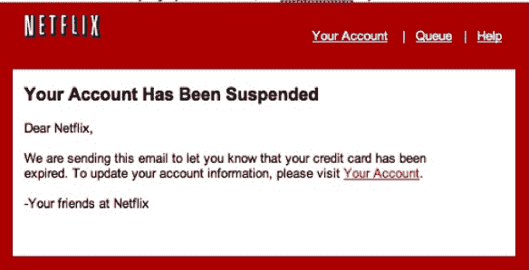

**图 7.1:** 钓鱼诈骗信息。来源：http://resources.infosecinstitute.com/category/enterprise/phishing/#ref

### 7.3.1.1 钓鱼的类型

随着防御者继续教育用户防范钓鱼并部署反钓鱼策略，网络犯罪分子不断精进其对现有钓鱼攻击的技巧，并推出新类型的钓鱼诈骗。一些常见的钓鱼攻击类型包括：(a) **鱼叉式钓鱼**（Spear phishing）攻击针对特定个人或公司，通常使用收集的受害者特定信息，以更成功地将信息伪装成真实的鱼叉式钓鱼邮件可能包括对受害者组织内同事或高管的引用，以及受害者的姓名、位置或其他个人信息。**捕鲸式攻击**（Whaling）是一种鱼叉式钓鱼攻击，专门针对组织内部的高级人员，目标通常是窃取巨额资金。准备鱼叉式钓鱼活动的人会对其受害者进行详细研究，以创建更真实的信息。使用与目标相关或特定的信息会增加攻击成功的概率。典型的捕鲸式攻击针对具有授权支付权限的员工，钓鱼信息伪装成高管的指令，要求向某供应商授权大笔付款，而实际上，这笔付款将支付给

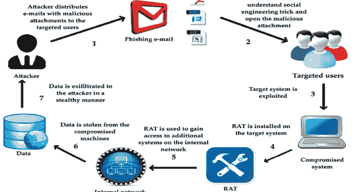

**图 7.2:** 鱼叉式钓鱼攻击模型。来源：https://searchsecurity.tech-target.com/feature/Targeted-Cyber-Attacks

(b) **钓网攻击**（Pharming）是一种依赖于 DNS 缓存中毒将用户从合法网站重定向到欺诈网站的钓鱼方式，并诱骗用户其登录凭据尝试登录欺诈网站。(c) **克隆钓鱼**（Clone phishing）攻击利用之前发送过的、包含链接或附件的合法电子邮件。攻击者对合法邮件进行复制或克隆，将一个或多个附件文件替换为恶意链接或恶意软件攻击。由于该信息看起来是原始合法邮件的副本，受害者可能会被诱骗点击恶意链接或打开恶意附件。这种技术经常被控制了另一个受害者系统的攻击者使用。在这种情况下，攻击者利用其对一个系统的控制，通过使用受害者信任的可信发送者发送的电子邮件在组织内进行横移动。有时会使用**恶意双生 Wi-Fi 攻击**（evil twin Wi-Fi attack），通过建立一个 Wi-Fi 接入点并使用与合法接入点类似的欺骗性名称进行广播。当受害者连接到恶意双生 Wi-Fi 网络时，攻击者可以获取发送或来自受害者设备的所有传输内容，包括用户 ID 和密码。攻击者还可以利用这种向量通过看似源自合法系统的欺诈提示来攻击受害者设备。(d) **语音钓鱼**（Voice phishing），也称为 vishing，是一种发生在语音通信媒体（包括基于 IP 的语音 VoIP 或普通电话服务 PSTN）上的钓鱼形式。典型的诈骗使用语音合成留下语音邮件，通知受害者银行或信用卡账户出现可疑活动，并诱导受害者回复恶意电话以验证其身份，从而泄露受害账户凭据。(e) **短信钓鱼**（SMS phishing），有时也称为 SMishing 或 SMShing，是另一种面向移动设备的钓鱼攻击，它使用短信说服受害者披露账户凭据或安装恶意软件。

### 7.3.2 旁路下载（Drive-by download）

这是一个术语有时指用户通过看似无害的网页浏览，偶然访问托管在感染或恶意 Web 服务器上的网站而遭受的攻击。例如，个人可能可能在社交网络网站上浏览，一个恶意广告可能会将用户引导至一个感染的 Web 服务器，该服务器将通过利用漏洞或错误配置感染或破坏 浏览器。(a) **跨站脚本**（Cross-site scripting），也写为“XSS”，是一组通用技术，攻击者可以通过中间 Web 应用程序在另一个系统上执行恶意代码。此外，攻击发生的面向互联网的系统已从针对底层服务和主要服务应用（IIS、Apache 等）的攻击转向针对自定义数据库和 Web 应用程序的攻击。一个主要的例子是 SQL 注入攻击。(b) **SQL 注入**是将 SQL 控制字符作为输入放置到带有数据库后端的应用程序中，而应用程序并未预期会有 SQL 控制字符。如果这些字符被正确放置并被数据库服务器接受，它们可以用来导致数据库服务器提供或修改该用户账户或通过所用界面不应能够访问的信息。

数字取证与调查：从数据到数字证据

## 7.4 攻击检测

攻击检测假设攻击者能够获得所需目标的访问权限并成功违反既定策略。此类机制基于一种乐观假设，即在大多数时间里，信息是在不受干扰的情况下传输的。这类机制的任务是在发生非预期操作时，报告发生了问题并做出适当反应。此外，通常需要确定攻击的确切类型。攻击检测的一个基本方面是恢复。通常只需报告检测到恶意活动就足够了，但某些系统要求撤销攻击影响或停止正在进行的已发现攻击。一方面，攻击检测的优点是它根据最坏情况运行，即攻击者获取了信道并可以使用资源。另一方面，检测在提供信息机密性方面并不有效。当安全策略规定拦截信息具有严重的安全影响时，检测并不是合适的机制。攻击检测类最重要的成员是 IDS。

## 7.5 入侵检测系统 (IDS)

在继续之前，我们需要理解“入侵”的含义。入侵被定义为恶意对手执行的一系列相关操作，导致目标系统被破坏。假设入侵者的行为违反了既定的安全策略。存在一个说明哪些行为被视为恶意且应该被防止的安全策略是 IDS 的关键要求。只有当操作与给定规则进行比较时，才能检测到违规行为。ID 是识别和响应计算及网络资源上恶意活动的过程。


专家认为计算机系统永远不会绝对安全的。(2) 部署的安全机制，例如身份验证和访问控制，可能会因为配置错误或恶意操作而被禁用。(3) 系统的用户可能会滥用其权限并执行破坏性活动。(4) 即使攻击没有成功，在大多数情况下，了解入侵意图也是有用的。IDS帮助计算机系统准备应对攻击。它们从计算机系统和网络中的观测点收集信息，并将其分析为安全问题。IDS是用于检测入侵的应用程序。IDS的设计是为了解决上述问题。因此，它们并不是取代传统的安全方法，而是补充它们。研究指出IDS必须满足以下要求；(a) 准确性：IDS不能将系统中的合法操作识别为异常或误用（将合法操作识别为入侵被称为**误报**）。(b) 性能：IDS性能必须足够覆盖实时（在重大损害发生前检测到入侵）。(c) 完整性：IDS不应未能检测到入侵（未检测到的入侵被称为**漏报**）。人们必须承认这一点很难实现，因为几乎不可能拥有过去、现在和未来的全局知识。(d) 容错性：IDS本身必须能够抵抗攻击。(e) 可扩展性：IDS必须能够在不丢失信息的情况下处理最坏情况的事件。这对于从少量专用主机关联不同事件的系统特别相关。随着网络变得更大、更快，此类节点会被不断增加的事件所淹没。通常来说，有三种可用分析引擎：(a) 事件或基于特征的分析(b) 统计分析(c) 自适应系统。事件或基于特征的系统功能类似于大多数人熟悉的防病毒软件。供应商提供一份其认为可疑或指示攻击的模式列表；IDS只需扫描环境以寻找已知模式的匹配。IDS可以通过采取用户定义的操作或执行额外的日志来响应。统计分析系统建立环境的统计模型（具有telnet会话平均长度），然后寻找偏离“正常”的情况。在经过10多年的政府研究后，一些产品开始将这种技术纳入市场产品中。

# 166 数字取证与调查：从数据到数字证据

自适应系统从环境的通用规则开始，然后学习或适应原本异常的本地条件。在初始学习阶段，系统理解了人们如何与环境交互，然后向操作人员警告异常活动。该领域有大量的活跃研究。

## 7.5.1 网络IDS

基于网络的IDS最常见，通过检查通过的网络流量来寻找入侵迹（见图7.3）。基于主机的系统查看本地机器上的用户和进程活动以寻找入侵迹。网络IDS通常有两个逻辑组件：传感器和管理站。传感器位于网络分段，监控其可疑流量。管理站接收来自传感器的警报并显示给操作人员。传感器通常是专用系统，仅用于监控网络。它们具有无限制模式的网络接口，这意味着它们接收所有网络流量——而不仅仅是发往其IP地址的流量——并捕获通过的网络流量进行分析。如果它们检测到看似异常的内容，就会将其传回分析站。分析站可以显示报警或进行额外的分析。某些显示仅仅是网络管理工具（如HP Openview）的界面，但另一些旨在帮助操作人员分析问题的自定义GUI。

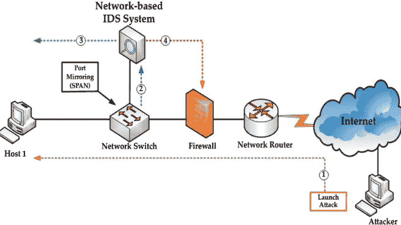

图7.3：网络入侵检测系统。来源：http://www.ans.net.in/index.php/network-and-data-security/technology-for-internet-security/intrusion-detection-systems/

# 计算机入侵与检测 167

优点：网络IDS可以检测某些利用网络的攻击。它们擅于检测未经授权的访问或某些超出授权范围的访问。基于网络的IDS不需要修改生产服务器或主机。这是一个优势，因为生产服务器的CPU、I/O和磁盘容量的运行公差通常很小；安装额外的软件可能会超过系统的容量。IDS不在任何生产服务或过程的关键路径上。IDS可以通过采取用户定义的操作或执行额外的日志来响应。基于网络的IDS可以检测某些利用网络的攻击。它们擅于检测未经授权的访问或某些超出授权范围的访问访问。基于网络的IDS不需要修改生产服务器或主机。

缺点：网络IDS可以被关闭。由于IDS的IDS的的，，，，，，的的的。

依赖于服务器内部的记录和监控能力。如果该服务器在实践中没有配置且可控性不足，你将不得不更改生产引擎的配置。你如何预测日志能力汇总后的结果呢？基于主机的系统相当昂贵。许多组织没有资金资产来使用基于主机的系统来保护整个网络。这些组织必须小心保护哪些系统。这可能在身份问题上留下巨大的漏洞，例如，相邻但未安全的服务器上的攻击者可以从网络中嗅探身份验证数据或其他敏感材料。最后，基于主机的系统受本地限制的影响更为严重。它们几乎完全无法感知网络环境。因此，评估潜在入侵损害所需的分析时间随受保护主机数量呈线性增长；也就是说，如果人类花费 `t` 时间检查一个系统上的事件，那么检查两个系统需要 `2t`，检查三个系统需要 `3t`，以此此类推。

## 7.5.3 文件完整性检查器

完整性检查器检查计算机上的文件，以确定自上次运行检查器以来它们是否已被更改。完整性检查器维护着每个文件的哈希值数据库。每当检查器运行时，它都会重新计算哈希值并与存储的值进行比较。如果哈希值不同，则文件已更改；如果值相同，则文件未更改。哈希函数是一种数学过程，将文件中的字节序列简化为固定长度的数字。文件中的相同内容始终产生相同的哈希值，而文件的任何更改都会产生不同的值。与加密不同，哈希是单向函数；你无法根据哈希值产生原始源。某些哈希比其他哈希更安全。满足特殊数学要求的非常安全的哈希被称为密码学安全哈希。密码学安全哈希的要求之一是计算冲突是非常困难的（技术术语是“在计算上是不可行的”）——即找到两个哈希值为相同数字的输入。这意味着即使攻击者更改了文件，他也无法以一种欺骗完整性检查器能力的方式更改文件。


**图 7.4:** 漏洞扫描器和供应商。来源：https://avleon.com/2016/12/07/zeronights16-enterprise-vulnerability-management/

### 7.6.1 网络漏洞扫描器

网络漏洞扫描器通过检查远程系统上的网络接口进行远程操作。它将寻找运行在目标机器上的存在漏洞的服务以及可能的漏洞。例如，众所周知 rexd 是一个报告服务；网络漏洞扫描器将尝试连接到目标系统。如果连接成功，扫描器将报告 rexd。由于网络漏洞扫描器可以在网络中的单台机器上运行，因此其安装时不会影响其他机器的配置。审计员和安全小组经常使用这些扫描器，因为正如《数字取证与调查：从数据到数字证据》，它们可以提供计算机或网络安全漏洞的“外人视角”。

### 优点

网络漏洞扫描器可以报告各种目标架构。有些适用于路由器，有些适用于 UNIX 系统，有些适用于 NT 或其他 Windows 平台。总而言，从技术角度来看，网络漏洞扫描器的安装和启动都非常简单。与通常需要安装软件或重新配置的基于主机的系统不同，网络系统可以直接部署。只需将接口插入交换机并启动机器即可。网络系统的 GUI 通常非常直观，这意味着初级人员可以监控系统，并在出现问题时联系更资深的分析师。

### 缺点

网络漏洞扫描器几乎完全是基于特征的系统。类似于基于特征的 IDS，基于特征的漏洞扫描器只能检测它被程序设定识别的漏洞。如果出现新的漏洞（这经常发生），那么在供应商更新特征（以及客户下载并安装新特征）之前，攻击者会有一个机会窗口。如果漏洞被严密隐藏，系统可能会长时间处于受攻击状态。如果客户对漏洞扫描器特征的疏忽（正如历史表明他们对病毒特征的那样），那么即使他们定期运行漏洞扫描器，许多组织仍会受到攻击。最近的分析显示，90% 运行 IIS 的 Web 服务器仍然受到记录详尽的严重安全漏洞的影响，供应商已针对这些漏洞发布补丁和安全公告。漏洞扫描器只能指出可能的问题；组织必须自行修复它们。网络漏洞扫描器的另一个潜在问题是输出结果需要熟练的解读。每个环境都有操作要求和不同的安全漏洞。事实上，“漏洞”的概念体涵盖了其他定义松散的概念，如风险、威胁、可接受性和预期的攻击者技能。由于这些因素在每个组织中都各不同，特定配置代表“漏洞”的程度也随组织而异。当漏洞扫描器报告一个


对于特定的漏洞，组织的网络或操作人员必须在组织运行环境的背景下评估报告。该漏洞在组织环境中可能不会构成不可接受的风险，或者该风险可能是由于业务需求而强加给组织的。在安全讨论的背景下，这似乎很愚蠢，但在现实世界中，安全考虑往往取决于业务理由。已知，漏洞扫描器可能会导致目标系统崩溃。某些 IP 实现不够强大，无法处理许多并发连接或具有异常标志组合的 IP 数据包。例如，激进端口扫描产生的流量会导致机器崩溃。最后，网络漏洞扫描器包含大量的漏洞数据。如果有人入侵扫描器系统，破坏网络上的大多数其他机器将变得轻而易举。请保护扫描器以防止扫描数据被未经授权的使用。

## 7.6 主机漏洞扫描器

主机漏洞扫描器与网络漏洞扫描器的区别在于它完全限于本地操作系统。网络漏洞扫描器要求目标机器可以通过网络访问才能运行；而主机漏洞扫描器不需要。漏洞扫描器是安装在特定操作系统上的软件包。一旦安装了软件，就可以配置在白天或晚上的任何时间运行。通常，此类工具执行的扫描被设置为低优先级运行，以减少扫描对生产工作的影响。

### 优点

主机漏洞扫描器对于特定的操作系统通常经过了优化且更准确。它们可以经常告诉用户应该应用哪些补丁来修复识别出的漏洞，而网络扫描器有时只提供通用指南。在考虑购买哪个产品时，请查看您特定操作系统的示例报告，以确定报告中包含多少信息。报告的深度和准确性应作为选择标准。主机漏洞扫描器在运行时不会消耗网络带宽。所有处理都限制在本地主机系统。主机漏洞扫描器不像网络扫描器那样导致目标系统上的 IP 栈挂起。

操作系统与其网络接口关联有较弱或实现不当的 IP 栈；发送大量流量（如端口扫描器所做的）或异常的 TCP 头部标志可能会接口挂起，这将需要重启。主机漏洞扫描器不太可能被成功的入侵者用来对付。破解系统并发现网络漏洞扫描器或来自此类扫描器报告的黑客，可能会使用该工具或报告攻击您组织内的其他系统。基于主机的工具对于扩展攻击提供的有用信息要少得多；也就是说，它比基于网络的的工具更具隔离性。

### 缺点

主机漏洞扫描器同样是基于签名的。它们寻找已知的危险漏洞系统配置，并报告缓解这些特定威胁的食谱化方法。本地系统程序和操作要求可能需要发现和应用任何给定漏洞的解决方案具有灵活性。安装主机漏洞扫描器需要权限，运行每台机器的具有权限的系统管理员应同意工具的用途和配置。在许多组织中，这是一项困难的协调任务。对于任何基于主机的系统，攻击者都可以修改漏洞扫描器，使其不报告攻击者希望利用的漏洞。这里有一个重要的结果，即漏洞扫描器无法保护在安装扫描器时就已被攻破的系统。

## 7.7 入侵调查

与入侵调查相关的证据来源分为三大大类：基于主机的证据、基于网络的证据以及证人的第一人称（直接）证据。妥善地收集由系统、网络、应用程序和用户活动产生的数据，对于检测入侵迹象、进行实时调查以及保留证据以便在法庭上具有法效力至关重要。对观察或发现的内容保持适当记录非常重要。应该维护一份关于嫌疑入侵者活动和现场响应的书面时间顺序事件日志。日志应详细说明怀疑了什么、采取了什么行动、结果联系了谁以及发现了哪些入侵者活动的证据。还应详细说明用于重建系统和定位犯罪疑者的人力及设备资源利用情况，以协助后续制定受害者影响声明。

## 7.7.1 入侵检测方法

入侵检测（ID）分为两类：手动 IDS（如日志分析和手动关联）以及自动化 IDS 的使用。最佳解决方案通常是这两种机制的结合，因为 IDS 不会也无法检测所有可能的攻击。

### (1) 手动入侵检测方法

了解并能够熟练地应用手动方法至关重要。并不是所有攻击都需要以相同的方式进行调查。泛而言之，入侵检测分为两类：手动 IDS（如日志分析和手动关联）以及自动化 IDS 的使用。最佳解决方案通常是这两种机制的结合，因为 IDS 不会无法检测所有可能的攻击。

了解并能够熟练地应用手动方法至关重要。并不是所有攻击都需要以相同的方式进行调查。泛而言之，入侵检测分为两类：手动 IDS（如日志分析和手动关联）以及自动化 IDS 的使用。最佳解决方案通常是这两种机制的结合，因为 IDS 不会无法检测所有可能的攻击。

了解并能够熟练地应用手动方法至关重要。并不是所有攻击都需要以相同的方式进行调查。泛而言之，入侵检测分为两类：手动 IDS（如日志分析和手动关联）以及自动化 IDS 的使用。最佳解决方案通常是这两种机制的结合，因为 IDS 不会无法检测所有可能的攻击。

识别系统中的异常条目、(b) 验证关键文件、(c) 识别可疑用户进程、(d) 分析网络事务以及 (e) 关联所有数据以形成发生情况的图谱。

- 日志文件包含有关发生活动的信息。它们通常是可疑行为的唯一记录，是入侵调查中最关键的证据形式。这必须在组织高层得到认可。不同的系统提供不同类型的日志信息，某些系统在默认配置不提供足够的日志。

- 入侵者作为其正常操作模式的一部分，会更改系统配置以允许访问、隐藏其踪迹并在系统上实现目标。如果没有系统基准配置的记录，判断入侵者做了哪些修改将是困难的。文件完整性评估（FIA）通过使用密码哈希值创建系统的基准数据库，然后允许管理员监控文件的未经授权的更改。系统文件不应更改，除非更新或补丁，而日志文件的大小只会增加。FIA 的取证应用允许管理员建立系统上所更改内容的完整列表。已更改系统的 FIA 将构成支持起诉的重要证据部分，特别是在法律对系统中插入、更改或删除数据施以更严厉处罚的情况下，正如澳大利亚联邦法所示。最为人知的自动化工具是 Tripwire，它适用于 UNIX 和 NT 系统。

- 入侵者经常会在他们攻破系统中留下各种文件。这些文件范围从嗅探日志、被盗的密码文件、利用脚本和源代码到各种程序。更聪明、更有经验的入侵者经常会在内存中留下运行的进程。泛而言之，


## 计算机入侵与检测 177

入侵者留下的程序被称为“残留文件”（remnant files）。潜在的恶意脚本、源代码和程序被称为“产物”（artifacts）。然而，这些文件实际上可能并不是恶意的，但在进行全面分析之前，必须始终将其视为恶意文件。入侵者用其他文件替换系统文件，这些文件在运行机制与原始程序不同，但名称相同。这些木马程序在入侵者中非常流行，因为它们为其活动提供了隐蔽方法。木马程序本身还可能提供价值信息或功能，以支持进一步的入侵。许多木马程序在内容之外，所有系统属性都与其原始同名程序相同，这意味着只有通过适当的加密校验和分析才能检测出文件之间的差异。因此，维护系统文件和重要程序的离线只读校验列表是至关重要的。在向法律执法部门（LE）提供原始系统上的副本以验证所提供的产物副本的完整性时，产物的加密校验和也是至关重要的。如果从受损的系统中恢复了产物，执法部门有时可能会请求现场协助，通过分析产物来确定其功能。如果对嫌疑人执行了搜查令并从其计算机系统中恢复了未编译的木马代码，这种分析可能变得尤为重要。不应在受损系统上分析产物。应对产物及其周围环境进行复制，并确保其能够精确镜像原始环境。理想情况下，产物应在隔离的系统上进行分析。

- 网络交易审计：网络审计是实时和从历史角度确定网络上发生情况的有用工具。与 ID（交易审计支持的检测系统）类似，网络交易审计可以分为支持历史和/或实时分析的方法和工具。

## 7.7.2 自动 IDS

鉴于商业向互联网迁移，以及为了保护和支持互联网连接与贸易而进行的安全产品市场竞争，IDS 市场波动很大。一些广为人知的商业 IDS 包括 Internet Security Systems 的 RealSecure、Platinum Systems 的 Sessionwall-3、Cisco Systems 的 Netranger 以及 Network Associates 的 Cybercorp。互联网上还有许多供非商业用途的免费 IDS。这些系统包括 SHADOW 和 Network Flight Recorder。这些免费提供的系统不如商业系统那样易于使用，但它们具有更强的定制性。自动 IDS 对于边界防御有用，但它们无法跟上安全威胁不断变化且不同企业之间可能存在差异的事。基于网络的 IDS 不像防火墙那样解决网络内部威胁问题，自动 IDS 需要适当的监控和维护。

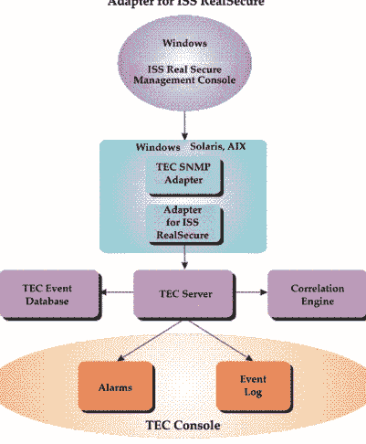

**图 7.5：** ISS RealSecure IDS 适配器。来源：http://publib.boulder.ibm.com/tividd/td/TRM/SC23-4823-00/en_US/HTML/adapter_guide06.htm

## 7.8 入侵调查的挑战

从核心上讲，入侵调查是一种数字取证调查，因此它应该符合科学方法和科学原理。然而，入侵数字调查人员面临一些需要注意的特殊挑战，这些挑战在其他形式的数字取证中并不常见。下面描述了一些主要的挑战。

### 7.8.1 事件与真实个人的关联

必须记住，将事件与真实个人联系起来是所有数字调查关注的问题，特别是对于计算机入侵而言。仅将事件追踪到特定的计算机系统，不足以声称特定个人在这些事件发生期间使用了该计算机系统，且该个人对观察到的事件负责。

### 7.8.2 受损系统的脆弱性

入侵调查期间出现的一个常见挑战是需要保护目标系统免受进一步攻击。数字调查人员甚至可能被要求在从系统收集证据之前，移除后门并修复目标系统。只要可能，应在修复目标系统或以任何其他方式更改其状态之前保留证据。在将系统作为证据源处理期间，通过将其在网络上进行隔离来保护目标系统通常是可行的。在某些情况下，通过拔掉网络电缆来隔离系统可能是可行的。然而，当系统是网络中的关键组件时，可能需要让网络管理员重新配置路由器或防火墙，部分隔离该系统，但允许关键连接以确保组织能够维持运行。

### 7.8.3 监控攻击者的进度

在许多形式的刑事调查中，数字调查人员观察嫌疑人实施犯罪的过程对他们是有益的。这将使数字调查人员能够收集额外信息，用于识别和起诉该人员。这对于入侵调查来说也是如此，原因有几点：(a) 计算机入侵可能极其复杂，特别是那些跨越企业网络的入侵。可能需要进一步观察以确定事件的真实范围。(b) 某些入侵者擅长隐藏或擦除其活动痕迹。如果不在其行动时对其进行观察，可能可能不会留下足够的证据来追求调查目标。(c) 许多组织的架构和配置无法保留能够进行有效事后调查的电子记录（例如日志文件）。因此，对当前事件的观察要关键得多。持续观察的问题在以下情况下会发挥作用：攻击者可能正在对目标系统、系统的所有者或个人，或反映在存在这些信息系统数据中的个人造成损害。例如，攻击者可能正在主动从受损的系统中删除敏感数据。

### 7.8.4 威胁的响应

实施 IDS 的组织面临的一个共同问题是缺乏适当的事件响应能力。识别问题只是成功了一半，知道如何做出适当响应并拥有执行响应所需的资源同样重要。有效的事件响应需要具备快速修复威胁知识的安全专业人员，以及稳健的程序在不影响日常运营的情况下解决问题。在许多组织中，负责监控警报的人与管理基础设施的人员之间存在脱节，这意味着快速修复可能难以实现。

### 7.8.5 恶意代码的管理与分析

在计算机入侵中，与其他网络犯罪相比，数字调查人员必须处理与感兴趣的事件相关的未知和/或恶意程序。这意味着，与嫌疑人计算机上存在与其被指控的实际犯罪无关的间谍软件不同，在调查的犯罪中存在专门用于实施该犯罪的恶意代码。数字调查人员在他们调查的大多数受损系统中都会发现某种形式的恶意程序。


# 参考文献

- 1. Casey, E. (2004). 电子证据与计算机犯罪（第2版）。伦敦：Academic Press. 检索于2018年3月24日，源自 http://index.ofes/EBooks/Digital%20Evidence%20and%20Computer%20Crime%203rd%20Edition/Binder1.pdf
- 2. Casey, E. (2005). 案例研究：网络入侵调查——取证准备的教训。《数字调查》，2, 254-460。
- 3. Farmer, D., & Venema, W. (2004). 取证发现。新泽西州：AddisonWesley. 检索于2018年3月24日，http://www.fish2.com/security/wf-book.pdf
- 4. West-Brown, M., Stikvoort, D., & Kossakowski, K. (1998年12月). 计算机安全事件响应小组（CSIRTs）手册。CMU/SEI-98-HB-001。

# 第8章

> “在现实中，极少数拥有良好取证证据的案例是真正进入法庭的。”
——Pat Brown

## 目录

- 8.1 引言.................................................................................. 184
- 8.2 第四条修正案 ............................................................ 185
- 8.3 隐私法............................................................................... 187
- 8.4 搜查令 ................................................................ 188
- 8.5 无证搜查....................................................................... 190
- 8.6 笔录登记器/陷阱与追踪.............................................. 191
- 8.7 刑法 ................................................................ 192
- 8.8 证据分类............................................................... 195
- 8.9 审前动议........................................................... 203
- 参考文献...................................................................................... 208

计算机已成为我们生活中重要的一部分，并正成为家庭和职场活动的基础。州、联邦和地方政府机构使用计算机和互联网来创建和访问信息。同样，数字系统已成为犯罪活动的主流。法律程序一直受到传统和法院裁决的影响，并使得必须制定一套复杂的规则，用于在法律事务中评估取证证据。然而，数字取证调查人员在法律诉讼中提交的所有证据并非都是可采纳的。本章概述了数字取证学科的相关问题，并探讨了法律在数字证据方面的运作机制。这些包括案件管辖权、搜查与扣押，以及对数字证据的要求。

## 8.1 引言

数字证据在法律诉讼中非常重要。随着技术的进步，根据第四条修正案，无证搜查和扣押的法律被律师或法庭人员所关注。在法律诉讼中，数字取证调查人员提交的证据至关重要，但并非所有都是可采纳的。在某些情况下，技术人员需要关注数字证据的有效性。在收集数字证据时，取证人员必须遵循法律程序，以确保其是有效的。在处理数字证据时，取证人员需要遵循法律程序，以确保其是有效的。在法律诉讼中，数字取证调查人员提交的证据至关重要，但并非所有都是可采纳的。在某些情况下，技术人员需要关注数字证据的有效性。在收集数字证据时，取证人员必须遵循法律程序，以确保其是有效的。在法律诉讼中，数字取证调查人员提交的证据至关重要，但并非所有都是可采纳的。在某些情况下，技术人员需要关注数字证据的有效性。在收集数字证据时，取证人员必须遵循法律程序，以确保其是有效的。在法律诉讼中，数字取证调查人员提交的证据至关重要，但并非所有都是可采纳的。在某些情况下，技术人员需要关注数字证据的有效性。在收集数字证据时，取证人员必须遵循法律程序，以确保其是有效的。在法律诉讼中，数字取证调查人员提交的证据至关重要，但并非所有都是可采纳的。在某些情况下，技术人员需要关注数字证据的有效性。在收集数字证据时，取证人员必须遵循法律程序，以确保其是有效的。在法律诉讼中，数字取证调查人员提交的证据至关重要，但并非所有都是可采纳的。在某些情况下，技术人员需要关注数字证据的有效性。在收集数字证据时，取证人员必须遵循法律程序，以确保其是有效的。在法律诉讼中，数字取证调查人员提交的证据至关重要，但并非所有都是可采纳的。在某些情况下，技术人员需要关注数字证据的有效性。在收集数字证据时，取证人员必须遵循法律程序，以确保其是有效的。

## 8.2 第四条修正案

第四条修正案建立了一种免受“不合理”搜查和扣押的权利。为了是“合理的”，搜查或扣押必须获得搜查令授权。第四条修正案规定：“人民的人、住宅、纸张和财物的安全不受合理搜查和扣押的侵犯；除非有合理的理由并经誓言或保证，并具体说明要搜查之处和要扣押的物品。” 执法部门收集数字证据的美国联邦法律由第四条修正案管理，相关法律编纂于《窃听法》(18 USC 2510–22)、电子隐私法》(ECPA) 1986年 (18 USC 2701–02) 以及《笔录登记器/陷阱法》(18 USC 3121–27)。第四条修正案限制了政府在无搜查令获取证据的能力。搜查令是由法官签署的证明，授权警察人员进行搜查。根据第四条修正案，没有合理理由不能搜查。有时，人们同意搜查。在这种情况下，警方可以在无证的情况下进行搜查。无证搜查不侵犯第四条修正案的前提是：(i) 执行人员的行为没有个人的“合理预期”，或 (ii) 该搜查属于搜查令要求的例外。

除非根据警察或其他政府代理的指示行动，否则私人方不会违反第四条修正案。换句话说，如果房东搜查租客的房屋或雇主搜查员工的办公室，并不违反第四条修正案。然而，这种搜查在某些案件中可能侵犯隐私并成为民事诉讼的依据，而在其他案件中则不然；例如，法院认为员工对雇主拥有的办公室通常没有隐私预期。确定什么属于合理预期在涉及计算机的案件中是非常的。为了支持这一点，美国司法部建议代理将计算机视为封闭容器（例如文件柜）。第四条修正案禁止执法人员（如警察和其他公共雇员或公共官员）在无搜查令的情况下获取和查看计算机信息，如果在相同的情况下他们被禁止打开封闭容器并检查其内容。然而，对于是否应将单个计算机文件视为独立的封闭容器，得出了不同的结论。

图 8.1：第四条修正案。来源：http://www.lataco.com/1984-day-defend-the-4th-amendment-los-angles-84/


## 数字证据与法律诉讼 187

## 8.3 隐私保护法

美国《隐私保护法》（PPA）涵盖了受宪法修正案（言论自由和新闻自由）保护的物品的搜查和扣押。《隐私法》旨在保护记者、出版者以及可能拥有犯罪活动证据但未被怀疑犯有任何犯罪行为的人。该法适用于为了向公众传播信息而创建的材料（这可能适用于旨在发布到网站的文章，因为这是向公共论坛发布的一种形式）。如果有理由怀疑持有材料的人正在实施犯罪——或者这些材料与犯罪有关，或者某些人员面临身体伤害或死亡的危险，而这种危险可以通过扣押证据来避免——那么搜查和扣押就不违反《隐私保护法》。违反该法属于民事案件而非刑事案件，但违反该法并不意味着证据会被踢出法庭，这与违反宪法权利的情况不同。某些材料的附带扣押可能涉及 PPA 或 ECPA。根据法律，执法人员在计划可能导致扣押第一修正案材料（例如发布在网络上的材料）的搜查时，必须采取特殊措施。ECPA 规定了执法人员如何获取由第三方服务提供商存储的电子通信内容。为了最大限度地减少这些法律下的责任，执法人员应尝试提前确定搜查的计算机系统中可能存储的信息类型。如果执法人员怀疑有人匿名举报，可以执行“敲门”令（knock-knock warrants）。法院还可能授权“偷看”令（sneak-and-peek warrants），这种令不需要执法人员通知被搜查场所的人员。美国《爱国者法案》修订了 18 USC 第 3103a 条，允许法院在认为立即通知会产生不利影响的情况下，批准与执行搜查令相关的延迟通知请求。然而，根据授权签发的许可证，除非获得法院的专门授权，否则仍禁止扣押电子信息。除了物理扣押计算机外，执法人员经常进行电子监视。根据《窃听法》（Wiretap Statute）和《笔陷阱法》（Pen/Trap Statute）。《窃听法》（第三章）规范联邦刑事调查中的实时电子监视。第三章广泛禁止拦截口头通信、电通信和电子通信。然而，第三章包含数十种例外情况，执法人员在执行监视之前必须熟悉这些例外。

188 数字取证与调查：从数据到数字证据

## 8.4 搜查令

法院在“州诉伍达尔尔案”中将搜查的法律定义为“对一个人的房屋或其他建筑物、其本人或其车辆、飞机等进行检查，旨在发现违禁品、非法或被盗财产，或用于起诉其被指控的某项犯罪或罪行的刑事诉讼的证据”（根据《布莱克法律词典》）。在“莫利纳诉州案”中，扣押被定义为“占有财产的行为，例如，根据执行（搜查令）而违反法律所采取的行为”。


**图 8.2:** 搜查令。来源：http://www.lawweb.in/2015/05/whether-court-issue-general-search.html

搜查令是由治安法官签署的文件，授权对特定地点搜查令中特别描述的特定物品。搜查令必须基于另一份名为“宣誓书”的文件，该文件由某人（警察人员或其他任何人）在宣誓下签署，表示相信在待搜查地点将找到某些物品，并提供支持该信念的事实。这些事实必须构成搜查物将在所述地点被发现的“合理理由”。只有搜查令中明确指出的物品才能被搜查。搜查令可以授权搜查和扣押计算机硬件、数字信息或两者。过于宽泛的措辞（例如授权扣押“所有记录”或“所有计算机”）可能导致搜查令无效；搜查令必须指明证据所涉及的犯罪。

189 数字证据与法律诉讼 189

由于法院可能适用也可能不适用例外规定，建议在搜查和扣押证据之前获得搜查令。然而，由于计算机文件可能是加密的、标签具有误导性的、存储在不寻常格式中或与无关文件混合，执法人员不能简单地建立合理理由、描述他们所需的文件，然后去检索数据。实际上，他们必须理解不同搜查方法的技术边界；仔细计划搜查，然后以授权他们采取必要措施获取证据的方式起草搜查令。如果执法人员有理由相信网络搜查将检索存储在多个位置的数据，应获得多个搜查令。此外，如果根据有效搜查令扣押的财产与第一份搜查令中指定的不同，执法人员应获得第二个搜查令来搜查被扣押的计算机。然而，根据法律和法院案件，对搜查令的要求还有许多其他例外。这些包括

### 8.4.1 同意搜查

如果对待搜查场所或物品具有控制方的同意，执法人员不需要搜查令。这被称为同意搜查。执法人员不需要证明犯罪的合理理由；即使完全没有理由相信发生了犯罪行为，他们也可以合法地进行搜查。这里的关键要素是同意必须是自愿的。如果在强迫、威胁或恐吓下获得同意，则不是自愿的，因此无效。

### 8.4.2 遗弃财产

执法人员通常允许在不获得搜查令的情况下搜查遗弃财产。例如，如果嫌疑人携带一个磁盘，并在观察到警察在该区域时将磁盘扔在公共场所，人员可以取回。

### 8.4.3 紧急情况

另一种可以在没有搜查令的情况下进行搜查的情况是紧急情况——即在紧急情况下，没有时间获得搜查令，且需要进行搜查以拯救生命或防止身体伤害、防止嫌疑人逃跑或防止证据被毁。由于数字证据的脆弱性，最后一种情况最适用于数字证据。计算机数据组成的证据很容易被毁。在“美国诉大卫案”和“美国诉罗梅罗-加西亚案”中，法院认为，在没有搜查令的情况下扣押电子证据是合法的，因为证据即将被毁。

显眼可见（Plain View）

显眼可见原则（有时也称为开放田野原则）建立在这样一个前提下：执法人员处于某个地方，他从那里可以看到犯罪的可观察证据。由于存储在计算机上的文件内容通常不在显眼范围内（除非执法人员进入了嫌疑人屏幕上显示该文件的房间），这一原则并不经常应用于数字证据。当执法人员持有搜查犯罪证据的搜查令（例如儿童色情内容），并在合法搜查中发现了另一种犯罪的证据（例如，显示嫌疑人犯下谋杀罪的照片）时，这个问题就出现了。法院通常认为显眼可见原则适用，但在发现第二起罪行的证据后，执法人员应带着这些证据返回治安法官处，以建立签发搜查第二种犯罪证据的合理理由。

190 数字取证与调查：从数据到数字证据

## 8.5 无搜查令搜查

违反合理隐私期待的无搜查令搜查如果符合搜查令要求的现有例外，则符合宪法第四修正案。例如，如果具有权限的人员同意搜查、如果预计证据会被毁，或者证据处于显眼位置，执法人员可以在没有搜查令的情况下进行搜查。其他例外发生在合法逮捕后的附属搜查、清单搜查和边境搜查中。在某些情况下，第四修正案的保护并不适用，因为该行为被认为不是搜查。如果警察对车辆进行监管（例如因为逮捕了驾驶员），他们被允许按照标准程序对车辆内容记录。这不构成搜查，因为其目的不是寻找犯罪证据，而是为了保护所有者的财产（并保护机构免受盗窃指控）。然而，这一例外并不允许警察打开锁定的容器，


## 数字证据与法律程序 191

例如公文包，作为清点过程的一部分。为了做到这一点，他们通常需要获得搜查令（除非适用其他例外情况，例如紧急情况）。在车辆被扣押时，位于车辆内的笔记本电脑或其他计算机通常被视为一个封闭容器，在大多数情况下，执法人员应获得搜查令才能打开它并查看其中的数据。


图 8.3：警察人员面前的犯罪现场封锁带。

来源：https://securityintelligence.com/smart-forensics-for-the-internet-of-things-iot/

## 8.6 笔迹记录器/截获与追踪

《笔迹记录器法》（Pen Register Statute）规范了笔迹记录器、截获和追踪设备的使用。该法律授权政府律师在寻求的信息与调查相关时，申请法院命令以授权安装笔迹记录器和/或截获追踪设备。根据《美国爱国者法案》的修订，它现在不仅适用于电话通信，还适用于计算机网络通信，并使笔迹/截获命令具有全国性。除了适用的联邦法律，还必须考虑州法律。特别是许多州有关于隐私的法律，尤其是关于存储的电子信息。遗憾的是，各州的法律差异很大，详细讨论已超出本书的范围。笔迹记录器和截获追踪设备提供关于特定通信来源和目的的非内容信息。由于这些信息不包含通信的实际内容，因此其受到的限制比……少

## 192 数字取证与调查：从数据到数字证据 最高法院长期以来认为，这些信息不具有合理的隐私预期，因为电信公司可以随时访问；事实上，公司必须利用这些信息来确保通信得到适当的路由和递送。笔迹记录法涵盖了笔迹记录器/截获与追踪。在电话的背景下，笔迹记录器显示呼出和接入号码。由于邮件主题包含内容，根据《美国爱国者法案》的修订，在邮件中使用必须包含发送者和收件人，并避免主题的任何部分。与通信相关的 IP 地址和端口号在该法下也是被允许的。这些规定专门适用于捕捉此类信息的“设备”。电子通信隐私保护法（ECPA）通常禁止安装或使用任何作为笔迹记录器或截获追踪设备。《美国爱国者法案》的修正允许“设备”一词也涵盖软件。此外，与涉及拦截和访问通信的规定不同，当政府非法使用笔迹记录器/截获追踪设备时，并没有适用于成法排除规则。而且，对于违反该法律的行为，并没有私人的起诉权。

## 8.7 刑法

侵侵全球社会结构的一个大问题是犯罪。犯罪是对刑法的违反。犯罪的构成要素是错误行为（客观要素 act reus）和错误意图（主要素 mens rea）。除了严格责任犯罪外，这两个要素是必不可少的。在严格责任犯罪中，不需要证明意图。有许多类型的犯罪：有些针对人，有些针对财产，有些看起来是无受害者的犯罪。

### 8.7.1 针对人的犯罪

针对人的犯罪包括杀人、强奸、攻击和殴打。还有许多其他导致人体受到伤害的犯罪。当一个人死亡时，第一步是确定死因。如果发现死亡是自然原因造成的，则不需要进行调查。相反，如果发现死亡是杀人，警方将开始调查（见图）。杀人是一个人夺取他人生命的行为。有几种不同类型的杀人。受罚最严厉的杀人形式是谋杀。要使杀人被视为谋杀，需要具备几个要素。根据《模范法典》（Model Penal Code），谋杀是指带有预谋杀意的杀人，这是一个法律术语，指故意或知情在没有正当理由或减轻的情况下进行的故意杀人、被告鲁莽地造成伤害或使用致命武器进行攻击的情况、在“表现出对人类生命价值漠然的情况下”鲁莽实施的杀人，或重罪。## 193 数字证据与法律程序 刑法典是许多州作为其法律范本的法律集。然而，各州之间存在许多差异。在大多数州，谋杀被分为几个等级。一级谋杀通常包括不仅有意图而且有预谋的杀人。预谋可以意味着从仅仅意图杀死到制定了杀人计划，取决于各州的规定。在某些州，在实施重罪期间发生的杀人，以及使用毒药或爆炸的杀人，可能被视为一级谋杀。二级谋杀在不同州的定义不同。所有州共同的二级谋杀特征是：没有实际的预谋，且该犯罪不属于过失杀。例如，在佛罗里达州，二级谋杀可能被视为被告具有“邪恶的心灵或内心”的杀人。这意味着：(i) 一个具有普通判断力的人会意识到该行为可能导致死亡或严重伤害。(ii) 该行为带有恶意或仇恨实施的，其表现出对人类生命的漠然。在其他州，有略有不同但相似的标准。当陪审团认为被告行为鲁莽但无意杀死受害者时，他们将做出二级谋杀的判决。过失杀是在没有杀死意图的情况下进行的杀人。过失杀可能是自愿或非自愿的。自愿过失杀是在激情下进行的杀人。根据《模范法典》，自愿过失杀是受到合理挑衅的杀人。非自愿过失杀是没有杀死意图的杀人。死亡是由于疏忽导致的。在某些州，非自愿过失杀是鲁莽驾驶。

## 194 数字取证与调查：从数据到数字证据 自杀是故意终结自己的生命。在大多数州，帮助自杀是犯罪。攻击和殴打是两种不同的罪行。殴打是使用力量伤害他人。攻击是殴打的尝试。殴打需要接触，而攻击不需要。简单攻击通常是轻罪。加重攻击和殴打发生在意图实施更严重的犯罪或使用致命武器的情况下。如果针对警察、消防员或其他公共官员实施攻击和殴打，也可能是加重的。针对人的另一个非常严重的犯罪是强奸。强奸可以是两种类型：强制或法定。强制强奸通常定义为与未经同意的人发生性交。法定强奸发生在受害者未成年（可能是16、17或18岁）或能力降低的情况下。对于法定强奸，不需要证明使用了强制。法定强奸是严格责任犯罪，年龄错误通常不能作为辩护。近年来，强奸法出台了多项修订。例如，在夫妻之间也可能发生强奸。


是指父母或监护人对儿童的身体或心理上的虐待或忽视。这可能包括由于体体或过度管教造成的身体伤害、性侵扰或忽视。也可能存在情感虐待，可以通过言语实施。其他类型的虐待还包括针对配偶或老年人的虐待。

## 8.8 证据的分类

法律证据根据其要证明的事实类型、形式、规范其使用的法律以及在案件中的作用进行分类。法律证据的主要类别包括：直接证据、间接证据、书证证据、传闻证据、专家证据、科学证据、控方证据和辩护证据。

### 8.8.1 直接证据

直接证据不需要经过假设或推断；它与事实直接相关。根据在线法律词典，直接证据是“一种如果被采信，可以在不推断或假设的情况下证明争议事实存的证据”。直接证据直接证明或反驳某一事实。也许最著名的直接证据类型是目击者证言，因为证人准确地描述了她看到、听听到或经历的事情。例如，在一个起人身伤害案件中，假设受伤的原告在过马路时被被告的汽车撞到。原告可能用来证明被告显然是驾驶员的一种直接证据，可能是旁观者的证言，该旁观者清楚地看到被告的汽车撞击了原告。证物和其他实物或书证证据也可以提供直接证据。例如，在违约案件中，合同本身就是合同成立的直接证据。产品责任案件可能会将实际的缺陷产品带到法庭，向法官或陪审团展示产品确实按照证人所描述的方式发生了损坏。”直接证据是关于所证明事实的具体或第一手证据。

### 8.8.2 间接证据

间接证据定义为“……通过对围绕某一事实的事件或情况进行直接观察而得出的证据”。间接证据是暗示或推断事实存在的证据。相比之下，间接证据不是直接指向某一事实的证据。相反，必须进行推断，即该间接证据指向使用它的方的试图证明的事实。例如，假设在上述“直接证据”描述的车祸中，受伤的原告提交了一张在事故现场拍摄的被告汽车照片作为证据。车头严重变形。原告提供这张照片是为了证明被告用车撞了她。与原告“被告用他的车撞了我”的直接证词不同，这张照片是间接证据。它证明了被告的汽车曾在某时刻出现在事故现场，并且在现场时车头受损。


图 8.4：指纹作为间接证据。来源：http://thecre-ationclub.com/the-evidence-for-creation-part-2-the-evidence/

### 8.8.3 书证证据

书证证据包括任何提供的用于支持待证明事实的书面证据。书证证据原则可以解释为：控方有责任向法庭证明这一点。

### 8.8.4 传闻证据

传闻证据是指在法庭外提供的法庭提供的陈述，用于证明所断言事项真实性。

### 8.8.5 专家证据

专家证据是由在特定领域拥有专业知识、技能、经验、培训或教育的证人提供的证言。

### 8.8.6 科学证据

科学证据是指应用科学方法和技术来分析法律诉讼的证据。


# 数字证据与法律程序 199

关于原告的待遇。尽管某些科学测试和检查并未获得普遍认可，但它们通常被认为是可靠的。一些例子包括用于确定物品身份的中子活化分析、用于确定个人身份的声纹，以及基因检测或 DNA 分析。这些类型的科学程序在医学界可能被接受，但它们尚未成熟到可以在司法程序中被视为认定为自动有效的科学证据来源的程度。它们可以作为证据被采纳，但只有在专家证人证明了测试的有效性后才可以。在决定是否采纳非普遍认可的程序产生的科学证据时，法院必须询问该测试是否可靠。一项技术的可靠性取决于许多因素，包括该技术是否经过了测试、是否经过了同行评审、测试程序是否已发表、测试是否存在误差范围（如果有，误差率是多少），以及该技术的应用是否符合现有的测试标准（Daubert v. Merrell Dow Pharmaceuticals, Inc., 509 U.S. 579, 113 S. Ct. 2786, 125 L. Ed. 2d 469 [1993]）。


**图 8.5：** 在迪拜警方法医部门工作的法医调查员。来源：https://www.thenational.ae/uae/unidentified-torso-forensic-highlights-work-of-dubai-police-team-1.48771

在1999年的“锦湖轮胎诉Carmichael”案中，美国最高法院裁定，Daubert 标准不仅适用于联邦法院对科学证据的采纳性，还适用于所有寻求联邦法院批准以专家身份作证的证证人。因此，最高法院认定，一个所谓的轮胎故障专家在被允许在产品责任诉讼中就该主题作证言之前，必须经过 Daubert 调查，即使他提供的某些证言并非完全具有“科学性”。

下级法院曾试图在适用 Daubert 标准的科学专家与不适用 Daubert 标准的技术专家之间进行区分。通过扩大 Daubert 测试范围，法院重新强调了审判法院在专家证词事务中的广泛裁量权。在某些情况下，法院不愿采纳某些科学证据，因为这些程序产生的结果被认为不够可靠，不能作为证据。此类程序包括旨在判断一个人是否在说实的测笔仪和化学测试。然而，如果双方都同意源自此类程序的证言应被采纳，法院则可以允许引入该证据。在任何情况下，无论特定科学程序的接受程度如何，所呈现的科学证据必须与当前问题相关。此外，科学证据的获取方式必须与此类证据通常获取的方式一致。例如，如果物理学家打算在一起由交通事故引起的人身伤害诉讼中就被告车辆的速度作证，而该物理学家确定车辆速度的方法与其他物理学家使用的方法不同，法院可能会拒绝允许该物理学家就车速作证。对科学证据提供证言的专家证人可以对与证据相关的问题发表意见。然而，根据《联邦证据规则》第 704 条，针对刑事被告精神状态或状况作证的专家证人，不得对“被告是否具有或不构成指控犯罪要素或辩护要素的精神状态或状况发表意见或推断”。美国国会于1984 年批准了这一规定，法院仅在刑事案件中应用该规定，这是为了对1981年试图暗杀罗纳德·里根总统的约翰·辛克利刑事起诉结果做出回应。辛克利被指控企图暗杀、袭击联邦官员以及在实施联邦犯罪时使用枪，但在但在取精神科医生的证言后，被判定为精神异常无罪，因为精神科医生宣布辛克利无法被定罪，因为他缺乏定罪所需的认知精神状态。科学证据的权重可能会根据产生该证据的特定测试而异。一方的专家证言可能有说服力，但可能无法判定案件，因为另一方可能有来自同一领域的专家。

## 数字证据与法律程序 201

科学证据的权重可能会根据产生该证据的特定测试而异。一方的专家证言可能有说服力，但可能无法判定案件，因为另一方可能有来自同一领域的专家。

## 数字证据与法律程序 202

科学证据的权重可能会根据产生该证据的特定测试而异。一方的专家证言可能有说服力，但可能无法判定案件，因为另一方可能有来自同一领域的专家。

## 有罪性与无罪性证据

科学证据的权重可能会根据产生该证据的特定测试而异。一方的专家证言可能有说服力，但可能无法判定案件，因为另一方可能有来自同一领域的专家。

## 有罪性与无罪性证据

科学证据的权重可能会根据产生该证据的特定测试而异。一方的专家证言可能有说服力，但可能无法判定案件，因为另一方可能有来自同一领域的专家。

## 有罪性与无罪性证据

科学证据的权重可能会根据产生该证据的特定测试而异。一方的专家证言可能有说服力，但可能无法判定案件，因为另一方可能有来自同一领域的专家。


## 8.9 审判前的动议

从根本上说，动议是向案件法官提出的的一项正式法律请求。审判前动议是在审判前提出的。在刑事诉讼中，审判前动议和初步听证会在审判前处理某些法律问题，例如证据的采用以及谁被允许作为证人作证。案件的审判前动议和初步听证阶段往往至关重要，它可能是一个转折点。根据案件的事实和情况，你的刑事辩护律师可以提出排除证据动议或驳回指控动议。


联邦案件中的审判前动议示例：

-   驳回动议（Motion to Dismiss）：驳回动议是请求法官因证据或其他问题完全驳回联邦指控。它是试图让法官驳回某项指控或整个案件。当证据不足，或案件中的证据或事实不构成犯罪时，可以使用该动议。当法院无权或无管辖权对案件做出裁决时也会提交此类动议。例如，如果对遗嘱产生争议，案件必须由遗产法院而非小额诉讼法院裁决。基于缺乏事项管辖权的驳回案件动议很可能属于此类。

-   排除动议（Motion to Supp）：排除动议请求法官将某些证据或证人陈述排除在审判之外。排除证据动议通常涉及此类问题，如非法搜查的证据、错误获得的供词、不当获得的陈述，以及逮捕是否有合理理由。

-   变更审判动议（Motion for Change of Venue）：变更审判动议请求将案件移至不同的地点，因为担心陪审团会受到舆论的影响（通常出现在高知名案件中）。批准变更审判地的著名案例包括：(a) 1991年几名被控殴打罗德尼·金的洛杉矶警察，其审判地点从洛杉矶县移至文图拉县；(b) 俄克拉俄克拉荷马市炸弹者蒂莫西·麦维格获准从俄克拉荷马州变更到科罗拉多州丹佛的美国地区法院；(c) 环线路狙击手李·鲍德·马沃和约翰·艾伦·穆罕默德的审判从弗吉尼亚北部移到弗吉尼亚州东南部的切斯维克和弗吉尼亚海滩。这些任何动议无论被批准还是拒绝，都对当前案件产生重大影响。

### 8.9.1 审判程序

在美国，审判是解决双方无法自行解决或通过非正式方法解决法律争议的主要手段。审判的主要目的是确保诉讼双方之间公正、客观的司法管理。审判旨在确定双方争议事项的事实，并将法律适用于这些事项。此外，审判对双方之间的争议提供了最终的法律裁定。审判的主要类型是民事审判和刑事审判。民事审判解决为了执行、救济或保护个人权利而提出的民事诉讼。通常，刑事诉之外的所有类型案件都是民事案件。在刑事审判中，被指控犯罪的人被判定有罪或无罪并判刑。政府代表公民提起刑事诉讼，以惩罚刑事法律的违反者。

### 8.9.2 陪审团挑选

虽然从上上在陪审团就座后才正式开始，但陪审团挑选（或 Voir Dire，读作 vwahr DEER）通常被称为审判的第一阶段。在审判开始时，陪审团是从陪审团池中选出的，是从社区中随机抽取承担陪审团职责的公民群体。法官和代表双方的律师会对每位潜在陪审员进行询问。如果潜在陪审员因任何原因在判断证据时存在偏见，他不允许进入陪审团。这被称为“有理由挑战”（challenge for a cause）。潜在陪审员可能面临严重犯罪的定罪记录、对争议结果的财务利益、参与涉及当一方的另一项程序、商业、个人、家庭关系、职业关系或其他可能导致他们产生偏见的原因。

### 8.9.3 开场陈述

在法官给出初步指示后，双方律师向陪审团进行开场陈述。在开场陈述期间，律师概述了案件中的问题，并告诉陪审团他们预计证据在审判期间将证明什么。开场陈述目的是给出事实和问题的概况，帮助陪审团更好地理解证据。开场陈述通常持续十分到三十分钟，尽管实际上时间要长得多。法官可以限制开场陈述的时间。通常，律师会将开场陈述作为一个故事，从当事人的角度对发生的情况进行时间顺序上的概述。尽管律师会以客户最有利的角度呈现案件，但开场陈述应该是基于事实的，而非辩论性的。开场陈述不是证据，律师不应对证据提供个人意见。律师不允许做出无法由其预计在审判期间提供的证据所支持的陈述。

### 8.9.4 原告证言

实际审判程序的第一部分由原告出示其证人和专家，提交对诉状的论点和理由。辩护方被允许对每位证人进行交叉询问，试图驳回、损害信誉或反驳证人的陈述。

### 8.9.5 被告证言

在原告陈述完毕后，被告以相同的方式使用证人和专家提供直接证言来陈述自己的案件，随后接受原告的交叉询问。

### 8.9.6 重新传问与唤回

根据法官的裁量，每个证人都可以被重新唤回证台进行额外的询问和交叉询问。如果在初始证词期间未披露关键信息，律师可以请求重新传问。

### 8.9.7 结案陈述

原告和辩方的律师总结其客户的立场，以提醒陪审团他们在案件中呈现的事实，并说服陪审团其诉求的真实性。结案陈述通常具有戏剧性且针对性强。在许多管辖区，原告先辩护，然后被告辩护，最后原告进行反驳辩护。实际上，承担举证责任的一方先后辩护。这几乎总是原告，但有时留给陪审团决定的问题仅是被告提出的积极抗辩或反击措施。此外，少数管辖区允许双方各进行一次辩护，在其中少数情况下，被告先辩护，原告最后。

### 8.9.8 陪审团指示

结案陈述后，法官将向陪审团下指示。陪审团指示的目的是向陪审员解释法律与其正在考虑的问题相关的法律含义，并告诉陪审团如果他们对一方给出裁决，必须确定哪些事实。每位律师都会准备一套书面指示，希望法官将其交给陪审团。这些指示将量身定制以推进其客户的案件。许多裁决在上诉中被推翻，是因为审判法官错误地指示了陪审团。法官将仔细决定给出哪些指示，并通常会使用州律师协会或州最高法院提供的模板指示。这些模板指示通常更安全，因为它们是根据上诉法院之前使用的语言设计的，上诉法院不太会在指示中发现可撤销的错误。

### 8.9.9 陪审团审议与裁决

法官完成对陪审团指示后，陪审团进入陪审团室开始审议。此时，备用陪审员被解，尽管某些管辖区允许备用陪审员参加审议。法警将证物和书面指示带入陪审团室并在审议期间保护陪审团的隐私。如何组织自身并进行很大程度上取决于陪审团


# 数字证据与法律诉讼 207

审议。法官通常指示陪审员选出一名主席主持审议，并签署反映他们决定的判决书表格。陪审员在审议过程中有时会有疑问。通常，他们会将问题写下来并交给法警，由法警将其送交法官。法官与律师商量并向陪审团发送书面回复。法官审议的时间从几分钟到几天不等。通常，法官必须达成一致裁决，尽管在民事案件中有时允许多数裁决。如果陪审团告诉法官他们无法裁决，法官通常会给陪审团进一步指示，并让他们回到审议室进行进一步审议。然而，如果陪审团仍然无法裁决，则陪审团陷入僵局，宣布重新审判。


**图 8.7：** 陪审员在审议室内审议，对裁决进行投票。来源：https://www.gettyimages.co.uk/detail/photo/jurors-deliberating-in-jury-room-taking-high-res-stock-photography/873180-008

通常，陪审团会达成裁决。当陪审团达成裁决并签署判决表格时，他们会通知法官他们已经做出决定。如果律师不在法庭，会被传唤，所有人回到法庭。法官询问陪审团是否已达成裁决。主席回答“是的”，通常由法庭书记员大声读判判决。在大多数司法管辖区，当事人可以通过询问每位个人陪审员是否同意该裁决来对陪审团进行投票。显然，在没有咨询陪审团的法庭审判中，没有陪审团审议或裁决。法官仅根据适用法律和其对事实的见解做出判决。还有一个审判后阶段，有时是*执行（判决执行）*阶段，偶尔会有上诉阶段。

# 参考文献

- 1. Andrea, C. (2000). 司法医学科学：证据、线索与调查。宾夕法尼亚，州：Chelsea House Publishers。
- 2. Casey, E. (2004). 数字证据与计算机犯罪（第2版）。伦敦：Academic Press。
- 3. Faigman, D. (2002). 现代科学证据：专家证词的法律与科学（第2版）。圣保罗，明尼苏州：West Group。
- 4. Guidotti, T., & Susan, R. (2001). 证席上的科学：法律、司法与政策中的科学证据评估。贝弗利农场，马萨诸塞州：OEM Press。

# 第9章
# 网络骚扰

> “为了成为网络骚扰者，人必须感到被拒绝、愤怒、强大或被误解。”

——Michael Nuccitelli，心理学博士。

# 目录

- 9.1 引言.................................................................................... 210
- 9.2 网络骚扰的类型...................................................... 212
- 9.3 网络骚扰者的分类............................................................... 214
- 9.4 网络骚扰者如何运作 ................................................... 217
- 9.5 网络骚扰的调查............................................................... 218
- 9.6 网络骚扰受害者....................................................................... 220
- 9.7 技术..................................................................................... 221
- 9.8 相关案例研究............................................................... 225
- 参考文献 ........................................................................................ 228

210 数字取证与调查：从数据到数字证据

网络骚扰（Cyberstalking）是一种相对较新的网络恐怖主义犯罪。尽管它的优先级通常低于网络恐怖主义，但它是一个重要的全球性问题。由于新技术的出现，它以不同的形式呈现。由于互联网提供了匿名性和安全性，它正在迅速蔓延。用于遏制它的技术和工具具有许多局限性，且不易实施。保护人们免受网络骚扰的法律行为在地理上局限于相关的州或国家。本章回顾了网络骚扰、网络骚扰者的运作方式、影响、法律规定以及为防止其而采取的行动。迫切需要从网络骚扰的各个维度进行研究，以评估这一社会问题。

## 9.1 引言

新技术的出现和创新丰富了我们的生活。同时，为了动态和快速的业务解决方案而对 IT 和通信技术的依赖也带来了其自身的副作用。数字信息技术对世界的影响无疑为日益发展的全球村的公民带来了无尽的益处。意乎情的是，其阴暗面是滥用 IT 进行犯罪活动。网络骚扰是一种自 20 世纪 90 年代后期以来存在的新犯罪，已成为全球主要的犯罪问题之一。本质上，网络骚扰描述的是利用信息和通信技术来骚扰一个或多个受者的行为 (Bocij, 2006)。此外，骚扰意味着任何导致受害者痛苦的行为，无论是有意的还是无意的。网络骚扰者通常在网上寻找他们的受害者，因为他们利用计算机和网络进行犯罪活动，而这些技术可以很容易被滥用来恐吓、威慑、欺凌和骚扰毫无防备的用户。网络骚扰与传统的跟踪骚扰形式相似，因为它包含了引发焦虑和恐惧的持续行为。随着新技术的出现，传统的跟踪已通过电子邮件和互联网（即网络空间）等各种媒体采取了全新的形式。网络骚扰从根本上标志着互联网便利某些类型犯罪的潜力，网络骚扰是一种利用技术进行骚扰的新型变态行为。在十年中，我们对互联网、即时消息和其他通信技术的依赖使得网络骚扰成为一个影响计算机用户的日益严重的社会问题。本章专门研究网络骚扰，提供

# 网络骚扰 211

对问题的概述、成因和后果以及全球案例研究。虽然网络骚扰通常涉及一个人追踪另一个人，但并非总是如此。随着行为的发展，它已包括股票市场欺诈、性骚扰、数据窃取、冒充、身份盗用、消费者欺诈、计算机监控以及政治组织的攻击。令人震惊的是，色情者和恋童者开始利用网络骚扰来寻找新的受害者。虽然网络骚扰已成为全球性问题，但大部分源自美国，使美国人成为最脆弱的目标群体。

加州刑法典（1998年）将电子通信纳入其反跟踪法律中。加州刑法典的重要部分强烈地影响了美国后续所有的反跟踪法律，清晰地定义了跟踪及相关术语。

网络骚扰是网络犯罪的一种。网络骚扰在某种程度上是指利用互联网跟踪某人——一种针对计算机用户的骚扰。该术语与在线骚扰和在线滥用交替使用。网络骚扰者不对受害者构成直接物理威胁，而是通过受害者的在线活动来获取信息，以不同形式进行口头威胁。在线交互的匿名性降低了识别概率，使得网络骚扰比物理跟踪更常见。尽管网络骚扰看起来相对无害，但它会造成心理和情感伤害。它偶尔会导致实际的跟踪。当代信息社会中的网络骚扰正成为种族主义以及其他偏见和仇恨表达的普遍耻。

任何故意、恶意并反复跟踪或骚扰他人，并出于意图使他人对死亡或身体伤害产生合理恐惧而做出可靠威胁的人，均触犯跟踪罪。“骚扰”指的是针对特定个人的、知情且故意的持续行为，严重惊扰、烦扰、折磨或恐吓该个人，且没有合法目的。这种行为必须能够导致一个理性的人遭受实质的情感痛苦，并且确实导致该个人遭受实质的情感痛苦。

（加州刑法典 646.9）


数字取证与调查：从数据到数字证据


**图 9.1**: 正在行动中的网络骚扰者。

来源：https://cyberbullying.org/cyberstalking

## 9.2 网络骚扰的类型

Ellison建议，网络骚扰可以根据用于骚扰害者的电子通信类型以及通信的私密或公开程度进行分类(1999)。Ellison将网络骚扰分为“直接性”或“间接性”。例如，直接网络骚扰包括使用传呼机、手机和电子邮件发送仇恨、猥秽和威胁性信息，以恐吓受害者。据报道，直接网络骚扰是最常见的网络骚扰形式，与线下跟踪非常相似（Wallace, 2000）。直接网络骚扰是骚扰开始最常见的形式。另一方面，间接网络骚扰包括利用互联网展示仇恨信息，以及使用威胁传播关于害者的虚假谣言（Ellison and Akdeniz, 1998）。信息被发布在网页、聊天室或公告板上。“停止在线虐待组织”（Working to Halt Online Abuse，2003）的数据显示，聊天室、即时消息、留言板和新闻组是间接网络骚扰开始的最常见方式。Ogilvie声称，间接网络骚扰转化为现实世界的潜力最大（2000）。发布在互联网公共空间的信息可以鼓励第三方支持其攻击行为。因此，间接网络骚扰通过限制可能威胁的地理范围增加了受害者的风险。因此，间接网络骚扰比直接网络骚扰更有可能转化为现实，因为它增加了第三方参与的可能性（Maxwell, 2001）。

然而，根据互联网的使用，网络骚扰主要有方式（Ogilvie, 2000）：

### 9.2.1 电子邮件骚扰

这是通过电子邮件进行的直接通信，是最容易获取的骚扰形式。它在某些方面与传统的跟踪非常相似。人们可能会发送具有威胁性、仇恨或猥秽性质的电子邮件，甚至发送垃圾邮件或病毒来骚扰他人。例如，2004年在印度，两名MBA学生给一名女同学发送电子邮件以恐吓她。匿名器和匿名中继器的免费可用屏蔽了发送者的身份并允许隐藏内容，为寻求更有效地掩盖踪迹的骚扰者提供了高程度的保护。

### 9.2.2 互联网骚扰

通过互联网进行全球通信。与电子邮件骚扰相比，这里的领域更广且更公开。在这里，骚扰者可以使用各种活动来骚扰他们的受害者。网络骚扰被用于诽谤和危及受害者，有时是在公共维度而非私人维度进行的。骚扰包括黑客、欺骗、使用间谍软件以及使用色情图像和邮件炸弹等攻击性内容。骚扰者会进入聊天室假装成其受害者，或者在公告板上发布关于其害者的信息。这些信息通常包含害者的姓名、地址和电话号码，以及邀请陌生人加入性活动的信息。网络骚扰者可以在互联网上跟随受害者从处处移动，并建立并维护专门针对其害者的网站，鼓励访问者参与对其进行侮辱和骚扰。例如，一名女性被骚扰了6个月。她的骚扰者在聊天室里发布了留言，威胁要恐吓并杀死她，并在网上发布了她经过处理的色情照片以及个人细节（Dean, 2000）。

### 9.2.3 计算机骚扰

这是对他人计算机的未经授权控制。在此类骚扰中，骚扰者利用互联网和Windows操作系统的原理来获取对目标受害者计算机的控制。在这种形式下，犯罪者是技术专家，一旦计算机开始运行，他就可以控制受害者的计算机。骚扰者获取受害者计算机的地址并对其进行控制。在这里，只要目标计算机以任何方式连接到互联网，网络骚扰者就可以与目标直接通信。骚扰者可以获取受害者计算机的控制，受害者唯一的防御选择就是断开连接并放弃当前的互联网“地址”。通过这种方式，连接到互联网的个人Windows计算机被另一台连接到互联网的计算机所连接。这种“连接”并非通过第三方描述的典型互联网交互链路；而是计算机到计算机的连接，允许入侵者对目标计算机行使控制。目前，进行这种形式的互联网和Windows操作系统的剥削需要高水平的计算机知识。然而，互联网上有关于如何以这种方式使用技术的说明。未来，可能会为任何倾向于下载的人提供更简单的脚本。这种形式的网络骚扰需要高水平的计算机知识才能访问目标计算机，而受害者的选择是断开计算机并放弃当前的互联网地址。这个术语对世界并不陌生，因为它在物理空间已经存在了几个世纪。物理世界中的跟踪是由前熟人、员工或希望向目标强加意愿的人完成的，这些都是骚扰者的例子。但在网络空间出现后，骚扰者的接触范围扩大了，他可以到达世界的任何部分并威胁和骚扰目标。没有必要公开其身份。大多数骚扰者是失意的情人、前男友、同事，他们未能满足愿望并想要骚扰受害者。大多数骚扰者和受害者都是女性。网络骚扰背后的共同原因是爱情中的拒绝或情感的否定、报复、骚扰以及犯罪者的炫耀。

## 9.3 网络骚扰者的类别

网络骚扰者在行为上表现出熟悉的模式，对某种类型的拒绝、嫉妒或批评做出反应；遗弃的行为也加剧了骚扰者的执念，受害者通常使骚扰者的愤怒转化为动机。骚扰者通常是社交上笨拙的孤立者，他们通过各种非违愿的接触（如信息、电子邮件、评论甚至礼物）来骚扰受害者。心理学家根据心理障碍将21世纪的网络骚扰者分为六大类。

### 9.3.1 执念型网络骚扰者

这些人拒绝相信他们的关系已经结束。但受害者通常会认为这种骚扰者是无害的。这些骚扰者也比较常见，通常是熟人或孤立者。他们渴望与受害者建立关系，无论受害者如何反应都坚持。

Elliot Fogel就是一个例子。他在大学结识Claire Waxman。大约10年后，她开始收到他的邮件和卡片。随后Fogel出现在她家外，警方在他电脑电脑上发现了她的结婚照作为屏幕保护程序。在2012年的审判中，披露Fogel在一年内Google上搜索了4万次，并闯入过她的汽车。他向她拨打了数百次深夜电话，并冒充她孩子就读幼儿园的家长。

2015年5月，他因第三次违反限制令被处三个半年监禁。Waxman表示，由于Fogel的侵害，她遭受了流产、患上进食障碍并被迫搬了五次家。

### 9.3.2 妄想型网络骚扰者

妄想型骚扰者与其受害者之间几乎没有任何相处。妄想型骚扰者可能有严重的精神疾病，如精神分裂症、躁郁症或妄想狂。妄想症患者认为受害者爱他们，他们正处于关系中，尽管他们可能从未见过面。其他妄想型骚扰者认为自己注定与某人在一起，只要追求足够，爱情就是不可避免的。这些骚扰者知道自己并没有与受建立关系，但相信有一天会有。妄想型骚扰者通常是孤立者，大多数目标是已婚女性、名人、医生、教师等。从事医生、教师等高尚和助性职业的人很容易吸引妄想型骚扰者。他们很难摆脱。


**图 9.2：** 一个妄想症跟踪者。

来源：https://www.medicalnewstoday.com/articles/319145.html

### 9.3.3 报仇型跟踪者

这些网络跟踪者因为某些真实的或可能是想象的微小原因而对受害者感到愤怒。报仇型跟踪者的动机不是爱，而是为了报复。报仇型跟踪者还会因为某些微小的真实或想象的伤害对受害者感到愤怒。在学院和大学社区中，报仇型跟踪者可能会针对教职员工。这些跟踪者中，有些人是精神变态，而另一些则处于幻想中，真心认为自己是受害者。报仇型跟踪者是为了报复而跟踪。典型的例子包括不满的员工或前配偶等。

### 9.3.4 掠食型跟踪者

这些网络跟踪者是典型的性掠夺者。掠食型跟踪者的动机是对性满足的欲望以及对受害者的控制欲。这类跟踪者通常具有性偏离，可能还社交能力差、智力低下；他们大多数作为反社会个体独来乐处，源于动荡的生活和过去的苦难。这种类型的跟踪者应该被认为非常危险；鼓励受害者和观察者为了保护自己和他人联系当地执法部门。性掠夺者捕猎那些看起来较弱的人，通常是女性和儿童；并可能从事如监视、监控互联网活动、拨打淫电话、恋物癖、窥淫癖、性受虐癖、性虐癖和露体癖等行为。这类网络跟踪者的受害者可能是熟认识的人，也可能是完全的陌生人。

## 9.4 网络跟踪者是如何运作的

网络跟踪运作与物理世界中的跟踪相同。事实上，许多犯罪者将其在线活动与更传统的跟踪和骚扰形式相结合，例如给受害者打电话和去受害者家里。一些网络跟踪者通过互联网获取受害者，另一些则将受害者的个人信息放到网上，鼓励他人联系受害者，甚至伤害他们。总而言之，跟踪者会以某种方式（基本上是通过恐惧）对受害者施加权力。跟踪者权力的核心是关于受害者的信息和了解。跟踪者收集到的受害者信息越多，他们恐吓和控制受害者的能力就越大。跟踪者利用电话、地址和个人偏好等信息来侵犯受害的生活。此外，随着时间的推移，网络跟踪者可以学会哪些事情会让受害者不安，并利用这些知识进一步骚扰受害者。

### 9.4.1 获取受害者

之前的研究表明，许多跟踪者在跟踪行为开始之前与受害者有过社交接触。这些研究的意义在于，调查人员应该特别关注受害者的熟人。然而，这些研究具有局限性，因为许多跟踪案件未解决或未报告。此外，目前尚不清楚互联网上什么是“熟人”，而且互联网让网络跟踪者更容易找到机会受害者。

网络跟踪者可以搜索网页、浏览 ICQ 和 AOL 资料，并潜伏在 IRC 和 AOL 聊天室寻找潜在目标。这些是自尊心低的脆弱个体，很容易被恐吓。原则上讲，调查人员应该更多地依赖现有证据，而不是普通研究。虽然研究在某种程度上很有用，但证据是关于特定案件最可靠的信息来源，也是法院用来做决策的依据。

### 9.4.2 匿名性与秘密监控

互联网具有保护跟踪者身份并允许跟踪者监控受害者活动的额外优势。例如，认识受害者的跟踪者利用互联网隐藏自己的身份，使用伪造或匿名电子邮件，并使用 ICQ 或 AOL 即时通讯工具来骚扰受害者。此外，跟踪者可以利用 ICQ、AOL 即时通讯工具和其他应用程序（例如 finger）来确定受害者何时在线。最令人不安的是，跟踪者可以使用互联网监视受害者。虽然只有极少数跟踪者精通破解受害者的账户或拦截传输中的电子邮件，但网络跟踪者可以轻松地观察实时聊天室中的对话。这种行为是对犯罪意图的“预监控”（presurveillance），但其本身并不是犯罪，也不属于法律定义的跟踪行为。

### 9.4.3 升级与暴力

人们通常认为，跟踪者一旦停止挑起他们预期的反应，就会停止骚扰受害者。然而，某些跟踪者在没有得到想要的东西时会变得更加恼怒，并变得越来越具有威胁性。由于跟踪者已经诉诸暴力和杀杀，调查人员在处理跟踪案件时必须极其谨慎。调查人员应该严密检查可用证据，尽可能保护受害者免受进一步伤害，并在怀疑时咨询专家。最重要的是，调查人员不应做出主要基于既往案件的仓促判断。

## 9.5 调查网络跟踪

调查网络跟踪案件有几个阶段。这些阶段的假设是网络跟踪者的身份是未知的。即使受害者怀疑是某个人，也建议调查人员探索其他的可能性和嫌疑人。虽然过去的研究表明，大多数跟踪者与受害者有先前的关系，但在涉及互联网时这可能并不适用，因为陌生人跟踪更容易实现。因此，要考虑受害者认识跟踪者的可能性，但不要假设情况确实如此：

### (1) 访谈受害者

调查人员应确定受害者拥有哪些网络跟踪的证据，并获取受害者的细节以用于建立受害者学。初始信息收集阶段的目的是确认犯罪行为，并获取足够的信息推进调查。

### (2) 访谈他人

调查人员需要访谈参与案件的其他人员，以获得更清晰的情况。

### (3) 受害者学与风险评估

调查人员还应该确定犯罪者为什么选择特定的受害者，以及为了获取该受害者愿意承担什么样的风险。调查阶段的主要目的是理解受害者与犯罪者的关系，并确定在哪里可以找到额外的数字证据。

### (4) 寻找额外的数字证据

作为调查人员，你需要利用关于受害者跟踪者的已知信息。受害者学是这一阶段的主要要素，引导调查人员去受害者或与其相似的人感兴趣。网络跟踪者最初在某处观察或遇到了受害者，调查人员应试图确定地点。考虑网络跟踪者在物理世界遇到受害者的可能性。这一阶段的目的是收集更多关于犯罪、受害者跟踪者的信息。

### (5) 犯罪现场特征

检查犯罪现场和数字轨迹的区分特征（例如地点、时间、方法和工具选择），并试图确定它们对网络跟踪者的意义。这一阶段的目的是更好地理解网络跟踪者所做的选择以及这些选择满足了什么需求。

### (6) 动机

确保你查明网络跟踪满足了哪些个人需求。要仔细区分意图（例如对受害者施加权力或恐吓受害者）与网络跟踪者行为所满足的个人需求（例如感到权力或报复对


# 数字取证与调查：从数据到数字证据

（针对某种感知中的错误的受害者）。此阶段的目标是充分了解网络骚扰者，以缩小怀疑人范围，回顾之前的步骤，并发现额外的证据。

## (7) 重复

如果网络骚扰者的身份仍然已知，你应该反复访谈受害者。调查人员收集的信息可能帮助受害者回忆更多细节，或向受害者建议一个可能的嫌疑人。为了协助调查人员执行调查中的每个阶段，此处还提供了额外的细节。

## 9.6 网络骚扰受害者

与大多数传统犯罪不同，网络骚扰没有界限。任何人可能成为骚扰受害者，无论是随机的，还是由于在互联网上发布个人信息时判断不当导致的。尽管大多数证据是轶事性的，但它强烈表明，大多数网络骚扰者是男性，受害者是女性；已经出现过广为人知的女性骚扰男性以及同性骚扰的案例（Reno, 1999）。与男性骚扰者相比，女性骚扰者更倾向于骚扰和骚扰前伴侣，不太可能骚扰陌生人。女性骚扰者也可能针对其他女性，以希望与受害者建立亲密关系。女性骚扰者在人口统计学特征和精神状态方面与男性非常相似；然而，男性更有可能有犯罪记录或物质滥用史（Purcell et al., 2001）。

如所述，几乎任何人都可能成为受害者，但某些人口统计群体比其他群体风险更高，例如女性、青少年、互联网新手以及其他特别脆弱的群体。在在线受害者倡导组织“旨在停止虐待”（Working to Halt Abuse）于2002年进行的一项研究中，71%的网络骚扰受害者是女性，该群体中59%的人曾与骚扰者有某种先前的关系（Hutton and Haantz, 2003）。先前的关系（无论是真实的还是感知的）似乎都是网络骚扰的催化剂，特别是当受害者试图结束关系时（Reno, 1999）。

有趣的是，2001年的一项研究结论得出，61%的网络骚扰受害者是白加索人，其次是亚洲人（3.9%）和非裔美国人（1.6%）。在对待这些发现时应保持谨慎态度，因为调查数据仅限于美国，且受访者人数极少。然而，几项后续研究揭示了类似的发现，大多数受害者是18至30岁的白加索人女性（McFarlane and Bocij, 2003）。

五位受害者中近四位是女性，且女性成为前伴侣或熟人受害者的概率是别人的八倍（Hutton and Haantz, 2003）。由于在线骚扰程度的不同，某些受害者可能出于这样或或其他原因未向执法部门报告骚扰。据推测，大多数网络骚扰受害者没有报告受侵害有两个原因：第一，受害者可能觉得这种行为还不够严重，不引起警察的关注；其次，受害者不相信执法部门会认真对待此事。遗憾的是，当受害者向执法部门报告网络骚扰事件时，许多执法部门仅建议受害者在犯罪者在线下与他们对峙或做出威胁性陈述后再回来。作为被骚扰的回应，一些网络骚受害者可能会经历睡眠和饮食模式的突然变化、噩梦、过度警觉、焦虑、无助，并为了安全。过度警觉通常与创伤后应激障碍有关，用于描述一种症状，即受害者处于恐惧状态时，不恰当地爆发攻击性且有时是暴力的行为（Bocij, 2005）。简短的骚扰片段极少给受害者带来困扰；然而，已经有很多骚扰事件持续了几个月甚至数几年。这种通信的频率大大增加了潜在肢体攻击的风险。受侵害还可能导致破坏行为，但不一定是传统意义上的破坏。破坏行为通常与传统的骚扰有关，但破坏行为也可能发生在网络空间。例如，破坏行为可能在计算机病毒或木马程序的帮助下破坏受害者的个人计算机数据。如前所述，网络空间中有许多网站会乐意向相关方提供有关受害者的信息。

## 9.7 技术

网络骚扰者使用多种技术。他们最初可能利用互联网识别并跟踪他们的骚扰对象。他们随后可能会发送未经请求的电子邮件，包括仇恨、色情或威胁性信息。实时聊天骚扰直接攻击受害者，或通过电子破坏（例如，通过填充网络通道来干扰受害者的对话）。通过新闻组，网络骚扰者可以创建关于受害者的帖子，或通过公告板系统传播传言。网络骚扰者还可能为受害者建立一个包含个人或虚假信息的网页，或向读者寻求接触。另一种技术是在网上冒充受害者的身份，例如在聊天室中，目的是破坏受害者的声誉、发布关于受害者的细节、向他人索要不受愿的联系。更复杂的骚扰形式包括邮件炸弹（通过发送大量信息几乎关闭受害者的电子邮件）、向受害者发送计算机病毒或发送电子垃圾邮件（垃圾）。未经请求的邮件和在线骚扰之间存在明显的区别。收到未经请求的邮件是时可以避免的。然而，网络骚扰是一种持续一段时间的行为……

### 9.7.1 社交网络

虽然社交网络网站为社交提供了广泛的窗口，但同时它们也是针对女性的各种犯罪的前兆，特别是在网络空间。对网络空间风险功能及其后果的法律和心理研究表明，社交网络比聊天室要危险得多。社交网络用户可能会在社交网站上传播关于别人的传言，数百受害者的朋友可以看到。社交网络可能导致


## 224 数字取证调查：从数据到数字证据

网络骚扰次数、网络空间中的仇恨言论、网络欺凌以及歪曲图像（Citron, 2009）。

这些社交网络能够轻松吸引少女和女性，因为她们认为匿名性性掠食者或隐私问题的风险比现实世界要小。然而，大多数用户并没有意识到，他们的身份可能会被恶意意利用，因此他们可能暴露在离线性侵犯、身份盗窃、网络骚扰、网络不忠和受害的风险之中。

### 9.7.2 电子邮件

研究结果表明，网络跟踪者使用电子邮件比任何其他电子通信手段都用于骚扰和恐吓受害者（Peticelli, 2005）。电子邮件允许犯罪者发送连续的骚扰、威胁、仇恨邮件，并附带卑劣的图像、视频或音频。在某些情况下，网络跟踪者在受害者不知或不同意的情况下，利用受害者的邮箱地址和其他个人信息订阅或购买书籍、杂志或其他互联网服务。遗憾的是，许多网站允许用户通过最少的个人信息免费创建邮箱。尽管这些网站要求提供用户识别信息，但它们很少确认所提供个人数据的真实性。这使得执法部门的工作变得更加困难。此外，某些电子邮件服务器会故意收取少量费用并删除识别信息，使得执法部门极难追踪入侵者。许多网络跟踪者加入此类服务，或使用汇票或其他形式的付款方式来防止身份识别。智能的网络跟踪者经常使用计算机软件，犯罪者可能会使用大多数无法追踪的匿名电子邮件（Reno, 1999）。间谍软件的发明让跟踪者能够以低价购买程序。此类软件程序专门设计用于在受害者上线线时向犯罪者发出警报（Peticelli, 2005）。

## 9.7.3 聊天室和讨论论坛

聊天室和讨论论坛通常是互联网用户在一个或多个主题上发表意见和评论的网站。然而，论坛也可以是网络跟踪者发送受害者个人信息的地方，包括姓名、地址、电话号码、电子邮件地址和机密信息（Petrocelli, 2005）。

网络跟踪者经常为了关注或仅仅为了陪伴而进入讨论板、聊天室等场所（Stephens, 1995）。一旦建立联系，网络跟踪者就会继续恐吓受害者。在许多情况下，网络跟踪者认为存在一种“关系”，而实际上这种关系并不存在。换句话说，网络跟踪者真的认为关系是存在的，尽管受害者可能只是在聊天室或讨论板中无意地回答了犯罪者的查询（Stephens, 1995）。然而，如果犯罪者认为这种关系由于任何方式受到了损害，网络跟踪者可能会发起一场全面的行动，以ru毁受害者的声誉、财务信誉或个人身份（Stephens, 1995）。

讨论论坛通常是互联网用户就更多主题发表意见和评论的地方。讨论板也可以是网络跟踪者发布关于受害者的伤害、负面个人数据的地方，包括受害者的姓名、地址、电话号码、电子邮件地址和其他机密信息。“网络抹黑”（cybersmearing）一词被用来指在聊天室、新闻组或公告板上发布关于受害者的令人尴尬或羞辱的传言（Bocij and McFarlane, 2003）。网络抹黑最常见的形式是发布关于受害者的性谣言（Petrocelli, 2005）。这种网络言语攻击也可以表现为聊天骚扰或网络世界中通常所谓的“喷口”（flaming），即受害者在现场公共论坛上被轻视或贬低（美国犯罪受害者国家中心，网络跟踪 2004）。

## 9.8 相关案例研究

### 案例研究 1：艾米·鲍耶（Amy Boyer）

艾米·鲍耶是一位20岁的学生，正处于牙科卫生课程的最后一年。艾米被广泛认为是一个广受欢迎且富有启发性的年轻女性，她通过打两份兼职支持学业证明了这一点。1999年10月，利亚姆·尤恩斯（Liam Youens）在射击20岁的艾米·鲍耶后不久自杀。在调查这起谋杀案时，出现了一些令人不安的事实。尤恩斯(i)艾米并不认识他，但他跟踪了她的行踪超过4多年；(ii) 从各种互联网服务获取了关于艾米的机密信息，包括她的社会安全号码和工作地址；(iii) 在他的网站上保留了一个日记，详细记录了他对艾米的长期痴迷以及他是如何观察她多年的；(iv) 在他的网站上概述了他的杀害艾米的计划。这份详细的书面计划完全按照描述执行了。

### 案例研究 2

来自佐治亚州的辛娅·阿姆斯特德-斯马特斯（Cynthia Armstead-Smathes）收到了来自理·希利亚德（Richard Hillyard）账户的淫秽邮件。随后，她开始通过匿名零售商（一种隐藏发送者身份的在线服务）接收信息。信息包括短语，如“你最好小心你的”、“来吧，婊子”和“我是你最噩梦”。在希利亚德的互联网服务提供商（ISP）注销了他的账户后，阿姆斯特德-斯马特斯开始收到来自他工作的亚特兰疾病预防控制中心的消息。随后，她收到一些看到裸体女性帖子（推测是给阿姆斯特德-斯马特斯的）男的消息，他们列出了她的电子邮件地址并向她提供卖淫。出于恐惧，她搬了三次家并更改了电话号码。警察告诉她，在她收到某人的匿名信息之前，他们无能为力。希利亚德被指控跟踪扰，但他否认发送了该信息。

### 案例研究 3

杰克·贝克（Jake Baker）是密歇根大学的学生，于1995年2月9日被FBI探员逮捕，指控“跨州传输威胁”。指控是在发现贝克在互联网上发布了令同学痛苦的幻想之后。他的故事登上了世界头条。贝克最终被无罪，部分原因是他的故事被判定为具有进取性，不构成威胁。

### 案例研究 4

在美国首次成功的网络仇恨犯罪起诉案中，理查·马恰多（Richard Machado，加州州尔文分校的一名前学生）因发送威胁性电子邮件（署名为“亚洲人猎手”）侵犯了59名亚裔学生的公民权利而被定罪。他的信息写道：“我将亲自寻找并杀死你们每个人。这是我决定的。你们听到了吗？”他威胁说如果不退学就杀死他们。起初，陪审团陷入九三支持无权的僵局。在服禁一年并经过第二次审判后，他被罚款1000美元并被处以一年假释，禁止使用大学计算机实验室。他的律师辩称该威胁是“经典的喷口”（网络俚语，指烦扰大于危害的愤怒信息）。然而，许多受到邮件信息的受害者已准备好携带辣椒喷雾，对陌生人产生怀疑，并拒绝在黑暗中独自外出。

### 案例研究 5

安鲁·阿尚伯厄（Andrew Archambeau）被指控非法跟踪一名他在视频约会服务上结识的老师。5天后，这位老师意识到她不想发展关系。然而，阿尚伯厄坚持了下来，并向她（老师）发送了大约20封电子邮件。当邮件被追踪到阿尚伯厄时，他回答说他的“来电显示”显示来自某个地区的人在拨打并挂断，他认为那是她表达兴趣的害羞方式。老师否认了说法，并在他在留言板中说看着她离开后去报了警。密歇根州的反跟踪法律允许通过电子通信进行非自愿接触。阿尚伯厄对指控不认罪，被判处一年假释并被要求进行心理评估。


# 参考文献

- 1. Bocij, P., & McFarlane, L. (2003). 关于网络骚扰的七个误区。《监狱服务杂志》， 149(1), 37-42.
- 2. Bocij, P., & McFarlane, L. (2003). 网络骚扰：网络空间入侵的定义。《法医学更新》， 1(72), 18-22.
- 3. Clemmitt, M. (2006). 网络社交。《CQ研究员》，16(27), 1–34.
- 4. Citron, K. (2009). 网络民权。《波士顿大学法律评论》，89, 61-125. 取自 http://ssrn.com/abstract=1271900
- 5. Ogilvie, E. (2000). 网络骚扰，犯罪与刑事司法中的趋势与问题，第166号。堪培拉：澳大利亚犯罪学研究所。
- 6. Petrocelli, J. (2005). 网络骚扰。《法律与秩序》，53(12), 56-58.
- 7. Reno, J. (1999). 1999年网络骚扰报告：执法部门和行业面临的新挑战。2018年4月1日检索，取自 http://www.usdoj.gov/criminal/cybercrime/cybersalking.htm

## 第 10 章

## 与内容相关的网络犯罪

> “网络犯罪是世界上每家公司面临的最大威胁。”

—Ginni Rometty，IBM 董事长、总裁兼首席执行官

## 目录

- 10.1 儿童色情 ................................................................ 230
- 10.2 仇恨言论 ....................................................................... 242
- 10.3 网络恐怖主义 ................................................................ 247
- 参考文献 ............................................................................ 255

## 230 数字取证与调查：从数据到数字证据

网络恐怖主义对恐怖组织具有吸引力，因为他们需要更少的人力、金钱和资源。此外，它使恐怖分子能够保持匿名，因为这些活动是在远离实际地点或受害者的地方进行的。而且，它让恐怖分子能够在自身几乎完全没有物理风险的情况下进行活动。网络恐怖主义由物理恐怖主义和网络恐怖主义组成。网络恐怖通过互联网利用技术来实现其恐怖目的。本章试图概述社会中被认为是非法的内容，包括儿童色情、仇恨言论/排外主义材料和网络恐怖主义。除了网络恐怖主义外，每个小节都提供了案例研究。此外，还强调了国际组织批准的法律措施。

## 10.1 儿童色情

儿童色情是儿童性剥削的一种形式。联邦法将儿童色情定义为任何涉及未成年人（18岁以下人员）的显性性行为的视觉描写。儿童色情图像也被称为性侵犯图像。联邦法禁止制作、分发、进口、接收或拥有任何儿童色情图像。违反联邦色情法是严重犯罪，被定罪者将面临严厉的法定惩罚。

将儿童作为性对象的现象自古以来就有，涉及儿童的色情文学和画作也是如此。然而，现代意义上的色情始于19世纪初相机的发明。几乎是，涉及儿童的性化图像就开始被制作、交易和收集。尽管如此，儿童色情在20世纪的大部分时间里仍然是一种限制性活动。图像通常是当地制作的，质量差，价格贵且难以获得。20世纪60年代审查标准的放宽导致儿童色情的可用性增加，到1977年，美国已有约250本儿童色情杂志在流传，其中许多从欧洲进口。尽管对其范围表示担忧，但由于互联网的出现，儿童色情的规模和性质发生了巨大变化，执法部门需要新的应对方法。

与内容相关的网络犯罪 231

网络恐怖主义是恐怖组织的一种诱惑，因为他们需要更少的人力、金钱和资源。此外，它使恐怖分子能够保持匿名，因为这些活动是在远离实际地点或受害者的地方进行的。而且，它让恐怖分子能够在自身几乎完全没有物理风险的情况下进行活动。网络恐怖主义由物理恐怖主义和网络恐怖主义组成。网络恐怖通过互联网利用技术来实现其恐怖目的。本章试图概述社会中被认为是非法的内容。每个小节涵盖了被认为是非法的内容，包括儿童色情、仇恨言论/排外主义材料和网络恐怖主义。除了网络恐怖主义外，每个小节都提供了案例研究。此外，还强调了国际组织批准的法律措施。

## 10.1 儿童色情

儿童色情是儿童性剥削的一种形式。联邦法将儿童色情定义为任何涉及未成年人（18岁以下人员）的显性性行为的视觉描写。儿童色情图像也被称为性侵犯图像。联邦法禁止制作、分发、进口、接收或拥有任何儿童色情图像。违反联邦色情法是严重犯罪，被定罪者将面临严厉的法定惩罚。

将儿童作为性对象的现象自古以来就有，涉及儿童的色情文学和画作也是如此。然而，现代意义上的色情始于19世纪初相机的发明。几乎是，涉及儿童的性化图像就开始被制作、交易和收集。尽管如此，儿童色情在20世纪的大部分时间里仍然是一种限制性活动。图像通常是当地制作的，质量差，价格贵且难以获得。20世纪60年代审查标准的放宽导致儿童色情的可用性增加，到1977年，美国已有约250本儿童色情杂志在流传，其中许多从欧洲进口。尽管对其范围表示担忧，但由于互联网的出现，儿童色情的规模和性质发生了巨大变化，执法部门需要新的应对方法。

网络恐怖主义是恐怖组织的一种诱惑，因为他们需要更少的人力、金钱和资源。此外，它使恐怖分子能够保持匿名，因为这些活动是在远离实际地点或受害者的地方进行的。而且，它让恐怖分子能够在自身几乎完全没有物理风险的情况下进行活动。网络恐怖主义由物理恐怖主义和网络恐怖主义组成。网络恐怖通过互联网利用技术来实现其恐怖目的。本章试图概述社会中被认为是非法的内容。每个小节涵盖了被认为是非法的内容，包括儿童色情、仇恨言论/排外主义材料和网络恐怖主义。除了网络恐怖主义外，每个小节都提供了案例研究。此外，还强调了国际组织批准的法律措施。

## 10.1 儿童色情

儿童色情是儿童性剥削的一种形式。联邦法将儿童色情定义为任何涉及未成年人（18岁以下人员）的显性性行为的视觉描写。儿童色情图像也被称为性侵犯图像。联邦法禁止制作、分发、进口、接收或拥有任何儿童色情图像。违反联邦色情法是严重犯罪，被定罪者将面临严厉的法定惩罚。

将儿童作为性对象的现象自古以来就有，涉及儿童的色情文学和画作也是如此。然而，现代意义上的色情始于19世纪初相机的发明。几乎是，涉及儿童的性化图像就开始被制作、交易和收集。尽管如此，儿童色情在20世纪的大部分时间里仍然是一种限制性活动。图像通常是当地制作的，质量差，价格贵且难以获得。20世纪60年代审查标准的放宽导致儿童色情的可用性增加，到1977年，美国已有约250本儿童色情杂志在流传，其中许多从欧洲进口。尽管对其范围表示担忧，但由于互联网的出现，儿童色情的规模和性质发生了巨大变化，执法部门需要新的应对方法。

网络恐怖主义是恐怖组织的一种诱惑，因为他们需要更少的人力、金钱和资源。此外，它使恐怖分子能够保持匿名，因为这些活动是在远离实际地点或受害者的地方进行的。而且，它让恐怖分子能够在自身几乎完全没有物理风险的情况下进行活动。网络恐怖主义由物理恐怖主义和网络恐怖主义组成。网络恐怖通过互联网利用技术来实现其恐怖目的。本章试图概述社会中被认为是非法的内容。每个小节涵盖了被认为是非法的内容，包括儿童色情、仇恨言论/排外主义材料和网络恐怖主义。除了网络恐怖主义外，每个小节都提供了案例研究。此外，还强调了国际组织批准的法律措施。

## 10.1 儿童色情

儿童色情是儿童性剥削的一种形式。联邦法将儿童色情定义为任何涉及未成年人（18岁以下人员）的显性性行为的视觉描写。儿童色情图像也被称为性侵犯图像。联邦法禁止制作、分发、进口、接收或拥有任何儿童色情图像。违反联邦色情法是严重犯罪，被定罪者将面临严厉的法定惩罚。

将儿童作为性对象的现象自古以来就有，涉及儿童的色情文学和画作也是如此。然而，现代意义上的色情始于19世纪初相机的发明。几乎是，涉及儿童的性化图像就开始被制作、交易和收集。尽管如此，儿童色情在20世纪的大部分时间里仍然是一种限制性活动。图像通常是当地制作的，质量差，价格贵且难以获得。20世纪60年代审查标准的放宽导致儿童色情的可用性增加，到1977年，美国已有约250本儿童色情杂志在流传，其中许多从欧洲进口。尽管对其范围表示担忧，但由于互联网的出现，儿童色情的规模和性质发生了巨大变化，执法部门需要新的应对方法。

## 10.1.1 儿童色情的受害者

区分儿童色情与术术理解是重要的。儿童色情是儿童剥削的形式，每张图像都生动地记录了性侵犯。参与制作图像的每个儿童都是性侵犯的受害者。

虽然有些性侵犯图像描绘了处于巨大痛苦中的儿童，且性侵犯是不争事实的，但其他图像可能描绘了看起来顺从的儿童。然而，仅仅因为儿童看起来顺从，并不意味着没有发生性侵犯。在大多数儿童色情案例中，侵犯不是单一事件，而是持续数月或几年的持续侵害。儿童色情生产者通常会诱导受害者，或者与儿童建立关系并逐渐将其性化。诱导过程培养了虚假的信任感和权威感，以打破儿童对性侵犯的抵抗。因此，如果儿童在特定图像中看起来顺从，请记住侵犯可能在图像创建几年前就开始了。

此外，儿童色情受害者不仅遭受了为了制作儿童色情而施加的性侵犯，还由于他们的图像可以被世界各地交易和查看。图像一旦进入互联网，就无法收回，并可能一直流通。儿童性侵犯的永久记录可能会永远改变他们的人生。鉴于他们的图像供他人永久查看，许多儿童色情受害者感到无能为力、恐惧、耻辱和缺乏控制。遗憾的是，新兴趋势显示描绘虐待和暴力儿童性侵犯的图像在增加，描绘极幼儿童（包括幼儿和婴儿）的图像也在增加。

## 10.1.2 问题的部分

网络儿童色情问题可以分为三个部分，即图像的制作、分发和下载。在某些情况下，同一拨参与了每个阶段。然而，某些儿童色情的生产者和或分发者纯粹受利益驱动，他们本身对儿童并没有性吸引力。


## 内容相关网络犯罪 233

### (1) 制作

这涉及色情图像的制作。收藏者对新的儿童色情材料开出极高价格。然而，互联网上流传的许多图像可能有几十年的历史，取自早期的杂志和电影。这些图像可能是专业制作的，在这种情况下，它们通常记录了第三世界国家儿童受虐待的情况。然而，更常见的情况是，业爱好者会对自己的性虐待剥削进行记录，特别是现在数字摄像机和网络摄像头等电子记录设备允许个人创建高质量的自制图像。随着多媒体信息手机的出现，在公共区域对儿童进行秘密摄影正成为一个日益严峻的问题。

### (2) 分发

这涉及色情图像的上传和传播。这些图像可能存储在世界上任何地方的服务器上。分发可能涉及复杂的恋童者集团或为营利运营的有组织犯罪集团，但在许多情况下，是由寻求金钱回报的个人业爱好者完成的。儿童色情内容可能会被上传到互联网网站，或通过电子邮件、即时消息、新闻组、公告板、聊天室和点对点（P2P）网络进行交换。执法机构和互联网服务提供商（ISP）停止在互联网传播儿童色情的努力导致了犯罪分子方法的改变。

儿童色情网站一旦被发现通常会被关闭，而通过电子邮件或聊天室公开交易色情内容是有风险的，因为可能落入警察执法行动的陷阱（例如，卧底警察伪装成恋童者或未成年儿童进入聊天室）。分发儿童色情的人越来越多地采用更复杂的安全措施来规避检测，并趋向互联网的隐蔽层级。

### (3) 下载

这涉及通过互联网访问儿童色情内容。图像不需要保存到计算机硬盘或可拆卸磁盘上就构成“下载”。在某些情况下，某人可能会发送儿童色情广告垃圾邮件，无关网站上可能会弹出链接，或者他可能无意中进入儿童色情网站（例如，通过输错关键词）。然而，在大多数情况下，用户会主动寻找色情内容或订阅专门的儿童色情小组。事实上，有人认为，真实的儿童色情在互联网的开放区域相对稀少，而且，寻找图像的人越来越需要良好的计算机技能和对寻找位置的了解。大多数儿童色情是通过新闻组和聊天室下载的。访问网站和在线恋童者小组可能被关闭并需要付费或使用密码。

### 10.1.3 法律与儿童色情

到目前，这是荷兰唯一的针对虚拟儿童色情的定罪案，未来案件中法院是否会采用本案中从未成年人的视角来解释“真实的”一词仍有待观察。2010年1月，荷兰通过一项法律（《国家公报》2009, 544）实施《拉萨萨特公约》（CETS 201），将另一种与儿童色情相关的计算机活动定为犯罪。刑法第240b条扩展了通过计算机或通信服务故意获取访问儿童色情内容的刑事责任规定。

扩大范围的主要原因是，互联网日益允许色情内容的“消费者”在线观看而不存储图片，从而实际上有效地规避了刑事持有儿童色情的罪行行为。在这方面，刑事刑事责任的关键门槛是“故意的”（根据公约的术语，为“知知的”）：为了防止用户在浏览网络时仅偶然遇到儿童色情而承担责任，控控方必须证明获取访问是有意为之。说明备忘录建议可以通过以下方式证明意图，例如用户为访问付费、通过用户点击的超链接名称，或通过用户再次访问首次访问时过的儿童色情网站。由于立法者采用了“故意的”（opzett）而非“蓄意的”（welbewust）——后者是检察官建议的术语——因此适用较低的意图门槛，即存在意图即可。


[content]
……一种能够被用于性剥削目的。”该法将“出版”定义为“非电影类的计算机软件”，以及“放置在分布式网络（包括但不限于互联网）上的任何信息或通信，包括视觉呈现。” 这里的视觉呈现是指“通过计算机软件在屏幕上或计算机打印输出上生成的图表、图片、插图、绘画、照片或图像，或上述任何内容的组合”。

## 10.1.4 罪犯类型

对儿童的性吸引被称为恋童癖。然而，对网络儿童色情内容的兴趣可能最好被看作一个连续体，而不是恋童者与非恋童者之间硬性的界限。人们在互联网上的行为可能与其在生活其他领域的行为不同。在自己家的安全环境中与计算机匿名互动，会鼓励人们表达隐藏的想法和欲望。罪犯对儿童色情内容的兴趣强度，以及他们所吸引的色情图像的严重程度各异。从心理学角度来看，根据普通色情用户的分类，建议分为以下几类网络儿童色情用户：

- (1) 娱乐型用户：他们出于冲动、好奇或短期娱乐访问儿童色情网站。他们被认为没有与使用儿童色情内容相关的长期问题；

- (2) 脆弱型用户：他们是产生了儿童色情兴趣的毫无防备的人，但如果没有互联网，他们可能不会产生这种兴趣；

- (3) 性强迫型：他们对儿童性对象有特殊兴趣，并寻找儿童色情内容。

# 数字取证与调查：从数据到数字证据

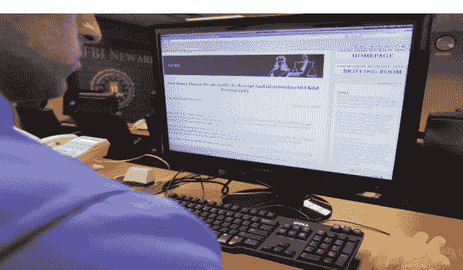

**图 10.2：** 一名正在操作计算机的 FBI 探员。来源：http://www.nj.com/news/index.ssf/2012/12/a_depraved_world_fbi_agents_wa.html*

## 10.1.5 犯罪分类学

罪犯之间的差异转化为不同的网络行为模式。罪犯参与网络儿童色情内容的程度、与其他罪犯建立网络联系的程度、利用安全策略规避检测的专业知识，以及其网络行为涉及直接性侵儿童的程度各不相同。建议了以下儿童色情犯罪分类法：

- (1) 浏览者：偶然发现儿童色情内容但有意保存图像的罪犯。他们没有参与与其他罪犯的的网络联系，也不采用安全策略来规避检测。他们的浏览是对儿童的间接虐待。

- (2) 秘密幻想者：罪犯创建数字图像（例如通过变脸技术/morphing）供私人使用，以满足个人性欲望。这些罪犯不与其他罪犯建立网络联系，不采用安全策略，他们的私人幻想是对受害者的间接虐待。

- (3) 不安全收集者：这些是在非安全聊天室（即未采用密码等安全屏障的聊天室）以及互联网其他开放层寻找儿童色情内容的罪犯。他们参与了较高水平的网络活动，根据定义，不采用安全策略。

# 内容相关网络犯罪 239

他们的收集行为是对儿童的间接虐待。由于其活动的非安全性，他们能收集的图像数量和性质存在限制。

- (4) 掠网者：这些通过开放式浏览器在网络上寻找儿童色情内容的罪犯。他们可能参与极少网络活动，但使用的安全策略很少，他们的掠网是对受害者的间接虐待。

- (5) 物理虐待者：这些是性侵儿童的罪犯，对儿童色情内容的兴趣只是其恋童兴趣的一部分。他们可能会记录自己的虐待行为供个人使用，在这种情况下，从法律角度来看，拥有色情内容的意义次于其记录的虐待行为证据。他们可能参与也可能不参与网络活动。根据定义，物理虐待者直接虐待受害者，其安全性取决于儿童的沉默。

- (6) 安全收集者：是封闭新闻组或其他秘密恋童圈的成员的罪犯。他们参与了高水平的网络活动，并采用复杂的安全措施来保护其活动不被发现。他们的收集行为是对儿童的间接虐待。由于他们占据互联网的隐藏层，他们可以获取广泛的图像。

他们可能会进行痴迷式的收集，这不仅涉及积累大量图像，还包括对其进行细致的分类和交叉引用。

与其他类型的收集一样，他们可能会花费大量精力来获取稀有且极其珍贵的图像。收集本身可能变成一种目的。

- (7) 诱导者（Groomers）：这些与儿童建立在线关系，并在诱导过程中向儿童发送色情内容的罪犯。诱导涉及对儿童的直接虐待。他们可能参与也不参与与其他罪犯更广泛的网络，但他们的接触使面临被发现的风险。儿童可能会向某人透露关系，或者罪犯可能在无意中与卧警察交流。

- (8) 分发者：参与传播虐待图像的罪犯。在某些情况下，他们对儿童色情有纯粹的财务利益。更多情况下，上述任何层级的罪犯

# 数字取证与调查：从数据到数字证据

分享图像的人可能被归类为分发者。因此，分发者的网络范围、其安全水平以及是否参与直接性侵儿童取决于其运营的水平。

- (9) 生产者：他们是记录儿童性虐待以向他人传播的罪犯。他们的网络活动范围取决于他们是否也是分发者。再次，生产者对受害者的直接虐待危及了其安全性。

## 10.1.6 数字证据来源

计算机及其相关服务保留了大量的此类证据。坚决且精通计算机的罪犯可能会采取预防措施掩盖踪迹，但许多罪犯既缺乏远见也缺乏必要的专业知识，从而会留下犯罪线索。

- (a) 罪犯的计算机：保存在计算机硬盘上的下载图像是使用色情内容最明显的证据。然而，技术人员在检查嫌疑计算机时可以发现更细微的记录。例如，日志文件显示了谁在何时登录计算机；现代日志记录了计算机连接互联网的时间；浏览器历史记录显示了罪犯的在线活动；电子邮件和聊天日志揭示了与同行或潜在受害者的交流。然而，收缴嫌疑计算机需要专业知识，如果处理不当，可能会导致关键证据丢失。

- (b) 手持设备越来越多的设备包含计算机组件（称为嵌入式计算机系统）并用于儿童色情。这些设备包括数码相机、个人数字助理（PDA）和手机。例如，数码相机可记录虐待；文件可以很容易地上传到互联网。同样，除了与犯罪者的语音通话外，手机越来越多地允许记录、存储和传输数字图像。这些设备的存储卡中可能存有犯罪记录。


与内容相关的网络犯罪 241

-   *服务器*：不同的服务器可能提供用于追踪色情使用情况的信息。ISP 认证服务器记录与 IP 地址关联的客户帐户详情（认证日志），这些日志可用于识别用户。用于上传和下载电子文件的 FTP 和网络服务器拥有日志，记录用户的 IP 地址、访问了哪些文件以及访问时间。同样，邮件服务器保留了客户使用的日志。局域网服务器可能被用于存储个人使用的色情集合。个人可能会使用连接到其工作电脑的本地服务器，因此搜索嫌疑人的工作服务器可能会发现隐藏的色情集合。
-   *在线活动*：专门定制或市售的数字引擎软件允许执法人员监控在线活动并识别聊天室贡献者的 IP 地址。尽管在线操作可以为犯罪分子参与互联网儿童色情活动提供确凿的数字证据，但警员应注意不要因过于热衷而陷入陷阱犯罪。

## 10.1.7 儿童色情的影响

随着过去 20 年人们对互联网的接受程度不断提高，近期儿童色情的威胁对儿童的绝对纯洁构成了威胁。人们公认，以性显露方式描绘儿童的图片是错误的，因为儿童并不知道被性化呈现所导致的结果。社区已达成共识，儿童应该保持性上的纯洁，绝不应暴露在成人的性剥削之下。

在色情制品中，研究显示所谓的偏差行为与经常观看色情图像和视频之间存在强烈的联系。事实证明，观看合法色情内容的成人更有可能与其现实生活中的性伴侣一起实践他们在色情电影中看到的行为。合法色情以一种方式容纳了性幻想，使成人能够自由地对其他成年人产生性幻想。然而，当这种行为转化为儿童色情时，可能会产生严重的社会后果。

许多社会专家和犯罪学家进行的研究揭示了，恋童者和儿童强奸犯往往受到儿童色情的启发。这种因果关系对于维持儿童色情的犯罪性具有重要意义。许多司法管辖区还对被发现携带儿童色情的儿童猥亵者提供了更严厉的判罚。这种趋势足以在儿童猥亵发生率上创造出一个独特的问题。因此，儿童色情的非非法性是一种预防性措施。

这些受到色情侵害而陷入危险的儿童，由于非法色情图像在性掠食者的秘密网络中发布和分发，会不断被提醒起遭受性剥削期间的痛苦经历。

儿童纯洁的安全是整个社区关注的焦点，不应接受任何形式的儿童色情，因为它特别破坏性，因为虐待持续的时间比第一次剥削要长。即使色情内容被删除或或其他销毁，对儿童成长的心理影响也非常显著。流传的儿童色情图像对于处于回忆状态的受害者来说是折磨。甚至出现过受害者试图向下载过儿童色情图像的人寻求赔偿的情况。

儿童色情是一个严重的社会问题，因为它是一种不仅影响受害者亲属的犯罪；它是一种影响整个社区的反社会行为。因此，对儿童色情的所有者、生产者和分销者的惩罚无疑是极其严厉的。无论政府还是社会都不应容忍这种犯罪，这种犯罪的实施者不应被免于惩罚。

## 10.2 仇恨言论

针对种族主义制定法律应对措施的首要困难在于如何解释它。缺乏普遍接受的定义令人惊讶，因为种族本身是一个社会建构，没有实际基础。

种族的概念仍用于政治工具和当代法律中，以确定人们根据国籍、民族和出生地等物理和社会群体产生的感知差异。由此，种族主义被用作一个术语，用来讨论价值观、行为和态度的结合，这些因素根据民族、种族、文化习俗、本土性、出生地，在某些情况下根据宗教信仰排除他人。

与内容相关的网络犯罪 243

仇恨言论无论是通过语言、图像还是符号，都是种族主义的明显表现。据说，其准则是合理的，理由是福祉和安全，以及对目标社区的伤害，因为目标社区可能将此类表达视为排外主义和受害心理倾向的信号。种族主义被认为吞噬了平等、公正和体面地对待他人的道德失败。对“仇恨言论”采取的法律措施是对某些态度的公共限制，这些态度阻碍了多元文化价值和与自由民主相关的平等价值的实现。对这种共同成本的违反使得种族侮辱成为“一种普遍的错误”。

理解种族主义犯罪存在两个额外复杂问题的矛盾。第一个是，将“种族主义”一词应用于对民族、语言、国籍、移民身份或部落宗教等重叠特征的偏见表达。在不调节各种形式歧视的独特病因的情况下，这些歧视基础之间的界限很容易被跨越。例如，澳大利亚阿拉伯人报告的针对他们的歧视性行为可能是基于一种假设，即穆斯林人因此在排外主义受害者之间制造了种族与宗教之间的不平衡。其次，很难区分哪些种族主义表达是需要禁止的，哪些不需要，换句话说，问题在于如何在言论自由与保护免受种族主义言论伤害之间取得平衡。自由民主国家采取了多种细致的方法，这些方法建立在不同的历史、制度和政治框架之上。在光谱的另一端，美国通过判决种族主义来保护国家利益，限制言论自由的消除趋势。然而，尽管有限制，美国通过对宪法修正案的解释加强了对挑衅性言论的保护。这一问题在2016 年被明确提出，当时在总统大选后出现了种族歧视（见图 10.3）。相比之下，欧盟的司法管辖区在过去的几十年里稳步扩大了对种族主义者视角的保护。这在法国得到了体现，法国采取了强硬的立法，近年来出现了针对仇恨言论的大量起诉。

新技术（如数字或汽车技术）的引入产生了新的犯罪手段和规避检测的新方法。这些挑战的法律原则存在于网络犯罪领域。在将法律政策应用于在线言论时，我们必须充分理解网络犯罪以及互联网与法律的关系。


图 10.3：NBC记录的选举仇恨言论。

来源：https://www.nbcnews.com/nightly-news/video/hate-speech-is-on-the-rise-following-u-s-presidential-election-824559171837

### 10.2.1 案例研究

阿姆斯特丹上法院（2006年11月17日，LJN AZ3011）对被告在网站上发表针对犹太人和同恋者的歧视性陈述判定有罪。发表如“又一个令人白昼的法外犹太人”和“直到今天犹太人仍然表现得像兽一样”等言论是不合理的冒犯。法院认为互联网是言论自由的绝佳手段，但认为考虑到任何人都可以毫无障碍地发表伤害和侵犯他人的文本，而此类出版并没有任何体面的目的，互联网的可接受范围是有限的。被告辩称该网站是吸引读者对其梅尔·吉布森的《基督受难记》专栏关注的“轻微挑衅、幽默刺痛”的手段，这一观点被驳回了；法院认为，在没有这些严重段落的情况下，同样可以进行辩。因此，被告被罚款 500 欧元。


与内容相关的网络犯罪 245

以及处1周徒刑并缓期执行2年。

## 10.2.2 仇恨言论的国际法

### (a) 欧洲框架

以下是欧洲理事会部长委员会1997年《建议》中包含的定义：“‘仇恨言论’一词应理解为涵盖所有传播、煽动、促进或证明种族仇恨、排外主义、反犹太主义或其他基于不容忍的仇恨形式，包括：通过侵略性民族主义和民族中心主义表现的不容忍，对少数群体、移民和移民人士的歧视和敌视。

欧洲理事会反种族主义和不容忍委员会（ECRI）精心准备的2002年《建议》（发布为第7号建议）也未提供更狭义的定义。”18. 法律应当惩处故意实施以下行为：

- (a) 公开煽动暴力、仇恨或歧视，
- (b) 公开侮辱和诽谤，或
- (c) 基于种族、肤、语言、宗教、国籍或国家/民族出身对个人或群体进行威胁；
- (d) 带有种族主义目的，公开表达声称某群体具有优越性或贬低、诋毁基于种族、肤、语言、宗教、国籍或民族出身的群体的意识形态；
- (e) 带有种族主义目的，公开否认、轻描描写、证明或纵容种族灭绝罪、危害人类罪或战争罪；
- (f) 带有种族主义目的，公开传播或分发，或以公开传播或分发为目的制作或存储包含第18条 a)、b)、c)、d) 和 e) 款所涵盖表现形式的书面、图片或其他材料；
- (g) 创建或领导一个促进种族主义的团体；支持此类团体；并参与其活动，意图对第18条 a)、b)、c)、d)、e) 和 f) 款所涵盖的犯罪做出贡献；
- (h) 在行使公职或职业期间的种族歧视。

### (b) 联合国

联合国人权委员会认为有必要在其关于适用《公约》第19条和第20条的建议中，包含直接涉及仇恨言论的规定。这些规定是在前段提到的一般原则之外：

- 46. 缔约国应确保反恐措施与第3条兼容。如“鼓励恐怖主义”和“极端活动”等犯罪，以及“赞扬、歌颂”或“证明”恐怖主义的犯罪应明确定义，以确保它们不会对言论自由造成不必要或不成比例的干扰....

- 48. 禁止表现对宗教或其他信仰体系缺乏尊重的行为与《公约》不，但在《公约》第20条第2款规定的特定情况下除外。此类禁止还必须符合第19条第3款的严格要求，以及第2、5、17、18和26条的规定。因此，任何此类法律都不允许对某一或某些宗教或信仰体系或其信徒相对于其他宗教或宗教信徒、非信者进行歧视。

此类禁止也不允许用于阻止或惩罚对宗教领袖的批评，或对宗教教义和信仰信条的评论。

- 49. 惩罚对历史事实发表意见的法律，与《公约》对缔约国在意见和表达自由方面规定的义务不兼容。《公约》不允许普遍禁止对错误意见或对过去事件的错误解释进行表达。不应对意见自由权施加任何限制，在表达方面，这些限制也不应超出第3条允许范围或第20条的要求。

## 10.3 网络恐怖主义

美国联邦调查局（FBI）将网络恐怖主义定义为针对计算机系统、计算机数据、程序和其他信息的预谋攻击，其唯一目的是对秘密特工和次国家团体实施暴力。2004年，FBI（报告）重新定义网络恐怖主义为“利用计算机和电信能力实施的犯罪行为，导致人口的暴力、破坏和不稳定，其目标是在给定人群中制造恐惧和不确定性，以推进政治或意识形态议程”（FBI，2004）。网络恐怖主义的主要目的是造成伤害和破坏。网络恐怖主义是网络空间与恐怖主义的结合。它指的是针对计算机、网络和存储信息的非法攻击，以影响政府或民众。此外，要符合网络恐怖主义定义，攻击应当导致人员或财产的暴力，或至少造成严重的伤害或经济损失。目前已提出了许多情景：其中一种是，网络攻击区域电网，导致长时间停电和死亡；另一种是，网络恐怖分子入侵空中交通控制系统；第三种是，网络恐怖分子干扰银行、金融交易和股市，导致经济中断。网络恐怖分子包括国家支持的和非国家行为者；跨国恐怖组织、叛乱分子圣战分子已将互联网作为策划攻击、激进化和招募、宣传传播方法以及通信手段。虽然已发布关于针对美国基础设施关键组件网络攻击的未分类报告，但已证明通过互联网攻击关键维持系统的漏洞。假设网络恐怖分子是专业的、富有创意且非常聪明的。他们将寻求非传统和原创的方法来实现目标。受过传统信息安全技术训练的人并不适合成为网络恐怖分子，因为他们接触过经典的安全技术和理论。网络恐怖分子将寻求通过经典安全机制无法缓解的技术完成使命（Petrov, R., 1999）。

### 10.3.1 网络空间作为新的恐怖主义领域

只需击键盘，就可以促进身份窃取、计算机病毒、黑客攻击、恶意软件使用、破坏和数据操纵。这种以计算机为目标的使用计算机的行为，描绘了“传统的”

网络恐怖主义的图片。自20世纪80年代初以来，黑入计算机已经发生，现在恐怖主义与网络空间正发生交汇，通过针对连接互联网的系统和计算机发动攻击来制造恐惧。在我们这个依赖计算机的社会中，很容易在网络空间的匿名性中引发破坏。随着企业、政府和个人极易受到远程攻击和数据滥用，全球范围内的网络安全威胁日益加剧。网络安全专家担心，只需点击鼠标，就可能导致主要基础设施乃至国家的电力系统瘫痪。信息和通信技术渗透到世界上许多关键基础设施中，并加强了全球经济。许多人在这场新的网络恐怖主义战争中获胜。

恐怖分子已进入网络空间，以便利如炸弹等传统形式的恐怖主义。他们利用互联网进行通信、协调活动并推进其计划。虽然此类活动在严格意义上不构成网络恐怖主义，但它表明恐怖分子在使用新型信息技术方面具有某些能力。然而，即使在民主国家，恐怖分子在网网上发布的内容也是受到限制的。一个反堕产团体建立了一个恐吓执行流产医生的网站，联邦陪审团下令删除这些页面并判赔了超过1亿美元的赔偿金。《纽伦堡文件》在“婴儿屠夫”的标题下列出了约200名堕产提供者。读者被邀请发送此类个人信息，如医生地址、车牌号和孩子的姓名。出现在名单上的三位医生被杀，在每起案件发生后，医生的名字被立即划掉。网站上被点名的医生作证，他们生活在不断的恐惧中，并使用伪装、保镖和防弹衣。联邦陪审团在下令关闭网站时表示，该网站和“告示”海报构成了对医生的死亡威胁。

许多恐怖分子正在使用加密来隐藏他们的通信和存储的文件，这增加了提供有效反恐措施的难度。例如，据报道，哈马斯使用加密的互联网通信来传输与恐怖攻击相关的地图、图片和其他细节。拉姆齐·尤瑟夫（Ramsey Yousef）是负责在1994年炸弹世界中心和1995年底炸毁马尼拉航空客机的国际恐怖组织成员，他曾对其笔记本电脑上的文件进行加密。美国政府官员解密的这些文件包含了进一步计划在远东炸毁11架美国拥有商业飞机的信息。

# 数字取证与调查：从数据到数字证据

奥姆真理于1995年3月在东京地铁投放毒气，导致12人死亡，6000人受伤，该组织也使用加密来保护他们的计算机记录，其中包括在日本和美国部署大规模杀伤性武器的计划和打算。

# 10.3.2 反网络恐怖主义的战争

应对网络恐怖主义的国际合作在政府与执法机构之间以不同形式的关系存在。合作努力分为三类：国际和全球努力、多边和跨国努力以及区域努力。

# (1) 国际和全球组织的努力

## (a) 联合国

联合国是负责协调和合作国际恐怖主义问题的领先组织。在他们的决议中，他们要求成员国对信息安全领域的现有和潜在威胁进行多边考虑，以及限制威胁的可能措施。这些决议的共同目的是是提高国际和国家层面的网络安全意识。然而，在9·11惨剧之后，安理会第1373号决议迈向打击恐怖主义。该决议的目标是反恐工作。该决议首次提供了国际承认的恐怖定义，这似乎对无论动机如何针对国际平民的所有暴力形式实施了包容性禁止，并号召各国起诉恐怖分子。

## (b) 国际刑警

国际刑警的基础是即使在特定国家之间不存在外交关系也能预防和打击国际犯罪，它在法律框架和犯罪现象的范围内运作。2002年9月，在发生引起震惊的国际恐怖袭击后，国际刑警建立了一个反恐部门，称为“融合任务小组”（Fusion Task Force）。其主要目标是：
- 识别活跃恐怖组织及其成员并收集并共享情报
- 提供分析支持
国际刑警已将公共安全和恐怖主义确定为重点领域，各国可以从国际刑警在打击恐怖主义方面的独特地位中获益。

# (2) 区域组织的努力

## (a) 欧盟

在马德里发生恐怖袭击后，欧盟及其成员承诺尽全力打击各种形式的恐怖主义。因此，2004年12月，欧洲议会通过了纪念恐怖主义受害者的决定。欧洲公约涵盖了服务提供商、跨境追诉、关于定罪的交换交换等方面，欧洲警务组织（Europol）框架实施了申根信息系统（SIS）。

# (3) 多边和跨国组织的努力

## (a) 英联邦国家

英联邦国家的主要的主要任务是统一其国家的法律。它制定了《计算机及相关犯罪模型法》，对国内立法产生了巨大影响。它扩大了对干扰数据、干扰计算机系统和使用非法设备犯罪刑事责任。英联邦的另一项任务是考虑英联邦成员与非英联邦成员之间的法律协助。英联邦法律部长提议成员国将网络恐怖主义公约作为法律协助的基础。

# 数字取证与调查：从数据到数字证据

## (b) G8论坛

G8论坛是一个非正式论坛，因此与国际组织相比缺乏行政结构。G8小组最初于1975年成立，有六个成员，被称为G6。加拿大于1975年加入，俄罗斯于1998年成为正式论坛。自1975年以来，美国、英国、法国、德国、日本、加拿大、意大利和俄罗斯的领导每年会面讨论重要问题，包括犯罪、恐怖主义以及信息高速。


图10.5：在北尔兰举行的G8峰会。来源：http://en.kremlin.ru/events/president/news/18358

## (c) 欧洲委员会网络恐怖主义公约

欧洲委员会网络恐怖主义公约于2001年制定，旨在通过互联网和其他信息网络进行的几类犯罪。它是关于这一问题的首个也是唯一的国际条约，其主要目标是“通过采取适当立法和加强国际合作，追求保护社会免受网络犯罪的共同刑事政策”。公约为制定全面的反网络恐怖主义国家立法提供了通用框架，以及缔约国之间的国际合作。为了使该公约更有效，它需要扩大其目前在欧洲的相关性和应用范围。然而，该公约仅涵盖了通过互联网和其他计算机网络进行的犯罪，特别是处理


## 与内容相关的网络犯罪 253

“侵犯版权、计算机相关欺诈、儿童色情制品和违反网络安全”（《网络犯罪公约》，未标记）且未专门包括网络恐怖主义。为了成为一项有效的机制，必须将网络恐怖主义包含。

截至目前，已有国家成为该公约的签署国，包括美国在内的国家已批准该公约。缔约国必须根据国内法律对上述列出的四类计算机相关犯罪定义刑事犯罪和制裁。

公约还要求缔约国建立检测、调查和起诉计算机犯罪的国内程序，并收集任何刑事犯罪的电子证据。它还要求缔约国在最大范围内参与国际合作。

关于是否应该有一个全球性标准（无论是该公约还是其他实体）来处理网络犯罪，一直存在争议。有人建议，全球公约有助于各国协调其网络犯罪领域的立法。其中一个观点是，各国之间相似的立法可以加强国际合作，因为许多国家基于“双重犯罪性”原则提供相互法律协助，即在一个国家属于违法的行为在另一个国家被视为犯罪。然而，其他人对支持打击网络犯罪的全球性标准表示保留。

## 10.3.3 有效执法

执法机构在应对网络恐怖主义方面仍面临许多挑战。计算机技术的快速发展增加了全球网络恐怖主义的频率和影响。这些网络恐怖分子继续在一个无边界的环境中运作，因为他们没有单一的国际立法。各国处理网络恐怖主义行为的技术能力各异，且执法机构之间的协调受到外交政策和政治意识形态的限制。全球执法机构在资金和网络恐怖主义专业培训人员方面也受到资源限制。这反过来引发了开发向执法机构传输和共享网络威胁数据机制的问题。有人认为，目前的国际立法环境对实施网络恐怖主义的犯罪者的威慑有限或没有。为了让各国反击网络恐怖主义，政府、各自的执法机构和行业停止部门化运作至关重要。协调的国际行动是解决这一日益影响各国的全球性问题的唯一途径。所有政府、IT、执法和法律部门都需要发生文化转变。执法机构和行业需要合作以改进信息共享，特别是在识别和警惕新出现的威胁（包括攻击模式）方面。针对律师、司法人员和公众的网络恐怖主义全面教育和意识计划，也有助于提高网络恐怖主义起诉的可能性。行业和执法机构还必须增加并提高对法律程序以及司法程序过程中证据收集和呈现要求的理解。这将促进更准确的系统化调查，并使更可靠的信息提交至法庭。

# 参考文献

- 1. Casey, E. (2004). 计算机犯罪调查手册: 取证工具与技术. Elsevier Academic Press. 2018年4月4日 检索，自 https://epdf.tips/queue/handbook-of-computer-crime-investigation-forensic-tools-amp-technology.html
- 2. 网络犯罪公约 – 摘要. (未标记). 2018年4月4日 检索，自 http://conventions.coe.int/Treaty/en/Summaries/Html/185.htm 欧洲委员会
- 3. Johnson, T. (2006). 计算机犯罪取证调查. Boca Raton, Florida: CRC, Taylor & Francis.
- 4. Marcella, A., & Menendez, D. (2008). 网络取证: 收集、检查和保存计算机犯罪证据的手册. Auerbach Publications: Florida.
- 5. Nelson, B, Phillips, A., & Steuart, C. (2010). 计算机取证与调查指南. Cengage Learning.
- 6. Taylor, M., & Quayle, E. (2003). 儿童色情: 一种网络犯罪. London: Brunner-Routledge.

## 目录

- 1. Ackerman, E. (1997). 当痴迷变得不祥. U. S. News & World Report, 12
- 2. Barymare, V., & Tushabe, F. (2004). 数字过程模型. Baltimore, St.
- 3. Beebe, N., & Clark, J. (2004). 数字调查的层级框架. Baltimore, St.
- 4. Beebe, N. (2009). 好的、坏的以及... 信息与通信技术, 30
- 5. Bellovin, S. (1988). TCP/IP 协议族的安全. Computer Review, 6
- 6. 加州刑法典 1999.
- 7. Carvey, H. (2001). 网络骚扰势头增长. Security Bulletin, 5
- 8. Hendren, J. (1997, 5月25日). 这
- 9. Casey, E. (2004). 网络流量作为证据来源. Digital Investigation, 1(1)
- 10. Casey, E., Daywalt, C., & Maguire, T. (2009). 数字取证与调查. Baltimore, Seer.
- 11. Comer, D. (1995). 使用 TCP/IP 联网 卷 I: 原理、架构. Upper Saddle River, NJ
- 12. Espiner, T. (2006). 手机取证“漏洞”.
- 13. Halder, D., & Jaishankar, K. (2008). 印度针对女性的网络犯罪: 问题与解决方案. Academic Journal, 3(1)
- 14. Hassan, B. (2005). 网络空间中的权利与安全. Tehran: Akbar Contemporary Institute of Studies.
- 15. Held, G., & Hundley, K. (1999). Cisco 安全架构. New York: John Wiley Sons
- 16. Henry, P., & De Libero, G. (1996). 战略网络: 从 LAN 和 WAN 到信息高速公路. Massachusetts: International Publishing Company.
- 17. Sutton, S., & Haantz, S. (2003). 网络跟踪. 检索自 http://www.nw3c.org
- 18. Hua, T. (1998, 5月5日). 因恨邮件被判刑. 洛杉矶时报.
- 19. Jansen, W. (2005). 移动设备取证软件. 发表于 Techno Forensics 2005, Gaersburg, MD, USA.
- 20. Maharaj, D. (1997, 12月2日). 美国将对恨邮件案件进行重审. 洛杉矶时报.
- 21. Malin, C., Casey, E., & Aquilin, J. (2008). 恶意软件取证. Syngress.
- 22. McGraw, G., & Felten, E. (1996). Java 安全: 敌意程序、漏洞与对策. New York: John Wiley Sons
- 23. Meloy, J. (1996). 跟踪（痴迷跟踪）: 初初步研究的回顾. Aggression and Violent Behavior, 1(2)147-162.
- 24. Meloy, J. (1998). 跟踪心理学: 临床与法医学


视角。圣地亚：学术出版社。

- 27. McCarthy, P. (2005). 手机取证分析。（未出版的计算机与信息科学（荣誉）学位）。阿德莱德：南澳大学。

- 28. Meloy, J., & Gothard, S. (1995). 精神疾病强迫症追随者与犯罪者的人口统计学和临床比较。《美国精神病杂志》。152, 258-63。

- 29. Mishra, R.C. (2001). 犯罪趋势与刑事司法。德里：作者出版社。

- 30. Morley, D. (2008). 变化中的社会中的计算机（第3版，第196-199页）。Cengage 学习课程技术。

- 31. Morris, R. (1985, 2月). 4.2BSD UNIX TCP/IP 软件的一个漏洞。计算科学技术报告 117，AT&T贝尔实验室。

- 32. Neumann, P. (1995). 与计算机相关的风险。纽约：ACM Press。

- 33. Plonka, D. (2000). FlowScan: 一种网络流量报告和可视化工具。Usenix。

- 34. Pica, G. (2011). 犯罪学（A. H. Najafi Abrandabadi 译，第2版）。Mizan 出版。

- 35. Reiter, L. (1998, 5月5日). 消除电子邮件骚扰。《记录报》，第 LO199 页。

- 36. Reno 诉美国公民自由联盟，(1997)。 法庭记录上线：体面法裁决可能改变互联网的性质。《美国律师杂志》，83, 42。

- 37. Sableman, M. (1995). 网络上的责任：本土生长的还是强加的？《圣路易斯新闻评论》，26, 11。

- 38. Stephens, G. (1995). 空间空间的犯罪。《未来主义者》，29(5), 24-29。

- 39. Shelley, G., Cashman, T., & Vermaat, M. (2004). 发现计算机：信息的门户。波士顿：汤森。

- 40. Vacca, J. (2002). 计算机取证计算机犯罪现场调查。马诸州：查尔斯河媒体。

- 41. Yeschke, C. (2003). 调查访谈的艺术（第2版）。波士顿：Butterworth Heinemann。

- 42. Ziembca, S. (1998, 5月26日). 威尔县关注网络犯罪分子。《芝加哥论坛报》，第1页。

# 索引

# A

# C

抽象数字取证模型 (ADFM) 26

儿童色情 230, 231, 232, 233, 234, 235, 237, 238, 239, 240, 242, 253, 255

访问控制列表 (ACL) 93

**接证据** 15, 196, 201, 202

已得知识 26

证据获取 131

云计算服务 122

实际破坏 98

云服务提供商 (CSP) 112

亚马逊弹性计算云 (EC2) 121

云转型 124

亚马逊机器映像 (AMI) 122

码分多址 (CDMA) 131

亚马逊简单存储服务 (S3) 122

收集与互联网相关的证据 53

亚马逊云服务 (AWS) 114

联邦制国家 251

苹果 Macintosh 系统 91

公有云 110

应用实现 94

通信 191, 192

应用程序编程接口 (API) 85

通信技术 210

方法策略 27

复杂信息威胁 167

适当收集 174

全面的取证分析 12

攻击检测措施 164

全面的网络安全 175

汽车技术 243

# B

包含头部结构 82

二进制结构 97

业务合理性 173

计算机分析与响应小组 (CART) 4

# 数字取证与调查：从数据到数字证据

犯罪 251

计算机取证 38, 40

计算机取证模型 (CFM) 32

计算平台 132

内容分发网络 (CDN) 123

传统的数字方法论 104

版权材料 19

犯罪活动 7

刑事起诉 200

关键风险 32

数字取证调查 8

数字取证 22, 46

数字取证框架 134

数字取证软件 47

数字信息 188, 197

数字调查员 78, 98, 99

数字研究研讨会 25

直接通信 213

直接网络骚扰 212

显示信息 86

书证证据 196

记录数据破坏 78

客户关系管理 (CRM) 108

网络犯罪 180

网络空间 247, 249

网络骚扰 209, 210, 211, 212, 214, 217, 218, 220, 221, 222, 223, 228

网络恐怖主义 230, 247, 249, 250, 253, 254

电子通信隐私法 (ECPA) 185

电子证据 3, 5

电子序列号 (ESN) 146

数据获取 137

数据破坏 98, 99

数据安全 106, 123

数据耗时 145

部署额外硬件 113

特定通信的目的地 191

数字犯罪 43, 44

数字犯罪现场分析 (DCSA) 33

数字设备 28

加密 18, 19

企业私有云 108

欧洲犯罪委员会 (ECRI) 245

检查网络流量 166

交换信息 62

辩护证据 195, 201, 202

专家证据 197

联邦调查局 (FBI) 4

联邦政府 194

文件分配表 (FAT) 77

文件完整性评估 (FIA) 176

文件完整性检查 169, 170

文件名层 77

文件系统结构 86

完成 206

取证案例 (FCR) 137

取证科学 197, 208

取证工具包 8

取证需要移动通信 130

取证工作站 135, 136, 139

任务小组 (FTF) 250

技术 210

特定信息 161

信息技术 (IT) 104, 184

基础设施即服务 (IaaS) 104

即时消息传递 38, 39

即时通讯工具 (IM) 59

集成电路卡识别 (ICCID) 132

集成开发环境 118

集成数字调查过程 (IDIP) 28

# G

通用计算机取证调查模型 (GCIP) 45

全球通信 213

全球定位系统 (GPS) 3

谷歌应用引擎 (GAE) 117

图形界面 88

国际合作 250

国际移动设备标识 (IMEI) 138

国际组织 252

计算机证据国际组织 (IOCE) 4

互联网色情 231, 232, 237, 241

互联网社区 59, 61

无论如何互联网 59

互联网浏览器 (IE) 59, 62

互联网信息服务 (IIS) 117

互联网邮件访问协议 (IMAP) 56

互联网协议 (IP) 11

互联网实时聊天 (IRC) 57

互联网服务提供商 (ISP) 82

网络骚扰者 214, 216

入侵者安装 89

入侵检测 (ID) 158

入侵检测系统 (IDSs) 55

# H

言证证据 196

分级文件系统+ 93

基于主机系统 168, 169, 174

主机漏洞 (HR) 103, 174

人类资源 108

人权委员会 246

混合云 107

超文本标记语言 (HTML) 57

超文本传输协议 (HTTP) 56

虚拟机 221

# I

取证科学的影响 99

信息与通信

非故意谋杀 193

网络接口 166, 171

网络延迟 125

网络态感知 (NetSA) 58

网络交易审计 177

网络漏洞 171, 172, 173, 174

# J

陪审团指示 206

即时生产 111

# L

执法级别 3

执法人员 189

法律证据 195

Linux 社区 134

Linux 系统 85

新技术文件系统 (NTFS) 78

# O

操作系统 56, 65, 66, 67, 68, 70, 76, 79, 80, 88, 90, 95

操作系统临时文件 73

功能优化问题 73

Macintosh 操作系统 92

过杀 193

宣传发行方法 247

氧手机管理器 (OPM) 135

# P

微软 Windows 操作系统 36

极化管理努力 104

执行网络取证 63

个人数字助理 (PDAs) 2, 134

移动目录号码 (MDN) 147

移动识别码 (MIN) 147

个人信息 132, 140

个人身份信息 (PII) 9

移动手机设备 133, 154

监控云性能 125

多租户环境 124

物理计算资源 116

物理证据 201

物理蜜罐程序 70

物理存储设备 76

平台即服务 (PaaS) 104

政治工具 242

# N

国家安全 176

网络配置信息 132

网络取证分析工具 (NFATs) 55

网络取证 52, 53, 57, 74

网络取证系统 54

# P

色情 230, 231, 232, 233, 236, 239, 240, 241, 242

实用方法 205

隐私保护法 (PPA) 187

私有云部署 109

生产机器 170

专业取证工具 134


# 索引 265

协议数据单元 (PDUs) 58
心理云视角 237
公有云计算环境-108

系统的基准配置 176

# T

目标计算机 53
电信公司 192
电信标准协会-131
电信技术 222

# Q

服务质量 (QoS) 120

# R

随机存存储器 (RAM) 4
实时追踪 3

电话通信 191
临时互联网 39
时分多址 (TDMA) 135

# S

申根信息系统 (SIS) 251
安全套接层 (SSL) 123
自监控、分析与报告技术 (SMART) 13
服务水平协议 (SLA) 124

追踪设备 191
传输控制协议/网际协议 (TCP/IP) 53
跨国恐怖主义组织 247

# U

性幻想 241
简单邮件传输协议 (SMTP) 56
最简单文件系统 78
最简单 Windows 系统单点登录 (SSO) 115
社交网络 223
社交网络 59
软件即服务 (SaaS) 104
特定数据元素 137
特定程序 100
隐写术 18, 19
用户身份识别 136
用户身份识别模块 (SIM) 3
后续数字信息 3
实质证据 33
支持文件识别 92
包含...结构的系统 72

统一资源定位符 (URLs), 35
联合国 250

# V

有价值数据 100
虚拟计算机 (VC) 114
虚拟数据中心 (VDC) 119
虚拟桌面基础设施 (VDI) 114
虚拟专用网络 (VPN) 18
自愿杀人罪 193

# W

Web 浏览器应用 39
Windows Azure 平台 (WAP) 117
运行中的 Windows 系统 84

