# 数字取证入门指南

## 前言

### 目的与方法

大多数技术书籍倾向于以工具为中心，并且通常采用“食谱式”的方法来描述如何使用特定工具。它们展示了大量的截图，说明“点击这里，再点击那里”的方法。这类书籍有其价值，但那并不是我想写的书。我追求的是一种能够解释数字取证概念以及这些部分是如何结合在一起的内容。这有点像是“与其授人以鱼，不如授人以渔”的主题方法。我希望写一本不依赖于特定软件版本或某项技术的书。数字取证的挑战在于睁开眼睛，洞察大局，并在行动之前进行深思。解决大多数问题的方法不止一种，只要你理解了大局，你就可以自由地使用最符合你逻辑的方法。

本书的组织结构是从数字取证的概述以及你应该了解的内容开始。这一章涵盖了取证流程、成为调查员需要具备的条件、数字取证的趋势以及一些实用资源。第 2 章描述了数字取证的方法和最佳实践。这其中大部分基于我多年开展调查时学到的知识，以及来自其他调查员的反馈。书中还包含了采集表单和顺序流程大纲，以指导调查，以及响应事件时的物资清单。执行调查的方法通常不止一种，但如果你不确定，就可以使用最适合你的方法。

第 14 章是 Otting 博士的另一个案例概述。它展示了案件如何发生意料之外的转折。第 15 章《数字取证的现实》通过回顾取证调查员将面临的各种案例和情况结束了全书。书中重点强调了大局观，并通过描述几起案件调查的展开过程来避免过早下结论。

前言是我最期待写作的部分，因为尽管它是书的第一部分，但它是最后撰写的部分——这意味着大部分工作已经完成了。写一本书就像训练跑马拉松。在活动开始前，有许多工作要做的，而且训练并不总是完全按照计划进行。会有伤病和挫折，会有你不想跑步的日子，还会有一些你无法控制的事情。就像训练一样，似乎总有更多事情可以做的——增加更多话题、找到更好的方法，或者某些本应能改变一切的新进展。底线是，你无法做到所有事情——会产生无意中的错误，你会忘记感谢某人，或者某些图表本可以更清晰——但现在是时候到达起跑线开始比赛了。因此，我希望你在《数字取证详解》（Digital Forensics Explained）中发现价值。欢迎任何反馈，以我的这个名字，在 Google 上很容易找到我。感谢，并祝你未来的事业取得成功！

`Greg Gogolin`

## 致谢

写一本书不是一项容易的任务，没有任何工作是真正是一个人的大脑成果。无论是提高写作能力、研究材料、学习在课堂上写什么内容，还是仅仅在喝格格斯啤酒时进行讨论，无论每个人是否意识到，许多人都影响了最终产品。

写作一直吸引着我。在我开始教书之前，每当我编写一些详细说明如何使用技术、技巧或业务实践的“面包屑”文档时，都会收到同事的良好反馈。这播下了一颗种子，即某一天我应该写一本技术书。来自 Auerbach/Taylor & Francis 的 Rich O’Hanley 在我的一篇文章发表于《信息安全杂志：全球视角》（Information Security Journal: A Global Perspective）后联系了我，询问我是否有兴趣写书。如果没有他的主动性——以及他极大的耐心——《数字取证详解》的第一版就不会出现。对于第二版，要感谢 Daniel Kershaw、Gabriella Williams 以及编辑团队。不言说，我非常感谢 Taylor & Francis 的员工。

数字取证是一个在细节和需求上都在爆炸的领域。我很幸运能与费里斯州立大学（Ferris State University）的一些才华的教师、技术人员和作家合作。我曾为 Barbara Ciaramitaro 博士编辑的书写过一些章节，她向我展示了合作的价值。她为本书贡献了章——社交媒体取证和社会工程取证——并在写作过程中常见的瓶颈期帮助我保持精神状态。

Jerry Emerick 和我曾在行业内共同工作，他是我我有幸合作过的最熟练的软件架构师之一。当他在 2020 年秋季成为费里斯州立大学的教授时，他仍是我我有幸合作过的最熟练的软件架构师之一。

`Greg Gogolin, PhD, CISSP,` 既是一位父亲，也是密歇根州大格拉皮德费里斯斯州立大学的优秀教授。Greg 在 1999 年成为费里斯斯州立大学的教授之前，已经在 IT 领域工作了近 20 年。在费里斯斯州立大学期间，他是信息安全与情报科学学士学位和信息安全与情报硕士学位的主要教材编写者。他曾两次获得富布莱特学者称号。在费里斯斯州立大学之前，他曾在小型公司和跨国公司担任过程序员、数据库管理员、系统分析师和项目经理。Gogolin 博士活跃于 IT 咨询领域，并是一位专门从事数字取证案件的持证私探。他拥有艺术、计算机信息系统、应用生物、计算机信息系统管理和管理学学位，并获得密歇根州立大学的博士学位。他持有 CISSP、EnCE 和 PMP 认证，并非常感谢有机会在密歇根州费里斯斯州立大学的信息安全与情报科学学士和信息系统管理硕士项目中教授世界上最优秀的一批学生。

Gogolin 博士在《信息安全杂志：全球展望》、《数字调查》、《数字取证实践》等期刊上发表过文章，并在 IGI Global 出版的《移动技术消费：机遇与挑战》、《虚拟世界与电子商务：建立客户关系的技术与应用》以及 Nova Science 出版社的《犯罪率、类型与热点地区》等书中撰写了章节。他曾在全球许多会议上进行过演讲，并就全球范围的信息安全和数字取证问题进行合作。他目前的研究兴趣是一项由国家科学基金会资助的关于损坏介质数据恢复的研究。他曾在四大洲教授过数字取证，并与智利调查警察和秘鲁国家警察的网络犯罪部门进行过培训和工作。

## 贡献者

`Barbara L. Ciaramitaro` 是恩布里-里德尔航空航空大学航空学院的助理教授。Ciaramitaro 博士在商业领域拥有 30 年经验后进入学术界，其中包括在通用汽车担任 10 年高管。Ciaramitaro 博士在诺瓦东南东大学获得信息系统博士学位，并获得信息安全研究生证书；在密歇根中央州立大学获得软件工程管理硕士学位；在韦恩州立立大学获得心理学学士学位。Ciaramitaro 获得了多项专业认证，包括 CISSP（认证信息系统安全专业人员）、CSSLP（认证软件系统周期专业人员）和 PMP（项目管理专业人士）。

Ciaramitaro 博士是信息安全、社会工程、项目管理、社交媒体、虚拟世界和隐私等主题的频繁演讲者和作者。她编辑并编写了《虚拟世界与电子商务：建立客户关系的技术与应用》、《移动技术消费：机遇与挑战》以及《组织云计算中的安全与隐私：平衡风险与收益》等书籍章节——这些均由 IGI Global 出版。她是多个专业组织的活跃成员，包括 ISACA、ISC2、IEEE 和项目管理协会（PMI）。

`Molly Cooper` 是费里斯斯州立大学信息安全与情报助理教授。她在诺瓦东南东大学获得博士学位，在费里斯斯州立大学获得信息系统管理硕士学位，并在费里斯斯州立大学获得信息安全与情报学士学位。她持有支付行业专业人士（PCIP）、认证信息系统审计师（CISA）和内部安全评估师（ISA）认证。她拥有多年安全行业经验，发表过多著作，并保持着多个成员和奖金获得身份。

`Gerald Emerick` 于 2011 年秋季作为全职教师加入费里斯 ISI 项目，在此之前他在信息系统业务环境中工作了 20 年，并担任了 10 年兼职教师。在 20 年的信息系统领域，他在大型国际组织和小型组织中担任过许多不同职位。他过的职位包括管理顾问、项目经理、软件设计与开发以及数据库管理员。Emerick 教授活跃于互联网软件设计与开发以及数据库设计与管理的咨询。

Emerick 教授正在伊利诺伊大学攻读博士学位。他在格兰谷州立大学获得计算机信息系统硕士学位，在东密歇根州立大学获得商业管理学士学位。他的许多专业认证包括伦理黑客（CEH）、项目管理专业人士（PMP）、亚马逊云认证架构师助理（AWS-CSAA）和认证信息系统安全人员（CISSP）。在课堂之外，Emerick 教授喜欢与家人共度时光、骑自行车、滑水、划船、弹吉，以及任何让他享受密歇根户外活动的活动。

`Jason Otting` 是美国海军陆战队的退伍军人，曾于 1994 年至 1998 年在第 6 团服役。他结束军事生涯的目标是追求执法机会。2004 年，他成为密歇根北部某县的副警，在此期间曾担任过卧底毒品警察和网络犯罪部门的侦探。Otting 博士是费里斯斯州立大学信息安全与情报项目的助理教授，目前在密歇根州警察的网络犯罪部门积极工作。他在费里斯斯州立大学获得信息安全与情报学士学位，在费里斯斯州立大学获得信息系统管理硕士学位，并在卡皮拉大学获得博士学位。

多年来，我读过许多提供了特定工具及其操作截图的技术类书籍。每当工具更新时，这些书籍就会过时。本书侧重于理解数字取证过程所必需的方法论、技术、资源和心态。我以及各章节贡献者的哲学是：理解过程是首要的。只有在此基础上，才能有效地将这种理解应用于工具和技术中。在获得大观理解之前，试图针对某种特定工具或技术开发高水平的技能是短视的且容易出错的。任何科学领域都需要纪律性，数字取证也不例外。

数字取证是将科学原理应用于从数字设备或介质中发现信息的过程。数字取证的形式出现的时间几乎与计算机的发明一样久远，但随着数字取证流程的成熟和需求的日益增长，取证能力在过去几年取得了许多进展。数字取证可以涉及几乎任何数字设备，而不仅仅是计算机，尽管技术的演进往往快于取证能力。数字取证的常用领域包括计算机、打印机、手机、移动设备、游戏系统、应用程序（App）、全球定位系统（GPS）、生物识别系统和存储介质。快速扩张的领域包括汽车系统、物联网设备、办公设备和其他可编程设备。通常存储在设备外部的大数据已成为数字取证检查人员丰富的信息来源。

### 法医学科学

法医学科学开始的确切日期尚不清楚，因为法医学科学可以应用于许多不同的领域。诚然，几千年来人们一直在试图确定人类的死因。在约于 1248 年出现的中国书籍《洗冤录》（Hsi Duan Yu / The Washing Away of Wrongs）中，作者详细介绍了区分不同死亡影响的方法，例如溺死与窒息的区别（Kind and Overman, 1972）。近 700 年后，洛杉矶县警长部门于 1930 年在美国建立了首个犯罪科学实验室（De Forest et al., 1983）。曾担任乔治·W·布什总统和巴拉克·奥巴马总统顾问的霍华德·施密特（Howard Schmidt）被认为建立了美国首个政府数字取证实验室（Defense News, 2010）。尽管法医学科学已经进化了几个世纪，但数字取证是一项相对较新的进展。

一个事物要被视为科学，就必须研究、描述和调查其领域内的现象。其关键方面之一是，研究和调查产生的新知识必须是可重复的。通常会遵循同行评审流程，包括实验室内部和出版过程。复杂的调查可能有许多产生错误或误解的机会，而评审过程有助于减少错误发生的次数。在数字取证领域，工具和技术经常会被评审，但在法庭案件中呈现的发现往往由单一调查员完成，因此未经过核实，这种现象并不罕见。在许多情况下，数字取证缺乏像湿实验室（wet labs）等其他取证领域那样的科学严谨性。部分原因在于数字取证是一项较新的科学，另一个原因是数字技术进步之快，导致数字取证流程往往落后于技术创新的步伐。`Figure 1.1` 是该流程的流程图。

```
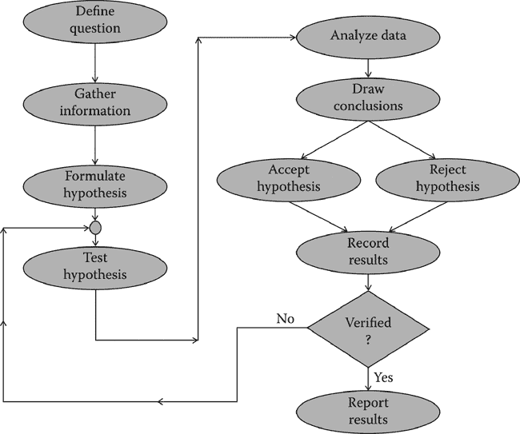
```

我想强调科学过程的三个方面。首先是明确定义问题。其次是定义一个假设。假设是对所发生情况的潜在解释。我想强调的第三个方面是许多调查忽略了对结果的验证。这种做法往往没有被执行。

数字取证不仅限于刑事调查。它可以用于企业环境，例如从受损设备中恢复文件和重建信息。恶意软件和僵尸网络研究是使用数字取证的其他领域，特别是在试图确定影响和建立基准状态时。民事案件（不视为刑事案件）通常涉及数字取证，例如离婚诉讼和侵权法。

### 成为数字调查员需要什么？

数字取证调查员需要各个领域的技能和兴趣。我对考虑进入这个领域的人提出的第一个问题是他们是否喜欢解谜。在调查案件时，除了发生了某些事情外，你可能不知道任何细节。因此，如果某人需要别人告诉他们他们发生了什么，他们可能并不适合这个领域。有时案件会提交给调查员，要求是查明计算机或设备的用途。这有时是一个开放式请求，而另一些是在特定的时间内完成。

作为法医调查员的另一个关键方面是闭口如瓶的能力。案件细节通常需要某种程度的保密性，并且必须予以维护。同样，如果有人想进入私人侦探或执法执法人员领域，可能没有犯罪记录是强制性要求。在企业环境中，调查员可能不需要执照，但他们需要在公司背景下保持高度的诚实。我曾秘密不声色地检查过许多智能手机和电脑，以确定员工违规行为的程度。结果是，在任何其他人之前，我可能就预知可能会发生哪些人事变动。

无论环境是企业、执法部门还是私人侦探，都可能需要进行背景调查。特别是在执法部门和私人侦探执照的方面，指纹注册可能是一项要求。私人侦探还需要购买债券和/或责任保险。大多数州都要求私人侦探在获得执照之前具备经验，因此刚从大学毕业的学生可能会发现，在获得个人执照之前，他们需要在他人的执照下工作。

工作本身似乎更像遵循正弦波而不是持续的流动。案件往往会扩展到多个设备和地点，这意味着工作时间很长且不稳定。对于某些案件来说，下班调查可能是常态，而且这通常在偏远地点进行。似乎规律是，案件会在你意想不到的时候出现，因此做好准备是一种良好的做法。例如，计算机取证调查通常包括对受调查的计算机进行取证镜像。通常，这意味着对存储设备进行取证镜像。复制镜像的位置应该预先进行法证级准备。如果一台电脑有一块 1-TB 的硬盘，取证镜像可以在另一个 1-TB 的硬盘上进行。这块取证镜像硬盘不应仅仅是来自零售商店、未开封盒装的新硬盘，因为不知道该硬盘上可能已经存储了什么。新硬盘通常预装了实用程序和其他程序。在使用硬盘之前，应该对其进行完全擦除并格式化。经验丰富的调查员通常会擦除硬盘，然后用十六进制字符覆盖整个硬盘。这个过程需要时间，当时间紧迫时，提前准备法证存储介质可以节省大量时间。

取证过程将在本书的后部分进行讨论，包括第 2 章，但让我们完成关于法证准备存储介质的思考。法证准备存储介质的目的是让调查员能够证明，法证镜像硬盘中包含的唯一信息是来自嫌疑设备的信息，且没有污染的证据。任何不是取证镜像部分的内容，如果目标/目标硬盘已用十六进制字符进行擦除，那么这些内容将是由于擦除过程产生的十六进制字符。哈希算法（如 `MD5` 和 `SHA-1`）也用于验证已获取精确副本，并且只要尽可能使用至少两种形式的哈希处理作为标准程序。

## 教育机会（#C02a_toc.xhtml#rsecc001_3）

要在任何职业中变得胜任，教育都是必须的，数字取证也不例外。教育可以采取多种形式，包括大学课程、参加会议、供应商课程、研讨会和自学。这些中的每项都应该经过评估，以确定它是否有助于某人朝着教育目标迈进。学院和大学教育机会可以通过多种方式进行评估。

### 数字取证调查员有哪些机会？（#C02a_toc.xhtml#rsecc001_3_1）

数字取证调查员一些较为常见的领域是执法部门、联邦政府、企业、律师事务所以及担任私人侦探。典型的执法部门职位是侦探和/或犯罪实验室人员，但某些机构会将低级取证工具更广泛地部署在整个组织中。矫正人员也可能使用取证技术来确保假释条件得到遵守。

联邦政府职位可能存在于某些机构，如 `CIA`、`FBI`、`Secret Service`、`ATF` 和国防部。大多数人没有意识到，一个广泛使用数字取证的领域是邮政总局（`Postmaster General`）。国土安全部比其他内阁级机构更频繁地承包服务，而数字取证正符合这一安排。不同的机构和部门处理方式各不相同。例如，某个地点可能是通用的数字取证实验室，而另一个地点可能拥有更高水平的专业知识。某些地点可能专门从事某些类型的取证活动，某些机构可能拥有多个级别的专业知识。

具有强大数字取证力量的联邦机构是 `NSA`，它是全球数字取证及相关技术的顶尖机构之一。希望在 `NSA` 工作的人应该考虑就读指定为 `NSA 学术卓越中心` 的大学。这些机构毕业的学生在获得职位、实习和奖学金方面通常会被优先考虑。

## 数字取证领域的企业职位

数字取证领域的企业职位在职责和重点方面存在很大差异。个人可能专注于损坏或删除文件的数据恢复、安全违规的调查，以及对近期离职员工的调查，以了解他们在离职前的几天里做了什么。此类调查的理由之一可能是为了查看个人是否参与了如复制敏感信息等不当活动。其他职责可能包括欺诈调查、员工违规行为以及研发。

特别是对于律师事务所，取证调查人员可能涉及电子取证（`e-discovery`）。`E-discovery` 使用取证工具在诉讼的阶段对计算机、网络和存储设备进行搜索。仅仅查找文件名是不够的，因为所需要的文档可能是电子邮件，或者这些信息是否存在还存在疑问。`E-discovery` 工具对计算机、网络和存储媒体进行爬取，就像搜索引擎爬取万维网一样。然而，`e-discovery` 工具爬取是为了搜索各种关键词，而不是像搜索引擎那样索引其发现的所有内容。

私家侦探可能是自雇的，也为大型机构或律师事务所工作。数字取证涉及的工具和技术可能非常贵，这可能导致人们集中在各个子领域。例如，手机取证工具的购买价格很容易超过 `$10,000`，年度维护费为数千美元。通常，调查人员需要多种工具，因此一个装备齐全的手机取证调查人员在培训和其他持续费用之外，可能会向工具投入 `$25,000`。计算机取证可能涉及类似的支出，这还未包括一些更高级的情况，如密码和加密破解技术。拥有多种工具对于寻找必要的证据和验证结果都至关重要。

## 数字取证的趋势与挑战

正在发生的一个趋势是取证调查人员的标准化和许可化。某些认证被认为是合格的。在几个州，在没有获得私家侦探执照的情况下执行数字取证服务属于刑事犯罪。执照的要求各不相同，因此应咨询相应的州机构。个人了解其居住地州如何定义数字取证至关重要，以免他们发现自己陷入了法律困境。

我针对密歇根州执法部门进行的一项基准研究（Gogolin, 2010）显示，需要数字取证服务的案件数量迅速增加，取证人员严重短缺。目前已经发展到大多数刑事案件都具有数字因素，而且往往涉及多个数字领域。监控设备以及带有应用程序的手机等物品的普及是数字因素上升的两个主要原因。社交媒体（进行计划和炫耀利用成果的地方）几乎可以保证会有数字痕迹。


手机和移动设备的拥有量和使用量在 2010 年超过了`5 billion`（BBC News, 2010）。2018 年皮尤研究中心的一项研究发现，发达经济体的手机拥有率高于新兴经济体。结果显示，美国的手机拥有率较高。皮尤研究中心发现，2015 年美国手机拥有率为`81%`（18-34 岁人群），而只有`53%`（50 岁以上人群）拥有手机。2018 年皮尤研究人员发现美国手机拥有率已升至`95%`（18-34 岁），而`67%`（50 岁以上）拥有手机。研究指出，韩国、以色列和荷兰等国的拥有率更高。这种高拥有率为通过嵌入式设备获取信息，以及通过短信、聊天和电子邮件进行信息交换提供了可能。手机与万维网及社交媒体的整合，为数字取证调查人员提供了丰富的痕迹。

大多数手机和配备摄像头的移动设备都具有`GPS`功能。这允许相机将拍摄位置的`GPS`坐标整合到图片文件中。来自手机或监控系统的图片和视频分析是一个爆炸性增长领域。图像通常需要增强以获得必要的细节，而这种图形专业知识是一项需要结合培训和技术的技能。

## 云环境

向云环境的移动正在改变数字取证领域。云计算使用池化的计算和存储资源。池化资源可能从第三方云供应商处承包，如`Apple`、`Google`或`Dropbox`。第三方通常与许多组织共享池化资源。同样，用户也可以与其他共享云空间。云架构的一个关键优势是，如果签约个人或组织短期内需要额外资源，可以从云供应商处获取资源。当他们不再需要这些资源时，只需恢复到较小的资源量。这通过消除短期购买设备的需求节省了机构资金。

云计算就像食品外卖服务。如果你想举办一场大型派对，租赁座椅比购买几张派对后就不再需要的桌椅要合理。派对结束后，座椅会被清理并归还给所有者，他们就可以将其租给其他需要的人。当下一个租客收到座椅时，它是干净的，没有证据表明你用过这些座椅。这说明了云计算对数字取证调查人员带来的挑战。当你不再需要所承包的资源时，资源会被用于其他用途。这在取证方面可能会产生多个感兴趣的情况。

## 云存储取证中的场景

- **场景 1**：如果云存储设备上的数据被删除但在重新复用时未被擦除，则可能导致不应有权访问的人员对设备上先有的数据进行重建和访问。
- **场景 2**：如果云存储中的数据在重新复用时被删除并擦除，则无法恢复数据或证物——特别是当该存储资源已被另一个实体占用时。
- **场景 3**：确定在云存储正被积极使用或正在分配给其他用途的过程中谁有权访问，这可能非常难以建立。需要考虑的可能具有访问权限的潜在方包括对方、合同方共享访问权限的人员以及云提供商的支持人员。

云环境还意味着证物可能不再包含在单一设备上，这会使发现证物的源头变得复杂。云的本质决定了资源可以被短时间使用然后重新利用，这意味着证物可能在某一刻存在，而在下一刻就消失。犯罪者可以像场景 2 中概述的那样租赁云资源。一旦犯罪者完成对资源的使用，证据就会被擦除，资源将由他人使用，这很可能完全销毁证据轨迹。这种情况实际上多年来以僵尸网络和类似技术的形式存在。云计算的进步允许恶意活动提升到一个全新的水平，这使得取证技术的进步变得更加至关重要。

## 反取证与挑战

反取证（见第 11 章）是指试图隐藏、销毁或更改证物，以防止取证分析对其进行重建。使用反取证技术可以使取证重建变得困难甚至无法实现。许多工具的目的是为使用高强度算法和技术的个人提供安全保障。几乎没有什么手段能阻止这些工具被用于意图不光明的活动，这可能会阻碍取证工作。即使已经开发出应对这些工具的方法，但这些工具和技术所需的时间计算机处理能力通常也是高得令人望畏的。

另一个与其说是趋势，不如说是世界变得越来越小的证据，是通过便捷的连接性所实现的国际化。语言和文化影响，以及犯罪分子在实施违规行为时处于不同国家的能力，为调查人员带来了诸多挑战。极少的技术类学位课程要求精通外语，这可能从一开始就阻碍调查。外语和方言在理解电子邮件等通信内容方面面临许多挑战，而且俚语和习语也引入了额外的困难。部分由于数字设备的泛滥、互联网的使用以及网络连接的普及，这些挑战可能只会增加。

## 司法管辖与全球性问题

连接的全球性带来了其他挑战。需要处理司法管辖和合作问题。即使在美国境内，一个案件在某个县可能被解释为重罪，而在另一个县可能被解释为轻罪。这甚至还没有跨越州界。跨越州界或国际边界的犯罪处理起来困难得多。犯罪者知道在某种情况下哪些国家可能会合作，并据此制定计划。服务器通常托管在法律松散和/或对特定活动缺乏执法措施的国家。非法在线赌博服务器通常托管在拉丁美国家（Menn, 2010）。

为了使情况变得更加复杂，使用虚拟技术后，服务器的位置可以迅速变化。虚拟化允许一台物理计算机在其内部运行多个逻辑计算机。一个粗略的例子是某人在家里的个人电脑上设置了多个账户。小约翰登录他的账户，有自己的屏幕背景和配置特征。斯蒂芬使用她的账户登录同一台电脑，并使用独立于小约翰的配置。虚拟化更进一步了一点，即操作系统可以在一台计算机或云上的不同位置安装多次，且多个安装版本可以同时且独立地运行。虚拟化在企业计算机环境中已存在了几十年，但最近的进展降低了成本和复杂性，使其被非常广泛的人群可以使用。这些虚拟化能力有助于向云架构的迁移。个人可以创建一个虚拟机，并可能在几分钟内在计算机甚至国家之间移动或复制它。这在数字取证环境中的影响是巨大的。

## 存储介质的演变

计算机取证通常关注计算机硬盘等存储介质。硬盘容量正在迅速增加，其他存储技术也在进化。由于具有更快的访问速度，闪存和固态硬盘（`SSD`）取代了。Bell 和 Boddington（2010）发现`SSD`可以干扰当前的数字取证技术。同样，Wei 等人（2011）发现，传统的硬盘清理技术对`SSD`是无效的。计算机技术将继续演进，这些例子说明取证人员必须随着其操作环境的范式演进而演进。除了信息源数量的快速增加，我和章节贡献者 Jason Otting 发现，锁定设备、加密以及应用程序的快速发展和普及是我们在领域看到的特定趋势。这些发现被数字取证厂商`Cellebrite`发布的 2020 年《数字智能行业报告》（`Cellebrite`, 2020）所证实。我们在`Cellebrite`报告中未看到的另一个趋势是涉及移动设备恶意软件的案件增加，包括作为一种入侵手段。

虽然还有许多可以涉及的调查方面，但一旦获得了设备或计算机的访问权限，数据和存储能力的爆炸带来了许多挑战。个人可以以低于 50 美元的价格购买一个数 TB 的硬盘。这使得存储多个 TB 数据的能力进入了惊人的人群范围。云源可能使识别内容创建者以及谁有访问权限变得困难。这意味着企业可以创建以前无法想象的大型数据库和数据仓库。使用取证工具对 TB 硬盘进行获取、索引和关键词搜索可能需要数几天。

### 数字取证调查员可用的资源

在描述某些工具和技术之前，我想先介绍一些可用的机构和其他资源。正规培训是最重要的考虑因素之一。在法庭诉讼等法律案件中，调查员的专业能力将是首要评估的内容之一。如果调查员缺乏或没有当前相关的培训或认证，案件的结果可能会受到质疑。大多数供应商都会提供其工具的培训，而且许多会议和信息安全组织也提供培训机会。关于何种标准能使某人成为数字取证专家，其定义差异很大。我参加过多次法庭案件，在这些案件中，一名执法人员被认定为专家，而他唯一的正式培训仅仅是某个法医分析工具供应商提供的为期几天的课程。除了执法人员认证外，这些个人在高中学历之外没有接受过任何其他培训。这是一个问题，因为计算机科学家在接受了几天的执法培训后不能被认定为执法专家，但一名执法人员在接受几天的培训后往往就能被认定为数字取证专家。这是一个重大问题，因为它可能导致对证据的误读，从而不当地影响案件的结论。

许多情况下，协助调查员的在线资源是最宝贵的。知识库和虚拟社区在解决调查员遇到的问题时具有无比拟的价值。供应商通常提供一个产品用户频繁访问的可搜索公告板。开源工具通常有非常有激情的支持小组。社交网络在获取可能有助于解决问题的联系人方面非常有价值。像国际信息系统安全认证联盟 (ISC²) 这样的机构提供了与数字取证补充领域的培训、测试和认证。联邦政府有多种计划，如 InfraGard 以及通过国土安全部提供的机会，这些非常有用。[Search.org](http://Search.org) 是我发现的许多提供免费在线资源的之一，我经常利用。

许多大学有专门从事数字取证的研究小组，他们可能愿意提供。咨询哪所大学或研究小组取决于调查员所处理的案件类型或情况。例如，如果案件涉及事件响应，卡内基·梅隆大学的`CERT`可能是一个宝贵的资源。但如果事件涉及从损坏的介质中恢复数据，联系另一所大学可能更为合适。此外，顶级研究大学并不是唯一的选择。较小大学的研究人员可能比那些以研究为首要目标的大学的研究具有更广泛的接触和更多的实地经验。理清迷宫的一种好方法是寻找第三方参考，例如`NSA`。如果大学符合某些标准，`NSA`会将这些大学指定为“学术卓越中心”，大多数在数字取证领域有重要地位的大学都通过了这一认证过程。此外，`NSA`认证包含不同的重点领域，这可以进一步帮助寻找潜在资源。

有许多工具和技术可以协助法证人员应对上述挑战。第 3 章包含了对工具和技术的讨论，以及它们如何融入数字取证调查的整体方案中。市场上既有商业化工具，也有开源工具。某些工具非常专业，专注于良好地完成一项特定任务，而另一些工具则试图从更广泛的角度解决问题。通常会发生“跳车”现象，即某个特定工具的新版本超过了竞争对手。短时间后，竞争对手可能会推出新版本并成为领先者，直到下一次跳车情况的发生。因此，我不会尝试对特定的工具和技术进行排名，也不会提供如何使用某种工具执行特定操作的详细说明。然而，我坚信要为自己和任何其他人留下线索。因此，我毫不犹豫地描述我使用工具的经验。我希望能够指出我遇到过的坑，以便你们可以避免它们或至少做好准备。

## 结论

数字取证是一个快速发展的领域，面临许多挑战和波动。机会是无限的，但并不是为心软的人准备的。挫败感是常见的常客，因此坚持的能力和心态是调查员应该具备的关键特征。一个需要被教如何做每件事的人可能需要重新考虑他们的职业选择。“我一定能行”的态度至关重要，但调查员不需要单打独斗。有多种资源可以提供协助，大多数通过学习曲线并获得熟练能力的调查员都非常渴望帮助他人做到同样。通常，他们也有其他人可以依靠，所以一旦你在人的帮助下达到专业水平后，不要忘记报以感谢。

## 参考文献

1. BBC News. (2010). 全球手机连接超过 50 亿。2011 年 7 月 2 日检索于[`www.bbc.co.uk/news/10569081`](http://www.bbc.co.uk)。
2. Bell, G., & Boddington, R. (2010). 固态硬盘：数字取证恢复当前实践的终结开始？*The Journal of Digital Forensics, Security and Law*, *5*(3), 1–20.
3. Cellebrite (2020). *Cellebrite 2020 年度数字智能行业基准报告：重新定义执法工作的顶级趋势，Cellebrite 公司*。2020 年 4 月 9 日检索于[`www.cellebrite.com`](http://www.cellebrite.com)。
4. De Forest, P. R., Gaensslen, R., & Lee, H. C. (1983). *科学：刑事学导论*, McGraw-Hill, New York。
5. Defense News. (2010). 在线战争？2011 年 6 月 20 日检索于[`www.defensenews.com/story.php?i=4567292&c=FEA&s=COM`](http://www.defensenews.com)。
6. Gogolin, G. (2010). 数字犯罪海啸。*Digital Investigation*, *7*(1–2), 3–8。
7. Kind, S., & Overman, M. (1972). *科学对抗犯罪*, Aldus Books, London, UK。
8. Menn, J. (2010). *致命系统错误：寻找破坏互联网的新犯罪首领*, PublicAffairs, New York。
9. Pew Research. (2019). 发达经济体的智能手机拥有率高于新兴经济体。[`www.pewresearch.org/global/2019/02/05/smartphone-ownership-is-growing-rapidly-around-the-world-but-not-always-equally`](https://www.pewresearch.org)。
10. Wei, M., Grupp, L., Spada, F., & Swanson, S. (2011). *从闪固态硬盘中可靠地删除数据*. Usenix Fast 11 文件存储技术会议, San Jose, CA。

取证是应用科学过程来回答问题。为了使数字取证成为一门被认可的科学，它必须应用科学方法。科学方法是应用一组公认且可验证的步骤来调查问题或问题。数字取证过程需要包含足够详尽的审查以确认发现，并且不应忽略任何可能损害发现结果可靠性的痕迹（artifacts）。换句话说，调查人员需要进行尽职调查并审查所有事实，而不仅仅是那些产生预期结果的事实。在许多情况下，取证审查将为一方执行，而相同的证据将由对立方接受类似的审查。如果调查人员产生不准确的结果，当这两个对立方的结果在法庭或其他论坛汇合时，这很可能会显现出来。帮助巩固结果的一种方法是在最终确定结果之前，让第二双眼睛对结果进行审查。同样，对立团队的取证结果也应该由你进行审查以验证其结果。正如罗纳德·里根常说的那：“Doveryai, no proveryai”，或“信任但要验证”。

从取证调查的角度来看，处理案件有多种方法。调查周围的情况会影响调查的实施。例如，公司、民事和刑事案件之间存在差异。可能会有时间限制影响调查发生的速度，可能涉及新兴技术，媒体可能受损，或者操作可能有隐蔽要求。因此，说调查应该始终遵循一种规定的方法论可能并不准确。然而，仍然有一些基本要素是必须尽力维护的，以保持一致性和准确性。这些包括：不要污染证据、保持客观、呈现事实并尽最大努力。

在某些情况下，你所做的只需要验证设备上是否存在某物。例如，我认识一位在刑罚矫正部门工作的取证调查员，负责处理假释的人员。他经常对假释人员的手机或电脑进行实地检查。由于他处理的案件量很大，他只有时间寻找特定内容，而不能进行“钓鱼式”的盲目搜索。

在许多情况下，数字取证检查支持着更大的案件问题。由于数字部分只是整个案件的一部分，取证检查通常会获得相应的关注。如果案件可能进行诉辩交易（plea bargain），那么在案件进入法庭之前或除非如此，可能花费极少的取证精力。图 2.1 显示了从 2010 年到 2019 年向互联网犯罪投诉中心报告的犯罪。它清楚地描述了数字取证调查员在潜在案件工作总量方面面临的挑战。记住，除了数字犯罪数量增加外，数字犯罪的复杂性也在增加。

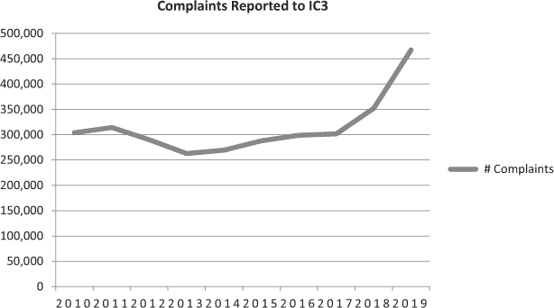

*图 2.1* 2010–2019 年向 IC3 报告的犯罪。（[ic3.gov](http://ic3.gov)）

公司调查可能集中于是否存在某个特定文件或一组文件、软件或通信记录。我曾处理过一些案件，其目的是确定谁参与了某项计划。这不属于刑事案件，而更倾向于滥用公司资产。在这种情况下，定罪证据可能在服务器上或属于调查目标之外的人员的设备上。在我提到的那个案例中，一名员工选择离开某机构。对该公司配发的设备之一进行粗略审查，发现了几个人之间的通信记录，其中详细说明了对公司资源的潜在滥用。通过对原始通信中的信息进行关键词搜索，并对通信人员的计算机和设备进行进一步检查以获取更多有关资源滥用的细节，随后这些员工被解雇。这是一次针对性的搜索，而不是全面的调查。

我想表达的论点是，一个人所遵循的方法论取决于具体情况。在诉讼程序中，这一概念可能决定案件的成败。了解你在调查中做了什么很重要，但了解你为什么没做什么同样重要。此外，了解这些决策的影响也很重要。我将描述司法检查中的常见步骤、执行的原因，并尝试说明它们的相对重要性。意识到技术演变迅速，这应被作为指南。

某些机构和组织提供了特定目的概述。英国首席警官协会（ACPO）发布了一份实践指南（`ACPO, 2012`）。该指南包含四个原则：

- **原则 1**：执法机构或其代理采取的行动都不应改变计算机或存储介质上的数据，这些数据可以在法庭上被依赖。
- **原则 2**：在人员发现必要访问计算机或存储介质上的原始数据的情况下，该人员必须具备相应的能力，并能够提供解释其行为的相关性和影响的证据。
- **原则 3**：应当对应用于计算机电子证据的所有过程创建并保存审计轨迹或其他记录。独立的第三方能够检查这些过程并获得相同的结果。
- **原则 4**：负责调查的人员（案件负责人）负有总责任，确保遵守法律和这些原则。

另一个提供取证指导的机构是美国国家标准与技术研究院（NIST）。他们在[`NIST.gov`](http://NIST.gov)网站的特别出版物领域创建了多份关于数字取证的文档。

这些指南为执行取证检查提供了许多有用信息和考量。指南往往落后于技术和取证实践的进步，因此检查员感到自己像柯克船长一样，可能需要勇敢地驶向无人涉过的领域。

在响应某种情况并开始调查时，访谈应该排在列表的首位。访谈对象可以是对案件、嫌疑人或受害者了解情况的同事。在许多情况下，律师会参与其中，这为取证过程（discovery process）增加了另一个变数。经常，电脑或设备被移交给调查人员进行调查，但并没有提供明确的目的。人们似乎认为调查员可以魔术般弄清楚需要做什么。我遇到过很多案例，在我处理某个案件时，有人突然“想起”了他们忘记告诉我关键信息。

对于数字取证调查员来说，访谈问题应该界定需要执行的调查类型——事件响应、儿童剥削、民事诉讼等。考虑哪些类型的关键词会很有用——电子邮件地址、姓名、地点、电话号码、账号以及其他能够生成对案件有用信息的其他内容。开发并维护一份潜在的访谈问题列表可以作为未来调查的模板。如果可能，在响应现场之前创建一份访谈问题列表，但如果无法做到，你仍然有一个模板可以参考。不言而喻，访谈信息应该被记录并注明日期。可能，访谈可能会成为最终取证报告的一部分。

## 访谈问题模板


人们倾向于认为取证检查总是针对刑事案件的。企业和民事案件可能是完全不同的情景，因此可能会有完全不同的访谈问题。虽然企业和民事案件都可能演变成刑事案件，但这通常并非实际情况。案件类型对于提问什么问题以及如何提问起着关键作用。需要记住的转折因素是，案件往往并非表面看起来那样，它们可能会发展成完全不同的情况。访谈问题列表的起点可能像这样：

1. 你叫什么名字？
2. 你的联系方式是什么？
3. 与案件的关系/参与程度/参与时长？
   - 该人是证人、嫌疑人还是受害者？
4. 你认为可能涉及哪些人员？
5. 你什么时候意识到这个情况的？
6. 你对这个情况了解多少？
7. 到目前为止你采取了哪些步骤（你碰过任何东西吗？）
8. 你知道哪些可能属于此案的电子设备、社交媒体、软件、账户？
9. 想想电子痕迹。你了解哪些联系人、电话号码、社交媒体关系、短信、图片？
10. 你是否注意到任何异常情况？

## 设备准备工作与权限

你带去处理现场的设备应该列在一个清单上。如果你发现需要的某项不在清单上，就将其加入列表，以便下次使用。你不需要在每个现场都需要清单上的所有物品，但在响应案件之前检查一遍清单是出门出发前一次很好的准备工作检查。我喜欢将物品放在衣柜的同一个位置并按顺序排列，这样我在装载部署时，就可以在视觉上检查这些东西。

在去实地之前，请确保你拥有执行此操作的权限。优先选择书面文件。如果你处于暗中行动状态，向当地警方通报你将在半夜从某企业移走设备可能是合理的。无论是与执法有关（`search warrant` 搜查令）还是民事案件（`court order` 法令），都要确保文件的范围足够大，让你带走附近的手册和笔记本。笔记本可能带有密码或其他可以帮助解决棘手案件的信息。

## 通用响应设备列表

响应情况下可能需要的物品通用列表如下：

1. **响应电脑**：装在 Pelican® 外壳箱中的便携式电脑可以在其被磕碰或暴露于自然环境中时提供保护。确保已加载手册。
2. **加密器狗 (Dongles)**：你不想在到达地点后发现无法预览设备或激活软件。不要依赖互联网来验证取证软件，因为可能无法连接网络。
3. **带有互联网访问功能的智能手机或其他设备**：取证电脑通常没有配备访问互联网的功能，以便不受外界干扰。智能手机或其他设备具有网络访问功能，你可以访问手册和供应商网站获取技术支持。可能某个 12 岁的孩子做了一段 YouTube 视频，展示了如何从你不熟悉的设备中取出硬盘。
4. **镜像设备**：例如 `Voom Hardcopy®`、`Ninja Forensic®` 和 `Tableau Forensic Imager®`。对于现场工作，`Ninja` 是我最喜欢的工具之一，因为它不需要计算机即可操作。这类工具制作镜像比通过计算机或 USB 接口更快，并可以用于其他用途，如介质的强擦除和从损坏介质中恢复数据。
5. **扩展线和插线板**：我倾向于使用独立的扩展线和插线板，因为如果你只需要插线板，就不需要处理额外的线。首次响应通常发生在压力巨大的环境中，因此请将电线放置在不会造成绊倒危险的地方。
6. **相机**：一台高分辨率数码相机是必要的。许多调查员使用手机。请记住，这样做可能会导致手机在案件中受到搜索（证据），因此使用个人手机可能不是一个好选择。对于某些情况，你可能需要一个小帐篷或挡板来帮助光线和防止反光——特别是对于手机和小型设备。
7. **纸、笔、铅笔**：我高中在杂货店工作时，蔬菜经理告诉我，你最好的朋友是铅笔。把它写下来。
8. **标签和不擦性墨水笔（如 Sharpie®）**：你需要可以在大多数环境下书写且不会涂抹或擦除的东西。颜色编码会有帮助。我经常使用纸胶带做标签。胶带不是好的选择，因为它通常会留下胶水。
9. **带有联系人列表的手机**：联系人列表应包括供应商，以及遇到困难、异常或耗时的情况时可以提供帮助的人。
10. **食物和饮料**：你几乎从未读到这些，但数字取证可能非常耗时。叫披萨通常是不合适的或不可行的。
11. **抹布**：尘土和脏可能是关键证据，所以要拍照记录。电脑和电缆可能会很脏，你可能需要清理一下。
12. **换衣服**：在办公桌或其他地方爬行时可能会弄脏衣服。我曾因为现场的压力浸透了衬衫。在许多情况下，你会需要一套新衣服。
13. **乳胶（或类似物）检查手套**：有些东西是你不想碰的或可能在上面留下指纹的。
14. **黑光**：用于检测蛋白质。这是你可能需要检查手套的主要原因之一。
15. **工具箱**：这应该包括从眼镜用的微型螺丝刀到全尺寸的螺丝刀。至少应包括绝缘胶带、胶带、绝缘扎带、刀片、钳子、螺丝和螺栓。带有梅花形头的螺丝刀（特别是 `#6` 和 `#8`）以及其他不规则头部也很有用。
16. **急救箱**：电脑内部可能很锋利，所以确保箱内包含创可贴。
17. **网线、集线器、交叉网线、IDE/SATA 适配器以及 USB 转多接口适配器。**
18. **启动盘**：这些应该包括 `Helix`、`Linen`、`Winen` 和 Windows 密码重置工具。
19. **空白光 CD 和 DVD**：这些较少见，但值得保留在清单上。
20. **接地机制**：这些工具通常随计算机工具包提供。其目的是防止静电损坏组件。接地机制可以是防静手带或类似的技术，以防止电击/电传输。
21. **写封保护器**：这些设备应包含 `USB`、`IDE`、`SATA` 和 `SCSI` 功能。携带不止一种类型的设备，因为有时设备识别固件可能会不稳定，拥有多种选择会有帮助。我还有一个黄色的读写或写封保护器，如果你在现场需要临时自制某种工具，它会很有用。
22. **目标硬盘**：在到达现场之前应该对它们进行擦除。大多数硬盘往往预装了实用程序和其他内容。完全擦除它们并使用适当的文件系统对其进行格式化，以便备之用。如果你使用镜像工具进行镜像，则可能不需要对目标硬盘进行文件系统格式化。千万不要扔掉新硬盘自带的塑料袋。使用它们在运输和存储目标硬盘及嫌疑硬盘期间防静电。考虑点：容量、外接硬盘、`ATA`、`SATA`、固态硬盘（`Solid State`）以及笔记本/台式机/服务器。
23. **闪盘**：这些对于手机提取以及从计算机进行针对性提取非常方便。
24. **用于 RAM 提取的闪盘**：你格式化闪盘的文件系统可能会影响你可以从中提取数据的计算机类型。如果目标设备具有巨大的 RAM 内存，使用自供电的外接 USB 硬盘可能更实用。
25. **移动设备设备**：这包括如 `Cellebrite` 或 `XRY` 等工具，以及法拉第袋（`Faraday bags`）和电池涓流充电器。
26. **头灯和手电筒**：我发现佩戴头灯比拿着手电筒要方便得多，尤其是当你处于桌下或在夜间情况下时。
27. **空背包、包和其他携带设备**：确保你有办法来运输你将获取的设备。
28. **胶带**：胶带有许多用途，包括作为标签。我喜欢美纹胶，因为它不会留下像胶布那样常见的粘性残留物。
29. **绳子**：更多用于应对不可预见的情况。
30. **剪刀和剥线钳**：有时东西会被胶带固定或用线缠在一起，你需要断开连接。
31. **放大镜**：它有许多用途，包括读取硬盘上的序列号和组件上的标签。
32. **毯子和垫子**：主要用于运输过程中保护设备，但当你需要爬在地上时也可以作为屏障。
33. **固定带**：这些用于在运输时固定设备和组件。安全带对此目的也有用。
34. **额外的鼠标和键盘**：某些设备可能带有触摸界面，那用起来可能很笨拙。
35. **吸盘**：它们有多种用途，包括从 `iMac` 中取出硬盘。
36. **毛巾、肥皂、水和洗手消毒液**：并不总是有洗手的地方——但通常是有需要的。

当你到达现场时，你可能是唯一的人——或者至少是唯一具备所需技能的人。我曾与一位深受军事 `OODA` 方法影响的同事一起工作：观察（Observer）、调整（Orient）、决策（Decide）和行动（Act）。这意味着你需要观察、调整、决策并行动。

在企业环境中对运行系统进行响应可能会面临更大的挑战。出于安全考虑，服务器可能会禁用 USB 接口。这意味着如果你需要像上文所述使用 USB 设备获取 RAM 镜像，那么在不更改配置设置以允许 USB 的情况下，这种方案是不可行的。这样做会改变计算机的状态，包括 RAM 的部分内容。它还可能需要重启，这会完全违背调查初衷。此外，计算机上的 RAM 容量可能达几个 GB 大，因此 USB 设备需要足够的空间。

`Helix` 和商用取证工具是获取 RAM 的常用技术。挑战在于获取内存镜像后如何处理它，因为它是以未格式化的状态捕获的。几家供应商提供了小内存占用（small footprint）内存获取工具，这意味着它对 RAM 中内容的影响非常小。请记住，在用内存分析工具进行分析之前，RAM 看起来只是一团杂乱无章的数据。

企业环境中可能发生的另一种情况是虚拟化。服务器可能被配置为运行多个虚拟机的宿主机（host）。调查目标可能是这些虚拟机中的某一个。获取 RAM 内容的副本可能是困难的，如果宿主机运行的操作系统与虚拟机不同，可能会更加复杂。一种方案可能是对虚拟机拍摄快照（snapshot），将其复制到外部设备，在实验室中恢复，然后对 RAM 拍摄快照。

移动设备通常需要处于运行状态（live）才能进行取证检查。这些设备通常采用某种形式的密码/密码/生物识别保护，如果输入多次错误的访问信息，可能会导致设备重置为原始状态。因此，如果移动设备在接收时处于运行状态，那么保持其运行状态可能是有利的。但这并不是一个显而易见的决定，因为远程擦除移动设备（特别是手机等设备）可能是一个简单的过程，从而使设备对调查毫无用。将设备设置为飞行模式并关闭网络和蓝牙访问可能防止远程擦除，但可能导致意想不到的后果，例如丢失与云信息的连接或应用程序注销。使用法拉设备（Faraday device）可能会引入类似的挑战。

## 案件响应

调查面临面临挑战之一是，他们参加培训学习如何执行各种任务，但这些任务通常是独立的，且在教育背景下有严格的脚本规定。培训课程倾向于关注特定任务，然后可能会跟进练习。接着会有更多的任务或练习循环，直到午餐时间或下班。虽然这在学习如何使用取证工具执行特定任务方面很有用，但在学习如何进行取证检查方面并没有那么有用。取证人员应为每个案件制定调查计划，这与学习如何使用取证工具执行特定任务不是一回事。`第 3 章`涵盖了安全计划和调查计划的制定。

其他培训环境可能以讲座为主。在短时间内未利用的培训会很快遗忘。大多数培训似乎在一个月后就会被遗忘，因此如果调查员在培训后不久没有遇到第一个案件，其执行调查的能力可能会受到限制。希望有其他调查员可以协助初始调查。

当调查员在完成培训后面对第一个案件时，他们可能会发现自己不知道从何处开始或采用什么技术，因为他们没有学习过如何制定调查计划。本节的目的是概述常见的响应方法论，并引入创建调查和安全计划的概念。请记住，案件及其要求会有很大差异，因此这是一份指南——而不是金科。变量包括它是刑事、民事、企业还是其他类型的案件。其他变量还包括将使用的工具类型、将检查的设备类型、可检查的时间以及预算。我用于响应计算机事件的标准工具集是 `Magnet Axiom`、`EnCase Forensic Edition`、`FTK Imager`、`Tableau Write Blockers`、`Ninja Forensic Imager`、经过取证擦除的目标存储媒体，以及本章前面提到的响应清单中的工具和物品。如果我使用 `Ninja Forensic Imager`，我倾向于在成像过程中使用内部驱动器目标媒体（接收镜像的驱动器），因为可以直接连接，从而实现更快成像。对于实际调查过程，我倾向于将证据和案件信息存储在自供电 USB 外部硬盘或云端。自供电 USB 外部硬盘非常有用，因为它提供了一个自包含的环境，可以通过 `USB` 轻松访问，并且它们通常比内部硬盘更耐用。内部硬盘并不是为了频繁连接和断开而设计的，而那是外部硬盘的设计特征。此外，外部硬盘在在箱中存储和存档，因为它们占的空间较小。所有案件信息的备份副本应存储在单独的硬盘或以冗余方式存储在云端。云环境应经过妥善的安全和管理，以确保监管链和访问得到妥善处理。请注意，在现场成像响应情况下，可能无法访问云端，或者连接速度并不实际。

在响应案件时，有许多特定场景的情况需要考虑。首先，确保你的安全。有一次我在企业环境中执行了一次黑袋作业（black bag job，非现场获取），那是民事案件的一部分。被调查的人员在我获取证据时出现在现场，尽管有保护令。该个人虽然和平地离开了，但在 10 分钟后又出现了。这特别令人压力巨大，因为经常听说有人离开现场后不久带着武器回来。幸运的是，并没有武器，但压力水平很高。

事件响应本身应该有计划，应急预案应该是计划的一部分。`图 2.2` 包含了一个有助于指导计算机响应和检查过程的指南。对于我们而言，响应计划是对现场的响应以及获取调查所需的设备和证据。调查计划在`第 3 章`中涵盖，涉及获取设备和证据后如何进行调查。响应和调查中同样重要的安全考虑也将在`第 3 章`中涵盖。

**图 2.2** 取证检查指南。

可能无法确定嫌疑设备的配置或容量，因此请准备好多种方案、多个经过取证准备的存储设备以及连接选项。有时目标硬盘可能会发生故障，因此准备一些备用硬盘是好的。响应过程可能涉及对多个设备进行镜像，因此要考虑排序，并在必要时计划同时对多台计算机进行镜像。我目前用于计算机和硬盘存储的衡量标准是每小时能够镜像约 100 GB 数据。可以据此推估出目标硬盘镜像过程将消耗的时间。使用最快的连接方式和驱动器速度可以缩短镜像时间。使用压缩也会影响镜像时间。对于移动设备，可能有特定的考虑因素，这些在第 6 章中有更详细的介绍。

一旦制定并授权了响应计划，响应人员到达现场后应立即保护现场。在企业环境中，这可能意味着让安保人员阻止访问。在执法环境中，这可能涉及与其他类型的调查人员协调。底线是，如果有人没有提供帮助，他们就不应该在那里。对现场进行绘图和拍照。照片应从多个角度拍摄，并尝试拍摄显示所有设备是如何连接到计算机的照片。如果你要带走计算机，请对电缆和其他设备进行标记，以便它们能与计算机匹配。这在查收多台计算机时尤为重要。在清单表上登记所有设备的序列号和标签。图 2.3 是清单表的示例。固定好设备以备运输，并将它们带回实验室。寻找四周 U 盘、打印机和其他外设备，包括说明书、CD 和 DVD。在运输过程中要考虑环境，因为你不希望设备暴露在极端温度下。如果发生温度剧烈变化，请在通电前让设备达到室温。

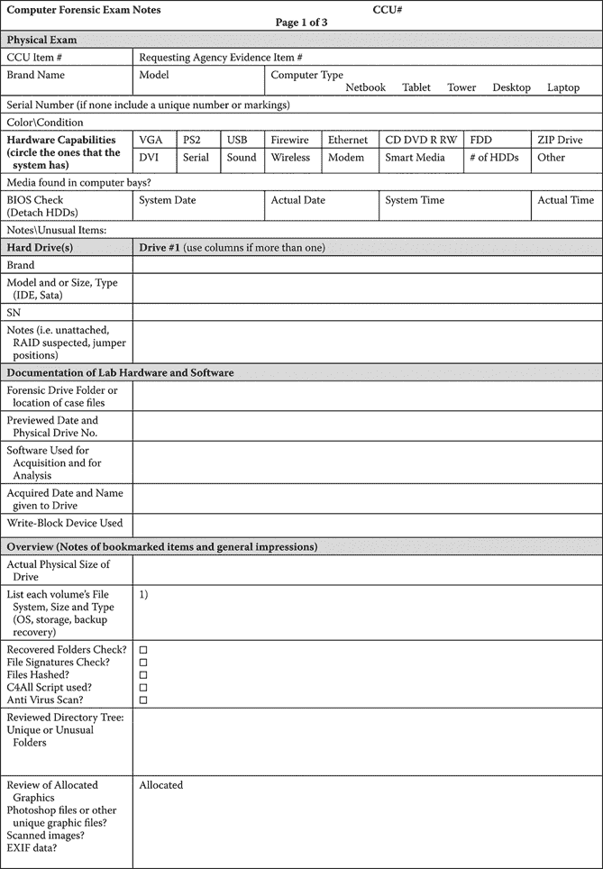

**图 2.3** 计算机取证检查表。

调查人员可能会面临许多场景。企业环境的处理方式可能与典型的执法环境有所不同。单台计算机的后勤规划没有多台计算机复杂。还有服务器、环境和配置方面的考虑因素。我们将处理的场景是一个单机案例，假设将对嫌疑硬盘进行镜像制作，然后进行调查。某些取证工具（如 `EnCase`）具有预编程脚本，可以针对证据文件运行，以“自动”处理调查的许多方面。在大多数情况下，本节介绍的是调查概念，而不是工具如何处理取证分析的特定方面。

根据情况和案件要求，调查人员可能会预览设备以确定是否有必要进行镜像。镜像意味着对设备上的信息制作可验证的位对（bit for bit）复制。预览意味着在镜像证据之前，在取证状态下审查潜在证据。如果计算机已开机，请获取 `RAM` 的镜像，因为 `RAM` 中可能包含密码、木马和病毒等信息，这些信息对调查有所帮助。考虑开机计算机的另一个方面是，它可能连接到云应用程序或其他活跃的网络连接，提供了访问证据的，而这些证据在计算机关闭后可能无法访问。一个决策点是确定计算机上存在保护或破坏性机制的可能性。如果可能性很高，应制定如何镜像计算机的应急预案。如果可能性较低，关闭机器电源，断开并镜像硬盘，将它们连接到写保护器和调查机上，并开始镜像过程。某些取证工具包含软件写保护器，在这种情况下，不需要物理写保护器。可以使用专门的镜像工具来代替写保护器和调查机。这两种技术在第 3 章中均有说明。

嫌疑计算机与镜像之间的哈希值匹配并记录至关重要。哈希值通常表示为 `MD5` 和 `SHA-1` 值。哈希的使用在第 4 章中有更详细的解释。良好的做法是拍摄嫌疑硬盘标签的照片作为记录调查的一种。序列号、存储容量或扇区数以及配置都是需要记录的内容。应启动嫌疑计算机并检查 `BIOS` 的时钟和系统设置。确定计算机上事件发生的时间是许多案件的核心，这可能是关键证据之一。在企业环境中，计算机时钟可能由中央管理，因此也应该予以记录。计算机上文件的修改、访问、创建和删除时间有助于重建事件和活动。确保这些时间准确可以追溯到嫌疑计算机的 `BIOS` 时间时区设置。调查人员需要能够显示此类信息并允许根据这些时间进行排序和分析的取证工具。

一旦开始实际调查，确保所有分区可见是非常重要的。这可能需要恢复删除的分区并定位隐藏分区。此后的步骤顺序取决于特定案件，不一定完全遵循我们接下来将涵盖的顺序，但如果调查人员倾向于遵循相似的顺序，出错机会就会更小。获取硬盘上所有文件的哈希值允许根据哈希值而非文件名或扩展名进行搜索和过滤。例如，所有 `Windows OS` 文件无论位于哪台计算机上，其哈希值都是一致的。通过获取嫌疑硬盘上的哈希值与 `Windows` 哈希文件进行比较，所有匹配的文件都可以认为是相同的，并可以从调查中过滤掉。同样，如果有感兴趣文件的哈希值，可以将这些值与嫌疑硬盘上的哈希值进行比较，并将所有不匹配的内容过滤掉。这是儿童剥削案件中的常见程序。

下一步通常是进行历史搜索，涉及许多内容，包括确定个人访问的网站以及使用计算机进行的搜索类型。在 `Windows` 环境中，注册表可以包含访问网站的信息，包括访问频率，以及是通过点击链接还是在浏览器地址栏输入 URL 访问网站。输入 URL 可以表明访问特定网站的意图，但需要考虑用户的拼写错误。如果一个网站被访问了多次，其访问意图比访问一次或两次要强得多。

未分配磁盘空间通常包含在浏览器端搜索引擎中输入过的搜索词。这可以支持对先验知识或预谋的争论。使用 `GREP`（正式名称为全局正则表达式打印）关键词搜索是确定搜索内容最常见的方法之一。不同的搜索引擎会留下不同的痕迹，因此开发能够识别这些痕迹的搜索关键词至关重要。开发针对各种搜索引擎的关键词的一种方法，是在这些搜索引擎中进行几次搜索，并查看地址栏中的结果。该技术在第 4 章中有更详细的描述。


电子邮件搜索也是一个频繁的调查步骤。某些电子邮件系统可能会将邮件消息下载到个人工作站上。许多基于互联网和云的电子邮件系统也可以进行此类配置。这在调查期间可以提供丰富的信息源，因为可能会恢复电子邮件的完整版本。像`Yahoo!`和`Gmail`这样的电子邮件系统通过其免费服务提供了较大的磁盘空间分配，因此许多用户发现将电子邮件保留在服务提供者的环境中而不下载到个人工作站更具吸引力。然而，仅在浏览器中查看网页版电子邮件经常会在未分配磁盘中留下可检索的邮件碎片。我曾从未分配磁盘空间中恢复过 5 年前的网页版电子邮件系统的邮件副本。

搜索关键词是调查中的另一个逻辑步骤。根据所使用的取证工具，可以在计算文件哈希值（file hashes）、分析文件签名以及搜索电子邮件的同时进行关键词搜索。然而，这可能会消耗大量的资源和时间，因此建议独立地执行这些工作。关键词可以通过许多方式构建，包括纯文本和使用`GREP`。构建关键词和执行关键词搜索是一门艺术，因为如果关键词过于严格，可能会遗漏内容；而如果关键词太松，搜索命中结果可能太多，导致调查人员难以找到他们正在寻找的内容。例如，如果有人正在搜索“botnets”（僵尸网络）并构建搜索只查找 botnets，那么`botnet`或`bots`将不会被命中。但如果对“bot”进行搜索，则`bot`、`bots`、`botnet`和`botnets`都会被命中。然而，任何包含`bot`的单词都会被命中，包括`both`和`bottom`等词。这就是构建`GREP`关键词变得实用的地方，因为可以构建一个以“bot”开头但后面仅跟“net”或“s”的关键词（注意“s”后面的空格——空格在关键词的有效性方面可以起到关键作用）。

关键词的选择应该考虑到正在处理的案件类型。社交媒体网站可能会留下特定的痕迹，有助于重建社交媒体的使用情况。在线游戏活动有其独特的痕迹和相关关键词。同样，`eBay`、`craigslist`和`PayPal`也可能是需要进行关键词搜索的领域。围绕某些使用类型构建调查的背景，会使关键词的产生变得容易得多。

在儿童剥削案件中，对计算机上的图形文件进行审查是调查的一个关键方面。由于嫌疑人经常尝试删除证据，在进行搜索之前，应恢复所有已删除的图形和视频文件。实现此点的一种方法是对磁盘上未分配空间中的图形文件文件头执行`GREP`搜索。恢复文件后，可以通过取证工具查看图形文件。或者，可以为嫌疑人磁盘上的所有图形文件计算哈希值。这些值可以通过程序化的方式，与已确认的儿童剥削图形文件的哈希值进行比较。已知的儿童剥削文件的哈希值由联邦机构和执法部门严格掌握，通常无法在这些圈子之外使用。如果执法人员以外的调查人员怀疑他们正在审查的设备上存在儿童剥削材料，他们应该停止调查，不要制作副本，并将可疑设备移交给执法部门。

聊天日志和即时消息系统的痕迹可以为调查提供见解，搜索计算机用户可能感兴趣的游戏系统也是如此。搜索如`Facebook`和`Twitter`等社交网络网站以及用于共享文件的点对点系统也是调查中需要考虑的常见元素。大多数计算机还有日志文件，可以提供有关计算机如何使用和维护的细节。如果取证调查是为了应对安全泄露（如黑客事件），日志文件是首要审查的内容之一。Windows 机器上的回收站和如“最近”之类的文件夹（包含指向最近查看文件的链接）是其他常见的审查区域，链接文件（link files）本身也是如此。打印文件和`Send To`（发送到）文件可以完善初步调查。

调查完成后，必须撰写报告并对案件进行归档。写报告可能非常耗时，但这种时间投入是值得的，因为这是对证据的呈现，是关于所发现内容的故事。写报告本身就是一种艺术，不应被草草对待。取证工具生成的报告通常是不完整或缺乏内容的。应该包括有关调查如何进行、参与人员、现场照片和图表，以及报告的总体概述、摘要或总结。报告可能轻松超过 100 页，因此摘要或总结变得更加重要。取证报告可能需要随着调查的进展进行更新。这是许多原因之一，即报告的命名和版本控制需要包含允许更新的机制，同时减少关于哪份报告副本是最新版本的困惑。

案卷、报告以及可能的取证工具副本应进行归档并存储在安全环境中。归档所用取证工具的一个原因是，在案件进入审判或完成之前，工具可能会更新版本，如果案件需要进行审查，拥有与调查期间相同的工具进行审查是至关重要的。

## 结论

在确定计算机取证的适用性和必要方面有许多变量。某些案件非常有针对性，因此之前的所有步骤可能都不是必要的。相反，某些案件涉及更多的调查。开发资源库应该是每个调查人员的目标。这个资源库包括建立一个可以协助调查的人脉，无论这种协助是处理设备、提供建议还是提供心理支持。资源库还涉及辅助工具和技术、教育和研究能力。正如我提到的，本章的目的是帮助调查人员理解在调查中执行的许多最重要的步骤。正如俗话说的，实际情况可能有所不同。

## 参考文献

1. ACPO. (2012). ACPO Good Practice Guide for Digital Evidence, Version 5. Association of Chief Police Officers of England, Wales & Northern Ireland.

2. Internet Crime Complaint Center. (2016). Internet Crime Report. 于 2020 年 4 月 9 日检索. [`pdf.ic3.gov/2015\_IC3Report.pdf`](http://pdf.ic3.gov/2015_IC3Report.pdf).

## 引言

某些较难理解的内容是在特定情况下应该使用哪些工具，以及所有信息是如何整合在一起形成一项调查的。回答这个问题有许多变量，包括调查的类型、调查的目标，以及调查中的大多数工作都有不止一种完成方式这一事实。随着时间的推移，调查人员会对某些工具和技术产生亲近感，并逐渐推勒出他们自己的“首选”工具集。

在出版物中描述工具面临着许多挑战。新版本的发布和修改可能会使描述迅速过时。同样，工具会更改名称、被其他公司收购，或简单地从市场上消失。例如，一个非常有用的工具——`Wireshark`曾名为 Ethereal。因此，读者应该意识到这类变化是不可避免的，而且在任何技术领域，新进展都具有让事物迅速变得过时的潜力。

## 计算机取证

计算机取证被定义为涉及个人电脑、笔记本电脑、Mac 电脑和上网电脑等计算机的调查过程。计算机取证需要一台或多台调查计算机。使用多台电脑的原因可能是同时进行多项调查，而且某些计算机具有专门的工具和功能。使用虚拟化技术允许多台虚拟机运行在一个物理机上，可能是减少硬件需求的方法，尽管`RAM`和如`USB`端口数量等可能成为限制因素。有些供应商配置并销售专门的取证检查计算机，这是一个非常强大的选项。

两款商业工具曾主导了计算机取证多年：Access Data 的`Forensic ToolKit`（`FTK`）和 Guidance Software 的`EnCase`。然而，随着时间的推移，计算机领域出现了许多新进展，改变了计算机的架构和利用方式。来自各种供应商的新工具应对了这些挑战，并在许多情况下获得了市场份额，并成为计算机取证的可行的主要首选方案。在许多情况下，`Magnet Axiom`、`Forensic Explorer`和`X-Ways`等工具比`FTK`和`EnCase`更具生产力。每种工具都有其优缺点，因此调查人员做出明智的工具选择，以最好地支持眼前的调查至关重要。有些组织拥有多种工具的资本，这在验证调查结果时尤为有价值，因为可以使用多一种调查技术。关于哪种工具更好，往往会有激烈的讨论，我的观点是这些公司倾向于在每次新发布时相互超越。这种竞争为调查人员转化为更强大的工具选项。供应商创建了一些非常优秀的技术，但据报道，供应商偶尔也会失败。

有许多不同的取证工具用于检查计算机。`EnCase`和`FTK`早期拥有相当的市场份额。除了开源工具，其他几个供应商也进入了市场，包括`Magnet`的`Axiom`、`GetData`的`Forensic Explorer`以及`Nuix`。特定工具往往有其专门关注领域，某些调查人员偏好特定的用户界面。图 3.1 显示了`Axiom`版本 4.3 界面的截图，图 3.2 显示了`EnCase`版本 8 界面的截图。

其他的计算机取证选项，例如欧洲产品`X-Ways`以及开源替代方案。除了功能之外，成本、培训的可用性、支持和长期稳定性都是任何技术购买的考虑因素。格局变化非常快，投资于一个具有稳定性的工具集是明智的，这样由于能够找到相关人员，你的投资就可以得以维持。上述的计算机取证工具可用于介质的镜像和分析。集成工具的优势是你执行的所有结果都被集中捕，这使得组织和报告更加简单。商业产品的优势是它们通常经过了准确性测试。虽然许多开源工具具有法效力的发现，但某些工具没有经过适当的测试和验证，这意味着它们的发现可能不可采纳。

## 写保护器

写保护器确保数据在被访问时不会被更改。启动计算机可能会更改计算机中的数百个文件，包括访问时间和和其他文件属性。写保护器可以防止这种情况发生。写保护器可以是基于软件或硬件的。基于软件的写保护器使用软件防止文件修改。硬件保护器利用物理设备防止文件修改。图 3.3 显示了一个硬盘写保护器的示例。

## 其他有用资源

1. 互联网犯罪投诉中心。(2017)。互联网犯罪报告。检索于 2020 年 4 月 9 日。[`pdf.ic3.gov/2016\_IC3Report.pdf`](http://pdf.ic3.gov)。

2. 互联网犯罪投诉中心。(2018)。互联网犯罪报告。检索于 2020 年 4 月 9 日。[`pdf.ic3.gov/2017\_IC3Report.pdf`](http://pdf.ic3.gov)。

3. 互联网犯罪投诉中心。(2019)。互联网犯罪报告。检索于 2020 年 4 月 9 日。[`pdf.ic3.gov/2018\_IC3Report.pdf`](http://pdf.ic3.gov)。

4. 互联网犯罪投诉中心。(2020)。互联网犯罪报告。检索于 2020 年 4 月 9 日。[`pdf.ic3.gov/2019\_IC3Report.pdf`](http://pdf.ic3.gov)。

调查者可能需要多个写保护选项。IDE 和 SATA 驱动器可能需要一个硬件写保护器，USB 需要另一个，而媒体卡等设备则需要另外一个。某些写保护器具有切换为读写接口的能力。某些人可能会困惑为什么需要一个允许写入的写保护器，但这可能是将驱动器和媒体连接到取证计算机的好方法，以便对其进行擦除。了解如何配置读写能力以及如何测试写保护器处于何种配置状态非常重要，以防在调查中误用配置了写入选项的保护器。某些厂商制作不同颜色的保护器，这有助于区分写保护器与具有写入能力的保护器。

## 镜像

当计算机、移动设备或其他媒体需要进行取证分析时，通常会进行名为“镜像”（imaging）的过程。镜像是获取与原始数据完全相同的逐位复制。镜像中的一个关键方面是，可以验证原始版本和副本是完全重复的。可以使用消息摘要 5（`MD5`）或安全哈希算法（`SHA`）等哈希算法来验证副本是否为原始数据的精确复制品。

在镜像过程中，通常会将计算机磁盘驱动器逐位复制到空白驱动器上。用于接收副本的驱动器通常在镜像过程之前会被擦除。实现此目的的方法包括取证工具、磁盘实用程序和磁盘镜像硬件。一旦磁盘被擦除，就可以用类似于镜像驱动器的方法进行验证。取证工具还提供了视觉验证过程。使用磁盘镜像制器通常是为镜像准备磁盘并执行镜像过程快的方法。图 3.4 显示了 Ninja 磁盘镜像制器在将主 SSD 复制到目标 SSD 过程的照片。

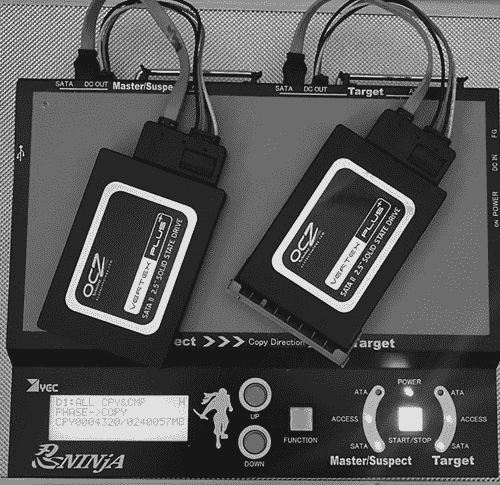

图 3.4 Ninja 磁盘镜像制器。

可以使用专门的镜像产品从损坏的介质中提取数据。这些产品的工作方式有多种，包括使用不同类型的读取算法和硬件适配。此类产品中的一种 Atola Insight，通过防止读取失败和结束条件来修改计算机与磁盘通信的方式。相反，Insight 单元将通过使用替代算法和技术继续尝试从设备中恢复数据。在典型的计算机中，如果发生磁头损坏，读取过程将失败。专门的镜像工具将尝试读取所有不受磁头损坏影响的区域，而不是仅仅对整个驱动器产生读取失败。图 3.5 是 Atola Insight 的照片，它是用于从损坏介质中恢复数据的专门镜像工具。

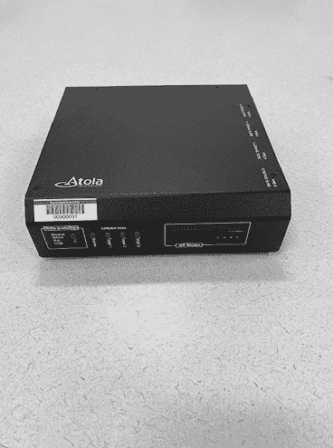

图 3.5 Atola Insight 取证。

镜像可能会花费大量时间。取决于驱动器的速度、验证情况和所使用的方法，每小时 100 GB 是粗略的基准。这意味着仅镜像一个 1TB 的驱动器就需要 10 多小时时。如果有多个驱动器，很容易看出调查可能花费多少时间。预览驱动器是确定是否需要镜像的一种方法。在磁盘进行镜像时，也可以执行一些调查功能。

移动设备镜像在取证过程中可能占据不同的位置。某些移动取证产品采用内部写保护技术，并仅生成设备上内容的报告。其他移动取证产品则为检查员的审问创建镜像。所使用的过程类型取决于检查的需求和可用工具。

## 插件和其他技术

计算机通常会设置密码，以防止未经授权访问设备上的程序和信息。同样，加密通常被用作安全机制来保护信息免受未经授权的查看。从技术上讲仍然可以访问数据，只是它们处于不可读格式。使用算法打乱数据，并需要采用反向过程。不幸，坏人也采用了加密。取证工具通常内置文件查看器，但有时需要其他查看器。密码通常存储在哈希格式而非明文。某些工具使用暴力破解方法猜测密码。`Veracrypt`等工具加密容器、分区或驱动器。字典也可以包括常见的缩写或俚语。暴力破解攻击生成字母、数字和特殊字符的组合。有些工具允许调查人员使用哈希表通过已知的密码方面来种子解密工具，从而缩短密码破解过程。一种额外的解密机制是使用彩虹表。使用哈希表提高了效率，因为解密工具在攻击过程中不需要对字典进行哈希。

密码越复杂，破解时间就越长。取决于加密技术，包含数字、字母和特殊字符的八位密码可能需要几个月或几年才能破解。专门的解密计算机可以用来加速攻击。显卡的`GPU`解密速度比使用计算机的`RAM`快几个数量级。游戏电脑可以配置多个并行高速显卡，极大提升解密能力。图 3.6 是一张带有多个并行显卡的专用密码分析工作站的照片。


音频、视频图形文件是调查人员必须处理的常见证据。这些文件通常需要增强，因此熟悉提供这种能力的工具是一项关键技能。这种情况包括处理监控视频、处理分辨率或对焦不佳的图片以及伪造案件。`Photoshop`等软件是此类用途的常用选择，而且有许多专门的技术提供了更强大的能力。

计算文件偏移量和进制转换对于通过处理文件系统来寻找文件碎片和遗迹非常有用。在取证计算机的任务栏上为计算器分配快捷方式是获得方便访问的方法。诸如`FeelTheBase`这样的进制转换器可以翻译十进制、二进制、十六进制和 IP，是取证员工具箱的另一个插件。

对于涉及恶意软件的检查，像 Sysintern 的`Process Explorer`这样的进程监控器将比 Windows 任务管理器更详细地显示进程。图 3.7 显示了 Process Explorer 中可用信息的示例。

`Wireshark`、`NetStat`和`TCPView`等工具将提供网络和通信信息，调查人员利用这些信息确定恶意软件的配置和能力。特别是当机器处于运行时时，端口状态和通信地址对于追踪恶意软件活动以及响应黑客事件非常有用。

说到运行机器，镜像和处理 RAM 可以是处理恶意软件或黑客取证案件的另一种方法，也可以定位密码。一个包含小型实用程序的 USB 驱动器（该程序将 RAM 内容转储到 USB 驱动器中）是捕获信息的典型方法。RAM 转储文件是没有格式的，因此能够处理转储文件以寻找感兴趣信息的工具是另一个需要包含取证员工具箱的部分。RAM 镜像和格式化可能是`Magnet`等数字取证工具套件的一部分，也可以是独立工具。

如果我不提到杀毒（AV）软件在数字取证过程中的作用将是我的失职。恶意软件调查可以为确定不在场证明的有效性提供参考，也可以确定恶意软件在组织内的渗透情况。在被指控计算机犯罪时，有人声称是恶意软件防御并不罕见。这种立场基于他们没有做任何错误的事的前提——相反——他们的电脑感染了恶意软件，而恶意软件的控制者对犯罪活动负责。杀毒软件可以帮助确定嫌疑人电脑上是否存在恶意软件。如果有，则调查人员有责任确定该恶意软件是否具有声称的能力。进一步来说，恶意软件可能具有某种能力，但问题在于它是否被配置为执行辩护中所声称的任务。

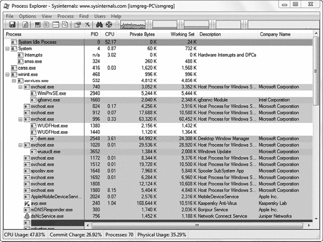

图 3.7 Process explorer。

黑客攻击情况下的响应团队必须迅速确定正在被攻击什么、如何攻击、何时攻击、什么被攻破以及产生的影响。恶意软件在这种种情况下经常发挥作用，是数字取证调查人员日益关注的领域。这两个主题——恶意软件不在场证明和恶意软件渗透——开启了恶意软件取证领域，这超出了本书的范畴。

这些只是取证员工具箱可能增加的许多插件和其他能力之一，这些添加可以使其能力从基础情况扩展到复杂情况。这个列表绝不是详尽的，还有许多其他值得提及但未被提到的有用工具。市有许多书籍和其他资源可用，它们提供了关于这些及其他工具的更多信息。本章的目的仅仅是让人们意识到某些工具以及它们如何融入到调查过程中，而不是作为一份关于如何使用每种工具的教程。

这些只是取证员工具箱可能增加的许多插件和其他能力之一，这些添加可以使其能力从基础情况扩展到复杂情况。这个列表绝不是详尽的，还有许多其他值得提及但未被提到的有用工具。市有许多书籍和其他资源可用，它们提供了关于这些及其他工具的更多信息。本章的目的仅仅是让人们意识到某些工具以及它们如何融入到调查过程中，而不是作为一份关于如何使用每种工具的教程。

## 移动取证工具


就本文讨论而言，移动取证将包括手机、平板电脑、GPS 设备和如 `iPods` 等 MP3 播放器。与计算机取证一样，该类别也有许多开源和供应商产品。一些取证套件供应商已将移动支持集成到其计算机取证产品中，但其设备支持水平往往落后于一些领先的移动取证供应商。`Magnet Axiom` 是少数在计算机取证和移动取证方面都非常强大的的取证套件产品之一。支持广泛移动设备的商业产品包括来自 `Cellebrite`、`Micro Systemation` 和 `Oxygen` 的产品。移动取证产品通常包含大量的电缆，用于连接各种设备。

移动取证中一个有趣的变量是，它可能存在地域差异。例如，某些厂商会根据设备部署的位置来调整设备设计和/或配置。我曾遇到过一位来自 `Micro Systemation` 的工程师，他每访问美国其他地区或其他国家时通常会购买手机和设备，因为根据购买和部署地的不同，看似相同的设备之间可能存在复杂的差异。新手机和功能增强至少每隔几天就会发布一次，这为移动取证产品工程师带来了支持挑战。各种各样的接口电缆是维护移动取证工具箱的另一个挑战。我们有一个大型手箱的 `Pelican®` 箱来盛放所有的移动取证电缆，而那也只能装下我们大约一半的电缆。

与计算机取证相比，拥有多个移动取证方案更具价值，因为对每种设备的支持程度可能差异巨大。逻辑提取、物理提取和文件系统提取可以提供截然不同的结果，特别是在恢复删除的遗迹方面。通常，同时提供逻辑和物理提取支持的产品在逻辑层面支持的设备多于物理层面。通常，物理提取提供将包含了逻辑提取所提供的大部分内容，以及更多细节。因此，物理提取能力在两者中可能是最有价值的，但物理提取支持的设备数量通常没有逻辑提取那么多。文件系统提取在恢复删除的遗迹方面特别有用。软件写阻塞在移动取证中经常使用。

在确定最合适的移动取证解决方案时，有几个考虑因素。价格、支持、易用性、厂商稳定性、产品稳定性以及提取能力水平是关键问题。移动取证产品的成本通常比计算机取证产品贵——在某些情况下甚至贵得多。某些移动取证产品的年度维护费用每份许可可能达数千美元。产品支持包括更新频率、每次更新中包含的新功能数量和设备支持情况，以及对支持问题的及时响应和解决都是重要因素。

移动取证市场的易用性差异很大。某些工具的操作方式类似于计算机取证工具，而另一些工具则作为独立设备运行。`Cellebrite` 使用一个独立设备连接到目标设备，并将信息推送到 `USB` 驱动器或外部设备（如计算机）。导航内置菜单有几个关键点，训练过极少的人也可以操作。然而，在物理和文件系统提取中搜索寻找文件碎片与使用其他产品相似。图 3.8 展示了一个 `Cellebrite Universal Forensic Extraction Device (UFED)`。

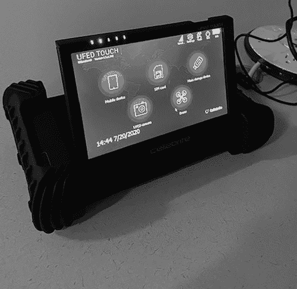

图 3.8 Cellebrite UFED。

在使用移动取证产品时，提取能力也许是最重要的变量。两个声称在逻辑或物理层面支持特定设备的产品可能会产生不同的结果，因为一个产品提取的信息可能比另一个多得多。一个产品可能从设备中提取 500 条短信，而另一个产品可能提取 600 条。恢复信息（特别是删除信息）的变化性在不同取证产品之间可能差异很大。在移动取证调查中，使用多个产品获取尽可能完整的取证视角是非常常见的做法。

## 视觉分析

发现遗迹和信息只是调查人员面临的挑战的一部分。分析和解释信息可能是一项艰巨的任务。时间分析涉及查看事件发生的时间以帮助解释发现。许多取证工具中都有时间线工具，但视觉分析工具可以用于寻找模式和其他特征，以帮助拼图。

取证人员需要一种安全的方法将设备运回实验室。毯子和安全带是贫穷的运输方式，而带垫的 `Pelican®` 箱是首选方法。这种方法的额外优点是防水并能提供某种程度的缓冲保护。

进入实验室后，设备需要一个安全的地方进行记录和存储。这可能是一个安全房间、保险箱、储物柜或这些者的组合。存储如何处理是案件最重要的方面之一，因为监管链可能是导致案件丢失的弱点。就我个人而言，我喜欢安装在墙上或地板上的保险箱。枪箱的效果很好。物理安全可以包括锁上的门、门卡访问、视频监控和冗余安全措施。

工具的安全存储是一个经常被忽视的领域。除了磨损之外，考虑的问题还包括调查遗迹缓存或存储在调查设备中。清除和重装用于案件的计算机和工具可以防止证据泄漏问题，但清除和重装通常在案件完成后进行——如果做了的话。然而，这并没有解决许多调查会持续数周的事实，因此在这种环境下清除和重装是不现实的。这就是为什么工具的安全存储是必要的。

数字取证的应用是一个广泛且不断发展的领域，需要一套广泛且不断更新的工具包。调查人员在计算机、移动设备和恶意软件取证方面有多种选择，这些选择可以深入洞察设备的用途以及如何对这些行为进行解释。在数字取证领域，培养和维护高超技能是一项艰巨的任务，会消耗大量的时间和精力。特别是涉及到恶意软件调查时，数字取证调查人员会发现自己面临着严峻的环境和巨大的挑战。熟练使用各种工具使调查人员能够最好地应对网络世界中固有的挑战。

## 参考文献

1. NIST.gov. (2020). 计算机取证工具测试程序。 2020 年 7 月 27 日检索于 [`www.nist.gov/itl/ssd/software-quality-group/computer-forensics-tool-testing-program-cftt`](http://www.nist.gov)。

2. United States Reports. (1993). 1992 年 10 月期最高法院判决案件。2020 年 7 月 27 日检索于 [`www.supremecourt.gov/opinions/boundvolumes/509bv.pdf`](http://www.supremecourt.gov)。

电子邮件是一个有趣的现象，因为它经常以书面形式记录个人的活动和选择——而且有签名、日期，甚至还有证人（收件人）。电子邮件可以帮助证明某事的发生，提供不在场证明，或者提供一个能套住某人的“绞索”。电子邮件是检查员在检查期间关注的最重要领域之一。

互联网活动提供了观察个人兴趣和倾向的窗口，审查其活动留下的痕迹可以对个人所做的事情提供重大的见解。寻找互联网行为线索的潜在地方有很多，包括聊天和消息日志、点对点（P2P）活动、搜索引擎搜索、互联网历史记录、社交网络活动以及病毒和恶意软件足迹。值得注意的是，调查这些领域每个领域的精确细节会随时间而变化，因此理解如何适应这些变化是区分普通调查人员与卓越调查人员的技能。

人们通常有多个电子邮件地址，这些地址通常用于特定目的。一个邮件地址可能用于工作，另一个用于一般的社交活动，而另一个可能用于与游戏或其他娱乐活动的配合。电子邮件地址通常是网站上的用户名，因此一旦发现了电子邮件地址，对 `@` 符号之前的部分进行关键词搜索，可能是发现之前遗漏的互联网网站和其他活动的一种方法。

我执行的首批电子邮件搜索之一，是为我能想到的尽可能多的免费电子邮件账户创建关键词：`@[yahoo.com](http://yahoo.com)`、`@[hotmail.com](http://hotmail.com)`、`@[gmail.com](http://gmail.com)` 等。这通常会产生巨大的搜索结果集，但找到这些信息的潜在回报是巨大的。在找到所有电子邮件地址后，我通常会为全额电子邮件地址创建一组关键词——例如 `badguy@yahoo.com` 或只是 `badguy`——因为第一次搜索产生量可能太大，无法有效找到感兴趣的信息。

我发现的另一个有用的方法是对区域内的城市名称、地标、酒店和公路名称进行搜索，因为这些内容通常指向感兴趣的电子邮件或消息。考虑电子邮件中可能出现的独特单词，并根据这些词进行搜索以找到电子邮件地址。我曾使用这种“逆向推导”技术来帮助解决民事案件，因为消息片段可能位于未分配空间中，且没有电子邮件地址头。

电子邮件头头部可以跟踪消息的源地以及路由的来源。有时头文件会被剥离或无法读取，但如果它是完整的，就可以找到物理地址。美国互联网数字注册局（[www.arin.net](http://www.arin.net)）。

人们交流的方式有数不胜数。即时通讯工具、`Yahoo! Messenger`、视频聊天、社交网络网站和短信只是其中少数。人们使用多种方法并不罕见。确定某人是否正在积极使用聊天和消息的一种方法是查看自启动项。对于 Windows 机器，这包括查看 `Software` 注册表单元（hive）。

确定某人是否使用聊天和消息的另一种方法是查看已安装的程序。在怀疑某人删除了聊天和消息工具的情况下，你可以在注册表中查找。计算机上可能还存在支持文件。

与电子邮件类似，通过对日志的搜索和审查，可以在未分配空间中找到聊天活动。如果调查重点是寻找与特定类型行为相关的信息，那么对代表该行为的词和短语进行关键词搜索，可能会发现感兴趣的片段。

P2P 网络网站用于文件共享，尽管这种做法并不总是合法的。有许多属于这一类别的网站，新网站不断涌现。`BitTorrent` 协议用于共享文件，这些文件通常被分成碎片以备日后重新组合。由于共享的是部分文件而非完整文件，要出于版权或其他或其他关闭该网站变得更加困难。参与此类活动的网站可能会快速兴起和消失，这使得执法部门更难追踪它们。从数字取证的角度来看，进行一些研究以找出当前流行的 `BitTorrent` 网站，以及使用它们可能需要安装哪些类型的文件、程序和痕迹是必要的，因为这是数字取证领域变化最快的领域之一。

某人拥有一台专门 P2P 活动的计算机并不罕见。在 във没有加载 P2P 的计算机上发现异常大量的音乐收藏，这可能暗示那里还有另一台未被查的计算机。这方面的另一个方面是参与 P2P 的人员通常有多个硬盘。

或许开发确定搜索引擎活动关键词的最有效方法，是运行几个搜索引擎并进行搜索。这样就会出现一种模式，这种模式对于定义关键词非常有帮助。与技术领域的其他领域类似，搜索引擎的模式确实会发生变化。根据 Google 今日呈现搜索术语的方式创建关键词，并不与一两年前的情况完全相同。这意味着取证人员需要创建我所说的“不同代际的搜索引擎模式”。取证人员经常需要检查有数年历史的计算机，因此关键词需要反映这一点，否则可能会遗漏信息。

以下每幅图都提供了如何构建关键词的思路，以便在基于“数字取证”这一示例搜索标准的搜索引擎取证工具中，关键词进行关键词搜索。


此类 Bing 搜索的关键词为 `[bing.com/search?q=]`。


此类 Dogpile 搜索的关键词为 `[dogpile.com/search/web?]`。


此类 Google 搜索的关键词为 `[google.com/#hl=en]`。

开发搜索引擎关键词时，一个重要的点是测试多个搜索标准，并密切观察浏览器地址栏中的模式。特别是对于 Google，通常会有显著差异。取证人员还应该意识到，这将调出所有符合标准的搜索——因此结果可能包含数千条记录。

取证人员在何处查找互联网历史取决于嫌疑人计算机上使用的浏览器。微软的浏览器会在 `index.dat` 文件中留下痕迹，取证人员必须记住，Windows 计算机上有多个 `index.dat` 文件，且它们被用于不同的用途。捕获的信息包括最后访问的几个网站的 URL、最后访问时间以及访问次数。使用微软浏览器打开的文件也可以记录在 `index.dat` 文件中。虽然通常也可以判断一个网页地址是手动输入还是通过超链接访问的，但要记住互联网历史是有限的，这一点很重要。`Temp` 文件夹中也可能存在与访问过的网站相关的信息。Firefox 和 Chrome 等浏览器也会在计算机上留下痕迹，可以提供类似的见解，其中某些痕迹可能存储在浏览器数据库中。

Cookies 是确定访问过哪些网站的另一种方法，因为网站通常会在网站上放置一个或多个 Cookies。Cookies 还可能为操作计算机的人提供这些网站的用户名。

对于互联网历史和电子邮件发现，在可能的情况下重建网页是有用的。这可以通过提取 `html` 文件并在外部查看器中打开它来渲染网页来实现。与文本书签相比，这种方法可能在报告中提供更具说服力的证据。诸如 `NavRoad` 这样的离线工具在渲染网页方面可能比浏览器效果更好。

其他可以为互联网历史提供线索的事物包括浏览器插件，如工具栏、扩展、播放器和应用程序。有些插件工具可以协助进行文件共享、视频和知识产权盗版以及个性化等活动。此外，书签、收藏夹、快捷方式、存储的密码和浏览器设置也可以为用户活动提供支持。

需要指出的是，随着网址的发现，其中许多网址可能无法被取证人员识别。这意味着取证人员可能需要访问这些网站以查看其用途。务必非常小心，因为这些网站可能会投放恶意软件，从而感染取证人员的计算机。这些网站也可能是非法活动的地方。我的建议是使用独立的研究计算机或虚拟机来研究这些网站，以降低感染风险——这样通过对研究计算机进行重建/恢复，就可以轻松删除网站的碎片。与此相关，网站会存储 IP 地址，你可能不希望它们获取你的 IP 地址。考虑使用匿名工具来保护你的身份。

Facebook、Instagram、Twitter 和 LinkedIn 等社交网络网站是互联网上最常访问的网站，应该是所有互联网调查的一部分。与其他领域一样，一个人拥有多个账户是很常的，因此取证人员应该花时间尝试识别该人员可能正在使用的所有潜在账户。账户名称通常与电子邮件账户有某种关联性，因此发现一个账户名可以引引出两条可以追踪的兴趣线索，例如社交网络和电子邮件。如果你找到了账户名，Google 可以成为你的朋友——对账户名进行 Google 搜索可能会带来大量信息。社交网络网站的优点之一是它们可以提供丰富的个人背景信息，以及其他潜在感兴趣的对象。第 9 节专门介绍了社交媒体取证，提供了本节未包含的额外信息。

如果取证人员不确定发现社交网络信息应从何处开始，一种方案是简单对“Facebook”或其他热门或相关网站进行关键词搜索，查看结果并精炼搜索。手机可能包含关于社交网络活动的重要信息，可能是另一个寻找线索以辅助构建关键词的领域。

在许多方面，游戏是社交网络的另一种形式。与取证人员寻找的内容一致的热门游戏网站和主题网站也是可以追踪的潜在兴趣线索。这可能包括虚拟世界和类似的场所。被提取的计算机类型可以作为所有者是否是游戏爱好者的提示，因为游戏计算机往往是具有改进图形卡和外围设备的高端机器。一个人进行的许多在线游戏也可能是通过 Xbox、Wii 或 Play Station 等游戏系统完成。

## 恶意软件与病毒

恶意软件和病毒的存在可以为调查人员提供多个用途。调查可能试图确定计算机所有者是否是恶意软件的作者或管理员。另一种情况是确定感染源。还有一种情况是计算机所有者可能会进行恶意软件辩护——类似于“不是我干的！我的计算机上一定有病毒。”

如果某人是恶意软件作者，某个地方会有开发工具。这些工具可能在调查人员查收的计算机上，也可能在计算机内部的受保护分区或虚拟机中。

确定感染源可以是一项时间研究，通过检查文件的目录条目，如修改、访问和创建时间（通常称为 `MAC times`）。在查看计算机网络时，目标是找到该组内最早的 `MAC times`，以定位潜在的初始感染位置。这可能是一个耗时且艰巨的过程。缩短调查时间的一些方法包括寻找可能的邮件感染源、共享介质，并从那些计算机操作习惯较为松散的设备入手。

调查所谓的“病毒防御”并没有表面看起来那么困难。首先，声称有病毒防御的人其计算机上必须真的有一个病毒。其次，该病毒必须处于激活状态，并能够执行该人所声称的活动。像 `NetStat` 这样的工具在判断此类情况时非常有用。如果计算机上不存在病毒，或者病毒没有激活并无法执行该人所声称的活动，那么这个人就有大霉了。相反，如果这两点都是真的，那么唯一需要检查的就是该人是否为了制造不在证明而进行了自我感染。如果调查人员无法证明是自我感染，那么要说服陪审团病毒防御是嫌疑人伪造的诡计将非常困难。

木马和键盘记录器在恶意软件的功能和调查人员寻找的目标方面有许多相似之处。例如，`trojan`、`key logger` 和 `keylogger` 是搜索时很好的关键词。在 Windows 机器上，寻找痕迹的某些区域是相似的，包括 `Registry`（注册表）。调查人员应该查找启动程序和 `Registry` 指定的可执行文件行为（可执行文件通常被称为“e-x-e's”）。某人可能尝试删除恶意软件，但后来发现它又出现了。恶意软件可以被配置为每次运行可执行文件时都重新安装。因此，一种场景可能是：删除恶意软件，然后运行如 `Microsoft Word` 这样的程序——它是一个可执行文件，会重新安装恶意软件。

确定恶意软件如何通过修改文件、更改设置和创建新文件来影响机器可能需要花费大量精力。其中一种方法是使用“纯净法”（virgin method）。纯净法是构建一台安装了纯净系统的新机器，为计算机上的文件创建一个哈希值集合（`virgin hash set`），用恶意软件感染计算机，对计算机上的所有文件进行哈希计算，然后过滤掉存在 `virgin hash set` 中的文件。剩余的文件将是被修改或创建的文件。

每个文件或文件集都可以通过算法获得哈希值。诸如 `Message Digest 5 (MD5)` 和 `Secure Hash Algorithm 1 (SHA-1)` 等算法常用于此目的，它们的准确性非常高。`MD5` 算法是 128 位，而 `SHA-1` 算法是 160 位。从概率上来说，两个不同文件生成相同 `MD5` 哈希值的概率大约是从地球到太阳再往回运行的毫米数，这极是不可能的。两个文件生成相同 `SHA-1` 哈希值的概率甚至更小。虽然两个文件生成相同的 `MD5` 或 `SHA-1` 哈希值属于极端情况，但研究表明这是可能的。这种现象被称为“哈希碰撞”（hash collision）。然而，据我所知，还没有文献记载过单个文件的 `MD5` 和 `SHA-1` 哈希值同时发生成功碰撞的案例。换句话说，即为文件 `hashtest.txt` 计算 `MD5` 和 `SHA-1` 哈希。尽管极其罕见，但可能创建一个生成相同 `MD5` 或 `SHA-1` 哈希的文件，但不可能创建一个与 `hashtest.txt` 不同却生成相同 `MD5` 和 `SHA-1` 哈希值的文件。由于这个原因，许多取证工具现在会同时为一个文件生成 `MD5` 和 `SHA-1` 格式的哈希值。


也许一种不那么困惑的视角是：将一个人的姓、名以及出生日期视为 `MD5` 哈希。这不太可能重复，但是可能的。然后将某人的姓、名以及父母姓名视为 `SHA-1` 哈希。这不太可能重复，但是可能的。脑海中浮出的例子是前拳击手 `George Foreman`。他有几个儿子都叫 `George Foreman`。他的儿子们就是一个 `SHA-1` 哈希碰撞的例子。

## 移动设备概述

移动设备包括手机、智能手机和平板设备。普通手机和智能手机具有许多共同功能，但智能手机还可以执行许多通常与计算机相关的任务。许多移动设备包含一个或多个摄像头、地理定位系统（`GPS`）以及其他与互联网相关的技术。

手机实际上是一种带有天线、麦克风、扬声器、键盘、显示器和电池的专用无线电设备。手机通过无线蜂窝网络的频率运行。这些蜂窝网络由基站和交换站维护。

## 手机技术

有多种手机技术，包括全球移动通信（`GSM`）、码分多址（`CDMA`）、时分多址（`TDMA`）和集成数字增强网络（`iDEN`）（Jansen and Ayers, 2007）。`GSM` 是最常见的国际标准，而 `CDMA` 在美国有大量应用。

详细介绍这些技术可能花费大量时间，因此将仅限于对 `GSM` 和 `CDMA` 的简要概述。这两种竞争技术在速度和功能方面往往会相互超越，结合其他因素，使得很难说哪一个绝对优于另一个。

`GSM` 手机使用用户识别模块，通常称为 `SIM` 卡。`SIM` 卡将手机与网络连接，并可以在设备之间更换。`SIM` 卡对法医鉴定人员具有重要性，因为它通常包含大量信息，如电话录和配置数据。`SIM` 卡通常由纸质或塑料材料制成，并印有电子特征，因此处理时必须小心。`SIM` 卡包含国际移动用户识别码（`IMSI`），用于向网络识别用户。

在 `GSM` 和 `CDMA` 技术中都有许多变量，例如小区大小和频率。一种区别是，`CDMA` 网络中的相邻小区可以使用相同的频率，因此允许信号在小区之间进行“软切换”，因为通话可以有多个连接。

当通话在小区之间进行传输时，会先建立较强的连接，然后断开较弱的连接。与此相反，`GSM` 依赖于“硬切换”，这意味着通话只使用一个通道。当通话在小区之间传输时，在建立新连接之前，连接会暂时断开。许多使用硬切换的设备在无法完成新连接时，可以重新建立之前的连接（前提是之前的连接仍然可用）。

## 设备识别信息

用户识别信息包含在 `GSM` 手机的国际设备识别码（`IMEI`）和 Verizon 手机的电子序列号（`ESN`）中。`IMEI` 用于向网络识别设备，在 `CDMA` 网络也称为移动设备标识（`MEID`），因为 `MEID` 是为了取代 `ESN` 创建的。

这些数字或代码通常显示在设备上的标签上。许多设备制造商将标签贴在电池附近或下方。

## 蜂窝网络通信

蜂窝电话通过发射器的短波无线连接运行。当手机开启时，它会搜索来自手机基站的信号以建立连接。连接建立后，手机会将识别信息发送到网络，让网络感知该手机。网络验证识别信息并建立服务。

有多个变量决定了通话如何实现。例如，从手机到座机电话的通话需要在蜂窝网络和固话电话网络之间切换以完成通话。从手机到另一部手机的通话可能留在蜂窝网络内，但也可能从蜂窝网络切换到固话电话网络，然后再回到蜂窝网络。一个例子可能是美国的手机拨打欧洲的手机。

在蜂窝网络和固话电话网络之间切换的其他原因可能包括物理距离太远导致蜂窝技术无法通信、服务、地理、经济、政治甚至合同原因。如果人在拨打电话时正在移动，通话将在小区之间传输。

用户信息在蜂窝塔之间切换进行通话管理。大多数手机和移动设备都是数字化的，这意味着它们通过二进制代码通信。通信通过超高频（`UHF`）射频谱进行。在这个频谱内，有一个为手机通信指定的频率范围。这种频率范围在国家或大陆之间可能不同。大多数 `GSM` 手机频率范围大于 `CDMA`。

## 移动设备的法医挑战

与计算机相比，移动设备面临独特的法医挑战。最明显的区别之一是移动设备可能处于的状态。Owen 和 Thomas (2011) 将移动设备的状态描述如下：

- **关闭（Off）**：电源关闭且电池取出。
- **初始态（Nascent）**：无用户数据（出厂状态）。
- **静态态（Quiescent）**：设备看似空闲，但实际上正在执行功能。
- **半活跃态（Semiactive）**：设备正在等待执行特定功能。
- **活跃态（Active）**：设备已开启并在上面执行任务。

增加移动设备复杂性的因素还包括各种设备、操作系统以及各种设备状态的功能组合。许多不同的菜单系统、键盘类型和输入方法，以及安全机制。法医鉴定人员需要熟悉这些系统、方法和机制，以便有效地处理这些设备。在线供应商网站和 YouTube 等视频网站对于了解鉴定人员不熟悉的设备非常有帮助。

## 计算机与移动设备的电源状态

计算机法医学中一个一直存在的争议是关于如何获取计算机。是否应该从电脑后面拔掉电源，还是应该正常关机，已经经过长期讨论。

支持断开电源的人认为，这样机器的状态更能真实代表其被扣押时的状态，并且可以规避可能触发的破坏计算机上信息的程序。支持正常关机的人则认为，电力中断可能会损坏计算机上的文件。

直到最近，讨论中忽略的一点是，调查有用的大量信息可能存在于 `RAM` 中，一旦断电，`RAM` 中的内容很可能会丢失。除了有关运行进程的信息外，`RAM` 还可能包含密码、服务器名称和 IP 地址。

在获取移动设备时，电源状态也面临着类似的挑战。如果设备已关机，在重新开机时需要密码或访问码才能访问其内容。此外，在更新后的 iOS 和 Android 操作系统上，连接计算机时的信任选项需要访问码。

许多移动设备具有某项功能，如果输入多次错误的密码或访问码，设备将擦除数据或恢复到出厂设置。如果设备保持激活状态，则可能被远程擦除。

防止远程访问或擦除的一种方法是将设备放置在法拉第笼容器中。这可以防止设备进行通信。可能需要为设备连接一个自备的电源以维持电池寿命，因为通信的丢失意味着设备将不断寻找信号，这会迅速消耗电量。

仅仅将电源插座或车辆电源适配器的电源连接到设备，然后将设备放入法拉第笼容器是不够的，因为电线可能会像天线一样，破坏法拉第笼容器的屏蔽特性。

## 数据重置与位置数据

移动设备的一个重要考虑因素是设备重置的速度和方法，从而删除数据。这可能包括访问设备时基于访问码的算法、远程擦除以及时间敏感信息。

某些移动设备会跟踪人员在通话时使用的基站信息——在某些情况下，甚至在未通话、仅开车经过基站时也会记录。这在 2011 年是新闻中的热门问题，并引发了消费者隐私问题（Paul, 2011）。

虽然已经进行了一些更改，但可能仍存在此类信息的设备。然而，它们处于一种更难进行取证的状态，且数据的存储时间比以前短。对于取证分析人员来说，这意味着他们意识到数据可能被删除的方式，并且熟悉根据日期/时间信息删除数据的时间敏感算法。

移动应用程序最近更多地使用位置数据卖给零售商和市场研究人员，以预测购买习惯和消费者兴趣。在美国，大多数州的法律对于如何获取位置数据规定不同，大多数要求获取位置数据需要搜查令。

## 移动取证工具

移动取证最令人沮丧的方面之一是取证工具对设备的支持不稳定。例如，某个取证工具可能声称支持数千种设备，但支持程度往往不同。

例如，该取证工具可能从某个制造商的设备中提取短信、通讯录等许多遗迹，但可能只能从另一台设备中提取通讯录。人们通常有一种误解，认为设备具有相似的支持，并且可以从所有支持的设备中提取相似的遗迹。事实并非如此，这也是为什么为移动取证实验室配备多种取证工具是有意义的。

最近，移动取证人员看到的大多数设备是 iPhone 和 Android 设备，这使得方法论和数据提取变得更加简单。

手持设备被认为是嵌入式系统，即主要只执行一件事的系统。平板电脑和类似设备的移动设备功能已经不断扩展，因此手持设备和移动设备之间的能力存在重叠。由于如此，尽管两者之间可能存在某些区别特征，但以下讨论将手持设备和移动设备视为同义词。

使取证复杂的特征包括手持设备和移动设备的激活设备特性，以及该平台经常使用的推送技术。从历史上来看，存储容量一直较小，但随着云技术的进步，本地存储在设备功能方面不再是限制因素。移动设备取证部分通过活动镜像完成，因此所有这些特征都需要考虑在内。

由于设备数量巨大且创新速度极快，移动取证可能变成一种适应能力的考验。诸如 `Cellebrite` 和 `XRY` 等工具支持数千种设备，但有大量设备并不被支持，其中许多被支持的设备也无法获得全支持。

例如，一个取证工具可能提取通讯录条目，但无法提取短信。看起来，拥有 `Cellebrite` 和 `XRY` 等工具是必要的，因为在许多情况下，这能让调查处于良好的位置。然而，我遇到过许多次尝试镜像并分析设备时只有极少或没有信息的情况。

使用 `Cellebrite` 和 `XRY` 等工具确实可以让调查处于良好的位置，在许多情况下确实如此。然而，我遇到过许多次使用法拉第笼时设备没有信息的情况。重要的一点是拥有多个具有功能重叠的工具。

并不罕见使用一种工具获取设备获得与第二种工具获取时不同的结果。重要的区别在于意识到一个工具在处理短信方面效果更好，而另一个工具在处理电子邮件方面效果更好。在两个工具之间，结果并不冲突——而是互补的。

例如，工具 A 恢复了 50 条短信，而工具 B 恢复了 60 条。另一个例子可能是工具 A 无法恢复删除的照片，而工具 B 可以。这类似于让另一双新的眼睛来审视你卡住的问题。

在评估取证工具时，保持严谨是重要的，特别是在移动取证市场。我的目的不是为了推荐或列黑工具，但我强烈建议进行彻底的实际评估和参考检查，以确保工具按照说明运行。在这个市场上，某些工具在性能、稳定性和对数字取证任何方面的支持方面是最令人沮丧的。

## 移动设备与计算机的区别

以下是关于移动设备的一些考虑，以及它们与笔记本电脑/台式计算机的区别：

- 嵌入式系统（只执行一件事）。
- 激活设备。
- 本地存储较小。
- 部分通过镜像完成。
- 基于推送技术运行。
- 存储设备需要文件系统。
- 静态设备。
- 大容量存储。
- 取证部分通过位流镜像完成。

## 法拉第笼与移动设备

调查人员应该意识到，放置在法拉第笼容器内的开机蜂窝设备可能会开始搜索服务。这会迅速消耗电量。将设备设置为飞行模式可以帮助最大限度地减少电量。

通过穿过法拉第笼容器开口的电缆将设备连接到充电器可能会起到类似天线的作用，从而建立信号连接并违背法拉第笼容器的目的。可以将一个自独立的涓流充电器连接到手机上帮助保持电量，并将手机和充电器都放在法拉第笼容器内。图 5.2 显示了涓流充电器的图片。


*图 5.1* 放置在法拉袋上的黑莓手机。

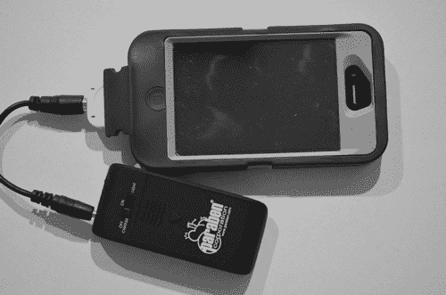

*图 5.2* 连接到涓流充电器的手机。

## 移动设备证据来源

调查移动设备和手机的复杂性之一在于信息来源的多样化以及弄清楚它们是如何相互结合的。移动设备中的一些证据来源如下：

- 运营商/供应商
  - 话单注册表 – 通话详情、`IMSI`（订阅者 ID）、`IMEI`（设备 ID）以及 `PIN/PUK`（个人 ID 号/个人解锁密钥）
- 手机
  - 通话、`SMS`、`MMS` 和媒体（图形、音频/视频和图片）
- `SIM` 卡
  - 短信、电话号码（通常没有图形）
- 内存卡（图形、音频/视频和图片）

典型的运营商信息包括主叫和结束电话号码、`IMEI`、起始和终止基站、服务类型、服务日期/时间以及服务/通话时长。调查人员在提交报告之前应验证这些信息。

## 手机工作原理

调查人员还必须了解手机的工作原理。无线电将蜂窝手机连接到基站，基站将蜂窝连接到网络的其余部分。高频率基站比低频率基站更密集。需要注意的是，蜂窝使用的频段可能因国家而异，这可能会影响设备配置和功能。

当来者打开手机时，它会寻找服务。当来电者在使用服务的同时旅行时，信号会切换到沿途的不同基站。

基站之间两种常见的信号切换类型包括硬切换（hard handoff）和软切换（soft handoff）。`GSM` 技术使用硬切换，通话以“先断后连”（break before make）的方式处理。

本质上，持有通话的初始基站告诉下一个基站它正转交一个通话，然后初始基站中断服务并假设第二个基站已接手通话的服务。

在 `CDMA` 使用的软切换中，通话以“先连后断”（make before break）的方式处理。初始基站通知下一个基站正在切换通话，但在这种环境下，初始基站会等到第二个基站处理通话后再断开与通话的连接。

## 蜂窝技术代际

蜂窝技术代包括 `1G`、`2G`、`2.5G`、`3G`、`4G` 和 `5G`。每个数字后的 `G` 代表代。所以 `1G` 是第一代，`2G` 是第二代，以此类推。描述每一代的一些特征如下：

- `1G`
  - 话单注册表
- `2G`
  - 手机数据
- `2.5G`
  - `SIM` 卡
- `3G`
  - 内存卡
- `4G`
  - 运营商信息
- `5G`
  - 无线电

## 移动设备调查记录

一些取证工具（如 `Cellebrite`）尝试支持尽可能多的设备，并在行业内建立了关系，以便能够及时开发对新技术的支持。尽管移动设备取证工具通常会生成详细报告，但仍应对设备及其周围情况进行记录。

与计算机的法医处理类似，移动设备调查可以通过使用扣押表单（如图 5.4 所示的表单所示）来得到良好的支持。

该表单由 Rebecca MacArthur 探员开发，它不仅记录了设备，还帮助记录调查过程。这样做的好处在于，在法医检查中可能会使用多种工具，因此跟踪使用了哪些类型的分析以及哪些工具可能会变得困难。一份除了记录扣押本身之外还能协助记录调查的扣押表单可以减少错误和遗漏。

## 开源工具与数据分析

开源工具在移动取证中非常常用。有些工具非常详尽，也有一些是针对小众市场的。开源工具可以提供一种验证结果和获取额外信息的良好方法。

取证人员了解工具的状态，以及其是否已针对法律诉讼进行了验证，这一点至关重要。在调查中使用未经过验证的工具可能会对案件产生负面影响。

手机取证工具通常在法医提取过程中内置了提取报告。它们还可以创建格式化文件，这些文件可以导入到其他工具中进一步分析。

手机基站和位置信息可以在 `Google Earth` 等工具中可视化，而使用数据可以使用 `i2` 和 `Maltego` 等工具进行进一步分析。这种分析比仅仅恢复原始数据更进一步，它利用视觉分析和统计分析来生成更具操作性的情报，并可能对正在发生的情况提供更广泛的视角。

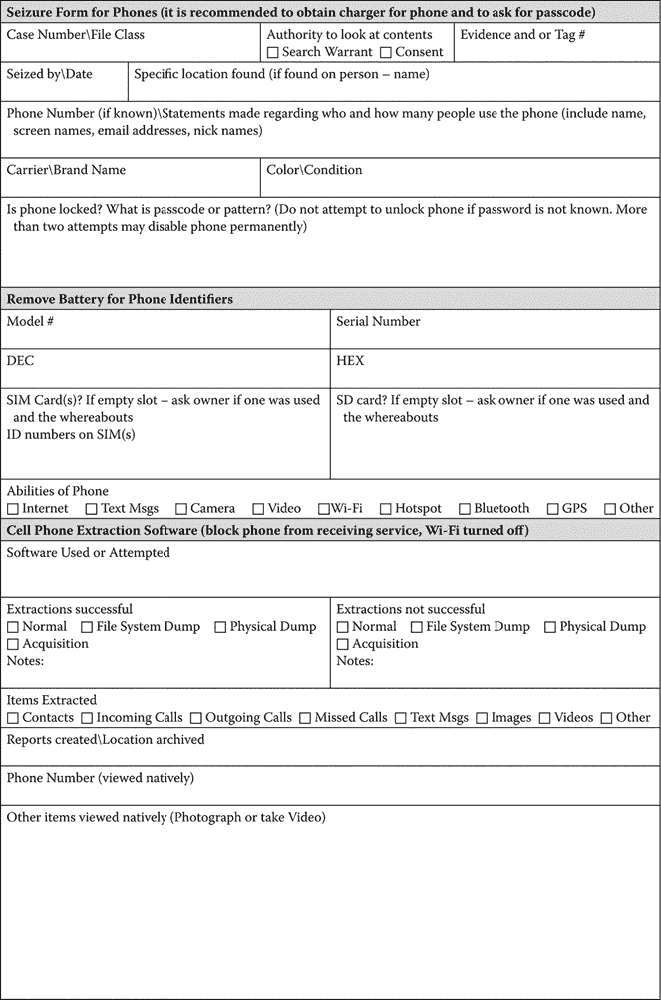

**图 5.4** 移动设备扣押表。


链路和视觉分析工具可以分析通话模式，使用各种属性如谁发起的通话、通话时长、个人之间的通话频率以及何时拨打各种电话，以确定谁在潜在团伙中处于领导地位，以及某些事件之间关联的概率。例如，如果 `Jim` 给 `Jane` 打了 1 分钟电话，然后 `Jim` 在挂掉 `Jane` 的电话后 30 秒又给 `Steve` 打了——这种模式在一个月内重复了几次——`Jim` 和 `Jane` 之间的通话与 `Jim` 和 `Steve` 之间的通话相关的概率就非常高。另一方面，如果 `Jim` 给 `Jane` 打了 1 分钟电话，然后 `Jim` 在给 `Jane` 后的第二天才给 `Steve` 打电话，那么 `Jim` 和 `Jane` 之间的通话与 `Jim` 和 `Steve` 之间的通话相关的概率低得多。这种分析可以将人放在嫌疑人团伙的内部或外部。

检查移动设备时需要关注的最重要属性之一是事件发生的时间。仅对手机活动进行时间分析本身可能不足以解释某种情况，但当分析通过同一时间线图上的其他来源信息增强时，通常可以获得对发生情况更完整、更具说服力的画面。这一点在于，法医手机提取可能有用，但将其与视觉分析能力相结合通常会提供多得的情报，这些情报可影响更广泛的局势。数字取证中链路和视觉分析的使用在第 13 章中有更详细的介绍。

## 地理定位系统

GPS 利用卫星坐标来确定位置和潜在行程。智能手机的进步将 GPS 应用和功能整合到了一个设备中，这对独立 GPS 市场产生了重大影响。在使用 GPS 技术期间生成的路线、途点和其他信息可能是很有用的。可能存在地址、收藏、最近的 GPS 坐标和配置文件，这些都提供了感兴趣的细节。

数字相机在图片文件中包含元数据，提供了有关图片的额外信息。这可能包括相机名称和型号，以及拍摄照片时的 GPS 坐标。相机的大部分相关信息都在介质卡上，尽管某些相机支持通过 `USB` 等接口进行提取。相机是犯罪中一个潜在的重要方面，应与计算机一起扣押。如果没有介质卡，调查人员应在空白介质卡上拍照以获取元数据信息。

摄像机也是数字法医取证员的信息来源。摄像机通常具有较大的存储容量——也许甚至有硬盘。像计算机一样，调查人员应该检查存储介质是否有被删除的文件。摄像机取证可能更适合计算机取证工具而非移动取证工具，因为计算机工具的恢复能力往往比移动取证工具中发现的更成熟。

## 常见的提取类型

在进行移动设备提取时，需要考虑几种不同的提取类型和最佳实践。在连接移动设备时，物理提取应该是进行数据提取的首次尝试。这种提取允许获取最详细的信息，而且还会提供被删除的数据，因为它本质上是对闪存芯片的逐位提取。下一次尝试应该是文件系统提取，这将允许获取所有文件，以及在某些情况下获取隐藏或受保护的文件。这种类型的提取有恢复被删除数据的可能性，但并非确定。接下来将是逻辑提取，它在三种提取中提供的数据量最少，但在某些情况下可能是唯一的数据提取。还有其他几种更高级的数据提取方法，需要大量的培训，除非分析师在这些方法上精通并获得认证，否则不应尝试，它们包括 `chip-off`（拆芯片）和 `J-tag` 提取。上述提取方法适用于大多数 Android 设备。在本文编写期间，iOS 设备目前可获得的提取方法是全文件系统提取。

## 信息源和位置信息

移动设备包含了大量关于个人及其活动的信息。密码存储在智能手机文件系统、网络浏览器自动填充中，或可能在云端。已删除的文件、最近的文件、应用程序数据、最近访问的网站、带有姓名和地址的联系人、信用卡号、通话记录、短信以及当前和最近的位置，都是移动设备上的潜在信息源。可能还可以从 Google、Apple 和服务提供商等其他来源获取额外的地理围栏信息，因为它们维护着包括跟踪和定位在内的用户信息。想一下——如果一个供应商能够根据你路过的商店向你的智能手机发送优惠券，那么同样的信息也可以在调查期间用于将你定位在某个特定位置。然而，调查人员应该记住，移动设备与单个基站的通信不足以将设备置于精确位置。还需要来自其他基站的额外信息来实现准确的三三角测量。这通常至少需要三个或更多基站，可能还需要信号在设备与基站之间往返的时间信息。

## 总结

由于使用的移动设备数量增加以及其提供的功能不断扩展，对移动取证的需求正以快速增长。

现在，在参加会议、检查电子邮件收件箱、阅读技术杂志或访问热门 IT 网站时，如果不遇到关于云计算的文章或演示，已经变得是不可能的。云计算正获得大量的关注。暂不考虑正式定义，"云"实际上是指将基于互联网的基础设施和应用程序外包给外部服务提供商，通常利用高度的虚拟化技术。供应商们推崇的云计算长期成本节约主张，对任何首席信息官（CIO）或首席财务官（CFO）来说都具有吸引力。自从亚马逊在 2008 年推出针对企业的云服务以来，这一计算领域持续迅速获得关注。鉴于财务节约的诱人承诺，这种计算模式似乎已经成为常态。然而，云计算和云服务对于信息技术世界来说仍然非常新，因此，其术语、服务产品以及对当前流程、人员和技术的影响，以及对这一新计算领域的通用知识仍在不断演变。

稍后我们将仔细探讨云服务的挑战、风险和收益，在此之前，稳妥的做法是建立一个云计算的工作性定义、常见的服务产品和部署模型，作为讨论的基础。最广泛接受的云计算通用定义来自美国国家标准与技术研究院（NIST）。NIST 将云计算定义为："云计算是一种模型，能够实现对共享池的可配置计算资源的通用、便利、按需的网络访问（例如：网络、服务器、存储、应用程序和服务），这些资源可以以最少的管理努力或与服务提供者的交互进行快速配置和释放。这种云模型由五个基本特征、三种服务模型和四个部署模型组成。"

通过云计算，客户可以控制自己的计算资源需求，并通过一套高度自动化且响应迅速的流程按需添加计算资源。这些自动化流程通常不需要与其他人的交互，且添加新计算资源的周转时间非常快。想象一个互联网 Web 应用程序，客户可以登录并在几分钟内添加计算资源。仅从通用客户服务的角度来看，这些特征本身就具有吸引力。我无法告诉你曾为了内部采购、安装和配置过程等待了几个周或几个月，以便执行新信息系统项目的不同阶段。考虑它为客户提供的灵活性：可以快速添加计算资源，以便在测试周期期间在其应用程序上施加重负载，以验证应用程序能够处理购物旺季流量。如果这些计算资源是内部的，可能为了支持这项测试而需要购买、安装和配置额外的服务器、操作系统和系统软件，然后这些资源可能一直闲置直到下一次旺季到来。你可能已经注意到，我在描述云特征时没有提到"多租户"或"虚拟化"术语，因为这两个术语经常与云计算相关联。尽管这些是常见特征，但它们并不是必要条件。

作为我们构建云计算基础的下一步，让我们仔细查看 NIST 定义中提到的三种模型和四种部署模型。云服务通常分为三种服务模型：(1) 基础设施即服务（`IAAS`）、(2) 平台即服务（`PASS`）和 (3) 软件即服务（`SASS`）；以及四种部署模型：(1) 公有、(2) 私有、(3) 混合和 (4) 社区。理解这些模型之间差异的关键之一是从客户的角度分析服务模型，特别是客户对操作系统、应用程序以及诸如 Web 服务器和数据库服务器等系统软件拥有多少程度的控制权、责任和可见性。稍后我们将仔细查看这三种服务模型。四种云部署模型的简要描述如下：

1. **公有：** 服务通过网络或互联网使用。除基础网络组件外，所有基础设施都位于云提供商处。此外，操作系统、系统软件和应用程序在云提供商的一个或多个数据中心的基础设施内部署和管理。

2. **私有：** 基础设施和应用程序托管在内部，但提供了云计算的一些相同优势，例如按需收缩或扩展计算能力和容量的能力。不习惯将数据和流程放在公有云中但仍然喜欢灵活云配置优势的客户可能会发现此选项很有吸引力。政府法规和法律也可能驱动客户选择这种模型。考虑一个带有机密信息的政府应用程序，由于政策无法部署到多租户模型。

3. **混合：** 这种模型是公有云和私有云的结合。由于私有部署模型中提到的某些原因，客户可能选择或由于政策强制将其部分系统部署在内部，但仍利用公有云系统的其他组件。

4. **社区：** 这种模型实际上是混合模型的混合。这种模型可以是公有的、私有的或两者兼有的，但其与众不同之处在于，使用云服务的客户是一个具有共同利益、目标、使命等的"社区"的一部分。

现在让我们仔细查看所提供的三种不同服务模型及其特征。

在这种模型中，为客户提供虚拟机或服务器。客户控制操作系统、存储、网络配置以及任何应用程序和系统软件（如 Web 服务器、数据库管理系统和包括基于主机防火墙在内的网络软件）。客户可以按需添加处理能力、虚拟机和内存。在这种模型中，客户还负责以下内容：

* 操作系统补丁
* 系统软件配置
* Web 服务器管理
* 数据库管理
* 所有系统软件的补丁
* 与未正确执行操作系统、应用程序软件和系统软件的安装、配置和补丁有关的安全影响，包括机密性、完整性和可用性

在这种模型中，客户从 `PAAS` 提供商的产品中选择操作系统环境、系统软件和网络配置。客户安装并配置应用程序，但云提供商主要负责操作系统和操作系统补丁、存储以及网络配置。客户和云服务提供商可能对 Web 服务器和数据库管理系统等系统软件共同责任。云服务提供商可能负责系统软件的安装和配置，但客户可能拥有完全管理权限，包括覆盖云提供商原始默认设置的权限。

客户对业务应用程序的安装和配置，以及网站应用的创建、管理和数据访问承担完全责任。客户可以共享部分网络责任，例如决定是否将数据库的 `DNS` 公开，以支持来自非云提供商托管应用程序的远程连接。云提供商将负责 Web 服务器和数据库管理系统软件的补丁和升级，并可能控制某些管理功能，例如数据库和网站的基本备份与恢复。客户增加处理能力和内存的能力可能会受到云提供商的限制。

在这种模型中，云提供商对操作系统、系统软件、网络配置、存储、应用程序安装和配置具有控制权。客户通常使用网络浏览器或极简客户端软件访问应用程序。客户管理员可能拥有基于角色的权限访问通过 `SAAS` 应用程序提供的应用程序管理功能。

在 `SAAS` 模型中，通过额外的虚拟机、`memory` 或 `disk` 增加更多处理能力的能力并不由客户控制。这种控制被服务水平协议（`SLA`）所取代，该协议规定了 `SAAS` 供应商与客户之间的可用性响应响应时间。`SAAS` 供应商可能会增加虚拟机、`processors`、`memory` 或 `disk` 以确保满足 `SLA`。

应用程序接口（`APIs`）可能用于与应用程序过程和数据交互，包括数据提取、数据更新和集成。集成也可以由 `SAAS` 供应商或第三方集成服务提供商作为服务提供。

这些部署模型和服务模型之间的边界可能有些模糊。例如，通过使用虚拟专用网络，可以提供一种实际上是私有的公有云部署。，混合模型与社区模型之间的区分也可能是模糊的。上述的部署模型和服务模型仅提供了一个可以提供、消费和评估服务的框架。由于公共模型是最流行的部署模型，且 `SAAS` 将大部分直接安全责任推给了云提供商，我们将讨论重点放在公共部署模型和 `SAAS` 服务模型上。`图 6.1` 展示了云架构的类型及其服务和部署选项。

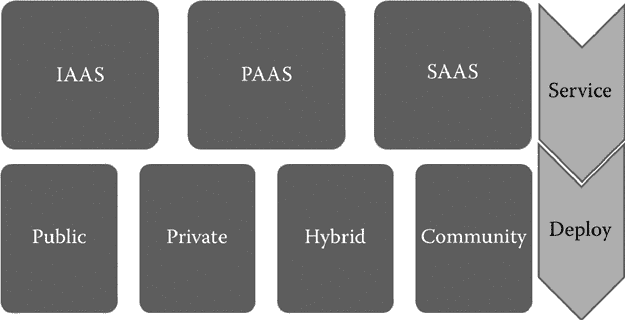

*图 6.1* 云服务和部署模型。

当你从 `IAAS` 移动到 `PAAS` 再到 `SAAS` 服务模型时，客户对操作系统和其他系统软件（如 Web 服务器和数据库服务器）配置的控制权会减少。这种控制一直减少到在 `SAAS` 模型中，客户完全通过浏览器或 `API` 交付的抽象应用程序与云服务交互。客户可能不知道甚至不在乎是什么操作系统、Web 服务器或数据库服务器托管了 `SAAS` 应用程序。

如 `图 6.2` 所示，每个后续的服务模型都建立在前一个模型的基础上。`PAAS` 使用来自 `IAAS` 的基础设施服务，而 `SAAS` 使用来自 `PAAS` 的操作系统和系统软件。在 `SAAS` 模型中，基础设施和操作系统软件完全从客户视角中抽象化了。然而，`IAAS` 和 `PAAS` 层仍然存在；它们只是由 `SAAS` 供应商管理。鉴于这种模型，没有任何能阻止 `SAAS` 供应商使用独立的 `IAAS` 或 `PAAS` 服务提供商的服务。从客户的角度来看，你越接近使用 `SAAS` 服务模型，就越依赖云服务提供商提供安全可靠的解决方案。客户越接近 `IAAS` 服务模型，客户在提供安全可靠解决方案方面承担的责任就越大。然而，客户也对他们的数据和过程拥有更多的控制权。这种控制带来了责任。在两种极端情况下，所有的安全问题都需要通过 `SAAS` 模型中的 `SLA` 合同解决，或者通过在 `IAAS` 模型中构建和实施客户的安全策略和解决方案来解决。

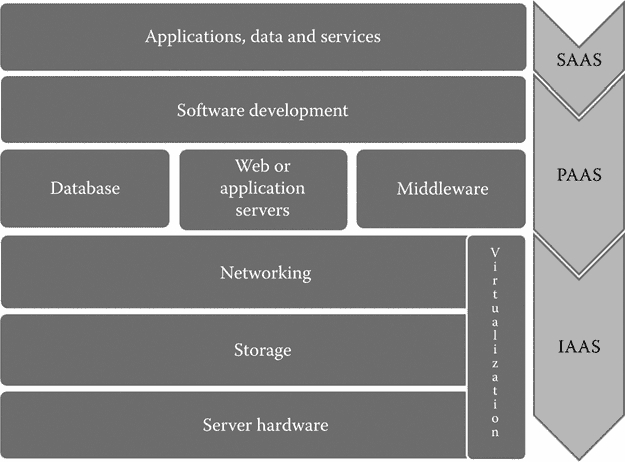

*图 6.2* 按服务划分的应用栈。

在 `SAAS` 服务模型中，客户最终不是仍然对安全可靠的解决方案负责吗？是的，他们依赖 SAAS 供应商来维护他们的 `SLAs`，但客户无法将所有风险和责任转移给云提供商。

还有一些额外的云服务模型并不一定能完美契合这些类别之一。这些模型的一个例子是集成即服务。我们在这个模型上面临一个迫的问题，因为它与"基础设施即服务"（`IAAS`）具有相同的缩写词！集成即服务模型提供了客户遗留系统与 `SAAS` 应用程序之间的集成，以及不同的 `SAAS` 应用程序之间的集成。这些集成服务提供商可能提供预构建的软件集成适配器，加速与流行的遗留企业资源计划（`ERP`）系统或其他 `SAAS` 应用程序的集成过程。例如，可能某个人力资源 `SAAS` 供应商与薪资 `SAAS` 供应商合作，并使用集成即服务提供商来执行其人力资源应用程序与流行的 `SAAS` 工资应用程序之间的集成（数据移动和转换）。这为客户提供了更多外部选项来实施和集成完整的解决方案，同时也带来了更多的安全担忧，因为你在解决方案中引入了另一个公共服务层。你不仅需要评估 `SAAS` 供应商，现在还必须对集成提供商进行同样的详细评估。此外，当你使用集成服务提供商时，谁控制并对接口负责？`SAAS` 供应商何时升级他们负责接口影响的应用程序？作为客户，你对集成服务提供商提供的接口有有多大的可见性？如果你不启动、管理和监控这些接口，你如何知道这些接口是安全的？你真的能信任 `SAAS` 供应商和集成服务提供商会代表你作为客户的最佳利益吗？我评估过的一些集成服务提供商允许客户保持对接口更改的控制。在这种模型中，你正在使用集成服务提供商的基础设施和软件组件来快速配置和管理你的集成。你作为客户控制接口的更改和部署。然而，出于客户服务的精神，服务提供商可能会提议为客户这样做。必须在实施速度、长期灵活性、数据质量和风险之间取得平衡。

该模型的另一个疑虑是客户是否有能力迁移到另一个不同的 SAAS 提供商。回到我们上文的人力资源示例，如果客户选择迁移到另一个薪资 SAAS 提供商，他们可能需要涉及人力资源 SAAS 提供商和集成即服务提供商，这两者对于他们的组织都是外部的。集成即服务提供商是否会限制客户对薪资提供商的选择？人力资源 SAAS 提供商是否需要修改其与集成服务提供商的接口？考虑到这些服务的成熟度，这两个问题的答案很可能是"是的"。你如何确保所有数据在迁移后在之前的薪资提供商的设施中被妥善销毁？客户与云提供商之间的合同必须解决这些疑虑。此外，客户可能对其内部系统需要一些相同的接口组件，导致人力资源接口组件的重复。这无疑会影响财务激励，并可能导致数据质量和一致性问题。在这种情况下，我们现在有多少个地方在存储、传输和处理数据？初始实施可能会导致数据和过程所在的地点比客户希望的或可能在迁移到云服务之前拥有的更多。这无疑增加了事件响应和数字取证过程的复杂性。

在 SAAS 模型中，集成需求并不会消失。事实上，它们可能会变得复杂得多，因为你的集成很可能必须通过公共网络安全地进行。此外，并非所有的 SAAS 服务都是平等的。有些服务提供复杂的编程 API，而另一些服务则只提供部分数据的基本导入和导出。在 SAAS 实现项目中，有更多的自定义集成并不不罕见。这些集成可能会带来若干安全风险：

1. 静态数据可能需要加密。
2. 传输中数据无疑需要在跨网络进行加密。
3. 用于加密的私钥和公钥必须在云提供商内部和外部进行管理。
4. 你需要依赖与云提供商的 `SLA` 来确保数据的机密性、完整性和可用性。

在图 6.3 中，我们可以看到集成服务提供商可能能够启动数据导入和导出、执行远程过程并传输文件。这些过程中的任何一个都可能导致数据临时或永久地留在集成服务的基础设施中。考虑审计这些数据从 SAAS 提供商到集成提供商、再到客户、再回到集成提供商、然后到另外一个 SAAS 提供商（包括原始 SAAS 提供商）的移动和转换的复杂性。安全专业人员需要确保数据在所有这些过程中都是安全的，无论数据是静态的、处理中的还是传输中的。如果客户决定采用集成即服务的方法，应该谨慎行事，因为他们正信任服务提供商来代表他们的长期利益。

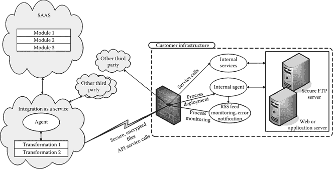

*图 6.3* 集成即服务。

## 多租户

如果说有一个云热词能引起关注安全的 IT 经理的注意，那就是"多租户"。多租户是规模经济的驱动因素之一，它使云服务在财务上具有吸引力，并使云服务提供商能够高效地管理运营。多租户真正意味着什么？在每种和服务部署模型中，其含义和实现可能会发生巨大的变化。例如，在 `IAAS` 模型中，你的硬件将以多租户的方式与其他客户共享，但你的操作系统和系统软件可能不会。在 `PAAS` 中，你的操作系统和系统软件可能与其他客户共享，但你的应用程序不是。随着你从 `IAAS` 移动到 `PAAS` 再到 `SAAS`，多租户的程度会增加。在 `SAAS` 中，与其他客户共享同一个物理数据库实例并不罕见。你的数据可能与你的竞争对手混合在同一个表中！让我们希望云数据库管理员不会错误地修改数据库视图或安全组，允许客户看到彼此的数据！此外，成功的 SQL 注入攻击可能会在该模型中泄露多个客户的数据。让我们思考一下 SQL 注入攻击。在 SQL 注入攻击中，攻击者欺骗应用程序执行由攻击者编写并注入 Web 应用程序输入字段的查询。在多租户 SAAS 服务的攻击中，这些注入查询可能导致攻击者看到多个客户的数据或不当修改客户数据。你可能会想："当然，但他们只能看到他们权限级别的数据。"这可能不是事实。大多数 Web 应用程序的设计方式是，访问数据库的账户是特权账户，与用户登录 SAAS 程序的账户分开。当有成千上万的用户访问 Web 应用程序时，在数据库级别维护单独的用户账户和权限通常是不可行的。相反，Web 或应用程序服务器代表所有用户连接数据库。在 SQL 注入攻击中，你利用了相同的特权数据库账户，因此可能会访问整个数据库。


# SAAS 多租户安全分析

SAAS 销售人员对使用其软件的大客户非常自豪，并且不吝将这些大客户作为背书手段。SAAS 提供商的大客户列表对攻击者来说并不难。某些公司和组织比其他组织更容易成为攻击目标。客户是否应该将同一 SAAS 服务的知名客户视为威胁（因为他们引发了攻击），还是对产品的强力背书？我认为大多数客户不会希望与热门攻击目标共享多租户数据库。

在采用`IAAS`或`PAAS`模型的多租户环境中，客户无法被信任构建并部署无漏洞的应用程序。因此，客户应用程序、数据和管理权限的隔离至关重要。跨客户共享操作系统账户是不可能的。数据库实例和账户也应该分离。理想情况下，每个客户应该有自己的数据库实例以及遵循最小权限原则的独立访问账户。独立访问账户是常见的。但独立的数据库实例并不常见，并且可能违背云提供商的规模经济模型。应用程序架构层之间的信任边界在多租户环境中变得复杂得多。应用程序架构层不仅需要相互建立通用信任边界，还需要在每个架构层内建立特定客户的信任边界。

## 用户访问与配置

SAAS 应用在管理用户、用户组以及身份验证和授权流程方面必须适应广泛的客户能力。SAAS 应用可能会提供直接在应用中创建用户、群组和权限的能力，以避免疏远那些不愿意投入资金与其身份管理系统集成的客户。客户必须拥有一策略，将此类用户和权限信息的管理与其组织的中央身份管理隔离开来，或者必须做好准备与其中央身份管理系统进行集成。

在独立系统中手动维护用户、组和权限面临着许多挑战。员工的审计、入职和离职流程可能成为一项挑战。用于身份验证和授权的用户数据很容易与客户的中央身份管理系统变得不同步。确保离开组织的员工能够及时从 SAAS 应用中移除可能是一项挑战。同样，随着员工在组织中角色的变化而更新其用户权限也可能是一项挑战。客户可能需要使用云提供商的`API`自定义构建一个用于审计用户和权限的流程。无论该过程是手动的还是自动的，在某些情况下，从 SAAS 系统中删除用户的时间可能存在无法接受的延迟。

某些 SAAS 提供商提供不同形式的单点登录（SSO）。SSO 流程允许已通过客户网络身份验证的用户“自动”对 SAAS 应用进行身份验证。客户应该调查 SAAS 应用是否同时允许配置 SSO 和直接身份验证。在某些情况下，我曾看到客户被迫二选一，而不能兼得。对于客户来说，实施 SSO 是可能且理想的，但同时也带来了许多挑战。SSO 主要是为了终端用户的便利，因为它消除了终端用户在通过客户网络身份验证后再次被提示登录的次数。实施 SSO 减少了终端用户的密码和登录次数，但并不一定消除手动维护或对 SAAS 应用进行自定义接口的需求。用户身份和组权限仍然必须在客户和 SAAS 应用之间进行同步。

在 SAAS 应用可以在不先登录客户网络的情况下直接从互联网访问的情况下，SSO 变得更加复杂。客户可能需要 SAAS 提供商重定向到由客户管理的网站，让用户对客户网络进行身份验证，然后传递凭据并重定向到 SAAS 应用。这不仅为终端用户引入更多故障点和困惑，还为试图访问 SAAS 应用的攻击者提供了更大的攻击面。其他使与 SAAS 提供商 SSO 复杂的场景还包括客户网络内的共享计算机。制造区域的员工共享一台连接到网络的公共亭机式计算机，并在计算机启动时使用公共用户账户和密码，这并不罕见。员工可能会被提示登录某些应用程序，然后必须在离开共享计算机前记住注销。与之前的 Internet 访问场景类似，即使共享计算机不支持到 SAAS 提供商的 SSO，SSO 集成也必须适应这些员工。集成的复杂性和攻击面进一步增加，审计和监控员工对 SAAS 应用访问的复杂性也随之增加。

客户在转向云计算的过程中，将需要采用标准的身份管理实践和接口。为每个云提供商构建自定义集成是不可持续的。诸如服务配置标记语言（`SPML`）等标准正在兴起，但由于复杂性和投资要求，到目前尚未被广泛接受。今天，客户必须为每个云提供商的`SPML`实现编写一个配置服务。这导致了标准的配置方法，但并没有减少客户和云提供商需要维护的复杂性或接口数量。像`SPML`这样的标准配置接口可以使用标准的可扩展标记语言（`XML`）架构提供读取、更新、创建或删除等基本用户数据操作。标准服务可能还会提供基本的用户数据搜索操作。其他开放标准如`OpenID`、`Yahoo!`和`Google`实现了对云服务提供者的 SSO 和验证。然而，这些标准中使用的用户账户和密码不受客户控制，因此面临着自身的一系列风险和挑战。

## 数据保护与泄露

在云环境中，一种常见的防御和客户要求是在数据在传输和静态存储时进行加密。我不反对这种做法。网络中传输的数据和静态存储的数据都应该加密。加密数据有助于防止其他客户或云提供商员工破坏数据机密性。使用的加密方法应根据客户所属行业或政府的政策和建议被认为是可以。然而，当应用程序被破解时，这种防御提供的保护有限。例如，如果 SAAS 身份验证被绕过或破解，SAAS 应用架构组件可能会认为数据请求是合法的，从而允许攻击者以明文形式查看加密数据。此外，某些数据加密实现仅防止硬盘被盗。在这种情况下，任何具有合法或被破解的访问权限的人都可以以明文形式查看数据，因为如果用户具有访问权限，数据库引擎会自动解密数据。

在所有三种云服务模型中，客户对数据加密和密钥管理承担完全（`IAAS`或`PAAS`）或共享（`SAAS`）责任。客户必须分析并理解云提供商如何保护其数据。简单说“我们加密了所有数据”并不是足够的回答。这必须包括审查云提供商如何管理加密密钥，包括密钥如何生成、存储在哪里、如何控制访问以及谁可以访问加密密钥。客户还应该意识到加密密钥如何在 SAAS 提供商的应用架构中跨客户共享。客户可能会选择由第三方管理加密密钥，作为降低风险的一种。

应用流程和数据的位置无疑受到云提供商类型和模式的强烈影响。然而，即使在`SAAS`模型中，从整个业务解决方案来看，应用流程和数据也可能散布在客户的内部基础设施以及云服务提供商的外部。在大型组织中，能够完全迁移支持业务流程的应用流程和数据是非常罕见的。不可避免的是，任何重大的业务应用程序都需要与其它业务应用程序共享数据和流程，这些其他程序可能位于外部不同的云平台或服务提供商处，或者托管在客户的内部位置。至少，大多数客户需要将来自所有重大业务应用的数据整合到数据仓库中，以便这些数据可以与业务的其他领域结合以进行分析。这种数据整合和分析报告通常不在云端执行，至少目前还不是如此。了解应用流程和数据的位置对于理解漏洞、确定审计和日志应该以及将会会在何处发生，以及加密要求至关重要。在云模型中，数据和应用流程的物理位置可能是未知的。在多租模型中，相互热备份的多个数据中心可能是解决方案的一部分，导致敏感数据存在于多个位置。

从客户到云服务提供商的数据导入过程可能会引入跨站脚本攻击的机会。在某些跨站脚本攻击中，目标是在网页中插入一些`HTML`或`JavaScript`代码。为了将`HTML`或`JavaScript`放入网页，应用程序必须接受这些`HTML`或`JavaScript`并将其存储在应用程序的数据库中。当 Web 应用程序渲染包括插入的`HTML`或`JavaScript`的网页时，该网站已被入侵，导致网站被篡改或其他潜在的恶意活动，例如尝试窃取用户的 Web 应用程序会话。传统上，这种类型的跨站脚本攻击直接发生在 Web 应用程序内部，这些应用程序未能对通过浏览器输入的用户输入进行适当验证。我描述了内部用户、内部系统以及作为第三方集成服务提供商可能提取、转换、传输和导入数据的场景。这些过程中的任何一个环节和责任方都为攻击者提供了破坏数据的机会，包括通过在处理的数据中插入`HTML`和`JavaScript`来实施可能成功的跨站脚本攻击。应用程序漏洞扫描器对于发现此类跨站脚本漏洞将毫无用处。这并不意味着不应该对云提供商的应用程序执行应用程序漏洞评估。云提供商应该定期对其应用程序运行应用程序漏洞扫描器。客户可能希望获得云提供商的合同许可，以便针对应用程序运行他们自己的漏洞扫描器。

由于数据泄露导致的操作系统访问也应该引起关注。一些大型热门数据库供应商允许在数据库操作（如数据查询或更新）期间获得对操作系统的特权访问。显而易见的原因，此功能应当被关闭。然而，如果`SAAS`应用程序的设计要求某些操作访问操作系统，这可能会给所有共享该数据库服务器实例的客户带来漏洞。`SQL injection`攻击可以通过注入的`SQL`隐式执行操作系统命令来利用这一漏洞。这些命令可以是移动文件、删除文件或扫描操作系统上的文件等任何操作。客户应该询问数据库实例配置设置，并要求以安全的方式配置数据库。

数据安全和保护法律可能因国家而异。特别是欧盟的数据隐私法可能会让试图利用不仅全球`SAAS`部署，还可能涉及某些内容的实施的全球组织感到困扰。

在所有这些服务模型中，客户与云提供商进行通信的唯一客户端软件可能是浏览器，或者可能是一个简单的文件传输协议（FTP）客户端。另一方面，云提供商可能会通过传统的客户端提供其系统软件。例如，PAAS 供应商可能允许客户使用数据库供应商的型客户端软件连接到数据库服务器。这使得客户能够利用数据库供应商提供的全功能管理和开发工具集。这同时引入了一些安全风险，稍后将进行描述。当 PAAS 供应商允许客户通过数据库供应商的管理和开发工具连接到其数据库服务器时，这些服务器可能会受到攻击（见图 6.4）。

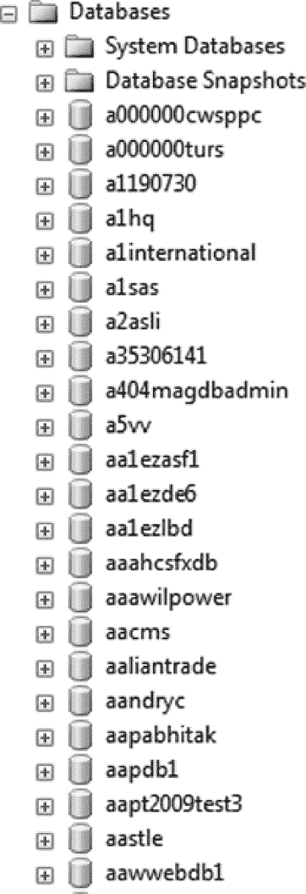

图 6.4 数据库目录。

图 6.4 是客户端数据库开发工具连接到 PAAS 提供的企业级关系型数据库的截图。这确实引入了漏洞，因为云提供商不再能够完全控制访问其系统软件资源的软件。在一种示例中，PAAS 供应商暴露了服务器上安装的所有数据库的列表，尽管客户可能只有其中一个数据库的访问权限。这助长了对非客户数据库的攻击，并为攻击者提供了一些关键的起始信息，即数据库名称。拥有与数据库名称相似的管理员账户并非不可想象的。此外，数据库名称本身可能对数据库的性质或与数据库相关的组织提供强有力指示。在下面的示例中，客户拥有单个数据库的访问权限。该服务器上有成百个不属于客户的数据库，但客户可以通过名称看到它们。使用该数据库名称作为用户帐户和密码的起点暴力破解攻击很可能发生。

使用 FTP 服务传输和更新应用程序文件在 IAAS 和 PASS 模型中非常常见。FTP 以未加密格式传输数据，允许任何可以访问网络的人能够嗅探或查看流量。应用程序文件通常包含敏感数据，例如数据库用户账户和密码、文件传输用户账户和密码以及网络磁盘驱动器用户账户。许多开发工具允许并且实际上通过默认设置通过直接构建在开发工具中的 FTP 服务传输敏感的应用程序文件。开发者和管理员在传输应用程序文件时，应始终使用安全文件传输程序。

## 迁移规划

云客户需要确保他们有一个云服务迁移计划，包括数据迁移，以防他们选择停止当前的云服务或切换到新的云服务。这种担心在 SAAS 模型中最为显著，因为客户可能无法访问由 SAAS 应用程序控制的原始数据。测试云提供商提取数据能力的一种方法是向云提供商提出数据仓库需求，以确定其按客户指定的格式提取和转换客户数据的能力。云服务提供商能力的另一个迹象是他们为客户建立开发和测试环境的难易程度。在内部，如果云提供商拥有成熟的程序来隔离、复制并尽可能地混淆敏感数据到测试或开发环境，那么这对云提供商来说可能是的。如果云提供商似乎在处理此类请求时遇到困难，则应对对其数据迁移能力进行进一步调查。执行 SAAS 供应商数据的备份并将这些数据恢复到内部数据库，可以为迁移和恢复的可行性提供保障。

在任何情况下，客户必须能够及时获取其数据，以支持迁移到新的 SASS 提供商。理解提取、传输和加载数据所需的时间是必须的。数据提取可能会因为客户需要通过 API 获取数据而变得复杂。客户应该检查 API 的数据导出功能。不提供“批量”数据提取的云提供商 API 可能在客户需要迁移到其他处时导致自定义的、昂贵的数据导出过程。客户还应该彻底了解在之前的云服务提供商处发生的所有数据销毁活动。

## 事件响应

为组织引入云计算扩大了信息安全团队事件响应流程的范围。客户应该与云提供商定义事件通知程序，包括什么被视为事件、将通知谁以及必须在何时发生通知。客户在调查期间可能需要与云提供商合作。确保在事件发生之前，客户可以获取并分析云提供商的应用程序和系统日志。客户还应该确定云应用程序多快可以关闭和重启，包括对客户数据的访问。如果发生数据泄露事件，安全团队可能无法将事件保留在组织内部，并被迫涉及一个或多个云服务提供商。组织的事件响应团队可能必须从员工的笔记本电脑（可能使用了个人私有加密密钥）、电子邮件或 FTP 追踪事件到达一个或多个云服务提供商。云服务提供商随后代表客户将数据传输到其他云服务提供商，或者作为集成器的中间云服务可能会从 FTP 服务器获取数据、对其进行转换，然后将数据传输并加载到一个或多个服务提供商。如果这听起来像是一场噩梦，请考虑如果所有应用程序都是组织内部的，步骤可能不会少，而且由于员工在数据存储在内部时往往更信任静态数据和传输中数据，某些步骤可能不安全。

特别是在云环境中，获取数据和硬件的物理访问可能是困难或不可能的。云环境意味着可以轻松扩展规模的共享资源。这意味着正在调查的环境可能会发生变化甚至消失。进一步复杂的是，云环境的位置可能无法访问——由于其所在的国家或司法管辖区，或者该环境可能镜像了一次或多次，确定要调查的正确云实例可能并不清晰。

## 虚拟化

虚拟化与云计算有紧密的关联，并通常构成`IAAS`、`PAAS`和`SAAS`模型部署的基础。云的弹性很大程度上归功于虚拟化，以及用于部署和创建额外的计算机操作系统环境及配置的相应灵活性。在`IAAS`模型中，客户可能被允许创建自己的本地虚拟机配置，然后将这些虚拟机部署到`IAAS`云服务提供商处。与在同一个数据库实例中混合客户数据类似，客户应该意识到其部署的虚拟机具有多租户或混合的特性。客户在对安全性要求较低的虚拟机进行加固时，可能没那么谨慎。因此，包含高度敏感应用程序和进程的虚拟机可能需要与不包含此类内容的虚拟机保持分开状态，以防安全性较低的虚拟机产生攻击向量，从而影响到其他对安全更敏感的虚拟机。此外，传统的网络安全可能并不完全适用于虚拟机配置。虚拟机之间可能不需要通过物理网络进行通信，这可能在尝试监控虚拟机之间的流量时，导致某些网络安全设备和流程失效。

## 云的安全优势

云计算真的有安全优势吗？有一种观点认为，特别是在规模较小的组织或安全策略、程序和资源尚不成熟的组织中，云计算更加安全。信息安全是非常复杂的。设计、开发和部署安全的操作系统、网络、数据库和 Web 应用程序极其复杂且昂贵。利用在信息安全方面拥有专业知识的云提供商可以提高组织的安全态势。考虑一家小型本地信用合作社银行，从信息安全的角度来看，他们拥有和不拥有的资源是什么。他们能够吸引并留住实施和维护安全计算系统及应用程序所需的人才吗？还是与一个在安全方面拥有良好记录且声誉卓著的云服务提供商合作会更好？就我个人而言，这种思维方式是我在小型电子商务网站使用第三方支付服务的主要原因之一。

将组织内部的关键应用程序迁移到云服务提供商处，可能会迫使组织最终处理那些一直能够或愿意推迟的安全问题，因为在此之前该系统是内部的，因此被认为“并不是真正的风险”。据记载，许多（如果不是大多数）信息安全威胁都来自组织内部。分析如何将关键内部系统迁移到云端，无疑将强制组织审查整个系统、数据、流程和依赖关系。SLA（服务水平协议）是常见的，而且通常是云计算的要求。与云服务提供商建立`SLA`的过程将迫使客户评估其内部策略和程序。客户需要计算违反`SLA`的惩罚。这一过程可能导致其认可通过更好的内部控制和策略来降低风险。

# 第 7 章 执法部门事件响应

## 引言

执法部门在涉及计算机技术的犯罪方面面临许多挑战。许多此类犯罪涉及儿童剥削，而数字取证是为这些案件伸张正义的核心。以下案例总结就是一个例子，不幸的是，这种情况非常普遍。审查此类案例可以帮助调查人员准备类似的情况。

## 案例摘要

根据许多描述，约翰·多（John Doe）是社区中一位正直的公民，有一个长期的妻子、两个孩子，工作良好，担任当地学校系统的 IT 主监，他在周围的人面前表现出专业且博学的形象。他像大多数父亲一样带家人去度假，并宠爱他的孩子。他的爱好包括摄影，并与孩子们一起分享。没有人知道他家里隐藏的秘密和邪恶，甚至他的妻子也不知道。

多成为调查对象，并后因在 7 岁到 14 岁期间对其女儿进行性侵而被定罪，还被发现持有儿童色情物品——其中一些甚至包括他自己的孩子。尘埃落定后，他的另一个孩子出来告知当局，她也也是虐待的受害者。多的痴迷摧毁了他的家庭和自己孩子的纯真，留给一个母亲和两个女儿去疗愈。

## 调查的启动

刑事调查可以通过多种方式开始。它们可能来自拨打执法部门的匿名举报、邮寄、受害者本人或其朋友，或者是来自学校的推荐。在本案中，属于后者。受害者的一个朋友告诉了学校的辅老师，辅老师根据信息采取了行动通知了当局。在许多情况下，当受害者在如此年幼遭受父母的性侵犯时，他们并不知道被要求做的事情是错误的。他们被操纵，被告诉这是一种爱的表现，并且必须保密。多利用这种操纵手段对他的孩子，利用他们的纯真来满足自己的欲望。只有在多的女儿向朋友提到她与父亲发生性关系之后，她才知道这并不是所有孩子都会做的事，而此时她害怕告诉任何人，因为担心没人会相信她，也担心真相会给她的母亲带来痛苦。她向她最亲密的朋友倾诉，朋友们敦促她站出来，但她仍然做不到。她是自己家里的囚犯，而那里本应是一个孩子感到受保护的地方。

在辅老师得知她向朋友倾诉的内容后，她联系了曾曾在其他调查中与其合作过的侦探。这些合作导致了非常漫长、详细且复杂的调查，并成功起诉了一个危险的捕食者。

## 信息


当执法部门获知此类儿童仍面临进一步虐待危险的指控时，立即收集尽可能多的信息具有紧迫性。这种紧迫性在其他涉及财产犯罪或毒品的刑事调查中并不总是存在，因为那些案件有充足的时间进行监控和背景调查。这种紧迫性对于保护儿童是必要的，且所采取的步骤必须既小心又高效。

在此案中，首位侦探立即前往学校与涉案受害者交谈，受害者一直在等执法部门的到来。初步访谈至关重要，其目的是确定可信度。因此，能够获取尽可能多的具体信息是极其重要的。这些信息虽然可能恶劣且难以谈论，但却是必要的。

在初步访谈中，调查员询问了她向朋友描述的各种虐待类型和事件。不仅确定捕食者侵犯受害者的方式非常重要，地点、方法以及尽可能多的细节也同样重要。尽管在当时这些细节看似平凡且无关紧要，但如床单类型或房间油漆颜色等细节在未来可能会导致关键证据。

受害者描述了她的父亲如何等母亲睡着后进入她的房间，给她读睡前故事，与她一起躺，起初用手指操纵她的阴道，然后用阴茎侵入。她还描述了他如何使用常见的家用个人卫生用品在她身上以“帮助刺激”她。在此次访谈中收集的信息被用作理由，起草针对该房屋的搜查令，以获取关键证据物品。

本案中的受害者还描述了她的父亲如何给她看色情片，其中一些他的电脑里有儿童。她描述了那是什么型号的电脑，并称这是为了引起她的兴趣，随后他会对她进行强奸。

儿童捕食者往往会表现出他们会根据欲望的表现采取行动。在此案中，`Doe` 曾向女儿展示过色情片，因此预计家中会有数字证据。此时，首席调查员将征得另一名侦探的协助，收集所有与可能持有和分发儿童色情制品相关的证据。

鉴于 `Doe` 职业的性质，预计其住所处会有大量的数字媒体、存储设备、摄像设备和电脑。搜查令将不仅包含与实际攻击有关的信息，还将包含所有可以存储电子证据的物品。

## 证据收集

下一步将涉及首席调查员利用在与受害者及其朋友初步访谈期间收集的信息，撰写搜查令，以从家中收集证据。团队将与数字法医调查员一起在该房屋执行该搜查令。

再次，考虑到犯罪的性质以及与受害者的关系，时间就是关键，且必须在儿童面临其父亲进一步攻击或进一步操纵的危险之前完成。

在离开执行搜查令之前，需要收集现场工具包。收集所有可能需要的工具是非常重要的，例如螺丝刀、证据袋，以及便携式成像硬件和软件，以防必须对嫌疑机器进行就地成像。

证据日志也用于记录扣押了什么以及在何处。准备一个合适的现场工具包可能需要尝试，但包含相机、日志、软件、袋子和硬件是必不可少的。

调查员必须预知他们想要采取的路线，以便准备几分钟后提出的问题，尽管这可能不是供词，但他们承认了指控背后的真相。无论犯罪心理是否想听这些，撒谎都是违背人性的。虽然话语可能是一套，但表达方式、嫌疑人的肢体语言以及对简单问题的回答将为经验丰富的调查员提供破解谎言并寻找真相所需的一切。

在这项调查中，这位首席调查员是非常顶尖的。她会战术地处理她的提问，就像在下棋一样，在许多方面其原则是一样的。

主办员会从询问多关于他的家庭、女儿以及他们之间的关系开始。多回答说他有一个理想的家庭；他的孩子表现很好，是优等学生，而且关系非常好。她询问了他的婚姻状况以及他们是否幸福。当然，多表示他们很幸福。

在访谈中营造舒适的氛围至关重要。如果调查员一上来就强硬地直接针对指控要求答案，嫌疑人将会关闭心理，任何潜在的信息都可能永远丢失——随之消失的还有成功起诉的机会。

一旦多放松下来，调查员就开始谈论受害者，即他的女儿。同样，没有询问关于指控的内容，更多是关于她的性格；比如她是否快乐、是外向还是内向、她是否喜欢做其他青少年做的事等等。

多愉快地回答了这些问题，并称她为完美的孩子。随后，她会询问他是否认为自己的女儿是个撒谎者或是否会撒谎，多会说不会。此时，调查员开始转变谈话方向，开始提醒多他是如何描述女儿的，并询问他是否能想出任何她可能为此撒谎的理由。

他表示自己不知道，并且她是一个非常诚实的人。尽管在某些人看来，这个答案既不像是有罪的指控也不仅仅是紧张，但对于受过训练的调查员来说，这可能是对指控事实的小承认和认可。结合肢体语言和非语言线索，这为调查员提供了从何处切入问题的见解。

在多的情况下，这只会导致他描述的家庭世界与受害者站出来描述的世界之间更多的不一致之处。

在访谈过程中，当调查员向他提问并描述女儿举报的行为时，多会表现出肯定的肢体动作。访谈者不应忽视这一点。例如，当调查员向多解释其女儿的报告非常有说服力且描述详细时，可以看到他点头表示赞同，并回答道：“可能是别人吗？”

调查员不应该屈从这种回答，她也没有通过简单地将话题引回多这样做，而是告诉他女儿在告诉调查员时非常明确地指认是他，对此多回答说“是啊”。

尽管多没有当面承认他被指控的罪行，但在这次访谈中有很多口头和身体上的承认。调查员需要记住的重要点是，访谈——良好的访谈——不应该也不会很快结束。

优秀的调查员可以花费几个小时审问嫌疑人以获得供词，或者对受试进行足够的分析，以判断他们是否找对了人。耐心和提问的节奏是访谈室里最重要的事情之一。那种“好警察、坏警察”的套路只在电视上有效，在现实调查世界中几乎没有用武之地。

此时，将对受害者进行更详尽的后续访谈。大多数州要求在与儿童谈论虐待时经过专门培训。在这次访谈中，是在更受控的环境中进行的，且速度比获取指控概述的原始访谈要慢得多。

在这里，调查员可以建立时间线、袭击发生了多少次、地点、实施方式，以及对虐待期间发生的情况更具描述性的整体画面。对于起诉和定罪来说，这次访谈比案件开始阶段的访谈更为重要。

在收集完信息并达成一般共识后，调查员通常会彼此及上级会面，记录行动方案，并确认是否遗漏了任何细节。在像这样的案件中，信息非常丰富，某些事情可能会被遗忘，而随着更多眼睛观察这个拼图，遗漏任何东西的概率就会降低。

## 电子证据分析

一旦证据被扣押，就必须运输到安全的证据物柜，或者在电子证据的情况下，运往安全的实验室，直到可以对其进行成像并分析其与案件的相关性。

鉴于在多的住所处发现了大量的存储设备，组织化工作至关重要。本案的主办数字取证调查员对所有原始证据进行了标记，并在复印的硬盘上使用他开发的表格记录了序列号，以协助组织工作。该表格的示例在 `图 7.1` 中。

建议调查员记住组织工作有多重要，开发他们自己的精炼方法，并在每次都使用它以建立一种常规，这样在被辩护律师挑战时，可以被指出是具有一致性且成功的。精炼方法应该基于经过证明有效的方法或多种方法的结合。精炼方法可以是其他组织方法的完全复制，但随着调查员经验的积累，可能会需要进行改进。

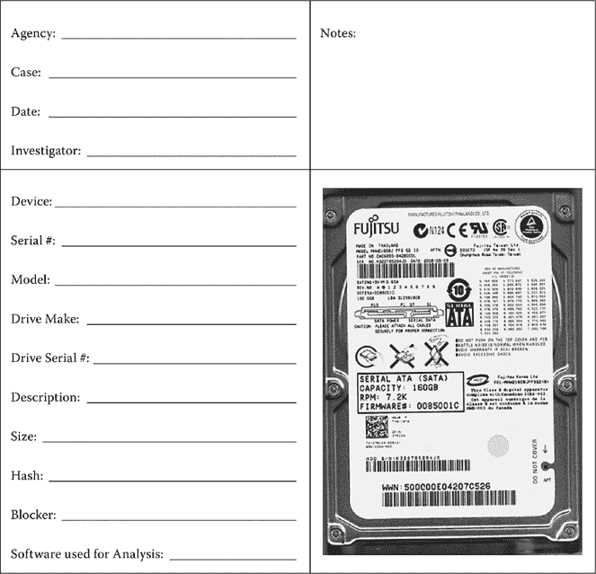

`图 7.1` 硬盘获取表。（嫌疑人硬盘的复印件图像，用于记录序列号。）

分析证据有很多工具。对于本案，我们将关注使用的主要工具。在对证据进行成像后，使用了 AccessData 的 `FTK` 软件分析镜像，以搜索多向女儿展示的犯罪和儿童色情证据。`Katana` 的 `Lantern` 软件用于分析多的 `iPhone` 和 `Mac`。同样，还有其他工具，但这些是本案中使用的。

在检查之前，必须从嫌疑人的原始数字存储设备中提取逐位位镜像（bit for bit image），并使用称为 `hash` 的数字指纹进行验证。本案中检查的每一块硬盘都进行了此操作。

在检查期间，访谈提供的信息和搜查令中列出的内容表明，电脑里会有儿童性行为的图像。考虑到这一点，确保调查员只搜索这些内容至关重要。否则，必须在搜查令中说明，并建立合理的理由来搜索其他文件。

正如调查的询问阶段一样，对数字媒体的分析必须耐心且细致，以便为案件的检察官和首席调查员提供一份具有证据价值的最详尽的报告。任何不满足此要求的做法对案件受害者、涉案警员、检察官以及社区都是一种不公。

## 起诉与证词

在证据提交给检察官后，案件将进入法院的程序和流程。我询问了本案的检察官，她在决定此类审判策略时会考虑哪些因素。

在像这样的案件中，她主要关注的点是儿童受害者对其父亲的证言，以及数字取证调查员的证言是否能让陪审员听懂。电子证据检查是一门相对较新的科学，对普通人来说可能听起来像天书一样，他们还可能失去兴趣，走神到陪审团席外等待着他们自己的世界和问题中。

如果发生这种情况，案件在此之前发生了什么就不重要了；他们可能会漏掉一个重要的点，而这可能就是辩方提出合理怀疑以获得无罪释放所需的全部。

幸运的是，在本案中，检察官表示本案中的受害者非常坚强，并且清楚需要做什么。她得到了母亲和姐姐的支持，她的证词不会令人担心。

审判前与检察官进行了多次会议，反复检查了报告，对证词进行了准备，并准备了所有所需的证据，将其提交给检察官供审判使用。

我们这些取证领域的人认为，涉及到计算机内部工作机制和电子证据存储位置时，我们说的话大多数人都能理解。然而，事实并非如此。

首席调查员决定制作一个 `PowerPoint` 演示文稿，向陪审员简要解释证据的来源，以及他在解释证据时将使用的一些术语的定义。根据检察官的说法，这是一个绝妙的主意，对案件非常有帮助。陪审员在听到以问题形式提问之前，在了解更多关于电子证据含义的内容后，似乎理解了并付出了更多关注。

在作证时，知道你在对谁说话也同样重要。律师在提问，但证人并不是在试图说服他们，而是试图说服陪审团。我见过有些警员在作证时一次也没有看过陪审团。

如果你无法面对陪审团并向他们解释你想表达的内容，他们又如何对被告的有罪或无罪做出明智的决定呢？记住仔细倾听问题，并转身面对整个陪审团而不仅仅是某一个人，这会让他们感到参与了诉讼，并更好地理解你所说的话，而不是走神。

在本案中，有了所有的电子证据，向陪审员缓慢且平实地说话至关重要。是的，`PowerPoint` 有助于建立一些知识，但你越冷静、简单地依赖这些信息，信息就越容易融入脑海。

辩护律师的任务是在调查员的案件中提出合理怀疑，他们会为此尽一切努力。某某（Doe）的律师会试图通过技术术语和“如果的话”来消除对发现电子证据方式的直白描述，从而扰乱陪审团，甚至挑战网站在用户点击缩略图后跳转的方式。

辩护律师的工作并不是理解数字取证领域的各个方面，相反，而是要有足够的知识来挑战调查员的回答、证据收集和分析方法，并在陪审员心中引起足够的怀疑，使他们裁定当事人无罪。

## 需要考虑的因素

我提供了一个关于这项调查从开始到结束的概要，以及一些考虑过和发生过的事情。总的来说，只要有一套系统，并且调查员每次都遵循标准，大多数调查都可以以相似的大致方式进行。

准备好设备并确保每次到达现场时都拥有所需的所有物品，从长远来看，可以且极可能为你节省大量时间。这不仅会节省你的时间，还会向你周围的人展示你具有专业且纪律的心态。

一旦设备准备就绪到了部署到现场的时候，就有许多因素需要考虑。在本案中，预期的暴力风险极小。然而，这并不意味着调查员放松了警惕。这意味着他们带着一名制服警员部署现场，并以冷静的方式靠近。

如果在其他调查中有任何迹象表明，你可能正在处理一个已经告诉朋友和家人他会做任何事情来避免入狱或被捕、杀死警察或自杀的人，就必须采取不同的方法。在这些情况下，安全与证据保护必须是首要任务，因此进入的方式和方法将更快、更具战术性。这些方法可能包括使用应急响应小组或更多的制服警员。

时间也是一个考虑因素。如果你的情报显示该个人整晚不睡而白天睡觉，进入现场可能需要等到他们睡觉，或者反之亦然。时间将决定你能收集多少信息以及如何准备。如果调查员获得更多时间，就可以进行更多的准备和协调。

运输设备和证据的方式也是一个经常被忽略的细节。在许多情况下，你的设备价值数千美元。在箱子和固定方式上省钱，从长远来看成本可能更高。

可以在你的车辆中安全固定的并整齐堆叠的硬箱可以防止损坏。证据也是如此。一旦证据被拍照、记录并从现场移走，就没有任何理由让它在运输过程中受损。

你的证据以及你对待它的方式可以决定你的案件是胜诉，还是取决于嫌疑人是否因犯罪入狱或逍脱的赌博。这可以简单地在证据车辆的地板上安装木箱或板条，以为证据购买额外的硬箱。

调查员应该始终备有合适的袋子和手套来处理扣押的物品。一旦证据运回设施，在将其存放在合适的储物柜或实验室之前，要小心、审慎地正确识别并标记每件证据。

证据是你案件的关键，在调查的这个阶段允许自己变得懒惰是没有意义的。这里的失误可能导致案件仅仅因为技术问题被驳回，并损害你作为调查员的声誉。这种谨慎应该贯穿整个过程，包括分析、法律程序和判决。

当案件被审判时，调查员可能需要签出证据并带到法庭。由于有多名律师以及在某些情况下还有陪审员处理证据，相同的规则适用，并且应该考虑更加谨慎。

从查扣到判决，这段时间视具体案件而异，但证据链必须始终保持完整。某些案件根据律师提交的动议可能会拖延几个月，而有些则可能在 45 天内完成，但证据链绝不能断裂。一旦发生断裂，该部分证据就可能变得不可采信，并可能摧毁整个案件。

在案件结束后以及上诉期间，证据将以相同的方式保存，直到上诉获得审理并裁决，届时将根据机构的查封令对其进行销毁或出售。

总而言之，请善爱你的设备、你的证据以及你维护安全设施的方式。这不仅反映了你个人或你的调查，也反映了你的机构以及所开展的调查。

## 结论

从投诉的开始，经过事实调查、证据收集、出证和起诉，调查员是否成功完全取决于该调查员本人。如果调查员走捷径、在进行调查时没有表现出谨慎的尽职，或者简单地不遵守证据规则，结果可能是灾难性的。耐心、愿意倾听以及对细节的关注将通向成功。

在对 `Doe` 侵犯女儿性行为及持有儿童色情内容的调查及最终成功起诉中，我认为我观察到的调查员是他们机构内卓越的典范，在开展调查时表现出了耐心和专业知识。他们没有放过任何细节，表现出他们不仅关注尽力完成工作，还关注为受害者及其家人争取正义。

如果从这一章中可以获得什么，那应该是耐心以及从观察中学习的意愿，这将让你成为一名更好的调查员。

在 `Doe` 被定罪并被判处 25 年监禁后，他的另一个孩子站了出来，通过向当局承认 `Doe` 也性侵犯了她，从而开始了治愈过程。`Doe` 是一个儿童性猎手，他不仅在互联网上追求儿童色情内容，还猎捕自己的孩子。多亏于案中的调查员，他再也不能做那种事，一个家庭可以尝试重新开始生活。

# 第 8 章 报告编写与演示

## 引言

报告编写和结果演示本身就是门艺术。调查员可以从调查对象以及发生的事情中学到很多知识。然而，如果信息没有记录在报告中，所学到的很多内容将会丢失。

记录调查笔记可以解释报告的内容及其得出结论的过程，以及有关调查的背景信息。调查员必须处理的平衡问题是报告中应该放入多少信息。信息过多，细节往往会被忽视；如果信息太少，报告则会显得不完整。

许多取证工具可以根据调查员在办案期间制作的书签和笔记生成报告。通常有多种格式选项可供选择，例如 `rtf`、`pdf`、超链接文档或网页。

问题在于，取证工具中的报告功能通常不易于整合来自其他工具或来源的信息。我的倾向是生成一个 `rtf` 或类似格式的报告，将其导入到 `Microsoft Word` 等工具中，并进行“美化处理”。某些取证工具生成的报告很难在 `Word` 中被导入或修改，例如从 `Cellebrite` 生成的报告。

## 报告内容与考虑因素

至少，报告应包含标题页、目录、授权书/委托函/调查原因、调查员签名页、摘要/概要概述、检查员意见和证据。大多数取证报告并没有提供能让调查员生成此类报告的功能，因此通常需要将需要包含在报告中的各种产物导入到一个位置。

大多数时候，调查员不会整合他们的报告。他们会为每个工具和/或每个产物生成独立的报告。这种做法的挑战在于，它留给了读者去在各种文档之间建立联系。

很多时候，设备连接后内容被直接导出到默认报告中，作为一种缺乏验证的调查结果被提交。这在科学环境中可能算作研究，但在执法环境中却是常见的做法。

报告标题页应包含标题、案件名称和案号。此外，关于报告编写人员的信息也应该是标题页的一部分。这包括调查员的姓名和职称、机构、任何执照、证书或其他描述调查员的信息，以及报告创建日期。

在某些州，进行数字取证调查需要专业调查员或执法人员的执照。无证上调查属于刑事犯罪。

目录可以提供报告中所有章节和子章节的位置。对于摘要报告或案件简报，可能不需要目录。一个经验法则是，当报告接近十页时，开始使用目录。

关于报告受众是非技术人员的这一点，可能需要作为报告流程的一部分予以解决。有时，需要提供一份术语表和/或针对计算机技术某些方面的简要技术入门指南，以便报告能够被正确理解。

术语表通常包含在报告中，而技术入门指南通常是独立的文档，或者以报告演示前的口头简报形式存在。

调查人员使用的工具集也应该予以记录。顺便提一下，调查人员应该接受过相关工具的培训并具备经验。由于工具更新频繁，要求检查员接受所有使用的版本和工具的培训是不现实的，只要这些工具是之前培训和经验的逻辑延伸。

这好比去看牙医：你期望医生受过培训并胜任，但你并不期望他们每次换新钻头时都要去上课。

我提到这一点的原因是，我注意到某些执法机构在进行数字取证检查时，调查人员对数字取证几乎没有或完全培训，在某些情况下，甚至没有过计算机技术的正式教育。尽管为期一周的取证课程经常被吹称为合格，但它并不能让某人成为专家，特别是当他们没有其他实质性的计算机培训时。

检查结果应该总结在报告的检查员意见部分。在调查过程中进行关键词搜索时，可能会有成千上万的命中结果。检查员通常会对这些结果进行筛选，并标记具有代表性的样本作为书签，包含在报告中。

书签的数量可能有数百个或数千个，这可能导致报告变得非常长。如果没有技术背景，大多数人会迷失在细节中。书签和证据应该在报告中进行逻辑安排并分为若干章节。

章节可以是计算机配置信息、电子邮件、图形、在嫌疑计算机上进行的搜索引擎搜索等。在报告的检查员意见部分中，应对每个章节提供一个简要概述，然后引用每个章节中第一个感兴趣的项目。这可以是页码和/或文档内的超链接。

证据是在调查涉及的设备上发现的内容。正如刚才提到的，这应该按照逻辑顺序和类别进行安排。这通常从记录设备的信息开始，例如序列号、配置信息和设备照片。

照片可能是设备在被扣押时的照片——包含多个角度，以便记录电缆连接和状态信息。也可以包含位置图纸，以及扣押过程的摘要。

务必强调源文件和镜像的哈希值（`hash`）是匹配的，并且镜像哈希值是在报告结束时提取的且同样匹配的。

如果发现证据的方法（例如 `sector math`）及其所在位置与案件相关，也可能需要包含在内。例如，隐藏在备用数据流（Alternate Data Stream）中、使用加密、压缩壳（`packers`）或修改了扩展名的文件可以显示意图，而在未分配空间（`unallocated space`）中发现文件可能有完全不同的含义和解释。

一些检查员认为结论也应该包含在报告中。对此我持保留意见，部分原因源于语义化问题。我将概述几个问题，你可以得出自己的“结论”。

报告不应包含偏见或推测是至关重要的。得出结论可能会掺杂这两者。检查员的工作是发现事实，而解释权交由检察官或法官。

## 示例报告


虽然报告可以很长得多，但这些内容应该足够让你对报告有一个大致的了解。在存在视频和音频文件的情况下，我更倾向于在 DVD 上创建一个目录并将文件导出到该目录。然后，我会在检查员意见部分引用包含视频和音频文件的目录。

以下是我经常随移动设备报告使用的示例封信。

以下是一个计算机取证报告示例。请注意，为了节省空间，我尝试使报告尽可能简短，许多产物（artifacts）只是部分表示。考虑到这一点，某些展示形式是纯文本格式，而非重建的网页。

我在随附报告的 DVD 上包含了一个`ReadMe.txt`文件。以下是`ReadMe`的测试内容：

```
本光盘中包含的介质仅供 Pleasantville 法院编号 13-2399-DD 使用。未获得本案授权的人员不应审阅此光盘。请将其退 Mirean Law Office,Plankton,MI 49444。
```

在展示结果时，有几点基础需要记住，无论是在公司会议、证言录取还是法庭现场。第一点是坚持事实并陈述你所知的。当被要求推测或提供意见时，要非常小心。律师倾向于总结情况，并询问你该陈述是否准确和/或你是否同意。通常情况下，使用你自己的话更好，因为律师在向你提问时心中可能已经有了想法，他们可能会引导你进入一个你不想去的陷阱。等你反应过来时，可能已经处于一个难以摆脱的境地，而你的工作可能会因此受到损害。“不信任任何人”可能听起来有些严酷，但可能是最好的起点。

关于证言录取（deposition）的法律各异，因此在提供证言之前，对环境的了解至关重要。这是一份法律记录，所以准确性是关键。有些州允许你审阅证言转录，以确保记录准确。允许进行此类审阅的时间范围以及你何时可以要求审阅，都是你在提供证言之前需要明确的点。考虑在证言开始时表示，你希望在提交之前进行审阅。我审阅过自己的一份证言，发现其中一条归因于我的评论实际上是对方律师所说的。幸运的是我在审阅中发现了这一点，因为如果这个不错误的归属没有得到修正，该陈述将完全改变我证词的性质。

证言可以在任何地点进行。我曾在图书馆和律师事务所等地方接受过证言。在证言期间，良好的做法是对你任何不理解或看起来模糊的问题要求澄清。确保你感到很舒适。不要害怕要求休息或其他舒适措施，特别是当过程可能很漫长时。携带并记录笔记是可以的，现场可能还有其他人作为证人。此外还会有法庭记录员记录整个过程。

证言记录了所说的话，但它们无法理解某事是如何表达的或肢体语言。然而，肢体语言和表达方式在法庭程序或公司环境中是重要的。眼神交流、自信的姿态和良好的形象是重要因素。未言的因素可能是你证词最重要的部分。

出证可能是一种奇怪的经历。要意识到律师只问那些他们有答案或理论的问题，因此准备工作应该包括应对各种情况。另一点需要记住的是，你可能只了解案件的一小部分，当你到达法庭时，会发现自己所处的环境与你想象的完全不同。怀疑自己为什么会在那里也不为过分，因为案件的现实与你预期的大不相同。如果案件涉及陪审团，在回答时请将注意力转向他们。尽可能与他们进行眼神交流。

当被要求出证时，你可能会被问几个与案件核心主题关系不大的问题。每个案件都可能涉及对你专业的挑战以及试图损害你声誉的尝试。有时对方律师可能会试图通过陷入无聊的未知的探险来淡化你的证词，以此让陪审团睡着，或将细节埋没在丛林中。通常，法庭程序是一个你被提问并进行回答的环境。你不一定有机会说出所有你想说的话，这可能非常令人沮丧。通过参加法庭会议并熟悉谁会出现在法庭来获得一些经验。彻底审阅你的笔记，确保你已准备好应对恐吓或误导的尝试。一系列旨在让你给出“是”或“否”回答的问题以“那么你是否会说……”开头。

## Otting 博士对刑事案件证词的思考

对于任何数字法证分析师来说，在法庭出证是工作的一部分，正如上述 Gogolin 博士审查的那样，刑事证词通常与民事证言录取略有不同。在刑事法庭上，数字法证分析师经常要经过`Voir Dire`（选审审查），这是一个法律程序，分析师将就背景和教育接受提问，以便允许其作为该领域的专家提供证词并在法庭上发表意见。作为专家出证允许你提供基于意见的证词，且通常在刑事程序中进行。最好的做法是陈述你分析的事实，仅在被要求时提供意见，但这是刑事审判的一个重要方面。在这个过程中，请花些时间充分讨论你的教育、背景、培训和经验。成为专家需要时间，不要急于求成，在达到之前不要觉得自己作为分析师不胜任，只需继续学习并为之努力。

在现场法庭出证时，有几点需要记住。学习！！！你被允许携带报告进行参考，但你应该熟悉报告中的事实，并仅在绝对必要时才参考它。尝试放松。我出证过很多次，但在走向证人席时有时仍会感到紧张。分析师必须记得呼吸，说话清晰且冷静。说话时，面对陪审团，称呼他们并进行眼神交流，让他们知道你是在对他们说话。法庭证词的区别在于观众。陪审团在那里是为了裁决案件的，他们是你唯一需要确保了解报告中证据的人。这意味着你需要用非技术人员能理解的方式来解释这些材料。我准备过并见过其他分析师准备`Power Point`演示文稿来解释报告的某些方面，使其更容易理解。如果分析师向陪审团抛出过多的术语，可能会很快失去陪审团的支持，如果发生这种情况，他们可能会错过关键证据。数字法证是一个许多人着迷的领域，所以你会立即引起他们的注意力——保持他们的参与感！

最后但绝对不是最不利，诚实！这关乎你的伦道德和专业素养，有时分析师由于担心法庭观众会如何看待，而不敢简单地表示他们不知道。对于说不知道问题的答案并跳过它，完全没有问题，永远、永远不要尝试在证人席上编造答案。分析师需要理解自己正处于宣誓状态，承认不确定或不知道要比提供虚假证词要好。

## 归档

案件在提交后即可进行归档。案卷文件、图像、报告、通信往来和其他文档都需要成为这一过程的一部分。取证人员可能会做一些最终备注，以帮助唤起记忆或简单地结束文档记录过程。一个经常被忽视的方面是，用于该案件的工具也需要进行归档。如果你需要审查几年前的案件，却无法在当前版本的工具中调出它或复现结果，那将是一个糟糕的状况。单是这一点就可能为成功的上诉奠定基础。我倾向于使用外部 USB 移动硬盘进行归档。保留一台旧电脑以处理旧案件也是一个好主意，因为新版本的操作系统可能不再支持归档的工具集。按日期许可许可的取证软件可能会出现问题，如果许可证没有得到维护，它们可能无法运行。更令人担忧的是，取证软件供应商可能会停止运营，导致你无法检索之前归档的案件。最终，某些案件可能会达到可以删除或销毁归档信息的阶段。最好的办法制定一项经过法律审查的政策，来规定何时以及是否删除或销毁案件信息。

## 总结

所提交的信息和报告旨在作为通用指南，让读者了解数字取证报告应该包含的内容以及如何呈现。案件各不相同，报告的要求也各不相同。本章的重点是，你需要确保包含基本信息以形成一份有效的报告，最重要的是，要特别注意准确性和伦理规范——记住，人们的生命取决于我们工作的结果。

# 第 9 章 社交媒体取证

## 引言

随着 Web 2.0 的出现以及用户生成内容和协作的引入，了一系列基于互联网的网站和工具，统称为社交媒体。社交媒体是指允许个人与他人通信、协作并建立社区的基于互联网的技术工具。社交媒体有几类，每种都为其用户提供不同的信息和功能。上述描述的所有社交媒体网站和技术的共同点是个人用户发布、创建和链接的海量信息。这些数据集合为取证调查人员提供了极具价值的资源，可以在各种调查和分析中派用场。取证调查涉及为法执法人员、军事组织、内部调查人员、私家侦探和研究人员开展的调查提供支持，寻找数字证据和信息。当我们考虑社交媒体的取证时，我们通常关注几个关键问题：我们如何追踪数据和信息通过社交媒体网站和技术的流动？我们如何通过社交媒体追踪人员、他们在组织结构中的角色和位置，以及他们的知识和信息？在传统的数字取证中，会对一个或多个计算机设备进行检查以寻找证据或相关信息。其重点主要是单一介质——计算机。在社交媒体取证中，重点要广泛得多。一个或多个感兴趣的人可以在任何数量的社交媒体网站上发布信息，使用任何数量的社交媒体技术。社交媒体取证本质上涉及某种程度的社交网络分析，其中会对组织结构和关键人物进行检查和识别。在进行社交媒体取证检查时，在寻找证据或相关信息时具有更广泛性是非常重要的。

## 社交媒体简介

随着 Web 2.0 的出现以及用户生成内容和协作的引入，了一系列基于互联网的网站和工具，统称为社交媒体。社交媒体是指允许个人与他人通信、协作并建立社区的基于互联网的技术工具。社交媒体有几类，每种都为其用户提供不同的信息和功能。我们将回顾最常见的社交媒体工具和网站的一些基本元素。

### 社交网络

社交网络网站如 Facebook（[www.Facebook.com](http://www.Facebook.com)）利用“朋友”作为一种网络技术与其他人建立联系。朋友在他们的“墙”上发布照片、评论、视频和位置。Facebook 用户可以对朋友发布在墙上的帖子进行“点赞”或“评论”。Facebook 用户还可以加入按城市、工作场所、学校、地区或任何感兴趣的主组织的网络。Facebook 登录界面如图 9.1 所示。Facebook 墙的示例如图 9.2 所示。

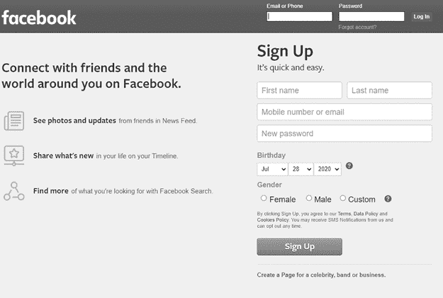

*图 9.1* Facebook 登录界面 – `[`www.facebook.com/`](https://www.facebook.com)`。


*图 9.2* Facebook 墙的示例。

Instagram（[www.instagram.com](http://www.instagram.com)）也是一种常见的社交网络服务，它包含了图片、评论和视频，供“粉丝”保持联系并更新动态。Instagram 使用话题标签（#）对主题或内容进行分类。Instagram 使用私信（Direct Messages）作为用户保持直接联系的方式。Instagram 登录界面如图 9.3 所示。Instagram 页面的示例如图 9.4 所示。


*图 9.3* Instagram 登录界面 – `[`www.instagram.com/`](https://www.instagram.com)`。


*图 9.4* Instagram 页面的示例。

LinkedIn（[www.linkedin.com](http://www.linkedin.com)）是一个社交媒体环境，用户可以在其中创建个人简介并发布更新，通知“联系人”他们的当前活动、位置、创业或职位。它整合了其他社交媒体工具，如消息、电子邮件、视频聊天、位置识别和多媒体内容的发布。用户可以选择性添加朋友、粉丝和联系人。

### 微博客

微博客与博客的区别在于它们允许用户使用非常有限的空间来创建发布。最著名的微博客工具是 Twitter。Twitter（[www.twitter.com](http://www.twitter.com)）是一种免费的微博客服务，允许其用户发送和接收被称为推文的短。推文是字数在 280 字以内的帖子，显示在作者的个人页面上，并发送给作者的订阅者（粉丝）。Twitter 页面如图 9.5 所示。


*图 9.5* Twitter 页面的示例。

### 多媒体共享

互联网已成为用户创建的多媒体内容（如照片和视频）的核心库。TikTok（[www.tiktok.com](http://www.tiktok.com)）是一款流行的视频分享应用，用户可以在其中对视频评论和点赞。TikTok 页面的示例如图 9.6 所示。


*图 9.6* TikTok 页面的示例。

YouTube ([www.youtube.com](http://www.youtube.com)) 是一个发布用户生成视频的社交媒体网站。多媒体共享网站的一个共同特点是其他用户对发布内容的趣味或质量进行评分或分级。这种用户评分系统提供的信息，使得某些内容能够能够迅速走红。

### 即时消息与通信

`Direct messaging and instant messaging` 是社交媒体应用中常见的组件。即时消息是指直接与应用的其他用户连接或发送消息的方式。Facebook 使用`Facebook Messenger`作为其即时消息应用。Instagram 也有一个`Direct Message`组件。其他应用包括`Google Hangouts` ([hangouts.google.com](http://hangouts.google.com))、`Slack` ([slack.com](http://slack.com))、`WhatsApp` ([whatsapp.com](http://whatsapp.com))、`Skype` ([skype.com](http://skype.com))、`Snapchat` ([snapchat.com](http://snapchat.com)) 以及`Microsoft Teams` ([Microsoft-365.com](http://Microsoft-365.com))。

`Internet-based e-mail` 涉及通过互联网在用户之间发送和收接收消息、附件文档以及多媒体内容。有几个互联网电子邮件提供商，但最常见和流行的提供商是`Google`和`Microsoft`。

### 博客

`blog`（网络日志）是由个人或组织维护的社交媒体网站，定期发布对事件的评论或描述。博客文章通常按时间倒序排列显示。许多博客对特定主题提供评论；另一些则充当更具个人性质的在线日志。典型的博客使用文本、图像、指向其他博客的链接，以及与其主题相关的网站和其他媒体。博客撰稿者发表评论的能力被认为是通过博客建立互动和关系的重要部分。市上有专门的博客搜索引擎，如`Technorati` ([`technorati.com`](http://technorati.com)) 和`Digg` ([`digg.com`](http://digg.com))，它们允许用户对博客文章进行搜索。

### 活动协调

互联网可用于规划具有共同兴趣的用户聚会。一种`event coordination`社交媒体工具是`Meetup` ([www.meetup.com](http://www.meetup.com))，它是一个在线门户，促进世界各地各地的线下小组聚会。它允许成员找到并加入由共同兴趣组成的小组，例如政治、书籍、游戏、电影、健康、宠物、职业或爱好。

### 位置识别

社交媒体的另一个补充是诸如`Foursquare` ([foursqare.com](http://foursqare.com))、`Swarm` ([swarm.com](http://swarm.com)) 和`Pokemon Go` ([pokemongo.com](http://pokemongo.com)) 等提供商利用技术，通过移动设备的`GPS`坐标识别并记录用户在任何特定时间的位置。这些工具被称为`location-based`技术。在许多情况下，这些特定的用户位置信息会被使用。

### 搜索

互联网可以通过搜索引擎来查找信息。最流行的搜索引擎之一是`Google` ([www.google.com](http://www.google.com))。`Bing` ([www.bing.com](http://www.bing.com))、`Yahoo` ([www.yahoo.com](http://www.yahoo.com)) 和`DuckDuckGo` ([www.duckduckgo.com](http://www.duckduckgo.com)) 也被广泛使用。许多搜索引擎允许用户根据关键词或短语进行搜索。

### 维基

`wiki` 是一个允许多个用户创建和修改内容的网站。最常见的维基是`Wikipedia` ([www.wikipedia.org](http://www.wikipedia.org))。根据提供的访问权限大小，用户可以添加新内容。维基还会记录每次编辑，以便在发生错误时将页面恢复到早前的版本。

### 网络会议

`Web conferencing` 是一种用于连接不同地点参与者的技术工具。网络会议软件可以提供多种功能，包括文字聊天、视频会议、桌面共享、文件共享和投票。某些网络会议工具允许对会议进行录制和保存。网络会议的示例包括：`Zoom` ([www.zoom.com](http://www.zoom.com))、`GoToMeeting` ([www.gotomeeting.com](http://www.gotomeeting.com))、`FaceTime` ([www.apple.com](http://www.apple.com)) 以及`Skype` ([www.skype.com](http://www.skype.com))。

### 虚拟世界

`Virtual worlds` 是使用计算机技术创建的数字世界。虚拟世界通常模拟现实世界的元素，如建筑、道路、树木和其他环境元素。虚拟世界的参与者使用`avatars`（化身）来代表自己。化身是类似于人类、动物或神话生物的图形角色。虚拟世界允许多个用户共享一个空间，该空间通过采用二维和三维设计的视觉格式表示。沉浸感是虚拟世界的一个重要方面。参与者越觉得自己是这个数字创建世界的一部分，他们就会进行越多互动和参与。`Second Life` 是一个著名的虚拟世界，为其用户提供了创建自己环境的机会。此外，如`World of Warcraft`这样复杂的游戏也被视为虚拟世界。

### 社交媒体取证

上述描述的所有社交媒体网站和技术中，最共同的元素是个人用户发布、创建和链接的海量信息。这些数据收集为法医调查人员提供了极其宝贵的资源，适用于各种调查和分析。现在，让我们来检查各种社交媒体工具，重点关注如何使用它们来开展取证调查。

传统的数字取证与社交媒体取证之间存在一些需要强调的显著区别。在传统的数字取证案件中，会对一个或多个计算机设备进行检查以获取证据或相关信息。其重点主要是单一介质，即计算机。此外，在传统的数字取证中，重点通常是单个个人或小群体。


然而，在社交媒体取证中，其范围要广泛得多。一个或多个感兴趣的人可能会在任何社交媒体网站上发布信息，使用任何社交媒体技术。此外，社交媒体经常被用于组织活动，其中某些活动可能具有恶意或敌对意图。社交媒体取证分析其本质也会涉及某种程度的社交网络分析，其中检查并识别组织结构和关键人物。

在进行社交媒体取证检查时，在寻找证据或相关方面具有更广泛的视野是非常重要的。常见的社交媒体犯罪类型包括在线威胁、跟踪、网络欺凌、黑客、欺诈、非法购买、犯罪活动视频以及抢劫（Khoury, 2017）。现在我们将查看一些使用社交媒体取证进行社交媒体调查的案例，包括街头帮、恐怖组织和白领犯罪。还需要注意的是，匿名性（预付手机、分布式网络）可能会增加取证调查的复杂（Rocha et al., 2016）。

## 街头帮

街头帮是组织化的个人群体，通常年龄在 21 岁以下，遵循相对严格的行为准则。帮派成员可能涉及成年礼，这要求他们通过对其他帮派的犯罪和攻击来证明自己的忠诚和勇猛（Walker, 2011）。在国家的许多地区，街头帮被认为是大量犯罪的来源，包括毒品、卖淫、抢劫和袭击。街头帮的领导者通常非常强大，并指导成员的活动。在他们与执行犯罪的成员之间通常有一道匿名之墙。识别并消除街头帮的领导层是一种非常有效的犯罪控制形式。

街头帮经常使用各种社交媒体工具在成员之间通信并策划活动。两种常见的社交媒体工具是`Facebook`和`Twitter`（Watkins, 2010）。`Facebook`用于通过`Facebook Groups`功能与整个帮派进行通信。帮成员可能会发布有关其活动的照片、视频或其他信息，以获得批准或认可。帮派经常使用`Twitter`发送关于会议地点、犯罪地点或其他帮派活动的消息（Nurwisah, 2010）。帮成员在使用这些社交媒体工具时通常会使用假名和特殊的电子邮件地址。最后，使用移动技术访问社交媒体网站和工具也是很常见的。

第一步是为帮派调查识别潜在的社交媒体证据和信息来源。这些包括`Facebook`、`Twitter`、基于位置的识别、多媒体照片和视频、电子邮件和移动访问。这些社交媒体源中的每一个都为取证调查和分析提供了途径。

`Facebook`可以提供各种类型的信息辅助社交媒体调查（Nurwisah, 2010）。`Facebook`调查的首要目标是尝试以朋友或小组成员的身份查看发布的信息。在理想的调查中，执法人员能够被接受为`Facebook`“朋友”和小组成员（Moilistina, 2011）。通过使用用户资料，帮成员可以发布各种类型的信息，从而导致他们的个人身份，例如对活动或地点的引用。另一个`Facebook`朋友或小组成员可以看到这些信息。

然而，即使调查人员没有获得“友谊”或小组成员身份，还有另外两种取证调查方法。第一是识别帮派一个或多个成员的用户名和密码。第二是使用`Facebook`中的小组为调查和帮成员识别提供途径。有几种技术可以用于获取社交媒体网站的用户名和密码。一种常见的方法是在`WiFi`地点建立一个恶意无线接入点，并捕获通过该网络发送的消息。这可能是捕获帮成员身份的一种非常有效的方法。警察只需将他们的笔记本电脑放置在帮成员经常聚集的`WiFi`会合点附近，如咖啡馆或快餐店。当帮成员发布消息时，他们的传输将由获得法律许可的执法人员捕获。

另一种方法是获取帮成员的电子邮件地址，并使用该地址通过“忘记密码”功能访问`Facebook`密码（Rafay Hacking Articles, 2010）。第三种方法是仅使用许多密码破解工具来破解密码。使用这些技术中的任何一种，一旦知道了用户名和密码组合，就可以紧密跟踪关联帮成员在`Facebook`上发布的消息，以解决或预防犯罪的发生。

通过`Facebook`识别帮成员的第二方法是通过使用`Facebook Groups`和指定的网站。2010 年的一项研究（Wondracek, 2010）描述了一种在社交网络小组成员访问指定的网站位置时揭示其身份的技术。他们的研究发现，社交网络网站存储的关于用户小组身份的信息足以唯一识别访问该网站的小组成员。所描述的技术使用了“浏览器历史记录窃取攻击”来实现这一目标。结果，当社交网络用户访问指定的网站时，该网站可以启动这种“去匿名化攻击”并获取其访问者的身份（同上）。

帮派还使用`Twitter`通过组织快速发送短消息，例如会议或犯罪地点。与`Facebook`类似，这些`Twitter`账户可以通过破解它们的密码并访问其账户来发现帮成员的身份。密码破解技术在破解`Twitter`密码方面非常成功（Jeffries, 2011）。

`Twitter`、`Facebook`、`Instagram`和`TikTok`是通过在这些社交媒体网站发布照片来分享照片的常见媒介。许多人没有意识到今天大多数手机拍摄的照片包含了拍摄地、日期和时间信息作为照片元数据的一部分。当照片发布到`Facebook`或`Twitter`等社交媒体网站时，这些元数据就会可用。因此，通过检查照片的属性、日期、时间以及位置的经纬度，可以确定其位置（Ulbricht, 2011）。位置、日期和时间信息与图片一起存储在`EXIF`（可交换图像文件）中，通常存储在`JPEG`和`TIFF`图像（Windows Guides, 2011）。当执法人员调查帮成员的犯罪活动时，这些信息被证明是非常有用的。

## 恐怖活动

> 恐怖分子传统上一直试图利用新型和替代性媒体（特别是互联网）来传播他们的宣传，并在较小程度上，为潜在的支持者提供行动和战术指导……作为这一趋势的一部分，圣战支持者和圣战士正越来越多地使用`Facebook`（美国和全球最大、最流行且多样化的社交网络网站之一）来传播行动信息……

> *(Public Intelligence, 2010, p. 1)*.

恐怖组织在利用`Facebook`和其他社交媒体网站时面临的额外挑战是使用了非英语语言，如阿拉伯语、乌尔都语、印尼语和其他较少为人知的语言（同上）。

恐怖组织利用`Facebook`和`Twitter`等社交媒体网站作为与其他成员及具有共同目标的组织的通信手段（Public Intelligence, 2010; Washington Times, 2011）。估计显示，90% 的当前在线恐怖活动发生在社交网络网站上（反恐主义实施任务组 (CTITF), 2011）。社交媒体也成为袭击发生时的关键新闻来源（Innes, 2015）。他们利用社交媒体分享行动和战术信息，例如炸弹配方和`AK-47`武器的维护。恐怖组织利用社交媒体推广他们的信息，并通过链接到其他极端主义组织和网站，鼓励其使命向新成员的传播。他们还利用社交媒体进行“为了目标攻击的远程侦察”（Public Intelligence, p. 1）。有趣的是，恐怖组织还经常在社交媒体网站上发布关于如何通过虚假数据和新独特密码在社交媒体中实现匿名化的信息（同上）。

美国法律禁止被指定的恐怖组织使用社交媒体网站。然而，恐怖分子对社交媒体网站的谨慎且匿名的使用，由于许多恐怖组织对其广泛使用，且缺乏可验证的用户个人简介信息，使得调查人员难以通过`Facebook`隔离并评估可靠的恐怖主义威胁（Public Intelligence, 2010）。

然而，目前已有一些活动正在协助调查恐怖分子对社交媒体的使用。亚利桑那大学参与了一项被称为“暗网”的研究项目，该项目使用各种技术来筛选恐怖组织在社交媒体网站上发布的海量帖子。他们利用这些各种帖子来识别不同恐怖组织和活动之间的关系和链接（[KVOA.Com](http://KVOA.Com), 2011）。欧洲刑警组织的“Check the Web”项目也开展了类似的项目（反恐主义实施任务组 (CTITF), 2011）。

值得注意的是，恐怖组织还利用虚拟世界作为组织和训练的工具（PR Newswire, 2011）。如`Second Life`和《魔兽世界》等虚拟世界已成为恐怖组织的模拟训练环境，使用真实武器的虚拟表示进行训练（反恐主义实施任务组 (CTITF), 2011）。据称，除了继续使用虚拟世界进行组织和训练外，它们还将被用于融资、恐怖融资和洗钱（同上）。几年前，美国高级研究计划署（IARPA）发布了研究提案请求，被称为`Reynard`项目。该请求的重点是研究如何识别虚拟世界和多人在线游戏中的与用户现实世界特征相关的行为指标，其目标是能够自动检测虚拟世界中的“可疑行为”（Mountjoy, 2008）。

> 从现实世界（RW）特征反映在虚拟世界（VW）行为中的假设出发，IARPA Reynard 程序旨在识别虚拟世界和多用户在线游戏（MMOGs）中与用户的现实世界特征相关的行为指标……感兴趣的属性包括：性别、大致年龄、经济状况、教育水平、职业、意识形态或“世界观”、影响程度、“数字原生代”与“数字移民”、大致的物理地理位置、母语和文化。

> *(IARPA, 2020)*

随着可用的新社交媒体工具数量不断增加且复杂性提高，对恐怖分子使用社交媒体工具的取证调查仍然是一项挑战。尽管通过暗网、“Check the Web”和`Reynard`项目等努力正在取得进展，但执法部门认为有必要开展更广泛的全球范围内的努力，将法律、技术和意识形态因素结合起来，投入到反恐怖主义及其对社交媒体利用的斗争中（反恐主义实施任务组 (CTITF), 2011）。

## 白领犯罪

调查人员通常将社交媒体网站作为其调查各种白领犯罪的一部分。例如，保险公司通常将社交媒体网站作为保险欺诈相关信息的来源之一。揭示与医疗索赔或财产损失索赔相关相反信息的帖子为保险公司提供了打击虚假索赔的证据。在其中一个案件中，一名女子作证她因受伤而失业，但她的一个`Facebook`帖子揭露了新工作和薪资信息（Duhl, 2011）。然而，在大多数情况下，法律阻止保险调查人员进行更具欺骗性的调查手段，例如向被调查人员“加好友”（同上）。

除了更严重的犯罪外，社交媒体网站已成为各种调查中信息的常见来源。一些律师甚至在使用社交媒体来收集有关潜在陪审员的信息（Burdge, 2011）。在大多数情况下，这些信息通过社交媒体用户发布的帖子公开可用，不需要额外使用取证工具。如果需要取证工具，调查人员将不得不获得法律系统的批准方可进行。在所有情况下，新的法院规则都允许律师在他们的取证活动中包含对社交媒体信息和帖子的请求（Walker et al., 2011）。

> “如`Facebook`和`MySpace`等社交网络网站已成为雇主、大学招生官和离婚律师进行背景调查的首选地方。凭借这些信息，警察抓到了逃犯，律师反驳了证人……公司发现了那些纸面上看起来完美的申请人参与了非法或仅仅令人尴尬的行为（Ethics Sage, 2010, p. 1）

此外，社交媒体证据正被用于针对大公司在产品责任、人身伤害和就业案件中的民事诉讼。社交媒体证据也常用于版权和知识产权案件。

社交媒体提供了一个极其巨大的信息池，其准确程度和目的各异。身份盗窃、欺诈和虚拟跟踪等犯罪正变得日益普遍且具有破坏性，如果不积极且充分地解决安全和隐私问题，目前的互联网形式可能会成为一种无法逾越的威胁（Gogolin et al., 2014）。

取证人员需要理解的一个重要点是适用于不同社交媒体调查场景（如民事诉讼索赔、犯罪调查和恐怖活动）的各种法律法规。调查人员在开始任何调查之前，需要花费大量时间理解他们在社交媒体调查中将要遵守的法律限制（Arshad et al., 2019）。

## 摘要

我们已经审查了各种社交媒体工具，并审查了使用这些社交媒体工具实施犯罪或调查犯罪的场景。表 9.1 是一张汇总表，详细列出了某些社交媒体工具、各方的使用情况以及潜在的调查和应对技术。

### 表 9.1 社交媒体汇总表

| 社交媒体工具 | 街头帮派 | 恐怖组织 | 白领犯罪 | 调查与应对措施 |
| --- | --- | --- | --- | --- |
| 社交网络（例如，`Facebook`） | - 成员间的通信<br>- 犯罪规划<br>- 发布犯罪活动（如照片） | - 恐怖组织成员间的通信<br>- 招募新成员<br>- 与其他恐怖组织的链接<br>- 活动规划<br>- 恐怖教育，如制造炸弹和使用武器<br>- 运营数据（如炸弹位置） | - 发布可能泄露欺诈和其他犯罪证据的个人信息 | - 对公开数据进行调查<br>- 密码识别<br>- 组成员身份调查<br>- 通过发布的照片获取位置和时间信息<br>- 卧底成小组成员<br>- 网络分析（例如，`Dark Room`） |
| 电子邮件和即时消息 | - 帮派成员间的通信 | - 恐怖组织成员间的通信 | - 可能泄露欺诈和其他犯罪证据的通信 | - 识别电子邮件用户<br>- 在传输过程中截获电子邮件（例如无线访问点）<br>- 传输后分析电子邮件 |
| 博客 | | - 传播宣传和招募新成员 | - 发布相反的说服性数据 | - 识别博客作者和回复者 |
| 微博客（例如，`Twitter`） | - 成员间的通信<br>- 犯罪规划<br>- 发布犯罪活动（如照片） | - 恐怖组织成员间的通信<br>- 活动规划<br>- 运营数据（如炸弹位置） | - 可能泄露欺诈和其他犯罪证据的通信 | - 密码识别<br>- 通过发布的照片识别位置和时间<br>- 卧底成粉丝 |
| 位置识别 | - 发布在可能与犯罪活动相关的位置信息 | - 发布在可能与恐怖活动相关的位置信息 | - 发布在可能泄露欺诈和其他犯罪证据的位置信息 | - 通过`Foursquare`等提供商识别位置<br>- 通过发布的照片获取位置和时间信息 |
| 活动协调和网络会议 | - 帮派成员会议协调 | - 恐怖组织成员及同情者的会议协调 | | - 卧底成小组的一部分 |
| 多媒体 | - 发布可提供位置、时间、日期及其他信息的多媒体内容<br>- 发布可提供犯罪行为证据的多媒体内容 | - 发布可提供位置、时间、日期和其他信息的多媒体内容<br>- 发布可提供恐怖活动证据的多媒体内容<br>- 发布招募新成员或同情者的多媒体内容 | - 发布可提供位置、时间、日期以及欺诈和其他犯罪潜在证据的多媒体内容 | - 发布内容的元数据中包含可用的用户、位置、时间、日期 |
| 搜索 | - 搜索与实施犯罪活动相关的内容 | - 搜索与实施恐怖活动相关的内容 | - 搜索与白领犯罪相关的内容 | - 搜索提供商披露搜索足迹 |
| 维基 (Wikis) | | - 发布内容招募新成员或同情者 | - 发布相反信息瓦解恐怖组织 | |
| 虚拟世界 | | - 恐怖分子会议<br>- 恐怖训练活动 | | - 通过行为建模识别恐怖分子<br>- 卧底成小组的一部分 |

如表 9.1 所示，社交媒体取证调查是对人员和数据的双重重视。它依赖于传统的调查方法以及对当前技术和取证工具的掌握。随着社交媒体使用量规模持续增长，它将继续作为取证调查中的主要证据来源之一。

## 参考文献

1. Anglia Ruskin University. (2010). 其他搜索引擎。检索于 2011 年 7 月 11 日，[`http://libweb.anglia.ac.uk/net/othersearch.htm`](http://libweb.anglia.ac.uk)。
2. Arshad, H., Jantan, A., & Omolara, E. (2019). 社交网络上的证据收集与取证：研究挑战与方向。*Digital Investigation*, 28, 126–138。
3. Blog@bau. (2011). 大学生的 20 个有用特殊搜索引擎。检索于 2011 年 7 月 10 日。
4. Duhl, G. (2011). 社交媒体与保险欺诈。
5. Counter-Terrorism Implementation Task (CTITF). (2011). 反击利用互联网进行恐怖主义。
6. Ethics Sage. (2010). 使用社交媒体检测欺诈。
7. Gogolin, G., Gogolin, E., & Kam, H. (2014). 虚拟世界与社交媒体：安全与隐私担忧、影响与实践。*International Journal of Artificial Life Research*, 4, 13 (1 月/3 月刊)。
8. IARPA, (2020). 国家情报局长办公室。研究计划。
9. Innes, M. (2015). 安全、恐怖主义与社交媒体。
10. Jeffries, A. (2011). Twitter 取证：关于 Rep Weiner 的证据概述。
11. Khoury, G. (2017). 5 种常见的社交媒体犯罪类型。[`blogs.findlaw.com/blotter/2017/02/5-common-types-of-social-media-crime.html`](https://blogs.findlaw.com)。
12. KVOA.Com. (2011). 乌克兰研究人员在“暗网”上追踪恐怖分子。检索于 2011 年 7 月 29 日，源自 [`www.kvoa.com/news/ua-researchers-track-terrorists-on-the-dark-web-/`](http://www.kvoa.com)。
13. Moilistina, K. (2011). 警察利用 Facebook 抓捕帮派分子。检索于 2011 年 7 月 25 日，源自 [`www.wusa9.com/news/article/139355/77/Police-Use-Facebook-To-Nab-Gang-Bangers`](http://www.wusa9.com)。
14. Mountjoy, B. (2008). 当虚拟遭遇现实：魔兽、第二人生可能成为恐怖分子的目标，CIA。Firefox News。检索于 2012 年 8 月 18 日，源自 [`firefox.org/news/articles/1580/1/When-Virutal-Meets-Reality-WoW-Second-Life-May-Become-Targets-of-Terrorists-CIA/Page1.html`](http://firefox.org)。


20. Nurwisah, R. (2010). 帮派利用 Twitter、Facebook 策划犯罪并躲避警察。检索于 2011 年 7 月 13 日，源自 [`network.nationalpost.com/np/blogs/posted/archive/2010/02/02/gangs-using-twitter-facebook-to-plan-crimes-evade-police.aspx`](http://network.nationalpost.com)。

21. PR Newswire. (2011). 恐怖分子利用在线游戏其活动未被 CIA 和 NSA 发现。检索于 2011 年 7 月 29 日，源自 [`www.prnewswire.com/news-releases/terrorists-using-online-games-undetected-by-cia-and-nsa-119689779.html`](http://www.prnewswire.com)。

22. Public Intelligence. (2010). 恐怖分子使用社交网络。检索于 2011 年 7 月 28 日，源自 [`publicintelligence.net/ufouoles-dhs-terrorist-use-of-social-networking-facebook-case-study/`](http://publicintelligence.net)。

23. Rafay Hacking Articles. (2010). 破解 Facebook 密码的 4 种方法。检索于 2011 年 7 月 29 日，源自 [`www.rafayhackingarticles.net/2010/01/4-ways-on-how-to-hack-facebook-password.html`](http://www.rafayhackingarticles.net)。

24. Rocha, A., Scheirer, W. J., Forstall, C. W., Cavalcante, T., Theophilo, A., Shen, B., … Stamatatos, E. (2016). 社交媒体取证中的身份归属。*IEEE Transactions on Information Forensics and Security*, 12(1), 5–33.

25. Ulbricht, M. (2011). 更安全的照片：如何从手机图像中移除位置信息。检索于 2011 年 7 月 28 日，源自 [`mobileactive.org/howtos/safer-photos-how-remove-location-information-mobile-images`](http://mobileactive.org)。

26. Walker, L., 等人 (2011). 在诉讼中发现和使用社交媒体。检索于 2011 年 7 月 29 日，源自 [`www.law.com/jsp/cc/PubArticleCC.jsp?id=1202484355664&Eureka_Discovering_and_Using_Social_Media_in_Litigation`](http://www.law.com)。

27. Walker, R. (2011). 帮派的定义。检索于 2011 年 7 月 25 日，源自 [`www.gangsorus.com/definition.html`](http://www.gangsorus.com)。

28. Washington Times. (2011). 恐怖分子发现了 Twitter 的用途。检索于 2011 年 7 月 29 日，源自 [`www.washingtontimes.com/news/2011/apr/28/terrorists-discover-uses-for-twitter/?page=2`](http://www.washingtontimes.com)。

29. Watkins, T. (2010). 帮派对 Twitter、Facebook 的使用正在增加。检索于 2011 年 7 月 13 日，源自 [`www.huffingtonpost.com/2010/02/02/gangs-use-of-twitter-facebook_n_445551.html`](http://www.huffingtonpost.com)。

30. Windows Guides. (2011). EXIF：存储在数字照片中的个人信息。检索于 2011 年 7 月 29 日，源自 [http://www.windows.com]。

31. Wondrace, G. (2010). 一种匿名社交网络的实用攻击方法。*IEEE Symposium on Security and Privacy*.

社会工程学攻击中最常用的方法之一是通过互联网进行通信——无论是通过电子邮件、社交媒体应用还是网站。社会工程工程师会使用电子邮件说服接收者响应请求，以提供信息或访问权限。这可能涉及来自经理的虚假内部邮件，并使用`spoofing`（伪装）技术伪装成内部经理。攻击者还可以根据受害者在社交媒体上的信息来收集信息。攻击者通过社交媒体帖子或信息收集的信息可能包括受害者的工作地点、是否在休假、宠物名称、家庭成员姓名以及受害者发布的其他信息。另一种常见技术是使用电子邮件向接收者提供某种价值的优惠。当用户响应此请求时，他们通常需要提供信息，允许社会工程工程师访问其计算机系统。或者，在线消息可能会提供指向网站的链接，该网站托管了恶意代码，当接收者打开网站时，这些代码将下载到本地计算机。表 10.1 描述了常见的社会工程学在线攻击。

**表 10.1 常见的社会工程学在线攻击**

| 攻击目标 | 攻击向量 | 攻击描述 | 攻击结果 |
| --- | --- | --- | --- |
| 盗取公司信息 | 电子邮件 | 攻击者“伪装”内部用户、供应商或银行机构以获取公司信息。 | 专利和机密信息的非法泄露以及可能的资金损失。 |
| 盗取个人和公司信息 | 电子邮件 | 攻击者发送“钓鱼”邮件，试图说服接收者披露可以访问个人和公司资源的个人信息。 | 攻击者能够未经授权访问个人和公司计算机资源，导致机密信息泄露和资金损失。 |
| 盗取个人和公司信息 | 社交媒体 | 攻击者发送“钓鱼”邮件或私信，试图说服接收者披露可以访问个人和公司资源的个人信息。攻击者利用从受害者社交媒体帖子中发现的信息（工作地点、休假地点、宠物名称、家庭成员姓名等）。 | 攻击者能够未经授权访问个人和公司计算机资源，导致机密信息泄露和资金损失。 |
| 访问内部计算机系统 | 网站 | 用户被说服点击超链接访问网站，该网站将下载如键盘记录器之类的恶意软件。 | 攻击者获取用户名和密码，并实现未经授权访问内部计算机系统。 |

## 电话社会工程学攻击

社会工程工程师也使用电话，因为它是一种熟悉的媒介，并且可以防止对他们进行视觉识别。这些攻击被认为风险很小，因为如果电话接收者产生怀疑或不配合，社会工程工程师只需要挂断电话即可。当然，这通常与通过不可追踪或公共号码拨打的电话结合使用。社会工程工程师经常使用电话装成计算机支持人员或供应商。他们经常利用电话说服秘书和接待员等前线员工披露有关公司的信息。攻击者还可以利用通过社交媒体、网页搜索、翻找垃圾或其他方法找到关于受害者的信息。表 10.2 描述了常见的社会工程学电话攻击。

**表 10.2 常见的社会工程学电话攻击**

| 攻击目标 | 攻击向量 | 攻击描述 | 攻击结果 |
| --- | --- | --- | --- |
| 盗取公司信息 | 拨给前线员工的电话 | 攻击者冒充内部员工以获取机密信息。 | 专利和机密信息的非法泄露以及可能的资金损失。 |
| 访问内部计算机系统 | 拨给服务热台的电话 | 攻击者冒充内部员工以更改其密码和访问权限。 | 专利和机密信息的非法泄露以及可能的资金损失。 |
| 访问内部计算机系统 | 拨给内部员工的电话 | 攻击者冒充外部供应商或技术提供商以访问内部计算机系统。 | 专利和机密信息的非法泄露以及可能的资金损失。 |
| 为进一步的社会工程攻击准备 | 拨给内部员工的电话 | 攻击者利用电话为未来的社会工程学攻击做准备。 | 专利和机密信息的非法泄露以及可能的资金损失。 |

## 废弃物管理社会工程学攻击

社会工程工程师经常使用公司丢的文件和其他信息作为进一步攻击的背景信息来源。这被称为“翻找垃圾”（dumpster diving），可能会获取各种重要信息，如内部组织结构图和目录、专利文档草案以及客户列表及其身份属性。即使是粉碎的文件也可以被社会工程工程师重建。表 10.3 描述了常见的社会工程学废弃物管理攻击。

**表 10.3 常见的社会工程学废弃物管理攻击**

| 攻击目标 | 攻击向量 | 攻击描述 | 攻击结果 |
| --- | --- | --- | --- |
| 收集公司背景信息 | 翻找垃圾 | 社会工程工程师从外部放置的垃圾容器获取文档、丢弃的数字媒体和其他信息，以获取公司的背景信息。 | 内部组织结构的泄露和员工识别；访问客户信息；访问机密或专利信息。 |
| 收集公司背景信息 | 从内部办公室垃圾箱和垃圾桶收集文档和信息 | 社会工程工程师从内部办公垃圾箱或垃圾桶获取文档、丢弃的数字媒体和其他信息，以获取公司的背景信息。 | 内部组织结构的泄露和员工识别；访问客户信息；访问机密或专利信息。 |

## 移动设备社会工程学攻击

移动设备为社会工程攻击提供了新途径。这些途径包括在公共场所对移动计算机用户进行`shoulder surfing`（窥视）、访问家庭计算机网络、`mobile malware`（移动恶意软件），以及使用移动通信设备冒充公司员工。一种日益增长的移动攻击向量是基于移动设备上广泛的应用。这种对应用的需求为社会工程师提供了机会，使他们能够提供包含恶意软件的应用，这些软件旨在向移动设备中安装键盘记录器或其他软件（Goodchild, 2011b）。一旦安装了程序，社会工程师就可以获取用户访问银行或公司资源等个人源的访问信息。公共 WiFi 场所是另一个社会工程师的乐场。社会工程师可以轻松地在公共 WiFi 场所建立一个`rogue wireless access point`（恶意无线接入点），从而捕获该处各种移动计算用户的用户的传输数据（Some WiFi, 2011）。另一种较新的社会工程攻击是使用语音邮件信息，要求收件者联系其银行或公司（Goodchild, 2010a）。这被称为`vishing`（语音诈骗），因为其技术和目的与电子邮件钓鱼攻击相似。表 10.4 描述了常见的社会工程移动设备攻击。

**表 10.4 常见的社会工程移动设备攻击**

| 攻击目标 | 攻击向量 | 攻击描述 | 攻击结果 |
| --- | --- | --- | --- |
| 获取计算机系统的访问 | Shoulder surfing | 社会工程师在机场或 WiFi 中心等公共场所越过移动设备用户的肩膀，捕获其用户名和密码。 | 使用捕获的用户名和密码，社会工程师能够访问目标计算机系统。 |
| 获取计算机系统的访问 | Home worker | 社会工程师伪装成支持技术人员获取家庭上班者的用户名和密码。 | 使用捕获的用户名和密码，社会工程师能够访问目标计算机系统。 |
| 获取计算机系统的访问 | Mobile applications | 用户下载包含键盘记录器等恶意软件的移动游戏或应用程序，允许社会工程师捕获用户名和密码。 | 使用捕获的用户名和密码，社会工程师能够访问目标计算机系统。 |
| 捕获无线传输 | Rogue WiFi access point | 社会工程师在公共 WiFi 设施建立恶意无线接入点，以捕获包括用户名和密码在内的计算机传输数据。 | 使用捕获的用户名和密码，社会工程师能够访问目标计算机系统并获取个人和公司信息。 |
| 获取个人信息 | Vishing | 社会工程师发送移动语音邮件信息，引导收件者联系其银行或公司。 | 捕获个人信息和访问权限。 |

## 个人社会工程攻击

许多社会工程攻击是面对面进行的。这些社会工程攻击依赖于心理和认知技术来说服人们透露信息（Hadnagy, 2010）。四种主要方法被证明是社会工程师成功的技巧：威慑、说服、讨好和协助（Microsoft Technet, 2006）。`Intimidation`（威慑）通常涉及社会工程师充当权威人物，例如高管，他们“命令”一线员工配合请求。在某些情况下，社会工程师的外表会影响服从性，例如当社会工程师装扮成警察或军事人员时（Goodchild, 2010a）。大多数人的倾向是试图从敌对环境中撤退，因此使用愤怒可以是一种非常有效的社会工程技术（Heary, 2009）。`Persuasive`（说服性）技术如奉承、同情和攀附名人在获得服从方面同样有效。某些社会工程攻击持续时间很长，社会工程师与员工定期交流以建立关系。在建立这种关系期间，不会请求任何信息，直到提出最终请求为止（Mann, 2008）。这些被称为`ingratiation`（讨好）攻击。最后一种方法是向目标`providing help or assistance`（提供帮助或协助），例如伪装成支持技术人员。在了一个案例中，社会工程师在互联网上购买了一件 Cisco T 恤，并利用它作为 Cisco 技术人员在支持访问期间进入了公司。一旦进入内部，他“丢下”了各种载有恶意软件的`USB drives`，并能够访问公司网络。这一切都在合法公司员工的注视下完成的（Goodchild, 2010a）。

重要的是，经验丰富的社会工程师非常擅长观察肢体语言并使用各种技术与目标建立非语言的联系（Hadnagy, 2010; Heary, 2009）。由于人类之间 55% 的交流是非语言的，这是一种非常有效的策略（Heathfield, 2011）。此外，社会工程师通常使用意料之外的替代方法来完成攻击。一个例子是使用挡风玻璃贴纸说服人们登录某些网站以获取更多信息（Goodchild, 2010a）。个人社会工程依赖于人类信任和乐于人的本质才能成功。因此，许多人甚至不知道自己已经成为社会工程攻击的目标。[表 10.5](#C15_chapter10.xhtml#tab10_5）描述了常见的社会工程个人攻击。

**表 10.5 常见的社会工程个人攻击**

| 攻击目标 | 攻击向量 | 攻击描述 | 攻击结果 |
| --- | --- | --- | --- |
| 获取物理建筑的访问 | Tailgating | 社会工程师伪装成公司员工，并跟随一名或多名员工进入建筑，绕过访问控制。 | 一旦社会工程师实现了内部物理访问，他们将能够获取文档、数字媒体和计算机访问权限。 |
| 获取计算机访问 | Intimidation, persuasion, ingratiation or assistance | 社会工程师使用一种或多种心理和认知技术来获取目标的服从。 | 获取计算机资源、公司信息以及潜在的资金损失。 |
| 获取计算机访问 | Alternative technique | 社会工程师使用意外之外或替代技术（如挡风玻璃贴纸）诱导目标访问恶意网站。 | 获取个人信息和资源。 |

## 反向社会工程攻击

反向社会工程学是指目标主动接触社会工程工程师并提供信息的情况。这通常发生在目标认为自己正在与支持人员通信，因此不产生怀疑的情况下（Microsoft Technet, 2006）。在面临计算机或账户问题时，许多人会在未被要求的情况下向支持技术人员提供访问权限和个人信息。在某些情况下，社会工程工程师会营造出这种情况的环境。例如，冒充支持技术人员的社会工程工程师可能会移动一个目标需要访问的文件。目标随后向社会工程工程师寻求帮助，并提供访问权限和个人信息以帮助解决问题。一旦这些访问权限和个人信息被获取，社会工程工程师只需替换文件，目标就完全不知道自己刚刚被攻击了。同样，当社会工程工程师伪装成执法人员或军事人员时，他们往往非常成功地说服人们向他们透露信息。表 10.6 中描述的一种或多种技术，以下是常见社会工程攻击类型的总结。

*   **预设身份法（Pretexting）**涉及创建并使用一个虚构的情景（借口）来说服受害者释放信息或执行行动。这通常通过电话进行，并且通常涉及比简单的谎言更多的内容。这通常会有之前的研究，以便成功地利用已知信息碎片来支持伪装（例如`DOB`、`ss#`、最后一次账单金额），并在目标心中建立正当性（Conteh and Schmick, 2016）。这种技术经常用于欺骗企业从初级代表处获取客户信息（联邦贸易委员会, 2009）。

*   **网络钓鱼（Phishing）**是一种欺骗性获取隐私信息的技术。它通常通过电子邮件进行，社会工程工程师发送一封看起来来自合法企业（如银行或信用卡公司）的电子邮件，要求对信息进行“验证”，并警告如果不提供将面临某些严重后果（Conteh and Schmick, 2016）。电子邮件通常包含一个指向欺诈网页的链接，该网页看起来很真实——带有公司标志和内容——并有一个要求提供从家庭地址到 ATM 卡密码等所有信息的表单（Microsoft Safety and Security Center, 2011）。额外的钓鱼攻击还包括鱼叉式钓鱼、鲸鱼式钓鱼和业务电子邮件诈骗钓鱼（Salahdine and Kaabouch, 2019）。

*   **诱饵法（Baiting）**就像现实世界的木洛马，利用物理介质并依赖受害者的好奇心或贪婪。在这种攻击中，攻击者将受恶意软件感染的软磁盘、CD-ROM 或 USB 闪盘放在一个会被发现的地方（洗间、电梯、人行道、停车场），给它贴上看起来合法且引发好奇的标签，然后只需等待受害者使用该设备（Conteh and Schmick, 2016）。例如，攻击者可能会创建一个印有公司标志的 CD，并在正面标上“2009 年第二季度高管薪资摘要”。随后，一名员工会发现它，并几乎会为了满足好奇心将光盘插入计算机。安装后，恶意软件将感染组织的计算机系统（Hadnagy, 2010）。


**等价交换（Quid pro quo）**意味着以物换物。在等价交换攻击中，攻击者可能会拨打公司的随机号码，声称是从技术支持部门回电。最终，他们会遇到有实际问题的人，并对有人回电帮助他们感到非常感激（Conteh and Schmick, 2016）。攻击者将“帮助”解决问题，在此过程中让用户输入命令，从而赋予攻击者访问权限或启动恶意软件（Social Engineering, 2007）。

- 在 2003 年的一项信息安全调查中，90% 的办公人员为了换一支便宜的笔而在回答调查问题时向研究人员提供了用户名和密码（Leyden, 2003）。后的类似调查使用巧克力和其他廉价诱饵获得了类似的结果（BBC News, 2004; Leyden, 2008）。

**尾随攻击（Tailgating or piggybacking）**指的是一个人跟在另一位获得授权进入限制区域或通过特定检查点的人之后的情况（Conteh and Schmick, 2016）。尾随者有多种突破安全检查的方法。

- 跟随获得授权进入某地点的个人，表现出受正当护送的样子。
- 加入获得授权进入的大群，并假装是很大程度上不受检查的人群成员。
- 找到一个获得授权的人员，他们要么疏忽地忽视了设施规则，要么被骗认为尾随者也获得了授权，并友好地允许尾随者跟上。

# 调查社会工程攻击的第一步

调查社会工程攻击的第一步是通过进行漏洞评估来对组织的薄弱环节建立理解。这一过程涉及识别各种社会工程威胁，并将其与现有的策略和配置进行对比，以确定漏洞区域。例如，如果识别出存在通过社会工程攻击导致公司专有或机密信息丢失的威胁，下一步就是确定是否有任何应对措施可以防止这种情况的发生。如果已经建立了安全措施，可以防止内部员工根据信息的分类传输机密或专有信息，那么取证调查人员现在就知道损失是以其他方式发生的（Mann, 2008）。同样，如果对互联网的访问受到限制，那么对使用互联网的社会工程攻击就可以缩小到具有互联网访问权限的人员。审查互联网访问日志对于确定谁访问了哪些网站以及执行了哪些操作也很有价值。使用最新的病毒防护软件还可以消除电子邮件附件和网站下载作为恶意软件感染的来源。正如这些示例所示，取证调查人员的首要工作是通过检查当前的漏洞和应对措施来缩小潜在的攻击向量。下表详细说明了潜在的攻击向量漏洞。`Table 10.7` 描述了社会工程攻击向量漏洞。

下一步是根据员工对社会工程攻击的抵抗能力评估其人员力量。如果已经进行了社会工程培训和教育，那么常见的社会工程攻击可能不会成功，可能需要探索更复杂的攻击。此外，如果存在严格的政策诱导员工根据后果采取相应行动，从而降低合规性，那么某些社会工程攻击（如泄露密码或物理访问）的可能性可能会降至最低。对社会工程攻击的取证调查还应关注常见的攻击和切入点，例如电子邮件、电话、网站、一线员工以及支持和帮助台技术人员。还应该审查并验证访客、供应商和技术人员的日志。此外，任何外部技术人员的访问都应追溯到合法请求。如果没有找到，则应应对这种攻击方法进行进一步调查。尽管漏洞映射并不总是能为找到社会工程攻击的原因提供直接解决方案，但它们可以减少需要考虑的潜在攻击向量数量。

如前，社会工程攻击通过两种方式发生：通过技术和人工接触，通常是两者的结合。在检查社会工程攻击的技术方面时，必须回溯访问计算机系统所需的各种步骤。例如，在攻击通过电子邮件消息开始的情况下，第一步是将该消息追溯到其源。这是通过跟踪电子邮件头部通过其各种传输点来完成的（Online Tech Tips, 2007）。在恶意软件被引入组织的情况下，调查人员必须探索各种切入点，例如电子邮件附件、网站、移动设备和 USB 驱动器等外设备。如果恶意软件可以追溯到其源入口机器，调查人员就有机会发现其起源，并可能回溯其来源和引入方法。

`Table 10.7` 社会工程攻击向量漏洞

| 攻击向量 | 攻击类型 | 描述 | 应对措施 |
| --- | --- | --- | --- |
| 在线 | 电子邮件 | 恶意附件 | 维护最新的病毒防护 |
|  | 电子邮件 | 钓鱼攻击 | 教育和意识培训 |
|  | 电子邮件 | 通过电子邮件发送公司文档 | 数据泄露防护策略以及监控和预防技术 |
|  | 网站 | 恶意下载 | 维护最新的病毒防护并限制访问互联网 |
| 电话 | 拨打帮助台的电话 | 说服帮助台技术人员“协助”社会工程拨打者重置密码 | 结合支持政策对帮助台员工进行广泛培训 |
|  | 语音钓骗 | 说服语音邮件收件者拨打号码并透露信息 | 教育和意识培训 |
| 废物管理 | 内部文档收集 | 从内部办公室收集文档和其他信息 | 建立整洁桌面和文档销毁策略 |
|  | 外部文档收集 | 从外部垃圾容器收集文档和其他信息 | 移动现场垃圾桶 |
| 物理安全 | 尾随 | 跟随合法员工进入建筑 | 建立严格的物理访问控制，要求所有用户显示并使用访问卡 |
|  | 访问办公室和机房 | 未锁的办公室允许进入内部办公室和机房 | 锁好空办公室和机房 |
| 人 | 说服、恐吓、奉承和帮助 | 社会工程师利用各种心理策略来获得合从 | 教育和培训计划 |
|  | 伪装成供应商或支持人员 | 社会工程师将装并表现得像外部供应商或支持技术人员以获得访问和合从 | 建立验证所有外部访问的策略 |

在调查人为攻击时，取证调查人员可以利用各种方法。在某些情况下，确定公司内部谁最容易泄露信息是值得的。这可能包括对组织结构、一线员工的角色、具有移动访问权限的员工、假期计划以及技术人员服务电话或其他设施访客的历史进行审查。如果公司对入口和访问点使用视频录像，可能识别出尾随进入建筑的人员。

对社会工程攻击的取证分析要求调查人员在技术上灵活灵活，结合技术分析和对人类行为的理解。了解当前环境及其局限性是必须的第一步。了解企业文化、角色和责任也可以证明很有帮助。社会工程攻击的分析很少是直接的，可能需要在技术和非技术领域采取许多步骤才能完成。

## 总结

社会工程攻击在最近几次公开的事件中非常成功。它们即使是针对保护良好的公司和军队，也证明了组织在防止社会工程攻击方面面临的挑战。以下描述了几个著名的社会工程攻击：

- `2020 年 Twitter 攻击` 是一场协调的社会工程攻击操纵了一组 Twitter 员工。攻击者能够访问管理工具，以便以名人身份发布推文（Sirkin, 2020）。
- `Wikileaks 黑客攻击` 是内部人员为了获取机密和秘密信息而进行的社会工程攻击示例。美国陆军士兵布莱利·曼宁被指控访问内部信息源并将这些信息传递给 Wikileaks 创始人朱利安·阿森格。“他据称成功欺骗了同事，让他们以为他在听音乐，而不是偷取机密信息……”（同上，第 1 页）。
- **Google 攻击（Google Hacking）**涉及破解 Google 客户信息以访问 Gmail 账户。在一个示例中，中国的社会工程工程师似乎通过“对 Google 员工进行长时间的侦察”完成了攻击（同上，第 2 页）。他们向 Google 员工发送了看似合法的邮件，员工点击嵌入链接后，在他们的计算机上安装了间谍软件。
- **Facebook 诈骗（Facebook Scams）**非常常见，几乎每天发生。社会工程工程师发布受恶意软件感染网站的链接，促使 Facebook “好友”点击这些链接并安装软件。
- **RSA 攻击（An RSA Attack）**于向 RSA 公司内部特定员工发送带附件的钓鱼邮件。邮件标题为“2011 年招聘计划”。尽管邮件被自动发送到了用户的垃圾邮件箱，但一名员工提取了该邮件并打开了附件。“该表格包含恶意软件，该软件利用 Adobe Flash 软件中一个此前未知的或‘零日’漏洞来安装后门”（Richmond, 2011, 第 1 页）。
- **Booz Allen 鱼叉式钓鱼攻击（The Booz Allen Spear Phishing Attack）**发生于一次针对性的鱼叉式钓鱼攻击导致其一名员工打开了一封带有恶意软件感染附件的邮件。再次，社会工程工程师能够利用这种恶意软件访问 Booz Allen 系统（Panataleon, 2011）。

## 参考文献

1. BBC News. (2004). Passwords Revealed by Sweet Deal. 检索于 2011 年 7 月 29 日，自 [`news.bbc.co.uk/2/hi/technology/3639679.stm`](http://news.bbc.co.uk)。
2. Conteh, N. Y., & Schmick, P. J. (2016). Cybersecurity: Risks, vulnerabilities, and countermeasures to prevent social engineering attacks. *International Journal of Advanced Computer Research*, 6(23), 31.
3. Federal Trade Commission. (2009). Pretexting: Your Personal Information Revealed. 检索于 2011 年 7 月 29 日，自 [`www.ftc.gov/bcp/edu/pubs/consumer/credit/cre10.shtm`](http://www.ftc.gov)。
4. Goodchild, J. (2010a). Social Engineering Techniques: 4 ways criminal get inside. 检索于 2011 年 7 月 30 日，自 [`www.csoonline.com/article/596512/social-engineering-techniques-4-ways-criminal-outsiders-get-inside`](http://www.csoonline.com)。
5. Goodchild, J. (2010b). Social Engineering: The Basics. 检索于 2011 年 7 月 29 日，自 [`www.csoonline.com/article/print/514063`](http://www.csoonline.com)。
6. Goodchild, J. (2011a). Social Engineering Attacks: Highlights from 2010. 检索于 2011 年 7 月 29 日，自 [`www.csoonline.com/article/print/651490`](http://www.csoonline.com)。
7. Goodchild, J. (2011b). Three Social Engineering Tricks Hackers Are Using to Compromise Mobile Devices. 检索于 2011 年 7 月 28 日，自 [`www.computerworlduk.com/advice/security/3293477/three-social-engineering-tricks-hackers-are-using-to-compromise-mobile-devices/`](http://www.computerworlduk.com)。
8. Fruhlinger, J. (2019). Social Engineering Explained: How Criminals Exploit Human Behavior. CSO. [`www.csoonline.com/article/2124681/what-is-social-engineering.html`](https://www.csoonline.com)。
9. Hadnagy, C. (2010). *Social Engineering: The Art of Human Hacking*. Wiley, Hoboken, NJ.
10. Heary, J. (2009). Top 5 Social Engineering Exploit Techniques. 检索于 2011 年 7 月 28 日，自 [`www.pcworld.com/article/182180/top\_5\_social\_engineering\_exploit\_techniques.html`](http://www.pcworld.com)。
11. Heathfield, S. (2011). Non Verbal Communication. 检索于 2011 年 7 月 29 日，自 [`humanresources.about.com/od/interpersonalcommunicatio1/a/nonverbal\_com.html`](http://humanresources.about.com)。
12. Huang, D. Y., Aliapoulios, M. M., Li, V. G., Invernizzi, L., Bursztein, E., McRoberts, K., & McCoy, D. (2018, May). Tracking ransomware end-to-end. In *2018 IEEE Symposium on Security and Privacy (SP)* (pp. 618–631). IEEE.
13. Leyden, J. (2003). Office Workers Give Away Passwords for a Pen. 检索于 2011 年 7 月 29 日，自 [`www.theregister.co.uk/2003/04/`](http://www.theregister.co.uk)。
14. Richmond, R. (2011). The RSA Hack: How They Did It.
15. Panataleon, P. (2011). The Booz Allen Spear Phishing Attack.

# 什么是反取证？

牛顿运动第三定律指出“每一个作用力都有一个相等且方向相反的反力”。如果说取证是“将科学应用于刑事司法系统中公安执法机构所执行的刑事和民事法律”，那么“反取证”就是其相反面（Harris, 2006）。Garfinkel (2007) 概述道，反取证是“阻碍取证工具、调查和调查人员的工具和技术”。另一方面，Peron 和 Legary (2005) 将反取证定义为“限制电子数据识别、收集、整理和验证的尝试”。其他人则简单将反取证定义为避免检测或隐藏系统入侵的技巧。对于反取证的定义有许多种解释。为了本章的目的，反取证被定义为“在取证过程中，任何损害证据可用性或有用性的尝试”（Harris, 2006）。

> *免责声明：* 本章内容仅供信息参考和教育之用，不得用于任何非法、不伦理、不道德或其他恶意方式。出版者和作者对因使用或误用本章导致的任何损失、伤害和其他损害不承担责任。

## 为什么要用反取证？

反取证具有广泛的应用领域和目的。这些领域远超人类的想象。这就像在问人们为什么要黑进计算机一样。反取证的主要目的是对抗取证。我们只能对反取证的真实“需求”进行推测。以下是一些可能性，或者说是假设：

- **保护隐私：** 一些人相信自己在家中的隐私权。
- **保护资产和知识产权：** 例如加密和数字水印。
- **维护国家安全：** 反取证可能对保护政府机密文件或隐藏特密行动的痕迹有用。
- **间谍活动：** 反取证在国家、国际和企业情报行动中可能发挥重要作用。
- **防御犯罪活动：** 隐藏错误行为的痕迹。
- **培养网络战争：** 黑客主义、政治权力和霸权。

**表 11.1** 反取证方法分类

| Peron and legary | Rogers | Harris |
| :--- | :--- | :--- |
| 隐藏 | 数据隐藏 | 隐藏数据 |
| 销毁 | 制品清除 | 破坏数据 |
| 防止创建 | 针对过程和工具的攻击 | 消除源头 |
| 操纵 | 痕迹模糊 | 伪造 |

## 反取证方法

通常，执行一项任务有多种方法。进行反取证也是如此。在本节中，我们将介绍一些反取证方法，并根据其目的向量对其进行分类。正如我们在反取证的定义中所看到的，对反取证方法的分类存在不同的观点。Peron and Legary (2005)、Rogers (2005) 和 Harris (2006) 提出了他们的方法。

在本节中，我们将介绍一些反取证方法，并根据其目的向量对其进行分类。正如我们在反取证的定义中所看到的，对反取证方法的分类存在不同的观点。Peron and Legary (2005)、Rogers (2005) 和 Harris (2006) 提出了他们的方法。

在本节中，我们将介绍一些反取证方法，并根据其目的向量对其进行分类。正如我们在反取证的定义中所看到的，对反取证方法的分类存在不同的观点。Peron and Legary (2005)、Rogers (2005) 和 Harris (2006) 提出了他们的方法。

许多网页应用程序和 Web 服务器通过脚本来查询我们的浏览器。例如，大多数现代浏览器默认启用了 JavaScript。我们需要注意的是，恶意的 JavaScript 可以在未经我们同意的情况下泄露任何网站的任何星号密码。图 11.1 展示了我们输入了一个用户名（ANTI-FORENSICS）和一个掩码后的密码（It’s3@zy2h4k!!）。图 11.2 显示了通过解析浏览器地址栏中简单的 JavaScript 命令来显示密码是多么容易。

底线是，脚本增强了我们浏览器的功能，并允许方便地收集取证数据。为了消除证据源，我们可以在浏览器的设置或配置文件中禁用脚本（`JavaScript` 和 `CSS`）。大多数现代浏览器提供“隐私浏览”模式，该模式可能不会保存任何浏览信息或插件。


最后但同样重要的，有没有可能不留任何痕迹？这个问题的答案存在争议；然而，简短的回答是：这是可能的，但概率不高。例如，让我们检查内存注入。缓冲区溢出允许攻击者向运行应用程序的地址空间注入并运行任意代码。因此，结果是改变了受害者应用程序的行为。Garfinkel (2007)解释道，“用户态 `execve`”允许攻击者在不使用 Unix `execve()` 内核调用的情况下，在受害计算机上加载并执行应用程序。换句话说，反取证程序允许攻击者绕过内核安全系统，这些系统拒绝访问 `execve()` 并将其使用情况记录在安全日志中。

事实上，Ripe 和 Pluf (2005) 写道，“用户态 `execve`”是一种机制，能够正确有序地模拟内核在内存中加载可执行文件并运行它时遵循的程序。Garfinkel (2007) 补充道，“用户态 `execve`”可以从网络读取而无需写入受害者的存储介质。攻击者不是在受害者设备上加载漏洞程序，而是可以使用“系统调用代理”，该代理可以接受攻击者的远程过程调用。“系统调用代理”还可以协助在受害者设备上执行请求的程序调用，并最终将结果报告给攻击者。Harris 等人 (2008) 报告说，使用“系统调用代理”shellcode 允许我们在不向目标上传任何文件、且不在目标机器上创建新进程的情况下，运行恶意代码。

Harris 等人 (2008) 讨论了另一种名为“进程注入”的 shellcode 技术。它允许攻击者在目标计算机上现有进程的上下文中，在一个独立的执行线程下加载并运行完整的代码库。在某种意义上，我们正在对一个现有进程“搭便车”。通过这种方法，我们可以在现有进程中加载代码，而不会在目标机器上留下更改的痕迹。一旦我们入侵了该进程，我们就可以“跳转”到另一个进程，并在必要时迁移我们的代码库。被注入的代码可能永远不会被写入目标机器的存储介质中。进程注入反取证方法最著名的工具是 Metasploit Framework 中包含的 Meterpreter 高级载荷（[www.metasploit.com](http://www.metasploit.com)）。

如果不提到 Live CD、便携式存储设备和虚拟机，本节的内容将是不完整的。这些方法允许我们运行各种应用程序，同时显著减少了证据足迹的来源。让我们来看每种方法：

*   **Live CDs**：

    *   **一体机 Live CDs**：从只读磁盘运行的便携式操作系统发行版和工具。它们具有图形用户界面，并且倾向于禁用虚拟内存运行（Garfinkel, 2007）。它们配备了用于渗透测试、取证/反取证、匿名浏览等的重型工具。示例包括 BackTrack、Helix、Hiren、Metasploit MAFIA、PHLAK、Auditor、Knoppix-STD 和 UBCD4Win。

    *   **匿名浏览 Live CDs**：专门为匿名网页浏览设计的轻量操作系统发行版。示例包括 Anonym.OS、Polippix、Sabayon 和 Privatix。

*   **可启动 USB 令牌**：大多数 Live CD 都具有安装到便携式存储设备的能力，而不是刻录到 CD/DVD 中。与 Live CD 方案中的只读模式相比，USB 存储可以被配置为可写。

*   **虚拟机**：操作系统或程序在虚拟环境中运行。这可能对攻击者有利，因为某些安全工具可能不会寻找运行在虚拟环境中的“rootkit”。虚拟机将其状态保存到物理主机存储介质上的文件中。

最后但同样重要的，我们需要提到匿名账户。我们可以使用来自公共来源（例如 Yahoo!, Gmail, ADrive, Dropbox）的虚拟身份和存储，以避免在本地计算机上存储信息和工具证据。此外类似 [www.bugmenot.com](http://www.bugmenot.com)、[www.phenoelit-us.org/dpl/dpl.html](http://www.phenoelit-us.org/dpl/dpl.html) 和 [10minutemail.com](http://10minutemail.com) 等网站向大众提供通用账户凭据、默认设备密码和临时电子邮件地址。这些资源可以帮助减少数字取证中足迹证据的来源。

## 隐藏证据

如果我们无法消除证据，可以尝试将其从视线中移除/隐藏它。这种技术并不试图破坏或操纵证据，其目的是在取证期间降低其可见性。需要注意的是，隐藏证据与隐藏工具几乎同样重要。如果调查人员检测到“隐藏”工具的存在，这一发现本身就可能成为罪证（Harris, 2006）。

隐藏的成功取决于人为因素。没有证据保证隐藏证据会成功。我们可以希望将证据隐藏在调查人员可能会忽略的地方。作为一种反取证技术，隐藏还利用了物理世界和数字世界的限制。文件可以隐藏在“眼皮底下”，以利用调查人员的盲点，或隐藏在其他文件中以利用取证软件的固有局限性（Harris, 2006）。

事实上，加密是这样能够让我们有效隐藏信息的方法。然而，需要注意的是，加密并没有解决加密数据易被取证工具发现的问题。Garfinkel (2007) 注意到加密数据具有异常高的熵；许多加密工具会嵌入特定的标记、头部和签名，这些有助于取证工具发现加密数据。如果调查人员获取了加密密钥，对隐藏数据进行加密也是可能的。

有不同的加密方法。其中一种是加密文件系统。加密文件系统在写入磁盘时透明地加密数据。如果加密密钥被毁，数据可能会变得不可访问。例如，“USB Safeguard”应用程序的创建者（[usbsafeguard.altervista.org](http://usbsafeguard.altervista.org)）声称它使用 `AES 256-bit` 加密数据并用密码保护 USB 驱动器。创建者还提到，如果我们错误输入访问密码“X” 次，数据将被销毁。

另一方面，Mah (2007) 写了关于 [www.ironkey.com](http://www.ironkey.com) 的“IronKey”，该产品声称是世界上最安全的闪盘。它提供了基于硬件的 `AES 256-bit` 加密、可选的反恶意病毒功能，以及如果密码输入错误 10 次，则会对数据进行硬件级覆盖写。加密密钥是由符合 `FIPS 140-2` 标准的`真随机数生成器`硬件生成的。

除了加密文件系统和软件外，我们还需要处理如 `SSL/TLS` 和 `SSH` 等加密网络协议。由于大多数人应该熟悉其中一种，我们将谈论 `I2P`，它被称为“匿名网络”（[www.i2p2.de](http://www.i2p2.de)）。该网络的建立旨在通过提供不可审查、匿名且安全的通信来帮助我们的自由社会。`I2P` 将流量路由到其他节点，流量在端到端经过多次加密。多种邮件、点对点和 IRC 均支持 `I2P`。如果声称 `I2P` 提供 100% 的匿名性将是荒谬的。这里的观点是它可以阻碍司法分析；因此，它在反取证工具和技术中值得提及。作者网站上的图 11.3 显示了从 Alice 到 Bob 的流量加密过程。

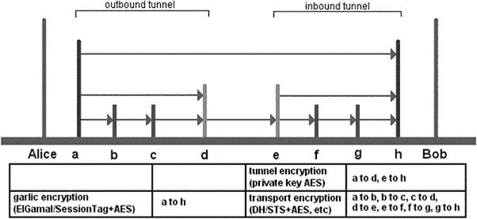

图 11.3 I2P 加密流量流。

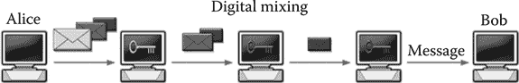

图 11.4 数字混合：Alice 向 Bob 发送消息。

事实上，Geelkerken (2006) 解释 `Tor` 使用了一种名为匿名代理的技术。匿名代理是一个服务器，将请求从一个位置重定向到另一个位置。此外，`Tor` 使用了数字混合的变体。数字混合就像发送一封放在四个不同信封中的信，这些信封预写了地址并贴了邮票，上面写有微小的信息“请拆此信封并重新寄出”。如果接下来的三个接收者都重新寄出邮件，该邮件将到达目标接收者，而不会在第一个发送者和最终接收者之间留下纸质痕迹。图 11.4 通过让 Alice 向 Bob 发送消息概述了数字混合过程。Alice 会使用公钥加密对其发给 Bob 的消息加密三次。然后她会将消息发送到代理服务器，该服务器将移除第一个密钥。第二个和第三个服务器将分别使用剩余两个密钥之一对消息进行解密和排序，直到消息发送给 Bob。

此外，当我们谈论隐藏和反取证时，我们需要提到来自 [www.torproject.org](http://www.torproject.org) 的臭名昭著的“Tor 项目”。`Tor`帮助我们隐藏在网络其他用户之中。网络上的人数越多，分析我们流量的难度就越大。根据 Tor 网站上的信息，`Tor` 通过将用户交易分发在互联网的多个地方来保护用户。因此，没有单一点可以将我们与目的地联系起来。我们不是像使用 `I2P` 那样直接从“A”到“B”，而是通过多个中继节点的随机路径旅行以掩盖足迹。确定数据来自哪里或数据将去哪里是非常难以追踪的。

除了 `I2P` 和 `Tor` 等加密网络外，程序壳（packers）也可以一种反取证的有效隐藏技术。壳用于通过扫描隐藏工具免受反向工程或取证检测。来自 [www.bit-sum.com](http://www.bit-sum.com) 的 `PECompact` 等壳器可以加密/压缩并使用合适的提取器封装我们的工具。壳器还可以用于反调试（Garfinkel, 2007）。`UPX`（[upx.source-forge.net](http://upx.source-forge.net)）是一种免费的可执行文件壳器，支持 OS X 可执行文件、Windows x32 位可执行文件、Linux Shell 脚本等格式。例如，这些文件合并器可以帮助将恶意代码合并 `EXE`、`PDF`、`JPG`、`MP3` 或其他文件中。例如，如果我们取无害程序和一个恶意程序，我们可以将它们合并成新程序。在合并过程中，我们可以指定是在无害程序执行之前还是之后隐藏恶意程序。Windows 甚至提供了一个内置工具 `IExpress`，它可以允许我们打包/合并可执行文件。

根据 Pajek 和 Pimenidis (2009)，数据也可以隐藏在未分配的、异常或难以访问的位置。操作文件扩展名、头部和尾部可以误导取证分析工具。其他方法可以是隐藏分区、嵌套目录和空闲空间（slack space）。磁盘上的数据存储在簇中，簇在扇区之间分离。文件名、大小和时间戳等信息存储在硬盘上。保存的数据可能没有使用专用簇中的所有扇区，这反而提供了额外的隐藏空间。Garfinkel (2007) 补充道 `MAFIA` 发行版中的 `Metasploit 的 Slacker` 允许利用 `NTFS` 文件系统的空闲空间隐藏文件。通过 `Slacker` 提供的反向算法可以检索隐藏数据。

当我们谈论隐藏数据时，还应该提到来自 [www.truecrypt.com](http://www.truecrypt.com) 的著名的“TrueCrypt”。它通过 `AES`、`Twofish`、`Serpent` 等算法及其变体提供即时磁盘加密。通过此应用程序，我们可以加密整个硬盘和便携存储设备。我们可以将重要数据存储在多个隐藏卷中。每个卷都有独立的密码；我们根据指定的密码解锁卷。我们可以将隐藏卷视为层层保护。重要数据可能位于最内层卷。如果有人要求我们显示隐藏数据，我们可以在不危及含有关键数据的内层卷的情况下显示次要信息。

`TrueCrypt 的`嵌套卷引导我们使用隐写作为隐藏数据的另一种方法。隐写的主要目的是隐藏信息或使其不可见。它与加密的区别在于，加密使信息不可读，而隐写依赖于人类感知。人类感知无法检测隐藏在无害图像、音频、视频文件或几乎任何文件格式中的信息（McGill, 2005）。网上有很多隐藏工具。Johnson (2011) 在 [www.jjtc.com/Steganography/tools.html](http://www.jjtc.com/Steganography/tools.html) 提供了一个详尽的工具列表。McGill (2005) 解释了三种主要的隐写方法：

1. **替换**：使用最低有效位（LSB）方法，如果我们替换了字节中的最后一位，其变化对于肉眼检测来说是微不足道的。

2. **注入**：用于将秘密信息字面注入载体文件。在音频文件中，我们可以将消息隐藏在噪声信号中，消息散布在整个频谱中。或者，我们可以通过向信号添加回声来注入消息，回声随幅度、衰减率和偏移量变化。

3. **生成新文件**：在这种方法中，我们获取秘密消息并从头开始生成文件。一个很好的例子是 [www.spam-mmimic.com](http://www.spam-mmimic.com)。该服务将像“反取证”这样的信息编码到看起来无害的垃圾邮件（spam）中。

例如，

亲爱的朋友，你在加入我们的俱乐部时做出了正确的决定。如果你不再希望接收我们的出版物，只需回复主题为“REMOVE”，我们刻会将你从邮件列表中删除。此邮件的发送符合参议院第 1624 号法案；第 5 卷第 301 节！这不是多级营销！……

我们中会有多少人费心去读这些垃圾信息呢？期待秘密消息的人可以使用相同的网络服务对其解码，并收到秘密消息“反取证”。隐写不仅是一种工具，它更是一门艺术和科学！

## 备用数据流 (ADS)

在回顾了隐写之后，我们需要提到备用数据流（`ADS`）。Zadjmool (2004) 解释说 `ADS` 是任何版本的 Windows `NTFS`（文件系统）的特性。它是一种在受攻击系统中隐藏根内核（rootkit）或黑客工具的方法，并在不被察觉的情况下执行这些工具。`ADS` 的作用是提供将文件数据附加到现有文件中的能力，而不影响其功能或视觉呈现。例如，如果我们输入：

```
C:\Forensics> echo "ANTIFORENSICS are DANGEROUS">file.txt:hidden
```

我们只是为 `file.txt` 添加了一个名为 `hidden.txt` 的 `ADS`。冒号 `:` 分隔了 `ADS` 和载体。如果我们列出文件夹的内容，隐藏的 `ADS` 将不会显示。请查看以下：

```
C:\Forensics> echo "ANTIFORENSICS are DANGEROUS">file.txt:hidden
```

```
C:\Forensics>dir
```

```
Volume in drive has no label.
```

```
Volume Number is XXXX
```

```
Directory of C:\Forensics
```

```
05/27/2011  10:19 PM <DIR>
```

```
/27/2011  10:19 PM <DIR>
```

```
/27/2011  10:19 PM <DIR>
```

```
File(s) 0 bytes
```

```
File(s) 307,232,640 bytes
```

```
File(s) 0 bytes
```

在这个示例中，我们向 `ADS`（`file.txt`）内部注入了秘密消息 `ANTIFORENSICS are DANGEROUS`。如果我们打开 `file.txt`，它是空的。使用 `Lite` 或替代 `ADS`，我们可以发现 `file.txt:hidden` 确实是 `27 bytes`。

```
C:\Forensics>ads
```

```
C:\Forensics\file.txt
size ADS
```

```
C:\Forensics\file.txt:hidden
```

```
C:\Forensics\
ADS listed
```

### SSDT 钩

操作系统使用`系统服务描述符表`（`SSDT`）来定位系统关键服务。如果根内核对 `SSDT` 有控制权，任何尝试使用 `SSDT` 的程序都将通过重定向到根内核。例如，如果 `NtQueryDirectoryFile` 被钩（hooked），根内核可以向反恶意工具提供虚假信息。

### IRP 钩

程序每次与系统硬件通信时，都会使用 I/O 请求包（`IRPs`）。例如，从硬盘、`RAM`、视频和网络读写数据都与 `IRP` 相关。`IRP` 钩涉及更改硬件驱动程序。例如，如果根内核控制了 `tcpip.sys`，它可以隐藏网络流量。

### DKOM

直接内核对象操纵（`DKOM`）允许根内核直接访问内核对象。它允许根内核进行系统更改，这些更改仅在内存中发生，使得根内核无法被检测。`DKOM` 控制还允许根内核保持不被发现，因为许多反恶意工具无法访问内核对象。

### 感染技术

**MBR 感染**：主引导记录告诉 `BIOS`（基本输入输出系统）哪里找到 `OS`。根内核可以拦截并修改硬盘通信。

**虚拟机监控程序**：它被定义为允许物理系统运行多个虚拟机，根内核可以创建恶意的虚拟机宿主。它模拟硬件操作，拦截请求并传递给 `OS`。根内核控制 `OS` 看到的内容，这极难检测。

**备用数据流**：由于 `ADS` 对肉眼可见，这是一种方法，且对文件大小没有限制。

**空隙空间**：根内核可以隐藏在空隙空间中，因为许多安全工具无法有效扫描该区域。

**中断钩**：`IRQ` 或中断请求被 `OS` 用于与系统硬件接口。根内核可以拦截这些请求，换句话说，在底层对硬件拥有控制权。例如，`INT13h` 允许访问硬盘。这意味着根内核可以获得直接访问权限并修改磁盘。

**消息钩**：内存中的应用程序使用消息与其他程序和 `OS` 进行通信。消息钩用于在消息到达目标进程之前进行监控或拦截。这种方法的优势是根内核能够拦截系统上所有的用户活动。例如，`WH_KEYBOARD`、`WH_KEYBOARD_LL` 和 `WH_MOUSE` 是根内核常用的消息钩。

## 破坏证据

在我们讨论了某些反取证隐藏方法后，我们现在将转向破坏证据或信息的方法。Harris (2006) 写道，证据破坏是指拆解或通过方式使证据不可用的过程。它完全消除了证据或信息。


我们大多数人可能意识到无法真正删除数据。相反，我们可以覆盖它。Garfinkel (2007) 指出覆盖数据有不同的方法。我们可以使用程序覆盖整个存储媒体或单个文件。例如，Windows 上的`Cipherter.exe`可以用零的通过、`FF`的通过和随机数据的通过覆盖数据。Apple 的“磁盘工具”允许我们使用单次通过（`NULL`字节）或七次、三十五次（Gutman 方法）随机数据来覆盖数据。问题不在于方法，而在于要覆盖哪些数据。使用`DBAN`（Darik’s Boot Nuke）、`Active KillDisk`、`Disk Wipe`、`SFill`、`Srm`等工具覆盖整个驱动器相对容易。问题是，擦除工具可能会留下数据和足迹，表明该工具曾在系统上使用过。

与其关注删除文件，我们不如重写文件的元数据，如访问、创建和修改时间戳。Garfinkel (2007) 将重写元数据描述为重写文件属性的过程。例如，取证人员可以尝试构建活动时间线。可以部署取证工具来按时间顺序分析文件时间戳。`Metasploit`的时间戳功能允许操纵`NTFS`来创建、修改、访问和删除时间戳。在 Unix 盒机上，可以使用`Defiler`的工具包或`touch`命令来重写时间戳。

## 移动设备反取证

根据统计，全球至少有 26 亿移动终端用户。中国移动报告称，他们每月增加 600 万名新用户。如今，移动设备是紧凑型计算机。移动设备配备了图形化界面、计算资源和网络连接功能。此类设备上存储了更多的个人信息，使其成为取证分析的完美目标（Distefano et al., 2010）。一些传统的反取证技术可能不适用于移动世界。出于多种原因，对反取证工具的需求迫在眉睫。让我们仔细查看针对 Android 操作系统的反取证技术。

Distefano 等人 (2010) 描述了针对 Android 移动平台的几种不同反取证技术：

- **移动内部取证工具 (MIAT)：** 将我们自己置于调查人员的立场，可能帮助我们制定更佳的反取证计划。`MIAT`是一个可以通过通过 [`miatforensics.org`](http://miatforensics.org) 获取的开源移动取证应用程序。它可以被用作主动措施，以发现我们留下的证据/数据。

- **利用 Android 特性：** Android 将任何运行的应用程序绑定到安全的`Sandbox`中，如果没有显式权限，它无法与其他应用程序干扰。权限在应用程序安装期间静态定义，在应用程序的生命周期内不会更改。所有应用程序必须用开发者的证书签名，以与其他应用程序建立交互。例如，我们可以创建一个保护某些文件或文件夹的应用程序。这种保护在操作系统层面得到确保；因此作为一种反取证技术。

- **私有文件夹：** 我们可以创建一个私有文件夹，只有指定的应用程序可以访问。该文件夹可以存储文本文件和多媒体等。该文件夹将对其他应用程序隐藏，从而确保了一定的隐写水平。

- **反取证应用：** `AFDroid`是一个创建私有文件夹的应用程序，但还允许执行两个进程：

    - **证据导出过程 (EEP)：** 将存储在移动设备上的信息导出到私有位置

    - **证据导入过程 (EIP)：** 反转`EEP`过程。

- **证据导出过程：** [图 11.5] 展示了`EEP`过程，我们使用`AFDroid`导出短信和联系人等信息，并将其导出安全的`XML`文件（私有存储）。

- **Honeycomb：** 它引入了一种新的 API，支持强制加密存储和密码保护（Hollister, 2011）。Fisher (2011) 报告说`WhisperCore`是为移动设备提供加密的替代软件。

  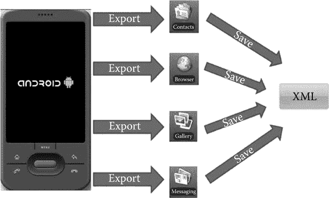

- **证据破坏：** 如果我们需要销毁私有文件夹，只需卸载`AFDroid`应用程序。使用 Android 内置的出厂重置功能可以删除部分数据，但某些数据可能仍留在设备上。此外，Google 的`Sync`、`Kaspersky Mobile Security`和`Microsoft Exchange` 2010提供了远程擦除移动设备数据的功能。

## 结论

可以使用许多工具和技术来误导取证人员。这些技术中的许多构成了重大挑战，并且实际上，使用典型的取证实践可能无法恢复信息。对反取证工具及其使用方式的认知，使调查人员能够理解反取证实践的优势以及潜在的弱点。

## 参考文献

1. Distefano, A., Me, G., & Pace, F. (2010). Android Anti-Forensics through a Local Paradigm. 于 2011 年 5 月 28 日检索自 [www.dfrws.org/2010/proceedings/2010-310.pdf](http://www.dfrws.org)。

2. Fisher, D. (2011, 3 月 17). Device Level Encryption Comes to Android. In `Threatpost`. 于 2011 年 5 月 28 日检索自 [`threatpost.com/en_us/blogs/device-level-encryption-comes-android-03171`](http://threatpost.com)。

3. Garfinkel, S. (2007). Anti-Forensics: Techniques, Detection and Countermeasures. 于 2011 年 5 月 28 日检索自 [`www.simson.net/clips/academic/2007.AntiForensics.pdf`](http://www.simson.net).

4. Eelkerken, F. W. (2006, 12 月 1 日). Tor: The Onion Router. 于 2011 年 5 月 28 日检索自 [www.iusmentis.com/society/rerouting/](http://www.iusmentis.com).

5. Harris, R. (2006, 7 月 11 日). Arriving at an Anti-Forensics Consensus: How to Define and Control the Anti-Forensics Problem. 于 2011 年 5 月 28 日检索自 [`www.dfrws.org`](http://www.dfrws.org).

6. (注：此处参考文献 6-15 格式与原文一致，保持引用)

16. Zadjmool, R. (2004, July 23). Hidden Threat: Alternate Data Streams. In *Windows Security*. Retrieved on May 28, 2011 from [`www.windowsecurity.com/articles/alternate_data_streams.html`](http://www.windowsecurity.com)。

# 第 12 章 链接与视觉化分析

## 引言

数字取证过程涉及发现信息，以尝试对行动和事件提供见解。解释发生情况的细节往往缺失，在某些情况下，对发生了什么几乎一无所知。通过组织且有条的方法筛选数字媒体可以揭明发生的情况，但可能存在许多表面上无关的信息碎片，使得勾勒出一个清晰的画面几乎是不可能的。链接与可视化分析（`LAVA`）技术的使用了一种组织和分析与调查相关信息的方法，并对关注的行动和事件产生更好的理解。

此前，我们回顾了许多取证工具和报告编写。目前已经表明计算机取证工具的重点已从寻找信息扩展到分析信息。这意味着取证工具的优势在于搜索卷以以恢复文件和遗迹。然而，通常来说，取证工具的弱点在于它们不擅长聚合信息并以有助于解释的方式呈现出来。用于商业智能和统计分析的工具和技术未被视为数字取证领域的一部分。唯一常见的聚合共享信息往往是哈希集（hash sets）。

## 链接与视觉化分析

文件有多个日期和时间（时间）属性，包括创建时间、时间和访问时间。这允许通过这些属性对文件进行时间分析，有助于回答“谁在何时做了什么”的问题。在存在多个计算机、用户、设备和情况的情况下，要确定“谁在何时做了什么”并不容易，而且还没有一种可以观察趋势和关系的方法。其原因之一是每个设备都有自己的镜像，除非这些镜像可以通过通用的取证工具访问，否则无法使用该工具高效地聚合信息。例如，如果移动设备由`Cellebrite`分析，而计算机使用`EnCase`分析，那么将信息整合在一起将非常困难。虽然有方法可以将`Cellebrite`提取出的信息导入`EnCase`，但显然`EnCase`并不是一种类似于商业智能中使用的报告和分析工具。`Access Data`利用了带有`FTK`的数据库，这有助于报告，但在分析能力方面仍存在差距。

`LAVA`工具通过在数据内部寻找链接和相关性来获取信息并开发智能。一个通过使用`i2`处理手机场景来直观理解`LAVA`的例子是：我们我们需要分析四个个人的通话模式。[图 12.1] 显示了一张代表这四个人手机在一个月通话的图表。每个图标代表一个不同的电话号码，每条线代表一次或多次通话。箭头的方向代表谁打了电话（通话源自何）。指向手机的箭头表示来电，离开手机的箭头表示拨出的电话。

电话网络图提供了通话量和方向的直观感受，但通过将数据表示方式更改为组织图，可以使数据更加清晰。[图 12.2] 展示了四个关注个人之间的关系。

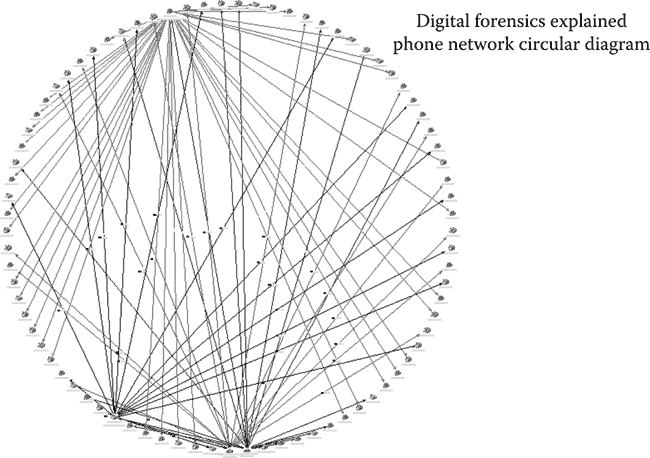

*图 12.1* 电话网络环形图。

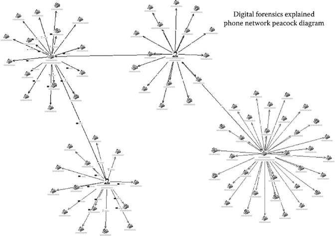

*图 12.2* 电话网络组织图。

在组织图中出现了一个潜在的模式，有一条清晰的路径将四个人连接在一起。我们意识到这个网络中可能还有更多人可以使情况变得更加明朗，但此时我们只有这四个人。这就是时间分析提供进一步见解的地方。时间分析是将数据排列在时间轴上。我们记得在之前的示例中，两个手机之间的单条线表示一次或多次通话。[图 12.3] 是之前示例中的数据转换为时间视图的表示。

时间视图表示了与[图 12.1]和[图 12.2]所示相同的信息，但数据被过滤为仅包含通话。此外，还包含了第五部手机，即卧底侦探`Otting`的手机。情况是：`Det. Otting`在 1 月 8 日下午 3:00 拨给`Gogolin`电话购买 1 盎司 Kool-Aid。下午 3:15，`Gogolin`拨给`Pavlov`确保他们有 Kool-Aid，然后回电给`Det. Otting`以完成销售安排。1 月 15 日下午 1:30，`Det. Otting`拨给`Gogolin`询问他是否可以购买 8 盎司 Kool-Aid。下午 1:40，`Gogolin`拨给`Pavlov`看看他们是否有 8 盎司 Kool-Aid 要卖。`Pavlov`在下午 1:45 拨给`Emerick`，因为他需要更多库存才能完成销售。下午 1:55，`Pavlov`回电给`Gogolin`表明他们有足够的库存。下午 2:00，`Gogolin`拨给`Det. Otting`完成销售安排。这一场景在 1 月 25 日和 28 日又重复了两次，从而表明了清晰的通信通道，并有力地支持了 Kool-Aid 团存在的概率。

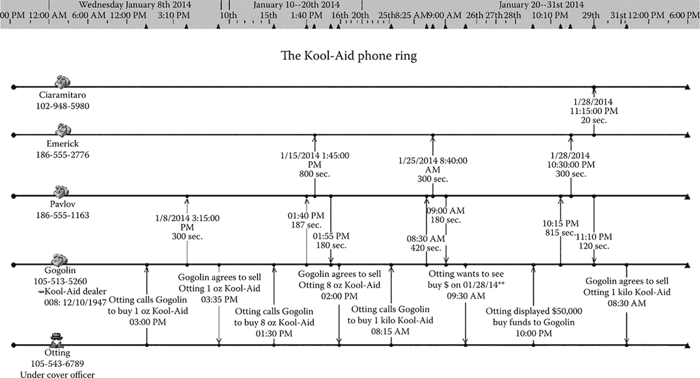

*图 12.3* 电话网络时间视图。

LAVA 的其他功能还包括统计分析，以提供预测性智能，并执行其他功能，以协助调查人员从数字取证调查中常见的如积如山般的信息中进行分类。例如，某些取证工具可以分析通话或通信模式，以帮助确定犯罪集团或帮派的头目。通话时长、谁发起通话、通话频率以及通话时间与其他通话的相关性等因素被用于分析组织的层级结构。例如，如果`Marco`拨给`Julia`45 秒，然后`Marco`在结束与`Julia`的通话后 1 分钟拨给了`Buddy` —— 且这种模式在一个月内重复了三次，那么这些通话相关的概率非常高。此外，`Julia`和`Marco`之间存在某种关系的概率很高。相反，如果`Marco`拨给`Julia`45 秒，然后在 2 天后`Marco`拨给了`Buddy`，那么这两次通话相关的概率就很小，`Julia`和`Buddy`存在某种关系的可能性也小得多。

源自`Facebook`、`Twitter`和`LinkedIn`等数字源的社交网络会在计算机和移动设备上留下活动痕迹。这些碎片信息对于确定某些社交网络身份和活动可能有用，但 LAVA 工具可以帮助识别和分析社交网络关系。由于数字社交网络的普及，掌握网络内部成员和关系是数字取证调查的一个重要方面。

社交网络中的某些分析因素包括中心性的四个衡量标准：`Betweenness`（中介性）、`Closeness`（紧密性）、`Degree`（度）和`Eigenvector`（特征向量）。这四种中心性衡量标准都有数学依据。`Centrality`查看某物位于其他两个点或对象之间的位置。这可以帮助确定某人在社交网络中所拥有的相对重要性或影响力。`Betweenness`处理节点在网络中的重要性——即它有多中心，以及有多少种关系通过它进入另一段关系。社交网络中的节点是一个中心点，例如某个人或实体。很强的`Betweenness`可以被解释为某人是一个犯罪集团或帮派的中心——在社交网络中非常有影响力。高`Betweenness`分数也可以表明某人是一个“看门人”（Gatekeeper），或者他们控制着网络中的通信。

`Closeness`是`Farness`（疏远性）的反面。它是关系接近程度的衡量——即它们在网络中有多近。具有高`Closeness`分数的节点由于其接近性，是与其他节点通信最快的节点。`Degree Centrality`（度中心性）是指指向节点的链接数量。这可能表明某人在网络中的受欢迎程度，但它并不一定衡量某人在网络中的重要性。在社交环境中，拥有大量连接的人具有较高的`Degree` `Centrality`，这可能被视为非常受欢迎。同样，拥有少数连接的人具有较低的`Degree` `Centrality` —— 这可能被视为不受欢迎。然而，在组织环境中，领导可能只有少数几个直接下属——因此他们的`Degree` `Centrality`会低得多。无论如何，较高的`Degree` of `Centrality`分数意味着某人在网络中是活跃。

`Eigenvector Centrality`（特征向量中心性）衡量节点在网络中的影响力程度。该指标可以指示网络内部的影响力以及离开网络的影响。因此，`Eigenvector`值通过考虑某人的影响力，告知人们如何解释`Degree` of `Centrality`。

图 12.4 中的网络可以针对`Betweenness`、`Degree` of `Centrality`、`Closeness`和`Eigenvector`测量进行分析。某些 LAVA 软件包可以计算`Betweenness`、`Degree` of `Centrality`、`Closeness`、`Eigenvector`以及其他指标，某些统计包也是如此。这可以非常有用。图 12.5 显示了网络的`Betweenness`、`Degree` of `Centrality`、`Closeness`和`Eigenvector`测量值。在 LAVA 环境中，具有`Betweenness`的节点是`Sara JONES`、`Juan RODRIGUEZ`、`Frank EVERS`、`Betty BLFORD`和`Tim JOHNSON`，其中`Tim JOHNSON`是最强的。

图 12.4

*图 12.4 网络分析*

图 12.5

*图 12.5 网络分析*

当你最初观察网络时，首要倾向可能是`Sara JONES`是中心，但`Betweenness`分数表明`Tim JOHNSON`是最重要的节点，其次是`Betty BLFORD`、`Frank EVERS`。`Tim JOHNSON`也具有最高的`Closeness`分数，这意味着与所有其他节点相比最近。`Sara JONES`和`Tim JOHNSON`具有最高的`Degree` of `Centrality`分数，这意味着根据网络他们最受欢迎。`Sara JONES`有最高的`Eigenvector`分数，其次是`Tim JOHNSON`。记住，`Eigenvector`衡量的是影响力。

LAVA 应用于许多领域，包括执法、情报、金融、保险、医疗保健以及其他研究链接和关系有助于提供态势洞的领域。为了充分充分潜力，LAVA 环境中的信息应与`Oracle`或`Microsoft SQL Server`等扩展数据库环境相结合。这将允许在事件、案件、调查人员和组织之间共享信息。保险业是 LAVA 技术打击保险欺诈的早期采用者。实施保险欺诈的人经常更换目标，这使得发现欺诈模式变得更加困难。保险公司在与其他公司共享欺诈信息方面做得好得多。其他行业，包括执法部门，应该效法这种合作的信息共享模式。许多 LAVA 工具具有与关系型数据库和信息共享服务的接口，但为了实现广泛成功，还需要进行统一的标准化努力。

## 结论

采取逐案的方式继续处理数字取证案件，就像试图用水桶抽干“泰坦尼克号”。需要一种新方法才能在数字取证领域中取得进展并应对挑战。共享案件信息并使用`LAVA`工具进行评估，在帮助调查人员更有效地工作方面显示出前景。统计技术可以帮助验证发现结果，引导调查人员关注他们可能忽略的领域，并通过预测分析提供重点。`LAVA`并非万能灵丹，但它是一个可以显著提高数字取证调查员效率和效果的领域。

# 第 13 章：数字取证的心理、伦理和文化影响

## 引言


在我读过的所有涉及数字取证的书中，对心理学、伦理和文化的覆盖似乎被完全忽视了。在处理案件时，我明显感觉到这些领域是数字取证调查的核心方面。我想在本章中涵盖的内容不仅包括被调查人员的心理方面，还包括调查人员自身的心理方面。调查人员面临着许多伦理问题，其中许多问题在检查后期才会显现。最后，许多文化问题包括语言和成语表达等非常基础的内容，也包括对涵盖事件的文化概念框架的理解。当我与调查人员讨论语言和文化问题时，他们往往会将这些挑战斥之为可以通过语言翻译工具解决的问题。但对我来说，这是对复杂情况的过度简化和完全误解。

## 数字取证的心理影响

毫无疑问，数字取证领域中我感到准备最不充分的领域是心理因素。当我完成信息系统的本科和硕士学位，并且在进入取证领域时已有约 20 年的 IT 经验时，我发现适应取证的技术挑战相当容易。对各种文件系统获得更深入的理解可能是唯一一个重大的技术学习曲线。确实，有一些流程和方法上的问题需要解决，但就努力程度而言，技术上的跨越与从主机到客户端/服务器或从客户端/服务器到 Web 的转变并没有太大区别。我在获得生物学学位时上过心理学和社会学课程，曾一度主修刑事司法，上过关于偏差行为和家庭状况的课程。但即使是这些并不能让我为数字取证中呈现的情况做好准备。那里确实存在非常扭曲的人和情况，这确实非常消耗精力。

我认为可以帮助人们理解我所说的“数字取证的心理影响”的方法之一，就是简单地梳理我遇到过的一些情况和场景，以此提供数字取证调查员可能遇到的一些近似情况。我的一位就读于空军学院的朋友解释说，飞行员训练的一部分包括心理练习。飞行员在执行任务之前必须在脑中回答问题，以便在到达行动点时能够做出恰当反应。他们不能只是把轰炸机飞到一个地方，然后决定是否可以投弹。这些问题必须在进入驾驶舱之前得到答案。同样，数字取证调查员也有必须提前决定的事情。每位调查人员都必须确定他们能够处理的案件类型以及如何处理这些案件。

当有人决定从事数字取证时，吸引他们的往往是对酷炫技术的向往——而不一定是某种特定类型的案件。某人处理的案件类型很大程度上取决于他们的职业道路。地方执法部门花费大量时间处理儿童性虐材料（`CSAM`）。企业调查员可能会与人力资源部门合作，处理如审查最近离职员工电脑等工作。他们还可能处理计算机入侵的事件响应。私家侦探通常处理民事和家庭案件，大部分工作集中在离婚情况。这并不是说上述描述的每种环境可能与我描述的不同，但调查人员应该意识到自己正处于什么样的环境中。

从字面上来说，我喜欢的描述数字取证的方式是对某人灵魂的观察。当你浏览并恢复被删除的文件、照片、电子邮件、互联网历史和时间线时，一个关于个人的清晰画像开始浮现。随着模式的形成，习惯、偏好和倾向会结晶成形。在短时间内，产生一种关于这种人是否是你可以与之相处的人，或者是否是你开始厌恶的人的这种，并不罕见。单单这一点就可能潜意识地影响调查。另一个经常很快出现的方面是，你是否被呈现了某种情况。“凡事皆有两面”的格言显然适用，如果被调查的设备是多人共享的，那么故事很可能有很多面，而且可能非常难以理清。

我将描述的案件将经过匿名化处理，以确保不泄露隐私。它们可能是许多案件的组合、学术案例，或者是虚构的描述。然而，它们确实代表了常见的情况。我想包含案例的原因是让人们理解环境至关重要。我曾曾在 20 世纪 80 年代中期充当一名计算机程序员时，有一位高中生请求跟随我职业观察。我问她想让我向她展示什么，她表示她只想看我在她不在时像往常那样工作。编程有时可以是一个非常深思的过程，当她来职业观察时，正是其中之一。我当时正在开发一个保险承保系统并编写一些数学模型。在看着我不断在打字和思考之间切换（我经常在盯着天花板时这样做）15 分钟后，她突然从椅子上站起来，说编程看起来很无聊，她在离开时说她不想成为一名程序员。我想在她花费大量时间之前发现自己不想当程序员是好事，但她也没有真正对程序员的职业生涯有一个准确的想法。

正如计算机领域的任何人所知，经常会有朋友和其他人来电寻求等同于免费的帮助。这种请求几乎从没有能快速解决的结果。从取证的角度来看，这变得更加复杂了。最常见的请求之一是恢复误删的文件。通常，这些文件是照片。经常用于恢复删除照片的技术是对图形文件头使用全局正则表达式打印（`GREP`）搜索来刻画文件。这会恢复所有可恢复的图形文件，可能比某人想要恢复的多，并可能导致尴尬的局面，因为互联网上的图形文件也会被恢复。

# 数字取证：挑战与心理影响

数字取证的技术发展非常迅速。因此，频繁的在职教育是必要的。培训场合可以为调查员提供一个交流的机会，让他们就他们遇到过的问题产生情感共鸣。

我认识一位调查员，他提到一个邻居曾请他安装一个新的硬盘，因为原硬盘崩溃了。在更换完硬盘并让电脑重新运行后，调查员询问邻居旧硬盘想如何处理。邻居告诉他不在乎，于是调查员就把硬盘带回了，放在了车库的架子上。大约一年后，他需要一个硬盘，想起了车库里的那个。他将其取出并连接到取证工具上，检查是否可用。

他发现的是一个装满儿童色情信息（CSAM）的硬盘。他的邻居正在州立监狱服刑 10 年。这看起来似乎是故事的结束，但请想一下这两个居住的社区。整个环境被永远改变了，包括友谊和对待他人的方式。那些受害儿童也应该被记住。在这种案件中，没有理想的结果。

## 在线市场与二次销售

有很多人关于 `eBay` 和 `craigslist` 的故事。在这些网站上能发现的东西令人惊讶，更令人惊讶的是，人们甚至会考虑出售像旧电脑这样的东西。我总是告诉人们，如果他们准备卖电脑，至少要把硬盘拆掉。

我的其中一个朋友是 `craigslist` 的成瘾者。他不断在 `craigslist` 上买入、出售和交易物品。有一次，他在 `craigslist` 上买了一台二手电脑，由于他的计算机技能有限，他问我能否帮他快速查看，确保里面没有不该有的东西。我们将电脑连接到一些取证工具上，发现里面充满了自制的撒旦色情片，甚至涉及血腥。这些令人不安的图像会像你遇到的任何案件一样，深深地留在脑脑中。

## 与执法部门的合作

私营部门的数字取证调查员应该与执法部门联系并建立关系，因为早晚这两条路都会交汇。早晚非执法类的数字取证调查员会遇到需要交给执法部门的情况。

在某些偏远地区，甚至在州级，执法部门可能需要执法人员之外的人员协助处理数字取证案件。现实情况是，大多数执法机构的培训和专业知识有限（Gogolin and Jones, 2010）。你在执法案件中遇到的环境可能是嫌疑人被羁押，而你需要快速检查数字媒体以寻找相关证据。我曾处于过需要快速处理各种设备的情况，我能听到扣留区有人在大叫和制造混乱。这本身就会非常让人不安。

请求协助背后的原因可能令人不安，因为在执法案件中，数字取证调查员经常面对的是性犯罪犯。根据假释条件，性犯罪犯通常被要求不得访问特定类型的网站，或拥有某些个人的照片。即使满足了假释条件，仍然经常能发现那些你不想看到的图像。久之，对于某些处理此类案件的审查员来说，这可能会变得有些常规，几乎就像执行任何其他调查任务一样。然而，对于另一些来说，心理代价可能高到无法接受，有必要调整职业方向。

## 高压力调查

执法部门可能依赖数字证据来协助破案未遂的犯罪。我想起一个案例是一个初中生女孩，她的 `iPod` 里有一张据称绑架她的人的照片。女孩认识这个绑架者，并且实际上通过社交媒体招募了他进行亲密接触。该 `iPod` 在锁定状态下被找回，没有人知道女孩可能在哪里。

不同类型的设备具有不同类型的安全控制，有些易于绕过，而另一些则处于边缘。学习如何进行这些操作不应该在像儿童绑架发生期间这种高压状态下进行。应该建立与硬件供应商的联系，以了解整个过程，避免浪费宝贵的时间，并且应该主动地练习这些技能。此类案件的结果可能特别令人困扰，如果调查员处理得不当导致结果不理想，可能会对调查员产生持续的心理影响。同样，如果调查员做了充分准备，获得良好结果的机会更大，这可以转化为得多的心理影响。

## 长期案件与复杂的诉讼

之前描述的案件通常是快节奏的。几分钟到几小时内就能搞定。最令人困惑的案件通常是那些持续数周或几个月的案件。案件可能会经历许多转折，而持续处理这种情况的日常枯燥工作会让人心力交瘁。

符合这种描述的案例让我想起一起特定的离婚案。这对夫妇是山村社区一家五金店的共同主，妻子对丈夫反常的行为产生了怀疑。对家庭电脑的检查发现了丈夫外情的电子邮件和其他证据。在电子邮件调查过程中，很明显丈夫也热衷于交换大量的色情收藏媒体。通过进一步检查发现，丈夫对年幼女孩感兴趣，有许多女孩外表年幼且处于不当情境的照片。最令人困扰的是发现了大量的动漫 CSAM 照片，其中许多孩子看起来是学前儿童或更小。

该案中涉及的问题之一是监护权，这对夫妇有几个孩子，包括一个青少年女孩。女孩对取证调查的具体细节并不知，但丈夫利用女孩的情绪，让他看起来像是一个受害者，而她的母亲才是那个怀有不轨意图的人。该地区通常处理此类案件的检察官正在休长假，这恰好与大约 6 个月的调查时间重合。许多司法辖区不起诉动漫或动画 CSAM 案件，因为他们的解释认为没有受害者。然而，某些司法辖区并不认为动漫和动画图像是无受害者的，并会追诉。在本案中做出决定的检察官不在，当时没有提起刑事指控。然而，案件扩大到了办公电脑和其他数字设备，民事法院清楚丈夫确实有心理问题，监护权随之被终止。显然，此案中的许多人都面临着严峻的心理挑战。调查员在处理此类案件时的心理代价很大，因为结果并非完全失败，但并不理想，这导致了长时间的失眠。

挫败感会以许多方式表现出来。在某些情况下，调查显然显示法律被违反了，但法律系统却拒绝受理案件。这可能是由于许多因素造成的，包括当前的工作量、对类似案件的经验、对涉及相关技术的缺乏了解，甚至是政治动机。我脑海中浮出的最令人沮丧的案件之一是一个侵款案，某人以帮助老人管理资产为名，从一位老人手中盗取了数百万美元。该侵款者持有委托书，将资产兑换成现金，并竭力隐藏资金来源。大约在老年人意识到几乎所有资产已流光时，该侵款者突然去世了。这种活动模式表明，极有可能有几个人是共犯，但从表面上看并没有具体的证据。我受这位老人法律团队的邀请，帮助揭露这一侵款网络，并可能启动一起刑事案件。侵款者的亲属正在出售可能通过侵款活动获得的资产。当时有很多拍卖行、`eBay` 和 `craigslist` 活动，物品的售价远低于市场价值。

我首先感兴趣的是侵款者的电脑。正当我开始调查时，发现该侵款者似乎也是一名儿童色情犯罪者，电脑必须移交给执法部门。由于嫌疑人已死，程序是销毁所有可能包含儿童色情材料（CSAM）的数字介质。这实际上销毁了所有证据，没有对任何嫌疑人提起指控。人们从一无所有变成了身价千万的富翁，而一个人又从千万富翁变成了一无所有。让这个案件以及之前描述的民事/监护权案件特别令人不安的是，侵款者和上一个案件中的丈夫都是外显眼的基督徒。该侵款者似乎在用盗取的收益购买价值数万美元的宗教器物。而丈夫则利用他在教会的地位与弱势女性建立关系，然后对她们进行性骚扰。作为一名基督徒，我发现这种行为不仅卑鄙，而且给基督教本身蒙上了一层非常负面的阴影。因此，调查人员应该准备好应对这种情况：他们追求的对象会亵渎他们所珍视的事物。调查人员通常将这些人称为“坏人”，但你也可以有自己的术语。

在很多时候，负责案件的调查人员发现 CSAM 或令人不安的材料并不感到意外。在这些情况下，调查人员可以提前做好心理准备，在发现细节时可能不会感到震惊。然而，在一个没有预料到发现令人不安细节的案件中，我能描述这种情况的最好方式就像掉进冰封的湖面上。它可能像慢动作一样发生，然后你发现自己震惊并身处水下，努力向光亮游去。突然感到冷——非常冷——并不是一种不常见的反应。我曾不得不用毯子盖住自己。这种感觉可能很快会被帮助儿童的冲动所取代，尽管可能几乎没有有效的方法可以，特别是在国际情况下。这类案件带来的满足感来自于一个现实：如果调查得当，CSAM 案件通常会有强有力的起诉结果，而持有材料的人即使不是创作者，也会面临严厉的判决。

另一个应该注意的调查方面是，在某些情况下，调查人员可能与你正在调查的人认识。这在企业环境中更为常见，因为案件可能具有内部重点。当这种情况发生时，调查人员必须决定是否可以客观进行，或者是否应该将调查交给他人。

调查人员需要具备应对技巧，帮助他们处理调查过程中可能遇到的心理障碍。通常，调查人员无法谈论案件，因此他们必须长时间压抑案件细节。应对机制包括心理咨询、运动习惯、写日志和其他技术。这可以允许调查人员投入案件涉及的部分情感能量，并有助于减轻压力。调查人员必须保持主动，以防案件压力水平和情绪负担不受节制地增长。家属可能不理解这一点，这可能会使情况恶化。意识到潜在问题是有效管理这些问题的第一步。

还有许多心理考虑因素可以涵盖，其中许多带有伦理色彩，但另一个需要涉及的领域是调查结果。调查人员必须对结果有绝对把握，对发现内容的解读不能多于少于证据所支持的内容。如果一台电脑被许多人使用，那么很难以 100% 的确定性将某项特定活动归于一个人。调查结果的解读方式可能会永远改变许多人的生活，这一点永远不应忘记。同样，调查人员必须决定他们愿意处理什么类型的案件，并理解接受某些案件的影响。

## `Otting` 博士在执法职业中的展望

作为一名分析师，我曾无数次接触令人难以忍的性虐儿童材料（CSAM），正如戈戈林博士（Dr. Gogolin）所说，那是捕食者灵魂的深度窥视。在职业生涯早期，我意识到我必须维护自己的心理健康，并在有时离开现场清醒头脑。出去快速散散步、给爱人打个电话、甚至和同事一起喝杯咖啡，都能极大地改善你的心情并让你继续执行任务。虽然我们作为分析师所面对的材料压力可能是邪恶且几乎无法忍受的，但这份职业本身并非没有荣誉和回报。在一个致力于狩猎并将儿童捕食者从街道和网络上清除的部门中工作，会有极大的成就感。这些部门的大多数分析师都认为，我们是与这些捕食者作战的战士。工作必须完成，但只能以正确的方式完成，其中包括保持分析师的健康和理智。运动、健康饮食、充足睡眠、与同事交流——这些习惯通常显而易见，但它们很容易被忘记并养成坏习惯。避免诸如滥用酒精之类的拐杖，因为这通常会加剧工作压力并导致更糟糕的问题。

## 数字取证的伦理影响

每位调查员都必须确定自己的伦理准则。一旦越过底线，就再无法回头了。我们已经涵盖了处理压力和情绪的一些心理方面，但还有几个类似的伦理方面。关于伦理已有许多著作，其目的并不是为了重新审视或包装那些庞大的研究成果。本节的目的是指出一些具有伦理内涵的事物，这些事项可能不是当前伦理讨论的重点，但仍然需要被考虑。

我与对数字取证感兴趣的人讨论的第一点是，不仅工具本身拥有惊人的力量，所能捕获的信息也同样如此。这种力量伴随着巨大的责任，因为调查员有能力塑造信息的呈现方式以及人们对信息的感知方式。在很多情况下，人们接受结果是确凿且不可辩疑的。调查员必须坚持事实，不要试图对解释进行色彩渲染，或通过不呈现全貌来影响局势。例如，说在某人的电脑上发现了某个文件是很容易的。但如果该电脑可能被多个人使用，或者该文件可能是恶意软件的结果而非电脑所有者的行为，那么这样就并没有提供全貌。

另一个涉及伦理但也是良好的调查实践的方面就是简单的结果验证。在验证之前展示结果可能会导致类似于“试图将精灵重新放回瓶里”的局面。发现的结果及其影响越严重，就越应该要严谨地进行验证。由第三方验证和/或多个确认过程是可能的方法。结果的语境和所使用的计算机是其他影响验证的考虑因素。

良好的伦理实践和良好的调查实践是相辅相成的，即使从分析的角度来看待问题也是如此。人们经常问，优秀的调查员具备哪些特质。我的回答是：一个有伦道德的人，喜欢解谜题，能够运用科学方法，并能够客观地提出竞争性理论来解释局势。法医学科学的定义是应用科学来回答问题，它通常涉及大量的未知事实。通过应用科学原理，调查员试图揭示事实。竞争性理论涉及对某次事件或现象提出多种解释，而不是陷入隧道视野并走上最方便的解释的道路。竞争性理论的目标不是将所有鸡蛋放在一个篮子里并草率做出判断，而是要从多个视角来看问题。这在可能进入庭审判的案件中尤为重要，因为对方可能会提出竞争性理论，如果调查员已经考虑了这些提出的理论，那么处理起来将容易得多。同样，调查对于被调查的人来说，可能是一次改变生活的经历。如果被错误指控，可能会造成无法弥回的损害。进行粗劣的工作和/或错误指控某可能是检查员可以陷入的最不伦理的情境之一。展示后来被证明不准确或错误的信息可能会毁掉许多生活和家庭。

我在每堂法医课程上都会强调过的话题是：你永远不要调查你的家人。我无法告诉你有多少人告诉过我，他们在家人或认识的人身上尝试过各种取证工具和辅助技术。这不仅是不伦理的，在很多情况下还是违法的。使用`keyloggers`、`手机跟踪/监听软件`以及类似的工具在很多情况下属于重罪，甚至可能是联邦犯罪。正如我之前已经提到的，当你使用取证工具时，你是在审视一个人的灵魂。很多时候，没有语境来界定你发现的内容，这可能会导致误解。你可能不喜欢你发现的东西，正如鲍勃·西格（Bob Seger）在《逆风而行》中唱的那样：“我希望我现在不知道我以前不知道的事。”

最后一个我在文献中没有看到很多但在实践中看到过的伦理方面是：对他人机器上发现的内容进行个人备份。这可能是简单的东西，如`mp3`、`图片`或`视频文件`，也可能是更广泛的内容如授权软件。仅仅因为检查员拥有某些东西的权限，并不意味着他们可以自由复制。法医检查员就像银行柜员——他们接触钱，但不能带走。始终记住，伦理包含了信任和诚信。如果其中任何一种丢失了，可能永远无法恢复。

## 数字取证的文化影响

尝试衡量互联网对文化的影响是非常有趣的。20 世纪 90 年代以前使用万维网的人相对较少，但现在它无处不在。社交媒体、虚拟世界、在线游戏和电子邮件只是将世界带到指尖的技术之一。由于我们很容易聚集在一起，文化理解变得更加重要。我们需要理解，成语、俚语和手势的解释可能与初衷有很大不同。这也意味着犯罪可能由地球另一端的人实施。银行抢劫犯局限于当地或区域的时代已经过去了。欺凌仅限于听力范围的时代也结束了。我们处在一个不同的世界，未能适应不断变化的情况将产生严重的后果。恐怖分子可以在他的智能手机上持有劫持飞机的指令。


数字取证是网络安全的关键技术之一。它可以用于测试、验证、事件响应和分析。由于数字世界的全球化特性，单个人甚至一个国家都无法完全应对其面临的挑战。数字取证和网络犯罪是跨学科领域，需要精通法律、计算机科学、金融网络、数据挖掘和刑事司法等多个领域的专业知识（Goel, 2010）。此外，绝大多数国家都有多种通用的方言和语言。在美国，精通一种以上语言的人相对较少。美联社（2005 年）的一篇文章报道道，一半的欧洲人是双语学习者，而只有 9%的美国人熟悉一种以上的语言。2010 年，Francois Grosjean 发现很难量化双语能力，但他估计 56%的欧洲人、38%的英国人、35%的加拿人和 17%的美国人符合双语者的标准。语言和文化对网络安全的影响不容低估。在 2010 年的一篇文章中，Coopes 指出，全球网络犯罪问题的规模大于全球毒品贸易。在澳大利亚，据报道，每 3 秒就有一个身份被盗用（Coopes, 2010）。网络犯罪调查涉及大量的个人和群体，他们需要在许多层级和边界之间进行通信、共享和决策（Katos and Bednar, 2008）。如果认为其中不存在多文化问题，那无异于自欺鸵龟。由于数字取证是调查网络犯罪事件的关键途径之一，文化理解和语言能力可能是区分优秀调查员与卓越调查员的因素。

家庭状况通常很大程度上是围绕文化构建的。在世界许多地区，多代住在同一栋房子里。在许多如具有西班牙背景的文化中，家人和朋友聚会的次数远比典型的美国家庭频繁得多。因此，解释某些个人聚在一起的原因可能有文化背景。调查员在检查数字设备时，必须理解这类洞察力。对于介质上的事件、通信和数字图像，可能有许多解释。一个家庭中可能有多个母亲，如果没有这种理解，消息的含义可能会被误读。

讨论文化时另一个浮出的方面是，它可以让人理解某人的想法、他们可能会如何行动，或者他们可能会使用什么技术来掩盖证据。获得这种理解有助于确定动机和方法，而这是任何数字取证调查的关键。能够用外语与嫌疑人交流将开启许多调查大门。如果不花时间研究和理解文化，许多此类线索和机会将会被忽视。取证员需要每一个可能获得的优势，因为取证调查其本身就已经足够困难了。

## 结论

本章涵盖了许多深奥的主题，我首先承认我没有心理学学位，在伦理方面也接受过很少的形式培训。然而，它们对数字取证过程以及执行检查的调查员的影响程度往往被忽视。很少有技术书籍花时间研究心理学、伦理和文化——至少是流行意义上的文化。各种技术和运动中的亚文化偶尔会被提及。但学习文化并能够使用多种语言交流需要付出努力。

## 参考文献

1. Associated Press. (2005). Half of Europeans were bilingual. Retrieved on March 10, 2011.
2. Coopes, A. (2010). Bigger than the global drug trade. Retrieved on February 14, 2011.
3. Goel, S. (2010). Digital Forensics and Cybercrime. Springer Publishing, Albany, NY.
4. Grosjean, F. (2010). Bilingual: Life and Reality. Harvard University Press, Boston, MA.
5. Katos, V., & Bednar, P. (2008). A cybercrime investigation framework. `Computer Standards and Interfaces`, 30(4), 223–228.

# 第 14 章 有人在看你

## 引言

想象一下。你度过了漫长的一天，脑子里想的都是在家放松，也许洗个热水澡，或者躺在床上，用笔记本电脑看流媒体服务上你最喜欢的节目。这是你的家，你在家里应该是安全的，对吧？想象自己正坐在浴缸里放松，看着网视频或听音乐来休息。预期是没有人在看你，但如果我告诉你有人可能在看，而且那个人就在那里，他们戴着许多面孔呢？这种入侵可能发生在小镇、大城市、乡村或农场。信息安全是每个用户不可或缺的一部分，而不仅仅是在商业领域。

## 案例摘要

在密歇根的一个旅游小镇上，居民们彼此认识，并在社区中建立了紧密的个人纽带。他们竭尽所能互相支持，去教堂，在杂货店互相打招呼，看孩子参加小联盟比赛，聚在一起的样子就像画作中的大多数乌托邦社区一样。但正如一个社区发现的那样，这里也有黑暗的一面。

这始于一个年轻女性在床上用笔记本电脑看她最喜欢的节目。她说屏幕上弹出一个消息，消息告诉她她应该自慰。恐惧抓住了她，她关掉了电脑，心跳加速，她环顾环四周房间，向窗外望去。想象一下，有人在看她。可能有人一直在看。当这个年轻女性报警报案时，她不知道自己打开了潘多拉的魔盒。她假设自己被黑客攻击了，想检查电脑。她认为没有人在看她。她错了。

和大多数巡逻人员一样，响应警官可能对黑客技术的内部原理缺乏技术知识，有些人甚至在处理自己的家用电脑时都很吃力。这种观点并不是要侮辱执法部门优秀的男女士，因为在数字犯罪调查的婴儿阶段，这种情况很常见，而且现在有专门的数字犯罪调查部门。这些部门接受过适当的数字证据收集程序的培训，并将这些证据交给专家，例如密歇根州警察局网络犯罪部门的分析师，或者更准确地说，就是我和团队中的其他取证员。

在响应投诉时，警官对那位年轻女性进行了访谈，她表示她的笔记本电脑出了问题，并请她教会的一位男性帮她看看，因为她知道他在镇上的一家公司做 IT 工作。她认识其他其他人也做过同样的事情，而且他能修理他们的电脑。她并不觉得他是黑客。这是不可能的，因为他是家人朋友，而且他还帮她母亲的电脑修过。。警官告诉这两位女性，为了保险起见，最好让调查员检查一下电脑，以确定发生了什么。

笔记本电脑已记录在案并分配了证据编号，两位女性签署了同意书。同意书允许对笔记本电脑的内容进行搜索。电脑、硬盘、存储介质、手机等被视为“容器”。作为分析师，你必须在进行分析之前拥有搜索这些“容器”的法律授权。这种许可通过两种方式获得：同意和司法搜令。同意可以由证据所有者提供，或者在未成年人的情况下由法律监护人提供。对于数字证据的搜令搜索，必须准备一份宣誓书。宣誓书必须包含“合理理由”事实，以确定该设备上存在犯罪证据。这些事实是否符合授权搜索电子证据的标准由法官决定。在本案中，到目前为止，只需要同意即可。

我经常向我教的课程的学生解释，在案件的这一阶段，耐心是调查中最关键的环节之一。此阶段的程序性失误会严重影响案件。通常，调查人员和分析师会急于处理证据并开始搜寻。如果他们错过了某一步，可能会导致后期产生严重后果。每个调查员和分析师都应该知道并熟练掌握短语。这两个短语是“监管链（the chain of custody）”和“毒树之果（fruit of the poisonous tree）”。监管链意味着在传输的每一步中，都必须记录证据所在的位置以及由谁持有。如果监管链断裂，该证据在司法程序中很可能会被驳回。毒树之果意味着任何通过不当手段获得的证据都会污染调查中获取的其他证据，并可能摧毁整个调查。这就是我强调耐心的两个原因，即使在那些看似平凡无奇的事情中也是如此。

母亲和女儿的笔记本电脑已实验室记录并妥善保存。从此时开始进入分析阶段。笔记本电脑的硬盘被拆下，并使用与下方类似的文档进行记录，`图 14.1)`。

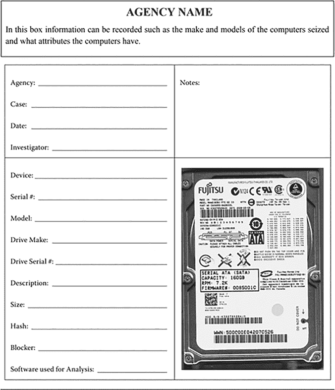

`图 14.1` 硬盘获取表。为了记录序列号而拍摄的硬盘复印件。

## 证据分析

在数字取证分析中，原始证据不被更改至关重要。这就是取证镜像的过程。这些哈希值可以比作数字 DNA，除非介质发生变化，否则它们永远不会改变。然后将硬盘连接到一个名为写保护保护器的硬件设备上。该工具防止对原始介质进行任何写入或更改，并保持原始证据源的完整性。这可以通过 `MD5` 和 `SHA-1` 哈希值进行并验证。这些哈希值可以比作数字 DNA，除非介质被更改，否则它们永远不会改变，在大多数情况下，它们如下例所示。

**镜像信息：**

- 获取开始：2021 年 5 月 2 日 周一 10:55:49
- 获取结束：2021 年 5 月 2 日 周一 12:49:47
- `GB TOSHIBA HARD DRIVE_ITEM0004.E01`

**镜像验证结果：**

- 验证开始：2021 年 5 月 2 日 周一 12:49:54
- 验证结束：2021 年 5 月 2 日 周一 13:56:33
- `MD5 checksum: 4934395c6a776d51e5218ddaad8fb355 : verified`
- `SHA1 checksum: c725db1f8b127125593f8bbeb5dde1bb3d7ee4a : verified`

随后利用取证软件对取证镜像进行处理。国际大多数实验室通常会使用几种不同的软件公司。在大多数实验室中，拥有多种工具以最大化提高分析的有效性至关重要。密歇根州警察局实验室使用的软件通常是 AccessData 的 `FTK`、Magnet 的 `Axiom`、GetData 的 `Forensic Explorer`、`Cellebrite`、MSAB 的 `XRY` 以及 `EnCase`。在处理取证镜像后，分析开始。

通常，大多数调查员会随着时间和经验形成分析风格。在我的案例中，我开始进行所谓的“活动文件审查（active file review）”，通过检查文件目录来对机器上的内容和正在发生的活动有一个大致的了解。很快发现受害者的电脑有问题。在文件目录中标记为 `Xerox` 的文件夹里，有成千上万受害者的摄像头照片，他们并不知道这些照片被拍摄了。查看图像的日期和时间，确定这些图像是每隔 5 秒拍摄一次的。确定安装在受害者电脑上的两个软件包被用于拍摄照片并允许远程访问。那两个软件是 `Yawcam` 和 `CentraStage`。

此时，我检查了 `Windows 事件日志` 以确定这些软件的安装日期和时间。我发现安装发生在嫌疑人提议协助修理电脑期间。根据这些信息以及调查人员收集的额外信息，为本投诉案中嫌疑人的家中和工作电脑完成了搜查令及宣誓书。这些机器和其他存储介质已按照前述进行了查封、记录并妥善保存，随后送往实验室进行分析。

检查的第一台机器是嫌疑人的工作电脑。这台机器以与受害者电脑相同的方式按照行业标准进行了镜像，并使用取证软件处理这些取证镜像。活动文件审查立即显示了远超最初两名受害者的大量活动，调查范围将极大扩大。

我随后检查了程序文件并定位了 `Yawcam` 软件。在此案件发生之前，我并不了解这个软件，在开始分析的同时也开始对其进行研究。这项研究从软件的 `README` 文本文件开始，其中可以找到大量关于该软件的数据。从下所示 `README` 文件中获得的信息在本案中至关重要。

### 将 `Yawcam` 作为服务运行 - `README`

#### Info

***

可以将 `Yawcam` 作为服务运行。这意味着 `Yawcam` 会在 Windows 启动后立即在后台静默运行。在用户登录系统之前，服务就会运行，而且在所有用户都注销后，它仍然在运行。（更多信息请参阅：[`en.wikipedia.org/wiki/Windows\_service`](http://en.wikipedia.org/wiki/Windows\_service)）当 `Yawcam` 作为服务运行时，你将看不到图形用户界面。这就是为什么先像往一样启动 `Yawcam` 并根据喜好更改设置很重要。例如，你可能希望在启动时启用 HTTP 输出（`Settings -> Edit Settings... -> Startup`）。当 `Yawcam` 作为服务运行时，它将使用在计算机上安装 `Yawcam` 的用户的设置。

#### 如何操作：

1. 像平时一样启动 `Yawcam`。
2. 按需更改设置。
3. 在启动时启用所需的输出类型。
4. 退出 `Yawcam`。
5. 安装服务。
6. 启动服务。

#### Note

***

在 Windows Vista 及更高版本中，安装、启动/停止和卸载服务必须以管理员身份运行。通过右键点击并使用：“以管理员身份运行”。

#### 安装服务

*************************

从 Windows 启动菜单点击：

`开始 -> 所有程序 -> Yawcam -> 服务 -> 安装服务`

服务现在已安装但尚未启动。它将在下次启动计算机时自动启动。然而，你可以立即手动启动它，而无需重启计算机。

这些信息表明，服务将在用户不知情的情况下在后台运行，可以在不被察觉的情况下拍摄图像。

此设备上还安装了 `CentraStage` 软件。关于该软件的背景信息表明，它是由信息技术专业人员用于支持的远程监控工具。这两个软件程序被安装在原始受害者的上。在社区中开始流传嫌疑人可能“黑进”其他教会成员电脑的消息后，还有几个人站了出来。

我分析的下一部分与嫌疑人的互联网活动有关。在检查的这部分，很显然嫌疑用户熟悉几种渗透测试人员或伦理黑客经常使用的工具和网站。此外，分析显示，嫌疑人利用了一个名为 `Shodan` 的网站，并发现了 `ASUS` 路由器的安全漏洞。位于 `Offset 2330717134/ Sector 1737069200` 处有以下网络流量，如图 14.2 是下载文件夹中电子表格的示例。

随后继续深入文件目录并定位了与原始报告受害者相关的文件夹，这些文件夹以受害者的字母缩写命名，并包含了数千张关于两名女性的照片，她们在床上、浴缸里或在客厅的沙发上，完全不知道自己正被监视。

那么，我们如何确定图像和数据是如何从嫌疑人在其机器上安装软件的本地受害者到达嫌疑人拥有的机器的呢？分析相关的日志文件是下一步。这些日志文件在程序文件中找到，如图 14.5 所示。

文件传输的示例显示在图 14.6 中，你可以在其中看到文件传输的日期和时间。


`图 14.2` 描述 Shodan 搜索的网络历史十六进制视图。

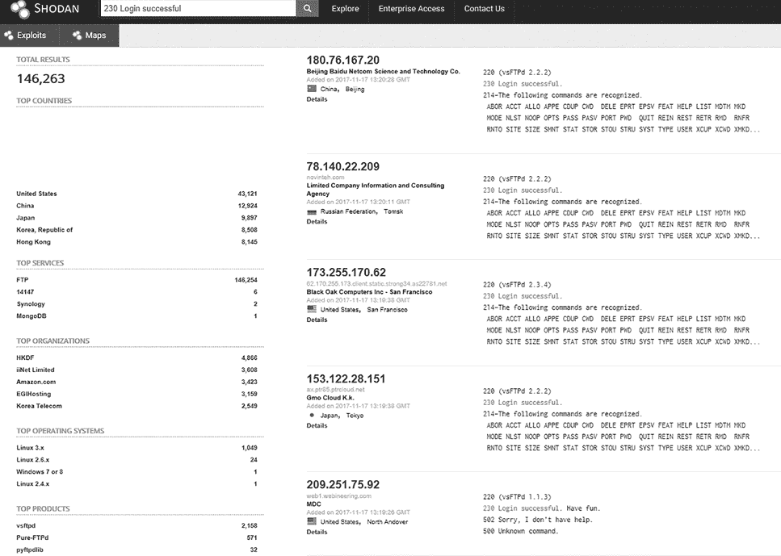

`图 14.3` 由于 ASUS 安全漏洞导致受影响的 IP 地址。

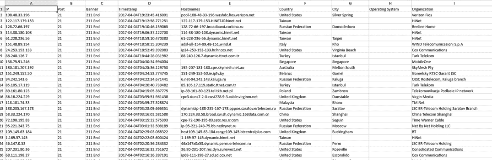

`图 14.4` 从 Shodan 网站下载的 Excel 文件。

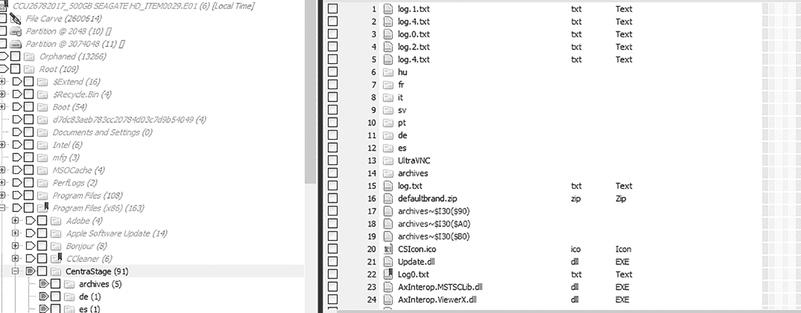

`图 14.5` 显示已安装 CentraStage 软件的文件目录。

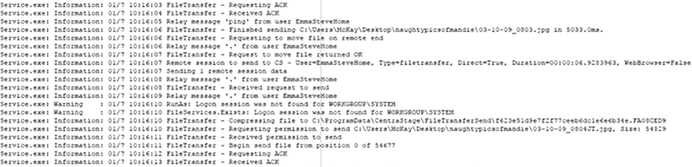

`图 14.6` 来自 CentraStage 软件的文件传输日志。

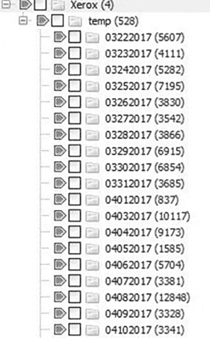

`图 14.7` 目录中 Yawcam 照片的输出。

随后我检查了 `Yawcam` 的设置，从文件中确定了设置为：

- 每 5 秒拍摄一次图像
- 图像文件路径保存到 `C:\Yawcam\temp\{date}_{stamp}.jpg`

在本案中，图像被推送到嫌疑人创建的 Windows 目录。在嫌疑人的机器上还发现了一个包含许多此类图像的文件夹](#C19_chapter14.xhtml#fig14_7)。`Yawcam` 软件会按日期创建子文件夹来转储图像。

人们在选择职业路径时，往往并不清楚日常工作究竟是怎样的。在数字取证工作领域，我曾与超过 1000 名学生以及来自全球各地的执法人员、IT 专业人士和学者合作过工作。在这些人中，很少有人对数字取证职业的样貌有清晰的把握，我深信其中的原因之一是缺乏能够准确描述该职业内涵的来源。其他原因可能由于技术、法律和伦理领域的进展如此之快，以至于对这种环境下的职业描述可能在几个月内就会过时。我已经提供了心理层面的概述，如果有人能够应对这些挑战，那么确定他们是否能胜任日常场景就是下一步。本章将探讨许多数字取证实践中的真实情况和情境。

## 案例 – 审视观察

显然，案件的呈现方式存在差异。企业调查员面临的案件呈现方式可能与私家侦探或执法部门的案件大不相同。然而，这些环境中一个常见的共同点是，通常会有其他人将案件提交给调查员。当然，这也有例外，但通常是有人请求调查员“看一看”。在查看之前，请确保你已获得适当的授权。为了进一步强调这一点，请确保在查看之前你已获得授权——最好是书面形式的。

和其他人一样，调查员审查案件的时间是有限的。决定是否进行全面调查可能取决于许多因素。从法律角度来看，因素可能包括犯罪的严重程度和成功起诉的可能性。从民事角度来看，因素可能包括案件可能带来的风险/回报。从企业角度来看，因素可能包括对组织财务或声誉的潜在损害。还存在未来的影响和创新，可能会推迟案件的进展。例如，以某种方式保存案件，以便在未来调查实践演进后对其进行调查，这与涉及生物证据的悬案相似，这些悬案后来通过实验室能力的进步而得以破解。

调查员应该尝试关注每个案件的自身价值，而不要急于得出结论。尽可能获得清晰的局面是决定是否应该跟进案件的重要第一步。有时，你是否想与某个特定案件产生联系，是决定是否进行调查最重要的方面。这一点怎么强调都不为过，因为我有好几次在进行调查时，案件发生了 180 度的转折。我之前听到的关于案件的情况或我所做的假设，后来被证明与之前的现实是完全不同的局面。这可能有些“凡事都有两面性”的说法成分，但其他时候仅仅是因为情况有多个方面。让我们来看两个情帮助以提供清晰思路。请注意，本章和本书中所有的案例插图可能与实际案例有相似之处，但为了强调和包括隐私在内的其他考虑，已进行了调整。

## 案例 #1 – 事物并非其所示

一家律师事务所与我联系，关于一起挪用资金案件。一位被某位富翁指定为授权代理人的人进行了多次未经授权的交易，包括出售了价值数百万的股票和房地产。当那位曾经富翁的人发现这一切时，我被要求协助进行民事案件的调查，以追回资金。案件刚开始时，授权代理人去世了，这导致了刑事调查终止。我要求的第一件事是死者的电脑。一名法律助理协助我构建了事件时间线，显然有多人参与其中。


我们通过法律手段取回了那台电脑，我开始了法证检查。在几分钟内，我就能看到他们利用拍卖行、社交媒体和类似的方法在短时间内处置了那位富翁的资产。看起来，死者的妻子和至少另外两个个人参与了这一阴谋。收益通过孙辈名下的账户进行了洗钱，部分资金被用于在死者的财产上建立了一个宗教神庙。由于有许多产物且使用了在线销售方法，我继续恢复被删除的图形文件。不久，我发现了大量的儿童色情信息。这迅速改变了调查方向。我联系了案件管辖区的当地执法部门，通知他们可能存在的儿童性虐待材料（`CSAM`）情况。当时，他们的数字取证能力和理解非常有限。

与我交谈的侦探希望我把硬盘邮寄给他，我做不到，因为这是违法的。我告诉他我会妥善保管材料并等他来取。在几天没有回复后，我安排了特勤局将硬盘递交给当地执法机构。当地管辖部门认定，由于作案者已去世，没有理由继续办理此案，他们随后销毁了硬盘。硬盘中涉及的个人带着数百万美元逃脱了。那位曾经的富翁失去了房子，因为他需要支付授权代理人出售股票所产生的税款，而他需要卖掉房子的收益来支付这笔钱。

## 案例 #2 – 事物并非其所示

一名辩护律师与我联系，关于他的客户（一名警察）因强奸罪被捕的情况。律师确信其客户的手机将提供证明清白的证据。在对设备进行审查后，很明显，被捕者在 `Tinder` 及类似的社交媒体约会服务上很活跃。手机提供了一条线索，显示被捕者和指控者离开了一家当地酒吧，与另一个人一起进入森林进行两处跟踪（`tracking`）。案件中的一个复杂之处是，下班警察通常携带武器，而这正是所讨论情景的情况。在实施重罪时携带武器会使指控严重得多。

初步的数字取证检查没有定论，尽管调查结果对被捕者并不有利。虽然它确实显示了性行为的模式，但并没有定性地证明或反驳指控。在经历了几周的延迟后，案件莫名地交给了另一个管辖区的另一个法律团队。事实证明，强奸指控只是冰山一角，被捕者一直在接受有关深度参与毒品集团指控的调查。我描述这个案例的意义在于，你有时会发现自己处于被请求帮助的境地，而实际上你根本不想参与——但在调查进行很久之后，你才知道这一点。

## 办理刑事案件

刑事案件的运作通常与民事案件追求不同的结果。刑事案件旨在确定被告有罪或无罪。刑事案件可能涉及地方、州或联邦级执法机构，以及法官、检察官、辩护律师、证人及专家证人。数字取证调查员通常为执法部门的控控方工作——担任警员或文职调查员的身份。在辩护方，数字取证调查员通常担任专家证人。

在大多数情况下，调查员的资质都会经过严格审查。资质的范围很广，从除了参加为期一周的供应商课程以获得特定工具认证之外外没有任何计算机相关教育的人，到拥有网络安全学位并持有调查专业领域认证的人员。经验也是考虑资质的因素之一。我见过某些情况，执法部门的调查员几乎没有或完全没有培训，却在处理数字取证案件。我也见过某些专家证人的资质同样平庸无奇。这是一种伦理上的困境，因为被指控犯罪的人和犯罪受害者都应该获得对案件的关注和专业技能。虽然可能存在减轻的情况，但重要的是意识到，调查并不总是像应该的那那样彻底，并可能导致结果出现偏差。

任何案件中的一个重要步骤都是验证发现的结果。这在刑事案件中非常重要，因为对个人生活的影响可能是巨大的，错误的结果可能会永久性损害相关人员。验证可以通过使用多种工具、让第二双眼睛审查发现的结果、进行合理性测试，以及与历史上类似的调查进行对比来完成。此外，要尽力寻找并报告所有信息，而不仅仅是那些符合预期结果的信息。这似乎是一个相当显而易见的观点，但其意义远深于此。调查员很容易产生盲目性，只寻找特定的东西，特别是当案件已经通过其他来源的证据发展得非常充分时。调查员经常被要求寻找特定的东西——而不是寻找所有东西。另一个挑战是，被调查人员可能是一个不光明的公民，有偏离或恐怖行为的史。要为一个按某些标准衡量可能不值得的人付出额外努力并不容易。接下来的两个案例将有助于提供这见解。

## 案件 #3 – 进行彻底的调查

开车短信在整个美国和世界许多地方都是一个严重的问题。这种分心会导致悲性的结果。我曾受辩护方委托，在一起导致双人命杀的开车短信案中提供专家证人证言。这起发生在美国东部的特定案件涉及交通流进入州际公路某施工区域的情况。现场是交通流从两条车道合并到仅剩左侧一条车道。情况是一个男子和儿子坐在左车道的小轿车里。正如通常一样，一辆车在右侧加速并在合并点之前切入轿车前方。两辆车都采取了刹车，轿车夹在刚刚切入的车辆和后方的大型 `SUV` 之间。这是一场惨烈的事故，轿车内的两名人员均遇难。

现场执法人员仅要求 `SUV` 驾驶员交手机。直到碰撞发生前约 `80` 秒还有短信活动。侦探还从 `SUV` 中提取了事件记录器。事件记录器记录了 `SUV` 在碰撞前最后五秒的速度，并发现没有刹车。起初，这似乎是一个铁案，`SUV` 驾驶员负有全部责任。随着调查的进行，有一位在 `SUV` 后方开车的证人，他证词那辆在最后一秒从右侧合并的车辆导致了事故。在这里，变得清楚了并没有进行完全的调查。

侦探在审判中作证，`SUV` 驾驶员在事故发生前 `80` 秒读了短信。根据证据无法做出这一陈述。如 `Cellebrite` 这样的移动取证工具在满足多个条件中的之一时会将消息标记为已读。该消息实际上可能被读过，但在类似于目标设备的 `iPhone` 上，还有其他因素会设置此标记。例如，如果 A 人向 B 发送短信，然后让短信屏幕保持激活状态，那么 B 回复给 A 的短信将被标记为已读，即使 A 并没有读。A 可能把手机放在了手套箱里，但如果短信屏幕仍处于激活打开状态，那么来自 B 的任何消息看起来就像是 A 读过一样。还有其他类似的情况可以解释为什么信息在设备操作者可能未看到的情况下，却被标记为已读。因此，这是调查中的一个重大缺陷。这与计算机调查非常相似，在计算机调查中在电脑上发现了信息，但调查员需要其他信息来证明某个特定个人正坐在键盘前。

案件中的另一个主要缺陷是只查看了 `SUV` 的事件记录器。轿车和在最后一分钟合并的车辆的事件记录器将为这一系列事件提供大量的见解。如果合并车辆行驶缓慢并切入缓慢行驶的轿车前方，那么事件记录器将显示它们在碰撞前最后五秒内以低速行驶。特别是在轿车的情况下，如果它显示在碰撞前不久有剧烈刹车，那将支持 `SUV` 后方车辆中证人的证词，即合并车辆导致了事故。如果轿车在碰撞前最后五秒内以低速行驶，那么将支持 `SUV` 驾驶员没有注意。事件记录器显示 `SUV` 在碰撞点之前一直保持每小时 `75` 英里的匀速。那辆车要超过 `SUV` 和轿车，其速度必须超过这个速度，这倾向于支持合并车辆导致事故的论点。

首先，在这样的情况下，意识到已经发生的巨大悲剧是重要的。不提供适当的正义而制造第二起悲剧只会恶化局面。这是一个我由于许多原因经常思考的案件。除了生命的丧失外，这是我首个为辩护团队接办的案件。在此之前，我一直在数十次调查中一直以义务服务的形式与执法部门保持紧密一致。但这个案件中有些事情困扰着我。在这种情况下，侦探调查该案件的整个数字取证教育只是一个为期四天的供应商课程。没有其他任何形式的取证教学或计算机课程——无论是高中还是大学——也没有导师。你不可能在 `32` 小时内成为数字取证专家，就像你不可能在 `32` 小时内成为执法专家一样。

法律程序是一个悖论，因为它的优劣完全取决于投入其中的努力和信息。在信息技术领域，我们有一句格——垃圾进，垃圾出（`Garbage In, Garbage Out`）——简称 `GIGO`。也许这句话有时也适用于法律程序。我在法庭上目睹侦探证词，那辆 `SUV` 的驾驶员正在看短信，脸埋在手机里。对于你并不知道事实的事物，你如何作证呢？此外，如果最后一条信息是在事故发生 `80` 秒前阅读的，那么驾驶员在碰撞前已经向前行驶了一英里的路。那么主要问题是，为什么 `SUV` 驾驶员没有刹车？当然，一种解释可能是她正在发短信，但她可能被右侧超车并在最后一刻切入的驾驶员分散了注意力。她可能在查看后视镜或向后看，以看看是否有其他车辆也要同样的事情。

在法庭案件的证词期间，你的角色是回答问题。专家证人不能在没有被提问或获得法官许可的情况下就开始发表理论。这也是我经常思考这个案件的另一个原因。当辩护团队邀请你担任专家证人时，他们通常会就他们的辩护策略寻求你的意见，并帮助他们解释案件中的证据。如果某些东西没有被呈现，陪审团就无法考虑它。因此，在这种情况下，辩护团队理解现有证据面临的挑战以及调查中可能存在的漏洞至关重要。然后他们必须在审判中针对这些挑战和漏洞。

## 案件 #4 – 进行彻底的调查

一家大型服务公司联系我，关于一起潜在的贪污案件。我被要求调查 `5` 个人的电脑，以帮助确定是否有任何与贪污相关的证据。在其中一台电脑上发现了 `CSAM`（儿童性色淫内容）的证据，我立即联系了执法部门。我过去为该机构提供过免费的调查服务，与那里的警察和检察官相识。他们的数字取证调查能力有限，因此询问我是否为他们进行这项调查。

这项特定调查的奇之处在于，涉案电脑属于一位 `60` 多岁的女性，这并不符合 `CSAM` 受害者的典型特征。因此，我并没有闭上眼睛专注于那名 `60` 多岁的女性，而是寻找了她的电脑可能被使用的其他方式。记住，这是公司环境。我发现 `CSAM` 活动发生在深夜，而非工作时间。公司日志并不支持该女性在那个时间登录她的电脑。我发现了中继访问（`pass through`）的证据，这意味着有人在远程登录她的电脑并利用它访问 `CSAM`。我列出一份包含 `four` 个潜在嫌疑人的名单，他们有能力和手段利用这种访问。

这变成了一个秘密案件，我必须在下班后进行调查，使证据发展到可以识别出犯罪分子或者的程度。我开始调查的第一人是 `LAN` 管理员。一天晚上，我在 `7 pm` 左右随该机构的一位高管去他的办公室，但 `LAN` 管理员还在办公室里。高管和我大约一小时后回来，此时 `LAN` 管理员正带着几台电脑离开前往办公室。我们的目标是不被发现，所以我们一直躲着直到 `LAN` 管理员离开。进入他办公室后我注意到的第一点是，他的电脑正在完成硬盘擦除，这立即引起了我的怀疑。第二个可疑点是他更改了语音信问候，说他将离开很长时间，并联系他的直属主管。此时，看来我们选择了正确的第一个目标。

高管联系了 `LAN` 管理员的主管，询问他是否知道新语音信问候的消息，主管并不知道。主管被询问是否知道 `LAN` 管理员目前在做什么，他表示他正在组织财产上重建一些面向公众的电脑，因为这些电脑上有大量的色情内容。此时，高管准备好重新与执法部门取得联系并让他们带走 `LAN` 管理员。我敦促他等一下，等我有机会查看 `LAN` 管理员办公室里的至少 `13` 台电脑。让警察在家里面对着妻子和孩子因为 `CSAM` 指控而带走你，这绝对会改变一生——而且如果那人被判定无罪，还可能面临诉讼。

我工作了一整晚，预检了所有电脑，在其中任何一台电脑上都没有发现 `CSAM` 的证据。随后对主管的跟进电话发现，是主管要求 `LAN` 管理员清理那些面向公众的电脑，因为某些客户是色情内容的来源。事实证明，`LAN` 管理员在任何方式、形式上都不对 `CSAM` 负责，语音信问候是为了回应其他人在语音信箱里留下的类似的恶作剧留言。在短短几个小时内，我们从几乎确定某人是罪犯并可能因 `CSAM` 指控毁掉他的生活，转变为正确发现他是一个非常敬业的员工，是组织的宝贵资产。验证并确认，然后再验证并确认，以确保证据是可靠的，并且没有其他合理的解释。

## 处理民事案件

民事案件的范围从离婚情况到知识产权盗窃，再到名誉损害。在取证阶段（`discovery`），律师之间往往存在大量的斗争、传票的使用以及对法院命令的要求。执法部门通常不参与，因此民事事务的感觉与刑事案件有很大不同——尽管它们有时是相互联系的。

在取证阶段，作为法医调查员，我经常发现自己自己在对方律师的办公室工作。原因可能包括控制潜在证据、能够观察或仅仅是为了方便。在对方团队的办公室工作可能看起来很奇怪，但通常我更喜欢这样，因为他们维护证据，我不需要处理监管链问题。很多时候，我发现我对对方律师比对我的律师更熟悉，仅仅是因为与他们相处的时间长。很多时候，各方都承认每个人尽自己的职责，但其他时候，环境可能会非常紧张。

处理民事案件时的另一个挑战是信息流。法官可能会要求调查人员根据法庭指令的提交一份报告，但大家都明白，为了做到这一点，调查人员必须审查超出指令范围的信息，并对哪些内容应进入报告做出判断。之前提到的关键词搜索结果就是一个很好的例子。我曾多次遇到这种情况，情景通常是：两个法律团队针对调查术语的拟定表述反复拉锯。法庭指令处理完毕后，我会生成一份报告，该报告会先由对方律师审查，以确保其符合指令。如果他们认为符合规定，就会发送给另一方律师。如果他们认为不符合，那么“采纳/排除证据”的拉锯战就开始了。

## 在任何调查过程中需要注意的事

在调查过程中可能会产生很多挫败感。技术能力可能导致所需的信息无法获取。对特定技术功能的误解以及信息的虚假陈都是需要留意的点。需要记住的首要原则是“睡眠测试”。在调查中，你必须做出许多选择，而且通常没有其他人知道这些选择。例如，你是在报告中包含某些内容还是排除它。睡眠测试非常简单：对于你所做的决定，你是否能够与之共处并安然睡眠？你的声誉是宝贵的，一两个错误的决定就可能将其摧毁。

人们在调查之前、期间和之后都会问你很多问题。有时他们只是出于好奇，但有时他们的动机可能并不显而易见。保持礼貌，但记住也要同样保密。你的工作虽然很重要，但可能只是拼图的一角。因此，仅凭你的工作可能无法准确勾勒出真实的画面。事情往往并非表面，所以最好把事情留在心里，而不是先说出来又不得不收回。在实验室或正常工作区域之外的环境工作时要格外小心。你认为是友好对话的内容可能会反噬你。在数字取证调查的世界里，沉默是金。

一旦调查完成并案件归档，还有最后一步。回顾调查过程，识别哪些地方做得好，哪些地方不够顺利。尝试找到改进流程的方法，以便未来的调查进行得更加顺利。换句话说，制定一个持续改进策略。该策略应该尽可能基于事实和指标支持的信息。与参与过调查的其他人员咨询也可以提供有用且具有建设性的反馈。熟能生巧。

## 总结

我们在本书的章节中涵盖了大量内容。许多才智过人的人提供的建议和贡献对我们有极大的帮助。计算机取证领域并不可能无所不包，所以无论是写书还是进行调查，都不要犹豫与他人交流。新的视角往往是启动僵局调查的良机，或能帮助解读发现结果。在某些工作环境中，你可能是唯一的调查员。这并不意味着你必须孤军奋战。有无数的用户组、会议、出版物、播客、视频和其他资源可以提供帮助。建立一个可以交流想法或听取他们对新工具意见的人脉网络，应该是任何调查员的早期优先任务。不要等到在压力下完成任务时才开始建立人脉，那只会增加你的压力，而且你联系的人可能自己也非常忙。

另一个需要记住点是回馈。不要做一个只寻求帮助的人。相反，要做为更大的利益做贡献的人。这可以通过许多方式实现，包括参与用户组和会议、发表、甚至制作几个简单的 `YouTube` 视频。世界充满了索取者，我们需要更多的施予者。毕竟，我们投身数字取证领域是为了寻找真相，并给予人们需要且应得的慰藉。感谢你对数字取证感兴趣。我们需要你以及你带来的能量。

## 索引

*   A

*   `ABET` [5]

*   `AK-47` [143]

*   算法 [5], [10], [44], [62], [68], [175]

*   替代数据流 [178]

*   美国警局长 [17]

*   天线 [65], [68], [70]

*   反取证 [8], [9], [167], [168], [176]

*   苹果 [8], [74], [78], [81], [106], [179]

*   阿拉伯语 [142]

*   人工制品 [8], [17], [24], [34], [48], [51], [53], [55], [60], [61], [68], [101], [115], [119], [183], [220]

*   `ATF` [6]

*   攻击 [8], [20], [46], [92], [95], [96], [98], [140], [143], [151], [155], [157], [163]

*   律师 [108], [112], [118], [144]

*   权威 [19], [72], [158], [206]

*   `Axiom` [24], [40], [51], [62], [208]

*   B

*   背包 [21]

*   百度 [138]

*   诱饵 [164]

*   贝尔 [11], [13]

*   `饮料` 20

*   `偏见` 116, 118

*   `Bing` 58, 138

*   `生物识别` 21, 23

*   `BIOS` 33, 119, 177

*   `BitTorrent` 57

*   `秘密窃入` 25

*   `黑光` 20

*   `毯子` 49, 50, 198

*   `博客博客` 135

*   `Booz Allen` 164

*   `僵尸网络` 22, 35

*   `面包屑导航` 13

*   C

*   `相机` 8, 19, 22, 49, 77, 105, 106

*   `CDMA` 65, 66, 72, 80

*   `细胞` 4, 6, 11, 12, 15, 19, 21, 50, 65, 66, 68, 70–73, 76, 79, 81, 118, 120, 131, 184, 206, 221, 223

*   `手机` 6, 8, 20, 65, 71, 131

*   `Cellebrite` 11, 13, 21, 51, 52, 69, 73, 74, 115, 118, 184, 208, 223

*   `卓越中心` 12

*   `认证` 12, 222

*   `聊天` 6, 36, 60

*   `检查列表` 22, 182

*   `儿童` 6, 18, 34, 35, 57, 62, 103–105, 107–110, 113, 118, 120, 122, 194–198, 217, 220, 223

*   `儿童剥削` 6, 18, 34, 35, 57, 103

*   `CIA` 6, 150

*   `民事` 3

*   `民事案件` 9, 19, 116, 220, 221

*   `衣服` 20

*   `云` 6–12, 15, 19, 22, 24, 25, 33, 34, 69, 78, 83–98, 100

*   `能力` 12


- `电脑` 3, 4, 10, 15, 17, 25, 27, 33, 36, 39, 40, 43, 47, 52, 54, 56, 63, 65, 67, 73, 74, 77, 83, 93, 94, 101, 103, 105, 110, 116, 120, 124, 126, 131, 133, 139, 140, 151, 159, 161, 167, 170, 171, 183, 193, 199, 201, 202

- `企业` 4, 10, 11, 15, 16, 18, 22–25, 33, 133, 134, 159, 161, 164, 168, 199, 219, 220, 225

- `刑事` 3, 4, 6–10, 12, 15, 16, 18, 22, 24, 49, 103, 104, 106, 116, 130, 140, 142, 146, 148, 150, 165, 167, 168, 193, 197, 198, 202, 220–22, 226

- `密码学` 173

- `ITF` 143, 144, 152

- `守护进程` 170

- `损坏的` 7, 12, 15, 17, 19, 22, 44, 53, 112

- `暗网` 143, 144, 150

- `数据库` 17, 20, 85–88, 91, 92, 94–96, 98, 100, 184, 190

- `道伯特` 40, 43

- `国防部` 5, 6, 16

- `国土安全部` 6, 12, 22

- `质证` 130, 134

- `破坏` 9, 67, 70, 112, 169, 172, 178, 180, 198, 207, 221

- `挖掘` 138

- `数字取证` 5, 13, 21, 22, 39, 63, 130, 202

- `DK` 178

- `记录` 22, 115

- `Dogpile` 58

- `加密狗` 19

- `Dropbox` 8, 172

- `DuckGo` 138

- `DVD` 54, 118, 131, 172

- `E`

- `EDGE` 72, 80

- `教育` 5, 162, 163

- `特征向量` 187, 188

- `电子邮件` 6–8, 11, 34, 35, 55, 56, 69, 83, 97, 100, 117, 135, 137, 141, 146, 151, 157, 161, 172, 194, 197, 202

- `情绪` 12, 197

- `EnCase` 24, 33, 39, 40, 62, 119, 123, 184, 208

- `加密` 7, 11, 46, 80, 90, 94, 95, 97, 100, 106, 117, 152, 168, 169, 173, 175, 180, 181

- `错误` 21, 22, 34, 43, 105

- `ESN` 66, 80

- `伦理` 12, 131

- `证据` 5, 7–10, 12, 15–17, 20, 22, 25, 33, 36, 47, 53, 56, 70, 71, 77, 79, 104–106, 108, 110–113, 117, 130, 133, 140, 141, 144–146, 148, 150, 152, 167–173, 178, 179, 187, 196, 197, 199, 202, 203, 206, 220–227

- `检查` 18, 24–32, 36, 39, 46, 55, 74, 77, 109, 110, 117–119, 122, 133, 140, 167, 169, 193, 197, 209, 210, 220, 221

- `检查者` 11–13, 17, 46, 48–50, 53, 55, 57–59, 65, 67, 73, 74, 109, 115, 117, 118, 131, 179, 181, 202

- `专业知识` 6, 8, 13, 102, 134, 196, 202

- `提取` 6, 51, 73, 74, 77, 78, 97, 100

- `Facebook` 12, 36, 59, 118, 122, 134–136, 138, 141–144, 146, 150, 164, 187, 209

- `FaceTime` 139

- `法拉第` 21, 24, 49, 68, 70, 71, 73

- `FBI` 6

- `发现` 8, 11, 12, 15, 22, 24, 40, 47, 53, 76, 83, 87, 108, 133, 138, 143, 151, 161, 169, 178, 183, 191, 199, 220, 225

- `急救包` 20

- `闪光` 11, 14, 21, 81, 164, 181

- `手电筒` 21, 50

- `聚焦` 5, 12, 13, 15, 22, 24, 40, 47, 76, 83, 87, 108, 133, 138, 143, 151, 161, 169, 178, 183, 191, 199, 220, 225

- `粉丝` 135, 148

- `取证处理程序` 5, 11, 15, 49, 169, 183, 203

- `忘记密码` 141

- `Foursquare` 138, 148

- `FTK` 24, 39, 40, 108, 184, 208

- `G`

- `帮派` 8, 140, 141, 146, 148, 150

- `乔治·福曼` 62

- `gmail` 55

- `Gogolin` 3, 8, 13, 14, 17, 119, 122, 130, 145, 152, 185, 187, 196, 200, 204

- `Google` 8, 13, 22, 57–60, 63, 74, 78, 94, 110, 137, 138, 164, 181

- `GoToMeeting` 139

- `GPS` 8, 50, 65, 77, 138

- `GREP` 34, 35, 56, 195

- `组` 141, 142

- `GSM` 65, 66, 72, 79, 80

- `H`

- `手持设备` 68, 69

- `Hangouts` 137

- `硬盘` 4, 5, 11, 19, 21, 22, 33, 43, 50, 77, 108, 109, 20, 122, 131, 175, 177, 178, 195, 196, 207, 221, 225

- `哈希` 5, 35, 44, 61, 62

- `HashCalc` 48, 62

- `大灯` 21, 50

- `hotmail` 55

- `Hsi Yu` 22

- `HTML` 47, 95, 96

- `虚拟机管理器` 177

- `I`

- `i2` 74, 184

- `IAAS` 84, 87–89, 91, 92, 95, 98, 101

- `IARPA` 143, 144, 152

- `iDEN` 65, 72, 80

- `iMac` 21, 50

- `成像` 5, 19, 33, 44, 46, 63

- `IMEI` 66, 71, 80

- `IMSI` 65, 71, 80

- `印度尼西亚` 142

- `基础设施` 12, 20

- `Instagram` 59, 134, 136, 142

- `完整性` 4, 86, 90, 202, 205

- `互联网` 6, 10, 11, 14, 19, 34, 37, 55, 56, 58–60, 65, 83–85, 93–95, 113, 120, 122, 133–135, 137, 138, 142, 145, 152, 160–163, 174, 194, 195, 202, 205, 210, 217

- `互联网犯罪投诉中心` 16, 37

- `访谈` 17, 18, 104–108, 110

- `恐吓` 157, 161

- `调查` 3, 4, 6, 7, 9–13, 15–18, 22–25, 33–37, 39, 40, 44, 46, 49, 50, 52–54, 56, 60, 67, 69, 70, 72, 74, 77, 79, 100, 103, 104, 106, 110–113, 115–120, 133, 140, 141, 143–145, 167, 172, 182, 183, 187, 194, 197–199, 201, 203, 204, 206, 207, 209, 219–221, 223–225, 227, 228

- `员` 3–13, 15, 16, 18, 22, 24, 27, 33–37, 39, 40, 44, 46–50, 53–56, 58, 60, 61, 63, 69–72, 77–79, 103–113, 115–117, 133, 140, 141, 143–145, 151, 160, 161, 163, 168, 169, 172, 173, 179, 187, 190, 191, 193–201, 203, 206, 208, 219, 220, 222, 223, 226–228

- `IRQ` 178

- `ISC2` 12, 19

- `以色列` 8

- `J`

- `JavaScript` 95, 96, 170, 171

- `匿名人士` 103

- `司法管辖权的` 10

- `审审团` 61, 110, 141, 130, 134, 224

- `K`

- `密钥` 61, 163

- `关键词` 11, 12, 34, 35, 55, 57, 117, 119, 226, 227

- `L`

- `实验室` 22, 23, 27, 220

- `LaTeX` 183, 184

- `法律执法` 4, 6, 8, 9, 12, 16, 17, 19, 27, 33, 35, 62, 103, 104, 116, 117, 120, 133, 140, 144, 163, 190, 194, 196, 198, 199, 206, 219, 224, 225

- `律师` 111, 134, 144, 221, 226

- `许可` 4, 7

- `执照` 7, 116

- `洛卡德` 167

- `位置` 8, 68, 138, 146, 148, 150

- `M`

- `Macintosh` 23, 39

- `磁铁` 24, 40, 49, 51, 62, 208

- `放大镜` 21

- `Maltego` 74

- `恶意软件` 6, 11, 22, 37, 48, 49, 54, 55, 59–63, 152, 155, 161, 164, 169, 173, 177, 178, 201

- `MBR` 177

- `MD5` 5, 33, 44, 61, 62, 119, 208

- `聚会` 138

- `MEID` 66, 80

- `消息` 6, 8, 36, 55, 56, 135, 136, 146

- `方法论` 3, 4, 15, 17, 24, 68

- `MIAT` 179

- `密歇根` 8, 16, 17, 19, 20, 77, 119, 120, 200, 205, 206, 208

- `麦克风` 65

- `微软` 46, 47, 58, 61, 15, 137, 138, 152, 157, 160, 162, 164, 165, 181, 190

- `MMOGs` 144

- `MMS` 71, 80

- `移动` 8, 8, 11, 20–25, 44, 46, 50–54, 65–69, 71, 72, 74–79, 118, 138, 141, 142, 150–152, 155, 157, 159, 161, 165, 179–181, 184, 187, 223

- `鼠标` 21

- `MSC` 80

- `MTSO` 80

- `NAND` 81

- `国家标准技术` 17, 40, 81, 84

- `荷兰` 47

- `Net` 8

- `Stat` 48

- `网络` 20, 65, 80, 146, 150, 188

- `忍者` 19, 24, 44, 45

- `NIST` 17, 37, 40, 54, 81, 84

- `NOR` 81

- `NSA` 5, 7, 12, 150

- `O`

- `Otting` 7, 9, 11, 12, 16, 20, 185

- `P`

- `PAAS` 86–88, 91, 92, 95, 97, 98, 101

- `PASS` 84, 98

- `密码码` 23, 67, 72, 74

- `password`（密码）20, 23, 46, 47, 67, 93, 141, 142, 150, 155, 159, 162, 163, 165, 170, 171, 173, 175, 180, 181

- `PCS`（个人计算系统）80

- `peer review`（同行评审）22, 43

- `pencil`（铅笔）19, 49, 50

- `Persuasive`（说服力的）159

- `Pew Research Center`（皮尤研究中心）8

- `piggybacking`（搭便车）164

- `Pokemon`（宝可梦）138

- `potholes`（路洼）13

- `PowerPoint`（演示文）110, 111

- `P2P`（对等网络）55, 57

- `predators`（捕食者）105, 200

- `puzzles`（谜题）3, 201

- `Quid pro quo`（等价交换）164

- `Rags`（破布）20

- `RAM`（随机存储器）21, 33, 39, 47, 67, 106, 178

- `Ransomware`（勒索软件）152

- `Reagan`（里根）15

- `Recycle`（回收）36

- `report`（报告）11, 12, 18, 36, 46, 59, 71, 74, 107, 110, 115, 122, 130, 171, 183, 205, 222, 226, 227

- `research`（研究）5, 7, 12, 17, 22, 37, 54, 57, 59, 61, 63, 116, 138, 143, 163

- `response`（响应）5, 7, 12, 18, 19, 22, 24, 25, 27, 36, 49, 51, 86, 90, 100, 103, 107, 112, 194, 201, 202, 221, 226

- `Reynard`（雷纳德）143, 144

- `RSA Attack`（RSA 攻击）164

- `SAAS`（软件即服务）86, 100, 101

- `safety`（安全）24, 25, 111

- `sanitizer`（清理器）21

- `SANS Institute`（美国安全学院）6

- `SASS`（软件即服务）84, 100

- `Scenario`（场景）9

- `scene`（场景）18, 20, 25, 27, 36, 50, 106, 111, 112, 167, 222, 223

- `school`（学校）12, 19, 103, 104, 120, 134, 195, 196, 224

- `science`（科学）5, 15, 21, 22, 110, 167, 176, 181, 201, 202

- `scientific method`（科学方法）15, 201

- `scientific process`（科学过程）3, 15, 22, 190

- `scissors`（剪刀）49

- `search engine`（搜索引擎）57

- `search warrant`（搜查令）19, 105, 106, 109, 116, 206, 208

- `Second Life`（第二人生）139, 143, 150

- `Secret Service`（秘密勤局）6, 221

- `SHA-1`（SHA-1）5, 33, 61, 62, 208

- `SIM` 65, 71, 73, 79, 80

- `Skype` 137, 139

- `Slack` 137, 178

- `智能手机` 14, 19

- `SMS` 71, 80

- `Snapchat` 137

- `社会工程` 8, 16, 19, 151–153, 155, 157, 159–161, 163–165

- `社交媒体` 7, 8, 16, 18, 19, 35, 133–136, 138–145, 150, 152, 153, 155, 196, 220, 221

- `社交网络` 6, 7, 59, 134

- `固态硬盘`（`SSD`）11, 44

- `韩国` 8

- `欺骗` 152

- `SQL 注入` 91, 92, 96

- `存储` 4–9, 11, 17, 21, 24, 25, 33, 49, 53, 54, 69, 70, 77, 81, 84–86, 105, 106, 108, 109, 167, 169, 171, 172, 175, 179, 180, 199, 200, 206, 209, 217

- `提取` 21, 50

- `监控` 8, 47, 53, 104

- `群集` 138

- `表格` 19, 24, 43, 19

- `尾随攻击` 161, 162, 164

- `目标` 20, 122

- `TCP 视图` 48

- `TDMA` 65, 79, 80

- `技术` 5, 6, 9–13, 15, 21–24, 33, 37, 39, 44, 63, 141, 143, 145, 152, 157, 159–161, 163, 165, 168, 170, 173, 177, 179, 181, 183, 191, 199, 203

- `技术人员` 138

- `恐怖分子` 142, 150

- `作证` 130, 134


- 证言 7, 40, 110, 130, 131, 134, 222
- TikTok 135, 137, 142
- 工具 20
- 塔楼 65, 66, 71, 72, 74, 79
- 训练 6, 7, 9–13, 24, 40, 52, 78, 108, 117, 130, 143, 150, 160–163, 194, 196, 203, 222
- 木马 61, 177
- 推文 135
- 推 36, 59, 135, 137, 141–143, 148, 150, 152, 164, 187
- 美国 8, 10, 20, 22, 43, 51, 54, 66, 68, 80, 96, 138, 142, 143, 202, 203, 222
- 大学 6, 12
- `Unix` 170, 171, 179
- 乌尔德语 142
- `URL` 34, 58
- `USB` 19–21, 23, 25, 39, 44, 48, 49, 51, 73, 74, 77, 131, 161, 164, 172, 173
- V
- 供应商 5, 11, 12, 19, 50–52, 67, 69, 78, 83, 98, 131, 153, 155, 162, 163, 222, 224
- 受害者 18, 103–110, 113, 152–154, 163, 164, 171, 197, 208, 209, 222
- 处女攻击 61–63
- 虚拟化 7, 10, 101
- 虚拟机 10, 23, 59, 60, 85, 101, 172, 177
- 网络钓鱼 157
- `VLC` 47
- W
- `Wei` 11, 14
- `WhatsApp` 137
- `wiki` 139, 209
- 维基攻击 164
- `Windows` 20, 34, 36, 46, 56, 58, 61, 119, 123, 126, 128, 130, 131, 142, 150, 167, 169, 170, 175, 176, 179, 182, 208–210, 216
- `WinRAR` 48
- 擦除 5, 19, 53, 68, 73, 168, 179
- 无线 65, 66, 141, 146, 157, 159
- `Wireshark` 37, 39, 48
- 魔兽大战 139, 143
- 全球 10, 17, 79
- 世界维网 7, 8, 202
- 写保护阻止器 5, 20, 43
- X
- `XRY` 21, 69, 118, 208
- `X-Ways` 40
- Y
- `yahoo` 55, 56
- `YouTube` 19, 67, 135, 228
- Z
- `Zoom` 139
