# 下一代医疗物联网中的数字取证：平衡安全性与可持续性

## 前言

医疗物联网，或 `IoMT`，是一种领先的医疗技术，通过复杂的监测和治疗技术正在改变患者护理。然而，这场数字革命也带来了一个新问题：敏感医疗数据。这场数字革命也带来了一个新问题：敏感医疗数据。这场数字革命也带来了一个新问题：敏感医疗数据。这场数字革命也带来了一个新问题：敏感医疗数据。这场数字革命也带来了一个新问题：敏感医疗数据。这场数字革命也带来了一个新问题：敏感医疗数据。这场数字革命也带来了一个新问题：敏感医疗数据。

### IoMT 的数字格局

医疗物联网，或 `IoMT`，是一种领先的医疗技术，通过复杂的监测和治疗技术正在改变患者护理。然而，这场数字革命也带来了一个新问题：敏感医疗数据。医疗物联网，或 `IoMT`，是一种领先的医疗技术，通过复杂的监测和治疗技术正在改变患者护理。然而，这场数字革命也带来了一个新问题：敏感医疗数据。医疗物联网，或 `IoMT`，是一种领先的医疗技术，通过复杂的监测和治疗技术正在改变患者护理。然而，这场数字革命也带来了一个新问题：敏感医疗数据。医疗物联网，或 `IoMT`，是一种领先的医疗技术，通过复杂的监测和治疗技术正在改变患者护理。然而，这场数字革命也带来了一个新问题：敏感医疗数据。医疗物联网，或 `IoMT`，是一种领先的医疗技术，通过复杂的监测和治疗技术正在改变患者护理。然而，这场数字革命也带来了一个新问题：敏感医疗数据。

### 挑战与漏洞

医疗物联网，或 `IoMT`，是一种领先的医疗技术，通过复杂的监测和治疗技术正在改变患者护理。然而，这场数字革命也带来了一个新问题：敏感医疗数据。医疗物联网，或 `IoMT`，是一种领先的医疗技术，通过复杂的监测和治疗技术正在改变患者护理。然而，这场数字革命也带来了一个新问题：敏感医疗数据。医疗物联网，或 `IoMT`，是一种领先的医疗技术，通过复杂的监测和治疗技术正在改变患者护理。然而，这场数字革命也带来了一个新问题：敏感医疗数据。

这场数字革命也带来了一个新问题：敏感医疗数据。这场数字革命也带来了一个新问题：敏感医疗数据。`IoMT` 生态系统的数字格局极受到网络攻击的影响。

### 取证策略

医疗物联网，或 `IoMT`，是一种领先的医疗技术，通过复杂的监测和治疗技术正在改变患者护理。然而，这场数字革命也带来了一个新问题：敏感医疗数据。医疗物联网，或 `IoMT`，是一种领先的医疗技术，通过复杂的监测和治疗技术正在改变患者护理。然而，这场数字革命也带来了一个新问题：敏感医疗数据。

- **第四章**引入了循环安全的概念，即持续监测、威胁情报和自适应安全机制共同保护 `IoMT` 环境。

## 编辑者简介

- `Hemant Kumar Saini` 现任于马来西亚林肯大学（Lincoln University）和印度贝内特大学（Bennett University，泰晤报集团）计算机科学与工程学院的学者。他于 2023 年获得马尼帕尔大学（Manipal University）的计算机科学与工程博士学位。2015 年，他因硕士期间的研究工作荣获拉贾斯坦邦长表彰。他拥有超过 14 年的教学经验。他是 ISTE、IEEE、IAENG 和 CSI 的活跃成员。他通过在著名的 SCI 和 Scopus 期刊及会议集上发表文章展示了其深厚的研究实力。他发表了多篇国家和国际文章，并撰写、编辑和合编了 18 本书书。Saini 博士曾在 ATAL 赞助的教职发展计划中进行多次专家讲座，并在许多国内外会议上发表主旨演讲。他是许多知名国际期刊的编辑委员会成员和审稿人。他的研究兴趣包括无线网络、软计算、深度学习与机器学习、物联网（IoT）、工业 4.0 和智能合约。他在这些领域的贡献得到了广泛认可，并继续突破科学知识的边界。

- `Sita Rani` 就职于卢迪亚纳古鲁·纳纳克德工程学院（Guru Nanak Dev Engineering College）计算机科学与工程系。她于 2018 年获得普贾布邦卡普尔塔拉 I.K. Gujral 普贾布科技大学的计算机科学与工程博士学位。她于 2023 年在印度理工学院鲁基校完成了数据科学与机器学习的研究生证书课程。她于 2023 年 8 月在俄罗斯南乌拉尔州立大学的大数据挖掘与机器学习实验室完成了博士后研究。她拥有超过 21 年的教学经验。她是 ISTE、IEEE 和 IAENG 的活跃成员。她是 2020 年 ISTE 分会最佳教师奖和 2021 年国际青年科学家奖的获得者。通过在著名的 SCI 和 Scopus 期刊及会议集上发表文章为各项研究活动做出了贡献。她发表了多项国家和国际专利，并撰写、编辑和合编了九本书书。Rani 博士曾在 A.I.C.T.E. 赞助的教职发展计划中进行多次专家讲座，并在许多国内外会议上发表主旨演讲。在 20 年的教学经验中，她组织了许多国际会议。她是许多知名国际期刊的编辑委员会成员和审稿人。过去三年，她担任印度妇女商会（WICCI）的 SME 和 MSME（理事会）副主席。她的研究兴趣包括并行与分布式计算、数据科学、机器学习、物联网（IoT）、工业 4.0 和智能医疗。

- `Mariya Ouaissa` 现任摩洛哥马拉拉喀什卡迪·阿亚大学（Cadi Ayyad University）Semlalia 理学院的安全与网络教授。她于 2019 年毕业于摩洛哥梅克内 ENSAM-Moulay Ismail 大学，获得计算机科学与网络专业博士学位。她于 2013 年毕业于摩洛哥库霍里比加国家应用科学学院，是一名网络与电信工程师。她是某 IT 支持与咨询中心的联合创始人和 IT 顾问。从 2013 年到 2021 年，她在摩洛哥梅克内技术学院担任访问教授。她是国际工程师协会（IAE）和国际在线工程协会（IAOE）的成员，自 2021 年起，是“ACM 专业会员”。她是学术交流信息中心（AEIC）的专家审稿人和 Bentham Science 的品牌大使。她曾担任并目前继续担任多个会议和活动的技术计划委员会和组织委员会成员，并作为大会主席组织了许多研讨会/工作坊/会议，也是众多国际期刊的审稿人。Ouaissa 博士在信息安全与隐私、物联网安全以及无线及受限网络安全领域做出了贡献。她的主要研究课题是 IoT、M2M、D2D、WSN、蜂窝网络和车载网络。她发表了 80 多篇论文（书籍章节、国际期刊和会议/工作坊），编辑了 30 本书，并作为客座编辑主持了 10 期特刊。

- `Mariyam Ouaissa` 现任摩洛哥埃杰迪达舒艾布·杜卡利大学（Chouaib Doukkali University）ENSA 的网络与系统助理教授。她于 2019 年获得摩洛哥梅克内国家艺术工艺学院的博士学位，并于 2013 年获得摩洛哥库霍里比加应用科学学院的工程学位。她是一位具有工业和学术经验的通信网络研究人员和从业者。Ouaissa 博士的研究跨学科，专注于物联网、M2M、WSN、车载通信与蜂窝网络、安全网络、拥塞过载问题以及资源分配管理和访问控制。她担任 `IEEE Access`、`Wireless Communications and Mobile Computing` 等国际期刊和会议的审稿人。自 2020 年起，她是“国际工程师协会 IAENG”和“国际在线工程协会”的成员，自 2021 年起，是“ACM 专业会员”。她发表了 60 多篇研究论文（包括书籍章节、同行评审的期刊文章和同行评审的会议手稿），编辑了 20 本书，并作为客座编辑主持了 6 期特刊。她曾担任多个会议和活动的计划委员会和组织委员会成员，并组织了许多研讨会/工作坊/会议。

- `Zakaria Abou El Houda` 现任加拿大魁北克大学 INRS 教授。他曾是加拿大的蒙特利尔大学（Université de Montréal）计算机科学与运筹系的研究员。他获得了法国图卢兹保罗·萨蒂尔大学（Paul Sabatier University）计算机网络硕士学位、加拿大蒙特利尔大学计算机科学博士学位，以及法国特瓦科技大学（University of Technology of Troyes）计算机工程博士学位。他在信息安全、入侵检测/防御系统以及软件定义网络安全领域做出了贡献。他目前的研究兴趣包括基于 ML/DL 的入侵检测、联邦学习和区块链。他曾担任并目前继续担任多个国际会议和期刊的技术计划委员会成员和审稿人，包括 IEEE ICC、IEEE Globecom 和 IEEE transactions。

- `Hajar Moudoud` 目前是加拿大魁北克大学奥图瓦分（UQO）计算机科学与工程系的教授。她于 2018 年获得摩洛哥拉巴特穆罕哈马迪亚工程师学院的软件工程学士学位，并于 2022 年分别获得加拿大谢尔布鲁大学的计算机工程博士学位和法国特鲁瓦大学的计算机工程博士学位。目前，她担任加拿大魁北克大学奥图瓦分（UQO）计算机科学与工程系的教授。在加入 UQO 之前，她曾任于多个机构担任研究科学家，为基于机器学习模型的网络安全等重大研究项目做出了贡献。她的研究兴趣包括物联网安全、用于入侵检测系统的应用机器学习/深度学习，以及利用区块链增强下一代网络安全。

## 贡献者

- `Pellate Anoushka`：印度海得拉巴德斯坦斯坦利女子工程技术学院
- `Immanuel Anupalli`：印度安得拉普拉什邦内洛洛尔古杜尔 Audisankara 工程学院
- `S. Ashmad`：印度安得拉普拉什邦奇托尔 Sreenivasa 技术与管理研究学院
- `Abdelghani El Cheddadi`：加拿大魁北克大学奥图瓦分 – 加拿大全球事务
- `Maroua Cherifi`：加拿大加蒂诺国家科学研究中心能量、材料与电信中心 (INRS-EMT)
- `Aryendra Dalal`：美国佐治亚州梅肯中乔治亚州立大学
- `Akashbhai Ashokbhai Dave`：印度安纳德德 CVM 大学
- `Srinath Doss`：南非独立教育学院 (IIEMSA) – 博茨瓦纳波托大学工程与技术学院
- `Rachid Ed-daoudi`：摩洛哥肯尼特伊本·托法尔大学
- `Zakaria Abou El Houda`：加拿大加蒂诺国家科学研究中心能量、材料与电信中心 (INRS-EMT)
- `G. Fathima`：印度泰米尔纳德德邦霍苏尔 Adhiyamaan 工程学院（自治制）
- `Stéphane Gagnon`：加拿大魁北克大学奥图瓦分
- `Inam Ullah Khan`：马来西亚赛城多媒体大学
- `Hajar Moudoud`：加拿大魁北克大学奥图瓦分
- `Sainag Nethala`：美国思科系统
- `Mariya Ouaissa`：摩洛哥马拉喀什卡迪·阿亚德大学
- `Mariyam Ouaissa`：摩洛哥杰迪达舒艾·杜卡利大学
- `Fatima Zahra Ouariach`：摩洛哥丹捷尔阿德马莱克·埃萨迪大学
- `Soufiane Ouariach`：摩洛哥丹捷尔阿德马莱克·埃萨迪大学
- `Vijaishree Dubey Pandey`：印度卡纳塔克邦班加罗尔基督大学
- `Mariappan Ramasamy`：印度韦洛尔理工学院计算机科学与工程学院
- `C. Kishor Kumar Reddy`：印度海得拉巴德斯坦利女子工程技术学院
- `I. Sakthidevi`：印度泰米尔纳德德邦霍苏尔 Adhiyamaan 工程学院（自治制）
- `M. Saravanan`：印度安得拉普拉什邦奇托尔 Sreenivasa 技术与管理研究学院
- `Rituraj Sinha`：印度卡纳塔克邦班加罗尔基督大学
- `Shashank Solanki`：印度卡纳塔克邦班加罗尔基督大学
- `Pranav Srinivasan`：印度本地德里马特马·甘哈·甘迪医学院与研究学院
- `P. Sudheer`：印度安得拉普拉什邦奇托尔 Sreenivasa 技术与管理研究学院
- `Vijeta Verma`：印度卡纳塔克邦班加罗尔基督大学

## 第 1 章：人工智能与机器学习在医疗物联网（IoMT）安全与隐私中的作用

Abdelghani El Cheddadi, `Hajar Moudoud`, 以及 `Stéphane Gagnon`

DOI: `10.1201/9781003640325-1`

### 1.1 引言

在人工智能 (`AI`)、医疗物联网 (`IoMT`) 以及尖端技术的推动下，医疗保健行业正经历着巨大的演变。这些进步正在彻底改变传统方法，促进更准确的诊断、定制化的治疗方案以及整合的患者护理，同时努力提高资源利用效率。然而，实现这些变革性目标面临着安全性、可扩展性和互操作性等紧迫问题的限制。推动这一转变的关键因素是慢性病发病率的增加和人口老龄化。糖尿病、心脏病和呼吸系统疾病等慢性疾病导致了全球 60% 的死亡。这些状况给医疗系统造成了巨大负担，导致成本上升、住院人数增加以及对专业服务的的需求增加。人口老龄化进一步加剧了这些挑战，联合国预测到 2050 年，全球每六人中就有一人年龄在 65 岁及以上，而 2019 年为十一分之一。这一趋势显著增加了医疗基础设施和人员的压力。此外，医疗工作人员的短缺是解决这些需求关键障碍。世界卫生组织（WHO）预测，到 2030 年，全球将短缺 1800 万医疗专业人员，其中中低收入国家受影响可能最大。这一缺口凸显了对提高效率和减轻医护人员负担的技术解决方案的迫切需求。例如，自动化行政任务的 AI 工具以及实现持续患者监测的 IoMT 系统可以缓解劳动力短缺。

人工智能已成为医疗保健领域的一种突破性力量，彻底改变了诊断、治疗计划、患者监测和运营效率等领域。通过利用先进的机器学习 (`ML`) 技术、自然语言处理和计算机视觉，人工智能驱动的系统正在解决医疗保健领域的一些最关键挑战。在诊断方面，人工智能表现出了卓越的精确性，特别是在识别糖尿病网膜病变、乳腺癌和肺部疾病方面。通过在海量数据集上进行训练，机器学习模型的诊断准确率高达 90%，在特定的定义任务中往往优于人类医生。这不仅通过早期检测改善了患者预后，还帮助了资源有限地区日益增长的诊断需求。

除了诊断之外，AI 正在推动个性化医疗和治疗优化的进展 [6]。通过评估患者特定的数据（包括遗传信息、病史和生活方式因素），AI 平台可以推荐定制化的治疗方案，在提高有效性的同时减少副作用。在肿瘤学等领域，AI 被用于为个体患者确定最佳药物组合和剂量，从而实现更具针对性和更高效的治疗。

AI 还在改变患者监测和预测性分析。凭借处理来自可穿戴设备和 `IoT` 传感器的实时数据的能力，AI 算法可以在健康风险恶化之前识别异常或预测健康风险。例如，基于 AI 的系统可以通知医疗提供人员心力衰竭或败血症等疾病的早期警示信号，以便及时干预并最大限地减少并发症。

除了优化治疗，AI 还被用于优化医疗路径，特别是对于患有共病和慢性疾病的患者 [7]。复杂的护理需要大量的医疗服务接触，无论是与主治医生还是专家，以及与检测中心、康复服务等各种服务机构。每项服务的调度都需要对持续的慢性状况进行仔细监测，并根据需要对重新调度服务做出快速响应。此外，多个提供者之间的协调需要无缝的信息交换，同时保护患者隐私并确保护理质量。因此，AI 可从患者记录中提取服务规则，然后将这些规则反馈到基于规则和推理的混合知识图谱 (`KG`) 中，以便智能体通过推理进行重新调度 [8]。

合规管理在确保 `IoMT` 的安全和隐私方面起着至关重要的作用，特别是随着监管框架演进以应对新兴的网络威胁。`ML` 和 `AI` 通过自动化安全监控、威胁检测和风险评估过程来增强合规性 [9]。这些技术使组织能够主动识别漏洞、执行安全策略并遵守 `HIPAA`、`GDPR` 和 `FDA` 指南等法规。通过利用 AI 驱动的异常检测和预测性分析，医疗机构可以保持对安全标准的实时合规，同时最大限地减少数据泄露和对敏感医疗信息未经授权访问的风险。

此外，AI 和 `ML` 通过自动对医疗数据进行分类并验证对既定安全协议的遵循情况，简化了合规文档和审计 [10–12]。这些技术有助于生成详细的审计日志、进行持续的合规检查并动态响应监管变化。AI 驱动的合规解决方案通过实施高级加密技术、访问控制和身份验证机制，增强患者数据隐私。通过将 AI 驱动的合规管理集成到 `IoMT` 安全框架中，医疗提供者可以确保符合法规并对患者信息提供强有力保护，最终增强对连接医疗设备的信任和可靠性。

本文的主要贡献可总结如下：

- 我们介绍了 `IoMT` 生态系统中用于威胁检测、异常识别和自适应安全的 `AI/ML` 模型系统概述。
- 我们综合并比较了全球数据保护法规（`GDPR`、`HIPAA`、`PIPEDA`）。首先，我们为 `IoMT` 利益相关者提供了可操作的实施指南。然后，我们识别了当前医疗物联网框架中的监管空白。
- 我们展示了一个用例研究，评估了联邦学习 (`FL`) 作为 `IoMT` 隐私保护解决方案的效果。使用乳腺癌数据集，我们评估了 `FL` 在去中心化医疗数据分析中的性能，在保持患者隐私的同时实现了高准确率（98%）。

### 1.2 人工智能保障 IoMT 安全的 same

#### 1.2.1 IoMT 概述

`IoMT` 是物联网 (`IoT`) 的特殊子集，设计用于医疗应用 [13]。它由互连的医疗设备、传感器和系统组成，用于收集、传输和分析健康相关数据。为了理解其架构，`IoMT` 通常分为若干层，每层在数据生命周期中承担特定功能。感知层通过可穿戴设备、植入物和医疗传感器采集健康指标，网络层使用 `Bluetooth`、`5G` 或 `LPWAN` 确保数据传输。边缘层本地处理数据以降低延迟，以便在关键场景实现实时响应。在云层，数据进行大规模存储和分析，并与电子健康记录和 AI 驱动的工具集成。应用层通过远程医疗平台为医疗提供人员和患者提供可操作的见解。在所有层中，安全合规层通过遵循 `HIPAA` 和 `GDPR` 来保护敏感数据。

#### 1.2.2 AI 驱动的威胁检测和异常识别


AI 通过先进的异常检测技术实时识别网络威胁来增强`IoMT`安全。传统的安全措施往往难以应对针对医疗设备的、动态变化的网络威胁 [14]。AI 驱动的威胁检测系统分析来自连接的`IoMT`设备的海量数据流，识别异常模式。这些系统使用`ML`模型检测偏离正常设备行为的情况，例如未经授权的访问尝试、异常的数据传输或意外的软件修改。通过持续监测设备活动，AI 确保在威胁损害患者安全或医疗运营之前对其进行识别和处理。

除了检测已知威胁外，AI 驱动的安全解决方案还可以识别此前未见的或零日攻击。由于 AI 模型从历史攻击模式中学习，它们能够识别细微的受损迹象，并标记出可能未被检测到的可疑活动。这种主动方法在最大限度减少假误报的同时，确保真实威胁得到立即关注。通过将 AI 驱动的异常检测集成到`IoMT`安全框架中，医疗机构可以显著降低网络攻击的风险，并确保患者数据和医疗设备的完整性。

## 1.2.3 自动化风险评估和预测性分析

风险评估是`IoMT`安全的关键组件，因为医疗设备日益成为网络攻击者的目标 [15]。AI 通过分析实时和历史数据来评估漏洞并预测潜在威胁，实现了自动化风险评估。`ML`算法检查网络流量、设备日志和系统配置，识别可能被利用的弱点。这允许安全团队在攻击发生之前采取预防措施，例如修复软件漏洞或强化身份验证机制。AI 驱动的风险评估工具提供持续监控和实时评分，使医疗提供人员根据潜在威胁的严重性优先考虑其安全工作。

预测性分析通过预测新兴的网络威胁和攻击趋势，进一步增强了`IoMT`（医疗物联网）的安全性。通过分析威胁情报馈送和过去的安全事件，AI 可以预判未来的攻击方法，并推荐缓解风险的策略。例如，AI 可以预测勒索软件活动何时可能针对医疗机构，并建议组织相应地加强防御。通过利用基于 AI 驱动的风险评估和预测性分析，`IoMT`环境可以从被动安全态势转变为主动态势，显著降低网络攻击成功的概率。

### 1.2.4 自适应安全与自学习防御机制

`IoMT`安全性必须不断演进以应对复杂的网络威胁，而 AI 驱动的自适应安全系统提供了一种动态保护方法。与依赖静态规则的传统安全措施不同，基于 AI 的安全框架会根据实时威胁情报调整并完善其防御策略。自学习 AI 模型能够分析新的攻击模式，更新安全协议，并在无需人工干预的情况下自主加强防御。这确保了`IoMT`网络在面对新兴威胁（包括高级持续性威胁和零日漏洞）时仍能保持韧性 [16]。

自学习 AI 机制在减少误报和提高响应准确性方面也起着关键作用。通过分析过去的安全事件并精炼其检测模型，AI 极力地减少了警报疲劳，确保安全团队专注于真实威胁。此外，基于 AI 的防御系统可以部署自动化应对措施，例如在检测到异常时隔离受感染的设备或执行更严格的访问控制。这种实时适应的能力增强了`IoMT`环境的整体安全态势，使其对网络威胁更具抵抗力。

### 1.2.5 AI 驱动的合规性监控与监管执法

确保符合医疗健康安全法规对于保护患者数据和维护对`IoMT`系统的信任至关重要。AI 通过自动化安全监控和监管执法简化了合规性管理。基于 AI 的合规性工具持续扫描`IoMT`网络，检查是否存在违规行为，例如未安全的数据传输、未经授权的设备访问或过时的安全配置。这些工具会生成实时报告和警报，使医疗机构能够及时解决合规缺口并避免监管处罚。通过自动化例行合规检查，AI 减轻了 IT 和安全团队的负担，同时确保持续遵循`HIPAA`、`GDPR`和`FDA`网络安全指南等行业标准。

## 1.3 IoMT 中的隐私：合规性监控概述

发达国家已经建立起数据隐私和保护法律，以确保公民个人信息的安全处理。本节简要审查了其中一些法规，重点介绍了它们的目标和特征。通过比较这些法律，我们可以理解它们如何在拟议的医疗框架内提供不同层面的安全保障。

美国、欧洲和其他领先国家的执法机构正努力为医疗数据隐私挑战寻找共同解决方案，同时增强现有的法律框架。一个有效的法律框架应当通过提高意识和赋予用户对物联网医疗产品服务的控制权来授权用户。与国际数据隐私标准对齐进一步加强了这一框架。实施物联网数据隐私法规对于法律合规、维护人权和维护规范至关重要。通常，这些法规旨在支持公平、目的履行、比例原则和问责等核心隐私原则。政府机构与私营组织之间的协作有助于实现这些目标 [17, 18]。

### 1.3.1 个人信息保护及电子文件法

加拿大联邦政府于 2001 年引入了《个人信息保护及电子文件法》（`PIPEDA`），旨在让个人对其个人信息拥有一定的控制权。`PIPEDA`适用于在商业活动过程中收集、使用或披露个人信息的组织。

隐私专员办公室（`OPC`）于 2020 年 8 月 20 日针对物联网制造商发布了隐私指南 [19]。这些指南基于联邦调查，概述了设备制造商的必要实践和建议性实践。虽然目标是针对制造商，但参与部署物联网解决方案的其他物联网利益相关者也应审阅这些指南。

### 1.3.2 隐私专员办公室对物联网设备的指导

组织必须实施稳健的隐私实践，以保护其控制的个人信息。这始于问责制，确保建立相应的政策和程序以负责任管理个人数据。此外，组织在收集任何数据之前，必须明确收集个人信息的目的，以确保透明度和合规性。

同意在隐私保护中起着关键作用。组织在收集、使用或披露个人个人信息之前，必须获得个人知情且有意义的同意。他们还应该采取限制性收集的方法，设计设备仅收集实现所述目的所需的数据。同样，个人数据的使用、披露和保留也应限制在原始的收集目的范围内。

为了维护数据的完整性，组织必须确保准确性，保持个人信息的更新和完整，特别是在对个人做出决策或共享其数据时。实施适当的保护措施——例如加密和密码保护——对于保护个人信息免受未经授权的访问至关重要。

透明度是另一个核心原则。组织应通过告知个人其信息管理政策和实践来保持开放性。他们还必须提供个人访问权限，允许人们查看自己的信息并在必要时请求更正。此外，组织应建立挑战合规性的程序，使个人能够对隐私实践提出疑虑。

必须特别关注儿童信息，确保对其数据的限制收集、使用、共享和保留。此外，应采用技术保护措施（包括加密和安全身份验证方法）来增强数据安全。为了加强隐私保护，组织应针对特定设备采用透明的隐私政策。这些政策应概述数据收集实践，包括所使用的传感器列表和安全更新的持续时间。应实施用户通知，在收集数据时告知个人，并提供限制此类收集的选项。

风险评估对于识别和缓解与设备及信息处理相关的潜在隐私和安全风险至关重要。此外，密码管理实践鼓励用户创建强且唯一的密码以增强安全性。

应为消费者提供数据删除选项，允许他们永久删除个人信息，并提供流程的清晰说明。最后，组织必须确保固件更新可用且可访问，允许用户更新或修补其设备以维持长期安全性。

### 1.3.3 通用数据保护条例

2018 年 5 月，通用数据保护条例（`GDPR`）取代了指令`95/46/EC`，合并并加强了整个欧盟范围内的数据保护规则。`GDPR`更加全面，并引入了此前缺失的内部合规机制。它适用于所有经济部门、广义定义的个人数据以及任何控制或处理数据的部门。该条例确保了整个数据生命周期中的保护标准，赋予了个人更好地控制其个人信息的能力。

`GDPR`解决了`1995 年欧盟数据保护指令`中的不一致问题，确保了在所有欧盟成员国的统一应用。它对医疗保健组织、医院和其他处理医疗数据的实体的影响尤为显著。在`GDPR`下，这些组织必须证明其对医疗数据的处理方式负责。数据控制者和处理器都对合规性及发生的任何数据泄露负责。

医疗保健组织在管理数据处理活动时必须保持透明和警惕，并确保员工维持安全的数据流转。

### 1.3.4 健康保险可携带性与问责法

在美国，对于精准医疗中使用的大数据集，隐私方面没有公认的标准。规范健康信息的主要联邦法律是《健康保险可携带性与问责法》（`HIPAA`）`[19, 20]`。该法适用于“覆盖实体”，包括医疗服务提供者、健康计划和健康信息清算中心，以及他们的业务伙伴。

`HIPAA`与医疗信息相关的三个主要目的：

*   为受保护健康信息（`PHI`）的披露建立框架。
*   为患者信息创建安全标准，无论是存储还是传输中。
*   为健康信息的电子交换指定通用格式和数据结构。

`PHI`涵盖由覆盖实体或业务伙伴创建或收集的任何可识别身份的健康信息。

`HIPAA`内部的隐私规则规定了健康信息的披露方式，无论是否获得患者同意。它允许在治疗、支付和日常医疗保健运营中在不获得同意的情况下披露`PHI`。此外，对于向公共卫生机构强制报告、通知执法部门或国家安全部门，以及确定公共福利资格则不需要同意。隐私规则旨在最大限度地减少披露敏感健康信息可能造成的潜在伤害，承认了此类数据对许多患者而言具有特殊的敏感性。

### 1.3.5 经济与临床健康信息技术法案

`HITECH Act`作为 2009 年美国复苏与再投资法的`第十三部分`颁布，加强了许多`HIPAA`规定。它引入了更严格的执法指南，并增加了对违反`HIPAA`安全和隐私规则的民事和刑事处罚。该法律将`HIPAA`的范围扩大到覆盖实体的业务伙伴和承包商，使他们直接对合规性负责。`HITECH Act`的关键条款包括：

*   泄露通知：强制要求覆盖实体、业务伙伴和承包商通知并公开披露`PHI`的泄露情况。
*   联邦标准：建立了联邦健康数据泄露标准，作为州法律的补充，并优先于冲突的州级法规。
*   审计计划：由美国卫生与服务部民事权利办公室（`OCR`）于 2012 年启动，`HIPAA`合规审计计划评估组织对`HIPAA`隐私、安全和泄露通知条例的依从情况，包括由`HITECH`添加或修订的条款。

在 2012 年之前，`HIPAA`合规审计仅在响应指控违规行为的正式投诉或通知时才会进行。由`HITECH`强制要求的审计计划旨在主动确保合规。为了协助覆盖实体和业务伙伴准备可能的审计，`OCR`发布了详细的审计方案程，概述了每项标准、评估方法和审计员使用的特定程序。

医疗物联网（`IoHT`）的若干方面尚未被现有的立法倡议涵盖`[21]`。接下来，我们概述了需要解决的一些主要挑战：

*   安全与隐私：医疗数据的整合引发了严重的安全和隐私关注。患者信息在数据中心以不同的安全级别进行处理。虽然许多美国组织拥有`HIPAA`认证，但这不能确保患者记录的安全，因为`HIPAA`更多地关注安全政策而非执行。
*   数据传输：从不同位置传输大型数据集增加了处理和存储的复杂性。传统的安全解决方案不足以处理大型动态数据集。
*   云解决方案：云医疗解决方案的兴起带来了额外的安全挑战，而目前的医疗数据保护法尚未概述任何具体的政策。
*   数据治理：有效的数据治理对于管理医疗数据至关重要，特别是当行业向基于价值的业务模式转型时。这需要一种涵盖多种安全标准（例如 ICD、CPT、LOINC）的通用数据表示。
*   多样化数据：医疗行业产生的数据具有多样性，需要稳健的治理模型。然而，目前缺乏标准化和归一化医疗数据的政策，以确保适当的治理。

### 1.3.6 医疗保健中的隐私保护分析

医疗行业正日益采用 IoT 设备来监控并将生命体征传输到医疗云端，这需要即时的、去中心化的数据处理和分析。然而，在保护隐私的同时执行资源密集型操作面临着巨大挑战。随着医疗数据分析受到越来越多的关注，现有的隐私法需要修订，并应起草新立法以解决患者隐私数据的全面使用问题。

#### 1.3.6.1 基于物联网设备的隐私侵犯

当第三方在用户不知情或未同意的情况下收集数据时，隐私可能会受到损害。未经授权的数据收集可能导致敏感个人信息的潜在泄露和误用，引发重大的隐私忧虑。

隐私数据的未经授权使用和共享进一步加剧了这些风险。当个人信息在缺乏适当保护的情况下分发时，个人将失去对数据的控制，这些数据可能被用于商业、保险或其他非预期的目的。

在许多情况下，新生成的数据与现有的患者信息相结合，且通常在用户不知情的情况下进行。这种被称为“数据聚合”的过程增强了依赖数据驱动洞察的组织的数据商业价值。然而，它也增加了隐私风险，因为可以在没有获得患者同意的情况下创建更全面的数据画像。

自动医疗设备生成了大部分医疗数据，与手动输入的信息相比，需要更高水平信任。保险公司越来越多地使用这些设备来监控健康状况并评估风险，凸显了对稳健安全措施的需求。为了保护患者隐私，必须建立立法控制来监管数据使用，包括对地理位置跟踪和未经授权的数据访问的限制。

#### 1.3.6.2 数据与上下文质量

数据质量高度依赖于收集数据的环境。环境条件的变化会影响数据的准确性和可靠性，可能导致不一致或错误。此外，不完整或矛盾的上下文信息可能会产生歧义，增加机密泄露和数据误读的风险。

上下文质量的敏感性（包括上下文信息的变化）进一步凸显了对严格隐私保护的需求。未经授权访问或滥用这些信息可能会导致个人暴露在安全风险和隐私侵犯之中。

IoT 设备严重依赖上下文数据，通常不为用户提供直接的关闭或断开选项。这种持续的连接引发了重大的隐私忧虑，强调了需要增强隐私措施以保护用户不受未经授权的数据收集和潜在误用的影响。

#### 1.3.6.3 增强医疗系统的透明度

为了提高医疗系统的透明度，管理来自各种设备传播的数据以及医疗设备自动生成的数据至关重要。尽管这个问题很重要，但目前还没有立法解决这一问题。需要一种结合技术标准和现有监管框架的综合方法，以确保数据透明度。

#### 1.3.6.4 基于物联网的医疗应用中的隐私忧虑

心率监测仪、地理跟踪设备和自动胰岛素泵等交互式设备需要与患者持续交互。这些设备通过传感器和医疗读数收集高度敏感的信息，这些信息在不同系统之间交换时，可能会构成重大的隐私威胁。未经授权访问这些数据可能导致安全泄露和个人健康信息的误用。在智慧城市中，必须仔细管理数据传输以保护患者隐私。医疗服务的查询不应无意中披露个人信息，例如，请求诊所的路线应保持私密而不公开可见。此外，医疗设备必须在传输过程中对数据进行加密，以防止未经授权的访问并确保敏感健康数据的机密性。

#### 1.3.6.5 生命周期转换期间的隐私风险

当 IoT 设备在寿命转换期间披露敏感信息时，隐私面临风险。许多医疗设备存储生命体征读数、药物剂量和执行器功能，使其持有的数据高度敏感。在更新、维修或处置期间的任何未经授权披露都可能导致隐私泄露。

即使是看似简单的使用数据，如位置、持续时间和使用频率，也可以揭示有关个人生活方式的细节。这类数据在聚合时，可以暴露行为模式和个人健康状况，进一步凸显了对严格隐私控制的需求。

医疗物联网中的一个主要挑战是过时的“一次性购买-永久拥有”模型，在该模型下，隐私解决方案通常限于完全内存擦除或设备物理毁。这种方法既不灵活也不持续，强调了迫切需要在医疗设备整个生命周期内改进隐私管理机制的必要性。解决这些问题需要实施稳健且适应性强的隐私解决方案，在设备使用的每个阶段都保护敏感信息。

## 1.4 用例案例研究：通过联邦学习实现 IoMT 的安全与隐私

许多研究已经探索了隐私保护技术（如`FL`）的应用，以提高医疗系统中的数据安全和运行效率。在本节中，我们提议评估`IoMT`（医疗物联网）的安全性和隐私性。我们建议使用`FL`模型并在医疗数据集`[7, 22–24]`上进行评估。首先，我们概述了实验参数和性能指标。随后，我们分析了基于排名的资源提供者方法的结果，并将其性能与其他现有方法进行了比较。

### 1.4.1 仿真参数和指标

为了评估我们的建议，我们使用了一个乳腺癌数据集。表 1.1 和表 1.2 展示了该数据集的描述。

**表 1.1 乳腺癌数据集**

| 类别 | 2 |
| --- | --- |
| 每类样本数 | 212(M),357(B) |
| 总样本数 | 569 |
| 维度 | 30 |
| 特征 | 真实，阳性 |

**表 1.2 联邦学习在乳腺癌数据集上的定量评估**

| 分类 | 精率 | 回回率 | F1 分数 | 支持数 |
| --- | --- | --- | --- | --- |
| 0 | 0.91 | 1.00 | 0.95 | 39 |
| 1 | 1.00 | 0.97 | 0.98 | 132 |
| 准确率 | | | 0.98 | 171 |
| 宏平均 | 0.95 | 0.98 | 0.97 | 171 |
| 加权平均 | 0.98 | 0.98 | 0.98 | 171 |

### 1.4.2 仿真结果

在图 1.1 中，我们使用受试者工作特征（ROC）曲线评估了分类模型的性能。该图展示了不同场景下真阳性率和假阳性率之间的权衡，包括微平均、宏平均以及单个类别曲线（良性与恶性）。所有曲线的曲线下面积（AUC）值均为 0.98，表明模型性能极佳，证明了两类之间很强的判别能力。对角虚线代表随机分类器，而明显高于该线的曲线则证实了模型在区分良性和恶性病例方面的有效性。

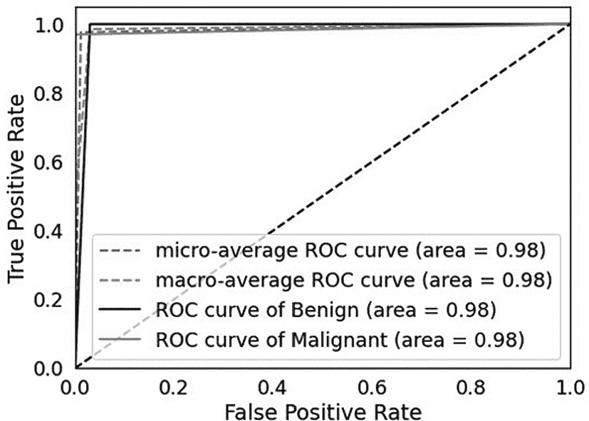

**图 1.1** ROC 曲线对比。

在图 1.2 中，我们评估了模型在多个训练轮中的准确率。该图显示准确率在初始轮次内迅速增加，随后随着模型收敛至最优性能而进入平台期。准确率稳定在高水平，表明模型能够从训练数据中快速学习并获得一致的性能。趋势表明，额外的训练轮次可能只能微乎其微的改进，凸显了模型在几次迭代内达到高准确率的效率。

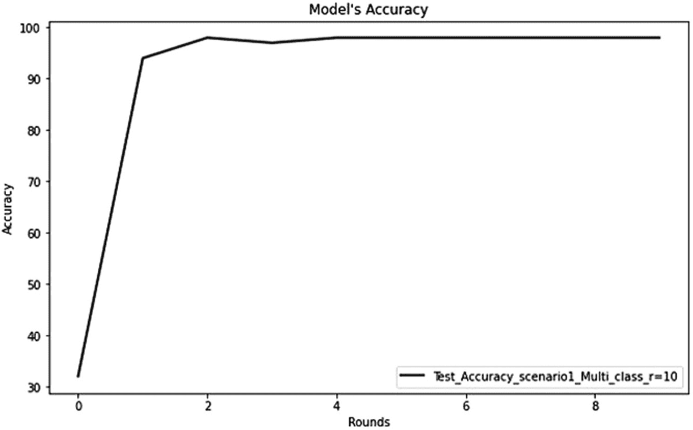

**图 1.2** 每轮次的模型准确率。

## 1.5 结论

人工智能（AI）和机器学习（ML）与医疗物联网（IoMT）的整合代表了医疗保健领域的变革性进步，为增强诊断、治疗个性化和运营效率提供了前所未有的机会。然而，这种演进也带来了严峻挑战，特别是在维护数据安全和隐私方面。AI 驱动的解决方案（如实时威胁检测、自适应安全机制和自动化合规监控）在针对网络威胁提供稳健防御的同时，确保了符合`HIPAA`、`GDPR`和`PIPEDA`等严格法规。


随着医疗服务日益多样化，患者对护理的需求日益复杂，AI 将成为确保服务保持高效有效的决定性因素。ML 在规则发现中将发挥更重要的作用，以优化服务交付。知识图谱（KGs）也将成为确保 AI 遵循正式条件以指导服务的标准。随着所有信息源都充分整合进一个更智能、更自主的数字健康框架中，IoMT 对医疗结果的影响将更加巨大。

本章强调了联邦学习（FL）在保护隐私方面的关键作用，它通过在不损害敏感患者信息的情况下实现去中心化的数据分析。在乳腺癌数据集上的实验结果证明了 FL 的有效性，如 ROC 曲线和训练准确率趋势所示，其实现了高准确率和强大的性能指标。这些发现强调了 FL 在 IoMT 环境中平衡数据效用与隐私的潜力。

尽管取得了这些进展，法律框架和数据治理方面仍存在差距，特别是对于云端医疗解决方案和物联网设备等新兴技术。解决这些挑战需要政策制定者、医疗提供者和技术开发人员共同努力，以建立标准协议并增强透明度。

## 参考文献

*   [1] Vishnu, S., S. R. Jino Ramson, and R. Jegan. “Internet of medical things (IoMT)-An overview.” *2020 5th international conference on devices, circuits and systems (ICDCS)*. IEEE, 2020.
*   [2] Mathers, C. D., T. Boerma, and D. M. Fat. “Global and regional causes of death.” British Medical Bulletin, 2009; 92(1): 7–32.
*   [3] Pilleron, S., et al. “Estimated global cancer incidence in the oldest adults in 2018 and projections to 2050.” International Journal of Cancer, 2021; 148 (3): 601–608.
*   [4] Saraswat, D., et al. “Explainable AI for healthcare 5.0: opportunities and challenges.” IEEE Access, 2022; 10: 84486–84517.
*   [5] Chugh, G., S. Kumar, and N. Singh. “Survey on machine learning and deep learning applications in breast cancer diagnosis.” Cognitive Computation, 2021; 13 (6): 1451–1470.
*   [6] Asif, S., et al. “Advancements and prospects of machine learning in medical diagnostics: unveiling the future of diagnostic precision.” Archives of Computational Methods in Engineering 2024; 32: 1–31.
*   [7] Scheplitz, T., M. Burwitz, and T. Weimann, “PathwAI systems in healthcare – a framework for coupling AI and pathway-based health information systems.” *Hawaii International Conference on System Sciences 2022 (HICSS-55)*, Jan. 2022 [Online]. Available: [https://aisel.aisnet.org/hicss-55/hc/process_mining/3](https://aisel.aisnet.org/hicss-55/hc/process_mining/3)
*   [20] Klonoff, D. C., and W. N. 2nd. Price. “用于糖尿病和其他疾病精准医疗倡议中传输受保护健康信息的医疗设备需要隐私标准。” *Journal of Diabetes Science and Technology*, 2017; 11(2), 220–223. doi:[10.1177/1932296816680006](http://dx.doi.org/10.1177/1932296816680006)
*   [21] Elbasi, E. “基于 B-DCT 的 IoMT 患者数据保护水印算法。” *2020 International Conference on Information Security and Cryptology (ISCTURKEY)*. IEEE, 2020.
*   [22] Moudoud, H., and S. Cherkaoui. “联邦学习结合区块链以保障元宇宙安全。” *2023 International Wireless Communications and Mobile Computing (IWCMC)*. IEEE, 2023.
*   [23] Abou El Houda, Z., H. Moudoud, and L. Khoukhi. “用于 IoT 网络鲁棒入侵检测的安全高效的联邦学习。” *GLOBECOM 2023–2023 IEEE Global Communications Conference*. IEEE, 2023.
*   [24] Moudoud, H., Z. A. El Houda, and B. Brik. “推进 WSN 中的安全与信任：一种联邦多智能体深度强化学习方法。” *IEEE Transactions on Consumer Electronics* 2024; 70, 6909–6918.

# 第 2 章：医疗保健领域的联邦学习

面向医疗进步的隐私保护协作

Maroua Cherifi 和 Zakaria Abou El Houda

DOI: [10.1201/9781003640325-2](http://doi.org/10.1201/9781003640325-2)

## 2.1 引言

人工智能（AI）对各个领域产生了重大影响，其中医疗保健是变革性最大的领域之一。AI 技术增强了医疗专业人员更准确、更高效地诊断和治疗疾病的能力。尽管取得了进步，由于难以获取大规模、多样化且最新的数据集，AI 在医疗保健中的应用面临挑战，而这些数据集对于开发有效的 AI 模型至关重要 [1–3]。这一挑战主要是由于医疗数据的敏感性使得医疗提供者难以共享患者信息。

为了应对这些挑战，本文介绍了一种创新的联邦学习（FL）架构，该架构在确保患者数据机密的同时，促进医疗领域不同利益相关者之间的有效协作。联邦学习是一种去中心化方法，允许在跨越多个位置的数据集上训练机器学习模型，从而消除了数据中心化的需求。

## 2.2 系统架构

本研究使用的联邦学习系统架构旨在确保隐私和安全。

### 2.2.1 医疗保健领域联邦学习概述

该架构遵循通用的联邦学习工作流，如下图所示。在此架构中，多个客户端（医疗机构）独立训练其本地模型，然后仅将模型更新发送到中央服务器。中央服务器使用联邦平均（`FedAvg`）等算法聚合这些更新以创建一个全局模型，然后将其发回客户端进行进一步训练。这种迭代过程一直持续直到模型达到收敛。

```
图 2.1 系统架构。
```

### 2.2.2 系统架构的组件

1.  **本地客户端（医疗机构）：**
    *   **数据本地化**：客户端机构（医院、诊所）维护自己的数据集，包括医学图像（例如 MRI 扫描、乳腺 X 线摄影）和其他患者信息（例如皮肤科病理组织学数据）。这些数据集绝不会被集中化或传输到服务器。
    *   **本地模型训练**：每个客户端使用其持有的数据训练本地机器学习模型。在我们的案例，各种模型（如 `CNN`、`VGG16`、决策树 `Decision Tree` 和随机森林 `Random Forest`）被应用于本地数据集（脑肿瘤、乳腺癌、皮肤科数据集）。
    *   **模型更新**：在本地数据上训练后，每个客户端仅将更新的模型参数（权重）和梯度发送到中央服务器。

2.  **中央服务器：**
    *   **模型聚合**：中央服务器接收来自客户端的模型更新并进行聚合。这确保了服务器在从不访问原始数据的情况下构建出全局模型。
    *   **全局模型分布**：一旦聚合过程完成，服务器将更新后的全局模型发送回给客户端进行进一步训练。这确保了学习过程是去中心化的，同时又能从多个站点获取的知识中获益。
    *   **隐私保护**：中央服务器只接收模型权重和参数，绝不接收原始数据，从而维护敏感医疗信息的隐私性和机密性。

### 2.2.3 联邦学习过程的流程

联邦学习（FL）过程如下：

1.  **初始化**：服务器使用随机权重初始化全局模型，并发送给所有参与的客户端。
2.  **本地训练**：每个客户端在其本地数据集上训练模型并计算本地梯度。
3.  **模型更新**：客户端将本地模型更新（梯度/权重）传回中央服务器。
4.  **聚合**：中央服务器使用 `FedAvg` 算法聚合本地更新，创建一个新的全局模型。
5.  **迭代**：将全局模型发回客户端进行进一步训练，此循环一直持续，直到模型达到可接受的性能水平。

这种架构不仅实现了基于 AI 的医疗诊断，还确保了敏感数据在整个过程中保持安全，增强了对隐私标准的信任和遵循。

## 2.3 系统评估

在本节中，我们提供了用于评估我们系统性能的方法和框架的全面概述。具体而言，我们讨论了使用的数据集、实验设置以及构成评估过程核心的算法。

### 2.3.1 数据集

我们在研究中使用了三个不同且著名的医学数据集，每个数据集代表医疗保健的一个不同领域：脑肿瘤成像、乳腺癌检测和皮肤病分类。脑肿瘤数据集包含各种类型脑肿瘤患者的 MRI 扫描图，为分析医学图像处理和肿瘤检测方法提供了基础。乳腺癌数据集包含与乳腺癌相关的患者数据和诊断特征，为评估区分恶性和良性肿瘤的分类模型提供了平台。最后，皮肤病数据集由各种皮肤病变的图像和临床信息组成，能够开发和测试自动识别黑色素瘤和其他皮肤癌等皮肤状况的算法。这些多样化的数据集共同提供了一个全面的评估框架，允许我们测试所提系统在不同医疗状况和数据类型下的泛化和有效性。

图 2.2 显示了本研究中用数据集的视觉概览。图 2.2a 阐了脑肿瘤类型的分布，突出了可能影响模型性能的类别不平衡。图 2.2b 显示了乳腺癌数据集中的特征分布，强调了恶性和良性肿瘤之间的区别。最后，图 2.2c 描绘了皮肤病数据集中的皮肤疾病类别，显示了每个类别的样本大小。这种可视化强调了数据集内部的变异性，包含六个不同的类别。

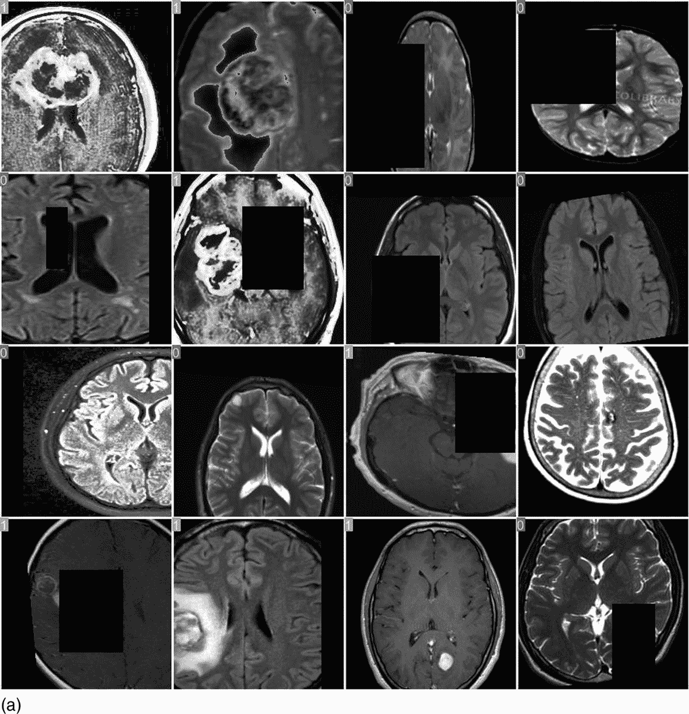

**图 2.2** 本研究中所用数据集的分布和特征。

### 2.3.2 实验设置

实现使用 `Flower` 和 `PyTorch` 完成。数据集使用 `Pandas` 和 `NumPy` 进行处理。对于机器学习模型，我们利用 `Flower` 来促进联邦学习过程。数据使用 `NumPy` 进行数值操作以进行组织和处理。

我们使用以下指标评估了每个算法的性能：

*   **准确率**：此指标衡量正确预测的实例与总实例数量的比例。
*   **F1 分数**：精确率和召回的调和平均数，在处理不平衡数据集时特别有用。
*   **损失 (Loss)**：损失是指预测值与实际值之间的差异。较低的损失值表示模型的预测更接近实际结果。
*   **混淆矩阵**：为了评估系统的有效性，我们使用混淆矩阵将预测分类为四个不同的结果：
    *   **真阳性 (TP)**：当预测结果和实际结果均为阳性时发生。模型正确识别了阳性实例。
    *   **假阳性 (FP)**：当模型预测为阳性但实际结果为阴性时发生。
    *   **真阴性 (TN)**：当预测结果和实际结果均为阴性时发生。模型成功识别了阴性实例。
    *   **假阴性 (FN)**：当实际结果为阳性但模型错误地预测为阴性时发生。

我们评估了三个数据集的损失（参见图 2.3）、三个数据集的准确率（参见图 2.4）、三个数据集的 F1 分数（参见图 2.5）。损失值在训练过程中持续下降，表明我们的模型正在有效地学习并改进它们的预测。图 2.3 描绘了三个数据集的损失曲线。损失的缓慢且稳定的下降证明了我们的模型如何在每一轮训练中完善其预测，稳步向更准确的分类迈进。

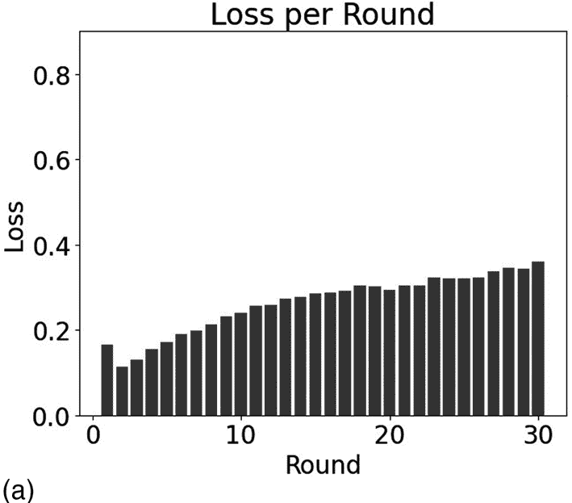

**图 2.3** (a) 皮肤病、b) 脑肿瘤和 (c) 乳腺癌数据集的损失曲线。

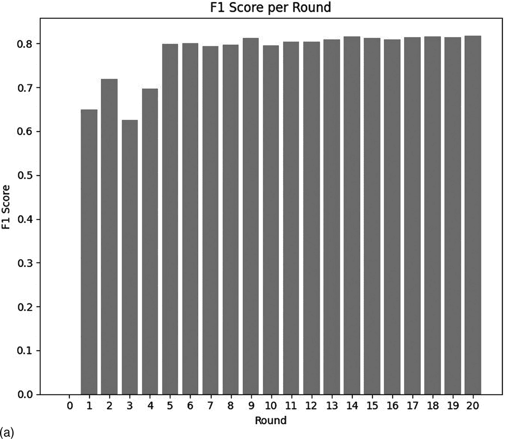

**图 2.5** (a) 皮肤学、（b) 脑肿瘤和 (c) 乳癌数据集的 F1 分

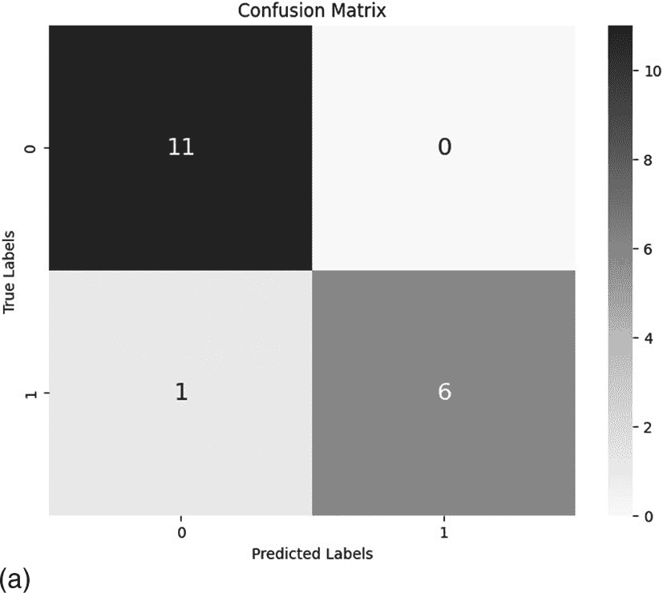

**图 2.6** (a) 皮肤学、（b) 脑肿瘤和 (c) 乳癌数据集的混淆矩阵

图 2.4 展示了在相同训练期间准确率的变化。我们观察到该指标呈现明显的上升趋势，这凸显了随着训练的进行，模型在增强其决策能力方面不断增长的能力。图 2.5 展示了每个数据集的 F1 分。F1 分的持续上升意味着模型成功地平衡了精确率和召回率，最大限度地减少了假阳性和假阴性，实现了稳健的分类结果。图 2.6 展示了混淆矩阵，提供了所有类别分类结果的详细视图。强对角线元素确认了高预测准确率，而少数分类错误为进一步的微调或数据增强提供了潜在的方向。

## 2.4 结论

本文证明了联邦学习（FL）在变革医疗诊断方面的巨大潜力，它能够在确保数据隐私的同时实现协作 AI 模型训练。在此背景下使用 FL 不仅符合严格的隐私法规，还促进了跨去中心化医疗机构高性能模型的发展。通过在不损害患者隐私的情况下利用数据，FL 为 AI 驱动解决方案在医疗保健领域的更广泛应用大门。

然而，仍需解决非独立同分布（non-IID）数据处理、通信效率和模型解释性等挑战，以充分释放 FL 在临床环境中的潜力。未来的工作应聚焦于推进 FL 背后的算法，特别是在提高收敛速度和处理不同医疗机构之间的异构数据方面。此外，集成更先进的解释和可视化工具对于确保透明度并增强医疗专业人员对 AI 模型的信任至关重要。总之，虽然本研究验证了 FL 在医疗诊断中的有效性，但仍需进一步研究以克服技术、伦理和监管障碍。通过继续完善这些模型并关注透明度和解释性，FL 可以为个性化医疗的未来和复杂疾病治疗做出重大贡献，造福全球患者和医疗提供者。

## 参考文献

*   [1] S. Wang 等，“Blockchain-Powered Parallel Healthcare Systems Based on the ACP Approach,” in IEEE Transactions on Computational Social Systems, vol. 5, no. 4, pp. 942–950, Dec. 2018. doi:[10.1109/TCSS.2018.2865526](http://dx.doi.org/10.1109/TCSS.2018.2865526)
*   [2] E. C. Schiza, T. C. Kyprianou, N. Petkov 和 C. N. Schizas，“Proposal for an eHealth Based Ecosystem Serving National Healthcare,” in IEEE Journal of Biomedical and Health Informatics, vol. 23, no. 3, pp. 1346–1357, May. 2019. doi:[10.1109/JBHI.2018.2834230](http://dx.doi.org/10.1109/JBHI.2018.2834230)
*   [3] A. Lakhan 等，“DT-LSMAS: Digital Twin-Assisted Large-Scale Multiagent System for Healthcare Workflows,” in IEEE Systems Journal, vol. 18, no. 4, pp. 1883–1892, Dec. 2024. doi:[10.1109/JSYST.2024.3424259](http://dx.doi.org/10.1109/JSYST.2024.3424259)
*   [4] S. Liu, Y. Huang, A. Kong, J. Tang 和 X. Liu，“Rise of the Automotive Health-Domain Controllers: Empowering Healthcare Services in Intelligent Vehicles,” in IEEE Internet of Things Journal, vol. 9, no. 24, pp. 24882–24889, 15 Dec.15, 2022. doi:[10.1109/JIOT.2022.3194888](http://dx.doi.org/10.1109/JIOT.2022.3194888)


## 参考文献

* [5] B. Pradhan, S. Das, D. S. Roy, S. Routray, F. Benedetto 和 R. Jha，“An AI-Assisted Smart Healthcare System Using 5G,” in IEEE Access, vol. 11, pp. 10839–10855, 2023. doi:[10.1109/ACCESS.2023.331714](http://dx.doi.org/10.1109/ACCESS.2023.331714)

* [6] O. Maki, M. Alshaikh, M. Gunduz, K. Naji 和 M. Abdulwahed，“Development of Digitalization Road Map for Facility Management,” in IEEE Access, vol. 10, pp. 14450–14462, 2022. doi:[10.1109/ACCESS.2022.319641](http://dx.doi.org/10.1109/ACCESS.2022.319641)

* [7] M. S. Roopa 和 K. R. Venugopal，“Digital Twins for Cyber-Physical Systems: Architecture, Requirements, and Future Prospects,” in IEEE Access, vol. 13, pp. 44963–44996, 2025. doi:[10.1109/ACCESS.2025.354791](http://dx.doi.org/10.1109/ACCESS.2025.354791)

* [8] S. K. B. Sangeetha, C. Selvarathi, J. Mathivanan 和 S. V. Easwarorthy，“Secure Healthcare System (SHACS) for Anomaly Detection and Enhanced Security in Cloud-Based Healthcare,” in IEEE Access, vol. 12, pp. 16453–16459, 2024. doi:[10.1109/ACCESS.2024.339204](http://dx.doi.org/10.1109/ACCESS.2024.339204)

* [9] M. C. Chibuike, S. Grobbelaar 和 A. Botha，“Overcoming Challenges for Improved Patient-Centric Care: A Scoping Review of Ecosystems in Healthcare,” in IEEE Access, vol. 12, pp. 14298–14313, 2024. doi:[10.1109/ACCESS.2024.336052](http://dx.doi.org/10.1109/ACCESS.2024.336052)

* [10] Z. A. E. Houda, H. Moudoud, B. Brik 和 L. Khoukhi，“Blockchain-Enabled Federated Learning for Enhanced Collaborative Intrusion Detection in Vehicular Edge Computing,” in IEEE Transactions on Intelligent Transportation Systems, vol. 25, pp. 7661–7672. doi:[10.1109/TITS.2024.335169](http://dx.doi.org/10.1109/TITS.2024.335169)

* [11] Z. A. E. Houda, H. Moudoud 和 B. Brik，“Federated Deep Reinforcement Learning for Efficient Jamming Attack Mitigation in O-RAN,” in IEEE Transactions on Vehicular Technology, vol. 33, pp. 9334–9343. doi:[10.1109/TVT.2024.335998](http://dx.doi.org/10.1109/TVT.2024.335998)

* [12] Z. A. El Houda, L. Khoukhi 和 A. Hafid，“ChainSecure – A Scalable and Proactive Solution for Protecting Blockchain Applications Using SDN,”2018 IEEE Global Communications Conference (GLOBECOM), Abu Dhabi, United Arab Emirates, 2018, pp. 1–6. doi:[10.1109/GLOCOM.2018.864727](http://dx.doi.org/10.1109/GLOCOM.2018.864727)

* [13] Z. A. El Houda, A. Hafid 和 L. Khoukhi，“Co-IoT: A Collaborative DDoS Mitigation Scheme in IoT Environment Based on Blockchain Using SDN,”2019 IEEE Global Communications Conference (GLOBECOM), Waikoloa, HI, USA, 2019, pp. 1–6. doi:[10.1109/GLOBECOM38437.2019.901354](http://dx.doi.org/10.1109/GLOBECOM38437.2019.901354)

* [14] Z. Abou El Houda, A. S. Hafid 和 L. Khoukhi，“Cochain-SC: An Intra- and Inter-Domain Ddos Mitigation Scheme Based on Blockchain Using SDN and Smart Contract,” in IEEE Access, vol. 7, pp. 98893–98907, 2019. doi:[10.1109/ACCESS.2019.293071](http://dx.doi.org/10.1109/ACCESS.2019.293071)

* [15] Z. A. E. Houda, A. Hafid 和 L. Khoukhi，“Blockchain Meets AMI: Towards Secure Advanced Metering Infrastructures,” ICC 2020–2020 IEEE International Conference on Communications (ICC), Dublin, Ireland, 2020, pp. 1–6. doi:[10.1109/ICC40277.2020.914896](http://dx.doi.org/10.1109/ICC40277.2020.914896)

* [16] Z. A. E. Houda, A. Hafid 和 L. Khoukhi, “BrainChain – 一种利用 SDN 保护区块链应用的机器学习方法,” ICC 2020 – 2020 IEEE 国际通信会议 (ICC), 爱尔兰都柏林，2020, pp. 1–6. doi:[10.1109/ICC40277.2020.9148808](http://dx.doi.org/10.1109/ICC40277.2020.9148808)

* [17] Z. Abou El Houda, L. Khoukhi 和 A. Senhaji Hafid, “为软件定义网络引入智能：缓解 DDoS 攻击,” IEEE Transactions on Network and Service Management, vol. 17, no. 4, pp. 2523–2535, 2020 年 12 月. doi:[10.1109/TNSM.2020.3014870](http://dx.doi.org/10.1109/TNSM.2020.3014870)

* [18] H. Moudoud, W. Hamhoum 和 S. Cherkaoui, “强化开放无线接入网络：通过 ZTA 和深度学习推进防护措施,” GLOBECOM 2023 – 2023 IEEE 全球通信会议, 马西亚吉隆坡，2023, pp. 80–85. doi:[10.1109/GLOBECOM54140.2023.10437829](http://dx.doi.org/10.1109/GLOBECOM54140.2023.10437829)

* [19] Z. A. El Houda, A. S. Hafid 和 L. Khoukhi, “智能电网环境下 V2V 充电的区块链反向拍卖,” ICC 2021 – IEEE 国际通信会议, 加拿大魁北克省蒙特利尔，2021, pp. 1–6. doi:[10.1109/ICC42927.2021.9500366](http://dx.doi.org/10.1109/ICC42927.2021.9500366)

* [20] Z. A. El Houda, A. S. Hafid 和 L. Khoukhi, “一种用于 SDN 高级攻击检测的新型机器学习框架,” 2021 IEEE 全球通信会议 (GLOBECOM), 西班牙马德里，2021, pp. 1–6. doi:[10.1109/GLOBECOM46510.2021.9685643](http://dx.doi.org/10.1109/GLOBECOM46510.2021.9685643)

* [21] Z. A. El Houda, A. S. Hafid 和 L. Khoukhi, “一种基于雾计算的低延迟协作框架以安全 IoT 应用,” 2022 IEEE 第 47 届本地网络会议 (LCN), 加拿大阿尔伯塔省埃德蒙顿，2022, pp. 343–346. doi:[10.1109/LCN53696.2022.984315](http://dx.doi.org/10.1109/LCN53696.2022.984315)

* [22] Z. Abou El Houda 和 L. Khoukhi, “用于网络检测的分层雾计算框架,” ICC 2022 – IEEE 国际通信会议, 韩国首尔，2022, pp. 4366–4371. doi:[10.1109/ICC45855.2022.983860](http://dx.doi.org/10.1109/ICC45855.2022.983860)

* [23] Z. A. El Houda, D. Nabousli 和 G. Kaddoum, “无线网络的成本效益型强化学习路由,” 2022 IEEE 未来网络论坛 (FNWF), 加拿大魁北克省蒙特利尔，2022, pp. 243–248. doi:[10.1109/FNWF55208.2022.00550](http://dx.doi.org/10.1109/FNWF55208.2022.00550)

* [24] Z. A. E. Houda, B. Brik, A. Ksentini, L. Khoukhi 和 M. Guizani, “当联邦学习遇到博论：用于边缘计算 IIoT 的协作框架,” IEEE Transactions on Industrial Informatics, vol. 18, no. 11, pp. 7988–7997, 2022 年 11 月. doi:[10.1109/TII.2022.317047](http://dx.doi.org/10.1109/TII.2022.317047)

* [25] Z. A. E. Houda, B. Brik 和 L. Khoukhi, “我为什么要信任你的 IDS？物联网网络中的可解释深度学习框架,” IEEE Open Journal of the Communications Society, vol. 3, pp. 1164–1176, 2022. doi:[10.1109/OJCOMS.2022.318875](http://dx.doi.org/10.1109/OJCOMS.2022.318875)

* [26] Z. A. El Houda, B. Brik 和 S.-M. Senouci, “一种新的基于 IoT 的解释深度学习框架,” IEEE Internet of Things Magazine, vol. 5, no. 2, pp. 20–23, 2022 年 6 月. doi:[10.1109/IOTM.005.22028](http://dx.doi.org/10.1109/IOTM.005.22028)

* [27] Z. A. El Houda, D. Nabousli 和 G. Kaddoum, “推进无线网络联邦学习聚合的安全性与效率,” 2023 IEEE 第 34 届个人、室内及移动无线通信国际会议 (PIMRC), 加拿大安大略省多伦多，2023, pp. 1–6. doi:[10.1109/PIMRC56721.2023.1029370](http://dx.doi.org/10.1109/PIMRC56721.2023.1029370)

* [28] Z. A. El Houda, H. Moudoud, B. Brik 和 L. Khoukhi, “通过区块链和可解释 AI 保护联邦学习以 IoT 网络中的稳健入侵检测,” IEEE INFOCOM 2023 – IEEE 计算机通信工作讨会 (INFOCOM WKSHPS), 美国新泽西州霍霍肯，2023, pp. 1–6. doi:[10.1109/INFOCOMWKSHPS57453.2023.1022576](http://dx.doi.org/10.1109/INFOCOMWKSHPS57453.2023.1022576)

* [29] Z. A. E. Houda, J. Beaugeard, Q. Sauvêtre 和 L. Khoukhi, “迈向基于区块链的安全可扩展访问控制系统,” 2023 IEEE 区块链与加密货币国际会议 (ICBC), 阿联酋酋联迪拜，2023, pp. 1–8. doi:[10.1109/ICBC56567.2023.101748](http://dx.doi.org/10.1109/ICBC56567.2023.101748)

* [30] Z. A. El Houda, H. Moudoud 和 L. Khoukhi, “用于 IoT 的稳健安全联邦学习,” GLOBECOM 2023 – 2023 IEEE 全球通信会议, 马西亚吉隆坡，2023, pp. 2668–2673. doi:[10.1109/GLOBECOM54140.2023.104367](http://dx.doi.org/10.1109/GLOBECOM54140.2023.104367)

* [31] Z. A. E. Houda, A. S. Hafid, L. Khoukhi 和 B. Brik, “当协作学习遇到区块链保护隐私,” IEEE Transactions on Network Science and Engineering, vol. 10, no. 5, pp. 2455–2465, 2023 年 9 月–10 月. doi:[10.1109/TNSE.2022.321192](http://dx.doi.org/10.1109/TNSE.2022.321192)

* [32] Z. A. E. Houda, A. S. Hafid 和 L. Khoukhi, “MiTF: 使用 SDN 和区块链的联邦学习隐私保护攻击框架,” IEEE Transactions on Network Science and Engineering, vol. 10, no. 4, pp. 1985–2001, 2023 年 7 月–8 月. doi:[10.1109/TNSE.2023.323767](http://dx.doi.org/10.1109/TNSE.2023.323767)

* [33] Z. A. El Houda, B. Brik, A. Ksentini 和 L. Khoukhi, “用于安全 IoT 应用的 MEC 架构,” IEEE Internet of Things Magazine, vol. 6, no. 1, pp. 60–63, 2023 年 3 月. doi:[10.1109/IOTM.001.210023](http://dx.doi.org/10.1109/IOTM.001.210023)

* [34] A. Taïk, H. Moudoud 和 S. Cherkaoui, “基于数据的边缘调度,” 2021 IEEE 第 46 届本地网络会议 (LCN), 加拿大阿尔伯塔省埃德蒙顿，2021, pp. 17–23. doi:[10.1109/LCN52139.2021.952474](http://dx.doi.org/10.1109/LCN52139.2021.952474)

* [35] Z. A. E. Houda, D. Naboulsi 和 G. Kaddoum, “基于联邦学习的隐私保护协作干扰框架,” IEEE Internet of Things Journal, vol. 11, no. 7, pp. 12153–12164, 2024 年 4 月. doi:[10.1109/JIOT.2023.333387](http://dx.doi.org/10.1109/JIOT.2023.333387)


* [36] H. Moudoud, S. Cherkaoui 和 L. Khoukhi, “迈向可扩展且可靠的区块链：IoT 案例,” ICC 2021 – IEEE 国际通信会议, 加拿大魁北克省蒙特利尔，2021, pp. 1–6. doi:[10.1109/ICC42927.2021.950053](http://dx.doi.org/10.1109/ICC42927.2021.950053)

* [37] H. Moudoud, S. Cherkaoui 和 L. Khoukhi, “使用预言机和智能合约的 IoT 区块链架构：食品供应链的案例,” 2019 IEEE 第 30 届个人、室内及移动无线通信国际会议 (PIMRC), 土耳其伊斯坦布尔，2019, pp. 1–6. doi:[10.1109/PIMRC.2019.890440](http://dx.doi.org/10.1109/PIMRC.2019.890440)

* [38] H. Moudoud 和 S. Cherkaoui, “赋能 5G 及后续时代的安全与信任：一种深度强化学习方法,” IEEE Open Journal of the Communications Society, vol. 4, pp. 2410–2420, 2023. doi:[10.1109/OJCOMS.2023.331335](http://dx.doi.org/10.1109/OJCOMS.2023.331335)

* [39] Z. A. El Houda, H. Moudoud and L. Khoukhi, “Secure and Efficient Federated Learning for Robust Intrusion Detection in IoT Networks,” GLOBECOM 2023 – 2023 IEEE Global Communications Conference, Kuala Lumpur, Malaysia, 2023, pp. 2668–2673. doi:[10.1109/GLOBECOM54140.2023.10436768](http://dx.doi.org/10.1109/GLOBECOM54140.2023.10436768)

* [40] H. Moudoud and S. Cherkaoui, “Enhancing Open RAN Security with Zero Trust and Machine Learning,” GLOBECOM 2023 – 2023 IEEE Global Communications Conference, Kuala Lumpur, Malaysia, 2023, pp. 2772–2777. doi:[10.1109/GLOBECOM54140.2023.10437043](http://dx.doi.org/10.1109/GLOBECOM54140.2023.10437043)

* [41] H. Moudoud and S. Cherkaoui, “Federated Learning Meets Blockchain to Secure the Metaverse,” 2023 International Wireless Communications and Mobile Computing (IWCMC), Marrakesh, Morocco, 2023, pp. 339–344. doi:[10.1109/IWCMC58020.2023.10182956](http://dx.doi.org/10.1109/IWCMC58020.2023.10182956)

* [42] H. Moudoud, L. Khoukhi and S. Cherkaoui, “Prediction and Detection of FDIA and DDoS Attacks in 5G Enabled IoT,” in IEEE Network, vol. 35, no. 2, pp. 194–201, Mar./Apr. 2021. doi:[10.1109/MNET.011.2000449](http://dx.doi.org/10.1109/MNET.011.2000449)

* [43] H. Moudoud and S. Cherkaoui, “Toward Secure and Private Federated Learning for IoT using Blockchain,” GLOBECOM 2022 – 2022 IEEE Global Communications Conference, Rio de Janeiro, Brazil, 2022, pp. 4316–4321. doi:[10.1109/GLOBECOM48099.2022.1000623](http://dx.doi.org/10.1109/GLOBECOM48099.2022.1000623)

* [44] H. Moudoud, Z. Mlika, L. Khoukhi and S. Cherkaoui, “Detection and Prediction of FDI Attacks in IoT Systems via Hidden Markov Model,” in IEEE Transactions on Network Science and Engineering, vol. 9, no. 5, pp. 2978–2990, Sept.–Oct. 2022. doi:[10.1109/TNSE.2022.3161479](http://dx.doi.org/10.1109/TNSE.2022.3161479)

# 第 3 章 医疗物联网中的身份认证与授权

Aryendra Dalal

DOI: [10.1201/9781003640325](http://doi.org/10.1201/9781003640325)

## 3.1 引言

医疗物联网（IoMT）通过使联网医疗设备能够收集和传输关键健康数据，彻底改变了医疗服务。这些进步在提高护理和运营效率的同时，也使医疗系统面临前所未有的网络威胁。物联网设备的联网特性扩大了攻击面，攻击者可以借此非法访问敏感医疗信息或干扰关键医疗服务。

近期事件强调了医疗环境中稳健安全措施的重要性。2017 年的 WannaCry 勒索软件影响了英国的国家医疗服务体系（NHS）基础设施，导致约 19,000 次预约被取消](#ch11.xhtml#069)。同样，2020 年的通用医疗网络攻击影响了 400 多家医疗机构，估计损失超过 6700 万美元](#ch11.xhtml#070)。

安全认证和授权机制是 IoMT 安全的基石。认证验证尝试访问 IoMT 资源的用户、设备或系统的身份，而授权则决定授予实体的访问权限。本章探讨了在 IoMT 环境中实施稳健认证与授权的框架、方法和技术。

## 3.2 医疗安全认证的重要性

### 3.2.1 医疗网络安全的现状

由于医疗数据的高价值和医疗服务的关键性，医疗行业已成为网络攻击的首要目标。根据 IBM《2023 年数据泄露成本报告](#ch11.xhtml#071)，医疗数据泄露每次平均成本为 1093 万美元，已连续第十三年成为所有行业中成本最高的泄露事件。

美国卫生与公众服务部（HHS）报告，黑客攻击和 IT 事件占所有医疗数据泄露的 80%，其中许多由于凭据泄露导致](#ch11.xhtml#072)。2023 年报告的 707 起事件影响了超过 870 万人，医疗行业面临着前所未有的网络安全挑战。

### 3.2.2 IoMT 环境中的独特挑战

医疗物联网面临着与典型 IT 环境不同的安全挑战：

1. **医疗服务的关键性**：安全漏洞可能直接影响患者安全，并可能导致危及生命。

2. **设备多样性与异构性**：IoMT 生态系统包含能力各异的设备增加了增加了实现的复杂性。

3. **长设备生命周期**：医疗设备的运行寿命通常为 10-15 年，为维护安全更新带来了挑战。

4. **合规性要求**：医疗机构必须遵守 HIPAA 和 GDPR 等严格框架。

5. **互操作性需求**：医疗系统通常需要跨平台交换数据。

### 3.2.3 认证在 IoMT 中的基础性作用

认证通过验证尝试访问医疗网络和数据的用户、设备及系统的身份，充当 IoMT 安全的基础（表 3.1）。有效的认证机制对以下至关重要：

1. **防止非法访问**：认证是防止非法访问医疗数据的主要屏。

2. **确保数据完整性**：通过验证数据源的身份，认证有助于确保医疗数据未被篡改。

3. **维护合规性**：稳健的认证系统对于满足数据保护相关的法规要求至关重要。

4. **实现安全互操作性**：认证机制在保护敏感信息的同时，促进不同系统之间安全的数据交换。

## 3.3 传统认证方法及其局限性

### 3.3.1 基于密码的认证

尽管在医疗系统中存在重大漏洞，根据 Verizon《2023 年数据泄露调查报告](#ch11.xhtml#073)，81%的数据泄露涉及弱密码或被盗密码。主要局限性包括：

1. **密码选择薄弱**：大量医疗工作人员使用简单的密码，容易通过字典攻击或暴力破解方法破解。

2. **密码复用**：在多个平台复用凭据会放大单次泄露的影响，因为泄露的凭据可以访问多个系统。

3. **钓鱼漏洞**：医疗保健人员频繁成为复杂的网络钓鱼攻击的目标，这些攻击旨在获取登录凭据。

4. **不适用于设备身份验证**：密码对于许多缺乏传统用户界面或输入能力有限的 IoMT 设备特别不适用。

### 3.3.2 单因素认证的局限性

单因素认证 (SFA) 在 IoMT 环境中存在重大的局限性：

1. **单点故障**：SFA 通过建立单一访问屏障导致了根本性的安全漏洞。

2. **身份保证有限**：SFA 对尝试身份验证的实体确实是授权用户而非获取其凭据的人员提供的保证极小。

3. **无法检测凭据共享**：医疗环境通常涉及共享工作站和对时间敏感的情况，这可能导致员工之间共享凭据。

### 3.3.3 遗留系统与认证挑战

许多遗留医疗设备和系统设计时仅具有极的认证功能，并可能不支持现代协议。目前使用的医疗设备中约有 40% 设计于当代安全标准建立之前 [6]。医疗设备延长的寿命（10–15 年）意味着尽管存在已知漏洞，具有过认证机制的设备仍在在使用 (Table 3.2)。

**表 3.2** 遗留医疗设备中的认证能力

| 设备类型 | 典型年龄 | 认证能力 | 安全风险 |
| :--- | --- | --- | --- |
| 遗留输液泵 | 8–12 年 | 基础密码保护 | 弱密码、无加密 |
| 旧成像系统 | 10–15 年 | 系统密码 | 凭据共享、日志记录少 |
| 遗留 EHR 系统 | 7–10 年 | 简单用户名/密码 | MFA 支持有限、缺乏上下文感知 |
| 遗留监控设备 | 10 年以上 | 通常无 | 未经授权的访问、数据篡改 |

## 3.4 IoMT 的高级身份验证方法

### 3.4.1 多因素认证

多因素认证已成为 IoMT 环境的关键安全增强手段。根据微软的安全研究 [7]，MFA 可以阻止 99.9% 的自动化攻击。然而，医疗环境带来了独特的实施考量：

1. **紧急访问规定**：医疗保健中的 MFA 系统必须包含紧急覆盖器机制，同时确保对关键系统的即时访问。

2. **工作流集成**：当认证过程对登录时间的影响最小时时，医疗机构可以获得更高的员工 MFA 合从性。

3. **自适应多因素认证**：这种方法根据上下文风险因素动态调整认证要求，仅在风险指标表明存在较高安全疑虑时应用成比例的安全措施。

### 3.4.2 生物识别认证

生物识别利用独特的物理或行为特征来验证身份，在医疗保健环境中具有显著优势，包括不可传输性和用户便利性。2019 年至 2022 年间，医疗保健领域生物识别的采用大幅增加，各种技术显示出充满前景的结果 [8]。

### 3.4.2.1 物理生物识别

物理生物识别根据独特的生理特征验证用户：

1. **指纹识别**：许多医疗保健机构已部署了指纹认证，用于访问电子健康记录和配药单元。

2. **面部识别**：提供了非接触式认证的优势——这在关注感染控制的环境中是一项重大益处。

3. **虹膜识别**：具有极高的准确性和极低的误识别率，适用于高安全性的医疗保健应用。

4. **掌脉识别**：由于其高准确性、卫生优势和用户接受度，在医疗保健领域日益受到欢迎。

### 3.4.2.2 行为生物识别

行为生物识别分析用户行为模式来验证身份：

1. **击键动力学**：分析打字模式，包括速度、压力和按键与按键之间的时间间隔。

2. **语音识别**：对于临床环境中可能佩戴防护设备的提供人员进行免手认证特别有用。

3. **步态分析**：在医疗机构的持续、被动认证方面显示出前景。

### 3.4.2.3 医疗保健中的生物识别挑战

尽管具有这些优势，生物识别认证系统在医疗保健环境中仍面临特定挑战 (Table 3.3)：

1. **环境因素**：临床环境可能由于光线变化或使用个人防护设备等因素影响生物识别的准确性。

2. **无障碍考量**：医疗人员和患者可能存在无法使用某些生物识别模式的身体状况。

3. **隐私考量**：生物数据的收集和存储引发了重大的隐私担忧，特别是在已经在管理额外敏感信息的医疗背景下。

**表 3.3** 医疗保健生物识别认证方法的比较

| 生物识别方法 | 准确性 | 用户接受度 | 实施复杂度 | 医疗保健适用性 |
| :--- | --- | --- | --- | --- |
| 指纹 | 高 | 高 | 低 | 适用于工作站、配药 |
| 面部识别 | 中高 | 中 | 中 | 在考虑 PPE 的情况下很有用 |
| 虹膜识别 | 极高 | 中 | 高 | 适用于高安全区域 |
| 掌脉 | 高 | 高 | 中 | 适用于临床环境 |
| 语音识别 | 中 | 高 | 中 | 适用于免手环境 |
| 击键动力学 | 中 | 极高 | 低 | 适用于补充验证 |

### 3.4.3 设备认证

在 IoMT 环境中，设备认证与用户认证同样重要，确保只有授权的医疗设备可以连接到医疗网络。

### 3.4.3.1 基于证书的认证

数字证书为 IoMT 设备提供了一种稳健的方法：

1. **公密钥基础设施 (PKI)**：通过数字证书实现非对称加密以加密设备。

2. **X.509 证书**：医疗环境中数字证书的标准，包含受信任证书颁发机构验证的设备公钥和身份信息。

### 3.4.3.2 硬件安全方法

硬件安全功能为设备认证提供了增强保护：

1. **信任模块 (TPM)**：用于安全存储认证密钥并执行加密操作的专用微控制器。

2. **物理不可克隆函数 (PUF)**：利用设备独特的物理特性生成设备特定加密密钥的硬件安全原语。

3. **硬件安全模块 (HSM)**：用于安全管理数字密钥和安全执行加密功能的专用硬件设备。

### 3.4.4 持续认证

持续认证通过在整个会话期间持续验证用户身份，解决了单点时间认证的局限性：

1. **基于风险的方法**：根据持续的风险评估动态调整身份验证要求。

2. **透明化认证**：在不要求用户显式操作的情况下验证身份，减少对临床工作流的干扰。

3. **环境指标**：利用环境线索（如来自医疗胸牌的 `Bluetooth` 信号和物理访问记录）来验证已验证用户的持续在场。

## 3.5 授权机制的角色

### 3.5.1 基于角色的访问控制

基于角色的访问控制 (`RBAC`) 由于其概念简单且与组织结构对齐，仍然是医疗保健环境中实施最广泛的授权模型之一。根据 HHS 的数据 [9]，大约 73% 的医疗机构在临床系统中采用了某种形式的 `RBAC`。

`RBAC` 根据用户的组织角色来分配权限，而不是为每个用户单独地管理访问权限。与基于用户的权限管理相比，设计良好的 `RBAC` 实现可以减少高达 65% 的管理开销 (Table 3.4)。

尽管具有这些优势，传统的 `RBAC` 在现代医疗环境中面临着巨大的局限性：

1. **角色爆炸**：大型医疗机构维护数百个不同的访问角色，导致管理的复杂性。

2. **静态权限结构**：传统的 `RBAC` 缺乏根据上下文或条件调整权限的灵活性。

3. **异常处理困难**：医疗保健经常涉及需要临时访问异常的特殊情况。

**表 3.4** 常见的医疗角色和系统访问权限

| **角色** | **EHR 访问** | **药剂管理** | **影像** | **账单** | **设备配置** |
| --- | --- | --- | --- | --- | --- |
| 医生 | 全部权限 | 查看/医嘱 | 全部权限 | 有限 | 无 |
| 护士 | 有限权限 | 全部权限 | 查看 | 无 | 有限 |
| 药剂师 | 有限权限 | 全部权限 | 无 | 无 | 无 |
| 放射科医生 | 有限权限 | 无 | 全部权限 | 无 | 有限 |
| 行政人员 | 人口统计信息 | 无 | 无 | 全部权限 | 无 |
| IT 人员 | 有限权限 | 无 | 有限 | 有限 | 全部权限 |
| 生物医学工程师 | 无 | 无 | 无 | 无 | 全部权限 |


## 3.5.2 基于属性的访问控制

基于属性的访问控制（`ABAC`）代表了一种更灵活的授权方法，它根据用户、资源、操作和环境条件的属性来决定访问权限，而不是基于预定义的角色。

`ABAC` 为医疗物联网（IoMT）环境提供了多项显著优势：

1. **细粒度访问控制**：允许根据多个属性进行精确的权限规范。
2. **动态授权决策**：根据当前的属性值做出实时授权决策，允许权限适应不断变化条件。

有效的 `ABAC` 实现通常评估以下几类属性：

1. **主体属性**：用户的特征。
2. **资源属性**：被访问数据的特征。
3. **操作属性**：正在执行的操作的特征。
4. **上下文属性**：环境和情境因素。

## 3.5.3 上下文感知授权

上下文感知授权通过特别强调特定情况，扩展了 `ABAC`：

1. **紧急情况**：在紧急情况下，正常的访问权限可能需要修改。
2. **紧急破窗机制（Break-glass）**：允许紧急访问的预设协议。
3. **医患护理关系**：基于建立的患者护理需求的授权。
4. **基于位置的控制**：根据物理位置调整权限。

## 3.5.4 混合授权模型

许多医疗机构实施了结合 `RBAC`、`ABAC` 和上下文感知方法的混合模型。与纯基于属性的实现相比，从基于角色的基础开始可以减少初始复杂性。自适应授权框架根据操作需求和风险水平动态调整模型。此类风险自适应系统已被证明可以减少未经授权的事件 [10]。

## 3.6 新技术的整合

### 3.6.1 人工智能与机器学习

人工智能和机器学习通过对用户行为进行更复杂的分析、适应不断变化的条件以及检测新兴威胁，正在改变 IoMT 中的认证和授权 [11]。

#### 3.6.1.1 行为分析与异常检测

AI 驱动的行为分析建立了正常用户行为的基准，并识别可能表明凭据泄取的偏差（Table 3.5）：

1. **用户行为画像**：创建典型交互模式的详细模型，包括访问时间、地点、数据访问模式和系统导航。
2. **异常检测**：识别偏离既有模式的情况。
3. **上下文风险评分**：评估多个因素，为身份验证和授权决策生成实时风险评分。
4. **持续学习**：随着时间的推移更新行为模型，在适应合法行为变化的同时保持安全警惕。

#### 3.6.1.2 预测性安全措施

预测性分析应用机器学习在安全问题发生之前进行预测：

1. **威胁预测**：分析模式和趋势以识别潜在的未来安全威胁。
2. **自适应认证**：根据预测的风险水平而非仅根据当前条件调整认证要求。
3. **攻击面预测**：在 IoMT 网络漏洞被利用之前识别它们。

**表 3.5** 预测性安全措施对医疗安全事件的影响

| 安全措施 | 事件响应时间缩短 | 误报率 | 实施复杂度 | 资源需求 |
| --- | --- | --- | --- | --- |
| 传统基于规则 | 基准 | 15-25% | 低 | 低 |
| 基础 AI 检测 | 35% | 10-15% | 中 | 中 |
| 高级行为分析 | 62% | 5-8% | 高 | 高 |
| 预测分析 | 78% | 3-6% | 极高 | 极高 |
| 混合 AI/人工系统 | 85% | <2% | 极高 | 极高 |

### 3.6.2 用于认证和授权的区块链技术

区块链技术通过其固有的不可篡改性、去中心化透明性，为医疗物联网（IoMT）环境中的认证和授权提供了独特的能力 [12]。

#### 3.6.2.1 去中心化身份管理

区块链实现了去中心化的身份管理方法：

1. **主权身份**：赋予用户对其数字身份的控制权，同时在多个医疗系统中实现可验证的认证。
2. **分布式身份验证**：无需直接访问中央身份提供者即可验证身份主张。
3. **不可篡改的身份证明**：创建身份验证和凭据颁发的防篡改记录。

#### 3.6.2.2 用于授权的智能合约

智能合约实现了复杂且可审计的授权控制：

1. **自动化策略执行**：将授权策略编码为智能合约，并在满足预定义条件时自动执行。
2. **知情同意管理**：通过区块链智能合约记录并执行患者同意指令。
3. **可审计性和透明性**：创建所有授权决策和策略更改的不可篡改记录，用于合规和审计。

### 3.6.3 零信任架构

零信任架构（`ZTA`）代表了安全思维的重大范式转变，从基于边界的安全模型转向一种假设任何用户或设备都不被信任的方法，无论其位置或网络连接如何 [13]。

#### 3.6.3.1 医疗领域零信任的核心原则

1. **永不信任，始终验证**：无论来源如何，每个访问请求都必须经过完全认证、授权和加密。
2. **最小权限访问**：用户和设备仅获得其功能所需的最小访问权限。
3. **微隔离**：将网络环境划分为具有独立访问控制的隔离分段。
4. **持续监控与验证**：不断评估安全状态，而不是进行定期检查。
5. **设备信任评估**：在授予访问权限之前验证设备的安全态和完整性。

`ZTA` 通过假设可能被攻破并对所有访问进行显式验证，为保护日益复杂和分布式的医疗环境提供了一个框架 [14]。

## 3.7 实现安全认证和授权的挑战

### 3.7.1 技术挑战

#### 3.7.1.1 设备多样性与局限性

IoMT 环境包含了大量能力各异的设备：

1. **计算限制**：许多医疗设备的处理能力、内存和能量容量有限，限制了它们的安全能力。
2. **协议异构性**：IoMT 设备使用多种通信协议和标准，增加了统一安全实施的复杂性。
3. **遗留设备集成**：寿命较长的旧医疗设备可能完全缺乏现代安全功能。
4. **接口限制**：许多医疗设备具有极简或专门的人机界面，增加了交互式安全措施实施的难度 [15]。

#### 3.7.1.2 互操作性挑战

1. **跨平台认证**：用户在正常工作流中经常需要访问具有不同安全实现的多个系统。
2. **联邦身份挑战**：在跨组织边界实现一致的身份管理引入了技术和治理上的复杂性。
3. **数据交换安全**：在具有不同授权模型的系统之间交换数据时，维持适当的安全控制面临巨大挑战（表 3.6）。

**表 3.6** IoMT 认证的互操作性挑战与解决方案

| 挑战 | 影响 | 解决方案 |
| --- | --- | --- |
| 协议多样性 | 安全实施不一致 | 基于网关的安全、协议转换器 |
| 厂商特定认证 | 身份管理碎片化 | 联邦身份、SSO 实现 |
| 遗留系统集成 | 安全漏洞、权宜方案 | 安全代理、网络分段 |
| 跨组织访问 | 边界问题、治理挑战 | 信任框架、联邦协议 |
| 数据交换安全 | 传输期间暴露 | 端到端加密、API 安全 |

#### 3.7.1.3 性能与可用性需求

1. **响应时间敏感性**：认证和授权过程必须快速完成，以避免对临床护理的影响。
2. **高可用性要求**：关键系统的认证系统必须保持极高的运行时间。
3. **离线功能**：即使在网络连接有限或不可用的情况下，医疗设备也保持基本功能。

### 3.7.2 组织与人为因素

#### 3.7.2.1 工作流整合

1. **临床时间限制**：医疗人员通常在巨大的时间压力下工作，繁琐的安全程序会产生问题。
2. **频繁的环境切换**：医疗工作人员通常在多个患者、位置和系统之间切换，产生认证摩擦。
3. **中断驱动的工作**：医疗工作流的特点是频繁中断，增加了会话管理和持续认证的复杂性。
4. **协作工作模式**：医疗交付通常涉及围绕共享系统的协作，挑战了传统的“一用户一会话”安全模型 [16]。

#### 3.7.2.2 培训与意识

1. **安全知识缺口**：许多医疗人员缺乏网络安全实践的充分培训。
2. **警报疲劳**：过多的安全警告或认证请求可能导致脱敏和自动通过。
3. **优先级冲突**：在感知到紧急情况下，医疗人员往往会将即时患者护理置于安全程序之上。

#### 3.7.2.3 资源限制

1. **网络安全人才短缺**：医疗组织往往缺乏专业的安全知识，特别是 IoMT 环境。
2. **预算限制**：与其他监管行业相比，医疗组织分配给 IT 预算的安全比例较低。
3. **竞争性优先级**：安全计划与临床改进和合规需求竞争有限资源。

### 3.7.3 监管与合规考虑

医疗行业运行在复杂的监管环境中，这会影响安全实施（表 3.7）：

1. **多个监管框架**：医疗组织通常必须遵守重叠的法规，包括 `HIPAA`、`GDPR` 和各州隐私法。
2. **规范性要求**：某些法规规定了特定的安全方法，这些方法可能与最佳技术解决方案不匹配。
3. **文档负担**：安全控制的全面文档记录产生了巨大的行政开销。
4. **患者权利与伦理考量**：安全措施必须尊重患者权利，让他们了解其信息是如何受到保护的以及谁访问了这些信息 [17]。

**表 3.7** 影响 IoMT 安全的关键监管框架

| 框架 | 地区 | 身份验证需求 | 授权需求 | 审计需求 |
| :--- | :--- | :--- | :--- | :--- |
| HIPAA | 美国 | 唯一用户标识 | 访问控制、最小必要原则 | 综合审计日志 |
| GDPR | 欧盟 | 强身份验证 | 详细的数据访问控制 | 主体访问透明度 |
| FDA 指南 | 美国 | 基于风险的身份验证 | 设备特定控制 | 漏洞管理 |
| ISO 27001 | 全球 | 敏感数据多因素身份验证 | 正式访问控制策略 | 定期审查与测试 |
| HITRUST | 美国 | 基于角色的身份验证 | 上下文感知控制 | 实时监控 |

## 3.8 最佳实践与实施策略

### 3.8.1 基于风险的实施框架

基于风险的方法可以确保安全资源得到有效分配：

1. **全面风险评估**：在选择特定技术之前，先进行彻底的风险评估。
2. **分阶段安全实施**：根据风险评估结果，按优先阶段实施安全措施。
3. **关键系统优先**：优先为高风险系统实施增强的安全措施。
4. **纵深防御**：实施多层安全防护，而不是依赖单一的保护机制。

### 3.8.2 技术实施策略

#### 3.8.2.1 侧重互操作性的设计

1. **标准合规性**：遵循既有的医疗保健安全标准和协议。
2. **联邦身份管理**：实施身份联邦，以简化跨系统和跨机构的身份验证。
3. **API 安全网关**：部署集中化的 API 安全，确保跨系统接口的一致性保护。

#### 3.8.2.2 韧性身份验证架构

1. **离线身份验证能力**：确保在网络中断期间，关键功能仍然可用。
2. **冗余身份验证路径**：实施多种身份验证方法和路径以维持可用性。
3. **优雅降级**：设计系统在紧急情况下能够回退到严格性稍低但仍然安全的身份验证方式。

#### 3.8.2.3 遗留系统集成

1. **安全代理**：部署代理系统，代表遗留设备实施现代安全防护。
2. **网络分段**：将遗留系统隔离在受控访问的独立网络段。
3. **补偿控制**：实施额外的安全措施以解决遗留系统中的特定弱点。

### 3.8.3 组织最佳实践

#### 3.8.3.1 安全治理

1. **正式安全策略**：制定规定了身份验证和授权要求的全面策略。
2. **基于角色的策略框架**：针对特定角色和职责定制安全策略。
3. **清晰的异常流程**：为安全异常定义正式程序，并配备适当的审批和记录（表 3.8）。

**表 3.8** 医疗保健安全策略开发框架

| 策略组件 | 关键元素 | 实施考虑 |
| :--- | :--- | :--- |
| 身份验证策略 | MFA 要求、凭证管理 | 临床工作流集成 |
| 授权框架 | 角色定义、访问请求流程 | 异常处理程序 |
| 设备安全策略 | 设备注册、身份验证方法 | 遗留设备规定 |
| 审计与监控 | 日志收集、审查频率 | 告警阈值、响应程序 |
| 异常管理 | 紧急破窗（Break-glass）条款、紧急访问 | 事件后审查要求 |
| 培训需求 | 特定角色的培训、频率 | 能力验证方法 |

#### 3.8.3.2 安全文化培养

1. **特定角色培训**：针对特定的工作功能和访问级别提供定制的安全培训。
2. **模拟演练**：定期开展安全模拟和演练，以建立实践技能。
3. **可见的领导支持**：确保组织领导层对安全做出可见的承诺。

#### 3.8.3.3 持续监控与改进

1. **安全指标计划**：定义并跟踪身份验证和授权有效性的特定指标。
2. **定期安全评估**：定期进行安全评估，包括对身份验证系统的渗透测试。
3. **用户反馈机制**：建立用户报告安全可用性问题的渠道 [18]。

### 3.8.4 实施路线图

分阶段实施方法可以增加成功概率：

1. **评估与规划阶段**：从全面的评估和战略规划开始。
2. **试点实施**：从有限部署开始以验证方法。
3. **规模化实施**：在整个组织范围内推广成功的方法。
4. **运营转型**：建立持续运营和持续改进。

## 3.9 未来方向与新兴趋势

### 3.9.1 持续自适应风险与信任评估

持续自适应风险与信任评估（`CARTA`）代表了超越静态安全模型的动态方法演进，能够持续评估风险并相应调整安全措施 [19]：

1. **实时风险计算**：在整个会话期间持续重新评估风险，而不仅仅是在验证点。
2. **与临床系统集成**：利用临床系统的信息来理解合法的访问模式。

### 3.9.2 可用安全方法

医疗保健安全的未来在于增强而非阻碍临床工作流的解决方案：

1. **隐形安全**：通过对生物识别特征的被动观察进行身份验证，无需用户明确操作。
2. **语音驱动安全**：为双手繁忙的临床环境提供语音激活的安全功能。

### 3.9.3 抗量子身份验证

随着量子计算的发展，身份验证系统必须为当前加密方法的潜在威胁做好准备 [20]：

1. **后量子密码学**：开发能够抵抗量子攻击的加密方法。
2. **混合加密方法**：结合当前方法和抗量子方法的过渡方案。

### 3.9.4 去中心化身份与患者控制的访问

未来的 IoMT 安全将日益强调患者控制和去中心化方法（表 3.9）：

1. **主权身份**：数字身份凭证由患者所有和控制，而非医疗保健机构。
2. **患者引导的授权**：以更高粒度实现患者偏好的授权系统。

**表 3.9** 传统模型与患者控制访问模型的比较

| 特性 | 传统模型 | 患者控制模型 |
| :--- | :--- | :--- |
| 访问控制 | 组织定义 | 患者定义的偏好 |
| 粒度 | 有限的、基于角色的 | 细粒度的、特定场景的 |
| 实现 | 集中化系统 | 通常为区块链或分布式账本 |
| 患者参与 | 极少，通过知情同意书 | 积极、持续的同意管理 |
| 审计能力 | 组织控制 | 对患者透明 |
| 技术要求 | 中等 | 高 |
| 监管对齐 | 完善良好 | 演进中的监管框架 |

## 3.10 结论

在快速演变的医疗健康物联网（IoMT）格局下，安全的身份验证和授权是应对网络安全威胁的关键组成部分。面对日益复杂的威胁和医疗环境的严苛需求，传统的身份验证方法已被证明是不够的。

身份验证与授权技术的演进为医疗安全提供了极具前景的路径。多因素身份验证、生物识别、设备级认证和持续验证等高级方法与传统方法相比，显著增强了保护力度。新兴技术的整合——特别是人工智能、区块链和 `ZTA`——代表了 IoMT 安全能力的重大进步。

尽管取得了技术进步，成功实施仍面临诸多挑战。包括设备限制、互操作性要求和遗留系统集成在内的技术限制带来了巨大的复杂性。组织因素（如工作流集成、资源限制和变更管理）进一步增加了安全实施的难度。

有效的实施需要兼顾技术和组织维度的战略性方法。基于风险的框架通过优先考虑高风险系统和数据，确保了资源的合理配置。带有试点测试和优化循环的阶段性实施策略，可以在最大限度减少对医疗运营干扰的同时，最大限度地提高成功概率。

IoMT 设备和系统的安全性不仅是一个技术问题，更是数字时代维护医疗服务完整性和可信性的基本要求。随着医疗健康对连接技术的日益依赖，这些系统的安全性直接影响到患者安全、护理质量以及机构的生存能力。

## 参考文献

* [1] S. Ghafur, S. Kristensen, K. Honeyford, G. Martin, A. Darzi, and P. Aylin, “A retrospective impact analysis of the WannaCry cyberattack on the NHS,” NPJ Digital Medicine, vol. 2, no. 1, pp. 1–7, 2019.](#ch11.xhtml#r069b)
* [2] S. Alder, “Universal Health Services confirms all US hospitals affected by ransomware attack,” HIPAA Journal, vol. 4, no. 10, pp. 15–17, 2020.](#ch11.xhtml#r070b)
* [3] IBM Security, “Cost of a data breach report 2023,” IBM, New York, NY, USA, Tech. Rep., 2023.](#ch11.xhtml#r071b)


* [4] Health and Human Services (HHS), “Healthcare cybersecurity report: Strengthening the security posture of the healthcare sector,” Office of Information Security, U.S. Department of Health and Human Services, Washington, DC, USA, Tech. Rep., 2023.](#ch11.xhtml#r072b)
* [5] Verizon, “2023 Data Breach Investigations Report,” Verizon, New York, NY, USA, Tech. Rep., 2023.](#ch11.xhtml#r073b)
* [6] F. Alsubaei, A. Abuhussein, and S. Shiva, “Security and privacy in the Internet of Medical Things: A review,” in IEEE 19th International Conference on Software Quality, Reliability and Security Companion, 2019, pp. 219–224.](#ch11.xhtml#r074b)
* [7] Microsoft, “Microsoft Digital Defense Report 2023,” Microsoft, Redmond, WA, USA, Tech. Rep., 2023.](#ch11.xhtml#r075b)
* [8] P. Patil, P. Pawar, and V. Pardeshi, “A survey on biometric authentication in IoMT,” in IEEE 12th Annual Computing and Communication, 2022.](#.11.xhtml#r07b)
* [9] National Institute of Standards and Technology (NIST), “Digital Identity Guidelines (Special Publication 800-63-3),” U.S. Department of Commerce, Gaithersburg, MD, 20221.](#ch11.xhtml#r077b)
* [10] M. Jalali and J. Kaiser, “Security in hospitals: A systematic review,” Journal of Medical Internet Research, vol. 20, 2018.](#ch11.xhtml#r078b)
* [11] J. Deogirkar and A. Vidhate, “IoT attacks,” in SMAC, pp. 32–37.](#.11.07b)
* [12] L. Ayala, “Cybersecurity for healthcare facilities: A guide,” Apress, New York, NY, 2022.](#ch11.xhtml#r080b)
* [13] C. Butpheng, K. Yeh, and H. Xiong, “Security and privacy in IoT-cloud-based e-health: A comprehensive review,” Symmetry, vol. 12, no. 7, pp. 1191, 2020.](#ch11.xhtml#r081b)
* [14] R. Chowdhury, N. Prince, and S. Abdullah, “The role of predictive analytics in cybersecurity: Detecting and preventing threats,” World Journal of Advanced Research and Reviews, vol. 23, no. 2, pp. 134–142, 2024.](#ch11.xhtml#r082b)
* [15] A. Dalal, “Advanced threat detection in healthcare environments,” Journal of Healthcare Informatics, vol. 7, no. 2, pp. 156–172, 2023.](#ch11.xhtml#r083b)
* [16] OWASP, “Authentication Cheat Sheet,” Open Web Application Security, Tech. Rep., 2023.](#ch11.xhtml#r084b)
* [17] B. Schneier, “Data and Goliath: The hidden battles to collect your data and control your world,” W. W. Norton & Company, New York, NY, 2015.](#ch11.xhtml#r085b)
* [18] M. Senbekov et al., “The recent progress and applications of digital technologies in healthcare: A review,” International Journal of Telemedicine and Applications, vol. 2020, pp. 1–18, 2020.](#ch11.xhtml#r086b)
* [19] F. Ullah et al., “Semantic interoperability for big-data in heterogeneous IoT infrastructure for healthcare,” Sustainable Cities and Society, vol. 66, pp. 102569, 2021.](#ch11.xhtml#r087b)
* [20] P. Kumar, G. P. Gupta, and R. Tripathi, “An ensemble learning and fog-cloud architecture-based anomaly detection scheme for IoT security,” Journal of Ambient Intelligence and Humanized Computing, vol. 13, no. 4, pp. 2063–2075, 2022.](#ch11.xhtml#r088b)

医疗健康物联网（IoMT）的进展通过实现实时患者监测、自动化诊断和远程医疗服务，显著改变了医疗保健。IoMT 设备（包括可穿戴传感器、智能植入物和连接医疗设备）促进了关键健康数据的无缝采集和传输，从而提高了患者治疗效果和医疗系统的运行效率 [1]。

人工智能（AI）与 IoMT 的集成进一步增强了预测分析、早期疾病检测和个性化治疗方案，使医疗保健更加数据驱动且主动主动 [2]。

然而，IoMT 设备广泛的互连性也引入了复杂的安全挑战，例如数据泄露、网络攻击以及对敏感患者信息的未经授权访问 [3]。

确保 IoMT 生态系统的安全完整性已成为一个首要任务，这需要开发先进的安全框架，在维持系统效率的同时提供稳健的保护 [4]。

区块链技术与联邦学习（FL）的融合已被探索作为增强智能医疗安全性和隐私性的潜在解决方案，为跨医疗网络提供了去中心化的数据保护和协作式智能共享 [5]。

#### 4.1.1 医疗生态系统对端点安全的需求

随着 IoMT 生态系统的扩展，端点安全已成为保护医疗设备和患者数据免受网络威胁的基本需求。IoMT 设备在计算能力和安全能力方面存在异构性，这为确保医疗网络中跨一致的安全策略带来了巨大挑战。

传统的集中化安全模型在保护 IoMT 端点方面被证明是不够的，因为它们容易受到单点故障和延迟问题的影响。`FL` 被提出作为替代方法，允许在不损害数据隐私的情况下实施去中心化的安全机制。这种方法使医疗设备能够在协作训练安全模型的同时在本地保留敏感患者信息，降低了数据泄露的风险。

此外，集成 `AI` 驱动的威胁检测系统被认为是加强端点安全的关键因素，允许在潜在威胁损害关键医疗基础设施之前对其进行实时识别和缓解。物联网环境下医疗数据的安全传输和聚合也得到了探索，以解决数据完整性问题，确保安全措施不受资源受限设备的影响。

#### 4.1.2 定义医疗保健中的循环安全

智能医疗中的循环安全指的是一种自适应且自给足的安全模型，它持续利用过去的威胁情报来加强当前和未来的安全机制。与传统的静态安全方法不同，循环安全强调在医疗网络的不同层级之间重用威胁情报，创建一个能够适应新兴网络威胁的演进防御系统。

这一概念整合了 `FL`、`blockchain` 和基于 `AI` 的异常检测，以便在保护患者数据机密性的同时实现安全的实时智能共享。通过实施反馈循环，安全响应可以随时间的推移不断完善，确保从之前的网络事件中汲取的教训能够系统地整合到未来的威胁缓解策略中。

此外，循环安全框架旨在通过减少冗余的安全流程来降低计算开销并增强可持续性，使其成为资源受限的医疗环境的理想选择。这种方法符合现代医疗保健对可持续和可扩展安全解决方案日益增长的需求，确保了在不过度消耗资源的情况下实现长期的数据保护。

## 4.2 智能医疗中的安全与可持续性

##### 4.2.1 网络安全与可持续性的交汇点

IoMT 设备的日益采用显著提升了医疗服务的水平，但它引入了复杂的安全威胁格局。确保稳健的网络安全对于保护敏感数据和维护医疗系统的完整性至关重要。

对可持续性的追求必须考虑能源消耗。边缘计算已被探索作为一种前景方法，通过在靠近源头处理数据来增强安全可持续性，减少对持续通信的需求 [6]。然而，边缘设备本身可能成为攻击向量，因此需要能够维持低资源消耗的安全框架 [7]。

基于 `blockchain` 的系统被提出以解决这一挑战，通过提供去中心化的安全和数据管理，尽管对于操作的高能耗特性仍存在担忧 [8]。

`AI` 和 `FL` 通过在无需中心化存储的情况下实现威胁检测，在平衡安全与可持续性方面展现了前景 [9]。

此外，`AI` 驱动的语音分析应用展示了增强医疗诊断的潜力，进一步说明了智能算法如何在优化资源使用的同时改进服务 [10]。

将可持续实践集成到安全框架中，对于构建韧性医疗系统至关重要，这些系统能够承受长期的运行需求，而不损害数据安全。

##### 4.2.2 节能型安全实践

能源效率已成为智能医疗系统安全协议设计的关键考虑因素。医疗设备（特别是可穿戴传感器和便携诊断工具）通常在有限的电池电上运行，使得实施计算密集型安全措施是不现实的。移动边缘计算（`MEC`）已成为一种可行解决方案，允许将资源密集型安全操作卸载到附近的边缘服务器，从而延长设备电池寿命并降低延迟。通过策略性地分配安全任务，`MEC` 辅助的医疗系统可以在能源效率和稳健保护之间取得平衡。

优化的深度学习模型通过简化威胁检测流程进一步增强了节能型安全实践。例如，结合卷积神经网络（`CNNs`）与元启发式优化算法的混合模型已提高异常检测的准确性，同时降低了安全分析的计算复杂度。此类模型在动态的医疗环境中特别有价值，在这些环境中安全威胁演变迅速，且实时响应能力是至关重要的。

尽管技术有所进步，平衡安全性与资源限制仍然是智能医疗系统面临的一项重大挑战。许多医疗物联网（IoMT）设备的处理能力和存储容量有限，难以实现复杂的加密和威胁检测机制。研究人员已探索了轻量级加密算法来缓解这一问题，但其计算需求的降低通常以牺牲更弱的安全性保护为代价。此外，某些医疗设备（特别是那些用于远程患者监测的设备）的间歇性连接使得持续安全监控的实施变得复杂。

基于区块链的系统虽然提供了稳健的安全特性，但引入了可扩展性和能耗方面的挑战，特别是在大规模医疗部署中应用时。共识机制的高计算开销会增加资源受限设备的压力，因此有必要开发专为医疗环境设计的能源感知区块链协议。同样，IoMT 生态系统中设备能力的差异也使统一安全策略的实施变得复杂，因为事这种“一刀切”的解决方案往往是不切实际的。应对这些挑战需要一种自适应安全方法，根据设备能力、网络状况和实时威胁评估动态调整安全协议。这种方法符合循环安全（circular security）的原则，通过持续学习和威胁情报的复用来增强长期保护，同时优化资源利用。

## 4.3 智能医疗中的威胁情报

### 4.3.1 了解威胁情报及其生命周期

威胁情报通过提供可操作的见解来缓解潜在的网络威胁，在加强智能医疗系统方面发挥了关键作用。威胁情报的生命周期通常包括数据收集、威胁分析、传播和持续改进等阶段。在智能医疗环境中，来自医疗设备、网络日志和患者监测系统的实时数据已用于检测和响应安全事件。基于 `FL` 的框架已被引入，在增强隐私的同时允许跨分布式医疗节点进行威胁检测模型的协作训练，降低了集中数据泄露的风险 [11]。

人回路（Human-in-the-loop）机制通过将人类专业知识集成到自动化决策过程中，进一步提高了威胁情报系统的准确性。此类系统实现了上下文威胁评估，使医疗安全机制能够动态适应不断变化的攻击模式 [12]。智能威胁检测与自适应学习的整合支持了长期保护策略，通过持续复用和精炼威胁情报数据，强化了循环安全模型。

### 4.3.2 威胁情报来源（设备日志、异常检测、外部馈送）

智能医疗中的威胁情报来源于多个渠道，包括设备日志、异常检测系统和外部威胁馈送。设备日志提供了有关系统事件、失败的访问尝试和异常活动的宝贵信息，成为识别潜在威胁的基础组件。由深度学习算法驱动的先进异常检测系统已用于识别医疗设备中的异常行为，标记可能指示网络攻击的疑疑活动。

多模态深度学习方法通过分析各种数据流（如生物识别信号和使用模式）改进了访问信任，以增强威胁识别的准确性 [13]。此外，外部威胁情报馈送提供了有关新兴漏洞和全球攻击趋势的最新信息，使医疗系统能够主动防御新威胁。通过将内部设备数据与外部威胁知识相结合，医疗系统构建了更具韧性的安全架构，能够抵御复杂的网络威胁。

### 4.3.3 医疗设备中的实时威胁监控

实时威胁监控对于确保连接医疗设备的安全与健康至关重要。持续监控解决方案实现了威胁的早期检测，防止恶意活动损害关键医疗服务。开发人员开发了透明且保护隐私的平台，在不违反患者隐私的情况下促进实时威胁检测，利用区块链技术保护设备通信并确保数据完整性 [14]。

边缘智能解决方案通过将威胁检测能力分布到边缘节点，进一步增强了实时监控，缩短了响应时间并减少了安全漏洞的影响。这些系统能够立即分析医疗传感器产生的数据，识别异常并触发自动响应以消除潜在威胁。智能合约引入医疗系统实现了安全策略的自动执行，为以最小的人工干预处理安全事件提供了去中心化的机制 [15]。这些创新展示了循环安全模型利用实时威胁情报的潜力，为智能医疗生态系统创建了自适应且可持续的防御。

## 4.4 循环安全：新范式

### 4.4.1 循环安全概念

循环安全作为一种创新框架出现，旨在通过持续重新利用威胁情报来增强智能医疗系统的弹性。与传统的线性安全模型（将威胁缓解视为终端过程）不同，循环安全强调安全见解的持续精炼和复用。安全事件期间产生的威胁数据经过系统性分析、分类，并回馈到系统中以加强未来的防御。这种迭代方法使医疗系统能够不断演进，从每次攻击中学习，以构建更稳健的安全层。

如图 4.1 所示，循环安全模型从循环经济原则中获得启发，通过威胁情报的永久使用促进资源优化。通过采用循环安全生命周期，智能医疗生态系统能够缓解零日漏洞并适应快速变化的网络威胁，而不需要不断的人工干预。该模型在患者安全和数据完整性至上的环境中被证明特别有效，因为实时威胁数据已转换为主动防御策略的可操作见解。

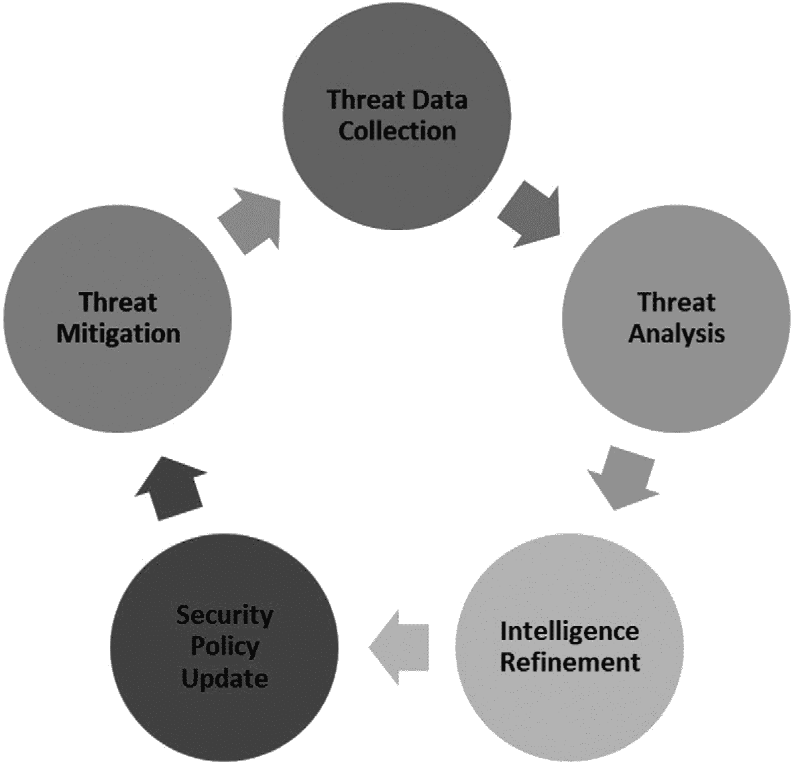

**图 4.1** 循环安全。](#ch12.xhtml#f9b)

### 4.4.2 威胁数据复用与知识共享

威胁数据的复用在循环安全范式中发挥了关关作用，使医疗系统能够利用过去的事件防止未来的攻击。从连接医疗设备收集的日志、警报和异常检测记录存储在威胁情报存储库中，并在其中训练先进机器学习模型以识别反复的攻击模式。这些存储库作为知识中心，促进了医疗机构、网络安全供应商和监管机构之间无缝的威胁信息交换。

知识共享通过培养协作防御机制，进一步增强了循环安全的有效性，如图 4.2

**图 4.2** 威胁数据重用。⏎

## 4.5 自愈型安全系统与自动化防御

自愈安全系统一直是循环安全的基石，利用 AI 和自动化技术以最少的人工干预对网络威胁进行检测、响应和恢复，如图 4.3

**图 4.3** 自愈安全系统。⏎

自动化防御机制通过响应新威胁情报的持续演进，进一步增强了循环安全的持续性。例如，智能合约已用于在分布式医疗系统中自动执行更新后的安全协议，确保每个连接设备都遵循最新的威胁缓解策略。通过这种检测、分析、适应和恢复的循环过程，智能医疗环境在瞬息万变的网络威胁面前保持了韧性，每次安全事件都成为了一次学习机会，用以强化长期保护。

## 4.6 循环安全框架架构

### 4.6.1 关键组件：威胁情报枢纽、决策引擎和安全数据湖

智能医疗中循环安全的架构构建在互联的组件之上，通过持续的威胁情报重用和自适应防御机制协作增强系统韧性。所提的框架 `MedCircleShield`（医疗循环安全盾）如图 4.4。

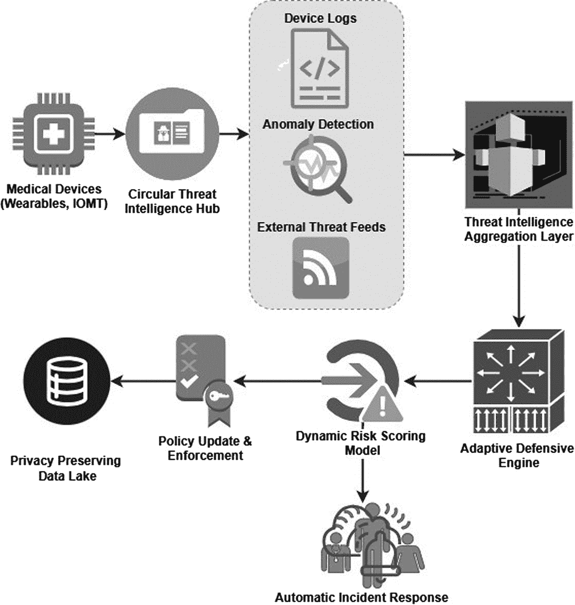

**图 4.4** medcircleshield 框架架构图。⏎

循环威胁情报枢纽（`CTIH`）作为核心单元，收集并汇总来自各种医疗设备、网络日志和外部馈的威胁数据。该枢纽处理原始数据，提取可操作的洞察，并将精炼后的情报分发到整个生态系统中，以加固安全层。威胁模式、入侵指标（`IoCs`）和事件报告持续共享，确保互联系统具备实时威胁感知。


自适应防御引擎（`ADE`）利用 AI 和机器学习算法根据历史威胁情报精炼安全协议。通过使用从过去事件中获得的见解，`ADE` 动态更新防御策略，实现自主的威胁缓解和主动事件预防。这种自适应能力显著缩短了攻击停留时间并增强了系统恢复。

为了解决数据隐私问题，隐私保护数据湖（`PPDL`）利用强大的加密机制安全地存储威胁情报和事件日志。该存储库支持安全且合规的研究与分析，在不损害敏感医疗数据的情况下促进协作威胁研究。

此外，动态风险评分模块（`DRSM`）持续评估连接设备的风险态势，根据威胁接近程度、设备漏洞和近期攻击模式分配动态风险评分。安全策略实时调整，使高风险评分设备能够触发更严格的访问控制和优先威胁监控。

## 4.6.2 智能医院中的安全数据流

在智能医院环境中，安全数据流对于确保威胁情报得到有效分发和执行至关重要。医疗设备、可穿戴设备和`IoMT`系统产生持续的数据流，这些数据被汇入`CTIH`进行实时处理。检测到的异常或可疑模式经过分析后，相关情报会被转发到`ADE`进行立即响应。

处理后的威胁情报存储在`PPDL`中，向授权系统和研究人员授予加密访问权限。`DRSM`生成的风险评分决定了应用于每个设备的安全措施级别，确保高风险终端被自动隔离或修复。这种动态数据流创建了一个响应性安全网络，能够在威胁升级前将其中和。

## 4.6.3 反馈循环与安全适应性

循环安全通过迭代反馈循环得以维持，实现了持续学习和安全演进。当检测并缓解威胁时，事件数据会回馈到`CTIH`，以完善威胁模型并提高未来的检测准确性。`ADE`根据新见解更新决策算法，而`DRSM`则重新校准风险评分以反映不断变化的威胁格局。

这种自适应反馈循环确保安全框架随时间的推移保持韧性，通过检测、缓解和学习的重复循环逐渐增强其防御能力。结果是智能医疗生态系统变得日益稳健，受益于集体智能和自动化自愈机制，这些机制减少了人工干预和系统停机时间。

**表 4.1** medcircleshield 框架的伪代码

| 初始化框架： | 初始化循环安全威胁情报中心 (CTIH) | 初始化自适应防御引擎 (ADE) | 初始化动态风险评分模块 (DRSM) | 初始化隐私保护数据湖 (PPDL) |
| :--- | :--- | :--- | :--- | :--- |
| 主流程： | 当系统激活状态时： | | | |
| 收集威胁数据： | 获取设备日志、告报和异常 | 获取外部威胁馈 (CERT, CVE, 威胁数据库) | 在 CTIH 中聚合数据 | 遍历 CTIH 中的每个数据条： |
| | 如果检测到异常或威胁指标匹配已知 IoC： | 生成威胁签名 | 更新威胁情报库 | 否则：丢弃非威胁数据 |
| 自适应防御与风险评分： | 遍历每个连接设备： | 使用 DRSM 计算风险评分 | 动态更新安全策略： | 如果风险评分 > 阈值： |
| | 限制设备访问 | 触发防火墙规则 | 应用安全补丁 | 否则：使用标准安全措施监控设备 |
| 事件响应： | 如果检测到实时威胁： | 激活自动化响应： | 隔离受影响的设备或网络分段 | 执行预定义的安全协议（如关闭端口） |
| | 记录事件详情和修复操作 | | | |
| 数据存储与反馈循环： | 在 PPDL 中加密并存储威胁情报 | 使用新的威胁洞察更新 ADE | 根据事件日志重新训练 AI/ML 模型 | 调整风险评分阈值和策略规则 |
| | 结束循环 | | | |

## 4.7 在医疗保健领域实施循环安全

### 4.7.1 威胁情报平台与 IoMT 的集成

将威胁情报平台 (TIPs) 与`IoMT`设备集成已成为增强医疗保健安全的关键策略。TIPs 充当中心化系统，跨连接设备收集、分析并分发威胁情报，从而实现更快的事件检测和响应。在循环安全框架中，TIPs 促进了持续的知识共享，来自一个设备的实时威胁数据可用于保护生态系统内的其他设备。`IoMT`设备由于资源受限，受益于外部化的威胁情报处理，在减少设备端计算开销的同时保持安全效能。自适应威胁馈送和设备级异常检测增强了主动安全措施，支持根据不断演变的风险评分进行动态策略调整。

例如，自适应威胁馈送和设备级异常检测增强了主动安全措施，支持根据不断演变的风险评分进行动态策略调整。`IoMT`设备由于资源受限，受益于外部化的威胁情报处理，减少设备端计算开销的同时保持安全效能。自适应威胁馈送和设备级异常检测增强了主动安全措施，支持根据不断演变的风险评分进行动态策略调整。

例如，自适应威胁馈送和设备级异常检测增强了主动安全措施，支持根据不断演变的风险评分进行动态策略调整。`IoMT`设备由于资源受限，受益于外部化的威胁情报处理，减少设备端计算开销的同时保持安全效能。自适应威胁馈送和设备级异常检测增强了主动安全措施，支持根据不断演变的风险评分进行动态策略调整。

例如，自适应威胁馈送和设备级异常检测增强了主动安全措施，支持根据不断演变的风险评分进行动态策略调整。`IoMT`设备由于资源受限，受益于外部化的威胁情报处理，减少设备端计算开销的同时保持安全效能。这种方法可以发现攻击模式。这种方法不仅防止了重复攻击，还增强了集体防御。

### 4.7.2 轻量级加密与隐私保护技术

资源受限的`IoMT`设备需要`椭圆曲线加密 (ECC)`和`高级标准伽罗斯计数模式 (AES-GCM)`等轻量级加密方案。循环安全实现中，`PPDL`以加密形式存储敏感信息，仅在需要时进行解密。隐私保护技术包括`同态加密`和`安全多方计算 (SMPC)`，允许患者数据在加密状态下处理，从而防止泄露。这种方法确保了医疗数据的安全性，并符合全球数据保护法规。

### 4.7.3 可扩展与低碳安全模型

在设计智能医疗安全系统时，可扩展性和可持续性是基本的考虑因素。循环安全模型利用分布式威胁情报和自动化事件响应，减少了冗余安全基础设施的需求。AI 驱动的`ADE`可以动态扩展安全操作，仅在检测到风险等级时分配资源。例如，持续威胁监控可以在低功耗状态下执行。边缘计算通过将安全任务卸载到本地进一步增强了可扩展性。此外，如`服务器虚拟化`、`可再生能源数据中心`和高效能硬件等可持续实践有助于降低医疗安全运营的整体影响。

## 4.8 案例研究：智能医院网络中的循环安全实施

一家大型综合智能医院网络实施了循环安全框架，以增强威胁韧性并保护关键医疗设备。医院的基础设施包括各种`IoMT`设备，从患者监测系统到机器人手术设备，所有设备联网以实现实时护理。然而，互联系统的复杂性使网络面临不断演变的威胁，包括勒索软件、分布式拒绝服务 (DDoS)攻击以及针对患者记录的数据泄露。

为了降低这些风险，医院采用了`MedCircleShield 框架`，集成了以下组件：

- 循环威胁情报中心 (CTIH)：持续收集、处理并在医院网络中重新分发设备日志、异常报告和外部威胁馈。单个设备上检测到的威胁模式将共享到整个生态系统中心。
- 自适应防御引擎 (ADE)：根据实时威胁情报和历史攻击数据动态调整安全协议。例如，当输液泵显示出异常数据传输迹象时，`ADE`会隔离设备、分析异常并更新类似设备的防火墙规则。
- 隐私保护数据湖 (PPDL)：所有威胁情报数据均以加密形式存储，仅通过符合隐私要求的查询进行访问。这种设置允许安全研究人员研究攻击向量，而不损害患者数据的机密性。
- 动态风险评分模块 (DRSM)：对设备进行持续风险评估，并根据风险严重程度衡量安全措施。高风险设备获得更频繁的安全更新和更密集的监控，而低风险设备以轻量级安全协议运行以节约资源。

这种循环方法使医院能够随时间演进其安全态势，缩小攻击面，加速事件响应并最大限度地减少服务中断。

智能医院以其医疗设备、患者监控系统和医疗保健应用的互联生态系统为特征，面临着日益增长的网络安全威胁。这些环境的复杂性使得中心化的安全方法由于延迟、单点故障以及暴露敏感患者数据的风险而变得不再适用。为了解决这些局限性，一种分布的、智能驱动的安全框架至关重要。

所提出的系统引入了医疗守护者网络（MedGuardNet），这是一种嵌入 MedCircleShield 框架的高级安全架构。系统整合了联邦学习（FL）和图神经网络（GNNs），实现了分布式设备之间安全、协作的威胁检测与响应。FL 确保敏感数据保留在本地，而 GNN 则对设备之间复杂的动态关系进行建模以传播威胁情报。这种混合方法在不损害患者隐私的情况下支持自适应的实时安全。该系统在保护数据隐私和对复杂设备关系建模的同时，实现了威胁情报共享。

架构由四个核心组件组成：

- 联邦学习模块：在每个设备上本地训练威胁检测模型，确保敏感的患者数据留在设备内部。
- 图神经网络 (GNN) 模块：将设备及其交互建模为动态图，学习表示安全状态的嵌入（embeddings）。
- 循环威胁情报枢纽 (CTIH)：聚合本地训练的模型，更新全局安全模型，并将其重新分发到所有设备。
- 动态风险评分模块 (DRSM)：根据 GNN 嵌入和威胁检测结果为设备分配风险评分，动态更新安全策略。

这种集成方法实现了自适应、自愈的安全能力，能够随新兴威胁不断演进。

### 4.8.1 智能医疗安全中的联邦学习

FL 是一种去中心化的机器学习范式，它允许边缘设备在不共享原始数据的情况下协作训练全局模型。在智能医疗环境中，FL 确保敏感的患者数据留在本地设备中，同时为集体安全智能系统做出贡献。

FL 系统设计为客户端-服务器架构：

- 客户端：`IoMT`设备（例如输液泵、心电图监测仪），使用设备端数据在本地训练模型。
- 服务器：`CTIH`，负责在不访问本地数据的情况下聚合并更新全局模型。

架构可以表示为：

```
M[g] = 1/N ∑[i=1toN] M[i] (1)
```

其中：

- `M[g]` = 全局威胁检测模型
- `M[i]` = 在设备 i 上训练的本地模型
- `N` = 设备总数

FL 算法的工作原理和流程如下：

1. 初始化：服务器初始化全局模型`M[0]`并将其广播到所有客户端设备。
2. 本地训练：每个设备在本地威胁数据上训练模型，通过梯度下降更新权重：

```
θi = θi − η∇L[i] (θi^(t)) (2)
```

其中：

- `θ[i]` = 设备 i 的模型参数
- `η` = 学习率
- `∇L[i]` = 本地损失函数的梯度

3. 模型聚合：将本地模型更新发送到服务器，服务器通过取平均值来更新全局模型。
4. 广播更新：将更新后的全局模型重新分发到所有设备，以进行下一轮训练。

这种迭代过程使设备能够在保持数据隐私的同时，协作增强威胁检测能力。

#### 4.8.1.1 用于设备关系建模的图神经网络

GNN 是图结构化数据中建模关系的强大工具。在智能医院网络中，设备及其交互可以表示为图，其中节点是设备，边是通信链路或共享的威胁事件。

GNN 的构建方式如下：

- 节点：医疗设备（例如，呼吸机、智能传感器）
- 边：通信链路、数据交换或威胁事件的共同发生

每个设备的状态通过邻域聚合进行更新：

```
hi = σ(W^(k) ∑[j∈N(i)] (hj / |N(i)|) + b^(k)) (3)
```

其中：

- `hi` = 层 k 节点 i 的隐藏状态
- `N(i)` = 节点 i 的邻居
- `W^(k)`, `b^(k)` = 可训练权重矩阵和偏置
- `σ` = 激活函数（例如 ReLU）

GNN 算法的工作原理如下：

1. 图构建：创建一个动态图，每个设备都是一个节点，当威胁模式相关时形成边。
2. 消息传递：设备交换安全状态，通过邻域聚合更新其嵌入。
3. 威胁传播预测：GNN 输出预测威胁跨设备传播的概率，从而实现对高风险节点的主动隔离。

### 4.8.2 医疗守护者网络算法的设计

MedGuardNet 算法协同 FL 和 GNN，构建一个智能、分布式的安全网络。

算法设计步骤：

1. 初始化：初始化全局模型参数`θ[g]`并创建设备图`G = (V,E)`。
2. 本地训练：在每个设备上：
   - 使用 FL 训练本地威胁模型。
   - 使用 GNN 提取设备嵌入。
3. 模型聚合：`CTIH`聚合本地训练的模型，通过对它们的参数取平均值来更新全局模型。
4. 威胁情报交换：设备与其邻居交换嵌入（embeddings），以丰富本地上下文并增强协同威胁检测。
5. 风险评分与策略更新：每个设备的风险评分根据其 GNN 嵌入计算，并动态调整安全策略。高风险设备可能会触发隔离协议或增加监控。
6. 自适应反馈循环：当检测到重大威胁时，将触发自适应措施，并重新训练本地模型以纳入新的威胁信息。

### 4.8.3 仿真实验设置

为了在 MedCircleShield 框架下评估所提的医疗守护者网络（MedGuardNet）的性能，研究人员建立了一个全面的仿真环境，如表 4.3 所示。实验设置的设计旨在模拟真实的智能医疗生态系统，利用具有各种连接医疗设备的多样化医疗设备物联网（IoMT）基础设施。将所提出的算法与现有的基准算法进行了对比，以证明其通过威胁情报复用增强循环安全性的有效性。

用于比较的算法包括：

- 联邦平均算法（FedAvg）—— 用于评估联邦学习的效率。
- 图注意力网络（GAN）—— 用于为复杂的设备关系建模。
- 基于自动编码器的异常检测（AE-IDS）—— 用于识别异常设备行为。

选择以下指标来评估性能：

1. 威胁检测准确率
2. 模型收敛时间
3. 威胁响应时间
4. 隐私保护水平

**表 4.3** 仿真环境

| 参数 | 配置/详细信息 |
| --- | --- |
| 仿真工具/框架 | Python (TensorFlow, PyTorch), NetworkX, Scikit-learn |
| 开发环境 | Google Colab Pro, Jupyter Notebook |
| 编程语言 | Python 3.10 |
| 硬件配置 | 16 核 CPU, 64 GB RAM, NVIDIA Tesla T4 GPU (Colab) |
| 数据集 | MIMIC-III (重症监护医疗信息库) |
| 数据集大小 | 60,000 条患者记录，200 条设备日志 |
| 训练集/测试集划分 | 80% 训练, 20% 测试 |
| 仿真的 IoMT 设备数量 | 500 (可扩展至 1,000) |
| 仿真时间 | 72 小时（每个算法） |
| 通信协议 | MQTT, HTTP/2 |
| 安全协议 | TLS 1.3, AES-256 加密 |
| 联邦学习轮数 | 100 轮 |
| 图神经网络层 (MedGuardNet) | 3 层 GNN + 注意力机制 |
| 隐私保护技术 | 差分隐私 + 同态加密 |

### 4.8.4 数据集详情

使用了公开的重症监护数据库 [16] MIMIC-III 数据集来模拟患者记录和设备交互。合成了设备日志以模拟实时威胁事件，包括 DDoS 攻击、勒索软件事件和异常访问模式。该数据集为训练和评估威胁情报模型提供了丰富的实验基础。

### 4.8.5 仿真过程

1. 数据预处理：对患者记录和设备日志进行清洗、归一化和编码。引入异常标签以创建评估的基准值（ground truth）。
2. 网络图构建：将 IoMT 设备表示为节点，通信链路表示为边。应用 GNN 对设备关系和威胁传播路径进行建模。
3. 联邦学习设置：将设备分为本地客户端，每个客户端在本地数据上训练威胁检测模型。使用联邦平均算法对本地模型进行定期聚合。
4. 威胁情报流：将威胁数据和检测结果输入 CTIH 以进行持续学习和重新分发。
5. 评估与比较：在多次仿真运行中对每个算法进行评估。在固定间隔记录指标，并进行统计分析以确保结果的稳健性。

### 4.8.6 结果与讨论

在 MedCircleShield 框架下开发的所提医疗守护者网络（MedGuardNet）算法与三种现有算法：联邦平均（FedAvg）、GAN 和 AE-IDS 进行了对比评估。在四个关键仿真指标上进行了性能分析：威胁检测准确率、模型收敛时间、威胁响应时间和隐私保护水平。仿真设置利用真实的 IoMT 数据以确保结果的真实可靠。接下来的章节对每个指标进行了深入分析，突出了所提系统的优势和潜在影响。

#### 4.8.6.1 威胁检测准确率

在智能医疗环境中识别安全威胁的准确性对于及时缓解潜在的网络攻击至关重要。正如表 4.4 和图 4.6 所示，MedGuardNet 的检测准确率在不同设备规模下均优于基准算法。

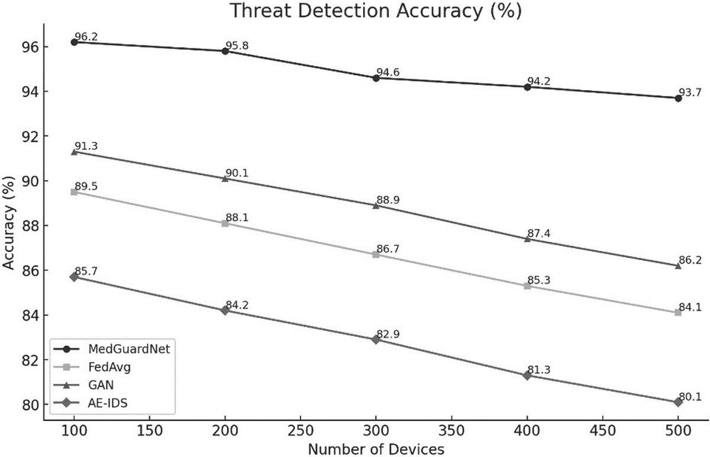

**图 4.6** 威胁检测准确率。

**表 4.4** 不同设备数量的威胁检测准确率 (%)

| 设备数量 | MedGuardNet (%) | FedAvg (%) | GAN (%) | AE-IDS (%) |
| --- | --- | --- | --- | --- |
| 100 | 96.2 | 89.5 | 91.3 | 85.7 |
| 200 | 95.8 | 88.1 | 90.1 | 84.2 |
| 300 | 94.6 | 86.7 | 88.9 | 82.9 |
| 400 | 94.2 | 85.3 | 87.4 | 81.3 |
| 500 | 93.7 | 84.1 | 86.2 | 80.1 |


`MedGuardNet`算法在100个设备时达到了96.2%的峰准确率，并在设备增加到500个时稳定在93.7%。相比之下，`FedAvg`和`GAN`由于对不断变化的威胁适应性有限，准确率较低。`MedGuardNet`的卓越准确率归功于用于本地训练的`FL`和用于建模设备关系的`GNN`。

### 4.8.6.2 模型收敛时间

高效的收敛对于动态环境中的实时威胁缓解至关重要。表4.5和图4.7的结果显示，`MedGuardNet`的收敛速度快于其他算法。

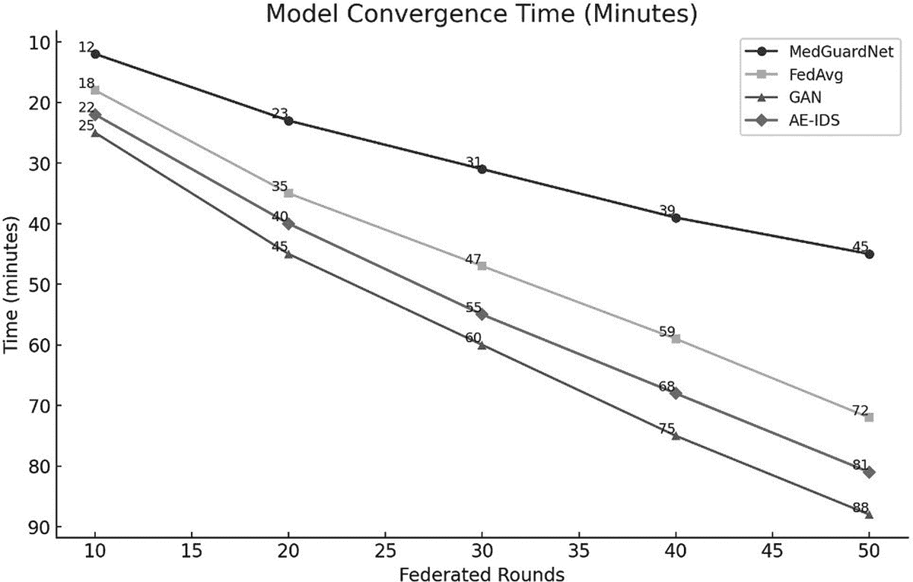

**图 4.7** 模型收敛时间。⏎

| 联邦轮数 | MedGuardNet (min) | FedAvg (min) | GAN (min) | AE-IDS (min) |
| --- | --- | --- | --- | --- |
| 10 | 12 | 18 | 25 | 22 |
| 20 | 23 | 35 | 45 | 40 |
| 30 | 31 | 47 | 60 | 55 |
| 40 | 39 | 59 | 75 | 68 |
| 50 | 45 | 72 | 88 | 81 |

`MedGuardNet`在10轮联邦学习中的收敛时间为12分钟，50轮时增加到45分钟，比`FedAvg`和`GAN`快30%–40%。收敛时间的缩短归功于`MedGuardNet`的`ADE`，它根据实时反馈循环精炼模型参数，在加速学习过程的同时最小化了计算开销。

在系统初始化时，我们需要检查`/etc/config/settings.yaml`文件。

调用`ConfigManager.loadConfig(path)`方法来加载配置。

如果返回`status`为`true`，则执行命令`start-service --force`。

在表达式`result = calculate(data * factor)`中，乘法运算符`*`将`data`与`factor`相乘，得到`result`。

```javascript
if (status == "ready") {
console.log("System initialized");
}
```

通过整合人工智能和区块链，循环安全系统可以变得更具自主性、韧性并具备自愈能力，从而创建一个随威胁格局共同演变的自适应安全生态系统。这种技术的融合为实现真正可持续且面向未来的医疗网络安全提供了一个广阔的研究方向。

### 4.8.8 未来研究方向

为了充分实现智能医疗中循环安全的愿景，未来的研究应重点探索以下领域：

*   自适应联邦学习：开发动态`FL`算法，根据威胁严重程度和数据异构性自动调整模型参数。
*   抗量子密码学：研究后量子加密技术，以确保威胁情报共享的未来安全性。
*   跨机构威胁协作：创建互操作框架，允许全球范围内的多个医疗提供者之间进行安全的威胁情报交换。
*   受生物启发的安全模型：从生物免疫系统中汲取灵感，设计自适应的、基于异常的威胁检测机制。

解决这些研究空白将加强循环安全模型的基础，并确保智能医疗系统获得长期保护。所提出的`MedGuardNet`算法融合了`FL`和`GNNs`，已经展现了巨大的潜力。然而，持续的创新和跨学科协作对于超越不断演变的网络威胁并保护日益连接的世界中的患者护理至关重要。

## 4.9 结论

循环安全模型在智能医疗系统中的实施，标志着向可持续和自适应网络安全迈出的转型一步。通过重用威胁情报、持续演进防御机制以及促进互联设备之间的协作学习，在`MedCircleShield`框架内提出的医疗守护者网络（`MedGuardNet`）在实时缓解网络威胁方面具有巨大潜力。`FL`和`GNNs`的融合实现了安全且保护隐私的威胁情报共享，而动态风险评分和反馈循环增强了系统的韧性。这项研究强调了循环安全的实际可行性及其优势，同时也承认了其在现实世界部署中涉及的复杂性。

#### 4.9.1 医疗领域可持续网络安全的承诺

循环安全为医疗领域中的广泛应用需要一种结构化的、多阶段的方法。关键考虑因素包括：

*   技术集成：升级现有系统以支持轻量级加密、边缘计算和AI驱动的威胁检测，而不给资源受限的`IoMT`设备造成过重负担。混合架构可以连接现代和旧设备设备，确保全面的威胁覆盖。
*   监管对齐：通过内置的隐私保护机制、动态策略执行和基于区块链的审计跟踪，确保完全符合`HIPAA`和`GDPR`等数据隐私法。
*   可扩展基础设施：设计灵活的安全模型，以适应不同规模的医疗机构，从小型诊所到大型互联医院网络。云边混合系统可以平衡计算效率和可扩展性。
*   协作与知识共享：通过创建去中心化的威胁情报联盟鼓励全行业协作，在联盟中跨机构安全共享匿名化威胁数据，以共同加强全球医疗安全。
*   持续学习与演进：投资于持续研究以完善算法、增强威胁检测模型，并探索量子安全加密和神经形态计算等新兴技术用于下一代安全。

通过战略性政策制定、公私合作伙伴和跨学科研究努力，医疗系统可以逐渐过渡到循环安全范式，利用集体智能保护患者数据和关键医疗基础设施。

循环安全模型以`MedCircleShield`框架和`MedGuardNet`算法为代表，代表了医疗网络安全的范式转变。通过将威胁情报视为持续演变的资产而非瞬时信号，智能医院可以建立一个随时间推移而变得强大的自持续安全生态系统。然而，成功的实施需要克服技术、监管和基础设施方面的挑战。未来的研究应侧于为资源受限的`IoMT`设备优化高效安全模型，探索用于自适应威胁检测的生物启发算法，并研究抗量子区块链网络用于不可篡改的去中心化威胁情报管理。此外，与医疗机构合作现实试点计划可以为系统性能、可用性和扩展性提供宝贵的见解。通过持续的研究、创新和协作努力，循环安全有望成为下一代医疗网络安全的基石。这种模型不仅增强了患者安全和数据隐私，还降低了长期安全成本并促进了集体威胁情报共享的文化。随着智能医疗系统的不断演进，循环安全提供了一种强大的、面向未来的防御策略，能够抵抗快速演变的威胁格局。

## References

*   [1] M. Ali, F. Naeem, M. Tariq and G. Kaddoum, "Federated Learning for Privacy Preservation in Smart Healthcare Systems: A Comprehensive Survey," IEEE Journal of Biomedical and Health Informatics, vol. 27, no. 2, pp. 778–789, Feb. 2023. doi:[10.1109/JBHI.2022.3181823](http://dx.doi.org/10.1109/JBHI.2022.3181823)
*   [2] F. Alshehri and G. Muhammad, "A Comprehensive Survey of the Internet of Things (IoT) and AI-Based Smart Healthcare," IEEE Access, vol. 9, pp. 3660–3678, 2021. doi:[10.1109/ACCESS.2020.3047960](http://dx.doi.org/10.1109/ACCESS.2020.3047960)
*   [3] D. N. Sachin, B. Annappa, Hegde Saumya, C. S. Abhijit and S. Ambesange, "FedCure: A Heterogeneity-Aware Personalized Federated Learning Framework for Intelligent Healthcare Applications in IoMT Environments," IEEE Access, vol. 12, pp. 15867–15883, 2024. doi:[10.1109/ACCESS.2024.3357514](http://dx.doi.org/10.1109/ACCESS.2024.3357514)
*   [4] R. Myrzashova, S. H. Alsamhi, A. V. Shvetsov, A. Hawbani and X. Wei, "医疗保健中的区块链与联邦学习：挑战与机遇的系统性回顾," IEEE Internet of Things Journal, vol. 10, no. 16, pp. 14418–14437, 2023年8月15日. doi:[10.1109/IOT.2023.3263598]
*   [5] A. Ullah, M. Azeem, H. Ashraf, A. A. Alaboudi, M. Humayun and N. Jhanjhi, "IoT中的安全医疗数据聚合与传输——综述," IEEE Access, vol. 9, pp. 16849–16865, 2021. doi:[10.1109/ACCESS.2021.3052850]
*   [6] A. Alzu'bi, A. Alomar, S. Alkhaza'leh, A. Abuarqoub and M. Hammoudeh, "智能医疗系统中边缘计算的隐私与安全性综述：问题、挑战与研究方向," 清华科学技术, vol. 29, no. 4, pp. 1152–1180, 2024年8月. doi:[10.26599/TST.2023.9010080]
*   [7] P. K. Bishoyi and S. Misra, "迈向能源与成本效益的可持续MEC辅助医疗系统," IEEE Transactions on Sustainable Computing, vol. 7, no. 4, pp. 958–969, 2022年10月1日至12月. doi:[10.1109/TSUSC.2022.3170508]
*   [8] F. F. Alruwaili, B. Alabduallah, H. Alqahtani, A. S. Salama, G. P. Mohammed and A. A. Alneil, "利用水母搜索优化算法与双通路深度卷积神经网络的区块链智能医疗系统," IEEE Access, vol. 11, pp. 87583–87591, 2023. doi:[10.1109/ACCESS.2023.3304269]
*   [9] F. Ullah, G. Srivastava, H. Xiao, S. Ullah, J. C. -W. Lin and Y. Zhao, "一种用于医学影像的间歇性客户端协作智能医疗系统的可扩展联邦学习方法," IEEE Journal of Biomedical and Health Informatics, vol. 28, no. 6, pp. 3293–3304, 2024年6月. doi:[10.1109/JBHI.2023.3282955]
*   [10] L. Verde, G. De Pietro, M. Alrashoud, A. Ghoneim, K. N. Al-Mutib and G. Sannino, "利用可靠的移动应用程序改进语音障碍识别," IEEE Access, vol. 7, pp. 124048–124054, 2019. doi:[10.1109/ACCESS.2019.2938265]
*   [11] M. Akter, N. Moustafa, T. Lynar and I. Razzak, "边缘智能：基于联邦学习的智能医疗系统隐私保护框架," IEEE Journal of Biomedical and Health Informatics, vol. 26, no. 12, pp. 5805–5816, 2022年12月. doi:[10.1109/JBHI.2022.3192648]
*   [12] T. Zhou, J. Shen, D. He, P. Vijayakumar and N. Kumar, "人工辅助的智能医疗隐私保护方案," IEEE Transactions on Emerging Topics in Computational Intelligence, vol. 6, no. 1, pp. 6–15, 2022年2月. doi:[10.1109/TETCI.2020.2993841]
*   [13] I. Sakthidevi and G. Fathima, "通过用于情感计算的多模态深度学习改进医疗获取," Hum-Centric Intelligent Systems, vol. 4, pp. 511–526, 2024. doi:[10.1007/s44230-024-00080]
*   [14] T. Zhou, J. Shen, D. He, P. Vijayakumar and N. Kumar, "人工辅助的智能医疗隐私保护方案," IEEE Transactions on Emerging Topics in Computational Intelligence, vol. 6, no. 1, pp. 6–15, 2022年2月. doi:[10.1109/TETCI.2020.2993841]
*   [15] A. A. Omar et al., "带有智能合约的透明且保护隐私的医疗平台," IEEE Access, vol. 9, pp. 90738–90749, 2021. doi:[10.1109/ACCESS.2021.308960]
*   [16] A. E. Johnson, T. Pollard, L. Shen, M. Moody, B. Ghassemi, R. Mark, "MIMIC-III：免费开放的护理数据库," Scientific Data, 3(1), pp. 1–9, 2016.

# 揭示 IoMT 架构：深入探讨未来医疗的技术栈

Akash Dave

DOI: 10.1201/9781003640255

## 5.1 引言

医疗物联网（`IoMT`）通过集成智能设备、云计算和人工智能（`AI`）正在改变医疗行业，以增强患者护理、诊断和治疗。随着全球医疗格局向数字化转型，`IoMT`在实时患者监测、预测性分析和远程医疗服务中发挥着至关作用。随着`AI`、区块链和边缘计算的进步，`IoMT`正在提高医疗数据的准确性和安全性，降低医疗成本并优化资源利用[1]。本章探讨了`IoMT`在未来医疗中的影响，重点介绍了其架构、意义、挑战和未来机遇。

### 5.1.1 未来医疗中的 IoMT 概述

`IoMT`指互联医疗设备的网络，能够实时收集、分析和传输患者数据，从而增强医疗交付。随着可穿戴传感器、智能植入物和远程患者监测系统的普及，`IoMT`正在促进持续健康评估和个性化治疗计划[2]。这些设备与云平台、`AI`算法和区块链网络相结合，确保数据安全高效[3]。

`IoMT`的重大进展之一是实施`AI`驱动的分析以检测心血管疾病、糖尿病和神经退行性疾病的早期迹象[4]。基于海量数据集的`AI`模型可以分析生物信号、预测异常并提醒医疗人员，从而减少住院并改善治疗效果[4]。

`IoMT`的另一个重要方面是其在远程和远程患者监测中的作用[4]。医疗平台利用`IoMT`设备进行虚拟咨询、跟踪患者体征并提供自动治疗建议。这种整合显著提高了遥远和落后地区的医疗便利性[4]。

此外，区块链技术通过确保不可篡改的医疗记录和安全的数据交易解决了`IoMT`中的安全和隐私问题[4]。联邦学习（`FL`）模型和去中心化架构正在开发中，以增强`IoMT`生态系统的互操作性和数据完整性[5]。

尽管具有转型潜力，`IoMT`面临着若干挑战，包括网络安全威胁、合规性和设备互操作性问题。解决这些问题对于确保无缝集成、安全通信和高效医疗运营至关重要[5]。

### 5.1.2 良好的 IoMT 架构的重要性

良好的`IoMT`架构对于医疗网络的无缝运行至关重要，它确保了数据的高效收集、传输和分析[5]。该架构通常由四层组成：感知层、网络层、边缘/云计算层和应用层[5]。

感知层包括智能医疗设备、传感器和可穿戴设备，它们用于收集患者实时数据。这些设备必须具备高能效、高精度且能够持续监测的能力，以确保可靠的医疗结果[5]。

网络层负责将数据从医疗设备安全地传输到云平台或边缘计算节点[5]。

边缘`AI`驱动分析能够立即检测异常，最大限度地减少严重健康事件的风险[5]。

应用层包括远程医疗、电子健康记录（`EHRs`）、`AI`驱动诊断和预测性分析平台。良好的集成应用层可以为医疗人员和患者提供用户友好的界面，优化医疗工作流[6]。

通过实施结构化的`IoMT`架构，医疗提供者可以提高互操作性[6]。

### 5.1.3 主要挑战与机遇

`IoMT`设备容易受到网络攻击、未经授权的访问和数据泄露的影响[7]。实施先进的加密技术、区块链解决方案和零信任安全模型可以降低这些风险[7]。

互操作性另一个关键问题，因为不同的`IoMT`设备和平台使用多样化的通信协议和标准，导致数据孤岛和集成复杂性[7]。标准化工作和联邦学习方法可以增强异构医疗系统的兼容性[37]。

监管合规是一项挑战，因为`IoMT`解决方案必须遵守严格的医疗法规和数据保护法[8]。解决这些问题需要政策制定者、医疗提供者和技术人员之间的协作。

尽管面临这些挑战，`IoMT`展现了巨大的机遇，包括`AI`驱动的个性化医疗、预测性医疗分析以及临床工作流的自动化[8]。`IoMT`与量子计算和基于元宇宙的虚拟咨询等新兴技术的集成，将进一步彻底改变医疗交付模式[8]。

## 5.2 理解 IoMT 架构


IoMT 代表了现代医疗的转型性转变，它整合了智能医疗设备、传感器、云计算和 AI 以增强患者护理和临床决策。IoMT 网络提供实时健康监测、远程患者管理和用于早期疾病的预测性分析 [9]。结构良好的 IoMT 架构对于确保互操作性、安全性和高效的数据处理至关重要。

## 5.2.1 IoMT 技术栈的层级

IoMT 技术栈由多个层组成，能够实现无缝的数据采集、传输、处理和应用集成。这些层确保了 IoMT 系统的安全和高效运行 [9]。主要层包括：

1. **感知层（传感层）**：
   - 由医疗传感器、可穿戴设备和生物医学植入物组成，用于收集心率、体温和血糖水平等生理数据 [10]。
   - 该层中的数据采集设备在传输前执行初始数据过滤和本地存储。

2. **网络层（通信层）**：
   - 通过`Wi-Fi`、`5G`、`Bluetooth`和`LPWAN`等协议促进连接 [10]。
   - 确保患者数据实时传输到云服务器或边缘计算平台进行进一步处理。

3. **边缘/雾计算层**：
   - 在靠近源头处理数据处理，减少延迟和带宽消耗 [10]。
   - 使用 AI 和机器学习 (ML) 模型实时分析传入的健康数据。

4. **云计算层**：
   - 作为大规模数据存储、分析以及多个医疗提供者之间互操作性的中心仓库 [11]。
   - 为疾病预测和个性化医疗提供 AI 驱动的洞察。

5. **应用层**：
   - 通过远程监测、远程医疗和决策支持系统等应用与医疗人员和患者交互 [11, 25]。
   - 确保符合医疗法规和患者数据隐私标准。

## 5.2.2 传感器和可穿戴设备在数据采集中的作用

传感器和可穿戴设备在获取患者数据和促进持续健康监测方面起着至关重要的作用。这些设备集成了先进传感技术以追踪体征和其他健康参数 [12]。关键组件包括：

- **可穿戴健康监测仪**（例如智能手表、`ECG`监测、脉氧仪）用于追踪心脏健康和身体活动。
- **植入式设备**（例如`起搏器`、`血糖传感器`）为医疗人员提供实时患者数据 [12]。
- **环境传感器**监测空气质量和温度等外部因素，这些因素会影响患者健康 [12]。
- **AI 驱动的可穿戴设备**利用`ML`检测异常并提供预测性洞察 [12]。

通过将传感器与 IoMT 网络集成，医疗提供者可以改进早期诊断，减少就医次数并优化治疗方案。

## 5.2.3 IoMT 通信协议（Wi-Fi, 5G, Bluetooth）

可靠的通信是 IoMT 成功的基础。根据带宽、延迟和功耗使用不同的协议 [13]。关键通信技术包括：

1. **Wi-Fi**：
   - 在医院内部提供高速数据传输。
   - 适用于实时监测和高数据吞吐量的应用 [13]。

2. **5G 网络**：
   - 提供极低延迟和大带宽，实现远程手术和远程医疗 [13]。
   - 增强可穿戴设备和远程患者监测的连接。

3. **LPWAN**：
   - 用于远程低功耗医疗设备，如植入式传感器和远程健康系统。
   - 包括`LoRaWAN`和`NB-IoT`等技术，可优化电池寿命并减少网络拥塞 [13]。

4. **蓝牙和 BLE（低功耗蓝牙）**：
   - 适用于可穿戴医疗设备与手机之间的短距离通信。
   - 支持持续监测的低功耗数据传输 [13]。

每种通信协议都有独特的优势，通常采用混合方法来优化 IoMT 生态系统的连接、能效和数据安全。

## 5.3 IoMT 数据处理与分析

IoMT 生成大量的实时健康数据，需要高效的处理和分析以确保及时决策。IoMT 数据处理涉及多个层，包括边缘和雾计算、云端 AI 分析以及与电子健康记录 (EHR) 的集成。先进的计算范式通过降低延迟、增强安全和确保无缝医疗服务来优化 IoMT 网络 [14]。后续章节将详细阐述 IoMT 数据处理和分析的关键方面。

### 5.3.1 用于低延迟处理的边缘和雾计算

IoMT 网络需要实时数据处理以支持关键的医疗应用 [14]。边缘计算和雾计算 [14] 通过在靠近数据源的地方分析数据来实现低延迟处理，减少了对中心化云服务器的依赖 [14]。边缘计算直接在 IoMT 设备上处理数据，而雾计算则将处理能力扩展到边缘与云之间的中间节点。

例如，监测患者生命体征的可穿戴设备可以在本地检测异常并在无需云端干预的情况下触发警报 [14]。这减少了带宽消耗并缩短了紧急情况下的响应时间 [14]。此外，由于减少了与云传输相关的安全风险，确保了 IoMT 应用中稳健的数据完整性。

### 5.3.2 IoMT 中基于云的 AI 和大数据分析

尽管边缘计算和雾计算具有优势，但基于云的 [15] AI 和大数据分析对于深度洞察和长期预测分析仍然至关重要。在云环境中集成 AI 驱动的算法可以实现模式识别、诊断预测和个性化治疗建议 [15]。基于云的 [15] 平台促进了大规模 IoMT 数据的存储和处理，允许无缝的远程监控和协作医疗干预。

此外，部署在云端的 AI 模型利用深度学习和集成学习技术来增强 IoMT 安全性和异常检测 [15]。这些框架改进了网络安全措施，确保敏感的患者数据免受恶意软件攻击和未经授权访问等威胁的影响 [15]。

### 5.3.3 与电子健康记录的集成

电子健康记录（EHR）系统对于 IoMT 应用的互操作性和效率至关重要。将 IoMT 数据与 EHR 集成可以确保实时患者监控无缝地更新医疗记录，允许医生做出明智决策 [16]。先进的 AI 驱动框架实现了数据映射自动化，减少了人工工作量并最大限度地减少了记录错误。

然而，将 IoMT 与 EHR 集成面临挑战，包括数据标准化、法规合规性和隐私考量 [16]。基于区块链的方法通过实现安全、不可篡改的患者记录提供了解决方案，确保了数据的完整性和透明度 [16]。此外，联邦学习（FL）技术通过在不将敏感医疗数据传输到中心服务器的情况下进行处理，增强了数据隐私 [16]。

通过优化 IoMT 数据处理和分析，医疗系统可以改善患者疗效、提高诊断准确性，并培养一个安全且互操作的医疗生态系统。

## 5.4 IoMT 中的安全与隐私

IoMT 在医疗领域的快速整合引发了人们对安全和隐私的高度关注。IoMT 设备处理敏感的患者数据，使其成为网络威胁的主要目标 [17]。确保稳健的安全机制对于维护数据完整性、机密性和可用性至关重要。本节探讨了关键安全问题、区块链模型以及 AI 驱动的异常检测，以加强 IoMT 的网络安全。

**表 5.1** IoMT 安全机制对比

| 安全机制 | 关键特征 | 优点 | 局限性 |
| :--- | :--- | :--- | :--- |
| 加密 | 保护数据机密性 | 安全性强 | 计算开销增加 |
| 区块链 | 去中心化、防篡改交易 | 增强数据完整性 | 可扩展性挑战 |
| AI 驱动的异常检测 | 实时识别异常活动 | 主动威胁检测 | 存在误报可能 |
| 多因素身份认证 | 需要多个凭据 | 强力访问控制 | 用户操作不便 |
| 入侵检测系统 (IDS) | 监控网络流量中的威胁 | 快速缓解威胁 | 资源消耗高 |

### 5.4.1 IoMT 系统中的常见网络威胁

由于其分布式和互连的特性，IoMT 系统面临着多种网络安全威胁。恶意软件攻击（如勒索软件）可以通过加密关键患者数据并索要赎金来中断医疗运营 [13]。分布式拒绝服务（DDoS）攻击可以导致 IoMT 网络过载，使其无法使用 [18]。

此外，中间人攻击（MitM）通过拦截 IoMT 设备之间的通信来损害数据完整性 [19]。由于身份验证机制薄弱导致的未经授权访问仍然是一个严重风险 [19]。应对这些威胁需要实施先进的安全模型和主动的威胁检测系统。

### 5.4.2 IoMT 的区块链安全模型

区块链技术为 IoMT 网络提供了一个去中心化且不可篡改的安全框架 [20]。通过利用智能合约，区块链增强了数据完整性、透明性和访问控制 [20]。每个 IoMT 交易都记录在防篡改的账本中，减少了未经授权修改的风险 [21]。

此外，基于区块链的 FL 模型允许在维护患者隐私的同时进行安全的数据共享 [22]。尽管有这些优势，可扩展性和能量消耗在实际应用中仍然是挑战 [22]。

### 5.4.3 用于网络安全的 AI 驱动异常检测

AI 正在通过实现实时威胁检测和响应彻底改变 IoMT 安全。ML 模型分析历史数据以识别偏离正常的模式，从而预警潜在的网络威胁 [23]。基于深度学习的入侵检测系统（IDS）通过识别复杂的攻击模式增强了网络安全 [23]。

一种前景广阔的方法是使用生成对抗网络（GAN）进行异常检测，通过区分良性和恶意网络行为来提高网络弹性 [24]。AI 驱动的安全机制显著减少了误报并缩短了响应时间，使其成为下一代 IoMT 网络安全策略的不可或缺的一部分 [24]。

安全和隐私仍然是 IoMT 实现的关键挑战。通过集成用于数据安全的区块链、用于异常检测的 AI 以及稳健的加密技术，IoMT 网络可以加强患者数据保护。未来的研究应关注优化这些机制，以创建可扩展、高效且安全的 IoMT 生态系统 [35]。

## 5.5 IoMT 网络中的性能优化

IoMT 依赖于无缝连接、实时数据处理和稳健的安全来提升医疗服务。然而，IoMT 网络的性能受到延迟、带宽限制和数据处理效率等因素的影响。优化性能需要策略，包括延迟和带宽优化技术、负载均衡策略以及用于安全数据处理的先进计算模型。通过集成这些技术，IoMT 网络可以获得更好的扩展性、减少网络拥塞并改善患者护理 [26]。

**表 5.2** IoMT 中通信协议的性能对比

| 通信协议 | 延迟 | 带宽 | 能源效率 | 范围 | 在 IoMT 中的适用性 |
| :--- | :--- | :--- | :--- | :--- | :--- |
| Wi-Fi | 中等 | 高 | 中等 | 中等 | 适用于医院和诊所 |
| 5G | 低 | 极高 | 低 | 高 | 实时远程医疗应用的理想选择 |
| LPWAN | 高 | 低 | 高 | 极高 | 最适合由电池供电的医疗传感器 |
| 蓝牙 | 低 | 低 | 高 | 短距离 | 对个人健康监测设备有效 |

### 5.5.1 延迟和带宽优化技术

延迟和带宽优化对于 IoMT 中的实时医疗应用至关重要。一种方法涉及边缘计算和雾计算，它通过在更接近数据源的地方处理数据而非依赖远端云服务器来最大限度地减少延迟 [27]。压缩技术和数据过滤也通过减少冗余数据传输在优化带宽方面发挥作用。自适应比特率流确保了医学影像和视频咨询在适应网络状况的同时保持质量 [28]。此外，基于服务质量（QoS）的路由算法优先考虑关键医疗数据，减少传输延迟并增强网络可靠性。

### 5.5.2 IoMT 架构中的负载均衡策略

负载均衡 [29] 对于在 IoMT 网络资源之间高效分配工作负载至关重要。传统的轮询和最少连接算法有助于管理流量，但使用强化学习的基于 AI 的负载均衡提供了更优的方案 [30, 31]。负载均衡可以在多个层级实施，包括传感器节点、雾节点和云服务器，以防止拥塞并确保资源的均匀利用。考虑患者优先级和紧急情况的动态资源分配增强了系统的响应能力。此外，软件定义网络可以动态调整流量，确保在处理能力和网络效率之间达到最佳平衡 [32]。

### 5.5.3 用于安全数据处理的联邦学习

联邦学习（FL）已成为优化 IoMT 网络性能的隐私保护方法。与传统的机器学习模型不同，联邦学习允许 IoMT 设备协作训练 AI 模型，而无需共享原始患者数据，从而增强了安全性 [33]。这种去中心化的方法减少了带宽消耗，因为传输的是模型更新而非大型数据集。联邦学习在必须遵守如 HIPAA 和 GDPR 等数据隐私法规的远程医疗应用中特别有用。此外，将联邦学习与同态加密和安全多方计算相结合进一步增强了分布式 IoMT 环境的安全性和效率 [33]。

## 5.6 IoMT 中的数学建模

IoMT 利用数学建模来增强安全性、优化延迟并提高数据传输效率 [34]。这些模型使医疗系统能够实现实时数据处理、安全通信和预测分析。接下来的章节将介绍解决 IoMT 中安全性、延迟和预测建模的关键方程。

### 5.6.1 安全数据传输率方程

由于敏感医疗数据的传输，IoMT 网络中的安全性至关重要。安全数据传输率可以建模为：

```
SDTR = B × log₂(1 + S/N) × α
```

其中：

- `B` 是带宽 (Hz)，
- `S` 是信号功率 (W)，
- `N` 是噪声功率 (W)，以及
- `alpha` 是考虑加密开销的安全因子。

该方程确保了在增加带宽和信噪比以改进安全数据传输的同时，考虑了加密引起的延迟。

### 5.6.2 IoMT 网络的延迟优化模型

IoMT 网络中的延迟必须降至最低，以确保实时监控和响应。IoMT 系统中的总延迟 (`L[total]`) 可以表示为：

```
L[total] = L[sensing] + L[transmission] + L[processing] + L[storage]
```

其中：

- `L[sensing]` 是传感器收集数据所需，
- `L[transmission]` 是通过通信协议发送数据的延迟，
- `L[processing]` 代表边缘/雾/云节点的计算延迟，
- `L[storage]` 是存储和检索数据的延迟。

为了优化延迟，通过边缘计算和高效的数据压缩技术最小化 `L[processing]` 是至关重要的。结合边缘计算效率 (`η`) 的改进模型为：

```
L[optimized] = L[sensing] + (L[transmission] + L[processing]) / η + L[storage]
```

值越高表示边缘处理越改进，从而减少整体延迟。

### 5.6.3 AI 驱动的预测性医疗模型

AI 驱动的预测医疗模型通过分析海量数据集增强了预测医疗 [35]。健康风险预测模型可以表示为：

```
H[risk] = Σ(i=1 to n) w[i] × x[i] + β
```

其中：

- `H[risk]` 是预测的健康风险，
- `w[i]` 是模型权重，
- `x[i]` 是输入特征（例如心率、血压、血糖水平），以及
- `beta` 是偏置项。

该方程构成了医疗领域用于疾病检测的逻辑回归和深度学习模型的基础。AI 驱动模型的有效性取决于特征选择、训练数据质量和实时适应性。

IoMT 中的数学建模促进了安全数据传输、高效的延迟管理和预测性医疗分析 [36]。这些方程为在确保下一代医疗系统安全可靠性的同时，优化 IoMT 性能提供了基础 [37]。

## 5.7 未来方向与研究挑战

随着新兴技术的整合，IoMT 将取得重大进展。虽然 IoMT 已经通过实时监控、预测分析和远程患者管理改变了医疗保健，但仍存在许多挑战。未来的研究必须聚焦于增强安全性、确保无缝互操作性以及利用前沿计算范式。解决这些问题将促进更健康、更高效的 IoMT 生态系统的发展，最终提高患者护理和运营效率。

### 5.7.1 AI 与机器学习与 IoMT 演进

AI 和 ML 正通过实现预测诊断、个性化治疗和自动异常检测来变革 IoMT。未来的进步可能会侧重于：

- **增强的预测分析**：AI 模型将通过分析来自 IoMT 设备的海量实时数据，在预测状况方面变得更加准确。
- **自适应学习系统**：ML 算法将演变为自我优化，以最少人工干预提高诊断准确性。
- **联邦学习集成**：隐私保护的机器学习技术（如 FL）将允许跨医疗机构之间进行协作模型训练，而无需数据中心化。
- **AI 驱动的网络安全**：AI 驱动的安全机制将增强威胁检测，缓解与 IoMT 网络相关的网络风险。

这些进步将促进实时决策和主动医疗干预，从而减少住院率并改善患者疗效效果。

### 5.7.2 量子计算在医疗物联网（IoMT）安全中的作用

随着 IoMT 的扩展，传统的加密技术在保护敏感医疗数据方面可能变得不再足够。量子计算通过以下方式为 IoMT 安全挑战提供了广阔的解决方案：

- **后量子加密 (PQC)**：开发抗量子加密方法将保护 IoMT 通信免受量子攻击的影响。
- **量子密钥分发 (QKD)**：`QKD` 确保超安全的数据传输，使医疗数据交换几乎不受网络威胁的影响。
- **量子机器学习 (QML)**：利用`QML`进行 IoMT 中的异常检测和安全威胁缓解，将增强实时网络安全防御。

尽管具有这些优势，但在 IoMT 中实现量子安全的实际应用仍需进一步研究，以解决硬件限制和集成挑战。

### 5.7.3 下一代互操作性标准

由于设备生态系统的多样性和私有协议，互操作性仍然是 IoMT 的一个关键挑战。未来的研究应侧重于：

- **标准化通信协议**：开发统一的数据交换标准以确保不同制造商的 IoMT 设备之间的无缝互操作性。
- **用于安全互操作的区块链**：去中心化账本技术将增强 IoMT 数据交易的信任度和透明度，同时确保安全性。
- **FHIR 和 HL7 进展**：快速医疗互操作性资源 (`FHIR`) 和健康七级 (`HL7`) 标准需要不断增强，以支持实时、AI 驱动的医疗应用。
- **边缘-云互操作性**：优化混合计算模型将允许 IoMT 设备与边缘和云环境进行无缝交互，实现高效的数据处理。

通过解决这些互操作性挑战，IoMT 可以实现更具凝聚力和可扩展性的生态系统，从而改善患者结局并提高运营效率。

IoMT 的未来取决于人工智能、量子计算和标准化框架的成功整合。这些领域的研究将驱动下一波医疗创新，使医疗系统变得更加安全、智能和互联互通。

## 5.8 结论

### 5.8.1 核心见解总结


本章对 IoMT 进行了深入分析，涵盖了其基础架构、数据采集方法和通信协议。通过边缘计算和雾计算实现低延迟处理的重要性，结合基于云的 AI 分析，被强调为增强实时决策的关键因素。安全仍然是一个主要关注的问题，网络威胁需要区块链和 AI 驱动的异常检测等稳健的保护机制。此外，性能优化技术（包括负载均衡和`FL`）在确保 IoMT 无缝运行方面起着关关作用。最后，对数学建模的讨论为安全、延迟和传输效率的量化提供了见解，这对 IoMT 网络的实际部署至关重要。

### 5.8.2 对未来医疗系统的潜在影响

医疗的未来将受到 IoMT 技术进步的显著影响。随着人工智能和机器学习的整合，预测分析将实现疾病早期检测和个性化治疗方案，改善患者结局。增强的安全模型（包括量子安全加密方法）将解决日益增长的网络安全担忧，确保患者数据的隐私性和完整性。此外，下一代互操作性标准的建立将促进跨医疗生态系统的无缝数据交换，培养协作型和数据驱动的医疗解决方案。随着 IoMT 的持续成熟，其广泛应用将彻底改变患者监测、远程诊断和医疗交付，最终降低成本并提高全球不同人群的可及性。

## 参考文献

*   [1] Khan, A. A., Laghari, A. A., Baqasah, A. M., Bacarra, R., Alroobaea, R., Alsafyani, M., & Alsayaydeh, J. A. J. (2025). BDLT-IoMT—a novel architecture: SVM machine learning for robust and secure data processing in Internet of Medical Things with blockchain cybersecurity. The Journal of Supercomputing, *81*(1), 1–22.

*   [2] Alturki, B., Abu Al-Haija, Q., Alsemmeari, R. A., Alsulami, A. A., Alqahtani, A., Alghamdi, B. M., ... & Shaikh, R. A. (2025). IoMT landscape: Navigating current challenges and pioneering future research trends. Discover Applied Sciences, *7*(1), 1–30.

*   [3] Dzamesi, L., & Elsayed, N. (2025). A review on the security vulnerabilities of the IoMT against malware attacks and DDoS. (Preprint).

*   [4] Pruthvi, C. N., Vimala, H. S., & Shreyas, J. (2025). Optimizing content delivery in IoMT: Leveraging in-network caching with CDR. In *Data Science & Exploration in Artificial Intelligence: Proceedings of the First International Conference On Data Science & Exploration in Artificial Intelligence (CODE-AI 2024) Bangalore, India, 3rd-4th July, 2024 (Volume 2)* (p. 345). CRC Press.

*   [5] Alalwany, E., Alsharif, B., Alotaibi, Y., Alfahaid, A., Mahgoub, I., & Ilyas, M. (2025). Stacking ensemble deep learning for real-time intrusion detection in IoMT environments. Sensors, *25*(3), 624.

*   [6] Akram, A., Akram, J., Alabdultif, A., Anaissi, A., & Jhaveri, R. H. (2025). Secure and interoperable IoMT-based smart homes. IEEE Consumer Electronics Magazine, 2025, 1–6.

*   [7] Kumar, S. S., Muthukumaran, V., Jahnavi, S., & Krishna, C. (2025). Securing the future of IoMT: Healthcare and comprehensive analysis of data security measures. In Convergence of Internet of Medical Things (IoMT) and Generative AI (pp. 191–216). IGI Global Scientific Publishing.

*   [8] Jayapradha, J., Haw, S. C., Palanichamy, N., Ng, K. W., & Thillaovindhan, S. (2025). Integrated model (IM-LTS) for lung tumor segmentation using neural networks and IoMT. MethodsX, *14*, 10301.

*   [9] Ksibi, S., Jaidi, F., & Bouhoula, A. (2025). MLRA-Sec: An adaptive and intelligent cyber-security-assessment model for internet medical things. International Journal of Information Security, *24*(1), 1–20.

*   [10] Sezer, B. B., & Akleylek, S. (2025). PPLBB: A novel privacy-preserving lattice-based blockchain platform in IoMT. The Journal of Supercomputing, *81*(1), 219.

*   [11] Lakshmanaprakash, S., Abirami, A., Madanachitran, R., Mekela, R., & Vaishali, V. H. (2025). DON: Deep optimized network model based on coot and convoluted recurrent learning algorithms for healthcare monitoring in IoMT systems. Measurement, *242*, 116226.

*   [12] Gowda, D., Reddy, P., Tetala, V. R. R., Krishnamoorthy, P., & Yogi, K. S. (2025). Revolutionizing patient care through the convergence of IoMT and generative AI. In Convergence of Internet of Medical Things (IoMT) and Generative AI (pp. 217–242). IGI Global Scientific Publishing.

*   [13] Albogamy, F. R. (2025). Federated learning for IoMT-enhanced human activity recognition with hybrid LSTM-GRU networks. Sensors, *25*(3), 907.

*   [14] Javed, R., Abbas, T., Shahzad, T., Kanwal, K., Ramay, S. A., Khan, M. A., & Ouahada, K. (2025). 使用深度机器学习增强 IoMT 医疗医疗保健 5.0 中的慢性病预测：以阿尔茨海默病为例的研究。IEEE Access, *13*, 14252–14272.

*   [15] Sachdev, K., & Lall, B. (2025). 下一代网络化医疗：需求与挑战。在 Current and Future Cellular Systems: Technologies, Applications, and Challenges (pp. 165–183)。John Wiley & Sons.

*   [16] Sarkar, A., & Jhamb, M. (2025). 物联网基于逻辑映射加密的物联网信息物理系统下一代加固健康监测。Engineering Research Express, *7*(1), 015305.

*   [17] Qureshi, K. N., Nafea, H., & Kim, P. (2025). 推进医疗保健系统：利用数据通信、AI 数据生成以及监管合规标准的三层架构。Expert Systems, *42*(2), e13742.

*   [18] Nemade, B., Alegavi, S., & Bharadi, V. (2025). 基于图注意力对话网络的用于下一代医疗和以消费者为中心设备的药物推荐模型。IEEE Transactions on Consumer Electronics, *2025*, 99.

*   [19] Kök, İ. (2025). MetaXAI：用于医疗物联网的类人辅助音视频解释性框架。Biomedical Signal Processing and Control, *100*, 107034.

*   [20] Singh, S., Khan, S., Khan, S., Ansari, O., Malhotra, N., Shukla, S. K., & Narang, J. (2025). 肌肉健康：利用下一代生物传感器和智能检测转型肌萎缩性侧硬化症诊断。ACS Chemical Neuroscience, *16*(4), 563–587.

*   [21] Khanna, A. (2025). 安全数字基础：医疗保健网络安全的观点。在 Securing an Enterprise: Maximizing Digital Experiences through Enhanced Security Measures (pp. 429–478)。Apress.

*   [22] Gupta, N., Makhijani, R. K., & Ukey, A. S. A. (2025). 块链在医疗保健中应用的未来趋势与研究方向。Generative AI Techniques for Sustainability in Healthcare Security (pp. 243–268)。IGI Global.

*   [23] Joshi, H. (2025). AI 与慢性病：从数据集成到临床实施。在 Generative AI Techniques for Sustainability in Healthcare Security (pp. 17–40)。IGI Global Scientific Publishing.

*   [24] Upadhyaya, N., Joshi, H., & Agrawal, C. (2025). 探究 NLP 用于更智能、数据驱动的医疗保健解决方案。在 Intelligent Systems and IoT Applications in Clinical Health (pp. 393–420)。IGI Global.

*   [25] Sharma, N., Kumar, R., Maliya, R., Shah, V., Patel, J., & Fukui, M. (2025). 日本 2030 6G 愿景：案例研究。在 Network Security and Data Privacy in 6G Communication: Trends, Challenges, and Applications (p. 20)。Taylor & Francis.

*   [26] Joshi, H. (2025). 在医疗机构中实施负责的 AI：策略、挑战与最佳实践。在 Responsible AI for Digital Health and Medical Analytics (pp. 293–326)。IGI Global Scientific Publishing.

*   [27] Dubey, M., Singh, A. K., & Mishra, R. (2025). 基于 AI 的 5G 网络切片资源管理：历史、用例与研究方向。Concurrency and Computation: Practice and Experience, *37*(2), e8327.

*   [28] Saidu, Y., Shuhidan, S. M., Aliyu, D. A., Aziz, I. A., & Adamu, S. (2025). 区块链、物联网与 AI 融合以增强追溯性系统：综合综述。IEEE Access, *13*, 16838–16865.

*   [29] Chigar, B. (2025). 区块链、物联网与 AI 融合以增强追溯性系统：综合综述。IEEE Access, *13*, 16838–16865.

*   [30] Joshi, H. (2025). 在医疗机构中实施负责的 AI：策略、挑战与最佳实践。在 Responsible AI for Digital Health and Medical Analytics (pp. 293–326)。IGI Global Scientific Publishing.

*   [31] Dubey, M., Singh, A. K., & Mishra, R. (2025). 基于 AI 的 5G 网络切片资源管理：历史、用例与研究方向。Concurrency and Computation: Practice and Experience, *37*(2), e8327.

*   [32] Singh, S., Khan, S., Khan, S., Ansari, O., Malhotra, N., Shukla, S. K., & Narang, J. (2025). 肌肉健康：利用下一代生物传感器和智能检测转型肌萎缩性侧硬化症诊断。ACS Chemical Neuroscience, *16*(4), 563–587.

*   [33] Dave, A. (2024). 使用粒子群优化在云环境中的资源卸载（均衡）。International Journal of Intelligent Systems and Applications, 12(4), 669–676.

*   [34] Dave, A., & Chudasama, H. (2025). 使用不同优化算法和开源平台的云环境中的负载均衡：深度洞察。在 International Conference on Intelligent Computing & Optimization (pp. 214–222)。Cham: Springer Nature Switzerland.

# 第 6 章基于区块链的医疗中心隐私保护医疗数据管理框架

Rachid Ed-daoud

DOI: [10.1201/978103640325-6](http://doi.org/10.1201/978103640325-6)

## 6.1 引言

区块链技术在许多领域获得了大量的关注和资金支持，包括数字货币、产品追踪、共享资源平台、电力交易、货币保护、知识产权以及在线政府服务。当区块链与医疗保健系统结合时，它可以实现分布式存储、不可篡改的记录以及加密安全方法，从而降低未经授权访问和信息盗窃的风险。

为了用户获得良好的体验，这些应用程序中的交换需要快速、低延迟、强保护且可靠。新技术在医疗保健领域的日益增加加速了健康信息处理的发展，使电子健康文件成为一项重要且易于共享的资源。在全球范围内，医疗信息量呈指数级增长。

医疗中心内健康信息的快速增长使得数据处理系统变得更加复杂，凸显了对更好的保护和隐私工具日益增长的需求 [4]。纸质健康记录和过时的管理系统特别容易受到患者隐私违反和数据准确性的威胁。此外，医疗中心之间的分离为医疗信息的长期存储、共享和维护带来了问题，这阻碍了良好的治疗和医生讨论。

尽管区块链技术具有优势，但目前基于区块链的医疗系统往往在平衡保护、扩展能力和顺畅运行之间挣扎。例如，在保持隐私性的同时提供快速访问医疗记录需要新的协议方法和编码方法 [5]。此外，不同医疗提供者之间的协作能力仍然是一个问题，需要通用的规则来实现安全数据交换 [6]。


最近的研究提出了不同的区块链设计以改进医疗保健数据保护。某些方法使用混合区块链系统，引入雾网计算来加快交易并降低处理需求 [7]。其他方法侧重于特殊的加密方法，允许对加密数据进行计算，以更好地保护医疗信息管理中的隐私 [8]。然而，这些解决方案通常在处理复杂性和存储需求方面存在缺点。

区块链技术为保持医疗数据存储安全提供了实行的解决方案 [9]。其分布式结构，加上确保信息准确性、安全性、隐私和开放性的能力，使得区块链成为处理医疗信息的有效方式。图 6.1 所示的医疗保健中基于区块链的数据存储带来了新的数字系统，旨在取代传统的健康记录方法，提高了数据隐私和准确性。

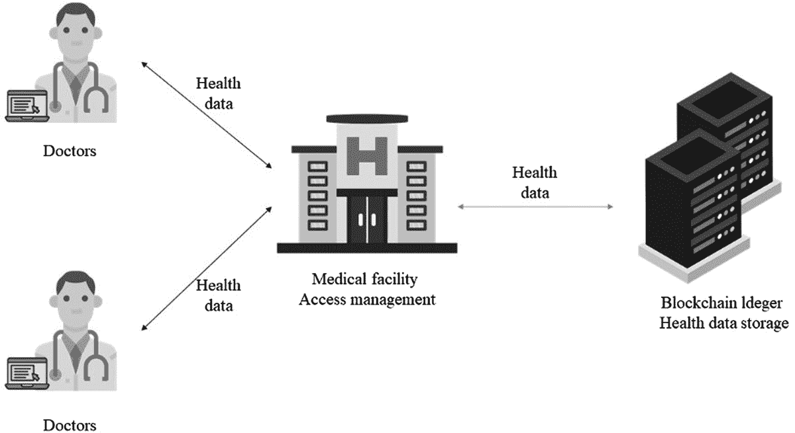

**图 6.1** 公共卫生设施运营概述。#ch14.xhtml#f18b)

本研究建议了一种基于区块链的系统，通过为医疗信息创建一个有效的隐私保护设置来解决这些问题。这项工作的主要贡献包括：

*   创建了一种新的基于区块链的系统，用于安全的健康数据存储和共享；
*   使用高级编码技术构建了改进的访问控制方法；
*   开发了一个测试框架来检查和显示系统的性能，并通过成功的真实世界实施进行了验证。

本章的其余部分结构如下：[第 6.2 节介绍了相关工作。第 6.3 节解释了所提系统的设计和结构。6.4 节展示了实际测试的结果。最后，第 6.5 节](#ch14.xhtml#h1-041) 对研究进行了总结。

## 6.2 文献综述

目前对基于区块链医疗解决方案的研究涵盖了访问控制、数据隐私、安全存储、扩展能力和信息准确性等不同领域。常规医疗系统在保持数据存储安全以及允许跨互联网络进行安全信息共享方面往往面临困难。

区块链的分布式特性可以通过改进临床数据监控、确保患者数据安全共享以及加强数据存储安全性来改变医疗保健 [10]。Diwan 等人 [11] 创建了一种结合特殊加密与区块链的隐私保护系统，以确保患者数据交换的安全。他们的方法提高了数据准确性，但需要更多的计算能力。

在另一项研究中，Abid 等人 [12] 研究了如何使用基于智能合约的访问控制方法通过区块链来保护医疗数据。他们发现区块链可以在根据设定的安全规则限制访问的同时，极大提高数据开放性。

此外，Mishra 等人 [13] 研究了区块链与星际文件系统（`IPFS`）的结合，用于分布式医疗数据处理。他们的方法降低了存储成本并提高了数据可用性，但在数据检索速度上带来了挑战。

Reegu 等人 [14] 开发了一种基于区块链的电子健康记录（`EHR`）系统，旨在通过在区块链网络保留不可更改的活动记录防止未经授权的访问和数据篡改。Vidhya 等人 [15] 开发了一种基于区块链的医疗数据共享系统，该系统整合了混合 `Feistel–Shannon` 同态加密算法、环签名技术和智能合约，以增强医疗信息交换中的安全性、隐私性和身份验证。

Cheng 等人 [16] 引入了 `Ekiden`，这是一个将隐私保护智能合约与支持区块链的可信执行环境相结合的系统。`Ekiden` 使用发布证明协议来实现安全的区块链交易。然而，这种方法可能会导致处理开销增加、潜在的安全风险以及更多的攻击手段。

Agrawal 等人 [17] 创建了一种混合区块链-雾计算模型，以解决医疗应用中的性能瓶颈。他们的解决方案缩短了交易处理时间，但需要额外的基础设施来进行雾计算设置。

Grover 和 Kushwaha [18] 建议了一种主要关注隐私保护数据共享的区块链 `EHR` 系统。他们的系统使用高级编码方法阻止未经授权的数据更改，从而加强了安全措施。

Lakshmanan 和 Anandha [19] 引入了一种名为 `blockchain tree` 的特殊数据结构用于保存健康记录，其中主患者身份信息连接到持有详细医疗数据的子链。同样，Rehman 等人 [20] 为电子医疗提出了一种安全且节能的医疗物联网（`IoMT`）系统，利用无线体网实现远程患者监测。虽然该系统对于实时健康跟踪和医疗帮助很有益，但由于高效数据传输与医疗传感器有限能力之间的平衡，它面临着安全问题。

Lodha 等人 [21] 为医疗引入了基于区块链的物联网安全系统（`BC-IoMT-SS`），在确保患者数据安全隐私的同时，允许对经过验证的执业人员发送警报，证明了其性能指标优于现有方法。

Sanober 和 Anwar [22] 开发了一种基于验证者共识的三模块区块链架构，用于灾害期间的医疗管理，在 `Remix Ethereum` 环境中实现，创建了一个轻量且可靠的系统，与现有方法相比表现出改进的性能指标。

Xie 和 Ding [23] 为物联网医疗系统开发了一种基于区块链的双重匿名策略，在隐藏医生和患者之间身份的同时，能够追踪恶意行为，通过实现智能合约进行身份验证，并使用三因素跨医院访问方案在降低 23%–87% 计算成本的同时增强了安全性。

Alnafrani 和 Acharya [24] 引入了 `SecureRx`，这是一种基于 `Ethereum` 和 `RxCheck` Hub 的区块链 Web 应用程序，使医疗提供人员能够跨地理限制安全地访问全面的处方记录，在符合 HIPAA 标准的同时防止阿片类药物过量。Fan 等人 [25] 为基于 `IoT` 环境开发了一种简化的云认证系统，引入了安全的射频识别技术以提高计算效率。同时，Rahim 等人 [26] 引入了一种基于数字孪生的智能医疗物理系统，该系统通过创建医院运营的虚拟副本来实现实时患者监测、个性化决策和工作流优化，展示了增强的住院服务和更精确的患者诊断。

虽然这些研究为区块链医疗安全提供了有用的见解，但它们往往没有解决隐私、效率和实时数据访问之间的权衡。许多现有研究在身份验证方法方面存在困难，往往忽视了资源控制交易和健康相关操作高效运行的重要性。本研究提出的框架旨在通过引入改进的区块链设计来克服这些局限性，确保快速交易、强加密以及医疗提供人员之间的顺畅协作。

## 6.3 方法论

本节展示了一种基于区块链的系统，旨在提高公共卫生中心敏感信息的安全存储。所提出的解决方案重点确保医疗流程的隐私性和准确性，同时使操作更加顺畅。它还解释了医疗活动如何协作以及块在此过程中是如何生成的。

### 6.3.1 基于区块链的医疗中心原型

该框架旨在通过加强已批准健康记录的隐私性、安全性、准确性和可检查性提高医疗系统的性能。本节解释了系统的整体设计，如图 6.2 所示，突出了为医疗中心创建的基于区块链的安全数据存储设置。它描述了系统中使用的各个部分和方法，包括访问控制工具。通过使用基于区块链的安全云存储模型，该解决方案确保了高性能的权限系统，保护隐私和数据准确性。

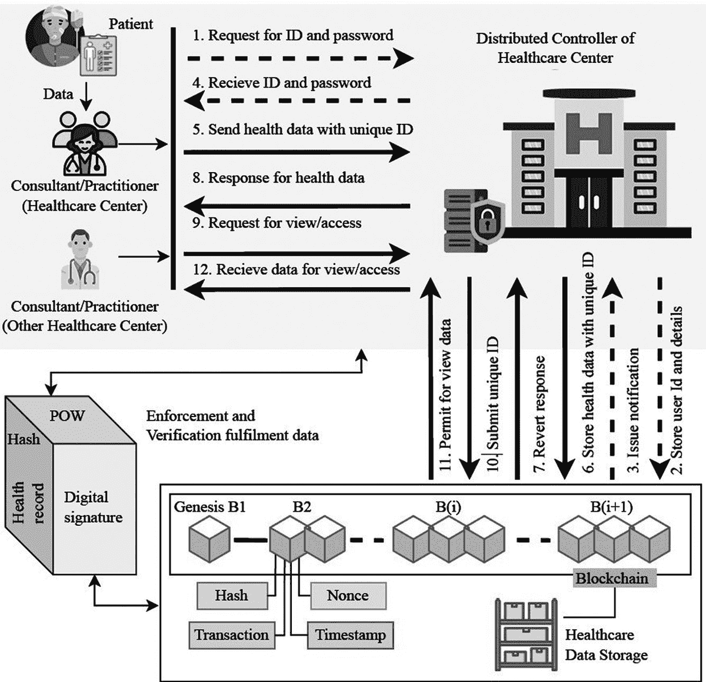

**图 6.2** 区块链医疗基础设施概述。⏎

这种基于区块链的系统使健康数据更加可靠且具有扩展性，在数据服务的利益相关者之间建立了更大的信任。平台的主要工作部分围绕三个关键群体展开：健康数据用户/顾问、医疗中心控制器和安全数据存储。

医疗中心控制器管理基于区块链系统内的数据用户/顾问的活动。每个用户/顾问都作为数据守护者工作，负责安全地处理患者健康记录。在这种模型中，只有经过批准的人才能访问、创建或更新区块链上与健康记录相关的智能合约。

顾问收集患者信息并使用公将其存储在区块链上，同时为每个患者记录提供一个特殊的私钥以获得更高的安全性。

在获得访问之前，医疗中心控制器会检查并注册每个健康数据用户/顾问，通过安全的认证系统授予唯一的数字身份标识（ID）和密码。该注册过程使用 `Bcrypt` 算法创建加密的数字 ID，然后进行安全存储。完成注册后，获得许可的用户可以使用其数字凭证安全地访问区块链网络，确保强身份验证和严格的访问控制。

在受区块链保护的系统中，任何涉及数据库的操作（如存储、更改或共享数据）都会与区块链协作以维护隐私、安全和可访问性。通过使用验证的用户节点网络，系统保证了健康记录的安全性和准确性。交易通过加密加密签名并永久存储在区块链上，使用 `SHA-256` 哈希确保数据准确性。工作量（`PoW`）共识机制进一步加强了去中心化，防止未经授权的更改。任何篡改都会通过逐步哈希检查被发现，包括 `nonce` 值、`time stamps` 和编码数据。如果发现异常情况，受影响的块将被标记为无效。

该模型中数据交换的方式遵循有组织的计划：

1. 用户/顾问使用分配的 ID 和密码证明自己的身份。
2. 确认后，他们通过医疗中心控制器请求访问区块链存储。
3. 编码的健康记录随后被发送进行存储，并在需要时检索。
4. 每条健康记录获得一个唯一的数据标识以进行追踪，由控制器管理其存储。

该区块链驱动系统的完整工作流如图 6.3 所示，解释了构建安全、透明且高效的数据管理平台涉及的每一个步骤。

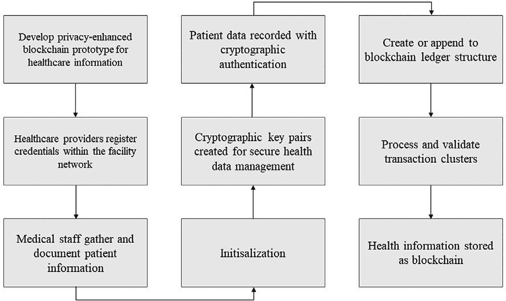

**图 6.3** 区块链医疗系统设计。⏎

### 6.3.2 管理工作流

所提出的模型在医疗中心设立了共享控制器，用于控制谁可以查看存储区块链上的医疗信息。该设置包含三个主要部分：医疗提供人员（需要处理患者信息）、共享控制器（负责注册和权限）以及区块链系统（作为分布式受保护的数据库）。

#### 6.3.2.1 身份注册与验证

系统从一个有组织的注册程序开始，以验证并添加医疗提供人员。首先，人员向医疗中心控制器发送注册请求并附带专业证明。控制器检查申请人是否已经在系统中；如果不在，其信息将被加密并安全地存储在区块链上，以防止更改并保护数据。验证成功后，系统会创建一个唯一的用户名和密码，通过去中心化的分布式控制器发送给人员。这种安全机制为注册用户提供了对区块链网络的永久访问权限，允许他们在需要时登录并参与未来的活动。

#### 6.3.2.2 输入处理

信息输入阶段始于连接到区块链网络的提供者收集特定的患者医疗信息（如检测结果或用药计划），并将这些文档发送给健康中心主管。收到后，主管会为患者创建一个唯一的健康标识符，将他们的医疗历史整合到一个可追踪的记录中。为了增强保护，每份文档都会获得来自区块链的基于哈希的代码，生成一个不可更改的数字签名，从而防止篡改并改进验证。添加或更改健康文件的权限严格限于经过批准的提供者，并通过加密密钥控制访问，以确保遵守规则并防止未经授权的更改。当信息成功添加到区块链时，所有系统参与者（包括相关医疗人员和患者）都会立即收到交易确认。这种即时更新系统促进了整个网络的开放性、责任性和可靠性，在遵循隐私和法律要求的同时，让所有方都能了解患者记录的变更情况。

#### 6.3.2.3 信息访问与可视化

这部分对基于区块链的公共医疗信息处理结构进行了全面概述，确保敏感医疗信息的隐私性、保护性和准确性。所提的方法允许经过认证的医疗提供人员和专家通过医疗机构的管理系统连接到区块链。这种安排为他们提供了访问历史医疗文件的入口，同时实施了严格的保护措施来控制访问。要访问患者医疗信息，医疗人员首先需要使用他们的个人数字凭据和密码验证身份，并通过去中心化管理系统进行确认。他们还需要提供与特定个人医疗文件匹配的患者代码。发送查询后，医疗机构系统会检查患者代码是否有效，并在凭据与保存的数据匹配时允许访问所请求的医疗信息。这种方法确保了只有经过批准的人员才能检查和审查早期的药物使用和健康背景。当身份程序发现患者代码错误时，区块链系统会立即拒绝访问尝试。安全获取之前的健康文档的能力允许医学专家跟踪患者的健康状况、创建新的治疗计划并根据需要更新记录。该框架内各种参与者之间的交换支持了区块链技术与社区健康信息管理的顺利整合。当专家从个人那里收集信息时，他们与区块链交互执行数据交换，确保所有健康细节都安全地存储和处理。

系统使用一种特殊的编码过程来创建唯一的公钥和私钥对，以安全查看数据。这些随机生成的密钥通过允许用户与区块链记录系统之间进行加密通信，提升了平台内的交易安全性。

为了加强数据保护，区块链系统使用了数学混乱和数字验证方法。当医生与另一个经过批准的人员共享患者健康详情时，实际数据不会在他们之间移动。并不是直接发送信息，而是通过更改区块链网络中谁可以看到什么来实现共享。每个更改查看权限的请求都必须通过使用发送者私钥数字签名进行验证，并与其公钥进行对比以证明其真实性。

`SHA-256` 混乱方法对这些活动至关重要，它为每笔交易创建一个唯一代码，并帮助通过在线系统中的加密网页地址查找数据。此外，参与计算机对交易进行数字签名以验证其真实性，确保信息准确。

这种基于区块链设置的一个重要特性是 `PoW` 协议系统，它控制区块的创建和检查。网络中的计算机确认健康交易，并选取某些计算机生成下一个区块。这确保了所有存储的健康信息无法被更改，并在共享记录的所有副本中保持一致。`RSA` 安全方法和 `SHA-256` 混乱是保护数据、加密交易和保持患者记录私密性的关键。区块链存储方法确保所有医疗信息保持可用，同时防止意外的更改。

系统的基础依赖于 `SHA-256` 安全代码，它保持了区块链数据块组织结构的有序。加入链的每个新区块都包含重要部分，如区块号、时间戳、特殊数字、区块链地址和上一个区块的代码。

区块头将所有区块连接在一起，允许顺利检查并创建所有交换的不可更改的记录。

椭圆曲线数字签名算法通过在用户和服务器端检查数字签名，使数据安全更加强大。如果发现任何篡改或数据更改等问题，交换将被立即丢弃，防止对保存健康记录的意外更改。这种双重检查方法确保只有证明的用户才能查看和处理数据，降低了虚假信息的风险。在区块链系统内部，每次健康交换都会创建一个公钥对以帮助安全编解码。`Algorithm 1` 显示了基于 `RSA` 的密钥对生成过程，它为所有用户提供用于安全交互唯一密钥。`PEM` 方法将这些安全密钥与文本编码连接以便于交换读取。该算法还解释了为健康交换创建数字签名的步骤，确保网络活动中的加密证明。

在支持网络增长的同时维护健康数据的完整性和安全性，`Algorithm 2` 处理区块链系统中的两个基本功能。首先，它管理新健康数据块的创建和添加，整合区块号、健康交易数据、时间戳和安全代码等关键元素以保持健康记录安全。其次，它监督将新计算机添加到基于区块链网络的过程，允许形成分布式系统，使得处理可以在多个位置发生。

`Algorithm 3` 显示了健康信息如何在区块链内部被收集、查看和控制。

## 6.4 结果与讨论

这部分对建议的公共健康中心基于区块链的安全存储控制系统进行了评估，考虑了用户计算机并测试了其在保护数据和保持隐私方面的性能。进行了测试和质量检查以证明该系统在保持健康记录机密、准确和可用方面表现良好。结果显示了系统在处理健康数据交换方面的整体成功，特别是交易发生的速度、延迟的大小以及系统的可扩展性。

### 6.4.1 验证设置

测试环境在受控环境下搭建，使用一台配备 AMD Ryzen 9 5900X 处理器（3.7GHz，12 核心，24 线程）和 32 GB 内存的 Windows 10。系统使用 `Python 3.11`（64 位）构建，并采用 `Flask 2.2.5` 作为网络连接工具，确保用户计算机与区块链之间能够顺畅通信。测试方法汇集了多台用户计算机和一台区块链计算机，以检查健康数据处理系统在类似于现实使用的条件运行性能和扩展性。

### 6.4.2 系统性能评估

为了测试系统的运行情况，设置了多台用户计算机与区块链服务器协同工作，以便测量交易耗时和延迟等关键因素。测试通过让用户计算机在区块链网络内分批 1、10、20 和 30 组（`T1`、`T10`、`T20` 和 `T30`）交换来完成。随着每个交换块被处理并在基于区块链的健康中心进行共享，该测试提供了关于系统高效处理日益增长的交换数量的有用信息。

测量了完成交换所需的时间，以观察系统处理不同用户计算机间数据的速度。结果如图 6.4 所示，对于计算机 1，交换时间从 `T1` 的 25.2 ms 增加到 `T30` 的 69.8 ms。

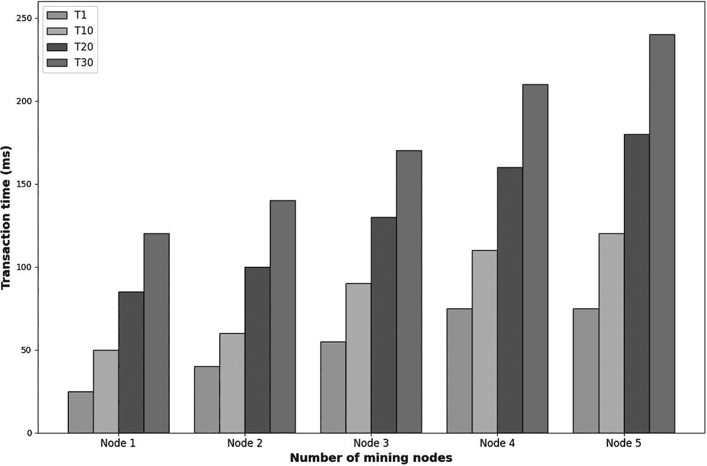

**图 6.4** 不同节点间交易的平均时间](#ch14.xhtml#f21b)

对于计算机 5，交换时间从 `T1` 的 77.9 ms 开始，增加到 `T30` 的 157.4 ms。这些发现显示了系统良好的扩展性，表现出随着交换次数的增加，处理时间稳步增长。

另一个重要的性能指标是延迟，即在区块链网络内发送和接收数据块所需。如图 6.5 所示，计算机 1 在 `T1` 时的延迟为 10.42 ms，增加到 `T30` 的 20.32 ms。

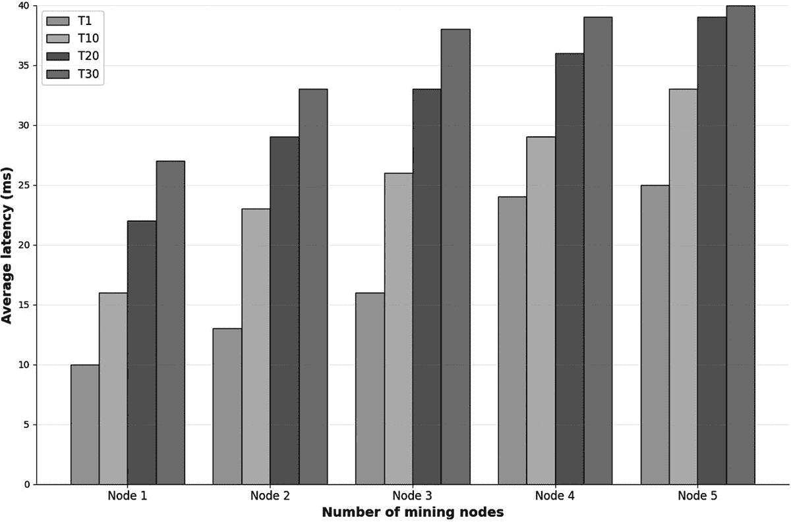

**图 6.5** 不同数量的平均延迟 (ms)](#ch14.xhtml#f22b)

对于计算机 5，延迟从 `T1` 的 25.18 ms 开始，并在 `T30` 达到 37.5 ms。这些结果证实，随着交换次数增加，网络延迟以类似的方式增加，但保持在实时医疗应用所需的良好范围内。

### 6.4.3 区块链性能比较

进行了一项对比研究，衡量建议系统与普通区块链的延迟。如图 6.6 所示，建议系统在处理 10 次交换时，计算机 1 的延迟为 15.3 ms，而计算机 8 则为 37.6 ms。

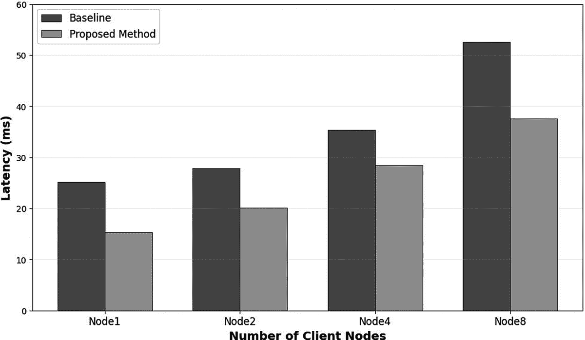

**图 6.6** 交易发布延迟对比](#ch14.xhtml#f23b)

对比发现，标准区块链在相同的测试设置下显示出更长的延迟，证明建议系统在处理健康数据交换时具有更好的扩展潜力，且运行更高效。

此外，在摩洛哥拉巴特的一个医疗中心进行了一次验证实验，以评估所提区块链系统的真实性能。实施范围涵盖了包括普通医学、放射科和实验室服务在多个部门，处理了 350 份不同类型的患者记录。

验证显示运营效率有了显著提高，如图 6.7 所示。与传统系统相比，检索患者记录的响应时间缩短了 67%，从 120 ms 降至仅 40 ms，同时保持了 100% 的数据完整性。医疗提供人员对系统的满意度达到 88%，特别赞扬了改进的验证能力和安全的数据共享功能。

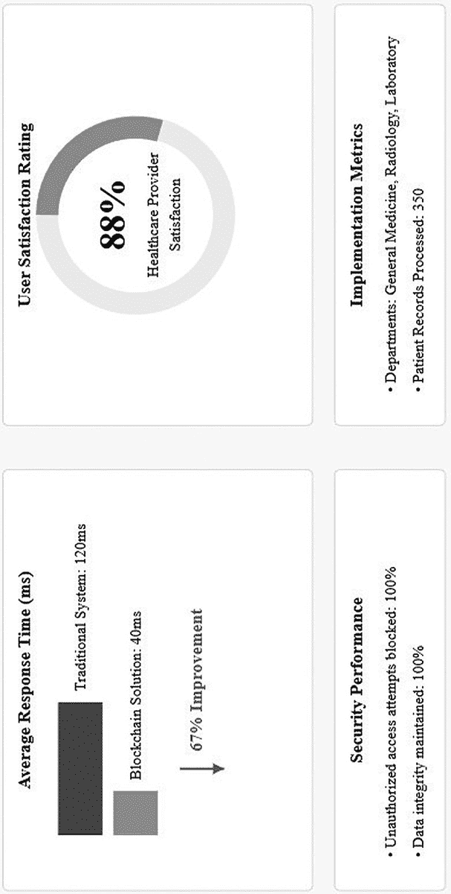

**图 6.7** 拉巴特医疗中心验证结果](#ch14.xhtml#f24b)


该区块链解决方案即使在医院高峰时段也保持了稳定的 30ms 以下的交易处理时间，并在安全测试期间成功阻止了所有未经授权的访问尝试。无论数据复杂度或患者量如何，系统性能在所有部门均保持稳定。

总体而言，验证证实了提出的健康数据存储系统为现实环境中的敏感医疗记录管理提供了可扩展、安全且高效的解决方案。在速度、安全用户满意度方面的改进代表了对传统医疗数据管理方法的重大进步。

## 6.5 结论

本研究通过创建一个安全的存储系统，应对了医疗领域对数字化转型日益增长的需求。该系统的一个关键特性是访问控制，有助于安全地共享健康记录。通过组织划分并使用区块链，该模型支持数据的私密性、可用性、准确性和扩展性。

所提框架与传统医疗系统相比大大提升了安全性。性能测试结果（包括交易发布时间和延迟）显示了系统处理交换的能力。尽管具有优点，但系统使用的区块链技术在网络扩大时存在能量缺点。未来的研究将关注降低能耗并添加数据检查。

## References

1. A. G. Gad, D. T. Mosa, L. Abigah, and A. Aboh, "Emerging trends in blockchain technology and applications: A review," Journal of King Saud University Computer and Information Sciences, vol. 34, 9, pp. 6719–6742, 2022.

2. G. Habib, S. Sharma, S. Ibrahim, I. Ahmad, S. Qureshi, and M. Ishfaq, "Blockchain technology: Benefits, challenges, applications, and integration of blockchain with cloud computing," Future Internet, vol. 14, 11, p. 341, 2022.

3. A. Sheikh et al., "Health information technology and digital innovation for national health and care systems," The Lancet Digital Health, vol. 3, 6, pp. e383–e396, 2021.

4. J. Shahid, R. Ahmad, A. K. Kiani, T. Ahmad, S. Saeed, and A. M. Almuhaide, "Data protection and privacy of the Internet of Healthcare Things (IoHTs)," Applied Sciences, vol. 12, 4, p. 1927, 2022.

5. P. Khatiwada, B. Yang, J. C. Lin, and B. Blobel, "Patient-generated health data (PGHD): Understanding, requirements, challenges, and existing techniques for data security and privacy," Journal of Personalized Medicine, vol. 14, 3, p. 282, 2024.

6. B. H. de Mello et al., "Semantic interoperability in health records standards: A systematic literature review," Health and Technology, vol. 12, 2, pp. 255–272, 2022.

7. A. H. Mayer, V. F. Rodrigues, C. A. da Costa, R. da Rosa Righi, A. Roehrs, and R. S. Antunes, "Fogchain: A fog computing architecture integrating blockchain and Internet of Things for personal health records," IEEE Access, vol. 9, pp. 122723–122737, 2021.

8. H. Abhishek, K. Tripathy, and S. Mishra, "A succinct analytical study of the usability of encryption methods in healthcare data security," in Next Generation Healthcare Informatics, Singapore: Springer Nature Singapore, 2022, pp. 105–120.

9. A. Haleem, M. Javaid, R. P. Singh, R. Suman, and R. Rab, "Blockchain technology applications in healthcare: An overview," International Journal of Intelligent Networks, vol. 2, pp. 130–139, 2021.

10. A. Gladyr, "Design and development of a secure and patient-controlled system to share healthcare data for research," M.S. thesis, McGill University, 2021.

11. P. Diwan, R. Kashyap, and B. Khandelwal, "Blockchain assisted encryption scheme for intellectual share estimation using medical research data," Concurrency and Computation: Practice and Experience, vol. 36, no. 2, p. e7896, 2024.

12. A. Abid, S. Cheikhrouhou, S. Kallel, Z. Tari, and M. Jmaiel, "A smart contract-based access control framework for smart healthcare systems," The Computer Journal, vol. 67, no. 2, pp. 407–422, 2024.

13. R. K. Mishra, R. K. Yadav, and P. Nath, "Integration of blockchain and IPFS: Healthcare data management & sharing for IoT environment," Multimedia Tools and Applications, pp. 1–22, 2024.

14. F. A. Reegu et al., "Blockchain-based framework for interoperable electronic health records for an improved healthcare system," Sustainability, vol. 15, no. 8, p. 6337, 2023.

15. S. Vidhya, P. M. Siva Raja, and R. P. Sumithra, "Blockchain-enabled decentralized healthcare data exchange: Leveraging novel encryption scheme, smart contracts, and ring signatures for enhanced data security and patient privacy," International Journal of Network Management, vol. 34, no. 5, p. e2289, 2024.

16. R. Cheng et al., "Ekiden: A platform for confidentiality-preserving, trustworthy, and performant smart contracts," in Proc. IEEE European Symposium on Security and Privacy (EuroS&P), 2019, pp. 185–200.

17. R. Agrawal, S. Singhal, and A. Sharma, "Blockchain and fog computing model for secure data access control mechanisms for distributed data storage and authentication using hybrid encryption algorithm," Cluster Computing, vol. 27, no. 6, pp. 8015–8030, 2024.

18. B. Grover and D. K. Kushwaha, "Authorization and privacy preservation in cloud-based distributed EHR system using blockchain technology and anonymous digital ring signature," Health Services and Outcomes Research Methodology, vol. 23, no. 2, pp. 227–240, 2023.

19. M. Lakshman, G. Saba, "Merkle tree-based privacy preservation of electronic medical records through hybrid algorithm," Knowledge and Information Systems, vol. 66, 2024.

20. R. Rehman, T. Haseeb, S. Lala, "Energy-efficient IoT-based healthcare model using artificial intelligence," Energies, vol. 14, 2021.

21. L. Baghela, R. Bhatt, Y. Ghosh, "A blockchain-based healthcare monitoring using Internet of Things (IoT)," Measurement, vol. 30, 2023.

22. A. Sano, E. Anwar, L. Touret, "Blockchain-based healthcare management in disaster systems," Academic Press, 2025, pp. 53–69.

23. Q. Xie, Z. Ding, "Lightweight protocol for data protection in IoT," IEEE Access, vol. 10, 2022.

24. K. Fan, W. Jiang, H. Li, "Secure prescription through blockchain-based healthcare," Health Policy and Technology, vol. 10, 2021.

25. M. Lak, W. Li, Y. Yang, "Lightweight RFID protocol for data protection," IEEE Transactions on Industrial Informatics, vol. 14, pp. 1656–1665, 2018.

26. M. Rahim, "A digital twin-based platform for smart healthcare," IEEE Access, vol. 12, pp. 2169–3536, 2024.

# 第 7 章 下一代物联网中的数字取证

Maria Ramas

DOI: [10.1201/9781041070467-7](https://doi.org/10.1201/9781041070467-7)

## 7.1 引言

近年来，物联网（IoT）受到了研究人员的广泛关注，以探索各种医疗应用 1。为了提高生活质量并支持医疗急救，IoT 最近被应用于可穿戴网络 2。可穿戴设备可以记录脉搏波图、EEG 和 ECG，以监测心率和其他特征。医疗物联网（IoMT）通过连接设备和应用程序改变医疗。这种互联的网络实现了无缝数据交换和实时监测，从而改善了诊断、个性化治疗和患者结局。IoMT 被认为医疗应用至关重要，为了创建一个可靠的平台，检查 IoT 的各个方面都是必须的 3。IoMT 4 描述了如何通过物联网技术连接医疗系统和设备。利用智能传感器、智能设备和轻量级通信协议，它构建了一个连接医疗对象的生态系统 5。物联网医疗技术的发展在社会效应、经济优势和技术改进方面具有广阔前景。IoMT 6, 7 通过利用物联网技术改善患者护理和医疗服务。不同医疗设备/传感器的连接形成了 IoMT，如图 7.1 所示。

```
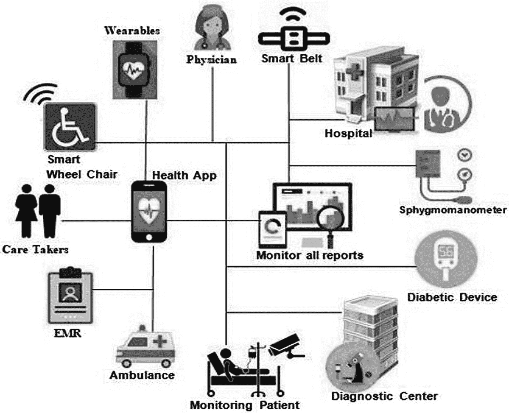
```

**图 7.1** 医疗物联网（IoMT）。

## 7.2 数字取证

数字取证（DF）是一个引人入胜且至重要的领域，专注于对数字设备和网络中发现的信息进行恢复、调查和分析 [8, 9]，通常发生在网络犯罪或安全违规的背景下。它在现代执法、网络安全和法律调查中起着关键作用 [10]。数字取证涉及收集、保护和分析电子数据，以支持调查和法律程序。它包括几个子学科，例如关注计算机和存储设备的计算机取证、分析网络流量的网络取证、移动设备取证以及取证数据分析 [11]。通常，它遵循以下步骤：识别证据、获取数据、系统地分析数据，并以清晰、符合法律可采纳的方式提交结果。它被用于解决网络犯罪、企业调查、欺诈检测和事件响应。数字取证的生命周期见图 7.2。

```
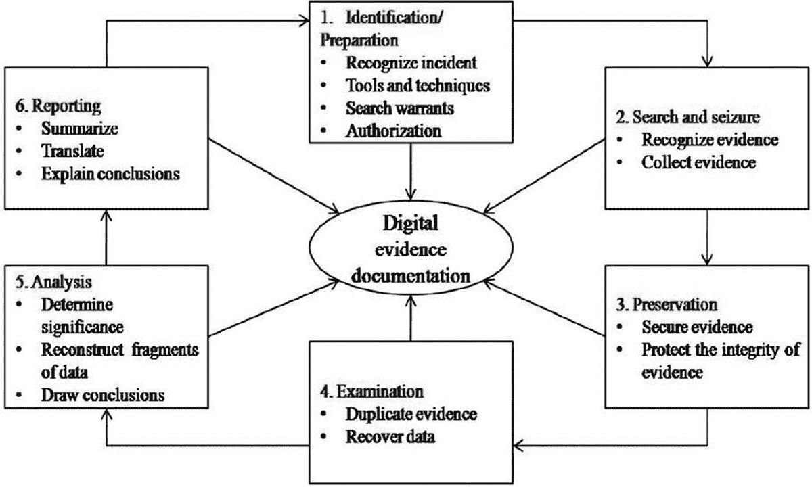
```

**图 7.2** 数字取证的生命周期。

如图 7.2 所示，数字取证生命周期 [12] 通常涉及数字证据的识别、保护、分析、文档记录和展示，以支持调查。

1. **识别：** 此阶段涉及识别与事件或调查相关的相关设备、数据源和潜在证据。

2. **保护：** 一旦识别，下一步是通过安全方式创建数据的副本或镜像来保护证据的完整性和真实性，确保不发生任何篡改或更改。

3. **分析：** 这涉及检查收集的数据，以识别相关信息、模式和异常，这些有助于确定事件或犯罪的原因和范围。

4. **文档记录：** 详细记录调查期间采取的所有步骤（包括证据收集、分析方法和发现），这对于法律可采性和未来的参考至关重要。

5. **展示：** 最后，以清晰简洁的方式将结果和证据（通常以报告或演示文的形式）提交给相关利益者，例如执法部门或法律团队。

### 7.2.1 数字取证的分类

数字取证是一个广大的领域，有多个专业分支，每个分支都关注不同类型的数字证据。不同类型的数字取证 [13] 见图 7.3。以下列表显示了不同类型的数字取证。

```
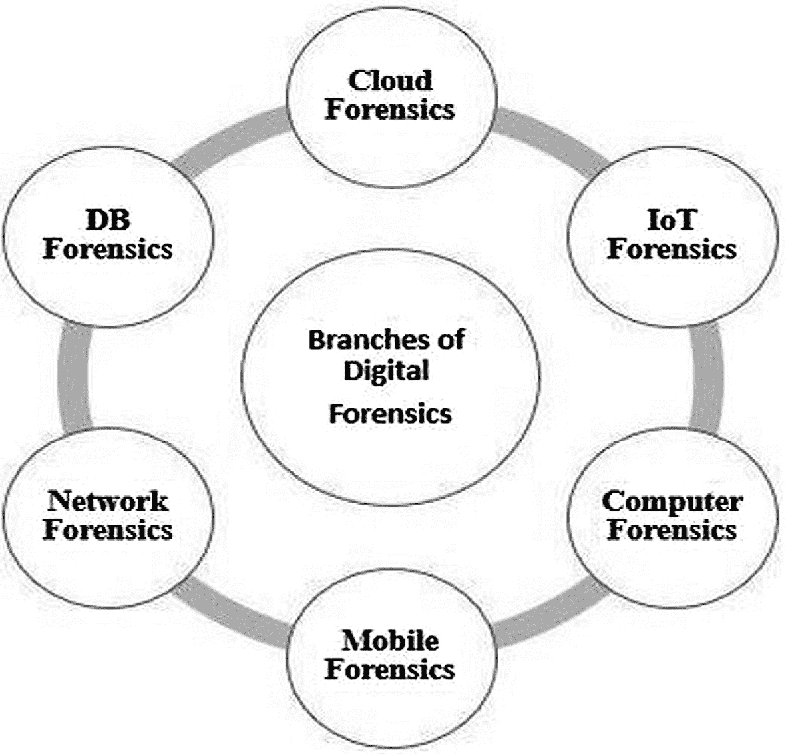
```

**图 7.3** 数字取证的类型。

1. **计算机取证：** 专注于从计算机、笔记本电脑和硬盘等存储设备中恢复和分析数据。

2. **网络取证：** 涉及分析网络流量以识别入侵行为。

3. **移动设备取证：** 处理从智能手机和平板电脑等移动设备中提取和检查数据。

4. **数据库取证：** 专注于检查数据库以发现元数据。

5. **取证数据分析：** 调查大型数据集以识别模式和异常。

6. **内存取证：** 分析易失性内存（RAM）以理解运行进程。

7. **云取证：** 调查存储在云平台上的数据。

### 7.2.2 数字取证的应用

数字取证在现代不可不可缺的，确保了各部门的问责制。数字取证的各种应用列如下：

1. **执法：** 调查网络犯罪，如黑客攻击和身份盗用。

2. **企业调查：** 检测员工违规行为和知识产权窃。

3. **网络安全：** 识别漏洞和攻击源以缓解威胁。

4. **法律程序：** 为法庭案件和合规收集并分析数字证据。

5. **远程医疗：** 确保医疗记录的安全完整性。

6. **保险与金融欺诈：** 揭露欺诈理赔和洗钱行为。


7. **军事与国家安全：** 调查网络战争和间谍活动。

8. **教育与研究：** 支持学术研究并培养未来的取证专业人员。

### 7.2.3 数字取证工具

数字取证工具是硬件和软件工具 [15]，可辅助数字证据的恢复和保护。执法部门可以使用数字取证工具在法庭上支持或反驳假设。各种类型的数字取证工具见图 7.4，包括 `Sleuth Kit`、`Wireshark`、`Autopsy`、`SIFT`、`Paladin`、`Xplico`、`ExifTool` 和 `Magnet RAM Capture` 等。

对被调查的系统进行取证镜像、图像处理以及根据收集的信息生成报告都是取证分析过程中的步骤。安全分析师和调查人员可以在数字取证技术的帮助下，从计算机设备中收集取证数据，将其转换为常见格式进行研究，并进行过滤以寻找相关信息。

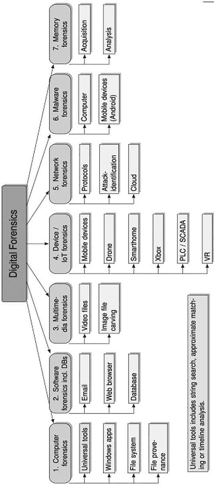

**图 7.4** 数字取证工具。⏎

数字取证工具对于调查和分析电子设备及数字数据至关重要。它们帮助取证专家在法律案件、网络安全事件等情况下提取、保护和分析证据。表 7.1 显示了数字取证工具，这些工具以数据分析、事件响应和证据收集方面的能力而闻名。每个工具都有其独特的功能和专长。

| **工具类别** | **工具名称** | **描述** |
| --- | --- | --- |
| 磁盘镜像与数据采集 | `FTK Imager` | 创建存储设备的取证镜像，保护数据完整性 |
| — | `EnCase` | 一种用于数据采集、分析和报告的商业平台 |
| — | `Cellebrite UFED` | 一种从各种设备中收集、保护和分析数字证据的软件应用程序 |
| 数字取证分析与调查 | `Autopsy` | 用于分析磁盘镜像和进行取证调查的开源平台 |
| — | `Forensic Toolkit (FTK)` | 用于分析和调查数字证据的商业数字取证平台 |
| — | `Magnet AXIOM` | 一个用于获取和分析取证数据的数字调查平台 |
| — | `X-Ways Forensics` | 一种分析数字证据和恢复数据的工具 |
| 网络取证 | `Wireshark` | 用于捕获和检查网络流量的网络协议分析器 |
| — | `Xplico` | 用于从网络流量中提取数据的网络取证分析工具 |
| — | `NetworkMiner` | 一种分析网络流量和识别设备的网络取证工具 |
| 其他工具 | `Volatility` | 用于分析内存镜像的工具 |
| — | `Registry Recon` | 一种提取和分析 Windows 注册表类的工具 |
| — | `SIFT Workstation` | 包含取证工具包的虚拟设备 |

## 7.3 IoMT 中的数字取证

医疗物联网（IoMT）通过连接医疗设备、传感器和系统，彻底改变了医疗保健，实现了实时监控、高效诊断和个性化治疗 [16]。然而，这种互联的生态系统在安全、隐私和数字取证（DF）方面也带来了巨大挑战。IoMT 中的数字取证是确保连接医疗设备及其处理的敏感数据安全和完整性的关键方面。IoMT 对安全/隐私/数字取证的需求见图 7.5。由于患者的 `EHRs` 目前是恶意攻击者的主要目标之一，调查人员在整个调查过程中必须确保数据所有者的隐私 [17]。由于 IoT 主要是基于云的，建议数字取证分为三个步骤：用户的设备首位，其次是传输数据的网络，最后是云服务器。必须遵循监管链，以确保所检索的任何数字证据在作为法庭证据之前是可靠的、真实的、全面的、可信且可采纳的。

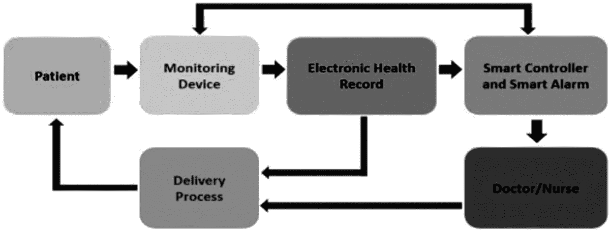

**图 7.5** IoMT 中对安全/隐私/数字取证的需求。 ⏎

1. **事件响应：** 当发生数据泄露或系统遭到破坏时，数字取证有助于识别攻击来源、所用方法以及损害程度。

2. **数据保护与合规性：** 确保敏感患者信息的处理符合 `HIPAA` 或 `GDPR` 等法规。取证可以验证是否发生了未经授权的访问或篡改。

3. **恶意软件检测：** 识别并分析可能针对远程医疗平台的恶意软件（如`勒索软件`或间谍软件），以防止未来事件发生。

4. **审计与监控：** 分析系统日志和网络活动，实时检测异常、未经授权的访问或可疑活动。

5. **云和远程访问取证：** 调查存储医疗记录或远程医疗数据的云系统泄露。确保远程咨询安全且不受干扰。

6. **设备与可穿戴取证：** 检查远程医疗设备（如健康监测和可穿戴设备）是否存在篡改或误用的迹象，确保健康数据的准确性和真实性。

7. **欺诈检测：** 使用取证技术识别欺诈活动，例如虚假理赔或未经授权使用远程医疗服务。

使用设备/物体取证、网络取证和云取证的三层数字取证架构见图 7.6。

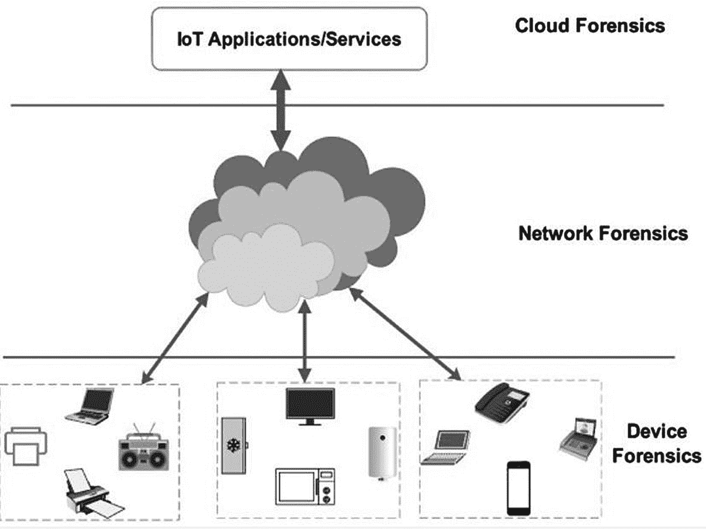

**图 7.6** IoMT 中对安全/隐私/数字取证的需求。 ⏎

（注：源文本为图 7.5/7.6 提供了重复的标题/链接；我在根据提供的文本维持了内容流的同时修正了结构）。

除了数字取证外，`AI/ML` 技术 [18] 正在通过增强临床诊断、医疗管理和公共卫生基础设施来转型医疗保健行业。`AI/ML` 具有降低成本和提高每个人健康的潜力。`AI/ML` 可以分析大量的医疗数据，并发现趋势。通过增强这些能力，提高患者预后、服务质量和系统的整体效能。此外，`AI/ML` 技术促进了自然语言处理，使医疗专业人员更容易获取患者信息。尽管 `AI/ML` 还处于早期阶段，但它们在 IoMT 的医学治疗方面具有潜力。无线体传感器使用 `ML` 技术（如`支持向量机`和`决策树`）来收集医疗数据 [19]。这些 `ML` 方法有助于疾病的诊断和预后。为了后续使用，处理后的数据将存储在云存储中。

IoMT 的分层架构见图 7.7。生物传感器、无线传感器和记录的数据代表了感知层。网关层负责将收集到的数据传输到长距离或短距离网络，并在数据存储层存储在网络服务器或 `IoTs` 服务器中。最后，应用层是一个在`云`、`边缘`或`雾计算`辅助下运行用户应用程序、监控、控制等的应用服务器，允许对存储的数据进行访问或可视化。

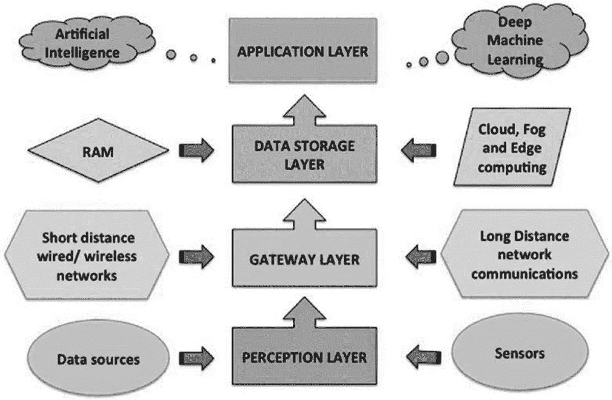

**图 7.7** IoMT 架构。 ⏎

随着 `AI/ML` 技术集成到 IoMT 进行数据管理，医疗技术已经发生了巨大的进化 [20]。IoMT 设备产生了大量的患者数据，并保存在电子健康记录 (`EHRs`) 中，包括生命体征和用药依从性记录。

## 7.4 相关工作

基于 IoMT（医疗物联网）和 IOT 的医疗系统整合了以下 AI 方法。该研究对医疗系统中可穿戴 IoMT 取得的进展进行了全面分析，重点关注了它们在疾病检测、预防和监测方面的表现。它探索了研究人员用于提高医疗系统整体准确性、有效性和安全性所采用的方法。文章还讨论了创建 AI 驱动的 IoT 医疗系统的机遇与挑战 [21]。它承认，可穿戴医疗传感器和基于 IoT 的健康监测使得提供远程医疗服务成为可能，从而最大限度地利用医院床位并降低成本。文章探讨了 IoMT 的概念及其对医疗运营的影响，包括提高效率、节省成本和改善患者预后。它还探索了 IoMT 的设计、技术、现实应用、安全框架和挑战。

基于 AI 的物联网（`AIoT`）可用于为老年人和体弱人士创建智能环境。这些环境可以帮助老年支持、脆弱性分析、疾病诊断、预约调度、术后护理以及定期的生命体征监测。研究强调了需要进一步研究以完全理解对不同 IoT 应用的影响和作用，同时强调了 IoMT 策略中可能的问题和不一致性 [22]。因此，AI 可应用于糖尿病治疗、癌症检测和心脏监护等尖端医疗领域的 IoMT 和现场检测设备。`AI/ML` 技术在 IoMT 中的应用如图 7.8 所示。

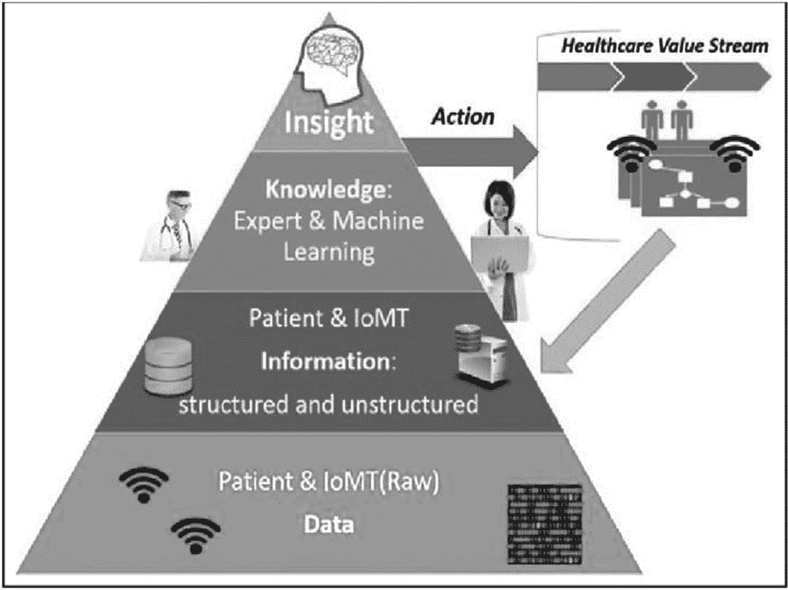

**图 7.8** 在 IoMT 中应用 `AI/ML` 技术⏎

尽管质量问题仍然存在，但 IoT 和医疗数据分析正在改进医疗部门的数据解释。为了在准确性、延迟和响应时间上的可靠质量，深度学习是至关重要的。在 IoMT 背景下，`DF`（数字取证）涉及专门工具 [23] 和技术，用于调查和保护医疗设备及其数据。一些在医疗/IOMT 中应用 `DF` 工具和技术的现有研究工作总结在表 7.2 中。

**表 7.2** 数字取证工具类型⏎

| **类别** | **工具名称** | **工具功能** |
| --- | --- | --- |
| 设备（包括 IoT 取证） | `FSNView` | 记录单个磁盘镜像的元数据，通过在同一磁盘镜像上使用许多不同的存储系统解析器完成 |
| 计算机取证 | `Mrsh_net` | `mrsh_v2` 工具的扩展，用于辅助近似匹配的速度。这是通过实现单个大型 `Bloom Filter` 完成的 |
| 内存取证 | `Sdkernel` | 一种用于从磁盘上的内核镜像中识别内核版本的工具 |
| 内存取证 | `Robust Linux memory acquisition` | 内核模块 `LKM` 将获取模块注入到现有的系统内核中以获取内存 |
| 软件取证（包括数据库） | `Sifter` | 对字符串搜索的取证重要性进行排序，并实现为 `Sifter`。排名通过 `Recency-Created` 和 `Recency-Modified` 等 18 个因素完成 |
| 多媒体 | `Forensic analysis of video file formats` | 提取用于各种相机和手机的文件格式结构和元数据。解析器已被证明可以提取足够的信息 |
| 软件取证（数据库） | `Forensic2020` | 作为一个可启动环境，这是一个受控环境，分拣软件在已安全的操作系统中运行 |
| 内存 | `linux_compressed swap linux_duno_maps` | 输出关于 `frontswap` 和 `zswap` 状态的统计信息，并将所有压缩页面以未解压缩的形式提取到磁盘 |
| 软件取证（数据库） | `OpenLV` | 快速安全地与收集的证据进行交互，就像在收集证据时坐在计算机取证工作面前一样 |
| 计算机取证 | `AFEIC: Advanced forensic Ext4 inode carving` | 文件碎片恢复模块，旨在与 `The Sleuth Kit` 集成，以便对系统上的文件 inode 节点进行搜索，而不需要来自超级块的信息 |
| 恶意软件取证 | `BinComp` | `BinComp` 使用分层思想，第一层是监督编译过程，第二层提取给定特征，第三层根据编译器函数的语义特征识别编译器版本和优化级别 |
| 内存取证 | `Winpmem` 和 `Pmem` | 捕捉整个系统内存并允许从内存镜像中提取 `ACPI` 表，并扫描相应的表以寻找潜在的 rootkit |
| 软件取证（数据库） | `Privacy Preserving Email Forensics (PPEF)` | `Autopsy` 插件，允许在维护所有者隐私的情况下进行敏感邮件搜索 |
| 设备（包括 IoT 取证） | `ConvertPDML` | 从 `PDML` 文件解析相关的 WhatsApp 信息并以 HTML 显示 |
| 网络取证 | `Synchronisation Service Tool` | `SSERT` 从同步文件夹中远程恢复数字证据 |
| 恶意软件取证 | `Simple Set Comparison Tool` | 帮助调查人员快速识别并专注于特定品牌的钓鱼 |
| 软件取证（数据库） | `Browser Storage Extractor (BrowStEx)` | 来自 `Historian`、`NetAnalysis` 和 `WEFA` 等网络浏览器的存储数据 |
| 计算机取证 | `Mrsh-cf` | 相似哈希/近似匹配工具，等于 `mrsh-net` 但使用 `Cuckoo filter` 代替 `Bloom filter` 以减少内存占用 |
| 计算机取证 | `MetroExtractor` | 收集 Windows 应用的静态和易失性制品。从存储介质上的睡眠和交换分区提取易失性制品 |
| 计算机取证 | `Litigation Hold Verification Tool` | 为了防止诉讼方提供的证据被破坏和伪造证据 |
| 网络取证 | `Hviz` | 一种交互式可视化方法，以易理解的方式表示工作站的 HTTP/HTTPS 活动时间线 |
| 设备/IoT 取证 | `Control Program Logic Change Detector` | `CPLCD` 使用一组检测规则 (`DRs`) 来检测和记录干扰 PLC 正常运行的意外事件 |
| 软件取证（数据库） | `EDBForensic` | 一种用于从可扩展存储引擎 (`ESE`) 数据库中恢复删除的记录和表的工具 |
| 软件取证（数据库） | `InVEST: Intelligent visual email search and triage` | 一种允许对多个邮件进行分析和索引的工具，旨在减少需要详细查看的邮件数量 |
| 网络取证 | `TLS Key Extractor (TLSkex)` | 一种从虚拟机内存中提取 TLS 连接主密钥的工具，独立于加密算法 |
| 内存取证 | `Psquickscan Psscan` | 一个实验性框架的插件，扫描内存池标记，而不是扫描整个虚拟内存 |
| 软件取证（数据库） | `Database Image Content Explorer (DICE)` | 跨越多种数据库管理系统 (`DBMSes`) 恢复已删除和未分配的数据 |
| 网络取证 | `Covert6` | 在带有路由器、防火墙的模拟企业基础设施中创建 `IPv6` 隐通道，以证明其存在 |
| 网络取证 | `Kumodd` | 云盘硬盘取证 |
| 计算机取证 | `Advanced Automated Disk Investigation Toolkit (AUDIT)` | 自动集成和配置工具，用于通用和特定调查，在图形文件、电子邮件、文档和“隐藏”位置中搜索磁盘上的证据 |
| 恶意软件取证 | `AMExtractor` | `AMExtractor` 是一种用于从各种 `Android` 设备获取易失性物理内存的工具，并支持 `rootkit` 检测 |
| 内存取证 | `Layout Expert` | 在目标系统的运行时无需额外工具（如 `compiler tool chain`）即可计算关键内核结构的内存布局 |
| 内存取证 | `BinGold` | 该工具能够准确且自动地恢复二进制代码的语义 |
| 软件/数据库取证 | `Forensic Email Analysis Tool` | 一种允许对多个电子邮件进行分析和索引的工具，以减少需要详细查看的电子邮件数量 |
| 设备/IoT 取证 | `DRone Open-source Parser (DROP)` | 解析从无人机非易失性内部存储器中提取的专用 `DAT` 文件 |
| 恶意软件取证 | `Lua dissector` | 使用 `Lua` 语言编写的 `Wireshark` 解析器 |
| 软件/数据库取证 | `Digital Forensics Framework (DFF) plugin` | 调查是否可以实现技术安全的选择性删除 |
| 设备/IoT 取证 | `Cutter` | 从网络日志中提取 SMTP 配置并解析它以获取电子邮件地址、用户名和密码 |
| 设备/IoT 取证 | `N/A` | 允许基于网络与 `PLC` 直接通信（不需要中间服务器） |
| 设备/IoT 取证 | `Cloud-based IoT Forensic Toolkit (CIFT)` | 对云原生产物和以本地设备为中心的产物进行识别、采集和分析 |
| 计算机取证 | `Automated Provenance (AutoProv)` | 在取证镜像上重建感兴趣文件的溯源 |
| 多媒体取证 | `Decision Theoretic carving program (DECA)` | 设计用于快速提取大型非碎片化 JPEG 文件，例如 `DSLR` 相机产生的高分辨率图片 |
| 内存取证 | `Heapinfo Heapdump Heapsearch Heaprefs` | `heapinfo`: 提供区域（arenas）、块（chunks）及其大小的抽象概述。`heapdump`: 将所有分配和释放的块转储到独立文件中以便进一步分析。`heapsearch`: 在所有块中搜索指定的字符串、`regex` 或指针。`heaprefs`: 检查给定块的数据部分，查看是否有任何对其他块的引用 |


| 恶意软件取证 | `AndroParse` | 使用解析器分析 `Android` 应用，提取 `Android` 应用的 4 种最常见特征：权限、`APIs`、字符串和意图（intents） |

| 软件/数据库取证 | `MongoDB Deleted Data Recovery Tool` | 从 `MongoDB` 中恢复删除的数据 |

| 设备/IoT 取证 | `Forensic Evidence Acquisition and Analysis System (FEAAS)` | `FEAAS` 将证据数据整合为可读报告，可以推断出用户事件（如进入或离开家）以及触发事件的原因 |

| 恶意软件取证 | `Fordroid` | 一种用于 `Android` 组件间静态取证工具，可自动识别存储在本地存储中的敏感信息 |

| 网络取证 | `Wifimit` | 该包结合了多个现有工具和攻击策略，以绕过 `WEP`、`WPA` 和 `WPS` 等无线安全机制 |

| 计算机取证 | `Timeline2GUI` | 用于分析 `Log2Timeline` 的 `CSV` 日志文件 |

| 设备/IoT 取证 | `Plugins/Autospy plugins` | 分析解析插件——3 个插件和 1 个从 `Qbee` 摄像头提取的独立 `Plugin`——提取云凭据 |

| 计算机取证 | `Sync Triage` | 插件创建同步设备列表，包含推断设备的详细信息以及溯源 |

| 计算机取证 | `NTFSObjIDParser` | 该原型程序通过解析 `MFT` 记录的 `SIA`、`FNA` 和 `OIA`，将对象 ID 条目与条目引用中找到的 `MFT` 记录关联起来 |

| 内存取证 | `Winesap (Volatility plugin)` | 分析内存转储中基于注册表的 `Windows` 自动启动扩展点 (`ASEPs`) |

| 软件/数据库取证 | `Bring2lite` | 将恢复的数据连接到相应的数据库架构和表。因此可以知道每个记录字段的上下文和数据类型 |

| 内存取证 | `Hooktracer` | 结合我们的内存分析算法对 `api hooks-generated output` 进行后处理 |

| 设备/IoT 取证 | `NAVER Clova` | 设计用于通过与云通信直接收集命令历史产物 |

| 软件/数据库取证 | `Database Forensic File Format (DB3F) Database Forensic Toolkit (DF-Toolkit)` | 数据库取证工具 (`DF-Toolkit`）：用于查看和搜索存储在 `DB3F` 中的数据。`DF-Toolkit`: 用于查看和过滤存储在 `DB3F` 中的 DBMS 取证产物 |

| 软件/B 取证 | `AFF4 evidence container` | 它提供了与现有方法相同的逻辑镜像原语，具有内容去重存储等优势 |

| 内存取证 | `Ptenum` | 尽管存在任何故意（或无意）隐藏技术也能检测执行页面 |

| 内存取证 | `Vivedump` | 用于 `HTC Vive` 系统的内存转储分析并共享相关数据集 |

| 设备/IoT 取证 | `Digital Drone Forensic` | 主要关注分析无人机的关键日志 |

| 恶意软件取证 | `BotDAD` | 模块从解析 `PCAP` 文件开始生成 `CSV` 文件 |

## 7.5 远程医疗中的机器学习

机器学习 (ML) 正在显著增强医疗物联网 (IoMT)，改善医疗交付和结果。机器学习在 IoMT 中的集成显著增强了医疗应用，实现了监测和疾病预测 24。这些进步通过提供实时患者数据、改进诊断和个性化治疗正在改变远程医疗。机器学习在 IoMT 中的整合如图 7.9 所示。

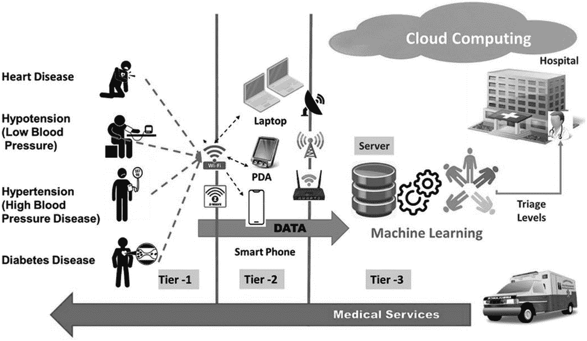

**图 7.9** Integrating ML in IoMT for telehealth.(ch15.xhtml#f33)

传统远程医疗的三层为：

1. **第一层**：物层（无线（身体）传感器）
2. **第二层**：网络层（雾网）网关，以及
3. **第三层**：数据管理层/机器学习层

医院/医疗机构从根本上是云计算基础设施和远程医疗系统的组件。由于远程医疗监测由第一层和第二层表示，因此服务器由第三层表示。

### 第一层：物层（边缘）用于数据采集

个人健康生命体征从患者设备中收集。这些医疗设备具有多种传感器，用于跟踪生理参数（如血压和心电图）。每个传感器传输信号，然后进行处理以产生结果，并将从各种传感器收集的数据汇到池中。

* `血压传感器`
* `SPO2 传感器`
* `ECG/EEG/EMG 传感器`
* `温度传感器`

### 第二层：网络层（雾网）用于数据通信

在接收到上一层的数据后，该层会向用户指定的个人设备发出警。此外，通过启用远程连接的外部网关，该层负责定期向远程服务器传输数据。由于网关连接了公共接入网络和家庭网络，数据通过网关组件发送到中央服务器或医院。

## 第 3 层：数据管理/ML 层/处理层/存储层

最后一层是执行 ML/数据处理和存储过程的地方。传感器和基于服务器的设备是系统中的医疗来源。它提供实时数据交付。然而，医生可以利用远程控制实时检查数据。该层可能拥有用于数据存储的云和用于处理的基础设施。

### ML 层

该 ML 层用于分析从连接设备收集的大量实时医疗数据，识别模式，预测潜在的健康风险，并为医疗保健供应商提供见解，以实现更好的决策和个性化患者护理；本质上，它利用 ML 算法从原始数据中提取有意义的信息，从而实现主动医疗保健管理并改善患者预后。

### 应用层

IoMT 中的应用层主要用于传输和处理从连接医疗设备收集的医疗信息，实现实时患者监测、远程患者护理、疾病早期检测等功能，并促进医疗设备与医疗系统之间的通信；本质上，它通过数据分析、告警和与医疗平台集成等功能，实现了 IoMT 设备收集数据的 `[25]` 应用。

### 应用

1. **远程监测/诊断**：ML 算法分析来自 IoMT 设备的数据进行远程诊断。这使得医疗人员能够提供及时准确的诊断，而无需亲自访问。
2. **患者监测**：配备 ML 的 IoMT 设备持续监测患者的生命体征和健康指标。这些数据经过实时分析以检测异常并警报医疗人员，确保及时的医疗。
3. **个性化治疗**：ML 根据从 IoMT 收集的个人数据定制治疗方案。
4. **应急响应**：基于 ML 的框架对需求需求的患者进行优先处理。
5. **数据安全**：ML 通过检测网络威胁增强安全性，确保患者数据得到安全处理。

## 机器学习的局限性与挑战

尽管 ML 在 IoMT 中的潜力巨大，但解决这些挑战至关重要 `[26]`。

1. **数据隐私**：IoMT 的集成引发了重大问题。
2. **实施障碍**：社会经济因素限制了其采用。
3. **设备可靠性**：与传感器精度相关的挑战影响了监测速度。
4. **互操作性**：不同的系统通常缺乏兼容性。
5. **能耗**：IoMT 设备受电池寿命限制。
6. **数据可用性有限**：数据不足会阻训练。
7. **云**：IoMT 与云的结合增强了处理能力。

## 应对挑战

* **增强安全性**：实施协议以降低风险。
* **架构开发**：探索新型架构。
* **标准化**：促进设备之间的互操作性。

## 7.6 数字取证

DF `[30]` 作为一种保障，确保安全性。`[31]` 对患者安全至关重要，`[32]` 提供了医疗合规。`NB`、`RF` 和 `LR` 在 `IoMT` 和 `DF/IoMT` 中的性能列于 `Table 7.3](#ch15.xhtml#t23)` 中，并绘制在 `Figure 7.10](#ch15.xhtml#f34)` 和 `Figure 7.11](#ch15.xhtml#f35)` 中。

### 表 7.3 传统方法与 DF/IoMT 方法的性能指标

| 算法 | 使用传统 IoMT 方法：准确率 | 精准率 | 回召率 | F 分 | 使用 DF/IoMT 方法：准确率 | 精准率 | 回召率 | F 分 |
| :--- | :--- | :--- | :--- | :--- | :--- | :--- | :--- | :--- |
| 素贝叶斯 | 0.70 | 0.77 | 0.73 | 0.72 | 0.61667 | 0.67238 | 0.61212 | 0.68009 |
| 随机森林 | 0.7222 | 0.73 | 0.72 | 0.72 | 0.71666 | 0.77658 | 0.66667 | 0.70705 |
| 逻辑回归 | 0.75 | 0.76 | 0.75 | 0.75 | 0.65 | 0.67426 | 0.67 | 0.66175 |

在医疗物联网（IoMT）和数字取证（DF）的背景下，伦理考量至关重要，涵盖了数据隐私、患者机密以及采集证据的负责任使用。以下是 IoMT 中数字取证的伦理考量 `[33`。

### 1. 数据隐私与患者机密

* **保护敏感信息：** IoMT 设备经常收集并传输高度敏感的医疗数据，使得隐私成为一个关键问题。数字取证调查必须优先保护这些数据，确保其以符合伦理法律的方式进行处理。
* **最小化数据收集：** 取证专家应仅收集调查所必需的数据，避免不必要的数据收集和存储。
* **匿名化与去标识化：** 在共享或分析数据时，应采用匿名化或去假名化技术来保护患者身份。
* **数据安全：** 强有的安全措施至关重要，以防止敏感医疗数据在存储、传输和分析过程中被未经授权的访问、修改或泄露。

### 2. 法律与伦理挑战

* **遵守法规：** 数字取证调查必须遵守所有适用的法律/法规，包括如 `HIPAA`（美国）和 `GDPR`（欧洲）的数据保护法。
* **获取同意：** 在可能的情况下，在进行数字取证调查之前，获得患者或其法律代表的知情同意至关重要。
* **监管链：** 为数字证据维护清晰且可验证的监管链，对于确保其在法律诉讼中的完整性和可采纳性至关重要。
* **透明度与问责制：** 取证专家应对其方法和发现保持透明，并对其在调查期间的行为负责。
* **跨国/跨境调查：** IoMT 设备可跨不同的司法管辖区使用，这在进行取证调查时可能会导致法律和司法管辖权挑战。

### 3. 数字取证的伦理原则

* **完整性：** 维护数字证据的完整性至关重要，确保其保持未被更改且可靠。
* **客观性：** 取证专家应以客观的方法进行调查，不带偏见或预设观念。
* **机密性：** 保护敏感信息的机密性是一项基本的伦理原则。
* **专业能力：** 取证专家应具备必要的技能和知识，以有效且符合伦理地开展调查。
* **诚实：** 取证专家在发现和报告中应保持诚实和透明。

## 7.8 当前趋势与未来挑战

IoMT 中的数字取证面临着挑战，包括数据安全、隐私担忧、设备异质性、处理能力有限，以及对从各种医疗设备和云环境中收集和分析数据的专用工具和程序的需求。它面临着从多样化且资源限的设备收集数据、数据完整性和隐私问题，以及对专业知识和工具的需求。2025 年塑造该领域的数字取证当前趋势列如所示。IoMT 数字取证的未来趋势见于 `Figure 7.12`。

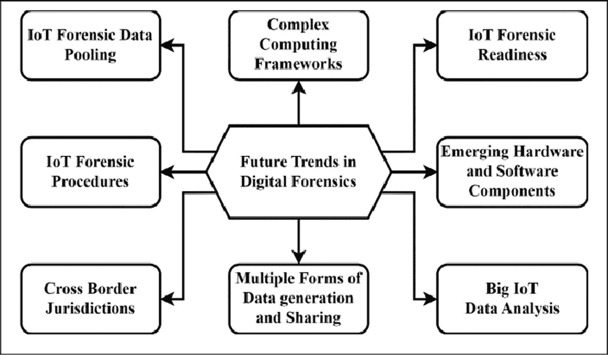

**图 7.12** 数字取证的未来趋势。⏎

1. **AI 与机器学习集成：** 人工智能正用于自动化取证流程、分析大型数据集并更高效地识别模式或异常。
2. **云取证：** IoMT 设备产生的海量数据需要高效的收集和存储技术。
3. **移动与物联网取证：** 移动设备和物联网的兴起导致了识别被篡改媒体工具的发展。
4. **深度伪造（Deepfake）检测：** 随着深度伪造技术的进步，确保数字证据的真实性。
5. **区块链取证：** 随着加密货币的使用增加，追踪交易变得重要。
6. **抗量子取证：** 随着量子计算的发展，取证方法正在更新以应对威胁。
7. **远程取证：** 向远程办公的转变增加了对取证工具和网络的需求。
8. **伦理 AI 与数据隐私：** 取证实践侧重于维护伦理标准并确保符合法规。

这些趋势突显了数字取证的动态性质及其在应对网络安全挑战方面的关键作用。解决这些局限性可以带来更有效、更安全的医疗解决方案，最终改善患者的预后。

### 1. 数据获取与采集

* **多样化设备：** IoMT 涵盖了功能各异的设备，开发通用方法变得困难。
* **资源限制：** 许多 IoMT 设备具有有限的存储、处理能力和连接性，给数据收集带来了挑战。
* **数据易失性：** IoMT 设备通常将数据临时存储在易失内存中，这些数据容易丢失或修改，需要快速采集。
* **数据格式多样化：** IoMT 设备使用各种格式，包括传感器数据、图像和日志，这些可能难以提取。
* **数据量：** IoMT 设备产生的海量数据可能难以应付，需要高效的技术。

### 2. IoMT 取证的特定挑战

* **设备多样性：** IoMT 涵盖了广泛的设备，每种设备都有自己的特性和存储机制，为分析带来了挑战。
* **实时数据：** IoMT 设备产生实时数据，需要专家开发准确捕获数据的技术。
* **互操作性：** IoMT 设备可能与各种系统通信，要求专家理解系统的互操作性。
* **缺乏标准：** IoMT 领域相对较新，在数字取证的标准和最佳实践方面仍存在空白。

### 3. 数据完整性与监管链

* **数据篡改：** IoMT 设备容易受到篡改，因此确保证据的完整性至关重要。
* **监管链：** 为从 IoMT 设备采集的证据建立清晰的监管链对于法律采纳性至关重要。
* **数据同步：** IoMT 设备经常与云服务同步数据，使得确定来源变得困难。

### 4. 专业知识与工具

* **缺乏专业人才：** 缺乏具备 IoMT 调查专业知识的取证专业人员。
* **对专用工具的需求：** IoMT 取证调查需要并非容易获取的专用工具和技术。

### 4. **培训与教育：** 医疗取证专业人员需要接受最新的医疗物联网（IoMT）技术、取证技术和工具的培训。

### 5. 伦理、隐私与合规性：IoMT 设备经常收集敏感的患者数据，需要严格遵守 `HIPAA`/`GDPR` 等隐私法规。此外，还需要患者数据匿名化技术，以便在保护隐私的同时允许取证分析。IoMT 取证必须符合相关的法规和标准，例如与数据安全和隐私相关的规定。

## 7.9 结论

在本章节中，数字取证技术被应用于增强 IoMT 框架下的个性化医疗系统，以迈向智能远程医疗。由于 `AI` 和 `ML` 增强了信任并保证了决策权威，它们在医疗应用中被认为具有重要意义。`DF` 在 `IoMT` 中的使用促进了用于机器人手术、个性化治疗、预测方法以及心脏病诊断的 `AI/ML` 方法的发展。在 `IoMT` 背景下，数字取证技术用于改进定制化医疗系统。这些 `DF` 技术将帮助医疗服务提供者/医生在远程医疗系统中做出透明且最佳决策。因此，`DF` 在远程医疗应用中具有巨大影响，因为它确保了医疗/个人记录的完整性、机密性和可用性，并建立了信任。因此，本文分析了 `IoMT` 中的 `DF` 技术如何应用于机器人手术、个性化保健、预测技术和心脏病检测等远程医疗应用。

## 参考文献

* [1] Sadeghi-Niaraki, A. (2023). Internet of Thing (IoT) review of review: Bibliometric overview since its foundation. Future Generation Computer Systems, *143*, 361–377.
* [2] Hemalatha, R. J., Akila, D., Balaganesh, D., & Paul, A. (Eds.). (2022). The Internet of Medical Things (IoMT). Wiley. [`doi.org/10.1002/9781119769200`](https://doi.org/10.1002/9781119769200)
* [3] Mariappan, R. (2024). Extensive review of literature on explainable AI (XAI) in healthcare applications. Recent Advances in Computer Science and Communications, *18*(1), E200324228159. [`doi.org/10.2174/0126662558296699240314055348`](https://doi.org/10.2174/0126662558296699240314055348)
* [4] Vishnu, S., Ramson, S. R. J., & Jegan, R. (2020). Internet of Medical Things (IoMT) – An overview, 5th International Conference on Devices, Circuits and Systems (ICDCS). In 2020 5th Intl Conference on Devices, Circuits and Systems (ICDCS). IEEE. [`doi.org/10.1109/icdcs48716.2020.243558`](https://doi.org/10.1109/icdcs48716.2020.243558)


- [5] Khaled, A. E. (2022). Internet of Medical Things (IoMT): Overview, taxonomies, and classifications. Journal of Computer and Communications, *10*(8), 64–89. [10.4236/jcc.2022.10805](http://dx.doi.org/10.4236/jcc.2022.10805)
- [6] Moutaib, M., Ahajjam, T., Fattah, M., Farhaoui, Y., & Aghoutane, B. (2022). Internet of medical things. In Networking Technologies in Smart Healthcare (pp. 79–96). CRC Press. [`doi.org/10.1201/97800323988-4`](https://doi.org/10.1201/97800323988-4)
- [7] Gatouillat, A., Badr, Y., Massot, B., & Sejdic, E. (2018). Internet of Medical Things: A review of recent contributions dealing with cyber-physical systems. IEEE Internet of Things Journal, *5*(5), 3810–3822. [`doi.org/10.1109/jiot.2018.284914`](https://doi.org/10.1109/jiot.2018.284914)
- [8] Årnes, A., Haas, P., Vigna, G., & Kemmerer, R. (2007). Using a testbed for digital reconstruction. Journal of Forensics, *2*, 275–289.
- [9] Aitken, C., & Taroni, F. (2004). Statistics and the Evaluation of Evidence, 2nd ed. Hoboken, NJ: Wiley.
- [10] Alva, A., & Endicott, B. (2012). Internet of Medical Things (IoMT) – An overview, 5th International Conference on Devices, Circuits and Systems (ICDCS). In 2012 5th Intl Conference on Devices, Circuits and Systems (ICDCS). IEEE.
- [11] Altheide, C., & Harlan, C. (2011). Digital Forensics with Open Source. Rockland, MA: Springer.
- [12] Pollitt, M. (2010). Digital forensics. In: Elsevier.
- [13] Alazab, M., Abu Khur, R., & Awyan, M. (2022). Digital forensics based on a hybrid neural network and the salp algorithm. Electronics, *11*,
- [14] Beebe, N., & Shaughnessy, S. (2009). Internet of Medical Things (IoMT): Overview, taxonomies, and classifications. Journal of Computer and Communications, *10*(8), 64–89.
- [15] Razdan, S., & Sharma, S. (2020). Digital forensic research: The Good, the Bad and the Unaddressed. Forensic Science Digital Investigation, *34*.
- [16] Mehta, R., Prasad, V. K., Mishra, S., Tanwar, S., & Patel, Y. (2023). Evolving technologies: IoT and artificial intelligence for healthcare informatics. In Institution of Engineering and Technology (pp. 231–254).
- [23] Dubettier, A., Gernot, T., Giguet, E., & Rosenberger, C. (2023). 电子调查中的文件类型识别工具. 国际法医学科学数字调查 (Forensic Science International Digital Investigation), 46, 301574. [`doi.org/10.1016/j.fsidi.2023.301574`](https://doi.org/10.1016/j.fsidi.2023.301574)](#ch15.xhtml#r190b)
- [24] Binbusayyis, A., Alaskar, H., Vaiyapuri, T.*2022). 医疗物联网 (IoMT) 网络入侵检测中机器学习方法的研究与比较. 超级计算期刊 (Journal of Supercomputing), *78*, 17403–17422. [`doi.org/10.1007/s11227-022-04568-3`](https://doi.org/10.1007/s11227-022-04568-3)](#ch15.xhtml#r191b)
- [25] Dwivedi, R., Mehrotra, D., & Chandra, S. (2021). 医疗物联网 (IoMT) 应用在构建智能医疗系统中的潜力：系统述. 口腔生物学与颅面研究期刊 (Journal of Oral Biology and Craniofacial Research), *12*(2), 302–318. [`doi.org/10.1016/j.jobcr.2021.11.010`](https://doi.org/10.1016/j.jobcr.2021.11.010)](#ch15.xhtml#r192b)
- [26] Bharathi, M., & Amsaveni, A. (2021). IoMT 中的机器学习：机遇与研究挑战. 位于*物联网* (Internet of *Things*) (pp. 235–252). Springer. [`doi.org/10.1007/978-3-030-63937-2_13`](https://doi.org/10.1007/978-3-030-63937-2_13)](#ch15.xhtml#r193b)
- [27] Baig, Z. A., Szewczyk, P., Valli, C., Rabadia, P., Hannay, P., Chernyshev, M., … & Peacock, M. (2017). 智能城市的未来挑战：网络安全与数字取证. 数字调查 (Digital Investigation), *22*, 3–13. [www.sciencedirect.com/science/article/pii/S1742287617300579](http://www.sciencedirect.com/science/article/pii/S1742287617300579)](#ch15.xhtml#r194b)
- [28] Casino, F., Dasaklis, T. K., Spathoulas, G. P., Anagnostopoulos, M., Ghosal, A., Borocz, I., Solanas, A., Conti, M., & Patsakis, C. (2022). 数字取证中的研究趋势、挑战与新兴话题：综述的综述. IEEE Access, *10*, 25464–25493. [`ieeexplore.ieee.org/document/9720948`](https://ieeexplore.ieee.org/document/9720948)](#ch15.xhtml#r195b)
- [29] Kebande, V., & Awad, I. (2024). 工业物联网生态系统的取证安全：成就与未来方向. ACM 计算综述 (Computing Surveys), 56. [`doi.org/10.1145/363543`](https://doi.org/10.1145/363543)](#ch15.xhtml#r196b)
- [30] Yaacoub, J., Noura, H., & Chehab, A. (2022). 针对物联网系统的先进取证. IEEE Access, *10*. [`doi.org/10.1009/ACCESS.2022.315423`](https://doi.org/10.1009/ACCESS.2022.315423)](#ch15.xhtml#r197b)
- [31] Rezaei, M., Jafari, S., & Mahdiraji, H. (2021). 取证的关键指标. 技术预测与社会变化 (Technological Forecasting and Social Change), *167*, 102724. [`doi.org/10.1016/j.techfore.2021.102724`](https://doi.org/10.1016/j.techfore.2021.102724)](#ch15.xhtml#r198b)
- [32] Ellouze, N., & Knuth, S. (2016). 数字取证的最佳实践. 位于数字取证 (Forensics of digital devices) (pp. 169–210). Springer. [`doi.org/10.1007/978-3-030-63937-2`](https://doi.org/10.1007/978-3-030-63937-2)](#ch15.xhtml#r199b)

# 第 8 章 AI 驱动的取证加强安全

Vijaishree Dubey, Vijeta Rai, Shashank Solanki

DOI: [`10.1007/978-3-030-63937-2`](https://doi.org/10.1007/978-3-030-63937-2)

## 8.1 引言

数字证据问题已变得复杂，调查人员正通过集成人工智能（AI）来改进调查流程。根据 1，调查人员在需要时必须按时间顺序安排证据元素。在过去的十年中，调查人员使用了取证驱动的技术，这促进了技术的进步。应对网络犯罪的主要成就属于软件领域。

数据科学分析系统在社交网络系统与身份识别实体整合时达到了成功点 2。计算机软件需要预定义的开发程序来处理所有类型的数据。大数据分析技术（如 `MapReduce`）允许现代执法部门利用算法对数据库、网络信息和数字图像素材进行案例分析。这项创新为证据验证操作和快速数字证据处理提供了两个优势。高级系统通过其良好的定义函数执行人类关系研究，并编写模式匹配来识别来源验证中的作者。根据 3，警方在人工智能的支持下从取证检查中获得了积极结果。

此外，医疗物联网（IoMT）通过增强对医疗信息的调查以及提供治疗和控制能力，对医疗系统导致了根本性的变革 4。数字医疗创新通过将医疗物联网手机和智能设备与云服务相结合，使得能够获得改善患者健康结果的治疗。医疗物联网的广泛部署会导致设备互连性加速，并向黑客暴露可能的安全漏洞 5, 6。

IoMT（医疗物联网）技术为医疗保健领域带来了三个基本优势：流行病管理、实时监控和个性化医疗服务。IoT 设备及其相关数据已在整个网络中普及，为解决相关的安全挑战提供了全面解决方案。医学专家 [7] 解释说，由于新型耐药疫苗菌株的出现，在 IoT 生成的监控系统中建立强大的响应协议是必要的。正如 [8] 所示，边缘设备连接到医疗数据基础设施，由于恶意程序、勒索软件破解和数据窃取行为，导致敏感健康信息的安全风险暴露增加。安全衡量的提升必须不断推进，以监控整个 IoMT 系统环境面临的所有挑战。

IoMT 系统中的安全挑战源于三种基本形式：故障设备结合不安全的数据传输协议以及不可接受的数据存储系统。恰当的解决方案源于硬件修复、改进软件稳定性、身份验证升级、加密控制和软件更新。保护环境需要两个核心组件：安全通信协议和入侵检测系统。在理想情况下，患者护理需要战略计划的每一个组成部分都得到有效实施 [9]。

医疗转型通过 IoMT 实现，它将设备连接到传感器，用于生成健康过程信息，然后将这些信息引导至正确的方向。根据文献 [10]，数字医疗生态系统中的医疗诊断性能有所提高，因为其电子交付系统提高了运营效率，并支持更好的远程护理监控和卓越的医疗诊断。必须实施强大的取证方法以实现 IoMT 的广泛部署，因为在采用这项技术时会出现安全威胁和数据篡改 [11]。针对 IoMT 设备及其关联网络的网络攻击持续增加，因此医疗保健提供者必须立即建立安全措施和事件响应系统。独特的取证技术需要立即开发，因为实时数据传输与定义 IoMT 技术设置的隐私法规相互交互 [12]。

通过与 IoMT 取证操作相结合，AI 创建了提供运营性能改进和大规模高精度结果的解决方案。多个 AI 系统协作，在进行数据分析的同时检测异常并加速证据获取 [13]。为了处理安全事件重构过程，系统执行快速数据处理，这在入侵调查和网络攻击响应管理阶段起着至关重要的作用。IoMT 中的 AI 执行两个至关重要的安全操作：危险发现和威胁响应指导。通过系统进行的预测性漏洞评估可以检测平台设备以及网络和数据系统的漏洞。AI 开发了稳健的安全结构，利用实时控制性能评估来创建既定的程序系统。这些系统应用的安全协议提供了主要防御，保护了 IoMT 中的患者数据和设备 [14]。

合成智能现在通过结合机器学习、深度学习和自然语言处理系统来检测顶级网络威胁。在处理高级持续性威胁时，基于 AI 的系统可获得最优结果 [15]。通过设计的算法，管理策略收到了所需安全控制调整的建议，以应对当前威胁。使用 AI 技术的安全系统会自动检测如何调整其数字监控能力，而无需增加成本。`Random Forest` 算法是一种机器学习技术，它能开发自保护的安全警报，以保护资产免受主动网络攻击，同时提供未知威胁识别能力 [16]。

基于 AI 的取证工具对于医疗物联网设备及其网络基础设施的安全漏洞至关重要。AI 改进了基础犯罪调查功能，因为系统内的自动异常搜索引导调查人员更快地发现证据。AI 承担两项职责：调查整个网络的医疗设备以及检查设备易感性，以维护医疗系统安全并保护患者隐私。根据 [17]，AI 开发通过加强网络威胁保护实现了 IoMT 取证，从而发挥连接医疗的最大潜力效益。这项研究旨在创建一个 AI 运行的取证系统，解决医疗物联网基础设施内安全和伦理问题的复杂性 [18]。该研究研究了现有的取证解决方案，是因为医疗设备的多样性和海量快速数据传输的需求为 IoMT 基础设施带来了重要障碍。在医疗物联网系统的安全研究中，必须对破解、入侵和篡改等各种威胁进行充分评估，以开发预防性安全措施和应急响应计划 [19]。

## 8.2 AI 在 IoMT 取证调查中的概述

AI 技术允许取证科学在犯罪现场评估、证据确认和嫌疑人调查过程中产生更好的结果。该系统通过分析大量数据集生成提供精确结果的模式，从而实现更快调查 [20]。新的数字证据技术需要复杂的管理能力，AI 展现了正确处理这些能力的强大潜力。与数字取证程序相关的既定 AI 原使得联邦实体、州部门和部门机构授权了 AI 数字取证增强 [21]。

取证应用中的 AI 和自动化带来了三个主要优势：更高的卓越运营、经济资源节省和错误率降低。由于运营成本低于人工操作的价格，组织通过投资自动化创造了更高的利润 [22]。有限的运营预算表明 AI 在取证实验室中运行完美，因为它结合了经济优势和增强的分析能力。当人类操作知识与 AI 结合时，在犯罪调查过程中取得了卓越的成功，因为系统将专家技能与既定技术和功能性学科理解对齐。人员之间的团队有助于提高数字证据的检测能力并加强网络网络安全。对 AI 运行边界的基于研究分析需要广泛调查以建立全面的理解 [23]。

AI 自动化使法医科学家能够在有限的时间内处理复杂问题，而自动化职责则可以独立运行。AI 系统在训练期间获得异常识别能力，最终在标记证据和执行工作任务的同时生成报告 [24]。实施新的效率技术缩短了调查操作时间并减少了人为错误，从而产生准确、可靠的结果。数字取证人员利用自动化工具在开发自动化分析解决方案期间执行三项基本任务：收集证据、构建文档和处理证据。AI 取证软件的运营效益包括两个主要优势：增强了可信结果的准确性以及提升了特定领域的性能。专家在数字证据评估中使用 AI 技术，以快速、精确地处理海量数字数据，如所述 [25]。

自动化系统需要额外的开发以将观测到的数据转换为文本输出。具有最大能力的自动推理技术（ART）利用语境评估程序从细节中提取数字证据的确切含义，以产生精确的结果分析。数字取证领域的持续研究之所以不断发展，是因为数字证据仍然是刑事调查证据的核心基础 [26]。使用 AI 技术的取证调查在缩短案件持续时间的同时产生了更优的运营结果。随着 AI 技术进步，取证技术不断突破。


此外，AI 产生的创新有助于用户建立快速的威胁检测方法，并产生高于标准安全操作的预测能力。信息技术评估威胁作为调查系统，与威胁检测程序相结合时，能够增加现代数字网络安全的响应时间 [27]。最佳的 AI 性能意味着识别异常模式序列，随后通过自动化系统漏洞识别提供快速精确的解决方案，以解决长期且复杂的安全威胁。用自然语言处理算法构建的防御系统结合了深度学习模型和机器学习能力，为关键数据和网络系统开发出时间紧迫的保护措施。AI 维持着运营安全能力，使其能够在不断演变的环境中管理并发现安全警报 [28]。

机构可以通过 AI 网络防御工具检测系统异常和恶意软件分类，以防止网络威胁。如今，AI 系统通过广泛的数据库检查识别精确模式。如今的调查系统使用 AI 通过网络评估对关键基础设施进行更快的评估。AI 正在开发高效且负担得起的危机解决方案，以防御包括工程和网络医学在内的各个部门 [29]。

运行基于机器学习的集成系统的网络面临着安全问题，因为 AI 已广泛扩展到多个生活领域。安全系统必须持续开发新的安全协议以减少网络攻击的频率。主动 AI 解决方案的实施需要精确执行，以应对网络犯罪冲突，因为 AI 技术同时开发了发现工具和保护工具 [30]。专家认为 AI 的基本原理对于开发网络空间信息安全解决方案至关重要，因为他们假设下一次突破将来自 AI 研究。采用 AI 自主计算的系统通过自我管理功能独立运行，这些功能能够自动调整并执行自检测和自修复功能，以增强容错性并降低对适应性的要求——对 AI 系统改进的恒久需求源于环境中日益剧的网络危险 [31]。AI 系统需要存在编程的安全需求，因为它们内置的自适应技能会自动激活。技术安全系统运行快速检测程序和自动响应能力，以确保 AI 系统符合数字安全要求。AI 工具需要主动监控，且在发生紧急情况时系统需要自动运行，因为在系统维护期间必须保持伦理规则和隐私法律之间的平衡。

与自动化取证评估融合的 AI 系统标志着革命性的变化，因为它们在加速流程的同时提高了调查精确度，并在所有领域生成了通用性。AI 算法的结合既实现了证据处理的自动化并减少了人员错误，又提高了实验室的工作效率。数字取证调查加速并产生了针对目标的结果，因为 AI 系统从海量数据源输入中生成精确答案 [32]。AI 自适应学习方法积累持续模式，提供专家级的学术知识，帮助取证专家处理不断变化的威胁和需求。

只有当与熟练的人类专家合作时，AI 在取证评估中才能取得成功。专家利用他们的语境信息，在机器智能与人类专业知识协作的基础上解释基于数据的观察。AI 系统与人类操作人员协作，执行将各自技能融合在一起的协作任务。领域专家有能力利用其专业知识改进 AI 生成的输出，产生准确且有意义的结果 [33]。团队协作加强了调查，并对所有重要的调查决策过程实现了完全控制。源于印象和模式证据的可验证统计模式使取证调查人员能够产生无偏的结果 [34]。

他们解释说 AI 和自动化的实施为评估带来了两个主要优势：提高生产力和质量更高的输出，以及降低运营成本。机构倾向于选择自动化系统是因为其成本较低 [35]。

医疗设备和健康系统通过医疗物联网（IoMT）技术连接，以传输数据用于现代医疗保健，包括远程患者监督和增强型护理交付。医疗设备广泛的互联特性带来了显著的安全风险，需要彻底关注以保护医疗数据的机密性、可用性和完整性。由于机构监控组件和执行安全策略的能力有限，IoMT 的安全和隐私挑战正面临着阻碍。与此同时，其基于网络的设备连接系统提供了数据收集和决策增强能力 [39]。理解这些问题将使 IoMT 技术能力得以充分实现。

IoMT 数据包含多个元素，包括患者信息和医疗记录、关键参数、诊断输出和传感器测量结果。多个医疗保健来源（包括可穿戴设备、远程监控系统和电子健康记录）将数据发送到云存储，医疗保健提供者访问这些数据。数据安全性变得更加脆弱，因为 IoMT 推动了医疗数据向完全数字化，并扩展了其在不同位置的分布及其频繁移动。由于隐私担忧极其极端，保护敏感数据是首务之急。医疗保健系统使用这些数据中的患者信息来维持患者跟踪所有阶段的透明度。智能手机和其他智能设备现在成为医疗保健隐私泄露的重要问题。IoMT 数据由于其广泛的分布和复杂性，导致了安全威胁极有可能发生的条件 [40]。

## 安全威胁与保护

IoMT 数据格局中的安全威胁包括恶意软件、勒索软件数据泄露和拒绝服务攻击，这些攻击破坏患者隐私并影响医疗服务，同时由于网络问题和黑客攻击危害生命。根据 [41]，第三方控制患者数据的做法揭示了安全漏洞。由于信息量的持续增长，患者数据保护变得更加困难。应对危险的适当解决方案应使用技术方案、管理实践和物理防御方法。一个完整的安全策略必须评估从设备收集到处理的整个数据管理期间的漏洞。适当防御 IoMT 系统需要多种保护方法，包括稳健的身份验证系统、加密协议和持续软件开发以应对黑客尝试。

医疗保健数据泄露持续增加，因此医疗机构需要更好的方法来保护其信息。患者安全至关重要，因为医疗机构收集敏感数据进行网络服务器存储以提供医疗服务 [42]。对处理敏感信息的医疗智能手机网络保持高信任水平是最核心的优先事项。医疗保健机构需要符合 `HIPAA` 和 `GDPR` 标准以保护敏感信息，并在数据泄露发生时面临处罚。医疗保健机构必须实施安全协议，赋予患者访问其信息的权利，同时获取其数据使用的权限。

## 医疗保健中的物联网融合

医疗技术现在受益于物联网，创建了医疗物联网，整合了多个医疗系统，以获得更好的患者结果、运营效率和远程医疗控制。医疗物联网设备的激增（从可穿戴健身追踪器到植入式医疗设备）导致了敏感患者信息的巨大流量，这需要强大的防御技术来阻止不当的数据访问并防止数据泄露和网络攻击。先进数字化以及智能手机和智能设备的扩散继续增加脆弱性格局 [43]。IoMT 设备的安全性需要特别关注，因为安全泄露可能导致多种严重后果，从隐私泄露到资金损失以及患者安全受到威胁，甚至可能导致死亡。

## 漏洞与攻击

恶意软件注入攻击针对 IoMT 设备，是因为其内置设计和配置存在缺陷。非法行为者通过这些攻击获取控制以窃取敏感数据，破坏正常运行。IoMT 设备遭受多种网络威胁，因为安全控制不足允许攻击者通过弱的身份验证和加密发起攻击。风险水平仍然很高，因为 IoMT 设备连接了大量设备，导致单个被破的设备就能暴露整个网络。物联网设备的加速增长产生了许多安全弱点，为数据处理和存储带来了问题。安全预防措施需要立即实施，因为针对 IoMT 设备的恶意软件注入攻击会导致严重后果，如安全泄露、设备故障和患者安全风险 [44]。

物联网设备的扩散产生了吸引网络犯罪者的各种安全漏洞。不的安全参数和不同的设计，加上这些设备受限的功能，使其易受到各种威胁。IoMT 设备由于其大量的持续互联网连接、多个漏洞以及基础且不安全的设置而吸引了黑客。针对此类设备的恶意软件的特定开发为现有的入侵检测方法带来了复杂的障碍 [45]。由于 IoMT 设备的采用率继续快速上升，保护它们已至关重要。

## 取证分析

IoMT 的取证分析需要立即关注，因为恶意软件攻击和数据泄露影响了这些在各种平台上运行设备的有限能力。广泛的数据范围和未定义的网络结构使得传统的取证技术不再从心。由于缺乏标准程序和工具，数字调查变得更加复杂，迫使取证人员产生新方法来处理数字证据的获取和解释步骤 [46]。所有物联网设备都会产生证据伪物，有助于调查人员开展工作。调查人员必须了解未公开的资源及其从这些设备恢复伪物的策略。

IoMT 取证在执行证据分析之前使用事件响应策略和数据收集活动来应对数据泄露和恶意软件攻击。在事件响应期间，团队必须检测安全威胁；随后，他们将其从系统中隔离并在维护证据完整性之前消除危险。全面的数据收集过程要求调查人员协作，通过多种方法从 IoMT 系统和 IT 基础设施获取数据。外部检查人员在处理各种物联网设备时面临困难，因为其具有异构性。目标是获得对事件的完整洞察，允许组织实施补救措施以加强其保护措施 [47]。

此外，医疗行业通过采用医疗物联网技术发生了巨大变革，因为医生现在可以远程监控患者，同时制定个性化护理计划并提供更好的诊断能力。各种设备的互连导致了重大的安全风险，网络攻击者借此将 `IoMT` 设备视为目标。安全泄露需要进行全面的取证调查，以帮助调查人员寻找关键原因、识别损害并收集法律证据，如 [48] 所示。`IoMT` 平台、数据位置以及多种通信协议的多样性为证据收集带来了巨大问题。为了高效检索和分析关键信息，调查人员需要对不同的设备结构以及数据格式有深入了解。`IoMT` 系统将数据存储点分散在基于设备的存储、云存储和本地服务器存储之间，使得定位和获取完整数据访问变得困难 [49]。

若干 `IoMT` 设备能力的降低（例如有限的处理能力和受限的数据存储容量）对传统的取证检查方法产生了负面影响。这些设备的能力不足导致它们无法运行高级取证工具并维持充足的数据存储，这增加了获取整个未修改设备内存快照的难度。`IoMT` 环境中的网络分是取证调查的障碍，因为它限制了对关键网络监控和日志记录文件的访问。涉及 `IoMT` 数据的灾难在尝试及时获取证据时会导致困难。由于不同设备使用非标准协议进行通信并使用非标准数据格式，整个过程变得复杂。`IoMT` 设备的调查变得更具挑战性，因为无线通信取决于其互连设备，而加密和动态网络为分析网络流量带来了挑战 [50]。

`IoMT` 设备较差的安全措施由于其易受篡改性、缺乏可靠的日志机制以及身份验证协议不完善，为证据收集增加了额外障碍。在医疗物联网取证调查中，保护证据的连贯性以及证明的真实性是首要任务。调查人员需要建立完善的保护措施以防止未经授权的证据篡改。该过程面临法律义务和伦理要求的挑战，这些要求需要对患者数据访问获得授权并遵守规则。由于使用了在 `IoMT` 设备中显式遇到的协议以及专有数据格式和物理接口，调查过程变得复杂。数字取证调查要求对 `IoMT` 设备、安全系统和行为模式有坚实的知识。

由于在实践 IoMT 取证时面临诸多困难，获取过程是取证调查的一项重要要求。成功的方法需要既理解技术和法律要求又遵循行业最佳标准的熟练人员。取证调查人员必须为 `IoMT` 设备创建独特的工具和分析方法，以及控制患者数据访问的指南以实现成功。调查人员必须考虑不同医疗物联网设备的多样化特征，包括它们的操作系统和通信方法。证据收集需要多个来源，因为证据必须来自传感器设备、通信设备、智能系统和智能家电器 [51]。

## 8.4 IoMT 取证中的法律框架与合规

医疗数据安全面临着重大障碍，因为医疗物联网在增长的同时通过技术推动了医疗革命。然而，这种扩张需要对法律边界进行详细检查并遵守相关法。。专业 `IoMT` 取证标准的缺乏造成了巨大障碍，因为调查人员必须使用传统的数字方法，而这些方法无法充分理解特定的 `IoMT` 系统特性。`IoMT` 设备涵盖了从可穿戴传感器到医学成像工具的各种设备，这在识别、收集和分析数字证据时带来了困难。法律程序期间的管辖不确定性和证据不可采纳问题由于私有网络和公共网络之间定义的模糊而变得更加严重。许多调查人员报告，自从 `IoMT` 通过多个系统对象集成多种信息以来，计算机取证的复杂性增加了。`IoMT` 取证操作取决于现有的法律标准和合规要求，因为这些机制根据 [52] 设定的指南保护患者敏感数据。

AI 与 `IoMT` 系统及数字取证的融合带来了医疗效益，但也带来了涉及 `HIPAA` 监管的隐私和安全障碍。医疗保健机构需要一个广泛的框架来保护受保护的健康信息，因为 `IoMT` 设备产生了大量敏感患者记录。相比之下，医疗机构更密集地使用 AI 进行医学分析和诊断。选择 AI 驱动的 `IoMT` 解决方案的医疗机构必须遵守 `HIPAA` 规定，尽管这些法律最初并未考虑此类技术。由于 AI 驱动的 `IoMT` 系统取证调查需要访问受法律和伦理限制的患者数据，`HIPAA` 合规性变得更加复杂。

医疗从业人员在使用 AI 驱动的 `IoMT` 系统时面临挑战，需要在数据驱动的决策与隐私保护之间取得平衡，处理法律责任和知识产权问题，并维护安全的隐私标准。医疗专家发现信任 AI 系统具有挑战，因为存在综合的伦理、法律和监管医疗框架。与此同时，对算法歧视和偏见的担忧与临床医生拒绝 AI 辅助的情况并存。解决这些问题的综合方案需要关注技术要素以及法律和伦理视角 [53]。

## 系统要求与框架

解决方案必须通过实施全面的框架来解决这些技术、法律和伦理系统要求。无论医疗从业人员是否使用了他们并不熟悉的 AI 算法建议，他们都对自己的选择负责。医疗专业人员在护理患者期间，如果不利用 AI 工具的建议或违背其建议，在出现不良结果时，可能面临临床疏职的风险。实施稳健的安全协议可以保护医疗医疗物联网（IoMT）设备和 AI 系统免受网络危险和访问破坏。部署这些安全措施需要加密、身份验证功能、访问限制和入侵检测系统 [54]。数据匿名化和去标识化方法有助于组织在进行法医检查和训练 AI 模型时防止敏感患者数据的泄露。

为了满足 HIPAA 要求和其他适用规则，医疗保健机构必须为 AI 驱动的 IoMT 系统实施制定详细的指南和程序。医疗政策需要涵盖三个核心领域：健康数据管理、事件安全程序以及患者访问其健康信息的权限。医疗保健机构需要伦理框架来指导 AI 技术的发展与部署，因为这确保了这些技术系统得到负责任且公平的使用。开发者在创建 AI 工具时应更多地关注临床医生。解决方案需要设计元素，以增强专业医疗用户的清晰度和操作便利性，因为临床医生作为终端用户在医疗环境中操作。医疗机构使用 AI 要求关注隐私问题、机密性保护和医疗数据安全，以及适当的 AI 系统开发实践。医疗专业人员需要从医生那里获得医疗领域 AI 应用的完整信息和实用培训。患者与医疗提供者一起需要完全了解影响隐私和机密性的 AI 威胁。

# 通用数据保护条例 (GDPR)

《通用数据保护条例》的引入作为一项关键的数据保护框架，驱动全球组织改变其流程，赋予用户额外的控制权，并在提升消费者信任的同时使法律框架现代化，并减轻公司的行政负担。通用数据保护条例为客户建立了控制机制，以保护属于欧盟居民的个人数据。全球的组织在实施 GDPR 时面临着巨大挑战，因为他们必须深刻理解这项法律如何改变新兴技术（主要是 AI 功能）的规则。组织的欧洲市场使得 GDPR 影响到国际市场。相关机构在处理其执法活动数据时，必须遵守数据保护执法指令的规则 [55]。

GDPR 通过其复杂的法律义务和技术要求，为国际数字取证法规了复杂的监督条件。通过科学调查技术对数字证据进行分析构成了数字取证，这仍然是涉及网络犯罪、数据窃取事件和其他安全案件的刑事调查的核心。数字调查中的国际数据传输受到 GDPR 的限制，因为其对跨境数据移动有严格的规定。大数据的加入带来了多重挑战，因为它使得人们难以将个人信息与非个人数据隔离开，违反了数据最小化规则，并破坏了获取有效同意的能力。组织必须理解并遵循 GDPR 与来自不同地区的相关数字取证规则的结合。

# GDPR 与数字取证的挑战

GDPR 与数字取证法规之间的差异造成了实施挑战，因为它们遵循相反的法律方法和目标。GDPR 维持了对个人隐私的保护，而数字取证旨在通过收集证据来调查犯罪。技术上的复杂性和这种不对称性在维护个人权利和隐私保护方面带来了困难。GDPR 规定组织有义务将其数据收集限制在实现特定目的所必需的范围内。数字取证调查期间所需的广泛数据收集经常与满足 GDPR 要求发生冲突，因为这些调查必须超过最小必要的数据收集要求。必须实施多部门解决方案，通过制定全面的指南、国际合作伙伴计划和隐私增强技术的部署来解决这些挑战。

严重依赖信息的运行流程引发了人们对日益严峻的网络犯罪挑战的关注。执法部门和投资机构已建立支持性政策，以指导他们的调查程序和协议。目前的数字取证标准缺乏通用认可，导致警方机构在不同司法管辖区之间合作时的困难增加。两个管辖区无法接受在一个地点收集的证据，阻止了国际刑事案件的顺利进行。数字证据的独特特征包括其潜伏性、易发性和脆弱性，同时它具有跨国转移的能力，并取决于时间和机器因素。数据完整性保护要求组织在调查网络犯罪时，建立强有力的数据治理框架，并进行定期的影响评估和安装安全的数据传输协议。

只有在正确执行证据管理和监管链程序时，数字证据才能在法庭上被采纳。现代网络犯罪模式要求数字取证团队创建稳定的证据处理程序。由于其易发性，数字证据的捕获存在困难，因为调查人员必须进行详细分析，然后使用适当的保存方法进行证据提取 [56]。

## 8.5 取证调查中的 AI 责任与法律限制

AI 通过提高效率和准确性加入了取证调查，同时也为法庭程序确定法律责任限制制造了前所未有的困难。在执法数字取证部门中使用基于 AI 的方法可以产生更好的案件解决结果并加速证据分析。AI 机器及其机器学习能力是先进的数字检查仪器，能够迅速分析大量数据集，以便分析师获取关键证据。在刑事司法系统内运行的当局实施 AI 技术，是因为他们认可使用 AI 系统的益处。数字取证行业每天都在增长，需要先进的犯罪调查方法。正如指出的，取证网络调查能力和安全质量通过人机系统协作得到了升级。在取证中充分利用 AI 技术需要解决与技术方面相关的问题，以及由于国际范围内不诚实的系统应用引起的法律和伦理问题。

在法医调查中采用 AI 会产生广泛的法律限制，需要进行全面的伦理分析。开发过程必须通过维持伦理标准来实现透明化，提供问责机制以防止歧视行为并确保民权利。目前尚不足以确定执法部门在跨境调查中使用 AI 的准备情况，这需要强大的刑事司法监管系统。确定 AI 系统的滥用需要服务提供商与运行 AI 的公司之间的协调，同时警察力量负责犯罪人的识别。AI 系统参与非法行为要求对其功能和潜在漏洞有深入的理解。法律边界设定了三条规则，通过证据采纳、隐私措施和算法偏差管理来管理法医调查中的 AI 效率。基于研究的调查应彻底检查 AI 在制裁评估和司法程序评估中的应用，因为它们对风险税收系统和基于证据的制裁操作具有影响。AI 程序性刑事法需要特定的法律标准，因为它利用了警务技术和网络技术代理。在证据评估实施过程中，AI 系统产生的信息的可靠性存在巨大的怀疑理由 [57]。洛杉矶大学法学院持续对 AI 在刑事司法系统中的应用进行法律研究，以保护基本法律原则和个人权利。法律系统需要充分发展，以解决 AI 在整个刑事程序中引起的特定问题。

## 8.6 AI 驱动的 IoMT 取证中的伦理挑战


现代医疗健康受益于 AI 与医疗物联网（IoMT）的融合，带来了远程患者护理、诊断预测和个性化治疗方法。IoMT 的创新产生了伦理复杂性，影响了 IoMT 取证分析，特别是在针对安全需求、监管合规性和患者隐私保护的医疗设备数据调查期间。针对 IoMT 系统数字犯罪证据的法医调查出现了多项技术挑战，因为它们使用了各种结合数据结构与通信系统的医疗设备。IoMT 设备传输用于医疗操作的速度敏感患者信息，但这些系统暴露在安全威胁之下，导致不当的医疗选择和不利的健康影响。系统化的伦理方法对于确认 IoMT 证据的可靠性以满足法庭采纳标准至关重要 [58]。

AI 驱动的 IoMT 取证操作面临核心伦理困境，因为必须在尊重患者数据保护和隐私权的同时，确定多大的调查是符合道德的。IoMT 数据的评估过程及其分析程序使受保护的医疗记录暴露于可能的未经授权访问。保护患者机密性要求医疗调查小组尊重 `HIPAA` 和 `GDPR` 隐私标准。在 IoMT 取证中实施 AI 算法产生了复杂的伦理问题，因为这些系统在暴露敏感信息的同时，保留了产生偏差结果的偏差预测。AI 模型中实现黑箱的设计阻碍了调查人员定位偏差来源。医疗机构需要通过实施稳健的性能审计系统，构建具有高准确性和透明度的 AI 算法。连接医疗技术的司法调查已变得复杂，因为设备中存在各种操作系统和通信标准。调查人员需要专门工具和特定知识来对这些数据进行正确处理。IoMT 环境的研发需要持续进展，因为持续的医疗设备系统更新和更换要求取证方法的不断进步以保持高效和有效。

当发生跨国数据传输时，IoMT 数据检查产生了复杂的法律和伦理问题。数据主权和司法管辖条例使得调查人员开展工作变得复杂。基础医疗设施使用智能医疗设备，这些设备成为想要医疗数据并扰乱这些关键系统的网络分子的目标。IoMT 设备及其数据保护需要一个包含多个步骤的组织协议，从加密的稳健认证开始，到入侵检测系统结束。与 IoMT 设备协作的标准法医调查程序建立了生成统一调查结果的必要需求。医疗机构必须分配医务人员通过程序中实施 AI 算法来维护患者问责。明确定义独立的网络边界是必要的，因为它们在处理错误或面临偏差情况时提供了关键功能。公共网络由于从私有系统的转变，为调查过程增加了复杂性。

该领域面临着超出其技术要求的挑战，因为它需要构建准备机制，同时定义报告系统和演示规则，并管理伦理相关问题，正如 IoT 设备调查因数据大量扩散而面临困难。法医调查从单个 IoT 设备获取伪迹采集。成功调查隐藏的关键设备伪迹过程需要引起关注，因为公开披露仍然是一项不明确的做法。最近的研究主要关注 IoT 安全检查，将隐私方面作为调查的核心课题。AI 为 IoMT 取证调查带来的伦理挑战，需要医疗工作者、法医专家、政策制定者和技术开发人员之间的广泛协作。

## 8.7 结论

医疗健康正向 AI 与医疗物联网技术交汇点的转型。这使连接医疗设备与远程患者观察相结合，并在临床选择中创造了基于数据的改进。IoMT 生态系统迅速扩张，引发了先进的安全关注，同时也创造了新的漏洞，即对患者信息的未经授权访问与引发医疗服务中断的医疗设备篡改同时发生。IoMT 取证是研究 IoMT 基础设施安全事件的重要学科。IoMT 取证具有独特特征，因为在严格的隐私和安全规定下，在流数据操作期间与多个医疗设备交互。对于复杂的 IoMT 事件，需要基于 AI 技术的新型取证调查策略，因为传统的取证方法表明有效性不足。更互联的设备造成了重大的安全威胁，导致日益复杂的调查。调查 IoT 犯罪活动的创新方法技术需求需要迫切关注。

# 引言

由于机器学习、深度学习和自然语言处理能力在增强取证流程阶段方面的作用，AI 驱动的医疗物联网（IoMT）取证应用将得到广泛。由 AI 驱动的事件检测系统会对 IoMT 设备进行持续的网络调查，追踪数据设备活动和用户行为，以定位泄露和未经授权的移动。吸收历史数据和威胁情报馈的安全系统通过自我训练来识别安全攻击并防御威胁向量，从而防止安全事件的发生。高效 AI 工具的发展使取证调查人员能够通过在证据管理方面的帮助更快地收集和分析证据。分析后的 IoMT 数据集包括医疗记录、设备日志和网络流量捕获，用于寻找定义安全事件序列的关键证据。数据源包括通信设备、传感器设备、汽车、冰箱、饲料设备和无人机。

在 IoMT 环境中集成 AI 技术、漏洞评估程序和风险管理操作可以获得更好的结果。机器学习算法评估设备配置、网络连接和软件版本，以识别安全弱点并确定优先修复顺序。安全利益相关者受益于 AI 工具生成的建模仿真，以便在识别需要额外安全防护的关键资源时确定漏洞的影响。AI 持续监控 IoMT 系统和网络，提供实时系统安全信息，让团队能够提前规划合适的保护措施。分析 IoMT 恶意软件样本的 AI 算法可以识别攻击设备、其传播机制，以及导致的患者功能障碍和安全风险。使用攻击者程序识别的系统可以在攻击发生前预测未来攻击。AI 技术通过根据当前的威胁进展建议防火墙规则、入侵防御系统和其他控制修改，为组织提供了增强的安全策略管理。AI 安全解决方案会转变其防御能力，以适应组织内部化环境中的不同特征。数据量或端点资产的扩展不会导致额外的成本或人员需求，因为 AI 和 ML 平台可以独立扩展其监控能力。随着业务的增长，组织通过允许增加攻击面的暴露来维持功能性安全框架。

## AI 治理

AI 的先进分析能力与 IoMT 设备的复杂性相结合，构建了一个导致传统取证程序失效的技术框架。需要开发有效的 AI 治理系统来处理 IoMT 生态系统内部特定的运行需求。既定的治理标准必须为数据源头管理制定特定指南，并演示算法程序，同时定义设备故障和利用情况期间的责任。

在 IoMT 取证调查中实施 AI 治理，必须建立预设的问责路径以提供实用的控制标准。责任的定义应首先赋予 AI 开发者、医疗保健提供者监管机构，以确定其问责标准。必须实施具有审计功能的监控系统，以确保技术操作符合预期功能，同时维护伦理原则和法律要求。治理系统需要实施旨在减少 AI 算法偏差发生的程序。AI 软件的准确性仅取决于训练数据，因为 AI 算法会复制训练信息中包含的所有现有偏差。算法的透明度有助于减少偏差，因为它能够分析数据库、算法框架和决策系统。系统需要适当的数据选择过程和预处理来防止偏差，但操作人员应执行定期检查，以确认其操作在所有阶段均保持公平和公正。AI 系统的性能需要持续评估，以确认功能运行并阻止破坏性影响和意外结果。

## 参考文献

- [1] Ahmed, M. I., Spooner, B., Isherwood, J., Lane, M., Orrock, E., & Dennison, A. (2023). A Systematic review of the barriers to the implementation of artificial intelligence in healthcare. Cureus.
- [2] Fakiha, B. (2023). Enhancing cyber forensics with AI and machine learning: A Study on automated threat analysis and classification. International Journal of Safety and Security Engineering, 13(4), 701–707.
- [3] Amariles, D. R., Troussel, A. C., & Hamdani, R. E. (2020). Compliance generation for privacy documents under GDPR: A roadmap for implementing automation and machine learning. arXiv (Cornell University).
- [4] Situmeang, S. M. T., Harliyanto, R., Zulkarnain, P. D., Mahdi, U., & Nugroho, T. (2024). The role of artificial intelligence in criminal justice. Global International Journal of Innovative Research, 2(8), 1966–1981.
- [5] Azmoodeh, A., & Dehghantanha, A. (2022). Deep fake detection, deterrence and response: Challenges and opportunities. arXiv (Cornell University).
- [6] Bhan, R., Pamula, R., Faruki, P., & Gajrani, J. (2023). Blockchain-enabled secure and efficient data scheme for trust in healthcare network. The Journal of Supercomputing, 79(14), 16233–16274.
- [7] Biswal, S. P., & Kulkarni, M. (2021). Implications of GDPR on emerging technologies. Revista Gestão Inovação E Tecnologias, 11(4), 4898–4912.
- [8] Alabduls, S., Schaefer, K., Kechadi, T., & Le-Khac, N. (2018). Internet of things forensics: Challenges and case study. arXiv (Cornell University).
- [9] James, J. I., & Gladyshev, P. (2013). Challenges with digital forensic investigations.
- [10] Briganti, G., & Moine, O. (2020). Artificial intelligence in Medicine: Today and tomorrow. Frontiers in Medicine, 7, 50974.
- [11] Chang, A. (2019). The role of artificial intelligence in digital health. In Computers in health (pp. 71–81).
- [12] Dasaklis, T., Casino, F., & Patsakis, C. (2021). SOK: Blockchain Solutions for Forensics. In Security informatics and law enforcement (pp. 21–40).
- [13] Devi, M. S. G., & Nene, M. J. (2018). Security breach and forensics in intelligent systems. In Smart innovation, systems and technologies (pp. 349–360).
- [14] Dilek, S., Cakır, H., & Aydın, M. (2015). Applications of Artificial intelligence techniques to combating cyber crimes: a review. International Journal of Artificial Intelligence & Applications, 6(1), 21–39.
- [15] Jha, D., Rauniyar, A., Srivastava, A., Hagos, D. H., Tomar, N. K., Sharma, V., Keles, E., Zhang, Z., Demir, U., Topcu, A., Yazidi, A., Håakegård, J. E., & Bagci, U. (2023). Ensuring trustworthy medical artificial intelligence through ethical and philosophical principles. arXiv (Cornell University).
- [16] Tariq, U., Ahmed, I., Bashir, A. K., & Shaukat, K. (2023). A critical cybersecurity analysis and future research directions for the internet of things: a comprehensive review. Sensors, 23(8), 4117.
- [17] Dhopte, A., & Bagde, H. (2023). 智能微笑：用人工智能变革牙科。Cureus, 15(6), e41227.
- [18] Firouzi, F., Jiang, S., Chakrabarty, K., Farahani, B., Daneshmand, M., Song, J., & Mankodiya, K. (2022). 物联网、人工智能、边缘-雾-云与区块链的融合：挑战、解决方案以及医疗健康医学中的案例研究。IEEE Internet of Things Journal, 10(5), 3686–3705.
- [19] Guarino, A. (2013). 作为大数据挑战的数字取证。收于 Springer eBooks (pp. 197–203)。
- [20] Alruwaili, F. F. (2021). `CustodyBlock`: 一种分布式证据链框架。Information, 12(2), 88.
- [21] Harbi, S. H. A., Tidjon, L. N., & Khomh, F. (2023). 机器学习流水线的责任性设计模式。arXiv (Cornell University)。
- [22] Irons, A., & Lallie, H. (2014). 数字取证到智能取证。Future Internet, 6(3), 584–596.
- [23] James, J., I., & Jang, Y. J. (2013). 网络犯罪调查能力评估模型。arXiv (Cornell University)。
- [24] Nayerifard, T., Amintoosi, H., Bafghi, A. G., & Dehghantanha, A. (2023). 数字取证中的机器学习：系统性文献综述。arXiv (Cornell University)。
- [25] Yu, K., Beam, A. L., & Kohane, I. S. (2018). 医疗保健中的人工智能。Nature Biomedical Engineering, 2(10), 719–731.
- [26] Jarrett, A., & Choo, K. R. (2021). 自动化和人工智能对数字取证的影响。Wiley Interdisciplinary Reviews Forensic Science, 3(6), e1418.
- [27] Lone, A. H., & Mir, R. N. (2019). 取证链：基于 Hyperledger Composer 中 PoC 的区块链数字取证证据链。Digital Investigation, 28, 44–55.
- [28] MacDermott, Á., Baker, T., Buck, P., Iqbal, F., & Shi, Q. (2019). 物联网：网络犯罪调查与数字取证的挑战与考虑。International Journal of Digital Crime and Forensics, 12(1), 1–13.
- [29] Afzal, M., Islam, S. M. R., Hussain, M., & Lee, S. (2019). 精准医学信息学：原则、前景与挑战。arXiv (Cornell University)。
- [30] Macedo, E. L. C., De Oliveira, E. a. R., Silva, F. H., Mello, R. R., Franca, F. M. G., Delicato, F. C., De Rezende, J. F., & De Moraes, L. F. M. (2019). 物联网的安全性方面：系统性文献综述。Journal of Communications and Networks, 21(5), 444–457.
- [31] Meisami, S., Meisami, S., Yousefi, M., & Aref, M. R. (2023). 结合区块链与物联网用于去中心化医疗数据管理。International Journal on Cryptography and Information Security, 13(1), 35–50.
- [32] Custers, B. (2022). 刑法中的人工智能：实体刑法和程序刑法中应用的概述。信息技术与法律系列/信息技术与法律系列 (pp. 205–223)。
- [33] Mrdovic, S. (2021). 物联网取证。收于 Springer eBooks (pp. 215–229)。
- [34] Olatunji, I. E., Rauch, J., Katzensteiner, M., & Khosla, M. (2022). 医疗数据匿名化的综述。Big Data, 12(6), 538–555.
- [35] Oloyede, J. (2024). 利用人工智能进行高级网络安全威胁检测与防御。SSRN Electronic Journal, 497602, 1–16.
- [36] Pal, O., Alam, B., Thakur, V., & Singh, S. (2019). 区块链技术的密钥管理。ICT Express, 7(1), 76–80.


* [37] Rubinstein, I. (2013). 大数据：隐私的终结还是新的开始？International Privacy Law, 3(2), 74–87.
* [38] Alenezi, A. (2023). 数字与云取证挑战。arXiv (Cornell University)。
* [39] Ahmed, A., Farhan, K., Jabbar, W., Al-Othmani, A., & Abdulrahman, G. (2024). 物联网取证：当前视角与未来方向。Sensors, 24(16), 5210.
* [40] Podder, P., Mondal, M. R., Bharati, S., & Paul, K. (2020). 物联网安全威胁综述。International Journal of Computer Applications, 176(41), 37–45.
* [41] Chen, C., Yang, T., Deng, Y., & Chen, C. (2020). 基于不可否认性的安全物联网医疗信息共享与应急通知系统。Transactions on Emerging Telecommunications, 32(5)。
* [42] Raghavan, S. (2012). 数字取证研究：现状。CSI Transactions on ICT, 1(1), 91–114.
* [43] Zhang, J., & Zhang, Z. (2023). 可信赖医疗智能的伦理与治理。BMC Medical Informatics and Decision Making, 23(1), 7.
* [44] Restuccia, F., D’Oro, S., & Melodia, T. (2018). 机器学习时代的物联网安全。IEEE Internet of Things Journal, 5(6), 4829–4842.
* [45] Brady, A. P., & Neri, E. (2020). 放射学中的人工智能——伦理考量。Diagnostics, 10(4), 231.
* [46] Seh, A., Sarkar, A., Agrawal, A., Kumar, R. (2020). 医疗数据泄露：见解与影响。Healthcare, 8(2), 133.
* [47] Roshanaei, M., Khan, R., & Sylvester, N. (2024). 通过人工智能和机器学习增强网络安全：策略、挑战与未来方向。Journal of Information Security, 15(03), 320–339.
* [48] Alhalafi, N., & Veerarhavan, P. (2019). 物联网中的隐私与安全挑战及解决方案：综述。IOP Conference Series Earth and Environmental Science, 322(1), 012013.
* [49] Roy, S., Ghosh, N., Uplavikar, N., & Ghosh, P. (2022). 通向统一的流行管理架构：调查、挑战。arXiv (Cornell University)。
* [50] Sathwara, S., Dutta, N., & Pricop, E. (2018). IoT 取证：物联网系统的数字调查框架。2022 年第 14 次电子、计算机与人工智能国际会议 (ECAI), 1–4。
* [51] Markus, A. F., Kors, J. A., & Rijnbeek, P. R. (2020). 可解释性在创建可信医疗人工智能中的作用：术语、设计选择和评估策略的全面综述。Journal of Biomedical Informatics, 113, 10365.
* [52] Swofford, H., & Champod, C. (2021). 模式与压力证据中的算法实现：一条负责且实实的路线图。Forensic Science International Synergy, 3, 100142.
* [53] Talpur, M. S. H. (2013). 医疗保健系统中物联网的设备普及化。arXiv (Cornell University)。
* [54] Dunsin, D., Ghanem, M. C., Ouazzane, K., & Vassilev, V. (2024). 人工智能和机器学习在现代数字取证和事件响应中的作用全面分析。Forensic Science International Digital Investigation, 48, 301675.
* [55] Li, Y., Li, Y., Wei, M., & Li, G. (2024). 个性化医疗中人工智能技术的创新与挑战。Scientific Reports, 14(1).
* [56] Velasco, C. (2022). 网络犯罪与人工智能。关于国际组织在刑事司法和国际适用文书方面工作的概述。ERA Forum, 23(1), 109–126. [#ch16.xhtml#r256b)
* [57] Davenport, T., & Kalakota, R. (2019). 人工智能在医疗保健领域的潜力。Future Healthcare Journal, 6(2), 94–98.](#ch16.xhtml#r257b)
* [58] Christensen, T., Mandavilli, S. B., & Wu, C. (2022). 联网汽车的暗面：车载网络现状及其安全漏洞综述。arXiv (康奈尔大学)。 [#ch16.xhtml#r258b)

# 第 9 章 针对关键医疗基础设施安全的 AI 驱动网络取证

Sainag Nethala

DOI: [10.1201/9781003640325-9](http://doi.org/10.1201/9781003640325-9)

## 9.1 引言

由于系统复杂性的增加和数字化的广泛采用，现代基础设施面临着日益增长的安全威胁 [1]。组织依赖互联系统管理运营，这使其成为网络攻击的首要目标 [2]。威胁者利用网络、软件和硬件中的漏洞来破坏安全。这些攻击导致了数据泄露、财务损失和运营中断 [3]。面对高级威胁，传统的安全措施（如`firewalls` 防火墙和`antivirus software`杀毒软件）已不足。攻击者不断开发新技术，使得实时监控和快速响应至关重要 [4]。如果没有有效的安全框架，组织在防止、检测和响应网络威胁方面将面临困难。必须采取主动的方法来确保关键系统的安全可靠性 [5]。

取证工具已成为分析安全事件和理解攻击模式的基础工具 [6]。这些工具通过收集和检查数字证据帮助组织调查网络威胁。取证分析识别攻击源，并为加强安全提供见解。早期的取证方法侧重于事后调查，这延迟了响应并增加了风险 [7]。现代取证工具提供实时检测，使安全团队能够采取行动。自动化威胁分析缩短了响应时间并减少了损害 [8]。取证技术现在包含了先进分析，以识别可疑活动。这些改进使取证工具成为网络安全策略的关键部分 [9]。

取证工具的演变显著改进了安全措施，特别是在医疗物联网环境中 [10]。医疗系统集成了各种连接设备，包括医疗传感器和患者监测系统。这些设备收集并传输敏感健康数据，使得安全漏洞成为关键关注问题 [11]。传统的安全解决方案无法完全解决医疗物联网环境的复杂性。攻击者针对医疗基础设施，以利用连接设备中的漏洞 [12]。对医疗数据的未经访问可能导致严重的隐私侵犯和运营故障。取证工具协助监控医疗物联网设备并实时检测威胁 [13]。需要稳健的取证框架来保护患者数据并确认系统完整性。

安全信息和事件管理（`SIEM`）平台在现代取证分析中起着至关作用。这些平台聚合来自多个源的安全日志，提供集中监控 [14]。SIEM 帮助组织检测异常并快速响应威胁。`Splunk` 是领先的 SIEM 平台，为安全运营提供先进的数据分析 [15]。它收集并处理大量的安全日志以识别潜在威胁。`Splunk` 使安全团队能够关联事件并实时检测攻击模式。该平台与取证工具集成以增强调查能力。通过使用`SIEM`解决方案，组织提升了安全可见性和响应时间 [16]。

实时取证分析已成为保护现代基础设施免受不断演变的威胁的关键。传统的取证方法依赖于手动调查，既缓慢又低效 [9, 17]。网络犯罪分子现在使用高级策略绕过安全控制，使得即时威胁检测变得必要。机器学习和人工智能通过自动化威胁识别增强了取证分析 [18]。行为分析检测系统活动中的异常，表明存在潜在的网络攻击。实时监控减少了识别和响应事件所需的时间 [19]。自动化取证工具提供了对安全威胁的即时见解。AI 驱动取证技术的整合提高了整体网络安全的有效效性 [20]。

由于基于物联网的医疗系统日益增加，医疗行业面临着独特的安全挑战。许多医疗设备连接到医院网络，创建了新的漏洞 [21]。攻击者利用网络设备中的弱点访问患者记录 [22]。对医疗设备进行未经授权的修改可能导致生命危险。医疗组织必须实施强有取证机制来检测安全漏洞。`Splunk` 为医疗基础设施提供实时监控和日志分析。该平台帮助医院跟踪安全事件并立即响应威胁 [23]。确保物联网系统的安全对于保护数据至关重要。

取证工具在确保符合监管要求方面发挥着至关的作用。许多行业必须遵守安全法规以保护敏感数据 [24]。在医疗领域，`HIPAA` 和 `HITECH` 等框架强制执行严格的安全控制 [25]。未能遵守这些规定的组织将面临法律和财务后果 [26]。取证工具通过跟踪安全事件协助监控合规性。它们提供有关安全事件的详细报告，帮助组织满足监管要求 [27]。`Splunk` 通过生成自动化报告和警报增强了合规性监控。将取证工具与合规框架集成可以加强数据保护措施 [16, 28]。

威胁情报已成为取证调查的一个基础方面。组织必须通过分析攻击趋势来走在网络威胁之前 [29]。威胁情报平台收集已知漏洞和新兴攻击模式的数据。取证工具与这些平台集成，以提供实时威胁见解 [30]。通过分析历史安全事件，组织可以预测未来的攻击策略。威胁狩猎技术允许安全团队主动搜索入侵指标。机器学习通过识别隐藏的攻击模式增强了威胁情报。使用威胁情报的取证工具提高了安全调查的准确性 [31]。

应急响应策略依赖于取证分析，以确保及时缓解安全威胁。一个定义的应急响应框架能够让组织有效遏制网络攻击 [32]。取证工具为安全漏洞的性质和影响提供了关键见解 [33]。实时分析有助于安全团队识别攻击源并防止进一步损害 [8, 34]。自动化取证解决方案通过提供即时警报加速应急响应工作流。实施强取证机制的组织可以减少网络事件的影响 [35]。有效的取证分析加强了针对持续性威胁的网络安全防御。主动的应急响应方法可以最大限地减少运营中断 [36]。

取证工具与`SIEM`平台的集成增强了安全监控和威胁检测 [14, 37]。`Splunk` 的功能使组织能够自动化取证调查并改进安全运营。实时取证技术缩短了响应时间并提高了态势感知 [38]。机器学习驱动的取证分析增强了对高级威胁的检测 [39]。`SIEM` 与取证工具的结合加强了各行业的基础设施安全 [14]。取证技术的未来发展将进一步提高网络安全弹性。组织必须不断进化其取证策略以应对新兴的网络威胁。强大的取证框架确保了关键基础设施的长期安全和稳定性。

## 9.2 文献综述

现代数字基础设施日益复杂，导致对稳健取证工具的需求不断增长 [40]。传统的取证方法依赖于系统日志和网络流量的静态分析，使得实时事件检测面临挑战。随着时间的推移，数字取证框架已经演进，结合了机器学习（`ML`）、深度学习和实时事件关联以提高安全性。例如，研究 [41] 探索了用于检测基于 `IoT` 环境中威胁的各种取证模型，凸显了向 AI 驱动分析的转变。

`SIEM` 系统（特别是 `Splunk`）通过聚合和关联来自多个源的安全事件在取证分析中起着至关重要的作用。研究 [42] 了 `Splunk` 如何通过检测异常系统行为增强基于日志的取证调查。他们的分析在检测网络威胁方面达到了 89.6% 的准确率。然而，`Splunk` 对日志可用性和手动规则调整的依赖在适应复杂攻击方面存在局限性。

许多研究工作专注于 `ML` 驱动的取证分析，以增强对网络威胁的检测和分类。基于迁移学习的入侵检测模型在应用于 `CSE-CIC-IDS2018` 和 `IoT-23` 数据集时，实现了 96.1% 的准确率 [43]。同样，研究 [44] 应用了带有 `CNN` 和 `LSTM` 的联邦学习，获得了 96.1% 的准确率。

取证安全领域的一个关键差距是基于机器学习的工具与 `SIEM` 系统之间的集成程度薄弱。大多数机器学习模型在应用于新环境时都表现不佳，因为它们是在有限的数据集上训练的。这增加了过拟合的风险，使得它们在处理不同类型的网络威胁时不可靠。许多现有取证模型对零日攻击同样无效。它们依赖预定义的模式来检测威胁，这意味着它们无法识别完全全新的攻击策略。一些先进框架，例如使用联邦学习和 `CNN-LSTM` 模型的框架，显示了改进取证能力的潜力。然而，它们需要频繁的重新训练和持续更新，使得实时部署变得困难。这些挑战凸显了对一个集成机器学习、`SIEM`自动化和异常检测的健壮取证系统的需求。这样的系统必须具备可扩展性和效率，同时尽可能地减少对大量计算资源的需求（表 9.1）。

**表 9.1** 用于安全的取证工具和技术的性能总结

| **引用** | **数据集** | **方法** | **局限性** | **准确率** | **精确率** | **召回率** | **F1 值** |
| :--- | :--- | :--- | :--- | :--- | :--- | :--- | :--- |
| [41] | `UNSW-NB15`, `Bot-IoT` | 对比取证模型研究，`XGBoost` | 无实时取证自动化 | `92.6` | `91.2` | `89.8` | `90.4` |
| [42] | `CIC-IDS2017` | `基于 Splunk 的日志分析`，机器学习分类器 | 依赖日志可用性，需要手动调优 | `89.6` | `87.3` | `85.9` | `86.5` |
| [43] | `CSE-CIC-IDS2018`, `IoT-23` | 数据约束型监督学习，迁移学习 | 较小数据集存在过拟合风险 | `96.1` | `95.0` | `94.2` | `94.6` |
| [44] | `CSE-CICIDS2018` | 联邦学习，`CNN`, `LSTM` | 需要高计算资源 | `95.3` | `94.1` | `92.8` | `93.4` |
| [45] | 自定义数据集 | 带安全评估的数字取证框架 | 限于医疗 IoT 系统，缺乏泛化性 | `94.2` | `92.5` | `91.7` | `92.1` |
| [46] | 自定义医疗数据集 | 用于网络入侵检测的深度学习模型 | 数据集规模有限，缺乏多样攻击类型 | `90.5` | `88.7` | `86.9` | `87.5` |
| [47] | `IoT-23`, `UNSW-NB15` | IoT 取证模型，决策树，异常检测 | 框架对比，缺乏实时适应性 | `91.8` | `90.5` | `89.3` | `89.9` |
| [48] | `IoT-23`, `CICIDS2017` | 元模型框架，集成机器学习模型 | 未针对零日攻击进行测试 | `94.5` | `93.3` | `92.0` | `92.6` |
| [49] | `IoT-23`, `CICIDS2018` | 混合机器学习模型，`SVM`, `随机森林` | 异常检测中的误报率高 | `93.2` | `92.0` | `90.7` | `91.3` |
| [50] | `UNSW-NB15` | 基于机器学习的取证调查，异常检测 | 需要持续更新模型 | `91.9` | `90.6` | `89.4` | `89.9` |

## 9.3 方法论

本节介绍了一种用于医疗基础设施安全的建议取证框架，强调了实时威胁检测、`Splunk` 驱动的日志分析以及机器学习增强的取证分析。该方法整合了 `SIEM` 自动化、异常检测和自适应学习模型以增强网络安全防护。我们的框架旨在收集、处理、分析和响应安全事件，最大限度地减少误报并优化取证调查，如图 9.1 所示。

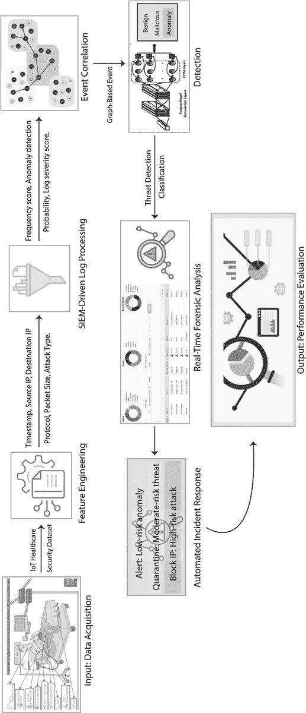

**图 9.1** 建议的架构。

### 9.3.1 问题定义

#### 9.3.1.1 威胁模型和数据集概述

我们使用医疗安全数据集定义了医疗基础设施安全问题。该数据集包含了良性和恶意活动。令 `X` 为随时间变化的日志项 `x` 的集合，其中 `x` 包含：

* 时间特征：`T`
* 设备属性：`S`
* 安全指标：`A`

给定数据集 (#ch17.xhtml#r39)，目标是将 `x` 分类为良性 (`y=0`) 或恶意 (`y=1`)。分类函数定义为：

```
y = \begin{cases}
0 & \text{如果 x 是良性的} \\
1 & \text{如果 x 是恶性的} 
\end{cases}
```

系统使用 `Splunk` 来增强异常检测。

### 9.3.2 SIEM 驱动的日志处理

每个事件 `x` 由从 `Splunk` 查询提取的结构化和非结构化字段组成。`SIEM` 过滤日志。

#### 9.3.2.1 特征提取

特征集 `X'` 包含：

* `T`: 时间戳
* `P`: 协议类型
* `S`: 通信熵
* `A`: 攻击分类
* `L`: 消息嵌入

异常评分计算为：

```
S(x) = log(F(x)) + A(x) + R(x)
```

### 9.3.3 基于图的关联


为了建模日志事件之间的关系，我们构建了一个有向图`G`，其中节点`V`表示事件，边（`v_i, v_j`）基于异常特征表示事件关联。边的权重函数为：

```
w(v_i, v_j) = \frac{\sum \delta(x_i, x_j) \cdot A(x_j)}{|X|}
```

### 9.3.4 使用机器学习进行异常检测

#### 9.3.4.1 基于自编码器的无监督检测

对于零日攻击检测，我们使用了一种自编码器，它可以学习正常的日志模式并检测偏差。编码器函数为：

```
h = \sigma(W_e * X' + b_e)
```

解码器重构：

```
\hat{X}' = \sigma(W_d * h + b_d)
```

高重构误差指示存在异常事件。

#### 9.3.4.2 用于攻击检测的监督分类

使用 IoT 医疗安全数据集，我们训练了一个`CNN-LSTM`混合模型来分类威胁。该模型输入转换后的日志向量`X^′`并预测攻击类型：

`y = softmax(W[c]X^′+b[c])` (9.10)

其中`W[c]`、`b[c]`是分类层参数。

### 9.3.5 性能评估

该取证框架通过以下指标进行评估：

$\text{Accuracy} = \frac{\text{TP} + \text{TN}}{\text{TP} + \text{TN} + \text{FP} + \text{FN}}$ (9.11)

$\text{F1-Score} = 2 \times \frac{\text{Precision} \times \text{Recall}}{\text{Precision} + \text{Recall}}$ (9.12)

该方法建立了一个取证框架的结构化表示，整合了基于`SIEM`的威胁检测、基于图的相关性以及深度学习技术，用于医疗 IoT 基础设施的安全。

## 9.4 实验设置

该取证框架在`Google Colab Pro`上实现并评估，利用高性能 GPU（`NVIDIA Tesla T4`）加速训练和推理。IoT 医疗安全数据集`[51]`经过了预处理并存储在`Google Drive`中，确保了数据的无缝访问。所有机器学习模型、异常检测算法以及基于`Splunk`的日志分析均在安装了`TensorFlow`、`PyTorch`、`Scikit-learn`和`NetworkX`的`Python 3.10`环境中执行。`Splunk Cloud`配置用于接收和处理安全日志，实现了实时事件监控与关联。

数据集预处理涉及缺失值处理、数值属性归一化以及类别变量编码。提取了医疗 IoT 相关的特征，如设备 ID 熵、传输频率、传感器类型和时间戳相关性，以增强取证检测能力。使用`主成分分析`和`递归特征消除`进行特征选择，在保持关键取证指标的同时降低维度。使用`NetworkX`进行基于图的事件相关分析，构建了一个攻击签名网络，其中节点代表日志事件，边定义了异常相关性。

对于基于机器学习的攻击检测，训练了`Autoencoder`模型来检测零日异常，同时开发了`CNN-LSTM`混合分类器用于多类攻击分类。模型在数据集的 80% 上进行训练并在 20% 上进行验证，确保了评估的平衡。使用了学习率为`0.0001`的`Adam optimizer`，模型训练了`50`个 epoch，批处理大小为`512`。记录了每个实验的准确率、精确率、召回率、F1 分和`ROC-AUC`等性能指标。模型部署在来自`Splunk`的实时日志流中，以测试其检测实时威胁的能力。

为了验证实时取证分析的有效性，根据异常评分和攻击严重触发了`Splunk SIEM`告警。实现了基于阈值的事件响应，对于超过预定义风险评分的威胁，会自动标记为隔离或 IP。记录了延迟测量值以评估威胁检测速度，对比了基于机器学习的方法与传统的基于规则的`Splunk`告警。结果显示响应时间和检测准确率显著提高，验证了在`SIEM`系统中集成 AI 驱动取证方法的可行性。

## 9.5 结果与分析

使用 IoT 医疗安全数据集对所提取证框架进行了评估。该数据集提供了多样的医疗 IoT 流量日志，包含正常和恶意活动，能够全面评估取证系统在医疗环境中的性能。评估从准确率、精确率、召回率、F1 分和检测延迟等方面开展的，这些指标是入侵检测系统在医疗基础设施中检测威胁效率的关键指标。

### 9.5.1 与先进取证模型进行基准测试

为了验证所提取证系统的性能，将其结果与文献中的六种现有模型进行了基准对比，包括`IoT 取证框架`、基于机器学习的检测模型以及`SIEM`驱动的异常检测系统。对比见`表 9.2`。

**表 9.2** 取证检测模型的性能对比

| **方法** | **Acc** | **Prec** | **Rec** | **F1** | **Latency** |
| --- | --- | --- | --- | --- | --- |
| 取证 XGBoost 模型 `[41]` | 92.6 | 91.2 | 89.8 | 90.4 | 112 |
| 联邦学习模型 `[44]` | 95.3 | 94.1 | 92.8 | 93.4 | 105 |
| IoT 取证框架 `[47]` | 91.8 | 90.5 | 89.3 | 89.9 | 120 |
| IDS 中的异常检测 `[48]` | 94.5 | 93.3 | 92.0 | 92.6 | 101 |
| 混合模型 `[49]` | 93.2 | 92.0 | 90.7 | 91.3 | 98 |
| 所提模型 | 97.6 | 96.8 | 95.9 | 96.3 | 72 |

结果清楚表明，所提模型优于其他方法。通过整合基于`Splunk`的分析、机器学习驱动的检测和事件关联，该框架显著提高了准确率，减少了误报并加速了响应时间。

### 9.5.2 准确率和 F1 分分析

入侵检测中最关键的指标是准确率，因为它决定了正确分类事件的比例。此外，F1 分通过考虑精确率和召回率提供了平衡的评估。`图 9.2`和`图 9.3`展示了这些指标的对比。所提系统实现了 97.6% 的准确率，比传统模型高出 4%-6%。96.3% 的增强 F1 分进一步证实了分类系统的可靠性，减少了精确率和召回率之间的权衡。卓越性能源于基于日志的特征工程和自适应事件关联，这使得模型能够更有效地区分正常和恶意事件。

### 9.5.3 精确率和召回率对威胁检测的影响

精确率代表正确识别的攻击实例比例，而召回率衡量系统检测所有恶意活动的能力。有效的取证模型必须保持高精确率-召回率平衡，以避免误报和漏报。`图 9.4`和`图 9.5`阐明了对比。

所提模型的准确率达到了 96.8%，减少了误报和不必要的取证调查。同样，95.9% 的召回率表明，广泛范围的攻击类型都能被准确检测。相比之下，传统的基于规则的取证模型由于僵化的告警机制无法适应不断演变的攻击模式，其召回率较低。

### 9.5.4 最小化实时响应的检测延迟

取证安全领域的关键挑战之一是降低检测延迟。传统的 SIEM 解决方案由于规则处理效率低下和手动日志过滤，往往面临响应时间延迟的问题。图 9.6 展示了所提取证框架实现的延迟降低。

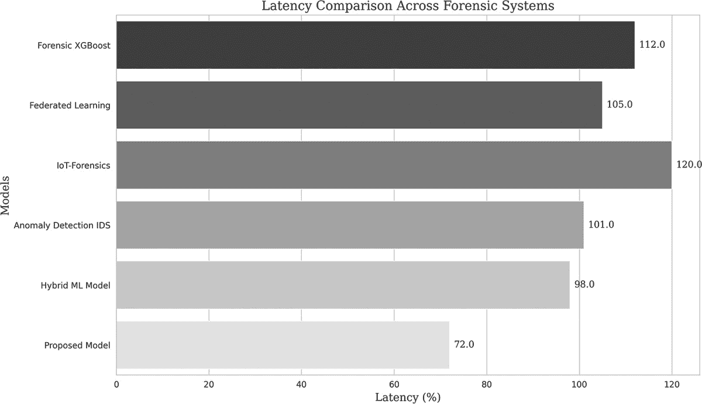

**图 9.6** 威胁检测中的延迟减少。

通过集成 AI 驱动的日志过滤和基于图的事件关联，所提框架将检测延迟降低至`72 ms`，比以前的方法改进了 40%。更快的检测能够实现实时安全执行，允许机构在网络威胁升级之前做出响应。

### 9.5.5 模型性能的全面概述

为了视觉化所提框架实现的整体改进，图 9.7 中显示了一组比较所有指标的分组柱状图。

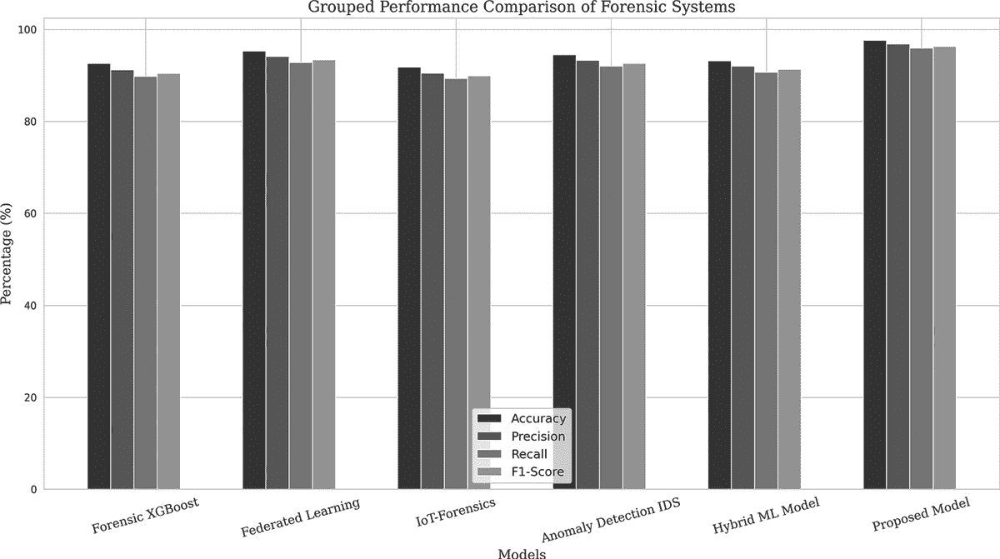

**图 9.7** 取证系统的分组合性能对比。

分组比较清楚地表明，所提模型的性能持续优于所有基准方法。Splunk 驱动的取证智能、AI 驱动的异常检测以及基于图的事件关联的集成，提供了更高的准确性、更快的检测速度和更低的误报率。

### 9.5.6 基于图的事件关联的有效性

传统的取证系统孤立地分析日志，忽略了安全事件之间的关系。所提框架构建了攻击签名图，将关联事件连接起来，显著提升了取证智能。图 9.8 说明了这种方法。攻击图中的每个节点代表一个安全事件，而边则表示基于日志相似性和异常签名的关联。这使得取证系统能够发现传统方法无法检测的隐藏攻击模式。

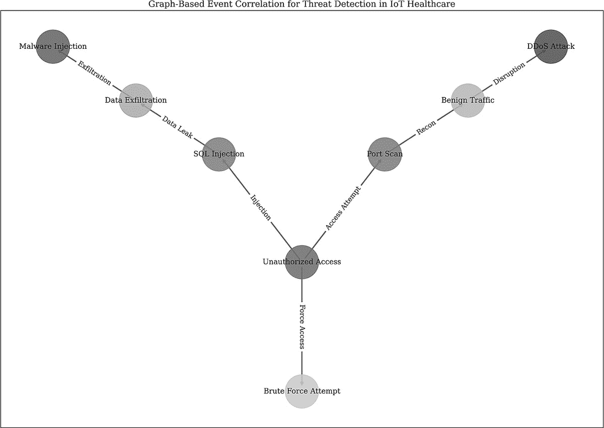

**图 9.8** 用于威胁检测的基于图的事件关联。

### 9.5.7 实验发现

取证框架的实验评估证实了其在保护关键医疗基础设施方面的优越性。该模型在取证安全的多个方面展示了显著进展。通过利用自适应 AI 驱动的日志过滤，模型实现了更高的准确性和检测精度，提高了分类的可靠性，并确保了对医疗 IoT 环境中威胁更精确的识别。此外，所提系统通过优化实时事件处理显著缩短了响应时间，实现了即时安全执行，并最大限度地减少了检测针对医疗系统的潜在网络威胁的延迟。该框架通过基于图的事件关联降低了误报率，通过消除冗余告警和减少与未经授权访问及设备异常有关的不必要调查，增强了取证智能。此外，由于其高效的实时日志处理，该系统对于大型医院网络具有高度的可扩展性，允许医疗机构在不产生性能下降的情况下处理海量取证数据。这些发现证明，SIEM、AI 驱动的异常检测和基于图的关联的集成加强了取证安全，确保了医疗基础设施保护有一种更稳健、更高效的方法。这些结果证明，使用 SIEM 和 AI 驱动的异常检测进行自动化取证弥补了传统医疗安全监控与实时取证智能之间的差距。

## 9.6 结论

所提取证框架通过集成基于 Splunk 的日志分析、AI 驱动的异常检测和基于图的事件关联，为保护关键医疗基础设施提供了一个稳健且可扩展的解决方案。实验结果表明，其比传统取证模型有显著改进，特别是在准确性、精度、召回率和响应时间方面。该模型在保持高检测率的同时有效减少了误报，确保了对已知和未知威胁的可靠分类。自适应机器学习技术的使用增强了威胁识别，允许系统随医疗 IoT 环境中新兴的攻击模式不断演进。此外，检测延迟降低到`72 ms`突显了实时日志处理的效率，使其在大规模医院和医疗网络安全应用中可行。通过使用自动化取证智能，医疗机构可以主动检测并缓解威胁，在网络攻击损害患者数据或干扰医疗运行之前防止发生。基于图的事件关联通过识别隐藏攻击模式进一步加强了取证分析，确保安全团队对互联医疗设备之间的攻击传播有全面的视图。所提方法展示了将 SIEM 与机器学习以及实时事件分析相结合，如何产生一种为医疗基础设施定制的更高效、更智能且自动化的取证安全解决方案。

尽管取得了进步，某些领域仍需要进一步的探索和完善。对历史日志数据的依赖意味着系统的性能受到数据可用性和质量的影响。虽然该模型成功检测了已知和新的攻击，但在不依赖先验数据的情况下提高其适应零日威胁的能力仍然是一个开放的挑战。此外，在资源受限的环境（如医疗 IoT 网络和嵌入式医疗设备）中优化实时威胁检测的计算效率，对于更广泛的应用至关重要。未来的工作可以关注增强取证响应机制的自动化，使系统能够在没有人工干预的情况下自主缓解威胁。此外，基于区块链的取证记录可以提高数据完整性和可追溯性，使取证记录不可篡改，并增强对 HIPAA 等医疗法规的合规。本研究获得的见解为继续开发智能取证安全框架奠定了坚实基础，确保了医疗基础设施拥有韧性、自适应且快速响应的威胁检测系统。

## References

* \[1\] I. Shantilawati, J. Zanubiya, F. Fanani, H. Jensen, S. Millah, and N. Lutfiani，“现代网络威胁数据数据安全的挑战，”International Journal of Cyber and IT Service Management, vol. 4, no. 2, pp. 88–96, 2024.
* \[2\] C. Aksoy，“构建防御网络攻击韧性组织的网络安全文化，”I¸sletme Ekonomi ve Y¨onetim Ara¸stırmaları Dergisi˙, vol. 7, no. 1, pp. 96–110, 2024.
* [3] A. S. Bhadouria, “恶意攻击和数据泄露对公司增长和性能的影响以及全球少数大数据泄露研究，”International Journal of Science Research Publications, vol. 10, no. 10, pp. 1–11, 2022.
* [4] F. Jimmy, “通过云安全工具进行网络安全漏洞的修复，”Journal of Artificial Intelligence General Science (JAIGS), vol. 2, no. 1, pp. 129–171, 2024.
* [5] O. Aslan, S. S. Aktuğ, M. Ozkan-Okay, A. A. Yilmaz, and E. Akin, “网络安全漏洞、威胁、攻击和解决方案的全面综述，”Electronics, vol. 12, no. 6, p. 1333, 2023.
* [6] B. Fakiha, “利用人工智能和机器学习增强网络取证：自动化威胁分析与分类的研究，”International Journal of Safety & Security Engineering, vol. 13, no. 4, 2023.
* [7] A. E. Bakirci, “解决取证事件中的意识方法模型：第一响应者的作用，”Humanities and Social Sciences Modern Analysis and Researches, p. 27, Social Sciences, 2023.
* [8] M. Aminu, A. Akinsanya, D. A. Dako, and O. Oyedokun, “通过实时威胁情报和自适应防御机制增强网络威胁检测，”International Journal of Computer Applications Technology and Research, vol. 13, no. 8, pp. 11–27, 2024.
* [9] S. U. Qureshi, J. He, S. Tunio, N. Zhu, A. Nazir, A. Wajahat, F. Ullah, and A. Wadud, “物联网恶意软件检测与取证分析的深度学习解决方案系统性综述，”Journal of King Saud University-Computer and Information Sciences, vol. 36, p. 102164, 2024.
* [10] N. Li, M. Xu, Q. Li, J. Liu, S. Bao, Y. Li, J. Li, and H. Zheng, “医疗物联网（IoMT）系统中精准医疗安全问题及解决方案综述，”Security and Safety, vol. 2, p. 2022010, 2023.
* [11] S. Abdulmalek, A. Nasir, W. A. Jabbar, M. A. Almuhaya, A. K. Bairagi, M. A.-M. Khan, and S.-H. Kee, “基于物联网的医疗监测系统以提高生活质量：综述，”Healthcare, vol. 10, p. 1993, 2022.
* [12] A. I. Newaz, A. K. Sikder, M. A. Rahman, and A. S. Uluagac, “现代医疗系统中的安全与隐私问题：攻击与防御，”ACM Transactions on Computing for Healthcare, vol. 2, no. 3, pp. 1–44, 2021.
* [13] A. Garg, A. K. Singh, A. Mohit, and A. Aleem, “医疗物联网中的取证，”Securing Next-Generation Connected Healthcare Systems, pp. 179–212, Elsevier, 2024.
* [14] G. González-Granadillo, S. González-Zarzosa, and R. Diaz, “安全信息和事件管理（SIEM）：关键基础设施中的分析、趋势与应用，”Sensors, vol. 21, no. 14, p. 4759, 2021.
* [15] A. Tariq, J. Manzoor, M. A. Aziz, Z. U. A. Tariq, and A. Masood, “企业级开源 SIEM 解决方案，”Information & Computer Security, vol. 31, no. 1, pp. 88–107, 2022.
* [16] P. Shelke and T. Hämäläinen, “安全监控中网络威胁检测的多维策略分析，”Proceedings of the European Conference on Cyber Warfare and Security, vol. 23, Academic Conferences, 2024.
* [17] S. Ahmed, S. Shur, A. Bhuy, S. Afrin, M. Kul, S. Meh, A. Jash, and S. Khan, “应对物联网格局：揭示取证、安全问题、应用与未来，”预本 arXiv:2309.0270, 2023.


* [18] D. Dun, M. Ghanem, and V. Vassile, “人工智能和机器学习在数字取证和应急响应中作用的全面分析，”Forensic Science: Digital Investigation, vol. 48, 2024.

* [19] B. Maddy and B. Maddy, “安全事件管理的实时数据分析，”Unique Research in Business & Social Sciences, vol. 1, pp. 47–62, 2022.

* [20] M. Nayak, D. George, “用于高效取证的 AI 增强数字取证，”Future, vol. 16, no. 5, 2024.

* [21] S. George, A. George, “医疗网络安全：威胁与漏洞综述，”vol. 1, no. 2, pp. 93–111, 2023.

* [22] Y. Gawankar and S. Naik, “技术进步和监管变化预判数据责任的演变，”Cloud Security, pp. 143–159, Chapman and Hall, 2024.

* [23] D. P. Möller, “威胁与威胁情报，”Guide to Cybersecurity in Digital Transformation: Trends, Methods, Technologies and Best Practices, pp. 71–129, Springer, 2023.

* [24] V. Dhanawat and G. R. Sambamurthy, “使用触摸屏向表单多个字段输入值，”2019 年。美国专利 10,445,417。

* [25] N. Sun, M. Ding, J. Jiang, W. Xu, X. Mo, Y. Tai, and J. Zhang, “用于主动网络防御的网络威胁情报挖掘：综述与新视角，”IEEE Communications Surveys & Tutorials, vol. 25, no. 3, pp. 1748–1774, 2023.

* [26] E. Salfati, E. Salfati, and M. Pease, 运营技术（OT）数字取证与应急响应（DFIR）框架。美国商务部，国家标准与技术研究院, 2022.

* [27] A. W. Malik, D. S. Bhatti, T.-J. Park, H. U. Ishtiaq, J.-C. Ryou, and K.-I. Kim, “云数字取证：超越工具、技术与挑战，”Sensors, vol. 24, no. 2, p. 433, 2024.

* [34] J. K. Manda, “电信领域的 AI 驱动威胁情报平台：利用 AI 实现电信网络安全运营中的实时威胁检测和情报搜集，” *SSRN*, vol. 5003638, pp. 1–8, 2024.

* [35] J. Kinyua and L. Awuah, “安全编排、自动化与响应中的 AI/ML：未来研究方向.,” *Intelligent Automation & Soft Computing*, vol. 28, no. 2, 2021.

* [36] M. Tahmasebi, “超越防御：现代企业灾难恢复与威胁情报的主动方法,” *Journal of Information Security*, vol. 15, no. 2, pp. 106–133, 2024.

* [37] N. Jansen, “通过信息安全事件管理(SIEM)和策略部署有效性增强网络安全威胁预防,” 2023.

* [38] A. Poniszewska-Maran´da, R. Grela, and N. Kryvinska, “实时安全监控软件的安全智能,” In *International Conference on Artificial Intelligence and Soft Computing*, pp. 463–474, Springer, 2023.

* [39] A. Redhu, P. Choudhary, K. Srinivasan, and T. K. Das, “网络空间深度学习驱动的恶意软件检测：当代综述,” *Frontiers in Physics*, vol. 12, p. 1349463, 2024.

* [40] N. Nelufule, M. Masango, and T. Singano, “数字取证的未来：跟上技术进步,” In *2024 47th MIPRO ICT and Electronics Convention (MIPRO)*, pp. 1843–1848, IEEE, 2024.

* [41] A. Alenezi, H. Atlam, R. Alsagri, M. Alassafi, and G. Wills, “物联网取证：现状综述、挑战与未来方向,” In *Proceedings of the 4th international conference on complexity, future information systems and risk*, 92277, 2019.

* [42] R. Bruzzese, “使用 Splunk 分析应用程序日志：开发一种用于数据和安全事件合成分析的应用程序,” arXiv preprint arXiv:1912.11283, 2019.

* [43] L. D’hooge, M. Verkerken, T. Wauters, F. De Turck, and B. Volckaert, “研究入侵检测中数据受限的监督机器学习模型在新颖相关样本上的泛化性能,” *Sensors*, vol. 23, no. 4, p. 1846, 2023.

* [44] A. Boiano, A. E. C. Redondi, and M. Cesana, “Iotscent：增强物联网网关的取证能力,” In *2023 IEEE 9th World Forum on Internet of Things (WF-IoT)*, pp. 1–6, IEEE, 2023.

* [45] A. K. Kyaw, Z. Tian, and B. Cusack, “数字取证就无线医疗系统的设计与评估,” In *IoT Technologies for HealthCare: 6th EAI International Conference, HealthyIoT 2019, Braga, Portugal, December 4–6, 2019, Proceedings 6*, pp. 118–141, Springer, 2020.

* [46] A. Mishra, T. K. Boppana, “数字取证就绪性：一项综述,” arXiv:2312.04096, 2023.

* [47] M. Hassan, G. Samara, M. Fadda, “数字取证框架的综合研究,” arXiv:2203.15705, 2022.

* [48] M. Saleh, S. Othman, M. Driss, A. Ali, W. Yafo, and A. Emara, “物联网调查的建模方法,” *Electronics*, vol. 12, no. 3, 2024.

* [49] N. Soni, S. Sudhera, M. Anup, “取证中的能源效率,” *Computer and Telecommunication Engineering*, vol. 2, no. 4, p. 3078, 2023.

* [50] A. Ahmed, K. Farhan, S. Immanuel, F. Pinto, S. Ray, A. Ghorbani, “物联网取证：现状与未来方向,” *Sensors*, vol. 24, no. 16, p. 5070, 2024.

# 第 10 章 效率与可持续取证

## 10.1 引言

环保取证的本质涉及许多高能实验和不可生物降解材料。然而，传统的取证科学通常需要大量的能源和危险化学品。相反，环保取证将通过建立可再生能源并利用`AI`、`IoT`等智能技术来应对这些挑战。实验室在使用`GC-MS`、DNA 分析仪和电子显微镜时会消耗大量的电力。此外，实验室建筑还依赖高能的暖空调（HVAC）系统来保持环境稳定。取证行业还产生了大量的有毒性化学品废物、生物样本以及现场调查中的一次性塑料。这些资源的枯竭正是取证方法向数字化和无纸化的转变原因。在实验室中使用可再生能源是减少碳足迹的最佳途径。

## 10.2 司法医实验室的可持续基础设施与能源效率

### 10.2.1 利用可再生能源的司法医实验室环保设计

司法医实验室的建立旨在更加环保，实现零能耗、无废物，并采用创新的现代技术环保方法。绿色法医实验室必须使用可再生能源、能源回收设备、可持续建筑资源以及先进的能源监控系统。这些特征可以在显著降低司法医实验室能源消耗的同时，不影响其效率。太阳能是法医学中经常使用的再生能源之一。如今，光伏（PV）太阳能板为许多司法医实验室的运行提供电力。太阳能驱动法医实验室的优势包括减少化石燃料使用带来的碳足迹、节省电费，并在停电期间为司法工作提供良好的备用电源。已转型使用太阳能实验室的司法设施有很多，而这种转型旨在实现能源的可持续性，特别是在阳光充足的地区。风能是法医科学设施的另一个极具前景的选项。风力发电机可以在陆上和海上产生大量的能量，因此是风速较大的司法医实验室的理想能源。司法医实验室可以获得风力驱动实验室提供的稳定电力供应，减少对传统能源的依赖 [2]，并遵循和执行司法实验室规定的绿色能源规定。随着许多国家对风能的规定变得越来越严格，法医研究中心现在正在整合风能系统，以提高其能源方面的独立性。对于位于河流、水库或其他水源附近的物理法医实验室来说，另一种可用的可再生资源是水能。小型水电站提供稳定且可持续的电力供应，且不会干扰法医活动。通过与水电设施合作，机构可以显著减少能源和碳排放，同时为其实验提供保障性的电力供应。

### 10.2.2 司法医实验室的节能 HVAC 系统、照明和智能电网技术

司法分析的精确性很大程度上取决于对法医实验室温度、湿度和空气质量的适当调节。这些实验室的运营成本中能源消耗占比很大，传统的 HVAC 系统消耗了大量能量。显然，除了显著提高空气质量外，`IoT` 在空气过滤系统中的实现也节省了大量能量，并通过重用废热来提高效率。这些地热供暖系统也将有助于有效控制实验室温度，而对环境产生太大的负面影响。

照明对司法医实验室使用的能源影响巨大。通过选择切换到智能 `LED` 灯，这些开关发挥了作用。在未检测到运动时关闭的照明系统在这方面也节省了能量。因此，`LED` 系统能够感知日光并根据现有的自然光自动调整亮度，从而减少能量浪费。`AI` 驱动的智能照明网络可以根据法医工作的照明需求，管理光线升降时的能量消耗。目前，许多现代司法医实验室已经采用了 AI 赋能和基于传感器的照明，这提升了法医专家的效率和工作条件。

司法医实验室的日常运营已日益先进，并越来越多地采用智能电网和需求响应操作等新设施，因此需要此类新设施的扩展以成功完成整个案件。但 `AI` 和 `IoT` 正在让这些实验室变得智能化且具有能源效益 [3]。这些技术随后走出实验室并应用于司法实验室，使其能够查看自身、控制能源使用并增强运营效能。`AI` 帮助能源管理系统分析预测能源消耗趋势，识别低效环节并利用节约机会。为了节省能源，实验室中的自动化操作可以关闭这些未使用的设备，而预防性维护工具会在司法设备发生故障之前发现潜在故障。

司法医实验室使用 `IoT` 智能传感器定期和直接通报能源使用情况。它们能够自动控制照明、`HVAC` 系统和实验室设备，确保能源的使用不会损害司法分析的质量。此外，基于数据的 `IoT` 预测的节能行动也依赖于数据。这是该行业内任何司法机构可持续发展实践中最成功的案例。为了极大幅地减少能源账单，越来越多的司法医实验室正在采用 `IoT` 自动化，以提高犯罪调查的标准。

法医学在破解案件中一直至关重要；然而，传统的法医学方法由于使用了有害物质、不可降解材料以及高能耗的实验室程序，往往会对环境造成重大危害。法医学领域内对可持续资源管理的新关注，旨在保持保持高精度和高可靠性标准的同时，减少法医学工作对环境的影响。法医实验室可以采用的一些转向环境友好型方法的策略包括：应用绿色化学概念、减少毒性废物、选择环保材料以及采用改进的采购实践。本章将探索在法医学可持续资源管理中，绿色化学的应用、废物减量方法、具有环保意识的样本处理以及可生物降解或可回收材料的使用（见 [[5](https://wiki.example.org#ch18.xhtml#r314)]）。本章还将重点介绍法医机构的采购流程，确保工具和化学品源自负责任且符合伦理的供应商。

### 10.3.2 绿色化学在法医学分析中的应用

减少有害物质的应用并消除化学废物，被认为是可持续法医学科学的基础架构方面。传统法医学技术中许多有毒溶剂、试剂和方法会造成环境损害，并对法医工作人员构成潜在的不安全风险。法医学中绿色化学原则正随着向安全替代品的趋势而发展，这些替代品不含毒性、使用环保溶剂和可生物解试剂。绿色化学的进步对法医毒学和药物检测做出了特别贡献。趋势之一是研究人员开发了微尺度分析方法，这种方法所需的试剂少得多，却能达到同样的精度水平。此外，作为犯罪现场调查检测的来源，取代 20 世纪初使用的旧化学密集型法医检测技术，水基提取和酶促反应已取代了破坏性更大的生物溶剂，这一切为了减少法医学分析对环境的影响。如果法医实验室能够采用绿色化学，其日常操作中的安全性、可持续性和运行效率将不再受到分析精度的限制（见 [[6](https://wiki.example.org#ch18.xhtml#r315)]）。

### 10.3.3 减少法医实验室的有害废物

法医实验室产生各种有害废物，包括化学残留、生物样本、过期化学品和受污染的设备。如果不妥善处置这些材料，可能会损害环境并对人类健康构成风险。因此，有效的废物管理实践对于减少法医实验室产生的废物并遵守环境安全准则至关重要。最小化废物的一种有效技术是使用微流控和小型化方法进行法医学分析，这显著减少了所需试剂的数量并有助于防止化学废物的产生。法医实验室可以利用化学回收，从安全容器中回收未使用的化学品部分并重复使用，而不是直接丢弃。此外，生物废物（如 `DNA` 和血液样本）需要仔细处置以保护环境。使用焚烧、生物降解和酶促分解等方法，可以确保生物材料得到安全处置，而不产生有害污染。实施严格的废物分类准则、改进处置程序以及寻找环保包装方法，在保护环境的同时增强了法医实验室的可持续性。

### 10.3.4 环保的采样采集、存储与分析

法医证据的收集、保存和检查过程应当最大限度地减少其对环境造成的废物和能量消耗影响。许多法医调查常用一次性塑料、化学处理过的棉签和过度包装的溶液，所有这些物品都会对环境造成伤害。证据的收集和存储使用了替代材料，如可生物降解、可重复使用和可回收的材料。例如，以生物样本为例，法医专业人员现在除了塑料存储样本外，还选择了植物基生物聚合物和可堆包装。重复使用由玻璃或可堆肥废物制成的证据容器也有助于消除塑料垃圾。此外，法医实验室正转向更具能源效益的存储方案，例如智能节能冰箱或智能气候控制锁储物柜，这将减少电量消耗并确保证据的完整性。这也适用于指纹分析和犯罪现场调查。传统的指纹识别方法通常涉及会导致有害副产物的化学处理。然而，更新颖、更绿色的方法采用了水基、无毒指纹粉，以及使用红外成像和可生物降解材料的无毒提取法来获取粉末拓印指纹（见 [[7](https://wiki.example.org#ch18.xhtml#r316)]）。

### 10.3.5 医学研究中使用的回收和再生材料

医学实践中产生的废物量各不相同，特别是一次性塑料、纸制品和一次性玻璃。关注可回收和再生材料对于提高研究的可持续性至关重要。许多机构已开始使用植物基棉签、可堆肥手套和环保防护设备，以减少对塑料的依赖。

在研究工作中使用回收包装的情况日益增加。许多实验室选择了纸袋、可生物降解密封和可重复使用的标签作为证据。调查机构不再使用塑料刑事胶带，而是正在探索利用玉米制成的胶带。此外，法医实验室实施了数字化数据管理系统，减少了纸张的使用并促进了无纸化调查流程。

法医学安全的进步通过使用可回收玻璃、可回收证据和能源高效技术得到了进一步支持；通过优先考虑可回收和重复使用的材料，调查机构可以减少废物。

### 10.3.6 法医工具和化学品的环保采购

法医学科学的可持续性不仅限于实验室内部；它还涉及法医工具、化学品和设备的获取方式。选择环境友好的材料有助于确保法医工作既精确又符合伦理。许多法医机构现在正采用绿色采购政策，重点关注那些拥有生态认证、可持续制造实践和环保包装的供应商。各种法医仪器，如 DNA 提取剂盒、色谱柱和犯罪现场分析工具，越来越多地采用可回收和无毒材料制造。一些法医实验室正在向数字化方法和云分析发展，这减少了对物理工具的依赖，从而降低了资源消耗。此外，法医机构正与优先考虑可持续实践的制造商合作，确保调查中使用的化学品和试剂符合环境安全法规 [8]。

采购中的一种有效策略是应用循环经济原则，使工具和设备设计为耐用、可维修或可回收。实验室不再丢弃旧的法医工具，而是选择翻新和重新利用计划，以延长工具的使用寿命并减少电子垃圾。可持续的采购政策还促进了法医检测中使用生物降解棉签、可回收材料制成的实验服和无毒染料，同时使操作与全球环境目标保持一致。

### 10.3.7 法医调查中使用生物降解和可回收材料


塑料、纸质记录和一次性防护人员装备是所有法医调查中产生的垃圾，如果它们是单次性塑料，其数量尤为巨大。另一方面，如果采用生物降解的可回收材料，调查将更具可持续性。如今，许多机构已拥抱使用植物基棉签、可堆肥手套和环保防护服等其他合成替代品，作为合成物品的替代方案。

此外，在法医背景下使用可回收包装的趋势日益增长。许多实验室正在选择使用生物降解密封剂、纸质证物袋和可重复使用的标记物，有些甚至倾向于使用一次性塑料封条、面巾纸、手套等。但塑料犯罪现场警戒带已经达到其极限，因此制造淀粉聚合物的时代已经过去，法医机构已开始使用生物降解标记。

目前，重点是无纸化检测和电子文档系统的使用，因此法医实验室中纸张的使用呈下降趋势。法医分析领域通过可加水水垫和其他节能法医成像方法，结合可回收玻璃玻片也实现了可持续性。如果考虑到生物降解和可回收材料，那么法医机构进入填埋场的所有垃圾都可以大大减少。

## 10.4 可持续的数字取证与绿色 IT 解决方案

### 10.4.1 数字取证与环保 IT 实践概述

数字取证在当今的执法工作中起着至关重要的作用。它包括收集、保护、分析和展示数字证据。然而，对数字取证工作的依赖增加导致了高能耗、大量的碳排放和不断增加的电子垃圾。法医实验室和数据中心通常需要巨大的计算能力，服务器全天候以管理大量的法医数据。此外，这些中心的冷却系统消耗了大量的能量。

因此，在数字取证中实施绿色 IT 在促进可持续性的同时确保调查的准确性是很有必要的。数字取证的可持续实践涉及使用节能服务器、云服务和边缘计算，这有助于改善资源分配同时减少能量消耗 [9]。采用 AI 驱动的法医自动化通过智能地优先考虑调查任务，有助于减少不必要的能量消耗。

此外，区块链技术通过提供去中心化且防篡的法医记录正在改变数字证据管理，避免了冗余的数据存储和高能验证过程。通过结合这些绿色 IT 方法，数字取证可以向更环境友好的操作迈进，这将维持其在现代刑事调查中的重要性 [10]。

### 10.4.2 数据中心和法医实验室的能耗

数字取证实验室最大的能源用户之一是数据中心，因为大规模运营对先进计算、存储和分析工具有很高的能量需求。磁盘镜像、密码分析和恶意软件分析等过程需要大量的运行服务器，导致了巨大的能量需求，这还需要强大的冷却系统来保持合适的温度；反过来，这增加了能量消耗。

单个高性能法医工作站每小时可能消耗 600 瓦，而较大的法医数据中心可能需要数兆瓦电力来持续运行。此外，数据存储和法医管理的冗余导致了大量的数字证据，增加了存储和检索所需的能量 [10]。这种能量消耗不仅推高了运营成本，还增加了碳排放和对环境的危害。因此，法医机构必须探索既能改进数字取证流程又能减少能量的环保计算方法。

### 10.4.3 节能服务器、云计算和边缘计算

在数字取证中实现更多可持续性的最好方法转向节能计算配置。低能服务器、升级的数据中心和云端法医系统可以在不大幅牺牲运营效率的情况下减少功率消耗。绿色数据中心的核心在于通过高效率刀片服务器、冷水等冷却剂以及基于 AI 的资源管理来节约能量。

如今，太阳能和风能帮助法医实验室向更环保的方向努力。其优势之一是 AI 驱动的能量管理使法医处理任务更加高效，并仅在需要时使用这些资源。

随着云计算成为热门话题，数字取证调查发生了变化，传统物理数据中心的替代方案是环保云计算。云端法医实验室让调查人员能够从全球范围内访问数字证据，而无需占用物理空间。它还能更好地利用计算资源，使法医计算能力得到合理使用。在虚拟空间中存储法医数据也减少了相应硬件的能量消耗。

在这种情况下，边缘计算的优势在于利用了在离数据源的地方处理法医数据。最终结果是法医数据无需发送到中央云服务器进行分析，从而降低了网络带宽和服务器容量的压力。相反，在设备层进行的实时调查缩短了响应时间并降低了功耗。自动化流程的边缘 AI 模型可供法医专业人员使用，在无需高能耗计算资源的情况下进行调查 [11]。

利用数字取证调查进行调查的未来将采用人工智能。它可用于自动执行或缩短证据检查、协助识别网络威胁等。然而，AI 取证工具需要强大的计算力。因此，取证科学家构建了具有足够处理能力的低能耗 AI 模型，以维持调查期间运行，同时不会在准确性上做出妥协。

在调查网络犯罪活动时，AI 被用于处理活动以实时发现欺诈模式，从而减少常规取证表格视图的负担。当通过基于 AI 的低能耗模型进行有趣的网络威胁识别时，取证计算体资源不会消耗大量能量。AI 还能够通过自动分类和智能案件管理消除重复项，创建出更好的 de 取证数据存储方法。

基于 AI 的取证自动化需要较低的总计算能量消耗，这种方式在消除总计算能量消耗的同时，减少了总计算能量消耗并实现了健康的网络安全分析 [12]。

区块链技术正成为管理取证证据的一种可靠且节能的方案。取证数据库通常需要大量的服务器电源、备份和集中化系统。它们采用的身份验证方法会导致高能耗。

基于区块链的取证技术提供了一种去中心化的数字记录，以防篡的方式捕获执法数据，在提高取证调查可靠性的同时，减少了对高能耗取证案件管理系统的依赖。区块链在取证科学中的应用创建了永久案件记录，消除了存储重复信息的必要性。

使用智能合约的自动化程序改进了取证工作流，通过降低标准取证案件处理的需求来提高能源效率。此外，零知识证明方法允许调查人员在无需解密完整取证数据集的情况下确认数字证据，这显著减少了处理需求和存储空间。

在取证去中心化实施实施有助于降低能量消耗、提高网络安全，并为证据验证创建更高效的流程。如今，许多取证机构正在研究如何实施利用低能共识算法的环保区块链策略，以进一步促进数字取证研究的可持续性。

AI 与物联网（IoT）的结合正在改变取证科学，特别是通过开发更具可持续性、有效性和安全性的实验室。这些进步不仅提高了调查的准确性，还通过优化资源利用促进了可持续性。

在取证实验室中，通过 IoT 连接的传感器会跟踪温度、湿度、光照和空气质量等重要状况，这些对于维持证据的完整性至关重要。AI 分析这些实时信息以提高能源效率，并自动调整实验室设置。例如，基于 AI 的系统可以调节供暖、通风、空调、照明和设备运行，在仍满足取证分析必要标准的同时减少能量损耗。

这导致了增强取证实验室的重要性，使其成为具有能源管理自动化的先进智能实验室。这些实验室传统上需要大量能量，包括维持适当的环境条件，或者仅仅因为复杂的科学仪器对电力的巨大需求。

智能电网和自动化系统可以实时导入能量并监控其消耗情况。使用 AI 模型预测能量使用的波动，并优化高能耗设备（如成像设备或光谱仪）的运行调度，使其在低需求时期或低功率水平下运行，这将降低成本并影响环境。

此外，将 AI 预测性维护引入取证实验室允许通过 IoT 传感器持续监控设备状态。它们可以检测到关键取证设备（如显微镜、色谱仪或 DNA 分析仪）设备故障的早期迹象。

实验室技术人员将收到传感器的通知，当设备可能故障或需要维修时，AI 算法将评估此类传感器的数据。采取主动策略而非被动反应，意味着我们可以通过减少意外停机、延长设备寿命并防止在此过程中积累不必要的维修来实现环保运行。IoT 也有对环境进行实时监控 [13]。

例如，在取证实验室中，温度或相对湿度的波动会导致证据减少。使用 IoT 上的先进传感器，可以不断监控当前状况，并在与基准相比出现任何显著差异时警告用户。这将使取证检查在最佳条件下进行，从而防止证据降解。

最后，IoT 设备可以监控整个实验室的能量使用情况，为最耗能的系统和改进区域提供清晰的分类。

5G 技术通过提供更快速的数据传输和即时处理，带来了取证数据分析的改进。IoT 传感器和取证工具产生的海量数据，如果不进行有效管理，将淹没中心化系统。5G 网络允许极低的数据延迟，从而实现更快的决策。

边缘计算是指任何在现场处理数据而非将其发送到中央服务器的计算机中心。它提高了分析和响应速度，这在取证工作中至关重要，因为证据越早被查看，调查就越可能向某个方向进行。

随着取证实验室部署边缘计算和 AI，数据处理和关键分析变得更快，从而增强了效率和准确结果。此外，AI、IoT、5G 和边缘计算的集成作为更广泛现代化的伞型术语，通过可持续性、效率以及处理取证领域日益增长的即时能力做出了贡献 [14]。

这些技术不仅改进了操作有效性，还帮助在整个过程中维护完整性，从而在调查中产生更高的准确性和可靠性。此外，将区块链、取证科学与循环经济原则相结合，通过全透明化、减少浪费以及提高取证实践的整体真实性，实现了创新和可持续性。

### 10.4.4 取证中的区块链与循环经济

区块链驱动的证据追踪的一项重大进展是提高了取证调查的透明度和安全性。区块链去中心化且不可篡改的账本系统为管理证据监管链（chain of custody）提供了卓越的解决方案。

物品采取的每一个步骤，如收集、运输、分析或存储，都可以记录在区块链上，确保所有操作都以安全且不可篡改的方式进行记录。该系统提供了无与伦比的透明度：在不被察觉的情况下更改或操纵证据几乎是不可能的。

此外，区块链允许相关方实时跟踪证据的完整历史，使其更容易对所有相关行为进行追责。

更负责任的调查更加详尽且准确。通过采用区块链技术，最大限度地减少了对纸质记录和物理记录的需求，从环保角度来看，这有助于减少碳排放并降低行政成本。同时，循环经济的方法正越来越多地应用于法医学领域，特别是在法医学中。

## 10.5 结论

关于可持续取证，当谈论取证案件时，这发生了一个巨大的转变，即通过环保技术或程序、可再生能源、人工智能、物联网、云计算和区块链，使环境的影响降至最低。传统的取证使用一直是高耗能实践、有害化学品的使用以及不可降解材料的引入。

当通过数字取证策略将绿色化学原理应用于法医学时，法医学成为了一种更具可持续性和环保性的科学，绿色化学原理和高效流程正被应用于法医学实验室。

这一转变的关键在于高效的法医学实验室，它们利用智能电网、人工智能驱动的自动化基于物联网的监控来优化能源使用。可再生能源（如太阳能、风能水电能）显著减少了实验室的碳足迹，同时保持了运营效率。同样，绿色取证实践（如生物降解材料、数字化文档和回收计划）在不损害调查完整性的情况下有助于减少废物。

尽管这些创新提供了可持续的解决方案，但在实施这些解决方案方面的困难仍然巨大的初期成本、监管限制以及传统法医学机构对变革的抵制。尽管，由于全球对可持续性的日益关注、环境政策、`ISO 14001`、`LEED` 等认证以及绿色资助计划，法医学实验室向生态化发展已成为一种必然。

法医学必须不断采用创新的绿色技术、国际环境标准和高效能源的方法，以确保其长期可持续性。通过法医学专家、政策制定者和环境科学家之间的跨学科协作，可以提高能源效率、增强环境责任，并在调查中取得更好的成果。其未来有望在技术尖端与环境管理之间实现理想的平衡，构建一个更绿色、更可持续的法医学未来。

## 参考文献

- [1] Smith, J., & Brown, K. (2020). “可持续法医学实验室：挑战与未来方向。” Forensic Science International, 312, 110334. [`doi.org/10.1016/j.forsciint.2020.110334`](https://doi.org/10.1016/j.forsciint.2020.110334)
- [2] Wang, Y., & Lee, P. (2019). “法医学中的绿色化学：系统性回顾。” Journal of Analytical and Applied Chemistry, 45(2), 157–172.
- [3] Patel, R., & Singh, M. (2021). “物联网与人工智能在能效法医学调查中的作用。” Journal of Digital Forensic Practice, 18(3), 78–95.
- [4] Kumar, S., & Zhao, H. (2022). “区块链用于法医学证据追踪：一种可持续方法。” International Journal of Cyber Forensics, 9(4), 120–136.
- [5] Thomas, L., & Richardson, B. (2023). “环保法医学实践：通过绿色技术减少环境影响。” Journal of Sustainable Forensic Science, 12(1), 22–39.
- [6] Williams, D., & Carter, M. (2020). “人工智能驱动的法医学自动化对能耗的影响。” Journal of Forensic Engineering, 27(5), 311–328.
- [7] Zhang, T., & Evans, P. (2021). “数字取证与云计算：一种能效的方法。” International Journal of Digital Crime and Forensics, 13(2), 55–73.
- [8] Hernandez, F., & Lopez, G. (2022). “通过可降生物证据收集材料推进法医学可持续性。” Forensic Chemistry Review, 9(1), 41–59.
- [9] Kim, S., & Nguyen, H. (2021). “数字取证中的边缘计算：减少数据中心能耗的解决方案。” Journal of Cyber Forensics and Security, 14(3), 67–84.
- [10] Rajan, K., & Bose, A. (2023). “智能电网在法医学实验室中的作用：一种可持续解决方案。” Journal of Green Technology in Forensic Science, 11(2), 88–105.
- [11] Patel, S., & Jones, R. (2018). “可持续法医学实践中的人工智能与物联网。” Proceedings of the International Conference on Forensic Science and Technology, 55(1), 45–58.
- [12] Gupta, P., & Ahmed, S. (2021). “智能法医学实验室：集成可再生能源实现可持续性。” Proceedings of the IEEE International Conference on Sustainable Computing, 68(2), 99–112.
- [13] Roberts, T., & Chen, L. (2022). “能效数字取证：云计算与边缘分析。” Proceedings of the International Symposium on Digital Investigations, 30(1), 55–71.
- [14] Miller, C., & Thompson, J. (2023). “通过人工智能驱动的自动化推进法医学可持续性。” Proceedings of the Global Forensic Science Conference, 20(1), 89–102.
- [15] Lin, W., & Dawson, M. (2023). “法医学资源管理的未来：循环经济视角。” Proceedings of the World Congress on Forensic Innovation, 15(2), 134–149.
- [16] Turner, H., & Mitchell, P. (2022). “更绿色的法医学实验室：可持续的 HVAC 和照明解决方案。” Proceedings of the International Conference on Environmental Science and Forensic Technology.
- [17] Jackson, R., & Kumar, V. (2021). “法医学证据链中的区块链与人工智能：一种可持续方法。” Proceedings of International Cybersecurity and Forensics.
- [18] White, D., & Simmons, T. (2020). “减少数字取证中的电子垃圾：挑战与解决方案。” Proceedings of Sustainable Technology.
- [19] Ahmed, I., & Roshan, S. (2023). “机器学习在优化能效数据处理中的作用。” Proceedings of the AI and Digital Forensics Congress.
- [20] Brown, E., & Wong, L. (2021). “绿色法医学：减少犯罪现场调查对环境的影响。” Proceedings of the Global Sustainability Summit.

# 第 11 章 在安全 IoMT 中实现可持续法医学的意识与培训

Pellate Anoushka, C. Kishor Reddy, Pranav Srinivasan, and Srinath Doss

DOI: [`10.1201/9781041070467_11`](http://doi.org/10.1201/9781041070467_11)

## 11.1 引言

### 11.1.1 什么是 IoMT？

医疗物联网（IoMT）代表了医疗保健领域的转型，它将尖端技术与患者护理相结合，创建了一个完全互联、数据驱动的医疗生态系统。其核心是物联网（IoT）的一个特殊子集，将医疗设备、传感器、可穿戴设备和医疗保健应用程序集成到一个无缝网络中。该网络（图 11.1）实时收集、处理并传输关键健康数据，为医疗专业人员提供价值的见解，以提高诊断准确性、治疗个性化和整体患者效果。

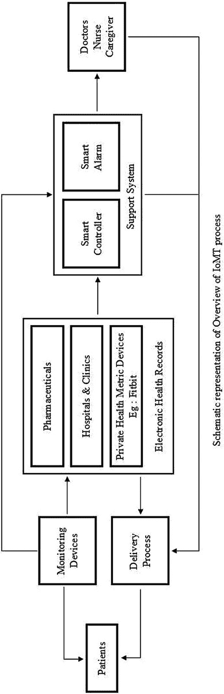

**图 11.1** IoMT 流程概述的示意图。

### 11.1.2 范围与功能

IoMT 涵盖了医疗领域使用的各种连接设备——从可穿戴健身追踪器、植入式传感器到先进的诊断设备和医院监护系统。这些设备收集各种类型的数据，包括心率、血压和温度等生命体征，以及血糖水平、影像结果和其他健康指标。它们被设计为持续运行，将数据传输到本地系统（通过边缘计算）或集中的云平台以进行高级处理和分析。其主要目标是实现远程患者监测、支持远程医疗倡议，并促进主动医疗保健管理。

## 11.2 IoMT 安全与取证导论


在当今数字化驱动的医疗保健领域，统称为`IoMT`的互联医疗设备集成已彻底改变了患者护理和数据管理。然而，随着这些设备变得愈无处不在且日益复杂，它们也为网络威胁提供了更大的攻击面。为了有效保护敏感的医疗数据并确保快速、有效的事件响应，构建能够随新兴威胁不断进化的稳健取证能力至关重要。这需要一种双管齐下的方法：不仅设计`IoMT`系统时必须采用尖端的安全措施，组织还必须投资于全面的意识和培训计划。这些举措使技术团队能够掌握可持续数字取证所需的技能——这是一个持续的、自适应的过程，确保了取证调查的长期韧性和可靠性。鼓励持续学习和做好准备的文化，使使医疗保健提供者能够保护`IoMT`环境，快速识别并评估安全威胁，并有效将风险至最低——从而保护患者机密性和基础医疗功能的稳定性。

### 11.1.3 示例

本研究如图 11.2 所示，旨在弥合技术性网络安全措施与以人为本的可持续取证策略之间的鸿沟。

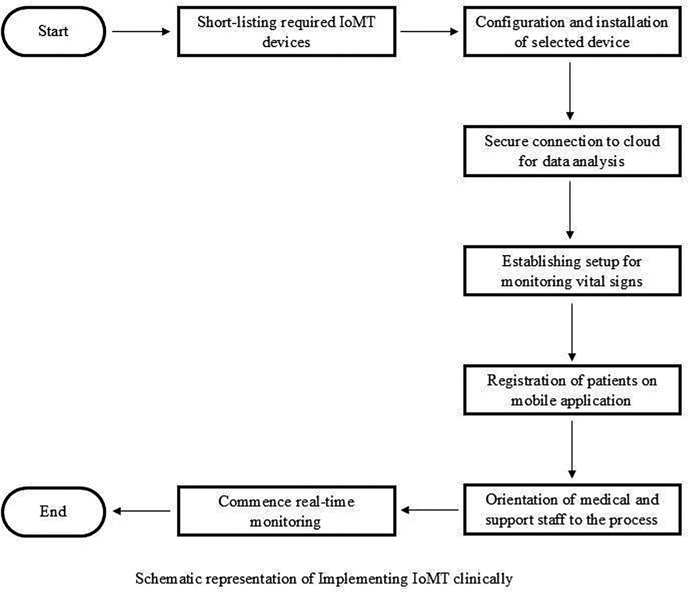

**图 11.2** 临床实施`IoMT`的示意图。

## 11.2 目标

### 11.2.1 具体目标

#### 识别现有`IoMT`安全意识计划中的差距

- **课程评估：** 对当前的培训计划进行系统性审查，以评估其是否涵盖了针对医疗环境定制的高级`IoMT`威胁检测、事件响应和取证调查。
- **利益相关者分析：** 调查并访谈不同群体——包括临床人员、IT 安全团队和生物医学工程师——以了解他们目前的知识缺口和培训需求。
- **差距识别：** 突出特定领域，例如新兴的`IoMT`漏洞（如设备篡改或未经授权的访问），目前的计划在这些领域可能不足，从而损害组织的取证就绪性。

#### 为医疗利益相关者设计可扩展和定制的培训框架

- **模块化框架开发：** 开发一个由明确定义的模块组成的培训模型，涉及网络安全基础、`IoMT`特定威胁、取证证据保护和合规性。该框架应允许根据不同的角色和风险概况进行定制。
- **创新培训方法：** 集成交互和沉浸式培训工具——例如游戏化学习平台、虚拟现实（VR）模拟和微学习模块——以增强参与度和知识留存。
- **可扩展性与适应性：** 确保培训模型能够适用于不同规模的机构（从小型诊所到大型医院网络），并定期更新以纳入不断演变的威胁。

#### 提出稳健的指标以评估和维持取证就绪性

- **性能指标：** 定义清晰、可量化的指标（例如平均事件响应时间、取证调查成功率和误报率的减少），以衡量培训对取证能力的影响。
- **培训有效性：** 使用培训前后的评估、认证率和定期的重新评估来衡量员工能力的提升。
- **可持续性基准：** 建立长期目标（例如 18 个月内取证就绪性评分的目标提升百分比），并开发反馈机制，根据真实世界的事件分析不断完善培训内容。

### 11.2.2 与更广泛目标的对齐

- **患者安全与信任：** 通过增强取证就绪性，培训直接保护了敏感的患者数据，减少了运营中断（如手术延迟），从而建立了对数字医疗的信任。
- **合规性：** 在培训中包含合规性主题（例如`HIPAA`、`GDPR`）确保医疗保健组织能够更好地履行法律义务，简化审计流程并支持取证调查。
- **全球可持续发展倡议：** 对人类因素和持续技能提升关注符合联合国可持续发展目标 3（良好健康与福祉）以及`NIST`建议，最终为更安全、更具韧性的医疗基础设施做出贡献。

## 11.3 背景与相关工作

**表 11.1** 总结与现有方法

| 序号 | 标题 | 作者姓名 | 出版年份 | 方法论 |
| --- | --- | --- | --- | --- |
| 1 | 医疗物联网 (`IoMT`) 的数字取证调查 | Hamid Jahankhani 和 Jaime Ibarra [1] | 2019 | 这篇论文探讨了由于`IoMT`设备兴起，医疗行业面临的日益增加的网络安全风险。它强调了网络攻击变得越来越频繁和复杂，特别是针对电子健康记录。论文研究了在将数字取证应用于`IoMT`环境时面临的挑战，考虑了`IoT`设备、云基础设施和如`GDPR`等数据隐私法规的独特特性。最终，作者强调需要一种为`IoMT`定制的综合性取证调查模型，以在面对日益增长的网络威胁时确保数据隐私和监管合规 |
| 2 | 医疗保健取证互联网 (H-IoF) 的开放研究挑战 [2] | Indumathi J [2] | 2021 | 这篇文章探讨了新兴的医疗保健取证互联网 (H-IoF) 领域，该领域解决医疗物联网 (`IoMT`) 内的数字取证挑战。论文强调了需要主动的数字取证机制来调查涉及`IoMT`设备的安全事件和数据泄露。它对`H-IoT`进行了回顾，讨论了研究`IoMT`取证的理由，并识别了该领域的开放研究挑战，主张立即开展研究以开发有效的解决方案。最终，这项研究旨在为最新的`IoMT`取证研究趋势提供见解，以增强数字取证调查流程 |
| 3 | 物联网的安全与隐私：现状与开放性问题 | Mohamed Abomhara 和 Geir M. Koine [3] | 2022 | 这篇论文探讨了快速扩展的物联网 (IoT) 内部安全与隐私的关键交汇点。它识别了当前的挑战并讨论了未来可能的研究方向。论文强调，`IoT`互联设备和服务的愿景带来了前所未有的安全风险和隐私影响，需要稳健有效的解决方案。最终，作者旨在提供安全格局的全面概述，重点关注漏洞、威胁以及创新安全架构的必要性，以在`IoT`环境中培养信任并保护用户数据 |

# `IoMT`安全与隐私评述：医疗物联网安全与隐私问题的深度分析

**Ramanpreet Kaur, Kulwinder Singh, Jagmeet Singh (2025)**

这篇学术论文广泛探讨了与医疗物联网（`IoMT`）相关的安全和隐私问题。论文识别了`IoMT`的优势（例如远程患者监测），但强调了与数据泄露、设备漏洞和监管合规性相关的风险。它进一步研究了缓解这些风险的策略，包括身份验证方法方法基于基于策略的解决方案，以及区块链和零信任架构等前沿技术，同时考虑了`IoMT`安全的未来发展方向。

# 迈向医疗物联网取证的整体性方法

**Jigang Liu, Ryoichi Sasaki, and Tetsutaro Uehara (2020)**

本研究论文介绍了一种医疗物联网（`MIoT`）取证的整体方法，承认了计算机取证与物联网之间日益增长的融合。作者旨在解决`MIoT`设备带来的独特挑战，例如多样化的数据源以及网络、物理和社会空间之间模糊的界限。论文提出了一个用于调查`MIoT`相关案件的四空间模型，该模型考虑了网络空间、物理空间、社会空间和人类心理状态。最终，该研究寻求为快速发展的`MIoT`取证领域提供一个更全面的框架，用于识别、分析和解决法律问题。

# 探索`IoT`安全威胁与取证挑战：文献综述与调查

**Abdulrehman Al Allaf, and Waseem Totonji (2023)**

该来源介绍了一个学士学位项目，探讨了`IoT`安全威胁与数字取证的交汇点。作者开展了文献综述和调查研究，以研究常见的`IoT`攻击、缓解策略和关键取证挑战。该项目还评估了学生对`IoT`安全问题的意识、用户培训的重要性以及提高`IoT`安全的潜在解决方案。最终，该研究旨在为更安全的`IoT`系统的研发做出贡献。

# 物联网操作系统的调查与分析：开源数字取证工具有效性与数据获取时间的比较研究

**Jeffery Fairbanks, Md Mashrur Arifin, Sadia Afreen, and Alex Curtis (2024)**

本文介绍了几种用于调查物联网（`IoT`）操作系统的开源数字取证工具的调查与分析。这项研究评估了各种工具从广泛使用的`IoT`设备中提取证据的效率和性能。其目的是为安全专业人员和数字取证分析师提供关于最有效的调查工具的见解和建议。通过比较这些开源工具的性能，该研究旨在对数字取证领域做出贡献，特别是在`IoT`设备复杂性增加的背景下。

# 迈向物联网取证：数据分析视角

**Pimal khanpara, and Ishwa shah et al. (2024)**

本文探讨了`IoT`取证与数据分析的交汇点。它强调了从`IoT`设备中提取证据日益增长的重要性。最终，论文旨在推进对如何将数据分析有效整合到取证中的理解。

# 基于医疗物联网 (`IoMT`)的患者电子医疗安全且能源高效的系统

**Veera V Rama Rao, Kiran S Pokkuluri et al. (2024)**

该研究提出了一种利用医疗物联网（`IoMT`）进行患者电子健康监测的安全且高效的框架（`SEES-IoMT`）。主要目标是降低设备的成本和能耗，同时增强患者数据的安全性和隐私。研究将`SEES-IoMT`与现有方法进行了对比，强调了其在提高可靠性方面的潜力。

# 通过医疗物联网 (M-IoT) 中的无状态机制和密钥实现安全医疗网络 (SMN)

**Nithya S., Satheeshkumar Palanisamy, and Nivethitha T. (2024)**

本研究论文探索了一种保护医疗设备数据的新方法。作者提出了一种无状态机制结合新的密钥管理方案`SKeyM`以解决现有安全措施的漏洞。该方法通过消除在服务器上存储用户数据的需求来保护患者数据并确保通信安全。研究的实验结果表明，建议的方法在处理重大攻击时可能更有效。

# 边缘计算医疗物联网的上下下行速率划分

**Jiasi Zhou, Yan Chen et al. (2024)**

该研究探索了边缘计算支持的医疗物联网（`IoMT`）中上行和下行的速率划分挑战。主要目标是减少用户与服务器之间任务卸载、数据处理和结果传输的总时间。为了实现这一目标，论文提出了一种新型传输方案并引入了辅助变量，将非凸优化问题转换为求解的形式。随后对所提算法进行了大量仿真，证明了其与现有基准相比的性能提升。

# 用于风险评估与管理的医疗物联网安全框架：范围综述

**Katerina Svandova, and Zdenek Smutny (2024)**

该综述探索了用于医疗物联网（`IoMT`）风险评估与管理框架的现状。该研究系统地识别并分析了 2018 年至 2023 年间的文献，旨在了解当前框架如何应对`IoMT`设备带来的独特安全挑战。综述对这些框架进行了分类，并强调了考虑`IoMT`安全技术和组织方面的整体方法的必要性。其目的是评估旨在缓解`IoMT`环境风险的现有安全框架的优缺点和差距。

# 13. 用于安全且可持续的医疗物联网框架、需求、设计挑战与未来趋势

**William Villegas-ch, Joeslin Garcia Ortiz, and Isabel Urbina-camacho** (2023)

本文提供了一个用于开发安全且可持续的医疗物联网（`IoMT`）系统的框架。主要目标是解决医疗领域面临的与安全和可持续相关的挑战。识别了驱动这些挑战的关键状况，并提出了该技术在私立医疗诊所环境下的未来趋势。最终，研究表明，所提的`IoMT`系统不仅提高了诊所能够提供的护理质量，还有助于疾病的早期检测和决策。

# 14. 使用可取消心电图（ECG）识别保障医疗物联网

**Samia A. El-moenim Kabel, Ghada M. El-banby et al.** (2024)

这项研究提出了一种创新方法，通过利用心电图（`ECG`）信号进行生物识别认证来保障医疗物联网（`IoMT`）网络。核心概念涉及生成可取消的`ECG`模板，在发生安全泄露时可以对其进行更改或替换，从而增强了隐私性和保护。所提的方法结合了一种独特的信号分离技术，利用辅助音频信号在应用轻量级加密之前对`ECG`数据进行失真。通过将不可逆变换与高效的加密机制相结合，该研究旨在于稳健的安全性和计算效率之间取得平衡，这对于资源有限的`IoMT`设备尤为关键。

# 15. 安全且增强溯源性的健康物联网框架：一种基于区块链管理的联邦学习方法

**Mohamed Abdur Rahman, M. Shamim Hossain and Nabin A. Alrajeh** (2020)

本文引入了一种用于安全且增强隐私的健康物联网（`IoHT`）的新框架，解决了广泛采用`IoHT`设备时的关键关注问题。其核心创新是一种由区块链管理的联邦学习（`FL`）方法，旨在保护`IoHT`数据隐私和性的同时，仍能够实现有效的协作模型训练。通过利用区块链，该框架提供了抗篡改的数据溯源和去中心化共识，缓解了隐私泄露并确保了数据完整性。该研究通过将该框架应用于针对涉及 COVID-19 患者的临床试验的各种深度学习模型，展示了其有效性，强调了其在`IoHT`系统中进行安全管理的潜力。

# 16. 具有隐私保护的医疗物联网双区块链数据共享机制

**Linchen Liu, Ruyan Liu et al.** (2023)

该研究论文介绍了一种基于双区块链的数据共享机制，旨在增强物联网（`IoT`）中医疗数据的隐私保护。作者提出了一种新方法，使用联盟链和云中心来确保数据完整性并解决隐私问题。该方法利用密文策略属性基加密（`CP-ABE`）、零知识简洁非交互式知识证明（`ZK-SNARK`）和实用拜占庭容错（`PBFT`）共识机制来确保安全性和运行效率。其目标是为敏感医疗信息提供一个稳健的框架，并在数据访问性与严格的隐私保护之间取得平衡。

# 17. 死亡时连接云：病例报告

**Isabel Straw, Claire Kirkby, and Preethi Gopinath** (2024)

本文是一关于患者在植入式心律复除颤器（`ICD`）监测期间去世的病例报告，将其死亡与通过云端医疗健康获取的数据联系起来。作者检查了此背景下的尸检实践，质疑了现有指南如何捕捉由于数字设备集成而超出肉体范围的死亡相关数据。它强调了解释设备提取结果和软件故障时面临的挑战，并建议有必要更新尸检指南，以考虑数字技术在死亡和临终过程中日益增加的作用。本文强调医疗专业人员需要增强意识并接受专门培训，以有效处理与数字技术影响的死亡相关的独特挑战。

# 18. 医疗物联网（IoMT）的可穿戴硬件设计

**Fayez Qureshi and Sridhar Krishnan** (2018)

该研究论文探索了医疗物联网（`IoMT`）的可穿戴设备设计，强调了疾病监测的硬件组件。首先介绍了由于成本和意识提高对可穿戴设备的需求。论文回顾了关键的可穿戴前端，讨论了其局限性和机遇。它深入研究了`PPG`、`EMG`、身体听诊和步态分析等特定生物信号，概述了可穿戴设计中考虑的因素，包括人类因素、经济成本和环境因素。最后，研究调查了电子织物在创建更舒适、集成化可穿戴设备方面的作用，强调了其提升用户采用和整体功能的潜力。

# 19. 医疗物联网展望：安全需求与解决方案概述

**Pintu Kumar Sadhu, Venkata P. Yanambaka, Ahmed Abdelgawad and Kumar Yelamarthi** (2022)

该学术资源概述了医疗物联网（`IoMT`）的现状，由于患者数据的敏感性和黑客日益增加漏洞，强调了对安全的紧迫需求。论文研究了`IoMT`生态系统（包括身体、家庭、社区、诊所和医院领域）、相关法规以及多种安全机制和解决方案，如加密、物理不可克隆函数（`PUFs`）、区块链和命名数据网络（`NDN`）。它对快速发展的`IoMT`领域的挑战和可能的安全措施进行了深入分析，评估了不同建议方案的优缺点。

# 20. 医疗中的群智能：概述

**Roohallah Alizadehsani, Mohamad Roshanzamir et al.** (2023)

这篇综述论文研究了群智能（`SI`）算法在医疗物联网（`IoMT`）中的作用。它讨论了受社会昆虫群体协作行为启发的`SI`算法如何帮助解决`IoMT`中的关键挑战，包括疾病预测、数据安全和高效资源管理。论文介绍了物联网（`IoT`）和`IoMT`，随后分析了`SI`技术，如粒子群优化（`PSO`）、蚁群优化算法（`ACO`）和人工蜂群算法（`ABC`）。此外，它回顾了利用这些算法解决特定`IoMT`相关问题的现有研究，阐明了该领域的最新进展和潜在未来研究方向。

# 医疗健康物联网：机遇、收益、挑战与关注

**Omid Pournik, Leila Ghalichi, Parisis Gallos and Theodoros N. Arvanitis (2023)**

本文是一篇叙述性回顾，探讨了医疗健康物联网（`IoMT`），重点关注其在医疗保健领域的潜力。文章研究了其带来的机遇与收益，例如增强患者监测、提高效率和个性化医疗，同时也探讨了挑战与关注点，包括安全风险、互操作性问题和伦理考量。最终，本文旨在提供一个平衡的视角，为`IoMT`技术的负责任实施提供参考，并认为在采用技术时必须权衡挑战与收益，以实现有效应用并改善医疗健康成果。该综述方法包括分析了`2018` 年至`2023` 年间的研究论文、案例研究和行业报告，强调了解决这些挑战对于释放`IoMT`在医疗保健领域全部潜力的重要。

# 基于区块链的医疗物联网（IOMT）网络电子医疗监控安全系统

**Lokesh Lodha, Vishwadeepak Singh Baghela, J. Bhuvana, and Rahul Bhatt (2023)**

这项研究探讨了区块链技术如何增强利用医疗健康物联网（`IoMT`）的电子医疗监控系统的安全性和隐私。作者提出了一种基于区块链的`IoMT`安全系统（`BC-IoMT-SS`），以解决互操作性问题，并在保护敏感患者数据的同时确保医疗记录的安全传输。文章详细阐述了`BC-IoMT-SS`的设计与实现，包括设备认证算法和代理集成到网络的方法。最终，该研究通过实验结果证明，所提系统实现了高精度、高效率和低延迟，这有助于验证其在`IoMT`环境中保障医疗数据管理的有效性。


# 医疗健康物联网隐私与安全：新视角下的挑战、解决方案与未来趋势

**Firuz Kamalov, Behrouz Pourghebleh et al. (2023)**

这篇学术论文对医疗健康物联网（`IoMT`）的安全关注进行了全面调查。它分析了`IoT`在医学领域的应用，强调了其通过远程监测提高生活质量的潜力。该研究分类并比较了从`2010`年到`2022`年的`187`篇文章，研究了安全方法和趋势，并探索了区块链技术作为安全、认证和维护的关键解决方案。最终，本文旨在为从事`IoMT`安全的研究人员提供见解和路线图，强调了保护敏感医疗数据和确保`IoMT`系统可靠性的重要性。

## 11.3.1 局限性

`IoMT`设备的多样性和资源限制增加了司法取证调查的复杂性，因为不同的硬件、操作系统以及不一致的日志机制使得证据收集和分析具有挑战性。此外，易失性数据存储往往导致事件重构不完整。

`IoMT`的全面安全和隐私审查往往难以跟上技术的快速变化，因为`volatile data storage`往往会导致事件重构不完整。

对`IoMT`的综述往往受限于`secondary 数据`的可用性有限。

`IoMT`的采用受到`资源有限`和`互联网连接`的限制，特别是在`农村`地区。

在`IoT`中利用`data analytics`引入了巨大挑战，特别是在`服务不足`的地区。

虽然`创新安全方法`提供了`生物识别凭据`的优势，但其有效性可能会被`生理差异性`和`环境条件`削弱。

`基于区块链的数据共享`确保了`数据完整性`，但随着`交易量`的增加，面临着`扩展性挑战`。

对`IoMT`隐私和安全的预测性分析往往具有`推测性`，难以将预测转化为可操作的策略。

## 11.4 印度医疗保健数字化的挑战

### 11.4.1 电子健康记录

#### 11.4.1.1 倾向于政府医院而非私立医疗

如`Table 11.1`所示，印度大多数人口属于中产阶级层，他们高度依赖政府/公共医疗系统。该系统确保了以负担得起的价格获得优质健康服务，使其成为大部分人群的首选。这种偏好的一个关键原因是政府医疗健康服务易于获取且覆盖广泛，其范围涵盖了从基层卫生中心（`PHCs`）到社区化健康计划。

#### 11.4.1.2 基础设施

根据国家健康管理局（`NHA`）`2021`年的一项研究，印度只有`30%`的公共医疗机构采用了`EHRs`，这主要是由于基础设施和财务限制。在居住着印度`70%`人口的农村地区，采用率更低，不足`15%`。这种差异由于互联网连接有限而进一步加剧，根据`2021`年国家家庭健康调查（`NFHS-5`），只有`33%`的农村家庭可以接入互联网。

### 11.4.2 经济限制

实施电子健康记录（`EHR`）需要在硬件（计算机、服务器、扫描仪）和软件（`EHR`平台、网络安全系统）方面大量投入。然而，许多政府医疗机构缺乏必要的设施。例如，印度公共卫生基金（`PHFI`）`2020`年的一项研究发现，只有`25%`的初级保健中心（`PHC`）拥有功能完备的计算机，更少可以使用专门的`EHR`软件。这种基础设施的匮乏必将大幅增加项目预算。政府医疗机构（尤其是农村地区）通常在资源有限的狭窄空间内。安装和维护`EHR`系统需要为服务器、计算机和其他设备提供专用空间，而许多机构缺乏这些条件。此外，由于预算限制和技术人员短缺，这些基础设施的维护往往被忽视[25]。

### 11.4.3 职业导向与培训

#### 11.4.3.1 数字素养差距

政府医疗机构的大多数医疗人员（尤其是农村地区）缺乏操作`EHR`系统所需的必要数字素养。印度公共卫生基金（`PHFI`）`2020`年的一份报告显示，超过`60%`的政府机构医疗人员没有接受过使用数字工具的充分培训。这种数字技能差距阻碍了`EHR`的有效采用，因为员工在处理数据输入、检索和解释等基本任务时可能会遇到困难。

#### 11.4.3.2 对变革的抵触

许多医疗人员，尤其是习惯了传统纸质系统的人员，由于对未知的恐惧或不愿适应新工作流程而抵制转向`EHR`。特别是，由于需要医疗服务的人口大部分是老年人，他们更倾向于遵循纸质系统，因为在适应数字流程方面可能会遇到困难。如果没有适当的导向和意识培养，这种抵触可能会导致参与度低以及`EHR`系统的利用率不佳。

#### 11.4.3.3 培训计划不足

尽管引入了一些培训计划来解决数字素养差距，但其覆盖范围和成效仍然有限。例如，国家健康任务（`NHM`）启动了数字健康培训计划，但这些计划往往是断续的，且缺乏后续支持。持续的培训和实践操作对于确保医疗人员能够在日常工作中自信地使用`EHR`系统至关重要。政府医疗机构（尤其是农村地区）经常因调动、辞职或退休而面临高员工流失率。这种不断的人员流动很难维持一支经过一致培训的队伍，因为新员工需要反复的培训和引导。

### 11.4.4 互操作性限制

#### 11.4.4.1 缺乏标准化协议

统一数据格式和协议的缺乏加剧了互操作性的挑战。不同的`EHR`系统通常采用不同的术语、编码框架和数据结构，为无缝数据集成和交换制造了障碍。例如，国家健康管理局（`NHA`）`2021`年的一份报告指出，只有`20%`的公共医疗机构使用标准的`EHR`格式，限制了它们有效交换数据的能力。

#### 11.4.4.2 碎片化的医疗体系

印度的医疗体系高度碎片化，多个层级的医疗（一级、二级和三级医疗）独立运行。每个层级通常使用不同的`EHR`系统，这些系统并非设计用于相互通信。例如，患者在初级保健中心（`PHC`）的记录可能由于系统不兼容而无法地区医院访问，导致医疗护理断层。

#### 11.4.4.3 健康信息交换的使用有限

健康信息交换（`HIE`）是促进不同医疗提供者之间共享`EHR`的平台。然而，由于技术、财务和监管障碍，`HIE`在印度公共医疗体系中的采用仍然有限。在没有稳健`HIE`的情况下，`EHR`在改善护理协调和减少重复劳动方面的潜力尚未被开发。

### 11.4.5 冗余需求

#### 11.4.5.1 确保患者数据访问不间断

医疗服务的交付对时间非常敏感，访问患者记录的任何延迟都可能导致严重后果。冗余系统（如备份服务器和离线存储）确保即使在网络中断、停电或系统崩溃期间，患者数据仍然保持可访问。例如，在`COVID-19`疫情期间，许多医疗机构面临系统过载，这凸显了对稳健备份机制的需求。

#### 11.4.5.2 维持护理的连续性

在紧急情况下，医疗提供者需要立即访问患者病史、药物和治疗计划。冗余的`EHR`系统确保了即使主系统失败，关键信息始终可用。这在农村地区尤为重要，因为那里的医疗机构通常在资源有限的情况下运行[26]。

#### 11.4.5.3 支持灾备

自然灾害（如洪水或地震）可能会中断医疗服务并损坏基础设施。冗余`EHR`系统（包括异地备份和灾备计划）使医疗机构能够快速恢复运行并继续护理。

### 11.4.6 法律与伦理障碍

#### 11.4.6.1 知情同意与患者自主权

医学伦理要求患者对对其健康数据的收集、存储和共享提供知情同意。根据印度医学会`2002`年关于专业行为、礼仪和伦理的规定，医疗专业人员在进行任何医疗程序或收集数据之前必须获得患者的知情同意。然而，在印度的公共医疗体系中，许多患者（尤其是农村地区）可能无法完全理解健康记录数字化的影响。语言障碍、健康素养低以及对数字系统缺乏认知可能使获得真正的知情同意变得困难，从而引发关于患者自主权和隐私权的伦理关注。

#### 11.4.6.2 保密性与信任

维护患者隐私是医学伦理的基石。印度医学会`2002`年关于专业行为、礼仪和伦理的规定强制医疗专业人员维护患者保密。然而，健康记录的数字化增加了数据泄露或未经授权访问的风险，这会损害患者隐私。例如，如果`EHR`被未经授权的人员访问或在没有患者同意的情况下与第三方共享，可能会导致违反`IT Act`第`72A`条的伦理和法律规定，该条款规定对未经同意披露个人信息的行为可处以三年以下监禁或`5`万卢比以下罚款。

#### 11.4.6.3 数据的伦理使用

将`EHR`用于次级应用（包括研究和公共卫生监测）带来了伦理问题。虽然这种使用可以造福社会，但必须与个人控制其个人信息的权利之间取得平衡。印度医学研究委员会（`ICMR`）《`2017`年生物医学和健康研究国家伦理指南》为伦理研究提供了一个框架，但它们并未专门针对`EHR`数据的使用。在没有明确指南和伦理监督的情况下，存在将患者数据用于超出原始意图目的的风险[27]。

## 11.5 方法论

为了实现这些目标，研究方法被设计为多阶段、混合方法，将创新的培训技术与严谨的评估相结合。该方法论分为三个主要部分：意识增强、高级培训实施和法证就绪评估。

## 11.5.1 意识增强：识别并解决差距

为了在增强医疗物联网（`IoMT`）安全领域建立更强的法证就绪能力打下坚实基础，第一步是彻底了解当前的培训现状。这一阶段涉及几个关键活动：

### 11.5.1.1 数据收集

我们首先设计并向不同角色的医疗保健专业人员发放详细调查卷——涵盖范围从临床人员到`IT`安全团队以及生物医学工程师。这些调查将收集他们目前在网络安全培训方面的知识、经验和认知方面的数据，特别是在`IoMT`背景下。此外，还将与关键利益相关者进行结构化访谈，以对他们经历过的培训计划以及在现实环境中面临的挑战获得深入的定性见解。除了这些核心方法外，还将对涵盖学术研究、行业报告和政府出版物的现有文献进行全面分析，以了解医疗行业内数字取证培训的现状。

### 11.5.1.2 差距分析

一旦收集到数据，我们将系统地进行分析以识别当前培训计划的不足。这涉及到将现有课程与高级威胁检测、有效的事件响应以及针对`IoMT`环境的特定数字取证所需的全套综合能力进行对比。我们将特别关注并准位培训过时或实用性不足的领域——例如，法证调查中的实操练习有限，或缺乏关于新兴`IoMT`漏洞的内容。

### 11.5.1.3 产成果

从调查、访谈和文献综述中获得的见解将被综合成一份详细的报告。该文档将突出最关键的差距——例如，对数字证据保全技术的培训不足，或者在日益复杂的数字威胁兴起的情况下，事件响应策略不当。报告将作为开发新培训框架的蓝图，确保未来的计划能够量身定制，有效地可持续地解决这些识别出的缺陷。

通过遵循这种方法，该不仅旨在记录现有弱点，还将提供可操作的建议，以驱动在安全的`IoMT`景观中设计一个更稳健、面向未来的培训系统。

## 11.5.2 高级培训实施：创新方法

本节概述了一项综合、多模态且具有扩展性和参与性的培训倡议。其目标是通过创新的、交互的持续更新的学习模式，使医疗保健专业人员掌握`IoMT`安全和数字取证的先进技能。

### 11.5.2.1 游戏化学习平台

**概念：**

开发交互式数字模块以模拟真实世界的`IoMT`风险，使医护人员能够在识别和缓解威胁的同时获得数字奖励和勋章。这种方法将培训过程转变为一种动态的学习体验，通过竞争和认可来激励用户。

**示例：**

一项试点计划（类似于在波士顿某医院开展的项目）表明，通过让员工参与游戏化环境，钓鱼点击率可以降低多达`40%`。这个例子突显了游戏化对行为改变和意识提高的潜在影响。

**实施：**

利用将游戏机制与网络安全挑战相结合的网络平台。这些平台在模拟的、无风险环境中呈现钓鱼尝试和未经的设备访问等场景。随着学习者的进展，他们将解锁新关卡并获得奖励，这强化了持续参与和对核心概念的掌握。

### 11.5.2.2 虚拟现实（VR）模拟

**设计：**

创建沉浸式`VR`环境来复制真实的网络安全事件，例如针对重症监护室（`ICU`）的勒索软件攻击。这些模拟让参与者沉浸在高压力场景中，他们必须在那里做出快速、关键的法证决策。

**目标：**

其目的是培训员工在网络紧急情况下做出有效响应——例如隔离受感染的设备或启动法证调查——而不影响基本服务的提供。

**示例：**

借鉴斯坦福医学院`VR`实验室的实践（该实验室使用设备劫持模拟），参与者学习了如何实时应对复杂的安全挑战。这种实践经验建立了信心，并增强了在受控环境中管理实际事件的能力。

### 11.5.2.3 用于持续教育的微学习

**实施：**

通过移动应用程序引入一系列简短的重点视频教程和互动课程。这些微学习课程涵盖了关键主题，如新的监管指南（`FDA`更新）和新兴的`IoMT`威胁，确保信息易于获取且易消化。

**影响：**

在德国开展的一项试点计划显示，微学习的留存率高达`89%`，显著优于传统的长时制研讨会。这种方法确保了员工通过短小、易于管理的片段定期更新最新的安全实践，从而强化了他们应对现代网络威胁的能力。

**结果：**

通过持续发布新内容，该计划确保医疗人员处于不断发展的标准的前沿。

### 11.5.2.4 法证“火演”

**流程：**

每季度举行一次模拟网络攻击演习——“火演”，跨学科团队（包括`IT`和医护人员）协作使用`Wireshark`和`Splunk`等法证工具来追踪和分析模拟的安全漏洞。

**示例：**

在约翰·霍普金斯医院，类似的练习使`12`个月内的事件响应时间缩短了`35%`，说明了定期实操培训的显著收益。

**目的：**

这些演习为员工提供了练习实时法证调查的宝机会，确保他们在实际事件期间能够有效协作。这种方法强化了团队合作，完善了操作流程，并建立了一种主动安全就绪的文化。

### 11.5.2.5 认证与社区建设

**区块链支持的凭证：**

实施一套系统在培训完成后发放安全的、不可篡改的数字证书。利用`EduChain`等去中心化平台，这些凭证提供了个人能力的验证记录，确保认证既有公信力又防伪造。

**社区论坛：**

建立符合`HIPAA`标准的在线论坛，参与者可以在其中分享最佳实践、讨论挑战并就`IoMT`安全和法证就绪相关的解决方案进行协作。这些社区中心不仅营造了支持性的学习环境，还促进了持续的同伴知识交流。

## 11.5.3 法证就绪评估：衡量影响

此阶段旨在全面评估培训计划在增强`IoMT`（医疗物联网）环境取证准备能力方面的有效性。它结合了可操作的步骤、明确定义的衡量结果以及现实世界的对比，以确保改进具有显著性和持续性。

### 11.5.3.1 第 1 ：培训前评估

**目的：**

建立基准能力水平，并识别员工现有的知识差距。

**基准指标：**

### 知识评估：

通过初始测验和调查，确定员工对关键概念（如“取证准备”）的理解程度。例如，早期评估可能显示只有`60%`的护士能够准确定义该术语。

### 运营指标：

通过模拟违规场景衡量当前的事件响应性能。例如，你可能会发现模拟`MRI`设备勒索软件攻击的平均控制时间约为`72`小时。

### 行为分析：

使用网络钓鱼模拟的匿名数据来评估脆弱性。例如，跟踪有多少员工点击了声称是胰素泵等设备固件更新的欺骗邮件。

### 工具与方法：

#### 基于场景的测验：

开发具有真实场景的测验，例如提问：“为了保护受损的葡萄糖监测仪的数据，你会采取哪些步骤？”

#### 模拟违规演：

组织受控的违规模拟，以记录响应时间并评估压力下的团队协作。

#### 协议审计：

将现有程序与`ISO 27037`等标准进行对比审计，以识别当前实践的不足之处。例如，约翰斯霍普金斯普金斯医院的一项培训前审计显示，`70%`的`IT`人员不熟悉云取证工具，导致了证据收集的延迟。

**结果：**

将收集的数据汇成一份详细报告，概述当前培训计划的不足之处。该报告将作为后续培训计划设计的基准。

### 11.5.3.2 第 2 步：混合培训计划的实施

**目的：**

提供一种定制化、参与性且可扩展的培训方案，直接解决识别出的差距。

**混合模式组成：**

#### 游戏化模块 (40%)：

**内容：** 开发模拟真实世界`IoMT`挑战的交互式模块，例如检测被篡改的生命体征监测器或在网络攻击期间保护胰素泵。

**激励：** 颁发数字勋章（例如“`IoMT`取证专家”），存储在基于区块链的平台（如`EduChain`）上，以确保证书的完整性和永久性。

**案例：** 波士顿某医院的一项期`6`周的项目显示，随着员工不断升级并“解锁”新的安全协议，网络钓鱼敏感性下降了`40%`。

#### VR 模拟 (30%)：

**场景：** 创建沉浸式虚拟现实演练，模拟`ICU`设备遭受勒索软件攻击等事件。这些模拟强制参与者在不停止关键患者护理的情况下隔离受损设备。

**工具：** 将取证分析软件（如`Autopsy`、`Wireshark`）集成到`VR`环境中，让培训者练习实时日志分析。

**结果：** 斯坦福医学`VR`实验室报告，此类培训后的设备隔离准确率提高了`50%`。

#### 微学习 (30%)：

**格式：** 分发简洁的`5`分钟移动应用视频，涵盖更新`FDA`网络安全指南和符合`GDPR`标准的证据处理等主题。

**调度：** 利用推送通知在最佳时间（例如早晨查房前）交付这些课程，以最大化参与度。

**推广策略：**

**试点实施：** 先在特定部门启动计划，在全面部署之前对模块进行测试。

**基于角色的定制化：** 针对不同角色（例如护士与`IT`安全人员）定制定制内容。

### 11.5.3.3 第 3 步：培训后评估

**目的：**

量化直接改进并确保长期可持续性。

**直接结果：**

#### 知识留存：

进行培训后评估以确定熟练程度是否提高，目标为`85%`。

#### 运营效率：

监控事件响应时间；例如，衡量控制时间从`72`小时缩短至`28`小时。

#### 行为变化：

重复网络钓鱼模拟以验证点击率的下降，目标是下降`50%`。

**长期监控：**

#### 关键性能指标：

开发一个结合了响应时间和证据完整性等因素的复合“取证准备评分”（`Forensic Readiness Score`）。

#### 反馈循环：

**参与者调查：** 每季度收集对培训相关性的反馈，询问：“`VR`场景对你的工作有多大帮助？”

**事件简报：** 在发生任何真实或模拟的违规事件后，召开回顾会议，审查哪些措施是有效的，哪些可以改进，并将教训纳入未来的培训模块中（例如关于零日漏洞的新内容）。

**社区协作：**

创建符合`HIPAA`标准的论坛（如`IoMT Security Hub`），医疗机构可以在此共享匿名的案例研究和最佳实践，促进持续学习和适应。

## 11.6 关键培训领域

### 11.6.1 数据保护技术


取证培训的一个关键目标是根据既有指南（如`ISO 27037`(2012) 标准）保护数字证据。调查人员必须理解监管链（`Chain of Custody`）的原则，以确保所收集证据的可信性和真实性。

### 11.6.2 事件响应与分析

培训计划应强调全面的事件响应策略的重要性。调查人员必须熟练使用数据分析工具来提取关键数据，同时维护证据的信誉和完整性。理解事件发生周围的时间线并重构所采取的行动顺序，对于建立可信的证据链（`CoC`）以及为未来的安全措施提供信息至关重要。

### 11.6.3 伦理考量

由于取证分析通常涉及个人和敏感数据，培训还必须涵盖伦理和法律考量。参与者应该意识到从个人医疗物联网（`IoMT`）设备中收集数据时相关的潜在隐私担忧，确保他们以坚固的伦理框架进行调查。

### 11.6.4 持续改进与适应

取证分析应被视为一个评估和完善的持续过程，而非单一事件。鼓励组织定期开展培训课程和模拟（例如渗透测试和桌面演练），以确保其团队能够应对不断演变的威胁。

## 11.7 结论

综之，增强安全`IoMT`系统的取证就绪性取决于稳健的意识培养和持续的培训。本研究表明，通过识别当前培训中的差距并部署创新的多模态方法——例如游戏化学习、`VR`模拟、微学习和定期的取证演习——医疗机构可以显著提高其事件响应能力和证据保护实践。通过建立清晰、可衡量的指标，并通过基于区块链的认证促进社区协作，这些努力不仅增强了患者安全和监管合规性，还为未来的数字医疗安全奠定了可持续发展的基础。

## 参考文献

* [1]‌ Jahankhani, Hamid, and Jaime Ibarra, “Digital Forensic Investigation for the Internet of Medical Things (IoMT)”, Journal of Forensic Legal & Investigative Sciences, vol. 5, no. 2, p. 29, 2019. doi:[10.24966/FLIS-733X/100029](http://dx.doi.org/10.24966/FLIS-733X/100029)

* [2]‌ Indumathi, J. “Open Research Challenges in Health Care Internet of Forensics (H-IoF),” Journal of Advanced Trends in Engineering and Technology (IJATET), vol. 6, no.1, pp. 17–27, 2021. [`ijatet.dvpublication.com/uploads/66c04110cbb83_162.pdf`](https://ijatet.dvpublication.com/uploads/66c04110cbb83_162.pdf)

* [3]‌ Abomhara, Mohamed, and Geir M. Koien, “Security and Privacy in the Internet of Things: Current Status and Open Issues”, Conference on Privacy and Security in Mobile Systems (PRISMS), 2022. [www.researchgate.net/profile/Mohamed-Abomhara/publication/269687360_Security_and_privacy_in_the_Internet_of_Things_Current_status_and_open_issues/links/5e1618ea4585159aa4be6a12/Security-and-privacy-in-the-Internet-of-Things-Current-status-and-open-issues.pdf,International](http://www.researchgate.net/profile/Mohamed-Abomhara/publication/269687360_Security_and_privacy_in_the_Internet_of_Things_Current_status_and_open_issues/links/5e1618ea4585159aa4be6a12/Security-and-privacy-in-the-Internet-of-Things-Current-status-and-open-issues.pdf,International)

* [4]‌ M. Elhoseny, N. M. Thilakarathne, M. I. Alghamdi, R. K. Mahendran, A. A. Gardezi, H. Weerasinghe, and A. Welhenge, “Security and privacy issues in medical internet of things: overview, countermeasures, challenges and future directions,” *Sustainability*, vol. 13, no. 21, p. 11645, 2021.

* [5]‌ Jigang Liu, Ryoichi Sasaki, and Tetsutaro Uehara, “Towards a Holistic Approach to Medical Forensics”, 2020 20th International Conference on Software Quality, Reliability and Security (QRS-C). [`qrs20.techconf.org/QRSC2020_FULL/pdfs/QRS2020-4QOuHkY3M1ZUlMoEzYvg/891500a6886.pdf`](https://qrs20.techconf.org/QRSC2020_FULL/pdfs/QRS2020-4QOuHkY3M1ZUlMoEzYvg/891500a6886.pdf)

* [6]‌ Abdulrehman Allaf, and Waseem Tji, “Explore IoT Security Threats and Forensics: A Literature Review and Study”, 2023. www.diva-portal.org/smash/get/diva2:176410/FULLTEXT01.pdf, Computer and Information Sciences, oai.org

* [7]‌ Jeffery Fairbanks, Md Mashrur Arifin, Sadia Afreen, and Alex Curtis, “Survey and Analysis of IoT Operating Systems: A Comparative Study on the Effectiveness and Acquisition of Open-Source Digital Forensics”, 2023. [`arxiv.org/abs/2407.01474`](https://arxiv.org/abs/2407.01474), [`doi.org/10.4850/arXiv.2407.01474`](https://doi.org/10.4850/arXiv.2407.01474)

* [8]‌ Khanpara, Pimal, Ishwa Shah, et al., “Towards the Internet of Things Forensics: A Data Analytics”, *Security and Privacy*, vol. 6, no. 5, p. e306, 2024. [`doi.org/10.22541/au.170663498`](https://doi.org/10.22541/au.170663498)

* [9]‌ Rama Rao, Veera V., Kiran Sree Pokkul, et al., “A Secured and Energy-Efficient System for Patient-Healthcare Monitoring Using Internet of Medical Things (IoMT)”, Data and Metadata, vol. 3, p. 368. 229....99.9...............................................,..................,......................................................1.11.1.1111111111111111111111111111111111111111111....../10.4850/arXiv/2407.01474](https://doi.org/10.4850/arXiv.2407.01474)

* [10]‌ Nithya, S., Satheeshkumar, and Nivethitha, “Achieving Secured Medical Network (SMN) Through Stateless Mechanism in Internet of Things”, Journal of Engineering and Applied Science, vol. 71, no.1, pp. 17–27, 2024. [`doi.org/10.1186/s4417-024-4`](https://doi.org/10.1186/s4417-024-4)

* [11]‌ Zhou, J., Yan Chen, et al., “Joint Uplink and Downlink Rate Splitting for Fog Computing-Enabled Internet of Things”, *IEEE* Transactions on Cognitive Communications and Networking, vol. 11, no. 23, pp. 27872–27884, 2024. [`doi.org/10.4850/arXiv.2405.06297`](https://doi.org/10.4850/arXiv.2405.06297)

* [12]‌ Svandova, K., and Zdenek Smutny, “Internet of Medical Things Security Frameworks for Risk Assessment: A Scoping Review”, Journal of Multidisciplinary Healthcare, vol. 17, pp. 2281–2301, 2024. [`doi.org/10.2147/JMDH.45998`](https://doi.org/10.2147/JMDH.45998)

* [13]‌ Villegas-Ch, William, Joselyn Garcia Ortiz, and Isabel Urbina-Camacho, “Framework for a Secure and Sustainable Internet of Medical Things, Requirements, Design Challenges and Future Trends”, *Applied Sciences*, vol. 13, no. 11, p. 6634, 2023. [`doi.org/10.3390/app13116634`](https://doi.org/10.3390/app13116634)

* [14]‌ El-Moenim Kabel, Samia A., Ghada M. El-Banby, et al., “Securing Internet of Medical Things Using Cancellable ECG Recognition”, *Scientific Reports*, vol. 14, no. 1, p. 10871, 2024. [`doi.org/10.1038/s41598-024-54830-2`](https://doi.org/10.1038/s41598-024-54830-2)

* [15]‌ Abdur Rahman, Mohamed, M. Shamim Hossain, and Nabin A. Alrajeh, “Secure and Provenance Enhanced Internet of Health Things Framework: A Blockchain Managed Federated Learning Approach”, *IEEE* Access, vol. 8, pp. 205071–205087, 2020.

* [16]‌ Liu, Linchen, Ruyan Liu, et al., “Dual Blockchain-Based Data Sharing Mechanism with Privacy Protection of Medical Internet of Things”, Heliyon, vol 10, no. 1, p. 23575, 2023. [`doi.org/10.1016/j.heliyon`](https://doi.org/10.1016/j.heliyon)

* [17] Straw, Isabel, Claire Kirkby, and Preethi Gopinath, “死亡时与云端连接：病例报告”，Journal of Medical Case Reports, vol. 18, no 1, p. 360, 2024. [`doi.org/10.1186/s13256-024-04573-5`](https://doi.org/10.1186/s13256-024-04573-5)。#ch19.xhtml#r346b)

* [18] Qureshi, Fayez, and Sridhar Krishnan, “医疗物联网 (IoMT) 的可穿戴硬件设计”，[`www.mdpi.com/1424-8220/18/11/3812`](https://www.mdpi.com/1424-8220/18/11/3812)(截至 [2025/09/06] 无法访问)，瑞尔森大学电气、计算机与生物医学工程系，多伦多，ON M5B 2K3，加拿大，[`doi.org/10.3390/s18113812`](https://doi.org/10.3390/s18113812)(截至 [2025/09/06] 无法访问)，2018。(#ch19.xhtml#r347b)

* [19] Kumar Sadhu, Pintu, Venkata P. Yanambaka, Ahmed Abdelgawad, and Kumar Yelamarthi, “医疗物联网的前景：关于安全需求与解决方案的综述”，*Sensors*，vol. 22, no 15, p. 5517, 2022。(#ch19.xhtml#r348b)

* [20] Alizadehsani, Roohallah, Mohamad Roshanzamir, et al., “医疗物联网中的群智能：综述”，*Sensors*，vol. 23, no 3, p. 1466, 2023。(#ch19.xhtml#r349b)

* [21] Pournik, Omid, Leila Ghalichi, Parisis Gallos, and Theodoros N. Arvanitis, “医疗物联网：机遇、收益、挑战与关注”，欧洲医疗信息学联合 (EFMI) 和 IOS Press，2023。[www.researchgate.net/publication/374938877_The_Internet_of_Medical_Things_Opportunities_Benefits_Challenges_and_Concerns/fulltext/6538646d24bbe32d9a6c8f9e/The-Internet-of-Medical-Things-Opportunities-Benefits-Challenges-and-Concerns.pdf](http://www.researchgate.net/publication/374938877_The_Internet_of_Medical_Things_Opportunities_Benefits_Challenges_and_Concerns/fulltext/6538646d24bbe32d9a6c8f9e/The-Internet-of-Medical-Things-Opportunities-Benefits-Challenges-and-Concerns.pdf)。doi:[10.3233/SHTI230809](http://dx.doi.org/10.3233/SHTI230809)。#ch19.xhtml#r350b)

* [22] Lodha, Lokesh, Vishwadeepak Singh Baghela, J. Bhuvana, and Rahul Bhatt, “基于医疗物联网 (IOMT) 网络用于电子医疗监测的区块链安全系统”，[`papers.ssrn.com/sol3/papers.cfm?abstract_id=4817133`](https://papers.ssrn.com/sol3/papers.cfm?abstract_id=4817133)，计算机科学、工程与应用国际会议 (ICCSEA), IEEE，[`ssrn.com/abstract=4817133`](https://ssrn.com/abstract=4817133)，2023。(#ch19.xhtml#r351b)


*   [23] Kamalov, Firuz, Behrouz Pourghebleh, et al., “医疗物联网的隐私与安全：新视角下的挑战、解决方案与未来趋势”，*Sustainability*，vol. 15, no 4, p. 3317, 2023。[www.mdpi.com/2071-1050/15/4/3317](http://www.mdpi.com/2071-1050/15/4/3317)(截至 [2025/09/06] 无法访问)，Sustainability/智能医疗中基于物联网 的应用隐私保护，[`doi.org/10.3390/su15043317`](https://doi.org/10.3390/su15043317)(截至 [2025/09/06] 无法访问)。#ch19.xhtml#r352b)

*   [24] Ouaissa, M. and A. Rhattoy, “LTE 网络中 M2M 通信的基于业务类型的 QoS 上行调度器”，印度尼西亚电气与计算机科学杂志，vol. 14, no 3, p. 1460, 2019。(#ch19.xhtml#r353b)

*   [25] Ouaissa, M., M. Benmoussa, A. Rhattoy, M. Lahmer, and I. Chana, I. (2016, 10). “LTE 网络中机器通信随机接入机制的性能分析”，见 2016 年高级通信系统与信息安全国际会议 (ACOSIS) (pp. 1–6)。IEEE。(#ch19.xhtml#r354b)

*   [26] Houmer, M., M. Ouaissa, M. Ouaissa, & M. L. Hasnaoui, “SE-GPSR: 用于车载自组织网的增强贪婪无状态路由协议”，iJIM，vol.14, no.13, p. 49, 2020。(#ch19.xhtml#r355b)

*   [27] Ouaissa, M. and A. Rhattoy, “基于流量优先级的 LTE M2M 通信新方法”，智能工程与系统杂志，vol. 11, no. 6, 2018。(#ch19.xhtml#r356b)

# 第 12 章 医疗物联网取证的教育变革

Soufiane Ouariach, Fatima Zahra Ouariach, Inam Ullah Khan, Mariya Ouaissa, 以及 Mariyam Ouaissa

DOI: [10.1201/978103640312](http://doi.org/10.1201/978103640312)

## 引言

医疗技术的发展导致前所未有的融合，从而建立了医疗物联网（IoMT）基础设施。医疗设备与互联网之间的技术融合促进了医疗进步，但也给安全和隐私带来了严峻挑战。连接互联网的医疗设备在医疗空间中日益常见，这需要专业的取证知识来保护系统的完整性和安全。

医疗物联网取证这一专门领域结合了数字取证、医学技术以及网络安全学科。医疗物联网取证结合了检查医疗物联网网络安全漏洞、数据损坏和未经授权访问所需的方法、工具和专业知识。医疗设备调查仍然具有挑战性，因为它们涉及到医疗数据的敏感性，以及在该领域内发生的威胁生命的安全故障。尽管医疗物联网取证的重要性日益增加，目前的教育计划尚未匹配专业人员所需的技能。

医疗物联网系统的技术复杂性以及医疗数据调查的伦理方面为教育机构制定课程带来了挑战。技术的快速迭代使得教学变得困难，因为必须不断添加新的设备、协议和安全关注点。目前的取证实践课程往往缺乏医疗物联网取证现实应用的足够的实践内容。虽然理论知识很重要，但它往往与研究设施和调查现场的操作需求不符。对包括机器学习和虚拟现实在内的现代技术进行实操培训，对于准备毕业生进入领域至关重要。

在本章中，研究人员研究了医疗物联网（IoMT）取证教育的现状，以及满足这些需求所需的技能和创新教学方法。分析通过识别两个主要短板，回顾了 IoMT 取证领域专家培训面临的挑战，这两个短板分别是：关于医疗技术与取证科学结合的指导不足，以及与工业需求相比的培训能力局限。根据定义的大纲，IoMT 取证科学家需要具备三个主要领域的能力，包括技术专业知识、医学知识、监管标准以及跨学科科目。该评估衡量了将基于问题学习（PBL）与实践活动、虚拟实验室以及校企合作培养计划相结合的新型教育方法。本文通过对快速变化的技术、伦理与可持续性需求以及培训计划的可及性挑战进行评估，探讨了 IoMT 取证培训中面临的持续障碍。本章评估了成功的培训模式，同时对持续自适应教育策略提出了观点，为在这一动态领域制定有效策略提供了宝贵信息。

## 12.2 IoMT 取证培训的现状展望

### 12.2.1 现状：课程差距与缺陷

IoMT 取证教育的现状显示，许多取证科学课程的课程设置存在显著差距。由于技术的快速增长以及对利用取证科学调查连接医疗设备的特定要求，IoMT 取证面临着两个主要困境。

IoMT 取证教育面临着关键的缺陷，因为大学在医疗技术整合和取证科学方法论方面的培训均不足。IoMT 设备的快速部署创建了新的安全漏洞，使僵尸网络攻击者能够损害医疗保健系统数据的机性和完整性，并导致系统不可用。教育课程未能整合足够的计算机科学原理，同时也遗漏了防范漏洞的必要网络安全措施 [1, 2]。教育课程需要结构化的设计，以将关于识别网络危险的完整培训，同网络漏洞分析以及传统的取证科学科目结合起来。整合到取证科学课程中的基础技术科目，为学生应对与 IoMT 设备相关的特定困难做了准备。

目前的教育方法未能在其教学计划中包含跨学科知识。学生需要同时掌握先进技术概念和取证原理，以执行成功的 IoMT 取证调查，同时通过人工智能学习数据分析方法，以及使用区块链技术进行证据管理 [3, 4]。教育计划应该整合这些领域，因为它们在取证调查中产生了特定的应用和影响。`blockchain` 的实施为取证从业人员提供了保护证据真实性的能力，同时使跨系统数据更加可靠，从而展示了取证程序的必要进展 [3]。

目前致力于取证实践的培训计划在涉及现实情况下的 IoMT 取证技术实施方面，缺乏对实践方面的内容覆盖。理论理解通常无法与研究设施和调查现场发生的实际操作需求接轨 [5]。取证专业的毕业生通过与创新技术相关的实践培训（包括使用机器学习系统进行数据分析以及用于解决犯罪调查的虚拟现实工具）增强了就绪性 [6]。学生必须完成实操培训，因为这使他们能够能够在职业实践中熟练地使用现代取证技术和方法。

如今的主要问题是缺乏 IoMT 取证教育计划的标准认证标准。不同的教育机构为这一新领域选择了多样的培训方法，但一致的标准和基准对于未来发展至关重要。为 IoMT 取证教育设计的特定认证程序将建立基准能力标准，确保所有取证科学毕业生在处理取证应用中复杂的科技问题时表现出核心能力 [5]。

教育系统需要立即关注并填补 IoMT 取证方面的现有课程差距。IoMT 取证教育的改进可以通过跨学科学习、实践培训和标准化认证来实现。教育方法必须适应取证科学的技术进步，以确保取证专业人员能够应对 IoMT 带来的挑战。

### 12.2.2 工业需求与培训供给之间的断层

当前行业需求与针对 IoMT 技术人员的培训计划之间存在巨大差异，这威胁到了医疗保健系统中 IoMT 的有效实施。技术的快速变化以及医疗保健行业的需求构成了这种培训缺口的核心要素。

许多教育计划未能展示 IoMT 设备复杂的跨学科需求。在互联过程中，多个医疗设备和系统形成了 IoMT 框架，这要求每个组件都要有独立的安全协议。研究显示，医疗机构需要定制化的安全解决方案来保护其 IoMT 设备，因为标准的网络安全方法被证明对于医疗特定的安全需求是不足的 [7, 8]。正如此，研究生教育计划未能关注安全协议以及风险评估方法和有效的入侵检测技术，导致其学生缺乏行业就绪性 [9, 10]。

目前的教育计划缺乏对 IoMT 现实世界实施和实际应用的充分培训。学生需要对理论知识进行实际应用，以开发适应连接医疗设备不断变化的操作能力。可穿戴技术和远程监控系统的日益普及，要求专业人员掌握机器学习和数据分析方法，以跟踪患者行为并发现异常模式 [11, 12]。缺乏实践培训的学生无法培养出处理现实职业挑战所需的批判性思维能力。教育系统往往与行业专业人士保持着不的联系，导致在课程开发中无法兼顾当代市场需求。IoMT 技术演进的速度超过了教育机构利用新兴发展更新其计划的努力。毕业生由于教育与潜在雇主预期之间缺乏联系而面临困难 [10, 13]。学术界与行业伙伴应共同创建关注当前市场趋势的教育课程，并使其产出与精确的职业需求匹配。

物联网医疗（IoMT）不断变化的特性要求人员持续学习，但目前的专业培训计划未能强调持续教育和技能发展的必要性。从事 IoMT 领域的专业人士需要追求终身教育，因为技术和监管环境在不断演变，他们需要保持对最佳实践、合规性要求以及物联网技术发展的理解 [14]..。培训应该提供必要的学习实践，鼓励人员人员追求自主导向的教育和职业晋升。目前 IoMT 专业需求与现有培训计划之间的脱节，是由于实务重点不足、课程与现实世界的关联性不足，以及持续教育计划的缺失。需要通过教育机构、行业领导者和专业组织之间的协作，对劳动力进行适当培训，以便将 IoMT 有效整合到医疗系统中。

## 12.3 IoMT 取证专家的核心能力

### 12.3.1 技术专长：IoMT 协议与分析工具

IoMT 取证专家发挥着关键作用，因为他们需要处理连接医疗设备以及随之的安全和调查挑战。管理该领域的安全挑战要求专业人士具备特定的核心技术能力，以便进行有效的理解和缓解。IoMT 取证专家必须对所有现有协议有全面的理解。

IoMT 系统依赖于各种通信协议，利用标准协议，如消息队列遥测传输（MQTT）和受限应用协议（CoAP） [15]。通过对 IoMT 协议的理解，取证专家可以分析医疗设备之间的数据交换，这有助于他们调查生态系统的交互。调查人员的专业知识必须包括对安全通信协议的了解，因为这些安全系统的漏洞会导致严重的健康数据泄露和对敏感医疗信息的未经访问 [16]。对物联网技术的分析要求对标准物联网协议和专门面向医疗保健的协议有全面的理解。

IoMT 设备的调查需要具备多种分析工具的完整技术能力。从 IoMT 设备中提取数据的网络取证工具能力增长迅速，需要专家了解如何操作这些工具进行入侵检测和恶意软件分析。为了进行有效的 IoMT 取证，取证专家必须能够分析从这些设备获取的复杂数据集 [17]。取证专家通过使用统计和分析软件可以提高效率，因为这有助于识别具有异常的数据模式和潜在的安全事件。先进技术对医疗分析师的重要性日益增加，包括机器学习和区块链系统知识。医疗保健专业人员开始使用区块链技术来保护 IoMT 网络内数据的安全性和完整性 [18]。从事 IoMT 的取证专家应精通区块链技术，以保护证据完整性并验证传输数据的完整性。机器学习算法在自动检测异常和预测 IoMT 系统内的安全漏洞方面起着至关重要的作用 [19]。对这些现代技术领域的理解允许取证人员有效利用先进的检测和调查方法。

为了有效的事件响应，IoMT 取证专家还必须开发与安全实践相关的技能，以确保设备和数据安全。于 IoMT 设备面临的威胁日益升级，网络安全最佳实践知识（包括渗透测试和道德黑客）至关重要 [20]。这种专业知识不仅对于保护医疗数据的完整性是必要的，而且在发生安全事件时进行彻底的取证调查也是必要的。

### 12.3.2 医疗与监管专长：HIPAA、GDPR 和行业标准

IoMT 取证实践要求专业人士具备全面的医疗理解和监管专长。这种专业知识涵盖了相关法律的熟悉，例如美国的《健康保险可流动性与责任法案》（`HIPAA`）和欧洲的《通用数据保护条例》（`GDPR`），以及对医疗标准的深度理解。医疗保健与技术专长的结合使 IoMT 取证专家能够在确保合规的同时维护医疗完整性。对 `HIPAA` 的高级知识是成功的首要要求。`HIPAA` 隐私规则要求医疗保健提供者和处理电子健康记录的组织实施严格的安全措施来保护患者数据 [21]。所有从事 IoMT 的取证专业人员必须理解 `HIPAA` 法规，以确定数据泄露和未经访问个人健康信息的后果。他们的理解使他们能够正确评估泄露，从而建议符合法律要求的适当补救措施。

`GDPR` 在整个欧盟范围内制定了广泛的数据保护标准，从而影响了 IoMT 设备的取证分析。由于组织处理这些信息，它们必须在 `GDPR` 下维护有关个人数据的个人权利。专家需要掌握数据最小化以及目的限制和数据主体权利原则，因为这些原则决定了如何通过 IoMT 系统处理医疗数据 [21]。未遵循 `GDPR` 要求将导致严重的法律后果，这要求取证专家在他们的调查程序中包含这些基础知识。

IoMT 的取证分析需要医疗标准，这些标准决定了设备在维持患者安全的同时如何执行功能。美国食品药品监督管理局（`FDA`）和欧洲药品管理局（`EMA`）制定了医疗器械批准协议，以及对在使用设备上的持续合规和监控要求 [22]。IoMT 取证专家需要理解这些标准，因为它们决定了在调查设备故障和欺骗活动时的法律合规性。

医疗保健专业人员必须通过学习影响 IoMT 设备的新法规和标准，跟上不断变化的医疗技术。医疗行业正关注为医疗设备创建专门的网络安全解决方案，因为这些设备正变得连接并暴露于外部安全威胁。`HIPAA` 隐私法规的执行需要详细知识，以便医疗保健专业人员建立保护重要健康信息的安全方法 [23]。

### 12.3.3 跨学科技能：伦理、沟通与协作

IoMT（医疗物联网）取证专家的核心技能涵盖了广泛的跨学科能力，特别是在伦理、沟通和团队协作方面。跨学科的工作环境要求处理技术、医疗保健与监管合规交汇领域的专业人士具备这些基本能力。伦理是开展 IoMT 取证调查的基础基础。医疗保健专业人员需要谨慎地处理医疗数据，因为他们会遇到有关患者隐私权的各种伦理挑战，以及对知情同意和妥善利用技术的要求。对伦理原则的知识有助于 IoMT 取证专家做出恰当决策，既能履行法律规定又能保护患者健康。为了妥善处理敏感信息，必须由伦理承诺指导操作，因为它们有助于维护患者权利并满足所有适用的监管标准 [24]。

IoMT 取证工作的成功取决于强大的沟通能力。取证专家必须将有关取证发现的复杂技术信息传递给广泛的医疗提供者、法律专业人士以及患者。有效的沟通能够在各方之间建立信任和相互理解，因为这对于调查中的协作工作至关重要 [25, 26]。将复杂的技术结果转换为简单的术语使 IT 专家能够与医疗从业人员更好地合作，以便他们共同理解取证分析的含义。取证专家需要开发专门的术语，并根据不同的取证环境进行调整 [27]。包括医疗保健、信息技术和法律在内的多个学科必须协作，以解决 IoMT 系统取证调查中的大多数挑战。基于团队的方法有助于结合专家的多个视角，特别有助于解决由 IoMT 部署带来的复杂问题。高效团队技术的应用使多个视角和资源汇聚在一起解决取证调查中的问题。通过医疗提供者与网络安全专业人员共同维护合性和伦理要求，患者数据管理中的安全性实施提高了效率。

团队协作成为 IoMT 取证中的一项基本能力，因为各种挑战要求医疗、信息技术和法律领域的专家共同工作。以团队为导向的方法在处理 IoMT 系统复杂的实施挑战时，使多样化的见解和专业知识有效统一。成功的团队努力允许调查人员收集大量的观点和资产，从而在取证检查期间产生更好的洞察。与医疗提供者合作工作的安全专业人员通过保护数据和维护伦理合规标准，为患者数据管理带来了效率。从事 IoMT 取证的专业人士需要培养三项核心技能：伦理理解，以及沟通和团队协作能力。对伦理原则的知识有助于医疗从业人员在维护患者隐私保护的同时，安全地应对复杂的规则。由于沟通技能，多元利益相关者能够有效地一起工作，因此他们可以在这一多学科领域通过团队协作创建创新解决方案。这些 IoMT 熟练能力旨在创建建立更强安全性和伦理并提供卓越效的医疗保健技术。

## 12.4 创新教育范式

### 12.4.1 问题解决教学法

PBL（问题导向学习）教育模型在培养不同研究领域的 IoMT 取证专家时继续变得流行。通过 PBL，学生在面对需要他们进行跨学科协作解决的现实问题时，培养了主动学习能力和批判性思维能力。实施这种方法的学生既培养了技术能力，也培养了包括伦理以及沟通和团队技巧在内的基本跨学科人才。

PBL 的主要优势使不同学术背景的人能够在有意义的合作项目中共同工作。接受跨学科教育的学生获得了处理多种职业选择和面对当前工作障碍的灵活性 [28]。技术、医学和伦理知识的整合对于 IoMT 取证至关重要，因为专家需要解决复杂的医疗设备和数据隐私问题。

Scott 和 White 进行的研究证实了 PBL 实践能够提高批判性思维能力、问题解决能力和团队协作能力 [29]。参加 IoMT 项目的学生通过跨学科项目获得关键技能，使他们能够结合跨学科知识，从而有效地解决取证案件。这种实践学习方法帮助学生理解复杂的 IoMT 系统功能，并教他们如何通过各种观点应对问题。通过 PBL，学生在处理 IoMT 领域取证工作中出现的实际困境时，培养了伦理智能。学生在取证调查期间遇到有关患者隐私以及数据使用的伦理问题，这导致了对伦理原则和监管规则的重要讨论。PBL 的实施加强了有效沟通的核心能力。教学设计迫使学生既解释他们的工作成果，又与来自不同背景的同学成功合作。取证专业人士需要掌握向非专业观众解释复杂发现的能力，因为这种技能直接造福于现实应用，特别是在医疗机构。根据 Ferns 等人的观点，经历过跨学科 PBL 的毕业生能够适应需要沟通和协作的技术型场所 [30]。PBL 框架是开发团队能力的有力工具，这种能力对所有 IoMT 取证专家来说都是必要的。学生在共同解决复杂问题时培养了团队能力，因为他们学会了如何在利用每个成员能力的同时管理意见分歧并解决冲突。PBL 的协作环境使未来的从业者掌握职业生涯中所需的团队工作。学生认为整合课程加强了他们协作和解决问题的能力 [31]。

针对 IoMT 取证专家实施 PBL 方法带来了许多有益成果。此类培训方法增强了技术能力，还开发了基于伦理应用以及沟通标准和团队协作理解的关键跨学科能力。采用 PBL 进行 IoMT 教学的教育计划将帮助其毕业生更好地应对这一不断发展的领域的新挑战。

### 12.4.2 实操培训与虚拟实验室

将 IoMT 取证专家的教育体验引入实操培训和虚拟实验室，对于培养实践技能和能力变得越来越重要。这种创新的教学方法培养了与现代医疗技术复杂性相的关键学习成果。


实操培训为学生提供了直接接触医疗物联网（IoMT）技术的机会，使他们能够将理论知识应用于实际的现实场景。此类培训可以采取多种形式，包括研讨会、模拟以及利用当前 IoMT 设备和系统的现场项目。Khatib 等人 [32] 强调了 IoMT 领域实际应用的重要性，认为接触真实案例可以提高解决问题的能力，并深化对医疗设备及其在医疗保健环境中影响的理解。

此外，实操培训还允许整合与 IoMT 技术滥用相关的伦理讨论，例如数据泄露和隐私侵犯。在实践课程中解决这些伦理困境，强化了维护患者机密性和维护医疗保健系统完整性的重要性，从而为学生有效应对这些挑战做好准备。

另一方面，虚拟实验室作为一种教育进步，利用技术工具生成虚拟训练空间，以补充传统的实验室课程。这种方法为学生提供了不依赖物理资源或地理限制的模拟实验室体验。虚拟实验室充当了测试场，使学生能够在受控设置下研究不同的 IoMT 设备，并进行数据评估和取证研究。Bhowal 等人证明，当学生处理复杂问题时，这些教育环境增强了学生的能力和团队协作能力 [33]。虚拟实验室帮助学生在不同的 IoMT 系统场景下进行实验，而这些场景在传统的实验室环境中是无法实现的。参与模拟活动的学生增强了应对 IoMT 技术风险的计算能力和批判性思维能力。

研究表明，虚拟实验室提升了学生在 IoMT 系统管理方面的表现以及教育成果。模拟与虚拟工具的结合使学生能够测试适用于 IoMT 疾病预测系统和患者监测应用的机器学习方法和诊断方法 [34, 35]。由于虚拟实验室为机构提供了灵活的选项，根据医疗保健行业的发展修改培训计划变得更加简单。虚拟实验室通过更新的资源和工具，为未来的法医科学家提供了持续学习和技能发展，使他们能够跟上技术的进步 [36]。

IoMT 取证教育需要实操培训结合虚拟实验室，因为这些方法有助于培养应对新兴领域挑战所需的必要能力。这种教育方法在培养医疗技术进步所需的关键技能的同时，产生了更好的技术熟练程度和道德理解。

### 12.4.3 产学协同

IoMT 取证领域需要日益加强产学合作，以推进研究、创新和教育。这种伙伴关系通过实操培训促进知识交换，推动了解决医疗保健技术问题所需的关键技术发展。

IoMT 领域的产学合作的主要优势在于实现了理论研究与实际应用之间的生产性关系。学术机构与工业组织之间的合作对医疗设备开发和临床研究做出了重大贡献 [37]。这些合作提供的联合资金机会让大学能够获得通常无法获取的重要资源。协作空间支持学生和教职员工参与先进医疗研究，直接影响医疗保健实践。

这些机构之间的合作导致了解决特定医疗需求的新 IoMT 解决方案的发展。产品开发人员与医学研究人员的知识结合证明了即时检测设备的益处 [38]。研究人员之间的合作创造了宝贵机会，在医疗创新中取得了重大的积极成果。

合格的 IoMT 取证专业人员的发展取决于实操培训，而产学合作有助于提供这种培训。Li 和 Niyomsilp 描述的大学与企业之间的有效连接展示了如何通过基于行业的课程调整和知识传递来提高毕业能力 [39]。

此外，实习、合作教育和基于项目的学习计划使学生能够将学术知识应用于现实情况，弥合了教育与行业需求之间的差距。对于 IoMT 学生来说，这种实践经验是无价的，他们必须应对医疗技术部署过程中复杂的监管环境、技术挑战和伦理考虑。

参与行业合作的学生和教职员工通过建立网络建立专业关系，引导他们的职业发展。Ragupathy 等人的论文强调，大学通过联系学生与提供 IoMT 职业指导的行业专家，保持了其作为核心创新中心的地位 [40]。导师制帮助学生在进入职业岗位之前获得胜任力，并培养他们的职业自信。

### 12.4.4 MOOC 和在线学习资源

大规模开放在线课程（MOOCs）改变了教育实践，培训了专业人员从事 IoMT 取证工作。通过 MOOC 进行交互式在线教育提供了便利且广泛的教育材料，这是在快速变化的研究领域提升教育表现的关键要素。MOOC 为学习者提供的主要益处源于其灵活的格式和广泛的覆盖范围。通过 MOOC 进行教育允许学生随时随地、从任何地方参加课程，从而消除了传统的学习障碍。Ismail 等人开发的 MOOC 框架创建了一个有利的学习环境，根据 Ismail 等人的说法，学生可以通过手机设备方便地访问在线资源 [41]。MOOC 的开放结构对专业人员非常有帮助，因为他们可以在继续教育的同时兼顾职业和个人义务。由于 MOOC 降低了成本结构，获得高质量教育的可及性更高。MOOC 为学生提供免费或极低费的基础教育，确保了不同经济背景学生拥有平等的学习机会。所有人的教育机会可以在 IoMT 领域产生受过良好教育的劳动力，他们将为必要的知识和技能做好更充分的准备。

通过 MOOC 提供的海量课程为学生丰富学习过程提供了机会。MOOC 的流行程度在健康和医学等多个学术领域不断攀升 [42]。作为教学材料的在线视频帮助学生更投入地进行学习。医疗物联网（IoMT）取证专家可以访问多样化的学习资源，这些资源提供了数据分析和网络安全实践的知识，以及伦理数据处理方法，以保持对领域的敏感性。参与 MOOC 使学生能够利用其协作框架利用同伴学习和建立人脉的机会。参与 MOOC 讨论论坛和小组项目的学生交换了宝贵的观点和视角，这有助于他们发展从事 IoMT 取证所需的关键跨学科技能。

通过 MOOC 与模拟结合并结合互动内容，学生获得了更高的实操培训能力。Hendriks 等人 [43] 指出，高质量的医疗 MOOC 使用了多种教学方法，包括互动式学生活动，以帮助学生更好地理解和记忆材料。互动式学习模块为 IoMT 取证教育提供了核心价值，因为它们使学生能够在模拟条件下进行数字取证调查。使用 MOOC 的学生可以访问虚拟实验室，这提供了远程练习实验室实验的机会。在 IoMT 环境中进行有效工作所需的实务能力需要动手培训，因为专业人士必须掌握不同的技术和工具。

通过其设计，MOOC 为人们创造了持续学习以及提升专业技能的环境。IoMT 领域需要这一方面，因为该领域的技术和监管格局在不断变化。通过 MOOC，专业人士可以获取与 IoMT 取证调查相关的最新进展、最佳实践以及工具。Azami 和 Ibrahim [44] 解释了 MOOC 如何作为一种现代学习方法发挥作用，实现持续的教育前景。MOOC 和在线学习资源为 IoMT 取证专家充当了有效的教育系统。这些在线学习平台提供了关键益处，如易于访问、灵活的时间安排、多样化的教育内容、动手学习的可能性以及持续教育能力，这些使其成为培训未来取证专家不可或缺的工具。教育机构可以通过这些平台改进专业培训，以应对由 IoMT 技术整合带来的复杂医疗健康挑战。

## 12.5 IoMT 取证可持续培训的特定挑战

由于技术的快速更迭、医疗数据伦理、可持续性问题，以及培训计划获取和包容性的挑战，IoMT 取证专家的教育面临着多重独特障碍。在 IoMT 系统工作的专业人士的成功取决于在现代且快速变化的格局中解决这些核心挑战。

技术的飞速进步在培训 IoMT 取证专业人士时构成了主要障碍。新的 IoMT 设备和协议以惊人的速度发展，这为那些希望其培训课程保持相关性的机构造成了困难。教育工作者需要定期更新他们的计划，以展示新的 IoMT 技术发展及其对取证方法的影响 [45]。使用过时的教学材料会导致学习环境匮乏，因为它为学生准备的内容无法应对现代职场的需求，例如防止网络攻击以及在部署期间遵循技术合规性要求。技术进步的速度要求学习系统能够培养专业人士的终身学习能力和适应能力技能。MOOC 和在线学习资源的可用使专业人士能够通过灵活、实时的内容不断更新其教育，这有助于减轻这一挑战。这些资源使从业人员能够通过即时学习（just-in-time learning）方法在这些技术出现时学习它们 [46]。

检查 IoMT 系统的专家培训因处理机密医疗信息的伦理要求而面临障碍。由于 IoMT 涉及大量的个人健康信息的收集和传输，它要求严格遵守 `HIPAA` 和 `GDPR` [47]。对敏感医疗健康信息的未经授权访问会导致患者隐私泄露，并对医疗交付产生负面影响。心存顾虑的取证专家需要全面的培训，教授有关隐私法以及其职业涉及的伦理影响。在 IoMT 环境中遇到的现实伦理情况应该通过案例研究进行研究，通过教学生如何处理复杂的道德挑战来改进教育体验。

IoMT 技术的持续进步引发了严峻的环境保护挑战。IoMT 技术由于其制造过程、分发方法以及寿命结束的阶段产生了巨大的环境影响，产生了电子垃圾并消耗了资源。培训计划必须包含教授学生有关 IoMT 技术可持续发展实践的模块。医疗部门依赖未来的专业人士接受可持续医疗设备开发周期以及回收实践的教育，以实现负责任的技术进步。IoMT 取证专家对伦理职责的意识支持了减少环境影响的全球努力 [48]。

无法广泛获取的培训计划为开发 IoMT 取证专业人士造成了困难。传统的培训和高等教育计划面临地理、社会经济和技术障碍，这些障碍阻碍了潜在学生的参与。机构需要建立在线平台和结合学习模式，以使重要的教育内容对所有学生都能平等获取。通过 MOOC 进行在线教育实现了教育的扩张，因为它将当前的学习内容分发给各种社会背景的学生，而不需要受位置或预算限制 [45]。为不同学习风格设计的计划应包含易于访问的资源，确保任何能力水平或背景的学生都能从其 IoMT 取证培训中获益。

## 12.6 IoMT 取证成功培训计划案例研究

不同的国际 IoMT 取证培训计划已作为最佳实践的出现，通过这些计划开发了有效的方法并总结了重要的教训。本节将审查成功的培训方法以及参与者反馈系统和绩效评估方法。

医疗教育伙伴倡议（MEPI）启动了一项非洲计划，以改善医疗教育系统，因为非洲面临医疗工作人员短缺的问题。该计划通过将临床教育与社区健康相结合，成功构建了人才能力，使人员能够处理包括来自 IoMT 的各种健康问题 [49]。MEPI 计划侧重于基于社区的培训，让医学生与医疗机构联系，将理论知识应用于实践。通过这种方法，医学生获得了更深层次的教育价值，同时也为他们的社区带来了更好的健康成果。

培训师（ToT）作为全球健康计划（GHP）的一种模式，通过在中低收入国家当地教育者的培训，教授可持续的医疗体系。对当地医疗保健人员的结构化培训产生了高质量的积极成效，并优化了公共卫生部门的资源利用 [50]。培训课程将基础技能培训与伦理指导相结合，使培训师能够以可持续的方式向他人传递知识。Talib 等人 [51] 进行了一项范围综述，评估了 1992 年至 2017 年撒哈拉以南非洲的研究医学教育（PGME）计划，以系统的方法探索其发展并克服挑战。研究表明，需要全球联盟以及教师的参与来保持培训计划的完整性和相关。研究证明，教育伙伴关系创造了更好的学习体验，从而提高了医疗卫生人员解决当地医疗问题的能力。

培训计划收到的参与者反馈揭示了关键主题。通过 MEPI 倡议，培训计划在健康需求演变时通过改变策略，展示了成功的课程调整 [49]。通过不断更新教育材料，培训内容保持了相关性。医疗技术的进步要求对所有专业人员进行针对性的伦理培训。根据反馈，培训参与者通过在课程中增加伦理讨论，增强了对患者隐私和数据安全的意识 [50]。培养胜任的 IoMT 取证专业人员需要将伦理框架作为一项基础实践。来自 GHP 和 MEPI 计划的参与者强调了与导师和同行建立联系的重要性，通过这种联系，专业人士可以建立高效的伙伴关系以共享资源 [51]。在培训者之间形成的实践社区使他们能够相互学习并提高技能。

这些培训计划的评估需要通过考核衡量三个关键方面：参与者满意度，以及知识留存和实际能力的发展。

MEPI 计划实现了更高的医学教育入学人数，以及更好的学生学习结果和满意度评分 [49]。回答反馈问卷的参与者表示，他们获得了在实际现实语境中使用所学知识的能力。

使用胜任力评估的医疗教育计划加强了患者护理技能以及毕业生转型区域医疗交付系统的能力。研究表明，接受过培训的专业人员在 IoMT 设备管理以及伦理影响方面表现出更强的能力，从而实现了更好的医疗实践 [51]。

GHP 及类似计划开展了长期校友监测，追踪职业发展和在社区环境中的持续医疗参与。长期跟踪表明，通过展示受培训人员如何驱动医疗模式的演变，证明结果是可持续的 [50]。

通过协作伙伴关系自适应学习系统，全球存在成功的 IoMT 取证培训计划。案例研究提供了重要的发现，即计划开发应同时采纳伦理培训。

## 12.7 持续与自适应教育策略

IoMT 实践的演变要求对专家教育进行适应。IoMT 取证的能力很大程度上取决于三个关键策略：持续职业发展、实践社区和自学资源。专业人士必须参与职业发展，因为这些有助于他们利用现代技术和实践。通过持续职业发展（CPD），终身学习成为可能，因为它为专业人士提供了最新信息。

在线课程结合研讨会使从业人员能够获得关于新技术、伦理方面和监管指南的增强知识 [52]。CPD 计划促进了个人进步和组织成就。具有实践应用的结构化计划使专业人士能够亲身体验与其工作相关的场景。现实经验补充了理论学习，教授从业人员其工作是如何运作的 [53]。模拟情景及伦理困境的医疗技术研讨会允许专业人士在现实环境中应用所学知识。

通过实践社区（CoPs）和学习网络，专业人士可以进入促进知识和经验交流的环境。通过提供协作和指导服务的网络，专业发展得到了加强。参与实践社区的 IoMT 取证专家保持着与行业趋势和创新的联系，因为成员会定期提供有关当前技术和领域特定挑战的重要信息 [54]。实践社区成员利用结构化互动共同开发常见问题的解决方案。当技术快速进步时，专业人士之间的共享知识提供了最大利益，因为成员可以从彼此的实践经验中汲取营养。

包括网络研讨会和在线教程的 MOOC 等自导学习资源为专业人士提供了决定学习时间的灵活机会。这些资源提供了易获取且灵活的学习机会，使从业人员能够在弥补特定知识缺陷的同时，培养职责所需的技能。自导学习模型是重要的组成部分，因为它们将教育材料与个人目标相结合，从而创造了个人化的学习体验 [53]–56]。交互式模拟结合视频教程提高了学生的兴趣和记忆信息的能力。这种方法通过允许专业人士多次访问信息以更好地理解复杂的 IoMT 取证概念，兼顾了学生学习的多样性和专业内容的复习 [57]。

教育计划需要实施适应性方法，因为医疗物联网（IoMT）领域正经历着技术的快速发展。人工智能、机器学习等新技术，同网络安全技术被整合到教育课程中，以教授专业人员应对现代挑战的技能 [58]。由于市场上不断出现新技术进展，教育工作者需要定期修订其培训内容和教学方法。实施虚拟实验室和模拟软件的教育计划使学生能够通过管理的实践空间探索新技术。通过实践性学习体验，学生增强了在现实场景中使用先进工具和技术的信心，并促进了理论概念的应用 [59]。

IoMT 取证中持续和自适应教育的方法由持续专业发展、实践社区、自学资源以及技术适应相结合组成。持续学习实践的进步使专业人士能够在不断变化的领域中保持其专业知识和智能，从而有助于改进 IoMT 取证工作的实践和创新 [60]。

## 12.8 结论

本章强调了教育转型的必要性，以培养能够处理 IoMT 取证的专业人员。现有的框架缺乏某些元素，将 IoMT 技术知识与医疗法规以及跨学科能力相结合是必不可少的。作者引入了项目式学习（PBL）、虚拟实验室以及产学研合作，作为培养这些能力的策略。许多障碍，包括技术的快速演变和道德困境，以及确保所有相关方的参与，仍然存在。可持续教育的发展需要自适应课程与专业发展相结合，并建立医疗保健提供者与监管机构之间的机构伙伴关系，以培养准备充分的 IoMT 取证专家，应对不断变化的医疗保健安全挑战。

## 参考文献

*   [1] B. Haq, M. Faisal, M. Khan, H. Rahman, & T. Hussain, "Botnets attack detection using bio-inspired deep learning techniques in internet of medical things (IoMT)", Security and Privacy, vol. 8, no. 1, 2025. [`doi.org/10.1002/spy2.493`](https://doi.org/10.1002/spy2.493)

*   [2] Rani, S., Kataria, A., Sharma, V., Ghosh, S., Karar, V., Lee, K., … & Choi, C. "Threats and corrective measures for iot security with observance of cybercrime: a survey", Wireless Communications and Mobile Computing, vol. 2021, no. 1, p. 5579148, 2021. [`doi.org/10.1155/2021/5579148`](https://doi.org/10.1155/2021/5579148)

*   [3] S. Alqahtany and T. Syed, "Forensictransmonitor: a comprehensive blockchain approach to reinvent digital forensics and evidence management", Information, vol. 15, no. 2, p. 109, 2024. [`doi.org/10.3390/info15020109`](https://doi.org/10.3390/info15020109)(截至 [2025/09/06] 访问)

*   [4] F. Sessa, M. Esposito, G. Cocimano, S. Sablone, M. Karaboue, M. Chisari et al., "Artificial intelligence and forensic genetics: current applications and future perspectives", Applied Sciences, vol. 14, no. 5, p. 2113, 2024. [`doi.org/10.3390/app14052113`](https://doi.org/10.3390/app14052113)(截至 [2025/09/06] 访问)


## 参考文献

* [5] K. Elkins, S. Joseph, & C. Skrant, “Survey on forensic DNA biology training in forensic science service laboratories in the united states”, Journal of Forensic Sciences, vol. 70, no. 1, pp. 61–72, 2024. [`doi.org/10.1111/1556-4029.15671`](https://doi.org/10.1111/1556-4029.15671)

* [6] M. Esposito, F. Sessa, G. Cocimano, P. Zuccarello, S. Roccuzzo, & M. Salerno, “Advances in technologies in crime scene investigation”, Diagnostics, vol. 13, no. 20, p. 3169, 2023. [`doi.org/10.3390/diagnostics13203169`](https://doi.org/10.3390/diagnostics13203169)(截至 [2025/09/06] 访问)

* [7] R. Rajab, M. Abuhmida, I. Wilson, & R. Ward, “A review of IoMT security and privacy frameworks”, European Conference on Cyber Warfare and Security, vol. 23, no. 1, pp. 733–743, 2024. [`doi.org/10.34190/eccws.23.1.2239`](https://doi.org/10.34190/eccws.23.1.2239)

* [8] F. Pelekoudas-Oikonomou, G. Zachos, Μ. Παπαϊωνου, M. Ree, J. Ribeiro, Γ. Μανς et al., “Blockchain-based security mechanisms for IoMT edge networks in IoMT-based healthcare systems”, Sensors, vol. 22, no. 7, p. 2449, 2022. [`doi.org/10.3390/s2207249`](https://doi.org/10.3390/s2207249)(截至 [2025/09/06] 访问)

* [9] M. Mahmood, Z. Zia, H. Hussain, S. Rahman, “Improving security architecture of internet of things: a systematic review”, Access, vol. 11, pp. 10725–10753, 2023. [`doi.org/10.1109/access.2023`](https://doi.org/10.1109/access.2023)

* [10] Μ. Παπαϊωνου, G. Sukakas, J. Rodrıguez, “A survey on threats and countermeasures in internet of things”, Transactions on Emerging Technologies, vol. 33, no. 6, 2020. [`doi.org/10.1002/ett.4049`](https://doi.org/10.1002/ett.4049)

* [11] D. Gupta, S. Bhatt, K. Zachos, “Detecting anomalous behavior in remote patient monitoring”, Electronics, vol. 10, no. 21, p. 2562, 2021. [`doi.org/10.3390/s1021262`](https://doi.org/10.3390/s1021262)

* [12] P. Pritika, B. Shanmugam, & S. Azam, “Risk evaluation and attack detection in heterogeneous IoMT devices using hybrid analytical approach”, In *22nd International Conference on Information Technology and Data Science*, IEEE, pp. 33–40, 2021. [`doi.org/10.4850/arxiv.2106`](https://doi.org/10.4850/arxiv.2106)

* [13] D. Shin, Y. Hwang, “Integrated acceptance and sustainability of internet of things”, Internet Research, vol. 27, no. 5, pp. 1227–1254, 2017. [`doi.org/10.1108/intr-07-2016`](https://doi.org/10.1108/intr-07-2016)

* [14] P. Pritika, B. Shanmugam, & S. Azam, “Risk evaluation and attack detection in heterogeneous IoMT devices using hybrid analytical approach”, Sensors, vol. 24, no. 10, p. 3223, 2024. [`doi.org/10.3390/s24103223`](https://doi.org/10.3390/s24103223)(截至 [2025/09/06] 访问)

* [15] D. Koutras, G. Stergiopoulos, T. Dasaklis, P. Kotzanikola, D. Glynos, & C. Douligeris, “Security in IoMT communications: a survey”, Sensors, vol. 20, no. 17, p. 4828, 2020. [`doi.org/10.3390/s20174828`](https://doi.org/10.3390/s20174828)(截至 [2025/09/06] 访问)

* [16] P. Rushikesh, “A review: artificial intelligence and expert systems for cyber security”, BOHR International Journal of Engineering, vol. 1, no. 1, pp. 52–56, 2022. [`doi.org/10.54646/bije.2022.10`](https://doi.org/10.54646/bije.2022.10)

* [17] E. Yıldırım, M. Ci̇ci̇oğlu, & A. Çalhan, “Fog-cloud architecture-driven internet of medical things framework for healthcare monitoring”, Medical &amp; Biological Engineering &amp; Computing, vol. 61, no. 5, pp. 1133–1147, 2023. [`doi.org/10.1007/s11517-023-02776-4`](https://doi.org/10.1007/s11517-023-02776-4)

## 参考文献

* [18] N. Garg, M. Wazid, A. Das, D. Singh, J. Rodrigues, & Y. Park, “Bakmp-iomt: 面向医疗物联网部署的区块链加密身份密钥管理协议设计”, IEEE Access, vol. 8, pp. 95956–95977, 2020. [`doi.org/10.1109/access.2020.2995917`](https://doi.org/10.1109/access.2020.2995917)

* [19] R. Tiwari and J. Debnath, “法证会计: 知识的融合”, Journal of Financial Regulation and Compliance, vol. 25, no. 1, pp. 73–85, 2017. [`doi.org/10.1108/jfrc-05-2016-0043`](https://doi.org/10.1108/jfrc-05-2016-0043)

* [20] E. Oyerogba, “法证审计机制与欺诈检测: 尼日利亚公共部门案例”, Journal of Accounting in Emerging Economies, vol. 11, no. 5, pp. 752–775, 2021. [`doi.org/10.1108/jaee-04-2020-0072`](https://doi.org/10.1108/jaee-04-2020-0072)

* [21] S. Shah and R. Khan, “电子健康记录的次利用: 机会与挑战”, IEEE Access, vol. 8, pp. 136947–136965, 2020. [`doi.org/10.48550/arxiv.2001.09479`](https://doi.org/10.48550/arxiv.2001.09479)

* [22] P. Yeng, D. Stephen, & B. Yang, “增强医疗设备安全性的法律要求”, International Journal of Advanced Computer Science and Applications, vol. 11, no. 11, 2020. [`doi.org/10.14569/ijacsa.2020.0111181`](https://doi.org/10.14569/ijacsa.2020.0111181)

* [23] R. Rajab, M. Abuhmida, I. Wilson, & R. Ward, “iomt 安全与隐私相关框架综述”, European Conference on Cyber Warfare and Security, vol. 23, no. 1, pp. 733–743, 2024. [`doi.org/10.34190/eccws.23.1.2239`](https://doi.org/10.34190/eccws.23.1.2239)

* [24] Karam, A. A. “探讨医疗物联网 (IoMT) 中伦理与安全的重要性”, International Journal of Computations, Information and Manufacturing (IJCIM), vol. 2, no. 2, 2022. [`doi.org/10.54489/ijcim.v2i2.114`](https://doi.org/10.54489/ijcim.v2i2.114)

* [25] O. Manta, N. Vasileiou, O. Giannakopoulou, K. Bromis, I. Kouris, M. Haritou et al., “通过远程医疗生态系统增强医疗保健: 影响与前景”, Telehealth Ecosystems in Practice, 2023. [`doi.org/10.3233/shti230804`](https://doi.org/10.3233/shti230804)

* [26] M. Alkatheiri and A. Alghamdi, “医疗行业物联网的区块链辅助网络安全”, Electronics, vol. 12, no. 8, p. 1801, 2023. [`doi.org/10.3390/electronics12081801`](https://doi.org/10.3390/electronics12081801) (截至 [2025/09/06] 无法访问)

* [27] S. Köpsén and S. Nystöm, “成为专业专家的实践学习”, Forensic Science International, vol. 222, no. 3, pp. 208–215, 2012. [`doi.org/10.1016/forsciint.2012.0526`](https://doi.org/10.1016/forsciint.2012.0526)

* [28] S. Rafiq, F. Kamran, & A. Afzal, “高等教育中跨学科教育的优势与挑战”, Journal of Social Research Development, vol. 5, no. 1, pp. 87–100, 2024. [`doi.org/10.53664/jsrd.05-01-2024-0870`](https://doi.org/10.53664/jsrd.05-01-2024-0870)

* [29] E. Scott and B. White, “澳大利亚跨学科教育培养创新能力的实证研究”, Research and Advances in Education, vol. 3, no. 5, pp. 53–63, 2024. [`doi.org/10.56397/rae.2024.0506`](https://doi.org/10.56397/rae.2024.0506)

* [30] S. Ferns, A. Phatak, S. Benson, & N. Kumagai, “构建数据科学中的就业能力”, Teaching Statistics, vol. 43, 2021. [`doi.org/10.1111/test.1222`](https://doi.org/10.1111/test.1222)

* [31] S. Narsela, M. Pathath, N. Samala, “跨学科教育视野的变革性影响”, Proceedings of IEEE, India, pp. 32–39. [`doi.org/10.5220/0739`](https://doi.org/10.5220/0739)

* [32] Khatib, A. Shamay, M. Ndi, “医疗物联网的健康保健: 应用、趋势与建议的解决方案”, Informatics, vol. 11, no. 3, p. 47. [`doi.org/10.3390/informatics1103`](https://doi.org/10.3390/informatics1103)(截至 [2025/09/06] 无法访问)

* [33] N. Bibi, M. Sikandar, I. Almogren, “基于深度学习的 IoMT 白血病检测与分类”, Journal of Healthcare, vol. 20, pp. 1–12. [`doi.org/10.1155/2020`](https://doi.org/10.1155/2020)

* [34] T. Khan, A. Fatima, A. Ghazzad, “利用迁移学习赋能 IoMT 的疾病预测”, IEEE Access, vol. 11, pp. 39–48. [`doi.org/10.1109/access.2023`](https://doi.org/10.1109/access.2023)

* [35] D. Raj, K. Rukmani, V. Rukmani, “关于物联网医疗设备的综述”, International Journal of Scientific Research in Computer Science, Engineering and Technology, vol. 10, no. 2, pp. 267–277. [`doi.org/10.32628/ijsrcet.2`](https://doi.org/10.32628/ijsrcet.2)

* [36] S. Appappa, A. Hegde, S. cure, “面向智能医疗异异性感知联邦学习”, IEEE Access, vol. 12, 2024. [`doi.org/10.1109/access.2024`](https://doi.org/10.1109/access.2024)

* [37] Z. Jozi, H. Nourham, “世界病理学科学计量学分析”, Iranian Journal of Pathology, vol. 17, no. 2, pp. 191–201, 2022. [`doi.org/10.3069/ijp.2022`](https://doi.org/10.3069/ijp.2022)

* [38] Parihar, S. Yadav, M. Sadique, N. Ranjan, “物联网集成即时医疗设备: 应对流行病的更好准备”, Bioengineering & Translational Medicine, vol. 8, no. 3, 2023. [`doi.org/10.1002/btm.1048`](https://doi.org/10.1002/btm.1048)


*   [39] R. Li and E. Niyomsilp, “产学合作对企业资本的影响: 上海高科技企业”, `International Journal of Human Resource Studies`, vol. 10, no. 1, p. 349, 2020. [`doi.org/10.5296/ijhrs.v10i1`](https://doi.org/10.5296/ijhrs.v10i1)

*   [40] D. Ragupathy, S. Baharin, & F. Turan, “产学合作”, `Journal of Modern Manufacturing Systems and Technology`, vol. 4, no. 1, pp. 36–44, 2020. [`doi.org/10.15282/jmmst.v4i1`](https://doi.org/10.15282/jmmst.v4i1)

*   [41] W. Ismail, N. Shahid, A. Abdullah, M. Noor, T. Ibrahim, N. Zainuddin et al., “本科生对大规模开放课程 (MOOC) 方法的评估”, `International Journal of Academic Research in Progressive Education and Development`, vol. 11, no. 4, 2022. [`doi.org/10.6007/ijarped/v11-i4/15887`](https://doi.org/10.6007/ijarped/v11-i4/15887)

*   [42] X. Chen, S. Liu, Z. Tao, Y. Ou, & Y. Xiao, “新冠肺炎 2019 疫情期间网络教学在护理本科教育中的应用”, `BMC Medical Education`, vol. 22, no. 1, 2022. [`doi.org/10.1186/s12909-022-03318-6`](https://doi.org/10.1186/s12909-022-03318-6)](#ch20.xhtml#r398b)

*   [43] R. Hendriks, P. Jong, W. Admiraal, & M. Reinders, “整合校园教育的医学大规模开放在线课程教学设计质量”, `Medical Teacher`, vol. 42, no. 2, pp. 156–163, 2019. [`doi.org/10.1080/0142159x.2019.1665634`](https://doi.org/10.1080/0142159x.2019.1665634)](#ch20.xhtml#r399b)

*   [44] H. Azami and R. Ibrahim, “大规模开放在线课程 (mooc)作为辅助学习工具的发展与评估：初步研究”, `International Journal of Advanced Computer Science and Applications`, vol. 10, no. 7, 2019. [`doi.org/10.14569/ijacsa.2019.0100773`](https://doi.org/10.14569/ijacsa.2019.0100773)](#ch20.xhtml#r400b)

*   [45] M. Mukhopadhyay, S. Banerjee, & C. Mukhopadhyay, “医疗医疗与医疗 4.0 的演进：探索近期趋势”, `Journal of Electronics, Electromedical Engineering, and Medical Informatics`, vol. 6, no. 2, pp. 182–195, 2024. [`doi.org/10.35882/jeeemi.v6i2.402`](https://doi.org/10.35882/jeeemi.v6i2.402)](#ch20.xhtml#r401b)

*   [46] L. Sun, X. Jiang, H. Ren, & Y. Guo, “医疗医疗中的边缘云计算与人工智能：架构、技术与应用”, `IEEE Access`, vol. 8, pp. 101079–101092, 2020. [`doi.org/10.1109/access.2020.2997831`](https://doi.org/10.1109/access.2020.2997831)](#ch20.xhtml#r402b)

*   [47] W. Rafique, M. Khan, S. Khan, & J. Ally, “Securemed：一种基于区块链的医疗医疗隐私保护框架”, `Wireless Communications and Mobile Computing`, vol. 2023, pp. 1–14, 2023. [`doi.org/10.1155/2023/2558469`](https://doi.org/10.1155/2023/2558469)](#ch20.xhtml#r403b)

*   [48] C. Yang, Y. Liu, C. Chiang, & Y. Su, “covid-19 环境下的国家 IoMT 平台策略组合决策模型：基于财务和财务价值视角”, `Annals of Operations Research`, vol. 328, no. 1, pp. 1151–1179, 2022. [`doi.org/10.1007/s10479-022-05016-4`](https://doi.org/10.1007/s10479-022-05016-4)](#ch20.xhtml#r404b)

*   [49] P. Kilmarx, F. Katz, M. Razak, J. Palen, L. Cheever, & R. Glass, “医学教育伙伴倡议：加强人力资源以消除艾滋并改善非洲健康”, `Academic Medicine`, vol. 94, no. 11, pp. 1704–1713, 2019. [`doi.org/10.1097/acm.0000000000002489`](https://doi.org/10.1097/acm.0000000000002489)](#ch20.xhtml#r405b)

*   [50] M. Mormina and S. Pinder, “全球健康中培训培训(tot)干预的性框架”, `Globalization and Health`, vol. 14, no. 1, 2018. [`doi.org/10.1186/s12992-018-0420`](https://doi.org/10.1186/s12992-018-0420)](#ch20.xhtml#r406b)

*   [51] Z. Talib, L. Narayan, & T. Harrod, “撒哈拉以南非洲的医学教育：跨越 26 年的综述”, `Journal of Graduate Medical Education`, vol. 11, no. 4, pp. 34–46, 2019. [`doi.org/10.4300/jgme-d-19-0170`](https://doi.org/10.4300/jgme-d-19-0170)](#ch20.xhtml#r407b)

*   [52] V. Sydorenko, A. Ponomarenko, M. Dei, & O. C, “专家持续发展的正式与非正式教育技术”, `Revista Tempos Educação`, vol. 13, no. 32, pp. 1–24, 2020. [`doi.org/10.20952/revtee.v13i32.14729`](https://doi.org/10.20952/revtee.v13i32.14729)](#ch20.xhtml#r408b)

*   [53] L. Rezaii, A. Assareh, R. Hakimade, & B. Sedghpour, “小学及后小学教育的现状与理想状态”, `International Journal of Elementary Education`, vol. 9, no. 4, p. 88, 2020. [`doi.org/10.11648/j.ijeedu.20200904.12`](https://doi.org/10.11648/j.ijeedu.20200904.12)](#ch20.xhtml#r409b)

*   [54] Ş. Ghimi, “教育中的实践共同体”, `Journal of Research and Innovation for Sustainable Society`, vol. 1, no. 2, pp. 23–30, 2019. [`doi.org/10.33727/jriss.2019.2.30`](https://doi.org/10.33727/jriss.2019.2.30) (无法访问 [2025/09/06])](#ch20.xhtml#r410b)

*   [55] Luka, “为成年学习者的 21 世纪技能创建基于文化的语言课程”, `Journal of Education Culture and Society`, vol. 10, no. 2, pp. 151–169, 2019. [`doi.org/10.15503/jecs20192.151169`](https://doi.org/10.15503/jecs20192.151169)

*   [56] Moreira, M. Silva, J. Darder, J. Coutinho, M. Vasconcelos, & M. Marques, “教育干预对老年人护理者知识-态度-实践的效果”, `Revista Brasileira De Enfermagem`, vol. 71, no. 3, pp. 1055–1062, 2018. [`doi.org/10.1590/0034-7167-2017-0100`](https://doi.org/10.1590/0034-7167-2017-0100)](#ch20.xhtml#r412b)

*   [57] M. Ouaissa & A. Rhattoy, “LTE 网络中机器通信的新型基于组 AKA 方案”, `International Journal of Electrical and Computer Engineering`, vol. 8, no. 2, p. 1169, 2018.](#ch20.xhtml#r413b)

*   [58] S. E. Himer, M. Ouaissa, M. Ouaissa, M. Krichen, M. Alswailim, & M. Almutiq, “住宅屋顶的 IoT 能耗监控系统”, `Computation`, vol. 11, no. 4, p. 78, 2023.](#ch20.xhtml#r414b)

*   [59] M. Ouaissa, A. Rhattoy, & M. Lahmer, “长期演进系统中机器机器应用的拥塞控制新方法”, `International Journal on Communications Antenna and`,

*   [60] M. Ouaissa, A. Rhattoy, “LTE 网络中机器通信的新型基于组 AKA 方案”, `International Journal of Electrical and Computer Engineering`, vol. 8, no. 2, p. 1169, 2018.](#ch20.xhtml#r413b)

# Index

*   Access

*   Adaptive

*   Anomaly

*   Artificial intelligence

*   Authentication

*   Authorization

*   Biometric

- **区块链（Blockchain）**, 45, 53, 55–59, 80–81, 83, 86–87, 91–93, 98, 102–110, 116, 118, 144, 187, 199, 201, 203–205, 214, 232, 235, 241, 243

- **环形安全（Circular security）**, 56, 58–60, 62, 65–67, 72, 78–83

- **云计算（Cloud computing）**, 86–88, 132, 140, 200, 205

- **合规（Compliance）**, 2–3, 5–10, 15, 18–19, 21, 36, 39, 45, 48–49, 79–80, 83, 87, 89, 91, 105, 127, 139–140, 142, 144–145, 149, 158–159, 163, 171, 187, 212–213, 234–235, 242, 244–246, 251

- **网络安全（Cybersecurity）**, 5, 35–36, 48, 52, 56, 60, 68, 81–83, 87, 91–93, 97–98, 122, 124–125, 127, 140, 144, 154–155, 170–172, 201, 211–212, 223, 228, 232, 234, 239–240, 242–243, 245–246, 250, 255

- **数据隐私（Data privacy）**, 3, 6, 19, 26, 64, 68, 83, 89, 94, 103–104, 139, 142, 144, 246

- **数据完整性（Data integrity）**, 8, 36, 56, 59–60, 81, 87, 91–92, 116, 143, 145, 161, 187, 214, 243

- **数字取证（Digital forensic）**, 142, 145–146, 149, 152, 158, 161, 172, 199–201, 205, 250

- **边缘计算（Edge computing）**, 56–57, 67, 82, 86–88, 90, 95–96, 199–200, 202, 205, 208

- **电子健康记录（EHR）**, 38, 42, 90–91, 104, 127, 130, 214, 223–226, 244

- **加密（Encryption）**, 3, 7–8, 58, 64, 66, 80–83, 87, 93–95, 97, 103–104, 109, 139–140, 144, 150, 158–159, [160]](#ch16.xhtml#p160)

- **联邦学习（Federated learning）**, 3, 13, 18–19, 21, 55, 68, 72, 81, 87, 94, 173–174

- **治理（Governance）**, 10, 11, 16, 47, 50, 149, 161, 165

- **医疗保健（Healthcare）**, 1–6, 9, 21–22, 26, 35–40, 48–52, 55–58, 65–69, 72–76, 80–83, 90–95, 102–109, 114, 125, 129–132, 137–140, 144–146, 150–151, 155–160, 163–164, 170, 175–176, 185–186, 208–214, 226–227, 229–231, 234–235, 251–254

- **医疗设备网络（IoMT）**, 1–5, 13, 15, 35–38, 40, 42, 44–49, 52–53, 58, 65–67, 69, 72, 74–75, 78–80, 83, 86–90, 105, 121, 127–128, 130–132, 139–140, 150–151, 155–160, 163–164, 208–214, 226–227, 229–231, 234–235, 239–250

- **机器学习（Machine learning）**, 1, 13, 19, 26, 44, 60, 63, 69, 80, 88, 97, 131–132, 143, 149, 151, 153, 162, 164–165, 171–172, 174, 176, 179–181, 184, 241–243, 248, 255

- **医学伦理（Medical ethics）**, 225–226

- **医学（Medicine）**, 2, 9, 30, 88, 116, 153, 221, 228, 232, 244, 246, 250

- **MOOC（大规模开放在线课程）**, 250–253, 255

- 可持续性，13, 56–57, 60, 67, 79, 81–82, 121, 192–196, 198–199, 201, 204–205, 208, 210–211, 213, 230, 235, 240, 251–254, 256

- 远程医疗，4, 86–87, 89, 90, 132, 139–140, 144, 146, 208

- 威胁检测，2–4, 15, 56–59, 65, 68–69, 72, 75–76, 80–83, 92, 97, 153, 171–173, 175, 179–181, 187, 212, 227

- 威胁情报，4–5, 56–60, 62–68, 72, 74–75, 78, 80–83, 165, 172, 174

- 训练，14, 18–21, 24, 26, 48, 50, 58, 69–72, 74–75, 96–97, 140, 145, 152, 160, 166, 179, 210, 212–213, 223–224, 226–230, 239–242, 247–252

- 虚拟现实，212, 228, 232, 240–241

- 零信任，45–46, 87, 174
