# 数字图像安全：技术与应用


## 关于编辑

Amit Kumar Singh 是印度比哈尔邦帕特纳国立理工学院计算机科学与工程系的副教授。他已发表超过 250 篇同行评审期刊、会议论文和书章节。Singh 博士根据美国斯坦福大学的调查，被评为“世界排名前 2% 的科学家”中的“生物医学研究”（2019 年）和“人工智能与图像处理”（2020 年）。Singh 博士是 IEEE Trans. Multimedia、IEEE Trans. Ind. Informat.、IEEE Trans. Computat. Social Syst.、ACM Trans. Multimedia Comput. Commun. Appl.、IEEE J. Biomed. Heal. Informatics 等期刊的副主编。Singh 博士是《IET 多媒体信息处理与安全国际丛书》的系列编辑。他曾担任多本国际期刊特刊的主客座编辑，刊物包括 ACM Transactions on Multimedia Computing, Communications, and Applications；ACM Transactions on Internet Technology；IEEE Transactions on Industrial Informatics；IEEE Journal of Biomedical and Health Informatics；IEEE Multimedia；IEEE Access；Multimedia Tools and Applications, Springer；International Journal of Information Management, Elsevier；Journal of Ambient Intelligence and Humanized Computing 等。他的研究兴趣包括多媒体数据隐藏、图像处理、生物识别和密码学。

Stefano Berretti 是意大利佛罗伦萨大学媒体融合与传播中心（MICC）和信息工程系（DINFO）的副教授。他的研究兴趣是计算机视觉、人工智能和多媒体。在博士和博士后期间，他从事基于颜色、形状属性和空间关系的有效高效图像检索的图像数据库研究。他还研究了使用资源选择和结果融合从网络分布式存储库中检索的问题。他在 3D 物体检索和分割、面部生物识别（来自 2D 和 3D 数据）、面部表情和情感识别（来自 3D 和 3D 动态数据）、基于深度数据的动作识别以及用于浮雕图案分类的 3D 表面描述符等方面做出了多项贡献。


他最近将兴趣扩展到人脸识别的深度学习方法及其向非欧几里得域（即图、网格、流形等）的推广。他是意大利“计算机视觉、模式识别和机器学习”协会（CVPL）的成员，该协会前身为“意大利模式识别研究者小组”（GIRPR），隶属于国际模式识别协会（IAPR）、ACM 计算机视觉基金会（CVF）、Eurographics，并是 IEEE 的高级会员。他曾担任《ACM 多媒体计算、通信和应用汇刊》（ACM TOMM）的资讯总监，现为 ACM TOMM、IEEE TCSVT、《IET 计算机视觉》期刊以及 MDPI《Sensors》期刊的副主编。他还组织了多本高水平期刊的特刊（ACM TOMM、IEEE J-BHI、CAG Elsevier、IEEE TII），并担任多部书籍的编辑。他曾担任多个会议和研讨会的大会主席、程序主席和领域主席。

**Ashima Anand** 是塔帕尔工程学院与技术学院、塔帕尔大学计算机科学与工程系的助理教授，位于旁遮普邦帕蒂亚拉。她于 2021 年获得帕特纳国立技术学院的博士学位，并于 2017 年获得哈米尔普尔国立技术学院的 B.Tech 学位。她发表了许多有声望的同行评审期刊和会议论文。她的专业领域为数据隐藏方法、数字图像处理、信息安全和密码学。

**Amrit Kumar Agrawal** 是沙尔达大学计算机科学与工程系的副教授，位于大诺伊达。他于 2020 年 6 月获得印度北方邦勒克瑙 Dr. APJ Abdul Kalam 技术大学计算机科学与工程博士学位；于 2010 年获得喜马偕尔邦索兰瓦克纳加特 Jaypee 信息技术大学（JUIT）计算机科学与工程硕士学位（金牌得主）；于 2005 年获得北方邦贾翁普尔 Veer Bahadur Singh Purvanchal 大学 UNS 工程与技术学院计算机科学与工程学士学位。他发表了许多有声望的同行评审期刊和会议论文。他的研究兴趣包括生物识别、图像分析和图像安全。

## 贡献者列表

F. Adedoyin
计算系，
波恩茅斯大学
普尔，英国

Amrit Kumar Agrawal
CSE 系，工程学院与技术学院，
沙尔达大学
大诺伊达，北方邦，印度

Ashima Anand
CSE 系，塔帕尔工程学院与技术学院
帕蒂亚拉，旁遮普邦，印度

Ashish Arya
印度信息技术学院，索尼帕特，印度

Divyanshu Awasthi
电子与通信工程系，MNNIT
阿拉哈巴德，普拉亚格拉吉，印度

Vivek Singh Baghel
计算机科学与工程系，印度理工学院印多尔分校，印度

Shrish Bajpai
综合大学
勒克瑙，北方邦，印度

Vandana Bharti
计算机科学与工程系，印度理工学院（BHU）
瓦拉纳西，北方邦，印度

A. Bruno
IULM 人工智能实验室，IULM 语言与传播自由大学
米兰，意大利

A. Chetouani
奥尔良大学
奥尔良，法国

Mou Dasgupta
计算机应用系，国立技术学院赖布尔分校
赖布尔，恰蒂斯加尔邦，印度

M. Gao
山东理工大学
山东，中国

M.A. Kerkouri
奥尔良大学
奥尔良，法国

Priyank Khare
电子与通信工程系，IIIT Ranchi
兰契，贾坎德邦，印度

C. Mala
计算机科学与工程系，国立技术学院
蒂鲁契拉帕利，印度

Arti Ranjan
CSE 系，IGDTUW
新德里，印度

S. Neelakandan
R.M.K.工程学院
金奈，印度

M. Ravinder
CSE 系，IGDTUW
新德里，印度

P. Oza
技术学院，尼尔玛大学
艾哈迈达巴德，印度

Sangram Ray
计算机科学与工程系，国立技术学院锡金分校
拉旺格拉，锡金邦，印度

Nivedita Palia
维韦卡南达工程学院与技术学院，维韦卡南达专业研究学院-技术校区
德里，印度

Dipanwita Sadhukhan
计算机科学与工程系，国立技术学院锡金分校
拉旺格拉，锡金邦，印度

Shetanshu Parmar
计算机科学与工程系，国立技术学院
蒂鲁契拉帕利，印度

Sima Sahu
电子与通信工程系，马拉雷迪工程学院（自治）
迈萨马古达，海得拉巴，特伦甘纳邦，印度

D. Paulraj
R.M.K.工程学院
金奈，印度

A. Sekhri
奥尔良大学
奥尔良，法国

M. Prakash
VIT 大学
维洛尔，印度

Anshul Sharma
计算机科学与工程系，国立技术学院
帕特纳，Bihar 邦，印度

Surya Prakash
计算机科学与工程系，印度理工学院印多尔分校
印多尔，印度

Divya Sharma
工程学院与技术学院勒克瑙
勒克瑙，北方邦，印度

Nishita Priyadarshini
AIIMS Bibinagar
海得拉巴，特伦甘纳邦，印度

Amit Kumar Singh
计算机科学与工程系，国立技术学院
帕特纳，Bihar 邦，印度

**Kedar Nath Singh**
Jaypee 信息技术学院
诺伊达，北方邦，印度

**M. Tliba**
奥尔良大学
奥尔良，法国

**Om Prakash Singh**
印度信息技术学院
巴格尔普尔，印度

**S. Velmurugan**
R.M.D.工程学院
金奈，印度

**Jaya Sinha**
计算机科学与工程系，Galgotias工程学院与技术学院
大诺伊达，北方邦，印度

**Huiyu Zhou**
计算与数学科学学院，莱斯特大学
莱斯特，联合王国

**Vinay Kumar Srivastava**
电子与通信工程系，MNNIT 阿拉哈巴德
普拉亚格拉吉，印度

## 智能医院的 COVID-19 电子健康数据安全

Ashima Anand

塔帕尔工程学院与技术学院，帕蒂亚拉，印度

Amit Kumar Singh

NIT 帕特纳，帕特纳，印度

Huiyu Zhou

莱斯特大学，莱斯特，联合王国

### 1.1 引言

COVID-19 是一场毁灭性的大流行，其变种在短短几天内就在全球感染了数百万人 [1]。大量被称为电子健康数据（EHD）的医疗数据被收集并在医疗专业人员和医院之间传输，以通过确保准确诊断来对抗大流行。根据报告 [2]，2020 年数字医疗市场的规模为 965 亿美元。预计到 2028 年将达到 2954 亿美元，复合年增长率为约 15%。此外，疫情后，2021 年数字医疗市场出现了 14.2% 的显著增长，这归因于数字医疗解决方案需求的增加 [2]。然而，数据的交换，特别是数字医疗记录，导致此类机密数据被未经授权访问和非法分发的显著增加 [3]。

因此，研究患者数据电子版本的真实性和防复制性非常重要。

水印算法是保证 EHD 安全的推荐成本效益解决方案。在水印中，不同种类的秘密标记被不可感知地嵌入媒体以维护其安全 [3,4]。此外，节省带宽和存储需求、高效归档和快速检索也是医学领域水印的其它优势。研究人员已开发出各种基于图像融合的水印算法，以在保持高诊断准确性的同时管理安全 [5–7]。仍然存在一些与在鲁棒性和不可见性之间保持适当平衡相关的问题；然而，一些算法的安全性分析是不充分的。

最近，基于图像融合的水印已在医疗保健领域开发，以实现更好的诊断准确性和数字记录的高安全性 [5–7]。

通过将 COVID-19 患者图像用作标记载体，本文提出了一种使用加密和医学图像融合的安全水印算法，可在水印鲁棒性和不可见性之间提供出色的平衡。在我们提出的算法中，我们首先通过对 CT 扫描和 MRI 图像应用 NSCT 获得融合图像作为水印。然后，使用 NSCT、HD 和 MSVD 的组合将融合的标记图像隐藏到载体媒体中。最后，在最终标记图像在线传播之前，使用加密方案对其进行加密。本工作的主要贡献包括：

- 1. 提出的算法使用 NSCT 融合 CT 扫描和 MRI 图像。融合图像被视为标记图像，这对更好的临床体验很有用。
- 2. 使用 NSCT、HD 和 MSVD 的组合将融合图像隐藏在载体图像中。这些变换的组合以低成本增强了水印的鲁棒性和不可见性 [8, 9]。
- 3. 标记图像进一步使用现代化立体图像加密进行加密，这有助于增强媒体数据的安全性 [10]。

本章其余部分分为以下几个部分：第 1.2 节讨论了基于水印-加密-融合方法的最新进展，随后在第 1.3 节详细解释了初步概念。所提出的方法在第 1.4 节中介绍。第 1.5 节是对实验结果的详细讨论，本章在第 1.6 节中进行总结。

### 1.2 文献综述

对使用融合和加密的几种相关水印方法的综述在本节中介绍。

Hemdan 开发了一种使用融合图像作为水印的鲁棒水印方法 [5]。融合图像使用 Arnold 和混沌方法进行置乱，然后通过基于离散小波变换（DWT）-奇异值分解（SVD）的标记技术进行隐藏。此外，文献 [6] 的作者开发了一种用于医学图像的鲁棒且安全的基础融合水印方法。它实现了变换域和空间域的混合，以提高鲁棒性，同时增加消息负载。最后，使用 DNA、混沌映射和哈希函数的先进加密用于保护标记图像。文献 [7] 的作者提出了一种另一融合基础水印框架来保护数字医疗记录。它应用 NSST-based fusion on

CT扫描和MRI图像。融合后的图像随后使用DWT、Fisher-Yates排列、萤火虫优化以及双树复小波变换(DTCWT)-SVD的组合，将发送方系统的MAC地址和图像水印隐藏其中。此外，患者的报告被隐藏在标记图像中以获得更好的嵌入负载，同时保持较高的视觉质量。最后，标记图像使用低成本加密方法进行保护。与其他方案[11–13]相比，该框架为确保隐私保护提供更高安全性提供了更好的解决方案。

Singh等人开发了一种用于数字图像版权保护的安全水印模型[14]。最初，对载体图像应用了一系列变换，包括提升小波变换(LWT)、Hessenberg分解(HD)和随机SVD(RSVD)。进一步地，水印使用合适的嵌入因子隐藏在载体图像的奇异值内部。最后，标记图像被加密然后压缩，以便在降低带宽需求的情况下安全传输。在提取过程中，对提取出的水印应用基于卷积神经网络(CNN)的去噪模型以提高鲁棒性。Anand等人提出了一种用于认证数字医疗记录的安全水印方法[15]。所提出的工作实现了基于小波的水印以生成双水印，通过将编码的MAC地址隐藏到水印图像中。生成的标记使用优化的缩放因子隐藏在载体图像的IWT-Schur-RSVD系数中。模糊推理系统通过计算缩放因子的最优值来在鲁棒性和视觉质量之间保持平衡。在最后阶段，使用混沌加密对标记图像进行加密，以在开放网络上传输时提高安全性。Soualmi等人提出了一种基于Diffie-Hellman和数论变换(NTT)的盲水印方法用于医疗记录保护[16]。最初，水印使用Diffie-Hellman进行加密以提高该方案的安全性。在嵌入阶段，主图像使用NTT进行变换，并且所得系数被改变以嵌入加密的水印。与许多现有方法相比，该方案的性能提供了更好的计算复杂度和视觉质量。

Yan等人开发了一种多重水印技术以验证数字医疗内容完整性和真实性[17]。所提出的工作将水印与加密和压缩相结合以获得更好的安全性和压缩性能。加密的图像水印使用脆弱水印隐藏在载体图像的ROI中。进一步地，使用DWT-SVD和脑力风暴优化(BSO)将压缩的文本水印放置在RONI中以提高不可见性和鲁棒性。该工作的鲁棒性分析表明，与类似技术[15, 18, 19]相比获得了更好的结果。Nguyen-Thanh和Le-Tien提出了一种用于医疗应用的盲且鲁棒的水印方法[20]。作者使用尺度不变特征变换(SIFT)对覆盖图像进行变换并应用偶奇量化以隐藏秘密信息。进一步地，使用基于密钥的嵌入和提取过程提高了安全性。Soualmi等人提出了一种基于鲁棒水印加密的e健康应用框架[21]。在预处理阶段，覆盖图像和图像水印均通过与混沌序列进行XOR运算而被加密。进一步地，加密后的水印被隐藏在加密主图像的Schur系数中。在接收端，水印从接收到的图像中盲提取。所提出的工作侧重于高安全性；然而，嵌入容量可以进一步提高。

Vaidya在小波域中提出了一种用于医疗记录的鲁棒水印解决方案[22]。最初，对主图像应用LWT和DWT的两级分解。进一步地，使用自适应缩放因子改变主图像的高频系数以隐藏指纹图像。自适应缩放因子使用局部二值模式计算，可确保在最小视觉失真的情况下具有高鲁棒性。作者还通过使用Arnold变换加密标记图像来增强安全性。

### 1.3 预备概念

#### 1.3.1 非下采样轮廓波变换 (NSCT)

尽管小波变换提供多分辨率和时频特性，但这些变换存在方向性差、平移方差以及边缘信息捕获能力差等问题[23]。为克服这些问题，使用了具有多分辨率和多方向特性的轮廓波变换(CT)。然而，它使用上采样和下采样过程，这会导致平移方差问题[23]。

基于CT，NSCT能够以更好的方向性以及边缘和平滑轮廓信息对任何图像进行有效表示。它具有平移不变性，同时具有CT的所有优点。NSCT的构造包括使用非下采样金字塔滤波器组(NSPFB)和非下采样方向滤波器组(NSDFB)。NSPFB确保多尺度性，而NSDFB提供更好的方向信息。两个滤波器组都消除了上采样和下采样的操作，确认了平移不变性[23]。

最初，输入图像使用NSPFB进行分解，得到高通和低通子带，其大小与输入图像相同。进一步地，对低通系数应用NSPFB以实现多尺度性。结果具有‘l+1’个子图像的数量，其中‘l’表示分解层数。这里，‘l’是高通系数的数量，其余为低通系数。完美重构的条件由[24]给出，

Z_L(l)×R_L(l)+Z_H(l)×R_H(l)=1 (1.1)

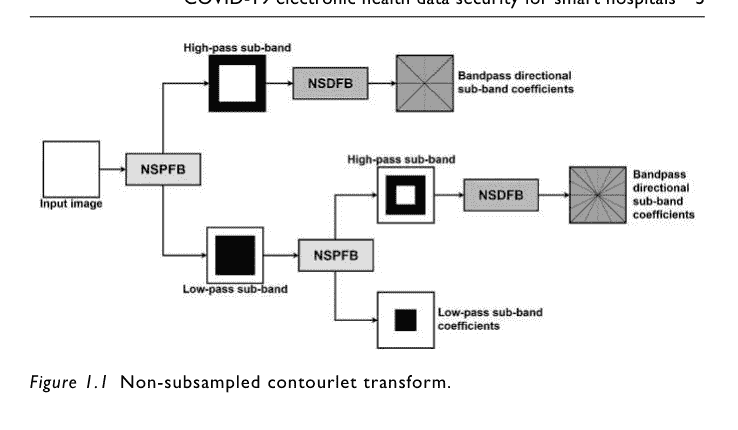

Figure 1.1 非下采样轮廓波变换。

这里，Z_L(l)和R_L(l)分别表示分解和重构的低通滤波器。此外，分解和重构的高通滤波器分别由Z_H(l)和R_H(l)表示。

在下一阶段，对高通子带实现NSDFB，具有‘d’级方向性。它产生总共2^d个方向子带，其大小与输入图像相同；它提供更精确的方向信息。输入图像的NSCT分解过程如图1.1所示[23]。

#### 1.3.2 Hessenberg分解 (HD)

在线性代数中，方阵的矩阵分解借助HD完成[25]。它将大小为‘m × m’的方阵‘A’分解为三个矩阵的乘积，如式(1.2)所述。

PHP^T = HD(A)
(1.2)

其中，‘P’表示为正交矩阵，‘H’为上Hessenberg矩阵，且h_{i,j}=0，其中i > j + 1。
HD的数学计算借助Householder矩阵获得。Householder矩阵‘Q’的数学方程描述如下。
Q = (I_n - 2 μ μ^T) / μ^T μ
(1.3)
其中，‘I_n’表示维度为‘m × m’的单位矩阵，且‘Q’为正交矩阵。‘μ’称为非零向量。

例如，从输入图像获得的4 × 4矩阵‘A’的像素值如下所示。

```
A = 
[104.6010 42.2519 56.5573 106.6036
100.1120 43.6523 63.5101 141.4542
83.2060 81.4629 45.2070 118.1840
24.4301 56.1044 83.4849 93.2716] (1.4)
```

其中，HD将矩阵‘A’分解为‘P’和‘H’两个矩阵，如下所述。

```
P = 
[1 0 0 0
0 -0.7559 0.3109 0.5762
0 -0.6282 -0.0964 -0.7720
0 -0.1845 -0.9455 0.2682] (1.5)
```

```
H = 
[104.6010 -89.5251 -91.7719 12.3475
-132.4481 167.6635 164.2178 -36.9402
0 86.3894 43.9222 6.9409
0 0 -23.9644 -27.4539] (1.6)
```

我们观察到167.6635是Hessenberg矩阵‘H’的最高能量元素，可用于插入水印数据。

#### 1.3.3 多分辨率奇异值分解 (MSVD)

MSVD是一种线性复杂度变换，它在小波变换中用SVD代替低通和高通滤波器[26]。如图1.2所述，计算大小为p × q的输入图像‘E’的MSVD系数的过程包括以下步骤[26]：

- a. 首先，将输入图像E分割为不重叠的块。每个块的大小为m × n。
- b. 将每个块重新排列为大小为mn × 1的独立向量。进一步地，将所得向量堆叠为新列以生成大小为mn × pq的矩阵Ē。
- c. 此外，计算相应的中心化矩阵Ē₁。
- d. 在下一步中，使用以下方程计算散布矩阵S：

```
S = Ē₁ × Ē₁ᵀ (1.7)
```


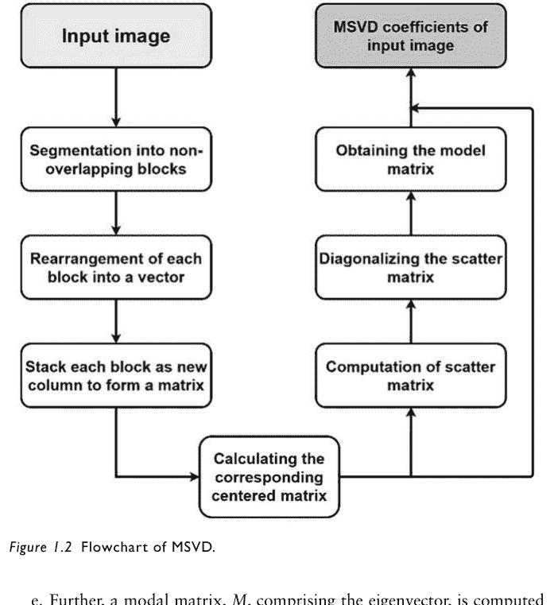

图 1.2 MSVD 的流程图。

e. 此外，模态矩阵 $M$，由特征向量组成，通过对 $S$ 进行对角化计算得到。

$M^{\top} \times S \times M = A^{2}$

(1.8)

这里，$A^{2} = \text{diagonal}(a(1)^{2},\ a(2)^{2}......\ a(mn)^{2})$ 具有 $S$ 的奇异值的平方。

f. 最后，使用公式 (1.9) 计算矩阵 $\bar{I}$。

$\bar{I} = M^{\top} \times \bar{E}$

(1.9)

由于 $\bar{I}$ 的第一行包含最大的奇异值，因此将其视为近似子带 $\Phi$。其余行被视为输入图像的详细部分 $\Psi$ [26]。

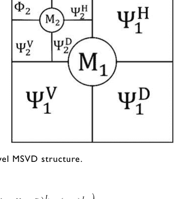

图 1.3 两级 MSVD 结构。

E = {Φ_L, {Ψ_i^V, Ψ_i^H, Ψ_i^D}_{i=1}^L, {M_i}_{i=1}^L }  (1.10)

这里，‘L’ 表示分解层级。

具有两级分解的输入图像的 MSVD 系数如图 1.3 所示 [27]。

### 1.4 提出的方法

所建议的基于融合的水印方法分为三个部分实现：a) 医学图像融合，b) 基于变换的融合图像嵌入和恢复，以及 c) 使用加密对标记图像进行安全保护（见图 1.4）。每个部分在算法 1–3 中都有阐述。表 1.1 描述了我们在算法中使用的符号。

在预处理阶段，CT 扫描图像 ‘in_CT’ 和 MRI 图像 ‘in_MRI’ 使用基于 NSCT 的融合方法进行融合。它分别使用相位一致性和局部拉普拉斯融合规则来融合输入图像的高通和低通 NSCT 分量。生成融合图像的详细过程在算法 1 中提供。

对于融合图像 ‘out_Fus’ 的嵌入，具有最高熵值的载体图像的子分量使用 NSCT、HD 和 MSVD 的混合进行分解。此外，对 ‘out_Fus’ 应用 MSVD，得到以下系数：‘wLL’、‘wHL’、‘wLH’ 和 ‘wHH’。此外，使用增益因子和 ‘wHL’ 修改载体图像 ‘in_Cov’ 的奇异矩阵。最后，应用逆 MSVD、逆 HD 和逆 NSCT 生成水印图像 ‘out_Cov’。算法 2 提供了基于 NSCT-HD-MSVD 的嵌入过程的详细说明。

最后，我们利用更新的立体图像加密（SIE）对 ‘out_Cov’ 进行加密。SIE 加密基于步进空间填充曲线（SSFC）、SVD 和混沌映射 [10]。其加密过程在算法 3 中解释。

### 融合算法

### 水印算法

### 传输和存储

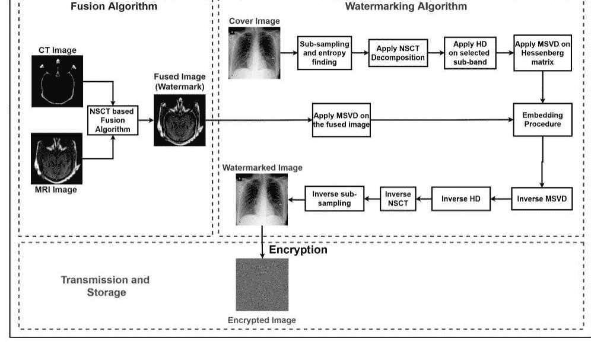

图 1.4 NSCT、HD 和 MSVD 域中基于融合的提出的水印技术。

### 表 1.1 算法中使用的符号及说明

| 符号 | 说明 | 符号 | 说明 |
|---|---|---|---|
| in_MRI, in_CT | MRI 和 CT 扫描作为输入 | wat_HL | 水印 cHL |
| out_Fus | 融合图像 | wat_H | 水印 cH |
| ML, MH, CL, CH | 输入图像的低通和高通 NSCT 系数 | wat_NSCT | 水印 c_nsct |
| MW, CW | ML 和 CL 的加权局部能量 | wat_c | 水印 c_max |
| MWS, CWS | 基于八邻域的 ML 和 CL 的修改拉普拉斯加权和 | enc_img | 加密图像 |
| out_FL, out_FH | 融合低通和高通系数 | [r c] | F̄ 中的行数和列数 |
| in_Cov | 载体图像 | v_img | wat_img 的向量形式 |
| A | 缩放因子 | L | v_img 的长度 |
| out_Cov | 水印图像 | S' | 长度为 L 的单位置换矩阵 |
| c1, c2, c3, c4 | fused_img 的子采样系数 | R_s | 随机序列 |
| e1, e2, e3, e4 | 子采样系数的熵 | R_p | 随机置换 |
| c_max | 熵最大的子采样系数 | v_Sh | 混洗图像向量 |
| c_nsct | c_max 的 NSCT 系数 | a_Sh | 混洗图像数组 |
| P, H | HL 子带（256 × 256）的酉矩阵和赫森伯格矩阵 | c_seq | 使用非线性混沌映射生成的长度为 r × c 的随机序列 |
| cLL, cLH, cHL, cHH | 对 c_NSCT（256 × 256）应用 MSVD 后得到的子带 | [sU, sS, sV] | c_seq 的左、中、右奇异矩阵 |
| wLL, wLH, wHL, wHH | 对 out_Fus（256 × 256）应用 MSVD 后得到的子带 | Key | 最终密钥 |

### 算法 1：使用 NSCT 的图像融合

```
Input: in_MRI, in_CT
Output: out_Fus
Begin
Step 1: Apply NSCT on in_CT and in_MRI
  1. [ML, MH] <- NSCT (MRI);
  2. [CL, CH] <- NSCT (CT);
Step 2: Fusion of high- and low-pass NSCT sub-bands
  3. (MW, CW) <- WLE (ML, CL);
  4. (MWS, CWS) <- WSEML (ML, CL);
  5. out_FL <- {ML, if MW x MWS >= CW x CWS ; CL, otherwise}
  6. out_FH <- {MH, if L_map1 = 1 ; CH, otherwise};
Step 3: Apply inverse NSCT
  7. out_Fus <- Inverse_NSCT (out_FL, out_FH);
return out_Fus
```

### 算法 2：基于 NSCT-HD-MSVD 的嵌入过程

```
Input: in_Cov, out_Fus, α
Output: out_Cov
Begin
Step 1: Subsampling of fused image and calculating entropy of each component
  1. [c1, c2, c3, c4] <- Subsampling (in_Cov);
  2. [e1, e2, e3, e4] <- Entropy (c1, c2, c3, c4);
  3. c_max <- Maximum (e1, e2, e3, e4);
Step 2: Apply NSCT, HD, and MSVD on c_max
  4. c_nsct <- NSCT (c_max);
  5. [cP, cH] <- HD (c_nsct {1,4} {1,2});
  6. [cLL, cLH, cHL, cHH] <- MSVD (cH);
Step 3: Apply MSVD on out_Fus
  7. [wLL, wLH, wHL, wHH] <- MSVD (out_Fus);
Step 4: Embedding using α
  8. wat_HL <- cHL + α x wHL;
Step 5: Apply inverse MSVD, HD, and NSCT
  9. wat_H <- iMSVD (cLL, cLH, wat_HL, cHH);
  10. wat_nsct {1,4} {1,2} <- cP x wat_H x cP^T
  11. wat_c <- Inverse_NSCT (wat_nsct);
Step 6: Inverse Subsampling procedure
  12. out_Cov <- Inverse_Sub sampling (c1, c2, c3, wat_c);
return out_Cov
```

### 算法 3：更新的 SIE 加密

```
Input: out_Cov
Output: out_Enc
Begin
  Step 1: Scrambling wat_img
    1. [r c] ← Size (out_Cov);
    2. v_img ← Vector (out_Cov);
    3. L ← Length (v_img);
    4. S'←(1 2 ... L);
    5. R_S ← Random (s), such that R_S ∈ [1, s];
    6. R_p ← (S'[n], S'[R_p_n]) (S'[n-1], S'[R_...]) ..... (S'[p], S'[R_p_p]) .....(S'[2], S'[R_p_2])
    7. v_Sh ← Shuffle (v_img, R_p);
    8. a_Sh ← Vector2Array (v_Sh);
  Step 2: Key generation
    9. c_seq ← Chaotic Map (r × c);
    10. [sU, sS, sV] ← SVD (c_seq);
    11. Key ← sU × sV^T;
  Step 3: Final Encryption
    12. out_Enc ← Key × a_Sh × Key^T;
return out_Enc
```

### 1.5 结果与分析

我们利用 CT 扫描和 MRI 图像，来源：参考文献 [28]，形成大小为 256 × 256 的融合图像并将其隐藏在 COVID-19 患者数据（尺寸：512 × 512）中 [29]。我们使用峰值信噪比（PSNR）、结构相似性指数度量（SSIM）和归一化系数（NC）[30] 评估所提解决方案的性能。同时，使用变化像素率（NPCR）和统一平均变化强度（UACI）评估所用加密的性能。增益因子（α）用于在水印鲁棒性和不可见性之间保持良好的平衡。

所提技术针对从 0.005 到 1 的不同 ‘α’ 值进行了测试，结果汇总在表 1.2 中，在 ‘α’ 为 0.005 时 PSNR 和 SSIM 分别达到最高 94.7683 dB 和 1，而最高 NC = 0.9954 在 ‘α’ = 1.0 时取得。值得注意的是，更高的增益因子值会以视觉质量为代价提高鲁棒性。此外，NPCR 和 UACI 分数始终大于 0.9927 和 0.3202，分别表明所选加密可以实现高安全性。此外，我们评估了不可见性和鲁棒性对各种非医学图像和 300 张 COVID-19 患者的 CT 扫描图像 [29] 的影响。结果是

表 1.2 不同增益因子值下所提工作的评估

| 增益因子 | PSNR（单位 dB） | SSIM | NC | NPCR | UACI |
|---|---|---|---|---|---|
| 0.005 | 94.7683 | 1 | 0.6969 | 0.9928 | 0.3202 |
| 0.01 | 88.7477 | 1 | 0.5654 | 0.9929 | 0.3218 |
| 0.05 | 74.7683 | 1 | 0.9094 | 0.9926 | 0.3217 |
| 0.07 | 71.8457 | 1 | 0.9425 | 0.9931 | 0.3219 |
| 0.3 | 59.2053 | 1 | 0.9919 | 0.9928 | 0.3217 |
| 0.5 | 54.7683 | 1 | 0.9943 | 0.993 | 0.3216 |
| 0.7 | 51.8457 | 0.9999 | 0.995 | 0.9927 | 0.3217 |
| 1 | 48.7477 | 0.9998 | 0.9954 | 0.9927 | 0.3221 |

表 1.3 不同图像上所提工作的客观评估

| 载体图像 | PSNR（单位 dB） | SSIM | NC | NPCR | UACI |
|---|---|---|---|---|---|
| MRI | 54.7683 | 1 | 0.9943 | 0.993 | 0.3216 |
| Barbara | 60.0697 | 1 | 0.9925 | 0.9949 | 0.3451 |
| Cameraman | 57.4668 | 1 | 0.9915 | 0.9957 | 0.3778 |
| Cell | 57.1606 | 0.9997 | 0.9957 | 0.9962 | 0.3589 |
| Chest X-Ray | 57.282 | 1 | 0.9949 | 0.9998 | 0.3605 |
| Colon MRI | 57.1079 | 1 | 0.9944 | 0.9923 | 0.1595 |
| Head CT scan | 57.2301 | 1 | 0.9878 | 1 | 0.3721 |
| Kidney Stone | 56.9985 | 1 | 0.9986 | 0.9964 | 0.3341 |
| Rice | 56.963 | 1 | 0.9936 | 0.9935 | 0.3899 |
| Zelda | 57.255 | 1 | 0.9945 | 0.9933 | 0.3182 |
| Average of 300 COVID-19 images [29] | 54.3941 | 1 | 0.9903 | 0.9986 | 0.3598 |

呈现在表 1.3 中。值得注意的是，PSNR、SSIM 和 NC 的平均结果分别为 54.3941 dB、1.0 和 0.9903。

此外，所提工作由各种相关专业人员主观量化，表 1.4 汇总了获得的结果。结果表明，在增益因子值低于 1.5 时，标记主机图像具有可接受的视觉质量。根据结果，质量随着增益因子值的增加而下降。图 1.5 显示了原始载体图像和标记图像的直方图分析。两个直方图图之间较低的变化证实了具有最小失真的高视觉质量。任何图像的直方图都给出了其像素中频率分布的详细信息 [31]。加密方法的评估是基于直方图分析进行的。

另一项基于直方图的分析如图 1.6 所示。它提供了标记图像和加密图像的频率分布。直方图


### 表 1.4 提出的水印方法的主观分析

| 增益因子 | 视觉质量 |
|---|---|
| 0.005 | 优秀 |
| 0.01 | 优秀 |
| 0.05 | 优秀 |
| 0.09 | 非常好 |
| 0.3 | 非常好 |
| 0.5 | 非常好 |
| 1 | 高于平均 |
| 1.5 | 可接受 |
| 1.7 | 低于可接受 |
| 2 | 弱 |

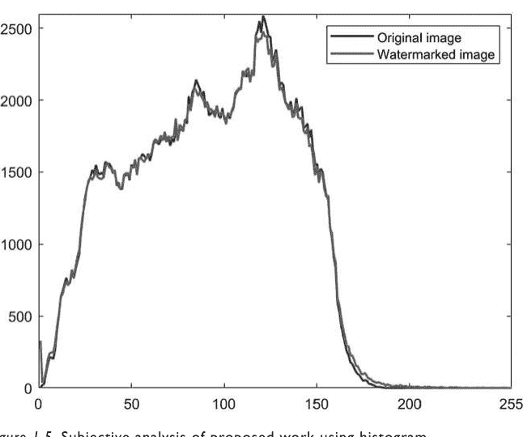

### 图 1.5 使用直方图的拟议工作的主观分析

标记图像的直方图显示出尖锐的峰值，提供统计信息。相反，加密图像的直方图是均匀的，这使其对统计攻击具有鲁棒性。表 1.5 显示了攻击对 NC 分数的影响。针对不同考虑的攻击的 NC 分数通常大于 0.9409，这表明具有很高的抗性。最后，图 1.7 确认了与现有工作 [13]、[32]、[33] 相比，所提工作的高鲁棒性。结果显示，在最佳情况下，与传统方案相比鲁棒性提高了 99%，表明其在安全医疗保健应用中的潜力。

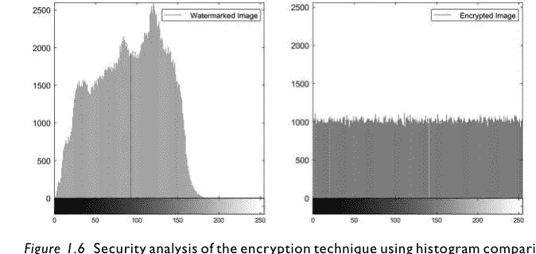

图 1.6 使用直方图比较的加密技术的安全性分析。

### 表 1.5 拟议工作的鲁棒性评估

| 攻击 | NC |
|---|---|
| 盐和胡椒噪声 (0.0001, 0.001, 0.01, 0.1) | 0.9943, 0.9936, 0.9889, 0.9514 |
| 高斯噪声 (0.0001, 0.001, 0.01, 0.1) | 0.9942, 0.9929, 0.9853, 0.9409 |
| 旋转 (1°，45°，90°) | 0.9944, 0.9943, 0.9941 |
| JPEG 压缩 (10, 50, 90) | 0.9932, 0.9937, 0.9948 |
| 高斯低通滤波器 (0.4, 0.6) | 0.9943, 0.9943 |
| 散斑噪声 (0.001, 0.05, 0.5) | 0.9942, 0.9903, 0.9685 |
| 裁剪 [20 20 400 480] | 0.9928 |
| 中值滤波 ([3 3], [2 2]) | 0.9946, 0.9945 |
| 锐化掩模 (0.01, 0.1) | 0.9905, 0.9906 |
| 直方图均衡化 | 0.9847 |
| 图像缩放 (0.5, 2) | 0.9949, 0.9921 |

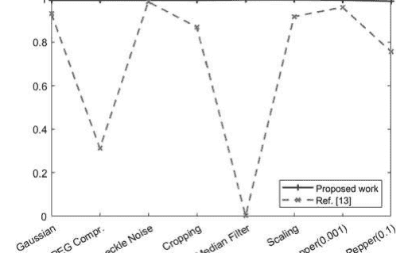

图 1.7 与 Ref. [13]、Ref. [32] 和 Ref. [33] 的拟议工作比较分析。

(续)

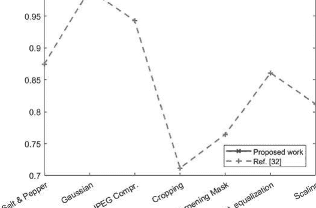

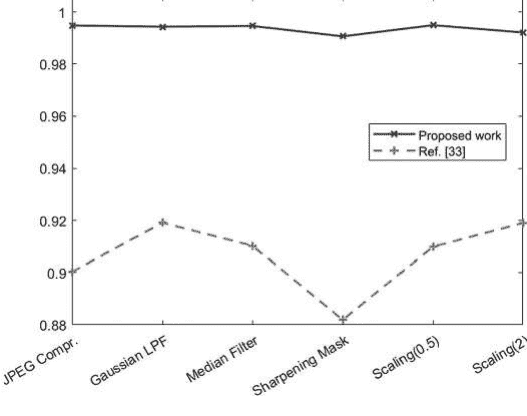

图 1.7 （续）与 Ref. [13]、Ref. [32] 和 Ref. [33] 的拟议工作比较分析。

### 1.6 结论

在本章中，提出了一种基于 NSCT 图像融合的鲁棒且安全的数字水印技术，用于医疗保健应用。最初，对 CT 扫描和 MRI 图像应用基于 NSCT 的融合以生成融合图像，用作水印。进一步，将融合的水印隐藏在载体图像的 NSCT-HDMSVD 系数中。标记图像使用更新的立体图像加密进行加密，以获得更好的安全性。此外，平均 PSNR 和 NC 分数分别为 54.3941 dB 和 0.9903，证实了高视觉质量和提取高质量水印的能力。与传统工作相比观察到更好的鲁棒性，最大改进为 99%。上述结果表明，所建议的解决方案对于 COVID-19 患者数据的电子版本的真实性和防复制是有用的。

## 致谢

本工作得到印度帕蒂亚拉 Thapar 工程与技术学院在 SEED 研究资助下的支持，以及皇家学会、英国在 2022 年 2 月 28 日的研究项目编号 IES212111 - 国际交流 2021 第二轮下的支持。

## 参考文献

- [1] S. Salehi, A. Abedi, S. Balakrishnan, and A. Gholamrezanezhad, “冠状病毒病 2019（COVID-19）：919 例患者影像学发现的系统综述,” Am. J. Roentgenol., vol. 215, no. 1, pp. 87–93, 2020, doi: https://www.ajronline.org/doi/10.2214/AJR.20.23034
- [2] “数字健康市场规模与增长报告，2021–2028,” 2021.
- [3] A. Anand and A. K. Singh, “医疗数据认证的水印技术：综述,” Multimed. Tools Appl., vol. 80, no. 4, pp. 30165–30197, 2021, doi: 10.1007/s11042-020-08801-0
- [4] A. K. Singh, B. Kumar, G. Singh, and A. Mohan, 医学图像水印：技术与应用. Springer International Publishing USA, 2017.
- [5] E. E-D. Hemdan, “基于单值分解、多级 DWT 和波浪融合的带扰乱医学图像的高效鲁棒水印方法,” Multimed. Tools Appl., vol. 80, no. 19, pp. 1–29, 2021, doi: 10.1007/s11042-020-09769-7
- [6] A. Anand and A. K. Singh, “SDH：智能医疗中融合医学图像的安全数据隐藏,” IEEE Trans. Comput. Soc. Syst., vol. 9, no. 4, pp. 1265–1273, 2022.
- [7] A. Anand and A. K. Singh, “通过融合医学图像的多重水印实现健康记录安全,” IEEE Trans. Comput. Soc. Syst., vol. 9, no. 6, pp. 1594–1603, 2021.
- [8] J.-Y. Li and C.-Z. Zhang, “基于 Schur 分解和非下采样轮廓波变换的盲水印方案,” Multimed. Tools Appl., vol. 79, pp. 30007–30021, 2020, doi: 10.1007/s11042-020-09389-1
- [9] B. Akhbari and S. Ghaemmaghami, “使用多分辨率奇异值分解的静止图像水印,” in Intelligent Signal Processing and Communication Systems, ISPACS, 2005, pp. 325–328.
- [10] S. Kumar and G. Bhatnagar, “SIE：使用加密保护立体图像的应用,” in Handbook of Multimedia Information Security: Techniques and Applications, Springer, Cham, 2019, pp. 37–61.
- [11] C. Kumar, A. K. Singh, and P. Kumar, “通过 SPIHT 改进的基于小波的图像水印,” Multimed. Tools Appl., vol. 79, no. 15–16, pp. 11069–11082, 2020, doi: 10.1007/s11042-018-6177-0
- [12] F. N. Thakkar and V. K. Srivastava, “盲医学图像水印：用于远程医疗应用的基于 DWT-SVD 的鲁棒且安全的方法,” Multimed. Tools Appl., vol. 76, no. 3, pp. 3669–3697, 2017, doi: 10.1007/s11042-016-3928-7
- [13] H. S. Alshanbari, “用于所有权和篡改检测的医学图像水印,” Multimed. Tools Appl., vol. 80, pp. 16549–16564, 2021, doi: 10.1007/s11042-020-08814-9
- [14] O. P. Singh and A. K. Singh, “加密-压缩域中的数据隐藏,” Complex Intell. Syst., vol. 9, pp. 2759–2772, 2023, doi: 10.1007/s40747-021-00309-w
- [15] A. Anand and A. K. Singh, “用于智能医疗应用的基于云的利用 IWT-Schur-RSVD 和模糊推理系统的安全水印,” Sustain. Cities Soc., vol. 75, no. 1, pp. 103398, 2021, doi: 10.1016/j.scs.2021.103398
- [16] A. Soualmi, A. Alti, and L. Laouamer, “使用盲水印技术进行医疗数据保护,” in Enabling AI Applications in Data Science, Studies in., A.-E. Hassanien et al. (eds.), Springer Nature Switzerland, 2021, pp. 557–576.
- [17] F. Yan, H. Huang, and X. Yu, “用于在医疗物联网中验证医学图像完整性和真实性的多水印方案,” IEEE Trans. Ind. Informatics, vol. 18, no. 12, pp. 8885–8894, 2022, doi: 10.1109/TII.2022.3159863
- [18] A. Anand and A. K. Singh, “小波域中用于患者记录安全的联合水印-加密-ECC,” IEEE Multimed., vol. 27, no. 3, pp. 66–75, 2020, doi: 10.1109/MMUL.2020.2985973
- [19] S. Thakur, A. K. Singh, B. Kumar, and S. P. Ghrera, “通过汉明码和混沌加密改进的基于 DWT-SVD 的医学图像水印,” in D. Dutta, H. Kar, C. Kumar, V. Bhadauria (eds.), Advances in VLSI, Communication, and Signal Processing. Lecture Notes in Electrical Engineering, vol. 587, Springer Singapore, 2020, pp. 897–905.
- [20] T. Nguyen-Thanh and T. Le-Tien, “使用量化与 SIFT 且增强安全性的鲁棒盲医学图像水印,” J. Adv. Inf. Technol., vol. 13, no. 1, pp. 45–52, 2022, doi: 10.12720/jait.13.1.45-52
- [21] A. Soualmi, A. Alti, and L. Laouamer, “一种基于 Schur 三角化和混沌序列的新型盲医学图像水印方案,” Concurr. Comput. Pract. Exp., vol. 34, no. 1, pp. 1–21, 2022, doi: 10.1002/cpe.6480
- [22] S. P. Vaidya, “混合变换中基于指纹的鲁棒医学图像水印,” Vis. Comput., vol. 39, no. 3, pp. 1–16, 2022, doi: 10.1007/s00371-022-02406-4
- [23] J. Ravi and R. Narmadha, “基于非下采样剪切波变换的图像融合,” Int. J. Eng. Adv. Technol., vol. 9, no. 3, pp. 4177–4180, 2020, doi: 10.35940/ijeat.C5452.029320
- [24] Z. Zhao, “用于图像融合的非下采样轮廓波变换,” in Proceedings of the 2007 International Conference on Wavelet Analysis and Pattern Recognition, 2007, pp. 305–310.
- [25] J. Liu et al., “基于 DWT 域中 HD 和 SVD 的优化图像水印方法,” IEEE Access, vol. 7, pp. 80849–80860, 2019, doi: 10.1109/ACCESS.2019.2915596
- [26] G. Bhatnagar, A. Saha, Q. M. J. Wu, and P. K. Atrey, “多分辨率奇异值分解的分析与扩展,” Inf. Sci. (Ny)., vol. 277, pp. 247–262, 2014, doi: 10.1016/j.ins.2014.02.018


[27] V. P. S. Naidu, “使用多分辨率奇异值分解的图像融合技术,” Def. Sci. J., vol. 61, no. 5, pp. 479–484, 2011, doi: 10.14429/dsj.61.705

[28] K. A. Johnson and J. A. Becker, 全脑图谱. http://www.med.harvard.edu/aanlib/home.html (于 2021 年 1 月 17 日访问).

[29] “COVID-19 图像数据收集.” https://github.com/ieee8023/covid-chestxray-dataset (于 2021 年 8 月 12 日访问).

[30] A. Anand and A. K. Singh, “用于医疗信息安全的改进 DWT-SVD 域水印,” Comput. Commun., vol. 152, pp. 72–80, 2020, doi: 10.1016/j.comcom.2020.01.038

[31] M. T. Elkandoz and W. Alexan, “基于多种混沌映射组合的图像加密,” Multimed. Tools Appl., vol. 81, no. 18, pp. 25497–25518, 2022, doi: 10.1007/s11042-022-12595-8

[32] A. Zear, A. K. Singh, and P. Kumar, “一种基于 DWT、DCT 和 SVD 的用于医学应用的提出的 安全多重水印技术,” Multimed. Tools Appl., vol. 77, no. 5, pp. 4863–4882, 2018, doi: 10.1007/s11042-016-3862-8

[33] F. Kahlessenane, A. Khaldi, R. Kafi, and S. Euschi, “一种用于远程医疗应用的鲁棒盲医学图像水印方法,” Cluster Comput., vol. 24, no. 3, pp. 2069–2082, 2021, doi: 10.1007/s10586-020-03215-x

## 使用量子哈希函数的图像安全

Arti Ranjan and M. Ravinder

IGDTUW, New Delhi, India

### 2.1 引言

图像作为关键的数据载体，因为它们密集地包含数字信息。这使得安全传输或保留图像比文本数据更具挑战性。因此，图像安全已成为研究人员关注的重要问题。图像可以通过安全措施抵御窃听、未经授权的复制以及篡改等危险。许多图像加密技术都源于传统的加密思想。这些方案使原始图形变得不可理解。由于互联网的快速发展，全球物联网网络收集的图像如指纹等所需的数据库正在增长，需要更大的存储容量和速度。1982 年，费曼首次提出了量子计算机的概念。此后，量子计算取得了持续进展。Shor 和 Grover 分别在 1990 年代提出了量子因式分解和量子搜索算法 [1–3]。

从经典图像处理 CIP 到量子图像处理 QIP 的图像处理研究已开展，这引起了学者的兴趣，因为量子计算的快速增长 [3]。由于量子相干性、纠缠、叠加和并行性等量子特性，量子信息处理 QIP 是一个日益增长的领域，也是实时处理的强大工具。此外，QIP 允许仅使用 log₂n 个量子比特存储 n 位经典信息 [3, 4]。由于量子相干性、纠缠、叠加和并行性等量子特性，量子信息处理 QIP 是一个日益增长的领域，也是实时处理的强大工具。此外，QIP 允许仅使用 log₂n 个量子比特存储 n 位经典信息 [3, 4]。得益于其指数级存储容量，它是处理、存储和传输照片的更有效工具 [4, 5]。然而，QIP 作为一项年轻技术才刚刚开始，研究仍处于早期阶段。与经典图像加密相比，量子图像加密仍处于起步阶段。重要的 QIP 问题包括量子图像存储和表示。Venegas-Andraca 首先在 [5, 6] 中提到了量子位晶格的概念。随后，Latorre 在 [6] 中提出了 Real Ket 表达式，该表达式需要 n 个量子比特来表示一个 2n × 2n 图像。

由于其简单性，作者在 [7] 中提出的量子图像灵活表示 FRQI 模型已成为量子图像表达的流行范式。为了表示彩色视觉，提出了一些系统 [8–10]。在 [11] 中，作者提出了新型增强量子表示 NEQR 模型，该模型与 FRQI 模型有显著不同，因为它允许表示的颜色超过 2q 的最大值。量子计算的主要问题是实现许多复杂过程的难度。

我们将对本章探讨以下方案。我们首先简要介绍经典密码系统和经典图像安全，涵盖换位和替换系统。随后是量子计算和量子图像处理的出现。将详细介绍量子计算中的图像表示。参考哈希函数讨论了后量子世界中的图像安全。介绍了并讨论了经典哈希函数、密码哈希函数和量子哈希函数。此后，我们讨论量子密钥分发及其在 T22 协议下的特定和最新实现。我们以结论和未来趋势结束本章。

本章将讨论以下内容：
- 1. 对经典密码系统的介绍。
- 2. 对量子计算中图像表示的温和介绍。
- 3. 关于各种量子图像格式的阐述。
- 4. 关于经典和量子哈希函数的讨论。
- 5. 对量子密钥分发 QKD 的介绍。
- 6. 对 T22 QKD 协议的解释和讨论。

### 2.2 经典密码系统

信息安全对于当今的数据存储和传输更为重要。图像在许多过程中被使用，因为它们可以传达更多信息。因此，图像加密和解密算法在图像数据安全中发挥着至关重要的作用。数字图像在医疗、军事和私营等多个行业中使用。在公共环境中，当存在未经授权的用户和敌对攻击者时，使用密码学实现两个参与者之间的安全通信。密码学中在发送方和接收方分别执行加密和解密两种操作。在加密过程中，将一个简单的多媒体文件与一些额外数据 即密钥 结合，创建一个不可读的编码格式，称为“密文”。解密是加密的相反过程，其中密文使用相同或不同的密钥 额外数据 解码并转换为实际的多媒体数据 [12]。

图像安全可以采用多种方法。一种保护图像的方法是图像加密，它涉及将原始图像重新创建为加密或密文图像，使未经授权的用户难以将其与原始图像区分开 [13]。只有所有者、授权用户和预期用户才能解密加密图像。世界各地的研究人员开发并使用了许多图像加密技术。这些算法可分为三大类：基于换位的基于位置置换的算法、基于变换的基于值替换的算法，以及基于换位的基于位置替换的策略 [14]。

对称密钥密码系统由一个五元组 K, P, C, E, D 表示，其中，
- K = 可能密钥的有限集合，必须与合法用户共享。
- P = 可能明文的有限集合，
- C = 可能密文的有限集合，
- E 和 D = 加密算法和解密算法。

最简单的情况是两个人希望通过不安全通道相互通信。通常，这些人被称为 Alice 和 Bob。由于通道的脆弱性，一个名为 Eve 的窃听者可能会拦截其上传送的所有消息 [15]。通过另一条安全通信通道就秘密密钥 k 达成一致，Alice 和 Bob 可以利用密码系统在窃听者的存在下保持信息私密 [16]。

为了发送她的秘密消息 m，Alice 使用密钥 k 计算密文 c = e_k(m) 并通过不安全通道将其发送给 Bob。

由于 Bob 也拥有密钥 k，他可以使用解密技术并使用 d_k(c) = d_k, e_k(m) = m 来解密密文。但 Eve 截获密文 c 却不知道密钥 k，因此没有简单的方法获得原始消息 m。

实现完美保密的对称密钥密码系统是一次性密码本。假设 P = C = K = {0, 1}^n，e_k(m) = m ⊗ k 且 d_k(c) = c ⊗ k，其中 ⊗ 是按位异或操作 [17]。

#### 2.2.1 基于换位的算法

重新排列简单图像的组成部分称为换位。这种元素重新排列必须按位、逐像素和/或逐块进行。虽然像素和块的置换带来更高级别的安全性，但位的置换会导致感知信息的减少。在位置换方法中，每个像素的位使用具有 8 位密钥长度的置换密钥进行置换。像素置换

涉及取一组 8 个像素并使用相同大小的密钥对其进行置换。本研究中分别采用了块、位和像素置换 [18]。

#### 2.2.2 基于值替换的算法

称为基于值替换的算法的技术将每个像素的值转换为不同的值。对像素应用复杂的计算算法会得出其新值的计算。数字签名、无损图像压缩和基于 SCAN 的加密、图像密码系统、基于双随机相位编码的颜色图像加密、基于块变换算法函数的图像加密等，都是基于值变换的方法的例子 [19]。

#### 2.2.3 基于位置替换的算法

该方法同时使用位置置换和值变换。在该方法中，像素首先被重新排列，然后使用密钥生成器替换其值。将信号和图像处理与加密相结合是一个引人入胜的研究领域。将密码学和图像处理相结合被称为图像加密。加密图像的方法用于实现隐私、身份验证和内容访问控制 [20]。

### 2.3 量子计算

量子计算机是一种使用量子位或量子比特而不是像经典计算机那样使用比特的设备。量子比特以多种方式在物理上实现，例如使用电子或光粒子（光子）等基本粒子的量子态。这些粒子具有量子态，表现出诸如自旋等性质，可用于定义具有一和零的二态量子系统，与经典计算机中的情况非常相似。因此，量子比特是经典比特的量子类比。然而，量子计算在基本层面上与传统计算有显著不同 [21]。

量子纠缠和叠加等量子特性在量子计算机中发挥着基础性作用。在叠加之下，量子系统的两个状态可以同时共存 [22]。在叠加中，存在具有归一化系数的基态的线性组合，这是一种纯态的概率分布。叠加是量子系统的固有属性 [23]。

在纠缠之下，如果两个量子比特处于纠缠状态，则这两个量子比特没有单独的状态描述。它们无法单独描述。事实上，测量一个量子比特也会给出另一个量子比特的状态。

量子计算机提供的速度提升的第一阶段是由纠缠和叠加这两种量子效应驱动的 [24]。

量子计算机的一个主要问题是，小型量子计算机目前使用的量子比特数量有限。量子计算机必须扩展规模才能与传统系统竞争。尽管过去几十年的情况已显著改善，但解决量子纠错等其他技术问题对于进一步发展量子计算机仍然是必要的。由于量子信息无法复制且子系统无法独立运行，因此扩展量子计算机芯片本质上具有挑战性。因此，全球性的设计权衡是不可避免的。然而，超导量子比特正开始在量子计算机中成为商业上可行的选择，并日益展现出克服这些挑战的能力 [26]。

#### 2.3.1 量子图像处理

量子信息和量子计算研究的一个子领域是量子图像处理（QIP）。它研究如何利用量子力学的优势将图像存储在量子计算机中，然后根据该图像格式执行各种图像操作。QIP 相对于传统图像处理具有固有优势，因为它使用量子并行计算，该计算源于量子态叠加和纠缠。

量子图像处理是一个迅速兴起的领域，利用量子力学原理处理数字图像。它已被用于解决面部识别和目标检测等问题。利用量子计算原理，它能够比传统方法更快、更准确地分析大量数据。

量子图像处理通过使用量子比特来工作，量子比特是具有两种状态——开或关——的粒子，用来表示信息。这使得复杂计算可以在少量步骤中完成。它还可以并行分析大型数据集，减少分析所需的时间。通过利用叠加的力量，量子计算可以从图像中提取比传统方法单独使用更多信息 [27]。

量子图像处理的主要优势在于其快速、准确处理大型数据集的能力。它还由于改进的纠错能力，在处理噪声数据集时可以提供更好的准确性。

此外，量子计算不受传统方法所受的内存或计算限制的约束，使其能够更有效地处理诸如从图像中提取特征等计算密集型任务 [28]。

除了在速度和准确性方面的优势外，量子图像处理还具有标准方法所不具备的一些独特能力。

例如，它可以对图像执行传统算法无法实现的非线性操作，例如在单一步骤中应用高通滤波器或边缘检测操作。此外，使用量子计算并排比较两幅图像可以提供对其相似性和差异性的见解，而这些见解通过传统手段否则难以或不可能检测到 [29]。

量子图像处理的潜在应用范围广泛；从医学成像技术到自动驾驶汽车的计算机视觉系统，量子计算可以彻底改变我们与数字图像的交互方式，并在各个领域的机器学习应用中实现新的可能性。随着对这一蓬勃发展领域的持续研究，未来对于那些希望利用量子计算为自己的项目或业务提供动力的个人来说充满了巨大希望 [30]。

量子图像处理通常可分为两大类：量子增强图像处理和量子计算辅助图像处理。量子增强图像处理技术利用量子力学原理来提高现有数字成像技术的性能。这些技术通常涉及应用算法使用量子计算机处理图像。

其思想是利用量子计算提供的优势，例如计算速度和精度的提高，以及由于纠缠或叠加的其他特性而增强的安全性。示例包括查找模式、识别图像中的对象或分析传感器数据 [31]。

另一方面，量子计算辅助图像处理依赖于开发专门为量子计算机平台使用而量身定制的新的算法。通常，这些算法将传统数字成像技术（如滤波和直方图准备）的方面与量子计算机系统提供的能力（如并行性或纠缠）相结合。

示例包括使用量子比特实现的神经网络、用于高效搜索数据库的 Grover 算法，或用于快速准确求解线性系统的 HHL 算法。

最后，人们对将这两种方法结合成混合框架的兴趣日益增加，该框架同时利用经典和量子组件，以比两者独立工作更高效地处理成像管道中的不同任务。示例包括利用经典组件输入传感器数据，同时使用量子组件执行某些任务，其速度比仅使用经典方法可能实现的更快。此外，这种混合方法使我们能够利用现代计算系统中发现的两种类型的资源，即高性能 CPU 和 GPU，以及诸如神经形态芯片等新兴技术，这些技术可以为神经网络或机器学习算法等某些过程提供专门的硬件加速能力。


我们目前正在见证量子图像处理领域的快速发展，结合经典数字成像技术与当今新兴技术（如超导量子比特、模拟信号处理器和神经形态微芯片）所带来的技术，使得许多令人兴奋的机会出现。随着该技术进一步成熟，它将在处理涉及大量/多种类型数据的复杂问题时（如医学成像或人脸识别等领域所遇到的）开辟更高效的解决方案的新途径，体现在速度、准确性和安全性方面 [32]。

### 2.4 量子计算中图像的表示

经典计算机与量子计算机之间的根本差异需要在量子计算机上采用不同的图像表示格式。存在多种此类格式，分别是柔性量子图像表示（FRQI）[7]、Real Ket 图像格式 [6] 和量子比特晶格格式 [33]。

#### 2.4.1 柔性量子图像表示（FRQI）

Le 等人 [7] 提出了一种更复杂的利用晶格量子态叠加的量子比特。在增加第二个量子比特来表示每个像素在空间中的位置的同时，该方法继续将每个像素的灰度值转换为振幅。整个图像随后进入显著的量子叠加态。每个图像都是像素的组合，每个像素都是处于叠加态的量子比特态，如方程 2.1 和 2.2 所示。

|pixel_i⟩ = cos θ_i |0⟩ + sin θ_i |1⟩
θ_i ∈ [0, π/2], i = 0,1,...,2^{2n} - 1   (2.1)

|image⟩ = 1/2^n Σ_{i=0}^{2^{2n}-1} (cos θ_i |0⟩ + sin θ_i |1⟩) ⊗ |i⟩   (2.2)
i = pixels encoding in terms of qubit state

例如，2 × 2 图像可以如表 2.1 [34] 所示表示。

表 2.1 FRQI 图像表示
| θ0, |00⟩ | θ1, |01⟩ |
| θ2, |10⟩ | θ3, |11⟩ |

柔性量子图像表示（FRQI）是一种表示和操作量子图像的方法，量子图像是用量子态而非经典比特编码的图像。量子图像在某些应用中具有潜在优势，例如在安全通信中，可用于以抗截获和篡改的方式传输信息。

FRQI 方法将量子图像表示为量子态和经典信息的组合。这允许一种灵活的表示形式，易于操作和处理，同时仍保留量子信息的优势。该方法已应用于各种情境，包括量子噪声分析和量子图像压缩。

总体而言，表示和操作量子图像的方法的开发是一个活跃的研究领域，其目标是找到利用量子信息独特属性用于实际应用的方法。

#### 2.4.2 Real Ket 图像格式

该格式由 Latorre [35] 提出。在此图像格式中，像素坐标和像素强度是分离的。首先，将给定图像划分为四个大小相等的象限。下一步，再将每个象限划分为四个象限。此过程持续进行，直到每个象限仅包含一个像素。现在，一对量子比特用于表示网格方格中的像素坐标，额外的量子比特以其振幅描述强度 [36]。

|ψ_{2^l × 2^l}⟩ = Σ_{i_l=1}^4 C_{i_l} |i_l>,
such that Σ_{i_l=1}^4 |C_{i_l}|^2 = 1
(2.3)

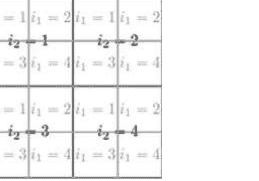

图 2.1 2 × 2 Real Ket 图像编码。

#### 2.4.3 量子比特晶格格式

量子比特晶格是在量子计算机中组织量子比特（量子位）的一种方式。在量子比特晶格中，量子比特排列成网格或晶格结构，每个量子比特与其在晶格中的邻居相连 [33]。

量子比特晶格的表示方式有多种，取决于量子计算系统的具体需求和目标。一种常见的表示量子比特晶格的方式是作为图，其中量子比特表示为顶点，量子比特之间的连接表示为边。这可以使用多种图格式来完成，例如邻接矩阵或邻接表。

表示量子比特晶格的其他方法包括使用数组或矩阵来表示量子比特的位置和连接，或使用专门为存储和操作量子比特晶格而设计的文件格式或数据结构。

### 2.5 后量子密码学中的数据安全

后量子数据安全是对在量子计算普及的情况下保护数据的技术进行研究和开发。随着技术的进步，量子计算机变得可用并且强大到足以破解当前加密算法的可能性越来越大。这意味着组织和个人持有的信息的保密性面临风险，因为使用传统方法存储的任何敏感数据都可能被暴露 [37]。

后量子数据安全的主要挑战在于开发新型密码学，能够抵抗被量子计算机破解。这需要针对量子力学的独特属性（如纠缠和叠加）量身定制的密码系统。正在研究的一种系统称为量子密钥分发（QKD）。QKD 使用单光子在双方之间生成加密密钥。这些密钥高度安全，因为任何截获尝试都会导致其状态发生可检测的变化，这意味着任何恶意访问尝试都可被轻易检测到 [38]。

正在研究的另一种后量子密码学形式是基于格的密码学，它利用诸如格和纠错码等各种数学结构 [39]。这种密码学形式提供高水平的安全性，同时所需的计算能力也低于其他形式（如椭圆曲线密码学 ECC），使其适用于智能手机或物联网设备等低功耗设备 [40]，如 [41] 中所述。

除了这些解决方案之外，还正在开发各种后量子算法，使用不同的技术，如多元多项式 [42]、超奇异椭圆曲线同源（SECI）[43] 或基于哈希的签名（HBS）[44]。通过使用特定参数应用这些技术，与传统方法相比可以实现更高水平的安全性

| 算法 | 解决的问题 | 块大小 | 密钥大小 | 轮数 | 方法 | 输出 | 推断 |
|---|---|---|---|---|---|---|---|
| PRINCE | 硬件中的吞吐量和效率 | 64 | 128 | 12 | 在 FPGA-Vertex 6、Vertex 4 中实现 | Throughput=4.18Gbps,Efficiency= 8.681 Mbps/Slice | 比 ICEBERG 和 SEA 更好 |
| HIGHT | 软件或硬件中的效率 | 64 | 128 | 32 | 在 FPGA、Altera Quartus II 版本 13 中实现 | Transfer rate = 157 Mbps, Delay=9.8ns, F=11.35 MHZ | 硬件优于软件 |
| AES | 硬件中的面积和吞吐量 | 128 | 128 | 10 | 第三阶段 Mix 列的并行性 | Throughput=25.54,Area=30% reduced | 管线概念-减少面积并提高速度 |
| SIMON | 硬件中的门数量 | 32,48,64,96,128 | 可变 | 32,36,42,44,52,54 | 在 FPGA 中实现 | 32 slices in SPARTAN 3 and 6 FPGA | 比 X-TEA 和 Hummingbird 更好 |
| BLOWFISH | 硬件中的吞吐量 | 64 | 32-448 | 16 | 在 Spartan 3E XC35-500E-5FG 320 中实现 | Throughput=6.3 Gbps, F=295.63 MHZ | 比 AES 和 DES 更好 |
| ECC-RSD | 处理速度 | NA | NPK C | NA | RSD, Pipeline KATATUSUBE OFFMAN | LUT=34612, F=160MHZ Time=2.26 ms | 管线架构提高速度 |
| ECC | 健康护理监测 | NA | NPK C | NA | 轻量级方案 | Light weight ECC suitable for IoT | RAM 尺寸更小 |
| HUMMING BIRD | 低功耗和低内存大小 | 16 | 256 | NA | 不同 S-box 方法 | Less power and Area | 异步优于同步设计 |
| PRESENT | 硬件中的门数量 | 64 | 128 | 32 | GRP-COMPRESSED | Reduced from 3200 to 2980 GE | 比 CLEFIA 和 ICEBERG 更好 |

图 2.2 若干图像安全算法的比较，鸣谢 D. J. Rani 等人 [56]。

如今 RSA 或 ECC 等传统方法。随着量子计算机带来的潜在威胁，对更强加密的需求增加，后量子数据安全的研究将变得越来越重要，以确保机密信息免受恶意攻击者的侵害。

公司和组织应考虑投资该领域的研究，以在这些解决方案可用时受益于其提供的更高保护水平。量子计算机大约在一秒钟内可以搜索一万亿项的列表。相同的任务传统计算机大约需要一周才能完成。数据隐私严重受到量子计算机快速考虑大量可能性能力的影响；即使是最复杂的加密技术也可能很快被暴力攻击破解。

由于量子技术发展迅速，隐私领导者必须将应对此事作为首要任务。组织需要重新评估其隐私策略，发展灵活性以便适应不断变化的市场，并让每个人了解量子技术的潜力 [45]。

### 2.6 后量子密码学中的图像安全

加密被视为隐藏信息以使其对缺乏专业知识的人不可理解的做法，作为密码学学科的实际应用。这通常是为了秘密讨论而进行的


表 2.2 量子比特配对

| 配对 1 | 配对 2 | 标签 |
|---|---|---|
| (q₀, q₁) | (q₀, q₁) | A |
| (q₀, q₁) | (q₀, q₁) | B |
| (q₀, q₁) | (q₀, q₁) | C |

和保密性。信息隐藏侧重于隐藏消息的存在，而密码学保护消息的实质。使用诸如隐写术和水印等技术来隐藏数据似乎更安全，因为攻击者不太可能发现它们。然而，在不导致其可见不可感知性失真的情况下，可隐藏在封面图像中的信息量的高需求是其主要限制之一。尽管它们相似，隐写术和水印服务于不同的目标和/或具有不同的应用，并且它们对这些目的有不同的需求。

图 2.2 总结了在后量子场景中几种图像安全算法的应用 [56]。

### 2.7 经典哈希函数

经典哈希函数是一种用于数据加密和身份验证的密码学函数类型。它是一种数学算法，接受任意长度的输入并产生固定长度的输出。输出被称为哈希值，对于任何给定的输入都是唯一的。传统哈希函数通常具有三个主要特性：计算必须快速，必须是单向的（即，不应可能从计算出的哈希值推导出原始消息），并且应为不同的输入产生不同的输出值。最常见的经典哈希函数类型是消息摘要算法（MD）。MD 接受任意长度的消息并生成固定长度的输出，被称为摘要或校验和。生成的摘要随后可用于验证初始消息的完整性，因为如果对消息进行任何更改，则其摘要将不再与安全来源最初提供的摘要匹配。流行的消息摘要算法示例包括 MD5（消息摘要 5）和 SHA（安全哈希算法）[46]。

另一种类型的经典哈希函数基于块密码运算，例如 DES 或 AES。块密码需要由相同大小的块序列组成的输入，因此这些类型的算法在处理长度可变的消息时可能并不总是提供最佳性能。此外，与其他哈希函数（如 MD 或循环冗余校验（CRC）算法）相比，块密码可能由于其更大的输入大小而需要更多的存储空间 [47]。

经典哈希函数提供的<|message|> 取决于各种因素，包括其抵抗恶意攻击和冲突的能力。冲突发生在两个不同消息具有相同的计算哈希值时；这可能导致潜在的安全问题，因为攻击者可以利用此信息在不被接收者检测到的情况下用另一个恶意消息替换原始消息。为帮助缓解此问题，一些哈希函数利用盐值，这有助于防止两个不同的消息即使共享一些常见字符也具有相似的输出 [48]。

此外，大多数经典哈希函数还使用迭代过程来提高其对密码分析的抵抗力——密码分析仅仅涉及分析密码系统以查找其设计结构中的弱点或漏洞。通过迭代增加其计算复杂度，攻击者需要花费大量时间和资源才能成功攻破密码系统，从而使未经合法用户或来源（如管理员或所有者）的授权或许可而获得访问权限变得更加困难 [49]。

在数学上，哈希函数可以定义为将任意长度的输入数据转换为特定长度的输出加密文本的函数。消息摘要、哈希值、哈希代码或仅哈希都是用于描述此结果的术语。哈希函数，从更正式的术语来说，是一个数学函数 H: D ⊗ R，其中 D = 0, 1 且 R = 0, 1^n，对于某个 n >= 1，它将任意长度的数值输入值 m 转换为特定长度的压缩数值输出 h。因此，h = H(m)。

#### 2.7.1 密码学哈希函数

我们可以将密码学哈希函数定义为满足额外条件以用于密码学目的的哈希函数。这些是具有多种应用的基本构建块。其主要用途包括基于证书的数字签名、身份验证、密码存储安全以及一般数字签名。密码学哈希函数通常可分为操纵检测码（MDC）或消息认证码（MAC）——具有单个参数——输入消息——以及带密钥的哈希函数——具有两个不同的输入——输入消息和秘密密钥——是密码学哈希函数的两个主要类别。哈希函数通常指无密钥哈希函数。

### 2.8 量子哈希函数

量子哈希函数是一种用于保护数据免受恶意篡改的密码学技术。它利用量子计算的特性和一种旨在确保即使攻击者试图修改数据，数据完整性仍能保持的算法。

量子哈希函数最重要的特性是其为每条数据创建唯一的“指纹”的能力。这些指纹是通过将基于量子物理原理的数学算法应用于被哈希的数据而创建的。此过程创建唯一的哈希值，作为原始数据的签名，即使数据被编辑或修改，也能验证其完整性。这样，量子哈希函数可用于检测敏感信息的更改，而这些更改可能无法被其他安全措施检测到 [50]。

除了提供对数据恶意篡改的强保护外，量子哈希还比传统方法提供更好的性能。创建指纹所涉及的计算速度极快且高效，允许比传统哈希算法更短的处理时间和更高的吞吐率。这使它们非常适合需要及时决策的应用，或需要快速安全地处理大量数据的应用。

量子哈希还提供增强的可扩展性，因为它依赖于数学算法而不是硬件或物理组件（如存储芯片）。这使其能够轻松跟上高容量环境，在这些环境中必须快速保护大量数据，而不会出现任何明显的延迟或服务交付中断。

最后，量子哈希提供的一个重要优势是对暴力攻击的抵抗力——黑客或恶意代码编写者通过反复试验猜测其各自密钥的尝试——否则会使传统哈希随着时间的推移变得脆弱。通过依赖无法通过暴力技术求解的复杂数学方程，量子哈希算法提供对这些类型攻击的卓越保护，使其成为保护有价值的数字资产和敏感信息免受未经授权访问和操纵的有吸引力的选择。

在数学上，量子哈希函数是可以作为量子密钥分发过程隐私放大的哈希函数的函数。量子哈希函数（QHF）也可用于多种其他用途，例如伪随机数生成、图像加密等。生成量子哈希函数有多种方法。其中一种主要方法是使用量子行走（QW）。

#### 2.8.1 QHF 的生成

QHF 的生成可通过使用量子行走实现。QW 可以稍作修改以创建 QHF。生成模型使用两个量子系统，即首先是行走者（W），其次是硬币（C）。如果 H_t 是希尔伯特空间中的一个向量，那么如果将其取为 H_t = H_p ⊗ H_c，下标

p 和 c 分别代表 W 和 C，则 |ψ_t⟩ 将表示 W 和 C 量子系统的组合态 [51]。

通过使用条件移位算符，行走运动中的硬币态条件可表示为：

Ŝ = Σ_x |x+1,0⟩⟨x,0| + |x-1,1⟩⟨x,1| (2.4)

其中求和符号表示对所有可设想位置的求和。重复全局幺正算符可实现组合系统的动力学演化。

Û = Ŝ(Î ⊗ Ĉ) (2.5)

其中 Ĉ = 用于硬币态的硬币算符，Î = 单位算符。因此，组合系统在 t 步后的最终态表示为：

|ψ_t⟩ = Û^t |ψ_initial⟩ = Σ_x Σ_v λ_{x,v} |x,v⟩ (2.6)

并且在 t 步后，找到 W 在位置 X 的概率为，

P(x,t) = Σ_{v=0,1} |⟨x,v|Û^t|ψ⟩|^2 (2.7)

其中 |ψ_initial⟩ 是组合 W-C 系统的初始态。

这是一个离散态量子系统，原本的硬币态和步数用于确定所得的概率分布。假设每个步骤的硬币算符依赖于二进制值字符串或消息，并且随后构建一个 QHF。二进制文本或消息作为构建的 QHF 的输入，而所得的概率分布则作为输出哈希值。所构建的 QHF 是密钥化的，因为硬币态充当控制因子。行走的第 n 步由消息的第 n 位控制。

两个硬币算符如 图 2.3 所示：

- 1. 选择量子哈希函数：已经提出了并实现了几种不同的量子哈希函数，例如 Sha-256 和 Sha-3。量子哈希函数的选择将取决于其所使用系统的具体安全要求和限制。

\hat{C}_0 = \frac{1}{2} \begin{pmatrix} -1 & 1 & 1 & 1 \\ 1 & -1 & 1 & 1 \\ 1 & 1 & -1 & 1 \\ 1 & 1 & 1 & -1 \end{pmatrix}

\hat{C}_1 = \frac{1}{2} \begin{pmatrix} 1 & 1 & 1 & 1 \\ 1 & -1 & -1 & 1 \\ -1 & 1 & -1 & 1 \\ -1 & -1 & 1 & 1 \end{pmatrix}

图 2.3 硬币算符 \hat{C}_0, \hat{C}_1。

- 2. 准备输入数据：待哈希的输入数据可以是任何类型的数据，例如消息、文件或密码。输入数据应以与所选量子哈希函数兼容的格式准备。
- 3. 初始化量子哈希函数：一些量子哈希函数需要使用额外数据，例如密钥或种子值来初始化哈希函数。这些数据应准备并按需提供给量子哈希函数。
- 4. 运行量子哈希函数：然后使用量子算法在输入数据上运行量子哈希函数以执行哈希过程。这将产生固定大小的输出，称为哈希值或摘要。
- 5. 输出哈希值：然后输出哈希值，可用于多种目的，例如验证数据的完整性、验证消息的真实性或存储密码。

QHF 的主要应用与量子密钥分发（QKD）相关。我们将对 QKD 进行简要讨论，以便认识到 QHF 的重要性。

### 2.9 量子密钥分发

QKD 旨在实现通信双方之间的完美安全密钥。QKD 过程通常包括三个步骤：隐私放大、错误协调和原始密钥筛选。使用通用哈希函数实现隐私放大过程是 QKD 的关键组成部分。这些哈希函数在计算上是安全的，因为它们通常基于数学复杂性构建。众多量子密码协议由量子力学的基本原理保证无条件安全，这促使我们从量子信息角度思考安全性

以期找到一种更可靠的隐私放大过程方法 [52]。

需要明确的是，QKD 仅用于生成和分发“密钥”。QKD 不用于发送或接收消息；然而，密钥用于加密消息并通过信道发送或接收。

#### 2.9.1 QKD 的类型

整个量子密钥分发过程使用量子比特进行。通常使用光子作为量子比特，并且已发现标准协议来实现 QKD。这类 QKD 协议可分为以下几类 [53]：

- 1. 基于制备与测量 的协议，
- 2. 基于纠缠 的协议。

BB84 协议和 E91 协议是 QKD 最著名的实现，其中前者对应于基于制备与测量的类别，后者基于纠缠。T22 是 2022 年提出的基于纠缠的最新的协议。

由于 BB84 协议在文献中已被广泛讨论，并且为了理解和欣赏使用纠缠的 QKD，我们将在下一节讨论 T22 协议 [54]。

### 2.10 T22 协议

T22 是一种抗量子密钥交换算法，旨在保护数据免受量子计算攻击。它基于后量子密码学，被认为对量子计算攻击是安全的。它允许双方在不安全的信道上安全地交换密钥，而不会有窃听者拦截的风险 [54]。

T22 与量子密钥分发（QKD）密切相关；T22 协议可用于实现 QKD 系统，因为它提供了一种无需可信第三方即可安全生成和交换密钥的方法。此外，T22 可使用生成的密钥在双方之间安全地传输消息。

#### 2.10.1 两量子比特纠缠态

一般两量子比特态可写为式 2.8。

|ψ⟩ = c00|00⟩ + c01|01⟩ + c10|10⟩ + c11|11⟩ (2.8)

如果一个两量子比特态不能表示为两个独立量子比特态的乘积，则该态为纠缠态，如式 2.9 中的态。

$|\psi\rangle = \frac{1}{2}[|00\rangle + |01\rangle + |10\rangle - |11\rangle]$  (2.9)

另一个纠缠态的例子在式 2.10 中，

$|\psi\rangle = \frac{1}{\sqrt{2}}[|00\rangle + |11\rangle]$  (2.10)

#### 2.10.2 Bell 态

Bell 态是最大纠缠态，意味着两个量子比特处于完美纠缠状态。这意味着如果一个量子比特被测得为 0，则另一个量子比特也将为 0，反之亦然。这一特性使 Bell 态在量子计算任务如量子隐形传态和量子计算算法中很有用。对于两量子比特系统，不同的 Bell 态如式 2.11、2.12、2.13 和 2.14 所示。

$|\Phi_+\rangle = \frac{1}{\sqrt{2}}[|00\rangle + |11\rangle]$  (2.11)

$|\Phi_-\rangle = \frac{1}{\sqrt{2}}[|00\rangle - |11\rangle]$  (2.12)

$|\Psi_+\rangle = \frac{1}{\sqrt{2}}[|01\rangle + |10\rangle]$  (2.13)

$|\Psi_-\rangle = \frac{1}{\sqrt{2}}[|01\rangle - |10\rangle]$  (2.14)

#### 2.10.3 T22 方法

T22 协议利用上文所述的 Bell 态。它受 Song 和 Chen [55] 提出的方法启发。

由于 Bell 态在测量时可用于明确区分式 2.11、2.12、2.13 和 2.14 中的 Bell 态，编码基于这一特性。T22 协议的步骤如下：

- 1. 设 Alice 和 Bob 各自拥有 4 个量子比特。他们需要在量子比特配对和‘00’、‘01’、‘10’、‘11’的分组之间进行选择以进行密钥传输。

### 表 2.3 配对和分组

| 配对 1 | 配对 2 | 分组 |
|---|---|---|
| Φ₊ | Φ₋ | 00 |
| Φ₋ | Φ₊ | 01 |
| Ψ₊ | Ψ₋ | 10 |
| Ψ₋ | Ψ₊ | 11 |

### 表 2.4 含测量的配对/分组

| 步骤 | 电路 1 | 电路 2 | 电路 3 | 电路 4 | 电路 5 | 电路 6 | 电路 7 |
|---|---|---|---|---|---|---|---|
| Alice 的配对 | A | B | C | A | B | C | A |
| Alice 的分组 | 11 | 10 | 01 | 00 | 11 | 10 | 01 |
| Bob 的配对 | B | B | C | A | B | C | A |
| Bob 的分组 | 11 | 10 | 01 | 00 | 00 | 10 | 01 |
| Eve 检测 |  | 已验证 |  |  |  | 已验证 |  |
| 最终密钥 |  |  | 01 | 00 |  |  | 01 |

- 2. 量子比特的可能配对可如表 2.2 所示。
- 3. Alice 和 Bob 需根据他们希望作为密钥一部分发送/接收的‘0’或‘1’字符串在量子比特上选择分组。这在表 2.3 中表示。
- 4. Alice 将根据表 2.3 随机选择用于加密的 Bell 态。
- 5. Bob 也将根据表 2.3 随机选择自己的分组。
- 6. 如果 Alice 和 Bob 都恰好选择相同的配对和相同的分组，则两者将测量相同的代码；否则，Bob 将测量‘00’。所有可能的配对/分组及其对应的 Bob 测量结果列于表 2.4。
- 7. 不同配对的电路根据表 2.5 中的 Bell 态设置。

#### 2.10.4 获得正确测量的概率

根据 T22 发明者 [54] 在式 2.15 中给出的分析。

P_correct = P_Alice's-pairing P_Alice's-grouping P_Bob-same-pairing P_Bob-same-grouping (2.15)


表 2.5 贝尔态电路

| 状态 | 电路 |
|-------|---------|
| Φ₊ | q₀ — H — • —<br>q₁ ———— ⊕ — [Φ₊的电路图] |
| Φ₋ | q₀ — X — H — • —<br>q₁ ——————— ⊕ — [Φ₋的电路图] |
| Ψ₊ | q₀ — H — • —<br>q₁ — X — ⊕ — [Ψ₊的电路图] |
| Ψ₋ | q₀ — H — Z — • —<br>q₁ — X — Z — ⊕ — [Ψ₋的电路图] |

### 2.11 结论

在本章中，我们讨论了后量子世界中图像安全的问题。我们从经典图像安全的基础及其主要术语和非对称密钥加密开始。对几种众所周知的非对称密钥算法进行了比较并制表。

为了全面了解后量子密码学时代可用的技术/算法的丰富选择，我们首先介绍了量子计算及其各种模型的基础理论和关键术语。量子位、单量子位门、双量子位门、多量子位门和测量基被介绍。这些是正式介绍本章的核心内容即量子密钥分发 QKD 和 BB84 协议所必需的。此后，讨论了几种新的即将推出和最近引入的方法，如基于格的密码学、多元密码学、基于哈希的密码学、基于编码的密码学、超奇异椭圆曲线同源密码学和对称密钥量子抗性，以及它们对图像数据的具体重要性和可用性。我们将讨论限制在定性层面，因为这些主题各自都值得单独一章。

在[content]
表 2.5 贝尔态电路

| 状态 | 电路 |
|-------|---------|
| Φ₊ | q₀ — H — • —<br>q₁ ———— ⊕ — [Φ₊的电路图] |
| Φ₋ | q₀ — X — H — • —<br>q₁ ——————— ⊕ — [Φ₋的电路图] |
| Ψ₊ | q₀ — H — • —<br>q₁ — X — ⊕ — [Ψ₊的电路图] |
| Ψ₋ | q₀ — H — Z — • —<br>q₁ — X — Z — ⊕ — [Ψ₋的电路图] |

### 2.11 结论

在本章中，我们讨论了后量子世界中图像安全的问题。我们从经典图像安全的基础及其主要术语和非对称密钥加密开始。对几种众所周知的非对称密钥算法进行了比较并制表。

为了全面了解后量子密码学时代可用的技术/算法的丰富选择，我们首先介绍了量子计算及其各种模型的基础理论和关键术语。量子位、单量子位门、双量子位门、多量子位门和测量基被介绍。这些是正式介绍本章的核心内容即量子密钥分发 QKD 和 BB84 协议所必需的。此后，讨论了几种新的即将推出和最近引入的方法，如基于格的密码学、多元密码学、基于哈希的密码学、基于编码的密码学、超奇异椭圆曲线同源密码学和对称密钥量子抗性，以及它们对图像数据的具体重要性和可用性。我们将讨论限制在定性层面，因为这些主题各自都值得单独一章。

在经历了大量用于后量子密码学的算法和技术之后，可以肯定我们将拥有新的密码协议的丰富理论，以及它们的高明实现。随着我们走向一个设备更多互联的世界，图像和多媒体数据只会增加——因此对这类数据的安全和隐私的需求也会增加。我们希望科学界能够在量子计算机发展到足以破坏现有标准密码协议的水平之前，提供足够安全的替代方案。

## 参考文献

- 1. S. Gill, A. Kumar, and H. Singh, et al. “量子计算：分类法、系统综述和未来方向，” Softw: Pract Exper. vol. 52, no. 1, pp. 66–114, 2022.
- 2. R. Arti, A. K. Arya, and M. Ravinder, “量子图像处理，” 2nd International Conference on Advances in Computing, Communication Control and Networking (ICACCCN), IEEE.
- 3. L. Wang, “QRCI：一种新的彩色数字图像量子表示模型，” Opt. Commun, vol. 438, pp. 147–158, 2019.
- 4. F. Yan, A. Iliyasu, and S. Venegas-Andraca, 量子图像处理. Berlin, Germany: Springer.
- 5. R. Abdelfatah, “使用混沌增强椭圆曲线密码学的图像安全传输，” IEEE Access, vol. 8, pp. 3875–3890, 2020.
- 6. R.-G. Zhou and D.-Q. Liu, “基于改进 Sobel 算子的量子图像边缘提取，” Int. J. Theor. Phys, vol. 58, no. 9, pp. 2969–2985, 2019.
- 7. P. Le, F. Dong, and K. Hirota, “量子图像的灵活表示，用于多项式制备、图像压缩和处理操作，” Quantum Inf. Process, vol. 10, no. 1, pp. 63–84, 2011.
- 8. A. El-Latif, B. Abd-El-Atty, and M. Talha, “量子医学图像的鲁棒加密，” IEEE Access, vol. 6, pp. 1073–1081, 2017.
- 9. X. Liu, D. Xiao, W. Huang, and C. Liu, “基于 Arnold 变换和正弦混沌化模型的量子块图像加密，” IEEE Access, vol. 7, pp. 57188–57199, 2019.
- 10. M. Khan and A. Rasheed, “基于置换的特殊线性变换在量子图像加密算法中的应用，” Quantum Inf. Process, vol. 18, no. 10, pp. 1–21, 2019.
- 11. Y. Zhang, K. Lu, Y. Gao, and M. Wang, “NEQR：数字图像的一种新型增强量子表示，” Quantum Inf. Process, vol. 12, pp. 2833–2860, 2013.
- 12. V. Rajasekar, J. Premalatha, R. K. Dhanaraj, and O. Geman, “经典密码学导论，” Quantum Blockchain: An Emerging Cryptographic Paradigm, pp. 1–29, 2022.
- 13. K. N. Singh and A. K. Singh, “图像加密与压缩集成研究综述，” ACM Transactions on Multimedia Computing, Communications, and Applications (TOMM), vol. 18, no. 3, pp. 1–21, 2022.
- 14. M. Abu-Faraj, A. Al-Hyari, and Z. Alqadi, “用于增强图像密码学安全级别的复矩阵私钥，” Symmetry, vol. 14, no. 4, p. 664, 2022.
- 15. M. K. Ibrahim and F. T. Mohammed, “基于图像处理技术和分类算法的图像密码学，” Journal of Algebraic Statistics, vol. 13, no. 2, pp. 989–1001, 2022.
- 16. L. Teng, X. Wang, and Y. Xian, “基于 2D-CLSS 超混沌映射的图像加密算法，使用同时置换和扩散，” Information Sciences, vol. 605, pp. 71–85, 2022.
- 17. L. Huang, W. Li, X. Xiong, R. Yu, Q. Wang, and S. Cai, “设计利用混沌和 S 盒的双向扩展置换框架用于对称图像加密，” Optics Communications, vol. 517, p. 128365, 2022.
- 18. S. Sharma, A. Kumar, N. S. Hada, G. Choudhary, and S. M. Kashif, “基于超时、像素置换和改进 Fisher-Yates 洗牌的图像加密算法，” in Advancements in Smart Computing and Information Security: First International Conference, ASCIS 2022, Rajkot, India, November 24–26, 2022, Revised Selected Papers, Part II, pp. 24–43, Springer, 2023.
- 19. I. Ahmad and S. Shin, “用于隐私保护深度学习模型的基于像素的加密方法，” arXiv preprint arXiv:2203.16780, 2022.
- 20. S. W. Kang, U. S. Choi, and S. J. Cho, “基于 (n, m, k)-PCMLCA 的快速图像加密算法，” Multimedia Tools and Applications, vol. 81, no. 7, pp. 1–27, 2022.
- 21. J. Vos, Quantum Computing in Action. Simon and Schuster, 2022.
- 22. R. Rietsche, C. Dremel, S. Bosch, L. Steinacker, M. Meckel, and J.-M. Leimeister, “量子计算，” Electronic Markets, vol. 32, no. 4, pp. 1–12, 2022.
- 23. H. Bez and T. Croft, Quantum Computation. CRC Press, 2023.
- 24. K. P. Gnatenko and N. A. Suslovska, “多量子位图态的纠缠几何度量及其在量子计算机上的检测，” Europhysics Letters, vol. 136, no. 4, p. 40003, 2022.
- 25. B. Mohan, S. Das, and A. K. Pati, “信息的量子速度极限和相干性，” New Journal of Physics, vol. 24, no. 6, p. 065003, 2022.
- 26. U. Awan, L. Hannola, A. Tandon, R. K. Goyal, and A. Dhir, “软件行业中的量子计算挑战。基于模糊 AHP 的方法，” Information and Software Technology, vol. 147, p. 106896, 2022.
- 27. F. Yan, A. M. Iliyas, and P. Q. Le, “量子图像处理：其安全技术进展综述，” International Journal of Quantum Information, vol. 15, no. 3, p. 1730001, 2017.
- 28. Z. Wang, M. Xu, and Y. Zhang, “量子图像处理综述，” Archives of Computational Methods in Engineering, vol. 29, no. 2, pp. 737–761, 2022.
- 29. F. Yan and S. E. Venegas-Andraca, Quantum Image Processing. Springer Nature, 2020.
- 30. X.-W. Yao, H. Wang, Z. Liao, M.-C. Chen, J. Pan, J. Li, K. Zhang, X. Lin, Z. Wang, Z. Luo, et al., “量子图像处理及其在边缘检测中的应用：理论与实验，” Physical Review X, vol. 7, no. 3, p. 031041, 2017.
- 31. S. Chakraborty, S. B. Mandal, and S. H. Shaikh, “量子图像处理：挑战和未来研究问题，” International Journal of Information Technology, vol. 10, no. 3, pp. 1–15, 2018.
- 32. J. J. Ranjani, “量子图像处理及其应用，” Handbook of Multimedia Information Security: Techniques and Applications, pp. 395–411, 2019.
- 33. S. E. Venegas-Andraca and S. Bose, “使用量子力学存储、处理和检索图像，” in Quantum Information and Computation, vol. 5105, pp. 137–147, SPIE, 2003.
- 34. “量子图像处理 - FRQI 和 NEQR 图像表示。” https://qiskit.org/textbook/ch-applications/image-processing-frqi-neqr.html. (Accessed on 12/18/2022).
- 35. J. I. Latorre, “图像压缩与纠缠，” arXiv preprint quant-ph/0510031, 2005.
- 36. O. F. Mohammad, M. Shafry, M. Rahim, S. Rafeeq, M. Zeebaree, and F. Ahmed, “图像加密方法综述与分析，” International Journal of Applied Engineering Research, vol. 12, no. 23, pp. 13265–13280, 2017.
- 37. A. Kumar, C. Ottaviani, S. S. Gill, and R. Buyya, “用后量子密码学保护未来的物联网，” Security and Privacy, vol. 5, no. 2, p. e200, 2022.
- 38. Y. Cao, Y. Zhao, Q. Wang, J. Zhang, S. X. Ng, and L. Hanzo, “量子密钥分发网络的演进：通往 qinternet 的道路，” IEEE Communications Surveys & Tutorials, vol. 24, no. 2, pp. 839–894, 2022.
- 39. H. Bandara, Y. Herath, T. Weerasundara, and J. Alawatugoda, “格基密码方案及其实现的进展，” Cryptography, vol. 6, no. 4, p. 56, 2022.
- 40. S. Ullah, J. Zheng, N. Din, M. T. Hussain, F. Ullah, and M. Yousaf, “椭圆曲线密码学：应用、挑战、最新进展和未来趋势：综合综述，” Computer Science Review, vol. 47, p. 100530, 2023.
- 41. B. S. Alhayani, N. Hamid, F. H. Almukhtar, O. A. Alkawak, H. B. Mahajan, A. S. Kwekha-Rashid, H. Ilhan, H. A. Marhoon, H. J. Mohammed, I. Z. Chaloob, et al., “使用基于椭圆曲线密码学的加密和解密优化视频物联网，” Computers and Electrical Engineering, vol. 101, p. 108022, 2022.
- 42. J. Dey and R. Dutta, “多元密码学进展：系统综述、挑战和研究方向，” ACM Computing Surveys, vol. 55, no. 12, pp. 1–34, 2022.
- 43. P. Longa, “大素数特征域的高效算法及其在双线性配对和超奇异同源性协议中的应用。，” IACR Cryptol. ePrint Arch., vol. 2022, p. 367, 2022.
- 44. P. Thanalakshmi, R. Anitha, N. Anbazhagan, C. Park, G. P. Joshi, and C. Seo, “基于哈希的量子抗指定验证者签名方案，” Mathematics, vol. 10, no. 10, p. 1642, 2022.
- 45. D. Joseph, R. Misoczki, M. Manzano, J. Tricot, F. D. Pinuaga, O. Lacombe, S. Leichenauer, J. Hidary, P. Venables, and R. Hansen, “组织向后量子密码学的过渡，” Nature, vol. 605, no. 7909, pp. 237–243, 2022.
- 46. S. Windarta, S. Suryadi, K. Ramli, B. Pranggono, and T. S. Gunawan, “轻量级密码哈希函数：设计趋势、比较研究和未来方向，” IEEE Access, vol. 10, pp. 82272–82294, 2022.
- 47. K. Sakan, S. Nyssanbayeva, N. Kapalova, K. Algazy, A. Khompysh, and D. Dyusenbayev, “基于分组密码的新哈希算法的开发与分析，” Eastern-European Journal of Enterprise Technologies, vol. 2, no. 9, p. 116, 2022.
- 48. S. P. Cohen and M. Naor, “低通信复杂度协议、抗碰撞哈希函数和密钥协商协议，” in Advances in Cryptology–CRYPTO 2022: 42nd Annual International Cryptology Conference, CRYPTO 2022, Santa Barbara, CA, USA, August 15–18, 2022, Proceedings, Part III, pp. 252–281, Springer, 2022.


- 49. Q. Yuan, M. Tibouchi, and M. Abe, “关于子集抗性哈希函数族,” *Designs, Codes and Cryptography*, vol. 90, no. 3, pp. 719–758, 2022.
- 50. Y.-G. Yang, J.-L. Bi, X.-B. Chen, Z. Yuan, Y.-H. Zhou, and W.-M. Shi, “使用离散时间量子行走的简单哈希函数,” *Quantum Information Processing*, vol. 17, no. 8, pp. 1–19, 2018.
- 51. Y.-G. Yang, J.-R. Dong, Y.-L. Yang, Y.-H. Zhou, and W.-M. Shi, “退相干在基于量子行走的哈希函数中的有用性,” *International Journal of Theoretical Physics*, vol. 60, pp. 1025–1037, 2021.
- 52. R. Renner, “量子密钥分发的安全性,” *International Journal of Quantum Information*, vol. 6, no. 01, pp. 1–127, 2008.
- 53. R. Wolf, *量子密钥分发*. Springer, 2021.
- 54. N. Tiwari, “使用纠缠贝尔态的量子密钥分发仿真,” 2022.
- 55. D. Song and D. Chen, “基于随机分组贝尔态测量的量子密钥分发,” *IEEE Communications Letters*, vol. 24, no. 7, pp. 1496–1499, 2020.
- 56. D. J. Rani and S. E. Roslin, “医疗物联网轻量级密码算法综述,” in *2016 Online International Conference On Green Engineering and Technologies (IC-GET)*, pp. 1–6, IEEE, 2016.

## 后量子图像安全
### 挑战与机遇

Ashish Arya
印度信息技术学院，索内帕特，印度

Arti Ranjan
IGDTUW，新德里，印度

Amrit Kumar Agrawal
沙尔达大学，大诺伊达，印度

## 3.1 引言

通信安全自电子通信出现以来就一直是科学技术领域。传统的通信安全保障方法无法涵盖电子通信的各个方面，因为一旦消息离开发射器，消息和加密密钥都暴露在外。频率跳变、信道编码等是电子通信的标准技术[1, 2]，但非对称密钥协议的发明为这一范式增加了新的复杂性[3]。随着互联网上多媒体传输的兴起，丰富理论得以发展，例如图像[4]和视频数据[5]。如今，随着量子计算革命重新定义通信安全，尤其是图像安全的轮廓，我们正将这一新兴领域视为在通信安全这一成熟领域中的下一个抽象和复杂层次，该领域渴望打破关于什么可能、什么不可能的既有观念和界限。

本章首先讨论经典数据安全，特别参考图像安全。随后简要介绍对称和非对称密钥密码学。之后，我们介绍量子计算的基础——量子计算的量子比特/门模型。我们描述量子密码学方法并将其与图像安全的整体问题联系起来。在此背景下，量子计算系统中几种图像表示模型也被讨论。在此之后，讨论了后量子密码学的新兴范式，以及它的机遇和挑战。本章以对所讨论主题的总结结束，并对后量子图像安全当前状态和未来趋势发表评论。

本章的主要内容如下：

- 1. 基于现有文献比较的图像安全经典数据安全协议介绍。
- 2. 量子计算基础的介绍。
- 3. 量子密码学协议的友好介绍；可作为从事经典方法的科研社区的参考。
- 4. 对可能应对量子计算领域挑战的多种方法的详细综述，驳斥许多神话和毫无根据的观念。
- 5. 与现有文献相比的创新在于，从后量子环境下图像安全的角度对这些方法中的每一个发表评论的集合。
- 6. 本章最重要的主题是呈现一份全面的综述，以及对后量子环境下相关多种方法的评估——同时为经典图像安全从业者提供量子计算基础和经典安全方法的全面直接讨论。

## 3.2 经典图像安全

在描述图像安全方法之前，我们首先从经典数据安全范式开始。图像安全术语/技术/方法在根本上与标准数据安全技术没有不同；然而，我们不应忘记二维数据（图像）为安全目的提供了其自身结构和特殊性。

经典数据安全可分为两个部分：物理安全和加密。物理安全只是将信息锁起来并希望没有人能找到信息存放位置——即使找到，也无法找到密钥。这相当麻烦，因为通常需要将信息从一个地方传输到另一个地方。需要一种更好、更可靠的数据安全方案，因此出现了密码。

密码类似于运动中的锁和钥匙[6]。密码是通过对消息的字母表应用一种变换——在图3.1中用交叉圆圈表示——使用“密钥”将消息变成密文或密码代码（cipher在阿拉伯语中意为零）而产生的。发送方事先拥有密钥并在消息上应用逆变换以恢复其真实内容。据说罗马皇帝尤利乌斯·凯撒是密码的先驱。凯撒维持的军队广泛使用密码。

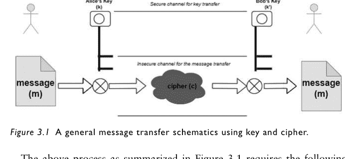

图3.1 使用密钥和密码的一般消息传输示意图。

如上文图3.1所示的汇总过程需要以下假设：

- 明文/消息 m
- 发送方Alice的密钥 k 和接收方Bob的密钥 k′
- 密钥传输的<|message|>
- 密钥 k′ 必须在消息解密前已存在于接收方Bob处
- 密钥 k 和 k′ 通常不必相同

传统基于密码的系统有多种变体，主要类型为替换密码和换位密码。

替换密码只是用其他字符替换明文的单元。换位密码是一种技术，其中明文单元的位置根据某些规则发生变化，即换位。这种换位可以基于另一条消息。

密钥可以只是应用于明文/消息字母表的一个函数，或者密钥本身也可以是另一个明文/消息，用于从消息 m 到密文 c 的变换。如果密钥是另一个明文/消息，用于通过换位将原始消息变换为密文，则称为基于密钥的换位；如果密钥是用于实现明文/消息 m 到密文 c 变换的数学运算，则称为无密钥换位密码。

### 3.2.1 非对称密钥加密

安全消息传输领域后来的许多进步都源于图3.1中的图表。考虑密钥 k 和 k′；传统上这两个密钥是相同的。然而它们不必相同。非对称密钥加密使用两个（或多个不同）密钥。如果密钥 k 和 k′ 相同，则加密算法称为对称密钥加密算法。

事实上，如果有多个接收方，则每个接收方可以拥有不同的密钥，而发送方的密钥可以是唯一的。这是非对称密钥加密背后的最基本原理[7]。

#### 3.2.1.1 RSA算法

RSA算法以其发明者Rivest-Shamir-Adleman命名，是一种基于大素数数学性质的广泛使用的加密算法[8]。它通常用于在在线交易期间保护敏感信息，例如信用卡号码和密码。RSA是一种非对称算法，这意味着它使用一对密钥进行加密和解密：公钥可以分发给任何人，私钥仅数据所有者知晓。用公钥加密的数据只能用相应的私钥解密。尽管使用已约三十年，RSA算法仍然是最受推崇和使用的算法之一[9]。

### 3.2.2 图像安全

增强图像安全的一种方法是将其视为数据并像替换/换位密码一样对其加密。

下一步将使用非对称密钥加密。当图像需要同时被多个接收方访问，并且我们有方法通过安全信道预先向接收方传输其密钥时，这很有用[3]。用于非对称密钥加密的最流行算法再次是上面介绍的RSA[8][10]、数字签名算法DSA[11, 12]、YAK[13]、Diffie Hellman算法及其变体[14]、El Gamal[15]及其变体[16]、Merkle的谜题[17]、椭圆曲线密码学ECC[18, 19]、混沌映射[20]和超混沌映射[21]。这些通用算法类有多种具体的实现技术，在各种评估参数上表现不同。表3.1比较了不同图像加密技术在参数集上的表现[6]。

这些图像加密技术的计算时间比较如表3.2所示。

### 3.2.3 讨论与分析

经典图像加密技术不幸地包括以下根本性问题：

经典图像安全算法的缺点

- 1. 密钥交换假设存在安全信道。
- 2. 没有办法检测是否有人试图拦截并解码传输的消息。


## 表 3.1 各种图像加密技术的比较 [6]

| 技术 | 密钥空间 | 直方图分析 | 相关性分析 | 像素敏感性 | 熵 | PSNR |
|---|---|---|---|---|---|---|
| Vigenère | 差 | 很差 | 很差 | 很差 | 中等 | 中等 |
| RC4 | 良好 | 良好 | 良好 | 优秀 | 良好 | 良好 |
| DES | 很差 | 中等 | 中等 | 很差 | 良好 | 良好 |
| 3DES | 差 | 中等 | 中等 | 很差 | 良好 | 良好 |
| AES | 差 | 良好 | 中等 | 很差 | 良好 | 良好 |
| ECC | 差 | 中等 | 中等 | 良好 | 差 | 优秀 |
| Chaotic map | 差 | 优秀 | 优秀 | 优秀 | 优秀 | 良好 |
| Hyper-chaotic map | 良好 | 优秀 | 优秀 | 优秀 | 优秀 | 良好 |

## 表 3.2 各种图像加密技术的计算时间 [6]

| 技术 | 加密时间 |
|---|---|
| Vigenère | 0.01634 |
| RC4 | 0.23275 |
| DES | 49.1286 |
| 3DES | 143.7368 |
| AES | 169.4769 |
| ECC | 202.1892 |
| Chaotic map | 0.37168 |
| Hyper-chaotic map | 0.45343 |

- 3. 高计算成本：经典图像安全算法通常计算成本高昂，在处理大图像时可能成为阻碍。
- 4. 因高级攻击技术导致的不安全：经典图像安全算法可能容易受到高级攻击技术（如差分密码分析和线性密码分析）的攻击。
- 5. 易受密钥耗尽影响：经典图像安全算法容易出现密钥耗尽，即同一密钥用于加密多张图像，这可能导致安全问题。
- 6. 安全能力有限：经典技术通常基于生成密钥在计算上困难的假设，即暴力攻击困难。经典图像安全算法通常提供有限的安全能力，可以使用简单/专门的攻击技术破解。
- 7. 加密算法有限：经典图像安全算法通常采用有限的加密算法，容易被破解。

我们将在本章后面重新讨论这些问题；但现在让我们讨论——量子计算简介。

## 3.3 量子计算入门

### 3.3.1 量子计算的兴起

1955年，物理学家理查德·费曼提出了量子计算机的想法，一种能够利用量子力学的怪癖比任何传统计算机更快解决某些问题的机器。数十年来，物理学家一直在努力构建这样一种设备，但挑战十分艰巨。然而，近年来，几个团队终于成功构建了可工作的原型。这导致了商业和科学界对量子计算的 renewed interest [22]。

量子计算模型是计算世界中相对较新的发展。与依赖晶体管存储信息的经典计算机不同，量子计算机使用量子位，即比特的量子变体，可以表示一个 0、一个 1，或两者的任意组合。这使得量子计算机能够比经典计算机更快地解决某些问题。量子力学的三个主要定义特征使量子计算成为一种不同的计算范式。

### 3.3.2 量子力学与量子计算

量子力学是理解和预测物理宇宙属性最准确的理论。量子相互作用与人们日常经历的截然不同，但一些定义性原理可以如下描述：

#### 3.3.2.1 波粒二象性

量子对象在其演化过程中通常同时具有波动性或粒子性；而测量可能产生一个结果，取决于测量内容（测量要么指示粒子性，要么指示波动性）。更简洁地说，我们需要在一个实验中同时调用系统的波动性质和粒子性质！任何对象的单一属性在我们观察它之前都不存在！

#### 3.3.2.2 叠加

叠加是一种量子力学现象，描述原子或粒子同时存在于一个以上位置的状态。

换句话说，它是同时存在于两个或多个位置的状态。 such superposed states 的波函数由线性组合与“基”态的复系数描述。

#### 3.3.2.3 相干性

量子相干性是一种量子现象，其中两个或多个量子系统即使相隔一定距离仍保持相关。这种相关性在存在任何噪声或干扰的情况下仍然保持。换句话说，一个系统的状态可以影响另一个系统的状态，即使它们在物理上没有连接。

量子相干性被认为在许多量子现象中发挥作用，包括叠加和纠缠。它也被认为是在开发量子计算和通信技术方面的重要资源。

#### 3.3.2.4 纠缠

量子纠缠是一种现象，当两个或多个粒子紧密关联时，一个粒子的状态可以瞬间影响另一个粒子的状态，无论它们相距多远。这种奇怪的联系似乎违背了物理定律，多年来一直困扰着科学家。然而，最近的研究表明，量子纠缠可能帮助我们揭开宇宙的一些奥秘，以及使用量子计算实现更快的性能。

#### 3.3.2.5 测量

量子测量是量子力学中最基本和最神秘的方面之一。在经典力学中，粒子的位置、动量和能量都是定义良好的量，可以完全准确地测量。在量子力学中，然而，测量粒子的行为会改变其性质。这种现象被称为量子不确定性或不确定性，正如海森堡不确定性原理所概括的那样。然而，一旦对量子系统进行测量，该系统可能处于多个状态的叠加态，将坍缩为单一状态。量子系统坍缩到特定状态的概率由 Born 规则 [23] 给出。

有多种量子力学的解释，科学家们仍然不同意它到底意味着什么；上述所有现象在应用和解释方面仍然是一个开放且活跃的研究领域。

目前正在使用几种不同的量子计算模型，每个模型都有其自身的优缺点。

### 3.3.3 连续变量量子计算 (CVQC)

CVQCs 与经典量子计算机不同之处在于它们使用连续范围的量子位，称为 Qumodes 而不是离散量子位。这使得系统更小、更高效，并允许更准确地模拟物理系统。CVQCs 已被用于建模分子和模拟光学过程，并且在药物发现、机器学习和数据安全等领域具有进一步应用的潜力。

CVQCs 的发展仍处于早期阶段，但它为量子计算的未来带来了很大希望。

### 3.3.4 基于门的量子计算

这是通常且最常听到的量子计算模型，即离散值量子位模型。它被称为基于门的模型，因为量子系统的输入，也称为“量子电路”，通常（并非总是）被建模为量子位状态，然后这些量子位状态使用不同的“门”进行转换，正如我们后面所描述的那样，以便达到我们希望量子电路解决的问题的解决方案 [24]。

#### 3.3.4.1 量子位

量子位（或量子比特）是量子信息的基本单位。量子位是经典比特的量子力学类似物。在经典计算中，信息编码在比特中，每个比特可以具有零或一的值。量子位可以同时表示零或一或两者的线性组合。量子位是一个两能级量子系统，其中两个基量子位状态通常写为 |0⟩ 和 |1⟩。这里，右角括号是 ket，表示列向量。这与只能同时存在于一个状态的经典比特不同。正如前面所解释的，这被称为叠加。

多量子位系统由每个单独量子位状态的张量积表示。

#### 3.3.4.2 布洛赫球表示

如前一小节所述，量子位可以处于 |0⟩ 和 |1⟩ 的叠加态。量子位的这种状态称为状态向量，通常表示为 |ψ⟩，可以写为 Eq. 3.1：

|ψ⟩ = c₀|0⟩ + c₁|1⟩,  (3.1)

where,

|0⟩ = [1;0], |1⟩ = [0;1],

|c₀|² + |c₁|² = 1, and c₀, c₁ ∈ ℂ  (3.2)

现在，c₀ 和 c₁ 是复数；因此，它们可以用等价的极坐标表示：

```
c₀ := r₀ e^{i φ₀},
 c₁ := r₁ e^{i φ₁},  (3.3)
```

或，

```
|ψ⟩ = cos θ |0⟩ + e^{i φ} sin θ |1⟩,
 φ := φ₁ - φ₀, r₀ = cos θ, r₁ = sin θ  (3.4)
```

其中 rᵢ 为振幅，φᵢ 为相位。这样复系数可以表示为单位球面上的点。选择球面而非圆的逻辑在于两个复系数共有四个变量。然而，由于公式 3.2，只有三个变量是独立的。因此，需要一个三维球面才能真正表示任意的量子比特态。

传统上，在量子比特的布洛赫球表示中，|0⟩ 态，即 c₀ = 1 且 c₁ = 0 的态矢量，表示在单位球的北极。|1⟩ 态，即 c₀ = 0 且 c₁ = 1 的态矢量，表示在单位球的南极。见图 3.2。

### 3.3.4.3 测量

在此阶段需要注意量子计算中基的概念，因为这对于理解后面出现的一些内容是必要的。根据玻恩规则，测量量子比特态 |ψ⟩ 在态 |x⟩ 中的概率 P(x) 将由公式 3.5 给出：

```
P(x) := |⟨x | ψ⟩|²  (3.5)
```

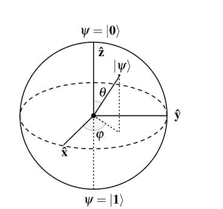

图 3.2 量子比特的布洛赫球表示。

其中左角括号称为 bra，是行向量的简写，⟨Bra | ket⟩ 是行向量元素与表示 ket 的列向量的复共轭的内积。

因此，在态 |0⟩ 中测量 |0⟩，即 |⟨0|0⟩|²，将给出概率 1。类似地，在态 |1⟩ 中测量 |0⟩，即 |⟨1|0⟩|²，将给出概率 0（正交）。

如果 |ψ⟩ = 1/√2 |0⟩ + 1/√2 |1⟩：

|⟨0|ψ⟩|² = |⟨0| 1/√2 |0⟩ + 1/√2 |1⟩|² (3.6)

化简后，

|⟨0|ψ⟩|² = 1/2 |⟨0|0⟩ + ⟨0|1⟩|² = 1/2 (3.7)

测量可以在量子比特态 |0⟩ 或 |1⟩ 或任何其他正交态中进行。这样的正交态集合称为基。如果基态为 |0⟩ 和 |1⟩，则称为计算基或 z 基。

另一种正交态的集合是 |+⟩ = 1/√2 |0⟩ + 1/√2 |1⟩ 和 |−⟩ = 1/√2 |0⟩ − 1/√2 |1⟩。它被称为 x 基。

### 3.3.4.4 单量子比特门

现在，为了让量子比特执行某些计算，我们必须有转换它们的方法。这些转换方法称为“门” [25]。

由于玻恩规则，态矢量 |ψ⟩ 总是保持在布洛赫球的表面上，因为 ||ψ|| = 1；然而，态矢量可以自由地在球面上旋转。单量子比特门不过是态矢量在布洛赫球上的旋转。标准的单量子比特门如下：

- 1. X-gate: Rotates |ψ⟩ to |1⟩ and vice versa. It is rotation by π around the x-axis.
- 2. Y-gate and Z-gate: perform rotations by π radians around y and z-axis of the Bloch sphere, respectively.
- 3. H-gate: This makes a rotation around the line between the x and z-axis.
  - If applied to |0⟩, generates equal superposition, i.e., 1/√2 |0⟩ + 1/√2 |1⟩ state.
  - If applied to |1⟩, generates equal superposition, i.e., 1/√2 |0⟩ − 1/√2 |1⟩ state.
- 4. I-gate: Identity gate; does not change the state. X applied twice becomes I gate.
- 5. S-gate: It does a quarter-turn around the Bloch sphere. S applied twice becomes Z gate.
- 6. Rx-gate: Rotation around x-axis by a specified angle.
- 7. Ry-gate: Rotation around y-axis by a specified angle.
- 8. Rz-gate: Rotation around y-axis by a specified angle.

### 3.3.4.5 双量子比特门

现在，这里简要讨论双量子比特门。由于单个量子比特只有两个基态，即 |0⟩ 或 |1⟩，两个量子比特可以有四个基态，即 |00⟩、|01⟩、|10⟩ 和 |11⟩。一般而言：

|ψ⟩ = c00|00⟩ + c01|01⟩ + c10|10⟩ + c11|11⟩,  (3.8)

其中，

‖c00‖² + ‖c01‖² + ‖c10‖² + ‖c11‖² = 1,  (3.9)
c00, c01, c10 and c11 ∈ ℂ

双量子比特门通常是单量子比特门的受控版本。通过示例会更清楚。标准的双量子比特门是 C-NOT 或 CX 门。CX 门的真值表在表 3.3 中给出，其中 q0 为控制量子比特，q1 为输出量子比特，q'1 为应用 CX 门后输出的状态。CX 与 H 门结合可以为我们构建纠缠量子比特对。纠缠下双量子比特系统的状态为 1/√2 |00⟩ + 1/√2 |11⟩。参见图 3.3。

表 3.3 CX 门的真值表

| q0 | q1 | q'1 |
|----|----|-----|
| 0 | 0 | 0 |
| 0 | 1 | 1 |
| 1 | 0 | 1 |
| 1 | 1 | 0 |

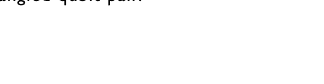

图 3.3 纠缠量子比特对的生成。

### 3.3.4.6 多量子比特门

多量子比特门是双量子比特门的扩展。例如，双量子比特 C-NOT 门可以定义为有两个控制量子比特和一个输出量子比特。因此，输出量子比特的状态只有在两个控制量子比特都处于 |1⟩ 态时才会改变。

### 3.3.5 量子电路

到目前为止，我们在没有正确介绍的情况下使用了术语 *quantum circuit*，因此我们将在此处进行介绍。

根据 IBM Quantum:

> > 量子电路是有序的量子门、测量和重置序列，所有这些都可能取决于实时经典计算的数据并使用这些数据 [26]。

一个很好的量子电路示例，也与本章相关，是量子隐形传态电路。量子隐形传态电路是在不违反量子力学基本原理的情况下，将量子比特的状态从发送者（Alice）传输到接收者（Bob）的方法。

### 3.3.6 量子隐形传态电路

首次创建于 1993 年 [27]，量子隐形传态电路是量子密码学最重要的组成部分之一。为了实现量子隐形传态，发送者（Alice）和接收者（Bob）需要第三个人（通常称为 Telamon），以使他们各自从一对纠缠量子比特中各获得一个量子比特。发送者（Alice）和接收者（Bob）都需要对其量子比特执行某些门操作，并在经典信道上交换某些信息，以便在 Bob 处接收 Alice 量子比特的状态。

- **Step 1:** Suppose Alice is trying to send the state |ψ⟩ of her qubit q₀ to Bob.
- **Step 2:** The third party (Telamon) creates an entangled pair of qubits and gives one qubit (qₐ) to Alice and one qubit (q_b) to Bob.
- **Step 3:** Alice is required to apply a CX gate to qₐ with q₀ as the control qubit.
- **Step 4:** Alice is required to apply an H gate to q₀.
- **Step 5:** Alice is required to perform measurement of both her qubits and save the result in two classical bits, then send the two classical bits to Bob through a classical channel.
- **Step 6:** Now the receiver, Bob, who is receiving the qubits q_b, applies the gates as per Table 3.4.
- **Step 7:** After Step 6, Bob will have the state of his qubit same as |ψ₀⟩.

表 3.4 Bob 的操作

| Bits | Action |
|------|--------|
| 00 | Nothing |
| 01 | X |
| 10 | Z |
| 11 | ZX |

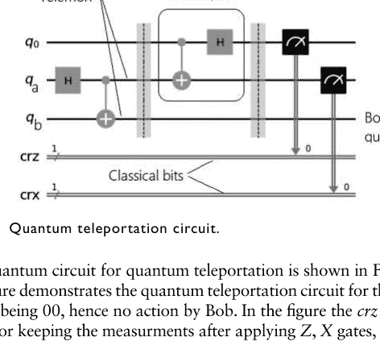

图 3.4 量子隐形传态电路。

量子隐形传态的量子电路如图 3.4 所示。给出的图演示了经典比特为 00 的情况下的量子隐形传态电路，因此 Bob 无需操作。图中 crz 和 crx 通道分别用于在应用 Z、X 门后保留测量结果。

## 3.4 量子通信

量子通信是上一节讨论的量子隐形传态的自然且必要的扩展。量子通信基本上利用了 3.3.2 小节中列举的量子物理定律。据预测，量子通信未来将演变为量子互联网。这样的网络将类似于经典网络；然而，该网络的端节点将是栖息着量子比特的量子处理器，所交换的信息将是量子信息 [28]。

## 3.5 后量子时代的安全

我们已全面介绍了该主题的基本要素，从量子力学基础、量子计算、量子计算的门模型、标准门和量子

量子传送电路并提及了关于量子通信的一般概念。

现在，让我们考虑所有这些发展，并分析它们对经典密码学方法意味着什么，包括那些用于图像的方法。

## 3.5.1 经典密码学方法的挑战

如前所述，经典密码学方法主要依赖于以下两个问题的难度：1）因式分解问题——这是 RSA 算法提出的公钥密码学的核心；以及 2）离散对数问题 (DLP)——Diffie-Hellman 方案和椭圆曲线密码算法都基于离散对数问题的难度。

根据 2015 年的一份报告，2048 位 RSA 算法可由拥有十亿个量子比特的量子计算机破解。然而，后来在 2017 年，Gidney 和 Ekerå 证明仅用 2000 万个量子比特的量子计算机即可在八小时内破解 2048 位 RSA 算法 [29]。因此，在几年内破解 2048 位 RSA 安全加密所需的量子比特数减少了两个数量级 [30]。

当前量子计算机的能力远低于破解 RSA 算法所需的量子比特数。现有的量子计算机存在快速退相干和噪声的问题。然而，像 Google 和 IBM 这样的行业巨头正在不断努力改进量子硬件。图 3.5 [31] 显示了过去 20 年来全球主要参与者实现的量子比特数的增长。如图所示，量子比特数几乎以指数速度增长。

| 组织 | 年份 | 量子比特数 | 进展 |
|---|---|---|---|
| IBM, MIT, Oxford, Berkeley, Stanford | 1998 | 2 |  |
| TU Munich | 2000 | 5 |  |
| Los Alamos National Lab. | 2000 | 7 |  |
| Institute of Quantum Computing, Perimeter Institute, MIT | 2006 | 12 |  |
| D-Wave Systems | 2008 | 28 |  |
| MIT, Stanford, Berkeley | 2017 | 50 |  |
| Intel | 2018 | 49 |  |
| Google | 2018 | 72 |  |
| Rigetti | 2019 | 128 |  |
| IBM | 2021 | 127 |  |
| IBM | 2022 | 433 |  |

图 3.5 量子比特数增长，1998–2022。

量子计算的当前发展状态提供的最大量子比特数为 433 个，这是 IBM 于 2022 年 11 月 9 日宣布的 [32]。值得一提的是，像 IBM 这样的行业巨头实现规模化量子计算的计划。IBM 于 2022 年发布的量子路线图展示了 IBM 在 2019 年至 2026 年及以后开发和维持量子计算技术的过去和未来计划。如图 3.6 所示，IBM 路线图展示了一个雄心勃勃的计划，即到 2026 年部署多达 10k 至 100k 个量子比特，并具备经典和量子通信能力 [33]。图 3.7 给出了后量子密码学的广泛用途和应用。

美国国家标准与技术研究院发布的一份报告 [34] 估计，大多数如果不是全部经典密码学方法都容易受到足够规模的量子计算机的攻击。我们可以看到量子计算无处不在的世界即将到来。我们只有几十年的领先时间来更新和修订经典密码学协议 [35]。

## 3.5.2 后量子密码学的优势

鉴于上述分析，今天的主要科技公司正在为下一场量子革命做准备。后量子密码学一词用于指代在量子计算广泛可用的时代将使用的技术、概念、算法和方法 [36]。

### 3.5.2.1 入侵检测

这一特性是后量子密码学方法的基本且决定性特征。后量子密码学方法基于量子力学理论中确立的物理定律。窃听者试图读取或记录从发送方传输到接收方的信号的任何尝试都会以根本的方式改变信息。接收方立即知道信号已被篡改，因此进行了窃听尝试。

### 3.5.2.2 同态密码学

人们认为后量子密码学将使我们能够开发可行的同态密码学，其指的是在加密形式下数据集在多个用户之间共享以进行处理的状态。因此，用户无需以未加密的形式查看数据；然而，他将能够对同一数据集进行处理。同态密码学将允许大型数据集在组织之间共享，而无需担心敏感信息泄露。这也将使组织能够主动共享

## 开发路线图

由 IBM 执行
按计划进行

| 年份 | 里程碑 |
|---|---|
| 2019 | 在 IBM 云上运行量子电路 |
| 2020 | 展示和原型化量子算法和应用 |
| 2021 | 使用 Qiskit Runtime 以 100 倍速度运行量子程序 |
| 2022 | 将动态电路引入 Qiskit Runtime 以解锁更多计算 |
| 2023 | 通过 Qiskit Runtime 的弹性计算和并行化增强应用 |
| 2024 | 通过可扩展的错误缓解提高 Qiskit Runtime 的准确性 |
| 2025 | 使用控制 Qiskit Runtime 的电路编织工具箱扩展量子应用 |
| 2026+ | 通过将错误校正集成到 Qiskit Runtime 中提高量子工作流的准确性和速度 |

**模型开发者**
原型量子软件应用 → 量子软件应用
机器学习 | 自然科学 | 优化

**算法开发者**
量子算法和应用模块
机器学习 | 自然科学 | 优化
量子 Serverless
智能编排 | 电路编织工具箱 | 电路库

**内核开发者**
电路 | Qiskit Runtime | 动态电路 | 线程原语 | 错误抑制和缓解 | 错误校正

**系统模块化**
Falcon 27 量子比特 | Hummingbird 65 量子比特 | Eagle 127 量子比特 | Osprey 433 量子比特 | Condor 1,121 量子比特 | Flamingo 1,386+ 量子比特 | Kookaburra 4,158+ 量子比特 | 扩展到 10K-100K 量子比特并具备经典和量子通信
Heron 133 量子比特 x p | Crossbill 408 量子比特

图 3.6 IBM 量子计算路线图 2019–2026 及以后。（图片来源：IBM [33]）。

迄今为止因隐私问题而未共享的数据。个人数据安全将借助这种技术达到新的高度 [37]。

## 3.6 后量子密码学技术的调查

我们现在将讨论一些最近为后量子密码学开发的技术。后量子密码学是一个庞大的新兴领域，具有其附属领域。图 3.7 显示了后量子密码学领域所涵盖的范围，其中包括算法和物理方面。

### 3.6.1 量子密钥分发

量子密钥分发 (QKD) 是一种在最安全的方式下在双方之间生成加密密钥的技术。它是一种密码学，其密钥交换的安全性由量子力学定律保证。QKD 通过使用单光子或光的单个量子在双方之间发送信息来工作。这些信息随后可以生成一个加密密钥，以安全地加密和解密数据。

QKD 变得越来越有吸引力，并成为量子密码工具包的支柱之一，因为它几乎不可破解，因为任何拦截或操纵传输的尝试都将因量子力学定律而被检测到。此外，由于其依赖于单

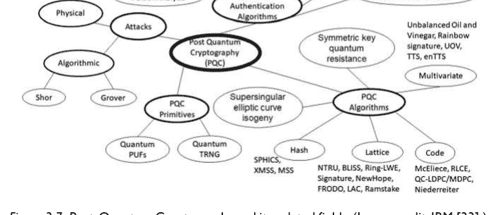

图 3.7 后量子密码学及其相关领域。（图片来源：IBM [33].）

光子进行通信，它比一次性密码本或公钥密码等传统方法提供更高的安全性。因此，QKD 可以为人们在远距离之间共享秘密提供安全手段，使其特别适用于需要在大地理区域进行安全通信的应用 [38]。

量子密钥分发的首次实验于 1989 年由 Bennett 和 Brassard 完成，他们开发了现在著名的 BB84 协议，该协议至今仍被广泛使用。该协议涉及通过光学通道从一方（Alice）向另一方（Bob）发送编码在单光子上的随机比特。每个比特由单光子的垂直或水平偏振态表示，Alice 使用称为量子随机数生成器（QRNG）的设备随机选择每个偏振态。然后 Bob 用他自己的 QRNG 测量每个入射光子，并将其结果与 Alice 发送的结果进行比较。如果它们匹配，他就保留它们；否则他将它们丢弃为错误并重新发送比特，直到收到完全匹配为止。一旦所有比特成功交换，双方就以高度信心建立了他们的加密密钥，确保它们在传输过程中未被拦截或篡改。

从那里他们可以使用此密钥通过 AES 或 3DES 等算法进行对称加密；这种加密方法比其他方法提供更高的安全性，因为它依赖于在所有通信中保持相同的密钥，这使得拦截变得显著困难，甚至不可能。此外，由于其作为不可破解的加密方法的性质，即使有人获得了传输数据的访问权限，如果不知道传输期间使用的确切相同密钥，也无法解密它；从而为即使在大距离上的敏感数据传输提供前所未有的安全级别。

### 3.6.2 BB84 协议

QKD 是一类或更确切地说是一个用于后量子密码学的概念。BB84 协议是其第一个实际实现。我们现在将介绍 BB84 协议的技术细节 [39]。

### 3.6.2.1 概述

假设 Alice 想将她的私钥发送给 Bob。Alice 决定有两个二进制字符串 a 和 b，每个长度为 n 位。在此设置中，Alice 和 Bob 通过双向经典信道和单向量子信道进行通信，如图 3.8 所示。量子信道通常使用偏振光子作为量子比特。单个光子在其偏振态下将表示量子比特的状态 |ψ⟩。经典信道是通常的电话或互联网线路，窃听者 Eve 可以访问。


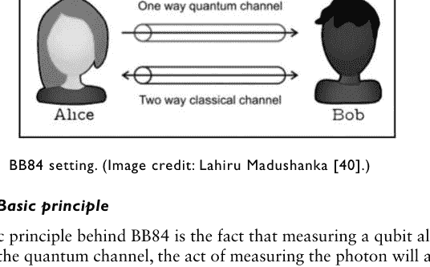

图 3.8 BB84 设置。 (图片来源：Lahiru Madushanka [40]。)

### 3.6.2.2 基本原理

BB84 背后的基本原理是测量量子比特会改变其状态。在量子信道中，测量光子会改变其偏振状态。因此，如果 Eve 试图通过量子信道窃听通信，Bob 将知道有人试图查看他的通信，并可能决定更改密钥。

如果 Alice 将 0 编码为 | + ⟩ 且 Bob 在 x 基下测量它，他将以 100% 的概率测得 0，但如果 Bob 在 z 基下测量它，他将以 50% 的概率测得 0，以 50% 的概率测得 1。

BB84 基本上确保窃听者获得发送的量子比特状态真实值的概率可以忽略不计。

- 步骤 1：Alice 选择一个随机二进制字符串 '00 11 10 11 00 10'。
- 步骤 2：Alice 选择一个随机基序列 'XZ XX ZX ZX XZ XX'。
- 步骤 3：Alice 根据随机基序列对二进制字符串进行编码。该字符串的输出为：| − ⟩|0⟩| − ⟩| + ⟩| + ⟩|1⟩| − ⟩|1⟩| + ⟩| − ⟩| − ⟩|0⟩| + ⟩|1⟩。这是 Alice 发送给 Bob 的序列。
- 步骤 4：Bob 以随机选择的基测量接收到的量子比特序列，例如 'ZX XZ XZ XX ZZ ZX'。
- 步骤 5：Alice 在经典信道中分享她分别用于编码和测量的基。
- 步骤 6：Bob 将其结果与 Alice 分享的基进行比较，并只保留与 Alice 分享的基匹配的那些比特。这成为 Bob 的密钥的一部分。
- 步骤 7：Bob 和 Alice 从他们拥有的序列中分享一个样本。如果两者匹配，则意味着密钥交换已经完成。

## 3.6.3 分析

尽管具有众多优势，但在实际实现方面，量子密钥分发并非没有挑战； namely

其与传统方法相比速度极低，以及与生成单光子相关的相对较高的成本，由于与成功通信所需的单光子相比，其在自然界中比其他形式的<|start|>光源（如激光）更稀有。尽管如此，这些问题现在正被世界各地的科学家和工程师积极研究，他们正在努力寻找新的方法，使 QKD 更实用、更具成本效益，以便每个人都能受益于其无与伦比的安全潜力，同时还能享受现代网络如 5G 技术等所期望的闪电般的速度 [41]。

现在我们将讨论一些据认为与后量子时代密码学相关的技术。这些方法结合量子方法如 QKD/BB84 可能为我们提供量子安全密码学。

## 3.6.4 基于格的密码学

### 3.6.4.1 概述

基于格的密码学是一种利用多元多项式生成和操作密码密钥的公钥密码学类型。这种密码学通过使用格结构来解决离散对数问题，与 RSA 和 Diffie–Hellman 等传统公钥系统相比提供了更高的安全性 [42]。

在基于格的密码学中，密码密钥表示为格上的点（或向量）。格 ℒ 是一个 n 维空间，由形成可用于计算的点阵的平行平面组成，如 Eq. 3.10 和图 3.9 所示。

ℒ ⊂ ℝⁿ,
{b₁, b₂, ..., bₙ} basis of ℝⁿ,
ℒ = {∑ᵢ₌₁ⁿ aᵢbᵢ, aᵢ ∈ ℤ}  (3.10)

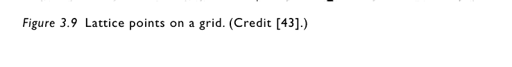

图 3.9 网格上的格点。 (来源 [43]。)

### 3.6.4.2 短整数解 SIS

我们从线性代数知道基不是唯一的，格也是如此。这种结构使我们能够通过在格上以不同方式连接点来找到点之间的数学关系，从而比其他类型的公钥密码系统实现更高效的加密和解密过程。

为了创建一个足够困难以实现密码学目标的问题，我们可以考虑以下问题。

假设我们有一个随机矩阵 A，其元素范围从 0 到 q。挑战是识别一个“短”向量 x，使其满足 Eq. 3.11。

A x ≡ 0 (mod q)
(3.11)

满足 Eq. 3.11 的向量集合（长度任意）可以绘制为格或网格形式。找到一个接近原点但不完全等于原点的解 x 是 SIS 问题的目标。图 3.10 中的格图就是一个说明。找到红色圆圈内不是蓝色点的那个位置是困难的部分。

为了在基于格的密码学中生成安全的密钥，使用多层多项式来创建格结构。多项式被选择为没有使它们难以分解的共同因子，从而使攻击者极难推断出底层密钥值。此外，这些多项式通常被选择为包含大素数，进一步增加了找到底层密钥的难度。

基于格的密码学的一个优点是其能够创建几乎完美的保密性，这意味着攻击者需要无限的计算能力才能接近破解加密算法或解密用其加密的消息。此外，由于这种密码系统依赖于数学而不是将特定值硬编码到算法中，因此可以使其高度抵抗侧信道攻击，其中

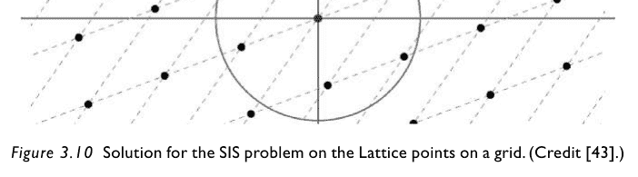

图 3.10 网格上格点的 SIS 问题解。 (来源 [43]。)

攻击者试图通过时序或功耗分析技术获取有关密码密钥的信息 [44]。

自 20 多年前诞生以来，格算法已被纳入众多安全协议中，例如 IBE（基于身份的加密）、FHE（全同态加密）、ABE（基于属性的加密）和 PKE（公钥加密）。这些类型的加密方案使用基于数论中困难问题（如整数分解和离散对数）的复杂数学模型，以在不可信网络或共享区域中提供安全通信，在这些区域中对手可能拦截或修改两个参与方之间传输的数据。最近，已提出用于基于格密码学的量子-经典混合算法 [45]。

### 3.6.4.3 图像安全视角

尽管这种加密类型存在一些缺点——例如其高计算需求——这些挑战可以通过硬件技术的进步来克服，从而实现更快、更强大的计算机，同时降低大规模运行这些算法相关的能源消耗成本。就图像数据而言，由于二维数据，它将需要进一步的计算负载。因此，随着我们努力在所有行业实现更大程度的数据安全，我们可能会继续看到该领域的进步及其应用变得越来越广泛 [46]。值得一提的是，基于格密码学更快硬件实现的<|message|>研究是一个活跃领域 [47]。

## 3.6.5 多元密码学

### 3.6.5.1 概述

多元密码学是一种使用多个变量而不是单个密钥来保护数据的加密技术。它基于使用多个参数（如点、线和曲线）生成极其复杂代码的数学算法。然后可以使用正确的变量组合以安全的方式锁定和解锁数据。多元密码学由于其更高的复杂性而被认为比传统方法更安全。

多元密码学最早由 IBM 的研究人员在 2000 年代初期开发，他们试图创建比当时可用的更强大的加密形式。此后，它在企业和个人中变得越来越受欢迎，因为其安全能力提供了更大的保护，防止黑客攻击和其他恶意活动 [48]。多元密码学的主要好处是用户无需记住复杂的密码或密码短语；相反，只需要可以轻松记忆或写下来以便妥善保存的参数组合 [49]。


### 3.6.5.2 方法论
使用多元密码学生成代码的过程需要使用有限域上的数学多项式。这些多项式随后被用来创建极其复杂的代码，只有在提供正确的变量组合时才能解密。这使其对暴力攻击具有高度抵抗力，因为即使黑客能够访问底层方程，他们仍需要正确猜出正确的组合才能解密任何加密数据。从某种意义上说，多元密码学也是一种公钥密码学 [50]。

多变量中的非线性多项式方程组，通常是在具有 q 个元素的有限域 F = Fq 上的二次方程，是多元密码学的基石。参见公式 3.12。

p^{(1)}(x_1,...,x_n)=\sum_{i=1}^{n}\sum_{j=1}^{n}p_{ij}^{(1)}\cdot x_i x_j + \sum_{i=1}^{n}p_i^{(1)}\cdot x_i + p_0^{(1)},

p^{(2)}(x_1,...,x_n)=\sum_{i=1}^{n}\sum_{j=1}^{n}p_{ij}^{(2)}\cdot x_i x_j + \sum_{i=1}^{n}p_i^{(2)}\cdot x_i + p_0^{(2)}

\vdots

p^{(n)}(x_1,...,x_n)=\sum_{i=1}^{n}\sum_{j=1}^{n}p_{ij}^{(n)}\cdot x_i x_j + \sum_{i=1}^{n}p_i^{(n)}\cdot x_i + p_0^{(n)}

(3.12)

多元密码系统的安全性在于以下问题的难度：

**Problem:** 给定如公式 3.12 中所示的变量 $x = (x_1, x_2, ..., x_n)$ 下的 $p^{(1)}, p^{(2)}, ..., p^{(n)}$，求 $x$ 使得 $p^{(1)} = 0, p^{(2)} = 0, ..., p^{(n)} = 0$ [50]。

为了进一步增强安全措施，多元密码学还利用了混沌理论和随机数生成技术中的元素。通过这些方法在方程中引入随机性，即使黑客掌握其背后的底层数学知识，也无法预测哪种组合会产生成功的结果。这确保了在成功解锁任何加密数据文件之前，猜测所有可能组合的巨大复杂性使得大多数情况下入侵多元加密数据的任何尝试都将徒劳无功。

由于其相对于传统加密形式的诸多优势，多元密码学已被应用于银行和金融到电信和政府应用等众多行业，这些行业需要提高安全措施。它也越来越多地被整合到日常应用中，例如在线购物网站，这些网站寻求额外的保护层以防止网络犯罪分子，让客户在网上购物时安心。

### 3.6.5.3 图像安全视角
多元密码学已被公认为后量子密码算法的主要候选方案之一 [51]。多元密码学将特别适用于图像数据。该方法的固有多元特性使其适用于二维图像数据，可用多元密钥进行编码。多元密码学的另一个好处是它可以用更短的密钥提供相同的安全性 [52]。

## 3.6.6 Hash-based cryptography
### 3.6.6.1 Overview
基于哈希的密码学是一种使用密码学哈希函数来保护数据的加密类型。它是一种对称密码学形式，这意味着相同的密钥用于加密和解密数据。基于哈希的密码学在 20 世纪 70 年代后期开发出来，此后已成为保护数字数据日益流行的选择。

基于哈希的加密通过取一段输入数据（如消息或文件），将其通过单向密码学哈希函数运行，然后使用 resulting output（称为摘要）作为加密密钥来工作。使用这种技术，同一消息可以多次加密，但每次使用不同的密钥，使得几乎不可能逆向工程原始消息。哈希函数还确保对输入所做的任何更改都会产生截然不同的输出，使得在不被检测的情况下篡改或更改原始文件同样困难 [53]。

### 3.6.6.2 Methodology
一次性签名技术是基于哈希签名系统的基础。仅有一个消息可以用给定的一次性签名密钥安全地签名。底层哈希函数的安全性是影响（基于哈希的）一次性签名方法安全性的唯一因素。基于哈希的系统已被证明对验证者签名方案有用 [54]。

Lamport-Diffie 方案 [55]、Winternitz 方案 [56] 及其升级版本（如 W-OTS+ 方案 [57]）都是经常使用的一次性签名方案。与开创性的 Lamport-Diffie 技术不同，Winternitz 系统及其变体可以同时签名多个位。Winternitz 参数的值决定了将同时签名多少位。由于该参数的存在，大小和速度之间存在权衡。Winternitz 参数的大值会导致签名变短。

基于哈希密码学的主要优势之一是，由于其能够检测数据中甚至微小的变化，它可以提供比传统加密方法更强的安全性。此外，哈希函数的现代实现通常比 RSA 和 DES 等更传统的加密形式快得多，这意味着这些算法更适合速度至关重要的应用 [58]。

这种算法的另一个好处是它不需要公钥/私钥，这使其比其他类型的加密更容易、更便宜地实现。此外，与大多数其他类型的加密不同，哈希不需要昂贵的硬件或软件组件，因此可以在几乎任何环境中快速轻松地实现。这使其非常适合资源有限且速度至关重要的应用，如移动设备身份验证 [34]。

### 3.6.6.3 Image security perspective
量子哈希函数的发展使基于哈希的密码学在实现量子安全方面又迈进了一步。由于这一发展，包括图像数据在内，该技术是后量子密码学的首选候选方案之一。

## 3.6.7 Code-based cryptography
### 3.6.7.1 Overview
基于代码的密码学是一种结合传统算法和纠错码使用的加密技术。它基于这样一个思想：即使对手可以完全访问传输的消息，数据也可以在两个或多个方之间安全传输。它依赖于用既安全又能被授权人员轻松解码的代码对数据进行编码 [59]。

与其它密码技术相比，基于代码的密码学的主要优势是其能够在不需要任何额外数据的情况下纠正传输中的错误。这使其比单独的传统密码学更能抵御恶意行为者的操纵或拦截 [60]。基于代码的密码学不仅提供保密性，还提供身份验证，这意味着它可用于验证双方是否在相互通信，并且没有第三方能够拦截或篡改数据。这增强了在线交易双方之间的安全性和信任。这就是为什么基于代码的密码学被认为对数字签名具有吸引力的原因 [61]。

基于代码的密码学最广泛使用的形式是 Reed-Solomon 编码，它由 Irving Reed 和 Gustave Solomon 于 1960 年首次开发 [62]。

### 3.6.7.2 Methodology
该技术的基本思想是将消息分解为称为‘codewords’的较小片段，然后添加冗余信息（即，check digits），这允许在不重新发送整个消息的情况下检测和纠正传输中的错误。其他流行形式包括 Low Density Parity Check (LDPC) codes、Convolutional codes 和 Turbo codes，它们都提供不同程度的抵御恶意攻击的弹性，同时仍允许在网络上传输数据的高效性 [63]。

### 3.6.7.3 Image security perspective
随着技术的进步，基于代码的密码学也在发展，使其成为保护在线敏感通信免受窥探的越来越有用的工具。更复杂的表单不断被开发出来，因为研究人员努力找到使系统更安全、更抗攻击的方法，同时仍为实时应用（如通过互联网或手机等网络流式传输图像/媒体）提供低延迟。此外，随着计算机变得越来越强大和快速，基于代码的密码学现在可以在以前不可能的更大规模上使用——potentially 允许比以往任何时候都更大的全球范围的安全性。分布式计算可有效用于基于代码的密码学的实现 [64]。

## 3.6.8 Supersingular elliptic curve isogeny cryptography
### 3.6.8.1 Overview
超奇异椭圆曲线同源密码学，也称为 SIDH（超奇异同源 Diffie-Hellman），是一种利用不同类型的称为超奇异同源的数学对象的公钥密码学。它由 Jean-Francois Biasse、Nicolas Costello 和 Michael Naehrig 于 2015 年首次提出，作为传统 Diffie-Hellman 密钥交换协议的替代方案。此后，它已被密码学家广泛研究和开发，以期在后量子密码学中得到潜在应用 [65]。

SIDH 通过生成通过同源相关联的两个椭圆曲线来工作；这些曲线的底层数学随后允许双方之间进行安全通信。每个方根据共享的曲线参数和自己的私有输入生成一个秘密密钥——这个秘密密钥

可以用于在双方之间加密消息，而无需担心传输过程中消息的解密或篡改。这使得 SIDH 相较于传统算法如 AES 或 RSA [66] 对量子攻击具有特别强的韧性。

### 3.6.8.2 方法论
形式为 p = l_A^{e_A} · l_B^{e_B} · f ± 1 的素数作为 SIDH 的设置，其中 l_A 和 l_B 是小素数，e_A、e_B 为大指数，f 称为小余因子，并与域 F_p^2 上的椭圆曲线 E 关联。

此类曲线中存在两个重要的挠子群，记为 E[l_A] 和 E[l_B]，分别分配给 Alice 和 Bob，如下标所示。协议开始时，各方计算相关的（秘密）同源映射，并在其各自的挠子群中选择一个（秘密）随机循环子群。然后，其模型的目标曲线的方程会被发布或以其他方式提供给另一方。

除了卓越的安全性之外，SIDH 相较于经典密码系统还具有若干优势，例如由于其可扩展性和降低的存储需求而带来的更好性能和效率。此外，虽然所有传统密码协议都需要某种类型的可信第三方来提供安全的通信通道，但 SIDH 不依赖于任何此类第三方——相反，它提供了一种完全去中心化的解决方案，允许任何两个方在无需集中式权威的情况下安全通信。最后，由于 SIDH 的运行不需要任何大型预计算表或其他复杂数据结构，因此可以轻松地在资源受限设备如嵌入式系统或手机上实现 [67]。

### 3.6.8.3 图像安全视角
所有这些特性使 SIDH 成为后量子密码学应用中有吸引力的潜在候选者；然而，在其能够在不同平台和应用中广泛采用之前，还需要进一步研究。随着更多密码分析人员继续研究 SIDH 的安全属性并开发进一步增强其在现实世界中实用性的工具，我们希望在未来几年看到它变得更加普遍。其对基于图像数据的适用性有待进一步研究。

## 3.6.9 对称密钥量子抗性

### 3.6.9.1 概述
对称密钥量子抗性是一种密码学形式，可抵御量子计算对现有加密算法构成的潜在威胁。这种类型的加密对于希望保护其信息免受使用量子计算机的恶意行为者攻击的组织和个人而言非常重要。

与传统加密算法不同，对称密钥量子抗性密码学使用一种特别安全的算法，即哈希消息认证码 Hash-Based Message Authentication Code (HMAC)，以确保加密数据的完整性。HMAC 使用两个不同的密钥：一个用于加密数据，另一个用于解密数据。这些密钥永远不会存储在同一台机器上或一起传输；这确保了如果一个密钥被泄露，另一个仍会保持安全。此外，HMAC 可以配置为即使攻击者知道两个密钥，仍无法访问加密数据 [68]。

除了提供抵御量子计算攻击的保护外，对称密钥量子抗性密码学还提供更好的安全性，可抵御传统攻击如暴力攻击以及侧信道攻击如时序攻击和故障注入攻击。这使得这类密码算法对需要在传统加密方法之上增加额外安全层级的组织特别有吸引力。额外好处是，对称密钥量子抗性密码学在保持有效性方面不需要复杂的数学运算；这意味着其计算开销远低于其他类型的密码技术。在最新的前沿研究中，已表明对称密钥量子抗性在区块链技术领域具有潜在应用 [69]。

### 3.6.9.2 图像安全视角
对称密钥量子抗性密码学是确保敏感数据在当今数字世界中保持安全的[content]
可以用于在双方之间加密消息，而无需担心传输过程中消息的解密或篡改。这使得 SIDH 相较于传统算法如 AES 或 RSA [66] 对量子攻击具有特别强的韧性。

### 3.6.8.2 方法论
形式为 p = l_A^{e_A} · l_B^{e_B} · f ± 1 的素数作为 SIDH 的设置，其中 l_A 和 l_B 是小素数，e_A、e_B 为大指数，f 称为小余因子，并与域 F_p^2 上的椭圆曲线 E 关联。

此类曲线中存在两个重要的挠子群，记为 E[l_A] 和 E[l_B]，分别分配给 Alice 和 Bob，如下标所示。协议开始时，各方计算相关的（秘密）同源映射，并在其各自的挠子群中选择一个（秘密）随机循环子群。然后，其模型的目标曲线的方程会被发布或以其他方式提供给另一方。

除了卓越的安全性之外，SIDH 相较于经典密码系统还具有若干优势，例如由于其可扩展性和降低的存储需求而带来的更好性能和效率。此外，虽然所有传统密码协议都需要某种类型的可信第三方来提供安全的通信通道，但 SIDH 不依赖于任何此类第三方——相反，它提供了一种完全去中心化的解决方案，允许任何两个方在无需集中式权威的情况下安全通信。最后，由于 SIDH 的运行不需要任何大型预计算表或其他复杂数据结构，因此可以轻松地在资源受限设备如嵌入式系统或手机上实现 [67]。

### 3.6.8.3 图像安全视角
所有这些特性使 SIDH 成为后量子密码学应用中有吸引力的潜在候选者；然而，在其能够在不同平台和应用中广泛采用之前，还需要进一步研究。随着更多密码分析人员继续研究 SIDH 的安全属性并开发进一步增强其在现实世界中实用性的工具，我们希望在未来几年看到它变得更加普遍。其对基于图像数据的适用性有待进一步研究。

## 3.6.9 对称密钥量子抗性

### 3.6.9.1 概述
对称密钥量子抗性是一种密码学形式，可抵御量子计算对现有加密算法构成的潜在威胁。这种类型的加密对于希望保护其信息免受使用量子计算机的恶意行为者攻击的组织和个人而言非常重要。

与传统加密算法不同，对称密钥量子抗性密码学使用一种特别安全的算法，即哈希消息认证码 Hash-Based Message Authentication Code (HMAC)，以确保加密数据的完整性。HMAC 使用两个不同的密钥：一个用于加密数据，另一个用于解密数据。这些密钥永远不会存储在同一台机器上或一起传输；这确保了如果一个密钥被泄露，另一个仍会保持安全。此外，HMAC 可以配置为即使攻击者知道两个密钥，仍无法访问加密数据 [68]。

除了提供抵御量子计算攻击的保护外，对称密钥量子抗性密码学还提供更好的安全性，可抵御传统攻击如暴力攻击以及侧信道攻击如时序攻击和故障注入攻击。这使得这类密码算法对需要在传统加密方法之上增加额外安全层级的组织特别有吸引力。额外好处是，对称密钥量子抗性密码学在保持有效性方面不需要复杂的数学运算；这意味着其计算开销远低于其他类型的密码技术。在最新的前沿研究中，已表明对称密钥量子抗性在区块链技术领域具有潜在应用 [69]。

### 3.6.9.2 图像安全视角
对称密钥量子抗性密码学是确保敏感数据在当今数字世界中保持安全的重要工具。通过其设计，这种类型的密码算法大大降低了任何恶意行为者能够突破其防御并访问机密信息的可能性。此外，由于其相比其他密码技术所需的计算开销更低，它非常适合那些可能无法使用强大的计算资源但仍需要可靠网络威胁保护的人。低计算需求使该方法适用于图像/2D 数据。

## 3.7 结论
在本章中，我们讨论了后量子世界中的图像安全问题。我们从经典图像安全的基础及其主要术语和非对称密钥加密开始。对几种知名非对称密钥算法进行了比较汇总。

为了对后量子密码学时代可用的技术/算法组合有一个完整的认识，我们介绍了量子计算的理论基础和关键术语及其各种模型。介绍了量子比特、单量子比特门、双量子比特门、多量子比特门和测量基。这些是正式引入本章核心内容即 QKD 和 BB84 协议所必需的。此后，讨论了若干新出现和最近引入的方法，如基于格的密码学、基于多元的密码学、基于哈希的密码学、基于编码的密码学、超奇异椭圆曲线同源密码学和对称密钥量子抗性，以及它们对图像数据的具体重要性和可用性。我们将讨论限制为定性，因为这些主题各自都值得单独一章。

在[content]
可以用于在双方之间加密消息，而无需担心传输过程中消息的解密或篡改。这使得 SIDH 相较于传统算法如 AES 或 RSA [66] 对量子攻击具有特别强的韧性。

### 3.6.8.2 方法论
形式为 p = l_A^{e_A} · l_B^{e_B} · f ± 1 的素数作为 SIDH 的设置，其中 l_A 和 l_B 是小素数，e_A、e_B 为大指数，f 称为小余因子，并与域 F_p^2 上的椭圆曲线 E 关联。

此类曲线中存在两个重要的挠子群，记为 E[l_A] 和 E[l_B]，分别分配给 Alice 和 Bob，如下标所示。协议开始时，各方计算相关的（秘密）同源映射，并在其各自的挠子群中选择一个（秘密）随机循环子群。然后，其模型的目标曲线的方程会被发布或以其他方式提供给另一方。

除了卓越的安全性之外，SIDH 相较于经典密码系统还具有若干优势，例如由于其可扩展性和降低的存储需求而带来的更好性能和效率。此外，虽然所有传统密码协议都需要某种类型的可信第三方来提供安全的通信通道，但 SIDH 不依赖于任何此类第三方——相反，它提供了一种完全去中心化的解决方案，允许任何两个方在无需集中式权威的情况下安全通信。最后，由于 SIDH 的运行不需要任何大型预计算表或其他复杂数据结构，因此可以轻松地在资源受限设备如嵌入式系统或手机上实现 [67]。

### 3.6.8.3 图像安全视角
所有这些特性使 SIDH 成为后量子密码学应用中有吸引力的潜在候选者；然而，在其能够在不同平台和应用中广泛采用之前，还需要进一步研究。随着更多密码分析人员继续研究 SIDH 的安全属性并开发进一步增强其在现实世界中实用性的工具，我们希望在未来几年看到它变得更加普遍。其对基于图像数据的适用性有待进一步研究。

## 3.6.9 对称密钥量子抗性

### 3.6.9.1 概述
对称密钥量子抗性是一种密码学形式，可抵御量子计算对现有加密算法构成的潜在威胁。这种类型的加密对于希望保护其信息免受使用量子计算机的恶意行为者攻击的组织和个人而言非常重要。

与传统加密算法不同，对称密钥量子抗性密码学使用一种特别安全的算法，即哈希消息认证码 Hash-Based Message Authentication Code (HMAC)，以确保加密数据的完整性。HMAC 使用两个不同的密钥：一个用于加密数据，另一个用于解密数据。这些密钥永远不会存储在同一台机器上或一起传输；这确保了如果一个密钥被泄露，另一个仍会保持安全。此外，HMAC 可以配置为即使攻击者知道两个密钥，仍无法访问加密数据 [68]。

除了提供抵御量子计算攻击的保护外，对称密钥量子抗性密码学还提供更好的安全性，可抵御传统攻击如暴力攻击以及侧信道攻击如时序攻击和故障注入攻击。这使得这类密码算法对需要在传统加密方法之上增加额外安全层级的组织特别有吸引力。额外好处是，对称密钥量子抗性密码学在保持有效性方面不需要复杂的数学运算；这意味着其计算开销远低于其他类型的密码技术。在最新的前沿研究中，已表明对称密钥量子抗性在区块链技术领域具有潜在应用 [69]。

### 3.6.9.2 图像安全视角
对称密钥量子抗性密码学是确保敏感数据在当今数字世界中保持安全的重要工具。通过其设计，这种类型的密码算法大大降低了任何恶意行为者能够突破其防御并访问机密信息的可能性。此外，由于其相比其他密码技术所需的计算开销更低，它非常适合那些可能无法使用强大的计算资源但仍需要可靠网络威胁保护的人。低计算需求使该方法适用于图像/2D 数据。

## 3.7 结论
在本章中，我们讨论了后量子世界中的图像安全问题。我们从经典图像安全的基础及其主要术语和非对称密钥加密开始。对几种知名非对称密钥算法进行了比较汇总。

为了对后量子密码学时代可用的技术/算法组合有一个完整的认识，我们介绍了量子计算的理论基础和关键术语及其各种模型。介绍了量子比特、单量子比特门、双量子比特门、多量子比特门和测量基。这些是正式引入本章核心内容即 QKD 和 BB84 协议所必需的。此后，讨论了若干新出现和最近引入的方法，如基于格的密码学、基于多元的密码学、基于哈希的密码学、基于编码的密码学、超奇异椭圆曲线同源密码学和对称密钥量子抗性，以及它们对图像数据的具体重要性和可用性。我们将讨论限制为定性，因为这些主题各自都值得单独一章。

在浏览了大量后量子密码学的算法和技术后，我们发现了新的密码协议的丰富理论以及它们的巧妙实现。随着我们将拥有一个更加互联的世界和更多互联设备，图像和多媒体数据只会越来越多，相应地，对此类数据的安全和隐私需求也会增加。我们希望当前的科学界能够在量子计算机发展到足以破解现有标准密码协议的水平之前，为我们提供一个足够安全的替代方案。

## 参考文献
- 1. A. Ephremides, J. E. Wieselthier, and D. J. Baker, “可靠移动无线电网络频率跳变信令的设计概念,” Proceedings of the IEEE, vol. 75, no. 1, pp. 56–73, 1987.
- 2. J. L. Massey, “信道编码的基础与方法,” in Proc. Int. Conf. Information Theory and Systems, vol. 65, pp. 148–157, NTG-Fachberichte, 1978.
- 3. S. Chandra, S. Paira, S. S. Alam, and G. Sanyal, “对称密钥与非对称密钥密码学的比较综述,” in 2014 International Conference on Electronics, Communication and Computational Engineering (ICECCE), pp. 83–93, IEEE, 2014.
- 4. B. Furht and D. Kirovski, 《多媒体安全手册》. CRC Press, 2004.
- 5. L. Guan, 《多媒体图像与视频处理》. CRC Press, 2017.
- 6. O. F. Mohammad, M. Shafry, M. Rahim, S. Rafeeq, M. Zeebaree, and F. Ahmed, “图像加密方法的综述与分析,” International Journal of Applied Engineering Research, vol. 12, no. 23, pp. 13265–13280, 2017.
- 7. M. B. Yassein, S. Aljawarneh, E. Qawasmeh, W. Mardini, and Y. Khamayseh, “对称密钥与非对称密钥加密算法的综合研究,” in 2017 International Conference on Engineering and Technology (ICET), pp. 1–7, 2017.
- 8. E. Milanov, “RSA 算法,” RSA Laboratories, pp. 1–11, 2009.
- 9. F. O. Mojisola, S. Misra, C. F. Febisola, O. Abayomi-Alli, and G. Sengul, “一种改进的随机比特填充技术与改进的 RSA 算法用于抵御信息安全攻击 (RBMRSA),” Egyptian Informatics Journal, vol. 23, no. 2, pp. 291–301, 2022.


- 10. A. Sahoo, P. Mohanty, and P. C. Sethi, “使用 RSA 算法的图像加密”，载于 Intelligent Systems，第 641–652 页，Springer，2022 年。
- 11. V. Jain, “不同类型密码技术综述”，ACADEMICA: An International Multidisciplinary Research Journal，第 11 卷，第 11 期，第 1087–1094 页，2021 年。
- 12. H. Xu, K. Thakur, A. S. Kamruzzaman, and M. L. Ali, “密码学在数据库中的应用：综述”，载于 2021 IEEE 国际物联网、电子与机电技术会议 (IEMTRONICS)，第 1–6 页，IEEE，2021 年。
- 13. C. Easttom, “非对称算法”，载于 Modern Cryptography，第 233–252 页，Springer，2022 年。
- 14. Z. Bashir, M. Malik, M. Hussain, and N. Iqbal, “基于椭圆曲线和改进 Diffie-Hellman 协议的多 RGB 图像加密算法”，Multimedia Tools and Applications，第 81 卷，第 3 期，第 3867–3897 页，2022 年。
- 15. D. Kumar, A. B. Joshi, S. Singh, and V. N. Mishra, “基于椭圆曲线密码学 ElGamal 加密和 3D Lorenz 映射的数字彩色图像加密方案”，载于 M. Seenivasan, K. Pattabiraman, A. Vadivel（编），AIP Conference Proceedings，第 2364 卷，第 020026 页，AIP Publishing LLC，2021 年。
- 16. S. Thomas and A. Krishna, “使用改进的 Arnold 变换和 ElGamal 加密保护灰度图像”，Journal of Electronic Imaging，第 31 卷，第 6 期，第 063012 页，2022 年。
- 17. I. Dinur and B. Hasson, “分布式 Merkle 难题”，载于 Theory of Cryptography Conference，第 310–332 页，Springer，2021 年。
- 18. L. D. Singh and K. M. Singh, “使用椭圆曲线密码学的图像加密”，Procedia Computer Science，第 54 卷，第 472–481 页，2015 年。
- 19. P. Parida, C. Pradhan, X.-Z. Gao, D. S. Roy, and R. K. Barik, “基于椭圆曲线密码学和多维混沌映射的图像加密与认证”，IEEE Access，第 9 卷，第 76191–76204 页，2021 年。
- 20. N. K. Pareek, V. Patidar, and K. K. Sud, “使用混沌 logistic 映射的图像加密”，Image and Vision Computing，第 24 卷，第 9 期，第 926–934 页，2006 年。
- 21. X. Gao, “基于二维超混沌映射的图像加密算法”，Optics & Laser Technology，第 142 卷，第 107252 页，2021 年。
- 22. “量子计算历史 - Azure Quantum|Microsoft Learn”。 https://learn.microsoft.com/en-us/azure/quantum/concepts-overview。 （访问于 2022 年 11 月 26 日）。
- 23. N. P. Landsman, “Born 规则及其解释”，载于 D. Greenberger, K. Hentschel, F. Weinert（编），Compendium of Quantum Physics，第 64–70 页，Springer，2009 年。
- 24. L. Gyongyosi and S. Imre, “量子计算技术综述”，Computer Science Review，第 31 卷，第 51–71 页，2019 年。
- 25. “单量子比特门”。 https://qiskit.org/textbook/ch-states/single-qubit-gates.html。 （访问于 2022 年 11 月 26 日）。
- 26. “量子电路”。 https://learn.qiskit.org/course/ch-algorithms/quantum-circuits。 （访问于 2022 年 11 月 29 日）。
- 27. C. H. Bennett, G. Brassard, C. Crépeau, R. Jozsa, A. Peres, and W. K. Wootters, “通过双经典和 Einstein-Podolsky-Rosen 信道传送未知量子态”，Physical Review Letters，第 70 卷，第 13 期，第 1895–1899 页，1993 年。
- 28. O. Alshehri, Z.-H. Li, and M. Al-Amri, “量子通信基础”，载于 M. D. Al-Amri, D. L. Andrews, M. Babiker（编），Structured Light for Optical Communication，第 1–36 页，Elsevier，2021 年。
- 29. “量子计算机如何在 8 小时内破解 2048 位 RSA 加密”，MIT Technology Review，2019 年。 https://www.technologyreview.com/2019/05/30/65724/how-a-quantum-computer-could-break-2048-bit-rsa-encryption-in-8-hours/。 （访问于 2022 年 11 月 29 日）。
- 30. C. Gidney and M. Ekerå, “如何使用 2000 万个噪声量子比特在 8 小时内分解 2048 位 RSA 整数”，Quantum，第 5 卷，第 433 页，2021 年。
- 31. “量子计算的现实：承诺与事实”，LITSLINK 博客，2021 年。 https://litslink.com/blog/the-realities-of-quantum-computing-promises-vs-facts。 （访问于 2022 年 12 月 1 日）。
- 32. “IBM 发布 400 量子比特以上量子处理器和下一代 IBM Quantum System Two”。 https://newsroom.ibm.com/2022-11-09-IBM-Unveils-400-Qubit-Plus-Quantum-Processor-and-Next-Generation-IBM-Quantum--System-Two#::text='IBM （访问于 2022 年 11 月 30 日）。
- 33. “IBM 量子计算路线图”。 https://www.ibm.com/quantum/roadmap。 （访问于 2022 年 12 月 1 日）。
- 34. L. Chen, L. Chen, S. Jordan, Y.-K. Liu, D. Moody, R. Peralta, R. Perlner, and D. Smith-Tone, 《后量子密码学报告》，第 12 卷。美国商务部，国家标准与技术研究院 ...，2016 年。
- 35. V. Mavroeidis, K. Vishi, M. D. Zych, and A. Josang, “量子计算对当前密码学的影响”，arXiv 预印本 arXiv:1804.00200，2018 年。
- 36. A. Kumar, C. Ottaviani, S. S. Gill, and R. Buyya, “利用后量子密码学保护未来物联网”，Security and Privacy，第 5 卷，第 2 期，第 e200 页，2022 年。
- 37. “为后量子安全做好准备”，Thales Group，2021 年。 https://www.thalesgroup.com/en/worldwide-digital-identity-and-security/enterprise-cybersecurity/magazine/prepare-yourself-post。 （访问于 2022 年 12 月 1 日）。
- 38. A. Sharma and A. Kumar, “量子密钥分发综述”，载于 2019 年智能计算技术问题与挑战国际会议 (ICICT)，第 1 卷，第 1–4 页，IEEE，2019 年。
- 39. A. Ruiz Alba Gaya, D. Calvo Díaz-Aldagalán, V. García Muñoz, A. Martínez García, W. A. Amaya Ocampo, J. G. Rozo Chicue, J. Mora Almerich, and J. Capmany Francoy, “基于 BB84 协议的实用量子密钥分发”，载于 Waves，第 1 卷，第 4–14 页，Instituto de Telecomunicaciones y Aplicaciones Multimedia (iTEAM)，2011 年。
- 40. “BB84 解释 – lahiru madushanka”。 https://lahirumadushankablog.wordpress.com/2019/05/01/bb84-explained/。 （访问于 2022 年 12 月 1 日）。
- 41. S. Sun and A. Huang, “实用量子密钥分发系统安全性评估综述”，Entropy，第 24 卷，第 2 期，第 260 页，2022 年。
- 42. H. Nejatollahi, N. Dutt, S. Ray, F. Regazzoni, I. Banerjee, and R. Cammarota, “后量子基于格的密码学实现：综述”，ACM Computing Surveys (CSUR)，第 51 卷，第 6 期，第 1–41 页，2019 年。
- 43. “基于格的密码学”，ISARA Corporation。 https://www.isara.com/blog-posts/lattice-based-cryptography.html。 （访问于 2022 年 12 月 2 日）。
- 44. J. van de Pol, “基于格的密码学”，Eindhoven University of Technology，数学与计算机科学系，2011 年。
- 45. M. Kachurova, T. Shuminoski, and M. Bogdanoski, “基于格的密码学：保护物联网技术的量子方法”，载于 M. Bogdanoski（编），Building Cyber Resilience Against Hybrid Threats，第 122–133 页，IOS Press，2022 年。
- 46. R. Chaudhary, G. S. Aujla, N. Kumar, and S. Zeadally, “面向物联网环境的基于格的公钥密码系统：挑战与解决方案”，IEEE Internet of Things Journal，第 6 卷，第 3 期，第 4897–4909 页，2018 年。
- 47. D. Kundi, Y. Zhang, C. Wang, A. Khalid, M. O’Neill, W. Liu, 等，“FPGA 上基于格的密码学的超高速多项式乘法”，IEEE Transactions on Emerging Topics in Computing，第 10 卷，第 4 期，第 1993–2005 页，2022 年。
- 48. J. Dey and R. Dutta, “多元密码学进展：系统综述、挑战与研究方向”，ACM Computing Surveys，第 55 卷，第 12 期，第 1–34 页，2022 年。
- 49. J. Ding and A. Petzoldt, “多元密码学的现状”，IEEE Security & Privacy，第 15 卷，第 4 期，第 28–36 页，2017 年。
- 50. “978-3-540-88702-7_6.pdf”。 https://link.springer.com/content/pdf/10.1007/978-3-540-88702-7_6.pdf?pdf=inline （访问于 2022 年 12 月 2 日）。
- 51. C. Easttom, “更多抗量子密码学方法”，载于 C. Easttom（编），Modern Cryptography: Applied Mathematics for Encryption and Information Security，第 427–449 页，Springer，2022 年。
- 52. X. Arnal Clemente, “通过最优子空间表示实现多元密码学中更短的密钥”，硕士论文，Universitat Politècnica de Catalunya，2022 年。
- 53. D. J. Bernstein, “后量子密码学导论”，载于 D. J. Bernstein, J. Buchmann, E. Dahmen（编），Post-Quantum Cryptography，第 1–14 页，Springer，2009 年。
- 54. P. Thanalakshmi, R. Anitha, N. Anbazhagan, C. Park, G. P. Joshi, and C. Seo, “一种基于哈希的抗量子指定验证者签名方案”，Mathematics，第 10 卷，第 10 期，第 1642 页，2022 年。
- 55. M. Iavich, G. Iashvili, S. Gnatyuk, A. Tolbatov, and L. Mirtskhulava, “面向后量子时代的高效安全数字签名方案”，载于 International Conference on Information and Software Technologies，第 185–193 页，Springer，2021 年。
- 56. C. Dods, N. P. Smart, and M. Stam, “基于哈希的数字签名方案”，载于 IMA International Conference on Cryptography and Coding，第 96–115 页，Springer，2005 年。
- 57. A. Hülsing, “W-ots+-基于哈希签名方案的更短签名”，载于 International Conference on Cryptology in Africa，第 173–188 页，Springer，2013 年。
- 58. J. H. Cheon and T. Johansson, 《后量子密码学：第十三届国际研讨会，PQCrypto 2022，虚拟会议，2022 年 9 月 28–30 日，论文集》，第 13512 卷。Springer Nature，2022 年。
- 59. “基于码的密码学”，Springer Link。 https://link.springer.com/referenceworkentry/10.1007/978-1-4419-5906-5_378#: （访问于 2022 年 12 月 2 日）。
- 60. A. Wachter-Zeh, H. Bartz, and G. Liva, “基于码的密码学”，2022 年。
- 61. M. Baldi, F. Chiaraluce, and P. Santini, “SPANSE：结合稀疏性与密度实现高效一次性基于码的数字签名”，arXiv 预印本 arXiv:2205.12887，2022 年。
- 62. S. B. Wicker and V. K. Bhargava, 《Reed-Solomon 码及其应用》。John Wiley & Sons，1999 年。
- 63. V. Weger, N. Gassner, and J. Rosenthal, “基于码的密码学综述”，arXiv 预印本 arXiv:2201.07119，2022 年。


64. Z. Fu, L. Fang, H. Huang, and B. Yu, “基于视觉密码方案的分布式三级二维码,” *视觉通信与图像表示期刊*, vol. 87, no. 10, p. 103567, 2022.
65. J. Oupický, “基于超奇异椭圆曲线同源性的密码系统理论基础,” 2022.
66. R. Nieminen et al., “超奇异椭圆曲线同源性密码学,” 2016.
67. S. Kim, “使用椭圆曲线 Huff 形式的同源性密码实现的完整分析,” *IEEE Access*, vol. 9, pp. 154500–154512, 2021.
68. M. Campagna, T. Hardjono, L. Pintsov, B. Romansky, and T. Yu, “重新审视 Kerberos 的量子安全认证,” in *ETSI 量子安全密码研讨会*, Sophia Antipolis, France, 2013.
69. O. J. Unogwu, R. Doshi, K. K. Hiran, and M. M. Mijwil, “量子抗性区块链导论,” in M. K. Shrivas, K. K. Hiran, A. Bhansali, R. Doshi (eds.), *具有实时应用的量子区块链进展*, pp. 36–55, IGI Global, 2022.

## 第4章
### 向3D生物识别迈进

Shrish Bajpai
Integral University, Lucknow, India

Divya Sharma
Institute of Engineering & Technology, Lucknow, India

### 4.1 引言

生物识别是一个希腊术语，通常指的是人们的生物、物理和行为特征 [1]。生物生物识别特征包括 DNA、ECG 等；物理生物识别特征包括面部、耳朵、虹膜、指纹和手部几何形状；行为生物识别特征包括签名和步态模式 [2]。过去二十年里，个人身份识别基于知识型（密码、PIN 等）或物理令牌型（身份证、护照等）。物理令牌可能被盗、丢失或交换，而冗长的密码/PIN 难以记住。因此，使用个人生物识别（来自其独特解剖特征的人类身份）来克服上述问题。最初，用于个人身份识别的是 2D 生物识别系统，如指纹和图像。这些 2D 生物识别具有简单的处理、硬件需求较少以及单模态生物识别框架（从单一来源获取的信息）。因此，2D 生物识别系统存在与敏感信息混淆、类内差异等问题。为解决上述问题，需要多模态生物识别。

另一方面，生物识别可根据触摸式和非触摸式进行分类。今天最广泛使用的触摸式生物识别之一是指纹。但是，由于技术的进步，黑客可以模仿指纹来访问关键数据。此外，指纹安全系统在下雨、下雪或潮湿的外部环境下可能会出现问题。此外，硬件质量会随时间推移而下降。除了触摸式之外，人脸识别被认为是领先的非接触式生物识别。虽然它比指纹识别有优势，但面临着包括光照、变化和年龄在内的许多挑战 [3–4]。

3D 生物识别系统相比 1D 和 2D 生物识别系统具有以下优势 [5]：

- 与 2D 生物识别相比，3D 生物识别对光照和位置变化的抵抗力更强。
- 对于特征提取，3D 数据范围可能提供更全面的信息来源。此外，它通常可以与 2D 生物识别集成以提高系统准确性。
- 使用 3D 生物识别的生物识别系统更能抵抗攻击，因为 3D 数据更难以伪造或复制。

3D 生物识别系统的功能与 2D 生物识别相同，具有四个模块：User Interface Module、Acquisition Module、Recognition Module 和 External Module [6]。用户界面模块提供系统与用户之间的接口，以提供高效的身份验证。为了让人们愉快地使用设备，必须创建合适的用户界面。采集模块是通过该模块获取生物识别特征以供进一步处理的途径。决定用户是否已通过身份验证的系统的关键组件称为 Recognition Module。包括图像预处理、特征提取、模板生成、数据库更新和匹配。随后显示识别和验证的结果。外部模块接收来自识别模块的信号，决定是否批准或拒绝请求的[content]
64. Z. Fu, L. Fang, H. Huang, and B. Yu, “基于视觉密码方案的分布式三级二维码,” *视觉通信与图像表示期刊*, vol. 87, no. 10, p. 103567, 2022.
65. J. Oupický, “基于超奇异椭圆曲线同源性的密码系统理论基础,” 2022.
66. R. Nieminen et al., “超奇异椭圆曲线同源性密码学,” 2016.
67. S. Kim, “使用椭圆曲线 Huff 形式的同源性密码实现的完整分析,” *IEEE Access*, vol. 9, pp. 154500–154512, 2021.
68. M. Campagna, T. Hardjono, L. Pintsov, B. Romansky, and T. Yu, “重新审视 Kerberos 的量子安全认证,” in *ETSI 量子安全密码研讨会*, Sophia Antipolis, France, 2013.
69. O. J. Unogwu, R. Doshi, K. K. Hiran, and M. M. Mijwil, “量子抗性区块链导论,” in M. K. Shrivas, K. K. Hiran, A. Bhansali, R. Doshi (eds.), *具有实时应用的量子区块链进展*, pp. 36–55, IGI Global, 2022.

## 第4章
### 向3D生物识别迈进

Shrish Bajpai
Integral University, Lucknow, India

Divya Sharma
Institute of Engineering & Technology, Lucknow, India

### 4.1 引言

生物识别是一个希腊术语，通常指的是人们的生物、物理和行为特征 [1]。生物生物识别特征包括 DNA、ECG 等；物理生物识别特征包括面部、耳朵、虹膜、指纹和手部几何形状；行为生物识别特征包括签名和步态模式 [2]。过去二十年里，个人身份识别基于知识型（密码、PIN 等）或物理令牌型（身份证、护照等）。物理令牌可能被盗、丢失或交换，而冗长的密码/PIN 难以记住。因此，使用个人生物识别（来自其独特解剖特征的人类身份）来克服上述问题。最初，用于个人身份识别的是 2D 生物识别系统，如指纹和图像。这些 2D 生物识别具有简单的处理、硬件需求较少以及单模态生物识别框架（从单一来源获取的信息）。因此，2D 生物识别系统存在与敏感信息混淆、类内差异等问题。为解决上述问题，需要多模态生物识别。

另一方面，生物识别可根据触摸式和非触摸式进行分类。今天最广泛使用的触摸式生物识别之一是指纹。但是，由于技术的进步，黑客可以模仿指纹来访问关键数据。此外，指纹安全系统在下雨、下雪或潮湿的外部环境下可能会出现问题。此外，硬件质量会随时间推移而下降。除了触摸式之外，人脸识别被认为是领先的非接触式生物识别。虽然它比指纹识别有优势，但面临着包括光照、变化和年龄在内的许多挑战 [3–4]。

3D 生物识别系统相比 1D 和 2D 生物识别系统具有以下优势 [5]：

- 与 2D 生物识别相比，3D 生物识别对光照和位置变化的抵抗力更强。
- 对于特征提取，3D 数据范围可能提供更全面的信息来源。此外，它通常可以与 2D 生物识别集成以提高系统准确性。
- 使用 3D 生物识别的生物识别系统更能抵抗攻击，因为 3D 数据更难以伪造或复制。

3D 生物识别系统的功能与 2D 生物识别相同，具有四个模块：User Interface Module、Acquisition Module、Recognition Module 和 External Module [6]。用户界面模块提供系统与用户之间的接口，以提供高效的身份验证。为了让人们愉快地使用设备，必须创建合适的用户界面。采集模块是通过该模块获取生物识别特征以供进一步处理的途径。决定用户是否已通过身份验证的系统的关键组件称为 Recognition Module。包括图像预处理、特征提取、模板生成、数据库更新和匹配。随后显示识别和验证的结果。外部模块接收来自识别模块的信号，决定是否批准或拒绝请求的[content]
64. Z. Fu, L. Fang, H. Huang, and B. Yu, “基于视觉密码方案的分布式三级二维码,” *视觉通信与图像表示期刊*, vol. 87, no. 10, p. 103567, 2022.
65. J. Oupický, “基于超奇异椭圆曲线同源性的密码系统理论基础,” 2022.
66. R. Nieminen et al., “超奇异椭圆曲线同源性密码学,” 2016.
67. S. Kim, “使用椭圆曲线 Huff 形式的同源性密码实现的完整分析,” *IEEE Access*, vol. 9, pp. 154500–154512, 2021.
68. M. Campagna, T. Hardjono, L. Pintsov, B. Romansky, and T. Yu, “重新审视 Kerberos 的量子安全认证,” in *ETSI 量子安全密码研讨会*, Sophia Antipolis, France, 2013.
69. O. J. Unogwu, R. Doshi, K. K. Hiran, and M. M. Mijwil, “量子抗性区块链导论,” in M. K. Shrivas, K. K. Hiran, A. Bhansali, R. Doshi (eds.), *具有实时应用的量子区块链进展*, pp. 36–55, IGI Global, 2022.

## 第4章
### 向3D生物识别迈进

Shrish Bajpai
Integral University, Lucknow, India

Divya Sharma
Institute of Engineering & Technology, Lucknow, India

### 4.1 引言

生物识别是一个希腊术语，通常指的是人们的生物、物理和行为特征 [1]。生物生物识别特征包括 DNA、ECG 等；物理生物识别特征包括面部、耳朵、虹膜、指纹和手部几何形状；行为生物识别特征包括签名和步态模式 [2]。过去二十年里，个人身份识别基于知识型（密码、PIN 等）或物理令牌型（身份证、护照等）。物理令牌可能被盗、丢失或交换，而冗长的密码/PIN 难以记住。因此，使用个人生物识别（来自其独特解剖特征的人类身份）来克服上述问题。最初，用于个人身份识别的是 2D 生物识别系统，如指纹和图像。这些 2D 生物识别具有简单的处理、硬件需求较少以及单模态生物识别框架（从单一来源获取的信息）。因此，2D 生物识别系统存在与敏感信息混淆、类内差异等问题。为解决上述问题，需要多模态生物识别。

另一方面，生物识别可根据触摸式和非触摸式进行分类。今天最广泛使用的触摸式生物识别之一是指纹。但是，由于技术的进步，黑客可以模仿指纹来访问关键数据。此外，指纹安全系统在下雨、下雪或潮湿的外部环境下可能会出现问题。此外，硬件质量会随时间推移而下降。除了触摸式之外，人脸识别被认为是领先的非接触式生物识别。虽然它比指纹识别有优势，但面临着包括光照、变化和年龄在内的许多挑战 [3–4]。

3D 生物识别系统相比 1D 和 2D 生物识别系统具有以下优势 [5]：

- 与 2D 生物识别相比，3D 生物识别对光照和位置变化的抵抗力更强。
- 对于特征提取，3D 数据范围可能提供更全面的信息来源。此外，它通常可以与 2D 生物识别集成以提高系统准确性。
- 使用 3D 生物识别的生物识别系统更能抵抗攻击，因为 3D 数据更难以伪造或复制。

3D 生物识别系统的功能与 2D 生物识别相同，具有四个模块：User Interface Module、Acquisition Module、Recognition Module 和 External Module [6]。用户界面模块提供系统与用户之间的接口，以提供高效的身份验证。为了让人们愉快地使用设备，必须创建合适的用户界面。采集模块是通过该模块获取生物识别特征以供进一步处理的途径。决定用户是否已通过身份验证的系统的关键组件称为 Recognition Module。包括图像预处理、特征提取、模板生成、数据库更新和匹配。随后显示识别和验证的结果。外部模块接收来自识别模块的信号，决定是否批准或拒绝请求的[content]
64. Z. Fu, L. Fang, H. Huang, and B. Yu, “基于视觉密码方案的分布式三级二维码,” *视觉通信与图像表示期刊*, vol. 87, no. 10, p. 103567, 2022.
65. J. Oupický, “基于超奇异椭圆曲线同源性的密码系统理论基础,” 2022.
66. R. Nieminen et al., “超奇异椭圆曲线同源性密码学,” 2016.
67. S. Kim, “使用椭圆曲线 Huff 形式的同源性密码实现的完整分析,” *IEEE Access*, vol. 9, pp. 154500–154512, 2021.
68. M. Campagna, T. Hardjono, L. Pintsov, B. Romansky, and T. Yu, “重新审视 Kerberos 的量子安全认证,” in *ETSI 量子安全密码研讨会*, Sophia Antipolis, France, 2013.
69. O. J. Unogwu, R. Doshi, K. K. Hiran, and M. M. Mijwil, “量子抗性区块链导论,” in M. K. Shrivas, K. K. Hiran, A. Bhansali, R. Doshi (eds.), *具有实时应用的量子区块链进展*, pp. 36–55, IGI Global, 2022.

## 第4章
### 向3D生物识别迈进

Shrish Bajpai
Integral University, Lucknow, India

Divya Sharma
Institute of Engineering & Technology, Lucknow, India

### 4.1 引言

生物识别是一个希腊术语，通常指的是人们的生物、物理和行为特征 [1]。生物生物识别特征包括 DNA、ECG 等；物理生物识别特征包括面部、耳朵、虹膜、指纹和手部几何形状；行为生物识别特征包括签名和步态模式 [2]。过去二十年里，个人身份识别基于知识型（密码、PIN 等）或物理令牌型（身份证、护照等）。物理令牌可能被盗、丢失或交换，而冗长的密码/PIN 难以记住。因此，使用个人生物识别（来自其独特解剖特征的人类身份）来克服上述问题。最初，用于个人身份识别的是 2D 生物识别系统，如指纹和图像。这些 2D 生物识别具有简单的处理、硬件需求较少以及单模态生物识别框架（从单一来源获取的信息）。因此，2D 生物识别系统存在与敏感信息混淆、类内差异等问题。为解决上述问题，需要多模态生物识别。

另一方面，生物识别可根据触摸式和非触摸式进行分类。今天最广泛使用的触摸式生物识别之一是指纹。但是，由于技术的进步，黑客可以模仿指纹来访问关键数据。此外，指纹安全系统在下雨、下雪或潮湿的外部环境下可能会出现问题。此外，硬件质量会随时间推移而下降。除了触摸式之外，人脸识别被认为是领先的非接触式生物识别。虽然它比指纹识别有优势，但面临着包括光照、变化和年龄在内的许多挑战 [3–4]。

3D 生物识别系统相比 1D 和 2D 生物识别系统具有以下优势 [5]：

- 与 2D 生物识别相比，3D 生物识别对光照和位置变化的抵抗力更强。
- 对于特征提取，3D 数据范围可能提供更全面的信息来源。此外，它通常可以与 2D 生物识别集成以提高系统准确性。
- 使用 3D 生物识别的生物识别系统更能抵抗攻击，因为 3D 数据更难以伪造或复制。

3D 生物识别系统的功能与 2D 生物识别相同，具有四个模块：User Interface Module、Acquisition Module、Recognition Module 和 External Module [6]。用户界面模块提供系统与用户之间的接口，以提供高效的身份验证。为了让人们愉快地使用设备，必须创建合适的用户界面。采集模块是通过该模块获取生物识别特征以供进一步处理的途径。决定用户是否已通过身份验证的系统的关键组件称为 Recognition Module。包括图像预处理、特征提取、模板生成、数据库更新和匹配。随后显示识别和验证的结果。外部模块接收来自识别模块的信号，决定是否批准或拒绝请求的[content]
64. Z. Fu, L. Fang, H. Huang, and B. Yu, “基于视觉密码方案的分布式三级二维码,” *视觉通信与图像表示期刊*, vol. 87, no. 10, p. 103567, 2022.
65. J. Oupický, “基于超奇异椭圆曲线同源性的密码系统理论基础,” 2022.
66. R. Nieminen et al., “超奇异椭圆曲线同源性密码学,” 2016.
67. S. Kim, “使用椭圆曲线 Huff 形式的同源性密码实现的完整分析,” *IEEE Access*, vol. 9, pp. 154500–154512, 2021.
68. M. Campagna, T. Hardjono, L. Pintsov, B. Romansky, and T. Yu, “重新审视 Kerberos 的量子安全认证,” in *ETSI 量子安全密码研讨会*, Sophia Antipolis, France, 2013.
69. O. J. Unogwu, R. Doshi, K. K. Hiran, and M. M. Mijwil, “量子抗性区块链导论,” in M. K. Shrivas, K. K. Hiran, A. Bhansali, R. Doshi (eds.), *具有实时应用的量子区块链进展*, pp. 36–55, IGI Global, 2022.

## 第4章
### 向3D生物识别迈进

Shrish Bajpai
Integral University, Lucknow, India

Divya Sharma
Institute of Engineering & Technology, Lucknow, India

### 4.1 引言

生物识别是一个希腊术语，通常指的是人们的生物、物理和行为特征 [1]。生物生物识别特征包括 DNA、ECG 等；物理生物识别特征包括面部、耳朵、虹膜、指纹和手部几何形状；行为生物识别特征包括签名和步态模式 [2]。过去二十年里，个人身份识别基于知识型（密码、PIN 等）或物理令牌型（身份证、护照等）。物理令牌可能被盗、丢失或交换，而冗长的密码/PIN 难以记住。因此，使用个人生物识别（来自其独特解剖特征的人类身份）来克服上述问题。最初，用于个人身份识别的是 2D 生物识别系统，如指纹和图像。这些 2D 生物识别具有简单的处理、硬件需求较少以及单模态生物识别框架（从单一来源获取的信息）。因此，2D 生物识别系统存在与敏感信息混淆、类内差异等问题。为解决上述问题，需要多模态生物识别。

另一方面，生物识别可根据触摸式和非触摸式进行分类。今天最广泛使用的触摸式生物识别之一是指纹。但是，由于技术的进步，黑客可以模仿指纹来访问关键数据。此外，指纹安全系统在下雨、下雪或潮湿的外部环境下可能会出现问题。此外，硬件质量会随时间推移而下降。除了触摸式之外，人脸识别被认为是领先的非接触式生物识别。虽然它比指纹识别有优势，但面临着包括光照、变化和年龄在内的许多挑战 [3–4]。

3D 生物识别系统相比 1D 和 2D 生物识别系统具有以下优势 [5]：

- 与 2D 生物识别相比，3D 生物识别对光照和位置变化的抵抗力更强。
- 对于特征提取，3D 数据范围可能提供更全面的信息来源。此外，它通常可以与 2D 生物识别集成以提高系统准确性。
- 使用 3D 生物识别的生物识别系统更能抵抗攻击，因为 3D 数据更难以伪造或复制。

3D 生物识别系统的功能与 2D 生物识别相同，具有四个模块：User Interface Module、Acquisition Module、Recognition Module 和 External Module [6]。用户界面模块提供系统与用户之间的接口，以提供高效的身份验证。为了让人们愉快地使用设备，必须创建合适的用户界面。采集模块是通过该模块获取生物识别特征以供进一步处理的途径。决定用户是否已通过身份验证的系统的关键组件称为 Recognition Module。包括图像预处理、特征提取、模板生成、数据库更新和匹配。随后显示识别和验证的结果。外部模块接收来自识别模块的信号，决定是否批准或拒绝请求的[content]
64. Z. Fu, L. Fang, H. Huang, and B. Yu, “基于视觉密码方案的分布式三级二维码,” *视觉通信与图像表示期刊*, vol. 87, no. 10, p. 103567, 2022.
65. J. Oupický, “基于超奇异椭圆曲线同源性的密码系统理论基础,” 2022.
66. R. Nieminen et al., “超奇异椭圆曲线同源性密码学,” 2016.
67. S. Kim, “使用椭圆曲线 Huff 形式的同源性密码实现的完整分析,” *IEEE Access*, vol. 9, pp. 154500–154512, 2021.
68. M. Campagna, T. Hardjono, L. Pintsov, B. Romansky, and T. Yu, “重新审视 Kerberos 的量子安全认证,” in *ETSI 量子安全密码研讨会*, Sophia Antipolis, France, 2013.
69. O. J. Unogwu, R. Doshi, K. K. Hiran, and M. M. Mijwil, “量子抗性区块链导论,” in M. K. Shrivas, K. K. Hiran, A. Bhansali, R. Doshi (eds.), *具有实时应用的量子区块链进展*, pp. 36–55, IGI Global, 2022.

## 第4章
### 向3D生物识别迈进

Shrish Bajpai
Integral University, Lucknow, India

Divya Sharma
Institute of Engineering & Technology, Lucknow, India

### 4.1 引言

生物识别是一个希腊术语，通常指人的生物、物理和行为特征 [1]。生物特征有 DNA、ECG 等；物理特征包括面部、耳朵、虹膜、指纹和手部几何；行为特征包括签名和步态 [2]。近二十年个人识别基于知识型（密码、PIN 等）或物理令牌型（身份证、护照等）。物理令牌可能被盗、丢失或交换，而长密码/PIN 难以记忆。因此采用个人生物识别（基于独特解剖特征的人类身份）来克服上述问题。最初用于个人识别的是 2D 生物识别系统，如指纹和图像。2D 生物识别处理简单、硬件需求少、为单模态框架（单一来源信息）。因此 2D 系统存在敏感信息混淆、类内差异等问题，需多模态生物识别。

另一方面，生物识别可分为触摸式和非触摸式。当前最广泛使用的触摸式生物识别是指纹。但技术进步使黑客可模仿指纹获取关键数据。此外，指纹安全系统在雨雪潮湿环境下可能出问题，硬件质量也随时间下降。除了触摸式，人脸识别被视为领先的非接触式生物识别。虽优于指纹，但仍面临光照、变化和年龄等挑战 [3–4]。

3D 生物识别系统相比 1D 和 2D 系统具有以下优势 [5]：

- 相比 2D，3D 对光照和位置变化更鲁棒。
- 3D 数据范围为特征提取提供更全面的信息源，通常可与 2D 集成以提高准确性。
- 使用 3D 的生物识别系统更抗攻击，因 3D 数据更难伪造或复制。

3D 生物识别系统功能与 2D 相同，含四个模块：User Interface Module、Acquisition Module、Recognition Module 和 External Module [6]。用户界面模块为系统与用户提供接口以实现高效认证，需设计合适的界面。采集模块是获取生物特征供后续处理的途径。Recognition Module 是决定用户是否通过认证的关键组件，包含图像预处理、特征提取、模板生成、数据库更新和匹配，并显示识别与验证结果。外部模块接收识别模块信号，决定是否批准或拒绝请求操作，实际为可连接其他硬件或软件组件的接口 [7]。

任何生物识别系统工作于三种模式：注册、识别和验证 [8]。首先用户需向系统注册，记录生物数据、处理并提取特征，由前三个模块完成，随后数据存入数据库。识别阶段，系统在无先验知识下识别已存于数据库的人，完成一对多匹配生成识别模板，匹配时使用全部模板库，结果为通过或失败。验证需先声明身份，再将验证模板与数据库比较以验证声明 [9]。

3D 生物识别可分为三大类：面部、手部和步态 [10]。3D 面部再分为面部、耳朵、虹膜和颅骨；3D 手部再分为指纹、指静脉和手掌；步态无进一步子类。按光源可分为主动法和被动法。主动法光源直接照射表面以重建 3D，被动法利用环境光捕捉 3D 图像 [11]。

错误接受率 FAR 用于评估未经授权用户尝试进入个人细节时被生物识别系统错误接受的可能性。错误拒绝率 FRR 用于评估系统错误拒绝合法用户的可能性 [12–14]。数学上：

FAR = 过程中错误接受总数 / 过程中识别总数

FRR = 过程中错误拒绝总数 / 过程中识别总数

表 4.1 对 3D 生物识别方法的优缺点作简要分析，表 4.2 给出 3D 生物识别的简要分析

表 4.1 不同类型 3D 生物识别方法的优缺点简要分析

| 3D 生物识别 | 优势 | 局限性 |
|---|---|---|
| 3D 面部生物识别 |  |  |
| 面部 [15] | 目前最常见的生物识别方法，比其他方法成本低 | 易被黑客攻击，数据漏洞多 |
| 耳朵 [16] | 相比其他生物识别有独特安全优势，支持声学识别 | 有毛发耳朵 FAR 高，需专用硬件扫描 |
| 虹膜 [17] | 安全，因虹膜由两根肌肉纤维构成的独特表面，易用且非接触 | 相机设置复杂 |
| 颅骨 [18] | FAR 和 FRR 极低 | 机制复杂，障碍多 |
| 3D 手部生物识别 |  |  |
| 指纹 [19] | 易实现，成本效益高 | 准确率低，错误率或技术故障率高 |
| 指静脉 [20] | 非常安全，静脉模式不易复制 | 小数据量不适用 |
| 手掌 [21] | 授权过程数据点多，FAR 和 FRR 极低 | 需用户同意，受年龄、体脂和手部活动影响 |
| 3D 步态生物识别 [22] | 非接触识别，基于行为步态技术，可远距离识别，无需用户同意 | 需大量摄像头捕捉运动，学习过程复杂 |


表 4.2 不同条件下 3D 生物识别方法的简要分析

| 3D 生物识别 | 伪造 | 天气条件 | 健康问题 | 成本 | 认证过程 | 认证复杂度 | 硬件配置 |
|---|---|---|---|---|---|---|---|
| 面部 [15] | 高 | 否 | 否 | 低 | 非接触 | 低 | 简单 |
| 耳 [16] | 中 | 否 | 否 | 低 | 非接触 | 低 | 简单 |
| 虹膜 [17] | 低 | 否 | 是 | 中 | 非接触 | 中 | 中 |
| 颅骨 [18] | 低 | 否 | 否 | 中 | 非接触 | 高 | 复杂 |
| 指纹 [19] | 高 | 是 | 是 | 低 | 接触/非接触 | 低 | 简单 |
| 指静脉 [20] | 低 | 否 | 是 | 中 | 接触/非接触 | 低 | 简单 |
| 手掌 [21] | 低 | 否 | 是 | 低 | 接触/非接触 | 低 | 简单 |
| 步态 [22] | 低 | 否 | 否 | 高 | 非接触 | 高 | 复杂 |

表 4.3 与 3D 生物识别相关的主要数据集

| 3D 生物识别 | 主要生物识别数据集 |
|---|---|
| 面部 [15] | 标记人脸数据库 [23] 3D 面部表情数据库 (606) [24] Photoface 数据库 [25] |
| 耳 [16] | 印度 IIT-Kanpur, 印度 (465) [26] 西班牙 数学图像分析 (AMI) 耳数据库 (700) [27] 美国 加州大学 (UCR) 数据集, 美国 [28] |
| 虹膜 [17] | 印度 IIT Delhi 虹膜数据库 (1120) [29] |
| 颅骨 [18] | 英国 塞雷大学 XM2VTSDB 数据集 (2360 张证件照) [30] |
| 指纹 [19] | 香港 香港理工大学 数据集, 香港 (1560) [31] |
| 指静脉 [20] | 3D 姿态变化指静脉 (SCUT LFMB-3DPVFV) 数据集 (16848) [32] |
| 手掌 [21] | 渲染手部姿态 (RHD) 数据集 (41258) [33] |
| 步态 [22] | AVAMVG 数据集 (200 视频) [34] 多摄像头人体动作视频 (MuHAVi) 数据集 (136 视频) [35] |

表 4.4 3D 生物识别系统的感知 (LOW 为低, MED 为中, HIGH 为高)

|  | 3D 面部生物识别 [15–18] |  |  |  | 3D 手部生物识别 [19–21] |  |  | 3D 步态生物识别 [22] |
|---|---|---|---|---|---|---|---|---|
|  | 面部 | 耳 | 虹膜 | 颅骨 | 指纹 | 指静脉 | 手掌 | 步态 |
| 通用性 | 高 | 中 | 高 | 高 | 中 | 高 | 中 | 中 |
| 唯一性 | 低 | 低 | 高 | 中 | 高 | 高 | 高 | 中 |
| 永久性 | 中 | 中 | 高 | 中 | 高 | 高 | 高 | 低 |
| 可采集性 | 高 | 高 | 中 | 中 | 中 | 中 | 中 | 中 |
| 规避 | 高 | 高 | 低 | 中 | 中 | 低 | 中 | 高 |

对物理条件的方法。表 4.3 提供了 3D 生物识别算法的最新数据集信息，而表 4.4 则揭示了 3D 生物识别系统的感知情况。表 4.5 涵盖了基于 3D 图像重建的 3D 生物识别方法的分类。表 4.6 涵盖了 3D 生物识别系统背景下的运行普及度和主要技术挑战。

生物识别的两个主要原则是：第一，身体特征是独一无二的，第二，它们在整个时间内保持不变。这些两个假设对于目标人群是否成立，是生物识别特征可行性和识别准确性的主要因素。商业系统中使用的人气生物识别特征包括指纹、面部和虹膜，其中仅指纹就占 2010 年民用市场份额的一半以上。文献中提出的许多行为特征并不十分独特，而且几乎没有证据表明它们随时间保持稳定。

迄今为止，已基于这些特征实施了一些功能性生物识别系统。在选择生物识别模式时，重要的是要牢记用于识别的应用程序的具体情况。由于用于捕捉声音的传感器（麦克风）已内置于手机中，因此语音生物识别是涉及手机的身份验证应用的良好选择。

实用的生物识别系统还必须解决其他许多问题，即使用生物识别进行个人识别的系统，例如：
- 生物识别系统的有效性取决于多个方面，例如识别的精度和速度，完成此任务所需的资源，以及影响这些指标的运营和环境因素。
- 个人愿意在日常活动中采用特定生物识别特征（标识符）的程度是衡量生物识别系统可接受性的指标。
- 规避是指系统可能被迫错误运行的速度。

可行的 3D 生物识别系统应能够以所需的精度、速度和资源效率识别个人；它还应对用户安全，受目标受众欢迎，并能抵抗各种欺诈计划和系统攻击。图 4.1 表示 3D 生物识别系统的流程。

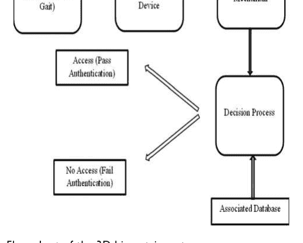

图 4.1 3D 生物识别系统的流程图。

由于生物识别系统本质上是概率性的，因此在评估其性能时必须考虑到这一基本特征。在一定的近似容差范围内，生物识别涉及将受试者的可观察生物识别特征与先前收集的数据进行比较。由于个体内部和人群之间存在的生物特征和行为差异，使用近似匹配至关重要。因此，生物识别系统提供的是概率输出，而不是传统信息技术系统典型的几乎二进制输出。本章对不同的 3D 生物识别系统进行了简短而建设性的综述。

## 4.2 3D 面部生物识别

面部是最常见和最受欢迎的 3D 生物识别类别。它细分为面部、耳、虹膜和颅骨 [10]。3D 面部生物识别系统在整个 3D 生物识别系统中渗透率最高，因为其工作机制简单，对硬件和软件的要求最少。

### 4.2.1 面部生物识别

这是大多数 3D 生物识别系统使用最常见的 3D 生物识别方法。它解决了 2D 面部生物识别的问题，2D 面部生物识别在弱光或姿势不当的情况下识别面部图像存在许多问题，并且它还能以不同角度识别目标，而不是捕捉正面外观。它有助于在 3D 空间中指示直线边界，并且 3D 面部图像包含少量与 2D 面部图像相对应的焦点。三维面部的表面位置由身体解剖的隐藏方面决定。它关注的是 (a) 识别面部和 (b) 扫描 3D 面部模型以验证个体的技术开发 [36, 37]。已经提出了许多 3D 面部生物识别方法的算法，大致分为度量学习、几何深度学习、生物识别融合和面部到 DNA 匹配。其中，基于深度学习的算法具有高性能，FAR 和 FRR 较低 [38]。

### 4.2.2 耳部生物识别

胎儿耳朵的发育始于怀孕五周至七周之间。在五周时，一簇胚胎细胞连接起来形成耳朵。这些发育细胞位于颈部的下部，被称为耳廓丘。在第七周，耳廓丘变宽并交织在一起形成耳朵的形状。耳丘在第九周移动到耳道，随着耳朵的发育变得越来越明显 [38]。之后，耳朵几乎肯定会发育

表 4.5 基于 3D 图像重建的 3D 生物识别方法分类

| 基于 3D 图像重建的 3D 生物识别 | 主动方法 | 结构光投影 |
| | | 断层扫描 |
| | | 飞行时间与停留时间 |
| | | 光度立体方法 |
| | 被动方法 | 基于轮廓的结构 |
| | | 基于纹理的结构 |
| | | 基于运动的结构 |
| | | 立体视觉方法 |

表 4.6 3D 生物识别系统的特性和可用性

| 3D 生物识别 | 生物识别数据采集硬件 | 运行普及度 | 手持设备 | 门禁控制 | 监控设备 | 法医 |
|---|---|---|---|---|---|---|
| 面部 [15] | 通用硬件 | 广泛 | ✓ | ✓ | ✓ | ✓ |
| 耳 [16] | 通用硬件 | 低 | ✓ | ✓ | × | × |
| 虹膜 [17] | 专用传感器 | 广泛 | ✓ | ✓ | × | × |
| 颅骨 [18] | 通用硬件 | 低 | ✓ | ✓ | × | × |
| 指纹 [19] | 专用传感器 | 广泛 | ✓ | ✓ | × | ✓ |
| 指静脉 [20] | 专用传感器 | 平均 | ✓ | ✓ | × | ✓ |
| 手掌 [21] | 通用硬件 | 广泛 | ✓ | ✓ | × | × |
| 步态 [22] | 通用硬件 | 低 | ✓ | ✓ | × | × |

表 4.7 3D 生物识别系统的主要应用

| 3D 生物识别 | 主要应用 |
|---|---|
| 面部 [15] | 商用、安全和医疗应用 |
| 耳 [16] | 法医分析和商用 |
| 虹膜 [17] | 商用、安全和医疗应用 |
| 颅骨 [18] | 法医分析 |
| 指纹 [19] | 商用 |
| 指静脉 [20] | 商用 |
| 手掌 [21] | 商用 |
| 步态 [22] | 监控、虚拟和增强 |


以线性方式进行。从出生后大约四个月开始，一直持续到大约八岁，耳朵经历一个延长的发育期。

直到七十岁，个体的耳朵大小和形态都不会发生变化。在 COVID-19 大流行之前，基于人脸的生物识别系统被使用，但由于广泛使用口罩，人脸识别未能成功。人耳可见这一事实使其更适合 [39]。耳生物特征分析相比其他生物识别方法（如人脸、虹膜、指纹和掌纹）具有多项优势。这些优势可归因于耳生物特征分析更容易获取、耳形随时间保持一致以及耳生物特征分析更稳定 [10]。

利用 3D 数据，已开展研究以在侧面图像中识别耳朵。Chen 等人提供了其中一项开创性工作。研究人员使用改进的迭代最近点（ICP）方法从 3D 图像中提取阶梯边缘并检测耳朵的耳轮和对耳轮。然而，他们的方法容易受到尺度和位置变化的影响。为了从 3D 图像中识别耳朵，Zhou 等人提出了一种称为分类形状直方图（HCS）的技术，该技术将 3D 形状模型与 SVM 分类器集成。然而，当没有给定耳朵的先验信息时，他们的方法无法定位耳朵。为了从 3D 图像中识别耳朵，Prakash 等人提出了一种边缘连接图。因此，他们在 UND J2 数据集上遇到困难，无法处理离面旋转的影响。Pflug 等人提出了一种基于二值化平均曲率图的方法，用于在 3D 侧面照片中识别边缘 [39]。

### 4.2.3 虹膜生物特征
3D 虹膜生物特征由于由人眼的两种肌肉纤维构成的独特表面而具有某些特性。虹膜作为生物特征通常是广泛科学研究的主题；然而，这项研究仅是二维的 [17]。根据 Bastia 等人的说法，这是首次尝试使用从 Raspberry Pi v2.1 相机获得的近红外（NIR）图像对其 3D 虹膜进行建模。此外，四颗 NIR LED 产生红外光。两颗白光 LED 联合使用，以在保持相对较小的瞳孔的同时在瞳孔周围产生明亮的环境。[40]。这很重要，因为在 3D 重建之前瞳孔被消除，而眼睛深度感知的信息则来自眼睛的其余部分。

Raspberry Pi 3 Model B 系统用于操作相机并将照片临时保存在系统内存中。VR 眼镜套件安装了所有上述组件。此外，相机上提出的一个附件使其能够在 40 度弧内移动。该设备计划捕获总共 17 张虹膜图像，每张图像之间相隔 2.5 度。作者还利用 Python 摄影测量工具箱构建 3D 模型。该模型由开源工具包从不同角度拍摄的各种照片构建而成。文中还指出，缺乏测量和结果信息使得评估该工作的成果和方法具有挑战性 [41]。

Benalcazar 等人决定使用可见光作为光源，而非之前的策略。他们创建了一种独特的设备，可将侧向和正面可见光照射到虹膜上（LFVL）。每个眼睛前方有六个 LED，侧面各有两个 LED 提供光线。来自光源的不同入射角度产生了阴影以及有关虹膜深度的信息。通过对每个眼睛拍摄三秒钟，数据集由 120 名不同的人组成。

根据前述研究，人脸识别是 3D 生物识别应用中最常见的方法。要用作生物特征，首先必须制作 3D 模型，然后进行特征提取 [42]。计算机视觉方法可用于完成此操作。重建方法取决于图像的捕获方式。它可分为两组：主动方法和被动方法，如表 4.5 所述。对被动方法的进一步研究显示，与人脸识别相关的三个子类别：立体视觉、SfS 和 SfM。七个应用使用了 SfS，六个应用使用了立体视觉，五个应用使用了 SfM。

仅有一种主动方法使用了透射计算机断层扫描，而其余主动方法则依赖于从光源反射光。比例几乎相同：六个应用使用了 SfM，七个使用了 SfS，五个使用了 SfM。反射方法还可以进一步细分为两个子类别：飞行时间法和结构光。这些比例也相似，其中四个使用飞行时间法，五个使用结构光 [43]。

### 4.2.4 颅骨生物特征
颅骨生物特征是最少使用的生物识别系统，因为捕获人类颅骨的 3D 图像具有很高的复杂性。其范围与其他生物识别方法非常不同，因为它通常涉及尸体，而尸体很难通过其他人体特征识别 [10, 18]。

## 4.3 3D 手部生物特征
作为一种提议的手部生物识别认证系统的一部分，用户的手形和血管模式被测量。手指谷的长度和角度、手指的长度和轮廓、手侧视图的厚度、手形链码的 K 曲率以及基于方向的血管模式提取方法均被用于获取手部几何形状 [10]。

### 4.3.1 指纹生物特征
指纹是最具特色的生物特征之一。对于人类身份验证，指纹经常被使用，因为它们具有很高的准确性和唯一性。传统指纹扫描通常会产生片段化或质量差的图像，因为它们需要将手指放置并按压在坚硬表面（如玻璃或硅胶）上。通常，皮肤变形、潮湿、手指污垢残留、手指汗液、手指滑动和涂抹或传感器噪声是导致指纹图像质量频繁下降的原因。除了处理先前指纹印的残留物（这可能构成安全风险）之外，非接触式指纹系统可以为这些问题提供卫生的解决方案 [44]。为了应对基于接触的 2D 指纹识别系统的不足并提高识别准确率，随着 3D 扫描和重建技术的快速发展，开发了非接触式 3D 指纹重建和识别技术。近年来，出现了越来越多的 3D 指纹识别技术。研究发现，非接触式 3D 指纹识别最准确的技术是基于细节点的指纹匹配技术。然而，在 3D 指纹捕获期间的视角失真和重建误差会严重损害非接触式 3D 指纹匹配的性能和细节点提取的准确性 [45]。

### 4.3.2 指静脉生物特征
指静脉生物特征相对于其他生物识别方法具有许多优势，因为手指中的静脉模式揭示了庞大的血管网络。它使用超声或光学扫描记录观察中手指的静脉模式。人手指内的静脉模式是唯一的且从外部不可见；因此，很难复制 [46]。多普勒超声已被用于根据组织血流识别主要血管。然而，该系统对小型血管结构的灵敏度不足。

与纯光学模式相比，光声断层成像（PAT）可以获取具有足够深度信息的高度详细的血管图像。在 PAT 中，激光光脉冲照亮皮肤表面，导致热弹性膨胀转化为超声波。然而，即使获得了相当准确的模式，两种技术的采集时间都太长。静脉在多模态系统中使用，与其他特征一起，特别是指纹。这种技术，也被称为

作为生物特征融合，增强了生物识别系统在识别准确性、通用性和安全性方面的性能 [47]。

### 4.3.3 掌部生物特征

掌部生物识别系统也使用超声波捕获人手掌的图像。任何有效的掌部生物识别系统都会在四台 10 mW 激光器的作用下，获取人手掌的 3D 图像（系统的尺寸应为 50 mm × 30 mm，高 15 mm），持续 5 秒 [48]。3D 图像由单个换能器在两个正交方向上进行机械扫描获得。通过这种方式，可以从记录的图像中提取精确的掌部特征（掌纹的深度和曲线，以及手表面上的皱褶），并进一步进行识别或验证过程。滤波器、统计工具和基于神经网络的算法用于人手掌的识别和验证 [49]。

## 4.4 3D 步态生物特征

一种被称为步态识别的生物识别应用是根据个人的步行模式确定其身份。步态作为生物特征可以从远处识别一个人，这就是其最大的优势。换句话说，步态可以用低分辨率使用。人体步态描述了人体运动的时间动态和空间静态。与其他生物特征相比，它通常占用显著更多的像素 [50]。

Borelli 开创了步态分析的想法。他提供了当人行走时各种步态周期和肌肉运动的描述。他是第一个测量人体重心的科学家。他描述了当人行走时，随着重心向前移动到支撑区域之外，身体如何保持平衡。步态检测最初用于医学和心理学领域 [51]。Brown 和 Fisher 引入了人体运动的 3D 方法。使用内置三角测量能力的发光标记生成图像。以每秒 26 帧的频率生成图像。3D 技术检查下肢关节的角度位移 [22, 52]。

Yamauchi 等人使用主动视觉传感器捕获 3D 数据。在此之后，他努力将 3D 模型纳入数据中，以便获取有关运动学的信息。他们使用激光测距传感器收集受试者姿势。这些受试者姿势仅反映步态周期的关键帧。在这种特定情况下，3D 数据的优良标准相当不错。完整的步态序列是通过使用拟合到计算机的身体模型插值关节位置和运动而生成的。实验结果表明识别率很高，尽管目前只有六名参与者 [53]。

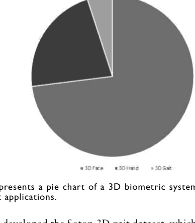

图 4.2 表示一个 3D 生物识别系统的饼图，包含多种不同的应用。

Seely 等人开发了 Soton 3D 步态数据集，随后在采用无模型分析的视角不变步态识别实验中取得了巨大成功。基于二维平均轮廓和视角投影技术的简单方法被用来将 3D 数据转换为不受观察者视角影响的 2D 数据。使用了三种不同的视角投影：侧视、正视和俯视。结果表明，使用 3D 步态数据可以实现高精度（99.6%），最佳性能是通过组合投影视图实现的 [54]。

## 4.5 结论

在本章中，我们描述了不同类型的生物识别及其应用。在对众多论文进行深入调查后，初步统计数据显示，人脸识别是本特定研究领域中最常使用的 3D 生物识别。剩余的七个类别为：掌部、虹膜、步态、颅骨、耳廓、指静脉和手指。面部、手部和步态是可用于对其进行分组的三个基本类别。未来的研究应按照一个框架组织，该框架为每项新的 3D 生物识别研究包含相关的 2D 照片的测量。设备应具有 2D 能力以实现这一点。为了便于未来研究人员的实验，应制作更多针对不常见生物特征的的数据集。这些问题必须得到解决，以证明 3D 技术的需求，并将构成未来进步的基础。

## 致谢

我衷心感谢匿名审稿人对提高本章质量提出的批评性评论和建议。作者希望对 Integral University, Lucknow, Uttar Pradesh, India 表示感谢，该校为本次研究工作提供了手稿编号 IU/R&D/2023-MCN0001967。

## 参考文献

- 1. Prakash, A. J., Patro, K. K., Samantray, S., Plawiak, P., & Hammad, M. (2023). 用于心电图节律模板匹配的生物特征认证深度学习技术. *Information*, 14(2), 65. doi:10.3390/info14020065
- 2. Goutham, V., Lakshmi, D. L., Hamsashree, M. K., Naveen, B., & Girijamba, D. L. (2023, January). 人体静脉模式检测用于生物识别应用的综述. In *Cognition and Recognition: 8th International Conference, ICCR 2021, Mandya, India, December 30–31, 2021, Revised Selected Papers* (pp. 1–17). Cham: Springer Nature Switzerland. doi:10.1007/978-3-031-22405-8_1
- 3. Nayar, G. R., & Thomas, T. (2023). 基于部分掌静脉的生物特征认证. *Journal of Information Security and Applications*, 72, 103390. doi:10.1016/j.jisa.2022.103390
- 4. Singh, T., Zaka-Ur-Rab, S., & Arrin, S. (2023). 瞳孔扩张对个人身份验证生物识别虹膜识别系统的影响. *Indian Journal of Ophthalmology*, 71(1), 57–61. doi:10.4103/ijo.IJO_1417_22
- 5. Iula, A., & Micucci, M. (2022). 基于 3D 超声掌纹-手型融合的多模态生物识别. *IEEE Access*, 10, 7914–7925. doi:10.1109/ACCESS.2022.3143433
- 6. Prakash, S., & Gupta, P. (2015). *2D 和 3D 中的耳生物识别：定位与识别* (Vol. 10). Springer, Singapore. ISBN: 978-981-287-374-3.
- 7. Zhang, D., & Lu, G. (2013). *3D 生物识别*. New York: Springer.
- 8. Boulgouris, N. V., Plataniotis, K. N., & Micheli-Tzanakou, E. (eds.). (2009). *生物识别：理论、方法与应用*. John Wiley & Sons, Canada. ISBN: 9780470247822.
- 9. Zhang, D., Lu, G., & Zhang, L. (2018). *高级生物识别*. Springer International Publishing, Switzerland. ISBN: 9783319615448.
- 10. Samatas, G. G., & Papakostas, G. A. (2022). 生物识别：迈向 3D. *Sensors*, 22(17), 6364. doi:10.3390/s22176364
- 11. Bronstein, A. M., Bronstein, M. M., & Kimmel, R. (2003). 表情不变的 3D 人脸识别. In *Audio-and Video-Based Biometric Person Authentication: 4th International Conference, AVBPA 2003 Guildford, UK, June 9–11, 2003 Proceedings 4* (pp. 62–70). Berlin Heidelberg: Springer. doi:10.1007/3-540-44887-X
- 12. Rathod, V. J., Iyer, N. C., & Meena, S. M. (2015, October). 指纹生物识别系统综述. In *2015 International Conference on Green Computing and Internet of Things (ICGCIoT)*. (pp. 323–326). IEEE. doi:10.1109/ICGCIoT.2015.7380482
- 13. Chang, K. I., Bowyer, K. W., & Flynn, P. J. (2005). 多模态 2D+3D 人脸生物识别的评估. IEEE Transactions on Pattern Analysis and Machine Intelligence, 27(4), 619–624. doi:10.1109/TPAMI.2005.70
- 14. Yan, P., & Bowyer, K. W. (2007). 使用 3D 耳形的生物识别. IEEE Transactions on Pattern Analysis and Machine Intelligence, 29(8), 1297–1308. doi:10.1109/TPAMI.2007.1067
- 15. Hoskens, H., Liu, D., Naqvi, S., Lee, M. K., Eller, R. J., Indencleef, K., ... & Claes, P. (2021). 通过生物识别同胞匹配进行 3D 面部表型分析，用于当代基因组学方法. PLoS Genetics, 17(5), e1009528. doi:10.1371/journal.pgen.1009528
- 16. Ganapathi, I. I., Ali, S. S., Vu, N.-S., Prakash, S., & Werghi, N. (2022). 3D 耳识别技术综述. ACM Computing Surveys (CSUR), 55(10), 1–36. doi:10.1145/3560884
- 17. Benalcazar, D. P., Bastias, D., Perez, C. A., & Bowyer, K. W. (2019). 由多张 2D 可见光图像构成的 3D 虹膜扫描仪. IEEE Access, 7, 61461–61472. doi:10.1109/ACCESS.2019.2915786
- 18. Hameed, S. A., Zaidan, B. B., Zaidan, A. A., Naji, A. W., & Tawfiq, O. F. (2010). 获取三维颅骨生物测量数据的精确方法. Journal of Applied Sciences, 10(2), 145–150.
- 19. Cheng, K. H., & Kumar, A. (2019). 使用 3D 指节纹的无接触生物识别. IEEE Transactions on Pattern Analysis and Machine Intelligence, 42(8), 1868–1883. doi:10.1109/TPAMI.2019.2904232
- 20. Zhan, Y., Rathore, A. S., Milione, G., Wang, Y., Zheng, W., Xu, W., & Xia, J. (2020). 基于光声层析成像的 3D 指静脉生物特征认证. Applied Optics, 59(28), 8751–8758. doi:10.1364/AO.400550
- 21. De Santis, M., Agnelli, S., Nardiello, D., & Iula, A. (2017, September). 用于生物识别目的的质心法 3D 超声掌静脉识别. In 2017 IEEE International Ultrasonics Symposium (IUS) (pp. 1–4). IEEE. doi:10.1109/ULTSYM.2017.8091946
- 22. Santos, G., Tavares, T., & Rocha, A. (2022). 使用 3D 惯性传感器数据和 3D 光学系统轨迹的步态生物识别的可靠性和泛化性. Scientific Reports, 12(1), 1–15. doi:10.1038/s41598-022-12452-6
- 23. Huang, G. B., & Learned-Miller, E. (2014). 野外的标记人脸：更新和新的报告程序. Dept. Comput. Sci., Univ. Massachusetts Amherst, Amherst, MA, USA, Tech. Rep. 14(003).
- 24. Yin, L., Wei, X., Sun, Y., Wang, J., Rosato, M. A 3D facial expression database for facial behavior research. In Proc. IEEE Int. Conf. on Automatic Face and Gesture Recognition, Southampton, UK, pp. 211–216 (2006).
- 25. Zafeiriou, S., Hansen, M., Atkinson, G., Argyriou, V., Petrou, M., Smith, M., Smith, L. 照片人脸数据库. In Proceedings of the CVPR 2011 WORKSHOPS, Colorado Springs, CO, USA, 20–25 June 2011; pp. 132–139.
- 26. Kumar, A., & Wu, C. (2012). 使用耳部成像的自动人体识别. Pattern Recognition, 45(3), 956–968. doi:10.1016/j.patcog.2011.06.005
- 27. AMI Ear Database. Available online: https://webctim.ulpgc.es/research_works/ami_ear_database/
- 28. Chen, H., & Bhanu, B. (2007). 3D 人耳识别. IEEE Transactions on Pattern Analysis and Machine Intelligence, 29(4), 718–737. doi:10.1109/TPAMI.2007.1005


- 29. IIT 德里虹膜数据库。可在网上获取：https://www4.comp.polyu.edu.hk/~csajaykr/IITD/Database_Iris.htm
- 30. Alanazi, H., Zaidan, B. B., & Zaidan, A. A. (2010). 使用 3D 匹配技术进行 3D 颅骨识别。arXiv 预印本 arXiv:1001.3502。
- 31. 香港理工大学 3D 指纹图像数据库。可在网上获取：https://tinyurl.com/4nmb2keb
- 32. Xu, H., Yang, W., Wu, Q., & Kang, W. (2022). 为 3D 手指形状和静脉验证赋予旋转不变性。Frontiers in Computer Science, 16, 1–16。
- 33. Nicodemou, V. C., Oikonomidis, I., Tzimiropoulos, G., & Argyros, A. (2020, July). 学习从手部彩色图像推断深度图。载于 2020 International Joint Conference on Neural Networks (IJCNN) (pp. 1–8)。IEEE。
- 34. López-Fernández, D., Madrid-Cuevas, F. J., Carmona-Poyato, Á., Marín-Jiménez, M. J., & Muñoz-Salinas, R. (2014). 用于步态识别的 AVA 多视角数据集。载于 International Workshop on Activity Monitoring by Multiple Distributed Sensing。瑞士查姆：Springer，第 26–39 页。
- 35. Singh, S., Velastin, S.A., & Ragheb, H. (2010). Muhavi：用于评估动作识别方法的多摄像头人体动作视频数据集。载于 Proceedings of the 2010 7th IEEE International Conference on Advanced Video and Signal Based Surveillance，美国马萨诸塞州波士顿，29 August–1 September；第 48–55 页。
- 36. Smeets, D., Claes, P., Vandermeulen, D., & Clement, J. G. (2010). 客观 3D 人脸识别：演变、方法与挑战。Forensic Science International, 201(1–3), 125–132。doi:10.1016/j.forsciint.2010.03.023
- 37. Kelkboom, E. J., Gökberk, B., Kevenaar, T. A., Akkermans, A. H., & van der Veen, M. (2007). “3D face”：用于 3D 人脸识别的生物特征模板保护。载于 Advances in Biometrics: International Conference, ICB 2007, Seoul, Korea, August 27–29, 2007。Proceedings (pp. 566–573)。Springer Berlin Heidelberg。doi:10.1007/978-3-540-74549-5_60
- 38. Tharewal, S., Malche, T., Tiwari, P. K., Jabarulla, M. Y., Alnuaim, A. A., Mostafa, A. M., & Ullah, M. A. (2022). 用于多模态生物特征人体识别的 3D 人脸和 3D 耳廓的分数级融合。Computational Intelligence and Neuroscience, 2022。doi:10.1155/2022/3019194
- 39. Kaur, G., & Verma, H. K. (2022, October). 耳部生物特征的现有方法。载于 2022 IEEE 4th International Conference on Cybernetics, Cognition and Machine Learning Applications (ICCCMLA) (pp. 490–496)。IEEE。doi:10.1109/ICCCMLA.2022.9989290
- 40. Bastias, D., Perez, C. A., Benalcazar, D. P., & Bowyer, K. W. (2017). 从多幅 2D 近红外图像重建 3D 虹膜的方法。载于 Proceedings of the 2017 IEEE International Joint Conference on Biometrics (IJCB)，美国科罗拉多州丹佛，1–4 October，第 503–509 页。doi:10.1109/BTAS.2017.8272735
- 41. Moulon, P., & Bezzi, A. (2011). Python 摄影测量工具箱：三维文档的免费解决方案；ArcheoFoss：意大利那不勒斯，第 1–12 页。
- 42. Benalcazar, D. P., Zambrano, J. E., Bastias, D., Perez, C. A., & Bowyer, K. W. (2020). 使用卷积神经网络从单张图像实现 3D 虹膜扫描仪。IEEE Access, 8, 98584–98599。
- 43. Zheng, C., Cham, T. J., & Cai, J. (2018). T2net：用于解决单图像深度估计任务的合成到真实转换。载于 Proceedings of the European Conference on Computer Vision (ECCV)，德国慕尼黑，8–14 September，第 767–783 页。
- 44. Zhou, W., Hu, J., Wang, S., Petersen, I., & Bennamoun, M. (2014). 大型 3D 指纹数据库的性能评估。Electronics Letters, 50(15), 1060–1061。doi:10.1049/el.2014.1927
- 45. Huang, S., Zhang, Z., Zhao, Y., Dai, J., Chen, C., Xu, Y., ... & Xie, L. (2014). 基于全场光栅投影轮廓术的 3D 指纹成像系统。Optics and Lasers in Engineering, 52, 123–130。doi:10.1016/j.optlaseng.2013.07.001
- 46. Xu, H., Yang, W., Wu, Q., & Kang, W. (2022). 为 3D 手指形状和静脉验证赋予旋转不变性。Frontiers of Computer Science, 16(5), 165332。doi:10.1007/s11704-021-0475-9
- 47. Jia, W., Xia, W., Zhao, Y., Min, H., & Chen, Y.-X. (2021). 基于神经架构搜索的 2D 和 3D 手掌纹和手掌静脉识别。International Journal of Automation and Computing, 18, 377–409。doi:10.1007/s11633-021-1292-1
- 48. De Santis, M., Agnelli, S., Nardiello, D., & Iula, A. (2017, September). 用于生物识别目的的质心方法 3D 超声手掌静脉识别。载于 2017 IEEE International Ultrasonics Symposium (IUS) (pp. 1–4)。IEEE。doi:10.1109/ULTSYM.2017.8091946
- 49. Dargan, S., & Kumar, M. (2020). 基于生理和行为模态的生物特征识别系统的全面综述。Expert Systems with Applications, 143, 113114。doi:10.1016/j.eswa.2019.113114
- 50. Liu, Y., Jiang, X., Sun, T., & Xu, K. (2019, September). 基于 CNN-LSTM 网络并融合 SkeGEI 和 DA 特征的 3D 步态识别。载于 2019 16th IEEE International Conference on Advanced Video and Signal Based Surveillance (AVSS) (pp. 1–8)。IEEE。doi:10.1109/AVSS.2019.8909881
- 51. Sethi, D., Bharti, S., & Prakash, C. (2022). 步态分析的全面综述：历史、参数、方法、姿态估计和未来工作。Artificial Intelligence in Medicine, 129, 102314。doi:10.1016/j.artmed.2022.102314
- 52. Zhao, G., Liu, G., Li, H., & Pietikäinen, M. (2006, April). 使用多摄像头的 3D 步态识别。载于 7th International Conference on Automatic Face and Gesture Recognition (FGR06) (pp. 529–534)。IEEE。doi:10.1109/FGR.2006.2
- 53. Yamauchi, K., Bhanu, B., & Saito, H. (2009, June). 三维行人识别：初步结果。载于 2009 IEEE Computer Society Conference on Computer Vision and Pattern Recognition Workshops (pp. 45–52)。IEEE。doi:10.1109/CVPRW.2009.5204296
- 54. Seely, R. D., Samangooei, S., Lee, M., Carter, J. N., & Nixon, M. S. (2008, September). 南安普顿大学多生物特征隧道及一种新颖的 3D 步态数据集的介绍。载于 2008 IEEE Second International Conference on Biometrics: Theory, Applications and Systems (pp. 1–6)。IEEE。doi:10.1109/BTAS.2008.4699353

## 一种使用 QR 分解、Hénon 映射和小波域混沌加密的双图像水印技术及其使用 BRISK 的认证

Divyanshu Awasthi
MNNIT Allahabad, Allahabad, India

Priyank Khare
IIIT Ranchi, Ranchi, India

Vinay Kumar Srivastava
MNNIT Allahabad, Allahabad, India

## 5.1 引言

多媒体数据的保护是计算机技术和 5G 网络发展带来的一个主要问题。语音、视频和图像数据都是多媒体数据的例子 [1]。医疗数据伪造或网络钓鱼是研究人员提供更高安全性的一个令人担忧的情况。医疗数据的规模每天都在增加；因此，该数据的保密性和完整性也很重要。由于众多被动攻击（攻击者的目标是获取信息）和主动攻击（攻击者可能会更改数据或损害系统），医疗数据的认证也至关重要。主动攻击和被动攻击的细节如图 5.1 所示。

一种用于存储、交换和传输医学图像的通用标准称为 DICOM，即医学数字成像和通信 [2]。根据嵌入过程，水印系统可分为两大类：变换域和空间域。在空间域中，水印嵌入到某些宿主图像像素中。在变换域中，宿主图像在频域中变换，然后水印被引入到频率系数中 [3]。根据计算机应急响应团队（CERT）的说法，安全漏洞趋势正在急剧增加。2020 年，安全漏洞趋势为未经授权的网络

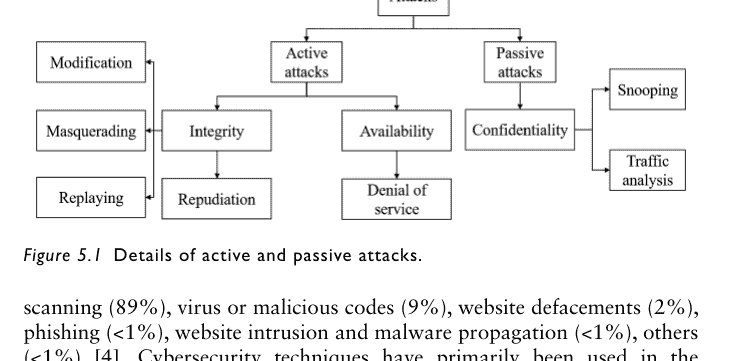

图 5.1 主动攻击和被动攻击的细节。

扫描（89%）、病毒或恶意代码（9%）、网站篡改（2%）、网络钓鱼（<1%）、网站入侵和恶意软件传播（<1%）、其他（<1%）[4]。网络安全技术主要应用于电子银行、多媒体、社交媒体、电子商务、国防和电子医疗行业 [5]。可以追求众多安全目标，包括认证（这是不可否认性的必要部分）、完整性（因为信息必须不断变化）、保密性（以保护我们的私人信息）和可用性（组织创建和存储的信息需要可供授权实体使用）。所提出的水印方法使用加密技术、Hénon 映射和混沌 logistic 映射。对于认证，使用 BRISK 特征匹配。

LWT 与离散小波变换（DWT）的比较在 [1] 中显示。为了获得理想的缩放因子，使用了两种不同的优化技术。粒子群优化（PSO）和 JAYA 优化的比较也在 [1] 中提到。但该技术在安全性方面存在不足，因为没有使用额外的安全算法。归一化相关系数（NCC）可以进一步改进，以应对剪切、阈值化和直方图均衡化攻击。在 [2] 中，Schur 分解与奇异值分解（SVD）一起用于嵌入。加速鲁棒特征（SURF）用于特征匹配以提供认证。但该技术在安全性方面也存在不足，因为没有使用额外的安全算法。直方图均衡化下的 NCC 值不理想。输入 DICOM 图像取自癌症影像档案（TCIA）[6]。在 [3] 中，提出了一种基于 DWT-SVD 的鲁棒水印技术。DWT 用于将图像分割成不同的子带。SVD 存在假阳性问题（FPP）。该工作的安全缺乏也是主要关注点。Hurrah 等人 [5] 提出了一种基于双水印的数字多媒体验证和隐私保护方法。该方案使用了 DWT、DCT、加密和 Arnold 变换。并未讨论详细的不可感知性和鲁棒性解释，而所提出技术的复杂性也很高。在 [7] 中，使用了 DWT

将图像变换为不同的子带，并使用 SVD 进行嵌入过程。低-低子带用于水印，结果效率提高了 20% [7]。但该技术在安全性方面也存在不足，因为未使用额外的安全算法。文献 [8] 中提出了基于同态变换的水印技术，使用小波域。SVD 用于添加输入图像和水印图像的主导分量。结果还存在对角线问题。该技术具有鲁棒性和不可感知性，但在 [8] 中安全性受损。文献 [9] 中提出了基于 QR 分解的图像水印，其中使用 Arnold 变换进行加密。该方法克服了误报检测问题，且 NCC 值在 JPEG（30）压缩和 Gaussian 噪声（0.6）下不佳。文献 [10] 中提出了基于 DWT-SVD 的水印方案。医学图像中的感兴趣区域被划分为子带。Hamming 码应用于电子病历以降低误码率。该方法还去除了 SVD 的 FPP。NCC 值在 JPEG 压缩（20）、剪切和抖动下不佳。文献 [10] 中缺少单独的安全增强算法。文献 [11] 中使用 PSO 获取优化增益值。采用 Block-SVD 代替普通 SVD 以克服 FPP。文献 [12] 中探讨了水印的医疗保健应用。文献 [12] 中提出了基于 DWT-DCT-SVD 的水印。通过使用反向传播神经网络（BPNN）提高了鲁棒性。文献 [13] 中提出了一种用于远程医疗应用的低复杂度、失真可控、可靠且安全的彩色图像水印方法。该技术对载体图像应用双水印（使用 LWT-DCT）以实现不可否认性、保密性和真实性。Hsu 等 [14] 提出了一种双图像水印技术以增强算法对裁剪攻击的性能，且该工作中使用了 QR 分解。根据 Koley 等 [15]，提出了一种基于注意力和聚焦模型的双水印方法，用于同时进行图像版权保护和识别。建议的技术将两个水印同时嵌入主机图像中，并使用 Hessenberg 分解，与其他变换相比略显复杂。文献 [16] 中提出了基于 LWT 和 SVD 的双图像水印，其存在误报问题，且该工作鲁棒性也不高。Al-Otum 等 [17] 为版权保护、认证和恢复等应用创建了一种独特的双色图像水印，该工作为半脆弱。双图像水印相比单图像水印提供更好的版权保护，具有以下优点：带宽减少、认证更好且安全性提高、存储需求也降低。

使用双图像水印方法，将两个水印标志合并到单个主机图像中。双图像水印技术的主要挑战是提供良好的耐久性、不可感知性和容量。两个标志可用于提供强大的版权保护。

处理成本或插入和检测水印涉及的计算开销是另一个问题。创建一种对各种攻击具有鲁棒性的适用于所有数字媒体的通用策略是另一个问题。所提出的工作克服了上述所有问题。利用 Hénon 映射、混沌 logistic 加密和 BRISK 特征认证，提出了一种有效的水印策略，以解决上述现有策略概述所识别的研究空白。

本章提出的技术的主要特点如下列出：

- (1) 经 QR 分解的图像得到的上三角矩阵的对角分量具有更好的显著性，因为它们用于嵌入。
- (2) 提出的水印方法的安全性通过使用双水印图像进一步增强，这提供了对恶意攻击更好的鲁棒性。
- (3) 使用混沌 logistic 映射安全地传输水印图像，确保更好的传输。
- (4) Hénon 映射用于加密用于嵌入双水印图像的子带，这增强了用作水印图像的患者细节的安全性，提供更好的医疗治疗。
- (5) 在本工作中，我们使用 BRISK 实现了特征验证，这以更好的方式促进了对 unwanted 攻击的版权保护。

本章其余部分结构如下：5.2 节提供了预备知识的详细说明。5.3 节描述了水印的嵌入和提取过程。5.4 节提到了讨论和仿真结果。5.5 节讨论 BRISK 特征匹配。5.6 节包含结果比较，结论在 5.7 节。

## 5.2 预备知识

### 5.2.1 提升小波变换

LWT 是比 DWT 更快的第二代变换 [1]。它有三个主要步骤：Split、Predict 和 Update [2, 18]。Split 用于将信号二分为偶数和奇数。Predict 尝试借助偶数预测奇数信号，反之亦然，最后一步是更新。1998 年，Sweldens [19] 开发了提升小波变换。图 5.2 显示了 LWT 的示意图。

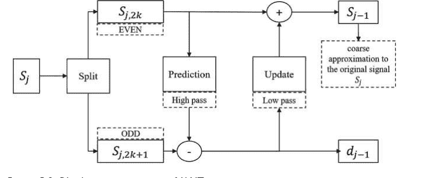

图 5.2 LWT 的块表示。

### 5.2.2 QR 分解

对于输入矩阵 ‘M’，QR 分解 [9] 可定义为：

$[Q,R] = qr(M)$

(5.1)

在式 (5.1) 中，$R$ 是 $n\times k$ 上三角矩阵，$Q$ 是 $n\times n$ 正交矩阵 [20]。图 5.3 显示了矩阵 $R$ 的非零元素（32896）数量。

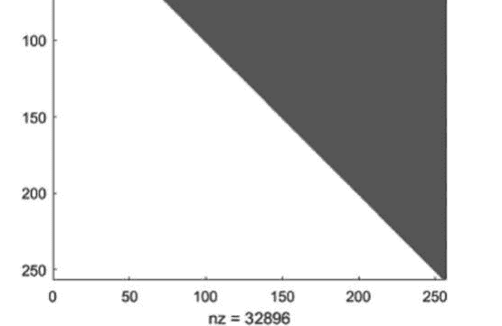

图 5.3 矩阵 R 的非零元素。

### 5.2.3 Hénon 映射

1976 年，法国数学家和天文学家 Michel Hénon 提出 Hénon 映射，一种二维映射 [21]。以下方程可用于数学上定义 Hénon 映射 [22]：

$$p(j+1)=1+q(j)-a_1 \times p(j)^2 \tag{5.2}$$ $$q(j+1)=a_2 \times p(j) \tag{5.3}$$

a₁ 和 a₂ 在式 (5.2) 和 (5.3) 中被称为分岔参数。p 和 q 的值对二维 Hénon 映射中的收缩没有影响。a₁ = 1.4 且 a₂ = 0.3 时的 Hénon 吸引子如图 5.4 所示。

### 5.2.4 混沌 logistic 映射

混沌理论描述了某些非线性动力系统在特定条件下表现出对初始条件敏感的动力学行为 [23]。状态演化 [23] 可如式 (5.4) 所示描述。

$$z(i+1)=r \times z(i) \times (1-z(i)) \tag{5.4}$$

其中 r ∈ [0, 4] 且图 5.5 显示了 logistic 加密的水印图像。

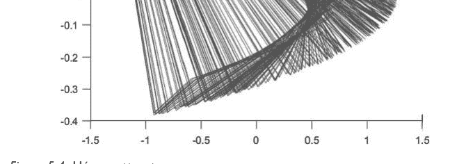

图 5.4 Hénon 吸引子。

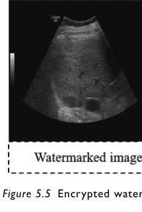

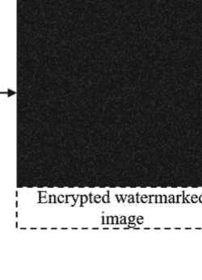

图 5.5 加密水印图像。

## 5.3 水印流程

水印嵌入和提取过程在 3.1 和 3.2 节中提到。在嵌入过程中，首先使用一次 LWT 将载体图像划分为子带（LL1、HL1、LH1、HH1）。对 HL1 和 LH1 应用 QR 分解，然后提取输入主机图像的两个子带的对角分量。取第一个水印图像为 cameraman，第二个为患者详细信息，并对两个水印图像应用 LWT，并对患者详细信息的低-高子带应用 Hénon 混淆，然后提取两个水印图像的对角分量。通过采用合适的缩放因子，将两个水印图像的对角分量与载体图像相加。应用逆 QR 和 LWT 得到水印图像，然后应用混沌 logistic 映射对图像进行混淆并发送到另一端。在提取过程中，首先接收混淆的水印图像并应用解密过程得到水印图像。应用 LWT 得到水印子带，并在应用 QR 分解后得到水印对角分量。应用逆嵌入、逆 QR 分解、Hénon 解密和逆 LWT 以恢复两个水印图像。

### 5.3.1 嵌入过程

Step 1: 为将输入载体图像划分为子带如式 (5.5) 所示，应用一级 LWT。

[LL1,HL1,LH1,HH1] = lwt2(host image) (5.5)

Step 2: 对 HL1 和 LH1 应用 QR 分解，然后提取输入主机图像的两个子带的对角分量。在式 (5.6) 中，R1 是 HL1 子带的 上三角矩阵。


在式 (5.7) 中，$d_1$ 是 $R_1$ 的对角分量，$D_1$ 是对应于 $d_1$ 分量的对角矩阵，且 $s_1$ 具有除对角分量外的分量。在式 (5.8) 中，$R_2$ 是 $LH_1$ 子带的 upper triangular matrix。在式 (5.9) 中，$d_2$ 是 $R_2$ 的对角分量，$D_2$ 是对应于 $d_2$ 分量的对角矩阵，且 $s_2$ 具有除对角分量外的分量。

$[Q_1, R_1] = qr(HL_1)$  (5.6)

$\begin{cases} d_1 = diag(R_1) \\ D_1 = diag(d_1) \\ s_1 = R_1 - D_1 \end{cases}$  (5.7)

$[Q_2, R_2] = qr(LH_1)$  (5.8)

$\begin{cases} d_2 = diag(R_2) \\ D_2 = diag(d_2) \\ s_2 = R_2 - D_2 \end{cases}$  (5.9)

### Step 3: 取第一个水印图像，即 cameraman 图像，并对其应用一级 LWT 以将其拆分为子带，如式 (5.10) 所示：

$[LL_{1W}, HL_{1W}, LH_{1W}, HH_{1W}] = lwt2(cameraman)$  (5.10)

### Step 4: 对 $HL_{1W}$ 子带应用 QR 分解，然后从上三角矩阵中提取对角分量。在式 (5.11) 中，$R_{1\_W}$ 是 $HL_{1W}$ 子带的 upper triangular matrix。在式 (5.12) 中，$d_{1\_W}$ 是 $R_{1\_W}$ 的对角分量，$D_{1\_W}$ 是对应于 $d_{1\_W}$ 分量的对角矩阵，且 $s_{1\_W}$ 具有除对角分量外的分量。

$[Q_{1\_W}, R_{1\_W}] = qr(HL_{1W})$  (5.11)

$\begin{cases} d_{1\_W} = diag(R_{1\_W}) \\ D_{1\_W} = diag(d_{1\_W}) \\ s_{1\_W} = R_{1\_W} - D_{1\_W} \end{cases}$  (5.12)

### Step 5: 取第二个水印图像，即患者细节图像，并对其应用一级 LWT 以将其拆分为子带，如式 (5.13) 所示：

$[LL_{2W}, HL_{2W}, LH_{2W}, HH_{2W}] = lwt2(details of patient)$  (5.13)

### Step 6: 对 LH₂W 应用 Hénon 映射以获得加密的子带，如式 (5.14) 所示，然后对 En 应用 QR 分解并从上三角矩阵中提取对角分量。

```
En = henon(LH₂W)  (5.14)
```

在式 (5.15) 中，R₂_W 是 LH₂W 子带的 upper triangular matrix。在式 (5.16) 中，d₂_W 是 R₂_W 的对角分量，D₂_W 是对应于 d₂_W 分量的对角矩阵，且 s₂_W 具有除对角分量外的分量。

```
[Q₂_W, R₂_W] = qr(En)  (5.15)
```

```
d₂_W = diag(R₂_W)
D₂_W = diag(d₂_W)
s₂_W = R₂_W - D₂_W  (5.16)
```

### Step 7: 将输入宿主图像的对角分量与对应子带的水印图像相加，如式 (5.17) 和 (5.18) 所示。

```
SS₁ = D₁ + α × D₁_W  (5.17)
```

```
SS₂ = D₂ + α × D₂_W  (5.18)
```

其中 SS₁ 和 SS₂ 是修改后的对角分量，α 是缩放因子。

### Step 8: 将上述找到的修改后的对角分量与排除的对角分量相加。应用逆 QR 分解和 LWT 得到含水印图像。对含水印图像应用混沌 logistic 映射，并将其传输到另一端。

## 5.3.2 提取过程

### Step 1: 应用混沌 logistic 解密在接收端恢复含水印图像。

### Step 2: 对含水印图像应用 LWT 以将其拆分为子带，如式 (5.19) 所示：

[LL₁W, HL₁W, LH₁W, HH₁W] = lwt2(watermarked image)  (5.19)

### Step 3: 对 HL₁W 和 LH₁W 应用 QR 分解，然后提取输入宿主图像两个子带的对角分量。在式 (5.20) 中，R₁W 是 HL₁W 子带的 upper triangular matrix。在式 (5.21) 中，d₁W 是 R₁W 的对角分量，且 D₁W 是对应于 d₁W 的对角矩阵。在式 (5.22) 中，R₂W 是 LH₁W 子带的 upper triangular matrix。在式 (5.23) 中，d₂W 是 R₂W 的对角分量，且 D₂W 是对应于 d₂W 的对角矩阵。

[Q₁W,R₁W] = qr(HL₁W) (5.20)

{ d₁W = diag(R₁W) 
  D₁W = diag(d₁W) } (5.21)

[Q₂W,R₂W] = qr(LH₁W) (5.22)

{ d₂W = diag(R₂W) 
  D₂W = diag(d₂W) } (5.23)

### Step 4: 应用如式 (5.24) 和 (5.25) 所示的逆过程：

sw₁ = (D₁W − D₁)/α (5.24)

sw₂ = (D₂W − D₂)/α (5.25)

其中 sw₁ 和 sw₂ 是对应于其水印图像的提取对角分量。

### Step 5: 将上述提取的对角分量与其对应的排除对角的 component（s₁_W 和 s₂_W）相加。

### Step 6: 应用逆 QR 分解和 LWT 恢复第一个水印图像。

### Step 7: 应用逆 QR 分解、Hénon 解密和逆 LWT 恢复第二个水印图像。

## 5.4 仿真结果与讨论

所提出的算法借助安装在系统上的 MATLAB R2017a 实现，系统规格为 Lenovo 第 11 代 Intel(R) Core (TM) i5-1135G7 @ 2.40GHz - 2.42 GHz。所提出的水印方法在从癌症影像档案 [6] 中获取的三个不同患者的肝脏超声图像上进行测试，如图 5.6 所示，并使用了两幅水印图像，如图 5.7 所示。cameraman 图像是第一个水印图像，患者的细节是

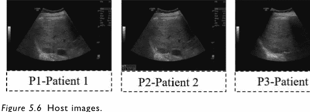

图 5.6 主图像。

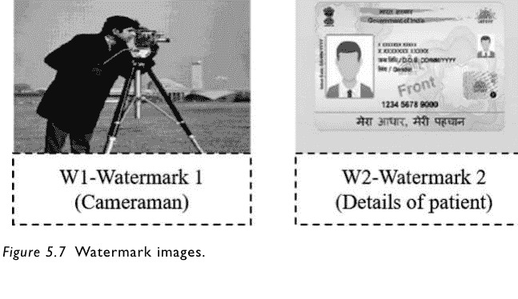

图 5.7 水印图像。

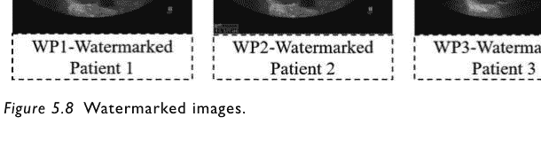

图 5.8 含水印图像。

第二幅图像。含水印图像如图 5.8 所示，提取的水印图像如图 5.9 所示。

表 5.1 显示了三个不同输入图像的 PSNR (dB)、MSE（均方误差）、NCC1（Cameraman）、NCC2（患者细节）[11]、SSIM（结构相似性指数测量）[10] 以及 KL 和 JS 距离的值。PSNR 值在 P3（49.9574）时最高。SSIM 在 P2（0.9958）时更高，且 P1 和 P3 的 NCC1 值均为 1.0000。P2 的 NCC1

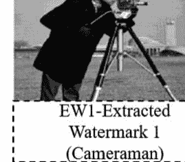

EW1-提取的水印 1
(Cameraman)

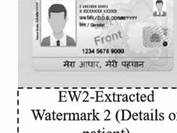

EW2-提取的水印 2 (Details of patient)

图 5.9 提取的水印图像。

### 表 5.1 性能参数值（无攻击）

| Input Images | PSNR (dB) | MSE | SSIM | NCC1 | NCC2 | KL distance | JS distance |
|---|---|---|---|---|---|---|---|
| P1 | 49.7073 | 1.2259e-05 | 0.9951 | 1.0000 | 0.9998 | 0.8639 | 0.2071 |
| P2 | 49.8335 | 1.2259e-05 | 0.9958 | 0.9999 | 0.9998 | 0.8389 | 0.1952 |
| P3 | 49.9574 | 1.2259e-05 | 0.9945 | 1.0000 | 0.9998 | 0.8346 | 0.1977 |

是 0.9999，且所有情况下的 NCC2 值均为 0.9998。KL 和 JS 距离用于测试不可感知性。两者距离值越小，表明不可感知性越高。KL 距离的最佳值在 P3，JS 距离的最佳值在 P2。

表 5.2 显示了 P1 在各种攻击下的 PSNR、NCC1 和 NCC2 值。PSNR 值在 JPEG 2000 时最高，即 48.6785（P1）。NCC1 和 NCC2 值在 JPEG 2000（10）时最高，即 0.9998（P1）和 0.9995（P1）。PSNR 的最小值在直方图均衡化（9.2285-P2）。NCC1 和 NCC2 的最低值在高斯噪声（0.1）时，即 0.9738（P1）和 0.9871（P1）。在几乎所有情况下，NCC 值均大于 0.9。表 5.3 和表 5.4 分别显示了 P2 和 P3 的性能参数值。图 5.10 显示了嵌入过程，图 5.11 显示了提取和认证过程。图 5.12 显示了 PSNR（dB）、NCC 以及 KL 和 JS 距离的比较。

在表 5.5 中，提到了不同输入图像的时序分析。嵌入、提取和总耗时分别显示，其中输入图像 P2 的嵌入时间更短，P1 的提取时间更短。输入图像 P2 的总耗时更少。

### 表 5.2 各种攻击下的性能参数值（PI）

| 攻击 | 规格 | PSNR | NCC1 | NCC2 |
|---|---|---|---|---|
| Salt and Pepper noise | 0.001 | 34.6261 | 0.9997 | 0.9994 |
|  | 0.01 | 24.6409 | 0.9978 | 0.9987 |
|  | 0.1 | 14.6913 | 0.9820 | 0.9914 |
| Gaussian noise | 0.001 | 30.4816 | 0.9993 | 0.9991 |
|  | 0.01 | 21.5186 | 0.9958 | 0.9973 |
|  | 0.1 | 12.7819 | 0.9738 | 0.9871 |
| Speckle noise | 0.001 | 42.9603 | 0.9998 | 0.9994 |
|  | 0.01 | 33.9194 | 0.9996 | 0.9993 |
|  | 0.1 | 24.0596 | 0.9977 | 0.9985 |
| Gaussian low-pass filter | 3×3 | 25.4936 | 0.9997 | 0.9992 |
|  | 5×5 | 25.4827 | 0.9997 | 0.9992 |
|  | 7×7 | 25.4827 | 0.9997 | 0.9992 |
| Average filter | 3×3 | 18.4186 | 0.9994 | 0.9990 |
|  | 5×5 | 18.0725 | 0.9997 | 0.9993 |
|  | 7×7 | 17.9743 | 0.9998 | 0.9993 |
| Median filter | 3×3 | 17.2098 | 0.9990 | 0.9988 |
|  | 5×5 | 16.6957 | 0.9996 | 0.9992 |
|  | 7×7 | 16.5164 | 0.9998 | 0.9994 |
| Rotation (degrees) | 1 | 15.0588 | 0.9926 | 0.9960 |
|  | 2 | 14.9976 | 0.9924 | 0.9960 |
|  | 3 | 14.9925 | 0.9921 | 0.9957 |
|  | 180 | 17.0868 | 0.9920 | 0.9966 |
| Histogram equalization |  | 10.9962 | 0.9988 | 0.9968 |
| Sharpening | 4 | 20.8889 | 0.9976 | 0.9982 |
| JPEG | 25 | 20.4372 | 0.9968 | 0.9976 |
| JPEG2000 | 10 | 48.6785 | 0.9998 | 0.9995 |
| Motion blur | (5,5) | 19.0599 | 0.9992 | 0.9988 |
| Region of interest filtering | 3 | 30.0597 | 0.9992 | 0.9992 |
|  | 5 | 29.5072 | 0.9992 | 0.9991 |
|  | 7 | 32.4440 | 0.9994 | 0.9992 |
| Rescaling | 0.5 | 14.9874 | 0.9916 | 0.9962 |
|  | 5 | 14.9225 | 0.9913 | 0.9960 |
|  | 10 | 14.9225 | 0.9913 | 0.9960 |

## 5.5 BRISK 特征匹配

尺度空间关键点检测、关键点描述和描述符匹配是 BRISK 算法 [24] 的三个基本组成部分。表 5.6 显示了不同输入图像的 BRISK 特征匹配

## 表 5.3 不同攻击下性能参数值 (P2)

| 攻击 | 规格 | PSNR | NCC1 | NCC2 |
|---|---|---|---|---|
| 盐和胡椒噪声 | 0.001 | 34.2870 | 0.9996 | 0.9993 |
|  | 0.01 | 24.4842 | 0.9977 | 0.9983 |
|  | 0.1 | 14.5339 | 0.9816 | 0.9907 |
| 高斯噪声 | 0.001 | 30.3420 | 0.9992 | 0.9990 |
|  | 0.01 | 21.3894 | 0.9958 | 0.9972 |
|  | 0.1 | 12.6287 | 0.9742 | 0.9871 |
| 散斑噪声 | 0.001 | 41.9087 | 0.9997 | 0.9992 |
|  | 0.01 | 32.8491 | 0.9993 | 0.9991 |
|  | 0.1 | 22.9929 | 0.9970 | 0.9981 |
| 高斯低通滤波器 | 3×3 | 23.1812 | 0.9995 | 0.9991 |
|  | 5×5 | 23.1703 | 0.9995 | 0.9991 |
|  | 7×7 | 23.1703 | 0.9995 | 0.9991 |
| 平均滤波器 | 3×3 | 16.1114 | 0.9991 | 0.9982 |
|  | 5×5 | 15.7755 | 0.9995 | 0.9985 |
|  | 7×7 | 15.6853 | 0.9997 | 0.9985 |
| 中值滤波器 | 3×3 | 15.0547 | 0.9987 | 0.9980 |
|  | 5×5 | 14.5907 | 0.9994 | 0.9985 |
|  | 7×7 | 14.4113 | 0.9997 | 0.9986 |
| 旋转（度） | 1 | 13.0304 | 0.9878 | 0.9932 |
|  | 2 | 12.9638 | 0.9876 | 0.9926 |
|  | 3 | 12.9825 | 0.9870 | 0.9923 |
|  | 180 | 14.8918 | 0.9868 | 0.9945 |
| 直方图均衡化 |  | 9.2285 | 0.9987 | 0.9969 |
| 锐化 | 4 | 18.7815 | 0.9968 | 0.9920 |
| JPEG | 25 | 19.3050 | 0.9951 | 0.9966 |
| JPEG2000 | 10 | 48.2570 | 0.9998 | 0.9994 |
| 运动模糊 | (5,5) | 16.7715 | 0.9988 | 0.9981 |
| 感兴趣区域滤波 | 3 | 28.7203 | 0.9990 | 0.9989 |
|  | 5 | 27.6803 | 0.9988 | 0.9989 |
|  | 7 | 30.1160 | 0.9992 | 0.9992 |
| 重缩放 | 0.5 | 13.2109 | 0.9881 | 0.9923 |
|  | 5 | 12.7592 | 0.9872 | 0.9917 |
|  | 10 | 12.7592 | 0.9872 | 0.9917 |

在各种攻击下。对于 P1，匹配点数最高的是散斑噪声（0.001），即 252。对于 P2，匹配点数最高的是 JPEG 2000，即 198，而 P3 为散斑噪声（0.001），即 195。最少的匹配出现在高斯低通滤波器中。图 5.13、5.14 和 5.15 显示了匹配的特征。

## 表 5.4 不同攻击下性能参数值 (P3)

| 攻击 | 规格 | PSNR | NCC1 | NCC2 |
|---|---|---|---|---|
| 盐和胡椒噪声 | 0.001 | 34.5033 | 0.9996 | 0.9994 |
|  | 0.01 | 24.4141 | 0.9978 | 0.9983 |
|  | 0.1 | 14.5814 | 0.9816 | 0.9906 |
| 高斯噪声 | 0.001 | 30.5143 | 0.9993 | 0.9989 |
|  | 0.01 | 21.6880 | 0.9959 | 0.9975 |
|  | 0.1 | 12.9458 | 0.9746 | 0.9878 |
| 散斑噪声 | 0.001 | 42.2552 | 0.9998 | 0.9992 |
|  | 0.01 | 33.5430 | 0.9995 | 0.9991 |
|  | 0.1 | 23.7748 | 0.9975 | 0.9983 |
| 高斯低通滤波器 | 3×3 | 23.1957 | 0.9997 | 0.9993 |
|  | 5×5 | 23.1849 | 0.9997 | 0.9993 |
|  | 7×7 | 23.1849 | 0.9997 | 0.9993 |
| 平均滤波器 | 3×3 | 16.1289 | 0.9991 | 0.9985 |
|  | 5×5 | 15.8068 | 0.9995 | 0.9988 |
|  | 7×7 | 15.7119 | 0.9997 | 0.9988 |
| 中值滤波器 | 3×3 | 15.0675 | 0.9995 | 0.9988 |
|  | 5×5 | 14.7673 | 0.9999 | 0.9990 |
|  | 7×7 | 14.6990 | 0.9999 | 0.9990 |
| 旋转（度） | 1 | 13.0252 | 0.9876 | 0.9934 |
|  | 2 | 12.9615 | 0.9873 | 0.9937 |
|  | 3 | 12.9870 | 0.9875 | 0.9927 |
|  | 180 | 14.9947 | 0.9865 | 0.9947 |
| 直方图均衡化 |  | 9.8016 | 0.9987 | 0.9955 |
| 锐化 | 4 | 18.8475 | 0.9970 | 0.9921 |
| JPEG | 25 | 19.5427 | 0.9952 | 0.9968 |
| JPEG 2000 | 10 | 47.7776 | 0.9998 | 0.9995 |
| 运动模糊 | (5,5) | 16.7913 | 0.9988 | 0.9985 |
| 感兴趣区域滤波 | 3 | 28.8629 | 0.9992 | 0.9990 |
|  | 5 | 26.4156 | 0.9987 | 0.9989 |
|  | 7 | 26.4529 | 0.9987 | 0.9988 |
| 重缩放 | 0.5 | 13.0192 | 0.9884 | 0.9928 |
|  | 5 | 12.7061 | 0.9875 | 0.9925 |
|  | 10 | 12.7061 | 0.9875 | 0.9925 |

## 5.6 结果比较

表 5.7 显示了所提方案与 [2] 在输入图像 P1、P2 和 P3 上的 PSNR 值比较。所提方案的 PSNR 值在所呈现的工作中更高。表 5.8 显示了所提工作与 [1–3, 5] 的 PSNR 值比较。表 5.9 中显示了不同攻击下归一化相关系数的比较。与 [12] 相比，所提方法具有更高的 NCC 值。图 5.16 显示了与其它方案的 PSNR 值比较。

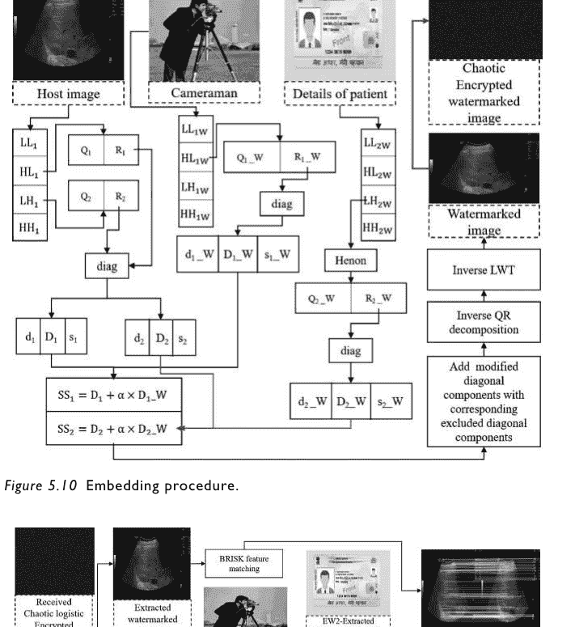

图 5.10 嵌入过程。

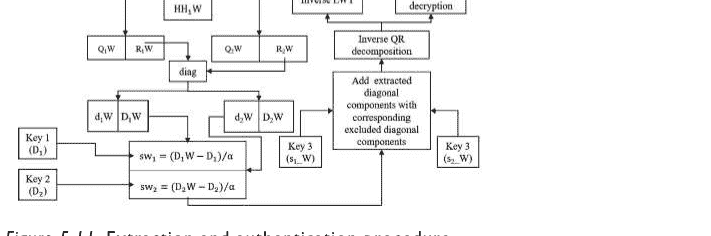

图 5.11 提取和认证过程。

## PSNR (dB)

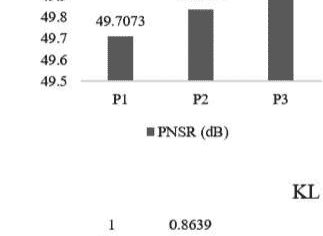

## NCC

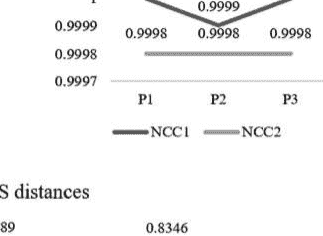

## KL 和 JS 距离

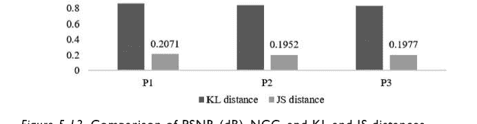

图 5.12 PSNR (dB)、NCC 以及 KL 和 JS 距离的比较。

## 表 5.5 时序分析（秒）

| 输入图像 | 嵌入时间 | 提取时间 | 总耗时 |
|---|---|---|---|
| P1 | 1.7234 | 0.64001 | 2.3634 |
| P2 | 1.6015 | 0.66406 | 2.2655 |
| P3 | 1.6152 | 0.68780 | 2.3030 |

## 表 5.6 不同输入图像在各种攻击下的 BRISK 特征匹配

| 攻击 | 规格 | 匹配特征数 (P1) | 匹配特征数 (P2) | 匹配特征数 (P3) |
|---|---|---|---|---|
| 盐和胡椒噪声 | 0.001 | 242 | 191 | 169 |
|  | 0.002 | 211 | 181 | 156 |
| 高斯噪声 | 0.001 | 164 | 147 | 126 |
|  | 0.002 | 117 | 112 | 98 |
| 散斑噪声 | 0.001 | 252 | 161 | 195 |
|  | 0.002 | 215 | 193 | 172 |
| 高斯低通滤波器 | 3×3 | 89 | 56 | 60 |
|  | 5×5 | 99 | 59 | 59 |
| JPEG 2000 | 10 | 229 | 198 | 186 |
| 感兴趣区域滤波 | 7×7 | 114 | 126 | 83 |

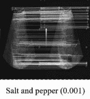

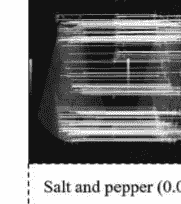

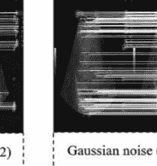

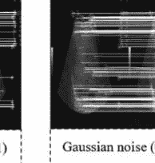

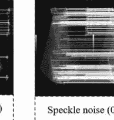

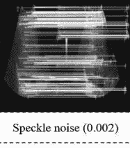

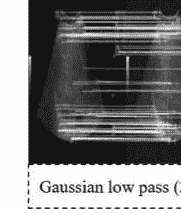

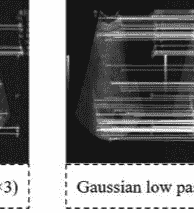

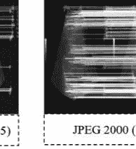

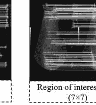

图 5.13 BRISK 匹配特征 (P1)

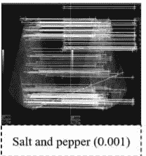

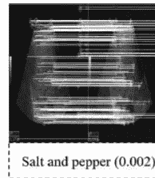

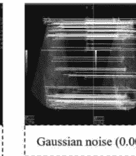

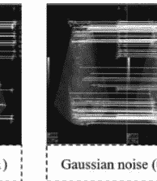


图 5.14 BRISK 匹配特征 (P2)


图 5.15 BRISK 匹配特征 (P3)

## 表 5.7 PSNR (dB) 值比较

| 输入图像 | [2] | 提出方案 |
|---|---|---|
| P1 | 45.8168 | 49.7073 |
| P2 | 45.7966 | 49.8335 |
| P3 | 45.8186 | 49.9574 |

## 表 5.8 与其它方案的 PSNR (dB) 值比较

| 参考编号 | [1] | [3] | [5] | 提出方案 |
|---|---|---|---|---|
| PSNR (dB) | 44.9488 | 32.9505 | 40.12 | 49.7073 |

## 表 5.9 与 [12] 的不同攻击下 NCC 比较

| 攻击 | Zear 等 [12] |  |  |  | 提出方法 |  |
|---|---|---|---|---|---|---|
|  | 无 BPNN |  | 有 BPNN |  |  |  |
|  | NCC1 | NCC2 | NCC1 | NCC2 | NCC1 | NCC2 |
| 高斯噪声 (0, 0.001) | 0.9901 | 0.8939 | 0.9908 | 0.9515 | 0.9992 | 0.9990 |
| 盐和胡椒噪声 (0.05) | 0.6596 | 0.6287 | 0.6828 | 0.8405 | 0.9904 | 0.9950 |
| 中值滤波器 (3×3) | 0.9833 | 0.8457 | 0.9861 | 0.8657 | 0.9990 | 0.9988 |
| 平均滤波器 (3×3) | 0.9809 | 0.6709 | 0.9863 | 0.7348 | 0.9994 | 0.9990 |
| 旋转 (5 度) | 0.7843 | 0.5798 | 0.9806 | 0.7912 | 0.9920 | 0.9958 |


## 图 5.16 与 [1–3, 5] 的 PSNR (dB) 值比较。


## 5.7 结论

本章提出了一种一致且不可检测的图像水印方法，使用 Hénon 映射、混沌 logistic 映射、LWT 和 QR 分解。BRISK 特征用于身份验证。双水印图像用于进一步增强所提出工作的安全性。两个水印图像均能很好地恢复。所有性能参数值均在允许范围内。如第 5.6 节所示，与其他技术相比，所提出的水印方法具有更高的鲁棒性和不可感知性。所提出的工作可进一步改进以应对几何攻击。缩放值对水印过程至关重要；因此，可以进一步使用优化技术获得优化的缩放因子以平衡性能参数。

## 参考文献

1. Awasthi, D., & Srivastava, V. K. (2022). 基于 LWT-DCT-SVD 和 DWT-DCT-SVD 的水印方案及其使用 Jaya 和粒子群优化的性能增强以及在各种攻击下的结果比较. Multimedia Tools and Applications, 81(18), 25075–25099.
2. Awasthi, D., & Srivastava, V. K. (2022). 使用 Schur 分解、LWT-DCT-SVD 对 DICOM 图像进行鲁棒、不可感知且优化的水印及其使用 SURF 的身份验证. Multimedia Tools and Applications, 82(11), 16555–16589.
3. Furqan, A., & Kumar, M. (2015, February). 使用 MATLAB 对基于稳健 DWT-SVD 域的数字图像水印技术的学习与分析. In: 2015 IEEE International Conference on Computational Intelligence & Communication Technology. IEEE. pp. 638–644.
4. https://www.cert-in.org.in/s2cMainServlet?pageid=PUBANULREPRT
5. Hurrah, N., Parah, S., Loan, N., Sheikh, J., Elhoseny, M., & Muhammad, K. (2018). 用于多媒体隐私保护和内容认证的双水印框架. Future Generation Computer Systems 94, 654–673. https://doi.org/10.1016/j.future.2018.12.036
6. Clark, K., Vendt, B., Smith, K., Freymann, J., Kirby, J., Koppel, P., ... & Prior, F. (2013). 癌症影像档案 (TCIA)：维护和运营公共信息存储库. Journal of Digital Imaging, 26, 1045–1057.
7. Jane, O., & Elbaşi, E. (2014). 基于 DWT 和 SVD 的混合非盲水印. Journal of Applied Research and Technology, 12(4), 750–761.
8. Khare, P., & Srivastava, V. K. (2018, November). 使用小波域同态变换的图像水印方案. In 2018 5th IEEE Uttar Pradesh Section International Conference on Electrical, Electronics and Computer Engineering (UPCON) (pp. 1–6). IEEE.
9. Su, Q., Wang, G., Zhang, X., et al. (2017). 基于 QR 分解的改进彩色图像水印算法. Multimedia Tools and Applications, 76, 707–729. https://doi.org/10.1007/s11042-015-3071-x
[10] Thakkar, F. N., & Srivastava, V. K. (2017). 一种盲医学图像水印：用于远程医疗应用的基于 DWT-SVD 的鲁棒和安全方法. Multimedia Tools and Applications, 76, 3669–3697.
[11] Thakkar, F., & Srivastava, V. K. (2017). 基于粒子群优化和块 SVD 的数字图像水印. Turkish Journal of Electrical Engineering and Computer Sciences, 25(4), 3273–3288.
[12] Zear, A., Singh, A. K., & Kumar, P. (2018). 用于医疗保健应用的多次水印. Journal of Intelligent Systems, 27(1), 5–18.
[13] Singh, A. K. (2019). 用于彩色医学图像的 LWT 域中基于 DCT 和纠错码的鲁棒和失真控制双水印. Multimedia Tools and Applications, 78, 30523–30533.
[14] Hsu, C. S., & Tu, S. F. (2020). 使用双水印增强图像水印对裁剪攻击的鲁棒性. Multimedia Tools and Applications, 79(17-18), 11297–11323.
[15] Koley, S. (2021). 基于视觉注意模型的双水印用于同时图像版权保护和认证. Multimedia Tools and Applications, 80(5), 6755–6783.
[16] Zear, A., & Singh, P. K. (2022). 基于 LWT-DCT-SVD 的安全鲁棒彩色图像双水印. Multimedia Tools and Applications, 81(19), 26721–26738.
[17] Al-Otum, H. M. (2022). 使用多级阈值和选择性区域量化进行双图像水印，用于版权保护、认证和恢复应用. Multimedia Tools and Applications, 81(18), 25787–25828.
[18] Sweldens, W. (1996). 提升方案：双正交小波的定制设计构造. Applied and Computational Harmonic Analysis, 3(2), 186–200.
[19] Sweldens, W. (1998). 提升方案：第二代小波的构造. SIAM Journal on Mathematical Analysis, 29(2), 511–546.
[20] Wang, H., & Su, Q. (2022). 结合 QR 分解和空间域的彩色图像水印方法. Multimedia Tools and Applications, 81(26), 37895–37916.
[21] Sheela, S. J., Suresh, K. V., & Tandur, D. (2018). 基于混合混沌移位变换的改进 Henon 映射图像加密. Multimedia Tools and Applications, 77, 25223–25251. https://doi.org/10.1007/s11042-018-5782-2
[22] Rathore, V., Bagan, K. B., & Pal, A. K. (2021). 基于 Henon 映射生成边缘图的位平面内容图像加密方案. Multimedia Tools and Applications, 80, 22275–22300.
[23] Sathishkumar, G. A., & Sriraam, N. (2011). 基于扩散和多个混沌映射的图像加密. arXiv preprint arXiv:1103.3792.
[24] Leutenegger, S., Chli, M., & Siegwart, R. Y. (2011, November). BRISK：二进制鲁棒不变可扩展关键点. In 2011 International Conference on Computer Vision (pp. 2548–2555). Ieee.

## 使用小波域 HT-MSVD 保护数字图像

Priyank Khare

IIIT Ranchi, Ranchi, 印度

Divyanshu Awasthi and Vinay Kumar Srivastava

MNNIT Allahabad, Prayagraj, 印度

## 6.1 引言

技术的快速发展使得多媒体数据的获取变得非常便捷。由于这一过程，机密数据的相互交换变得容易。因此，保密性和防止入侵者的保护是首要目标，尤其是在图像中，图像很容易被篡改。这个问题正以惊人的速度迅速增加，因此研究人员将注意力集中在提供安全的信息交换上。

解决这一严重问题的办法是图像水印，其中机密图像隐藏在载体图像中，使其对人眼视觉系统而言感知上不可见 [1, 2]。水印图像和载体图像在视觉上应相似。此外，这一隐藏的水印由合法用户提取以确保版权保护。图像间的视觉相似性借助不可感知性来表示，而该方案对攻击的弹性则通过鲁棒性来体现。设计有效的图像水印技术时，主要挑战是在这两个属性之间同时保持权衡 [3, 4]。通常，图像水印是在空间域或变换域中执行。变换域水印在鲁棒性和不可感知性方面被证明更好。相比之下，混合图像变换水印通常被有效采用，以便利用不同图像变换的特征。

本章提出基于 HT-RDWT-MSVD 的图像水印以保护数字图像。该提出的技术有效地使用每个变换的属性，以便在水印的不同特性之间保持适当的平衡。

所提出技术的关键方面如下列出：

- 由载体图像的 HT [5, 6] 获得的反射分量被优先用于水印嵌入，因为它为该技术提供了更好的鲁棒性和感知不可见性。
- 与离散小波变换 (DWT) 相比，RDWT [7–9] 提供了出色的鲁棒性，因为它具有平移不变性，而容量也随其使用而增加。
- 与奇异值分解 (SVD) 相比，MSVD [10, 11] 为该方案对几何攻击提供了更好的鲁棒性，因此将其与 RDWT 结合可得到鲁棒的水印技术。
- 这些变换的显著特征促使我们提出一种有效的水印技术，旨在最大化水印的各种特征。因此，数字图像的保密性得以保留。

本章其余部分的组织结构如下：第 6.2 节包括相关工作，第 6.3 节介绍所提出的水印方案，第 6.4 节研究仿真结果。第 6.5 节阐述本章的结论。

## 6.2 相关工作

在 [10] 中报道了一种多图像水印 (MIW)，其中非下采样轮廓波变换 (NSCT)、离散余弦变换 (DCT) 和 MSVD 被共同采用。但由于 DCT 的非方向性，该技术未能提供足够的鲁棒性和不可感知性。[10] 的扩展版本在 [12] 中得到发展，其中由于使用了 RDWT，鲁棒性略有改善，但该方案仍不能提供令人满意的抗噪声攻击鲁棒性。在 [13] 中，DCT-DWT 融合应用于水印嵌入。在该方法中，作者选择了高高 (HH) 子带作为嵌入位置，因此鲁棒性产出未达到标准。对仿射和图像增强攻击的分析也缺失。

在 [14] 中开发了一种基于神经网络的图像水印，其中水印嵌入到彩色宿主图像的边缘。轮廓波变换用于选择可以执行嵌入的方向。然而，该方案缺乏安全性。在 [15] 中研究了使用粒子群细菌觅食优化 (PSBFO) 的脆弱水印，其中 RDWT-QR 变换被同时应用。该技术为重要医学图像的篡改检测提供了真实性。

提出了一种 DWT-SVD 水印方案 [16]，其中加密-压缩被同时应用于水印图像。在该方法中，水印图像连同文本水印一起被同时嵌入宿主图像的期望子带中。加密使用混沌和超混沌映射执行。所提出的方案似乎有效，但似乎对仿射变换的鲁棒性较弱。非下采样剪切波变换 (NSST)-MSVD [17] 水印算法正在开发中，其中水印的嵌入

使用基于置换的混淆技术完成，以提供更好的安全性。同时，作者使用了基于优化的加密技术来对水印图像进行认证。然而，所开发方法的时间复杂度可以降低。

在 [18] 中报道了基于混沌加密的水印技术。在该方法中，文本和图像水印使用 DWT-SVD 嵌入到宿主图像的期望子带中。峰值信噪比 (PSNR) 的值似乎相当低，这导致感知不可见性较差。基于 HT-RDWT-SVD 的水印技术在 [5] 中进行了描述。在该方法中，载体图像使用 HT-RDWT-SVD 进行变换，而水印图像使用 RDWT-SVD 进行变换。结果清楚地表明，通过加密，该方案为水印图像提供了更好的安全性和真实性。作者在 [19] 中使用模糊逻辑，利用 NSCT-RDWT-SVD 组合将水印图像嵌入到载体图像中。模糊逻辑用于确定该方法中的最佳缩放因子。该方案对滤波攻击的鲁棒性较差。

在 [20] 中开发了基于去噪卷积神经网络 (DnCNN) 的水印技术，其中采用了提升小波变换 (LWT)、Hessenberg 分解和冗余奇异值分解 (RSVD) 来嵌入水印。DnCNN 用于增强对攻击的鲁棒性，而水印图像也进行了加密后压缩以获得更好的结果。然而，未报告对几何攻击的鲁棒性。Curvelet 变换与 RDWT 在 [21] 中用于嵌入水印。在该方法中，混淆后的水印连同伪噪声 (PN) 序列一起嵌入到宿主图像的子带中。对滤波和缩放攻击的鲁棒性是所开发方法的[content]
使用基于置换的混淆技术完成，以提供更好的安全性。同时，作者使用了基于优化的加密技术来对水印图像进行认证。然而，所开发方法的时间复杂度可以降低。

在 [18] 中报道了基于混沌加密的水印技术。在该方法中，文本和图像水印使用 DWT-SVD 嵌入到宿主图像的期望子带中。峰值信噪比 (PSNR) 的值似乎相当低，这导致感知不可见性较差。基于 HT-RDWT-SVD 的水印技术在 [5] 中进行了描述。在该方法中，载体图像使用 HT-RDWT-SVD 进行变换，而水印图像使用 RDWT-SVD 进行变换。结果清楚地表明，通过加密，该方案为水印图像提供了更好的安全性和真实性。作者在 [19] 中使用模糊逻辑，利用 NSCT-RDWT-SVD 组合将水印图像嵌入到载体图像中。模糊逻辑用于确定该方法中的最佳缩放因子。该方案对滤波攻击的鲁棒性较差。

基于去噪卷积神经网络 (DnCNN) 的水印技术在 [20] 中被开发，其中采用提升小波变换 (LWT)、Hessenberg 分解和冗余奇异值分解 (RSVD) 来嵌入水印。DnCNN 用于增强对攻击的鲁棒性，而水印图像也进行了加密后压缩以获得更好的结果。然而，未报告对几何攻击的鲁棒性。Curvelet 变换与 RDWT 在 [21] 中用于嵌入水印。在该方法中，混淆后的水印连同伪噪声 (PN) 序列一起嵌入到宿主图像的子带中。对滤波和缩放攻击的鲁棒性是所开发方法的主要不足。

误差校正码 (ECC) 和 DWT 用于水印嵌入 [22]。对水印进行双重嵌入以保护敏感的医疗信息，同时还对各种 ECC 进行了比较分析。采用 Walsh Hadamard 变换 (WHT) 进行水印嵌入的研究在 [23] 中进行。在该方法中，WHT 应用于分块载体图像，而位信息被洗牌以实现安全性。然而，对中值滤波攻击的鲁棒性较弱。

在 [24] 中利用了深度学习的概念，其中鲁棒性显著提高。串联原理用于嵌入过程，而块级转置卷积技术用于提取过程。然而，该技术获得的不可感知性较低。基于 NSCT 的融合图像水印在 [25] 中进行了介绍，其中融合了两幅医学图像。融合后的载体图像用于嵌入过程，其中图像和文本水印同时嵌入以用于智能医疗保健应用。

在 [26] 中报道了使用主成分分析 (PCA) 和 RDWT 的类似技术，其中主成分用于嵌入和提取过程。针对智能医疗保健系统的各种图像水印技术的综述在 [27] 中进行了讨论。本文阐述了远程医疗应用中的开放性问题和挑战。关于不同技术的综述启发我们提出一种新的水印技术，以满足研究空白。有许多潜在的研究问题需要关注，例如更好的鲁棒性和感知不可见性、容量等。因此，通过开发这种新技术，可以有效地实现数字图像版权保护并具有更好的属性。

## 6.3 拟议水印技术

本节介绍了水印嵌入和提取技术。首先，HT 将载体图像分解为反射分量和照明分量。进一步的多分辨率分析通过使用 RDWT 分解反射分量来实现。低高 (LH) 子带被选用来在鲁棒性和感知不可见性之间保持适当的平衡。MSVD 应用于该 LH 子带以获得更好的不可感知性。同样，RDWT-MSVD 变换也应用于水印图像。选择最佳缩放因子可得到水印图像。嵌入和提取水印程序如图 6.1(a, b) 所示。


(a)

图 6.1 水印技术流程 (a) 嵌入。


(b)

图 6.1（续）水印技术流程 (b) 提取。

### 6.3.1 嵌入技术

- 载体图像 ‘C’ 的 HT 被计算，得到 ‘C_R’ 作为反射分量，而 ‘C_I’ 作为照明分量。
- ‘C_R’ 使用 RDWT 分解得到四个子带。
  C_R --RDWT--> [C_RLL, C_RHL, C_RLH, C_RHH] (6.1)
- ‘C_RLH’ 子带的 MSVD 计算为：
  C_RLH --MSVD--> [X1, U1] (6.2)
- 对水印图像 ‘W_mk’ 执行 RDWT。
  W_mk --RDWT--> [W_mkLL, W_mkHL, W_mkLH, W_mkHH] (6.3)
- 计算 ‘W_mkLH’ 的 MSVD，得到 [X2, U2]。
  W_mkLH --MSVD--> [X2, U2] (6.4)
- 根据式 (6.5) 嵌入水印：
  X3 = X1 + β° X2 (6.5)
  其中 ‘β’ 为缩放因子。
- 逆 MSVD、RDWT、HT 变换得到水印图像 ‘W_I’。

### 6.3.2 提取技术

- 对 ‘W_I’ 水印图像的 HT 进行评估，得到 ‘W_IR’ 作为反射分量，而 ‘W_II’ 作为照明分量。
- 对 ‘W_IR’ 应用 RDWT：
  $$W_{IR} \xrightarrow{RDWT} [W_{IRLL}, W_{IRHL}, W_{IRLH}, W_{IRHH}] \tag{6.6}$$
- 根据式 (6.7) 评估 ‘W_IRLH’ 的 MSVD 系数：
  $$W_{IRLH} \xrightarrow{MSVD} [X_4, U_4] \tag{6.7}$$
- 根据式 (6.8) 进行提取过程：
  $$X_5 = (X_4 - X_1)/\beta \tag{6.8}$$
- 计算 ‘X_5’ 的逆 MSVD 和 RDWT 以恢复水印图像 ‘W_mk’。

## 6.4 仿真结果

本章提出的仿真水印技术使用 ‘MATLAB’ 实现。选取了若干包含标准和医学图像 [28, 29] 的载体图像，大小为 512 × 512，同时选择了一幅大小为 512 × 512 的水印图像。载体图像如图 6.2(a) 所示，水印图像如图 6.2(b) 所示。实验分析中 ‘β’ 的值选为 0.1。加权峰值信噪比 (WPSNR) [30, 31]、PSNR、结构相似性指数 (SSIM) 和归一化相关系数 (NC) [31] 指标用于分析所提技术的不可感知性和鲁棒性。这些指标的值列于表 6.1 中，清楚地强调了在无攻击情况下所提技术的性能。PSNR 和 WPSNR 的平均值分别为 53.22179 dB 和 66.17175 dB，而 NC 和 SSIM 值接近于 1。

所提技术的鲁棒性在多种攻击下进行分析，如锐化、仿射、压缩等。图 6.3 展示了 ‘Airplane’ 水印图像经受不同攻击后的情况以及对应的提取水印图像。所提技术对攻击具有鲁棒性，因为提取水印图像的视觉质量更好。在表 6.2、6.3、6.4 和 6.5 中计算了所提技术在不同攻击下的 NC 值。


图 6.2 (a) 若干载体图像 (b) 水印图像。

表 6.1 拟议方案的性能指标值

| 图像 | SSIM | PSNR (dB) | WPSNR (dB) | NC |
|---|---|---|---|---|
| Lena | 0.9986 | 55.5431 | 64.9250 | 0.9996 |
| Cameraman | 0.9943 | 50.6895 | 66.5252 | 0.9989 |
| Peppers | 0.9961 | 51.6619 | 67.1621 | 0.9994 |
| Boat | 0.9961 | 51.4885 | 66.9485 | 0.9994 |
| Man | 0.9972 | 52.5542 | 67.9080 | 0.9994 |
| Airplane | 0.9980 | 54.7573 | 63.5201 | 0.9996 |
| Lung | 0.9924 | 50.1003 | 66.9217 | 0.9958 |
| Knee | 0.9959 | 52.9325 | 66.0630 | 0.9991 |
| Elbow | 0.9987 | 57.2672 | 66.0620 | 0.9996 |
| Brain | 0.9980 | 55.2234 | 65.6819 | 0.9985 |


| 攻击 | 加水印图像 | 恢复的水印图像 |
|---|---|---|
| 高斯噪声 (0,0.001) | [Image] | [Image] |
| 旋转 (50°) | [Image] | [Image] |
| 散斑噪声 (0.001) | [Image] | [Image] |
| 裁剪 | [Image] | [Image] |
| 直方图均衡化 | [Image] | [Image] |
| 平均滤波器 (3×3) | [Image] | [Image] |
| 伽马校正 (0.6) | [Image] | [Image] |
| JPEG压缩 (90) | [Image] | [Image] |

图6.3 不同攻击下恢复的水印图像。

## 表6.2 不同噪声攻击下的NC值

| 攻击 |  | Lena | Cameraman | Airplane | Elbow | Brain |
|---|---|---|---|---|---|---|
| 椒盐 | 0.001 | 0.9753 | 0.9883 | 0.9760 | 0.9754 | 0.9810 |
| 椒盐 | 0.005 | 0.8704 | 0.9441 | 0.8481 | 0.9431 | 0.9174 |
| 椒盐 | 0.0001 | 0.9985 | 0.9982 | 0.9978 | 0.9990 | 0.9963 |
| 高斯 | 0.001 | 0.9453 | 0.9607 | 0.9611 | 0.9526 | 0.9657 |
| 高斯 | 0.0001 | 0.9798 | 0.9947 | 0.9962 | 0.9923 | 0.9938 |
| 高斯 | 0.01 | 0.9941 | 0.9949 | 0.9962 | 0.9920 | 0.9923 |
| 散斑 | 0.001 | 0.9786 | 0.9905 | 0.9773 | 0.9943 | 0.9934 |
| 泊松 |  | 0.9996 | 0.9989 | 0.9996 | 0.9996 | 0.9987 |

## 表6.3 不同滤波攻击下的NC值

| 攻击 |  | Lena | Cameraman | Airplane | Elbow | Brain |
|---|---|---|---|---|---|---|
| 平均滤波器 | 2×2 | 0.9688 | 0.8247 | 0.9438 | 0.9970 | 0.8479 |
| 平均滤波器 | 3×3 | 0.9471 | 0.8869 | 0.9433 | 0.9970 | 0.8776 |
| 中值滤波器 | 1×1 | 0.9996 | 0.9989 | 0.9996 | 0.9996 | 0.9985 |
| 中值滤波器 | 2×2 | 0.9678 | 0.8076 | 0.9433 | 0.9968 | 0.8968 |
| 维纳滤波器 | 2×2 | 0.9938 | 0.7897 | 0.9955 | 0.9988 | 0.9870 |
| 维纳滤波器 | 3×3 | 0.9906 | 0.8010 | 0.8861 | 0.9985 | 0.9866 |
| 高斯滤波器 | 3×3 | 0.9184 | 0.8147 | 0.8944 | 0.9992 | 0.9639 |

## 表6.4 不同图像增强攻击下的NC值

| 攻击 |  | Lena | Cameraman | Airplane | Elbow | Brain |
|---|---|---|---|---|---|---|
| 直方图均衡化 |  | 0.9802 | 0.9625 | 0.9222 | 0.9959 | 0.9461 |
| 锐化 |  | 0.9981 | 0.9943 | 0.9981 | 0.9995 | 0.9911 |
| 伽马校正 (0.6) |  | 0.9972 | 0.9921 | 0.9939 | 0.9983 | 0.9774 |
| JPEG压缩 | 80 | 0.9984 | 0.9991 | 0.9964 | 0.9979 | 0.9894 |
| JPEG压缩 | 90 | 0.9989 | 0.9987 | 0.9991 | 0.9986 | 0.9987 |

## 表6.5 不同几何攻击下的NC值

| 攻击 | Lena | Cameraman | Airplane | Elbow | Brain |
|---|---|---|---|---|---|
| 旋转 (50°) | 0.9315 | 0.8866 | 0.9117 | 0.9879 | 0.8450 |
| 缩放 | 0.9970 | 0.8037 | 0.8906 | 0.9994 | 0.9629 |
| 裁剪 | 0.9970 | 0.9944 | 0.9963 | 0.9978 | 0.9552 |

表6.2 列出了所提技术在各种噪声攻击下的鲁棒性，而表6.3 说明了滤波攻击。经研究表6.2可知，所提出的工作对噪声攻击具有良好的抗性，尤其对高斯噪声和散斑噪声攻击。同样，所提方法对滤波攻击也具有鲁棒性，因为‘Elbow’ 载体图像产生了更好的 NC 值，在中值滤波攻击下最高值为 0.9996。

鲁棒性对图像增强攻击在表6.4中指定，而表6.5 详细说明了几何攻击的 NC 值。‘Elbow’ 主图像对锐化攻击具有更好的鲁棒性，而‘Cameraman’ 在压缩攻击下产生最高的 NC 值。‘Elbow’ 主图像在缩放攻击下产生最高的 NC 值 0.9994。

图6.4 和 6.5 以图形方式展示了所提技术在诸如噪声、滤波、增强和几何等众多攻击下所受的 SSIM 和 PSNR 值。在图6.4(c)中，‘Brain’ 载体图像在直方图均衡化攻击下达到 0.3684，而‘Cameraman’ 主图像在图6.4(d) 中在旋转攻击下的 SSIM 值为 0.1362，为最低值。对于大多数攻击，SSIM 值接近于 1，这意味着更好的感知不可见性。从图6.5 可以清楚地观察到，所提方案具有良好的不可感知性，因为 PSNR 值远高于 30 dB，除了少数攻击，如直方图均衡化和旋转攻击。

计算时间复杂度在表6.6 中针对不同载体图像进行了汇总，平均总时间为 3.4973 秒。所提技术在计算时间上高效，嵌入和提取时间的值更小。表6.7 展示了所提工作与其他持续技术 [14, 16, 21] 的比较分析。‘*’ 表示未报告 NC 值。所提方案在 NC 值方面被发现更好，除了中值滤波攻击，其中技术 [14] 具有更高的 NC 值。同样，对于直方图均衡化，攻击 [21] 具有更高的 NC。对于其余攻击，所提方案在鲁棒性方面被证明更好。此外，所提方案与所报道技术 [22] 的图形比较在图6.6 中描绘，其中所提技术表现更佳。


图6.4 攻击下的SSIM指标值 (a) 噪声。


图6.4 攻击下的SSIM指标值 (b) 滤波 (c) 图像增强。


图6.4 (续) 攻击下的SSIM指标值 (d) 几何。


图6.5 攻击下的PSNR指标值 (a) 噪声。(续)


图6.5 (续) PSNR指标值对攻击 (b) 滤波 (c) 图像增强。


图6.5 (续) PSNR指标值对攻击 (d) 几何。

## 表6.6 所提方案的计算时间分析

| 图像 | 嵌入时间 (秒) | 提取时间 (秒) | 总计算时间 (秒) |
|---|---|---|---|
| Lena | 2.0511 | 1.4323 | 3.4834 |
| Cameraman | 2.0014 | 1.4612 | 3.4626 |
| Airplane | 2.0317 | 1.5638 | 3.5955 |
| Elbow | 2.0226 | 1.3962 | 3.4188 |
| Brain | 2.0599 | 1.4663 | 3.5262 |

表6.7 所提方案与其他持续技术的比较

| 攻击 | [16] | [14] | [21] | 所提方案 |
|---|---|---|---|---|
| 椒盐噪声 (0.0001) | 0.9879 | * | * | 0.9985 |
| 平均滤波器 | * | 0.8984 | 0.2258 | 0.9471 |
| 中值滤波器 [3 3] | * | 0.9609 | 0.4576 | 0.9274 |
| 锐化 | 0.6763 | * | 0.9916 | 0.9981 |
| 缩放 | 0.7075 | 0.9004 | 0.5051 | 0.9970 |
| 直方图均衡化 | 0.7223 | 0.5039 | 0.9904 | 0.9802 |
| JPEG压缩 (90) | 0.9796 | * | 0.9910 | 0.9989 |


图6.6 所提方案与[22]的图形比较。

## 6.5 结论

本章提出了一种新型图像水印技术，可轻松实现数字图像的版权保护。HT-RDWT-MSVD 变换的融合产生了更好的鲁棒性和不可感知的水印技术。通过将水印嵌入反射分量中确保了更好的不可感知性，而 RDWT 的使用增强了鲁棒性。MSVD 还提供了不可或缺的帮助，使所提方案更不可感知，从而使机密信息保持完整。结果证明了所提出工作与其他现有比较方法的功效。未来，我们希望通过采用各种认证技术来增强所提水印技术的安全性，使其对攻击更鲁棒和安全。

## 参考文献

+   [1] Anand, A., Singh, A. K., Lv, Z., & Bhatnagar, G. (2020). 基于压缩后加密的智能医疗系统安全水印技术. IEEE MultiMedia, 27(4), 133–143.
+   [2] Kumar, S., Singh, B. K., & Yadav, M. (2020). 多媒体和数据库水印的最新综述. Multimedia Tools and Applications, 79(27), 20149–20197.
+   [3] Mazurczyk, W., & Wendzel, S. (2017). 信息隐藏：法医专家的挑战. Communications of the ACM, 61(1), 86–94.
+   [4] Anand, A., & Singh, A. K. (2021). 医疗数据认证的水印技术：综述. Multimedia Tools and Applications, 80(20), 30165–30197.
+   [5] Khare, P., & Srivastava, V.K. (2021). 保护医疗图像完整性的安全鲁棒医疗图像水印方法. Transactions on Emerging Telecommunications Technologies, 32(2), e3918.
+   [6] Khare, P., & Srivastava, V.K. (2021). 基于DWT域同态变换的可靠安全图像水印算法. Multidimensional Systems and Signal Processing, 32(1), 131–160.
+   [7] Sharma, S., Sharma, H., & Sharma, J. B. (2019). 基于RDWT-SVD和人工蜂群质量度量强度因子优化的自适应彩色图像水印. Applied Soft Computing, 84, 105696.
+   [8] Anand, A., & Singh, A. K. (2020, September). 基于RDWT-SVD-萤火虫的医疗图像双水印技术 (研讨会论文). In 2020 IEEE Sixth International Conference on Multimedia Big Data (BigMM), New Delhi, India (pp. 366–372). IEEE.
+   [9] Khare, P., & Srivastava, V. K. (2019). 基于RDWT域同态变换、SVD和Arnold变换的安全鲁棒图像水印方案. Advances in Electrical and Electronic Engineering, 17(3), 343–351.
+   [10] Singh, S., Rathore, V. S., & Singh, R. (2017). 医疗图像的混合NSCT域多重水印. Multimedia Tools and Applications, 76(3), 3557–3575.
+   [11] Kakarala, R., & Ogunbona, P. O. (2001). 使用奇异值分解多分辨率形式的信号分析. IEEE Transactions on Image Processing, 10(5), 724–735.
+   [12] Singh, S., Rathore, V. S., Singh, R., & Singh, M. K. (2017). 冗余小波域的混合半盲图像水印. Multimedia Tools and Applications, 76(18), 19113–19137.
+   [13] Begum, M., Ferdush, J., & Uddin, M. S. (2022). 基于离散余弦变换、离散小波变换和奇异值分解的混合鲁棒水印系统. Journal of King Saud University-Computer and Information Sciences, 34(8), 5856–5867.
+   [14] Kazemi, M. F., Pourmina, M. A., & Mazinan, A. H. (2020). 通过基于神经网络的方法对彩色图像水印框架的分析. Complex & Intelligent Systems, 6(1), 213–220.


[15] Swaraja, K., Meenakshi, K., & Kora, P. (2021). 使用 RDWT-QR 优化水印的遥医疗用分层多级框架。 *生物医学信号处理与控制*, 68, 102688.

[16] Anand, A., & Singh, A. K. (2020). 用于医疗信息安全的改进 DWT-SVD 域水印。 *计算机通信*, 152, 72–80.

[17] Anand, A., & Singh, A. K. (2022). 一种基于混合优化的工业物联网安全医疗数据隐藏方案。 *IEEE 工业信息学报*, 19(1), 1051–1058

[18] Thakur, S., Singh, A. K., Kumar, B., & Ghrera, S. P. (2020). 通过汉明码和混沌加密改进的基于 DWT-SVD 的医学图像水印。 In *VLSI、通信和信号处理的进展* (pp. 897–905). Springer, Singapore.

[19] Singh, O. P., Kumar, C., Singh, A. K., Singh, M. P., & Ko, H. (2021). 基于 NSCT-RDWT-SVD 域水印的模糊数字数据安全交换。 *并发与计算：实践与经验*, 35(16), e6251.

[20] Singh, O. P., & Singh, A. K. (2021). 加密-压缩域中的数据隐藏。 *复杂与智能系统*, 9(11), 1–14.

[21] Thanki, R., Kothari, A., & Trivedi, D. (2019). DCuT–RDWT 域中的混合盲水印方案。 *信息安全与应用杂志*, 46, 231–249.

[22] Singh, A. K., Kumar, B., Dave, M., & Mohan, A. (2015). 用于远程医疗应用的鲁棒且不可感知双水印。 *无线个人通信*, 80(4), 1415–1433.

[23] Prabha, K., & Sam, I. S. (2022). 使用 WHT 的有效鲁棒不可感知盲彩色图像水印。 *沙特国王大学学报–计算机与信息科学*, 34(6, Part A), 2982–2992.

[24] Mahapatra, D., Amrit, P., Singh, O. P., Singh, A. K., & Agrawal, A. K. (2022). 基于自编码器-卷积神经网络的图像水印嵌入与提取模型。 *电子成像杂志*, 32(2), 021604.

[25] Anand, A., & Singh, A. K. (2021). SDH：用于智能医疗的融合医学图像安全数据隐藏。 *IEEE 计算社会系统汇刊*, 9(4), 1265–1273.

[26] Singh, O. P., Singh, A. K., Agrawal, A. K., & Zhou, H. (2022). SecDH：基于 PCA 数据隐藏的 COVID-19 图像安全。 *计算机通信*, 191, 368–377.

[27] Singh, O. P., Anand, A., Agrawal, A. K., & Singh, A. K. (2022). 通过水印实现物联网中的电子健康数据安全：介绍。 *IEEE 物联网杂志*, 5(2), 55–58.

[28] https://medpix.nlm.nih.gov/home

[29] https://commons.wikimedia.org/wiki

[30] Navas, K. A., Thampy, S. A., & Sasikumar, M. (2008). 遥医疗用医学图像中的 EPR 隐藏。 *国际生物医学科学杂志*, 3(1), 44–47.

[31] Khare, P., & Srivastava, V. K. (2021). 一种使用同态变换和 DWT 的新型双图像水印技术。 *智能系统杂志*, 30(1), 297–311.

## 用于多媒体数据管理的可扩展边缘计算架构
### 挑战与研究方向

Jaya Sinha
Galgotias College of Engineering and Technology, 印度大诺伊达

Nivedita Palia
Vivekananda Institute of Professional Studies–Technical Campus,
印度德里

## 7.1 边缘计算生态系统简介

物联网领域的扩展与发展以及云服务的成就催生了被称为边缘计算的创新计算范式。边缘计算意味着在数据产生的网络边缘附近处理数据。它使用户能够以高速处理大量数据并获得更快的响应时间。目前，物联网连接了各种各样的电子和电气设备，这些设备产生海量数据。随着 5G 等技术的出现，数据量将大幅增加。

今天，数字化席卷全球，各种领域产生大量数据。在大多数情况下，需要快速处理数据以支持实时应用。云计算技术逐渐减少了中小型企业拥有自己的计算系统进行计算任务的需求。尽管如此，最终用户仍需要向机器所在位置传输和获取数据。云计算并不总是有效地处理在网络边缘产生的数据，因此引入了微型数据中心 [1, 2]、雾计算 [3] 和 Cloudlet [4]。在下面的段落中，我们将介绍边缘计算出现的几个原因，并进行比较研究。

### 7.1.1 深入边缘计算：源于云计算，驱动于物联网，数据消费者到数据生产者

就计算而言，云计算已被证明是高效的，但在某些情况下，由于边缘产生的大量数据，基于云的计算在数据传输速度上会出现瓶颈。例如，波音 787 每秒会产生 5 千兆字节（GB）数据，将这些数据在飞机与卫星或地面基站之间传输对于数据处理来说是低效的 [5]。再考虑自动驾驶汽车的另一个例子——它每秒产生 1 GB 数据，并且需要实时处理数据，以便车辆做出正确的决策 [6]。此外，根据《数据时代 2025》的报告，约有超过 50 亿客户目前因广泛使用社交媒体服务等而与数据交互，预计到 2025 年将增加到 60 亿，即全球人口的约 75%。预计到 2025 年全球数据将再次大幅增长，从 2018 年的 33 泽字节增加到 175 泽字节，其中物联网设备对全球数据产生的贡献非常显著 [7]。因此，由于网络带宽是瓶颈，将所有数据发送到云端进行处理是不切实际的。此外，与云技术相比，边缘计算在边缘高效处理数据，可在消耗更少能量的情况下实现更短的响应时间。

目前，所有电子设备，如 LED、语音控制器、摄像头、活动追踪器等，都是物联网的一部分，它们将充当数据生产者和消费者。未来还会有更多电子设备连接到物联网。由于带宽和延迟问题，云计算无法高效处理大量数据。这表明物联网产生的大部分数据需要在设备边缘处理。

图 7.1 和图 7.2 分别展示了云计算和边缘计算概念的路线图。在云计算范式中，原始数据被生成并传输到云端，消费者通过发送请求从云端访问数据。由于上述原因，这种结构对于在云环境中运行的物联网设备来说并不理想。首先，需要传输大量数据。其次，数据隐私，第三，能耗。为克服这些缺点，边缘计算是解决方案，因为它通过在边缘处理数据来维护数据隐私，这可能更节能 [8]，如图 7.2 所示。


图 7.1 云计算概念。


图 7.2 边缘计算概念。

以前，在云计算范式中，边缘设备通常充当数据消费者，例如在智能手机上观看 YouTube 视频。如今，最终用户通过智能手机创建并上传 YouTube 短片而充当数据生产者。从数据消费者到数据生产者的角色转变，反之亦然，推动更多功能向边缘转移。当边缘用户尝试上传图像或视频片段时，由于分辨率高，文件可能相当大，会占用更多上传带宽。在这种情况下，图像和视频片段需要在上传到云端之前在边缘调整大小并转换到适当的分辨率。考虑可穿戴健康设备的例子，其中数据在网络边缘收集且为私密。因此，需要在边缘处理数据以保护用户隐私，而不是将其上传到云端 [8]。在此方面的边缘计算示例分层基础设施已在图 7.3 中呈现。

云计算与边缘计算之间的差异在表 7.1 中呈现。边缘计算的显著特征包括其广泛的地理分布、移动性支持以及与终端用户的接近性。与云计算相比，边缘计算旨在为实时应用提供低延迟和快速响应时间 [1–4, 9, 10]。

### 7.1.2 工作贡献与创新性

近年来，互联网上的多媒体内容大幅增长已变得十分明显；随之而来的是处理和


图 7.3 边缘计算的示例分层基础设施。

## 表 7.1 边缘计算与云计算的比较属性

| 参数 | 云计算 | 边缘计算 |
|---|---|---|
| 服务位置 | 位于互联网中 | 位于边缘网络 |
| 距离 | 多跳 | 单跳 |
| 延迟 | 高 | 低 |
| 抖动 | 高 | 非常低 |
| 位置感知 | 否 | 是 |
| 地理分布 | 集中式 | 分布式 |
| 移动性支持 | 有限 | 支持 |
| 传输中数据攻击 | 高概率 | 极低概率 |
| 目标用户 | 普通互联网用户 | 移动用户 |
| 服务范围 | 全球 | 有限 |
| 硬件 | 可扩展能力 | 有限能力 |

处理此类数据。在本研究中，多媒体按照其定义是指包括文本、音频和视频内容在内的大量数据表示形式；使用图像的视觉表示；呈现音频和视频流等广泛服务的动画；以及实时互动游戏，这些已在图 7.4 中直观展示。如例所示，


图 7.4 实时多媒体源。

我们可以将多媒体内容视为来自各种现实世界网络和社交媒体应用的数据流，例如 YouTube、Instagram、Twitter、Facebook、图像小说、直播电视、动画电视、互动游戏、音乐应用、博客等。

在设计和开发能够处理包括物联网设备在内的各种设备、可扩展的边缘计算基础设施时存在一些可观察和不可预见的挑战；捕获、存储、缓存和管理来自不同多媒体服务的不断演进的异构数据；用户数据在互联网上传输时的隐私和保护；应对不断增长的用户需求；以及处理计算约束。

因此，我们的研究主要集中于研究边缘计算在网络边缘管理、处理和消费多媒体内容方面的方面。本工作的新颖之处在于提出了一种通用方法，用于设计可扩展的边缘计算架构，该架构能够以较低成本、快速反应时间、消耗更少带宽和高效能源消耗的方式提供多媒体数据的管理和处理。

本研究工作的主要贡献如下：

- 我们研究了该领域中边缘计算架构的相关研究和相关工作。
- 我们建议两种方法作为设计可扩展通用边缘架构的建议解决方案，通过应用机器学习（ML）和深度学习（DL）技术以及点对点（P2P）网络方法。

此外，本章的组织结构如下：第 7.2 节介绍了边缘计算生态系统，随后是 MEC 架构及其特征。第 7.3 节讨论了边缘架构中多媒体数据处理、管理和挑战的详细信息。第 7.4 节提出了设计用于多媒体（MM）数据处理和分析的智能边缘计算生态系统的解决方案。第 7.5 节总结并介绍了该领域的未来展望。

## 7.2 边缘计算生态系统

边缘计算是指一种创新的去中心化方法，旨在将云计算推向网络边缘，以提高云提供的服务质量。边缘计算概念中使用的去中心化方法在图 7.5 中以图表形式展示。由于我们关注多媒体（MM）数据的概念，本章将重点关注通过将云服务委派到边缘来提高多媒体服务质量。雾计算、云雾和移动边缘


图 7.5 去中心化边缘智能概念。

计算或多接入边缘计算（MEC）是边缘计算生态系统下的主要原型。上述技术进步具有相同的特征和目标，其基本目标是通过尝试将云资源从远程、庞大的云数据中心转移到网络末端的较小边缘，以提供低延迟，从而减少服务交付位置与客户之间的距离。因此，这些被称为边缘计算机制的范畴下 [11, 12]。

简而言之，雾计算是指众多异构、去中心化的基站和接入点充当雾节点，用于在没有第三方协助的情况下进行通信、协作、处理和存储数据的场景。MEC是指一种模型，在该模型中借助充当传感器节点的移动基站可实现对各种时间敏感型应用的顺畅管理。云雾是另一种设施，它包含强大的 CPU 和充足的存储空间，与路由器、网关、机顶盒和其他资源有限的设备形成对比 [12]。尽管雾计算和边缘计算是可以互换的环境，但存在不同的参考框架。雾计算以云方面为参考来看待整个生态系统，而边缘计算则指的是网络视角。边缘计算的独特性在于其概念，即将存储、计算和处理资源扩展到网络边缘，该网络也可以是移动网络 [13]。

### 7.2.1 边缘计算架构与特征

### 7.2.1.1 通用架构

OpenFog 参考架构是由 OpenFog 联盟为雾计算提供的开放统一架构框架，可在定义的标准下组合边缘和/或雾环境。该参考架构于 2018 年被 IEEE 标准协会接受为官方标准，编号为 IEEE 1934 [14]。

图 7.6 显示了易于理解的边缘计算通用分层架构。图 7.6 中显示的最上层由各种传感设备组成，涵盖许多移动和蜂窝传感设备。这些设备可以是可穿戴设备，如智能手表、智能手环，以及医疗行业或其他传感设备，或者我们可以说是医疗物联网（IoMT）、交通、农业、天气预报、供应链行业以及许多其他领域。这里可以产生或采样原始数据，然后将其发送到中间层进行后续操作。边缘层是中间层，它拥有许多具有计算和存储能力的边缘节点。它存在的目的是为客户提供临时数据存储和处理卸载，同时减轻云的压力。边缘服务器可能包括迷你数据中心、路由器和物联网网关，位于移动网络基站、汽车等地方，


图 7.6 通用的边缘计算架构。

为终端设备提供服务。此外，边缘设备是指向边缘服务器发出服务请求的终端设备，例如手机、嵌入式设备和各种物联网设备 [15]。支持额外的大数据处理和存储的云服务器是主要层，如图 7.6 所示 [12]。

### 7.2.1.2 特征

本章的这一部分介绍了促进边缘计算生态系统在多媒体数据处理和管理方面普及的特征。以下是边缘基础设施中的一些主要关键特征。

- 1. **靠近终端用户：** 边缘技术的根本目标是将云服务扩展到更接近终端用户，并在其设备附近提供计算和存储设施，以支持实时服务和快速响应 [11]。
- 2. **最小延迟：** 在边缘计算生态系统中，计算通常发生在靠近数据源的位置，在数据传输过程中节省了大量时间。这样的网络有助于以非常低的延迟处理大量多媒体数据。边缘服务器对终端设备的响应几乎是即时的 [15]。


- 3. **边缘内容分发：** 通过在边缘缓存用户请求的内容，使用边缘基础设施可以显著降低骨干网负载和延迟需求。如果边缘缓存放置在最靠近用户的位置，用户请求可以以大幅降低的延迟得到处理，从而促进在边缘缓存和分发内容 [11]。
- 4. **改进的计算处理和存储：** 在边缘计算生态系统中，服务器以及具有强劲 CPU 的存储单元已部署在网络边缘，从而促进了处理能力和存储功能的提升。它允许在路由器和网络设备级别增加处理和存储能力，这使得处理能力更接近用户，同时保留其标准功能，正如雾计算所建议的那样。由于内存和处理器同时运行，从而提升了传感器能力，现在可以在尽可能接近传感器的位置提供处理能力，以清理、验证、加密或压缩数据，并轻度预处理数据，从而减少传输到云端的数据量 [11, 16]。
- 5. **节能生态系统：** 如我们所见，将计算任务委托给边缘服务器会大幅降低终端设备的能源使用。结果将是设备的电池寿命增加。

除这些特征外，边缘计算生态系统还具有统一和处理异构设备和数据的能力，并支持在边缘进行数据分析的机器学习工具。

## 7.2.2 边缘计算处理原型

本章部分介绍了关于边缘计算的、用于在边缘靠近终端用户或传感器进行数据本地处理的一些原型的概述。每个此类技术的详细阐述超出了本章的范围。

**雾计算 (MC)：** 以雾计算 (MC) 形式存在的边缘计算简单且轻量 (EC)。在此模型中，网络、存储和弹性计算服务从边缘扩展到绝对边缘/端点。由于改进的网络栈、更大的内存和更有效的 CPU，现代智能端点可以独立执行分析和应用程序，并支持实时查询和类似 NoSQL 的文件系统。雾涵盖智能设备和传感网络，该范式具有将传感器数据保留在源附近并在绝对必要时才进行网络交换的优势。为了限制物联网设备的功耗，它仅在云到物联网设备通信失败时才使用 [16]。

**渗透计算 (OC)：** 渗透计算 (OC) 使用的微型虚拟机 (MVM) 可根据可用资源在本地级别和云之间转移。渗透压为该范式在边缘和云级别之间的任务分配提供了灵感。然而，与维护数据隐私相关的一些安全考虑仍然是一个持续的挑战 [16]。

**移动边缘计算 (MEC)：** 移动设备，尤其是智能手机和平板电脑，处理能力和存储容量迅速增加，从而需要开发 MEC。它后来发展到包括 Wi-Fi 接入，现在被称为多接入边缘计算 [16]。MEC 在第 2.3 节中进一步探讨。

**露水计算 (DC)：** DC 是云计算的额外组成部分。它主要建立在本地计算机上，这些计算机由各种异构设备和工具组成——例如智能传感器和智能手机——并将计算程序和数据以及来自云的服务移近消费者，从而实现低延迟。其概念是将数据保存在终端用户设备本地，以便他们拥有本地副本并轻松检查 [16]。

**丛林计算 (JC)：** 丛林计算使用靠近用户的计算资源来处理数据，以改善体验质量 (QoE)。JC 的目标是充分利用所有这些资源，其在 CPU 架构或 GPU、运营成本、内存容量和处理速度方面各不相同，但仍不是一个非常常用的框架 [16]。

## 7.2.3 MEC 架构和特征

MEC 的主要目标是为移动用户提供低延迟的移动计算平台，包括智能手机用户、汽车司机，甚至传感器设备的制造商，以实现低延迟连接、资源丰富的计算以及覆盖更广的地理区域。在 MEC 中，与雾计算一起，如图所示，计算资源在物理上靠近移动设备（即在网络边缘），例如沿无线基站、边缘路由器以及具有云访问权限的移动设备，供 MEC 订阅者使用。作为低延迟提供商边缘架构，它是一个不断发展的范式，因为在当前的研究场景中仍有一些挑战需要克服，例如维护安全的数据访问、提供可扩展性、处理数据存储和资源管理 [16, 17]。

我们列出了 MEC 在处理多媒体和视频流数据方面提供的标准服务方面的三个功能能力，即内容分发和缓存、计算卸载和数据分析，这些在图 7.7 中有所展示 [17]：

- 1. **内容分发和缓存：** 该功能使边缘服务器能够充当内容服务器，并在内容分发和缓存方面具有内容缓存能力，如图 7.7 所示。


图 7.7 MEC 功能能力。

- 2. **计算卸载：** 在此实例中，MEC 从各种传感器收集各种异构数据并执行数据融合。为解决任务卸载问题，Y. Chen、F. Zhao、Y. Lu 和 X. Chen 研究了动态移动边缘计算环境中的任务调度过程。作者基于随机优化理论和混合能源供应，开发了一种用于 MEC 的动态任务卸载算法，称为 DTOME。算法中使用了混合性质的能源供应模型，目标是最小化卸载成本 [18]。
- 3. **数据分析：** MEC 环境使用机器学习技术和大数据分析来处理异构且庞大的数据，包括音频、视频、文本的实时处理并得出推断。

## 7.3 边缘架构中的多媒体数据处理与管理

本章的这一部分讨论了边缘计算场景在传输、处理和管理多媒体和物联网数据方面为何比云场景发挥更重要作用，除云提供的通用标准服务外。

预计到 2030 年，全球通过整个网络连接的物联网设备数量将从 2020 年的 97 亿几乎增加三倍，达到约 290 亿。这些设备范围从记录并在边缘节点提交数据的传感器节点开始，这些数据可以在边缘节点进行处理和分析以进行进一步的适当操作 [19]。因此，通过边缘服务处理如此庞大且异构的多媒体数据存在许多需求。在此过程中，提到了一些挑战，以及设计边缘/雾架构以处理大量多媒体数据的需求。

### 7.3.1 为什么对多媒体数据进行边缘处理？

云计算的概念已经发展以解决物联网的管理、控制、协调、存储、计算和处理限制，但由于以下问题，云计算并不能有效地支持远程物联网和其他系统中的海量多媒体数据存储 [12]。

- 云环境无法满足数据处理的实时响应性，因为它位于距离本地放置的传感设备更远的地方。因此，通过云计算处理庞大的多媒体和其他流数据不可避免地会导致服务延迟。
- 云系统缺乏精确识别移动传感器应用的位置和移动性需求，同样也是由于远离本地传感设备。
- 随着用户访问的多媒体数据呈指数级增长，安全传输也是云服务的一个重大且难以管理的障碍。
- 由于缺乏实时处理大量多媒体数据，向终端用户提供令人满意的 QoS 是云环境的另一个限制。
- 云数据中心最常用于处理物联网数据，许多物联网应用，如智能电网的用电需求预测和 Apple Siri 中的语音响应，对延迟敏感。Carvalho 等人（2019）指出云架构的一个重大问题是，从边缘到云的往返延迟时间（RTT）基本上为 O(100) 毫秒。鉴于此，在云中托管分析和决策可能会导致执行性能下降 [20]。

上述讨论支持边缘处理是一个可以补充或完全取代云计算的方面 [20]。

### 7.3.2 边缘计算中管理多媒体数据的挑战和需求

边缘计算已成为一种设计范式，相对于云环境而言具有额外优势，可以使系统在网络边缘管理和处理多媒体数据。以下是设计此类所需的一些需求以及一些提出的相关工作


图 7.8 边缘计算中的挑战和需求。

在边缘生态系统中。所有这些需求都被汇总并在图 7.8 中呈现，以便于表示。

- 处理各种流媒体多媒体数据和实时处理：如今，由于虚拟现实、增强现实、4K 流媒体等多种多媒体应用，产生了大量且异构的用户感兴趣的数据。这些数据可以通过无线网络从智能手机访问。此外，实时数据也可以从许多传感器设备、智能摄像头等捕获，用于天气预报、路灯监控、交通控制等不同应用，且每个数据可能采用不同格式，因为这些设备作为物联网服务遍布各地。计算卸载是 MEC 中用于执行异构数据融合的机制，而大数据分析在边缘/雾生态系统中可能是分析此类边缘异构数据的非常重要的参与者 [17]。

- **在边缘进行处理和计算：** 边缘生态系统的首要目标是将计算、网络和存储移至网络/移动网络边缘，以进行需要高计算、延迟敏感且带宽消耗大的操作，例如需要实时处理以提供足够服务质量（QoS）的庞大数据多媒体数据 [21]。

Han 等人提出了一种好奇的内容推送系统，该系统预测用户的出行路线并将查询数据传播到位于 Wi-Fi 热点处的边缘服务器 [22]。Tran 提出了一种协作缓存系统以优化自适应速率控制。作者将边缘服务器用作内容缓存和转码的平台。考虑到缓存存储和处理能力限制，他们提出这可以增加骨干网流量 [23]。

Chen 等人基于边缘加速网页浏览技术、云和边缘服务器混合提出了一种基于博弈论的卸载技术。通过将网页内容的检索和网页渲染外包给边缘服务器，建议的系统可以缩短基于 Web 的应用程序的执行时间 [24]。对于视频/音频的传输和转码，Islam 等人提出了一种 Void 边缘云系统 [25]。

- **低延迟和带宽需求：** 由于直播、在线视频会议、YouTube、Instagram 等应用和服务，多媒体数据急剧增长，导致对 QoS 的需求和要求大幅增加，QoS 需要低延迟的数据访问和检索、利用较少带宽并允许快速数据速率，从而减少反应时间。这些多媒体服务需要低延迟和稳定的数据包流。雾计算和边缘计算（EC）作为团队合作来处理这些延迟敏感服务，所有资源从云到终端设备按协同和分层方式管理。所有资源的管理以协调和分层的方式进行。主要目标是将云资源物理上放置得更靠近消费者。这些系统与 CC 共享类似优势，例如延迟降至毫秒级、网络拥塞减少以及实时用户位置检测 [26]。

- **资源共享和分配：** 边缘/雾环境为处理数据提供了一种分布式资源共享方式，因此必须决定适当的资源分配策略以实现资源的合理利用。这可以通过使服务提供商能够为每个子系统均匀分配资源来实现。如果谈论工业应用，Lin 和 Yang 认为云通常位于智能物流中心并集中管理。然而，如果工业区域太大，从集中式云到大量物联网传感器会产生更大的响应时间 [27]。由众多物联网设备实时处理引起的大量负载和显著延迟仍然是集中式云计算系统的挑战，这已通过分布式雾/边缘计算得到解决。此计算环境中使用的资源处理物流操作的一部分计算机任务，这些任务可以仅基于本地信息完成，从而减少响应时间并提高系统的适应性 [20]。

- **安全数据传输：** 长期以来，许多安全问题一直是云存储的潜在危险。由于每个用户都有个人数据，大小可在吉字节（GB）到太字节（TB）之间，这种巨大的需求对于本地存储来说太大了。目前部署低复杂度、高安全性的云存储服务已成为常见做法。换句话说，更多人会选择能够支持基于智能边缘计算构建的物联网应用且具有更强安全级别的云提供商 [12]。

- **智能基础设施：** 根据 Varshney 和 Simmhan 的说法，在最近的边缘场景中，网络边缘感知正以高速加速。众所周知，从边缘流式传输的数据很大一部分可归因于多媒体数据流和物联网，其中需要低成本传感器、开放通信和智能基础设施管理的融合来管理此类流式数据的指数增长 [28]。

- **需要集中式云组件：** 边缘计算，也称为移动云，在设备或网络边缘为应用执行某些处理和分析，而云组件则需要提供数据归档和监督的标准服务 [12]，以便系统高效运行。此外，L. F. Bittencourt 等人也提出，虽然将计算和数据存储移至网络边缘可以更好地利用新可用的移动设备能力来协调所有边缘活动，但仍需要一个中心云组件 [29]。

- **能源效率：** 为边缘计算建立节能基础设施仍然是一项艰巨的任务，也是首要需求。由于受限的能源预算和较差的计算能力，边缘设备具有资源受限的环境，使得在实时应用中部署所需的数据分析变得困难 [30]。就深度学习而言，作为边缘数据分析的一种选择，Ran 等人建立了一个系统，该系统根据考虑电池功耗、延迟和网络当前状况的函数来确定是否在边缘侧或云侧运行深度神经网络模型 [31]。

- **服务质量（QoS）和/或体验质量（QoE）：** QoE 是边缘/雾计算环境中另一个重要方面，因为此类系统的最终目标是在浏览多媒体内容时为用户提供极致满意度。由于直播、在线视频会议、YouTube、Instagram 等应用和服务，多媒体数据急剧增长，导致对 QoS 的需求大幅增加，QoS 需要低延迟的数据访问和检索、利用较少带宽并允许快速数据速率，从而减少反应时间。这些多媒体服务需要低延迟和稳定的数据包流。

由于来自众多传感器或设备的持续演进的大量异构数据，存在许多严格的 QoS 要求，这一领域的研究仍需高度优先 [32]。为此，Floris 等人为多模态物联网应用提出了一种 QoE 模型。作者评估了车载多媒体应用的性能以验证和认证所提出的 QoE 模型，结果显示所建议的 QoE 模型与主观质量意见具有高度相关性 [33]。

除上述挑战外，即使边缘计算显示出有希望的结果，仍面临一些挑战。这些问题定义如下：

- **命名方案：** 没有可用的标准格式来命名边缘计算机制。这给程序员理解使用哪种网络和通信协议带来困难。
- **可编程性：** 边缘计算架构本质上是异构的。与以透明性著称的云计算相比，程序员在不同层级使用不同的语言。因此，很难为其实现和理解代码。
- **管理边缘设备：** 管理边缘设备是一项复杂任务。它涉及诸如移动性（从不同位置转移和收集数据）、可扩展性、安全性和隐私、异构性等因素。

## 7.4 设计用于多媒体（MM）数据处理和分析的智能边缘计算生态系统的解决方案

根据 Data Age 2025 的统计，大约 30% 的全球内容需要实时处理，因此边缘处理的<|message|>

将本节作为一种创新的负载均衡和分布式降低下载时间的解决方案，因为在此领域对分析 P2P 网络在边缘计算范式中的适用性所做的工作有限。

## 7.4.1 应用机器学习（ML）和深度学习（DL）技术进行多媒体数据分析

在本节中，我们将简要回顾机器学习以及在许多工作中应用的深度学习方法，作为设计适当边缘生态系统的一种手段，目标是实现低延迟、更少的带宽、改善的 QoE 和 QoS 以及第 3.2 节中提到的其他目标，以处理进入边缘的多媒体数据。我们简要聚焦于数据分析、计算卸载和内容缓存等方面，以便读者能够以简单的方式理解这一复杂概念，从而设计所提出的系统。这些三个主要问题已被优先考虑，但内容如此复杂且庞大，无法在一章中完全涵盖。

由于能量预算受限和计算能力较差，边缘设备具有资源受限的环境，使得安装所需的数据分析变得困难，尤其是在实时应用中，因此这里的主要贡献在于作为服务提供的解决方案，以及使用多种 DL 技术在边缘进行学习和推理以实现实时分析。

### 7.4.1.1 边缘服务

若干流程提供了在边缘网络中进行的各种多媒体服务，得益于多媒体边缘计算。这些服务包括感知或识别数据、合成数据，以及在边缘进行训练和推理时采用机器学习技术，如图 7.9 所示。


图 7.9 云和边缘环境服务中的机器学习和深度学习。

此外，缓存、分发和交付内容是网络边缘作为服务提供的重要流程 [34]。

- 1. 边缘感知：该功能使多媒体用户能够向附近的边缘设备提交数据。多媒体素材通过众包应用或直播产生，例如 Facebook、TikTok、Instagram、Twitter 等。此外，大规模边缘设备的使用还可能实现人群行为的检测，特别是识别地理偏好以相应地改善多媒体服务的能力 [34]。
- 2. 使用 ML 和 DL 进行多媒体数据分析的边缘计算：机器学习和深度学习是革命性技术，使边缘的数据推理、学习和分析成为可能。

### a) 使用 ML 和 DL 技术在边缘进行推理

由于边缘设备的处理能力提升，研究人员可以研究在网络边缘采用的不同机器学习和深度学习方法的性能。优化推理准确性和延迟是决定边缘和云架构的研究挑战。

为了提高深度学习模型的推理准确性和速度，我们提出边缘计算与深度学习的融合为边缘学习提供了一种潜在选择。边缘推理在本地执行处理和分析数据——或部分个人数据——的任务，成功保护了用户隐私，同时加快响应时间并节省带宽。机器学习和深度学习方法如迁移学习、联邦学习以及元学习，也在支持不断变化的推理需求的多媒体任务中发挥作用，例如低延迟、异构数据分布等，部署在各种边缘设备上 [34, 35]。

P. Joshi、M. Hasanuzzaman、C. Thapa、H. Afli 和 T. Scully 研究了网络边缘 DL 模型训练和推理的最新技术。边缘训练和推理仍然非常困难，因此作者讨论了几种可能的 DL 架构来实现这一目标。有人提出，联邦学习与拆分相结合比其他方法更成功，因为它们在训练和推理时通过在 DL 模型中应用提高了隐私性。DL 模型的处理已被推向边缘服务器，以显著努力抵消高延迟和可靠通信成本的限制。此外，还有一些重要指标用于衡量边缘模型的性能。本文还讨论了开放的研究挑战 [36]。

### b) 使用 ML 和 DL 技术在边缘进行实时分析学习

使用深度神经网络（DNN），一种超越传统方法的尖端机器学习技术模型，最近已被用于各种多媒体数据处理问题。因此，边缘计算系统必须有效地分析收集到的多媒体数据，以便使用 DNN 部署独特的多媒体数据分析方法。已创建并开发了不同的压缩和加速技术来使用 DNN 解决此问题 [34, 35, 37]。

- DNN 是通过优化各种 DNN 算子和人工神经网络（ANN）架构来加速计算的完美解决方案 [34]。
- 此外，DNN 的另一个优点是它通过允许部分卸载内容到远程计算服务器来促进计算卸载，从而加快计算并减轻本地设备的负载。分布式 DNN 提供了一种根据其上执行的计算任务对边缘设备进行分组并相应地在这些组之间分配负载的方法 [34]。
- 联邦学习是另一种有助于减少数据安全和隐私问题担忧的技术 [34, 35]。
- 深度 Q 学习和强化学习（RL）加速了多媒体数据的流畅传输，促进了卸载和数据压缩 [37]。Chang 等人提出了一种基于深度 Q 学习且具有带宽共享策略的模型，该模型优化数据分配，以便用户在视频流传输时获得令人满意的 QoE [38]。Zhou 等人提出了使用深度 Q 学习的多媒体分割。Park 等人也采用并测试了深度 Q 学习，并在移动车辆中实现了足够流畅的视频数据流 [39]。Ban 等人努力将深度 RL 与长短期记忆（LSTM）结合应用于预测和分配流媒体资源以实现视频 360° 流 [40]。
- 为了在边缘计算的背景下实现从边缘的内容缓存和交付目标，Zang 等人提出了循环神经网络来优化和改进视频缓存预测并更新内容 [41]。
- 在部署深度学习系统时，Jiang 等人建议使用边缘设备提取单个客户端无法访问的全局数据，以减少每个流的冗余处理 [42]。
- M. N. H. Nguyen、N. H. Tran、Y. K. Tun、Z. Han 和 C. S. Hong 研究了联邦学习在 MEC 服务器上的适用性。作者提出了 MS-FEDL 问题，该问题涉及资源分配和调整超参数，并针对此问题提出了解决方案，该方案与移动设备能耗有关，以分布式方式在每个移动设备上进行 CPU 分配以提供学习服务，并最小化 MEC 服务器上的总体学习时间。所进行的模拟支持了所提出方法相对于启发式方法的效率，并表明它保护了学习服务之间的隐私 [43]。

## 7.4.2 可扩展点对点（P2P）网络的边缘计算仿真

在本节中，我们提出另一种解决方案，目标是使用边缘基础设施中的 P2P 网络概念来减少视频流的下载时间。边缘基础设施可以通过将内容分发网络（CDN）缓存能力与 P2P 系统协作原则集成来利用 P2P 网络的能力，以实时交付视频流，即使在暂时与云或边缘结构分离的情况下也是如此 [44]。

点对点（P2P）网络由各个对等方的终端设备组成，例如移动设备、服务器或其他计算系统如笔记本电脑。对等方通过共享资源共同工作以满足彼此的请求，并允许客户端从源下载，同时也使其他人下载同一文件。P2P 系统通常用于文件共享和下载。该概念在下图 7.10 中以图示形式呈现。

仿真包括使用普通下载和 P2P 下载下载约 208 MB 的视频，以演示在边缘基础设施中使用 P2P 减少下载时间。已使用 BitTorrent 协议进行 P2P 文件共享。输入源文件取自 https://www.youtube.com/watch?v=CSSKNCYaQUA。


图 7.10 点对点网络功能。


### 下载进度与时间

图 7.11 实例 1 的下载进度随时间变化：正常下载。

### 下载进度与时间

图 7.12 实例 1 的下载进度随时间变化：P2P 下载。

### 下载进度与时间

图 7.13 实例 2 的下载进度随时间变化：正常下载。

在不同的机器上进行了两次仿真，以确保所提结果的效率。图 7.11 显示了实例 1 在正常下载情况下随秒数变化的下载进度，而图 7.12 显示了实例 1 在使用 4 个对等节点进行 P2P 下载情况下随秒数变化的下载进度。

对于实例 2，图 7.13 显示了正常下载情况下随秒数变化的下载进度，而图 7.14 显示了使用 4 个对等节点进行 P2P 下载情况下随秒数变化的下载进度。

## 7.4.2.1 边缘计算与点对点（P2P）网络的仿真结果
仿真结果分别在表 7.2 和表 7.3 中给出，对应实例 1 和实例 2。表 7.2 显示总下载时间

### 下载进度与时间

图 7.14 实例 2 的下载进度随时间变化：P2P 下载。

### 表 7.2 实例 1 的正常下载和 P2P 下载随时间变化的下载进度
**实例 1：正常下载**
| 时间（s） | 10 | 20 | 30 | 40 | 50 | 60 | 70 | 80 | 85 |
| 进度（%） | 9 | 18 | 25 | 37 | 44 | 65 | 77 | 91 | 100 |

**实例 1：P2P 下载（对等节点：4）**
| 时间（s） | 10 | 20 | 30 | 40 | 50 | 60 | 70 | 73 |
| 进度（%） | 11 | 23 | 31 | 45 | 59 | 78 | 89 | 100 |

### 表 7.3 实例 2 的正常下载和 P2P 下载随时间变化的下载进度
**实例 2：正常下载**
| 时间（s） | 10 | 20 | 30 | 40 | 50 | 60 | 70 | 80 | 90 | 91 |
| 进度（%） | 7 | 14 | 27 | 36 | 44 | 63 | 77 | 89 | 97 | 100 |

**实例 2：P2P 下载（对等节点：4）**
| 时间（s） | 10 | 20 | 30 | 40 | 50 | 60 | 70 | 80 | 81 |
| 进度（%） | 12 | 23 | 35 | 43 | 54 | 71 | 82 | 95 | 100 |

源文件（视频）大小为 208 MB 的实例 1。正常下载需要 85 秒，而使用 P2P 下载则需要 73 秒，因此使用 P2P 文件共享可将下载时间减少至 14.12%。

此外，对于实例 2，表 7.3 显示源文件（视频）大小为 208 MB 的总下载时间，正常下载需要 91 秒，而使用 P2P 下载则需要 81 秒，因此使用 P2P 文件共享可将下载时间减少至 11%。因此，结果表明在两种实例的源输入上，下载时间均显著减少。

由于其独立于集中式系统，点对点网络是一种可靠且值得信赖的解决方案。这意味着互连且链接的机器将能够彼此独立运行。即使某个组件出现故障，网络也不会中断。仍然存在的一个问题是只有相应用户才能访问这些文件。P2P 网络具有最佳的可扩展性，这是一个额外的好处。即使添加更多客户端，网络性能也不会受损。单个文件有时可能会被多个用户共享，在这种情况下，网络将提供额外的带宽。

## 7.5 结论与未来展望
通信领域的快速发展提供了全天候实时多媒体数据和其他流媒体服务的充足可用性。这需要创新方法来保证处理异构的大量数据，保持低延迟、较低的带宽需求和安全传输，同时确保实时良好的服务质量（QoS），这些是与实时存储、处理和传输多媒体数据相关的主要问题之一。本章讨论了边缘计算技术，主要包括 MEC、雾技术和云雾。这些技术通过设计可扩展的边缘计算基础设施，提供了处理各种需求和克服本章所述挑战的有前景且可行的解决方案。本章还对该领域的工作进行了综述，其中边缘计算提供了一种降低传输成本、降低延迟、低带宽利用率、节能使用以及其他挑战的方法。

本章还提出应用机器学习和深度学习技术在边缘进行数据分析，以实现多媒体服务对用户的顺畅可用性。DNNs、强化学习和 Deep-Q-Learning 是一些常用的前沿解决方案，用于在边缘进行数据训练、推理、学习以及管理计算卸载，以及设计可扩展边缘生态系统中的其他挑战。它还通过混合内容分发网络（CDN）缓存与 P2P 结构，使用 P2P 网络与边缘计算相结合的另一种解决方案，通过降低下载时间来实时分发视频流。基于仿真结果的分析表明，具有 P2P 性质的分布式边缘计算架构提供了一个可持续可扩展的环境来提供值得信赖的服务，并满足低传输速率和网络延迟的要求。因此，与传统流媒体方法相比，它可以通过以更低的成本提供不受影响的视频和多媒体流媒体服务来提供高用户满意度。

未来的章节将更侧重于针对特定挑战精确设计边缘基础设施，并结合一些真实世界的数据分析。

## 参考文献
- [1] Greenberg, A., Hamilton, J., Maltz, D. A., & Patel, P. (2008). 云的成本：数据中心网络的研究问题. ACM SIGCOMM Computer Communication Review, 39(1), 68–73.
- [2] Cuervo, E., Balasubramanian, A., Cho, D.-K., Wolman, A., Saroiu, S., Chandra, R., & Bahl, P. (2010, June). MAUI：通过代码卸载延长智能手机使用时间. In Proceedings of the 8th International Conference on Mobile Systems, Applications, and Services (pp. 49–62).
- [3] Bonomi, F., Milito, R., Zhu, J., & Addepalli, S. (2012, August). 雾计算及其在物联网中的作用. In Proceedings of the First Edition of the MCC Workshop on Mobile Cloud Computing (pp. 13–16).
- [4] Satyanarayanan, M., Bahl, P., Caceres, R., & Davies, N. (2009). 基于 VM 的云雾在移动计算中的案例. IEEE Pervasive Computing, 8(4), 14–23.
- [5] 维珍大西洋航空称波音 787 每次飞行将产生半太字节数据, https://datafloq.com/read/self-driving-cars-create-2-petabytes-data-annually/172. Accessed 6/10/2022.
- [6] 自动驾驶汽车将产生 2 PB 数据。汽车行业的 big data 机遇是什么？ https://datafloq.com/read/self-driving-cars-create-2-petabytes-data-annually/. Accessed 6/10/2022.
- [7] 大数据与分析：定义、价值、趋势和应用, https://www.i-scoop.eu/big-data-action-value-context/. Accessed 10/1/2023.
- [8] Cao, J., Zhang, Q., & Shi, W. (2018). 边缘计算：入门. Berlin/Heidelberg, Germany: Springer International Publishing.
- [9] Dolui, K., & Datta, S. K. (2017, June). 边缘计算实现比较：雾计算、云雾和移动边缘计算. In 2017 Global Internet of Things Summit (GIoTS) (pp. 1–6). IEEE.
- [10] Ahmed, E., Ahmed, A., Yaqoob, I., Shuja, J., Gani, A., Imran, M., & Shoaib, M. (2017). 将计算推向用户网络：边缘计算是解决方案吗？ IEEE Communications Magazine, 55(11), 138–144.
- [11] Bilal, K., & Erbad, A. (2017, May). 用于交互媒体和视频流的边缘计算. In 2017 Second International Conference on Fog and Mobile Edge Computing (FMEC) (pp. 68–73). IEEE.
- [12] Xiao, D., Li, M., & Zheng, H. (2020). 基于分层边缘计算的大视频数据存储智能隐私保护. Sensors, 20(5), 1517.
- [13] Mahmood, Z., & Ramachandran, M. (2018). 雾计算：概念、原理和相关范式. In Z. Mahmood (ed.), Fog Computing (pp. 3–21). Cham: Springer.
- [14] OpenFog 雾计算参考架构, 由 OpenFog 联盟架构工作组制作. www.OpenFogConsortium.org, Feb 2017. https://www.iiconsortium.org/pdf/OpenFog_Reference_Architecture_2_09_17.pdf
- [15] Xu, D., Li, T., Li, Y., Su, X., Tarkoma, S., Jiang, T., ... & Hui, P. (2020). 边缘智能：架构、挑战和应用. arXiv preprint arXiv:2003.12172.
- [16] Debauche, O., Mahmoudi, S., & Guttadauria, A. (2022). 用于物联网和多媒体数据管理的新的边缘计算架构. Information, 13(2), 89.
- [17] Kanai, K., Imagane, K., & Katto, J. (2018). 多媒体移动边缘计算概述. ITE Transactions on Media Technology and Applications, 6(1), 46–52.
- [18] Chen, Y., Zhao, F., Lu, Y. & Chen, X. (2023). 混合能源供电的移动边缘计算动态任务卸载. Tsinghua Science and Technology, 28(3), 421–432. doi: 10.26599/TST.2021.9010050
- [19] https://www.statista.com/statistics/1183457/iot-connected-devices-worldwide/. Accessed 12/12/2023.
- [20] Carvalho, A., O’Mahony, N., Krpalkova, L., Campbell, S., Walsh, J., & Doody, P. (2019). 应用于工业机器的边缘计算. Procedia Manufacturing, 38, 178–185.
- [21] Abbas, N., Zhang, Y., Taherkordi, A., & Skeie, T., (2018). 移动边缘计算：综述. IEEE Internet of Things Journal, 5(1), 450–465.


[22] Han, T., & Ansari, N. (2012, September). 通过 WiFi 热点进行机会性内容推送。 在 2012 年第 3 届 IEEE 网络基础设施与数字内容国际会议上 (pp. 680–684)。 IEEE。

[23] Tran, T. X., Pandey, P., Hajisami, A., & Pompili, D. (2017, February). 移动边缘计算网络中的协作多码率视频缓存与处理。 在 2017 年第 13 届无线按需网络系统与服务年会 (WONS) 上 (pp. 165–172)。 IEEE。

[24] Chen, X., Jiao, L., Li, W., & Fu, X. (2015). 移动边缘云计算中高效的多用户计算卸载。 IEEE/ACM Transactions on Networking, 24(5), 2795–2808。

[25] Islam, S., & Grégoire, J. C. (2012). 为用户提供优势：一种灵活的云模型及其在多媒体中的应用。 Future Generation Computer Systems, 28(6), 823–832。

[26] Santos, F., Immich, R., & Madeira, E. R. (2022). 云雾分层环境中的多媒体服务放置算法。 Computer Communications, 191, 78–91。

[27] Lin, C. C., & Yang, J. W. (2018). 工业 4.0 中物流中心雾计算系统的成本高效部署。 IEEE Transactions on Industrial Informatics, 14(10), 4603–4611。

[28] Varshney, P., & Simmhan, Y. (2017, May). 揭秘雾计算：架构、应用和抽象的表征。 在 2017 年 IEEE 第 1 届雾与边缘计算国际会议 (ICFEC) 上 (pp. 115–124)。 IEEE。

[29] Bittencourt, L. F., Lopes, M. M., Petri, I., & Rana, O. F. (2015, November). 迈向雾计算中的虚拟机迁移。 在 2015 年第 10 届 P2P、并行、网格、云和互联网计算国际会议 (3PGCIC) 上 (pp. 1–8)。 IEEE。

[30] Plastiras, G., Terzi, M., Kyrkou, C., & Theocharides, T. (2018, July). 边缘智能：近传感器机器学习应用的挑战与机遇。 在 2018 年 IEEE 第 29 届应用特定系统、架构和处理器国际会议 (ASAP) 上 (pp. 1–7)。 IEEE。

[31] Ran, X., Chen, H., Zhu, X., Liu, Z., & Chen, J. (2018, April). DeepDecision：一种用于边缘视频分析的移动深度学习框架。 在 IEEE INFOCOM 2018 IEEE 计算机通信会议上 (pp. 1421–1429)。 IEEE。

[32] Bouraqia, K., Sabir, E., Sadik, M., & Ladid, L. (2020). 流媒体服务的体验质量：测量、挑战与见解。 IEEE Access, 8, 13341–13361。

[33] Floris, A., & Atzori, L. (2015, June). 多媒体物联网中的体验质量：定义与实际用例。 在 2015 年 IEEE 国际通信研讨会 (ICCW) 上 (pp. 1747–1752)。

[34] Wang, Z., Zhu, W., Sun, L., Hu, H., Ma, G., Ma, M., Pang, H., Ye, J., & Li, H. (2021). 多媒体边缘计算。 arXiv preprint arXiv:2105.02409。

[35] Ghosh, A. M., & Grolinger, K. (2021). 用于物联网数据分析的边缘云计算：通过深度学习将智能嵌入边缘。 IEEE Transactions on Industrial Informatics, 17(3), 2191–2200。

[36] Joshi, P., Hasanuzzaman, M., Thapa, C., Afli, H., & Scully, T. (2023). 实现全边缘深度学习：文献综述。 IEEE Access. doi: 10.1109/ACCESS.2023.3234761

[37] Seng, J. K. P., Ang, K. L.-M., Peter, E., & Mmonyi, A. (2022). 用于多媒体和边缘信息处理的人工智能 (AI) 与机器学习。 *电子学*, 11(14), 2239。

[38] Chang, Z., Zhou, X., Wang, Z., Li, H., & Zhang, X. (2019, April). 移动边缘网络中基于深度学习的边缘辅助自适应视频流。 在 *2019 年 IEEE 无线通信与网络会议 (WCNC)* 上 (pp. 1–6)。 IEEE。

[39] Zhou, P., Xie, Y., Niu, B., Pu, L., Xu, Z., Jiang, H., & Huang, H. (2021). 软件定义网络支持的移动边缘计算中基于深度强化学习的 QoE 感知 3D 视频流。 *IEEE Transactions on Network Science and Engineering*, 8(1), 419–433。

[40] Ban, Y., Zhang, Y., Zhang, H., Zhang, X., & Guo, Z. (2020, July). MA360：基于多智能体深度强化学习的边缘实时 360 度视频流。 在 *2020 年 IEEE 国际多媒体与博览会 (ICME)* 上 (pp. 1–6)。 IEEE。

[41] Zhang, C., Pang, H., Liu, J., Tang, S., Zhang, R., Wang, D., & Sun, L. (2019). 迈向基于长短期记忆学习的边缘辅助视频内容智能缓存。 *IEEE Access*, 7, 152832–152846。

[42] Jiang, J., Ananthanarayanan, G., Bodik, P., Sen, S., & Stoica, I. (2018). Chameleon：可扩展的视频分析自适应。 在 *2018 年 ACM 数据通信特别兴趣小组会议论文集* 中, pp. 253–266。

[43] Nguyen, M. N., Tran, N. H., Tun, Y. K., Han, Z., & Hong, C. S. (2023). 迈向移动边缘网络中多个联邦学习服务资源共享。 *IEEE Transactions on Mobile Computing*, 22(1), 541–555. doi: 10.1109/TMC.2021.3085979

[44] Karagiannis, V., Venito, A., Coelho, R., Borkowski, M., & Fohler, G. (2019, April). 具有点对点交互的边缘计算：用例与影响。 在 *雾计算与物联网研讨会论文集* 上 (pp. 46–50)。

利用可解释性进行深度伪造检测的可靠性

Shetanshu Parmar and C. Mala

印度提鲁契拉帕利国家技术学院

### 8.1 引言

Deepfakes 是一种合成媒体类型，利用深度学习来操纵或生成图像、视频或音频。它们在近年成为热门话题，因为它们有可能被用于恶意目的，例如传播假新闻、宣传和错误信息。生成逼真虚假内容的能力为多媒体取证带来了重大挑战，因为确定数字媒体的真实性变得越来越困难。从多媒体取证的角度讨论 deepfakes 很重要，以便了解其对社会的潜在影响并开发检测和遏制虚假信息传播的方法 [1]。Deepfakes 通常是通过使用生成对抗网络 (GANs) 和自编码器 (AEs) 创建的。有各种开源工具可用于创建 deepfakes。图 8.1 中展示了一些 deepfake 示例，它们是用于创建 deepfakes 的应用程序的截图。这表明即使技术知识有限的人也能轻松制作 deepfakes。

Deepfakes 越来越普遍以及它们传播错误信息的潜力促使人们需要有效的 deepfake 检测技术。各种 deepfake 检测技术可以根据所涉及的媒体类型或所使用的方法（如传统方法或基于机器学习和深度学习的方法）进行分类。它们也可以从取证角度根据可解释性进行分类。这些类别如图 8.2 所示。

检测可以基于 deepfake 的类型，是音频、图像、视频，还是音频和视频两者，或三者全部。一般来说，这种组合也称为多模态 deepfake 检测，它考虑了不同媒体类型。视频可以进行帧级检测，其中单独处理每一帧 [2]，也可以进行整个视频级检测 [3]。

另一种区分方式基于所使用的技术，可以是传统方法或基于机器学习和深度学习的方法。


(a)


(b)

图 8.1 a) 通过使用 revoice、swap、面部动画等方式创建 deepfake 媒体，以及 b) 使用 swap face 创建的 deepfake 示例。


图 8.2 Deepfake 检测的分类。

传统方法包括仅依赖于正在分析的媒体资产并试图揭示异常的方法，这些异常可能暗示存在操纵，例如镜头失真、噪声模式、压缩伪影。而在基于机器学习和深度学习的检测中，则从媒体中提取特征，例如面部标志点 [4]、光流 [5, 6] 和纹理分析 [7]。然后使用这些特征训练分类器以区分真实视频和虚假视频。基于机器学习和深度学习的方法的好处在于对数据和过程有更好的把握。此外，更改模型设计和调整超参数要容易得多。

从取证角度来看，deepfake 检测技术可分为可解释的或黑箱的。如今，使用深度学习算法进行 deepfake 检测已成为一个热门的研究领域，但这些模型缺乏透明度引发了对其可靠性和问责制的担忧。因此，开发不仅有效而且可解释的 deepfake 检测技术很重要，以便人类专家能够透明地理解其背后的决策过程。

Deepfake 检测中的可解释性是指理解和解释 deepfake 检测系统决策背后的推理的能力。它是 deepfake 检测的一个关键方面，因为它有助于建立系统中的信任和透明度，并使人类用户能够验证其输出的准确性。可解释性还有助于识别 deepfake 检测系统中的任何偏差或错误，这对于确保系统可靠且值得信赖非常重要 [8]。

之前已提出了许多用于检测 deepfakes 的深度学习解决方案，但对可解释性视角关注较少。因此，为解决本章中的这一问题，使用了一种可解释人工智能 (XAI) 工具，即局部可解释模型无关解释 (LIME)。为了证明在 deepfake 检测中使用 XAI 方法的有效性，在本领域的一个流行数据集的样本上进行了各种实验，即 Deepfake Detection Challenge (DFDC)。[23] 中的作者也使用了 LIME，但他们在 Face Forensics 数据集上工作，并且也没有使用任何预训练模型的准确性比较。我们在第 8.4 节中提到的拟议框架与之大不相同。


此外，在模型训练和验证过程中，还以准确率和损失曲线的形式呈现了图表。

本章的主要内容如下：

- 对可解释的深伪检测方法的见解的重要性，这些方法除了准确率之外还强调结果的可信度。
- 重点关注取自 DFDC 数据集的视频的单个帧。
- 使用各种预训练的深度学习模型进行训练，并使用准确率指标进行评估。
- 当模型达到合理的准确率水平时，结果通过使用 LIME 工具进行可视化来确认——该工具在被关注的超像素周围绘制边界——用于深伪检测中的真实或伪造分类。

在本章中，第 8.2 节是对现有文献中深伪检测技术的概述，第 8.3 节涵盖可解释性、其重要性、类型和方法。第 8.4 节关于方法论，其中包括一个提出的框架，解释了数据预处理、深度学习模型和 LIME 模型的使用。第 8.5 节关于指标，并提到了所使用的实验设置，如软件和硬件规格。第 8.6 节以图表和表格的形式展示结果。第 8.7 节总结本章。

## 8.2 文献综述

如上所述，对深伪检测技术进行分类的一种方式是基于媒体类型。下面讨论的大多数方法都是针对视觉深伪的。但同样，可解释人工智能（XAI）方法也可以应用于音频深伪，例如 [9]，其关于通过分析归因分数模式来进行深伪音频检测的后 hoc XAI 方法。类似视觉解释的技术也被用于音频相关任务。[5] 中的作者以光流场的形式展示了帧间差异以检测深伪。[10] 中的作者提出了一个框架，该框架有助于深伪检测，不仅基于单帧，还基于帧之间的时序信息。[11] 中的工作涉及音频和视觉深伪。这类检测方法称为多模态方法。

有时深伪检测是从媒体取证的角度来处理的。就像在媒体取证中，源识别是一个关注点；同样，在深伪的意义上，它是关于用于生成深伪的模型。这种方法在 [12] 中被采用，其目标是通过观察模型的指纹来找出用于生成深伪的模型。

尽管一些研究人员为深伪问题提供了可解释的解决方案，但他们避免使用基于深度学习的特征提取，并强调手工特征和融合策略 [4]。然而，用于提取特征的基于深度学习的深伪检测方法已被证明比传统方法更准确、更高效 [13]。但深度学习方法本质上是黑盒的，为了通过可视化结果而不是仅仅关注准确率来提高深伪检测器的可信度，需要某种形式的可解释性。一些方法取得了良好的结果但缺乏可解释性，如 [14] 所示，其中提出了一种基于层聚合的深伪检测。监督方法使用的管道通常从深度主干提取视觉特征开始，以二元分类头结束。作者对主干网络进行了微调并使用了层重要性参数，但未纳入可解释性。

最近的研究集中在可解释的深伪检测上，并且有各种方法可以纳入可解释性，其中一些是 LIME、SHapley Additive exPlanations（SHAP）、Gradient-weighted Class Activation Mapping（Grad CAM）和其他技术。一些作者使用了不太流行的技术，例如基于 CNN 的定位方法来生成热图 [15]。但这种方法将仅限于 CNN 模型，而 LIME 可以用于不同类型的数据集，并且是一种模型无关的方法。[16] 中的作者建议在可解释性方面使用 Grad CAM 和 LIME 等 XAI 方法。

Grad CAM 在 [17] 中用于可视化模型的预测：Xception、胶囊网络和另一个网络，用于跨库和库内场景中的深伪检测。类似地，一种基于注意力的可解释深伪检测算法使用 Grad-CAM 来关注注意力图，在 [18] 中提出，作者在 DFDC 数据集上工作并获得了良好的准确率值。此外，研究人员正在开发新的可解释方法，其中之一是 Score Class Activation Mapping（CAM），已在 [11] 中使用。[19] 中的作者提出了基于伪造、源和目标图像的一组假设，并通过使用 Shapley 值来证明它们。提出了一种深伪检测算法，该算法对压缩图像表现良好。然而，[20] 中的作者观察到 Shapley 值耗时较长，而 LIME 相对更快，因此本章展示了 LIME 在可视化深伪检测中的使用。从深伪取证的角度来看，需要探索更多可解释 AI 方法，本章是朝着这一方向的尝试。

## 8.3 深伪检测中的可解释性

本节讨论了理解深伪检测中可解释性所需的前提知识，例如其重要性、类型和方法，以及 LIME 工具。

### 8.3.1 深伪检测中可解释性的重要性

许多深伪检测器仅提供二元输出，指示分析的媒体是真实还是伪造。然而，这一预测即使准确，也不会提供对其背后的推理的任何进一步见解。可解释性的缺失可能会阻碍深伪检测器的实际使用，因为它使用户难以信任其结果 [21]。

尽管深度学习系统能够产生可靠的预测，但其“黑盒”特性使其可信度较低。可解释性对于创造透明度至关重要，但深度学习无法向人类解释其决策的能力限制了其有效性。可解释人工智能（XAI）可以通过提供对这些系统所做预测的解释来解决这一问题 [22]。

### 8.3.2 深伪检测中可解释性的类型和方法

可解释性有各种类型，例如模型级，提供对深度学习模型内部工作原理的见解；实例级，为特定的深伪检测决策提供解释；以及特征级，基于决策最重要的特征提供解释。关于深伪检测的每种可解释性类型所使用的类型和各种方法如下所示：

### 模型级可解释性

这种可解释性侧重于理解深伪检测模型的工作方式以及其在做出预测时考虑的因素，通过诸如逐层相关性传播（LRP）[23] 或基于梯度的方法 [24, 25] 等方法，这些方法通过突出输入视频中最重要的特征来提供对深伪检测模型如何做出预测的见解。

### 实例级可解释性

这种可解释性侧重于通过诸如显著性图 [26] 等方法来解释深伪检测模型对特定实例或视频所做的决策，这些方法突出显示对深伪检测模型预测最重要的视频区域。注意力图和激活图 [14] 也可用于显示模型在做出预测时关注的视频区域。

### 特征级可解释性

这种可解释性侧重于通过诸如特征等方法来识别深伪检测模型在做出预测时认为最重要的视频特征或特性

重要性分数或决策树，可提供有关深度伪造检测模型在预测中考虑的视频特定特征的洞察。此外，诸如遮挡实验等方法可用于显示特定特征对深度伪造检测模型预测的影响 [27]。

这些方法可以单独使用或组合使用，以全面了解深度伪造检测模型如何进行预测，并建立对深度伪造检测系统产生结果的信任和可信度。这些技术可使用开源库和工具实现，例如 Matplotlib、TensorFlow、PyTorch、LIME 和 Shapley Additive Explanations（SHAP）。就成本和计算时间而言，LIME 比 SHAP 更快。Shapley 值计算耗时，但 SHAP 能够计算出进行全局模型解释所需的大量 Shapley 值 [20]。

### 8.3.3 局部可解释模型无关解释 (LIME)

本章中使用了 LIME 工具。LIME 是一种实例级可解释性方法，用于为任何机器学习模型的预测提供局部解释，包括深度伪造检测模型。LIME 通过生成简化的线性模型，在特定实例或视频周围局部近似深度伪造检测模型的行为。然后使用该线性模型通过突出对预测影响最大的特征来解释深度伪造检测模型对该实例的预测 [28]。LIME 可与任何机器学习模型一起使用，无论使用何种特定算法或架构。它不需要访问底层模型的内部工作原理，这使其具有模型无关性。该工具通过生成输入数据的扰动并观察输出如何变化来工作。然后它在感兴趣的特定实例周围构建一个更简单的模型，以解释原始模型的行为。

请参阅图 8.3，其中标记为粗红叉的示例实例正在被解释。假设决策函数 f 显示为粉色与蓝色，LIME 不知道它是黑盒模型的功能。该函数无法通过线性模型充分近似，因此使用虚线来显示局部解释而非全局解释。这就是 LIME 工具如何采样实例，应用 f 获取预测，并根据与所考虑解释实例的接近程度对其进行加权。

LIME 依赖于每个复杂模型在局部尺度上是线性的假设，因为简单模型可能无法全局近似黑盒模型。LIME 以‘局部特征重要性’分数的形式提供解释，该分数表示每个输入特征对正在解释的特定实例预测的贡献程度。这些分数可以通过各种方式可视化，例如条形图或热力图，以提供模型如何进行预测的洞察。在深度伪造检测的背景下，LIME 可用于提供特定视频被分类为深度伪造或非深度伪造的实例级解释。这些信息可用于建立对深度伪造检测系统结果的信任和可信度，并识别潜在的改进领域。


图 8.3 局部可解释模型无关解释 (LIME) [28]。

## 8.4 方法论

方法论包括多个阶段，如数据预处理、使用分类模型获取结果，最后使用 LIME 可视化验证这些结果。所提出框架如图 8.4 所示。本节详细描述了这些方法论阶段。


图 8.4 所提框架的整体架构。

### 8.4.1 数据预处理

本小节讨论数据集、其划分为训练集、验证集和测试集，以及为模型构建数据管道的过程。

#### 8.4.1.1 数据集

所用数据集包含从 Deepfake-Detection-Challenge (DFDC) [29] 提取的人脸图像，尺寸为 224x224 像素，该数据集取自 Kaggle，是该领域用于深度伪造检测模型性能分析的基准数据集之一。用于预测的整个数据集样本包含 20,000 张图像，其中假图和真图比例相等，其中一些如图 8.5 所示。

#### 8.4.1.2 划分

数据集被划分为训练集、测试集和验证集。在 20,000 张图像中，20% 作为测试集图像保留，剩余的 80% 进一步按 70% 和 30% 的比例划分为训练集和验证集，如图 8.6 所示。

#### 8.4.1.3 构建数据管道

由于实现使用 TensorFlow，因此使用了构建 TensorFlow 数据管道的常见步骤，例如预处理、洗牌、预取、取批量大小，即预训练模型的批量大小为 32。Keras applications 提供的 API 包含函数，可按给定模型期望的方式准备数据。


图 8.5 样本数据 [29]。


图 8.6 训练集、验证集和测试集中的类别计数。

### 8.4.2 分类模型

实现了各种模型，如自定义构建的卷积神经网络 (CNN) 模型和一些预训练模型。自定义 CNN 模型的架构如图 8.7 所示。使用的其他预训练模型为 ResNet-50、Inception V3 和 Xception Net，对其进行了微调，通过冻结若干层并训练其余部分。每个模型的评估均使用准确率指标进行。

### 8.4.3 使用 LIME 进行可解释性

将已实现的深度学习分类模型视为黑盒，最后使用 LIME 模型在我们的框架中引入可解释性，以显示模型关注的区域来将图像分类为假或真。如前所述，在深度伪造检测的背景下，LIME 可用于提供特定视频被分类为深度伪造或非深度伪造的实例级解释。人类


图 8.7 自定义 CNN 模型的架构。这里 Conv2D (m, n) 表示滤波器数量为 m，核大小为 n*n。并且，对于 dropout 层，括号中给出的数字为 dropout 率。

可以比低级特征更好地解释高级特征，类似地，LIME 工具以超像素的形式看到高级特征，超像素是图像中覆盖特定区域的像素集合。

结果的评估使用指标进行讨论，下文将讨论整个框架实现的实验设置。

## 8.5 指标与实验设置

指标用于在训练和测试期间评估模型的性能，本节将讨论指标以及实验设置，即使用的硬件和软件。

### 8.5.1 评估指标

准确率被用作评估模型在实现后在测试集上结果的指标，训练训练集和验证集时图表中也会看到准确率。准确率表示正确预测的数量，即真实为真实、假为假，占预测总数的比例。此外，LIME 的热力图和边界图也被用于验证结果。

### 8.5.2 实验设置

该框架使用 TensorFlow 版本 2.10.1 和 Keras API 在 Jupyter notebook 和 Anaconda GPU 环境中实现。对于可解释性部分，已安装 LIME。所用 GPU 机器的规格为 NVIDIA GeForce RTX 3060 GDDR6 @6GB。

通过整个框架获得的结果评估在第 8.6 节中以准确率和损失曲线的形式给出，同时还以超像素的边界图和热力图的形式提供 LIME 可视化。

## 8.6 结果与讨论

本节以图表和使用 LIME 的分类可视化形式展示实现结果。这里展示了第 8.4 节中给出的模型使用的准确率和损失曲线。所有模型的 epoch 数固定为 10，因为对于某些模型而言，10 个 epoch 已能达到合理的准确率。图 8.8 显示了自定义 CNN 模型的损失和准确率曲线。


图 8.8 a) 准确率曲线和 b) 自定义 CNN 的损失曲线。

从图 8.8 中的图表可以看出，准确率值逐渐增加而损失值逐渐下降，这意味着学习进行得很好，但在测试集上进行测试时，准确率值为 0.6378，即 63.78%。自定义 CNN 上的 LIME 结果如图 8.9 所示。


图 8.9 自定义 CNN 的 LIME 模型结果。

从图 8.9 可以看出，自定义 CNN 的标记边界图不太合适。此外，它还在热图中显示不同颜色以描绘分类过程中所关注的超像素。同样，其他预训练模型也被实现并进行了微调，其准确率和损失的图表如图 8.10–8.12 所示。

从图 8.10–8.12 中的图表可以看出，准确率值逐渐增加而损失值逐渐下降，这意味着学习正在进行，但在测试集上进行测试时，准确率值如表 8.1 所示。

图 8.13 显示了使用 LIME 工具的结果可视化。表 8.1 中提到的模型中最准确的是 Xception Net，准确率为 81.35%，因此选用该模型并对其应用了 LIME。上图中第一列显示测试图像，第二列显示突出显示的正负超像素。第三列显示热图，这些热图是使用 LIME 获得的。这些热图显示了每个超像素的重要性，以提供细粒度的可解释性。我们可以看到显示图像中的颜色变化与自定义 CNN 模型显示的图像相比有所不同。这是因为在预训练模型 Xception Net 的数据管道中包含了预处理输入步骤。


图 8.10 a) Inception V3 的准确率曲线和 b) 损失曲线。

从结果可以看出，LIME 提供了超像素信息，由此我们可以推断模型为何将图像分类为真实或伪造。这使得分类结果对人类来说在某种程度上可以理解。


(a)


(b)

图 8.11 a) ResNet 50 的准确率曲线和 b) 损失曲线。

## 8.7 结论

总之，可解释的深度伪造检测技术的发展对于确保深度伪造检测系统的可靠性和责任性非常重要。已经提出了各种基于模型和基于实例的解释，以深入了解深度伪造检测模型的工作原理，并为深度伪造检测决策提供人类可解释的解释。本章研究了将一种名为 LIME 的 XAI 技术应用于各种深度学习模型，并以热图和超像素的边界图形式提供了可视化结果。需要进一步研究以调查这些技术的有效性和效率，并探索可解释性与性能之间的权衡。


(a)


(b)

图 8.12 a) Xception Net 的准确率曲线和 b) 损失曲线。

表 8.1 已实现的分类模型的准确率值

| 序号 | 模型 | 测试准确率（%） |
|---|---|---|
| 1 | 自定义 CNN 模型 | 63.78 |
| 2 | InceptionV3 | 69.02 |
| 3 | ResNet 50 | 78.50 |
| 4 | Xception Net | 81.35 |


图 8.13 使用 LIME 工具的结果可视化。

## 参考文献

- 1. Verdoliva, Luisa. “媒体取证与深度伪造：概述。” IEEE 信号处理选定主题期刊 14, 第 5 期 (2020): 910–932.
- 2. Güera, David, 和 Edward J. Delp. “使用循环神经网络的深度伪造视频检测。” 收录于 2018 年第 15 届 IEEE 先进视频与信号监控国际会议 (AVSS)，第 1–6 页。IEEE, 2018.
- 3. Tariq, Shahroz, Sangyup Lee, 和 Simon S. Woo. “用于深度伪造视频检测的基于卷积 LSTM 的残差网络。” arXiv 预印本 arXiv:2009.07480 (2020).
- 4. Siegel, Dennis, Christian Kraetzer, Stefan Seidlitz, 和 Jana Dittmann. “基于手工特征的深度伪造检测的媒体取证考虑。” 影像期刊 7, 第 7 期 (2021): 108.
- 5. Amerini, Irene, Leonardo Galteri, Roberto Caldelli, 和 Alberto Del Bimbo. “通过基于光流的 CNN 进行深度伪造视频检测。” 收录于 IEEE/CVF 计算机视觉国际会议研讨会论文集，第 1205–1207 页，2019.
- 6. Chintha, Akash, Aishwarya Rao, Saniat Sohrawardi, Kartavya Bhatt, Matthew Wright, 和 Raymond Ptucha. “利用人脸边缘和光流进行深度伪造检测。” 收录于 2020 年 IEEE 生物识别国际联合会议 (IJCB)，第 1–10 页。IEEE, 2020.
- 7. Bonomi, Mattia, Cecilia Pasquini, 和 Giulia Boato. “用于检测视频序列中假人脸的动态纹理分析。” 视觉通信与图像表示期刊 79 (2021): 103239.
- 8. Arrieta, Alejandro Barredo, Natalia Díaz-Rodríguez, Javier Del Ser, Adrien Bennetot, Siham Tabik, Alberto Barbado, Salvador García, Sergio Gil-Lopez, Daniel Molina, Richard Benjamins, Raja Chatila, Francisco Herrera. “可解释人工智能 (XAI)：概念、分类法、机遇与挑战——迈向负责任的 AI。” 信息融合 58 (2020): 82–115.
- 9. Lim, Suk-Young, Dong-Kyu Chae, 和 Sang-Chul Lee. “使用可解释深度学习技术检测深度伪造语音。” 应用科学 12, 第 8 期 (2022): 3926.
- 10. de Lima, Oscar, Sean Franklin, Shrestha Basu, Blake Karwoski, 和 Annet George. “使用时空卷积网络进行深度伪造检测。” arXiv 预印本 arXiv:2006.14749 (2020).
- 11. Zhou, Yipin, 和 Ser-Nam Lim. “联合音频视觉深度伪造检测。” 收录于 IEEE/CVF 计算机视觉国际会议论文集，第 14800–14809 页。2021.
- 12. Guarnera, Luca, Oliver Giudice, Matthias Nießner, 和 Sebastiano Battiato. “关于深度伪造模型识别的利用。” 收录于 IEEE/CVF 计算机视觉与模式识别会议论文集，第 61–70 页，2022.
- 13. Rana, Md Shohel, Mohammad Nur Nobi, Beddhu Murali, 和 Andrew H. Sung. “深度伪造检测：系统文献综述。” IEEE Access 10 (2022): 25494–25513.
- 14. Jevnisek, Amir, 和 Shai Avidan. “聚合层用于深度伪造检测。” 收录于 2022 年第 26 届国际模式识别会议 (ICPR)，第 2027–2033 页。IEEE, 2022.
- 15. Verdoliva, Luisa. “媒体取证与深度伪造：概述。” IEEE 信号处理选定主题期刊 14, 第 5 期 (2020): 910–932.
- 16. Kakogeorgiou, Ioannis, 和 Konstantinos Karantzalos. “评估遥感中多标签深度学习分类任务的可解释人工智能方法。” 国际应用地球观测与地理信息期刊 103 (2021): 102520.
- 17. Tolosana, Ruben, Sergio Romero-Tapiador, Ruben Vera-Rodriguez, Ester Gonzalez-Sosa, 和 Julian Fierrez. “跨代深度伪造检测：面部区域、融合与性能评估分析。” 人工智能工程应用 110 (2022): 104673.
- 18. Silva, Samuel Henrique, Mazal Bethany, Alexis Megan Votto, Ian Henry Scarff, Nicole Beebe, 和 Peyman Najafirad. “深度伪造取证分析：弱监督模型的解释性层次集成。” 法医学国际：协同 4 (2022): 100217.
- 19. Dong, Shichao, Jin Wang, Jiajun Liang, Haoqiang Fan, 和 Renhe Ji. “通过分析图像匹配解释深度伪造检测。” 收录于 计算机视觉–ECCV 2022：第 17 届欧洲会议，以色列特拉维夫，2022 年 10 月 23–27 日，论文集，第 XIV 部分，第 18–35 页。Cham: Springer Nature Switzerland, 2022.
- 20. Agarwal, Namita, 和 Saikat Das. “可解释机器学习工具：综述。” 收录于 2020 年 IEEE 计算智能研讨会系列 (SSCI)，第 1528–1534 页。IEEE, 2020.
- 21. Pino, Samuele, Mark James Carman, 和 Paolo Bestagini. “这段视频有什么问题？比较深度伪造检测的解释器。” arXiv 预印本 arXiv:2105.05902 (2021).
- 22. Abir, Wahidul Hasan, Faria Rahman Khanam, Kazi Nabiul Alam, Myriam Hadjouni, Hela Elmannai, Sami Bourouis, Rajesh Dey, 和 Mohammad Monirujjaman Khan. “使用深度学习技术和可解释 AI 方法检测深度伪造图像。” 智能自动化与软计算 35, 第 2 期 (2023): 2151–2169.
- 23. Malolan, Badhrinarayan, Ankit Parekh, 和 Faruk Kazi. “使用视觉可解释性方法进行可解释的深度伪造检测。” 收录于 2020 年第 3 届信息与计算机技术国际会议 (ICICT)，第 289–293 页。IEEE, 2020.
- 24. Selvaraju, Ramprasaath R., Michael Cogswell, Abhishek Das, Ramakrishna Vedantam, Devi Parikh, 和 Dhruv Batra. “Grad-CAM：通过基于梯度的定位从深度网络获得视觉解释。” 收录于 IEEE 计算机视觉国际会议论文集，第 618–626 页。2017.
- 25. Chattopadhyay, Aditya, Anirban Sarkar, Prantik Howlader, 和 Vineeth N. Balasubramanian. “Grad-CAM++：深度卷积网络的广义基于梯度的视觉解释。” 收录于 2018 年 IEEE 计算机视觉应用冬季会议 (WACV)，第 839–847 页。IEEE, 2018.
- 26. Ayhan, Murat Seçkin, Louis Benedikt Kümmerle, Laura Kühlwein, Werner Inhoffen, Gulnar Aliyeva, Focke Ziemssen, 和 Philipp Berens. “眼科中理解深度神经网络的显著性图的临床验证。” 医学图像分析 77 (2022): 102364.
- 27. Das, Sowmen, Selim Seferbekov, Arup Datta, Md Saiful Islam, 和 Md Ruhul Amin. “解决深度伪造问题的进展：使用动态人脸增强改进深度伪造检测的分析。” 收录于 IEEE/CVF 计算机视觉国际会议论文集，第 3776–3785 页。2021.
- 28. Ribeiro, Marco Tulio, Sameer Singh, 和 Carlos Guestrin. “‘我为什么要信任你？’：解释任何分类器的预测。” 收录于 第 22 届 ACM SIGKDD 知识发现与数据挖掘国际会议论文集，第 1135–1144 页。2016.
- 29. Dolhansky, Brian, Joanna Bitton, Ben Pflaum, Jikuo Lu, Russ Howes, Menglin Wang, 和 Cristian Canton Ferrer. “深度伪造检测挑战 (DFDC) 数据集。” arXiv 预印本 arXiv:2006.07397 (2020).


## 网络威胁情报

工业网络防御的标准保护方法

Dipanwita Sadhukhan
西克金国立技术学院，拉旺格拉，印度

Mou Dasgupta
赖布尔国立技术学院，赖布尔，印度

Sangram Ray
西克金国立技术学院，拉旺格拉，印度

## 9.1 引言

互联网在全球通信中发挥着至关重要的作用，并已牢固地融入世界各地人类生活的各个方面。互联网价格低廉但极具创新性的特点构建了庞大的全球通信网络，并使其使用和性能呈指数级增长，每年为全球经济创造数十亿美元 [1]。如今，大多数商业、经济、社会和文化活动，以及各国之间在任何平台上的政府、组织和机构互动，均在网络空间中进行 [2]——网络空间通过互联网全面控制和管理着重要和敏感的信息交换以及金融交易。尽管在运营的各个领域中巨大的技术进步为组织提供了全球化扩展业务的能力，但也使这些组织容易受到通过数字界面进行的网络攻击带来的新兴风险的威胁。网络攻击者主要针对组织的敏感信息和系统资源，不仅为了获取经济利益，也为了实现地缘政治目的。根据《威胁视野》[3]年度报告，全球网络威胁、信息安全和风险管理的领先权威机构指出，网络攻击者构成巨大的可能性：(i) 中断 – 过度依赖脆弱的连接加剧了风险，勒索软件通过劫持物联网，(ii) 扭曲 – 自动化来源被破坏导致信息信任和完整性问题，(iii) 恶化 – 对组织控制自身信息能力产生负面影响 [3–5]。

网络攻击的威胁带来了不可预测影响的潜在风险，这是由于缺乏衡量由此产生的数字破坏程度的具体策略。网络攻击者入侵了各种网络系统并造成了重大损害，例如身份盗窃、复杂的网络钓鱼、战略性勒索软件、信息泄露、DDOS、社交工程、僵尸网络、加密劫持等 [6]。COVID-19 的爆发使情况进一步恶化，因为世界上没有人准备好应对病毒的传播。疫情表明，各种流行的数字平台、界面、应用程序和系统都容易受到严重的网络威胁。

再加上，2022 年俄罗斯与乌克兰之间的战争加剧了这些困境，引发了针对企业组织的政治驱动的全球网络威胁的爆发。过去两到三年发生的严重网络攻击的例子包括：在议会会议期间对芬兰议会网站的 DDos 攻击、网络犯罪分子通过扣押敏感数据对希腊国家天然气分销商（DESFA）进行的勒索软件行动、对乌克兰国家核电公司的僵尸网络攻击，该攻击通过大量垃圾网络流量和网页请求破坏了在线服务，以及针对比利时公共服务和军事防御部队的新的远程访问木马（RAT）恶意软件攻击等 [7–9]。

目前，诸如高级持续性威胁（APTs）等术语被用来描述这些现实 [10]，它们被部署为利用军事相关网络武器对特定目标发动高精度攻击。这些 APTs 很容易规避传统的防御系统，例如入侵检测系统、传统防火墙、安全网关、反恶意软件、杀毒软件等。这些不断变化的威胁使传统防御方法容易受到零日漏洞的影响。这种情景说明了迫切需要一个实时、动态和智能的威胁共享系统来检测威胁来源和可能的目标。已观察到网络领域的对手经常攻击类似类型的企业 [11–13]，这表明将有关可能威胁的知识分发给个人防御者可能会防止任何致命事件。这种情景导致了众所周知的网络威胁情报（CTI）平台。它被认为是一种可操作的防御机制，用于根除复杂的攻击并展示防御标准。由于其即时行动和更易于实施，它已成为日益增长的业务优先事项 [14]。

CTI 范式提供了一个全面的信息安全和威胁共享平台，提供基于证据的关于动态威胁的结构化可操作知识，如图 9.1 所示。因此，这一信息被组织决策者视为核心组成部分，用于了解当前的安全措施并指出必要的安全行动。它主要检查由 CTI 格式结构化的内容所构成的底层威胁信息、可观察的工件、入侵指标（IoCs）或战术、技术和程序（TTPs）。工件可以从非结构化数据分析中提取。CTI 框架强制执行标准格式以支持信息交换和事件响应等不同关键活动 [15]。组织拥有自己的 CTI 平台用于信息共享和领域概念化。事件响应领域涵盖了响应程序和各种进一步的行动方案（CoAs），作为抵御网络威胁的防御措施。相关事件暴露和传统分类 [16] 被视为 CTI 的历史起源。最后，CTI 抵御网络威胁的效率可能会因劣质 CTI 的深远影响而损害威胁信息的质量。威胁数据、信息和情报之间的关系如图 9.2 所示。


图 9.1 网络威胁情报视角。


图 9.2 威胁数据信息与 CTI 之间的关系。

### 入侵指标（CIs）：

CIs 通常被定义为提供组织系统安全被破坏的真实证据的工件，且具有高度保证。允许在网络领域暴露可疑或恶意行为的模式大多被描述为 CIs，并且大多包括恶意 IP 地址、域名、电子邮件 ID、代理等，以及一些派生指标，如哈希值。最后，虚假和恶意活动会被报告以检测警报情况。然而，对检测到的 CIs 采取任何措施都是值得怀疑的，并且取决于可用的用例。另一方面，根据 Tounsi 等人 [17] 的说法，立即采取行动并自动将其插入 IDS 是很重要的。此外，CIs 更具反应性而非主动性，因为如果识别出任何 CI，就意味着系统已经感染。在 Rhoades [18] 的另一种观点中，CIs 并不可靠到足以依赖它们来检测任何复杂的疑似对抗活动。也有说法称，如果攻击者没有任何先前存在的 CIs 模式可供匹配以识别攻击，CIs 太简单而无法确保系统受到攻击。根据

Chismon 等 [19] 指出，CIs 与 CTIs 在本质上存在根本差异，重叠很少。匹配之前发生过的攻击模式很简单，且没有任何智能价值。这些观察降低了 CIs 的可操作性，而为威胁识别提供情报的重要性是必需的。

### 章节贡献：
本章的主要贡献是

- i. 对 CTI 的基本概念进行了简要描述，以便清晰理解 CTI 的基础。CTI 的数据源也进行了描述。
- ii. 我们已识别出可能对组织造成致命影响的先进且当代的网络威胁。
- iii. 本文在此提出了一种用于能源云环境用例的可操作事件自动智能威胁检测的新型 CTI 模型。
- iv. 对所说明的场景的评估也进行了描述。

### 章节大纲：
本章大纲如下：第 9.2 节阐述了 CTI 的主要概念及其生命周期和数据源，第 9.3 节说明了当前威胁领域，第 9.4 节描述了如何建模威胁情报，第 9.5 节给出了关于 CTI 子域的基本概念。第 9.6 节说明了事件响应的基本概念，第 9.7 节提出了能源云环境的 CTI 结构。第 9.8 节和第 9.9 节描述了 CTI 的优势和挑战，最后第 9.10 节总结了本章。

## 9.2 CTI 生命周期

CTI 首先是一个数据驱动的过程。与其他数据分析过程类似，组织情报需求首先会根据当前威胁态势、监督网络资产以及开发潜在攻击向量进行审视。由于威胁不断发展，威胁情报建模很复杂，需要企业快速适应并及时响应。CTI 周期为分析人员提供了典型的指导，使其能够有效利用资源并适应当前威胁态势。CTI 生命周期如图 9.3 所示。

- **阶段 1：智能规划/策略：** 在 CTI 生命周期的这一阶段，任何特定威胁情报操作的路线图都会建立。在此阶段，利益相关者就其项目与企业政策相关联的目的、目标、目标对象和[content]
Chismon 等 [19] 指出，CIs 与 CTIs 在本质上存在根本差异，重叠很少。匹配之前发生过的攻击模式很简单，且没有任何智能价值。这些观察降低了 CIs 的可操作性，而为威胁识别提供情报的重要性是必需的。

### 章节贡献：
本章的主要贡献是

- i. 对 CTI 的基本概念进行了简要描述，以便清晰理解 CTI 的基础。CTI 的数据源也进行了描述。
- ii. 我们已识别出可能对组织造成致命影响的先进且当代的网络威胁。
- iii. 本文在此提出了一种用于能源云环境用例的可操作事件自动智能威胁检测的新型 CTI 模型。
- iv. 对所说明的场景的评估也进行了描述。

### 章节大纲：
本章大纲如下：第 9.2 节阐述了 CTI 的主要概念及其生命周期和数据源，第 9.3 节说明了当前威胁领域，第 9.4 节描述了如何建模威胁情报，第 9.5 节给出了关于 CTI 子域的基本概念。第 9.6 节说明了事件响应的基本概念，第 9.7 节提出了能源云环境的 CTI 结构。第 9.8 节和第 9.9 节描述了 CTI 的优势和挑战，最后第 9.10 节总结了本章。

## 9.2 CTI 生命周期

CTI 首先是一个数据驱动的过程。与其他数据分析过程类似，组织情报需求首先会根据当前威胁态势、监督网络资产以及开发潜在攻击向量进行审视。由于威胁不断发展，威胁情报建模很复杂，需要企业快速适应并及时响应。CTI 周期为分析人员提供了典型的指导，使其能够有效利用资源并适应当前威胁态势。CTI 生命周期如图 9.3 所示。

- **阶段 1：智能规划/策略：** 在 CTI 生命周期的这一阶段，任何特定威胁情报操作的路线图都会建立。在此阶段，利益相关者就其项目与企业政策相关联的目的、目标、目标对象和其方法达成一致。该方法基于风险领域、漏洞评估、资产识别、需求模拟等。
- **阶段 2：数据收集/聚合：** 在 CTI 生命周期的这一阶段，分析人员收集实现指定目标所需的必要数据，具体取决于之前确定的目标。数据源包括内部接收的网络记录、外部接收的威胁源、OSINT、人力情报等。它还将数据点整理到电子表格中，解密接收到的文件，解释从外部来源积累的信息，并评估数据的可信度。


图 9.3 CTI 的生命周期。

- **阶段 3：威胁分析：** 在 CTI 生命周期的这一阶段，会进行完整的数据分析，以发现第一阶段提出的查询的基本答案。在此阶段，负责团队将信息翻译、转录并解释为最终可操作的数据点，并向企业提出有价值的建议。
- **阶段 4：情报使用和传播：** 在 CTI 生命周期的这一阶段，团队通过以简单方便的方式传达研究结果，向企业的利益相关者提供报告。该报告必须使用简单语言，不含任何技术解释，并能让外行理解，同时附有简要的图表表示。

CTI 的基本数据源通常可分为五种不同类型 [20]：(i) 开源情报 (OSINT)，(ii) 内部情报，(iii) 人力情报 (HUMINT)，(iv) 反情报，以及 (v) 成熟情报 (FINTEL)。每种情报在下表中简要描述。

## 9.3 威胁情报建模

通过追踪网络攻击进行威胁分析的基本概念基本上取决于识别攻击的初始点、进展路径以及发现攻击者。该程序向网络攻击发送最终的积极响应。全面威胁分析需要大规模、高质量的安全和事件数据。独特的数字环境包含多个复杂的接口，这些接口明确地产生异构且复杂的事件数据。威胁建模方法包括定义这些数据的特征并对同一数据进行技术表达的制定。

事件对象描述交换格式 (IODEF) [21, 22] 是表达与网络攻击相关数据的初始模型。它被视为该领域的先驱。多个研究已扩展了结果以实现交互式数据共享，并将其与数据表达格式相结合以形成更优越的 CTI 系统。当前针对高级 CTI 和与受损网络攻击相关的数据共享的事实标准是结构化威胁信息表达 (STIX)[23] 和可信自动化情报信息交换 (TAXII) [24, 25]。这两个 CTI 系统处理了多个工业数据共享和管理。自动化威胁情报融合框架 (ATIS) 是用于 CTI 实现的另一个框架，涉及五个不同的方面，即分析、收集、控制、提炼，最后应用提炼后的数据。ATIS 的每个方面都执行精确的角色，并同时借助相邻方面之间的交互高效地研究异构数据。Mantis 是 Gascon 等人 [27] 提出的另一个平台，它使用不同的标准整合网络威胁数据，并通过基于属性的图使用相关性确定算法识别威胁数据之间的关联。它在检测单组威胁情报数据方面平均约为 80% 的准确率。CI 自动提取器 (iACE) [27] 是另一个利用自然语言处理技术进行数据提取的平台，使用挖掘程序对检索到的数据进行完美分析。iACE 通过识别标记之间的语法链接来执行模式分析和网络攻击识别。然后将提取的数据转换为 OpenIOC 格式。搜索了近 75,000 篇文章和技术博客以寻找网络威胁，其中 CTI 识别的准确率约为 95%。

威胁建模也已向前发展，朝着通过博弈论融合对防御者为识别 CTI 而做出的选择的有效性和成本进行建模的方向发展。移动目标防御 (MTD) [27] 程序通过分布式网络环境中数字设备与攻击者之间的关系，以马尔可夫博弈对 CTI 进行建模。在这种情况下，IoT 框架的零知识环境中确定了最优行为。最优 MTD 程序在云计算平台中实现马尔可夫博弈以研究 ATP。这些分析是通过针对明确问题和网络模型优化博弈论来确定每种情况下最佳对策的结果，从而优化安全解决方案的成本。

## 9.4 下一代威胁

下一代网络攻击通常是多向的和多层次的。这些威胁被认为是多矢量的，因为它们使用多种手段进行传播，如 Web 应用程序、电子邮件、聊天等，而被认为是多层次的，因为它可以渗透网络并最终窃取重要信息。另选地，下一代网络入侵攻击者配备了最新的零日漏洞以及社会工程实践。应用了复杂的策略（多态风险和复杂风险），这些策略被修改以对基于签名的工具来说显得未知，同时又足够真实以避免垃圾邮件过滤器。欧洲网络和信息安全局 (ENISA) 于 2017 年对网络高级威胁态势进行了全面的分类学研究。下面提到的威胁在 ENISA 报告 [17] 中进行了讨论。

- **高级持续性威胁 (APT)：** 多矢量和多层次威胁的完美示例是 APT，它被定义为复杂的网络攻击，攻击者在获得网络访问权限并长时间隐藏之前会持续尝试入侵。其主要意图是窃取关键数据而不是对系统造成损害。APT 的目标企业是那些处理大量敏感信息的部门，如政府机构和货币组织。
- **多态威胁：** 这种威胁是一种高级网络威胁，如蠕虫或特洛伊木马，可以转变为致命威胁。多态威胁的进步可能发生在不同的情况下（例如，文件名更改和文件压缩）。由于多态威胁的演变，几乎不可能通过基于签名的防御系统识别。
- **零日威胁：** 这些威胁对操作系统或应用程序来说几乎未知。正如名称所示，攻击在“零日”启动，即在漏洞公开之前。在某些情况下，供应商之前已承认漏洞；然而，由于漏洞尚未修补，因此尚未广泛公开。这种攻击特别有效，因为它可以长时间隐藏，且在检测后，漏洞修补需要数天甚至数周的时间。


- **复合威胁：** 网络攻击被归类为句法攻击和语义攻击。然而，这两种程序的排列组合被视为混合或复合攻击 [18–20]。句法攻击利用软件和/或硬件中的技术易受攻击性，而语义攻击则利用社会漏洞来获取个人凭证。最近，这两种方法已被用于实现复杂攻击。这指定了一种技术工具，以促进社会工程以获取特权信息从而损害网络主机，并包含网络钓鱼攻击。这些攻击反复使用电子邮件向特定选定的受害者传输带有恶意附件的看似无害的消息，针对零日漏洞。为了打破链条，网络钓鱼主要部署在三个步骤中。在此攻击中，任何虚假消息都会发送给受害者，看起来似乎来自合法组织，通常来自金融或银行服务，通过欺骗披露其个人或财务秘密凭证，或安装恶意应用程序以促进其他安全攻击，如勒索软件、信用卡诈骗、身份盗窃等。
- 网络威胁网络钓鱼技术主要考虑向其传输极其个性化消息的少量接收者。网络钓鱼主要滥用从社交媒体检索到的信息。可观察地，攻击痕迹取决于预期情况而不同，例如，网络犯罪可能在网络战期间采用谨慎的 APT 来窃取知识产权，而网络战则利用僵尸网络执行分布式拒绝服务（DDoS）攻击 [21]。
- **数据库暴露：** 数据库暴露于黑客攻击和安全违规。攻击者可能通过社会工程获得用户凭证以获取入口。由于多个商业组织使用存储库来保存记录，数据库的任何易受攻击性肯定会成为致命问题。
- **深度伪造：** 在深度学习的帮助下生成虚假音频、视频、图像或文件，被认为是 Deep Fakes。这种基于社交媒体的新兴攻击类型会深入用户细节，包括习惯、语音、面部和个人特征以及活动，以生成用户的虚假身份。罪犯可能利用这些优势通过制作看似合法的媒体来传递虚假生物识别信息。由于社交媒体的曝光，深度伪造可以利用个人的实际数据并造成比其他相关电子邮件或短信诈骗更大的危险 [22]。
- **COVID-19 情景生成攻击：** 由于 COVID-19 大流行，许多组织接受远程工作情况。然而，员工工作平台的转变发生得如此之快，以至于组织无法充分规划。大流行情况迫使我们面临网络安全面临的最大挑战，因为当时它并不是首要优先事项。

## 9.5 网络威胁情报子域

CTI 基本上被定义为关于可能发生的威胁的任何基于证据的知识，目的是抵御它甚至缩小识别与入侵之间的差距。它实际上有助于阐明风险状况，而非做出任何明确决策。它是严格的可操作信息，具有极强的及时响应潜力，以从商业组织中获得一些有价值的结果 [23–25]。它包含威胁指标、上下文方法、建议以及关于既有或新兴威胁的可操作意见，如图 9.4 所示。

- 战略威胁情报：这种风险识别的目的是帮助战略家理解当前风险并识别他们尚未了解的额外风险。它可能对网络活动或攻击趋势、历史数据或有关威胁活动的预测产生财务影响。因此，重要信息被视为攻击的可能目标。战略 TI 通常以报告、简报或对话的形式出现。
- 运营威胁情报：这是关于针对组织的具体即将发生的攻击的信息，主要由高级安全员工、官员或事件响应团队的顶级人员使用。此类情报非常罕见。有时它主要存在于开源情报或具有安全聊天论坛访问权限的来源中 [26]。
- 战术威胁情报：它通常被称为技术、战术和程序，指威胁行为者执行攻击的方式。事件响应人员需要此信息以确保其防御和调查针对当前战术。
- 技术威胁情报（TTI）：它提供通常通过技术资源消费的信息。它通常指的是组织的研究或监控功能，例如邮件过滤设备，并提供一些用于日志可视化的分析工具 [27, 28]。

| CTI 子域 | 取决于 |
|---|---|
| 正式 | 非正式数据收集方法 |
| 战略、运营 | 用于生成情报的分析形式 |
| 战略、战术 | 收集方法 |
| 战术、技术 | 情报目标和目标消费者 |

图 9.4 威胁情报的细分。


图 9.5 入侵指标。

防御者必须了解网络威胁的行为者，也必须知道他们所遭受的风险的性质。他们必须了解与这些网络入侵相关的基本数据，这被称为入侵指标（CIs）。防御者必须了解威胁行为者以及组织将面临的攻击的性质。他们还必须了解与网络威胁相关的数据基础。这些数据被称为入侵指标（IOC）。IOC 被认为是情报生产的使能者，与 CTI 密切相关。内部数据被输入相关组织的分析器，最后恢复可操作决策。IOC 被分为三个不同的组：网络指标、基于主机的指标和电子邮件指标，如图 9.5 所示。

- 网络指标：这些指标主要位于用于命令与控制（C&C）和基于链接的恶意软件浏览的域名或 URL 中。它可能是从已知的受损系统/服务器、僵尸网络等进行攻击检测所需的 IP 地址。然而，IOC 的生命周期很短，因为威胁行为者会从一个受损服务器转移到另一个受损服务器以从云端获取托管服务。
- 基于主机的指标：这些指标主要位于任何受感染机器的调查中。它可能是恶意软件诱饵文档或哈希文件的名称。最常用的恶意软件 IOC 是二进制文件的 SHA-1 或 MD5 哈希。动态链接库的软目标之一是 Windows 操作系统，因为攻击者可能会恢复 Windows 系统文件以确保每次 Windows 初始化时都执行有效载荷。最常见的是，任何恶意代码都可能添加注册表键以允许持久键，这些键适用于计算机注册表设置。这种技术常用于创建特洛伊木马。
- 电子邮件指标：这些指标主要是在攻击者使用免费电子邮件服务向目标组织和个人发送邮件时形成。这些电子邮件可能是社会工程电子邮件。邮件的发件地址和主题看起来像是被认可的个人或组织，主题行必须是任何引人注目的当前事件的突出显示，并附带特色链接和附件。X-Originating 和 X-Forwarding IP 地址是电子邮件头，分类了连接邮件服务器的 IP 地址，通过 HTTP 代理服务器连接 Web 服务器。

## 9.6 事件响应的基本概念

威胁态势日复一日地增长，这要求额外的技能、工具、情报和防御政策来应对它们。事件响应（IR）是这些可以整合的方法之一，以保护组织免受 CTI 影响。本节简要讨论了每种事件响应格式的关键概念，以便在此部分对每种进行分类和评估。基本概念、类别和补充能力在表 9.1 中概述，并附有 IR 的适当示例。与核心概念相关的基本要求被视为补充能力，而 CTI 中数据格式的早期分析则被视为不同的比较标准。我们强调了核心概念要素并纳入了特征描述和命名惯例。事件响应是识别 CTI 的一个独立领域，也是完全新颖且多方面的概念。在本节中，我们将 IR 分为四个不同的构建模块，即：初步级概念用于基本理解、结构级概念用于更深入的理解、技术级概念用于技术理解，最后是安全级概念，这些概念在表 9.2 中示出。每个概念在表 9.3 中简要描述。


## 表 9.1 CTI 常见数据源

| CTI 数据源 | 简要描述 | 来源 | 示例 | 价值 |
|---|---|---|---|---|
| OSINT | 可以从互联网或其他 CTI 公司收集的数据 | 外部 | 漏洞/利用源、社交媒体、暗网数据、公开声明、威胁源 | 提供组织外部威胁态势的全面视图 |
| 内部情报 | 从内部网络资产收集的数据 | 内部 | 网络日志、数据库访问事件、入侵检测系统（IDS）日志、入侵防御系统（IPS）日志 | 提供组织内部活动的有关信息 |
| 人力情报 | 手动研究和数据收集 | 内部和外部 | 直接黑客交互 | 提供非常精确和深入的知识 |
| 反情报 | 提供虚假信息以欺骗黑客 | 内部和外部 | 蜜罐、反人力情报 | 安全地识别攻击者使用的工具和方法 |
| 成熟情报 | 可供传播的成熟情报 | 内部和外部 | 商业数据馈送 | 精炼和分析情报 |

## 表 9.2 CTI 的事件响应及其派生能力

| 类别 | 核心概念 | 派生能力 |
|---|---|---|
| 通用 | 可聚合性 | 信息共享、语义 |
| 通用 | 分类 | 可理解性、界定 |
| 通用 | 粒度 | 结构化 |
| 通用 | 版本控制 | 数据质量、维护 |
| 通用 | 引用 | 可用性、分离 |
| 通用 | 可扩展性 | 定制化、可持续性 |
| 通用 | 可读性 | 可理解性、可解释性 |
| 通用 | 无歧义语义 | 清晰度、跨组织理解与应用 |
| 结构性 | 工作流 | 排序、操作 |
| 结构性 | 执行器 | 可操作性 |
| 结构性 | 动作 | 原子性 |
| 结构性 | 工件 | CTI 集成 |
| 技术性 | 社区 | 可用性、接受度、维护 |
| 技术性 | 应用 | 技术集成、互操作性 |
| 安全 | 序列化 | 数据存储、数据传输 |
| 安全 | 保密性 | 信息共享、操作 |
| 安全 | 授权 | 误用预防、操作 |
| 安全 | 优先级 | 信息重要性、操作 |

## 表 9.3 IR 核心概念描述

| 核心概念 | 描述 |
|---|---|
| 可聚合性 | 相关事件响应的分组 |
| 分类 | 事件响应的可区分目标 |
| 粒度 | 事件响应的不同级别 |
| 版本控制 | 记录事件响应信息更新和撤销 |
| 引用 | 引用具有唯一 ID 的事件响应元素 |
| 可扩展性 | 提供额外的 IR 信息 |
| 可读性 | IR 元素的可读性 |
| 无歧义语义 | 不同事件响应元素的明确含义 |
| 共同性 | 事件响应标准化的支持元素 |
| 应用 | IR 标准化的技术依赖 |
| 序列化 | 事件响应信息的编码 |
| 保密性 | IR 信息的敏感性方面 |
| 授权 | IR 程序的控制措施 |
| 优先级 | IR 行动的紧迫性 |

## 9.7 面向能源云环境的网络威胁情报框架

基于 CTI 的安全框架可以为使用云的任何基于智能城市的组织开发更好的风险识别能力和即时响应流程。该框架被视为组织 CTI 集成安全服务的根本架构。它由多个节点组成，用于生成需求响应系统，该系统基于 IOC 执行关键情报的生产。该框架以分层形式遵循若干模式，如图 9.6 所示。CTI 共享程序：本节展示了为在框架的每一层生成 CTI 而进行的 IoC 数据收集。每个步骤以下详细说明并显示在图 9.7 中。信息的最终 CTI 报告设计见图 9.8。


图 9.6 CTI 框架架构。


图 9.7 CTI 在能源云上的策略传播过程。

- Step 1 (从设备收集数据)：本地层包含多个家庭区域网络或 HAN，将功能状态、能源生产和消耗数据传输到智能电表。然后，连接的家庭区域网络（HAN）中各种设备的状态数据和能源信息被收集并传输到连接的数据集中器。此通信需要在设备、数据集中器和智能电表之间进行小范围有线/无线通信。
- Step 2 (从对象数据识别入侵指标)：数据集中器标记接收到的网络数据和设备的操作状态，并进一步将数据修改为 CTI。
- Step 3 (本地范围的威胁识别)：本地 CTI 服务器从数据集中器获得的 CTI 数据中识别出 IoC。因此，本地 CTI 服务器向中央 CTI 服务器查询数据库以获取检测到的 IoC 数据。在使 IoC 属性数据安全后，本地 CTI 服务器将 CTI 数据转换为 HIN（异构信息网络）格式，并应用预先学习的图卷积网络（GCN）模型计算和检查 CTI 数据以指定网络威胁的存在；然后本地 CTI 服务器将结果和 CTI 数据发送到中央存在的 CTI 服务器。


图 9.8 能源云环境 CTI 设计。

- Step 4 (全球视角下的 CTI 触发和威胁响应)：中央 CTI 服务器汇总了来自众多本地 CTI 服务器接收到的所有数据。它还使用 CTI 的 IoC 资源收集来自 OSINT 的额外数据，以收集各种网络威胁相关数据。CTI 的行动策略由核心 CTI 服务器制定，可直接由设备和智能电表实施。它最终综合了由核心服务器接收的 CTI 分析结果。这些行动策略以需要被阻止的 IP 列表、更新的域名等形式分发。由核心 CTI 服务器合成的 CTI 分发给本地 CTI 服务器。

## 9.8 CTI 的益处

如今，多个协会和参与者团体出于许多重要原因而采用威胁信息分发的意义。关键威胁信息的交换未能充分发挥作用以避免即将发生的网络攻击并减轻潜在攻击。数据共享的好处包括对威胁领域的更好认知、对威胁行为者及其 TTP 的深刻理解，以及抵御新兴风险的更有利地位 [29]。

此外，共享威胁有助于协同合作知识、应对原始压力，并降低在完整部门、系统、行业或跨部门之间产生级联效应的概率 [29–33]。CTI 的主要益处是：

- 提供对可能网络威胁的更深入洞察。
- 通过识别知识泄露的原因防止知识流失。
- 执行知识/数据分析以发现可利用的数据点。
- 收集和共享知识以传播威胁意识。
- 在初步阶段识别安全漏洞。
- 利用入侵指标在任何系统被入侵之前建立主动防御线模型。
- 通过优先事件检查提升威胁检测。
- 为威胁场景提供全面的视野。
- 对企业中潜在威胁的态势感知。
- 形成提供威胁领域战略决策的态势。
- 为完整网络保护提供威胁领域的关联方法。

CTI 支持组织克服严重威胁和安全漏洞，促进威胁信息处理以识别和理解威胁范围，快速应对任何紧张情况，并预测对手的任何进一步行动。它使投资者能够通过最大限度地降低风险来明智地投资于任何企业，从而获得更快、更高效的结果。另外，它协助安全团队做出有效判断，以揭示使攻击者目标无法实现从而实现有效安全的方法、行动、技术和程序。此外，它降低了成本和资源需求，从而提高了分析的准确性。

## 9.9 CTI 的挑战

通常，安全团队无法对威胁数据进行有价值的利用，因为它提供了大量威胁情报，这反过来又造成了不便。指标的日常积累似乎在互联网上成为一种令人极度不信任的现象。它在一天内提供约 2.5 亿个指标 [30]。它使消费者能够自行组装情报。始终需要必要的脑力来检查威胁数据的生产速度 [34]。在防御破坏性攻击者和零日利用时，威胁数据的及时性或适用性也至关重要。


一些关于攻击展示的实验的极具吸引力且极具挑战性的动机性结果如下：75%的攻击在24小时的时间段内从受害者1传播到受害者2，且超过40%的攻击在不到一小时内打击下一个组织。这些结果对安全研究人员以极快的速度积累和分配 CIs 以发展集体警觉性施加了巨大压力。本节说明了 CTI 生产者和消费者必须面对的当前问题和挑战 [35]。

### Challenge 1: Overburden of Threat Information:
多样化的开放和封闭威胁数据源是可用的，并且完全免费使用。消费者必须在适当的时间访问这些数据并找出可操作的威胁情报以抵御网络攻击。然而，由于海量数据的可用性以及安全团队缺乏诚信和能力，许多企业未能抵御网络入侵 [36, 37]。

### Challenge 2: Quality of Threat Information:
根据一项调查，发现大约 73% 的威胁数据是虚假的、模糊的、不精确的和粗略的，无法依赖。这些数据无关且质量低下。需要协助决策并丰富安全支持系统。

### Challenge 3: Legal Issues to Privacy:
为处理 CTI，企业必须始终考虑共享 CTI 的法律问题并规范数据如何违反隐私条款。许多组织担心负面宣传或国家的法律规则。大多数时候，国际法规也阻止了多样化敏感信息的共享，从而限制了从事信息共享的组织的合作 [38]。

### Challenge 4: Lack of knowledge of the Victimized Enterprise:
有时分析本身并不知道自己已被入侵以及是否发生了任何网络攻击。在这种情况下，不共享 CTI 信息是相当自然的 [39, 40]。

## 9.10 CONCLUSION
CTI 的创新事件响应观点拓宽了范围并重新调整了重点，关注标准化方法，概述如何为高效的网络保护采用 CTI 制品。CTI 本身旨在成为抵御对手的主导武器。本章的动机源于当前共享 CTI 的出现以及自动化其流程所涉及的挑战。CTI 范式的全面性使其最适合应对信息安全和信息系统的威胁。CTI 的共享是用于防御组织和系统免受各种威胁的多层工具的重要组成部分。此外，由一系列格式和语言支持的数据性质与与典型安全操作相关的众多用例的数据需求相关联。我们得出的关键结论表明，仍然存在各种威胁情报标准，未达到标准并提供非常差的适应性和性能。采用常规或已建立的简易格式来识别威胁是不可能被接受的。

## REFERENCES
- [1] Sarhan, M., Layeghy, S., Moustafa, N., & Portmann, M. (2023). 基于联邦学习的网络入侵检测的网络威胁情报共享方案. *Journal of Network and Systems Management*, 31, 3.
- [2] Ahmad, A., Webb, J., Desouza, K. C., & Boorman, J. (2019). 策略驱动的先进持续性威胁：定义、流程、战术及反攻击的虚假信息模型. *Computers & Security*, 86, 402–418.
- [3] Ahmad, A., Maynard, S. B., Desouza, K. C., Kotsias, J., Whitty, M. T., & Baskerville, R. L. (2021). 组织如何为事件响应培养态势感知：管理实践案例研究. *Computers & Security*, 101, 1–15.
- [4] Schlette, D., Caselli, M., & Pernul, G. (2021). 网络威胁情报的比较研究：安全事件响应的视角. *IEEE Communications Surveys & Tutorials*, 23, 2525–2556.
- [5] Ramsdale, A., Shiaeles, S., & Kolokotronis, N. (2020). 网络威胁情报来源、格式和语言的比较分析. *Electronics*, 9, 824.
- [6] de Melo e Silva, A., Costa Gondim, J. J., de Oliveira Albuquerque, R. and Garcia Villalba, L. J. (2020). 网络威胁情报中标准和平台的评估方法. *Future Internet*, 12, 1–23.
- [7] Bauer, S., Fischer, D., Sauerwein, C., Latzel, S., Stelzer, D., & Breu, R. (2020). 迈向威胁情报共享平台的评估框架. In *HICSS*, 1–10.
- [8] Sillaber, C., Sauerwein, C., Mussmann, A., & Breu, R. (2016). 威胁情报共享实践中的数据质量挑战及未来研究方向. In *Proceedings of the 2016 ACM on Workshop on Information Sharing and Collaborative Security*, Vienna Austria, 24 October 2016, 65–70.
- [9] Skopik, F., Settanni, G., & Fiedler, R. (2016). 问题共享即问题减半：通过安全信息共享实现集体网络防御维度的调查. *Computers & Security*, 60, 154–176.
- [10] Leite, C., den Hartog, J., Ricardo dos Santos, D., & Costante, E. (2023). 用于自动化事件响应的可操作网络威胁情报. In *Secure IT Systems: 27th Nordic Conference*, NordSec, Reykjavik, Iceland, 368–385.
- [11] Ahrend, J. M., Jirotka, M., & Jones, K. (2016). 关于网络威胁情报分析师为开发和利用隐性威胁与防御知识而进行的协作实践. In *2016 International Conference On Cyber Situational Awareness, Data Analytics and Assessment (CyberSA)*, London, United Kingdom, 13–14 June 2016, 1–10.
- [12] Zhang, K., Hu, Z., Zhan, Y., Wang, X., & Guo, K. (2020). 基于极限学习机的智能电网 AMI 入侵检测策略. *Energies*, 13, 4907.
- [13] De Souza, M. A., Pereira, J. L., Alves, G. D. O., de Oliveira, B. C., Melo, I. D., & Garcia, P. A. (2020). 高级计量基础设施中窃电的检测与识别. Electric Power Systems Research, 182, 106258.
- [14] Bendiab, G., Grammatikakis, K.-P., Koufos, I., Kolokotronis, N., & Shiaeles, S. (2020). 高级计量基础设施：安全风险与缓解措施. In Proceedings of the 15th International Conference on Availability, Reliability and Security, 1–8.
- [15] Yao, D., Wen, M., Liang, X., Fu, Z., Zhang, K., & Yang, B. (2019). 智能电网中兼顾能源隐私保护的窃电检测. IEEE Internet of Things Journal, 6, 7659–7669.
- [16] Bilali, V.-G., Kosyvas, D., Theodoropoulos, T., Ouzounoglou, E., Karagiannidis, L., & Amditis, A. (2022). IRIS 高级威胁情报编排器——管理智慧城市物联网生态系统网络安全挑战的一种方式. In Internet of Things: 5th The Global IoT Summit, Dublin, Ireland, Revised Selected Papers, 315–325.
- [17] Tounsi, W. & Rais, H. (2018). 精心策划的网络攻击时代的技术威胁情报调查. Computers & Security, 72, 212–233.
- [18] Farnham, G. & Leune, K. (2013). 网络威胁情报项目的工具与标准. SANS Institute, 3(2), 25–31.
- [19] Chismon, D. & Ruks, M. (2015). 威胁情报：收集、分析、评估. MWR InfoSecurity Ltd, 3(2), 36–42.
- [20] Samtani, S., Abate, M., Benjamin, V., & Li, W. (2020). 作为产业的网络安全：网络威胁情报视角. In T. J. Holt, A. M. Bossler (eds.), The Palgrave Handbook of International Cybercrime and Cyberdeviance, Springer, Switzerland, 135–154.
- [21] Takahashi, T., Landfield, K., Millar, T., and Kadobayashi, Y. (2012). 支持结构化网络安全信息的 IODEF 扩展. draft-ietf-mile-sci-05.txt, IETF.
- [22] Hernandez-Ardieta, J. L., Tapiador, J. E., & Suarez-Tangil, G. (2013). 协作网络防御的信息共享模型. In 2013 5th International Conference on Cyber Conflict (CYCON 2013), 4–7 June 2013, Tallinn, Estonia, (pp. 1–28). IEEE.
- [23] Irtija, N., Sangoleye, F., & Tsiropoulou, E. E. (2020). 智能电网系统中的契约理论需求响应管理. IEEE Access, 8, 184976–184987.
- [24] Barnum, S. (2012). 使用结构化威胁信息表达（STIX）标准化网络威胁情报信息. Mitre Corporation, 11, 1–22.
- [25] Connolly, J., Davidson, M., & Schmidt, C. (2014). 指标信息的可信自动化交换（TAXII）. The MITRE Corporation, 1–20.
- [26] Liao, X., Yuan, K., Wang, X., Li, Z., Xing, L., & Beyah, R. (2016). 精通 IOC 游戏：迈向开源网络威胁情报的自动发现与分析. In Proceedings of the 2016 ACM SIGSAC Conference on Computer and Communications Security, 24–28 October 2016, Vienna, Austria, 755–766.
- [27] Gascon, H., Grobauer, B., Schreck, T., Rist, L., Arp, D., & Rieck, K. (2017). 为威胁情报挖掘属性图. In Proceedings of the Seventh ACM on Conference on Data and Application Security and Privacy, 15–22.
- [28] Wang, S., Shi, H., Hu, Q., Lin, B., & Cheng, X. (2019). 基于零行列式理论的物联网移动目标防御. IEEE Internet of Things Journal, 7, 661–668.


[29] Zhou, T. & Yang, B. (2022). 利用 prenyltransferase iacE 生产 prenylated resveratrol 的新策略及神经保护机制评价. Biochemical and Biophysical Research Communications, 609, 127–133.

[30] Sengupta, S., Chowdhary, A., Sabur, A., Alshamrani, A., Huang, D., & Kambhampati, S. (2020). 网络安全移动目标防御综述. IEEE Communications Surveys & Tutorials, 22(3), 1909–1941.

[31] Sengupta, S., Chowdhary, A., Huang, D., & Kambhampati, S. (2019). 云网络中利用移动目标防御进行高级持续性威胁战略检测的一般和马尔可夫博弈. In Decision and Game Theory for Security: 10th International Conference, GameSec, Stockholm, Sweden, October 30–November 1, 2019, 492–512.

[32] Gao, Y., Li, X., Peng, H., Fang, B., & Philip, S. Y. (2020). Hinacti: 基于异构信息网络的网络威胁情报建模与识别系统. IEEE Transactions on Knowledge and Data Engineering, 34, 708–722.

[33] Zhao, H., Yao, Q., Li, J., Song, Y., & Lee, D. L. (2017). 异构信息网络上的基于元图的推荐融合. In Proceedings of the 23rd ACM SIGKDD International Conference on Knowledge Discovery and Data Mining, New York, NY, United States, 13–17 August 2017, 635–644.

[34] Li, J., Ranka, S., & Sahni, S. (2011). GPU 上的 Strassen 矩阵乘法. In 2011 IEEE 17th International Conference on Parallel and Distributed Systems, Tainan, Taiwan, 7–9 December 2011, 157–164.

[35] Mavroeidis, V., & Bromander, S. (2017). 网络威胁情报模型：网络威胁情报中分类法、共享标准和本体论的评估. In 2017 European Intelligence and Security Informatics Conference (EISIC), 11–13 September 2017, Athens, Greece, 91–98.

[36] Mittal, S., Das, P. K., Mulwad, V., Joshi, A., & Finin, T. (2016). Cyberwitter：利用 Twitter 生成网络安全威胁和漏洞警报. In 2016 IEEE/ACM International Conference on Advances in Social Networks Analysis and Mining (ASONAM), Davis, California, 18–21 August 2016, 860–867.

[37] Andrian, J., Kamhoua, C., Kiat, K., & Njilla, L. (2017). 网络威胁信息共享：范畴论方法. In 2017 Third International Conference on Mobile and Secure Services (MobiSecServ), Miami Beach, USA, United States, 17–18 February 2017, 1–5.

[38] Sánchez-Zas, C., Villagrà, V. A., Vega-Barbas, M., Larriva-Novo, X., Moreno, J. I., & Berrocal, J. (2023). 基于本体的实时风险管理与网络态势感知方法. Future Generation Computer Systems, 141, 462–472.

[39] Dog, S. E., Tweed, A., Rouse, L., Chu, B., Qi, D., Hu, Y., ... & Al-Shaer, E. (2016). 战略性网络威胁情报共享：IDS 日志案例研究. In 2016 25th International Conference on Computer Communication and Networks (ICCCN), Hawaii, USA, 1–4 August 2016, 1–6.

[40] Dondio, P., & Longo, L. (2014). 将信任计算作为一种推定推理形式. In 2014 IEEE/WIC/ACM International Joint Conferences on Web Intelligence (WI) and Intelligent Agent Technologies (IAT), 26–29 October 2014, Venice, Italy, 274–281.

## 利用区块链进行水印
### 综述

Om Prakash Singh
印度信息技术学院 Bhagalpur 分校，印度

Kedar Nath Singh
Jaypee Institute of Information Technology, Noida UP, India

Amit Kumar Singh
NIT Patna, Patna, India

Amrit Kumar Agrawal
Sharda University, Greater Noida, India

## 10.1 INTRODUCTION

随着计算机和通信技术的快速发展，可以通过公共网络共享多媒体数据用于医疗诊断、研究与开发、国防、商业分析等[1]。图像比其他媒体数据提供更关键的信息，使其成为首选的内容格式。不幸的是，图像隐私信息泄露和版权侵权已成为一个根本性问题[2]。因此，我们迫切需要找到保护多媒体数据，特别是图像形式的解决方案。数字水印是实现图像数据安全的一种很有前景的方法。水印以显著的不可见性和鲁棒性将特定消息——即水印——嵌入到载体媒体中[3]。通过从标记媒体中提取嵌入的消息，我们可以验证媒体的所有权。在这种情况下，标记媒体在消息恢复前可能受到攻击；水印系统应能抵抗攻击以实现可靠的所有权验证。嵌入和提取过程的基本概念概述在图 10.1 中。

鲁棒性、不可见性和容量是水印系统的基本要求。然而，同时在任何通用水印系统的基本要求上获得令人满意的性能并不容易。虽然安全性和复杂性同样重要，但在水印系统的三个基本要求之外实现它们具有挑战性[4]。水印要求权衡图示于图 10.2。


图 10.1 通用水印概念。


图 10.2 水印系统权衡属性。

水印系统的所有三个属性相互矛盾，因此保持平衡是一项具有挑战性的任务。

利用区块链（BC）概念最近被用作媒体文档额外安全性和隐私性的一个层面，具有各种应用[5]。BC 技术的优势包括去中心化、可追溯性、防篡改状态、透明度、可扩展性和不可变性，可解决媒体数据的 f安全挑战[6–7]。每个记录包含存储在 BC 环境中的哈希值，有助于增强媒体应用方面的更好安全性。当前一代 BC 系统已广泛应用于工业 4.0、加密货币、物联网（IoT）、信息安全、数据溯源、5G 无线网络、医疗保健和金融行业等各种应用[8–10]。根据市场分析报告，BC 技术全球市场价值在 2022 年为 100.2 亿美元。预计 BC 技术将从 2023 年到 2030 年以 87.7% 的年增长率超过 2022 年[11]。2022 年，全球市场报告[12]强调 BC 技术显著改善了制药行业。新兴 BC 技术的初始阶段及其发展如图 10.3 所示。

这一第一代 BC 技术为公共渠道设计和开发，被称为 Blockchain 1.0。在 BC 技术的初始阶段，比特币和加密货币是确保交易安全的两种最受欢迎的加密货币[13]。2013 年，引入了 BC 系统的第二阶段（Blockchain 2.0），采用智能合约来解决参与者之间的相互信任和用户身份问题[13]。然后在 BC 系统中采用了 Hyperledger 概念。它与智能合约相关联，以将交易访问限制为授权参与者[14]。

因此，利用 BC 进行水印是实现实际应用中图像安全的一种很有前景的方法。

利用 BC 技术的 watermarking 概念概述在图 10.4 中。首先，采用嵌入过程将机密信息隐藏在视觉质量可接受的多媒体对象内部。创建一个新交易以存储并上传标记图像及其哈希值到 BC 框架，以增强额外的安全性和真实性。


图 10.3 BC 系统的发展阶段。


图 10.4 传统水印方案与新型 BC 技术的概念。


图 10.5 BC 系统三大主要属性之间的关系。

最后，采用一种过程来提取机密信息用于医疗诊断。

图 10.5 显示了 BC 系统关键属性之间的关系。BC 系统的所有三个属性相互矛盾。因此，在 BC 开发过程中，可扩展性、安全性和去中心化特性之间应存在最佳权衡[15]。

## 10.2 OUR CONTRIBUTION

考虑到水印与 BC 的结合是一个相对较新的研究领域，目前关于水印的综述主要集中在传统算法上。基于数字图像水印的现有综述很多。然而，关于数字水印与 BC 的全面综述仍然缺乏。本研究是首个利用水印与 BC 检验图像安全的综述，包括近期工作的广泛范围。本章的贡献总结如下：

- 1. 介绍水印和 BC 的背景，包括最近的应用和基本特征。
- 2. 讨论最新发展并回顾基于数字图像的水印与 BC 的现有技术。
- 3. 总结并比较文献中最新的贡献，突出重大的挑战以及未来研究方向的建议。


本章其余部分组织如下。第 10.3 节详细介绍了数字内容保护的 BC 框架分类。第 10.4 节回顾了使用图像的水印-区块链领域的最新研究。在第 10.5 节中，基于调查，我们提及了水印-区块链环境中发现的一些问题。最后，在第 10.6 节中，我们总结本章。

## 10.3 数字内容保护的 BC 框架分类

本节描述了对 BC 框架进行分类以提供数字内容保护的基本要求。BC 框架包含七个部分，如有需要可进一步细分。数字内容保护的 BC 框架综合分类如图 10.6 所示。

### 10.3.1 区块链系统类型

三种主要的 BC 系统类型如下：

- **公有：** 任何节点都可以加入 BC 网络并具有读写访问权限。它采用共识协议来确保 BC 网络的可信性。此类 BC 被称为无许可的。比特币和以太坊是公有 BC 最常见的例子。
- **私有：** 在此机制中，只有许可节点才能参与 BC 网络。受信任的第三方和加密数据库用于在 BC 框架中管理这些许可节点。此类 BC 被称为许可的。Multi-chain 是私有 BC 的一个例子。
- **混合：** 该机制结合了公有和私有 BC 的特点。在混合 BC 下，所有操作均使用多方共识协议进行验证。Hyperledger 和 Quorum 是混合 BC 系统最常见的例子。

### 10.3.2 交易类型

交易表示 BC 框架中使数据从一个值修改为另一个值的过渡状态。在此，我们描述了三种 BC 交易类型。

- **链上：** 此类交易对可用网络中的所有参与者可见，并且多个细节被记录在区块上并分发到整个 BC 网络中。


图 10.6 基于 BC 的版权保护框架分类。

- **链下：** 此类交易可在主 BC 网络之外发生，相关方可在网络之外达成协议。此外，它包括担保人，旨在确保交易完成并证明协议。
- **混合：** 此类交易结合了链上和链下交易的具体特征。

### 10.3.3 数据自动化

智能合约包含代码、账户余额和文件。用户可以通过应用共识协议根据智能合约代码执行各种操作来创建交易。

- **智能合约：** 当用户在 BC 上上传交易时创建。在交易执行期间，智能合约可以高效地对 IPFS 存储系统执行读写操作。智能合约的哈希值有助于识别授权用户。
- **分布式应用 (dApp)：** 提供更好的用户界面，允许用户在 BC 中可用的不同智能合约上执行各种操作。

### 10.3.4 加密货币类型

加密货币采用了密码学的概念来验证和保护用户创建的交易。应用于加密货币的理念是，资金可以在单笔交易中在两个实体之间转移，使用公钥和私钥来确保安全。在 BC 技术早期，比特币和以太坊是确保交易安全的两种最受欢迎的加密货币，现在 Ripple 是股票市场中使用的第三大最受欢迎的加密货币 [14]。

### 10.3.5 共识协议

在 BC 中创建新交易时，确保两个实体之间建立联系的算法和协议采用共识方法。BC 系统中执行了几种类型的共识协议。

- **PoW：** 各种节点参与该过程以解决复杂问题来完成交易。选定的节点验证区块并建立交易。比特币和以太坊 1.0 是 PoW 中使用的两种最常见的方法。
- **PoS：** 在此过程中，每个节点需要在提及的交易期间持有一定数量的货币来声明给定区块的所有权。PoW 已转移到 PoS 平台以增强 BC 系统的可扩展性和吞吐量。

### 10.3.6 内容保护机制

内容保护机制用于保护多媒体内容免受未经授权用户的侵害。该机制确保复制保护、多媒体对象的真实性、媒体传输安全和数字权利 [16]。它还提供端到端内容保护机制，仅授权用户可以访问多媒体内容。存在几种类型的内容保护机制。

- **加密：** 这是一种独特的数据隐藏方法。原始消息被转换为不可读的形式（密文消息）以维护多媒体数据的保密性 [17]。此外，对密文消息执行逆向过程以破译原始消息，称为解密。该方案提供多媒体信息的保密性、完整性和真实性。
- **数字版权管理 (DRM)：** DRM 系统加密多媒体内容，以便只有授权用户可以访问机密信息，从而保护对多媒体内容的未经授权访问 [18]。内容交付给授权用户，并避免内容修改或非法复制。
- **数字水印：** 水印是一种广泛使用的数据隐藏技术。该保护机制在多媒体对象中隐藏机密信息以实现版权保护 [19]。它提取机密信息并可以主张所有权并验证多媒体对象的真实性。水印系统侧重于鲁棒性、安全性和负载以及视觉质量特性。

## 10.4 联合水印和基于区块链的技术

数字水印与 BC 框架的集成已用于各种 DRM 系统中，以提供各种解决方案，例如版权管理、内容认证、版权转让以及跟踪数字媒体的交易状态 [20]。数字水印在提供多媒体数据版权保护方面发挥着重要作用。然而，标记图像在通过开放通道传输时可能被篡改。因此，水印方法不足以完全保护多媒体数据。如今，研究人员受动机驱使利用 BC 技术和水印协议来解决这些问题。本节简要概述了基于 BC 的水印方案、其属性和实现。

在 [21] 中，Xu 等人提出了一种基于查找表的<|message|>

[27] 的作者提出了一种新颖的基于 BC 的方法，以在云网络中存储时为 X 射线数据提供安全保障。在此，覆盖 X 射线图像和患者个人数据图像在嵌入前分别使用均匀量化技术和混沌加密技术进行加密。Zhao 等人提出了一种基于 Ethereum-BC 的模型 RobustCPS，为音频信号提供多平台版权保护 [28]。原始信号被划分为块，并对块应用 DCT-SVD 以获取嵌入系数。所提出的方法在典型的处理和失同步攻击下相比现有的 BC 方案提供了更优的结果。在 [29] 中，作者开发了一种安全且去中心化的基于 IPFS 的模型，用于检查共享多媒体的版权侵权。DCT 技术从覆盖图像中捕获感知哈希值，该值进一步用作检测版权的私有标记。实验结果表明，所提出的方法对不同的变换操作具有良好的抵抗力。Li 等人 [30] 提出了一种新颖的基于 BC 的水印方案，以提供图像大数据完整性、隐私性和可用性。在此，原始覆盖图像使用压缩感知进行加密，然后划分为块以添加原始水印。进一步地，标记数据存储在 IPFS 服务器上，并创建内容的哈希值。最后，哈希值上传到区块链以保护内容的隐私。

在 [31] 中，Zhao 等人提出了一种基于 BC 和智能合约的音乐版权保护方案 BMCprotector。使用矢量量化方法插入多个标记以验证合法所有者和接收者。进一步地，标记数据在存储到 IPFS 存储系统之前使用 AES 算法进行加密。[32] 的作者开发了一种基于 BC、神经网络和水印方案的高效且鲁棒的模型以提供版权保护。在此，卷积神经网络（CNN）应用于覆盖图像以捕获潜在图像特征，该特征用于计算感知哈希值。该哈希值用作覆盖图像的指纹并安全地存储在 BC 中。Garba 等人 [33] 提出了一种安全的 DRM 模型以提供数字内容认证。在嵌入之前，数字标记使用 SPECK 轻量级加密进行加密以提高安全性和鲁棒性。进一步地，DCT 将加密的标记嵌入到覆盖图像中。最后，数据所有者将把标记数据上传到云中，并在 BC 网络中存储交易记录。

[34] 的作者提供了一种安全的基于水印-BC 的方案 DRMchain，用于检测艺术品图像 DRM 模型中的互联网滥用。Arnold 变换技术用于在嵌入前保护水印。进一步地，人类视觉系统（HVS）用于找到合适的嵌入强度，并使用 Watson DCT 模型，私有标记被不可见地隐藏在覆盖图像中。标记数据存储在 BC 中以提供访问控制并保护用户的隐私。

Franco [35] 提出了一种新颖的水印方案，结合了买方友好和中介方法以及 BC 网络，以避免可信第三方在购买交易中的直接参与。BC 生成标识互联网上数字内容每次交易购买的令牌。该方案确保更好的安全性，适用于 Web 环境。在 [36] 中，Yang 等人展示了一种基于 BC 的水印框架，用于为大数据提供版权保护。首先，水印方案将水印信息嵌入到大数据中。该方案将水印版权信息和数据共享记录存储在 BC 内，并抵抗子集选择、篡改和混搭攻击。Wang 等人 [37] 引入了一种基于 Ethereum 的水印框架用于保护数字图像。原始图像使用 DWT 和 SVD 进行变换。进一步地，对每个原始图像块执行混沌映射以获得扰乱特征图像。混沌映射扰乱标记图像，然后插入扰乱特征图像以获得零水印。IPFS 用于解决 BC 框架中的数据膨胀问题。

Wu 等人 [38] 在 NSCT-SVD 域中引入了一种使用 BC 技术的视频版权零水印框架。首先，在给定的视频帧中随机选择一帧，然后将其分离为 RGB 分量。进一步地，对扰乱的 RGB 分量应用 NSCT，并使用 SVD 对 NSCT 的低频分量进行进一步变换。最后，将扰乱的标记图像插入所选帧的特征矩阵中以获得零标记图像。Lou 和 Lu [39] 引入了一种使用 BC 框架的数据隐藏方法，用于传递数字媒体的真实性和完整性。在嵌入过程之前，个人数据使用多种变换（DWT-DCT-SVD）加密并嵌入到多媒体对象中。标记图像通过开放通道传输并存储在 BC 框架内。最后，提取过程提取机密数据以验证数字媒体的真实性和完整性。

Benkhaddra 等人 [40] 在 BC 环境中使用了一种基于优化的数据隐藏方案以提供机密数据的安全传输。基于 FIEO 的优化应用于覆盖图像以确定嵌入目的的最佳位置。小波变换用于将隐藏数据嵌入到覆盖图像的最佳位置。该方案确定了对所选攻击的鲁棒性。Horng 等人 [41] 集成可逆水印方案和 BC 技术以保护医学图像。医疗记录使用隐藏在医学宿主图像中的对称密钥进行加密以保持可接受的视觉质量。标记数据存储在联盟 BC 系统内以提供访问控制并保护用户的隐私。该方案的负载极低。为了验证大数据的所有权，Sahoo 和 Halder [42] 提出了一种使用 BC 系统的水印方法。LSB 操作用于将机密信息嵌入到覆盖图像中。进一步地，标记图像上传到 IPFS，然后生成标记图像的哈希值用于身份验证。Xu 等人 [43] 引入了一种具有 BC 和感知哈希的水印方案以为遥感图像提供版权保护。扰乱的标记在嵌入步骤期间隐藏在覆盖图像内部。零标记图像存储在 BC 上，零标记图像的哈希值用于识别版权保护。在 [44] 中，Wang 等人专注于使用 BC 的零水印框架以保护版权信息。DWT 和 SVD 对宿主图像进行变换以用于嵌入过程。猫映射和变换后的覆盖图像用于标记以确保额外的安全性。通过在加密标记和覆盖图像之间执行 ex-or 操作获得零标记图像。零标记图像存储在 BC 上，零标记图像的哈希值用于识别版权保护。

同样，Bhadauria 等人 [45] 展示了一种用于在 BC 环境中保护知识产权的水印方案。DWT 和 SVD 的融合将机密数据嵌入到多媒体对象中。标记图像上传到 IPFS 内，标记图像的哈希值用于识别知识产权的版权保护。Peng 等人 [46] 引入了一种使用 BC 系统的数据隐藏技术以解决数字内容的版权问题。首先，对图像和文本数据采用哈希函数以获得数字签名。其次，将 QR 码中的标记信息嵌入到具有可接受视觉质量的覆盖媒体中。进一步地，标记图像的哈希值和数字签名上传到智能合约。该方案未进行任何实验分析以衡量该方法的效果。在 [47] 中，Fei 讨论了一种在 BC 环境中使用智能合约的 DRM 系统。该方法采用智能合约以确保版权管理方面的版权注册和数字内容的交易。发送方创建已验证的交易；标记数据隐藏在多媒体对象内部。此外，对标记图像应用加密方案，然后将加密的标记图像连同私钥一起上传到 IPFS 数据库。然而，该方法适用于单个内容所有者。

表 10.1 总结了一些值得注意的基于 BC 的水印技术的方法、目标、覆盖类型、水印大小和局限性。峰值信噪比（PSNR）和结构相似性指数（SSIM）用于评估覆盖媒体与标记媒体之间的相似性 [48]。归一化相关性（NC）和误码率（BER）用于确定私有标记图像与恢复标记图像之间的相似性 [49]。

此外，表 10.2 总结了用于存储、共识算法、智能合约和框架的 BC 技术。


## 表 10.1 基于区块链的水印技术总结

| 参考文献编号 | 目标 | 方法 | 水印大小 | 评估指标 | 已知局限/未来工作 |
|---|---|---|---|---|---|
| [21] | 提供信息泄露追踪和内容的公平分发。 | 查找表，Paillier 加密 | 1024 × 1024 | Gas 成本，吞吐量，计算成本 | 为保护交易隐私，可使用零知识证明和环签名协议。 |
| [22] | 提供数字图像内容的版权保护和水印的盲检测。 | 感知哈希，DCT，QR 码，和 IPFS | 64 × 64 | 哈希值 | 未来，所提出的方法可用于音频和视频等其他多媒体文件。 |
| [23] | 提供大数据货币化的不可变且透明的审计轨迹。 | IPFS 和粒度级插入 | NA | Gas 成本 | 未来，该原型模型应用于实现实时应用。 |
| [24] | 确保版权保护、安全交付、透明、数据追踪和隐私。 | 量化方法，IPFS 哈希，Paillier 加密 | NA | 哈希值 | 实现部分将作为未来工作进行。 |
| [25] | 验证所有交易记录并检测内容篡改。 | LWT，哈希和压缩感知 | 8220 字节 | Gas 成本，哈希值 | 该方案的安全性可以进一步提高。 |
| [26] | 检测图像篡改的位置并提供内容安全。 | DCT 和 HVS | 64 × 80 | PSNR，SSIM，NC | 未来，所提出的方法将为失真图像提供安全保障。 |
| [27] | 为存储在云服务器中的图像信息提供隐私和安全。 | 均匀量化，混沌加密，和 MQTT 协议 | NA | PSNR，SSIM，SR | 为提高方法效率，应进行实验研究。 |
| [28] | 确保音频信号的跨平台版权保护。 | DCT 和 SVD | 每样本 16 位 | PSNR，Gas 成本 | 未提供基于区块链的方法完整实现。 |
| [29] | 检测多媒体内容的版权侵害。 | DCT，感知哈希，和 IPFS | 64 位 | 哈希值，计算成本 | 所提出的哈希算法可以改进以增强性能。 |
| [30] | 确保图像大数据的完整性、隐私和可用性。 | DWT，压缩感知，IPFS | 15 × 32 | PSNR，SSIM，NC，BER | 该方案的负载非常低。 |
| [31] | 使用区块链系统和智能合约保护音乐版权并提供数据追踪。 | 向量量化，IPFS，AES 加密 | NA | 哈希值 | 所提出的原型只能为音频提供版权保护。 |
| [32] | 尝试在不依赖任何第三方的情况下添加多个水印进行身份验证。 | CNN，感知哈希，和 IPFS | NA | 哈希值 | 所提出的方法应针对实际应用进行仿真和实现。 |
| [33] | 提供数字内容认证并解决版权问题。 | SPECK 轻量级加密 和 DCT | 10 位 | 哈希值，PSNR | 为进一步提高安全性，可使用零知识证明协议。 |
| [34] | 检测互联网滥用并在 DRM 模型中提供内容保护，具有良好的鲁棒性和高安全性。 | Arnold 变换，HVS，和 DCT | 250 × 250 | PSNR，SSIM，BER，NC，负载 | 这里，攻击仅针对标记图像进行。鲁棒性应通过对系统进行更多攻击来测试。 |
| [35] | 设计基于区块链的网络上下文应用系统。 | RA 算法 | 128 字节 | 计算成本 | 实现部分将作为未来工作进行。 |
| [36] | 使用水印提供大数据版权保护。 | LSB | 16 位 | 负载 | 该方案未衡量区块链系统的有效性。 |
| [37] | 对图像版权保护进行认证和安全保障。 | DWT，SVD，Cat 映射，和 IPFS | 512 × 512 | NC，Gas 成本 | 该方案未解决监督问题。 |
| [38] | 设计水印系统以保护视频版权。 | NSCT，SVD，和 Arnold 猫映射 | 256 × 256 | NC，TPS | 所提出的区块链系统只能为视频文件提供版权保护。 |
| [39] | 使用数据隐藏方案确保数字信息的真实性和完整性。 | 哈希，DWT，DCT，和 SVD | 50 × 50 | PSNR，SSIM | 未来，该原型模型应用于文本、绘图和设计的实现。 |
| [40] | 使用区块链系统保护数字数据通信。 | DWT，FIEO 算法 | 256 × 256 | PSNR，SSIM，负载 | 所提出系统的计算成本很高。 |
| [41] | 使用基于区块链的数据隐藏方案保护医学图像。 | 哈希，AES，和联盟 | 12 位 | Gas 成本 | 所提出系统未进行鲁棒性分析。 |
| [42] | 开发区块链系统以声明大数据的所有权。 | LSB，哈希 | NA | Gas 成本 | 它未衡量水印系统的有效性。 |
| [43] | 提供遥感图像版权保护。 | NSCT，SVD，KL 变换，和 AT | NA | 哈希值 | 未来，所提出的方法可用于不同的多媒体应用。 |
| [44] | 使用零水印提供版权保护。 | DWT，SVD，IPFS，和 AT | 16 × 16 | NC，Gas 成本 | 嵌入容量非常低。 |
| [45] | 使用区块链系统保护知识产权信息。 | DWT，DCT，哈希 | 256 × 256 | 精度，Gas 成本 | 未来，所提出的方法可应用于私有区块链以确保版权问题。 |
| [46] | 保护版权管理系统。 | 数字签名，ELGamal 加密方案 | QR 码 | 哈希值 | 该方案未衡量水印系统的有效性。 |
| [47] | 保护数字版权管理。 | BDRM，数字签名 | NA | 哈希值 | 该方案未衡量区块链系统的有效性。 |

## 表 10.2 最先进技术中使用的区块链技术总结

| 参考文献编号 | 内容类型 | 区块链系统类型 | 交易类型 | 使用的框架类型 | 共识算法类型 | 存储类型 | 智能合约使用 |
|---|---|---|---|---|---|---|---|
| [21] | 多媒体 | 联盟 + 私有 | 链下 | Ethereum | PoA + PoW | 区块链 | 是 |
| [22] | 图像 | NA | NA | 使用在线软件 | NA | 区块链+IPFS | 否 |
| [23] | 大数据 | 公共 | 链上 | Ethereum | PoA | 区块链+IPFS | 是 |
| [24] | 多媒体 | 公共 | 链上 | Ethereum | PoW | 区块链 +IPFS | 是 |
| [25] | 多媒体 | 公共 | 链上 | Ethereum | PoW | 区块链 | 是 |
| [26] | 图像 | NA | NA | NA | PoW | 区块链 | 否 |
| [27] | 医学图像 | 公共 | 链上 | Fabric | NA | 区块链 | 是 |
| [28] | 音频 | 公共 | 链上 | Ethereum | NA | 区块链 | 是 |
| [29] | 图像和视频 | 私有 | 链下 | Ethereum | PoW | 区块链 | 否 |
| [30] | 图像大数据 | 公共 | 链上 | Ethereum | NA | 区块链+IPFS | 是 |
| [31] | 音乐 | 公共 | 链上 | Ethereum | PoW | 区块链+ IPFS | 是 |
| [32] | 图像 | 公共 | 链上 | Ethereum | NA | 区块链+IPFS | 否 |
| [33] | 图像 | 私有 | 链下 | Ethereum | PBFT | 区块链 | 是 |
| [34] | 图像 | 联盟 | 混合 | Hyperledger Fabric | NA | 区块链 | 否 |
| [35] | 网络上下文 | 公共 | 链上 | 使用在线软件 | NA | 区块链 | 否 |
| [36] | 图像 | 公共 | 链上 | NA | NA | 区块链 | 否 |
| [37] | 图像 | 私有 | 混合 | Ethereum | PoW | 区块链+IPFS | 是 |
| [38] | 视频 | 私有 | 链上 | Fabric | PoW | 区块链 | 否 |


表 10.2（续）最先进技术中使用的 BC 技术总结

| 参考编号 | 内容类型 | BC 系统类型 | 交易类型 | 使用的框架类型 | 共识算法类型 | 存储类型 | 智能合约使用 |
|---|---|---|---|---|---|---|---|
| [39] | 图像 | 私有 | 链下 | Ethereum | PoW | BC+IPFS | 是 |
| [40] | 图像 | 公共 | 链上 | NA | PoW | BC+IPFS | 是 |
| [41] | 图像 | 联盟 | 链下 | Hyperledger Fabric | PoS | BC+IPFS | 是 |
| [42] | 图像 | 私有 | 混合 | Ethereum | PoS | BC+IPFS | 是 |
| [43] | 彩色图像 | 私有 | 链下 | Hyperledger Fabric | PoW | BC+IPFS | 否 |
| [44] | 图像 | 公共 | 混合 | Ethereum | PoS | BC+IPFS | 是 |
| [45] | 图像 | 公共 | 链上 | Ethereum | PoS | BC+IPFS | 是 |
| [46] | 图像 | 公共 | 链上 | Ethereum | NA | BC+IPFS | 是 |
| [47] | 图像 | 公共 | 链上 | Ethereum | PoS | BC+IPFS | 否 |

## 10.5 潜在挑战

一些高效的基于 BC 的数字水印技术已被提出用于为各个领域提供安全保障。然而，仍存在一些挑战限制了这些模型的实际实施。在本章中，我们发现了许多相关挑战并讨论了该领域的进一步研究方向。

- 应使用适当的同态加密技术降低 BC 模型的计算开销和存储需求。
- 大多数水印方案未能在鲁棒性、视觉质量和负载之间保持平衡。水印系统的三个属性相互矛盾。如果一个值增加，则另一个值必须同时减少。因此，在发送方嵌入数字标记时，应在不可感知性、嵌入容量和鲁棒性之间保持适当的平衡。
- 大多数作者没有关注水印系统的安全性和复杂性性能。为了增强其安全性，水印系统的计算成本将会增加。因此，它不适用于基于实时性的应用。
- 水印系统必须抵御所有攻击以评估其安全性和鲁棒性。
- 在无许可的 BC 框架中，机密信息可以很容易地在开放通道中被不同参与者访问。然而，机密信息的隐私很容易受到损害。
- 可以应用各种高级编程语言来生成智能合约。然而，生成人类易于理解的编程语言并非易事。
- 在公共 BC 系统中，用户身份很容易受到损害。
- 在上传到 BC 之前，也应使用适当压缩技术对水印内容进行压缩，因为区块的大小是预定义的。
- 共识算法应根据应用选择，因为它可能会增加计算开销。
- 合适的外部分布式存储提供商（例如，IPFS）可以减轻 BC 服务器的存储压力。
- 对于资源受限的应用，使用数字签名和加密技术将不可行，因为它需要高计算能力。
- 在 BC 上添加水印和加密技术可能会增加时间复杂度，因为这些技术耗时且复杂。
- 为了保护发送方和接收方的交易记录，可以在现有工作基础上添加环签名和零知识证明协议。
- 可扩展性问题是 BC 系统的关键问题之一，这是由于交易区块大小有限。
- 在 BC 开发过程中，可扩展性、安全性和去中心化特性之间应存在最佳权衡。图 10.2 显示了这些参数之间的关系。

## 10.6 结论

我们讨论了多媒体安全的基本需求、现有水印方法的挑战，以及 BC 如何与现有技术结合使用以提供安全解决方案。一些现有的联合水印-BC 基于方案已根据其方法、目标、覆盖类型和水印大小进行了回顾和比较。此外，我们还比较了本章中使用的 BC 技术，涉及 BC 类型、存储类型、智能合约、框架类型和共识算法。最后，提出了潜在问题和一些研究方向。结论是，多媒体的完整安全对研究人员来说仍然具有挑战性。因此，现有系统表明，需要做大量工作来在实时应用中平衡安全性、存储、复杂性和可用性。

## 参考文献

[1] B. Jiang, J. Yang, G. Ding, and H. Wang, “工业网络中多媒体数据缓存资源分配的网络物理安全设计,” IEEE Transactions on Industrial Informatics, vol. 15, no. 12, pp. 6472–6480, 2019.
[2] O. P. Singh, A. Singh, G. Srivastava, and N. Kumar, “使用软计算技术进行图像水印：全面综述,” Multimedia Tools and Applications, vol. 80, no. 20, pp. 30367–30398, 2020.
[3] D. K. Mahto, A. K. Singh, K. N. Singh, O. P. Singh, and A. K. Agrawal, “彩色图像的高嵌入容量鲁棒版权保护技术,” ACM Transactions on Multimedia Computing, Communications, and Applications, pp. 1–12, 2023.
[4] O. P. Singh, A. Kumar Singh, and H. Zhou, “面向安全医疗系统的多模态融合图像隐藏算法,” IEEE Intelligent Systems, vol. 38, pp. 1–7, 2022.
[5] A. Qureshi and D. Megías Jiménez, “基于区块链的多媒体内容保护：综述与开放挑战,” Applied Sciences, vol. 11, no. 1, pp. 1, 2020.
[6] P. Shen, S. Li, M. Huang, H. Gao, L. Li, J. Li, and H. Lei, “区块链应用与区块链生态安全监管技术综述,” 2022 IEEE International Conference on Blockchain (Blockchain), Espoo, Finland, pp. 494–499, 2022.
[7] S. Wang, L. Ouyang, Y. Yuan, X. Ni, and F.-Y. Wang, “区块链支持的智能合约：架构、应用与未来趋势,” IEEE Transactions on Systems, Man, and Cybernetics: Systems, vol. 49, no. 11, pp. 2266–2277, 2019.
[8] W. Liang, D. Zhang, X. Lei, M. Tang, K. Li, and K. Zomya, “电路版权区块链：用于 IP 电路保护的基于区块链的同态加密,” IEEE Transactions on Emerging Topics in Computing, vol. 9, no. 3, pp. 1410–1420, 2021.
[9] E. J. de Aguiar, A. J. dos Santos, R. I. Meneguette, R. E. De Grande, and J. Ueyama, “用于跟踪共享医学影像用户访问的基于区块链的协议,” Future Generation Computer Systems, vol. 134, pp. 348–360, 2022.
[10] R. H. Kim, H. Noh, H. Song, and G. S. Park, “面向 D2D 辅助 5G 网络的可扩展 Hyperledger Fabric 区块链快速区块传输系统,” IEEE Transactions on Network and Service Management, vol. 19, no. 2, pp. 1176–1190, 2022.
[11] Blockchain Technology Market Size & Share Report, 2030. 可获取自: https://www.grandviewresearch.com/industry-analysis/blockchain-technology-market (访问时间: 15 December 2023).
[12] 区块链技术全球市场报告 2022：制药行业区块链技术巨大潜力, GlobeNewswire News Room. Research and Markets. 可获取自: https://www.globenewswire.com/en/news-release/2022/08/19/2501524/28124/en/Blockchain-Technology-Global-Market-Report-2022-Huge-Potential-for-Blockchain-Technology-in-the-Pharmaceutical-Industry.html (访问时间: March 14, 2023).
[13] A. A. Monrat, O. Schelen, and K. Andersson, “从应用、挑战和机遇角度对区块链的综述,” IEEE Access, vol. 7, pp. 117134–117151, 2019.
[14] M. N. Bhutta, A. A. Khwaja, A. Nadeem, H. F. Ahmad, M. K. Khan, M. A. Hanif, H. Song, M. Alshamari, and Y. Cao, “区块链技术综述：演进、架构与安全,” IEEE Access, vol. 9, pp. 61048–61073, 2021.
[15] R. Huo, S. Zeng, Z. Wang, J. Shang, W. Chen, T. Huang, S. Wang, F. R. Yu, and Y. Liu, “工业物联网中区块链的全面综述：动机、研究进展与未来挑战,” IEEE Communications Surveys & Tutorials, vol. 24, no. 1, pp. 88–122, 2022.
[16] B. Cao, Z. Wang, L. Zhang, D. Feng, M. Peng, L. Zhang, and Z. Han, “区块链系统、技术与应用：方法论视角,” IEEE Communications Surveys & Tutorials, vol. 25, no. 1, pp. 353–385, 2023.
[17] K. N. Singh, O. P. Singh, N. Baranwal, and A. K. Singh, “面向智慧城市应用的基于实时目标检测的高效混沌图像加密算法,” Sustainable Energy Technologies and Assessments, vol. 53, pp. 1–10, 2022.
[18] D. Mishra, M. S. Obaidat, S. Rana, D. Dharminder, A. Mishra, and B. Sadoun, “用于数字版权管理系统的基于混沌的内容分发框架,” IEEE Systems Journal, vol. 15, no. 1, pp. 570–576, 2021.
[19] O. P. Singh and A. K. Singh, “IWT-SVD 域基于图像融合的水印,” Lecture Notes in Electrical Engineering, pp. 163–175, 2022.


[20] R. Latypov 和 E. Stolov，“一种保护包含小型图形文件的区块链记录的新型水印方法”，2019 年第 42 届电信与信号处理国际会议 (TSP)，匈牙利布达佩斯，第 668–671 页，2019 年。

[21] Y. Xu, C. Zhang, Q. Zeng, G. Wang, J. Ren, 和 Y. Zhang，“面向垂直行业服务的信息泄露区块链赋能问责机制”，IEEE 网络科学与工程学报，第 8 卷，第 2 期，第 1202–1213 页，2020 年。

[22] Z. Meng, T. Morizumi, S. Miyata, 和 H. Kinoshita，“基于数字水印和区块链的版权管理系统设计方案”，2018 年 IEEE 第 42 届计算机软件应用年会，日本东京，第 01 卷，第 359–364 页，2018 年。

[23] S. Sahoo, R. Roshan V. Singh, 和 R. Halder，“BDmark：一种面向大数据水印的区块链驱动方法”，亚洲智能信息与数据库系统会议，第 1178 卷，第 71–84 页，2020 年。

[24] A. Qureshi 和 D. Megías，“基于区块链的抗合谋指纹 P2P 多媒体内容分发”，亚太信号与信息处理协会年会暨大会 (APSIPA ASC)，中国兰州，第 1606–1615 页，2019 年。

[25] D. Bhowmik 和 T. Feng，“多媒体区块链：一种分布式防篡改媒体交易框架”，第 22 届数字信号处理国际会议 (DSP)，英国伦敦，第 1–5 页，2017 年。

[26] W. Fang, Y. Wang, 和 X. Wang，“基于区块链技术的图像篡改定位与恢复水印”，网络物理系统大数据分析国际会议，第 1117 卷，第 420–428 页，2020 年。

[27] B. Liu, M. Liu, X. Jiang, F. Zhao, 和 R. Wang，“一种基于区块链的 X 射线医学图像安全共享方案”，智能计算与大数据服务安全国际会议 (SICBS 2018)，第 895 卷，第 29–42 页，2020 年。

[28] J. Zhao, T. Zong, Y. Xiang, L. Gao, 和 G. Beliakov，“基于内容指纹的鲁棒区块链跨平台音频版权保护系统”，网络信息系统工程国际会议 (WISE 2020)，第 12343 卷，第 201–212 页，2020 年。

[29] R. Kumar, R. Tripathi, N. Marchang, G. Srivastava, T. R. Gadekallu, 和 N. N. Xiong，“基于 IPFS 和区块链的工业图像和视频数据安全分布式检测系统”，并行分布式计算期刊，第 152 卷，第 128–143 页，2021 年。

[30] M. Li, L. Zeng, L. Zhao, R. Yang, D. An, 和 H. Fan，“压缩感知图像的区块链水印”，IEEE Access，第 9 卷，第 56457–56467 页，2021 年。

[31] S. Zhao 和 D. O. Mahony，“BMCProtector：一种基于区块链和智能合约的音乐版权保护应用”，2018 年区块链技术与应用国际会议论文集 (ICBTA 2018)，中国，第 1–5 页，2018 年。

[32] M. Zhaoxiong, M. Tetsuya, M. Sumiko, 和 K. Hirotsugu，“面向区块链和数字水印的基于机器学习的感知哈希”，第三届系统安全与可持续性智能趋势世界会议 (WorldS4)，英国伦敦，第 193–198 页，2019 年。

[33] A. Garba, A. D. Dwivedi, M. Kamal, G. Srivastava, M. Tariq, M. A. Hasan, 和 Z. Chen，“基于可扩展区块链的数字版权管理系统”，点对点网络与应用，第 14 卷，第 2665–2680 页，2021 年。

[34] M. Zhaofeng, H. Weihua, 和 G. Hongmin，“一种面向内置内容保护的新型基于区块链的可信 DRM 方案”，EURASIP 图像视频处理期刊，第 2018 卷，第 1–12 页，2018 年。

[35] F. Frattolillo，“面向 Web 环境的买方友好型和中介水印协议”，ACM 网络学报，第 10 卷，第 2 期，第 1–28 页，2016 年。

[36] J. Yang, H. Wang, Z. Wang, J. Long, 和 B. Du，“BDCP：基于数字水印的大数据版权保护框架”，计算、通信与存储中的安全、隐私与匿名，第 351–360 页，2018 年。

[37] B. Wang, S. Jiawei, W. Wang, 和 P. Zhao，“一种基于区块链的零水印安全图像保护系统”，IEEE 第 17 届移动自组织与传感器系统国际会议 (MASS)，印度德里，第 62–70 页，2020 年。

[38] X. Wu, P. Ma, Z. Jin, Y. Wu, W. Han, 和 W. Ou，“一种基于 NSCT-SVD 和区块链的视频版权新颖零水印方案”，EURASIP 无线通信与网络期刊，第 2022 卷，第 1 期，第 1–21 页，2022 年。

[39] J. Lou 和 W. Lu，“利用区块链导向水印技术进行建筑信息认证与完整性”，建筑自动化，第 143 卷，第 1–14 页，2022 年。

[40] I. Benkhaddra, A. Kumar, Z. E. Bensalem, 和 L. Hang，“利用区块链中的优化嵌入技术安全传输秘密数据”，专家系统与应用，第 211 卷，第 1–15 页，2023 年。

[41] J.-H. Horng, C.-C. Chang, G.-L. Li, W.-K. Lee, 和 S. O. Hwang，“基于区块链的可逆数据隐藏以保护医学图像”，医疗保健工程期刊，第 2021 卷，第 1–22 页，2021 年。

[42] S. Sahoo 和 R. Halder，“利用区块链技术在大数据市场中实现数据可追溯性和所有权声明”，信息与电信期刊，第 5 卷，第 1 期，第 35–61 页，2020 年。

[43] D. Xu, C. Zhu, 和 N. Ren，“一种基于区块链的遥感图像版权保护零水印算法”，区块链技术与信息安全国际会议 (ICBCTIS)，中国怀化市，第 111–116 页，2022 年。

[44] B. Wang, S. Jiawei, W. Wang, 和 P. Zhao，“基于区块链和零水印的图像版权保护”，IEEE 网络科学与工程学报，第 9 卷，第 4 期，第 2188–2199 页，2022 年。

[45] S. Bhadauria, P. Kumar, 和 T. Mohanty，“利用区块链和数字水印进行知识产权保护”，IEEE 先进网络与电信系统国际会议 (ANTS)，印度海得拉巴，第 1–6 页，2021 年。

[46] W. Peng, L. Yi, L. Fang, D. XinHua, 和 C. Ping，“基于区块链的安全可追溯版权管理系统”，IEEE 第 5 届计算机与通信国际会议 (ICCC)，中国成都，第 1243–1247 页，2019 年。

[47] Xie Fei，“BDRM：一种具有细粒度使用控制的基于区块链的数字版权管理平台”，*国际科学期刊*，第 6 卷，第 2 期，第 1–10 页，2019 年。

[48] O. P. Singh 和 A. K. Singh，“加密-压缩域中的数据隐藏”，*复杂与智能系统*，第 9 卷，第 2759–2772 页，2023 年。

[49] O. P. Singh, A. K. Singh, A. K. Agrawal, 和 H. Zhou，“SecDH：基于 PCA 数据隐藏的 COVID-19 图像安全性”，*计算机通信*，第 191 卷，第 368–377 页，2022 年。

无参考医学图像质量评估用于图像安全和授权

Sima Sahu
马拉·雷迪工程学院（自治学院），海得拉巴，印度

Nishita Priyadarshini
AIIMS 比宾纳加尔，海得拉巴，印度

Amit Kumar Singh
尼特帕特纳，帕特纳，印度

### 11.1 引言

医学图像安全和授权确保患者医疗信息的完整性、保密性和可用性。医学图像质量评估在评估医学图像保真度、篡改检测以及适用性方面具有重要作用。医学图像在安全和认证中的质量评估要求有 [1]：

- **图像质量：** 医学图像的质量必须得到验证，以确保其质量足以用于疾病诊断、疾病治疗和研究。
- **真实性：** 医学图像必须经过验证，确保其真实且未被篡改或伪造。
- **完整性：** 医学图像完整性应得到验证，确保其在传输、存储和处理过程中未被修改和损坏。
- **保密性：** 医学图像必须受到保护，防止未经授权的访问和披露，以维护患者隐私。

图像质量很重要，以确保应用适当的技巧和标准来保护患者信息并维护患者和医疗服务提供者的信任。它有助于检测图像中的失真，使分析和检测任何篡改或修改变得更容易 [2]。医学图像认证和安全是医疗保健行业中的重要问题，因为它们在确保敏感患者信息的隐私和保密性方面发挥着关键作用。医学图像包含大量必须受到保护的个人和机密信息

来自未经授权的访问和篡改。有几种方法可以解决医学图像认证和安全性的挑战 [3]：

-   **Encryption:** 医学图像可以使用各种算法进行加密，以保护图像中包含的信息的保密性。这使得未经授权的用户难以访问数据 [4]。
-   **Access Control:** 可以实施诸如用户身份验证和授权之类的访问控制机制，以确保只有授权人员才能访问医学图像。
-   **Digital Signature:** 可以使用数字签名来验证医学图像的真实性并确保其未被篡改。
-   **Watermarking:** 水印是一种在图像中嵌入信息的技术，可用于追踪图像的来源和真实性。
-   **Auditing and Logging:** 跟踪谁访问了医学图像、何时以及出于何种目的可以帮助检测和防止未经授权的访问。
-   **Cloud Storage:** 将医学图像存储在安全、符合 HIPAA 的云服务器上可以帮助确保数据的安全性 [1]。

保持患者信息的安全和私密性是在不安全通道中传输医学数据时非常关键的任务。医学数据可能被恶意篡改并在未经授权的情况下被非法复制。这些原因需要在医学图像中应用完整性认证和版权保护。已经提出了许多医学图像认证和安全的研究。这些方法需要对诸如高斯噪声、模糊和信道衰落之类的噪声和失真具有良好的鲁棒性。

Alqahtani 等人 [4] 提出了一种医学图像安全方法。他们的方案基于分数傅里叶变换 (FFT) 和拼图变换 (JT)。他们在加密和解密效率中考虑了高斯噪声、椒盐噪声、散斑噪声和泊松噪声等不同噪声效应。

Sun 等人 [5] 提出了一种使用小波包分解的医学图像认证方法。作者验证了结果在抵抗加性噪声和乘性噪声方面的鲁棒性。

医学图像的感知质量可以使用图像质量评估 (IQA) 方法自动评估。医学图像质量评估可以通过主观和客观方法进行。主观评估方法是通过测量图像质量来进行的。客观评估方法需要数学计算。客观方法的结果应与主观方法的结果相匹配。医学图像中的失真可能由于多种因素引起，例如操作员失误、设备故障、采集、压缩、增强和重建过程 [6]。由于上述原因，主观评估可能导致不适当的诊断。因此，强烈建议对医学图像质量评估采用客观评估 [7]。客观质量评估可以是全参考图像质量评估 (FR-IQA) [8, 9]、简化参考图像质量评估 (RR-IQA) 和无参考图像质量评估 (NR-IQA)。在 FR-IQA 中，使用未失真图像来确定质量评估。在 RR-IQA 中，需要有未失真图像的一部分来确定图像质量评估。在 NR-IQA 的情况下，无需参考图像即可找到质量因子。在医学科学中，不可能获得未失真图像。因此，FR-IQA 和 RR-IQA 方法不适用于医学图像，而 NR-IQA 是预测医学图像质量的合适技术 [10]。图 11.1 显示了图像质量评估技术的分类。不同图像质量评估方法的比较如表 11.1 所示。

NR-IQA 是一种在没有“真实值”或参考图像的情况下评估数字图像质量的方法。传统的图像质量评估方法将图像与参考图像进行比较以确定质量。NR-IQA 方法分析影响图像质量的特定图像特征和属性，例如清晰度、对比度和噪声 [11]。这些方法使用统计模型和机器学习算法根据这些特征预测图像质量。Omarova 等人 [12] 提出了一种 NR-IQA 方法，用于受环境噪声影响的低质量 X 射线图像的对比度增强。他们应用了 CLAHE 和伽马校正方法进行图像增强，并使用 NIQE 和盲无参考图像空间质量 (BRISQUE) 函数确定 X 射线图像的质量。Kumar 等人 [13] 提出了一种 NR-IQA 方法，通过测量图像清晰度来确定图像质量。计算了边缘的差分差分以找到图像质量。Saad 等人 [14] 提出了一种 NR-IQA 方法，该方法对 DCT 系数使用了自然场景统计 (NSS) 模型。质量分数使用


图 11.1 图像质量评估技术的分类。

## 表 11.1 图像质量评估方法的比较

| 方法 | 用于预测图像质量的方法 |
|---|---|
| 主观评估 | 目视检查 |
| 单刺激 | 图像在短暂且固定的时间内显示给观察者 |
| 多刺激 | 参考图像和测试图像随机显示给观察者 |
| 客观评估 | 数学计算 |
| 全参考图像质量评估 (FR-IQA) | 将未失真图像与失真图像进行比较 |
| 简化参考图像质量评估 (RR-IQA) | 将未失真图像的一部分与失真图像进行比较 |
| 无参考图像质量评估 (NR-IQA) | 从失真图像中提取不自然的图像特征 |
| 感知意见 NR-IQA | 模型由基于人类评分失真图像的主观意见分数的数据库训练而成 |
| 无感知意见 NR-IQA | 模型未由基于人类评分失真图像的主观意见分数的数据库训练而成 |

贝叶斯推理模型。Mittal 等人 [15] 提出了一种基于统计特征、统计域中图像亮度系数的 NR-IQA 方法。广义高斯分布 (GGD) 用于建模图像特征。该方法随后被 Chow 等人 [16] 扩展以评估结构磁共振成像 (MRI) 图像的特征。MRI 图像特征由图像亮度系数和差值平均意见分 (DMOS) 计算得出。

Li 等人 [17] 提出了一种基于双卷积神经网络 (CNN) 结构的 NR-IQA 技术。他们的方案基于在人眼视觉系统 (HVS) 空间中根据图像的灰度和颜色特征计算质量参数。质量评估参数进一步用于图像认证和安全的去噪算法。Moorthy 等人 [18] 提出了一种盲图像质量评估方法，通过提取子带小波系数的特征来判断自然场景的质量。Gaussian Scale Mixture (GSM) 用于建模小波系数并找到小波系数与其邻居之间的依赖关系。最先进的其他方法在表 11.2 中讨论。

所讨论的最先进 NR-IQA 方法中的挑战性任务是在没有任何真实数据的情况下估计图像质量。因此，强烈要求从失真图像中提取的特征必须包含所有确定图像质量的失真类型，以便进行进一步处理。所提出的方法利用多分辨率方法来潜在地提取特征。图像特征在

## 表 11.2 最先进的无参考图像质量评估方法

| 方法 | 特征 | 分类与回归 | 统计建模 | 数据集 | 其他考虑 |
|---|---|---|---|---|---|
| BLIINDS-II [14] | DCT 系数的自然场景统计 (NSS) | SVM | 广义高斯分布 (GGD) | LIVE | • 它们存在回归限制，因为它们需要训练来学习预测参数。 • 计算复杂度高 |
| BRISQUE [15] | 亮度系数 | 支持向量机 (SVM) | 广义高斯分布 (GGD) | 自然图像 | • 简单模型 • 计算复杂度较低 |
| DIVINE [18] | 小波变换特征 | – | 高斯尺度混合 (GSM) | LIVE IQA | • 提取统计特征。 • 无法计算特定失真特征。 |
| CORNIA [19] | 原始图像的局部特征 | 无监督学习 | – | LIVE, TID 2008 | • 使用最大池化改进非线性特征和 • 图像使用软分配编码表示以进行质量估计。 |
| BLIINDS [20] | DCT 系数 | – | 多元高斯模型和多元拉普拉斯模型 | LIVE | • 不考虑任何特定类型的失真。 |
| NIQE [21] | NSS 特征 | – | 多元高斯 (MVG) | LIVE IQA | • 质量表示为统计规律性的偏差。 |
| Xue et al. [22] | 高斯拉普拉斯算子和梯度幅值 | ε-SVR | Weibull 分布和 GGD | LIVE, CSIQ, TID 2008 | • 质量预测精度高。 • 计算复杂度高。 |


## 表 11.2（续）最先进的无参考图像质量评估方法

| 方法 | 特征 | 分类与回归 | 统计建模 | 数据集 | 其他考虑 |
|---|---|---|---|---|---|
| Liu 等 [23] | Curvelet 系数 | SVM | AGGD | LIVE,TID 2008 | • 无法计算特定失真特征。 • 只能计算统计特征。 |
| Hou 等 [24] | NSS | 深度学习 | 三角分布和均匀分布 | LIVE,TID 2008,CSIQ,IVC,MICT | • 与人类评价吻合良好。 • 在表示图像质量方面很强。 • 计算耗时 • 特征无法表达偏心失真。 |
| Kang 等 [25] | 空间特征 | CNN | – | LIVE,TID 2008 | • 可在局部区域估计质量。 |
| Kang 等 [26] | 空间特征 | 多任务 CNN | – | LIVE,TID 2008, CSIQ | • 可识别失真并找到图像质量分数。 |
| PIQUE [27] | NSS 特征 | – | – | LIVE IQA,TID & CSIQ | • 质量由局部特征预测。 • 快速且计算复杂度低 |
| BIECON [28] | 局部归一化图像 | 深度学习 | – | LIVE,TID 2008 | • 遵循 FR-IQA 行为 |
| Fan 等 [29] | 空间特征 | 多专家 CNN | – | LIVEII, CSIQ | • 与人类视觉系统相关性高。 |
| Bosse 等 [30] | 空间特征 | 深度神经网络 | – | LIVE,TID 2013 | • 学习到的特征具有高度鲁棒性。 |

| 作者 | 特征 | 方法 |  | 数据库 | 备注 |
|---|---|---|---|---|---|
| Ma 等 [31] | 空间特征 | 多任务深度神经网络 | – | TID 2013, CSIQ | • 能够处理更多类型的失真。 |
| Modified BRISQUE [16] | 亮度系数 | SVM | 非对称广义高斯分布 (AGGD) | Osirix DICOM Viewer MRI 数据库 | • 在 T 检验、SROCC 和 RMSE 方面统计上优于 BRISQUE。 |
| WLBP [32] | 小波系数的局部二值模式 (LBP) | 支持向量回归 | – | LIVE and TID2008 | • LBP 算子提取小波系数的结构特征。 • 计算复杂度低 |
| Li 等 [17] | HVS 中的灰度和颜色特征 | CNN | – | LIVE | • 应用于图像安全和认证。 |
| Yue 等 [33] | 强度熵和 Kullback-Leibler 散度 | – | – | CSIQ, TID 2008, TID 2013 | • 对比度失真图像的质量评估。 • 运行时间少于 FR 和 NR 方法。 |
| Yan 等 [34] | 梯度特征和非线性分布特征 | 深度神经网络 | – | LIVE, CSIQ, TID 2013, IVC | • 有效且鲁棒 |

一种分辨率可以在另一种分辨率中确定。图像特征通过对系数进行统计建模在小波域中提取。本章针对图像中的各种失真设计了一种用于医学图像的 NR-IQA 方法。所提出的方法基于小波变换系数的统计建模并从子带系数中提取特征。医学图像质量分数使用支持向量机回归 (SVR) 方法预测。本章的主要贡献如下所述：

- 1. 从医学图像中提取一系列适用于医学图像安全和认证应用的统计特征向量。
- 2. 评估和分析小波系数特征以估计医学图像质量。
- 3. 将噪声特征与空间图像特征相结合，有效估计医学图像质量以供进一步处理。

本章其余部分组织如下。第 11.2 节讨论了从医学图像中提取特征向量的建议方法。分类和回归过程也在本节中讨论。第 11.3 节讨论了所提方法在 NIH 数据库中的性能结果。最后，第 11.4 节总结了本章。

## 11.2 建议的方法

本节讨论了在小波域中提取医学图像失真的建议方法。所提出方法的详细网络结构在下图所示的图 11.2 中进行了说明。输入


图 11.2 建议的 NR-IQA 框图。

## 表 11.3 用于查找 IQA 的特征列表

| 特征 | 描述 | 计算过程 |
|---|---|---|
| F₁ − F₉ | 小波分布在所有尺度的 LL、HL 和 LH 子带中的方差 | 使用 NIG PDF 建模小波子带 |
| F₁₀ − F₁₈ | 小波分布在所有尺度的 LL、HL 和 LH 子带中的位置参数 | 使用 NIG PDF 建模小波子带 |
| F₁₉ − F₂₁ | 对角子带中的噪声方差 | 使用高斯 PDF 建模对角子带 |
| F₂₂ − F₅₁ | 子带间的空间相关性 | 将三阶多项式函数拟合到相关函数 |
| F₅₂ − F₆₉ | 小波域中的 NSS 特征 | 计算幅度、方差和熵 |

失真医学图像首先通过应用小波分解技术从空间域转换到小波域。接下来，通过利用每个子带中得到的小波系数提取一系列统计特征。通过排列计算得到的统计特征形成进一步的特征向量。接下来，使用 SVM 回归方法设计回归模型。回归模型将每个特征映射为质量度量指标。最后，由失真特征向量产生的质量指标被组合以产生最终的图像质量指标。特征向量如表 11.3 所示。

所提出方法的步骤如下所述：

### 步骤：

- 1. 输入失真医学图像 I (j,k)。
- 2. 通过 3 尺度小波变换对医学图像进行分解得到 W(j, k)。
- 3. 通过在 LL、HL 和 LH 子带中使用 NIG PDF 对 W(j, k) 建模，提取考虑小波域中信号方差和位置参数的特征 F₁ 至 F₁₈。
- 4. 通过使用高斯 PDF 对 W(j, k) 建模，提取考虑 HH 子带中噪声方差的特征 F₁₉ 至 F₂₁。
- 5. 提取考虑空间相关性的特征 F₂₂ 至 F₅₁ 以及考虑小波域中 NSS 特征的特征 F₅₂ 至 F₆₉。
- 6. 应用支持向量机回归以找到最终质量指标。

### 11.2.1 二维小波分解

数字图像的小波分解产生四个子带，近似子带 (LL)、水平子带 (HL)、垂直子带 (LH) 和对角子带 (HH) [35]，如下图 11.3 所示。


图 11.3 医学图像的三尺度分解。

小波系数的分布用于从医学图像中提取特征。LL、HL 和 LH 子带中小波系数的经验分布在结构上是重尾的。本章实现了 3 尺度分解。小波变换在 3 个尺度上应用，得到 12 个子带。原始医学图像的小波系数分布如图 11.4 所示。从图中可以看出，LL、HL 和 LH 子带系数具有重尾结构，而 HH 子带系数具有高斯结构。二维水平为 L 的小波分解过程可定义如下：

$$W(j,k)=\frac{1}{\sqrt{JK}}\left[\sum_{a=1}^{J}\sum_{b=1}^{K}f_L^A(a,b)\times\Phi_L^A(j,k,a,b) + \sum_{l=1}^{L}\sum_{M\in H,V,D}\sum_{a=1}^{J}\sum_{b=1}^{M}f_L^M\times(a,b)\Psi_L^M(j,k,a,b)\right]\tag{11.1}$$

图像 I (j,k) 的大小为 J × K。近似系数、对角细节系数、垂直细节系数和水平细节系数分别用 f_L^A、f_L^{M≡D}、f_L^{M≡V}、f_L^{M≡H} 表示。尺度和小波系数用 Φ 和 Ψ 表示并定义为：

$$\Phi_L^A(j,k,a,b)=2^{L/2}\phi(2^L j - a)\phi(2^L k - b)\tag{11.2}$$


图 11.4 子带中小波系数的分布。

Ψ_L^H(j,k,a,b) = 2^{1/2} ψ(2^l j - a) φ(2^L k - b)  (11.3)

Ψ_L^V(j,k,a,b) = 2^{1/2} φ(2^l j - a) ψ(2^L k - b)  (11.4)

Ψ_L^D(j,k,a,b) = 2^{1/2} ψ(2^l j - a) ψ(2^L k - b)  (11.5)

### 11.2.2 小波系数建模和特征提取

在本章中，每个尺度中的水平和垂直子带 (LL HL LH) 使用正态逆高斯 (NIG) 概率密度函数 (PDF) 进行建模。每个尺度中的对角子带 (HH) 使用高斯 PDF 进行建模，因为该子带包含所有噪声系数。可以发现小波系数具有重尾分布，并且添加到医学图像中的噪声会改变小波系数分布的形状。所添加噪声的程度可以从分布的尾部行为中找到。NIG PDF 拟合重尾小波分布数据

并且因此具有解析可处理性 [36]。NIG PDF 已被应用于子带小波系数的建模中，并实现了有效的特征提取。NIG PDF 的密度函数定义为：

$$P(C)=\left(\alpha\delta e^{\alpha\delta}K_1\left(\alpha\sqrt{\delta^2+C^2}\right)\right)/\left(\pi\sqrt{\delta^2+C^2}\right)$$ (11.6)

其中 C 表示随机变量，K_1 表示阶数为 1 的修正贝塞尔函数。分布的尾部厚重程度由 α 定义，可控制分布的陡峭程度。尺度参数用 δ 表示。分布的形状由 α 和 δ 控制。α → ∞ 且 δ → ∞ 时得到高斯分布，而 α → 0 时得到柯西分布 [37]。通过在所有子带（LL, LH, HL）中拟合 NIG PDF 来估计分布参数。接下来，使用以下方程计算子带的方差信息 σ̂_c²：

$$\hat{\sigma}_c^2 = \int_{-\infty}^{+\infty} C^2 P(C) dc - \left(\int_{-\infty}^{+\infty} c P(C) dc\right)^2$$ (11.7)

共计算 18 个特征 F₁ – F₉ 对应方差值，F₁₀ – F₁₈ 对应各子带中的 α 值。

### 11.2.3 对角子带中的噪声方差

小波分解中的对角子带包含所有噪声数据，并提供了有关医学图像中存在的噪声的重要信息。该概念促使提取对应于所有尺度中 HH 子带噪声方差的图像特征 F₁₉ – F₂₁。小波分解的正交性表明子带对角系数可以用零均值高斯 PDF 良好拟合。通过使用高斯 PDF 拟合经验小波分布，从分布参数计算中位数，接下来应用中值估计器来找到医学图像的噪声方差。噪声方差（σ̂_n²），使用中值估计器计算，给出如下 [38]：

$$\hat{\sigma}_n^2 = \left(\frac{\text{Median}(HH)}{0.6745}\right)^2$$ (11.8)

### 11.2.4 空间相关特征提取器

医学图像在失真存在时会改变其结构。图像的平滑度随距离变化。子带空间结构的关联可用于评估质量因子。以下步骤用于寻找空间结构之间的相关性。

**步骤 1:** 计算系数在 $(l,k)$ 和 $N_8(l,k)$ 之间的联合经验分布 $f_{x,y}(X,Y)$。
$N_8(i,j)$ 是距离 $d \in \{1,2,......25\}$

**步骤 2:** 使用以下方程（11.9）计算变量 $X$、$Y$ 之间的相关性。

$\rho_d = \frac{E_{xy}(X,Y)[X - E_x(X)]^T (Y - E_y(Y))}{\sigma_X \sigma_Y}$  (11.9)

其中 $E$ 是期望算子，$\sigma_X$、$\sigma_Y$ 分别是 X 和 Y 向量的方差。

**步骤 3:** 通过拟合 $3^{rd}$ 阶多项式对相关性 $\rho_d$ 进行参数化并计算多项式的系数。

最后，相关系数的经验值、拟合误差以及多项式形式的系数构成特征 $F_{22} - F_{51}$。

### 11.2.5 小波域中的 NSS 特征提取

小波变换具有多分辨率、局部性、高斯性和持久性等特性。场景的自相似性是小波变换最重要的特性之一。小波域中的 NSS 特征随伪影不规则变化 [24]。小波系数的幅度在尺度上呈指数衰减。本章利用该特征实现质量检测。小波域中从图像提取 NSS 特征。本章实现了稀疏表示以提取 NSS 特征。对每个尺度的水平和垂直子带计算幅度、方差和熵，如下所示：

$magnitude_s = \frac{1}{N_s \times M_s} \sum_{k=1}^{N_s} \sum_{l=1}^{M_s} \log_2 |C_s(l,k)|$  (11.10)

$variance_s = \frac{1}{N_s \times M_s} \sum_{k=1}^{N_s} \sum_{l=1}^{M_s} \log_2 |C_s(l,k) - magnitude_s|$  (11.11)

$entropy_s = \sum_{j=1}^{N_s} \sum_{i=1}^{M_s} P(C_s(i,j)) \ln P(C_s(i,j))$  (11.12)

其中 $N_s$ 和 $M_s$ 是第 $s$ 个子带的长和宽，$C_s(k, l)$ 是第 $s$ 个子带的 $(k, l)$ 系数，且 $P(.)$ = 子带的概率密度函数。

这些特征在同一子带和同一尺度中取平均并组合成一个向量。对于三个尺度中的六个子带，向量定义如下。

$$f = \begin{bmatrix} m_{LH1}, m_{HL1}, m_{LH2}, m_{HL2}, m_{LH3}, m_{HL3}, \\ \vartheta_{LH1}, \vartheta_{HL1}, \vartheta_{LH2}, \vartheta_{HL2}, \vartheta_{LH3}, \vartheta_{HL3}, \\ e_{LH1}, e_{HL1}, e_{LH2}, e_{HL2}, e_{LH3}, e_{HL3} \end{bmatrix}^T$$ (11.13)

其中 $m_{xy}$ 是尺度 y 下 x 子带的幅度，$\vartheta_{xy}$ 是尺度 y 下 x 子带的方差，$e_{xy}$ 是尺度 y 下 x 子带的熵。共计算 18 个特征 $F_{52} - F_{69}$，对应子带中的幅度、方差和熵值。

### 11.2.6 SVM 回归与参数选择

在我们的工作中，考虑了一种在预测学习通用设置下工作的标准回归 [39]。该方法估计实值函数为：

$$y = r(f) + \delta$$ (11.14)

其中 $\delta$ 是超参数，$f$ 是多值输入，$y$ 是标量输出。参数选择基于有限数量的特征 $f$ 和 $y$ 值。

设特征及其对应的选择参数联合分布并由 PDF 定义为 $P_{f,y}(F, Y)$。可以写为：

$$P_{f,y}(F, Y) = P_f(F) P_{f,y}(Y | F)$$ (11.15)

由方程（11.14）和（11.15）可写出回归函数为：

$$r(f) = \int y P_{f,y}(Y | F) dy$$ (11.16)

估计过程的主要目的是从 $\omega$ 的模型序列 $f(f, \omega)$ 中找到最佳模型 $f(f, \omega_0)$。最佳模型可以通过最小化预测风险来创建：

$$R(\omega) = \int \big(L(y, f(f, \omega))\big) P(f, y) df dy$$ (11.17)

其中 $L(y,f(f,\omega))=(y-f(f,\omega))^2$ 定义损失函数（11.18）

将方程（11.18）应用于方程（11.17）得到：

$R(\omega)=\int (y-f(f,\omega))^2 P(f,y) df dy$ (11.19)

在 SVM 回归方法中，使用映射方案将输入特征映射到多维特征空间。接下来在特征空间中创建线性模型，可写为：

$f(f,\omega)=\sum_{i=1}^{n}\omega_i g_i(f)+b$ (11.20)

其中 $b$ 是偏置项，$g_i$ 是非线性变换函数，$n$ 为训练样本。SVM 回归是在高维特征空间中的线性回归，考虑不敏感损失 $\varepsilon$，并降低模型 $||\omega||^2$ 的复杂度。修改后的损失函数可写为：

$L_{\varepsilon}(y,f(f,\omega))=\begin{cases}0,\text{if }y-f(f,\omega)\le\varepsilon\\|y-f(f,\omega)|-\varepsilon\text{ otherwise}\end{cases}$ (11.21)

考虑不敏感损失的风险函数为：

$R_{\varepsilon}(\omega)=\frac{1}{n}\sum_{i=1}^{n}L_{\varepsilon}(y,f(f,\omega))$ (11.22)

因此，SVM 回归最小化函数 $\frac{1}{2}||\omega||^2 + c\sum_{i=1}^{n}\epsilon_i + \epsilon_i^*$

约束条件为 $\begin{cases}y-f(f,\omega)-b\le\epsilon_i+\epsilon_i^*\\f(f,\omega)+b-y\le\epsilon_i+\epsilon_i^*\\\epsilon_i\epsilon_i^*\ge0\end{cases}$ (11.23)

其中 $c$ 是正常数，$\epsilon_i,\epsilon_i^*$ 是松弛变量，$n$ 为训练样本。

## 11.3 实验结果

本节讨论所提方法的性能结果。客观评估与人类评价进行比较。所提方法在国家卫生研究院（NIH）数据库 [40] 上进行测试，并在 MATLAB 环境中模拟。所有图像均转换为 400×400 大小用于仿真。所提方法大约需要 50 秒产生质量分数。与预测时间相比，SVR 训练时间可以忽略不计。不同医学图像的 NIH 数据库，如骨髓涂片图像肝脏、脑 MRI、胸部 X 射线、脑 CT 扫描和脑 MRI 图像如图 11.5 所示。所提算法与包括 FR-IQA 和 NR-IQA 基于方法的最新方法进行比较。全参考方法包括 PSNR、SSIM [8] 和 IFC [9]。无参考方法包括 BRISQUE [15]、CORNIA [19]、DIIVINE [20] 和 WLBP [32]。所提算法的性能


图 11.5 医学图像（a）骨髓涂片（b）肝脏（c）脑 MRI（d）胸部 X 射线（e）脑 CT 扫描（f）脑 MRI。


由性能参数进行评估和分析。这些包括 Spearman 秩相关系数（SROCC）、Pearson 线性相关系数（PLCC）和均方根误差（RMSE）。这些参数是评估 NR-IQA [41] 的最重要算法。所提出方法的预测单调性通过 SROCC 参数进行衡量，可定义为：

SROCC(Q_obj, Q_sub) = 1 - (6 Σ D_i) / [N(N² - 1)] (11.24)

其中 Q_obj 和 Q_sub 分别为预测分数和实际分数。主观分数是由人眼预测的实际分数。D_i 是样本 i 的 Q_obj 与 Q_sub 之间的等级差异。N 为评估数据库中的图像数量。

PLCC 定义了主观分数与客观预测分数之间的相关性。预测精度通过 PLCC 参数进行衡量，可定义为：

PLCC(Q_obj, Q_sub) = cov(Q_obj, Q_sub) / [σ(Q_obj) σ(Q_sub)] (11.25)

主观分数与客观分数之间的绝对偏差可通过 RMSE 进行衡量，可定义为：

RMSE = √[ (1/N) Σ_{i=1}^N (S_i - O_i)² ] (11.26)

其中 S 和 O 分别为主观平均意见分数和客观平均意见分数。主观评估由大量观察者进行评估。表 11.4–11.6 显示了所提出方法在 SROCC、PLCC 和 RMSE 方面的性能结果，分别针对不同的失真，包括 JPEG 2000（JP2K）、JPEG、加性白噪声（WN）、高斯模糊（GB）和快速衰落（FF）。观察到所提出方法与人眼视觉观察的主观定性评估具有高度一致性。表 11.4 显示了所提出方法在 SROCC 方面的性能比较。考虑所有失真时，所提出方法的 SROCC 结果为 0.952。可以看出，在 SROCC 性能方面，FR IQA 方法与所提出算法具有竞争力，所提出方法在统计上比最先进的 NR-IQA 方法更有效。所提出方法在 SROCC 分数上的改进在 JP2K 伪影情况下比 WLBP [32] 方法高 1.2%，在 JPEG 伪影情况下比 WLBP [32] 方法高 0.73%，在 WN 失真情况下比 DIIVINE [20] 方法高 0.20%，在 GB 失真情况下比 CORNIA [19] 方法高 1.04%，在 FF 失真情况下比 WLBP [32] 方法高 1.53%，在考虑所有失真时比 WLBP [32] 方法高 0.84%。

## 表 11.4 在 NIH 数据库上各种失真下的 SROCC 性能比较

| 方法 | JP2K | JPEG | WN | GB | FF | ALL |
|---|---|---|---|---|---|---|
| PSNR | 0.842 | 0.861 | 0.935 | 0.725 | 0.855 | 0.846 |
| SSIM [8] | 0.938 | 0.953 | 0.964 | 0.853 | 0.936 | 0.887 |
| IFC [9] | 0.939 | 0.916 | 0.936 | 0.894 | 0.942 | 0.911 |
| BRISQUE [15] | 0.916 | 0.929 | 0.958 | 0.924 | 0.958 | 0.935 |
| CORNIA [19] | 0.906 | 0.876 | 0.961 | 0.946 | 0.923 | 0.916 |
| DIIVINE [20] | 0.923 | 0.935 | 0.976 | 0.935 | 0.905 | 0.932 |
| WLBP [32] | 0.926 | 0.939 | 0.971 | 0.939 | 0.961 | 0.944 |
| 提出 | 0.938 | 0.946 | 0.978 | 0.956 | 0.976 | 0.952 |

## 表 11.5 在 NIH 数据库上各种失真下的 PLCC 性能比较

| 方法 | JP2K | JPEG | WN | GB | FF | ALL |
|---|---|---|---|---|---|---|
| PSNR | 0.883 | 0.871 | 0.976 | 0.731 | 0.886 | 0.834 |
| SSIM [8] | 0.936 | 0.913 | 0.971 | 0.835 | 0.913 | 0.873 |
| IFC [9] | 0.905 | 0.899 | 0.955 | 0.925 | 0.928 | 0.915 |
| BRISQUE [15] | 0.945 | 0.936 | 0.962 | 0.933 | 0.897 | 0.925 |
| CORNIA [19] | 0.923 | 0.925 | 0.958 | 0.946 | 0.935 | 0.921 |
| DIIVINE [20] | 0.937 | 0.932 | 0.961 | 0.953 | 0.853 | 0.932 |
| WLBP [32] | 0.939 | 0.941 | 0.953 | 0.955 | 0.845 | 0.935 |
| 提出 | 0.951 | 0.948 | 0.968 | 0.972 | 0.955 | 0.946 |

## 表 11.6 在 NIH 数据库上各种失真下的 RMSE 性能比较

| 方法 | JP2K | JPEG | WN | GB | FF | ALL |
|---|---|---|---|---|---|---|
| PSNR | 7.116 | 8.108 | 3.658 | 9.055 | 7.883 | 9.204 |
| SSIM [8] | 5.314 | 6.923 | 3.855 | 7.321 | 5.325 | 8.843 |
| IFC [9] | 6.833 | 7.211 | 4.653 | 4.653 | 4.012 | 6.254 |
| BRISQUE [15] | 6.484 | 9.156 | 7.521 | 7.751 | 9.656 | 9.092 |
| CORNIA [19] | 8.332 | 9.287 | 7.615 | 7.521 | 8.921 | 9.321 |
| DIIVINE [20] | 8.585 | 9.632 | 8.202 | 8.202 | 10.246 | 9.998 |
| WLBP [32] | 7.969 | 9.129 | 9.116 | 9.116 | 10.004 | 9.634 |
| 提出 | 6.321 | 8.183 | 6.929 | 6.924 | 8.125 | 8.652 |

表 11.5 显示了所提出方法在 PLCC 方面的性能比较。考虑所有失真时，所提出方法的 PLCC 结果为 0.946。所提出方法在 PLCC 分数上的改进在 JP2K 伪影情况下比 BRISQUE [15] 方法高 0.63%，在 JPEG 伪影情况下比 WLBP [32] 方法高 0.73%，在 WN 失真情况下比 BRISQUE [15] 方法高 0.61%，在 GB 失真情况下比 WLBP [32] 方法高 1.74%，在 FF 失真情况下比 CORNIA [19] 方法高 2.09%，在考虑所有失真时比 WLBP [32] 方法高 1.16%。表 11.6 显示了所提出方法在 SROCC 方面的性能比较。所提出方法的 RMSE 结果在考虑所有失真时为 8.652。所提出方法在 RMSE 分数上的改进在 JP2K 伪影情况下比 BRISQUE [15] 方法高 2.57%，在 JPEG 伪影情况下比 WLBP [32] 方法高 11.48%，在 WN 失真情况下比 BRISQUE [15] 方法高 8.54%，在 GB 失真情况下比 CORNIA [19] 方法高 8.62%，在 FF 失真情况下比 CORNIA [19] 方法高 9.79%，在考虑所有失真时比 BRISQUE [15] 方法高 5.02%。

## 11.4 结论

本章开发了一种在小波域中运行的失真通用无参考图像质量评估（NR-IQA）算法。提出了一种基于 NSS 的无参考质量评估方法，用于在不使用参考图像的情况下评估医学图像的质量，考虑应用于图像安全和授权的各种失真。首先，从失真图像的小波域中提取特征，然后使用 SVR 技术进行处理以估计图像质量指数。实验在 NIH 数据库上进行，所提出算法在 SROCC、PLCC 和 RMSE 参数方面优于现有的 NR-IQA 方法。仿真结果证明，所提出方法的质量指数与 FR-IQA 方法一致，且优于现有的 NR-IQA 方法。未来，可考虑在各个域中的图像特征开发混合方法，以从医学图像中提取更多特征，从而生成更准确的质量指数。

## 参考文献

- [1] Cao, F., Huang, H. K., & Zhou, X. Q. (2003). 在 HIPAA 强制的 PACS 环境中医学影像安全. Computerized Medical Imaging and Graphics, 27(2–3), 185–196.
- [2] Herbadji, D., Belmeguenai, A., Derouiche, N., & Liu, H. (2020). 基于增强二次混沌映射的颜色图像加密方案. IET Image Processing, 14(1), 40–52.
- [3] Chow, L. S., & Paramesran, R. (2016). 医学图像质量评估综述. Biomedical Signal Processing and Control, 27, 145–154.
- [4] Alqahtani, F., Amoon, M., & El-Shafai, W. (2022). 基于分数傅里叶的医学图像认证方法. CMC-Computers Materials & Continua, 70(2), 3133–3150.
- [5] Sun, T., Wang, X., Zhang, K., Jiang, D., Lin, D., Jv, X., ... & Zhu, W. (2022). 基于小波包和能量熵的医学图像认证方法. *Entropy*, 24(6), 798.
- [6] Stępień, I., & Oszust, M. (2022). 磁共振图像无参考图像质量评估方法的简要综述. *Journal of Imaging*, 8(6), 160.
- [7] Marwan, M., Kartit, A., & Ouahmane, H. (2018). 使用机器学习增强医疗云安全. *Procedia Computer Science*, 127, 388–397.
- [8] Wang, Z., Bovik, A. C., Sheikh, H. R., & Simoncelli, E. P. (2004). 图像质量评估：从误差可见性到结构相似性. *IEEE Transactions on Image Processing*, 13(4), 600–612.
- [9] Sheikh, H. R., & Bovik, A. C. (2006). 图像信息与视觉质量. *IEEE Transactions on Image Processing*, 15(2), 430–444.
- [10] Jayageetha, J., & Vasanthanayaki, C. (2018). 使用基于 CSO 的深度神经网络的医学图像质量评估. *Journal of Medical Systems*, 42, 1–9.
- [11] Padmapriya, R., & Jeyasekar, A. (2022). 带图像去噪的盲图像质量评估：综述. *Journal of Pharmaceutical Negative Results*, 13, 386–392.
- [12] Omarova, G., Starovoitov, V., Myrzamuratova, A., Akzullakyzy, L., Takuadina, A., Tanirbergenov, A., ... & Sadirmekova, Z. (2023). 使用对比度增强的医学图像无参考质量评估. *Journal of Theoretical and Applied Information Technology*, 101(1), 267–281.
- [13] Kumar, J., Chen, F., & Doermann, D. (2012, November). 文档和场景图像的锐度估计. In *Proceedings of the 21st International Conference on Pattern Recognition (ICPR2012)* (pp. 3292–3295). IEEE.
- [14] Saad, M.A., Bovik, A. C., & Charrier, C. (2012). 盲图像质量评估：DCT 域中的自然场景统计方法. *IEEE Transactions on Image Processing*, 21(8), 3339–3352.
- [15] Mittal, A., Moorthy, A. K., & Bovik, A. C. (2012). 空域中的无参考图像质量评估. *IEEE Transactions on Image Processing*, 21(12), 4695–4708.
- [17] Li, J., Yu, J., Xu, L., Xue, X., Chang, C.-C., Mao, X., & Hu, J. (2018). 基于 CNN 的图像质量评估和图像去噪级联算法用于图像安全和授权. *Security and Communication Networks*, 2018(2), 1–13.
- [18] Moorthy, A. K., & Bovik, A. C. (2011). 盲图像质量评估：从自然场景统计到感知质量. *IEEE Transactions on Image Processing*, 20(12), 3350–3364.
- [19] Ye, P., Kumar, J., Kang, L., & Doermann, D. (2012, June). 无参考图像质量评估的无监督特征学习框架. In *2012 IEEE conference on computer vision and pattern recognition* (pp. 1098–1105). IEEE.
- [20] Saad, M. A., Bovik, A. C., & Charrier, C. (2010). 基于 DCT 统计的盲图像质量指数. *IEEE Signal Processing Letters*, 17(6), 583–586.
- [21] Mittal, A., Soundararajan, R., & Bovik, A. C. (2013). 构建“完全盲”图像质量分析器. *IEEE Signal Processing Letters*, 20(3), 209–212.


- 22. Xue, W., Mou, X., Zhang, L., Bovik, A. C., & Feng, X. (2014). 利用梯度幅值和拉普拉斯特征的联合统计进行盲图像质量评估. *IEEE 图像处理汇刊*, 23(11), 4850–4862.
- 23. Liu, L., Dong, H., Huang, H., & Bovik, A. C. (2014). 曲线域无参考图像质量评估. *信号处理：图像通信*, 29(4), 494–505.
- 24. Hou, W., Gao, X., Tao, D., & Li, X. (2014). 通过深度学习进行盲图像质量评估. *IEEE 神经网络与学习系统汇刊*, 26(6), 1275–1286.
- 25. Kang, L., Ye, P., Li, Y., & Doermann, D. (2014). 用于无参考图像质量评估的卷积神经网络. In *IEEE 计算机视觉与模式识别会议论文集* (pp. 1733–1740).
- 26. Kang, L., Ye, P., Li, Y., & Doermann, D. (2015, September). 通过多任务卷积神经网络同时估计图像质量和失真. In *2015 IEEE 国际图像处理会议 (ICIP)* (pp. 2791–2795). IEEE.
- 27. Venkatanath, N., Praneeth, D., Bh, M. C., Channappayya, S. S., & Medasani, S. S. (2015, February). 利用基于感知的特征进行盲图像质量评估. In *2015 第二十一届全国通信会议 (NCC)* (pp. 1–6). IEEE.
- 28. Kim, J., & Lee, S. (2016). 全深度盲图像质量预测器. *IEEE 信号处理精选专题期刊*, 11(1), 206–220.
- 29. Fan, C., Zhang, Y., Feng, L., & Jiang, Q. (2018). 基于多专家卷积神经网络的无参考图像质量评估. *IEEE Access*, 6, 8934–8943.
- 30. Bosse, S., Maniry, D., Müller, K.-R., Wiegand, T., & Samek, W. (2017). 用于无参考和全参考图像质量评估的深度神经网络. *IEEE 图像处理汇刊*, 27(1), 206–219.
- 31. Ma, K., Liu, W., Zhang, K., Duanmu, Z., Wang, Z., & Zuo, W. (2017). 使用深度神经网络进行端到端盲图像质量评估. *IEEE 图像处理汇刊*, 27(3), 1202–1213.
- 32. Rezaie, F., Helfroush, M. S., & Danyali, H. (2018). 在小波域中使用局部二值模式进行无参考图像质量评估. *多媒体工具与应用*, 77, 2529–2541.
- 33. Yue, G., Hou, C., Zhou, T., & Zhang, X. (2018). 用于对比度失真图像的有效高效盲质量评估器. *IEEE 仪器与测量汇刊*, 68(8), 2733–2741.
- 34. Yan, Q., Gong, D., & Zhang, Y. (2018). 用于盲图像质量评估的两流卷积网络. *IEEE 图像处理汇刊*, 28(5), 2200–2211.
- 35. Gonzalez, R. C. (2009). *数字图像处理*. Pearson Education India.
- 36. Sahu, S., Singh, H. V., Kumar, B., & Singh, A. K. (2020). 用于医学磁共振图像去噪的贝叶斯多分辨率方法. *智能系统期刊*, 29(1), 189–201.
- 37. Bhuiyan, M. I. H., Ahmad, M. O., and Swamy, M. N. S., 基于小波的图像去噪，采用正态逆高斯先验和线性 MMSE 估计器. *IET 图像处理*, 2(4), 203–217, 2008.
- 38. S. Mallat, 多分辨率信号分解理论：小波表示. *IEEE 模式分析与机器智能汇刊* 11 (1989), 674–693.

[39] Cherkassky, V., & Ma, Y. (2004). SVM 回归中 SVM 参数的实用选择和噪声估计. *神经网络*, 17(1), 113–126.
[40] Hutchins, B. I., Baker, K. L., Davis, M. T., Diwersy, M. A., Haque, E., Harriman, R. M., ... & Santangelo, G. M. (2019). NIH 开放引文集合：一个公共访问、覆盖面广的资源. *PLoS 生物学*, 17(10), e3000385.
[41] Wang, L. (2021). IQA 调查. arXiv preprint arXiv:2109.00347.

## 数字图像是否真实？

A. Bruno
IULM 自由语言与传播大学，米兰，意大利

P. Oza
尼尔马大学理工学院，艾哈迈达巴德，印度

F. Adedoyin
英国普尔伯恩茅斯大学，普尔，英国

M. Tliba, M.A. Kerkouri, A. Sekhri and A. Chetouani
法国奥尔良大学，奥尔良，法国

M. Gao
中国山东理工大学，山东，中国

### 12.1 引言

数字相机的出现带来了许多优势，因为存储在电子设备中的信息具有数字性质，用户可以拍摄的图像和视频数量大幅增加。更重要的是，数码相机已嵌入智能手机，使拍照变得轻松。因此，如今许多数字照片可在网上和社交媒体上找到。[content]
- 22. Xue, W., Mou, X., Zhang, L., Bovik, A. C., & Feng, X. (2014). 利用梯度幅值和拉普拉斯特征的联合统计进行盲图像质量评估. *IEEE 图像处理汇刊*, 23(11), 4850–4862.
- 23. Liu, L., Dong, H., Huang, H., & Bovik, A. C. (2014). 曲线域无参考图像质量评估. *信号处理：图像通信*, 29(4), 494–505.
- 24. Hou, W., Gao, X., Tao, D., & Li, X. (2014). 通过深度学习进行盲图像质量评估. *IEEE 神经网络与学习系统汇刊*, 26(6), 1275–1286.
- 25. Kang, L., Ye, P., Li, Y., & Doermann, D. (2014). 用于无参考图像质量评估的卷积神经网络. In *IEEE 计算机视觉与模式识别会议论文集* (pp. 1733–1740).
- 26. Kang, L., Ye, P., Li, Y., & Doermann, D. (2015, September). 通过多任务卷积神经网络同时估计图像质量和失真. In *2015 IEEE 国际图像处理会议 (ICIP)* (pp. 2791–2795). IEEE.
- 27. Venkatanath, N., Praneeth, D., Bh, M. C., Channappayya, S. S., & Medasani, S. S. (2015, February). 利用基于感知的特征进行盲图像质量评估. In *2015 第二十一届全国通信会议 (NCC)* (pp. 1–6). IEEE.
- 28. Kim, J., & Lee, S. (2016). 全深度盲图像质量预测器. *IEEE 信号处理精选专题期刊*, 11(1), 206–220.
- 29. Fan, C., Zhang, Y., Feng, L., & Jiang, Q. (2018). 基于多专家卷积神经网络的无参考图像质量评估. *IEEE Access*, 6, 8934–8943.
- 30. Bosse, S., Maniry, D., Müller, K.-R., Wiegand, T., & Samek, W. (2017). 用于无参考和全参考图像质量评估的深度神经网络. *IEEE 图像处理汇刊*, 27(1), 206–219.
- 31. Ma, K., Liu, W., Zhang, K., Duanmu, Z., Wang, Z., & Zuo, W. (2017). 使用深度神经网络进行端到端盲图像质量评估. *IEEE 图像处理汇刊*, 27(3), 1202–1213.
- 32. Rezaie, F., Helfroush, M. S., & Danyali, H. (2018). 在小波域中使用局部二值模式进行无参考图像质量评估. *多媒体工具与应用*, 77, 2529–2541.
- 33. Yue, G., Hou, C., Zhou, T., & Zhang, X. (2018). 用于对比度失真图像的有效高效盲质量评估器. *IEEE 仪器与测量汇刊*, 68(8), 2733–2741.
- 34. Yan, Q., Gong, D., & Zhang, Y. (2018). 用于盲图像质量评估的两流卷积网络. *IEEE 图像处理汇刊*, 28(5), 2200–2211.
- 35. Gonzalez, R. C. (2009). *数字图像处理*. Pearson Education India.
- 36. Sahu, S., Singh, H. V., Kumar, B., & Singh, A. K. (2020). 用于医学磁共振图像去噪的贝叶斯多分辨率方法. *智能系统期刊*, 29(1), 189–201.
- 37. Bhuiyan, M. I. H., Ahmad, M. O., and Swamy, M. N. S., 基于小波的图像去噪，采用正态逆高斯先验和线性 MMSE 估计器. *IET 图像处理*, 2(4), 203–217, 2008.
- 38. S. Mallat, 多分辨率信号分解理论：小波表示. *IEEE 模式分析与机器智能汇刊* 11 (1989), 674–693.

[39] Cherkassky, V., & Ma, Y. (2004). SVM 回归中 SVM 参数的实用选择和噪声估计. *神经网络*, 17(1), 113–126.
[40] Hutchins, B. I., Baker, K. L., Davis, M. T., Diwersy, M. A., Haque, E., Harriman, R. M., ... & Santangelo, G. M. (2019). NIH 开放引文集合：一个公共访问、覆盖面广的资源. *PLoS 生物学*, 17(10), e3000385.
[41] Wang, L. (2021). IQA 调查. arXiv preprint arXiv:2109.00347.

## 数字图像是否真实？

A. Bruno
IULM 自由语言与传播大学，米兰，意大利

P. Oza
尼尔马大学理工学院，艾哈迈达巴德，印度

F. Adedoyin
伯恩茅斯大学，普尔，英国

M. Tliba, M.A. Kerkouri, A. Sekhri and A. Chetouani
奥尔良大学，奥尔良，法国

M. Gao
山东理工大学，山东，中国

### 12.1 引言

数字相机的出现带来了许多优势，因为存储在电子设备中的信息具有数字性质，用户可以拍摄的图像和视频数量大幅增加。更重要的是，数码相机已嵌入智能手机，使拍照变得轻松。因此，如今许多数字照片可在网上和社交媒体上找到。[content]
- 22. Xue, W., Mou, X., Zhang, L., Bovik, A. C., & Feng, X. (2014). 利用梯度幅值和拉普拉斯特征的联合统计进行盲图像质量评估. *IEEE 图像处理汇刊*, 23(11), 4850–4862.
- 23. Liu, L., Dong, H., Huang, H., & Bovik, A. C. (2014). 曲线域无参考图像质量评估. *信号处理：图像通信*, 29(4), 494–505.
- 24. Hou, W., Gao, X., Tao, D., & Li, X. (2014). 通过深度学习进行盲图像质量评估. *IEEE 神经网络与学习系统汇刊*, 26(6), 1275–1286.
- 25. Kang, L., Ye, P., Li, Y., & Doermann, D. (2014). 用于无参考图像质量评估的卷积神经网络. In *IEEE 计算机视觉与模式识别会议论文集* (pp. 1733–1740).
- 26. Kang, L., Ye, P., Li, Y., & Doermann, D. (2015, September). 通过多任务卷积神经网络同时估计图像质量和失真. In *2015 IEEE 国际图像处理会议 (ICIP)* (pp. 2791–2795). IEEE.
- 27. Venkatanath, N., Praneeth, D., Bh, M. C., Channappayya, S. S., & Medasani, S. S. (2015, February). 利用基于感知的特征进行盲图像质量评估. In *2015 第二十一届全国通信会议 (NCC)* (pp. 1–6). IEEE.
- 28. Kim, J., & Lee, S. (2016). 全深度盲图像质量预测器. *IEEE 信号处理精选专题期刊*, 11(1), 206–220.
- 29. Fan, C., Zhang, Y., Feng, L., & Jiang, Q. (2018). 基于多专家卷积神经网络的无参考图像质量评估. *IEEE Access*, 6, 8934–8943.
- 30. Bosse, S., Maniry, D., Müller, K.-R., Wiegand, T., & Samek, W. (2017). 用于无参考和全参考图像质量评估的深度神经网络. *IEEE 图像处理汇刊*, 27(1), 206–219.
- 31. Ma, K., Liu, W., Zhang, K., Duanmu, Z., Wang, Z., & Zuo, W. (2017). 使用深度神经网络进行端到端盲图像质量评估. *IEEE 图像处理汇刊*, 27(3), 1202–1213.
- 32. Rezaie, F., Helfroush, M. S., & Danyali, H. (2018). 在小波域中使用局部二值模式进行无参考图像质量评估. *多媒体工具与应用*, 77, 2529–2541.
- 33. Yue, G., Hou, C., Zhou, T., & Zhang, X. (2018). 用于对比度失真图像的有效高效盲质量评估器. *IEEE 仪器与测量汇刊*, 68(8), 2733–2741.
- 34. Yan, Q., Gong, D., & Zhang, Y. (2018). 用于盲图像质量评估的两流卷积网络. *IEEE 图像处理汇刊*, 28(5), 2200–2211.
- 35. Gonzalez, R. C. (2009). *数字图像处理*. Pearson Education India.
- 36. Sahu, S., Singh, H. V., Kumar, B., & Singh, A. K. (2020). 用于医学磁共振图像去噪的贝叶斯多分辨率方法. *智能系统期刊*, 29(1), 189–201.
- 37. Bhuiyan, M. I. H., Ahmad, M. O., and Swamy, M. N. S., 基于小波的图像去噪，采用正态逆高斯先验和线性 MMSE 估计器. *IET 图像处理*, 2(4), 203–217, 2008.
- 38. S. Mallat, 多分辨率信号分解理论：小波表示. *IEEE 模式分析与机器智能汇刊* 11 (1989), 674–693.

[39] Cherkassky, V., & Ma, Y. (2004). SVM 回归中 SVM 参数的实用选择和噪声估计. *神经网络*, 17(1), 113–126.
[40] Hutchins, B. I., Baker, K. L., Davis, M. T., Diwersy, M. A., Haque, E., Harriman, R. M., ... & Santangelo, G. M. (2019). NIH 开放引文集合：一个公共访问、覆盖面广的资源. *PLoS 生物学*, 17(10), e3000385.
[41] Wang, L. (2021). IQA 调查. arXiv preprint arXiv:2109.00347.

## 数字图像是否真实？

A. Bruno
IULM 自由语言与传播大学，米兰，意大利

P. Oza
尼尔马大学理工学院，艾哈迈达巴德，印度

F. Adedoyin
伯恩茅斯大学，普尔，英国

M. Tliba, M.A. Kerkouri, A. Sekhri and A. Chetouani
奥尔良大学，奥尔良，法国

M. Gao
山东理工大学，山东，中国

### 12.1 引言

数字相机的出现带来了许多优势，因为存储在电子设备中的信息具有数字性质，用户可以拍摄的图像和视频数量大幅增加。更重要的是，数码相机已嵌入智能手机，使拍照变得轻松。因此，如今许多数字照片可在网上和社交媒体上找到。[content]
- 22. Xue, W., Mou, X., Zhang, L., Bovik, A. C., & Feng, X. (2014). 利用梯度幅值和拉普拉斯特征的联合统计进行盲图像质量评估. *IEEE 图像处理汇刊*, 23(11), 4850–4862.
- 23. Liu, L., Dong, H., Huang, H., & Bovik, A. C. (2014). 曲线域无参考图像质量评估. *信号处理：图像通信*, 29(4), 494–505.
- 24. Hou, W., Gao, X., Tao, D., & Li, X. (2014). 通过深度学习进行盲图像质量评估. *IEEE 神经网络与学习系统汇刊*, 26(6), 1275–1286.
- 25. Kang, L., Ye, P., Li, Y., & Doermann, D. (2014). 用于无参考图像质量评估的卷积神经网络. In *IEEE 计算机视觉与模式识别会议论文集* (pp. 1733–1740).
- 26. Kang, L., Ye, P., Li, Y., & Doermann, D. (2015, September). 通过多任务卷积神经网络同时估计图像质量和失真. In *2015 IEEE 国际图像处理会议 (ICIP)* (pp. 2791–2795). IEEE.
- 27. Venkatanath, N., Praneeth, D., Bh, M. C., Channappayya, S. S., & Medasani, S. S. (2015, February). 利用基于感知的特征进行盲图像质量评估. In *2015 第二十一届全国通信会议 (NCC)* (pp. 1–6). IEEE.
- 28. Kim, J., & Lee, S. (2016). 全深度盲图像质量预测器. *IEEE 信号处理精选专题期刊*, 11(1), 206–220.
- 29. Fan, C., Zhang, Y., Feng, L., & Jiang, Q. (2018). 基于多专家卷积神经网络的无参考图像质量评估. *IEEE Access*, 6, 8934–8943.
- 30. Bosse, S., Maniry, D., Müller, K.-R., Wiegand, T., & Samek, W. (2017). 用于无参考和全参考图像质量评估的深度神经网络. *IEEE 图像处理汇刊*, 27(1), 206–219.
- 31. Ma, K., Liu, W., Zhang, K., Duanmu, Z., Wang, Z., & Zuo, W. (2017). 使用深度神经网络进行端到端盲图像质量评估. *IEEE 图像处理汇刊*, 27(3), 1202–1213.
- 32. Rezaie, F., Helfroush, M. S., & Danyali, H. (2018). 在小波域中使用局部二值模式进行无参考图像质量评估. *多媒体工具与应用*, 77, 2529–2541.
- 33. Yue, G., Hou, C., Zhou, T., & Zhang, X. (2018). 用于对比度失真图像的有效高效盲质量评估器. *IEEE 仪器与测量汇刊*, 68(8), 2733–2741.
- 34. Yan, Q., Gong, D., & Zhang, Y. (2018). 用于盲图像质量评估的两流卷积网络. *IEEE 图像处理汇刊*, 28(5), 2200–2211.
- 35. Gonzalez, R. C. (2009). *数字图像处理*. Pearson Education India.
- 36. Sahu, S., Singh, H. V., Kumar, B., & Singh, A. K. (2020). 用于医学磁共振图像去噪的贝叶斯多分辨率方法. *智能系统期刊*, 29(1), 189–201.
- 37. Bhuiyan, M. I. H., Ahmad, M. O., and Swamy, M. N. S., 基于小波的图像去噪，采用正态逆高斯先验和线性 MMSE 估计器. *IET 图像处理*, 2(4), 203–217, 2008.
- 38. S. Mallat, 多分辨率信号分解理论：小波表示. *IEEE 模式分析与机器智能汇刊* 11 (1989), 674–693.

[39] Cherkassky, V., & Ma, Y. (2004). SVM 回归中 SVM 参数的实用选择和噪声估计. *神经网络*, 17(1), 113–126.
[40] Hutchins, B. I., Baker, K. L., Davis, M. T., Diwersy, M. A., Haque, E., Harriman, R. M., ... & Santangelo, G. M. (2019). NIH 开放引文集合：一个公共访问、覆盖面广的资源. *PLoS 生物学*, 17(10), e3000385.
[41] Wang, L. (2021). IQA 调查. arXiv preprint arXiv:2109.00347.

## 数字图像是否真实？

A. Bruno
IULM 自由语言与传播大学，米兰，意大利

P. Oza
尼尔马大学理工学院，艾哈迈达巴德，印度

F. Adedoyin
伯恩茅斯大学，普尔，英国

M. Tliba, M.A. Kerkouri, A. Sekhri and A. Chetouani
奥尔良大学，奥尔良，法国

M. Gao
山东理工大学，山东，中国

### 12.1 引言

数字相机的出现带来了许多优势，因为存储在电子设备中的信息具有数字性质，用户可以拍摄的图像和视频数量大幅增加。更重要的是，数码相机已嵌入智能手机，使拍照变得轻松。因此，如今许多数字照片可在网上和社交媒体上找到。[content]
- 22. Xue, W., Mou, X., Zhang, L., Bovik, A. C., & Feng, X. (2014). 利用梯度幅值和拉普拉斯特征的联合统计进行盲图像质量评估. *IEEE 图像处理汇刊*, 23(11), 4850–4862.
- 23. Liu, L., Dong, H., Huang, H., & Bovik, A. C. (2014). 曲线域无参考图像质量评估. *信号处理：图像通信*, 29(4), 494–505.
- 24. Hou, W., Gao, X., Tao, D., & Li, X. (2014). 通过深度学习进行盲图像质量评估. *IEEE 神经网络与学习系统汇刊*, 26(6), 1275–1286.
- 25. Kang, L., Ye, P., Li, Y., & Doermann, D. (2014). 用于无参考图像质量评估的卷积神经网络. In *IEEE 计算机视觉与模式识别会议论文集* (pp. 1733–1740).
- 26. Kang, L., Ye, P., Li, Y., & Doermann, D. (2015, September). 通过多任务卷积神经网络同时估计图像质量和失真. In *2015 IEEE 国际图像处理会议 (ICIP)* (pp. 2791–2795). IEEE.
- 27. Venkatanath, N., Praneeth, D., Bh, M. C., Channappayya, S. S., & Medasani, S. S. (2015, February). 利用基于感知的特征进行盲图像质量评估. In *2015 第二十一届全国通信会议 (NCC)* (pp. 1–6). IEEE.
- 28. Kim, J., & Lee, S. (2016). 全深度盲图像质量预测器. *IEEE 信号处理精选专题期刊*, 11(1), 206–220.
- 29. Fan, C., Zhang, Y., Feng, L., & Jiang, Q. (2018). 基于多专家卷积神经网络的无参考图像质量评估. *IEEE Access*, 6, 8934–8943.
- 30. Bosse, S., Maniry, D., Müller, K.-R., Wiegand, T., & Samek, W. (2017). 用于无参考和全参考图像质量评估的深度神经网络. *IEEE 图像处理汇刊*, 27(1), 206–219.
- 31. Ma, K., Liu, W., Zhang, K., Duanmu, Z., Wang, Z., & Zuo, W. (2017). 使用深度神经网络进行端到端盲图像质量评估. *IEEE 图像处理汇刊*, 27(3), 1202–1213.
- 32. Rezaie, F., Helfroush, M. S., & Danyali, H. (2018). 在小波域中使用局部二值模式进行无参考图像质量评估. *多媒体工具与应用*, 77, 2529–2541.
- 33. Yue, G., Hou, C., Zhou, T., & Zhang, X. (2018). 用于对比度失真图像的有效高效盲质量评估器. *IEEE 仪器与测量汇刊*, 68(8), 2733–2741.
- 34. Yan, Q., Gong, D., & Zhang, Y. (2018). 用于盲图像质量评估的两流卷积网络. *IEEE 图像处理汇刊*, 28(5), 2200–2211.
- 35. Gonzalez, R. C. (2009). *数字图像处理*. Pearson Education India.
- 36. Sahu, S., Singh, H. V., Kumar, B., & Singh, A. K. (2020). 用于医学磁共振图像去噪的贝叶斯多分辨率方法. *智能系统期刊*, 29(1), 189–201.
- 37. Bhuiyan, M. I. H., Ahmad, M. O., and Swamy, M. N. S., 基于小波的图像去噪，采用正态逆高斯先验和线性 MMSE 估计器. *IET 图像处理*, 2(4), 203–217, 2008.
- 38. S. Mallat, 多分辨率信号分解理论：小波表示. *IEEE 模式分析与机器智能汇刊* 11 (1989), 674–693.

[39] Cherkassky, V., & Ma, Y. (2004). SVM 回归中 SVM 参数的实用选择和噪声估计. *神经网络*, 17(1), 113–126.
[40] Hutchins, B. I., Baker, K. L., Davis, M. T., Diwersy, M. A., Haque, E., Harriman, R. M., ... & Santangelo, G. M. (2019). NIH 开放引文集合：一个公共访问、覆盖面广的资源. *PLoS 生物学*, 17(10), e3000385.
[41] Wang, L. (2021). IQA 调查. arXiv preprint arXiv:2109.00347.

## 数字图像是否真实？

A. Bruno
IULM 自由语言与传播大学，米兰，意大利

P. Oza
尼尔马大学理工学院，艾哈迈达巴德，印度

F. Adedoyin
伯恩茅斯大学，普尔，英国

M. Tliba, M.A. Kerkouri, A. Sekhri and A. Chetouani
奥尔良大学，奥尔良，法国

M. Gao
山东理工大学，山东，中国

### 12.1 引言

数字相机的出现带来了许多优势，因为存储在电子设备中的信息具有数字性质，用户可以拍摄的图像和视频数量大幅增加。更重要的是，数码相机已嵌入智能手机，使拍照变得轻松。因此，如今许多数字照片可在网上和社交媒体上找到。[content]
- 22. Xue, W., Mou, X., Zhang, L., Bovik, A. C., & Feng, X. (2014). 利用梯度幅值和拉普拉斯特征的联合统计进行盲图像质量评估. *IEEE 图像处理汇刊*, 23(11), 4850–4862.
- 23. Liu, L., Dong, H., Huang, H., & Bovik, A. C. (2014). 曲线域无参考图像质量评估. *信号处理：图像通信*, 29(4), 494–505.
- 24. Hou, W., Gao, X., Tao, D., & Li, X. (2014). 通过深度学习进行盲图像质量评估. *IEEE 神经网络与学习系统汇刊*, 26(6), 1275–1286.
- 25. Kang, L., Ye, P., Li, Y., & Doermann, D. (2014). 用于无参考图像质量评估的卷积神经网络. In *IEEE 计算机视觉与模式识别会议论文集* (pp. 1733–1740).
- 26. Kang, L., Ye, P., Li, Y., & Doermann, D. (2015, September). 通过多任务卷积神经网络同时估计图像质量和失真. In *2015 IEEE 国际图像处理会议 (ICIP)* (pp. 2791–2795). IEEE.
- 27. Venkatanath, N., Praneeth, D., Bh, M. C., Channappayya, S. S., & Medasani, S. S. (2015, February). 利用基于感知的特征进行盲图像质量评估. In *2015 第二十一届全国通信会议 (NCC)* (pp. 1–6). IEEE.
- 28. Kim, J., & Lee, S. (2016). 全深度盲图像质量预测器. *IEEE 信号处理精选专题期刊*, 11(1), 206–220.
- 29. Fan, C., Zhang, Y., Feng, L., & Jiang, Q. (2018). 基于多专家卷积神经网络的无参考图像质量评估. *IEEE Access*, 6, 8934–8943.
- 30. Bosse, S., Maniry, D., Müller, K.-R., Wiegand, T., & Samek, W. (2017). 用于无参考和全参考图像质量评估的深度神经网络. *IEEE 图像处理汇刊*, 27(1), 206–219.
- 31. Ma, K., Liu, W., Zhang, K., Duanmu, Z., Wang, Z., & Zuo, W. (2017). 使用深度神经网络进行端到端盲图像质量评估. *IEEE 图像处理汇刊*, 27(3), 1202–1213.
- 32. Rezaie, F., Helfroush, M. S., & Danyali, H. (2018). 在小波域中使用局部二值模式进行无参考图像质量评估. *多媒体工具与应用*, 77, 2529–2541.
- 33. Yue, G., Hou, C., Zhou, T., & Zhang, X. (2018). 用于对比度失真图像的有效高效盲质量评估器. *IEEE 仪器与测量汇刊*, 68(8), 2733–2741.
- 34. Yan, Q., Gong, D., & Zhang, Y. (2018). 用于盲图像质量评估的两流卷积网络. *IEEE 图像处理汇刊*, 28(5), 2200–2211.
- 35. Gonzalez, R. C. (2009). *数字图像处理*. Pearson Education India.
- 36. Sahu, S., Singh, H. V., Kumar, B., & Singh, A. K. (2020). 用于医学磁共振图像去噪的贝叶斯多分辨率方法. *智能系统期刊*, 29(1), 189–201.
- 37. Bhuiyan, M. I. H., Ahmad, M. O., and Swamy, M. N. S., 基于小波的图像去噪，采用正态逆高斯先验和线性 MMSE 估计器. *IET 图像处理*, 2(4), 203–217, 2008.
- 38. S. Mallat, 多分辨率信号分解理论：小波表示. *IEEE 模式分析与机器智能汇刊* 11 (1989), 674–693.

[39] Cherkassky, V., & Ma, Y. (2004). SVM 回归中 SVM 参数的实用选择和噪声估计. *神经网络*, 17(1), 113–126.
[40] Hutchins, B. I., Baker, K. L., Davis, M. T., Diwersy, M. A., Haque, E., Harriman, R. M., ... & Santangelo, G. M. (2019). NIH 开放引文集合：一个公共访问、覆盖面广的资源. *PLoS 生物学*, 17(10), e3000385.
[41] Wang, L. (2021). IQA 调查. arXiv preprint arXiv:2109.00347.

## 数字图像是否真实？

A. Bruno
IULM 自由语言与传播大学，米兰，意大利

P. Oza
尼尔马大学理工学院，艾哈迈达巴德，印度

F. Adedoyin
伯恩茅斯大学，普尔，英国

M. Tliba, M.A. Kerkouri, A. Sekhri and A. Chetouani
奥尔良大学，奥尔良，法国

M. Gao
山东理工大学，山东，中国

### 12.1 引言

数字相机的出现带来了许多优势，因为存储在电子设备中的信息具有数字性质，用户可以拍摄的图像和视频数量大幅增加。更重要的是，数码相机已嵌入智能手机，使拍照变得轻松。因此，如今许多数字照片可在网上和社交媒体上找到。[content]
- 22. Xue, W., Mou, X., Zhang, L., Bovik, A. C., & Feng, X. (2014). 利用梯度幅值和拉普拉斯特征的联合统计进行盲图像质量评估. *IEEE Transactions on Image Processing*, 23(11), 4850–4862.
- 23. Liu, L., Dong, H., Huang, H., & Bovik, A. C. (2014). 曲线域无参考图像质量评估. *Signal Processing: Image Communication*, 29(4), 494–505.
- 24. Hou, W., Gao, X., Tao, D., & Li, X. (2014). 通过深度学习进行盲图像质量评估. *IEEE Transactions on Neural Networks and Learning Systems*, 26(6), 1275–1286.
- 25. Kang, L., Ye, P., Li, Y., & Doermann, D. (2014). 用于无参考图像质量评估的卷积神经网络. In *Proceedings of the IEEE Conference on Computer Vision and Pattern Recognition* (pp. 1733–1740).
- 26. Kang, L., Ye, P., Li, Y., & Doermann, D. (2015, September). 通过多任务卷积神经网络同时估计图像质量和失真. In *2015 IEEE International Conference on Image Processing (ICIP)* (pp. 2791–2795). IEEE.
- 27. Venkatanath, N., Praneeth, D., Bh, M. C., Channappayya, S. S., & Medasani, S. S. (2015, February). 利用基于感知的特征进行盲图像质量评估. In *2015 Twenty First National Conference on Communications (NCC)* (pp. 1–6). IEEE.
- 28. Kim, J., & Lee, S. (2016). 全深度盲图像质量预测器. *IEEE Journal of Selected Topics in Signal Processing*, 11(1), 206–220.
- 29. Fan, C., Zhang, Y., Feng, L., & Jiang, Q. (2018). 基于多专家卷积神经网络的无参考图像质量评估. *IEEE Access*, 6, 8934–8943.
- 30. Bosse, S., Maniry, D., Müller, K.-R., Wiegand, T., & Samek, W. (2017). 用于无参考和全参考图像质量评估的深度神经网络. *IEEE Transactions on Image Processing*, 27(1), 206–219.
- 31. Ma, K., Liu, W., Zhang, K., Duanmu, Z., Wang, Z., & Zuo, W. (2017). 使用深度神经网络进行端到端盲图像质量评估. *IEEE Transactions on Image Processing*, 27(3), 1202–1213.
- 32. Rezaie, F., Helfroush, M. S., & Danyali, H. (2018). 在小波域中使用局部二值模式进行无参考图像质量评估. *Multimedia Tools and Applications*, 77, 2529–2541.
- 33. Yue, G., Hou, C., Zhou, T., & Zhang, X. (2018). 用于对比度失真图像的有效高效盲质量评估器. *IEEE Transactions on Instrumentation and Measurement*, 68(8), 2733–2741.
- 34. Yan, Q., Gong, D., & Zhang, Y. (2018). 用于盲图像质量评估的两流卷积网络. *IEEE Transactions on Image Processing*, 28(5), 2200–2211.
- 35. Gonzalez, R. C. (2009). *数字图像处理*. Pearson Education India.
- 36. Sahu, S., Singh, H. V., Kumar, B., & Singh, A. K. (2020). 用于医学磁共振图像去噪的贝叶斯多分辨率方法. *Journal of Intelligent Systems*, 29(1), 189–201.
- 37. Bhuiyan, M. I. H., Ahmad, M. O., and Swamy, M. N. S., 基于小波的图像去噪，采用正态逆高斯先验和线性 MMSE 估计器. *IET Image Processing*, 2(4), 203–217, 2008.
- 38. S. Mallat, 多分辨率信号分解理论：小波表示. *IEEE Transactions on Pattern Analysis and Machine Intelligence* 11 (1989), 674–693.

[39] Cherkassky, V., & Ma, Y. (2004). SVM 回归中 SVM 参数的实用选择和噪声估计. *Neural Networks*, 17(1), 113–126.
[40] Hutchins, B. I., Baker, K. L., Davis, M. T., Diwersy, M. A., Haque, E., Harriman, R. M., ... & Santangelo, G. M. (2019). NIH 开放引文集合：一个公共访问、覆盖面广的资源. *PLoS Biology*, 17(10), e3000385.
[41] Wang, L. (2021). IQA 调查. arXiv preprint arXiv:2109.00347.

## 数字图像是否真实？

A. Bruno
IULM 自由语言与传播大学，米兰，意大利

P. Oza
尼尔马大学理工学院，艾哈迈达巴德，印度

F. Adedoyin
伯恩茅斯大学，普尔，英国

M. Tliba, M.A. Kerkouri, A. Sekhri and A. Chetouani
奥尔良大学，奥尔良，法国

M. Gao
山东理工大学，山东，中国

### 12.1 引言

数字相机的出现带来了许多优势，因为存储在电子设备中的信息具有数字性质，用户可以拍摄的图像和视频数量大幅增加。更重要的是，数码相机已嵌入智能手机，使拍照变得轻松。因此，如今许多数字照片可在网上和社交媒体上找到。[content]
- 22. Xue, W., Mou, X., Zhang, L., Bovik, A. C., & Feng, X. (2014). 利用梯度幅值和拉普拉斯特征的联合统计进行盲图像质量评估. *IEEE Transactions on Image Processing*, 23(11), 4850–4862.
- 23. Liu, L., Dong, H., Huang, H., & Bovik, A. C. (2014). 曲线域无参考图像质量评估. *Signal Processing: Image Communication*, 29(4), 494–505.
- 24. Hou, W., Gao, X., Tao, D., & Li, X. (2014). 通过深度学习进行盲图像质量评估. *IEEE Transactions on Neural Networks and Learning Systems*, 26(6), 1275–1286.
- 25. Kang, L., Ye, P., Li, Y., & Doermann, D. (2014). 用于无参考图像质量评估的卷积神经网络. In *Proceedings of the IEEE Conference on Computer Vision and Pattern Recognition* (pp. 1733–1740).
- 26. Kang, L., Ye, P., Li, Y., & Doermann, D. (2015, September). 通过多任务卷积神经网络同时估计图像质量和失真. In *2015 IEEE International Conference on Image Processing (ICIP)* (pp. 2791–2795). IEEE.
- 27. Venkatanath, N., Praneeth, D., Bh, M. C., Channappayya, S. S., & Medasani, S. S. (2015, February). 利用基于感知的特征进行盲图像质量评估. In *2015 Twenty First National Conference on Communications (NCC)* (pp. 1–6). IEEE.
- 28. Kim, J., & Lee, S. (2016). 全深度盲图像质量预测器. *IEEE Journal of Selected Topics in Signal Processing*, 11(1), 206–220.
- 29. Fan, C., Zhang, Y., Feng, L., & Jiang, Q. (2018). 基于多专家卷积神经网络的无参考图像质量评估. *IEEE Access*, 6, 8934–8943.
- 30. Bosse, S., Maniry, D., Müller, K.-R., Wiegand, T., & Samek, W. (2017). 用于无参考和全参考图像质量评估的深度神经网络. *IEEE Transactions on Image Processing*, 27(1), 206–219.
- 31. Ma, K., Liu, W., Zhang, K., Duanmu, Z., Wang, Z., & Zuo, W. (2017). 使用深度神经网络进行端到端盲图像质量评估. *IEEE Transactions on Image Processing*, 27(3), 1202–1213.
- 32. Rezaie, F., Helfroush, M. S., & Danyali, H. (2018). 在小波域中使用局部二值模式进行无参考图像质量评估. *Multimedia Tools and Applications*, 77, 2529–2541.
- 33. Yue, G., Hou, C., Zhou, T., & Zhang, X. (2018). 用于对比度失真图像的有效高效盲质量评估器. *IEEE Transactions on Instrumentation and Measurement*, 68(8), 2733–2741.
- 34. Yan, Q., Gong, D., & Zhang, Y. (2018). 用于盲图像质量评估的两流卷积网络. *IEEE Transactions on Image Processing*, 28(5), 2200–2211.
- 35. Gonzalez, R. C. (2009). *数字图像处理*. Pearson Education India.
- 36. Sahu, S., Singh, H. V., Kumar, B., & Singh, A. K. (2020). 用于医学磁共振图像去噪的贝叶斯多分辨率方法. *Journal of Intelligent Systems*, 29(1), 189–201.
- 37. Bhuiyan, M. I. H., Ahmad, M. O., and Swamy, M. N. S., 基于小波的图像去噪，采用正态逆高斯先验和线性 MMSE 估计器. *IET Image Processing*, 2(4), 203–217, 2008.
- 38. S. Mallat, 多分辨率信号分解理论：小波表示. *IEEE Transactions on Pattern Analysis and Machine Intelligence* 11 (1989), 674–693.

[39] Cherkassky, V., & Ma, Y. (2004). SVM 回归中 SVM 参数的实用选择和噪声估计. *Neural Networks*, 17(1), 113–126.
[40] Hutchins, B. I., Baker, K. L., Davis, M. T., Diwersy, M. A., Haque, E., Harriman, R. M., ... & Santangelo, G. M. (2019). NIH 开放引文集合：一个公共访问、覆盖面广的资源. *PLoS Biology*, 17(10), e3000385.
[41] Wang, L. (2021). IQA 调查. arXiv preprint arXiv:2109.00347.

## 数字图像是否真实？

A. Bruno
IULM 自由语言与传播大学，米兰，意大利

P. Oza
尼尔马大学理工学院，艾哈迈达巴德，印度

F. Adedoyin
伯恩茅斯大学，普尔，英国

M. Tliba, M.A. Kerkouri, A. Sekhri and A. Chetouani
奥尔良大学，奥尔良，法国

M. Gao
山东理工大学，山东，中国

### 12.1 引言

数字相机的出现带来了许多优势，因为存储在电子设备中的信息具有数字性质，用户可以拍摄的图像和视频数量大幅增加。更重要的是，数码相机已嵌入智能手机，使拍照变得轻松。因此，如今许多数字照片可在网上和社交媒体上找到。[content]
- 22. Xue, W., Mou, X., Zhang, L., Bovik, A. C., & Feng, X. (2014). Blind image quality assessment using joint statistics of gradient magnitude and Laplacian features. *IEEE Transactions on Image Processing*, 23(11), 4850–4862.
- 23. Liu, L., Dong, H., Huang, H., & Bovik, A. C. (2014). No-reference image quality assessment in curvelet domain. *Signal Processing: Image Communication*, 29(4), 494–505.
- 24. Hou, W., Gao, X., Tao, D., & Li, X. (2014). Blind image quality assessment via deep learning. *IEEE Transactions on Neural Networks and Learning Systems*, 26(6), 1275–1286.
- 25. Kang, L., Ye, P., Li, Y., & Doermann, D. (2014). Convolutional neural networks for no-reference image quality assessment. In *Proceedings of the IEEE Conference on Computer Vision and Pattern Recognition* (pp. 1733–1740).
- 26. Kang, L., Ye, P., Li, Y., & Doermann, D. (2015, September). Simultaneous estimation of image quality and distortion via multi-task convolutional neural networks. In *2015 IEEE International Conference on Image Processing (ICIP)* (pp. 2791–2795). IEEE.
- 27. Venkatanath, N., Praneeth, D., Bh, M. C., Channappayya, S. S., & Medasani, S. S. (2015, February). Blind image quality evaluation using perception based features. In *2015 Twenty First National Conference on Communications (NCC)* (pp. 1–6). IEEE.
- 28. Kim, J., & Lee, S. (2016). Fully deep blind image quality predictor. *IEEE Journal of Selected Topics in Signal Processing*, 11(1), 206–220.
- 29. Fan, C., Zhang, Y., Feng, L., & Jiang, Q. (2018). No reference image quality assessment based on multi-expert convolutional neural networks. *IEEE Access*, 6, 8934–8943.
- 30. Bosse, S., Maniry, D., Müller, K.-R., Wiegand, T., & Samek, W. (2017). Deep neural networks for no-reference and full-reference image quality assessment. *IEEE Transactions on Image Processing*, 27(1), 206–219.
- 31. Ma, K., Liu, W., Zhang, K., Duanmu, Z., Wang, Z., & Zuo, W. (2017). End-to-end blind image quality assessment using deep neural networks. *IEEE Transactions on Image Processing*, 27(3), 1202–1213.
- 32. Rezaie, F., Helfroush, M. S., & Danyali, H. (2018). No-reference image quality assessment using local binary pattern in the wavelet domain. *Multimedia Tools and Applications*, 77, 2529–2541.
- 33. Yue, G., Hou, C., Zhou, T., & Zhang, X. (2018). Effective and efficient blind quality evaluator for contrast distorted images. *IEEE Transactions on Instrumentation and Measurement*, 68(8), 2733–2741.
- 34. Yan, Q., Gong, D., & Zhang, Y. (2018). Two-stream convolutional networks for blind image quality assessment. *IEEE Transactions on Image Processing*, 28(5), 2200–2211.
- 35. Gonzalez, R. C. (2009). *Digital image processing*. Pearson Education India.
- 36. Sahu, S., Singh, H. V., Kumar, B., & Singh, A. K. (2020). A Bayesian multi-resolution approach for noise removal in medical magnetic resonance images. *Journal of Intelligent Systems*, 29(1), 189–201.
- 37. Bhuiyan, M. I. H., Ahmad, M. O., and Swamy, M. N. S., Wavelet based image denoising with the normal inverse Gaussian prior and linear MMSE estimator. *IET Image Processing*, 2(4), 203–217, 2008.
- 38. S. Mallat, A theory for multiresolution signal decomposition: the wavelet representation. *IEEE Transactions on Pattern Analysis and Machine Intelligence* 11 (1989), 674–693.

[39] Cherkassky, V., & Ma, Y. (2004). Practical selection of SVM parameters and noise estimation for SVM regression. *Neural Networks*, 17(1), 113–126.
[40] Hutchins, B. I., Baker, K. L., Davis, M. T., Diwersy, M. A., Haque, E., Harriman, R. M., ... & Santangelo, G. M. (2019). The NIH open citation collection: A public access, broad coverage resource. *PLoS Biology*, 17(10), e3000385.
[41] Wang, L. (2021). A survey on IQA. arXiv preprint arXiv:2109.00347.

## 数字图像是否真实？

A. Bruno
IULM 自由语言与传播大学，米兰，意大利

P. Oza
尼尔马大学理工学院，艾哈迈达巴德，印度

F. Adedoyin
伯恩茅斯大学，普尔，英国

M. Tliba, M.A. Kerkouri, A. Sekhri and A. Chetouani
奥尔良大学，奥尔良，法国

M. Gao
山东理工大学，山东，中国

### 12.1 引言

数字相机的出现带来了许多优势，因为存储在电子设备中的信息具有数字性质，用户可以拍摄的图像和视频数量大幅增加。更重要的是，数码相机已嵌入智能手机，使拍照变得轻松。因此，如今许多数字照片可在网上和社交媒体上找到。[content]
- 22. Xue, W., Mou, X., Zhang, L., Bovik, A. C., & Feng, X. (2014). Blind image quality assessment using joint statistics of gradient magnitude and Laplacian features. *IEEE Transactions on Image Processing*, 23(11), 4850–4862.
- 23. Liu, L., Dong, H., Huang, H., & Bovik, A. C. (2014). No-reference image quality assessment in curvelet domain. *Signal Processing: Image Communication*, 29(4), 494–505.
- 24. Hou, W., Gao, X., Tao, D., & Li, X. (2014). Blind image quality assessment via deep learning. *IEEE Transactions on Neural Networks and Learning Systems*, 26(6), 1275–1286.
- 25. Kang, L., Ye, P., Li, Y., & Doermann, D. (2014). Convolutional neural networks for no-reference image quality assessment. In *Proceedings of the IEEE Conference on Computer Vision and Pattern Recognition* (pp. 1733–1740).
- 26. Kang, L., Ye, P., Li, Y., & Doermann, D. (2015, September). Simultaneous estimation of image quality and distortion via multi-task convolutional neural networks. In *2015 IEEE International Conference on Image Processing (ICIP)* (pp. 2791–2795). IEEE.
- 27. Venkatanath, N., Praneeth, D., Bh, M. C., Channappayya, S. S., & Medasani, S. S. (2015, February). Blind image quality evaluation using perception based features. In *2015 Twenty First National Conference on Communications (NCC)* (pp. 1–6). IEEE.
- 28. Kim, J., & Lee, S. (2016). Fully deep blind image quality predictor. *IEEE Journal of Selected Topics in Signal Processing*, 11(1), 206–220.
- 29. Fan, C., Zhang, Y., Feng, L., & Jiang, Q. (2018). No reference image quality assessment based on multi-expert convolutional neural networks. *IEEE Access*, 6, 8934–8943.
- 30. Bosse, S., Maniry, D., Müller, K.-R., Wiegand, T., & Samek, W. (2017). Deep neural networks for no-reference and full-reference image quality assessment. *IEEE Transactions on Image Processing*, 27(1), 206–219.
- 31. Ma, K., Liu, W., Zhang, K., Duanmu, Z., Wang, Z., & Zuo, W. (2017). End-to-end blind image quality assessment using deep neural networks. *IEEE Transactions on Image Processing*, 27(3), 1202–1213.
- 32. Rezaie, F., Helfroush, M. S., & Danyali, H. (2018). No-reference image quality assessment using local binary pattern in the wavelet domain. *Multimedia Tools and Applications*, 77, 2529–2541.
- 33. Yue, G., Hou, C., Zhou, T., & Zhang, X. (2018). Effective and efficient blind quality evaluator for contrast distorted images. *IEEE Transactions on Instrumentation and Measurement*, 68(8), 2733–2741.
- 34. Yan, Q., Gong, D., & Zhang, Y. (2018). Two-stream convolutional networks for blind image quality assessment. *IEEE Transactions on Image Processing*, 28(5), 2200–2211.
- 35. Gonzalez, R. C. (2009). *Digital image processing*. Pearson Education India.
- 36. Sahu, S., Singh, H. V., Kumar, B., & Singh, A. K. (2020). A Bayesian multi-resolution approach for noise removal in medical magnetic resonance images. *Journal of Intelligent Systems*, 29(1), 189–201.
- 37. Bhuiyan, M. I. H., Ahmad, M. O., and Swamy, M. N. S., Wavelet based image denoising with the normal inverse Gaussian prior and linear MMSE estimator. *IET Image Processing*, 2(4), 203–217, 2008.
- 38. S. Mallat, A theory for multiresolution signal decomposition: the wavelet representation. *IEEE Transactions on Pattern Analysis and Machine Intelligence* 11 (1989), 674–693.

[39] Cherkassky, V., & Ma, Y. (2004). Practical selection of SVM parameters and noise estimation for SVM regression. *Neural Networks*, 17(1), 113–126.
[40] Hutchins, B. I., Baker, K. L., Davis, M. T., Diwersy, M. A., Haque, E., Harriman, R. M., ... & Santangelo, G. M. (2019). The NIH open citation collection: A public access, broad coverage resource. *PLoS Biology*, 17(10), e3000385.
[41] Wang, L. (2021). A survey on IQA. arXiv preprint arXiv:2109.00347.

## 数字图像是否真实？

A. Bruno
IULM 自由语言与传播大学，米兰，意大利

P. Oza
尼尔马大学理工学院，艾哈迈达巴德，印度

F. Adedoyin
伯恩茅斯大学，普尔，英国

M. Tliba, M.A. Kerkouri, A. Sekhri and A. Chetouani
奥尔良大学，奥尔良，法国

M. Gao
山东理工大学，山东，中国

### 12.1 引言

数字相机的出现带来了许多优势，因为存储在电子设备中的信息具有数字性质，用户可以拍摄的图像和视频数量大幅增加。更重要的是，数码相机已嵌入智能手机，使拍照变得轻松。因此，如今许多数字照片可在网上和社交媒体上找到。[content]
## 数字图像是否真实？

A. Bruno
IULM 自由语言与传播大学，米兰，意大利

P. Oza
尼尔马大学理工学院，艾哈迈达巴德，印度

F. Adedoyin
伯恩茅斯大学，普尔，英国

M. Tliba, M.A. Kerkouri, A. Sekhri and A. Chetouani
奥尔良大学，奥尔良，法国

M. Gao
山东理工大学，山东，中国

### 12.1 引言

数字相机的出现带来了许多优势，因为存储在电子设备中的信息具有数字性质，用户可以拍摄的图像和视频数量大幅增加。更重要的是，数码相机已嵌入智能手机，使拍照变得轻松。因此，如今许多数字照片可在网上和社交媒体上找到。[content]
- 22. Xue, W., Mou, X., Zhang, L., Bovik, A. C., & Feng, X. (2014). 利用梯度幅值和拉普拉斯特征的联合统计进行盲图像质量评估. *IEEE Transactions on Image Processing*, 23(11), 4850–4862.


## 12.2.1 低层图像处理技术

针对 CMF 的首批提出的对策方法基于低层图像特征。本小节概述了属于该类别的一些最流行技术。

2003 年，Fridrich [11] 提出了一种基于块的方法，将图像划分为重叠块。后者经过离散余弦变换（DCT）以用作描述符。然后每个块由特征表征，这些特征随后按字典顺序排列。块之间的相似性是通过比较它们的描述来计算的。

Zhao 等 [12] 的另一项研究依赖于重叠块分析。特别是，对图像块应用 2D-DCT；然后对 DCT 系数进行量化。每个块被划分为非重叠子块，并在其上应用 SVD（奇异值分解）。最后，提取每个块的最大奇异值以减小每个块描述的大小。

除了前面提到的方法之外，Lynch 的方法 [13] 运行直接块比较，而不是使用块特征。第一步将给定图像划分为 N 个小的重叠块，采用滑动块方法。为每个块计算一个主导特征，以避免比较过多块造成的瓶颈。

科学文献中记载了几种依赖于局部关键点描述符的 CMFD 方法，例如 SIFT、SURF 和 BRISK [14]。

Zhu 等 [15] 通过引入高斯尺度空间提出了一种技术，在每个尺度空间中提取 FAST 关键点和 ORB 特征。定向 FAST 坐标被投影到原始图像上，以便对每两个不同关键点之间的 ORB 特征进行匹配分析。进一步的细化涉及使用 RANSAC（随机采样一致性）算法 [16] 去除错误匹配的关键点。

通过将 SIFT 描述符与 SVD（奇异值分解）配对，Chihaboui 等 [17] 深入尝试通过降低相应描述符的维度来改进基于 SIFT 的复制移动检测。

Yeaps 等 [18] 的方法沿着基于 SIFT 的方法路线。作者测试了旋转 BRIEF 描述符加上定向 FAST 的鲁棒性。采用了带层次聚类的两最近邻方法进行特征匹配。

在 Wang 等 [19] 的研究中，作者提出了一种使用局部关键点和 SURF 描述符的方法。给定图像被分割成非重叠且近乎均匀的超像素块。从每个超像素中提取局部关键点，并用超像素内容和颜色不变性 SIFER 来表征。使用提取的图像关键点绘制连接的 Delaunay 三角形。每个 Delaunay 三角形的局部图像特征是通过使用 FQRHFMs 和梯度熵使用 SIFT（尺度不变特征变换）算法并为每个关键点计算 SIFT 描述符来计算的。Delaunay 三角剖分、几何特征和颜色被考虑用于比较图像内的相似区域。

在 Khan 等 [20] 的技术中，对输入图像应用 DWT（离散小波变换）得到压缩表示。压缩图像被划分为排序的重叠块。相位相关被用作相似性标准来识别重复块。

Bi 等 [21] 引入了用于特征提取的多级密集描述符（MLDD）和分层特征匹配方法。MLDD 的使用允许提取由颜色纹理描述符和不变矩描述符组成的密集特征描述符。

Davarzani 等 [22] 使用 MLBP（多分辨率局部二值模式）进行复制移动伪造检测。该方法被证明对重复区域的几何失真和光照变化具有鲁棒性。

Ardizzone 等 [23] 测试了几种低层图像特征和描述符：像素灰度值的统计矩（均值、标准差、偏度和峰度）；边缘直方图（用四个方向和非方向的 Roberts 类算子过滤块）；Tamura 描述符（来自 Tamura 特征集的对比度、粗糙度和方向性属性）；Gabor 描述符（对块应用 Gabor 滤波器组）；以及 Haralick 描述符（基于统计矩并从共生矩阵获得）。

值得注意的是，许多基于低层图像特征的方法依赖于图 12.2 中所示的步骤：图像分解为重叠或部分重叠的块；从每个块提取特征；特征处理；特征匹配；候选篡改补丁的检测。


图 12.2 基于低层图像特征的许多 CMFD 方法中涉及的一些常见步骤。

## 12.2.2 机器学习方法

虽然前一节专门讨论纯粹的低层图像处理技术，但本节通过综述机器学习方法来探讨 CMFD。出于清晰起见，此处的机器学习是指不依赖深度神经网络的 AI 方法，这将在深度学习小节中讨论。当前小节进一步分为两个段落，重点关注依赖于聚类和局部描述符的机器学习方法。

### 12.2.2.1 基于局部描述符的技术

Hussain 等 [24] 利用多分辨率韦伯定律描述符作为特征提取器，然后训练支持向量机（SVM）来检测复制移动伪造。该方法可达到约 91 % 的检测准确率。Muhammad 等 [25] 的类似方法依赖 SVM 对伪造图像和原始图像进行分类。作者使用可转向金字塔变换获得多尺度和多方向子带。然后，通过连接子带的直方图生成特征向量。最后，使用 SVM 进行图像分类。Daniya 等 [26] 提出了一种使用机器学习算法在视频中进行复制移动伪造检测的方法。特别是，他们采用噪声残余的统计特征来检测数字视频中的伪造。作者分析了块级噪声残余的时间相关性以找到视频中被篡改的部分。然后使用机器学习算法进行分类过程。Ferreira 等 [27] 将问题置于多尺度行为知识空间中。他们结合了复制移动检测技术的许多方面。首先，在训练数据上使用不同尺度，该过程可以将各种方法的输出组合编码为先验概率。然后，将应用于训练数据的生成模型用于准确预测缺失项目的条件概率。最终，他们提供了几种利用数据多方向性以机器学习决策方式生成最终结果检测图的方法。复杂数据集上的实验结果证明了所提方法的有效性和适用性，该方法将所提技术与文献中各种复制移动检测方法和其他融合策略进行了比较。另一项工作 [28] 提出了一种两步伪造检测系统。建议的方法在第一步将可疑图像分为真实图像或伪造图像。然后，可选的第二阶段用于识别被怀疑为伪造的图像中的伪造区域。建议技术的性能使用 CoMoFoD [29] 和 CASIA [30] 数据集进行评估。建议方法的性能即使在对伪造图像应用 JPEG 压缩、缩放和旋转等后期处理攻击时也表现出弹性。

### 12.2.2.2 聚类

[31] 的作者描述了一种基于混合变换和 K-means 聚类算法的实用、高效且自动的复制移动伪造检测系统。该方法无需图像的先验信息即可运行。最初，使用离散小波变换（DWT）减小图像尺寸，然后使用离散余弦变换（DCT）限制特征向量元素的范围。最后，采用快速 k-means 聚类以减少计算时间。此外，FKM 聚类算法通过使用三元不等式帮助避免不必要的距离计算。结果表明，所提供的算法在检测时间和准确性方面都优于其他当前相关技术。在 [32] 中，作者提出了一种匹配技术以加快检测并提高检测精度。这种改进是通过将图像块分组到聚类中并在每个聚类内部寻找相同块，而不是全部寻找来实现的。图像块首先使用 k-means 聚类进行聚类，然后使用基于 Zernike 矩的局部敏感哈希（LSH）方法对块进行匹配。根据实验结果，处理时间减少了 10%，同时提高了检测准确率。研究 [33] 提出了一种用于伪造检测的学习方法。初始阶段是图像分割，其中每个块的角度斜率直方图是功能性的，其后是特征提取，特征提取集中以实现相似性维度。支持向量机用于进行检测。研究结果表明，所提出的技术足以识别各种复制移动伪造示例并能够发现重复区域。研究 [34] 开发了基于 Prewitt 滤波器与广义动作选择的混合人工蜂群非洲水牛优化（PFGAS 基于 HABC-ABO）技术来检测篡改区域并识别伪造。本工作使用了包含五种不同类型伪造图像的 CoMoFoD 数据库。该方法即使在数字照片经过重新调整大小或旋转后也能检测伪造。根据实验分析，建议的 ECMFD 技术在精确率、F1-测度和召回率方面表现更好。因此，所提出的方法的检测准确率高达 99.82%，高于其他最先进的方法。[35] 的作者开发了一种改进的复制移动伪造检测流水线，使用 k-means 聚类方法以获得更好的匹配技术。匹配阶段在每个聚类内单独执行，使用 k-means 聚类对重叠块进行分组，从而加快了匹配过程。此外，特征向量聚类阶段使匹配算法能够精确识别匹配。因此，Zernike 矩和局部敏感哈希（LSH）被纳入以测试升级后的流水线。实验结果显示，所建议的策略可以显著改善

检测准确率。此外，所提出的流水线的基于 LSH 的匹配可以缩短处理时间。Chen et al. [36] 通过搜索相似邻域来集成聚类和 SIFT 关键点以定位篡改区域。正如科学文献中所观察到的，大多数机器学习方法依赖于图 12.2 中所示的步骤。

## 12.2.3 Deep learning approaches

深度学习（DL）是一类广泛的机器学习技术，依赖于深度神经网络（DNN），后者包含多个处理层。处理层的堆叠旨在从输入数据中提取逐步更高层次的特征。由于其泛化能力和自动特征选择特性，深度学习模型在几乎所有领域都表现良好。卷积神经网络（CNN）是深度学习中最成功的网络之一。随着时间的推移，由于新的实验、概念以及处理和计算能力的可用性，CNN 已显著改进。这导致文献中采用的 CNN 模型和网络数量增加，例如 VGG [37]、ResNet [38]、EfficientNet [39] 等。本节介绍用于拷贝-移动伪造检测的各种基于 DL 的方法。Krishnaraj et al. [40] 开发了一种用于拷贝-移动伪造检测和定位的融合模型。特别是，他们融合了 GAN（生成对抗网络）和 DenseNet。然后极端学习分类器接收结果。作者利用鱼群算法对模型进行了参数调优。Mallick et al. [41] 开发了一种基于 CNN 的拷贝-移动和拼接伪造检测方法。首先，作者将输入图像转换为误差水平分析。然后，特征提取方法依赖于 VGG（16 和 19）模型并使用这些预处理图像。图像最终使用带均方根传播优化的 softmax 进行分类。在另一项工作 [42] 中，Chen et al. 开发了一种 DL 检测和定位模型。作者连接了两个网络：一个串行网络，其中包含拷贝-移动相似度检测网络和源/目标区域区分网络。第一个模型用于检测图像中的相似区域，而第二个模型则从第一个模型的输出中区分出被篡改的部分。一组研究人员在 [43] 中提出了一种两阶段拷贝-移动伪造检测方法：首先，利用卷积集成、跳跃匹配和空间注意力方法设计自深度匹配网络作为骨干。骨干网络生成图像中疑似伪造区域的分数图。空间注意力应用于自相关，以增强识别外观相似区域的能力。该模型旨在修复不完整区域并消除错误区域。Hosny et al. [44] 提出了一种用于拷贝-移动伪造检测的方法，使用定制 CNN 模型，该模型包含三个卷积层和两个最大池化层用于特征提取。全连接层用于将图像分类为真实或伪造。Wu et al. [45] 提出了一种端到端 DL 模型来预测伪造掩码。首先，作者使用 CNN 提取特征并计算块之间的自相关。然后，他们使用逐点特征提取器定位匹配点。最后，使用反卷积网络重建伪造掩码。作者得出结论，所提出的方法优于依赖于多种特征和匹配算法的现有伪造检测方法。此外，所提出的模型据称对多种已知攻击具有鲁棒性，例如仿射变换、JPEG 压缩和模糊。Muzaffer et al. [46] 开发了一种基于 DL 的框架，用于检测和定位拷贝-移动伪造。该方法使用预训练的 AlexNet 模型获取图像子块特征。匹配过程后，他们消除了错误匹配。该方法的像素级 F 测度（0.93）使其在其他类似方法中脱颖而出。

另一项工作 [47] 提出了一种两阶段 DL 方法，用于学习特征以检测不同图像格式中的篡改图像。在第一阶段，他们使用堆叠自编码器模型学习每个图像块的复杂特征。在第二阶段，作者整合了每个块的上下文信息。该模型在 CASIA 数据集的 JPEG 和 TIFF 图像上实现了 91.09% 的整体篡改区域定位准确率。Elaskily et al. [48] 开发了一种包含 ConvLSTM 和 CNN 的混合网络用于拷贝-移动伪造检测。该研究的主要目标是将图像分类为两类：原始和篡改。实验结果显示，100 个训练 epoch 产生了最佳准确率。对于数据库 MICC-F220 [49]、MICC-F2000 [49]、MICC-F600 [50] 以及合并数据库，准确率分别为 100%、98.89%、98.14% 和 97.13%。另一项工作 [51] 使用基于 DL 的方法区分真实和伪造图像。双分支卷积神经网络在每个分支中使用不同的核大小检索多尺度信息。使用提取的多尺度特征获得了令人满意的准确率、精确率和召回率分数。在 MICC F-2000 数据集上，使用两种替代核大小组合进行了实验分析。该方法获得了 94% 的 F1 分数和 96% 的准确率。另一项研究 [52] 研究了利用融合处理模型进行拷贝-移动伪造检测，该模型包括深度卷积和对抗模型。该模型在四个数据集上进行了训练和测试。研究结果显示，判别器伪造检测器和深度学习 CNN 呈现出较高的检测准确率（95%）。Rodriguez-Ortega et al. [53] 为该任务开发了两种基于 DL 的方法：定制模型和基于迁移学习的模型。在每种情况下，使用精确率、召回率和 F1 分数等各种性能指标检查网络深度的效果。此外，使用来自八个不同免费访问数据集的图像来解决泛化问题。最后，比较了评估指标、训练和推理时间以及模型性能。通过迁移学习获得的 VGG-16 模型的指标比定制架构模型的指标高约 10%。

## 12.2.4 Datasets

过去几年中已提出了多个包含拷贝-移动伪造图像的数据集。本节描述了一些最流行的数据集。CASIA v2.0 [30] 是一个流行的拷贝-移动伪造检测研究数据集。CASIA v2.0 由中国科学院创建。它包含 1050 张带拷贝-移动伪造的图像。该数据集分为三个子集，每个子集具有不同的变换。

第一个子集，“CASIA v2.0 Subset 1，”包含 435 张简单拷贝-移动伪造的图像。这些伪造涉及复制图像的小块并将其粘贴到同一图像的另一区域。该子集测试拷贝-移动伪造检测算法的基本能力。

第二个子集，“CASIA v2.0 Subset 2，”包含 300 张更复杂的拷贝-移动伪造图像。这些伪造在将复制的块粘贴到同一图像的另一区域之前涉及旋转、缩放或翻转。该子集旨在测试拷贝-移动伪造检测算法的鲁棒性。第三个子集，“CASIA v2.0 Subset 3，”包含 315 张更具挑战性的拷贝-移动伪造图像。这些伪造涉及从一张图像复制一块并将其粘贴到另一张图像上。该子集允许测试拷贝-移动伪造检测算法的泛化能力。CASIA v2.0 中的图像为 JPEG 格式，分辨率为 512×512 像素。该数据集还包括指定每张图像伪造位置和类型的真实标注。研究人员可以使用精确率、召回率和 F1 分数等客观指标评估其拷贝-移动伪造检测算法的性能。

CoMoFoD 数据集 [29] 由 260 张伪造图像组成，分为两类：小（512×512 像素）和大（3000×2000 像素）。此外，图像还按操作类型存储：平移、旋转、缩放、组合和失真。除操作外，还对图像进行不同的后处理方法：JPEG 压缩、模糊、添加噪声和颜色降低。伪造物在视觉上与原始图像相似，篡改痕迹不易察觉。该数据集适用于开发和评估能够检测视觉相似伪造的拷贝-移动伪造检测算法。

COVERAGE [54] 包含拷贝-移动伪造（CMFD）图像及其具有相似但真实对象（SGOs）的原图。COVERAGE 旨在突出并解决因自然图像内部自相似性导致的主流方法篡改检测模糊性。在 COVERAGE 中，伪造-原始配对被标注为 (i) 重复和伪造区域掩码以及 (ii) 篡改因子/相似度指标。为基准测试，伪造质量使用 (i) 基于计算机视觉的方法和 (ii) 人类检测性能进行评估。


复制移动伪造数据集 [8]：它由中等尺寸的图像组成（几乎全部的图像尺寸为 1000×700 或 700×1000 像素），并细分为若干组（D0、D1、D2）。D0 包含 50 张非压缩图像，其复制移动依赖于平移。D1 和 D2 共计 20 张非压缩图像，描绘的是简单场景（即一个物体和简单的背景），而非复杂场景。作者主要感兴趣的是研究对某些特定攻击的鲁棒性。事实上，若干图像使用缩放、平移、旋转以及三者的混合组合进行修改，以检验 CMFD 方法的鲁棒性。需要注意的是，CMFD 涵盖了广泛的攻击：1）以零度为中心的 50 度旋转，步长为 5°；在完整的 360° 范围内围绕 12 个不同角度的 30 度旋转；在 [−5°，5°] 范围内围绕 11 个不同角度的 1 度旋转。缩放因子也在 [0.25, 2] 范围内出现在 CMFD 中。MICC 数据集 [49]：Amerini 等人在 2011 年提出了 MICC。该数据集包含多个子集，对应不同的图像伪造。MICC-F220 由 220 张图像组成，平均分为原始和伪造类别。MICC-F2000 由 700 张篡改图像和 1300 张原始图片组成。MICC-F8multi 包含 8 张具有逼真多重克隆的篡改图像。MICC-F600 是 440 张原始图像、160 张篡改图像和 160 张真实图像的集合。关于 MICC，需要注意的是，MICC 的作者进行了以下篡改变换：旋转范围为 [0°，90°]，缩放范围为 [0.5，1.6]。

## 12.2.5 研究挑战

本节概述了 CMFD 涉及的研究问题和挑战。科学文献中包含了涵盖从低级图像属性到深度学习方法的多种方法的 CMFD 技术。尽管人工智能的最新进展凸显了深度学习方法在 CMFD 中取得的出色性能，但仍值得剖析结果和篡改变换，以根据以下问题分析性能：Does DL address CMFD better than all other approaches as a whole? Are performances consistent over diverse datasets? Are there features or methodologies proving more robust against specific tampering transformations? 两个公开且引用率很高的[content]
复制移动伪造数据集 [8]：它由中等尺寸的图像组成（几乎全部的图像尺寸为 1000×700 或 700×1000 像素），并细分为若干组（D0、D1、D2）。D0 包含 50 张非压缩图像，其复制移动依赖于平移。D1 和 D2 共计 20 张非压缩图像，描绘的是简单场景（即一个物体和简单的背景），而非复杂场景。作者主要感兴趣的是研究对某些特定攻击的鲁棒性。事实上，若干图像使用缩放、平移、旋转以及三者的混合组合进行修改，以检验 CMFD 方法的鲁棒性。需要注意的是，CMFD 涵盖了广泛的攻击：1）以零度为中心的 50 度旋转，步长为 5°；在完整的 360° 范围内围绕 12 个不同角度的 30 度旋转；在 [−5°，5°] 范围内围绕 11 个不同角度的 1 度旋转。缩放因子也在 [0.25, 2] 范围内出现在 CMFD 中。MICC 数据集 [49]：Amerini 等人在 2011 年提出了 MICC。该数据集包含多个子集，对应不同的图像伪造。MICC-F220 由 220 张图像组成，平均分为原始和伪造类别。MICC-F2000 由 700 张篡改图像和 1300 张原始图片组成。MICC-F8multi 包含 8 张具有逼真多重克隆的篡改图像。MICC-F600 是 440 张原始图像、160 张篡改图像和 160 张真实图像的集合。关于 MICC，需要注意的是，MICC 的作者进行了以下篡改变换：旋转范围为 [0°，90°]，缩放范围为 [0.5，1.6]。

## 12.2.5 研究挑战

本节概述了 CMFD 涉及的研究问题和挑战。科学文献中包含了涵盖从低级图像属性到深度学习方法的多种方法的 CMFD 技术。尽管人工智能的最新进展凸显了深度学习方法在 CMFD 中取得的出色性能，但仍值得剖析结果和篡改变换，以根据以下问题分析性能：Does DL address CMFD better than all other approaches as a whole? Are performances consistent over diverse datasets? Are there features or methodologies proving more robust against specific tampering transformations? 两个公开且引用率很高的[content]
复制移动伪造数据集 [8]：它由中等尺寸的图像组成（几乎全部的图像尺寸为 1000×700 或 700×1000 像素），并细分为若干组（D0、D1、D2）。D0 包含 50 张非压缩图像，其复制移动依赖于平移。D1 和 D2 共计 20 张非压缩图像，描绘的是简单场景（即一个物体和简单的背景），而非复杂场景。作者主要感兴趣的是研究对某些特定攻击的鲁棒性。事实上，若干图像使用缩放、平移、旋转以及三者的混合组合进行修改，以检验 CMFD 方法的鲁棒性。需要注意的是，CMFD 涵盖了广泛的攻击：1）以零度为中心的 50 度旋转，步长为 5°；在完整的 360° 范围内围绕 12 个不同角度的 30 度旋转；在 [−5°，5°] 范围内围绕 11 个不同角度的 1 度旋转。缩放因子也在 [0.25, 2] 范围内出现在 CMFD 中。MICC 数据集 [49]：Amerini 等人在 2011 年提出了 MICC。该数据集包含多个子集，对应不同的图像伪造。MICC-F220 由 220 张图像组成，平均分为原始和伪造类别。MICC-F2000 由 700 张篡改图像和 1300 张原始图片组成。MICC-F8multi 包含 8 张具有逼真多重克隆的篡改图像。MICC-F600 是 440 张原始图像、160 张篡改图像和 160 张真实图像的集合。关于 MICC，需要注意的是，MICC 的作者进行了以下篡改变换：旋转范围为 [0°，90°]，缩放范围为 [0.5，1.6]。

## 12.2.5 研究挑战

本节概述了 CMFD 涉及的研究问题和挑战。科学文献中包含了涵盖从低级图像属性到深度学习方法的多种方法的 CMFD 技术。尽管人工智能的最新进展凸显了深度学习方法在 CMFD 中取得的出色性能，但仍值得剖析结果和篡改变换，以根据以下问题分析性能：Does DL address CMFD better than all other approaches as a whole? Are performances consistent over diverse datasets? Are there features or methodologies proving more robust against specific tampering transformations? 两个公开且引用率很高的数据集（MICC 和 CMFD）被用于运行比较以回答上述研究问题。

## 12.3 讨论

自第一篇图像取证论文发表以来已经过去了一些时间。这里对方法的有效性进行了一些讨论。本节通过比较属于三种方法的一些方法提供了一个具体的案例研究。F1 分数针对一些最先进的方法在数据集上进行了比较：CMFD 和 MICC（F2000、F220、F600）。F1-score（公式 1）是精度和召回率的有意义度量。它在科学文献中广泛用于评估方法的性能。F1-score、Precision 和 Recall 在公式 12.2–12.3 中定义如下。值得注意的是，F1、Precision 和 Recall 指的是 TP（真正例）、FP（假正例）和 FN（假负例）。聚焦于比较方法，一种基于 VGG-16 [53] 的深度学习方法、一种结合聚类和 SIFT 关键点 [36] 的机器学习方法、一种基于特征点的方法 [55] 以及一种手工制作的混合方法 [56] 使用 F1 分数进行比较（见下文公式）。为清晰起见，需要注意的是，Chen 等人 [36] 的方法被称为“Keypoint-based method”；Rodriguez 等人 [53] 的被称为“VGG-16 based method”；Yu 等人 [55] 的被称为“Hand-crafted feature point”；Tinnathi 等人 [56] 被称为“Hand-crafted hybrid method”。如图 12.3 所示，Keypoint-based method 在 CMFD 数据集上超过了 VGG-16-based method [53]。相反，相同的深度学习方法在 MICC 数据集上以至少 4% 的 F1 分数优于另外两种最先进的方法（见图 12.3）。关键点描述符的有效性通过图 12.5 中的比较来评估。尽管两种方法在 CMFD 数据集上都表现良好，但关键点描述符加聚类优于深度学习方法。可能的原因之一在于 CMFD 数据集，它通过缩放、平移和旋转的组合提高了图像改动的难度。SIFT 关键点不变


图 12.3 机器学习方法中涉及的一些常见步骤，用于 CMFD。


图 12.4 深度学习中涉及的一些常见步骤，用于 CMFD。


图 12.5 F1-score 在 CMFD 数据集上针对两种最先进的方法的图示如上所示。

$F_1 = 2 \times \frac{\text{Precision} \times \text{Recall}}{\text{Precision} + \text{Recall}} = \frac{\text{TP}}{\text{TP} + \frac{1}{2}(\text{FP} + \text{FN})}$ (12.1)

$\text{Precision} = \frac{\text{TP}}{\text{TP} + \text{FP}}$ (12.2)


图 12.6 F1-score 在 MICC 数据集上针对三种最先进的方法的图示如上图所示。

Recall = TP / (TP + FN) (12.3)

与此同时，VGG-16-based Method 在与“Hand-Crafted Feature Point”和“Hand-Crafted Hybrid Method”相比时，在 MICC 中对图像篡改证明更鲁棒。MICC 包含的图像数量比 CMFD 多。这可能解释了为什么“VGG-16-based Method”超过了比较方法。它可能从原始和伪造图像中推断出足够的知识，因此更适合最终目标。

## 12.4 结论

本章的主要目的是让读者以自下而上的策略接近复制移动伪造检测。读者首先获得有关该主题的背景和上下文的介绍部分。第 12.2 节提供了 CMFD 最常见方法的见解：基于低级图像特征、机器学习和深度学习方法。每种方法都以不同的步骤为特征，如图 12.1–12.3 所示。值得注意的是，深度学习管道不包括图像特征提取，因为它嵌入在卷积层中。第 12.3 节概述了关于方法在公开可用数据集上的性能的高级和技术性考虑，例如 MICC 和 CMFD，如第 12.2.4 节所述。第 12.2.5 节中引入了研究问题，以突出该领域的当前挑战，并提示读者关注人工智能方法与图像处理技术相关的关键因素。特别是，通过查看 F1-score 和两个公开可用数据集，例如 MICC 和 CMFD（见图 12.4 和 12.5），对 SOTA 方法进行了比较。如第 12.4 节中所见，关于采用由不同管道组成的各种方法的讨论和考虑已被提出。例如，基于低级图像特征的方法可以表现良好，特别是如果它们依赖于鲁棒的描述符，例如 SIFT 和 SURF（图 12.5），并且当篡改变换超过一定的缩放或旋转因子时（如 CMFD 数据集）。另一方面，深度学习方法据报道在 MICC 上优于手工制作的特征和机器学习技术。与 CMFD 一样，MICC 数据集在其伪造图像中包含缩放、平移和旋转，只是几何变换值低于 CMFD。来自三个 SOTA 方法的实验结果表明，如果篡改区域经历超过某些阈值值的缩放或旋转，关键点描述符可能会优于一些深度学习方法。

## 参考文献

- [1] Liad Kaufman, Dani Lischinski, and Michael Werman. 内容感知的自动照片增强. In *Computer Graphics Forum*, volume 31, pages 2528–2540. Wiley Online Library, 2012.
- [2] Aparna Bharati, Mayank Vatsa, Richa Singh, Kevin W Bowyer, and Xin Tong. 基于子类监督稀疏自编码器的基于人口统计的面部修饰检测. In *2017 IEEE International Joint Conference on Biometrics (IJCB)*, pages 474–482, 2017.
- [3] Arfa Binti Zainal Abidin, Hairudin Bin Abdul Majid, Azurah Binti A Samah, and Haslina Binti Hashim. 使用深度学习方法的复制移动图像伪造检测：综述. In *2019 6th International Conference on Research and Innovation in Information Systems (ICRIIS)*, pages 1–6. IEEE, 2019.
- [4] Surbhi Gupta, Neeraj Mohan, and Priyanka Kaushal. 使用通用技术的被动图像取证：综述. *Artificial Intelligence Review*, 55:1629–1679, 2022.
- [5] Nor Bakiah Abd Warif, Mohd Yamani Idna Idris, Ainuddin Wahid Abdul Wahab, Nor-Syahidatul N Ismail, and Rosli Salleh. 复制移动伪造检测方法的综合评估程序：系统综述的结果. *Multimedia Tools and Applications*, 81(11):15171–15203, 2022.
- [6] Ruyong Ren, Shaozhang Niu, Junfeng Jin, Jiwei Zhang, Hua Ren, and Xiaojie Zhao. 用于检测和定位图像拼接的多尺度注意力上下文感知网络. *Applied Intelligence*, 53: 1–20, 2023.
- [7] Amit Doegar, Maitreyee Dutta, and Gaurav Kumar. 被动图像克隆检测方法的综述. In *Proceedings of 2nd International Conference on Communication, Computing and Networking: ICCCN 2018*, NITTTR Chandigarh, India, pages 469–478. Springer, 2019.


- [8] Edoardo Ardizzone, Alessandro Bruno, and Giuseppe Mazzola. 基于关键点三角形匹配的复制-移动伪造检测。 *IEEE信息取证与安全汇刊*，10(10):2084–2094, 2015.
- [9] Nor Bakiah Abd Warif, Mohd Yamani Idna Idris, Ainuddin Wahid Abdul Wahab, and Rosli Salleh. 对图像取证中误差水平分析的评估。 在 *2015年第五届IEEE系统工程与技术国际会议(ICSET)* 中，第23–28页。 IEEE, 2015.
- [10] Sanjay Kumar and Binod Kumar Singh. 基于数字水印的图像取证技术综述。 *机器视觉与增强智能——理论与应用：MAI 2021精选论文集*，第91–100页，2021。
- [11] Jessica Fridrich. 数字图像中复制-移动伪造的检测。 在 *数字取证研究研讨会论文集* 中，2003, 2003.
- [12] Jie Zhao and Jichang Guo. 基于DCT和SVD的复制-移动图像伪造被动取证。 *法医学国际*，233(1-3):158–166, 2013.
- [13] Gavin Lynch, Frank Y Shih, and Hong-Yuan Mark Liao. 一种用于图像复制-移动伪造检测的高效扩展块算法。 *信息科学*，239:253–265, 2013.
- [14] Baheesa Fatima, Abdul Ghafoor, Syed Sohaib Ali, and M Mohsin Riaz. 基于快速、简洁和SIFT的图像复制-移动伪造检测技术。 *多媒体工具与应用*，81(30):43805–43819, 2022.
- [15] Ye Zhu, Xuanjing Shen, and Haipeng Chen. 基于尺度ORB的复制-移动伪造检测。 *多媒体工具与应用*，75:3221–3233, 2016.
- [16] Martin A Fischler and Robert C Bolles. 随机采样一致性：模型拟合的一种范式及其在图像分析和自动制图中的应用。 *ACM通讯*，24(6):381–395, 1981.
- [17] Takwa Chibaoui, Sami Bourouis, and Kamel Hamrouni. 基于SIFT描述符和SVD匹配的复制-移动图像伪造检测。 在 *2014年第一届信号与图像处理先进技术国际会议(ATSIP)* 中，第125–129页，2014。
- [18] Yong Yew Yeap, UU Sheikh, and Ab Al-Hadi Ab Rahman. 数字图像复制移动伪造检测的图像取证。 在 *2018年IEEE第14届信号处理及其应用国际研讨会(CSPA)* 中，第239–244页，2018。
- [19] Xiang-Yang Wang, Li-Xian Jiao, Xue-Bing Wang, Hong-Ying Yang, and Pan-Pan Niu. 基于紧凑颜色内容描述符和Delaunay三角形匹配的复制-移动伪造检测。 *多媒体工具与应用*，78:2311–2344, 2019.
- [20] Saiqa Khan and Arun Kulkarni. 利用离散小波变换检测复制-移动伪造的一种有效方法。 *计算机科学与工程国际期刊*，2(5):1801, 2010.
- [21] Xiuli Bi, Chi-Man Pun, and Xiao-Chen Yuan. 用于复制-移动伪造检测的多级密集描述符和分层特征匹配。 *信息科学*，345:226–242, 2016.
- [22] Reza Davarzani, Khashayar Yaghmaie, Saeed Mozaffari, and Meysam Tapak. 使用多分辨率局部二值模式的复制-移动伪造检测。 *法医学国际*，231(1-3):61–72, 2013.
- [23] Edoardo Ardizzone, Alessandro Bruno, and Giuseppe Mazzola. 通过纹理描述的复制-移动伪造检测。 在第2届ACM多媒体取证、安全与情报研讨会论文集，第59–64页，2010。
- [24] Muhammad Hussain, Ghulam Muhammad, Sahar Q Saleh, Anwar M Mirza, and George Bebis. 使用多分辨率韦伯描述符的复制-移动图像伪造检测。 在2012年第八届信号图像技术与基于互联网系统国际会议，第395–401页。 IEEE, 2012.
- [25] Ghulam Muhammad, Munner H Al-Hammadi, Muhammad Hussain, and George Bebis. 使用可转向金字塔变换和局部二值模式的图像伪造检测。 Machine Vision and Applications, 25:985–995, 2014.
- [26] T Daniya, Srilakshmi Aluri, S Velliangiri, and R Cristin. 使用机器学习算法的视频复制-移动伪造检测。 在2021年第二届智能电子与通信国际会议(ICOSEC)中，第1502–1506页。 IEEE, 2021.
- [27] Anselmo Ferreira, Siovani C Felipussi, Carlos Alfaro, Pablo Fonseca, John E Vargas-Munoz, Jefersson A Dos Santos, and Anderson Rocha. 基于行为知识-边缘空间融合的复制-移动伪造检测。 IEEE Transactions on Image Processing, 25(10):4729–4742, 2016.
- [28] SBG Tilak Babu and Ch Srinivasa Rao. 利用统计特征的复制-移动伪造定位优化技术。 ICT Express, 8(2):244–249, 2022.
- [29] Dijana Tralic, Ivan Zupancic, Sonja Grgic, and Mislav Grgic. CoMoFoD——用于复制-移动伪造检测的新数据库。 在ELMAR-2013论文集，第49–54页。 IEEE, 2013.
- [30] Jing Dong, Wei Wang, and Tieniu Tan. CASIA图像篡改检测评估数据库。 在2013年IEEE中国峰会与信号与信息处理国际会议，第422–426页。 IEEE, 2013.
- [31] Tawheed Jan Shah et al. 基于增强k-means聚类技术的复制-移动图像伪造检测。 Turkish Journal of Computer and Mathematics Education (TURCOMAT), 12(12):37–47, 2021.
- [32] Osamah M Al-Qershi and Bee Ee Khoo. 使用局部敏感哈希和k-means聚类的复制-移动伪造检测。 在信息科学与应用(ICISA)2016，第663–672页。 Springer, 2016.
- [33] Amrita Parashar, Arvind Kumar Upadhyay, and Kamlesh Gupta. 一种使用支持向量机的有效分类方法来检测复制-移动伪造。 Multimedia Tools and Applications, 78:29413–29429, 2019.
- [34] Allu Venkateswara Rao, Chanamallu Srinivasa Rao, and Dharma Raj Cheruku. 一种使用基于机器学习的混合优化模型的增强复制-移动伪造检测。 Multimedia Tools and Applications, 81(18):25383–25403, 2022.
- [35] Osamah M Al-Qershi and Bee Ee Khoo. 使用k-means聚类的增强块基复制-移动伪造检测。 Multidimensional Systems and Signal Processing, 30:1671–1695, 2019.
- [36] Haipeng Chen, Xiwen Yang, and Yingda Lyu. 基于关键点聚类和相似邻域搜索算法的复制-移动伪造检测。 IEEE Access, 8:36863–36875, 2020.
- [37] Karen Simonyan and Andrew Zisserman. 用于大规模图像识别的非常深的卷积网络。 arXiv preprint arXiv:1409.1556, 2014.
- [38] Kaiming He, Xiangyu Zhang, Shaoqing Ren, and Jian Sun. 用于图像识别的深度残差学习。 在 *IEEE计算机视觉与模式识别会议论文集* 中，第770–778页，2016。
- [39] Mingxing Tan and Quoc Le. EfficientNet：重新思考卷积神经网络的模型缩放。 在 *国际机器学习会议* 中，第6105–6114页。 PMLR, 2019.
- [40] N Krishnaraj, B Sivakumar, Ramya Kuppusamy, Yuvaraja Teekaraman, and Amruth Ramesh Thelkar. 用于复制-移动图像伪造检测的自动化深度学习融合模型设计。 *计算智能与神经科学*，2022:8501738, 2022.
- [41] Devjani Mallick, Mantasha Shaikh, Anuja Gulhane, and Tabassum Maktum. 使用CNN的复制移动和拼接图像伪造检测。 在 *ITM网络会议* 中，第44卷，第03052页。 EDP Sciences, 2022.
- [42] Beijing Chen, Weijin Tan, Gouenou Coatrieux, Yuhui Zheng, and Yun-Qing Shi. 一种具有源/目标区分的序列图像复制-移动伪造定位方案。 *IEEE多媒体汇刊*，23:3506–3517, 2020.
- [43] Yaqi Liu, Chao Xia, Xiaobin Zhu, and Shengwei Xu. 具有自深度匹配和提案超级胶水的两阶段复制-移动伪造检测。 *IEEE图像处理汇刊*，31:541–555, 2021.
- [44] Khalid M Hosny, Akram M Mortda, Mostafa M Fouda, and Nabil A Lashin. 一种用于检测复制-移动图像伪造的高效CNN模型。 *IEEE Access*，10:48622–48632, 2022.
- [45] Yue Wu, Wael Abd-Almageed, and Prem Natarajan. 通过端到端深度神经网络的图像复制-移动伪造检测。 在 *2018年IEEE计算机视觉应用冬季会议(WACV)* 中，第1907–1915页。 IEEE, 2018.
- [46] Gul Muzaffer and Guzin Ulutas. 一种用于检测数字图像中复制-移动伪造的新深度学习方法。 在 *2019年电气-电子、生物医学工程与计算机科学科学会议(EBBT)* 中，第1–4页。 IEEE, 2019.
- [47] Ying Zhang, Jonathan Goh, Lei Lei Win, and Vrizlynn LL Thing. 图像区域伪造检测：一种深度学习方法。 *SG-CRC*，2016:1–11, 2016.
- [48] Mohamed A Elaskily, Monagi H Alkinani, Ahmed Sedik, and Mohamed M Dessouky. 用于复制移动伪造检测的基于深度学习的算法(ConvLSTM)。 *智能与模糊系统期刊*，40(3):4385–4405, 2021.
- [49] Irene Amerini, Lamberto Ballan, Roberto Caldelli, Alberto Del Bimbo, and Giuseppe Serra. 一种基于SIFT的取证方法用于复制-移动攻击检测和变换恢复。 *IEEE信息取证与安全汇刊*，6(3):1099–1110, 2011.
- [50] Irene Amerini, Lamberto Ballan, Roberto Caldelli, Alberto Del Bimbo, Luca Del Tongo, and Giuseppe Serra. 通过J-Linkage鲁棒聚类进行复制-移动伪造检测与定位。 *信号处理：图像通信*，28(6):659–669, 2013.
- [51] Nidhi Goel, Samarjeet Kaur, and Ruchika Bala. 用于复制移动伪造检测的双分支卷积神经网络。 *IET图像处理*，15(3):656–665, 2021.
- [52] Younis Abdalla, M Tariq Iqbal, and Mohamed Shehata. 使用生成对抗网络和卷积神经网络的复制-移动伪造检测与定位。 *信息*，10(9):286, 2019.


[53] Yohanna Rodriguez-Ortega, Dora M Ballesteros, and Diego Renza. 使用深度学习进行图像和视频取证的复制-移动伪造检测 (CMFD)。 *Journal of Imaging*, 7(3):59, 2021.

[54] Bihan Wen, Ye Zhu, Ramanathan Subramanian, Tian-Tsong Ng, Xuanjing Shen, and Stefan Winkler. Coverage——用于复制-移动伪造检测的新型数据库。 在 2016 年 *IEEE International Conference on Image Processing (ICIP)* 上, pages 161–165, 2016.

[55] Liyang Yu, Qi Han, and Xiamu Niu. 基于特征点的复制-移动伪造检测：覆盖非纹理区域。 *Multimedia Tools and Applications*, 75:1159–1176, 2016.

[56] Sreenivasu Tinnathi and G Sudhavani. 使用自适应分水岭分割与 AGSO 和混合特征提取的高效复制移动伪造检测。 *Journal of Visual Communication and Image Representation*, 74:102966, 2021.

## 使用 AES 和 Twofish 加密算法进行智能助手安全的多层加密

S. Neelakandan
R.M.K.工程学院，金奈，印度

S. Velmurugan
R.M.D.工程学院，金奈，印度

M. Prakash
维拉诺瓦理工大学，维洛尔，印度

D. Paulraj
R.M.K.工程学院，金奈，印度

## 13.1 引言

根据 Cisco 的说法，物联网 (IoT) 促进了数十亿设备在物理和虚拟环境中的智能数据流。预计端点电子和通信市场到 2022 年的价值将达到 213 亿美元 [1]。例如，智能手机已成为人们生活中技术中的常见部分。另一方面，企业界和学术界都深切关注物联网的安全性 [2, 3]。内部威胁 [4]，即允许攻击者访问组织或网络内的资源，是物联网应用最具挑战性的难题之一。一旦数据存储在云中，用户将失去对其数据的直接控制，这可能导致敏感信息的泄露，特别是敏感语音数据。在将关键数据发送到云之前，用户通常会对其进行加密。该方法的目的在于确保数据安全和保密。然而，当语音数据被加密时，大多数功能往往会丢失。这使得消费者更难搜索大量密文数据并破译加密对话中包含的信息。物联网设备的数量不断增加表明该行业取得了成功，但其中许多设备都存在资源限制。需要轻量级解决方案。物联网安全由硬件、软件和网络限制组成。硬件对内存、功耗、计算和存储容量施加限制。低级嵌入式软件的挑战以及低功耗无线电带来的复杂性在移动性、扩展性和管理不规则网络连接方面造成了困难 [5, 6]。

语音在信息传递中很重要，尤其是在用作法庭证据、军事命令和人员间通信的录音中。娱乐行业也需要语言熟练度。所有这些私人机密数据，包括语音检索、识别和身份验证，以及公司和国家机密和个人数据，都必须使用云进行远程处理。云计算高效便捷的数据处理、共享和存储能力可用于此目的。ME-AES 被提出作为从加密云存储中恢复文本问题的潜在解决方案。相关程序在此作为检索问题的解决方案提供。

所使用的加密策略，也称为加密算法方法，决定了通过物联网网络传输的数据的可靠性程度。为了使密码学过程正常工作，密钥必须小心且保密地处理。相反，如果密钥被盗，攻击者可以窃取机密数据并破坏系统 [7]。当前 SE 技术的实现依赖于关键字匹配，这不足以解密具有感知冗余的语音数据。我们对自动特征学习和详细特征描述的卓越能力表示感谢，这些能力体现在诸如语音识别 [8–10]、说话人识别 [11] 以及音频识别 [12–15] 和检索等任务中。

所应用的加密机制，即设计的加密算法方法，决定了物联网信息网络的安全性。密钥必须以保持其保密性的方式进行管理和处理。由于错误的密钥管理，包括密钥丢失和数据库损坏，在实际应用中授权用户可能难以执行加密和解密。然而，如果密钥被窃取，攻击者可能会获得对敏感数据的访问权限，甚至使系统瘫痪。密钥管理是密码安全的基础，也是加密过程中的重要阶段。由于其重要性，它会影响多个应用解决方案。

研究的目的是构建一个多层、可靠的云序列系统，该系统使用云计算和 AES 算法。该系统可用于云计算机并集成到生物环境中。通过制作主密钥和规则密钥，该方法可以保护云基于雾计算平台上的云序列免受明文攻击。该研究做出了许多贡献，例如 (i) 一种使用基于身份加密 (IBE) 和 AES 算法的多层加密算法；(ii) 一种用于基于物联网的智能助手安全系统的可靠加密技术；(iii) 一种减少消息长度从而减少复杂数学运算数量的加密技术；以及 (iv) 一种提高加密强度并为多层 AES 和 IBE 增加更多安全性和复杂性的加密技术。

IBE 是一种基于身份的加密方案，使用椭圆曲线和线椭圆曲线密码学。ECC 密钥长度为 163 字节，但相同安全级别的 RSA 密钥长度为 1024 字节。据估计，与 ECC 相比，RSA 大约长 84%。因此，使用 ECC 加密方法可以节省成本 [16]。因此，ECC 加密将显著减少所需的存储时间 [17]。因此，改进 IBE 算法的安全性并将其应用于物联网中资源有限的 RFID 设备和传感器网络至关重要，并具有深远的影响。 [18]

我们的贡献如下列出：

- 我们提出了一种用于家庭语音系统的多层语音查询策略，该策略在允许用户检索他人的声音并将语音命令传输到服务器的同时保护用户的隐私。
- 当请求发送到智能助手时，它们会使用基于身份加密 (IBE) 和 BLAKE2 哈希生成的密钥进行保护。我们可以在哈希后处理这些请求。IBE 从用户的电子邮件地址和设备的序列号接收信息。
- AES 和 Twofish 分别用于加密敏感数据和常规数据。AES 加密用于通用数据。
- 即使攻击者窃取了密文，也很难从密文中破译接收者身份的数据信息，因此本章将提出一种基于身份的加密算法。
- 这种分层的数据保护方法能更有效地、更及时地保护数据。

以下各节的组织如下。第 13.2 节将主要详细介绍我们从文献综述中得出的结论。第 13.3 节简要概述了所提出的系统，其中包括语音转换、数据加密和检索。第 13.4 节中，我们讨论了 F 分数、加密速度和解密速度以及其安全性。第 13.5 节以我们的结果和对进一步研究的建议作为结尾。

## 13.2 文献综述

在本节中，我们展示了一些最近发表的关于用户调查安全性和隐私性的研究。本节根据能耗、处理速度、数据类型、吞吐量、雪崩效应和数据包大小评估了数据加密的先前工作。本节提供了关于密码算法的文献综述。

Hasan 等人 [19] 强调，物联网 (IoT) 的出现产生了在网络内互连多个设备的需要。其中还有汽车、传感器和数字工具

设备。必须考虑设备网络的规模以及互联网结构的匿名性或不可控性。在物联网安全中，保护数据和通信网络至关重要。在研究中，安全问题已通过基于机器学习的神经网络算法得到解决。其他一些作者研究了不同安全算法在单处理器和云端对不同输入大小的工作效果。

M. Shafiq 等人 [20] 旨在提供定量术语，如加速比，以促进使用云资源开发安全算法（MD5、RSA 和 AES），企业可利用这些算法加密大量数据。AES（对称加密方法）、RSA（非对称加密算法）和 MD5（哈希算法）是使用的三种不同算法。

Akhtaruzzaman 等人 [21] 报告称，根据他们的研究结果，在云环境（如 Google App）中使用算法比在单服务器上部署更有效。对于本地（单处理器）和云（Appengine）系统而言，耗时最少的算法是 MD5，而 RSA 耗时最多。AES 在小输入文件大小时可实现最大加速，且随着输入文件大小的增加，加速比迅速下降。对于每个输入大小，AES 的加速最大，其次是 MD5，而 RSA 的加速最低。

Indrasena Reddy 等人 [22] 提出了一种创建密钥的新方法，该方法不同于本章中使用的 AES 算法和花粉传播算法。（FPA）。所讨论的组合被称为改进的 AES（MAES）。将初始 128 位明文字符串作为该方法的输入提供。已创建该文本的加密版本。需要密钥生成来生成“S-box”（替换盒）。使用 FPA 进行预期任务的密钥生成。使用这种方法，密钥的构造是为了增加 S-box 的难度。因此，通过互联网进行数据传输的建议工作现在更安全了。随后完成加密。解密是下一个阶段。最后，在接收端获得 128 位明文。在本研究中，花粉传播算法用于生成加密密钥，这需要更多时间，并且只提高了 S-box 的复杂性，而不是算法的整体复杂性。

H. H. Ali 和 S. H. Shaker [23] 提出并实施了高级加密标准（AES）算法的改进修改，使用线性反馈移位寄存器（LFSR）生成的额外密钥，该寄存器提供了一种有效的伪随机数生成方法并减少了轮数。算法的复杂性取决于 LFSR 如何生成密钥。没有显示出更多的随机性。AES 算法唯一不同之处在于密钥的生成和调度方式。

Mohd Ariffin 等人 [24] 提出了一种安全的改进高级加密标准算法，将 AES 轮数从 32 降低到 14，以加快加密和解密过程，同时提高数据安全性。虽然本研究降低了复杂性，但加密时间并未降低。从之前的出版物可以明显看出，没有一个成功地在速度和安全性之间取得平衡。

Thabit 等人 [25] 提出了一种新的独特加密策略，旨在提高数据在云中存储时的数据安全性。这是为了提高数据安全性的目的而进行的。这些人提出了一种完全革命性的新型轻量级密码技术，基于 16 字节分组密码和 16 字节加密密钥。两个字节都保存在同一位置。该算法是分组密码的简化版本。这种建议的方法采用 Feistel 和替换-置换算法使加密过程更具挑战性。替换-置换方法也被使用。

Orobosade 等人 [26] 提出了一种混合加密系统，通过使用对称和非对称构建的密码算法来保护用户在云中的隐私和安全。他们创建了这种混合加密解决方案。他们提出了一种隐私范式，该范式使用椭圆曲线密码学（ECC），通常称为高级加密标准（AES），作为其主要安全方法。该模型同样基于椭圆曲线密码学（ECC）。

Raghavendra 等人 [27] 作为研究项目的一部分，对物联网安全问题进行了调查。其目的是评估挑战、限制、要求和可行解决方案，包括与物联网框架相关的通信设备。三层物联网架构在其整个持续时间内为他们的辩论提供了组织框架。这次讨论集中在物联网上。这为他们的对话提供了框架，该对话建立在此基础上。

Kallimani 等人 [28] 强调，机器学习和深度学习方法有可能改变物联网（IoT）安全，从仅仅促进设备之间安全通信转变为建立以安全为中心的智能系统。机器学习和深度学习方法必须发展物联网（IoT）安全，从仅仅促进设备之间安全通信转变为建立以安全为中心的智能系统。这些方法有可能彻底改变（物联网）的安全性。本研究调查了广泛的物联网（IoT）系统弱点和攻击面。每一项都被拆开并研究。

Wang 等人 [29] 建立了一种基于内容的隐私保护图像检索范式，简称为 CBIR。即使许多用户同时使用它，该框架也能保证查询和图片的匿名性。CBIR 是内容<|message|> 基于图像检索同时保护用户隐私的缩写。此外，他们还开发了一种密钥转换方法，允许多个用户使用未共享的密钥收集图像，同时保持搜索准确性。这是在不强迫用户交换密钥的情况下实现的。

Li 等人 [30] 成功构建了使用颗粒计算的可搜索加密语音系统。这使研究人员能够在保持系统可搜索的同时保护用户的隐私。它首先使用 MFCC 提取语音特征，然后用模糊颗粒隐藏这些特征。此过程重复进行，直到达到所需结果。在声音保存之前，AES 算法用于加密从用户录音中检索到的用户声音。

Peng An 等人 [31] 提出无监督集成自编码器连接到高斯混合模型（GMM），以适应多个域而不管域偏差。在集成自编码器的隐藏空间中使用基于注意力的潜在表示和最小误差的重构特征。在 GMM 中，使用期望最大化（EM）算法估计样本密度。当估计的样本密度超过训练阶段确定的学习阈值时，该样本将被标记为与攻击异常相关的异常值。

为了减轻威胁并创建安全软件，Ramazanzadeh 等人 [32] 在软件设计阶段建议采用威胁建模作为预防措施。另一方面，威胁建模经常因耗时、复杂、具有挑战性且容易出错而受到批评。威胁模型自动化安全助手（ASATM），本研究中使用的方法，是可以实现高水平安全保证的自动化解决方案。在概念建模、概念定义、自动化安全助手算法和安全软件设计帮助下，ASATM 提供了一种新方法来发现威胁、提取安全需求并创建安全软件。建议的方法展示了如何在三个级别（不安全、安全和威胁）、十二个子级别 [33, 34]（名义量表和颜色量表）以及五层深度（人类可理解性和条件概率）上定量分类安全。

现代世界已随着云计算进入新阶段。许多人和目的都根据需求促进了云计算的发展。随着云技术的发展，安全风险也翻了一番。因此，我们必须解决云计算的安全问题。在本章中，我们介绍了云计算安全措施，并提供了多种技术的比较。

## 13.3 建议系统

在本章中，我们提出了使用 AES 和 Twofish 的多层加密来保护智能助手，如图 13.1 所示。建议的范式 ME-AES 在多个层面上加密数据，并为智能助手提供安全框架。基于身份的加密（IBE）和 BLAKE2 哈希用于生成解密密钥


图 13.1 提出的 ME-AES 方法。

问题。智能助手会收到加密形式的查询。IBE 要求同时具备用户的电子邮件地址以及与其绑定的设备序列号才能有效运作。AES 和 Twofish 用于加密敏感数据，而 AES 用于保护普通数据。这种分层设计提供了更高效、更快速的数据安全保障。

## 13.3.1 上传语音

在整个语音上传过程中，对象和关键词可以被拆分为数据结构的两个独立组成部分。“对象”是用户将传输到服务器的数据。类名和属性名可用于标识一个条目。每个配对在服务器上由其所代表的数据集（对象和关键词）的唯一副本来表示。这些条目经过专门加密后存储在服务器上。相比之下，关键词现在以隐藏属性的形式记录在服务器上。条目和关键词之间可能存在多对多的关系。因此，一个关键词可能关联多个对象，或者多个条目可能与同一个关键词相关。例如，“苹果，水果”具有两种不同的含义：“苹果”指代一个条目，而“水果”指代该对象所属的类别。如果重复出现短语“苹果，红色”，服务器会将最新的关键短语“红色”追加到已被标识为“苹果”的条目上。上传过程中，使用梅尔频率倒谱系数（MFCC）通过混淆方法提取关键词。这两个事件同时发生。因此，在将密文发送到服务器之前，此功能会对数据进行加密，以保护用户敏感数据的隐私。

## 13.3.2 检索语音

用户通过向服务器发送查询命令来启动语音检索过程，随后会引发以下活动。家庭物联网语音系统（HIVOS）首先接收关键词和查询指令。在 HIVOS 和掩码提取特征后，服务器以模糊状态接收这些特征。响应根据加密响应中这些特征之间的距离按递增顺序排列。完成后，HIVOS 接收加密距离最小的响应。一旦 HIVOS 使用 AES 解密加密版本，用户将收到原始的未加密内容。因此，用户将听到响应。

## 13.3.3 多层特征表征

智能家居物联网设备具备广泛的处理、存储和通信功能。网桥支持物联网无线协议和 TCP/IP，并且可以连接电池供电的设备，如运动和漏水传感器。智能电视和 Amazon Echo 使用电力，并通过家庭路由器以无线或有线方式连接到互联网。

IoT Argos 研究了一系列多层属性，这些属性来自嗅探器收集的无线数据包以及 SoftFlowd 记录的基于 TCP/IP 的网络流记录。由于智能家居中使用的大多数物联网应用和服务都加密数据传输，IoT Argos 重点关注行为要素，如数据量、长度、协议和远程终端系统。

## 13.3.4 基于身份的加密

在基于身份的加密系统中，发送方可以使用接收方的身份来加密通信。这些优势最初已被强调。因此，不再需要集中式系统来管理公钥的生成和分发。IBE 方案需要一个可信的中央机构。这对于我们实现目标至关重要。

由于 IBE 方案的中央机构可以访问每个私钥，显然这种方案无法保证不可否认性。请记住，私钥必须安全地保存在客户端或用户端，或者交给他们。在物联网中，这可以通过在制造或配置期间在设备中嵌入一个秘密代码来实现。

IBE 系统使用 MasterKeyGen 算法、UserKeyGen 方法、加密策略和解密算法。UserKeyGen 生成 ID、用户私钥和主密钥，而 MasterKeyGen 生成机构的密钥对。只有解密和加密算法必须在用户设备上运行；所有其他操作可以在监管机构提供的安全环境中进行。使用 IBE 系统可以为各种困难场景建立安全证明。这些问题包括带错误学习环问题（RLWE）和双线性 Diffie-Hellman 假设 [35, 36]。

为了实施 IBE 方法并评估其适用于嵌入式物联网设备的程度，我们在此概述必要的技术背景；更详细的技术方面和安全证明应阅读原始文献。主密钥必须由中央机构使用 MasterKeyGen 技术生成，具体如下（算法 1）。IBE 系统的整个密码学设置由此决定。

### 算法 1：主密钥生成

```
1. MasterKeyGen()
2. do
3. k, l ← D_{σ_E} ▷ σ_E = 1.17√(q / 2n)
4. while max(‖(l, -k)‖, ‖( qk/(f×f + g ḡ), q l̄/(f×f + g ḡ) )‖) > 1.17√q
5. 使用扩展欧几里得算法计算 ρ_k, ρ_l ∈ R 以及 R_k, R_l ∈ Z，使得
6. ρ_k·k = R_k mod x^n + 1 且
7. ρ_l·l = R_l mod x^n + 1
8. 如果 (GCD(R_k, R_l) ≠ 1 或 GCD(R_k, q)≠1) 则重新开始
9. 使用扩展欧几里得算法计算 u, v ∈ Z，使得 u·R_k + v·R_l = 1
10. K ← q v ρ_l
11. L ← q u ρ_k
12. o ← [ (K × k̄ + l × l̄) / (k × k̄ + l l̄) ] ∈ R
13. K ← K - o × k
14. L ← L - o × l
15. h←l×k⁻¹ mod q
16. B ← ( A(l) - A(k) 
    A(L) - A(K) )
17. 返回 (s0, p0) = (B, h)
18. 结束
```

为了为每个用户或设备生成唯一的私钥，监管机构将采用算法 2 所示的 UserKeyGen 技术。此方法通常仅在安全系统配置阶段对每个嵌入式设备执行一次。

### 算法 2：用户密钥生成

```
1. UserKeyGeneration
2. t ← H(ID) ∈ Z_q^n ▷ H() 是一个哈希函数。
3. s1, s2 ← (t,0) - GaussianSampler(B,σ,(t,0))
4. 返回 s0_ID = s2
5. 结束
```

对于现场安装的嵌入式设备，我们将忽略 MasterKeyGen 和 UserKeyGen 的计算，以便在我们的实现中专注于以下加密和解密方法。因此，我们可以忽略这些计算（分别为算法 3 和算法 4）。加密和解密需要用到三种过程：多项式采样、多项式乘法和阈值编码。使用阈值编码过程可以将 n 位消息转换为 [0, 1] 多项式。该多项式在乘以 q12 多次后已被编码。在解密过程结束时，得到带误差的消息多项式 [q/4, 3q/4]。在这种情况下，与之前的情况不同，密文位将被设置为 1。

## 13.3.5 BLAKE2 哈希算法

BLAKE2 是 SHA-3 的改进版本，可降低程序性能开销。这些技术用于云存储、版本控制、检测和入侵检测。BLAKE2b 和 BLAKE2s 分别适用于 64 位平台和更小的架构。得益于其高效的 MAC 节点和树哈希模式，BLAKE2 比 BLAKE 少消耗 32% 的内存。

BLAKE2 执行以下任务：我们的解决方案不会使用 MasterKeyGen 和 UserKeyGen，因为它们不会在现场部署的嵌入式设备上实现。相反，我们将专注于加密

和解密（算法 3 和算法 4）。将讨论加密和解密（分别为算法 3 和算法 4）。数据加密和解密使用阈值编码、多项式乘法以及均匀分布的三元多项式。阈值编码将 n 位消息转换为具有 n 个系数的 [0, 1] 多项式。该多项式使用 q12 技术进行编码。然后将多项式解密误差添加到该多项式上，每个系数必须匹配 [q/4, 3q/4]。否则，如果答案是否定的，则将密文位设置为 0。

- 1. 初始化：初始化一个 16 字的状态，以便不同的输入产生不同的初始状态。
- 2. 轮函数迭代：轮函数将迭代 14 或 16 次（BLAKE-256）（BLAKE-512）。
- 3. BLAKE 仅使用一个基本函数，即 G 函数。在 BLAKE 512 中，G 函数重复 128 次，而在 BLAKE 256 中重复 112 次（32 位字）（64 位字）。每一列都必须应用 G 函数。并行地将 G 函数应用于每个对角线成员。
- 4. 结论：所提供的信息可用于计算新的链值。

## 13.3.6 高级加密标准（AES）

美国国家标准与技术研究院开发的数据加密标准（DES）曾被推荐采用。2001 年，美国国家标准与技术研究院（NIST）用高级加密标准（AES）取代了 DES。任何数据库集合都可以从 AES 中受益。在创建编码消息之前，AES 支持长达 128 位的数据长度，每个位至少分成四个活跃的基本块。在作为单行字节处理后，这些元素被拼接起来生成状态，即一个 4 × 4 矩阵。编码和解码密码的初始阶段都是“轮密钥加阶段”。为了到达最后一轮，输出必须首先经过前九个基本轮，在这些轮中经历以下四种变换：后续的四个操作如下：（1）轮密钥加，（2）行移位，（3）列混合和（4）字节代换。在第九轮即最后一轮中不能使用列混合变换。整个过程在图 13.2 中有详细描述。解密是加密的逆过程，执行相反的操作：

### 1. 字节代换

AES 密钥是一个 128 位的数据块。数据库中的每条记录由 16 个字节组成。Rijndael S 盒是一个 8 位替换盒，用于进行字节代换。使用此盒，每个数据字节在此变换期间都会被转换为一个独立的分量。


图 13.2 高级加密标准（AES 过程）。

## 2. 行移位
置换是一个简单的过程；状态中剩余三行的字节根据其行位置进行修改。第二行代码执行一次一字节的循环移位。第三行和第四行中依次进行两字节和三字节的循环移位。

## 3. 列混淆
在此阶段，将一个稳定矩阵附加到每个状态向量上在功能上等同于为每个状态向量列运行一组重复项。此函数将发送的字节视为具有多个名称。

## 4. 轮密钥加变换
该变换是通过对当前状态和轮密钥执行 128 位 XOR 操作得到的。

## 13.3.7 Twofish
Twofish 采用类似 Feistel 的结构，具有 16 次迭代以及额外的输入和输出白化。仅 1 位旋转会违反 Feistel 方程。将旋转移至 F 内部可生成没有旋转的 Feistel 结构。在白化结果之前，文本必须再旋转一次。

明文由四个 32 位字组成。输入白化使用四个关键字。然后有 16 轮。每个周期中 g 函数使用最左边的两个字。（第一位是 8 位旋转。）右手句子有两个后果。为了创建密文，四个字与四个新的关键字进行 XOR，方法是反转上一轮的交换。

使用小端字节顺序，从 16 字节的明文 ($p_0, p_1, ..., p_{15}$) 生成四个各为 32 位的字。

$P_i = \sum_{j=0}^{3} p(4i + j)^{2^{8i}} \quad i = 0, ..., 3 \quad (13.1)$

输入白化过程将用四个更大且基本的重要项替换这些字。

$R_{0,i} = P_i \oplus K_i \quad i = 0, ... 3 \quad (13.2)$

前两个字和四舍五入的整数作为参数传递给函数 F。此技术在每次迭代中重复。XOR 的字符已添加到第三个字中以代替字母 F，并且也略微向右移动。第四个字与 F 生成的第二个字进行 XOR，后者已向左旋转一位。两半被交换。

$(F_{r,0}, F_{r,1}) = F(R_{r,0}, R_{r,1}) \quad (13.3)$

$R_{r+1,0} = ROR(R_{r,2} \oplus F_{r,0}, 1) \quad (13.4)$

$R_{r+1,1} = ROL(R_{r,3},1) \oplus F_{r,1} \quad (13.5)$

$R_{r+1,2} = R_{r,0} \quad (13.6)$
$R_{r+1,3} = R_{r,1} \quad (13.7)$

ROR 和 ROL 将其第一个参数（即 32 位字）按第二个参数旋转，当 r 分别等于 0, 1, ... 15 时。输出白化撤销了上一轮中执行的“交换”，并使用扩展密钥对数据字进行 XOR。

$C_i = R_{16,(i+2) mod 4} \oplus K_{i+4} \quad i = 0, ... 3 \quad (13.8)$

转换为小端格式时，四个密文字结果为 16 字节序列 c0, ..., c15。

$c_i = [ C_{\lfloor i/4 \rfloor} / 2^{8(i mod 4)} ] mod 2^8 \quad i = 0, ..., 15 \quad (13.9)$

### 13.3.7.1 函数 F
F 根据密钥递归地置换 64 位数据。该函数接收 R0、R1 和轮整数 r 以选择子密钥。它们是操作所必需的。T0 是将 R0 通过 g 得到。R1 左移 8 位生成 T1 后，g 函数应用于新生成的值。T0 和 T1 合并后，伪哈达玛变换（PHT）中添加了来自扩展密钥的两个额外项。

$T0 = g(R0) \quad (13.10)$
$T1 = g(ROL(R1,8)) \quad (13.11)$
$F0 = (T0 + T1 + K_{2r+8}) mod 2^{32} \quad (13.12)$
$F1 = (T0 + 2T1 + K_{2r+9}) mod 2^{32} \quad (13.13)$

F 结果表示为 (F0, F1)。除了上面定义的 F0 之外，分析还将使用 F0。与 F 函数不同，F0 函数在其输出中不包含任何密钥。

### 13.3.7.2 函数 g
Twofish 依赖于 g。字 X 被分为四个字节。每个字节由其自己的密钥相关 S 盒处理。每个 S 盒可以接受 8 位输入并输出 8 位结果。计算在 GF(28) 域中进行，四个结果作为四元素向量读取。它还乘以维度为 4 的 MDS 矩阵。G 生成一个可视为 32 位字的向量。

$x_i = [ X / 2^{8i} ] mod 2^8 \quad i = 0, ... 3 \quad (13.14)$

$y_i = s_i [x_i] \quad i = 0, ... 3 \quad (13.15)$

$(z0 z1 z2 z3)^T = ( ... MDS ... ) . (y0 y1 y2 y3)^T \quad (13.16)$

$Z = sum_{i=0}^{3} z_i . 2^{8i} \quad (13.17)$

其中 s_i 为密钥相关的 S 盒，Z 为 g 的结果。在某种程度上，这是“自然”的映射，因为 GF (28) 中的加法对应于字节的 XOR。

### 13.3.7.3 密钥调度
除了 g 函数所需的四个密钥相关 S 盒之外，密钥调度还必须包含 N = 128、N = 192 和 N = 256 位的 Twofish 支持密钥，用于四字密钥 K0, ..., K39。使用零填充允许使用小于 256 位的密钥。

k = N/64。M 由 8k 个字节组成，即 m0, ..., m_{8k-1}。2k 32 位字从字节生成。

$M_i = sum_{j=0}^{3} m(4i + j) . 2^{8j} \quad i = 0, ... 2k - 1 \quad (13.18)$

$M_e = (M0 M2, ..., M_{2k-2}) \quad (13.19)$

$M_o = (M0 M3, ..., M_{2k-1}) \quad (13.20)$

密钥产生第二个 k 字符字向量。密钥字节被分割成八字节块，解释为 GF (28) 上的向量，然后乘以包含 Reed-Solomon 编码的 4 × 8 矩阵。

每个 4 字节结果使用 32 位输出转换为一个字。这些字和短语构成方程中的第三个向量。

$\begin{pmatrix} s_{i,0} \\ s_{i,1} \\ s_{i,2} \\ s_{i,3} \end{pmatrix} = \begin{pmatrix} \cdot \cdots \cdot \\ R S \\ \cdot \cdots \cdot \end{pmatrix} \cdot \begin{pmatrix} M_{8i} \\ M_{8i+1} \\ M_{8i+2} \\ M_{8i+3} \\ M_{8i+4} \\ M_{8i+5} \\ M_{8i+6} \\ M_{8i+7} \end{pmatrix} \quad (13.21)$

$S_i = \sum_{j=0}^{3} s_{i,j} \cdot 2^{8j} \quad (13.22)$

for $i = 0,...,k - 1$, and

$S = (S_{k-1}, S_{k-2},..., S_0) \quad (13.23)$

请记住，$S$ 以看似“倒序”的方式呈现项。方程 GF (2) [x]/w(x) 表示 GF (28) 上的 8 次本原多项式。此表达式由 RS 矩阵乘法技术 (2) 采用。MDS 矩阵乘法的格式与字节值和 GF 元素 (28) 之间的映射相同。

## 13.4 结果与讨论

### 13.4.1 实验设置
为了测试该技术，录制了人声。为了测试我们的方法，我们需要同一剧本的众多录音。本章比较了所提出方案与现有方案在关键参数上的性能。从下表中可以看出，所提出方案的 Accuracy、Precision 和 Recall 值与现有方法 LSTM、RSA、AES、DES 和 Blowfish 相比较高。测试使用配备 2.20GHz Intel Core i5-5200U 处理器、12GB DRAM 和 500GB SanDisk 驱动器的机器进行。有 3,600 段用阿拉伯语、中文和英语书写的段落。在英语、阿拉伯语和中文中，使用了 precision、recall、F-score 和搜索时间。为了与所提出的策略进行比较，应用了 LSTM、RSA、AES、DES 和 Blowfish 技术。

### 13.4.2 评估标准
- True Positives (TP): 发生且证实了我们预测的事件，包括实际产量。另一说法是“好的”后果。
- True Negatives (TN): 我们预期为不真实但实际结果同样为假的情况。
- Untrue Positives (FP): 当结果预期为真但结果为假时。
- Untrue Negatives (FN): 预期结论为假但实际结果也为真的情况。

Precision: 通过将准确预测除以准确预测总数来回答这个问题。

Precision = TP / (TP + FP)  (13.24)

Recall: 通过将共轭样本总数除以正确阳性结果的数量（所有应被识别为确定的样本）得到。

Recall = TP / (TP + FN)  (13.25)

F1-score: 通过将共轭样本除以有利结果（所有应被识别为确定的样本）计算得出。

F1 - Score = 2TP / (2TP + FP + FN)  (13.26)

Accuracy: 它估计用于创建模型的样本比例与所有准确预测相匹配。

Accuracy = (TP + TN) / (TP + TN + FP + FN)  (13.27)

### 13.4.3 加密时间
加密数据并将其转换为密文所需时间大致相同。该技术的效率与加密数据所需的时间成正比。


存在两种评估该标准的方法：

- 比较输入大小和加密时间（100、200、300、400 和 500 KB）。
- 字符数量对加密和解密消息所需时间的影响最大。

根据研究结果，加密所需时间随字符数或文件大小线性增长，而解密所需时间要少得多。所提出的方案降低了计算复杂度的水平。

## 13.4.4 基于时间的解码算法

解密密文并恢复原始数据所需的时间显示在“解密时间”列中。术语“时间复杂度”指的是使用算法解密消息所需的时间量。要计算解密文件所需的时间，请使用以下公式：

Time consumed = end time – start time
(13.28)

所提出的方法比之前的加密技术解密速度快得多。因此，所提出的范式在提供安全通信方面是相关且成功的。

## 1. 精度

图 13.3 和表 13.1 展示了 ME-AES 方法与更传统方法之间的比较精度分析。该图显示，物联网方法在精度方面取得了更优的性能。例如，在 100 个节点的情况下，ME-AES 的精度值为 92.45%，而 LSTM、RSA、AES、DES 和 Blowfish 模型的精度分别为 62.56%、56.67%、71.56%、85.78% 和 76.45%。然而，ME-AES 模型在不同节点下均表现出最大性能。同样，在 600 个节点下，ME-AES 的精度值为 95.76%，而 LSTM、RSA、AES、DES 和 Blowfish 模型分别为 67.45%、61.89%、75.34%、89.65% 和 81.21%。

## 2. 召回率

图 13.4 和表 13.2 将 ME-AES 的召回率与其他方法进行了比较。图表显示物联网提高了召回率。例如，在 100 个节点的情况下，ME-AES 的召回率为 91.45%，而 LSTM、RSA、AES、DES 和 Blowfish 模型的召回率分别为 76.21%、72.56%、79.56%、84.56% 和 81.89%。然而，ME-AES 模型在不同节点下均表现出最大性能。同样，在 600 个节点下，ME-AES 的召回率为 93.78%，而 LSTM、RSA、AES、DES 和 Blowfish 模型分别为 77.21%、72.34%、78.76%、85.67% 和 83.67%。


图 13.3 ME-AES 方法与现有系统的精度分析。

表 13.1 ME-AES 方法与现有系统的精度分析

| 节点数 | LSTM | RSA | AES | DES | BLOWFISH | ME-AES |
|---|---|---|---|---|---|---|
| 100 | 62.56 | 56.67 | 71.56 | 85.78 | 76.45 | 92.45 |
| 200 | 62.11 | 55.32 | 72.56 | 86.45 | 76.21 | 93.89 |
| 300 | 63.89 | 57.89 | 73.88 | 87.56 | 77.34 | 91.56 |
| 400 | 64.21 | 58.61 | 71.22 | 84.34 | 75.32 | 90.44 |
| 500 | 65.89 | 59.44 | 70.67 | 88.42 | 79.66 | 94.32 |
| 600 | 67.45 | 61.89 | 75.34 | 89.65 | 81.21 | 95.76 |


图 13.4 ME-AES 方法与现有系统的召回率分析。

表 13.2 ME-AES 方法与现有系统的召回率分析

| 节点数 | LSTM | RSA | AES | DES | BLOWFISH | ME-AES |
|---|---|---|---|---|---|---|
| 100 | 76.21 | 72.56 | 79.56 | 84.56 | 81.89 | 91.45 |
| 200 | 76.32 | 73.56 | 78.45 | 84.23 | 81.32 | 91.87 |
| 300 | 77.21 | 74.88 | 77.45 | 85.78 | 81.12 | 92.67 |
| 400 | 78.78 | 75.22 | 76.21 | 86.84 | 82.45 | 92.11 |
| 500 | 76.46 | 71.67 | 75.89 | 87.56 | 82.78 | 93.32 |
| 600 | 77.21 | 72.34 | 78.76 | 85.67 | 83.67 | 93.78 |

## 3. F 分数

图 13.5 和表 13.3 将 ME-AES 与其他方法进行了比较。图示说明物联网具有更高的 F 分数。例如，在 100 个节点的情况下，ME-AES 的 F 分数为 92.34%，而 LSTM、RSA、AES、DES 和 Blowfish 模型的 F 分数分别为 68.78%、72.46%、61.78%、75.98% 和 83.56%。然而，ME-AES 模型在不同节点下均表现出最大性能。同样，在 600 个节点下，ME-AES 的 F 分数为 95.11%，而 LSTM、RSA、AES、DES 和 Blowfish 模型分别为 71.42%、74.78%、66.42%、75.13% 和 88.67%。

## 4. 加密时间

表 13.4 和图 13.6 展示了 ME-AES 加密与现有方法的时间分析。节点清楚地显示 ME-AES 方法在各方面均优于其他技术。例如，在 100 个节点的情况下，ME-AES 方法仅需 3.653 秒进行加密，而其他现有技术如 LSTM、RSA、AES、DES 和 Blowfish 的加密时间分别为 6.321 秒、9.345 秒、8.721 秒、7.567 秒和 5.345 秒。同样，对于 600 个节点，ME-AES 方法的加密时间为 4.872 秒，而其他现有技术如 LSTM、RSA、AES、DES 和 Blowfish 的加密时间分别为 6.821 秒、9.991 秒、8.621 秒、7.731 秒和 5.451 秒。


图 13.5 ME-AES 方法与现有系统的 F 分数分析。

表 13.3 ME-AES 方法与现有系统的 F 分数分析

| 节点数 | LSTM | RSA | AES | DES | BLOWFISH | ME-AES |
|---|---|---|---|---|---|---|
| 100 | 68.78 | 72.46 | 61.78 | 75.98 | 83.56 | 92.34 |
| 200 | 67.13 | 72.15 | 62.13 | 74.54 | 83.23 | 93.12 |
| 300 | 66.78 | 73.69 | 63.78 | 76.32 | 85.18 | 94.56 |
| 400 | 69.31 | 72.89 | 64.31 | 75.21 | 86.54 | 95.78 |
| 500 | 70.56 | 73.98 | 65.56 | 74.56 | 87.56 | 93.12 |
| 600 | 71.42 | 74.78 | 66.42 | 75.13 | 88.67 | 95.11 |

表 13.4 ME-AES 方法与现有系统的加密时间分析

| 节点数 | LSTM | RSA | AES | DES | BLOWFISH | ME-AES |
|---|---|---|---|---|---|---|
| 100 | 6.321 | 9.345 | 8.721 | 7.567 | 5.345 | 3.653 |
| 200 | 6.113 | 9.213 | 8.156 | 7.113 | 5.123 | 3.761 |
| 300 | 6.872 | 9.678 | 8.345 | 7.667 | 5.245 | 3.113 |
| 400 | 6.772 | 9.115 | 8.367 | 7.554 | 5.871 | 4.912 |
| 500 | 6.112 | 9.891 | 8.114 | 7.221 | 5.652 | 4.115 |
| 600 | 6.821 | 9.991 | 8.621 | 7.731 | 5.451 | 4.872 |


图 13.6 ME-AES 方法与现有系统的加密时间分析。

## 5. 解密时间

表 13.5 和图 13.7 检验了 ME-AES 技术与现有方法的解密时间。节点清楚地显示 ME-AES 方法在各方面均优于其他技术。例如，在 100 个节点的情况下，ME-AES 方法仅需 2.134 秒进行解密，而其他现有技术如 LSTM、RSA、AES、DES 和 Blowfish 的解密时间分别为 8.678 秒、7.678 秒、4.831 秒、9.234 秒和 6.567 秒。

表 13.5 ME-AES 方法与现有系统的解密时间分析

| 节点数 | LSTM | RSA | AES | DES | BLOWFISH | ME-AES |
|---|---|---|---|---|---|---|
| 100 | 8.678 | 7.678 | 4.831 | 9.234 | 6.567 | 2.134 |
| 200 | 8.566 | 7.566 | 4.321 | 9.456 | 5.789 | 2.456 |
| 300 | 8.431 | 7.431 | 4.678 | 9.123 | 6.661 | 3.876 |
| 400 | 8.234 | 7.234 | 4.897 | 9.652 | 6.567 | 3.112 |
| 500 | 8.872 | 7.872 | 5.431 | 9.156 | 6.431 | 4.245 |
| 600 | 8.912 | 7.912 | 5.667 | 9.567 | 7.112 | 4.211 |


图 13.7 ME-AES 方法与现有系统的解密时间分析。

同样，对于 600 个节点，ME-AES 方法的解密时间为 4.211 秒，而其他现有技术如 LSTM、RSA、AES、DES 和 Blowfish 的解密时间分别为 8.912 秒、7.912 秒、5.667 秒、9.567 秒和 7.112 秒。

## 6. 准确率

图 13.8 和表 13.6 展示了 ME-AES 方法与更传统方法相比的准确率比较分析。该图强调物联网方法在准确率方面提供了更优的性能。例如，在 100 个节点的情况下，ME-AES 的准确率为 95.14%，而 LSTM、RSA、AES、DES 和 Blowfish 模型的准确率分别为 85.77%、73.67%、88.15%、92.45% 和 72.76%。然而，ME-AES 模型在不同节点下均表现出最大性能。同样，在 600 个节点下，准确率


图 13.8 ME-AES 方法与现有系统的准确率分析。

表 13.6 ME-AES 方法与现有系统的准确率分析

| 节点数 | LSTM | RSA | AES | DES | BLOWFISH | ME-AES |
|---|---|---|---|---|---|---|
| 100 | 85.77 | 73.67 | 88.15 | 92.45 | 72.76 | 95.14 |
| 200 | 86.13 | 74.67 | 89.67 | 92.67 | 73.67 | 95.67 |
| 300 | 86.33 | 75.87 | 89.32 | 93.67 | 75.77 | 96.45 |
| 400 | 87.12 | 76.13 | 89.55 | 94.76 | 74.13 | 96.13 |
| 500 | 87.56 | 77.87 | 90.45 | 94.12 | 76.87 | 97.45 |
| 600 | 87.55 | 78.98 | 91.56 | 93.56 | 77.98 | 98.45 |


ME-AES 的值为 98.45%，而 LSTM、RSA、AES、DES 和 Blowfish 模型的相应值分别为 87.55%、78.98%、91.56%、93.56% 和 77.98%。

## 7. 搜索时间

表 13.7 和 图 13.9 描述了 ME-AES 搜索时间分析与现有方法的对比。节点清楚地显示 ME-AES 方法在各方面均优于其他技术。例如，在 100 个节点的情况下，ME-AES 方法仅需 3.678 秒进行搜索，而其他现有技术如 LSTM、RSA、AES、DES 和 Blowfish 的搜索时间分别为 9.678 秒、7.561 秒、6.371 秒、5.345 秒和 4.235 秒。同样，对于 600 个节点，ME-AES 方法的搜索时间为 3.456 秒，而其他现有技术如 LSTM、RSA、AES、DES 和 Blowfish 的搜索时间分别为 9.912 秒、8.211 秒、7.421 秒、6.256 秒和 5.145 秒。

表 13.7 ME-AES 方法与现有系统的搜索时间分析

| 节点数 | LSTM | RSA | AES | DES | BLOWFISH | ME-AES |
|---|---|---|---|---|---|---|
| 100 | 9.678 | 7.561 | 6.371 | 5.345 | 4.235 | 3.678 |
| 200 | 9.566 | 8.631 | 7.431 | 6.761 | 5.456 | 3.764 |
| 300 | 9.431 | 8.773 | 7.671 | 6.721 | 5.123 | 2.921 |
| 400 | 9.234 | 8.841 | 6.821 | 5.812 | 4.782 | 3.762 |
| 500 | 9.872 | 8.457 | 7.321 | 6.145 | 4.881 | 3.621 |
| 600 | 9.912 | 8.211 | 7.421 | 6.256 | 5.145 | 3.456 |


图 13.9 ME-AES 方法与现有系统的搜索时间分析。

## 13.5 结论

本章讨论了智能家居的不同结构和安全问题。物联网具有无数应用，但并非没有挑战。隐私和安全是至关重要的关注点。这些限制使物联网设备不安全。没有物联网安全，互联网是有害的。我们研究了物联网安全以及必须部署的解决方案，以说服客户物联网不仅仅是低成本小工具，还关乎安全和隐私。本章描述了一种多用户可搜索加密语音系统，该系统在保护用户隐私的同时提高了家庭物联网语音搜索的实用性。我们在本章中提出了多层加密高级加密标准（ME-AES）和 Twofish 加密算法。概述如下：所提出的模型 ME-AES 由多个加密层和为智能助手设计的<|message|>... 指向智能助手的查询会经历混淆和加密过程，采用 IBE 和 BLAKE2 的密钥链。IBE 需要设备序列号和用户的电子邮件地址。敏感数据通过 AES 和 Twofish 进行保护，而非敏感数据则由高级加密标准（AES）保护。这种多层技术在明显更短的时间内以显著更高的有效性保护数据。我们的独立模型 ME-AES 已进行研究，证明这一威胁比先前预期的要严重和毁灭性得多。这是由于操作系统的功能、数字助手的 capabilities 和其他物联网设备的接近性。所提出的模型取得了最佳结果，在预测用户是否属于特定组方面达到了 98.45% 的总体准确率。未来我们将更加关注建立处理模糊查询和多样化关键词搜索的最佳有效技术。

## 参考文献

- 1. Gartner 报告，2021，https://www.gartner.com/en/newsroom/press-releases/2021-06-30-gartner-global-government-iot-revenue-for-endpoint-electronics-and-communications-to-total-us-dollars-21-billion-in-2022
- 2. W. Li, W. Meng, and M. H. Au, “通过基于分歧的半监督学习增强物联网环境中的协作入侵检测，” *网络与计算机应用期刊*, vol. 161, pp. 1–9, 2020.
- 3. W. Meng, W. Li, and L. F. Kwok, “迈向协作网络环境中基于信任的有效数据包过滤，” *IEEE 网络与服务管理汇刊*, vol. 14, no. 1, pp. 233–245, 2017.
- 4. X. Sun, H. Wang, and X. Fu, “可子串搜索的属性基加密及其在物联网设备中的应用，” *数字通信与网络*, vol. 7, no. 2, pp. 277–283, 2021.
- 5. H. G. Li and F. G. Zhang, “支持语音加密搜索的云存储方法，” 中国专利，vol. 24, pp. 277–278, 2020.
- 6. C. Glackin, G. Chollet, N. Dugan, et al., “保护隐私的语音数据加密语音搜索，” 在 2017 年 IEEE 语音、声学和信号处理国际会议论文集 (ICASSP) 中，pp. 6414–6418, New Orleans, LA, USA, March 2017.
- 7. B. J. Lu, J. Zhou, and Z. F. Cao, “具有增强安全性的多用户前向安全动态对称可搜索加密，” 计算机研究与发展期刊, vol. 57, no. 10, pp. 2104–2116, 2020.
- 8. B. L. Risteska Stojkoska and K. V. Trivodaliev, “物联网在智能家居中的综述：挑战与解决方案，” 清洁生产期刊, vol. 140, pp. 1454–1464, 2017.
- 9. M. A. Al Sibahee, S. Lu, Z. A. Abduljabbar, A. Ibrahim, et al., “具有多用户身份验证的物联网云中高效加密图像检索，” 国际分布式传感器网络期刊, vol. 14, no. 2, pp. 5692–5716, 2018.
- 10. F. Zeng, S. Hu, and K. Xiao, “用于潜在图像检索的深度哈希，” 多媒体工具与应用, vol. 78, no. 22, pp. 32419–32435, 2019.
- 11. Q. Qin, Z. Wei, L. Huang, J. Nie, and X. Ji, “一种用于图像检索的具有顶相似度的新型深度哈希方法，” 在 2019 年 IEEE 语音、声学和信号处理国际会议论文集 (ICASSP) 中，pp. 2067–2071, Brighton, United Kingdom, May 2019.
- 12. M. Sridevi, S. Chandrasekaran, K. Murugeswari, T. B. Lingaiah, et al., “社交媒体上网络欺凌检测与分类的深度学习方法，” 计算智能与神经科学, vol. 2022, pp. 1–13, 2022.
- 13. D. K. Jain, S. Neelakandan, T. Veeramani, S. Bhatia, and F. H. Memon, “面向信息物理系统的基于模糊逻辑的能源管理与交通预测模型设计，” 计算机与电气工程, vol. 102, 2022, 108135, https://doi.org/10.1016/j.compeleceng.2022.108135
- 14. D. Paulraj, P. Ezhumalai, & M. Prakash, (2022) “基于深度学习改进神经网络（DLMNN）的 Twitter 数据熟练情感分析技术。” 实验与理论人工智能期刊, 2022. https://doi.org/10.1080/0952813X.2022.2093405
- 15. Q. Y. Zhang, Y. Z. Li, and Y. J. Hu, “基于卷积神经网络和深度哈希的加密语音检索算法，” 多媒体工具与应用, vol. 80, no. 1, pp. 1201–1221, 2021.
- 16. Z. Zhang, R. He, and K. Yang, “基于改进麻雀搜索算法的移动机器人仿生路径规划方法，” 制造进展, vol. 10, no. 1, pp. 114–130, 2022.
- 17. S. Pirbhulal, H. Zhang, M. E. Alahi, et al., “一种使用无线传感器网络的新型安全物联网智能家居自动化系统，” 传感器, vol. 17, no. 1, p. 69, 2016.
- 18. H. Cao, N. Tang, Y. Huang, W. M. Gan, and C. Zhang, “IIBE：一种用于 WSN 安全的改进身份基加密算法，” 安全与通信网络, vol. 2021, Article ID 8527068, 8 pages, 2021.
- 19. M. K. Hasan, “用于增强医疗物联网应用中医学图像安全的轻量级加密技术，” IEEE Access, vol. 9, pp. 47731–47742, 2021.
- 20. M. Shafiq, Z. Tian, A. K. Bashir, X. Du, and M. Guizani, “CorrAUC：基于机器学习技术的物联网网络恶意 Bot-IoT 流量检测方法，” *IEEE 物联网*, vol. 8, no. 5, pp. 3242–3254, 2021.
- 21. M. Akhtaruzzaman, M. K. Hasan, S. R. Kabir, S. N. Abdullah, M. J. Sadeq, and E. Hossain, “基于 HSIC 瓶颈的智能电网负荷预测分布式深度学习模型及全面综述，” *IEEE Access*, vol. 8, pp. 222977–223008, 2020.
- 22. M. Indrasena Reddy and A. P. Siva Kumar, “使用改进高级加密标准算法的计算机网络数据传输安全方法，” *连续介质力学与数学科学期刊*, Special Issue, no. 3, pp. 14–28, 2019.
- 23. H. H. Ali and S. H. Shaker, “用于快速传输数据保护的改进高级加密标准算法，” 在 *第 2 届 Al-Ayen 大学国际科学会议论文集 (ISCAU-2020)* 中，IOP 会议系列：材料科学与工程, vol. 928, pp. 1–11, Nov 2020.
- 24. N. A. Mohd Ariffin and A. Y. Ahmed Ashawesh, “基于 14 轮的增强 AES 算法用于数据安全和最小化处理时间，” *物理会议系列期刊*, vol. 1793, Article ID 012066, pp. 1–9, 2021.
- 25. F. Thabit, S. Alhomdy, H. A. Al-Ahdal, and S. Jagtap, “一种用于增强云计算中数据安全的新型轻量级密码算法，” *全球转型进展* vol. 2, pp. 91–99, 2021.
- 26. A. Orobosade, T. A. Favour-Bethy, A. B. Kayode, and A. J. Gabriel, “使用混合加密的云应用安全，” *应用电子通信* vol. 7, pp. 25–31, 2020. ISSN 2394-4714.
- 27. S. Raghavendra, A. Harshavardhan, S. Neelakandan, R. Partheepan, R. Walia, and V. C. S. Rao, “基于多层堆叠概率信念网络的脑肿瘤分割与分类，” *计算机科学基础国际期刊*, vol. 33, no. 06n07, pp.559–582, 2022. https://doi.org/10.1142/S0129054122420047
- 28. S. K. Perumal, J. S. Kallimani, S. Ulanganathan, S. Bhargava, and S. Meckanizi, “面向物联网辅助无线传感器网络的控制节能感知聚类和多跳路由协议，” *并发与计算：实践与经验*, p. e7106, 2022. https://doi.org/10.1002/cpe.7106
- 29. C. Wang, T. Tai, J. Wang, A. Santos, S. Mathulaprangsan, et al., “使用多卷积通道稀疏编码卷积神经网络的声学事件识别与检索，” *IEEE 音频、语音和语言处理汇刊*, vol. 28, pp. 1875–1887, 2020.
- 30. Y. Z. Li, Q. Y. Zhang, and Y. J. Hu, “基于长短期记忆神经网络和深度哈希的加密语音检索方案，” *KSII 互联网与信息系统汇刊*, vol. 14, no. 6, pp. 2612–2633, 2020.
- 31. P. An, Z. Wang, and C. Zhang, “用于网络攻击检测的集成无监督自编码器和高斯混合模型，” *信息处理与管理*, vol. 59, no. 2, p. 102844, Article ID 102844, 2022.
- 32. M. A. Ramazanzadeh, B. Barzegar, and H. Motameni, “ASATM：智能交通系统威胁模型自动化安全助手，” *IET 计算机与数字技术*, vol. 16, no. 5–6, pp. 141–158, 2022.


- 33. K. Lakshmanna, N. Subramani, Y. Alotaibi, S. Alghamdi, O. I. Khalaf and A. K. Nanda. “改进的元启发式驱动的能量感知的基于集群的路由方案，用于物联网辅助的无线传感器网络,” *可持续性*, 第14卷, 第7712页, 2022年. https://doi.org/10.3390/su14137712

- 34. K. Sreekala, C. P. D. Cyril, S. Neelakandan, S. Chandrasekaran, R. Walia, and E. O. Martinson, “基于胶囊网络的深度迁移学习人脸识别模型,” *无线通信与移动计算*, 第2022卷, https://doi.org/10.1155/2022/2086613

- 35. S. Neelakandan, M. Prakash, B. T. Geetha, A. K. Nanda, et al., “元启发式与深度迁移学习驱动的工业废物管理检测与分类模型,” *化学圈*, 第308卷, 第1部分, 第136046页, 2022年, https://doi.org/10.1016/j.chemosphere.2022.136046

- 36. D. K. Jain, X. Liu, S. Neelakandan, and M. Prakash, “使用超参数调优深度学习模型的人体动作识别建模,” *电子成像杂志*, 第32卷, 第1期, 第011211页, 2022年. https://doi.org/10.1117/1.JEI.32.1.011211

## 用于指纹模板保护的可取消生物特征识别

Vivek Singh Baghel and Surya Prakash

印度印多尔理工学院，印多尔，印度

### 14.1 引言

生物识别是指通过生理和行为特征识别个人的能力。生理特征包括指纹、面部、耳朵等，而行为特征包括步态、签名、语音等。这些特征对每个个体显示出一些独特的信息，用于唯一地识别一个人。在生物识别系统中，主要涉及两个阶段，即注册和验证或识别。在注册时，采集一个人的生物特征数据，并利用生物特征中存在的独特特征构建用户模板。计算得到的用户模板进一步存储在数据库中，用于验证和识别目的。在验证期间，执行特征提取以从探针生物特征图像中提取特征，并按照与注册时相同的流程计算用户模板。然后，将生成的探针模板与存储的模板进行比较/匹配，以验证探针用户模板是否真实。验证与识别之间的区别在于：验证执行一对一匹配，而识别阶段执行一对多匹配。

指纹生物识别是广泛使用的生理生物特征之一。它已被用于在许多识别应用中提供安全认证。一个人的指纹数据非常独特，在一个人的整个生命周期内保持永久性和唯一性。此外，指纹生物识别提供了良好的识别性能，并且与其他生物特征相比，它们易于捕获和处理。指纹由脊线和谷线的连续图案组成。这些图案展现出独特的特征，使一个人的身份与他人区别开来。在指纹生物识别中，可以在三个不同层次上进行特征提取[1]，即全局层、超细层和局部层。脊线流表示围绕奇异点包裹的指纹印记的图案，这些图案被认为是全局层特征。在第二层特征，即超细层特征中，检测脊内信息，包括指纹图像中脊线的宽度、曲率、点等。一个非常显著的特征是汗孔，它对识别个体具有独特性。在第三层特征，即局部层中，指纹印记中存在各种微小的脊特征。这些微小细节容易受到指纹图像质量变化的影响。然而，细节点是指纹图像中的重要特征点，主要包括脊末梢和分叉点。脊线突然结束的点称为脊末梢，而脊线分叉成两条不同脊线的点称为分叉点。例如，图14.1描绘了一个指纹图像实例，同时展示了细节点和奇异点。细节点对指纹印记质量的变化非常稳定且鲁棒。因此，与其他特征相比，细节点自然成为计算用户模板时作为独特特征的选择。主要由细节点信息组成的计算用户模板进一步存储在数据库中，用于识别和验证目的。


图14.1 指纹图像中各特征点的表示。

尽管指纹认证系统为各种资源和应用提供了安全性，但保护数据库中存在的指纹用户模板也至关重要，因为存储模板的泄露可能导致一个人的永久身份盗窃。此外，文献中的多项现有研究[2–4]表明，如果存储模板被对手窃取，则利用该模板通过逆向工程重建指纹图像是可行的。

因此，有必要在将指纹用户模板存储到数据库之前对其进行保护。安全指纹模板的设计应使得利用被盗的指纹用户模板进行指纹重建甚至对系统的未授权访问均不可行。

为了保护指纹模板，文献中已提出了众多模板保护策略。当我们审视这些方法时，其主要概念是将变换/加密后的指纹模板存储在数据库中，而不是存储展示直接细节点信息的原始指纹模板。所设计的指纹模板保护方法需要满足四个重要性质，即可撤销性（可更新性）、多样性（不可关联性）、安全性和识别性能。在攻击场景中，可撤销性允许为同一个人用全新的指纹模板替换受损/泄露的模板。为了支持可撤销性，模板保护技术应为同一个人生成多样或不可关联的模板；因此，技术应表现出多样性。此外，必须使任何类型的攻击和逆向工程都无法从安全指纹模板中重建指纹；因此，所开发的技术应提供高水平的保护。最后，所设计指纹系统的性能即使在执行变换或加密后也不能降低。

此外，用于保护指纹模板的方法大致可分为四类，即生物特征加密系统[5,6]、同态加密[7]、可取消生物特征识别[8,9]和混合方法。生物特征加密系统利用加密密钥和密码学概念来保护指纹模板。在第二类中，利用同态加密来保护指纹模板。与这两类不同，可取消生物特征识别利用指纹特征的可逆和不可逆变换来计算安全模板。在可取消生物特征识别中，通常使用用户定义的密钥集作为变换参数。在第四类中，已经探索了结合多个类别功能的方法。在文献中，基于可取消生物特征识别的方法作为模板保护方法被广泛讨论。原因是与其他类别的模板保护方法相比，这些方法具有高水平的安全性，并且所设计的系统具有高性能。此外，可取消生物特征识别在进一步开发有效且稳健的模板保护方法方面还有很多机会。因此，考虑到可取消生物特征识别在指纹模板保护研究中的重要性，本章详细讨论了可取消生物特征识别，以及与可取消生物特征识别相关的一些现有技术。对现有技术的讨论提供了对所提出方法的全面理解，以及它们的结果分析。


鉴于上述各种基本特性。此外，本章的重要贡献列于下文。

- 本章详细讨论了可撤销生物特征的工作原理及其子类别。尽管考虑了各种指纹模板保护方法类别，本章主要集中讨论基于其中一个重要类别的方法，即可撤销生物特征，并考虑该领域最新的发展。因此，这提供了关于可撤销生物特征的新颖讨论。
- 本章对一些现有工作进行了详细讨论，考虑其优势，并讨论其局限性并提出可能的研究方向，这对该领域的研究社区可能有用。

本章其余部分安排如下。第 14.2 节详细讨论了可撤销生物特征及其子类别。第 14.3、14.4 和 14.5 节讨论了一些现有技术，考虑所提出方法的解释和结果分析。第 14.6 节讨论了可撤销生物特征的重要性以及开放性挑战。本章在第 14.7 节中结束。

## 14.2 可撤销生物特征


图 14.2 基于可撤销生物特征的生物特征系统的通用工作方式。

可撤销生物特征是指纹模板保护的一种类别。基于变换的模板保护方法概念，即可撤销生物特征，最早由 Ratha 等人 [8] 提出。在这项工作中，生物特征系统的各个点被确定为潜在的攻击点，并引入了可撤销生物特征的概念。在可撤销生物特征中，从指纹中提取的原始特征在作为用户模板存储到数据库之前会被转换。变换的利用方式应保持指纹生物特征独特特征的区分性。换句话说，当我们对指纹印中存在的细节点或任何基于纹理的特征的实际信息进行任何形式的变换时，应保持类间差异性和类内相似性。通过所讨论的变换计算得到的模板存储在数据库中，可被视为受保护的指纹用户模板。现在，即使受保护的模板从数据库中泄露，攻击者也不应能够通过受保护的模板重建指纹图像。此外，构建的模板应具有可撤销性和多样性属性，从而能够用与泄露模板没有任何关联的新指纹模板替换泄露的模板。图 14.2 显示了基于可撤销生物特征的模板保护策略的一般操作的示意框图。从图 14.2 中可以清楚地看出，安全/转换后的用户模板保存在数据库中，并且匹配是在安全/转换域中进行的；因此，在验证阶段不涉及指纹图像的原始信息。

此外，根据文献中现有研究，可撤销生物特征可分为以下类型 [10]，即生物盐值和不可逆变换。在基于生物盐值的现有方法 [11] 中，使用用户特定密钥/参数对生物特征进行变换。通过逆向工程和受保护模板重建原始且唯一的生物特征信息在这些发现中具有挑战性。然而，变换过程的性质是可逆的；因此，有必要同时保护用户特定参数，因为如果参数被泄露，就有可能逆转变换。相比之下，在基于不可逆变换的现有方法 [9] 中，采用不可逆性质的变换过程来构建安全用户模板。因此，即使变换参数和安全模板被窃取，也无法从泄露的用户模板中检索原始生物特征数据。由于基于不可逆变换的方法具有这一优势，与基于生物盐值的模板保护方法相比，这些方法在文献中得到了广泛讨论。下面简要讨论了与指纹生物特征的基于生物盐值和不可逆变换的可撤销生物特征技术相关的一些重要且最新的现有工作。

与利用不可逆变换的方法相比，文献中与生物盐值相关的技术很少。

以下是一些与盐值相关的著名现有方法的简要讨论。Connie 等人 [11] 通过生物盐值技术计算了可撤销用户模板。为了构建可撤销且安全的指纹用户模板，Fisher 判别分析（FDA）已用于特征提取，而二值离散化方法则用于计算哈希码。Teoh 等人 [12] 提出了一种防止存储的指纹模板泄露原始信息的新方法，该方法在该工作中称为 BioPhasor。实质上，BioPhasor 是通过以迭代方式将指纹特征与用户特定的伪随机数结合构建的，所生成的 BioPhasor 为二进制代码形式。Jin 等人 [13] 提出了一种称为细节点邻域分解（MVD）的方法。在 MVD 中，计算了细节点三元组，这在某种程度上是对局部细节点邻域的分解。此外，从计算出的三元组中提取了唯一的特征，这些特征是几何不变量。此外，这些特征利用基于盐值的变换机制得到保护。

由于与前面讨论的基于盐值的方法相比具有多重优势，文献中讨论了几种利用不可逆变换的方法。因此，为了描述基于不可逆变换的保护用户模板方法的最新发展，下面简要讨论了一些最近的现有工作。Wang 等人 [14] 使用部分哈达玛变换获得了安全的指纹用户模板。在这项工作中，等效于指纹特征的二进制向量的离散傅里叶变换（DFT）被变换以生成受保护的指纹用户模板。在 [15] 中，开发了一种称为指纹图像密集配准的新技术，以消除由皮肤弹性引起的失真等类内差异。该工作中提出的技术也基于一种用于构建受保护指纹模板的非可逆性质的变换函数。Lee 等人 [16] 提出了一种用于部分指纹生物特征的安全生物特征认证机制。在这项工作中，从指纹图像中提取的新颖特征，即脊线形状特征，以及细节点，被考虑用于计算部分指纹图像的安全用户模板。Wang 等人 [17] 使用由细节点形成的独特局部结构，该结构从分区细节点对中提取，用于构建指纹生物特征的可撤销用户模板。在这项工作中，利用 DFT 对从指纹印中提取的特征进行不可逆变换。Moujahdi 等人 [18] 提出了一种称为指纹壳的方法来保护指纹模板。该工作利用奇异点与细节点的欧几里得距离来构建指纹壳，当我们绘制最终模板点时，它在视觉上看起来像螺旋曲线。此外，Jain 和 Prasad [19] 提出了一种利用指纹壳的生物特征系统的指纹索引技术。

以及聚类方法。虽然指纹壳 [18] 计算出了安全的指纹模板，但本工作中计算出的安全模板存在一个突出问题。用于生成螺旋曲线的细节点与奇异点之间的欧几里得距离，如果数据库被攻破，可能从存储的模板中推导出来。因此，这些距离的泄露可用于重建，因为这些距离是在原始细节点与指纹图像的奇异点之间。为克服现有指纹壳方法的这一问题，Ali 和 Prakash [20, 21] 提出了利用用户特定密钥集进行距离变换的指纹壳增强方案。文献 [20, 21] 中提出的工作在 [22, 23] 中进一步改进，考虑了识别性能，即等错误率 [EER]。Ali 等人 [24] 提出了一种指纹模板保护方法，该方法利用平移/旋转不变特征来计算受保护的指纹模板。在这项工作中，细节点位置通过不可逆变换以及用户特定密钥/参数被改变。尽管所提出的方法足以保护指纹模板，但本工作并未达到预期的性能。因此，Ali 等人 [25] 在不损害原始指纹特征安全性的前提下进一步提高了性能。Trivedi 等人 [26] 提出了一种利用指纹图像的细节点三元组信息生成不可逆指纹模板的方法。这里使用了 Delaunay 三角剖分作为细节点三元组，并考虑了这些三元组的几何特征来构建安全模板。在这项研究中，生成的模板看起来是安全的；然而，并未进行充分分析，并且与最先进的方法相比，性能没有显著提高。Yang 等人 [27] 提出了一种基于指纹和指静脉生物特征的多生物特征系统。融合的多生物特征模板是利用指纹的细节点对的几何特征和指静脉的静脉模式特征构建的。该技术也仅针对指纹生物特征进行了评估，其有效性与文献中先前的研究方法相比并不突出。然而，所提出的方法在多生物特征情况下效果良好。Ali 等人 [28] 提出了基于多项式曲线的多项式保险库框架。本工作中的多项式曲线是通过变换奇异点与细节点之间的距离构建的。Trivedi 等人 [29] 提出了一种采用 Delaunay 三角剖分的模板保护方法。Delaunay 三角形的内角和细节点方向值被用来生成特征向量，然后通过使用用户特定密钥作为变换参数的变换函数对其进行保护。Lahmidi 等人 [30] 讨论了一种从四个细节点的组合计算四面体结构的方法。从四面体结构中获取的特征随后被改变以构建受保护的指纹模板。尽管使用所提出技术构建的模板看起来是安全的，但由于在低质量指纹下性能下降，存在细节点丢失的可能性。在 [31] 中，提取的细节点被分组为以奇异点为中心的四个不相交部分。为了生成细节点的变换信息，本工作采用了针对每个组过于特定的用户特定密钥。尽管本研究中的安全模板不会透露有关原始且唯一的生物特征信息，性能被证明相当低。为了保护指纹印记的细节点对特征，Yang 等人 [32] 提出了一种基于特征自适应投影的新策略。本研究中使用了一种新的投影系统，尽管性能较差，并且未在困难协议上进行测试。为了保护指纹模板，Bedari 等人 [33] 提出了一种由两个不同阶段组成的功能变换方法。尽管识别性能优于之前的工作，但该方法使用多个样本计算安全模板。此外，还讨论了指纹模板保护领域中的一些最新工作 [34–36]。这些工作提出了用于保护指纹模板的无对齐且基于不可逆变换的方法。所提出的方法比之前现有的方法表现显著更好。在本章中，我们考虑了这三项现有最新工作，并在后续章节中对其进行了详细讨论。

## 14.3 利用细节点的对极结构生成无对齐且不可逆的指纹模板

在本工作 [34] 中，利用细节点点的对极结构来构建受保护的指纹用户模板。所提出的技术是无对齐的，并且不需要奇异点，而奇异点通常在现有工作中用于指纹对齐目的。这消除了由于指纹图像质量变化以及指纹图像类型，即弧形类型，导致奇异点提取错误的机会。显示本工作各个步骤的示意框图如图 14.3 所示。此外，下面简要描述了变换过程中的每个阶段的工作方式，从细节点提取开始，到最终匹配阶段结束。可以从图 14.3 看出，所提出的技术包括以下步骤：细节点提取、对极结构计算、对极结构的变换以及受保护指纹模板的计算，后者是二进制向量的集合。

### 细节点提取

所提出的技术利用细节点信息，主要包括细节点的方向和位置值。细节点位置提供了细节点在笛卡尔空间中的位置，


图 14.3 表示文献 [34] 中所提出工作的框图。

而方向表示细节点处相对于参考轴的脊线方向。本工作中使用了 Verifinger-SDK（演示版）[37] 用于从指纹印记中提取细节点。假设细节点总数为 n；然后这 n 个细节点用于通过将每个细节点用作参考细节点来计算对极坐标/结构。

### 对极结构计算

在此步骤中，每个细节点都被选为参考细节点，以生成指纹印记的剩余细节点集的对极结构 [38, 39]。这里，细节点以极空间的形式表示，其中参考细节点表示空间的中心，即原点，其方向值将为 X 轴。此外，相对于除参考细节点外的剩余细节点，计算对极坐标。在本工作中，对极坐标由三个值组成，即细节点与参考细节点点之间的距离、细节点方向与参考细节点方向之间的差异，以及细节点相对于参考细节点方向的方向。图 14.4 给出了将细节点 m_i 作为参考时细节点 m_i 的对极坐标的实例。因此，图清楚地显示了细节点 m_j 相对于 m_i 的对极坐标的表示可以表示为 {d_ij, α_ij, β_ij}。同样，采用每个细节点作为参考细节点，计算对极坐标。因此，在此过程中总共计算了 n 个集合，每个集合有 n − 1 个值。进一步，这些计算得到的对极结构值被变换以计算安全模板。

### 对极结构的变换

在本工作中，多对一映射用于计算最终模板；然而，在计算最终安全模板之前，对极坐标会被变换。本工作中使用了不可逆变换，并且


图 14.4 指纹细节点对极结构的表示。

用户密钥集 {k1, k2, k3} 被用作变换参数。对极坐标的不可逆变换通过以下三个不同步骤执行。首先，使用对极坐标值和用户密钥集计算一个值 v_ij，即一个整数值。其次，生成一个 s 维的向量 r，其整数值在一定范围内，即 0 到 s − 1。用户密钥之一，即 k3，被用作随机生成过程的种子。此外，计算值 v_ij 的二进制等价形式（即 s 位），并与具有整数值的向量 r 逐元素相乘，然后所得向量的和给出中间变换值 b_ij。在第三步中，b_ij 的值被重新缩放至 0 到给定指纹图像最大维度的范围之间。这最终给出实际距离 d_ij 值的变换值 d_ij^T。类似地，对应于细节点的全部对极坐标均执行该变换。此外，这些变换后的对极坐标被用于以二进制向量的形式计算安全指纹模板。

### 以二进制向量形式计算安全指纹模板：

计算得到的<|message|> 安全对极结构进一步用于通过映射到 3D 网格来生成二进制向量，该网格的维度分别对应于 d_ij^T、α 和 β。如果一个细节点的变换后对极坐标被映射到一个单元，则网格中相应的单元值保持为 1。存在一种可能性，即多个安全对极坐标会被映射到同一个单元；在这种情况下，该单元的值仍保持为 1，以便实现多对一的映射策略。这里产生的 n 个 3D 网格的数量相当于从一个指纹印记中提取的总细节点数。一旦获得 n 个 3D 网格，就执行顺序展开以生成 n 个二进制字符串。二进制字符串的长度完全取决于网格的维度，因此尺寸为 g_d × g_α × g_β 的网格（例如 8 × 16 × 16）将生成长度为 1 × g 的二进制字符串，其中 g = g_d g_α g_β（例如 1 × 2048），因此模板的大小为 n × g（例如，如果细节点数 n = 30，则为 30 × 2048）。此外，这些二进制字符串使用随机生成的置换矩阵 P_{g × g} 进行置换，以获得最终的受保护指纹模板，该模板将存储在数据库中用于验证目的。

**匹配分数：** 匹配过程将在变换域中在探针模板和库模板之间进行，这使得匹配过程完全安全。假设探针模板包含 m 个二进制字符串，而库模板包含 n 个二进制字符串。因此，为了匹配探针和库模板，探针模板的每个二进制字符串都与库安全模板中的每个二进制字符串进行匹配，并针对每个探针二进制字符串考虑最佳分数。这里，两个二进制字符串之间的匹配分数本质上是二进制字符串之间的按位与操作。最后，在与库模板匹配后，针对探针二进制字符串获得的所有最佳或最大分数的平均值即为所考虑的最终匹配分数。

**实验分析：** 本工作已在考虑保护指纹模板的方法的四个基本属性下进行分析，这些属性为可撤销性（可更新性）、多样性（不可关联性）、安全性以及识别性能。取自指纹验证竞赛（FVC）的六个指纹数据库，即 FVC2002 [40] 和 FVC2004 [41]，用于在上述属性方面验证所提出的方法。所提出技术的可撤销性属性保证被泄露/窃取的模板可以轻松地被与被窃取模板没有任何关联的完全新模板替换，针对同一用户。在本工作中，使用了两个现有框架 [42, 43] 来展示计算出的安全模板的可撤销特性。针对这些框架的实验分析清楚地显示了生成的<|message|> 安全指纹模板的显著可撤销特性，从而证明了采用所提出方法生成可撤销模板的可行性。保护指纹用户模板的方法的多样性/不可关联性属性确保通过所提出方法为某个人生成的受保护模板彼此不可关联，或者换句话说，它们之间没有任何关联。本工作利用了最近的现有框架 [44] 来分析所提出方法在不可关联性方面的表现。所提出的方法遵循 [44] 中讨论的有利条件，以显示计算模板的高度不可关联性性质，从而体现了多样性属性。在本工作中，所提出的方法已针对各种攻击场景进行了评估，例如不可逆性分析和暴力攻击。所提出的方法被发现对逆向工程以检索原始特征以及暴力攻击以获取对生物特征系统的未经授权访问具有鲁棒性。此外，所提出的方法还已在识别性能方面进行了测试，其中等错误率 EER 和接收者操作特性曲线 ROC 被用作性能度量。在本工作中，尽管存在包含低质量指纹图像的具有挑战性的指纹数据库的场景，所提出的方法仍优于现有技术。

## 14.4 使用 DFT 为消费电子设备生成无对齐且安全的指纹模板

在本工作 [35] 中，使用了具有不可逆特性的变换函数，利用 DFT 来保护由细节点组成的指纹模板。本工作利用了细节点的局部关联（即对极结构 [38, 39]），考虑距离和角度的值。细节点局部结构以对极结构的形式的适应消除了指纹对齐的需要，并使所提出的技术成为一种无对齐方法。本工作提出了所提出方法在消费电子（CE）设备中的应用，所提出技术的各个步骤可参见图 14.5。首先，通过 CE 设备提供的传感器执行指纹印记的采集。此外，提取细节点，并且本工作中使用了 Verifinger SDK（演示版）[37] 用于细节点提取。通过利用提取的细节点和如图 14.5 所示的所提出方法的多个步骤，计算出最终的受保护指纹模板。为了实现生成模板的可撤销性，使用了一个用户密钥或种子 s，该密钥可以由用户独立提供，也可以由系统为多个用户随机生成。此外，下面提供了对不同步骤的简要描述以及本工作的实验分析。


图 14.5 表示 [35] 中所提出工作的原理框图。

### 对极结构计算：

假设一组 n 个细节点具有细节点的笛卡尔位置和方向值。现在，为了构建给定细节点集合的对极结构，每个细点 m_i 被视为参考细点，并且相对于 m_i（即参考细点），对极结构给出为 {(d_ij, α_ij, β_ij): 1 ≤ j ≤ n 且 j ≠ i}，针对所有剩余细节点。这里，参考细点 m_i 与细点 m_j 之间的距离为 d_ij，α_ij 表示相对于细点 m_i 的方向的细点 m_j 的方向，β_ij 表示参考细点 m_i 与细点 m_j 的方向值之间的差异。以细点 m_i 作为参考细点的对极坐标/结构的示例示于图 14.4。

### 二进制指纹模板生成：

在将每个细节点视为参考细点的情况下，计算 n 套对极结构。此外，对极结构的映射被执行到 3D 网格中，表示 d、α 和 β 分别朝向三个维度。3D 网格对应于每个参考细点单独计算；因此，总共有 n 个 3D 网格，这相当于指纹印记中存在的 n 个细节点数。此外，可能存在多个值映射到网格的单个单元的情况；因此，在这种情况下，单元值仍被设为 1 而不是递增。这最终会生成具有值 0 或 1 的 3D 网格，从而通过对生成的 3D 网格进行顺序展开得到结果二进制字符串。对 3D 网格进行顺序展开后，生成了对应于每个参考细点的总共 n 个二进制向量，每个二进制向量的大小为 1 × N，其中 N = g_d g_α g_β。此外，这些 n 个二进制向量组合形成从此步骤计算的最终二进制指纹模板。

### 对生成的二进制指纹模板进行保护：

一旦构建了二进制指纹用户模板，就通过采用 N 点 DFT 后跟第二阶段的二值化过程对其进行保护，该二值化过程利用傅里叶变换结果值的实部和虚部。为此，首先计算每个二进制向量的 N 点 DFT，并且这些结果复向量进一步基于复值的实部和虚部转换为二进制字符串。如果实部或虚部的值为正，则结果二进制值设为 1，否则设为 0。因此，如果在上一步中计算的二进制向量的长度为 N，则在采用 N 点 DFT 进行第二阶段二值化后，长度变为 2N。现在，如果我们查看这种二值化方案，当模板被泄露时，它使得攻击者无法获得逆 DFT 以检索对极结构的量化单元位置。这一现象背后的原因是，从二进制向量中猜测实部和虚部将存在无限多种可能性。此外，为了计算最终的安全模板，计算得到的二进制字符串通过以下方式随机置换

大小为 2N × z（其中 z < 2N）的排列矩阵。此处，由于 z < 2N 的条件，存在无限多种可能性可以还原基于 DFT 二值化生成的二进制字符串。最后，计算得到的受保护指纹模板被存储在数据库中，以供验证之用。

## 安全指纹模板间匹配分数的计算：

通过在安全模板中的二进制字符串之间计算误比特率，可以得到探针模板与库模板之间的匹配分数。匹配过程完全安全，因为匹配是在变换后的模板之间进行的，此过程中不涉及任何原始信息。假设一个探针模板有 m 个安全二进制向量，一个库模板有 n 个安全二进制向量。然后，计算探针模板中的每个二进制向量与查询模板中的二进制向量之间的误比特率。从 n 个误差值中选出最小值，作为与探针模板中某个二进制向量对应的误比特率。随后，对探针模板中所有其余二进制向量重复相同过程，与探针模板二进制向量对应的所有最小误差值中的最小值，即为该探针模板的最终误比特率。为了计算最终匹配分数，将计算得到的误比特率从探针模板或库模板中二进制向量的最大长度中减去。匹配分数的计算也可以通过以下方程理解。

$score = z - \min_{b_q^k b_q^l} \left\{ \min_{b_i^k b_i^l} \left\{ BitErr(b_q^k, b_i^l) \right\} \right\}$

## 在 CE 设备中保护指纹用户模板：

当我们考察所提出的指纹模板保护方法在 CE 设备中的应用时，使用该方法计算得到的安全模板被存储在设备中。系统在注册新用户时会随机生成一个密钥/种子（即 s），该密钥将用于生成受保护的指纹模板。假设攻击者实施攻击以获取已存储的模板，用户只会丢失一个变换后的模板，并且无法利用被盗模板还原出原始信息。同时，通过为同一用户更改种子 s，可以将被盗模板替换为新模板。这清楚地表明，用户的指纹信息在 CE 设备中得到了完全保护，并防止了个人身份被永久丢失。

## 实验分析：

所提出的方法已在公开可用的指纹数据库上进行了评估，这些数据库取自指纹验证竞赛（FVC）2002 [40] 和 2004 [41]。此外，为了证明所提方法对于具有小型指纹传感器的 CE 设备的可行性，采用了从 FVC2002 DB1 中提取的部分指纹组成的指纹数据库，生成的部分指纹数据库记为 PL-02DB1。部分指纹的尺寸取为 181 × 181，其中每个部分指纹图像应至少包含 10 个细节点。对于部分指纹数据库的验证，采用了两种不同类型的注册策略，即单块（single-patch）和多块（multi-patch）注册过程。在第一种策略中，注册期间使用单个块作为库模板，并使用单个块作为探针模板与库模板进行匹配，以实现验证目的。相比之下，在多块评估过程中，为同一个指纹图像注册多个库块，并使用单个块作为探针模板进行匹配以实现验证。在本工作中，所提出的方法从任何模板保护方法的基本要求出发进行评估，这些要求包括可撤销性（可再生性）、多样性（不可关联性）、安全性和识别性能。为了分析所提方法的可撤销性属性，利用了现有的已撤销模板攻击框架 [42]。在该框架中，利用泄露的模板对生物识别系统实施攻击，同时针对同一用户，考虑两种不同的攻击策略（即 I 型和 II 型攻击策略），在数据库中存储一个全新的模板以替代泄露的模板。本工作发现，当被盗模板从数据库中撤销后，没有任何一个泄露/被盗模板能够未经授权访问系统。因此，这清楚地说明了所提方法的可撤销性。为了支持可撤销性，为一个人生成的安全模板应当彼此不可关联，这是通过所提方法的多样性属性实现的。为了分析这一点，使用了现有的框架 [44]。该框架 [44] 指出，如果非匹配分数分布与匹配分数分布相互重叠，并且不可关联性的全局度量 $D_{↔}^{sys}$ 趋近于零，那么所设计的系统会生成完全不可关联的模板。本工作展示了框架 [44] 中所讨论的所有有利属性，这清楚地表明了所提方法的多样性。

在本工作中，为了证明所生成模板抗重建的安全性，进行了不可逆性分析。此外，为了说明未经授权访问系统是不可行的，结合所提方法分析了暴力攻击和交叉匹配攻击场景。分析发现，从泄露模板重建原始唯一特征在计算上是不可能的，并且未经授权访问生物识别系统也是不可行的。此外，使用 EER 作为性能指标并采用 ROC 曲线评估了所提技术的识别性能。所获得的性能指标清楚地表明，与现有技术相比，所提方法获得了显著的 EER 值。所提方法不仅在低质量指纹图像和具有挑战性协议的情况下表现明显更好，而且在包含部分指纹图像的指纹数据库上也表现显著良好。这清楚地表明了所提方法对于具有小型指纹传感器的 CE 设备的可行性。

## 14.5 使用增强指纹壳生成免对齐且安全的指纹模板

文献 [36] 提出了一种指纹模板保护方法，可生成不可逆、与奇异点无关且免对齐的指纹用户模板。本工作的主要思想是构建基于指纹壳的安全用户模板，以消除现有基于指纹壳的实现 [18, 22] 的缺点。图 14.6 展示了所提方法各个阶段的框图。为了生成安全指纹壳，基本显著特征是变换后的对极坐标（pair-polar coordinates），这些坐标是通过依次将每个细节点作为极坐标表示的参考点，从细节点集中提取的。图 14.7 给出了对极坐标变换过程的图示。以下简要讨论所提工作的各个阶段以及实验分析。

### 细节点提取

通过 VeriFinger SDK（演示版）[37] 从采集到的指纹图像中提取细节点。每个细节点位置（即 (x_i, y_i)）和方向值（即 θ_i）被用作特征集，以利用细节点对极坐标计算变换后的显著特征。随后，利用这些显著特征构建受保护的基于指纹壳的指纹用户模板。


图 14.6 展示文献 [36] 中所提方法工作流程的框图。


图 14.7 用于构建指纹外壳的安全特征和变换特征的计算。

### 特征计算：
为了从细节点计算局部无对齐特征，将每个细节点作为参考点，并相对于该点为其余细节点计算以下三个特征。第一个特征是 β_ij，即参考细节点 m_i 的方向与细节点 m_j 之间形成的角度。第二个特征是 γ_ij，即线段 m_i m_j 与细节点 m_j 的方向值之间形成的角度。第三个特征是距离 l_ij，即在细节点 m_i 与变换后的位置 m_j' 之间计算得到的安全变换距离。变换安全距离 l_ij 的计算过程如图 14.7 所示。这里，以每个细节点作为原点或参考点，计算这三个特征的集合；因此，总共生成 n 个集合。此外，安全距离 l_ij 和角度 β_ij 被用于计算基于安全指纹外壳的指纹模板。此时，所计算的指纹外壳总数同样与 n 个细节点相等。安全距离用于计算指纹外壳，而角度 β_ij 则与指纹外壳一同存储在数据库中，最终提升识别性能。

### 安全指纹外壳的生成：
在此步骤中，利用相对于每个参考细节点的细节点安全距离来构建指纹外壳。这里，指纹外壳是一条螺旋曲线，它通过将变换距离作为连续直角三角形的斜边来计算得到。图 14.8 展示了一个以螺旋曲线形式表示所计算指纹外壳的示例。此外，为了计算指纹外壳，使用了一个包含安全距离 l_ij 和用户特定密钥 k 的组合集合，该集合表示为 {k ∪ (l_ij + k): 1 ≤ j ≤ n 且 j ≠ i}。随后，将该集合中的值按升序排列，并利用排序后的值作为连续直角三角形的斜边，计算得到安全指纹外壳。从图 14.8 中可以清楚地观察到，螺旋曲线由一组点构成；因此，这些点及其对应的 β 角值被存储在数据库中，形成安全指纹模板。这里，通过将每个细节点作为原点或参考细节点来计算安全距离；因此，最终受保护模板中的螺旋曲线总数将为 n，即细节点的数量。最后，将所计算的螺旋曲线集合（本质上是点的集合）与对应的 β 角一同存储在数据库中，以用于验证。


图 14.8 以参考细节点为参照表示指纹外壳螺旋曲线的示例。

## 匹配分数的计算：
本研究开发了一种两阶段匹配方法，用于计算图库模板与探针模板之间的匹配分数。要使用该方法验证探针指纹模板，首先将探针指纹模板中的每条螺旋曲线与图库或已注册指纹印痕中的所有螺旋曲线进行比较。如果探针曲线点与图库曲线点之间的欧氏距离小于给定阈值，则在两条曲线的匹配过程中进一步比较这些点所关联的 β 值。如果两个阶段均满足匹配要求，则称两点匹配成功。下面的公式给出了探针指纹模板与图库指纹模板之间的最终匹配分数，其中探针模板中的细节点数量为 m，图库模板中的细节点数量为 n。

score = \frac{\sum_{i=1}^{m} \left[ \max_{j\in n} \left( \frac{count_{ij}}{m} \times 100 \right) \right]}{m}

其中，count_ij 表示在第 i 条探针曲线与第 j 条图库曲线之间进行匹配时，满足两步匹配条件的点数。

### 实验分析：
所提出的方法根据模板保护技术的基本特性进行了评估，即可撤销性（可更新性）、多样性（不可链接性）、安全性和识别性能。为了基于这些属性分析所提出的技术，研究采用了多个现有框架。实验分析共使用了五个指纹数据库，这些数据库来自 FVC2002 [40]、FVC2004 [41] 和 FVC2006 [45]。为了分析可撤销性，采用了一个基于撤销模板攻击的现有框架 [42]。所得结果清楚表明，即使泄露了一个模板，也没有任何模板被识别为合法模板；同时，每个被窃取的模板都已被全新的模板替换并保存到数据库中。随后，本研究采用框架 [44]，通过所提出的方法分析所计算指纹模板的多样性。研究结果表明，非匹配分数分布与匹配分数分布彼此重叠，这是所提出方法具有多样性/不可链接性的有利条件。在本研究中，通过考虑四种不同的攻击场景来分析生成模板的安全性，即不可逆性分析、错误接受攻击、暴力攻击和多记录攻击（Attack via Record Multiplicity，ARM）。所提出的技术表明，在本研究中实施这些攻击场景是不可行的。最后，在考虑识别性能时，与现有方法相比，所提出的技术在不同指纹数据库的 EER 值方面表现出显著更好的性能。此外，还进行了统计分析，即 Kolmogorov-Smirnov（KS）检验 [46]，以说明真实分数分布与冒评分数分布之间的显著差异。根据 KS 检验，如果检验值接近 1，则意味着输入分布之间存在显著差异。根据 KS 检验结果，所提出方法在所有数据库上的检验值均接近 1，这清楚地表明真实分布与冒充分布之间存在显著差异。

## 14.6 讨论
通过上述讨论可以充分证实，可撤销生物特征识别为保护指纹模板提供了一种稳健且有效的方法，同时不会损害指纹系统的整体识别性能。正因如此，与生物特征密码系统、同态加密和混合方法等其他指纹模板保护方法相比，基于可撤销生物特征识别的方法在相关文献中得到了更广泛的研究。图 14.9 展示了与其他类别的指纹模板保护方法相比，基于可撤销生物特征识别的方法在指纹模板保护领域中的突出地位。本章介绍了可撤销生物特征识别的一般工作原理，并全面讨论了近年来用于保护指纹模板的现有方法，这有助于读者理解该领域并开展进一步研究。


图 14.9 各类指纹模板保护方法的大致分布示意图。

尽管现有方法已表现出较强的稳健性，能够保护指纹模板免受身份盗用和各种访问系统的攻击，但仍存在一些局限性。综合考虑各种现有方法，尤其是第 14.3、14.4 和 14.5 节中讨论的方法，可以归纳出以下几个局限。首先，对于包含低质量指纹图像的挑战性数据库，识别性能较差；因此，可以开发新方法，以进一步提升在挑战性数据库上的性能。其次，现有方法为了使模板具备无对齐特性，往往会导致最终安全模板的尺寸变大；因此，可以开发不仅能够生成无对齐安全指纹模板，还能够计算小尺寸受保护指纹模板的方法，使其能够轻松应用于小型消费设备。此外，下面列出了可撤销生物特征识别整体领域中的一些开放性问题。

- 尽管众多模板保护方法在保护指纹模板方面表现良好，但仍有必要开发新方法：在考虑包含低质量指纹图像的指纹数据库的情况下，保护模板的同时不损害系统的识别性能。


- 在可取消生物特征识别的基础上，开发跨传感器可操作的指纹模板保护方法仍有空间，这意味着可以在注册和验证阶段使用不同的传感器。
- 指纹模板保护方法可以进一步考虑最终安全指纹模板的尺寸进行开发，同时不影响所计算模板的性能和无对齐特性。生成小尺寸指纹模板的方法可用于为内存较小的消费设备提供安全访问控制。
- 文献中关于为部分指纹图像生成可取消指纹模板的研究并不多；因此，可以探索这一领域，以开发能够保护部分指纹模板的方法。

## 14.7 结论

由于生物特征识别系统相对于传统认证系统的优势，再加上兴趣的激增，这些系统在各种多功能应用中的使用得到了巨大的增长。与此同时，身份盗窃问题明显增加，这成为生物特征识别系统的一个重大安全隐患。在基于指纹生物特征识别系统中，通常包含细节点信息的用户模板存储在数据库中。文献中的研究已经充分证明，如果存储的模板被攻击者获取，就可以通过该模板重建指纹图像。因此，有必要在将原始指纹数据存储到数据库之前对其进行保护。为了保护指纹模板，文献中讨论了许多指纹模板保护方法。其中，可取消生物特征识别是指纹模板保护的一个类别，与其他类别相比，它被广泛讨论。本章全面介绍了可取消生物特征识别的工作原理，并简要讨论了最近在可取消生物特征识别领域保护指纹模板的研究进展。此外，还详细讨论了三种近期方法。这些方法提出了基于不可逆变换的指纹模板保护技术，并处理了指纹模板保护和指纹生物特征识别系统领域中的各种问题。未来，可以开发基于可取消生物特征识别的指纹模板保护方法，以提高包含低质量指纹图像的挑战性数据库的识别性能。将可取消生物特征识别与其他类别相结合的混合方法在文献中的研究较少；因此，可以进一步探索用于指纹模板保护方法的混合方法。此外，未来还可以开发支持传感器互操作性的可取消生物特征识别方法，以保护指纹模板。

## 参考文献

- [1] Maltoni, D.; Maio, D.; Jain, A. K.; Prabhakar, S. 指纹识别手册，第2版；Springer Publishing Company, Incorporated, 2009.
- [2] Ross, A. A.; Shah, J.; Jain, A. K. 从细节点重建指纹. In Proc. of SPIE Conf. on Biometric Technology for Human Identification; 2005; pp. 68–80.
- [3] Ross, A.; Shah, J.; Jain, A. K. 从模板到图像：从细节点重建指纹. IEEE Trans. Pattern Anal. Mach. Intell., 2007, 29 (4), 544–560.
- [4] Feng, J.; Jain, A. K. 指纹重建：从细节点到相位. IEEE Trans. Pattern Anal. Mach. Intell., 2010, 33 (2), 209–223.
- [5] Juels, A.; Wattenberg, M. 一种模糊承诺方案. In Proc. of Computer and Communications Security, Singapore; 1999; pp 28–36.
- [6] Baghel, V. S.; Prakash, S.; Agrawal, I. 一种保护指纹模板的增强型模糊金库. Multimed. Tools Appl., 2021, 80 (21), 33055–33073.
- [7] Gomez-Barrero, M.; Maiorana, E.; Galbally, J.; Campisi, P.; Fierrez, J. 基于同态加密的多生物特征模板保护. Pattern Recognit., 2017, 67, 149–163.
- [8] Ratha, N. K.; Connell, J. H.; Bolle, R. M. 增强基于生物特征的身份验证系统的安全性和隐私性. IBM Syst. J., 2001, 40 (3), 614–634.
- [9] Ratha, N. K.; Chikkerur, S.; Connell, J. H.; Bolle, R. M. 生成可取消指纹模板. IEEE Trans. Pattern Anal. Mach. Intell., 2007, 29 (4), 561–572.
- [10] Jain, A. K.; Nandakumar, K.; Nagar, A. 生物特征模板安全. EURASIP J. Adv. Signal Process., 2008, 2008.
- [11] Connie, T.; Teoh, A.; Goh, M.; Ngo, D. PalmHashing：一种用于可取消生物特征识别的新方法. Inf. Process. Lett., 2005, 93 (1), 1–5.
- [12] Teoh, A. B.; Ngo, D. C. BioPhasor：令牌补充的可取消生物特征识别. In Proc. of 9th International Conference on Control, Automation, Robotics and Vision; 2006; pp 1–5.
- [13] Jin, Z.; Jin, A. T. B. 基于细节点邻域分解的指纹模板保护. In Proc. of International Joint Conference on Biometrics (IJCB); 2011; pp 1–7.
- [14] Wang, S.; Deng, G.; Hu, J. 一种部分哈达玛变换方法用于设计包含二值生物特征表示的可取消指纹模板. Patt. Recogn., 2017, 61, 447–458.
- [15] Si, X.; Feng, J.; Yuan, B.; Zhou, J. 指纹稠密配准. Patt. Recogn., 2017, 63, 87–101.
- [16] Lee, W.; Cho, S.; Choi, H.; Kim, J. 针对小型指纹扫描仪的基于细节点和脊线形状特征的部分指纹匹配. Expert Syst. Appl., 2017, 87, 183–198.
- [17] Wang, S.; Yang, W.; Hu, J. 基于分区细节点对的无对齐可取消指纹模板设计. Patt. Recogn., 2017, 66, 295–301.
- [18] Moujahdi, C.; Bebis, G.; Ghouzali, S.; Rziza, M. 指纹外壳：指纹模板的安全表示. Patt. Recogn. Lett., 2014, 45, 189–196.
- [19] Jain, A.; Prasad, M. V. N. K. 一种使用动态聚类的指纹索引新方案. J. Reliab. Intell. Environ., 2016, 2, 159–171.
- [20] Ali, S. S.; Prakash, S. 增强型指纹外壳. In Proc. of SPIN 2015; 2015; pp. 801–805.
- [21] Ali, S. S.; Prakash, S. 使用显著细节点构建指纹外壳. In Proc. of COMPUTE 2017; ACM, 2017; pp. 91–98.
- [22] Ali, S. S.; Prakash, S. 三维安全指纹外壳. Patt. Recogn. Lett., 2019, 126, 68–77.
- [23] Ali, S. S.; Ganapathi, I. I.; Prakash, S. 使用坚固特征构建指纹外壳. J. Intell. & Fuzzy Syst., 2019, 36 (5), 4091–4104.
- [24] Ali, S. S.; Ganapathi, I. I.; Prakash, S. 指纹模板保护的鲁棒技术. IET Biometrics, 2018, 7 (6), 536–549.
- [25] Ali, S. S.; Ganapathi, I. I.; Prakash, S.; Consul, P.; Mahyo, S. 使用改进的细节点属性保护生物特征用户模板. Patt. Recogn. Lett., 2020, 129, 263–270.
- [26] Trivedi, A. K.; Thounaojam, D. M.; Pal, S. 用于指纹匹配系统的鲁棒且不可逆的指纹模板. Forensic Sci. Int., 2018, 288, 256–265.
- [27] Yang, W.; Wang, S.; Hu, J.; Zheng, G.; Valli, C. 基于指纹和手指静脉的可取消多生物特征识别系统. Pattern Recognit., 2018, 78, 242–251.
- [28] Ali, S. S.; Ganapathi, I. I.; Mahyo, S.; Prakash, S. 多项式金库：一种安全鲁棒的基于指纹的身份验证. IEEE Trans. Emerg. Top. Comput., 2019, 9, 612–625.
- [29] Trivedi, A. K.; Thounaojam, D. M.; Pal, S. 用于指纹生物特征识别的不可逆可取消指纹模板. Comput. & Secur., 2020, 90, 101690.
- [30] Lahmidi, A.; Minaoui, K.; Moujahdi, C.; Rziza, M. 使用不可逆细节点四面体的指纹模板保护. Comput. J., 2022, 65 (10), 2741–2754. https://doi.org/10.1093/comjnl/bxab111
- [31] Lahmidi, A.; Moujahdi, C.; Minaoui, K.; Rziza, M. 关于指纹模板保护方案构思的方法论：可靠性的思考. EURASIP J. Inf. Secur., 2022, 2022 (1), 1–13.
- [32] Yang, W.; Wang, S.; Shahzad, M.; Zhou, W. 基于特征自适应随机投影的可取消生物特征认证系统. J. Inf. Secur. Appl., 2021, 58, 102704.
- [33] Bedari, A.; Wang, S.; Yang, J. 基于两阶段特征变换的物联网隐私保护指纹认证系统. IEEE Trans. Ind. Informatics, 2022, 18 (4), 2745–2752.
- [34] Baghel, V. S.; Ali, S. S.; Prakash, S. 采用配对极坐标结构计算安全且无对齐的指纹模板. IEEE Trans. Ind. Informatics, 2023, 19 (2), 1947–1956.
- [35] Baghel, V. S.; Prakash, S. 面向消费电子设备的使用DFT生成安全指纹模板. IEEE Trans. Consum. Electron., 2022, 69 (2), 118–127. https://doi.org/10.1109/TCE.2022.3217234


- [36] Baghel, V. S.; Ali, A.; Prakash, S. 一种稳健且与奇异点无关的指纹外壳。Appl. Intell., 2023, 53, 9270–9284。https://link.springer.com/article/10.1007/s10489-022-04038-6
- [37] Neurotechnology，VeriFinger SDK。[最后访问时间：2023 年 3 月 31 日]，链接：https://www.neurotechnology.com/verifinger.html
- [38] Li, C.; Hu, J. 一种基于成对极坐标细节点结构的安全增强型无对齐模糊保险库指纹密码系统。IEEE Trans. Inf. Forensics Secur., 2016, 11 (3), 543–555。
- [39] Ahmad, T.; Hu, J.; Wang, S. 基于成对极坐标的可撤销指纹模板。Patt. Recogn., 2011, 44 (10), 2555–2564。
- [40] 2002 年指纹验证竞赛数据库。[最后访问时间：2023 年 3 月 31 日]，链接：http://bias.csr.unibo.it/fvc2002/
- [41] 2004 年指纹验证竞赛数据库。[最后访问时间：2023 年 3 月 31 日]，链接：http://bias.csr.unibo.it/fvc2004/
- [42] Ferrara, M.; Maltoni, D.; Cappelli, R. 一种用于 MCC 指纹模板的双因素保护方案。载于 BIOSIG 2014 会议论文集；2014 年；第 1–8 页。
- [43] Dwivedi, R.; Dey, S.; Singh, R.; Prasad, A. 一种使用十进制编码和查找表映射的隐私保护型可撤销虹膜模板生成方案。Comput. & Secur., 2017, 65, 373–386。
- [44] Gomez-Barrero, M.; Galbally, J.; Rathgeb, C.; Busch, C. 评估生物特征模板保护系统不可链接性的一般框架。IEEE Trans. Inf. Forensics Secur., 2018, 13 (6), 1406–1420。
- [45] Cappelli, R.; Ferrara, M.; Franco, A.; Maltoni, D. 2006 年指纹验证竞赛。Biometric Technol. Today, 2007, 15 (7), 7–9。
- [46] Wilcox, R. Kolmogorov-Smirnov 检验。载于 P. Armitage、T. Colton（编），《生物统计学百科全书》；John Wiley & Sons, Ltd，2005 年。

## 计算智能

面向对抗者数据隐私保护的优化视角

Vandana Bharti  
印度理工学院达尔瓦德分校，印度

Anshul Sharma 和 Amit Kumar Singh  
印度国家理工学院巴特那分校，印度

## 15.1 引言

在当前智能服务和数字通信发展趋势的格局中，连接性发挥着至关重要的作用，促进了数据在各种通信渠道中的快速交换。这些数据涵盖多种格式，从文本到视频不等，借助多个传感器进行采集和共享。在医疗保健领域，图像数据的使用和共享十分普遍。然而，这些医疗数据集包含患者的私人和敏感信息，因此必须采取强有力的措施，确保其免遭未经授权的访问。随着数据泄露事件日益增多，数据安全已成为一个关键且棘手的问题，尤其是在医疗保健等行业，即使数据发生轻微改变，也可能导致误诊，甚至造成危及生命的后果。

为应对这些挑战，来自人工智能（AI）、网络安全和优化等不同领域的研究人员持续致力于开发高效的数据保护方案 [1–3]。计算智能（CI）在解决具有不同复杂性和性质的优化问题方面已广受欢迎，例如从凸问题到非凸问题、从单峰问题到多峰问题，以及从单目标问题到多目标问题 [4–7]。优化技术具有天然的灵活性、随机化特征、无需导数以及能够处理不完整信息任务等优势，因此非常适合解决 NP-hard 问题。

本章介绍 CI 在维护数据隐私方面的应用。尽管加密技术已被广泛用于保护数据隐私，但现有大多数方法都是针对文本数据设计的，并且依赖特定密钥。然而，在医疗保健领域，数据中有相当一部分是图像，因此有必要进一步改进加密方案，使其适用于图像数据。此外，为了增强安全性，建议从容易受到对抗攻击的固定秘密密钥，转向基于优化的密钥生成方法。

在最优密钥生成中引入随机化，为试图获取未经授权访问权限的对抗者增加了额外的攻击难度。

本章强调了医疗数据安全的重要性，概述了医疗数据的传统安全措施以及 CI 在数据安全中的作用。此外，本章还介绍了利用进化计算（EC）生成最优密钥的相关内容。为直观呈现这一过程，图 15.1 概述了精准医疗保健中的安全数据发布。


图 15.1 精准医疗保健系统中的安全数据共享概览 [8]。

### 15.1.1 医疗数据安全的重要性

工业 4.0 的快速发展对工业应用产生了变革性影响，为其在市场中赢得竞争优势提供了助力。其影响扩展到包括医疗保健、农业和数字成像在内的各个领域。这项技术的融合促进了公共网络上的高效数据传输，为不同领域带来了新的机遇和挑战。然而，伴随这些进步，数据安全与完整性问题已成为几乎所有行业关注的核心，从金融到医学，再到数字世界，无一例外。随着物联网设备、传感器和高速连接不断发展和完善，对可靠、安全数据传输的需求也变得日益重要 [9]。

在患者报告和敏感信息频繁交换的医疗领域，确保数据安全传输至关重要。为了以更低成本提供高质量的医疗保健服务，基于移动云的电子医疗服务取得了显著进展，并在医疗保健领域采用了大数据、医疗云、区块链和物联网等尖端技术 [10]。物联网设备在智能医疗技术的发展中发挥着关键作用，使众多目标得以实现。然而，这些系统容易遭受数据窃取和安全漏洞攻击，从而带来额外风险。网络攻击主要针对关键国家基础设施，包括医院、银行和电力电网；这些设施依赖 SCADA 和工业控制系统进行运营管理 [11]。此类攻击已经造成重大数据泄露，例如 2017 年 6 月 14 日发生在洛杉矶 Pacific Alliance Medical Center 的勒索软件攻击，导致 266,123 名患者的敏感数据遭到泄露，此外还有许多类似事件 [12, 13]。

因此，健康信息篡改、操纵和窃取等数据操纵攻击日益普遍，构成了智能医疗最具挑战性的问题之一：数据隐私与安全。尽管工业 4.0 显著提高了各行业的运营效率和生产力，但随着技术持续发展，解决数据安全相关问题至关重要。只有这样，才能确保这些技术进步惠及整个社会。总而言之，重点如下：

医疗数据安全在医疗保健行业中至关重要，因为医疗数据涉及患者的敏感个人信息。医疗数据包括多种类型的信息，例如病史、诊断报告、检查结果、保险详情以及个人身份信息。未经授权访问或滥用此类数据可能导致多种不利后果，包括身份盗窃、经济损失和声誉损害。

除隐私问题外，医疗数据安全对于维护数据的完整性和准确性同样重要。不准确或遭到篡改的医疗数据可能导致误诊、错误治疗以及其他医疗失误，进而对患者健康造成严重影响。

在许多国家，医疗数据安全是法律要求，美国的《健康保险流通与责任法案》（HIPAA）和欧盟的《通用数据保护条例》（GDPR）便是相关法规。未能遵守这些法规可能导致巨额罚款和法律后果。

总体而言，医疗数据安全对于保护患者隐私、维护数据完整性以及遵守法律要求至关重要。因此，医疗保健机构必须采取积极主动的措施，确保医疗数据在其整个生命周期内的机密性、完整性和可用性，从数据的采集和存储，到传输和销毁，均应得到保障。

医疗保健领域的隐私与安全问题已得到深入研究，相关内容见文献 [14]。图 15.2 展示了一些常见的


图15.2 数据泄露的常见原因。

数据泄露发生的原因。下一节将讨论一些已在IoMT中使用的、基于其有效性的安全技术。

## 15.1.2 医疗数据的安全措施

为了确保敏感数据的安全，人们投入了大量的研究和开发工作来设计和研究各种传统和现代AI方案。在医疗保健机构中，可以采用几种传统安全措施来保护敏感数据。这些措施包括：

- **访问控制：** 访问控制机制仅限授权人员访问医疗数据。这可以通过实施基于角色的访问控制来实现，即根据用户的职责分配访问权限。
- **身份验证：** 可以使用密码、生物识别或智能卡等身份验证机制，确保只有授权人员才能访问医疗数据。
- **加密：** 加密是将数据转换为代码或密码以防止未经授权访问的过程。医疗数据在存储、传输或访问时可以进行加密，使未经授权的用户难以理解。
- **信息隐藏：** 信息隐藏技术用于保护封面图像或视频中的秘密数据。它还提供内容认证、数据所有权验证和版权保护。水印和隐写术也属于该方案。
- **备份与恢复：** 定期备份医疗数据有助于确保敏感数据不会因意外删除、系统故障或其他灾难而丢失。在发生安全漏洞或其他事件时，可以使用备份数据来恢复丢失或损坏的数据。
- **员工培训：** 定期的培训和提高认识计划可以帮助员工了解医疗数据安全的重要性以及他们在保护数据中的作用。他们还可以学习安全策略和最佳实践。
- **物理安全措施：** 实施物理安全措施，如访问控制、监控系统和安全存储设施，可以保护物理基础设施，防止未经授权访问敏感数据。

这些传统安全措施如果得到有效实施，可以帮助医疗机构保护医疗数据免受未经授权的访问、数据泄露和其他安全威胁。然而，随着技术的发展，可能需要实施新的安全措施以应对不断变化的威胁。此外，几乎每个领域都对AI解决方案有很高的需求。以下是一些可用于保护医疗数据隐私的基于AI的解决方案：

- **入侵检测系统（IDS）：** IDS [15] 是一种AI解决方案，用于检测和响应网络攻击。它使用机器学习算法分析网络流量，并识别可能表明攻击的异常活动。
- **恶意软件检测：** 基于AI的恶意软件检测系统 [16] 可以识别恶意软件并防止其感染系统。这些系统使用机器学习算法分析代码和行为模式，以识别恶意软件 [14]。
- **用户行为分析：** 它使用AI来识别可能表明安全威胁的异常用户行为。例如，它可以检测到用户从异常位置登录或在正常工作时间之外尝试访问敏感数据。
- **数据丢失防护：** 这些系统使用AI监控数据使用情况，防止敏感数据被未经授权方访问或传输。这些系统可以识别数据使用模式，并标记任何可能表明数据泄露的异常活动。
- **访问控制：** AI可以通过实施智能访问控制策略来管理对医疗数据的访问。这可能涉及分析用户行为以检测异常并标记可疑活动。
- **差分隐私：** AI可用于实现差分隐私，通过向数据添加噪声来保护个人隐私，同时允许获得有用的洞察。差分隐私是一个数学框架，确保个人数据即使与其他数据集结合时也能得到保护。最近的工作 [1] 通过在基于AI的分类模型中采用差分隐私，实现了安全的医疗数据分类。
- **同态加密：** AI可用于实现同态加密，即数据在加密状态下仍可进行处理。这样可以在无需首先解密的情况下安全地分析敏感医疗数据。
- **数据脱敏：** AI可用于对医疗记录中的姓名和地址等敏感数据进行脱敏，同时仍允许分析其他有用信息。这可以通过令牌化或哈希等技术来实现。
- **自然语言处理（NLP）：** AI可用于开发NLP模型，扫描医疗文档中的敏感信息（如患者姓名或地址），并自动编辑或删除此类信息。
- **联邦学习：** 联邦学习是另一种范式，允许多个客户端安全地训练AI模型，而无需与其他参与者共享敏感数据 [2, 17]。
- **先进AI模型：** 为了训练模型而不共享原始数据，可以通过循环GAN创建人工数据并将其从一个医学领域转换到另一个医学领域，并可进一步用于知识蒸馏 [18]。
- **用于数据加密的最优密钥生成：** 通过利用带有适当目标函数的CI，可以生成随机且最优的密钥，由于密钥的搜索空间大，这些密钥更不易受到攻击者的攻击。该技术可用于加密目的，并可进一步扩展到信息隐藏。

总体而言，AI可以成为保护医疗数据隐私的有效工具。然而，重要的是要确保AI系统是安全的，并按照隐私法规和最佳实践实施，以防止敏感数据的滥用。

## 15.2 CI 概述

CI是一个动态领域，涵盖受生物和语言过程启发的计算范式的理论、设计、开发和应用。神经网络 [19]、模糊系统 [20] 和EC [6] 传统上被认为是CI的三大支柱。这些范式旨在模拟自然智能的行为，并为解决机器学习、机器人学、数据分析和优化等广泛领域的复杂问题提供强大的工具。通过利用CI的力量，研究人员和从业者可以开发新颖的算法和模型，这些算法和模型能够学习和适应，并随着环境和数据输入的变化而进化，从而带来新的见解和发现，造福整个社会。其中，我们主要关注EC。

### 15.2.1 进化计算

EC是AI中一个令人兴奋的子领域，其灵感来源于生物进化以及生物体进行的自然事件。通过模拟进化原理，EC方法旨在高效地解决复杂的优化问题。EC的主要目标是创建模仿物理、化学和生物系统中发现的自然智能的新型计算方法。与其他优化技术不同，EC方法已被证明是解决多种问题的有效全局优化方法。EC方法是基于种群的方法，生成随机初始种群，并利用变异和交叉等变异算子来创建下一代种群或后代。然后使用自然选择过程来改善下一代的种群。通过这些步骤，EC方法模拟自然选择的过程，为手头的优化问题产生越来越好的解决方案。

EC有着悠久的历史，可以追溯到20世纪60年代，当时研究人员提出了遗传算法（GA）、遗传编程（GP）和进化策略（ES）来解决全局优化问题 [21]。此后，差分进化和分布估计算法等其他方法也相继被开发出来，它们都属于进化算法的范畴。在20世纪90年代，研究人员还探索了模拟蚂蚁和群体的自然智能现象来创建优化方法，从而产生了群体智能领域 [22]。GDWCNPSO [3]、QL-SSA [7]、MDO [23] 和 Golden Jackal 优化 [24] 是此类中的一些最新发展。这些方法都是EC [25] 的子类，极大地扩展了EC的范围。EC算法特别适用于目标函数数学形式未知的非凸和黑箱优化问题。变异和交叉操作基于引导随机性，并且该方法整体上通常不需要关于被优化目标函数的任何梯度知识。它们的无导数性质使其成为解决具有挑战性问题的热门选择。由于EC方法的多功能性，它们已成为优化领域关注的焦点，并带来了众多创新。这些技术也有效于解决多目标和许多目标优化问题。图15.3给出了这些智能优化方法的广泛概述。此外，不同的子类如图15.4所示。

总体而言，EC是一种解决复杂优化问题的创新方法，其灵感来源于生物进化。其基于种群的特性和自然选择过程使其成为创建能够适应不断变化环境的有效算法的强大工具。随着持续的研究和发展，EC解决日益复杂问题的潜力不断扩大。


图15.3 智能方法的示意图。

## 15.3 计算智能与数据安全

医疗行业在促进人类福祉方面发挥着至关重要的作用，但不幸的是，它已成为最易遭受恶意攻击的领域之一。这些攻击的影响可能对患者的生命和医疗环境的整体运作造成损害。为了解决医疗数据安全这一紧迫问题，研究人员开发了各种技术，包括水印、加密、压缩和隐写术[26–29]。尽管这些技术已被广泛研究，但专门针对物联网网络背景下医疗数据安全的研究很少。该领域的一项值得注意的工作是Daniels等人[30]为物联网设备开发的安全微虚拟化中间件（SμV）。该中间件利用软件虚拟化和低开销汇编代码验证，实现定制化安全操作和内存隔离，同时对内存和电池寿命的影响最小。类似地，Manogaran 等人[31]提出了一种基于工业物联网的安全元云重定向（MC-R）框架，用于从植入患者体内的医疗传感器收集数据。这些传感器收集心率、体温、呼吸频率、血压和血糖等临床测量值。如果这些测量值超过正常值，该框架会通过无线传感器网络向医生发送包含这些临床测量值的警告信息。为了确保大量数据的安全传输，研究人员实现了一种密钥管理安全机制。


图15.4 (a) 基于进化理论的计算智能 (b) 受物理学启发的计算智能 (c) 群体智能方法 (d) 其他方法。

近年来，研究人员探索了增强物联网系统安全性的新方法。一个有前景的解决方案是开发基于区块链的技术，将硬件安全与物理不可克隆函数（PUFs）、哈希模块和区块链相结合。在文献[32]中，作者提出了一种名为PUFchain的新型区块链，利用PUFs提供强大的数据安全和设备安全。他们还提出了一种新的共识算法，可以轻松集成到资源受限的物联网环境中，解决能耗、可扩展性和延迟等问题。

另一种增强医疗数据安全的方法是使用水印技术。Naheed 等人[33]开发了一种依赖插值的可逆水印技术，使用遗传算法（GA）和粒子群优化（PSO）用于医疗和标准数据。在一项类似的研究中，Alphonsa 等人[34]将蝗虫优化与遗传算法（GA）结合，为数据净化和恢复过程创建最优密钥。作者发现，在医疗数据上的收敛性和性能方面，该方法比其他方法更有效。这些研究为开发增强医疗数据安全的创新技术提供了有前景的见解。

此外，加密是确保医疗记录和报告等敏感数据安全存储的常用技术。传统的加密方法，如数据加密标准（DES）[35]、三重DES（3DES）[36]和高级加密标准（AES）[37]，基于标准密码学，广泛应用于文本数据。然而，这些技术不适用于主要用于分析的医学图像。为了解决这个问题，近年来采取了各种举措。

文献[10]中提出的一项此类举措涉及使用蝗虫-PSO混合算法来增强医疗数据加密和解密过程的安全性。该算法选择最优密钥以确保尽可能高的安全性。另一个有前景的方法是文献[38]中提出的椭圆伽罗瓦密码（EGC），它基于密码学和隐写术，用于在物联网网络上进行安全数据传输。利用椭圆曲线理论生成密钥，并提出了一种带有自适应萤火虫优化的EGC协议，用于物联网中数据的隐藏和安全传输。为了保证EGC协议的安全性和有效性，考虑了均方误差、载体容量和峰值信噪比等各种参数。

近年来，医学数据加密领域取得了几项进展。文献[39]的作者提出了一种用于临床数据传输的资源优化模型，可确保低处理时间和低能耗。他们还提出了一种基于生物特征的安全模型，从心电图（ECG）信号中提取心跳以生成唯一的生物特征密钥。从心跳的编码位中提取二进制特征，将其连接起来，并作为一个生物特征生成的密钥进行评估，该密钥最初为128位，足以通过逻辑运算对原始医学信息进行加密。这种方法能够实现患者与远程医生之间高效、安全的传输。

还提出了其他医学图像加密技术。文献[40,41]的作者提出了基于串行模式保护单个医学图像的技术，而Hua等人[42]使用高速置乱和像素自适应扩散进行图像加密。为了改善扩散效果，Chai等人[40]提出了一种双向自适应技术，在一轮扩散中改变所有像素值。Chen等人[41]在评估医学图像的位分布后，以非顺序方式使用分层扩散。他们表明，仅两轮加密就能产生令人满意的加密效果。另一项工作[43]解决了低维混沌映射在医学数据加密中的局限性，提出了一种使用二维混沌映射的技术。最后，Song等人[44]利用并行计算和混沌加密，提出了一种更快、更实用的图像加密密码系统。他们使用混沌加密的置换-代换架构来加密医学图像。

此外，最近的研究重点在于开发高效的优化技术，以生成图像加密的最优密钥，同时在恢复原始图像时最小化信息损失[3,23]。这些工作还尝试了用于最优密钥生成的独特目标函数。这些进展对于确保加密医学图像能够安全存储和传输，同时保持其完整性并最小化敏感医疗信息丢失或损坏的风险至关重要。本着类似的精神，另一项工作[45]提出了一种用于最优密钥生成的混合优化技术。

总而言之，虽然传统加密方法通常用于文本数据，但它们可能并不总是最适合主要用于分析的医学图像。然而，最近在混合算法和技术（如EGC）方面的进展为安全的医疗数据存储和传输提供了有前景的解决方案。此外，基于生物特征的安全、自适应扩散、基于最优密钥的加密和混沌加密已显示出确保医疗数据高效安全传输的潜力。这些最新进展凸显了探索新技术以增强敏感医疗信息安全的重要性。

## 15.4 面向医疗数据安全的最优密钥生成

在医疗数据安全中，使用进化计算（EC）方法进行最优密钥生成，可以产生更安全、更稳健的系统，为敏感医疗数据提供更好的保护，同时能够适应不断变化的需求和环境。基于进化计算的方法具有若干优势，例如个性化


图 15.5 使用 EC 方法生成的优化密钥进行图像加密的概述。

医疗数据的安全性、更快更高效的密钥生成，以及与其他安全技术的易于集成，使得能够设计出更稳健、更安全的医疗数据安全机制。通过利用 EC 的强大功能，可以增强医疗数据的安全性，并确保其免受潜在威胁的保护，包括网络攻击和未经授权的访问。图 15.5 显示了使用优化密钥进行图像加密的概述，其中对于加密，我们可以选择任何加密方法，如 DES、AES 等。

## 15.4.1 EC 用于密钥生成的优势

医疗数据安全可以通过在密钥生成中使用 EC 而受益，具体方式包括：

- *增强安全性*：EC 可以通过优化比传统密钥生成方法更抗攻击的目标函数来生成高度安全的密钥。
- *灵活性*：智能算法可以适应不断变化的环境和情况，使其比传统密钥生成方法更灵活、更具适应性。
- *可扩展性*：EC 算法可以处理大型搜索空间并优化复杂函数，使其非常适合为大规模医疗数据系统生成密钥。
- *速度*：高效的 EC 算法可以快速收敛到最优解，使其在医疗数据安全中的密钥生成方面高效。
- *鲁棒性*：EC 算法即使在某些代理失败或离开系统时仍能继续运行，使其比传统密钥生成方法更具鲁棒性和容错性。

## 15.4.2 如何在医疗数据安全中实现 EC 方法以实现最佳密钥生成？

实现用于最佳密钥生成的 EC 方法涉及问题定义、算法选择、种群生成、适应度评估、繁殖和最优解选择的结构化过程。具体步骤和细节可能因问题和算法而异。简而言之，使用 EC 技术创建最优密钥的过程涉及以下基本步骤：

*问题规范：* 第一步是定义问题，包括要生成的密钥类型以及问题域的具体要求和约束。

*选择 EC 方法：* 必须根据问题及其特征选择合适的优化技术。

*生成初始种群：* 下一步是生成潜在密钥或解决方案的初始种群。这可能涉及随机生成一组密钥，或使用其他方法，如爬山法或局部搜索，来生成起点。

*适应度评估：* 一旦初始种群生成，每个密钥都根据其适应度或对问题的适用性进行评估。适应度函数是基于问题定义的，可能涉及均方误差、效率或鲁棒性等性能评估指标。它可能使用统计度量来设计。适应度函数或目标函数需要仔细设计或选择。这些函数使用优化技术进行优化，整体性能质量完全取决于这些函数以及优化技术优化它们的能力。

*繁殖与变异：* 种群中最适应个体被选中进行繁殖，并通过变异和突变生成新解决方案。该过程持续若干代或直到满足停止标准。

*最优解选择：* 最后一步是根据适应度函数和系统的其他约束选择最优密钥或解决方案。最终最优解的选择还取决于最优密钥生成问题的表述，该问题可能是一个单目标或多目标优化问题。因此，选择最优解/同等好的解可能涉及比较不同解的适应度值，或使用其他方法，如帕累托优化，以找到不同目标值之间的最佳折中。

## 15.4.3 EC 方法的局限性

EC 方法在解决复杂优化问题方面高效，但在安全背景下仍有一些需要解决的局限性。这些局限性可以通过跨学科概念的帮助以及对特定上下文如数据安全的仔细考虑来解决。在与其他安全措施集成时，EC 的主要局限性讨论如下。

*计算昂贵：* 通常，EC 方法的终止标准是迭代次数。由于这些方法在单次迭代内遵循不同的步骤，并且当 EC 方法与其他安全机制和先进的深度学习模型集成时，其计算成本变得昂贵，从而限制了其性能。此外，这些算法可能耗时，尤其是在生成大量密钥时。这在实时医疗数据处理和分析中可能是一个重大限制，因为时间通常至关重要。因此，此类应用需要高效的 EC 方法。

*参数调优：* EC 算法需要设置各种参数，例如种群大小、突变率和选择标准，这些参数会影响生成密钥的质量。选择这些参数的最优值可能具有挑战性。

*可扩展性：* 密钥生成优化方法的有效性可能受数据大小和问题复杂性的限制。当处理大规模医疗数据时，这可能是一个限制，因为所需的密钥数量可能很大。

*泛化能力：* EC 算法的有效性可能取决于具体的数据和问题。因此，在不同的医疗数据设置和应用中推广这些算法可能具有挑战性。然而，目标函数的精心设计可以解决这个问题。

解决这些挑战需要一个多学科方法，涉及计算机科学、数学和医疗数据安全方面的专业知识。此外，设计自适应和高效的 EC 方法需要克服上述问题。

## 15.5 未来方向

EC 有潜力为医疗数据安全提供显著益处。该方法的一些潜在未来应用包括：

### 个性化医疗
EC 可用于为每个患者生成独特的个性化医疗数据安全密钥。这可以帮助保护敏感医疗数据，同时允许基于个人患者数据进行个性化医疗治疗。

### 安全预测分析
EC 可用于生成预测模型或用于稳健最优模型创建，结合加密方法帮助在发生前识别潜在安全威胁。这可以通过允许主动措施防止数据泄露来改善医疗数据安全。

### 与其他先进安全技术的整合方法
水印和其他信息隐藏技术可以与 EC 结合以设计更稳健的系统。此外，EC 与联邦学习以及差分隐私的结合也可以是另一个潜在方向。

### 远程医疗
COVID-19 大流行凸显了远程医疗的重要性，EC 可用于开发安全的远程医疗解决方案。这可能包括医疗数据的安全传输、与医疗服务提供者的安全远程咨询，以及医疗记录的安全存储和检索。

### 基于区块链的医疗数据安全
区块链技术提供了一种安全且去中心化的存储和管理医疗数据的方式。EC 可用于开发安全的密钥生成算法，可与如图 15.6 所示的基于区块链的医疗数据管理系统集成

### 多目标优化
传统的密钥生成方法侧重于单一目标，例如最大化安全性或最小化密钥长度。然而，EC 可用于同时优化多个目标，例如安全性、密钥长度和计算效率。这种方法可以产生比传统方法更高效、更有效的密钥生成算法。

### 改进的适应度函数
EC 方法中使用的适应度函数决定了特定密钥在给定上下文中的表现如何。最近的研究集中于开发更复杂的适应度函数，这些函数考虑诸如医疗数据安全的具体要求、数据集的复杂性以及数据潜在威胁等因素。


图 15.6 基于区块链的医疗数据安全的架构表示。


并行计算：EC 在计算上可能非常密集，尤其是在处理大型数据集时。并行计算的最新进展使得可以通过在多个处理器上或在分布式计算环境中同时运行算法的多个实例来加速密钥生成过程。

## 15.6 结论

医学数据安全领域至关重要，需要持续关注，以确保患者信息在需要时保持保密、安全且可用。密钥生成是医学数据安全的一个关键方面，因为它决定了对敏感数据提供的保护水平。EC 方法代表了为医学数据安全生成最优密钥的有前景途径。通过利用进化算法和群体智能的强大功能，该方法可以提供个性化且自适应的解决方案，能够处理大型数据集和复杂的安全需求。尽管 EC 在这一领域显示出巨大潜力，但其潜在应用和局限性仍有许多需要探索。未来的研究可以侧重于开发新的算法和技术以进一步优化密钥生成过程，以及探索如何将 EC 方法与其他安全措施集成以提供对医学数据更强大的保护。本章强调了使用 CI 时医学数据安全的需求、挑战和可能的解决方案。本章主要关注一种特定的 CI 方法，即 EC 方法，以及在医学数据安全背景下仍处于早期阶段或未被探索的可能未来方向。总体而言，使用 EC 方法进行医学数据安全密钥生成的潜在益处是巨大的，持续的研究和开发对于确保敏感患者信息持续的安全至关重要。

## 参考文献

1. Abhinav Kumar, Sanjay Kumar Singh, K Lakshmanan, Sonal Saxena, and Sameer Shrivastava. 一种用于癌症组织病理学图像的新型云辅助安全深度特征分类框架. ACM Transactions on Internet Technology (TOIT), 21(2):1–22, 2021.
2. Abhinav Kumar, Vishal Purohit, Vandana Bharti, Rishav Singh, and Sanjay Kumar Singh. MediSecFed: 在存在恶意客户端的情况下的私密且安全的医学图像分类. IEEE Transactions on Industrial Informatics, 18(8):5648–5657, 2021.
3. Vandana Bharti, Bhaskar Biswas, and Kaushal Kumar Shukla. 一种新型多目标 GDWCN-PSO 算法及其在医学数据安全中的应用. ACM Transactions on Internet Technology (TOIT), 21(2):1–28, 2021.
4. Vandana Bharti, Bhaskar Biswas, and Kaushal Kumar Shukla. 受自然启发计算的最新趋势及其在深度学习中的应用. In 2020 10th International Conference on Cloud Computing, Data Science & Engineering (Confluence), Noida, India, pages 294–299. IEEE, 2020.
5. Vandana Bharti, Bhaskar Biswas, and Kaushal Kumar Shukla. 未来医疗保健应用中物联网中的计算智能. In IoT-Based Data Analytics for the Healthcare Industry, pages 57–78. Elsevier, 2021.
6. Vandana Bharti, Bhaskar Biswas, and Kaushal Kumar Shukla. 深度学习的群体智能：概念、挑战和最新趋势. In Advances in Swarm Intelligence: Variations and Adaptations for Optimization Problems, volume 1054, pages 37–57. Springer, Cham, 2023, https://link.springer.com/book/9783031098345
7. Vandana Bharti, Bhaskar Biswas, and Kaushal Kumar Shukla. QL-SSA：一种基于自适应 Q 学习的小松鼠搜索特征选择算法. In 2022 IEEE Congress on Evolutionary Computation (CEC), Padua, Italy, pages 1–7. IEEE, 2022.
8. Chandra Thapa and Seyit Camtepe. 精准健康数据：数据安全和隐私的需求、挑战和现有技术. Computers in Biology and Medicine, 129:104130, 2021.
9. Carlo Puliafito, Enzo Mingozzi, Francesco Longo, Antonio Puliafito, and Omer Rana. 物联网的雾计算：综述. ACM Transactions on Internet Technology (TOIT), 19(2):1–41, 2019.
10. Mohamed Elhoseny, K Shankar, SK Lakshmanaprabu, Andino Maseleno, and N Arun Kumar. 物联网中医学图像安全的混合优化与密码加密. Neural Computing and Applications, 32:10979–10993, 2018.
11. Leandros A Maglaras, Ki-Hyung Kim, Helge Janicke, Mohamed Amine Ferrag, Stylianos Rallis, Pavlina Fragkou, Athanasios Maglaras, and Tiago J Cruz. 关键基础设施的网络安全. ICT Express, 4(1):42–45, 2018.
12. Kurt Thomas, Frank Li, Ali Zand, Jacob Barrett, Juri Ranieri, Luca Invernizzi, Yarik Markov, Oxana Comanescu, Vijay Eranti, Angelika Moscicki, et al. 数据泄露、网络钓鱼还是恶意软件？了解被盗凭证的风险. In Proceedings of the 2017 ACM SIGSAC Conference on Computer and Communications Security, Dallas, Texas, pages 1421–1434, 2017.
13. Corey M Angst, Emily S Block, John D'Arcy, and Ken Kelley. IT 安全投资何时重要？在医疗数据泄露背景下考虑制度因素的影响 (January 24, 2016). pages 1–601, 2020. https://papers.ssrn.com/sol3/papers.cfm?abstract_id=2858549
14. Antonio López Martínez, Manuel Gil Pérez, and Antonio Ruiz-Martínez. 医疗保健中安全和隐私问题的最新技术综述. ACM Computing Surveys, 55(12):1–38, 2023.
15. Ayoub Si-Ahmed, Mohammed Ali Al-Garadi, and Narhimene Boustit. 医疗物联网机器学习入侵检测方法综述. Applied Soft Computing, 140:110227, 2023.
16. Anshul Sharma and Sanjay Kumar Singh. 一种早期恶意软件检测的新方法. Transactions on Emerging Telecommunications Technologies, 32(2):e3968, 2021.
17. Hao Li, Chengcheng Li, Jian Wang, Aimin Yang, Zezhong Ma, Zunqian Zhang, and Dianbo Hua. 联邦学习安全及其在医疗保健中应用的综述. Future Generation Computer Systems, 144:271–290, 2023.
18. Vandana Bharti, Bhaskar Biswas, and Kaushal Kumar Shukla. QEMCGAN：用于医学图像翻译的量化进化梯度感知多目标循环 GAN. IEEE Journal of Biomedical and Health Informatics, PP:1–12, 2023.
19. Abhinav Kumar, Sanjay Kumar Singh, Sonal Saxena, K Lakshmanan, Arun Kumar Sangaiah, Himanshu Chauhan, Sameer Shrivastava, and Raj Kumar Singh. 犬乳腺肿瘤和人类乳腺癌组织病理学图像分类的深度特征学习. Information Sciences, 508:405–421, 2020.
20. Abhinav Kumar, Sanjay Kumar Singh, Sonal Saxena, Amit Kumar Singh, Sameer Shrivastava, K Lakshmanan, Neeraj Kumar, and Raj Kumar Singh. CoMHisP：基于模糊 SVM 和类内相对密度的组织病理学图像分类新型特征提取器. IEEE Transactions on Fuzzy Systems, 29(1):103–117, 2021.
21. Agoston E Eiben and Jim Smith. 从进化计算到事物的演化. Nature, 521(7553):476–482, 2015.
22. Eric Bonabeau, Marco Dorigo, and Guy Theraulaz. 来自社会昆虫行为的优化灵感. Nature, 406(6791):39–42, 2000.
23. Vandana Bharti, Bhaskar Biswas, and Kaushal Kumar Shukla. MDO：一种新型集群飞行分散优化算法及其在图像安全中的应用. Journal of Ambient Intelligence and Humanized Computing, 14:4809–4826, 2023.
24. Nitish Chopra and Muhammad Mohsin Ansari. 金豺优化：一种用于工程应用的新型受自然启发的优化器. Expert Systems with Applications, 198:116924, 2022.
25. Jun Zhang, Zhi-hui Zhan, Ying Lin, Ni Chen, Yue-jiao Gong, Jing-hui Zhong, Henry SH Chung, Yun Li, and Yu-hui Shi. 进化计算遇见机器学习：综述. IEEE Computational Intelligence Magazine, 6(4):68–75, 2011.
26. M Mullai and K Mani. 基于加法链的 RSA 和椭圆曲线密码学在移动设备上的安全增强，使用简化群体优化和粒子群优化. International Journal of Information Technology, 13:551–564, 2021.
27. Baiying Lei, Ee-Leng Tan, Siping Chen, Dong Ni, Tianfu Wang, and Haijun Lei. 基于差分进化的医学图像可逆水印方案. Expert Systems with Applications, 41(7):3178–3188, 2014.
28. Vipul Kumar Sharma and Roohie Naaz Mir. 一种使用蚁群优化和轻量级梯度提升算法的增强型时间高效图像水印技术. Journal of King Saud University–Computer and Information Sciences, in press, 34:615–626, 2019.
29. Kedar Nath Singh, Naman Baranwal, Om Prakash Singh, and Amit Kumar Singh. SIELNet：使用定制残差密集空间网络的基于 3D 混沌映射的安全图像加密. IEEE Transactions on Consumer Electronics, PP(99):1–1, 2022.
30. Wilfried Daniels, Danny Hughes, Mahmoud Ammar, Bruno Crispo, Nelson Matthys, and Wouter Joosen. S μ v – 安全微visor：物联网的基于虚拟化的安全中间件. In Proceedings of the 18th ACM/IFIP/USENIX Middleware Conference: Industrial Track, pages 36–42, Las Vegas, Nevada, ACM, 2017.
31. Gunasekaran Manogaran, Chandu Thota, Daphne Lopez, and Revathi Sundarasekar. 4.0 医疗保健行业的 big data 安全智能. In

- 31. L. Thames、D. Schaefer（编）《工业4.0的网络安全》，第103–126页。Springer International Publishing，Cham，2017年。
- 32. Saraju P Mohanty、Venkata P Yanambaka、Elias Kougianos 和 Deepak Puthal。《PUFchain：一种硬件辅助区块链，用于在万物互联（IoE）中同时实现设备与数据安全的可持续保障》。IEEE Consumer Electronics Magazine，9(2)：8–16，2020年。
- 33. Talat Naheed、Imran Usman、Tariq M Khan、Amir H Dar 和 Muhammad Farhan Shafique。《使用遗传算法和粒子群优化的医学图像智能可逆水印技术》。Optik，125(11)：2515–2525，2014年。
- 34. M.M. Annie Alphonsa 和 N. MohanaSundaram。《一种基于遗传原理的改进蚱蜢优化方法，用于保障医疗数据安全》。Journal of Information Security and Applications，47：410–420，2019年。
- 35. Don Coppersmith。《数据加密标准（DES）及其抗攻击强度》。IBM Journal of Research and Development，38(3)：243–250，1994年。
- 36. R Ratnadewi、Roy Pramono Adhie、Yonatan Hutama、A Saleh Ahmar 和 M.I. Setiawan。《在基于近场通信（NFC）的通信系统中实现数据加密标准（DES）和三重数据加密标准（3DES）方法》。Journal of Physics: Conference Series，954：1–8，2018年。印度尼西亚望加锡，IOP Publishing。
- 37. NIST FIPS PUB. 197：《高级加密标准（AES）》。Federal Information Processing Standards Publication，197：441–0311，2001年。
- 38. Manju Khari、Aditya Kumar Garg、Amir H Gandomi、Rashmi Gupta、Rizwan Patan 和 Balamurugan Balusamy。《使用密码学和隐写术保障物联网（IoT）中的数据安全》。IEEE Transactions on Systems, Man, and Cybernetics: Systems，50(1)：73–80，2019年。
- 39. Sandeep Pirbhulal、Oluwarotimi Williams Samuel、Wanqing Wu、Arun Kumar Sangaiah 和 Guanglin Li。《面向可穿戴医疗系统的联合资源感知与医疗数据安全框架》。Future Generation Computer Systems，95：382–391，2019年。
- 40. Xiuli Chai、Jitong Zhang、Zhihua Gan 和 Yushu Zhang。《基于拉丁方和忆阻混沌系统的医学图像加密算法》。Multimedia Tools and Applications，78(24)：35419–35453，2019年。
- 41. Junxin Chen、Lei Chen、Leo Yu Zhang 和 Zhi-liang Zhu。《基于分级扩散和非顺序加密的医学图像密码》。Nonlinear Dynamics，96(1)：301–322，2019年。
- 42. Zhongyun Hua、Shuang Yi 和 Yicong Zhou。《使用高速置乱和像素自适应扩散的医学图像加密》。Signal Processing，144：134–144，2018年。
- 43. Shanshan Li、Li Zhao 和 Na Yang。《基于二维之字形混淆和动态扩散的医学图像加密》。Security and Communication Networks，2021：1–23，2021年。
- 44. Wei Song、Chong Fu、Yu Zheng、Lin Cao 和 Ming Tie。《一种具有并行加速的实用医学图像密码系统》。Journal of Ambient Intelligence and Humanized Computing，14：9853–9867，2023年。
- 45. Yogesh R Kulkarni、Balaso Jagdale 和 Shounak R Sugave。《基于优化密钥生成的隐私保护数据挖掘模型，用于安全数据发布》。Advances in Engineering Software，175：103332，2023年。

## 索引

页码以*斜体*标示图页，以**粗体**标示表页。

非对称密钥加密，45
高级加密标准（AES），276，277
生物特征，76，294
二维、三维生物识别系统，76，80
三维面部表情数据库，80
可取消生物特征，297
面部生物特征
    耳部生物特征，83
    手指静脉生物特征
    手掌生物特征
    三维步态生物特征，87
指纹生物特征，298，305
虹膜生物特征，84
颅骨生物特征，85
区块链系统，205
加密货币，207
经典密码系统，21
密码哈希函数，31
密码，21
经典图像安全，44
混沌逻辑映射，98
计算生态系统，133
网络攻击者，178
网络威胁情报（CTI），187，192–196
复制-移动伪造（CMF），248
复制-移动伪造检测（CMFD），249
计算智能（CI），318
相关性分析，47
离散小波变换（DWT），94
离散傅里叶变换（DFT），299
深度伪造，159，186
深度伪造检测技术，162–163
深度神经网络，231
DES，285
电子健康数据（EHD），1
嵌入，8
纠缠，23，49
边缘计算生态系统，138
多媒体边缘计算生态系统，145，150
熵，47
误接受率（FAR），77
误识别率（FRR），77
哈希函数，30
埃农映射，96
基于哈希的密码学，66
直方图分析，47
图像安全，46
密钥空间，47
标记人脸数据库，80
多媒体数据，144–145
医学图像安全，225
多层加密，271
医疗数据安全，320–321，328
多变量密码学，64
均方误差（MSE），103
归一化相关（NC），13
像素变化率（NPCR），13
后疫情时代，1
后量子密码学，28–29
峰值信噪比（PSNR），13，47，105
像素敏感性，47
量子计算，20，23
量子比特，50
量子电路，54
量子通信，55
量子分解，20
量子图像处理（QIP），20，24
量子力学，48
RSA，285
SHA（安全哈希算法），30
奇异值分解（SVD），94
尺度不变特征变换（SIFT），4，251
叠加，48
单量子比特门，52
双量子比特门，53
结构相似性指数（SSIM），13，104
统一平均变化强度（UACI），13
水印，1，93，116，200
基于DWT-SVD的水印，95
小波分解，233
提升小波变换，96
加权峰值信噪比（WPSNR），130
