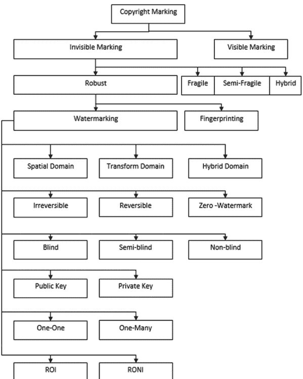
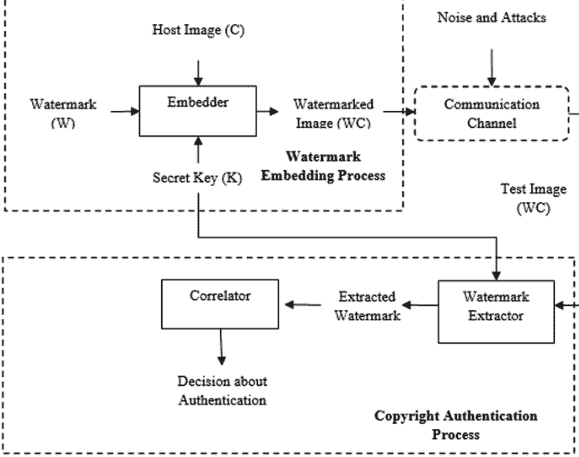
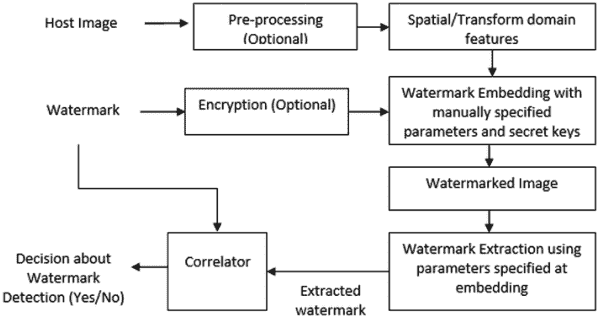
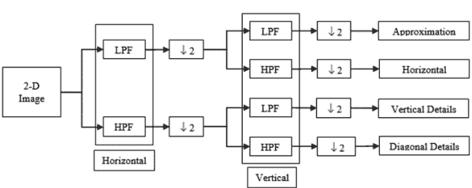
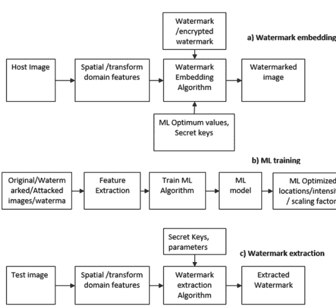
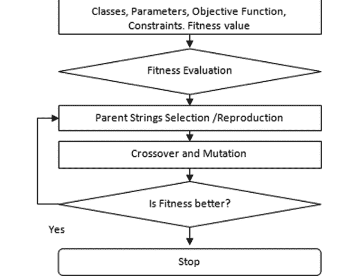
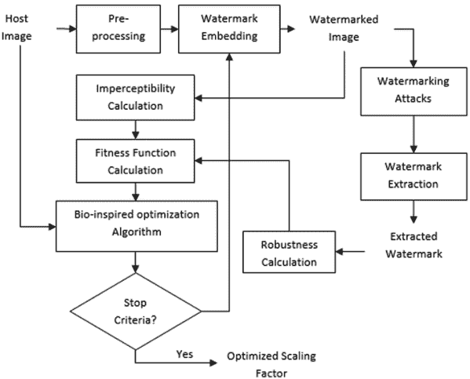
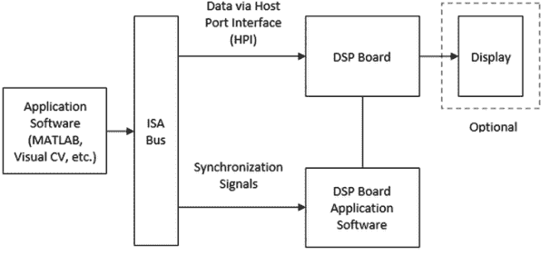
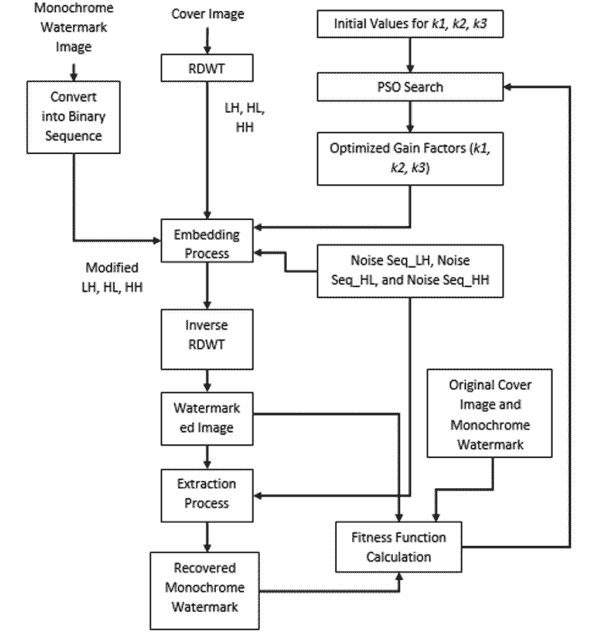
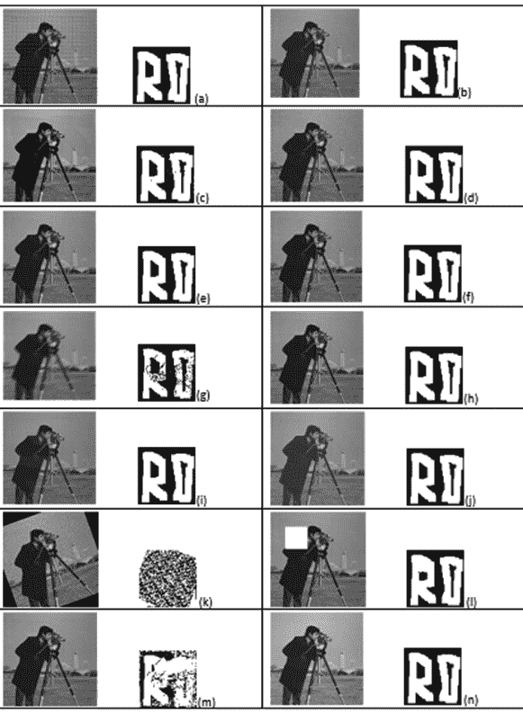

# 数字图像水印：理论与计算进展（智能信号处理与数据分析）


丛主

Nilanjan Dey 博士

信息技术系，

Techno India College of Technology, 印度西孟加拉邦, 印度

关于关于该的更多信息，请访问：https://www.crcpress.com/Intelligent-Signal-Processing-and-Data-Analysis/book-series/INSPDA

作者

Surekha Borra, Rohit Thanki 以及

Nilananjan Dey


访问 Taylor & Francis 网站

http://www.taylorandfrancis.com

访问 CRC Press 网站

http://www.crcpress.com

# 前序

在互联网时代，数字图像版权保护在网络出版、视频、在线广告、在线库、图书馆等领域起着重要作用。数字水印技术已被证明是解决所有权的有效方法，通过在图像中嵌入可见或不可的水的水，所有者能够使用秘密密钥对其进行检测和提取。尽管过去十年中开发了各种空间域和频域水印技术，但优化是所有工程领域常见的数学问题，包括数据安全。关于新型实现、机器学习和仿生水印算法的研究正在兴起。本书介绍了水印算法和硬件实现的先进设计，并特别关注优化方法。

本书由六章组成，完成了以下任务：

- 提供水印的广泛背景
- 提供各种独立和混合领域中新开发的机器学习水印技术的概述
- 提供水印优化问题解决方案的概述，特别关注仿生算法
- 涵盖水印的硬件实现
- 突出现有知识产权（IP）保护水印技术的创新、设计、进展和感兴趣的话
- 概述此类算法的不同应用、困难和挑战，以及未来的研究方向。

Surekha Borra

Rohit Thankani

Nilanjan Dey

MATLAB® 是 MathWorks, Inc. 的注册商标。有关产品信息请联系：

The MathWorks, Inc.

3 Apple Hill Drive

Natick, MA 01760-2098 USA

电话: 508-647-7000

传真: 508-647-7001

电子邮箱: info@mathworks.com

网址: www.mathworks.com

# 作者

Sureskha Borra 目前是印度班加罗尔 K. S. 学院的电子与通信工程系教授以及该学院首席研究协调员。她在印度海得拉巴德的贾瓦哈拉尔·内赫尔鲁技术大学获得图像版权保护领域的博士学位。她目前的研究兴趣包括图像和视频分析、机器学习、生物识别、生物医学信号和遥感感知。她已申请了 1 项印度专利；出版了 6 本书籍、12 章书籍章节；并在同行评审和索引期刊上发表了多篇研究论文。她曾获得专业机构和印度卡纳塔克邦政府颁发的多项研究资助和奖励。她因在图像版权保护方面的贡献获得了“青年女性成就奖”，因在教学和学术活动方面的贡献获得了“卓越教育者与学者奖”，并因其卓越的研究和创新贡献获得了印度工程师协会（印度）颁颁的“女性成就奖”。

Rohit Thanki 于 2017 年在印度古吉拉特邦瓦德瓦万市的 C. U. Shah 大学获得基于压缩感知理论和水印技术的多测量系统安全博士学位。他的研究领域是数字水印、生物识别系统、安全、压缩感知、模式识别和图像处理。他在同行和索引期刊上发表了 5 本书籍、7 章书籍章节和 25 多篇研究论文，并参加了国际和国家级会议。他的国际认可包括在相关组织和程序委员会中担任专业成员和职务，并担任电气电子工程师学会（IEEE）、Elsevier、Taylor & Francis、Springer 和 IGI Global 出版期刊的审稿人。

Nilanjan Dey 是印度加尔各答 Techno India 科技学院信息技术系的助理教授。他曾担任加利福尼亚全球生物医学技术公司的荣誉访问科学家，并是英国雷丁大学的成员。

Dey 博士与 Elsevier、Wiley、CRC Press、Springer 等机构合著或编辑了 40 多部书籍，并发表了 300 多篇研究文章。他是《环境计算与智能国际期刊》（International Journal of Ambient Computing and Intelligence, IGI Global）的主编辑。Dey 博士是 Springer 自然启发计算系列（Springer Nature）、《医疗保健无处感知应用进展》（Elsevier）以及《智能信号处理与数据分析》（CRC Press）的系列共同编辑。他还是 IEEE Access 的副编辑。

Dey 博士的主要研究兴趣包括医学成像、机器学习、数据挖掘等。他最近被评为2015–2017 年印度计算机科学领域发表和引用次数最高的 10 位学术学者之一。

- CSA 骆尾搜索算法

## 引言

每秒都有大量的数字信息（例如图片、录音、旋律和重要档案）在个人、组织和协会之间进行发布或交换。（注：原文中该段落存在大量重复，翻译已按要求保留核心含义并去重）。

# 数字水印

- **HNN** 霍夫菲尔神经网络
- **HPI** 主机端口接口
- **ISA** 行业标准架构
- **K** 密钥
- **LSB** 最低位
- **ML** 机器学习
- **NC** 归一化相关
- **NVF** 噪声可见性函数
- **PN** 伪随机噪声
- **PSNR** 峰值信噪比
- **PSO** 粒子群优化
- **RDWT** 冗余离散小波变换
- **ReLU** 线性整单元
- **SA** 模拟退火
- **SS** 扩展频谱
- **SSIM** 结构相似性指数
- **SVD** 奇异值分解
- **SVM** 支持向量机
- **SVR** 支持向量回归
- **TS** 禁忌搜索
- **VLSI** 超大规模集成
- **W** 水印
- **WPSNR** 加权 PSNR

## 引言

每秒都有大量的数字信息（例如图片、录音、旋律和重要档案）在个人、组织和协会之间进行发布或交换。（注：原文中该段落存在大量重复，翻译已按要求保留核心含义并去重）。

## 4 数字图像水印

隐写术确保了没有人知晓实体正在进行秘密通信，因此它适用于版权标记。相比之下，水印一直是一对多通信的一部分，被用于验证多媒体文件的所有者（Vellasques et al., 2010）。

虽然隐写术的目的是保护隐藏信息，但水印的目的是保护宿文件免受所有权/复制冲突。水印代表了文件的作者/所有者/购买者（Dew and Santhi, 2017; Borra et al., 2017, 2018）。与在文件末尾添加签名以确保作者身份（数字签名）不同，水印是将水印嵌入文件本身，从而保证了作者身份和数据完整性（Sherekar et al., 1999）。加密的目的是为了保护文件（机密性），而水印则试图保护数字文件的所有权（真实性）。一旦数据被解密，加密就无法进行复制控制，而水印即使在解密后仍能保护并控制复制控制数据（Borda, 2005; Sherekar et al., 1999）。

## 1.2 数字图像水印

图像往往容易被盗窃和版权侵权。在许多情况下，图像从网站被盗用用于用途/名声/财务利益，而正义未能伸张，导致所有者/发明者的损失。因此，需要识别并保护其所有者免受对手侵害的机制（Vellasques et al., 2010）。在数字时代之前，画家/摄影师/组织通常用签名、缩写或假名/印章对他们的艺术品/照片/设计签名，以帮助识别自己为图像的所有者，特别是在知识产权需要共享的情况下。水印是所有者对其图像进行签名并破坏攻击者努力的另一种方法。水印是放置在图像上的叠加图像/标志/文本，旨在识别图像的所有者。可见且相对容易复制的模拟水印已存在几个世纪。这些水印最早用于造纸厂，后来出现在货币和邮票上。

作为数字版权管理（DRM）系统的一部分，数字水印提供了在图像中表示/记录/隐藏版权所有者/分销者/分销链/购买者的机制，旨在为版权保护和法律执法案件提供证据（Mohanty et al., 2017）。存储/编辑/传输过程中的某些操作可能会扭曲、删除或以其他方式干扰水印。只有在水印技术达到令人满意的成熟程度，并通过标准化保证最低质量水平以及可证明的鲁棒性和安全水平后，通用接受和部署才成为可能。考虑到这一点，显而易见，我们正处于采用水印技术的中间阶段，致力于构建有效水印系统。

## 1.3 版权分类

数字图像版权标记技术可以分为许多类，如图1.1所示。分类时考虑了多种参数，例如要保护的图像类型、版权标记类型、嵌入域、标记的可感知性、原始文档的可逆性、版权标记的目的/应用、其用途以及版权验证时所需的密钥和数据类型。根据应用，要保护的宿图像可以是二值/半色图像、灰度/彩色图像、医学图像或高光谱图像。水印可以是随机二进制模式、信用卡号、图片、所有者的签名-标志、宿图像源或内容相关数据，所有这些都可以识别所有者/公司的版权信息。指示性水印通常是具有平滑/尖锐细节的二值。它们还可能包含一些文本信息。统计水印是通过不同的噪声生成的，例如伪随机噪声（PN）和白高斯噪声（WGN）。从这些噪声生成的二进制随机序列通常与水印相乘以生成统计水印。生成统计水印模式的另一种方法是使用补丁法，其中通过假设检验将宿图像中的像素差异与参考值进行比较。



图 1.1 数字图像版权标记技术的分类。

根据人类感知性，版权标记可以是不可见的/可见的/双重性的。可见水印作为标志嵌入在图像角处，警告内容的版权和所有权以进行内容保护（Qasim et al., 2018）。在图像中心放置可见水印可以防止剪裁，但会影响质量且不会让观众感到愉悦。今天，也可以使用机器学习技术将可见水印智能地放置在宿图像上，而不影响质量。不可见标记主要为法医/调查目的而设计，因为它们根据秘密密钥不可见且随机地放置在图像的任何像素位置或频率系数上。当需要身份验证、所有权验证或数据完整性校验时，可以相应地恢复它们。某些应用嵌入了不可见和可见水印以提高安全性。不可见标记有四种类型：鲁棒、半脆弱、脆弱和混合技术（Qasim et al., 2018）。

脆弱性标记将标记嵌入图像中不可察觉的部分，如果图像发生修改，标记将被破坏。实现脆弱性标记的简单方法是确保宿图像未被篡改并维护数据完整性。脆弱标记可以很容易实施和移除，不适用于证明所有权，但它们作为图像被修改的证据有用。半脆弱方法在鲁棒性方面受到限制，设计用于在授权的操作生存（如压缩）。由于这些方法区分了某些操作set，它们也被用于检查完整性。另一方面，混合方法是鲁棒和脆弱方法的结合，以实现更高水平的安全性，因为它们并行地实现所有权保护、数据完整性和身份验证（Qasim et al., 2018）。

鲁棒标记在安全应用中更受青睐，例如复制控制、广播监控和版权保护，因为这些标记能够抵抗广泛的攻击（Qasim et al., 2018）。鲁棒标记将标记嵌入在图像的重要部分，即使在图像发生修改/扭曲时，标记也不会被破坏，例如压缩、缩放、重采样、模拟转数字（A/D）和数字转模拟（D/A）转换、加性噪声、线性及非线性滤波、平移、剪裁和旋转等。由于相互冲突的需求（如隐藏能力、透明度和鲁棒性）之间的权衡，鲁棒标记技术的设计非常复杂且具有挑战性。尽管生存程度取决于应用，但理想目标是设计一种标记系统，使得只有通过破坏宿图像才能移除标记，这对于保护医学领域和国防相关的敏感图像非常有用（Dey et al., 2017; Biswas et al., 2013）。根据要保护的实体，鲁棒标记主要有两种类型。水印识别文件的版权所有者，而指纹识别识别允许/分发/非法复制宿图像的授权客户和/或违反许可协议。除非另说明，鲁棒水印是不可逆的。一种特殊类别可逆水印被设计为无损，因为这些标记是可逆的，原始水印可以恢复和或提取。另一方面，零水印在水印隐藏过程中不会影响宿图像的质量。

水印检测本身是许多输入的函数，例如测试图像、私钥或公钥、原始水印和原始宿图像。非对称/公钥水印允许所有者之外的任何人提取水印，通过限制移除水印的权限。另一方面，为了证明图像的所有权，使用私有水印，因为它们只能通过密钥进行检测（Mohanty et al., 2017）。

盲水印技术在提取水印时既不需要原始宿主图像也不需要水印，在许多应用中都非常灵活，包括图像认证、版权保护、隐蔽通信和电子投票系统。半盲技术不需要原始宿主图像，但在提取水印时需要原始水印或某些额外信息。内容隐私、图像认证和版权保护是半盲技术的若干应用。非盲技术在提取水印时需要原始宿主图像，而这种图像可能难以获取，因此在应用上受到限制。

根据水印嵌入的域，水印系统可分为空间域和变换域（Qasim et al., 2018）。这些技术旨在将水印直接插入到原始宿主图像的像素/变换分量的显著部分（如果该图像是灰度图），或者插入到亮度或相应的颜色分量中。虽然某些水印技术遵循一一映射，但许多现有技术采用块处理方式，在许多像素或变换系数上随机插入 1 比特水印。与替换技术相比，某些水印技术向宿主图像像素/变换系数添加缩放后的水印信息，同时最大限度地减少肉眼可见的失真。目前已采用机器学习或优化技术来确定适用于宿主图像的最佳且自适应缩放因子。

变换域方案计算较为复杂，但对信号处理攻击具有鲁棒性，是解决所有问题的正确选择。离散余弦变换（DCT）、离散小波变换（DWT）和奇异值分解（SVD）等变换由于在帧压缩标准中的应用以及频带的相对感知特性而被广泛采用（Thankanki et al., 2017）。在混合技术中，水印位被插入到通过两个或多个变换组合得到的宿主图像混合系数。另一方面，稀疏域技术将水印插入到从压缩感知（CS）理论获得的宿主图像稀疏测量中。

在传统水印方案中，使用涉及加法乘法的简单逻辑或数学方程将水印插入宿主图像指定的像素或频率系数中。在加法水印中，通过增益因子辅助插入宿主图像，如公式 1.1 所示。

$$WC = C+k\timesw$$

在乘法水印中，使用常数和权重因子插入水印，该因子再乘以宿主图像的像素信息或频率系数以获得水印图像，如公式 1.2 所示。

$$WC = C*(1+k\timesw)$$

另一方面，智能水印方案使用各种智能技术，如机器学习、深度学习、优化技术和生物启发算法，改进传统水印的结果（Dey et al., 2014）。机器学习和优化算法被广泛用于水印嵌入和/或提取过程。另一方面，生物启发和优化技术用于为水印嵌入选择宿主图像的最佳像素或频率系数。这些算法还用于在水印嵌入过程中自动寻找优化缩放因子。这与传统水印形成对比，传统水印使用用户定义的位置/缩放因子将水印位插入宿主图像中。

## 1.4 数字水印的通用框架

数字版权水印使我们能够将版权侵权者带上法庭，任何合法发布/销售的图像中嵌入的版权标记都会保留，并可以在任何副本中被提取。数字图像水印是将水印嵌入图像的质，以便在后期阶段提取它以检测所有者身份。图 1.2 显示了鲁棒隐形图像水印的通用框图。宿主是需要通过插入水印来保护的数字图像。水印可以是插入宿主中的与宿主具有相关性的的消息/标志/统计模式。数字图像水印的通用框架和版权认证过程由三个主要部分组成：（1）嵌入器，



图 1.2 数字图像水印的通用框图。

（2）提取器，以及（3）相关器。水印在插入宿主图像之前可能先进行加密。在这种情况下，提取出的水印在与原始水印比较之前必须经过解密，以对所有权做出断言。所有组件都可以是硬件单元或软件程序。

嵌入器 (E) 是宿主图像 (C)、密钥 (K) 和一个或多个水印 (W) 的函数。水印 W 可能是一个随机序列，或有意义的消息或图像（如标志或版权信息）。嵌入器输出水印图像 (WC)，使得 WC=E (C, K, W)。生成的水印图像 (WC) 可以存储、传输或发布。所有者必须提取水印以证明所有权。水印提取过程可能并不是嵌入的逆过程。提取器函数 (D) 密钥 (K)、测试图像 (T) 和/或原始非水印图像 (C) 以及原始水印 (W)，以检测水印 (W')，使得 W'=D (K, T, C, W)。测试图像可以是水印图像 (WC)、受攻击图像 (AC)、非水印图像 (C) 或其他未经授权的图像。检测出的水印 (W') 与原始水印相关以获得相似性评分，如果相似性超过预定义的阈值，则表明水印通过验证并认证。嵌入和提取过程中使用公钥/私钥对来实现机密性。嵌入器/提取器涉及的过程以及这些输入/输出随水印类型和应用而异。

# 12 数字图像水印

## 1.5 性能标准

图像水印的性能及其评估取决于若干因素，例如宿主图像的类型和应用。主观和客观分析有助于识别水印在宿主图像中的隐藏程度。任何隐形鲁棒水印技术的通用性能标准和基本要求如下文所示（Mohanty et al., 2017; Qasim et al., 2018）：

- 不可感知性/保真度：水印一旦插入宿主图像，必须在感知上是不可识别的。不可感知性是水印感知透明度的衡量，是隐形水印的重要要求。要求水印图像与其原始图像在统计上相似。不可感知性通常与水印大小和鲁棒性冲突。水印图像与原始/攻击图像的相似性通常通过结构相似性指数（SSIM）和峰值信噪比（PSNR）等指标计算（Kutter and Peticolas, 1999; Wang and Bovik 2002）。在某些特定应用中，要求宿主图像质量不下降，这使得数字水印的设计极其困难。

- 安全性：这指检测性和密钥限制。水印方案必须能够防止已知嵌入和提取算法的攻击者或冒充者对嵌入水印进行未经授权的检测和修改。数字水印必须足够安全。攻击者很难在不破坏覆盖图像的情况下移除水印的部分信息。

- 鲁棒性：水印图像会经历无意变换（如存储和传输过程中的压缩）以及故意攻击（如加密、删除、重采样、裁剪、几何和缩放攻击）。数字水印对不可见和指定攻击的抵抗力在水印技术中至关重要，主要取决于嵌入域和像素/系数的选择。在实践中，水印算法

- 可逆性：在医学领域等特定应用中，对图像进行细微修改可能会导致灾难性后果，这可能涉及法律影响。在这种情况下，必须根据需要严格检索原始图像。这些应用要求开发无损或可逆水印技术，以便在所有权确认后能够恢复原始图像。

## 1.6 指标


图像水印方案在不可感知性和鲁棒性方面的性能可以通过多种衡量指标进行衡量。为了衡量原始图像与水印图像之间感知失真的相似性，通常使用不可感知性指标如`PSNR`和加权`PSNR`（`WPSNR`）(Wang, 1999)；归一化相关（`NC`）和`SSIM`是衡量原始水印与提取水印之间相似性的常用指标。这些指标反映了提取水印的质量，还有助于分析水印技术在攻击存在下的鲁棒性 (Wang, 2017)。

公式 1.3 给出的`PSNR`以分贝为单位测量，它取决于均方误差（`MSE`），即原始图像与水印图像之间的误差。`MSE`使用公式 1.4 计算：

```
PSNR = 10 × log₁₀(255² / MSE)
```

```
MSE = (1 / (M × N)) Σ(x=0 to M-1) Σ(y=0 to N-1) (C(x,y) - WC(x,y))²
```

其中`C`分别代表原始图像和水印图像。`WPSNR`是一种用于计算水印图像不可感知性的新方法，如公式 1.5 所示：

```
WPSNR = 10 × log₁₀(255² / (NVF × MSE))
```

其中`NVF`是可见性函数，表示基于高斯模型的图像纹理信息。`NVF`的值处于`[0, 1]`区间。纹理区域的`NVF`值为 0，平坦区域为 1。`NVF`使用公式 1.6 计算：

```
NVF = NORM(1 / (1 + δ))
```

`δ`是计算块的亮度方差。`PSNR`和`WPSNR`的值越高表示不可感知性越好。如果`NC`和`SSIM`值接近 1，则任何图像水印方案的鲁棒性都很高 (Wang, 2017)。`NC`和`SSIM`分别使用公式 1.7 和 1.8 计算。`NC`衡量原始水印与提取水印之间的相关性，而`SSIM`衡量它们之间的结构相似性。

```
NC = Σ(x=1 to M) Σ(y=1 to N) w(x,y) × w*(x,y) / Σ(x=1 to M) Σ(y=1 to N) w²(x,y)
```

```
SSIM = ((2μ_w μ_w* + C₁)(2σ_ww* + C₂)) / ((μ_w² + μ_w*² + C₁)(σ_w² + σ_w*² + C₂))
```

`C₁`和`C₂`是常量，`w`和`w*`是原始水印和提取水印，`μ_w`和`μ_w*`是原始水印和提取水印的均值，`σ_ww`和`σ_ww*`代表原始水印和提取水印的协方差，`N`代表窗口数量。

## 1.7 针对水印的攻击

尽管网上有很多可用的水印算法和工具，但在处理攻击时，水印仍然是一项具有挑战性的任务 (Wang, 1999)。在水印术语中，攻击旨在移除水印痕迹以阻碍认证目标。了解攻击类型及其分析有助于在竞争环境中识别适用于特定应用的最佳工具。`Checkmark`、`Optark`和`StirMark`是一些评估开发的水印工具鲁棒性的软件 (Borra et al., 2017)。攻击通常分为移除攻击、几何攻击、加密攻击、协议攻击和安全攻击。

- **移除攻击**旨在通过刻意执行图像操作（如量化、有损压缩、平均化、调制、解调、碰撞攻击、块替换攻击、去噪和滤波）从水印图像移除水印。观察到，要执行调制攻击，攻击者首先必须使用各种滤波器（中值滤波器、高通滤波器和维纳滤波器）预测水印，然后将其从水印图像中减去，最后在其上添加高斯噪声。这通常被称为碰撞攻击。然而，作为马赛克攻击，攻击者将水印图像分割成小部分并尝试使用表格重新组合，其目的是移除插入的水印。

- **几何攻击**旨在通过在提取的水印和原始水印之间制造不同步来扭曲水印而非移除它。攻击者尝试从边缘裁剪图像，或随机删除/编辑/移动某些像素行或列，其目的是扭曲水印。这在提取水印时会产生同步问题。通常会组合使用攻击而非单一攻击。常见的几何攻击包括旋转、剪切、平移、仿射变换、缩放、比例变化、裁剪、列/行删除、抖动和随机弯曲。注意，这些攻击可以在局部或全局应用，并以系统或随机的方式进行。

- **协议攻击**旨在攻击水印应用本身，利用可逆水印的概念产生所有权的模糊。协议攻击对水印工具的设计提出了另一个要求：无法从实际上未标记的任何图像中提取水印。换句话说，误报率必须降到最低。此外，协议攻击利用了水印管理或实施过程中的漏洞。

- **复制攻击**旨在在不知道涉及密钥的情况下预测水印并将其复制到其他数据上。此外，开发与图像相关的水印是阻碍此类攻击的最佳解决方案。

- **法律攻击**试图在法庭上对水印的技术证据产生怀疑，同时证明所有权。

- **加密攻击**设想通过穷举搜索寻找密钥。

- **神谕攻击**旨在利用水印检测器从水印图像生成原始图像。

- **禁用攻击**旨在不影响水印存在的情况下，破坏水印与宿主之间的关系。

- **歧攻击**通过嵌入多个水印来误导检测器。在这种情况下，插入水印的顺序是模糊的。

| 序号 | 工具名称 | 数字图像水印工具 | 描述 |
|---|---|---|---|
| 01 | Umark Lite | | https://www.uconom.com/ |
| 02 | WMT | https://www.pearlmountainsoft.com/watermark/ | |
| 03 | WTMUS | https://www.pearlmountainsoft.com/watermark/ | |
| 04 | Water marque | https://www.watermarque.com/ | |
| 05 | Lunatic | http://www.196.lunatic.com/editor/ | |
| 06 | Visual mark | https://www.visualwatermark.com/ | |
| 07 | Mass water mark | https://www.masswatermark.com/ | |
| 08 | Water mark lib | http://download.net.com/WatermarkLib/3000-2192_4_10963794.html | |
| 09 | Alamoon | http://alamoon.com/ | |
| 10 | TSR water mark | 1-More water marker https://1-more-watermarken.softsonic.com/ | |
| 11 | Photo Watermark Professional | https://archive.org/details/tucows_25618.Photo_Watermark_Professional | |
| 12 | Fast water mark | https://fast-watermarken.softsonic.com/ | |
| 13 | Watermark Master | http://www.videocharge.com/Products/wm/main.php | |
| 14 | Watermark | https://www.watermark.ws/ | |
| 15 | Coolweak | http://www.coolweak.com/ | |
| 16 | Picture stamper | http://amin-ahmadi.com/picture-stamper/ | |
| 17 | Water mark passion | http://www.majorgeeks.com/mg/getmirror/watermark_passion.1.html | |
| 表 1.1 (续) | 序号 | 工具名称 | 数字图像水印工具 | 描述 |
| :--- | :--- | :--- | :--- | :--- |
| 19 | Easy watermark studio lite | http://www.easy-watermark-studio.com/easy-watermark-studio/lite-version.html | |
| 20 | Bytescout watermarking | https://bytescout.software.informer.com/products/enduser/download-watermarking/watermarks/ | |
| 21 | Snagit | https://snagitl.software.sourceforge.net/download-snagit-watermarking.net/ | |
| 22 | Jaco Watermark | http://jaco-watermark.com/ | |
| 23 | Star Watermark | http://www.star-watermark.com/ | |
| 24 | Arclab Watermark | https://www.arca.com/en/watermarkstudio/ | |
| 25 | Batch Watermark | http://batch-watermark.com/creator.software-informer.com/6.0/ | |
| 26 | Optimark | http://www.poseidon.csd.auth.gr/optimark/ | |
| 27 | StirMark | http://www.pettiticolas.net/fabien/stirmark/index.html | |

## 参考文献

Abdelhakim, Assem M., M. H. Saad, M. Sayed, and H. I. Saleh. “Optimized SVD-based robust watermarking in the fractional domain.” Multimedia Tools and Applications 1–23, 2018.

Biswas, Debalina, Debalina Debal, Deb,,,,,,,,,,,, and........... of of of. of of....,,,,,,,,,,,,,,,,,,,,,,,,,,,,.. of copyright protection and security, copyright.,,,,,,,,,,,,,,,,,,,.1.. International Conference on and Communications.

,,,,,,,,,..... of of frequency-based discrete wavelet transform. Computer Science, ,, 2013.

,, and, and. Multimedia Tools and Applications, 1–23, 2018.

,, and, and. of. Optimization of frequency-based discrete wavelet transform. Computer Science, and, and, 2013.

,, and, and. of. Optimization of frequency-based discrete wavelet transform. Computer Science, and, and, 2013.

,, and, and. of. Optimization of frequency-based discrete wavelet transform. Computer Science, and, and, 2013.


Optimization of frequency-based discrete wavelet transform. Computer Science, and, and and of and of and of and of and of and of and of and of and of and of and of and of and of and of and of and of and of and of and of and of and of and of and of and of and of and of and of and of and of and of and of and of and of and of and of. Springer, and and of and and of. University of California, Berkeley. Multimedia Tools and Applications, 1–23, 2018. Multimedia Tools and Applications, 1–23, 2018. Multimedia Tools and Applications, 1–23, 2018. Multimedia Tools and Applications, 1–23, 2018. Multimedia Tools and Applications, 1–23, 2018. Multimedia Tools and Applications, 1–23, 2018. Multimedia Tools and Applications, 1–23, 2018. Multimedia Tools and Applications, 1–23, 2018. Multimedia Tools and Applications, 1–23, 2018. Multimedia Tools and Applications, 1–23, 2018. Multimedia Tools and Applications, 1–23, 2018. Multimedia Tools and Applications, 1–23, 2018. Multimedia Tools and Applications, 1–23, 2018. Multimedia Tools and Applications, 1–23, 2018. Multimedia Tools and Applications, 1–23, 2018. Multimedia Tools and Applications, 1–23, 2018. Multimedia Tools and Applications, 1–23, 2018. Multimedia Tools and Applications, 1–23, 2018. Multimedia Tools and Applications, 1–23, 2018. Multimedia Tools and Applications, 1–23, 2018. Multimedia Tools and Applications, 1–23, 2018. Multimedia Tools and Applications, 1–23, 2018. Multimedia Tools and Applications, 1–23, 2018. Multimedia Tools and Applications, 1–23, 2018. Multimedia Tools and Applications, 1–23, 2018. Multimedia Tools and Applications, 1–23, 2018. Multimedia Tools and Applications, 1–23, 2018. Multimedia Tools and Applications, 1–23, 2018. Multimedia Tools and Applications, 1–23, 2018. Multimedia Tools and Applications, 1–23, 2018. Multimedia Tools and Applications, 1–23, 2018. Multimedia Tools and Applications, 1–23, 2018. Multimedia Tools and Applications, 1–23, 2018. Multimedia Tools and Applications, 1–23, 2018. Multimedia Tools and Applications, 1–23, 2018. Multimedia Tools and Applications, 1–23, 2018. Multimedia Tools and Applications, 1–23, 2018. Multimedia Tools and Applications, 1–23, 2018. Multimedia Tools and Applications, 1–23, 2018. Multimedia Tools and Applications, 1–23, 2018. Multimedia Tools and Applications, 1–23, 2018. Multimedia Tools and Applications, 1–23, 2018. Multimedia Tools and Applications, 1–23, 2018. Multimedia Tools and Applications, 1–23, 2018. Multimedia Tools and Applications, 1–23, 2018. Multimedia Tools and Applications, 1–23, 2018. Multimedia Tools and Applications, 1–23, 2018. Multimedia Tools and Applications, 1–23, 2018. Multimedia Tools and Applications, 1–23, 2018. Multimedia Tools and Applications, 1–23, 2018. Multimedia Tools and Applications, 1–23, 2018. Multimedia Tools and Applications, 1–23, 2018. Multimedia Tools and Applications, 1–23, 2018. Multimedia Tools and Applications, 1–23, 2018. Multimedia Tools and Applications, 1–23, 2018. Multimedia Tools and Applications, 1–23, 2018. Multimedia Tools and Applications, 1–23, 2018. Multimedia Tools and Applications, 1–23, 2018. Multimedia Tools and Applications, 1–23, 2018. Multimedia Tools and Applications, 1–23, 2018. Multimedia Tools and Applications, 1–23, 2018. Multimedia Tools and Applications, 1–23, 2018. Multimedia Tools and Applications, 1–23, 2018. Multimedia Tools and Applications, 1–23, 2018. Multimedia Tools and Applications, 1–23, 2018. Multimedia Tools and Applications, 1–23, 2018. Multimedia Tools and Applications, 1–23, 2018. Multimedia Tools and Applications, 1–23, 2018. Multimedia Tools and Applications, 1–23, 2018. Multimedia Tools and Applications, 1–23, 2018. Multimedia Tools and Applications, 1–23, 2018. Multimedia Tools and Applications, 1–23, 2018. Multimedia Tools and Applications, 1–23, 2018. Multimedia Tools and Applications, 1–23, 2018. Multimedia Tools and Applications, 1–23, 2018. Multimedia Tools and Applications, 1–23, 2018. Multimedia Tools and Applications, 1–23, 2018. Multimedia Tools and Applications, 1–23, 2018. Multimedia Tools and Applications, 1–23, 2018. Multimedia Tools and Applications, 1–23, 2018. Multimedia Tools and Applications, 1–23, 2018. Multimedia Tools and Applications, 1–23, 2018. Multimedia Tools and Applications, 1–23, 2018. Multimedia Tools and Applications, 1–23, 2018. Multimedia Tools and Applications, 1–23, 2018. Multimedia Tools and Applications, 1–23, 2018. Multimedia Tools and Applications, 1–23, 2018. Multimedia Tools and Applications, 1–23, 2018. Multimedia Tools and Applications, 1–23, 2018. Multimedia Tools and Applications, 1–23, 2018. Multimedia Tools and Applications, 1–23, 2018. Multimedia Tools and Applications, 1–23, 2018. Multimedia Tools and Applications, 1–23, 2018. Multimedia Tools and Applications, 1–23, 2018. Multimedia Tools and Applications, 1–23, 2018. Multimedia Tools and Applications, 1–23, 2018. Multimedia Tools and Applications, 1–23, 2018. Multimedia Tools and Applications, 1–23, 2018. Multimedia Tools and Applications, 1–23, 2018. Multimedia Tools and Applications, 1–23, 2018. Multimedia Tools and Applications, 1–23, 2018. Multimedia Tools and Applications, 1–23, 2018. Multimedia Tools and Applications, 1–23, 2018. Multimedia Tools and Applications, 1–23, 2018. Multimedia Tools and Applications, 1–23, 2018. Multimedia Tools and Applications, 1–23, 2018. Multimedia Tools and Applications, 1–23, 2018. Multimedia Tools and Applications, 1–23, 2018. Multimedia Tools and Applications, 1–23, 2018. Multimedia Tools and Applications, 1–23, 2018. Multimedia Tools and Applications, 1–23, 2018. Multimedia Tools and Applications, 1–23, 2018. Multimedia Tools and Applications, 1–23, 2018. Multimedia Tools and Applications, 1–23, 2018. Multimedia Tools and Applications, 1–23, 2018. Multimedia Tools and Applications, 1–23, 2018. Multimedia Tools and Applications, 1–23, 2018. Multimedia Tools and Applications, 1–23, 2018. Multimedia Tools and Applications, 1–23, 2018. Multimedia Tools and Applications, 1–23, 2018. Multimedia Tools and Applications, 1–23, 2018. Multimedia Tools and Applications, 1–23, 2018. Multimedia Tools and Applications, 1–23, 2018. Multimedia Tools and Applications, 1–23, 2018. Multimedia Tools and Applications, 1–23, 2018. Multimedia Tools and Applications, 1–23, 2018. Multimedia Tools and Applications, 1–23, 2018. Multimedia Tools and Applications, 1–23, 2018. Multimedia Tools and Applications, 1–23, 2018. Multimedia Tools and Applications, 1–23, 2018. Multimedia Tools and Applications, 1–23, 2018. Multimedia Tools and Applications, 1–23, 2018. Multimedia Tools and Applications, 1–23, 2018. Multimedia Tools and Applications, 1–23, 2018. Multimedia Tools and Applications, 1–23, 2018. Multimedia Tools and Applications, 1–23, 2018. Multimedia Tools and Applications, 1–23, 2018. Multimedia Tools and Applications, 1–23, 2018. Multimedia Tools and Applications, 1–23, 2018. Multimedia Tools and Applications, 1–23, 2018. Multimedia Tools and Applications, 1–23, 2018. Multimedia Tools and Applications, 1–23, 2018. Multimedia Tools and Applications, 1–23, 2018. Multimedia Tools and Applications, 1–23, 2018. Multimedia Tools and Applications, 1–23, 2018. Multimedia Tools and Applications, 1–23, 2018. Multimedia Tools and Applications, 1–23, 2018. Multimedia Tools and Applications, 1–23, 2018. Multimedia Tools and Applications, 1–23, 2018. Multimedia Tools and Applications, 1–23, 2018. Multimedia Tools and Applications, 1–23, 2018. Multimedia Tools and Applications, 1–23, 2018. Multimedia Tools and Applications, 1–23, 2018. Multimedia Tools and Applications, 1–23, 2018. Multimedia Tools and Applications, 1–23, 2018. Multimedia Tools and Applications, 1–23, 2018. Multimedia Tools and Applications, 1–23, 2018. Multimedia Tools and Applications, 1–23, 2018. Multimedia Tools and Applications, 1–23, 2018. Multimedia Tools and Applications, 1–23, 2018. Multimedia Tools and Applications, 1–23, 2018. Multimedia Tools and Applications, 1–23, 2018. Multimedia Tools and Applications, 1–23, 2018. Multimedia Tools and Applications, 1–23, 2018. Multimedia Tools and Applications, 1–23, 2018. Multimedia Tools and Applications, 1–23, 2018. Multimedia Tools and Applications, 1–23, 2018. Multimedia Tools and Applications, 1–23, 2018. Multimedia Tools and Applications, 1–23, 2018.


# 26 数字图像水印

噪声在保持透明度和安全性的同时，对于复制控制、交易追踪和图像所有权证明是必须的。三十年来，研究人员和开发人员一直在该领域开发算法、架构和系统，以获得最佳结果。

本章讨论了各种传统的和基于机器学习（ML）的数字图像水印算法，并对比了近期的一些工作，以定义未来研究中需要考虑的挑战。本章从基于空间域的水印方法开始，接着是变换域技术，最后以基于 ML 算法概念的进阶水印技术结束。

## 2.1 引言

在当今的电子时代（主要包括电子商务、电子银行、电子健康和在线学习），信息可以在不经所有者许可的情况下被有效下载。偶尔，这些情况会产生问题，例如版权安全和所有者验证。在这些情况下，在高级信息通过开源传输介质进行交换之前，需要对其进行保保证和验证。为了解决这些问题，分析人员提出了不同的信息隐藏策略：密码学、隐形术和水印术。水印主要用于信息的保保证和验证。这种方法通过将水印嵌入到宿主内容中，使得即使是基础客户端也找不到隐藏的水印，从而克服了隐形术的限制（Borra and Lakshmi, 2015）。如第1章所述，水印框架包含三个部分：水印嵌入器；对应信道（可能是有线或无线的）；以及水印提取器。水印嵌入器将水印嵌入宿主图像中以生成带水印图像，而水印提取器则从测试图像中提取水印，测试图像可以是受攻击或未受攻击的水印图像。

在此回顾了数字图像水印的主要要求：

- 1. 鲁棒性（Robustness）：水印技术必须保护所有者数据免受任何操纵，并且必须具有鲁棒性。
- 2. 不可感知性（Imperceptibility）：将水印插入宿主数据后，宿主数据的视觉质量不应受到很大影响；也就是说，水印不应该是可察觉的。
- 3. 嵌入容量（Embedding capacity）：水印技术应该允许隐藏大型水印（Banerjee, 2015）。

水印技术主要在两个处理领域开发：空间域和变换域（Borra and Lakshmi, 2015）。空间域技术易于实现，但由于宿主图像像素被直接修改，提供的不可感知性较低。变换域水印较为复杂，但提供了比空间域水印更强的鲁棒性。在所有变换域技术中，在嵌入水印之前，使用各种离散余弦变换（DCT）和离散小波变换（DWT）将宿主图像转换为频率域（Dey et al., 2012），随后对图像进行逆变换。传统数字图像水印方案的框架如图2.1所示。在空间域水印中，通过改变最有效位（LSBs）或添加各种噪声序列直接修改宿主图像。在变换域水印中，水印被嵌入到选定的域系数中（Hartung and Kutter, 1999; Bender et al., 1996; Surekha and Swamy, 2011; Ashour and Dey, 2017; Thanki and Kothari, 2017）。

在嵌入水印之前对宿主图像进行预处理有助于我们提取更好的特征用于水印嵌入，并获得更好的性能。



图 2.1 传统数字图像水印框架。

归一化、分割和特征提取是常见的预处理技术。图像归一化可以提高对光照变化和尺度变数的鲁棒性。分割和特征提取可以实现对故意攻击（如几何形变）的高鲁棒性。诸如高斯混合模型（GMM）、期望极大算法（EM）、均值漂移分割、墨西哥波尺度交互、尺度不变特征变换（SIFT）和差分高斯（DoG）等技术可以抵抗旋转、平移、缩放、低通滤波、中值滤波、高斯噪声、JPEG压缩等攻击。水印术可以用于对所有者的身份验证。

## 2.2 空间域水印

这些技术主要指在空间域中开发的水技术。空间域技术支持嵌入高容量水印。本节讨论了多种技术。

### 2.2.1 最有效位替换技术

LSB 替换技术是一种基础水印技术，通过修改位来实现（Lee and Chen 2000; Chen, 2004; Ramalingam, 2011）。在 8 位图像中，最有效位（位 7）包含大部分信息，而最有效位（位 0）不包含视觉信息。因此，选择最有效位用于水印目的。例如，在彩色图像中嵌入水印时，将位分组。第一组插入 R 通道 G 通道的 LSB，第二组插入 B 通道，组合这些通道生成带水印图像。该技术的主要优势是嵌入水印后宿主数据的视觉质量不会受到影响；普通人无法观察到这些修改。该技术的局限性是这样嵌入的水印是脆弱的。

### 2.2.2 Patch 技术

Patchwork（Bender et al., 1996）利用某些统计数据生成随机模式并将其嵌入图像中（Durvey and Stayarthi, 2014; Soman, 2010），以对丢性压缩和添加噪声具有鲁棒性。该技术只能在图像中嵌入小型水印。对于每个水印位，考虑一组块。为了隐藏 1，增加一个块的强度并按固定因子 α减少另一个块的强度。如果水印位为 0，则不更改任何块。块的位置取决于密钥。检测水印时，计算块对之间的平均差和并与阈值比较。块的位置被保密，假设图像数据具有某些属性，通过平均两个子集之间的差异可以轻松定位水印。

### 2.2.3 纹理映射编码技术

该技术用于富纹理信息的图像版权保护（Datta and Nath, 2014）。首先将宿主图像分割为两个区域：纹理区域和非纹理区域。随后，使用任何空间域水印嵌入程序修改纹理区域的像素，然后与宿主图像的非纹理区域组合获取带水印图像。在提取过程中，首先将带水印图像分为非纹理区域和纹理区域。然后，通过反转操作，从水印纹理区域恢复水印。

### 2.2.4 预测编码技术

该技术由 Matsui 和 Tanaka 针对灰度图像设计实现（Matsui, 1998）。在该技术中，计算相邻像素之间的相关性。水印由一组嵌入的像素生成，每隔像素通过相邻像素之间的差异进行修改。这些技术比最低位（LSB）替换技术更健健（Pandhwal and Chaudhary, 2013; Saxena et al., 2015）。

### 2.2.5 加法水印技术

传统的水印方法是使用 M 序列/伪随机 PN 序列顺序或随机地修改宿图像的块。PN 序列的使用由于其优异的相关性，允许对水印进行盲检测。这些方法利用 PN 序列将缩放后的水印以加法方式嵌入宿图像中（Langelaar et al., 2000; Arena et al., 2000; Shoemaker, 2002）。由于这些序列的幅度较小，它们以一种不可感知的方式影响像素值。在需要时，使用种子生成随机序列，该种子作为密钥。一个序列用于插入水印位 0，另一个用于水印位 1。通过以下步骤将水印插入宿图像中：

- 1. 提取宿图像并将其划分为块。块的大小取决于水印和宿图像的大小。
- 2. 使用密钥生成两个高度不相关的噪声序列。
- 3. 使用这些噪声序列和水印创建水印掩码，如下：
  - 如果水印位为零，则用一种噪声序列填充掩码；否则，用另一种噪声序列填充掩码。
  - 对宿图像的所有块重复此过程。
- 4. 利用增益因子，通过下方的加法水印方程将生成的水印掩码添加到宿图像中。

```
$$WI(x,y) = I(x,y) + k \times W(x,y) \quad (2.1)$$
```

其中 $WI(x, y)$ 代表水印图像，$I(x, y)$ 代表宿图像，$k$ 代表增益因子，$W(x, y)$ 代表水印掩码。

使用以下步骤从带水印的数据中提取加法水印：

- 1. 将带水印的数据划分为块，保持块的大小与 PN 序列的大小相同。
- 2. 计算带水印数据的每个块与每个噪声序列之间的相关性。
- 3. 使用以下两个条件提取水印：
  - 如果对应噪声序列 1 的相关性结果高于对应噪声序列 0 的相关性结果，则将水印设为 1。
  - 否则，将水印位设为 0。
- 4. 对带水印图像的所有块重复此过程以提取水印。

### 2.2.6 其他空间域水印技术

在加法水印技术中，水印块被顺序选择以隐藏水印位，因此对许多攻击不具健壮性。在基于扩展谱的水印技术中，水印位是随机分布的，甚至可以反复嵌入整个宿图像中，以增加安全性和对攻击的健壮性。基于局部二值模式（LBP）的水印长于抵抗光照变化和对比度变化。宿图像被分为不重叠的区域。区域内的每个像素都与中心像素进行比较，产生一个二值矩阵，该矩阵进一步用于水印嵌入。由于基于 LBP 的方法只能抵抗少数攻击，其应用仅限于脆弱性水印。水印甚至可以通过修改或移动图像的局部或全局直方图来隐藏，而不影响其形状。然而，这些方法仅支持较小的水印。

对于彩色宿图像，可以考虑对蓝色分量进行水印处理以保持不可感知性。其他新型水印数据方法包括基于分形的方法（Essouabi and Ibnelhaj, 2009; Raghavendra and Cheetan, 2009）以及基于几何特征的水印（Hussein and Mohammed, 2009）。在这里，找到图像中的显著点，并根据代表水印的随机生成的稠密线模式进行扭曲。检测过程确定是否有大量点位于线模式的附近。

## 2.3 变换域中的水印技术

DFT（离散傅里叶变换）将任何数字函数转换为其频率系数。在数字信号或图像处理中，本质上是非周期的函数可以用正弦和/或余弦值的积分来表示。这些值构成了函数的傅里叶系数。这种变换对于各种几何操作（如旋转、缩放和平移 RST 以及裁剪）具有健壮性。DFT 允许使用其傅里叶系数在频率域内对任何函数进行分析和处理。有许多基于 DFT 的水印方法（Ramkumar et al., 1999; Deguillaume et al., 1999; Lin et al., 2001; Solachidis and Pitas, 2001; Solachidis and Pitas, 2004; Potdar et al., 2005; Hendrix et al., 2008; Kaushik, 2012; Ansari et al., 2012）。基于 DFT 的简单方法涉及在宿图像上应用 DFT，并根据水印或加密水印以及增益因子私有密钥使用加法水印方法对其系数进行修改。在获得修改后的 DFT 系数后，应用逆 DFT 获取带水印图像。在提取过程中，遵循水印嵌入的逆过程，从带水印图像中恢复水印。这种方法可以被设计为非盲的，并可以使用加密技术（如阿诺尔德混圈 Arnold scrambling）来保护水印。

使用 DFT 的另一种替代方法是将宿图像划分为不重叠的块。然后对宿图像的块应用 DFT 以获得 DFT 系数，根据 PN 序列和水印对系数进行修改。对宿图像的块应用逆 DFT 以获得带水印图像。在提取时，执行带水印图像与 PN 序列之间的相关性以提取水印。这是一种盲方法，比第一种方法具有更好的健壮性。许多将 DFT 与其他变换（如 DCT 和 DWT）的水的水印已被开发出来，以提高不可感知性和健壮性（Ansari et al., 2012）。基于 DFT 的水印对几何攻击（如 RST）具有健壮性。缺点是数据形式较为复杂。

## 2.4 离散余弦变换中的水印

DCT（离散余弦变换）是一种线性变换，将 $n \times n$ 大小的图像映射到另一个 $n \times n$ 大小的矩阵，其元素代表图像的分布和频率（Langelaar et al., 2000; Arena et al., 2000; Hernandez et al., 2000; Lu and Liao, 2001; Shoemaker, 2002; Huang and Guan, 2004; Preda and Vizireanu, 2007; Sridevi et al., 2010; Ding et al., 2010）。其中 DC 系数位于矩阵的左上角，包含非常重要的信息。DC 系数是整数并代表图像的平均颜色。AC 系数可能是整数。图2 显示图像的 DCT 分布。

图像中的重要信息位于低频 DCT 系数中。高频 DCT 系数代表图像的锐利细节，很容易被模糊和高斯噪声攻击消除。因此，对于健壮水印，使用了中频 DCT 系数。文献中在 DCT 域嵌入水印有两种主要方法：(1) 中频 DCT 比较（Langelaar et al., 2000; Shoemaker, 2002）和 (2) 给中频 DCT 系数添加 PN 噪声序列（Langelaar et al., 2000; Shoemaker, 2002）。两种方法都是盲的，提取水印不需要原始宿图像，并广泛用于多媒体数据的保护（Langelaar et al., 2000; Shoemaker, 2002）。另一种方法是考虑一组较大的 DCT 系数进行修改。在非盲方法中，DCT 根据以下步骤修改宿图像的系数，以生成水印图像：

- 1. 计算宿图像的大小。
- 2. 对宿图像应用正向 DCT 以得到其 DCT 系数，如下：

```
$D = DCT(I) \quad (2.2)$
```

其中 $D$ 代表宿图像的 DCT 系数。

- 3. 计算水印的大小。
- 4. 使用下方的方程将水印插入到宿数据的 DCT 系数中。

```
$D'_{x,y} = D_{x,y} + k \times w_{x,y} \quad (2.3)$
```

其中 $D'$ 是修改后的 DCT 系数，$w$ 是水印，$k$ 是增益/缩放因子。

- 5. 对修改后的 DCT 系数应用反向 DCT 以获得水印数据。

```
$WI = IDCT(D') \quad (2.4)$
```

其中 $WI$ 是水印图像。

DCT 域中基本水印提取过程的步骤所示。

- 1. 计算水印图像的大小。
- 2. 对水印图像应用正向 DCT 以得到其 DCT 系数。

```
$D' = DCT(WI) \quad (2.5)$
```

其中 $D'$ 代表水印图像的 DCT 系数。

- 3. 使用下方的方程从水印图像的 DCT 系数中提取水印。

```
$w'_{x,y} = (D'_{x,y} - D_{x,y}) / k \quad (2.6)$
```

其中 $w'$ 是提取出的水印。

嵌入在 DCT 中频系数中的水印对常见攻击具有鲁棒性，但支持的载荷要小得多。虽然嵌入在高频中的水印对滤波/模糊攻击不鲁棒，但它们可能更适用于脆弱水印。DCT 对 JPEG 压缩具有鲁棒性。基于 DCT 的技术对仿射和几何攻击（如偏移、裁剪、旋转和剪切）的鲁棒性较差。文献中几种基于 DCT 和其他变换结合的混合水印方法（Huang and Guan, 2004）。这些方法主要设计用于提高不可感知性和鲁棒性，而这是使用单一 DCT 方法方法无法实现的。

## 2.5 离散小波变换中的水印

在许多图像处理应用（如数据压缩、水印和数据融合）中，由于其多分辨率能力和空间分辨率特性，DWT 起挥着非常重要的作用。DWT 易于实现且计算快速。图像通过 DWT 分解转换为四个子带：近似子带（LL）、水平子带（HL）、垂直子带（LH）和对角线子带（HH）。图 2.3 显示了小波分解步骤。

在基于 DWT 的水印方法中（Ejima and Miyazaki, 2000; Serdean et al., 2002; Raval and Rege, 2003; Fan and Yanmei, 2006; Elbasi, 2007; Essouabi and Ibnelhaj, 2009; Raghavendra and Chen, 2009; Mostafa et al., 2009），根据水印和增益因子修改宿图像的小波子带系数。

在鲁棒且不可见的水印算法中，首先将宿图像划分为互不重叠的块，然后应用 DWT 获取宿图像块的小波系数。然后选择一个或多个小波子带系数，使用与 DCT 非常相似的方法进行修改以嵌入水印。对修改后的系数与其他未修改的系数一起应用反向 DWT 以获得水印图像。在提取端，可以根据嵌入类型，使用秘密密钥和缩放因子以盲目或非盲的方式提取水印。

图像中最重要的信息位于近似子带，较不重要的信息分布在其他小波子带中。基于 DWT 的方法能够抵抗低通滤波和中值滤波，但对几何攻击不鲁棒。尽管有许多基于 DWT 的混合方法，但 DWT 与 SVD 的结合在研究社区被广泛使用且最受欢迎。对于脆弱水印，可以选择宿图像的 LL 子带进行嵌入，缺点是不可感知性差。



图 2.3 图像的基本小波分解。

## 2.6 使用奇异值分解的水印技术

奇异值分解 (SVD)（Thakkar and Srivastava, 2017; Su et al., 2013; Kamlakar et al., 2012; Gupta and Raval, 2012; Mansouri et al., 2009; Santhi and Thangavelu, 2009; Rajab et al., 2008; Dili and San, 2014）是一种基于线性代数的数值技术，用于对角化信号（基于稀疏性理论（Sheikh and San, 2007; Ganic and Eskğlu, 2004）。对大小为 $M \times N$ 的数据应用 SVD 会得到三个矩阵：$U, V$ 和 $S$。$U$ 和 $V$ 是称为矩阵，大小为 $M \times N$；$S$ 是对角矩阵，大小为 $M \times N$。奇异矩阵在水印中起着重要作用，其元素按顺序排列，奇异值非常稳定。文献中存在多种基于 SVD 的混合水印方法。在这些方法中，根据 DCT修改宿图像的奇异值。在鲁水印方法中，根据增益因子修改宿图像的奇异值。使用 SWT 时，对互不重叠的块进行修改以嵌入水印。在提取端，可以根据嵌入类型，使用秘密密钥和缩放因子以盲目或非盲的方式提取水印。基于 SVD 的方法的局限性是它们仅适用于高对比度图像。

## 2.7 压缩感知与分解方法


2005 年，人员引入了一种基于信号稀疏性的信号处理理论。该理论被称为压缩感知（CS）（Dono, 2006; Candes, 2006; Baraniuk, 2007），其在水印中的应用通过为传统水印方法增加两个过程——基于 CS 的加密和解密来提供安全性。压缩感知应用于图像的必要条件是图像在其所在域内是稀疏的。因此，首先使用图像变换（如 DFT、DCT、DWT 和 SVD）将水印转换为稀疏系数，以生成水印的稀疏系数。在嵌入前加密水印的缺点增加了计算时间。该技术主要用于多媒体数据的所有权认证和检测（Sheikh and Baraniuk, 2007; Valenzise et al., 2011; Zhang et al., 2009; Raval et al., 2011; Fakhr, 2012; Tiesheng et al., 2013; Thanki et al., 2017, 2018）。压缩感知理论可以在嵌入水印之前用于加密宿图像。

QR 分解将矩阵分解为正交矩阵和一个三角矩阵。实数方矩阵 A 的 QR 分解表示为 $A = QR$，其中 Q 是正交矩阵（即 $Q^TQ=I$），R 是上三角矩阵。如果 A 是非奇异的，则这种分解是唯一的。通过 QR 分解获得的矩阵具有以下两个重要特征（Wang et al., 2016）：

- R 矩阵第一行元素的值大于其他行元素的值，表明第一行具有更高的能量，因此 R 矩阵决定了原始图像的性质。
- Q 矩阵第一列元素的值代表了矩阵值之间的关系。因此，它们可以提供针对常见攻击的鲁棒性。因此，在基于 QR 分解的水印技术中，可以将水印插入到 Q 矩阵第一列的元素中（Su et al., 2014, 2017; Wang et al., 2016; Rasti et al., 2016; Mehta et al., 2016; Laur et al., 2015; Han et al., 2012; Mitra et al., 2012; Song et al., 2011; Naderahmian and Hosseini-Khayat, 2010）。

## 2.8 基于 SCHUR 分解的水印

Schur 分解（Van Loan, 1996）当应用于实矩阵 $A$ 时，会产生两个矩阵 $U$ 和 $D$，使得 $A = U \times D \times U^T$，其中 $U$ 是正交矩阵，$D$ 是上三角矩阵。$D$ 矩阵对角线上有实特征值。这种分解大约需要 $8n^{3/2}$ 次计算操作，少于 SVD 分解所需的计算（约 $11n^3$）。$U$ 矩阵的特征是前两列的所有元素具有相同的符号和数值。$U$ 矩阵的这一属性被用于水印的嵌入过程。因此，可以使用这种分解轻松设计盲水印方法。基于 Schur 分解的水印（Li et al., 2017; Rajab et al., 2015; Meenakshi et al., 2014; Razaafindradina et al., 2013; Gunjan et al., 2012; Mohammad, 2012; Su et al., 2012; Chaudhary et al., 2012; Mohan et al., 2011; Mohan and Swamy, 2010; Seddik et al., 2009）与所有其他水印方法相比具有较高的透明度，但实现起来更为复杂。

## 2.9 水印中的 HESSENBERG 矩阵因子

Hessenberg 分解（Van Loan, 1996）是一种矩阵分解方法。矩阵 $B$ 被分解为正交矩阵 $U$ 和 Hessenberg 矩阵 $H$，使得 $U \times H \times U^T = B$，其中 $U^T$ 是正交矩阵的共轭转置。这种分解大约需要 $14n^{3/3}$ 次计算操作，高于 Schur 分解所需的计算操作，但少于 SVD 分解。Hessenberg 矩阵因子用于水印是为了确保随机化过程是完全可逆的（Su and Chen, 2017; Singh et al., 2017; Su, 2016; Bhatnagar and Wu, 2013; Bhatnagar et al., 2010）。使用这种分解的水印实现较为复杂，研究人员探索也较少。

## 2.10 可见与不可逆水印

可见水印是一种常用的水印方法，主要用于内容认证或所有权识别。在这种方法中，水印可见地叠加在宿主介质的部分区域（Biswas et al., 2013）。图 2.4 展示了使用现有技术生成的两个可见水印图像（Thanki et al., 2011, 2017）。可见水印的缺点是它们会给宿主图像带来退化。

不可逆水印是水印的一种特殊情况。在接收端可以完全恢复原始宿主介质，这在传统水印中是不可能的。一般而言，任何不可逆水印都分三步实现：水印嵌入、水印提取和宿主介质恢复（Lakshmi and Surekha, 2016; Chakraborty et al., 2014; Pal et al., 2013）。所有这些过程都需要密钥来确保水印的安全。图 2.5 显示了不可逆水印的框图。注意，在提取水印后，还有最后一步，即图像恢复。该算法的输入是水印图像，输出是原始水印。


图 2.4 可见水印图像。


图 2.5 不可逆水印的框图。

## 2.11 基于机器学习的图像水印

传统水印的主要挑战是在感知性、鲁棒性、容量和安全性之间取得平衡。机器学习与水印相结合时，可以为权衡问题找到最优解。机器学习通过不同的分类和模式识别算法从输入数据中自动预测输出值，否则这是一个耗时的过程。机器学习从经验中学习来完成任务。

监督学习模型基于已知输入输出预测未来输出。它们使用分类和回归方法来开发预测模型。常见的监督机器学习算法有决策树、支持向量机（SVM）、神经网络、朴素贝叶和线性回归。分类方法通常用于离散数据的预测，而回归方法用于模拟数据。无监督学习算法使用聚类方法对数据进行分类。

人工神经网络（ANN）训练系统记忆特定场景，并根据所学内容对新输入产生输出。ANN 基于人工神经元的连接和层（输入层、输出层以及多个隐藏层）来解决问题。基于神经网络的技术训练缓慢且容易导致过拟合，精度限于最小二乘误差。因此，更先进的机器学习算法如极速学习（ELM）、支持向量回归（SVR）和 SVM 被用于智能水印。这些算法克服了过拟合问题，性能优于基于梯度的学习算法。SVM 和 SVR 通过将问题视为凸优化问题来估计高精度非线性函数，从而避免陷入局部最优解。

最近机器学习的大部分工作转向使用概率神经网络（PNN），它由四层节点组成：输入层、模式层、求和层和输出层。PNN 的训练通过生成模式节点、将其连接到目标类别的求和节点并将输入向量赋予权重向量来实现。PNN 是一种监督学习网络，使用径向基函数和贝叶斯方法进行分类。

由特征检测层和分类隐藏层组成。特征检测层对输入数据执行三类操作：卷积、池化和修正线性单元（ReLU）。卷积将输入数据通过一组卷积滤波器，其中每个滤波器作用于输入数据的某些特征。池化过程通过执行非线性下采样来简化输出值。这一过程减少了网络需要学习的输出值数量。ReLU 用于将负值映射为零，并只允许正值通过。这三种操作在许多层中重复，每层都学习从输入数据中提取不同的特征。特征提取之后紧跟着是分类层，其中一层是全连接的并输出一个 $k$ 维输出向量，其中 $k$ 代表网络预测的输入类别数量。该向量具有每个输入类别被分类的概率。CNN 架构的最终层使用分类函数产生分类输出。

上述所有机器学习算法及其他算法通过以下四种不同方法，提高了不可感知性和鲁棒性，从而提升了传统水印技术的性能：

- **类型 I**：在这种方法中，使用机器学习算法来优化值，目标是通过选择嵌入水印的最佳位置、强度或缩放因子，来保持水印图像的隐性和质量。该方法的广义框图如图 2.6 所示。
- **类型 II**：在这种方法中，如图 2.7 所示，在执行水印嵌入后，将如 SVM 等机器学习算法建模为二分类器。其目标是记忆水印与相应水印图像之间的关系，以便在需要时从测试图像中盲目检测水印位，从而提高传统水印的性能。
- **类型 III**：在这种方法中，机器学习算法被用于水印嵌入和/或提取算法，如图 2.8 所示。
- **类型 IV**：在这种方法中，机器学习算法用于在传统提取算法检测水印后，对其质量进行智能增强（表 2.1 至 2.3）。

最近，还引入了基于深度学习的水印模型，其设计流程与 CNN 相似。深度学习是机器学习的一种，直接从输入数据中学习执行应用任务。深度学习算法结合了多个非线性处理层，这些层使用受神经系统的并行简单元素。每层通过节点或神经元相互连接，每个隐藏层根据前一层生成的输出产生结果。与传统机器学习相比……

# 高级水印技术 ■ 47



图 2.6 基于机器学习的数字图像水印。

| 宿图像 | 空间/变换域特征 | 水印/加密 | a) 水印嵌入 |
| --- | --- | --- | --- |
| | | 水印嵌入 | 加水印的图像 |
| | | 密钥，参数 | |
| | | | 水印图像 b) 机器学习训练 |
| 加水印的/受攻击的图像 | 空间/变换域特征 | 训练机器学习算法 | 机器学习模型（二分类器） |
| | | 密钥，参数 | c) 使用机器学习提取水印 |
| 测试图像 | 空间/变换域特征 | 机器学习模型 | 水印位 |

图 2.7 类型 II 基于机器学习的数字图像水印。

| 宿图像 | 空间/变换域特征 | 水印/加密水印 | 加水印的图像 |
| --- | --- | --- | --- |
| | | 使用机器学习嵌入水印 | |
| | | 密钥，参数 | a) 使用机器学习嵌入水印 |
| 测试图像 | 空间/变换域特征 | 使用机器学习提取水印 | 提取的水印 |
| | | 密钥，参数 | b) 使用机器学习提取水印 |

图 2.8 类型 III 基于机器学习的数字图像水印。

## 类型 I 基于机器学习的数字图像水印技术比较

| 序号 | 论文 | 特性 | 特征 | 嵌入方法 | 水印提取 | 优点 | 缺点 |
| --- | --- | --- | --- | --- | --- | --- | --- |
| 1 | Zhang and Zhang (2004) | 空间灰度图像 (256 x 256) | 嵌入中使用了可见性函数 (NVF) | 使用 Hopfield 神经网络 | 使用哈希函数提取水印位 | 实现简单 | 易受水印攻击 |
| 2 | Li 等人 (2005) | 空间灰度图像 (512 x 512) | 伪随机位置改变 | 添加缩放水印 | 基于树的 SVR 模型从加水印图像中估计水印位 | 抗几何攻击（如模糊、旋转、缩放） | 对 JPEG 中值滤波 |
| 3 | Liu and Jiang (2006) | DCT，隐性灰度图像 (512 x 512) | 使用径向基函数 (RBF) 网络控制缩放 | 添加缩放水印 | 非盲 | 良好的鲁棒性 | 抗低通滤波 |
| 4 | Bhaduria (2008) | 空间灰度图像 (512 x 512) | 使用训练的神经网络权重作为水印位 | 通过添加缩放水印修改像素值 | 抗几何攻击 | 抗 JPEG、中值滤波 | 加水印图像视觉质量差 |
| 5 | Li 等人 (2010) | 隐性灰度图像 (256 x 256) | DCT，非盲 | 使用 SVM 嵌入 | 添加缩放水印 | 非盲 | 抗 JPEG、添加噪声和高斯噪声 |
| 6 | Valari 等人 (2013) | DWT，灰度图像 (512 x 512) | 二进制水印 (32 x 32) | 使用前馈神经网络 (CNN) 寻找最佳水印强度 | 使用模糊逻辑 | 抗噪声添加和中值滤波 | |

表 2.1 类型 I 基于机器学习的数字图像水印比较（续）

| 序号 | 论文 | 特性 | 特征 | 嵌入方法 | 水印提取 | 优点 | 缺点 |
| --- | --- | --- | --- | --- | --- | --- | --- |
| 7 | Shaareef and Fadel (2014) | 空间，可见彩色图像 (250 x 250) | 使用多层 FNN 嵌入水印位 | FNN 获取的宿主图像值被水印位修改 | 非盲 | 用于验证彩色图像 | 未报道 |
| 8 | Rai and Singh (2018) | DWT-SVD，隐性灰度图像 (250 x 256) | 使用 SVM 分离宿主图像的 ROI | 添加缩放水印 | 非盲 | 对裁剪有良好的鲁棒性 | 抗所有攻击 |
| 9 | Zhou 等人 (2018) | 二进制水印 (128 x 128)，隐性灰度图像 (256 x 256) 二进制水印 (32 x 32) | 使用 SVM 寻找最佳嵌入强度和位置 | 添加缩放水印 | 非盲 | 抗 JPEG 压缩、滤波、均衡化和噪声 | 抗旋转 |

## 类型 II 基于机器学习的数字图像水印技术比较

| 序号 | 论文 | 特性 | 特征 | 嵌入方法 | 水印提取 | 优点 | 缺点 |
| --- | --- | --- | --- | --- | --- | --- | --- |
| 1 | Zhang 等人 (2002) | DWT，盲，灰度图像 (512x512)，二进制水印 (64x64) | L 层，多小波 | 通过改变小波值 | 通过神经网络 (BPNN) 反向传播 | 抗 JPEG 模糊、锐化和重采样 | 未报道 |
| 2 | Wang 等人 (2006) | 隐性灰度图像 (512x512)，二进制水印 (64x64) | L 层，多小波 | 添加缩放水印 | BPNN | JPEG 滤波和裁剪 | 未报道 |
| 3 | Tsai and Sun (2007) | 空间，盲，隐性，彩色图像 (512x512)，二进制水印 (64x64) | 伪随机位置改变 | 添加缩放水印 | SVM | 抗几何攻击（如模糊、旋转缩放和锐化） | 滤波 |
| 4 | Huang 等人 (2008) | DWT，盲，灰度图像 (512x512)，二进制水印 (64x64) | DWT | 添加缩放水印 | BPNN | 中值滤波、低通滤波、裁剪缩放 | 旋转、裁剪、仿射 |
| 5 | Wu (2009) | DWT，宿主盲，隐性灰度图像 (512x512)，二进制水印 (64x64) | SVM | 添加缩放水印 | SVM | JPEG、高斯噪声 | 滤波攻击、几何攻击 |
| 6 | Wen 等人 (2009) | DWT，盲，隐性灰度图像 (512x512)，二进制水印 (64x64) | 2 层，双树小波变换 (DTCWT) | 添加缩放水印 | PNN | 加性白噪声、高斯噪声、中值滤波、椒盐噪声、裁剪、高斯噪声 |

表 2.2 类型 II 基于机器学习的数字图像水印技术比较

## 表 2.2 (续) 基于机器学习的 II 类数字图像水印技术对比

| 序号 | 数字 | 论文 | 特性 | 特征 | 嵌入方法 | 水印提取 | 优点 | 缺点 |
| :--- | :--- | :--- | :--- | :--- | :--- | :--- | :--- | :--- |
| 7 | Peng 等人 (2010) | DWT，不可见灰度宿主 (512×512) | 单级多小波 | 块值调制 | SVM | JPEG、低通滤波、噪声添加、旋转和缩放 | 仿射攻击 |
| 8 | Jagadeesh 等人 (2014) | 二进制水印 (32×32) DWT，不可见二值宿主 (512×512) | 二级 DWT | 小波系数块修改 | SVM | 噪声添加、滤波 | 几何攻击 |
| 9 | Yahya 等人 (2015) | DWT，不可见灰度宿主 (512×512) | 三级 Haar DWT 块 | 缩放水印添加 | PNN | JPEG 压缩、高斯旋转、噪声、裁剪和中值滤波 | 未报告 |
| 10 | Singh 等人 (2016) | DWT，非不可见二值宿主 (64×64) | 二级和三级 DWT | 缩放水印添加 | BPNN | 噪声添加、滤波 | 水印图像质量较低 |
| 11 | Zear 等人 (2017) | DWT，非不可见色彩宿主 (512×512) 灰度水印 (128×128) | 三级 DWT | 缩放水印添加 | BPNN | 噪声添加、滤波 | 水印图像质量较低 |

## 基于机器学习的 III 类数字图像水印技术对比

| 序号 | 论文 | 特性 | 特征 | 嵌入方法 | 水印提取 | 优点 | 缺点 |
|---|---|---|---|---|---|---|---|
| 1 | Tsai 等人 (2006) | DWT，盲目；二值 (64×64) | ANN 用于生成两个随机种子 | 使用邻域平均过程通过水印修改图像像素值 | 将水印图像的系数与随机种子值进行比较 | 对可能的攻击具有鲁棒性 | 视觉效果；未给出方案的质量信息 |
| 2 | Yen 和 Wang (2006) | 空间，盲目；色彩宿主 (52×52)；二进制水印 (64×64) | 使用 SVM 寻找宿主中的嵌入位置 | 二进制水印被水印标记修改 | SVM；提取水印图像 | 色彩质量良好；为水印提供良好质量 | 未报告 |
| 3 | Fu 和 Peng (2007) | DWT，非盲目；不可见 | 使用 SVR 寻找最佳 2 级小波系数 | 缩放水印添加 | 通过比较修改后的小波系数提取水印位 | 水印图像质量良好 | 对中值滤波效果较差 |
| 4 | Shao 等人 (2008) | 灰度宿主 (512×512)；二进制水印 (32×32) | 使用 SVM 寻找嵌入和提取所需的最佳 2 级小波系数 | 缩放小波添加 | 通过比较嵌入像素值及其时间邻域值提取水印位 | 对所有可能的攻击均具有良好的鲁棒性 | 水印图像质量较低；未报告 |


# 数字水印

表 2.3（续）基于机器学习的 III 类数字图像水印技术对比

| 序号 | 论文 | 特性 | 特征 | 嵌入方法 | 水印提取 | 优点 | 缺点 |
| :--- | :--- | :--- | :--- | :--- | :--- | :--- | :--- |
| 5 | Jain 和 Tiwari (2011) | DWT，盲目；不可见 | 色彩宿主 (256×256)；二进制水印 (32×32) | 三级 DWT 块 | 使用训练过的 SVM 从小波系数中提取水印 | 使用训练过的 SVM 在宿主块中嵌入水印 | 为宿主块提供良好质量 | |
| 6 | Ramamuthu 和 Varadarajan (2012) | DWT，盲目且不可见 | 灰度宿主 (256×256) 灰度水印 | 蓝色分量的 4 级 DWT | 量化和反传播神经网络 (BPNN) | 量化和 BPNN | 对椒盐噪声、裁剪、旋转具有鲁棒性 | 无法抵抗 JPEG 和中值滤波攻击 |
| 7 | Ramamuthu 和 Varadarajan (2012) | DWT，盲目且不可见 | 灰度宿主 (512×512) 灰度水印 (64×64) | 蓝色分量的三级 DWT | 量化和模糊逻辑 | 量化和模糊逻辑 | 对裁剪、JPEG 压缩、噪声和攻击具有鲁棒性 | 易受椒盐滤波攻击的影响 |
| 8 | Jagadeesh 等人 (2013) | DWT，不可见 | 二进制水印 (512×512) (64×64) | 二级 DWT | 使用 SVM 在使用缩放因子插入时寻找水印嵌入的最佳系数 | 比较 | 为水印提供良好质量 | 无法抵抗 JPEG |
| 9 | Yahya 等人 (2014) | DWT，不可见 | 空间，盲目 | 灰度宿主 (256×256) 水印 | LSB | 使用 SVM 寻找嵌入位置 | LSB | 提供良好质量 | 易受几何攻击 |

# 高级水印技术

表 2.3（续）基于机器学习的 III 类数字图像水印技术对比

| 序号 | 论文 | 特性 | 特征 | 嵌入方法 | 水印提取 | 优点 | 缺点 |
| :--- | :--- | :--- | :--- | :--- | :--- | :--- | :--- |
| 10 | Sharma 和 Kushwaha (2015) | DWT，盲目 | | 神经网络用于系数融合 | 小波系数近似 | 水印位融合 | 简单的嵌入过程 | 未给出方案 |
| 11 | Jagadeesh 等人 (2016) | DWT+DCT，盲目 | 灰度宿主 (512×512) 灰度水印 | 模糊逻辑 + BPNN | 模糊逻辑 + BPNN | 对常见攻击具有鲁棒性 | 对滤波效果较差 |
| 12 | Mamatha Venkat (2016) | DWT，盲目 | 不可见 | 灰度宿主 (32×32) | BPNN | BPNN | 图像质量良好 | 易受仿射攻击 |
| 13 | Kalkarni 和 Kuri (2017) | DWT+DCT，盲目 | 不可见 | 灰度宿主 (512×512) 灰度水印 (64×64) | 三级 DWT+DCT | PNN | 对裁剪、JPEG 压缩、噪声和攻击具有鲁棒性 | |

在特征提取和模型训练需要手动完成的算法中，深度学习可以自动完成这些。虽然机器学习模型可以在低性能图形处理器（GPU）上轻松运行，但深度学习模型需要高性能 GPU。机器学习在小数据集上提供良好结果，而深度学习擅长处理非常大的数据集。机器学习模型的准确性有局限，而深度学习模型则更广泛。

使用机器学习算法设计的分类器的性能通过准确率、特异性和敏感性等质量指标来衡量。准确率表示测试正确执行的概率。特异性表示测试具有负值的概率。敏感性表示测试具有正值的概率。这三个参数的公式为：

$$Sensitivity=\frac{True\_Positive}{True\_Positive+False\_Negative}$$

$$Specificity=\frac{True\_Negative}{True\_Negative+False\_Negative}$$

准确率

$$=\frac{True\_Positive+True\_Negative}{True\_Positive+True\_Negative+False\_Positive+False\_Negative}$$

其中 `False\_Negative` 表示错误分类的负值，`False\_Positive` 表示错误分类的正值，`True\_Positive` 表示正确分类的正值，`True\_Negative` 表示正确分类的负值。

正负值的允许范围取决于具体的应用程序。例如，在电子商务应用中，实现零假阳性率比获得更高的假阴性率更重要。假阳性率相对于真阳性率的图

该率被称为接收者工作特征（ROC）曲线，用于视觉化二分类分类器的性能。

## 2.12 挑战

水印方案为了保护多媒体数据、医学数据或生物识别数据的版权而嵌入水印。这些方案通过探索信号处理变换的各种属性来生成水印数据。每种水印方案都有其优缺点，且其性能可能随着不同宿主数据类型而变化。基于 SVD 的水印方案结合 DWT（小波）被广泛应用，并且比所有其他水印方案具有更高的透明度和鲁棒性。文献中的大多数水印都是通过对二进制水印进行盲提取完成的。鲁棒性低、安全性差、透明度不足以及在实际应用中接受度低被认为是许多水印方案的缺点。文献中缺乏可用的基准方案。此外，某些现有水印方案计算时间较长也是一个限制。关于水印有很多仿真工作，但关于变换水印的硬件实现工作较少。未来的研究工作可以关注这些主题。需要解决处理更通用的仿射变换和几何畸变的算法开发。需要寻找用于水印嵌入的变换不变域。

## 参考文献

Ansari, Rahim, Mrutyyanja M. Devanalamath, K. Manikantan, and S. Ramachandran. “DWT-SVD 域彩色图像的鲁棒数字图像水印算法。” 通信、信息与计算国际会议 (ICCICT '12), pp. 1–6. IEEE, Piscataway, NJ, 2012.

Arena, Simone, Marcello Carramma, and Rosa Lancini. “利用空间和频率掩蔽应用于 MPEG-2 编码视频序列的数字水印。” 图像处理国际会议论文集，卷 1, pp. 438–441. IEEE, Piscataway, NJ, 2000.

Ashour, Amira S., and Nilanjan Dey. “多媒体内容的安全性：简述。” 智能技术用于多媒体安全性的信号处理, pp. 3–14. Springer, Cham, 2017.

Banerjee, Shubhendendu, Sayak Chakraborty, Nilanjan Dey, Arijit Kumar Pal, and Ruben Ray. “利用余数系统的高载荷水印。” International Journal of Image, Graphics and Signal Processing: 3:1–8, 2015.

Bangaloree, R., and H. C. S. Rhuopoth. “通过多样性和攻击表化提高扩频空间域水印方案的性能。” 第 6 次非洲非洲会议, 2002 (IEEE AFRICON), 卷 1, pp. 293–298. IEEE, Piscataway, NJ, 2002.

Bansal, Ashish, and Sarita Singh Bhaduria. “使用神经网络水印并将训练后的网络隐藏在核心图像中。” Journal of Theoretical & Applied Information Technology 4(8):663–670, 2008.

Baraniuk, Richard G. “压缩感知” [讲义]. IEEE Signal Processing Magazine 24(4):118–121, 2007.

Bender, Daniel, Gruhl, Norishige Morimoto, and Anthony Lu Lu. “数据隐藏技术。” IBM Systems Journal 35(3–4): 313–336, 1996.

Bhatnagar, Gaurav, and Q. M. Jonathan Wu. “基于分形双树复小波变换的生物识别水印。” Future Generation Computer Systems 29(1): 182–195, 2013.

Bhatnagar, Gaurav, Q. M. Jonathan Wu, and Balasubramanian Raman. “基于水印的生物识别模板安全性。” Procedia Computer Science 2:227–235, 2010.

Biswas, Debalina, Poulami Das, Prosenjit Maji, Nilanjan Dey, and Sheli Chaudhuri. “基于模糊值和 Harris 角检测的医学图像感兴趣区域可见水印。” Computer Science & Information Technology 24:161–168, 2013.

Borra, Suresh, and R. Lakshmi. “基于视觉加密的敏感图像无损水印。” 群体、进化与启发式计算国际会议, pp. 29–39. Springer, Cham, 2015.

Candès, Emmanuel J. “压缩采样。” 数学家国际大会论文集，卷 3, pp. 1433–1452. Madrid, Spain, 2006.

Chakraborty, Sayan, Prasenit Majji, Arijit Kumar Pal, Debalina Biswas, and Nilanjan Dey. “使用三角函数的可逆彩色图像水印。” 电子系统、信号处理与计算国际会议 (ICESC), pp. 105–110. IEEE, Piscataway, NJ, 2014.

Chi, Chan-Kwong, and Lee-Min Cheng. “通过 LSB 替换在图像中隐藏数据。” Pattern Recognition 37(3):469–474, 2004.

Choudhary, Ankur, P. S. Chauhan, Afshar Alam, and Safdar Tan. “Schur 分解与双调制：高效鲁水印。” 技术进展国际会议, pp. 744–748. ACM, New York, 2012.

Datta, Sunanda, and Asoke Nath. “使用数字水印的数据认证。” International Journal of Advance Research in Management 12:30–45, 2014.

Deguilla, Frederic, Gabriela C., and Joseph J. “基于块的 SVD 3D 水印。” 光学与光子国际学会,卷 3657, pp. 113–125, 1999.

Dey, Prasenit Majji, Poulami Das, Nilanjan Dey, and Sheli Chaudhuri. “支持向量机的离散小波变换域数字水印提取。” IEEE 安全国际会议, pp. 230–235, 2013.

Dey, Gaurav, Q. M. Jonathan Wu, and Balasubramanian Raman. “使用多带小波变换的鲁棒视频水印。” arXiv preprint arXiv:0912.1826, 2009.

Ding, Yanyu, Xiaoshi Zheng, and Guangli. “需要寻找用于水印嵌入的变换不变域。” IEEE 安全国际会议, pp. 289–292, 2010.

Fan, Liang, and Gang. “使用压缩框架的鲁棒 DWT 水印。” International Journal of Multimedia Applications (IJMA) 4(6):27–43, 2012.

Fu, Emir, and Gang. “基于 DFT 的下采样水印。” TENCON, 2007.

“一种基于非下采样剪切波（Shearlet transform）的图像水印。” EUROCON, pp. 138–141, 2007.

Gavini, Narasimthy, and Suresh. “基于块的 SVD 视频单通道水印。” International Journal of Advances in Computing and Information Researches 1(2): 2012.

Gunjan, Reena, and Manoj. “使用奇异值的基于轮廓线（Contourlet）的水印。” International Journal of Trends in Computer Science and Applications 3():340, 2012.

Gupta, Akshya, and Mehul. “基于 DCT 的模糊推理系统和反传播神经网络的鲁棒图像水印。” Soft Computing 20(9): 3679–3686, 2016.

Jain, Yogendra Kumar, and Saurabh Tiwari. “使用支持向量机的彩色图像增强数字水印。” International Journal of Computer Science and Information Technologies 2(5):2333–2336, 2011.

Hartung, Frank, and Martin. “多媒体水印技术。” IEEE, 87(7):1079–1107.

Hendriks, Richard C., Jesper Jensen, and Richard. “使用 DFT 的轨迹跟踪。” IEEE Transactions on Audio and Language 16(3):541–555, 2008.

Hernandez, Juan R., Martin Amado, and Fernando Perez-Gonzalez. “DCT 域水印技术。” IEEE Transactions on Image Processing 9(1):55–68, 2000.

Huang, Fangjun, and Zhi-Hong Guan. “基于 LPSNR 的混合 SVD-DCT 标记方法。” Pattern Recognition Letters 25(15):1769–1775, 2004.

Huang, Song, Wei Feng, and Hua Yang. “基于神经网络的盲水印方案。” 第 7 次智能控制与自动化世界大会 (WCICA '08), p. 5985–5989. IEEE, Piscataway, NJ, 2008.


Bender, Daniel, Gruhl, Norishige Morimoto, and Anthony Lu Lu. “数据隐藏技术。” IBM Systems Journal 35(3–4): 313–336, 1996.

Bhatnagar, Gaurav, and Q. M. Jonathan Wu. “基于分形双树复小波变换的生物识别水印。” Future Generation Computer Systems 29(1): 182–195, 2013.

Bhatnagar, Gaurav, Q. M. Jonathan Wu, and Balasubramanian Raman. “基于水印的生物识别模板安全性。” Procedia Computer Science 2:227–235, 2010.

Biswas, Debalina, Poulami Das, Prosenjit Maji, Nilanjan Dey, and Sheli Chaudhuri. “基于模糊值和 Harris 角检测的医学图像感兴趣区域可见水印。” Computer Science & Information Technology 24:161–168, 2013.

Borra, Suresh, and R. Lakshmi. “基于视觉加密的敏感图像无损水印。” 群体、进化与启发式计算国际会议, pp. 29–39. Springer, Cham, 2015.

Candès, Emmanuel J. “压缩采样。” 数学家国际大会论文集，卷 3, pp. 1433–1452. Madrid, Spain, 2006.

Kaushik, Ananish Kr. “一种基于离散傅里变换的图像数字水印的新方法。” International Journal of Electronics and Computer Science Engineering 1(1): 35–41, 2012.

Kulkarni, Gururaj, and Suresh Kuri. “基于 DWT、DCT 和概率神经网络的鲁棒数字图像水印。” In International Conference on Electrical, Electronics, Communication, Computer, and Optimization Techniques (ICEECOCT '17), pp. 1–5. IEEE, Piscatway, NJ, 2017.

Lakshmi, H. R., and B. Surekha. “使用大规模流水线技术实现可逆图像水印的异步实现。” In IEEE 66th International Conference on Advanced Computing (IACC '16), pp. 529–553. IEEE, Bhimavaram, India, 2016.

Langal, Gerhard C., Iwan Setyawan, and Reginald L. “数字图像和视频数据的水印。技术综述。” IEEE Signal Processing Magazine 17(5): 20–46, 2000.

Laur, Lauri, Pejami Rasti, Mary Agholi, and Gholamre Anjarbari. “基于熵和 QR 分解的鲁棒彩色图像水印方案。” Radioengineering 24(4): 1025–1032, 2015.

Lee, Yuan-Kuen, Zheng-Ding Lu, and Ling-Wei Chen. “高容量图像水印模型。” IEEE Proceedings–Vision, Image and Signal Processing 14(3): 288–294, 2000.

Li, Chun-Hua, Zheng Zhu, and Ke Zhou. “基于支持向量回归的图像水印技术。” In IEEE International Symposium on Communications and Information Technology (ICSIT '05), vol. 1, pp. 183–186. IEEE, Piscatway, NJ, 2005.

Li, Jianhong, Chuing Yu, B. B. Gupta, and Xuechang Ran. “基于四元数变换和舒尔分解的彩色图像水印方案。” Multimedia Tools and Applications 77(4): 4545–4561, 2017.

Li, Lei, Wen-Yan Ding, and Jin-Yan Li. “基于模糊支持向量机的新型鲁棒水印方案。” In 3rd IEEE International Conference on Computer Science and Information Technology (ICSIT '10), vol. 6, pp. 533–537. IEEE, Piscatway, NJ, 2010.

Lin, Chung-Yung, Min Wu, Jeffrey A. Bloom, Ingemar J. Cox, Matthew L. Miller, and Yi Mai Li. “图像的抗旋转、缩放和和平移水印。” IEEE Transactions on Image Processing 10(5): 767–782, 2001.

Liu, Quan, and Xuemei Jiang. “基于 RBF 神经网络的有意义数字水印算法的设计与实现。” In International Conference on Neural Networks and Brain (ICNN&B '05), vol. 1, pp. 214–218. IEEE, Piscatway, NJ, 2005.

Lu, Chun-Shien, Reena Jung and Hong-Yuan Mark Liao. “视频对象水印：一种抗旋转和翻转的方案。” In Proceedings of the 2001 International Conference on Image Processing, vol. 2, pp. 483–486. IEEE, Piscatway, NJ, 2001.

Mathama, P., and N. Venkatram. “使用提升变换 (LWT) 和人工神经网络 (ANN) 的水印。” Indian Journal of Science and Technology 9(17): 1–7, 2016.

Mansouri, A. Mahmoud Asnave, F. Torkamani Azar. “基于复小波变换的 SVD 数字数字图像水印。” Sadhadhana 34(3): 393–406, 2009.

Matsui, K. 数字水印基础——多媒体保护的新型保护技术。 Morikita Publishing, Tokyo, Japan, 1998.

Meenakshi, K. Srinivasa Rao, and K. Satya Prasad. “基于 Schur 和 SVD 变换的快速鲁棒水印方案。” International Journal of Research in Engineering and Technology 3(4): 7–11, 2014.

Mehta, Rajesh, Navin Rajpal, and Virend P. Vishwakarma. “基于拉格朗日 SVR 的 LWT-QR 分解鲁棒高效图像水印。” Multimedia Tools and Applications 75(7): 4129–4150, 2016.

Mitra, Priyanka, Reena Gunian, and Manoj S. Gaur. “基于 SVD 和 QR 分解的基于轮廓波的多分辨率水印。” In International Conference on Recent Advances in Computing and Software Systems (RACSS '12), pp. 135–140. IEEE, Piscatay, NJ, 2012.

Mohammad, Ahmed A. “一种基于舒尔分解的新型数字图像水印方案。” Multimedia Tools and Applications 59(3): 851–883, 2012.

Mohan, B. Chandra, and K. Veera Swamy. “论舒尔分解在数字图像版权保护中的应用。” International Journal of Computer and Electrical Engineering 2(4): 781, 2010.

Mohan, B. Chandra, Veera Swamy, and S. Srin Kumar. “SVD 和 Schur 分解水印的对比评估。” In IJCAI (International Conference on VLSI and Instrumentation), vol. 14, pp. 25–29, 2011.

Mostafa, Salwa A., K. S. Tolba, Abdelkader, and Hisham M. El. “基于主成分分析和小波变换的视频水印方案。” International Journal of Computer Science and Network 9(8): 45–52, 2009.

Naderian, Yashar, and Saied Hosseini. “小波域基于 QR 分解的快速水印。” In International Conference on Intelligent Hiding and Multimedia Processing (IIH-MSP '10), pp. 127–152.

Pal, Ajit Kumar, Nila Nilaanjan, Sourav Samanta, Achintya Das, and Sheli Chaudhuri. “彩色图像的混合可逆水印技术。” In IEEE International Conference on Computational Intelligence (JCIC '13), pp. 1–6.

Pandey, Barun, and Devendra S. Chaudhuri. “数字水印综述。” International Journal of Soft Computing and Engineering (IJSCE) 3(1): 416–420, 2013.

Peng, Hong, Jun Wang, and Weijing Wang. “基于支持向量机的多小波域水印方法。” Journal of Systems and Software 8(8): 1470–1477, 2010.

Podtar, Vidyasagar, Song Han, and Elizabeth Chang. “数字水印综述。” In 3rd IEEE International Conference on Industrial Informatics (ININ '05), pp. 709–716. IEEE, Piscatway, NJ, 2005.

Preda, Radu O., and Drag Vizireanu. “MPEG2 视频的盲水印。” In 8th International Conference on Telecommunications in Modern Satellite, Cable and Broadcasting Services (TELSI '07), pp. 465–468. IEEE, Piscatway, NJ, 2007.

Raghavendra, K., and K. R. Chetan. “用于视频认证的带加密盲鲁棒水印方案。” In IEEE International Conference on Multimedia Services Architecture and Applications (IMSAA '09), pp. 1–6. IEEE, Piscatway, NJ, 2009.

Ai, Ankur and Vikram Singh. “LTE 网络传输医疗图像的机器学习鲁棒水印技术。” Journal of Intelligent Systems 27(1): 105–114, 2018.

Rajab, Lama, Tahani Al-Khatib, and Ali Al-Haj. “一种盲 DWT-SCHUR 数字水印技术。” Journal of Software Engineering and Applications 8(4): 224, 2015.

## 进阶水印技术 65

Rajab, Lama, Tahani Al-Khatib, and Ali Al-Haj. “混合 DWT-SVD 视频水印。” In International Conference on Innovations in Information Technology (IIT '08), pp. 588–592. IEEE, Piscatay, NJ, 2008.

Ramalingam, Mritha. “使用改进 LSB 算法的隐形算法-视频加密。” World Academy of Science, Engineering and Technology 74: 502–505, 2011.

Ramamurthy, Nargaralla, and S. Varadarajan. “DWT 域中使用量化和模糊逻辑方法的鲁棒数字图像水印。” arXiv preprint arXiv:1302.4233, 2013.

Ramamurthy, Nargaralla, and S. Varadarajan. “使用量化和反传播网络的鲁棒数字图像水印。” Contemporary Engineering Sciences 5(3): 137–147, 2012.

Ramkumar, Mahalingam, Ali N. Aksansu, and A. Aydın Aslan. “基于 DFT 的图像鲁棒数据隐写方案。” In Proceedings of International Conference on Image Processing (ICIP '99), vol. 2, pp. 211–215. IEEE, Piscatay, NJ, 1999.

Rasti, Pejm, Salma Sameiei, Mary Agoyi, Sergio Escalera, and Gholamreza Anbarjari. “基于 QR 分解和熵分析的鲁棒盲彩色水印。” Journal of Visual Communication and Image Representation: 838–847, 2016.

Raval, M. S., and P. P. Re. “基于离散小波变换的多重水印方案。” In TENCON 2003, Conference on Convergent Technologies for the Asia-Pacific Region, vol. 3, pp. 935–938. IEEE, Piscatay, NJ, 2003.

Raval, M., M. Joshi, Re, and S. Pulkar. “基于压缩感知水印方案的图像篡改检测。” In Proceedings of MVIP 2011. Pune, India, 2011.

Zafrindindra, Henri Bruno, Nicolas Raft Rafazindrakoto, and Paul Auguste Randiamitantsoa. “使用离散余弦变换和舒尔分解的改进水印方案。” International Journal of Computer Science and Network 2(4): 25–31, 2013.

Santhi, V., and Arunkumar Thangavelu. “YUV 色彩空间彩色图像的 DWT-SVD 结合全频鲁棒水印技术。” International Journal of Computer Theory and Engineering 1(4): 424, 2009.

Saxena, Rahul, Nirupa Tiwari, and Manoj Kumar Ramaiya. “数字水印综述工作。” IJLTEMAS 4(5): 34–37, 2015.

## 66 数字水印

Seddik, Hassen, Mounir Sayadi, and Farhat Fnaiech. “一种基于 Shur 变换的新型盲图像水印方案.” Industrial Electronics 35th Annual Conference of IEEE (IECON ‘09), p. 1967–1972. IEEE, Piscataway, 2009.

Serdean, C. M. Ambrose, M. Tomlinson, and G. Wade. “DWT 盲视频水印系统中的几何攻击对抗。” In Video/Image Processing and Multimedia Communications 4 EURASIP—Region 8 International Symposium, p. 263–266. Zadar, Croatia, 2002.

Shao, Yuanhai, Wei Chen, and Chan Liu. “基于支持机技术的多小波数字水印。” In Chinese Control and Decision Conference (CCDC ‘08), p. 4557–4561. IEEE, Piscataway, 2008.

Shareef, Asmaa Qasim, and Roaa Essam Fadel. “一种利用神经网络的图像水印方案。” International Journal of Computer Applications 92(1): 44–48, 2014.


Sharma, Anika, and Ajay Kushwaha. “变换域利用神经网络的图像隐术方案。” International Journal of Scientific Engineering and Research 3(10): 153–158, 2015.

Sheikh, Mona A., and Richard G. Baraniuk. “变换域水印的盲无误差检测。” In IEEE International Conference on Image Processing (ICIP ‘07), vol. 5, p. V-453. IEEE, Piscataway, NJ, 2007.

Shoemaker, Chris. “隐藏比特：数字水印技术的综述。” Independent Study. EER 290: 1673–1687, 2002.

Singh, Amit Kumar, Basant Kumar, Sananjay Kumar Singh, S. P. Gherera, and Anand Mohan. “利用反向传播神经网络保护网络网络内容的多水印技术。” Future Generation Computer Systems 86: 926–939, 2016.

Singh, Priyanka, Balasubramanian Raman, and Prathama Prit Roy. “冗余离散小波变换数字图像多模态生物水印方案。” Multimedia Tools and Applications 76(3): 3871–3897, 2017.

Solachidis, Vassilios, and Ioannis Pitas. “非白信号 DFT 域乘法嵌入水印的最优检测器。” EURASIP Journal on Applied Signal Processing 2004: 2522–2532, 2004.

Solachidis, Vassilios, and Ioannis Pitas. “2-D DFT 域中的圆对称水印嵌入。” IEEE Transactions on Image Processing 10(11): 1741–1753, 2001.

Soman, K. P. 理论到实践的洞察。PHI Learning Pvt. Ltd., New Delhi, 2010.

## 高级水印技术 ■ 67

Song, Wei, Jian-Jun Hou, Zhao-Hong Li, and Liang Huang. “基于混沌系统和 QR 分解的鲁棒数字图像水印算法。” Journal of Central South University of Technology 18(1): 116–124, 2011.

Sridevi, T., B. Krishnaveni, V. Vijaya Kumar, and R. Rama Devi. “一种用于 MPEG 视频的水印算法。” In Proceedings of the 1st Amrita ACM-W Celebration on Women in Computing in India, p. 35. ACM, New York, 2010.

Su, Qingtang, and Beijing Chen. “利用 Hessenberg 矩阵的新型盲彩色图像水印。” AEU–International Journal of Electronics and Communications 78: 64–71, 2017.

Su, Qingtang, Gang Wang, Xiaofeng Zhang, Gahuan Lv, and Beijing Chen. “基于 QR 分解的改进彩色图像水印算法。” Multimedia Tools and Applications 76(1): 707–729, 2017.

Su, Qingtang, Yugang Niu, Gang Wang, Shaoli Li, and Jun Yue. “基于 QR 分解的彩色图像盲水印方案。” Signal Processing 94: 219–235, 2014.

Su, Qingtang, Yugang Niu, Hailin Zou, and Xianxi Liu. “基于奇异值分解的双彩色图像水印方案。” Applied Mathematics and Computation 219(16): 8455–8466, 2013.

Su, Qingtang, Yugang Niu, Xianxi Liu, and Yu Zhu. “基于 Schur 分解的彩色图像彩色水印嵌入。” Optics Communications 285(7): 1792–1802, 2012.

Su, Qingtang. “利用 Hessenberg 分解的新型彩色图像水印。” IET Image Processing 10(11): 817–829, 2016.

Surekha, B., and G. N. Swamy. “空域图像水印。” International Journal of Security and Its Applications 5(1): 1–12, 2011.

Surekha, B., and G. N. Swamy. “基于视觉共享的数字图像水印。” International Journal of Computer Science Issues (IJSI) 9(3): 312, 2012.

Surekha, B., and G. N. Swamy. “基于色彩相关性的数字图像验证。” In Conference on Image Processing, pp. 159–163. IET, London, UK, 2012.

Thakkar, Falgun N., and Vinay Kumar Srivastava. “盲图像水印：基于 DWT-SVD 的安全方案。” Multimedia Tools and Applications 76(3): 3669–3697, 2017.

Thanki, Rohit M., and Ashish M. Kothari. “数字水印：信息的隐藏技术。” In Intelligent Analysis of Multimedia Information, pp. 431–466. IGI Global, Hershey, PA, 2017.

Thanki, Rohit M., Vedhyas J. Dwivedi, and Komal Borisagar. “压缩感知水印：技术与应用。” Springer, Berlin, 2018.

Thanki, Rohit, Rushit Trivedi, Rahul Kher, and Divyang Yang. “空域白高斯噪声 (WGN) 数字水印。” In Proceedings of International Conference on Innovative Science and Engineering (ICSET ’11), vol. 1, pp. 38–42. V. P. Engineering Rajkot, India, 2011.

Thanki, Rohit, Suresh Borra, Vedhyas Dwivedi, and Komal Borisagar. “基于 DCT-SVD 和压缩感知 (CS) 理论的医疗图像安全隐术。” Imaging Science 65(8): 457–467, 2017.

Thanki, Rohit, Suresh Borra, Vedhyas Dwivedi, and Komal Borisagar. “医疗图像的可视水印方案。” Journal of Medical Systems 41(9): 143, 2017.

Tiesheng, Fan Guiqiang, Chun Dong, and Wang Danhua. “基于压缩感知理论数字图像水印方法。” International Journal of Automation and Control 2(2): 550–509, 2013.

Tsai, Hung-Hsu, and Duen-Wen Sun. “基于支持机的彩色图像水印提取。” Information Sciences 177(2): 550–569, 2013.

Tsai, Hung-Hsu, Chi-Chi Liu, and Kuo-Chun Wang. “基于 HVS 和神经网络的盲小波图像水印。” In 9th International Conference on Information Sciences (JCIS ’06). Atlas Press, Paris, 2006.

Vafei, M., H. Mahdi-Nasab, and H. Pourhashem. “小波变换域神经网络鲁棒盲水印方法。” World Applied Sciences 22(11): 1572–1580, 2013.

Valenzise, Giuseppe, Marco Tagliasacchi, Stefano Tubarello, Giacomo Cancelli, and Mauro Barni. “稀疏图像的压缩感知水印。” In 16th IEEE International Conference on Image Processing (ICIP), pp. 1265–1268. IEEE, Cairo, 2009.

Van Loan, Charles, and Gene. JHU Press, Baltimore, 1996.

## 高级水印技术 ■ 69

Wang, Jun, Ying Liu, and Yonghong Zhu. “D 域基于 QR 分解的彩色图像盲水印算法。” International Journal of Security and Its Applications 10(11): 33–46, 2016.

Wang, Zhenfei, Nengchao Wang, and Baochang Shi. “小波域神经网络的新型盲水印方案。” In The Sixth World Congress on Intelligent Control and Automation (WJICA ‘06), vol. 1, pp. 3024–3027. IEEE, Piscataway, NJ, 2006.

Wen, Xian-Bin, Hua Zhang, Xue-Quan Xu, and Jin-Juan Qian. “小波域基于概率神经网络的新水印方法。” Soft Computing 13(4): 355–360, 2009.

Wu, Jianzhen. “利用向量机和矩的 RST 不不变水印方案。” In Fifth International Conference on Information Assurance and Security (IAS ‘09), vol. 1, pp. 572–574. IEEE, Piscataway, NJ, 2009.

Yahya, Saadiah, Hanizer Sarkar Hussain, and Fakaria Hani M. Ali. “DCT 域高度不可见且鲁棒的 SagesVM-Shifted LSB 模型。” In Proceedings of the Fifth International Conference on Computing and Informatics, ICOCI 2015, pp. 381–387. 11–13 August, Istanbul, Turkey, 2015.

Yahya, Al-Nabhi, Ahmed A Jalab, Ainuuddin Wah, and Rafid Md Noor. “利用离散小波和概率神经网络的数字图像鲁棒水印算法。” Journal of King Saud University—Computer and Information Sciences 27(4): 393–401, 2015.

Yen, Shu-Huey, and Chia-Jen Wang. “SVM 水水印技术。” Tamkang Institute of Technology 9(2): 141–150, 2006.

Zear, Aditi, Amit Kumar Singh, and Pardeep Kumar. “利用反向传播神经网络的鲁棒水印技术：社会应用的安全保护机制。” International Journal of Information and Computer Security 9(1–2): 20–35, 2017.

Zhang, Fan, and Hongbin Zhang. “利用神经网络的图像水印容量分析。” In Proceedings of IEEE/WIC/ACM International Conference on Web Intelligence (WI’04), pp. 461–464. IEEE, Piscataway, NJ, 2004.

Zhang, Jun, Nengchao Wang, and Feng Xiong. “利用神经网络在多尺度小波域中隐藏低水印。” In Proceedings of the 14th IEEE International Conference on Tools with Artificial Intelligence (ICTAI’02), pp. 477–482. IEEE, Piscataway, NJ, 2002.

Zhang, Xinpeng, Zhenxing Qian, Yanli Ren, and Guorui Feng. “基于压缩感知和复合重构的灵活自恢复质量水印.” IEEE Transactions on Information Forensics and Security 6(4): 1223–1332, 2011.

Zhou, Xiaoyi, Chunjie Cao, Jixin Ma, and Longjuan Wang. “基于支持向量和优化遗传算法的自适应数字水印方案.” Mathematical Problems in Engineering 2018: 2685739, 2018.

# 使用仿启发算法的水印技术

机器学习（ML）算法，例如支持向量回归（SVR）、支持向量机（SVM）、模糊逻辑、神经网络和深度学习，广泛应用于数字图像水印，用于水印的嵌入或提取。这些技术提供了计算智能，用以识别待修改宿主图像的最优强度/位置，以及在水印嵌入期间使用的最佳缩放因子。尽管机器学习算法的选择在部分取决于图像的类型、大小和所需的输出，但没有一种机器学习算法能够适应所有与敏感图像水印相关的应用；因此，寻找合适的机器学习算法仅仅是一种试错方法。隐形、鲁棒数字图像水印的性能取决于其不可见性和鲁棒性，而这又取决于为水印嵌入选择的水印大小、增益因子/缩放因子/特征/位置等因素。

# 72 数字图像水印

在本章中，将讨论多种用于数字图像参数最优化的仿启发算法（Holland, 1975; Glover, 1977; Kirkpatrick et al., 1983; Koza, 1992, 1994; Kennedy and Eberhart, 1995; Dorigo et al., 1996; Storn and Price, 1997; Memon et al., 2018; Ghosh and Das, 2018）。

## 3.1 优化及其在数字图像水印中的应用

优化是在评估了满足一个或多个目标函数及相关假设的可能解后，识别或选择最佳数量的科学（Powell, 1970）。优化模型可以定义如方程3.1（Venter, 2010）：

目标函数：最小化或最大化 `f(X)`

受限于约束条件

`$a_i(Y) \geq 0, \quad j = 1, 2, \dots, n;$`

`$b_j(Y) = 0, \quad j = n+1, n+2, \dots, m \quad (3.1)$`

其中：

`$Y$` 是决策变量向量

`$a(Y)$` 是不等式约束

`$b(Y)$` 是等式约束

优化技术根据以下标准分类（Antoniou and Wu, 2007; Venter, 2010）：

- 约束类型：约束优化和无约束优化问题

- 涉及方程的性质：线性、非线性、几何和二次

- 设计变量的性质：最优控制和非最优控制问题

- 设计变量的允许值：整数和实值

- 目标函数数量：单目标和多目标

- 问题性质：确定性优化和随机优化问题

除了梯度下降外，许多寻找最小值（局部/全局）的方法：（1) 近似方法（多项式插值），(2) 搜索方法（二分法、斐波那契法、黄金分割法），(3) 组合方法（Davies, Swann, and Campe Algorithm）等。优化算法的性能通过收集数学收敛证明和在基准问题上进行测试来验证。随机跳转、随机游走和模拟退火等方法相当无效，但可以用于初始阶段寻找有前景的起点和局部最小值，并适用于非微分函数；然而，随机搜索方法的结果是不可重复的。其他方法如 Nelder 和 Mead 单纯形法（Nelder and Mead, 1965）、Powell 的共轭方向法（Powell, 1970）和循环坐标搜索法可以作为替代方案。目前的趋势是使用生物启发的方法在寻找全局最小值方面获得更高的精度，尽管这些方法非常复杂。本章涵盖的算法有：

- 遗传算法 (GA)

- 遗传程序算法 (GP)

- 蚁群优化算法 (ACO)

- 差分进化算法 (DE)

- 细菌算法 (BA)

- 细菌觅食算法 (BF)

- 布谷搜索算法 (CSA)

- 猫群优化算法 (CSO)

- 粒子群优化算法 (PSO)

- 火萤虫算法 (FA)

- 禁忌搜索 (TS)

- 模拟退火 (SA)

74 数字图像水印

## 3.2 使用遗传算法 (GA) 和遗传程序进行图像水印

遗传算法（GA)（Baranowski and Eugene, 2018; Dey et al., 2015; Chatterjee et al., 2018）演变自达尔文理论，是一种搜索方法，与传统方法相比，具有以下优势：

- GA 采用多点搜索，而传统方法采用单点搜索。

- GA 改进了全局值并提供了更高的鲁棒性。

- GA 不需要任何辅助值。


- GA 适用于连续或离散问题。
- GA 使用概率转移函数，而传统方法使用确定性转移函数。

遗传算法适用于无约束问题，但大多数问题本质上是有约束的。作为第一步，通过根据距离灵活区域的距离添加惩罚函数，将约束问题转换为无约束问题。惩罚函数必须满足两个要求：(1) 它是渐进的；(2) 该函数的因子由于违反约束产生的总损失。

# 使用仿启发算法的水印技术

遗传算法利用种群产生最优解。遗传算法自然用于解决问题。该算法对于各种类型的问题都是鲁棒、灵活且高效的。遗传算法不是简单的随机搜索方法，而是利用了之前迭代的知识并生成新的最优解。该算法有六步：(1) 问题识别，(2) 类初始化，(3) 适应度函数评估，(4) 约束处理，(5) 生成新类，(6) 停止准则。应用遗传算法的第一步是编码，它设置了系统的窗口限制。在 GA 中，信息由多个染色体/基因表示，表示为变量字符串。变量可以是二进制或实数，其长度由问题决定。接下来初始化两个参数：类和过程。每个类在获取最优解的过程中根据某些适应度函数测量进行评估。GA 生成预定义大小的多个类点。这使得 GA 搜索问题空间的不同概率，并产生全局最优解。类初始化后，GA 利用自然界的生存原理进行搜索，并将适应度信息作为输入信息来确定问题空间。新类的生成通过选择、交叉和变异等不同算子完成。第一步根据给定优化问题的适应度函数从多个类中选择一个类。一旦选择过程结束，应用交叉（一种结合两个主染色体信息以产生新信息的重组算子）。变异和交叉算子产生大量数据字符串，可能会产生两种问题：(1) 由于初始数据字符串的多样性较低，GA 搜索整个优化空间；(2) GA 可能由于初始类的选择不当，产生了次优字符串。这些问题通过遗传算法（GA）中的变异算子得以解决。变异算子用于将新的遗传数据注入遗传类中。在这个过程中，父代字符串可以替换整个类，也可以替换字符串中适应度较低的值。在 GA 运行期间，适应度值逐渐增加，在特定条件下，适应度函数值不再可能增加，这代表了最优或近优解。在此阶段，GA 的操作终止。GA 的基本流程图以及采样交叉和变异操作如图 3.1 和 3.2 所示。

遗传编程（GP）（Koza, 1994）是遗传算法的扩展，其区别在于输出。GA 使用直接编码方法来寻找最优解，而 GP 使用间接方法。另一个区别是 GP 使用变长编码字符串，而 GA 使用固定长度编码字符串。在某种程度上，GP 提供了 GA 的计算机编程。GP 涉及的步骤如下：

1. 根据输入函数生成初始程序类。
2. 执行类中的每个程序，并根据解决优化问题的方法分配适应度值。
3. 根据现有程序的先验知识，利用变异和交叉操作创建一个新的计算机程序类。



图 3.1 遗传算法（GA）的基本流程图。

| 交叉操作前 | 交叉操作后 |
|---|---|
| 父字符串 1: 0010 1010 | 父字符串 1: 0010 1101 |
| 父字符串 2: 1101 1101 | 父字符串 2: 1101 1010 |

| 变异操作前 | 变异操作后 |
|---|---|
| 父字符串 1: 0010 1010 | 父字符串 1: 0110 1000 |
| 父字符串 2: 1101 1101 | 父字符串 2: 0101 1001 |

图 3.2 交叉和变异操作。

在数字图像水印中，GA 或 GP 基本上用于寻找水印嵌入和提取过程中使用的缩放因子优化，如图 3.3 所示。嵌入到宿图像中的水印和从测试图像中提取是通过迭代的，或者使用传统的水印算法和 GP/GA 生成的缩放因子/位置/强度迭代完成。在每次迭代中，计算相应的不可见性和鲁棒性，并将其代入适应度函数，以满足水印优化的停止准则。停止标准是适应度值随迭代保持稳定，或者迭代次数达到限制。一旦满足停止标准，适应度函数的最终值即为该特定宿图像的优化缩放因子。测试图像甚至是一组受各种攻击影响的水印图像。

基于 GA 的图像水印将使用多种适应度函数，这些函数是各种性能指标的函数。



图 3.3 使用演化方法的图像水印。

表 3.1 对各种基于 GA-/GP 的数字图像水印技术在适应度函数、嵌入域和水印检测类型方面进行了比较。需要注意的是，基于 GA 的水印方法与各种图像处理变换相结合，例如离散小波变换（DWT）、奇异值分解（SVD）、离散余弦变换（DCT）、矢量量化（VQ）等，其中每个水印技术的性能取决于宿图像的性质、嵌入过程、提取过程以及 GA 或 GP 中执行的迭代次数。现有基于 GA 水印技术的不可见性参数（PSNR）在 30 dB 到 60 dB 之间，而鲁棒性参数（NC）的平均值在 0.4 到 1 之间。大多数现有技术是针对灰度宿图像定义的。这些技术的计算时间非常长。

## 表 3.1 基于 GA/GP 的数字图像水印算法比较

| 参考文献论文 | GA 的用途 | 所在域 | 检测类型 | 适应度函数 |
| :--- | :--- | :--- | :--- | :--- |
| Shieh 等人 (2004) | 寻找最优缩放因子 | DCT | 盲检测和系数比较 | $f = PSNR + \lambda \cdot NC(w_i, w'_i)$ |
| Huang 等人 (2007) | 寻找最优缩放因子 | DCT | 盲检测和系数比较 | $f = PSNR + \lambda_1 \cdot \sum_{i=1}^{N} BCR(w_i, w'_i) + \lambda_2 \cdot Bits_N$ |
| Chu 等人 (2008) | 寻找最优缩放因子 | DWT | 盲检测和系数比较 | $f = PSNR - \lambda \cdot \sum_{i=1}^{N} BCR(w_i, w'_i)$ |
| Aslantas 等人 (2008) | 寻找最优缩放因子 | SVD | 非盲检测 | $f = \left($ |
| Maity 等人 (2013) | 寻找最优缩放因子 | DWT | 盲检测和系数比较 | $f = \dots$ |
| Nurdin 等人 (2017) | 寻找最优缩放因子 | DWT | 盲检测和系数比较 | $f = \dots$ |

## 3.3 使用差分演化的图像水印

差分演化（DE）是基于种群的（Storn and Price, 1997），具有类的差异。只需要调节变异因子和交叉概率两个参数。DE 的几个特征如下：

1. DE 很少用于局部优化，因为它搜索空间的多个区域。
2. DE 主要用于非平滑输入函数。
3. DE 允许浮点数据。
4. DE 使用算术运算。
5. DE 用于全局优化。

在 DE 中，两个父字符串之间的加权差加到第三个字符串上生成试验字符串，然后与最优解进行交叉。最后应用选择操作来比较目标和试验解的适应度值，以决定携带哪个解。DE 的基本步骤有：(1) 类的初始化、(2) 交叉操作以及 (3) 选择操作。DE 的主要优点是易于实现、参数较少，且与 GA 相比收敛更快。该算法的主要局限性由于其贪婪性质可能会受到噪声的影响。基于 DE 的水印方法主要在变换域内实现奇异值分解（SVD）（Ali 等人，2014a; Aslantas, 2009）。此类水印技术实现的不可见性参数（PSNR）值在 32 dB 到 50 dB 之间，而归一化相关系数（NC）在 0.95 到 1 之间。现有技术仅针对灰度图像定义。文献中未提到现有技术的计算时间。数据的缺失是使用 DE 进行水印的局限性之一。表 3.2 比较了各种基于 DE 的数字图像水印技术。

## 表 3.2 基于 DE 的数字图像水印算法比较

| 论文 | 域 + 使用的技术 | 检测类型 | 算法 | 使用的相似度量 | 适应度函数 |
| :--- | :--- | :--- | :--- | :--- | :--- |
| Peng 等 (2014) | 小波变换 | 盲检测与系数对比 | BER | | $f = PSNR + \lambda \cdot \sum_{i=1}^{R} (1 - BER)$ |
| Ali 等 (2014a) | DCT + SVD | 盲检测与系数对比 | NC | | $f = \frac{1}{N} \sum_{i=1}^{N} NC(w_i, w'_i)$ |
| Aslantas (2009) | SVD | 非盲检测 | Corr | | $F_i = \frac{1}{L} \sum_{i=1}^{L} \text{corr}(w_i, w'_i)$, $f_i = \frac{1}{F_i}$ |

其中，$f$ 为适应度函数；NC 为归一化交叉相关；corr 为相关；BER 为比特错误率；$w$ 为原始水印图像；$w^*$ 为恢复的 $WI$；原始宿主图像；$I$ 为水印图像。

## 3.4 使用群算法的图像水印

这些算法被称为轨迹跟踪算法，由五个基本原理描述（Waleed 等，2014）：

- 邻近性：该类应具有简单的搜索空间和计算时间
- 质量性：该类应能响应工作空间内的质量因素
- 多样化响应：该类在不同的工作空间内应具有相同的性能
- 稳定性：如果工作空间发生变化，该类的行为应保持不变
- 自适应性：该类应根据算法的计算时间改变其工作行为

文献中存在多种类型的群智能算法（Venter, 2010; Binitha and Sivas Sathya, 2012）。这些算法包括：

- 蚁群优化 (ACO)
- 细菌觅食算法 (BF)
- 蜜蜂算法 (BA)
- 猫群优化算法 (CSO)
- 杜鸟搜索算法 (CSA)
- 火萤虫算法 (FA)
- 粒子群优化算法 (PSO)

在图像水印中，所有这些算法都用于缩放因子的优化。

## 84 数字图像水印

### 3.4.1 使用蚁群和蜂群的图像水印

蚁群优化 (ACO) 是最广泛使用且性能最好的群智能算法（Dorigo 等，1996），基于丛林中蚂蚁的运动。它指的是自组织系统内部通过每个个体修改其环境来实现的间接通信方法。通过建模和模拟蚂蚁的各种行为（如觅食、幼虫分类、筑巢等），这些算法解决了复杂的优化问题。ACO 有三个主要执行功能：(1) 通过标准转换规则让人工蚂蚁穿过问题空间的相邻状态来构建求解过程；(2) 更新信息素以更新一个完整的最优解；(3) 关于全局视角的一些额外操作。ACO 的优点是它具有固有的并行性和快速的求解能力，并且有许多动态应用。该算法的局限性是难以对大规模蚁群进行理论分析，且通过迭代函数概率分布的变化难以预测。目前开发的基于 ACO 算法和变换（如快速傅里叶变换 FFT 和离散小波变换 DWT）的水印技术非常少（Loukhaouka 等，2011; Al-Qaheri 等，2010）。现有基于 ACO 的水印技术实现的平均 PSNR 在 35 到 54dB 之间。文献中未提到这些现有技术的计算时间。现有技术的负载容量较低。

蜜蜂算法 (BA) 灵感来自蜜蜂的不同特征，如自然界蜜蜂的运动或舞蹈（觅食行为）。在虚拟蜜蜂算法（Yang, 2005）中，信息素浓度直接与优化问题函数相关。人工蜂群算法（ABC）（Karaboga, 2005）考虑了三种蜜蜂：跟随蜂（观察者蜂）、工蜂（觅食蜂）和侦察蜂，它们在群中都存在。该算法利用蜜蜂的传递能力来寻找最优位置或路径。优化问题与寻找最优路线和路径有关，通过蚁算法和蜜蜂算法来解决。

### 3.4.2 使用杜鸟搜索的图像水印

数字水印中，CSA 主要用于寻找缩放因子。水印涉及的步骤如下（Dey 等，2013）：

1. 随机选择一组称为“巢”的解，每个解在特定范围内具有个别值。

## 表 3.3 基于 ACO/ABC/BA 的数字水印算法比较

| 参考文献论文 | 域 + 使用的技术 | BIA 及其使用 | 检测类型 | 相似度 | 适应度函数 |
| :--- | :--- | :--- | :--- | :--- | :--- |
| Loukhaouka 等 (2011) | LWT + SVD | 蚁群优化 (ACO) | 盲检测 | NC | $\begin{cases} 1 & NC(w) \\ 1 & NC(w^*) \\ 1 & NC(w_l) \\ 1 & NC(w_N^*) \end{cases} F(X) = \sum_{i=1}^{T} (e^{\beta_0}-1)$ |
| Al-Qaheri 等 (2010) | FFT | BIA 及其使用 | 盲检测 | NC | 未报告 |
| Chen 等 (2012) | DWT+SVD | 人工蜂群算法 (ABC) | 非盲检测 | NC | $\min_{i=1}^{N} (\text{corr}^*(w, w^*))$ |
| Lee 等 (2014) | DCT | 盲检测 | 盲检测 | Corr | $\min_{m=1}^{M, n=1}^{N} (RS_{(m,n)})$ |

其中，$F$ 为适应度函数；NC 为归一化交叉相关；corr 为相关；$w$ 为原始水印图像；$w^*$ 为恢复的 $WI$；原始宿主图像；$I$ 为水印图像；每个 DCT 块中的 63 个交流系数；$\omega_0$ 和 $F_0 =$ 正数。

## 88 数字图像水印

2. 使用每个解执行水印并计算相应的适应度值。
3. 将具有最佳适应度的解集存储为缩放因子的最优解。
4. 通过莱维飞行获取新的杜鸟并与现有解进行比较。如果当前的杜鸟比之前的更好，则保留并更新最佳适应度值。
5. 放弃一定比例 (Pa) 的劣解并产生新解。保留最优解并更新最佳适应度值。
6. 重复步骤 3 到 5 i 次。

表 3.4 比较了各种基于 CSA 的水印技术在适应度函数、嵌入域和水印检测类型方面。

### 3.4.3 使用粒子群优化的图像水印

粒子群优化 (PSO) 算法基于鱼群/鸟群的社会行为。最初随机生成一类粒子，然后使用迭代搜索方法计算最优值。在每次迭代中计算每个粒子的速度向量和位置向量，随后计算局部最佳适应度值和全局最佳值。所有局部最佳粒子中的最佳粒子给出全局最优粒子。PSO 算法的基本步骤如下（Chakraborty 等，2013）：

1. 在特定范围内随机生成 N 个初始粒子位置。
2. 通过将粒子的初始值应用于图像水印并提取原始图像，寻找每个粒子的局部最佳解。

## 表 3.4 基于计算科学的数字图像水印算法比较

| 参考文献论文 | 使用的离域 + 技术 | 检测类型 | 使用的相似性度量 | 适应度函数 |
| :--- | :--- | :--- | :--- | :--- |
| Dey 等 (2013) | DWT | 盲检测及使用 PN 序列的相关性 | NC | $f = PSNR + 100 \times NC$ |
| Ali 等 (2014b) | RDWT + SVD | 非盲检测 | NC | $f = N - \sum_{i=1}^{N} NC(I, WI)$ |
| Ali and Ahn (2018) | DWT | 非盲检测 | NC | $f = 10 \times |PSNR - PSNR_{target} - 1 - \frac{1}{N} \sum_{i=1}^{N} NC(w, w_i)|$ |
| Waleed 等 (2015) | DWT | 盲检测及系数比较 | 未报告 | $f = max PSNR$ |
| Mishra and Agrawal (2016) | DWT + SVD | 非盲检测 | NC | $f = PSNR + \lambda \sum_{i=1}^{N} NC(w, w_i)|$ |
| Issa (2018) | RDWT + SVD | 非盲检测 | NC | $f = N - \sum_{i=1}^{N} NC(I, WI)$ |

其中：$f_i$，适应度函数；$NC$，归一化互相关；$w$，原始图像；$w^*$，恢复的水印图像；$I$，原始宿图像；$WI$，水印图像。

## 90 数字图像水印

3. 改变粒子速度。
4. 寻找最佳解，如果当前位置优于之前的全局最佳位置则更新全局最佳位置。
5. 根据全局最佳位置改变粒子位置。
6. 从步骤 3 重复直到达到最大迭代次数。

适应度函数是使用水印的不同评估参数计算的，这些参数与质量和鲁棒性有关。根据文献，PSO 算法不仅用于计算最优缩放因子，还用于选择宿图像中用于水印嵌入的最佳频率系数或像素位置（Li and Wang, 2007; Bedi 等，2012）。表 3.5 和 3.6 比较了各种基于 PSO 的数字图像水印技术在适应度函数、嵌入域和水印检测类型方面的。PSO 用于各种图像处理变换，如 DCT、D、DWT 和 SVD，并应用于不同类型的图像，如灰度图、彩色和医学图像。这些技术的局限性在于它们的不可感知性较低且负载能力有限。

### 3.4.4 使用火萤虫算法的图像水印

火萤虫算法 (FA)（Yang 等，2012）灵感源于火萤虫产生光源和节奏闪烁光的行为。该算法基于三个约束：(1) 所有火萤虫都是独特的，并将根据它们的性别相互吸引；(2) 火萤虫的吸引力取决于光的亮度（光暗火萤虫向光亮的火萤虫移动）；(3) 火萤虫的亮度由优化问题决定。火萤虫的吸引力 Y 给出：

```
Y = Y_0e^{-\gamma m^2} (3.2)
```

## 表 3.5 基于 PSO 的数字图像水印算法比较（寻找最佳嵌入位置）

| 参考文献论文 | 使用的离域 + 技术 | 检测类型 | 使用的相似性度量 | 适应度函数 |
| :--- | :--- | :--- | :--- | :--- |
| Li and Wang (2007) | DCT | 半盲检测 | 未报告 | $f = \text{PSNR}(I, WI) = \frac{1}{N} \sum_{i=1}^{N} \text{corr}(w_i, w)^{-1} - \text{corr}(I, WI)$ |
| Aslantas 等 (2008) | DCT | 盲检测及系数比较 | NC | $f = 1 - \text{SSIM}(I, WI) = \frac{1}{N} \sum_{i=1}^{N} (\text{Test}(I, WI) - \text{SSIM})^2$ |
| Rohani and Avanaki (2009) | DCT | 非盲检测 | SSIM | $f = \frac{100\%}{PSNR} + 2 \times (N_{app} - N_{w})$ |


## 表 3.4 基于计算科学的数字图像水印算法比较

| 参考文献论文 | 使用的离域 + 技术 | 检测类型 | 使用的相似性度量 | 适应度函数 |
| :--- | :--- | :--- | :--- | :--- |
| Dey 等 (2013) | DWT | 盲检测及使用 PN 序列的相关性 | NC | $f = PSNR + 100 \times NC$ |
| Ali 等 (2014b) | RDWT + SVD | 非盲检测 | NC | $f = N - \sum_{i=1}^{N} NC(I, WI)$ |
| Ali and Ahn (2018) | DWT | 非盲检测 | NC | $f = 10 \times \|PSNR - PSNR_{target} - 1 - \frac{1}{N} \sum_{i=1}^{N} NC(w, w_i)\|$ |
| Waleed 等 (2015) | DWT | 盲检测及系数比较 | 未报告 | $f = max PSNR$ |
| Mishra and Agrawal (2016) | DWT + SVD | 非盲检测 | NC | $f = PSNR + \lambda \sum_{i=1}^{N} NC(w, w_i)\|$ |
| Issa (2018) | RDWT + SVD | 非盲检测 | NC | $f = N - \sum_{i=1}^{N} NC(I, WI)$ |

其中：$f_i$，适应度函数；$NC$，归一化互相关；$w$，原始图像；$w^*$，恢复的水印图像；$I$，原始宿图像；$WI$，水印图像。

## 90 数字图像水印

- 3. 改变粒子速度。
- 4. 寻找最佳解，如果当前位置优于之前的全局最佳位置则更新全局最佳位置。
- 5. 根据全局最佳位置改变粒子位置。
- 6. 从步骤 3 重复直到达到最大迭代次数。

适应度函数是使用水印的不同评估参数计算的，这些参数与质量和鲁棒性有关。根据文献，PSO 算法不仅用于计算最优缩放因子，还用于选择宿图像中用于水印嵌入的最佳频率系数或像素位置（Li and Wang, 2007; Bedi 等，2012）。表 3.5 和 3.6 比较了各种基于 PSO 的数字图像水印技术在适应度函数、嵌入离域和水印检测类型方面的。PSO 用于各种图像处理变换，如 DCT、D、DWT 和 SVD，并应用于不同类型的图像，如灰度图、彩色和医学图像。这些技术的局限性在于它们的不可感知性较低且负载能力有限。

### 3.4.4 使用火萤虫算法的图像水印

火萤虫算法 (FA)（Yang 等，2012）灵感源于火萤虫产生光源和节奏闪烁光的行为。该算法基于三个约束：(1) 所有火萤虫都是独特的，并将根据它们的性别相互吸引；(2) 火萤虫的吸引力取决于其光的亮度（光暗火萤虫向光亮的火萤虫移动）；(3) 火萤虫的亮度由优化问题决定。火萤虫的吸引力 Y 给出：

```
Y = Y_0e^{-\gamma m^2} (3.2)
```

## 表 3.5 基于 PSO 的数字图像水印算法比较（寻找最佳嵌入位置）

| 参考文献论文 | 使用的离域 + 技术 | 检测类型 | 使用的相似性度量 | 适应度函数 |
| :--- | :--- | :--- | :--- | :--- |
| Li and Wang (2007) | DCT | 半盲检测 | 未报告 | $f = \text{PSNR}(I, WI) = \frac{1}{N} \sum_{i=1}^{N} \text{corr}(w_i, w)^{-1} - \text{corr}(I, WI)$ |
| Aslantas 等 (2008) | DCT | 盲检测及系数比较 | NC | $f = 1 - \text{SSIM}(I, WI) = \frac{1}{N} \sum_{i=1}^{N} (\text{Test}(I, WI) - \text{SSIM})^2$ |
| Rohani and Avanaki (2009) | DCT | 非盲检测 | SSIM | $f = \frac{100\%}{PSNR} + 2 \times (N_{app} - N_{w})$ |
| Findik 等 (2010) | 空间 | 盲检测 | BCR | $f = 1.5 \times (N_{ro} - N_{wi})$ |
| Fakhari 等 (2011) | DWT | 非盲检测 | SSIM 和 NC | |

## 92 数字图像水印

## 表 3.5（续）基于 PSO 的图像水印算法比较（寻找最佳嵌入位置）

| 参考文献论文 | 使用的离域 + 技术 | 检测类型 | 使用的相似性度量 | 适应度函数 |
| :--- | :--- | :--- | :--- | :--- |
| Wang, 等 (2011) | DWT | 非盲检测 | NC | $f = PSNR / 100 + \sum_{i=1}^{k} NC_i$ |
| Wu, 等 (2011) | DCT | 盲检测及系数比较 | NC | $f = PSNR + \sum_{i=1}^{k} NC_i$ |
| Bdi, 等 (2012) | DCT | 盲检测及系数比较 | SSIM 和 BER | $f = \lambda_1 - \text{SSIM}(I, WI) + (1-\lambda_2)BER(WI, WI)$ |
| Bdi, 等 (2013) | 空间 | 盲检测及系数比较 | SSIM 和 BER | $f = 2 \times (N_{Noise} - N_{wi})$ |

其中，$f_i$，适应度函数；$SSIM$，结构相似性；$NC$，归一化互相关；$BER$，比特错误率；$\lambda$，常数；$N$，攻击次数；$w$，原始水印图像；$w^*$，恢复的水印图像；$I$，原始宿图像。

## 表 3.7 基于 FA 的数字图像水印算法对比

| 参考文献论文 | 领域 + 采用的技术 | 检测类型 | 使用的相似性度量 | 适应度函数 |
| --- | --- | --- | --- | --- |
| Mishra 等人 (2014) | 变换 (DWT + SVD) | 非盲检测 | NC | $f = PSNR + \lambda \cdot \sum_{i=1}^{N} NC(w', w_i)$ |
| Dixit 等人 (2016) | 变换 (DWT + Schur) | 盲检测与系数比较 | NC | 未报告 |
| Guo 等人 (2017) | 变换 (DWT + QR) | 盲检测与系数比较 | BER 和 SSIM | $f = [1 - SSIM(I, WT)] + \lambda \cdot \sum_{i=1}^{N} BER(w', w_i)$ |
| Swaraja 等人 (2016) | 变换 (DWT + SVD + Schur) | 盲检测与系数比较 | NC | 未报告 |
| Imamoglu 等人 (2017) | 空间 | 盲检测 | 未报告 | 未报告 |

*其中 $f$：适应度函数；$NC$：归一化相关；$corr$：相关；$BER$：比特错误率；$N$：攻击次数；$\lambda$：常数；$w^*$：恢复的水印图像；$I$：原始载图像；$w$：标记图像。

FA 主要用于计算最佳缩放因子以及选择用于水印嵌入的最佳频率系数。

## 3.5 使用模拟退火算法 (SA) 的图像水印

模拟退火 (SA) 是一种局部搜索优化算法 (Aarts 等，2003；Van Laarhoven 等，1987)，它基于退火现象，即退火是一种在热环境中寻找原子低能量状态的热力过程。该过程包含两个步骤：(1) 提高热环境的温度到原子熔化的最大值；(2) 仔细降低热环境的温度，直到粒子排列成原子的基态条件，即原子的最小能量状态。只有当温度足够高且冷却足够缓慢时，才能获得该状态的值。M. Pincus 在 1970 年建立了退火过程与最优最小化之间的联系 (Pincus, 1970)。S. Kirkpatrick 在 1983 年针对组合问题提出了将退火过程作为一种优化技术 (Kirkpatrick 等，1983)。基于 SA 的优化过程可以使用梅特洛夫算法 (Metropolis 等，1953) 来执行，该算法基于蒙特卡洛方法。梅特洛夫算法通过假设输入函数与多粒子系统之间存在类比来生成组合优化问题的最优解，其假设如下：(1) 问题的求解等同于物理系统的状态；(2) 解的值等同于状态的“能量”。实现 SA 需要两个函数：(1) 一个在给定实际最优值时返回“接近”的邻域解的后继函数（该函数作为系统粒子的分布函数）以及 (2) 一个用于优化的目标函数，取决于系统的当前状态。该函数作为系统的能量。SA 的主要优点是它可以避免陷入局部最优解 (Metropolis 等，1953)。该算法使用随机搜索方法，同时接受输入函数 $f$ 的变化。该算法的最优值概率给出：

```
$p = \exp\left(-\frac{\delta f}{T}\right) \quad (3.4)$
```

其中，$\delta f$ 是输入函数的变化，$T$ 是控制参数，其类比于温度。

SA 的实现非常简单 (Aarts 等，2003；Van Laarhoven 等，1987)。SA 的输入参数是可能的解、解的随机变化生成、评估问题函数的平均值、初始温度以及在搜索过程中降低温度的方法或规则。文献中仅有一项图像水印技术 (Lin 等，2010) 可用，使用了 SA 来计算最佳缩放因子。

## 3.6 使用禁忌搜索 (TABU SEARCH) 的图像水印

禁忌搜索 (TS) 算法基于一种旨在跨越可行性或局部最优边界的过程，而不是将其视为障碍 (Glover and Laguna, 1998)。该算法依赖于三个主要策略 (Pham and Karaboga, 2012)；(1) 控制禁忌列表中值的禁止策略；(2) 控制禁忌输出列表的内容及其何时存在的冻结策略；(3) 管理其他策略之间相互作用以选择最佳轨迹解的短期策略。禁忌的限制是该算法中重要的例外之一。当一个禁忌具有足够的吸引力评估值，可以获得最佳最优结果时，禁忌的分类可能会被覆盖。这种条件称为愿望准则 (Huang 等，2011)。

在该算法中，首先从禁忌列表中选择一个初始解。然后生成解的子集，使得解违反禁忌条件，或至少满足一个愿望条件，并必须从子集中选择一个最优解。如果集合的适应度值小于子集的适应度值，则更新禁忌和愿望条件。如果满足停止条件，则算法终止。基于 TS 的各种水印技术在文献中提出，在空间域中。

# 使用仿启发算法的水印技术 ■ 101

Dey, Nilanjan, Sourav Samanta, Sayan Chakraborty, Achintya Das, Sheli Sinha Chaudhuri, and Jasjit S. Suri. “用于流形医学信息嵌入尺度因子优化的荧火虫算法：眼科成像中的应用。”Journal of Medical Imaging and Health Informatics 4(3): 384–394, 2014.

Dey, Nilanjan, Sourav Samanta, Xin-She Yang, Achintya Das, and Sheli Sinha Chaudhuri. “基于菜鸟搜索的电图信号水印尺度因子的优化。”Journal of Bio-Inspired Computation 5(5): 315–326, 2013.

Dixit, Akanksha, Pankaj Sharma, and Vyom Kulreshtha. “基于SWT-SHUR和优化荧火虫算法的盲视频水印。”International Journal of Computer Applications 147(1): 30–36, 2016.


Dorigo, Marco, Vittorio Maniezo, and Alberto Colorni. “蚁群系统：协作代理群落的优化。”IEEE Transactions on Systems, and Cybernetics, Part B (Cybernetics) 26(1): 29–41, 1996.

Fakhari, Pegah, Eshan Vahedi, and Caro Lucas. “基于仿启发小波的水印方法保护医学图像未经授权发布的隐私。”Digital Signal Processing 21(3): 433–446, 2011.

Farhan, Asma Ahmed, and Bina Bilal. “一种基于蜂群算法的新型快速鲁棒数字图像水印。”在Multitopic Conference (INMIC), 2011 IEEE 14th International, pp. 82–86. IEEE, 2011.

Findik, Oğuz, İsmail Babaoğlu, and Erkan Üker. “基于混合分类方法的彩色图像水印方案：粒子群优化和k-最近邻算法。”Optics Communications 283(24): 4916–4922, 2010.

Ghosh, Trash Kumar, and Sanoj Das. “基于荧火虫算法和差分演化的计算网作业调度的新型混合算法。”International Journal of Distributed Systems and Technologies (IJDST) 9(2): 1–15, 2018.

Glover, Fred. “整数规划的未来路径与人工智能的联系。”Operations & Computers Research 13(5): 533–549, 1986.

Glover, Fred. “使用代理约束的整数规划启发式算法。”Decision Sciences 8(1): 156–166, 1977.

Glover, Fred, and Manuel Laguna. “禁忌搜索。”在Handbook of Combinatorial Optimization, pp. 2093–2229. Springer, Boston, MA, 1998.

# 102 ■ 数字图像水印

Golshan, F., and K. Mohammadi. "DCT和DWT域内数字图像水印的基于SVD的混合感知塑形。”The Imaging Science Journal 61(1): 35–46, 2013.

Guo, Yong, Bing-Zhao Li, and Navdeep Goel. “DWT-QR变换域内基于荧火虫算法的优化盲图像水印方法。”IET Image Processing 11(6): 406–415, 2017.

Holand, John. 《自然与人工系统中的适应：应用于生物、控制和人工智能的介绍性分析。”MIT Press, Cambridge, MA, 1992.

Huang, Hsiang-Che, J-Syang Pan, Feng-Hsing Wang, and Shihuh Shieh. “基于禁忌搜索方法的鲁棒图像水印。”在IEEE Symposium on Consumer Electronics (JSCE 2003), Sydney, Australia, 2003.

Huang, Hsiang-Che, J-Syang Pan, Yu-Hsi Huang, Feng-Hsing Wang, and Kui-Chih Huang. “使用遗传算法的渐进式水印技术。”Circuits, Systems & Signal Processing 26 (5): 671–687, 2007.

Huang, Hsiang-Che, Shu-Chu Chu, J-Syang Pan, Chun Yen, and Bin-Yiao Liao. “基于多描述编码的禁忌搜索多水印嵌入。”Information Sciences 181(6): 3379–3396, 2011.

Imamoglu, Mustafa, Mustafa Ulutas, and Guzin. “一种基于荧火虫优化的新型可逆水印方法。”在Advances in Soft Computing and Machine Learning in Image Processing, pp. 683–698. Springer, Cham, 2017.

Karaboga, Dervis. 《基于蜜蜂群的数值优化算法。”技术报告，Erciyes University, Engineering Faculty, Computer Department, 2005.

Kennedy, R. J. and Eberhart, “粒子群优化。”在Proceedings of IEEE International Conference on Neural Networks IV, vol. 4, 1995.

Kirkpatrick, Scott, Daniel Gelatt, and Mario P. Vecchi. “模拟退火算法优化。”Science 220(4598): 671–680, 1983.

Koza, John. 《遗传编程：可重用程序的自动发现。”MIT Press, Cambridge, MA, 1992.

Koza, John. “作为自然选择手段的遗传编程。”Statistics and Computing 4(2): 87–112, 1994.

# 103 ■ 使用仿启发算法水印

Latif, Ali Mohammad. “使用模糊逻辑和禁忌搜索的自适应数字水印方案。”Journal of Information Hiding and Multimedia Processing 4(4): 250–271, 2013.

Lee, Jian-Shu, Jing-Wei Wang, and Kung-Yo. “使用多目标算法的图像水印。”Applied Mathematics & Information Sciences 8(6): 2945–2953, 2014.

Li, Jianzong. “基于加密波变换的粒子群优化水印方案。”Optics Express 22(8): 1002–1016, 2014.

Li, Xiaoxia, and Jianjun Wang. “基于JPEG和粒子群优化的信息隐藏方法。”Information Sciences 17(15): 3099–3110, 2007.

Lin, Guo-Shiang, Yi-Ting Chang, and Wen-Nung Li. “基于模拟退火算法的图像质量优化与反信息隐藏框架。”IEEE Transactions on Multimedia 12(5): 345–357, 2010.

Loukhaoukhe, Khaled, Jean-Yves Chouinard, and Mohamed Haj Taieb. “基于多目标群优化的LWT最优水印算法。”Journal of Information Hiding and Multimedia Processing 2(4): 303–319, 2011.

Maity, Santi P., and Malay K. Kundu. “用于数字图像信息的遗传算法。”Soft Computing 13(4): 361–373, 2009.

Maity, Santi P., Seba Maity, Jaya Sil, and Claude Delphi. “使用GA模糊化的M波带抗共攻击水印。”Journal of Systems and Software 86(1): 47–59, 2013.

Memon, Mudasar, Mekhile Saad, and Marizan Mubin. “使用APSO算法的多电逆变器选择性谐波消除。”IET Power Electronics 11(10): 1673–1680, 2018.

Metropolis, Nicholas, Khaled, Arianna N. Rosenblatt, Marshall N. Rosenblatt, Augusta H. Teller, and Edward Teller. “通过快速计算的状态方程。”The Journal of Chemical Physics 21(6): 1087–1092, 1953.

Mishra, A., and C. Agarwal. “基于多尺度因子的菜鸟搜索灰度图像最优水印。”在Bio-Inspired Computation and Applications in Image Processing, pp. 131–155. Academic Press, London, 2016.

# 104 数字图像水印

Mishra, Anurag, Charu Agarwal, Arpita Sharma, and Punam Bedi. “使用DWT-SVD和荧火虫算法的优化灰度图像水印。”Expert Systems with Applications 41(17): 7858–7867, 2014.

Nelder, J. A., and Mead, R. A. “函数最小化的单纯形法。”The Computer Journal 7(4): 308–313, 1965.

Nurdin, Muhammad Ziral, and Erna Budhiarti Nababan. “使用微遗传算法的自适应水印技术。”Journal of Inotera 1(1): 64–70, 2017.

Peng, Jung Wang, Mario J. Pérez-Jiménez, and Agustín Riscos-Nñez. “解决最优水印问题的P系统。”Signal Processing 101: 256–265, 2014.

Pham, Duc, and Dervis Karaboga. 《智能优化技术：遗传算法、禁忌搜索、模拟退火与网络。”Springer Science & Media, 2012.

Pincus, Martin. “给编辑的信——某些类型约束近似近似蒙特卡洛方法。”Operations Research 18(6): 1225–1270, 1970.

Powell, M. J. D., “无约束优化数值方法的综述。”SIAM Review 12(1): 79–97, 1970.

Rao, Surya Prakasa, and P. Rajesh Kumar. “基于GA和PSO的彩色图像新型签名水印方法。”International Journal of Computational Engineering Research (IJCER) 7(7): 36–46, 2017.

Rohmani, Mohsen, and Alireza Nasiri Anavari. “一种在DCT域内使用PSO优化SSIM指数的水印方法。”在14th International Computer Conference, Tehran, Iran, 2009.

Ray-Shane, Shin-Jordan, Ji-Lin Lai, Tzong-Wang Kao, and Rong-Jian Chen. “用于版权保护的改进型SVD水印技术。”Expert Systems with Applications 39(1): 673–689, 2012.

Sanku, Deepika, Sampath Kiran, Tamirat Tese Takore, and P. Rajesh Kumar. “使用DWT、SVD和PSO技术的RGB宿主数字图像水印。”在2nd International Conference on Micro-Electronics, Electromagnetics and Telecommunications, pp. 333–342. Springer, Singapore, 2018.

Shieh, Chin-Shih, Hsieh-Chiao Huang, Feng-Hsi Wang, and J-Syang Pan. “基于变换域技术的遗传水印。”Pattern Recognition 37(3): 555–565, 2004.

# 基于生物启发算法的水印技术 105

Storn, Rainer, and Kenneth Price. “差异演化——一种用于连续空间全局优化的简单高效启发式算法.”Journal of Global Optimization 11, (4): 341–359, 1997.

Swaraja, K., Y. Madhavelelatha, and V. S. K. Reddy. “通过图像变换融合与优化萤火虫算法实现鲁棒性视频水印。”International Journal of Applied Engineering Research 11(1): 216–225, 2016.

Thakkar, Falgun, and Vinay Kumar Srivastava. “用于数字图像的粒子群优化和块-SVD水印算法。”Turkish Journal of Electrical Engineering & Computer Sciences 25(4): 3273–3288, 2017.

Van Larhoven, Peter J. M., and Emile H. L. Aarts. “模拟退火。”在《Simulated Annealing: Theory and Applications》，页码 7–15. Springer, Dordrecht, 1987.

Vellasco, Eduardo, Robert Sabourin, and Eric Granger. “一种双色图像智能水印的高吞吐系统。”Applied Soft Computing 11(8): 5215–5229, 2011.

Vellasco, Eduardo, Robert Sabourin, and Eric Granger. “通过 PSO 群的混合建模实现异构图像流的快速智能水印。”Applied Soft Computing 13(6): 3130–3148, 2013.

Venter, Gerhard. “优化技术综述。”航空工程工程百科 1: 1–12, 2010.

Verma, Vibha, Vinay Kumar Srivastava, and Falgun Thakkar. “基于群群智能的 DWT-SVD 数字水印技术。”在国际电气、电子与优化技术国际会议 (ICEEOT’16)，页码 3198–3203. IEEE, 2016.

Waleed, Jumana, Huang Dong Jun, Saad Hhamed, and May Kamil. “基于自然启发算法的水印嵌入最佳位置选择。”International Journal of Signal Processing, Image Processing and Pattern Recognition 8(1): 147–160, 2015.

Waleed, Jumana, Huang Dong Jun, Thekra Abbas, Saad Hhamed, and Hiam Hatem. “基于自然启发算法 (NIA) 的数字图像水印优化综述。”International Journal of Security and Its Applications 8(6): 315–334, 2014.

Wang, Shen, and Xiamu Niu. “基于禁忌搜索的 JPEG 图像双重压缩痕迹隐藏。”Neural Computing and Applications 22(1): 283–291, 2013.

Wang, Yuh-Rau, Wei-Hung Lin, and Ling Yang. “基于粒子群优化的智能水印方法。”*Expert Systems with Applications* 38(7): 8024–8029, 2011.

Wu, Chun-Ho, Y. Zheng, H. Ip, C. Y. Chan, K. L. Yung, and Z. M. Lu. “一种基于粒子群优化的抖动调制灵活 H. 264/AVC 压缩视频水印方案。”*AEU-International Journal of Electronics and Communications* 65(1): 27–36, 2011.

Yang, Xin-She, and Suash Deb. “通过莱维飞行的克蚁搜索。”在*World Congress on Nature & Biologically Inspired Computing, NaBIC* 2009，页码 210–214. IEEE, 2009.

Yang, Xin-She, Seyed Soheil Sadat Hosseini, and Amir Hossein. “一种基于 PSO 群混合建模的异构图像流快速智能水印。”Applied Soft Computing 12(3): 1180–1186.

Yang, Xin-She. “一种基于萤火虫算法的优化技术。”*Simulated Annealing: Theory and Applications》，页码 317–323. Springer, 2005.

基于生物启发算法的水印技术

基于自然启发算法的数字图像水印优化综述。

基于自然启发算法的水印嵌入最佳位置选择。

基于自然启发算法 (NIA) 的数字图像水印优化综述。

基于禁忌搜索的 JPEG 图像双重压缩痕迹隐藏。

基于粒子群优化的智能水印方法。

一种基于粒子群优化的抖动调制灵活 H. 264/AVC 压缩视频水印方案。

通过莱维飞行的克蚁搜索。

一种基于萤火虫算法的优化技术。

基于硬件的水印技术实现

基于软件的数字图像水印实现

基于硬件的水印技术

## 引言

两种硬件设计技术：(1) 全定制 ASIC；(2) 可重构设备，如 DSP 和 FPGA。

基于 FPGA 的实现优势包括：

- 低成本

- 低功耗

- 实时性短

- 可靠性

- 支持并行处理

## 基于硬件的数字图像水印实现


实时水印开发包括两个步骤：(1) 算法开发与仿真；(2) 硬件实现与测试。

## 基于硬件的实现 $\blacksquare 111

### 4.2.1 使用 DSP 板板进行水印的硬件实现

各种 DSP（数字信号处理器），如 `TMS320C5410`、`TMS320C670` 等，被用于水印的硬件级实现。这些处理器的选择取决于所采用的水印技术类型、涉及的多媒体文件类型以及处理时间。使用 DSP 平台进行水印处理的基本硬件级实现流程如图 4.1 所示。在此流程中，应用软件（如 MATLAB 仿真工具、Visual CV）被用于在 PC 上实现水印算法。算法代码通过主机-端口接口（HPI）总线和工业标准架构（ISA）总线传输到 DSP 板板。同步信号被用于同步 PC 和 DSP 板板。DSP 板板可以在两种模式下运行：(1) 离线数据生成和 (2) 实时数据生成。在这两种模式下，主机 PC 均通过 HPI 电缆直接读写到 DSP 板板内部内存中的数据。

- 离线数据生成：将多媒体文件传输到 DSP 板板，使用 DSP 板板上的代码对多媒体文件进行水印处理。这些数据可以传回主机 PC 并在那里显示。



图 4.1 使用 DSP 平台实现水印。

- 在实时数据生成中：来自 PC 的多媒体文件被传输到 DSP 板板，这些数据可以通过 DSP 板板的视频图形阵列（VGA）模式直接在显示器或投影仪上显示。显示器或投影仪可以使用高清多媒体接口（HDMI）电缆连接。在此模式下，需要 PC 和 DSP 板板之间进行同步。

### 4.2.2 使用 FPGA/ASIC 芯片进行水印的硬件实现

FPGA 通常包含大量用于并行处理的简单处理器（Khan 等，2015）。FPGA 是一种由触发器、随机存取存储器（RAM）、可编程开关和互连线，以及大量通常称为查找表（LUTs）的可编程逻辑块构成的集成电路（IC）（Pemmaraju 等，2017）。编程 FPGA 包括指定每个逻辑单元的逻辑函数和互连关系。可以使用低功耗超大规模集成（VLSI）特性，如时钟门控、动态和多供电压（Ghosh 等，2014）。虽然 GPU 和 DSP 设计用于一组通用功能，但 FPGA 提供了可重构解决方案，并比 DSP 处理器提供更高的吞吐量和数据速率。

对于涉及多个可并行操作的应用，通过 FPGA 可以实现性能提升，因为它们利用了固有的时间和空间并行性。应用程序的设计必须能够最大化地利用 FPGA 芯片上的资源，如板载内存（SRAM、SDRAM 等）、DSP 单元和块 RAM，以最大限度地利用 FPGA 的固有并行性。注意，简单地将算法移植到 FPGA 上是低效的，因为大多数图像处理算法已经针对在串行处理器上的执行进行了优化。尽管 FPGA 相比 DSP 具有吞吐量上的优势，但对于需要高精度和浮点运算的应用，可能会选择浮点 DSP，以获得比 FPGA 更好的芯片面积优势。

FPGA 板板和 ASIC 芯片（如 Virtex、Cyclone、Altera、Xilinx 以及具有各种 µm CMOS 技术的定制 IC 等）被用于硬件实现。这些板板或芯片的选择取决于水印技术类型、应用和所使用的多媒体文件，以及处理时间的要求。作为通常做法，在制作 ASIC 水印芯片之前，先在 FPGA 板板上设计并测试水印的硬件实现。在设计过程中，使用了多种 VLSI 仿真工具，如 Quartus II。

### 4.2.3 硬件-软件仿真

FPGA 仿真（Madanayake 和 Len，2008）是实用的。在 FPGA 上实现固定点操作的 Simulink 块集是最佳选择。

# 硬件实现 117

LSB 替换技术的硬件实现包括在 PC 上的仿真、使用仿真工具以及在硬件板上进行水印嵌入和提取。仿真用于图像的读取、存储和显示。硬件板负责将水印插入主图像中，并输出带水印的图像以供 PC 显示或存储。目前已有使用各种硬件板和技术对这些技术实现的实现（Vinh and Koo, 2017; Shet et al., 2017; Rajagopalan et al., 2014; Samanta et al., 2008; Nelson et al., 2005; Garimella et al., 2004; Garimella et al., 2003），并在表 4.1 至 4.8 中根据使用的板卡和平台、时钟频率、功耗、实现的最大 PSNR (dB) 以及支持的主图像类型对其进行了比较。

加性水印方法在利用线性反馈移位寄存器（LFSR）将缩放后的水印以加法方式嵌入主图像时，利用了伪随机噪声（PN）序列（Shih, 2017）。这些序列由于幅度较小，能够以一种不可察觉的方式影响像素值，因此被首选。这些随机序列使用种子生成，种子作为密钥。加性水印技术在不可忽略性和鲁棒性方面表现良好。如果噪声强度增加，提取出的水印的视觉质量就会下降。此外，该技术的载荷容量较小，无法为彩色水印获得满意的工厂结果。

在加性水印技术中，水印块被顺序选择用于隐藏水印位，因此它们不受攻击。在基于扩频（SS）的水印技术中，水印位随机分布在整个主图像中，以增加载荷容量并提高抗攻击的鲁棒性。SS 技术是安全、不可见且鲁棒的。然而，当增益因子增加时，水印数据的视觉质量会下降。

可逆水印技术为在不丢失主数据的情况下提取数据提供了一种解决方案，除了认证

# 数字图像水印

| 参考文献论文 | HDL/编译器 | 硬件板卡 | 硬件平台 | 时钟频率 | 功耗 | 最大 PSNR(dB) | 主图像类型 | 可见/不可见 | 鲁棒/脆弱 |
| :--- | :--- | :--- | :--- | :--- | :--- | :--- | :--- | :--- | :--- |
| Vinh et al. (2017) | Verilog HDL | Altera DE2 Kit | FPGA | 50 MHz | N/A | 约 52 | 彩色图像 | 不可见 | 鲁棒 |
| Sheet et al. (2016) | Verilog HDL | Xilinx Virtex-II Pro | FPGA | XC2500G256-6 | 50 MHz | N/A | 84.6 | 不可见 | 鲁棒 |
| Rajagopalan et al. (2014) | 未 | Cycle II | FPGA | EP2C6576 | 50 MHz | N/A | 60.8 | 彩色图像 | 不可见 | 未 |
| Samanta et al. (2008) | VHDL | 单电子隧穿 (SET) | FPGA | N/A | N/A | 42.11 | 灰度图像 | 不可见 | 鲁棒 |
| Nelson et al. (2005) | MATLAB | 0.18um 芯片 | CMOS-6-metal | N/A | N/A | 未报告 | 灰度图像 | 不可见 | 脆弱 |
| Garimella et al. (2004) | VHDL | 0.13um 芯片 | CMOS-6-metal ASIC | 166.6 MHz | 9.191 mW | N/A | 彩色图像 | 不可见 | 脆弱 |
| Garimella et al. (2003) | VHDL | 0.13um 芯片 | CMOS-6-metal ASIC | 100 MHz | 37.6µW | 64.0399 | 灰度图像 | 不可见 | 脆弱 |

表 4.1 LSB 替换技术

| 表 4.2 加性水印 | 参考文献论文 | HDL/编译器 | 硬件板卡 | 硬件平台 | 时钟频率 | 功耗 | 最大 PSK (dB) | 图像类型 | 可见/不可见 | 鲁棒/脆弱 |
| :--- | :--- | :--- | :--- | :--- | :--- | :--- | :--- | :--- | :--- | :--- |
| Mohanty et al. (2005) | VHDL | 0.35um CMOS6-metal | ASIC | 151 MHz | 6.93 mW | 25 | 灰度图像 | 可见 | 鲁棒 |
| Nayak et al. (2004) | VHDL | SimplifyPro 工具和 XCV50-BG256-6 | FPGA | 50 MHz | N/A | | 灰度图像 | 不可见 | 鲁棒 |
| et al. (2002) | C | Xilinx-Virtex-II 板 | FPGA | 50 MHz | N/A | 38.69 | 灰度视频 | 不可见 | 鲁棒 |
| Maes et al. (2000) | 未 | 定制 IC | DSP | 250 MHz | N/A | 未 | 不可见 | 鲁棒 |

| 表 4.3 扩频水印 | 参考文献论文 | HDL/编译器 | 硬件板卡 | 硬件平台 | 时钟频率 | 功耗 | 最大 PSNR (dB) | 主图像类型 | 可见/不可见 | 鲁棒/脆弱 |
| :--- | :--- | :--- | :--- | :--- | :--- | :--- | :--- | :--- | :--- | :--- |
| Ghosh et al. (2012) | MATLAB 和 VHDL | Xilinx Vertex and Virtex-II | FPGA | 82.26 MHz | 1300 mW | 36.12 | 灰度图像 | 不可见 | 鲁棒 |
| Tsai and Wu (2003) | 未报告 | 定制 IC | ASIC | XC2VFP30 | N/A | N/A | | 不可见 | 鲁棒 |

硬件实现

| 表 4.4 可逆水印技术 | 参考文献论文 | HDL/编译器 | 硬件平台 | 时钟频率 | 功耗 | 最大 PSNR (dB) | 主图像类型 | 可见/不可见 | 鲁棒/脆弱 |
| :--- | :--- | :--- | :--- | :--- | :--- | :--- | :--- | :--- | :--- |
| Maity et al. (2017) | Verilog HDL | 硬件板卡, Vivado 工具和 Zynq-7000 | N/A | 6.4 W | N/A | 可见/不可见 | 鲁棒/脆弱 |
| Maity (2017) | VHDL | FPGA, ACVLX80-12FF148 | 95.3 MHz | 636 mW | 44.3 | 灰度图像 | 不可见/脆弱 |
| Maity (2014) | VHDL | FPGA, Xilinx Spartan, XC3S1600 | 98.6 MHz | 750 mW | N/A | 灰度图像 | 鲁棒 |
| Zavleta et al. (2008) | VHDL | FPGA, Xilinx ISE 9.2 工具和 Spartan 3, XC3s50e-50fg320 | N/A | N/A | N/A | 灰度图像 | 未报告 |

| 表 4.5 DCT 数字水印 | 参考文献论文 | 硬件板卡 | 硬件平台 | HDL | 编译器 | 时钟频率 | 功耗 | 最大 PSR (dB) | 图像类型 | 鲁棒/脆弱 |
| :--- | :--- | :--- | :--- | :--- | :--- | :--- | :--- | :--- | :--- | :--- |
| Tsai and Yang (2017) | TMS320C6701 | DSP | C/C++ | compiler | 167 MHz | N/A | N/A | 可见/不可见 灰度图像 | 鲁棒/脆弱 |
| Shah (2017) | Android 手机 | Android | Verilog | N/A | N/A | N/A | 不可见图像 | 鲁棒/脆弱 |
| Roy et al. (2013) | Mentor 算法 | FPGA+ A | HDL | N/A | 40 MHz | 270 mW | 44 | 灰度视频 | 半脆弱 |
| Morita et al. (2009) | Xilinx-Virtex-II 板 | FPGA | MATLAB | Hyper | 131.092 MHz | 未报告 | N/A | 彩色图像 | 鲁棒/脆弱 |
| Mohanty et al. (2007) | SimplifyPro 工具 | FPGA | VHDL | Terminal | 151 MHz | 24 mW | 50 | 灰度图像 | 鲁棒/脆弱 |
| Mohanty et al. (2003) | XCV550-BG256-6 | FPGA | VHDL | and | 151 MHz | 24 mW | N/A | 灰度图像 | 鲁棒/脆弱 |
| Lim et al. (2003) | Virtuoso Layout 工具 | ASIC | VHDL | | 50 MHz | N/A | N/A | 彩色图像 | 鲁棒 |
| Tsai and Lu (2001) | Xilinx-Virtex-II | 相机 | VHDL | | 151 MHz | 107.6µW | N/A | 灰度图像 | 鲁棒 |
| | | ASIC | | | | | 0.35um CMOS 技术芯片 |


| 表 4.6 DWT 水印 | 参考文献论文 | HDL 编译器 | 硬件平台 | 时钟频率 | 功耗 | 最大 PSNR (dB) | 主图像类型 | 可见/不可见 | 鲁棒/脆弱 |
| :--- | :--- | :--- | :--- | :--- | :--- | :--- | :--- | :--- | :--- |
| Mulani and Mate (2017) | Verilog | FPGA Xilinx Design Suite 13.1 和 xc66csc-2F84 | 228.064 MHz | N/A | N/A | 灰度图像 | 不可见 | 鲁棒 |
| Lad et al. (2011) | MATLAB 和 VHDL | FPGA Xilinx Chip-Scope Pro 和 Virtex-II | 29.107 MHz | 3.75 mW | 44.408 | 灰度图像 | 未 | 鲁棒 |
| Mathai et al. (2003) | 未 | 0.18um CMOS 技术芯片 | 75 MHz | 160 mW | 40 | 灰度图像 | 不可见 | 鲁棒 |
| Hsiao et al. (2001) | 未 | ASIC 定制 IC | 未报告 | N/A | N/A | 灰度图像 | 不可见 | 鲁棒 |

| 表 4.7 高级水印技术 | 参考文献论文 | HDL 编译器 | 硬件平台 | 硬件板卡 | 频率 | 功耗 | 最大 PSNR (DB) | 主图像类型 | 可见/不可见 | 鲁棒/脆弱/未报告 |
| :--- | :--- | :--- | :--- | :--- | :--- | :--- | :--- | :--- | :--- |
| Nayak et al. (2017) | VHDL | FPGA Xilinx ISE 14.3, 仿真工具, Kyntex 7 套件 (7K325bfg6-3) 和 Spartan 6 | 351.457 MHz | 5.029mW | 45.23 | 灰度图像 | 不可见 | 鲁棒 |
| Maity and Kundu (2013) | VHDL | FPGA Xilinx Spartan, (65x145tgg484-3) XCS05 | 80 MHz | N/A | 41.02 | 灰度图像 | 不可见 | 未报告 |

| 表 4.8 硬件水印 |
| 参考文献 | HDDL/ 编译器 | 硬件板 | 硬件平台 | 时钟频率 | 功耗 | 最大 PSNR (DB) | 宿主类型 | 可见性 | 鲁棒性 |
| :--- | :--- | :--- | :--- | :--- | :--- | :--- | :--- | :--- | :--- |
| Harinati 等 (2017) | C/C++ 和 GNU | Xilinx Platform Studio | FPGA | 80.749 MHz | N/A | N/A | 彩色图像 | 不可见 | 脆弱 |
| Venugopala 等 (2017) | Android | Android 智能手机 | Android | N/A | 666 mW | N/A | 彩色视频 | 不可见 | 脆弱 |
| Joshi 等 (2012) | VHDL | Xilinx project navigator | FPGA | N/A | 69 mW | N/A | 彩色图像和色彩 | 不可见 | 鲁棒 |
| Karmani 等 (2009) | VHDL | ISE 9.1 和 STANPART | FPGA | 100 MHz | N/A | N/A | 31 到 32 | 灰度图像 | 不可见 | 脆弱 |
| Matty 等 (2009) | VHDL | Xilinx Spartan, XCS45 | FPGA | 80 MHz | 0.3 mW | 无 | 灰度 | 可见 | 鲁棒 |
| Sec 和 Kim (2007) | VHDL | Xilinx Spartan, XCS40 | FPGA | 80 MHz | N/A | N/A | 灰度图像 | 不可见 | 无 |
| Altera kit (2003) | VHDL | APEX200KC | FPGA | 82 MHz | N/A | 32.3 | 灰度图像 | 不可见 | 鲁棒 |
| Phillips 等 (2000) | C.code | TriMedia TM-1000 | DSP | 100 MHz | N/A | N/A | 图像和视频 | 不可见 | 鲁棒 |
| Cassatto 等 (2000) | MATLAB | 半导体处理器 | DSP | N/A | N/A | 21 | 音频 | 无 | 报告 |

## 126 数字图像水印

所有权。在变换域水印中，宿主图像的变换系数通过水印进行修改。该技术的硬件级实现比空域技术更复杂，因为它需要额外的硬件模块和资源来实现正向和反向变换；而这种实现最适合并行、流水线架构。还有一些方法是将变换/反向/提取操作在 MATLAB 中完成，而算法的其他步骤由 FPGA 硬件完成。目前还有许多用于安全相机的数字图像水印原型，其主要组件包括图像传感器、模数转换器（A/D）、水印单元、临时内存、闪存、控制器单元和液晶显示器（LCD）面板。

## 4.4 挑战与未来方向

基于硬件的实现仅针对少数加性水印技术开发，例如 LSB 替换、SS 技术以及使用 FPGA 板或或 DSP 套件的 DCT/DWT 基于的技术。许多基于通道编码算法、相位一致性、奇异值分解、曲线波变换、轮廓波变换、脊线波变换、混合组合、机器学习和生物启发算法的先进软件水印技术尚无硬件级实现。因此，这些类型的先进水印技术需要新的硬件实现方法。还需要开发高效的硬件水印架构，这些架构能够在更高频率下运行，涉及更少的资源和计算，同时保持良好的不可感知性和针对不同类型攻击的鲁棒性。使用 XSG 设计数字图像水印原型需要对时间、面积和成本进行降低，以及资源利用和延迟的优化，所有这些都要便于设备的集成和配置。

## 127 硬件实现

某些基于硬件的水印实现是软硬协同设计的以节省功耗和时间。某些高性能操作在硬件中设计，而计算密集型操作则在软件中实现。这些设计在硬件和软件实现之间取得了平衡，未来可以进一步改进。

## 参考文献

Ali, Mohammad I., Khaldoon M. Mahaid, and Inad A. Aljarrah. “在 FPGA 硬件上实现图像处理”。在 IEEE 应用电气工程与技术会议 (AECT’13)，1–5。

Cassuto, Yuval, Michael Lustig, and Shay Mizrachny. “使用感知掩蔽的音频实时数字水印系统”。在 TI (德州仪器) DSP 和模拟挑战赛，达拉斯。

De Strycker, Pascale Termont, Jan Vandewege, J. Haitsma, A. A. C. Muller, Marc Maas, and Geert Deoper. “在 TriMedia VLIW 处理器上实现实时数字水印过程”。IEEE 视觉、图像与信号处理 147(4): 371–376。

Do Vinh, and Insoo Ko. “基于 LSB 的隐写”。信息与通信工程期刊 15(3): 151–159。

Garimella, Annajirao, M. W. Satyanarayana, P. S. Murugesh, and U. C. Niranjan. “用于彩色图像水印的 ASIC”。在第 3 次信号处理工作坊，2004 IEEE 第 11 次信号处理工作坊，292–296。

Garimella, Annajirao, M. C. Niranjan, R. Satish Kumar, P. S. Murugesh, and U. Niranjan. “用于 8 位灰度图像的差编码在线数字水印技术的 VLSI 实现”。在第 16 次国际 VLSI 设计会议论文集中，283–288。

Ghosh, Sudip, Nakicheita Das, Subhaj Das, Santi P. Maity, and Hafiz Rahaman. “使用差分扩展插值的可逆水印的 FPGA 和 SoC VLSI 架构”。在印度会议 (INDICON)，2014 年 IEEE，1–6。

（注：页码 141-142 的 OCR 文本包含重复/乱码条目。我已根据提供的结构清理了唯一参考文献列表。）

## 130 ■ 数字图像水印

Mohanty, Sarajevo, P., 和 Sridhara Nayak. “基于 FPGA 的不可形鲁棒图像水印编码器实现。”《智能信息技术》，第 344–353 页。Springer, 柏林, 海德堡, 2004.

Mohanty, Sarajevo, P., Elias Kougianos, 和 Nagarajan Ranganathan. “用于结合不可形鲁棒与脆弱水印的 VLSI 架构与芯片。”IET Computers & Digital Techniques (5): 600–617, 2007.

Mohanty, Sarajevo, P., N. Ranganathan, 和 Ravi K. Namballa. “面向开发安全 JPEG 编码器的不可形数字水印算法的 VLSI 实现。”IEEE 信号处理系统研讨会，2003。SIPS 2003，第 183–188 页。IEEE, 2003.

Mohanty, Sarajevo, P., Nagarajan Ranganathan, 和 Ravi K. Namballa. “用于安全静态数码相机 (S/sup²/DC) 设计的可见水印 VLSI 架构（修正版）。”IEEE 超大规模集成 (VLSI) 系统汇 13(8): 1002–1012, 2005.

Morita, Y. E. Ayeh, O. B. Adamo, 和 P. Guturu. “基于 DCT 的水印算法的软硬件协同设计方法。”第 52 次国际西部电路与系统研讨会，2009。MWSCAS’09，第 683–686 页。IEEE, 2009.

Mulani, Altaf O., 和 P. B. Mane. “可重构平台上的水印与加密图像的身份认证。”电气工程与信息学报 6(2): 181–187, 2017.

Nayak, Manasanjan, Joyashree Bag, Subir Sarkar, 和 Subir Kumar Sarkar. “基于相位相干与奇异值分解技术的新型水印硬件实现。”AEU-国际电子与通信国际期刊 71(1): 1–8, 2017.

Nelson, Graham R., Graham A. Jullien, 和 Orly Yadid-Pecht. “具有水印能力的 CMOS 图像传感器。”IEEE 国际电路与系统研讨会，2005。ISCAS 2005，第 5326–5329 页。IEEE, 2005.

Pemmaraju, Manasa, Sai Chandashetty, Srinivas Aruva, Mohansankar Sadvalley, 和 Bharat Babu Edara. “基于 FPGA 的小波域图像融合实现。”国际电子与信息趋势国际会议 (ICEI’17)，第 500–504 页。IEEE, 2017.

Petitjean, Guillaume, Jean-Luc Dupelay, Sophie Gabrielle, Christian Rey, 和 Jean Nicolai. “面向片上系统的实时视频水印。”IEEE 国际多媒体会议与博览 (ICME’02)，第 1 卷，第 597–600 页。IEEE, 2002.

## 硬件实现 ■ 131

Power, Prachi V., 和 S. S. Agrawal. “使用 MATLAB Simulink 的数字视频水印方案设计。”工程与技术国际期刊 2(5): 826–830, 2013.

Que, Zhiqiang, Yongxin Xu, Xuan Wang, Jibo Yu, Tian Huang, Zhe Zheng, Li Yang, Feng Zhao, 和 Yuzhu Fu “使用 SysGen 和 simulink 的高效工作流在独立 FPGA 系统上实现 CT 算法。”IEEE 第10 次国际计算机与信息技术会议 (CIT'10)，第 2391–2396 页。IEEE, 2010.

Rahimnussa, K., P. Karthigaikumar, Soumiya Rasheed, J. Jayakumar, 和 S. Suresh Kumar. “高吞吐量折叠并行架构算法 的 FPGA 实现。”安全与通信网络 7(1): 2225–2236, 2014.

Rajagopalan, Sudararaman, Palakalati J. S Prabhaker, Sudheer Kumar, N. V. M. Nikhil, Har Narayan Upadhyay, J. B. Rayappan, 和 Rangarajan Amitharaj. “FPGA 平台上基于 MSB 的集成：自适应 RGB 阶段嵌入。”信息技术杂志 13: 1945–1952, 2014.

Roy, Jonny Deb, Xin Li, Yonatan Shosh, Alexander Fish, 和 Orly Yadav-Pech. “数字水印认证的硬件实现。”IEEE 视频技术电路与系统汇 23(2): 289–301, 2013.

Samanta, D. A. Basu, T. S. Das, V. H. Mankar, 和 Manish Das. “空域鲁棒水印的硬件实现。”电气工程国际会议 (ICE)，第 986–993 页。

Seo, Young-Ho, 和 Dong-Gook. “用于 JPEG 编码的盲水印硬件实现。”水印研讨会，第 88–93 页。

Shah, D. A. “图像的身份认证。”诺诺伊利斯州大学，德尔巴。

Shet, K. Sathish, A. Aswath, 和 Hanuman. “数字水印的可重构架构设计。”多媒体工具与应用 76(11): 13197–13219.

Shih, Frank Y. “水印与隐写术。”CRC Press, 博卡拉顿。

Tsai, S. E., 和 M. Yang. “用于数字处理器的快速 DCT 水印。”数学问题 2017.

## 132 ■ 数字水印

Tsai, T. H., 和 C. Y. Lu. “用于嵌入系统的系统级设计。”IEEE 智能信号处理与通信研讨会，第 20–23 页，2001.

Tsai, Tsung-Han, 和 Chih-Yen Wu. “视频编码器数字水印系统实现。”IEEE 消费者电子会议 (ICCE’03)，第 216–217 页。IEEE, 2003.

Venugopala, P., H. Sarojdevi, 和 Niranjan. “使用移动设备嵌入水印。”可持续计算：信息与系统 15: 82–87, 2017.

Zavaleta, Z., Claudia Feregrino, 和 René Cumplido. “用于放射医学图像的可逆隐藏算法。”可重构计算与 FPGA 国际会议，第 444–449 页。IEEE, 2008.

## 应用实例与未来展望

水印大多是可见的，发现于货币、邮票、护照、纸币等。在发明的早期，数字水印仅限于证明所有权。后来，随着互联网的快速发展，数字水印被广泛应用于，如电子广告、电子交付、电子治理、电子教育、电子投票、军事、秘密通信、医疗、网络出版、数字取证、数字图书馆、机器人、硬件/芯片保护、设备控制、增强、媒体文件存档。数字水印保护信息并能够检测非法使用。鲁棒不可形水印是所有者故意隐藏在主机图像中的不可感知信息，以便在后期用于各种用途，如版权保护、认证、所有证明、复制和使用控制、指纹、篡改检测/证据、交易跟踪和广播监控（Suresha and Swamy, 2012; Suresh et al., 2012, 2016）。

## 134 ■ 数字水印

水印系统的需求取决于应用类型。本章讨论了医疗、遥感、军事和工业领域的各种应用及可能的需求。

## 5.1 水印的应用

DRM 系统建议在具有不同鲁棒性和其他要求的应用中使用水印。本节讨论了数字水印的一些应用。

- 所有者识别：通过在发布在 Web 上的图像嵌入水印来实现所有权证明，这可能传递有关作者或来源的信息，以传递所有权并解决所有权。该应用要求水印具有鲁棒性、无歧性，并对抗添加额外水印。
- 复制保护：通过应用“不复制/复制一次”水印防止非法复制/下载。例如：DVD 系统。
- 指纹/复制或使用控制：在开放和分布式系统中，复制保护极其困难。授权用户在开放网络上对许可协议的非法违反/复制/使用/分发可以通过可以防止或识别为每张图像副本分配唯一的标识符进行指纹识别。指纹识别的主要要求是对共谋攻击的鲁棒性。例如：Divx 系统、从盗版副本中进行影院识别。
- 数据身份验证与完整性/篡改检测：数据篡改非常容易，特别是在数字取证应用中应当被检测出来。签名/头部/元数据无法指示对图像所做的更改。脆弱性水印（即当数据被修改时水印会消失）的鲁棒性极低，更适用于识别数据是否保持完整。在处理涉及医疗、军事和卫星图像的应用时，篡改检测至关重要。
- 广播监控：水印可以用于监控图像的广播，作为版版税和营销问题的解决方案。
- 交易跟踪：不可见水印可以插入到图像中，以跟踪电子商务应用程序中的交易。这是分发过程中的一种远程触发。
- 内容存档/过滤/分类/电子商务：可以在图像中插入唯一的数字水印，以便于为了分类和存档目的对其进行快速识别。
- 身份安全：身份证和证件经常被攻击者盗窃、复制、伪造、更改或重新生成。可以扫描身份证以检测水印，用于身份验证、欺诈检测、取证分析和跟踪。

## 136 数字图像水印

## 5.2 远程医疗中的水印

互联网和通信技术的快速增长以及数字图像存档与通信系统（PACS）、医院信息系统（HIS）和放射信息系统（RIS）的部署，使得远程医疗成为可能。这包括在多个实体之间共享和交换经验、放射图像和电子患者记录（EPR）（Thanki and Borra，2018）。


EPR 和医疗媒体是数字生成的，并在开放网络上传输，作为远程诊断、远程咨询、远程手术、家庭监控、急救和医学教育的一部分。这些文档具有很强的个人属性，包含了有关患者、医院、诊断中心、医生的关键信息，需要对其进行数字身份验证和确认，以确保机密性、真实性和数据完整性。随着今天技术的进步，拦截、复制、跟踪和修改医疗数据变得非常容易。因此，数据的安全传输对于发挥远程医疗的优势至关重要（Thanki and Borra, 2018; Dey et al., 2016; Bose et al., 2014; Chowdhury et al., 2014）。

医学数字影像通信（DICOM）标准推荐了加密技术，如加密、数字签名和哈希函数，以提供身份和真实性（Thanki et al., 2018）。由于安全加密在解密后无法提供保护，因此建议使用数据隐藏和水印方法，特别是针对身份验证、隐私考量和所有权验证。存储在 DICOM 图像头部的数字签名可以被对手轻易移除或修改，从而影响其真实性和完整性。这是由于 DICOM 将其建议限制在头部的机密性，但没有提供任何关于确保头部真实性或完整性的建议。除了鲁棒水印外，脆弱水印可用于篡改检测和数据完整性。混合方法（如加密水印）解决了大部分安全问题，并确保交换的医疗图像属于正确的个人和组织，确保数据未被操纵，且数据由授权人员访问。

文献中定义的大多数医学图像水印算法都是不可逆的，本质上是有损的，并且在嵌入水印的同时会永久性损害对诊断有用的内容（Borra et al., 2018; Chatterjee et al., 2018; Dey et al., 2012, 2017a; Banerjee et al., 2015; Biswas et al., 2013; Pal et al., 2013）。为了克服这些局限性，开发了基于非感兴趣区域（RONI）的水印技术和可以恢复丢失数据的可逆水印技术（Dey et al., 2017b）。从医学图像的感兴趣区域（ROI）计算出的哈希函数也可以作为额外水印嵌入。在医学图像中嵌入多个水印可以增强安全性和活性，允许检测篡改，并减少对带宽和存储的需求。然而，在单幅医学图像中嵌入多个水印会降低质量，并影响图像抵御攻击的能力。

## 5.3 水印在遥感军事中的作用

现代遥感和空间技术使得每秒获取大量图像成为可能。地球观测卫星从地球远程收集数据并将其传输到地球站，然后在数据库中进行处理和维护，以便进行存档、查看和购买。这些图像可以进一步被分析和解释，以用于各种科学或商业应用中的决策，例如天气监测、区域观测、数字高程模型、土地覆盖、植被、土壤湿度、防御等。

## 138 数字图像水印

卫星图像大多通过专门设计的传感器以多种光谱获取，这些传感器非常贵，且涉及复杂的安装程序和后处理。多光谱图像是大数据的一部分。卫星图像和航空图像是丰富的信息源，除了商业数据外，可能包含与军事和战争相关的机密数据。遥感中的信息隐藏必须极其小心，数据非常敏感。这些高度敏感的图像容易泄露，需要更高级别的机密性和安全性来保护。加密这些图像需要更多时间，密钥管理也非常繁琐。因此，保护获取的图像免受误用、非法访问和使用非常重要。防止未经授权的人员获取遥感图像是一项挑战。为可见光开发的传统水印技术无法直接应用于卫星图像，因为它们是多光谱和高光谱的。因此，需要最合适的水印技术。

当水印应用于卫星图像时的关键要求是不可感知性、无损嵌入、盲检测提取水印的能力以及数据的完整性。在大多数应用中，对压缩、噪声和过滤的鲁棒性就足够了。重要的是水印嵌入不应影响图像的分类、准确性和测量。水印能够在多个分辨率下被检测到。可逆水印方案广泛应用于需要版权保护或所有权验证的军事领域。水印和原始图像从带水印的图像中提取。

## 5.4 工业及其他应用

产品设计和数字媒体是知识产权（IP）的形式，是价值努力的成果。因此，保护知识产权生产者和所有者权利的机制需求巨大并受到极大关注。涉及路由和布局的物理布局设计非常敏感，必须能够抗干扰，因为对它们进行的任何更改都会对设计生产力和市场产生不利影响。水印通过追踪未经授权的使用、复制和跟踪来解决知识产权保护问题。

人们经常在保存和携带之前扫描个人文件和身份证，并制作数字副本。身份窃取者不断试图滥用个人数据。防止此类攻击的准备活动包括加密、数字签名、访问控制以及颁发身份证的公司的水印技术。

应用于知识产权和身份证保护的水印技术需要具有不可见性、持久性、数据完整性、鲁棒性、强制性和安全性等特征。此外，水印过程应该在最小开销成本下保持功能正确性和组件保护。

## 5.5 未来展望

水印方法可以同时确保备受关注的完整性、机密性和真实性。将图像划分为非感兴趣区域（RONI）和感兴趣区域（ROI）的技术在区域选择方面存在局限性。如果将水印嵌入 ROI 中，关键信息将会受到破坏。另一方面，由于多光谱图像数据量需求巨大，标准的加密算法无法应用于多光谱图像；水印技术在时间和结构（如放置）方面非常复杂，图着色是一项极具挑战性的任务，因为即使是微小的变化也可能导致失败。一种计算复杂度更低的高速实时水印技术将是具有及时性和实用性。需要开发用于测试水印性能的数据库。数字水印需要进行标准化。需要探索深度学习在水印技术中的适用性。

## 参考文献

Banerjee, Shubhend, Sayan Chakraborty, Nilanjan Dey, Arijit Kumar Pal, and Ruben Ray. “基于余数系统的水印.” 国际图像、图形与信号处理期刊 (IJBSP), 7: 1-8, 2015.

Biswas, Debal, Poulami Das, Prosenjit Maji, Nilanjan Dey, and Sheli Sinha Chaudhuri. “基于模糊均值检测的非感兴趣区域内可见水印.” 计算机科学与信息技术, 24: 161-168, 2013.

Borra, Suresh, Rohit, Nilanjan Dey, Komal Borisagar. “使用快速离散小波变换和压缩感知进行彩色图像的安全传输与验证.” 智能健康 2018.

Bouse, Shatadru, Chandreeyer, Sayan Chakraborty, Taiar Redh, and Nilanjan Dey. “多层水印：一种生物医学应用.” 电路、通信与计算国际会议 (ICCC), pp. 242–246, 2014.

Chatterjee, Rhitaban Nag, Nilanjan Dey, and Amira S. Ash. “高效最大化：基于遗传算法的方法.” 系统与可持续性中的智能趋势, pp. 307–318, 新加坡, 2018.

Chowdhury, Shatadru Roy, Ruben Ray, Nilanjan Dey, Sayan Chakraborty, Wahiba Ben Abdessalam Kara, and Siddhartha Nath. “配准对生物医学水印的影响.” 国际、仪表与计算技术国际会议 (ICCCT), pp. 509–514, 2014.

Das, Poulami, Riya Munshi, and Nilanjan Dey. “无线远程监测中心音基于算法的可逆水印技术.” 知识产权法与专利法, IPR, 8: 25, 2012.

Dey, Nilanjan, Amira S. Ash, Sayan Chakraborty, Sukanya Evgeniya Gospodova, Mitko Gospodinov, and Aboul Ella Hassan. “生物医学信号处理中的水印.” 多媒体安全信号处理智能技术, pp. 345–369, Springer, 2017a.

Dey, Nilanjan, Amira S. Ashour, Fuqian Shi, Simon James Fong, and R. Simon Sherratt. “用于心电图健康监测的无线传感器网络.” IEEE 消费电子交易, 63(4): 442–449, 2017b.

Dey, Nilanjan, Shouvik Biswas, Poulami Das, Achintya Das, and Sheli Sinha Chaudhuri. “无线远程心电图中基于光电脉搏信号的提升小波变换盲水印技术.” 世界信息与通信技术世界大会 (WICT), pp. 230–235, IEEE, 2012.

Dey, Nilanjan, Soumoyo Bose, Achintya Das, Sheli Sinha Chaudhuri, Luca Saba, Shao Shifaque, Andrew Nicolaides, and Rohit S. Sur. “水印对中风远程医疗中动脉粥硬化视频诊断保护的影响.” 医学系统杂志, 40(4): 91, 2016.

Pal, Ajit Kumar, Nilanjan Dey, Sourav Samanta, Achintya Das, and Sheli Sinha Chaudhuri. “彩色医学图像的混合可逆水印技术.” IEEE 智能与计算国际会议 (IJCCIC), pp. 1–6, 2013.

Sureshka, B., and G. N. Swamy. “基于色彩相关性的数字图像所有权验证.” IET 图像处理会议 (IP2012), 伦敦, pp. 1–10, 2012.

Sureshka, B., G. Swamy, and K. Rama Linga Reddy. “一种基于秘密共享的新型版权保护方案.” 第三次计算通信网络技术国际会议 (ICCNT), pp. 1–5, IEEE, 2012.

## 案例研究

水印技术主要用于版权保护或认证。将图像划分为非感兴趣区域（RONI）和感兴趣区域（ROI）的技术在区域选择方面存在局限性。如果将水印嵌入 ROI 中，关键信息将会受到破坏。另一方面，由于多光谱图像数据量需求巨大，标准的加密算法无法应用于多光谱图像；水印技术在时间和结构（如放置）方面非常复杂，图着色是一项极具挑战性的任务，因为即使是微小的变化也可能导致失败。一种计算复杂度更低的高速实时水印技术将是具有及时性和实用性。需要开发用于测试水印性能的数据库。数字水印需要进行标准化。需要探索深度学习在水印技术中的适用性。因此，为了使水印应用具有适应性并自动调整增益因子，需要一些自适应方案。因此，在本案例中，将一种流行的优化算法——粒子群优化（PSO）与基于块冗余小波变换（RDWT）的水印方案相结合，以获得优化的增益因子。

### 水印嵌入过程

水印嵌入过程涉及的步骤如下：

1. 将宿图像 `C` 分解为 RDWT 小波子带：`LL`、`LH`、`HL` 和 `HH`。

2. 将单色图像 `w` 转换为二进制序列。

3. 将细节小波子带 `LH`、`HL` 和 `HH` 分为互不重叠的块。

4. 使用噪声生成器生成两个互不相关的噪声序列，每个序列的大小与不重叠的块相同。



图 6.1 所提优化水印方案的框图。

5. 根据公式 6.1 和 6.2，基于 PSO 搜索算法获得的水印位和增益因子，修改宿图像细节小波子带的系数：

   - 如果水印位 `== 0`

     ```
     Modified_LH = LH + k1 * Noise_Seq0
     Modified_HL = HL + k2 * Noise_Seq0 (6.1)
     Modified_HH = HH + k3 * Noise_Seq0
     ```

   - 否则水印位 `== 1`

     ```
     Modified_LH = LH + k1 * Noise_Seq1
     Modified_HL = HL + k2 * Noise_Seq1 (6.2)
     Modified_HH = LH + k3 * Noise_Seq1
     ```

   其中 `Modified_LH`、`Modified_HL` 和 `Modified_HH` 代表修改后的小波子带系数；`LH`、`HL` 和 `HH` 代表小波子带的原始系数；`k1`、`k2` 和 `k3` 是优化的增益因子；`Noise_Seq0` 和 `Noise_Seq1` 分别对应于水印位 0 和 1 的噪声序列。

   - 对宿图像的所有块重复该过程，以隐藏所有水印位。

6. 对修改后的小波子带同原始近似近似带一起进行单级逆 RDWT 变换，以获得带水印的图像 `WA`。

## 6.2 提取算法

水印提取的过程如下：

1. 将带水印图像/测试图像 `WA` 分解为 RDWT 小波子带：近似子带 `LL` 和细节子带（如 `LH`、`HL` 和 `HH`）。

2. 将细节小波子带 `LH`、`HL` 和 `HH` 分为互不重叠的块。

3. 考虑嵌入算法期间生成的互不相关的噪声序列，这些序列由图像所有者秘密保存。

4. 根据公式 6.3 和 6.4 定义的以下条件，从细节小波系数恢复水印位：

   ```
   SeqA = corr2(Modified_LH, Noise_Seq0)
   SeqB = corr2(Modified_HL, Noise_Seq0)
   SeqC = corr2(Modified_HH, Noise_Seq0)
   Seq0 = (SeqA + SeqB + SeqC) / 3
   ```

   ```
   SeqX = corr2(Modified_LH, Noise_Seq1)
   SeqY = corr2(Modified_HL, Noise_Seq1)
   SeqZ = corr2(Modified_HH, Noise_Seq1)
   Seq1 = (SeqX + SeqY + SeqZ) / 3
   ```

5. 如果 `Seq0 > Seq1` 则将水印设置为 0，否则设为 1。

6. 将提取的序列重构为矩阵形式以检测水印 `w'`。

## 6.3 仿真结果

任何不可见水印方案的性能主要取决于增益因子的值。较大的增益因子会降低带水印图像的不可见性，但会提高恢复水印的质量，反之亦然。该算法使用的适应度函数是 PSNR 和 NC 值的函数，由公式（6.5）给出：

```
fitness = PSNR(C, WA) + (100 * NC(w, w'))
```

其中 PSNR 和 NC 分别代表峰值信噪比归一化相关。变量 `C` 和 `WA` 表示宿图像和带水印图像，所提水印方案使用 PSO 算法获得的优化增益因子 `(k1, k2, k3)` 如表 6.1 所示。所提方案的实验和对比分析考虑了三张灰度宿图像 `Lena` 和 `Goldhill`，尺寸均为 `512 x 512` 像素（图 6.2 a–c），并将一个 `64 x 64` 像素的单色标志作为水印（图 6.2 d）。RDWT 子带被分为 4096 个大小为 `8 x 8` 的互不重叠块。插入宿图像的最大最大水印位数使用以下方程计算：

```
Maximum Watermark = (M x N) / Blocks^2 (6.6)
```

其中 `M` 和 `N` 分别是宿图像的行数和列数。

所提方案可以嵌入 `64 x 64` 像素的最大水印。对于给定的宿图像集，所提方案的最大负载是宿图像每 64 个像素 1 位。使用所提优化增益因子进行水印嵌入和提取的结果如如图 6.3 所示。

表 6.1 所提方案中使用 PSO 算法的优化增益因子值

| 增益因子范围 | `k1` | `k2` | `k3` |
|---|---|---|---|
| 0.0–1.0 | 0.5483 | 0.6346 | 0.8362 |
| 0.0–2.0 | 1.5718 | 1.8092 | 1.6667 |
| 0.0–3.0 | 2.0083 | 2.7933 | 2.6394 |
| 0.0–4.0 | 3.8015 | 3.8167 | 3.8451 |
| 0.0–8.0 | 7.6857 | 6.2683 | 5.6797 |
| 0.0–10.0 | 8.0542 | 9.8810 | 7.6335 |
| 0.0–50.0 | 42.8845 | 49.0747 | 44.0159 |
| 0.0–150.0 | 143.4951 | 148.4743 | 142.2608 |
| 0.0–250.0 | 233.1310 | 225.7728 | 218.1750 |

 (a)

 (b)

 (c)

 (d)

图 6.2 (a)-(c) 测试宿图像和 (d) 水印。

所提方案在不同增益因子和灰度图像上的测量性能指标见表 6.2。所提方案与现有方案在灰度图像上的不可见性对比分析见表 6.3。数值表明所提方案相比许多现有方案具有更好的不可见性。结果还显示随着增益因子的增加，不可见性会下降。带水印图像应用不同水印攻击后的主观结果如图 6.4 所示。使用以下增益因子生成的图像：`k1=233.1310, k2=225.7728, k3=218.1750`。

## 6.4 所提方案的主要特征

所提优化水印方案的主要特征包括：

- 减少了传统水印方法中不可见性和鲁棒性之间的平衡，并增加了优化。

| 增益因子范围 | 0.0 - 1.0 | 0.0 - 2.0 | 0.0 - 3.0 |
|---|---|---|---|
| 带水印图像（嵌入水印后） | ![https://example.com/img1) | ![https://example.com/img2) | ![https://example.com/img3) |


# 数字图像水印

## 图 6.3 使用所提方案处理灰度摄像图像的带水印图像和恢复的水印图像

| 恢复的水印 | ![https://example.com/img4) | ![https://example.com/img5) | ![https://example.com/img6) |
|---|---|---|---|
| 增益因子范围 | 0.0 - 4.0 | 0.0 - 8.0 | 0.0 - 10.0 |
| 带水印图像（嵌入水印后） | ![https://example.com/img7) | ![https://example.com/img8) | ![https://example.com/img9) |
| 恢复的水印 | ![https://example.com/img10) | ![https://example.com/img11) | ![https://example.com/img12) |
| 增益因子范围 | 0.0 - 50.0 | 0.0 - 150.0 | 0.0 - 250.0 |
| 带水印图像（嵌入水印后） | ![https://example.com/img13) | ![https://example.com/img14) | ![https://example.com/img15) |
| 恢复的水印 | ![https://example.com/img16) | ![https://example.com/img17) | ![https://example.com/img18) |

## 表 6.2 所选宿图像所提方案的质量测量

### Cameraman Image

| 增益因子范围 | PSNR (dB) | NC | Fitness | $T_{EMB}$ (s) | $T_{EXT}$ (s) |
|---|---|---|---|---|---|
| 0.0–1.0 | 65.02 | 0.6105 | 126.07 | 1.4655 | 1.6329 |
| 0.0–2.0 | 57.14 | 0.6947 | 126.61 | 1.4925 | 1.5458 |
| 0.0–3.0 | 53.66 | 0.7707 | 130.73 | 1.5674 | 1.5924 |
| 0.0–4.0 | 50.03 | 0.8435 | 134.38 | 1.3832 | 1.7918 |
| 0.0–8.0 | 47.27 | 0.9062 | 135.89 | 1.5268 | 1.5565 |
| 0.0–10.0 | 45.29 | 0.9423 | 137.22 | 1.3550 | 1.5960 |
| 0.0–50.0 | 30.82 | 0.9744 | 128.26 | 1.7482 | 1.6907 |
| 0.0–150.0 | 20.75 | 0.9986 | 120.61 | 1.7539 | 1.5315 |
| 0.0–250.0 | 16.89 | 0.9995 | 116.84 | 1.8148 | 1.7301 |

### Lena Image

| 增益因子范围 | PSNR (dB) | NC | Fitness | $T_{EMB}$ (s) | $T_{EXT}$ (s) |
|---|---|---|---|---|---|
| 0.0–1.0 | 66.80 | 0.5238 | 129.18 | 1.4037 | 1.5734 |
| 0.0–2.0 | 58.92 | 0.7140 | 130.32 | 1.4961 | 1.5352 |
| 0.0–3.0 | 55.43 | 0.7808 | 133.51 | 1.5674 | 1.5990 |
| 0.0–4.0 | 51.81 | 0.8403 | 134.38 | 1.3832 | 1.7918 |
| 0.0–8.0 | 47.05 | 0.8824 | 135.89 | 1.5268 | 1.5565 |
| 0.0–10.0 | 44.78 | 0.9426 | 137.22 | 1.3550 | 1.5960 |
| 0.0–50.0 | 30.52 | 0.9922 | 129.54 | 1.7281 | 1.6105 |
| 0.0–150.0 | 20.24 | 0.9995 | 120.19 | 1.5343 | 1.5555 |
| 0.0–250.0 | 16.60 | 1.0000 | 114.40 | 1.7394 | 1.7301 |

### Goldhill Image

| 增益因子范围 | PSNR (dB) | NC | Fitness | $T_{EMB}$ (s) | $T_{EXT}$ (s) |
|---|---|---|---|---|---|
| 0.0–1.0 | 67.31 | 0.5314 | 120.45 | 1.4302 | 1.5276 |
| 0.0–2.0 | 63.91 | 0.5327 | 117.18 | 1.4845 | 1.5934 |
| 0.0–3.0 | 55.94 | 0.5735 | 113.29 | 1.3739 | 1.9731 |
| 0.0–4.0 | 52.32 | 0.6005 | 112.37 | 1.3436 | 1.4982 |
| 0.0–8.0 | 47.56 | 0.6490 | 112.46 | 1.4583 | 1.5496 |
| 0.0–10.0 | 45.29 | 0.7103 | 116.32 | 1.4281 | 1.6299 |
| 0.0–50.0 | 30.82 | 0.7744 | 128.26 | 1.7482 | 1.6907 |
| 0.0–150.0 | 20.75 | 0.9986 | 120.61 | 1.7539 | 1.5315 |
| 0.0–250.0 | 16.89 | 0.9995 | 114.40 | 1.8148 | 1.7301 |

## 表 6.3 提方案与现有方案的 PSNR 比较

| 方案 | 宿主图像尺寸 | 水印尺寸 | 最大 PSNR (dB) |
|---|---|---|---|
| Li and Wang (2007) | $256 \times 256$ | $128 \times 72$ | 38.02 |
| Rohani and Avanaki (2009) | $256 \times 256$ | $40 \times 40$ | 37.48 |
| Aslantas et al. (2009) | $256 \times 256$ | $64 \times 64$ | 55.76 |
| Findik et al. (2010) | $512 \times 512$ | $64 \times 64$ | 42.76 |
| Fakhari et al. (2011) | $512 \times 512$ | $256 \times 256$ | 51.55 |
| Wang et al. (2011) | $512 \times 512$ | 未报告 | 47.40 |
| Bedi et al. (2012) | $512 \times 512$ | $90 \times 90$ | 39.42 |
| Run et al. (2012) | $512 \times 512$ | $256 \times 256$ | 33.93 |
| Golshan and Mohammadi (2013) | $256 \times 256$ | $64 \times 64$ | 45.62 |
| Bedi et al. (2013) | $512 \times 512$ | $128 \times 128$ | 46.67 |
| Naheed et al. (2014) | 未报告 | 未报告 | 40.00 |
| Peng et al. (2014) | $512 \times 512$ | 未报告 | 41.74 |
| Li (2014) | $512 \times 512$ | $32 \times 64$ | 42.48 |
| Thakkar and Srivastava (2017) | $512 \times 512$ | $64 \times 64$ | 50.68 |
| Sanku et al. (2018) | $512 \times 512$ | $64 \times 64$ | 40.91 |
| 提议方案 | $512 \times 512$ | $64 \times 64$ | 67.31 |

## 方案特点

- 利用 RDWT（非下散小波变换）和 PSO（粒子群优化）的特性克服标准水印流程的某些局限性，例如手动选择增益因子。
- 将尺寸为 $M \times N$ 的图像分解为每个尺寸均为 $M \times N$ 的小波带。这与 Thakkar 方案（Thakkar and Srivastava, 2017）相比，这允许嵌入较大的水印。RDWT 还消除了采样过程并克服了 DWT（小波变换）的局限性，包括平不变性。
- 盲提取水印图像（Fakhari et al., 2011; Run et al., 2012; Golshan and Mohammadi, 2013; Verma et al., 2016; Sanku et al., 2018）。
- 该方案本质上具有鲁棒性，在不可忽略性和载荷容量方面优于现有的 Thakkar 方案（Thakkar and Srivastava, 2017）。

## 图 6.4 灰度相机图像在不同水印攻击下的水印图像和恢复的水印图像



图 6.4 灰度相机图像在不同水印攻击下，使用提议方案的水印图像和恢复的水印图像：(a) JPEG (Q = 80)，(b) JPEG (Q = 25)，(c) 中值滤波 (3×3)，(d) 高斯噪声 (=0.005)，(e) 盐椒噪声 (=0.005)，(f) 斑点噪声 (=0.005)，(g) 运动模糊，(h) 高斯模糊，(i) 锐化，(j) 直方图均衡化，(k) 旋转 (20)，(l) 裁剪，(m) 缩放 (512-256-512)，(n) 亮度调整。

## 表 6.4 提议方案在不同水印攻击下的 NC 值

| 攻击类型 | Cameraman 图像 | Lena 图像 | Goldhill 图像 |
|---|---|---|---|
| JPEG (Q = 80) | 1.0000 | 1.0000 | 0.9995 |
| JPEG (Q=25) | 1.0000 | 1.0000 | 0.9995 |
| 中值滤波 (3×3) | 0.9982 | 1.0000 | 0.9973 |
| 高斯噪声 (σ=0.005) | 1.0000 | 1.0000 | 0.9995 |
| 盐椒噪声 (σ=0.005) | 1.0000 | 1.0000 | 0.9995 |
| 斑点噪声 (σ=0.005) | 1.0000 | 1.0000 | 0.9995 |
| 运动模糊 | 0.8092 | 0.8229 | 0.7643 |
| 高斯模糊 | 1.0000 | 1.0000 | 0.9995 |
| 锐化 | 1.0000 | 1.0000 | 0.9995 |
| 直方图均衡化 | 1.0000 | 1.0000 | 0.9995 |
| 旋转 (20) | 0.4998 | 0.5039 | 0.5144 |
| 裁剪 (20%) | 0.9995 | 0.9995 | 0.9991 |
| 缩放 (512–256–512) | 0.9519 | 0.9620 | 0.9588 |
| 亮度调整 | 1.0000 | 1.0000 | 0.9995 |

## 参考文献

Aslantas, Veysel, Sazan Ozer, and Serkan Ozturk. "Improving the performance of DCT-based fragile watermarking with intelligent optimization." Optics Communications 282(14): 2806–2817, 2009.

Bedi, Punam, Poli Bansal, and Priti Sehgal. "Multimodal biometric authentication using PSO based watermarking." Procedia Technology 4:612–618, 2012.

Bedi, Punam, Poli Bansal, and Priti Sehgal. "Using PSO in a spatial domain-based image hiding with distortion." Computers & Electrical Engineering 39(2): 640–654, 2013.

Borra, Surekha, Rohit Thanki, Nilanjan Dey, and Komal Borisagar. "Secure transmission and integrity verification of radiological images using fast discrete curvelet transform and compressive sensing." Smart Health, 2018.

Borra, Surekha, H. Lakshmi, N. Dey, A. Ashour, and F. Shi. "Digital image watermarking tools: State-of-the." In Information Technology and Intelligent Transportation Systems: Proceedings of 2nd International Conference on Information Technology and Intelligent Transportation Systems, Xi'an, vol. 296, p. 450, 2017.

Fakhari, Pegah, Ehsan Vahedi, and Caro Lucas. "Protecting patient privacy from unauthorized release of medical images using a bio-inspired wavelet-based watermarking approach." Digital Signal Processing 21(3): 433–446, 2011.

Findik, Oğuz, İsmail Babağlı, and Erkan Ülk. "A color image watermarking scheme based on hybrid classification method: particle swarm optimization and k-nearest neighbor algorithm." Optics Communications 283(24): 4916–4922, 2010.

Golshan, F., and K. Mohammadi. "A hybrid intelligent SVD-based perceptual shaping of a digital image watermark in DCT and DWT domain." The Imaging Science Journal 61(1): 35–46, 2013.

Lakshshmi, H. R., and B. Surekha. "Asynchronous implementation of reversible watermarking using mousetrap pipining." In IEEE 6th International Conference on Advanced Computing (IACC'16), p. 529–533. IEEE, Bhimavaram, India, 2016.

Li, Jianzhong. "An optimized watermarking scheme using an encrypted gyrator transform computer hologram based on particle swarm optimization." Optics Express 22(8), 2014.

Xiaoxia, and Junjun Wan. "A steganographic method based on JPEG and swarm optimization." International Journal of Computer Science Issues (IJCI) 9(3): 312–317, 2004.

Naheed, Talat, Imran Usman, Tariq M. Dar, and Muhammad Farhan Shafique. "The framework of PSO to solve watermarking problem." Signal Processing 101: 256–265, 2014.

Peng, Hong, Mario J. Pérez-Jiménez, and Agustín Riccos-Núñez. "An intelligent watermarking method based on particle swarm optimization." Optik-International Journal for Light, 2014.

Rohani, Mohsen, and Alireza Avanaki. "A watermarking method based on SSIM index by PSO." In 14th International CSI Conference, Tehran, Iran, 2009.


Run, Ray-Shay, Shi-Jin Horng, Tzong-Waning Kao, and Rong-Jian Chen. “An improved SVD-based watermarking technique for copyright protection.” *Expert Systems with Applications* 39(1): 673–689, 2012.

Sanku, Deepika, Sampath Kiran, Tamirat Tagesore, and P. Rajesh Kumar. “Digital image watermarking in RGB host using DWT, SVD, and PSO techniques.” In *Proceedings of 2nd International Conference on Micro-Electronics, Electromagnetics and Telecommunications*, pp. 333–342. Springer, Singapore, 2018.

Surekha, B., and G. N. Swamy. “Security analysis of a novel copyright protection scheme using Visual Cryptography.” In *International Conference on Computer and Communications Technologies (ICCCT14)*, pp. 1–5. IEEE, 2014.

Surekha, B., and G. N. Swamy. “Visual secret based digital image watermarking.” *International Journal of Computer Science Issues (IJCI)* 9(3): 312–317, 2012.

Thakkar, Falgun, and Vinay Kumar Srivastava. “A particle swarm optimization and block-SVD based watermarking for digital images.” *Turkish Journal of Electrical Engineering & Computer Sciences* 25(4): 3273–3288, 2017.

Thanki, Rohit, Vedhyas Dwivedi, Komal Borisagar, and Surekha Borra. “A watermarking algorithm for multiple watermarks protection using SVD and compressive sensing.” *Informatica* 41(4): 479–493, 2017.

Verma, Vibha, Vinay Kumar Srivastava, and Falgun Thakkar. “DWT-SVD based digital image watermarking using swarm intelligence.” In *International Conference, Electrical, Electronics, and Optimization Techniques (ICEOT)*, pp. 3198–3203. IEEE, Chennai, India, 2016.

Wang, Yuh-Rau, Wei-Hung Lin, and Ling Yang. “An intelligent watermarking method based on particle swarm optimization.” *Expert Systems with Applications* 38(7): 8024–8029, 2011.

# 索引

## A

- 准确率 (Accuracy), 44, 56, 73, 112, 138
- 加性噪声 (Additive Noise), 8
- 加性数字水印 (Additive Watermarking), 10, 31–32, 34, 51, 116, 117, 119, 126
- Altera 公司, 113, 116, 118
- 歧义 (Ambiguity), 蚁群优化 (ACO), 73, 83–84, 86
- 专用集成电路 (ASIC), 108
- 人工神经网络 (ANN), 45, 48, 53, 63
- 攻击 (Attacks), 3–7–9, 13–19, 25, 27, 28, 32–33, 37–39, 41, 45, 49–55, 66, 77, 92, 94, 96, 99, 107, 117, 135, 126, 137, 139, 149, 153, 154
- 猫群优化 (Cat Swarm Optimization), 74, 83
- 勾号 (Checkmark), 17
- 互补金属氧化物半导体 (CMOS), 113, 118–119, 122–123, 130
- 颜色 (Color), 5, 9, 22, 29, 33, 35, 39, 50–54, 57, 59, 61–62, 64–65, 67–68, 90, 101, 104, 117–118, 125, 127, 140–142, 155
- 压缩 (Compression), 7–9, 13, 17, 28, 30, 37, 50, 52, 54–55, 105, 138
- 压缩感知 (Compressive Sensing), 10, 22, 40, 58, 65, 68, 70, 141, 154, 156
- 计算复杂度 (Computational complexity), 14, 40, 140
- 卷积神经网络 (CNN), 45–47
- 复制 (Copy), 2, 3, 4, 8, 18, 126–136
- 版权保护 (Copyright Protection), 5, 8, 9, 23, 30, 35, 57, 60, 63, 104, 128, 134, 138, 142, 143, 155, 156
- 加密学的 (Cryptographic), 3, 13–17–18
- 谷雏搜索算法 (Cuckoo Search Algorithm), 74, 83, 85, 99

## B

- 细菌觅食 (Bacterial Foraging), 73, 83
- 蜜蜂算法 (Bee Algorithm), 73, 83–85, 101, 106
- 广播监控 (Broadcast Monitoring), 8, 127, 134, 135

## D

- 数据认证 (Data Authentication), 23, 59, 135
- 数据载荷 (Data Payload), 14
- 深度学习 (DL), 10, 47, 56, 71, 140
- 高斯差分 (DoG), 28
- 差分进化 (Differential Evolution), 73, 80, 99–101, 105

## C

- C/C++ 编译器, 1, 122
- 容量 (Capacity), 8, 14, 27–29, 44, 62, 64, 69, 84, 90, 117, 138, 139, 144, 154
- 医学数字影像 (DICOM), 136
- 数字千年法 (DMCA), 2
- 数字版权管理 (DRM), 1–3, 134
- 数字信号处理器 (DSPs), 108
- 离散余弦变换 (DCT), 9, 27, 34
- 离散傅里叶变换 (DFT), 27, 110
- 离散小波变换 (DWT), 9, 27, 37, 84, 110

## G

- 增益 (Gain), 10, 32, 33, 39, 71, 85, 117, 143–144, 146–149, 151, 152
- 高斯混合模型 (GMM), 28
- 遗传算法 (Genetic Algorithm), 70, 73–74, 76, 80, 100–104, 141
- 几何的 (Geometrical), 17, 66

## H

- 硬件 (Hardware), 12, 14, 23, 57, 107–133
- 硬件描述语言 (HDL), 109
- 医院信息系统 (HIS), 136
- 端口 (HPI), 111
- 混合 (Hybrid), 7, 9, 10, 37–38, 61, 63–65, 100–103, 108, 116, 125–126, 137, 142, 154-6
- 海森堡矩阵分解 (Hessenberg Matrix Factorization), 41–42

## F

- 阳性率 (False Positive Rate), 14, 18, 56
- 特征提取 (Feature Extraction), 28, 46
- 可编程门阵列 (FPGAs), 108, 109
- 滤波 (Filtering), 8, 17, 28, 30, 37–38, 49–52, 54–55, 133, 154
- 数字指纹 (Fingerprinting), 8, 134, 135
- 萤火虫算法 (Firefly Algorithm), 74, 83, 90, 102, 104–105
- 适应度函数 (Fitness Function), 75–79, 81, 82, 85–96, 147, 149
- 脆弱的 (Fragile), 7, 29, 33, 37, 38, 118–120, 135–136, 154
- 模糊逻辑 (Fuzzy Logic), 45, 49, 54, 65, 71, 103

## I

- 不可见性 (Imperceptibility), 13–16, 27, 33–34, 37–38, 44, 46, 71–77, 78, 81, 90, 99, 117, 126, 138, 139, 143–144, 147, 152
- 工业 (Industrial), 64, 66, 139
- 完整性 (Integrity), 3–4, 7, 14, 22, 25, 131–151, 154
- 知识产权 (IP), 1–2, 123, 139
- 智能的 (Intelligent), 10, 19, 22–24, 45, 47, 58, 61, 68–69, 102, 104–105, 128, 130, 139–142, 154–156
- 隐藏 (Invisible), 7, 11–13, 19, 38–49, 55, 71, 118–125, 128, 130, 135, 144, 147

## L

- 最低位 (LSB), 7, 27, 29, 116
- 法律 (Legal), 14, 18
- 线性 (Linear), 8, 34, 39, 44, 46, 72, 117
- 查找表 (LUTs), 112

## M

- 机器学习 (ML), 7, 9–10, 19, 26, 44
- MATLAB®, 110–111, 113–118, 120, 122–125, 125–131
- 均方误差 (MSE), 15
- 军事 (Military), 133–135, 137–138
- 乘性水印 (Multiplicative Watermarking), 140

## N

- 神经网络 (Neural Networks), 19, 44–45, 49, 61, 63–68, 71, 99, 102, 104
- 可见性函数 (NVF), 15, 49
- 非线性 (Nonlinear), 8, 45–47, 72
- 归一化 (Normalization), 28
- 归一化相关 (NC), 15, 81, 148

## O

- 优 (Optimal), 19
- 优 (Optimal), 19
- 优 (Optimal), 45, 49, 50, 66, 71, 72, 74, 76, 77, 79, 80, 81, 83, 84, 86, 90, 92, 93, 94, 95, 96, 97, 98, 99, 100, 101, 102, 103, 104, 105, 117, 121, 126, 128, 131, 132, 133, 134, 137, 138, 139, 140, 142, 143, 144, 145, 146, 147, 148, 149, 150, 151, 152, 153, 154, 155, 156
- 算子 (Oracle), 17
- 所有者 (Owner), 14

## P

- 粒子群优化 (Particle Swarm Optimization), 74, 83, 88, 95, 100–103, 155
- 峰值噪比 (PSNR), 6, 29, 108, 114
- 影像存档和通信系统 (PACS), 136
- 预测编码 (Predictive Coding), 30
- 碰撞概率 (Probability of Coincidence), 2, 35
- 伪随机噪声 (NP), 17

## Q

- QR 分解, 41–42, 59, 62–63, 65, 67, 68

## R

- 径基函数 (RBF), 45, 49
- 线性单元单元 (ReLU), 46
- 兴趣区域 (ROI), 137, 138
- 非兴趣区域 (RONI), 13, 14, 17, 18
- 可靠性 (Reliability), 14
- 遥感 (Remote Sensing), 134
- 移除 (Removal), 10, 18
- 缩放 (Rescaling), 8
- 可逆的 (Reversible), 8, 14, 22, 31, 42, 45, 59, 102, 116, 117, 120, 121, 122, 123, 125, 137, 138, 139, 140, 142, 155
- 旋转、缩放和平移 (RST), 33, 49, 51

## S

- Schur 分解 (Schur Decomposition), 41–42, 59, 62–63, 65, 67, 68
- 敏感性 (Sensitivity), 56
- 模拟火 (Simulated Annealing), 73, 74, 97, 98, 101–105
- Simulink, 110–115, 117, 124–125
- 奇异值分解 (SVD), 9, 38, 79, 81, 128
- 稀疏 (Sparse), 10
- 空间 (Spatial), 26, 30, 32, 37, 49, 51, 53, 54, 58, 67, 68, 91, 92, 93, 94, 95, 96, 100, 108, 112, 114, 126, 128, 131, 142, 154
- 特异性 (Specificity), 56
- 扩频 (Spread Spectrum), 116, 120
- StirMark, 17, 21
- 结构相似性性指数 (SSIM), 13, 79, 92
- 支持向量机 (SVM), 44, 71
- 支持向量回归 (SVR), 45, 71

## T

- 禁忌搜索 (Tabu Search), 74, 98, 101–105
- 篡改检测 (Tampering Detection), 65
- 远程医疗 (Telemedicine), 67, 133–134, 136, 142
- 纹映射 (Texture Mapping), 30
- 事务跟踪 (Transaction Tracking), 26, 134

## U

- 通用异步收发器 (UART), 115
- 通用多媒体访问 (UMA), 2

## V

- Verilog HDL (Verilog), 109
- 极高速集成电路 HDL (VHDL), 109, 118, 121–123
- Virtex, 113, 116, 118–120, 122–123

## W

- 加权峰值噪比 (WPSNR), 15

## X

- Xilinx, 108, 110, 113–114, 118–125
