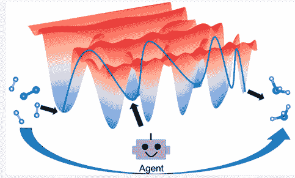
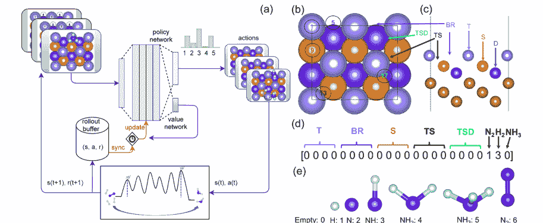
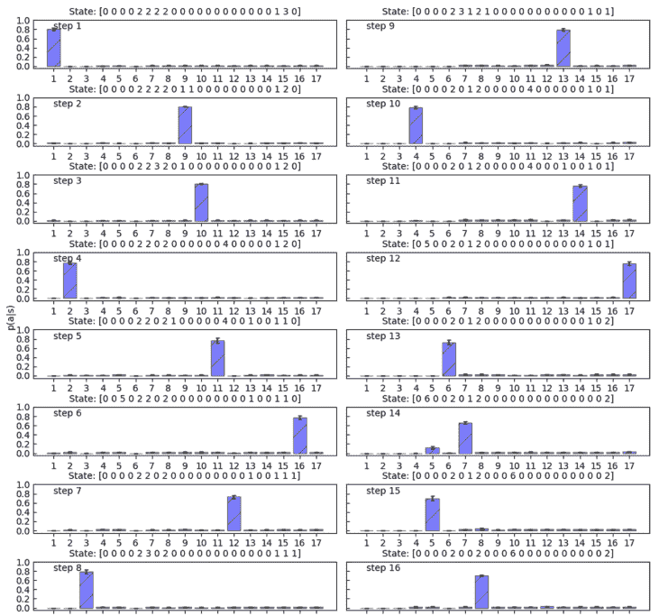
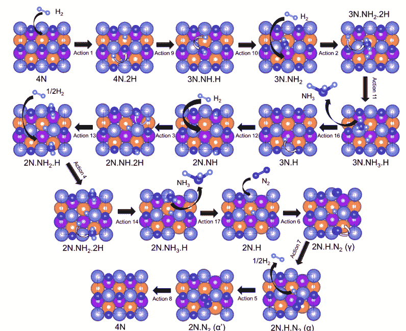
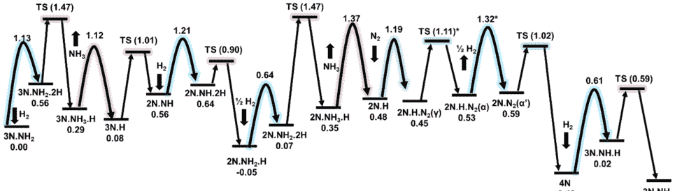

# 基于第一性原理的深度强化学习催化反应网络发现指南

## 摘要

确定反应路径（阐明催化剂工作机制的核心）受到反应高复杂性和数据极度匮乏的严重阻碍。在这里，我们开发了一种新的人工智能框架，将深度强化学习（DRL）技术与密度泛函理论模拟相结合，从零知识出发自动化地对复杂催化反应网络进行定量搜索和评估。我们的框架将化学反应的从第一性原理导出的自由能量景观定量地转换为DRL环境及相应的动作。通过与这个动态环境交互，我们的模型从零开始自行演化为一个完整的反应路径。我们利用最活跃的Fe(111)表面上的Haber–Bosch过程来演示这个框架。我们的框架发现的新路径比基于领域知识的先前研究具有更低的总体自由能垒，展示了其在发现复杂反应路径方面的卓越能力。展望未来，我们预期该框架将为探索许多催化反应的基本反应机制打开大门。

## 引言

为应对新兴的能源危机和环境问题，发现并优化能够高效将原材料转化为有价值化学品和化合物的新型催化剂至关重要，例如丙烯的氨氧化制丙烯腈、甲醇制汽油，以及从氮气合成氨的Haber–Bosch工艺。工业催化剂开发的传统进展是渐进式的。为了在高效催化剂优化方面取得快速进展，理解反应机制并应用基于反应机制的合理设计方法至关重要。大量的实验和理论工作已致力于识别许多工业上重要的催化反应中的反应机制、基本步骤和限速步骤。然而，催化反应可能涉及许多中间体和分支路径，使得确定完整的反应网络具有挑战性。例如，Fe催化剂上的Haber–Bosch反应可能涉及约20个重要的表面构型和约10个重要的反应步骤，以及许多潜在的掺杂剂分支反应。因此，开发能够有效确定复杂反应中反应网络的新技术是迫切需要的。最近，人工智能（AI）在许多研究领域取得了巨大成功。特别是，监督学习已被广泛应用于计算异相催化，并推进了对材料性质与催化性能（例如催化剂的活性、选择性和稳定性）之间关系的理解。例如，Abdelfatah 等人利用各种机器学习模型，结合常规描述符（例如产物或反应物能量）和其他描述符（例如表面物种的键计数和金属描述符），预测了金属催化剂上加氢反应的过渡态能量。他们得出结论，添加键计数和金属描述符能提高线性和非线性模型的性能。Ulissi 等人提出利用机器学习导出的代理模型来确定催化剂的反应网络，该模型能有效预测大多数重要反应步骤的能量学。最近的一篇综述总结了将机器学习技术应用于异相催化的最新进展。然而，AI在催化反应中的应用受到描述催化反应网络的数据极度匮乏的严重限制，而大量数据通常是构建可靠AI模型的先决条件。

收稿日期：2021年8月19日；发表日期：2021年10月4日

图1. 增强学习策略流程图及带有吸附物可能位点的Fe-bcc(111)表面。(a) DRL和DFT训练工作流程示意图。深蓝色箭头说明了rollout工作流程，其中状态、动作和奖励的数据被并行采样和收集。红色箭头显示了模型更新流水线，其中rollout同步和神经网络更新发生。(b) 沿[111]方向的顶视图。(c) 沿[110]方向的侧视图。(d) 使用23维向量定义状态。(e) Fe-bcc(111)表面上吸附物的定义。表面上的吸附物种由(e)中显示的数字1至6表示。它们仅出现在(d)中位点1至20的状态向量中。状态向量位点21、22和23分别是气相中N2、H2和NH3的数量，应与表面位点（1–20）区分开来。N和H原子分别由蓝色和青色球体表示。顶层、亚表层、深层以及第4–6层的Fe原子分别由浅蓝色、橙色、紫色和青铜色球体表示。

利用关于不完全已知马尔可夫决策过程最优控制的思想，24 强化学习利用有限数据训练一个学习代理，使其随时间与环境交互以实现目标。自AlphaGo程序击败职业围棋世界冠军以来，25 该技术已被扩展以解决视频游戏、26 社会科学、27 以及最近化学中一些半定量任务的问题。28,29 然而，定义适合强化学习表示催化反应的定量化学环境在科学上要复杂得多，且鲜有研究。此外，代理与环境之间的动态交互需要大量且深入的信息，这些信息无法直接从实验中获得。

## 结果与讨论

**环境定义。** 我们在研究中选择了Fe-bcc(111)作为催化表面，因为它是NH3合成中最活跃的表面。34,35 关于Fe-bcc(111)表面上NH3合成的最近DFT研究表明了一条合理的反应路径，包含24个重要的表面构型和12个过渡态，在673 K和20 atm压力（1.5 Torr NH3压力）下，每2×2位点的转化频率（TOF）为17.7 NH3/s。随着反应达到稳态且NH3压力增加到约1 atm，计算的TOF降低到4.6 NH3/s。8 虽然TOF与单晶实验值9.7 NH3/s一致，7 但这些研究大多依赖于穷举搜索和领域专家知识，而许多合理的中间状态和分支反应路径无法被考虑。Haber–Bosch反应的巨大复杂性使其成为挑战我们DRL模型的理想对象。

在这里，我们开发了一种新的深度强化学习（DRL）框架，以在没有催化反应任何先验知识的情况下，给定初始反应物和目标产物来确定复杂的反应网络。我们的框架不受数据和人类知识限制的约束，而是从零开始自行演化为一个完整的反应路径。具体地，我们将化学反应路径的演化映射为发生在由密度泛函理论（DFT）模拟定量描述的精巧环境中的马尔可夫决策过程。以Fe催化剂上的氨（NH3）合成作为模型系统，我们证明DRL通过采用适当的环境和训练算法，能高效构建复杂的反应路径。我们的代理准确预测了一个比先前研究更合理、自由能垒更低的反应网络。7,8

我们选择Haber–Bosch工艺作为模型系统，因为NH3是地球氮循环中的主要中间体。30 仅Haber–Bosch工艺就占全球总能源使用量的2%以上，并每年生产1.6亿吨NH3。31,52 如果由于氨的高能量密度和原材料丰富等吸引人特点，氨被用作能量载体来取代化石燃料，这种产量规模可能会大幅增加。35 使用金属催化剂来加速反应，但需要高温高压的大气氮气（N2）和氢气（H2）（从天然气来源提取）。上个世纪大量研究旨在提高Haber–Bosch工艺的性能，但最近的进展缓慢。为了在较温和的条件下使该工艺更高效——这将大幅降低生产成本并使更小、更广泛分散的工厂成为可能——我们必须优化异相催化剂，这需要理解Haber–Bosch工艺的反应机制。

图1(a)显示了整合DRL及其由DFT模拟计算的能量景观环境的理论框架的工作流程图。图1(b,c)显示了在(111)平面中具有2×2单胞且垂直于该平面有六层的Fe-bcc(111)表面模型。The

最上三层，分别指定为顶层（top）、亚表层（sublayer）和深层（deep layer），均参与吸附剂结合和表面反应。为描述各位点处发生的表面反应，我们定义了总共20个表面位点，编号1–20，包括四个顶层位点、四个亚表层位点、四个桥位位点、四个顶层–亚表层位点和四个顶层–亚表层–深层位点，如支持信息（SI）中的图S1所示。由于采用了(2 × 2) Fe-bcc(111)表面模型，每个吸附位置在表面上有四个位点。

我们将化学反应路径的演化建模为马尔可夫决策过程，由状态空间S、动作空间A、概率转移P(s_t+1|a_t, s_t)和奖励函数r定义，奖励函数通常定义在空间S × A中。为定义环境状态，我们在步骤t引入编码状态向量s_t，将总共20个表面位点投影到一个向量上。该向量还考虑了哈伯-博世反应中涉及的N2、H2和NH3气体物种。图1(d)显示了状态向量的前20个条目，用于表示20个表面位点；每个条目的值表示图1(e)中显示的吸附剂。吸附剂H、N、NH、NH2、NH3和N2分别由整数1–6编码，空位由数字0表示。向量的最后三个条目用于记录反应路径沿线的气体物种数量（N2↔21，H2↔22，NH3↔23）。反应从初始状态s0开始，即4N覆盖表面加上一个N2和三个H2气体分子（支持信息SI中的图S2）。模型表面与以下事实一致：在哈伯-博世反应条件下，Fe表面具有高N原子覆盖率。最终状态sf定义为气相中有两个NH3分子的4N构型（支持信息SI中的图S2），表示完全反应N2 + 3H2 ⇌ 2NH3。

连接s0和sf的动作定义为四个主要类别：(1) 表面上的H2吸附/脱附；(2) 表面上的N2吸附、迁移和解离；(3) 表面氢迁移以氢化N、NH或NH2物种（例如H + NH ⇌ NH2）；以及(4) 表面上的NH3脱附。基于反应的特定表面位点，动作进一步细化以形成环境中使用的动作空间。所有17个动作的定义显示在支持信息SI的图S3–S6中。定义的17个动作代表Fe-bcc(111)表面上的基本反应步骤，它们对于通过连接反应物和产物来完成反应循环是必要的。允许任何动作顺序以及动作的缺失或重复，DRL模型试图通过马尔可夫决策过程从零开始找出最合理的反应路径和构型。我们在17个动作中不考虑H辅助的N2活化，因为H迁移到N2的自由能垒（1.74 eV）远高于其他合理的N2活化步骤。支持信息SI的图S7显示了H迁移到表面N2（α态）以形成NH2的反应垒计算。

## 深度强化学习模型

DRL模型的核心是一个由深度神经网络表示的策略$\pi_{\theta_p(a_t|s_t)}$，其参数为$\theta_p$，用于分析当前状态并采取行动。当前状态s_t的向量代表反应路径沿线的一种合理构型，动作a_t将当前构型改变为下一个构型。策略$\pi$是改变状态s的策略。模型参数$\theta_p$随机初始化，没有关于环境的任何先验信息或反应的任何领域知识。然后，策略由一种强化学习策略进行训练，旨在最大化折扣未来奖励之和的期望值，并以成功到达最终状态为条件。

我们的强化学习策略基于类似于演员-评论家的策略梯度算法。我们使用近端策略梯度和Adam优化器来计算策略梯度。一个值网络（评论家）$V_{\theta_v}(s_t)$被训练以预测预期回报，并用于更新策略网络（演员），后者提供当前状态下动作的概率分布。我们的值网络和策略网络的架构由完全连接的深度神经网络（DNN）组成。两个深度神经网络共享共同的内部隐藏层堆栈，但最终输出层不同。DRL框架的效率与Fe(111)表面上的kMC计算相似。

我们框架中DFT与DRL之间的关键联系是与动作相关的奖励系统，它源自第一性原理的DFT计算。我们为每个动作分配一个奖励r，该奖励取决于动作前后涉及的状态；也就是说，同一动作可能根据其作用的状态而获得非常不同的奖励。特别是，对每个动作采用r = e^(-ΔE)，其中ΔE（单位为eV）是在反应条件T = 673 K和P(H2, N2, NH3) = (15, 5, 1) atm下连接不同状态的DFT导出自由能垒。自由能是从高N覆盖表面计算得出的，自由能的模拟细节在实验部分中。ΔE的值根据状态所代表的表面位点占用情况而变化；例如，反应位点周围不同的占用构型可以显著改变同一动作所产生的自由能垒。此外，如果明显障碍阻止动作发生，则会给予负奖励。这些障碍和约束类似于视频游戏环境中的几何边界掩码。例如，向已经被H物种占据的位点添加额外的H是不可能的，在这种情况下，动作不会改变状态并会立即获得负奖励。这是一个由23个位置组成的复杂网络环境，值范围从0到6，竞赛中总共定义了17个动作以探索连接初始状态和最终状态的最合理路径。详细的奖励值显示在支持信息SI的表S1中，关于奖励定义的更详细解释可以在SI中找到。

我们的训练数据从情节中生成，每个情节由一组从初始反应物状态到最终产物的完整轨迹组成。在训练轨迹的每个后续步骤t中，演员s_t决定一个动作a_t，该动作从策略网络$\pi_{\theta_p(a_t|s_t)}$生成的分布中抽取，并伴随奖励r_t+1。$V_{\theta_v}$评估动作的值并修改策略以提高性能。不失一般性，让我们以轨迹的第一步为例。这一步从反应物开始（气相中有三个H2和一个N2的4N表面构型），即初始状态，由状态向量[00002222000000000000130]表示。基于当前状态和当前DRL策略，模型在所有动作候选项上绘制动作分布。从该分布中，DRL模型采样一个动作，例如索引为1的动作。因此，该动作将状态更改为

图2. 从初始状态\(s_0\)到最终状态\(s_k\)的学习策略\(\pi_{\theta_t}(a_t|s_t)\)。在每个中间步骤中，代理观察状态\(s_t\)并执行动作\(a_t\)，由策略抽取到下一个状态\(s_{t+1}\)。通过执行概率最大的动作执行步骤1–16后，模型达到给定的最终状态\(s_f\)（最终状态未在此图中显示）。该图显示，模型已建立一条高置信度的收敛良好的化学反应路径，即，给定每个中间状态，一个动作独占地主导策略分布。

下一个状态[00002222011000000000120]，因为一个气体H2分别在表面位点10和11上解离为两个H原子。然后框架调用DFT模拟来评估这两个状态相关的自由能垒，DRL模型将此DFT导出的能量转换为奖励，在此示例中为0.249。然后新状态与合理的动作一起演化，奖励累积直到状态达到最终状态，完成一个情节。代理通过运行许多情节来学习策略，并通过最大化奖励来找到最佳策略。

寻找催化反应路径的主要挑战之一是开发与勘探之间微妙的权衡。在本工作中，开发是指模型基于当前策略获取奖励，而勘探是指寻找更好的策略以沿反应路径产生更合理的中间状态。目标是找到一种强大的决策策略，使我们的模型具有最高概率采取最优动作。一方面，最优动作轨迹保证到达终止状态，并在给定观察状态的情况下最大化奖励。另一方面，对这些最优动作的高概率将增加构建复杂反应网络的稳定性，并且对于在给定起始和最终状态的情况下自信地确定最合理的反应路径至关重要。在训练阶段，如果我们不断选择迄今已知的最佳动作，模型将没有足够的机会在相同状态下勘探其他合理的动作，因此模型最有可能遵循次优策略，导致小奖励甚至无法到达最终状态的糟糕策略。此外，与许多其他问题不同，DRL模型找到的催化反应路径预计在后期训练阶段会比早期阶段显著缩短。因此，随着进一步训练，来自轨迹的样本总数可能会显著减少。这些给在稀疏奖励、许多竞争动作和大量状态的复杂环境中进行勘探带来了巨大挑战。

为应对开发–勘探挑战，我们采用了几种新策略。我们将课程学习算法应用于环境构建。在训练期间，模型勘探多个复杂程度各异的环境，这些环境与低到高技能水平相关，并最终与现实环境交互。这也显著有助于提高模型收敛的稳定性和速度。对于策略更新，我们制定了一种源自A3C同步确定性变体但有若干修改的训练策略：首先，对于每个同步训练情节，模型配置为并行收集许多与策略无关的轨迹进行调查，但轨迹数量是动态确定的，并与这些轨迹的平均长度成反比。其次，如果发现某个轨迹经历了不良体验——例如，它未能在运行the后到达最终状态——

图 3. DRL 模型预测的反应路径上的构型。仅显示了 N2 解离的三个步骤；详细路径见 SI 中的图 S9。

图 4. 基于 DRL 推导的 Fe-bcc(111) 表面上 Haber–Bosch 工艺反应网络的自由能景观。N2 迁移（*）的自由能是各状态之间的最大能垒；该过程的详细内容在 SI 中的图 S9 中讨论。

最大步数——对该 rollout 将应用一定的下采样率以随机选择一个小子集。事实证明，这些方法平衡了训练的探索与利用，显著增强了模型的稳定性，使其能够达到最佳策略。关于训练的更多细节见计算方法部分，DRL 模型中使用的超参数汇总于 SI 中的表 S2。智能体评估。我们应用 DRL 来构建 Fe(111) 表面上 H–B 反应的反应网络。初始状态 s0 为 [00002222000000000000000130]，对应于气相中含有一个 N2 和三个 H2 的 4N 表面构型。最终状态 sf 具有相同的 4N 表面构型，气相中含有两个 NH3，表示为向量 [000022220000000000000002]。通过 AI 智能体与上述环境的交互，AI 智能体可以确定连接 s0 和 sf 的最合理反应路径。图 2 展示了从初始状态 s0 到最终状态 sf 的学习策略 πθp(a|s)。对于每个中间步骤，智能体观察状态 s，并执行由策略模型绘制的动作 at 到达下一状态 st+1。如图 2 所示，给定由连续动作决定的每个中间状态，存在概率大于 80% 的动作，该动作独占主导策略分布。带有 DRL 模型的智能体的收敛性和稳定性也可以通过 SI 中图 S8 所示的训练回合总奖励曲线来确认。

图 3 显示了从 DRL 建模中最高概率动作构建的反应路径。该反应机制与先前研究的主要区别在于 2NH.H 构型上的 H 脱附。7,8 在先前研究中，有人提出 H 在 N2 吸附之前脱附。7,8 然而，DRL 模型提出相反的观点：H 将在吸附的 N2 从顶位迁移到亚表面位点后脱附。然后 N2 解离以达到原始的 4N 构型，完成一个反应循环。

为消除 DRL 模型与先前研究之间的差异，7,8 我们进一步使用 DFT 模拟计算了基于 DRL 模型的反应路径自由能图，如图 4 所示。先前研究提出，以 2N.NH2.H 为基态时，N2 在 2N 构型上的吸附具有最高能垒 1.68 eV。8 遵循 DRL 模型并以 2N.NH2.H 为基态，我们计算了 N2 在 2N.H 状态上的吸附，并发现 2N.H 状态中的额外 H 将 N2 吸附能垒从 1.68 降低至 1.24 eV。N2 吸附在顶位（γ 状态）后，它移动到亚表面位点（δ 状态）。H 的存在也将此能垒从 1.37 降低至 0.97 eV。当 N2 从 δ 状态倾斜到 α 状态时，在 H 存在下自由能垒变为 1.16 eV，而无 H 时为 1.37 eV。随后需要脱附 H，因为它阻碍了 N2 从 α 状态到 α' 状态的旋转。最后，N2 从 α' 状态解离形成 4N 构型。N2 吸附、迁移和解离的详细反应路径在 SI 中的图 S9 中显示。沿着 DRL 建模的这条新反应路径，限速步是构型 2N.NH2.2H 上的氢化步骤，能垒为 1.52 eV，而先前研究为 1.68 eV。8 因此，与先前研究相比，DRL 预测了一条更合理的反应路径。我们根据过渡态理论估计了 673 K 下的速率为 k = (kBT/h)exp[-1.52/kBT] = 58.1 s-1，这比先前模型 k = (kBT/h)exp[-1.68/kBT] = 3.7 s-1 高出约 16 倍。这里我们预测的反应速率高于实验研究可能会阻塞反应位点。31,32 使用相同的 DFT 框架，DRL 预测的反应路径能垒低于领域知识，表明这条新反应路径比先前的更合理。

许多关于 Haber–Bosch 工艺反应机制的研究表明，限速步骤可能涉及（1）二氮的解离吸附；40（2）催化剂表面上吸附物种的反应；41 和（3）氨的脱附。42 基于领域知识的先前反应网络表明，N2 吸附/脱附具有最高反应能垒，并应占主导地位，成为 Fe(111) 表面上合理的限速步骤。7 相比之下，从 DRL 推导的新反应路径表明，NH2 的氢化具有最高反应能垒，是 Fe(111) 表面上最重要的限速步骤。第二重要的步骤是 NH3 的脱附，第三重要的步骤是来自新反应机制的 N2 吸附/脱附。为验证理论预测，未来实验可能侧重于使用原位/就位光谱技术表征重要中间状态的吸附物（例如，NH3、NH2 和 N2）。特别是，预计 NH2 特征将在 Fe(111) 表面的光谱研究中占主导地位，因为 NH2 氢化步骤具有最高反应能垒。

DRL 框架预测的反应路径为 Fe(111) 表面上 Haber–Bosch 工艺的未来催化剂设计提供了有洞察力的方向。例如，需要降低 Fe-bcc(111) 表面上 NH2 物种的氢化能垒，以实现优于纯 Fe 系统的性能。这可以通过 Fe(111) 表面上的掺杂策略来实现。8,17

## 与其他确定反应路径的方法相比的 DRL 比较

DRL 方法是通过 AI 智能体与由单个动作定义的环境进行交互来进行训练。每个动作的奖励由 DFT 计算和 nudged elastic band (NEB) 方法确定。在 DRL 中，我们仅定义初始反应物和最终产物，而不定义动作序列。此外，通过马尔可夫决策过程，动作可以重复多次，从而导致反应路径上具有无限数量的构型。训练后，AI 智能体将通过连接这些单个动作，自动从反应物构建到产物的反应网络。DRL 的准确性取决于从 DFT 和 NEB 方法计算得到的能量。

应当指出，DRL 方法与人工力诱导反应 (AFIR) 方法根本不同，在 AFIR 方法中，给定的反应物分子受恒定力相互挤压，从而可以识别反应路径和过渡态。43,44 AFIR 方法是通过仅给出多个反应物种而无需了解反应机制来识别反应路径。与 NEB 方法类似，AFIR 方法在确定单个反应步骤的反应路径方面是有效的。相比之下，DRL 是从许多合理的反应步骤构建完整的反应网络。每个反应步骤的初始状态、最终状态和反应能垒均从 DFT 和 NEB 计算得到。然后，每个反应步骤的信息用于确定 DRL 建模的环境。

## 结论

总之，我们开发了一个结合 DRL 模型和 DFT 模拟的 AI 框架，以从零知识出发考察复杂反应中的催化反应网络。通过在 DRL 模型中应用多种新型采样和学习技术，并基于 DFT 模拟定量构建 DRL 环境，我们的模型有效地确定了最活跃的 Fe-bcc(111) 表面上 Haber–Bosch 工艺的最合理反应路径。该反应路径包含一条与基于领域知识的先前研究7,8相比具有更低自由能垒的新路径段，表明其概率更高。该 AI 框架的成功将为研究许多复杂的催化化学反应（如 Haber–Bosch 和 CO2 还原）开辟新的窗口。

## 实验部分

### 价值网络和策略网络

在我们的 actor–critic 框架中，策略（actor）πθp(a|s) 给定状态 sr 时生成概率分布。这里下标 θp 表示参数化策略网络的参数集。我们使用了一个完全连接的 DNN，以当前状态向量 s 作为输入。它具有由 300 个 300 神经元组成的完全连接隐藏层，采用 ReLU 激活函数，输出层大小为 17，采用 Softmax 激活

function. 输出随后映射到 17 个动作的概率分布。值网络（critic）\(V_{\theta_v}(s_i)\) 与策略网络共享相同的隐藏层，但它输出一个标量值，用于定量估计该动作是否有望产生奖励。更准确地说，我们定义从步骤 \(t\) 到终止步骤 K 的观测回报为未来奖励 \(r_{t+1}, r_{t+2} ... r_T\) 的折扣和，折扣因子为 \(\gamma = 0.99\)

\(G_t = \sum_{\tau=t+1}^{K} \gamma^{\tau-t-1} r_\tau\) (1)

值函数 \(V_{\theta_v}(s_i)\) 在给定状态 \(s_t\) 时，近似回报的期望值 \(E_\pi[G_t|s_i]\)。

在训练期间，模型更新策略网络和值网络的参数 \(\theta_p\) 和 \(\theta_v\)。为更新 \(\theta_p\)，根据以下方向计算策略梯度（PGs）：

\(PG = (G_t - V_{\theta_v}(s_i)) \nabla_{\theta_p} \log \pi_{\theta_p}(a_i|s_i)\) (2)

这里 \(G_t\) 是公式 1 中定义的观测回报，并在 Rollout Sampling 部分详细说明的 rollout 中收集。当前值网络 \(V_{\theta_v}(s_i)\) 用于更新策略 \(\pi_{\theta_p}(a_i|s_i)\)，策略梯度的方向将改进策略，使其偏好于增加预期回报的动作。此外，当值函数对预期回报有更准确的估计时，策略梯度会更可靠。为改进值网络，参数 \(\theta_v\) 被更新以最小化当前值函数 \(V_{\theta_v}(s_i)\) 与观测回报 \(G_t\) 之间的均方误差。如前所述，输入数据是一个包含 23 个条目的向量，用于描述状态 \(s_t\)。模型在每个训练步骤中至少接受 300 个数据点（一个训练小批量）。因此，训练在形状为 (300, 23) 的小批量上使用了随机梯度下降。

### Rollout Sampling

对于每个后续步骤 \(t\)，rollout 数据使用蒙特卡罗（MC）方法收集。基于当前状态 \(s_t\)，actor 从策略网络 \(\pi_{\theta_p}\) 生成的分布中决定一个动作 \(a_t\)。通过执行该动作，模型转移到下一个状态 \(s_{t+1}\) 并获得相应的奖励。当达到最终状态或 rollout 的最大步骤 K 时，rollout 结束。在我们的实验中，最大步骤 K 设置为 500。我们没有使用 TD(\(\lambda\))\(^{45}\) 等近似方法来近似观测回报 \(G_t\)，而是使用蒙特卡罗方法沿着 rollout 轨迹忠实地收集回报。在 rollout 结束时，收集由元组 \((s_t, a_t, G_t)\) 列表组成的训练样本。

对于每次策略更新（训练 episode），模型被配置为调查许多独立的 on-policy MC rollouts，这些 rollouts 并行收集，最后同步以更新策略。在终止步骤 K 之前未达到最终状态的 rollouts 将具有某种用于无放回随机选择的下采样率。rollouts 的数量在运行时动态确定，并且与当前策略更新中这些 rollouts 的平均长度成反比。我们发现，我们的采样方法在防止模型收敛到由局部优化轨迹偏差的次优策略方面起着重要作用。在我们的实验中，我们选择 0.3 作为下采样率，300 的大小是所需的最小数据点数量。这大约相当于接近最终收敛时的 10 个 rollouts。

### Curriculum Learning

我们为模型引入了两阶段学习课程。对于第一个课程，为了避免因最初引入执行不可能动作的惩罚而产生不稳定的学习动态，我们在环境构建中施加一个微小的负奖励 -0.01。这种小惩罚减轻了累积的负奖励，否则这些负奖励很容易阻止模型在复杂网络上进行早期探索，同时仍然为模型利用有利动作保持相当合理的意义。在第二个课程中，负奖励增加到 -0.1 以构建更现实的环境，关于奖励的详细信息可以在表 S1 中找到。在我们的实验中，我们为第一个课程运行 100 000 个训练 episode，为第二个课程运行 50 000 个。

### Entropy Regularization

在策略梯度目标中，我们将策略熵（PS）作为额外项添加到公式 2 中，定义为

\(PS = -\beta \sum_i \pi_{\theta_p}(a_i^i|s_i) \log(\pi_{\theta_p}(a_i^i|s_i))\) (3)

这里上标 \(i\) 表示动作索引，\(\beta\) 是熵正则化系数。使用熵项鼓励模型在当前策略下对动作空间中概率较小的动作进行更多探索。我们发现，熵正则化对于处理具有大动作空间的复杂网络是必要的。对于第一个课程，我们将熵正则化系数配置为 0.1，而在第二个课程中，该系数降低到 0.05，同时模型变得更加稳定。

### DRL Model Convergence

我们的 DRL 模型的初始参数在没有任何先验信息的情况下给出。但我们的模型有效地收敛到稳定且最优的策略，如 SI 中的图 S8 所示。这是由于以下原因。首先，我们通过 Xavier 初始化方法随机初始化参数，该方法旨在保持所有层中梯度的规模大致相同，并显著有助于 DNN 的稳定性和收敛性。\(^{46}\) 其次，我们应用了 A2C 方法，它是 A3C 的同步版本。同步梯度更新使训练更加紧凑，并使收敛速度比 Vanilla 策略梯度快得多。\(^{37}\) 第三，该框架与 DFT 模拟相结合，使用详细的自由能景观来构建动作上的准确奖励函数。最后但同样重要的是，课程学习有效地帮助了我们模型的收敛。

### DFT Simulations

所有 DFT 模拟都使用 VASP 软件和电子波函数的平面波基集进行。\(^{47-50}\) 在所有计算中，平面波展开的能量截止为 500 eV。我们使用 Perdew–Burke–Ernzerhof 交换相关泛函\(^{51,52}\) 处理电子相互作用，并使用 D3 修正处理范德华相互作用。\(^{53}\) 采用 Methfessel–Paxton 方案来处理电子部分占据，电子展宽的宽度为 0.2 eV。所有计算中均允许自旋极化，以准确预测 Fe 原子的磁矩。自洽场的能量收敛度和离子步的力收敛度分别为 \(10^{-6}\) eV 和 \(10^{-3}\) eV/Å。第一布里渊区使用 \(\Gamma\)-中心网格方法进行采样，板层计算中使用 \(4 \times 4 \times 1\) K-points。模拟设置与之前的研究一致，详细信息可以在之前的工作中找到。\(^{7,8}\)

Fe-bcc(111) 板模型在 (111) 平面上包含一个 (\(2 \times 2\)) 单胞，垂直于平面有六层。底部三层固定，顶部三层在几何优化中允许弛豫。在板模型中添加了 15 Å 的真空层，以尽量减少周期镜像之间的相互作用。为检查板模型的可能尺寸效应，我们将六层板增加到九层，并在九层模型上沿自由能图（图 4）计算几个重要状态的自由能。在几何优化中，九层板的底部三层固定。为研究催化表面的效应，我们将 (\(2 \times 2\)) 六层板扩展到 (\(4 \times 2\)) 板，并在扩大模型上计算这些重要状态的自由能。假设三个板模型的自由能修正相同，我们获得重要状态的自由能，并将其列在 SI 中的表 S3 中。所有三个板模型的重要状态自由能非常吻合，表明使用六层 (\(2 \times 2\)) 板模型的 DFT 模拟是稳健的。

我们通过从谐波近似计算声子模式来获取有限温度下的自由能。采用有限位移法获取声子模式，\(^{54,55}\) 然后用于计算作为温度函数的振动熵。气相（N\(_2\)、H\(_2\) 和 NH\(_3\)）的自由能取自使用相同计算参数的先前工作。\(^{7,8}\) 该计算设置已被证明能够准确

描述了Fe-bcc(111)和Fe-bcc(211)重构表面上的哈伯-博世反应。7,56 初态与末态之间的过渡态搜索首先采用攀爬NEB方法57进行，然后采用二聚体方法58进行精修。过渡态搜索的详细信息可参见先前的研究。7

## 相关内容

### 支持信息

支持信息可免费获取：https://pubs.acs.org/doi/10.1021/jacs.1c08794。

图S1–S9，表S1–S3，来自DFT模拟的奖励定义，通过DRL获得的HB反应路径的DFT导出自由能，以及用于确定DRL奖励的从DFT计算的各种构型的自由能；来自该工作的数据集和代码可根据合理要求从通信作者处获取（PDF）

使用PBE-D3 xc泛函在673 K和1 atm下的重要表面构型的电子能和自由能，以及气相分子的热力学数据（XLSX）

## 作者信息

### 通信作者

Qi An – 内华达大学里诺分校化学与材料工程系，内华达州里诺市89577，美国；orcid.org/0000-0003-4838-6232；电子邮件：qia@unr.edu

### 作者

Tian Lan – 内华达大学里诺分校化学与材料工程系，内华达州里诺市89577，美国

完整联系信息可查阅：https://pubs.acs.org/10.1021/jacs.1c08794

### 注记

作者声明不存在竞争性财务利益。

## 致谢

谨向美国化学石油研究基金（58754-DNI6）的捐赠者表示感谢，感谢其对本研究的部分支持。作者还希望感谢内华达大学里诺分校信息技术办公室的研究与创新及网络基础设施团队，感谢其为Pronghorn高性能计算集群提供便利和访问权限。

## 参考文献

- (1) Mattos, L. V.; Jacobs, G.; Davis, B. H.; Noronha, F. B. 从乙醇生产氢气：反应机理和催化剂失活综述. Chem. Rev. 2012, 112, 4094–4123.
- (2) Shao, M.; Chang, Q.; Dodelet, J.; Chenitz, R. 氧还原反应电催化剂的最新进展. Chem. Rev. 2016, 116, 3594–3657.
- (3) Roger, I.; Shipman, M. A.; Symes, M. D. 地球富集型催化剂用于电化学和光电化学水分解. Nat. Rev. Chem. 2017, 1, 0003.
- (4) Liu, H. Z. 氨合成催化剂：创新与实践. World Science Publishing Co. Ltd.: Singapore, 2013.
- (5) Li, X.; Yu, J.; Jaroniec, M.; Chen, X. 用于CO2选择性光还原为太阳能燃料的助催化剂. Chem. Rev. 2019, 119, 3962–4179.
- (6) Chung, D. Y.; Lopes, P. P.; Martins, P.; He, H.; Kawaguchi, T.; Zapol, P.; You, H.; Tripkovic, D.; Strmcnik, D.; Zhu, Y.; 等. 氢氧(氧)化物中用于氧析反应的活性位点的动态稳定性. Nat. Energy 2020, 5, 222–230.
- (7) Qian, J.; An, Q.; Fortunelli, A.; Nielsen, R. J.; Goddard, W. A., III Fe(111)表面上氨合成的反应机理和动力学. J. Am. Chem. Soc. 2018, 140, 6288–6297.
- (8) An, Q.; Shen, Y.; Fortunelli, A.; Goddard, W. A., III 基于QM机制的层次化高通量计算机筛选催化剂设计用于氨合成. J. Am. Chem. Soc. 2018, 140, 17702–17710.
- (9) Grasselli, R. K. 选择性多相氧化催化的基本原理. Top. Catal. 2002, 21, 79–88.
- (10) Klerk, A. 费托合成. 在Kirk-Othmer化学技术百科全书中; Wiley-VCH: Weinheim, 2013.
- (11) Cecchin, G.; Morini, G.; Piemontesi, P. Ziegler-Natta催化剂. 在Kirk-Othmer化学技术百科全书中; Wiley-VCH: Weinheim, 2003.
- (12) Bjørgen, M.; Joensen, F.; Holm, M. S.; Olsbye, U.; Lillerud, K.; Svelle, S. 通过沸石H-ZSM-5将甲醇转化为汽油：用NaOH处理改善催化剂性能. Appl. Catal., A 2008, 345, 43–50.
- (13) Foster, S. L.; Bakovic, S. I. P.; Duda, R. D.; Maheshwari, S.; Milton, R. D.; Mintere, S. D.; Janik, M. J.; Renner, J. N.; Greenlee, L. F. 用于氮还原为氨的催化剂. Nat. Catal. 2018, 1, 490–500.
- (14) Sun, S.; Watanabe, M.; Wu, J.; An, Q.; Ishihara, T. 用于高选择性CO2光还原为乙酸盐的超薄WO3·0.33H2O纳米管. J. Am. Chem. Soc. 2018, 140, 6474–6482.
- (15) Seitz, L. C.; Dickens, C. F.; Nishio, K.; Hikita, Y.; Montoya, J.; Doyle, A.; Kirk, C.; Vojvodic, A.; Hwang, H. Y.; Norskov, J. K.; Jaramillo, T. F. 一种用于氧析反应的高活性和稳定IrOx/SrIrO3催化剂. Science 2016, 353, 1011–1014.
- (16) Stamenkovic, V.; Strmcnik, D.; Lopes, P. P.; Markovic, N. M. 来自电化学界面的能量和燃料. Nat. Mater. 2017, 16, 57–69.
- (17) An, Q.; McDonald, M.; Fortunelli, A.; Goddard, W. A., III 用于在大幅降低的压力和温度下进行氨合成的S掺杂Fe催化剂. J. Am. Chem. Soc. 2020, 142, 8223–8232.
- (18) Senior, A. W.; Evans, R.; Jumper, J.; Kirkpatrick, J.; Sifre, L.; Green, T.; Qin, C.; Zidek, A.; Nelson, A. W. R.; Bridgland, A.; 等. 使用深度学习势能改进蛋白质结构预测. Nature 2020, 577, 706–710.
- (19) Hermann, J.; Schätzle, Z.; Noé, F. 电子薛定谔方程的深度神经网络求解. Nat. Chem. 2020, 12, 891–897.
- (20) Mayor, A. C.; Coote, M. L. 化学中的深度学习. J. Chem. Inf. Model. 2019, 59, 2545–2559.
- (21) Abdelrahman, K.; Yang, W.-Q.; Solomon, R. V.; Rajbanshi, B.; Chowdhury, A.; Zare, M.; Kundu, S. K.; Yonge, A.; Heyden, A.; Terejanu, G. 基于机器学习的过渡金属表面上氢脱氧反应过渡态能量预测. J. Phys. Chem. C 2019, 123, 29804–29810.
- (22) Ulissi, Z. W.; Medford, A. J.; Bligaard, T.; Norskov, J. K. 使用缩放关系机器学习和DFT计算来解决表面反应网络复杂性. Nat. Commun. 2017, 8, 14621.
- (23) Lamoureux, P. S.; Winther, K. T.; Torres, J. A. G.; Streibel, V.; Zhao, M.; Bajdich, M.; Abild-Pedersen, F.; Bligaard, T. 计算多相催化中的机器学习. ChemCatChem 2019, 11, 3581–3601.
- (24) Sutton, R. S.; Barto, A. G. 强化学习：导论，第2版. MIT Press: Cambridge, MA, 2018.
- (25) Silver, D.; Huang, A.; Maddison, C. J.; Guez, A.; Sifre, L.; Driessche, G.; Schrittwieser, J.; Antonoglou, I.; Panneershelvam, V.; Lanctot, M.; 等. 使用深度神经网络和树搜索掌握围棋游戏. Nature 2016, 529, 484–489.
- (26) Vinyals, O.; Babuschkin, I.; Czarnecki, W. M.; Mathieu, M.; Dudzik, A.; Chung, J.; Choi, D. H.; Powell, R.; Ewalds, T.; Georgiev, P.; 等. 使用多智能体强化学习在星际争霸II中达到大师级水平. Nature 2019, 575, 350–354.
- (27) Zheng, S.; Trott, A.; Srinivasa, S.; Naik, N.; Graepel, T.; Parkes, D. C.; Socher, R. AI经济学家：使用AI驱动的税收政策改善平等和生产力. 2021, 2004.13332, arXiv预印本. https://arxiv.org/abs/2004.13332 (访问日期：2020年4月28日).
- (28) Li, H.; Collins, C. R.; Ribelli, T. G.; Matyjaszewski, K.; Gordon, G. J.; Kowalewski, T.; Yaron, D. J. 使用深度强化学习调节原子转移基团聚合中的分子量分布. Mol. Syst. Des. Eng. 2018, 3, 496–508.
- (29) Zhou, Z.; Kearnes, S.; Li, L.; Zare, R. N.; Riley, P. 通过深度强化学习优化分子. Sci. Rep. 2019, 9, 10752.
- (30) Schlögl, R. 催化合成氨——一个"永无止境的故事"？ Angew. Chem., Int. Ed. 2003, 42, 2004–2008.
- (31) Ertl, G. 表面反应：从原子到复杂性（诺贝尔讲座）. Angew. Chem., Int. Ed. 2008, 47, 3524–3535.
- (32) Chen, J. G.; Crooks, R. M.; Seefeldt, L. C.; Bren, K. L.; Bullock, R. M.; Darensbourg, M. Y.; Holland, P. L.; Hoffman, B.; Janik, M. J.; Jones, A. K.; 等. 超越化石燃料驱动的氮转化. Science 2018, 360, No. eaar6611.
- (33) MacFarlane, D. R.; Cheerappan, P. V.; Choi, J.; Suryanto, B. H. R.; Hodgetts, J. M.; Bakker, R. Y.; Vallana, F. M. F.; Simonov, A. N. 通往氨经济的路线图. Joule 2020, 4, 1186–1205.
- (34) Somorjai, G. A.; Materer, N. 氨合成中的表面结构. Top. Catal. 1994, 1, 215–231.
- (35) Strongin, D. R.; Carrazza, J.; Bare, S. R.; Somorjai, G. A. 铁基氨合成反应中C7位点和表面粗糙度的重要性. J. Catal. 1987, 103, 213–215.
- (36) Grunze, M. M.; Golze, M.; Hirschwald, W.; Freund, H.-J.; Pulm, H.; Seip, U.; Tsai, M. C.; Ertl, G.; Küppers, J. Fe(111)上的n键合N2：解离的前体. Phys. Rev. Lett. 1984, 53, 850–854.
- (37) Mnih, V.; Badia, A. P.; Mirza, M.; Graves, A.; Lillicrap, T. P.; Harley, T.; Silver, D.; Kavukcuoglu, K. 用于深度强化学习的异步方法. Proc. Machine Learning Res. 2016, 48, 1928–1937.
- (38) Schulman, J.; Wolski, F.; Dhariwal, P.; Radford, A.; Klimov, O. 近端策略优化算法. 2017, 1707.06347, arXiv预印本. https://arxiv.org/abs/1707.06347 (访问日期：2017年7月20日).
- (39) Kingma, D. P.; Ba, J. Adam：一种随机优化方法. 2014, 1412.6980, arXiv预印本. https://arxiv.org/abs/1412.6980 (访问日期：2014年12月22日).
- (40) Stolze, P.; Norskov, J. K. 极高真空表面物理与高压催化之间"压力差距"的桥梁. Phys. Rev. Lett. 1985, 55, 2502–2505.
- (41) Ertl, G. 表面科学与催化——氨合成机理研究：PH Emmett奖获奖演讲. Catal. Rev.: Sci. Eng. 1980, 21, 201–223.
- (42) Spencer, M. S. 关于催化合成氨中限速步骤和钾的作用. Catal. Lett. 1992, 13, 45–53.
- (43) Maeda, S.; Morokuma, K. 定位A+B\X型反应过渡结构的系统方法. J. Chem. Phys. 2010, 132, 241102.
- (44) Zimmerman, P. M. 化学合理基本反应步骤的自动发现. J. Comput. Chem. 2013, 34, 1385–1392.
- (45) Sutton, R. 通过时序差分方法学习预测. Mach. Learn. 1988, 3, 9–44.
- (46) Glorot, X.; Bengio, Y. 理解训练深度前馈神经网络的困难. 人工智能与统计国际会议. 第十三届人工智能与统计国际会议论文集. 机器学习研究论文集 2010, 9, 249–256.
- (47) Kresse, G.; Hafner, J. 液态金属的从头算分子动力学. Phys. Rev. B: Condens. Matter Mater. Phys. 1993, 47, 558–561.
- (48) Kresse, G.; Furthmüller, J. 使用平面波基组对金属和半导体进行从头算总能计算的效率. Comput. Mater. Sci. 1996, 6, 15–50.
- (49) Kresse, G.; Furthmüller, J. 使用平面波基组进行从头算总能计算的高效迭代方案. Phys. Rev. B: Condens. Matter Mater. Phys. 1996, 54, 11169–11186.
- (50) Kresse, G.; Joubert, D. 从超软势到投影增波法. Phys. Rev. B: Condens. Matter Mater. Phys. 1999, 59, 1758–1775.
- (51) Perdew, J. P.; Burke, K.; Ernzerhof, M. 广义梯度近似简化. Phys. Rev. Lett. 1996, 77, 3865–3868.
- (52) Perdew, J. P.; Burke, K.; Ernzerhof, M. 勘误：广义梯度近似简化. Phys. Rev. Lett. 1997, 78, 1396–1396.
- (53) Johnson, E. R.; Becke, A. D. 分子间作用的后Hartree-Fock模型：高阶修正的纳入. J. Chem. Phys. 2006, 124, 174104.
- (54) Togo, A.; Oba, F.; Tanaka, I. 高压下金红石型和CaCl2型SiO2之间铁弹性相变的从头算计算. Phys. Rev. B: Condens. Matter Mater. Phys. 2008, 78, 134106.
- (55) Dove, M. T. 晶格动力学导论. Cambridge University Press: Cambridge (UK), 1993.
- (56) Fuller, J.; Fortunelli, A.; Goddard, W. A., III; An, Q. Fe(211)重构表面上氨合成的反应机理和动力学. Phys. Chem. Chem. Phys. 2019, 21, 11444–11454.
- (57) Henkelman, G.; Uberuaga, B. P.; Jónsson, H. 用于寻找鞍点和最小能量路径的攀爬图像弹性带方法. J. Chem. Phys. 2000, 113, 9901–9904.
- (58) Henkelman, G.; Jónsson, H. 一种仅使用一阶导数在高维势面上寻找鞍点的二聚体方法. J. Chem. Phys. 1999, 111, 7010–7022.
