# 数据科学的离散数学


## 献给Lisa


## 前言

## 0.1 本书的目的

Does precision mean relevance? Can reasoning exist without data? For that matter, what is data?

精确性等同于相关性吗？推理可以不依赖数据存在吗？更何况，什么是数据？

With those questions in mind, this book serves an early course in mathematical thinking for data science. Because data science is interdisciplinary, students of data science come from a variety of disciplines. Interdisciplinary motivations are fueling the emergence of data science initiatives in various academic disciplines, with Business, Statistics, Computer Science, Economics, and Psychology among the departments offering studies in data science. For many students, data science is considered a means of insight into a particular field of interest, with the study of its discrete mathematics not a primary objective.

怀着这些问题，本书作为一门面向数据科学的数学思维入门课程。由于数据科学是一门跨学科专业，数据科学的学生来自各个不同的学科。跨学科的动机正在推动各学术领域中数据科学项目的涌现，商学、统计学、计算机科学、经济学和心理学等部门都在开设数据科学研究。对许多学生来说，数据科学被视为了解特定感兴趣领域的一种手段，而其离散数学的研究并非首要目标。

Courses in introductory data science and discrete mathematics tend to be ambitious. Introductory data science courses are seen requiring students to have prerequisite knowledge of statistics and computer programming, and a first course in discrete mathematics generally resembles a buffet of mathematical topics.

入门级数据科学和离散数学课程往往目标宏大。入门级数据科学课程被认为要求学生具备统计学和计算机编程方面的先修知识，而离散数学的第一门课程通常看起来像是一道数学主题的“自助餐”。

Students are often preoccupied with enough abstraction to miss the basic empirical essence of data science. This book aims to make these connections.

学生常常过分沉迷于抽象概念，而忽略了数据科学基本的实证本质。本书旨在建立这些联系。

In particular, those pursuing data engineering and high-performance computing for data science should be aware of the foundational aspects of data and computation present in this book.

特别是，那些从事数据工程和数据科学高性能计算的人应该了解本书中涉及的数据和计算的基础方面。

I wrote this book to give interdisciplinary students of data science a solid foundation in discrete mathematics for data science, connecting fundamental and abstract concepts for elementary problem solving.

我写这本书是为了给跨学科背景的数据科学学生提供数据科学离散数学的坚实基础，连接基础和抽象概念，以解决基础问题。

### 0.1.1 背景

It is imperative to respect the interdisciplinary backgrounds of data science practitioners, as domain expertise ensures that analysis is kept to relevant contexts.

必须尊重数据科学从业者的跨学科背景，因为领域专长确保分析保持在相关语境中。

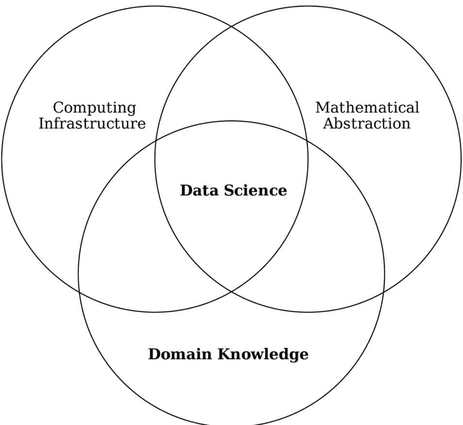

图 1 跨学科数据科学背景。

Context is important for the classification of data, for determining which data values belong in a certain class and which do not. In this age of Big Data, much irrelevant data and noise can amount to a significant waste of computing resources, and a much higher cost when mistaken for relevant data.

背景对于数据分类非常重要，用于确定哪些数据值属于某个类别，哪些不属于。在大数据时代，大量无关数据和噪声会导致计算资源的显著浪费，如果误认为相关数据，成本将更高。

For example, the history data scientist decides to count battlefield casualties that include soldiers too wounded for further combat. The business data scientist counts only those sales transactions where the customer's payment has been received. The data engineer supports the domain specialists, filling voids and minimizing redundancies among maintained data sets.

例如，历史数据科学家决定统计包括过重伤无法继续作战的士兵在内的战场伤亡人数。商业数据科学家仅统计客户付款已收到的销售交易。数据工程师支持领域专家，填补维护数据集中的空白，并尽量减少冗余。

The classification of data requires details with respect to its source, type, organization, and sampling rate. These details are largely matters of domain expertise. In the process of data analysis, raw data must be ingested from a source and format, and computational results then generated and encoded for the next stage of analysis and eventually storage.

数据分类需要关于其来源、类型、组织和采样率的细节。这些细节在很大程度上属于领域专长范畴。在数据分析过程中，必须从源和格式中摄取原始数据，然后生成并编码计算结果，以便进行下一阶段的分析并最终存储。

Data scientists use programming tools for data conditioning, converting data to various formats. When data inconsistencies are encountered that the tools fail to process correctly, the data scientist is forced to become a student of low-level character encoding. Therefore, machine representations of numbers and text are considered important. Machine numbers, data types, and numerical representations are a few examples of discrete mathematics in practice.

数据科学家使用编程工具进行数据处理，将数据转换为各种格式。当遇到工具无法正确处理的数据不一致性时，数据科学家被迫成为低级字符编码的学生。因此，数字和文本的机器表示被认为很重要。机器数字、数据类型和数值表示是离散数学在实践中的几个示例。

Computers get information from the outside world in discrete periodic samples. These samples are usually incomplete representations of real world data, being limited to a sampling rate per second of continuous data or a data set sampled from a much larger population of data. Figure 2 depicts discrete samples of a continuous data waveform, such as from audio or video input. Each of those discrete samples in Figure 2 may be considered a snapshot in time, as conveyed by Figure 3.

计算机以离散周期采样的方式从外部世界获取信息。这些样本通常是现实世界数据的不完整表示，其限制是每秒连续数据的采样率，或者是从更大数据总体中抽取的数据集。图 2 描绘了连续数据波形的离散样本，例如来自音频或视频输入。图 2 中的每个离散样本可以被视为一个时间快照，如图 3 所示。

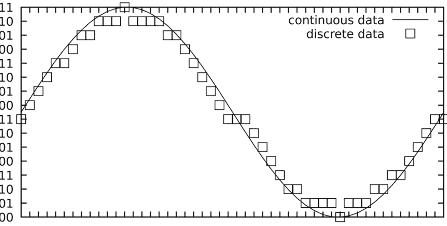

图 2 离散与连续信息。


图 3 连续现实的离散快照。

### 0.1.2 历史与人性

Formal courses in discrete mathematics for computer science first appeared in the U.S. university curricula in the late 1970s. The rationale was that students of computer science needed exercise in mathematics related to applications and architectures of digital computers. The curriculum was later codified by the Association for Computing Machinery in a joint effort with the Mathematical Association of America. Early topics generally included analysis of algorithms, counting, propositional logic, and set theory.

面向计算机科学的离散数学正式课程最早出现在20世纪70年代末的美国大学课程中。其理由是计算机科学学生需要进行与数字计算机应用和架构相关的数学训练。该课程后来由计算机协会（ACM）与美国数学协会（MAA）共同努力制定为标准。早期的主题通常包括算法分析、计数、命题逻辑和集合论。

Over the past forty years, topics in discrete mathematics textbooks have expanded as computing topics have burgeoned, with college textbooks for discrete math now including several more subjects than were initially codified by ACM.²

过去四十年来，随着计算主题的不断涌现，离散数学教科书的主题已有所扩展，如今大学阶段的离散数学教科书包含的主题比ACM最初制定的标准多出若干门。²

Expanded coverage includes: automata theory, theory of computation, cryptography, information theory, and graph theory with various heuristics.

扩展的覆盖内容包括：自动机理论、计算理论、密码学、信息论以及带有各种启发式方法的图论。

¹B. Marion, “Discrete mathematics: Support of and preparation for the study of computer science,” Journal of Computing Sciences in Colleges, vol. 16, pp. 190–199, 2000. DOI: https://dl.acm.org/doi/10.5555/357697.357730. ⤢

¹B. Marion，“离散数学：对计算机科学研究的支持与准备”，《计算机学院计算机科学杂志》，第16卷，第190–199页，2000年。DOI: https://dl.acm.org/doi/10.5555/357697.357730。⤢

²D. Stanat and D. McAllister, Discrete Mathematics in Computer Science. Prentice Hall Englewood Cliffs, N.J., 1977, vol. 16, pp. 190–199 (Stanat & McAllister's text may be considered the first definitive textbook on discrete mathematics.) ⤢

²D. Stanat 和 D. McAllister，《计算机科学离散数学》。Prentice Hall，Englewood Cliffs, N.J.，1977年，第16卷，第190–199页（Stanat & McAllister的教材可被视为第一本确定的离散数学教科书。）⤢

The situation for students new to data science is, perhaps, mired by introductory courses that expose advanced topics too early. For example, it is not uncommon to see in an introductory data science text such sophisticated topics as machine learning, including cluster analysis and neural networks. This presupposes that the underlying principles and algorithms are understood by students, who may have just had their first exposure to statistical regression. Keep in mind that students of data science coming from varied interdisciplinary backgrounds often do not have adequate experience with computational systems to boldly go about such problem solving.

对于初学者来说，数据科学的状况或许会因入门课程过早涉及高级主题而变得困难重重。例如，在入门级数据科学教材中，出现机器学习（包括聚类分析和神经网络）等复杂主题并不罕见。这预设了学生理解底层原理和算法，而这些学生可能刚刚第一次接触统计回归。请记住，来自不同跨学科背景的数据科学学生通常缺乏足够的计算系统经验，无法大胆地进行此类问题求解。

## 0.2 预修知识

This book assumes no prior background in computer programming or statistics. The student should be comfortable with algebra at the college level. Some prior knowledge of the Linux command-line terminal would be helpful as some example programs may be run from the command-line.

本书不假定读者具备计算机编程或统计学方面的背景。学生应熟练掌握大学水平的代数。具备一些Linux命令行终端的先验知识将会有所帮助，因为一些示例程序可能需要从命令行运行。

## 0.3 UNIX

This book refers from time to time to the Unix operating system. Internet servers hosting Big Data are overwhelmingly Linux/Unix systems. These, in turn, are accessed by analysts remotely through various types of application interfaces, including database connections and Internet browsers. Derived from Unix is Linux, the most ubiquitous operating system in the world today. Of the top 500 supercomputers in the world, all run the Linux operating system.³ Most Internet servers are also hosted on Unix or Linux.

本书不时提及Unix操作系统。托管大数据的互联网服务器绝大多数都是Linux/Unix系统。分析师通过各种应用程序接口远程访问这些系统，包括数据库连接和互联网浏览器。从Unix衍生出的Linux是当今世界上最普遍的操作系统。世界上前500强超级计算机全部运行Linux操作系统。³ 大多数互联网服务器也托管在Unix或Linux上。

More data is being both generated and stored in a Linux/Unix environment than people realize. But it is easy to take for granted the architecture of our programming environment. When “properly” coded, we expect our programs to work smoothly, often oblivious to the extraordinary yet beautiful complexity of the underlying system. Some low-level aspects of such system complexity are illuminated by this book, which should be of particular interest to students of data science planning to work in data engineering.

在Linux/Unix环境中生成和存储的数据比人们意识到的要多。但我们很容易理所当然地接受编程环境的架构。当代码编写得“恰当”时，我们期望程序运行顺畅，常常忽略底层系统非凡而又优美的复杂性。本书揭示了此类系统复杂性的一些低级方面，这对于计划从事数据工程工作的数据科学学生来说尤为感兴趣。

³See https://top500.org ↗️

³参见 https://top500.org ↗️

### 0.3.1 编码规范

Coding is used in this book as a vehicle for learning the subject matter. You can learn the streets of the big city by studying a map. You can additionally walk the streets yourself and learn your way around through experience. To program is to walk the streets. Likewise, programming a statistics routine is a _learning-by-doing_ approach that seems to be effective for many students.

本书将编程作为学习主题的载体。你可以通过研究地图来了解大城市的街道。你还可以亲自走遍街道，通过经验熟悉环境。编程就是走街串巷。同样，编写统计例程是一种_边做边学_的方法，似乎对许多学生都有效。

Coding allows us to condense otherwise verbose descriptions of concepts into a relatively compact, albeit abstract, perspective. For example, code that tests conditions is used to augment concepts of mathematical proof.

编程使我们能够将原本冗长的概念描述浓缩为相对简洁（尽管抽象）的视角。例如，用于测试条件的代码被用来丰富数学证明的概念。

To an extent, this book uses a Forth-like code called _epop_ for its compact, yet natural language structure. _epop_ is designed as a teaching tool to help students learn discrete math for data science, with data processing in mind. _epop_'s postfix notation allows fairly concise mathematical expressions, which leads to relatively compact syntax. More about this coding convention is presented in [Appendix A](#), as well as in the online resources noted in [Appendix C](#).

在某种程度上，本书采用一种名为 _epop_ 的类Forth代码，因其简洁而又自然的语言结构。_epop_ 被设计为一种教学工具，帮助学生以数据处理为目标学习数据科学离散数学。_epop_ 的后缀记法允许相当简洁的数学表达式，从而产生相对紧凑的语法。有关此编码规范的更多内容将在 [附录 A](#) 中介绍，以及在 [附录 C](#) 中列出的在线资源中介绍。


## 0.4 作者简介

杰克·波普 自大数据还意味着一大堆软盘时代起就一直在处理财务数据。他就职于 Investment Economics（又称 System Goats），为对数据科学基础设施感兴趣的组织提供系统配置、指导和培训。他还是北亨内平社区学院计算机科学与数据科学系的系主任，以及双城 IEEE 计算机学会的主席。

## 致谢

我感谢我的同事和朋友，他们以各种方式为本书作出了贡献，无论是提出内容建议、编辑，还是给予鼓励。

特别是，以下人员（按字母顺序排列）因其重要贡献值得致谢：John Augustine、Phil Colangelo、Bruce Hanson、Yectli Huerta、Siva Jastthi、Chris Koehnen、Stephan Kolassa、Gary Lynch、Stephen Maresh、Ahmed Naumaan、Dipankar Saha、Chris Sahr 和 Ted Volk。

多年来，本书一直受益于北亨内平社区学院热心的计算机科学与数据科学学生的各种形式反馈。我在双城 IEEE 计算机学会的同事们也一直很有影响力并给予鼓励。

最后，我想纪念我的父亲 Jack Sr.，他让我认识到降低复杂性的重要性。他对吉他和电子学感兴趣，在20世纪80年代初，他制作了一台音频合成器。如[图 4]所示，该设备顶部有15个旋钮（电位计），一侧有18个开关，另一侧还有一些。总的来说，旋钮和开关的各级混合至少可实现三百种音效。这便是他对声音追求的全部。连接如此复杂的电路是一项需要持续测试和校准的挑战。地下室工作台上一直响着这样的口号：“保持简单！”翻译：将具有挑战性的问题分解为可执行的小任务。

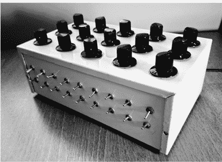

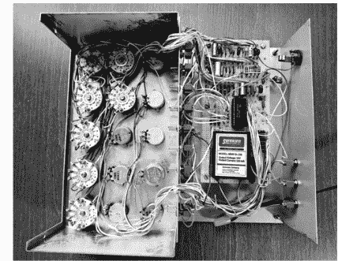

(a)

(b)

图 4 Jack Sr. 制作的合成器（a）及其电子电路（b）。

## I

## 问题求解

## 你的思维：一种编程环境

DOI: 10.1201/9781032687759-1

### 摘要

你为什么不吃掉你的书？那是吸收信息的一种方式。认真地说，解决问题的能力以及对事实在语境中的理解（知识）来自于在各种语境中解决问题。否则，我们可能会像拥有参考资料一样“毫不加思考地拥有知识”。如今这是一种趋势，因为简单编程任务的解决方案在互联网上很容易找到。当信息如此容易且免费地获取时，学生无需过度反思自己实际知道什么。

然而，当任务变得更具挑战性时，只有那些有解决问题经验的人才能应对。本章旨在通过介绍问题求解和编码的基本概念，为学生学习本学科内容做好准备。

## 1.1 伪代码

用自然语言描述问题是解决问题的第一步。我们可以按照一组指令（如烹饪食谱）来解决问题或完成任务。这些指令可以被翻译成机器可接受的形式，从而自动化手头的任务。在计算机语境中，食谱被称为算法，而它们的词语被称为代码。这样的通用食谱可以称为 _伪代码_。伪代码可以定义为算法的一般表达式，去除传达算法意义不必要的编程语言惯用语。

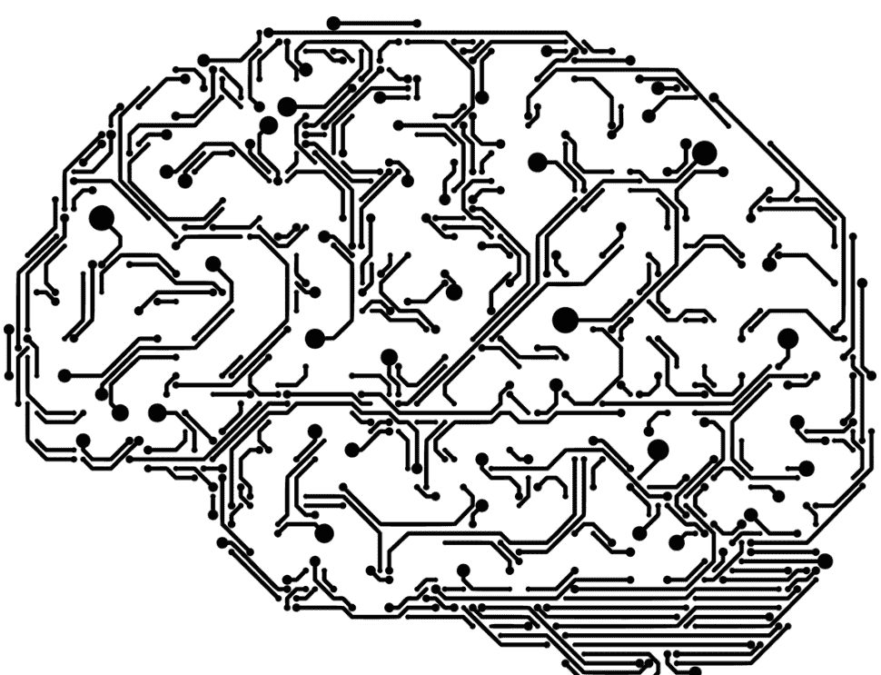

图 1.1 你的思维：一种编程环境。

有多种伪代码风格，与各种编程语言相对应。例如，Forth 编程语言与其伪代码风格相吻合，因为 Forth 已经具有自然语言结构。取决于你在 Forth 中为定义的词语命名的方式，语法读起来更像口语句子而非机器代码。（如前所述，本书使用一种称为 epop 的类 Forth 代码。）

莱奥·布罗迪在其著作 *思考 Forth* 的第二和第八章中很好地概述了 Forth 的伪代码方面，该书可在 https://thinking-forth.sourceforge.net 免费在线阅读。¹

¹ L. Brodie, *思考 Forth*。Punchy Publishing，2004年，ISBN: 0976458705。DOI: https://thinking-forth.sourceforge.net。

在 *思考 Forth* 中，第八章有一个关于最小化控制结构的章节。想象一下，你正在阅读一篇文章中的句子，当遇到某个词“summation”时，你需要去文章的另一段落中查找关于“add”的内容。这种脱节会打断阅读流畅度。理想情况下，我们应该更顺序地进入“summation”的上下文。因此，词语命名也应有助于理解含义。例如，在 Forth 以及 epop 中，我们可以定义词语 add 和 summation 来相加三个数字，如下所示：

```
: add+;
: summation add add;
```

可以看出，词语 summation 是在 add 的术语中定义的。在 epop 中，这些词语也可以用更加后缀的方式定义，如下所示，{ 花括号 } 包含了词语定义的特定表达式。

```
{+} add WORD
{add add} summation WORD
```

无论哪种方式，summation 的调用都在数值参数（3、5 和 7）之后，采用如下所示的后缀形式：

```
3 5 7 summation (→ 15)
```

在语言学领域，有人认为后缀表达式效率最高。考虑使用宾语-主语-谓语语法的语言，类似于美国手语中的模式。鉴于需要节省将声音转换为手势的努力，这种顺序对手语来说是有意义的。

考虑以下宾语-主语-谓语（OSV）与主语-谓语-宾语（SVO）的表达方式：

OSV: "Straw goats eat." ↔ SVO: "Goats eat straw."

OSV 将宾语和主语作为谓语的参数，优先强调宾语。

如此一来，Forth 的后缀记法允许相当简洁的数学表达式，转化为紧凑的语法。词语（函数）序列是自文档化的，类似于自然书写语言。这使思维能够专注于问题求解。相比之下，使用类 C 语言编码需要思维去解释独立语法范围之间的连接。考虑以下 C 代码：

```
int add(int a, int b) {
 int result = a + b;
 return result;
 }
```

```
int summation(int a, int b, int c){
 int result = add(a, b);
 return add(result, c);
 }
```

```
int main(int argc, char *argv[]){
 int a = atoi(argv[1]);
 int b = atoi(argv[2]);
 int c = atoi(argv[3]);
 print(summation(a, b, c);
 return 0;
 }
```

可以看出，这些用于 summation 和 add 的 C 函数相对冗长，并且没有传达顺序逻辑流。这是相对于函数式编程语言，过程式编程语言（如 C）的特点。

可以说，Forth 具有函数式编程范式的特征。函数式编程强调要完成什么任务，而过程式编程则更多涉及如何完成任务。在函数式编程成为时尚之前很久，Forth 就是函数式的。Forth 是查尔斯（查克）·穆尔 于20世纪60年代末的作品，可能从被认为是第一种函数式编程语言 Lisp 中汲取了灵感，Lisp 由约翰·麦卡锡 于1958年在麻省理工学院创立。查克·穆尔 是约翰·麦卡锡 的学生。

为什么不使用 Python 或 R？使用 Python 和 R，学生可以拥有内置抽象函数的能力，而不一定理解手头的问题。因为几乎任何问题都有 Python 和 R 库，这些库建议仅在通过用更自然的语言（如 Forth）表述来理解基础知识后才使用。

2. J. McCarthy, “History of lisp.” 特殊兴趣组：编程语言，第13卷，第8期，第173–185页，1978年，ISSN: 0362-1340。DOI: https://dl.acm.org/doi/10.1145/960118.800837。


## 1.2 通过代码系统化问题

如果你理解手头的问题，就可以开始编码来自动化其解决方案。数据可能会改变，但变量和函数将保持不变。

了解解决方案的模式后，可以倒推来归纳构建生成解决方案的逻辑。

例如，假设问题是计算数字列表的平方和。就抽象的数学符号而言，平方和可以表示为ΣNi²。如果你不确定所有这些的含义，则可以认为这项任务很复杂。将任务用文字表达出来会使其容易一些，如果这些文字本身就是一个可运行的程序，那就太棒了！

在*epop*编程语言中，我们可以按如下方式用单词定义来编写平方和例程。

通过复制一个数字来将其自身相乘，从而对其平方：

```
{DUP*}square WORD
```

对一个数字求平方，将其与列表中的下一个数字交换，对下一个数字求平方，然后将两个平方数相加：

```
{square SWAP square+}sumsquares WORD
```

使用输入数字2和3调用sumsquares操作并显示结果：

```
2 3 sumsquares ( → 13)
```

为了验证程序结果的正确性，我们可以设计一个断言函数，将算法结果与预期结果进行比对。例如：

```
{ 2 3 sumsquares 13 EQ } assert WORD
assert ( → 1, true)
```

EQ表达式是一个等价性测试。

在数据科学中，问题解决总涉及先获取输入数据，然后输出结果数据的函数。在计算机科学中常见的测试框架里，输入和输出通常分别被称为*前置条件*和*后置条件*。

函数的前置条件包括函数参数以及任何内部变量的初始值。函数的后置条件包括内部变量的最终值以及任何相关输出。

以下是为测试函数\(f(n) = n + 1\)而编写的断言步骤，该函数接受值为3的输入变量\(n\)（即前置条件），并将其变为4（即后置条件）。

将变量\(n\)设置为值3：

```
3 n!
```

“！”符号用于将变量设置为某个值。“@”符号将用于获取变量\(n\)的值。!和@的操作顺序为：“值 变量 !”然后“变量 @”。

定义一个函数\(f\)，用于对变量\(n\)执行递增（加1）操作：

```
{n @ 1 + n !} f WORD
```

定义函数assert，用于测试\(n\)的后置条件是否满足：

```
{f n @ 4 EQ} assert WORD
```

调用assert。输出1表示true，输出0表示false：

```
assert ( → 1,true)
```

在定义单词时，我们应该遵循将大问题分解为小问题的问题解决概念。这样一来，我们定义的单词将具有更具体、更可识别的目的。在编程术语中，这被称为*分解*。

当我们对代码（如单词或函数）进行分解时，会将其拆分为专门处理一般问题中某个组件任务的其他单词。随着函数定义变得广泛且复杂，对函数定义进行分解变得愈发重要。

这种分解让人联想到代数分解，例如：

```
\(x^2 + 3x + 2 \rightarrow (x + 2)(x + 1)\)
```

其中的因子为：\((x + 2)\)和\((x + 1)\)。

例如，为了处理任意数量的输入，一个复杂的未分解版本的平方和可能包含以下定义：(_警告！以下代码故意设计得复杂。_)

```
{{DUP* > R} GSC LREPEAT WAIT{R > +} GSC LREPEAT}
```

这种复杂的单词定义会使执行控制和问题隔离变得更加困难。然而，通过将操作分解为更小的单词定义，可以减轻额外的挑战。例如：

```
{ DUP * > R GSC 0 > squares ? } squares WORD
{ R R > + GRC 0 > sums ? } sums WORD
{ squares sums } sumsquares WORD
0 1 3 5 7 9 sumsquares ( → 165)
```

请注意，其中一些术语在epop中是预定义的。GSC和GRC是计数器。>R和R>是将数据移入和移出名为返回栈的容器的操作（我们将在线性结构章节中介绍栈）。squares函数会重复，直到GSC为0，由?操作符（象征if语句）决定。同样，sums函数会重复，直到GRC为0。

随着我们深入文本，上述代码将变得更加易懂。无论如何，你可能希望参考附录A和B中讨论的编码惯例。

在编程中，我们希望指令在执行时只影响其所需的参数，而不影响其他指令的参数。在编程语境下，这种属性被称为正交性。一套更具正交性的指令集能更好地避免副作用或非预期结果，包括来自不同指令的预期输出以及其他神秘错误。

当我们定义多个功能相似的复杂单词时，就为副作用敞开了大门。当操作涉及复杂嵌套的数据结构时，情况会更加严峻。此时，我们更可能遇到资源冲突，例如多个操作同时争夺单个数据栈的使用权。在这种情况下，最好为每个函数实例提供其自己的内部栈。

## 1.3 数据困惑

大数据总是必要的吗，抑或我们只是通过收集越来越多的数据来自娱自乐？也许人类天生对神秘事物着迷，复杂性亦是如此。这让人想起19世纪美国西部的淘金者，他们毕生致力于挖掘黄金，却常常一无所获。他们患有“淘金热”。如今，数据科学家则患有“数据热”。

数据挖掘的动机并不总是关于寻找信息金块。往往还有制度性动机。为处理大量数据而调动资源和劳动力，既可能受到机构预算、商业模式及其他管理层动机的影响，也可能取决于这些因素。这意味着，可接受数据特征集的依据可能并不明确。

在数据庞大且复杂的情况下，更容易掩盖错误，包括：

- 丢弃与目标相悖的数据子集（又称“挑樱桃”）。
- 膨胀数据复杂度/冗余度，以娱乐、混淆或给利益相关方留下深刻印象。
- 将精度和流程细节误认为相关性。

在高维数据主题中（我们将在数据维度章节中更详细地介绍），数据变换有可能使预测因子（因素）的数量成倍增加。考虑：

总因子数 = 因子数×变换数

如果我们还想为每个时间序列记录和变换加入滞后项，那么因子数将变为：

总因子数 = 因子数×变换数×滞后数

无论如何，我们最终都会被这种维度的指数级扩张所诅咒，其结果是因子数量超过观测数量，使得分析在统计上站不住脚（臭名昭著的“维度灾难”³）。

³R. Bellman, R. Corporation, and K. M. R. Collection, Dynamic Programming, ser. Rand Corporation research study. Princeton University Press, 1957. (“维度灾难”一词也许最早由Bellman在动态规划语境下提出。), ISBN: 9780691079516. [Online]. Available: https://books.google.com/books?id=wdtoPyAAACAAJ.

尽管存在冗余数据，但拥有计算能力，或者认为只要资源更多就能找到所寻结果，这种想法本身自带某种致命的自负。尽管拥有海量信息，或者也许正因如此，组织在竭尽全力的情况下，复杂性中仍会涌现出未预见的现象。

例如，在我对《跟上量化人员》（Keeping Up with the Quants，Davenport和Jinho Kim合著，2013年）的书评中，我提出以下观点：⁴

问题解决并非分析思维的核心。真空中的解决方案无法解决任何问题。问题必须被正确框架，以反映相关情境。随后，结果需要以一种便于正确解读的方式进行传达。

在任何组织中，分析并非简单的机械过程，而是一种沟通过程……你希望维护一个沟通框架，使分析工作始终与项目目标保持相关。因此，分析师与非量化利益相关方（可能包括经理、客户、供应商和支持人员）之间必须有效互动。

...


考虑一下著名的 Black-Scholes 期权定价模型的描述。虽然该模型经过严格的统计检验得出，但它建立在有缺陷的假设之上，例如无风险利率、基于任意期间的波动率，以及价格小幅且随机的正常波动，罕见事件被视为无关紧要。

如我们在投资系统中所知，如果毁灭发生在 1% 的时间里，99% 的准确性也是没有意义的。Long Term Capital Management 的 Black-Scholes 实践者以艰难的方式发现了这一点，最好是套用公式并过度杠杆，最糟的是在著名公式的营销面纱背后采用更可疑的方法。

也许作者本应将 Black-Scholes 用作不应效仿的示例，例如在讨论 AIG [美国国际集团] 对信用违约互换的错误分析时并列提及。这样的讨论将体现忽视上下文和应用错误假设的危险。

...

人性具有致命的自负，源于拥有稀有、优雅或令人印象深刻的复杂事物，例如某些定量方法。这种自负会使我们走向灾难。从安然到长期资本管理公司，从雷曼兄弟到 AIG，预测精度优先于预测相关性，因为一些使用令人印象深刻的定量方法的成功助长了傲慢和鲁莽。

[4] J. Pope，“跟上量化分析师（书评）”，《Foresight：应用预测国际期刊》，第 38 卷，秋季刊，第 38–40 页，2013 年。DOI: https://ideas.repec.org/a/for/ijafaa/y2013i1p38-40.html.

## 1.4 错误问题与昂贵解决方案

除了为理解良好的问题寻找难以捉摸的解决方案之外，当前问题可能尚未被理解，应该重新审视。

困难问题和错误问题都可能伪装成非确定性问题。错误努力的示例包括试图证明所有分数都高于平均值、在无理数的小数位数中分离模式，以及其他试图解决未被理解的问题的任务。这些是令人烦恼的问题，将在可计算性章节中更深入地探讨。

古代炼金术士曾试图通过化学合成黄金。尽管黄金的原子结构已知，但这样的解决方案远非经济。这不仅仅是拥有合适工具的问题。当问题被理解后，就可以制造合适的工具或实用算法。例如，在电子等竞争性行业中，有价值的设备会定期进行逆向工程。

为了进步，最好尽早识别无法解决的问题和错误的假设。

## 1.5 复杂性中的问题求解

只有在理解问题后，其解决方案才能简洁或优雅。相反，当问题仅被知晓存在但未被理解时，通向解决方案的工作可能涉及大量失败的实验尝试。有时需要这样的实验来在智力上隔离问题的真实本质，然后提供合适的解决方案。当实验成本高昂时，这可能是不希望的。在计算机编程中，通常最重大的成本是你的时间。

程序中的代码膨胀表明，要么某个单一问题未被理解，要么该程序实际上在解决多个不同的问题。

程序中反复出现的某些相似代码段暗示了将这些部分凝练为单一抽象/通用模块的机会，放在一个地方，可在其他地方使用（导入、调用、扩展、...）。与其为所有可能的 ... 穷尽所有可能的解决方案，不如相信抽象解决方案存在于一般问题集中。

抽象本身与理解问题、上下文以及任务可用工具相一致。这允许更高效地利用你的时间和资源。

问题求解涉及认识问题的一般解决方案的抽象方面，然后针对当前问题的具体细节定制解决方案。该过程需要研究以及试错。因此，工作从抽象概括推进到具体实现。

抽象使程序员能够将精力集中在问题求解上，而不是特定函数或对象的内部架构或组成上。这也允许一个称为 _信息隐藏_ 的概念，即内部架构禁止外部检查。

考虑一下，口语中的单词是意义的抽象，包含其他单词。当与其他单词组合时，它们通常描述一个上下文。

抽象与概括一致。程序员可以根据酌情将广泛的框架打磨为特定解决方案，且一个解决方案可以与另一个不同。程序员可以扩展编程语言的抽象设施，或许通过用新函数覆盖或包装一个函数来实现先前未曾预料的功能。

例如，驾驶汽车不需要了解汽车发动机的机械方面。驾驶员只需操作几个控件。如果问题是从市场取回农产品，解决方案不是制造发动机，而是驾驶汽车。同样，可以使用编程语言的内置函数，而无需了解构成这些函数的算法。

这并非说应该理所当然地接受抽象，或只需记忆程序。为了以相关的方式应用分析工具，意识到上下文很重要，对于数据科学，还需要理解数据和功能抽象与其原始根源之间的关联。

探究分析的更深层影响在其他领域也很常见。这让我想起大学时，我的朋友 Mike 告诉我他的牙科学校实验室作业。在他详细描述了对分配给他的尸体进行广泛解剖后，我问：“Mike，这与成为牙医有什么关系！？”他回答：“头部和上半身的肌肉和神经根连接了一切。”

“看，即使是牙医也必须意识到，看似边缘的事情实际上可能是知识体系中不可或缺的一部分。”

## 1.6 问题求解的挑战

在编写程序来处理问题之前，必须存在对问题的理解。否则，程序将不相关，问题的本质可能会被冗余的复杂性所模糊。

当问题被转换为编程语法以编写解决问题的程序时，通常存在两个维度的复杂性：当前问题的参数和编程语言语法。

然而，当学生试图通过先转换示例代码来解决问题时，他们实际上面临第三个维度的复杂性：示例代码的逻辑。示例代码本身可能是一种拐杖，无法帮助学生增强问题求解能力。因此，从头开始编写程序来解决问题通常更好。

理解问题需要就问题提出问题。提出问题可以帮助你有效地将问题分解为更小的问题。这些问题不一定要指向任何人，只需指向我们自己，因为一旦你孤立了一个问题，你就离答案和更多问题近了一半。

因此，提出一个解决方案，并在构建解决方案的过程中逐步测试该解决方案。如果你对问题有相当好的掌握，可以开始编写其解决方案，在过程中回顾细节，并将程序输出与已知正确值进行验证。

## 1.7 问题求解的心理调适

如果面对分析难题时你容易恐慌，无论出于何种原因，你的问题求解能力都会受到限制。例如，在截止日期前一天晚上才开始做作业的学生往往会恐慌，发现自己无法冷静地解决问题。他们可能反而会被诱惑去向他人寻求现成解决方案，这无法培养问题求解能力。

无论学生是否擅长在压力下出色完成任务，只要开始得太晚，合理组织作业资源的后勤工作可能都无法实现。可能没有足够的时间进行研究、构思想法，并就自己的问题进行后续研究。此外，如果你一天中最精力充沛的时间都用于非作业活动，那么你就需要审视自己的优先事项。

对许多学生来说，关键是在截止日期前很久开始做作业，并且在头脑休息好了且保持警觉的时段开始。

> 晚开始 → 恐慌：
> 大脑的非分析区域处于生存模式。
> 早开始 → 放松：
> 大脑的分析区域处于抽象问题求解模式。

有时即使是最勤奋的学生也无法管理好自己的日程。这可能是因为他们还没有学会如何高效分配紧凑的日程。

尽早开始一项任务，你就有时间探索自己的想法。这也为关于问题解决/编程的自由联想日记写作提供了时间，就像作家使用日记来克服写作障碍一样。写了一会儿之后，一旦与外界隔绝，你很可能会进入一种专注于当前问题的思维流。

## 1.8 问题求解的书籍

- G. Polya, 《如何解题：数学方法的新方面》.⁵
- V. Anton Spraul, 《像程序员一样思考：创造性问题求解导论》.⁶


- Paul Vickers, *像程序员一样思考：给困惑者的问题解决。*7

## 练习

- 1. 研究一下由18世纪经济学家亚当·斯密推广的*劳动分工*概念。讨论*劳动分工*与问题求解和抽象中的泛化有哪些关联方式。

- 2. 假设在一个大型程序中存在十段特定的代码，这些代码在整个程序中反复出现多次。说明可以或应该对此做些什么。

- 5 G. Polya, *如何解题：数学方法的新方面*. Princeton University Press (重印版), 2014, ISBN: 069116407X.

- 6 V. A. Spraul, *像程序员一样思考：创造性问题解决导论*. No Starch Press, 2012, ISBN: 1593274246.

- 7 P. Vickers, *像程序员一样思考：给困惑者的问题解决*. Cengage Learning, 2008, ISBN: 1408065827.

## II 元素

### 原子与抽象

DOI: 10.1201/9781032687759-2

### 摘要

能够区分简单和复杂数据类型是数据科学的一项重要基本技能。

通常有两种数据。有一种是单个数字，本身无需解释。它是_原子_的，因为它是不可约的，我们可以将其视为一个单一对象或元素。原子元素也可被称为基础或_原始_元素。相反，复杂数据是原始元素和其他复杂元素以及函数的集合的组织。此类元素组织可被称为_抽象数据类型_或简称为_抽象_，并通常以一个名称符号化。

## 2.1 数据的含义

### 2.1.1 原子数据

*原子*数据元素是不可约的。¹这包括与某个集合或抽象对象中的其他值不相关的单一数值数据。此类单一或原子数据包括整数和分数等数字，以及字符。在机器环境中，在硬件层面，单个数据值以二进制（基数为2）格式表示。

¹“数据”一词源自拉丁语，是datum的复数形式。在英文技术著作中，data常被用作单数概念。

就编程语言的编译器而言（一种将源代码翻译成机器码的程序），其语法字符与整数相关联，这些整数如今符合*Unicode标准*。每个字符都是一个字形，即字符的图形表示。并且每个字符均按照Unicode标准与特定整数相关联。

字形图像本身实际上是一个由数据组成的文件。在编译期间，分配给Unicode字符的数值被读入数据结构中。数据结构是数据的特定组织形式。数据结构在本书的*数据组织*部分中有深入讨论。

单个原子数据值将适合计算机*中央处理器（CPU）*的单个寄存器中。寄存器是构成CPU二进制数据和指令的1和0比特的容器。在当今典型的零售计算机中，单个寄存器容纳一个64位数字。另一方面，内存通常以字节（每个8位）存储，这意味着64位数字在内存中占用八个地址。

布尔类型是最简单的原子值，因为它们仅计算为真和假。在机器术语中，1表示真，0表示假。以1和0为基础的此类布尔逻辑构成了计算机体系结构的逻辑基础。

例如，要评估两个数字（5和5）是否相同，可以使用内置单词NEQ，表示*不等效*。如果语句为真，NEQ结果为1；如果语句为假，结果为0。

```
5 5 NEQ ( → 0)
```

相反，有人可能希望定义复杂的单词来以*真*和*假*的方式评估等效性，例如：

```
{ 1 } t WORD ( define t as 1)
{ 0 } f WORD ( define f as 0)
{ 1 EQ t f ?? } true WORD ( define a true condition)
{ 0 EQ t f ?? } false WORD ( define a false condition)
1 true ( → 1 for true)
1 false ( → 0 for false)
```

顺便提一下，上述代码中由其他值组成的定义是抽象。这包括*真、*假、*t*和*f*的定义。相反，那些无法被约简的值（如定义中的数字）被视为原子。??符号是IFELSE的别名，在此情况下，它根据EQ的布尔输出激活*t*或*f*。（有关上述语法的更多上下文，请参阅附录A，编码惯例。）

Lisp编程语言可能是第一个定义名为*原子*的单一元素的语言。由于数字等值是不可约的，它被称为原子，这一术语可能由Lisp的发明者John McCarthy于1958年左右创造。Lisp还将单个单词（在计算机科学中称为*字符串*）视为原子，从而引发了一些争论。2

当原子被调用（执行）时会被求值。也就是说，简单地陈述一个单词或数据就足以执行它并暴露其行为。然而，求值可以推迟到以后需要该单词时，例如当单词是另一个单词定义的组成部分时。这种处理方式被称为*惰性求值*的一种形式。

*epop*语言中的以下示例演示了立即求值与惰性求值之间的区别。首先定义两个列表x和y。然后，定义一个包含两个未调用列表定义（x和y）的列表xy：3

```
{ 1 2 } x LIST
{ 3 4 } y LIST
{ x, y, } xy LIST ( The commas delay evaluation of x and y.)
```

调用xy将反过来调用其各个成员（x和y）的LIST构造函数。

```
xy
{ 1 2 } x LIST { 3 4 } y LIST ( The result of xy.)
```

或者，考虑如果xy被定义为允许立即求值其成员x和y，例如：

```
{ x y }xy LIST
```

那么，xy的内容将为{ 1 2 3 4 }。

2 R. Chassell, 《Emacs Lisp编程导论》. GNU Press, 2004. （参见第5页的第1.1.1节。）ISBN: 1-882114-43-4. DOI: https://www.gnu.org/software/emacs/manual/html_node/eintr/Lisp-Atoms.html.
3 术语LIST是epop语言中的一个关键字，用于定义列表。它本质上是一种函数。

当函数被视为数据时，它们可能被称为高阶函数，这是现代函数式编程学科中相关的概念。高阶函数可以将函数作为参数，也可以将函数作为结果返回。

例如，下面代码中的单词IFELSE将单词if和else作为参数，仅在istrue?为真时求值if，结果为2。否则，求值else，结果为5。（注意，此处istrue?被定义为随机选择0表示假或1表示真。）

```
{ 2 } if WORD
{ 5 } else WORD
{ 0 1 RAND } istrue? WORD
istrue? if else IFELSE
```

### 2.1.2 抽象数据

数据不仅限于简单的字符和数字。还有自定义或用户定义的数据类型。这些称为抽象数据类型，或ADT。抽象数据类型可能由字符、数字和函数等原始值以及其他抽象数据类型组成。抽象的形式包括与数据值和机器指令（函数）相关的名称（变量）。

最终构成抽象数据的原始值是计算机的命脉。在计算机的最低级别，机器指令以二进制操作码或opcode的形式给出。然而，由于二进制难以记忆，每个操作码都有一个称为助记符字的别名，可以有些描述性。在我们称之为程序的操作序列中，使用助记符代替操作码使编码更容易，为


程序员。机器助记符被认为是不可约具体对象的最低抽象层级。

## 2.2 抽象函数

抽象函数会*概括隐去*或隐藏其所体现的其他函数的细节。同一代码的多个实例中共有的细节代表了合并的机会，即使用更通用的形式进行复制和扩展。这样我们就可以创建一个层次结构：一个包含通用属性的父对象和子对象，子对象可以具有专用属性，以及从父对象继承的属性。这提供了代码复用和模块化的效率。

抽象解决方案存在是为了解决一般类别的问题。具体解决方案取决于将抽象解决方案打磨成针对特定问题的特定应用。因此，问题解决取决于将问题隔离为一般抽象类别中的一个，然后使用附加功能和数据修改抽象解决方案。

这是一个简单的具体操作，由两个原始值和一个加法函数组成。请注意，在后缀表示法中，要将 2 和 3 相加，我们先写加数，最后写运算。

```
2 3 +
```

相比之下，这里有一个基于另一个抽象词 w0 的抽象词 w1，而 w0 本身由原始值 p0 定义。

```
{ p0 } w0
{ w0 p0 } w1
```

根据等式的*替换属性*，以下表达式与 w1 等价：

```
{ { p0 } p0 }
{ p0 p0 }
p0 p0
{ p0 } { p0 }
w0 w0
```

假设我们希望定义一个操作来计算各种矩形图形的面积。由于我们事先不知道可能出现的所有矩形的尺寸，因此我们定义了一个包含高度 h 和宽度 w 抽象的通用公式。因此，面积公式为：

```
h w *
```

我们通过用标签表示它来进一步抽象化这一点。我们将使用术语 WORD 来表示其作为*构造函数*的目的，该构造函数定义单词的参数和操作序列。

首先，我们可以简单地定义 rectangle_area 为：

```
{ * } rectangle_area WORD
```

根据乘法运算符 * 的定义，单词 rectangle_area 必须接受两个参数，一个用于高度的数字和一个用于宽度的数字。因此，我们可以计算矩形面积如下：

```
5 7 rectangle_area ( → 35)
```

如果我们希望将 h 和 w 的抽象作为参数嵌入到 area 中，那么我们可以先定义一个名为 hw 的列表：

```
{ 5 7} hw LIST
```

然后将 hw 列表作为 area 单词的参数：

```
hw area ( → 35)
```

这举例说明了在函数应用期间，具体值如何替换标签。

通过抽象类型的嵌套，一个包含在另一个之中，我们实际上拥有了一个层次结构，即父子关系。这使我们能够进行代码复用，即将更通用上下文中的代码重新用于不同的或具体的应用。例如，在以下代码中，单词 shape 包含了单词 h 和 w。同样，单词 rectangle 包含了单词 shape 和 area。

```
{ 5 } h WORD
{ 7 } w WORD
{ h w } shape WORD
{ * } area WORD
{ shape area } rectangle_area WORD
rectangle_area ( → 35)
```

如你所推断，抽象本身不仅可以包括抽象数据，还可以包括在所谓的*高阶函数*上下文中的其他单词，如前面所述。

考虑单词 *average* 作为用户定义函数，以计算用户定义的数字列表 *list* 的平均值，对这些数字求和的操作，由 *n* 给出的这些数字的计数，以及由 / 给出的除法操作。

```
{ 2 3 5 } list LIST
{ list sum n / } average WORD
```

这些组件是计算平均值内部操作的抽象。这里对待它们既是数据也是函数，表明这些单词是高阶函数。

*list* 的长度 *n* 可以定义为：

```
{ list ' LEN } n WORD
```

可以定义一个 *sum* 函数，重复直到 *list* 中的所有元素都被处理。也就是说，重复直到由 GSC 函数确定的堆栈大小不再大于 1。

```
{ + GSC 1 > sum ? } sum WORD
```

可以定义一个 *average* 函数，在列表上执行求和和除法操作：

```
{ list sum n / } average WORD
```

调用 *average* 生成一个结果：

```
average ( → 3.33)
```

上述语法的更多上下文可在附录 A 和 B 中找到。

## 练习

- 1. 从抽象的角度讨论以下术语之间可能的关系：金属、设计、发动机、控制装置、仪表、汽车、雪佛兰 Nova。
- 2. 当将抽象用作程序的设计原则时，你应该关注通用功能还是特定代码实现？请解释。
- 3. 描述程序员如何从原始元素和其他抽象元素中构建抽象数据元素。
- 4. 描述概括化如何与定义数据集、代码等中的抽象相关联。
- 5. *惰性求值*对函数调用意味着什么？
- 6. 从一般术语上讲，描述抽象在某些对象层次结构中的含义。

## 数字

DOI: 10.1201/9781032687759-3

### 摘要

在数据科学中，数据类型的组织是数据分析和存储过程中的早期步骤，紧随从源以某种原始格式摄取数据之后。

数字以多种方式分类，数字的符号、小数模式和基数是最普遍的考虑因素。例如，数字可能是整数，如 5，或循环小数，如 0.333…。人们通常习惯的数字基数系统是基数 10（十进制）。在编程语言中，数字的分类对其数据类型至关重要。

数字的机器表示是离散数学的一个应用。数字计算机将连续的模拟输入分段（量化）为一系列离散值。在当今常见计算机的机器级别，负数、无理数和实数作为二进制（基数 2）的 1 和 0 进行操作和存储。

## 3.1 数字分类

在深入探讨数字类型和基数的转换方法之前，请考虑以下公认的定义和记法。

图 3.1 显示了带有某些数字分类子集的数字层次结构。例如，有理数和无理数是实数集的不同子集。这意味着每个有理数都是实数，每个无理数都是实数。表 3.1 提供了这些数字分类的详细信息。

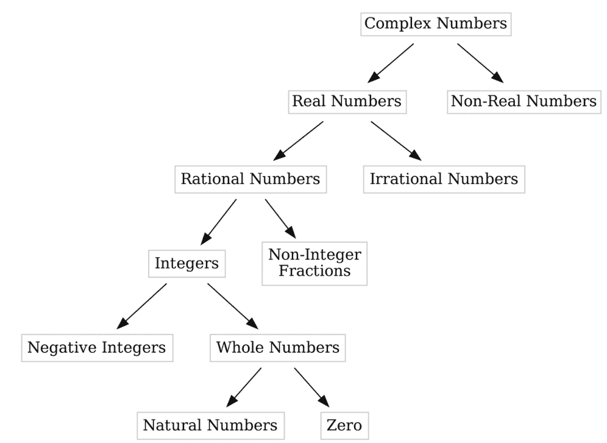

图 3.1 数字分类。

### 表 3.1 数字分类

表 3.1 摘要

| 符号 | 分类 | 示例 | 说明 |
|---|---|---|---|
| N | 自然数 | N = 1, 2, 3, 4, 5, ... | 也称为计数数。 |
| W | 完整数 | W = 0, 1, 2, 3, 4, ... | 包含零的自然数。 |
| ℤ | 整数 | ℤ = ..., -2, -1, 0, 1, 2, ... | 正负整数。 |
| ℤ+ | 正整数 | ℤ+ = 1, 2, 3, 4, ... | 与自然数集相同。 |
| ℤ– | 负整数 | ℤ– = ..., -4, -3, -2, -1 | 自然数的相反数。 |
| ℚ | 有理数 | -3/2, -1/3, 2/3, 3/5 | 整数与非零整数的比率。 |
| ...终止小数 | | 10/4, 2.5 | 小数点后有限的数字序列。 |
| ...循环小数 | | 2/7, 3.333... | 重复数字的无限序列。 |
| ℑ | 无理数 | e, π, √2 | 不重复数字的无限序列。 |
| ℝ | 实数 | 2, 3.45, -1/9, π, √2 | 有理数和无理数的组合。 |
| | 纯虚数 | 8i, 其中 i = √–1 | 实数与 i 的乘积。 |


| 符号 | 分类 | 示例 | 说明 |
|---|---|---|---|
| C | 数字<br>复数 | 2/3, -3i, 4 + 5i | 所有 a + bi 形式的数字。a 和 b 是实数。 |

图 3.2 展示了编程语言的典型数据类型层次结构。数据类型在编程语言中被定义，用于处理不同类型的数据，例如原始数字和字符及其集合，以及对这些类型的用户定义抽象。在内部，字符数组和浮点数数组分别表示字符串和复数。我们将在即将到来的章节中讨论此层次结构的详细信息。

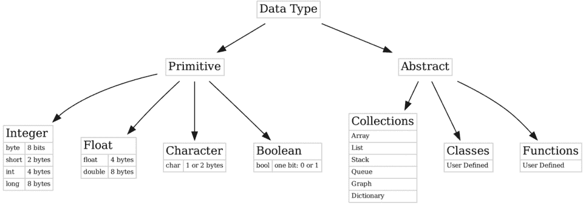

图 3.2 编程语言的典型数据类型层次结构。

## 3.2 计算机数字

在机器级别，数字被计算和存储为 *二进制*，它是数字的 2 进制表示。计算机的 *中央处理器*（CPU）在 CPU 寄存器中对二进制数进行操作，这些寄存器由一系列被称为 *位*（bit）的二进制 1 和 0 组成，bit 是二进制数位的缩写。

如今，寄存器通常为 64 位宽。64 位变量的内存分配可能被称为 *双精度*，而 32 位变量的内存分配则称为 *单精度*，具体取决于计算系统的底层架构（CPU 类型和程序指令）。本书 *IEEE 754 浮点标准* 部分有关于精度的更多内容。

CPU 从 *计算机内存* 中存储和检索数据，每个内存地址存储一个字节（8 位）的数据。

不同的计算机和编程语言存储数字和字符所需的内存空间不同。例如，具有 32 位寄存器的 CPU 很可能具有 32 位内存寻址，存储一个整数需要四个连续的字节内存。

对于字母字符，32 位寄存器的前八位通常会将该字符的整数表示映射到一或两个字节的内存。该整数将与字符的 Unicode 值一致。例如，字符 'A' 在 Unicode 中由整数 65 表示。在 8 位二进制中，整数 65 是 01000001。

这些八位字符位的可能组合总数是 2^8，这意味着一个字节的存储可以容纳 256 个字符中的任何一个，而在具有 32 位寻址的系统中，四个字符的字符串可以驻留在单个内存地址上。

通过确保此类 *字符编码* 在您的编程环境中保持一致，可以避免一些神秘的编程错误。因此，如今计算系统和语言通常遵循 *Unicode 字符集*，它是普遍接受的。

Unicode 为语言环境（如英语）中的每个字符分配一个不同的整数。Unicode 的前身是 ASCII（美国信息交换标准代码），它现在是 Unicode 的一个子集。[^1]

操作系统库中包含用于生成各种字体样式字母数字字符的数据文件。这些字符字体也称为 *字形*。每个字符的字形都与一个 Unicode 整数相关联。拥有这样的数字有助于计算机对文本进行检索、排序、搜索和其他处理。[^2]

## 3.3 文件扩展名

文件的扩展名通常标识文件中的数据类型。常见的扩展名有 .csv、.html、.json、.sql、.txt、xml 和 .yaml。然而，二进制文件可能有各种扩展名，例如 .dat、.o、.obj、.png 和 .raf。此外，可执行二进制文件在 Unix 中通常没有扩展名，而在 Windows 中则具有 .exe 扩展名。

[^1]: 检查 ASCII 和 Unicode 值的有用在线资源包括 https://unicodelookup.com、https://home.unicode.org 和 https://ascii-code.com。
[^2]: 关于 Unicode 字体的更多信息：https://unifoundry.com/unifont/unicode-utilities.html。Linux/Unix 中的字体字形：https://kbd-project.org/docs/font-formats/font-formats-1.html。关于控制台字符的深入讨论：https://forums.freebsd.org/threads/cp437-display-on-console.91866

## 3.4 计算机数字术语

- 位 - 机器逻辑门或寄存器中的开启（ON）或关闭（OFF）状态，或 0 或 1；一个内存位置。计算机硬件中的位状态取决于电压阈值，例如关闭为 0v 到 2v，开启为 3v 到 5v。

- 二进制数 - 机器逻辑门和寄存器能够轻松容纳的 2 进制数。现代系统会自动将数字的各种进制表示转换为二进制，以执行机器指令。例如，二进制 0b10101 等同于十进制 0d21，其中二进制数由 0b 前缀标识，十进制数由 0d 前缀标识。

- 字节 – 8 位。内存按字节寻址，一个字节是从内存读入 CPU 的最小数据量。

- 半字节 – 半个字节或 4 位。半字节允许在一个字节中存储两个 4 位值。

- 字 – 32 位系统为 4 字节，64 位系统为 8 字节。除非在处理单字节或 2 字节半字，否则现代 CPU 默认按字从内存将数据读入 CPU。

- 千比特 (Kb) – 1024 位。用于描述每秒数据传输速度的常用单位。

- 千字节 (KB) – 1024 字节。用于描述内存使用量的常用单位。

- 八进制 – 数字的 8 进制表示。八进制用于 Unix 文件系统以指定文件权限。例如，八进制 0o21 等同于十进制 0d17，其中八进制数由 0o 前缀标识，十进制数由 0d 前缀标识。

- 十六进制 – 数字的 16 进制表示。16 进制便于以较小的空间可视化大数字，例如内存地址。两个十六进制数字存储一个完整的字节。一个十六进制数字存储一个半字节。例如，十六进制 0x21 等同于十进制 0d33，其中十六进制数由 0x 前缀标识，十进制数由 0d 前缀标识。

十六进制在较小的空间中查看大数字很有用。与之形成对比的是二进制，它包含长长的 1 和 0 字符串。鉴于十六进制容纳十进制数字 0 到 15，我们使用 A B C D E F 表示 10 到 15 的六个数字。十进制数 16 在十六进制中是 10，即 0x10。

图 3.3 显示了一个名为 hexdump 的 Unix 工具，它以十六进制形式显示值。使用十六进制，二进制文件或程序的内存表示可以更紧凑地显示。在此示例中，十六进制数字对是程序数据。每个数字表示 16 位或两个字节的数据。内存地址在第一列，也采用十六进制。

```
$ hexdump -C epop | head
00000000  7f 45 4c 46 02 01 01 09  00 00 00 00 00 00 00 00  |.ELF............|
00000010  02 00 3e 00 01 00 00 00  10 9f 23 00 00 00 00 00  |..>.....#.......|
00000020  40 00 00 00 00 00 00 00  00 f3 1a 00 00 00 00 00  |@...............|
00000030  00 00 00 00 40 00 38 00  0c 00 40 00 2f 00 2d 00  |....@.8..@./.-.|
00000040  06 00 00 00 04 00 00 00  40 00 00 00 00 00 00 00  |........@.......|
00000050  40 00 20 00 00 00 00 00  40 00 20 00 00 00 00 00  |@. ....@. ....|
00000060  a0 02 00 00 00 00 00 00  a0 02 00 00 00 00 00 00  |...............|
00000070  08 00 00 00 00 00 00 00  03 00 00 00 04 00 00 00  |...............|
00000080  e0 02 00 00 00 00 00 00  e0 02 20 00 00 00 00 00  |.......... ....|
00000090  e0 02 20 00 00 00 00 00  15 00 00 00 00 00 00 00  |.. ............|
$
```

图 3.3 十六进制格式中的已编译程序机器代码文件。

根据您正在处理的程序或计算机硬件的类型，您可能希望强制使用特定的进制。如果您的程序模拟特定数量的状态，则可以实现该进制。

例如，Unix/Linux 操作系统中使用八进制符合文件权限的八种可能排列，表示文件的读取（r）、写入（w）和执行（x）权限。文件权限使用数字指定：0 表示无，4 表示读取，2 表示写入，1 表示执行。这些数字可以表示总共 8 个权限级别，即 0 到 7（因此使用八进制）。

表 3.2 显示了单个用户的可能权限设置。[^3]

### 表 3.2 Unix 文件系统中的八进制文件权限组合


| 权限 | 符号 | 八进制 |
|---|---|---|
| 读取、写入 & 执行 | rwx | 7 |
| 读取 & 写入 | rw | 6 |
| 读取 & 执行 | rx | 5 |
| 只读 | r | 4 |
| 写入 & 执行 | wx | 3 |
| 只写 | w | 2 |
| 只执行 | x | 1 |
| 无 | | 0 |

在 Unix 操作系统中，文件和目录有三种用户类型：所有者（也称为用户）、群组和其他人。因此，对于文件的三种用户类型，可能存在 8³ 种文件权限设置。

> ³FreeBSD 手册。FreeBSD 文档项目，2021 年。（有关设置 Unix 文件权限的详细信息，请参见第 3.4 节章节。）DOI: https://www.freebsdhandbook.com/basics/#permissions.

例如，Unix 三种用户类型的显式文件权限可能具有读取 (r)、写入 (w) 和执行 (x) 的组合，模式为 rwxr-xr-x。即，所有者拥有完整权限，而群组和其他用户仅拥有读取和执行权限。755 的等效八进制表示如表 3.3 所示。

### 表 3.3 Unix 三种用户类型的文件权限

| 所有用户 | 所有者 | 群组 | 其他 |
|---|---|---|---|
| -rwxr-xr-x → | r + w + x | r + x | r + x |
| | 4 + 2 + 1 | 4 + 1 | 4 + 1 |
| 755 → | 7 | 5 | 5 |

图 3.4 显示了一个生成 ASCII 表的程序的输出，该表以四种进制显示字母 A 到 Z：十进制（基数 10）、二进制（基数 2）、八进制（基数 8）和十六进制（基数 16）。将数字转换为不同进制的方法在“数字转换”一章中讨论。

该程序可在附录 C.12 中找到。

```
epop>
epop> ascii 1 RUN
chr           dec     bin             oct     hex
A             65      b1000001        101     h41
B             66      b1000010        102     h42
C             67      b1000011        103     h43
D             68      b1000100        104     h44
E             69      b1000101        105     h45
F             70      b1000110        106     h46
G             71      b1000111        107     h47
H             72      b1001000        110     h48
I             73      b1001001        111     h49
J             74      b1001010        112     h4A
K             75      b1001011        113     h4B
L             76      b1001100        114     h4C
M             77      b1001101        115     h4D
N             78      b1001110        116     h4E
O             79      b1001111        117     h4F
P             80      b1010000        120     h50
Q             81      b1010001        121     h51
R             82      b1010010        122     h52
S             83      b1010011        123     h53
T             84      b1010100        124     h54
U             85      b1010101        125     h55
V             86      b1010110        126     h56
W             87      b1010111        127     h57
X             88      b1011000        130     h58
Y             89      b1011001        131     h59
Z             90      b1011010        132     h5A
epop>
```

### 图 3.4 表示 ASCII 代码的程序输出。

## 3.5 数字进制表示法

为防止歧义，数字的进制可以标注在数字旁边。例如，考虑十进制数字 16 在二进制中是 10000，在十六进制中是 10。因此，除非我们知道数字的进制，否则我们会面临一些歧义——如果你看到“10”而不知道进制，你就不知道实际意图的是什么数字。

取决于你的编程环境，十六进制数字 10 可能写作 10₁₆、10r 或 10h。它也可能带有以下任何前缀：x10、0x10、\x10、$10、#10 或 & 10。

类似的前缀模式可以表示其他数字进制。例如：

- 0b 表示二进制。
- 0o 表示八进制。
- 0d 表示十进制。
- 0x 表示十六进制。

例如，二进制 1010 将加上前缀 0b，即数字 0 和字母 b，结果为 0b1010。

## 3.6 计算机术语与数学术语

计算机硬件将自然数作为非负整数读取，包括 0。在正式数学中，自然数定义为正整数，不包括 0。

计算机科学工作者通常接受一个数字的尾数是浮点数的有效数字（尾数）。例如，数字 24.68 由尾数（或有效数字）2468 乘以 10 的幂表示，如下所示：

24.68 = 2468 × 10⁻²

相反，数学对尾数有两种定义。一种是数字的小数部分，即小数点右边的部分，例如数字 24.68 中的数字 68。另一种是科学计数法中数字的第一部分，例如 2.45 × 10³ 中的 2.45。

## 练习

- 1. 存在多种数字类型（整数、实数 ...）以及数字进制（二进制、八进制 ...）。这些对计算机科学家为什么重要？考虑计算机在从模拟“现实世界”获取输入时用于离散上下文中的数字。

- 2. 讨论各种数字分类如何通过抽象相互关联，无论是直接还是间接。对于这三组关系中的每一组，讨论哪种分类更一般，哪种分类更具体。

- 3. 讨论编程语言的抽象数据类型如何与该语言的原始数据类型相关。在你描述的情况下，还要讨论一种数据类型可能比与其相关的另一种数据类型更一般（或更具体）。

- 4. 对每个值，描述它所属的分类（正整数、整数、有理数循环小数等）。
  - (a) 4
  - (b) 0
  - (c) 9/2
  - (d) -2/3
  - (e) -5
  - (f) 2π
  - (g) 2 + 3i

- 5. 什么是 Unicode 字符集，为什么使用它？

- 6. 定义以下术语：
  - (a) 比特
  - (b) 字节
  - (c) 半字节
  - (d) 字
  - (e) 千字节

- 7. 陈述每种系统的数值基数（或使用的符号数量）：
  - (a) 二进制
  - (b) 八进制
  - (c) 十进制
  - (d) 十六进制

- 8. 陈述每个前缀表示的基数：
  - (a) 0x
  - (b) 0d
  - (c) 0o
  - (d) 0b
  - (e) #

- 9. 将每个数字表示为一个有效数字（自然数）乘以 10 的幂：
  - (a) 31.451
  - (b) 0.82

## 数字转换

DOI: 10.1201/9781032687759-4

### 摘要

能够将数字从一种格式转换为另一种格式，通常可以让数据科学家加快分析速度。这项技能还有助于深入了解数据分发和存储任务，以及程序调试。

数字可以使用不同的进制、不同的精度或不同的符号以多种方式表示。此外，数值可以相对于一组值进行归一化和标准化。这些是在数据分析的预处理阶段（在从源检索原始数据后，在进行统计分析之前）的重要考虑因素。

改变数字的进制表示不应与改变其类型混淆。进制转换不会改变数字的值，只会改变符合另一种进制的符号。

## 4.1 进制转换

进制转换的一个有用考虑是识别一到十六的数字的序列模式。请记住十进制、二进制、十六进制和八进制的相应符号，如表 4.1 所示。

### 表 4.1 不同进制中的数字

▶ 表 4.1 摘要

| 十进制 | 二进制 | 十六进制 | 八进制 |
|---|---|---|---|
| 0 | 0000 | 0 | 0 |
| 1 | 0001 | 1 | 1 |
| 2 | 0010 | 2 | 2 |
| 3 | 0011 | 3 | 3 |
| 4 | 0100 | 4 | 4 |
| 5 | 0101 | 5 | 5 |
| 6 | 0110 | 6 | 6 |
| 7 | 0111 | 7 | 7 |
| 8 | 1000 | 8 | 10 |
| 9 | 1001 | 9 | 11 |
| 10 | 1010 | A | 12 |
| 11 | 1011 | B | 13 |
| 12 | 1100 | C | 14 |
| 13 | 1101 | D | 15 |
| 14 | 1110 | E | 16 |
| 15 | 1111 | F | 17 |
| 16 | 10000 | 10 | 20 |

同样，请记住表 4.2 中显示的 2 的幂。2 的幂是基数 2（二进制）数字系统中的位值，就像 10 的幂是十进制系统中的位值一样。

### 表 4.2 基数 2 的位值

▶ 表 4.2 摘要


| 2^0 是 1 | 2^4 是 16 | 2^8 是 256 | 2^12 是 4096 |
|---|---|---|---|
| 2^1 是 2 | 2^5 是 32 | 2^9 是 512 | 2^13 是 8192 |
| 2^2 是 4 | 2^6 是 64 | 2^10 是 1024 | 2^14 是 16384 |
| 2^3 是 8 | 2^7 是 128 | 2^11 是 2048 | 2^15 是 32768 |

如您已知，我们常用的十进制数字系统按10的幂次对其数位进行排序。也就是说，每个连续的位值是其右侧位值的10倍。例如，数字10,236由6个个位、3个十位、2个百位、0个千位和1个万位组成。

因此，我们可以使用以下对应关系，以所谓的列式记数法或位值记数法显式地表示数字的每个位值：

| base^4 | base^3 | base^2 | base^1 | base^0 |
|---|---|---|---|---|
| digit_4 | digit_3 | digit_2 | digit_1 | digit_0 |

请注意，下一行中的每个数位都是进位制数系统中的一个符号。例如，对于进制2，符号是0和1。因此，这些二进制数位将是0或1。

依赖于一定数量符号的基数的数字系统是位值数字系统的实现。在每个位置，不同的幂次大小决定一个数位的值。这些与非位值计数系统（如罗马数字和计数符号）形成对比。1

对于十进制中的数字10,236，我们有以下位值对应关系：

| 10^4 | 10^3 | 10^2 | 10^1 | 10^0 |
|---|---|---|---|---|
| 1 | 0 | 2 | 3 | 6 |

我们可以使用此对应关系作为进制转换的工具。从十进制开始，将位值对应关系扩展如下：

| 10⁴ | 10³ | 10² | 10¹ | 10⁰ |
|---|---|---|---|---|
| 10000 | 1000 | 100 | 10 | 1 |
| × | × | × | × | × |
| 1 | 0 | 2 | 3 | 6 |

注意规律：

10236 = 1 × 10000 + 0 × 1000 + 2 × 100 + 3 × 10 + 6 × 1
10236 = 10000 + 0 + 200 + 30 + 6

其他进制中的数字也可以类似地表示。考虑表4.3中十进制和二进制数位的列式对应关系，用于将十进制数字10,236转换为二进制1001111111100。

表4.3 数字的二进制列式对应关系

表4.3 摘要

| 2¹³ | 2¹² | 2¹¹ | 2¹⁰ | 2⁹ | 2⁸ | 2⁷ | 2⁶ | 2⁵ | 2⁴ | 2³ | 2² | 2¹ | 2⁰ |
|---|---|---|---|---|---|---|---|---|---|---|---|---|---|
| × | × | × | × | × | × | × | × | × | × | × | × | × | × |
| 1 | 0 | 0 | 1 | 1 | 1 | 1 | 1 | 1 | 1 | 1 | 1 | 0 | 0 |

为什么10,236的最高有效数位对应二进制中的2¹³列？因为2¹³是小于10,236的最大2的幂次。因此，该列为2¹³ × 1。

相反，10,236的下一个最高有效数位是0，对应2¹²。因此，该列为2¹² × 0。我们继续该过程，从左到右，直到到达*最低有效*（最右）数位，即2⁰。此时，十进制10,236的二进制等效值显示为二进制1001111111100。

以下是一个示例，展示十六进制27FC和十进制10236的列式对应关系。

| 16³ | 16² | 16¹ | 16⁰ |
|---|---|---|---|
| 4096 | 256 | 16 | 1 |
| 2 | 7 | F | C |

其中，2 × 4096 + 7 × 256 + 15 × 16 + 12 × 1 = 0d10236。

由此，数字的十六进制和十进制记数法的列式对应关系提供了一种将十六进制转换为二进制的快速方法。这是因为每个十六进制数位可以用四个二进制位表示。因此，如果你记住了表4.1中的四位模式，那么你将更擅长将十六进制转换为二进制。例如：

- 2 是 0010
- 7 是 0111
- F 是 1111
- C 是 1100

因此，0x27FC 是：0010 0111 1111 1100，或 0b0010011111111100。

### 4.1.1 幂法

与上述列式记数法相关的一种进制转换技术称为_幂法_。它选择能够容纳我们要转换的数字的*最高有效*（最左）数位的最大数值的列，然后是下一个，依此类推。这也被称为_Horner方法_或_Horner法则_。

我们可以应用Horner法则将任何进制的数字转换为十进制。通用计算形式为：

\(\sum S_n \times base^n\)

其中，_S_ 表示特定进位制数系统中使用的数值符号集合。_S<sub>n</sub>_ 是其中的一个符号。

一系列量级将具有以下多项式模式：

\(a_n x^n + a_{n-1} x^{n-1} + \dots + a_2 x^2 + a_1 x^1 + a_0 x^0\)

以下是一个使用幂法将0d84转换为二进制的示例。

- 1. 创建一个以2为基数的量级序列。
- 128 64 32 16 8 4 2 1
- 2. 在最大数（≤ 0d84）下方分配一个1。
- 128 64 32 16 8 4 2 1
- 0   1
- 3. 求84和64的差，即20。
- 4. 对0d20重复步骤2。
- 5. 重复，直到差值大于0。
- 6. 在16下方放置一个1，因为16是小于20的最大数字。

128 64 32 16 8 4 2 1
0   1   1

- 7. 求20和16的差，即4。

- 8. 在4下方放置一个1，因为小于0d4的最大数字是4。

| 128 | 64 | 32 | 16 | 8 | 4 | 2 | 1 |
| --- | --- | --- | --- | --- | --- | --- | --- |
| 0 | 1 | | | | 1 | | |

- 9. 求4和4的差，即0。

- 10. 差值为0时，用0填充剩余位置。

| 128 | 64 | 32 | 16 | 8 | 4 | 2 | 1 |
| --- | --- | --- | --- | --- | --- | --- | --- |
| 0 | 1 | | | | 1 | | |

二进制结果是 0b1010100。

> 很诱人想避免手动进行这些转换计算的乏味，而改用计算机程序。此类 *epop* 代码可在附录C.1和C.2节中找到。

### 4.1.2 余数法

另一种进制转换技术称为*余数法*。为加快此方法，我们将定义一些变量：初始数字N、目标进制B、商Q和余数R。

使用以下步骤：

- 1. 用N除以B以找到Q和R。
- 2. 记录R。第1个R将是最低有效（最右）数位。
- 3. 令N = Q。
- 4. 从步骤1重复，直到N > 0。

以下是一个使用余数法将0d84转换为二进制的示例。

| N/2 | Q | R |
|---|---|---|
| 84/2 | 42 | 0 |
| 42/2 | 21 | 0 |
| 21/2 | 10 | 1 |
| 10/2 | 5 | 0 |
| 5/2 | 2 | 1 |
| 2/2 | 1 | 0 |
| 1/2 | 0 | 1 |

二进制结果是 0b1010100。这是余数的累积。从顶部开始，第一个余数0放在最右或最低有效位置，最后一个余数1放在最左或最高有效位置。

另一个示例：使用余数法将0d56转换为十六进制。

| N/16 | Q | R |
|---|---|---|
| 56/16 | 3 | 8 |
| 3/16 | 0 | 3 |

结果是 0x38。请注意，我们最终得到余数3，因为16不能整除3。十六进制结果是从最右（最低有效）数位开始累积余数。

> 实现余数法的 *epop* 程序可在附录C.3中找到。

## 4.2 二进制编码十进制（BCD）

某些计算机系统使用一种称为*二进制编码十进制*或*BCD*的编码。在查找表中使用BCD是与二进制算术相比数字转换的高效方法。

BCD代码通常指*8421代码*，因为该名称表示4位二进制中的十进制数字8 4 2 1。数字8 4 2 1来自幂次序列 $2^3 2^2 2^1 2^0$。BCD代码有不同的方案，*8421*类型似乎最常见。

某些BCD方案为9以上的值定义了额外字段，如表4.4的第四列和第五列所示。在这种情况下，每个BCD数字分配8位。

| 十进制 | 十六进制 | 二进制 | BCD |
|---|---|---|---|
| 0 | 0 | 0000 | 0000 0000 |
| 1 | 1 | 0001 | 0000 0001 |
| 2 | 2 | 0010 | 0000 0010 |
| 3 | 3 | 0011 | 0000 0011 |
| 4 | 4 | 0100 | 0000 0100 |
| 5 | 5 | 0101 | 0000 0101 |
| 6 | 6 | 0110 | 0000 0110 |
| 7 | 7 | 0111 | 0000 0111 |
| 8 | 8 | 1000 | 0000 1000 |
| 9 | 9 | 1001 | 0000 1001 |
| 10 | A | 1010 | 0001 0000 |
| 11 | B | 1011 | 0001 0001 |
| 12 | C | 1100 | 0001 0010 |
| 13 | D | 1101 | 0001 0011 |
| 14 | E | 1110 | 0001 0100 |
| 15 | F | 1111 | 0001 0101 |

BCD可以轻松地将二进制转换为十六进制，将0到F的十六进制数位分为4位一组。这有时称为分组。

例如，将bcd0011010101分成4位一组后，具有以下十六进制关联：

```
0x3     0x5
0b0011  0b0101
```

在此特定BCD查找表中检查0x3和0x5，我们可以看到二进制是00110101，BCD是00000011 00000101。

考虑将0x9C转换为BCD。在二进制中我们得到10011100，而在BCD中我们得到00011001 000110010。因此，对于这种低级处理，了解计算机系统实现的是哪种二进制方案非常重要。

## 4.3 示例问题

**问题：** 将十六进制数2ED转换为十进制。提示：参考表4.1将十六进制与其二进制等效值关联。请注意，每个十六进制数位对应四个二进制数位。

| 十六进制 | 二进制 | 十进制 |
|---|---|---|
| 2 | 0010 | 2 |


| 十六进制 | 二进制 | 十进制 |
|---|---|---|
| E | 1110 | 14 |
| D | 1101 | 13 |

将这些数字乘以各自的权值，我们得到：

```
2ED = 2 × 16² + E × 16¹ + D × 16⁰
2ED = 2 × 256 + 14 × 16 + 13 × 1
2ED = 0d749
```

### 问题：将 0b1111010 转换为十六进制。

从右往左，将二进制字符串分成每组四位的段：
（对于片段 111 和 1010，我们必须在 111 前面插入一个零，以形成四位一组。）

```
0111 1010
```

根据你之前记下的基数比较表 4.1，将这些 4 位组转换为十六进制。

这给出了序列 0x7 0xA。因此，0b1111010 =
0x7A。

### 问题：使用幂次法将 0d333 转换为十六进制。

- 1. 在 333 中找到最大的 16 的幂：16² = 256。333 中 256 的个数：1。在 256 列写入 1。求差：333 - 256 = 77。
- 2. 在 77 中找到最大的 16 的幂：16¹ = 16。77 中 16 的个数：4。在 16 位写入 4。求差：77 - 16 × 4 = 13（0d13 = 0xD）。
- 3. 在 1 位写入 D。

解：1 4 D，即 0x14D

### 问题：使用余数法将 0d19 转换为八进制。

- 1. 用 19 除以 8，得到商为 2，余数为 3。
- 2. 将之前的商 2 除以 8。因为 2 小于 8，所以余数是 2（与之前的商相同）。

因此，0d19 = 0o23。

### 问题：使用余数法将 0d127 转换为八进制。

- 1. 用 127 除以 8，得到商为 15，余数为 7。
- 2. 将之前的商 15 除以 8，得到商为 1，余数为 7。
- 3. 将之前的商 1 除以 8，得到商为 0，余数为 1。注意，由于之前的商小于 8，在这一步之前的商与余数相同，都是 1。我们可以跳过此步骤，直接使用之前的商作为这一位。

因此，0d127 = 0o177。

## 4.4 负数的机器表示

在计算系统中，负数可以使用多种转换方式表示，我们将介绍以下几种：

- 符号-数值表示法。
- 反码。
- 补码。
- IEEE 754 浮点标准。

计算系统将设计为处理上述表示中的一种。也就是说，当今大多数商用计算机都实现了 IEEE 754 浮点标准。

由于机器实际上只执行加法，“减法”实际上是加上一个被变为负数的数。使用减法的数学定义，我们通过执行 a + (-b) 来得到 a - b。

在符号-数值表示法中，最高位用于表示符号：0 表示正数，1 表示负数。这意味着可以存在 +0 和 -0。在处理有符号数时，由于 1 位用于“+”或“-”，我们就少了一位，只能表示更小范围的数字。

处理负数的其他方法涉及所谓的反码和补码。要对一个数取反码，我们反转它的位。即，将所有的 1 变为 0，所有的 0 变为 1。例如，0101 变为 1010。

一旦理解了反码，你就可以通过在之前结果的基础上加 1 来轻松执行补码运算（丢弃最高位之外的进位溢出）。<sup>2</sup> 因此，前一个反码结果在补码表示中是 1011。

下面是将 0b00001100 转换为补码的示例。首先，取该数的反码：

| 0 | 0 | 0 | 0 | 1 | 1 | 0 | 0 |
|---|---|---|---|---|---|---|---|
| 1 | 1 | 1 | 1 | 0 | 0 | 1 | 1 |

接下来，在反码的基础上加 1：

```
  1   1
1 1 1 1 0 0 1 1
+ 0 0 0 0 0 0 0 1
-----------------
1 1 1 1 0 1 0 0
```

注意这两个进位位。请记住，在二进制中 1 + 1 = 10，因为 1 会进位到下一列。

补码二进制数会用前缀区分，例如 tc。这样之前的结果就变成了 tc11110100 或 tc0b11110100。

[^2]: 关于反码和补码的更多内容，请参见“数字算术与逻辑”章节。

因为一个数的补码用于表示其负数形式，所以符号位无关紧要。这就是为什么在对有符号数取补码时，我们忽略最高位。对于 8 位有符号数，这留出了 -128 到 +127 的范围（即从 -2^(8-1) 到 +2^(8-1) - 1）。

顺便说一句，我们应该期望零的补码仍然是 0（被称为“奇怪的数字”）。例如，让我们看看当我们对 0b00000000 取补码时会发生什么。

```
0 0 0 0 0 0 0 0
-----------------
1 1 1 1 1 1 1 1
```

```
  1 1 1 1 1 1 1 1
  1 1 1 1 1 1 1 1
+ 0 0 0 0 0 0 0 1
-----------------
  0 0 0 0 0 0 0 0
```

注意进位位如何从右向左一路传递，最高位的进位被丢弃。

> 附录 C.4 中提供了一个演示补码转换的 *epop* 程序。

## 4.5 IEEE 754 浮点标准

IEEE 754 定义了一种方案，用于在 CPU 寄存器中根据数值的符号、尾数和指数来存储浮点数。（CPU 寄存器是一种硬件，用于将二进制数存储为一系列位，每位可以表示 1 或 0。）因此，IEEE 754 同时处理负数和/或小数。

IEEE 754 为 32 位 *单精度* 和 64 位 *双精度* 浮点二进制数提供了框架。这里我们将考虑前者，也称为 *binary32*。

IEEE 754 单精度数的范围从 -3.402824 × 10^38 到 +3.402824 × 10^38，最接近零的值为 +/-1.175494 × 10^-38。

IEEE 754 中的 32 位数包含：

- 1 个符号位
- 8 个指数位
- 23 个尾数位

在 23 个尾数位中，第一位称为 _隐式首位_。由于非零数的隐式首位始终为 1，因此无需为其分配空间。因此，我们将把该空间重新分配给尾数位，现在称为 _小数位_。

如下表所示，IEEE 754 浮点标准可以容纳零、无穷大和非法结果，例如 -1 的平方根。_小数部分_ 标题指的是不带隐式首位的尾数。

| 数值 | 符号 | 指数 | 小数部分 |
| :--- | :--- | :--- | :--- |
| 0 | N/A | 00000000 | 00000000000000000000000 |
| +∞ | 0 | 00000000 | 00000000000000000000000 |
| -∞ | 1 | 11111111 | 11111111111111111111111 |
| 非法 | N/A | 11111111 | NaN（非数字） |

IEEE 754 转换步骤：

- 1. 将数字转换为二进制。
- 2. 归一化：将小数点向左移动，直到最高位只剩一个 1。
  - (a) 指数值 = 移动次数。
  - (b) 尾数 = 小数点右侧的那组位。
- 3. 计算指数偏移值以调整负值。8 位用于偏移值，允许有符号指数，范围从 -126 到 +127，前提是我们将 0 设为 127。即，_偏移值_ = 2^(8-1) - 1 = 127，其中 8 位表示 256 种可能的位组合，包括用于 0、无穷大和 NaN 的 3 位。带偏移的指数 = 指数 + 127（二进制）。
- 4. 浮点数 = 符号位、指数位和尾数位。
- 5. 用 0 填充尾数右侧的空位。

IEEE 754 的偏移值计算允许我们在无符号系统中表示负数。其概念类似于声明数字 127 代表数字 0，这样例如数字 120 就可以代表 -7。

举个例子。考虑 0d123.456 的 8 位二进制浮点数，它等同于 0b011110111.01110100。这是整数部分 0d123，即 0b01111011，和小数部分 0d0.456，即 0b01110100。

- 1. 首先，将 0d123 转换为二进制。（假设到现在，你已经知道如何将 0d123 转换为二进制，因此我们在这些步骤中省略该二进制转换。）
- 2. 接下来，确定小数部分：
  - 2⁻¹ = 0.5。0.456 除以 0.5？.... 0
  - 2⁻² = 0.25。0.456 除以 0.25？.... 1 余 0.206
  - 2⁻³ = 0.125。0.206 除以 0.125？.... 1 余 0.081
  - 2⁻⁴ = 0.0625。0.081 除以 0.0625？.... 1 余 0.0185
  - 2⁻⁵ = 0.03125。0.0185 除以 0.03125？.... 0
  - 2⁻⁶ = 0.015625。0.0185 除以 0.015625？.... 1 余 0.002875
  - 2⁻⁷ = 0.0078125。0.002875 除以 0.0078125？.... 0
  - 2⁻⁸ = 0.00390625。0.002875 除以 0.00390625？.... 0
  小数部分是 0b01110100。
- 3. 现在将 11110111.01110100 归一化为 1.111011101110100 × 2⁶ 并丢弃首位。尾数是 111011011110100，指数是 0d6 或 0b110。因此，就 32 位二进制数而言，我们有：
  - 8 个指数位 → 6 + 127 指数偏移 → 0d133 = 10000101。
  - 23 个尾数位 → 111011011110100 + 000000000 用于填充未使用位。


- 4. 将所有这些部分组合在一起，并在前面加上符号位，得到：
0 10000101 1110110111101100 00000000，连接后为：010000010111101101111011011010000000000000
按字节表示，我们将得到：
01000010 111101110 1111011000 00000000

## 4.6 简单转换

给定较小的寄存器，例如 8 位或 16 位，一种方法是不使用 IEEE 754，而是将数字乘以足够大的数量级以消除浮点数。例如，浮点数 3.625 可以乘以 1000 进行放大，使其变为 3625。

对于 binary32 的 IEEE 754，该小数部分 0d0.456 实际上为：0b011110100101111000110101001111110111110011101110111001001。但是，我们将该长位字符串截断为 8 位，以避免手动计算的繁琐。

或者，我们可以先将实数 3.625 转换为定点二进制，其中一个 4 位寄存器用于表示整数部分，另一个 4 位寄存器用于表示浮点小数部分。

我们已经知道十进制的 3 在二进制中是 0011。使用表示幂次法组成部分的表格，让我们也将 0.625 转换为二进制：

| | 2⁻¹ | 2⁻² | 2⁻³ | 2⁻⁴ |
|---|---|---|---|---|
| | 0.5000 | 0.2500 | 0.1250 | 0.0625 |
| 0.625 >= 0.5000？ | 1 | | | |
| 0.125 >= 0.2500？ | | 0 | | |
| 0.125 >= 0.1250？ | | | 1 | |
| 0.000 ≥ 0.0625？ | | | | 0 |
| 结果 | 1 | 0 | 1 | 0 |

因此，十进制的 3.625 是由两个不同的 4 位寄存器组成的定点二进制 0011.1010。

## 4.7 检查你的数字转换

在 Linux 中有一个名为 bc 的命令行工具，用于转换数字进制。它接受一个称为 ibase 的输入进制作为参数，以及一个称为 obase 的输出进制。图 4.1 展示了 bc 的用法，并配合 Linux 的 echo 命令以及 Linux 管道设施来定向输入和输出。

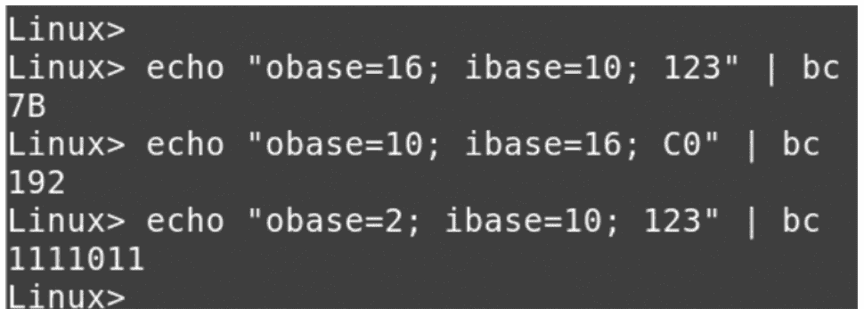

图 4.1 使用 Unix bc 命令更改数字进制。

### 练习

对于每个练习，请务必展示你的计算过程。

- 1. 使用幂次法将十进制数 10,236 转换为二进制的步骤。
- 2. 计算 10101010 的补码。展示你的计算过程并指出其中的反码部分。
- 3. 计算 10110110 的补码。展示你的计算过程并指出其中的反码部分。
- 4. 将 0d10 转换为十六进制。
- 5. 将 0x10 转换为十进制。
- 6. 0b1010 的十进制是多少？
- 7. 0d15 的八进制是多少？
- 8. 0b100110 的八进制是多少？
- 9. 0b11111001 的十进制是多少？
- 10. 使用幂次法将 0d36.84 转换为定点二进制。
- 11. 将 0d36.84 转换为 IEEE 浮点数。
- 12. 编写一个程序，使用幂次法将 0d321 转换为二进制。
- 13. 编写一个程序，使用余数法将 0d321 转换为二进制。
- 14. 编写一个程序，使用栈来维护一组十六进制符号，将 0d321 转换为十六进制。考虑以下方法：a) 余数法。b) 中间转换为二进制以进行分组。
- 15. 编写一个程序，将任意进制（10 或以下）的数转换为补码。提示：使用二进制转换器作为中间步骤。
- 16. 编写一个程序，对二进制数求补码，无需将其中间步骤转换为

## 数字算术与逻辑

DOI: 10.1201/9781032687759-5

### 摘要

对数字逻辑有良好的理解可以帮助数据科学家优化高性能计算环境。能够思考数字逻辑的技能本质上是一种问题解决的杠杆，用于将复杂问题分解为二进制逻辑的简单组成部分。

布尔逻辑是数字逻辑的概念基础，它接受二进制输入（例如 0 或 1，代表真或假），并输出二进制结果。通用计算机进行复杂决策只需要少数几条数字逻辑规则。

加法、减法、乘法和除法等算术运算，以及布尔逻辑，可以应用于各种二进制数的表示形式。

## 5.1 二进制加法

手工计算时，二进制加法的规则与十进制加法相同。

二进制加法规则，采用后缀表达式：

```
0 0 + -> 0
0 1 + -> 1
1 0 + -> 1
1 1 + -> 10
```

请注意，这里的 10 相当于十进制的 2。1 + 1 的结果是一个 0，并向左进位一个 1。

与十进制加法类似，如果两个数相加超过一位，我们就向下一列进位 1。例如，计算二进制中的 1 + 1：

```
  1
   1
+  1
-----
  1 0
```

进位的 1 变成最高有效位，0 是最低有效位。

那么二进制中的 1 + 2 呢？

```
  1
+ 1 0
-----
 1 1
```

现在在之前的结果上再加一个 1。

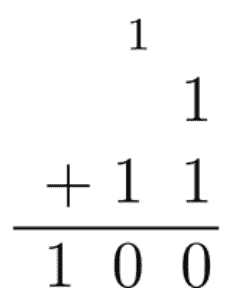

一个 1 位向左进位了两次，使其成为最高有效位，其余位为 0。

现在让我们加一些更大的二进制数，例如 7 (111) 和 5 (101) 的二进制等效值：

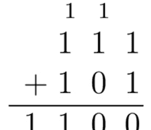

结果是二进制的 1100，即十进制的 12。

假设一个数字系统在 4 位寄存器（固定四位宽字段）上运行。如果加法产生的进位 _溢出_ 了寄存器的宽度，那么我们就会丢失信息。例如：

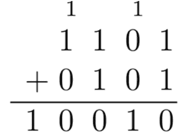

结果是 10010。但是，除了最高有效位之外都有存储空间，我们最终得到一个错误的结果 0010。

## 5.2 二进制减法

手工计算时，我们可以像减十进制数一样减二进制数，当被减数某一位上的数字小于减数时，从下一位更高有效位借位。

二进制减法规则，采用后缀表达式：

```
0 0 - → 0
0 1 - → 0 (requires a borrow for the left operand)
1 0 - → 1
1 1 - → 0
```

请注意，在 0 − 1 等情况下，需要从下一位更高有效位借位 1。

让我们看看用 13 减去 5 时会发生什么：

```
1 1 0 1
− 0 1 0 1
─────────
1 0 0 0
```

我们得到的相当于十进制的 8。现在考虑如果借位一个二进制 2，例如 13 减去 3。就像十进制减法中向前一列加 10 一样，在二进制减法中我们加 2 (0b10)。

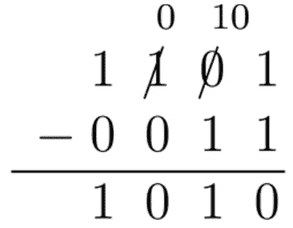

现在我们得到的相当于十进制的 10。

## 5.3 二进制乘法

手工计算时，二进制乘法类似于十进制乘法。

二进制乘法规则，采用后缀表达式：

```
0 0 × → 0
0 1 × → 0
1 0 × → 0
1 1 × → 1
```

请注意，1 1 × 不涉及借位或进位。

以下是二进制乘法的算法：

- 1. 将被乘数和乘数按最低有效位对齐。
- 2. 从乘数的最低有效位开始，将被乘数的每一位与该乘数位相乘，使一行结果与该乘数位对齐。
- 3. 对乚数的下一位较低有效位，将被乚数的每一位与该乚数位相乘，使一行结果与该乚数位对齐。
- 4. 重复步骤 2 和 3，直到处理完乚数的所有位数。
- 5. 求和得到的部分积（应用二进制加法规则）以得到结果。

例如，让我们用二进制计算 4 乘以 5。

```
   1 0 0
 x   1 0 1
 -------
   1 0 0
 0 0 0
1 0 0
 -------
1 0 1 0 0
```

即十进制的 20。

## 5.4 二进制除法

二进制除法规则，采用后缀表达式：

| 表达式 | 结果 |
|---|---|
| 0 0 ÷ | 未定义 |
| 0 1 ÷ | 0 |
| 1 0 ÷ | 未定义 |
| 1 1 ÷ | 1 |

二进制数的长除法就像十进制整数的长除法一样。例如，让我们用二进制将 20 除以 4 (0b10100 ÷ 0b100)。


1 0 1
_______
1 0 0 | 1 0 1 0 0 0
      - 1 0 0
      -------
        1 0 0 0
      -   1 0 0
      ---------
            0

即，0b10100 ÷ 0b100 = 0b101。

由于手动计算二进制乘法和除法非常繁琐，定义利用重复加法和减法的算法似乎更合理。毕竟，这基本上就是计算机所做的。就此而言，请参阅下方的*机器乘法与除法*部分。

## 5.5 布尔逻辑

布尔逻辑是数字逻辑的概念基础，它接收二进制输入（例如，表示真或假的 0 或 1），并输出二进制结果。通用计算机中某些复杂决策只需少数几条数字逻辑规则。

按从简到繁的顺序，典型的数字逻辑条件为 NOT、AND、OR、XOR、NAND、NOR 和 XNOR。以下使用数据 x 和输出 y 对它们进行描述。

### NOT

非运算反转单个输入。因此，它也被称为反向器。它通常由 ¬ 字符符号化，并具有以下函数形式：

y = ¬x

或：

x NOT

表示 NOT 所有输入组合的表格形式：

| X | ¬X |
|---|---|
| 0 | 1 |
| 1 | 0 |

### AND

当两个输入值均为真时，与运算输出 1（真）。它通常由 × 字符符号化，并具有以下函数形式：

y = x₁ × x₂

或：

x₁ x₂ AND

请注意，× 既用于二进制乘法，也用于逻辑与。对于单个比特操作数，两者产生相同的结果。

表示 AND 所有输入组合的表格形式：

| x₁ | x₂ | y |
|---|---|---|
| 0 | 0 | 0 |
| 0 | 1 | 0 |
| 1 | 0 | 0 |
| 1 | 1 | 1 |

### OR

当任一输入值为真时，或运算输出 1（真）。它通常由 + 字符符号化，并具有以下函数形式：

```
y = x₁ + x₂
```

或：

x₁ x₂ OR

表示 OR 所有输入组合的表格形式：

| x₁ | x₂ | y |
|---|---|---|
| 0 | 0 | 0 |
| 0 | 1 | 1 |
| 1 | 0 | 1 |
| 1 | 1 | 1 |

### XOR

异或（XOR）仅当只有一个输入值为真时才输出 1（真）。它通常由 ⊕ 字符符号化，并具有以下函数形式：

$$y = x_1 \oplus x_2$$

或：

$x_1 \ x_2 \ \text{XOR}$

表示 XOR 所有输入组合的表格形式：

| $x_1$ | $x_2$ | $y$ |
| :---: | :---: | :---: |
| 0 | 0 | 0 |
| 0 | 1 | 1 |
| 1 | 0 | 1 |
| 1 | 1 | 0 |

请注意，$\oplus$ 既用于二进制加法，也用于逻辑异或。对于单个比特操作数，两者产生相同的结果。

### NOR

或非运算对或运算的结果取反。它具有以下函数形式：

$$y = \neg(x_1 + x_2)$$

或：

$x_1 \ x_2 \ \text{NOR}$

表示 NOR 所有输入组合的表格形式：

| x₁ | x₂ | y |
|---|---|---|
| 0 | 0 | 1 |
| 0 | 1 | 0 |
| 1 | 0 | 0 |
| 1 | 1 | 0 |

### NAND

与非运算对与运算的结果取反。它具有以下函数形式：

$y = \neg(x_1 \times x_2)$

或：

$x_1 x_2$ NAND

与 AND 的表格相反，NAND 中 y 的结果如下所示：

| x₁ | x₂ | y |
|---|---|---|
| 0 | 0 | 1 |
| 0 | 1 | 1 |
| 1 | 0 | 1 |
| 1 | 1 | 0 |

### XNOR

同或运算对异或运算的结果取反。它具有以下函数形式：

$y = \neg(x_1 \oplus x_2)$

或：

$x_1 x_2$ XNOR

表示 XNOR 所有输入组合的表格形式：

| x₁ | x₂ | y |
|---|---|---|
| 0 | 0 | 1 |
| 0 | 1 | 0 |
| 1 | 0 | 0 |
| 1 | 1 | 1 |

## 5.6 机器乘法与除法方法

机器算术使用寄存器移位以及重复的加法和减法操作来完成。还使用计数器寄存器（或变量）。如前面的数字章节所述，计算机的中央处理器（CPU）在 CPU 寄存器中对二进制数（即一系列 1 和 0）进行操作。

仅使用重复加法进行的机器乘法将中间结果存储在累加器寄存器或变量中，直到计数等于乘数。例如，二进制中的 5 × 3 实际上是：

```
  0 0 0 0
+ 0 1 0 1
---------
  0 1 0 1 <- interim accumulation
+ 0 1 0 1
---------
  1 0 1 0 <- interim accumulation
+ 0 1 0 1
---------
  1 1 1 1 <- final accumulation, 3 steps
```

机器除法以类似方式进行。将重复减法的中间结果存储在累加器中，直到累加器为 0 或以下。例如，二进制中的 15 ÷ 5 实际上是：

```
  1 1 1 1
- 0 1 0 1
---------
  1 0 1 0 <- interim accumulation
- 0 1 0 1
---------
  0 1 0 1 <- interim accumulation
- 0 1 0 1
---------
  0 0 0 0 <- final accumulation, 3 steps
```

此类重复算法可以在编程语言中实现。例如，以下伪代码使用重复加法计算 5 × 4，实际上是 5 + 5 + 5 + 5。

```
five = 5 ( Initialize variable.)
accumulator = 0 ( Initialize accumulator variable.)
counter = 4 ( Initialize counter variable.)
```

```
while counter < five { ( Repeat until counter is 0.)
accumulator = accumulator + five ( Add five to accumulator.)
counter = counter + 1 ( Increment counter by 1.)
}
```

对于相同的 4 × 5 操作，通过重复加法的乘法可以用以下 epop 代码表示：

```
0 { 5 + } 4 LREPEAT
```

假设为正数，通过重复减法进行除法的一般形式为：

```
divisor = 4 ( Initialize variable.)
dividend = 20 ( Initialize variable.)
quotient = 0 ( quotient will be counter and result.)
```

```
while dividend >= divisor { ( Repeat until dividend >= divisor.)
dividend = dividend - divisor ( Subtract divisor from dividend.)
quotient = quotient + 1 ( Increment counter by 1.)
}
```

答案是最终商。余数是最终被除数。

通过重复减法进行的除法可以用以下 epop 代码表示，该代码确定 4 能被 20 整除多少次（注意递归词 20div4）。

```
20 dividend !
4 divisor !
0 quotient !
{ quotient @ 1 + quotient } quotient+ WORD
{ quotient+ dividend @ divisor @ - dividend ! } next WORD
{ next dividend @ divisor @ >= 20div4 ? } 20div4 WORD
```

## 5.7 使用反码的二进制减法

使用反码进行减法的算法如下：

- 1. 求减数的反码。
- 2. 将步骤 1 的结果加到被减数上。
- 3. 将步骤 2 中的任何溢出加到步骤 2 的非溢出结果上。

例如，考虑使用反码的二进制中 13 减 3。

```
  1 1 0 1
- 0 0 1 1
---------
```

计算减数的反码，将其 1 翻转为 0，将 0 翻转为 1。为此，我们可以执行 XOR 操作（由 ⊕ 符号化），与位掩码 1111 进行运算，这将反转每个比特的当前状态。

```
  0 0 1 1
⊕ 1 1 1 1
———
  1 1 0 0
```

将结果加到被减数上，注意左侧的溢出。

```
  1 1 0 1
+ 1 1 0 0
———
1 1 0 0 1 ← leftmost overflow from here
+ 0 0 0 1 ← ...added here
———
  1 0 1 0
```

¹位掩码是一种有助于设置或清除二进制数中特定位的位序列。

## 5.8 使用补码的二进制减法

我们在《数字转换》章节中介绍了补码数。回顾一下，求补码是在反码的基础上加 1。

使用补码，我们可以得到两个正数的差。该过程包括将减数的补码加到被减数上。

对于尚未采用补码表示的两个负数进行二进制减法，需要分别对被减数和减数求补码，然后将结果相加。

例如，考虑使用补码的二进制中 13 减 3。

```
1 1 0 1
- 0 0 1 1
-----------
```

计算减数的补码。首先，求反码，通过与位掩码 1111 进行 XOR 运算来反转，如上面讨论的反码一样。

```
0 0 1 1
⊕ 1 1 1 1
-----------
1 1 0 0
```

接下来，向结果加 1：

```
1 1 0 0
+ 0 0 0 1
-----------
1 1 0 1
```

将结果加到被减数上，忽略 1 位溢出（假设为 4 位宽寄存器）。


  1 1 0 1
+ 1 1 0 1
---------
  1 0 1 0

结果是 0b1010，即十进制 10。

## 5.9 用于乘法和除法的移位器

在计算机体系结构中，移位器会将寄存器中的位向左或向右移动指定的位数。位移位是机器执行乘法和除法的一种高效方式。每次左移使二进制数翻倍。每次右移使二进制数减半。

逻辑左移用 << 表示，逻辑右移用 >> 表示。每次逻辑移位操作会将位移向下一位，并移入 0。如果下一位超出了位域的宽度，则这些位可能会被丢弃。对于右移，0 变为最高有效位。对于左移，0 变为最低有效位。

例如，对 1111 进行两次逻辑右移，结果为 0011。

```
1111₂ >> -> 0011
```

反之，对 1111 进行两次逻辑左移，结果为 1100。

```
1111₂ << -> 1100
```

另一种移位是算术移位，用 <<< 和 >>> 表示。这些移位通过用符号位的副本（无论是 0 还是 1）填充移位位，来维护有符号数（非补码）的符号位。²

²应当注意的是，在某些架构中，左算术移位的结果与左逻辑移位相同。

例如，对 1000 进行两次算术右移，结果为 1110。

```
1000₂ >>> → 1110
```

反之，对 0111 进行两次算术左移，结果为 0100。

```
0111₂ <<< → 0100
```

## 5.10 左移与加法乘法

机器层面的乘法可以通过左移与加法的组合来完成。

一次左移使数值翻倍，即数值乘以 2¹。两次左移使数值翻两倍，即数值乘以 2²。一般来说，N 次左移使数值乘以 2ᴺ 的因子。³

要模拟机器的左移与加法乘法，请考虑 i 从 0 到 N−1 的 2^i 量级翻倍序列。因此，对于一个 5 位数，我们有 5 个乘数位，与序列 16 8 4 2 1 位置对齐，其中最低有效数字是 i = 0 的最右侧数字。N = 5

用十进制表示，二进制左移与加法操作对十进制数的影响如下：

\(\sum_{i=0}^{N-1} multiplier\_bit_i \times multiplicand_{10} \times 2^i\)

其中 _i_ 表示二进制乘数中位的位置，从右到左。

因此，对于 0d3 × 1 的操作，我们有 1 × 3 × 2⁰ = 0d3，即 0b11，因为未发生移位。（在 0b11 中，_i_₀ = 1 且 _i_₁ = 1。）

对于 0d3 × 0d2，我们有 0 × 3 × 2⁰ + 1 × 3 × 2¹ = 0d6，即 0b110，因为发生了一次移位，使数值翻倍。（在 0b110 中，_i_₀ = 0、_i_₁ = 1 且 _i_₂ = 1。）

| i | bit_i | 2^i |
|---|---|---|
| 0 | 1 × 3 × 2⁰ = 3 | |
| 1 | 1 × 3 × 2¹ = 6 | |
| 2 | 0 × 3 × 2² = 0 | |
| 3 | 0 × 3 × 2³ = 0 | |
| | 总和 = 9 | |

³同样的效果也适用于其他进制。回顾 baseⁱ 的幂级数。

我们可以继续这一系列移位和加法，直到溢出机器的寄存器容量，这将意味着丢失一些有效数字。

## 5.11 右移与减法除法

机器层面的除法可以通过右移与减法的组合来完成。

一次右移使数值减半，即数值除以 2¹。两次右移使数值减半两次，即数值除以 2²。一般来说，N 次右移使数值除以 2ᴺ。然而，二进制除法容易导致数字小数部分丢失精度。⁴

要模拟机器的右移与减法除法，请考虑 i 从 N−1 到 0 的 2ⁱ 量级翻倍序列。因此，对于一个 5 位数，我们有 5 个除数位，与序列 16 8 4 2 1 位置对齐，其中最低有效数字是 i = 0 的最右侧数字。N = 5

用十进制表示，二进制右移与减法操作对十进制数的影响如下：

\(\sum_{i=N-1}^{0} \, divisor\_bit_i \div dividend_{10} \times 2^i\)

其中 i 表示二进制除数中位的位置，从左到右。

⁴要获得更准确的浮点结果，我们应使用 IEEE 754 浮点形式的数字，如下所示。

假设我们要将 0b10000 除以 0b1000（十进制中的 16 ÷ 8）：

| i | bit_i | 2^i |
|---|---|---|
| 3 | 1 | 1 × 16 ÷ 2³ = 2 |
| 2 | - | 0 × 16 ÷ 2² = 0 |
| 1 | - | 0 × 16 ÷ 2¹ = 0 |
| 0 | - | 0 × 16 ÷ 2⁰ = 0 |
| | | 总和 = 2 |

## 5.12 右移导致的精度损失

因为右移会消除较低位，所以我们会丢失精度。例如，一次右移使数值减半，因此您可能期望十进制数 7 的一次右移结果为十进制的 3.5。请考虑以下后缀右移操作：

```
01111 >>>
```

此次右移结果为 0011，即十进制的 3，因为最右侧的 1 被丢弃了。

考虑 4 ÷ 3。结果是十进制 0d1.33...，无限循环。小数点右侧的数字可以表示为二进制浮点数。

让我们来看看将 4 ÷ 3 转换为十进制时的精度损失。

| 浮点数 | 乘数 | 结果 | 整数部分 | 小数部分 | 二进制结果 |
|---|---|---|---|---|---|
| | | | 1 | 0.33 | 1. |
| 0.33 | ×2 | 0.66 | 0 | 0.66 | 0 |
| 0.66 | ×2 | 1.32 | 1 | 0.32 | 1 |
| 0.32 | ×2 | 0.64 | 0 | 0.64 | 0 |
| 0.64 | ×2 | 1.28 | 1 | 0.28 | 1 |

4 ÷ 3 结果的二进制等效值为 1.0101。当然，重复数字的数量受位域宽度限制，在此例中为四位宽。

要转换回十进制，请在小数点右侧建立数值和索引。要达到四位小数的精度，指数为 4 3 2 1 0 -1 -2 -3 -4。应用为 2⁴ 2³ 2² 2¹ 2⁰ 2⁻¹ 2⁻² 2⁻³ 2⁻⁴，得到的序列为 16 8 4 2 1 0.5 0.25 0.125 0.0625。

观察该序列，浮点二进制数 1.0101 适用的指数为 0、-2 和 -4，例如：

```
1 × 2⁰ + 0 × 2⁻¹ + 1 × 2⁻² + 0 × 2⁻³ + 1 × 2⁻⁴
```

结果为 1.25 + 0.0625 = 1.3125，而非预期的 1.333…。

因此，转换回十进制时出现了一些精度损失。

## 5.13 IEEE 754 分数值的算术运算

我们可以尝试像上面手动执行的那样，对浮点数进行二进制算术运算，对齐操作数各自的小数点。这种方法乏味且容易出错，对于负值需要额外步骤，例如求其二的补码。所有这些都可以通过使用 IEEE 754 浮点标准来完成。这是现代 CPU 采用的方法。⁵

举个例子，让我们将 0d7.875 和 0d0.1875 相加。在定点二进制中，初始表达式为：

```
111.111 + 0.0011
```

要将定点二进制转换为 IEEE 754 标准，首先将值转换为 32 位标准化形式。⁶ 请注意，111.111 可以写成：

```
1.11111 × 2²
```

请注意，2² 是能除进 7.875 的 2 的最大量级。请注意，0.0011 可以写成：

```
1.1 × 2⁻³
```

2⁻³ 是能除进 0.1875 的 2 的最小量级。

| 符号 | 指数 | 尾数（忽略隐式前导位） |
| :--- | :--- | :--- |
| 0 | 10000001 | 111 1100 0000 0000 0000 0000 0000 |
| 0 | 01111100 | 100 0000 0000 0000 0000 0000 0000 |

对于指数，请注意，10000001 是二进制中的 2 + 127，而 01111100 是二进制中的 -3 + 127。

提醒：此处的指数是一个 *移码指数*。因此，要相加这些数字，请将隐式前导 1 预先附加到 23 位尾数字段，这使其成为尾数。我们得到：

```
0 10000001 1.111 1100 0000 0000 0000 0000
0 01111100 1.100 0000 0000 0000 0000 0000
```

由于我们要相加具有相同指数的数字，为了使指数相同，请用较大的指数减去较小的指数：

```
  1 0 0 0 0 0 0 1
- 0 1 1 1 1 1 0 0  <- replace this with
+ 1 0 0 0 0 1 0 0  <- two's complement here
-------------------
  0 0 0 0 0 1 0 1  <- sum of 1st and 3rd lines
```

现在，将较小数字的尾数向右移动 5 位（0b101），即指数之间找到的差值。现在我们可以用相同的指数写出两个数字：

```
0100000011.11111000000000000000000000
0100000010.000011000000000000000000 -> 00000 discarded
```

接下来相加尾数：

```
  1.111 1100 0000 0000 0000 0000
+ 0.000 1100 0000 0000 0000 0000
--------------------------------
  10.000 0010 0000 0000 0000 0000
```


最后，舍弃尾数的隐含前导位，将数字转换回二进制32小数：

| 符号 | 指数 | 尾数（忽略隐含前导位） |
|---|---|---|
| 0 | 10000001 | 000 0001 0000 0000 0000 0000 |

## 5.14 IEEE 754 浮点数除法

IEEE 754 浮点数除法可以通过手工计算完成，即先相除尾数，然后相减指数。除法通过右移（表示为 >>）和减法完成。

例如，要计算 C = A/B：

C = 1^signA×1×(fractionA×2^exponentA) / -1^signB×1×fractionB×2^exponentB

C = -1^signC×1×(fractionA / fractionB) × 2^exponentA-exponentB

其中：

signC = signA XOR signB

且：

fractionC = fractionA / fractionB

这相当于将 fractionA 右移 fractionB 的位数：

(fractionB - 1) >> fractionA

得到的指数为：

exponentC = (exponentA - exponentB) + bias

不过，需要注意一些事项。请考虑：

- 如果 B = 0，则设置 C = 无穷大。
- 如果 A = 0 且 B = 0，则设置 C = NaN ……“不是一个数字。”
- 如果 C > 最大数字大小，则设置 C = 无穷大。
- 如果 C < 最小数字大小，则设置 C = 0。
- 可能会发生上溢或下溢。

## 练习

- 1. 使用二进制补码计算 5 − 3。展示你的计算过程并识别出反码部分。
- 2. 使用 IEEE 754 浮点数计算 5 − 3。展示你的计算过程。
- 3. 使用 IEEE 754 浮点数计算 4 × 3。展示你的计算过程。
- 4. 使用 IEEE 754 浮点数计算 4 ÷ 3。展示你的计算过程。
- 5. 假设 A = 10110110 且 B = 11100000。A × B 是多少？
- 6. 已知输入 A = 001100 和 B = 010101，输出 Y = A XOR B，Y 是什么？
- 7. 已知输入 A = 010101，输出 Y = A XOR B 为 111111，B 是什么？
- 8. 编写一个程序，接受任意长度的两个二进制数，将它们相加并显示结果。
- 9. 编写一个程序，使用重复加法来实现乘法。
- 10. 编写一个程序，使用重复减法来实现除法。

- 11. 编写一个程序，为以下每一项显示 10×10 表格。例如，对于乘法生成乘法表，如：https://www.mathsisfun.com/tables.html

- (a) 加法
- (b) 减法
- (c) 乘法
- (d) 除法

## III

### 计算逻辑

## 命题逻辑

DOI: 10.1201/9781032687759-6

### 摘要

命题逻辑是数据科学家使用自动化分析系统（包括人工智能、专家系统以及一般应用程序开发）的核心组成部分。在这些工作中，以明确的逻辑术语传达任务目标非常重要，无论是用于构建数据流，还是为商业决策生成统计报告。

命题只是一种声明或表达式，用于断言某事为真或为假。该断言可能需要满足某些条件，并且由于可能使用数学符号，命题逻辑也可能被称为数理逻辑或符号逻辑。

当谓词被集合替换时，命题逻辑的概念可应用于集合逻辑。因此，要理解与数据集相关的命题逻辑，必须定义数据集之间的关系。

逻辑应用遍及机器架构和程序算法，逻辑语句构成了函数条件及其 *参数*（或 *形参*）。

## 6.1 命题

命题是一个要么为真要么为假的陈述。它不能同时为真和为假。符号上，真可以表示为 1 或 T，假可以表示为 0 或 F。正如我们将很快看到的，我们可以用变量以函数形式表示命题，形式为真值表。

我们可以将命题表示为后缀函数形式的陈述，如下：

```
15 5 10 + EQ (→ true)
10 5 4 + EQ (→ false)
```

命题可以是一个不依赖于谓词的简单真假陈述。或者，命题可以*基于*某个变量。谓词是一个可以被值替换的变量或符号的表达式或实例。命题的谓词被认为具有*命题形式*。

例如，考虑陈述“山羊是四足动物。”这个陈述是一个命题，因为它可以被评估为真或假。此外，该陈述包含一个谓词“四足动物”，它是可变的，因为存在多种四足动物。

“天空是晴朗的。”是一个命题，其中“天空”是可变的。在*谓词逻辑*中，整个陈述的可变性是可变的，使其也成为一个谓词。因此，该陈述既是命题也是谓词。

在命题逻辑中，符号常用于表示谓词，例如 q、p、r 和 s。命题本身也可以被符号化。

例如，令 0 表示假，1 表示真，定义以下谓词变量：

```
{ 1 } a WORD
{ 1 } b WORD
{ 0 } c WORD
```

现在可以使用逻辑运算符对这些变量进行求值，例如：

```
a b c AND AND ( → 1)
```

该语句首先比较谓词 a 和 b 的真值。结果本身也是一个真值，然后将其与 c 的真值进行比较。在传统的中缀表示法中，逻辑可以表示为：

```
(a AND b) AND c ( → 1)
```

后缀语句的逻辑可以如下取反：

```
a b c AND AND NOT ( → 1)
```

已求值表达式的结果也可以赋给变量或函数，例如单词“result”，如下所示：

```
{ a b c OR OR } result WORD
```

命题要么完全为真，要么完全为假，不能两者兼具。这意味着它的所有谓词都必须有已知值。例如：

……是一个命题，并且显然是真。

非陈述句不是命题。考虑：

*你好，世界！*
*现在几点了？*

这些不是命题，因为它们不能被评估为真或假。

脱离先前命题上下文的单个命题只能被接受为真，因为不存在先前的矛盾命题。一个命题与你的*先验知识*相矛盾并不会使其为假，除非其逻辑包含先前的矛盾断言。

例如，可能存在如下陈述：

*天空是黑暗的。*

我们可能不同意该陈述。但是，我们的分歧将取决于这种孤立逻辑之外的推理，即我们的*先验知识*。

为了使这一概念不那么反直觉，将问题陈述中的谓词替换为符号，例如 s 表示 sky，d 表示 dark，如下所示：

*s is d*

数学上等价的陈述可以被接受为：

s ≡ d 或 s = d

或者，在后缀表示法中：

s d EQ

这里我们说 s 和 d 等价。

在给定的上下文之外，人们可能对命题中的单词有其他了解。忽略这些假设，因为我们必须假设机器只有我们给予它的内容。用符号替换单词有助于这一过程。

## 6.2 三段论

三段论是一个依赖于先前命题的命题。换句话说，三段论的前提是一个被假设为真的命题。该主导命题称为前提。三段论也可称为蕴涵，因为一个命题（前提）蕴涵另一个命题。

三段论可以表示为如果...那么... 或 p → q。

以下是一个三段论示例：

> *如果山羊是四足动物，并且 Daisy 是一只山羊，那么 Daisy 是一只四足动物。*

上述三段论的前提是“山羊是四足动物”和“Daisy 是一只山羊”。结论是“Daisy 是一只四足动物”。该三段论的谓词是：

……是四足动物
……是一只山羊
……是一只四足动物

## 6.3 命题条件

命题语句可以由逻辑运算符连接。按优先级顺序，这些运算符包括：²

| 单词 | 符号 |
| :--- | :--- |
| 非 | ¬ |
| 与 | ∧ |
| 或 | ∨ |
| 如果那么 | → |

¹ 在数学中，≡ 符号用于表示两个集合的等效基数，而逻辑等价通常用 = 或 ≡ 表示。相比之下，在计算机编程语言中，逻辑等价的常见符号是 ==，而 = 符号通常用于变量赋值。↩

² 这些逻辑运算符在不同编程语言中有所不同。例如，在 C 语言中，我们使用 ` 符号表示 XOR，使用 | 符号表示 OR。非或否定的符号在某些编程语言（如 Standard ML）中可能是波浪号 ~，在其他语言（包括 C/C++、D、Java 和 Python）中则是感叹号 !。↩

非运算由 ¬ 符号表示，允许我们否定一个命题，从而得到其补集。例如，¬1 的补为 0，符号 ¬A 的补为 a。


逻辑合取符号是 ∧。但是，你经常会看到使用 AND 运算符来进行逻辑合取。

逻辑析取符号是 ∨。但是，你经常会看到使用 OR 运算符来进行逻辑析取。

与其依赖上表中的运算符优先级（运算顺序），不如使用括号来指明顺序。例如，以下语句是等价的：

```
(p ∨ (q ∧ (¬r))) → s
p ∨ q ∧ ¬r → s
```

当命题中使用 AND 之类的连接运算符时，我们就有了逻辑合取。例如：

*Daisy喜欢骨头且Daisy会叫。*

这是两个分量命题的逻辑合取。符号上，它可以表示为：

```
p ∧ q
```

或者，采用后缀记法：

```
p q AND
```

合取 p ∧ q 只有在 p 和 q 都为真时才为真。

考虑使用各种谓词的 p ∧ q 的可能性，例如如下真值表所示。

| p | q | p ∧ q |
|---|---|---|
| 0 | 0 | 0 |
| 0 | 1 | 0 |
| 1 | 0 | 0 |
| 1 | 1 | 1 |

与逻辑合取不同，逻辑析取使用 OR 而不是 AND。例如：

*Daisy喜欢骨头或Daisy会叫。*

符号上，该语句可以表示为：

$p \lor q$

或者，采用后缀记法：

$p q$ OR

析取的使用不是互斥的，因为两个陈述都可以为真。OR 意味着一个或另一个，或者两者皆是。

与该析取相关联的真值表是：

| p | q | p ∨ q |
|---|---|---|
| 0 | 0 | 0 |
| 0 | 1 | 1 |
| 1 | 0 | 1 |
| 1 | 1 | 1 |

对于逻辑蕴含，语句中包含一个 IF ...THEN 从句。考虑该语句：

*如果狗有一根骨头，那么狗就安静。*

符号上，狗有一根骨头是 $p$，狗是安静的是 $q$。该语句可以表示为：

```
p \rightarrow q
```

该蕴含运算符 $\rightarrow$ 是一个抽象，可以分解为以下基本运算：

```
if p then q else true
```

（即，如果狗有一根骨头，那么狗就安静，否则狗会叫）

在逻辑应用中，例如在计算机体系结构和编程中，使用替代逻辑组合来获得相同结果通常更有利。例如，上述蕴含在逻辑上等价于：

```
\neg p \lor q
```

（即，狗没有骨头，或者狗是安静的。）

### 等效的后缀表达式：

```
p NOT q OR
```

可以使用真值表验证 \( p \rightarrow q \) 等价于 \( \neg p \lor q \) 这一事实。验证将作为练习留给读者。

给定一个蕴含，第一个命题可称为假设或*前件*，后一个命题可称为*条件命题*。蕴含的求值可称为*结论*或*后件*。

与蕴含相关联的真值表是：

| p | q | \( p \rightarrow q \) | |
|---|---|---|---|
| 0 | 0 | 1 | 当 p 和 q 都为假时，\( p \rightarrow q \) 为真。 |
| 0 | 1 | 1 | 当 p 为假时，\( p \rightarrow q \) 始终为真。 |
| 1 | 0 | 0 | 只有当 p 为真且 q 为假时，\( p \rightarrow q \) 才为假。 |
| 1 | 1 | 1 | 当 p 和 q 都为真时，\( p \rightarrow q \) 为真。 |

一个*蕴含*，\( p \rightarrow q \)，与以下条件命题相关联：

- 逆命题：\( q \rightarrow p \)。交换假设和结论的位置。
- 反命题：\( \neg p \rightarrow \neg q \)。对假设和结论都取否。
- 逆否命题：\( \neg q \rightarrow \neg p \)。对假设和结论都取否并交换它们。

如果一个条件当且仅当另一个条件存在时为真，则我们有一个*双蕴含*，记作 \( \leftrightarrow \) 或 *iff*。

双蕴含，也称为双条件命题，涉及两个 if-then-else 语句。

如果 \( p \rightarrow q \) 和 \( q \rightarrow p \)（逆命题）都为真，则 \( p \leftrightarrow q \) 为真。

例如，该语句：

*这条狗叫当且仅当不给它骨头。*

两个蕴含是：

- 如果不给骨头，那么狗叫。
- 如果狗叫，那么就不给骨头。

鉴于 \( p \leftrightarrow q \) 等价于 \( (p \rightarrow q) \vee (q \rightarrow p) \)，与双蕴含相关联的真值表是：

| p | q | p → q | q → p | p ↔ q |
|---|---|---|---|---|
| 0 | 0 | 1 | 1 | 1 |
| 0 | 1 | 1 | 0 | 0 |
| 1 | 0 | 0 | 1 | 0 |
| 1 | 1 | 1 | 1 | 1 |

对命题取否就是使用其补命题。例如：狗叫的否定是：狗不叫。

这可以符号化表示为：

```
\(\neg p\)
```

作为逻辑合取的一个分量，我们可以有：

*给狗一根骨头，且狗不叫。*

或者：

```
p ∧ ¬q
```

在先对 q 取否之后，与该合取相关联的真值表是：

| p | ¬q | p ∧ ¬q |
|---|---|---|
| 0 | 1 | 0 |
| 0 | 0 | 0 |
| 1 | 1 | 1 |
| 1 | 0 | 0 |

## 6.4 复合命题

*复合命题*是由连接词分隔的谓词组成的命题。它也可称为*复杂命题*。

对于标准中缀数学记法，复合命题可以使用括号对谓词进行分组。在这种情况下，数学运算优先级规则适用于这些运算符。

例如，考虑以下中缀求值，用 1 和 0 分别代替语句 p、q、r 和 s。令 1 表示 *真*，0 表示假。

```
¬0 ∨ 0 ∧ 0 ∨ 0   Given.
(¬0) ∨ (0 ∧ 0) ∨ 0   () indicate the operations done first.
(1 ∨ 0) ∨ 0
1 ∨ 0 ∨ 0   Work left to right.
1   True.
```

请注意，括号的位置可能会影响语句的含义和清晰度。下面的真值表显示了复合命题 ¬0 ∨ 0 ∧ 0 ∨ 0 的所有可能性。我们上面的结果显示在第一行中，其中 p、q、r 和 s 都是假（0）。

| p | q | r | s | ¬p∨q∧r∨s |
|---|---|---|---|---|
| 0 | 0 | 0 | 0 | 1 |
| 0 | 0 | 0 | 1 | 1 |
| 0 | 0 | 1 | 0 | 1 |
| 0 | 0 | 1 | 1 | 1 |
| 0 | 1 | 0 | 0 | 1 |
| 0 | 1 | 0 | 1 | 1 |
| 0 | 1 | 1 | 0 | 1 |
| 0 | 1 | 1 | 1 | 1 |
| 1 | 0 | 0 | 0 | 0 |
| 1 | 0 | 0 | 1 | 1 |
| 1 | 0 | 1 | 0 | 0 |
| 1 | 0 | 1 | 1 | 1 |
| 1 | 1 | 0 | 0 | 0 |
| 1 | 1 | 0 | 1 | 1 |
| 1 | 1 | 1 | 0 | 1 |
| 1 | 1 | 1 | 1 | 1 |

假设我们定义两个复合命题 P 和 Q，使得对于 P 中的每个分量语句 p 和 Q 中的每个分量语句 q，都有 p → q。即：

$P : p \rightarrow q \text{ 且 } Q : \neg q \rightarrow \neg p$

那么可以说 P → Q。

我们可以使用真值表证明 p → q 和 ¬q → ¬p 是等价的，如下所示。请注意，在最后两列中，p → q 和 ¬q → ¬p 是等价的，因为这些列的条目完全相同。

| p | q | ¬p | ¬q | p → q | ¬q → ¬p |
|---|---|---|---|---|---|
| 0 | 0 | 1 | 1 | 1 | 1 |
| 0 | 1 | 1 | 0 | 1 | 1 |
| 1 | 0 | 0 | 1 | 0 | 0 |
| 1 | 1 | 0 | 0 | 1 | 1 |

作为示例，以下两个语句是等价的：

*有骨头的狗是安静的。*
*不安静的狗没有骨头。*

## 6.5 方程最小化

在构建统计分析模型的过程中，通过最小化变量的冗余使用来提高效率。这是通过结合*方程最小化*和维度缩减技术来实现的。³

为了练习方程最小化，我们可以使用下面的布尔定理来减少布尔方程的项。布尔方程是变量仅表示真和假值（或分别表示 1 和 0）的方程。

按等价关系，命题满足以下布尔定律和恒等式：

### 结合律恒等式：

p ∧ (q ∧ r) ≡ (p ∧ q) ∧ r
p ∨ (q ∨ r) ≡ (p ∨ q) ∨ r

### 交换律恒等式：

p ∧ q ≡ q ∧ p
p ∨ q ≡ q ∨ p

### 补律：

¬(¬p) ≡ p

### 逆否律：

p → q ≡ ¬q → ¬p

### 分配律恒等式：

p ∨ (q ∧ r) ≡ (p ∨ q) ∧ (p ∨ r)
p ∧ (q ∨ r) ≡ (p ∧ q) ∨ (p ∧ r)

³维度缩减在《数据维度》章节中讨论。

### 幂等律恒等式：


p \equiv (p \land p)
p \equiv (p \lor p)

## De Morgan's Laws:

\neg(p \land q) \equiv \neg p \lor \neg q
\neg(p \lor q) \equiv \neg p \land \neg q

假设我们有以下表达式，其中大写字符表示真陈述（1），小写字符表示补码（0），OR 操作被视为加法，AND 操作被视为乘法。

abc + Abc + AbC

这可以归约如下：

abc + Abc + Abc + AbC   （对 Abc 应用幂等恒等式。）
bc(a + A) + Ab(c + C)   （分配律恒等式。）
bc(1) + Ab(1)           （每个 0+1=1。）
bc + Ab
bc + bA                 （交换律恒等式。）
b(c + A)                （分配律恒等式。）

## 6.6 方程最小化技巧

无论组成陈述是否为真，始终为真的复合命题称为重言式（始终为真的陈述）。如果命题是重言式，则真值表中该命题列的每一行都为真（1）。

无论组成陈述是否为真，始终为假的复合命题称为 _矛盾式_。如果命题是矛盾式，则真值表中该命题列的每一行都为假（0）。

既不是重言式也不是矛盾式的命题称为 _偶然命题_。该命题列的行中将至少包含一个假（0）和至少一个真（1）。

两个复合命题 P 和 Q 等价，当且仅当 P → Q 是重言式。

## 6.7 方程最小化的推理模式精选

以下规则有助于最小化方程：

### 等价：

如果 p ↔ q 且 p 为真，则 q 必须为真。

### 假言三段论（蕴含的传递性。前提和结论均为条件句。）：

如果 p → q 且 q → r，则 p → r。

### 加言式（析言引入）：

如果 p 为真且 p → p ∨ q 为真，则 p ∨ q 必须为真。

### 简化式（合言消去）：

如果 p ∧ q 为真，则 p 必须为真。

### 合言式（合言引入）：

如果 p 为真且 q 为真，则 p ∧ q 必须为真。

### 谋略式：

如果 \( p \lor q \) 为真且 \( \neg p \lor r \) 为真，则 \( q \lor r \) 必须为真。

### 肯定前件（拉丁语称为 *modus ponens*）：

如果 \( p \) 为真且 \( p \rightarrow q \) 为真，则 \( q \) 必须为真。

### 否定后件（拉丁语称为 *modus tollens*）：

如果 \( q \) 为假且 \( p \rightarrow q \) 为真，则 \( p \) 必须为假。

### *Modus Tollendo Ponens*，又称 *析言三段论*（析言消去）：

如果 \( p \) 为假且 \( p \lor q \) 为真，则 \( q \) 必须为真。

### *Modus Ponendo Tollens*：

如果 \( p \land q \) 为假且 \( p \) 为真，则 \( q \) 必须为假。

## 练习

- 1. 解释以下陈述是否为命题：
  
  *无理数 \(\pi\) 是一个圆整的数。*

- 2. 解释命题逻辑如何与谓词逻辑区分。

- 3. 解释关于山羊 Bgee 的以下蕴含式：
  
  设 \( p = \text{山羊吃稻草} \)。
  设 \( q = \text{Bgee 是一只山羊} \)。
  \( q \rightarrow p \)

- 4. 解释关于奶牛 Daisy 的以下条件：

  设 \( p = \text{Daisy 在牛棚里。} \)
  设 \( q = \text{牛棚一团糟。} \)
  \( q \land p \)

- 5. 解释关于 We 的以下条件：
  设 \( p = \text{我们将每天跑步。} \)
  设 \( q = \text{我们将跑得更快。} \)
  \( q \leftrightarrow p \)

- 6. 解释以下陈述的否定：发射仅在晴天进行。

- 7. 解释以下陈述中 \( \neg p \) 的结果。
  \( p = \text{Daisy 喜欢兔子，但不喜欢洗澡。} \)

- 8. 构建一个真值表，以显示命题 \( p \lor \neg(p \land q) \) 是一个重言式。

- 9. 构建一个真值表，以验证 \( p \to q \) 和 \( \neg p \lor q \) 的等价性。

- 10. 构建一个真值表，以显示命题 \( \neg p \lor q \) 和 \( \neg(p \land q) \) 是等价的。

- 11. 构建一个真值表，以证明被称为谋略式的推理模式。

- 12. 构建一个真值表，以证明被称为 Modus Tollendo Ponens 的推理模式。

- 13. 构建一个真值表，以证明被称为假言三段论的推理模式。

## 集合量化

DOI: 10.1201/9781032687759-7

## 摘要

集合论的概念和术语构成了数据科学家在处理数据集以进行探索性数据分析和数据库交互时日常任务的基础。

集合是通常不包含重复项的无序元素集合。一种称为多重集的集合可能包含重复项。集合的元素可以以称为子集的群组存在。没有元素的集合称为空集，而空集是每个集合的子集。

与元素关联的值可以是数字、字符或单词。此外，元素可能共享常见的分类，例如数据类型、四分位数排名、样本批次等。

当使用 SOME、NONE 或 ALL 等限定词描述集合的元素时，我们正在进行量化。当谓词被量化时，它们被称为一阶逻辑。量化在集合逻辑中很有用。

## 7.1 集合

集合是不包含重复项的无序元素集合。但是，集合也可以为空，并且元素实际上可能是称为 _子集_ 的其他集合。元素值可以是数字、字符、单词或某个类别的成员，例如数字类型、动物、汽车或其他分类。

集合可以表示为 { _a b c d_ }。因为顺序不重要，同一个集合可以表示为 { _c b d a_ }。

字符 _S_ 通常用于象征集合。如果集合 _S_ 没有元素，它是一个 _空集_，表示为 _S_ = { } 或 _S_ = ∅。

如果 _S_ 不为空，我们可以有：

```
S = {s₁ s₂ ... sₙ},
```

其中每个 _s_ 都在 _S_ 中。

或者，我们可以使用另一个大写字母，例如 _A_，作为集合。

```
A = {a₁ a₂ ... aₙ},
```

其中每个 _a_ 都在 _A_ 中。

如果 _s_ 是集合 _S_ 的元素，那么我们写：

```
s ∈ S
```

如果 _t_ 不是集合 _S_ 的元素，那么我们写：

```
t ∉ S
```

如果 \( S = \{ \ 2.2 \ 3.1 \ 4.5 \ 5.8 \} \)，那么我们可以说：

\( 3.1 \in S \land 2.5 \notin S \)

集合的 *基数*（势）是其元素计数，用 |{}| 表示。例如：

\( |\{a \ b \ c \ x \ y\}| = 5 \)
\( |\{1 \ 2 \ 3 \ 4\}| = 4 \)

基数可能是无限的，并表示为：

\( |\{1 \ 2 \ 3 \ 4\ ...\}| = \infty \)

基数相同的两个集合 \( A \) 和 \( B \) 被称为 *等价* 集合。集合等价性表示为：

\( A \equiv B \)

或

\( (A) = (B) \)

另一种表达方式：

\( IF \ |A| \ge |B| \ AND \ |A| \le |B| \ THEN \ |A| = |B| \)

如果两个集合 \( A \) 和 \( B \) 有不同的基数，那么 *不等* 的基数可以表示为：

\( |A| > |B| \ OR \ |A| < |B| \)

如果两个集合包含相同的元素，则它们 *相等*。（相等的集合也具有相同的基数。）集合相等性表示为：

\( A = B \)

## 7.2 集合类型

- 全集，U。特定类的所有元素。例如：字母表是字符 x、a 和 w 的全集。

- 补集。\( A' = (U - A) \)，或 \( A' = \{a | a \notin A\} \)。\( A' \) 包含全集中不在 A 中的所有元素。例如：
  
  \( U = \{ 1234 \}, A = \{ 24 \}, A' = \{ 13 \} \)

- 有限集。包含有限数量的元素。例如：
  
  \( S = \{s | s \in \mathbb{N} \land 1 < s < 100\} \)
  
  回顾 *数字* 章节，\(\mathbb{N}\) = 所有自然数的集合。

- 无限集。包含无限数量的元素。例如：
  
  \( S = \{s | s \in \mathbb{N}\} \)

- 子集。如果 A 的每个元素都是集合 B 的元素，则 A 是 B 的子集，我们写 \( A \subseteq B \)。例如：
  
  \( A = \{123\}, B = \{123\}, C = \{13\}, B \subseteq A, C \subseteq A \)

- 真子集。给定 B 的每个元素都是更大集合 A 的元素，\( | B | < | A | \)，则 B 是 A 的真子集。我们写 \( B \subset A \)。
  
  例如：


A = {1 2 3}，B = {1 2}，|B| < |A|，B ⊂ A

- 单例集（单元素集），{ s }。仅包含一个元素的集合。例如：
  S = {s | s ∈ \mathbb{N} ∧ 0 < s < 2} = {1}，|S| = 1

- 空集或零集，∅。不包含任何元素。基数为零。例如：
  S = {s | s ∈ \mathbb{N} ∧ 0 < s < 1} = ∅ = {}

- 并集，A ∪ B = {a | a ∈ A ∨ a ∈ B}。在 A 中或在 B 中或同时在 A 和 B 中的元素的集合。例如：
  A = {1 2 3 5}，B = {1 2 4 6}，A ∪ B = {1 2 3 4 5 6}

- 交集，A ∩ B = {a | a ∈ A ∧ a ∈ B}。同时在 A 和 B 中的元素的集合。例如：
  A = {1 2 3 5}，B = {1 2 4 6}，A ∩ B = {1 2}

- 相等集。包含相同元素且基数相同的两个集合。例如：
  A = {2 4 6}，B = {6 2 4}，|B| = |A|，A = B

- 等效集。基数相同的两个集合。例如：
  A = {1 3 5 7}，B = {2 4 6 8}，|B| = |A| = 4，A ≡ B

- 重叠，A ∩ B ≠ ∅。至少有一个共同元素的两个相交集合。例如：
  A = {1 2 3 4}，B = {0 2 6 8}，A ∩ B = {2}

- 不相交，A ∩ B = ∅。如果两个集合没有公共元素，则它们不相交。例如：
  A = {1 3 5 7}，B = {2 4 6 8}，A ∩ B = ∅

- 划分集。S 的不相交子集 p1, p2, ..., pn 的集合。每个子集至少包含 S 的一个元素。所有划分子集的并集得到原始集合 S。
  p1 ∪ p2 ∪ ⋯ ∪ pn = S

- 笛卡尔积，A × B。所有可能的有序对 (a, b) 的集合，其中 a ∈ A，b ∈ B。例如：
  A = { 1 3 } 和 B = { 2 4 }，A × B = { (1, 2) (1, 4) (3, 2) (3, 4) }

- 差集，A - B = {a | a ∈ A ∧ a ∉ B}。在 A 中但不在 B 中的元素的集合。例如：
  A = { 1 2 3 5 }，B = { 1 2 4 6 }，A - B = { 3 5 }，B - A = { 4 6 }

- 幂集，P(S)。S 的所有子集的集合，包括空集。P(S) 的基数为 2^n，其中 n 是 S 中的元素个数。例如：
  给定 S = {1 2 3 4}，n = |S| = 4
  则，P(S) = {{}, {1}, {2}, {3}, {4}, {1 2}, {1 3}, {1 4}, {2 3}, {2 4}, {3 4}, {1 2 3}, {1 2 4}, {1 3 4}, {2 3 4}, {1 2 3 4}}
  且，|P(S)| = 2^n = 2^4 = 16

## 7.3 量化

量词是命题逻辑中的符号，涉及集合中元素的存在性和数量。

量词包括：

- 全称量词，*对所有*，符号为 ∀。
- 存在量词，*存在一些*，或*至少存在一个*，符号为 ∃。

如果一个命题对于集合的所有元素都为真，则适用全称量词。这可以表示为：

```
∀x P(x)
```

... 或：“对于每个元素 x，属性 P 为真。”

命题 *山羊是四足动物* 具有这种形式，前提是 *山羊是四足动物* 对于所有山羊都为真。

$^1$在涉及关系数据库的数据科学主题中，笛卡尔积有时被称为 *交叉积*。$\triangleq$

如果一个命题对于集合中仅部分元素为真，则适用存在量词。表达式“对于每个元素 x，某些 P(x) 为真”也可以写成：

```
∀x ∃P(x)
```

命题 *有些山羊是棕色的* 具有这种形式，前提是并非所有山羊都是棕色的。

因此，我们也可以有 *嵌套量化*。$^2$ 也就是说，给定定域 $P(x, y)$，命题 $(\forall x)(\exists y)P(x, y)$ 表示：*对于所有 x 存在某个 y 使得 P(x, y) 为真*。

考虑所有整数的定域。如果 $P(x, y)$ 是谓词 $x \times y = 11$，那么命题 $(\forall x)(\exists y)P(x, y)$ 必然为假。也就是说，我们知道对于每个整数 x 不存在整数 y 使得 \( x \times y = 11 \)。我们只能针对某些 x 值 { 1 -1 11 -11 } 找到整数 y，而不能针对所有 x 值。

在编程中，我们可能有用于测试数据集中元素是否存在的函数。例如，在 *epop* 程序中，我们可以测试动物中是否存在狗，命题 \((\forall animals)(\exists dog)P(animals, dog)\)，如下：

```
{ cat dog pig goat } animals LIST
{ DogFound!. CR } dogfound WORD
{ dog EQ dogfound ? GSC 0 > havedog ? } havedog WORD
animals havedog ( → DogFound!)
```

在上面的示例代码中，调用一个名为 animals 的列表，按照 animals 列表中给出的顺序将所有四种动物类型压入数据栈。然后调用 havedog 词，它将数据栈上的每种动物类型与字符串“dog”进行比较。如果匹配，则输出字符串 DogFound!。

## 7.4 集合关系

集合可以看作由谓词组成的命题。一组谓词求值为真或假，该组本身可能是更大语句的一个谓词。\(^3\)

\(^2\)与列表的列表一样。参见 *线性结构* 章节。

\(^3\)此主题与 *命题逻辑* 以及 *非连接数据* 中的集合覆盖内容重叠。

当存在一系列命题时，我们有机会检查矛盾并验证逻辑系统。类似地，我们可以为数学证明构建一系列语句，通过在应该形成矛盾的位置插入其他语句来对其进行测试。

考虑以下两个语句：

> 所有猫都是黑色的。
> Chewy 是一只灰色的猫。

显然，这是一个矛盾。不可能所有猫都是黑色的，因为至少存在一只非黑色的猫。每个谓词都是集合的一个元素，该集合由其包含的命题有效地符号化。考虑一个集合，其元素是独立的语句，每个语句要么为真（1）要么为假（0）。

$S = \{ 1 0 1 0 \}$

组合语句可以求值为：

$S = \{ 1 \land 0 \land 1 \land 0 \} = \{ 0 \}$

在编程上下文中，我们可以按如下方式求值此类集合。

```
{ 1 0 1 0 } statement WORD
{ * GSC 1 > evaluate ? } evaluate WORD
statement evaluate. ( → 0)
```

上述每个 \(\land\) 操作都是一个二元操作，接受两个操作数。在编程示例中，乘法运算符 * 足以表示 \(\land\)，即逻辑 *与* 运算符。

将此类二元操作应用于两个或多个集合的元素对，允许我们在集合上建立 *二元关系*。

\( S \) 上的二元关系 \( R \) 是笛卡尔积中有序对的任意子集。（笛卡尔积中的所有有序对构成一个 *全关系*。）

例如，给定集合 \( S = \{ a \ b \ c \} \)，\( S \) 上的二元关系 \( R \) 是笛卡尔积中有序对的任意子集。考虑：

\( S \times S = \{ (a, a) (a, b) (a, c) (b, a) (b, b) (b, c) (c, a) (c, b) (c, c) \} \)

两个集合 \( A \) 和 \( B \) 之间的一种关系是 \( A \) 和 \( B \) 的笛卡尔积。基数为 N × M，其中 N 是集合 \( A \) 中的元素数量，M 是集合 \( B \) 中的元素数量。\( S \) 上的另一种关系可以是 \( R = \{ (a, b) (b, c) (a, c) \} \)。\( R \) 是 \( S \) 上的关系，因为这些对存在于全关系中。可以说，元素 \( a \) 通过 \( R\) 与元素 \( b\) 相关。

请注意，关系 \( R \) 本身也是一个集合。

相反，对于 \( Q = \{ (a, b) (b, c) (c, d) \} \) 不存在 \( S \) 上的关系。对 \( (c, d) \) 不存在于全关系中。

除了 \( (i, j) \) 这样的二元配对外，*集合关系* 可能由其他有序元组组成，例如用于三个集合的三元 \( (i, j, k) \)，以及用于更多数量集合的 n 元 \( (i, j, k, l ...)\)。

与谓词逻辑一样，在关系中，对的顺序很重要。例如，给定 \( A = \{ a \ b \ c \} \) 和 \( B = \{ c \ b \ a \} \)，我们可以说 \( A = B \)。但是，\( (a, b) \neq (b, a) \)。这是因为 \( a \neq b \) 且 \( b \neq a \)。

考虑到父子对仅对特定顺序有效：

\( R(parent, child) \neq R(child, parent) \)

该关系可以描述为二元关系 *生养*，即父母生养子女。然后逆关系可以是二元关系 *继承*，因为子女从父母那里继承。

```
R(parent,child) ∈ begets
R(child,parent) ∈ inherits
```

参数顺序推断出某种关系。

集合 *A* 和 *B* 之间的 *二元关系* 可以以如下形式书写：

```
R(a, b)
```

或：

```
aRb
```

假设我们有三个集合 *A*、*B* 和 *C*，*A* 和 *B* 之间有一个关系 *R1*，*B* 和 *C* 之间有另一个关系 *R2*。我们可以通过 *复合* 将 *A* 的元素与 *C* 的元素关联起来，如下：

```
a(R2 ◦ R1)c,
iff there exists some B elements that satisfy both aR1b and
bR2c.
```

小圆圈符号 ◦ 表示 *R1* 的输出成为 *R2* 的输入。此圆圈符号也用于抽象函数的复合。

### 7.4.1 集合关系的定义域与值域


给定两个集合 $A$ 和 $B$，它们关系 $R$ 的定义域 $D$，记作 $DoR$，是集合 $A$ 中与集合 $B$ 中元素有关系的元素集合。关系的值域是构成每个配对的不同 $b$ 元素的列表。值域也称为像。

定义域可以表示为：

$DoR(a, b) = \{a|(a, b) \in R\}$

对于不等集合 $A = \{ 1, 3, 5, 7 \}$ 和 $B = \{ 1, 3, 4, 6 \}$，关系 $aRb$ 的一个示例是：

$aRb = \{(1, 3), (1, 4), (1, 6), (3, 4), (3, 6), (5, 6)\}$

定义域是：

$DoR = \{ 1, 3, 5 \}$

值域是：

$RaR = \{ 3, 4, 6 \}$

一般来说，关系 $R$ 的值域可以描述为：

$RaR(a, b) = \{ b | (a, b) \in R \}$

## 7.5 集合关系类型

我们将介绍六种特殊的集合关系类型。它们是：

- 逆关系
- 恒等关系
- 自反关系
- 对称关系
- 传递关系
- 等价关系

### 7.5.1 逆关系

给定关系 R，逆关系 R⁻¹ 为：

```
R⁻¹ = { (b, a) | (a, b) ∈ R }
```

要找到逆关系，我们交换每个 a 和 b 的顺序。例如：

```
If R = { (1, 3), (2, 4) }, then R⁻¹ = { (3, 1), (4, 2) }
```

### 7.5.2 恒等关系

在恒等关系中，每个元素仅与自身相关。

如果 A 是一个集合，则 A 的恒等关系为：

```
R = { (a, a) | a ∈ A }
```

例如，当 A = { a, b, c } 时，我们有关系 R1 = { (a, a), (b, b), (c, c) } 和 R2 = { (a, a), (b, b), (c, c), (a, c) }。

R1 是 A 上的恒等关系。但是，R2 不是 A 上的恒等关系，因为元素 a 既与 c 也与 a 相关。

### 7.5.3 自反关系

如果集合的每个元素都与自身相关（尽管一个元素也可能与另一个元素相关），则该关系是自反关系。换句话说，如果对所有 a ∈ A 都有 (a, a) ∈ R，则 R 是自反关系。

例如，给定集合 A = { 1, 2, 3 } 和关系 R = { (1, 1), (2, 2), (3, 3), (1, 3), (2, 1) }，R 是自反关系，因为对于每个 a ∈ A，都有 (a, a) ∈ R。（注意 R 是自反关系，但 R 不是恒等关系。）

反之，如果存在一个元素 a ∈ A 使得 (a, a) ∉ R，那么集合 A 上的关系 R 不是自反关系。

例如，如果 A = { 6, 8, 9 } 和 R = { (6, 6), (8, 8), (6, 8), (8, 9) }，则 R 不是自反关系，因为 (9, 9) ∉ R。

如果没有元素与自身相关，则关系 R 是反自反关系。换句话说，对于所有 a ∈ A，都有 (a, a) ∉ R。

如果一个关系既不是自反也不是反自反，则它是非自反关系。

### 7.5.4 对称关系

如果且仅当 A 和 B 中的每个元素都满足 aRb = bRa 时，该关系是对称关系。换句话说，如果对于所有配对 (a, b)，通过 R 元素 a 与 b 相关的方式与 b 与 a 相关的方式相同，则关系 R 是对称关系。对于对称关系 R，如果 (a, b) ∈ R，则 (b, a) ∈ R。

例如，兄弟姐妹关系是对称关系。Fido 是 Buster 的兄弟。而且从逻辑上讲，Buster 是 Fido 的兄弟。

两个集合 A 和 B 之间的关系 R 是非对称关系，当且仅当对于所有 a ∈ A 和 b ∈ B 的配对 (a, b)，b 与 a 相关的方式不与 a 与 b 相关的方式相同。也就是说，∀(a, b)，如果 (a, b) ∈ R，则 (b, a) ∉ R。

例如，考虑父子关系：Murphy 是 Fido 的父亲。从逻辑上讲，Fido 不是 Murphy 的父亲。

最后，如果除非所有元素都相同，否则关系不是对称关系，则该关系是反对称关系。如果满足：当 \( (a, b) \) 在关系中时，则 \( (b, a) \) 不在关系中，除非 \( a = b \)，则关系 R 是反对称关系。

例如，实数上的关系 \( \le \) 是反对称关系，因为对于两个数 \( a \) 和 \( b \)，要使 \( a \le b \) 和 \( b \le a \) 同时成立，必须有 \( a = b \)。

### 7.5.5 传递关系

关系 \( R \) 是传递关系，*当且仅当*对于集合 \( A \)、\( B \) 和 \( C \) 的所有元素，如果 \( (a, b) \) 和 \( (b, c) \) 在 \( R \) 中，则 \( (a, c) \) 也在 \( R \) 中。

用符号表示，\( R \) 是传递关系 *当且仅当*：

$aRb \land bRc \rightarrow aRc, \forall a \in A, b \in B, c \in C$

对于单个集合 \( A = \{ a_1, a_2, a_3 \} \)，如果 \( a_1 \) 与 \( a_2 \) 相关且 \( a_2 \) 与 \( a_3 \) 相关的方式与 \( a_1 \) 与 \( a_3 \) 相关的方式相同，则关系 \( R \) 是传递关系。

例如，波士顿比芝加哥更远。芝加哥比西雅图更远。因此，波士顿比西雅图更远。

关系 \( R \) 是 *不可传递* 或 *非传递*，*当且仅当* 存在至少一对有序对 \( (a, b) \) 和 \( (b, c) \) 在 \( R \) 中，使得 \( (a, c) \notin R \)。也就是说，\( a \) 与 \( b \) 相关，\( b\) 以类似方式与 \( c \) 相关，但 \( a \) 肯定不是以相同方式与 \( c \) 相关。<sup>4</sup>

例如，假设一家航空公司有从波士顿到芝加哥的直达航线，以及从芝加哥到西雅图的直达航线，但没有从波士顿到西雅图的直达航线。

对于更大单集合 \( S \) 上的关系 \( R \)，假设 \( x \)、\( y \) 和 \( z \) 是 \( S \) 的任意三个元素。*如果且仅当* 对于 \( R \) 中两个形式为 \((x, y)\) 和 \((y, z)\) 的配对，\((x, z)\) 也在关系 \( R \) 中，则 \( R \) 是传递关系。例如，如果 \((5, 1) \in R\) 且 \((1, 8) \in R\)，则 \((5, 8)\) 也必须在 \( R \) 中。

### 7.5.6 集合关系中的相等与等价

回顾，如果两个集合的元素个数相同，则称它们为*等价*集合。两个集合之间的等价性完全取决于基数。<sup>5</sup> 如果两个集合的所有元素完全相同，则称它们为*相等*集合。虽然相等集合是等价的，但等价集合未必相等。

*等价关系* 是同时具有自反性、对称性和传递性的关系。

### 等价关系示例：

```
R = { (1, 1), (2, 3), (3, 3) } (An *identity relation*.)
```

```
R = { (1, 1), (2, 3), (3, 3), (2, 3), (3, 2) }
```

请注意，在上述每个关系中，具有相等元素的那些配对是传递的。这种情况有时被称为*空传递性*，因为没有其他元素可以与传递属性相矛盾。

例如，配对 (1, 1) 是自身的传递关系。我们可以在 \((a, b) \in R\) 且 \((b, c) \in R\) 中看到这种传递关系，当 \(a = 1\)、\(b = 1\) 和 \(c = 1\) 时。因此，根据传递关系的定义，等效配对 (1, 1) 是一种传递关系。

下一个关系具有无限基数。

```
R = \{(x, y)| x, y \in \mathbb{Z} \text{ and } |x| = |y|\}
```

<sup>4</sup> 普遍认为 *不可传递* 和 *非传递* 关系之间没有标准一致的区别。因此，在这里将它们视为相同。

<sup>5</sup> 这与编程语言中的列表等数据集合不同，后者要求大小相等的列表具有相同的元素才能等价。

其中一些元素是：

$R = \{ (0, 0), (1, 1), (1, -1), (-1, 1), (2, 2), (2, -2) ... \}$

让我们验证 $R$ 是否是等价关系。

$R$ 是自反的吗？是的，因为对于所有 $x \in \mathbb{Z}$，$|x| = |x|$，所以 $(x, x) \in R$。

$R$ 是对称的吗？是的，因为对于所有 $(x, y) \in R$，$|x| = |y|$ 或 $|y| = |x|$，所以 $(y, x) \in R$。

$R$ 是传递的吗？是的，因为如果 $(x, y)$ 和 $(y, z)$ 都在 $R$ 中，那么 $|x| = |y|$ 且 $|y| = |z|$，或 $|x| = |y| = |z|$，所以 $|x| = |z|$，因此 $(x, z) \in R$。

既然我们已经证明关系 $R$ 是自反的、对称的和传递的，那么根据定义，$R$ 是等价关系。

为了测试集合 $A = \{ 1, 3, 5, 7 \}$ 和 $B = \{ 1, 3, 5, 7 \}$ 的相等性，我们可以扫描集合 $A$ 中的每个 $N$ 个元素，以匹配集合 $B$ 中的任何 $M$ 个元素。满足集合 $A$ 和 $B$ 相等的关系将是：

$R = \{ (1, 1), (3, 3), (5, 5), (7, 7) \}$

注意到 $N = M = |R|$，我们可以得出 $A = B$。

反之，给定不相等的集合 $A = \{ 1, 3, 5, 7 \}$ 和 $B = \{ 1, 3, 4, 6 \}$，基于相等配对子集的关系 $R$ 将具有小于给定集合基数的基数：

$R = \{ (1, 1), (3, 3) \}$

## 7.6 可视化集合关系

可视化辅助工具对于表示关系很有用。我们可以使用表格和图形来可视化关系。

关系图将在 *分支结构* 中介绍。

以表格形式，两个集合 A 和 B 之间的关系可以按配对在两列中描述如下：

| A | B |
|---|---|
| (1, 1) | |
| (3, 3) | |
| (5, 4) | |
| (7, 6) | |

另一种方法是使用一个矩阵，x 轴为定义域，y 轴为值域。一般来说，矩阵是一个具有 M 行和 N 列的值矩形。每个值的位置由其行和列坐标指定或索引，如下所示：


R_11 = 第1行第1列的条目。R_12 = 第1行第2列的条目。R_21 = 第2行第1列的条目。等等。

使用矩阵表示集合 A 和 B 之间的关系，对于每个关系 R_ai_bj，输入 1（如果为真）或 0（如果为假）。表 7.1 是这种关系矩阵的示例，其中关系定义为 a > b，集合 A = { 1 3 5 7 }，集合 B = { 1 3 4 6 }。

### 表 7.1 a > b 的关系

| | a1 | a3 | a5 | a7 |
|---|---|---|---|---|
| b1 | 0 | 1 | 1 | 1 |
| b3 | 0 | 0 | 1 | 1 |
| b4 | 0 | 0 | 1 | 1 |
| b6 | 0 | 0 | 0 | 1 |

可以看到，对 (3, 1) 具有表示为 1 的关系，因为 3 > 1。但对 (5, 6) 没有关系，表示为 0，因为不满足 a > b。

关系集 aRb 由表中 1 所指示的各对组成：

aRb = { (3, 1) (5, 1) (5, 3) (5, 4) (7, 1) (7, 3) (7, 4) (7, 6) }

被排除的是不满足此关系的对，例如 (1, 1) (1, 3) (1, 4) ...

关系的定义域是组成每对的不同 a 元素的列表：

DoR = { 3 5 7 }

关系的值域是组成每对的不同 b 元素的列表：

RaR = { 1 3 4 6 }

集合 A 和 B 上关系 R 的矩阵（如上例所示，有四行四列）包含按以下方式索引的条目：

| R11 | R12 | R13 | R14 |
|---|---|---|---|
| R21 | R22 | R23 | R24 |
| R31 | R32 | R33 | R34 |
| R41 | R42 | R43 | R44 |

对于表 7.1 中的关系，有 R11 = 0，R12 = 1，R13 = 1，R14 = 1，等等。

请注意，NW → SE 对角线坐标集为 { R11 R22 R33 R44 }，NE → SW 对角线坐标集为 { R14 R23 R32 R41 }。

与表 7.1 所示矩阵相关的是另一个矩阵，该矩阵为集合 A 和 B 的并集中 *所有* 数字附加了行和列。这个扩展矩阵，称为 *邻接矩阵*，对于前述关系 $aRb = \{ (3, 1), (5, 1), (5, 3), (5, 4), (7, 1), (7, 3), (7, 4), (7, 6) \}$，如表 7.2 所示，其中每个 $R_{a_i b_j}$ 列 × 行交点处给出了关系的值。

### 表 7.2 邻接矩阵

| | a1 | a2 | a3 | a4 | a5 | a6 | a7 |
|---|---|---|---|---|---|---|---|
| b1 | 0 | 0 | 1 | 0 | 1 | 0 | 1 |
| b2 | 0 | 0 | 0 | 0 | 0 | 0 | 0 |
| b3 | 0 | 0 | 0 | 0 | 1 | 0 | 1 |
| b4 | 0 | 0 | 0 | 0 | 1 | 0 | 1 |
| b5 | 0 | 0 | 0 | 0 | 0 | 0 | 0 |
| b6 | 0 | 0 | 0 | 0 | 0 | 0 | 1 |
| b7 | 0 | 0 | 0 | 0 | 0 | 0 | 0 |

虽然矩阵不一定总是方阵，但邻接矩阵总是方阵，行数与列数相同。

我们可以使用邻接矩阵来确定 R 是否为自反关系。如果 NW → SE 对角线上的所有条目均为 “1”，则 R 为自反关系。表 7.2 所示的关系 $aRb$ 不是自反关系，因为对角线上不是所有元素都是 “1”。事实上，对于这个特定关系，它们全是 0。

我们还可以使用邻接矩阵来确定 R 是否为对称关系。NW → SE 对角线上方区域的值应镜像下方区域的值。表 7.2 所示的关系 $aRb$ 显然不是对称关系，比较 NW → SE 对角线两侧即可。

## 7.7 集合的维恩图

分析集合之间逻辑关系的另一种有用可视化工具是维恩图。在每个维恩图中，阴影区域表示由逻辑集运算描述的集合。

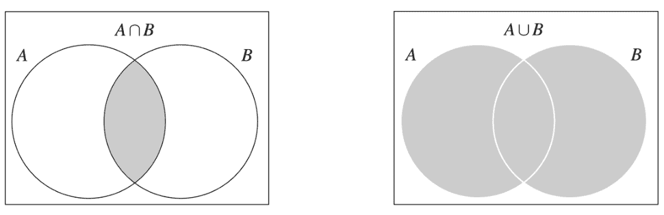

图 7.1 (a) 集合的交集。(b) 集合的并集。

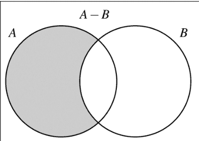

(a)

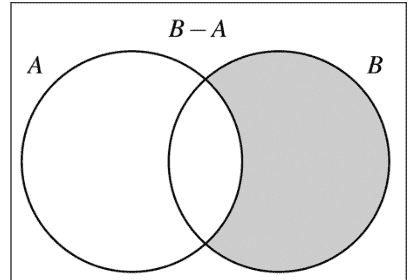

(b)

图 7.2 (a) 集合的差集。(b) 集合的差集。

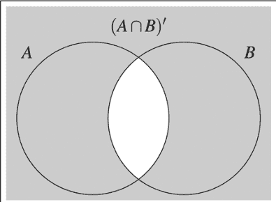

(a)

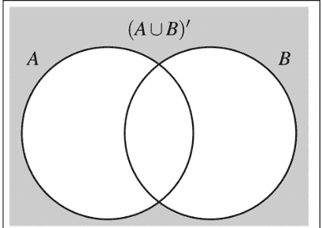

(b)

图 7.3 (a) 相交集的补集。(b) 并集的补集。

## 7.8 将集合作为列表进行程序化处理

列表和集合在处理上可以相似。7

考虑以下列表构造：

```
{ } L LIST
```

由于该列表不包含元素，其基数为零：

```
L' LEN 0 EQ ( → 1,true)
```

反之，假设我们创建一个非空列表：

```
{l₀ l₁ ... lₙ} L LIST
```

该列表的基数大于零：

```
L \not LEN 0 > ( → 1,true)
```

通过元素计数为 0 可以确定列表为空。任何更大的计数都表示列表不为空。

假设我们希望证明两个列表 L₀ 和 L₁ 具有相同的基数。我们想要显示：

```
(L₀) = (L₁)
```

此布尔运算的结果为 true 或 false。

从程序角度，给定以下两个列表 Ia 和 Ix，我们可以检查它们是否具有相同的基数。

```
{ a b c } Ia LIST
{ x y z } Ix LIST
Ia' LEN Ix' LEN EQ ( → 1, or true)
```

### 定理：

```
For all lists L₀, L₁, ..., Lₙ :
|L₀ L₁ ... Lₙ| = |L₀| + |L₁| + ... + |Lₙ|
```

将单独的列表连接（合并）到一个列表 $L_0$ 中可以按以下方式进行：

```
{L0 L1} L0 LIST
{L0 L2} L0 LIST
...
{L0 LN} L0 LIST
```

然后，列表 $L_0$ 的新基数可以表示为：

```
$L_0!$LEN
```

## 练习

- 1. 假设 $S(x)$ 表示 x 游泳，$D(x)$ 表示建造水坝。使用诸如 \(\forall\) 或 \(\exists\) 之类的符号将以下语句翻译为符号形式：

一些这些动物游泳。

- 2. 鉴于 x 和 y 表示实数，解释表达式：\(\forall x \exists y(x < y)\)

- 3. 给定集合 $B = \{ 10 \ 12 \ 14 \ 8 \ 7 \}$ 和关系 $R = \{ (10 \ 11), (10 \ 12) (10, 14) (10, 8) (10, 7) (12, 12) (12, 8) (12, 7) (14, 14) (14, 8) (14, 7) (8, 8) (8, 7) (7, 7) \}$，确定 R 是否为自反、对称、反对称和/或传递。

- 4. 解释集合 { 0 1 2 } 的幂集的基数。

- 5. 解释集合 { a b } 的幂集，其中 a 和 b 是不同的元素。

- 6. 鉴于集合 A 和 B 分别有 3 和 4 个元素，集合 \(A \times B\) 有多少个子集？

- 7. 找出集合 S = { x | x 是整数的平方且 x < 49 } 的元素。

- 8. 找出集合 { 1 2 5 } 和 { 1 2 6 } 的并集。

- 9. 找出集合 { 1 2 5 } 和 { 1 2 6 } 的交集。这些集合是不相交的吗？解释。

- 10. 给出集合 A = { 1 2 5 } 和 B = { 1 2 6 } 的差集，顺序为 A − B。

- 11. 找出集合 { 2 3 6 } 和 { 1 3 5 } 的并集、交集和差集。所得集合是否互不相交？解释。

- 12. 写出一个表示所有大于 0 且小于 10 的奇整数的集合的符号表达式。

- 13. 解释两个集合如何可以是等价的。

- 14. 从一般术语描述集合 A 上的自反关系 R。

- 15. 从一般术语描述集合 A 上的对称关系 R。

- 16. 从一般术语描述集合 A 上的传递关系 R。

- 17. 从一般术语描述集合 A 上的等价关系 R。

- 18. 以下关系的定义域和值域是什么？{ (-1, 2) (2, 5) (1, 3) (8, 7) (9, 5) }

- 19. 以下关系的定义域和值域是什么？{ (-5, 6) (12, -15) (11, 33) (81, 99) (19, 15) }

- 20. 编写一个算法来显示 R ∩ G ∩ B = C。集合 R、G 和 B 分别包含红色 (r)、绿色 (g) 和蓝色 (b) 元素。它们交集中元素的比例确定颜色 C。相关：https://www.w3schools.com/colors/colors_rgb.asp

- 21. 绘制维恩图以说明：
  - (a) \( (A' \cup B) \)
  - (b) \( (A \cap B') \)

- 22. 对于集合 \( A = \{ 2 3 5 7 9 \} \) 和 \( B = \{ 2 4 5 7 \} \) 以及关系 \( a \ge b \)：
  - (a) 建立一个邻接矩阵以显示关系 \( aRb \)。
  - (b) 解释如何使用邻接矩阵来确定该关系是否为自反和/或对称。

- 23. 确定并解释关系 \( R \) 是否为等价关系。
\( R = \{ (1,1)(2,2)(3,3)(4,4)(3,4)(4,3) (1,4)(4,1)(4,2)(2,4)(3,1)(1,3) \} \)

- 24. 创建两个集合 \( A \) 和 \( B \)，使得 \( A \cap B \neq \{ \} \) 或 \( \emptyset \)，其中 \( A \) 是正整数集合，\( B \) 是正奇整数集合。

- 25. 创建两个集合 \( A \) 和 \( B \)，使得 \( A = B \)，其中 \( A \) 是正十进制整数集合，\( B \) 是正二进制整数集合。


## 证明

DOI: 10.1201/9781032687759-8

## 摘要

While the data scientist may not directly refer to formal mathematical proofs in their daily work, they may find that the principles and logic of (someone's) mathematical proofs either corroborate or contradict the conclusions of their data analysis. Therefore, it behooves the data scientist to have some exposure to methods of proof.

The concept of proof can take various analytical forms. Mathematicians use propositional logic for constructing statements that form proofs. Data science is more concerned with empirical proof or evidence based on observed conditions from sets of data. However, observation is not always immediately feasible, as data collection and computation can take significant time. Thus, empirical and logical approaches can be used to corroborate one another.

## 8.1 集合证明

We can establish set proofs involving:

- Subset Relationships
- Set Equality
- Set Emptiness
- Conditional Propositions
- Biconditional Propositions
- Quantification

## 8.2 定义

- Proof – An argument framework supporting the truth of a theorem.
- Theorem – A proposition that has been proven true.
- Hypothesis – A testable assertion that has not been proven.
- Inference – Deducing a theorem from axioms and proved theorems.
- Axiom – A proposition that is assumed to be true.
- Conjecture – A statement proposed to be true, though it is not necessarily testable.
- Paradox – A statement that is neither true nor false, or it is both true and false.
- Lemma – A theorem used for supporting the proof of another theorem.
- Corollary – a theorem that can be established directly from a proven theorem.

Theorems have these forms:

- Statement of fact: \( p \)
- A conditional statement: if \( p \) then \( q \)
- A biconditional statement: \( p \) iff \( q \)

A proof entails a sequence of statements that form a logical argument explaining the truth of a statement. For example, suppose we want to prove \( A \subseteq B \), for two sets \( A \) and \( B \). Here are the general steps:

1. Consider any element in set \( A \).
2. Use definitions and other theorems to argue that each element of \(A\) is also an element of \(B\). This may take several steps depending on the situation.
3. Conclude that \(A \subseteq B\) by definition of subset and our results from the prior step.

In general, a system of proof entails analysis (break down) and synthesis (construction).

## 8.3 子集证明

A subset proof is also called an *element argument*. The general steps:

1. Consider x \(\in\) X, where x represents any element of X.
2. Show also: x \(\in\) Y by some definition or other argument.
3. Conclude: All of X in Y
4. Therefore: X \(\subseteq\) Y by definition of subset.

For example, given sets A and B of the universal set U, prove the theorem \(A \cap B \subseteq B\).

First, consider the formal definition of a subset:

\(A \subseteq B \text{ if } \forall a \in A, a \in B\)

That is, if every element of A is an element of set B, then A is a subset of B.

If we can show that every element of \(A \cap B\) is also an element of B, such as:

if \(a \in A \cap B\), then \(a \in B\)

Then we can conclude that \(A \cap B \subseteq B\).

Our proof will also refer to the definition of intersection,

\( A \cap B = \{ e|e \in A \land e \in B \} \)

since one set involved is actually an intersection of sets.

The proof:

Suppose: \( a \in A \cap B \)
By definition of intersection: \( a \in A \land a \in B \)
Therefore, by definition of subset: \( A \cap B \subseteq B \)

Next, consider an example that involves the Cartesian Product of two sets. In this proof, we will more formally number our statements and write our reasons to the right.

Prove: \( A \times (B \cup C) \subseteq (A \times B) \cup (A \times C) \)

1. Suppose: \( (a, d) \) is any element of \( A \times (B \cup C) \).
2. Then, \( a \in A \) and \( d \in (B \cup C) \) (Definition of Cartesian Product.)
3. \( d \in B or d \in C \) (Definition of union.)
4. Case 1: \( d \in B \). Then, \( (a, d) \in A \times B \) (Definition of Cartesian Product.)
5. Case 2: \( d \in C \). Then, \( (a, d) \in A \times C \) (Definition of Cartesian Product.)
6. \( (a, d) \in (A \times B) \cup (A \times C) \) (Definition of union.)
7. \( A \times (B \cup C) \subseteq (A \times B) \cup (A \times C) \) (Steps 1, 6, and definition of subset.)

## 8.4 集合相等

The general structure for a proof set equality, \( X = Y \), using the subset approach should proceed as follows:

1. Prove \( X \subseteq Y \)
2. Prove \( Y \subseteq X \)
3. Conclude \( X \) and \( Y \) have exactly the same elements.
4. Conclude \( X = Y \) by the definition of set equality.

In summary, we can state:

\( if \ X \subseteq Y \ and \ Y \subseteq X, \ then \ Y = X \)

Using these same concepts, we can also prove statements involving differences. For example:

Prove: \( A - B = A \cap B' \)

1. Suppose: \( x \in A - B \)
2. \( x \in A, x \notin B \) (Definition of set difference.)
3. \( x \in B' \) (Definition of set complement.)
4. \( x \in A \cap B' \) (Definition of intersection.)
5. \( A - B \subseteq A \cap B' \) (Definition of subset.)
6. Suppose: \( y \in A \cap B' \)
7. Then \( y \in A \text{ and } y \in B' \) (Definition of intersection.)
8. \( y \in A \text{ and } y \notin B \) (Definition of complement.)
9. \( y \in A - B \) (Definition of difference.)
10. \( A \cap B' \subseteq A - B \) (Definition of subset.)
11. \( A - B = A \cap B' \) (\( A - B \) and \( A \cap B' \) are subsets of each other.)

We can alternatively prove that two sets are equal by showing that the sets have the same element count and the same elements.

## 8.5 集合空性

Here we will use a method of proof referred to as *proof by contradiction*. We will assume that the opposite of what we are trying to prove is true, and then we will (hopefully) find a contradiction. The opposite statement will then be proven false, meaning our original statement is proven true.

For example:

Prove: \( A \cap A' = \emptyset \)

| Statement | Reason |
| :--- | :--- |
| 1. Suppose \( A \cap A' \) is not empty. | By assumption. |
| 2. Then \(\exists a, a \in A \cap A'\) | Step 1. |
| 3. \( a \in A \) and \( a \in A' \) | Definition of intersection. |
| 4. \( a \notin A \) | Definition of complement. |
| 5. \( a \in A \cap A' \) is false | Steps 3 and 4 contradict. |
| 6. \( A \cap A' = \emptyset \) | Proved by contradiction. |

## 8.6 条件证明

A conditional proof involves proving an implication, an if-then statement.

The general form for proving \( p \rightarrow q \):

1. Suppose: \( p \) is true.
2. Show \( q \) must be true. This may require several steps.

A biconditional compound proposition can be proven by stating two implications, and proving each with a conditional proof. For example, to prove \( p \) iff \( q \), we must prove both of the following statements:

> *if p is true then q is true*
> *if q is true then p is true*

Similarly, the statement “The launch is on today if and only if it is sunny.” could be broken down into the following statements:

> *If it is sunny today, then the launch is on.*
> *If the launch is on, then it is sunny today.*

## 8.7 证明技巧

The writing of proofs is an artful skill that one learns by practice.

A proof is generally composed of consistent assertions that lead to a concluding assertion that is proved.

For example, consider the form of an inference proof, as based on rules of inference:¹

```
IF p → q
AND q → r
THEN p → r (conclusion)
```

In postfix notation, this is:

```
p q IF q r IF AND
```

Here are some methods of proof.

*Vacuous proof:* p → q is true if p is false.

*Trivial proof:* p → q is true if q is *always* true.

*Direct proof:* Given the assertion that p is true, by inference show that q must be true.

*Proof of the contrapositive:* To prove p → q is true, we could prove that the contrapositive ¬q → ¬p is true.

*Proof by contradiction:* Given the assumption that p → q is false, find some contradiction.

## 8.8 量化证明

*Universal quantification* proofs entail showing that every element has a particular property and therefore belongs to a particular set.

Proofs of *existential quantification* entail showing that at least one element belongs to a set. That is, an element exists or does not exist. Hence, such logic is called *existential quantification*.


如果我们要证明集合 X 中的所有元素都具有一个称为 P(x) 的属性，那么我们正在尝试证明 ∀x ∈ X, P(x)。我们的一般策略如下：

假设 x 是 X 的任意元素。
使用定义或定理来证明对于每个 x，P(x) 都成立。
因此：∀x ∈ X, P(x)。

_存在性证明_ – 证明特定集合中至少存在一个元素，或某个元素具有特定属性。我们要证明
∃x ∈ X | P(x)。

¹有关推理规则的更多信息，请参见命题逻辑章节。

我们可以采取 _构造性_ 方法，通过实际找到具有特定属性的元素或元素。当然，我们必须
解释我们如何知道这些元素属于指定类型。

或者，我们可以采取 _非构造性_ 方法，并可能得出存在使 P(x) 为真的元素的结论，而无需
指定任何使 P(x) 为真的元素。该策略涉及
反证法，并按如下方式开始：

要证明：∃x ∈ X | P(x)：
假设 ∀x ∈ X, ¬P(x)。

我们假设与我们要证明的内容相反。如果通过使用
我们的假设，我们以某种方式得出矛盾，那么我们
可以通过反证法得出 ∃x ∈ X | P(x) 的结论。

_唯一性证明_ 或 _唯一存在性证明_ – 在这种证明类型中，我们证明集合中的一个元素是唯一的，这意味着只有
X 中的一个元素 x 具有属性 P(x)。该策略涉及尝试证明，如果有其他元素具有属性 P(x)，那么它们实际上与具有一个元素 x 且具有给定属性的元素相同。

## 8.9 递归与数学归纳法

归纳假设假设结构存在，因为通过对结构下一个对象的归纳观察，整个结构被观察到。通过归纳，我们可以证明 ∀x,P(x) 形式的断言，或某个属性或公式对集合中所有元素都成立。由于观察可以被递归诱导，证明归纳法实际上就是递归证明。

证明归纳法将针对全集中的元素，设有基本情形和归纳情形。基本情形确立 P(x) 对全集 S 中至少一个元素 x 成立。归纳情形确立，如果 P(x) 对元素 i 成立，即 P(i) 成立，那么 P(i+1) 也成立。换句话说，如果 P(x) 对任何特定元素成立，那么 P(x) 对下一个元素也成立。

基本情形为真可以指示系统已达到某个限制，例如索引值达到指定的最大值或最小值，集合中剩余元素的数量（包括空集），或某些其他阈值。

当系统从最大值开始并在最小值结束时，可能被称为逆向归纳。逆向归纳的归纳情形可表示为 P(i-1)。相反，当系统从最小值开始并在最大值结束时，可能称为正向归纳。正向归纳的归纳情形可表示为 P(i+1)。

例如，如果下限是 0，那么基本情形可表示为 P(0) 或 P(i)，其中 i 为 0。给定这样的下限，如果 i > 0，则存在一个归纳情形。对于下限 i = 0，归纳情形则适用于 i > 0。

无论我们是使用正向归纳来归纳性地指定一系列前驱，还是使用逆向归纳来指定后继，都取决于所需的元素遍历顺序。

假设我们希望递归函数在没有剩余数据可处理时终止。使用栈数据结构，我们可以证明当栈计数器为 0 时，即基本情形的属性成立时，则没有递归调用。² 否则，根据归纳假设，系统会发生递归函数调用。

²栈的目的是拥有一组数据存储，确保添加到集合中的第一个元素是最后一个可以被移除的元素（后进先出，LIFO）。栈将在第 16.6 章中深入讲解。

例如，我们可以追踪函数 sum 的递归执行，该函数计算数据栈上数字之和。考虑以下 sum 的定义：

```
{ + GSC 1 > sum ? } sum WORD
```

其中，如果栈数据结构上的值的数量大于 1，则会调用加法操作，这是由 ? 操作符对栈计数器 GSC 的计算结果决定的。

对于对值 1, 3, 5, 7, 9 求和，模拟程序栈可能如下所示：

| 地址 | 索引 | 值 |
|---|---|---|
| 78321AAF480 | 7 | + |
| 78321A8B300 | 6 | 5 |
| 78321A8B380 | 5 | 3 |
| 78321A8B400 | 4 | + |
| 78321A8B480 | 3 | 1 |
| 78321A8B500 | 2 | + |
| 78321A8B580 | 1 | 9 |
| 78321A8B680 | 0 | 7 |

注意，加法操作通过其在数据栈上的存在被视为数据。当栈顶的加法操作被调用时，它会将下一个两个值 5 和 3 相加，结果 8 进入栈顶。在下一个加法操作被调用之前，必须将其移动到栈顶，这可以通过将 8 移到栈底来完成。（实现此过程的程序可在附录 C.11 中找到。）

上述求和操作的递归情况如下：

- 基本情形 – 停止：用于加法的数字不足。
- 归纳情形 – 继续：用于加法的数字足够。

数学归纳法通常分为两种类型：弱归纳和强归纳。对于弱归纳，我们证明一个基本情形，且归纳情形给定的 i 只需要 i − 1 的直接前驱。如果我们能利用 P(i − 1) 为真的假设来证明 P(i) 为真，则归纳情形完成。

强归纳涉及证明多个基本情形（所需基本情形的数量取决于情况）。然后我们假设该语句对所有 i < n 成立，并证明该语句对下一个情况（i = n）也必须成立。也就是说，假设 P(i) 对所有 i < n 成立，并证明 P(n) 成立。

强归纳的归纳情形有时不仅需要使用 P(n − 1) 语句。可能还需要使用 P(n − 2)、P(n − 3) 等来证明 P(n) 为真。强归纳用于更复杂的情况。

相同的归纳假设适用于有限集合和无限集合，前提是每个元素都有一个直接前驱。

要使用数学归纳法证明特定集合中所有 n 的语句 P(n) 为真：

- 基本情形：证明集合中的某个值 i（通常是最小值）下 P(i) 为真。
- 归纳情形：假设集合中任意 k 下 P(k) 为真。利用该假设来证明 P(k + 1) 为真。

## 8.10 归纳法示例

作为我们的第一个归纳法示例，设 P(n) 为“前 n 个奇数自然数之和为 n^2”这一语句。

```
P(n) : 1 + 3 + 5 + ⋯ + (2n − 1) = n^2
```

注意，第 n 个正整数可以表示为 2n − 1。

我们将使用数学归纳法证明 P(n) 对所有 n ∈ W 都成立。

基本情形：P(n) 对 n = 1 成立，因为

```
P(1) : 1 = 1^2
```

归纳情形：假设当 n = k（k 为任意自然数）时 P(n) 为真。也就是说，我们假设以下内容成立：

```
P(k) : 1 + 3 + 5 + ⋯ + (2k − 1) = k^2
```

我们需要证明当 n = k + 1 时 P(n) 也为真。注意，第 k 个奇数是 2k − 1，因此下一个奇数是：

$(2k - 1 + 2)$ or $2k + 1

考虑 $P(k + 1)$。这是 $P(k)$ 的上述语句，在两边都加上下一个奇数：

[ 1 + 3 + 5 + \cdots + (2k - 1) ] + (2k + 1) = k^2 + (2k + 1)
= (k + 1)(k + 1)
= (k + 1)^2

注意，我们在第一行使用了假设。我们的工作表明，前 k + 1 个整数的和是 k + 1 的平方。因此，只要 $P(k)$ 为真，$P(k + 1)$ 就为真，根据归纳假设，$P$ 对所有 $n$ 都成立。

作为另一个示例，考虑对以下语句的归纳法证明：

*对所有* $n \in \mathbb{W}$，* $3^n - 1$ *是偶数*

证明该语句将使用以下事实：任何偶数都包含因子 2，且 $3 \cdot 3^n = 3^{n+1}$。

数学归纳法证明：

设：$n \in \mathbb{W}$

基本情形：

假设 $n = 0$。则 $3^n - 1 = 3^0 - 1 = 1 - 1 = 0 = 2 \cdot 0$，根据定义，这是偶数。

因此，存在至少一个 $n \in \mathbb{W}$，使得 $3^n - 1$ 为偶数。

归纳情形：


对于 \( k \in \mathbb{W} \)，假设语句“ \( P(k) : 3^k - 1 \) 是偶数”为真。这意味着在我们下面的工作中，可以将 \( 3^k - 1 \) 替换为 \( 2m \)，其中 \( m \in \mathbb{W} \)。（\( 3^k - 1 \) 含有因子 2。）

考虑 \( P(k + 1) : 3^{k+1} - 1 \)。我们必须证明 \( 3^{k+1} - 1 \) 也是偶数。

```
3^{k+1} - 1 = 3 · 3^k - 1
               = 3(3^k - 1 + 1) - 1
               = 3(2m + 1) - 1, for some m ∈ W
               = 6m + 3 - 1
               = 6m + 2
               = 2(3m + 1)
```

Since \( 3^{k+1} - 1 \) 含有因子 2，\( 3^{k+1} - 1 \) 是偶数。

因此，根据归纳假设，\( 3^n - 1 \) 是偶数，对所有 \( n \in \mathbb{W} \) 成立。

## 练习

- 1. 给定集合 \( A = \{a|a \text{ 是奇整数} \}\)，解释为什么 \( B = \{1, 3, 5, 7\} \) 是 \( A \) 的子集。

- 2. 给定集合 \( A \)、\( B \) 和 \( C \)，使得 \( A \subseteq B \) 且 \( B \subseteq C \)，证明 \( A \subseteq C \)。

- 3. 给定集合 \( A \)、\( B \) 和 \( C \)，使得 \( B \subseteq C \)，证明 \( A \times B \subseteq A \times C \)。

- 4. 对于任意三个集合 \( A \)、\( B \) 和 \( C \)，其中 \( A \subseteq B \) 且 \( B \subseteq C' \)，证明 \( A \cap C = \{\} \)。（提示：使用反证法。）

- 5. 如果 \( A \) 和 \( B \) 是集合，证明 \( A \cap B = A \) 当且仅当 \( A \subseteq B \)。

- 6. 如果 \( A \)、\( B \) 和 \( C \) 是某个全集 \( U \) 的子集，证明 \( A \cap (B \cup C) = (A \cap B) \cup (A \cap C) \)。

*对剩余练习使用数学归纳法。*

- 7. 证明 2 + 4 + 6 + ... + 2n = n(n + 1)，对所有整数 n ≥ 1 成立。

- 8. 证明 1 + 2 + 3 + 4 + ... + n = n(n + 1)/2，对所有整数 n ≥ 1 成立。

- 9. 证明 3 + 5 + 7 + ... + (2n + 1) = n(n + 2)，对所有整数 n ≥ 1 成立。

- 10. 证明 3^n + 1 是偶数，对所有自然数 n 成立。

- 11. 证明 2^{2n+1} + 1 是 3 的倍数，对所有自然数 n 成立。

## 可计算性

DOI: 10.1201/9781032687759-9

## 摘要

对可计算性的理解可以帮助数据科学家认识算法的局限性。在开展重大的数据科学计划之前，在将大量时间和投资分配给预期解决方案之前，算法的可行性是一个重要考量。有可能某个问题无法解决，或者只有在付出巨额资金后才能解决。最好是，在事先做出是否继续的决策时，基于可计算性的被证明的逻辑。

数据科学关注经验证明，即基于观察到的数据集条件的证据。然而，观察并不总是立即可能的，因为计算可能需要大量时间。对于这种情况，数理逻辑加速了对算法相对性能的分析。

经验数据是指在模型之外遇到的数据。此类数据可被视为事实，并可从外部世界记录。相比之下，逻辑数据是模型内部的，因为它可以被假设或逻辑推导出来。这些概念在机器状态方面的重叠是 *可计算性* 的本质。

## 9.1 NP-完全性

*NP-完全性* 指的是存在可验证解的问题。*NP 完全性理论* 关注 *P* 问题和 *NP* 问题。*P 问题* 在 *多项式时间* 中求解（也称为算法的时间 *复杂度*）。¹ *NP 问题* 在 *非确定性多项式时间* 中求解。

对于 *确定性问题*，给定一组输入的解将是某个预期结果。相比之下，对于 *非确定性问题*，即使是同一组输入，解也可能不同。

多项式时间是衡量算法求解给定问题所需工作量的一种度量。多项式时间用 *Big-O* 表示法表示，例如 *O(n^k)*，其中 *n* 是输入大小，*k* 是常数。“O” 指的是 *数量级*，即指数 *k*。（因此，可以说算法具有某个“Big-O”。）

在计算机科学中，算法效率也称为 *时间复杂度* 和 *算法复杂度*。算法的复杂度与其效率密不可分。

对算法的时间复杂度进行分析，使我们能够估计不同算法的相对性能，以及一个问题是否可以快速或缓慢求解。这些是数据科学的重要考量，在数据科学中，处理 *大数据* 在发现有用解之前可能需要在计算资源和运行时间上进行重大投资。²

¹相关概念在 *算法复杂度* 和 *数据维度* 章节中有所介绍。⇨

²非正式地，当 *大数据* 的处理成本超过您本地处理资源的价值时，即定义为存在 *大数据*。⇨

在 *计算理论* 中，问题被分类为 *可计算* 或 *可判定*。可计算问题是指可以在有限时间内生成计算解的问题。可判定问题是指可以在有限时间内产生正确“是”或“否”（或真或假）答案的问题。

可计算性是更广泛的概念，涵盖了可计算和可判定问题。确定程序重复操作的上限何时以及是否会达到，是停机问题的问题。考虑算法无法得出解的情况。也许没有可能的解，且算法未被给出停止条件。

假设我们需要为算法设置 n 个循环次数：

```
operations 'n REPEAT
```

n 的值应该是多少？

可能存在无限循环，即程序无限运行。³ 或者，解对于当前算法和机器可能根本不可行。在这些情境下，可计算性问题变成了可判定性问题，例如：“程序应该继续还是停止？”

有界停机问题是指其步骤数，即其界限是有限的。也就是说，它是可判定的。这与一般停机问题形成对比，后者是不可判定的。

乍一看，人们可能会创建一个算法检查器来验证来宾算法是否可判定（能够完成任务）。当来宾算法依赖检查器提供输入，而检查器又依赖来宾提供输出时，就会出现一个难题。一般的安排可能如下所示：

```
{ input guest halts? checker ? } checker WORD
```

检查器程序会重复用新输入检查来宾程序，只要来宾对某些输入能停止。如果来宾不停止，则检查器会无限期等待。无论哪种情况，系统都会永远运行且是不可判定的。

³相关材料在 *重复与递归* 章节的 *无限循环* 节中。

在实践中，试图解决一般停机问题可能被视为一项徒劳的练习，因为不可能对所有问题都有解。尽管如此，研究停机问题揭示了计算的局限性，使其并非完全徒劳。

例如，*epop* 编程语言包含统计启发式方法，用于猜测用户运行的代码是否陷入无限循环。如果如此判定，无论正确与否，*epop* 都会警告用户，并最终代表用户打破循环。

在模型的解是概率性而非确定性的情况下，每个可能的输出状态都会被赋予一个概率。此类模型可称为 *概率状态机*。⁴


然而，如果解已知，概率状态应当为 1 吗？“仅仅因为我们有解，问题就可解吗？”这引发了臭名昭著且看似悖论的可计算性问题：

## $P = NP?$

有时，采用较不复杂的模型寻找概率解是实用的，即逐步减少变量（数据维度）、采样率和记录的数量，或满足于较低的预测准确性。此类放宽模型的实现意味着更短的处理时间。

问题可通过*传递多项式时间归约*被证明为 NP-完全（可解），即将问题分解为更小的可解子问题。给定由 $a_1$、...、$a_n$ 个子问题组成的问题 $A$，若对所有 $a$（包括最坏情况的 $a$）均成立，则 $A = P$。因此，解意味着子问题 $a_1$ 与子问题 $a_n$ 之间存在传递关系。

传递多项式时间归约的一个隐喻是“链条中最弱的一环”，意指解的效用取决于其最薄弱的组件，在此情况下即为解中表现最差的子算法。

## 选定的问题分类：

数据重采样应用于概率状态机的一个例子是金融和经济学中广为人知的分析方法，即马尔可夫链。

- 决策：是非问题（答案为“是”或“否”的问题）。
- P：在多项式时间内可解的问题，例如算法复杂度分析。
- NP：在非确定性多项式时间内可解的问题。
- NP-完全：NP 中所有最终归约至 NP 的子问题集合。
- NP-难：问题及其子问题均为 NP-完全。
- 不可判定：不总是可解（模型可能因变量过多而受影响）。

相关主题是归纳推理，它旨在从非确定性或探索性系统中寻求结论的合理性或可能性。归纳推理是探索性数据分析的一个子主题，后者是数据科学中更高级的主题。

## 9.2 编程语言元素

元语言是用于定义其他语言的语言。元语言常用于编译的词法分析阶段。词法分析是将输入拆分为称为标记的独立单词的过程。词法分析器也可称为元程序。

撇开形式主义不谈，我们希望构建的编程语言可称为*客体、目标或对象语言*。用于生成（编译）客体语言的语言可称为宿主语言或元语言。宿主的符号可称为*终结符*或*原语*。客体语言的符号可称为*非终结符*或*抽象*。

顺便说一句，通过构建函数的函数，我们实际上得到了所谓的*高阶函数*。换句话说，抽象单词或函数是*高阶单词*。相反，原语单词或函数可称为*低阶单词*。

5这些概念在*函数与抽象*章节中有更深入的讲解。

元语言和*宿主语言*可以是同一种。也就是说，如果宿主语言 A 用于编译*客体*语言 B，则 A 可称为元语言。例如，Python 编程语言是用 C 编程语言编写的。Python 是客体语言，C 是宿主语言。

元语言采用的语法要么是*上下文相关的*（*上下文感知的*），要么是*无上下文的*（CFG）。*语法*是语言单词和符号序列的规则，例如从左到右进行处理。仅面向生成标记的编译器词法分析阶段是无上下文的。后续涉及解析某些标记序列的编译器阶段因此是上下文相关的。解析器根据给定编程语言的语法强制执行标记序列。如果不强加预期顺序，无上下文语法否则会存在歧义。

解析器的输出将是一系列原语（终结符）单词。这些终结符单词可索引到对应的语法树，也称为具体语法树。如果语法树将抽象单词映射到原语单词，则该语法树也可称为抽象语法树。图 9.1 所示的是针对抽象函数 i+（它向操作数 i 加 1）的简单语法树示意图。该示意图展示了 i+ 及其原语依赖项之间的层次关系。

6更多语法树示例可在*分支结构*章节中找到。

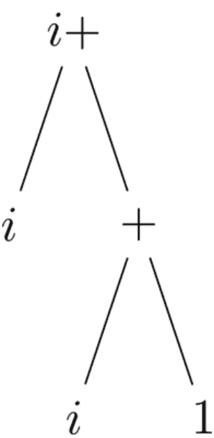

图 9.1 一个简单函数的语法树。

非终结符分解为终结符的方式需要对嵌套非终结符进行反复检查。此类任务的一种常用算法称为*递归下降解析*。递归下降算法的遍历与语法树相对应。

词法分析包括将输入拆分为可用数据单元并拒绝不可用的输入。词法分析阶段的输出称为标记。根据语言的关键字，与关键字匹配的标记将与未识别的标记得到不同的处理。例如，在程序执行期间，已识别的标记可能被指向程序栈，而未识别的标记可能被视为文字数据或参数，并被指向数据栈。

元语言的符号称为*终结符*。这些符号可能包括字符、关键字、运算符等。客体语言的单词称为*非终结符*，是终结符符号的抽象。终结符被视为原子，因为它们不可归约为其他指令。因此，终结符可称为*原子*，这符合*原子与抽象*章节中讨论的概念。

为了使消息具有意义（如在发送方和接收方之间，或编码人员和机器之间），必须存在共享的语法规则。

符号上，无上下文语法的一条规则可能如下：

```
X → x
```

其中，*X* 是非终结符符号，*x* 是终结符符号。这意味着当遇到 *X* 时，它将被替换为 *x*，与 *X* 周围的上下文无关。

上下文相关语法的一条规则可能如下：

```
XY → xY
```

在这种情况下，当且仅当 X 后面跟着 Y 时，X 才会被替换为 x。

然而，无上下文表达式允许存在歧义。例如，尽管以下表示为 E 的表达式可作为无上下文标记接受，但它们对于可工作的程序需要对某些*产生式规则*进行上下文解释，例如将标记 +、−、× 和 *number* 识别为终结符。

```
E → E + E
E → E − E
E → E × E
E → number
```

取决于术语的复杂度和抽象规则，实际编程语言通常是上下文相关的，只有词法分析阶段是无上下文的。

如前所述，语法定义了语言可接受的操作序列。请考虑以下后缀序列：

1 2+

+ 符号是加法操作的别名，可能在宿主语言中定义为 ADD。此外，单词 ADD 本身可能是二进制操作码（operational code，操作码）的别名，例如 1001000100，这与 ARM CPU 汇编语言的一个版本中的情况相同。ADD 比 1001000100 更容易记住，因此 ADD 被称为助记符。

数学通常使用二元运算符进行（不要与二进制数混淆），这意味着它们接受两个参数。因此，程序的编译器将拥有针对某组数学符号强制执行二元操作的语法。语法规则的强制执行必须是一个上下文感知过程（即，非无上下文）。

执行 ADD 时，程序将查找两个数值进行相加。通常，操作数位于内存中，将被传输到 CPU 寄存器中以对其执行加法。结果可能保留在 CPU 寄存器中以供进一步操作，也可能被传输到内存。在更高的抽象级别，此类存储可能位于栈、数组或链表等抽象数据结构中，具体取决于语言的架构。

鉴于加法函数的组合归根结底归约为 ADD，因此 ADD 被视为终结符。相反，我们可能有一个非终结符的抽象加法函数。请考虑名为 addone 的以下函数。

```
{ 1 + } addone WORD
```

单词 addone 是抽象非终结符单词，因为它由至少一个其他单词组成。


要全面了解计算机语言抽象层级的分类体系，可参考文章 *编程语言框架抽象层级分类体系*。8

7 ARM, 汇编语言入门, 2023. DOI: https://documentation-service.arm.com/static/64e7245d04d0d65e67136806.

8 B. Kahanwal, “编程语言框架抽象层级分类体系,” 《编程语言与应用国际期刊》, vol. 3.4, 2013 年 10 月. DOI: https://www.researchgate.net/publication/258499542_Abstraction_Level_Taxonomy_of_Programming_Language_Frameworks.

## 9.3 语言符号

元语言包含的语法可以用符号表示。例如，常见的语法框架符号化如下：

G = { N T S P }

这里，N 是非终结符集合，T 是终结符集合，S 是 N 的元素，是所有字符串的起始符号，P 是产生式规则集合。

集合 N 和 T 是不相交的。考虑到 N 派生自 T，这可能看起来不正确。但是，在这个上下文中重要的是符号集合，而不是它们的派生。要让自己信服，请为包含宿主语言特有单词的访客语言编译一个程序。会出现错误。当然，一旦程序被编译，所有单词都将转换为宿主语言，全部变成 T。

单词及其构成单词的字母数字字符是语言符号全集的子集。编程语言的符号全集也称为语言的符号表或字典。

相比之下，定义为不包含任何单词或字符的集合的单词表示空集，也称为恒等元。恒等单词 I 可定义如下：

```
{ } I
```

恒等单词作为以后可能带有字符的单词或字符串的占位符。空单词或空字符串的常见符号是 ε。

编程语言字典中的初始单词是原语。使用编程语言原语定义的单词是抽象，并添加到字典中。应强调，这种抽象级别仅适用于访客语言的范围内，而不适用于宿主语言的范围。9

抽象单词用其他单词定义，包括其他抽象单词和原语单词。

抽象单词表示语言字典这一全集的单词子集。由于构成单词定义的集合可能包含重复项，因此它们在技术上定义为 *袋* 或 *多重集* 而非恰当集，后者仅限于不同元素。

定义一个单词会将其追加到语言字典中。例如，这里我们定义单词 w 和 x：

```
{ ab cd mn } w WORD
{ pq rs } x WORD
```

由于抽象单词由其他单词组成，它们也可以分解为其组成单词，这是编译器程序的任务。

从符号上看，语言的字典 $D_L$ 是由原语 $P$ 单词组成的多重集，这些单词组合形成抽象单词。因此，对于语言 $L$，字典 $D_L$ 定义为：

```
$D_L \subseteq (P \cup D_L)$
```

如果语言原语集合 $P$ 是包含不同元素的恰当集合，则 $D_L \subseteq P \rightarrow false$。但是，如果 $P$ 是多重集，则 $D_L \subseteq P \rightarrow true$。

虽然对于多重集来说元素顺序在形式上无关紧要，但可以通过任意标记其顺序来区分重复元素，例如 $e_0 e_1 ... e_n$。

面向特定机器 M 的语言 L 可表示为 L(M)。

考虑由四个子单词组成的单词集合 { w x z I }：w、x、z 和恒等单词 I。由于恒等单词无效，

{ w x z I } = { w x z }

我们也可以基于先前分别使用 ab cd mn 和 pq rs 定义的 w 和 x 单词来定义一个抽象单词。

```
{ w x } y WORD
```

单词 y 是单词 w 的符号集后跟单词 x 的符号集。

y → ab cd mn pq rs

要将元素追加到单词集合 y，可以重新定义单词，例如：

```
{ w x z } y WORD
```

或者，使用以下方法，对于较大的集合来说不那么繁琐：

```
{ y z } y WORD
```

连接操作用于连接两个字符串。<sup>10</sup>

- ac \to ac
- a.c \to ac
- a\tilde{c} \to ac
- a(c) \to ac
- aca \to aca
- ac.a \to aca
- ac\tilde{c} \to aca
- (ac)c \to acc

使用星号上标 * 表示给定序列的所有可能单词组合。例如：

$(ac)^* = \{ I \ ac \ acac \ acacac \ ... \}$

同样，加号上标 + 表示给定序列的所有单词，但不包括空集。

$(ac)^+ = (ac)^* - I$

请注意，虽然连接是结合运算，如 $a(ac) = (ac)a$，但它不是交换运算。即 $ac \neq ca$。

并集运算符用于使用给定符号创建任何可能的单词组合。

$a \cup c = \{ I \ a \ c \ aa \ ac \ ca \ cc \ aaa \ aac \ ... \}$

10 连接运算符在不同编程语言中有所不同。它可以是点 . 或波浪号 ~，也可能根本没有字符。

并集运算既是结合的也是交换的。

## 9.4 机器

编程语言是为其运行的机器设计的。机器可以是物理计算模型或逻辑计算模型。

一种简单的无状态计算模型称为有限状态机，或有限自动机 (FA)。这些可以是确定性有限自动机 (DFA) 或非确定性有限自动机 (NFA) 类。确定性系统针对给定输入始终产生相同的预定输出状态。相反，非确定性系统依赖于系统预先不知晓的可能或可能的输入。

类似于数字逻辑，有限状态机具有输入状态编码及相关输出，可用函数形式、状态图、有向图、邻接矩阵或真值表进行建模。用于描述 FA 的真值表称为状态转换表。FA 还具有图数据结构的特征，例如表示状态的顶点，这在分支结构一章中有所描述。

现实世界中的有限状态机包括交通灯、自动售货机、电梯、地铁闸机、组合锁和工业逻辑控制器。抽象的现实世界应用包括数据科学分类器和编程语言编译器中的词法分析器。

将运算符 IF 视为一种极简有限状态机。给定 0 或 1（假或真）的输入状态，IF 将影响一个运算或另一个运算。将一系列 IF 运算组装起来，将有效形成决策层次结构，即决策树。如果其中一些决策涉及未知输入，并在生成特定输出之前重复树的某个分支，则该系统是非确定性的。

这里演示了这样的非确定性分支系统。这段代码仅根据用户的选择执行函数 this、that 或 other。

```
{ choice @ 1 EQ this ? } a WORD
{ a choice @ 2 EQ that ? } b WORD
{ b choice @ 2 > other ? } c WORD
```

假设用户对 choice 的输入为 2，执行单词 c 将间接通过单词 b 导致执行单词 that。这段代码是非确定性的，因为 choice 在序列中的某条指令被求值以揭示输入 choice 之前是未知的。

一旦非确定性有限自动机 (NFA) 的指令序列完成且其分支确定，则在模型所见的任何新数据不会导致不同决策的前提下，可能将 NFA 转换为 DFA。相应地，我们将记录 true 或 yes 状态，然后从机器中删除所有其他可能的状态。在使用完整的通用数据集（如 *总体*）时这更可行，而在使用样本数据集时则不太可能。

设置为 *yes* 的 NFA 顶点（状态）集合定义了一个 DFA。

$dfa = nfa \cap yes$

将 NFA 转换为 DFA 后，剩余的指令集据说是封闭的。即，剩余的指令分支不会改变。这一概念与 *函数式编程* 实践中的 *闭包* 相似，<sup>11</sup> 后者暂时缓存（存储）可执行函数的子集，供名为 lambda 的无名函数使用。Lambda 提供了一种静态封装可由单独宿主函数使用的无名访客函数参数的方法。

考虑以下内容：

```
{ + } # LWHILE
```

括号 { + } 中的加法操作包含一个 lambda 函数，该函数被缓存以供重复执行，由


LWHILE 单词将扫描，直到栈上找到`#`字符为止。这种操作可用于为数据栈上的一组数值创建总和。入口序列`1 3 # 5 7 9 0`的执行过程如下：

# ... 数据栈 ...

| Address | Index | Value |
|---|---|---|
| 2581BA92E00 | 6 | 0 |
| 2581BA92D80 | 5 | 9 |
| 2581BA92D00 | 4 | 7 |
| 2581BA92C80 | 3 | 5 |
| 2581BA92C00 | 2 | # |
| 2581BA92B80 | 1 | 3 |
| 2581BA92B00 | 0 | 1 |

相关信息可在 Lambda 演算 章节中找到。

现在，可以通过此重复操作执行该模拟程序栈：

```
`{ + }# LWHILE → 21`
```

有限自动机的正式定义包括五个部分：状态、输入符号、初始状态、接受状态和转换函数。

有限自动机可如下符号化（表示法可能不同）：

- P: 输入符号集。
- S: 内部状态集（字符符号，或 0 或 1）。
- T: 接受状态集（S 的子集；1 表示 true）。
- s₀: S 中的初始状态（可能是 0）。
- W: 状态转换函数。

W 根据现有状态 s 和输入 p 改变系统的状态。W 对所有输入的应用可符号化为：

```
W : S × P → S′
```

S′ 表示应用转换函数后的内部状态集。由于 DFA 的所有接受状态都封闭在机器中，DFA 的证明使用_全称量化_。反之，由于 NFA 中只有部分状态可能被封闭，那些证明使用_存在量化_。

假设程序有一个小的输入符号集 P，表示为：

```
{ p₀ p₁ } P
```

进一步假设，当程序遍历符号序列时，状态集可能为：

```
{ s_0 s_1 s_2 } S
{ s_0 s_1 } T
```

T 中的*接受*状态源于产生另一状态的某些评估。也许每个状态都是布尔结果，例如 true 或 false，或 1 或 0。然而，可能有超过两个输出状态。

假设为相关转换函数输入定义了以下状态蕴含：

```
W(s_0, p_0) \rightarrow s_0   W(s_0, p_1) \rightarrow s_1
W(s_1, p_0) \rightarrow s_0   W(s_1, p_1) \rightarrow s_2
W(s_2, p_0) \rightarrow s_2   W(s_2, p_1) \rightarrow s_2
```

根据这些状态蕴含，相应的状态转换表如下：

| W | p0 | p1 |
|---|---|---|
| s0 | s0 | s1 |
| s1 | s0 | s2 |
| s2 | s2 | s2 |

请注意，对于输入，W 取决于系统的先前状态。

我们可以定义输入（指令）与状态的更复杂组合。例如，将数据采集设备视为状态机，该设备可检测一个单词，如“HELO”。这可以是无线电接收机，其检测器类似于状态转换函数。

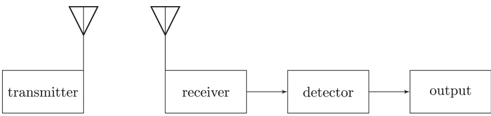

图 9.2 信息传输、接收和处理。

从空中接收到的各种信号和噪声中，检测器筛选离散数据块，仅保留字母字符 H E L O。在 P 的所有输入中，只有部分匹配该四字符序列。令这些由以下给出：

```
{ p0 p1 p2 p3 } P
```

令机器的状态集 S 为：

```
{ s0 s1 s2 s3 s4 } S
```

状态与输入关联：

| S | 已匹配 | P |
|---|---|---|
| $s_0$ | | HELO |
| $s_1$ | H | ELO |
| $s_2$ | HE | LO |
| $s_3$ | HEL | O |
| $s_4$ | HELO | |

系统任一时刻只能处于一个状态，由集合 S 列中的符号 $s_1 s_2 s_3 s_4$ 表示。

相应的状态图：

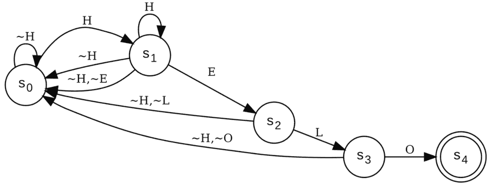

图 9.3 匹配单词的机器状态图。

检测器首先扫描输入的每个字符。初始状态为 s0，一个非接受状态。如果检测到字符 H，则转移到 s1，一个接受状态。否则，保持在 s0。

继续处理下一个字符，如果在 H 之后立即检测到 E，则转移到 s2，一个接受状态。如果既未检测到 E 也未检测到 H，则返回 s0，一个非接受状态。如果检测到另一个 H，则保持在 s1，一个接受状态。

假设检测器处于已匹配 HE 的 s2 状态，然后评估下一个字符。如果是 L，则转移到 s3，一个接受状态。否则，返回 s0。

假设检测器处于已匹配 HEL 的 s2 状态，然后评估下一个字符。如果是 O，则转移到 s4，一个接受且最终状态，表示已匹配 HELO。否则，返回 s0。

相应的状态转换表：

| S | 下一个字符 | 下一状态 |
|---|---|---|
| s0 | H | s1 |
| s0 | 不是 H 或 E | s0 |
| s1 | E | s2 |
| s1 | 不是 H 或 L | s0 |
| s2 | L | s3 |
| s2 | 不是 L | s0 |
| s3 | O | s4 |

顺便说一句，如果 HELO 的字符以二进制给出，则需要扩展状态以包含每个位子模式，类似于上面 HELO 中的字符状态。由于每个字符有七位，这将每个字符需要七个状态。例如，H 在 Unicode 十进制中为 72，或二进制中的 1001000。因此，对 HELO 的评估将是 7 × 4，即 28 个符号。

可使用*二进制比较器*将每个输入位序列与目标位序列进行比较。

例如，令输入 P 的第一个字符为位集 P<sub>0,j</sub>，如：

```
{p<sub>0,0</sub> p<sub>0,1</sub> p<sub>0,2</sub> p<sub>0,3</sub> p<sub>0,4</sub> p<sub>0,5</sub> p<sub>0,6</sub> } P<sub>0,j</sub>
```

令比较器目标集 I 的第一个字符为位集 I<sub>0,j</sub>，如：

```
{i<sub>0,0</sub> i<sub>0,1</sub> i<sub>0,2</sub> i<sub>0,3</sub> i<sub>0,4</sub> i<sub>0,5</sub> i<sub>0,6</sub> } I<sub>0,j</sub>
```

比较器可使用*异或非*（XNOR，符号化为 ⊕）运算来评估字符的每个位。例如，给定输入 p<sub>0,j</sub> 为第一个输入字符且 $i_{0,j}$ 为字符 H，其关联位可由以下比较器函数 $C$ 评估，如：

$c_{0,j} = \neg(p_{0,j} \oplus i_{0,j})$

相应的真值表：

| P | I | C |
|---|---|---|
| 1 | 1 | 1 |
| 0 | 0 | 1 |
| 0 | 0 | 1 |
| 1 | 1 | 1 |
| 0 | 0 | 1 |
| 0 | 0 | 1 |
| 0 | 0 | 1 |

当 C 的输出全为 1 时，表示输入字符与目标字符匹配。也就是说，可通过对所有输出位进行 AND 运算来验证匹配。7 位字符的评估可为：

$c_{0,j} = c_{0,0} \land c_{0,1} \land c_{0,2} \land c_{0,3} \land c_{0,4} \land c_{0,5} \land c_{0,6}$

如果 $c_{0,j} = 1$，则位集等效（匹配）。

如果 $c_{0,j} = 0$，则位集不等效（不匹配）。

该过程对每个输入符号重复，直到下一个符号不属于所需序列为止，并相应更新状态变量。

## 9.5 下压自动机

_下压自动机_（PDA）是一种带有栈形式内存的有限状态机。<sup>12</sup> 栈为无上下文文法提供了内存，并允许使用后缀而不是中缀算术运算。后缀记法中类似于 _主宾谓_ 模式的要求将成为 PDA 语法的一部分。将栈与后缀算术相结合的语言进一步允许忽略运算符优先级的上下文，而中缀算术否则需要这种上下文。<sup>13</sup> 与非确定性有限自动机一样，程序序列和输出基于输入而有所不同。

PDA 的组件包括：

- 输入磁带（存储程序）
- 控制单元（解释程序以分发到栈）
- 栈（无限大小）

这些实体之间的流程为：

```
tape → control ↔ stack
```

栈的两个基本操作：

- 压入 - 将符号放入栈顶。
- 弹出 - 移除栈顶符号。

_压入_ 首先需要一个要压入的符号操作数。_弹出_ 不需要输入，且之后可能跟随使用弹出符号或值的其他操作。


压入和弹出操作为构建其他字和语言语法提供了通用基础。考虑以下定义字并将该字的数据值压入栈的操作。

```
{ d e f } c WORD
a b
c
```

数据栈现在将包含 `a b d e f`，按从栈底到栈顶的顺序排列。

调用一次弹出函数将移除栈顶元素，剩余 `a b c e`。（有关压入和弹出操作的更多内容，请参阅线性结构章节的栈部分以及附录 B。）

## 练习

- 1. 以下字符串对的连接结果是什么：

- (a) a b
- (b) ε goat
- (c) abc xyz

- 2. xyz 的所有可能子字符串是什么？

- 3. 描述确定系统和非确定系统之间的区别。

- 4. 在计算理论背景下描述 P 与 NP 的含义。

- 5. 编程语言的抽象字代表机器原始字全集的子集。请用符号逻辑描述这种集合安排。

- 6. 使用下推自动机（栈），描述以下指令的操作序列（提示：考虑后缀操作）：

- (a) 加法
- (b) 平方
- (c) 两个平方数之和

- 7. 为基本算术创建三个简单的优先级规则文法。例如，表达式 3 x 2 + 1 应该被解释为 (3 x 2) + 1。

- 8. 定义接受两个输入并生成以下操作输出的计算规则：

- (a) 逻辑与
- (b) 逻辑或
- (c) 逻辑异或
- (d) 加法
- (e) 乘法
- (f) 连接

- 9. 定义一个将元素附加到元素列表的计算规则。

- 10. 定义两个简单的计算规则，其中一个依赖于另一个。

- 11. 描述语言词法分析器为 *无上下文* 是什么意思。

- 12. 为中缀表达式 $((a \times 2) + b)/2$ 画一棵语法分析树，其中 $a$ 和 $b$ 是变量。

- 13. 将中缀表达式 $((a \times 2) + b)/2$ 转换为后缀，其中 $a$ 和 $b$ 是变量。

## IV

## 函数

## 函数与抽象

DOI: 10.1201/9781032687759-10

### 摘要

在定义数据分析算法的功能时，我们通常关注在其效率与优雅之间取得平衡。借助抽象，优雅解决方案被认为相对简洁，并倾向于避免或隐藏可能看起来是低级冗余混乱的东西。

抽象函数是其他函数的综合，无论这些函数本身也是抽象的，还是相对于计算环境的原生工具是原始的。原始函数类似于命题逻辑中的公理，抽象函数类似于命题的复合语句。

本章涵盖了一些公理基础，包括计数、后继、前驱、加法和乘法函数的定义。函数建立在关系概念之上，包括多参数和柯里化参数函数的抽象。

## 10.1 公理基础

在构建数学证明时，我们通常从如此基本且明显的陈述开始，以至于我们接受它们为真，即使这些初始陈述无法证明。公理是我们接受为真以建立证明基础的未经证明的陈述。

函数有公理基础。我们定义函数来处理某个输入以产生某些输出。函数输出相对于其输入的真值一致性是一个求值问题。

例如，考虑以下乘积函数，我们期望它能生成两个输入数字的乘积。然而，在调用该函数时，发现它实际上执行的是减法。

```
{ - } product WORD
7 5 product ( → 2)
```

乘积操作不应以减法操作定义，因为这些操作之间的关系不是公理的。相反，两个数字的乘积是它们的乘积是公理的。

## 10.2 佩亚诺公理

我们的公理方法使用了佩亚诺公理，它是被称为佩亚诺算术的数论基础。扩展关于自然数的佩亚诺公理，我们可以假定加法、乘法等函数。我们可以基于有限的符号和规则集生成无限集合。²

朱塞佩·佩亚诺是一位意大利数学家，他希望数学表达式简洁，通过一个初始元素并借助 *后继函数* 来构建。后继函数将后继元素定义为当前元素的变化。佩亚诺断言应使用常数零作为“自然数”的初始元素。³

¹相关章节包括 *集合量化、算法复杂度、证明* 和 *可计算性。*

²关于佩亚诺公理的精彩阐述见此链接：https://www.britannica.com/science/Peano-axioms

³据说佩亚诺最初使用 1 而不是 0 作为第一个自然数。到他 1908 年出版的《数学公式集》时，佩亚诺已将零作为第一个数字。

佩亚诺的五个公理总结如下：

- 1. 零是一个自然数。

- 2. 每个自然数在自然数中都有一个后继。

- 3. 零不是任何自然数的后继。

- 4. 如果两个自然数的后继相同，则这两个原始数字相同。

- 5. 如果一个集合包含零，并且每个数的后继都在集合中，则该集合包含自然数（也称为 *归纳原理*）。

佩亚诺公理扩展了关于自然数中关系等价的公理，如下。

*等式封闭公理*：只有自然数才能与自然数 *等价*。这也可以符号化表示为：

```
\forall n \forall m : IF n \in N AND n \equiv m THEN m \in N
```

等价是一种关系，具有 *自反性*、*对称性* 和 *传递性* 公理的属性。

*自反性公理*：每个自然数都与其自身等价。这可以表示为：

```
\forall n \in N : n \equiv n
```

*对称性公理*：如果自然数序列中的当前数字与下一个数字等价，则下一个数字与当前数字等价。这可以表示为：

```
\forall n \forall m \in N : IF n \equiv m THEN m \equiv n
```

*传递性公理*：如果自然数序列中的当前数字与下一个数字等价，并且下一个数字与其下一个数字等价，则其下一个数字与当前数字等价。这可以表示为：

```
\forall x \forall y \forall z \in N : IF x \equiv y AND y \equiv z THEN x \equiv z
```

*佩亚诺公理 1：零是一个自然数。*

0 ∈ N

为了生成更多数字，我们使用后继函数 S，其定义域为 N。

*佩亚诺公理 2：给定任何自然数，其后继是一个自然数。也就是说：*

IF n ∈ N THEN S(n) ∈ N

这个公理确立了后继函数 S 将自然数映射到自然数，因此 N 是 S 的值域。⁴ 但是，我们需要 *佩亚诺公理 3* 和 *佩亚诺公理 4* 来定义诱导下一个元素所需的加法算术函数，例如：

S(n) = n + 1

*佩亚诺公理 3：零不是任何自然数的后继。*

∀n ∈ N : S(n) ≠ 0

S(−1) 怎么样？数字 -1 不是自然数（-1 不在后继函数的定义域中），因此 S(−1) 不存在。

*佩亚诺公理 4：给定两个自然数的后继相同，则这两个自然数相同。*

\forall n \forall m \in N : IF S(n) \equiv S(m) THEN n \equiv m

这个公理要求一个单射后继函数 S，每个自然数都有一个不同的后继。

*佩亚诺公理 5*（使用数学归纳原理）：如果一个集合包含零以及集合中每个数的后继，则该集合包含所有自然数。

给定后继函数 S，集合 N 是归纳的，需满足以下两个条件：

- 1. 0 \in N
- 2. IF n \in N THEN S(n) \in N

因此，我们有一个确保顺序和嵌套后继的自然数归纳集，例如：

3 = S(S(S(0)))

因此，根据 *佩亚诺公理 5* 和 *集合相等*，我们有：

⁴陪域是包含值域作为子集的集合。⊑

N = { 0, 1, 2, ... }

## 10.3 函数

函数是一个关系或有序对集合，其中没有两个有序对 (a, b) 共享相同的第一个元素。如果对每个


如果在一个关系中，每个 a 都恰好对应一个 b，则该关系是一个函数。

函数的定义域是由每个对 (a, b) 中的不同 a 元素组成的集合，而函数的值域是由每个对 (a, b) 中的不同 b 元素组成的集合。

例如：

S = { (1, 2), (2, 5), (3, 2), (4, 1) }

S 是一个函数，因为每个第一个元素都恰好与一个第二个元素相关联。

S 的定义域是：DoS = { 1, 2, 3, 4 }
S 的值域是：RaS = { 1, 2, 5 }

反之，请考虑：

R = { (1, 2), (1, 3), (2, 2), (4, 1) }

这里，R <u>不是</u> 一个函数，因为 1 同时与 2 和 3 相关联。

函数 f 也称为从定义域 A 到值域 B 的映射。映射符号化为：

f : A → B

单个元素 a ∈ A 恰好与一个元素 b ∈ B 相关联。元素关系可以表示为：

(a, b) 或 f(a) = b

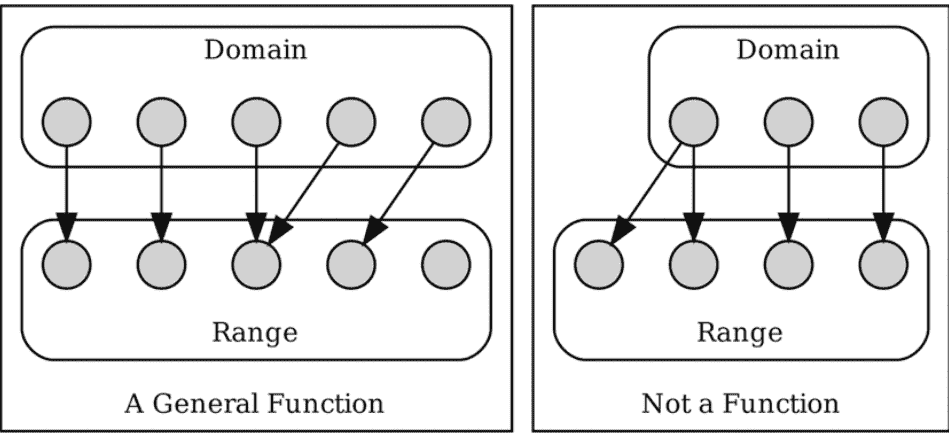

图 10.1 函数与非函数。

## 10.4 值域、像与陪域

函数的值域有时也被称为函数的像。这是所有输出的集合，或者构成函数的有序对 (a, b) 中所有 b 元素的集合。对于一个大的（可能是无限的）有序对集合，值域可能难以确定。出于这个原因，可以指定一个陪域，即一个包含值域作为子集的集合，来代替。

例如，请回顾 Numbers 章节中 R 是实数集。考虑函数 f，其中

```
f : R → R, with f(x) = x²
```

该函数包含所有形式为 (x, x²) 的有序对，其中 x ∈ R。f 的定义域是所有实数，因为我们可以求任何实数的平方。陪域由初始映射 $(\rightarrow \mathbb{R})$ 描述为实数集。然而，实际的值域或像是非负实数的集合，即 $[0, \infty)$，因为 $x^2$ 永远不是负数。这里的值域是陪域的一个子集。

如果初始映射给定为

$f : \mathbb{R} \rightarrow [0, \infty)$, with $f(x) = x^2$

则陪域和值域将相同。

## 10.5 函数类型

单射（一对一）：如果每个值域元素被不超过一个定义域元素映射，则函数是单射，也称为一对一。

$f(x) = x + 1$ 是一对一的。

$g(x) = x^2$ 不是一对一的，因为该函数同时包含 $(3, 9)$ 和 $(-3, 9)$。

满射（覆映）：从集合 A 到集合 B 的函数 f 是满射，如果对于每个元素 $b \in B$，至少存在一个元素 $a \in A$，使得 $f(a) = b$。

如果一个函数的值域和陪域相同，则它是满射。此时，定义域集合的所有元素都映射到陪域的所有元素。

例如：

$f: \mathbb{R} \rightarrow \mathbb{R}$ 且 $f(x) = x + 1$ 是满射，因为值域是 $\mathbb{R}$，即 $(-\infty, \infty)$。

$f: \mathbb{R} \rightarrow \mathbb{R}$ 且 $f(x) = x^2$ 不是满射，因为值域不是 $\mathbb{R}$（$x^2$ 永远不是负数）。

另一个例子，使用我们对自然数的定义（不是皮亚诺的定义），$f: \mathbb{N} \rightarrow \mathbb{N}$ 且 $f(x) = x + 1$ 不是满射（覆映）。该函数将自然数集合中的元素映射到仅包含大于 1 的数字的子集中（而不是整个自然数集合）。

$f: \mathbb{N} \rightarrow \mathbb{N}, f(x) = 2x$ 也不是满射。该函数将自然数集映射到非负偶数集。值域排除了奇数自然数。

*双射函数*：如果一个函数既是单射（一对一）又是满射（覆映），则它是双射。

对于双射函数 $f: A \rightarrow B$，集合 A 和 B 必须具有相同的基数，并且元素必须完美配对。也就是说，定义域中的每个元素映射到值域中的恰好一个元素，且值域中的每个元素被定义域中的恰好一个元素映射。由于此条件，有时双射函数被称为具有 *一对一对应*。

你可能会看到以下类型的函数：

- 是满射但不是一对一。
- 是一对一但不是满射。
- 既是一对一又是满射。

请注意，更改函数的定义域和/或陪域可能会改变函数的类型。

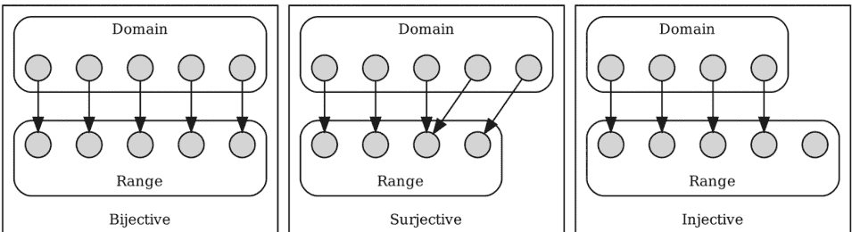

图 10.2 函数类型。

## 10.6 逆函数

逆函数“撤销”或反转函数执行的操作。一个函数可能有逆函数，也可能没有。如果函数 f 有逆函数，则该逆函数可以用 f⁻¹ 表示，也可以用其他符号，例如 g。

如果函数 f : A → B 的逆函数 g : B → A 存在，则 f 是可逆的。也就是说，对于每个 a ∈ A 和 b ∈ B：

```
f(a) = b ↔ g(b) = a
```

例如，请回顾 Numbers 章节中 Z 是整数集，并考虑：

```
f : Z → Z, f(a) = a + 5
```

$f$ 是可逆的，其逆函数是 $g(a) = a - 5$。

要使函数可逆，该函数必须具有一一对应关系。当定义域中的两个元素映射到值域中的同一个元素时，该函数不可逆。例如，函数

$f : \mathbb{R} \rightarrow \mathbb{R}, f(a) = a^2$

不可逆，因为它不是一对一的。请注意，$f(2) = 4$ 和 $f(-2) = 4$ 都成立。当定义域中的两个元素映射到值域中的一个元素时，该函数不可逆。逆函数的存在要求函数具有一一对应关系。

假设我们有一个将定义域 X 与陪域 Y 相关联的函数 f : X → Y，但它不是一一对应关系。可能可以找到 X 和 Y 的子集，其元素在函数 f 下确实形成一一对应关系。那么 f 对于更小的定义域和值域（即上述子集）是可逆的。以下定义涉及给定定义域 X 和陪域 Y 的子集。

对于函数 $f : X \rightarrow Y$，如果 $A \subseteq X$，则 A 的像是集合 $\{ f(a) \mid a \in A \}$。A 的像是 Y 的一个子集。

对于函数 $f : X \rightarrow Y$，如果 $B \subseteq Y$，则 B 的逆像（或原像）是 X 中映射到 B 中所有元素的元素子集。原像是 $\{ x \in X \mid f(x) \in B \}$。

例如，给定函数 $f : \mathbb{Z} \rightarrow \mathbb{Z}, f(x) = x^2$

假设 A 是定义域 $\mathbb{Z}$ 的一个子集，例如 \(A = \{ 1, 3, 5 \}\)。A 在陪域中的像是集合 \(\{ 1, 9, 25 \}\)。像是原陪域的一个子集。

假设 B 是陪域 $\mathbb{Z}$ 的一个子集，例如 \(B = \{ 4, 16, 49 \}\)。B 的原像（或逆像）是集合 \(\{ 2, -2, 4, -4, 7, -7 \}\)。原像是原定义域的一个子集。

请注意，与逆函数不同，函数的原像是应用于陪域子集的定义域子集。

## 10.7 函数复合

两个函数 \(f : A \rightarrow B\) 和 \(g : B \rightarrow C\) 可以复合为一个直接从 A 到 C 的函数。这种函数复合可表示为 \(g \circ f\)，定义为：

```
\((g \circ f)(a) = g(f(a))\)
```

以这种方式，函数可以通过中间集合映射两个集合。考虑函数 f 的输出成为函数 g 的输入。

### 复合性质：

- 如果 f 和 g 是一对一的，则函数 \(g \circ f\) 也是一对一的。

- 如果 f 和 g 是满射，则函数 \(g \circ f\) 也是满射。

- 复合满足结合律，如复合三个函数时。

- 复合不满足交换律。

例如：

给定 \( f(a) = a + 2 \) 和 \( g(a) = 2a + 1 \)，则 \( (f \circ g)(a) \) 和 \( (g \circ f)(a) \) 为：

```
\( (f \circ g)(a) = f(g(a)) = f(2a + 1) = 2a + 1 + 2 = 2a + 3 \)
\( (g \circ f)(a) = g(f(a)) = g(a + 2) = 2(a + 2) + 1 = 2a + 5 \)
```

因此，\( (f \circ g)(a) \neq (g \circ f)(a) \)。我们刚刚使用了一个反例来证明函数复合不满足交换律。

函数也可以与自身复合。例如，对于 \( f(x) = 2x + 3 \)，

```
\( (f \circ f)(x) \quad = f(f(x)) \)
\( \phantom{(f \circ f)(x)} \quad = f(2x + 3) \)
\( \phantom{(f \circ f)(x)} \quad = 2(2x + 3) + 3 \)
\( \phantom{(f \circ f)(x)} \quad = 4x + 6 + 3 \)
\( \phantom{(f \circ f)(x)} \quad = 4x + 9 \)
```

## 10.8 函数抽象

到现在你可能已经知道，函数可以调用其他函数，可以由其他函数组成，并可以将其他函数作为参数。


如果一个函数既可以将另一个函数作为参数，也可以将函数作为结果返回，则该函数称为 *高阶函数*。否则，该函数称为 *一阶函数*。

高阶函数可能被称为 *组合子*，尽管有人认为参数（访客）函数必须实际是 *Lambda 表达式*，即仅由函数体组成的无名函数。Lambda 表达式是包含函数和/或数据的无名函数。如果 Lambda 表达式没有外部依赖，则可正式称为组合子。

Lambda 提供了一种方法，可以从无名访客函数中静态地封闭参数，以便在将其返回到外部主机函数后仍然持续存在。⁵ 这些参数在访客函数的作用域中绑定。

```
{ bound_variables bound_operations } guest WORD
{ || } host WORD
free_vars guest | host
```

⁵关于封闭的更多内容将在 *Lambda 演算* 和 *可计算性* 章节中讨论。

例如：

```
{ 1 + } guest WORD
{ || EXEC } host WORD
3 guest | host ( → 4)
```

在上述示例中，整数 1 绑定到访客函数作用域中的一个变量，而整数 3 则不然，因为它由自由变量表示。

抽象函数是其他函数的综合，无论这些函数也是抽象函数，还是无法归约为其他函数的原始函数（例如 CPU 指令）。图 9.1 以图形方式对此进行了说明。抽象函数描述 _要做什么_，而其原始函数的组成描述 _如何做_。直接或间接，程序函数都将依赖于至少一个原始函数。<sup>6</sup>

将抽象函数归约为其原始组件与 _抽象语法树_ 的概念相关。

作为多重集，机器的原始符号集 _P_ 与编程语言 _D<sub>L</sub>_ 的关系如下：

$$D_L \subseteq (P \cup D_L)$$

这种对抽象函数的处理与 _面向对象编程_ 中使用的略有不同，例如 Java 编程语言将抽象函数定义为基础（_要做什么_），必须以使其可用的方式进行修改（_如何做_）。

那些无法分解为原始指令的机器指令类似于前面定义的公理。7 可以证明，原始机器指令本身就是硬件中定义的逻辑的抽象，例如仅由 NOR 和 NAND 门组合组成的数字逻辑。8

- 6 另请参见 命题逻辑 章节。
- 7 另请参见 可计算性 章节。
- 8 相关互联网链接：https://dev.to/ghoshr/creating-any-boolean-function-with-elementary-logic-gates-4jj6 https://demin.ws/blog/english/2010/04/06/modelling-a-cpu-with-only-one-operation

## 10.9 柯里化

*柯里化* 是将多参数函数转换为一系列单参数函数的过程，以获得相同的净输出。

在编程语言理论中，一种称为 Curry-Howard 同构的概念认为计算机程序与数学证明之间存在直接关系。在此背景下，柯里化过程可用于将抽象函数分解为其原始组成函数。这与 Haskell Curry 称为 *抽象消除* 的过程相关。9

考虑一个函数 *curry*，它将一个一次性接受三个参数（输入）a、b 和 c 的函数 f 映射为一个一次接受一个参数的函数 f：

curry(f(a, b, c)) → f(a)(b)(c)

在实践中，柯里化可以通过用一系列单参数嵌套函数替换多参数函数来实现，例如：

curry(f(a, b, c)) → f2(f1(f0(a)))

右边是三个函数的组合，其中：

b = f0(a)
c = f1(b)
result = f2(c)

柯里化的一个用途是强制执行数据流计算模型。10 在数据流上下文中，单参数函数可以在某些编程环境中通过数据管道连接。例如：

curry(f(a, b, c)) → f0(a) | f1(b) | f2(c)

- 9. Ohori, “A curry-howard isomorphism for compilation and program execution,” in Typed Lambda Calculi and Applications, J.-Y. Girard, Ed., Berlin, Heidelberg: Springer Berlin Heidelberg, 1999, pp. 280–294, ISBN: 978-3-540-48959-7.
- 10. 数据流方法包括串联式编程和数据管道。关于数据流计算的良好介绍可参阅：https://www.sigops.org/2020/the-remarkable-utility-of-dataflow-computing

偏函数：偏函数仅在其定义域（即输入）的子集上定义。柯里化函数是偏函数，但偏函数不一定是柯里化函数。

如果由于当前值未知（可能正在等待用户输入）而需要稍后求值函数，那么某些函数参数将保持未分配状态。这方面的计算称为部分应用。

部分应用容纳了另一种称为惰性求值的计算概念。

与上述数据流方法类似，f(a,b,c) → f(a) | (b,c) 的完整应用由调用两个偏函数组成。

惰性求值会推迟表达式的求值，直到被依赖表达式所需为止。这与求值一绑定到变量就立即求值表达式的求值（急切求值）形成对比。

## 练习

- 1. 给定一个从集合 A 到集合 B 的关系，说明这可能是一个函数。
- 2. 说明关系 aRb（其中 a ∈ N，{ (a,b) | b = 2a }）为什么是一个函数。
- 3. 说明配对集合 { (7, 4) (7, 9) (3, 6) (5, 8) } 为什么不是一个函数。
- 4. 描述一个一对一的函数。
- 5. 回顾 Z = 所有整数的集合。说明函数 f : Z -> Z, f(x) = x + 1 为什么是满射。
- 6. 说明函数 f : Z -> Z, f(x) = | x | 为什么不是满射。
- 7. 给定函数 f(x) = x + 1 和 g(x) = 2x + 2，展示 f 和 g 的复合。
- 8. 说明是否可能给出函数 f(x) = x^2 的反函数。如果可能，则给出反函数。
- 9. 说明是否可能给出函数 f(x) = x^3 的反函数。如果可能，则给出反函数。
- 10. 对于函数 f : Z -> N, f(x) = x^2 + 3，如果 A = { -2 0 5 }，求 A ⊆ Z 的像。
- 11. 对于函数 f : Z -> N, f(x) = x^2 + 3，如果 B = { 4 7 19 }，求 B ⊆ N 的原像。
- 12. 如果 f(x) = 3x - 2 和 g(x) = x + 5，求 f 和 g 的复合 f ∘ g。
- 13. 说明函数 f : R -> R, f(x) = x^3 是否是双射。

## 重复与递归

DOI: 10.1201/9781032687759-11

## 摘要

递归是数据科学家用来处理复杂算法问题的一种重要方法。这是因为递归的自指性质本质上将较大的任务分解为更小的子任务。此外，数据科学中常见的树和图数据结构，其自相似的内部结构自然适合递归处理。

在编程中，我们通常需要多次重复一组操作，例如在处理各种数据结构时。这种重复可以持续到满足特定条件（例如变量的值）为止。当函数的重复操作包含函数自身的名称时，这种重复技术称为递归。递归有时可以为原本复杂的重复任务提供一种优雅的替代方案。递归与数学归纳法原理相关。

## 11.1 递归

> “如果一个人从确定性开始，他将以怀疑结束；但如果他满足于从怀疑开始，他将以确定性结束。” – 弗朗西斯·培根

¹S. F. Bacon, *学术进步*. 1605, 第 8 卷。（弗朗西斯·培根的这句话可能描述了一个递归函数，其中其自引用仅持续到出现怀疑为止。）

处理数据结构（例如列表）需要重复操作。与其一遍又一遍地乏味地手动编写这些操作，不如调用一个重复执行它们的函数。这可以通过迭代循环或递归函数来实现。

重复的非递归算法通常称为 *迭代*。迭代算法使用循环进行重复，而不是递归调用自身。

递归函数的要求：

- 一个输入值。
- 对输入进行求值，导致递归调用或递归结束。
- 解在输入的最终状态中找到。

考虑由以下重复八次的函数控制的函数 f：

```
f 8 REPEAT
```

或者，我们可以通过将操作放在同时引用自身的函数定义中来有效地重复操作。也就是说，让函数 f 调用函数 f，例如：


```
{ f } f
```

这种递归函数定义隐含着无条件的自引用，意味着 f 会被持续调用。这可能导致错误并浪费计算资源。因此，应该有条件使函数不再自引用，从而停止操作。例如：

```
{ i + DUP 8 < f ?} f WORD
0 f (→ 8)
```

仅当栈顶的数字小于 8 时，函数 f 才会重复。因此，调用函数 f 的结果是它调用自身 8 次，而这个特定函数的最终解碰巧也是 8。

递归的基础可能取决于 if 语句中条件的求值。在上述函数 f 中，算符 ? 是 IF 的别名。当给出真条件（1 为真，0 为假）时，if 语句允许程序求值指定的表达式或函数。模式是：

*条件 函数 求值*

根据条件的求值类型，例如 =、> 或 <，可以定义一个函数，在条件为真（由 1 表示）时重复执行。

假设我们有一个数字列表 ls 和一个加两个数的函数 f，给出如下：

```
{ 1 3 5 7 9 } ls LIST
{ + } f WORD
```

此时，如果我们先调用 ls 再调用 f，则只会计算最后两个数字的和，结果值 16 会被放在栈顶，如下所示：

```
ls f ( → 1 3 5 16)
```

与其处理整个列表，不如重新定义 f，使其包含重复操作或采用递归方式。循环可以包含重复函数，例如：

```
{ 4 + REPEAT } f WORD
```

```
ls f ( → 25)
```

下面是递归方法，当列表中的元素个数大于一时，函数 f 调用自身。

```
{ + GSC 1 > f?} f WORD
```

```
ls f ( → 25)
```

目前为止见到的递归类型是直接递归，因为函数调用出现在同名函数的函数体内。

相反，在间接递归中，一个函数调用另一个函数，后者又调用原始调用函数。原始调用函数与其最终递归调用之间可以有若干这样的间接函数。

一种间接递归形式称为互递归，涉及两个互相调用的递归函数。

递归函数类型：

- 直接递归：f 调用 f
- 互递归：f 调用 g 且 g 调用 f
- 间接递归：f 调用 g，g 调用 h，h 调用 f

这里是一个互递归示例：

```
{ 1 + g} f WORD
{ 1 * f} g WORD
```

下面是判断数字是否为奇数或偶数的互递归操作示例：

```
{ ABS i- DUP 0= FALSE isOdd ?? } isEven WORD
{ ABS i- DUP 0= TRUE isEven ?? } isOdd WORD
8 isOdd ( → 0 (false))
-5 isOdd ( → 1 (true))
```

请注意，ABS 单词用于绝对值，使这些操作能够正确处理正数或负数。?? 符号是 if-else 表达式，它根据前面函数的求值结果为真或假，调用其中一个函数。

## 11.2 无限循环

递归调用必须有一个条件，允许程序最终退出函数作用域并结束递归调用。否则，函数将无限期地陷入对自身的重复调用中——臭名昭著的*无限循环*，可能会超过系统的内存限制（*栈溢出*）并可能导致程序崩溃。

例如，下面的单词定义会创建一个无限循环，因为它没有停止自我调用的条件。

```
{ bad!. SPACE 1 infinite ? } infinite WORD
infinite (→ bad! bad! bad! bad! bad! bad! ... )
```

调用这个无限单词会在屏幕上反复打印 bad!，无限期持续下去，除非系统检测到无限循环并优雅退出，或者程序崩溃。² 没有终止条件，自引用的结果类似于无限镜中的自我反射。³

相比之下，下面的递归单词执行有限次操作，其自引用以最小值为前提。

```
{ good!. SPACE DROP GSC 0 > limited ? } limited WORD
1 2 3 limited ( → good! good! good!)
```

这里的函数 limited 受栈上剩余值数量的限制。GSC 获取栈计数，DROP 从栈中丢弃最顶部的值，因此三次函数调用后栈计数为 0。

## 11.3 佩亚诺的递归逻辑

回顾“函数与抽象”章节中的佩阿诺公理，它断言存在一个初始整数 0，并使用后继函数来外推或诱导一系列数字。⁴ 佩阿诺公理允许我们为任意两个自然数递归地定义算术。

例如，参照佩阿诺的后继函数，数学家伯特兰·罗素将两个数之和定义为：

> "假设我们希望定义两个数之和。取任意数 m，我们定义 m + 0 为 m，m + (n + 1) 为 m + n 的后继。凭借 [佩阿诺公理 5] 这给出了 m 和 n 之和的定义，无论 n 是什么数。"⁵

²如果你的代码确实进入了无限循环，可以尝试在键盘上按 Ctrl-c 来中断它。↱

³也许递归最好被称为反射。那么，无限递归可以称为无限反射，如同无限镜。更多信息：https://commons.wikimedia.org/wiki/Category:Infinity_mirror ↱

⁴递归理论中后继函数的作用：https://www.sciencedirect.com/science/article/abs/pii/S0049237X08709376 ↱

⁵R. Bertrand, 《数学哲学导论》. Macmillan, 1919, p. 6. DOI: https://archive.org/details/cu31924001598188. ↱

这个定义是递归的，因为 m + (n + 1) 依赖于现有项 m + n 和后继函数。相应地，对于任意非负整数 b，a + b 可以使用后继函数 S() 递归定义为：

```
Base case: a + k = a, for k = 0
General case: a + k = S(a + b), for k > 0 and k = b + 1
```

请注意，基准情况仅表示将符号“0”加到一个数字会得到原始数字（实际上没有发生加法）。对于一般情况，加法结果由 S(b) 序列中的最终自然数字符号化。同样，没有实际加法发生。就像 0 一样，“+” 符号仅仅是符号性的（加法并不是通过加法来定义的）。

现在，任意两个自然数 a 和 b 的加法可以定义为佩阿诺递归后继函数的抽象，例如：

```
S(a + b) = a + S(b)
```

考虑“1 + 1。” 确立：

```
1 = S(0) = 1 + 0
```

因此：

```
2 = S(1) = S(1 + 0) = 1 + S(0) = 1 + 1
```

通过推广，“1 + 2”可以定义。回顾：

```
2 = S(1)
```

因此：

```
3 = S(2) = S(1 + 1) = 1 + S(1) = 1 + 2
```

定义了加法后，乘法可以实现为重复加法的过程。顺便说一句，佩阿诺分别为乘法定义了递归的基准情况和一般情况的类似形式：⁶

```
a × 1 = a
a × (b + 1) = a × b + a
```

与加法符号“+”一样，乘法符号“×”仅仅是符号性的（乘法并不是通过乘法来定义的）。

6 G. Peano, *算术原理，新方法阐释*. unknown, 1889, pp. 23–29. DOI: [https://github.com/mdnahas/Peano_Book/blob/master/Peano.pdf](https://github.com/mdnahas/Peano_Book/blob/master/Peano.pdf)

因此，任意两个自然数 *a* 和 *S(b)* 的乘法可以递归定义为：

$$a + (a \times b) = a \times S(b)$$

考虑 \( a = a \times 1 \)。首先，既然确立了 \( 1 = S(0) = 1 + 0 \)，因此我们知道：

$$a = a + 0 = a + (a \times 0) = a \times S(0) = a \times 1$$

对于 \( 3 \times 2 \)，因为 \( 2 = S(1) \)，所以：

$$6 = 3 + 3 = 3 + (3 \times 1) = 3 \times S(1) = 3 \times 2$$

## 11.4 递归关系

有一种名为*递归关系*的数学方程，用于正式描述递归。递归关系将一系列元素表示为前面讨论过的条件性后继函数。

回顾递归的条件，序列根据这些条件继续或停止。这些条件分别被称为*一般情况*和*基准情况*。


例如，下面的递归倒计时函数中，当 n 变为零时递归终止。

基本情况和一般情况可以表示为：

基本情况: t(0) = 0
一般情况: t(n) = 1 + t(n - 1) for n > 0

给定 n = 3 的那些条件情况，倒计时函数的递推关系可以求解为：

t(3) = 1 + t(2) = 1 + 2 = 3
t(2) = 1 + t(1) = 1 + 1 = 2
t(1) = 1 + t(0) = 1 + 0 = 1

如您所见，对于所有 n > 0，t(n) = n。如果我们用 n - 1 替换 t(n - 1)，对于所有 n > 0，此结论仍然成立。也就是说，通过归纳推理，我们认为 t(n) = 基本情况 + 一般情况 为真。

## 11.5 使用栈跟踪递归

要执行递归函数，编程语言通常需要先在内存中生成一个或多个由操作和数据组成的栈数据结构。特定函数调用的栈区域称为栈帧或激活记录。一旦此栈加载到内存中，就会执行它。

表 11.1 内存中结构化为栈的函数调用

| 函数 | 计数器 | 地址 |
|---|---|---|
| countDown | 9 | 82994EE80 |
| countDown | 8 | 82994EF00 |
| countDown | 7 | 82994EF80 |
| countDown | 6 | 829948100 |
| countDown | 5 | 829948180 |
| countDown | 4 | 829948200 |
| countDown | 3 | 829948280 |
| countDown | 2 | 829948300 |
| countDown | 1 | 829948380 |

每次递归调用都会生成一个激活记录，直到计数器为 1。这样生成激活记录比迭代或非递归函数需要更多内存。

与在每个循环中重新执行其语句的迭代算法不同，递归通常会将所有连续递归调用的操作元素放在栈上，提前于最终的合并执行。因此，如果相对于可用内存递归调用太多，则递归可能导致臭名昭著的 *栈溢出* 并发生崩溃。

递归倒计时函数的实现：

```forth
{ DUP. CR i- DUP countDown ? } countDown WORD
9 countDown
9
8
7
...
```

为了演示递归在执行前如何在栈上展开，这里有一个模拟栈帧生成和执行的 countDown 版本。

```forth
{ DUP. CR i- DUP } countDown2 WORD
{ countDown2 ' } 9 LREPEAT
```

该程序在栈上的样子如下：

| 值 | 索引 | 地址 |
| --- | --- | --- |
| countDown2 | 8 | 82AAFDE00 |
| countDown2 | 7 | 82AAFDE80 |
| countDown2 | 6 | 82AAF7180 |
| ... | | |

请注意，栈数据结构确保了一定的数据顺序，即后进先出 (LIFO)。这种顺序是算法设计中的重要考虑因素。

下一步是处理放置在栈上的指令和数据。

```forth
{ SWAP EXEC runit ? } runit WORD
GSC runit
9
8
7
...
```

例如，考虑这个对整数列表求和的递归函数：

```forth
{ 1 3 5 7 9 } nums LIST
{ + GSC 1 > sum ? } sum WORD
nums sum ( → 25)
```

以下代码使用相同的 sum 函数在栈上生成一个小程序，模拟 sum 在内存中可能出现的样子：

```forth
0 nums DS2RS
{{ R > R > sum ' } GRC 2 / LREPEAT } build WORD
{ EXEC GSC 1 > runit ? } runit WORD
build runit finalsum !
```

该程序在栈上的样子如下：

| 值 | 索引 | 地址 |
| :--- | :--- | :--- |
| sum | 8 | 82A668B00 |
| 9 | 7 | 82A668B80 |
| 7 | 6 | 82A664680 |
| sum | 5 | 82A664700 |
| 5 | 4 | 82A664780 |
| 3 | 3 | 82A664800 |
| sum | 2 | 82A664880 |
| 1 | 1 | 82A664900 |
| 0 | 0 | 82A664980 |

在计算和的过程中没有使用累加器变量，因为每个中间结果都被放在栈上以便加到下一个数字。栈组装完成后，其操作会被调用，并将最终值赋给一个变量，在此示例中名为 finalsum。此过程与编程概念中的惰性求值相关，即表达式的求值被推迟到需要时才进行，从而避免在中间阶段进行求值。

构建和处理栈的操作序列也可以以非递归的逐步方式模拟，如下所示：

```forth
{ 1 3 5 7 9 } nums LIST
nums HEAD > R
nums TAIL HEAD > R
nums TAIL TAIL HEAD > R
nums TAIL TAIL TAIL HEAD > R
0 { R > + } GRC i- LREPEAT ( → 25)
```

上述代码通过 >R 操作符将输出重定向到返回栈。表达式 “{ R > + }” 通过 R> 操作符从返回栈检索顶部数字，然后将其加到数据栈顶部的数字上。此过程会重复进行，直到返回栈为空。

## 11.6 何时使用递归

一般来说，在同一周期中需要多个递归函数调用（分支）且输入值数量较大的解决方案不适合使用递归。这是因为，如上所述，递归算法通常比迭代算法需要更多内存。

对于运行太慢的优雅递归算法，您该怎么办？也许可以将其用于原型开发，然后在生产环境中使用性能更好但不够优雅的迭代算法。

在以下情况下，递归通常是合适的解决方案：

- 问题与数学归纳法原理相关。
- 递归允许使用更简单或更少的语法。
- 使用递归意味着更好的整体算法效率。
- 需要处理的元素较少。
- 涉及的变量是不可变的（只能赋值一次）。

在某些编程上下文中，变量可能并不真正可变，因为它们被定义为常量或不可变。当在重复中使用不可变变量并尝试修改不可变变量时，这可能导致错误。在这种情况下，实际上可能会生成变量的副本，而程序员并不知情。

在某些函数式编程语言中，不可变性是非引用变量的默认状态，在分布式编程环境中也是如此，在这些环境中，不可变性保护变量免受意外结果的影响。

例如，要计算一系列数字的和，请考虑一个名为 _sum_ 的累加器变量被定义为不可变。因此，_sum_ 不能重复使用，例如：

sum = sum + input

或

sum @input + sum !

但是，通过使用递归，我们可以容纳不可变的累加器变量，因为赋值只发生一次，即在封闭函数的栈完全生成并执行之后。

## 11.7 递归算法的其他示例

在函数式编程中，两个流行的函数称为 _map_ 和 _reduce_。Map 将一元函数作为参数，并将其分别应用于列表的每个元素。Reduce 将二元函数作为参数，并将其成对应用于列表元素以产生单个聚合结果。

Map 和 Reduce 的功能可以合并到单个函数中。例如：

```forth
{ var @ EXEC >> GSC 0 > mapReduce ? } mapReduce WORD
```

迭代替代方案可能如下所示：

```forth
{ var ! { var @ EXEC >> } GSC LREPEAT } mapReduce WORD
```

以下是 map 的用法，将一元 i+ 操作映射到列表中，并将 i+ 操作存储在变量 var 中：

```forth
i+ ' var !
alist mapReduce
```

以下是 reduce 的用法，将 alist 值的二元 + 操作的聚合归约为单个结果，并将 + 操作存储在变量 var 中（该变量由此版本的 mapReduce 内部使用）：

```forth
+ ' var !
alist mapReduce
```

或者，可以定义独立的 map 和 reduce 函数，而不需要之前的主机-访客函数依赖。考虑以下计算数字阶乘的代码。首先，每个函数的递归版本：

```forth
{ DUP i- DUP 1 > map ? } map WORD
{ * GSC 1 > reduce ? } reduce WORD
```

以下是每个函数的迭代版本：

```forth
{ DUP i- { DUP i- } LREPEAT } map WORD
{ { * } GSC i- LREPEAT } reduce WORD


我们可以进一步定义一个词 *factorial*，它依次调用 map 和 reduce。

```
{ map reduce } factorial WORD
5 factorial ( → 120)
```

接下来，考虑一个生成斐波那契序列的递归函数，其中每个数都是序列中前两个数之和。即，1 1 2 3 5 8 13 21 34 55 ...

在递归斐波那契生成过程中，每个递归调用会分叉为另外两个递归调用，以此类推。此类递归调用的调用树如图 11.1 所示。

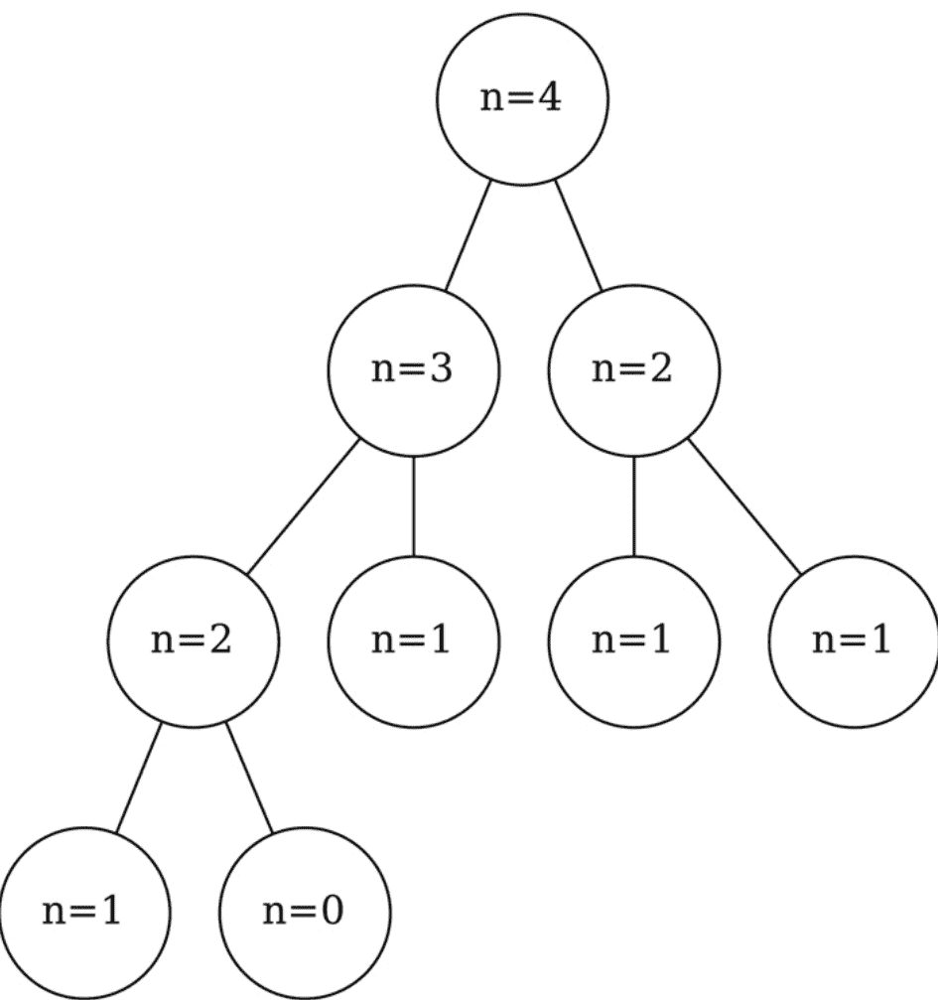

图 11.1   斐波那契序列条件的调用树。

附录 C 中包含两个 epop 程序，分别展示递归与迭代。附录 C.10 中的代码生成斐波那契序列。附录 C.12 中的代码生成 ASCII 表。

## 练习

- 1. 定义一个递归函数 \( S \)，将值从 \( S_0 \) 递增 1 到 \( S_3 \)。

- 2. 为序列 \( \{ 0\ 1\ 2\ 5\ 11 \dots \} \) 给出递归定义，并展示接下来两个数的计算。

- 3. 为序列 \( \{ 3\ 5\ 9\ 17\ 33 \dots \} \) 给出递归定义，并展示接下来两个数的计算。

- 4. 为序列 \( \{ 1/2\ 1/4\ 1/8 \dots \} \) 给出递归定义，并展示接下来两个数的计算。

- 5. 给出整数 \( \mathbb{Z} \) 的递归定义，以及基础情形 \( 0 \in \mathbb{Z} \)。

- 6. 在实数集 \( \mathbb{R} \) 和整数集 \( \mathbb{Z} \) 中，展示函数 \( int(r - 1) \) 如何递归计算小于实数 \( r \) 的最大整数。

- 7. 提供计算以下序列的递归算法：

  - (a) 0 1 2 3 4 5 ...
  - (b) 0 0 1 1 2 2 ...
  - (c) 0 2 4 6 8 10 ...
  - (d) 0 1 2 4 8 16 ...

- 8. 解释递归与数学归纳法之间的关系。

- 9. 设 x 和 y 为正整数，设 f 为具有两个输入 x 和 y 的递归函数，定义如下：

  ```
  f(x, y) = \begin{cases} 0 & \text{if } x < 1 \\ f(x - y, y) + 1 & \text{if } y \le x \end{cases}
  ```

  - (a) 计算 \( f(21, 3) \)
  - (b) 计算 \( f(3, 21) \)
  - (c) 函数 \( f \) 的作用是什么？

## Lambda 演算

DOI: 10.1201/9781032687759-12

### 摘要

Lambda 演算是一种用于用函数和递归表达计算的数理逻辑形式系统。

理解 Lambda 演算有助于数据科学家更好地识别和利用函数抽象的概念，以用于 *函数式编程*。函数式编程是一种在各种编程语言中实现的范式，旨在促进递归、紧凑表达式和不可变对象，以实现更可靠的分布式处理。

理想情况下，函数式编程的特点是简洁的函数，描述 *要做什么*，隐藏描述 *如何做* 的更复杂函数的组成。后一种情况更符合标准过程式编程的特征。

## 12.1 Lambda 演算

Lambda 演算由美国数学家和逻辑学家 Alonzo Church 在 20 世纪 30 年代发明，旨在寻求一个表示用于计算的函数的理论系统。此后，Lambda 演算的某些方面已进入各种编程语言，最著名的是 20 世纪 50 年代末的 Lisp 和 20 世纪 90 年代初的 Haskell。¹

Lambda 演算是建模计算的一种极简方式。它提供了一种抽象手段，与典型编程语言的语法相比，可能加速建模，使可能被视为冗长的语法得以精简。这些是 *函数式编程* 范式的特征，该范式基于 Lambda 演算。虽然 Lambda 演算有一套用于计算的正式规则，但其解释和编程语言实现各不相同。

在 Lambda 演算中，所有操作都由一种称为 *lambda* 的函数的归纳抽象定义，可以将其视为唯一的原始对象。所有函数都是一元的（单参数），相对于 *多元*（多参数）。Lambda 演算不定义求值顺序，将其留给程序员指定为从左到右、从右到左、中缀、后缀或应用式，以及相关的急切或惰性行为。（本章中的示例强调后缀算术。）

Lambda 演算中求值顺序的灵活性得到了 *Church-Rosser 定理* 的证实，该定理基本上指出，无论算法采取惰性还是急切路径，最终解都是相同的。²

通常在 Lambda 演算中，小写字符用于变量（x, y, z, ...），大写用于应用（E, F, G, EG, ...），而它们的组合（如 λ x.E）用于抽象。所有这些都是 Lambda 项。函数的应用是其操作，例如当函数接受一个参数时。

Lambda 演算仅涉及三种表达式：

- • 变量
- • 函数抽象
- • 函数应用

¹A. Church 和 J. Rosser，“转换的一些性质”，《美国数学学会汇刊》，第 39 卷，第 472–482 页，1936 年。DOI: https://www.ams.org/journals/tran/1936-039-03/S0002-9947-1936-1501858-0/S0002-9947-1936-1501858-0.pdf ↩

²A. Church 和 J. Rosser，“转换的一些性质”，《美国数学学会汇刊》，第 39 卷，第 472–482 页，1936 年。DOI: https://www.ams.org/journals/tran/1936-039-03/S0002-9947-1936-1501858-0/S0002-9947-1936-1501858-0.pdf ↩

函数抽象由希腊字符 λ 符号化，称为 lambda。

Lambda 表达式可以是用于标识抽象点的名称、用于引入抽象的函数，或用于为抽象定义某种特化的函数应用。抽象点是函数的输入变量，允许创建匿名函数。匿名函数是具有函数体但没有名称的函数。

Lambda 演算中的抽象采用以下形式：

```
λIdentifier.Expression
```

标识符是变量（参数）或函数的符号或名称。它可以由任何非空字符序列组成。例如，λx.E 表示一个 Lambda 函数 x，它将 Lambda 表达式 E 作为参数进行求值。

Lambda 表达式的符号 λ 位于用于抽象的名称 x 之前。用于抽象的名称称为函数的绑定变量 x。（绑定变量是存在于函数作用域或函数体内的变量。）点号“.”将绑定变量与表达式主体分开。

与 λidentifier.expression 等价的表达式是：

```
{ expression } identifier WORD
```

虽然参数在 E 的内部作用域中被封闭和绑定，但它们可以在该作用域之外使用。3

```
{ inner_scope } E WORD
{ E outer_scope } λx.E WORD
```

例如：

```
{ 1 + } E WORD
{ E ’ EXEC } λx.E WORD
3 λx.E ( → 4)
```

3 关于此内容将在可计算性章节中讨论。

在上述示例中，Lambda 表达式 λx.E 是一个函数，其中 E 中的每个元素都绑定到其局部作用域。整数 1 绑定到客体函数 E 作用域中的一个变量，而整数 3 则不是。如果将具体参数 3 替换为变量（例如 y），则 y 将被视为自由变量。

某些语言使用 let 关键字将变量的有效性明确归属于局部环境或 Lambda 表达式的环境。这可能被称为 let over lambda。4 例如，考虑在以下应用中使用 LET 字，该应用计算 λx.2x + 1：

```
{ 2 * y LET } λy.y WORD
{ TEL 1 + } λx WORD
{ λy.y λx } λx.λy.y WORD
3 λx.λy.y ( → 7)
```

单字 TEL 与 LET 互补，获取由 LET 设置的变量的值。

## 12.2 函数应用

Lambda 演算中的函数应用是指将函数（Lambda 抽象）应用于参数。该过程是通过用参数替换函数体中的绑定变量来进行约简。

在 Lambda 演算中，函数应用的形式为：

```
(function_expression argument_expression)
```

应用形式将抽象函数转换为可以计算的具体实现。例如：

```
2(λx.x1+) → 3
```

提醒：我们以后缀方式使用算术运算符。因此，x 1 + 是一个加法操作（一个具有两个操作数 x 和 1 的函数）。虽然此类操作和数字在 Lambda 演算中技术上并不存在，但它们通常用于内部函数表达式以加快示例。（正式而言，Lambda 演算使用继任者函数的抽象来表示数字和操作。）


5 关于后继函数的详细信息见 *函数与抽象* 和 *重复与递归* 章节。

通过两次应用，前者的结果成为后者的输入。

```
(3 (λy.y 2 *))(λx.x 1 +) → 7
```

图 12.1 显示了抽象语法树，其中 λ 是抽象算子，eval 是应用算子。

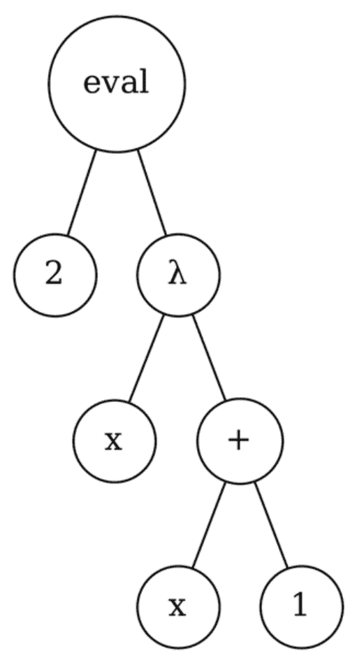

图 12.1 抽象语法树：λ 是抽象算子。eval 是应用算子。

注意，第二次应用的作用域带有额外的括号。这样可确保“3”参数仅适用于第二次应用。否则，如图 12.2 所示，第一个“eval”实例将有三个分支而不是两个。

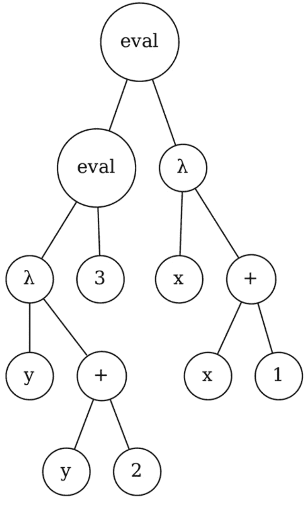

### 图 12.2 两次连续应用的抽象语法树。

### 抽象语法树描述：

- 实参：eval 节点的右子树。
- 函数（lambda）：eval 节点的左子树。
- 形参：lambda 的左子节点。
- 函数体：lambda 的右子节点。

自由变量定义在函数作用域之外，即函数定义的边界之外。反之，约束变量是存在于函数作用域内的变量。纯 lambda 表达式没有自由变量。

在应用 (y λx.x) 中，y 是自由变量，x 是约束变量。在函数 λx.(s x) 中，s 也是自由变量，x 是约束变量。

函数应用可以由一系列函数抽象组成，很像命令链。因此，我们可以通过组合两个函数抽象来表达应用，如下所示：

```
(λx.x λy.y)
```

此应用将第一个函数抽象作为函数，将后者作为参数。这类似于函数的嵌套或组合，例如 f(g(x))，其中后者的结果成为前者的参数。

表达式必须归约（或简化）为单个值或函数表达式。因此，必须先对子表达式进行归约，因为它们将作为外部函数的参数。否则，我们会得到所谓的 *卡住表达式*，即不是值且无法归约的表达式。可以将其视为没有具体实现的抽象函数。

考虑恒等函数 λx.x，它只是返回指定的参数。以应用形式，例如 (λx.x λx.x)，参数表达式 λx.x 应用于函数表达式 λx.x。当应用被求值时，函数表达式 λx.x 中的约束变量 x 被体表达式 x 中的后者参数表达式 λx.x 替换，得到 λx.x。

恒等函数的变体如下所示，其中函数 λx.x 既设置又获取变量 x。

```
{ x ! x @ } λx.x WORD
{ λx.x λx.x } (λx.x_ λx.x) WORD
```

对上述函数的以下应用以 5 作为参数并产生 5 作为结果：

```
5 (λx.x_ λx.x) ( → 5)
```

具有 *自应用* 的函数包含一个应用。例如，函数 λs.(s s) 的体包含函数应用 (s s)，由函数表达式 s 和参数 s 组成。自应用函数也可以是应用的一部分，例如 (λx.x λs.(s s))。在此应用中，函数表达式是 λx.x，参数表达式是 λs.(s s)。要对该应用求值，需将函数表达式体中的约束变量 x 替换为参数表达式，得到 λs.(s s)。

## 12.3 应用顺序

在 *正则序* 中，从左到右，参数的值在被传递之前不会被求值。问题在于，在先对右侧函数求值之前，具体参数可能不存在。因此，有时我们需要先对右侧求值。这称为 *应用序*。

应用序在需要时对最内层表达式应用正则序。这是一种 *惰性求值* 策略，即仅在需要时执行函数，而不是提前执行（又称 *按需调用*）。

使用惰性求值时，没有持续的中间计算，也不需要 *记忆化*（缓存）间歇（迭代）结果。像递归函数一样，惰性允许递归表达式的操作在内存中作为一系列累积，然后再进行处理。虽然对于仅限一次性赋值的不可变变量的好处很理想，但这会以更高的内存使用为代价。

如你所记得，不延迟执行表达式中所有函数的求值策略称为 *急切求值*。在抽象函数的组件本身尚未完全求值时，急切求值会出现问题。应当指出，实际求值顺序取决于所使用的编程语言。

考虑在列表 x 中更新一个值。

```
{ 5 } x LIST
{ x ’ S2LIST } updatex WORD
{ x i+ updatex } increment1 WORD
{ x, i+ updatex } increment2 WORD ( make list x lazy)
increment1 ( x → 6)
increment1 ( x → 6)
increment2 ( x → 7)
increment2 ( x → 8)
```

第一个递增函数不强制执行惰性求值，因为它只是在 increment1 的定义中使用列表 x 的值。因此，每次调用递增函数时，都使用原始列表值。反之，第二个递增函数通过在 increment2 的定义中存储列表名称 x 而强制执行惰性求值。这样，increment2 每次被调用时都可以更新原始列表值。名称与值的问题与计算机科学中称为按值调用和按名调用的概念相关。

## 12.4 归约与转换

为处理名称冲突和优先级问题，我们可以使用名称转换和表达式归约技术，分别称为 Alpha α 转换和 Beta β 归约。

当 lambda 表达式无法进一步归约（即已完全求值）时，称其为正规范式。当 lambda 表达式中最外层应用（头部）无法归约时，称其为头范式。

Alpha α 转换是重命名约束变量以防止名称冲突。此转换通常在 Beta 归约之前进行。

对于 Alpha 转换，请考虑一般函数：

```
λ < name1 > . < body >
λx. E
```

名称 x 以及表达式 E 中 x 的所有自由出现可以被替换为新名称，前提是新名称不是 λx.E 中自由变量的名称。

给定 λx.E，假设我们想要将 x 的所有出现替换为 y。这种替换表示为 [x/y]。

可以表示为 λx.E → λy.E[x/y]。

在 Alpha 转换之后，Beta β 归约对命名函数中的相应参数求值，用结果值替换这些子表达式。

应用的 Beta 归约形式为 (λx.E x)，通过将体 E 中名称 x 的所有自由出现替换为参数 x 来完成。例如，在以下应用中，函数 F 替换 E 中 x 的所有出现。

```
(λx.E F) → E[x/F]
```

同样，变量 x 将被参数 5 替换，如下所示：

```
(λx.fx) 5 → f(5)
```

在 lambda 演算中，函数不能接受多个参数。因此，要使用多个变量，必须使用一种称为柯里化（currying）的过程，将接受多个参数的函数转换为一系列单参数函数。6

考虑多参数操作，例如多个数字的加法。在 lambda 演算中，参数在加法函数求值前逐个进行柯里化。在 epop 中，操作可能类似于以下互为递归的函数：

```
{ + GSC 10 < curry ? } add WORD
{ GSC 1 > add ? } curry WORD
```

也就是说，不要将函数 f 同时应用于参数 x 和 y，那将写作：

```
( x y f )
```

6 柯里化的概念在“函数与抽象”章节中介绍过。

函数 f 先应用于第一个参数 x，然后应用于第二个参数 y，写作：

```
( ( y x ) f )
```

使用 lambda 演算语法，假设有：

```
λa.λb.f(a b +)
```

应用可以如下所示使用 beta 归约来表达，在加 1 和 2 时：

```
1 2 λa.λb.f(a b +) → β(2(λb.(1 b +))) → β(1 2 +) = 3
```

应用也可以不显式柯里加法来表达，如下所示的 1、2 和 4 的加法：

```
{ + GSC 1 > add ? } add WORD
1 2 4 add ( → 7)


或者，同一个应用程序可以表示为部分且显式柯里化的加法：

```
{ 0 + GSC 1 EQ add ? } cadd WORD
{ + GSC 1 > add cadd ?? } add WORD
1 2 4 add ( → 7)
```

假设 f 是一个更复杂的函数或运算，请考虑以下 β 归约示例：

```
(λs.(s s) λf.(λf.f f)) → (λf.f λs.(s s)) → (λf.f λf.f) → λf.f
```

这一系列 λ 演算归约可解释如下：

- (λs.(s s) λf.(λf.f f)) 归约为 (λf.f λs.(s s))。
- (λf.f λs.(s s)) 归约为 (λf.f λf.f)。
- (λf.f λf.f) 归约为 λf.f。
- λf.f 是最终结果。这是一个恒等函数。

每一步都应用 β 归约规则，将参数替换到 λ 函数的函数体中。

接下来考虑对 ((λf.λx.(f x) x) b) 应用 β 归约：

```
(b (a λf.λx.(a f))) → (b λa.(a a)) → (b b)
```

参数 x 已在绑定变量 x 的作用域中替换，似乎创建了该绑定变量的新出现。我们可以通过将函数中的绑定变量 x 替换为 c 来避免此问题：

```
(b (x λf.λc.(c f))) → (b λc.(c x)) → (b x)
```

上面所示的替换是一种 α 转换。当 β 归约将包含自由变量的表达式置于与该自由变量同名的绑定变量的作用域中时，就会出现名称冲突。α 转换消除了名称冲突。

### 12.4.1 其他转换

Eta η 转换：Eta 指定一个给出相同结果的不同函数，例如 λx.fx。用更长的函数替换是 η-扩展，用更短的函数替换是 η-缩减。

通过 η-缩减进行简化：请考虑如下形式的表达式：

```
λx.(x E)
```

这等同于 E。

将此表达式应用于任意参数会给出：

```
(arg λx.(x E)) → (arg E)
```

## 12.5 使用 λ 演算进行计算

使用 λ 演算进行计算遵循以下规则：

- Alpha α 转换：重命名绑定变量以避免名称冲突。
- Beta β 归约：用命名函数替换参数以求值（归约）到某个值。

### β 归约算法

- 根据需要采用 α 转换进行重命名。
- 将参数绑定到名称。例如：$2 (\lambda x.x) \rightarrow \lambda x.2$
- 去除函数头和名称。例如：$\lambda x.2 \rightarrow 2$
- 如果语句无法归约，则我们得到最终参数，在此例中为 2。
- 对下一个参数和 λ 重复上述过程（柯里化，一次一个）。

首先，要建立一组正整数，假设 0 由 λ 表达式 $\lambda fx.x$ 表示。连续整数因此由每个 n 的函数 f 表示，例如：

```
λnfx.f(nfx) → λfx.f(f(… f(fx)…))
```

假设 0 定义为 $\lambda s.(\lambda z.z)$，适用于后继函数 s 及正整数 $\mathbb{Z}+$ 的参数 z。对于每个后续后继，我们可以重复 $\lambda sz.z$ 并追加函数 s 的嵌套调用。因此，对于由后继函数定义的整数序列 0、1、2 和 3，我们有：

```
λsz.z ... 0
λsz.s(z) ... 1
λsz.s(s(z)) ... 2
λsz.s(s(s(z))) ... 3
```

请考虑用 λ 演算定义的后继函数。

add1 = λf.λx.f(nfx) → λf.λx.f n 1 x + = n 1 +

进一步的加法重复后继 n + m 次：

```
(m λx.(x add1n)) → (m add1n) → m n +
```

同样，乘法可以视为重复的加法，幂运算定义为重复的乘法。减法与加法类似，但使用前驱函数而不是后继函数。除法则由重复的减法实现。

一些基本加法：

```
1 2 (λx.(λy.(x y +))) → 2 (λy.(1 y +)) → 1 2 + = 3
```

β 归约示例（一个参数）：

- 2 (λx.λy.x 1 +) 识别第一个参数和用于绑定的变量。
- λx.λy.2 1 + 将 2 绑定到 x。
- λy.2 1 + 去除 λx 头。
- 2 1 + 去除 λy 头。
- 3 求值。

### β 归约示例（两个参数）

```
1 2 (λx.λy.x y +)   Identify first argument and variable for binding.
2 (λx.λy.1 y +)     Bind 1 to x.
2 (λy.1 y +)        Strip λx head.
2 (λy.1 y +)        Identify first argument and variable for binding.
(λy.1 2 +)          Bind 2 to y.
1 2 +               Strip λy head.
3                   Evaluate.
```

### β 归约示例（两个参数）

```
(λz.z) 2 (y λx.λy.x)   Identify first argument and variable for binding.
2 (y λx.λy.(λz.z))    Bind (λz.z) to x.
2 (y λy.(λz.z))       Strip λx head.
2 (y λy.(λz.z))       Identify first argument and variable for binding.
(2 λy.(λz.z))         Bind 2 to y.
2 (λz.z)              Strip λy head.
2 (λz.z)              Identify first argument and variable for binding.
(λz.2)                Bind 2 to z.
λz.2                  Strip λz head.
```

### 12.5.1 布尔函数

与数字一样，λ 演算没有 *真* 或 *假* 的任何表示。必须定义这些条件。因此，必须定义 *真 (t)* 和 *假 (f)* 值及相关的布尔函数。可以按如下方式完成：

```
true=λt.λf.t
false=λt.λf.f
```

使用这些函数，我们可以定义一个 *如果* 函数，如果参数 x 为 *真* 则返回 *真*，否则返回 *假*。换句话说，*如果* 是一个恒等函数。例如：

```
if = λx.λt.λf.x t f
```

使用 *如果* 我们可以按如下方式在 λ 演算中定义其他布尔函数：

```
and(x,y)=λxy.if x y f
or(x,y)=λxy.if x t y
not(x)=λx.if x f t
```

从另一个角度看，上述布尔函数是从 λ 演算翻译成 *epop* 的。与以前一样，关键组件是 *如果* 函数，此处定义为 “{ t f ?? } if WORD"。epop 的 IFELSE 函数（别名 ??）用于根据前面的布尔参数选择 t 或 f。例如：

```
{ 1 } t WORD
{ 0 } f WORD
{ t f ?? } if WORD
1 if ( -> 1)
0 if ( -> 0)
```

接下来，我们用 *如果* 定义 and、or 和 not 函数。此处 "DROP" 和 "???" 的用法根据二进制输入参数选择 t 或 f。

```
{ f if f DROP ?? } and WORD
{ t SWAP if t DROP ?? } or WORD
{ if f t ?? } not WORD
1 1 and ( -> 1)
0 1 or ( -> 1)
1 not ( -> 0)
```

## 12.6 组合子

组合子可以定义为闭合 λ 表达式。这意味着没有自由变量。

一个特定的实现是 Curry 的悖论组合子 Y，在 λ 演算中表示为：

```
Y = λf.(f(x x)) λf.(λx.(f(x x)))
```

这个 Y 组合子接受一个柯里化函数及其参数，并将其视为非柯里化多参数函数。拥有多个参数时，其中一个可用于定义递归函数调用。通过这种方式，Y 组合子概念通过 *间接递归* 使非递归编程语言能够实现递归。例如，在 *epop* 中，一种称为 *互递归* 的间接递归形式可以定义如下。

```
{ i- DUP 0= FALSE isOdd ?? } isEven WORD
{ i- DUP 0= TRUE isEven ?? } isOdd WORD
4 isEven ( → 1)
6 isOdd ( → 0)
```

λ 演算中的递归使用 Y 组合子函数形式 Yf = f(Yf)，这是以下内容的 *β 归约*：

```
λf.(λs.f(ss)) (λs.f(ss))
(λs.f(ss))(λs.f(ss))
f(λs.f(ss))(λs.f(ss)) → Yf = f(Yf)
```

Y 组合子意味着递归无需命名函数即可实现，只需自引用即可。这在 *epop* 中演示如下：

```
{ + GSC 1 > LL ? }
1 3 5 7 9 LL ( → 25)
```

上面的带括号表达式通过函数 LL 自引用，该函数用于调用最后一个 λ 表达式。只要数据堆栈包含足够的加法数据，该表达式就会重复调用（GSC 的值必须大于一）。

要深入了解 λ 演算，请参阅 Greg Michaelson 的书，《通过 λ 演算进行函数式编程导论》。⁷

⁷G. Michaelson, *通过 λ 演算进行函数式编程导论*。Dover, 2011.（全面介绍 λ 演算，包括 Backus-Naur 形式中的语法以及 LISP 和 Standard ML 中的编程语言实现。）ISBN: 978-0-486-47883-8。

## 练习

- 1. 判断以下陈述是真还是假并解释原因。
  - (a) (λx.x λs.(s s))。假设 s 是自由变量。
  - (b) λx.λy(x y +)。假设 x 和 y 是绑定变量。
- 2. 解释应用：(λa.a λa.a)。
- 3. 解释函数 λs.(s s)。
- 4. 解释应用 (λx.x λs.(s s))。
- 5. 解释应用 (λs.(s s) λs.(s s))。
- 6. 解释 (λs.(s s) λf.(f λx.(x)))。


- 7. 定义一个返回列表 k 的头部的 lambda 表达式。
- 8. 定义一个返回列表 k 的尾部的 lambda 表达式。
- 9. 定义一个 lambda 表达式，如果列表 k 非空则产生 *假*，否则产生 *真*。
- 10. 定义一个将元素 9 附加到列表 k 的 lambda 表达式。
- 11. 求以下 lambda 表达式的值：
  
  \((\lambda i.i (\lambda x.\lambda y.(x y) \lambda p.\lambda q.p))\)
- 12. 求以下 lambda 表达式的值：
  
  \((\lambda j.j(\lambda i.i( \lambda x.\lambda y.\lambda z.((x y) z) \lambda f.\lambda a.(a f))))\)
- 13. 定义自由绑定和局部绑定的含义。
- 14. 解释并演示柯里化（currying）。
- 15. 为以下函数编写 lambda 表达式：
  
  - (a) 接受由 N 和 M 表示的两个正整数并返回 N^M。
  - (b) 返回一个逆序的列表。
  - (c) 返回两个表示集合的列表的并集。
  - (d) 返回数字列表中零的数量。

## 算法复杂度

DOI: 10.1201/9781032687759-13

## 摘要

理解算法的复杂性是一项重要的规划考虑因素，尤其是在处理巨大的数据集之前，因为测试算法所需的运行时间可能很昂贵。在代码被编译和运行之前，算法效率可以通过相对简单的手段来估算。

算法复杂性分析根植于操作计数，关注算法如何随数据规模进行扩展。它与算法性能不同，算法性能除了算法的复杂性外，还取决于计算机的独特方面，例如其 CPU、内存、磁盘读写速度、总线带宽以及网络上数据分发的延迟。

除了忽略特定计算环境特有的参数外，复杂性分析还忽略算法中硬编码常数的影响，而是关注算法通常如何处理一系列输入数据。这种性能的极限是 *渐近分析* 的问题。

## 13.1 算法分析

解决同一问题的不同算法可能具有非常不同的复杂性，并且在密集任务上可能产生显著不同的处理时间。这种差异在处理大型数据集时可能最为明显。

例如，考虑以下为名为 *nums* 的列表计算平均值的算法。对于每个算法，我们考虑 *t* 时间单位的时间复杂度，以及输入大小 *n* 和转换为 Big-O 表示法，这将在稍后详细说明。

```forth
( Some utility functions and variables.)
{ 1 3 5 7 9 } nums LIST
nums ' LEN n !
0 m !
{ m @ i+ m ! } m+ WORD
```

```forth
( 5 operations. Big-O is O(1))
{ 1 3 5 7 9 + + + + 5 / } avg1 WORD
```

```forth
( 2 x n + 1 operations. Big-O is O(n))
{ + GSC 1 > sum ? } sum WORD
{ nums sum n @ / } avgn WORD
```

```forth
( 5 x n + 2 operations. Big-O is O(n))
{ T > R > ++ GRC 0 > sum2 ? } sum2 WORD
{ nums DS2RS nums DS2TS sum2 n @ 2 * / } avg5n WORD
```

```forth
( 3 x n x n + 2 operations. Big-O is O(n^2))
{ n @ SQUARE / } div WORD
{ nums { + } n @ LREPEAT } repeatadd WORD
{ repeatadd m+ m @ n @ < avgnn div ?? } avgnn WORD
```

第一个算法 avg1 只有一条包含六个操作的语句，其问题规模与输入大小无关。这是一种常数时间复杂度，在 Big-O 表示法中为 O(1)。

算法 avgn 有 2n + 1 个操作：n 个递归函数调用，每个包含一次加法和一次比较操作，最后是一次除法操作。表达式 2n + 1 可以表示为 (2n)t 时间复杂度单位，这转换为 Big-O 为 O(n)。

算法 avg5n 有 5n + 2 个操作：n 个递归函数调用，每个包含五个操作，最后是一次乘法操作和一次除法操作。这可以表示为 (5n)t 时间复杂度单位，或 Big-O 为 O(n)。

算法 *avgnn* 有 3 × n × n + 2 个操作，使其预期性能总体最差。它为了冗余操作将输入扩展一个数量级。该算法需要 (n²)t 时间复杂度单位，Big-O 为 O(n²)。

## 13.2 Big-O 表示法

Big-O 表示法中的 *O* 代表 *数量级*。为求方便，我们使用 Big-O 来描述 *时间复杂度*，这是一种数学简写，用于说明算法随输入增加而扩展的数量级。

除了算法本身之外，还有影响其计算速度的外部因素。在算法分析中，我们忽略这些因素，因为我们关注的是用于客观比较算法（即算法本身）的通用标准。

影响算法性能的非算法因素包括：

- 内存大小和内存访问速度。
- CPU 时钟频率和 CPU 缓存行为。
- 争夺 CPU 时间和内存的其他程序。
- 代码长度，有时与计算效率成反比。
- 多 CPU 系统上的算法分布。
- 编译器/解释器垃圾回收、临时编译、线程调度等。
- 编译器与操作系统优化。

数据科学家通常对硬件等非算法因素几乎没有直接控制权。因此，与其更换硬件，不如在考虑最小问题规模的情况下设计更好的算法，这通常更为高效。

问题规模是算法执行的操作总数。

*问题规模 = 语句数 × 元素数量*

为了对算法进行客观比较，我们忽略上述所有性能因素，除了问题规模。这是因为硬件和操作系统因机器而异。

如前所述，一个 (2n)t 算法，具有 t 时间单位和输入大小 n，被认为具有 Big-O 为 O(n)。随着 n 的增加，2n 以相同的数量级增加，n 和 2n 的问题规模都表现出线性或同步关系。然而，$(n \times n)t$ 操作的时间复杂度表示为 $O(n^2)$，反映了问题规模随 n 增加而呈二次数量级增长。

我们关心的是随着输入数据增加，算法所需的操作总数。为此，我们确定一个增长率函数 $g(n)$，表示算法 *问题规模*（操作计数 × 输入大小 $n$）的增长。这样的函数应近似算法随输入大小 $n$ 增加而增长的时间需求。

### 表 13.1 算法扩展的数量级

| | 10 | $10^2$ | $10^3$ | $10^4$ | $10^5$ | $10^6$ |
|---|---|---|---|---|---|---|
| \(\log_2(\log_2 n)\) | 2 | 3 | 3 | 4 | 4 | 4 |
| \(\log_2 n\) | 3 | 7 | 10 | 13 | 17 | 20 |
| $n$ | 10 | 100 | 1000 | 10,000 | 100,000 | 1,000,000 |
| $n \log_2 n$ | 33 | 664 | 9966 | 132,877 | 1,660,964 | 19,931,569 |
| $n^2$ | $10^2$ | $10^4$ | $10^6$ | $10^8$ | $10^{10}$ | $10^{12}$ |
| $n^3$ | $10^3$ | $10^6$ | $10^9$ | $10^{12}$ | $10^{15}$ | $10^{18}$ |
| $2^n$ | $10^3$ | $10^{30}$ | $10^{301}$ | $10^{3010}$ | $10^{30,103}$ | $10^{301,030}$ |
| $n!$ | $10^5$ | $10^{94}$ | $10^{1435}$ | $10^{19,335}$ | $10^{243,338}$ | $10^{2,993,369}$ |

假设 $f$ 是表示算法时间复杂度的函数。虽然 Big-O 的正式定义将在下一节中给出，但确定算法 Big-O 的步骤归结为隔离 $f$ 的主要增长项。这可以通过丢弃以下内容来完成：

- 随 n 增加而趋向于 0 的项。
- 常数。
- 多项式函数中除了主项之外的所有项。

做出这些简化后，主要增长项将保留下来，反映算法随问题规模扩展的一般趋势。


表 13.2 显示，即使完成相同的任务，算法的时间复杂度也可能不同。在此情况下，我们有三个计算平均值的算法。

### 表 13.2 计算平均值的三种算法。Big-O 与操作总数

| Operation | Algorithm 1 | Algorithm 2 | Algorithm 3 |
| :--- | :--- | :--- | :--- |
| Repeats | $n$ | $n^2$ | 0 |
| Additions | $n$ | $n^2$ | 1 |
| Divisions | 1 | 1 | 1 |
| Count | 2n+1 | 2n$^2$+1 | 2 |
| Big-O | $O(n)$ | $O(n^2)$ | $O(1)$ |
| Trend | Linear | 2$^{nd}$ Degree | Constant |

对于 0 到 50 的 $n$ 值，我们可以看到几种增长率函数中 $n$ 的扩展情况。

如图 13.1 所示，$O(n)$ 算法线性扩展，而 $O(2^n)$ 算法指数扩展。相比之下，$O(1)$ 算法是常数，不显示扩展。请注意，当 $n$ 为 50 时，代表 $O(1)$ 和 $O(log(n))$ 的线条几乎无法区分。图 13.1 中的图表清楚地表明，某些算法的性能优于其他算法。

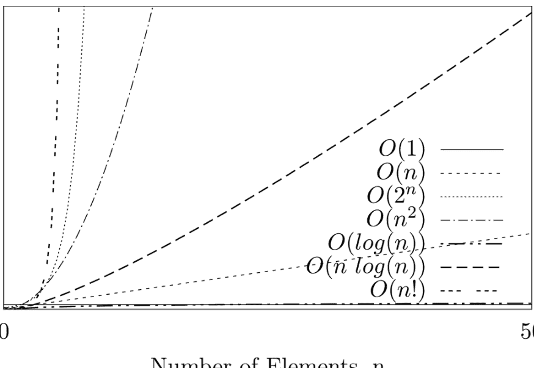

图 13.1 Big-O 时间复杂度比较。

因此，经验法则是，我们应该设计问题规模增长最小的算法，并避免随着输入大小 n 增加而显著扩展的算法。

### 13.2.1 Big-O：最坏情况场景

算法效率的最坏情况场景对应于问题规模增长时的上界。按定义，Big-O 表示最坏情况场景。

假设函数 f(n) 表示输入大小为 n 的算法的问题规模。表示 f 的上界的函数是 g(n)。对于某个输入 n 和正常数 c，函数 f(n) 和 g(n) 的关系为：

```
f(n) = O(g(n)), as n increases,
where f(n) ≤ c · g(n)
```

换句话说，f(n) 的增长率与 g(n) 的增长率成正比或小于它。语句 f(n) = O(g(n)) 可以理解为“问题规模的最大增长率为 g(n)”，而 O(g(n)) 称为算法的 Big-O。

要证明 f(n) = O(g(n))，我们需要证明对于所有 n，函数 f(n) 都受到 g 上界的限制。这种关系通过忽略常数因子（如 c）和非经常性操作来证明。

例如，要找到函数的 Big-O：

```
f(n) = n + 1
```

首先注意到，对于所有 n ≥ 1，1 ≤ n。然后在 f(n) = n + 1 中用 n 替换 1，如下所示：

```
n + 1 ≤ n + n = 2n, for n ≥ 1
or: f(n) ≤ 2n, for n ≥ 1
```

如果令 g(n) = n，那么对于 n ≥ 1，我们有 f(n) ≤ 2 × g(n)。

因此，f(n) 的 Big-O 是 O(n)，我们可以写 f(n) = O(n)。

作为另一个示例，要找到 f(n) = 5n + 8 的 Big-O，请注意对于所有 n ≥ 1，8 ≤ 8n。代入 8，我们可以推理：

```
5n + 8 ≤ 5n + 8n = 13n for n ≥ 1
```

因此，我们可以得出结论：

```
5n + 8 ≤ 13n for n ≥ 1
```

我们可以将上述内容改写为：

```
f(n) ≤ 13 × g(n) where g(n) = n
```

因此，f(n) 的 Big-O 是 O(n)，我们可以写 f(n) = O(n)。

### 13.2.2 最坏情况 vs 平均情况 vs 最佳情况场景

考虑一种搜索算法，其中比较操作会重复，直到在某个数据结构中找到目标值。重复次数将在 1 到 n 之间。

例如，以下代码在数字列表中搜索目标值 5：

```
{ >> DUP target @ EQ > R search ?? } search WORD
{ search R > target @ EQ. CR } findnum WORD
5 target !
```

```
1 3 5 7 9
findnum ( returns 1 for true and 0 for false)
```

虽然搜索可能在第 n^ 个元素（即上界）之前的任何元素上得到满足，但我们仍然假设最坏情况场景，即 n，或 Big-O 中的 O(n)。这包括平均情况复杂度，表示为 Big-Theta，如 Θ(f(n))。因此，对于某个常数 c 的 n/c 次操作，Big-O 表示为 O(n)。

因此，对于该算法，平均情况与最坏情况具有相同的数量级。这是合理的，因为我们事先不知道 n。因此，n 可以表示任何大小，包括最坏情况场景。

如果我们相反地关注最佳情况场景，即下界，那么我们的记号技术上表示为 Ω(1)，一种称为 Big-Omega 的记号。Big-Omega 发生在预期在第一个操作中就找到所需元素时。这是对已排序数据结构操作的特征，其中对结构的单次直接或随机访问即可获得结果。

如果解决方案定义为执行特定数量的操作，例如 n 为整数 100，那么我们实际上具有常数时间复杂度，即 O(1)。

### 13.2.3 算法效率与简洁性

更优雅或更简洁的算法并不总是性能更好的算法。

考虑递归 Fibonacci 函数的时间复杂度，详情见“重复与递归”章节。

斐波那契数 f(n) 递归定义如下：

```
f(1) : 1
f(2) : 1
f(n) : f(n - 1) + f(n - 2), for all n ≥ 3
```

因此，斐波那契序列中从第三项开始的任何值都是前两项之和。

使用上述递归定义生成斐波那契序列第 \(n^{th}\) 项的算法，随着 \(n\) 增加需要大量步骤。表示时间复杂度上界的函数是 \(g(n) = \phi^n\)，其中 \(\phi = (1 + \sqrt{5})/2\)。\(\phi\) 被称为 *黄金比例*，即无理数 1.618...

如超出本文范围的归纳法证明所得出的结论，\(O(\phi^n)\) 是递归 Fibonacci 算法的时间复杂度。尽管如此，我们可以看到 \(\phi = (1 + \sqrt{5})/2$ 的来源。这些证明通常涉及方程 \(\alpha^n = \alpha^{(n-1)} + \alpha^{(n-2)}\)，当 \(n = 2$ 时，该方程为二次方程 \(\alpha^2 = \alpha + 1$。使用二次公式得出正解 \(\alpha = (1 + \sqrt{5})/2$。

但是，生成 Fibonacci 数的算法不必如此低效。考虑以下非分支 *epop* 代码，尽管是递归的，但具有 \(O(n)\) 时间复杂度。这是通过在栈上构建 Fibonacci 序列并将 \(n$ 从其原始输入值递减，直到它不大于 2 来实现的。

```
10 n !
{ n @ i- DUP n ! } n- WORD
{ DUP2 + n 2 > fibonacci ? } fibonacci WORD
1 1 fibonacci ( → 55)
```

上述生成 Fibonacci 数的方法称为 *备忘录法*。该术语源自拉丁语 “memorandum”，意为“记住”。备忘录法可提高效率，因为通过在数据结构（如上述示例中的栈）中存储中间结果来避免昂贵的计算。当备忘录解法与先前的备忘录解法重叠时（例如，计算一个 Fibonacci 数取决于先前的计算），该方法也可称为 *动态规划*。¹

备忘录法也可以使分支算法更高效。例如，可以修改上述 fibonacci 函数以包含两个递归调用，如下所示。时间复杂度仍为 \(O(n)$，因为有 \(2n$ 次操作。

```
10 n !
{ n @ i- DUP n ! } n- WORD
{ n- 2 > } checkn WORD
{ DUP2 + checkn fibonacci ? checkn fibonacci ? } fibonacci WORD
1 1 fibonacci ( → 55)
```

### 13.2.4 Big-O 案例

可在多项式时间内解决的问题称为 *可处理*问题。相反，*不可处理*问题无法在多项式时间内解决。（关于这些概念的更多内容将在 *可计算性* 章节中讨论。）

¹R. Giegerich, C. Meyer, and P. Steffen, “A discipline of dynamic programming over sequence data,” *计算机程序设计科学*，vol. 51, no. 3, pp. 215-263, 2004, ISSN: 0167-6423. DOI: https://doi.org/10.1016/j.scico.2003.12.0095. [Online]. Available: https://www.sciencedirect.com/science/article/pii/S0167642304000176.

O(1)：常数时间，或零次多项式时间。换句话说，已知特定数量的操作可以提供解决方案。这被认为性能最快。

考虑 10 次操作的重复：

```
for (i = 0; i < 10; i++) operation
```

或者：

```
{ operation } 10 LREPEAT
```

上限为 10，是一个常数。因此，该算法以 10 的 *常数时间* 效率运行，在 Big-O 中表示为 O(1)。

O(log n)：对数时间。对数算法被认为运行速度快。这是分治算法效率的典型特征，其中每个周期跳过一半数据，最大增长函数可被声明为具有 O(log2 n) 效率。

对数的真实底数是渐进分析中忽略的常数乘数。因此，我们可以说 O(log n) = O(log2 n)。顺便说一句，对于所有 n，log10(n) = log2(n) / log2(10)。

例如，在此处计数器变量 i 每次减半：


i/2, i/4, i/8, i/16, ... until i/2<sup>n</sup> or i <= 1

即：O(log<sub>2</sub> n) 或 O(log n)。

以下两个代码示例在每次重复时都将计数器变量减半，因此具有对数特性。

```
for (i = n;i >= 1;i /= 2) operation
```

或者：

```
{ count @ 2 / count ! } setcount WORD
{ setcount count @ 0 > operation ? } operation WORD
{ HelloWorld!. CR setcount count @ 0 > operation ? } operation WORD
5 count !
operation
```

每个周期使计数器变量翻倍的对数情况：

```
i = 1;
while (i < n) {
tot += i;
i = i * 2;
}
```

或者：

```
{ count @ 2 * count ! } setcount WORD
{ HelloWorld!. CR setcount count @ ubound @ < operation ? } operation WORD
1 count !
5 ubound !
operation
```

O(n log n)：线性对数。具有 O(n log n) 复杂度的算法优于 O(n<sup>2</sup>) 但劣于 O(n)。此类算法的一个著名例子是称为归并排序的排序例程，这里不再赘述。

O(n)：线性或一次多项式。为了得出解，数据结构中所有 n 个元素都可能需要遍历。平均而言，一半的元素需要被遍历。

以下线性情况示例采用类 C 伪代码，其中计数器变量 i 以 i = i + 1 递增，范围从 0 到 n，并且“操作”重复 n 次。

```
for (i = 0; i < n; i = i + 1) operation
```

等效的 epop 代码：

```
operation n LREPEAT
```

O(c^n)：指数，其中 c 是常数。此类算法在每个周期中包含 c 个分支或递归调用。

O(n^2)：平方。相对于 O(n) 算法，这较慢，因为通常有 n × n 个操作。也就是说，对于 n 个元素中的每一个，对 n 个元素应用一个操作。这是嵌套循环内操作的特征。

例如：

```
for (i = 0; i < n; i++)
for (j = 0; j < n; j++)
operation
```

此处最内层操作执行 n^2 次，外层循环 n 次，内层循环 n 次。因此，此平方情况的效率为 O(n^2)。

等效的 epop 代码：

```
{ { operation } n LREPEAT } n LREPEAT
```

以下平方情况的变体将内层循环的上限设为外层循环的计数器。

```
for (i = 0; i < n; i++)
for (j = 0; j < i; j++) operation
```

有 n(n - 1)/2 或 (n^2 - n)/2 个操作，上限为 n^2，效率为 O(n^2)。注意，O(n^2) 是平方或二次多项式。

O(n^3)：立方或三次多项式。考虑一个 O(n^2) 算法的循环嵌套，其性能较差，再加上额外的嵌套循环，性能会更糟。因此，性能要差得多。

O(n!)：阶乘。考虑将一个操作应用于 n 个元素的所有可能排列。此类示例包括对所有可能排列进行 _暴力_ 搜索。此类算法极其缓慢。

总之，在评估算法效率时，我们关注的是最坏情况，即算法可能遇到的问题规模的上限。

对于问题规模由多项式函数表示的算法，可以通过观察变量上的最大指数来确定上限。例如，在二次表达式 _n_<sup>2</sup> + 4_n_ + 2 中，2 是最大指数。以下示例代码展示了这种 _O_(_n_<sup>2</sup>) 二次效率。

```
for (i = 0; i < n; i++)
for (j = 0; j < n; j++)
operation ... _n_<sup>2</sup> operations

for (i = 0; i < n; i++) {
operation
operation
operation
operation
} ... 4_n_ operations

operation ... 1 operation
operation ... 1 operation
```

上述代码总共需要 _n_<sup>2</sup> + 4_n_ + 2 次操作，就大 O 效率而言为 _O_(_n_<sup>2</sup>)。

## 13.3 计时计算

为印证算法复杂度分析，还可以进行软件剖析和时序分析。

从形式上讲，算法复杂度分析仅限于我们可控制的抽象函数，因此分析可能会忽略负责显著复杂底层计算的代码。

算法性能是相对于手头问题而言的。如果关注游戏图形的实时处理，微秒或毫秒级的延迟可能是一个问题。如果目标是处理TB级数据以进行统计分析，那么分钟乃至更长的处理运行时间可能是可以接受的。

为印证函数效率，我们可以记录同一函数不同版本的运行时间。附录 C.13 中的 *epop* 示例代码正是这样做的。那里的基准测试程序展示了一个递归斐波那契序列算法，它通常比迭代版本慢 20 纳秒。

## 练习

- 1. 描述 *大欧米伽*、*大西塔* 和 *大O* 之间的区别。分别展示示例。

- 2. 描述确定算法时间复杂度的一般过程。

- 3. 解释包含两次自身递归调用且输入规模为 *n* 的函数的最小时间复杂度。

- 4. 解释 *g(n)* 以及函数 *f(n) = 5n³ + 3n² + 4n + 6* 的 *大O*。

- 5. 考虑以下四个函数及其性能：

  - (a) *f*: 大O(*n*<sup>2</sup>)
  - (b) *f*: 大O(log₂ *n*)
  - (c) *f*: 大O(*n*)
  - (d) *f*: 大O(2ⁿ)

  如果每个函数解决规模为 1000 的问题需要 10 秒，估计每个函数解决规模为 2000 的问题所需的时间。展示你的计算过程。

- 6. 函数 *f(n)* 包含一次操作。估计以下 *f(n)* 版本的算法复杂度：

  - (a) f(data[i])
  - (b) f(data[i..n))
  - (c) f(f(data[i..n]))
  - (d) f(data[i..n]) f(data[j..i])

- 7. 为以下函数的时间复杂度指定大O：

  - (a) f(n) = 2n^2 + n + 5
  - (b) f(n) = 3n^2logn + 100n
  - (c) f(n) = 3n^n - n^1 - 1
  - (d) f(n) = 2^2n - n^2

- 8. 为使用以下内容的算法的时间复杂度指定大O：

  - (a) 所有提供的数据。
  - (b) 提供数据中的每隔一个元素。
  - (c) 每 M 个数据元素的输入规模为 N。
  - (d) 每 M 个元素的输入规模为 N，其中 M 随每个 N 变为 M/2。
  - (e) 每 M 个元素的输入规模为 N，其中 M 随每个 N 变为 M × 2。

## V

## 数据组织

## 数据组织

DOI: 10.1201/9781032687759-14

## 摘要

数据组织涉及集合组织其元素的方式。集合通常分为连接型、非连接型和分支型。

举个例子，考虑夜空中的星辰，无数闪烁的光点。乍一看，这些似乎是毫无关联的随机实体。但经过仔细观察，可以看到某些模式。这些模式被定义为星座，例如北斗七星和猎户座腰带。这些星系结构实际上是古代天文学家定义的抽象构造。

同样，数据结构作为基于其拓扑关系和分组而归属的单个数据对象的组织形式存在。

## 14.1 数据组织

本节简要概述了本书中的数据结构，每个数据结构将在接下来的三章中进行深入介绍。

非连接集合意味着元素无序，因此元素看起来是随机放置的。这些集合类型是集合和多集。多集合在所有集合定义中限制最少，因为它可以包含重复项且无序。

连接集合意味着每个元素都有前驱和后继，第一个和最后一个元素除外。连接等同于链接，如链表。此类集合类型的线性变体包括列表、栈和队列。

在连接类型中，有些是分支的，这意味着一个元素可以有多个前驱和后继，具体取决于预定义的拓扑。这些集合类型包括图和树。

## 14.2 排序

连接集合具有顺序。反过来，顺序表明集合的元素是连接的。

虽然顺序序列可以通过索引来分配，但词汇或数字顺序并非必需。当需要特定的序列顺序时，可以使用预排序集合。这些包括已排序列表、优先队列和搜索树。


### 14.2.1 元素访问

元素访问取决于数据集合的*连通性*。

对于连通集合，可以遍历顺序元素直到到达特定索引或值。

对于非连通集合，没有可遍历的结构，也没有永久索引。因此，元素访问需要随机选择，直到到达特定值，或者直到集合为空。

## 14.3 集合操作

各种类型的集合既有不同的操作，也有共同的操作。

针对单个元素的常见集合操作包括计数、插入、删除、替换、搜索和检索。

涉及整个集合的常见操作包括复制和比较两个集合，以及对连通集合进行排序。

这些操作都有其*算法效率*，取决于该操作算法的具体实现。

## 14.4 放宽的属性

集合和袋中非连通数据被定义为无序的。然而，为了存储和处理的实际需求，无序数据实际上必须以结构化集合（例如列表）的形式存在于机器中。因此，默认假设为无序，即我们忽略数据输入的序列中的任何索引，以保持随机性的外观。

对于形式集合，它没有重复项也没有顺序，从代表该集合的列表处理的数据应随机抽取。因此，连通列表结构的要求被放宽，以允许直接的非顺序随机访问。¹

如果我们关心在具有集合操作的列表中保留顺序和重复项，那么我们应该使用一种称为多重集的更宽松的集合变体。² 多重集的概念容纳某些元素的多个实例。

根据其元素的某些特性已排序的数据结构，提供了一种通过随机访问提取有意义数据的便捷方式。例如，预排序集合（如排序列表）允许我们立即确定最大值、最小值、中位数以及可在特定间隔找到的其他元素。因此，从实际意义上讲，排序列表和随机访问列表几乎是同义的。³

¹随机访问在各种编程语言的数组数据结构中很常见。

²对列表进行严格的集合操作会导致错误的结果。这是因为集合被定义为没有重复项的无序序列，而集合操作（如并集、交集和差集）按定义结果为集合。

³C. Okasaki, “Purely functional random-access lists,” in Proceedings of the Seventh International Conference on Functional Programming Languages and Computer Architecture, ser. FPCA ’95. (Perhaps the first use of Random Access List was by Okasaki in this paper.) La Jolla, California, USA: Association for Computing Machinery, 1995, pp. 86–95, ISBN: 0897917197. DOI: 10.1145/224164.224187. [Online]. Available: https://doi.org/10.1145/224164.224187.

数据结构的索引方案涉及与其值关联的有序数字或键。对于列表，索引通常是整数的线性序列，例如 0、1、2、... 例如，对于列表 { cat dog goat }，cat 可能位于索引 0，dog 位于索引 1，goat 位于索引 2。对数据结构的随机访问将取决于该结构的索引方案。如果集合不是线性的，而是像树和图那样分支的，那么索引将取决于考虑分支的某些计算，如分支结构章节中所述。

## 14.5 非连通数据集合

非连通集合的元素没有顺序。这意味着集合中的元素彼此之间没有关系，除了可能是相同类型的对象或值。由于这些元素是非连通的，从集合中提取它们不涉及特定顺序，而是一个随机过程。非连通数据的集合包括集合和袋。

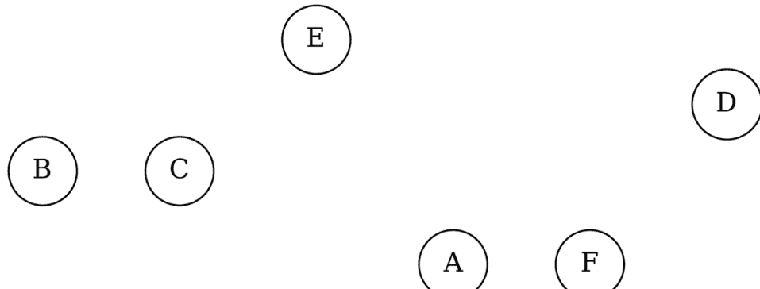

图 14.1 一组非连通对象。

- 一组对象的袋或集合。
- 没有特定关系。
- 位置无关紧要。

## 14.6 线性结构

线性数据结构具有连通元素，每个元素都有一个前驱和一个后继，第一个和最后一个元素除外。连接一词与链接同义，如链表。线性结构包括列表、栈、队列和排序列表。

- 列表、栈或队列。
- 按位置有序。
- 每个项目都有父节点（第 1 个除外）。
- 每个项目都有子节点（最后一个除外）。
- 顺序和位置共同具有意义（考虑逐步过程）。

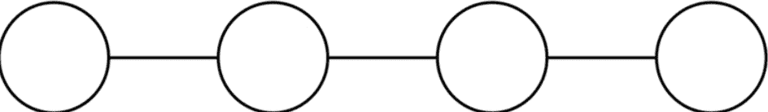

图 14.2 一组连通对象的列表。

## 14.7 分支结构

分支结构是层次集合，即树和图，通常基于链接结构。树本质上是没有环的图。

树和图适合建模比线性系统更复杂的现实世界系统。在系统工程中，考虑网络拓扑的图的方面，或操作系统进程和文件系统的类似树的层次结构。树和图的索引可以映射到各种线性结构以方便处理。

由于树和图中的分支，从一个元素访问另一个元素可能是直接的（元素相邻）或间接的（元素可通过中介元素访问）。

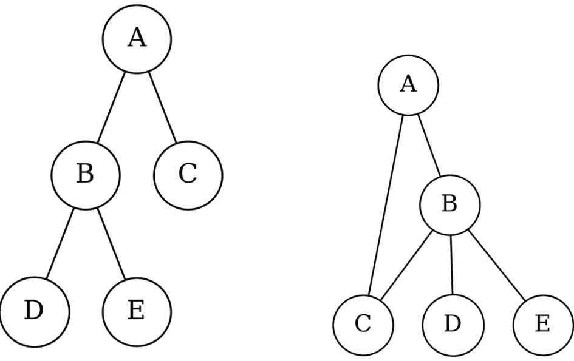

图 14.3 (a) 一棵树。(b) 一个图。

一般来说，两个数据结构之间的关系可能是相等、相同或同构。

- 相等 – 结构、数据和顺序相同。
- 相同 – 结构可能不同，但具有相同的数据和顺序。相同结构可能相等也可能不相等。
- 同构 – 结构具有相同的形式或形状。数据无关紧要。

如果两个数据结构可以一对一映射并保留顶点之间的关系，则它们是同构的。

## 14.8 数据集合摘要表

表 14.1 总结了上述数据集合的主要属性。

## 表 14.1 数据组织的属性。是 (Y)，否 (N)，可选 (O)

| 组织 | 连通 | 有序 | 重复 | 分支 | 排序 | 随机访问 |
| :--- | :--- | :--- | :--- | :--- | :--- | :--- |
| 袋 | N | N | Y | N | N | O |
| 集合 | N | N | N | N | N | O |
| 列表 | Y | Y | Y | N | O | O |
| 栈 | Y | Y | Y | N | N | O |
| 队列 | Y | Y | Y | N | O | N |
| 树 | Y | Y | Y | Y | O | O |
| 图 | Y | Y | Y | Y | O | N |

## 练习

1. 将以下内容分类为非连通、连通、树和/或图：

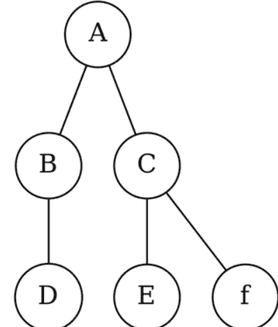

(a)

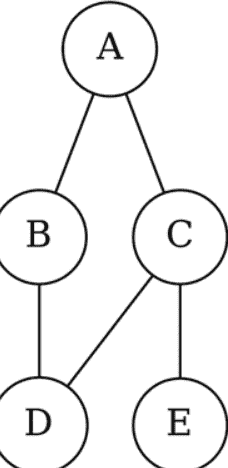

(b)

2. 前一练习中的结构彼此是否相等、相同和/或同构？请解释。

## 非连通数据

DOI: 10.1201/9781032687759-15

## 摘要

数据科学在概念上依赖于用于随机数据的特殊数据集合，称为 _集合_ 和 _袋_，也称为 _多重集_。此类集合的数据元素是 _非连通_ 的，因此没有顺序。这意味着集合中的元素彼此之间没有关系，除了可能是相同类型的对象或值。由于这些元素是非连通的，从集合中提取它们不涉及特定顺序，而是一个随机过程。随机选择元素的过程依赖于一个称为 _伪随机数生成器_ 的函数。

## 15.1 袋与集合

袋类似于集合，只是允许重复项。与集合一样，袋是无序的。因此，在各种类型的集合中，袋是最不受限制的。袋也称为 _多重集_。

虽然元素顺序对多重集来说并不正式重要，但重复元素可以用表示其选择顺序的下标来区分，例如 _e_<sub>0</sub>_e_<sub>1</sub>..._e<sub>n</sub>_。


由于缺乏限制，袋可作为更具限制性和抽象性的数据结构的基础数据结构。更接近机器级指令，袋可使用数组或列表的原生设施来构建。以这种方式使用时，处理袋类似于从随机访问列表中随机选择元素，这是“线性结构”章节的一个主题。

由于处理非连接数据所固有的随机性，处理袋的算法效率相对较低。我们永远不知道元素会在何时、以何种顺序从袋中被抽出。

集合可以用列表表示，例如 { a b c d }。由于顺序无关紧要，同一集合可以表示为 { c b d a }。

同样，袋可以用列表表示，例如 { a b c d b } 或 { b c b d a }。请注意这些列表中的重复项。

我们可以按如下方式为袋 b₀ 或集合 s₀ 指定元素：

```
{ a r g u } s₀ LIST
{ y t b b } b₀ LIST
```

此处对袋和集合的这些列表表示未指定特定顺序。

袋和集合中包含的值可以是数字、字符，或表示某些分类的对象，例如动物、汽车、金融工具等。

按定义，袋中值的数据类型应当相同。然而，有人可能会争辩说袋中的类型一致性无关紧要，因为袋数据是非连接的，且袋内数据之间没有比较（如排序适用时的情况）。一旦从袋中抽出，元素可按需要按数据类型处理成更具限制性的集合。

因此，我们应该能够构建一个混合数字和字符的袋，例如：

```
{ a 3 b b } bag₀ LIST
```

典型的袋和集合操作包括：

- 插入或添加元素。
- 移除某些元素。
- 验证某些元素是否存在。
- 计算某些或所有元素。

## 15.2 数据的随机选择

由于袋和集合的无序性质，添加、移除和搜索袋与集合数据需要用到随机函数。如果元素移除不是选择操作的一部分，那么随机搜索袋的效率低于搜索列表。这是因为袋检索的随机性偶尔会导致选择相同的元素，而从列表中随机选择仍可限制在一定范围的索引内。

在计算机程序中，随机选择元素取决于一个生成随机数的函数。为了实用，这样的随机数生成器必须限制在一定范围的整数内。超出合理范围的数字可能过大或过小，无法应用于手头的问题。

这是一个示例数字生成函数：

```
{ -10 10 RAND } rng WORD
rng ( → 4)
rng ( → -2)
```

这里的单词 RAND 从 -10 到 10 的范围内随机检索一个整数，包括这些上下界限。每次调用“rng”时，都会在 -10 到 10 的范围内生成一个随机整数。鉴于 RAND 操作检索范围内的任何数字的可能性与范围内任何其他数字相同，对许多数字进行持续选择最终应显示 _均匀随机分布_。

理想的随机数函数将生成均匀分布，这是统计重采样和密码学应用中的重要考虑因素。

可以这样说，没有什么是真正随机的。只有在我们对复杂性的模糊认知中，因果关系的复杂性伪装成了随机性。因此，我们只能使用巧妙的算法来模拟真实随机性的近似值。在计算机中，完美的随机性是不可能的，因为随机数函数依赖于并非完全随机的系统状态之间的交互作用。系统时钟就是这样一个因素，因为它通常用于启动（种子化）一个随机数。当然，时钟表现出一种非随机的序列模式，即时间，因此其他系统因素必须混合用于随机化算法。出于这些原因，我们将随机数函数称为 _伪随机数生成器_，或 _PRNGs_。

使用伪随机数生成器，我们可以按如下方式从集合中获取一个元素：

```
{ a b c d e f g h i j } x LIST
{ 1 GSC RAND PICK. CR } prng WORD
x prng → b
x prng → g
```

或者，显示这些元素的随机序列：

```
{ x 1 GSC RAND PICK } prng WORD
{ prng. SPACE } GSC LREPEAT ( → e a b j h c d i f g)
```

## 15.3 均匀随机分布

离散均匀随机分布表现出离散结果的等可能性。换句话说，存在有限数量的可能结果，每个结果发生的概率相同。考虑掷一个六面骰子。六个数字中每个的概率都是 1/6。或者考虑从一副五十二张的牌中抽取一张牌。任何一张牌，从第 1 张到第 52 张，概率都是 1/52。

这种概率的函数给出如下：

f(x) = 1/n

其中 x 表示单独的结果 1、2、3、..., n。

对于六面骰子的示例，如果我们为连续掷骰子绘制 f(x) 图，图表将呈现为一条水平线，如图 15.1 所示，高度为 1/6。这样的水平线表示结果的均匀分布。

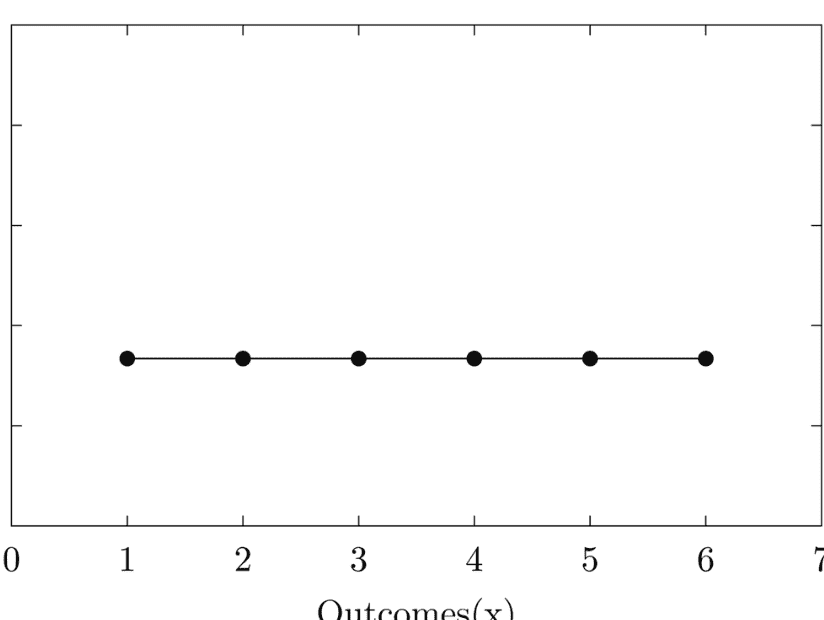

图 15.1 6 个随机样本的均匀概率分布。

## 15.4 伪随机数函数

生成均匀分布并非易事，如前面所述，不存在真正的随机数序列。

上述计算机系统方法涉及获取一个种子数，例如系统时钟当前的纳秒时间。然而，时间本身并非随机，而是一种线性周期序列，这使其可预测。因此，除了时间之外，还需要其他数据因素来制造随机性的假象。此类数据可能包括操作系统条件，包括内存、CPU 使用率等。一种方法可能是将这些因素的乘积除以所需样本数，计算模数（取余数）。

使用模数（mod）可以限制随机数生成器可能结果的范围。例如，假设我们有一批范围为 0 到 50 的随机数，但我们希望将数字限制在 0 到 9 的范围内。我们可以通过对每个随机数 f(x) 计算 f(x)mod10 来实现此所需结果。例如，50mod10 为 0，17mod10 为 7，10mod10 为 0，24mod10 为 4。

通过混合其他因素（例如操作系统中当前进程的数量，通过 Unix 命令行管道传递到以下 md5sum 命令）可以增强伪随机性：

```
ps-aux|md5sum
```

在 Unix 系统中，该命令创建一个十六进制格式的 128 位数字，长度为 32 个十六进制字符。

另一种面向 Unix 的方法是使用 /dev/urandom 设备文件，该文件由 Unix 使用随机计算机噪声生成的数字组成，方法是在每次生成之间等待足够的时间，使先前状态经历熵。这些随机数可以使用以下 Unix 命令显示：

```
od -d /dev/urandom
```

顺便提一下，urandom 文件在启动时预生成了大量随机数，使实时应用程序无需处理耗时的随机数生成。例如，在 epop 中，生成单个随机数的伪随机算法可以定义如下：

```
1 begin !
100 end !
{ ( ( od -vAn -N4 -tu4 < /dev/urandom)) SYSTEM } bignum WORD
{ end @ begin @ - } range WORD
{ bignum range % } prng WORD
```

此代码使用模运算（% 运算符），属于被称为 *线性同余生成器* 或 *LNGs* 的一类伪随机数生成器。

LNG 具有一个状态空间 S，由正整数组成，上限为 n，例如：

{ 0 1 2 ... n } S

LNG 函数可以表示为：

f(i) = g(i, a, b, ...) mod n

其中符号 i、a 和 b 是从 S 中选取的整数常量。

## 15.5 评估伪随机数

一般来说，伪随机数生成器 PRNG 将依赖于有限状态集 D、一个种子数 n，以及输出为 R 的子集，例如：

n = 1, 2, 3, ...
f(D, n) → R

通过多次运行 PRNG，生成的数字可以通过排序和绘图进行可视化分析以检验均匀性。分布越均匀，PRNG 就越可靠。例如，以下代码生成一个包含 2000 个随机概率的列表。


{ 1 10000 RAND } prng WORD
{ prng 5000 - 10000 /. CR } 2000 LREPEAT
0.4025
-0.2314
...

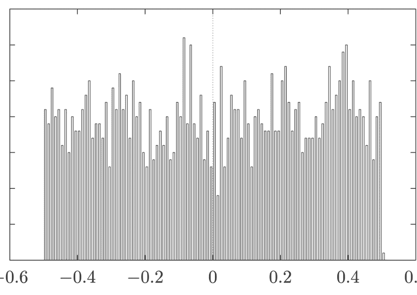

图 15.2 伪随机数生成器输出的“均匀”分布。

请注意，随着生成的随机值数量增加，图表中条形的高度应该越来越接近相同的高度。

## 练习

- 1. 描述随机性如何与多重集（Bags）相关。
- 2. 描述袋与集合不同于列表的地方。
- 3. 描述袋和多重集不同于集合的地方。
- 4. 说明对多重集进行排序是否可行。
- 5. 说明在集合中统计值频率的方法是否有用。
- 6. 概括地描述可用于从多重集中检索特定值的算法。
- 7. 概括地描述可用于从多重集中删除所有值的算法。
- 8. 概括地描述可用于统计多重集中所有值的算法。
- 9. 概括地描述可用于对多重集中的值进行排序的算法。

## 线性结构

DOI: 10.1201/9781032687759-16

### 摘要

在处理分支结构的复杂性之前，数据科学家应牢固掌握更简单的线性结构。线性结构是数据科学中的基本数据集合，它们适用于处理数据序列。

线性结构具有连接的元素，每个元素都有一个前驱和一个后继，第一个和最后一个元素除外。连接一词与链接同义，如链表所示。线性结构包括数组、列表、栈、队列、随机访问列表和排序列表。列表和数组通常在编程语言中被用作其他结构（包括栈和队列）的基础。

## 16.1 列表的属性

列表是同一数据类型元素的有限序列，按特定顺序排列。它可能包含重复元素。列表是*排序列表*、*栈*和*队列*的基础，这些是数据科学中的常见数据结构。严格来说，列表不具备*随机访问*能力，尽管在某些实际应用中会放宽这一条件。

随机访问是一种属性，允许立即或直接访问任何元素，而无需遍历（跳过）结构中的其他元素。这与*顺序访问*形成对比，后者在到达目标元素之前需要遍历层次顺序。

列表可以表示为连接的对象。

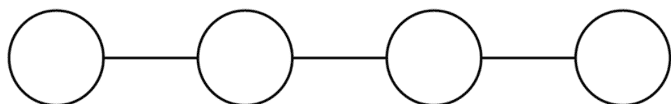

图 16.1 对象的连接列表。

由于顺序很重要，列表的每个元素都依赖于前一个元素和后一个元素。

列表可以仅由数字或字符组成，只要它们是同一类型即可。¹

列表还可以由符合同一预定义定义的有限对象集组成。列表可以包含其他列表（即列表的列表）和抽象类型对象，其中每个对象可以代表多种其他数据类型。

下列任意序列都是列表，无论是否有逗号：

- a, b, c, x, y, z
- 5 7 2 8
- cat dog goat

可以看出，列表元素可以有不同的分隔符或分隔字符。通常使用逗号或空格作为分隔符。

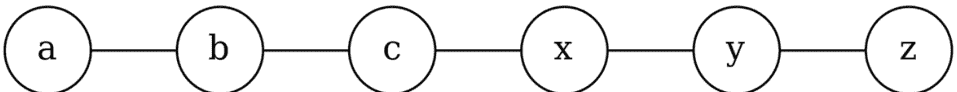

图 16.2 字符的连接列表。

为区分列表与非列表实体，请用左花括号 { 和右花括号 } 将列表括起来。例如，以下序列由两个字符列表后跟一个操作组成。

```
{def}{hij}operation
```

¹在数据科学和计算机科学中，字符列表的术语是字符串，也称为单词。如果序列是无限的，则适用的术语是流。在数学中，列表更常被称为元组。

以这种方式在花括号中呈现列表，暗示了列表的隐式命名，例如 \( l_0, l_1, ..., l_N \)。换句话说，上述条目实际上是：

```
l_0 l_1 operation
```

或者，显式定义列表能更好地将列表与其他数据区分开来。例如，我们可以使用名为 LIST 的列表构造器操作来构造和命名一个空列表（或空列表），如下所示。

```
{ } l_0 LIST
```

或者我们可以创建包含一些数据的两个命名列表：

```
{ a b c } l_1 LIST
```

```
{ x y z } l_2 LIST
```

然后我们可以使用这些列表标签进行列表操作，例如：

```
l_1 l_2 operation
```

## 16.2 标准列表操作

列表通常预期支持以下操作：

- 追加：在列表末尾放置一个新元素。
- 插入：在列表中某处放置一个元素。
- 连接：将一个列表附加到另一个列表的末尾。
- 删除：从列表中删除一个元素。
- 检索：从列表中某处检索一个元素。
- 映射：将函数应用于列表的每个元素。
- 归约：对列表应用聚合函数（例如将所有元素相加）。
- 长度：返回列表的长度（大小或计数）。

上述操作还有其他名称。例如，*归约*也称为*折叠*，而*追加*可能被称为*压入*。下文将介绍其他别名。

列表的*基数*是其元素计数或长度。我们将列表 *l* 的基数表示为：

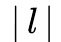

通过获取列表的长度，我们实际上在检查它是否为空。例如，对列表 *l* 应用名为 LEN 的操作可检索其元素计数：²

```
l:LEN ( → 3)
```

由于顺序很重要，只有当两个列表包含相同顺序的相同元素时，它们才等价。例如，给定：

```
{ x a y b } l₀ LIST
{ x a y b } l₁ LIST
```

因此，

```
l₀ l₁ EQ ( → 1(true))
```

在这里，EQ 字符表示等价性评估。
这被称为布尔操作，因为它产生两种结果之一：true 或 false。布尔操作在命题逻辑章节中介绍。

由于列表元素的连接性，元素访问依赖于顺序处理，即在到达下一个元素之前先遍历一个元素。此类列表处理可以通过各种通常在编程语言中预定义的列表函数来完成。

列表的头定义为放入列表的第一个元素。列表的尾定义为除头以外的所有元素组成的列表。

假设操作 HD 检索列表的头，操作 TL 检索列表的尾。因此，给定：

```
{ x a y b } l0 LIST
```

头：

```
l0 HD ( → x)
```

尾：

```
l0 TL ( → a y b)
```

我们可以使用相同的操作来分配一个新列表 l1：

```
{ l0 TL } l1 LIST
```

要查看 $l_1$ 的组成，请使用 SEE 操作：

```
l1 'SEE ( → a y b)
```

仅通过重复头和尾操作，就可以实现有些复杂的列表处理，就像计算统计信息时所做的那样。但是，为了实用性，此类操作应交由我们定义的函数来处理，除非在所使用的编程语言中已预定义。

要将元素追加到列表末尾：

```
{ x a y b } z PUSH ( → { x a y b z })
```

要连接两个列表：

```
{ a b c }{ x y z } CONCAT ( → { a b c x y z })
```

要将元素追加到列表前面：

```
{ z }{ x a y b } PUSH ( → { z x a y b })
```

要将列表中所有值乘以 2，映射操作可以将在此处定义为 *双倍* 的函数应用于列表中的每个元素：

```
{ 2 * } double WORD
{ 2 4 6 8 } double MAP ( → { 4 8 12 16 })
```

列表数字的总和可以通过使用左折叠操作获得：⁴

```
0 2 4 6 8 + FOLDL ( → 20)
```

请注意，折叠操作产生一个单一值，而映射操作会改变列表中的所有值。

³请参阅“函数与抽象”章节。

⁴在函数式编程中，左折叠和右折叠函数被称为列表归约器，因为它们分别将列表的每个项折叠到右侧或左侧的初始值中。

## 16.3 随机访问与排序列表

当连接性是严格要求时，列表必须被遍历才能访问任何元素。然而，通过索引编号直接访问元素而无需遍历更为高效。为此，我们放宽连接性属性，使用一种称为随机访问列表的 List 变体。⁵

随机访问列表可以表示为元素数组。


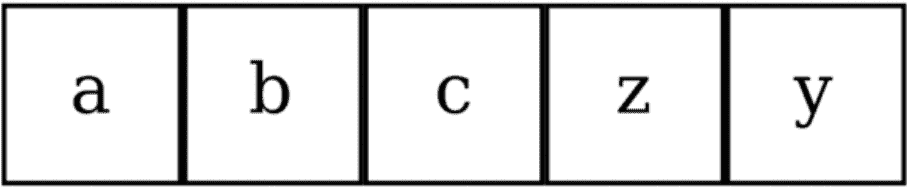

图 16.3 字符数组。

在数据科学中，数组是带索引元素的列表。如果数组是一维的且其元素为数字，则该数组称为*向量*。多维数值数组称为*矩阵*。我们通常将由数组组成的数组（可能是数值的，也可能不是）称为*多维数组*。

在数据科学中，只有部分数据结构具备*随机访问*属性。尽管这种能力可能由编程语言提供，也可能不提供，但数组和数组派生结构通常期望支持随机访问，而链表则不支持。*链表*是通过内部内存引用连接的元素线性序列。由于这种内部依赖链，链表通常不允许对除第一个元素外的任何元素进行直接或随机访问。

可随机访问数据结构的索引方案各不相同。对于列表、栈或队列的数组实现，索引非常直截了当：0, 1, 2, ... N。取决于编程语言，索引可能从 0 或 1 开始。

5 C. Okasaki，“纯函数式随机访问列表”，载于《第七届函数式编程语言与计算机体系结构国际会议论文集》，丛书 FPCA ’95。（也许Random Access List首次使用是由Okasaki在本文中提出。）美国加利福尼亚州拉荷亚：计算机协会，1995年，第86–95页，ISBN: 0897917197。DOI: 10.1145/224164.224187。[在线]。可用：https://doi.org/10.1145/224164.224187.

6 对于树和图，索引计算取决于给定的分支和边拓扑。请参阅树与图章节。

定义预排序的随机访问列表（或排序列表）可以立即访问特定值，以便最快速地计算统计量，例如最大值、最小值、中位数、中极值和各种百分位数。由于索引处即可获得值，无需使用更耗时的列表遍历操作。为了获得这些直接访问优势，排序列表必须具备随机访问属性。否则，排序列表的用途将大大减少。因此，就我们的目的而言，假设排序列表也是随机访问列表。

排序列表的顺序可以是数值的、词汇的（如字母顺序）或具有某些任意的序列模式。例如，考虑元素排序列表 ls 的字母排名，
{ a b x y } ls LIST

我们可以通过指定其索引直接访问第四个元素 y。由于索引通常从 0 开始，列表的第四个元素与索引 3 关联。例如，使用 NTH 操作，我们从 $l_s$ 中检索第四个元素，如下所示：

```
$l_s$ 3 NTH ( → y)
```

## 16.4 列表的列表

正如列表的每个元素可能由单个数据元素组成一样，每个元素也可以是另一个列表。由此，我们有一个由*构成列表*组成的*主机列表*。访问任何构成对象都必须从主机列表开始。这与二维数组或矩阵形成对比，后者不需要这种遍历。

请考虑以下几个列表：

```
{ a0 a1 a2 a3 } b LIST
{ b0 b1 b2 b3 } b LIST
{ c0 c1 c2 c3 } c LIST
{ d0 d1 d2 d3 } d LIST
{ l0 l1 l2 l3 } lLIST
```

列表 a、b、c 和 d 可以是列表 l 的构成列表，这被称为*列表的列表*。可以通过 l0 = a0、l1 = b0、l2 = c0 和 l3 = d0 来实现。

在图形上，这样的列表的列表可以如图 16.4 所示。

| a0 | b0 | c0 | d0 |
|----|----|----|----|
| a1 | b1 | c1 | d1 |
| a2 | b2 | c2 | d2 |
| a3 | b3 | c3 | d3 |

图 16.4 列表的列表。

请注意，下标为 0 的元素（例如 $a_0$）既是主机列表的一个元素，也是构成列表的第一个元素。$^7$ 主机列表与每个构成列表共享一个元素。

每个构成列表（$a$、$b$、$c$ 和 $d$）以及列表的列表（$l$）的基数均为 4。即其各自元素的计数。我们可以表示：

$|a| \equiv |b| \equiv |c| \equiv |d| \equiv |l|$

## 16.5 抽象数据类型列表

列表的数据不限于字符和数字。自定义或抽象数据类型定义可以包含列表。$^8$ 抽象数据类型有时称为 ADT。

7 顺便说一句，在计算机科学中，数组第一个元素的地址也是数组本身的地址，代表数组的其他元素。

8 有关更多详细信息，请参阅章节*原子与抽象*。

给定一个 ADT 列表，我们将其元素称为 ADT 的*实例*或*对象*。

假设我们有一个名为 $A$ 的 ADT。那么我们应该表示 $A$ 的实例，例如 $a_0\ a_1 \dots a_N$。作为一种抽象类型，$A$ 可能由各种类型的对象组成，包括整数、字符、列表和其他抽象对象。

在以下示例中，ADT $a_0$ 由一个整数（5）、一个字符列表（$l_0$）和一个字符（x）组成。

```
{ e f g } $l_0$ LIST
{ 5 $l_0$ x } $a_0$ ADT
```

抽象对象 $a_0$ 反过来可以放入另一个列表中，例如这里的 $l_1$：

```
{ $a_0$ $a_1$ $a_2$ $a_3$ } $l_1$ LIST
```

图 16.5 说明了由不寻常组件组成的抽象数据可能包含列表的概念。在这种情况下，类型是代表货币的抽象，如金融与经济学中所用。这种货币抽象可能包括面值、区域设置或与银行和市场相关的各种参数等属性。

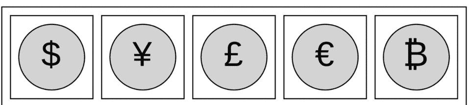

图 16.5 用于表示抽象对象的货币符号序列。

## 16.6 栈的列表实现

列表是*栈*的基础，栈是数据科学中常见的数据结构，尤其用于逻辑内存架构。

使用栈是因为它们强制执行特定的元素顺序，从而便于 CPU 的内存管理方式。

栈的先进后出（FILO）特性常用于按一定顺序强制执行函数及其组成方法和变量的临时内存分配和释放，即*函数作用域*。在函数中声明的变量，当函数在运行时被调用，其关联值会被*压入*栈中。函数执行期间，其组成变量会被*弹出*（移除）栈。

想想文字处理器中的*撤销*命令。当你输入单词时，实际上是将它们压入栈中。输入的第一个单词进入栈底。当你选择*撤销*时，实际上是从栈顶弹出一个单词。

栈操作只影响栈顶的元素。这包括：

- 压入：向栈顶添加一个元素。
- 弹出：从栈顶返回/移除一个元素。
- 查看：查看栈顶元素的值。

其他栈操作可能包括：

- 长度：返回栈上元素的数量。
- 清空：清空栈。

栈的类型包括：

- 操作数：元素（值）的栈。
- 运算符：函数的栈（程序栈）。
- 组合：同一栈上的操作数和运算符。
- 返回：操作结果的栈。

某些系统为数据、函数和结果设有单独的栈。例如，在图 16.6 中，整数 4 位于栈顶，因为它是放入栈的最后一个数字。

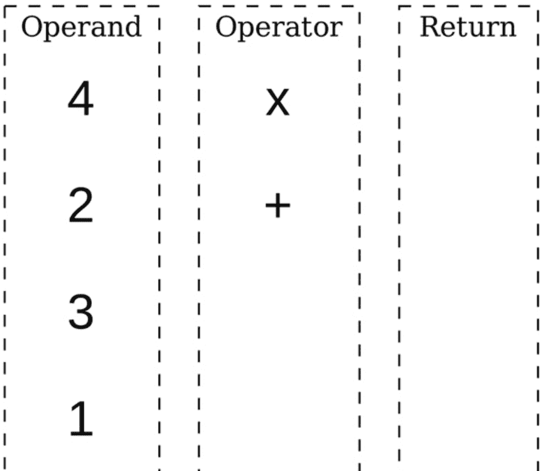

图 16.6 操作前的三个独立栈。

在 [图 16.7](#) 中，我们看到 4 和 2 从操作数栈弹出，乘法符号从运算符栈弹出，操作执行，结果 8 被压入返回栈顶。

| 操作数 | 运算符 | 返回 |
|---|---|---|
| 3 | + | 8 |
| 1 | | |

图 16.7 一次操作后的三个独立栈。

接下来，数字 3 和 1 从操作数栈弹出，加法符号从运算符栈弹出，操作执行，结果 4 被压入返回栈顶。


因此，在乘法和加法这两个操作之后，运算符栈和操作数栈均为空，而返回栈包含相应的结果，即 8 和 4。

| 操作数 | 运算符 | 返回 |
|---|---|---|
| | | 4 |
| | | 8 |

图 16.8 执行两个操作后的三个独立栈。

然而，三个独立的栈并非必要。某些系统将运算符和操作数合并在一个栈中，并将结果推回同一个栈。你可能会问，这是如何可能的，考虑到栈的基础——列表——要求元素具有共同的数据类型。这种适配是通过为这些对象使用共同的抽象类型来实现的，只显示它们各自的符号。

例如，图 16.9 显示了一个单栈，最初同时包含 + 操作和操作数 7 3 2。弹出 + 也会弹出加法所需的两个操作数，即 2 和 3，执行加法并将结果 5 推回栈顶。数字 7 保留在栈底，因为它未被使用。

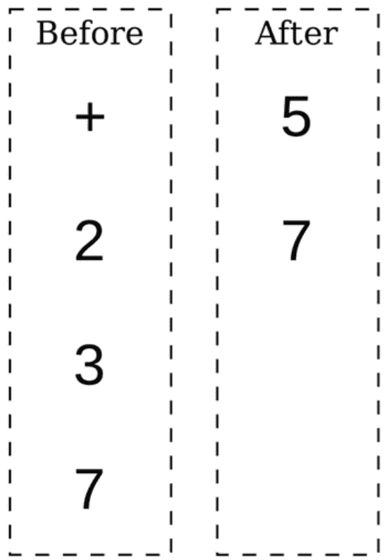

图 16.9 合并后的栈（一次操作前后）。

## 16.7 后缀表达式

使用栈进行的操作通常遵循后缀表示法。这是因为操作在操作数之后呈现。后缀也称为 *逆波兰表示法*，即 RPN，是波兰数学家扬·Łukasiewicz 的前缀表示法的逆序，后者也称为 *波兰表示法*。

某些计算机语言是面向栈的，例如 Forth 和 Postscript，某些手持计算器也是如此，例如 HP 32S-RPN Scientific。后缀所需的内存和 CPU 占用相对较少，因为它不需要更熟悉的中缀表示法所需的优先级规则和括号 ()，中缀表示法的运算符位于操作数之间。从左到右（或从上到下）的线性处理避免了预处理表达式部分的需求。确实，CPU 汇编语言的单个函数同样是线性的，尽管通常是前缀顺序。

后缀具有以下模式，符合栈的特征：

```
o_0 o_1 ... o_N f
```

其中，操作数 o_0 o_1 ... o_N 提供给函数 f。

由于栈是先进先出 (FILO) 结构，栈顶元素是 o_N，栈底元素是 o_0，即最先进入的元素。

3 + 4 的后缀等价形式是：

```
3 4 +
```

结果当然是 7。

算术运算是函数，函数不仅限于算术。可能存在用于交换和复制元素的函数，可能称为 swap 和 dup，具体取决于所使用的编程语言。它们对数字序列 3 7 9 的影响如下：

```
3 7 9 SWAP
3 9 7 DUP
3 9 7 7
```

请注意，操作 SWAP 仅交换其前面的两个值，而操作 DUP 仅复制其前面的一个值。

## 16.8 队列的列表实现

队列是一种具有先进先出 (FIFO) 处理顺序的数据结构。这种顺序类似于高速公路的入口匝道——第一辆驶入匝道的汽车是第一辆驶出匝道的汽车。第一个进入队列的项目是第一个退出的——FIFO 表示先进先出。这与栈形成对比，栈是 LIFO——后进后出。

我们看到操作系统使用队列来优先处理进程，数字通信使用队列来缓冲数据包，软件则使用队列来对制造供应链中的金融交易或投资组合的股票进行排序。

### 常见的队列函数：

- 入队 (Enqueue)：向队列尾部添加一个元素。
- 出队 (Dequeue)：从队列头部移除并返回一个元素。
- Front：查看队列中的第一个元素。
- Back：查看队列中的最后一个元素。
- Length：返回队列中元素的数量。

_双端队列_ (deque) 可以正向和反向工作。因此，它支持从队列的任一端添加和移除元素。

_优先队列_ 是一种顺序取决于其元素某些优先级或排序的队列。两个具有相同优先级的元素按 FIFO 基础处理。由于这种顺序属性，优先队列可能基于排序列表。

_循环队列_ 连接最后一个元素和第一个元素。这通过让列表中的最后一个元素引用第一个对象的内存地址，或通过使用元素的 _模块化索引_ 来实现。

当当前值等于队列长度时，模块化索引会重置索引值。它通过使用模运算（通常表示为 mod）来计算余数来实现这一点。

例如，对于包含八个元素的循环队列 q0、q1、...、q7，每个元素索引的计算如下：

```
index = (index + 1) MOD 8
```

其中，MOD 8 指的是给定值除以 8 时的余数。

在后缀中，计算如下：

```
index 1 + 8 MOD
```

假设某个元素的当前索引为 7。将索引加 1 会使索引计算为 8。但是，再次将索引加 1 会使索引计算为 1。因此，每当索引为 8 时，下一个索引会重置为 1。

混合队列可以同时具有优先队列和循环队列的属性来实现。在这样的队列中，某些优先级条件会导致循环队列的重新索引。此类队列的示例出现在操作系统中，其中，为了稳定性，系统进程必须优先于不太关键的进程（例如用户的程序）获得 CPU 时间。图 16.10 描绘了带有索引 q 和优先级 p 的此类队列。

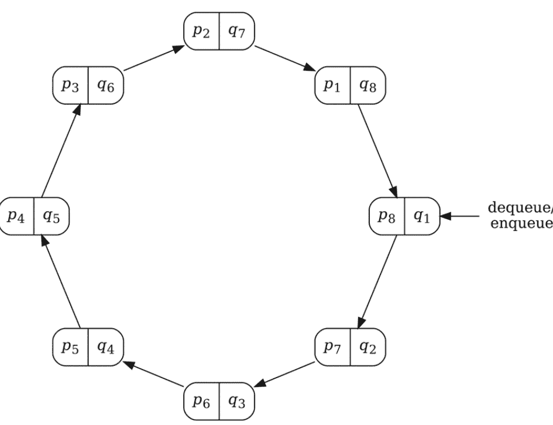

图 16.10 混合循环/优先队列，包含 p 个数据和 q 个索引。

循环队列在数据科学和计算机科学中的吸引力在于，它可以用于自动重新分配内存空间。考虑一个采集模拟声音样本的信号处理器。代表该声音样本的元数据（例如分贝水平和频率）暂时存储在一定长度（例如 32 字节）的缓冲区中。9 每个样本在被定向到永久存储介质或转换回模拟形式以通过音频扬声器放大之前，都需要最少的临时寄存器存储，例如循环队列。

> ⁹S. Smith, *科学家和工程师的数字信号处理指南*, First. California Technical Pub, 1997. (关于循环队列硬件应用的不错介绍见第 28 章。) ISBN: 0966017633. DOI: https://dspguide.com/ch28.htm.

## 16.9 简单搜索与排序算法

线性数据结构的搜索和排序方式取决于数据结构的设计。

某些搜索算法依赖于已排序的数据，以便可以从特定位置检索元素。使用排序列表，搜索可以直接根据序列的有序排名检索最大值、最小值、中位数或其他元素等值。

如果不排序，则需要 *线性搜索* 来搜索线性结构。线性搜索或 *顺序搜索* 从序列的一端开始，逐个检查每个元素，直到找到所需值或遇到序列的另一端。

> 堆栈的线性搜索示例见附录 C.5。代码会逐步检查数据堆栈顶部的元素是否匹配目标值。相比之下，附录 C.6 所示的是堆栈的 *随机搜索*，它会随机搜索堆栈直到找到目标，最多尝试一定次数。

一种有趣的排序方法是 *冒泡排序*。这种排序通过比较相邻对来处理元素，并根据特定顺序需要时交换它们。要以升序排序，仅当一对中的第一个值大于第二个值时才进行交换。第一次搜索遍历后，最大元素将位于有序序列的最后。第二次遍历后，第二大元素将位于有序序列的倒数第二位置。因为每个元素都必须与所有其他元素比较，因此序列完全排序可能需要 n – 1 次遍历。

以下是冒泡排序将序列 "5, 4, 6, 3, 7" 排序为升序所需步骤的跟踪。每次遍历由迭代 i 表示。

| i = 1 | i = 2 | i = 3 | i = 4 |
| :--- | :--- | :--- | :--- |
| 5, 4, 6, 3, 7 <br> 交换 | 4, 5, 3, 6, 7 <br> 保持 | 4, 3, 5, 6, 7 <br> 交换 | 3, 4, 5, 6, 7 <br> 保持 |
| 4, 5, 6, 3, 7 <br> 保持 | 4, 5, 3, 6, 7 <br> 交换 | 3, 4, 5, 6, 7 <br> 保持 | |
| 4, 5, 6, 3, 7 <br> 交换 | 4, 3, 5, 6, 7 <br> 保持 | | |
| 4, 5, 3, 6, 7 <br> 保持 | | | |

另一个有趣的排序例程是 *选择排序*，它通过分区原始列表来构建排序列表。


分为未排序和已排序两个部分。要进行降序排序，我们首先扫描未排序元素中的最大值，然后将该值与第一个索引处的值交换。随后递增索引计数器以标记第二个索引，下一个最高值将被放置于此。该过程对所有索引重复进行，直到包括索引计数器。

以下是选择排序将序列“5, 4, 6, 3, 7”排序为降序所需步骤的跟踪。

| 迭代 | 未排序 | 最大值 | 已排序列表 |
|---|---|---|---|
| 0 | 5 4 6 3 7 | 7 | 7 |
| 1 | 5 4 6 3 | 6 | 7 6 |
| 2 | 5 4 3 | 5 | 7 6 5 |
| 3 | 4 3 | 4 | 7 6 5 4 |
| 4 | 3 | 3 | 7 6 5 4 3 |

选择排序的示例 *epop* 代码可在附录 C.7 中找到。

## 练习

为协助您完成以下练习，您可以参考本书索引中其他章节涉及的对列表操作的函数。

1. 为数据序列“1 3 5 7”定义一个基于列表的栈。描述栈操作以计算栈上数字的总和。

2. 为数据序列“2 4 6 8”定义一个基于列表的栈。描述栈操作以计算栈上数字的数量。

3. 为数据序列“2 4 6 8”定义一个基于列表的队列。描述队列操作以计算其中每个数字的阶乘。

4. 本练习涉及*计算机内存*的概念，这是计算机科学的一个主题。为一个三十二元素循环队列定义一个索引方程。该索引必须确保，当队列满且向队列中引入新数据时，最旧的数据被新数据覆盖。

5. 本练习涉及与 CPU 周期相关的*进程饥饿*概念，这是计算机科学的一个主题。使用随机访问列表实现优先队列。该队列将由名为*进程*的抽象的十个对象实例组成。每个进程对象应包含三个变量，*问候语*（“hello”或“goodbye”）、*持续时间*（0 至 50 纳秒）和*优先级*（1、2 和 3，其中 3 最高）。使用伪代码描述基于以下条件对进程对象（系统缓冲区）进行队列重新排序：
- duration × priority > 100

如果给定对象的条件为真，则将该对象从队列中移除，发出问候语，然后继续评估队列几个周期。

6. 本练习涉及投资组合算法，这是金融与经济学的一个主题。

考虑基于以下假设的公司股票投资资本收益：多年内以不同价格多次购买；股票销售必须遵循先进先出（FIFO）原则。

对于每次股票购买，将创建一个包含符号、价格、数量和日期的股票对象。使用伪代码描述股票组合（队列）中的一系列买入和卖出操作，其中买入涉及入队操作，卖出表示出队操作。

## 分支结构

DOI: 10.1201/9781032687759-17

### 摘要

在数据科学中，诸如*树*和*图*之类的分支结构有助于分析数据元素之间的直接和间接关系。由于存在分支，从一个元素访问另一个元素可能是直接的（如果元素相邻）或间接的（如果元素仅通过中间元素可访问）。

树和图有助于建模比线性系统更复杂的现实世界系统。在系统工程中，可以考虑网络拓扑与图的相似性，以及操作系统进程和文件系统的树状层次结构。树和图的索引可以映射到各种线性结构以便于处理。

## 17.1 列表对象回顾

让我们简要回顾之前在*线性结构*章节中讨论过的列表主题。请回顾，列表由元素的线性序列组成，每个元素都有前驱和后继，第一个和最后一个元素除外。请参考图 17.1。

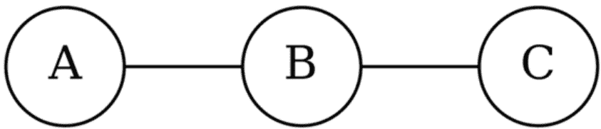

图 17.1 对象列表。

经过轻微修改，列表可以为我们提供一个分支结构。例如，从不同角度考虑图 17.1，使其类似于树，如图 17.2 所示。

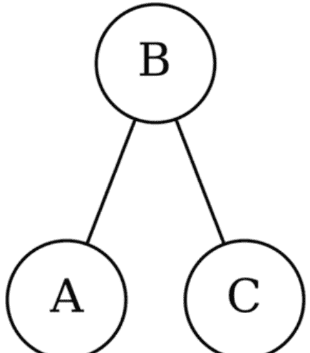

图 17.2 对象列表。

图 17.1 和 17.2 均描绘了元素 A、B 和 C 之间的相同连接或关系。它们甚至可以被视为相同，只是图 17.2 中的元素可能位于不同的 XY 坐标处，以便在视觉上不排列成线性。然而，通过交换元素 A 和 B 的位置，我们可以实现某些线性结构不可能实现的关系属性。请参考图 17.3：

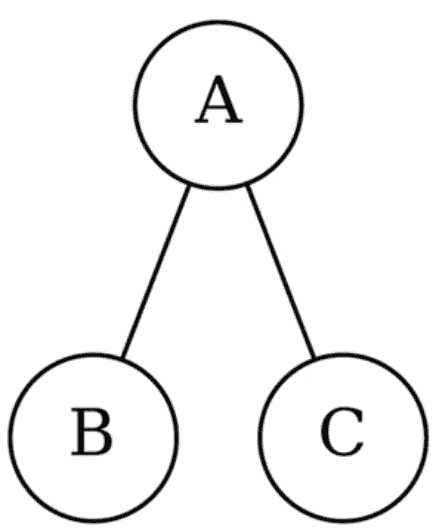

图 17.3 二叉树。

在图 17.3 中，与图 17.1 所示的前驱-后继关系不同，我们现在可以描绘 A 的两个后继，其中 A 被称为根节点。我们将这些对象称为顶点，将连接它们的线称为边。在所谓的二叉树中，根顶点最多有两个后继。图 17.4(a) 显示了包含一个子树的二叉树。

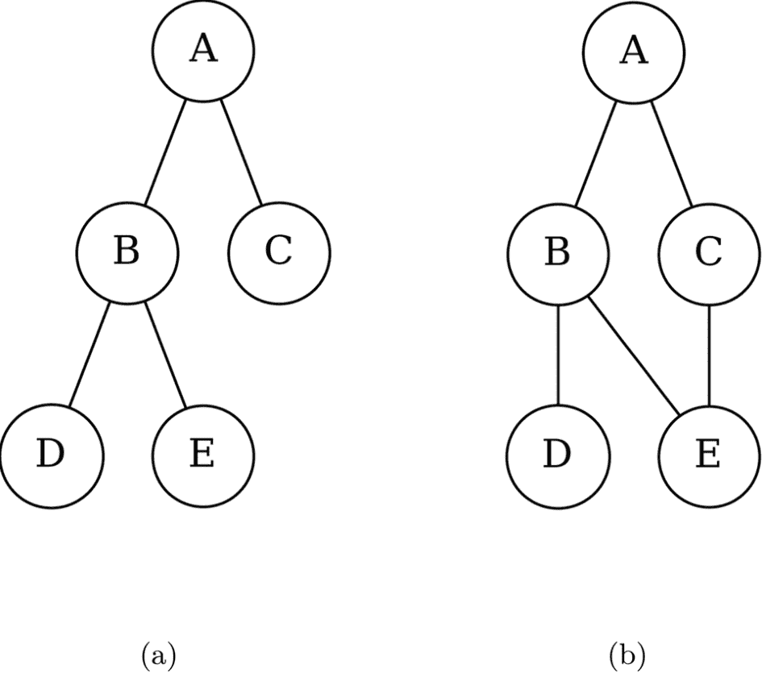

图 17.4 (a) 二叉树。(b) 图。

*二叉树*，每个根节点最多有两个子节点，特别适用于用于高效搜索和排序数据的*决策树*和*分治*算法。

如果顶点以存在环的方式连接，那么从技术上讲我们拥有一个*图*，如图 17.4(b) 所示。树和图需要不同的处理算法。

树是图的一种。如果满足以下条件，图可以是树：

- 边是有向的。
- 不存在环。
- 所有顶点都有通往根顶点的路径。

¹我们通常将树的元素称为_节点_，将图的元素称为_顶点_。

两棵树和/或图可能是：

- 相等：结构、数据和顺序相同。
- 相同：结构可能不同，但数据和顺序相同。相同结构可能相等，也可能不相等。
- 同构：结构具有相同的形式或形状。数据可能相同，也可能不同。

在此处，_结构_一词指节点之间的关系，如其通过边的连接所示。就此而言，相同的图可以看起来不同。

如果存在一个函数，将一个图的节点映射到另一个图的节点，使得每个节点的连接集保持相同，则称这两个图为同构。

例如，图 17.5 中的图彼此都是同构的。

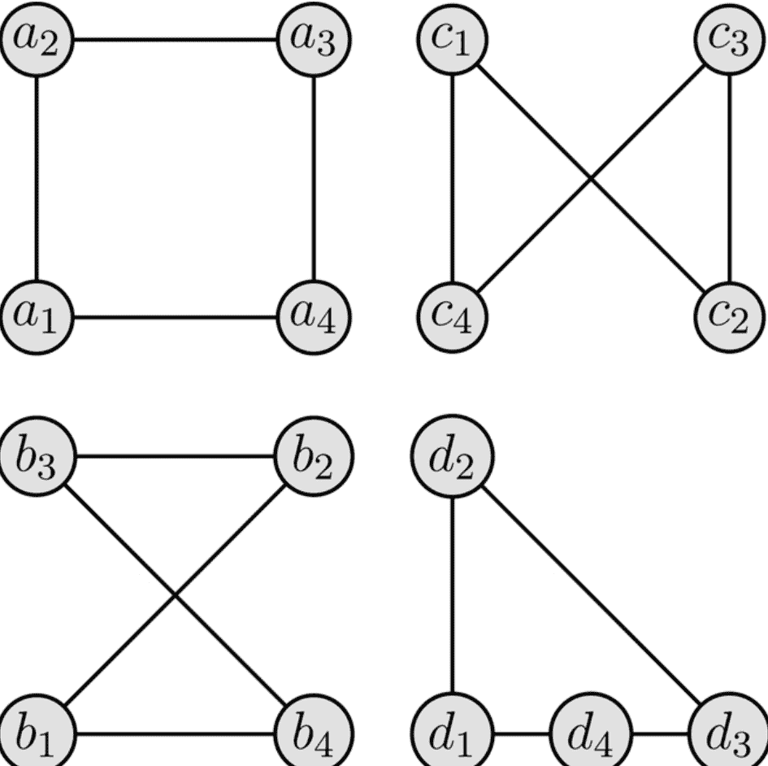

图 17.5 同构图。

## 17.2 树

树是一种具有层级顺序的数据结构。与链表不同，链表中一个节点前面有一个节点、后面有一个节点，树中的一个节点可能位于层级的某个层次，拥有多个子树。因此，节点之间的关系是非线性或间接的。

树很有用，因为它们帮助我们建模现实世界中的层级关系，例如组织结构、文件系统、文档大纲、决策树、表达式树、语法树等。

从树的根节点到任何叶节点的路径是唯一的，如文件系统图 17.6 所示。路径的长度是连接边的数量。

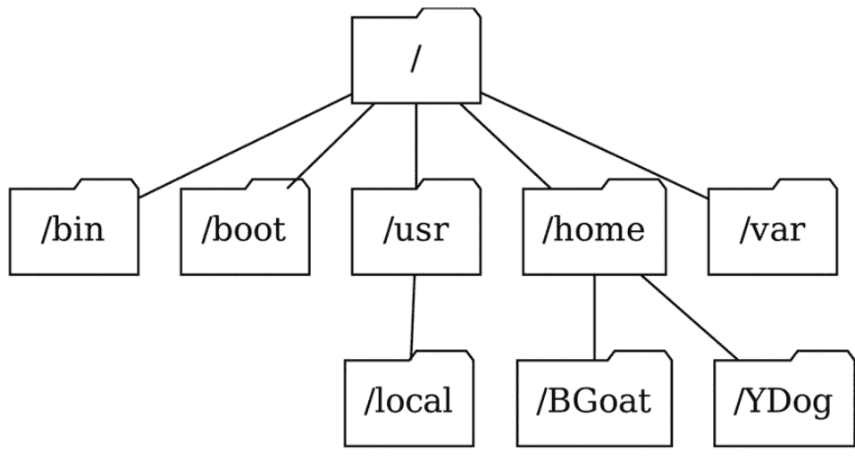

图 17.6 文件系统。

### 17.2.1 树的计算

满二叉树是一种二叉树，其中每个节点要么有零个子节点，要么有两个子节点，叶节点除外，叶节点没有子节点。

满二叉树的节点数 \(n\) 取决于其高度 \(h\)。即：

\(n = 2^h - 1\)

已知 \(n\)，我们可以求解上述方程得到 \(h\)。步骤如下：

\(n + 1 = 2^h - 1 + 1\)（两边同时加 1。）
\(h = \log_2(n + 1)\)（根据对数定义。）

或者，使用换底公式：

\(h = \log_{10}(n + 1) / \log_{10}2\)

满二叉树的叶节点数也可以从 \(n\) 计算得出，例如：

\(leaves = (n + 1) / 2\)

完全二叉树很有用，因为其元素可以映射到数组或列表的简单索引中，形成连续序列。完全二叉树在所有层级上都是满的，底层除外，底层应从左到右填充。这种树的列表表示可能被称为扁平化树。

搜索扁平化二叉树相当于对索引序列 0 1 2 3 .... 进行简单的线性搜索。给定二叉树的层序索引，如图 17.7(a) 所示，广度优先搜索等同于扁平化树的线性搜索。


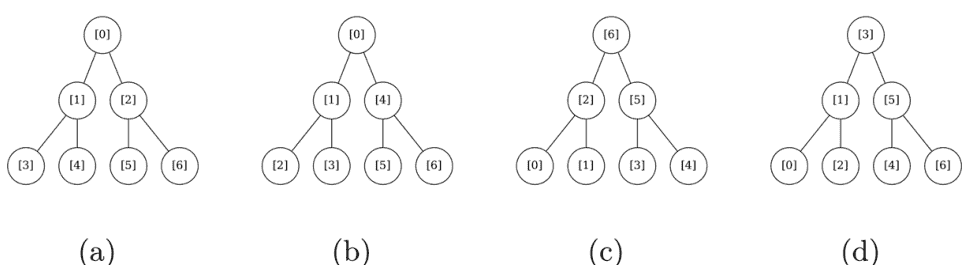

图 17.7 二叉树遍历：(a) 层序，(b) 前序，(c) 后序，(d) 中序。

使用列表表示完全二叉树时，常用以下索引方式，根节点位于树的顶部，与层序索引一致：

- 节点 i 的父节点：$(i - 1)/2$。
- i 节点的左子节点：$2i + 1$。
- i 节点的右子节点：$2i + 2$。

该索引在六节点二叉树中的示例如表 17.1 所示。

### 表 17.1 完全二叉树列表映射

表 17.1 摘要

| 索引 | 节点 | 索引 |
|---|---|---|
| 0 | 根 | 0 |
| 1 | 左 | $2i + 1$ |
| 2 | 右 | $2i + 2$ |
| 3 | 左 | $2i + 1$ |
| 4 | 右 | $2i + 2$ |
| 5 | 左 | 2i + 1 |
| 6 | 右 | 2i + 2 |

### 17.2.2 二叉树遍历模式

树遍历可以采用多种方法，即 *层序*、*中序*、*前序* 和 *后序*。这些遍历模式如图 17.7 所示。

- 层序：从根节点 [0] 开始，在下降到下一层之前，先访问每一层从左到右的所有节点。
- 中序：从最左侧节点 [0] 开始，访问顺序为 左 → 根 → 右。
- 前序：从根节点 [0] 开始，访问顺序为 根 → 左 → 右。
- 后序：从根节点 [0] 开始，访问顺序为 左 → 右 → 根。

树的广度优先搜索涉及层序遍历，从根节点开始，从左到右访问每一层的所有节点，然后再下降到下一层。

树的深度优先搜索涉及前序遍历，从树根开始，尽可能先遍历最左分支，然后再移动到下一个（右侧）分支和子树。深度优先的其他形式还有中序遍历（先遍历左子树，然后是根节点，最后是右子树）和后序遍历（先遍历左子树和右子树，最后访问根节点）。

### 17.2.3 解析树求值

一种二叉树是 *解析树*，用于建模和求解算术运算的二元操作，也用于在中缀、前缀和后缀表示法之间进行转换。解析树也可称为 *语法树*。²

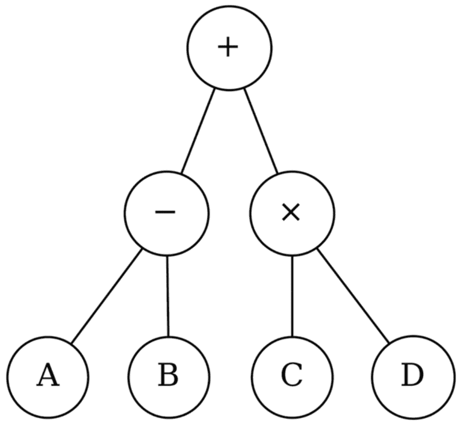

图 17.8 (A - B) + (C × D) 的解析树。

在解析树内部，我们有子树，每个子树代表一个算术运算符及其两个操作数的表达式。

表达式中的每个运算符都是一个两节点子树的根。对于中缀、前缀和后缀表达式，结构相同。

²我们在可计算性章节中也提到了解析树。

为了帮助可视化完整表达式 (A - B) + (C × D) 的各个操作，让我们用符号 I 和 II 替换每个子表达式。

I = (A - B) 且 II = (C × D)

因此：

(A - B) + (C × D) = I + II

或者，在后缀中：

A B - C D × = II +

展示这些操作序列的树如图 17.9 所示。

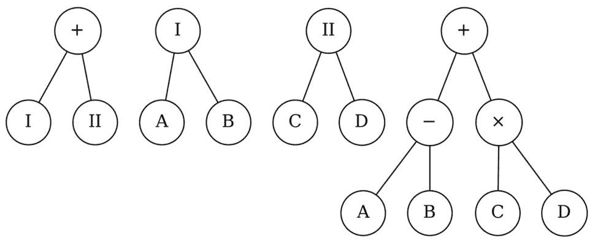

图 17.9 (A - B) + (C × D) 的解析树。

数学表达式树允许我们生成计算以及转换为其他表示法，例如前缀、中缀等。表达式树的求值通常涉及深度优先（中序、前序或后序）或广度优先（层序）类型的树遍历算法。

这里我们将讨论深度优先遍历，因为它们非常适合基于栈的求值和子树的递归处理。

前序遍历通过访问根、然后左子树、最后右子树（均采用前序）来生成前缀表达式。

后序遍历通过访问左子树、然后右子树、最后根（均采用后序）来生成后缀表达式。

中序遍历通过访问左子树、然后根、最后右子树（均采用中序）来生成中缀表达式。

给定层序索引，可以使用后缀代码来求值语法树或解析树，例如图 17.9 所示。

可按以下步骤开发用于求值层序表达式树的算法：

- 为节点建立索引，如层序排列所做的（图 17.10 中的 LR 列）。
- 根据索引，将每个关联的节点值压入栈中。
- 求值栈上的每个后缀操作，并将每个结果旋转到栈底。

| 初始 | 第1次操作 | 第2次操作 | 最终 |
|---|---|---|---|
| × | − | + | 6 |
| 4 | 3 | 8 | |
| 2 | 1 | −2 | |
| − | + | | |
| 3 | 8 | | |
| 1 | | | |
| + | | | |

图 17.10 按层序在栈上求值二叉树。（结果旋转到栈底。）⇨

该特定算法的步骤在图 17.10 中演示。

```
{ + ' 13 -' 24 × ' } ls LIST
```

为了对图 17.10 中的操作进行编码，我们首先定义列表 ls 为：

```
ls
{ GSC 2 / i- } opcount WORD
```

请注意，列表 ls 仅仅是图 17.9 中解析树的操作和操作数的扁平化序列，对应图 17.10 的左列。

对于二进制解析树，运算符计数定义为：

opcount = n/2 − 1

列表 ls 的运算符计数相关代码为：

```
ls
{ GSC 2 / i- } opcount WORD
```

其中 GSC 给出栈计数或栈上的对象数量。

确立这些参数后，我们可以使用函数 EXEC 和 >> 对列表 ls 中的每个操作重复求值列表序列 ls。

例如：

```
ls { EXEC >> } opcount LREPEAT ( → 6)
```

因此，后缀表达式 “+ 1 3 - 2 4 ×” 的结果是 6。

EXEC 执行栈顶的任何操作。>> 将栈顶的任何数据旋转到栈底。LREPEAT 操作根据运算符计数变量重复 { } 花括号内的操作。

### 17.2.4 二叉搜索树

一个 *二叉搜索树* 是展平为有序列表的树。回顾 *线性结构* 章节，有序列表的元素按升序或降序排列。当二叉树平衡时，该结构支持二分查找的 O(log n) 时间效率。*平衡二叉树* 是指任何节点的左子树和右子树高度差不超过 1 的二叉树。

请注意图 17.11 中的子树模式，其中根节点的值大于左分支且小于右分支。插入新元素首先需要将其值与根节点的值进行比较。如果小于根节点，则元素指向左分支。否则，元素指向右分支。如果适用的分支已被占用，则重复比较过程。以这种方式插入元素可有效地对树进行排序。


图 17.11 二叉搜索树：(a) 插入前 (b) 插入新元素“11”后。

如果树是平衡的，那么每次根节点比较只需遍历树的一个分支，从而实现 O(log n) 的效率。否则，如果树不平衡，时间复杂度为 O(n)。如果树完全平衡，所有内部节点都有两个子节点且所有叶节点位于同一层，则遍历被视为相对高效的 O(log2 n) 操作。

n 节点的最高子树具有类似线性列表的 O(n) 效率。相反，n 节点的最短子树是满树且效率最高，具有 O(log n)。

将二叉搜索树转换为有序列表，需对树执行中序遍历，如图 17.7(d) 所示。遍历期间，获取每个节点的值并将其追加到有序列表中。生成的列表将按升序排列。如需将顺序反转为降序，只需反转索引即可。

将有序列表转换为二叉搜索树，从有序列表索引 0 处的元素开始，将每个元素插入树中，如上面讨论的二叉搜索树插入方法。

例如，图 17.12 中的升序有序列表对应图 17.11(a) 中的二叉搜索树。


图 17.12 数字的有序列表（升序）。

以下 epop 代码在列表 lt 中搜索值 7。该列表对应二叉搜索树，例如图 17.11(a) 所示的树。基于层序遍历，例如图 17.7(a) 所示的遍历，结果在索引 3 处找到。


```
{ 0:8 1:5 2:2 3:7 4:9 } lt LIST ( level-order index:value pairs)
lt ( invoke the list before processing the list)
GSC { #: SPLIT 7 EQ >R DROP ?? } LREPEAT
R>. ( → 3)
```

### 17.2.5 树术语表

- 根节点：最顶层或第一个节点。可能被称为第 0 层或第 1 层。
- 节点：树的一个元素。可以是根节点、子节点或叶节点。
- 边：连接两个节点的线。
- 叶节点：没有子节点的节点。
- 层级（高度）：沿树中最长路径的节点数量。
- 子树：较大树中的一棵树。具有自己的根节点。
- 平衡二叉树：任何节点的右子树和左子树的高度差不超过 1 的树。
- 满二叉树：每个节点要么有两个分支，要么没有分支。
- 完全二叉树：在所有树层级中，最底层可能除外，所有节点都有两个子节点。

## 17.3 图

图是由不同的 *顶点*（节点）组成的集合，这些顶点可能相连，也可能不相连。树是图，但图不一定是树，因为顶点之间可能存在循环路径。

每个顶点可能关联一个标签和其他数据，包括邻接连接的数量，即其 *度数*。如果两个顶点通过 *边* 连接，则它们是邻居。

一般来说，顶点可能包含以下记录：

- 标签或名称。
- 度数。
- 邻居及其各自边的权重记录。
- 遍历或访问次数。

图可以通过邻接矩阵和邻接列表表示，而这些又可以由列表、数组或表构建。

从符号上讲，顶点集合 V 和边集合 E 构成图 G，即 G(V, E)。V 中的顶点表示为 $v_i$，E 中的边表示为 $e_i$。

如果一条边连接两个顶点，则我们将这些顶点表示为相邻或 *邻居*。这样的对可能被称为边 $e_1$ 的 *端点*，$v_1$ 和 $v_2$，并可以表示为：

$e_1 = \{v_1, v_2\}$

### 17.3.1 图的计算

图中每个顶点都有若干条连接边，这被称为顶点的 *度数*。例如，特定顶点 1 的度数可表示为 $deg(v_1) = 2$。

图中总度数取决于边的总数，计算如下：

$2 \times edges$

\( n \) 个顶点的完全有向图中边的总数计算如下：

\( n \times (n - 1) \)

\( n \) 个顶点的完全无向图中边的总数计算如下：

\( n \times \frac{(n - 1)}{2} \)

如果图中大多数顶点通过边与其他顶点相连，则该图被称为 *稠密*。图的最大密度为 1，即 100%，最小密度为 0，表示 *孤立图*。图密度的计算如下：

\( \frac{2 \times \text{number of edges}}{n \times (n - 1)} \)

图中任意两个顶点之间的距离是它们中间边的总和。边又可以按距离、成本、统计系数等进行加权。

### 17.3.2 图作为关系

图中的关系完全相对于顶点与其他顶点的连接。对于非树图，图中不存在像高度这样的垂直属性。因此，顶点之间的方向边对于任何顺序或层级都是必要的。例如，当对象 B 源自对象 A，或 A 大于 B 等时，我们可以说对象 A 和 B 之间存在关系。

### 图关系属性：

- 自反性：每个顶点都有一个自环（从自身指向自身的边）。
- 对称性：每条边都是双向的。
- 反对称性：每条边都是单向的。
- 传递性：顶点 A 和 B 之间，以及顶点 B 和 C 之间的路径，表明顶点 A 和 C 之间存在路径。


图 17.13 两个对象的关系：B 依赖于 A。B 指向 A。

假设 B 和 C 都源自 A。

该关系 R 可以用集合形式表示，其中：

```
R = { (b, a) (c, a) }
```

... 对于元素集合 S，其中：

```
S = { a b c }
```

我们可以有自环，即顶点指向自身。如果图 17.14 中的顶点 C 有自环，那么存在配对关系集 (c, c)。当图中所有顶点都有自环时，则该图称为自反图，如图 17.15 所示。


图 17.14 对象的关系。


图 17.15 自反关系。

图 17.15 中的自反关系以集合形式表示如下：

```
R = { (b, a) (c, a) (a, a) (b, b) (c, c) }
```

### 17.3.3 量化无向图

考虑图 17.16 中新英格兰各州的图。对于相互相邻的州，顶点之间相连。该图是连通的，但无向。


图 17.16 表示新英格兰各州边界关系的无向图。

请注意，有些顶点不相邻。因此，它不是完全图。相比之下，图 17.17 显示了一个完全图的示例。每个顶点都连接到其他每个顶点。


图 17.17 完全图。

对于图 17.17 中的完全无向图，边数计算如下，n = 6：

```
\frac{n \times (n - 1)}{2} = \frac{6 \times (5)}{2} = 15
```

假设一个完全无向图实际上有六个顶点，且每对顶点之间有两条边，则边数计算如下：

```
n \times (n - 1) = 6(5) = 30
```

如图 17.17 所示，有六个顶点，每个顶点五个度数，总共 15 条边。该图的密度计算如下：

```
\frac{2 \times number of edges}{n \times (n - 1)} = \frac{2 \times 15}{6 \times (6 - 1)} = 1, \text{or } 100\%.
```

### 17.3.4 图作为邻接矩阵

我们可以构建一个邻接矩阵来显示哪些顶点是相邻的。矩阵中的交点对于无权图可以赋值为 0 或 1（真或假），或者可以是某些加权值，例如英里距离、相关系数等。

如果图是有向图，则只有当存在指向该顶点的方向时，才输入值 1。否则该项为 0。

除非存在自环，否则邻接矩阵的对角线应全为 0。如果图是无向图，则可以仅用对角线的一侧来表示图。

考虑图 17.2 中的邻接矩阵，它表示图 17.18。请注意，边 (B, C) 的项为 0 而边 (C, B) 的项为 1。这是因为顶点 B 与顶点 C 相邻，但顶点 C 不与顶点 B 相邻。

### 表 17.2 邻接矩阵

| | A | B | C | D | E | F | G |
|---|---|---|---|---|---|---|---|
| A | 0 | 1 | 0 | 1 | 0 | 1 | 0 |
| B | 0 | 1 | 0 | 0 | 0 | 0 | 0 |
| C | 0 | 1 | 0 | 0 | 0 | 0 | 0 |
| D | 0 | 0 | 0 | 0 | 1 | 1 | 0 |
| E | 0 | 0 | 0 | 0 | 0 | 1 | 1 |
| F | 0 | 0 | 0 | 0 | 0 | 0 | 1 |
| G | 0 | 0 | 0 | 0 | 0 | 0 | 0 |


图 17.18 一个不完全的有向图。

### 17.3.5 图作为邻接列表

邻接列表是二维邻接矩阵的线性替代方案。邻接列表仅包含相邻的顶点对。它实际上是一个 *列表的列表*。排除非相邻顶点可以节省系统资源，如内存和磁盘空间。这对于存储大型稀疏图更为可取。

图 17.18 中图的顶点对邻接列表可以用如下列表表示：

```
{ A:B A:D A:F B:B C:B D:E D:F E:F E:G F:G } al LIST
```

或者，可以定义一个更明确的列表的列表，由每个顶点的邻接子列表组成，例如：

{{ B D F } A LIST { B } B LIST { B } C LIST { E F } D LIST\ { F G } E LIST { G } F LIST } al LIST

邻接表的这种表示可以很好地映射到矩阵，并可以类似地表示为：

```
{ \ { B D F } A LIST \ { B } B LIST \ { B } C LIST \ { E F } D LIST \ { F G } E LIST \ { G } F LIST \ } al LIST
```

调用 al 会生成子列表的实例。

邻接表的权重可以在单独的并行列表中给出，如下所示：

```
{ A:B A:D A:F B:E C:B D:E D:F E:F E:G F:G } al LIST
```

```
{ 0.52 0.60 0.11 0.40 0.65 0.41 0.55 0.75 0.63 0.21 } alweights LIST
```

或者，每个子列表的邻居可以与其各自的权重配对，例如：

```
{\
{ B:0.52 D:0.60 F:0.11 } A LIST \\
{ E:0.40 } B LIST \\
{ B:0.65 } C LIST \\
{ E:0.41 F:0.55 } D LIST \\
{ F:0.75 G:0.63 } E LIST \\
{ G:0.21 } F LIST \\
} alLIST
```

对于图 17.17 中的完全无向图，每个顶点的邻接表只需为不同的连接定义。例如，带有各自邻接表的顶点定义如下，显示为图 G：

```
{\
{ b c d e f } a LIST \\
{ c d e f } b LIST \\
{ d e f } c LIST \\
{ e f } d LIST \\
{ f } e LIST \\
} G LIST
```

### 17.3.6 图遍历

图遍历的起点或源可以是任何顶点。遍历顶点不需要访问其数据。也就是说，在遍历期间不需要访问该顶点。只有连通的顶点才能被遍历。

图遍历的一般方法是深度优先搜索和广度优先搜索。注意关键术语，深度 - 在移动到下一个邻居之前，穷举访问每个邻居的第一个邻居，以及 *广度* - 依次穷举访问每个邻居。

因为图不一定像树那样具有层级，并且可能包含循环，所以层序遍历通常不适用。然而，如果图没有循环，以至于实际上是一棵树，那么广度优先搜索将对应于层序遍历，而深度优先搜索将对应于先序遍历。

深度优先算法从源的一个邻居开始，然后进入该邻居的一个邻居，依此类推，尽可能远离源地推进。通常使用堆栈数据结构，确保每条邻居路径都以逆序遍历以返回源。

深度优先搜索的一般算法：

- 1. 选择一个源顶点。
- 2. 创建一个邻接堆栈列表（一个子列表列表）。
- 3. 将第一个相邻顶点的值与搜索值进行比较。
- 4. 移动到该邻居的第一个相邻邻居，依此类推。
- 5. 当深度耗尽时，回溯到源，如果使用堆栈，则依次弹出堆栈。
- 6. 用下一个邻居，然后是下一个邻居的邻居等，重复步骤 3 至 5。

作为深度优先搜索的一个变体，请考虑一个以列表的列表形式给出的图，其中每个列表包含一个值和一个相邻顶点列表（由“:”分隔）。

```
{ 2 b:d:f } a LIST
{ 4 e } b LIST
{ 9 b } c LIST
{ 8 e:f } d LIST
{ 1 c:f } e LIST
{ 3 c:d:e } f LIST

{ a b c d e f } graph LIST
```

要搜索图，例如搜索值 9，首先调用 _图_ 列表。在调用每个子列表时，评估子列表的每个元素，类似于 _线性搜索_ 中所做的那样。

调用子列表允许我们评估其组件顶点。例如：

```
a → 2 b:d:f
b → 4 e
e → 1 c:f
c → 9 ... a match in 4 iterations.
```

与深度优先方法不同，广度优先算法在进入第一个邻居的邻居集、然后是第二个邻居的邻居等之前，会遍历顶点的每个邻居。广度优先算法通常使用队列数据结构，以确保没有邻居被遍历多次。

广度优先搜索的一般算法：

- 1. 选择一个源顶点。
- 2. 创建一个相邻顶点列表。
- 3. 对每个邻居顶点，将其值与搜索值进行比较。
- 4. 移动到下一个邻居的邻居。
- 5. 重复步骤 3 和 4。

使用上述相同的图和值 9 作为目标，通过调用图列表，然后调用每个顶点子列表来启动广度优先搜索，而不访问顶点中的邻居。

```
a -> 2 b:d:f
b -> 4 e
d -> 8 e:f
f -> 3 c:d:e
e -> 1 c:f
c -> 9 ... a match in 6 iterations.
```

### 17.3.7 图路径

图理论包括计算任何两个顶点之间最短路径的一类问题。这涉及计算任何两个终端顶点之间所有相邻顶点的累积权重。最短路径问题的解是具有最小累积距离的路径。为避免无限循环，图遍历必须通过不重新访问顶点来避免循环。3

计算路径长度有多种复杂算法。有些被认为是暴力方法，因为它们计算所有顶点对之间的最短路径。此类暴力算法通常具有 O(n^3) 效率。一个例子是全对或 Floyd-Warshall 算法。然而，广度优先搜索的一个变体是 *Dijkstra 最短路径* 算法，其效率为 $O(n^2)$。

### 17.3.8 计算距离

计算距离时，顶点对象无需包含边的数据。相反，可以从顶点坐标中获取距离度量，前提是图被映射到 N 维空间。在此上下文中，维度类似于因子。

考虑在二维 X-Y 平面内分析两个因子。任何两个元素对 (*a*, *b*) 之间的欧氏距离计算如下：

$$distance(a, b) = \sqrt{(a_1 - a_2)^2 + (b_1 - b_2)^2}$$

图 17.19 是该距离的可视化。


图 17.19 欧氏距离。

³数据科学中的一个相关主题是基于图的聚类分析，它考虑顶点对之间的距离，或顶点与某些预定义边界之间的距离，以确定顶点的各种分组。

当点位于坐标系的不同象限时，该公式仍然适用，例如当 \(a_i\) 和/或 \(b_i\) 为负数时。

例如，求 \((-1, 5)\) 和 \((-10, 11)\) 之间的距离：

```
distance(a, b) = \sqrt{(-21 - 10)^2 + (5 - -11)^2}
= \sqrt{(-12)^2 + (16)^2}
= \sqrt{144 + 256}
= 20 units
```

考虑一维数轴上的点，范围从负到正。点 \(a_1\) 和 \(a_2\) 之间的距离为：

```
d(a_1, a_2) = |a_1 - a_2| = \sqrt{(a_1 - a_2)^2}
```

假设有一个负点 \(a_1 = -5\) 和一个正点 \(a_2 = 7\)。计算这些点之间的距离，例如：

```
d(-5, 7) = | - 5 - 7| = \sqrt{(-5 - 7)^2} = \sqrt{(-12)^2} = \sqrt{144} = 12
```

类似的模式也适用于在更高维度中查找距离。对于 3 维中的两个点 \((a_1, b_1, c_1)\) 和 \((a_2, b_2, c_2)\)，它们之间的距离为：

```
distance(a, b) = \sqrt{(a_1 - b_1)^2 + (a_2 - b_2)^2 + (c_1 - c_2)^2}
```

鉴于两个对 \((a_1, b_1)\) 和 \((a_n, b_n)\) 之间的路径是间接的且仅通过中间对 \((a_2, b_2) ...\) 存在，累积距离计算如下：

\( cumdistance(a, b) = \sum_{i=1}^{n} \sqrt{(a_i - a_{i+1})^2 + (b_i - b_{i+1})^2} \)

该公式的迭代阐述如下：

\((a_1, b_1)\) 和 \((a_2, b_2)\) 之间的距离：

\( i = 1 : \sqrt{(a_1 - a_2)^2 + (b_1 - b_2)^2} \)

\((a_2, b_2)\) 和 \((a_3, b_3)\) 之间的距离：

\( i = 2 : \sqrt{(a_2 - a_3)^2 + (b_2 - b_3)^2} \)

\(\vdots\)

第 \(n^{th}\) 个点与第 \(n^{th}\) 个点之前的点之间的距离：

\( i = n - 1 : \sqrt{(a_{n-1} - a_n)^n + (b_{n-1} - b_n)^2} \)

> 为了自动化原本繁琐的图处理，我们可以定义一个带有 xy 坐标的邻接表，并使用堆栈执行操作。这是附录 C.14 和 C.15 中 epop 代码的基础，用于计算两点之间的距离。

### 17.3.9 生成图对象

在支持面向对象编程的编程语言中，可以通过根据其关系的权重链接顶点对象来构建图。为此，首先声明顶点对象，例如 \(a\)、\(b\) 和 \(c$，其各自的值，例如 3、7 和 5，如下所示。


a 3 对象
b 7 对象
c 5 对象

接下来，按公共边权重链接对象对。例如，假设存在以下连接顶点 a、b 和 c 的边权重：

```
a - 0.52 - b
b - 0.65 - c
```

假设顶点对象及其关联权重已位于数据堆栈中，序列为 a b 0.52 和 a c 0.65，则可以通过为每对调用 LINK 字来链接这些顶点，例如：

```
b.o c.o 0.65 LINK ( → b.o)
a.o b.o 0.52 LINK ( → a.o)
```

这些链接指令的结果创建了一个根顶点对象 a，它在内部引用顶点对象 b，而 b 本身又在内部引用顶点对象 c。每个嵌套对象都是其包含对象的邻居。

根顶点中嵌套对象系列可以被提取以揭示组件值，例如：

```
a EXTRACT → a 3 b 7 0.52 c 5 0.65
```

对象可以被遍历，并根据搜索或最短路径计算的需要提取其邻居和数据。

使用对象编程的另一个原因是保护函数数据。当我们定义多个具有类似功能的复杂字时，这种动机会更加清晰，因为这样会为意外副作用敞开大门。当操作涉及复杂的数据结构嵌套时，情况会更加复杂，使得资源冲突更可能发生。例如，可能有多个操作同时争夺使用单个数据堆栈。在这种情况下，最好将数据隔离和保护，这可以通过定义包含自身数据的对象来实现。

### 17.3.10 图术语表

- 边：两个不同顶点之间的连接。
- 子图：存在于图中的图。给定 G = G(V, E)，子图可表示为 H = H(V', E')。
- 有向图：其中边强制执行遍历方向的图。
- 连通图：由任意两个顶点之间的路径定义。
- 完全图：每对不同顶点之间都存在边的图。
- 有向完全图：每对顶点由两条有向边连接，方向相反。
- 强连通：当有向图中从每个顶点到每个其他顶点都有路径时。
- 加权图：边具有以权重、成本、距离等为数值的属性。
- 顶点度数：与顶点关联的边的数量。顶点 1 的度数可表示为 deg(v1) = 2。
- 入度和出度：涉及有向图中的度数。
- 孤立顶点：没有关联度数（没有关联边）。
- 正则图：每个顶点都有相同度数的图。
- 路径：从起始顶点到目标顶点的连接顶点序列。
- 距离：路径中所有中间边的值之和。
- 环图：当图中的路径返回到图内的某个顶点时，存在一个环。
- 无环图：没有环的图。
- 多重图：当多条边连接图中的同一对顶点时。并非所有顶点都需要连接。
- 欧拉图（路径）：通过有限图且每条边恰好遍历一次的路径。
- 欧拉回路：起点和终点相同的欧拉路径。
- 环：当边将一个顶点连回自身时（自引用）。单个顶点上的多个环可以使图成为多重图。
- 稀疏图：图中大多数顶点未连接。
- 稠密图：图中大多数顶点已连接。

## 树练习

- 1. 使用解析树将以下表达式从中缀转换为后缀。确保显示树的每一层。

  - (a) \( 8 \times \frac{1}{10} \)

  - (b) \( 5 \times 3^2 - 1 \)

- 2. 编写打印中缀表达式后缀形式的伪代码。

- 3. 编写打印中缀表达式解析树的伪代码。

- 4. 编写打印后缀表达式解析树的伪代码。

- 5. 编写打印前缀表达式解析树的伪代码。

- 6. 计算高度为 3 的满二叉树的叶子节点数。

- 7. 计算高度为 3 的满二叉树的节点总数。

- 8. 计算高度为 3 的满二叉树的内部（非叶子）节点数。

- 9. 描述树的广度优先搜索。

- 10. 描述树的深度优先搜索。

- 11. 确定并解释以下字 W 中嵌套 `{ }` 作用域的深度：

```
`{ { x { y { z } K WORD } Y WORD } X WORD } W WORD`
```

- 12. 确定并解释以下字 W 中 `{ }` 作用域序列的宽度：

```
`{ { a } A WORD { b } B WORD { c } C WORD } W WORD`
```

## 图练习

- 1. 比较图的广度优先搜索（BFS）与深度优先搜索（DFS）。解释它们的工作原理，以及如何使用其中一种来测量图中路径的距离。

- 2. 编写算法，根据顶点和边的初始列表构建简单连通图。

- 3. 编写函数以验证图是否为正则图。

- 4. 编写算法生成两个无向图 G1 和 G2，每个图都有从 A 到 Z 的顶点，并且顶点随机连接（一对顶点之间不超过一条连接）。连接权重应为 1 到 10 之间的随机整数。

- 5. 对于之前生成的图 G1 和 G2，确定 G1 和 G2 是否相等、相同和/或同构。

- 6. 编写函数从顶点对列表生成邻接矩阵。

- 7. 编写函数以确定图是有向还是无向。

- 8. 设计函数以确定图是否严格是一棵树。

- 9. 考虑一个所有顶点最多有一个邻居的图。解释广度优先搜索的结果将如何与深度优先搜索的结果进行比较。

- 10. 编写名为 graph_density 的函数，以图中所有顶点的列表作为输入，并确定图是稠密还是稀疏。

- 11. 编写名为 graph_density 的函数，以邻接矩阵作为输入，并确定图是稠密还是稀疏。

- 12. 编写名为 adjacency_matrix 的函数，以邻接列表作为输入，并使用其数据生成邻接矩阵。

- 13. 编写名为 adjacency_list 的函数，以邻接矩阵作为输入，并使用其数据生成邻接列表。

- 14. 给定连通图中任意两个随机顶点，编写算法以最少边数计算它们之间的最短路径。

- 15. 欧拉理论，欧拉图存在当且仅当每个顶点的度数均为偶数。编写算法来证明欧拉是否正确。

## VI

## 数据分析

## 计数：排列与组合

DOI: 10.1201/9781032687759-18

### 摘要

计数数学在数据科学中对于信息离散组件的组织和分析至关重要。对于确定各种场景下总可能结果的任务，计数被认为是统计学和概率学研究的基础。

与数据科学相关的计数应用包括：在系统设计中选择点之间的最佳路径。使用各种数据结构最小化算法复杂度。对编码和解码的符号进行分析。以及在高维数据中最小化主成分组合。

计算系统中元素可能组合数量的过程称为组合分析，涉及排列和组合的数学原理。

## 18.1 基础计数

基础计数措施包括求和法则和乘法原理的技术。

#### 求和法则：

求和法则通常用于集合之间具有 OR 条件的问题。求和法则适用于不相交集的并集。求和法则表述为：

```
|A \cup B| = |A| + |B|
```

假设从两个集合 A 和 B 的元素中选择一个元素。那么有 |A| + |B| 种可能的选择。注意集合之间的互斥选择，即从一个集合或另一个集合中选择。

求和法则可以扩展到从两个以上的集合中选择一个元素。例如，假设我们有三个包含整数的不相交集合，其中集合 A 有 4 个元素，集合 B 有 2 个元素，集合 C 有 3 个元素。从这三个集合中选择任何一个元素的方法数为：

```
4 + 2 + 3 = 9
```


另一个示例：确定可以从集合 A 或集合 B 中选出的 *非负* 整数的个数。

集合 A：- 10 < a < 10
集合 B：15 < b < 30

在集合 A 中，小于 10 的非负整数有 10 个（包括 0）。在集合 B 中，15 到 30 之间的非负整数有 14 个。因此，可以从集合 A 或集合 B 中选出的非负整数共有 10 + 14 或 24 个。

## *乘法原则：*

乘法原则允许我们计算完成多步过程的方法数，其中 A 和 B 表示各个步骤。

乘法原则表述为：

| A 和 B | = | A | · | B |

同样，已知从一个集合中选取元素有 n 种方法，接着从另一个集合中选取元素有 m 种方法，那么从每个集合中各选取一个元素（总共选取两个元素）的方法数为 n × m 种。

乘法原则可以扩展到从两个以上的集合中各选取一个元素。例如，假设我们有三个集合，每个集合都包含整数。集合 A 有 4 个元素，集合 B 有 2 个元素，集合 C 有 3 个元素。从每个集合中各选取一个元素的方法数为：

\( 4 \times 2 \times 3 = 24 \)

另一个示例：已知集合 A 中有 5 个元素，集合 B 中有 4 个元素，集合 C 中有 3 个元素，可以选出的元素对（来自不同集合的两个元素）的可能数量为：

\( (5 \times 4) + (5 \times 3) + (4 \times 3) = 47 \)

## 18.2 阶乘

一个 *阶乘* 是一种特殊乘法表达式的缩写形式。整数 n 的阶乘定义为：

\( n! = n(n - 1)(n - 2) \ldots (1) \)

例如：

\( 5! = 5 \cdot 4 \cdot 3 \cdot 2 \cdot 1 \)

请注意，\( n! = n(n - 1)! = n(n - 1)(n - 2)! \)，以此类推。因此，\( 5! \) 可以写为 \( 5 \cdot 4! \) 或 \( 5 \cdot 4 \cdot 3! \)，例如。还请注意，\( 0! \) 定义为 1。

阶乘在计算排列和组合时非常有用，我们很快就会看到。

阶乘公式在 *epop* 代码中实现，如附录 C.8 所示。

1 请注意，! 符号在不同编程语言中具有不同的用途。在 *epop* 中，! 符号（两侧带有空格）用于给变量赋值。在 C、Java 等语言中，! 是布尔取反运算符。

## 18.3 排列

一个 *排列* 是将一组 n 个元素按一定顺序排列的方式。集合子集的排列称为 *r-排列*。子集元素的数量 *r* 将小于或等于超集元素的数量 *n*，即 *r ≤ n*。（超集是包含子集所有元素的集合。）

考虑输入 ABC。以下是按不同方式取出的所有排列：

- *一次全部*：ABC, ACB, BAC, BCA, CBA, CAB

- *每次两个*：AB, AC, BA, BC, CA, CB

- *每次一个*：A, B, C（这些与原始输入相同。）

如果我们从四个输入 ABCD 开始，那么 *一次全部* 将包含 24 个排列，包括：

ACDB, DCBA, BDCA, ...

我们也可以生成其子集的排列，*每次三个* 和 *每次两个*。

此类集合排列的数量，表示为 P(n, r) 或 nPr 或 P_{n,r}，计算公式为：

P(n, r) = \frac{n!}{(n - r)!}

因此，对于 ABC，三个字母的排列数为：

P(3, 3) = \frac{3!}{(3 - 3)!} = \frac{3 \times 2 \times 1}{1} = 6

两个字母的排列数为：

P(3, 2) = \frac{3!}{(3 - 2)!} = \frac{3 \times 2 \times 1}{1} = 6

一个字母的排列数为：

P(3, 1) = \frac{3!}{(3 - 1)!} = \frac{3 \times 2 \times 1}{2 \times 1} = 3

## 18.4 组合

假设我们有一个包含 5 个唯一元素的集合，并且想要找出包含 2 个元素的所有可能子集的总数。我们说我们要查找的是 5 个元素每次取 2 个的 *组合* 数量。

组合的符号可以表示为 C(n,r)、nCr 或 C_{n,r}。这些符号均读作 n 选 r。

nCr 公式在 epop 代码中实现，如附录 C.9 所示。

一般来说，从 n 个元素（r ≤ n）中可以选取的大小为 r 的子集数量为：

```
nCr = \frac{n!}{r!(n-r)!}
```

因此，对于 5C2 的计算是：

```
\frac{5!}{2!(5-2)!} = \frac{5!}{2! \cdot 3!} = \frac{5 \cdot 4 \cdot 3!}{2 \cdot 1 \cdot 3!} = \frac{5 \cdot 4}{2 \cdot 1} = 10
```

或：

```
\frac{5 \times 4 \times 3 \times 2 \times 1}{2 \times 1 \times 3 \times 2 \times 1} = \frac{120}{12} = 10
```

如果我们的设计目标忽略元素的优先级或顺序，那么我们计算的是组合，而不是排列。例如，对于两个不同的元素，我们可以简单地有 AB，而不是 AB 和 BA。对于一组三个不同的元素 A、B 和 C，我们可以有：

- *一次全部，顺序无关：ABC*

- *每次两个，顺序无关：AB, AC, BC*

要计算不同无序子集的数量：

\( nCr = \frac{n!}{r! \times (n-r)!} \)

因此，对于一次全部，ABC 的子集数量为：

\( ^3C_3 = \frac{3!}{3! \times (3-3)!} = 1 \)

对于每次两个，ABC 的子集数量为：

\( ^3C_2 = \frac{3!}{2! \times (3-2)!} = 3 \)

从更大的集合 ABCD 开始，每次选择三个，子集的数量为：

\( ^4C_3 = \frac{4!}{3! \times (4-3)!} = \frac{24}{6 \times 1} = 4 \)

这四个子集为：ABC ABD BCD CAD。

组合数 C(n, r) 通常小于排列数 P(n, r)，因为我们不计算可以对选定的 r 个元素进行排列的不同方式数量。

n 个元素每次选取 r 个的组合数与 n 个元素每次选取 r 个的排列数之间的关系如下：

C(n, r) = \frac{P(n, r)}{r!}

另外，

P(n, r) = r! \times C(n, r)

例如，输入 ABCD 每次取三个的排列数为：

P(4, 3) = 3! \cdot C(4, 3) = \frac{3! \times 4!}{3!(4 - 3)!} = \frac{144}{6 \times 1} = 24

C(4, 3) 是包含 3 个字母的子集数量，而 3! 是每个此类子集的不同排列数量。

## 18.5 多重集

多重集是包含重复元素的集合。例如：

ABBC

要计算多重集的排列（排列方式）数量，令：

- n = 元素总数，包括重复元素。
- n1 = 第一个元素的计数。
- n2 = 第二个不同元素的计数。
- :
- nr = 最后一个不同元素的计数。

则适用以下公式：

P(n : n_1, n_2, ... n_r) = \frac{n!}{n_1! \times n_2! \times n_3! ...}

例如，考虑一个接收到的信号被解码为 ASCII 字符序列 HALIFAX。此多重集的参数如下。

集合长度：n = 7

字母计数：

- H: n1 = 1
- A: n2 = 2
- L: n3 = 1
- I: n4 = 1
- F: n5 = 1
- X: n6 = 1

排列数为：

\frac{7!}{1! \times 2! \times 1! \times 1! \times 1! \times 1!} = \frac{5040}{2} = 2520

另一个示例：考虑一个字节的位恰好有三个 0 的可能方式数量。此 8 位字节多重集的参数如下。

集合长度：n = 8

状态计数：

- 0: n1 = 3
- 1: n2 = 5

排列数为：

\(\frac{8!}{3! \times 5!} = \frac{40320}{6 \times 120} = 56\)

另一个示例：一个 8 位字节的位有多少种可能方式使得 1 比 0 多？

如果 1 比 0 多，那么我们的位集包含五个、六个、七个或八个 1。因此，解是通过将四个多重集的排列相加得出的。

或者，我们可以将此视为组合问题，即选择固定数量的位置（位置的子集）来存放 1。从组合的角度来看，计算如下：

C(8, 8) + C(8, 7) + C(8, 6) + C(8, 5) = 1 + 8 + 28 + 56 = 93

## 练习

- 1. 8 位字节中有多少种可能的位模式序列？请解释。

- 2. 请解释 8 位字节的位恰好有两个 0 有多少种可能方式。

- 3. 请解释在 8 位字节中可以排列任意数量的连续 1 有多少种方式？

- 4. 请解释表示小于 64 十进制的二进制组合中恰好有三个 1 有多少种。

- 5. 给出 n 个元素每次取 r 个的排列数公式。

- 6. 请解释从集合 {1, 0} 中，半字节（4 位）中有多少种总的位组合。

- 7. 请解释从集合 {1, 0} 中，4 字节字中有多少种总的位组合。

- 8. 请解释 32 位字中有多少种可能的字节组合。

- 9. 请描述生成 n 个字符序列排列列表的算法及其大 O 表示法。

- 10. 请描述从 n 个字符序列中生成每次 k 个字符的组合列表的算法及其大 O 表示法。


## 概率与统计

DOI: 10.1201/9781032687759-19

### 摘要

数据科学家花费大量时间生成统计报告和处理概率。

本章介绍了概率论，包括联合概率和条件概率。概率是某结果发生可能性的测量或估计，范围为 0 到 1。在某些情况下，概率可以从理论上计算，但在其他情况下，我们只能根据过去事件发生频率相对于已知有限可能结果集来估计概率。

本章还涵盖描述性统计，包括变异度量和数据值在集合中的位置度量。与位置度量相关的有数据归一化和标准化方法。这些是数据分析中的重要过程。

## 19.1 概率

在考虑相对于最大可能结果数的随机结果时，简单的抛硬币提供了一个起点。有两种可能结果，正面和反面，每次投掷只有一种结果。对于公平硬币，单次投掷出现正面或反面的概率为 1/2。随着投掷次数增加，我们期望任何单一结果的频率接近总投掷次数的一半。

一般来说，基于观察，任何单一结果的概率为：

outcome probability = \frac{outcome count}{count of all possible outcomes}

使用观察到的投掷来计算未来投掷出现正面的概率，计算如下：

P(heads) = \frac{heads count}{heads count + tails count}

随着观察到的投掷次数增加，我们期望上述结果更接近 1/2 或 0.5。

### 19.1.1 样本空间与事件

回顾集合量化章节中要求集合由不同元素组成的要求。样本空间是程序或实验所有可能不同结果的集合。即，样本空间 $S$ 具有不同的结果：

{ $s_1 s_2 \dots s_n$ }

当所有可能的单个结果等可能时，样本空间是一个 *等可能空间*。

事件是 *样本空间* 的子集。事件可以由样本空间中的单个结果或一组结果组成。因此，在计算涉及样本空间子集的概率时，我们使用集合符号和集合运算，如下面关于 *互斥事件*、*独立事件*、*联合概率* 和 *条件概率* 的内容所示。

例如，假设我们掷一个六面骰子，并对获得偶数的概率感兴趣。样本空间是 $S = \{ 1 2 3 4 5 6 \}$，我们感兴趣的事件是 $E = \{ 2 4 6 \}$。如果掷骰子并确实得到偶数，则事件 $E$ 已发生。

另一个例子：求三次抛硬币中恰好出现两次正面的概率。样本空间是：

$S = \{ TTT TTH THT HTT HHT HTH THH HHH \}$

注意，假设使用公平硬币，八种结果各自等可能，概率为 $\frac{1}{8}$。

恰好出现两次正面的事件是子集：

$E = \{ HHT HTH THH \}$

$P(exactly two heads) = \frac{|E|}{|S|} = \frac{3}{8}$

_E_ 的 _补集_，记作 $E'$，包含样本空间中不在 _E_ 中的所有事件。在我们第一个骰子例子中，掷一次骰子，回顾 $E = \{ 2 4 6 \}$。$E'$ 是掷出偶数的事件，所以 $E' = \{ 1 3 5 \}$。注意 $E \cap E' = \emptyset$。事件及其补集没有共同结果；它们是不相交集合。事件及其补集不能同时发生。

还要注意 $E \cup E' = $ 整个样本空间。出于这个原因，当执行一个程序时（例如抛硬币或掷骰子），要么事件发生，要么其补集发生，这导致以下关系：

$P(E) + P(E') = 1$

重排此方程可提供一种求事件 $E$ 概率的方法：

$P(E) = 1 - P(E')$

当求事件本身的概率比求其补集的概率更困难时，此关系特别有用。此外，通过使用补集，我们可以求事件 $E$ 不发生的概率：

$P(E') = 1 - P(E)$

### 19.1.2 互斥事件

假设 $S$ 是具有子集事件 $A$ 和 $B$ 的样本空间，其中 $A$ 和 $B$ 至少有一个共同结果。我们说当事件 $A$ 和 $B$ 都发生时，事件 $A \cap B$ 发生。

无论事件 $A$ 和 $B$ 是否有共同元素，我们说当事件 $A$ 或事件 $B$（或两者）发生时，事件 $A \cup B$ 发生。

如果 $A$ 和 $B$ 没有共同元素，我们说事件 $A$ 和 $B$ 是 *互斥*（或不相交），条件可表示为：

$A \cap B = \emptyset$

如果 $A$ 和 $B$ 是互斥事件，则：

$P(A \cup B) = P(A) + P(B)$

例如，掷六面骰子时，掷出偶数的事件和掷出 5 的事件是互斥的；它们不能在同一次投掷中同时发生。

如果 $A$ = 掷出偶数的事件，且 $B$ = 掷出 “5” 的事件，则：

$P(A \cup B) = P(A) + P(B)$
$= 3/6 + 1/6$
$= 4/6$
$= 2/3$

### 19.1.3 独立事件

同样，三个或多个事件 $A$、$B$、$C$、... 如果每对集合都是互斥的，则它们是互斥的。

如果一个事件的发生不影响另一事件发生的概率，则两个事件 $A$ 和 $B$ 是独立的。

如果 $A$ 和 $B$ 是独立事件，则它们同时发生的概率是各自概率的乘积。

P(A \cap B) = P(A) \cdot P(B)

此思想可扩展到两个以上独立事件。例如，再次考虑抛硬币三次的过程。每次投掷的结果与其他结果独立。因此，如果我们想计算三次投掷都结果为反面的概率，可以相乘：

P(tails first) \cdot P(tails second) \cdot P(tails third) = \frac{1}{2} \cdot \frac{1}{2} \cdot \frac{1}{2}

不是独立的两个事件被称为 *依赖*。如果 $A$ 和 $B$ 是依赖事件，则 $A$ 的发生以某种方式影响 $B$ 发生的概率。事件 $A$ 已发生条件下事件 $B$ 发生的概率的符号形式是 $P(B \mid A)$。

对于独立事件 \( A \) 和 \( B \)：

P(B \mid A) = P(B) \text{ and } P(A \mid B) = P(A)

对于依赖事件 \( A \) 和 \( B \)：

P(B \mid A) \neq P(B) \text{ and } P(A \mid B) \neq P(A)

### 另一种视角

我们可以使用符号 ? 来表示一系列结果中的位置。例如，给定两次未知投掷的随机集合，集合 $A$ 将表示为：

A = \{??\}

但是，具体在第二次投掷中得到反面的概率表示为：

P(\{?T\}) = 0.5, or \frac{1}{2}

要了解原因，请考虑以下样本空间 $S$，由两次投掷的所有可能正反面排列组成。（此处第二位加粗的 \(\mathbf{T}\) 表示第二次投掷为反面。）

S = \{HH HT TT TH\}

另一个例子：考虑第三次硬币投掷为反面的概率，由三次投掷的所有可能正反面排列组成。

$S = \{HHH HHT HTH HTT THH THT TTH TTT\}$

因为八种排列中有四种满足第三次投掷为反面的要求，该情况下的概率可表示为：

$P(\{??T\}) = 0.5, or \frac{4}{8}$

唉，在任何特定位置获得反面的概率是 $\frac{1}{2}$。

### 19.1.4 联合概率

联合概率是多个事件发生（无论是同时还是按某种顺序）的统计可能性。

两个事件 $A$ 和 $B$ 的联合概率可表示为 $P(A \cap B)$ 或 $P(A, B)$，读作 “$A$ 和 $B$ 都发生的概率”。

事件 $A$ 和 $B$ 的联合概率计算可表示为：

$P(A, B) = P(A) \times P(B \mid A)$

其中 $P(A)$ 是事件 $A$ 发生的概率，$P(B \mid A)$ 是事件 $A$ 发生条件下事件 $B$ 的概率。

如果事件 $A$ 和 $B$ 是独立的，则一个的结果不影响另一个。在这种情况下，联合概率是


单个事件 A 和 B 各自概率的乘积，计算方式如下：

P(A, B) = P(A) \times P(B)

但是，如果事件 A 和 B 是相关事件，那么一个事件的结果会影响另一个事件的概率。例如，各自概率计算中的分子或分母可能不同。请考虑第一个事件以某种方式增加或移除了下一个事件选择集合中的元素。

当事件 A 和 B 相关时，联合概率为：

P(A, B) = P(A) \times P(B | A)

例如，假设一组十个人中有四人拥有大学学位。求随机选出两个不同的人且两人都拥有大学学位的概率。

设 A = 第 1 次选择时选出拥有大学学位的人的事件。

设 B = 第 2 次选择时选出拥有大学学位的人的事件。

由于我们不想选同一个人两次，因此第二次选择时只有九个人可供选择。并且在事件 A 发生后，仅剩下三个拥有大学学位的人。

```
P(A \cap B) = P(A) \times P(B \mid A)
= (4/10) \times (3/9)
= 12/90
\approx 0.133
```

请注意，如果我们是从大型总体中抽样，通常可以在计算目的下将选择视为独立事件。

### 19.1.5 条件概率

请考虑一个事件可能依赖于另一个事件，例如在事件 B 发生的条件下事件 A 的条件概率。在事件 B 已发生的条件下，事件 A 的条件概率可使用以下公式计算：

```
P(A|B) = \frac{P(A \cap B)}{P(B)}
```

例如，当抛掷硬币三次时，若已知第一次抛掷结果为反面，求三次抛掷均为反面的概率。

示例解答：

- 设 A = 获得三个反面的事件 = { TTT }
- 设 B = 第一次抛掷结果为反面的事件
- = { TTT TTH THT THH }

```
P(A|B) = \frac{P(A\cap B)}{P(B)} = \frac{(1/8)}{(4/8)} = 1/4
```

上述条件概率公式可改写为：

$P(A \cap B) = P(A \mid B) \cdot P(B)$

请注意，这是先前展示的事件 A 和 B 同时发生的联合概率公式。

## 19.2 统计学

### 19.2.1 集中趋势度量

集中趋势度量包括均值、中位数、众数和中程的计算。

请注意，我们使用小写 n 表示样本大小，使用大写 N 表示总体大小。

顺便提一下，统计学家使用 *统计量* 一词来指涉涉及样本数据的计算，使用 *参数* 来指涉涉及总体数据的计算。

*均值：* 算术平均数，例如：

$\bar{x} = \frac{x_1 + x_2 + \cdots + x_n}{n}$

我们使用 $\bar{x}$ 表示样本均值，使用 $\mu$（希腊字母 m）表示总体均值。

*中位数：* 已排序集合中的中间数据值。其表示为：

$\tilde{x} = x_{\frac{n}{2}}$

对于包含偶数个元素的集合，中位数可以是两个中间值中的任意一个，或者它们的平均值。

众数：一系列数据中频数（出现次数）最高的值。

中程：*最大* 值和 *最小* 值的平均值，计算如下：

```
midrange = \frac{\max(x_1, x_2, \cdots, x_n) + \min(x_1, x_2, \cdots, x_n)}{2}
```

给定已排序列表，中程可计算为：

```
midrange = \frac{x_1 + x_n}{2}
```

示例：请考虑以下长度样本（单位：英尺）：

25, 28, 19, 21, 24, 21。

*排序后的列表*：19, 21, 21, 24, 25, 28

```
mean = \frac{19+21+21+\dots+28}{6} = \frac{138}{6} = 23 ft
```

中位数 = 22.5ft（两个中间值 21 和 24 的平均值。）

众数 = 21ft

```
midrange = \frac{19+28}{2} = 23.5ft
```

### 19.2.2 变异度量

变异度量包括数据的极差、方差和标准差。数据可能来自样本或总体。

*极差：* 数据集中最大值与最小值之差。

range = max (x₁, x₂, …, xₙ) - min (x₁, x₂, …, xₙ)

*偏差：* 某个特定数据值与数据集均值之间的差。

deviation = xᵢ - x̄

*样本方差：* 这是平方偏差的平均值，记作 s²，并使用 n - 1 作为分母计算，例如：

s² = (Σⁿᵢ₌₁(xᵢ - x̄)²) / (n - 1)

n - 1 被称为 *自由度*，即在均值固定的情况下可以变化的数值个数。在计算样本方差时使用自由度作为分母，据说可以给出一个 *无偏估计量*，其值更能反映总体数据。

随着数据集大小的增加，分母中 n - 1 的重要性会降低。因此，对于大型数据集（如可归因于总体的数据），仅使用 n 即可用于计算方差。但是，由于我们通常不知道总体大小，建议始终使用 n - 1。

样本方差的平方根给出了 *样本标准差*，记作 s：

```
s = \sqrt{s^2}
```

使用 \( n - 1 \) 作为分母，并结合前例中的长度列表（单位：英尺）19, 21, 21, 24, 25, 28，请考虑以下统计量：

```
x = 23 ft
range = 27 - 19 = 8 ft
sample variance = s^2 = \frac{(19-23)^2+(21-23)^2+\cdots+(28-23)^2}{6-1} \approx 10.8 ft^2
sample standard deviation = s = \sqrt{s^2} \approx 3.3 ft
```

自由度（\( n - 1 \)）的一个有些直观的视角由 *集合论* 提供。请考虑在三个元素的 *传递关系* \( a \leftrightarrow \mu \leftrightarrow b \) 中，存在两个直接关系，\( a \leftrightarrow \mu \) 和 \( \mu \leftrightarrow b \)。也就是说，集合 \( S = \{ a \mu b \} \) 具有 *后继关系* \( R = \{ (a, \mu)(\mu, b) \} \，其中第一个关系表示差值 \( a - \mu \)，第二个关系表示差值 \( \mu - b \)，且 \( \mu \) 为元素的均值。后继关系的数量显然为 \( n - 1 \)。

1 此视角由作者构思。

*总体方差：* 这是平方偏差的平均值，使用总体大小 \( N \) 作为分母。它记为 \( \sigma^2 \，称为 *西格玛平方*，计算如下：

$$\sigma^2 = \frac{\sum_{i=1}^N (x_i - \mu)^2}{N}$$

*总体标准差：* 总体方差 \(\sigma^2\) 的平方根，计算如下：

$$\sigma = \sqrt{\sigma^2}$$

### 19.2.3 位置度量

当我们希望获取有序列表中位于某个位置或百分位的数据，且无需额外计算时，位置度量非常有用。常见的位置度量包括最小值、最大值、中位数和四分位数等描述性统计量，以及各种百分位数。

*第 N 位：* 已排序列表中数据值的索引。例如，第 5 个数据值是第 5 小的值，且有 4 个值低于第 5 个值。

*第 p 个百分位：* 对于从小到大排序的数据列表，第 *p 个百分位* 是将较低 *p* 百分比的数据值与较大数据值分开的值。（*p* 是 1 到 99 之间的整数。）

例如，第 30 个百分位是将较小 30% 的数据值与较大 70% 的数值分开的值。处于第 30 个百分位的考试分数高于 30% 的较低考试分数，但低于 70% 的较高考试分数。

一个数据集有三个四分位数，这些值将已排序的数据列表分为四个大小相等的子集。第一个四分位数是第 25 个百分位。第二个四分位数是第 50 个百分位（等于中位数）。第三个四分位数是第 75 个百分位。

如前所述，极差 = 最大值 - 最小值。我们可以使用极差将所有数据缩放到 0 到 1 范围内，或用百分比表示，即 0% 到 100%。这种过程称为归一化，它有助于使用归一化数据按百分比进行数据分析。

归一化的常见技术（称为最小-最大缩放）计算每个元素与最小值的差，然后将该差除以数据范围，例如：

```
x_norm = (x_i - x_min) / range
```

一种称为均值归一化的类似方法在分子中减去均值，例如：

```
x_norm = (x_i - x̄) / range
```

这就引出了标准化。通过将均值归一化公式的分母替换为标准差，我们实际上对数值进行了标准化，将它们相对于均值为 0 且标准差为 1 进行缩放。与归一化相比，在处理


数据中的离群值。生成的值通常落在 -2 到 +2 的范围内，但不总是如此。

```
$z_{score} = \frac{(x_i - \bar{x})}{s}$
```

在标准化过程中，对每个数据值的计算称为其 z-score。某个值的 z-score 表示该值与均值之间的距离，该距离以标准差为单位进行度量。

例如，将以下数值作为长度样本（单位：英尺）：19, 21, 21, 24, 25, 28。如前面为此列表计算的那样，\(\bar{x} = 23\text{ ft}\) 且 \(s = 3.3\text{ ft}\)。此外：

```
\(\text{z-score for } 21\text{ ft} = \frac{(21-23)}{3.3} \approx -0.61\)
```

我们说 21 英尺比均值少 0.61 个标准差。

```
\(z - \text{score for } 28\text{ ft} = \frac{(28 - 23)}{3.3} \approx 1.521\)
```

我们说 28 英尺比均值高 1.52 个标准差。

### 19.2.4 加权平均数

加权平均数是通过为数据分配不同权重来计算的。加权平均数的另一个术语是加权算术平均数。

加权平均数的公式为：

\( x_{wtd} = \frac{\sum_{i=1}^n w_i x_i}{\sum_{i=1}^n w_i} \)

其中 \( x_i \) 表示每个数据值，\( w_i \) 表示该数据值的权重。

例如，在求 3、5 和 8 的算术平均数时，结果 \(\frac{16}{3}\) 假设每个数据值对结果的影响相等。换句话说，这些值是 *等权重的*。但假设值 3 和 5 的影响是 8 的两倍。那么我们处理的是加权平均数。我们可以按 2:2:1 的比例为 3、5 和 8 分别分配权重，并按如下方式应用加权平均数公式：

\( x_{wtd} = \frac{x \cdot x_{wt} + y \cdot y_{wt} + z \cdot z_{wt}}{total \ weight} \)

\( x_{wtd} = \frac{3 \cdot 2 + 5 \cdot 2 + 8 \cdot 1}{2 + 2 + 1} = \frac{6 + 10 + 8}{5} = \frac{24}{5} = 4.8 \)

权重的选择具有灵活性，只要权重符合所需比例即可。上述示例中方便的权重选择分别为 0.4、0.4 和 0.2，因为分母中权重的总和将为 1。总和为 1 的权重实际上就是百分比。

假设课程成绩取决于不同成绩类别平均值的不同权重。请考虑以下参数：

| 类别 | 平均值 | 权重 |
|---|---|---|
| (E)考试 | 75% | 50% |
| (Q)测验 | 88% | 30% |
| (L)实验 | 80% | 20% |

课程成绩的加权平均百分比得分则按如下方式计算：

```
scores_wtd = E_mean · E_weight + Q_mean · Q_weight + L_mean · L_weight
```

```
scores_wtd = 75% · 0.5 + 88% · 0.3 + 80% · 0.2
= 37.5% + 26.4% + 16% = 79.9%
```

各种分散度量的计算程序可以在附录 C.16、C.17 和 C.18 中找到。

## 练习

- 1. 掷三次硬币，至少出现两次反面的概率是多少？

- 2. 掷三次硬币，已知第一次是正面，求三次中恰好出现两次正面的概率？

- 3. 掷三次硬币，求第一次和第三次都为反面的概率。换句话说，求 P({T?T})。

- 4. 基于数据样本，结果的频率可能与预期概率不一致。说明可以采取哪些措施。

- 5. 给定数字 14 8 12 14 17 13，极差是多少？

- 6. 给定数字 14 8 12 14 17 13，众数是多少？

- 7. 给定数字 14 8 12 14 17 13，平均值是多少？

- 8. 给定数字样本 14 8 12 14 17 13，方差是多少（保留一位小数）？

- 9. 给定数字样本 14 8 12 14 17 13，标准差是多少（保留一位小数）？

- 10. 给定数字 14 8 12 14 17 13 11 18，第 25 个百分位数是多少？

- 11. 给定数字 14 8 12 14 17 13 13 19 15 11，第 90 个百分位数是多少？

- 12. 给定五个数字的样本，方差为 9，如果每个数字除以 2，新的样本方差是多少？

- 13. 给定一组平均值为 50 的数值样本，如果所有数值减少 5，新的平均值是多少？

- 14. 从一组女性身高（厘米）的大型数据集中获得了以下数值：平均值 = 161.68，中位数 = 162.2，极差 = 46.9，标准差 = 7.48。给定身高 150 厘米，求 z-score。展示你的计算过程。解释 z-score 表示什么（z-score 衡量什么？）。

- 15. 给定以下行程时间样本（分钟）：
101, 83, 106, 97, 86, 95, 92, 81, 94，求以下数值：平均值、中位数、标准差、方差。
保留一位小数。

- 16. 使用以下公式对数据样本 { 3 5 7 2 4 8
3 5 } 中的所有值进行归一化：

```
x_{norm} = \frac{(x_i - x_{min})}{range}
```

保留两位小数。

- 17. 根据下表所示类别中的获得百分比和相应权重，求学生的总体课程成绩（百分比）：

| 类别 | 获得 | 权重 |
|---|---|---|
| 作业 | 95% | 15% |
| 测验 | 80% | 15% |
| 期中考试 | 72% | 30% |
| 考试 | | |
| 期末考试 | 65% | 40% |
| 考试 | | |

## 多元分析

DOI: 10.1201/9781032687759-20

## 摘要

归根结底，数据科学家必须得出准确的预测和分类来验证知识。多元分析使数据科学家能够考察数据集之间的统计关系，包括回归模型所捕捉的对因变量的综合影响。

在两个或多个变量之间的统计关系的各种度量中，也许最常见的是相关系数和回归系数。这些度量通常比描述单个集合或变量特征的统计量更复杂。当我们有许多数据集或字段时，相关系数和回归系数是成对或双变量方式一次使用两个集合来计算的。通过这种方式，我们确定任何两个数据字段之间的统计关系。

除了相关性和回归，本章还讨论了决定系数以及用于 ANOVA 表的统计量等相关主题。

## 20.1 皮尔逊相关系数

皮尔逊相关系数，也称为乘积矩相关系数，用于衡量两个变量之间线性关系的强度。

虽然还有其他相关性度量，但皮尔逊相关性的使用很常见。因此，在提及皮尔逊相关系数时，我们可以明确地说“相关系数”或只需使用其符号 r 或 R。

相关系数的取值范围为 -1 到 +1，即 \(-1 \le r \le +1\)。当 \(r\) 接近 1 时，存在正线性相关。当 \(r\) 接近 -1 时，存在负线性相关。当 \(r\) 接近零时，不存在线性相关。

假设我们有两组数据 X 和 Y，且集合 X 中的某些值以某种方式与集合 Y 中的值配对。假设我们获得这些配对的大小为 \(n\) 的样本，例如：

```
$(x_1, y_1), (x_2, y_2), \dots, (x_n, y_n)$
```

在计算 X 和 Y 的双变量统计量之前，我们需要确定一些分量参数，即每个集合的均值、方差和标准差。

如前面所见，每个集合的样本均值和标准差定义为：

$$
\bar{x} = \frac{1}{n} \sum_{i=1}^n x_i \quad s_x = \sqrt{\frac{1}{n-1} \sum_{i=1}^n (x_i - \bar{x})^2}
$$

$$
\bar{y} = \frac{1}{n} \sum_{i=1}^n y_i \quad s_y = \sqrt{\frac{1}{n-1} \sum_{i=1}^n (y_i - \bar{y})^2}
$$

现在使用 \(\bar{x}\) 和 \(\bar{y}\) 构造 X 和 Y 之间的样本协方差，它本身将是相关系数的一个组成部分。协方差方程为：

$$
s_{xy} = \frac{1}{n-1} \sum_{i=1}^n (x_i - \bar{x})(y_i - \bar{y})
$$

样本协方差通常表示为 $s_{xy}$、$cov_{xy}$ 或 $cov(x, y)$。

使用协方差和两组数据的标准差，我们可以表示样本相关系数为：

$r_{xy} = \frac{s_{xy}}{s_x s_y}$

对于总体数据，符号表达式为：

$\rho = \frac{\sigma_{xy}}{\sigma_x \sigma_y}$

由此可见，协方差和相关性都传达了两个变量之间的统计关系。那么，为什么不直接使用协方差，而省去计算相关系数的额外步骤呢？概念上，协方差衡量两个变量通常同向还是反向变动的程度。相关性进一步将协方差除以两组数据标准差的乘积，从而将度量归一化到 -1 到 +1 的范围。这在计算两个不同单位的非标准化数据集的协方差时很重要。因此，相关性可能被称为 *标准化协方差*。

但是，如果我们首先对各自的数据集进行标准化（请参阅 *概率与统计* 章节中的标准化），那么协方差的计算结果将与相关系数相同，使后者的计算变得多余。

## 20.2 回归

回归分析的目的是揭示 *非确定性* 数据集之间的关系。非确定性集合的数据并不固有于另一个集合。也就是说，对于两组数据，一组数据的数据不能从另一组数据推导出来。例如，公司市值由流通在外的股数乘以这些股票的价格来衡量。因此，当然存在一对-


one relationship, with no variation, between price and capitalization. The relationship is deterministic.

A more valid question for regression analysis is whether or not there is a relationship between market prices and shares outstanding. While such an analysis of price versus shares is interesting, the finding for one firm may differ from that of another. Hence, we should analyze many firms. An average of multiple data sets, consisting of shares outstanding and prices, should make for a single aggregate non-deterministic parameter.

You may have heard the expression “the data regresses to the mean” to describe the tendency of data to vary about its short-term average. Such a phenomenon is evident with stock market prices, for example. This tendency can be seen in a scatter plot when two data sets exhibit a positive or negative relation.

Note the middle graph in Figure 20.1 showing no clear linear relationship among apparently random data. In other words, a line could not adequately describe the data in the middle graph. Conversely, the other two scatter plots indicate some kind of correlation between the data sets.


Figure 20.1 Positive, none, & negative linear correlation.

The more accurate a regression model, the more its line minimizes measures of error, such as the _mean square error_, which we will soon see. Hence the name of the linear regression methodology is called *least squares*.

The relationship displayed between race times and temperatures in the graph in Figure 20.2 appears somewhat linear. It is based on thirty-five marathon races, various years of the Twin Cities Marathon and the Grandma's Marathon. Such real-world data sets usually do not reflect perfectly linear relationships. Nevertheless, a relationship can be seen and is corroborated by our logic.


Figure 20.2 A linear fit of marathon times versus temperature.

Given that race times are influenced by temperature, race times are a dependent variable and are usually represented on the vertical Y-axis of a scatter plot. The dependent variable is also known as the *outcome*.

Conversely, temperature does not depend on race times and is therefore called an *independent variable*. Independent variables are also called *predictors* or *explanatory variables*. An independent variable will usually be represented on the horizontal x-axis and be denoted as x. When we have several independent variables, they are typically denoted as: x1, x2, ..., xN.

When the trend of an independent variable, such as x, reliably corresponds to that of a dependent variable, such as y, the relationship lends to forecast-ability.

For a single predictor, we have a regression equation in the form:

$y = b_0 + b_1x + e$

with regression coefficients $b_0$ and $b_1$, as the predicted weights, and an error term $e$ called a residual.

With multiple predictors, the general form for the equation is:

$y = b_0 + b_1x1 + b_2x2 + ... + b_NxN + e$

where $e$ in this case is the sum of the residuals.

## 20.3 LINE FITTING

The relationship between two variables, as plotted in an XY plane, can be examined relative to a straight line. We are interested in that line which best overlays the data points. (Consider the line shown in Figure 20.1.) Such a line can be used to estimate other values of y given new values for x.

The equation for the best-fitting line with sample data is:

$\hat{y} = b_0 + b_1x$

For population data, the symbols may be expressed as:

$y = \beta_0 + \beta_1x$

Or:

$E(y) = \beta_0 + \beta_1x$

where each predicted value is given by $\hat{y_i}$, each dependent value is given by $y_i$, and each predictor value is given by $x_i$. The parameters $b_0$ and \( b_1 \) are the regression coefficients that we generate. The equation may look familiar to you, as it is related to the elementary equation of a line:

```
y = mx + b
```

Where \( m \) is the slope and \( b \) is the y-intercept.

We are interested in the line through the data points that best represents the data, having the least error. Therefore, if the best fitting line happened to have the equation:

```
\hat{y} = 5 + 1.2x
```

Then an input of 2 for \( x_i \) would give a predicted result for \( \hat{y}_i \) of 7.4. Comparing that result to the actual \( y_i \) in the data provides us with the residual error, $e_i$, computed as:

```
e_i = y_i - \hat{y}_i
```

The best fitting line will be the one that minimizes the squared sum of all residuals for \( n \) predictors, or the sum of all:

```
e_i^2 = (y_i - \hat{y}_i)^2
```

Squaring the residuals deals with negative offsets that would otherwise give us an erroneous result.

Such a regression technique of finding the line which minimizes the sum of the squared residual errors is known as ordinary least squares and it assumes that the errors have a normal distribution with a mean of 0.

By summing the above terms, we get the sum of squared errors, or SSE, which is computed as:

```
SSE = \sum_{i=1}^{n}(y_i - (b_0 + b_1x_i))^2
```

Or:

$SSE = \sum_{i=1}^n(y_i - \hat{y}_i)^2$

Contrast that to the *sum of squared residuals*, *SSR*, which, instead of using each $y_i$, uses the difference between each predicted $\hat{y}_i$ and the mean $\bar{y}$, computed as:

$SSR = \sum_{i=1}^n(\hat{y}_i - \bar{y})^2$

*SSR* gives us the sum of the squared differences between each estimated $\hat{y}_i$ and the mean $\bar{y}$.

Now calculate for $b_0$ and $b_1$ using the following formulas:

$b_0 = \bar{y} - b_1\bar{x}$

$b_1 = \frac{\sum_{i=1}^n(x_i - \bar{x})(y_i - \bar{y})}{\sum_{i=1}^n(x_i - \bar{x})^2}$

Putting these parameters together, we can estimate a particular $y_i$ as:

$\hat{y}_i = b_0 + b_1x$

### 20.3.1 Perspective on $b_1$

There are remarkable other ways to express the slope coefficient, $b_1$, including:

$b_1 = \frac{s_{xy}}{s_x^2}$

and

$$b_1 = r_{xy}(\frac{s_y}{s_x})$$

Notice the use of the correlation coefficient, $r_{xy}$, in that last expression, previously defined as:

$$r_{xy} = \frac{s_{xy}}{s_x s_y}$$

- 1. Solving requires a high number of calculations, which can be done by software such as R, as found at this link: https://search.r-project.org/CRAN/refmans/nls2/html/nls2.html. Alternatively, beta coefficients can be derived using calculus, as shown at this link: https://statproofbook.github.io/P/slr-ols.html

Notice also the similarity of the upper version b1 and r_xy. Correlation measures covariance in standardized form, relative to the product s_x * s_y. However, by holding s_y constant, such as s_y = 1, and squaring s_x, we standardize covariance strictly in terms of s_x, showing that y increases by one standard deviation when x increases by one standard deviation. That is:

$$\frac{s_{xy}}{s_x^2 \cdot 1}$$

which is the same as b1.

If we wanted to analyze the effect on x of an increase of y by one, then we would instead set s_x = 1.

### 20.3.2 More Sums of Squares

Other useful statistics include the total sum of squares, SST, and the mean square error, MSE.

SST sums the squares of the deviations of the data around the mean, ȳ and is computed as.

$SST = \sum_{i=1}^n (y_i - \bar{y})^2$

Note that SST is also equivalent to the sum of SSR and SSE. That is:

$SST = SSR + SSE$

$MSE$ gives the variance of the errors and is computed as:

$MSE = \frac{SSE}{N - k + 1}$

The parameter $k$ is the number of predictors. Therefore, with a two variable model, $k = 1$ and $k + 1$, or $2$, is the total number of beta coefficients. The expression $N - k + 1$ in the denominator adjusts the degrees of freedom of a regression.

The square root of the $MSE$ makes the magnitude of the error consistent with the original data. Hence, we get Root Mean Squared Error.

$RMSE = \sqrt{MSE}$

## 20.4 COEFFICIENT OF DETERMINATION, $R^2$

The *coefficient of determination*, denoted $R^2$, is a measure of how much the variation in the predicted variable is explained by an independent variable.

Given that $SST = SSR + SSE$, as previously noted, we can compute $R^2$ as:

$R^2 = \frac{SSR}{SST} \text{ or } 1 - \frac{SSE}{SST}$

$R^2$ will always fall between 0 and 1. A regression line that perfectly fits the data will see an $R^2$ value of 1. With an $R^2$ between 0 and 1, we can


可以说，有效地，\( 100 \times R^2 \) 是 Y 随 X 变化而产生的百分比变化。

仅通过对 R 进行平方来计算这一决定系数 ($ R^2 $) 可能看起来微不足道。但，仅对 R 进行平方错误地忽略了这两个参数处理的是不同的数据。\( R^2 \) 适用于预测的 \( \hat{y} \) 值，而 R 适用于实际的 y 数据。

在实践中，线性回归线可能不能很好地表示数据，具有不显著的 \( R^2 \)，表明不存在统计关系。然而，使用非线性模型可能会发现更高的 \( R^2 \)。

较差的 \( R^2 \) 可能并非完全归因于次优回归模型。数据质量和相关性也是需要考虑的因素。异常数据值，即我们所说的 *离群值*，可能会歪曲回归模型的结果。也可能是数据是从不正确或损坏的存储库导入的。或者，数据可能是使用随机性不足的抽样方法获取的。（关于最后一点的更多内容将在 *重采样* 章节中讨论。）

## 20.5 多元线性回归

考虑一个包含多个自变量的回归模型，例如：

y = \(\beta_0 + \beta_1 x_1 + \beta_2 x_2 + \dots + \beta_N x_N + \epsilon\)

每个贝塔系数表示给定预测变量 \( x_i \) 导致的 \( y_i \) 的变化，同时保持其他所有预测变量不变。也就是说，我们成对生成这些。

回归模型的预测变量可以是原始数据，也可以是从该数据推导出的数据，例如预测变量对的乘积、非线性变换或时间滞后。

在对多个解释变量进行回归之前，通常先对每个数据集进行归一化或标准化。这适应了一个共同的 y 截距，从而使解释更加容易。例如，只有在所有数据首先被归一化的情况下，使用基于所有预测变量的平均 \(\beta_0\) 才有意义。

除非因变量本身就是相互的合成产物，否则标准化不会影响回归结果，因为回归系数的方程已经将结果缩放为相对术语。

## 20.6 检验回归变量的显著性

在进行多元线性回归时，最好只包含对模型贡献相对显著的那些自变量。

确定使用哪些自变量的一种方法是测试完整模型，一次移除一个预测变量以检查每个变量对模型准确性的影响，这也称为模型的 *效力*。\(^2\)

确定包含哪些自变量的另一种方法涉及将 y 数据与每个自变量逐一进行比较，以寻找显著的线性关系。对于每个比较，可以执行一个涉及称为 *t 统计量* 的统计量的 *假设检验*。假设检验程序的一般概述如下：

正式地说，断言两个变量 **不** 存在显著关系被称为 *原假设*，并表示为 \(H_0\)。与原假设相对的是 *备择假设*，表示为 \(H_1\) 或 \(H_a\)。备择假设是断言两个变量之间 **存在** 显著关系的主张。在假设检验中，我们根据数据（或者更具体地说，根据从数据计算出的 *检验统计量*）来决定是否拒绝原假设。如果检验统计量导致我们拒绝原假设，那么我们就有证据支持备择假设，并得出结论：存在显著关系。

²模型测试将在重采样章节中介绍。

在回归中比较一个预测变量与 y 数据时，适当的检验统计量是：

$t = \frac{b_1 - 0}{se_{b_1}}$

其中分子 \(b_1 - 0\) 将贝塔系数 \(b_1\) 与斜率为零的情况区分开来，而 \(se_{b_1}\) 是贝塔系数的标准误。

回顾 \(b_1\) 为：

$b_1 = \frac{s_{xy}}{s_x}$

估计量的标准误为：

$se_{b_1} = \sqrt{\frac{\sum(Y - \hat{Y})^2}{N - 2}}$

在这里，误差平方和除以 \(n - 2\) 而不是 \(n - 1\)，因为我们正在估计两个参数：斜率和截距，这需要额外的自由度。这使得回归的标准误能够成为估计误差标准差的无偏估计。

与 t 统计量的值相关的是获得至少与计算出的 t 统计量一样极端的值的概率。此概率称为 p 值。请注意，计算过程很复杂，通常使用技术来计算 t 统计量和 p 值。

在回归贝塔系数的语境下，我们要确定的是 \( H_0: \beta_1 = 0 \) 或 \( H_1: \beta_1 \neq 0 \)。

一旦得到 p 值，我们就使用它来决定是否拒绝原假设。如果 p 值较小（通常小于 0.05），那么我们拒绝原假设。在这种情况下，数据支持备择假设，即存在显著线性关系的观点。因此，我们将该自变量预测变量纳入我们的回归模型。

3 p 值可以在以下链接在线计算：https://www.gigacalculator.com/calculators/p-value-significance-calculator.php

如果 p 值大于 0.05，那么我们不能拒绝原假设，并且没有在预测变量和 y 数据之间找到显著的线性关系。因此，我们不将该自变量预测变量纳入我们的回归模型。结论：

- 如果 p 值 < 0.05，则包含该变量。
- 如果 p 值 > 0.05，则不包含该变量。

### 20.6.1 方差分析表

方差分析表，或 ANOVA，通常用于显示至少有两个自变量的回归模型的参数。ANOVA 表的字段包括：自由度 (DF)、平方和 (SS)、均方 (MS) 和 F 检验，如下所示。

### 表 20.1 方差分析表 (ANOVA)

| 来源 | 自由度 (DF) | 平方和 (SS) | 均方 (MS) | F 检验 |
| :--- | :--- | :--- | :--- | :--- |
| 回归 | \( k + 1 - 1 \) | \( SSR \) | \( MSR = SSR/(k + 1 - 1) \) | \( MSR / MSE \) |
| 误差 | \(n - k + 1\) | \(SSE\) | \(MSE = SSE / (n - k + 1)\) | |
| 总计 | \(n - 1\) | \(SST\) | | |

回归模型的 F 检验统计量计算为 MSR/MSE，即平方残差的均值与平方误差的均值之比。这是衡量因变量的变异量有多少由模型解释的指标，主要用于涉及多个自变量的情况。如果模型仅包含一个自变量，则使用 R²（决定系数）来衡量归因于模型的变异量，如前面所讨论。

用于计算相关系数以及统计回归各种组成部分的流行程序可以在附录 C.19 和 C.20 中找到。

## 练习

假设某企业在过去八个季度 Q 中的广告费用（A）和收入（R，以 $1000 为单位）如下：

| Q | A | R |
|---|---|---|
| 1 | 10 | 93 |
| 2 | 12 | 90 |
| 3 | 12 | 94 |
| 4 | 11 | 96 |
| 5 | 14 | 105 |
| 6 | 18 | 102 |
| 7 | 21 | 111 |
| 8 | 23 | 120 |

- 1. 计算 A 和 R 之间的相关系数。

- 2. 对每个数据集 A 和 R 进行标准化。使用标准化后的数据，计算 A 和 R 之间的协方差。你对这一协方差与相关系数相比有什么结论？

- 3. 计算 A 和 R 之间的决定系数，假设 R 为因变量。

- 4. 使用回归，计算在第九季度广告支出为 25 时的预期收入。

- 5. 如果数据中包含一个额外的预测变量，仅对皮尔逊相关系数 R 进行平方是否足以得到决定系数 R²？请用通俗语言和方程进行解释。


## 重采样

DOI: 10.1201/9781032687759-21

## 摘要

估计模型的开发需要进行测试。通常，这意味着将原始数据源分割为单独的数据集，一个用于训练，一个用于测试。使用基于单独训练数据的测试数据来评估模型，称为 *交叉验证*。交叉验证过程可针对多个测试集重复，并对结果求平均以得到单一估计值。

为了使训练数据集和测试数据集具有相关性，数据必须从同一总体或数据流中随机抽取。如果样本太小或选择不够随机，那么训练集和测试集可能差异过大，交叉验证将不再相关。

除了介绍用于获取训练和测试数据的随机抽样外，本章还讨论了一种比较两个样本均值以检查随机性的方法。本章还讨论了频率图、运行平均值以及估计误差的计算。

## 21.1 随机样本

总体数据包括未知数据，要么是因为数据在不断演变且尚未被认为完整，要么是因为总体规模太大，无法评估。因此，总体数据会被抽样。流数据亦然，因为它据说没有开始也没有结束。

为了随机选择数据，我们依赖于某种随机函数或过程。

回顾“未连接数据”以及“概率与统计”章节中的随机性概念。理想的随机数函数将生成均匀分布，没有任何特定的重复序列模式。在均匀分布中，数值在其范围内均匀分布。例如，在生成随机数字时，0、1、2、...、9，每个数字的频率都大约相同，如图 21.1 所示。


图 21.1 均匀分布。

随机数生成对于统计重采样应用非常重要。然而，真正的随机性很难实现，因为随机数函数依赖于计算机系统内部状态的相互作用，这些状态实际上并非随机。这就是为什么我们将随机数函数称为 *伪随机数生成器*，或 *PRNG*。

对世俗现象和概率事件的各种测量倾向于呈现 *正态* 或 *高斯* 分布。

服从正态分布的数据的频率图呈钟形，靠近均值的数值更多，远离均值的数值更少，分布在 *尾部* 区域，如图 21.2 所示。


图 21.2 正态分布。

因此，我们可能希望以更能恰当建模事件和现象的方式记录伪随机数生成器的输出。确保 PRNG 相关性的一种方法是记录更广泛数值范围的输出频率。这称为 *运行* 概率（切勿与累积概率混淆，累积概率是事件概率之和）。

运行概率是当前概率与先前 n 个概率的平均值。例如：

```
P_i = \frac{(P_i + P_{i-1} + P_{i-2} + \cdots + P_{i-n})}{n + 1}
```

例如，以下代码生成包含 2000 个随机概率的列表，并通过 -0.5 的偏移量来模拟 -0.5 到 +0.5 范围内均值为 0 的情况，然后进行排序。为了实现一定的数据平滑，每个输出数字都是 2（n = 2）个随机概率（即当前概率及其前一个概率）的移动平均值。

```
{ 1 10000 RAND } prng WORD
{ { + } 2 i- LREPEAT 2 / DUP >R } avg WORD
{ { avg } GSC 2 / LREPEAT } mavg WORD
{ prng 5000 - 10000 / } 2000 LREPEAT
mavg SSORT
```

移动平均值具有不同的频率，对它们进行排序会显现出一条曲线，如图 21.3 所示。不过，21.3 中的曲线并不完全呈正态分布形状，因为左右尾部不明显。可以通过为移动平均值使用更大的窗口（例如 n = 4）来创建更明显的尾部，如图 21.4 所示。请注意，将 n 加倍也会使移动平均数函数的输出减半。因此，为了进行一致的比较，我们应首先将生成的随机数数量加倍。<sup>1</sup>


图 21.3 伪随机数生成器输出的近似“正态”分布，使用移动平均值为 2。


图 21.4 伪随机数生成器输出的更“正态”分布，使用 4 个值的移动平均值。

运行概率在概念上类似于 *数据平滑*，后者常用于时间序列数据分析。例如，在分析股票价格趋势时，我们可能会计算一年内每日收盘价的每周 *移动平均*。考虑到 280 个交易日，该计算将涉及 275 次（280 天减 5 天）对前五天平均收盘价的重复计算。

1. 为了连续性，图 21.3 和 21.4 重复了 *Unconnected Data* 章节的内容。

为了提高与总体相似的可能性，总体数据的抽样必须具有足够的随机性。这需要调用适当的随机数生成函数，直到抽样数据逼近总体数据的已知参数。否则，如果抽样不是随机的，那么数据可能仅代表总体的一些狭窄方面或部分，我们的估计将严重偏差，如图 21.6 所示。


图 21.5 变量的随机抽样。


图 21.6 变量的非随机抽样。

## 21.2 重采样

估计模型的开发需要进行测试。通常，这意味着将原始数据源分割为单独的数据集，一个用于训练，一个用于测试。使用基于单独训练数据的测试数据来评估模型，称为 *交叉验证*。交叉验证过程可针对多个测试集重复，并对测试结果求平均以得到单一估计值。

抽样数据集可以划分为 $K$ 个等大小的集合，其中 $K - 1$ 个集合被指定为训练集，1 个集合保留用于测试。这称为 $K$ 折验证。$K$ 为 10 时很常见。

为了使训练数据集和测试数据集具有相关性，数据必须从同一总体或数据流中随机抽取。如果样本集太小或选择不够随机，那么训练集和测试集可能差异过大，交叉验证可能不相关。

为了验证抽样数据的相关性，我们可以使用一种称为 *双样本 t 检验* 的假设检验，用于检查两个集合均值之间是否存在显著差异。为了重采样的目的，我们将每个训练集（一次一个）的均值与测试集的均值进行比较。

双样本 t 检验统计量计算如下：

\( t = \frac{(\bar{x}_1 - \bar{x}_2) - (\mu_1 - \mu_2)}{\sqrt{\frac{s_1^2}{n_1} + \frac{s_2^2}{n_2}}} \)

其中，对于测试集和训练集，\(\bar{x}_1\) 和 \(\bar{x}_2\) 是样本均值，\(s_1\) 和 \(s_2\) 是标准差，\(n_1\) 和 \(n_2\) 是样本量。\(\mu_1\) 和 \(\mu_2\) 是总体均值。然而，由于两个样本来自同一总体，\(\mu_1 - \mu_2 = 0\)。此外，由于计算比较了一组统计量，我们损失了两个自由度。

计算 \(t\) 的结果表明，测试样本与训练样本的均值之间不存在显著差异，即 *零假设*；或者两个样本的均值之间存在显著差异，即 *备择假设*。相关的小 p-


值（通常小于 0.05，如多元分析章节中所讨论）暗示拒绝原假设，并得出备择假设可能为真的结论。

## 21.3 评估估计值

可通过将估计值与实际值进行比较来计算估计值的误差。例如，假设我们从训练数据生成了一个估计值。该估计值可能是集合的某个统计量，也可能是索引集中某个特定值。然后将训练集的估计值与实际值进行比较，该实际值可能来自测试集，也可能来自总体数据。这些值之间的差值即为估计值的误差。下面的方法将详细阐述此类误差的度量。

对于单点估计，可以计算绝对百分误差 (APE)：

$APE = 100 \times \left| \frac{(estimate - actual)}{(actual)} \right|$

然而，要计算多个估计值的误差，我们关注的是这些误差的平均值。为此，可以计算平均绝对百分误差：

$MAPE = \frac{\sum_{i=1}^n APE_i}{n}$

与平均绝对误差类似的是 *均方误差*：

```
MSE = \frac{\sum_{i=1}^n (estimate_i - actual_i)^2}{n}
```

使用 MSE 时，平方可以消除在计算误差平均值时抵消正误差的负误差。

MSE 的平方根使误差的量级与原始数据一致。因此，这被称为 *根均方误差*。

```
RMSE = \sqrt{MSE}
```

### 练习

- 1. 列出并解释执行 K 折交叉验证所涉及的步骤。

- 2. 对于抽样数据，解释编程语言伪随机数生成器的目的和应用。

- 3. 假设某企业在过去八个季度 Q 中的广告费用 (A) 和收入 (R, 单位：千美元) 如下：

| Q | A | R |
|---|---|---|
| 1 | 10 | 93 |
| 2 | 12 | 90 |
| 3 | 12 | 94 |
| 4 | 11 | 96 |
| 5 | 14 | 105 |
| 6 | 18 | 102 |
| 7 | 21 | 111 |
| 8 | 23 | 120 |

  - (a) 使用统计回归，估计列 A 中的每个值。

  - (b) 计算列 A 第 4 季度单点估计的绝对百分误差 (APE)。

  - (c) 计算估计列 A 中所有值的平均绝对百分误差 (MAPE)。

  - (d) 计算估计列 A 中所有值的均方误差 (MSE)。

  - (e) 计算估计列 A 中所有值的根均方误差 (RMSE)。

## 信息论

DOI: 10.1201/9781032687759-22

### 摘要

信息论是数据科学的重要基础，为信息如何被量化、存储和分布提供了逻辑验证。信息论是概率论在信息（数据）上的应用。

信息的基本组成部分称为符号。在某些编码方案中，符号可能类似于不可分割的原子数据，例如 0 或 1 位、数字或字符。在其他方案中，符号可能代表抽象单词、表达式，或机器状态组合的标签。

信息可能表示有限状态机、模型、数据结构、协议、语言或上述任何内容的传输。

一系列符号会以不同比例传递信息、信号或消息以及非信息（噪声）。信息相对于噪声的量越大，信息可被解读的可能性就越大。

## 22.1 信息论

使用信息论时，信息不会按含义或有效性进行评估。相反，信息是根据在冗余信息或随机噪声（若有）中存在编码的可能性进行评估的。验证编码（以便于后续解码）的任务更多是信息论子主题——编码理论——的关注点。只有在首先确定消息可能存在后，才需要尝试解码消息。¹

回顾 *可计算性* 章节中关于 *有限自动机* 的讨论。确定性系统会产生给定输入始终相同的预定输出状态。相反，非确定性系统依赖于系统事先未知的可能或可能的输入。在信息论的背景下，确定性有限自动机可视为 *无噪信道*。从这个意义上说，概率有限自动机将被视为 *有噪信道*。

*可计算性* 章节中还有图 22.1，同样适用于此处。


图 22.1 信息传输、接收和处理。

为了使信息从发送者传递到接收者，双方必须使用同一组符号和规则。否则，通信不可能。

接收消息的概率取决于发送方初始状态下的数据质量，以及在传输、存储、检索以及接收方任何数据处理后的状态。数据传输的处理方面涉及消除噪声。信息论在一种称为 *香农熵* 或简称为 *熵* 的度量中考虑了这种概率，该度量基于构成 *消息* 和 *噪声* 的符号计算得出。²

¹可以将解码器视为一对一编码函数的逆函数。有关此主题的良好概述可在此处查看：https://www.britannica.com/science/information-theory/Some-practical-encoding-decoding-questions

²信息论编码理论方面的研究包括统计信号处理和数字通信，包括模数转换和数模转换。

信息论先驱克劳德·香农意识到，更多信息不一定等于有用信息。相反，重要的是已知符号相对于噪声的信息量。就此而言，信息论旨在最小化传递消息所需的数据量。

在他的论文 *通信的数学理论* 中，香农将 *位* 用于 *二进制数字*，作为信息的基本单位。³ 位可以处于两种状态之一，符号化为 0 或 1。仅有两种状态，位符合二进制计数系统。

香农确定了可靠通信存储符号所需的最少二进制数字数量。香农将此数称为 *熵*。

熵基于消息中符号的概率。只要每个符号具有相同的冗余度，冗余符号就不会影响结果。发送方可能会发送重复符号以确保其被接收。

考虑一组符号，例如字母表中的字符。假设消息传输速率为每秒五个符号。每秒可能的字符组合数为 26⁵。假设每个字符出现的概率相同，则抽取任意一个字符的概率为 1/26。

如下所示，熵的计算包括将 26⁵ 转换为二进制表示（香农的符号集为 { 0 1 }）。香农用字母 *H* 表示消息的熵。

```
26⁵ = 2ˣ
log₁₀26⁵ = log₁₀2ˣ
5 × log₁₀26 = x × log₁₀2
x = 5 × log₁₀26 / log₁₀2
x = 5 × 1.41497334797082 / 0.301029995663981
H = 23.5021985907055
```

可以看出，从 26 个字母的字母表中抽取 5 个字符序列的香农熵约为 23.5 位。这相当于随机选择的任意单个字符约为 4.7 位。

³C. E. Shannon，“通信的数学理论”，《贝尔系统技术期刊》，第 27 卷，第 379–423 页，623–656 页，1948 年。DOI: https://archive.org/details/ost-engineering-shannon1948。⁴

在实践中，语言学研究已确立，消息中的字符预计具有不同的速率。此外，消息传输中的噪声是指与消息无关的接收字符。

在噪声中给定一定熵的情况下，系统的通信容量定义为可可靠传输的每秒最大位数。香农用字母 *C* 表示通信容量，并表明可靠通信要求 *H < C*。有关更多内容见下文。

## 22.2 熵

香农 1948 年《无噪声编码定理》的核心在于消息中不应使用无关数据。换句话说，消息和数据理想长度应相同。如果不是，则数据中存在噪声。这种噪声的量由香农称为 *熵* 的统计参数体现，也称为 *香农熵* 或 *香农信息*。⁴

自香农将熵确立为信息不确定性的度量以来，香农信息和香农熵这两个术语通常被当作同义词。这可能令人困惑，因为人们合理地期望这些术语具有相反的含义，因为熵越高，消息越不确定。然而，请考虑香农信息与单个事件的概率成反比，应将其解释为消息被接收的概率。

只要我们能够区分消息的符号并知道其长度，就可以计算消息的熵。此外，已知消息中每个符号的概率（消息的 *概率分布*）时，可以计算消息的长度。

首先，考虑信息 *I*，表示为：

```
I = -log<sub>2</sub>P<sub>0</sub>
```


其中 $P_0$ 是符号被接收的概率。这也可以表示为：

$I = \log_2(1/P_0)$

<sup>4</sup>这不同于热力学熵。

通过使用以 2 为底的对数，系统可以直接对应二进制数字及其字符串。但是，可以使用任何底。例如：

$I_a = \log_a(1/P_0) / \log_a 2$

其中 $a$ 是任意底，$I_a$ 是以底 $a$ 计算的香农信息量。

鉴于消息被接收有 100% 的确定性，香农信息量计算如下：

$I = -\log_2 1 = 0$

因此，熵为 0 比特，意味着消息以 100% 的确定性被接收。

考虑这样一种场景：两条可能消息中的一条以等概率被接收，例如抛硬币出现正面或反面。每条消息被接收的概率均为 0.5。对于仅有两种可能结果的消息，一个比特代表熵。可以通过计算香农信息量来验证：

$I = -\log_2 0.5 = \log_2(1/0.5) = \log_2 2 = 1$

## 22.3 多符号消息

考虑这样一种场景：十条等概率消息中的任意一条可能被接收。香农信息量则计算如下：

$I = -\log_2(1/10) = 3.3$

即 3.3 比特的香农信息量。

同样，如果已知符号‘B’在 64 个符号中出现了 8 次，那么表示‘B’所需的比特数为：

$I = -\log_2(8/64) = 3$

3 的结果是底 2 需要提升到的指数，以获得 8/64 的倒数。即 $2^3 = 8$。

对于由多个符号组成的消息，我们使用加权平均熵，表示为：

$H = - \sum_{i=1}^{n} P_i \log_2 P_i$

概率现在充当符号的相对权重。$P_i$ 是任意一个符号的概率，总的香农信息量是这些概率的总和。考虑简单消息 AAAABBBBBB。该消息有十个字符，其中四个 A 占总数的 40%，六个 B 占 60%。香农信息量的计算如下：

$H = -(0.40 \times \log_2 0.40 + 0.6 \times \log_2 0.6) = 0.971$

## 22.4 符号概率

对于消息中的一组符号，熵计算可以分解为：

- 元素个数，N。
- 符号，S，从 1 到 N 索引。
- 每个符号的概率，$P_i = (|\{S_i \in S\}|)/N$
- 消息熵，$H = - \sum_{i=1}^n P_i \log_2 P_i$

考虑一组符号列表，例如数字列表 { 1 3 5 7 }。由于四个数字各不相同，随机抽取其中任意一个的概率为 1/4，即 0.25。香农信息量可计算如下：

$H = -(0.25 \times \log_2 0.25 + 0.25 \times \log_2 0.25 + 0.25 \times \log_2 0.25 + 0.25 \times \log_2 0.25) = 2$

在信息论中，我们关注任何顺序下的一组符号的香农熵。除非一个符号序列被指定为另一个符号，否则数据包含有意义序列还是随机序列不被视为相关。

从实际角度来看，要确定符号概率，需量化与其使用系统相关的符号字典中的符号，例如口语语言。比如，英语语言具有以下量化数据：<sup>5</sup>

<sup>5</sup>P. Norvig, 英文字母频率统计：Mayzner 再探。（在实践中，我们会考虑许多其他类型的字符，包括代表数字的字符以及小写字符。例如，根据 Peter Norvig 在 norvig.com 上的说法，E 是使用最多的字母，占总字母计数的 12.49%，而 Z 是使用最少的字母，用量为 0.09%。）2012 年。[在线]。可用：http://www.norvig.com/mayzner.html。

- 字符（A 到 Z 以及一个空格）：27
- 单词：97,565
- 平均单词长度：4.79 个字符
- 均匀字符分布：$\log_2(27) = 4.75$ 比特
- 均匀单词分布：$\log_2(97,565) / 5.79 = 2.86$ 比特

因此，抽取特定字符（如‘A’）的香农信息量为：

$H = -\log_2(1/27) = 4.76$

使用权重，抽取任意三个字符序列（如 ABC 或 XYZ）的香农信息量为：

$H = -\log_2(1/27) + -\log_2(1/27) + -\log_2(1/27)$
$= 3 \times -\log_2(1/27)$
$= 14.26$

实际上，语言中的字母并非等频使用。假设我们有字符 H、O 和 P 的概率，分别为 $P_H = 0.05$、$P_O = 0.076$ 和 $P_P = 0.02$。这些字符以任何顺序组成的消息的香农信息量计算如下：

$H = -(0.05 \times \log_2 0.05 + 0.076 \times \log_2 0.076 + 0.02 \times \log_2 0.02) = 0.61$

即 0.61 比特的香农信息量，或熵。

发送方和接收方可以在发送消息之前和之后计算 H，以确定消息中是否引入了噪声。

## 22.5 联合熵

联合熵量化了两个随机变量共同考虑时的不确定性。鉴于 H(A) 和 H(B) 分别代表不同结果集的熵，它们的联合熵是这些集合的并集。如果这些集合相互独立，则联合熵是各自单独熵的总和。

联合熵可以表示为：

$H(A, B) = -\sum_{i=1}^n \sum_{j=1}^m P_i(A_i, B_j) \times \log_2 P(A_i, B_j)$
$= H(A) + H(B \mid A)$

其中 $H(A_i, B_j) \in H(A) \cup H(B)$

## 22.6 条件熵

存在一个变量依赖于另一个变量的情况。例如，巧合信号可能实际上包含某种因果关系。离散随机变量 A 可被解释为一个病例，而离散随机变量 B 被视为一个效应。

考虑 B 的熵涉及结果 $a_i$，其中 $H(B \mid A)$ 是 B 可能取的所有值 $a_i$ 上 $H(B \mid A = a_i)$ 的加权平均。

给定单个事件 $a_i$ 时 B 的条件熵可以表示为：

$H(B \mid a_i) = -\sum_{j=1}^m P(b_j \mid a_i) \times \log_2 P(b_j, a_i)$

给定 A 的事件时 B 的条件熵可以表示为：

$H(B \mid A) = -\sum_{i=1}^n \sum_{j=1}^m P(a_i, b_j) \times \log_2 P(b_j \mid a_i)$
$= H(A, B) - H(B)$

其中 $H(A_i, B_j) \in H(A) \cap H(B)$。

为了评估接收信号的质量，我们可以比较发送方和接收方数据的联合熵与发送方数据的熵。在此背景下，条件熵的方程可以表示为：

$H(R \mid S) = H(S, R) - H(R)$

给定一个不确定的接收信号，其中 R 不太可能反映 S，这些集合可能相互独立，或者 R 中可能存在过多噪声。

## 22.7 互信息

互信息可以告诉我们，当对另一条消息有先验知识时，消息中移除了多少不确定性。两组符号的互信息是衡量集合之间存在多少依赖性的指标。

互信息 I 可以用先验熵方程来表示。

$I(A, B) = H(A) - H(A \mid B)$
$= H(B) - H(B \mid A)$
$= H(A) - H(A, B) - H(B)$
$= H(A) + H(B) - H(A, B)$

## 22.8 噪声、错误检测与纠正

噪声等于熵和不确定性。因此，应将其最小化。

处理噪声的简单方法包括发送冗余符号和使用奇偶比特。

消息可以发送两次，并比较两次接收到的消息实例。这些消息共有的信息提供了一定程度的验证。如果重新传输证实了之前接收到的符号，则互信息将等于冗余集合的联合熵。

回顾互信息，

$I(A, B) = H(B) - H(A \mid B)$

如果 A = B，则通过替换可以证明：

$H(A \mid B) = H(A, B)$

这意味着冗余符号传输保持符号的相同概率，前提是所有符号都具有相同的冗余度。

例如，与其仅传输符号 HOP，不如传输重复的符号，例如 HHOOPP。这样接收方就可以确定接收 HHOXPP 有误，因为这些符号的概率不相同。然后可以采取一些纠正措施，例如重新传输请求。

可以使用奇偶比特来减少用于消除错误的冗余数据量。奇偶比特将附加到每条消息的单个比特，指示消息具有奇数（0）或偶数（1）个比特。

当传输 Unicode 字符集的符号时，为了使奇偶比特工作，使用该字符的二进制表示。例如，Unicode 中的 H 由十进制数字 72 表示，其二进制为 01001000。

对于基本的一维奇偶，附加偶数（1）奇偶比特使其成为 9 比特字符串，010010001。

一系列符号的奇偶性可以使用以下计算进行检查：

$paritysum = \sum_{i=1}^{n} S_i \mod 2$

结果可以与预期的奇偶和进行比较。

## 22.9 信道容量

信道受其在不发生信号损失的情况下能携带多少比特的限制。最大带宽可以通过找到在不增加接收消息熵的情况下可以传输的最高比特数来确定。


发送方与接收方之间的信道可以被视为一种介质或路由。信道可能承载代表网络协议比特流的电气脉冲。

假设信道的最大数据传输速率为每秒8比特。该信道的带宽为 8 bits/s。超过此速率后，传输将变得不可靠，出现过多错误和过多熵。

香农无噪声信道基本定理在一个周期内给出了符号集合 S 的最大值，符号传输的数据率等于信道容量 C 除以熵 H。即：

```
S=C / H
```

我们可以重新排列符号得到 C = HS，并看出信道容量取决于符号速率与熵的乘积。

信道容量也可以被视为最大互信息。因此，它计算如下：

```
C(A, B) = I(A, S)
```

假设发送方要传输符号集合 A = { 1 0 1 0 }。在数据率受限于一半容量的情况下，S 将为 { 1 0 }，且无法明确接收到了 A 的哪一部分。⁶

⁶ H. Nyquist, “电报传输理论的若干主题,” 美国电气工程师学会汇刊, 第47卷, 第2期, 第617–644页, 1928. (奈奎斯特率涉及信号处理中一种称为混叠的类似概念.) DOI: 10.1109/T-AIEE.1928.5055024.

## 22.10 数据压缩与哈夫曼编码

数据压缩是信息论的一项成就。压缩数据使我们能够用更少的比特来表示信息，以便进行传输和存储。接收方使用解压缩来恢复原始信息。

香农熵告诉我们，信息可能被表示所需比特数以上的比特所表示，这表明存在压缩的机会。

压缩的有效性可以通过压缩数据集相对于原始数据集的大小来衡量。

有损压缩方法允许解压缩后丢失一些比特。这对于某些类型的数据（如声音和图形）可能是可以接受的。耳朵和眼睛可能无法感知缺失的比特。相比之下，无损压缩方法通常对于记录保存是必需的。例如，医疗诊断和金融交易的信息通常必须完整。

哈夫曼编码是一种无损压缩，它使用一种称为哈夫曼树的二叉树进行编码和解码。

举例来说，假设我们有一条由120个字符组成的文本消息，仅使用字符 A、B、C、X、Y 和 Z。这些字符在消息中的出现频率各不相同。它们的概率和熵如下所示：

| 符号 | 概率 | 熵 | 熵总计 |
| :--- | :--- | :--- | :--- |
| A | 27 / 120 | 0.48 | 13.07 |
| B | 9 / 120 | 0.28 | 2.52 |
| C | 21 / 120 | 0.44 | 9.24 |
| X | 15 / 120 | 0.38 | 5.63 |
| Y | 12 / 120 | 0.33 | 3.99 |
| Z | 16 / 120 | 0.39 | 6.20 |

要进行压缩或解压缩，先从一个符号开始，例如‘A’，以表示哈夫曼树的根节点。树中的左分支将标记为0，右分支将标记为1。

按频率重新排序符号：

| B | Y | X | Z | C | A |
| :--- | :--- | :--- | :--- | :--- | :--- |
| 9 | 12 | 15 | 16 | 21 | 27 |

从左到右，将每对频率相加，并将每个和作为树最低层级根节点的值，如图22.2所示。


图22.2 哈夫曼树的第1级和叶节点。

重复此过程，直到只剩一个根节点。然后将左分支标记为0，右分支标记为1，如下所示：


图22.3 一个哈夫曼树。

每个符号对应的哈夫曼代码是从顶部节点沿着通往底层每个单独符号的路径上的一系列1和0。因此，我们得到以下不同的哈夫曼代码：

```
B → 0 0 0
Y → 0 0 1
X → 0 1 0
Z → 0 1 1
C → 1 0
A → 1 1
```

这种压缩为我们节省了多少？请注意，表示每个符号只需2或3个比特。将其与C语言（8个比特）或Java（16个比特）等编程语言中字符的大小进行对比。因此，哈夫曼编码每个字符符号应至少为我们节省5个比特。

示例中按消息里频率计算的总比特数如下：

| 符号 | 频率 | 比特 | 频率 × 比特 |
|---|---|---|---|
| A | 27 | 2 | 54 |
| B | 9 | 2 | 18 |
| C | 21 | 3 | 66 |
| X | 15 | 3 | 45 |
| Y | 12 | 3 | 36 |
| Z | 16 | 3 | 48 |
| | | | 总计: 267 |

*节省的比特* = ((120 × 8) − 267) / (120 × 8) = 0.722

在这种情况下，哈夫曼压缩相对于字符编码通常所需空间节省了72%。

接下来讲解解压缩和解码。由于生成的哈夫曼代码各不相同且无歧义，我们可以确定地重建原始符号集。

给定一个符号，可以使用相同的哈夫曼树进行检查。例如，给定二进制序列 000，从树的顶部开始，追踪连接三个0的路径（树的左分支）。该路径通向 B。同样，对于二进制序列 10，从顶部节点开始，沿着1分支向右下追踪，然后沿着0分支，该路径通向 C。对消息中的每组比特重复此过程。

应当指出，哈夫曼压缩产生*前缀自由代码*，这意味着一个符号的编码不是任何其他符号编码的前缀。前缀自由属性使得哈夫曼编码的比特串具有唯一可译性，从而允许我们重建消息的符号序列。

例如，使用我们之前的符号编码，假设要解密比特串 1011000。从左到右遍历该比特串，查找树路径中匹配的比特。第一个匹配是 10，即 C。从比特串中删除这两个比特，1 和 0。接着处理剩余比特串 11000，从左到右继续。序列 11 连接到 A。删除这些比特。最后三个比特 000 连接到 B。在符号被解密的序列中，我们得到单词 CAB。

## 练习

- 1. 考虑一种场景，其中八个等概率消息中的任意一个可能被接收。展示如何计算香农信息。

- 2. 编写一个算法来确定以下列表的熵：
  - (a) { 0 0 0 0 0 0 }
  - (b) { 1 0 1 0 1 0 }
  - (c) { 1 1 1 1 1 1 }
  - (d) { 1 0 0 1 1 1 }

你通常可以得出关于熵对这些符号模式的影响的什么结论？

- 3. 讨论使用冗余符号来克服消息传输错误的方法。符号冗余是否影响香农熵？解释原因。

- 4. 编写一个算法来确定以下列表对的联合熵：(A, B)、(C, D) 和 (E, F)。
  - (a) { 0 0 0 0 0 0 } A { 1 1 1 1 1 1 } B
  - (b) { 1 0 1 0 1 0 } C { 0 1 0 1 0 1 } D
  - (c) { 1 2 2 3 3 } E { 1 1 1 2 2 3 } F

你对任何特定比特模式对联合熵的影响有什么推断？你注意到任何增加或减少联合熵的模式吗？

- 5. 编写一个算法来确定前面列表对的条件熵：(A, B)、(C, D) 和 (E, F)。

你对任何特定比特模式对条件熵的影响有什么推断？
你注意到任何增加或减少条件熵的模式吗？

- 6. 编写一个算法来计算任意两个集合 A 和 B 的互信息。

展示当存在用于克服符号错误的冗余数据编码时会发生什么。

鉴于互信息，冗余的含义是什么？

- 7. 编写一个算法来计算以下已发送和已接收符号列表的信道容量。

```
{ 1 1 1 2 3 } sent
{ 1 1 1 2 } received
```

信息速率重要吗？

- 8. 编写一个算法来解压缩和解码我们示例中的哈夫曼代码。回顾符号与哈夫曼代码的配对集合如下：

```
{ A:11 C:10 Z:011 X:010 Y:001 B:000 }
```

- 9. 编写一个算法，计算哈夫曼编码为你选择的特定消息带来的压缩量。


## 数据维度

DOI: 10.1201/9781032687759-23

## 摘要

在数据科学家的日常工作中，一项常见的杂务是确定哪些数据重要。当然，当数据不可用时这是一个难题，但当可用数据令人应接不暇时，这更是一项巨大的挑战。

大型数据集的维度是其属性，可以分割成子集。直观地讲，数据维度可以理解为表格中独立的列（字段），或者代表相关数据集不同属性的不同数据文件。

除了算法复杂度和计算资源，数据处理程序还必须处理数据本身的复杂性，不仅包括其一致性和冗余度，还包括其维度。数据维度与冗余的统计重叠被称为多重共线性。

处理对模型无增益价值的数据维度会产生不必要的成本，例如当模型过度拟合噪声时，这种情况称为*过拟合*。此外，使用无关数据生成估计也可能代价高昂，例如当它们成为业务决策的错误基础时。

## 23.1 高维数据

处理隐藏在*大数据*中的海量冗余数据，会导致计算时间和资源的大量浪费。为了高效利用计算资源，最好通过适当的数据预处理来识别并最小化冗余数据维度。简单来说，预测变量的所有可想象影响都不必包含在其预测模型中。例如，如果关注汽车销售，我们可以收集汽车的许多属性数据，包括品牌、型号、颜色、动力系统等。还可以考虑一些经济状况，例如个人收入、失业率、股市等。收集此类数据用于分析，构成了更大数据集的维度。此外，当数据科学家对原始维度应用某些变换技术时，这些维度会扩大。

*数据维度术语：*

- 维度：也称为特征、因子、字段、预测变量、流形、变量、列。
- 观测：也称为样本、记录和特征向量。
- 特征向量：一组特征的单个观测，也称为行。
- 特征矩阵：多个特征向量观测的集合。
- 纵向数据：一组行或记录。
- 横向数据：一组列或维度。

即使在数据集较小且易于管理的情况下，高维性仍可能是一个挑战。当因子数量多于记录数量，或因数据变换和滞后时间序列而生成太多额外字段时，就会发生这种情况。这种高维情况被称为存在结构性多重共线性。

数据变换会增加预测变量（维度）的数量。假设一个数据集原本包含一定数量的预测变量 P。如果执行了 T 个数据变换，则会得到新的合成因子。因此，因子的数量扩展为：

```
P' = P \times T
```

如果我们还想为每个字段及其变换包含各种时间滞后 L，则 P 进一步扩展为：

```
P' = P \times T \times L
```

到某个阶段，增加变换和滞后的数量可能会导致问题，包括预测变量数量超过观测数量、模型（分类器）过拟合、资源浪费以及如前所述的多重共线性。

当输入数据过于复杂，模型无法将其与噪声区分开来时，就会发生过拟合，这在一定程度上是高维数据的后果。过拟合的结果是预测和分类效果不佳。

我们知道，当预测变量数量 \( P' \) 超过观测数量 \( N \) 时，线性回归模型会在其预测变量中表现出依赖关系。当 \( P' > N \) 时，无法证明数据是线性无关的。也就是说，必须满足：

```
\( N > P \times T \times L \)
```

如果不满足此条件，则应增加样本量以获得更大的 \( N \)，或减少维度以获得更小的 \( P' \)。

如果 \( P' < N \) 且回归模型的预测变量线性无关，则该回归模型被认为是*良定义*的。当然，这并不能保证模型具有预测效力或价值。

## 23.2 多重共线性

当数据集相似或冗余时，就会出现一种称为*多重共线性*的情况。当为了独立性而选择的数据集实际上相互不独立时，就会发生多重共线性。也就是说，两个或多个数据维度表现出依赖或线性关系。当数据集具有相同或近似相同的值时，或者当多个数据集存在过多噪声且其中大部分倾向于随机相同时，就会出现这种情况。

当数据字段彼此不独立时，它们与因变量各自的关系就不那么清晰了。在这种情况下，除非你隔离出真正重要的因素，否则可能不得不保留冗余因素，以维持模型的预测效力，从而最小化模型误差。这不一定是一个严重的问题，正如 Neter 和 Wasserman 在其经典著作《应用线性统计模型》中所指出的：

> 即使某些或所有预测变量之间相互相关，也通常不会妨碍我们获得良好的拟合，也不会倾向于影响对均值响应或新观测预测的推断，只要这些推断是在观测区域内进行。¹

虽然保留冗余数据字段可能不会直接损害我们的结论，但使用超出必要量的数据会浪费计算资源。此外，如果无法获得数据以确保字段数量不超过记录数量，那么统计上可靠的分析就会受到威胁。在高维数据中隔离关键属性时出现的这类复杂性及相关复杂性，被称为*维度灾难。*²

如果出现以下任何情况，我们可能有过多的数据维度：

- 移除某些变量会降低回归标准误。
- 变量对通常显示出强相关性。
- 一个自变量与其他自变量表现出较高的 R 平方值。
- 参数估计在不同样本数据集之间显著变化。
- 移除弱相关变量后，预测会发生显著变化。
- 存在较高的*方差膨胀因子*，如下文所示。

在降维过程中，我们的目标是保留不相关的因子。不相关因子也被称为*正交因子*。

避免维度问题的最简单方法或许是检查预测变量的类别名称。查找可能的冗余和无关性，然后删除那些可能重复其他预测变量效果或与模型无关的预测变量。例如，如果我们在预测标普 500 指数，可能可以忽略标普 100 指数的数据，以及大雁迁徙模式的数据。

1. J. Neter, W. Wasserman, 和 M. Kutner, *应用线性统计模型*, 第三版. Irwin, 1990, 第 300 页, ISBN: 025608338X.

2. R. Bellman, R. Corporation, 和 K. M. R. Collection, *动态规划*, Rand Corporation 研究系列. 普林斯顿大学出版社, 1957. (维度灾难一词可能由 Bellman 在动态规划语境下最先提出。), ISBN: 9780691079516. [在线]。可用：https://books.google.com/books?id=wdtoPwAACAAJ.

方差膨胀因子 (VIFs) 测量回归系数的方差，当存在共线性时，其中


预测变量。VIF 从 1（无相关性）开始向上，4 到 10 之间的值可疑，大于 10 的值通常指示多重共线性。

使用独立数据字段，我们查找每个字段 \( i \) 相对于其他每个字段 \( j \) 的 VIF。VIF 计算首先需要获得两个字段之间的决定系数 \( R^2_{ij} \)。然后，VIF 计算如下：

\( VIF_{ij} = 1/(1 - R^2_{ij}) \)

尽管自变量之间的 VIF 低且相关性低，多重共线性仍可能以共同依赖的形式存在。检测此类情况需要生成合成数据字段，形式为所有依赖集和联合独立集的成对组合。也就是说，给定一个由三个自变量组成的模型：

\( y = x_1 + x_2 + x_3 \)

基于上述模型，将为以下不同的自变量对计算 VIF：

\( (x_1, x_2), (x_1, x_3), (x_2, x_3) \)

当有多个表示自变量的数据集时，可以手动删除因素然后重新测试回归模型。然而，大量的数据集可能使此做法不切实际，例如在处理大数据时。因此，可能建议以编程方式测试随机抽样的字段，同时确保记录数始终超过字段数。

## 23.3 投资组合示例

考虑股票市场投资的一个案例，我们希望构建一个多元化投资组合。多少只股票足以使投资组合分散掉针对组合中任何单一投资证券（公司）的风险？这种面向公司的风险被称为非系统性或微观经济风险。在此示例中，我们忽略不特定于任何一家公司的风险，例如一般宏观经济的风险，也称为系统性风险。

系统性风险可以通过对投资组合股价数据的统计评估轻松验证，因为大量此类数据集不可避免地会显示出多重共线性。投资组合数据中的多重共线性表明某些投资组合持有物是冗余的，因此不会降低投资组合风险。因此，高度多元化的投资组合应该能够在不承担额外风险的情况下减少其持有物。

为了避免风险，投资者可能购买大量公司证券，也许数百只。然而，这种策略的好处有限。除了这项工作需要花费大量时间进行尽职调查并产生许多交易费用外，在达到一定数量的股票后，多元化的好处就会递减。此外，仅通过股票多元化无法避免宏观经济风险。

由于宏观经济影响所有股票，股价通常表现出相同的倾向，在不同时间段以不同程度同步上涨和下跌。因此，有句古老的投资格言：“涨潮会让所有船只上升。”

Harry Markowitz 于 1952 年发表的一篇著名论文 _投资组合选择_ 表明，投资组合的最佳股票数量大约为 20 只。³ 此后的其他研究已证实了这一发现，得出结论认为最佳数量大致相同。

### 投资组合的关键启示：

- 超过一定数量的股票后，投资组合波动性不会降低。
- 可以在不增加投资组合整体风险的情况下消除某些持有物。
- 随机选择的 20 只股票应能带来与整体市场大致相同的回报。
- 如果包含至少一只与市场不相关且表现优于（或劣于）整体市场的股票，那么 20 只股票的选择将跑赢（或跑输）整体市场。

³H. Markowitz, “投资组合选择,” 《金融学杂志》, vol. 7, no. 1, pp. 77–91, Mar. 1952.

## 23.4 样本密度

预测模型的强度可能取决于其各特征数据在统计上是否可区分。这是通过在保持 _样本密度_ 的同时添加特征（维度）来实现的。样本密度指的是数据在某个维度的 _特征空间_ 中的分布。<sup>4, 5</sup>

样本密度与更好的模型性能相关。样本稀疏性与更差的模型性能相关。随着不一致记录的特征中维度的增加，样本密度会降低。

要了解两个数据集如何看起来无法区分，请考虑两种交易所交易金融工具的以下时间序列数据，即符号为 SPY 的标普 500 股票基金和符号为 TLT 的标普美国国债基金。

假设在某个时间点，这两个符号的变化率碰巧相同。如果在该时间点没有其他属性可以评估这些符号，那么这种比较可能具有误导性或没有用处。如图 23.1 所示，数据的唯一维度是变化率。

TABLE 23.1 某个时间点两个符号，变化率（ROC）为唯一维度

| ROC（变化率） | 符号 |
|-----|--------|
| 0.05 | |
| 0.06 | SPY TLT |
| 0.07 | |
| 0.08 | |


图 23.1 在单一时间段的二维图。

⁴T. Hastie, R. Tibshirani, and J. Friedman, *统计学习方法*. Springer, New York, 2009, pp. 22–23. (本文在 2.5 节中对样本密度进行了很好的考察。) DOI: 10.1007/978-0-387-84858-7.

⁵A. Majdara 和 S. Nooshabadi, “高维数据的高效密度估计,” *IEEE Access*, vol. 10, pp. 16 592–16 608, 2022. (本文全面考察了密度估计。) DOI: 10.1109/ACCESS.2022.3149280.

如图 23.1 所示，使用一个维度和单个时间观测时，这些符号位于水平轴上的同一点，从该角度看无法区分。

但是，如果添加第二个维度，例如价格，则这些符号在二维空间中变得可区分，如图 23.1 所示。

不过，使用两个维度时，仍可能存在不可显著分离的模式。例如，这两个基金符号可能在某段时间内（例如一年中的一个季度）碰巧具有相同的平均参数。额外添加特征可能会改善这种情况。例如，对于公司股票，可能的其他特征包括交易量、股息、季度收入数据以及相关的数据转换，例如移动平均线。

当然，通过增加数据维度数量，我们可能会降低特征空间的密度，如前所述，因为并非所有特征都由采样数据表示。

对于三维特征空间，样本密度可以计算为：

```
sample density = (s_{min}/x_{n_1}) \cdot (s_{min}/x_{n_2}) \cdot (s_{min}/x_{n_3})
```

其中 x_n 是每个自变量 x 的可用样本数量（这些可能不同），而 s_min 是所有自变量 x 中的最小可用样本数量。

在 d 个维度上，样本密度可以计算为：

```
sample density = \prod_{i=1}^{d} \frac{s_{min}}{x_{n_i}}
```

其中 \(x_{n_i}\) 是第 \(i\) 个自变量 \(x_i\) 中的可用数据样本数量。

在 \(d\) 个维度上，最小可能样本密度可以计算为：

\(样本密度 = (s_{min}/s_{max})^d\)

其中 \(s_{min}\) 是所有自变量中的最小可用样本数量，\(s_{max}\) 是所有自变量中的最大可用样本数量。这种最坏情况相当于最大可能的样本稀疏性。基于该场景，图 23.2 显示了样本密度如何随维度增加而降低。

TABLE 23.2 样本密度，样本大小固定

| 维度 | \(s_{min}\) | \(s_{max}\) | 密度 |
|---|---|---|---|
| 1 | 15 | 100 | 0.150 |
| 2 | 15 | 100 | 0.023 |
| 3 | 15 | 100 | 0.003 |


图 23.2 模型性能与维度关系（假设性）。

假设一个特征集拥有的数据比其他所有特征集都多，而其他所有特征集的数据仅占较大集合数据的 15%。为了保持样本密度以便进行有效的数据比较，每个特征集的样本大小必须增加。

图 23.3 显示了为维持一、二、三维的 15% 密度所需增加的样本量。第四维将需要 $s_{min} > s_{max}$，这是不可能的。换言之，所有特征集中的数据可能不足以维持样本密度，更不用说为交叉验证目的所需的数据开销了。

表 23.3 样本密度，随样本大小增加

| 维度 | s_min | s_max | 密度 |
| --- | --- | --- | --- |
| 1 | 15 | 100 | 0.15 |
| 2 | 39 | 100 | 0.15 |
| 3 | 53 | 100 | 0.15 |


图 23.3 标准普尔 500 股票指数。
（注意方框中的 W 形态。）

现实世界的数据往往不完整，多维数据通常稀疏。例如，在金融市场数据的多维特征中，股票股息可能不规则，这意味着某些时间段不包含数据。因此，可能需要更多样本。

超过一定数量的因素后，模型性能预计会下降，因为某些自变量不太可能有助于模型。图 23.2 展示了此类递减结果。同时最小化多重共线性并保持样本密度的困难，正是维度灾难的特征。

## 23.5 泛化与过拟合

通过训练模型（分类器）以匹配精确的数据模式，当测试数据中没有精确匹配时，模型将失败。换言之，该模型对训练数据进行了过拟合。

相反，通过训练模型以匹配数据模式的变体，模型可以更好地“泛化”以捕获训练数据中不存在的模式。

例如，考虑金融时间序列数据中的价格和时间维度。常见的观察数据模式包括双底和双顶模式。双底模式呈 W 形，往往预示价格上涨。双顶模式类似字母 M，往往预示价格下跌。图 23.3 中的图表描绘了 W 形态。

要以编程方式识别此类模式，我们可以利用分类器中模式的坐标参数。例如，W 模式可以在价格 × 时间或 XY 平面上用五个 (x, y) 对顶点表示。

假设给定起始日期 D0 和结束日期 Dn。给定价格 Pi 归一化为样本期间最大值和最小值范围的百分比，五个点模式中的每一个将按如下计算：

```
Yi = (Pi - Pmin)/(Pmax - Pmin)
Xi = Di / Dn
```

使用多个样本数据集中的这些点，我们可以训练分类器来查找数据中存在的任何 W 模式。分类器的 W 模式参数可以由找到的几个相似模式的平均值组成。例如，有五个不同的模式时，W 模式的点集将是：

```
W = { (X1, Y1) (X2, Y2) (X3, Y3) (X4, Y4) (X5, Y5) }
```

其中模式 W 的条件为：

```
W : IF (Y2 < Y1 AND Y3 > Y2 AND Y4 < Y3 AND Y5 > Y4)
```

M 模式的条件类似，但不等号方向相反：

```
M : IF (Y2 > Y1 AND Y3 < Y2 AND Y4 > Y3 AND Y5 < Y4)
```

为了确保模式匹配分类器正常工作，分类条件应允许一定的偏差。这样，不太精确的 W 模式也可以被匹配。例如：

```
M : IF ((Y2 > Y1 AND Y3 < Y2 AND Y4 > Y3 AND Y5 < Y4) OR ((Y2 + 0.01) > Y1 AND Y3 < (Y2 + 0.01) AND (Y4 + 0.01) > Y3 AND Y5 < (Y4 + 0.01)))
```

更复杂的分类器可能涉及额外的维度，甚至可能考虑模式的规模。

## 练习

- 1. 假设你希望从包含 1000 条记录且具有两个维度的总体数据中进行抽样。如果样本密度不低于 30%，那么所需的最小样本量是多少？

- 2. 本练习应使用 1000 只企业股票的五年每日价格数据。如需获得此类数据的帮助，请发送电子邮件至 epop@systemgoats.com。

编码以下算法，以调查消除非系统性风险所需的股票数量，其中有 1 到 N 只股票和 1 到 P 个组合（股票容器）。

对 1 到 P：
对 1 到 N：
随机选择 N 只股票。
计算所有出现亏损的 3 个月期间的百分比之和。
为每个组合报告结果。

- 3. 修改前一个练习中的程序，以生成数据点图，类似于图 23.4 所示。

基于你的数据图，你对多样化的局限性或益处得出了什么结论？如果你的结果不确定，请尝试增加随机组合的数量，或增加股票数据的数量。


图 23.4 组合风险的假设性视图。

## VII 附录

### 编码规范

DOI: 10.1201/9781032687759-A

## A.1 epop

本书使用一种名为 epop 的类 Forth 系统来辅助表达关键概念。epop 是一种受 Forth 启发的函数式编程环境。epop 的目标是成为研究面向数据科学的离散数学的载体。

epop 特性（与 https://forth-standard.org 对比）：

- 大多数操作是后缀操作，并面向堆栈数据结构。
- 三个数据堆栈便于数据操作：数据堆栈、返回堆栈和临时堆栈。
- 无法识别的代码将被解释为数值浮点型或字符串数据。这被称为动态数据类型。
- 数据类型包括浮点数、整数、字符串、表和可执行对象。
- 脚本可以在运行时解释，或从命令行与解释器一起运行。
- 单词可以在运行时定义，或在编译时预处理为可运行的机器码。
- 单词还可以在运行时定义，并在重启后仍保留在可运行的机器码中。

除上述要点外，请注意 epop 需要特定的单词序列。如果序列不正确，epop 不会推断编码者的意图。这使得 epop 适合教学/学习，并强制执行系统化推理。

## A.2 后缀表示法

本书中用于数学表达式的表示法包括后缀表示法以及更常见的中缀表示法。后缀表示法也称为逆波兰表示法（RPN）。

在后缀表示法中，操作符写在最后，位于参数之后。（这适用于需要参数的单词。）

中缀转为后缀的示例：

```
1 + 2 becomes: 1 2 +
x * 2 + 1 becomes: x 2 * 1 +
```

后缀操作的显著特征：

- 所有参数都列在操作之前。
- 不使用括号（与中缀表示法相反，中缀表示法对代数表达式使用括号）。
- 没有赋值运算符，例如“=”符号。
- 不需要算术运算符优先级（运算顺序）规则。

由于这些特征，与中缀系统相比，后缀操作更紧凑且需要的计算资源更少。前缀表示法也有同样的好处。

使用后缀或前缀表示法的最重要编程语言是汇编编程（取决于 CPU 可为前缀或后缀）、Forth（后缀）和 Lisp（前缀）。C 语言主要使用中缀表示法。

## A.3 后缀操作

与标准中缀表示法（例如 3 + 4，其中 + 运算符位于操作数 3 和 4 之间）不同，后缀表示法将运算符放在最后，例如：

```
operand1 operand2 operator
```

例如：

```
3 4 +
```

结果是 7。


波兰表示法是一种前缀式的逻辑表示法，普遍被认为是波兰哲学家扬·卢卡西维茨于 1924 年发明的。


要复制一个值，请使用 DUP 作为后缀操作：

```
5 DUP
```

结果是一个序列：5 5。

要计算两个数字 3 和 5 的平均值，并向结果加 1：

```
3 5 + 2 / 1 + . CR
```

“.” 操作符从栈顶弹出值，显示计算结果 5。CR 操作是回车，此处用于在结果与任何后续输出（例如终端提示符）之间插入一个额外的空行。

## A.4 函数定义

我们定义函数就像定义单词一样。如同英语词典中单词的定义，代码字的定义由其他已在别处定义的字组成。字的定义可以简短也可以详尽。当然，冗长的字的定义难以记忆。与其有一个冗长复杂的字的定义，不如拥有一系列简短且相对简单的字的定义。

冒号 ":" 以前缀方式开始定义，分号 ";" 结束定义。例如，定义一个名为 *双倍* 的字：

```
: double DUP +;
```

此处字 double 的定义包含：

```
DUP +
```

即先进行复制操作，再进行加法操作的序列。例如：

```
7 double
```

结果是 14。

## A.5 数据

字 .S 用于显示名为 *数据栈* 位置中随时可用的数据。

数据在栈上按先进后出 (FILO) 方式处理。考虑后缀表达式：

```
2 45 +
```

结果 9 被放回栈中。因此，当前可用数据为：

```
29
```

字也可以定义为数据。这样，字可以作为与某个值关联的变量，或作为多个值的列表。例如，我们可以定义一个名为 "five" 的字：

```
:five 5;
```

要定义一个命名数字列表：

```
: evens 2 4 6 8;
```

要表达这些偶数，只需调用字 evens：

```
evens
```

在栈上的结果（通过输入 .S 查看）为 2 4 6 8。

要计算 evens 的总和，可以使用 REPEAT 字将 + 操作应用 4 次：

```
evens
4 + ' REPEAT
```

结果是 20。加法符号 + 后面的单引号 ' 将加法操作委托给 REPEAT 函数。否则，只会执行一次加法操作。

复合字可以使用先前定义的字来定义。例如：

```
: quadruple double double;
5 quadruple
```

结果是 20。

顺便提一下，上述 double 和 quadruple 字也可以使用完全后缀的方式另行定义：

```
{ DUP + } double WORD
{ double double } quadruple WORD
```

此类定义中使用的花括号表示构成新字定义的字集。在此例中，新字为 *双倍* 和 *四倍*。

在 *epop* 中，用户输入的数据和操作存储在名为栈的容器中。**图 A.1** 显示了输入 "3 2 DUP ×" 在栈上的排列方式。注意组合栈上元素的顺序如何与数据和操作的独立栈上的顺序对应。


图 A.1 输入序列（从左到右）及对应的栈序列（从顶到底）。

图 A.2 显示图 A.1 中输入序列的效果。对栈操作效果的图形表示通常称为 *栈效应图* 或 *栈跟踪*。


图 A.2 操作入口序列的栈跟踪。（注意 *DUP* 和 × 操作的效果。）

## epop 的通用语法

DOI: 10.1201/9781032687759-B  
版本: alpha/prototype: 0.19 – 2025 年 5 月  
许可证: Boost Software License - 版本 1.0 - 2003 年 8 月 17 日  
联系人: epop@SystemGoats.com

## B.1 EPOP 的通用语法

以下是用 epop 编程的通用规则。各个词有其自身规则，如下文所述。

epop 语法可在 epop> 提示符下运行，或在使用 RUN 字的独立 epop 程序文件中运行。要从命令行调用 epop，只需输入：epop。这将启动 epop 并显示其提示符为：

```
epop>
```

可以在提示符下输入字和数据。条目必须至少用一个空格分隔，例如：

```
epop> 6 8 SWAP SQUARE . CR
epop> 36
```

如果字条目被识别，则会相应地进行解释。否则，该条目将被指定为数据，并作为数字或字符串（一个或多个字符连在一起可能构成一个词）被压入数据栈。

## B.2 数据容器

epop 的三个数据栈分别称为：数据栈、返回栈和临时栈。这些栈容纳以下数据类型：字符串（字符序列）、浮点数（带有小数位的数字）、表和可执行字。整数默认视为浮点数。

如果字（函数）需要数据，则数据必须已存在于数据栈上，才能使字无误地执行。

除了数据栈，数据还可以存储在表对象或 SQL 数据库表中。这两种表均设计为三列，以快速方便地实现与三个数据栈之间的同时数据传输。因此，当输出定向回三个栈时，输出列数超过三列的 SQL 查询将被限制为三列。

## B.3 后缀

处理数据的字以后缀模式运行，例如：

```
`operand1 operand2 operation`
```

或：

```
`data data word`
```

数据可以是前一个字的输出，而该系列中的某个字本身也可能为下一个字产生数据。这样，字可用作随后后缀字的参数。

## B.4 作为参数的字

字的参数可以采用以下形式：

- 数字、字符、字符串、函数（字）。
- 自引用（递归）：指自身的字。
- 单引号字：存储在数据栈上的数据字。
- Lambda 表达式：包含函数字和/或数据的无名函数。
- 捕获的字：另一个字的 { 作用域 } 或定义内的字。
- 管道：绕过数据栈，使一个字的输出成为下一个字的输入。输出可以是值，也可以是字。

这些参数形式将在本节余下部分中说明。

根据分支、重复等目的，字可以用作其他字的参数。例如，可以通过让字引用自身（又称 *递归*）来诱导重复，如：

```
{ + DUP 10 < sum ? } sum WORD
```

递归定义的字通常应使自引用有条件（上述示例依赖于 sum < 10）。否则，要无错误地无条件使用递归字，必须先对其进行预定义，例如：

```
{ } sum WORD
{ + sum DUP 10 < sum ? } sum WORD
```

除了递归，还可以使用 LREPEAT 字进行重复。LREPEAT 重复 { } 大括号内的表达式。以下代码将重复加法操作十次：

```
{ + } 10 LREPEAT
```

或者，可以这样使用 REPEAT：

```
+ ' 10 REPEAT
```

除了递归，还可以使用 REPEAT 字进行重复。例如，以下代码将重复加法操作十次：

```
+ ' 10 REPEAT
```

+ 符号后的单引号确保加法操作不会立即被调用，而是委托给随后的字以实现其目的。在此例中，+ 操作是 REPEAT 的参数，REPEAT 将 + 重复 10 次。

对于某些字，无需在参数后加单引号。这类字被称为内联字。例如，内联字 IFELSE 接受两个未加单引号的字作为参数，以根据数据栈顶的 0 或 1 进行条件分支（此处假设 "if" 和 "else" 已定义）：

```
if else IFELSE
```

（有关单引号和内联字的更多信息，见下文。）

顺便提一下，为字加前缀 #（例如 #w），只会将其名称而非可执行对象放在数据栈上。这意味着，如果从数据栈调用（如使用 EXEC 时），只有其存储的定义会生效（对字定义的任何临时更改将被忽略）。


Lambda 表达式是一个不带名称的函数，包含函数和/或数据。如果 Lambda 表达式没有外部依赖，则可正式称为*组合子*。

Lambda 表达式内部的词，如 { w1 w2 ... wN }，可在后缀操作中作为表达式后面其他词的参数。

例如，Lambda 表达式可用于临时定义新词，例如：

```
{ DUP * } square WORD
```

Lambda 表达式 { 花括号 } 内部包含的词可称为*高阶函数*，因为它们可以传递给其他函数（词）。

例如，考虑以下递增变量 n 的语句：

```
n = n + 1
```

在此处，n + 1 被赋值给变量 n。

同样地，在 *epop* 中我们可以定义一个名为 n+ 的词。

此示例使用 *epop* 预先存在的 i+ 词，将数据栈顶的值加 1：

```
{ n @ i+ n ! } n+ WORD
```

要测试此新词，请如下将变量 n 初始化为 0：

```
0 n !
```

通过输入以下内容多次应用 n+：

```
n+ n+
```

要查看 n 的新值，请使用 @ 符号：

```
n @ . CR -> 2
```

精通*函数式编程*的人可能会问 *epop* 是否支持柯里化。¹

对于 *epop* 以及 Forth 而言，柯里化似乎*不适用*，因为值是从数据栈顶*按顺序处理*的。

尽管如此，我们可以设法让一个词以柯里化方式行为。

此处考虑词 *csos*，用于柯里化平方和：

```
{ DUP * + 0 > ? } csos WORD
3 csos 4 csos .
25
```

由于柯里化函数一次只处理一个参数，函数 *csos* 必须被调用两次才能处理两个参数。

请注意词序列与使用前一个词作为参数的词之间的区别。

考虑词序列：word1 word2。

如果 word1 向数据栈输出，而 word2 使用数据栈，则 word2 将依赖于 word1。

这是因为 word1 先被调用。

由于编译器的编译技术，某些词不能直接作为参数使用。

这些词包括：EAGER, WORD, EXEC, LE, UIF, IFELSE, LREPEAT, LWHILE, ELE, ECOMPILE。

将这些词用作参数的变通方法是定义一个临时包装词。例如：

```
{ UIF } wrapper WORD
```

管道可用于将输出导向后续表达式或词序列中的特定位置。例如，如果 w2 定义如下：

```
{ DUP * | | + } w WORD
```

1. 某些编程语言中，由于架构限制，柯里化可能是可取的。Forth 社区在此有相关评论：https://groups.google.com/g/comp.lang.forth/c/5n723nWfgWo/m/FYjgqeBrAwAJ

然后，w₁ 的最终值将插入到“||”表示的位置，例如：

```
w1 || w2
```

## B.5 定义新词

定义新词有几种不同的方法：

- 1. 使用带前缀的“:”编译运算符，然后使用“;”结束编译运算符终止定义。
- 2. 使用花括号 { } 将词定义括起来，后缀为名称和 WORD。

以下是一些示例：

```
: myword w1 w2 ;
```

此操作实际上“编译”了 myword，意味着其定义被追加到 epop 字典中。如果 myword 已存在于字典中，则其定义将被更新。

定义新词的替代后缀语法是：

```
{ w1 w2 } myword WORD
```

词可以用其他用户定义的词或抽象词，以及原语词来定义。用户定义的词在程序栈上分解为原语词（函数）。因此，用户定义的词也被称为*引用*词。引用词的组成可通过使用 SEE 词来显示，例如：

```
myword ' SEE
w1 w2
```

## B.6 TICK 词

TICK 符号为“ ’ ”，将词的执行标记保存到数据栈中，以便延迟（惰性）求值（类似于 C 中的函数指针）。例如，我们可以将微型程序存储在数据栈上，例如：

```
4 5 + ' 7 8 - '
```

然后，我们可以使用以下指令从数据栈运行该存储程序：

```
{ EXEC >> } 2 LREPEAT
-1
9
```

“>>”运算符将栈顶的值旋转到栈底，使 LREPEAT 能够执行数据栈上的所有操作。

对包含 TICK 词的内联表达式有特殊处理。例如，以下四个表达式都给出相同的结果 8：

```
3 5 + '
3 5 { + ' } LE
3 5 + '
+ ' 3 5 GSC i- MOVE
```

请注意，“LE”执行 Lambda 表达式，而“GSC i-MOVE”将数据栈底部的第 2 个值移动到栈顶，GSC 提供数据栈上的项目数量。

两个著名的词是 HD 和 TL，用于获取列表的头和尾。在面向栈的列表中，列表的头是栈底的元素，列表的尾由栈中除头元素外的所有元素组成。许多函数定义可以基于 HD 和 TL。即使 HD 和 TL 是 epop 的内置功能，但为便于解释，可以在 epop 中如下定义它们。

```
( Remove all but the first element on the stack. )
: hd DROP ' GSC 2 - REPEAT ;
( Fetch the first item from the stack and drop it. )
: tl GSC i- MOVE DROP ;
```

HD 和 TL 被视为列表归约词。同样有用的函数式编程中的列表归约词是 fold left 和 fold right 函数。从列表的一端开始，这些函数将指定运算符应用于列表的每个元素，将结果“折叠”到列表的下一个元素中，直到出现最终值。折叠右函数从列表的最左侧值开始，并向右“折叠”。折叠左函数则相反。可以通过检查以下 foldl 定义和调用来理解折叠左应用，其结果为 25：

```
{ GSC i- REPEAT } foldl WORD
1 3 5 7 9 +' foldl .
25
```

如果一个词是使用某些方式更改的组件词或列表定义的，则这些组件词后面必须跟一个 TICK “ ’ ” 标记（变为一个 _Tick 词_）。否则，将使用原始词或列表的元素。例如，以下任务更新数据列表，将其中的 x 替换为 y。

```
{ 1 x 3 x 5 x 7 x 9 } data LIST
{ DROP y } replacement WORD
{ x } target WORD
{ DUP target EQ replacement ? >> } task WORD
{ { task } GSC LREPEAT data ’ S2LIST } update-data WORD
data
update-data
```

现在数据列表将是 { 1 y 3 y 5 y 7 y 9 }。

## B.7 内联词

内联词期望其参数在同一行上位于它们之后（而不是来自数据栈）。否则将出现错误消息。以下是内联词：

- UIF ( alias ?)
- IFELSE ( alias ??)
- PIPE ( alias —)
- TICK ( alias ’)
- WORD

## B.8 词覆盖

抽象词可以重新定义，因为它们是*可覆盖*的。用户定义的词是抽象词。原语词不可覆盖。因此，如果需要修改原语词，请考虑将其封装在抽象词中。例如，假设我们想要一个自动输出结果的加法操作。我们可以定义一个名为 myadd 的词，它包装加法运算符“+”，后跟表示为“.”的 *pop* 运算符和“CR”（回车）以显示结果。

```
{ + . CR } myadd WORD
1 2 myadd
3
```

## B.9 深拷贝 vs 浅拷贝

词可以控制其自身的数据，而不仅仅是引用其定义中包含的其他词的数据。也就是说，词可以从其组成词中获取数据的*深拷贝*。例如：

```
: lista 2 4 6 8 ;
: listb lista ;
listb ’ SEE
2 4 6 8
```

现在考虑如果重新定义 lista：

```
: lista 1 3 5 ;
listb ' SEE
2 4 6 8
lista ' SEE
1 3 5
```

请注意两个数据集如何保持独立。listb 保留了 lista 的原始元素 { 2 4 6 8 ，即使 lista 后来被更改了。我们说 listb 拥有数据的深拷贝，而非浅拷贝。深拷贝使词免受其组成词的数据更改（副作用）的影响。

相反，*浅*拷贝的词的更改将反映在宿主词中。制作词的浅拷贝的一种方法是使用 TICK " ' " 标记。例如：

```
: listc 1 2 3 ;
: listd listc ' EXEC ;
: listc 4 5 6 ;
listd ' SEE
4 5 6
```

## B.10 栈检查与错误预防

*epop* 中的原语（非抽象）词具有以下属性：


- 字典条目包含：名称、操作码和定义。
- 参数要求包括参数计数及其预期数据类型。
- 一些常用词的简短别名或符号。
- 后缀或前缀操作（大多数词是后缀）。

运行期间，_epop_ 检查参数要求是否满足，有助于防止错误。在这方面一个有用的诊断工具是 SEE 词。以下显示了 XOR 词的 SEE 示例：

```
XOR ' SEE
XOR opcode: 191
0.0 RG5 opcode: 1. argc: 0
GT opcode: 14. argc: 2
SWAP opcode: 23. argc: 2
0.0 RG5 opcode: 1. argc: 0
GT opcode: 14. argc: 2
ADD opcode: 8. argc: 2
1 RG5 opcode: 1. argc: 0
EQ opcode: 13. argc: 2
```

偶尔，当两个或多个未绑定的异步词竞争相同数据时会出现错误。为避免此问题并强制同步，请插入 SYNC 操作符，其别名为 " ;; "。例如：

```
epop> word1 ;; word2
```

## B.11 局部命名空间

词 *let* 用于各种函数式编程语言中，用于将变量的作用域限制在函数或代码块范围内。

在 Forth 中，局部作用域或命名空间可被视为与词定义和当前数据栈同义。在此上下文中，我们可以使用 LET 词，它使用数据栈来存储变量。例如：

```
{ 5 } payload WORD
{ payload ' EXEC var LET } local WORD
local
.S
... Data Stack ...
```

| 地址 | 索引 | 值 |
|---------|-------|-------|
| 1BF114081800 | 0 | var.v |

然后，使用 TEL 词（是的，LET 的反向），我们可以从数据栈上的变量中检索数据，例如：

```
TEL . CR
5
```

与局部变量相对的是全局变量，它们在整个程序中都有应用。全局变量使用“！”符号设置，该符号是 SETV 的别名，并使用“@”符号求值，该符号是 GETV 的别名。例如：

```
5 x !
x @ . ( emits 5 )
```

如您所见，上述定义的局部变量比全局变量更复杂。局部变量也需要相对更多的系统资源，这是 Forth 创始人 Chuck Moore 试图避免使用它们的原因之一。2

2. 来源：https://www.ultratechnology.com/moore4th.htm

## B.12 EPOP 词汇摘要

超过两百个 epop 词定义在 epop 语法参考中有所描述，可在网上 https://sherpa.systemgoats.com 查阅。

## 资源

DOI：[10.1201/9781032687759-C](https://doi.org/10.1201/9781032687759-C)

## C.1 在线资源

本书的互联网资源可在 [https://sherpa.systemgoats.com](https://sherpa.systemgoats.com) 找到。这些资源包括编程教程、示例和 *epop* 语言参考。访问该站点需要用户名和密码。有意各方应将访问请求发送至 [epop@systemgoats.com](mailto:epop@systemgoats.com)。（请注明您是否为讲师，因为练习解答将予以提供。）

## C.2 源代码 - 在线

以下程序的源代码可在线获取：
dec2bin.epop, base2dec.epop, anybase.epop, 2scomplement.epop, linearsearch.epop, randomsearch.epop, selectionsort.epop, factorial.epop, ncr.epop, fibonacci.epop, makeprogram.epop, ascii.epop, benchtest.epop, dfsearch.epop, distance.epop, normalize.epop, zscores.epop, wtdmean.epop, correlation.epop, regression.epop

## 参考文献

- [1] B. Marion，“离散数学：计算机科学研究的支持与准备，”计算机科学学院期刊，第 16 卷，第 190–199 页，2000 年。DOI: https://dl.acm.org/doi/10.5555/357697.357730.
- [2] D. Stanat 和 D. McAllister，《计算机科学中的离散数学》。Prentice Hall Englewood Cliffs, N.J., 1977, 第 16 卷，第 190–199 页（Stanat & McAllister 的文本可能被视为第一本权威的离散数学教材。）
- [3] L. Brodie，《Forth 思维》。Punchy Publishing, 2004, ISBN: 0976458705. DOI: https://thinking-forth.sourceforge.net.
- [4] J. McCarthy，“Lisp 历史，”编程语言专业兴趣小组，第 13 卷，第 8 期，第 173–185 页，1978 年，ISSN: 0362-1340。DOI: https://dl.acm.org/doi/10.1145/960118.808387.
- [5] R. Bellman, R. Corporation, 和 K. M. R. Collection，《动态规划》，Rand Corporation 研究系列。Princeton University Press, 1957。（维度灾难一词可能由 Bellman 在动态规划语境下首创。），ISBN: 9780691079516。[在线]。可用：https://books.google.com/books?id=wdtoPwAACAAJ.
- [6] J. Pope，“跟上量化分析（书评），”预见：应用预测国际期刊，第 38 卷，秋季刊，第 38–40 页，2013 年。DOI: https://ideas.repec.org/a/for/ijafaa/y2013i31p38-40.html.
- [7] G. Polya，《如何解题：数学方法的新方面》。Princeton University Press（重印版）, 2014, ISBN: 069116407X.
- [8] V. A. Spraul，《像程序员一样思考：创造性问题解决导论》。No Starch Press, 2012, ISBN: 1593274246.
- [9] P. Vickers，《如何像程序员一样思考：为困惑者解决问题》。Cengage Learning, 2008, ISBN: 1408065827.
- [10] R. Chassell，《Emacs Lisp 编程入门》。GNU Press, 2004。（参见第 5 页的 1.1.1 节。）ISBN: 1-882114-43-4。DOI: https://www.gnu.org/software/emacs/manual/html_node/eintr/Lisp-Atoms.html.
- [11] FreeBSD 手册。FreeBSD 文档项目, 2021。（设置 Unix 文件权限的详细信息在第 3.4 节。）DOI: https://www.freebsdhandbook.com/basics/#permissions.
- [12] ARM，《ARM 汇编语言入门》, 2023. DOI: https://documentation-service.arm.com/static/64e7245d04d0d65e67136806.
- [13] B. Kahanwal，“编程语言框架抽象层次分类法，”编程语言与应用国际期刊，第 3.4 卷，2013 年 10 月。DOI: https://www.researchgate.net/publication/258499542_Abstraction_Level_Taxonomy_of_Programming_Language_Frameworks.
- [14] A. Ohori，“用于编译和程序执行的 Curry-Howard 同构。”载于《类型 Lambda 演算与应用》，J.-Y. Girard 编，Berlin, Heidelberg: Springer Berlin Heidelberg, 1999, pp. 280–294, ISBN: 978-3-540-48959-7.
- [15] S. F. Bacon，《学术进步》。1605, vol. 8.（弗朗西斯·培根的这句引语可能描述了一个递归函数，其自引用仅在有疑问之前出现。）
- [16] R. Bertrand，《数学哲学导论》。Macmillan, 1919, p. 6. DOI: https://archive.org/details/cu31924001598188.
- [17] G. Peano，《算术原理，新方法展示》。unknown, 1889, pp. 23-29. DOI: https://github.com/mdnahas/Peano_Book/blob/master/Peano.pdf.
- [18] A. Church 和 J. Rosser，“转换的一些性质，”美国数学学会会刊，第 39 卷，第 472–482 页，1936 年。DOI: https://www.ams.org/journals/tran/1936-039-03/S0002-9947-1936-1501858-0/S0002-9947-1936-1501858-0.pdf.
- [19] D. Hoyt，《Let Over Lambda—Lisp 50 年》。Lulu, 2008。（关于 let-over-lambda 的良好讨论可见 Hoyt 书籍第 2 章。）ISBN: 978-1-4357-1275-1, ISBN: 978-1-4357-1275-1. DOI: https://letoverlambda.com.
- [20] G. Michaelson，《通过 Lambda 演算的函数式编程导论》。Dover, 2011。（对 Lambda 演算的全面覆盖，包括 Backus-Naur 格式语法以及 LISP 和 Standard ML 中的编程语言实现。）ISBN: 978-0-486-47883-8.
- [21] R. Giegerich, C. Meyer, 和 P. Steffen，“序列数据动态规划的一门学科，”计算机编程科学，第 51 卷，第 3 期，第 215–263 页，2004 年，ISSN: 0167-6423。DOI: https://doi.org/10.1016/j.scico.2003.12.005. [在线]。可用：https://www.sciencedirect.com/science/article/pii/S0167642304000176.
- [22] C. Okasaki，“纯函数式随机访问列表。”载于《第七届函数式编程语言与计算机体系结构国际会议论文集》， ser. FPCA ‘95.（也许第一次使用随机访问列表是 Okasaki 在本文中。）La Jolla, California, USA: Association for Computing Machinery, 1995, pp. 86–95, ISBN: 0897917197. DOI: 10.1145/224164.224187. [在线]。可用：https://doi.org/10.1145/224164.224187.


- [23] S. Smith, _科学家与工程师的数字信号处理指南_, 第1版. 加州技术出版社, 1997. (循环队列硬件应用的不错介绍见第28章。) ISBN: 0966017633. DOI: https://dspguide.com/ch28.htm.
- [24] C. E. Shannon, “通信的数学理论,” _贝尔系统技术期刊_, 第27卷, 第379–423页, 623–656页, 1948. DOI: https://archive.org/details/ost-engineering-shannon1948.
- [25] P. Norvig, _英文字母频率统计：再探梅兹纳_. (在实际中，我们会考虑许多其他类型的字符，包括表示数字的字符以及小写字符。例如，根据 Peter Norvig 在 norvig.com 的说法，E 是使用最多的字母，占总字母数的 12.49%，而 Z 是使用最少的字母，占用量 0.09%。) 2012. [在线]. 可用: http://www.norvig.com/mayzner.html.
- [26] H. Nyquist, “电报传输理论中的某些主题,” _美国电气工程师学会汇刊_, 第47卷, 第2期, 第617–644页, 1928. (奈奎斯特速率涉及信号处理中称为混叠的类似概念。) DOI: 10.1109/T-AIEE.1928.5055024.
- [27] J. Neter, W. Wasserman, and M. Kutner, _应用线性统计模型_, 第三版. Irwin, 1990, 第300页, ISBN: 025608338X.
- [28] H. Markowitz, “投资组合选择,” 《金融期刊》, 第7卷, 第1期, 第77–91页, 1952年3月.
- [29] T. Hastie, R. Tibshirani, and J. Friedman, 《统计学习基础》. Springer, 纽约, 2009, 第22–23页. (本文在2.5节对样本密度进行了很好的考察。) DOI: 10.1007/978-0-387-84858-7.
- [30] A. Majdara and S. Nooshabadi, “高维数据的高效密度估计,” IEEE Access, 第10卷, 第16592–16608页, 2022. (本文对密度估计进行了全面的考察。) DOI: 10.1109/ACCESS.2022.3149280.

## 索引

- ∩ (集合交), 89
- ∘ (函数复合), 149
- ∪ (集合并), 89
- ∅ (空集), 87, 89
- ≡ (等价), 76, 87
- ∃ (存在量词), 90
- ∀ (全称量词), 90
- >> (右移), 62
- ∈ (属于), 87
- λ (lambda), 170
- ↔ (双蕴含), 77
- << (左移), 62
- ℂ (全体复数), 27
- ℑ (全体无理数), 27
- ℕ (全体自然数), 27
- ℚ (全体有理数), 27
- ℝ (全体实数), 27
- 𝕎 (全体整数), 27
- ℤ+ (全体正整数), 27
- ℤ- (全体负整数), 27
- ℤ (全体整数), 27
- ¬ (非), 56, 77
- $\notin$ (不属于), 87
- $\oplus$ (异或), 57
- $\rightarrow$ (蕴含), 76–78
- $\subset$ (真子集), 88
- $\subseteq$ (子集), 88
- $\times$ (与), 56
- $\vee$ (或), 77
- $\wedge$ (与), 77
- + (或), 56
- 8421码, 42
- 大数据, 326
- 大O, 119
- 大欧米伽, $\Omega$, 192
- 大西塔, $\Theta$, 192
- epop, 341
- iff (当且仅当), 79
- n 选 r (nCr), 270
- pth 百分位数, 284
- 32位寻址, 28
- 归纳推理, 122
- 绝对百分误差 (APE), 308
- 抽象数据类型 (ADT), 22, 225
- 抽象语法树, 123, 151
- 抽象, 7, 13, 124
- 抽象消除, 152
- 抽象点, 171
- 累加器, 59
- 变量, 165
- 激活记录, 162
- 亚当·斯密 (经济学家), 16
- 加法
  - 命题, 84
- 邻接表, 253
- 邻接矩阵, 100, 253
- 算法复杂度, 119, 186
- 算法效率, 119, 204
- α 转换, 176
- 备择假设, 307
- 备择假设, 298
- 美国手语, 5
- 方差分析, 300
- 匿名函数, 171
- 方差分析 (表), 300
- 应用序, 175
- 先验知识, 75
- 参数, 74
- 数组, 223, 224
- ASCII - 信息交换美国标准代码, 29
- 渐进分析, 186
- 原子, 19, 124
- 原子的, 19
- 公理, 142
- 多重集, 127, 203, 206, 210
- 带宽, 319
- 进制转换, 36
- bc (Linux 工具), 49
- BCD
  - 分组, 42
- 台式测试, 197
- β 约化, 176
- 双条件语句, 79
- 双变量分析, 289
- 移码阶码 (IEEE 754), 47, 67
- 双条件 (语句), 79
- 大数据, 119, 329
- 大O表示法, 187
- 二进制, 19, 28, 30, 33
  - 可执行文件, 29
  - 定点, 49
  - 浮点, 65
  - 运算符, 125
- 二进制编码十进制
  - BCD, 42
- 比较器, 134
- 二进制位 (bit), 312
- 二元关系, 92
- 二叉树, 238
  - 完全, 241
  - 展平, 241
  - 满, 240
  - 层序, 241
  - 完全平衡, 246
- binary32, 46
- binary64, 46
- 位, 30
- 掩码, 61
- 位
  - 二进制位, 28
  - 移位, 62
- 布尔方程, 82
- 布尔逻辑, 55
- 约束变量, 171, 173
- 广度优先搜索, 241, 242, 255
- 暴力
  - 搜索, 196
- 冒泡排序, 233
- 字节, 30
- 按名调用, 176
- 按需调用, 175
- 按值调用, 176
- 调用树, 167
- 基数, 220, 225
- 笛卡尔积, 90, 92
- 中央处理器 (CPU), 20, 28, 58
- 确定性, 275
- 换底 (公式), 240
- 信道容量, 319
- 字符编码, 29
- 择优, 10
- 丘奇-罗瑟定理, 170
- 分类
  - 集合, 86
- 闭包, 130
- 聚类分析 (基于图), 257
- 代码
  - 模块化, 23
  - 复用, 24
- 编码理论, 311
- 决定系数, 296
- 列记法, 37
- 列, 326
- 组合, 270
- 组合子, 150, 182
- 组合分析, 267
- 编译, 122
- 编译器, 125, 127
- 补集, 277
- 复杂性分析, 119
- 关系复合, 93
- 可计算性, 119
- 可计算 (问题), 120
- 计算机内存, 234
- 连接, 103, 128
- 连接式编程, 152
- 具体
  - 应用, 24
  - 对象, 22
- 条件熵, 317
- 条件概率, 276, 281
- 合取
  - 命题, 84
- 构造函数, 23
- 或然性, 83
- 矛盾, 83
- 逆否命题, 79
- 逆命题, 79
- 相关系数
  - 皮尔逊, 289
  - 积矩, 289
- CPU
  - 调度, 232
- CPU 寄存器, 58
- 叉积, 90
- 交叉验证, 303, 307
- 累积概率, 303
- 库里-霍华德同构, 152
- 柯里化, 152, 177
- 维度灾难, 10, 328, 334
- 数据压缩, 320
- 数据维度, 326
- 数据狂热, 10
- 数据流模型, 152
- 数据管道, 152
- 数据栈, 343
- 数据结构, 20
- 相等, 207
- 相同, 207
- 同构, 207
- 数据变换, 326
- 德摩根定律, 83
- 可判定 (问题), 120
- 决策树, 129, 238
- 自由度
  - 无偏估计量, 283
- 稠密 (特征空间), 331
- 因变量, 293
- 深度优先搜索, 242, 255
- 确定性
  - 有限自动机, 311
  - 有限自动机 (DFA), 129
  - 问题, 119
- 字典, 126
- 维度, 326
- 不相交
  - 集合, 277
- 分治 (算法), 194, 238
- 双端队列 (deque), 231
- 双精度
  - 浮点, 46
- 动态数据类型, 341
- 动态规划, 193
- 急切求值, 153, 176
- 空集, 86
- 熵, 312, 313
- 相等
  - 树与图, 239
- 方程最小化, 82, 83
- 等可能, 276
- 等价, 84
- 差错检测, 318
- 欧几里得距离公式, 257
- 存在量化, 111
- 存在量词, 90
- 解释变量, 293
- 探索性数据分析, 122
- F检验, 300
- 阶乘, 269
- 因式分解, 8
- 因子, 326
- 特征空间, 331
- 特征向量, 326
- 特征, 326
- 斐波那契数列, 192
- 字段, 326
- 文件扩展名, 29
- 有限自动机, 129, 131, 311
  - 确定性, 129, 311
  - 非确定性, 129, 311
- 有限状态机, 129
- 一阶函数, 150
- 一阶逻辑, 86
- 定点二进制, 49


- Forth（编程）, 4
- 前向归纳, 113
- 分数
  - 位, 47
- 自由变量, 172, 173
- 自由变量, 182
- 全关系, 92
- 函数
  - 抽象, 150
  - 参数, 74
  - 双射, 147
  - 公域, 144, 145
  - 复合, 122, 149
  - 全应用, 153
  - 高阶, 122
  - 像, 145, 149
  - 单射, 144
  - 单射的, 144, 146, 147
  - 逆, 148
  - 原像, 149
  - 低阶, 122
  - 映射, 145
  - 多元性, 170
  - 一对一, 144, 146, 147
  - 满射, 146
  - 偏函数, 153
  - 偏应用, 153
  - 原像, 149
  - 值域, 145
  - 作用域, 150, 171, 173, 227
  - 后继, 142, 159
  - 满射的, 146

- 函数式编程, 22, 130, 166
  - 范式, 6, 170
- 高斯分布, 303
- 朱塞佩·佩亚诺, 142
- 字形（字体）, 20, 29
- 黄金比例, 192
- 语法
  - 上下文感知, 123
  - 上下文无关, 123
  - 上下文相关, 123
- 图, 204, 207, 236
  - 环, 238
  - 度, 248
  - 边, 248
  - 孤立, 249
  - 顶点, 248
- 停机问题, 120
  - 有界, 120
  - 一般, 120
- 十六进制, 30
- 十六进制转储, 31
- 层次集合, 207
- 层次结构, 207, 236
- 高阶函数, 22, 24, 150
- 高维数据, 10
- Horner法则, 40
- Huffman编码, 320
- Huffman树, 320
- 假设检验, 298
- 恒等
  - 结合律, 82
  - 交换律, 82
  - 分配律, 83
  - 幂等律, 83
  - 树与图, 239
- 特有风险, 329
- IEEE 754浮点标准, 28, 44, 46, 66
- 不可变（变量）, 165
- 隐式前导位, 47
- 中序（遍历）, 241, 244
- 独立事件, 276
- 自变量, 293
- 索引, 205
- 归纳, 112
- 归纳（原理）, 143
- 推理
  - 命题模式, 84
- 无限循环, 120, 158
- 中缀（表示法）, 342
- 信息隐藏, 13
- 信息论, 311
- 难解（问题）, 193
- 逆, 79
- 逆变器, 56
- 同构
  - 树与图, 239
- 扬·卢卡谢维奇, 229
- 约翰·麦卡锡 (Lisp), 21
- 联合熵, 316
- 联合概率, 276, 279
- K折交叉验证, 307
- 千比特, 30
- 千字节, 30
- λ演算, 170
- λ表达式, 150
- 语言
  - 抽象, 122
  - 客体语言, 122
  - 宿主语言, 122
  - 非终结符, 124
  - 原语, 122
  - 产生式, 124
  - Python, 122
  - 目标语言, 122
  - 终结符, 122, 124
- 惰性求值, 21, 153, 164, 175
- 最小二乘法, 292
- 层序（遍历）, 241, 244
- 词法分析器, 122
- 词法分析, 123
- 线性
  - 线性无关, 327
- 线性同余生成器 (LNG), 215
- 线性搜索, 241
- 语言学, 5
- 链表, 204, 223
- Lisp（编程语言）
  - 原子, 21
- 列表, 204, 206
  - 邻接表, 253
  - 构造子, 220
  - 头, 221
  - 链式, 204, 218
  - 列表的列表, 21, 253
  - 已排序, 218
  - 尾, 221
- 列归约子, 222
- 列表的列表, 224
- 逻辑
  - 合取, 77
  - 析取, 77, 78
  - 蕴含, 78
  - 符号逻辑, 74
- 查找表, 42
- 无损, 320
- 有损, 320
- 机器码, 341
- 机器指令, 22
- 流形, 326
- 尾数, 34
  - 位, 47
- 映射, 166
- 马尔可夫链, 121
- 数学归纳法, 156
- 矩阵, 223, 224
- md5sum, 214
- 均值, 281
- 平均绝对百分误差 (MAPE), 308
- 均方误差 (MSE), 308
- 中位数, 281
- 记忆化, 175, 193
- 内存
  - 计算机, 28
- 元语言, 122
- 元程序, 122
- 中距, 281
- 最小-最大归一化, 285
- 助记符, 22, 125
- 众数, 281
- 模块化索引, 231
- 模, 214
- 模
  - 肯定后件否定前件, 84
  - 肯定前件, 84
  - 否定后件肯定前件, 84
  - 否定后件, 84
- 查克·摩尔, 6
- 移动平均, 305, 332
- 多维数组, 223
- 多重共线性, 326
- 多重集, 127, 151, 205, 210, 272
- 互信息, 317
- 互斥
  - 集合, 277
- 互斥事件, 276
- NAND, 58
- 嵌套量化, 91
- 半字节, 30
- 节点
  - 顶点, 238
- 噪声, 311, 318
- 无噪信道, 311
- 不确定性
  - 有限自动机, 311
  - 有限自动机 (NFA), 129
  - 问题, 119
- NOR, 57
- 正态分布, 303
- 归一化, 284
- 标准化协方差, 291
- NP完全, 119
- NP完全性, 119
- NP问题, 119
- 第n个, 284
- 原假设, 298, 307
- 空集, 90, 277
- 进位制, 38
- 对象
  - 具体, 22
  - 层次, 23
- 面向对象编程, 151
- 面向对象编程, 259
- 观测值, 326
- 八进制, 30
  - Unix权限, 31
- 反码, 44, 45
- 一对一, 207, 291, 311
- 操作码, 22
- 普通最小二乘法, 294
- 正交因子, 328
- 正交性, 9
- 异常值, 297
- 过拟合（分类器）, 327
- 过拟合（模型）, 327, 334
- 溢出, 53
- P问题, 119
- p值, 299
- 成对分析, 289
- 参数, 74, 281
- 奇偶位, 318
- 语法分析树, 123, 242
  - 具体, 123
- 偏应用, 153
- 佩亚诺算术, 142
- 佩亚诺公理, 142, 159
- 排列, 270
- 点估计, 308
- 波兰表示法, 342
- 多项式时间, 119
- 总体
  - 规模, 281
- 组合风险, 330
- 位值
  - 记数法, 37
  - 数制, 38
- 后序（遍历）, 241, 244
- 后条件, 7
- 后缀（表示法）, 342
- 幂法, 40
- 前序（遍历）, 241, 244
- 前条件, 7
- 谓词, 74
- 谓词逻辑, 74
- 可预测, 214
- 预测因子, 293, 326
- 前缀码, 322
- 前提, 76
- 原始（数据）, 19
- 概率状态机, 121
- 概率, 311
- 概率分布, 313
- 问题规模, 187, 188
- 过程式编程
  - 范式, 6
- 进程调度, 232
- 进程饥饿, 235
- 乘法原理, 267
- 程序
  - 栈, 227
- 证明
  - 反证法, 109
  - 归纳法, 112
  - 递推法, 112
  - 经验证明, 119
- 命题
  - 复合命题, 80
  - 复合命题, 80
- 命题形式, 74
- 命题逻辑, 74
- 伪随机数, 303
- 伪代码, 4
- 伪随机数, 213
  - 生成器 (PRNG), 213
- 下推自动机 (PDA), 135
- 量化, 26
- 队列, 204, 206, 218, 230, 234, 235
  - 循环, 231
  - 混合, 232
  - 优先级, 204, 231
- 随机访问, 205, 218, 223
- 随机访问列表, 205, 211, 223, 224, 235
- 随机数据, 206
- 随机样本, 303
- 随机性, 211, 214
- 记录, 326
- 递推关系, 161
- 递归, 156
  - 直接, 157
  - 间接, 157, 183
  - 互递, 157, 183
- 归约, 166
- 寄存器（CPU）, 20, 46
- 关系
  - 反对称, 96
  - 非对称, 96
  - 定义域, 94, 100
  - 等价关系, 97
  - 恒等关系, 95, 97
  - 像, 94
  - 非传递, 97
  - 逆关系, 95
  - 矩阵, 99
  - 不传递, 97
  - 值域, 94, 100
  - 自反, 95
  - 自反性, 143
  - 对称, 96
  - 对称性, 143
  - 传递, 96
  - 传递性, 97, 143
- 余数法, 41
- 重复
  - 迭代, 156
  - 递归, 156
- 残差, 293
- 残差误差, 294
- 归结
  - 命题归结, 84
- 逆向归纳, 113
- 逆波兰表示法, 229, 342
- 均方根误差 (RMSE), 296, 308
- 运行概率, 303
- 样本
  - 大小, 281
- 样本密度, 331
- 样本空间, 276
- 样本, 326
- 科学计数法, 34
- 搜索
  - 线性, 233
  - 随机, 233
  - 顺序, 233
- 搜索树, 204
- 选择排序, 234
- 自应用, 175
- 集合, 203, 205, 206
  - 基数, 87
  - 补集, 90
  - 相等, 90, 97, 109
  - 等价, 87, 90, 97
  - 有限, 90
  - 无限, 90
  - 空集, 90
  - 重叠, 90
  - 分区, 90
  - 幂集, 90
  - 真子集, 90
  - 子集, 90
  - 单元集, 90
  - 全集, 90
- 集合, 210
  - 笛卡尔积, 90
  - 差集, 90
  - 不相交, 90
  - 相等, 88
  - 交集, 90
  - 两两不相交, 90
  - 不相等, 88
  - 并集, 90

- Shannon
  - 克劳德，312
  - 熵，311，313
  - 信息，313

- 移位
  - 算术，62
  - 逻辑，62

- 移位器，62

- 最短路径
  - 暴力法，257
  - 图，257

- 最短路径问题，259

- 副作用，9，260

- 信号，311

- 信号处理，311

- 符号幅值，44

- 尾数，34

- 简化
  - 命题，84

- 单精度，28
  - 浮点数，46

- 单例，89

- 排序列表，204，206，218，223，224，246

- 排序
  - 冒泡排序，233
  - 选择排序，234

- 稀疏（特征空间），331

- 分工，16

- SSE
  - 平方误差和，295

- SSR
  - 平方残差和，295

- SST
  - 总平方和，296

- 栈，204，206，218，227，230

- 栈效应图，345

- 栈帧，162

- 栈溢出，158，162

- 栈跟踪，345

- 标准差
  - 总体，284
  - 样本，284

- 标准差（样本），283

- 标准化，285

- 状态转移表，129

- 统计量，281

- 流，219

- 流数据，302

- 字符串，29
  - 字，219

- 强归纳，114

- 结构，239

- 卡住表达式，174

- 子集，86，270

- 替换性质
  - 等式，23

- 后继函数，172

- 后继关系，283

- 平方误差和（SSE），295

- 平方残差和（SSR），295

- 求和法则，267

- 超集，270

- 三段论
  - 选言，84
  - 假言，84

- 符号表，126

- 符号逻辑，74

- 语法树，242

- 系统性风险，329

- t-统计量，298

- 重言式，83

- 检验统计量，298

- 测试
  - 假设，298
  - 集合，308
  - 语句，7，92

- 计算理论，119

- 时间复杂度，119，187

- 时序分析，197

- 标记，122

- 总平方和（SST），296

- 可处理（问题），193

- 训练集，308

- 传递多项式时间归约，121

- 传递关系，283

- 树，204，207，236
  - 平衡二叉，246
  - 二叉查找，246
  - 映射，241，244
  - 遍历，241

- 元组，219

- 补码，44，45
  - 二进制减法，61

- 双样本t检验，307

- Unicode，20，29

- 均匀分布，303

- 均匀随机分布，213

- 全称量词，90

- Unix
  - md5sum，214
  - 权限，31
  - 符号，29

- 空传递性，97

- 变量，326

- 方差（样本），283

- 方差膨胀因子（VIF），329

- 向量，223

- 顶点
  - 节点，238

- 顶点，238

- 弱归纳，114

- 加权
  - 算术平均数，285
  - 平均值，285
  - 均值，285

- 怪数，46

- 定义明确（回归模型），327

- 字，30

- XNOR，58

- XOR（异或），57

- Z-分数，285
