# 机器学习、深度学习和数据分析在疾病预测中的应用指南


## 序

很高兴为名为《使用机器学习、深度学习和数据分析进行疾病预测》的著作撰写前言。本书涵盖了机器学习在增强个人免疫力中的作用、联邦学习在医疗保健中的作用、数据挖掘在开发医疗支持系统中的作用，以及人工智能在建立人脑与计算机之间交互中的作用。

本书涵盖了使用机器学习算法检测糖尿病视网膜病变、基于深度学习的将2D图像转换为3D图像的模型、开发哮喘发作预测决策支持系统、眼病早期预测、疾病识别的计算机辅助生物医学工具、基于深度学习的医疗数据分类系统以及面向医疗行业的基于人工智能的聊天机器人系统。

《使用机器学习、深度学习和数据分析进行疾病预测》一书清晰地介绍了用于图像数据分析与分类的深度学习技术。用于知识提取和特征提取技术的数据挖掘算法吸引了医学图像分析领域的读者。本书提供了设计和开发临床决策支持系统所涉及的机制。

《使用机器学习、深度学习和数据分析进行疾病预测》是从事疾病诊断和预后机器学习与深度学习应用的学者、研究人员和学生的必读之作。对于渴望将技术工具作为疾病诊断和预后助手的临床专家来说，本书也是重要的参考读物。

谨向总编辑Geeta Rani博士及副编辑Pradeep Kumar Tiwari博士和Vijaypal Singh Dhaka博士表示祝贺，感谢他们将学者和研究界的思想汇聚于一个平台。我坚信，他们在机器学习、云计算和医学图像分析领域的专业知识将能有效吸引该领域的读者。

Dharm Singh Jat
纳米比亚科技大学
温得布克，纳米比亚

## 前言

近年来，数据分析和机器学习算法在医疗领域的应用日益广泛。文献显示，使用从医疗领域收集的实时数据进行预测，数据分析和机器学习技术的应用已取得成功。机器学习模型在图像处理、大数据分析、对象检测、自动特征提取和特征定制方面的有效性，为在医疗领域采用这些模型提供了强大动力。过去十年来，机器学习和深度学习模型的使用呈爆炸式增长。这些模型能自动从医学图像中提取特征，识别最突出的特征，并可通过训练深度学习模型（利用胸部X光片和CT扫描）预测肺炎、COVID-19、肺气肿、肺结核、肿瘤等疾病。这些模型不仅能预测疾病，还能可视化器官中的感染情况。为了可靠预测，需要设计模型的定制架构。架构设计师必须关注数据集的大小、多样性和质量，以及需要提供的预测类型和数量。架构还取决于疾病预测所需的分析类型。

文献揭示了关于疾病预测方法设计的大量信息。

但是，系统信息在单一来源中的可用性不足，对在该领域工作的学生、学者和研究人员来说构成了挑战。研究人员在识别用于临床数据预处理、转换和集成的合适算法方面面临困难。他们还寻求不同的方法来构建模型，并准备用于训练和评估模型的数据集。此外，对他们来说，观察基于逻辑回归、神经网络、决策树和最近邻等技术设计的预测模型的准确性和精确度的决策策略的影响变得至关重要。因此，有必要提供具有实践性和验证性的组织良好的学习材料。本书巧妙地填补了这些空白。

本书邀请了该领域研究人员提交的想法、提案、综述文章和实验工作。将应用机器学习进行疾病预测领域的研究工作进行系统组织，将有助于读者了解现有工作以及该领域存在的空白，从而提供洞察。本书是提供疾病预测数据分析算法和机器学习技术详细研究的重要贡献。本书包括相关文献的严谨评述、数据集准备方法、模型构建、训练和测试。它包含了在医学科学和疾病预测这一挑战性领域中应用于预测的多种算法的比较分析。它对数据分析、机器学习、深度学习、医疗数据信息检索、数据集成、预测模型、医疗数据分析、医疗决策支持系统、医疗保健中的联邦学习和医学图像重建等主题提供了良好的洞察。

本书是学者、行业人员、研究生和博士生、研究人员、医师以及所有直接或间接参与医学、数据分析或机器学习领域的人士的伴侣和必读之书。本书的编排方式使得每一章都足以提供从问题制定到解决方案的完整学习套装。所有章节相互独立，无需查阅其他章节即可单独学习。


每章均以摘要、重要关键词和主题介绍开始。随后是相关工作、已识别的挑战、方法论和实验结果。章节以结语和未来方向结束。

本书包含以下研究领域的章节：

- 数据分析、机器学习和医疗数据分析领域的综述。
- 医疗保健中的联邦学习。
- 三维图像重建。
- 医疗保健的应用和实际系统。
- 来自医疗数据的信息检索。
- 数据集成。
- 预测模型。
- 临床决策支持系统。
- 计算机辅助诊断。
- 生物医学应用的移动成像。

本书章节的简要摘要如下：

## 第1章：联邦学习在医疗保健中的作用：综述

在本章中，作者对联邦学习中采用的不同基于深度学习的模型进行了详细的比较研究。他们讨论了模型如何高效地将胸部X光片分类为Covid-19、肺炎和正常类别。本章为希望开发医疗保健中基于深度学习的联邦学习应用的研究人员提供了基准信息和分析。

## 第2章：人工智能在三维骨骼图像重建中的作用：综述

本章综述了骨骼成像技术以及将二维图像转换为三维形式的技术。它还为开发针对患者特定和器官特定的优化三维重建技术提供了方向。

## 第3章：机器学习和深度学习技术在疾病严重程度检测中的作用：调查

本章探讨了机器学习和深度学习技术在疾病严重程度检测中的作用。它介绍了分析医疗数据以预测和评估各种疾病严重程度的最新方法和算法的调查，为临床医生提供个性化治疗方案的宝贵见解。本章强调了用于预测疾病严重程度的不同机器学习和深度学习技术的优缺点。

## 第4章：疾病识别的计算机辅助生物医学工具

本章研究了用于疾病识别的计算机辅助生物医学工具。它讨论了有助于疾病识别和诊断、增强医疗专业人员决策过程的创新软件工具和技术的开发与利用。本章强调了计算机辅助生物医学工具作为健康专家技术助手的重要性。

## 第5章：使用机器学习进行痴呆症预后

在本章中，作者讨论了使用机器学习进行痴呆症预后。他们探讨了机器学习算法在预测痴呆症进展和预后方面的潜力，为早期干预和个性化护理计划提供了宝贵见解。

## 第6章：有效识别哮喘发病的临床决策支持系统

本章介绍了一种用于识别印度农村和城市不同人群中哮喘患者的临床决策支持系统。它详细介绍了通过独特结合无监督学习和监督学习技术开发混合决策支持系统的方法。

## 第7章：应用深度学习和计算机视觉进行眼病早期诊断

本章介绍了一项旨在提高对各种眼部疾病认识的研究。它讨论了计算机视觉、图像处理和深度学习技术在疾病早期诊断中的作用。因此，它可能有助于增强早期疾病治疗并降低失明几率。

## 第8章：人机交互与人工智能的融合催生了脑机交互

在本章中，作者讨论了脑机接口组件、其特征和挑战。他们详细说明了如何用卷积神经网络（CNN）取代传统分类器。本章还揭示了脑电图信号可以通过脑机接口应用无缝连接到机械系统，使其成为一项快速增长的技术。所介绍的技术在人工智能和计算智能等领域具有应用。

## 第9章：标准化电子健康记录数据挖掘：探索、问题与解决方案

本章专注于标准化电子健康记录（EHR）数据挖掘，深入探讨了该过程。本章考察了通过数据挖掘技术从标准化电子健康记录数据中提取知识和见解的过程。它探讨了与电子健康记录数据挖掘相关的挑战和机遇，包括数据质量问题、数据集成挑战以及处理敏感患者信息的伦理考量。此外，本章介绍了用于有效挖掘电子健康记录数据的创新解决方案和方法，以支持各种医疗保健应用，如临床决策、预测分析和人群健康管理。

## 第10章：数据库在流行病学形势中的作用

本章介绍了数据库在流行病学形势中的关键作用。它强调了数据库在流行病学研究中的重要性，全面概述了其在数据收集、管理和分析中的作用。在本章中，作者探讨了流行病学中常用的不同类型的数据库，包括疾病监测系统。此外，本章讨论了数据库实施相关的挑战和注意事项，例如数据标准化和隐私保护。

**吉塔·拉尼**
计算机与通信工程系
斋浦尔马尼帕尔大学
印度斋浦尔

**维杰帕尔·辛格·达卡**
计算机与通信工程系
斋浦尔马尼帕尔大学
印度斋浦尔

&

**普拉迪普·库马尔·蒂瓦里**
维什瓦纳特·卡拉德博士MIT世界和平大学
印度浦那

## 引言

医疗保健行业正在经历由技术进步和数据驱动解决方案推动的转型阶段。尖端技术的整合，例如人工智能（AI）、机器学习（ML）和深度学习（DL），为改善医疗保健服务、疾病诊断和患者护理开辟了新的前景。此外，计算机辅助工具的使用有助于临床医生和研究人员做出更准确、更及时的决定。这促使我们提供有关医疗保健中基于技术的解决方案的简明信息。

本书旨在探讨和讨论技术和数据在各种医疗保健领域中的重要作用。它深入探讨了该领域的最新研究和发展，对从联邦学习到疾病预后和生物医学工具等主题提供了全面的综述、调查和案例研究。它还深入探讨了利用医疗保健中技术和数据的两个重要方面：挖掘标准化电子健康记录数据以及数据库在流行病学形势中的作用。

每章均侧重于特定方面，强调技术对改善医疗保健实践和结果的潜在影响。各章的简要提纲如下：

第1章探讨了联邦学习的作用，这是一种分布式机器学习方法，能够在保护隐私和安全的同时，实现对敏感医疗保健数据的协作分析。它全面回顾了联邦学习在医疗保健环境中的应用和优势。

在第2章中，重点转向人工智能在三维骨骼图像重建中的作用。本章深入回顾了人工智能技术在重建详细且准确的三维骨骼图像方面的进展，有助于更好的诊断和治疗计划。

第3章探讨了机器学习和深度学习技术在疾病严重程度检测中的作用。它介绍了分析医疗数据以预测和评估各种疾病严重程度的最新方法和算法的调查，为临床医生提供个性化治疗方案的宝贵见解。

第4章研究了用于疾病识别的计算机辅助生物医学工具。它讨论了有助于疾病识别和诊断、增强医疗保健专业人员决策过程的创新软件工具和技术的开发与利用。

在第5章中，作者讨论了使用机器学习进行痴呆症预后。本章探讨了机器学习算法在预测痴呆症进展和预后方面的潜力，为早期干预和个性化护理计划提供了宝贵见解。


第 6 章介绍了一种用于有效识别哮喘发病的临床决策支持系统。它探讨了包括机器学习和数据分析在内的先进技术如何集成到临床工作流中，以增强哮喘的早期检测和管理。

第 7 章深入探讨了深度学习和计算机视觉在眼病早期诊断中的应用。它讨论了利用这些技术分析医学图像，从而实现对糖尿病视网膜病变和青光眼等疾病的早期检测和干预。

第 8 章探索了人机交互与人工智能的融合，从而促成了脑机交互的出现。它深入探讨了这一跨学科领域的进展，强调了其通过大脑与计算机之间的直接通信来彻底改变医疗保健的潜力。

第 9 章专注于标准化电子健康记录（EHR）数据的挖掘，并进行了深入探讨。本章考察了通过数据挖掘技术从标准化 EHR 数据中提取知识和洞察的过程。它探讨了与挖掘 EHR 数据相关的挑战和机遇，包括数据质量问题、数据集成挑战以及处理敏感患者信息的伦理考量。此外，本章还介绍了有效挖掘 EHR 数据以支持各种医疗保健应用（如临床决策、预测分析和人群健康管理）的创新解决方案和方法。

第 10 章深入探讨了数据库在流行病学形势中的关键作用。本章强调了数据库在流行病学研究中的重要性，全面概述了其在数据收集、管理和分析中的作用。它探讨了流行病学中常用的不同类型的数据库，包括疾病监测系统。此外，本章还讨论了与数据库实施相关的挑战和注意事项，例如数据标准化和隐私保护。

在本书中，我们旨在讨论技术和数据驱动方法在医疗保健领域的进步与潜力。

## 献辞

本书献给所有为本书贡献宝贵工作的作者。此外，本书还献给所有直接或间接支持编辑 吉塔·拉妮 博士、普拉迪普·库马尔·蒂瓦里 博士和 维杰亚帕尔·辛格·达卡 博士按时完成本书的每个人。

## 贡献者列表

- **阿努·塞尼**  
  GB Pant DSEU, Okhla-1 Campus, Delhi, India

- **E. 弗兰西·伊鲁达亚·拉妮**  
  Department of Electronics and Communication Engineering, Francis Xavier Engineering College, Tirunelveli, Tamil Nadu, India

- **E. 芬汀·伊鲁达亚·拉吉**  
  Department of Electrical and Electronics Engineering, Dr. Sivanthi Aditanar College of Engineering, Thoothukudi, Tamil Nadu, India

- **吉塔·拉妮**  
  Department of Computer and Communication Engineering, Manipal University Jaipur, Jaipur, India

- **赫塔·帕特尔**  
  Manipal University Jaipur, Jaipur, India

- **卡妮卡·索尼**  
  National Institute of Technology, Delhi, India

- **M. 基鲁蒂加·德维**  
  Department of Computer Science and Engineering, Sri Sai Ram Engineering College, Chennai, India

- **米特·奥扎**  
  Manipal University Jaipur, Jaipur, India

- **穆妮卡·阿加瓦尔**  
  Dayanand Sagar University, Bangalore, Karnataka, India

- **曼尼什·迪克希特**  
  Department of Computer Science and Engineering, Madhav Institute of Technology and Science, Gwalior, Madhya Pradesh, India

- **尼特什·普拉丹**  
  LNM Institute of Information Technology, Jaipur, India

- **尼哈·科利**  
  GD Goenka University, Gurugram, India

- **M.R. 普佳**  
  Vidyavardhaka College of Engineering, Mysuru, Karnataka, India

- **里蒂克**  
  GB Pant DSEU, Okhla-1 Campus, Delhi, India

- **拉吉尼**  
  GB Pant DSEU, Okhla-1 Campus, Delhi, India

- **舒施马·汉斯**  
  Amity University, Dubai Campus, Dubai, United Arab Emirates

- **苏尼塔·库马里**  
  GB Pant DSEU, Okhla-1 Campus, Delhi, India

- **萨尔达·杜贝**  
  Department of Computer Science and Engineering, Madhav Institute of Technology and Science, Gwalior, Madhya Pradesh, India

- **希瓦尼·巴特拉**  
  KIET Group of Institutions, Delhi-NCR, Ghaziabad, Uttar Pradesh, India

- **谢莉·萨奇德瓦**  
  National Institute of Technology, Delhi, India

- **T. 卢尔图·普什普拉杰**  
  Department of Chemistry, Tirunelveli Dakshina Mara Nadar Sangam College, Tirunelveli, Tamil Nadu, India

- **维杰亚帕尔·辛格·达卡**  
  Department of Computer and Communication Engineering, Manipal University Jaipur, Jaipur, India

- **维奈·库马尔**  
  KIET Group of Institutions, Delhi-NCR, Ghaziabad, Uttar Pradesh, India

- **瓦沙利亚·阿利亚**  
  GD Goenka University, Gurugram, India

## 第 1 章

### 医疗保健中联邦学习的作用：综述

吉塔·拉尼³，米特·奥扎¹，赫塔·帕特尔¹，维杰亚帕尔·辛格·达卡³，*和舒施马·汉斯²

¹ Manipal University Jaipur, Jaipur, India ² Amity University, Dubai Campus, Dubai, United Arab Emirates ³ Department of Computer and Communication Engineering, Manipal University Jaipur, Jaipur, India

**摘要：** 在现代，通过采用新兴技术和人工智能的先进应用，自动化医疗诊断呈现出繁荣之势。这些技术需要大量数据来训练模型并精确预测疾病或障碍。多个组织可以为此类系统提供数据，但在共享数据的同时保持数据隐私是一项重大挑战。此外，在医疗保健领域为机器学习和深度学习模型的性能提升提供大型数据集，同时保持患者医疗保密性的完整性，也是一个令人担忧的问题。因此，迫切需要保护医疗数据的隐私。这需要使用最前沿的技术，其中共享原始数据的需求被完全消除，同时每个组织都能获得用于处理数据的定制基础设施。跨孤岛联邦学习模型基于从多个客户端去中心化收集数据权重的概念，然后在中央服务器上进行建模和聚合处理，从而在真正意义上保持数据隐私。本稿的作者们对联邦学习中不同的基于深度学习的模型进行了详细的比较研究，并探讨了它们如何高效地将肺部 X 射线图像分为三类：Covid-19、肺炎和正常。这项研究可以为期待在医疗保健领域应用基于深度学习的模型的跨孤岛联邦学习的研究人员提供基准。

**关键词：** Covid-19，诊断，深度学习，联邦，医疗，机器学习，分割，X 射线。

### 引言

当 Covid-19 大流席卷全球时，除了常规 RT-PCR 检测外，找出各种检测新型病毒存在的方法变得至关重要。全球的科学家和研究人员已经研究、开发并提出了许多检测新型 Covid-19 病毒的方法。许多研究人员还通过机器学习技术，利用肺部 CT 扫描和 X 射线提供了多种检测 Covid-19 和肺炎的方法。但是，通过这些机器学习和深度学习模型进行准确预测以进行检测，需要大量数据集来训练模型。在实际场景中，由于系统限制，这些大型数据集要么不可行，要么会损害患者的医疗保密性。尽管我们可以使用市场上许多图像标注工具，但可行性问题依然存在。这是因为这类工具和服务非常昂贵，并且还需要专家监督和精通，尤其是当它们用于疾病诊断时。除了金钱障碍，可行性问题还指由于传输大型数据集进行集中化而产生的通信开销 [1]。此类问题存在于医疗保健领域以及所有需要模型在不侵犯用户隐私的前提下，借助多个客户端的数据进行学习和训练的领域。

传统机器学习和深度学习在医疗保健领域的应用已经被各种研究人员用于肿瘤预测 [2]、Covid-19 筛查 [3, 4]、疾病预测 [5]、心血管疾病预测 [6]、冠状动脉疾病预测 [7]、糖尿病预测 [8]、青光眼检测 [9] 等。2016 年，Google 也遇到了类似的用户隐私问题，当时该团队创造了“联邦学习”这一术语，倡导一种先进且新颖的方法，利用移动设备的分布式数据进行训练。此外，该方法展示了如何仅通过使用本地移动设备的参数聚合来更新中央模型 [10]。联邦学习本质上仅基于本地机器学习模型传递的参数来训练中央模型。除了仅共享参数外，参数在传递前还会被加密，从而提高数据隐私性。联邦学习与分布式学习的区别在于，联邦学习的主要目标是在不同客户端的大型数据集上进行训练，而无需传输原始数据。而分布式学习则侧重于在客户端之间分配计算资源 [11]。将这种联邦学习与跨孤岛迁移学习相结合，为基于大量训练数据集而无需实际交换或传输数据的更准确创新打开了无限可能性。在跨孤岛


在联邦学习中，数据被隔离为数据孤岛，即多个受限的数据源，这些数据源通过仅传出每个客户端的训练权重和参数来中心化地聚集和训练模型。对于医疗、金融等机构之间的协作，用户数据极其敏感，开放联盟可能会将此类敏感数据暴露于各种漏洞之下。跨孤岛联邦学习仅允许权重和参数传输，因此数据被围栏在孤岛本身内。因此，跨孤岛联邦学习作为传统集中式机器学习方法的优越替代方案。联邦学习迄今已应用于各种医疗应用。例如 [12]，分布式学习已被用于解决与心脏病例住院相关的问题；并且 [13] 在联邦环境下利用机器学习，使用电子病历预测住院的死亡率和住院时长。

联邦学习系统看似前景广阔，但由于其分散框架的特性，它也面临着某些挑战，例如通信成本、资源成本、通信安全等。高通信成本是指由于训练过程中大量参数传输而产生的开销。为了呈现显著效果，孤岛之间需要频繁传输参数，因此这种通信开销成为联邦学习的障碍，尤其是在连接缓慢且涉及大量设备或组织的情况下。此外，由于FL在分布式系统上运行，每个涉及的系统可能具有不同的计算能力、不同的存储能力和不同的带宽。一个稍微效率较低的系统可能成为整个过程的薄弱环节，另一方面，为所有相关组织提供完整的资源可能会增加系统成本。除了这些开销挑战之外，隐私问题在联邦学习中也普遍存在。虽然联邦学习被称为保护用户数据隐私的机制，但普遍认为FL本身并不能保护数据隐私。最近的研究 [14] 揭示，由于模型不断通信以传输参数，该过程中被视为会泄露一些信息。例如，[15]的一项研究表明，即使是一小部分原始梯度也足以让本地数据从系统中滑落。此外，由于参数是在本地模型训练中获得的，模型反演或模型参数攻击等漏洞可能会损坏聚合推断。

即使在权衡了联邦学习方法在医疗保健中带来的机遇和障碍之后，我们仍可以得出结论：联邦学习远远领先于传统的机器学习实践。传统方法带来的用户数据保密性问题直接使患者数据易受攻击。在本研究中，我们提出了一种联邦学习模型，用于将胸部X光片分类为COVID-19、肺炎和正常肺部。

### 文献综述

在本节中，让我们看看研究人员在联邦学习领域检测肺部异常方面的先前工作。许多研究人员已经尝试了联邦学习，以提供在人类肺部检测COVID-19病毒的突出技术。其中大多数将CT扫描作为输入数据。例如，一组研究人员 [16] Qi Dou 等人提出了一种基于深度卷积神经网络的人工智能模型，使用CT扫描并融合了联邦学习来检测COVID-19肺部异常。这里的主要数据集汇编自香港的3家医院，共有75名确诊COVID-19患者。为了外部验证，研究人员使用了另外4个数据集，总共包括22名来自中国的患者和35名来自德国的患者。这里联邦学习的有效性是在完整CT切片上检查的，即在事先不知道组织损伤是否存在的情况下。在这个实验中的每个客户端，中心聚合服务器都获得了作为输入提供给每个本地设备的数据集大小。除此之外，中心服务器还获得了本地模型的加权平均值，用于更新中心服务器上的全局模型。在内部数据集上训练的模型显示了最高的AUC分数95.40%，主要是因为它拥有单一最大的数据集。然而，使用所有内部数据集训练的联合模型得到了92.97%的AUC分数。除了联邦学习模型，这里的研究人员还对三个数据集对应的三个模型应用了集成学习。比较清楚地表明，联邦学习在所有指标上的性能都优于模型集成方法。这项研究的发现是，为了抑制假阳性预测，来自大规模数据集的迁移学习将更合适。对于评估，尽管考虑了多个数据来源，但它仍然仅包括132名患者的数据，这可能会诱导模型偏差。

同样，另一组研究人员 [17] Dong Yang 等人通过整合联邦学习和半监督学习进行了实验。这里，数据集由COVID-19数据组成，包括来自中国的700名患者的736次CT扫描；来自日本的244名患者的496次扫描；来自意大利的147名患者的472次扫描。其他数据包括来自美国国立卫生研究院的38名患者的38次CT扫描。这些患者的CT扫描被检查是否存在已知的非COVID-19类型的肺炎，来自细菌和真菌的非COVID病毒被包含为“其他肺炎”。数据集还包括101名被诊断患有前列腺癌的男性患者的101张CT扫描图像，以及属于474名患者的LIDC公共数据集的474次CT扫描。该研究表明，该框架只有在客户端输入未标记数据时才能高效提取有价值的信息，并且还表明非监督客户端上的较低学习率通常有助于联邦学习过程中涉及的所有客户端。研究人员表明，对于识别COVID-19感染区域，具有完全无COVID-19背景的患者的数据也证明是有贡献的。这是通过“误报拒绝”实现的。尽管该模型无法分类其他类型的肺部异常（如肺炎或癌症），但数据集在人口统计方面变化很大，因此准确度指标大约在50-60%之间。

此外，Rajesh Kumar 等人 [18] 提出了基于CT扫描图像的COVID-19检测研究，采用联邦学习和区块链与深度学习模型的结合。研究人员提出了一种基于胶囊网络的分割和分类方法，用于从肺部CT扫描中检测COVID-19模式。本文提出了一种使用区块链的方法，仅获取训练好的模型参数，同时保护客户端的隐私，因为原始数据集主要由组织本身存储，不会进一步传输。基本上，这里整合了一个区块链网络，用于接收每个客户端本地独立训练的参数。然后将此本地模型输入到联邦学习中，以便与中央模型合并。引入的新数据集从医院和CT扫描机中汇编而来，因此这里应用了一种数据归一化技术。从3家医院收集的数据由89名患者的34,006次CT扫描组成，其中68名患者被确认为COVID-19阳性。这里应用的数据归一化分为两部分：空间归一化和信号归一化。分割是为了获得CT扫描2D切片，而对于COVID-19分类，使用了胶囊网络，它非常类似于Hinton的胶囊网络。胶囊网络由四层组成，即卷积层、隐藏层、PrimaryCaps层和DigitCaps层。该研究表明，胶囊网络优于标准人工神经网络，因为在胶囊网络中，胶囊执行神经元原本的功能，输出是每个组件的向量表示，而不是像ANN中那样的标量值。此外，为了验证联邦模型，使用了第三方数据集。用于比较实验的深度学习模型有VGG16、AlexNet、Inception V3、ResNet 50-152层、MobileNet和DenseNet。使用他们提出的胶囊网络，COVID-19图像的准确率为98.68%，是最高的。此外，胶囊网络具有最高的灵敏度/召回率，ResNet具有最佳的特异性。该研究还表明，客户端数量的增加反过来显著提高了中央模型的性能。


Weishan Zhang 等人 [19] 尝试了基于动态融合的用于 COVID-19 检测的联邦学习。这里，为了提高通信效率，讨论了两个重要点。第一是“客户端参与”，然后是“客户端选择”。对于每一轮聚合，客户端有权根据最新训练模型的效率选择加入或跳过该轮。这就是“客户端参与”。然后作为“客户端选择”的一部分，中央聚合模型将等待时间作为标准来选择哪个客户端将参与。该数据集包含 746 个 CT 扫描和 2960 张 X 光图像。这里，X 光数据集由两个来源合并而成。总数据集分别分为 2800 张训练图像和 526 张测试图像。实验使用了三种深度学习模型，即 GhostNet、ResNet101 和 ResNet50。与经典联邦学习环境相比，所提的基于动态融合的联邦学习表现出了优越的性能。结果表明，所提框架并未缩短训练 GhostNet 所需的时间，但确实缩短了训练 ResNet50（8-10 分钟）和 ResNet101（25-30 分钟）所需的时间。此外，论文显示，在网络质量低于标准且模型需要训练大量参数的情况下，所提方法在训练时间上表现出可观的缩减。尽管该研究仅展示了 COVID-19 识别，尽管可用病毒性肺炎数据。

另一组研究人员，Longling Zhang 等人 [20]，提出了一种用于 COVID-19 肺炎检测的新框架。研究人员将该框架命名为 FedDPGAN：“联邦差分隐私生成对抗网络”。COVID-19 检测训练样本的一个常见问题是缺乏高质量训练数据，本研究中使用的 DPGAN 模型通过人工生成数据解决了这一问题。在 DPGAN 模型之后，ResNet 模型在联邦学习环境中应用。该研究重点关注 COVID-19 诊断中的数据可用性和数据隐私。本研究对 IID 和非 IID 设置均进行了评估，针对三种 CXR 图像数据集，即 COVID-19、正常和正常肺炎。该数据集包含按“正常”标签划分的 2000 张图像，“正常肺炎”1250 张图像和 COVID-19 肺炎 350 张图像。该数据集存在类别不平衡，因此研究人员使用 DPGAN 生成多样化数据。为解决非 IID 数据分布问题，他们将数据分为两个部分。大多数客户端被分配了正常胸部图像和一般肺炎图像，而只有少数客户端接收了 COVID-19 图像。所提的基于 FedDPGAN 的 ResNet 模型与 FedResNet、基于 DPGAN 的 ResNet、ResNet、卷积神经网络、多层感知器、K 近邻和支持向量机进行了比较。其中，基于 DPGAN 的 FedResNet 和 FedResNet 是联邦模型，其他使用的模型是集中式模型。在 IID 设置下，基于 FedDPGAN 的 ResNet 获得最高准确率 94.45%；FedResNet 的准确率为 93.96%，基于 DPGAN 的 ResNet 为 93.77%。生成的大量数据使 ResNet 模型能够学习更多样本。在非 IID 设置下报告的 FedResNet 模型预测误差比 IID 设置下高 2.75%。该研究还表明，非 IID 数据分布会导致模型性能下降。在使用数据增量方法时，基于 FedDPGAN 的 ResNet 报告的预测误差比未应用数据增量技术的非 IID 设置低 3.00%。此处使用的数据增量方法表明，通过人工生成多样化数据，可以降低非 IID 问题。尽管在本研究中，DPGAN 模型生成高质量训练样本，但生成人工医疗数据可能对研究结果产生负面影响。

另一组研究人员，Ines Feki 等人 [21]，尝试了一个联邦学习框架，用于多家医疗机构对胸部 X 光图像进行 COVID-19 筛查。在本论文中，研究人员详细讨论了非独立同分布（Non-IID）数据和不平衡数据。本研究使用了一个小数据集，包含 108 张对应 76 名确诊 COVID-19 患者的胸部 X 光图像，以及另外 108 张正常非 COVID 患者的 X 光图像。总共四个客户端分别分配了 44%、37%、13% 和 6% 的训练数据集。本论文中的研究人员也应用了数据增量技术，以人工生成图像并增加训练数据集和测试子集的大小。这里，使用深度卷积神经网络进行特征提取和分类。研究表明，在高迭代次数下，所有模型给出了相似的结果。然而，经过 150 轮后，使用增量数据的 FL-ResNet50 表现最佳，准确率为 97.0；灵敏度评分为 98.11；特异度为 95.89。由于该研究仅在小数据集上展示了二元分类，如果引入更大的数据集，准确率可能会下降。

此外，研究人员 Boyi Liu 等人 [22] 展示了一项研究，其中他们提议应用联邦学习训练 COVID-19 数据，并部署了各种实验以验证其有效性。与此同时，他们还展示了 MobileNet、ResNet18、ResNext 和 COVIDNet 等模型在联邦学习和非联邦学习下的比较。在本论文中，Grad-CAM++ 也用于为模型提供可视化解释。研究人员的新型 COVID-Net 通过使用 PEPX 压缩神经网络图像来识别与 COVID-19 肺炎相关的 CXR 图像。该研究使用开放获取的 COVIDx 数据集，该数据集是“covid chestxray 数据集”、“COVID-19 Chest X-ray 数据集”、“Actualmed COVID-19 Chest X-ray 数据集”、“covid19 radiography 数据集”和“RSNA Pneumonia Detection Dataset Challenges 数据集”的合并。数据集总计 15,282 张图像，随后分别分为 13,703 张训练图像和 1,579 张测试图像。图像标记为正常、肺炎和 COVID-19。该研究表明，在大约 100 轮训练后，始终使用相同参数的情况下，ResNet18 在训练集和测试集上分别产生了最高准确率 96.15% 和 91.26%。结果还证明，ResNet18 在联邦和非联邦设置下均表现更好。同时，ResNet 在识别标记为 COVID-19 的图像方面优于其他模型。

### METHODOLOGY

数据集：关于 COVID-19 成像的多个公开数据集可用，包括 CT 扫描和胸部 X 光（CXR）图像。就本特定论文所展示的研究而言，作者使用了来自 COVIDx 数据集 [23] 的胸部 X 光图像，该数据集包含来自不同国籍患者的 17,369 张 CXR 图像。本研究中使用的这个 COVIDx 数据集由六个开源胸部放射学数据集 [24-29] 编译和修改而成。COVID-19 图像数据集 [24] 包含 930 张图像，患者为 COVID-19 阳性、疑似 COVID-19 或细菌和病毒性肺炎。第二个数据集如图 (1) 所示。

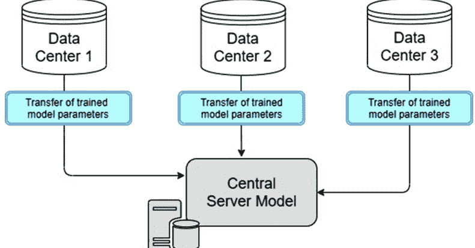

图 (1). 基于联邦学习的方法概述。

COVID-19 Chest X-ray Dataset Initiative [25] 包含 55 张 COVID-19 类别的 CXR 图像。接下来，使用 actualmed COVID-19 Chest X-ray Dataset Initiative [26]，包含 238 张对应二元分类（即 COVID-19 和正常）的 CXR 图像。这三个数据集主要侧重于将 CXR 图像二元分类为 COVID-19 和正常。第四个数据集，COVID-19 Radiography Database [27]，包含“COVID-19 阳性”标签下的 1200 张图像、“正常”标签下的 1341 张图像和“病毒性肺炎”标签下的 1345 张图像。此外，使用了 RSNA Pneumonia Detection Challenge 数据集 [28]，该数据集包含 29684 张 DICOM 图像的原始数据，包括正常患者病例和非 COVID-19 肺炎患者病例。最后，RSNA 国际 COVID-19 开放放射学数据库 (RICORD) [29] 的 1096 张 CXR 图像也被汇编到 COVIDx 数据集中。

现在，由于所有这些数据集都有不同的格式和多样的分布，数据需要在用于我们的联邦学习模型之前进行预处理和清理。例如，在训练之前裁剪了 CXR 图像的顶部 8%，以试图从图像中去除嵌入的文本。此外，还对数据应用了数据增量，其中需要检查方向验证、LUT 转换、强度偏移等。RICORD 数据集在与其他数据集合并之前需要一些预处理，因为它包含一些带有填充的图像，并且一些图像无法使用。此外，有必要将肺部异常分为三个特定类别，即 COVID-19、肺炎和正常。为此，SARS、MERS、Streptococcus、Klebsiella、Chlamydophila、Legionella、E.Coli 和 Lung Opacity 等标签均映射到“肺炎”类别下，而标签 COVID-19 和正常则映射为类别本身。现在，最终所有数据集都合并到 COVIDx 数据集中，然后不均匀地重新分布到三个存储库中，这三个存储库都包含三个类别的所有数据。

在这里，存储库被称为客户端，训练数据集分布如表 1 所示。如表 2 所示，客户端 1 被分配了 3000 张 CXR 图像，客户端 2 在 2950 张 CXR 图像上进行训练，客户端 3 持有 3048 张 CXR 图像用于训练。客户端 1 训练的 3000 张 CXR 图像由 500 张“COVID-19”、1100 张“肺炎”和 1400 张“正常”图像组合而成。客户端 2 在 2950 张 CXR 图像上进行训练，其中 700 张图像属于“COVID-19”类别，900 张图像属于“肺炎”，其余 1350 张为“正常”图像。客户端 3 在 798 张“COVID-19”图像、1000 张“肺炎”图像和 1250 张“正常”类别的图像上训练其本地模型。从表 3 可以观察到，分配给特定类别的 CXR 图像数量各不相同。这样做是牢记联邦学习模型的实际应用。对于进行肺部异常检测的医疗机构而言，


在实践中，我们更有可能遇到此类类别分布的场景。为测试模型准确性，使用了包含总计300张图像的数据集，其中包括66张COVID图像、126张肺炎图像和108张正常胸部X光（CXR）图像。

### 实验

在本节中，让我们了解研究人员采用的方法。本研究提出了一项务实且全面的比较研究。这里，用于检测肺部异常的深度学习模型包括：VGG-16、AlexNet、ResNet101和DenseNet121。在流程的第一步中，所有模型首先在各个孤岛（即各个客户端）上单独运行。在本研究中，研究人员假设有3个客户端，其数据分布如表1、表2、表3和表4所示。用于实验输入的图像均被缩放至255x255的大小。当各个客户端在所选模型上完成其数据集的训练后，保存模型的参数将被保存。然后，从各自本地中心获得的这些参数被传输到中央服务器模型以进行聚合。因此，与其为进一步训练共享原始数据，不如只转发从各自客户端获得的参数。各个客户端可以根据数据可能不断更新的情况反复修订参数。该方法的概览在图 (1) 中演示。

表 1. 训练数据集分布。

| 数据集分布 | 客户端 1 | 客户端 2 | 客户端 3 |
|---|---|---|---|
| 正常 | 1400 | 1350 | 1250 |
| COVID-19 | 500 | 700 | 798 |
| 肺炎 | 1100 | 900 | 1000 |

表 2. 按客户端划分的数据集分布。

| 按客户端划分的分布 | 客户端 1 | 客户端 2 | 客户端 3 |
|---|---|---|---|
| CXR图像总数 | 3000 | 2950 | 3048 |

表 3. 按类别划分的数据集分布。

| 按类别划分的分布 | 正常 | COVID-19 | 肺炎 |
|---|---|---|---|
| CXR图像总数 | 4000 | 1998 | 3000 |

| 模型 | 客户端 1 损失 | 客户端 1 准确率 | 客户端 2 损失 | 客户端 2 准确率 | 客户端 3 损失 | 客户端 3 准确率 | 服务器 损失 | 服务器 准确率 |
|---|---|---|---|---|---|---|---|---|
| VGG-16 | 0.47 | 89.33 | 0.79 | 84.67 | 0.28 | 90.67 | 0.14 | 95.00 |
| AlexNet | 0.62 | 80.00 | 0.59 | 78.67 | 1.07 | 80.00 | 0.37 | 87.67 |
| ResNet101 | 0.44 | 92.00 | 0.98 | 82.99 | 1.24 | 83.00 | 0.03 | 97.00 |
| DenseNet121 | 0.31 | 92.00 | 0.88 | 86.00 | 0.32 | 90.00 | 0.05 | 98.33 |

可以明显看出，从图 (1) 中，训练模型的参数被传输到中央模型。为此，我们使用下面描述的模型。

### VGG-16 [30]

VGG模型代表由牛津大学提出的视觉几何组，因此也被称为牛津网络。这里，16指的是该模型具有16个带权重的层。VGG16是一个卷积神经网络模型。该模型包括在一组卷积网络之后的3个全连接层。VGG16以使用多个3×3内核尺寸的滤波器而闻名，而不是大量的超参数。该模型使用带有3X3滤波器的卷积层，卷积步长为1和填充，以及步长为2的2X2滤波器的最大池化层。这里，步长是指在输入矩阵上移动的像素数量，步长1表示滤波器一次移动一个像素，步长2表示滤波器一次移动两个像素。VGG16的前两层具有64个通道的3X3滤波器尺寸和相同的填充。随后是一个2x2池化大小和2x2步长的最大池化层，然后是2个具有3X3内核和相同填充的128通道卷积层。接着又是一个与之前类似的最大池化层。随后是2个滤波器尺寸为3X3、256个滤波器的卷积层。之后，有2组3个卷积层和一个类似的最大池化层。每个卷积层都有512个3X3尺寸的滤波器，具有相同的填充。此架构末尾获得的图像随后传递到两个卷积层的堆栈中。该模型的最终卷积层是softmax层。VGG16的所有隐藏层都使用整流线性单元（ReLU）非线性作为激活函数，因为ReLU因其更快的学习速率而被发现计算效率更高。

### AlexNet [31]

AlexNet是一个具有深层结构的卷积神经网络，其滤波器数量多于之前提出的模型（如LeNet等）。AlexNet的架构包含8层，其中5层是卷积层，3层是全连接层。第一个卷积层包含96个尺寸为11x11、步长为4的滤波器。随后是第一个最大池化层，尺寸为3X3，步长为2。下一个卷积层有256个尺寸为5x5、步长为1、填充为2的滤波器。接着是一个我们之前使用过的类似最大池化层。此外，第三个卷积层有384个滤波器。这些滤波器的尺寸为3X3，步长为1，填充为1。然后，第四个卷积层有384个尺寸为3X3的滤波器，步长和填充与第三个相同。最终卷积层尺寸为3X3，带有256个此类滤波器，步长为1，填充为1。最后，应用第三个最大池化层，尺寸为3X3，步长为2。当AlexNet被提出时，tanh是使用的标准激活函数。而AlexNet则使用了整流线性单元（ReLU），这显著减少了模型训练时间。AlexNet还使用重叠池化，从而减小了网络的大小。

### ResNet101 [32]

ResNet指的是残差网络。这是因为，与其让各层强行拟合底层映射，不如让ResNet拟合各层的残差映射。ResNet-101是一个深度为101层的深度卷积网络。该网络的默认图像输入尺寸为224x224，因此张量输入将为(224,224,3)。ResNet101中的每个块都有3层深。该架构涉及梯度消失问题，因此提供了一种减少参数数量以确保更快计算的方法。这是通过一个尺寸为3X3、步长为2的最大池化层来完成的。最后，应用一个带有softmax激活的全连接平均池化层。

### DenseNet121 [33]

DenseNet代表稠密卷积网络。在这个网络中，各层与更深层的其他层连接，以实现高效训练和层间最大数据传输。由于这种连接方式，我们观察到DenseNet架构所需的参数数量比标准卷积神经网络更少。DenseNet 121包含5种主要类型的层，其中一个是7x7尺寸的卷积层，以及一个尺寸为3X3、步长为2的最大池化层。然后有3个过渡层，带有尺寸为2x2、步长为2的平均池化层。最后，是一个带有全局平均池化层（尺寸为7x7）的全连接分类层。该最终层使用softmax激活。

### 结果与讨论

在本节中，我们展示了在测试数据集上的联邦学习实验结果。结果在本地设备（即客户端侧）和聚合服务器模型上生成。该过程在图 (2) 中演示。在客户端设备上训练的模型被聚合，全局服务器模型被更新。这里，我们使用“FedAvg”算法通过平均模型参数来聚合本地模型。

类别交叉熵用于评估模型的损失。类别交叉熵适用于多类分类，因为一张图像可以属于一个类别，概率为1，而其他类别的概率为0。

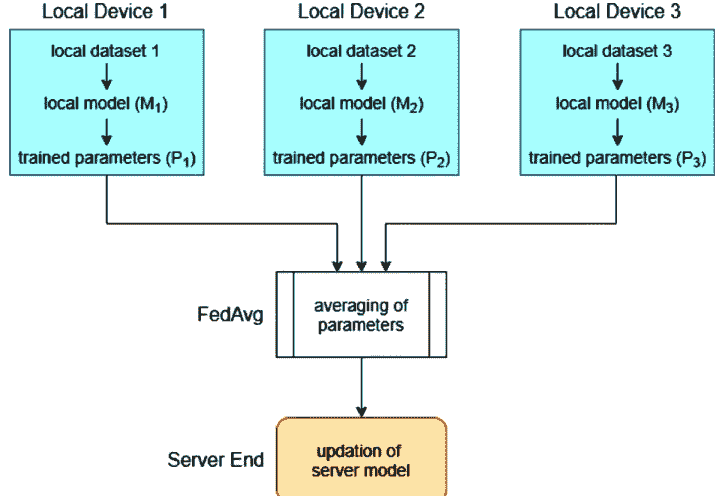

图 (2). 更新服务器模型所遵循的程序。

在上面的表格中，每个模型细分为：客户端 1、客户端 2、客户端 3 和服务器。这里，每个客户端是本地医院/组织，服务器是最终的全局聚合服务器。首先，每个客户端获得在其各自数据集上训练的深度学习模型。客户端在本地进行评估，然后将模型参数传输到服务器。每个客户端将其模型参数发送到服务器，这里有3个模型，因此将有3个模型参数由服务器上的FedAvg算法进行聚合。


在VGG-16中，客户端1、客户端2和客户端3的报告准确率分别为89.3%、84.7%和90%。最终服务器模型报告的准确率为95%，由于模型是平均的，可以看到准确率有所提升。AlexNet的服务器模型平均准确率为87%，而客户端的平均准确率为80%，因此VGG-16优于AlexNet。ResNet-101和DenseNet-121都是具有100+层的非常深的神经网络，其报告准确率非常相似。服务器模型对ResNet-101和DenseNet-121分别报告了97%和98%的准确率。在ResNet-101上训练时，客户端分别报告了92%、83%和83%的准确率。在这里，客户端1训练非常有效，从而在聚合后提高了服务器准确率。对于DenseNet-121也出现了类似情况，客户端分别给出了92%、85%和86%的准确率，而聚合后服务器准确率大幅提升，报告准确率为98%。整体实验表明，更深的神经网络表现相当出色，DenseNet-121报告了最高的整体性能。

### CONCLUSION

联邦学习是一种技术，其中模型在设备上本地训练，训练后的模型参数与中央服务器通信，聚合在服务器上进行。联邦学习通过仅发送训练后的模型参数来解决数据隐私问题。在这项研究中，我们应用联邦学习来训练深度学习模型，以将胸部X光片分类为Covid、Pneumonia和Normal。该研究假设有3个数据中心/医院在本地训练模型。使用了四种深度学习模型——AlexNet、VGG-16、DenseNet-121和ResNet-101——以提供比较分析。

实验中的每个客户端都提供了一个本地训练数据集。实验表明，DenseNet-121在服务器模型上记录了最高的98%准确率，其次是ResNet-101，报告了97%的准确率。VGG-16和AlexNet分别报告了95%和88%的全局模型准确率。随着新数据的生成，客户端继续训练各自的本地模型。因此，联邦学习模型会随着时间不断演进和改进。

联邦学习有许多潜在的应用，特别是在医疗保健领域。在医疗保健中，保护患者隐私非常重要，并且医疗保健拥有分散的数据来源，即相互孤立的多家医院。这项研究提供了联邦环境中深度学习模型的比较研究。此外，该研究可以应用于医疗保健中的不同图像分类问题，所呈现的比较研究还提供了哪些深度学习模型最适合该任务的洞察。

### REFERENCES

- [1] J. Luo, X. Wu, Y. Luo, A. Huang, Y. Huang, and Y. Liu, "联邦学习的现实世界图像数据集", arXiv, 2019. 1910.11089.
- [2] M. Agarwal, G. Rani, and V.S. Dhaka, "肿瘤检测的优化对比度增强", Int. J. Imaging Syst. Technol., vol. 30, no. 3, pp. 687-703, 2020. [http://dx.doi.org/10.1002/ima.22408]
- [3] VS Dhaka, G Rani, MG Oza, T Sharma, and A Misra, "用于COVID-19大规模筛查的深度学习模型", Int J Imaging Syst Technol, vol. 31, no. 2, pp. 483-498, 2021. [http://dx.doi.org/10.1002/ima.22544]
- [4] G. Rani, M.G. Oza, V.S. Dhaka, N. Pradhan, S. Verma, and J.J.P.C. Rodrigues, "应用基于深度学习的多模态方法检测冠状病毒", Multimed. Syst., pp. 1-12, 2021.
- [5] N. Kundu, G. Rani, and V.S. Dhaka, "基于机器学习和IoT的疾病预测器和警报生成器系统", 2020年第四届计算方法与通信国际会议(ICCMC), 2020. [http://dx.doi.org/10.1109/ICCMC48092.2020.ICCMC-000142]
- [6] S.G. Savita, G. Rani, and D. Singh, "基于机器学习和IoT的疾病预测器和警报生成器系统", In: 2020年第四届计算方法与通信国际会议(ICCMC) IEEE, 2020.
- [7] S.G. Savita, G. Rani, and V.S. Dhaka, "使用机器学习方法对冠状动脉疾病进行分类的高效预测建模", IOP Conf. Ser. Mater. Sci. Eng., vol. 1099, no. 1, p. 012068, 2021. [http://dx.doi.org/10.1088/1757-899X/1099/1/012068]
- [8] N. Pradhan, G. Rani, V.S. Dhaka, and R.C. Poonia, "使用人工神经网络的糖尿病预测", In: 生物医学和健康信息学的深度学习技术. Elsevier, 2020, pp. 327-339.
- [9] M.G. Oza, G. Rani, and V.S. Dhaka, "使用卷积神经网络的青光眼检测", In: 通过数据分析和机器学习进行疾病预测的研究手册. IGI Global, 2021, pp. 1-7. [http://dx.doi.org/10.4018/978-1-7998-2742-9.ch001]
- [10] H.B. McMahan, E. Moore, D. Ramage, and S. Hampson, "来自分散数据的通信高效深度网络学习", In: 人工智能与统计. pp. 1273-1282. PMLR, 2017.
- [11] J. Konečný, B. McMahan, and D. Ramage, "联邦优化：超越数据中心的分布式优化", arXiv, vol. 1511, p. 03575, 2015.
- [12] T.S. Brisimi, R. Chen, T. Mela, A. Olshevsky, I.C. Paschalidis, and W. Shi, "来自联邦电子健康记录的预测模型联邦学习", Int. J. Med. Inform., vol. 112, pp. 59-67, 2018. [http://dx.doi.org/10.1016/j.ijmedinf.2018.01.007] [PMID: 29500022]
- [13] L. Huang, and D. Liu, "使用分布式电子病历的联邦机器学习患者聚类可提高预测死亡率和住院时间的效率", J. Biomed. Inform, 2019. 可在以下网址查阅：http://arxiv.org/abs/1903.09296(2019).
- [14] LT Phong, Y Aono, T Hayashi, L Wang, and S Moriai, "通过加法同态加密实现的隐私保护深度学习", IEEE Trans Info. Forensics. Security., vol. 13, no. 5, pp. 1333-45, 2018. [http://dx.doi.org/10.1109/TIFS.2017.2787987]
- [15] A. Bhowmick, J. Duchi, J. Freudiger, G. Kapoor, and R. Rogers, "防重构攻击及其在私有联邦学习中的应用", ArXiv Preprint arXiv, vol. 1812, 2018, p. 00984.
- [16] Q. Dou, T.Y. So, M. Jiang, Q. Liu, V. Vardhanabhuti, G. Kaissis, Z. Li, W. Si, H.H.C. Lee, K. Yu, Z. Feng, L. Dong, E. Burian, F. Jungmann, R. Braren, M. Makowski, B. Kainz, D. Rueckert, B. Glocker, S.C.H. Yu, and P.A. Heng, "用于CT中检测COVID-19肺部异常的联邦深度学习：一项隐私保护的多国验证研究", NPJ Digit. Med., vol. 4, no. 1, p. 60, 2021. [http://dx.doi.org/10.1038/s41746-021-00431-6] [PMID: 33782526]
- [17] D. Yang, Z. Xu, W. Li, A. Myronenko, H.R. Roth, S. Harmon, S. Xu, B. Turkbey, E. Turkbey, X. Wang, W. Zhu, G. Carraffello, F. Patella, M. Caria ti, H. Obinata, H. Mori, K. Tamura, P. An, B.J. Wood, and D. Xu, "使用来自中国、意大利、日本的多国数据对胸部CT中COVID区域进行分割的联邦半监督学习", Med. Image Anal., vol. 70, no. 101992, p. 101, 2021. [http://dx.doi.org/10.1016/j.media.2021.101992] [PMID: 33601166]
- [18] R. Kumar, A.A. Khan, J. Kumar, Zakria, N.A. Golilarz, S. Zhang, Y. Ting, C. Zheng, and W. Wang, "使用CT成像的COVID-19检测的区块链-联邦学习和深度学习模型", IEEE Sens. J., vol. 21, no. 14, pp. 16301-16314, 2021. [http://dx.doi.org/10.1109/JSEN.2021.3076767] [PMID: 35789224]
- [19] W. Zhang, T. Zhou, Q. Lu, X. Wang, C. Zhu, H. Sun, Z. Wang, S.K. Lo, and F.Y. Wang, "基于动态融合的COVID-19检测联邦深度学习", IEEE Internet Things J., vol. 8, no. 21, pp. 15884-15891, 2021. [http://dx.doi.org/10.1109/JIOT.2021.3056185] [PMID: 35663640]
- [20] L. Zhang, B. Shen, A. Barnawi, S. Xi, N. Kumar, and Y. Wu, "FedDPGAN：用于COVID-19肺炎检测的联邦差分私有生成对抗网络框架", Inf. Syst. Front., vol. 23, no. 6, pp. 1403-1415, 2021. [http://dx.doi.org/10.1007/s10796-021-10144-6] [PMID: 34149305]
- [21] I. Feki, S. Ammar, Y. Kessentini, and K. Muhammad, "从胸部X光片进行COVID-19筛查的联邦学习", Appl. Soft Comput., vol. 106, no. 107330, p. 107330, 2021. [http://dx.doi.org/10.1016/j.asoc.2021.107330] [PMID: 33776607]
- [22] B. Liu, B. Yan, Y. Zhou, Y. Yang, and Y. Zhang, "COVID-19胸部X光片联邦学习实验", 人工智能与安全的进展. pp. 41–53, 2021.
- [23] 可在以下网址查阅：https://github.com/lindawangg/COVID-Net/blob/master/docs/COVIDx.md(2021).
- [24] 可在以下网址查阅：https://github.com/ieee8023/covid-chestxray-dataset
- [25] 可在以下网址查阅：https://github.com/agchung/Figure1-COVID-chestxray-dataset
- [26] 可在以下网址查阅：https://github.com/agchung/Actualmed-COVID-chestxray-dataset
- [27] 可在以下网址查阅：https://www.kaggle.com/tawsifurrahman/covid19-radiography-database
- [28] 可在以下网址查阅：https://nihcc.app.box.com/v/ChestXray-NIHCC
- [29] 可在以下网址查阅：https://wiki.cancerimagingarchive.net/pages/viewpage.action?pageId=70230281
- [30] K. Simonyan, and A. Zisserman, "大规模图像识别的非常深的卷积网络", arXiv preprint arXiv, vol. 1409, 2014, p. 1556.
- [31] A. Krizhevsky, I. Sutskever, and G.E. Hinton, "带有深度卷积神经网络的ImageNet分类", Commun. ACM, vol. 60, no. 6, pp. 84-90, 2017. [http://dx.doi.org/10.1145/3065386]
- [32] K. He, X. Zhang, S. Ren, and J. Sun, "图像识别的深度残差学习", IEEE计算机视觉与模式识别会议论文集. pp. 770-778. 2016.
- [33] G. Huang, Z. Liu, L. van der Maaten, and K.Q. Weinberger, "密集连接卷积网络", IEEE计算机视觉与模式识别会议论文集. pp. 4700-4708, 2017.


## 人工智能在 3-D 骨骼图像重建中的作用：综述

摘要：骨骼的三维几何结构对于疾病、关节炎或其他骨骼畸形的正确诊断至关重要。计算机断层扫描和磁共振成像等模态用于获取骨骼的三维视图。上述两种模态成本高昂，并会使患者暴露于强致癌辐射之下。计算机断层扫描会拍摄大量图像，以从骨骼中获取所需信息。另一种模态磁共振成像更适于从软组织而非骨骼中获取信息。因此，从骨骼中读取病理变化的效果较差。这促使作者确定用于检测骨骼病理或畸形的有用成像技术。此外，当务之急是提供一种低成本且更安全的骨骼成像技术。为满足这一需求，我们对骨骼成像技术以及将二维图像转换为三维形式的技术进行了综述。我们还提出了开发针对患者特异性和器官特异性的优化 3-D 重建技术的方向。

关键词：双能、深度学习、畸形、股骨、机器学习、三维、X射线。

### 引言

器官的三维（3-D）结构对于疾病诊断至关重要。3-D 结构提供了器官的精确配置和方向。因此，它对于检测组织中的疾病或骨骼骨折很有用。

该结构还提供关于慢性骨质流失的信息，例如反复肩关节脱位中的盂骨缺损以及关节炎关节中骨赘的范围。计算机断层扫描（CT）和磁共振成像（MRI）提供了骨骼的 3-D 配置。但由于成本高昂且致癌辐射暴露严重，这些技术不如二维（2-D）技术受青睐 [1]。

双能 X 射线吸收法（DXA）图像用于诊断患者的骨质疏松症。在 DXA 图像中，会显示 T-Score 的数值。T-Score 介于 +1 到 -1 之间表示骨骼健康。其数值介于 -1 到 -2.5 之间表明骨骼已容易患骨质疏松症 [2]。这种状态被称为骨量减少症。低于 2.5 的数值表明骨骼质量差，是骨质疏松症的迹象。在这种疾病中，骨矿物质密度（BMD）降低。因此，增加了骨折的风险。根据 [3] 中给出的详情，在欧洲，50 岁女性中有 30% 患有骨质疏松症。根据 2000 年发表的报告，记录了 310 万至 370 万例骨质疏松症病例。据报道，治疗该疾病的直接费用为 320 亿 [4]。根据研究 [4] 报告的趋势，到 2050 年，费用可能上升至每年 768 亿。

X 射线成像是一种用于捕捉骨骼畸形的医学成像技术。该技术显示了骨骼与软组织之间的清晰界限。因此，如果存在骨骼畸形，读取相关信息变得容易。在承重成像和关节运动动态成像（透视）的情况下，X 射线成像优于 CT 扫描。由于其高可用性和低成本，人们偏好 X 射线成像。因此，有必要提出一种技术，该技术可使用 DXA 和 X 射线等 2-D 成像技术提供骨骼的 3-D 视图。上述医学成像技术之间的差异见表 1。显示骨骼 3-D 图像的技术或从 2-D 图像重建 3-D 图像的方法如图（1）所示。

### 表 1. CT 扫描、X 射线和 DXA 技术之间的差异。

| 参数 | CT 扫描 | X 射线 | DXA |
|---|---|---|---|
| 辐射脆弱性 | CT 的有效辐射剂量范围为 2 至 10 毫西弗（mSv）[5]。 | 电离辐射暴露量约为 0.1 mSv [5]。 | 电离辐射暴露量范围为 0.1 微西弗至 5 微西弗 [6]。 |
| 成本 | CT 扫描的成本范围为 1,200 美元至 3,200 美元 [7]。 | 成本为 1,200 美元至 4,000 美元 [7]。 | 这比 X 射线技术贵三倍 [7]。 |
| 完整扫描所需时间 | 约需 5 分钟。 | 需要几秒钟。 | 比 X 射线技术耗时，但比 CT 扫描技术耗时较少。 |
| 应用 | 适用于骨损伤、肺和胸部成像以及癌症检测。 | 用于检查骨折和诊断组织疾病。 | 用于诊断骨质疏松症或测量骨矿物质密度。 |

### 生物医学领域中骨骼的 3-D 重建

图（1）。生物医学领域中的成像图像。

在本章中，作者对表 1 中讨论的医学成像中使用的 3-D 和 2-D 技术进行了综述。本章还对从 2-D 成像技术进行骨骼 3-D 重建所用的技术进行了比较分析。

### 相关工作分析

对相关工作的综述表明，从 2-D 图像进行医学图像的 3-D 重建吸引了研究人员提出不同的模型。研究人员的贡献如下。

WEI 等人 [1] 指出，由于曝光强度低且成本低，X 射线成像优于 CT 扫描图像。因此，他们提出了股骨干形状的 3-D 重建系统。他们使用正射投影标题来重建 3-D 股骨。他们使用数值形态学策略进行边界检测。此外，他们将股骨干边缘的中心点确定为极基准线。然后，他们通过打点计算了极基准线的三个坐标。最后，他们的系统通过创建边界，显示了股骨干 3-D 布局模型和状态的注册。该技术可用于消除噪声以提高形状质量，但对于骨骼形状的复杂结构，计算时间较高。

Zhang 等人提出了一种使用直接线性变换（DLT）[8] 进行股骨 3-D 重建的有效策略。他们的策略使用两张正交 X 射线图像（前后位和侧位视图）来重建 3-D 结构。DLT 不需要多张图像来计算畸变边界。因此，它的计算开销低，并应用于各种领域。3-D 重建的步骤如图（2）所示。

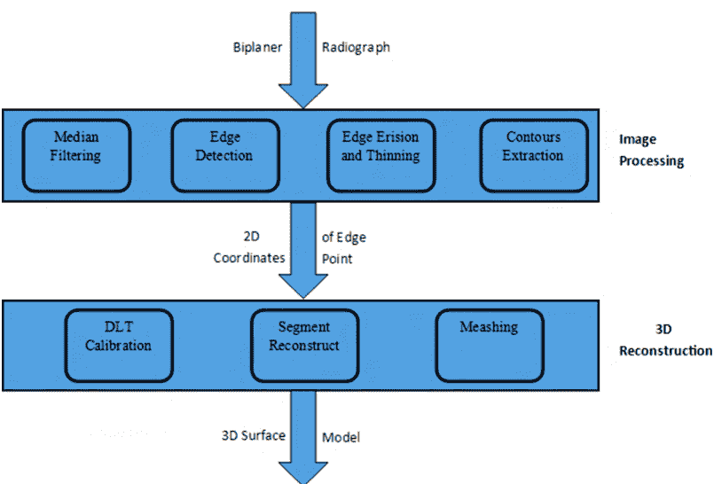

图（2）。重建的逐步过程。

A. Le Bras 等人 [9] 对近端股骨的 3-D 重建进行了基于比较的检查。他们使用了 3-D CT 扫描重建方法和 3-D 立体放射重建方法 [3]。在 3-D CT 扫描重建中，他们考虑了瞄视图、体积、图像获取和重建等参数。他们将这些参数输入“Slice Omatic”软件，以获取股骨的 3-D 重建。在 3-D 立体放射重建方法中，低剂量计算机 X 射线设备在后前位和侧位视图中对股骨进行线性扫描。该方法采用“NSCC 算法”来开发 3-D 重建。作者 [9] 声称，在 25 个近端股骨上应用这两种方法可获得较低的平均 P2S 误差值。报告的误差小于 2.0 毫米。这证明了 3-D 立体放射重建方法的可靠性。该策略的优点是，它非常适合用于形状恒定的硬结构，但这种技术在计算成本方面很繁琐。

Kyung Koh 等人 [10] 从一名体型和体重正常的健康受试者构建了股骨的 3-D 格式模型。他们考虑了五名患者的两张 X 射线图像和三张 CT 扫描图像。他们使用了 B 样条自由变形（FFD）来获取特定于患者的股骨，如图（3）所示。为了控制变形精度，FFD 提供了以可变距离放置控制点的功能。此外，FFD 可以低成本轻松操控控制点。另一方面，在复杂结构上应用 FFD 技术比较困难。

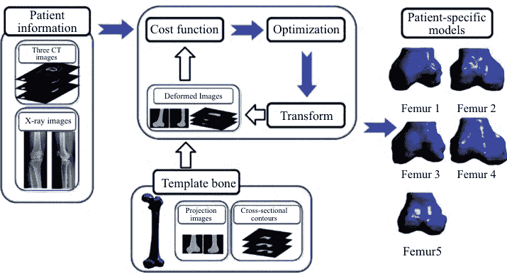

图（3）。脊柱 FFD。

Sonia Akkoul 等人 [11] 提出了一种用于近端股骨表面 3-D 重建的模型。该模型使用伪立体匹配和最高质量级别的 3-D 点来减少数据不可用性。他们使用了三具尸体的近端股骨，通过 CT 扫描和 X 射线图像进行扫描。他们遵循一组七个阶段来对近端股骨进行 3-D 重建。在


第一阶段，他们使用投影显示来发现两张股骨X射线图像之间的角度。在下一阶段，系统使用主动轮廓标记股骨的边界。在第三阶段，系统使用欧几里得距离查找2-D形状之间的对应点。在下一阶段，系统生成3-D点云。现在，它应用Iterative Closest Point (ICP)算法进行3-D刚性配准。在最后阶段，系统应用网格化技术来查找近端股骨的3-D形状。ICP算法简单直接且易于实现，但它在第一步中计算迭代的起始值，该值应正确初始化，否则该算法会受到局部最优问题的影响。

Sami P. Vaananen 等人 [12] 提出了一种用于3-D形状重建的编程技术。他们为此目的应用了结构化辅助网格（SAM）算法，如图（4）所示。作者使用了三组骨骼图像。其中两组骨骼图像用于训练模型，其余第三组骨骼图像用作模型的测试数据集。

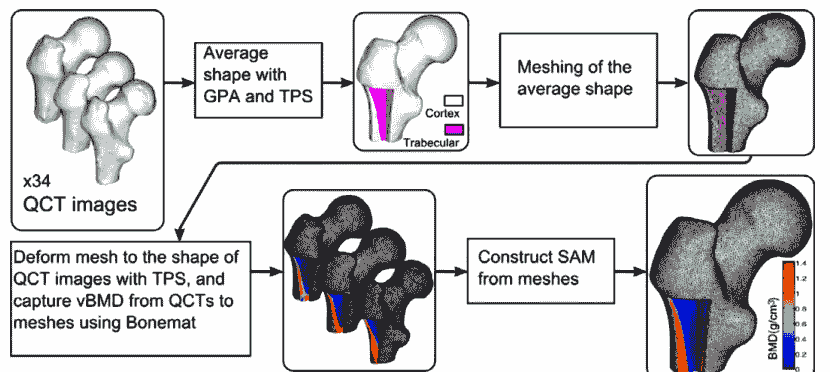

图（4）. SAM模型的开发。

N. Baka 等人 [13] 提出了一种基于统计形状模型（SSM）的技术，用于利用两张X射线图像进行3-D骨骼表面的姿态估计和形状重建。SSM技术在不减小对象尺寸的情况下捕获表面的全局形状，因此SSM技术需要较高的空间资源。

P.E. Garibarov 等人提出了患者特定的近端股骨表面重建模型 [14]。他们将该模型应用于平面X光片。该模型分三步完成重建。在第一步中，他们从平面X光片中提取股骨轮廓。在第二步中，他们对提取的轮廓进行协调过程。在最后一步中，他们重建3-D几何结构。

P. Gamage 等人提出了一种从2-DX光片重建患者特定骨骼模型的技术 [15]。他们从2-DX射线图像中提取边缘点以确定股骨的边界。现在，他们对X光片中识别的边缘进行非刚性配准。他们投影了通用模型的轮廓点。现在，平移场区分了前侧和外侧视图中3-D解剖模型所需的变形。在最后一步，通过基于插值和3-D通用解剖数据的薄板样条（TPS）开发了完整的3-D平移场。TPS技术在计算中不包含表面补丁，从而产生稳健的结果。另一方面，如果数据大小过大，则会导致边缘点的问题。

Tristan Whitmarsh 等人 [16] 提出了一种从单次DXA重建近端股骨3-D形状的模型。该技术使用应用于大量定量计算机断层扫描（QCT）数据集的统计模型。

### 表2. 不同图像类型上3-D重建模型的性能比较。

| 使用的图像 | 平均误差 | 均方根误差（RMS） | 投影数量 |
| :--- | :--- | :--- | :--- |
| 单次DXA图像 [10] | 1.1mm | 2.6mm | 1 |
| X射线图像 [17] | 1.2mm | 2.8mm | 2 |
| 双次DXA图像 [28] | 0.8mm | 2.1mm | 2 |

Guoyan Zheng 等人提出了部分最小二乘回归（PLSR）模型，用于从2-DX射线图像中重建体积强度 [20]。在此技术中，作者使用了独立统计形状和位移及外观（DA）方法。PLSR技术可以在3-D重建过程中轻松处理独立点之间的多重共线性。另一方面，PLSR需要大量数据进行训练。

Moon Kyu Lee 等人创建了一个成品股骨骨的3-D模型 [21]。作者使用常规X射线图像，并将颈长、股骨长、头偏移长度、解剖轴和矢状半径等解剖参数组合到参考3-D形状中。他们通过非线性回归计算了股骨头的内部位置和范围。他们通过应用椭圆回归确定了解剖轴的中心点。

Haithem Boussaid 等人 [22] 提出了一种使用低剂量双平面X射线图像进行近端股骨3-D重建的模型。

S. Laporte 等人通过从双平面X光片中检测轮廓来研究3-D重建模型 [23]。他们采用直接线性变换（DLT）和非立体X射线对应点算法（NSCP）来复现结构。NSCP在膝关节等结构中失败。因此，作者应用非立体对应轮廓（NSCC）算法来重建骨骼的3-D形状。

Ryo Kurazume 等人提出了一种使用参数方法进行股骨形状3-D重建的技术 [24]。他们对从56名患者的CT扫描图像中获得的3-D股骨形状进行了统计分析。他们采用了手动分割和Marching Cubes算法，以及主成分分析（PCA）[25]。

S. Kolta 等人 [26] 提出了一种从DXA图像中重建近端股骨骨3-D模型。该模型通过检测图像中的轮廓来工作。

V.H. Kim 等人使用模拟植入系统（SIS）[27]进行人工髋关节与股骨之间的3-D感知和数值研究 [28, 29]。3-D重建模拟系统的架构如图（5）所示。

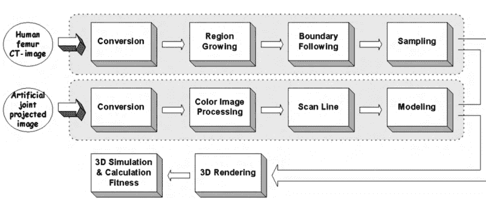

图（5）. 3-D重建模拟系统的架构。

Vikas Karade 等人 [30] 提出了一种基于拉普拉斯表面变形（LSD）的技术，用于从双平面X射线图像中进行3-D股骨重建。

Moritz Ehlke 等人引入了一种基于GPU的方法，用于处理可变四面体网络的虚拟X射线投影渲染，以便从X射线进行3-D几何重建 [31]。

Guoyan Zheng 等人引入了一种在非刚性2-D结构中通过点匹配过程构建2-D到3-D对应关系的技术 [17]。他们在第一阶段采用了改进的迭代最近点（ICP）算法 [32]，在第二阶段采用了统计实例化。作者在第三阶段应用了正则化形状变形 [33]。

上述讨论表明，许多研究人员提出了用于3-D医学图像重建的技术 [1-9]。这些技术专注于股骨骨的重建。上述所述技术基于边界检测 [1]、DLT [8]、3-D立体X射线重建 [9]、B样条FFD [10]、SSM [7]、轮廓检测 [8] 和边缘检测 [9] 的数值形态学策略，用于从2-D图像中重建股骨骨的3-D视图。由于检测边缘或边界的无效性，这些技术报告的准确性较低。最有效技术的性能比较如表3所示。

### 表3. 3-D重建方法的比较分析。

| 序号 | 作者 | 方法 | 形状 | 输入 | 轮廓生成 | 病例数量 | 平均P2S误差 | 均方根P2S误差 | 计算时间（秒） | 系统配置 |
|---|---|---|---|---|---|---|---|---|---|---|
| 1 | Karade et al. [30] | LSD-SOM | 远端股骨 | 真实 | 手动 | 5 | 1.2 | 1.4 | 52 | Intel 2.4 GHz, 8GB |
| 2 | Karade et al. [30] | LSD-SOM | 远端股骨 | 模拟 | 自动 | 22 | 1.2 | 1.5 | 46 | Intel 2.4 GHz, 8GB |
| 3 | Filippi et al. [34] | FFD | 全股骨 | 模拟 | 手动 | 5 | 1.4 | - | - | - |
| 4 | Gunay et al. [35] | FFD | 胫骨 | 真实 | - | - | - | - | 100 | AMD, 1GHz |
| 5 | Baka et al. [13] | SSM | 远端股骨 | 真实 | 自动（Canny） | 10 | - | 1.68 | 300 | 2.4 GHz, 2GB |
| 6 | Zhu et al. [36] | SSM | 远端股骨 | 真实 | 手动 | 10 | 0.9 | - | 178 | Intel 2.67 GHz, 9GB |
| 7 | Fleute et al. [37] | SSM | 远端股骨 | 模拟 | 自动 | - | - | 1.0 | 60 | - |
| 8 | Gamage et al. [38] | TPS | 全股骨 | 真实 | 自动 | 6 | 0.9 | - | - | - |
| 9 | Laporte et al. [39] | NSCC | 远端股骨 | 真实 | 半自动 | 8 | - | 1.4 | - | - |
| 10 | Tang et al. [40] | 混合图谱 | 远端股骨 | 模拟 | 自动 | 2 | 2.0 | - | - | - |
| 11 | Le Bras et al. [9] | NSCC | 近端股骨 | 真实 | 手动 | 28 | 2.0 | - | - | - |


| 序号 | 作者 | 方法 | 形状 | 输入 | 轮廓生成 | 病例数 | 平均 P2S 误差 | RMS P2S 误差 | 计算时间（秒） | 系统配置 |
|:---|:---|:---|:---|:---|:---|:---|:---|:---|:---|:---|
| 12 | S. Kolta et al. [26] | NSCC | 股骨近端 | 真实 | 手动 | 25 | 0.8 | 2.1 | 600 | - |
| 13 | Ryo et al. [24] | SSM | 股骨近端 | 真实 | 手动 | 56 | 1.1 | - | - | - |
| 14 | Goyoyan et al. [17] | SSM | 股骨 | 模拟 | 自动 | - | 1.1 | 1.4 | - | - |
| 15 | Galibarov et al. [14] | SSM | 股骨近端 | 真实 | 手动 | 32 | 3.04 | - | 300 | 4 CPU, 3GHz |
| 16 | Tristan et al. [16] | SSM | 股骨近端 | 真实 | 自动 | 115 | 1.1 | 2.6 | - | - |
| 17 | Sonia et al. [11] | SSM | 股骨近端 | 模拟 | 自动 | 3 | 0.89 | 1.37 | - | - |
| 18 | Sami et al. [12] | SAM | 股骨近端 | 真实 | 手动 | 83 | 1.42 | - | - | - |

此外，现有技术可根据用于轮廓检测的方法论分为手动、模拟和自动三类。如表 3 所示的这些技术分析清楚表明，自动技术报告的均方根（RMS）P2S 误差和均方（MS）P2S 误差最小。自动技术在轮廓检测上也更耗时短。因此，这些技术被用于 3-D 重建。

然而，文献中已观察到 3-D 重建的自动化，但这些系统并不智能。这些系统不会从生成的错误中学习。因此，降低误差的空间较小。此外，现有技术仅依赖可用的输入数据集或模拟生成的数据。如果输入的是小数据集，这些技术无法生成数据集。

### 结论

在本章中，我们回顾了用于从 2-D 医学影像进行 3-D 重建的技术。研究人员致力于将 2-D 股骨转换为其对应的 3-D 结构。这些技术在重建中采用三种模式，即手动、模拟或自动。如表 3 所示，自动技术在 MS P2S 误差、RMS P2S 误差和计算时间方面优于手动和模拟技术。但是，当可用的数据集规模较小时，自动技术缺乏数据集的自生成能力。此外，这些技术缺乏从生成的错误中学习的能力。这降低了技术改进的空间。

基于上述讨论，我们得出结论，自动技术可用于从 2-D 图像进行股骨的 3-D 重建。但是，开发用于从 2-D 医学影像重建 3-D 结构的自动和智能技术具有巨大的潜力。使用诸如生成对抗网络（GAN）之类的优化神经网络架构，可以解决用于 3-D 重建的手动、模拟以及自动技术所面临的挑战。我们通过对现有技术的回顾发现，开发针对器官特异性、患者特异性、自动和智能的 3-D 重建模型具有潜力。机器学习和深度学习的使用可成为该应用的变革者。此外，应用优化算法以提高 3-D 重建模型的效率和准确性也有巨大的潜力。

### 参考文献

- [1] W. Wei, G. Wang, 和 H. Chen, "使用模型和两幅 2D X 射线图像进行股骨干 3D 重建", 第 4 届计算机科学与教育国际会议, pp. 720-722, 2009. [http://dx.doi.org/10.1109/ICCSE.2009.5228123]
- [2] R. Smith-Bindman, J. Lipson, R. Marcus, K.P. Kim, M. Mahesh, R. Gould, A. Berrington de González, 和 D.L. Miglioretti, "常见计算机断层扫描检查的辐射剂量及相关终身可归因癌症风险", Arch. Intern. Med., vol. 169, no. 22, pp. 2078-2086, 2009. [http://dx.doi.org/10.1001/archinternmed.2009.427] [PMID: 20008690]
- [3] L.J. Melton III, E.A. Chrischilles, C. Cooper, A.W. Lane, 和 B.L. Riggs, "有多少女性患有骨质疏松症？ JBMR 周年经典。JBMR, Volume 7, Number 9, 1992", J. Bone Miner. Res., vol. 20, no. 5, pp. 886-892, 2005. [http://dx.doi.org/10.1359/jbmr.2005.20.5.886] [PMID: 15931736]
- [4] J.A. Kanis, 和 O. Johnell, "欧洲骨质疏松症管理中 DXA 的要求", Osteoporos. Int., vol. 16, no. 3, pp. 229-238, 2005. [http://dx.doi.org/10.1007/s00198-004-1811-2] [PMID: 15618996]
- [5] 可在以下网址查阅: https://safety.unimelb.edu.au/__data/assets/pdf_file/0011/4722761/ionising-radiatio-management-guidelines.pdf
- [6] S. Mastrogiacomo, W. Dou, J.A. Jansen, 和 X.F. Walboomers, "硬组织和硬组织工程生物替代物的磁共振成像", Mol. Imaging Biol., vol. 21, no. 6, pp. 1003-1019, 2019. [http://dx.doi.org/10.1007/s11307-019-01345-2] [PMID: 30989438]
- [7] J. Piravsh Islamian, I. Garoosi, K. Abdollahi Fard, 和 M.R. Abdollahi, "MDCT 和 DXA 扫描仪在腰椎骨密度测定中的比较", Egypt. J. Radiol. Nucl. Med., vol. 47, no. 3, pp. 961-967, 2016. [http://dx.doi.org/10.1016/j.ejnm.2016.04.005]. [http://dx.doi.org/10.1016/j.ejnm.2016.04.005]
- [8] B. Zhang, S. Sun, J. Sun, Z. Chi, 和 C. Xi, "使用 DLT 算法的双平面放射摄影 3D 重建方法：股骨应用", First International Conference on Pervasive Computing, Signal Processing and Applications, pp. 251-254, 2010. [http://dx.doi.org/10.1109/PCSPA.2010.68]
- [9] A. Le Bras, S. Laporte, V. Bousson, D. Mitton, J.A. De Guise, J.D. Laredo, 和 W. Skalli, "来自低剂量数字双平面 X 光片的股骨近端个性化 3D 重建", Int Congress Series, vol. 1256, pp. 214-219, 2003. [http://dx.doi.org/10.1016/S0531-5131(03)00285-1]
- [10] K. Koh, Y.H. Kim, K. Kim, 和 W.M. Park, "使用 X 射线和稀疏 CT 图像重建患者特异性股骨", Comput. Biol. Med., vol. 41, no. 7, pp. 421-426, 2011. [http://dx.doi.org/10.1016/j.compbiomed.2011.03.016] [PMID: 21641590]
- [11] S. Akkoul, A. Hafiane, R. Leconge, K. Harrar, E. Lespessailles, 和 R. Jennane, "股骨近端 3D 重建方法及形状校正", 2014 年第 4 届图像处理理论、工具与应用国际会议 (IPTA), pp. 1-6, 2014. [http://dx.doi.org/10.1109/IPTA.2014.7001939]
- [12] S.P. Väänänen, L. Grassi, G. Flivik, J.S. Jurvelin, 和 H. Isaksson, "从 DXA 图像生成股骨近端 3D 形状、密度、皮质厚度和有限元网格", Med. Image Anal., vol. 24, no. 1, pp. 125-134, 2015. [http://dx.doi.org/10.1016/j.media.2015.06.001] [PMID: 26148575]
- [13] N. Baka, B.L. Kaptein, M. de Bruijne, T. van Walsum, J.E. Giphart, W.J. Niessen, 和 B.P.F. Lelieveldt, "使用统计形状模型从立体 X 射线成像中进行股骨远端 2D–3D 形状重建", Med. Image Anal., vol. 15, no. 6, pp. 840-850, 2011. [http://dx.doi.org/10.1016/j.media.2011.04.001] [PMID: 21600836]
- [14] P.E. Galibarov, P.J. Prendergast, 和 A.B. Lennon, "从平面术前 X 光片重建患者特异性股骨近端表面模型的方法", Med. Eng. Phys., vol. 32, no. 10, pp. 1180-1188, 2010. [http://dx.doi.org/10.1016/j.medengphy.2010.08.009] [PMID: 20933453]
- [15] P. Gamage, S.Q. Xie, P. Delmas, 和 P. Xu, "用于图像引导的骨科手术，从 2D X 光片重建患者特异性骨骼 3D 模型", 在：2009 年数字图像计算：技术与应用会议，墨尔本，维多利亚州，澳大利亚，2009. [http://dx.doi.org/10.1109/DICTA.2009.42]
- [16] T. Whitmarsh, L. Humbert, M. De Craene, L.M. Del Rio Barquero, 和 A.F. Frangi, "从双能 X 射线吸收法重建股骨近端的 3D 形状和骨矿物密度分布", IEEE Trans. Med. Imaging, vol. 30, no. 12, pp. 2101-2114, 2011. [http://dx.doi.org/10.1109/TMI.2011.2163074] [PMID: 21803681]
- [17] G. Zheng, S. Gollmer, S. Schumann, X. Dong, T. Feilkas, 和 M.A. González Ballester, "使用点分布模型和校准 X 光图像构建患者特异性 3D 骨骼表面模型的 2D/3D 对应构建方法", Med. Image Anal., vol. 13, no. 6, pp. 883-899, 2009. [http://dx.doi.org/10.1016/j.media.2008.12.003] [PMID: 19162529]
- [18] S. Filippi, B. Motyl, 和 C. Bandera, "从两张正交图像开始分析股骨 3D 建模的现有方法，并为商业软件包开发脚本", Comput. Methods Programs Biomed., vol. 89, no. 1, pp. 76-82, 2008. [http://dx.doi.org/10.1016/j.cmpb.2007.10.011] [PMID: 18093692]
- [19] G. Zheng, "使用偏最小二乘回归从 2D X 射线图像进行 3D 体积强度重建", 2013 IEEE 生物医学成像第 10 届国际研讨会, pp. 1268-1271, 2013. 旧金山，加利福尼亚州，美国. [http://dx.doi.org/10.1109/ISBI.2013.6556762]
- [20] M.K. Lee, S.H. Lee, A. Kim, I. Youn, T.S. Lee, N. Hur, 和 K. Choi, "基于解剖参数的数值方法股骨 3D 重建过程研究", J. Biomech. Sci. Eng., vol. 3, no. 3, pp. 443-451, 2008. [http://dx.doi.org/10.1299/jbse.3.443]


- [21] H. Boussaid, S. Kadoury, I. Kokkinos, J.Y. Lazennec, G. Zheng, and N. Paragios, "基于3D模型的低剂量双平面X射线图像中的近端股骨重建", *英国机器视觉会议*, 2011. [http://dx.doi.org/10.5244/C.25.35]

- [22] S. Laporte, W. Skalli, J.A. De Guise, F. Lavaste, and D. Mitton, "基于2D和3D轮廓的双平面重建方法：应用于股骨远端", *计算生物力学与生物医学工程*, vol. 6, no. 1, pp. 1-6, 2003. [http://dx.doi.org/10.1080/1025584031000065956] [PMID: 12623432]

- [23] R. Kurazume, K. Nakamura, T. Okada, Y. Sato, N. Sugano, T. Koyama, Y. Iwashita, and T. Hasegawa, "使用参数模型和两张2D荧光图像的股骨形状3D重建", *计算机视觉与图像理解*, vol. 113, no. 2, pp. 202-211, 2009. [http://dx.doi.org/10.1016/j.cviu.2008.08.012]

- [24] H. Chui, and A. Rangarajan, "用于非刚性配准的新点匹配算法", *计算机视觉与图像理解*, vol. 89, no. 2-3, pp. 114-141, 2003. [http://dx.doi.org/10.1016/S1077-3142(03)00009-2]

- [25] S. Kolta, A. Le Bras, D. Mitton, V. Bousson, J.A. de Guise, J. Fechtenbaum, J.D. Laredo, C. Roux, and W. Skalli, "三维X射线吸收法（3D-XA）：一种使用双能X射线吸收法设备重建人体骨骼的方法", *国际骨质疏松杂志*, vol. 16, no. 8, pp. 969-976, 2005. [http://dx.doi.org/10.1007/s00198-004-1782-3] [PMID: 15599494]

- [26] Y.-H. Kim, J-K. Kim, and K. Choi, "使用连续计算机断层扫描图像和模拟植入系统的人体股骨三维重建", *医学工程技术杂志*, vol. 28, no. 5, pp. 205-210, 2004. [http://dx.doi.org/10.1080/0309190021000059722] [PMID: 15370999]

- [27] A. Watt, and F. Policarpo, *计算机图像*. Addison-Wesley: Reading, MA, 1998.

- [28] R. C. Gonzalez, and R. E. Woods, *数字图像处理*. Addison-Wesley: Reading, MA, 1992.

- [29] V. Karade, and B. Ravi, "基于拉普拉斯特曲面变形的双平面X射线图像中3D股骨模型重建：一种新方法", *计算机辅助放射学与外科国际期刊*, vol. 10, no. 4, pp. 473-485, 2015. [http://dx.doi.org/10.1007/s11548-014-1097-6] [PMID: 25037878]

- [30] M. Ehlke, H. Ramm, H. Lamecker, H.C. Hege, and S. Zachow, "3D解剖重建的虚拟X射线图像快速生成", *IEEE可视化与计算机图形汇刊*, vol. 19, no. 12, pp. 2673-2682, 2013. [http://dx.doi.org/10.1109/TVCG.2013.159] [PMID: 24051834]

- [31] G. Zheng, S. Gollmer, S. Schumann, X. Dong, T. Feilkas, and M.A. González Ballester, "使用点分布模型和标定X射线图像构建患者特异性3D骨表面模型的2D/3D对应构建方法", *医学图像分析*, vol. 13, no. 6, pp. 883-899, 2009. [http://dx.doi.org/10.1016/j.media.2008.12.003] [PMID: 19162529]

- [32] A. Guéziec, P. Kazanzides, B. Williamson, and R.H. Taylor, "用于引导手术机器人的CT扫描与术中X射线图像基于解剖学的配准", *IEEE医学图像汇刊*, vol. 17, no. 5, pp. 715-728, 1998. [http://dx.doi.org/10.1109/42.736023] [PMID: 9874295]

- [33] K.T. Rajamani, M.A. Styner, H. Talib, G. Zheng, L.P. Nolte, and M.A.G. Ballester, "用于从稀疏数据进行稳健3D表面外推的统计可变形骨模型", *医学图像分析*, vol. 11, no. 2, pp. 99-109, 2007. [http://dx.doi.org/10.1016/j.media.2006.05.001] [PMID: 17349939]

- [34] M. Gunay, M.B. Shim, and K. Shimada, "从X射线图像中成本和时间效益高的三维骨骼形状重建", *国际医学机器人期刊*, vol. 3, no. 4, pp. 323-335, 2007. [http://dx.doi.org/10.1002/rcs.162] [PMID: 18200623]

- [35] Z. Zhu, and G. Li, "使用3D统计可变形模型构建人体股骨远端表面模型", *生物力学杂志*, vol. 44, no. 13, pp. 2362-2368, 2011. [http://dx.doi.org/10.1016/j.jbiomech.2011.07.006] [PMID: 21783195]

- [36] P. Gamage, S.Q. Xie, P. Delmas, and P. Xu, "从2D放射线图像中重建用于图像引导的骨科手术的患者特异性骨骼模型", 在：2009年数字图像计算：技术与应用。IEEE：墨尔本，维多利亚州，澳大利亚，2009年，第212-216页。[http://dx.doi.org/10.1109/DICTA.2009.42]

- [37] T.L. Bredbenner, T.D. Eliason, R.S. Potter, R.L. Mason, L.M. Havill, and D.P. Nicolella, "统计形状建模描述了骨关节炎计划数据库中对照组和发病组之间胫骨和股骨表面几何的差异", *生物力学杂志*, vol. 43, no. 9, pp. 1780-1786, 2010. [http://dx.doi.org/10.1016/j.jbiomech.2010.02.015] [PMID: 20227696]

- [38] M. Fleute, and S. Lavallée, "使用统计模型的非刚性3D/2D图像配准", 医学图像计算和计算机辅助干预国际会议。1999年，第138-147页，柏林，海德尔堡。[http://dx.doi.org/10.1007/10704282_15]

- [39] T.S. Tang, and R.E. Ellis, "使用混合图谱的2D/3D可变形配准", 医学图像计算和计算机辅助干预国际会议。2005年，第223-230页，柏林，海德尔堡。[http://dx.doi.org/10.1007/11566489_28]

- [40] M.K. Garg, and S. Kharb, "双能X射线吸收法：骨密度测量和解释中的陷阱", *印度内分泌与代谢杂志*, vol. 17, no. 2, pp. 203-210, 2013. [http://dx.doi.org/10.4103/2230-8210.109659] [PMID: 23776890]

## 基于机器学习和深度学习技术在疾病严重程度检测中的作用：一项综述

Geeta Rani¹, Vijaypal Singh Dhaka¹* and Sushma Hans²

¹ 斋普尔玛尼帕尔大学计算机与通信工程系，斋普尔，印度

² 迪拜阿米蒂大学迪拜校区，迪拜，阿拉伯联合酋长国

摘要：全球公众及卫生服务机构日益增长的健康问题令人担忧。然而，为了正确诊断，CT扫描和胸部X射线等成像技术的使用出现了激增。但这些模态的手动扫描需要模态读取方面的专业知识。这也是一项耗时的任务。基于人工智能的技术已在模式识别、对象识别和数据分析方面证明了其潜力。因此，这些技术可用于提供辅助工具，从这些模态中进行疾病的初步筛查。文献观察表明，利用机器学习和深度学习进行疾病诊断和分类的研究工作很多。但是，疾病严重程度检测研究不足。此外，用于检测疾病严重程度的技术存在需要立即关注的漏洞。这些挑战促使我们综述文献中为疾病严重程度检测提出的基于机器学习和深度学习的技术解决方案。本研究的目的是展示关于疾病严重程度检测的可用研究工作的全面综述。本研究还介绍了所采用的机器学习技术和深度学习技术、使用的数据集以及所取得的性能的比较分析。它还突出了所提出的技术解决方案的缺点。此外，它还为疾病严重程度检测领域的未来范围提供了方向。

关键词：人工智能，疾病，深度学习，机器学习，严重程度。

### 引言

2020年COVID-19的爆发迫使我们重新思考个人以及社区健康的重要性。它也成为调查快速有效的疾病诊断手段的推动力。因此，卫生基础设施、疾病诊断技术和人力资源管理发生了巨大变化。技术解决方案已被提出作为传统实验室测试的替代方案，以最大限度地降低疾病诊断成本和报告生成延迟。

文献研究表明，机器学习（ML）和深度学习（DL）技术在图像质量增强[1, 2]、模式识别和图像重建[3, 4]方面具有潜力。因此，这些技术已广泛用于人类[5-7]以及植物[8]的疾病筛查。

近年来，疾病严重程度检测引起了研究界的广泛关注。在疾病早期检测其严重程度对于减少其对患者的影响和患者死亡风险至关重要。许多患者可能会错过正确的治疗时间，因为疾病早期仅出现少数症状。因此，需要利用计算机辅助自动诊断方法的潜力来检测疾病严重程度。

使用传统实验室检测进行严重程度预测的准确性高度依赖于样本采集、样本储存、运输和所使用的设备的方法。此外，这些技术对患者不便，成本高昂，并导致严重程度检测延迟。因此，可能会增加死亡率。这些挑战促使我们探索可用于疾病严重程度检测的技术解决方案。

对可用研究工作的全面研究表明，研究界在机器学习和深度学习用于疾病严重程度检测领域做出了重大贡献。确实，当参数数据以报告、心电图信号、临床特征等形式可用时，已采用各种ML技术进行严重程度检测[10-16]。研究人员采用了K-近邻（KNN）、支持向量机（SVM）、随机森林（RF）、多树XGBoost模型和AdaBoost等技术。这些技术的比较分析显示在后续部分的表1中。这些技术根据可用数据集类型和所需结果各有其重要性。然而，ML技术报告的严重程度检测最高准确率约为100%，但需要提高这些技术的可靠性和鲁棒性。此外，这些技术需要临床数据或以报告形式收集的数据。数据


采集机制对患者不便、耗时且成本高昂。因此，需要整合基于传感器的数据采集、传输到云存储，以及在云存储上的数据上实施机器学习模型，用于疾病诊断和严重程度检测。

### Table 1. 用于疾病检测和严重程度预测的现有基于深度学习技术的比较分析。

| 作者、年份和引用 | 应用的技术 | 使用的数据集 | 性能 | 挑战 |
| :--- | :--- | :--- | :--- | :--- |
| Yao et al., 2020 | 预测性逻辑回归 支持向量机 随机森林 K-近邻 (KNN) 和 AdaBoost | COVID-19 患者通过尿液和血液检测记录的健康参数，以及年龄、血压、心率等临床特征 *等。* | 训练数据集上的严重程度预测准确率为 99.17%，测试数据集上的准确率为 81.48%。 | 结论基于仅限于一个地理位置的小数据集得出。需要采集血液和尿液样本。血液和尿液检测涉及高成本。耗时，准确度取决于样本采集、存储以及实验室可用的设备。 |
| Li Yan et al., 2020 | 用于对 COVID-19 危重和重症病例进行分类的多树 XGBoost 模型 | 从 375 名 COVID-19 患者中选取的三个特征，即乳酸脱氢酶、淋巴细胞和高敏感 C-反应蛋白 | 预测生存率，准确率约为 90% | 完整数据集仅从一个地理位置收集。预测仅基于三个参数。由于实验室检测，成本高且耗时。 |
| Tadesse et al., 2020 | SVM | 手足口病 (HFMD) 和破伤风患者的心电图信号。 | HFMD 准确率 98.1%，破伤风准确率 78%。 | 心电图质量取决于监测期间患者的活动情况。仅在 10 名患者的小数据集上进行了测试。 |
| Tripoliti et al., 2017 | 回顾用于心脏病和心力衰竭严重程度预测的 KNN 和 SVM | PhysioNet 数据集 | 使用 KNN 的最佳准确率为 96.39% | - |
| Liu et al. | KNN 和 SVM | PhysioNet 数据集 | 声称 KNN 准确率为 100% | 数据集中存在类别不平衡问题，在非常小的数据集上进行训练和测试。 |
| Isler et al. | 用于预测心力衰竭严重程度的多层感知分类器 | 包含心率变异性的数据集 | 准确率 96.43% | 小数据集，依赖实验室检测报告的结果 |
| Shahbazi et al. | 用于特征提取的广义判别分析 (GDA) 和用于心力衰竭严重程度预测的 KNN | 心力衰竭严重程度 | 报告准确率为 100% | 小数据集，依赖实验室检测报告的结果。 |
| Candelieri et al. | SVM 超解决方案框架 | 心力衰竭严重程度 | 报告准确率为 87.35%。 | 在单一来源收集的数据集上实现。因此，无法评估模型的鲁棒性。 |
| Zolfghar et al. | 随机森林算法。 | 充血性心力衰竭 | 他们报告准确率为 87.12%。 | 模型准确性有改进空间。 |
| Taslimitehrani et al. | CPXR (log) 分类算法 | 包含 5044 名患者数据集的 Mayo 诊所。 | 93.7% | 在单一地理位置收集的数据集上实现。因此，无法声称具有鲁棒性。 |
| Leeza et al. | 基于字典的自动系统，使用视觉词袋 (BoF) 技术进行糖尿病视网膜病变 (DR) 严重程度检测。 | Kaggle 发布的包含 35126 张图像的数据集。 | SVM 达到 98.3% 的准确率 | 在单一地理位置收集的数据集上实现。因此，无法声称具有鲁棒性。 |

同样，深度学习技术主要用于磁共振成像 (MRI)、计算机断层扫描 (CT)、超声图像和 X 光片等医学影像数据 [11 - 28]。医学图像的获取对患者来说很方便。CT 扫描和 MRI 扫描价格昂贵，社会经济较弱阶层负担不起。此外，这些技术会让患者暴露于致癌辐射下。因此，患者更容易患癌。此外，偏远和欠发达地区用于 CT 扫描和 MRI 的机器可用性较低。X 光片是低成本、方便且便携的医学影像解决方案。此外，X 光机比 CT 扫描和 MRI 机器更容易获得。

文献综述发现，许多深度学习技术已被用于医学图像的自动扫描，以进行疾病诊断和严重程度检测。尽管这些技术提供更高的准确性，但它们也存在一些局限性。此外，每种技术的效果在很大程度上取决于用于训练基于深度学习模型的数据集的质量、类型和大小。这些技术的比较分析将在随后的章节中表 2 中展示。

### Table 2. 用于疾病严重程度检测的深度学习技术比较分析。

| 作者、年份和引用 | 应用的技术 | 使用的数据集 | 性能 | 挑战 |
| :--- | :--- | :--- | :--- | :--- |
| Bodapati et al. 2021 [14] | 带有门控注意力机制的深度神经网络架构，用于自动诊断糖尿病视网膜病变。 | Kaggle 上的亚太地区眼科远程医疗学会 (APTOS) 数据集。 | 最高准确率为 97.32%。 | 面临过拟合和多通道问题。 |
| Grover et al. 2018 [15], | DNN 和带有支持向量回归的自适应神经模糊推理系统 | 42 名患者的 5875 条生物医学语音测量数据。 | 使用 DNN 对帕金森病进行严重程度预测，准确率为 81.6% | 准确率低，结论基于来自一个地理位置的患者。 |
| Kermany et al. 2018 [16], | 基于深度学习的诊断工具 AI 系统。 | 使用 108,312 张 OCT 图像进行训练和 1000 张图像进行测试，筛查可治疗的致盲视网膜疾病 | 分别达到最高准确率、灵敏度和特异度，为 96.6%、97.8% 和 97.4%。 | 系统预训练需要同一器官的数据集。 |
| Chithra et al. 2020 [17] | 基于自适应分乌鸦搜索深度卷积神经网络 (AFC-SVNN) 模型，用于结核病 (TB) 的严重程度检测和感染水平识别。 | 包含 75 张图像的数据集，其中包括 50 张杆菌类图像和 25 张非杆菌类图像。 | 使用 KNN 的最佳准确率为 96.39%。 | 在小数据集上实现，因此实际应用可靠性较低。 |
| Emrah Irmak 2021 [18] | 一种完全自动化的 CNN 模型，使用胸部 X 光片将 COVID-19 疾病严重程度评估为轻度、中度、重度和危重四个类别。 | PhysioNet 数据集 | 该模型达到平均准确率 95.52%。 | 主要关注 COVID-19，缺乏对其他肺炎的覆盖。 |
| Zhu et al. 2020 [19], | 一种基于深度学习的 CNN，用于检测便携式胸部 X 光片 (CXR) 上 COVID-19 感染的肺部疾病严重程度。 | 包含 84 名 COVID-19 阳性患者的 131 张 CXR 的公开可用数据集。 | 准确率为 96.43% | 小数据集，且该研究未发现放射学严重程度与临床疾病严重程度之间的任何相关性。 |
| Rahimzadeh, M. and A. Attar [20], 2020 | 基于 Xception 和 ResNet50V2 的神经网络，用于胸部 X 光片的三类（正常、肺炎和 COVID-19）多类分类。 | 包含 633 张胸部 X 光片的数据集。 | 报告平均准确率为 91.4%。 | 观察到数据不平衡问题。 |
| Li et al. [21], 2020 | 一种深度卷积暹罗神经网络，用于早产儿视网膜病变 (ROP) 早产儿视网膜照片和骨关节炎的疾病严重程度分析。 | 包含来自 870 名患者的 4861 张图像（用于评估 ROP）和来自 3021 名患者的 10,012 张图像（用于检测骨关节炎）的数据集。 | 报告的接收器操作特征曲线下面积最高可达 0.90。 | 观察到数据不平衡问题。 |
| Chang et al. [22], 2020 | 卷积暹罗网络，使用 MRI 扫描识别膝盖疼痛。 | 包含双膝 MRI 切片的数据集。 | 达到 AUC 0.808 | 缺乏对不同成像数据集的验证，无法覆盖骨关节炎的全谱。 |
| Li et al. [23], 2020 | 暹罗 DNN，基于皮肤病变图像估计银屑病严重程度并定位皮肤病变区域。 | 包含 1,787 名银屑病患者的 5,205 张图像的数据集。 | 报告准确率为 77.87%。 | 缺乏特征可视化。 |


| 作者、年份及引用 | 应用的技术 | 使用的数据集 | 性能 | 挑战 |
| :--- | :--- | :--- | :--- | :--- |
| Zhang et al. [24], 2020 | 基于暹罗结构的深度学习方法，用于自动检测黑色素瘤筛查中的短期病变变化。 | 来自悉尼黑色素瘤诊断中心（SMDC）、皇家阿尔弗雷德医院的数据集，包含 100,000 张皮肤镜皮肤病变图像。 | 达到 74.1% 的准确率。 | 准确率有改进空间。 |
| Wang et al. [26], 2021 | 基于暹罗网络的带门控特征融合模型，用于同时评估膝骨关节炎（OA）的严重程度。 | OAI 数据集包含 24319 张，MOST 数据集包含 18634 张单膝图像。 | 未报告 | 缺乏对所用方法的验证。 |
| Li et al. [28], 2020 | 实现了一个卷积暹罗神经网络，用于计算 COVID-19 的连续放射学肺部疾病严重程度评分。 | 使用包含 161,590 张前后位图像的数据集进行训练，并对 COVID-19 患者的 314 张正面胸部 X 光片（CXRs）应用了迁移学习。测试数据集包含来自不同医院的 154 张和 113 张 CXRs。 | 未报告 | 缺乏对所用方法的验证。 |

上述讨论明显表明，迫切需要自动化疾病严重程度检测，为健康专家和民众提供快速、便捷、全天候可用且低成本的解决方案。这促使我们回顾文献中提出的技术并进行比较分析。在本章中，我们研究了2018年至2022年提出的研究工作，以展示机器学习（ML）和深度学习（DL）技术在严重程度检测中的作用。综述涵盖了所采用的ML和DL技术的比较分析。它列出了用于严重程度检测的数据集。本文还突出了所提工作的缺点和局限性。

### 文献综述

### 基于机器学习的严重程度检测

Yao 等人采用了多种机器学习算法，如预测性逻辑回归（PLR）、支持向量机（SVM）、随机森林（RF）、K-最近邻（KNN）和 AdaBoost，来确定 COVID-19 的严重程度检测 [9]。该研究涉及 75 名重症 COVID-19 患者和 62 名轻症患者。患者数据来自华中科技大学附属同济医院。对每个样本进行分析，以获取 100 个特征，包括 8 个临床特征（如性别、年龄、心率、呼吸频率、体温、血压等）、血液检测报告的 76 个参数以及尿液检测报告的 16 个参数。数据集中的缺失项用零或正常范围的中位数填充。现在，数据集按 80% 和 20% 的比例划分为训练集和测试集。接下来，作者进行 T 检验，确定了 32 个对疾病严重程度具有统计学显著性的特征。此外，模型应用保守递归特征消除（CRFE）策略，消除了另外 4 个冗余特征。这四个特征具有很强的特征间相关性，同时保持模型性能。作者报告称，在训练数据集上应用支持向量机（SVM）技术获得了 99.17% 的最佳预测准确率。在测试数据集上应用时，其准确率为 81.48%。此外，作者声称，与轻症 COVID-19 感染患者相比，重症患者的中性粒细胞百分比血清水平较高，单核细胞百分比和钙的血清水平较低。此外，血液检测记录的参数在识别严重程度方面比尿液检测记录的参数更为显著。作者还声称，男性若感染 COVID-19，严重程度风险更高。然而，尽管该研究得出的结论对于预测 COVID-19 的严重程度很重要，但需要使用来自不同地区的更大数据集来提高模型的可靠性和鲁棒性。基于中国一个地理区域仅 75 名患者的数据集的研究，不足以用于做出概括性预测。

在另一项研究中，Li Yan 等人提出了一种基于三个指标的预后预测模型，有助于区分 COVID-19 的危重病例和重症病例。他们还预测了患者的死亡风险 [10]。作者对包含中国武汉同济医院 375 名患者的数据集进行了实验。第一步，他们应用预处理技术，并使用两个类别（即生存和死亡）对数据集进行标记。在预处理过程中，作者使用 '-1' 填充来填充临床措施不完整的数据集中的缺失值。现在，作者将数据集按 70% 和 30% 的比例划分为训练集和测试集。他们在数据集上采用了多棵树 XGBoost 模型。在训练预设集时，参数设置为：最大深度值为 4，学习率为 0.2，树的估计器数量为 150，正则化参数为 1。他们将 'subsample' 和 'colsample_bytree' 的值均预设为 0.9，以避免过拟合问题。在特征选择过程中，算法从超过 300 个特征的池中选出了三个关键特征，即乳酸脱氢酶（LDH）、淋巴细胞和高敏 C 反应蛋白（hs-CRP）。该研究以超过 90% 的准确率精确预测了生存情况。本研究提出的工作量化了死亡风险，可能对患者有用。它也是医生的有用工具，预测了疾病的严重程度和致命发展趋势。但是，还需要通过在大规模数据集上进行训练和测试来提高其可靠性。

Tadesse 等人提出了一种基于 SVM 的机器学习模型，用于检测由手足口病（HFMD）和破伤风引起的自主神经系统功能障碍（ANSD）水平 [11]。ANSD 是 HFMD 和破伤风患者死亡的主要原因。该系统应用于使用低成本可穿戴传感器收集的患者生理数据。它使用高通滤波器，随后使用高斯滤波器，以去除输入数据（如心电图波形）中的噪声和运动伪迹。现在，它通过应用一阶导数计算梯度以提取相关特征。这些特征可以在时域中捕获更多动态信息。作者在 74 名 HFMD 患者的心电图信号以及 10 名破伤风患者的心电图、光电容积脉搏波和 IP 波形中提取的 60,373 个样本上测试了该模型。数据集收集自越南的一家医院。该系统采用一对多策略的 SVM 来对 HFMD 数据集中的多个类别进行分类。对于破伤风患者，获得的结果更好，因为大多数 HFMD 患者是儿童，更容易移动。患者在数据采集过程中的运动会导致数据质量下降，从而降低系统的分类性能。但是，该系统报告了较高的准确率，但需要手动编码特征，并需要自动化来提高系统质量。

Tripoliti 等人展示了基于机器学习的模型综述，用于预测心力衰竭（HF）的存在、估计其亚型、确定疾病严重程度，并预测不良结果（如失代偿、再入院和死亡）的存在 [12]。基于文献综述，作者得出结论，K-近邻和 SVM 技术在 HF 检测中报告了较高的准确率。Isler 等人提出了一种基于 K-近邻的技术，并在包含 54 名正常患者和 29 名心脏病患者心电图记录的 Physiobank 数据库上对其进行了测试 [13]。他们在 K-近邻算法中报告了 K 值为 5 和 7 时 96.39% 的准确率。同样，Liu 等人提出了一个基于 SVM 的模型，并在从 30 名正常患者和 17 名心脏病患者收集的 PhysioNet 数据集上对其进行了测试。他们使用短期（心率变异度）HRV 度量作为预测特征，并报告了 100% 的准确率。


另一组研究人员，Isler 等人提出了一种多层感知器分类器，利用短期 HRV 度量作为输入，并将 HF 分为收缩性和舒张性 CHF，准确率为 96.43%。同样，Shahbazi 等人对长期 HRV 度量特征进行了广义判别分析（GDA）特征提取，以使用 K-NN 确定 HF 严重程度估计，准确率为 100%。但是，他们在一个非常小且不平衡的数据集上评估了其技术的性能。因此，结果无法推广。Candelieri 等人实现了 SVM 超解框架，该框架采用基于遗传算法的元启发式搜索来寻找用于去稳定化的最可靠超分类器，并给出了 87.35% 的准确率。同样，Zolfaghar 等人使用随机森林算法预测了慢性心力衰竭（CHF）在 30 天内再入院的风险。他们在包含社会人口学、实验室检查、出院去向和医学共病等特征的数据集上报告了 87.12% 的准确率。

接下来，Taslimitehrani 等人采用了 CPXR（log）分类算法，该算法使用模式作为数据子组的逻辑表征，并使用回归模型来表征该组数据中预测器与响应之间的关系。他们在梅奥诊所的电子健康记录上进行了实验，数据集包含 5044 名患者。本研究提出的技术在预测 1 岁年龄段的死亡率方面表现优于决策树、随机森林、SVM、AdaBoost 和逻辑回归，准确率为 93.7%；2 岁年龄段准确率为 83%；5 岁年龄段准确率为 78.6%。

Leeza 等人提出了一种基于字典的自动化系统，使用视觉词袋（BoF）技术[14]来检测糖尿病视网膜病变（DR）的严重程度。该方法未使用任何预处理和后处理步骤。BoF 允许图像收集，并有助于识别整个图像集合的视觉模式。作者应用了加速稳健特征算法和方向梯度直方图来计算视网膜图像的描述性特征。该算法使用 SURF 描述子进行特征提取。SURF 描述子对图像旋转、光照变化和尺度不变。BoF 使用编码和池化来保存有价值的信息，这些信息在视觉词量化和空间信息丢失过程中可能会丢失。该系统使用径向基核 SVM 和人工神经网络（ANN）将 DR 的严重程度分为五个类别来分类输入图像。采用缩放共轭后向传播技术的四层 ANN 使用梯度下降来减少均方误差。SVM 在测试数据集上达到 98.3% 的准确率、95.92% 的灵敏度和 98.9% 的特异度，而 ANN 达到 92.92% 的准确率、95.97% 的特异度、83.83% 的灵敏度和 83.82% 的阳性预测值（PPV）。包含 35126 张图像的数据集由 Kaggle 发布。从结果可以明显看出，所提出的系统使用带有 SVM 的视觉特征取得了更好的结果。与之前基于 DNN 的方法相比，采用 SVM 算法的该拟议系统将准确率提高了 1%。

从上述讨论可以明显看出，KNN、RF、SVM、AdaBoost、逻辑回归和 ANN 等机器学习技术已被应用于从医院和公开可用数据集中收集的数据集。这些技术在各种数据集上报告了 78% 到 100% 的准确率，用于检测心力衰竭、破伤风、手足口病、COVID-19 和糖尿病等疾病的严重程度。这些技术的比较分析已在表 1 中呈现。从表 1 中呈现的分析可以明显看出，大多数技术已应用于从特定地理位置收集的小数据集。此外，血液检查和尿液检查是使用这些技术进行疾病严重程度检测的初步要求。因此，这些技术不是实验室检查的替代品，而是用作报告和数据分析工具来预测疾病严重程度。现有技术的比较分析在表 1 中讨论。

推论：从迄今为止所采用的机器学习技术的分析中，我们得出结论，在从不同地理位置收集的数据集以及疾病的各个阶段上实施这些技术，具有巨大的空间来提高这些技术的可靠性和鲁棒性。此外，严重程度检测仅应用于非常少数的疾病。这增加了扩展机器学习技术应用以预测更多疾病严重程度的需求。此外，我们得出结论，有空间将机器学习技术与物联网（IoT）集成以进行数据收集和通信。此外，物联网和机器学习的集成模型可以在云存储上提供，以实现无忧的数据共享、处理、全天候可用性以及预测结果的地理位置独立访问。基于传感器的数据收集可能会减少预测疾病严重程度所需的实验室检查次数。

### 使用深度学习进行严重程度检测

Bodapati 等人提出了一种带有门控注意力机制的复合深度神经网络（DNN）架构，用于自动诊断糖尿病视网膜病变（DR）疾病[14]。门控注意力机制使系统能够强调表示视网膜病变部分图像的输入描述子。系统使用了 VGG16 和 Xception 等两个预训练模型来提取彩色眼底图像的重要特征。作者使用了来自 Kaggle 的亚太远程眼科学会（APTOS）数据集。从上述模型获得的高维特征在用作输入时可能会导致过拟合。因此，使用所提出的空间池化方法对这些特征进行降维。作者基于这样一个理念：使用多个图像表示作为输入将相互补充并提高系统性能。他们实现了带有两个通道的复合 DNN 模型，该模型接受两种不同的视网膜表示，对其进行处理，并学习其中图像中存在的病变信息。作者将所提出的复合 DNN 与其他机器学习方法（如线性回归、KNN、决策树（DT）、SVM 和多层感知器（MLP））进行了比较，并表明 DNN 以 97.32% 的准确率优于所有这些方法。这项工作的主要局限是由于样本不足，在更高严重程度水平的预测中性能较差。

Grover 等人提出了一种基于深度学习的方法论来确定疾病严重程度[15]。他们使用了 UCI 的帕金森病遥测语音数据集中的患者数据。该数据集包含 42 名患者的 5875 份生物医学语音测量数据。作者采用的分类器包含输入层中的 16 个单元，以及隐藏层中分别为 10、20 和 10 个神经元。该技术利用帕金森病评定量表总分（Total UPDRS）、运动 UPDRS 和 16 项生物医学语音测量作为预测特征。基于 UPDRS 和运动 UPDRS 的值，系统将数据集分类为严重和非严重类别。系统在总 UPDRS 评分下达到 62.733% 的准确率，在运动 UPDRS 评分下达到 81.667% 的准确率。作者得出结论，与总 UPDRS 相比，运动 UPDRS 是分类帕金森病的更好特征。基于深度神经网络（DNN）与带支持向量回归的自适应神经模糊推理系统的比较分析，作者声称 DNN 方法具有优越性。

接下来，Kermany 等人开发了一种基于深度学习的诊断工具，用于筛查患有常见可治疗致盲性视网膜疾病的患者[16]。作者提出了一种基于迁移学习的算法，以应对小数据集的挑战。他们对视网膜光学相干断层扫描（OCT）图像和儿科胸部 X 光片测试了该算法，以验证其泛化性。他们使用了包含 108,312 张 OCT 图像的数据集进行训练，以及 1000 张图像来测试 AI 系统。在 100 个时代后，系统分别达到了最高准确率 96.6%、灵敏度 97.8% 和特异度 97.4%。此外，使用包含 1000 张图像的数据集训练预训练系统报告了 93.4% 的准确率。这表明利用迁移学习的重要性。

Chithra 等人提出了一种基于自适应分数乌鸦搜索的深度卷积神经网络（AFC-SVNN）模型，用于结核病（TB）疾病的严重程度检测和感染水平识别[17]。他们遵循了一个五步过程，包括预处理、分割、特征提取、


降维和分类，用于有效的结核病诊断。输入图像经过预处理以去除噪声和伪影。系统在分割阶段提取了覆盖率、密度、颜色直方图、面积、长度和纹理特征等多种特征。特征提取后，系统使用主成分分析（PCA）降低了特征向量的大小。作者应用了AFC-SVNN，使用杆菌计数、杆菌面积、散射系数和骨架特征等图像级特征来确定疾病严重程度。系统使用熵、密度和检测百分比确定感染水平。作者在ZNSM-iDB数据集上进行了研究，该数据集包含多样的涂片显微镜数字图像集合。他们从数据集中选取了75张图像，其中50张是杆菌图像，25张是非杆菌图像。该技术与SVM、NN、DT、RF、SVNN和FC-SVNN等多种其他机器学习技术进行了比较，并证明优于所有这些技术，准确率为0.934。这种方法的缺点是它是在小数据集上实现的。因此，它在实际应用中不太可靠。

Emrah Irmak 提出了一种完全自动的卷积神经网络（CNN）模型，用于COVID-19疾病严重程度评估。该模型使用标记为四类（即轻度、中度、重度和危重）[18]的胸部X光片进行训练和测试。在本研究中，COVID-19严重程度评分基于阴影程度和肺部受累情况确定。作者利用来自不同公开可用来源的九个数据集开展了这项研究。所有图像都调整大小为227 x 227 x 3，并且为彩色格式。图像被随机按60:20:20的比例分为训练集、验证集和测试集。最初，作者采用网格搜索优化（GSO）技术来确定CNN模型的超参数和架构参数。在第一步中，GSO确定了16个加权层，即一个输入层、三个卷积层、三个ReLU层、一个归一化层、三个最大池化层、两个全连接层、一个Dropout层、一个Softmax层和一个分类层。后来，这些超参数在第二步中进行了调整。第三步使用CNN架构和调整后的超参数进行分类。该模型的性能使用五倍交叉验证程序进行评估。该模型在240次迭代后达到了95.52%的平均分类准确率。ROC曲线的平均AUC值为0.9873。所提出的系统与其他技术不同，因为它既进行了疾病检测，也进行了严重程度评估。所提出的完全自动CNN方法更客观、更快、无创，且不需要太多专业知识和经验。这种方法的缺点是它主要关注COVID-19。它缺乏对其他类别肺炎（如细菌性肺炎和非COVID病毒性肺炎）的评估。

Zhu 等人提出了一种深度学习CNN，用于对便携式胸部X光（CXR）[19]中COVID-19感染的肺部疾病严重程度进行分期。该研究在公开可用的数据集上进行，样本量为84名COVID-19阳性患者的131张CXR。一个由六名胸部放射科医生组成的团队使用右肺和左肺的阴影程度和地理范围对CXR的疾病严重程度进行评分。图像被归一化，转换为RGB格式，调整大小为64x64像素图像，并按80:20的比例分为训练集和测试集。作者应用启发式方法来初始生成用于图像分析的标准CNN模型。后来，模型根据测试数据集的性能进行了微调。该模型使用了额外的回归层来预测CXR在分级尺度上的疾病严重程度评分。系统应用了五倍交叉验证，并确定最佳批量大小为8，模型训练了110个 epoch。该模型实现了均方误差来测量损失函数，因为它预测的是连续值。学习率设置为0.001，并使用Adam优化器来最小化损失函数。本研究证明，在小数据集的情况下，迁移学习在性能和耗时方面优于传统学习。这项工作的第一个局限性是数据量小。其次，该研究没有识别出放射学严重程度与临床疾病严重程度之间的任何相关性。

本文作者提出了一种基于Xception和ResNet50V2的神经网络，用于将胸部X光图像分为正常、肺炎和COVID-19三个类别 [20]。可以理解的是，他们针对COVID-19类别的图像非常少，因此提出了一种用于不平衡数据集的训练方法。他们在训练集的8个连续阶段中使用了633张图像。在633张图像中，他们使用了149张来自COVID-19类别的图像，234张来自肺炎类别，250张来自正常类别。作者报告检测COVID-19病例的平均准确率为99.50。他们报告所有三个类别的平均准确率为91.4%。为了解决不平衡数据集的问题，作者应用了加权损失来训练模型。

Yuxin Zi 探索了深度度量学习，使用暹罗神经网络 [21] 来学习一个距离函数，用于计算两张X光图像之间的相似性。暹罗神经网络由两个相同的网络组成，它们共享相同的架构和权重。实验结果表明了暹罗神经网络的优越性。该网络能够提取可视化的嵌入。由于融合了图像之间的相似性信息，作者报告了更准确的类别预测。这项研究也有助于从相似患者中提取信息。因此，它在疾病预测和治疗规划方面很有用。

Li 等人提出了一种深度卷积暹罗神经网络方法，用于评估视网膜照片中早产儿视网膜病变（ROP）和膝关节X光片中骨关节炎的疾病严重程度 [22]。卷积暹罗网络系统由两个相同的ResNet-101子网络开发而成，使用对比损失函数。作者在两个数据集上测试了该框架：包含来自870名患者的4861张图像用于评估ROP，以及包含来自3021名患者的10,012张图像用于骨关节炎研究。ROP数据集中的每张图像都是单眼视网膜照片，并在视网膜血管处进行分割。此外，膝关节X光片包含双侧膝关节，并根据网络输入的要求裁剪为单独的左膝和右膝图像。数据集被随机按80:10:10的比例分为训练集、验证集和测试集，且不重叠。作者发现，随机采样图像池的中位欧氏距离与ROP和膝关节骨关节炎的疾病严重程度等级之间存在相关性。系统利用基于遮挡敏感度图的方法来定位疾病并检测变化部位。他们还表明，疾病严重程度的连续检测不需要对感兴趣的病理（如迂曲血管或图像-关节间隙狭窄）进行任何特定定位。该系统在测试数据集上用于评估ROP或膝关节骨关节炎变化时，实现了最高达0.90的ROC曲线下面积。作者发现这项工作存在一些局限性。首先，用于数据的标签来自序数疾病严重程度类别标签，而不是由专家分配的。其次，他们处理的是2D数据，并认为可以将此方法扩展到3D数据。最后，该系统可以在更多损失函数上进行测试，例如三元损失函数和边际排序损失，这可能会提高模型的性能。

Chang 等人提出了一种卷积暹罗网络，使用MRI扫描来识别膝关节疼痛 [23]。该系统通过比较来自带疼痛的膝盖和同一受试者无疼痛的对侧膝盖的多个2D（2-D）MRI切片的信息来预测疼痛。系统执行了欧几里得变换来对齐切片，并将图像裁剪并调整大小为224 x 224像素。作者手动预处理数据，以处理切片内的缺失数据或异常错位。数据集分别按70:15:15的比例划分为训练集、验证集和测试集。系统在从每个膝盖相对相似位置提取的两个膝盖的一对MRI切片上进行学习。系统利用类激活图，因为它能够在没有任何先验位置信息的情况下，从CNN模型中定位用于分类的判别性图像区域。他们进行了10倍交叉验证以评估所提系统。该系统达到了0.808的AUC，并且当排除两个膝盖之间具有相似的西安大略-麦克马斯特大学骨关节炎（WOMAC）指数疼痛评分的受试者时，AUC显示提高了5.6%，达到0.853。所提系统仍需要在不同的成像数据集上进行验证，以涵盖OA的完整谱系。


Li et al. 提出了一种暹罗 DNN 来根据皮肤病灶图像估计银屑病严重程度并定位皮肤病灶区域 [24]。所提出的银屑病严重程度评估网络 (PSENet) 由两个相同的子网络组成。每个子网络都有一个用作特征提取器的骨干网络。系统采用固定尺寸为 800 x 1024 的输入图像。之后，骨干网络提取五种分辨率的特征图。网络还包含评分优化模块，将这些特征图作为输入并在不同粒度下计算严重程度。系统在训练期间利用暹罗结构来确定两个图像之间的差异。作者跟踪了 1,787 名银屑病患者的完整治疗过程，并构建了一个包含 5,205 张图像的数据集。数据集的标注由 11 名专业皮肤科医生完成。训练采用五折交叉验证方法进行。作者选择 ResNet-50 和 GoogLeNet-v2 作为代表结构，并使用回归损失作为成本函数。PSENet 实现了 2.21 的平均绝对误差 (MAE) 和 77.87% 的准确率。

Zhang et al. 开发了一种基于暹罗结构的深度学习方法，用于自动检测黑色素瘤筛查中的短期病变变化 [25]。系统通过测量短时间内拍摄的同一病变的两张皮肤镜图像之间的相似性来检测病变变化。作者在暹罗框架下提出了一种名为张量回归过程 (Tensorial Regression Process) 的新结构，用于提取病变图像的全局特征，并结合深度 ResNet 卷积过程提取局部特征。两个全连接层将这些拼接的全局和局部特征作为输入，并使用 softmax 回归层生成变化或未变化的分类结果。系统实现了张量全局平均池化 (TGAP) 以实现数据的连续表示并减小特征尺寸。TGAP 有助于降低系统的计算复杂度，因为 TGAP 层不需要优化任何参数。系统将分割机制作为正则化项纳入其中，这有助于皮肤科医生的决策过程，这些医生主要关注具有特定模式的区域。系统在悉尼黑色素瘤诊断中心 (SMDC)、皇家阿尔弗雷德医院收集的包含 100,000 张皮肤镜皮肤病灶图像的数据集上进行了测试。系统在整个数据集上训练了 400 个时代。学习率预设为 0.0001，正则化系数为 0.05。训练集与测试集的比例设置为 8:2，并重复 5 次。系统分别实现了 74.1% 的准确率、74.8% 的 AUC、87.1% 的灵敏度和 66.8% 的特异度。

Wang et al. 提出了一种基于暹罗网络且具有门控特征融合的模型，用于同时评估膝关节骨关节炎 (OA) 的严重程度 [26]。系统在两个公开可用的双膝 X 射线数据集（即 OAI 和 MOST 数据集）上进行了测试。系统执行了数据预处理 [19] 以统一所有具有深色背景和明亮膝盖的 X 射线图像。之后，所有双膝图像被分为两张单膝图像。所有 DICOM 格式图像都转换为图像的 8 位单位。然后，系统将直方图均衡化技术应用于所有单膝图像。系统分别在 OAI 和 MOST 数据集上生成了 24319 张和 18634 张单膝图像。系统实现了两个级联的小型卷积网络，以帮助准确定位膝关节。识别出的膝关节被裁剪并根据其对称性分割为左右补片。这些图像进一步输入到基于 SE-ResNeXt50-32x4d 的共享权重暹罗网络中，以提取更详细的膝关节特征。自适应门控特征融合方法被实现以记录更丰富的语义信息，从而改进特征表示。系统还添加了膝关节骨关节炎/非膝关节骨关节炎分类任务以增强特征提取。膝关节检测模型第一层网络的训练参数已预设。模型设置为执行 10 个时代，学习率为 0.001，批量大小为 500 张图像。同样，对于第二层网络，学习率设置为 0.0001，批量大小设置为 500。模型执行了 10 个时代。作者引入了一种新的性能指标，即 top-1 准确率，以评估 Kellgren-Lawrence (KL) 和 OsteoArthritis Research Society International (OARSI) 图谱分级。OARSI 的一些附加特征，如胫骨内侧磨损、胫骨内侧硬化、股骨外侧硬化，未在检测过程中考虑。此外，该方法将膝关节检测和分级预测视为独立步骤。这些步骤可以合并为端到端深度学习系统。

Li et al. 实现了一个卷积暹罗神经网络，用于计算 COVID-19 中连续放射学肺部疾病严重程度评分 [27]。该评分将有助于纵向疾病评估和临床风险分类。模型在斯坦福医院 (Palo Alto) 公开可用的 CheXpert 数据集上进行了测试。系统使用 161,590 张前后位图像进行训练，并还对来自 COVID-19 患者的 314 张正面胸部 X 光片 (CXRs) 应用了迁移学习。系统的测试在不同医院的 154 张和 113 张 CXRs 的内部和外部测试集上进行。包含 314 张 CXRs 的 COVID-19 数据集被随机划分为 9:1 用于训练和验证集。卷积暹罗网络将两张单独的图像作为输入，并通过具有共享权重的相同网络传递这些图像。子网络使用 DenseNet121 实现。系统采用了两步训练策略。第一步包括在大型 CheXpert 数据集上使用对比损失函数进行弱标签训练。第二步涉及使用均方误差损失对小型 COVID-19 训练集进行迁移学习。模型学习使用对比损失函数区分正常和异常肺部。它学习使用均方损失函数区分修正的肺水肿放射学评估 (mRALE) 评分。实现的模型具有鲁棒性，在图像采集技术、X 射线机械的差异以及束穿透方面表现相似。这种方法的局限性在于，该模型使用前后位 (AP) 胸部 X 光片进行训练，而不是后前位 (PA) X 光片，因为前者更常见。这限制了该方法对 PA X 光片的泛化能力，应该进行测试。

从上述讨论可以明显看出，DL 技术在疾病严重程度检测中发挥着重要作用。这些技术主要应用于医学图像。与实验室中的血液或尿液检测相比，医学图像的收集是一种更便捷的方式。用于疾病严重程度检测的 DL 技术的比较分析如表 2 所示。

推论：VGG16、Xception Net、DNN、AFC-SVNN、CNN、ResNet50V2、暹罗神经网络和暹罗 DNN 等 DL 模型已应用于 CXR、MRI、CT 扫描图像，用于预测糖尿病视网膜病变、帕金森病、可治疗的致盲视网膜疾病、COVID-19、膝盖疼痛、早产儿视网膜病变、银屑病严重程度、黑色素瘤和肺部疾病的严重程度。应用的模型报告的准确率范围为 81.6% 至 97.4%。然而，尽管这些技术在严重程度检测中有效，但有必要解决类别不平衡、过拟合和特征可视化等挑战。此外，还有巨大的空间来提高所提模型的可靠性和鲁棒性。而且，严重程度检测仅应用于有限数量的疾病。因此，有可能扩展 DL 网络在更多数量疾病严重程度检测中的应用。

### 结论

在本章中，作者研究了文献中可用的研究工作，以认识机器学习和深度学习技术在疾病严重程度预测中的作用。他们还展示了文献中提出的各种 ML 和 DL 技术的比较分析。根据研究，得出结论：ML 技术应用于年龄、性别等主要数据；以及通过血液测试、尿液测试、心电图等获得的临床数据。此外，还得出结论：血液测试记录的参数在识别疾病严重程度方面比尿液测试更为重要。还得出结论：男性更容易感染严重的 COVID-19。

基于 ML 技术的比较分析，得出结论：K-NN 和 SVM 在用于严重程度检测的其他 ML 技术中占据主导地位。KNN 报告了约 100% 的准确率，用于检测


心力衰竭的严重程度。但是，有必要通过在从各种来源收集的大型数据集上实现该方法来提高该方法的可靠性和鲁棒性。同样，SVM 报告了使用 ECG 信号检测心力衰竭严重程度的最高准确率为 98.1%。

现在，基于对深度学习技术的比较分析，得出结论：用于疾病严重程度预测的深度神经网络在糖尿病视网膜病变预测中报告了最高准确率 97.3%。深度学习技术易于实现，对于开发辅助健康专家读取医学图像的智能工具很有用。但是，有必要设计一种能够使用小型数据集生成标记数据集的自给自足神经网络。此外，还有机会集成机器学习和深度学习技术，这些技术可以分析临床和生理参数以及医学图像，以实现疾病严重程度的可靠且更准确的预测。

### 参考文献

- [1] M Agarwal, G Rani, S Agarwal, and V. S. Dhaka, "数字图像对比度增强序列模型", 计算机科学与通信最新进展, vol. 14, no. 9, pp. 2772-2784, 2021. [http://dx.doi.org/10.2174/2666255813999200717231942]
- [2] M Agarwal, G. Rani, and V.S. Dhaka, "肿瘤检测的优化对比度增强", 成像系统与技术国际期刊, vol. 30, no. 3, pp. 687-703, 2020. [http://dx.doi.org/10.1002/ima.22408]
- [3] N. Pradhan, V.S. Dhaka, G. Rani, and H. Chaudhary, "医学图像多视图可视化机器学习模型", 计算机期刊, vol. 65, no. 4, pp. 805-817, 2022. [http://dx.doi.org/10.1093/comjnl/bxaa111]
- [4] N. Pradhan, V.S. Dhaka, G. Rani, and H. Chaudhary, "基于深度学习的医学图像视图转换", 神经计算与应用, vol. 32, no. 18, pp. 15043-15054, 2020. [http://dx.doi.org/10.1007/s00521-020-04857-z]
- [5] V.S. Dhaka, G. Rani, M.G. Oza, T. Sharma, and A. Misra, "用于 COVID-19 大规模筛查的深度学习模型", 成像系统与技术国际期刊, vol. 31, no. 2, pp. 483-498, 2021. [http://dx.doi.org/10.1002/ima.22544] [PMID: 33821094]
- [6] G. Rani, M.G. Oza, and V.S. Dhaka, "应用基于深度学习的多模态方法检测冠状病毒", 多媒体系统, vol. 28, no. 4, pp. 1251-1262, 2021. [http://dx.doi.org/10.1007/s00530-021-00824-3] [PMID: 34305327]
- [7] N. Kundu, G. Rani, and V.S. Dhaka, "基于机器学习和物联网的疾病预测和警报生成系统", 2020 第四届计算方法与通信国际会议 (ICCMC), pp. 764-769, 2020. [http://dx.doi.org/10.1109/ICCMC48092.2020.ICCMC-000142]
- [8] V.S. Dhaka, S.V. Meena, G. Rani, D. Sinwar, K. Kavita, M.F. Ijaz, and M. Woźniak, "应用于植物叶片疾病预测的深度卷积神经网络综述", 传感器, vol. 21, no. 14, p. 4749, 2021. [http://dx.doi.org/10.3390/s21144749] [PMID: 34300489]
- [9] H. Yao, N. Zhang, R. Zhang, M. Duan, T. Xie, J. Pan, E. Peng, J. Huang, Y. Zhang, X. Xu, H. Xu, F. Zhou, and G. Wang, "基于血液和尿液检测的机器学习模型用于 2019 年冠状病毒病 (COVID-19) 患者的严重程度检测", 细胞与发育生物学前沿, vol. 8, p. 683, 2020. [http://dx.doi.org/10.3389/fcell.2020.00683] [PMID: 32850809]
- [10] L. Yan, "使用三项临床特征预测严重 Covid-19 感染患者的危重程度：基于武汉临床数据的机器学习预后模型", MedRxiv, 2020. [http://dx.doi.org/10.1101/2020.02.27.20028027]
- [11] G.A. Tadesse, T. Zhu, N. Le Nguyen Thanh, N.T. Hung, H.T.H. Duong, T.H. Khanh, P. Van Quang, D.D. Tran, L.M. Yen, R. Van Doorn, N. Van Hao, J. Prince, H. Javed, D. Kiyasseh, L. Van Tan, L. Thwaites, and D.A. Clifton, "传染病患者严重程度检测工具", 医疗技术快报, vol. 7, no. 2, pp. 45-50, 2020. [http://dx.doi.org/10.1049/htl.2019.0030] [PMID: 32431851]
- [12] E.E. Tripoilti, T.G. Papadopoulos, G.S. Karanasiou, K.K. Naka, and D.I. Fotiadis, "心力衰竭：通过机器学习技术进行诊断、严重程度估计和不良事件预测", 计算机结构生物技术期刊, vol. 15, pp. 26-47, 2017. [http://dx.doi.org/10.1016/j.csbj.2016.11.001] [PMID: 27942354]
- [13] M. Lezza, and H. Farooq, "使用词袋模型检测糖尿病视网膜病变严重程度", IET 计算机视觉, vol. 13, no. 5, pp. 523-530, 2019. [http://dx.doi.org/10.1049/iet-cvi.2018.5263]
- [14] J.D. Bodapati, N.S. Shaik, and V. Narlashetti, "具有门控注意力机制的复合深度神经网络用于糖尿病视网膜病变严重程度分类", 环境智能与人机化计算期刊, vol. 12, no. 10, pp. 9825-9839, 2021. [http://dx.doi.org/10.1007/s12652-020-02727-z]
- [15] S. Grover, "使用深度学习预测帕金森病严重程度", 计算机科学程序, vol. 132, pp. 1788-1794, 2018. [http://dx.doi.org/10.1016/j.procs.2018.05.154]
- [16] D.S. Kermany, "通过基于图像的深度学习识别医学诊断和可治疗疾病", 细胞, vol. 172, no. 5, pp. 1122-1131, 2018. [http://dx.doi.org/10.1016/j.cell.2018.02.010]
- [17] R.S. Chithra, and P. Jagatheeswari, "使用深度学习进行结核病严重程度检测和感染水平识别", 成像系统与技术国际期刊, vol. 30, no. 4, pp. 994-1011, 2020. [http://dx.doi.org/10.1002/ima.22427]
- [18] E. Irmak, "使用 CNN 模型评估 COVID-19 疾病严重程度", IET 图像处理, vol. 15, no. 8, pp. 1814-1824, 2021. [http://dx.doi.org/10.1049/ipr2.12153] [PMID: 34230837]
- [19] J. Zhu, B. Shen, A. Abbasi, M. Hoshmand-Kochi, H. Li, and T.Q. Duong, "深度迁移学习人工智能在便携式胸部 X 光片上准确分期 COVID-19 肺部疾病严重程度", PLoS One, vol. 15, no. 7, p. e0236621, 2020. [http://dx.doi.org/10.1371/journal.pone.0236621] [PMID: 32722697]
- [20] M. Rahimzadeh, and A. Attar, "基于 Xception 和 ResNet50V2 串联的用于从胸部 X 光片检测 COVID-19 和肺炎的修改深度卷积神经网络", 医学信息学解锁, vol. 19, p. 100360, 2020. [http://dx.doi.org/10.1016/j.imu.2020.100360] [PMID: 32501424]
- [21] Y. Zi, 用于胸部 X 射线数据的度量学习深暹罗网络. 德克萨斯大学达拉斯分校, 2019. [http://dx.doi.org/10735.1/7204]
- [22] M.D. Li, K. Chang, B. Bearce, C.Y. Chang, A.J. Huang, J.P. Campbell, J.M. Brown, P. Singh, K.V. Hoebel, D. Erdoğmuş, S. Ioannidis, W.E. Palmer, M.F. Chiang, and J. Kalpathy-Cramer, "用于医学影像中连续疾病严重程度评估和变化检测的暹罗神经网络", npj 数字医学, vol. 3, no. 1, p. 48, 2020. [http://dx.doi.org/10.1038/s41746-020-0255-1] [PMID: 32258430]
- [23] G.H. Chang, D.T. Felson, S. Qiu, A. Guermazi, T.D. Capellini, and V.B. Kolachalama, "使用卷积暹罗网络从 MR 影像评估膝盖疼痛", *欧洲放射学*, vol. 30, no. 6, pp. 3538-3548, 2020. [http://dx.doi.org/10.1007/s00330-020-06658-3]
- [24] Y. Li, "PSENet：银屑病严重程度评估网络", *人工智能 AAAI 会议论文集*, vol. 34, no. 1, 2020. [http://dx.doi.org/10.1609/aaai.v34i01.5424]
- [25] B. Zhang, Z. Wang, J. Gao, C. Rutjes, K. Nufer, D. Tao, D.D. Feng, and S.W. Menzies, "用于黑色素瘤筛查的新型暹罗神经网络病变短期变化检测", *IEEE 医学影像汇刊*, vol. 40, no. 3, pp. 840-851, 2021. [http://dx.doi.org/10.1109/TMI.2020.3037761] [PMID: 33180721]
- [26] K. Wang, "具有自适应门控特征融合的用于个体膝关节骨炎特征分级预测的暹罗网络", *科学报告*, vol. 11, no. 1, p. 16833, 2021. [http://dx.doi.org/10.1038/s41598-021-96240-8]
- [27] W. Zhang, T. Zhou, Q. Lu, X. Wang, C. Zhu, H. Sun, Z. Wang, S.K. Lo, and F.Y. Wang, "用于 COVID-19 检测的基于动态融合的联邦学习", *IEEE 物联网期刊*, vol. 8, no. 21, pp. 15884-15891, 2021. [http://dx.doi.org/10.1109/JIOT.2021.3056185] [PMID: 35663640]
- [28] M.D. Li, N.T. Arun, M. Gidwani, K. Chang, F. Deng, B.P. Little, D.P. Mendoza, M. Lang, S.J. Lee, A. O'Shea, A. Parakh, P. Singh, and J. Kalpathy-Cramer, "使用卷积暹罗神经网络对胸部 X 光片中 COVID-19 肺部疾病严重程度进行自动评估和追踪", *放射学人工智能*, vol. 2, no. 4, p. e200079, 2020. [http://dx.doi.org/10.1148/ryai.2020200079] [PMID: 33928256]


## CHAPTER 4

### Computer-aided Bio-medical Tools for Disease Identification

E. Francy Irudaya Rani¹, T. Lurthu Pushparaj² 和 E. Fantin Irudaya Raj³*

¹ 电子与通信工程系，Francis Xavier 工程学院，Tirunelveli，Tamil Nadu，印度 ² 化学系，Tirunelveli Dakshina Mara Nadar Sangam 学院，Tirunelveli，Tamil Nadu，印度 ³ 电气与电子工程系，Dr. Sivanthi Aditanar 工程学院，Thoothukudi，Tamil Nadu，印度

**Abstract:** 健康专家的关键任务是解释输出并相应地治疗疾病。在紧急情况下，他们可能会延迟决策。为了解决这个问题，亟需开展关于生物医学应用智能工具的研究，这些工具可能有助于在最早阶段做出准确决策。医药研究中的发现需要最先进的基于计算机的工具来诊断和治疗癌症、COVID-19、SARS-CoV、MERS-CoV、结核病、脑部疾病以及心脏和肺部相关慢性感染等复杂疾病。在各种诊断方法中，基于图像的疾病识别是检测新发和复杂疾病最突出的方法。训练有素的计算机化生物医学系统可以为医生提供早期疾病检测的增强支持。生物医学图像通常从各种来源获取，包括 CT、超声、MRI、皮肤镜、X 光、活检和内镜检查。目前，针对生物医学图像有多种图像分析程序可用。这些程序涉及图像获取、预处理、分割、特征提取和分类，所有这些都有助于提高疾病决策的准确性。尽管许多生物医学图像可在线免费获取，但必须遵循适当的程序从数据库中选择合适的图像并提升其质量。这对于有效训练图像处理算法并提高其效率至关重要。这将带来更好的仪器性能和对所研究疾病更有价值的洞察。它还能处理复杂且庞大的图像数据，以检测异常信号、生长、炎症、细胞损伤、蛋白质序列变化和阻塞的早期迹象。此外，它应当对健康专家而言易于使用且具有说服力，以识别隐藏的生物学问题。本章强调了计算机化工具在图像分析和疾病检测方面的威力。它还关注医药研究领域的最新进展。

**Keywords:** 生物医学图像处理，CAD，组合算法，癌症诊断，Covid-19，分类，特征提取，预处理，分割。

### 引言

基于计算机的医学图像分析是医生诊断新发疾病的关键任务。在生物医学研究中，计算机辅助检测（CAD）已得到广泛应用，甚至催生了其自身的研究领域。然而，它不能取代医生，而是在做出准确和快速决策时作为一种辅助设备。在医疗紧急情况下尤其可能发挥重要作用。CAD 大致可分为 CA 检测和 CA 诊断。CA 检测涉及标记图像中的可见部分，而 CA 诊断用于分析已识别的结构。

深度学习（DL）表现出执行模式识别、图像处理、模式学习、目标检测和模式匹配的能力。因此，它是早期检测组织损伤和人类基因组疾病的宝贵工具 [1]。CAD 并非单一平台，而是机器学习、机器视觉和医学影像等智能技术的组合，形成一种混合模型。它涵盖多种技术，包括 PET、MRI、皮肤镜检查、活检、X 射线、乳腺X线摄影、超声和 CT 成像。至今，已有近一百万张图像被捕获和分析。

CAD 在脑损伤引起的中风以及腹部图像异常分析中获得了流行。它有能力将模糊或不清晰的医学图像转换为高对比度图像。此外，它可以重建和增强图像或感兴趣区域（ROI）。此外，CAD 还能生成和跟踪患者的医疗报告。这些应用促进了患者正常及化学改变的 COVID-19 感染的检测。主要地，这些程序被用于早期检测具有发展为癌变组织潜力的肿瘤。

来自 AI、DL 和 ML 方法的卓越输出准确性有助于减少医生和患者暴露于二维（2-D）和三维（3-D）成像仪器的危险电离辐射的风险 [2]。

### CAD 在医学分析中的应用

CAD 方法有助于识别从发烧到艾滋病、癌症、Covid-19（图 1）爆发、心脏病发作、脑损伤、皮肤异常和糖尿病视网膜病变等危及生命的各种疾病。该工具在视觉症状出现之前评估慢性健康状况方面是有效的。

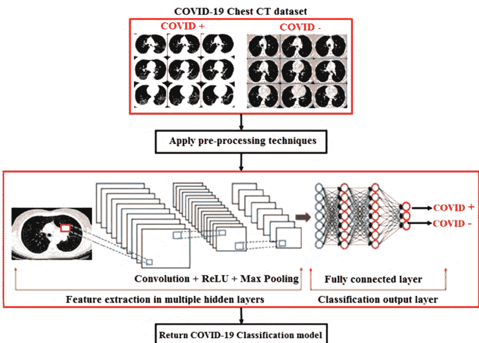

图 (1)。CAD 工具在 COVID-19 感染分类中的应用。

### 基于 CAD 的心脏病学研究

超声心动图是心血管医学中最常用的筛查工具。它具有简单的数据采集和解释机制。因此，它可以与 CAD 集成，提供一种成本效益高且无辐射的操作。此外，还采用 CT 和 MRI 等三维成像技术来提供全面的心脏解剖结构。

如图 (2) 所示，CAD 可以预处理超声心动图数据集并为超声心动图医生提供优质输出。CAD 领域最近取得了重大进展，引入了 Echo Net（一种深度神经网络）。该模型能够区分心脏结构并评估其活动。Echo Net 还能预测通过概率推理可能不易识别的全身性症状。此外，还开发了诸如半监督 GAN 等信息超声心动图技术（在回归任务中表现出色），以解决访问控制问题。

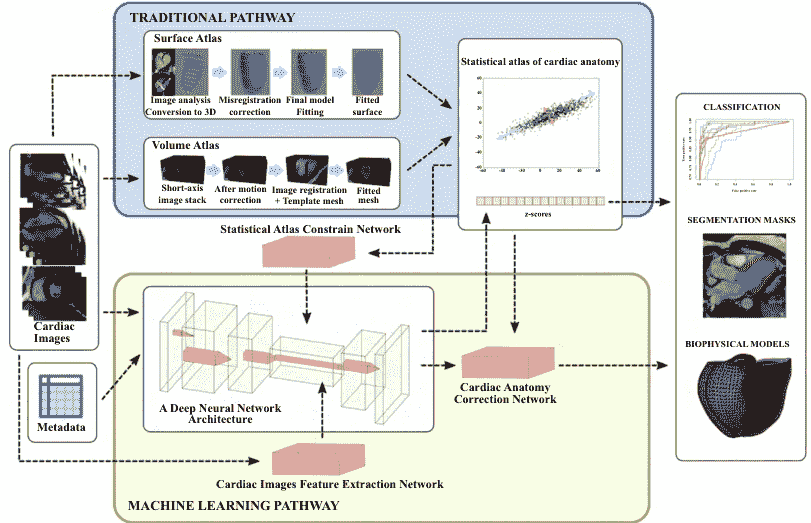

图 (2)。CAD 工具支持的心脏病学检查系统。

### 基于 CAD 的眼科学研究

在眼科领域，如图 (3) 所示，AI 辅助 CAD 工作大幅增加。图中明显表明，CAD 的临床诊断和计算能力超越了人类能力 [3]。眼底成像和光学相干断层扫描（OCT）在此系统中被大量用于检查和监测患者。从眼底图像中，卷积神经网络（CNN）可以准确检测各种疾病，并始终协助医生进行决策 [4, 5]。此外，CNN 可以识别眼睛中几种人类无法解释的特征，这些特征暗示相关的医学信息。

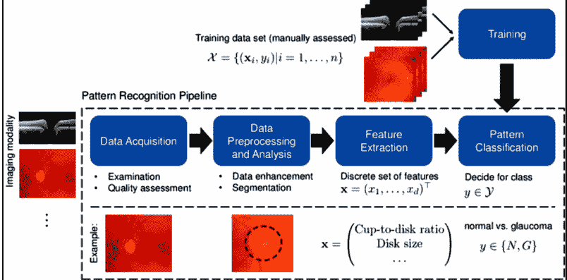

图 (3)。CAD 工具支持的用于青光眼识别的眼科学系统。

眼底图像已被证明在识别各种心血管和糖尿病风险变量方面具有实用性，包括年龄、性别、饮酒和吸烟习惯、BMI、舒张压和收缩压等 [6]。此外，CNN 可以预测累及中心性青光眼 [7]、年龄相关性黄斑变性 [8]、糖尿病性黄斑水肿 [9] 和明显的视野丧失 [10] 等病症的进展。贫血 [11] 和慢性肾脏病 [12] 也可以在眼底图像中被检测到。这一发现使得估算非眼部数据的新兴 AI 研究（从眼部扫描中）具有引人入胜的可能性。它有可能简化治疗，因为视力检查现在可以用于检查眼部和非眼部疾病。

### 基于 CAD 的皮肤病学研究

病变特异性鉴别诊断以及在众多良性病变中检测令人担忧的病变，是 CAD 在皮肤病学中面临的两个最重要的临床挑战 [13]。大量研究表明，CNN 可以以与专家皮肤科医生相同的效果水平识别正常和异常皮肤病变 [14 - 18]。事实上，这些研究始终表明分类精度与医生持平，甚至更好。该方法已发展到包括非视觉元数据作为分类系统，从而能够为广泛的皮肤病提供治疗选择，包括非肿瘤性瑕疵（如皮炎）和遗传问题。这些努力由开放式图片存储库和鼓励团队根据特定标准竞争的 CAD 活动推动。


当这些方案集成到图（4）所示的健康服务中时，它们可以协助各项职责，例如大规模恶性肿瘤检测和跨图像病变追踪。

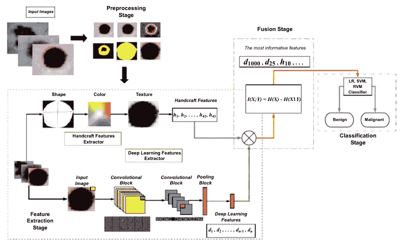

图（4）。皮肤病学应用的CAD方法论支持系统。

### 使用CAD的病理学研究

医师在癌症筛查和治疗中发挥着关键作用，传统上这涉及在显微镜下评估组织样本。然而，由于视觉感知和临床培训的差异，诊断和预后可能出现不一致。计算机辅助诊断（CAD）可以协助各项任务，包括诊断、预测治疗结果、肿瘤分割和诊断测试，特别是在乳腺X线摄影或X射线成像中，这是乳腺癌筛查的常见程序 [20, 21]。

早期识别乳腺癌对于改善患者的生活质量和情绪健康至关重要。然而，乳腺癌筛查图像通常包含众多异常和干扰，使得早期癌症的识别和解释变得具有挑战性（图 5）。为了克服这一问题，标准化图像质量并提取ROI至关重要 [22, 23]。CAD系统分析乳腺X线摄影图像中高度复杂的模式，尽管它们可能增加假阳性率。尽管如此，它们有助于实现高准确性和敏感性。因此，它们可能对乳腺X线摄影诊断和患者有益。

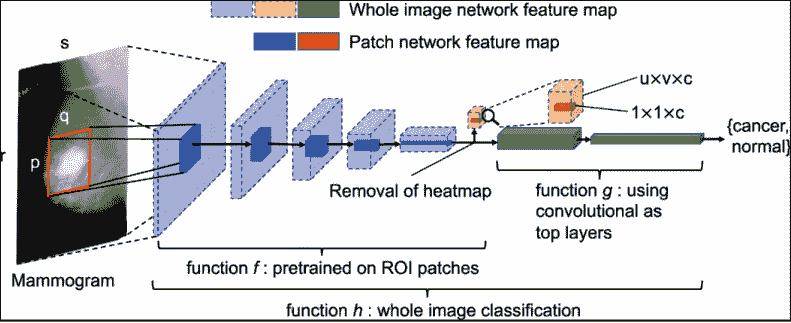

图（5）。CAD支持的病理学描述用于研究乳腺癌。

目前，癌症检测利用高效相机的亚微米级精度细胞探测 [24]。这种方法将病理学与放射学、全基因组和蛋白组测量相结合，增强了诊断和预后。它还解决了视觉信息和认知功能限制，提高了常规任务的生产力和准确性。此外，它解决了有感知的视觉解释和认知局限，从而改善了常规任务的结果和准确性 [25]。

该系统可以识别和分类细胞、细胞核和分裂象，以及定位和分割染色体、囊泡、腺体和转移灶等解剖元素。当前的研究重点在于直接诊断 [26, 27] 以及利用组织微阵列（TMA）对各种恶性肿瘤进行预测。即使通过免疫组化H&E染色收集的形态学特征也显示出在预测用于诊疗一体化的分子生物标志物方面的潜力 [28, 29]。

### CAD中采用的图像处理方法论

### 预处理

每个生物和医学诊断或成像输出都包含相当大的数据量，如果外科医生只需要图像的一小部分，分析起来既耗时又低效 [30]。利用通用下采样和量化技术的数据缩减程序已被采用来减少医学信息的体积并提高系统性能。

此外，应实施数据平坦化方法或监管策略，以减少数据集对噪声、对比度和尺寸的敏感性（图 6）。平滑技术也被应用以降低数据丢失的风险 [31]。最后，可以使用高效的预处理技术来减少预测所需的时间。

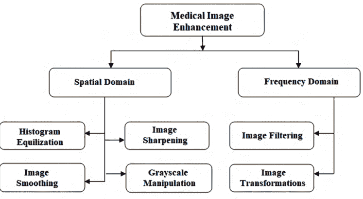

图（6）。显示图像增强过程中发生的过程的示意工作流。

### 主动轮廓方法

主动轮廓技术使用基于阈值的自动算法去除标签、患者身份、扫描和胶带工艺品等障碍。它还创建肌肉部分边界的形状。最后，它将肌肉部分的二值图像与原始图像相结合，以获得所需的上胸肌肉。

### 种子区域生长方法

这是一种专注于CLAHE过程 [32] 的彩色图像方法。它使用独特的种子区域生长（SRG）策略来建立一个紧凑的矩形，以区分ROI的肌肉部分，然后隐藏组织。如图（7）所示的区域扩展技术根据既定参数将像素合并为更大的块 [33]。基本计划是将其替换为种子点，然后将其发展成各个部分。例如，停止规则的提出是种子区域生长算法中的一个挑战。

- **第1部分：** 从倒直角三角形区域的两个左上角开始阅读。
- **第2部分：** 通过从位图亮度中减去平均强度，并除以估计强度与平均强度之差来计算选择技术。
- **第3部分：** 如果强度大于零且小于一，则像素将被融合到生长区域中，像素值将为零；否则，强度值将保持不变。

```
0 < \frac{P(x,y)-P_{avg}}{P_{max}-P_{avg}} \leq 1 
(1)
```

像素强度由P(x, y)表示。Pavg和Pmax分别是平均强度和最大强度。可增强的裁剪视觉区域将局限于倒直角三角形区域。这种方法有效地从图像中去除了不需要的上胸部区域。

### 形态学操作

腐蚀、膨胀、闭合和开放如图（8）所示是四种基本形态学过程。腐蚀用于填充图像中的间隙和孔洞。使用膨胀梯度掩码来突出内部肿瘤细胞。特征向量圆盘在图像中以半径5使用，从膨胀开始，以顶帽和底帽变换结束 [34 - 36]。随后执行形态学开放过程以消除伪影并重建图像。

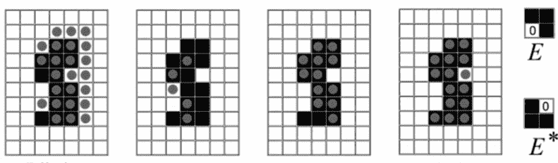

图（8）。形态学操作。

### 分割

如图（9）所示的医学图像分割在图像分析中发挥着重要作用。

分割方法根据亮度、颜色、纹理和反应性等特性将医学图像分为不同的区域。它有助于识别感兴趣区域。在癌症成像中，分割在检测肿块、微钙化和疑似病变方面起着至关重要的作用。它还通过分割致密组织部分来帮助近似图像密度。特征评估的精度在很大程度上依赖于分割图像的质量 [37, 38]。

下文所述的阈值、区域分割和区域生长等图像分割方法已证明其在不同类型数据集中的有效性 [39]。

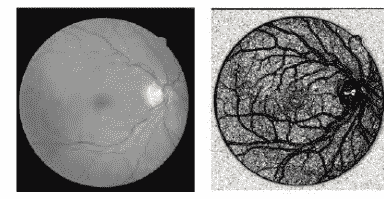

图（9）。使用地质测距主动轮廓进行眼底图像分割。

### 用于分割的边缘检测

诸如灰度直方图和基于梯度的方法等边缘检测方法，能够识别不同区域之间具有过渡性强的像素并形成封闭的物体边界 [40]。此外，边缘检测算法有潜力将图像分为正常段和轮廓段。

### 用于分割的阈值方法

像素级分割是一种在黑暗背景下处理内部和外部环境的简单有效的图像分割方法。灰度直方图和基于梯度的方法。阈值方法选择合适的阈值T，将图像像素分为不同的区域，并将不同对象与背景分开。自适应阈值技术将多级图像转换为二值图像。如果图像（x, y）的强度大于或等于预设阈值，即f（x, y）≥ T，则该像素作为图像实体包含在内，否则该像素属于背景 [41]。有两种选择阈值的方法 [42]：全局和局部。当T为常数时，该策略称为全局阈值；否则称为局部阈值。当背景照明不均匀时，全局阈值可能会失效。为了补偿不均匀光线，局部阈值中使用多个阈值 [43]。这些技术有助于在降低噪声的同时定位边缘像素。图像分割的三种类型是基于边缘、基于区域和混合阈值。像Canny边缘检测器和Laplacian边缘检测器这样的检测系统可以接受这种类型的区域（图 10）。Canny边缘检测器使用梯度幅值阈值识别可能的边缘像素，并使用非最大抑制和滞后阈值技术抑制这些像素。识别出的边缘由独立的像素组成，可能不完整或不连续，因为这些算法使用基于像素的操作。因此，使用后处理技术（包括形态学操作）来填补间隙并连接断点。

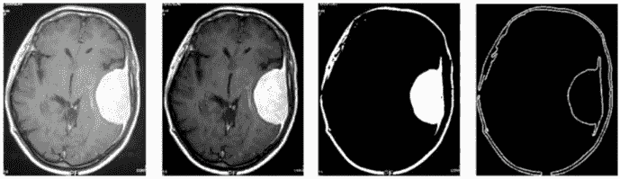

图（10）。脑肿瘤分割输出。


### 基于区域的分割方法

基于区域的方法根据一组预设参数将图像划分为相似区域。这些方法包括区域生长（RGA）和区域分割与合并（RSMA），如下所述。

### 区域生长算法（RGA）

基于预设准则，通过将像素划分为更小或更大的区域来对图像进行分割 [44]。首先在原始图像中选取一个种子像素簇，然后定义一组准则（例如灰度颜色强度）以建立截止阈值。分割过程接着通过包含满足与种子像素相似准则的周围像素来扩展区域。该扩展过程持续进行，直到不再有符合条件的像素可加入该区域，此时过程停止。

### 区域分割与合并算法（RSMA）

程序员采用一种将图像划分为一组任意不相连区域的方法，然后重新组合它们以实现适当的图像分割。该方法使用四叉树数据实现。该技术涉及在 Q(R) = FALSE 时将图像划分为四个象限。如果对任何象限 Q 为假，例如 Q(Ri) = FALSE，则该过程会进一步将象限细分为子象限，以此类推，直到无法再进行分割。在此，R 表示完整的图像区域，Q 是选定的谓词。

该方法的一个潜在缺陷是，仅进行分割后，最终划分可能包含属性相同的相邻区域。为解决此问题，该方法允许同时进行合并和分割，意味着它可以整合多个相邻区域 Rj 和 Rk，其中 Q (Rj U Rk) = TRUE。一旦无法再进行合并，过程即停止。这确保了更准确、高效的图像分割。

### 基于聚类的分割方法

这是一种用于像素分类的无监督学习方法，涉及建立称为聚类的有限类别集合 [45]。聚类无需训练步骤即可使用；相反，聚类是利用现有数据自发形成的。该方法使用匹配准则将像素分组为最终聚类，其指导原则是最大化类内相似度和类间相似度。输出质量受相似度量度和方法执行情况的影响。各种聚类算法，如硬聚类、k-means 聚类和模糊聚类，被用于分类。这些算法有助于对图像中的像素进行有效分组和分类。

### 基于流域和快速区域合并的混合图像分割

结合两种分割算法可增强分割过程的效果，从而得到高精度输出的非均匀区域。基于直方图的图像分区方法表示像素强度的基本概率分布函数。而基于边缘的技术则利用拉普拉斯微分滤波器生成轮廓线并表示表面。在基于区域的分割中，图像被划分为一系列同质区域，随后使用决策规则将其合并 [46]。对于马尔可夫随机场分割技术，根据概率密度函数生成一个带随机扇区的图像基础。

在复合图像分类中，结合了基于边缘和基于区域的方法。将图像划分为各部分，然后使用分割和融合技术将其融合。此外，该技术可以识别应关注边缘的模式 [47]。有关各种分割算法的全面比较，请参阅表 1。

表 1. 医学图像处理中各种分割算法的优缺点。

| 使用的技术 | 优点 | 缺点 | 参考文献 |
| :--- | :--- | :--- | :--- |
| (i) 图切片法，(ii) K-最近邻，(iii) 基于区域的过程，(iv) K-means 方案 | 可降低 CT 图像中的噪声以获得准确结果 | 耗时 | [48] |
| 四叉树分离方法 | RoI 属性可以以最方便、最简单的方式表示。 | 对不同四叉树具有平移不变性。 | [48] |
| Otsu 阈值法 | 所需存储量少，易于访问，计算机内成本极低，且执行速度非常快。 | 灰度值重叠时准确度最低。此外，它对含噪图像非常敏感。 | [49] |
| 边缘识别分割 | 可获得高对比度边界。 | 缺乏识别含噪图像的能力。 | [50] |
| 流域分割 | 识别各类图像简单高效。 | 处理含噪图像时需要参考操作。 | [51] |
| 人工神经网络（CNN、RBFNN、ANN 等） | 分割的超快技术。 | 训练时间长。 | [52, 53] |

### 特征选择

它用于解决图像维度问题，从而提高学习性能。

降维策略分为两类：特征选择和特征提取方法 [50]。另一个关键区别是，特征提取方法涉及自然组成并引入一组新函数，而特征选择则挑选相似度量度特性（图 11）。

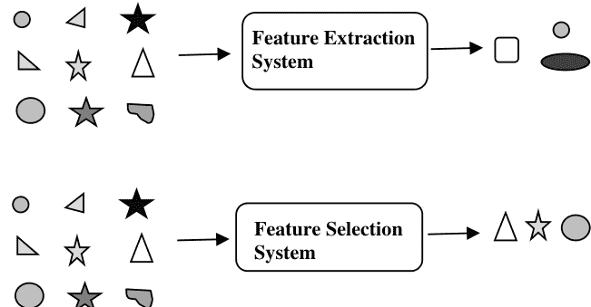

图 (11)。特征提取和选择过程。

特征提取的一个后果是，它可能会带来更好的类别和区分潜力，因为与图像分类相比，主要特征累积通常较低。因此，特征提取在可视化方面变得更加有用，并用于分析图像、处理信号和收集信息。在代表性和信息采集至关重要的情况下（尤其是在药学领域），选择一个生成相似度量度属性的组件是有益的，即使这会以牺牲精度为代价。特征选择在生物医学场景中仍然至关重要。

特征选择方法涉及对特征的独立评估或子集评估，具体取决于输出。根据过滤方法、嵌入方法和包装方法与学习过程的交互方式，它们已被归类为特征选择方法 [51]。过滤方法与任何学习方法无关，因为它们关注数据的整体特征。它们计算开销不大，并且由于独立于归纳过程，具有较强的泛化潜力。另一方面，包装方法和嵌入技术需要特征选择学习方法。所提算法介于过滤和包装之间，因为选择是归纳技术训练阶段的一部分，并且对最优数据子集的评估是在分类学习的同时进行的。在某些情况下，更倾向于使用混合技术，即先使用代价较低的筛选器排除某些元素，然后再使用计算开销更大的包装方法对其进行精调。

在众多技术中，有几种已广受欢迎。以下将讨论这些技术：

- i. 平滑滤波技术（SFT）是一种多功能筛选方法，它选择与不同算法呈负相关但仅与分类器强相关的算法。
- ii. SFT 基于类一致性选择模型参数，并使用不一致性测试来确定可接受的数据移除效率。该策略具有多方面性。
- iii. INTERACT 是一个分两个阶段执行的自动化系统：首先，它对大多数其他特征进行建模，但适当地对每个人完全线性的随机性进行排序；其次，它基于每个人的可靠性进行独立分析，并选择那些可靠性效果超过合理信念的特征，包括其多个变量。
- iv. 信息增强是一种基本的单变量筛选方法，它在创建所有特征的排序评估之前，先评估每个特征与分类之间的相似度量度。
- v. ReliefF 是一种众所周知的多变量过滤器，它使用最近邻来随机获取信息并搜索邻居。它在将结果与优点和缺点进行比较后，更新每个特征中的相关分数，确保特征可比，同时区分其他子类中发现的特征与同一类中发现的特征。
- vi. SVM-RFE（支持向量机递归特征消除）技术是一种集成方法，它反复训练 SVM 分类器，选择特征，然后根据 SVM 决定的内容移除最不突出的变量 [52]。

对这些技术进行了考察，以评估其解决各种困难的能力，例如相关性和重复性、高度非线性数据、输入特征不一致性、子类失真以及特征数量远多于样本数量的挑战。


### 脑成像中的特征选择

现代医学通过显著改善护理质量并通过研究计划实现早期诊断，彻底改变了医疗保健。在认知神经科学领域，医生现在有机会观察感官器官内脑图像自动识别的进展，并理解其独特价值。许多研究都集中在神经科学中经常使用的MRI图像上。脑肿瘤MRI分析中最重要的方面之一是使用新型混合控制程序，该程序涉及一组恢复曲线和训练量以理解图像。测试分析表明，混合功能选择方法优于其他监控程序。此外，逼真渲染技术已被应用于使用MRI扫描自动分离理想海马体信息。将各种特征选择策略（如过滤法、包裹法和嵌入法）与每个体素300个特征向量的集合进行比较，即使每个体素的属性集大幅减少，效率也没有降低。这些发现强调了特征选择技术在改善神经科学研究中MRI图像分析方面的有效性。

### 阿尔茨海默病中的特征选择

阿尔茨海默病通常使用MRI和PET进行诊断。研究人员已应用标准化来选择连接变量，以从机械处理的MRI和PET图像中诊断该病症的状况。这提高了有效性。在另一项研究中，从MRI图像中提取的特征被用于区分不同阿尔茨海默病相关认知状态[53]。特征选择技术被用于从不同脑区选择最相关的元素。随后，使用决策树和集群分类方法生成最终预测，结果表明所选特征在识别阿尔茨海默病生物标志物方面具有潜力。

### 肺病中的特征选择

一种特征提取技术用于在评估胸部CT扫描以识别呼吸系统疾病的整个过程中，从图像数据中识别最相关的指标。该方法基于通过费舍尔范数和遗传优化评估特征子集，以确定最佳子集。自适应阈值技术已被应用于发现坏死性呼吸系统疾病的CT亚型。该算法选择两个独立分类模型检索的特征并移除无关特征。结果表明，该方法在各种CT环境中具有高度影响力。

### 眼病中的特征选择

使用眼部扫描可以检测和诊断各种疾病。青光眼是失明的主要原因之一，借助计算机化决策支持工具可以早期识别。在一个基于光学相干断层扫描（OCT）图像的青光眼检测系统中，采用了排名组合（RC）方法。使用不同的特征选择算法来揭示最佳特征，而评级组合产生了最具区分度的信息。实验表明，应用此策略获得的特征子集优于单独的过滤方法。同样，早产儿视网膜病变（ROP）是一种严重疾病。采用了特征选择技术来调查疾病诊断中专家间差异的原因。该研究提高了诊断准确性，并使执业者更加紧密地联系在一起。各种特征选择技术的综合比较见表2。

表2. 基于整体效率的各种特征选择技术比较。

| 使用的技术 | 优点 | 缺点 | 参考文献 |
|---|---|---|---|
| [i] 基于相关性的快速特征选择<br>[ii] t检验特征选择<br>[iii] 形态学操作<br>[iv] Fisher得分<br>[v] FOCUS算法<br>[vi] 类内/类间距离<br>[vii] χ²统计量<br>[viii] 增益比<br>[ix] Relief和ReliefF算法<br>[x] 带子区域生长<br>[xi] 对称不确定性<br>[xii] 马尔科夫毯过滤<br>[xiii] 主动轮廓<br>[xiv] 基于相关性的特征选择<br>[xv] 基于互信息的方法 | (1) 可分析包含CT和MRI图像的大型数据集。<br>(2) 低计算成本。<br>(3) 处理大量数据的执行时间更短。<br>(4) 可扩展到庞大和复杂的图像。<br>(5) 高产出。<br>(6) 高度简化的程序。 | (i) 不考虑分类器交互。<br>(ii) 忽略特征参数相互依赖。<br>(iii) 特征提取差。<br>(iv) 准确度低。 | [35, 36] |

### 用于分类的特征选择

在分类过程中，为降维选择相关特征可以提高计算性能和准确性。可以使用数据关联、分组和分割技术来研究学习系统中的相似性，以分析最终的特征集[54]。

- A. *线性判别分析（LDA）*：LDA方法（图12）的目标是识别一组水平特征，这些特征可能区分独特的药物彼此。它有助于最小化空间维度并提高分类准确性。

- B. *主成分分析（PCA）*：对于包含大量相互关联变量的数据，这是一种降低数据维度的好方法。但是，PCA（图13）不适合用于稀疏分布和噪声信息的特征提取。

- C. *基于遗传算法的优化（GABO）*：这是一种基于基本选择原则的强大搜索优化算法。它通过采用先验知识并利用生存选择来调整模型参数。与适应度评估相关的特征表示为二进制字符串。

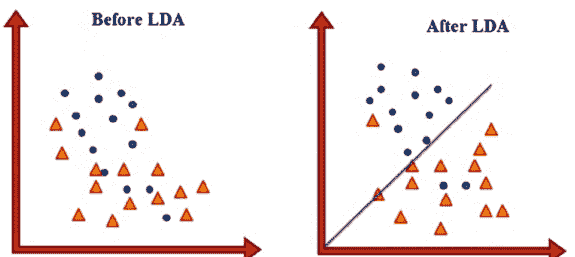

图（12）. LDA过程。

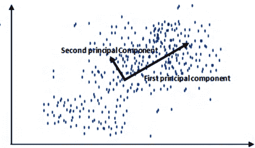

图（13）. 主成分分析。

### 分类

特征选择的空间排列特征适用于对象识别和分类。图像属性可用于诊断影像分析中的区域分割。它识别重要结构，这些结构可以通过运用经验和理解模型及分类算法来解释[55]。在每个区域周围，分别测量真正阳性（TP）、假正阳性（FP）、假负阴性（FN）和真负阴性（TN）值。

### 统计分类方法

这些方法可以是受监督的或无监督的。例如，k-means和模糊聚类是无监督方法。这些方法有助于对未标记数据进行分类。这些方法有助于基于医学图像对病人和健康人群进行大规模筛查[55]。

### 基于规则的系统分类

基于规则的系统通过使用多个规则来评估特定条件并触发动作，从而评估特征。规则包含两个部分：关于条件的假设和基于质量专业知识的活动。基于规则的系统包含三个治理系统：监督或管理标准、护理规范和通信指南。监督或管理标准与通过集成控制措施（例如开始和结束操作）来延长研究过程相关。战略规则选择在评估阶段甚至要测试哪些规则。它们仅关注在数据分析中提供独特特征的规则。然后，法规将数据从输入传递到活动中心，在那里计划认知标准的满足。此外，在修改输出数据库之前，研究规则会分析与必要情况相关的事实[56]。

### 神经网络分类器

这些分类器基于反向传播。网络通过更改权重和传播错误来学习。因此，它们用于模拟认知控制和自组织映射，如图14所示。这些分类器还用于特征分类、对象检测和图像解释[58 - 64]。

### 用于分类的支持向量机（SVM）

如图（15）所示的SVM分类器用于乳腺X线摄影中的肿块分类。如果结构满足特定阈值，放射科医生会将其标记


使用 CAD 系统，异常会被自动记录。此外，这些异常将被保留以供将来测试。SVM 与其他分类器进行了比较，以突出其优缺点。各分类算法的比较见表 3。

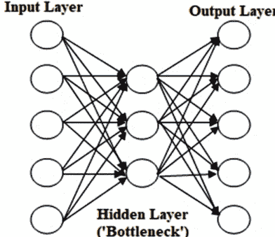

图 (14)。具有一个隐藏层的人工神经网络结构。

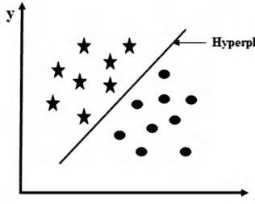

图 (15)。SVM 工作原理图。

### 医疗应用中 CAD 工具的讨论

基于计算机辅助生物医学成像的诊断不再只是梦想，而是现实。然而，在医疗保健中利用 CAD 工具需要比现有技术更强的预测潜力。医疗保健行业通过算法机器学习和自主决策等 CAD 技术，为持续创新开辟了新途径。

临床决策支持 (CDS) 可以利用 CAD 来帮助患者诊断、提供治疗建议，并进行人群 Framingham 风险分析 [70]。CAD 带来的重大变化引发了对该技术成本、效果和潜在效益的研究。为了实现这一目标，有必要全面了解影响不同制造和服务行业潜在用户在 CAD 基础领域参与度的因素。CAD 能够改善患者护理、诊断和医疗数据解释。根据我们的专科特定情境分析，CAD 算法在疾病诊断中提供了高且可医学耐受的预测值。尽管工作流程、病理和成像模式各异，但相似的 CAD 技术在所有学科中都表现出较高的预测准确性，表明 CAD 策略在放射学及其他领域具有适用性。需要注意的是，由于试验间的异质性和差异性增加，该荟萃分析中的预测性能估计存在不确定性。后续研究工作可以对此进行说明。

### 表 3. 医疗图像处理中图像分类器的比较。

| 使用的技术 | 优点 | 缺点 | 参考文献 |
|---|---|---|---|
| 支持向量机 | 核概念灵活且用户友好。即使在噪声图像中也能很好地工作。 | 结果缺乏透明度。计算开销大。 | [65 - 69] |
| K-最近邻算法 | 易于实现。在噪声数据集上效果良好。 | 需要更多内存且耗时。 | |
| 朴素贝叶斯分类器 | 计算成本低。在数值数据上效果良好。 | 需要大量数据集才能获得良好结果。 | |
| 神经网络 | 准确率高。在识别输入与输出之间的复杂关系方面效率高。 | 计算开销大。训练时间长。无法有效处理大量输入特征。 | |
| 贝叶斯网络 | 支持缺失数据 | 计算复杂度高。需要概率学专业知识。 | |

Chilamkurthy 等人 [71] 开发了一种系统，利用大型数据集检测 CT 头部扫描中的各种关键发现。进一步的研究表明，常规 CAD 在许多“人类”类别中的性能无与伦比，提供了高度的信心。虽然用于乳腺癌筛查的 CAD 技术减少了人为检测错误，但仍有关于 CAD 依赖性的伦理和社会信任考量及担忧需要解决。我们对乳腺癌筛查的研究揭示，CAD 在乳腺X线摄影、超声和 DBT 中检测乳腺癌方面表现出优异的临床可靠性。这些模态的有效性高度可比。

同样，Mazurowski 等人 [72] 使用三种不同的方法开发了用户模型：K-最近邻、人工神经网络和多元回归分析。Zhang 等人 [73] 设计了一个计算机模型，以识别更可能发生假阳性错误的区域。在此情况下，基于 CAD 的机器学习技术是一种随机森林，使用住宅观测数据进行训练以预测未来错误的可能性。计算机视觉技术被用于潜在假阳性分割和病变特征提取 [74]。

研究结果表明，在眼科中，使用 CAD 从 RFP 和 OCT 扫描中可以很好地检测 DR、AMD 和青光眼等疾病，具有良好的灵敏度、精确度和 AUC。数据还表明，在放射技术中，CAD 对 CT 扫描和 CXR 中胸部病理的检测具有高灵敏度、特异度和 AUC。虽然 CAD 在 CT 上表现出更高的灵敏度和 AUC，但 CXR 显示出更好的特异度、PPV 和 F1 分数。此外，CAD 在 CT 上检测癌症或肺部肿块时，其灵敏度显著优于 CXR。尽管 CAD 系统的准确率并非 100%，但其命中率表明灵敏度目前可达到约 98%。然而，CAD 的准确性取决于多种因素，例如用于训练模型的图像特征和回顾性设计。图像质量、乳腺X线摄影测试条件、放射科医生标记、病变类型以及肿瘤大小和位置等因素都会显著影响 CAD 的准确性。另一方面，MRI 的诊断准确性较差，可能是由于数据集有限和使用 2D 图像所致。使用更大的数据集和多参数 MRI 可能有助于提高诊断准确性。为了创建针对乳腺X线摄影的个性化计算机辅助检测系统，在生物医学图像评估中已采用了单一和混合 ANN 工具。

### 结论

开发人员、医疗从业人员和研究人员在基于医学图像的疾病诊断方面面临挑战。迫切需要高效率的 CAD 工具，以实现组织或器官异常的可靠和早期诊断。放射学中的 CAD 软件工具有助于放射科医生更快、更高效地读取研究，减少假阴性，并能快速分析随访扫描以纠正错误诊断。

推动全球 CAD 行业增长的若干因素包括癌症发病率上升、技术进步、对定期健康检查的认识不断提高、CAD 技术的创新以及其在癌症以外感染中的应用。在常规医疗实践中实施 CAD 可能有助于更好地理解其在老年医学中的优势和风险。基于 CAD 的临床决策支持的潜在益处增强了其在医疗保健中的应用。

为了改善 CAD 的使用，有必要在研究设计和报告方面提供一致的指导，这可能说明其长期临床价值。然而，应谨慎考虑向混合图像分析工具的转变，以避免在医疗决策过程中将患者边缘化。在临床决策支持系统中加入可解释性至关重要，以维护医疗伦理原则并保护个人和公众健康。

有必要在开发人员、医疗保健从业者和研究人员中提高对 CAD 在生物医学图像分析中的局限性和挑战的认识。跨学科合作在解决先进生物医学研究领域的这些问题方面可以发挥关键作用。

### 参考文献

- [1] N. Pradhan, V.S. Dhaka, G. Rani, 和 H. Chaudhary, "使用深度学习转变医学图像视图", Neural Comput. Appl., vol. 32, no. 18, pp. 15043-15054, 2020. [http://dx.doi.org/10.1007/s00521-020-04857-z]
- [2] G. Rani, M.G. Oza, 和 V.S. Dhaka, "应用基于深度学习的多模态方法检测冠状病毒", Multimedia Syst., vol. 28, pp. 1251-1262, 2022. [PMID: 34305327]
- [3] P. Keane 和 E. Topol, "重塑眼科检查", Lancet, vol. 394, no. 10215, p. 2141, 2019. [http://dx.doi.org/10.1016/S0140-6736(19)33051-X] [PMID: 32738957]
- [4] V. Gulshan, L. Peng, M. Coram, M.C. Stumpe, D. Wu, A. Narayanaswamy, S. Venugopalan, K. Widner, T. Madams, J. Cuadros, R. Kim, R. Raman, P.C. Nelson, J.L. Mega, 和 D.R. Webster, "开发和验证用于视网膜眼底照片中糖尿病视网膜病变检测的深度学习算法", JAMA, vol. 316, no. 22, pp. 2402-2410, 2016. [http://dx.doi.org/10.1001/jama.2016.17216] [PMID: 27898976]
- [5] D.S.W. Ting, C.Y.L. Cheung, G. Lim, G.S.W. Tan, N.D. Quang, A. Gan, H. Hamzah, R. Garcia-Franco, I.Y. San Yeo, S.Y. Lee, E.Y.M. Wong, C. Sabanayagam, M. Baskaran, F. Ibrahim, N.C. Tan, E.A. Finkelstein, E.L. Lamoureux, I.Y. Wong, N.M. Bressler, S. Sivaprasad, R. Varma, J.B. Jonas, M.G. He, C.Y. Cheng, G.C.M. Cheung, T. Aung, W. Hsu, M.L. Lee, 和 T.Y. Wong, "开发和验证用于糖尿病及相关眼病的多民族糖尿病人群视网膜图像的深度学习系统", JAMA, vol. 318, no. 22, pp. 2211-2223, 2017. [http://dx.doi.org/10.1001/jama.2017.18152] [PMID: 29234807]
- [6] R. Poplin, A.V. Varadarajan, K. Blumer, Y. Liu, M.V. McConnell, G.S. Corrado, L. Peng, 和 D.R. Webster, "通过深度学习从视网膜眼底照片预测心血管风险因素", Nat. Biomed. Eng., vol. 2, no. 3, pp. 158-164, 2018. [http://dx.doi.org/10.1038/s41551-018-0195-0] [PMID: 31015713]
- [7] Z. Li, Y. He, S. Keel, W. Meng, R.T. Chang, 和 M. He, "基于彩色眼底照片的青光眼性视神经病变深度学习系统的有效性", Ophthalmology, vol. 125, no. 8, pp. 1199-1206, 2018.
- [8] J. Yim, R. Chopra, T. Spitz, J. Winkens, A. Obika, C. Kelly, H. Aksham, M. Lukic, J. Huemer, K. Fasler, G. Moraes, C. Meyer, M. Wilson, J. Dixon, C. Hughes, G. Rees, P.T. Khaw, A. Karthikesalingam, D. King, D. Hassabis, M. Suleyman, T. Back, J.R. Ledsam, P.A. Keane, 和 J. De Fauw, "使用深度学习预测转化为湿性年龄相关性黄斑变性", Nat.


医学，卷 26，期 6，页 892-899，2020。
[http://dx.doi.org/10.1038/s41591-020-0867-7] [PMID: 32424211]

- [9] A.V. Varadarajan, P. Bavishi, P. Ruamviboonsuk, P. Chotcomwongse, S. Venugopalan, A. Narayanaswamy, J. Cuadros, K. Kanai, G. Bresnick, M. Tadarati, S. Silpa-archa, J. Limwattananayong, V. Ngcanhavee, J.R. Ledsam, P.A. Keane, G.S. Corrado, L. Peng, 和 D.R. Webster, "使用深度学习从眼底照片中预测光学相干断层扫描衍生的糖尿病性黄斑水肿分级", Nat. Commun., 卷 11，期 1，页 130，2020。
[http://dx.doi.org/10.1038/s41467-019-13922-8] [PMID: 31913272]

- [10] S. Yousefi, T. Kiwaki, Y. Zheng, H. Sugira, R. Asaoka, H. Murata, H. Lemij, 和 K. Yamanishi, "使用机器学习检测青光眼患者的纵向视野进展", Am. J. Ophthalmol., 卷 193，页 71-79，2018。
[http://dx.doi.org/10.1016/j.ajo.2018.06.007] [PMID: 29920226]

- [11] A. Mitani, A. Huang, S. Venugopalan, G.S. Corrado, L. Peng, D.R. Webster, N. Hammel, Y. Liu, 和 A.V. Varadarajan, "通过深度学习从视网膜眼底图像中检测贫血", Nat. Biomed. Eng., 卷 4，期 1，页 18-27，2020。
[http://dx.doi.org/10.1038/s41551-019-0487-z] [PMID: 31873211]

- [12] C. Sabanayagam, D. Xu, D.S.W. Ting, S. Nusinovici, R. Banu, H. Hamzah, C. Lim, Y.C. Tham, C.Y. Cheung, E.S. Tai, Y.X. Wang, J.B. Jonas, C.Y. Cheng, M.L. Lee, W. Hsu, 和 T.Y. Wong, "一种基于社区人群视网膜照片检测慢性肾脏病的深度学习算法", Lancet Digit. Health, 卷 2，期 6，页 e295-e302，2020。
[http://dx.doi.org/10.1016/S2589-7500(20)30063-7] [PMID: 33328123]

- [13] A. Esteva, 和 E. Topol, "AI 能否改变皮肤癌诊断？", Lancet, 卷 394，期 10211，页 1795，2019。
[http://dx.doi.org/10.1016/S0140-6736(19)32726-6]

- [14] A. Esteva, B. Kuprel, R.A. Novoa, J. Ko, S.M. Swetter, H.M. Blau, 和 S. Thrun, "使用深度神经网络进行皮肤科医生水平的皮肤癌分类", Nature, 卷 542，期 7639，页 115-118，2017。
[http://dx.doi.org/10.1038/nature21056] [PMID: 28117445]

- [15] T.J. Brinker, A. Hekler, A.H. Enk, J. Klode, A. Hauschild, C. Berking, B. Schilling, S. Haferkamp, D. Schadendorf, T. Holland-Letz, J.S. Utikal, C. von Kalle, W. Ludwig-Peitsch, J. Sirocky, L. Heinzerling, M. Albrecht, K. Baratzella, L. Bischoff, E. Chorti, A. Dith, C. Drusio, N. Giese, E. Grassert, K. Griewank, S. Hallasch, Z. Hanhart, S. Herz, K. Hohaus, P. Jansen, F. Jockenhöfer, T. Kanakis, S. Knispel, K. Leonhardt, A. Martaki, L. Matei, J. Matull, A. Olischewski, M. Petri, J.-M. Plaecke, S. Raub, K. Salva, S. Schlott, E. Sody, N. Steinrueg, I. Stoffels, S. Ugurel, A. Zaremba, C. Gebhardt, N. Booken, M. Christolouka, K. Buder-Bakhaya, T. Bokor-Billmann, A. Enk, P. Gholam, H. Hänßle, M. Salzmann, S. Schäfer, K. Schäkel, T. Shank, A.-S. Bohne, S. Deffaa, K. Derup, F. Egberts, A.-S. Erkens, B. Ewald, S. Falkvoll, S. Gerdes, V. Harde, A. Hauschild, M. Jost, K. Kosova, L. Messinger, M. Metzner, K. Morrison, R. Motamedi, A. Pineckzer, A. Rosenthal, N. Scheller, T. Schwarz, D. Stölzl, F. Thielking, E. Tomaschewski, U. Wehkamp, M. Weichenthal, O. Wiedow, C.M. Bär, S. Bender-Säbelkampf, M. Hörbrügger, A. Karoglan, L. Kraas, J. Faulhaber, C. Gerard, Z. Guo, P. Koch, M. Linke, N. Maurier, V. Müller, B. Thomas, J.S. Utikal, A.S.M. Al-amri, A. Bacakzo, C. Berking, M. Betke, C. Haas, D. Hartmann, M.V. Hepp, K. Kilian, S. Krammer, N.L. Lapczynski, S. Mastnik, S. Nasifoglu, C. Ruini, E. Sattler, M. Schlaak, H. Wolff, B. Achatz, A. Bergbreiter, K. Drexler, M. Ettinger, S. Haferkamp, A. Halupczok, M. Hegemann, V. Dinauer, M. Maagk, M. Mickler, B. Philipp, A. Wilm, C. Wittmann, A. Gesierich, V. Glutsch, K. Kahlert, A. Kerstan, B. Schilling, 和 P. Schrüfer, "在头对头皮肤镜黑色素瘤图像分类任务中，深度学习优于 157 名皮肤科医生中的 136 名", Eur. J. Cancer, 卷 113，页 47-54，2019。
[http://dx.doi.org/10.1016/j.ejca.2019.04.001] [PMID: 30981091]

- [16] B. McMahan, E. Moore, D. Ramage, S. Hampson, 和 B.A. Arcas, "来自分散数据的深度网络通信高效学习", 2017。

- [17] J. Irvin, "Chexpert：带有不确定性标签和专家比对的大型胸部 X 光片数据集", AAAI 人工智能会议论文集, 卷 33，页 590-597，2019。
[http://dx.doi.org/10.1609/aaai.v33i01.3301590]

- [18] L.H. Kamulegeya, "在乌干达使用人工智能处理皮肤科疾病：为训练数据集多样性提倡", Mach. Learn., 2019。

- [19] J.G. Elmore, G.M. Longton, P.A. Carney, B.M. Geller, T. Onega, A.N.A. Tosteson, H.D. Nelson, M.S. Pepe, K.H. Allison, S.J. Schmitt, F.P. O'Malley, 和 D.L. Weaver, "病理学家在解释乳腺活检标本中的诊断一致性", JAMA, 卷 313，期 11，页 1122-1132，2015。
[http://dx.doi.org/10.1001/jama.2015.1405] [PMID: 25781441]

- [20] 可从以下网址获取：https://www.cancer.gov/types/breast

- [21] 可从以下网址获取：http://www.breastcancer.org/research-news/

- [22] M. Debra, 《乳腺成像：必备知识》第 2 版. Ikeda. St. Louis, MO: Mosby, 2011, 第 448 页。

- [23] J.J. Fenton, S.H. Taplin, P.A. Carney, L. Abraham, E.A. Sickles, C. D'Orsi, E.A. Berns, G. Cutter, R.E. Hendrick, W.E. Barlow, 和 J.G. Elmore, "计算机辅助检测对筛查乳腺 X 线摄影性能的影响", N. Engl. J. Med., 卷 356，期 14，页 1399-1409，2007。
[http://dx.doi.org/10.1056/NEJMoa066099] [PMID: 17409321]

- [24] A.J. Evans, T.W. Bauer, M.M. Bui, T.C. Cornish, H. Duncan, E.F. Glassy, J. Hipp, R.S. McGee, D. Murphy, C. Myers, D.G. O'Neil, A.V. Parwani, B.A. Rampy, M.E. Salama, 和 L. Pantanowitz, "美国食品药品监督管理局批准全切片图像成像用于初步诊断：关键里程碑已达成，新问题随之提出", Arch. Pathol. Lab. Med., 卷 142，期 11，页 1383-1387，2018。
[http://dx.doi.org/10.5858/arpa.2017-0496-CP] [PMID: 29708429]

- [25] K. Bera, K.A. Schalper, D.L. Rimm, V. Velcheti, 和 A. Madabhushi, "数字病理学中的人工智能：用于诊断和精准肿瘤学的新工具", Nat. Rev. Clin. Oncol., 卷 16，期 11，页 703-715，2019。
[http://dx.doi.org/10.1038/s41571-019-0252-y] [PMID: 31399699]

- [26] G. Litjens, C.I. Sánchez, N. Timofeeva, M. Hermsen, I. Nagtegaal, I. Kovacs, C. Hulsbergen - van de Kaa, P. Bult, B. van Ginneken, 和 J. van der Laak, "深度学习作为提高病理组织学诊断准确性和效率的工具", Sci. Rep., 卷 6，期 1，页 26286，2016。
[http://dx.doi.org/10.1038/srep26286] [PMID: 27212078]

- [27] N. Coudray, P.S. Ocampo, T. Sakellaropoulos, N. Narula, M. Snuderl, D. Fenyö, A.L. Moreira, N. Razavian, 和 A. Tsirigos, "使用深度学习从非小细胞肺癌病理组织学图像中进行分类和突变预测", Nat. Med., 卷 24，期 10，页 1559-1567，2018。
[http://dx.doi.org/10.1038/s41591-018-0177-5] [PMID: 30224757]

- [28] G. Campanella, M.G. Hanna, L. Geneslaw, A. Miraflor, V. Werneck Krauss Silva, K.J. Busam, E. Brogi, V.E. Reuter, D.S. Klimstra, 和 T.J. Fuchs, "使用弱监督深度学习在全切片图像上进行临床级计算病理学", Nat. Med., 卷 25，期 8，页 1301-1309，2019。
[http://dx.doi.org/10.1038/s41591-019-0508-1] [PMID: 31308507]

- [29] R.R. Rawat, I. Ortega, P. Roy, F. Sha, D. Shibata, D. Ruderman, 和 D.B. Agus, "深度学习组织“指纹”根据 H&E 图像中的 ER/PR/Her2 状态分类乳腺癌", Sci. Rep., 卷 10，期 1，页 7275，2020。
[http://dx.doi.org/10.1038/s41598-020-64156-4] [PMID: 32350370]

- [30] K. Da Silva, P. Kumar, Y.E. Choonara, L.C. du Toit, 和 V. Pillay, "三维生物打印定制神经支架医学图像数据预处理", Tissue Eng. Part C Methods, 卷 25，期 7，页 401-410，2019。
[http://dx.doi.org/10.1089/ten.tec.2019.0052]

- [31] P.J. Reynisson, M. Scali, E. Smistad, E.F. Hofstad, H.O. Leira, F. Lindseth, T.A. Nagelhus Hernes, T. Amundsen, H. Sørger, 和 T. Lango, "胸部 CT 中的气道分割和中心线提取"


- 与最新商业化方法的新方法比较”，PLoS One，第10卷，第12期，e0144282，2015年。[http://dx.doi.org/10.1371/journal.pone.0144282] [PMID: 26657513]

- [32] A. Makandar, 和 B. Halalli, “数字乳腺X线摄影图像预处理技术综述”, Int. J. Comp. App., 2015.

- [33] F.H. Alhsnony, 和 M.G.M. Abdolrasol, 数字乳腺X线图像中胸肌区域自动识别, 第4卷, Int. J. e-Edu. e-Bus. e-Management and e-Learn, 2014, 第15-18页.

- [34] K.A.M. Said, A.B. Jambek, 和 N. Sulaiman, “使用形态学开运算和闭运算进行图像处理研究”, Int. J. Control Theory and Applications., 第9卷, 第15-21页, 2016.

- [35] M. Agarwal, G. Rani, 和 V. S. Dhaka, “用于肿瘤检测的优化对比度增强”, Int. J. Imaging. Sys. Technol., 第30卷, 第3期, 第687-703页, 2020. [http://dx.doi.org/10.1002/ima.22408]

- [36] V. Kumar, 和 S. Minz, “特征选择”, Smart CR., 第4卷, 第211-219页, 2014.

- [37] Y. Cheng, 和 B. Li, “图像分割技术及其在数字图像处理中的应用”, 2021年IEEE亚太图像处理、电子与计算机会议(IPEC), 第1174-1177页, 2021. [http://dx.doi.org/10.1109/IPEC51340.2021.9421206]

- [38] S.M. Patel, 和 J.N. Dharawa, “基于深度学习方法的医学图像增强”, Nat. J. Sys. & Inf. Tec., 第11卷, 第35-44页, 2018.

- [39] R. Chai, “基于记忆型果蝇优化算法的Otsu图像分割算法”, Complexity, 第2021卷, 第1-11页, 2021. [http://dx.doi.org/10.1155/2021/5564690]

- [40] C.L. Chowdhary, 和 D.P. Achariya, “医学影像中的分割与特征提取：系统综述”, Procedia Comput. Sci., 第167卷, 第26-36页, 2020. [http://dx.doi.org/10.1016/j.procs.2020.03.179]

- [41] S. Asgari Taghanaki, K. Abhishek, J.P. Cohen, J. Cohen-Adad, 和 G. Hamarneh, “自然和医学图像的深度语义分割：综述”, Artif. Intell. Rev., 第54卷, 第1期, 第137-178页, 2021. [http://dx.doi.org/10.1007/s10462-020-09854-1]

- [42] C. Kang, C. Wu, 和 J. Fan, “基于熵的圆形直方图阈值法用于彩色图像分割”, Signal Image Video Process., 第15卷, 第1期, 第129-138页, 2021. [http://dx.doi.org/10.1007/s11760-020-01723-2]

- [43] P. Singh, “基于II型中子模糊-熵融合的脑肿瘤组织结构分割多阈值方法”, Appl. Soft Comput., 第103卷, 107119, 2021. [http://dx.doi.org/10.1016/j.asoc.2021.107119]

- [44] S. Mazouzi, 和 Z. Guessoum, “一种快速且完全分布式的基于区域的图像分割方法”, J. Real-Time Image Process., 第18卷, 第3期, 第793-806页, 2021. [http://dx.doi.org/10.1007/s11554-020-01021-7]

- [45] L. Rundo, C. Militello, S. Vitabile, C. Casarino, G. Russo, M. Midiri, 和 M.C. Gilardi, “将分割-合并算法与多种子区域生长算法相结合用于MRgFUS治疗中的子宫肌瘤分割”, Med. Biol. Eng. Comput., 第54卷, 第7期, 第1071-1084页, 2016. [http://dx.doi.org/10.1007/s11517-015-1404-6] [PMID: 26530047]

- [46] V.S. Dhaka, G. Rani, M.G. Oza, T. Sharma, 和 A. Misra, “一种用于COVID-19大规模筛查的深度学习模型”, Int. J. Imaging Syst. Technol., 第31卷, 第2期, 第483-498页, 2021. [http://dx.doi.org/10.1002/ima.22544] [PMID: 33821094]

- [47] N. Kundu, G. Rani, 和 V.S. Dhaka, “基于机器学习和物联网的疾病预测和警报生成系统”, 第4届计算方法与通信国际会议, 2020, 第764-769页.

- [48] N. Pradhan, V.S. Dhaka, G. Rani, 和 H. Chaudhary, “医学图像多视图可视化的机器学习模型”, Comput. J., 2020.

- [49] G. Rani, 和 M. Agarwal, “使用最优阈值选择进行对比度增强”, Int. J. Soft. Innov., 第8卷, 第3期, 第96-118页, 2020. [http://dx.doi.org/10.4018/IJSI.2020070107]

- [50] J.S. Sevak, A.D. Kapadia, J.B. Chavda, A. Shah, 和 M. Rahevar, “语义图像分割技术综述”, 在: 集成可持续系统国际会议ICISS 2017论文集, 2018.

- [51] R. Sarma, 和 Y.K. Gupta, “新旧分割技术的比较研究”, IOP会议系列：材料科学与工程, 2021. [http://dx.doi.org/10.1088/1757-899X/1022/1/012027]

- [52] S.S. Chouhan, A. Kaul, 和 U.P. Singh, “使用计算智能技术进行图像分割：综述”, Arch. Comput. Methods Eng., 2019.

- [53] M.G. Oza, G. Rani, 和 V.S. Dhaka, “使用卷积神经网络的青光眼检测”, 在: 通过数据分析和机器学习进行疾病预测研究手册, 2021. [http://dx.doi.org/10.4018/978-1-7998-2742-9.ch001]

- [54] E. Miranda, M. Aryuni, 和 E. Irwansyah, “医学图像分类技术综述”, 信息管理与技术国际会议, 第56-61页, 2016. [http://dx.doi.org/10.1109/ICIMTech.2016.7930302]

- [55] M. Anthimopoulos, S. Christodoulidis, L. Ebner, A. Christe, 和 S. Mougiakakou, “使用深度卷积神经网络进行间质性肺疾病肺部模式分类”, IEEE Trans. Med. Imaging, 第35卷, 第5期, 第1207-1216页, 2016. [http://dx.doi.org/10.1109/TMI.2016.2535865] [PMID: 26955021]

- [56] F. Ciompi, B. de Hoop, S.J. van Riel, K. Chung, E.T. Scholten, M. Oudkerk, P.A. de Jong, M. Prokop, 和 B. Ginneken, “使用2D视图集成和开箱即用的卷积神经网络对计算机断层扫描中的肺门周围结节进行自动分类”, Med. Image Anal., 第26卷, 第1期, 第195-202页, 2015. [http://dx.doi.org/10.1016/j.media.2015.08.001] [PMID: 26458112]

- [57] L. Oakden-Rayner, “CAD的重生：现代AI与我们所知的CAD有何不同?”, Radiol. Artif. Intell., 第1卷, 第3期, e180089, 2019. [http://dx.doi.org/10.1148/ryai.2019180089] [PMID: 33937793]

- [58] E.F.I. Raj, 和 V. Kamaraj, “开关磁阻电机驱动的神经网络控制”, 2013年IEEE计算、通信和纳米技术新兴趋势国际会议, 第678-682页, 2013. [http://dx.doi.org/10.1109/ICE-CCN.2013.6528586]

- [59] E. Fantin Irudaya Raj, 和 M. Balaji, “使用深度学习神经网络对开关磁阻电机故障进行分析和分类”, Arab. J. Sci. Eng., 第46卷, 第2期, 第1313-1332页, 2021. [http://dx.doi.org/10.1007/s13369-020-05051-y]

- [60] K. Priyadarsini, E.F.I. Raj, A.Y. Begum, 和 V. Shanmugasundaram, “已撤回：从系统工程师角度比较DevOps流程”, Mater. Today Proc., 2020. [http://dx.doi.org/10.1016/j.matpr.2020.09.624]

- [61] V. Gampala, M. Sunil Kumar, C. Sushama, 和 E. Fantin Irudaya Raj, “已撤回：基于深度学习的图像去模糊图像处理方法”, Mater. Today Proc., 2020. [http://dx.doi.org/10.1016/j.matpr.2020.11.076]

- [62] P. Agarwal, M.A. Ch, D.S. Kharate, E.F.I. Raj, 和 S. Balamuralitharan, “使用主成分分析估计COVID-19第二波BHRP传播模型的参数”, Ann. Rom. Soc. Cell Biol., 第446-457页, 2021.

- [63] M. Deivakani, S. S. Kumar, N. U. Kumar, E. F. I. Raj, 和 V. Ramakrishna, “离散余弦变换近似递归算法的VLSI实现”, Int. J. Physics: Conference Series, 第1817卷, 第1期, 1, 2017.

- [64] G. Ch, S. Jana, S. Majji, P. Kuncha, 和 A. Tigadi, 使用3D CT扫描诊断COVID-19及COVID-19疫苗接种. World J. Engg. 2021.

- [65] D. Jain, 和 V. Singh, “慢性疾病预测的特征选择和分类系统：综述”, Egyptian Informatics Journal, 第19卷, 第3期, 第179-189页, 2018. [http://dx.doi.org/10.1016/j.eij.2018.03.002]

- [66] G. Savita Sharma, G. Rani, 和 V.S. Dhaka, “心血管疾病预测机器学习技术综述”, 第6届并行、分布式和网格计算国际会议, 2020.

- [67] A. Esteva, 基于深度学习的医学计算机视觉, 2021. [http://dx.doi.org/10.1038/s41746-020-00376-2]

- [68] G. Savita Sharma, G. Rani, 和 V.S. Dhaka, 使用机器学习方法进行冠状动脉疾病分类的高效预测建模, 第1099卷, 012068, 2021.

- [69] A. Madani, R. Arnaout, M. Mofrad, 和 R. Arnaout, “使用深度学习进行超声心动图快速准确的视图分类”, NPJ Digit. Med., 第1卷, 第1期, 6, 2018. [http://dx.doi.org/10.1038/s41746-017-0013-1] [PMID: 30828647]

- [70] N. Pradhan, G. Rani, V.S. Dhaka, 和 R.C. Poonia, 14 - 使用人工神经网络的糖尿病预测, 2020.

- [71] S. Chilamkurthy, R. Ghosh, S. Tanamala, M. Biviji, N.G. Campeau, V.K. Venugopal, V. Mahajan, P. Rao, 和 P. Warier, “头部CT扫描中关键发现检测的深度学习算法：一项回顾性研究”, Lancet, 第392卷, 第10162期, 第2388-2396页, 2018. [http://dx.doi.org/10.1016/S0140-6736(18)31645-3] [PMID: 30318264]

- [72] M.A. Mazurrowski, J.A. Baker, H.X. Barnhart, 和 G.D. Tourassi, “基于用户建模的个性化计算机辅助乳腺X线摄影教育：概念和初步实验”, Med. Phys., 第37卷, 第3期, 第1152-1160页, 2010. [http://dx.doi.org/10.1118/1.3301575] [PMID: 20384251]

- [73] J. Zhang, J.I. Silber, 和 M.A. Mazurrowski, “为改善乳腺X线摄影教育而对放射学住院医师假阳性错误模式进行建模”, J. Biomed. Inform., 第54卷, 第50-57页, 2015. [http://dx.doi.org/10.1016/j.jbi.2015.01.007] [PMID: 25640462]

- [74] P. Esmaeilzadeh, “医疗目的中使用基于AI的工具：从消费者角度进行的调查研究”, BMC Med. Inform. Decis. Mak., 第20卷, 第1期, 170, 2020. [http://dx.doi.org/10.1186/s12911-020-01191-1] [PMID: 32698869]


## 第 5 章

### 使用机器学习进行痴呆症预后

Anu Saini^1, Sunita Kumari^1*, Ritik ^1, Rajni ^1 and Sushma Hans^2

^1 GB Pant DSEU, Okhla-1 校区, 德里, 印度
^2 阿米蒂大学，迪拜校区，迪拜，阿拉伯联合酋长国

* 通讯作者 Sunita Kumari: GB Pant DSEU, Okhla-1 校区, 德里, 印度; E-mail: sunita2009@gmail.com

**摘要：** 大脑是人体最敏感的部分之一，每瞬间传递数百万个信号。痴呆症是最新兴的大脑健康问题，涉及记忆力减退、解决问题困难、处理复杂任务等。痴呆症是一种导致精神能力丧失的综合征。它会影响记忆、思维、形状、理解力、计数、阅读能力、语言和判断力。痴呆症影响数百万人，并可能是导致死亡的主要原因。它目前是全球第七大死亡原因，也是老年人功能障碍和依赖的主要原因之一。目前尚无治疗痴呆症的方法。早期检测和诊断对于改善早期和有效管理至关重要。提前预测痴呆症可以让我们过上更好的生活。为了预测痴呆症，已使用了各种机器学习模型。在本文中，痴呆症基于 MRI 图像进行预测，为此收集了三个不同的 MRI 图像数据集。此外，为了更好的预测，使用了各种机器学习模型来预测痴呆症，并通过 K-最近邻（K-Nearest Neighbours）、XG Boost、支持向量机（Support Vector Machine）、随机森林算法（RFA）和卷积神经网络（CNN）等统计分析验证性能。在所有算法中，随机森林算法和卷积神经网络效果最佳，准确率分别为 93.2 和 99.9。

**关键词：** 阿尔茨海默病，CNN（卷积神经网络），痴呆症，随机森林算法。

### 引言

痴呆症是一种神经心理学障碍，会导致记忆力减退，进而导致瘫痪并依赖他人生存。它最常见于 60 岁以上人群，估计有 9 亿六十多岁的人受其影响。它在全球影响超过 4600 万人，超过整个西班牙的人口。到 2050 年，这一数字预计将激增至 1.315 亿 [1]。由于严重的精神无能，阿尔茨海默病和其他主要影响老年人的痴呆症给家庭和社区造成了巨大的经济和社会负担，阿尔茨海默病占病例的 75% 以上。

据世界卫生组织（WHO）称，全球约有 5000 万人受痴呆症影响，预计每年新增 1000 万例。

痴呆症的临床诊断基于患者及其家属提供的详细健康病史，以及随后的神经系统检查和认知评估。应进行血液学、CT 和 MRI 等检查以诊断痴呆症的原因。神经心理学测试对于识别人类“认知领域”中的低效至关重要。尽管有几种早期检测痴呆症的临床步骤，但仍存在许多挑战。

一旦确诊，目前尚无可行的药物可以停止或阻止痴呆症的进展。因此，专注于早期阶段、及时干预和疾病预防变得至关重要。及时诊断可以确定痴呆症的程度，神经影像分析可以辅助诊断。

此外，如果我们能预测一个人未来是否会受痴呆症影响，那将更好。该病症使用各种机器学习技术进行预测。这项研究有助于确定如何使用深度学习利用 MRI 图像预测痴呆症。

我们采用了两种方法来实现模型的最高准确率：用于基于图像分析的卷积神经网络（CNN）和基于统计分析的 RFA。

CNN 是一种强大的图像处理和人工智能（AI）系统，利用深度学习执行高效和描述性功能，通常结合图像和视频识别以及补充算法，以及自然语言理解（NLU）。神经网络是一种硬件和/或软件系统，用于控制人脑中神经元激活后的模式。传统神经网络不太适合图像处理，因此应提供碎片化的图像。CNN 具有自己极其复杂的“传感器”，类似于旧唱片中使用的那些，是一个专门用于人类和动物视觉处理的站点。为了解决标准神经网络处理图像的困难，神经元层的结构方式使它们跨越整个观察场。

CNN 采用多层感知器技术，处理要求较低。CNN 层包括多个灵活性层、集成层、完全集成层，以及输入层、输出层和隐藏层。消除图像处理限制并提高效率，使其成为一个更高效、易于使用的训练系统，限制图像和自然语言处理。

随机森林是一种用于处理挫折和规划问题的机器学习策略。它采用集成学习，这是一种解决复杂问题的多学科方法。随机森林算法由大量可修剪的树组成。使用袋装或自助法来训练由随机森林算法形成的“森林”。袋装是一套元算法，帮助机器学习算法提高准确性。结果由算法（随机森林）决定，该算法基于决策树预测。它根据不同树的输出率进行预测。随着树木数量的增加，输出的准确性也会提高。

随机森林克服了决策树的算法局限性。它减少了数据集过载并提高了准确性。无需各种包配置（如 sci-kit-learn）即可生成预测。

### 随机森林算法特性：

- 提供一种处理缺失数据的有效技术。
- 与决策树算法相比，结果更准确。
- 无需调整上限参数即可提供可靠的推测。
- 解决决策树拥挤问题。

本文其余部分结构如下：

第二部分介绍了各研究人员开展的相关工作。第三部分讨论了作者提出的方法论。第四部分描述了实验工作和结果分析。最后，在第五部分，有结论。

### 相关工作

文献显示，许多研究人员使用了不同的机器学习模型来预测痴呆症。下面详细讨论了一些工作。

论文 [1] 的作者收集了 5,272 人完成包含 37 个项目的调查所得数据。他们关注选择特征的三种替代方法，以找出最重要的特征。然后，使用高级特征配合六种分离技术开发诊断模型。在三种特征选择策略中，信息获取已被证明是最成功的。朴素贝叶斯算法优于其他 6 种分割模型。本研究的诊断方法为临床医生提供了一种诊断早期痴呆症的有用工具。

一项研究的作者测试了三种机器学习算法：人工神经网络 (ANN)、向量辅助系统 (SVM) 和自适应神经模糊推理 (ANFIS) 设备。对于 60 名患者（33 名 AD，27 名 VD），许多来自静息态 fMRI (rs-fMRI) 和扩散张量成像 (DTI) 的区域指标被用作训练的输入特征。然后，利用其基本 MRI 数据，歧视性 VD-AD 模式被用来包含一组 ML 规则，该规则在预测 15 名具有“混合 VD – AD”（MXD）科学特征的退行性患者发生情况方面极其有效。将 3 年科学随访的分析证据与 ML 预测进行了比较。ANFIS 演变为一组区分 AD 和 VD 的高级标准，低级模式的准确率超过 84% [2]。

此外，当用真正的多模态输入特征（_例如_，DTI + rs-fMRI）替代一组非结构化劳动记录进行训练时，ANFIS 确保了增强的阶段准确性。ANFIS 利用 MXD 组中高质量歧视样本，完成了预计 77.33% 的价格。总体而言，研究结果表明，在区分 AD 和 VD 特征方面，我们的方法有可能非常具备区分性。

作者 [3] 使用了 2001 年至 2005 年间从韩国国民健康和营养检查调查 (KNHANES) 收集的 7031 项 65 岁以上研究数据，开发了一种深度神经网络 (DNN) 来利用医疗和医疗服务数据预测痴呆症。带有小/大规模测量的特定组件分析 (PCA) 是提取和预测重要背景要素的建议方法。他们将 DNN/缩放 PCA（即所提出的方法）与五种知名机器学习算法进行了比较。所提方法的 AUC 为 85.5%，高于现有算法。

论文 [4] 的作者评估了两个模型（梯度放大机和人工神经网络）的封装，这两个模型都用于预测痴呆症，并采用数学分析来验证其有效性。

在两步法中，论文 [5] 的作者使用了两种机器学习算法来预测疾病。首先，训练 ML 模型来预测未来普通诊断 (NC) 与受损理解 (MCI 或 AD)。第二，


使用基本特征，执行了三阶段分解，以直接预测随访诊断（NC、MCI、AD）。

论文[6]中考察了九种不同的学习机制。支持向量机是最常见的，单独使用时占46/76（61%），与其他机器学习技术集成时占53/76（70%），其次是线性判别分析（6/76，8%）、耗竭（4/76，5%）以及少量接近探索的邻居，例如正交推测到隐藏建筑、随机森林或部分表示。大部分分析（91/144，63%）仅使用了T1图像，少量使用了T1加上其他序列、其他形式的数据或两者兼用。每个分析样本的人口规模为100至902。同一分析中发现了超过300（51/144，35%）或少于150（45/144，31%）。

文献[7]展示了四个模型学习算法的比较分析：J48、朴素贝叶斯、随机森林和多层感知机。CFS子集评估用于属性约简。与所有痴呆算法相比，J48已被证明相当有效。

利用OASIS的数据，论文[8]的作者设计了一种基于机器的学习方法来诊断痴呆。为了确定准确率、内存和混淆矩阵，使用了SVM、AdaBoost、随机森林、线性判别分析、XGBoost算法和K最近邻等技术。以下算法的准确率范围为83%至90%。SVM的准确率为87%，KNN的准确率为84%，LDA的准确率为83%，随机森林的准确率为88%，AdaBoost的准确率为81%，XGBoost的准确率为90%。在准确率方面，XGBoost优于其他算法。

在论文[9]中，作者使用二分类（痴呆 vs. 非痴呆）达到了约92%的平均准确率，而完整的多阶段预测范围通过回归达到了77%的准确率，其次是随机森林的92%和70%。研究结果表明，学习机器可以基于可变的风险变量预测心理损伤，这可能促使采取行动，防止许多人的障碍扩散或变得更严重。

在论文[10]中，作者使用了朴素贝叶斯模型、支持向量机（SVM）、决策树、XGBoost、梯度提升、集成、AdaBoost、随机森林模型和LGBM（轻量梯度提升机）中的超参数分类器。该模型使用Python和MCapNet创建，并通过与其他尖端机器学习方法进行比较来验证结果。

近年来，基于机器学习的方法（如受监督机器学习）在医疗保健领域得到了更广泛的应用。心脏病、糖尿病、肺癌、乳腺癌等疾病已通过使用学习型方法的计算机辅助检测系统成功检测出来。如果能够足够早地发现这些信息，临床医生和患者都将受益。

### 方法论

目标是使用机器学习开发和验证一种有效的方法，以协助痴呆的初步诊断。

为开发和评估拟议的系统，使用了以下步骤：

- 1. 数据收集：在此步骤中，我们收集了痴呆预测的数据。
- 2. 清洗和分析数据：筛选了必要的（有用的）数据，以便我们的模型能够高效且有效地预测痴呆。
- 3. 训练算法：一种适当的训练算法，我们用来预测痴呆的算法是CNN & RFA。
- 4. 评估：我们的模型测试属于此类别。

### 使用患者记录和MRI预测痴呆的拟议模型

图(1)描绘了使用患者记录预测痴呆的拟议模型。以下是该模型工作流程图。此外，用于预测痴呆的基于深度学习的拟议模型如图(2)所示。

在第一步中，模型从给定数据创建新数据集，这一技术称为自助法（bootstrapping）。在第二步中，它根据新数据集创建多个决策树，其结果将作为我们的预测，结果将是这些预测的平均值，这一技术称为聚合（aggregation）。当聚合和自助法同时发生时，该技术称为袋装法（bagging）。

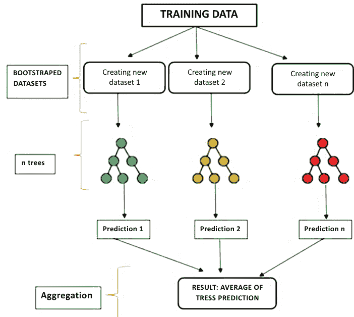

图(1). 使用患者记录预测痴呆的拟议模型。

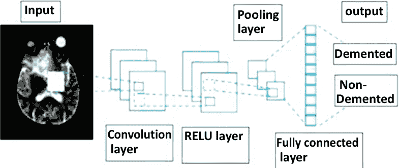

图(2). 使用MRI预测痴呆的拟议模型。

### 结果分析

图(3)展示了CNN模型的输出；我们使用测试数据集中的随机痴呆MRI来验证模型的功能。如图(3)所示，拟议模型准确预测了疾病。

```
In [16]: from matplotlib.pyplot import imshow
img = Image.open("C:\Users\RITIK\Downloads\mildDem\converted-images\0002.jpg")
x = np.array(img.resize((128,128)))
x = x.reshape(1,128,128,3)
res = model.predict_on_batch(x)
classification = np.where(res == np.amax(res))[1][0]
imshow(img)
print(str(res[0][classification]*100) + "% Confidence This Is " + names(classification))
100.0% Confidence This Is Your MRI report matches with Dementia, Please consult to a Doctor
```

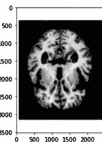

图(3). 与痴呆匹配的结果。

此外，我们使用测试数据集中的随机非痴呆（健康）MRI来确认模型运行正常，如图(4)所示，该模型准确且高准确率地预测了结果。

```
In [32]: from matplotlib.pyplot import imshow
img = Image.open("C:\Users\RITIK\Downloads\dementia_data_test\non\no2.jpg")
x = np.array(img.resize((128,128)))
x = x.reshape(1,128,128,3)
res = model.predict_on_batch(x)
classification = np.where(res == np.amax(res))[1][0]
imshow(img)
print(str(res[0][classification]*100) + "% Confidence This Is A " + names(classification))
100.0% Confidence This Is A You are healthy (You do not have any Dementia)
```

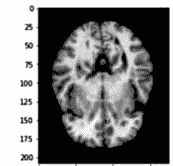

图(4). 与非痴呆（健康）匹配的结果。

RFA模型的结果如图(5)所示。我们使用测试数据集中的随机非痴呆（健康）患者数据，看看我们的模型是否工作正常，如图(5)所示，该模型预测正确且准确率显著。

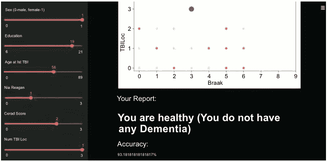

图(5). 无痴呆结果。

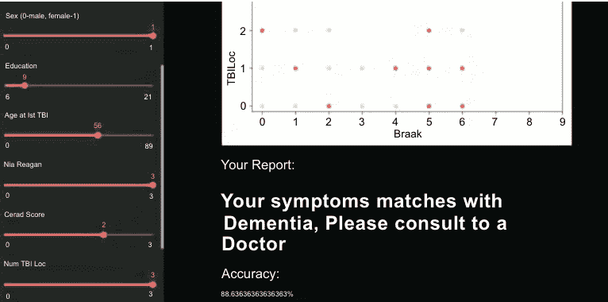

图(6). 与痴呆相关的结果。

RFA模型的结果如图(6)所示。我们使用测试数据集中的随机痴呆患者数据来确认模型工作正常，如图(6)所示，该模型正确预测疾病且准确率显著。使用RFA和CNN，该模型在从患者叙述或磁共振成像（MRI）预测痴呆方面达到了超过92%的准确率。此工作在本地主机上实现。

图(7)所示的图表和表1所示的结果展示了已实现的七个机器学习模型的性能。

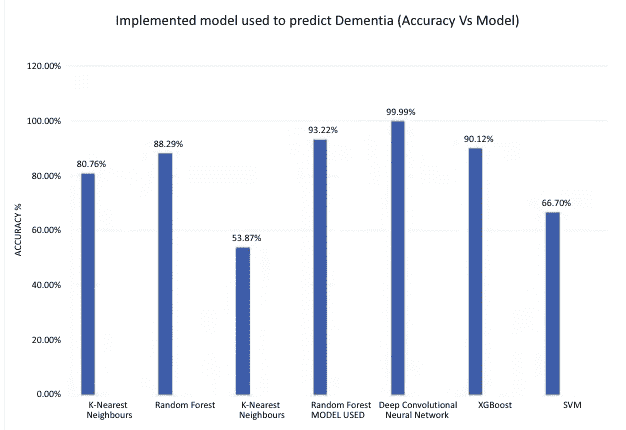

图(7). 机器学习模型性能比较。

表1. 基于学习的阿尔茨海默病早期检测策略。

| 数据集 | 模型 | 准确率 |
|---|---|---|
| Oasis | K近邻 | 80.7641% |
| ADNI | 随机森林 | 88.2901% |
| ADNI | K近邻 | 53.87% |
| Kaggle* | 随机森林 | 93.219% |
| Kaggle* | 深度卷积神经网络 | 99.99% |
| ADNI | XGBoost | 90.121% |
| Kaggle | 支持向量机 | 66.70% |

注：带有*的行是本工作中用于预测痴呆的算法。

### 结论

在本研究中，我们开发了一种随机森林模型，可以根据患者报告有效地区分痴呆患者和健康人。该模型预测阿尔茨海默病早期阶段患者的能力基于使用随机森林算法和CNN来选择适当的训练变量。该模型的有效性


经多种数学分析评估并对比，基于随机森林模型，该模型被认为最适合以高准确性、灵敏度和清晰度区分提供的方差（MCI患者和HCS）。随机森林中不同规模独立实验数据所发现的精确度与其他模型进行了比较，与独立实验数据中的模型图表分析相比观察到显著提升，表明随机森林模型可将预测提升三倍。因此，我们采用了一种基于早期CSF生物标志物的机器学习分化模型。当前工作在阿尔茨海默病早期预后方面迈出了重要一步。

未来，我们计划开发一个基于网页的测试系统，用于对痴呆早期人群进行测试，利用阿尔茨海默病临床前数据库中的生物标志物特征。

### ACKNOWLEDGMENTS

我们谨向导师Anu Saini博士表示感谢，感谢其让我们接触本课题、提供研究资料，并始终为我们指引方向。此外，我们还要感谢Sunita Kumari女士在撰写本论文方面提供的帮助，以及我们的校长，为我们提供了开展本项目的宝贵机会。最后，我们要感谢朋友和家人始终如一的支持与鼓励。

### REFERENCES

- [1] M.J. Prince, A. Wimo, M.M. Guerchet, G.C. Ali, Y.T. Wu, 和 M. Prina，2015年世界阿尔茨海默病报告：痴呆症的全球影响——患病率、发病率、成本及趋势分析。阿尔茨海默病国际组织，2015年。
- [2] E. Barrett 和 A. Burns，揭示痴呆症：初级保健需要知道的内容。英国卫生部，2014年。
- [3] T. Panch, P. Szolovits, 和 R. Atun，“人工智能、机器学习与卫生系统”，《全球健康杂志》，第8卷，第2期，第020303页，2018年。[http://dx.doi.org/10.7189/jogh.08.020303] [PMID: 30405904]
- [4] K.H. Yu, A.L. Beam, 和 I.S. Kohane，“医疗保健中的人工智能”，《自然生物医学工程》，第2卷，第10期，第719-731页，2018年。[http://dx.doi.org/10.1038/s41551-018-0305-z] [PMID: 31015651]
- [5] 可从以下网址获取：https://adni.loni.usc.edu/
- [6] C. Morgan, D.M. Ashcroft, E. Kontopantelis, D. Stamate, 和 D. Reeves，“能否使用常规电子健康记录预测痴呆症风险。学术初级保健协会会议（SAPC ASM）”，2019年。
- [7] J. Yoon, J. Jordon, 和 M. Schaar，“Gain：使用生成对抗网络进行缺失数据填充”，国际机器学习会议，第5689-5698页，2018年。
- [8] Ö. Yildirim，“一种用于ECG信号分类的基于深度双向LSTM网络模型的新型小波序列”，《计算生物学与医学》，第96卷，第189-202页，2018年。[http://dx.doi.org/10.1016/j.compbiomed.2018.03.016] [PMID: 29614430]
- [9] K.D. Spuhler, J. Gardus III, Y. Gao, C. DeLorenzo, R. Parsey, 和 C. Huang，“使用卷积神经网络合成PET/MRI神经成像PET衰减校正的特定患者传输数据”，《核医学杂志》，第60卷，第4期，第555-560页，2019年。[http://dx.doi.org/10.2967/jnumed.118.214320] [PMID: 30166355]
- [10] D. Stamate, M. Kim, P. Proitsi, S. Westwood, A. Baird, A. Nevado-Holgado, A. Hye, I. Bos, S.J.B. Vos, R. Vandenberghe, C.E. Teunissen, M.T. Kate, P. Scheltens, S. Gabel, K. Meersmans, O. Blin, J. Richardson, E. De Roeck, S. Engelborghs, K. Sleegers, R. Bordet, L. Ramit, P. Kettunen, M. Tsolaki, F. Verhey, D. Alcolea, A. Lléo, G. Peyratout, M. Tainta, P. Johannsen, Y. Freund-Levi, L. Frölich, V. Dobricic, G.B. Frisoni, J.L. Molinuevo, A. Wallin, J. Popp, P. Martinez-Lage, L. Bertram, K. Blennow, H. Zetterberg, J. Streffer, P.J. Visser, S. Lovestone, 和 C. Legido-Quigley，“基于代谢物的机器学习方法用于诊断血液中的阿尔茨海默病型痴呆症：欧洲阿尔茨海默病生物标志物发现队列医学信息框架的结果”，《阿尔茨海默病与痴呆症（纽约）》，第5卷，第1期，第933-938页，2019年。[http://dx.doi.org/10.1016/j.trci.2019.11.001] [PMID: 31890857]

## CHAPTER 6

### 用于有效识别哮喘发病的临床决策支持系统

M.R. Pooja1,*

Vidyavardhaka College of Engineering, Mysuru, Karnataka, India

Abstract: 我们提出了一种临床决策支持系统，用于识别印度两个不同人群（代表农村和城市人口）中的哮喘患者。代表这两个人群的输入数据为横断面性质，必然是分类性质，包含强调临床症状和疾病特征模式的临床病史信息。该系统被描述为混合系统，因为它以论文中讨论的独特方式结合了无监督和监督学习技术。强调哮喘表型特征的聚类信息作为分类器的输入，分类器性能得到显著提升。开发的混合决策支持系统结果颇为有希望，适合在实时场景中部署，因为它探索了监督和无监督学习技术的双重优势。此外，将聚类信息以聚类评估分数的形式作为分类器的输入参数，可以有效预测疾病结局，尤其是哮喘等疾病，因为该疾病具有异质性，并表现出多种疾病亚型和异质表型。

Keywords: 相关性、混合、ISAAC、MFCM、主体聚类。

### INTRODUCTION

哮喘是肺部最为慢性的呼吸系统疾病之一，已知受多种因素影响，包括在疾病持续和进展中起重要作用的遗传和环境特征[1]。使用电子健康记录数据评估时，临床症状及其模式及其频率对疾病结局和影响有重大影响[2]。ISAAC是一个广泛认可的机构，已制定了关于哮喘及其共病的核心问卷，并在多个地区开展的大多数先导研究中受到欢迎。已提出一种分两个阶段运行的混合决策支持系统，其中第一阶段生成的结果被有效地用作后续阶段的重要输入[3]。有助于改善类别结局预测的重要事实是在分类过程中使用聚类信息[4]。这被视为该系统的必要条件，因为哮喘表现出具有自身特征的多形性表型[5]。

识别高风险患者人群是哮喘和支气管炎等慢性疾病早期检测和临床评估中的重要干预措施，因为这可以带来有针对性的个性化治疗。我们的研究有望通过促进早期风险评估和基于风险分层的疾病有效预后，成为一项重要干预措施。如果未能在早期识别该疾病，疾病可能会进展并最终变得不可逆转，尽管其本质上是可逆的。这就要求我们提出方法，帮助使用可能在早期识别的严重程度指标来预测疾病，从而实现早期医疗干预，减轻疾病严重程度，进而降低死亡率。该疾病还具有异质性，表现为其他阻塞性疾病的可变重叠综合征，这使得难以界定哮喘的特征性症状。

### RELATED WORK

可采用结合机器学习技术的临床决策支持系统来挖掘有用数据，以探索哮喘数据并识别增加价值的潜在模式，同时为风险因素识别以及疾病严重程度评估及其与肺部其他疾病（如COPD（慢性阻塞性肺疾病））的相关程度提供决策补充理解来源[6 - 8]。

采用监督学习技术的贝叶斯分类方法得出的类别主要被识别为正确，并具有良好的表面效度，与哮喘、气道反应性变化和肺功能有实质性关系，说明具有较好的内容效度[9, 10]。预测分析已被适当部署，通过探索可变来源的独立变量组合来估计风险因素[11]。整合专家驱动特征选择和粗集技术的基于规则的系统已被识别用于描述就诊急诊科的哮喘人群[12]。根据底层数据的性质和所用的集成学习技术，在哮喘与其他呼吸道疾病区分任务中获得了较高的准确性[13]。


### 材料与方法

### 数据集描述

第一阶段收集的ISAAC核心问卷响应数据（一项在多个先导研究中使用过的研究）被用于验证系统性能 [14]。数据收集中使用的问题通常代表疾病的敏感和特异指标。数据为横断面数据，因为它涉及对特定人群数据的分析，该人群广泛是特定时间点上最具代表性的重要子集。数据收集涵盖两个年龄组：13至14岁和6至7岁。在年龄较大的儿童组中，响应由儿童自身完成；而在另一组中，则由家长完成。

### 应对类别不平衡

新德里数据集包含2961名受试者的详细信息，涉及47个指示哮喘合并症和症状的变量。112个样本的疾病结局报告为未知。因此，我们排除了所有112个样本，得到包含2849个样本的数据集。然而，总人群中只有110名受试者为哮喘患者，因此我们通过分层抽样来应对不平衡，从另一类别（非哮喘患者）中也抽取了110个样本，最终得到一个作为输入数据的平衡数据集。类似地，我们从总人群的非哮喘患者中抽取了2%（共64名受试者）来应对会导致人群中出现78名哮喘患者的类别不平衡，最终得到包含142名受试者的输入数据集。

### 特征聚类

最初，通过应用特征聚类，选择可被识别为哮喘疾病显著合并症的主要特征。特征聚类采用修改的模糊C均值聚类（MFCM）进行，该方法使用基于相关性的目标函数，而传统的模糊C均值聚类使用基于距离的目标函数 [10, 11]。根据减法聚类的评估结果，我们选择将输入特征集组织为四个簇。与哮喘属性共存的特征从包含哮喘的簇中提取。这一过程导致缩减的特征集。

模糊C均值聚类中使用基于相关性的目标函数。这里的距离度量包含皮尔逊相关系数，该系数指示两个给定特征或特征与簇之间的差异。特征可能呈正相关或负相关，分别表示正相关或负相关。相关特征将被聚类到同一组，无论其表达值如何。距离度量定义为 dij = 1 – ρ²(Xi, Cj)，其中 ρ(Xi, Cj) 为特征 xi 与簇 cj 之间的相关性（皮尔逊度量）。当存在高度相关性（无论正负）时，相关性将为0。

### 受试者聚类

对于像哮喘这样具有异质性的疾病，受试者聚类一直是区分受试者之间临床差异的首选方法 [17]。我们选择使用K均值聚类，簇的数量（即参数“K”）从2变化到8，并计算了轮廓系数。轮廓系数在内维利数据中两个簇时较高，在新德里数据中八个簇时较高。哮喘患者和非哮喘患者在不同簇中的分布模式在图1(a和b)中有很好的说明。两个数据集中的受试者分别使用缩减特征集组织为两个和八个簇，如图2(a和b)所示。随后，通过应用分类和回归树，并添加一个表示簇评估分数的特征，对有无哮喘的受试者进行了预测。哮喘患者和非哮喘患者在不同簇中的分布模式在图2中有很好的说明。

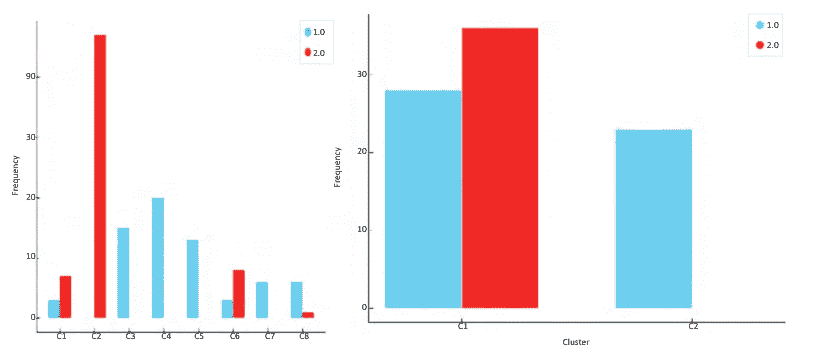

a) 新德里

(b) 内维利

图1. 两组内受试者的分布。

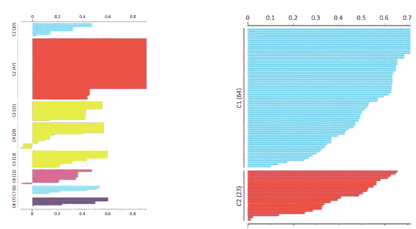

图2. 两个数据集的轮廓图 (a) 新德里，(b) 内维利。

随机初始化和K-means++都用于初始化K均值聚类的簇中心，以确定簇数量选择的坚实基础，如表1和表2所示。发现两种初始化方法得出了相同的结果，表明在内维利和新德里数据中分别选择两个和八个簇存在共识。两种方法均得到内维利数据的轮廓系数为0.325；对于新德里数据，随机初始化和K-means++方法的轮廓系数分别为0.384和0.377（最高）。

表1. 农村哮喘的簇评估。

| 初始化方法 | 簇数 | 轮廓系数 |
|---|---|---|
| 数据集 | \multicolumn{2}{c}{内维利数据} |
| 随机初始化 | 2 | 0.325 |
| | 3 | 0.236 |
| | 4 | 0.217 |
| | 5 | 0.220 |
| | 6 | 0.194 |
| | 7 | 0.204 |
| | 8 | 0.217 |
| K-Means++ | 2 | 0.325 |
| | 3 | 0.236 |
| | 4 | 0.217 |
| | 5 | 0.216 |
| | 6 | 0.206 |
| | 7 | 0.219 |
| | 8 | 0.232 |

表2. 城市哮喘的簇评估。

| 数据集 | | 新德里数据 |
|---|---|---|
| 随机初始化 | 2 | 0.384 |
| | 3 | 0.376 |
| | 4 | 0.409 |
| | 5 | 0.422 |
| | 6 | 0.442 |
| | 7 | 0.441 |
| | 8 | 0.464 |
| K-Means++ | 2 | 0.384 |
| | 3 | 0.377 |
| | 4 | 0.405 |
| | 5 | 0.414 |
| | 6 | 0.446 |
| | 7 | 0.452 |
| | 8 | 0.461 |

### 性能评估

混合决策系统使用10折交叉验证、分层随机采样和随机采样进行评估，其性能如表3所示。其他分类器性能的比较分析也分别在表4和表5中说明。观察发现，混合决策系统的性能优于其他分类器。

表3. 混合系统的性能评估。

| 数据集 | 方法 | AUC | CA | F1 | 精确率 | 召回率 |
|---|---|---|---|---|---|---|
| 内维利 | 10折交叉验证 | 0.855 | 0.851 | 0.851 | 0.854 | 0.851 |
| | 分层随机采样 * | 0.844 | 0.838 | 0.839 | 0.840 | 0.838 |
| | 随机采样* | 0.845 | 0.834 | 0.835 | 0.835 | 0.834 |
| 新德里 | 10折交叉验证 | 0.977 | 0.953 | 0.953 | 0.954 | 0.953 |
| | 分层随机采样* | 0.972 | 0.945 | 0.945 | 0.945 | 0.945 |
| | 随机采样* | 0.968 | 0.936 | 0.936 | 0.936 | 0.936 |

表4. 内维利数据的传统分类器比较性能评估。

| 分类器 | AUC | CA | F1 | 精确率 | 召回率 |
|---|---|---|---|---|---|
| \multicolumn{6}{c}{10折分层交叉验证} |
| KNN | 0.842 | 0.754 | 0.750 | 0.756 | 0.754 |
| Tree | 0.842 | 0.817 | 0.817 | 0.826 | 0.817 |
| SVM Learner | 0.865 | 0.761 | 0.745 | 0.802 | 0.761 |
| Random Forest | 0.903 | 0.796 | 0.796 | 0.799 | 0.796 |
| Naive Bayes | 0.884 | 0.789 | 0.789 | 0.797 | 0.789 |
| Logistic Regression | 0.901 | 0.810 | 0.810 | 0.810 | 0.810 |
| XGB | 0.918 | 0.845 | 0.845 | 0.845 | 0.845 |
| \multicolumn{6}{c}{带80%训练数据的打乱分割分层随机采样} |
| KNN | 0.830 | 0.769 | 0.768 | 0.769 | 0.769 |
| Tree | 0.784 | 0.779 | 0.780 | 0.783 | 0.779 |
| SVM Learner | 0.869 | 0.766 | 0.753 | 0.798 | 0.766 |
| Random Forest | 0.865 | 0.772 | 0.773 | 0.778 | 0.772 |
| Naive Bayes | 0.856 | 0.779 | 0.780 | 0.786 | 0.779 |
| Logistic Regression | 0.896 | 0.793 | 0.794 | 0.795 | 0.793 |
| \multicolumn{6}{c}{带80%训练数据的打乱分割随机采样} |
| KNN | 0.811 | 0.741 | 0.739 | 0.742 | 0.741 |
| Tree | 0.806 | 0.790 | 0.789 | 0.790 | 0.790 |
| SVM Learner | 0.851 | 0.741 | 0.721 | 0.794 | 0.741 |
| Random Forest | 0.834 | 0.734 | 0.735 | 0.736 | 0.734 |
| Naive Bayes | 0.839 | 0.752 | 0.752 | 0.757 | 0.752 |
| Logistic Regression | 0.877 | 0.755 | 0.755 | 0.755 | 0.755 |
| XGB | 0.889 | 0.790 | 0.790 | 0.790 | 0.790 |


### 表5. 新德里数据传统分类器的比较性能评估

| Classifier | AUC | CA | F1 | Precision | Recall |
|---|---|---|---|---|---|
| KNN | 0.835 | 0.814 | 0.813 | 0.815 | 0.814 |
| Tree | 0.862 | 0.845 | 0.845 | 0.846 | 0.845 |
| SVM Learner | 0.912 | 0.786 | 0.779 | 0.833 | 0.786 |
| Random Forest | 0.926 | 0.855 | 0.854 | 0.856 | 0.855 |
| Naive Bayes | 0.909 | 0.777 | 0.777 | 0.778 | 0.777 |
| Logistic Regression | 0.908 | 0.805 | 0.804 | 0.809 | 0.805 |
| XGB | 0.964 | 0.914 | 0.914 | 0.914 | 0.914 |
| KNN | 0.798 | 0.786 | 0.786 | 0.788 | 0.786 |
| Tree | 0.829 | 0.798 | 0.798 | 0.798 | 0.798 |
| SVM Learner | 0.879 | 0.768 | 0.756 | 0.835 | 0.768 |
| Random Forest | 0.927 | 0.852 | 0.852 | 0.853 | 0.852 |
| Naive Bayes | 0.874 | 0.748 | 0.748 | 0.748 | 0.748 |
| Logistic Regression | 0.885 | 0.777 | 0.777 | 0.779 | 0.777 |
| XGB | 0.953 | 0.895 | 0.895 | 0.896 | 0.895 |
| KNN | 0.832 | 0.814 | 0.814 | 0.815 | 0.814 |
| Tree | 0.808 | 0.820 | 0.820 | 0.821 | 0.820 |
| SVM Learner | 0.860 | 0.764 | 0.748 | 0.830 | 0.764 |
| Random Forest | 0.931 | 0.866 | 0.866 | 0.866 | 0.866 |
| Naive Bayes | 0.877 | 0.748 | 0.748 | 0.750 | 0.748 |
| Logistic Regression | 0.883 | 0.764 | 0.763 | 0.771 | 0.764 |
| XGB | 0.959 | 0.886 | 0.886 | 0.888 | 0.886 |

分类性能通过两种测试方案进行了评估，即分层随机抽样和10倍交叉验证，下面将简要讨论。

交叉验证是一种用于评估预测模型的方法，通过将原始样本分为训练集以训练模型，以及测试集以评估其性能。在10倍交叉验证中，给定的输入样本被全面划分为10个大小相等的子样本。在“k”个子样本中，一个子样本被保留作为验证集的一部分用于测试模型，其余9个子样本用于训练模型。该过程迭代十次。然后可以对这10个折叠的结果进行平均，从而产生单一估计值。因此，分层随机抽样是一种遵循概率方法的抽样选项。

所选技术用于替代简单随机抽样，适用于以下场景：假设各分层的分组彼此差异过大且对所研究问题至关重要，和/或当研究人员希望过度采样主要感兴趣的小群体时。在这里，整个数据集被分为训练集和测试集。80%的样本被纳入训练集，其余20%组织成测试集，并重复该过程100次以验证结果。

### 结论

混合决策支持系统在对哮喘疾病结局进行准确预测方面非常有效，在我们研究考虑的两个数据集上，灵敏度高达85.1%和95.3%。此外，精确度也令人满意，两个数据集分别为85.4%和95.4%。从性能评估可以清楚地看出，所开发的混合决策支持系统的结果始终前景看好，适合在实时场景中部署，因为它探索了监督和无监督学习技术的优势。此外，将聚类信息以聚类评估分数的形式作为分类器的输入参数，可以有效地预测疾病结局，特别是对于哮喘等疾病，因为该疾病具有异质性并表现出多种疾病亚型。

### 参考文献

- [1] S. Ram, W. Zhang, M. Williams, and Y. Pengentze, "利用大数据预测哮喘相关急诊科就诊", IEEE J. Biomed. Health Inform., vol. 19, no. 4, pp. 1216-1223, 2015. [http://dx.doi.org/10.1109/JBHI.2015.2404829] [PMID: 25706935]

- [2] C.H. Lee, J.C.Y. Chen, and V.S. Tseng, "一种考虑生物信号和环境数据的哮喘监测新型数据挖掘机制", Comput. Methods Programs Biomed., vol. 101, no. 1, pp. 44-61, 2011. [http://dx.doi.org/10.1016/j.cmpb.2010.04.016] [PMID: 20554074]

- [3] M.R. Pooja, and M.P. Pushpalatha, "一种用于横断面研究中哮喘受试者识别的混合决策支持系统", 2015 International Conference on Emerging Research in Electronics, Computer Science and Technology (ICERECT)., pp. 288-293, 2015. [http://dx.doi.org/10.1109/ERECT.2015.7499028]

- [4] V. Siroux, X. Basagaña, A. Boudier, I. Pin, J. Garcia-Aymerich, A. Vesin, R. Slama, D. Jarvis, J.M. Anto, F. Kauffmann, and J. Sunyer, "使用聚类方法识别成人哮喘表型", Eur. Respir. J., vol. 38, no. 2, pp. 310-317, 2011. [http://dx.doi.org/10.1183/09031936.00102810] [PMID: 21233270]

- [5] W.C. Moore, D.A. Meyers, S.E. Wenzel, W.G. Teague, H. Li, X. Li, R. D'Agostino Jr, M. Castro, D. Curran-Everett, A.M. Fitzpatrick, B. Gaston, N.N. Jarjour, R. Sorkness, W.J. Calhoun, K.F. Chung, S.A.A. Comhair, R.A. Dweik, E. Israel, S.P. Peters, W.W. Busse, S.C. Erzurum, and E.R. Blecker, "使用严重哮喘研究计划中的聚类分析识别哮喘表型", Am. J. Respir. Crit. Care Med., vol. 181, no. 4, pp. 315-323, 2010. [http://dx.doi.org/10.1164/rccm.200906-0896OC] [PMID: 19892860]

- [6] S. Schmidt, G. Li, and Y.-P. P. Chen, "区域哮喘数据集中的医学知识发现", In: Advanced Intelligent Computing Theories and Applications. With Aspects of Artificial Intelligence. ICIC vol. 5227. Huang, DS., Wunsch, D.C., Levine, D.S., Jo, KH Springer, Berlin, Heidelberg., 2008. [http://dx.doi.org/10.1007/978-3-540-85984-0_107]

- [7] K. Farion, W. Michalowski, and S. Wilk, 开发哮喘加重决策模型：结合粗糙集和专家驱动的临床属性选择. Rough Sets and Current Trends in Computing. 2006, pp. 428-437. [http://dx.doi.org/10.1007/11908029_45]

- [8] M.R. Pooja, and M.P. Pushpalatha, "使用聚类分析表征哮喘对照组中互补和替代药物使用模式", Open Public Health J., vol. 13, p. 1, 2020. [http://dx.doi.org/10.2174/18744945020130101227]

- [9] W. Wu, E. Blecker, W. Moore, W.W. Busse, M. Castro, K.F. Chung, W.J. Calhoun, S. Erzurum, B. Gaston, E. Israel, D. Curran-Everett, and S.E. Wenzel, "使用扩展肺数据对严重哮喘研究计划参与者进行无监督表型分析", J. Allergy Clin. Immunol., vol. 133, no. 5, pp. 1280-1288, 2014. [http://dx.doi.org/10.1016/j.jaci.2013.11.042] [PMID: 24589344]

- [10] M. Zedan, G. Attia, M.M. Zedan, A. Osman, N. Abo-Elkheir, N. Maysara, T. Barakat, and N. Gamil, "临床哮喘表型及治疗反应", ISRN Pediatr., vol. 2013, pp. 1-7, 2013. [http://dx.doi.org/10.1155/2013/824781] [PMID: 23606983]

- [11] M.P. Pushpalatha, and M.R. Pooja, "使用哮喘严重程度指标进行哮喘有效预后的预测模型", 2017 International Conference on Computer Communication and Informatics (ICCCI), 2017, pp. 1-6 [http://dx.doi.org/10.1109/ICCCI.2017.8117717]

- [12] C. Chakraborty, T. Mitra, A. Mukherjee, and A.K. Ray, "CAIDSA：支气管哮喘计算机辅助智能诊断系统", Expert Syst. Appl., vol. 36, no. 3, pp. 4958-4966, 2009. [http://dx.doi.org/10.1016/j.eswa.2008.06.025]

- [13] M.R. Pooja, and M.P. Pushpalatha, "混合和集成机器学习模型用于哮喘发病率预测的比较性能评估", J. Health Med. Inform., vol. 10, no. 330, 2019. [http://dx.doi.org/10.4172/2157-7420.1000330]

- [14] C.K.W. Lai, R. Beasley, J. Crane, S. Foliaki, J. Shah, and S. Weiland, "哮喘症状患病率和严重程度的全球差异：儿童哮喘和过敏国际研究（ISAAC）第三阶段", Thorax, vol. 64, no. 6, pp. 476-483, 2009. [http://dx.doi.org/10.1136/thx.2008.106609] [PMID: 19237391]

- [15] W.C. Moore, D.A. Meyers, S.E. Wenzel, W.G. Teague, H. Li, X. Li, R. D'Agostino Jr, M. Castro, D. Curran-Everett, A.M. Fitzpatrick, B. Gaston, N.N. Jarjour, R. Sorkness, W.J. Calhoun, K.F. Chung, S.A.A. Comhair, R.A. Dweik, E. Israel, S.P. Peters, W.W. Busse, S.C. Erzurum, and E.R. Blecker, "使用严重哮喘研究计划中的聚类分析识别哮喘表型", Am. J. Respir. Crit. Care Med., vol. 181, no. 4, pp. 315-323, 2010. [http://dx.doi.org/10.1164/rccm.200906-0896OC] [PMID: 19892860]

- [16] M. Zolnoori, M. H. F. Zarandi, and M. Moin, "哮喘疾病中智能系统的应用：设计模糊规则系统以评估哮喘加重程度", J Med Syst., vol. 36, no. 4, pp. 2071-2083, 2012. [http://dx.doi.org/10.1007/s10916-011-9671-8]


[17] E.M.S. Mäkikyrö, M.S. Jaakkola, and J.J.K. Jaakkola, "Subtypes of asthma based on asthma control and severity: A latent class analysis", Respir. Res., vol. 18, no. 1, pp. 24-32, 2017. [http://dx.doi.org/10.1186/s12931-017-0508-y] [PMID: 28114991]

## 第 7 章

### 运用深度学习和计算机视觉进行眼病早期诊断

Shradha Dubey1* and Manish Dixit1

1 计算机科学与工程系，Madhav Institute of Technology and Science，Gwalior，Madhya Pradesh，India

摘要：医学图像处理在临床调查和近期医学研究中发挥着重要作用。适当的基于图像的医学评估有助于早期分析或检测危重疾病，因为它具有高价值的医学信息。在本研究中，计算智能在眼病诊断中的医学成像得到了回顾。然而，使用传统图像处理识别这些疾病相当复杂。如今，已开发出各种机器学习和深度学习方法来检测不同的眼病，这些方法有助于在早期阶段检测疾病。研究表明，由于医疗设施不足和熟练的卫生工作者短缺，眼部疾病在新兴或欠发达国家更为严重。据估计，全球约有 4500 万人失明，悲惨的事实是，其中仅 75% 的病例是可治愈的。此外，全球医生与患者的比例约为 1:10,000。因此，创建一个用于识别这些疾病的筛查系统需要一小时。眼科学在评估、诊断和治疗眼病方面正接近取得突破。此外，许多眼部和视力问题没有明显的迹象。因此，人们往往不知道问题的存在。早期疾病检测是一个主要关注点，因为在疾病导致严重后果之前，它们很容易治愈。本研究论文侧重于检测眼疾，如糖尿病视网膜病变、糖尿病性黄斑水肿、青光眼、年龄黄斑变性、视网膜血管阻塞和视网膜脱离。作者探讨了在此背景下的各种算法、成像方式和挑战。该研究旨在提高人们对使用计算机视觉、图像处理和深度学习技术导致失明的眼部疾病的意识。它还调查了这些机器学习和深度学习方法如何帮助在视力丧失发生之前进行早期疾病诊断，以便进行有效治疗。

关键词：年龄相关性黄斑变性，白内障，深度学习，糖尿病视网膜病变，青光眼，海德堡视网膜断层扫描，光学相干断层扫描，超声成像。

### 引言

临床研究和当代医学研究都受益于医学图像处理。适当的基于图像的医学评估有助于早期分析或检测危重疾病，因为它具有高价值的医学信息。本研究介绍了通过计算智能诊断眼病的医学成像综述。传统图像处理方法在疾病识别方面已被证明具有挑战性。然而，多样化的机器学习和深度学习方法的引入彻底改变了各种眼病的检测，使及时的识别和诊断成为可能。本章的后续部分将深入探讨这些方法及其在早期发现眼部疾病方面的重大贡献。

### 动机

视力是一种关键的人类感官，但每天越来越多的患者受到视网膜疾病的影响。健康的视网膜对于中心视力至关重要 [1]。早期检测这些疾病可以保护视网膜免受损伤，但这对医学科学来说是一个重大挑战。由于人口老龄化和不良饮食习惯导致眼部疾病日益普遍，迫切需要有效的检测方法。本研究论文回顾了用于分类健康和患病视网膜图像的各种计算智能技术，并根据眼部图像异常对视网膜疾病的严重程度进行分类。视网膜病症的精确分类可以减少不必要的医院就诊，尤其是在传染病病例增加的背景下。所提方法有助于诊断视网膜疾病的类型并评估其严重程度，从而促进及时治疗和改善患者护理。

本章的主要贡献在于讨论深度学习和医学成像在及时疾病检测方面的有效性。此外，它还探讨了使用不同机器和方法捕获眼部图像的各种方法和技术。本章广泛探讨了用于诊断不同疾病的各种成像系统，每种都有其优势和局限性。它还详细分析了各种眼病，包括其病因、风险因素和症状，旨在促进早期诊断和适当治疗。文献中讨论了几种针对特定疾病检测定制的深度神经网络，即使在城镇或农村地区，也无需专业人员即可实现快速和准确的诊断。检测后，患者可以立即寻求医疗建议以获得适当的治疗。这些深度学习模型提供快速报告，而不像其他前沿方法可能需要 2–3 天才能得出结果，这可能是有害的。

本章分为几个部分。第 2 部分介绍深度学习。在第 3 部分，提供了现有文献的简要综述。第 4 部分深入讨论了捕获眼部图像以编译疾病诊断数据集所需的各种成像设备。第 5 部分全面考察了不同眼病以及计算机视觉和深度学习在其检测中的应用。此外，本章在第 6 部分讨论了研究挑战，最后以关键发现的总结作为结尾。

### 深度学习的技术方面

“计算机辅助诊断”一词是指使用基于计算机的滤波器或工具分析相关临床数据以识别疾病相关模式 [2]。在本研究中，探索了各种深度学习算法，特别是应用于眼部图像的计算机视觉领域。对于图像处理应用 [3]，研究人员广泛使用和研究卷积神经网络（CNN）模型。这些 CNN 模型分为不同类别，包括 LeNet、AlexNet、VGGNet、GoogleNet、InceptionV3、ResNet 等 [4]。

卷积神经网络（CNN）是用于增强传统图像处理任务的深度神经网络。由于与其他算法相比，其预处理要求减少，因此广受欢迎。CNN 有效地使用滤波器捕获图像中的时间和空间依赖性。典型的 CNN 由三个主要层组成：输入层、隐藏层和输出层。网络可以有多个隐藏层，每个层执行不同的功能，如特征提取、分类和特征展平。CNN 的基本框图如图 (1) 所示，说明了其在疾病分类中的应用。最初，卷积函数应用于输入图像，其中使用滤波器来激活特定特征。通常，使用非线性 ReLU（整流线性单元）激活函数来使网络对各种类型的输入图像具有鲁棒性。接下来，使用池化函数通过仅考虑相关参数来减少计算开销。最后，展平函数将空间维度转换为通道维度，并使用带有激活函数（通常是 softmax）的全连接层来获取分类后的图像作为输出。

要构建稳健的深度学习（DL）模型，两个关键组成部分是必不可少：‘大脑’（CNN）和‘词典’（数据集）。最初，CNN 面临计算挑战，但随着 GPU 的出现，这些方法


变得更加高效，在更短时间内取得更好的结果。生物医学图像分析中提供了两种类型的 DL 解决方案，如下所示：

### 图像分类
在这种方法中，图像连同相关的诊断、标签或分期一起提供给 DL 网络。网络根据提供的信息学习将这些图像分类到不同的类别中 [4]。

### 语义分割
语义分割是 DL 在医学图像分析中的另一种方法。这种方法不是对整个图像进行分类，而是专注于定义图像中与疾病状况相关的医学症状对应的特定区域。通过对图像进行分割，网络可以清晰地识别和勾勒不同的感兴趣区域。

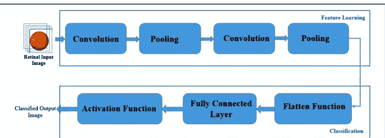

**图 (1).** CNN 模型的典型工作原理。

### 深度学习的优势

研究表明，深度学习（DL）在检测和诊断各种眼科疾病方面非常有效，通常优于人工评级。DL 是相对于传统人工神经网络（ANN）的一项进步，因为它涉及创建具有多个层的网络，从而实现更复杂的学习。在过去，研究人员在手动检测疾病、识别图像中的感兴趣区域以及分类糖尿病患者中的微血管瘤和出血等特征方面面临挑战。为算法编写手动编码的指令是一项耗时且费力的工作。然而，计算机辅助（CAD）系统的发明彻底改变了这一过程。使用 CAD 系统，研究人员现在可以将带标签的图像输入系统，系统会自动将其分类为增殖性和非增殖性糖尿病视网膜病变（DR）等类别。

自动训练的深度学习模型需要大型数据集才能实现更高的准确性。在眼科学中，可以从不同的成像设备和不同年龄、性别和种族的多样化患者那里收集大量多样化数据。虽然深度学习算法可以自行识别像 DR 这样的疾病的典型特征，但它们也可能发现新模式并提供有价值的见解，从而产生深度学习中的“黑盒”概念 [5]。正在进行的研究旨在揭示这些算法如何解释和评估疾病。

已观察到，成像和临床应用中的深度学习可以产生高质量的结果，并能有效处理非结构化数据 [6]。在医学影像中，许多临床应用正在转向深度学习，因为其性能优于传统方法，并且能够以极高的准确性处理大量复杂数据。随着患者数量持续增加，这种向深度学习的转变尤为重要，这使得医生难以快速诊断。深度学习有助于早期疾病检测，从而实现及时治疗和更好的患者护理 [3]。

### 文献综述

已致力于开发简化诊断程序的医疗专家系统。这些系统可以根据预定义规则提供准确的响应。然而，依赖静态规则阻碍了它们适应新场景的能力。为了解决这一局限性，焦点转向了深度学习，其中使用数据来训练基于深度学习的算法。因此，各个医学领域（尤其是眼科学）的计算机研究迅速扩展。

Soheila Gheisari 等人（2021）提出了一项结合卷积神经网络（CNN）和循环神经网络（RNN）的研究，用于检测序列图像中的空间和时间特征。数据集包括 1810 张眼底图像和 295 个视频。通过同时使用 CNN 和 RNN，研究人员相比单独使用任何一种模型，取得了更好的准确性，在分类健康和青光眼图像方面获得了 96.2% 的令人印象深刻的 F-测度 [7]。

Turimerla Pratap 和 Priyanka Kokil（2021）引入了一种可靠的方法，即计算机辅助白内障诊断（CACD）方法，用于处理加性高斯白噪声（AWGN）。该技术涉及在不同噪声水平下训练的多个独立的局部和全局支持向量网络。网络选择基于输入图像的噪声水平。此外，他们还利用预训练的 CNN 从眼底视网膜图像中提取特征。该研究使用了 EYEPACS 的视网膜眼底图像数据集 [8]。

L. Cao 等人（2020）提出了一种基于视网膜图像的白内障评估方法。他们采用了改进的 Haar 小波来将视网膜数据分类为非白内障、轻度、中度和重度白内障水平。该方法提取了更合适的特征，提高了准确性。为了简化分类，他们使用分层方法将四类问题转换为二类问题。最终框架合并了三组二类神经网络。该研究在四类分类中达到 85.98% 的准确率，在二类分类中达到 94.83% 的准确率 [9]。

Abhishek Samanta 等人（2020）使用带有迁移学习的 DenseNet 模型，在 Kaggle 的 3050 张图像的小型数据集上进行了研究，以四种方式分类 DR 疾病。尽管图像数量有限，但他们的 CNN 模型表现出出色的性能，尤其是对于实时图像。

所提模型在验证集和训练集上分别获得了 0.8836 和 0.9809 的高 Cohen's Kappa 得分 [10]。

在 Sambit S Mondal 等人（2020）的另一篇研究论文中，作者采用了广义改进模糊 Kohonen 聚类网络（GIFKCN）算法来检测视网膜图像中的血管。在使用该算法之前，他们应用了高斯滤波器和形态学操作等各种预处理技术。该研究在 DRIVE 数据库上进行，发现所提出的模型在准确性、灵敏度和低假阳率方面优于其他模型（分别为 0.979、0.989 和 0.039）[11]。

Mary Dayana 等人（2020）利用深度学习算法研究了视网膜眼底图像中异常的识别。他们开发了一个基于 CNN 的模型，通过分析滑动窗口方法创建的图像补丁，有效地分割了小病变。该模型使用这些补丁生成概率图，预测各种类型的病变。与类似研究相比，所提出的方法表现出显著更高的准确性和灵敏度 [12]。

Krishna Prasad 等人（2019）使用 DNN 模型检测视网膜图像中的青光眼和 DR，利用预定义数据集（DR-Kaggle、Glaucoma Medimrg）。研究包括两个阶段：用于评估 CNN 模型的训练阶段和具有用户友好 GUI 的实现阶段。所提模型虽然不太复杂，但达到了 80% 的准确率，并通过 GUI 提供了一种识别健康或不健康输入图像的方法 [13]。

Mamta Juneja 等人（2019）开展了以使用 CNN 对青光眼图像和非青光眼图像进行分割为重点的研究。该研究利用一种称为青光眼网络（G-net）的增强版 U-net 进行改进分割，取得了良好的准确性。采用了两种不同的 CNN，一个用于分离视盘，另一个用于从视网膜眼底图像中分割视杯。该框架在一组 50 张眼底图像上进行了测试，在视盘分割（95.8%）和视杯分割（93%）方面达到了高准确率 [14]。

在 Bilal Khomri 等人（2018）的一项研究中，他们开发了一种使用 PSO 算法从包含健康图像和 DR 图像的低分辨率和高分辨率数据集中提取血管的技术。与 MSLD 方法相比，他们定义的技术使用不同像素分辨率的较少尺寸有效捕捉了许多微小和迂曲的血管。与其他方法相比，该方法证明很有价值，在高分辨率图像上取得了有希望的性能。该工作在 DRIVE 数据集上获得了 74.5%、97.1% 和 94.2% 的灵敏度、特异性和准确率，在 STARE 数据集上获得了 85.4%、94.4% 和 93.5% [15]。

Suvajit Dutta 等人（2018）设计了一种用于 DR 诊断的模型，该模型包含一系列用于训练的反向传播、DNN 和 CNN 层。在测试阶段，开发的模型优于其他 CPU 训练的模型，这主要归功于单隐藏层概念。该网络不仅实现了高准确性，还成功定位了渗出物、微血管瘤、视盘和血管等各种特征，为开发用于 DR 检测的最佳模型做出了贡献 [16]。

### 成像模态

在本节中，我们探讨利用成像设备捕获眼内部图像，特别是视网膜图像。讨论了各种基于计算机视觉的成像技术，这些技术使专家能够评估视网膜健康状况并诊断各种眼部疾病。眼部成像是医学成像的一个重要分支，涉及用于拍照、扫描或捕获眼部图像的专用设备。本章深入探讨了各种眼部成像方法，并介绍了它们各自的优缺点。

### 超声成像

超声成像利用声波来创建人体内部的可视表示。在眼和眶部检查的背景下，利用高频声波来生成眼部及其周围结构的高分辨率图像，即使在存在不透明介质的情况下也是如此 [17]。眼科超声通常在 8-10 MHz 的频率下运行，与普通眼睛相比，提供了眼内部更清晰得多的图像


检查。此检查采用三种显示模式：A模式、B模式和M模式。

A扫描，也称为振幅扫描，是一种用于眼部评估的超声技术 [18]。在此方法中，泪膜充当有效的声波传输介质，无需使用超声耦合剂。在A扫描中，单个声束从换能器发出，与标准眼科检查相比，提供了更详细、逐层的眼部视角。A扫描使用的超声频率为8MHz。这种超声检查简单直接。

另一方面，B模式（即亮度调制）提供眼部的横断面或二维图像，并专注于眼部病理的实时评估。其工作频率为10MHz。超声成像广泛用于检查各种医疗状况，例如肺部、骨缺陷、乳腺癌、脉搏率、血管内血液循环、产妇可视化以及眼部评估 [19]。

### 优点

- 超声成像是快速评估创伤性眼损伤的宝贵工具。
- 通过利用3D重建，超声成像可准确确定物体的大小和位置。
- 在介质混浊的情况下，它特别适用于评估眼后段。
- 超声成像可以检测并区分眼内病变和眼眶病变。

### 缺点

- 从二维B扫描图像中掌握三维图像的开发被认为是最具挑战性的步骤 [20]。
- 为了获得最佳成像，增加深度需要使用较低频率。

### 光学相干断层扫描（OCT）

OCT是一种非侵入性成像技术，通过结合低相干干涉测法和具有特定相干宽度的近红外光来捕捉视网膜横断面图像 [21]。通过测量反射光强度和回波时间延迟，OCT使眼科医生能够区分视网膜的不同层次并确定视网膜神经纤维层的厚度，从而促进眼部疾病的早期检测和诊断。即使是健康的眼睛，也可以利用OCT来建立基准图像。

类似于超声检查，OCT的工作原理是使用光而非声波。当前的OCT成像系统提供1到15μm的分辨率。OCT可分为两种类型：频谱域OCT和时域OCT。在时域OCT中，图像分辨率与获取速度成反比。频谱域OCT克服了这一限制，使成像速度和分辨率同时得到提高 [22]。表1对时域和频谱域OCT进行了比较，突出了频谱域OCT的优势。

### 表1. OCT类型规格。

| - | 频谱域OCT | 时域OCT | 频谱域优势 |
|---|---|---|---|
| 探测器 | 光谱仪 | 单探测器 | 获取速度更快，运动伪影更少 |
| 光源 | 840 nm | 820 nm | 高清晰度 |
| 横向分辨率 | 10微米 | 20微米 | - |
| 轴向分辨率 | 6-7微米 | 10微米 | 视网膜层可视化良好 |
| 扫描速度 | 每秒约2800次A扫描 | 每秒400次A扫描 | 配准更好 |
| 最大A扫描数 | 8000 | 512 | 扫描数量多，可视化效果更好 |
| 扫描深度 | 2mm | 2mm | 光穿透力略好 |

对于典型的OCT机器，其工作原理和完整规格分别见图(2)和图(3)。

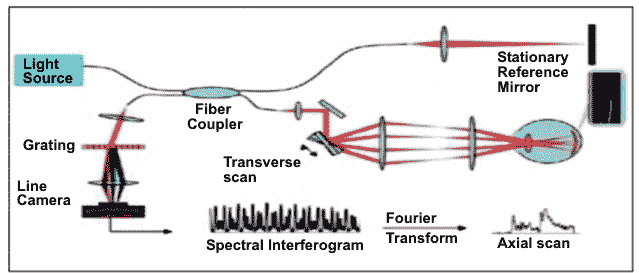

### 图(2). SD-OCT原理 [48]。

### 优点

- OCT扫描时间短，还能以非接触方式扫描各种眼部结构。
- 分辨率高达10μm，有助于获取定量信息。

### 缺点

- 扫描质量取决于操作员的技能。每次扫描必须在范围内进行。
- 如果扫描未在黄斑中心进行，测量不准确 [23]。
- 穿透深度有限。需要更大的瞳孔直径。

### 彩色眼底摄影

彩色眼底视网膜摄影是一种使用眼底相机捕捉眼内表面照片的技术。这种成像方法允许长期观察和监测疾病及其进展。眼底摄影涉及对眼部后部进行成像，以检查与眼部疾病相关的异常并监测其发展 [24]。为此目的使用的专用相机通常称为眼底相机或视网膜相机，如图(4)所示。它由低倍显微镜和相机组成，用于捕捉眼内部图像，包括视神经、黄斑、中心和外周视网膜。

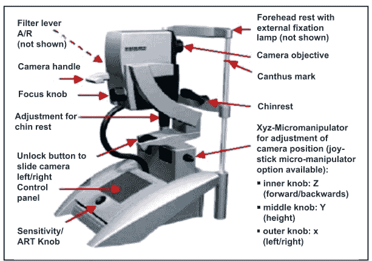

图(3). OCT规格。

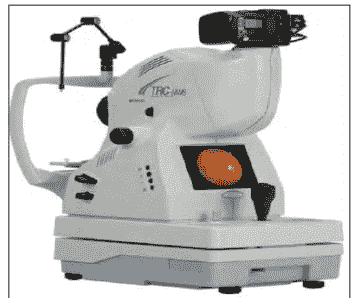

图(4). 视网膜眼底相机。

眼底摄影可以包括荧光素和靛青绿血管造影等额外技术，前提是使用适当的滤光片。眼底相机的成像光学元件将必要的光轴向引导以照亮眼底。相机的光学装置通过扩瞳的瞳孔将来自内部闪光灯的一圈光投射出去，有效地将入射光和出射光分开。外侧瞳孔由这一圈光照亮，该光从眼睛反射，而圆圈的中心部分允许光通过瞳孔。然后，这种光穿过眼底相机的镜头，形成眼底的胶片平面视图 [25]。

### 优点

- 图像可以捕捉和存储，以便以后使用。
- 允许为不同类型的测试使用不同的滤光片和染料。
- 无需散瞳，因此创伤更小。

### 缺点

- 由于图像缺乏深度感知，观察异常存在问题。
- 无法生成更好的三维图像，且图像不够清晰。

### 眼底荧光素血管造影（FFA）

FFA（眼底荧光素血管造影）是一种用于研究视网膜血管的诊断技术。“FFA”名称可拆解如下：“Fundus”对应视网膜，“Fluorescein”对应所使用的染料（荧光素溶液），而“Angiography”指对血管的研究。FFA程序依赖于注射荧光素溶液，然后拍摄视网膜以研究血管的造影报告 [26]。

在FFA程序中，眼科医生首先在患者眼睛中滴入眼药水以散瞳。然后，将黄色荧光素染料注入静脉，通常在手臂上。几秒钟后，染料到达眼部血管，使其明亮发光。随后，使用数字成像系统拍摄眼部数字照片，为眼科医生提供有价值的信息，以长期管理和监测眼部疾病 [27]。FFA在追踪眼部疾病变化和识别特定治疗区域方面特别有用。

### 优点

- 治疗成功率接近100%，仅有数十万患者中的少数个体会出现危急或危及生命的影响。

荧光素染料治疗被认为非常安全，副作用（如恶心）的风险较低。

### 缺点

- 由于视野有限，脉络膜血管的可视化具有挑战性，且该方法具有侵入性，因为需要注射。

### 海德堡视网膜断层扫描（HRT）

海德堡视网膜断层扫描（HRT）是一种有价值的诊断技术，用于对视神经头进行彻底检查和记录，而视神经头在诊断和治疗青光眼中起着至关重要的作用。本质上，HRT是共聚焦扫描激光眼科检查的商业术语。通过使用特殊激光，HRT捕捉视神经及其周围视网膜的三维图像。该技术允许逐像素进行精确的地形测量，并以快速且可重复的方式评估各种视盘参数。

在HRT程序中，系统会拍摄一系列更深的图像，直到达到所需深度。它为每只眼睛获取三张图像，所有图像均无需散瞳。使用波长为670 nm的二极管激光器进行照明，并获得一组32张共聚焦照片（256 × 256像素）用于分析。

HRT的更新版本（称为HRT II）利用数字变换生成384 × 384像素的帧，进一步提高图像分辨率和


diagnostic capabilities. This sophisticated imaging technology continues to be a valuable tool in the diagnosis and management of glaucoma and other related eye conditions.

### 优势

- 无需散瞳，因为有大量的常模数据可供参考。
- HRT 获取视神经头的三维图像。

### 劣势

- HRT 依赖操作人员进行轮廓标记，且专门针对视神经头设计。
- 应注意的是，在过程中血管的外观可能具有误导性。

### 裂隙灯摄影

裂隙灯摄影涉及一种专门设计的水平安装显微镜，用于捕捉眼部结构的图像。显微镜的照明可以调节，从宽光斑调至窄光缝，这也正是该技术得名的原因。裂隙灯摄影的一种特定应用是镜面显微照相，用于成像角膜内皮背面的细胞。这些图像帮助医生评估角膜状况。该技术依赖两种照明系统：底部安装光源的蔡司裂隙灯生物显微镜和顶部安装光源的海格施特雷特裂隙灯生物显微镜。

### 优势

- 裂隙灯在验光领域越来越受欢迎。这些系统为眼科医生提供了对眼球的近距离详细观察，使他们能够识别角膜状况的细微变化，例如感染或水肿。
- 借助裂隙灯相机，眼科专业人员可以使用高分辨率数码相机拍摄特定照片和视频，从而密切监测眼睛状况。此功能鼓励临床医生记录检查的部分或全部内容，并保存静态照片作为其发现的视觉记录。

### 劣势

- 随着放大倍数增加，焦深降低，可能导致图像失焦。
- 手持透镜拍摄最佳视网膜图像具有挑战性。
- 在没有适配器的裂隙灯上拍摄眼底照片可能非常困难。

下表 2 提供了各种成像设备的详细信息。

| 眼部成像设备 | 所需机器/镜头/系统 | 特征 | 应用 |
| :--- | :--- | :--- | :--- |
| 数字眼底相机 | Topcon 和 Zeiss | 黄斑变性、脉络膜紊乱、糖尿病视网膜病变、病变、硬性和软性渗出物。 | FFA、彩色眼底摄影 |
| OCT | OCT Zeiss Stratus, Cirrus | 年龄相关性黄斑变性、糖尿病视网膜病变 | 允许断层成像。黄斑和视神经头成像是常见应用。 |
| 扫描激光眼底镜 | Heidelberg Engineering 的 HRA2 | 青光眼结构改变、致密白内障 | 用于眼底自体荧光、FFA 和 ICG 血管造影。 |
| 裂隙灯显微照相 | 天然晶状体 | 角膜和前节评估 | 角膜、虹膜、结膜和晶状体是可拍摄的前节结构示例。 |
| 角膜地形图 | Orbscan 2 | 角膜疾病、不规则散光、白内障术后 | 测量角膜厚度、屈光力和形状。 |
| 视神经头分析仪 | HRT3, Heidelberg Engineering | 青光眼 | 用于准确成像视神经头。患有青光眼或疑似青光眼的人应使用此设备。 |
| 外部摄影 | 数码 Nikon 单反相机 | 角膜、睫毛、结膜、眼睑和巩膜等眼部外部结构 | 可使用此技术拍摄眼睑和其他面部结构。 |
| Rostock 角膜模块 | HRT | 角膜炎、干眼症 | 所有角膜层在高倍放大下均可观察。允许计数内皮细胞。 |

### 眼部疾病

在考虑糖尿病视网膜病变、糖尿病黄斑水肿、年龄相关性黄斑变性、青光眼和白内障等各类眼部疾病及其症状和风险因素（表 3）的同时，还开展了相关文献回顾，以了解异常的及时检测，并确定哪些技术能产生更有效的结果。

表 3. 不同眼部疾病及其病因、风险和症状的描述。

| 疾病类型 | 病因 | 症状和体征 | 诊断 | 风险因素 |
| :--- | :--- | :--- | :--- | :--- |
| 白内障 | 畸形 先天因素 衰老 炎症 | 视力下降 视力模糊 畏光 | 直接和间接眼底镜检查 裂隙灯笔灯检查 | – 腹泻 – 吸烟 – 糖尿病 – 吸烟 – 饮酒 – 饮酒 |
| 青光眼 | 外伤 过量使用类固醇 散瞳眼药水。 | 轻度双眼不适（眼疲劳、视线模糊） | 眼科检查 眼压测定 | – 眼内压升高（眼内压） |
| | 视神经血流不足或减少。 | 视野进行性丧失 光周围可能出现光晕 眼红 | 使用 HRT3 机器的视神经头分析仪 | – 有青光眼家族史。 – 糖尿病、心脏病和高血压是症状。 |
| 视网膜脱离 | 玻璃体收缩 炎症性疾病 | 飞蚊症 视野阴影 视力模糊 | 超声成像 视网膜检查 | – 衰老 – 高度近视 既往眼部手术 |
| 糖尿病视网膜病变（DR） | 长期高血糖水平 微动脉瘤 “飞蚊症”或出现在视野中的斑点。视野中较暗区域。 | 视力模糊 眼中斑点 异像视 眼痛 | 荧光素血管造影 光学相干断层扫描 | – 糖尿病病程——无论患病多久，患 DR 的可能性都越大。 – 高血压。 – 高胆固醇。 – 吸烟。 |
| 糖尿病黄斑水肿 | 血糖控制不佳削弱眼睛中的血管。 | 直线看起来波浪状 盲点或斑块 色彩感知丧失 视力细节丧失。 | 荧光素血管造影 光学相干断层扫描 眼底摄影 | – 高血压 – 吸烟 – 液体潴留 – 高脂血症 – 低白蛋白血症 |
| 年龄相关性黄斑变性 | 饥斑 - 视网膜下发育的微小黄色颗粒的印象 | 视觉扭曲 一只或两只眼睛中心视力下降 色彩强度或锐度降低 面部识别问题 变视症 | 荧光素血管造影 光学相干断层扫描 | – 吸烟。 – 超重。 – 年龄 – 家族史和遗传 – 心血管疾病 – 高血压 |

### 糖尿病视网膜病变

糖尿病视网膜病变（DR）是一种常见的视网膜疾病，也是全球劳动年龄人口视力丧失的主要原因之一 [28]。它是一种由于长期未治疗的糖尿病而影响眼睛的疾病。DR 影响全球超过 2.9 亿人，其中包括印度的 6920 万人，并且预计未来几年该数字将显著上升。当视网膜中的血管肿胀、渗漏或完全闭合时，就会出现这种情况 [29]。DR 的临床特征包括出血、微动脉瘤（MA）和渗出物。微动脉瘤可见于内核层和外丛状层，作为 DR 的初始征象，显示为微小的红点。当这些微动脉瘤或毛细血管变弱或破裂时，就会发生视网膜内出血 [30]。出血可能呈点状和斑状出血，其中点状出血呈亮红色，斑状出血代表较大的病变。DR 的另一个体征是渗出物的存在，分为硬性渗出物和软性渗出物。硬性渗出物表现为充填于外丛状层和内核层中的黄色脂质沉积物。棉絮斑或软性渗出物是神经纤维层中的絮状病变，由梗死导致的神经纤维层毛细血管闭塞引起 [31]。

糖尿病视网膜病变分为两种类型：非增殖性 DR（NPDR）和增殖性 DR（PDR）。NPDR 是初期阶段，其特征是视网膜中微小血管肿胀。NPDR 进一步分为不同严重程度，包括轻度（硬性渗出物）、中度（轻度 NPDR 和棉


棉絮斑)，重度（符合特定标准的中度NPDR），以及极重度（所有特征的组合）。另一方面，PDR是由新生血管化引起的更晚期DR阶段，新血管会在视网膜上生长。PDR更为严重，并可能对中心视力和周边视力造成显著损害，尤其是当新血管在视盘或其他部位形成时。各种技术被用于糖尿病视网膜病变的检测，正常视网膜与糖尿病视网膜病变的区别可以在图（5）中观察到。

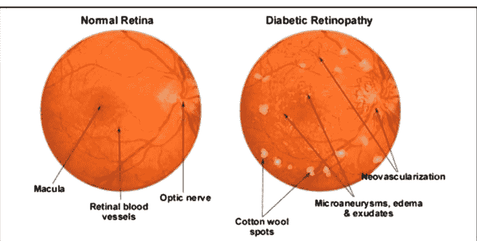

图（5）. 正常视网膜与糖尿病视网膜病变视网膜的对比 [44].

### 年龄相关性黄斑变性

年龄相关性黄斑变性（AMD）是一种削弱视网膜并导致中心视力模糊的病症，显著影响驾驶和阅读等日常活动。AMD主要影响50岁或以上的个体，并特别针对黄斑，即眼睛的关键部分 [5]。AMD可分为两种类型：干性AMD和湿性AMD。干性AMD发生在黄斑区域随年龄变薄，称为drusen的蛋白质小团块积聚时（这种形式无法治愈）。相比之下，湿性AMD涉及黄斑下异常血管的生长，这会导致液体渗漏通过视网膜 [32]。图（6）分别展示了正常视网膜、干性AMD和湿性AMD的图像。

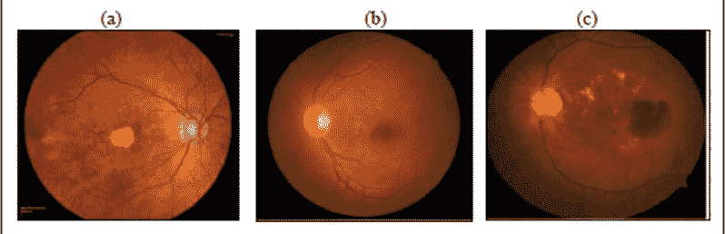

一项显著研究表明，在医疗专业人员指导下摄入维生素C和E、叶黄素、玉米黄质、锌和铜等某些维生素及营养素，可能有助于减缓干性AMD的进展 [33]。

### 糖尿病性黄斑水肿

糖尿病性黄斑水肿（DME）是指液体在黄斑（负责我们最精确视力的区域）中积聚，由渗漏血管引起 [34]。DME通常作为糖尿病视网膜病变的并发症发展 [35]。它可发生在糖尿病视网膜病变的任何阶段，并可能由任何影响视网膜血管的状况触发 [37]。此外，黄斑水肿（ME）也可能在眼科手术后出现，或作为炎症性眼病的后果。医疗专业人员使用各种诊断方法，包括散瞳眼检和视力测试，以及光学相干断层扫描（OCT）和眼底血管造影（FA）等先进成像技术，以便早期发现并监测眼睛的愈合过程 [22, 26]。

### 青光眼

青光眼是一种主要影响视神经的眼部疾病，视神经也称为第二脑神经，负责通过电冲动将视网膜的视觉信息传输至大脑视觉中心 [37]。从胚胎学角度看，视神经源于前脑突出，使其成为中枢神经系统（CNS）的一部分，并由CNS纤维束组成 [38]。视神经损伤通常由眼内压升高引起，这种状况称为高眼压。

青光眼是60岁及以上人群视力丧失的主要原因之一。早期发现青光眼至关重要，因为若不治疗可能导致失明。采用适当的检测技术对于及时诊断和适当治疗至关重要，这有助于保护患者视力。青光眼检测的各种技术在图（7）中说明，而图（8）显示了来自DRISHTI眼数据集的正常视网膜和青光眼视网膜图像，感兴趣区域（ROI）被圈出。外部虚线指示视盘，内部虚线代表视杯。

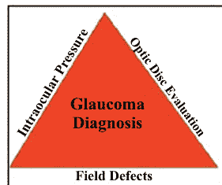

图（7）. 不同的诊断方法。

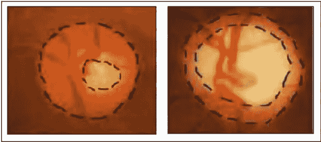

图（8）. 正常视网膜和青光眼视网膜图像分别如下。

青光眼可分为几种类型，包括原发性开角型青光眼、正常眼压型青光眼、闭角型青光眼、先天性青光眼和继发性青光眼 [39]。为了增强理解，简要介绍了这些青光眼类型。

根据国家眼科研究所（NEI）[40]，开角型青光眼 [41] 是最常见的青光眼类型。这是一个缓慢的过程，眼内无法正常引流液体，导致眼压升高并随后损伤视神经。在初期，开角型青光眼无痛且不会引起视力明显变化 [42]。

正常眼压型青光眼（NTG），也称为低眼压青光眼，是指在眼压保持在正常范围（12-22 mm Hg）内时视神经仍受损。在这种类型的青光眼中，视神经的极度敏感或血供不足可能导致该病症。

闭角型青光眼，也称为角膜闭塞、窄角或急性青光眼，是指虹膜位于眼睛引流角非常近的位置，可能阻塞引流角。这种状况可能表现为严重眼痛、视力模糊和恶心等症状 [39]。

先天性青光眼是由于眼部发育不良导致眼内压升高。它是由眼房角生长的遗传异常引起的。原发性先天性青光眼（PCG）是一种需要立即治疗的危急病症。它通常影响婴儿，父母常注意到光敏感（对光敏感）、流泪（溢泪）和闭眼（睑痉挛）等症状。这种病症大约每10,000名婴儿中出现1例，未治疗的病例可能导致儿童失明。

继发性青光眼通常是其他眼部问题、疏忽或使用某些药物（如皮质类固醇）的后果。它也可能是眼科手术的罕见副作用。

青光眼常被称为“沉默的视力窃贼”，因为其特征是不引起疼痛或症状，使得在没有适当筛查的情况下难以检测。青光眼计算机辅助诊断是医学影像研究的一个新兴领域 [43]。

### 白内障

白内障是眼内晶状体出现混浊和增厚区域的一种病症。当眼内蛋白质聚集在一起时，就会发生这种情况，导致晶状体无法将清晰图像传输到视网膜。视网膜在将通过晶状体的入射光转换为信号方面起着关键作用，信号随后传送到视神经并进一步传输到大脑。在清晰的晶状体中，白内障表现为不透明或混浊的斑块 [44]。根据其大小和位置，白内障可能阻碍正常视力。

大多数白内障与年龄有关，是由人随年龄增长而发生的眼部自然变化引起的 [45]。无论类型如何，白内障的治疗都涉及手术。图（9）分别将视网膜图像分类为无白内障、轻度、中度和重度白内障，以直观展示病情的进展。

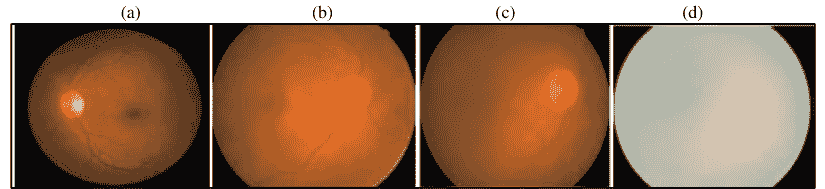

图（9）. 图像分类为（a）无白内障，（b）轻度白内障，（c）中度白内障和（d）重度白内障。

表4回顾了文献中关于使用深度学习技术的不同眼部疾病的发现和局限性的研究。

### 表4. 眼部疾病检测的不同方法

| Algorithm | Dataset | Method | Findings and Performance | Short-comings | Focus |
|---|---|---|---|---|---|
| K.Shankar et al. [45], 2020 | Messidor | 协同深度学习（SDL） | SDL包含SDLk，具有三个部分：输入层、k个DCNN组件和C2 k协同网络（SN），与其他实验模型相比提供更好的分类。准确率99.28%，特异性99.38%。灵敏度98.54%。 | 图像可以通过使用各种滤波精度来增强，并加入AlexNet和Inception等其他模型，从而提高模型性能。 | DR分类所有四个严重程度等级 |
| Zhenhua Wang et al., [36], 2020 | 含100张图像的局部OCT数据集 | Kmeans聚类，基于选择性二值和高斯滤波正则化水平集（SBGFRLS） | SBGFRLSOCT的准确性、特异性和灵敏度与人工DME分割相当，但处理时间要短得多。灵敏度91.8%，精确度97.7%，特异性99.2% | 数据集太小 | 糖尿病性黄斑水肿 |


| 算法 | 数据集 | 方法 | 发现与性能 | 不足 | 关注点 |
|---|---|---|---|---|---|
| Renoh Chalakkal 等人, [46], 2020 | DRIVE, DIARET DB1, IDRiD, MESSIDOR 和 UoA-DR | DCNN – 特征提取 & KNN 分类器 | 解决了渗出物分割和类别不平衡问题。一种 DCNN 与元启发式功能选择策略的混合方法替代了渗出物分割，并解决了不平衡数据集问题。可轻松用于医疗任务。准确率 = 97.26%（凹检测） | - | 临床显著性黄斑水肿 |
| Syna Sreng 等人 [48], 2020 | RIMONE, ACRIMA, DRISHTI-GS1, 和 ORIGA | Deep Lab V3+, DCNN, 和 ORIGA | 系统分两个阶段工作：第一阶段是视盘区域分割；第二阶段使用预训练的 DCNN 进行分类和使用 SVM 学习特征。研究发现，集成方法效果更好。RIM-ONE, ACRIMA, DRISHTI-GS1, 和 ORIGA 的准确率分别为 97.37%, 99.53%, 86.84%, 和 90.00%，AUC 分别为 100%, 99.8%, 91.67%, 和 92.06% | 模型复杂，因此并非人人都能处理。 | 青光眼 |
| Sajib Sah 等人 [48], 2019 | 153 名患者的 OCT 图像 | DCNN | 在这项应用中，所提方法表现良好，无需高级 DL 系统，也不需要数百万图像的数据库。准确率 - 87%。 | DNN 仅提供图像和相关名称；未明确指定特征（例如，SDD, IHRF, 或 HRF）。本研究中使用的图像来自单个临床站点。 | AMD |
| Guangzhu An 等人 [49], 2019 | 眼底和 3-D OCT 图像 | 基于迁移学习的 CNN, 随机森林 | 它具有对青光眼早期检测更敏感的能力。因此，该模型在青光眼诊断中更精确，从而改善常规临床青光眼治疗。彩色眼底图像、RNFL 厚度图、黄斑 GCC 厚度图、RNFL 偏差图的 AUC 分别为 0.94, 0.942, 0.944, 0.949 | 应收集更多图像并使用预处理图像。 | 开角型青光眼 |
| Turimerla Pratap, Priyanka Kokil [50], 2019 | 从不同标记和开放访问数据集收集的眼底图像 | 计算机辅助深度迁移方法和 SVM | 该网络减少了从零训练 CNN 所需的时间和精力。研究还表明，当训练集有限时，迁移学习（或微调）是成功的。因此，迁移学习提高了使用眼底图像进行白内障检测的准确率。这些方法对生活在农村地区的人特别有益。准确率 92.91%。 | - | 白内障 |
| Arun Govindaih 等人 [50], 2018 | AREDS (150000) 图像 | VGG16 | 提出了 VGG16 神经网络，进行了两项实验。在第一个实验中，基于临床意义对图像进行二分类；然后将图像进一步分为四类：无、早期、中度和晚期 AMD。二分类问题的准确率 – 92.5%，四分类问题的准确率 – 83.2% | 本研究仅考虑眼底图像的信息，这不足以进行 AMD 检测。必须预处理眼底图像，通过去除晶体眩光和非均匀照明以及其他噪声数据来提高准确率。 | AMD |
| Jen Hong Tan 等人 [5], 2018 | 402 份正常图像和 708 份 AMD 图像 | 十四层深度 CNN 模型 | 该模型完全自主、成本效益高且紧凑，可在任何地方使用。准确率 – 10 折 95.45% 交叉验证和 91.17% 单盲验证。 | 训练和测试图像应不同，以使其更高效 | AMD |

### 研究挑战

本研究表明，深度学习（DL）和计算机视觉在医学影像及各种眼部疾病（如 DR、AMD、青光眼和视网膜脱离）的光学图像识别领域做出了重大贡献。这些技术的应用实现了及时、自动化的检测，解决了医患比例有限的问题。尽管已探索了众多深度学习方法，但由于深度学习与传统应用相比具有独特的规格要求，该领域仍有必要开展进一步研究。

尽管这些技术具有优势，研究人员可能会遇到某些挑战。开发诊断工具需要访问带注释的数据集，其中包含从不同地点使用不同眼底相机拍摄的多样化眼底图像。大量具有不同颜色变化和模式的眼底图像使计算机视觉与眼底图像的比较更具挑战性。

此外，专家短缺，眼部问题的人数不断增加，导致难以及时提供充分治疗，从而可能导致视力丧失。医生手动分析图像可能需要数天，造成患者护理延误。因此，该领域对自动化的需求变得显而易见，以应对挑战并提高眼部疾病检测的效率和准确性。

### 结论

本章全面回顾了利用计算机视觉和深度学习进行眼部疾病检测的技术。介绍了深度学习框架，重点介绍了 CNN 方法及其在疾病诊断中的重要性。讨论了各种成像设备，如超声成像、眼底摄影、OCT、FA 和 HDT，以及它们的优点和局限性。

本章还深入探讨了不同眼部疾病，包括 DR、黄斑部 DR、AMD、青光眼和白内障，探索其症状、风险因素和该领域的现有研究。研究指出，通过数字图像处理进行眼部疾病检测存在当前的研究空白，特别是同时检测多种疾病方面的挑战。

考虑到人口老龄化和医疗成本上升，该领域的进步至关重要。对 DL 系统“黑盒”设计的解释工作正在进行，但该领域仍需要进一步研究。此外，开发更好的预测算法将患者分类到不同的风险组和治疗方案中，对于向全球人口提供个性化医疗至关重要。总体而言，本综述强调了在眼部疾病检测和诊断中持续研究和创新的重要性。

### 参考文献

- 1. R. Adriman, K. Muchtar, and N. Maulina, "基于纹理特征的深度学习技术糖尿病视网膜病变二分类性能评估", Procedia Comput. Sci., vol. 179, pp. 88-94, 2021. [http://dx.doi.org/10.1016/j.procs.2020.12.012]

- 2. D.S.W. Ting, L. Peng, A.V. Varadarajan, P.A. Keane, P.M. Burlina, M.F. Chiang, L. Schmetterer, L.R. Pasquale, N.M. Bressler, D.R. Webster, M. Abramoff, and T.Y. Wong, "眼病学中的深度学习：技术与临床考量", Prog. Retin. Eye Res., vol. 72, p. 100759, 2019. [http://dx.doi.org/10.1016/j.preteyeres.2019.04.003] [PMID: 31048019]

- 3. S. Kumar, S. Pathak, and B. Kumar, "使用数字图像处理自动检测眼部相关疾病", In: 多媒体信息安全手册：技术与应用. vol. 51. Cham: Springer, 2019, pp. 35-44. [http://dx.doi.org/10.1007/978-3-030-15887-3_25]

- 4. PS Grewal, F Oloumi, U Rubin, and MT Tennant, "眼病学中的深度学习：综述", Can J Ophthalmol., vol. 53, no. 4, pp. 309-313, 2018. [http://dx.doi.org/10.1016/j.jcjo.2018.04.019]

- 5. J.H. Tan, S.V. Bhandary, S. Sivaprasad, Y. Hagiwara, A. Bagchi, U. Raghavendra, A. Krishna Rao, B. Raju, N.S. Shetty, A. Gertych, K.C. Chua, and U.R. Acharya, "使用深度卷积神经网络检测年龄相关性黄斑变性", Future Gener. Comput. Syst., vol. 87, pp. 127-135, 2018. [http://dx.doi.org/10.1016/j.future.2018.05.001]

- 6. F.J. Martinez-Murcia, A. Ortiz, J. Ramirez, J.M. Górriz, and R. Cruz, "用于自动诊断和分级糖尿病视网膜病变的深度残差迁移学习", Neurocomputing, 2020.

- 7. S. Gheisari, S. Shariflou, J. Phu, P.J. Kennedy, A. Agar, M. Kalloniatis, and S.M. Golzan, "一种结合卷积和循环神经网络用于增强青光眼检测的方法", Sci. Rep., vol. 11, no. 1, p. 1945, 2021. [http://dx.doi.org/10.1038/s41598-021-81554-4] [PMID: 33479405]

- 8. T. Pratap, and P. Kokin, "嘈杂环境下计算机辅助白内障诊断的高效网络选择", Comput. Methods Programs Biomed., vol. 200, p. 105927, 2021. [http://dx.doi.org/10.1016/j.cmpb.2021.105927] [PMID: 33485073]

- 9. L. Cao, H. Li, Y. Zhang, L. Zhang, and L. Xu, "基于改进小波的视网膜图像白内障分级分层方法", Inf Fusion, vol. 53, pp. 196-208, 2020.


[http://dx.doi.org/10.1016/j.inffus.2019.06.022]

- [10] Abhishek Samanta, Aheli Saha, Suresh Chandra Satapathy, Steven Lawrence Fernandes, and Yu-Dong Zhang, "基于小数据集的卷积神经网络糖尿病视网膜病变自动检测", Pattern Recognit. Lett., vol. 135, pp. 293–298, 2020. [http://dx.doi.org/10.1016/j.patrec.2020.04.026]

- [11] S.S. Mondal, N. Mandal, A. Singh, and K.K. Singh, "基于GIFKCN分类器的眼底图像血管检测", Procedia Comput. Sci., vol. 167, pp. 2060–2069, 2020. [http://dx.doi.org/10.1016/j.procs.2020.03.246]

- [12] AM Dayana, and WS Emmanuel, "基于深度神经网络的视网膜病变分割补丁分析", International conference on Computer Networks, Big data and IoT, pp. 677–685, 2019.

- [13] K. Prasad, P.S. Sajith, M. Neema, L. Madhu, and P.N. Priya, "基于深度神经网络的多眼病检测", pp. 2148–2153, 2019. [http://dx.doi.org/10.1109/TENCON.2019.8929666]

- [14] R. Kaur, M. Juneja, and A.K. Mandal, "CT图像中肾病变分割的混合边缘技术", Multimedia Tools Appl., vol. 78, no. 10, pp. 12917–12937, 2019. [http://dx.doi.org/10.1007/s11042-018-6421-7]

- [15] B. Khmori, A. Christodoulidis, L. Djerou, M.C. Babahenini, and F. Cheriet, "基于多分辨率眼底图像的小视网膜血管粒子群优化检测方法", J. Biomed. Opt., vol. 23, no. 5, pp. 1–13, 2018. [http://dx.doi.org/10.1117/1.JBO.23.5.056004] [PMID: 29749141]

- [16] S. Dutta, B.C. Manideep, S.M. Basha, R.D. Caytiles, and N.C. Iyengar, "使用深度学习模型对糖尿病视网膜病变图像进行分类", Int. J. Grid Distrib. Comput., vol. 111, pp. 89–106, 2018.

- [17] DB Rosen, MD Conway, CP Ingram, RD Ross, LG Montilla, and GA Peyman, "眼科超声成像简要概述", Novel Diagnostic Methods in Ophthalmology, 2019. [http://dx.doi.org/10.5772/intechopen.83510]

- [18] R.H. Silverman, "眼部高分辨率超声成像——综述", Clin. Exp. Ophthalmol., vol. 37, no. 1, pp. 54–67, 2009. [http://dx.doi.org/10.1111/j.1442-9071.2008.01892.x] [PMID: 19138310]

- [19] 可从以下网址获取：https://retinamaculainstitute.com/ocular-ultrasounda

- [20] J.S. Schumann, "青光眼频谱域光学相干断层扫描（AOS学位论文）", Trans Am Ophthalmol Soc., vol. 106, pp. 426–458, 2008.

- [21] A. Edo, Y. Harada, and Y. Kiuchi, "B扫描眼部超声图像在视神经周围炎诊断中的实用性", Am. J. Ophthalmol. Case Rep., vol. 12, pp. 45–48, 2018. [http://dx.doi.org/10.1016/j.ajoc.2018.08.007] [PMID: 30182069]

- [22] V. Mohammadzadeh, N. Fatehi, A. Yarmohammadi, J.W. Lee, F. Sharifipour, R. Daneshvar, J. Caprioli, and K. Nouri-Mahdavi, "青光眼中黄斑光学相干断层扫描成像", Surv. Ophthalmol., vol. 65, no. 6, pp. 597–638, 2020. [http://dx.doi.org/10.1016/j.survophthal.2020.03.002] [PMID: 32199939]

- [23] K. Azuma, H. Saito, M. Takao, and M. Araie, "青光眼过滤手术后眼球中通过频谱域光学相干断层扫描观察到的缺氧性黄斑病变频率", Am. J. Ophthalmol. Case Rep., vol. 19, p. 100786, 2020. [http://dx.doi.org/10.1016/j.ajoc.2020.100786] [PMID: 32637730]

- [24] M. Bhende, S. Shetty, M. Parthasarathy, and S. Ramya, "光学相干断层扫描：常见黄斑疾病解读指南", Indian J. Ophthalmol., vol. 66, no. 1, pp. 20–35, 2018. [http://dx.doi.org/10.4103/ijo.IJO_902_17] [PMID: 29283118]

- [25] F. Grassmann, J. Mengelkamp, C. Brandl, S. Harsch, M.E. Zimmermann, B. Linkohr, A. Peters, I.M. Heid, C. Palm, and B.H.F. Weber, "基于彩色眼底摄影的年龄相关性眼病研究严重程度分级预测深度学习算法，用于年龄相关性黄斑变性", Ophthalmology, vol. 125, no. 9, pp. 1410-1420, 2018. [http://dx.doi.org/10.1016/j.ophtha.2018.02.037] [PMID: 29653860]

- [26] J. Sivaswamy, S.R. Krishnadas, G. Datt Joshi, M. Jain, and A.U. Syed Tabish, "Drishti-GS：视神经头（ONH）分割视网膜图像数据集", IEEE 11th International Symposium on Biomedical Imaging (ISBI). 2014, pp. 53-56, 北京, 中国. [http://dx.doi.org/10.1109/ISBI.2014.6867807]

- [27] S. Mamdouh, M. Youssef, D. El-Fayoumi, and M. Salah, "眼部和非眼部贝赫切特病中的眼底荧光血管造影和光学相干断层扫描发现", Egypt. Rheumatol., vol. 42, no. 3, pp. 213-218, 2020. [http://dx.doi.org/10.1016/j.ejr.2020.05.001]

- [28] S. Khochtali, I. Khairollah-Ksiaa, and S. Ben Yahia, "正常眼底荧光血管造影", In: The Uveitis Atlas., V. Gupta, Q. Nguyen, P. LeHoang, A. Agarwal, Eds., Springer: 新德里, 2020. [http://dx.doi.org/10.1007/978-81-322-2410-5_5]

- [29] D. Doshi, A. Shenoy, D. Sidhpura, and P. Gharpure, "使用深度卷积神经网络的糖尿病视网膜病变检测", 2016 International Conference on Computing, Analytics and Security Trends (CAST), pp. 12-66, 2016. [http://dx.doi.org/10.1109/CAST.2016.7914977]

- [30] Y.S. Kanungo, B. Srinivasan, and S. Choudhary, "使用深度学习检测糖尿病视网膜病变", 2017 2nd IEEE International Conference on Recent Trends in Electronics, Information & Communication Technology (RTEICT). 2017, pp. 801-804, 印度班加罗尔. [http://dx.doi.org/10.1109/RTEICT.2017.8256708]

- [31] F. Li, Z. Liu, H. Chen, M. Jiang, X. Zhang, and Z. Wu, "基于深度学习算法的视网膜眼底照片中糖尿病视网膜病变自动检测", Transl. Vis. Sci. Technol., vol. 8, no. 6, p. 4, 2019. [http://dx.doi.org/10.1167/tvst.8.6.4] [PMID: 31737428]

- [32] W.L. Alyoubi, W.M. Shalash, and M.F. Abulkhair, "通过深度学习技术进行糖尿病视网膜病变检测：综述。", Inform. Med. Unlocked., vol. 20, no. 10, pp. 03-77, 2020. [http://dx.doi.org/10.1016/j.imu.2020.100377]

- [33] J.H. Tan, S.V. Bhandary, S. Sivaprasad, Y. Hagiwara, A. Bagchi, U. Raghavendra, A. Krishna Rao, B. Raju, N.S. Shetty, A. Gertych, K.C. Chua, and U.R. Acharya, "使用深度卷积神经网络的年龄相关性黄斑变性检测", Future Gener. Comput. Syst., vol. 87, pp. 127-135, 2018. [http://dx.doi.org/10.1016/j.future.2018.05.001]

- [34] P.M. Burlina, N. Joshi, M. Pekala, K.D. Pacheco, D.E. Freund, and N.M. Bressler, "使用深度卷积神经网络对彩色眼底图像中的年龄相关性黄斑变性进行自动分级", JAMA Ophthalmol., vol. 135, no. 11, pp. 1170-1176, 2017. [http://dx.doi.org/10.1001/jamaophthalmol.2017.3782] [PMID: 28973096]

- [35] C.P. Wilkinson, F.L. Ferris III, R.E. Klein, P.P. Lee, C.D. Agardh, M. Davis, D. Dills, A. Kampik, R. Pararajasegaram, J.T. Verdaguer, and G.D. Group, "拟议的国际临床糖尿病视网膜病变和糖尿病性黄斑水肿疾病严重程度分级", Ophthalmology, vol. 110, no. 9, pp. 1677-1682, 2003. [http://dx.doi.org/10.1016/S0161-6420(03)00475-5] [PMID: 13129861]

- [36] J. Hu, Y. Chen, and Z. Yi, "使用深度神经网络对OCT中黄斑水肿进行自动分割", Med. Image Anal., vol. 55, pp. 216-227, 2019. [http://dx.doi.org/10.1016/j.media.2019.05.002] [PMID: 31096135]

- [37] Z. Wang, W. Zhang, Y. Sun, M. Yao, and B. Yan, "使用改进的水平集算法对光学相干断层扫描图像中的糖尿病性黄斑水肿进行检测", BioMed Res. Int., vol. 2020, pp. 1-7, 2020. [http://dx.doi.org/10.1155/2020/6974215] [PMID: 32420362]

- [38] A. Thakur, M. Goldbaum, and S. Yousefi, "使用深度学习预测青光眼发病", Ophthalmol. Glaucoma, vol. 3, no. 4, pp. 262-268, 2020. [http://dx.doi.org/10.1016/j.ogla.2020.04.012] [PMID: 33012331]

- [39] K. Prasad, P.S. Sajith, M. Neema, L. Madhu, and P.N. Priya, "使用深度神经网络的多眼病检测", In: TENCON 2019 - 2019 IEEE Region 10 Conference. TENCON: 印度科钦, 2019, pp. 2148-2153. [http://dx.doi.org/10.1109/TENCON.2019.8929666]

- [40] X. Huang, M.R. Islam, S. Akter, F. Ahmed, E. Kazami, H.A. Serhan, A. Abd-alrazaq, and S. Yousefi, "青光眼中的人工智能：机遇、挑战与未来方向", Biomed. Eng. Online, vol. 22, no. 1, p. 126, 2023. [http://dx.doi.org/10.1186/s12938-023-01187-8] [PMID: 38102597]

- [41] 可从以下网址获取：https://www.nei.nih.gov/

- [42] P. Harasymowycz, C. Birt, P. Gooi, L. Heckler, C. Hutnik, D. Jinapriya, L. Shuba, D. Yan, and R. Day, "加拿大视角下21世纪的青光眼医学管理", J. Ophthalmol., vol. 2016, no. 16, pp. 1-22, 2016. [http://dx.doi.org/10.1155/2016/6509809] [PMID: 27895937]

- [43] Q. Abbas, "Glaucoma-deep：使用深度学习对眼底图像中青光眼眼病进行检测", Int. J. Adv. Comput. Sci. Appl., vol. 8, no. 6, 2017. [http://dx.doi.org/10.14569/IJACSA.2017.080606]

- [44] K. Shankar, A.R.W. Sait, D. Gupta, S.K. Lakshmanaprabu, A. Khanna, and H.M. Pandey, "使用协同深度学习模型对眼底糖尿病视网膜病变图像进行自动检测和分类", Pattern Recognit. Lett., vol. 133, pp. 210-216, 2020. [http://dx.doi.org/10.1016/j.patrec.2020.02.026]

- [45] R. Chalakkal, F. Hafiz, W. Abdullah, and A. Swain, "临床显著黄斑水肿自动筛查的高效框架", Comput. Biol. Med., vol. 130, p. 104128, 2021. [http://dx.doi.org/10.1016/j.compbiomed.2020.104128] [PMID: 33529843]

- [46] S. Sreng, N. Maneerat, K. Hamamoto, and K.Y. Win, "视网膜图像中视盘分割和青光眼诊断的深度学习", Appl. Sci., vol. 10, no. 14, p. 4916, 2020. [http://dx.doi.org/10.3390/app10144916]

- [47] S. Saha, M. Nassisi, M. Wang, and S. Lindenberg, "使用深度学习对早期AMD生物标志物进行自动检测和分类", Sci. Rep., vol. 9, no. 11, pp. 09-90, 2019.

- [48] G. An, K. Omodaka, K. Hashimoto, S. Tsuda, Y. Shiga, N. Takada, T. Kikawa, H. Yokota, M. Akiba, and T. Nakazawa, "基于光学相干断层扫描和彩色眼底图像的机器学习青光眼诊断", J. Healthc. Eng., vol. 2019, pp. 1-9, 2019. [http://dx.doi.org/10.1155/2019/4061313] [PMID: 30911364]

- [49] T. Pratap, and P. Kokil, "使用深度迁移学习的白内障计算机辅助诊断", Biomed. Signal Process. Control, vol. 53, no. 10, p. 101533, 2019. [http://dx.doi.org/10.1016/j.bspc.2019.04.010]

- [50] A. Govindaiah, M.A. Hussain, R.T. Smith, and A. Bhuiyan, "基于眼底图像的年龄相关性黄斑变性深度卷积神经网络筛查与评估", In: 2018 IEEE 15th International Symposium on Biomedical Imaging (ISBI 2018), 美国华盛顿特区, 2018, pp. 1525-1528. [http://dx.doi.org/10.1109/ISBI.2018.8363863]


## CHAPTER 8

### 人机交互与人工智能的融合催生脑机交互的出现

M. Kiruthiga Devi*

斯里赛拉姆工程学院计算机科学与工程系，印度钦奈

摘要：个人计算机可以使用，以键盘、鼠标和操纵杆等输入设备作为计算机与人类之间的接口。那些被委婉地称为身体有障碍的人无法使用这些计算机系统，因此，BCI 技术已发展出可在无需身体动作的情况下管理的外部应用，以帮助这些身体残障人士并解决 HCI 的局限性。认知神经科学和脑成像领域的技术进步使其能够直接与人脑通信，而无需使用接口。这些系统不再从肌肉运动产生信号，而是利用大脑活动来监控计算机或通信设备。人机交互（HCI）领域的研究人员探索让机器利用尽可能多感官来源的方法。此外，研究人员开始考虑隐式数据类型，即不是专门为了指示机器执行任务而执行的输入。系统可以根据这些数据动态演变，以协助用户处理手头的任务。在此，我们讨论了脑机接口的组件、特性和挑战。研究人员正在尝试用卷积神经网络（CNNs）取代传统分类器，这将在分类方面提供有前景的优势。大脑的 EEG 信号可以通过 BCI 应用程序无缝连接到机械系统，使其成为一项迅速发展的技术，在人工智能和计算智能等领域具有应用。

关键词：动作，氛围，人工智能，脑机接口，卷积神经网络，分类器，通信，计算，深度学习，脑电图，EEG，人机交互，输入设备，动作，机器，机器学习，机械系统，神经科学，生理学，信号，感觉，支持向量。

* 通讯作者 M. Kiruthiga Devi：斯里赛拉姆工程学院计算机科学与工程系，印度钦奈；电子邮件：kiruthigaprofessor89@gmail.com

### 简介

传感器用于跟踪与特定类型思维相关的脑部某些物理过程 [1]。由于这些发展，已开发出脑机接口（BCI），允许不依赖大脑通常的周围神经和肌肉系统的系统之间进行通信。许多因素促进了这一进步，包括对神经生物学过程的改进理解、机器学习算法和深度学习。个人计算机可以作为计算机与人类之间的接口，使用键盘、鼠标等输入设备 [2]。残疾人无法使用这些系统，但为了帮助这些被委婉地称为身体有障碍的人并解决 HCI 的局限性，BCI 技术已发展，允许在不使用身体肌肉运动的情况下管理外部应用。BCI 校准困难，分为两个阶段：低信噪比（SNR）和高个体间差异性。所需的校准时间取决于所使用的范式类型。它仍可减少一半。如果脑信号的信噪比（SNR）低，BCI 在准确确定人类意图方面最具挑战性 [3]。现实是，BCI 的现实世界实现受限于泛化潜力差和分类准确度低。

近年来，深度学习方法已被用于处理脑知识以解决上述挑战。虽然通常机器学习算法需要手动选择特征，但深度学习可以直接从脑信号中学习复杂的高级特征，并且其准确性随训练数据集大小良好扩展 [4]。可以使用不同的技术监测大脑活动，这些技术可分为两种类型：侵入式和非侵入式。非侵入式 BCI 系统主要使用脑电图（EEG）信号从安装在头皮上的电极捕获大脑信号。EEG 数据非常嘈杂，因此，当大脑通过头皮向 EEG 传感器通信时，提取连贯信号可能很困难。因此，从失真的脑信号中提取有用信息并开发强大的 BCI 系统至关重要。当通过脑机接口（BCI）处理来自脑电图（EEG）传感器的数据时，通道数、训练数据量和信噪比会影响分类的准确性 [5]。在现实世界应用中，SNR 是所有这些变量中最难修改的。开发多种预处理和特征工程方法来减少噪声一直很耗时，并可能导致提取特征中的信息丢失。特征工程在很大程度上依赖于人类领域知识。人类经验有助于捕捉某些特定方面的特征，但在更一般的情况下不足。算法会自动提取有代表性的特征作为结果。因为大多数机器学习研究关注静态数据，它无法可靠地分类不断演变的脑信号 [6, 7]。BCI 系统需要使用新的学习方法来处理动态数据流 [8]。深度学习的好处是反向传播。通过反向传播，它通过利用原始脑信号学习可区分的信息，而无需预处理和工程化特征。此外，深度神经网络可以使用深层结构来捕捉潜在依赖性和有代表性的高级特征 [9]。

### 脑机接口的组件

脑机接口的主要目标是检测和分析用户脑中指示用户意图的信号，然后将这些信号传输到执行用户指令的外部计算机。基于 BCI 的系统有四个组件协同工作以实现此目标，如图（1）所示。

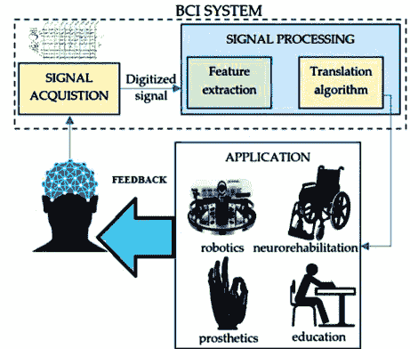

图（1）。BCI 的组件。

### 信号获取

这是第一个组件，用于检测和分析脑信号。该组件的目的是接收和记录由神经元动作产生的信号。它还将生成的信号传输到 BCI 组件的下一部分，以进行信号增强和降噪 [10]。

### 特征提取

这是脑机接口信号处理的第一步。数字信号（例如与用户意图相对应的信号）通过分析信号的不同特征并将其转换为用户输出的可接受指令来进行处理。

### 翻译

在信号处理的这个阶段，提取的信号特征被传递给翻译算法。它将特征转换为发送到外部系统的有效指令，以实现目的（例如，用户的意图被转换为完整指令）。

### 应用/设备输出

翻译算法为驱动和控制输出设备提供指令。它帮助用户实现目标，例如选择字母、控制鼠标、移动机械臂、使用轮椅、移动瘫痪的肢体等 [11]。

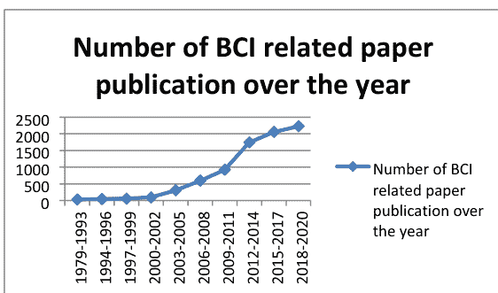

图（2）。各年 BCI 相关论文发表数量。

### BCI 特性

### 根据 BCI 系统如何使用大脑进行分类：主动 BCI

这种机制从大脑的自愿编程运动中产生效果，这些运动独立于外部刺激。为了管理 BCI 等应用，它由人员的故意运动想象激活 [12]。


反应性 BCI：它是一种使用作为对刺激反应而形成的脑信号的设备。它由消费者通过 P300 用于监控应用程序。

被动 BCI：通过利用非预期的情绪/认知脑功能的方法，可以检测驾驶员嗜睡，从而预防道路交通事故。

信号采集模式已被用于将结构分类为侵入性或非侵入性 BCI。

基于 BCI 的设备最重要的组件是测量大脑生成振荡的能力。它代表了用户当前的自愿神经行为，并且已调查了各种信号采集技术。通过使用 BCI 应用程序，您可以确定哪种采集方法和计算适合您的信号 [13]。

### 侵入性技术

脑皮层图谱（ECoG）分析大脑的神经元活动，无论是来自神经系统内部的皮层内活动，还是皮层表面的活动。其主要优点是具有空间分辨率和高时间分辨率，从而提高了信噪比和信号效率。这些方法存在若干缺陷。除了对外科手术可用性的担忧外，还提出了输出问题。其中之一是此类植入物跟踪脑区域的大小有限。一旦植入，它们就无法移动以测试大脑另一部分的脑活动。在外科手术过程中，电极条或栅格被植入皮层表面，如图（3）所示。ECoG 记录介于非侵入性安全性和侵入性之间。由于其靠近信号源，其空间分辨率和信号幅值高于非侵入性技术（如 EEG）。ECoG 脑信号已被用于区分非瘫痪和瘫痪癫痫患者的右手与左手以及手指与舌头的想象运动，也用于计算五指屈曲的运动学参数。

最具侵入性的方法是皮层内采集技术。它植入大脑皮层表面下方。可以使用电极阵列或单个电极来完成，该电极监测信号的单个神经元动作。由于电极尖端位于靠近信号源的位置，阵列必须随时间保持稳定。由于其高空间分辨率，强烈建议在源定位问题中使用它。另一方面，皮层内采集随时间可能会出现信号变异性。大鼠和猴子在使用颅内侵入性采集的 BCI 研究中被大量使用，如图（4）所示。带有植入电极的动物被用于研究运动。在一项旨在减少使用电极数量的研究中，猴子首先学会了将光标移动到虚构立方体角上的 8 个目标。从提取的数据中训练了自适应运动预测算法来评估运动意图。在虚拟现实中，猴子被用来操纵脑控机械臂 [14]。研究人员甚至成功地使用真正的机械臂来协助进食。肌萎缩侧索硬化症（ALS）是与大脑和脊髓神经细胞相关的神经退行性疾病。运动神经元贯穿全身，从大脑到脊髓，再从脊髓到肌肉 [15]。在运动皮层植入单个电极后，一名 ALS 患者能够移动计算机屏幕上的光标以选取呈现的对象。

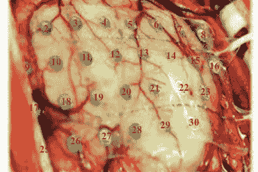

图（3）。脑皮层图谱。

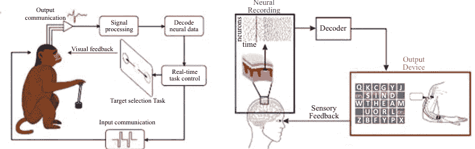

图（4）。皮层内。

### 非侵入性技术

这些记录方法基于一种不涉及将外来物体植入受试者大脑的过程。因此，它消除了对侵入性采集程序或永久植入物附着的需求。脑磁图（MEG）用于检测大脑电流产生的磁场。目前使用超导量子干涉系统来收集头部外部磁信号。实验室需要屏蔽和专用设备，以防止 MEG 信号干扰其他磁信号（如地球磁场），如图（5）所示。尽管存在便携性和成本问题，但颅骨层受 MEG 信号的干扰小于电场。与非侵入性电子采集策略相比，这一优势并未带来效率或训练时间的显著改善。

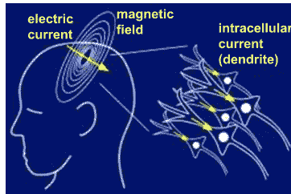

图（5）。脑磁图。

### 功能磁共振成像（fMRI）

fMRI 感知与大脑神经元活动相关的血流变化。因此，它有助于将行为映射到大脑的相应区域，这一过程称为源定位。任何涉及大脑的活动都会导致该区域血流量增加（图 6）。BOLD 对比法对血流动力学响应敏感。大脑组织中去氧血红蛋白浓度的差异可以表现为 BOLD 对比强度 [16]。它的时间分辨率较低，但具有高空间分辨率，并可以采集磁或电方法无法获取的大脑深部数据。

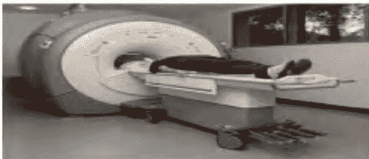

图（6）。功能磁共振成像（fMRI）。

### 功能近红外光谱（fNIRS）

fNIRS 是一种非侵入性方法，通过测量大脑中的血流来检测神经元活动。它使用近红外光范围内的光来确定血流。它具有信号高空间分辨率的优势。与基于电磁信号的记录相比，fNIRS 记录的时间分辨率准确性预期较低。它具有提供高空间分辨率信号的优势。其优点使其成为实际应用和临床试验的可行选择。

### 脑电图（EEG）

脑电图（EEG）监测大脑内神经递质活动后的电压变化，以记录头皮电活动。由于其在可用性方面相对于其他脑信号记录方法具有明显优势，因此可以商业使用。它易于使用、体积小巧且价格实惠。EEG 记录还提供高时间分辨率 [16]。与其他方法相比，该方法的信噪比较低，空间分辨率也较低。为了改善 EEG 信号定位和空间分辨率，已提出许多解决方案 [17]。已提出将电极数量增加到 256。已宣布存在全球电极定位方案。根据分配，相邻电极对之间的距离应为头皮直径的 10% 或 20%。存在多种使用类似 NeuroSky 的传感器的 EEG 系统，它们侵入性较少，并为广泛消费者使用提供了高度便携的选择。与头皮 EEG 相比，已证明其可行。该方法的好处是固定电极位置，为用户提供舒适度，并能抵抗电磁干扰。基于 BCI 的应用研究重点在于在保持信噪比的同时减少使用的电极数量。

BCI 将大脑活动的直接测量值转换为命令和控制。最现代的 BCI 使用脑电图（EEG）来记录三种信号之一：P300、事件相关去同步化/同步化（ERD/ERS）、稳态视觉诱发电位（SSVEP）。

### 基于 P300 的 BCI

对大脑对特定感觉、认知或运动事件的反应的评估称为事件相关电位（ERPs）。P300 是一个显著峰值，也是最常用的事件相关电位元素之一。在 EEG 中，刺激后 300 毫秒可以观察到一个乐观峰值，刺激是


在奇异球范式中呈现。可使用视觉、听觉和感觉刺激。ERP的P300部分指EEG中的诱发反应。

### P300的属性

大脑枕叶区域具有最高的空间幅度分布，围绕中心位置对称。采用10-20国际方法记录Cz。P300通常作为10-20国际系统的电极和幅度分配进行报告。从时间模式来看，P300波幅通常为2至5V，周期为150至200毫秒。从图(7)来看，考虑到P300与脑电背景活动（50V）相比幅度较低，显然P300的发现需要异常的信号处理。各种应用已利用基于P300的BCI，从轮椅导航到在虚拟键盘上拼写单词并与机器通信。此类BCI系统有能力改变人们的生活。

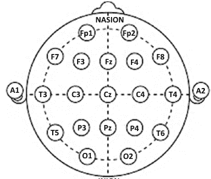

图(7). P300.

电生理学和神经生理学的研究表明，神经元通过增加活动来响应刺激。突然的视觉刺激引发视觉诱发电位，而重复的视觉刺激导致EEG中出现稳定的电压振荡模式，即稳态视觉诱发电位（SSVEP）。根据Ragan的说法，SSVEP直接发生在初级视觉皮层。根据Silberstein的说法，在认知任务期间，SSVEP可能包含来自外周视网膜的间接皮层反应。在SSVEP中，皮层的连续视觉区域由不断在中心视网膜上重复的刺激模式刺激。它是一种正弦振荡波形，其基频与刺激相似。作为对以3.5 Hz至75 Hz的速率提供的视觉刺激的响应，大脑在不同和相同的频率下感应电活动。使用这种类型的刺激可以帮助诊断视觉知觉缺陷、精神分裂症患者的神经系统异常、多发性硬化症患者的多灶性感觉丧失以及其他精神病诊断。

### 使用卷积分类器的脑电图(EEG)

在简化的BCI系统中，一致的EEG信号和有效的分类器比多通道系统更为重要。独立成分分析（ICA）在将融合信号分离为其加法独立成分方面优于传统的带通滤波器[18]。随着BCI领域分类方法（_例如，_机器学习和深度学习）的最新发展，传统分类方法（_即，_线性判别分析和支持向量机）探索了良好的输出。在BCI领域，研究人员正在尝试用深度学习方法取代传统分类器（_例如，_支持向量机）[19]。我们通过_通过_小波变换（WT）算法提取了功能和时域特征。使用CNN算法对各种精神信号进行分类。研究人员使用优化算法（_例如，_FastICA, WT, and CNN）从同一来源检测混合MI和SSVEP信号。与简单的混合同步BCI系统相比，该系统能够使用单个CNN模型检测三种不同的EEG形式，并使用更简单的BCI结构（_例如，_两个通道）处理多个命令（_例如，_十条评论）。更简单的头戴式设备结构可以作为残疾人使用BCI无线命令完成日常任务的日常控制设备。为了避免复杂的直接预处理和图像输入，CNN通常包括许多成对的卷积最大池化层和作为输出的完全连接层。

在一般神经网络中，神经元数量与输入数据一样多；数据过多会阻碍高效训练[20]。一般神经网络中连接的神经元数量等于输入数据。为了降低维度，CNN执行局部字段和参数共享，并在卷积层中将二维滤波器应用于输入图像，然后对其重新采样以产生较小的尺寸。在方程(1)中，考虑矩阵(x<sub>i,j</sub>)，其第i行和第j列与W<sub>r</sub>算法配对。W<sub>m,n</sub>表示第m行和第n列的权重，W<sub>b</sub>表示滤波器中第m行和第n列的权重。激活函数（_即，_f）是ReLU函数。输入是基于时频的函数。网络有四层，每层包含一个或多个神经元。

```
(i, j) = (\(\sum_{m=0}\sum_{n=0} Wm, n Xi + m, j + n\)) + wb (1)
```

作为W<sub>T</sub>（时间、频率和幅度）的结果，我们得到了一个3维特征矩阵。一旦收集所有数据集，CNN模型的第1层将包含带有不同标签的所有数据集。卷积层和池化层是时域中的第一层，动态函数被添加到所有数据作为输入。

卷积滤波器大小为5*5并带有填充，每次移动等于1。最大池化层使用2*5的滤波器大小。系统使用图(8)所示2*5大小滤波器的最大池化。因此，处理第1层后，矩阵将减少到4*700/2*700 = 2,800或1,400个神经元。完全连接层（由280或140个神经元组成）是第三个隐藏层[21]。反映十个命令的十个神经元构成第四个隐藏层，也是完全连接层。数据集进一步划分为单特征（SSVEP/MI）和混合特征（SSVEP/MI+SSVEP），以证明同步混合MI+SSVEP方法的优势。CNN模型使用不同信号进行训练并比较其结果[22]。基于显示损失的结果，混合系统优于单系统。准确率也在不同程度上提高。因此，混合系统是可同时操作的多命令系统的最佳选择。同步混合信号可用于更多命令，以克服心理任务和时间框架问题的限制。序列混合系统需要2个时间窗口来执行一条指令，而同步混合模式将时间窗口减少1/2。此外，不同于传统的混合系统[23]。此外，该设备可用于执行MI心理任务、混合MI-SSVEP任务和SSVEP心理任务的同步识别。

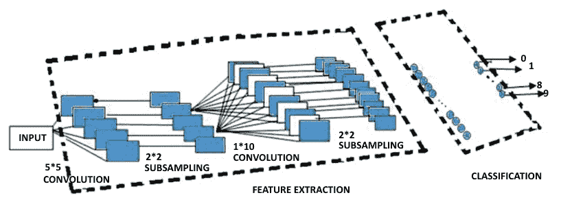

**图(8).** 四层卷积神经网络分类器结构。

### 挑战

可用性挑战：BCI被描述为在获得用户接受方面存在困难。类别歧视准备是令他们关注的问题[24]。系统效率和接受度由信息传输率（ITR）衡量[25]。

### 训练过程

关于用户培训，必须引导用户进行处理器操作或记录多个会话。这发生在介绍过程或分类器校准阶段。在初步阶段，个人被教导如何使用设备和操纵脑输入信号，而在校准阶段，训练受试者的信号用于学习所使用的分类器。解决这一耗时问题的最广泛研究的解决方案之一是使用单次试验分析而不是多次试验分析，用于改善信噪比，并将小训练尺寸的负担放在后续BCI设备组件上进行管理。作为替代方案，已研究了零训练分类器和多种自适应方法。

### 信息传输率

基于命令的BCI系统使用信息传输率进行评估。基于可用选项的数量、目标检测准确率以及做出决策所需的平均时间来确定此统计量。由于有如此多的可用选项，选择性注意技术的ITR高于基于意象的BCI。

### 技术挑战

收集的电生理数据存在问题。例如，非线性是脑信号的一个属性。

### 非线性

大脑中观察到一组神经元的动态非线性行为，大脑是一个高度动态的系统。因此，非线性动态方法比线性方法更能描述EEG信号。

### 非平稳性和噪声

BCI系统面临非平稳电生理脑信号的问题。这导致随时间的推移（无论是在记录会话之间还是会话内部）所使用信号的连续变化。EEG信号的变异性可能受到


会话过程中的心理和情绪状态。内部非平稳原因还包括疲劳和注意力水平。噪声和非平稳原因是脑机接口技术的主要挑战。它们涉及电极位置变化引发的不必要信号以及环境中的噪声。获取的信号代表运动相关源的组合，例如眼球运动产生的电信号、骨骼肌电图（EMG）以及眨眼眼电图（EOG），这使得难以辨别其背后的模式。

### 小型训练集

训练流程主要受可用性问题和有限训练集的影响。尽管受试者觉得训练会议既耗时又令人筋疲力尽，但它们为用户提供了应对设备并学习监测其神经生理信号所需的经验。因此，开发脑机接口需要在理解大脑信号的技术难度与有效使用的培训要求之间取得重大平衡。

### 结论

脑机接口是一项尖端技术，它利用脉冲控制外部设备，绕过常规神经肌肉系统，以完成任务。脑机接口技术是神经科学中一项相对较新的创新，吸引了包括娱乐与游戏、安全和营销在内的各个领域的研究人员。侵入式和非侵入式记录设备分为两类。由于其在地理或临时方面的更高准确率，侵入性手术通常用于关键瘫痪病症。除了我们之前讨论过的非侵入式类别相对于侵入式类别的优势外，非侵入式类别也已在各种应用中得到广泛采用。使用脑信号所引发的其他问题和障碍，也已根据脑机接口系统处理中算法提供的答案进行了研究。今天，HCI研究人员充分认识到新技术的交互可能性。我们还审视了脑机接口成为一项成功且广泛采用的技术必须克服的不同挑战。本文的主要目标是将这项新兴技术推向前沿。脑机接口研究界希望未来能更紧密地合作，并接受其他研究领域以及社会整体将重视和引导脑机接口研究，而非仅限于其他医学应用。

### 参考文献

- [1] S. Ram, W. Zhang, M. Williams, and Y. Pengentze, "利用大数据预测哮喘相关急诊科就诊", IEEE J. Biomed. Health Inform., vol. 19, no. 4, pp. 1216-1223, 2015. [http://dx.doi.org/10.1109/JBHI.2015.2404829] [PMID: 25706935]

- [2] C.H. Lee, J.C.Y. Chen, and V.S. Tseng, "一种考虑生物信号和环境数据的用于哮喘监测的新颖数据挖掘机制", Comput. Methods Programs Biomed., vol. 101, no. 1, pp. 44-61, 2011. [http://dx.doi.org/10.1016/j.cmpb.2010.04.016] [PMID: 20554074]

- [3] W.C. Moore, D.A. Meyers, S.E. Wenzel, W.G. Teague, H. Li, X. Li, R. D’Agostino Jr, M. Castro, D. Curran-Everett, A.M. Fitzpatrick, B. Gaston, N.N. Jarjour, R. Sorkness, W.J. Calhoun, K.F. Chung, S.A.A. Comhair, R.A. Dweik, E. Israel, S.P. Peters, W.W. Busse, S.C. Erzurum, and E.R. Bleecker, "利用重度哮喘研究计划中的聚类分析识别哮喘表型", Am. J. Respir. Crit. Care Med., vol. 181, no. 4, pp. 315-323, 2010. [http://dx.doi.org/10.1164/rccm.200906-0896OC] [PMID: 19892860]

- [4] C.K.W. Lai, R. Beasley, J. Crane, S. Foliaki, J. Shah, and S. Weiland, "哮喘症状患病率和严重程度的全球差异：儿童哮喘和过敏国际研究（ISAAC）第三阶段", Thorax, vol. 64, no. 6, pp. 476-483, 2009. [http://dx.doi.org/10.1136/thx.2008.106609] [PMID: 19237391]

- [5] C. Shivade, P. Raghavan, E. Fosler-Lussier, P.J. Embi, N. Elhadad, S.B. Johnson, and A.M. Lai, "利用电子健康记录识别患者表型队列方法综述", J. Am. Med. Inform. Assoc., vol. 21, no. 2, pp. 221-230, 2014. [http://dx.doi.org/10.1136/amiajnl-2013-001935] [PMID: 24201027]

- [6] W. Wu, E. Bleecker, W. Moore, W.W. Busse, M. Castro, K.F. Chung, W.J. Calhoun, S. Erzurum, B. Gaston, E. Israel, D. Curran-Everett, and S.E. Wenzel, "利用扩展肺数据对重度哮喘研究计划参与者进行无监督表型分析", J. Allergy Clin. Immunol., vol. 133, no. 5, pp. 1280-1288, 2014. [http://dx.doi.org/10.1016/j.jaci.2013.11.042] [PMID: 24589344]

- [7] M. Zedan, G. Attia, M.M. Zedan, A. Osman, N. Abo-Elkheir, N. Maysara, T. Barackat, and N. Gamil, "临床哮喘表型及治疗反应", ISRN Pediatr., vol. 2013, pp. 1-7, 2013. [http://dx.doi.org/10.1155/2013/824781] [PMID: 23606983]

- [8] M.C.F. Prosperi, U.M. Sahiner, D. Belgrave, C. Sackesen, I.E. Buchan, A. Simpson, T.S. Yavuz, O. Kalayci, and A. Custovic, "利用无监督统计学习技术识别哮喘亚组的挑战", Am. J. Respir. Crit. Care Med., vol. 188, no. 11, pp. 1303-1312, 2013. [http://dx.doi.org/10.1164/rccm.201304-0694OC] [PMID: 24180417]

- [9] M. Zolnoori, M. H. F. Zarandi, and M. Moin, "哮喘疾病中智能系统的应用：设计基于模糊规则的系统以评估哮喘急性发作水平", J Med Syst, vol. 36, no. 4, pp. 2071-2083, 2012. [http://dx.doi.org/10.1007/s10916-011-9671-8]

- [10] V. Siroux, X. Basagaña, A. Boudier, I. Pin, J. Garcia-Aymerich, A. Vesin, R. Slama, D. Jarvis, J.M. Anto, F. Kauffmann, and J. Sunyer, "利用聚类方法识别成人哮喘表型", Eur. Respir. J., vol. 38, no. 2, pp. 310-317, 2011. [http://dx.doi.org/10.1183/09031936.00120810] [PMID: 21233270]

- [11] C. Chakraborty, T. Mitra, A. Mukherjee, and A.K. Ray, "CAIDSA：支气管哮喘计算机辅助智能诊断系统", Expert Syst. Appl., vol. 36, no. 3, pp. 4958-4966, 2009. [http://dx.doi.org/10.1016/j.eswa.2008.06.025]

- [12] M.P. Pushpalatha, and M.R. Pooja, "基于哮喘严重程度指标的哮喘有效预后预测模型", 2017 International Conference on Computer Communication and Informatics (ICCCI), pp. 1-6, 2017. [http://dx.doi.org/10.1109/ICCCI.2017.8117717]

- [13] S. Schmidt, G. Li, and Y.-P. P. Chen, "区域哮喘数据集中的医学知识发现", Advanced Intelligent Computing Theories and Applications. With Aspects of Artificial Intelligence, pp. 888-895, 2008. [http://dx.doi.org/10.1007/978-3-540-85984-0_107]

- [14] M.R. Pooja, and M.P. Pushpalatha, "横断面研究中哮喘患者识别的混合决策支持系统", 2015 International Conference on Emerging Research in Electronics, Computer Science and Technology (ICERECT), pp. 288–293, 2015. [http://dx.doi.org/10.1109/ERECT.2015.7499028]

- [15] K. Farion, W. Michałowski, and S. Wilk, 哮喘急性发作决策模型的开发：结合粗糙集和专家驱动的临床属性选择. Rough Sets and Current Trends in Computing, 2006, pp. 428-437. [http://dx.doi.org/10.1007/11908029_45]

- [16] M.R. Pooja, and M.P. Pushpalatha, "混合和集成机器学习模型在哮喘发病率预测中的比较性能评估", J. Health Med. Inform., vol. 10, no. 330, 2019. [http://dx.doi.org/10.4172/2157-7420.1000330]

- [17] P. Mr. and P. Mp, "使用机器学习模型分析BAL液体中细胞因子组以区分控制和非控制哮喘患者", J. Respir. Res., vol. 5, no. 1, pp. 142-145, 2019. [http://dx.doi.org/10.17554/j.issn.2412-2424.2019.05.44] [PMID: 31286968]

- [18] E.M.S. Mäkikyrö, M.S. Jaakkola, and J.J.K. Jaakkola, "基于哮喘控制和严重程度的哮喘亚型：潜在类别分析", Respir. Res., vol. 18, no. 1, pp. 24-32, 2017. [http://dx.doi.org/10.1186/s12931-017-0508-y] [PMID: 28114991]

- [19] M.R. Pooja, and M.P. Pushpalatha, "聚类分析以描述哮喘对照组中互补和替代药物使用模式", Open Public Health J., vol. 13, p. 1, 2020. [http://dx.doi.org/10.2174/1874944502013010227]

- [20] G. Rani, A. Misra, V.S. Dhaka, D. Buddhi, R.K. Sharma, E. Zumpano, E. Vocaturo, "一种用于胸部X光片准确COVID-19检测的多模态骨骼抑制、肺部分割和分类方法", Intell. Sys. Appl., vol. 16, 2022. [http://dx.doi.org/10.1016/j.iswa.2022.200148]

- [21] 可用网址：https://towardsdatascience.com/applied-deep-learning-part-4-convolutional-neural-networks-584bc134c1e2 [http://dx.doi.org/]

- [22] Y. Dalin, et al. "一种用于融合EEG信号同时检测和分类的同步混合脑机接口系统", Complexity, vol. 2020, 2020.

- [23] M. Rashid, B.S. Bari, N. Sulaiman, et al. "一种基于脑机接口技术结合EMG和SSVEP信号的混合环境控制系统", SN Appl. Sci., vol. 3, no. 782, 2021. [http://dx.doi.org/10.1007/s42452-021-04762-7]

- [24] M.F. Mridha, S.C. Das, M.M. Kabir, A.A. Lima, M.R. Islam, Y. Watanabe, "脑机接口：进展与挑战", Sensors (Basel), vol. 21, no. 17, pp. 5746, 2021. [http://dx.doi.org/10.3390/s21175746] [PMID: 34502636] [PMCID: PMC8433803]

- [25] P. Yuan, X. Gao, B. Allison, Y. Wang, G. Bin, and S. Gao, "在线脑机接口中信息传输率估计现有问题研究", J. Neural. Eng., vol. 10, no. 2, 2013. [http://dx.doi.org/10.1088/1741-2560/10/2/026014]


## 第 9 章

### 标准化 EHR 数据挖掘：探索、问题与解决方案

Shivani Batra1*, Vinay Kumar1, Neha Kohli2 and Vaishali Arya2

1 KIET 集团机构，德里-国家首都辖区，加济阿巴德，北方邦，印度
2 GD 古恩卡大学，古尔冈，印度

摘要：医学数据库是与人类生活适用性最为密切的数据库之一。许多研究者正在探寻数据中蕴含的知识。数据挖掘在当今世界很受欢迎，因为它可以获取其他途径无法获得的知识。其提供的隐藏知识能够帮助个人做出更好的决策。健康领域的数据挖掘工具潜力巨大。这些解决方案可分为四类：治疗效果评估、患者护理、客户服务和贪污监控。作者发现，在医疗领域（以电子健康记录（EHRs）为重点）提供决策支持可以挽救生命。尽管利用数据挖掘为 EHRs 提供决策支持很有价值，但它需要一致性。因此，作者打算在标准化 EHRs 上采用数据挖掘方法构建决策支持系统。本文介绍了数据挖掘的前沿方法及其在医疗保健领域的应用。它提供了现有文献的综合摘要和比较详情。本章调查了在对 EHRs 采用数据挖掘之前需要处理的若干问题，并进一步提出了解决这些问题的方案。多来源、多格式、缺失数据、多样化用户、数据粒度、灵活性和稀疏性等问题需要研究者立即关注。解决这些问题对于构建高效的标准化 EHRs 数据库至关重要。

关键词：数据挖掘，EAV 模型，健康数据，标准化 EHRs，稀疏性。

### 引言

数据挖掘（DM）是选择、检查和建模海量数据集的方法，旨在发现有趣的模式或相关性，为专家提供有效且有意义的结论 [1-3]。DM 是从存储在各种场所（包括数据仓库、电子表格和云平台）的海量数据集中提取有用信息的过程。这些信息在公司战略、生物医学研究和政策决策等多个领域都有用。DM 是信息提取的关键方面，因为它检查海量事实，并为我们提供以前未被识别、隐藏且可用的信息。DM 已成功应用于天气预报、医疗保健、交通、教育、金融和治理等多个行业。在特定业务中应用时，DM 提供预测、临床诊断和分类等多种好处。除了这些好处，DM 也有其自身缺点，例如潜在的保密性泄露。例如，如果数据挖掘者可以访问数据的所有细节，他可能会利用某些数据的机密信息。

尽管 DM 可应用于多个领域，但其在健康行业的应用有望造福人类。数据包含大量可能隐藏的信息。许多学者正致力于揭示这些此前未知的医疗信息部分 [4-6]。任何平台最宝贵的资产都是数据。在医疗领域，缺乏关键信息可能对健康构成危险。DM 学科正在迅速扩展，但由于存在若干独特特征，将其应用于医疗记录比应用于其他数据要困难得多。

本文其余部分安排如下。第 2 节深入探讨医疗行业的复杂性，重点关注 EHRs。第 3 节探讨如何在 EHRs 中使用 DM。第 4 节探讨将 DM 应用于 EHRs 的问题，第 5 节提供补救措施。第 6 节和第 7 节分别展示相关工作和结论。

### EHRS 中的复杂性

基于纸张的患者数据存在多个缺点，包括恢复、生产力和完整性。EHRs 解决了基于纸张的健康数据的所有缺点，并使用户只需点击一下即可访问。

综合护理 EHR [7] 定义为：“关于受照护对象健康的信息存储库，以计算机可处理形式存储，安全传输，并可由多个授权用户访问。它有一个公认的逻辑信息模型，独立于 EHR 系统。其主要目的是支持持续、高效和高质量的综合医疗保健，并包含回顾性、同时性和前瞻性信息”。

标准化对医疗客户的重要性无论如何强调都不为过。检查医疗行业可用的标准至关重要。各种标准组织正努力使互操作 EHR 成为现实。知名组织包括健康七级（HL7）[8]、欧洲标准化委员会技术委员会 251（CEN TC251）[9]、国际标准化组织（ISO）[10, 11] 和 openEHR [12]。

医学进步是一种数据密集型学科，积累了大量复杂且多样的信息。健康领域非常广泛。考虑到 EHR 领域的复杂性，我们发现它由 EHR_patients、EHR_concepts、EHR_relationships、术语概念和术语关系组成。在一个临床概念中有大量 EHR 概念。医学术语是标准化分类学并将解释纳入 EHRs 的有用工具 [13]。专业人员经常使用行话和大量标识符来定义诊断。医生在各种领域专业化。对于医学术语，有多种标准化标签标准。每种标准都规定了自己的术语集以及术语之间的连接。例如，SNOMED-CT（医学临床术语系统化命名法）编码系统涵盖约 300,000 个医学概念和 700 万个连接。DM 最重要的应用领域之一是医疗保健 [14]。除了具有复杂结构外，医学数据在伦理和法律问题方面也非常敏感。除此之外，一个关键问题是数据中缺失值的出现，这可能导致研究者得出错误结论。

### 在 EHRS 上实施 DM

在当今的技术时代，健康数据的量正在增长。手动处理如此大量的数据很困难，并且可能导致许多错误。此外，普通人可能无法获取隐藏知识。DM 对解决所有这些问题至关重要。许多研究工作正在进行，以挖掘电子健康记录，例如寻找药物影响、检测健康保险欺诈以及发现症状模式以预测患者未来疾病。

所有正在进行或已经完成的研究工作都提供了良好的准确度指标，但缺乏研究者所使用的本地模式的标准化。标准化是必要的，因为无论标准如何，它都能让个人对任何资产拥有完全控制权。由于存储和检索系统种类繁多，标准化在医疗领域至关重要。为了构建数据结构，每家公司都有自己的规则集。本研究的主要目标是发现将 DM 技术应用于标准化 EHRs 时存在的差距，以及解决这些差距的潜在方案。我们的主要关注点是标准化，因为如果实现标准化，标准化 EHRs 的好处将在全球范围内提供。DM 可以用于预测未来或寻找观察到的或未观察到的变量之间的相互关系。因此，根据角色，DM 算法分为三组：

- 1. **分类**：从一组预设类别中预测新项目类别的技术称为分类 [15]。数据被分为测试集和训练集。整个框架通过使用训练集设计，其正确性通过验证测试集数据样本被分类到的类别来确定。

- 2. **聚类**：聚类 [15] 是一种针对未标记数据的策略，其中类别未定义。它通过估计两个项目之间的距离和相似性来操作。如果相似度指标在预定义阈值内，则项目将对应于同一类别；否则，则不会。聚类是一个用于描述将属于同一类别的项目相互分组以形成簇的过程的术语。

- 3. **关联**：关联 [15] 的目标是找出不同的数据属性如何相互关联。最著名的关联技术之一是 Apriori 方法 [15]。发现有趣的趋势需要两个参数：支持度和置信度。关联方法的评估标准是有效性，而非正确性，因为它们定位数据特征中每个可能的关系。

将要开展的 DM 工作类型由期望的结果决定。在当前关于在 EHRs 数据库上实施 DM 的调查中，作者根据各种必要标准检查了多种 DM 方法。DM 技术类别的比较如表 1 所示。

Table 1. 各种数据挖掘算法类型的比较。

| 特征 | 分类 | 聚类 | 关联 |
| :--- | :--- | :--- | :--- |
| **建模** | 有监督 | 无监督 | 无监督 |
| **预测** | 预测性 | 描述性 | 描述性 |
| **输出** | 预测类别输出 | 分离未标记类别 | 识别特征相关性 |
| **性能度量** | 准确度 | 准确度 | 有效性 |
| **效率依赖** | 训练数据精度 | 采用的阈值 | 支持度和置信度 |


接下来，使用DM算法收集的信息对于提供有效的决策辅助可能非常重要。该过程如图 (1) 所示。医疗决策直接关系到人们的生命。因此，必须尽量减少决策中的人为错误和偏见。人类可能会犯错，但机器更可靠。为每个人构建一个可以辅助决策的系统将非常有利。作者分别在第4节和第5节介绍了图 (1) 中所示的已识别问题的详细信息和拟议解决方案。

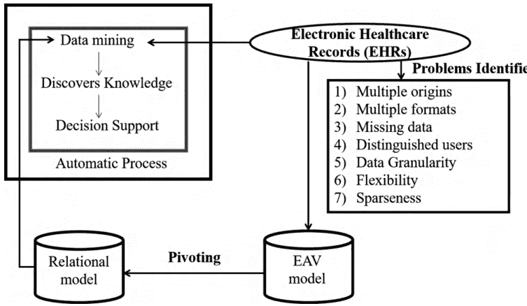

Fig. (1). 将数据挖掘应用于EHRs。

医疗领域的各方，如医生、企业领导和患者，都可能从DM应用中获益匪浅 [1]。在EHRs上使用DM技术将有助于检索先前未知的信息。但是，由于健康数据的复杂性以及健康数据中存在独特属性，挖掘健康记录比挖掘其他数据集更困难。数据挖掘可以在许多领域提供决策支持，但如果在正确的时间对人的生命做出正确的决策，那么没有什么比这更有用的了。挖掘健康记录无疑很重要，尽管由于Cios和Moore [16] 描述的某些独特特征以及我们在第4节中概述的困难，它并不像挖掘任何其他类型的数据那样简单。就其内容而言，医疗数据非常特殊 [13]。

由于健康数据的独特性，Cios和Moore [14] 提供了DM研究人员在开始调查前必须了解的所有困难（异质性、监管和政治问题、分析边界和受保护特权）的完整概述。下面详细描述：

- 1. 异质性：医疗数据可能包括扫描、非结构化和半结构化数据、视觉信息、可听数据、信息图表和图形。由于数据的这种性质，需要高容量存储。此外，还需要新的挖掘工具来分析这类数据，以便用户可以轻松解读。

- 2. 监管和政治问题：为了收集医疗数据而与人打交道，需要处理各种困难，包括信息隐私、诉讼威胁、数据安全和保密性、预期收益以及管理。

- 3. 分析边界：统计学处理不同类型的数字，而数据挖掘处理不同类型的数据。应用统计操作要求医疗数据为数值型。

- 4. 受保护特权：医学是每个人生活的重要组成部分。在处理医疗数据挖掘时必须给予特别关注，因为疏忽的后果可能非常危险。为任何合法目的访问数据的人应保持所有道德标准，且不应为非法目的授予访问权限。

### 基于标准化EHRs进行挖掘的挑战

基于对医疗领域DM的彻底研究，本研究在对EHR数据实施DM时探讨了以下问题。

- 1. 多个来源：每个组织按个人基础保存信息。当在所有组织的关联数据上实施DM技术时，将有所裨益。因此，数据应当存在于单一位置，但是，在这种情况下，数据保护将是一个主要问题。

- 2. 多种格式：每个机构都有用于存储患者信息的自己的数据结构。因此，必须使用单一标准格式收集数据，以便DM工具可用于发现信息。此外，还需要开发自动工具，将这些异质医疗数据转换为统一格式。

- 3. 缺失数据：有时数据会有缺失值或受到噪声污染。当DM技术用于不准确数据时，结果也会是错误的。例如，某家医院通过血液检测、X光和CT扫描收集信息。但是，另一家医院不提供CT扫描设施。这导致一些患者的CT扫描位置出现空值。在决策之前必须处理这些空值。

- 4. 不同类别的用户：用户分为三类：专业用户、半熟练用户和初学者。专业用户（如医生）经常请求所有信息和推理来解释事物。半熟练操作员（如护士）主要关注服务的完整信息。普通初学者（如患者）仅关心结果。这样一来，不同人群的预期结果各不相同。

- 5. 数据粒度：粒度的大小由用户的需求决定。专业、半熟练或初级客户可能需要不同级别的粒度。当客户检查其生命体征记录时，可能需要确定其心跳是否规律、过快或过低，但如果专业人士检查其心率记录，则需要检查其心脏跳动的详细速率。

- 6. 灵活性：医疗时代正在迅速到来。因此，正在建立新的治疗理念或诊断术语，或将既定的健康概念与新的诊断术语相耦合。为了解决这个问题，我们需要灵活的数据结构，这些结构可以支持这些变化而不会破坏整个系统。

- 7. 稀疏性：多次，健康数据是使用调查收集的，这些调查要求个人可能不想分享的个人详细信息。在这种情况下，包含特定值的功能具有空值。因此，这会导致存储浪费。

包括HL7、openEHR和ISO13606在内的多个机构一直在努力解决这些挑战，但我们发现，对标准化EHRs进行DM的研究很少。

### 基于标准化EHR数据库的挖掘解决方案

传统上，数据库存储在关系模型下，该模型每个属性保持一列，但关系模型无法处理上一节定义的问题；因此，需要一种新的数据模型来存储EHR，以便以非常高效的方式利用空间。EAV模型足以以非常节省空间的方式存储EHR数据。EAV模型 [17] 便于以列式存储的方式存储数据，每个元组中包含对应于实体、属性和值的三元组。“实体”组件描述数据集的多个实体，“属性”部分包括与每个实体相关的多种属性，“值”部分提供属性的值。EAV模型为添加、删除或修改数据库中的属性提供了极大的灵活性，因为其逻辑模式与物理模式不同。可用的不同EAV模式如下 [18]：

- 1. **基础EAV模式**：物理模式至少包含三列，即实体、属性和值。实体列包含实体的唯一标识符。'属性'字段包含要保存其值的属性的标签或标识。值包含属性的值。逻辑模式使用一个称为元数据表的单独表定义。为了存储非稀疏数据，使用单独的关系表，而对于其他数据，则使用EAV表。通过使用元数据表，便于将EAV表转换为关系表。

- 2. **多数据类型EAV模式：** 由于EAV表只有一列用于存储每个属性的值，因此值列假定的数据类型是字符串。使用字符串数据类型会产生许多问题，例如在比较“12”和“2”时，作为字符串时“12”的值会低于“2”，但在数值上“12”大于“2”。为了解决这个问题，为每种数据类型创建一个EAV表。

- 3. **混合EAV模式**：通过在单个表下建立多种数据形式，它结合了前述简单模式和多数据类型模式的最佳特性。

根据要求，可以使用上述定义的三种EAV模式中的任何一种。当使用EAV模型时，多个来源和多种格式的问题可以得到解决，因为EAV对存储任何类型的物理模式都非常灵活。这是 _通过_ 元数据实现的，元数据包含有关作为EAV模型保存的数据的逻辑结构的信息。已识别挑战的摘要如表2所示。

表2. 已识别挑战及拟议解决方案的摘要。

| 序号 | 识别的挑战 | 克服挑战的拟议方案 |
|---|---|---|
| 1. | 多个来源 | EAV模型 |
| 2. | 多种格式 | EAV模型 |
| 3. | 缺失数据 | 1. 用某些常数替换缺失值。<br>2. 识别缺失值出现的模式并相应替换缺失值。<br>3. 通过适当方法去除噪声。 |
| 4. | 不同类别的用户 | EAV模型 |


| 序号 | 已识别的挑战 | 针对挑战的拟议解决方案 |
| :--- | :--- | :--- |
| 5. | 数据粒度 | EAV 模型 |
| 6. | 灵活性 | EAV 模型 |
| 7. | 稀疏性 | EAV 模型 |

各类用户及不同粒度级别相关的问题也可以通过 EAV 模型来解决，因为属性列表不是固定的，新属性可以轻松添加，从而也解决了易变性问题。

使用 EAV 模型存储数据时，无需存储包含空值的条目，因为 EAV 模型不定义逻辑架构。因此，使用 EAV 模型可以轻松消除稀疏性。

EAV 模型适合存储 EHR 数据，但许多应用（如绘图和统计分析）要求数据以传统关系型行格式存在。因此，EAV 模型的数据需要转换为行格式，以便在数据集上轻松实施数据挖掘，这种转换过程称为转置 [19]。Dinu _等人_ [19] 测试了多种转置策略。这种比较有助于我们找到最佳的转置技术。

接下来，为解决隐私问题，EAV 包含基于角色的访问控制 (RBAC)、数据加密、匿名化和审计的实现。数据库级别的此类适当访问控制和安全措施有助于维护数据隐私。这种受保护的特权是指仅将对敏感或机密信息的访问限制于授权个人或角色。这可以通过精心设计访问控制、定义适当角色和权限以及实施加密或其他安全措施来实现。

因此，很明显，EAV 模型是管理灵活属性、解决隐私问题和保护特权的有用工具，可在数据库系统中提供额外的安全措施和访问控制。

### 相关工作

手动管理大量健康数据既困难又容易出错。此外，隐藏的信息可能无法被发现。数据挖掘为解决所有这些问题提供了关键方案。Chen _等人_ [20] 对相关数据挖掘方法以及制定数据挖掘策略的目标和问题提供了全面的理解。它还简要概述了流程，以及多种数据挖掘策略的边界和优势。

Bellazzi 和 Zupan [21] 对预测建模进行了全面概述。本文档描述了许多广泛采用的预测数据挖掘策略。它还列出了使用不同分类方法评估的所有目标。他们还简要概述了统计学与预测数据挖掘之间的关系。Bellazzi 和 Zupan 概述了预测数据挖掘对医疗保健的贡献及其执行流程。

在研究 [1] 中，Koh 和 Tan 讨论了健康数据挖掘可能带来的许多好处。他们还深入了解了使用数据挖掘调查健康记录时可能出现的困难。他们概述了整个数据挖掘实施阶段（业务理解、数据解释与预测、建模、评估和部署），以及数据挖掘任务的分类、在医疗领域使用数据挖掘技术的优势，以及使用数据挖掘评估健康记录的复杂性。

数据库中存在不完整的数据值，在用于调查时可能导致结果不准确。因此，需要一种确定缺失数据原因的技术。文献 [22] 中报道的研究试图检测可用于确定信息不完整原因的模式（偏差），即某些属性-值对的集合，其存在对应于特定数据库特征中的数据点。

由于健康数据的独特性，Cios 和 Moore [16] 对数据挖掘研究人员在开始研究前应了解的所有困难进行了全面评估。

在研究 [18] 中，El-Sappagh 等人描述了一个高效的框架，该框架可以在跨不同类别存储连接的同时处理稀疏性和灵活性。EAV 可以存储稀疏和灵活的数据，但无法处理类之间的连接。在一个参数是不同类别的实体的情况下，EAV 和元数据表被维护为实体关系表，而不是传统的关系表。EAV/CR 模型是对 EAV 模型的这一扩展的结果。

在另一项研究 [23] 中，Dinu 等人对 EAV 范式进行了全面概述。它包含在解决方案中实现 EAV 模型所需的所有信息。本研究详细描述了克服表格数据结构限制的 EAV 模型。EAV 建模可以处理表格数据带来的所有问题。在 EAV 模型的系统中，每个特征都有一个匹配的行，包含标识符、属性标识符和属性值等条目。

在另一项研究 [19] 中，Dinu 等人比较了三种转置策略以确定哪种是最优的。通过监测三种转置方法在不同数据库管理系统 (DBMS) 上的效果，确定了最佳方法。

本研究考察了数据挖掘在电子健康记录中的应用、电子健康记录的特殊方面、记录电子健康记录的最优数据结构、EAV 模型和转置。本次调查分析了所有这些特征，以识别电子健康记录应用中数据挖掘的问题及其解决方案。

所有迄今为止进行并如上述报道的研究都在各个学科中分别进行。

### 结论

医疗领域（特别是电子健康记录）的数据分析是当前情景下的需求。医疗专业人员可以从数据挖掘技术收集的隐藏知识中受益。因此，本次调查整合了先前关于分析电子健康记录数据库的研究。它表明，从健康数据中获得有意义的见解对人类可能极为有益。可以分析挖掘出的信息，以提供更好的治疗和及时的疾病诊断，从而降低医疗支出。数据挖掘具有众多优势，例如医疗保险。数据挖掘可用于基于历史财务信息预测未来支出，使保险公司能够做出更有效的决策。它还探讨了如何将数据挖掘应用于电子健康记录领域，同时识别挑战并为识别出的问题提出解决方案。

在医疗记录中实施数据挖掘技术的首要挑战是处理稀疏性、易变性、隐私和异质性。所有这些问题都可以通过使用 EAV 模型存储数据来解决。虽然使用 EAV 模型解决了稀疏性问题，但易变性和异质性数据需要以关系格式存在，以便在其上实施数据挖掘方法。因此，使用转置技术将 EAV 模型的数据转换为关系格式的数据。一旦数据采用统一格式，EAV 就支持高效的存储、处理和受控访问。

### 参考文献

- [1] H.C. Koh, 和 G. Tan, "医疗保健中的数据挖掘应用", J. Healthc. Inf. Manag., 第 19 卷, 第 2 期, 第 64-72 页, 2005. [PMID: 15869215]

- [2] P. Giudici, 和 Figini Silvia, 应用数据挖掘：商业和工业的统计方法. 第 2 版. John Wiley & Sons, 2009, 第 264 页.

- [3] S. Batra, 和 S. Sachdeva, "为挖掘组织标准化的电子健康记录数据", Health Policy Technol., 第 5 卷, 第 3 期, 第 226-242 页, 2016. [http://dx.doi.org/10.1016/j.hlpt.2016.03.006]

- [4] F. E. Bekri, 和 A. Govardhan, "数据挖掘与医疗领域的关联：问题和现有技术状态", Global Journal of Computer Science and Technology., 2011.

- [5] P. Yadav, M. Steinbach, V. Kumar, 和 G. Simon, "电子健康记录（EHRs）挖掘：一项综述", ACM Comput. Surv., 第 50 卷, 第 6 期, 第 1-40 页, 2018. [http://dx.doi.org/10.1145/3127881]

- [6] S. Batra, 和 S. Sachdeva, "为挖掘预处理高度稀疏且频繁演变的标准化电子健康记录", 见：通过数据分析和机器学习进行疾病预测的研究手册. IGI Global, 2021, 第 8-21 页. [http://dx.doi.org/10.4018/978-1-7998-2742-9.ch002]

- [7] P. Schloeffel, "电子健康记录定义、范围和上下文", ISO. TC. 215., 2002.

- [8] 可在以下网址查阅：http://www.hl7.org/implement/standards/ansiapproved.cfm

- [9] 可在以下网址查阅：https://en.wikipedia.org/wiki/CEN/TC_251

- [10] 可在以下网址查阅：https://www.iso.org/standard/40784.html

- [11] 可在以下网址查阅：https://www.iso.org/standard/62305.html [访问日期：2021 年 6 月 22 日].

- [12] 可在以下网址查阅：http://www.openehr.org/

- [13] S. Sachdeva, 和 S. Bhalla, "标准化电子健康记录数据库中的语义互操作性", ACM J. Data Inf. Qual., 第 3 卷, 第 1 期, 第 1-37 页, 2012. [http://dx.doi.org/10.1145/2166788.2166789]

- [14] A. Tymbal, 和 N. Bolshakova, "生物医学数据挖掘专题节客座编辑导言", IEEE Trans. Inf. Technol. Biomed., 第 10 卷, 第 3 期, 第 425-428 页, 2006. [http://dx.doi.org/10.1109/TITB.2006.876197]

- [15] J. Han, 和 M. Kamber, 数据挖掘：概念与技术. Morgan Kaufmann Publishers: San Francisco, CA, 2001, 第 335-391 页.

- [16] K.J. Cios, 和 G. William Moore, "医疗数据挖掘的独特性", Artif. Intell. Med., 第 26 卷, 第 1-2 期, 第 1-24 页, 2002. [http://dx.doi.org/10.1016/S0933-3657(02)00049-0] [PMID: 12234714]

- [17] G. Dufschmid, T. Wrba, 和 C. Rinner, "基于实体-属性-值模型从电子健康记录系统提取标准化原型数据", Int. J. Med. Inform., 第 79 卷, 第 8 期, 第 585-597 页, 2010. [http://dx.doi.org/10.1016/j.ijmedinf.2010.04.007] [PMID: 20537942]

- [18] S.H. El-Sappagh, S. El-Masri, A.M. Riad, 和 M. Elmogy, "针对知识发现优化的电子健康记录数据模型", International Journal of Computer Science Issues, 第 9 卷, 第 5 期, 第 329 页, 2012.

- [19] V. Dinu, P. Nadkarni, 和 C. Brandt, "基于批量提取实体-属性-值数据的转置方法", Comput. Methods Programs Biomed., 第 82 卷, 第 1 期, 第 38-43 页, 2006. [http://dx.doi.org/10.1016/j.cmpb.2006.02.001] [PMID: 16556470]

- [20] H. Chen, S.S. Fuller, C. Friedman, 和 W. Hersh, "医学信息学中的知识管理、数据挖掘和文本挖掘", 见：医学信息学. Springer: Boston, MA, 2005, 第 3-33 页. [http://dx.doi.org/10.1007/0-387-25739-X_1]

- [21] R. Bellazzi, 和 B. Zupan, "临床医学中的预测数据挖掘：当前问题与指南", Int. J. Med. Inform., 第 77 卷, 第 2 期, 第 81-97 页, 2008. [http://dx.doi.org/10.1016/j.ijmedinf.2006.11.006] [PMID: 17188928]

- [22] M.C. Tremblay, K. Dutta, 和 D. Vandermeer, "使用数据挖掘技术发现缺失数据中的偏差模式", ACM J. Data Inf. Qual., 第 2 卷, 第 1 期, 第 1-19 页, 2010. [http://dx.doi.org/10.1145/1805286.1805288]


[23] V. Dinu, 和 P. Nadkarni, "面向生物医学数据库的实体–属性–值建模有效使用指南", Int. J. Med. Inform., vol. 76, no. 11-12, pp. 769-779, 2007.
[http://dx.doi.org/10.1016/j.ijmedinf.2006.09.023] [PMID: 17098467]

## 第 10 章
### 流行病学情境中数据库的作用

卡妮卡·索尼¹, 谢莉·萨奇德瓦¹ 和 西瓦尼·巴特拉²*

¹ 德里国家技术学院, 印度
² KIET 院校集团, 德里-国家首都辖区, 加济阿巴德, 北方邦, 印度

摘要: 在这个技术时代,数据库技术对现代生活的许多方面至关重要。为了让准医生获得一流且最新的医学知识,健康领域的教育似乎必须与最新的数据库良好整合。这是因为对此的需求日益增长,并且公共健康相关问题与数据库技术的合作带来了益处。数据库技术可以以多种方式帮助改善健康,包括连接地理上分离的医疗服务提供者和患者,为药物和疫苗试验等研究收集数据,跟踪慢性疾病,并确保患者遵循其处方治疗。在当前全世界正遭受的 COVID-19 大流行病情境下,本文试图强调数据库的作用。它阐述了如何存储、查询和分析 COVID-19 数据集,并帮助为各类最终用户提供决策支持。我们通过对 COVID-19 数据集执行特定查询进行了描述性分析。然后,我们使用两种数据分析技术对 COVID-19 数据集进行了预测性分析,以近似印度一些主要城市的情况。此外,我们可视化了结果,以便从分析中获取有价值的信息。

关键词: 大数据, COVID-19, 数据分析, 数据可视化, 数据库可用性, 流行病学查询, 流行病学情境。

### 引言

数据库技术在过去几十年中取得了重大进步,我们现在可以相对高效地对更大的数据集执行越来越复杂的查询。然而,如果我们分析当今信息生成、访问、修改和共享的方法,可以发现世界上相当一部分数据仍然位于数据库系统之外,而更糟糕的是,我们发现一支由数据库管理员和其他专业人员组成的军队,他们具备技术专长,协助用户将数据导入和导出数据库,因为由于很多因素,用户本身无法直接与数据库交互,大多数用户都是新手,如果数据库模式复杂,他们无法高效地理解数据库模式。用户直接访问网络的能力在很大程度上得益于搜索引擎。因此,用户现在能够以速度和效率将信息导入和导出不断发展的网络。相反,数据库社区基于信息清晰、严格且结构良好的假设,创建了刚性、精确定义且精心规划的数据库。因此,数据库现在难以设计、难以修改,甚至更难以查询。

### 数据的作用

数据在理解和管理流行病学情境中起着重要作用。流行病学中数据的关键作用如下所述:

- 监测: 数据收集和分析对于持续监测疾病传播、识别社区中疾病传播趋势以及检测疫情爆发至关重要。此数据包括实验室报告、X 光、超声波、CT 扫描报告等其他模式,以及住院病史和死亡率。

- 风险评估: 数据帮助流行病学家评估与疾病相关的风险因素,例如年龄、性别、地理位置、可用医疗设施、疫苗接种和人群。这些信息有助于识别疾病传播率和易患疾病的人群。基于此分析,健康专家可以指导公众如何尽量减少疾病传播。

- 接触者追踪: 有关访客从一个地方到另一个地方的数据以及他们的病史有助于健康专家识别传播源并尽量减少传播。例如,在 COVID-19 期间也做了同样的事情,以通知可能暴露的个人。例如,如果有人被诊断出患有 COVID-19 并与聚会或私下中的人会面,那么他可以通过社交平台或个人通信方式进行通知,以采取预防措施。这有助于尽量减少疾病爆发的可能性。

- 建模与预测: 流行病学模型利用数据来预测疫情的未来发展,估计疾病传播动态,并评估干预措施的潜在影响。例如,作为另一项研究的一部分,我们使用易感、暴露、感染和康复 (SEIR) 模型来模拟疫苗接种对疾病爆发的影响。此类模型帮助决策者进行医院资源管理并减轻健康行业的负担。此外,此类模型通过在早期通知人们并减少住院机会来降低死亡率。

上述预测所使用的数据量取决于上下文,并可能根据疾病性质、传播动态、所采用的模型、期望结果等因素而有所不同。例如,深度学习模型需要大量数据,而机器学习算法进行预测所需的数据量较少。但是,数据量越大,预测的准确性和可靠性就越高。用于流行病学预测的数据可能会妨碍用户隐私。因此,在数据量和隐私考虑之间取得平衡至关重要。

可以在使用数据进行分析和决策的同时,应用去标识化、聚合和匿名化等隐私保护技术来保护个人身份。此外,还需要通过仔细考虑法律和伦理框架、利益相关者参与以及透明的决策过程,在数据实用性和隐私保护之间找到正确的平衡。

### 数据库的作用

在这个技术时代,数据库技术对现代生活的许多方面至关重要。通过利用在线资源了解疾病、其体征、症状、预防措施以及在需要时可能提供帮助的专业人员的一般联系信息,数据库技术改善了人类生活。为了让准医生获得一流且最新的医学知识,医学教育似乎有必要充分配备最新的数据库。此外,医学数据库的更新修订可能有助于医学专家在当今快节奏且艰难的在线世界中做出快速且准确的决策,且不准确的风险很小。流行病学数据库可供流行病学家、公共卫生研究人员、健康管理者、政策制定者、教育工作者和慈善家使用,以了解疾病的分布、其指标和决定因素、发病率和死亡率统计数据、疾病趋势、其原因、加剧因素和预防措施。使用电子健康记录、更好的支持初级和次级预防的实验室系统、为疫苗和药物试验等研究工作收集数据、在循证、合理和负担得起的药物帮助下改进医疗系统信息学,以及监测持续性疾病状况,只是数据库技术可为改善健康提供路线图的几种方式。

### 流行病学

流行病学被描述为一种科学的、有条理的、数据驱动的研究,研究疾病的分布（模式、频率）、驱动因素（风险因素、原因）和


与特定人群（街区、学校、城市、州、国家、全球）健康相关的发生情况。此外，该研究还用于健康问题的管理。冠状病毒是一个广泛的病毒家族，可感染人类和动物并引起疾病。已知多种冠状病毒会在人类中引起疾病，包括从普通感冒到中东呼吸综合征（MERS）和严重急性呼吸综合征（SARS）等最致命的健康状况。最近发现的冠状病毒导致冠状病毒疾病COVID-19 - 世界卫生组织（WHO）。在全球范围内，新病例数量每日上升。世界卫生组织于2020年3月11日将COVID-19宣布为全球流行病情况。

本文旨在强调数据库在流行病学形势中发挥关键作用。在第2节中，我们将了解数据库的发展历程。在第3节中，我们概述了流行病学场景和数据库。第4节提供了实现详情。第5节完成了数据分析和可视化，第6节解释了未来工作，最后第7节和第8节分别包含结论和参考文献。

### 数据库之旅

人类所面临的最大问题之一是数据存储，这一问题至今仍在。数据库解决了文件系统的不足之处，包括冗余、不一致、众多用户的并发访问以及许多其他问题。第一代数据库[1]出现在20世纪60年代中期至70年代初，旨在通过创建通用数据库管理系统，提供一种存储和访问永久数据的实用有效方法。根据存储数据之间的关系，数据库可分为3类：关系型数据库[2]、NewSQL数据库[3]和NoSQL数据库[4]。本文[4]详细介绍了重要数据库技术及多个相关系统的持续进展，并在表1中总结。

此外，大数据大多不可靠、动态、嘈杂且相互关联，这导致了针对大数据查询的特殊建模技术。最终，分析结果必须由决策者进行解释。这通常包括审查所做的所有假设并重新审视分析。这些步骤构成了大数据分析管道[5]，如图（1）所示。

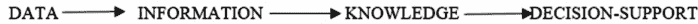

图（1）。大数据分析管道。

表1. 主要数据库技术的时间线。

| Year | Database Technology | Pros | Cons | Database Systems |
| :--- | :--- | :--- | :--- | :--- |
| 年份 | 数据库技术 | 优点 | 缺点 | 数据库系统 |
| 1960 | 分层和网络数据库 | 高性能和吞吐量。 | 由于缺乏或受限的数据独立性，即使是简单的查询，应用程序也难以创建和适应。 | IMS, IDS |
| 1970 | 关系型数据库 | 通过分离逻辑数据表示和物理数据表示，提供了高度的数据独立性。 | 随着面向对象编程语言在应用程序中的日益使用，软件开发人员遇到了阻抗失配问题。 | Oracle, DB2, MySQL, PostgreSQL |
| 1980 | 面向对象数据库 | 数据库与应用程序无缝连接。 | 由于在关系型数据库上的大量投资，它未能占据主导地位。 | Matisse, ObjectStore, Versant |
| 2000年代初 | NoSQL数据库 | 高可用性和可扩展性。 | 对于从SQL到NoSQL的迁移，有必要深入了解现有的NoSQL存储及其各种独特功能。 | Cassandra, MongoDB, Riak |
| 2000年代末 | NewSQL数据库 | 处理当代OLTP应用程序严格的可扩展性和可靠性需求。 | 不支持对传统SQL工具的完全访问。 | H-Store, NuoDB |

“大数据”现在影响着我们当代文明的几乎每个领域，包括贸易、治理、健康，以及几乎所有领域的研究，包括生命科学、工业、自然科学以及艺术和人文学科。大数据不仅能够彻底改变研究，而且还能做更多。由LinkedIn、Facebook、Microsoft、Twitter、Quantcast和Yahoo等以Web为中心的企业主导的大数据技术最彻底的改进和采用，可归功于Google在Google文件系统和MapReduce方面的工作，以及在Hadoop等系统上即将开展的开源工作。大数据对医疗保健的益处已被坚定地论证。但关于“大数据”一词存在许多迷思，如研究[5]所强调。来自多个来源的数据需要出于多种原因进行过滤和压缩。大多数数据来源以不可靠著称，收集到的数据通常不是可直接用于分析的格式。有效的大规模分析通常需要来自多个来源的异构数据集合。为了解决这些异构性，数据分析师需要一套用于数据转换和集成的工具。

对大数据存储和查询的近期需求暴露了传统关系型数据库系统的诸多局限。因此，一种名为NoSQL的全新补充型非关系型数据存储类别应运而生。该类别进一步分为[4]：键值存储、列式存储、文档导向和图形导向。表2对这些NoSQL存储中的每一个进行了比较。

表2. 各种NoSQL存储。

| Type | Examples | Best Fit For | Real-Time Application |
| :--- | :--- | :--- | :--- |
| 类型 | 示例 | 最适合 | 实时应用 |
| 键值 | Redis, Riak | 仅需要单个键来访问数据的应用程序，包括用户配置文件和配置、在线购物车以及Web会话数据。 | Amazon Dynamo |
| 列式 | Cassandra, HBase | 列式存储非常适合分析应用程序，因为它们具有高灵活性和可扩展性，并且支持MapReduce操作（用于对大型整合数据集进行并行处理）。Web分析是一种应用示例，它通过插页来跟踪访问者的活动。 | Facebook的收件箱搜索 |
| 文档导向 | MongoDB, CouchDB | 博客平台和内容管理系统（CMS）等应用程序，其数据可以轻松表示为文档格式。例如，文档格式可用于轻松表示包含多个（嵌套）属性（如评论、照片、视频和标签）的博客文章。 | McGraw-Hill Education的自适应交互式学习门户 |
| 图形导向 | Neo4j, InfiniteGraph | 涉及个人人际接触和社交互动的社交网络站点。 | Facebook社交网络 |

回顾数据库历史揭示了一个模式，即越来越多样的数据正在数据库中被处理和存储。这需要创建一个多模型数据库系统[7]，能够同时管理多种类型的数据。最近的NoSQL数据库趋势表明正在向多模型数据库转变。参考文献[7]提供了多个多模型数据库的全面分类法。表3展示了多模型支持的时间线。

表3. 多模型数据库支持的时间线。

| DBMS | Original Model | Year for support of multi-model database |
|---|---|---|
| 数据库管理系统 | 原始模型 | 支持多模型数据库的年份 |
| SQL Server | 关系型 | 2000 |
| PostgreSQL | 关系型 | 2006 |
| IBM DB2 | 关系型 | 2007 |
| CouchDB | 文档导向 | 2010 |
| Oracle MySQL | 关系型 | 2011 |
| Riak | 键值 | 2014 |
| Cassandra | 列式 | 2015 |
| MongoDB | 文档导向 | 2016 |
| Cosmos DB | 文档导向 | 2017 |

此外，大流行病数据大多不可靠、动态、嘈杂且相互关联，需要查询灵活性来高效查询此海量数据。最终，全球大流行病情况需要高度可扩展的成本效益高的系统，以提供流畅的多用户体验。本文对COVID-19数据集[8]执行了以下步骤，如图（2）所示。本节接下来将介绍当前研究中采用的数据存储以及作者进行的相应实现。

考虑到数据库技术在几乎所有领域（无论是金融、医疗保健还是商业）的巨大发展及其优势，有必要了解和评估数据库在COVID-19这种大流行病情形下的作用，全世界目前正遭受着这种疫情的困扰。

### 流行病学场景与数据库

在当今快节奏、艰难且在线的世界中，医学领域数据库的最新更新也可以帮助专家快速准确地做出决策，且不准确的风险较低。易于访问的流行病学数据库将有助于流行病学家、公共卫生专家、健康管理者、健康政策制定者、康复专家和健康慈善家了解疾病的分布、其决定因素和指标、发病率和死亡率统计数据、疾病趋势以及其原因、诱发因素和预防措施。使用电子健康记录、更好的实验室系统以支持一级和二级预防、为疫苗和药物试验等研究工作收集数据、在循证基础上改进医疗系统信息学，


合理、负担得起的药物，以及监测持续性疾病状况，只是数据库技术可以为改善健康提供路线图的几种方式。通常，大流行病数据是从多个来源收集的，这些数据需要出于多种原因进行过滤和压缩。大多数数据来源以其不可靠而臭名昭著，收集的数据通常不以可直接进行分析的格式存在。从各种来源收集异构数据对于大规模分析取得有效结果经常是必要的。数据分析师需要支持丰富数据结构的高效数据存储来解决这些异构性。

### 实现细节

如图（2）所示，作为第一步，我们将数据集存储在 MongoDB 中。然后，作为第二步，我们使用 Python 语言执行所有流行病学查询。在从数据集的 CSV 文件中读取数据后，我们对数据集进行了预处理。预处理或数据清洗是一个关键步骤，因为这是使原始数据可用的唯一方法。良好的数据清洗将能够解释、清洁并将数据转化为有价值的洞察。我们对数据集的预处理包括多个步骤，例如将由字符串组成的日期和时间合并为单个日期时间，然后删除 S.No.、Date、Time，将 Value 列中的 ‘-’ 替换为 NaN，然后将 ‘Nagaland#’ 替换为 ‘Nagaland’（这是数据集中可能的地形/地名错误），转换了数据集的日期时间格式，并将国籍中的常见字符串替换为相同值，例如 India、Indian、INDIAN 都被视为相同等。作为第三步，我们执行了描述性和预测性数据分析。作为最后一步，我们可视化了结果，以从 COVID-19 流行病学数据集中获得有价值的洞察。

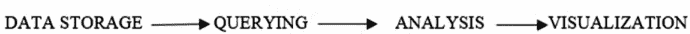

**图（2）.** 对 COVID-19 数据集执行的步骤。

### 数据集描述

我们使用了一个包含印度各邦和属地每日信息的数据集。州一级数据来自印度政府卫生与家庭福利部 [9]，个人一级数据来自 [10]。我们的数据集包含 5 个 CSV 文件，每个文件包含有关以下内容的数据：

- 1. 各邦每日 COVID-19 病例。
- 2. 个人一级详细信息。
- 3. 州一级人口。
- 4. 平均每日 COVID-19 检测次数。
- 5. 各邦医院病床数量。

### 查询场景

下表 4 显示了我们在 COVID-19 数据集上执行的查询及其对应的 MongoDB 查询。

**表 4. 在 COVID-19 数据集上执行的查询。**

| 查询 | MongoDB 查询 |
|---|---|
| 查找 2020 年 2 月至 4 月每个邦的病例总数。 | collection[].find().count() |
| 查找总病例数最多的前 5 个邦的确诊病例、治愈病例和死亡病例。 | collection[].aggregate().values() |
| 计算治愈患者数量的平均值和所需病床数。 | collection[].aggregate().values() |
| 计算所需病床数的对数值和治愈患者的平均数量。 | collection[].aggregate().values() |

在成功实现数据存储和查询场景识别后，作者如图（2）所示执行了数据分析和可视化。

### 数据分析与可视化

数据分析 [11] 是通过统计学、数学或逻辑中的传统思想、技术和方法处理数据以获取有价值信息的一种手段，而这些允许对数据进行深入理解并发现其中有用洞察的理论、过程和工具被称为数据分析（Data analytics）[11]。数据分析进一步细分为多种类型，例如描述性分析、预测性分析、指令性分析、显性分析、隐性分析和深度分析。

- 1. 描述性分析：数据分析使用统计学来解释用于生成信息或其他多种有益目标的数据。
- 2. 预测性分析：数据分析通常使用高级分析来预测不可知的未来事件并揭示其背后的原因。
- 3. **指令性分析：** 数据分析，旨在改善指标并为明智决策提出行动建议。
- 4. **显性分析：** 通过报告、描述性分析、通知和预测，它通常关注描述性分析。
- 5. **隐性分析：** 它关注深度分析，通常使用优化、预测建模、指令性分析以及可操作知识的传播。
- 6. **深度分析：** 数据分析能够全面掌握围绕事件（无论已发生、正在发生还是未来将会发生）的原因和环境，而描述性分析无法回答这些问题。

在本节中，我们展示了用于从流行病学数据中获取信息的描述性分析结果。图（3）显示了 2020 年 2 月至 4 月各邦病例数量的图表。总确诊病例、治愈病例和死亡病例中，总病例数最多的前 5 个邦的数据显示在图（4）中。图（5）显示了治愈患者平均数量和所需病床数量的结果。此外，图（6）显示了治愈患者数量和所需病床数量的对数拟合。然后，我们应用了两种数据分析技术来展示我们的预测性分析结果。

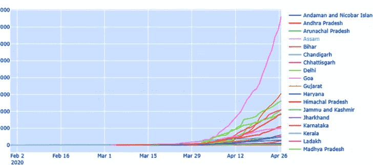

**图（3）.** 2020 年 2 月至 4 月各邦病例数。


图（4）. 前 5 个邦的确诊、治愈和死亡病例。


图（5）. 治愈患者平均数量和所需病床数量。


图（6）. 治愈患者数量和所需病床数量的对数拟合。

### 未来工作

约 25 年前 [12] 数据库可用性开始受到关注，并且近年来获得了更大的推动 [13]。研究人员需要专注于数据库可用性，通过提供有效且创新的查询界面设计来实现，这些设计包括关键字、可视化、自然语言界面和电子表格界面，非技术用户（如护士、医生等技术/半技术人员）可以使用易于使用的查询语言界面查询数据库。搜索引擎是否可以简单地置于数据库系统之上，并由数据库系统允许管理与用户的界面，是一个值得提出的显而易见的问题。我们认为答案是“否”。虽然搜索引擎的界面对 Web 有效，但它并未完全解决数据库系统面临的可用性相关问题。这是因为许多特征源于用户对数据库交互的期望，这些期望与使用 Web 的预期根本不同。例如，用户期望能够以更复杂的方式查询数据库，并在与数据库交互时表达更复杂的查询语义，因为他们意识到数据库不仅仅是文档集合，而且还包含可用于回答其查询的内部结构。此外，用户期望从数据库搜索中获得更准确、更全面的结果。为了克服所有这些挑战，我们认为需要提供交互式浏览和导航查询界面 [14]，该界面可以置于 NoSQL 数据库之上。

### 结论

为了向潜在的医疗从业者提供一流且最新的医学知识，将健康领域的教育与最新的数据库充分整合似乎是必不可少的。这是因为公共卫生问题与数据库技术整合的需求和效益正在不断增长。在当今快节奏、艰难且在线的世界中，医学领域数据库的最新更新也可以帮助专家快速、准确地做出决策，且失误风险较低。流行病学数据库可供流行病学家、公共卫生研究人员、卫生管理员、政策制定者、教育工作者和慈善家使用，以了解疾病的分布、其指标和决定因素、发病率和死亡率统计、疾病趋势、其原因、加剧因素以及预防措施。使用电子健康记录、更好的实验室系统以支持一级和二级预防、为疫苗和药物试验等研究工作收集数据，以及借助基于证据、逻辑和负担得起的


medication, and surveilling persistent disease conditions are just a few of the ways that database technology can offer a roadmap for improving health.

本文试图说明数据库在流行病学场景中的关键作用。我们通过在 COVID-19 数据集上运行特定查询来进行描述性分析。随后，为了模拟几个关键印度城市的场景，我们使用两种数据分析方法对 COVID-19 数据集进行了预测分析。此外，为了从调查中提取有用信息，我们对结果进行了可视化。

### REFERENCES

- [1] D.C. Tschritzis, 和 F.H. Lochovsky, "分层数据库管理：综述", ACM Comput. Surv., vol. 8, no. 1, pp. 105-123, 1976. [http://dx.doi.org/10.1145/356662.356667]
- [2] E.F. Codd, 面向大型共享数据库的关系数据模型。软件先锋。Springer：柏林，海德堡，2002 年，第 263-294 页。[http://dx.doi.org/10.1007/978-3-642-59412-0_16]
- [3] A. Pavlo, 和 M. Aslett, "NewSQL 到底有什么新东西？", SIGMOD Rec., vol. 45, no. 2, pp. 45-55, 2016. [http://dx.doi.org/10.1145/3003665.3003674]
- [4] A. Davoudian, L. Chen, 和 M. Liu, "NoSQL 存储综述", ACM Comput. Surv., vol. 51, no. 2, pp. 1-43, 2019. [http://dx.doi.org/3158661]
- [5] H.V. Jagadish, "大数据与科学：神话与现实", Big Data Research, vol. 2, no. 2, pp. 49-52, 2015. [http://dx.doi.org/10.1016/j.bdr.2015.01.005]
- [6] H.V. Jagadish, J. Gehrke, A. Labrinidis, Y. Papakonstantinou, J.M. Patel, R. Ramakrishnan, 和 C. Shahabi, "大数据及其技术挑战", Commun. ACM, vol. 57, no. 7, pp. 86-94, 2014. [http://dx.doi.org/2611567]
- [7] J. Lu, 和 I. Holubová, "多模型数据库", ACM Comput. Surv., vol. 52, no. 3, pp. 1-38, 2020. [http://dx.doi.org/3323214]
- [8] 可从以下获取：https://www.kaggle.com/sudalairajkumar/covid19-in-india
- [9] 可从以下获取：https://www.mohfw.gov.in/
- [10] 可从以下获取：https://www.covid19india.org/
- [11] L. Cao, "数据科学", ACM Comput. Surv., vol. 50, no. 3, pp. 1-42, 2018. [http://dx.doi.org/3076253]
- [12] C.J. Date, "数据库可用性", SIGMOD Rec., vol. 13, no. 4, pp. 1-1, 1983. [http://dx.doi.org/971695.582194]
- [13] H.V. Jagadish, A. Chapman, A. Elkiss, M. Jayapandian, Y. Li, A. Nandi, 和 C. Yu, "使数据库系统可用", 2007 年 ACM SIGMOD 数据管理国际会议论文集, 2007, pp. 13-24 [http://dx.doi.org/1247480.1247483]
- [14] M. Kahng, S.B. Navathe, J.T. Stasko, 和 D.H. Chau, 关系数据库中的交互式浏览与导航。佐治亚理工学院：美国佐治亚州亚特兰大，1603，第 02371 页。

## SUBJECT INDEX

### A

- Adaptive 35, 42, 62, 67
  - neuro-fuzzy inference system 35, 42
  - threshold technique 67
  - thresholding technique 62
- Algorithm(s) 22, 24, 25, 38, 40, 42, 63, 66, 67, 81, 82, 83, 84, 85, 105, 106, 108, 123, 124, 125, 126, 134
  - clustering 63
  - complementary 81
  - dataset method findings 123, 124, 125, 126
  - translation 134
- Alzheimer's disease 67, 80, 89, 90
- Angiography 113, 114
  - green 113
- Applications 48, 52, 57, 105, 115, 116, 117, 131, 134, 135, 139, 143, 146, 147, 164
  - biomedical 52
  - dermatology 57
- Applied data augmentation techniques 7
- Artificial 5, 31, 40, 41, 64, 71, 73, 83, 106
  - intelligence-based techniques 31
  - neural networks (ANN) 5, 40, 41, 64, 71, 73, 83, 106
- Assessment, therapeutic efficacy 146
- Asthma 92, 93, 94, 95, 96, 97, 100
  - attributes 94
  - comorbidities 94
  - disease outcome 100
  - rural 96
  - urban 97
- Autonomic nervous system dysfunction (ANSD) 39
- image processing 53
- imaging analysis 74
- voice measurements 35, 42
- Blinking electrooculogram 143
- Blogging platforms 164
- Blood 56, 119
  - pressure, systolic 56
  - vessels, abnormal 119
- Blot haemorrhages 118
- Bold contrast method 137
- Bone(s) 17, 18, 19, 23, 24
  - deformities 17, 18
  - finished femoral 23
  - fractured 19 fracture 18
  - imaging techniques 17
  - mineral density (BMD) 18
- Brain 52, 53, 54, 67, 131, 132, 133, 134, 135, 138, 139, 142, 143
  - activity 131, 138
  - computer interfaces (BCI) 132, 133, 134, 138, 139, 142, 143
  - disorders 52
  - generated oscillations 135
  - imaging 67, 131
  - injury 53, 54
- Brain signals 132, 133, 135, 142, 143
  - distorted 132
  - non-stationary electrophysiological 142
- Brain tumor 62, 67
  - MRI analysis 67

### B

- Bayesian networks 72
- BCI 131, 132, 143
  - system processing 143
  - technology 131, 132, 143
- Biomedical 35, 42, 53, 74

### C

- CAD 57, 71, 72, 73, 106
  - based machine-learning technique 73
  - software tools 73
  - systems 57, 71, 73, 106
  - techniques 72
- CAD tools 55, 56, 71
  - in healthcare 71
- Cancer 4, 5, 34, 52, 53, 57, 61, 72, 73, 85, 110
  - breast 57, 72, 85, 110
  - imaging 61
  - lung 85
  - prostate 4
- Capillary occlusion 119
- Carcinogenic radiations 18, 34
- Cardiovascular disease 118
- Cataract 103, 117, 122, 123, 125, 127
  - detection 125
  - mild 123
  - moderate 123
- Central nervous system (CNS) 120
- Chest 19, 31, 48
  - imaging 19
  - radiographs 31, 48
- Chest X-ray (CXRs) 4, 7, 8, 9, 14, 36, 37, 43, 44, 47, 48, 73
  - portable 43
- Chronic 40, 93
  - heart failure (CHF) 40
  - obstructive pulmonary diseases 93
- Cloud platforms 147
- Clustering, fuzzy 63, 70
- Color fundus retinal photography 111
- Column-oriented stores 164
- Communication devices 131
- Comparative analysis 25, 35, 48, 49
  - of deep learning techniques 35
  - of DL techniques 48, 49
  - of methods 25
- Comprehension 80, 83, 167
  - defective 83
- Comprehensive 54, 64, 68
  - comparison 64, 68
  - heart anatomy 54
- Comprising 34, 36, 39
  - ECG recordings 39
  - heart rate variability 34
  - MRI slices 36
- Computational intelligence techniques 104
- Computer 17, 18, 34, 52, 53, 54, 55, 56, 57, 58, 67, 72, 73, 74, 81, 106, 107
  - aided cataract diagnosis (CACD) 107
  - assisted detection (CAD) 54, 55, 56, 57, 58, 72, 73, 74, 106
  - based medical image analysis 53
  - tomography (CT) 17, 18, 34, 52, 54, 67, 73, 81
  - vision techniques 73
- Condition 73, 115, 136, 162
  - corneal 115
  - fetal health 162
  - mammography test 73
  - neurodegenerative 136
- Congestive heart failure 34
- Conservative recursive feature elimination (CRFE) 38
- Content management systems (CMS) 164
- Convolutional 11, 37, 42, 43, 47, 55, 56, 80, 81, 88, 89, 105, 107, 108, 131, 140
  - neural network (CNNs) 11, 42, 43, 55, 56, 80, 81, 88, 89, 105, 107, 108, 131, 140
  - siamese neural network 37, 47
- Corneal 116
  - diseases 116
  - topography 116
- Coronaviruses 162
- COVID-19 1, 2, 4, 5, 6, 7, 8, 9, 33, 36, 38, 43, 48, 53, 160, 162
  - chest X-ray dataset 7
  - coronavirus disease 162
  - detection 5, 6
  - disease severity assessment 36, 43
  - imaging 8
  - infection 36, 43
  - pneumonia 6, 7
  - radiology database 9
- CT scans 5, 19, 31, 67
  - and chest radiographs 31
  - chest 67
  - lung 5
  - technique 19
- CT scanner machines 5
- CXR 7, 8, 9, 73
  - images 7, 8, 9
  - in radiologic technology 73

### D

- Data 5, 7, 152, 159, 162, 165, 167, 168
  - analysis techniques 159, 168
  - augmentation methods 7
  - augmentation technique 7
  - normalization technique 5
  - storage 152, 162, 165, 167
- Data mining (DM) 146, 147, 148, 149, 150, 151, 154, 155, 156
  - methods 146
  - techniques 156
  - tools 146
- Database technology 159, 161, 162, 163, 165, 166, 170, 171
- Dataset 7, 54, 107
  - echocardiography 54
  - radiography 7
  - retina fundus image 107
- Decision 82, 150
  - assistance, effective 150
  - tree algorithm 82
- Deep 35, 41, 42, 48, 49, 54, 83, 89, 104, 105, 109, 124
  - convolutional neural network 89
  - neural network, (DNN) 35, 41, 42, 48, 49, 54, 83, 104, 105, 109, 124
- Deep learning 1, 2, 31, 32, 35, 48, 103, 104, 105, 106, 107, 123, 126, 131, 132, 133
  - techniques 31, 35, 48, 103, 123
- Dementia algorithms 84
- Dense convolutional network 12
- Dermoscopy skin 37
- Detecting drowsiness in drivers 135
- Detection 2, 5, 6, 9, 31, 32, 41, 43, 47, 48, 49, 53, 57, 103, 104, 105, 126, 127
  - automated 126
  - computer-assisted 53
  - eye disorder 126
  - knee joints 47
  - large-scale malignancy 57
  - lung abnormalities 9
  - ophthalmic disorder 127
- Detection techniques 121, 126
  - eye disease 126
- Diabetic 34, 35, 40, 41, 48, 49, 56, 103, 106, 108, 109, 116, 117, 118, 119, 120
  - macular edema (DME) 56, 103, 117, 120
  - retinopathy (DR) 34, 35, 40, 41, 48, 49, 103, 106, 108, 109, 116, 117, 118, 119, 120
- Diagnosis 58, 140
  - mammography 58
  - psychiatric 140
- Diagnostic methods, computer-aided automatic 32
- Diffusion tensor imaging (DTI) 83
- Direct linear transformation (DLT) 20, 24, 25
- Diseases 17, 18, 31, 32, 33, 39, 41, 48, 52, 53, 56, 85, 92, 93, 100, 103, 104, 106, 117, 160, 161
  - chronic kidney 56
  - chronic respiratory 92
  - heart 33, 85, 117
  - infectious 104
  - life-threatening 53
  - mouth 41
  - pulmonary 48
- Disorders 56, 80, 93
  - neuropsychological 80
  - respiratory 93
  - skin 56

### E

- Echocardiography 54
- Electrocardiography 135, 136
- Electroencephalogram 132, 138, 140
- Electroencephalography 138
- Epidemiological data 168
- Epidemiology database 161, 170
- Eye 103, 104, 117, 120, 123, 126, 127
  - disease detection 123, 127
  - diseases, inflammatory 120
  - disorders 103, 104, 117, 126

### F

- Feature selection 67, 68
  - in eye disease 68
  - in lung disease 67
- FFD technique 21
- Fluorescein angiography (FFA) 114, 116
- Free from deformation (FFD) 21, 25

### G

- Generative adversarial networks (GAN) 27
- Genetic algorithms-based optimization (GABO) 69
- Glaucoma 68, 73, 103, 107, 108, 114, 115, 116, 117, 120, 121, 122, 124, 125, 126, 127
  - acute 122
  - congenital 121
  - detection system 68
  - images 107, 108
  - network 108
  - treatment 125
- Glaucomatous retina 121


### H
- 手足口病 (HFMD) 33, 39
- 健康慈善家 165
- 心力衰竭 (HF) 34, 39, 40, 41, 49
- 海德堡视网膜断层扫描 (HRT) 103, 114, 115, 117
- 明顿胶囊网络 5
- 高血脂症 118
- 高血压 118
- 低白蛋白血症 118
- 滞后阈值技术 62

### I
- ICG血管造影 116
- 呼吸系统疾病 67
- 图像 6, 8, 9, 18, 32, 35, 36, 42, 43, 44, 45, 46, 47, 48, 52, 53, 57, 61, 63, 67, 74, 105, 106, 109, 110, 113, 115, 123, 125
  - 采集技术 48
  - 生物医学 52
  - 脑部 67
  - 皮肤镜 46
  - 混合 74
  - 钼靶摄影 57
  - 处理应用 105
  - 重建 32
  - 分辨率 110
  - 分割方法 61
- 成像 17, 18, 19, 31, 54, 83, 106, 110, 111, 116
  - 扩散张量 83
  - 技术 17, 18, 19, 31, 54
- 独立成分分析 (ICA) 140
- 感染 52, 162
  - 肺部相关慢性 52
  - 呼吸道 162
- 体积强度 23
- 皮质内采集技术 135

### K
- 角膜炎 117
- 膝关节X光片 44, 45

### L
- 拉普拉斯表面变形 (LSD) 24
- 学习 2, 42, 71
  - 算法机器 71
  - 基于的算法 42
  - 传统机器 2
- 皮肤异常病变 56
- 肺 48, 67
  - 疾病 67
  - 水肿 48

### M
- 机器学习技术 2, 31, 41, 43, 84
- 磁共振成像 (MRI) 17, 18, 34, 48, 52, 53, 54, 67, 81, 85, 86, 87, 88
- 脑磁图 137
- 钼靶摄影 53, 57, 70, 73
- 医学 18, 64, 72, 103, 104
  - 图像处理 64, 72, 103, 104
  - 成像技术 18
- 记忆丧失 80
- 中东呼吸综合征 (MERS) 9, 162

### N
- 神经系统 135
- 神经网络 7, 12, 14, 35, 36, 43, 44, 48, 49, 72, 81, 106, 107
  - 自动卷积 43
  - 传统人工 106
- 神经系统异常 140
- 神经科学 67, 131, 143
  - 认知 67, 131
- 神经传递活动 138
- 噪声 62, 69, 132
  - 信息 69
  - 降噪 62, 132
- 非侵入式成像技术 110
- 正常眼压性青光眼 (NTG) 121, 122

### O
- 面向对象 163
  - 数据库 163
  - 编程 163
- 视神经头成像 116
- 光学相干断层扫描 (OCT) 42, 55, 68, 103, 110, 111, 112, 116, 118, 120, 126
- 骨关节炎 36, 44
- 骨质疏松 18

### P
- 帕金森病 35, 48
- PLSR 技术 23
- 肺炎 1, 2, 4, 5, 8, 9, 10, 14, 36, 43, 44
  - 病毒性 8, 43
  - 图像 9
- 人群 84, 92, 93, 94, 127, 160, 162, 167
  - 老龄化 127
  - 哮喘 93
- 预测性逻辑回归 (PLR) 33, 37
- 原发性先天性青光眼 (PCG) 122
- 侵入性采集程序 136
- 过程 3, 10, 38, 42, 46, 59, 63, 69, 94, 100, 106, 120, 132, 136, 137
  - 深度ResNet卷积 46
  - 愈合 120
  - 神经生物学 132
- 蛋白质组测量 58
- 银屑病严重程度 46, 48
  - 评价网络 (PSENet) 46
- Python 语言 166

### Q
- 定量计算机断层扫描 (QCT) 23

### R
- 放射技术 73
- 随机森林 (RF) 32, 33, 34, 37, 40, 41, 43, 80, 82, 84, 88, 89, 90, 98, 99
  - 算法 (RFA) 34, 40, 80, 82, 88, 89
- 立体放射重建 25
- 循环神经网络 (RNN) 107
- 区域 63
  - 生长算法 (RGA) 63
  - 分割与合并算法 (RSMA) 63
- 血流动力学响应 137
- 视网膜，健康 104
- 视网膜 40, 103, 104, 107, 108, 110, 113, 122
  - 疾病 104, 110
  - 眼底相机 113
  - 图像 40, 107, 108, 122
  - 血管闭塞 103
- 早产儿视网膜病变 (ROP) 36, 44, 45, 48, 68
- 基于RFA的统计分析 81
- 基于角色的访问控制 (RBAC) 154
- 均方根 (RMS) 23, 26
- RSNA肺炎检测 7

### S
- 扫描激光眼底镜 116
- 胸部放射科医生评分 44
- 种子区域生长 (SRG) 59, 60, 68
- 分割 57, 64, 68
  - 算法 64
  - 肿瘤学 57
  - 技术 68
- 严重急性呼吸综合征 (SARS) 9, 162
- 严重程度 31, 32, 33, 34, 36, 37, 38, 39, 41, 44, 46, 48, 49, 103, 104
  - 自动化疾病检测 37
  - 心力衰竭的严重程度 49
  - 膝骨关节炎的严重程度 37, 46
  - 放射学 44
- 暹罗 37, 45, 46
  - 框架 46
  - 网络 37
  - 网络系统 45
- 信号 52, 122, 131, 132, 133, 134, 135, 138, 141, 142, 143
  - 采集技术 135
  - 电磁 138
  - 生成 131
  - 神经生理 143
- 模拟植入系统 (SIS) 24
- 同步混合信号 141
- 裂隙灯摄影 115
- 平滑滤波技术 (SFT) 66
- 社交网络 164
- SSM 技术 22
- 存储 33, 41, 152
  - 云 33, 41
  - 面向列 152
- 超导量子干涉系统 137
- 监督学习技术 92
- 支持向量机 (SVM) 32, 33, 34, 35, 37, 38, 39, 40, 41, 42, 48, 49, 70, 71, 72, 84, 140
  - 回归 35, 42
- 支持的 55, 56
  - 心脏病学检查系统 55
  - 眼科系统 56
- SVM 技术 39
- 综合征 80, 162
  - 严重急性呼吸 162
- 协同 123
  - 深度学习 123
  - 网络 (SN) 123
- 系统 3, 22, 26, 35, 39, 40, 41, 42, 43, 45, 46, 47, 70, 81, 106, 115, 131, 132, 142, 148
  - 编码 148
  - 计算机 131
  - 动态 142
  - 软件 81

### T
- 技术 18, 19, 23, 26, 27, 31, 32, 35, 40, 41, 43, 48, 62, 64, 66, 85, 109, 115, 117, 126, 135, 136
  - 融合 64
  - 非侵入式 135, 136
  - 后处理 62
  - 超声 109
- 机器学习技术 81
- 张量 46
  - 全局平均池化 (TGAP) 46
  - 回归过程 46
- 治疗诊断 58
- 阈值，截止 63
- 阈值处理 59, 61
  - 基于的自动算法 59
- 传统 SQL 工具 163
- 转换过程 154
- 传播动力学 161
- 创伤性眼损伤 110
- TSP 技术 23
- 肿瘤预测 2

### U
- 超声检查 110
- 超声 52, 53, 72, 103, 109, 110, 126, 160
  - 成像 103, 109, 110, 126

### V
- 视力 104, 117, 118, 120, 122
  - 模糊 122
  - 雾状 117

### W
- 基于Web的猜测系统 90
- 负重成像 18

![img/0616422b380b1bd62613a261ed51be87_195_0.png]

## 吉塔·拉妮

吉塔·拉妮教授于2017年在印度德里大学获得计算机工程博士学位。她拥有超过15年的教学经验。她是一本书的总编辑，发表了30多篇研究文章和6多项专利。她在软件应用和发明方面获得了17多项版权。她的研究兴趣包括机器学习、人工智能、图像处理和数据分析。吉塔教授于2018年获得印度科学与技术部颁发的“女性科学家-IPR奖学金”。

![img/0616422b380b1bd62613a261ed51be87_195_1.png]

## 维杰亚帕尔·辛格·达卡

维杰亚帕尔·辛格·达卡教授于2010年在印度阿格拉的本杰拉奥·阿姆贝德卡大学获得计算机工程博士学位。他在多家知名机构拥有超过18年的工业和学术经验。他在声誉卓著的期刊上发表了80多篇出版物，并指导11名研究学者获得博士学位。他发表了6多项专利，并在软件应用和发明方面获得了15多项版权。他于2017年2月15日在伦敦WS-4会议上，因在2016年ICT领域的领先研究贡献而获得“2017年世界卓越奖”。

![img/0616422b380b1bd62613a261ed51be87_195_2.png]

## 普拉迪普·库马尔·提瓦里

普拉迪普·库马尔·提瓦里教授是浦那世界和平大学（Dr. Vishwanath Karad MIT World Peace University）的副教授。他拥有超过10年的教学经验。他曾任 Manipal University Jaipur 在线教育项目的考试控制官。他在声誉卓著的期刊和会议上发表了60多篇文章。他的研究领域是人工智能和云计算。

