# 分布式人工智能：现代方法

分布式人工智能（DAI）已成为表示和解决复杂问题的强大范式。分布式人工智能是人工智能的一个分支，关注如何协调一组半自主问题解决智能体之间的行为：即它们如何协调自己的知识、目标和计划以共同行动、解决共同问题，或者在面对不确定性和多个相互冲突的观点时做出个体或全局理性的决策。该领域的发展得益于分布式计算环境的进步和信息互联的普及。尽管 DAI 起始于人工智能的一个分支，但它已发展成为一门独立的学科，代表了来自多个学科的思想的汇流。分布式、协调的问题解决者系统正迅速成为人类解决关键问题中的实用伙伴，而 DAI 是一个应用和研究领域都在快速发展的领域，在全球范围内经历着爆炸式增长。

本书介绍了一系列文章，综述了 DAI 近期的几项主要进展。书中重点关注在现实环境中构建实用 DAI 系统时出现的问题和挑战，并涵盖了这些问题的一些解决方案。它对 DAI 主要问题的近期思考（包括理论和应用方面）进行了综合。

# 编辑者

Satya Prakash Yadav 目前任教于印度加兹巴德 ABES 技术学院（ABESIT）信息技术系。他向 A.P.J. Abdul Kalam 技术大学（AKTU）（原 UPTU）提交了题为“波变换域内的医学图像融合”的博士论文。他是一位拥有 12 多年经验的资深学者，出版了三本书（`Programming in C`、`Programming in C++` 和 `Blockchain and Cryptocurrency`）。他参加过工业培训计划，期间参与了 `SAP`、铁路交通管理系统以及视觉车辆计数与分类（用于地铁网络设计）等领域公司的实时项目。他是印度德里大学 Netaji Subhas 技术学院（NSIT）的校友。作为一名高多产的作家，Satya Prakash Yadav 先生发表了两项专利并撰写了许多研究论文。他还在图像处理和编程领域的许多会议上发表过研究论文。他是 Science Publishing Group 和 Eureka Journals 的主编。

Dharmendra Prasad Mahato 目前是印度希马恰尔普拉什邦哈米尔普国立学院计算机科学与工程系助理教授。他于 2011 年以印度电子电信工程师协会（IETE）优异成绩获得计算机科学与工程 `AMIETE` 学位。他于 2013 年获得 Atal Bihari Vajpayee 印度信息技术与管理学院计算机科学与工程硕士学位，并于 2018 年 1 月获得印度理工学院（瓦拉纳西比比印度大学分校）计算机科学与工程 `Ph.D.` 学位。他的研究兴趣包括分布式计算、人工智能、操作系统、数据库以及建模与仿真。他曾在 `Applied Soft Computing`、`Swarm and Evolutionary Computation`、`ISA Transactions`、`Cluster Computing`、`Concurrency and Computation: Practice and Experience` 等期刊上发表，并在 `AINA`、`ICPP`、`ICDNCN` 和 `E-Science` 等会议上进行报告。

Nguyen Thi Dieu Linh 博士在越南河内工业大学（HaUI）电子工程技术学院电子与电信工程系工作。自 2016 年以来一直担任系主任。她于 2013 年获得中国哈尔滨工业大学计算机科学与工程硕士学位，并在 2018 年获得越南河内工业大学计算机科学与工程 `Ph.D.` 学位。她在数据分析、机器学习和 `Internet of Things` 领域发表了许多研究论文。

# 贡献者

Rashi Agarwal，印度北方普拉什邦 Galgotias 工程学院。

Neha Bhati，印度加兹巴德 ABES 技术学院计算机科学与工程系。

Arpit Kumar，印度加兹巴德 ABES 技术学院计算机科学与工程系。

G. Uma Devi，印度雅雅布普尔管理大学计算机科学系。

Niharika Dhingra，印度加兹巴德 ABES 技术学院计算机科学与工程系。

Raj Kumar Goel，印度大格诺伊德 Noida 技术学院计算机科学与工程系。

Aishwarya Gupta，印度加兹巴德 ABES 技术学院。

Mahima Gupta，印度加兹巴德 RKGIT 计算机科学与工程系。

Nidhi Gupta，印度大格诺伊德 GNIT 工程系。

Sonia Gupta，印度印多尔 IPS 学院。

Akarshita Jain，印度加兹巴德 ABES 技术学院。

Supriya Khaitan，印度北方普拉什邦 Galgotias 大学。

Rijwan Khan，印度加兹巴德 ABES 技术学院计算机科学与工程系。

G. Kiruthiga，印度喀拉拉邦 IES 工程学院计算机科学与工程系。

N. V. Kousik，印度大格诺伊德 Galgotias 大学计算机科学与工程学院。

Amit Kumar，印度新德里 HMR 技术学院。

Anuj Kumar，印度加兹巴德 ABES 技术学院信息技术系。

Suresh Kumar，印度德里 AIACTR。

Pallavi Kumari，印度加兹巴德 ABES 技术学院计算机科学与工程系。

Annu Mishra，印度格诺伊德比尔拉理工学院梅斯拉分校（BIT Mesra Ext）计算机科学系。

Sugandha Mittal，印度加兹巴德 ABES 技术学院应用科学与人文系。

Mohit Pandey，印度坎特拉史提维什奴大学计算机科学与工程学院。

V. Radhika，印度安得拉普拉邦阿马拉普拉 Srinivasa 电子工程学院。

Bipin Kumar Rai，印度加兹巴德 ABES 技术学院。

R. Arshath Raja，印度钦奈 ICT 学院研发。

Preeti Rani，印度印多尔 IPS 学院。

Dhruv Rawat，印度新德里 HMR 技术学院。

Shashank Sahoo，印度北方普拉什邦 Ajay Kumar Garg 工程学院（AKTU）。

Shubhangi Sankhyadhar，印度加兹巴德 ABES 工程学院计算机应用系。

Ankur Seem，印度加兹巴德 ABES 技术学院计算机科学与工程系。

Anisha Singh，印度加兹巴德 ABES 技术学院。

Murari Kumar Singh，印度大格诺伊德 IEC 工程学院计算机科学与工程系。

Narendra Singh，G. L. Bajaj 管理学院学院研究系

## 作者

- **Pushpa Singh**：大格诺伊德德尔里技术学院，计算机科学与工程系

- **Raghuraj Singh**：坎普尔哈考特理工大学计算机科学与工程系

- **Rajnesh Singh**：大格诺伊德 IEC 工程学院，计算机科学与工程系

- **Shailesh Singh**：大格诺伊德 GNIT，机械工程系

- **Pankaj Tyagi**：大格诺伊德诺伊达工程与技术学院，生物技术系

- **Shweta Vishnoi**：北方普拉德邦诺伊达工程与技术学院，物理系

- **Satya Prakash Yadav**：盖亚齐扎亚巴德 ABES 技术学院 (ABESIT)，信息技术系

- **Chandra Shekhar Yadav**：北方普拉德邦大格诺伊德诺伊达工程与技术学院生物技术与计算机科学与工程系

- **Vibhash Yadav**：班达工程学院

- **Vijay Yadav**：勒克瑙 A.P. 阿布杜尔·卡拉姆理工大学计算机科学与工程系

- **N. Yuvaraj**：辰奈 ICT 学院，研发部

## 1.1 引言

`DAI` 可以由三个主要特征表征（Sichman et al 1994）：

1. 它是一项在操作员之间分配任务的技术；

2. 它是一项力量分散的技术；

3. 它是一项智能体之间通信的技术。

为了满足第一项特征，必须考虑两个方面：首先是知识的传播，其次是任务的分配。

## 1.2 为什么需要分布式智能？

随着维不断增长，建模和责任增加了额外的复杂度。因此，集中式方法变得困难。正如 Yu 和 Liu (2016) 所述，使用多智能体系统（`MASs`）的主要优点包括：（1）个体或智能体跟踪特定的性质和环境；（2）智能体之间的交互可以建模和监督；（3）任何问题都由子层和子组件管理。因此，`MASs` 被认为是分布式环境以及大规模数据计算的最优解决方案。

## 1.3 分布式智能的特征

在进一步研究多智能体之前，让我们先理解“智能体”这一术语。智能体具有以下特征：

- 自主性：智能体不需要他人的直接干预即可工作，并对其活动和内部状态拥有控制权。

- 社会能力：智能体通过专门语言与其他进行协作。

- 反应性：智能体感知其环境（可能是物理世界、通过图形用户界面的客户端、不同的专家、互联网或这些者的结合），并对其发生的变化做出积极反应。

- 主动性：智能体不仅根据其状况行动，还能表现出目标的协调行为。

独立操作员方法将集中式数据库和控制计算机替换为操作员系统，每个操作员都提供了其局部的视角，并具备对该状况做出反应的能力（Andrews 1991）。Pattison 等 (1987) 指出，智能体从环境中感知输入并产生输出动作，如图 1.1 所示。

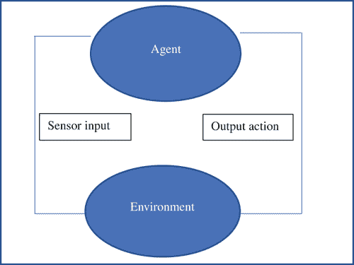

FIGURE 1.1 分布式智能结构。来源: Pattison et al. (1987).

分布式方法在管理漏洞时还提供了额外益处，例如在信息领域。在开放框架中（Hewitt and de Jong 1983），拥有多个批判性思维行动的中心焦点通常是有益的，这样就有机会同时管理多个意外情况。分布式框架不会经历单点故障的负面影响。这使得它在对无故障质量有特定重要性的情况下占据了优势地位。在分布式框架中，批判性思维枢纽或单点的故障将导致执行效率的平稳下降，而不是整个框架的崩溃。同样，从框架结构的角度来看，适当的安排可能是最实际的。实现分布式框架所需的多个最小化努力设备的总费用，可能低于一个能够执行类似任务的突破型大型设备的费用。也可能是由于分布式方法所维持的衡量质量降低了编程成本。

DAI 导致了分布式问题解决。这种方法处理特定的问题，这些问题可以分解到多个模块中，这些模块协作隔离并共享关于问题及其解决方案的信息。分布式问题解决是批判性思维的一种，通过将问题分给几个问题解决者来管理问题，这些解决者以协作的方式相互通信，并分担相互传输部分解决方案的负担。在适当的批判性思维情况下，部分问题解决者之间的通信被明确描述。相比之下，多智能体系统与松耦合的问题解决者共同工作以解决问题。这些自主问题解决者（或计算操作员）是自给自足的元素，根据它们切实且强大的能力，有能够在不同的自然条件下出色工作的能力（Lesser 1991）。`Figure 1.2` 描述了解决者的阶段或步骤。可以观察到，首先，到达的问题被分解成若干部分。分解持续到获得单元问题为止。在下一阶段，解决者尝试通过交互和共享信息以及资源来为每个单元问题寻找解决方案。在最后也是最终的阶段，获得的子解决方案整合在一起，形成问题的最终解决方案。

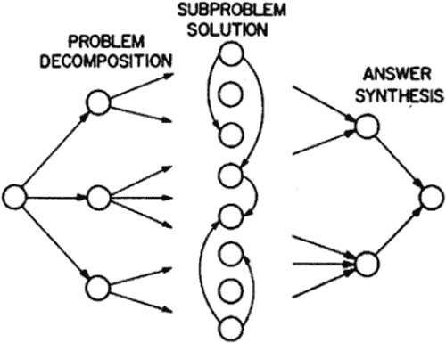

FIGURE 1.2 分布式环境中解决问题的阶段。

## 1.3 分布式人工智能的特点

1. 分布式人工智能（DAI），也称为去中心化人工智能，是人工智能（AI）的一个子领域，致力于改进问题的分布式推理。

2. DAI 由多智能体系统和分布式问题解决（DPS）紧密标识。

3. DAI 的目标是通过将问题交给独立的智能体，阐明 AI 的思考、规划、学习和识别问题，特别是当这些问题需要大量信息时。

4. DAI 考虑了不同遗留系统之间的连接和互操作性。通过在这些遗留系统周围构建智能体外壳，可以将它们整合到智能体列表中。

5. DAI 提升了框架系统的性能，特别是利用计算有效性、可靠性、扩展性、可行性、响应性、适应性和重用性的组件。

6. DAI 为子系统能力在空间和时间上分散的情况提供了方案。

## 1.4 DAI 多智能体的规划

参与 DAI 的智能体通过多种方式就其相邻智能体进行通信，以便理解它们的行为。

专家通常构建一种安排，指示它们所有的未来活动和通信，以实现特定目标。在执行开始之前，将确定将跨越的查询空间区域以及每个专家在活动中每个选择点应该采取的路线。通常会制定多操作计划，以与冲突或碰撞的活动保持战略距离，特别是在稀缺资源的使用方面。多智能体通过层次组织和关于每个操作员活动确定详细程度的元数据交易来安排对比（Peterson et al. 1990）。通过这种方法，专家们预先准确地知道他们将做出什么动作，他们的同伴将做出什么动作，以及将发生什么连接。因此，这种智能体安排可以存储某种关联记忆并在某些证明动态性。

多智能体规划有两种类型：

* 集中式多智能体规划

* 分布式多智能体规划

在集中式多智能体规划中，通常有一个协调者在接收到每个智能体的邻域计划后，对其进行调查，以识别潜在异常和冲突连接（例如对限制资源的争夺）。规划操作员或协调者此时试图修改这些碎片或部分计划，并将它们整合进特殊计划，其中冲突交互被消除。

在`Figure 1.3`中，Georgeff (1983) 概述了这样一种方法，冲突连接被识别并组合成基础区域。在最终的特殊计划中，嵌入了指令以同步所有参与的智能体，以便他们有效协作。Cammarata、McArthur 和 Steeb (1983) 在模拟的空中交通控制空间使用了集中式多智能体规划。在他们的模型中，智能体（在这种情况下是飞机）似乎处于潜在的冲突中，例如两架飞机正朝对方撞来；从中选择一架飞机（`plane 1` 或 `plane 2`）作为协调者，并做出解决撞击问题的决策。辅助智能体的方案被发送给该协调者。协调者此时试图修改自己的飞行计划以解决争端。

在分布式多智能体安排中，其动力是与每个智能体共享结构/模型。多智能体之间相互通信，以构建通信路径，修订各自的计划以及他人的结构，直到所有冲突都消除为止。这种方法的典型代表是 Lesser 等人 (1991) 的精确且一致（FA/C）方法。在这种方法中，松散耦合的参与智能体形成高层（最可能是不完整的）计划、结果和推测。这些推测被共享。接着，它们不断完善这些共享结果，直到它们都对某个最终的完整计划达成一致。邻近的异常会被识别出来，只有智能体推测中与非全局细节非常接近的部分会在存储库或数据库中进行协调。这种方法被用于分布式车辆监控测试平台（DVMT），这是一个用于测试协调程序的框架。另一种适用的多智能体规划的表示在 Dufree 等人 (1989) 的全球范围内安排（PGP）方法中提到。在这种方法中，相邻的智能体相互协作规划它们的移动，结果是这些移动基于不完整的最终或非本地计划进行不断调整（通过交换非全局邻近计划）。通过这种方式，智能体不断关注潜在的升级以汇聚协调。

## 1.5 多智能体之间的协调

大多数架构都基于智能体必须以协作还是竞争的方式进行通信这一事实。有许多原因解释了为什么智能体之间需要协调。以下章节将对此进行详细说明。

### 1.5.1 防止暴民政治或混乱

由于基于多智能体系统（MAS）框架的去中心化，暴民政治可能会发生。任何智能体都不再需要对整个组织拥有全局视角。例如，组织的负责人无法跟踪组织的所有代表（Durfee 等人 1989）。他们招募不同层级的其他经理来监督员工。同样，在基于多智能体的系统中，协调是在智能体之间执行的，以确保单个智能体不会承受规划、执行和知识传递的开销。

### 1.5.2 满足整体需求

一组智能体通常必须完成某些统一的指令才能被认为是有效的。例如，构建软件结构的智能体组可能需要在先决条件和预定预算内进行工作。此外，参与网络管理的某些智能体可能需要几乎立即对某些问题做出反应，而另一些智能体可能需要几个小时才能做出特定决策。因此，这些智能体需要相互协调以满足施加在它们身上的约束和协议。

### 1.5.3 分布式技能、资源和数据

当我们考虑医院手术室典型场景时，可以想象每个人的参与，例如心脏学家、麻醉师、护士等。每个人都有自己的专业知识和工作领域，这些角色的全面参与可能导致手术成功。同样，智能体可能有不同的限制、计划、知识和明确数据。当然，这些智能体可能依赖于信息源、设施（例如处理强度、内存）、稳定的质量水平。

### 1.5.4 智能体之间的依赖关系

大多数智能体的目标相互依赖于其他智能体。这可以通过平凡的世界问题看出。理解智能体问题最直接的方法是假设 B 对 C 有子目标，而随后的子目标是 A-B-C。显然，中间目标是相关的：后续操作者需要暂停，以便主操作者完成其子目标。在涉及此类相互依赖的系统中，练习需要进行协调。

### 1.5.5 效率

在某些情况下，单个智能体可能会解决问题，但与其他智能体之间进行协调并共享知识可能会更快地完成任务。因此，需要协调来提高每个智能体的效率。

## 1.6 智能体之间的通信模式

为了实现协调，操作者可能需要相互交流。Singh 和 Huhns (1994) 指出，如果专家拥有彼此实践的模型，他们可能不需要通信就能完成协调。无论如何，为了鼓励操作者在通过通信进行协调的情况下，他们向不同的操作者发布自己的目标、期望、后果和困境是根本性的（Gilbert and Conte 1995）。

* **黑板架构**：黑板架构背后的基本思想（也称为元组空间通信）是传统的教室黑板，它作为一个可以由多个小组或个人更新的知识池。因此，它提供了一个从问题定义到解决方案的集体贡献平台。

知识源类似于专家在教室黑板上写字。同样，数据驱动智能（DAI）也需要来自不同来源的信息来加载其知识库，以提供部分或精确的解决方案。解决问题所需的信息存储在不同的知识源并独立存储。这些知识源可以在解决问题或构建解决方案可以使用。我们可以针对不同的问题以不同的方式使用这些知识源，这些被视为一组规则、步骤和逻辑。

存储库是黑板本身，它吸收了专家写在上面的所有信息。知识源对黑板产生变化，逐渐引出一个答案，或者对问题给出许多有价值的安排。知识源之间的协作完全通过黑板上的变化发生。

控制外壳监控所有用于解决给定问题或达到最终状态的活动。它包含了已注册知识源（KS）的列表及其状态。之所以需要控制外壳是因为每个代理都有一个共享存储库进行写入，这可能会导致某些混乱的场景。


在黑板系统中处理批判性思维的基本方法是将问题划分为松散耦合的任务。这些子任务通常涉及任务内部的专业区域。对于特定的应用，解决方案设计者会刻画一个解决方案空间（一组解决方案）和预期的信息。该解决方案空间被隔离为许多不完整或完整解决方案的调查级别，而信息被隔离到特定的信息源中，以帮助完成子任务。调查级别的数据在黑板上是全局开放的，使其成为不同知识源之间的通信媒介。在大多数情况下，信息源利用某一调查程度的数据作为其信息，并产生另一个层的数据。利用特定信息源的选择是通过利用黑板信息结构中包含的最新数据（当前安排状态）有力地做出的。这种处理问题衰减和信息应用的特定方法非常具有适应性，并在不同的应用领域中运行良好。如何将问题分解为子问题对方法论的清晰度、发现安排的速度、所需的资源，甚至是想象问题的能力有很大影响。

这种架构适用于天气预报、模式识别等。Heresay II 和道格拉斯·霍夫斯塔特的 Copycat 都是黑板架构的一些示例。

- 远程过程调用（RPC）：正如你可能知道的，这种通信模式通常用于基于服务器的架构。不同空间的节点被允许在远程空间执行指令，而无需物理存在。RPC 的通用工作原理如图 1.7 所示。RPC 帮助客户端清晰地访问服务器。分布式环境中，服务器为客户端提供的便利或帮助应包括计算实用程序、文件系统访问、分布式环境中的高效操作以及传统 RPC 支持的所有其他功能。RPC 的基本要求是它为客户端提供可靠的、清晰的服务器入口。到服务器的远程过程调用对于客户端软件来说与本地过程调用相同。这是一个完全有效的概念。软件程序员在执行 RPC 函数时不再需要担心访问远端笔记本电脑。

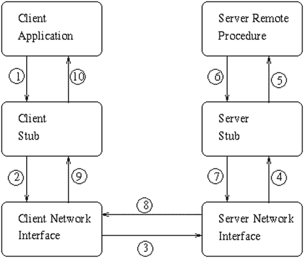

图 1.7 RPC 调用中偏移的阐释。

图 1.7 显示了一次 RPC 调用的偏移。步骤 1 解释了客户端应用程序进行的过程调用。它与任何本地或非全局过程没有区别。这个由客户端发起的程序被称为存根（stub）。存根压缩传递给它的参数，将其挤填入服务器可能需要的额外统计数据和信息，并将完整的数据包发送到客户网络接口。在这里可以注意，客户端应用程序可能知道或不知道存根的存在，因为它是由 RPC 库生成的，因此给客户端应用程序提供了非全局过程调用的假象。网络接口随后在协议上执行一系列步骤，可靠地中继由存根产生的数据包。网络接口通过协议将存根产生的数据包可靠地中继到服务器。服务器存根卸载接收的数据包，并将偏好的信息返回给客户端应用程序。

## 1.7 RPC 的分类

RPC 可分为三类：

1. 批处理 RPC
2. 广播 RPC
3. 回调 RPC

**批处理 RPC**：为了减少独立发送请求并等待响应的开销，批处理 RPC 将请求队列并批量或分组发送到服务器。

**广播 RPC**：在广播 RPC 中，消息发送到网络中所有的 `rpcbind` 守护进程。预注册的请求服务转发到服务器。广播 RPC 与传统 RPC 的主要区别包括：

1. 传统 RPC 期望一个解决方案，而广播 RPC 期望多个答案。
2. 广播 RPC 在支持广播的无连接协议上效果最好。
3. 广播 RPC 过滤掉所有失败的响应。
4. 广播请求的大小通过最大传输单元（MTU）限制，为 1500 字节。

**回调 RPC**：如图 1.8 所示的回调 RPC，作为服务器的代理向客户端发送调用以进一步执行指令或获取某些输入。客户端随后向服务器发送回复，以便服务器继续知识传递和其他信息传递。


图 1.8 回调 RPC。

- **消息传递**：当我们从客户端和服务器之间传递消息时，数据必须是双方都能理解的格式。众消息消息设计是 JSON 和 XML。这种分别使用 JSON 和 XML 的 RPC 对应被称为 JSON-RPC 和 XML-RPC。客户端发送的 JSON 对象键包括：

    - `method`——服务名称
    - `params`——要发送的参数数组
    - `id`——用于识别同步或异步接收请求的整数

服务器发送的 JSON 对象键包括：

    - `result`——包含调用服务的的结果或值；对于任何错误，结果均为 null
    - `error`——如果有错误，此键将提供错误代码或错误消息
    - `id`——标识它所响应的请求，同样是一个整数值

- **FIPA 标准**：智能物理代理基金会（FIPA）的建立是为了为异构和关联的代理及操作框架创建并设定 PC 编程基准。

FIPA 于 1996 年作为一家瑞士非营利组织成立，其目标导向的目的是为了刻画一套完整的指南，既用于构建操作员可以执行（专家阶段）的实际框架，也指明智能代理本身如何以标准方式进行通信和互操作。在存续期间，该协会的成员包含了若干学术机构以及大量组织，包括惠尔惠公司（Hewlett Packard）、IBM、BT（原英国电信）、太阳微系统（Sun Microsystems）、富士通（Fujitsu）等。尽管提议了多种规范，尽管少数专家阶段接收了 FIPA 的操作对应标准，但它在获得最初想象的业务支持方面并未占据主流。该瑞士协会于 2005 年解散，取而代之的是建立了一个 IEEE 衡量标准委员会。最广泛接受的 FIPA 措施是代理管理和智能代理通信语言（FIPA-ACL）规范。

## 1.8 多代理的参与

在分布式代理智能（DAI）下参与的多代理在知识共享方面可能表现出完全协作或部分协作。完全协作的代理解决典型和依赖性问题。它们甚至可以改变自己的结果或最终状态以协作其他代理。它们可以被视为乐助者，帮助其他代理实现目标，从而维持它们之间的可持续性和友好关系。另一方面，部分协作的代理可能反映或不反映这种连贯性。它们在本质上是反对的，可能会为了自己的利益而阻碍其他代理。

### 1.8.1 完全协作架构

完全协作架构是代理的一种排列，类似于网络架构中的网状拓扑，如图 1.9 所示。在这种架构中，每个参与的代理与系统中的每个其他代理都有连接。遗憾的是，这种排列在处理海量数据扩展到涉及大量代理的复杂领域时可能会面临问题。如果我们有一个具有 `S` 个状态的环境，这将导致 `S ^N` 个状态。状态数量的激增可能会成为服务的负担。这种架构中从接收请求到生成响应的最大延迟为 50 msec 到 100 msec。然而，这种架构在维护和通信链路方面的成本很高。需要注意的是，大多数多代理系统（MAS）拥有部分协作架构。完全协作框架支持点对点处理。

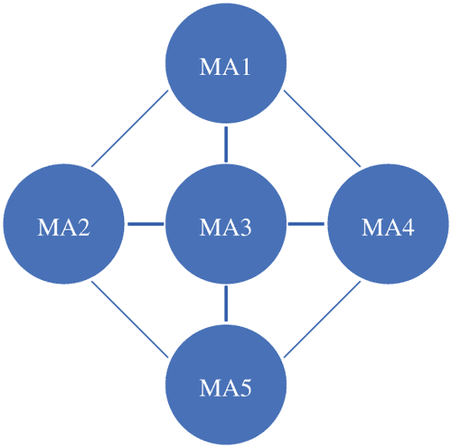

图 1.9 完全协作架构。

团队学习可以分为两个大类：同质团队学习和纯异质团队学习。同质学习者开发出一种团队中每个代理都使用的单一代理行为。纯异质团队学习者为每个代理开发独特的行为；此类方法通过代理特异化有望获得更好的解决方案，但它们必须应对更大的搜索空间。在这两类之间存在折中方案的方法：例如，将团队分成小组，组内成员共享相同的行为。我们将这些方法称为混合团队学习方法。

### 1.8.2 部分协作架构

部分协作架构是代理的两级组织。在这种排列中，某些被称为“议员”的代理以某种方式连接形成一个全连图。这些全连图然后连接到以类似方式形成的其他全连图。每组图都有一个议员或控制器来对通信做出决策。图 1.10 展示了代理的部分协作架构。

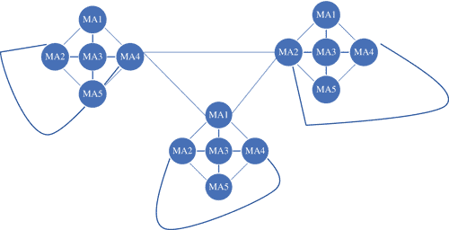

图 1.10 部分协作架构。

由于其分布式特性，DAI 有许多应用。近年来，许多许多基于这一理念构建了应用程序，这不仅带来了革命，还开启了新的技术和思想。一些日常应用列于下方。

### 1.9.1 电力分配

正如 Chaib-draa (1995) 所讨论的，来自 ARCHON 项目的一项现代应用——循环管理协作智能系统（CIDIM），是为控制工程师（CEs）提供的指南。CIDIM 帮助工程师在缺陷检测、客户驱动的需求规划和安全调查等领域工作，并以此物理方式收集大量数据。CIDIM 由十个智能代理组成，其中一些包含常规项目，另一些包含主控框架。

### 1.9.2 通信系统

在广播通信框架中使用 DAI 策略似乎是不可避免的，考虑到此类框架的两种模式：功能的分配和知识编程的动态执行（Chaib-draa 1995）。DAI 写作包含了解决媒体通信领域的各种方法。一种引人注目的模型是 LODES（大型网络观察与诊断专家系统）的框架，它试图解决局域网中的问题。

### 1.9.3 用于服务订单处理的数据库技术

Singh 和 Huhns (1994) 也描述了一种在 Carnot 环境中运行的工作流管理分布式代理工程。他们的框架由四个代理组成，这些代理交互以产生理想行为，以及一个包含重要信息和应用程序的数据库。这四个操作员是：

*   图形交互代理
*   事务调度代理
*   调度处理代理
*   调度修复代理

应用程序由调度处理代理执行。在处理过程中，如果代理遇到突发状况（例如任务失败），它会通知事务调度代理，然后由该代理向调度修复代理寻求修复问题最熟练方法的指导。这种指导可以包括如何重启调度过程、如何提前结束事务以及其他任务。最后，图形交互代理会请求框架支持客户端或用户。Singh 和 Huhns (1994) 原型化了一个特定条件下运行的模型，使电信机构能够提供一种需要在众多活动、网络和系统之间进行协调的协助。

### 1.9.3.1 并发工程

帕洛阿尔托协作测试平台（PACT）是一项并发工程基础设施，包括多个本地站点、子系统和控制单元。通过 PACT，来自斯坦福大学、洛希希德帕洛阿尔托研究实验室以及企业集成技术的代理共同研究了构建大规模分布式并发工程系统中的机械和社会学问题。PACT 测试从三个维度研究了构建更大型结构的方法：

*   接口、惯例和设计的协作性进展
*   维护各自特定信息库和思维组件的框架之间的信息共享
*   计算机辅助在同步建设项目中进行安排和确定选择

PACT 的设计依赖于体现构建装置的接口项目或专家。这种专家协会依赖于三点：

*   用于跨学科传递信息的共享构想和术语
*   用于在代理之间移动信息的通用语言
*   使操作员能够请求数据和服务的通信与控制语言

### 1.9.3.2 天气监测

太阳能驱动的照明和温度数字数据被应用于各种控制框架中。其中一个框架是大气控制，其中太阳辐射影响着人工照明。

社区的天气预报结果通常从商业气象数据办公室和机构购买。令人惊讶的是，预测结果从未像人们所希望的那样准确。丹麦气象学院（DMI）声称其准确率达到 97%。虽然精度很高，但间隔范围仍然太大了。商业气象数据通常以 10 × 10 公里的网格产生。有时可以根据之前的天气事件预测即将到来的气候事件。已使用 `DAI` 开发出提前 24 小时的模型（Wollsen and Jorgensen 2015）。这些模型利用了人工神经网络。

### 1.9.3.3 智能交通控制

人工智能（AI）和物联网（IoT），被称为 AI 驱动的物联网（AIoT），能够处理来自大量设备的海量信息，并处理社会框架中的复杂问题。例如，监控摄像头可以为交通灯控制提供持续数据，并报告自动和手动交通的状况。Liu、Liu 和 Chen (2017) 提出的交通灯控制方案，该方案利用分布式多代理 Q 学习来提高整个控制框架的通用执行能力。通过利用多代理 Q 学习计算，他们同时改进了自动和手动交通。

## 1.10 结论

分布式人工智能（DAI）是人工智能的一个延伸，负责管理智能和精明代理之间的通信。它致力于构建能够决策的智能代理，从而在一个由各种智能代理栖息的世界中帮助自己实现目标。DAI 侧重于获取和分析信息，以制定寻找给定问题解决方案所需的策略。`DAI` 在各个领域的应用已被证明是系统的一次革命性升级。它已帮助通过分布式方法解决需要大量资源、算能和信息的复杂问题。然而，由于 `DAI` 管理着多个代理，也面临着一些困难。协调其中一个突出的问题。尽管如此，`DAI` 是解决复杂和大型任务最强大的方法之一。

1. Andrews, G.R., “Paradigms for process interaction in distributed programs”, ACM Computing Surveys, 23: 49–90, 1991.
2. Cammarata, S., McArthur, D., Steeb, R., “Strategies of cooperation in distributed problem solving”, in A.H. Bond, L. Gasser (ed.), Readings in Distributed Artificial Intelligence, 102–105, 1988, Elsevier.
3. Chaib-draa, B., “Industrial applications of distributed AI”, Communications of the ACM, 38(11): 49–53, 1995.
4. Durfee, E.H., Lesser, V.R., Corkill, D.D., “Trends in cooperative distributed problem solving”, IEEE Knowledge and Data Engineering, 1(1): 63–83, 1989.
5. Georgeff, M.P., “Strategies in heuristic search”, Artificial Intelligence, 20(4), 393–425, 1983.
6. Gilbert, N., Conte, R., Artificial Societies: The Computer Simulation of Social Life, UCL Press, London, 1995.
7. Gutnik, G., Kaminka, G., “Towards a formal approach to overhearing: Algorithms for conversation identification”, in Proceedings of the Third International Joint Conference on Autonomous Agents, 2004.
8. Hayes-Roth, B., “A blackboard for control”, Artificial Intelligence, 25: 251–321, 1985.
9. Hewitt, C., Jong, Peter., Analyzing the Roles of Descriptions and Actions, Massachusetts Institute of Technology, Cambridge, 1983.
10. Kubera, Y., Mathieu, P., Picault, S., “Everything can be Agent!”, in Proceedings of the Ninth International Conference on Autonomous Agents, 2010.
11. Lesser, V.R., Huhns, M., “A retrospective view of FA/C problem solving”, IEEE Transactions on Man, Machine, and Cybernetics, 21: 1347–1363, 1991.
12. Liu, Y., Liu, L., Chen, W., “Intelligent traffic control using distributed multi-agent Q learning”, in 2017 IEEE 20th International Conference on Intelligent Transportation Systems (ITSC), 1–8, 2017.
13. Patterson, H., Corkill, D.D., Lesser, V.R., Huhns, M., “Distributed artificial intelligence, instantiating descriptions of organizational structures”, Distributed artificial intelligence, volume1, 59–96, 1987.
14. Peterson, L., Hutchinson, N., O’Malley, S., Rao, H., “The x-kernel: A platform for accessing internet resources”, Computer, 23(5): 23–33, 1990.
15. Ponomarev, S., Voronkov, A., “Multi-agent systems and decentralized artificial superintelligence”, 2017. arXiv preprint:1702.08529.
16. Shoham, Y., Leyton-Brown, K., Multiagent Systems: Algorithmic, Game-Theoretic, and Logical Foundations, 1st edn., 2010, Cambridge University Press.
17. Sichman, J.S., Demazeau, Y., Conte, R., Castlefranchi, C., “A social reasoning mechanism based on dependence networks”, in ECAI 94 IIth European Conference on Artificial Intellegence, 189–192, John Wiley and Sons, California, 1994.
18. Singh, M.P., Huhns, M.N., “Automating workflows for service order processing: Integrating AI and database technologies”, IEEE Expert, 9(5): 19–23, 1994.


19. Sun, R., Naveh, I., “Simulating organizational decision-making using a cognitively realistic agent model”, Journal of Artificial Societies and Social Simulation, 7(3), 2004.

20. Varro, G., Schurr, A., Varró, D., “Benchmarking for graph transformation”, in 2005 IEEE Symposium on Visual Languages and Human-Centric Computing (VL/HCC′05), 79–88, IEEE, September 2005.

21. Yu, N.P., Liu, C.C., “Multiagent systems. Advanced solutions in power systems: HVDC, FACTS, and artificial intelligence”, 903–930, 2016, John Wiley & Sons.

22. Wollsen, M.G., Jorgensen, B.N., “Improved local weather forecasts using artificial neural networks”, In Distributed Computing and Artificial Intelligence, 12th International Conference, 75–86, Springer, Cham, 2015.

Rashi Agarwal, Supriya Khaitan, and Shashank Sahu

## 2.1 引言

“软件智能体”（software agent）一词由 John McCarthy 和 Oliver G. Selfridge 在 20 世纪 50 年代中期提出。今天，软件智能体是人工智能、机器人、分布式计算、人机交互、智能适应界面以及信息检索等领域非常多样且热门的研究课题。我们对“agent”这个词都很熟悉，例如房地产代理。agent 的普通意思是“具有代表他人采取行动能力的元素或实体”。这些智能体代表其他实体采取行动，并在不参考所有者的情况下安排预约。这些智能体在行为上具有很强的主动性和反应性；例如，这些智能体会主动在当地媒体上宣传“待售”房产，或者同一个智能体可以在不同时间表现出高水平的主动性和反应性。

在这里，我们讨论的是编程专家（也称为软件智能体）的两个本质属性：自主性/自治理性以及处于环境之中。首要属性——**自然地监督**，意味着专家是自给自足的，并做出自己的决择。这是区分编程操作符（operators）与对象（objects）的属性之一。当我们认为一个结构是包含不同自主专家的去中心化结构时，随后的属性并不否定权威的概念，特别是因为在某些情况下所有产品项目都可以被视为主导。无论如何，归根结底，编程操作符将在条件测试时被使用。更明确地说，专家的环境是动态的、无常的且复杂的。环境是动态的，是因为它们变化迅速。通过“快速地”，我们是指专家在努力实现目标时，无法承认环境将保持不变。

这些情况之所以不同寻常，是因为它们无法预测条件的未来状态。同样，这是因为人类无法获得关于自然的动态信息。智能体通常被安排在快速变化的独特情境中。具体来说，这意味着智能体必须对其环境的巨大变化做出反应。例如，一个控制足球机器人的智能体可以根据球的状况和不同球员的情况进行安排，但它必须设置为在环境发生关键变化时调整或放弃其安排。也就是说，智能体应当是反应性的，以及时的方式对环境的变化做出反应。

智能体的另一个关键属性是它们追求目标，它们是**主动的**。目标的一个属性是具有**持久性**；这非常有价值，因为它让智能体变得越来越健壮。无论尝试是否失败，智能体都会继续努力实现目标。对象是反应性的，并具有隐含的目标。然而，智能体在拥有多个目标方面并不主动。这一属性将智能体与对象区分开来。此外，这些智能体还具有学习、协作和移动性等非常有趣的特征。因此，agent 一词可以总结如[图 2.1]所示：“智能体是一个计算实体，能够以自主的方式代表其他实体行动，以某种程度的主动或反应性执行某些操作，并出学习、协作和移动的某些关键属性。”

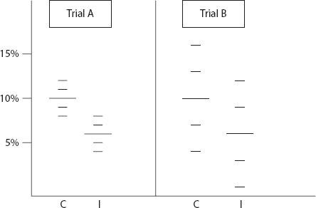

图 2.1 智能体的特征。

对智能体的研究与任何能够根据其过去和当前的感知做出决策或行动的事物有关。智能体可以是人、机器或软件。人工智能系统由智能体及其环境组成，如[图 2.2]所示。智能体在其环境的边界内做出决策。借助智能体帮助开发的软件包含两个部分：智能体和环境。智能体的两个主要部分如下：

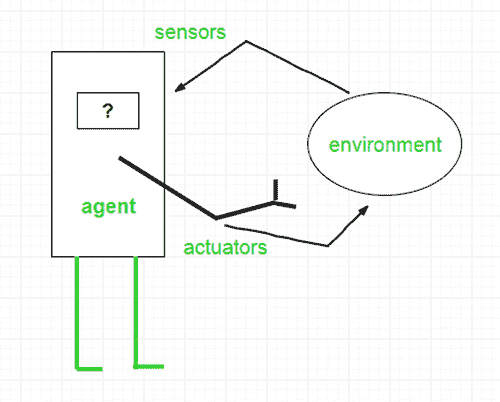

图 2.2 智能体。

* 传感器：感知环境

* 执行器：对环境采取行动

Nikola Kasbov 将智能智能体定义为一种系统（见[图 2.3]），该系统应该具有以下特征：

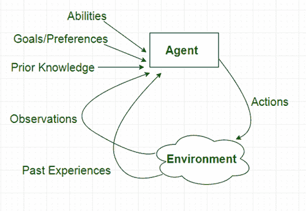

图 2.3 智能智能体。

* 能够容纳新算法来解决问题

* 能够适应实时环境的变化

* 能够根据成功率和错误率分析其行为

* 能够从以往的经验中学习

`Agent = Architecture + Agent Program`

其中

`Architecture` = 执行智能体的机器

`Agent Program` = 智能体的功能实现

理性智能体及其环境的研究创建了人工智能系统。智能体通过传感器感知环境，并通过执行器对环境采取行动。人工智能智能体具有意图、知识和信念等属性。智能体可以是人类、软件或机器人。它在感知、思考和行动的循环中完成任务。

具有传感器和执行器的不同智能体

| 智能体 | 传感器 | 执行器 |
| --- | --- | --- |
| 人 | 眼睛、耳朵 | 手、腿、声带 |
| 机器人 | 摄像头、红外距离仪、自然语言处理 | 各种电机 |
| 软件 | 键入、文件内容 | 显示设备 |

系统在本质上需要具有适应性，以便理解用户的需求以及必要的变更。程序的功能在处理意外事件方面的灵活性有限。它们能够根据其设计时的条件执行操作。它们能够根据软件的编程进行运行。这种程序的僵化性在功能需求不随时间改变的应用中运行良好。但如果系统的需求随时间变化，计算机程序中的这种僵化性可能会对系统功能产生负面影响。在设计阶段通常使用通用过程模型。很难根据随时间变化的组织需求来调整通用模型（Van Der Aalst et al., 2009）。软件工程交付的是静态的功能方法。开发能够随时间推移而演化的软件是一项挑战（Eisenbach et al., 2002）。业务的全球化也要求软件开发频繁发生变化（Alaranta et al., 2004）。Zimmermann (2015) 强调需要通过架构决策来适应环境中发生的快速变化。考虑到当今对计算机系统不断增长的需求，要求系统必须能够与动态且不可预测的环境进行调整。因此，软件开发需要一种新方法。

### 2.2.1 需求变更

部署在客户现场的软件可以正常运行一段时间，但随着时间的推移，客户/用户方面的需求发生了变化，现有的功能无法满足客户的需求。需求不断变化是自然现象，我们无法阻止它。为了适应软件的这些变化，需要人工干预（A. G. Sutcliffe & Maiden, 1993）。每当功能发生变化时，管理人工干预都是是一项艰巨的任务。软件开发中的一个重要阶段是需求收集。它收集用户需求并将这些需求传给开发人员。用户需求是固定的，因为它们随时间变化，且软件程序需要包含这些变更。对于传统的软件系统，新变更是在开发人员帮助下包含在程序中的，这增加了维护成本和资源消耗。这一过程使得难以为产生额外成本的变更实施维持预算。需要通过变更来优化软件，以便软件在未来表现得更好。使用传统软件开发方法开发的软件无法修改软件自身的功能，这反映了软件的额外成本，同时也导致开发者在大部分时间里忙于整合随时间作为需求而产生的新变更。

软件需求的变化也增加了软件成功的风险。另一方面，它提供了改进软件易用性的机会（McGee & Greer, 2012）。变更可能源于市场和组织变化等各种来源。需求的变化不仅影响软件规范，还会影响软件开发的其他组件。因此，必须为管理系统提供灵活且有效的变更（Mu K. D. et al., 2011）。环境的变化对软件功能施加了限制。软件无法实现其开发时的目标。软件功能应该能够适应这些变化。通常，对变更的适应反映了软件架构的重组（Hoogendoorn et al., 2011）。客户无法理解在软件中纳入变更并非易事。这还可能降低运行软件的效率。客户与开发人员之间需要建立信任（Chudge & Fulton, 1996）。

...

### 2.2.2 对演化系统的需求

需要一种系统，能够通过理解环境中发生的变化来变得适应性（Kavakli & Louopoulos, 2006）。

软件演化在应用的各个方面都是必要的，例如社会技术、基于搜索的网页、非结构化仓库的挖掘以及软件需求的收集。应该关注相互依赖的软件组件。由于互联网和互联网资源的快速增长，用户可以方便地找到相关信息。这反映出软件应该与新信息保持同步。当用户使用软件时，会产生各种新需求。这些各种新需求基本上是业务需求的变化、错误纠正、新设备的添加以及系统性能和可靠性的改进。大规模软件的复杂性导致了需求的波动性，这使得软件的演化变得必要。同时，针对新能力的软件演化进度和预算也存在风险。演化应该被仔细纳入，且演化应该围绕观察捕捉到的新信息展开。演化应该实现用户的最终目标。日常维护任务是劳动密集型的，这促使软件应当自我演化。

## 变更的原因

变更有多种原因，例如发现了缺失的需求、代码中的 Bug、需求误解、市场变化以及法律变更。如果需求在软件开发的早期就确定了，那么后期需求变化的概率更大，软件应该能够应对这种变化。在软件演化过程中，可以实施需求的优先级排序。软件可以通过开发者添加和增强功能来演化。软件也可以自我演化。但软件自我演化比通过更改代码来演化的软件更有效。长期维护的软件需要关注重新审视其架构（Kelly, 2006）。为了软件的长期演化，有必要对设计集中的每个元素进行设计。

## 交互与复杂性

通常，交互被认为是导致软件复杂性的因素之一。软件架构由许多相互作用的组件组成，这些组件创建了自身的控制线程。通过理解交互组件的需求，软件行业开发了许多工具和技术来为复杂软件的交互建模。在过去的二十里，代理和多代理系统在研究社区中日益增长。代理开发有很多原因，其中之一是代理具有自主性。今天许多系统由被动对象组成。这些被动对象拥有可以执行操作的状态。这些对象仅仅反映了系统设计的静态结构。然而，某些对象在运行时会交互。我们可以将其称为半自主对象，但这些对象无法独立做出决策。

有几个理由将代理视为软件工程的一个新方向。系统中存在交互式组件是自然的。有些组件作为被动组件工作，而另一些组件作为活动组件工作。系统由分布在各种组件的数据组成。因此，处理控制应该通过各种组件进行分布式。组件之间还需要相互协作。系统的组件应该能够灵活应对各种类型的外部组件并与它们交互。所有这些特性都体现在代理中。

## 代理 vs 对象

程序员通常熟悉面向对象的对象。他们来说很难考虑代理这一新概念。对象具有状态并使用各种方法执行操作。对象与代理相似，但对象和代理之间存在差异。对象和代理的基本区别在于自主性。封装是面向对象编程的主要特征，它表示对象对其状态有控制权。但如果一个对象被声明为 `public`，那么该对象对其行为就没有控制权。对象拥有供其他对象使用的方法。在面向对象编程中，对象共享一个共同目标。在代理开发中，不存在这样的共同目标。代理也不会因为另一个代理想要就执行某个动作。代理和对象之间最大的区别之一是代理反映了自主行为。另一方面，面向对象编程中的对象则没有。

代理总是活跃的。代理以循环的方式持续观察环境。代理根据观察结果更新其内部状态。代理创建自己的控制线程。在面向对象的情况下，只有当其他对象需要其服务时，对象才是活跃的。然而，存在“活动对象”的概念。我们可以说活动对象是一个代理，但活动对象并没有表现出灵活的自主行为。代理和对象之间三种区别（Wooldridge & Ciancarini, 2001）：

1. (a) 代理具有很强的自主性概念。它们能够根据请求自行决定执行某项操作。

2. (b) 代理表现出灵活的行为，如反应性的、主动的和社交性的。对象不显示此类行为。

3. (c) 代理系统本质上是多线程的。每个代理至少有一个控制线程。

开发基于代理的系统基本上有两种方法：

1. (i) 扩展现有的面向对象方法来开发代理。

2. (ii) 采用其他技术或知识工程。

### 2.2.3 软件系统

软件是根据从客户处收集的需求开发的。需求分析由分析师完成，然后转发到设计和编码阶段进行实现。实现之后，进行测试，然后部署到客户现场。客户使用软件，并通过软件中开发的功能获得结果（Gefen & Schneberger, 1996; Bosch, 2000）。

需求工程是软件开发中的一个重要阶段。它探索了需要作为软件系统功能实现的真实目标。需求工程还探索了需要施加于开发中软件系统功能上的约束条件。需求工程发现了有助于待开发软件进行精确规范的因素之间的关系。正确且一致的规范可以提供客户/用户所期望的一致软件行为。当需求被收集和分析时，软件开发周期的其他阶段便随之开始。使用软件开发生命周期（SDLC）开发的软件被部署在客户现场，客户开始使用该软件。在软件开发过程中，持续不断的需求变更产生了一个重大问题（Navarro et al., 2010）。需求变更会影响所有的软件开发阶段。它会增加软件项目的预算和开发时间。在软件需求规范中保持一致性是困难的。领域知识对需求工程的有效性也有影响。然而，既对领域既无知又了解该领域的团队，在需求想法的生成方面都是更有效的（Niknafs & Berry, 2017）。需求也影响投资回报率。企业正主张在需求收集中保持灵活性（Jarke & Lyytinen, 2010）。在现代，客户需求是不断波动的。需求工程应该能够适应软件需求规范中的这些波动。对软件定制化功能的需求日益增长（Universit & Group, 2012）。这表明当前的需求获取技术需要被审查，并且关于新型和更详尽技术的研发正在进行。

软件开发面临着预算过度和进度紧的压力（Nan & Harter, 2009）。然而，像结对编程这样的新的软件开发方法正在进行，以减少软件开发成本（Moise Kattan & Goldman, 2017）。

## 2.2.4 演化软件系统

演化软件系统能够观察环境并据此做出决策。在观察之后，系统理解观察中的新变化并根据新变化更新自身。现在，在环境发生新变化后，演化系统与环境交互，并能够代表应用程序用户做出更好的决策。演化软件系统在没有人工干预的情况下自我进化。通过这种方式，演化系统能够应对动态且不可预测的环境。

演化软件系统是分布的、异构的、去中心化的独立的。它们能够在动态且不可预测的环境中运行。演化软件系统（ESS）为未来的良好决策做好准备。对于任务关键型系统，普通的软件系统无法长时间保持其可用性和可靠性（Mens, Magee, & Rumpe, 2010）。然而，另一方面，ESS 系统为了未来的兼容性进行自我调整。局部属性和软件结构影响软件系统的演化。ESS 系统像人类一样工作。它们反映了人类的智能和人类理性。ESS 系统的实现需要各种技术，范围从自然科学到社会科学。ESS 利用工业经验进行进一步的演化。

ESS 的目的是缩小实时场景与软件中设计的功能行为之间的差距。它导致了智能管理。演化系统使用软件代理体作为系统的组件。软件代理体在 ESS 系统中承担着不同的责任和角色。所有代理体相互协作以实现演化系统的目标。演化系统也被用于大数据分析领域。演化系统的架构为大数据应用使用了高级层级设计（Gorton & Klein, 2015）。演化系统设计为具有随时间推移而演化的架构（Woods, 2016）。架构具有演化智能组件。

演化软件系统可能针对软件的不同功能而存有多种架构替代方案（Koziolek et al., 2013）。Mader & Egyed（2015）强调了演化系统中需求可溯性的重要。演化系统的类应该被唯一标识，演化系统的所有元素之间应该存在链接（Wenzel, 2014）。软件架构在演化系统的可持续性方面起着重要作用。经典架构无法应对维护及其他方面引起的频繁变化。支持演化能力的架构成为随时间演化的系统的核心元素（Naim et al., 2017）。

## 2.3 代理

演化软件系统是使用软件代理体设计和开发的。软件代理体是软件的一个组件，具有为另一个实体执行任务的能力，该实体可以是软件、硬件或人类实体或用户。代理体在行为中反映了自主性和智能性。然而，基础形式的代理体可能执行预定义的任务（如数据收集和传输），为自主性和智能留的空间很小。代理性的另一个维度是社会性。社会性指的是与其他代理体及非代理实体的交互与协作。软演化代理体是一种软件程序，它能够学习需求本身发生的变化以满足用户需求。演化代理体（也称为智能代理）在交易市场中获得广泛应用（Sueyoshi & Tadiparthi, 2007）。代理体是一种感知外部世界/环境并据此采取的软件组件。借助代理体帮助开发的软件具有适应性，并能够根据环境的变化自我调整。使用代理体开发的软件为程序开发提供了一种新方法。这种编程方法适用于开放环境，如分布式领域；电子商务和基于 Web 的系统。代理体能够自主学习用户需求，并与其他代理体协作以满足用户需求。

代理体具有以下属性：

* 自主性（Autonomy）：代理体能够根据环境发生的变化做出决策。

* 反应性（Reactivity）：代理体能够对外部环境活动发生的变化做出响应。

* 主动性（Pro-activeness）：代理体能够为了未来的更好的决策以及实现目标提前计划。

* 社会能力（Social ability）：代理体能够与其他代理体通信以实现目标。

代理体可以在没有人工干预的情况下根据环境做出反应（Banerjee & Tweedale, 2007）。它催生了一个新的新兴领域：面向代理的软件工程（AOSE）（Zambonelli & Omicini, 2004）。AOSE 由为了实现所需目标而工作的代理体组成。


基于代理的计算拥有一套新的抽象并需要自适应方法论。它提倡开发新工具来支持基于代理的系统。关于代理，工程领域有两种观点：一种是强的人工智能观点，关注代理的主动性和智能性；另一种观点是软件工程观点，认为代理是针对其环境的响应性或主动性线程。复杂系统无法仅靠一个代理来开发，它拥有许多在执行复杂系统任务中扮演不同角色的代理。当多个代理在系统内工作时，需要一种交互协议来实现代理之间的交互。代理还需要其生存的本地上下文。

基于代理的系统反映了代理自主性和反应性等特性。面向代理的软件工程（`AOSE`）为代理抽象提供了丰富的方法论。基于代理的系统适用于广泛场景和应用。代理包含了人工智能，这是代理的一个重要特征。`AOSE` 适用于高级且复杂的系统。可以用 `AOSE` 建模的组件示例包括自主网络进程、基于计算的传感器、个人数字助理和机器人。一方面，互联网应用程序、点对点通信、传感器网络和泛在计算等软件系统可以使用代理方法论进行设计。在实现代理和多代理系统时存在一些问题。这些问题包括：

1. (i) 如何从基于代理的设计转向具体的代理代码
2. (ii) 代理架构抽象应独立于实现
3. (iii) 代理之间交互的通信架构是什么
4. (iv) 哪些是实现代理的工具

方法论主要大类：(1) 面向对象的方法论，以及 (2) 基于信念、欲望、意图（`BDI`）的方法论。仍需根据系统的性能和维护来决定遵循哪种方法论。`AOSE` 多代理基础设施需要以下各种组件：

1. (i) 规则交互
2. (ii) 中间件层支持通信和协调活动
3. (iii) 主动通信层而非被动层
4. (iv) 支持交互协议的执行
5. (v) 为其他代理提供帮助
6. (vi) 主动控制交互
7. (vii) 消息路由设施
8. (viii) 交互同步

多代理系统（`MAS`）中的代理与其他代理进行交互。代理首先找到另一个代理，并跟踪周围的代理代理。代理理解其他代理的特征和服务。然后它相应地路由消息。通信基础设施中可能存在一个促进代理。促进代理接收要交付给其他代理的消息，并据此对消息进行重新路由。

`AOSE` 支持的通信基础设施应该能够识别内部代理行为和代理间交互协议。通信基础设施应该能够处理全局交互。通信基础设施的问题在于，它有时需要针对应用领域和代理的全局行为进行调优。通信基础设施中应嵌入用于通信的法律，以防止恶意行为。法律的执行也有助于根据环境重新配置协议。将通信基础设施与代理开发分离，可以减少代理分析和设计的复杂性。代理间问题和代理内部问题被分开处理。代理的设计应该是自适应的，并能够支持分布式计算。在实现代理时，其基础设施也需要实现。现在代理不再是同质的。它们在设计上还需要标准化。

## 面向代理的软件工程中的开放问题

面向代理的软件工程中的开放问题包括：

1. (i) 用于移动性和无处的 `MAS` 设计
2. (ii) 用于动态复杂系统的代理设计
3. (iii) 代理与社交网络的关系
4. (iv) 自组织
5. (v) 衡量代理活动的性能模型

使用代理技术的自适应系统在学习市场机制方面非常有效（`Seppecher et al., 2019`），且数据管理中的自适应应用被发现是很有前景的（`Rafique et al., 2019`）。在新场景中应用软件代理更为有效（`Jaeger et al., 2019`）。

设计智能体需要具备架构（`Jennings, 2000`）。多位作者都提倡使用演化智能体（`Rosenblatt, 1958; Samuel, 1959; Fogel, 2006`）。演化智能体能够通过观察环境做出决策（`Hanna & Cagan, 2009`）。演化智能体需要演化架构。演化架构能够适应环境中发生的新变化（`Nunes et al., 2009`）。

作者还讨论了智能体设计与开发的分类处理。`Xiao Xue` 等人（2006）强调了面向智能体的软件开发以解决现代复杂问题。作者提出了一种名为`C4I`（命令、控制、通信、计算机和信息）的智能体结构。它用于海军舰的信息处理。作者得出详细智能体结构在智能体的设计和开发中起着关键作用。

`Singh` 等人（2008）讨论了各种面向智能体的需求工程框架，并提出了了用于评估这些框架的参数。他们强调，客户需求在本质上是动态的，可以使用智能体来解决。该领域还需要进一步的研究。

`Gaur` 等人（2010a）提出了一种基于智能体的需求工程螺旋模型框架。它使用故事卡来规范需求，这在智能体的开发中非常有用。他们强调需要进一步研究以满足客户需求。使用智能体的软件开发是近期软件设计和开发的一种新范式（`Gaur Vibha et al., 2010b; Huiying and Zhi 2009`）。智能体可能拥有目标和任务，软件智能体试图完成这些任务以实现系统目标（`Gaur et al., 2010b`）。`Huiying` 和 `Zhi`（2009）提出了描述智能体需求的图形化符号。

`Bhuiyan` 等人（2007）提出了一种结合`i*`模型和`UML`活动图的组合框架。`Zhu & Shan`（2005）提出了一种 Web 服务的图形架构。该架构使用智能体建模语言`CAMLE`编写，并使用规范语言`SLABS`进行抽象。他们阐明了如何将智能体应用于 Web 服务中。

`Khallouf & Winikoff`（2005）在交互图和协议中强调了添加目标的重要性。他们通过案例研究展示了目标的重要性，并得出在智能体设计中添加目标既可用又有效。`Vilkomir` 等人（2004）探索了`i*`框架与`Z`形式化方法的结合，用于智能体的需求收集。他们使用`i*`框架进行早期阶段的需求分析，进一步的需求使用`Z`符号进行规范。

智能体还可能扮演执行其指定任务的角色（`Chan & Sterling, 2003`）。`Qu Youtian` 等人（2009）提出了一种基于组件的智能体架构。`Dam` 等人（2006）提出了一种基于智能体的半自动变更传播框架，用于演化软件系统。用于演化软件系统的基于智能体的开发是有前景的，并受到了 `Pour`（2002）的倡导。演化智能体是演化软件系统的核心部分。演化智能体观察新变化并在没有任何人工干预的情况下将这些变化整合到软件中。

`Paderewski-Rodríguez` 等人 (2004) 强调了软件系统的演化。论文的演化框架中提出了两种技术：自适应和继承。在自适应技术中，智能体根据环境修改自身。在继承技术中，则开发一个新的智能体。`Wang X` 等人 (2007) 针对回答学生查询的系统提出了一种由两种智能体（学生智能体和教师智能体组成的相似演化模型。

回答系统由一个智能体组成，该智能体具有一个五维模板 `<A, I, S, T, K>`，其中 `A` 定义唯一的名称，`I` 定义接口，`S` 显示智能体的状态，`T` 显示智能体的行为，`K` 定义知识源。`Vandewoude` 和 `Berbers` (2002) 展示了通过连接到组件的端口利用异步消息来实现动态通信。

`Jonker C` 等人 (2001) 提出了一种用于网站的多智能体通用架构。这些智能体是智能的。作者划分了多智能体的类别，包括个人助手智能体（软件智能体）、客户（人类智能体）、员工（人类智能体）和网站智能体（软件智能体）。`Stefano` 等人 (2004) 讨论了软件开发中的适应性，并提出在运行时替换类。开发软件中一个名为 `checker` 的组件会观察替换时间并替换类、编译类以及运行类。这需要一个结构或目录来存储与软件连接的类。

`Mendez` 和 `Antonio` (2008) 了一种可用于训练的智能虚拟环境架构。它是对等点风格的。它通过发布-订阅风格提供了面向服务的行为。在生命周期中的某段时间内，适应变化是必要的 (`Q. Wang` 等人, 2003)。作者对变化类型进行了分类，包括运行时平台变化、交互上下文变化和客户需求变化，并强调了演化软件的需求。

`Meng` (2009) 建议了一种基于 `BDI` 模型的智能体模型，该模型通过端口与其他智能体通信。`Spanoudakis` 和 `Moraitis` (2010) 提出了一种用于智能体分析和设计的新方法论“`Gaia`”。作者定义了具有三层的架构。它由为软件智能体定义的角色组成。同样，`Bresciani` 等人 (2004) 借助 `eCulture` 案例研究提出了一种名为“`Tropos`”的智能体方法论。`BDI` 概念通过 `Tropos` 方法论实现。该方法论在软件开发生命周期早期提出了需求模块。

`Isern` 等人 (2011) 描述了两种类型的智能体组织：“机械型”和“有机型”。基于模拟的多智能体系统 (`MAS`) 有五个基本步骤：精确验证、点点模拟、建模、调优和近似验证 (`May & Zimmer, 1996`)。`Oluyomi`、`Karunasekera` 和 `Sterling` (2008) 讨论了利用 `2G-RFID` 和物联网 (`IoT`) 技术提供机器对通信 (`M2M`) 支持的架构。

`BDI` 智能体的结构可以是：

```
<Agent> {<Beliefs> Constraints; Data Structures; <Desires> Values; Condition; Functions; <Intentions> Methods; Procedures;}
```

这展示了一种实现方法 (`Meng`, 2009)。模型驱动架构的方法被应用于面向智能体的开发中 (`Jawahar & Nirmala`, 2015)。会议智能体的结构高效地利用了多智能体概念 (`Huamonte` 等人, 2005)。会议智能体同时适用于同步和异步算法。作者发现异步算法的效率低于同步算法。

设计智能体行为面临着巨大挑战。一种从核心构建块到增强构建块的顺序技术适用于智能体行为。持久性内存可用于设计演化行为 (`De Jong`, 2008; `Krzywicki` 等人, 2014)。智能体架构定义了有助于完成任务的模块。它还定义了用于设计和开发智能体的模块之间的关系。选择正确的架构为解决设计和开发智能体的复杂问题提供了适当的方法。它缩短了开发时间并提高了效率。

作者强调了软件开发中演化架构的发展 (`Rosenblatt`, 1958; `Samuel`, 1959; `Fogel`, 1995)。智能体在为解决方案演化的过程中做出合适的决策 (`Hanna & Cagan`, 2009)。需要一种软件开发范式，来激发随时间变化的环境的自适应架构 (`Nunes` 等人, 2009)。系统架构在动态环境中的重要性具有商业价值。`Bratman` 等人 (1988)、`Doyle` (1992)、`Shoham` (1993) 以及 `Rao & Georgeff` (1991) 讨论了一些与智能体系统架构相关的方法。

目前缺乏有助于设计智能体系统的良好定义的结构 (`Jennings` 等人, 1998)。`Jennings` 等人 (1998) 给出了关于智能体研究及其发展的路线图。`Wooldridge & Jennings` (1995) 和 `Wooldridge` 等人 (2000) 阐明了这方面的各种架构和理论。智能体在交易市场也很有用 (`Samuel`, 1959)。智能体具有各种属性 (`Sahu` 等人, 2016)，包括自主性、反应性、主动性和社交能力。

一种流行的设计智能体架构是信念、欲望和意图 (`BDI`) (`Rao & Georgeff`, 1995)。然而，`BDI` 模型缺乏学习能力。`BDI` 无法根据过去的经验进行适应。智能体的演化是一项重要需求 (`Phung` 等人, 2005)。`Guerra-Hernández` 等人 (2005) 也提到了 `BDI` 架构缺乏学习的问题。从理论到智能体领域的良好研究得到了强调 (`Hindriks` 等人, 1999)。`BDI` 框架展示了设计智能体的规范。使用已知编程语言进行此类完善的工作较少 (`Singh & Asher`, 1991; `Hoek` 等人, 1994; `Rao`, 1996; `Linder` 等人, 1996; `Hindriks` 等人, 1999)。可以使用复用智能体架构创建自适应行为 (`Decker & Sycara`, 1997)。

智能也应用于大数据 (`Bhargava` 等人, 2016)。还有使用智能体的进程间同步 (`Bhargava & Sinha`, 2012)。智能体用于移动资源管理 (`Ogwu` 等人, 2006) 以及多标准决策支持系统 (`Wen`, 2009)。智能体的实现需要合适的架构。`Bratman` 等人 (1988)、`Doyle` (1992)、`Shoham` (1993)、`Hoek` 等人 (1994) 以及 `Rao & Georgeff` (1991) 提出了一些架构。`David & Fogel` (2006) 给出了智能体架构的路线图。开发演化智能体缺乏相应的架构 (`David & Fogel`, 2006)。

以下是用于智能体开发的一些方法论 (`Wooldridge & Ciancarini`, 2001)。

澳大利亚人工智能协会 (`AAII`) 方法论包含两个模型：内部模型和外部模型。外部模型代表智能体及其关系。内部模型关注智能体的内部工作，与 `BDI` 范式相关。智能体之间定义了继承关系。外部模型本身由两个进一步的模型组成：智能体模型和交互模型。

1. **该方法论的简要描述如下：**

   a. 识别开发智能体类层次结构的角色

   b. 识别每个智能体的责任和目标

   c. 为每个目标的实现制定计划

2. **确定每个目标所需的信息和计划。** 这意味着确定系统的信念结构。

3. **迭代该过程** 以开发功能性的面向代理的系统。

### (ii) Gaia 方法论

该方法论建议从需求到设计的系统化移动。设计位于细节中，并且可以直接实现。分析师从抽象概念转向具体概念。`Gaia` 方法论基于组织设计过程。它包含两种类型的概念：抽象概念和具体概念。抽象概念供分析师用于捕获系统需求。抽象概念不需要在之后实现。具体概念用于设计系统的部分。它们可以被直接实现。一个角色具有四个属性：职责、权限、活动和协议。职责是角色的功能。每个角色都有权限，即权利。权限识别与每个角色相关的资源。活动是代理为自己执行的动作。代理的协议定义了交互机制，这是与其他代理交互所需要的。

### (iii) 代理 UML

相关研究扩展了面向代理开发的 `UML` 记法。提出的 `UML` 记法表示用于交互的并发线程，以及用于指定代理角色的“角色”标记。

### (iv) DESIRE

这是一个用于基于代理的系统的设计和形式规范的框架。`DESIRE` 支持组合系统。它具有用于开发代理系统的图形化编辑器和工具。

### (v) Cassiopeia

该方法论支持代理的行为视图。该方法论包含三个步骤。

* (a) 识别系统的基本行为
* (b) 识别基本行为之间的关系
* (c) 识别整体组织行为

### (vi) Z 中的代理

在这种方法中，使用 `Z` 语言开发代理。该框架定义了代理的层级结构。框架首先定义了具有属性的实体。其次定义了具有能力的对象。第三定义了具有目标且活跃的代理。最后定义了具有动机的自主代理。

良好的方法论应该能够清晰地区分代理和对象。在面向对象的方法论中，代理的许多方面无法被捕捉，例如主动性、动态反应与协作以及与其他自私代理的协商。最活跃的面向代理软件工程是形式方法。形式方法在三个领域工作：系统规范、系统直接编程和系统验证。这里讨论了许多代理方法论，但在代理的直接实现方面仍需要研究。

### 2.3.3 应用领域

杂货行业存在手动和重复性工作。它需要自动化来减少劳动力。需要一种演化代理来解决这个问题，这种代理可以自我演进以处理重复工作中发生的变化（`Hanna & Cagan`, 2009）。软件代理也用于超市营销（`Rykowski`, 2005）。开发了一种个性化推荐系统，可向客户推荐新产品（`Lawrence et al., 2001`）。演化代理的架构代理 7 (`AGNT7`) 已在购买物品的应用中进行了实验（`Sahu et al., 2017`）。`Benedicenti` 等人（2004）讨论了一种提供购买物品价格列表的代理。`Kang` 等人（2017）提出了一种用于仿真的自演化代理。软件代理还被用客户端性能的中间件（`Ivanović et al., 2017`）。敏捷软件可以使用软件代理对风险进行识别、评估和监控（`Odzaly et al., 2017`）。开发了一种自适应多代理工具，可以从文本中演化本体（`Sellami et al., 2013`）。一个使用代理的框架模拟健康状态以自动预测流行（`Miksch et al., 2014`）。代理系统在自自适应系统中有所帮助（`Weyns & Georgeff`, 2010）。`Kendrick` 等人（2018）提出了一个用于分析各种网络网络事件的代理框架。代理被用于受限环境下的个体跟踪（`Zaghetto et al., 2017`）。

有几个理由将代理视为软件工程的一个新方向。在系统中具有交互组件是自然的。某些组件作为被动组件工作，而另一些组件作为主动组件工作。系统由分布在各种组件上的数据组成。因此，处理控制应该通过各种组件进行分布。组件还需要相互协作。系统组件应该对于各种类型的外部组件是灵活的，并能够与它们交互。所有这些特性都体现在代理中。

代理可以根据能力和智能程度分为不同的类：

*   **简单反射代理**：简单反射代理的动作仅定义在当前感知，忽略感知历史。它基于条件-动作规则。如果条件为真，则执行该动作，否则不，如[图 2.4] 所示。

*   **基于模型的反射代理**：基于模型的反射代理跟踪内部状态，该状态根据感知历史在当前感知期间更新，如[图 2.5] 所示。

*   **基于目标的代理**：基于目标的代理的动作根据与目标的距离来定义，见[图 2.6]。

*   **基于效用的代理**：“效用”一词被用来描述代理有多“快乐”。基于效用的代理的动作根据最大化效用的用语定义来定义，如[图 2.7] 所示。

*   **学习代理**：具有从历史中学习能力的代理被定义为学习代理（见[图 2.8]）。

4. `Benedicenti, L., Chen, X., Cao, X., & Paranjape, R.` (2004). 一基于代理的购物系统. 加拿大电气工程会议, 2, 703–705. [`doi.org/10.1109/CCECE.2004.1345210`](https://doi.org)

5. `Berovich, M., Leimeister, J. M., Hoffmann, A., & Krcmar, H.` (2014). 产品服务系统的需求数据模型。需求工程, 19(2), 161–186. [`doi.org/10.1007/s00766-012-0164-1`](https://doi.org)


6. Bhargava, D., & Sinha, M. (2012). 基于代理的进程间同步管理器的设计与实现. 国际计算机应用杂志, 46(21), 17–22. [`doi.org/10.5120/7065-9670`](https://doi.org)

7. Bhargava, D., Poonia, R., & Arora, U. (2016). 基于智能代理的预测分析框架的设计与开发. 于第 10 届 INDIACom 会议; 2016 年第 3 届全球可持续发展计算国际会议, INDIA Com 2016, Bharati Vidyapeeth’s College of Engineering, New Delhi, 印度 (pp. 3715–3718).

8. Bhiyyan, M., Zahidul Islam, M. M., Krishna, A., & Ghose, A. (2007). 使用影响标注的面向代理的概念模型与 UML 活动图的集成. 国际国际计算机软件与应用会议论文集 (第 1 卷, pp. 171–178). IEEE. [`doi.org/10.1109/COMPSAC.2007.130`](https://doi.org)

9. Bosch, J. (2000). 软件架构的设计与使用：采用并演进产品线方法. Addison-Wesley Professional. Pearson Education.

10. Bratman, M. E., Israel, D. J., & Pollack, M. E. (1988). 计划与资源限制的实用推理. 计算智能, 4(3), 349–355. [`doi.org/10.1111/j.1467-8640.1988.tb00284.x`](https://doi.org)

11. Broy, M., Fuhrmann, S., Huemer, J. 等. (2012). 汽车工程流程中基于需求的功能设计. ATZelektronik Worldwide, 7(6), 54–59. [`doi.org/10.1365/s38314-012-0137-7`](https://doi.org)

12. Bresciani, P., Perini, A., Giorgini, P., Giunchiglia, F., & Mylopoulos, J. (2004). Tropos: 一面向代理的软件开发. 自主代理与多代理系统, 8(3), 203–236. [`doi.org/10.1023/AGNT.0000188.2094.ef`](https://doi.org)

13. Chan, K., & Sterling, L. (2003). 在面向代理的软件工程中规范角色. 亚太软件工程会议论文集, `APSEC` (2003 年–1 月, pp. 390–395). [`doi.org/10.1109/APSEC.2003.01253`](https://doi.org)

14. Chudge, J., & Fulton, D. (1996). 系统开发中的信任与合作：将建模应用于需求变更问题. 软件工程学报, 11(3), 193–204. [`doi.org/10.1049/sej.1996.0025`](https://doi.org)

15. Dam, K., Winikoff, M., & Padgham, L. (2006). 软件演化中变更传播的面向代理方法. 澳大利亚软件工程, Sydney, NSW (p. 10).

16. De Jong, K. A. (2008). 演进智能代理：50 年的追求. 计算智能杂志, 3(1), 12–17. [`doi.org/10.1109/MCI.2007.91337`](https://doi.org)

17. Decker, K. S., & Sycara, K. (1997). 智能自适应代理. 智能系统杂志, 9(3), 239–260. [`doi.org/10.1023/A:100865401654`](https://doi.org)

18. Doyle, J. (1992). 理性及其在推理中的作用. 计算智能, 8(2), 376–409. [`doi.org/10.1111/j.1467-8640.1988.tb00284.x`](https://doi.org)

19. Eisenbach, S., Sadler, C., & Shaikh, S. (2002). 分布式程序的演化. 国际组件部署会议 (pp. 51–66). Berlin: Springer.

20. Fogel, D. B. (1995). 演化计算：迈向机器智能的新哲学. J. B. Anderson, Piscataway: IEEE Press.

21. Fogel, D. B. (2006). 演化计算：机器智能的新哲学. John Wiley & Sons.

22. Frömel, B., & Kopetz, H. (2016). 演化信息系统的接口. 计算机科学讲义 (包括人工智能与生物信息学系列) (第 1009 卷 `LNCS`, pp. 40–72). Cham: Springer. [`doi.org/10.1007/978-3-319-47590-2`](https://doi.org)

23. Garcia, A., de Lucena, C. J., & Cowan, D. (2004). 面向对象的软件工程. 软件: 实践与经验, 34(5), 489–521. [`doi.org/10.1002/spe.578`](https://doi.org)

24. Gaur, V., Soni, A., & Bedi, P. (2010a). 面向代理的需求工程. 2010 年 IEEE 第二届国际高级计算会议 (`IACC`) (pp. 449–454). [`doi.org/10.1109/IADCC.2010.542287`](https://doi.org)

25. Gaur, V., Soni, A., & Bedi, P. (2010b). 面向代理范式中需求谈判与排序的多人决策模型应用. `DSDE` 2010—数据存储与数据工程会议 (pp. 164–168). [`doi.org/10.1109/DSDE.2010.59`](https://doi.org)

26. Gefen, D., & Schneberger, S. L. (1996). 非同质维护期：软件修改的案例研究. 软件维护会议论文集 (pp. 134–141). IEEE. [`doi.org/10.1109/ICSM.1996`](https://doi.org)

27. Gorton, I., Kleinler, S., & Rettberg, A. (2013). 基于合同的调度. IFIP 技术进展 (第 403 卷, pp. 272–282). Berlin: Springer. [`doi.org/10.1007/978-3-640-38853-8`](https://doi.org)

28. Gorton, I., Kleinler, S., & Rettberg, A. (2015). 分布、数据部署：软件架构收敛. 软件, 32(3), 78–85.

29. Hanna, L., & Cagan, J. (2009). BDI 多代理系统中的学习. 机械设计, 131(1), 10. [`doi.org/10.1023/A:1010084620690`](https://doi.org)

30. Hindriks, K. V., De Boer, F. S., Van der Hoek, W., Meyer, J. C., & Meyer, J.-J. (1999). `3APL` 中的代理编程. 自主代理与多代理系统, 2(4), 357–401.

31. Heikkilä, V., Paasivaara, M., Lasssenius, C., & Damian, D. (2017). 大规模敏捷开发中从策略到发布的需求管理：爱立信的案例研究. 实证软件工程, 22(6), 2892–2936. [`doi.org/10.1007/s10564-016-949-z`](https://doi.org)

32. Heindl, M., & Biffl, S. (2008). 需求追踪的建模. 计算机科学讲义 (包括人工智能与生物信息学系列) (第 5082 卷 `LNCS`, pp. 267–278). Berlin: Springer. [`doi.org/10.1007/978-3-540-85279-7`](https://doi.org)

33. Hoek, W., Linder, B., & Meyer, J.-J. (1994). 能力逻辑. 计算机科学逻辑基础国际研讨会 (pp. 366–378). Berlin: Springer. [`doi.org/10.1007/3-540-58140-5_34`](https://doi.org)

34. Hoogendoorn, M., Jonker, C. M., & Treur, J. (2011). 由环境变化触发的组织重构的通用架构. 计算与数学组织理论, 17(2), 119–151. [`doi.org/10.1007/s10588-011-9084-8`](https://doi.org)

36. Huamonte, J., Smith, K., Thumma, D., & Bowles, J. (2005). 使用角色来建模模型驱动架构中的代理行为. IEEE SoutheastCon 议集, 2005, 594–598. [`doi.org/10.1109/SECON.2005.1423311`](https://doi.org)

37. Huiying, X., & Zhi, J. (2009). 一种面向代理的需求图形符号表示与形式化建模方法. 见 2009 WRI 计算机科学与信息工程世界大会.

38. Isern, D., Sánchez, D., & Moreno, A. (2011). 面向代理的方法支持的组织结构. Journal of Systems and Software, 84(2), 169–184. [`doi.org/10.1016/j.jss.2010.09.005`](https://doi.org)

39. Ivanović, M., Vidaković, M., Budimac, Z., & Mitrović, D. (2017). 一种适用于客户端和服务器端软件代理的可扩展分布式架构. 越南计算机科学杂志, 4(2), 127–137. [`doi.org/10.1007/s40595-016-0083-z`](https://doi.org)

40. Jaeger, C. B., Hymel, A. M., Levin, D. T., Biswas, G., Paul, N., & Kinnebrew, J. (2019). 关于代理的概念与学生使用可教代理学习技术之间的相互关系. Cognitive Research: Principles and Implications, 4(1), 14. [`doi.org/10.1186/s41235-019-0163-6`](https://doi.org)

41. Jarke, M., & Lyytinen, K. (2010). 高影响需求工程. Wirtschaftsinformatik, 52(3), 115–116. [`doi.org/10.1007/s11576-010-0218-2`](https://doi.org)

42. Jawahar, S., & Nirmala, K. (2015). 用于协作代理代理的在线学习自动化的学习者特征量化. 印度科学与技术杂志, 8(14). [`doi.org/10.17485/ijst/2015/v8i14/73119`](https://doi.org)

43. Jennings, N. R. (2000). 基于代理的软件工程. Artificial Intelligence, 117(2), 277–296. [`doi.org/10.1016/S0004-3702(99)00107-1`](https://doi.org)

44. Jennings, N. R., Sycara, K., & Wooldridge, M. (1998). 代理研究与开发的路线图. Autonomous Agents and Multi-Agent Systems, 1(1), 7–38. [`doi.org/10.1023/A:1010090405266`](https://doi.org)

45. Jonker, C. M., Lam, R. A., & Treur, J. (2001). 用于主动智能网站的可重用多代理架构. Applied Intelligence, 15(1), 7–24. [`doi.org/10.1023/A:1011248605761`](https://doi.org)

46. Kang, D. O., Bae, J. W., & Paik, E. (2017). 基于代理的仿真增增式自演化框架. 见 2016 年计算科学与计算智能国际会议, CSCI 2016 (pp. 1428–1429). IEEE. [`doi.org/10.1109/CSCI.2016.0282`](https://doi.org)

47. Kavakli, E., & Loucopoulos, P. (2006). 组织变革面向目标建模的经验. IEEE Transactions on Systems, Man and Cybernetics Part C: Applications, 36(2), 221–235. [`doi.org/10.1109/TSMCC.2004.8406`](https://doi.org)

48. Kelly, D. (2006). 以稳定性为准的演化软件设计研究. IEEE Transactions on Software Engineering, 32(5), 315–329. [`doi.org/10.1109/TSE.2006.42`](https://doi.org)

49. Kendrick, P., Criado, N., Hussain, A., & Randles, M. (2018). 一种用于去化调查的自组织多代理系统. Expert Systems With Applications, 102. [`doi.org/10.1016/j.eswa.2018.023`](https://doi.org)

50. Khallouf, J., & Winikoff, M. (2005). 面向目标的系统设计. 见 软件质量会议 (Vol. 2005, pp. 389–394). [`doi.org/10.1109/QSIC.2005.68`](https://doi.org)

51. Koziolek, H., Schlich, B., & Hauck, M. (2013). 演化服务系统的性能与可靠性预测. Empirical Software Engineering, 18(4), 746–790. [`doi.org/10.1007/s10664-012-913`](https://doi.org)

52. Krzywicki, D., Byrski, A., & Kisiel-Dorohicki, M. (2014). 决策支持计算代理. Future Generation Computer Systems, 37. [`doi.org/10.1016/j.future.2014.002`](https://doi.org)

53. Lawrence, R. D., Almasi, G., Kotlyar, V., Viveros, M., & Duri, S. S. (2001). 超市推荐的个性化. Data Mining and Knowledge Discovery, 5(1), 11–32. [`doi.org/10.1023/A:10098357674`](https://doi.org)

54. Leung, R. W., Lau, H. C., & Kwong, C. (2003). 响应式系统：模糊逻辑方法. Expert Systems, 20(1), 20–32. [`doi.org/10.1111/1468-0394.022`](https://doi.org)

55. Lin, L., & Poore, J. H. (2008). 将需求推向规范. 中国计算机科学前沿, 2(4), 331–343. [`doi.org/10.1007/s11704-008-347`](https://doi.org)

56. Linder, B., Hoek, W., & Meyer, J.-J. C. (1996). 代理动机的形式化 (pp. 17–32). 柏林：Springer. [`doi.org/10.1007/3540608052_6`](https://doi.org)

57. Mä, P., & Egyed, A. (2015). 开发者在演化和维护软件系统时从需求追溯中受益吗？Empirical Software Engineering, 20(2), 413–441. [`doi.org/10.1007/s10664-014-931`](https://doi.org)

58. May, E. L., & Zimmer, B. A. (1996). 软件的演化开发模型. Hewlett-Packard Journal, 47(4), 39–45.

59. McGee, S., & Greer, D. (2012). 软件需求变更的原因与影响. Requirements Engineering, 17(2), 133–155. [`doi.org/10.1007/s00766-012-049`](https://doi.org)


60. Mendez, G., & de Antonio, A. (2008). 用于训练智能虚拟环境的可修改基于代理软件架构。见 第届 IEEE/IFIP 架构会议 (WICSA 2008) (pp. 319–322)。IEEE. [`doi.org/10.1109/WICSA.2008.35`](https://doi.org)

61. Meng, Y. (2009). 用于实时目标跟踪的基于代理的可配置架构。`Journal of Real-Time Image Processing`, 4(4), 339–351. [`doi.org/10.1007/s11554-009-016`](https://doi.org)

62. Mens, T., Magee, J., & Rumpe, B. (2010). 关键系统的演化软件架构描述。`Computer`, 43(5), 42–48. [`doi.org/10.1109/MC.2010.136`](https://doi.org)

63. Miksch, F., Urach, C., Einzinger, P., & Zauner, G. (2014). 一种用于传染病建模的灵活基于代理框架。见计算机科学讲义（包括人工智能与生物信息学讲义丛）(Vol. 8407, pp. 36–45)。柏林：Springer. [`doi.org/10.1007/978-3-642-5503-4`](https://doi.org)

64. Moise Kattan, H., & Goldman, A. (2017). 软件开发实践。见敏捷开发国际会议：敏捷软件工程与极限开发 (XP 2017), 科隆，德国, 2017 年 5 月 22-26 日 (pp. 298–303)。恰姆：Springer. [`doi.org/10.1007/978-3-319-57633-6_23`](https://doi.org)

65. Mu, K. D., Liu, W., Jin, Z., Hong, J., & Bell, D. (2011). 基于协商式修订的软件需求管理。计算机科学技术, 26(5), 890–907. [`doi.org/10.1007/s11390-011-018`](https://doi.org)

66. Naim, S. M., Damevski, K., & Hossain, M. S. (2017). 使用协同聚类框架重构软件架构。自动化 `Software Engineering`, 24(3), 543–572. [`doi.org/10.1007/s10515-017-021`](https://doi.org)

67. Nan, N., & Harter, D. E. (2009). 预算和进度压力对软件开发周期和努力的影响。`IEEE Transactions on Software Engineering`, 35(5), 624–637. [`doi.org/10.1109/TSE.2009.18`](https://doi.org)

68. Navarro, I., Leveson, N., & Lunqvist, K. (2010). 语义解耦：减少需求变更的影响。`Requirements Engineering`, 15(4), 419–437. [`doi.org/10.1007/s00766-010-0109-5`](https://doi.org)

69. Niknafs, A., & Berry, D. (2017). 领域知识对需求工程活动有效性的影响。`Empirical Software Engineering`, 22(1), 80–133. [`doi.org/10.1007/s10664-015-9416-2`](https://doi.org)

70. Nunes, I., Nunes, C., Kulesza, U., & Lucena, C. (2009). 开发和演进多代理系统产品线：探索性研究 (pp. 228–242). 柏林：Springer. [`doi.org/10.1007/978-3-642-01338-2_17`](https://doi.org)

71. Odzaly, E. E., Greer, D., & Stewart, D. (2017). 使用软件代理的敏捷风险管理。`Journal of Ambient Intelligence and Humanized Computing`, 9(3), 823–841. [`doi.org/10.1007/s12652-017-0488-2`](https://doi.org)

72. Ogwu, F. J., Talib, M., & Aderounmu, G. A. (2006). 网络资源管理移动代理分析综述。`Journal of Statistics and Management Systems`, 9(2), 427–439. [`doi.org/10.1080/09720510.2006.10701215`](https://doi.org)

73. Oluyomi, A., Karunasekera, S., & Sterling, L. (2008). 代理向模式的描述模板。`Journal of Systems and Software`, 81(1), 20–36. [`doi.org/10.1016/j.jss.2007.06.020`](https://doi.org)

74. Paderewski-Rodríguez, P., Torres-Carbonell, J. J., Rodríguez-Fortiz, M. J., Medina-Medina, N., & Molina-Ortiz, F. (2004). 软件系统演进与适应框架：基于代理的系统应用。`Journal of Systems Architecture`, 50(7), 407–416. [`doi.org/10.1016/j.sysarc.2003.08.012`](https://doi.org)

75. Perini, A. (2007). 代理向软件工程。见`Wiley 计算机科学与工程全书` (pp. 1–11). 霍博肯，新泽西州：John Wiley & Sons, Inc. [`doi.org/10.1002/978047005118.ec006`](https://doi.org)

76. Phung, T., Winikoff, M., & Padgham, L. (2005). `BDI` 框架下的学习：实证分析。见`知识库与智能信息系统会议集` (pp. 282–288)。 [`doi.org/10.1007/1155939_4`](https://doi.org)

77. Pour, G. (2002). 将代理向软件工程集成到软件工程课程中。`第 32 届教育前沿`,3, 8–12. [`doi.org/10.1109/FIE.2002.115862`](https://doi.org)

78. Qu, Y., Wang, C., Lili, Z., & Hu, L. (2009). 智能组件化软件开发的研究。`Journal of Software`, 4(10), 1136–1144. [`doi.org/10.4304/jsw.4.1136-1144`](https://doi.org)

79. Rafique, A., Van Landuyt, D., Truyen, V., & Joosen, W. (2019). `SCOPE`: 联邦云自适应和基于策略的数据管理中间件。`Journal of Internet Services and Applications`, 10(1), 2. [`doi.org/10.1186/s13174-018-0101-8`](https://doi.org)

80. Rao, A., & Georgeff, M. P. (1991). `BDI-架构` 中的理性代理建模。`Readings in Agents`,473–484. [`doi.org/10.1.51.5675`](https://doi.org)

81. Rao, A. S. (1996). 命题线性时间信念-欲望-意图逻辑。见`计算机科学讲义（人工智能与生物信息学讲义系列）` (Vol. 1037, pp. 1–48)。 柏林：Springer. [`doi.org/10.1007/354060852_7`](https://doi.org)

82. Rao, A. S., & Georgeff, M. P. (1995). `BDI 代理`：从理论到实践。见`第一届国际代理系统会议 (ICMAS-95)` (pp. 312–319)。 [`doi.org/10.1.51.9247`](https://doi.org)

83. Rosenblatt, F. (1958). 感知器：脑内信息存储与组织的概率模型。`Psychological Review`, 65(6), 386–408. [`doi.org/10.1037/h004219`](https://doi.org)

84. Rykowski, J. (2005). 使用个人代理的超市活跃广告。见`扩展互联网的挑战：电子商务、电子业务与电子政府` (pp. 405–419)。 波士顿，马萨诸塞州：Kluwer Academic Publishers. [`doi.org/10.1007/0-387-2977_27`](https://doi.org)

85. Sahu, S., Agarwal, R., & Tyagi, R. K. (2016). 用于智能软件代理的`AGNT`。`Indian Journal of Science and Technology`, 9(40). [`doi.org/10.17485/ijst/2016/v9i40/89126`](https://doi.org)

86. Sahu, S., Agarwal, R., & Tyagi, R. K. (2017). 一种`OLDA`演进代理架构。`Journal of Statistics and Management Systems`, 20(4), 553–564. [`doi.org/10.1080/09720510.2017.1395175`](https://doi.org)

87. Sajid, A., Nayyar, A., & Mohsin, A. (2010). 需求获取的现代趋势。见`2010 年国家软件工程会议 - NSEC ’10 集` (pp. 1–10)。 纽约，纽约州：ACM Press. [`doi.org/10.1145/1890810.1890819`](https://doi.org)

88. Samuel, A. L. (1959). 使用西洋棋游戏的一些机器学习研究。`IBM Journal of Research and Development`, 3(3), 210–229. [`doi.org/10.1147/rd.1959.4009102`](https://doi.org)

89. Sancho, J., Gosain, A., & Kumar, M. (2006). 演进的景观。`IFIP Federation`, 19, 81–100. [`doi.org/10.1007/0-387-3116-6`](https://doi.org)

90. Sellami, Z., Camps, V., & Lang, D. (2013). `YNAMO`: 用于联邦云的自适应和基于策略的数据管理中间件。`Journal of Internet Services and Applications`, 10(1), 2. [`doi.org/10.1186/s13174-018-0101-8`](https://doi.org)

91. Seppecher, P., Moraitis, N. (2019). 市场真的好吗？`演进经济学`,29–33. [`doi.org/10.1007/s12140-335`](https://doi.org)

92. Shoham, Y. (1993). 代理向编程。`心理心理学`, 60(1), 51–92. [`doi.org/10.1016/S0344-370X(93)9003-4`](https://doi.org)

93. Rao, A., & Asher, N. M. (1991). 意图的形式理论。`计算机科学讲义` (pp. 472–486)。 柏林：Springer. [`doi.org/10.1007/BF0184`](https://doi.org)

94. Singh, Y., & Kumar, M. (2008). 代理向需求的评估。`软件工程会议 (CSSE)` (Vol. 2, pp. 33–38). [`doi.org/10.1109/CSSE.1555`](https://doi.org)

95. Spanoudakis, N., & JADE 设计 (2010)。 见`2010 年 IEEE/WIC/ACM 智能代理技术会议 (IAT’10)` (Vol. 2, pp. 221–228)。 IEEE. [`doi.org/10.1109/IAT.2010.136`](https://doi.org)

96. Di Stefano, A., Pappalardo, G., & Tramontana, E. (2004). 软件运行时演进的基础。见`第九届计算机与通信研讨会 (IEEE Cat. No. 04TH879)` (Vol. 2, pp. 1129–1135)。 [`doi.org/10.1109/ISCC.2004.13586`](https://doi.org)

97. Stone, M. (2014). 新的（不断演进的）直接与数字营销生态系统。`直接数据与数字营销杂志`. [`doi.org/10.1057/dddmp.2014.58`](https://doi.org)

98. Sueyoshi, T., & Tadiparthi, G. R. (2007). 智能代理技术：在美国批发电力交易中的应用。见`2007 年 IEEE/WIC/ACM 智能代理技术会议 (IAT’07)` (pp. 27–30)。 IEEE. [`doi.org/10.1109/IAT.2007.44`](https://doi.org)

99. Sutcliffe, A. G., & Maiden, N. A. M. (1993). 弥合需求缺口：策略、目标与领域。见`1993 年 IEEE 第七届软件规范与设计国际研讨会` (pp. 62–65)。 [`doi.org/10.1109/IWSSD.1993.315514`](https://doi.org)

100. Sutcliffe, A., Sawyer, P., Stringer, G., Couth, S., Brown, L. J. E., Gledson, A., & Leroi, I. (2018). 医疗保健中的已知与未知需求。`Requirements Engineering`, pp. 1–20. [`doi.org/10.1007/s00766-018-0301-6`](https://doi.org)

101. Van Der Aalst, W. M. P., Pesic, M., & Schonenberg, H. (2009). 声明式工作流：在灵活性与支持之间的平衡。`Computer Science - Research and Development`, 23(2), 99–113. [`doi.org/10.1007/s00450-009-0057-9`](https://doi.org)

102. Van Lamsweerde, A. (2000). 目标向需求工程中的障碍处理。`IEEE Transactions on Software Engineering`, 26(10), 978–1005. [`doi.org/10.1109/32.879820`](https://doi.org)

103. Vandewoude, Y., & Berbers, Y. (2002). 嵌入式组件面向系统的运行时演化。国际软件维护会议，2002 年。论文集 (pp. 242–245)。 [`doi.org/10.1109/ICSM.2002.1167773`](https://doi.org)

104. Vilkomir, S. A., Ghose, A. K., & Krishna, A. (2004). 代理面向的概念建模与形式方法的结合。2004 年澳大利亚软件工程会议。论文集 (pp. 147–155)。 IEEE. [`doi.org/10.1109/ASWEC.2004.1290467`](https://doi.org)

105. Wang, Q. W. Q., Huang, G. H. G., Shen, J. S. J., Mei, H. M. H., & Yang, F. Y. F. (2003). 基于运行时软件架构的软件在线演化。第 27 届国际计算机软件与应用会议论文集。COMPAC 2003 (pp. 230–235)。 [`doi.org/10.1109/CMPSAC.2003.1245346`](https://doi.org)

106. Wang, X., He, S., & Shi, Y. (2007). 基于代理技术的智能问答系统设计。2007 年第一届 IEEE 信息技术与教育应用国际会议 (pp. 333–336)。 [`doi.org/10.1109/ISITAE.2007.4409299`](https://doi.org)

107. Wen, Y.-F. (2009). 使用多准决策模型解决动态选址与分布问题的基于代理的决策支持系统。统计与管理杂志, 12(1), 1–12。 [`doi.org/10.1080/09720510.2009.1070139`](https://doi.org)

108. Wenzel, S. (2014). 演化软件中元素的唯一标识标识。软件与系统建模, 13(2), 679–711. [`doi.org/10.1007/s10270-012-7`](https://doi.org)


109. Weyns, D., & George, M. (2010). 使用多代理系统的自适应。IEEE Software, 27(1), 86–91. [`doi.org/10.1109/MS.2010.18`](https://doi.org)

110. Woods, E. (2016). 变化世界中的软件架构。IEEE Software, 33(6), 94–97. [`doi.org/10.1109/MS.2016.14`](https://doi.org)

111. Wooldridge, M., & Jennings, N. (1995). 智能代理：理论与实践。知识工程评论, 10(2), 115–152. [`doi.org/10.1017/S026988900822`](https://doi.org)

112. Wooldridge, M., Jennings, N., & Kinny, D. (2000). 用于代理面向分析与设计的 Gaia 方法论。自主代理与多代理系统, 3(3), 285–312. [`doi.org/10.1023/A:1010071969`](https://doi.org)

113. Wooldridge, M., & Ciancarini, P. (2001). 代理面向软件工程：现状。计算机科学讲义（包括智能信息与生物信息学讲义）(1957, pp. 1–28)。北京：Springer。 [`doi.org/10.1007/978-3-642-16327-2_8`](https://doi.org)

114. Xue, X., Zeng, J., & Liding, L. (2006). 迈向面向面向软件工程。第一届创新计算、信息与控制会议 (ICIC’06) (第 3 卷, pp. 225–228)。IEEE. [`doi.org/10.1109/ICIC.2006.542`](https://doi.org)

115. Zaghetto, C., Aguiar, L. H., Zaghetto, A., Ralha, C. G., & Vidal, F. de. (2017). 无约束环境下个体跟踪的基于代理的框架。专家系统与应用, 87, 118–128. [`doi.org/10.1016/j.eswa.2017.05.065`](https://doi.org)

116. Zambonelli, F., & Omicini, A. (2004). 代理面向软件工程的挑战与研究方向。自主代理与多代理系统, 9(3), 253–283. [`doi.org/10.1023/B:AGNT.0000038028.66672.1e`](https://doi.org)

117. Zhao, B., Cai, G.-J., & Jin, Z. (2010). 服务面向需求建模语义方法。智能信息处理 V SE - 8 (第 340 卷, pp. 35–44)。北京：Springer。 [`doi.org/10.1007/978-3-642-16327-2_8`](https://doi.org)

118. Zhou, H., & Hirasawa, K. (2017). 推荐系统中的演化时间关联规则。神经计算与应用, 1–15. [`doi.org/10.1007/s00521-017-3217-z`](https://doi.org)

119. Zhu, H., & Shan, L. (2005). Web 服务的代理面向建模与规范。论文集 - 面向对象的实时可靠系统国际工作会，WORDS (pp. 152–159)。 [`doi.org/10.1109/WORDS.2005.14`](https://doi.org)

120. Zimmermann, O. (2015). 变化世界中的软件架构。IEEE Software, 32(2), 26–29. [`doi.org/10.1109/MS.2015.37`](https://doi.org)

# 3. 基于知识的问题解决

## 人工智能与大数据如何转型医疗保健

Raj Kumar Goel, Shweta Vishnoi, Chandra Shekhar Yadav 和 Pankaj Tyagi

### 目录

- 3.1 引言
- 3.2 人工智能、大数据与物联网在医疗保健中的作用
- 3.3 基于图像的诊断
- 3.4 使用机器学习的大数据分析过程
- 3.5 讨论
- 3.6 结论

## 3.1 引言

大数据始于对大规模多源数据的分布式和去中心化控制，并试图探索数据之间复杂且日益增长的关系。由于网络、数据存储和采集功能的密集开发，大数据在科学、技术、体育、物理、生物和医学/生物医学等所有领域迅速增长。

### 3.2 人工智能、大数据与物联网在医疗保健中的作用

随着大数据可用性的增加，`AI` 技术取得了进展，允许机器和计算机独立检测或增强人类活动。正如其他领域一样，`AI` 在医疗保健领域具有巨大的专长，能够发现新的发展来源、改变人们的工作方式并授权人们推动职场增长。

## 3.3 基于图像的诊断

### 3.4 使用机器学习的大数据分析过程

## 3.5 讨论

## 3.6 结论

## 参考文献

（见上述列表）

由于相关利益者使用了大数据分析及相关技术，医疗保健行业在多个方面经历了实质性的变化。从历史上看，医疗保健部门产生了大量数据，源自记录保存、保险公司、监管与合规要求、医学影像以及患者护理 [5]。尽管大量数据仍存储在纸质上，但近期的趋势是快速将这些海数据数字化。大数据涉及电子患者记录，这些数据如此详尽、协调且复杂，以至于无法使用医疗保健行业传统的软件和/硬件进行处理。使用通常的数据管理操作和方法来维护这些数据非常困难。医疗保健行业的数据涉及从各种医疗保健机构收集大量信息，然后进行保存、管理、分析、查看并提供有效的决策技术 [6]。

医疗保健大数据应用面临的基本挑战是研究大量数据，并为未来的行动获取相关信息和洞察。在许多情况下，知识提取过程必须非常高效且几乎实时的，因为几乎不可能存储所有观测数据。据观察，极具价值的健康数据通常以非结构化或半结构化的形式存在 [7]。在复杂的、动态的特定特征下，使用传统的数据技术和工具收集价值信息并非易事。

在综合分析大数据以及关系模式和趋势时，医疗保健贡献者和不同的利益相关者可以制定更全面、更有意义的诊断和治疗方案，从而提供更经济、以人为中心的卓越护理质量。这带来了更好的整体结果 [8]。

随着物联网（IoT）的到来，全世界似乎都连接了一起。万物互联。当然，医疗保健无法不受影响，智能健康系统应运而生。可穿戴、便携或植入式传感器形成了一个体域网络，以极快的速度传输数据。这意味着大量数据（通常被称为大数据）被保存和分析。在人工智能时代，研究人员应该关注机器学习工具以处理这些海量的医疗/健康护理数据 [9,10]。

因此，信息处理、加工和网络领域的决策支持与预测系统的科学技术进步，必须与全球范围内的并行变化同步，涉及包括公民和社会在内的许多利益相关者。只有全球认可，才能将大数据和人工智能的潜力转化为医疗领域的有效进展。这需要科学、科学家、社会和公民的共同进步。机器学习中的数据驱动科学和人工智能的巨大领域具有引发医疗保健行业巨大变化的潜力。然而，医学与其他任何科学都不同：它深度且紧密地与庞大的法律、伦理、监管、经济和社会功能网络相连 [11 [](#chapter3.xhtml#re_TNF-CH003_CIT00012)–13]。

在本章中，我们将深入探讨使用人工智能（AI）、物联网（IOT）和大数据的生物医学和医疗保健应用。还将讨论医疗信息学中大数据的挑战、范围和机遇。本章的其余部分安排如下：

3.2 节探讨了人工智能、大数据和物联网在医疗保健中的作用。3.3 节将讨论基于图像的诊断概念。3.4 节描述了使用机器学习的大数据分析过程。3.5 节对研究进行分析和讨论，并随后结束工作。

## 3.2 人工智能、大数据和物联网在医疗保健中的作用

大数据分析具有巨大的能力，可以将医疗模式和业务变为智能高效的护理。这使得健康信息的匿名收集成为，实现了数据的二次利用。通过识别模式和解码关联，也可以促进真实的决策。在临床实践中，大数据分析有助于疾病的初步检测、病程及偏离健康状况的精确预后、症状检测以及欺诈发现 [14]。大型健康数据的管理和分析对于确保以患者为中心的护理至关重要。在过去的二十里，随着数据源类型和规模的增长，过时的数据管理工具已不再适用。

需要现代且创新的大数据工具和技术来补充管理大型健康数据的能力。据预测，全球医疗大数据支出研究将在 2014-2019 年间达到 42% 的平均复合复合增长率（CAGR） [15 [](#chapter3.xhtml#re_TNF-CH003_CIT00016)–17]。

图 3.1 显示了 2004 年至 2019 年分析医疗领域大数据、人工智能和物联网的 Google 趋势。Google Trends 是 Google 公司提供的一个独特的、免费在线门户，使消费者与互联网数据协作，提供人类活动和健康相关事件的深度视图。Google 流感和登热趋势现在被用于传播流感和类登热疾病。Google Trend 已用于许多出版物 [18, 19]。图 3.1 显示“医疗保健大数据”一词最早出现在 2013 年初。对该主题关注度的增加可以归于麦肯锡公司于 2013 年初发布的一份报告 [20]。

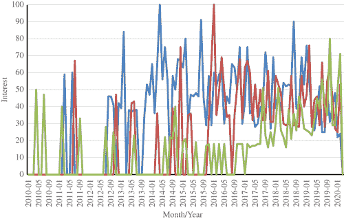

图 3.1 2004 年至 2019 年分析医疗领域大数据、人工智能和物联网的 Google 趋势。

医学领域的人和大数据仍处于早期阶段，但正在快速增长。尽管人工智能算法能够有效管理大数据并快速访问数据以解决健康问题，但其发展是一个未来待解答的问题。然而，如果没有产生大量结构化数据的物联网设备提供积极帮助，人工智能算法将无法良好发展。由于物联网产生的大数据和历史医学影像，人工智能变得更加强大。图 3.2 描述了人工智能、物联网和大数据之间的关系。

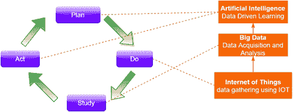

图 3.2 人工智能、物联网和大数据之间的关系。

医疗系统与物联网（IoT）的融合以及大数据的出现要求 AI 自动化临床流程并提供快速的数据分析以识别当前、新或未来的问题[21, 22]]。应当激活系统 AI，使机器能够根据其经验接纳自动预测并确定结果。为了激活系统 AI，系统中必须存在自然语言处理（`NLP`）、知识表示、自动思考和机器学习。`NLP` 有助于计算机/机器像人类理解语言一样变得智能化[23]]。

## 3.3 基于图像的诊断

随着 X 射线、CAT 扫描、核磁共振成像（MRI）和其他检测方法产生数数百万像素级的数据，即使对于经验丰富的临床医生来说，结合高分辨率图像也是一项挑战。人工智能已经证明，它可以成为放射科医生和病理学家的价值伙伴，提高他们的工作效率和准确性[24]。先进的 AI 算法，特别是深度学习，在图像识别任务中取得了显著进展。许多医学专家，包括眼科、皮肤科、放射科、病理科和神经科专家，都依赖基于图像的诊断[25]。历史图像数据库大多由放射科存储在图像采集和系统中系统中，系统通常包含成千上万个训练网络实例[26]。

在超过十万张临床图像上训练的卷积神经网络在诊断皮肤肿瘤方面达到了皮肤科医生水平的精确度。在 AI 算法预测与 21 位皮肤科医生评估一组照片和皮肤镜图像的比较中，深度学习算法的表现优于普通皮肤科医生。随着深度卷积神经网络的出现，AI 在通过活检检测前列腺癌、识别淋巴结乳腺癌转移以及乳腺癌中的有丝分裂方面可能有用[27]。

## 3.4 使用机器学习的大数据分析流程

具有强大计算能力的现代机器可以分析数据中心数据并使用近似相关模型。大数据技术能够准确影响机器学习技能并实现即时决策，以提高整体运营性能并减少冗余成本[28]。图 3.3 显示了医疗保健领域的大数据分析流程。机器学习在感知各种参数将其与疾病关联方面具有其独特的重要性。这种有效方法让计算机使用机器学习算法分析以非线性方式呈现的海量数据，分类模式并做出可验证和经过验证的预测。

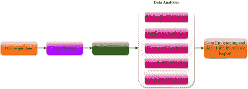

图 3.3 医疗保健领域的大数据分析流程。

在监督学习期间会预测来自过去的现有数据和信息。此外，在无监督学习期间，可以从数据预测预测未知影响的模式[29]。机器学习、深度学习和认知计算都是迈向更高水平 AI 的不同步骤，但它们并不相同。深度学习是机器学习的子集。它使用人工神经网络，这种网络模拟人类大脑连接，并随着时间的进行“训练”，以几乎 100%的精确度回答问题[30]。

医疗保健中的健康数据可以是非结构化、半结构化或结构化格式[32]，可以从主来源获取临床决策支持系统、计算机医生医嘱（`CPOE`）、电子健康记录（`EPRs`）。保险公司、实验室、健康维护组织（`HMOs`）、药房等[33]是辅助来源的一些示例。

`EPRs`、图像处理、社交媒体、手机和网络数据库是医疗数据的核心来源。医疗历史的数字化为医院提供了患者记录的基础。`EPRs`数据来自、心电图（`ECGs`）、报告、扫描设备、X 射线、处方等[34]。这种数据集是个化医疗和广泛队列研究的基础。在图像处理中，医学图像也是主要原因之一。光声成像、计算机扫描（`CT`）、乳腺摄影、磁共振成像（`MRI`）、超声、正电子发射断层扫描（`PETCT`）和 X 射线是医疗系统中一些著名的成像程序[35]。

Twitter、YouTube、Facebook、Instagram 是收集健康数据流行的社交媒体平台。社交媒体为医疗专业人员提供了先进工具，用于分享信息、讨论政策和实践、与公众互动、促进健康行为并与患者、同事、学生和护理人员交流[36](#chapter3.xhtml#re_TNF-CH003_CIT00037)–38](#chapter3.xhtml#re_TNF-CH003_CIT00038)]。

医学期刊数据通常用于分析疾病的传播/扩散。例如，在 Twitter 上收集流感患者的信息比传统方法更快[39]。

应用程序是医疗自我管理领域最重要的数据来源。目前，手机拥有健康相关的应用程序，如调整位、产生大量步数数据的计数器、爬楼层数和消耗的热量[40]。另一个情绪熊猫应用用于衡量个人情绪，以及与情感、心理、身体以及日常生活和社会环境展望相关的一切。我们还有诸如`glucose buddy`、`diabetes connect`、`mysugr`和`sugar sense`等用于糖尿病管理的应用程序，通过`iBGstar`（血糖仪）监测血糖。这些应用程序 24/7 产生大量数据，有助于健康研究。记录健康数据的网站包括`23 and Me`和`uBiome`。`23 and Me`是一项 DNA 研究服务，为个人了解和研究 DNA 提供证据和工具。`uBiome`是一个微生物测序设施，为人们发现其微生物组提供证据和工具。

存储在大数据中起着非常重要且有效的作用。在医疗保健领域，数据增长极其迅速，因此需要一种精简且高效的存储方案，例如云计算技术 [42]。它为访问数据、创建意识提供了弹性和胜任能力，加速了可扩展分析解决方案的能力并增加了价值。这项技术是存储大量数据以及执行全面复杂数据处理的稳健技术。它消除了对昂贵的计算机硬件、软件和专用存储空间的需求 [43]。出于以下原因，医疗保健领域对大数据研究中云的需求是可以理解的：投资大数据研究并增加建立完善且可负担得起的基础设施的能力可能至关重要。医疗机构的大数据是内部和外部数据库的混合，因为它们通常在内部存储患者最敏感的数据。由公共提供者和第三方产生的海量大数据可能在外部 [44]。医疗保健领域的数据管理包括清洗、组织、检索、数据治理和数据挖掘。它还包括检查和核实垃圾数据或丢失值的方法，且此类数据必须被消除 [45]。

数据分析是将原始数据转换为信息的绝佳方法。在医疗保健行业，大数据分析可以通过五种不同的分析进行，命名为描述性、预测性、诊断、规范性和认知。目前工业和学术界的研究表明，通过将大数据整合到分析中，零售商可以实现近 15%到 20%的投资回报率。描述性分析根据历史数据检查过去的性能。描述性分析也被称为无监督学习。它简要描述了健康管理中发生了什么，并清晰地解释了参数对系统的影响 46,[47]。

诊断分析利用历史数据来估计和识别问题的核心原因。预测性分析分析历史和实时数据，也称为监督学习。这可能仅仅预测未来会发生什么，因为所有预测在本质上都是概率性的。它无法预测未来。它预期什么？未来的趋势是什么？规范性分析自动整合大数据，并在决定多个可行方案之前提供建议。这些宝贵信息由战略决策者获取并处理。这种分析建议了我们应该做什么。什么是最佳结果，以及如何轻松实现它 [48 [](#chapter3.xhtml#re_TNF-CH003_CIT00049)–50]。

认知分析是数据处理和视觉分析的内在发展。认知分析将人类排除在外并全自动运行。认知分析建立在许多领域的进展基础上，整合了计算机和认知科学方法 [51]。在认知分析中，大量数据来自异构源，具有结构化、半结构化和非结构化数据。此外，它使用包括分类法和本体在内的知识结构来促进推理和演绎。对于认知分析而言，提取底层和高级信息非常重要。与所有其他分析不同，认知分析会对查询做出多个响应，并对每条建议分配一定程度的信度 [52]。

数据可视化将医疗数据的分析结果从数值转换为图表或图像形式，使得复杂数据易于理解并能改进决策。它可以用于理解模型与数据之间的关系。IBM Watson 分析、Graphviz R 和 Cytoscape 是用于医疗保健的可视化工具。这些工具可用于预测分析、高级分析、报告、实时分析、仪表板和大数据可视化 [53, 54]。

## 3.5 讨论

透明度并不是 AI 的唯一特征。AI 算法承担的社会功能对于治理它的人应该是可预测的。医疗保健领域 AI 的障碍是隐私和安全问题。病史数据可以用于训练 AI，应该采取适当的安全措施以防止将此类数据与第三方共享。应该有可靠的措施来防御网络攻击 [55 [](#chapter3.xhtml#re_TNF-CH003_CIT00056)–57]。这是每个领域的重要问题，因为该领域直接关系到人类生命；可穿戴设备必须免受外部攻击。但随后还有许多问题：什么样的安全性被认为是可靠的，谁来评估信誉，以及谁对事故负责 [58]。


无论大数据对医学科学的进步有多有效，对于所有医疗机构的成功都至关重要。为了确保安全可靠的数据环境，必须确定现有解决方案的局限性，并为未来的研究制定指南。医疗保健大数据最大的挑战是数据安全、数据丢失、数据隐私、海量影像数据的有效处理、隐私、机密性、信息的完整性和安全性、健康数据的滥用或未能保护健康数据以及非结构化数据。准确理解提取有用医学提示至关重要 [59, 60]。

开放 Web 应用安全项目（OWASP）已提出保护各种物联网特性的预防措施。安全实践包括仅接受强密码、检查软件工具中的已知漏洞，以及使用带防火墙的 `https` 来处理不安全的界面。此外，安装在设备上的软件或固件必须通过加密传输机制不断更新。软件更新文件必须从真实的且受防火墙保护的服务器安全下载，并在安装前进行签名验证 [61, 62]。

## 3.6 结论

AI 基本上让我们机器变得更智能，尽管机器学习是实现这一系统的过程。AI 机制可以预测术后结果、减少复发并优化患者流量。换句话说，医生可以使用这些解决方案快速准确地管理医学诊断。为了让医生在正确的时间为正确的患者做出正确的决定，医生/临床医生需要知识数据、实时分析和预测模型来改善医疗保健。

未来，主要任务将是通过确定高级方法需要的哪些硬件功能，以及特定的实现技术和方法，来实现“大数据”与物联网（IoT）、人工智能（AI）、云能力和分布式处理等技术的最佳结合，从而解决每个特定阶段使用“大数据”的问题。

## 参考文献

1. Kambatla, K., Kollias, G., Kumar, V. and Grama, A., 2014. 大数据分析趋势. Journal of Parallel and Distributed Computing, 74(7), pp. 2561–2573.

2. Wang, Y., Kung, L. and Byrd, T.A., 2018. 大数据分析：理解其对医疗机构的能力和潜在收益. Technological Forecasting and Social Change, 126, pp. 3–13.

3. Qiu, J., Wu, Q., Ding, G., Xu, Y. and Feng, S., 2016. 大数据处理中的机器学习综述. EURASIP Journal on Advances in Signal Processing, 2016(1), p. 67.

4. Makridakis, S., 2017. 即到来的人人工智能（AI）革命：对社会和企业的影响. Futures, 90, pp. 46–60.

5. Manogaran, G., Thota, C., Lopez, D., Vijayakumar, V., Abbas, K.M. and Sundarsekar, R., 2017. 医疗保健中的大数据知识系统. In Chintan Bhatt, Nilanjan Dey, Amira S. Ashour (ed.), 下一代医疗保健的物联网与大数据技术 (pp. 133–157). Springer, Cham.

6. Fang, R., Pouyanfar, S., Yang, Y., Chen, S.C. and Iyengar, S.S., 2016. 大数据时代的计算健康信息学：综述. ACM Computing Surveys (CSUR), 49(1), pp. 1–36.

7. Krawczyk, B., 2016. 从不平衡数据中学习：开放的挑战和未来方向. Progress in Artificial Intelligence, 5(4), pp. 221–232.

8. Ebner, K., Bühnen, T. and Urbach, N., 2014, January. 用大数据进行大思考：识别企业环境中合适的大数据策略. In 2014 第 47 届夏威夷国际系统科学会议 (pp. 3748–3757). IEEE, Waikoloa, HI.

9. Dimitrov, D.V., 2016. 医疗物联网与医疗中的大数据. Healthcare Informatics Research, 22(3), pp. 156–163.

10. Jha, R., Bhattacharjee, V. and Mustafi, A., 2020. 医疗保健中的物联网：大数据视角. In Prasant Kumar, Pattnaik Suneeta Mohanty, Satarupa Mohanty (ed.), 物联网环境下的智能医疗分析 (pp. 201–211). Springer, Cham.

11. Lovis, C., 2019. 释放医学中人工智能和大数据的潜力. Journal of Medical Internet Research, 21(11), p. e16607.

12. He, J., Baxter, S.L., Xu, J., Xu, J., Zhou, X. and Zhang, K., 2019. 人工智能技术在医学中的实践. Nature Medicine, 25(1), pp. 30–36.

13. Rus, D., 2020. 人工智能：医学积极变革的载体. In Bernard Nordlinger, Cedric Villani, Daniela Rus (ed.), 医疗与人工智能 (pp. 17–20). Springer, Cham.

14. Pramanik, M., Lau, R., Demirkan, H. and Azad, M.A., 2017. 智能健康：智能城市内大数据驱动的健康. Expert Systems with Applications, 87, pp. 370–383.

15. Palanisamy, V. and Thirunukaras, R., 2019. 开发框架中大数据分析的影响. Journal of King Saud University—Computer and Information Sciences, 31(4), pp. 415–425.

16. Feldman, K., Davis, D. and Chawla, N., 2015. 个性化医疗的规模化与情境化：疾病预测案例研究. Journal of Biomedical Informatics, 57.

17. Waller, M. and Fawcett, S., 2013. 数据科学、预测性分析与大数据：供应链和管理的革命. Journal of Business Logistics, 34(2), pp. 77–84.

18. Zhang, Y., Milinovich, G., Xu, Z., Mengersen, K., Tong, S., and Hu, W., 2017. 使用网络搜索监测百日. Scientific Reports, 7(1).

19. Nuti, S., Wayda, B., Ranasinghe, I., Wang, S., Dreyer, R., Chen, S., et al., 2014. 健康研究中的 Google 趋势：综述. PLoS One, 9.

20. Wamba, S., Akter, S., Edwards, A., and Gnanzou, D., 2015. “大数据”如何产生影响：系统综述和纵向研究结果. International Journal of Production Economics, 165, pp. 234–246.

21. Chen, M., Mao, S., and Liu, Y., 2014. 大数据：综述. Mobile Networks and Applications, 19(2), pp. 171–209.

22. Plageras, A.P., Psannis, K.E., Stergiou, C., Wang, H., and Gupta, B.B., 2018. 智能建筑中基于物联网的传感器采集——处理与分析. Future Generation Computer Systems, 82, pp. 349–357.

23. Kaur, J. and Mann, K.S., 2018. 使用响应式编程进行实时、预测和规范分析的 AI 医疗平台. Journal of Physics, 933(1), p. 012010. IOP Publishing.

24. Wang, S., Yang, D.M., Rong, R., Zhan, X., Fujimoto, J., Liu, H., Minna, J., Wistuba, I.I., Xie, Y., and Xiao, G., 2019. 肺癌病理图像分析中的人工智能. Cancers, 11(11), p. 1673.

25. Yu, K.H., Beam, A.L. and Kohane, I.S., 2018. 医疗中的人工智能. Nature Biomedical Engineering, 2(10), pp. 719–731.

26. Litjens, G., Kooi, T., Bejnordi, B.E., Setio, A.A.A., Ciompi, F., Ghafoorian, M., Van Der Laak, J.A., Van Ginneken, B. and Sánchez, C.I., 2017. 医学图像分析中的深度学习综述. Medical Image Analysis, 42, pp. 60–88.

27. Fujisawa, Y., Otomo, Y., Ogata, Y., Nakamura, Y., Fujita, R., Ishitsuka, Y., Watanabe, R., Okiyama, N., Ohara, K., and Fujimoto, M., 2019. 使用小型临床图像数据集开发的深度学习计算机辅助分类器在皮肤肿瘤诊断方面超过了认证的皮肤科医生. British Journal of Dermatology, 180(2), pp. 373–381.

28. Popovič, A., Hackney, R., Tassabehji, R. and Castelli, M., 2018. 大数据分析对企业高价值业务绩效的影响. Information Systems Frontiers, 20(2), pp. 209–222.

29. Amershi, S. and Conati, C., 2007, January. 智能学习环境中用户建模中的无监督和监督机器学习. In Proceedings of the 12th International Conference on Intelligent User Interfaces (pp. 72–81), Honolulu, HI.

30. L’heureux, A., Grolinger, K., Elyamany, H.F. and Capretz, M.A., 2017. 大数据下的机器学习：挑战与方法. IEEE Access, 5, pp. 7776–7797.

31. Bini, S.A., 2018. 人工智能、机器学习、深度学习和认知计算：这些术语意味着什么？它们将如何影响医疗保健？《关节置换术》，33(8), pp. 2358–2361.

32. Nambiar, R., Bhardwaj, R., Sethi, A. and Vargheese, R., 2013. 医疗保健领域大数据分析的挑战与机遇。2013 年 IEEE 国际大数据会议论文集 (pp. 17–22), 加利福尼亚州硅谷。doi:10.1109/BigData.2013.6691753.

33. Al-Jarrah, O.Y., Yoo, P.D., Muhaidat, S., Karagiannidis, G.K. and Taha, K., 2015. 大数据的高效机器学习：综述。《大数据研究》，2, pp. 87–93. doi:10.1016/j.bdr.2015.04.001

34. Yang, J.J., Li, J., Mulder, J., Wang, Y., Chen, S., Wu, H., Wang, Q. and Pan, H., 2015. 增强医疗保健的新兴信息技术。《工业计算机》，69, pp. 3–11.

35. Dunne, R.M., O'Neill, A.C. and Tempany, C.M., 2017. 临床研究中的成像工具：聚焦成像技术。收录于 David Robertson, Gordon H. Williams (编)，《临床与转化科学》(pp. 157–179)。Academic Press, 英国伦敦。

36. Borgmann, H., Cooperberg, M., Murphy, D., Loeb, S., N’Dow, J., Ribal, M.J. and Wirth, M., 2018. 在线专业主义——欧洲泌尿学协会 (@ Uroweb) 关于适当使用社交媒体的 2018 年更新。《欧洲泌尿学》，74(5), pp. 644–650.

37. Crilly, P., Hassanali, W., Khanna, G., Matharu, K., Patel, D., Patel, D. and Kayyali, R., 2019. 社区药师对其角色以及将社交媒体和移动健康应用作为公共卫生工具使用的认知。《社会与行政药学研究》，15(1), pp. 23–30.

38. Islam, S.M., Tabassum, R., Liu, Y., Chen, S., Redfern, J., Kim, S. and Chow, C., 2019. 社交媒体在低中收入国家预防和管理非传染性疾病中的作用：希望还是炒作？《健康政策与技术》，8(1), pp. 96–101.

39. Shafqat, S., Kishwer, S., Rasool, R., Qadir, J., Amjad, T. and Ahmad, H., 2018. 大数据分析增强系统：综述。《超计算杂志》，76, pp. 1–46.

40. Zhang, S., Wu, Q., van Velthoven, M., Chen, L., Rudan, I., Zhang, Y. and Scherpbier, R., 2012. 智能手机与纸笔采集婴儿喂养实践数据的对比。《医学网络杂志》，14, p. e119.

41. Almalki, M., Gray, K. and Sanchez, F.M., 2015. 自量系统在个人健康信息中的应用：大数据管理活动与展望。《健康信息与科学系统》，3, pp. 1–11. doi:10.1186/2047-2501-S1-S1.

42. Hashem, I.A., Yaqoob, I., Anuar, N., Mokhtar, S., Gani, A. and Khan, S.U., 2015. 云计算上“大数据”的兴：综述与开放研究问题。《信息系统》，47, pp. 98–115.

43. Hurwitz, J.S., Bloor, R., Kaufman, M. and Halper, F., 2010. 傻瓜云计算。John Wiley & Sons, 新泽西州霍霍木肯。

44. Auffray, C., Balling, R., Barroso, I., Bencze, L., Benson, M., Bernal-Delgado, E., Blomberg, N., and Del Signore, S., 2016. 理解健康研究中的大数据：欧盟计划。《基因医学》，8(1), p. 71.

45. Archenaa, J. and Anita, E.M., 2015. 医疗保健与政府大数据分析综述。《计算机科学论文集》，50, pp. 408–413. doi:10.1016/j.procs.2015.04.21.

46. Beheshti, S.M., Tabebord, A., Benatallah, B. and Nouri, R., 2017, 四月. 自动化数据维护。收录于第 26 届世界维网会议论文集 (pp. 165–169), 澳大利亚珀斯。

47. Storey, V.C. and Song, I., 2017. 大数据技术与管理：概念建模能做什么。《数据与知识工程》，108, pp. 50–67.

48. Xu, Y., Sun, Y., Wan, J., Liu, X. and Song, Z., 2017. 工业大数据故障诊断：分类、综述与应用。《IEEE Access》，5, pp. 17368–17380.

49. Vernon, D., Metta, G. and Sandini, G., 2007. 人工认知系统综述：对计算智能心理能力发展的影响。《IEEE 进化计算事务》，11(2), pp. 151–180.

50. Lepenioti, K., Bousdekis, A., Apostolou, D. and Mentzas, G., 2020. 规范性分析：文献综述与挑战。《国际信息管理杂志》，50, pp. 57–70.

51. Gudivada, T.N., Hoon, H.B. and Teow, K., 2017. 数据分析：基础。收录于 Subhransu Sekhar Dash, C. Lakshmi, Swagatam Panigrahi (编)，《工程中的人工智能与进化计算》(pp. 351–363)。Springer, 新加坡。

52. Eastman, C., Computing, D., 2001. 设计的新方向：表征与记忆的研究。收录于 Murray E., Annie, D.,《设计认知与学习》(pp. 147–198)。Elsevier, 荷兰姆斯特丹。


53. Senthilkumar, S.A., Rai, B., Meshram, A., Gani, A. and Khan, S.U., 2018. 医疗管理中的大数据：综述。《美国理论与应用商业杂志》，4(2), pp. 57–69.

54. Zhu, Z., Hoon, H.L., 2017. 应用于医疗决策的交互式数据可视化技术。收录于 Mehdi Khosrow-Pour, Steve Clarke, Annie-Veikko Antroiko (编)，《决策管理：概念、方法论与工具》(p. 1157)。

55. Truong, T.C., Zelinka, I., Plucar, J., Čandík, M. and Šulc, V., 2020. 人工智能与网络安全：过去、现在与未来。收录于 Subhransu Sekhar Dash, C. Lakshmi, Swagatam Panigrahi (编)，《人工智能与工程》(pp. 351–363)。Springer, 新加坡。

56. Grimsman, D., Chetty, V., Woodbury, N., Vaziripour, E., Roy, S., Zappala, D. and Warnick, S., 2016, 七月. 关键基础设施信息物理系统的系统攻击方法研究。收录于 2016 年美国控制会议 (ACC) (pp. 296–301)。IEEE, 马萨诸塞州波士顿。

57. Indre, I. and Lemnaru, C., 2016, 九月. 针对信息系统和物联网的网络攻击与僵尸网络恶意软件检测防御系统。收录于 2016 年 IEEE 第 12 届智能计算机通信与处理会议 (ICCP) (pp. 175–182)。IEEE，罗马尼亚克卢日-纳波亚。

58. Iliashenko, O., Bikkulova, Z. and Dubgorn, A., 2019. 医疗保健人工智能的机遇与挑战。E3S 会议集（第 110 卷）。EDP Sciences, 俄罗斯。

59. Abouelmehdi, K., Beni-Hessane, A. and Khaloufi, H., 2018, 大规模医疗数据：安全与隐私保护。《大数据杂志》，5, p. 1. [`doi.org/10.1186/s40537-017-0110-7`](https://doi.org/10.1186/s40537-017-0110-7)

60. Islam, S.R., Kwak, D., Kabir, M.H., Hossain, M. and Kwak, K.S., 2015. The internet of things for health care: A comprehensive survey. IEEE Access, 3, pp. 678–708.

61. Riadi, I., Umar, R. and Sukarno, W., 2018. Vulnerability of injection attacks against the application security of framework based bebsites open web access security project (OWASP). Journal Informatika, 12(2), pp. 53–57.

62. Kellezi, D., Boegelund, C. and Meng, W., 2019, December. Towards secure open banking architecture: An evaluation with OWASP. In International Conference on Network and System Security (pp. 185–198). Springer, Cham.

# 用于文档检索的分布式人工智能

Ankur Seem, Arpit Kumar Chauhan, Rijwan Khan, and Satya Prakash Yadav

## 目录

- 4.1 引言
- 4.2 建议的研究
  - 4.2.1 提高精确率
- 4.3 通用排名
- 4.4 结构加权排名
- 4.5 结构加权/学习函数
- 4.6 提高召回率和精确率
  - 4.6.1 词干提取
  - 4.6.2 相关性反馈
  - 4.6.3 同义词
- 4.7 初步结果
- 4.8 此流程中分布式人工智能的应用空间
- 4.9 去中心化搜索引擎的优势
- 4.10 讨论
- 4.11 结论
- 参考文献

## 4.1 引言

文档检索（也称为信息检索）是一个计算机化的用户查询过程，用于搜索最相关的数据并按优先级排列所有相关结果。这是一个始于 20 世纪 70 年代的不断发展的领域。目前存在许多文档检索模型。文档检索方法经常使用标准 [1] 进行分析。例如，某人创建了一种新的文档检索方法，将其应用于现实问题，然后与现有方法进行比较。只有当结果比现有方法有所改进时，才会被认为是积极的。文档检索领域最新且最流行的进展是应用人工智能（`AI`）创建可以像人类一样工作和响应的智能机器。最近，分布式人工智能（`DAI`）——`AI` 与区块链技术的结合——已用于文档检索。使用 `DAI`，记录存储在块中，然后使用密码学将这些块连接在一起 [2],[3]。每个块都有一个用于加密哈希值，其主要优势是没有人拥有这些数据。

## 4.2 建议的研究

将使用分布式人工智能（`DAI`）技术来构建更精确的系统。将使用文本检索（`TREC`）的标准测试集和判断进行分析和学习。这种方法将提高效率，减少处理时间，并确保数据安全和隐私 [4]。

### 4.2.1 提高精确率

本章将探索三种方法：

- 通用排名方法
- 使用文档结构提高精确率
- 通用排名与文档结构的结合

## 4.3 通用排名

使用结构加权检索改进的准确率将与一个标准进行比较。该标准是未加权定位能力的准确率。已发布了许多函数，因此存在许多排名函数的分类法。这些分类法涵盖了超过 10,000 个函数 [5]。

测试 10,000 个函数是不可行的，但协调查询是可能的。此类搜索可以使用启发式编程。在遗传算法的帮助下，遗传编程（`GP`）使用理论结构树与人类进行交互。

用于合并的确认（排名函数中的项）应当在转换后的记录中可用（出于效率考虑）。这包括词频、记录长度、集合大小和最高术语出现频率等。

使用这种方法获得巨大的提升是正常的，尽管到目前尚未被利用。过去用于合并 `tf-idf` 类似证明的约束措施的分析并没有显示出巨大的改进。同时，为了学习超文本标记语言（`HTML`）逐步扩展的能力的测试忽略了在不利用存档结构的情况下更好地优化 `BM25`（其中 `BM` 意味着“最佳匹配”） [6]。早期的结果与预期结果相反。它们认为 `tf-idf` 和 `BM25` 是受检组件的理想能力，无法再改进。

对早期结果的严密评估显示了为什么它们是突兀的。选定的定位能力应当是衡量工作中使用的证明和管理器的混合。除非情况确实如此，否则标准将无法是学术的，且接受它不会更好是合理的。根结底，如果一个现有定位能力 `f()` 是证明（`α`）和管理员（`β`）的混合，那么当 `α` 是 `ε` 的子集且 `β` 是 `φ` 的子集时，它无法击败由证明（`ε`）和管理员（`φ`）混合的 `GP` 学习能力。这是因为 `GP` 可以学习 `f()`。此外，学习可以用 `f()` 种子化以确保 `f()` 的准确率。证明的选择至关重要。过去的试验之所以有负面结果，是因为证明的选择存在缺陷。

## 4.4 结构加权排名

TREC 报告分布在可扩展标记语言（`XML`）中。例如，《华尔街日报》（`WSJ`）记录包含了标题、第一段落和内容的结构化标记，作为不同的信息字段。术语事件的权重取决于它们恰好拥有其中的哪些结构 [7],[8]。这种策略并不新鲜。准确率的改进刚刚出现，并且已经尝试了改变权重选择策略。无论如何，目前没有精确的技术来选择负载，这可能是选择负载成为 `INEX`（XML 检索评估倡议）中重复性问题的原因。

负载可以编码在类中，对于每个报告结构权重使用一个显示组件。理想的记录结构加权与没有结构加权的检索相比不会降低平均标准准确率。在所有存档结构权重相等且为 1 的情况下，会发生未加权检索的情况。加权检索（使用理想负载）的执行可以这样在大量问题上达到与未加权检索一致的效果 [9]。此外，遗传算法是一种成熟的改进程序，因此应该为这种策略设定一个性能上限。

## 4.5 结构加权/学习函数

首先，我们应该学习并增强通用目标排名函数，之后我们应该学习并增强此类函数的结构权重。更好的做法是，让目标函数和结构加权函数学习为相互关联，并且沿着这条线，任何策略的协作在学习过程中都可以被利用。在早期的测试中，某些 HTML 标签中的词频被用于 GP 学习测试。这为使用 Okapi BM25 的未加权检索带来了改进 `[10, 11]`。如果此策略应用于非网络档案，预计也将有类似的进展。

## 4.6 提高召回率和精确率

现在有许多程序可以改进检索，包括相关性输入、词干提取和同义词库。

### 4.6.1 词干提取

在索引时，文档集中的每个词都根据词干中的算法进行转换。对于词干提取，具有相似词干的词将被记录为相似的术语。其预期是将所有具有典型形式的词的词项合并。例如，“treatment”、“treating”和“treat”的词项将被转换为词干“treat”。当客户端扫描“treats”时，单词“treats”被提取为词干“treat”，并检索出该词干的词项，从而发现并不包含用户所请求术语的文档 `[12]`。同样，沿着这条线，可以设想出如何利用 GP 进行词干提取。

对词干提取的一些研究由于其错误率对词干提取的有效性产生疑问。我们可以期待词干算法的改进能提高建议平均值。

### 4.6.2 相关性反馈

客户端执行一次搜索，返回结果以供判断，在该一点，带有决策信息，重新考虑搜索并检索新的结果 `[13]`。之前提到的策略可以用于重要的输入。在基础决策轮次之后，第一次查询和大量的决策都是已知的——这些预期变为对定位能力和结构负载的熟悉。之前的显著性分析程序，例如问题开发和术语加权，可以与此学习策略相关。遗传算法已被用于理解术语负载。

### 4.6.3 同义词库

同义词库可以被看作许多位字符串，每个同义词库条目一个。在字符串中，它的每个部分对于记录集中的每个显著术语都有一个位。如果在给定的字符串部分中有两个位被设置，则它们是等价词。

你可以用遗传算法来训练这些位字符串。种群由具有随机位的人进行种子，并使用普通的遗传算法来学习优秀的组合。应用特定的权重来构建独立于召回率影响的准确性。

一种类似的策略可以用于学习等价词和短语（例如，data recovery 和 information retrieved (IR)）。最初将通过之前的方法识别单实体发现表达式，对文档集进行排序以包含这些术语，并应用位字符串同义词库理解。

## 4.7 初步结果

关于学习文档结构负载的检查针对内部项目、Okapi BM25 定位和概率进行。内部项目工作直接使用 `tf.idf` `[14, 15]`：

```
|    w  d q   \=     ∑   t ∈ q     t  f  t d    \*  v i d  f t      ⋅     t  f  t q    \*  v i d  f t      ||  ||
| --- | --- |
```

其中

```
|   v i d  f t  \=   log  2    N −  n t  + 1    n t      ||  |
| --- | --- |
```

在 Harman 看来，概率的角色是：

```
|    w  d q   \=   ∑  t ∈ q    ( C + p i d  f t  ) ×   K + ( 1 − K ) \*   t  f  t d     max ( t  f d  )         ||  |
| --- | --- |
```

其中

```
|   p i d  f t  \=   log  2    N −  n t  + 1    n t      ||  |
| --- | --- |
```

其中 `C = 1`, `K = 0.3`。BM25 的执行致力于 Robertson 等人。

对于每个情况，`N` 是文档数量，`n` [ot] 是出现术语的报告数量，`tf` [td] 是术语 `t` 在记录 `d` 中发生的次数（同样地 `tf` [tq] 在查询中的次数）。准备集是 TREC WSJ (1987–1992)，包含 `5` 个主题。

进行了约 100 人参与的 100 代的多次实验。学习过程被列出，并加载了包括 `BM25` 在内的其他定位能力。评估对象针对 `WSJ`（第 101–150 点）、`TREC` 第 4 组和第 5 组的集合（主题 301–350）以及囊性纤维化集合。多种评估测试集的组合至关重要，因为众不同的定位执行在不同集合之间会发生显著变化。评估结果如表 4.2 所示，其中 `Run 5` 是迄为止学习效果最好的能力。以相同的次数进行其他实验时，`Run 5` 在 5% 的显著性水平上持续优于 `BM25`。已证明能力 `Run 5` 在在不同集合之间具有紧凑性。

## 4.8 本过程中分布式 AI 的应用空间

在用 `DAI` 进行文档检索之前，我们应该首先了解用于文档检索的集中式 AI。在 `Google` 等集中式系统中，每当有人输入查询时，就会有一些被称为 `spiders`（蜘蛛）或 `crawlers`（爬虫）的机器人或算法遍历所有网站并搜索查询中的词。`spiders` 只搜索关键词而忽略连接词等词。这就是为什么如果你通过改变连接词来搜索任何内容，结果都是相同的。在搜索完网站或页面后，`Google` 根据算法、关键词、其他网站引用该页面的次数以及页面对其进行排名。然后它将结果展示给你。之后，它会记录结果和查询，下次被搜索时，`Google` 将利用此记录提供最合适的结果 [17]。现在，问题是它将数据存储在自己的服务器上，这被被称为集中式系统。集中式系统的问题在于，它存储数据和使用数据需要大量的存储空间和计算能力。另一个问题是公司也可以使用这些数据，在当今世界，数据就是一切，而通过查询，我们正在免费送出数据。这里我们可以联想到那句话：“如果你不为产品付费，那么你就是产品。”通过这些数据，公司可以影响我们的决策、预测我们的决策，甚至操纵我们的决策。为了克服这些问题，存在分布式或去中心化系统的概念。在分布式系统中，当任何人搜索查询时，搜索引擎会尝试在分布式账本中找到它并列出结果。搜索的细节在加密后存储在分布式账本中。分布式账本是在网络所有节点（每台连接到计算机）的帮助下创建或构建的。所有节点都负责分布式账本的搜索和更新。

## 4.9 去中心化搜索引擎的优势

- **隐私保护**：用户搜索保持匿名；用户的记录不会为了财务利益而被秘密记录。
- **社区驱动**：集中式搜索引擎由私有公司或个人所有，而去中心化搜索引擎则由社区所有。
- **资源共享**：所有人都可以访问公共账本；唯一的条件是人们应该拥有账本的副本。

分布式搜索引擎有巨大的应用空间，但目前只有寥寥几个，而且它们的改进空间非常大。

## 4.10 讨论

这项审查基于一个探究：如何利用传达的人工意识策略来改进数据恢复？目前，已证明的遗传算法和 `GP` 可用于提高准确性，而 `DAI` 将降低功耗、减少存储需求并提升保护安全性。这些计算在代表性结果方面优于其他方法（例如神经网络）。定位能力可以进行分析。生成的词汇表可以作为词汇表打印。更重要的是，结果可以移动，从一个报告集开始然后到下一个集合，并且可以信赖其持续保持优异表现。准确性的评估和审查是一个主观决定，且可能不是最佳决策。毫无疑问，分类可以通过 AI 改进。它如何被应用于问答框架中？这些策略如何用于提高客户的智能体验？`GP` 是否可以用于文件压缩？也许一个智能的存储工具会提高吞吐量？`DAI` 对于分组至关重要，但遗传过程可以利用吗？未待解决的 AI 问题包括：其他 AI 策略（例如分子群优化优化）是否更适合这一困难领域？是否存在比本文提出的方案更优的编码？这些方法之前是否被尝试过？应该分析哪些有效性问题？最重大的未待解决的问题是：这种方法在未来可以（也应该）向何种方向发展？

## 4.11 结论

知识管理是人类发展的一个重要方面。最初，信息量非常有限，因此不需要先进的信息检索方法。随着数据量的增加，信息检索方法需要改进。我们现在有了 AI 等工具来管理这些海量数据。通过这项技术，我们可以管理任何量的数据，以提高效率并减少 `DAI` 对文档检索的需求。

## 参考文献

1. `Hersh, William.` (2014). 信息检索。在`Biomedical Informatics`(pp. 613–641). Springer, London.
2. `Fan, W., Gordon, M., Pathak, P., Xi, W., & Fox, E.` (2004). 基于遗传规划的排名函数：一项实证研究。在`37th Annual International Conference on System`seeer.psu.edu/viewdoc?doi=10.1.2
3. `Fuhr, N., Gövert, N., Kazai, G., & Lalmas, M.` (2002). INEX: XML 检索评估倡议。在`Proceedings of the ACM SIGIR 2000 Workshop on XML and Information Retrieval`.www.dcs.gla.uk/~mounia/Papers/xml
4. `Fuller, M., Mackie, E., Sacks-Davis, R., & Wilkinson, R.` (1993). 大型文档集合的结构化答案。在`16th ACM SIGIR Conference on Information`(pp. 204–213). dl.acm.org/doi/10.1145/160688.16070


5. `Harman, D.` (1991). 后缀法有效吗？`Journal of the American Society for Information Science`, `42(1)`, 7–15.

6. `Harman, D.` (1992). 排名算法。在`W. B. Frakes & R. Baeza-Yates`(Eds.), `Information Retrieval: Data Structures and Algorithms`(pp. 363–392). Englewood Cliffs, NJ: Prentice-Hall.

7. `Harman, D.` (1993). 第一届 TREC 会议概述。在`Proceedings of the 16th ACM SIGIR Conference on Information Retrieval`(pp. 36–47). `dl.acm.org/doi/abs/10.1145/160688.160692`

8. `Holland, J. H.` (1975). `Adaptation in Natural and Artificial Systems`. Ann Arbor, MI: University of Michigan.

9. Kim, W., & Wilbur, W. J. (2001). 基于语料库的含载词统计筛选。`Journal of the American Society for Information Science and Technology`, `52(3)`, 247–259.

10. Kim, Y.-H., Kim, S., Eom, J.-H., & Zhang, B.-T. (2000). TREC-9 上的 SCAI 实验。In `Proceedings of the 9th Text REtrieval Conference (TREC-9)` (pp. 392–399). [`citeseerx.ist.psu.edu/viewdoc/summary?doi=10.1.1.21.2888`](http://citeseerx.ist.psu.edu)

11. Koza, J. R. (1992). 遗传编程：利用自然选择进行计算机编程。Cambridge, MA: MIT Press.

12. Losada, D. E., & Barreiro, A. (2001). 一基于命题逻辑和信念修正的检索检索逻辑模型。`Computer Journal`, `44(5)`, 410–424.

13. Løvbjerg, M., Rasmussen, T. K., & Krink, T. (2001). 具有杂交和子群的混合粒子群算法。In `Proceedings of the 3rd Genetic and Evolutionary Computation Conference`. [`www.semanticscholar.org/paper/Hybrid-Particle-Swarm-Optimiser-with-breeding-and-L%C3%B8vbjerg-Rasmussen/d16b37a8f383e41537d76b5085a9ba7d0c60920c?p2df`](http://www.semanticscholar.org)

14. Oren, N. (2002). 用遗传编程重新审视基于 `tf.idf` 的信息检索。In `Proceedings of the 2002 Annual Research Conference of the South African Institute of Computer Scientists and Information Technologists on Enablement through Technology (SAICSIT)` (pp. 224–234). [`citeseerx.ist.psu.edu/viewdoc/download?doi=10.1.1.102.88788#x0026;rep=rep18#x0026;type=pdf`](https://citeseerx.ist.psu.edu)

15. Porter, M. (1980). 一种后缀剥离算法。`Program`, `14(3)`, 130–137.

16. Pôssas, B., Ziviani, N., Meira, W., & Ribeiro-Neto, B. (2002). 基于集合的模型：一种信息检索的新方法。In `Proceedings of the 25th ACM SIGIR Conference on Information Retrieval` (pp. 230–237). [`dl.acm.org/doi/abs/10.1145/564376.564417`](https://dl.acm.org)

17. Rapela, J. (2001). 自动结合 HTML 文档排序启发式方法。In `Proceedings of the 3rd International Workshop on Web Information and Data Management` (pp. 61–67). [`dl.acm.org/doi/abs/10.1145/502932.502945`](https://dl.acm.org)

# 5 分布式共识

Satya Prakash Yadav

## 5.1 引言

分布式共识是节点或过程在分布式系统中达成一致的过程。

## 5.2 Nakamoto 共识

Nakamoto 共识是 Satoshi Nakamoto 在比特币白皮书中引入的机制，允许网络在存在恶意节点的情况下对状态达成一致。

### 5.2.1 Nakamoto 共识的工作原理

它依赖于工作证明和经济激励。

#### 5.2.1.1 工作证明

#### 5.2.1.2 区块选择

区块选择是共识中的一个重要步骤。在这里，矿工们为了区块进行竞争。区块是根据抽签系统选出的。区块获胜者可以对该区块进行挖掘，这意味着在该区块上进行如读和写之类的交易。它是基于`PoW`模型 [8]。被选中的区块成为链的一部分。如果是`pBFT`，则通过投票选出一个领导者，由领导者决定哪些区块将添加到链中。如果获得总可用节点三分之二的批准，就会进行添加。比特币并不使用这种投票过程；它让矿工解决一个密码谜题。谜题是哈希值，并且以 0 开头以到达任何节点的开头。

一旦谜题解决，矿工需要将区块添加到已经在运行的链中。这个过程是随机的，而且由于没有领导者，没有任何是可以预测的。解决方案的获胜者是拥有最大哈算力的矿工，这对于整个链至关重要 [9]。

#### 5.2.1.3 稀缺性

货币交易的原始旧方法是使用金属制造的硬币，主要是金和银。然而，该系统之所以运行是因为此类硬币的数量有限。生产更多硬币所付出的努力增加了成本，因此稀缺性因素至关重要。比特币也基于稀缺性原理运行。新的比特币根据挖掘过程（上文讨论）被添加到系统中。然而，为了避免大量生产，数量通过每当区块达到`210,000`个时将区块奖励减半来限制，这种现象每四年发生一次——从而对链中区块的产生进行控制。

稀缺性确保了数字资产（如比特币）是有限的，从而防止通胀并维持价值。

#### 5.2.1.4 激励结构

共识的设计草案使得区块链中区块的增加和减少保持平衡。这种方法基于博弈论，博弈论遵循迭代。矿工因维护网络而获得激励。对遵守规则的奖励是比特币。随着与比特币关联的价值下降，网络运行也会随之瓦解，而遭受损失的是矿工。因此，遵循上述四点，中本共识取得了成功。尽管区块与区块之间的信任度较低，它仍然是可靠的。

激励结构为矿工提供奖励（区块奖励和交易费用），鼓励他们参与维护和保护网络。

### 5.2.2 比特币的安全性

接出现的问题是，通过遵循讨论的简单规则如何保证区块链的安全性。对于比特币，任何人都可以轻松让节点加入网络。节点的匿名性使得检测目标和所有者变得困难。这种匿名性不是针对单个节点，而是针对以链方式连接的一组节点，任何恶意行为的作手无法被轻易检测。系统的不确定性阻碍了许多投资者将资金投入这项技术中，因为如果发生任何问题，你不知道该由谁负责。即使所有者决定投资，他们的目标也是保护系统而不是添加更多链，因为水平在不断提高。安全性的保障和链上不发生恶意行为是通过验证规则来实现的。应用于区块选择的规则确保了足够的计算资源仅投入到有效区块中。如果一个可能损害网络的节点被添加到网络，那么它将需要以货币价值形式投入的更多资源。这对于任何投资者来说都是困难的，因此网络的安全性得到了维护 [11]。机械设计概念要求资源必须公平分配。分配的资源根据所有者的选择并满足其标准。但由于匿名性，选择过程大多数是随机的。

串行独裁方法产生一个独裁者，负责指导所有资源的分配，独裁者是以体面的方式选出的，而不是随机的。比特币结构使用了先前的承诺。它是昂贵的。唯一的缺点是任何人都可以想要成为网络的一部分，并在某种程度上破坏内部运行。因此显而易见；拜占庭问题可以通过比特币有效地解决。其需要的是经济价值或资金管理。资金可以通过资源的等效利用来证明其合理性，这符合网络的利益。

`hash function`是一个安全量，唯一的解决方法是使用试错法或暴力破解法来解决它。在这种方法中，所有可能的组合都被应用于谜题以解决它。解决这个谜题的人被称为矿工，他们需要具有高额计算能力来解决它。这种决定领导者的方法被广泛接受，因为它保证了以下几点：

1. 谜题是困难的，找到它的解决方案很辛苦。
2. 解决方案一旦找到，就可以很容易地验证其正确或否。

成功解决谜题的矿工将获得奖励。奖励是一些货币或交易费用，这是一种激励，是矿工继续挖掘的一种动力形式。计算能力是区块链技术中的一种开销。功率通常较小，因此矿工也因没有作弊而获得奖励。与硬件故障导致网络受损时必须支付的代价相比，系统上的奖励价值绝对少得多。`PoW`的优势在于它提供了安全性，但缺点是它消耗大量的能量。人们认为，随着网络的增长，系统的功率必须增加，`hash function`将变得更难破解。

### 5.2.3 工作证明算法

工作证明算法使用`SHA-256`哈希函数。目标是找到一个带有特定数量零的哈希值，其难度会变化。

矿工拥有解决谜题的力量。解决方案的准确性取决于网络的负载和能量利用。区块链的安全性得到了加强，因为区块的`hash`包含了之前区块的`hash code`。这一特征阻止了任何违规。矿工可以解决数学谜题，创建新区块并验证交易。`PoW`是加密货币的一部分。它最流行的应用显然是比特币。共识是为了比特币而开始的。该算法具有根据谜题难度水平调整总网络功率的能力。一个区块平均每 10 分钟创建一个。山特币也遵循类似的共识算法。作为区块链平台的以太坊也遵循这种模型。工作量证明的应用有两个主要原因 [12]。

防御 DoS 攻击：网络上发生的行为及其影响可以被减轻。这是通过`PoW`算法实现的。任何攻击执行都需要付出努力。所需的计算功率很高。攻击的可能性很大，但成本非常高；因此受到了遏制。

挖掘选择：在当前情况下，大多数情况下是钱多的人拥有更多权力。区块链技术使用`PoW`来限制那些钱包中持有更多比特币的所有者。区块的添加基于谜题的解决，而不是持有硬币的数量。

执行复杂的`PoW`算法的硬件需求是非常昂贵的。这种成本大多数时候针对特定的矿池。此类机器的能耗也非常高。这可能导致系统中心化。

### 5.2.4 权益证明

权益证明 (PoS) 具有这样一个特性：钱包中拥有更多币的人可以进行更多数量的交易，并最终可以被验证。验证提供了确认，从而为该个人提供了更多的算力。PoS 技术随后被`Peercoin`、`Nxt`、`Blackchain`和`ShadowCoin`采用。挖矿的一个主要缺点是该过程消耗大量的电力。根据 2015 年的一项计算，观察到区块链中新区块所需的计算能力相当于美国 1.57 户每天消耗的电量。因此，矿工将通过以较低的成本出售他们的`bitcoins`来涵盖这一成本；这进一步降低了`bitcoin`的价值。这一缺点通过权益证明（PoS）得到了解决，在 PoS 中，矿工不再全部能量来解决密码难题，而是限制其任务。矿工将只使用其所需的功率，即其在区块中的贡献 [3]。不需要投入 100% 的权益，只需在整个过程中占一定比例，例如 2%。工作量证明可能会受到被称为“公地悲剧”的威胁。该威胁定义为：如果未来不再给矿工奖励，那么`bitcoin`的价值将会降低。矿工将只获得他们在区块上进行交易所获得的价值，随着时间的推移，这个价值也会减少。在许多可用的加密货币中，如`Litecoin`、`Nxt`、`Peer coin`，`Ethereum`已将其流程从`PoW`改为`PoS`。能源的高效利用和安全性是 PoS 的主要优势。

在 PoS 中，谁开始挖矿是一个随机过程。不考虑计算能力，而是考虑哪个矿工拥有更多加密货币以及持有该货币的时间。加密货币越多、持有时间越长，矿工越胜并创建区块。随机概念确保了富者并非总是受益。这种属性使得 PoS 比 PoW 更强大。另一个益处是：作为矿工激励产生的总代币也将减少，从而减轻了系统的负担。整个网络的控制权不像`PoW`情况那样在某一个矿工手中。拥有最高加密货币的矿工声誉处于风险，因为如果网络发生攻击，他将承担责任 [10]。

然而，PoS 也存在一些缺点。在共识失败的情况下，没有人会有任何损失，因此冲突将无法解决，区块链将陷入停滞。PoS 所完成的总工作更多倾向于有利。它节省了能量，减少了功耗，并且高效稳健。该算法被许多公司修改以产生委托权益证明，或`DpoS` (见图 5.2)。

![FIGURE 5.2 PoW vs. PoS [14].](images/fig5.2)

### 5.2.5 燃烧证明

燃烧证明 (`PoB`) 也是`PoW`的替代方案。`PoB`被定义为一种矿工可以燃烧币的共识算法。燃烧过程有助于防止货币的双重花费。有许多版本的`PoB`，但这个是提供给 Ian 的。被销毁或燃烧的币被发送到未知地址。证明应当被提交。在这种情况下仍会有能量消耗，但它会少于闲置未使用并增加货币价值的币的能量。以读写操作形式处理区块的节点集在同意并确认它后，区块才会被添加到链中。共识算法起着主要作用。只有当区块链节点对一组它们认为有效的交易集达成共识时，才会写入区块。由于区块链网络运行的自主性和去中心化本质，需要一种自动化机制来确保参与节点对有效交易达成共识 [7]。正如我们上面研究的，`PoW`算法受到高能量消耗的困扰，这在一定程度上通过权益证明 (`PoS`) 解决了，PoS 根据矿工持有的币份额向矿工提供权力。

`PoB`解决了`PoW`的缺陷。正因如此，`PoB`也称为`PoW`减去能量浪费。被称为币或令牌（tokens）的虚拟货币可以被燃烧或销毁。矿工燃烧的币的总数赋予了他们挖掘相应数量币的权力。燃烧币的矿工获得未被使用的币。该地址经过验证，没有留下任何欺诈漏洞。发送币的矿工将获得奖励，这激励他们燃烧币。这一过程保证了网络始终处于运行和行动状态。挖矿的权力不仅限于一次性活动。鼓励矿工将燃烧过程作为周期性活动，以便网络永远不会沉默。一旦币被燃烧，它曾拥有的价值就会通过创建新区块而恢复。因此，区块链技术继续有效运行。`PoB`算法可以根据需求进行修改。其之后的是`Slim coin`，这是一种虚拟货币。燃烧证明算法的实施可以增加。一旦矿工燃烧了一枚币，他就可以期待下一枚币，并获得一年内获得更多币的权利。这基于三种算法模型：`PoW`、`PoS`和核心`PoB`。如果矿工花费大量的币，矿工对整个系统的权利可能会更高。这提供了平衡（见图 5.3）。

![FIGURE 5.3 Proof of burn [15].](images/fig5.3)

FIGURE 5.3 Proof of burn [15].

### 5.2.6 难度级别

网络会自动调整工作证明谜题难度，以确保区块以恒定的速率产生，无论总计算能力如何。

### 5.2.7 女巫攻击

当女巫攻击发生在一个实体创建了大量虚假身份时，从而对网络产生不成比例的影响。

#### 5.2.7.1 节点攻击

节点攻击是指攻击者通过控制特定节点所有的节点连接，将该节点与网络其余部分隔离。

### 5.2.8 Hyperledger Fabric：区块链开发

Hyperledger Fabric 是一个企业级区块链框架，使用 Raft 或 PBFT 等不同的共识机制。

## 5.3 结论与讨论

分布式共识是区块链技术的基石。虽然像 Nakamoto 共识这样的机制已被证明是有效的，但像 PoS 这样的机制为不同的用例提供了替代方案。

## 参考文献


## 5.2.6 难度级别

正如我们目前研究的，区块链中的每个区块都与一个哈希值相关。难度通过数学方式衡量，这给出了寻找给定目标哈希值的困难程度。`Bitcoin` 技术设定了标准的难度级别，创建的区块难度应在小于设定的全局区块差异的范围内。矿池通过设置另一个池特定的难度设置来适应这一水平。难度的另一种定义是矿工将交易区块添加到区块链所需的时间。难度级别每两周更改和更新一次，并确保没有矿工花费超过 10 分钟向区块链添加新区块。区块链持续运行的目标是区块应定期添加到区块链中。网络加入新矿工并没有改变这一过程。如果难度级别不变，将确保新矿工进入网络并添加新区块的时间更短。因此可以推出：

1. 如果难度级别大于 1，则难度将进一步增加，与预期相反，区块将挖得更快。
2. 如果难度级别小于 1，则难度将进一步降低，与预期相反，区块将挖得更慢。

矿工在指定范围内添加新数字所需的时间决定了添加新区块的时间。如果目标值更低，则计算难度会更高。比特币技术的工作原理与此类似。它首先设定一个目标，然后矿工开始哈希；哈希值应当低于设定的目标。由于多个矿工的存在，生成的数字会非常多。矿工生成的成千上万个数字使得找到获胜数字的概率降低。

## 5.2.7 女巫攻击 (Sybil Attack)

对等网络拥有许多节点，很容易受到攻击；因此，为了防止攻击，通过在网络上创建许多身份来实施女巫攻击。这些身份都是虚假的。外部人员会认为这些身份是真实的，并将其视为唯一用户。这些许多实体反而是由单一实体控制。控制这些单一实体将赋予它更多权力。该单一实体的投票权将更大；它可以轻松地影响整个网络。Facebook（一个著名的社交媒体应用）曾报告过一起女巫攻击案例。运行在网站上的这些虚假账户在事后看来，是由一个实体控制的，并在调查结束后才被报告出来。这些攻击很容易隐藏，并且需要时间才能揭露出背后涉及的单一实体 [3]。

女巫攻击以一个名为“Sybil（西比）”的女性命名，她患有身份识别障碍。微软在 2000 年首次提到女巫攻击。在接下来的章节中，我们将研究这些攻击如何损害网络以及它们对区块链网络的影响。女巫攻击臭名昭著，是因为它们能够创建多个虚假账户。这些伪账户进一步受单一实体控制。在一种实例中，我们在 Amazon 上看到的评论通常由一个实体控制，但由于账户很多，你可以阅读多条评论。对于正在寻找诚实反馈的消费者来说，这种方法是一种欺骗。在区块链网络中，单一实体可以轻松控制网络的大部分。虚假账户还可以为区块链上的真实账户投票。网络的正常运行流程很容易被破坏。跨网络传输可能会被破坏。数据库（也称为账本）的数据可能会被篡改。以下是控制女巫攻击负面影响的不同方法：

1. **创建身份涉及的成本**：在网络上创建多样化的身份有时也是有用的，冗余、资源共享、匿名性和可靠性是其中的一些优点。多对一的比例会使身份变得资源密集型。这样增加了创建身份的成本。在区块链的情况下，通过挖矿保证免受女巫攻击。节点可以通过 `Proof Work`（工作量证明）方法添加到链中。创建身份的过程需要多个处理器来增加处理能力。这将影响网络，并在创建时会产生相应的成本。如果遵循权益证明（Proof of Stake）模型，则需要用于计算的购买力。这将为创建多个账户增加成本。

2. **信任链 (Trust chain)**：信任链是一种为新节点增加信誉的方法。在区块链的情况下，通过挖矿保证免受女巫攻击。节点可以通过 `Proof Work`（工作量证明）方法添加到链中。创建身份的过程需要多个处理器来增加处理能力。这将影响网络，并在创建时会产生相应的成本。如果遵循权益证明（Proof of Stake）模型，则需要用于计算的购买力。这将为创建多个账户增加成本。

3. **不等的声誉 (Unequal reputation)**：信任链是一种为新节点增加信誉的方法。在区块链的情况下，通过挖矿保证免受女巫攻击。节点可以通过 `Proof Work`（工作量证明）方法添加到链中。创建身份的过程需要多个处理器来增加处理能力。这将影响网络，并在创建时会产生相应的成本。如果遵循权益证明（Proof of Stake）模型，则需要用于计算的购买力。这将为创建多个账户增加成本。

### 5.2.7.1 日食攻击 (Eclipse Attack)

对等网络拥有许多节点，很容易受到攻击；因此，为了防止攻击，通过在网络上创建许多身份来实施女巫攻击。这些身份都是虚假的。外部人员会认为这些身份是真实的，并将其视为唯一用户。这些许多实体反而是由单一实体控制。控制这些单一实体将赋予它更多权力。该单一实体的投票权将更大；它可以轻松地影响整个网络。Facebook（一个著名的社交媒体应用）曾报告过一起女巫攻击案例。运行在网站上的这些虚假账户在事后看来，是由一个实体控制的，并在调查结束后才被报告出来。这些攻击很容易隐藏，并且需要时间才能揭露出背后涉及的单一实体 [3]。

已经讨论过的工作量证明（Proof of work）带来了能量消耗问题。每个矿工被分配一个哈希值，该哈希值也包含了上一个节点的哈希值。这个`hash code` 需要被求解才能获得向区块链添加区块的权限。作为奖励，矿工可以验证数据库中的区块。人们经常看到矿工们在思考解决谜题所需的计算能力。谜题的难度越高，使用的能量就越多。但区块链技术比特币的用途决定了，能量消耗的成本是可以达到平衡的 [5]。这种货币确保了矿工能够足够富有，以支付计算的成本。这种方法的缺点是，尽管工作量证明是一种有效的模型，但整个区块链并没有遵循这种共识算法。目前仍然需要一种既不损害区块链去中心化和效率，又具有成本效益的模型。权威证明（`PoA`）是解决问题的另一种方法。所使用的节点可以在向区块链添加节点的交易之前预先选定，然后它们可以使用 `PoA` 获得权威。因此，选定的节点可以拥有权限，赋予它们特殊的权力和安全性。它们在实际区块链中创建侧链。人们认为权益证明（`PoS`）能够高效地利用能量。它没有利用所有节点，而只利用那些对区块链贡献更大的节点。也就是说，质押越高，参与度就越高。

存储在账本或数据库中的数据也会消耗能量。数据是发生在区块上的交易形式。如果交易出现得很快，那么能量消耗的成本就会增长得更快。因此，数据存储是任何加密货币的要素，尽管它的存储成本比其他功能要便宜。加密货币的未来取决于在不损害该技术所提供的优势的前提下对能量的有效利用。

## 5.2.8 Hyperledger Fabric：区块链开发

`hyperledger fabric` 的背景与一个提供分布式账本解决方案的平台开发有关。账本是一个存储区域，因为它是分布式的，因此更容易维护安全性。`fabric` 的架构提供了机密性、扩展性、韧性和灵活性。易用性使得 `fabric` 易于适应任何行业。`hyperledger fabric` 包含了共识和成员身份组件，这些组件更多关于“即插即用”。`fabric` 为业务拥有一套协议，它们被称为“链码（chaincode）”。`chaincode` 使托管智能合约成为可能。经济的完整结构具有各种特征；`hyperledger fabric` 提供了可插组件，使得处理复杂版本成为可能。`hyperledger fabric` 的分布式平台允许运行设计用于区块链的分布式应用程序。`hyperledger` 利用了“没有一种技术能适用于所有领域”的理念，因此它是可扩展的。共识协议的使用允许了用例的实现，并为业务提供了更多信任。在 `fabric` 上运行的分布式应用程序是用通用编程语言编写的，不依赖于任何加密货币。通常情况下，运行智能合约的区块链平台其代码是用特定领域语言编写的，或者它们高度依赖加密货币。身份管理的行业标准可以通过 `hyperledger fabric` 实施。该模型利用了即兴发挥，并实施了减少业务风险的步骤。`fabric` 提供了创建通道（channels）的功能，不同的参与者可以形成单独的账本，并在其中处理交易。这种设计的网络是为了特定目的，许多参与者不愿与所有人共享机密信息，仅与选定的参与者共享。通道的参与者是唯一可以访问该通道的人，外人无法访问。由于以下原因，企业无法使用公共区块链 [12]：

1. **隐私问题**：`Bitcoin` 是公共区块链的一个示例，它是无许可的。伪匿名用户和匿名用户可以轻松加入。医疗和金融等许多业务模式对隐私有严格的要求。机密性因素在这些领域至关重要，它们不允许任何人查看更新。

2. **扩展性**：公共区块链不可扩展。构成其不可分割部分的所有节点都用于交易。这导致输出的吞吐量降低。

3. **智能合约的不可篡改性**：智能合约无法更改。部署的效果及其结果无法逆转。

4. **存储问题**：区块链中的节点存储完整数据；因此，需要配备高存储设施。这一需求不断增长且必须被满足。

5. **共识算法不可持续**：`bitcoin` 和 `ethereum` 使用的工作量证明算法对计算力和能量有巨大需求。

6. **缺乏治理**：项目的改进是开发者或社区的唯一责任。公共区块链的控制完全不受限制。对于任何企业来说，合规治理的要求具有高度重要性。

每个企业在涉及到区块链网络时都有特定的需求：

- 对于允许新用户加入系统的验证流程有很高需求。新用户及其身份需要提前进行检查。
- 执行效率和扩展性始终是企业考虑的首要问题。
- 敏感和机密信息不应被每个用户访问，而应受控制。
- 请求者、审批者和记录者的角色定义应该通过遵循共识算法有效完成。
- 系统对故障的韧性应该是高的。
- 故障排除过程应该是自动化的。
- 网络中区块链的维护应该是高的。
- 主动治理的长期流程至关重要。

`hyperledger fabric` 通过以下方式处理业务需求：

- 通过即插即用服务集成共识算法和成员服务等组件。
- 通过利用智能合约（称为 `chaincodes`）可以实现容器技术。
- 通过利用 `fabric` 中的通道概念，可以使用机密交易。
- 通过排序技术将交易交付给对等节点。
- 通过背书策略可以轻松实现交易验证。
- 数据库服务如 `CouchDB`。

`hyperledger fabric` 并不遵循 `PoW` 或加密货币挖掘过程。账本中发生的交易提供了可扩展性和速度。正常的工作流如下：

1. 每笔交易都经过三个独立的阶段：
   - 用于处理逻辑和使用 `chaincodes` 的分布式结构
   - 交易的排序
   - 交易的验证和提交

2. 不同类型的节点提供了减少的开销并运行顺畅。

3. 交易生命周期遵循此路径：
   - 请求者是向 `endorser`（背书节点）转发交易提议的人
   - 说明交易对背书节点数量和背书策略的要求
   - 使用 `read/write` 对提议进行 `chaincode` 模拟
   - 返回背书（即签名的提议响应）
   - `orderer`（排序器）接收这些带有客户端数字签名的交易
   - `orderer` 生成交易块并转发到 `peers`（节点）
   - `peers` 交叉检查交易是否与背书策略存在任何冲突
   - `peer` 将区块提交到账本

## 5.3 结论与讨论

分布式哈希表使用了 `consistent hashing`（一致性哈希）的概念。这是因为 leader agent（主代理）要求数据在网络上均匀分布。密钥通过 `hash algorithm` 帮助生成的随机函数。这种方法的想法是为节点被选中存储键值对提供对等的机会。完整数据并不存储在主代理上，因此为了访问拥有键/值对的节点，需要路由层。路由表及其构建、节点加入和离开网络的方式与主代理的算法不同。路由层存储关于网络节点较少的信息。因此，路由信息必须在少数 `peers` 之间传播。由于路由表中存储的信息较少，因此多个节点必须检查以找到键。查找的常见复杂度为 `O (log n)`，其中 `n` 是网络中的节点总数。这意味着如果有一百万个节点，则需要找到 20 个。

在 leader agent 和 `PoS` 的不同初始条件下，查找操作被分为递归式和迭代式。在迭代的情况下，请求节点将查询另一个节点以获取键/值对，如果该节点没有该值对，它将返回一个或多个更接近的节点。此过程一直持续找到键，否则将生成说明无法找到键的错误消息。在递归查找的情况下，查询发送到下一个节点，该节点进一步查询下一个节点，结果通过创建的节点链返回。共享实际输入值会侵犯代理的机密性，这鼓励了研究人员建立隐私措施，防止代理的反馈暴露给网络中的其他代理或在整个共识协议期间监控代理通信的窃听者。一些具有重要机密性关切的典型知识共识应用包括社交网络的在线投票（点对点通信）、总功耗、医疗调查、在线产品销售监控、多代理系统和在线人口普查。

## 参考文献

1. H. Liu et al., “Distributed identification of the most critical node for average consensus,” `IEEE Trans. Signal Process`, vol. 63, no. 16, pp. 4315–4328, 2015.
2. A. Bertrand and M. Moonen, “Distributed computation of the Fiedler vector with application to topology inference in ad hoc networks,” `Signal Process`, vol. 93, no. 5, pp. 1106–1117, 2013.
3. L. Xiao and S. Boyd, “Fast linear iterations for distributed averaging,” `Syst. Control Lett.`, vol. 53, no. 1, pp. 65–78, 2004.
4. A. Bertrand and M. Moonen, “Topology-aware distributed adaptation of Laplacian weights for in-network,” in `Proc. Eur. Signal Process. Conf.`, Morocco, September 2013, pp. 1–5.
5. A. Ghosh and S. Boyd, “Growing well-connected graphs,” in `Proc. IEEE Conf. Decision Control`, December 2006, pp. 6605–6611.
6. P.-Y. Chen and A. Hero, “Local Fiedler centrality for detection of deep and overlapping communities,” in `Proc. IEEE Int. Conf. Acoust. Speech Signal Process (ICASSP)`, Florence, Italy, May 2014, pp. 1120–1124.
7. L. Xiao and S. Boyd, “Fast linear iterations for distributed averaging,” in `Proc. IEEE Conf. Decision Control`, Maui, Hawaii, December 2003.
8. S. Boyd, A. Ghosh, and D. Shah, “Randomized gossip algorithms,” `IEEE Trans. Inform. Theory`, vol. 52, no. 6, pp. 2506–2530, 2006.
9. P. Gupta and P. R. Kumar, “The capacity of wireless networks,” `IEEE Trans. Inform. Theory`, vol. 46, no. 2, pp. 388–404, 2000.
10. `www.slideshare.net/philippecacho/analyzing-bitcoin-security`
11. H. E. Bell, “Gerschgorin’s theorem and the zeros of polynomials,” `Am. Math. Mon.`, vol. 72, pp. 292–295, 1965.
12. D. Kempe, A. Dobra and J. Gehr, “Gossip-based computation of aggregate information,” in `Proc. IEEE Symp. on Foundations of Computer`. Cambridge, MA, 2003, pp. 482–491.
13. `https://lisk.io/academy/blockchain-basics/how-does-blockchain-work/proof-of-work`
14. `https://blockgeeks.com/guides/proof-of-work-vs-proof-of-stake/`
15. `https://coinweez.com/consensus-algorithms-pob-poi/`
16. `https://coincentral.com/sybil-attack-blockchain/`
17. `https://www.quora.com/Will-Blockchain-power-consumption-the-high-electricity-billeually-kill-Bitcoin`

# 6 用于信息检索的 DAI 智能代理

Annu Mishra 和 Satya Prakash Yadav

## 6.1 引言

## 6.2 分布式问题解决

## 6.3 多代理

## 6.4 点对点信息检索系统的多代理方法

### 6.4.1 无中介框架

### 6.4.2 代理视图算法

### 6.4.3 分布式搜索算法

## 6.5 黑板模型

## 6.6 DIALECT 2：一个信息检索系统

### 6.6.1 黑板系统中的控制

### 6.6.2 DIALECT 2 中的控制

#### 6.6.2.1 语言解析器

#### 6.6.2.2 重构模块


## 6.1 引言

当我们看到“用于信息检索的分布式人工智能 (DAI)”这一主题时，首先想到的是信息检索。正如我们所，如今可用数据量以非常快的速度增长——例如在互联网和万维网上。数据可以以多种形式存在，包括音频、视频、图像、文本等。信息检索是从可用数据获取相关数据的方法。信息检索处理搜索过程，其中我们需要识别合适的信息子集。分布式人工智能（DAI）负责管理智能且敏锐代理之间的通信。DAI 致力于开发智能算子，使其能够在具有个人目标的其他智能算子的世界中做出选择，实现其目标。在过去的二十年里，语义网络在知识表示和人工智能（即基本上认知科学相关的研究领域）中发挥了重要作用。它的应用范围广泛，涵盖医学科学、认知行为疗法、数据挖掘、游戏和政治。它还被用于搜索、发现、匹配、内容交付以及活动与信息的同步。语义网络分析也被应用于 Twitter 上关于 #Metoo 标签的主题分析中。“语义网络”是一个用于表示该概念的关键词。语义网络或网是一种图结构，以相互连接的节点和弧的模式表示知识。

在本章中，我们介绍了研究人员在语义网络表示、信息与知识组织领域的最新工作，以及涉及语义网络的基本概念。

根据 Ponomarev 和 Voronkov (2017) 的观点，DAI 可以基于三个基本特征进行表征：

1. 它是算子之间分配任务的技术。
2. 它是力量分散的技术。
3. 它是参与代理之间进行通信的技术。

分布式人工智能框架的主要目标是检查不同代理的协作，以解释极其棘手的问题。这类框架通常分层描述，主要在微型规模层级上。专家被视为一个拥有信息并能够区分某些限制任务的自主对象。每个对象的承诺可能是基础性的：框架的强度是各种专家之间协作的成果。大规模层级（第二层）描绘了为给定问题寻找解决方案的专家环境。多专家设计允许框架检查专家的参与情况。优点包括批判性思维。此类框架的设计在本质上是模块化的，促进了更卓越的工作。此外，框架的进展以及在不同框架内部模块的重用将变得更加简单。分布式智能多代理系统为在数据丰富的开放条件下的，利用异构、专用信息和信息源进行数据检索、提取、组合和信息驱动的信息披露提供了隔离、适应、通用和可计算及框架解决方案。此类框架由许多协作的智能程序专家组成。分布式智能多代理系统为信息丰富的开放环境中利用异构、分布式数据和知识源进行信息检索、提取、融合和数据驱动的知识发现提供了模块化、灵活、可扩展和通用算法及系统解决方案。这些系统由许多交互的智能软件代理组成。

DAI 的范围可以分为两个子领域：分布式问题解决 (DPS) 和多代理系统 (MAS)。DPS 的愿景关注框架的执行部分的数据，其中少数代理以传输的方式协作，为给定问题寻找解决方案，并以此尝试实现共同目标。多代理系统被等同于 DPS [1]。

智能软件算子是那些具有一定自主性并为客户执行多项任务的对象。此类响应式的、动态的、预期的、目标驱动的、多功能的、智能的、信息追踪的、自治的、直觉的、开放的、集合代理和多算子框架在基于互联网的数据框架、灵活（可调）编程框架、在数据丰富的开放环境下利用异构、专用信息和信息源进行信息检索、提取、融合和数据驱动的知识发现中发现了应用。

与依赖精确匹配的记录共享框架相比，信息恢复框架旨在发现语义上相关的报告，这些报告可能并不包含查询语句中的全部关键词。这种查询包括寻找并恢复传输到至少一个数据库的重要归档。这类框架使我们能够预期存在一个主介质，它可以获取所有客户子类别的资产描述符（asset depictions）。然而，这种统一的框架具有多种局限性，这促使了逐步去中心化方法的发展。首先，这些框架中的主介质通常会被无数涌入的访问所淹没，从而成为瓶颈和单点故障。受限于主介质的限制，统一框架并不够用。此外，短距离的会议长度使得类 Web 安排（爬虫、索引、检索）不可行，因为操作端频繁出现高低波动，影响了主介质跟踪集合更新的能力。在本章中，我们将探讨一种消除上述缺点的替代方案：一种无中介质的 P2P 设计，该框架中没有代理对整个集合拥有全局视图。在给定不同操作端保留的集合对单一代理的非全局视角碎片化的情况下，P2P 系统中的数据恢复问题通常被组织为一种分布式搜索过程 \[6\]。

### 6.4.1 无中介质框架

由于中介质的不可访问性，代理之间协作相互传递查询，以发现合适的操作端，对集合进行排序，最后恢复并整合结果，以满足分布式环境下的数据恢复任务。每个代理由四个部分组成：一个集合描述符、一个 Web 爬虫、一个操作端视图框架和一个控制中心。集合是一组向不同同伴传递信息的报告。集合描述符可以被视为集合的“签名”。通过利用集合描述符，代理可以获得关于信息如何在操作社会中分布的优越信息。

### 6.4.2 代理视图算法

由代理形成初始代理视图的传统方法是：当它们首次加入系统时，通过发送包含其 IP 地址的数据包来初始化协议。在该系统中，上述过程通过添加代理在传输期间展示的文档集合模型进行了略微修改。这种代理发现方法导致了类似于任意图的网络结构的构建，其中属于该网络的每个代理都会与其邻居的集合模型和 IP 地址一起创建一个代理视图框架。然而，这类网络结构的主要局限性之一是缺乏搜索效率，因为代理视图与主动寻找拥有相关文档的代理之间没有桥梁。因此，该技术使用基于早期代理视图的代理视图重组算法（`AVRA`）。`AVRA` 的目标是构建一个由拥有等效内容的代理组成的代理视图，创建语义匹配的代理簇。例如，我们可以拥有一个“体育”簇、一个“经济”簇等。提到的簇并不是孤立的，这意味着一个代理可以是多个可用簇的一部分。例如，根据其内容，一个代理既可以是“篮球”簇的一部分，也可以是“大学”簇的一部分。簇之间是互连的；这意味着，如果一个查询被转发给一个代理，在没有相关文档的情况下，它可以及时转发给适当的簇。因此，代理可以共享它们的本地代理视图以扩展视图范围，使得每个代理对整个网络的内容分布情况都能得到充分的了解。每个代理在本地决定与其代理视图中的哪些代理进行交互。这有助于以定向的方式构建扩展的视图。这一决策导致了向相关代理发送的 `Expand?` 消息。`Expand?` 消息包含了发送代理的 IP 地址，以便目标代理返回答案。在接收到 `Expand?` 消息后，每个代理都会将其代理视图转发给查询代理。接收 `Expand?` 消息后，每个代理都会将其代理视图转发给查询代理。这种通信让每个代理在整个网络的内容分布方面获得更智能的信息，并允许在分布式情况下完成数据恢复任务 \[6\]（见图 6.2](#chapter6.xhtml#fig6.2)）。

## 6.5 黑板模型

基于知识系统（KBSs）之间协作与通信的必要性促进了分布式人工智能（DAI）领域的研究。许多模型被提出来，其中就黑板模型。黑板最初被设计为一种处理复杂、不明确问题的方法。第一个著名的例子是 `Hearsay II` 语音识别系统。

黑板系统包含三个组件：

1. `blackboard`（黑板）
2. `knowledge source`（知识源）
3. `control component`（控制组件）(图 6.3)

- `Knowledge sources` (`KSs`) 是无偏的模块，包含了解决问题所需的知识。
- `blackboard` 是非本地数据库，包含输入记录、部分解决方案和其他信息，可以处于多种状态。
- `control component` 负责问题修复方向以及解决问题相关成本的运行时选择。该组件与单个 `KSs` 不同，因为它在路径选择和待执行运行时更改方面具有动态性，而 `KSs` 的知识对于特定问题是固定的。

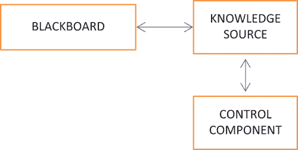

图 6.3 黑板模型的基本组件。

## 6.6 DIALECT 2：信息找回系统

DIALECT 2 是一种使用 DAI 设备的数据检索系统，由两个模块组成：第一个模块称为 `linguistic parser`（语言解析器），第二个模块被称为 `reformulation module`（重构模块）。首先是 `linguistic parser`，它寻找请求的句法结构，以创建一个包含请求中核心数据因素的模板链；其次是 `reformulation module`，它利用网络提取解决问题所需的数据。在每个层面上，每个模块的结构都形成在黑板版本 `[7]` 上。系统的任务需要若干层级，如图 6.4 和 6.5 所示。

![图 6.4 DIALECT2 的总体架构 [7]。](images/fig6.4.jpg)

图 6.4 DIALECT2 的总体架构 `[7]`。

![图 6.5 拼写错误单词的过程 [7]。](images/fig6.5.jpg)

图 6.5 拼写错误单词的过程 `[7]`。

多专家 `linguistic parser` 识别请求的句法安排。随后，它构建了一个格式系统。格式描述了简便的语言模式，布局系统包含了解析内容中存在的数据主要组件。这项任务由几个操作完成 `[7]`：

- `linguistic parser` 识别请求的句法安排。随后，它构建了一个格式系统。格式描述了简便的语言模式，布局系统包含了解析内容中存在的数据主要组件。这项任务由几个操作完成 `[7]`：

（注：原文中存在大量重复段落，已按要求去重）

1975 年，HEARSAY II [10] 似乎是最早的黑板框架。随后，人们对该相关主题进行了各种分析和研究，并提出了三种基本的控制类型：过程控制、多级控制和黑板控制。这些控制类型之间的相似性测量是基于以下几点的：

- 系统的效率：系统可以快速选择将执行的后续活动。
- 安排的灵活性：控制策略随着当前解决方案的演变（机会机解决）。
- 此外，系统可以由新模块轻松完成。
- 系统的统一性：控制问题和领域问题是以相同的方式解决的。
- 架构的简单性：策略的简单表述和知识的结构化组织。

接下来，我们看到不同黑板系统中提出的主要控制类型 [7]：

1. **过程控制**：系统利用一组之前可用的启发式方法，力求选择优先级最高的专家（在黑板术语中，这被称为知识源 (KS)）。这种形式的控制在问题范围被广泛识别和结构化时，凭借其高性能和适当的灵活性受到认可。然而，其性能和维护变得相当复杂。过程控制是通过 HEARSAY II 架构的。
2. **分级控制**：系统包含两种知识源 (KS)，它们可能是领域 KS 和控制 KS。这些源按级排列：领域 KS 通常处于安排的最低级，并且能够改变黑板事实。较高层级由控制 KS 辅助。在最高层，控制 KS 根据决策的现有状态调用位于底的某个 KS 之一。随后，该 KS 会额外调用另一个属于底层的 KS，这一过程一直持续到达到领域 KS 的层级。分级控制具有许多优势：对每个模块的理解、对问题的更好的执行，以及控制的熟练性。
3. **黑板控制**：属于系统的 KS 可分为两类：领域 KS 和控制 KS。每类使用一个特定的黑板。前者领域 KS 在领域黑板上构建问题的解释，而控制 KS 则得益于控制黑板管理领域 KS 的协作。

### 6.6.2 DIALECT 2 中的控制

我们现在将解释 DIALECT 2 中的控制。语言解析器的权威是一种多级控制。接，我们将基于黑板控制解释重构模块的管理。

### 6.6.2.1 语言解析器

语言解析器的权威是一种多级控制。在 DIALECT 2 中，句子的解析通过几个层级完成：形态阶段和词汇阶段、同形异义的处理、错误拼写的处理以及格式的开发。然而，这些层级并非都是自主的。

分级控制允许对问题进行规范，其中每一条控制信息和每个专业领域都按级排列。

在多级控制中，在最高层，单一 KS 监控解析。该 KS 指出黑板的计划，以监督批判性思维的进展并启动底层的一个 KS。属于该级的每个 KS 都拥有独立的能力领域：词汇调查、错误拼写的处理、同形异义的处理以及布局的开发，它们触发顶层的领域 KS。由于需要洞察力来完成各种任务，因此可以通过不同的控制 KS 召唤许多 KS。该过程反复进行，直到完成大量格式的生成。在解析开始时，黑板延迟调用客户端。在解析过程中，领域 KS 生成词汇摘要和布局。

### 6.6.2.2 重构模块

重构阶段处理替换请求中的单词或文本中的单词，以改进目标。定义了两个基本概念：召回率（recall）和精确率（precision）。

召回率是对搜索获得的信息片段，而精确率是实际相关的项目。重构的目的是提高召回率精确率。与语言解析器相反，多级控制无法调整重构模块，因为各种领域 KS 并不遵循分级组织。目前我们倾向于学习基于黑板控制的重构模块。布局将被展示。DIALECT 2 的重构模块由几个领域 KS，提出了各种重构 [7]：

- 词条的归一化：归一化允许系统对具有许多变化的词条只有一个代表。这种处理适用于动词、名词和形容词，它们各自的代表是名词形式（如果没有名词形式则为不定式形式）、单数和复数。这种处理在黑板的词条上执行。
- 词族：专家将请求的单词替换为属于同一词族的其他单词。专家提取请求单词的词根并使用可能的后缀列表。它搜索字典中具有相同词根的单词并保留具有可能后缀的单词。

在语言学中，词根是带有略有不同含义的部分，取决于相关语言的形态。

- 语义类的构建：语义类由相同词性的单词组成。这些单词来自两个非常接近的句子。一个句子是文档的一部分，另一个是请求的一部分。系统比较从这些句子构建的模板网络：它寻找公共模板或模板部分，并根据比较结果产生语义类。由该专家构建的语义类存储在黑板上。
- 同义词：同义词允许将单词替换为没有形态关系的单词。因此，用户可以使用文本中的单词来制定请求。

此外，当重构完成后，不存在于同义词（称为通用同义词）中的语义类将存储在另一个同义词（称为用户同义词）中。控制 KS 的责任如：

- 激活重构领域 KS，提高召回率精确率。
- 语义类的开发管理：`DIALECT 2` 识别出两类客户端：低频客户端和经验丰富的客户端，以引导语义类的开发。主要情况保留了所有生成的语义类。然而，第二种情况涉及一个过程，在保留每个语义类之前，会向客户端发送确认。
- 为了完成重构，对客户端的同义词进行翻新。
- 规范省略号和代词，以升级重构能力，因为它提供了查看整个短语范围的灵活性（图 6.6）。

## 6.7 分析与讨论

进行此检查的原因是为了总结当前的心理定位模型评估，分解现有流程，并为未来增加一些理解。通过模型工程和配置学习，我们在主观安排模型之上建立了一个单一结构，并从多个测量维度对依赖于该定义的现有模型进行了评估。专家们为了模型工程调查对现有模型进行了分解，以理解其核心思想和核心计划标准，包括如何管理输入、如何发现显性特征以及如何对其进行分解。科学家们审计了著名的学习目标，并准备了用于心理客户情化服务的技术，以评估学习考核。专家们还关注了许多未来将变得重要的发展课题。同样，随着其他基于深度学习的方法涌现层出不穷的新想法，我们看到神经网络定位模型迅速发展并在应用方面得到了扩展。我们相信这篇综述可以通过对过去技术的新视角来帮助科学家们。我们希望通过网络的努力，在该领域能够尽早培养出重大发现。

## 6.8 结论

本章报告的研究揭示了当全内容数据恢复应用于包含受大量自由采集限制的多个数据库的情况时，会出现的大量问题。`DAI` 代理需要维护、传播和投影其对现实世界问题观点的规定。但由于速度缓慢、代理的独特性以及有时缺乏资源导致的通信效率低下，导致了 `DAI` 系统运行不佳。为了克服这些局限性，代理需要跟踪系统并重新检查或更新其连接的网络。这种网络刷新必须在代理接收到任何信息时进行。遵循真实的 `DAI` 框架结构和任务呈现出显著的挑战。由于框架控制本质上是分布式的，每个代理（也称为操作员）的能力和数据有限，信息是集中的，计算是同时的。因此，确保 `DAI` 框架正确执行的最佳方法是允许操作员之间进行适当通信。随后，哪些代理应该协作解决问题、它们应该如何接口、它们的方法应该是什么以及如何确定可能出现的任何冲突，对于 `DAI` 框架来说至关重要。这些安排包含了获取受不受协作采集限制的资源描述的策略、利用资源描述按满足问题的概率对内容数据库进行排序，以及合并来自不同内容数据库的报告排名。总之，这些方法代表了分布式数据恢复中出现问题的端到端解决方案。本章创建的分布式 `IR` 方案在广泛条件下都是有效的。本章的研究代表了向构建全内容数据恢复的多数据库模型迈出的巨大初步。根据这里提出的算法，今天就可以构建一个简单的分布式 `IR` 框架。尽管如此，许多传统的 `IR` 工具（例如语义输入）目前尚无法多数据库场景。在出现一种通用技术来创建精确对应许多不同数据库的查询扩展数据库之前，这一结果仅具有学术意义。

## 参考文献

1. G. Weiss (ed.), Multiagent Systems: A Modern Approach to Distributed Artificial Intelligence, MIT Press.
2. S. Ponomarev, A. E. Voronkov, (2017). “Multi-agent systems and decentralized artificial superintelligence”, arXiv preprint arXiv:1702.08529.
3. 3.
4. 4.
5. 5.
6. 6.
7. 7.
8. 8.
9. 9.
10. 10.

# 7.1 动机

本章提出的核心问题是个体系统应当如何解决其子任务。如今，并行分布式架构正被用于实现这些系统及其子系统，以执行相应的子任务。这里这里要讨论的基本点包括：

1. 全局任务已被若干局部任务所取代，每个任务由单个智能体（agent）或进程处理。讨论这一点的主要目的是为了让人们知道，如果需要，各种子任务之间可能会发生交互或通信。本文不讨论这些子任务划分的问题。

# 7.8.5 协同利用人类与 AI 驱动的工作流

# 7.9 计算性理性

# 7.10 元层级理性与元推理

## 7.11 决策程序在分布式决策中的作用

## 7.12 分布式决策的优势

## 7.13 优化决策理论

### 7.13.1 多级（分层）算法

## 7.14 动态规划

## 7.15 网络流

# 7.16 大规模决策-making (LSDM)

### 7.16.1 LSDM 模型中的关键要素

## 7.17 结论


2. 单个智能体的动作可能会产生相互作用，因为任何一个智能体的成功或失败可能部分或完全取决于另一个智能体所采取的行动。这仅仅意味着单次行动、任何智能体的成功或失败也可能影响其他智能体。在任何情况下，如果智能体之间没有任何形式的交互，则默认认为它们在整合时具有足够的通信来评估结果或得出结论。假设每个智能体都了解其他智能体的效用函数。

## 7.2 引言

人工智能（AI）被定义为计算机世界中的一种事物，它能够感知或研究环境，根据经验进行学习，并根据其训练内容或感知到的内容做出反应。这使得 AI 成为一种强大的工具，如果使用得当，可以完全改变我们的业务模式并使决策过程彻底化。在客户驱动的市场复杂性日益增加背景下，决策过程正在快速增长，理解客户的需求和渴望并据此调整产品非常重要。为了做出最佳的市场决策，AI 对于处理变化的客户行为至关重要。为了帮助企业做出具有见地的决策，AI 使用了建模和仿真技术，这些技术有助于预测消费者行为并提供对消费者画像的洞察。

## 7.3 分布式人工智能

分布式人工智能（DAI）是一个处理各类技术和方法的领域，涵盖从群体智能到多智能体技术的范围。它是对一组联合在一起以解决问题的智能系统的研究。所有子系统都以某种方式相互关联，并非完全独立。其重点是处理针对目标问题的分布式解决方案的开发。

基本上，它被用于某些特定问题的推理、规划、学习和应用。作为人工智能的子集，仿真在预测或推荐中起着至关重要的作用。这需要自动学习过程，以便智能体能够通过各种智能体与系统之间的通信与交互来得出结论。神经网络和深度神经网络的优势在于，它们每次并不都使用相同的数据。

分布式人工智能（DAI）具有一些基本特征，这些特征使得一个系统被认为是分布式 AI。它们是：

1. 它通常在智能体之间分分配各种任务。
2. 它在智能体之间分配权力。
3. 它允许智能体与其进行交互。
4. 在任务完成后，这些智能体进行整合以产生结果。

在分布式 AI 的背景下，多智能体系统的工作效果好得多；为了完成共同任务，它们将该任务分解为若干子任务，同时从各种智能体的通信中寻找涌出的解决方案。在 DAI 系统中，设计者完全控制每个智能体环境的所有部分，这涉及到同时与许多其他智能体进行谈判。因此，节省时间的方法是约束谈判问题以做出最优决策。

最近，DAI 被认为是人工智能领域的一个子领域。人工智能是使机器产生智能行为的研究领域。AI 的核心关注领域是启发式方法和符号处理。启发式方法可能为某些问题产生解决方案，或者根本不产生解决方案。但在不存在正式方法或正式方法效率下的场景，启发式方法提供解决问题的方法，而符号处理涉及对表示概念的对象结构的操作。它在本质上可以是算法的也可以是启发式的，并且对于人类来说通常比数值处理更容易理解。

为了获得高水平的性能，AI 需要关于特定问题的知识库。AI 中最适合决策的涉及领域是：

1. 知识表示：这是一种选择方法的艺术，通过在 AI 系统中表示启发式（静态信息）和动态信息，以产生高效的解决方案。
2. 解决问题与推理：标准的 AI 知识表示有语义网、谓词演算、预测规则、计算机程序，以及解决问题技术的组合，涉及对新知识的推理。推理可以是归纳的（通过示例学习）或是演绎的（反向链链/正向链）。
3. 假设形成：某些 AI 问题可以被分为环境的静态分析、响应规划以及执行计划时的环境监控。假设形成涉及对现实世界情况的解释或理解。
4. 规划：人工智能规划由对现状的推理、特定目标、一组用于生成有序算子集合的算子组成；当应用于当前状态时，将产生目标状态。
5. 环境控制：当计划最终执行时，评估计划有用性的不确定性是 AI 控制的动力。

## 7.4 将人工智能应用于决策

让我们通过一个 AI 应用于决策的实时示例，即空军指挥控制形势。在这种情况下，所有的决策过程都是分布式的，完全基于实时数据以及大型数据集。

## 7.5 人工智能自动决策

简单来说，自动化决策可以定义为“无需任何人类干预，直接由机器做出决策”。在中间的任何过程中，都没有人类的参与或干涉。换句话说，它可以被描述为机器在单一地点收集大量数据，在某些算法的帮助下进行处理，然后利用这些经验和数据知识来做出自己的决策。

这些自动化决策在做出时会考虑到周围环境的各种参数。这进一步导致手动决策过程也变得自动化，并在许多情境下为人类决策者提供支持。但通常观察到，即使是有了这些自动化决策系统，也存在一些局限性和风险。

考虑到 `algorithms` 能够或可能做到的不仅体现在它们的性能上，还体现在它们评估和分析整体自动化决策的方式，理解自动化决策感知的核心驱动因素变得愈更加紧迫。目前的研究对自动化决策的各项属性做出了巨大贡献。

### 7.5.1 自动化决策系统的影响

自动化决策所做出的决策在影响水平上存在巨大差异，可能低到仅生成推荐新闻文章列表，也可以高到司法领域的判决或医疗保健领域的各种决策。通过这种方式，自动化决策与人类专家或自动化机器做出的类似决策的感知进行了显式比较。由此，人们可以清楚地感知到使用 `algorithms` 做出的自动化决策与人类所做决策之间的关键水平差异。

目前自动化决策进展最显著的三个领域是公共卫生、媒体和司法。其重大影响将涉及个人权利、福祉和在社会中的功能。这些自动化决策的反馈被用于改进未来的自动化水平。一个 `algorithm` 不过是“一组根据特定的计算和运算，将输入数据转换为输出的编码程序”。但我们如何随着时间的推移对其进行进一步概念化，取决于人与机器之间社会、制度和个人背景背景。这里的自动化主要将侧重于过程在没有任何人类干预的情况下持续进行。

有时，决策可能会产生偏差，因为该领域每天都在扩大和发展。根据一项对健康、媒体和司法的调查，分析认为，`algorithms` 在决策中的使用和实用性可能会对人类产生负面影响。

### 7.5.2 自动化决策系统的形式

它可以采取任何形式，从推荐系统（帮助人类决策者）到其他各种完全自动化并代表机构、公司或组织运行且无需人类参与的决策支持系统。在这些情况下，人类在很大程度上依赖自动化决策系统，这些系统可能与他们有关也可能与他人有关。人类在这些自动化系统中的参与程度取决于所制造系统的类型。如果是推荐系统，那么向用户建议什么将完全取决于用户，只要用户决定是否接受该建议。因此，这完全取决于你正在处理的自动化系统的类型以及它解决的是什么形式的问题。

另一种形式是全自动决策系统，它让接收者处于不知情状态，不让他们知道使用了哪些数据来做出决策。这里没有人类参与的空间。这是因为 `algorithm` 独立地处理数据。

### 7.5.3 自动化决策系统的应用

自动化决策的主要应用包括：

*   通信
*   推荐
*   各种在线行为的个性化
*   监管社交媒体活动
*   识别可疑配置
*   虚假新闻故事

### 7.5.4 网络隐私忧虑

自动化决策涉及数据驱动的决策。早早的研究表明，需要高水平的隐私保护，以处理针对用户行为的自动化个性化的草率行为。假设更关注隐私的用户会期望对决策进行更具批判性的评估。如果他们完全信任系统并对其充满信心，那么用户将尝试使用这些系统来保护自己的隐私。

另一个可能是由于对人类决策缺乏信任，这使得自动化决策被认为是更好的选择，因为它能做出更公平的决策。最后，媒体、医疗保健和司法领域的背景正显示出相似但又不同的趋势。

### 7.5.5 讨论与未来影响

通过对具有高质量样本的各种实验进行调查，一项研究就人工智能对自动化决策的公平性、风险和有用性的感知提供了许多观点。在评估评估人工智能中自动化决策的各种社会场景时，出现的问题涉及到了风险，以及对有用性和公平性的复杂观点。当受访者必须根据潜在风险、公平性和有用性对某些特定决策选择其中一个决策者时，对于具有高影响的决策，他们倾向于选择人工智能的自动化决策，认为其甚至优于人类专家。领域特定知识和在线自我效能感与对人工智能自动化决策的有用性、公平性和风险的积极态度相关。比较关注在线隐私的人更信任自动化决策系统的决策，并认为它们对各种用途来说都是公平且有用的。

在分析了这些对理解所有领域范围内算法赏识的重要贡献后，总之也注意到存在一些局限性。因此，在组之间对自动化决策和人类专家作为决策者进行了比较。

*   在当前场景下，所有未来的研究人员都应该确保他们的评估是不偏的。
*   所有受访者都被展示了评估者的决策，并被要求想象他们被赋予了任何现实场景以检查一致性和可比性。
*   还可以通过探索作为这些决策主体的人的感知来扩展研究，并尝试在操纵特定背景决策时实施一种现实的研究设计。
*   研究结果还可以与其他国家不同的隐私关注和期望进行比较来予以扩展。

## 7.6 多智能体环境中的合作

Ginsberg 等人在论文中讨论道，智能体即使在没有任何通信的情况下也应该能够进行交互。这项任务很困难，但并非不可能。在这种背景下，主导因素是基本理性。关于独立性存在许多假设，但关注的焦点在于理性定义从个人行为向决策程序的转变。

根据在分布式人工智能（DAI）领域的之前工作，这些智能体由于其内在的设计和本质是互利合作的。但问题随之而来：在没有利益冲突的情况下，这些智能体如何实现目标？它们如何在没有任何干扰的情况下同步顺畅通信？

有很多应用领域，如资源管理应用和军事应用，在这些领域中，自主且独立的智能体仅因为设计者的创造力而相互交互。智能体相互交互，发现具有潜在冲突目标的其他智能体。因此，通过允许利益冲突产生交互，我们看到了为什么这些智能体选择相互合作以及它们是如何通信的。

智能体运行的环境类 `E` 和性能衡量标准 `U` 将评估智能体通过实际环境时经过的各种状态序列。令 `V (f,E,U)` 表示智能体 `f` 在环境类 `E` 中根据 `U` 获得的期望值。那么智能体函数由以下方程定义（图 7.1）：

```
V (f,E,U)
```

```
图 7.1 智能体生成允许环境产生状态历史并评估各种指标的行为
```

### 7.6.1 符号与工作流

对于智能体 `i`，考虑收益 `p`，它将任何替代方案 `m` 分配给实数。

```
p : M → R
```

`p` 的值可以用每次交互的矩阵形式表示，如图 7.2 所示。`p` 表示当智能体执行相应动作时智能体 `J` 的收益，右上角的数字表示 `K` 的收益。例如，如果智能体 J 在这种情况下执行动作 `a`，而智能体 K 执行动作 `c`，结果将是 `J` 获得四，`K` 获得一。每个智能体都对最大化其效用感兴趣。

```
A K s (m) = A K s (m') and A J s (n) = A J s (n')
```

```
p s : M × N → R
```

```
图 7.2 列优势问题
```

在没有交互的情况下，问题现在将解决。然而，选择替代方案 `m` 是直接的。在与其他智能体打交道时，假设智能体基本上是理性的通常是合理的。基本理性和相互理性是相互相似的。这种基本理性有助于推导出迭代优势分析。它处理了上述解释的列优势问题。利用 K 的基本理性，可以得出动作 `d` 对 K 来说是不理性的。因此，`ad` 或 `bd` 都不是可能的结果。在剩余结果中 `ac` 支配了 `bc`，所以 `b` 对 J 来说是不理性的。

### 7.6.2 动作独立性

存在各种基本理性无法处理的情况。由于没有方法考虑交互智能体之间的依赖关系，还有其他几种方法来处理这种弱点。完全独立是解决这一问题的方法之一。该假设认为每个智能体的动作选择独立于另一个智能体。对于其他智能体的动作，每个智能体的反应值都是相同的。对于所有 `m, m', n, n'`，值为：

独立性的结果是“分类分析”。对于 `K` 的每一个固定动作，`J` 的动作都优于其他动作，而后者被跳过。分类分析与支配性分析的区别在于，它允许 `J` 在 `K` 的每一个动作下比较两个可能的动作，而无需考虑交叉项。

图 7.3 中给出的收益矩阵涉及效用最大化代理体 `J`，它将执行动作“a”，如果 `K` 执行动作“c”，则 `J` 获得四个单位的效用；如果 `K` 执行动作“d”，则 `J` 获得两个单位的效用。在这种情况下，支配性分析无法发挥任何作用，因为“ad”的收益小于“bc”。

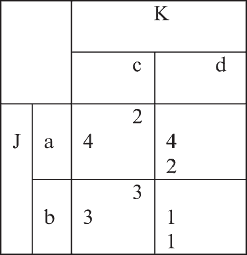

图 7.3 分类分析问题。

在在共同分析了基本理性和独立性之后，它们共同暗示了分类分析问题。随后，将相互理性和独立性相结合，展示了迭代分类分析的正确性。因此，在图 7.4 中，无法应用支配性分析、迭代支配性分析或分类分析来选择动作。所以，如果两个决策程序不是独立的，那么独立性假设会导致非最优结果。

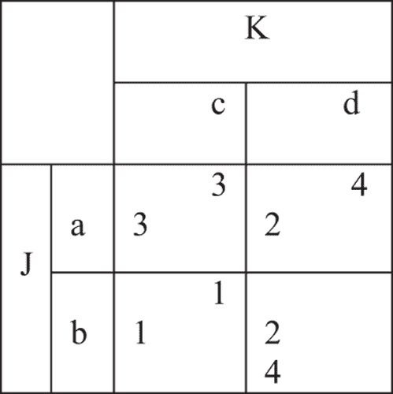

图 7.4 迭代分类分析问题。

现在，图 7.5 中给出的最终收益矩阵已经就绪，收益矩阵中的效用可以取任何值。分析只需要结果的排序。因此，将仅使用从 1 到 4 的数字来表示结果。代理体在这种场景下的主要任务是决定执行哪个动作。决策程序将被描述为代理体“i”的从状况到动作的函数 `W [i]`。如果 `S` 是可能的交互集合，那么我们有

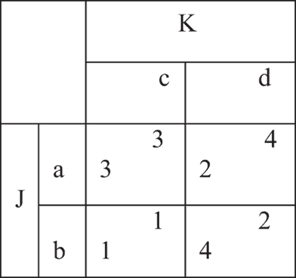

图 7.5 收益矩阵。

```
W i : S → M   (7.5)
```

## 7.7 博弈论场景

博弈论被认为是智能代理体用于相互之间以及与环境交互的重要工具。在现实世界中实施它是困难的。

例如，博弈论者从未模拟过玩家如何玩以找到解决方案背后的原因。他们从未谈论或写过引导玩家得出解决方案的推理过程。预测结果始终是一个挑战。之后，人们必须解释理性的代理体如何根据给定信息推断出该结果。

## 7.8 数据驱动或 AI 驱动

AI 允许许多公司采用数据驱动的方法进行运营决策。这将有助于使决策过程变得更好、更高效。为此，它们需要正确的处理器来获得最佳结果。因此，最后我们需要向 AI 驱动的方法和工作流转变。

数据驱动和 AI 驱动的过程都描述了它们自身的重要性。

1. 数据驱动的过程侧重于利用历史数据来预测未来趋势。
2. AI 驱动的过程利用机器学习和算法来适应新数据。
3. 两者的结合可以实现更健壮的决策框架。

### 7.8.1 人类判断

早期，决策严重依赖于人类判断。虽然人类直觉提供了背景和伦理，但也容易受到认知偏差和局限的影响。与自动化系统相比，人类手动处理大量数据的能力是的。

### 7.8.2 数据驱动决策

随着海量数据的流入，我们需要适应。数据驱动方法允许处理人类无法处理的大型数据集。然而，这些系统需要仔细的验证，以避免基于噪声数据得出错误的结论。

### 7.8.3 数据驱动决策的工作机制

任何数据驱动决策过程的完整工作流都可以从给定的框架进行分析。使用分布式文件系统（`DFS`）、电子表格和文档等机器，很容易以管理的格式呈现数据。这使得可扩展的 AI 驱动工作流成为可能。

图 7.8 自动化决策过程或模型中数据驱动决策的工作流。

### 7.8.4 AI 驱动的决策

这种方法克服了数据驱动方法面临的认知偏差问题。在一般的常规决策中，只能依靠结构化数据。AI 有能力在细粒度上发现群体中变异更大的细小部分，即使这些部分不在人类的感知范围内。AI 能够一次性处理数百万个分组。AI 能够更好地处理如幂律、二项分布、几何级数和指数函数等非线性关系。

正如我们在图 7.9 中所示，没有人类判断的干扰，只留下了自动化。这有助于降低成本并提高性能。这种 AI 驱动的方法工作得更好，并利用了数据中存在的信息。它在最终决策上更具一致性和客观性。它可以正确识别出需要关注的基础特征和需求。


图 7.9 AI 驱动的决策模型。

### 7.8.5 结合利用人类与 AI 驱动的工作流

从任何过程或工作流中移除人类将导致仅剩结构化数据。这并不意味着人类已经过时。许多企业仅依赖于人类判断，例如公司战略、愿景声明和企业价值观等。所有这些都需要头脑思考和非数字形式的交流。主要的区别如图[图 7.10 所示]。人类干预不是直接来自输入，而是在通过 AI 系统处理数据之后。因此，理性是决策程序所要求的关键特征。这是通过显式完成的，并要求相关方充分知情。因此，结合使用这两种方法做出明智决策更好。

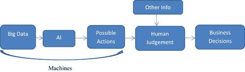

图 7.10 AI 力量与人类判断的结合。

## 7.9 计算理性

计算理性在决策理论方法和逻辑方法中起着重要作用。在前者的情况下，仅将评估那些在所有情况下都能实现特定目标的行为的性能衡量。Newell 定义理性行动是那些保证实现代理体目标的行动。像定理证明器之类的逻辑系统使用情境算术（situation calculus）来满足计算理性的条件。在后者中，计算理性代理的设计已扩展到人工智能领域之外。例如，随机最优控制理论展示了问题有时是多么具有计算性和可计算性，这可能消耗指数级的内存和时间。

表示格式始终是基于状态的，而不是基于句子的，而且可解决的问题非常微小且具体。人工智能在概率网络或信念网络领域开辟了新的可能性。基于影响图（influence diagrams）的各种系统满足了计算理性的决策部分。影响图是添加了动作和值节点的概率网络。在任何情况下，无论是逻辑方法还是决策理论方法都无法忽略计算理性所给出的决策问题的不可处理性。一种解决方案是减少各种推理和表示任务中各种指数级复杂性的来源，以便使完美理性和计算理性重合。在可处理的子语言上，研究结果可以被视为复杂性可能成为问题而非解决方案的指示。

在分布式人工智能（`DAI`）中，系统设计人员控制每个代理体环境中涉及与其他代理体谈判的所有部分：

* 一种可能的解决方案是通过控制复杂度来限制谈判问题，以便做出最优决策。
* 针对复杂性的另一种可能反应是采取捷径和近似方法，以获得合理的行为。

人工智能已经开发出强大的记忆方法来降低复杂度，这些方法分别包括状态表示、句子形式的稀疏表示以及环境模型。

许多表示模型应该被建模，以提供不同的成本和质量组合，这应该考虑系统感知的成本和收益。这意味着它们基于元推理提供了解决方案。诸如参数化表示、部分顺序规划和抽象等方法可以确保中等问题的有效性。智能体无法在所有情况下下的理性行动是不可避免的。这种观察在最初就已经提出的，但选择次优行动的系统超出了计算理性，需要良好的理论和概念来理解。

## 7.10 元级理性与元推理


在计算成本和决策程序之间需要维持平衡。主要目标非常明确，通过实现权衡来利用元级架构。元级架构被定义为一种设计智能代理体的哲学，将代理体分为许多概念部分。与应用领域的计算由对象级计算执行；这些领域包括投影动作的结果、计算特定状态的效用等。对象级计算是带有成本和收益的行动。根据期望效用，各种计算由元理性选择。

元级是另一个由计算对象和对象级计算组成的决策过程。各种元级策略可以通过对象级搜索操作的理想程度来体现。以下提到了两种：

- 选择搜索方法
- 剪枝策略

元级可以按照元推理理论的形式化进行正确的思考。元理性具有信息价值的概念。决策理论的价值可以通过模拟遵循信息请求的每个可能结果的过程来计算额外信息，这有助于估计决策质量的预期改进。

根据 Eric Wefald 的工作，投影结果为时间过程的搜索算法包含对象级计算。以象棋程序为例，其中每个对象级计算扩展了游戏树的叶节点。元级问题的主要任务是选择要扩展的节点并在适当的地方停止搜索。

- 另一类元推理问题随着时间的推移或灵活算法而扩展，该算法返回的结果质量各不相同。特定算法决策质量的提高是相对于时间成本衡量的。这是元推理权衡最简单的形式。如果一个终止条件的二阶导数为负，则认为该条件是最优的。

- 当人们想要从各种未知或旧的组件构建复杂的实时系统时，会产生许多困难的问题。首先，我们需要查看所形成系统的可中断性，以确保系统的健壮性。

- 该问题的唯一解决方案是为每个组件分配时间。这将使系统的整体改进加倍。遵循这种方法，很容易构建一个能够以精确方式处理随机实时需求的系统，且只需付出较小的速度代价即可获得时间。此外，可用的计算应在各个组件之间进行优化分配，以提高整体输出质量。

这个问题可能是一个 NP 困难（NP Hard）问题，但可以通过树形结构组件在线性时间内求解。由于这些结果是针对具有良好定义性能配置的算法得出的，但需要检查系统在复杂系统真实世界场景中的实时决策能力，以便将其作为普通情况处理。只有当任何实时问题都能被高效解决时，复杂系统的健壮性才能被检查。

## 7.11 决策程序在分布式决策中的作用

一个决策问题包含以下组件：

- 个体决策者或一组决策者以及一个环境。每当决策者做出的任何决策执行时，它都会影响环境。这是因为：所有决策要么基于可用的在线或实时信息，要么基于先验信息做出。

- 决策过程由几个步骤组成：
  - 问题识别
  - 问题结构化
  - 替代方案生成
  - 决策选择
  - 实施

从`Figure 7.11`中可以很容易推断出，在对问题做出或实施任何决策之前，多次迭代这些步骤是非常重要的。因此，我们可以说决策无非从可用信息的一组可能的替代方案中选择合适的行动。

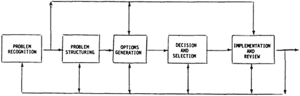

图 7.11 分布式决策的流程。

决策是一个关键过程，应用于从市场分析到空军任务规划的所有领域。许多技术，如控制理论、运筹学、系统理论或人工智能，都可以应用于决策过程。与其使用集中式设计，不如将决策任务划分给各种自动化系统以及人类决策者。当我们谈论分布式决策（DDM）环境时，其首要目标是开发 DDM 技术，并开发一种用于分布式环境中决策的设计方法论。

## 7.12 分布式决策的优势

有许多因素可以支持采用分布式决策而非集中式决策结构。某些因素包括：

1. 更好的性能
2. 通信以及计算资源的高效利用
3. 设计简单，因为一个中心设计被若干个较小的设计单元所取代
4. 更好的增长潜力
5. 提高可靠性，因为中心决策者的故障将给系统带来灾难

在分布式决策过程中，要么涉及过程的计算是分布的，要么信息是分布的，或者两者同时是分布的。根据用于决策过程中所使用的算法，有多种分配信息以及计算结果的方法。

## 7.13 优化决策理论

优化既是一个静态问题也是一个动态问题。它包含了最优控制和决策理论。除了直观的优化外，这些领域具有与其整合的特殊特征。例如，在统计决策理论中，不确定性的存在非常重要，而控制理论主要处理动态系统。当应用于决策时，优化用于从替代方案中选择最优决策。为了这一点，需要假设可行替代方案的存在以及良好定义的目标函数。

最常用的优化技术是线性/非线性规划、动态规划和网络流技术。在决策问题很大的情况下，有时将计算分配到较小的单元（决策者）是必要且理想的。

在决策理论中，算法分为两大类：

1. 决策者排列成层级结构。
2. 决策者没有特定的中心分布。

### 7.13.1 多层级（分级）算法

这些算法基于协调和分解的概念。在此，一个大规模问题被转换或处理成可以进行分解的形式。这些分解后的问题然后由局部决策者处理和解决。然而，原始问题无法完全分解。因此，为了影响局部决策者的问题，需要一个协调者来确保全局解决方案。

如`Figure 7.12`所示，底层决策者和协调者形成了一个层级结构。在这种情况下，根据接收到的协调参数，局部决策者独立解决他们的问题。一旦获得解决方案，局部问题的信息将报告给协调者，由其随后调整参数。这个过程一直持续，直到无法再进行改进为止。

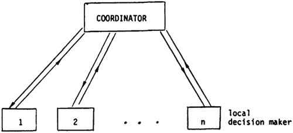

图 7.12 层级流程。

选择层级方法的主要原因是分配大问题涉及的计算。使用分布式方法，计算时间随问题规模的增长速度快于线性，因此与解决原始问题相比，解决许多较小的问题效率更高。

## 7.14 动态规划

这是一种分解方法，用于处理大规模优化问题。动态规划的应用通过将大问题分解为一系列易于求解的较小优化问题来处理优化问题。分解是针对阶段和时间的。但它最适用于时间结构已知的动态系统的优化。

- 在空间动态规划中，状态对应于交互变量，阶段变量现在对应每个子系统。对于每个子系统，对于每个可能的交互变量，最优解被参数化。然后将这些部分生成的最优解组合成全局最优解。

- 针对子系统故障，空间动态规划是可靠的。只要有本地决策者来处理优化，该算法就能保持其模块化结构。无论是否需要重新求解子问题的优化，只要子系统发生增加或删除，整个系统就可以进行重新优化。

- 在分布式动态规划（Distributed Dynamic Programming）中，有多种方案可以将动态规划算法递归中涉及的所有数学计算分配到多个进程中。在这些方案中，要求所有处理器完成其分配的子问题计算，才能开始新的递归阶段。
  - 这类分布式动态规划算法涉及此类计算的异步分布，包括最短路径问题以及基于有限和无限时间跨度的最优控制问题。

## 7.15 网络流

为了更好地利用分布式算法，网络问题的数学结构将有所帮助。为了控制最大网络流问题，设计了一种去中心化算法。为此，考虑了一组空间分离的振荡器以实现共同的稳态频率。

通信网络中的存储转发数据包交换路由算法是最成功的分布式算法应用。除了具有静态和层次性质的算法外，所有其他算法都处理准静态路由。这类路由算法用于此类情况：由于通信会话的终止/建立或链路的增加/删除等模式的变化，在网络运行期间需要路由发生变化。

使用集中化方法收集来自所有其他节点的有关流量的信息，然后用其解决正在进行的路由问题是不切实际的。原因如下：

- 必须遵循协议在中心节点与所有其他节点之间通信信息。
- 如果网络发生故障，集中路由将面临“先有鸡还是蛋”的问题。这将需要建立新的路由来通信所有的网络信息。

路由算法分为两种：

- 单路径算法
- 多路径算法
  - 在单路径算法中，数据包通过某条路由发送，以减少其到达目的地的延迟，而不考虑其他数据包的延迟。
  - 在多路径算法中，每个节点计算从该节点通过各种路径发送的总流量的比例，以减少网络所有消息的整体延迟。

## 7.16 大规模决策 (LSDM)

任何决策算法的基本范式都是参与任何决策过程或系统的决策者数量。如今，大规模决策的范围正在迅速增长，它已经通过吸引各种概念确立了自身的地位。当人们参与任何决策过程的程度增加时，这类现象就会出现，因为他们作为受影响方的参与将在决策过程中贡献更多，而非作为利益相关者。

为了让你的决策过程被所有人接受，一个动态且迭代的共识达成过程至关重要。任何大规模决策过程的主要目标是让大多数或所有相关者对最终决定达成一致。这将进一步减少最后的投诉、不满和不必要的争论。许多大规模决策过程需要基于人工智能的工具来处理该过程，例如聚类、可视化、自组织映射和基于代理的理论。

### 7.16.1 LSDM 模型中的关键要素

任何大规模决策过程中的各种关键要素如下：

- 子组聚类：大规模决策问题可以采用各种聚类方法，这涵盖了某些主要方面，如利益偏好、决策者之间的关系，以及与所有决策者收集的意见之间的距离。

- 共识测量：它有助于找到由所有决策者共同做出的共识决策。它基于对定义的共识的共识程度和支持率。最频繁使用这种方法是识别所有决策者所做决策之间的相似性程度，这基于距离函数，并可以解释为决策者对随机备选方案的支持率。

- 行为管理：当决策者是各种利益相关者的专家或代表时，他们可以被分配为 LSDM 事件的组织者。

- 反馈和偏好修改：在这里要求某些决策者对给定的评估进行决策修改，以提高共识水平。

## 7.17 结论

在分布式人工智能（DAI）的背景下，决策程序范式尚不完善，有待深入探索。在没有任何通信的情况下检查多智能体交互与协作仍然是研究挑战之一。它可能是涉及博弈论、理性概念或人工智能的应用。在通过了所有关于理性和独立性的概念后，可以得出结论：对于多个代理的各种决策方法不需要任何假设。它们都是独立工作的，没有任何依赖关系。

代理的效用最大化部分确保了分析代理之间独立性的过程中没有故障。这些决策程序以动态格式运行，并在大部分情况下完全覆盖了人工智能领域。如果没有更好的决策过程，所有的 AI 系统和模型将缺乏提供最佳结果的能力。

## 参考文献

1. T.B. Araujo, N. Helberger, S. Kruikemeier, & C.H. de Vreese (2020). 我们信任人工智能吗？对人工智能自动决策的感知。AI & Society. `https://doi.org/10.1007/s00146-019-0931-w`

# 8 分布式问题解决网络中的协作

Anisha Singh, Akarshita Jain 和 Bipin Kumar Rai

## 8.1 引言

## 8.2 分布式控制系统

### 8.2.1 设计决策

### 8.2.2 主节点软件

### 8.2.3 卷积软件节点网络

### 8.2.4 分布式状况评估

### 8.2.5 计算机辅助控制工程 (CACE)

### 8.2.6 知识库

### 8.2.7 训练数据集

### 8.3 ICE 架构的动机与开发

### 8.3.1 ICE 模型历史

#### 8.3.1.1 信息状态运算符

#### 8.3.1.2 与观测量子力学的关系

#### 8.3.1.3 社会学和意图状态的影响

### 8.3.2 动物与机器人通信理论的要求

### 8.4 形式语义学的概念简史

#### 8.4.1 Tarski 语义

#### 8.4.2 可能世界语义

#### 8.4.3 时间逻辑语义

## 8.4.4 克里普克可能世界语义的局限性

## 8.5 相关工作

## 8.6 动态可能世界语义

## 8.7 情境语义与语用

## 8.8 将分布式 AI 系统建模为分布式目标搜索问题

## 8.9 讨论

## 8.10 结论

## 参考文献

## 8.1 引言

AI 推理中的分析通常针对单个智能体的状态。在当前的方法论中，智能体在静态领域中运行，其主要活动是：收集数据、安排和执行某些意图以完成其目标。由于现实中各种智能体之间存在不可避免的接近性，这种方法已被证明是有缺陷的。根据所描述的调查，我们在设计智能体的活动时，应该考虑到其他智能体的活动，以帮助或阻碍它。随后，建立的研究人员致力于让分布式人工智能（DAI）专注于此类通信。DAI 是一个相对较但不断发展的 AI 研究领域，它与传统的人工推理相比，依赖于一种意外的模型。根据目前的情况，传统上一个智能框架是针对特定任务模拟特定类型的人类思维、信息和能力，而 DAI 框架被构想为一组被称为智能体的智能实体，这些实体通过协作、并发或竞争相关联（[图 8.1]）。

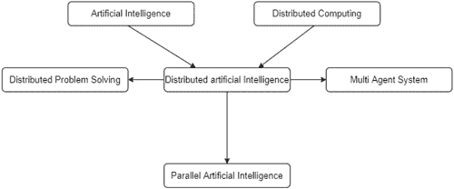

图 8.1 分布式人工智能。

## 8.2 分布式控制系统

分布式控制框架由控制应用程序和 PC 框架组成。后者提供了设备和编程阶段，允许前者的执行，例如与受控过程的持续和离散事件部分协作的控制计算。计算机系统由节点组成，这些节点通过顺序、基于通信的通信组织相互连接。每个节点由多个模块控制，实现到广播总线的交互接口、到至少有一个关节的机器人应用程序的 I/O 接口以及一个芯片模块。节点的隔离允许 I/O 和交互框架发生更改，就像各种资产结构执行一样。主节点处理人机界面（MMI），并且也可以被定制以执行部分控制任务。

### 8.2.1 设计决策

如今，人们喜欢观鸟，但为了识别鸟类物种 [[1]]，他们需要动物科学的帮助。观鸟提供了我们通过享受自然获得的健康处。物种识别是一项具有挑战性的任务，可能会导致许多不同的标签。有时专家也可能在物种上产生分歧。对于视觉能力极限的人类和计算机来说都是困难的。为了帮助观鸟者，我们创建了一个深度学习平台，帮助检测鸟类种类，以帮助用户使用基于图像处理的软件识别鸟类。该软件通过将模型与训练后的模型进行比较来识别输入图像，从而预测鸟类。细节将作为输出显示。此外，它还将帮助我们构建数据集。如果用户捕捉或上传的任何图像在数据集中不存在，用户可以将其加入。

### 8.2.2 主节点软件通信

软件节点网络 [[1]] 模型有三层，即：输入层、隐藏层和输出层。软件节点网络的工作就像人类大脑，在某些算法的帮助下识别数据集之间的关系。软件节点网络系统可以是有机或人工的。

- **输入层**：它将数据获取到系统中，然后软件节点网络的其他层对其进行进一步处理。

- **隐藏层**：存在于输入层和输出层之间。它计算加权输入并产生网络输入，通过激活函数进一步产生实际输出。

- **输出层**：软件节点网络的最后一层。它为系统产生输出（图 8.2]）。

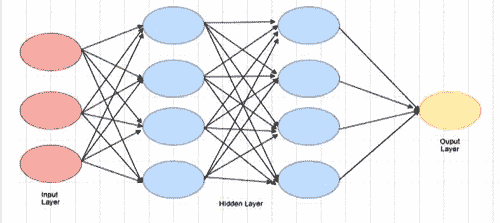

图 8.2 软件节点网络。

### 8.2.3 卷积软件节点网络

卷积软件节点网络（`CNN`）[[1]] 是前馈网络，信息单向流动，即从输入到输出。

`CNN` 用于通过不同的卷积层将输入图像转换为评分表来识别图像（图 8.3]）。

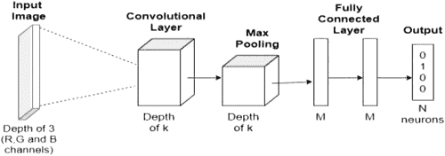

图 8.3 CNN 架构的示意图。

`CNN` 由卷积层和池化层组成，用于图像分类。输入图像通过卷积层和池化层。之后，鸟的许多符号化部分的输入图像被聚集在一起。特征提取发生在此，根据形状、大小和颜色识别并区分每个通用部分。之后，在图形处理器中使用一些图片进行 `CNN` 模型训练，以提取上述特征，并将训练好的数据集存储在服务器中以进行实例目标。

最后，我们从用户上传的、相机捕捉的图像获得作为输出结果。因此，通过图像，我们可以从训练模型获取信息并预测物种。

### 8.2.4 分布式情境评估

参与 DAI 的智能体在任何秒都可能对大量决定要接受什么、哪些信息可以认为是相关的以及之后寻求哪些活动。因此，智能体做什么、何时做可以认为是 DAI 的核心问题。为了解决这个问题，每个个体智能体（如果控制是集中的，则只需单个智能体）必须评估开发智能体的适当情境。大多数情况下，情境评估包括获取、安排和抽象关于环境的数据，这可能与智能体的欲望密切相关，或用于产生新的欲望。这个问题可能部分通过使用包含在不同世界中工作的多个智能体的调度来回答。到为止，程序调度的所有工作一直关注于解决所谓的传统调度问题。评估问题，世界被视为可能状态数量之一。执行活动使世界经历一个状态然后进入下一个状态。在确定问题时，文章给出了许多目标、许多中间活动以及世界底层类的描述。然后调度框架被要求发现一个活动序列，将世界从任何满足底层状态描述的状态转换为满足目标描述的状态。这种结构通常被用于演示确定性问题，包括单个智能体在仅作为智能体活动的结果而改变的情况中工作，并在任何情况下保持静态。

### 8.2.5 计算机辅助控制工程 (CACE)

在控制框架结构中使用 PC `[2]` 有着悠久且广为人知的历史。它始于尖端数据时代开启之前，当时使用简单的处理设备为大口径火炮和针对敌方飞机机重型武器的专家制作弹道信息表，一直发展到今天，如今的工作站已经拥有了以前无法想象的计算能力。现代控制理论形成于 20 世纪。通过结合计算领域的几项关键进展，现代计算机控制系统设计（CACSD）成为可能。例如，高级程序化语言（如 `FORTRAN`）的发展和增强能力，赋予了标准数值编程的发展和传播。

例如，完全直观的工作框架（如 `UNIX` 及其客户端 `shells`）的兴起，影响了类似范围内 CACSD 软件包的发展。栅格图形显示器的易用性和廉价性，使得控制框架分析的实时屏幕显示成为可能，创建了利用可识别框图进行控制框架建模的工具，并能够显著提高控制设计师、其模型、分析设备与最终结果（嵌入式控制器程序）之间的可用性、控制简易性和有效性。这些改进每一项的核心驱动力都是编程能力的逐年增长。结果是让 PC 供大量人员使用。

PC 辅助控制框架配置可以描述为：

在控制设计的显示、识别、证明、分析和结构期间，将先进 PC 作为虚拟设备使用。

CACSD 设备和软件包通常为物理工厂和控制器的分析与设计提供全方位帮助，尽管许多现代软件包还为非线性框架的显示、仿真和线性化提供帮助，某些软件还可以在程序中实现控制律。

图中描述了过去四十年中 CACSD 软件包的演进。其他影响因素、硬件设备和编程技术的要素也已列出，以便将事件置于适当背景中。在此领域，我们更详细地描述 CACSD 设备兴起的基础，从技术发展开始，随后进入 UI 视角。其目的是通过检查这些工具被创建的真实环境来理解当前的尖端水平（`图 8.4`）。

![图 8.4 直观 CACSD 设备的记录改进，展示了相关硬件和软件的可用性。包含了一些真实产品以展示顶级水平 [2]。](images/fig8.4.jpg)

图 8.4 直观 CACSD 设备的记录改进，展示了相关硬件和软件的可用性。

### 8.2.6 知识库

知识库是存储图像细微信息的地方，知识库可以表示为卷积数据集（图 8.5`）。

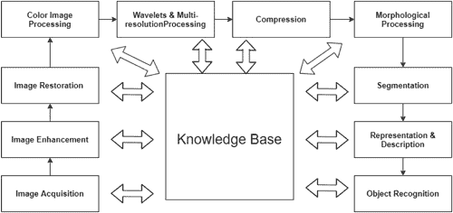


图 8.5 显示图像处理阶段的流程图。最初，节点网络从随机权重和偏差开始，但反复训练直到达到最佳性能。这是通过计算它们拥有的误差来实现的，即网络代价。通过寻找网络预测与预期结果之间的差异并计算这些误差值的和，创建用于从一组信息进行图像识别的节点网络。`TensorFlow` 是一种由 Google Brain 团队的分析师和工程师创建的用于数值计算的数据流图开源软件，检查了机器学习关联。深度神经网络承担着重要工作。数据流图由数学运算的节点组成，边缘显示它们之间共享的多维数据。在机器学习中，`CNN` 是一种神经元类似于动物视觉皮层连接的前馈网络。

感受野是皮层神经元对刺激产生反应的限制区域。`CNN` 具有多层感受野。集合处理图像的一部分。然后对其进行堆叠，使其输入区域重叠，以实现原始图像的高分辨率表示。这一过程在每一层中重复。结果的堆叠可能赋予 `CNN` 处理图像转换的能力。`CNN` 可能具有局部或全局池化层，连接神经元簇的输出。对输入部分进行卷积操作以减少自由参数的数量。节点网络由连接的神经元组成。所有节点网络连接都带有权重，告知与输入值相乘时其内部关系的主导地位。每个神经元都与激活函数相关，用于在网络建模能力中引入非线性，告知神经元的输出。节点网络的准备是关于参数估计的，这种学习过程在节点网络中是循环通过所有神经元层的单一过程。从最后一层（例如输出层）开始，损失数据传递给所有贡献的隐藏层神经元。隐藏层神经元只接收损失信号的部分，基于每个神经元对实际输出的相对贡献。这一过程逐层进行，直到网络中的所有神经元都接收到其对总损失相对贡献的信号。

### 8.2.7 训练数据集

借助 `CNN` 执行鸟类物种学习是在 `GPU` 工作站上完成的，该配置配备 12 核 Intel Xeon CPU、32 GB 内存以及一张 Nvidia GeForce 2 11 GB GTX 1080 Ti 显卡，基于 `TensorFlow` 框架。固定大小为 112 × 112 像素的输入图像被提供卷积软件 `Node Network` 进行特征提取和识别处理。本研究使用鸟类种类数据集进行训练、验证和测试。当我们将数据通过一系列卷积层时，会提取颜色、形状、身体、腿部、角度、头部等不同的输入图像特征。输入图像向像素的转换发生在第一个卷积层，然后移动到下一层。接着进行特征提取，直到通过概率分布完成图像分类。为了记录所有输入图像元素，卷积滤波器具有一个内核和一个高维特征图，可以在输入卷上滑动。步长必须设置为固定的（solidarity），因为我们移动内核一个单位，以确保滤波器围绕其他像素的信息进行循环，目标是使输出不会减少并给出一个整数而不是除法。通过利用这一条件 `(I – k + 2q)/(s + 1)`，其中 `I` 是信息高度或长度，`k` 是滤波器，`q` 是填充，`s` 是步长。必须对信息图像进行一轮填充，以在卷积后维持输出激活图的空间目标，这是通过利用这一条件 `q = (k – 1)/2` 完成的。空间池化的实现对 2 × 2 像素的图像块进行定位和分离，通过池化和两个步长，并考虑了最大值的像素率。为了在网络中保持恒定的体积，卷积层序列后跟随激活函数 `ReLU`，也称为修正线性单元（`ReLU`）。跳跃连接的实现通过步长为 2 的 `conv3` 和 `conv4` 执行下采样。当输入和输出具有相同维度时，直接使用跳跃连接。

## 8.3 ICE 架构的动机与发展

### 8.3.1 ICE 模型的历史

`ICE` 设计在 70 年代中后期自发发展起来，目的是为了实现众多专家之间的交流与参与。`ICE` 背后的假设分三个重要阶段被创建的。

#### 8.3.1.1 信息状态上的算子

首先，在我关于游戏世界模块化逻辑的工作中，我建立了一种特殊的约定语义，将数据状态作为语义的一个组成部分。研究描述了人们应该有权利用语义内部的数据形式化来构建一个关于语言如何传递数据的假设。特别是，研究提供了算子的数据状态如何随着它们的传达而改变的说明。方法论建立了一个关于交流如何改变数据状态的假设。这就是我所说的信息消息意义的“务实假设”。主体或专家有一个心理表达。他的数据状态以及这种状态是由他接收和解码的信息消息所改变的。

#### 8.3.1.2 与可观测量子力学的关系

这引发了一种观点，认为重要性类似于对主体数据状态的管理者，通过处理数据来改变数据状态以塑造另一个数据状态。自主地，方法论研究了量子力学，特别是冯·诺依曼的量子力学数学基础，以及关于观测如何作为状态（希尔伯特空间中的向量）波函数的算子的假设。通过将观察者的状态本身视为波函数，我们可以将感知看作是对观察者和被观察者状态的变化。物理学家已经思考过此类管理者的奇特性，我理解它们在普通交流中存在类比。此外，在实际力学中获取关于阶段空间的数据（随着阶段空间的减少，熵也减少），就像交流管理者减少表征算子数据状态的数据集。这些与其他独特假设的相似性表明，存在某些基础的、通用的数据部分已被数据状态假设及其管理者所捕捉到。

#### 8.3.1.3 社会学和意图状态的影响

这种真实的交流管理者模型在社会科学家尤尔根·哈贝马斯（Ju¨ Habermas）著作的启发下得到了扩展。很明显，人类交流中最重要的部分，特别是合作社会行动中的交流，不能仅通过关于状态数据的交流来解释。还需要另一种真实的结构。某种控制代理体活动的东西：控制数据。通过这样，方法论建立了一个关于意图状态的假设，特别点是这些状态必须通过开放通信被强力转换（处理）。这种想法是，代理体之间的交流有力地构建了设定意图状态的代理体目标，因此计划行动和协作是可能的。研究被评论为社会假设的建立。我看到了基于代理体评估和关于世界的状态数据来控制代理体行为的意图状态。

### 8.3.2 动物与机器人通信理论的要求

我们尝试根据人类交流与协作以及生物与自动化交流与参与，建立一个动物和机器人通信理论要求的通用假设。生物显示出非常先进的社会协调和标记。一个交流和协调的假设应该有权解释这种奇迹。由于它们被认为比人类交流和社会协调更简单，文章显示它们是测试交流与协作假设的一个有趣的有趣的区域。

如果有人需要制造具有不同程度能力、信息和社会能力的机器人，那么关于状态（例如 `ICE` 工程）、交流和协作的假设必须足够概念化，以允许设计基础交流参与型机器人。此类机器人可能无法进行符号化推理，并可能需要高级的目标和信念；然而，尽管如此，它们需要可以通过某种粗级交流进行操纵的关键控制状态和数据表达。总的来说，感知算子可能具有极其简单的、非符号的、非拟人的生命控制状态。

## 8.4 形式语义的简要概念历史

我们目前正在观察形式语义工作，这些工作影响了多代理框架和形式交流假设的深入研究。

### 8.4.1 塔尔斯基语义

首先，是现代数理逻辑的约定，它始于布尔（Boole），并在本世纪通过对经典形式框架的强调而发展。塔尔斯基（Tarski）构建的框架意义重大，因为它是对一阶逻辑中关于人员量化的语义的主要形式化。塔尔斯基将语义视为在一种他称为“对象语言”的逻辑语言与他称为“模型”的世界之间建立联系。塔尔斯基将对象语言与“元语言”区分来。元语言是哲学家用来探索对象语言的语言。元语言包含了对象语言；然而，它也包含了哲学家决定使用的英语和其他数理语言。沿着这条线，对象语言的语义在一种半形式的元语言中被描述。元语言不需要精确的语法，因为它通常是普通语言与形式数理语言的随意混合。

要命名为约定语义，必须对世界进行精确的科学描述（称为模型），它由对象、属性和连接组成。同样，从一个角度来看，对象语言的项和谓词与模型中的对象、属性和关系之间必须存在精确的映射。此外，对于对象语言中任何给定句子有效或虚假的条件，必须有一个精确的含义。后者被称为语义的“现实状态”。更正式地说，语言 `L` 的塔尔斯基模型包含，其中 `O` 是对象集合，`Rn` 是 `O` 的属性和关系集合，而 `Φ` 是一个评估函数，根据模型 `M` 中满足条件给对象语言 `L` 的句子分配真假。

通过塔尔斯基的工作，人们开始产生倾向或直觉，认为这是语言的重要合理假设的开。事实上，塔尔斯基构建的工作影响了经典逻辑、语音学和软件工程。刘易斯（Lewis）首先探索了模态逻辑结构及其经典框架的一部分。辛蒂卡（Hintikka）、普里尔（Prior）和克里普克（Kripke）对模态逻辑语义进行了一些历史性的检验。克里普克的工作可能是最具概念性且在很大程度上最实质性的。

### 8.4.2 可能世界语义

克里普克语义在塔尔斯基模型的基础上增加了“可能宇宙”。模型不再是仅仅对应一个世界，而是现在包含了多个潜在的宇宙。可能宇宙之间的开放关系 `R` 显示了从一个给定的世界可以想象出哪些宇宙。例如，假设我们的模型 `M` 包含许多可能宇宙 `W`，其中 `w1` 和 `w2` 是 `W` 中的部分宇宙。此外，我们的模型将包含一个通达关系 `R`，如果从一个宇宙可以到达另一个宇宙，则该关系成立。令 `Φ` 为一个能力，根据模型 `M` 中满足的条件将偶然句子分配为真 `T` 或假 `F`。此时，句子 `3α` 的现实条件可以写如下：

```
Φ ( 3 α , w 1 ) = T   iff   ∃ w 2 ∈ W ,   if   w 1 R w 2   then   Φ ( α , w 2 ) = T
```

### 8.4.3 临时逻辑语义

在克里普克之前，`ANN`（人工神经网络）早期检验了时态逻辑语义，类似于“情况的现实将证明 α”，即 `Fα`。在任何情况下，事实证明人们可以从多个视角重构克里普克语义中的通达关系。一种路径是将通达关系解释为一种世界的请求关系。`R` 简单等于 `<`，即小于，时间与线性时间的连接。这将像其他人一样被用于给普里尔的时态算子提供适当的语义。总结来说，在克里普克对比塔尔斯基的的中，模型是一个元组，其中 `W` 是可能宇宙的集合，`R` 是可能宇宙之间的开放连接。子部分 `< W,R,O,Pn >` 被称为模型结构，因为它在程度上独立于整个模型的特定真值条件工作函数 `Φ`。

### 8.4.4 克里普克可能世界语义的局限性

注意，克里普克模型中没有运算符。进一步的细微差别是，任何现代对象语言都包含时态算子和模态算子。例如，人们可以讨论什么是可以想象的，或者什么将是必要的。这种包含几类模态算子的混合模态框架正变得越来越普遍，并被用于分布式和多专家框架的正确确定和确认。它们首次在……中被研究。实际结果已发表并可在……中获得。带有列表的模态算子以及带有两种时态和模态算子的逻辑都得到了研究。

## 8.5 相关工作

Chaib-draa 等人提到， `DAI`（人工智能应用）领域的大部分工作集中在实体系统上，包括机场管制、城市交通控制和机械框架。根本解释是，这些应用需要智能传感器方法来进行分布式的理解和适当的规划。规划包含了要尝试的练习，还包含了利用物质和个人资源来完成翻译任务和规划任务。这些应用领域还通过空间中传感器和受益者的特征性捕获来描述。因此，实体的信息翻译任务和活动规划在存在上是协同的。例如，在航空监管中，一个引导飞机的规划必须由飞机附近其他飞机的计划组成，以保持与影响的距离。

Van Dyke Parunak 等人 \[6\]指出，在许多机械应用中，巨大的集中式编程框架不如由中等容易现代化的专家组成的循环系统更具吸引力。例如，为了在当前市场中成功竞争，生产人员必须具备快速、合理地配置、重新配置、调整大小和维护组装单元的选项。由于当前的组装高度依赖于 `PC` 框架，这些要求也适用于控制编程，而且通过小型模块比大型单体系统框架更容易实现。本文调查了分布式人工智能（`DAI`）的机械需求，重点关注用于组装规划和控制的框架。它描述了此类框架的科学分类，对一些受推动的研究应用和真实的机械设施进行了背景分析，并确定了更全面地部署这些创新所应采取的步骤。

Durfee 等人 \[7\]指出 `DAI` 和 `BTNN` 在许多方面有所不同。其一与大多数对应 `DAI` 相比，计算的粒度显然不同，因为对应通信是耗时的、易错的且昂贵的。因此，对应选择是明智的；此外，`DAI` 框架中元素之间的消息是在图像上的，而不是通过标记、层级、编码更多丰富的语义内容，因为对应的成本极高。而且由于想象消息的影响需要对该消息的接收者有一个模型，因此 `DAI` 框架中的代理通常对不同代理有确切的模型，包括它们的倾向、能力和意图。`DAI` 代理中的决策因此是一个惊人的映射过程，将包括对应行为在内的潜在活动映射到对他人预期活动的显式模型中，从而引发广泛的实践。通常，为了预测另一个代理的行为，`DAI` 代理将对其对该其他代理的模型执行其推理形式，通过将自己置于不同的视角，对其他代理可能在思考或做什么得出推论。

Brazdile 等人 \[8\]阐述了多智能体学习的研究提供了应该探索的新对话开端。例如，个体框架何时以及如何协作。本文的动机是检查已采用的一些不同方法。这段讨论不会力求详尽，而是主要关注本文作者在该领域所做的工作。无论如何，将尝试从一个统一的观点介绍这项工作，并为进一步的工作提供方向。在此中，我们将讨论独立操作者学习。接下来将致力于多智能体学习。它将描述我们在查看演变框架时可以使用某些模型。该部分描述了几个现有的框架和方法，主要侧重于作者之前的工作。最后一部分将讨论新的蓝图和未来的工作。

Verbraeken 等人 \[9\]解释说，近期技术的快速发展促使了信息收集的异常增长。`AI`（`ML`）算法正越来越多地用于分析数据集并创建动态框架，由于问题的多方面性，算法安排在这些问题上是不可能的。模型包括控制自动驾驶车辆、语音识别或预测客户行为。有时，模型训练的长时间运行会引导方案设计者使用分布式框架，以扩展并行化并增加 `I/O` 数据传输的总和，因为高级应用所需的数据训练量可以达到 `TB` 级。在其他情况下，当数据本质上是分布式的或规模巨大到无法存储在单机上时，集中式甚至不是一个选项。模型包括交换、在存储在不同区域的数据上处理更大的任务，或大到甚至无法考虑移动和统一的宇宙数据。为了让此类数据集成为 `AI` 问题的训练数据，必须选择并执行允许对等计算、数据分布和对故障具有鲁棒性的算法。该领域已经开展了丰富且不同的生态系统研究，我们在本文中对其进行了排序和审查。

## 8.6 动态可能世界语义

在 `Kripke` 语义中，开放关系是静态的。它不随时间而改变。然而，在现实中，前景随时间而变化，直觉上即使从平行世界开放的世界也会随时间改变。在国际象棋中，你有一个典型的模型：如果王之前移动过，你就不能易位，无论王是否已经移动回了原始位置。在这种情况下，在王移动之后可以想象的事，在此时之后是不可想象的，无论棋局状态是否与某种以某种方式可以易位的情况不可区分。此外，在探索代理最终所处的动态处境时，考虑随时间变化的关系通常是有用的，特别是当代理不再拥有世界状态的理想数据时。

世界历史（World history），就像材料科学中的世界线一样，可以被视为随时间调整的世界。这样，类似于世界叙事，一种变化的关系可以被描述为从时间到可能的静态连接的映射。结果是一个随时间变化的唯一关系。具体来说，动态可能世界语义可以将 `Kripke` 可用性关系总结为随时间变化的关系。更正式地说，一个唯一的开放连接 `R` 是从时间 `T` 到 `Omega` 上关系的映射。令 `R^t` 为时间 `t` 处动态开放连接 `R` 的估计。如果 `HR^tK`，则两个历史 `H` 和 `K` 在时间 `t` 通过 `R` 连接。回顾一个普通的静态连接只是大量的请求集合。在这种观点下，如果有序对 `(a,b)` 是 `R` 的一个元素，两个文章 `a`, `b` 保持在静态关系 `R` 中。一个强大的连接 `R` 是请求集合的变化排列。因此，在时间 `t` 唯一关系的估计在图像 `R^t` 中是静态的排列。随后，当且仅当有序对 `(H, K)` 是 `R^t` 的一个元素时，`H` 由 `R^t` 识别为 `K`，这就是 `HR^tK` 所说的。

## 8.7 情境语义与语用学

在研究 \[3\] 一个庞大但难度适中的英语章节时，由于否定、离析、量词等元素在人们尝试为所有英语句子提供直接的语义社会结构时，可能会产生困难。尽管如此，由于语言指向并与世界连接，因此被期望将句子的命题或指称性内容形式化。为了处理复杂的语义和语用问题，我们将重要性假设分为两个层：主层被称为“深层语义”，这是一种涉及社会时空结构等情况的语义；后续层是“语用”，它通过描绘目标对专家数据和意图条件的影响，允许对日益复杂的句子进行翻译。深层语义的演源于为类英语部分提供完整组合语用的需求。而组合语用的出现源于获取对应关系的努力。此外，对应关系假设的出现源于理解操作符集合之间协作的努力。这种让一个控制因素强制另一个的策略对于思维的改进非常有帮助。

## 8.8 将分布式 AI 系统建模为分布式目标搜索问题

最近，一些创建者 \[10\]将 `DAI` 描述为一种具有多个控制点的特定目标搜索。借鉴 Lesser 的基本形式体系，`Agent1` 和 `Agent2` 在分别阐明目标 `G10` 和 `G 0` 的活动可以被视为一种传统的 `AND/OR` 目标结构搜索。传统的图结构已经扩展，以描述目标之间的相互依赖关系，并显示解释简单目标所需的资源。相互依赖可能存在于高级别的亲缘目标之间，例如 `G¹` [1] 和 `G¹` [2]，或者在目标结构中逐渐不可及（例如在 `G¹` [1,1] 和 `G²` [p,2] 的某个范围内）。在后一种情况下，如果 `G¹` [1,1] 用于阐明 `G¹` [1]，则 `G¹` [1,1] 和 `G²` [p] 成为衔接目标。目标之间通过共享资源存在间接条件（例如通过资源 `d¹` [j] 使得 `G¹` [m,1,2] 和 `G²` [p,2,2] 存在）。资源条件基本上可以通过提供更多被引用资源来消除；而目标之间的条件则无法跳过，因为它们是网络状态一致的结果。在任何其他视角下，这两种依赖是不可区分的（图 8.6）。

![FIGURE 8.6 一个包含 Agent1 和 Agent2 的分布式目标搜索树。虚线电表示不同代理之间目标和信息的相互依赖关系，实线电表示代理内部的条件。与目标和信息相关的上标显示了包含它们的代理 [10]。](images/fig8.6.jpg)

FIGURE 8.6 一个包含 `Agent1` 和 `Agent2` 的分布式目标搜索树。虚线电表示不同代理之间目标和信息的相互依赖关系，实线电表示代理内部的条件。与目标和信息相关的上标显示了包含它们的代理 \[10\]。


相互依赖关系可以沿着两个对称的维度进行排序：它们是无力的还是稳固的，以及它们是单向的还是双向的。如果依赖目标要成功，必须满足稳固条件；不稳定条件会鼓励或强制批判性思维，但依赖目标的成功并不一定需要满足。稳固依赖的一个案例是：目标 (`G`) 的产出是依赖目标 (`DG`) 所需的信息 (`I`)，且 `G` 是网络中 `I` 的主要源头。如果 `I` 有多个热点或对 `DG` 有一个可选的贡献，则存在脆弱依赖。单向依赖（由 `G¹ [1,1] → G² [p,2]` 组成）意味着 `agent2` 的目标 `G[p,2]` 依赖于（强调地或脆弱地）`agent1` 的目标 `G[1,1]`；然而，`G¹ [1,1]` 不受 `G² [p,2]` 的影响；双向条件（由 `G¹ [m,1] ↔ G² [m,2]` 组成）则两个代理的目标相互影响。通过目标 `G` 为 `DG` 安排数据 `I` 是单向依赖（`G → DG`）的一种案例；双向依赖的发生例如当两个目标应该同时执行时。

代理间依赖关系的概念是将发生协作类型的类型决定因素。例如，如果 `Agent1` 意识到 `G² [p,2,2]` 在开始之前需要资源 `d¹ [j]`（稳固依赖，单向），那么在那个点，如果没有其他数据识别这另外两个选项，它可能会选择在执行 `G¹ [m,1,1]` 之前先执行 `G¹ [m,1,2]`（以创建重要资源）。此外，在 `G¹ [m,1]` 和 `G² [m,2]` 某个范围内的连接可能规定这两个活动应该同时执行（稳固依赖，双向），在这种情况下，两个代理需要对具体的执行时间达成共识。最后，如果 `Agent1` 选择 `G¹ [1,1]` 作为完成 `G¹ [1]` 的方法，该任务的后续影响可能会提供重要数据（脆弱依赖，单向），`Agent2` 在执行 `G² [p,2]` 时可以利用这些数据（例如，它可能会产生一个赋予 `G² [p,2]` 力的不完整结果）。

扩展 Lesser 的图形式体系以允许共同目标（例如，`G^(1,2) [m]`）是非常重要的，因为共同目标是共同活动的前提（例如，除非存在初始共同目标，否则不可能有共同活动）。共同活动是一种高级的参与类型，一组代理选择有益地寻求一个共同目标（这与较不复杂的协作类型区分开来，例如，请求专家执行一项单项任务，或突然向感兴趣的同伴提供相关数据）。这种类型的连接可以描述为具有以下属性：(i) 同事之间通常是相互接受的；(ii) 同事对共同行动负共同责任；以及 (iii) 同事在追求共同目标期间决定要相互支持。

## 8.9 讨论

新的研究方向正在发展，填补了分布式人工智能（DAI）写作与实践中的空白。特别是，无论是实践还是理论上的新推测正变得显现。通过这种方式，一些分析师开始创建更接近人类科学的理论。然而，不同的专家正在开发依赖旧式 AI 的新技术，而这些技术通常已转向了脑研究、语音科学和心理科学。同样，针对 DAI 也出现了新的批判性思维模型，开始补充 DAI 之前的结构，例如写作板、多操作符编排和执行部分。特别注意的是，目前对于多专家宇宙中的编排存在广泛的观点，这些观点可以跨越一系列范围：从管理基本数值可表征操作符的，到在动态义务宇宙中工作的，再到初步有帮助但在假设上尚无特征的多操作符组织者，最后到逐渐具有主观性的模型或对有益编排的“安排化”假设。DAI 的工作同样表明，专家们开始细致地刻画他们的研究对象，并且研究策略利用类似的清晰检查来强化 DAI 的逻辑前提。

最后，在 DAI 中利用审慎的探索性策略似乎现在要简单得多。这是因为在构建批判性思维模型、分布式面向对象的语言和编程环境方面付出了大量的努力。

## 8.10 结论

本章研究了作为 AI 分支的 DAI 的趋势。AI 方法的使用以及对人类协作和社会关联关系的评估无疑是 DAI 领域的关键。从一个角度来看，AI 方法允许代理拥有近期的现代控制能力，以推理其自身的批判性思维以及这如何与不同代理的批判性思维相结合。然而，评估人类关联和社会关联的过程允许 DAI 设计者考虑日益灵活的代理关联。本章还审查了 DAI 领域的一些近期工作，并展示了 DAI 如何研究群体协调和理性的复杂性。它同样反映了 DAI 如何研究领域的前沿问题，如思考、编排、语言和信念思考。正如 Nilsson 在其对 DAI 的早期影响中所言，对分布式人工智能的研究强制研究人员展示 AI 的许多基本问题。

## 参考文献

1. Singh, A., Jain, A., & Rai, B.K. Image based bird species identification.

2. Rimvall, C.M., & Jobling, C.P. (1993). Computer-aided control system design. IEEE Control Systems Magazine, 13(2), 14–16.

3. Werner, E. (1996). Logical foundations of distributed artificial intelligence. Foundations of Distributed Artificial Intelligence, 2, 57–117.

4. Chaib-draa, B. (1995). Industrial applications of distributed AI. Communications of the ACM, 38(11), 49–53.

5. Shekhawat, R. (2000). Distributed artificial intelligence and multi-agents. Journal of International Institute of Management. https://www.researchgate.net/publication/277009140_Distributed_Intelligence_and_Multi-Agents

6. Van Dyke Parunak, H. (1996). Applications of distributed artificial intelligence in industry. Foundations of Distributed Artificial Intelligence, 2, 139–164.

7. Durfee, E.H., Lesser, V.R., & Corkill, D.D. (1987). Distributed Artificial Intelligence. Cooperation Through a Distributed Problem-Network. Edited by M.N. Huhns. Kauffman, Los Altos.

8. Brazdil, P., Gams, M., Sian, S., Torgo, L., & Van Velde, W. (1991, March). Learning in distributed systems and multiagent environments. In Ana L.C. Bazzan (ed.), European Session on Learning. Springer, Berlin, 412–423.

9. Verbraeken, J., Wolting, M., Katzy, J., Kloppenburg, J., Verbelen, T., & Relleyer, J. (2019). A survey on distributed machine learning. https://arxiv.org/abs/1912.09789

10. Jennings, N.R. (1996). Coordination techniques for distributed artificial intelligence. Agents, Interactions & Complexity.

## 9 组织结构描述的实例化

Niharika Dhingra, Mahima Gupta, Neha Bhati, Pallavi Kumari, and Rijhan Khan

### 引言

组织结构是一种用于划分、组织和协调多代理系统（MAS）组织活动的工具。它代表了权限关系和目标责任，为向代理分配任务提供了一种方法。显式的组织结构有助于代理了解自己相对于他人及其职责的位置。

许多分析师已经确定需要描述巨大复杂的程序结构，以便将其部署在显式的处理器设计上，并为操作系统的资源分配选择和通信路由提供数据。为此，他们创建了一些语言。这些语言包含了 `TASK`、`ODL`、`PCL-14`、`HISDL`、`PRONET` 和 `DPL-82`。这些语言在展示未来系统模型和分布式应用所需的复杂编排结构方面非常强大。这对于在系统上执行紧密通信任务的应用是有效的，包括具有不同编排速度和内存大小的数据库、执行器、传感器和处理器构成的异构组织。

这种复杂程序结构的确定包括识别有效分段（例如，解码和检测枢纽）、它们的职责（对特定区域内识别出的符号的理解）以及资源前提条件（处理器速度和内存大小、关于解码信号的信息等），以及它们之间的关系（对应关系和权限关系）。这些数据共同构成了框架权威结构的细节。我们将“确定”视为一种随着参数替换和全方位开发而发展的层级结构，但在存在冲突的启动限制时，权威安排仍然是一个问题 [2]$.这些需求源于确定关联中分段之间复杂关系的需要。关系包含了对应关系、显示了对不同枢纽指令所赋予的重要性的权限关系，以及决定对象间空间位置的亲近关系。这些关系可能会因为关联限制而产生混淆。这对于上述检测枢纽和解码枢纽之间的对应连接是有效的，对于不同的关系也是如此。例如，一个价值随时间推移而下降的物品，可能需要该物品靠近使用该物品的购物者，或者两者都靠近可靠的运输枢纽。

现有的方言实现了一些直接关系，但其方法受到限制。例如，一个对应连接通过明确表示程序 `U` 与过程 `V` 通信来描述。如果这些程序是可以复制的，该声明就变为 `U, speaks with V.`，其中我区分了每个程序的特定副本。这种描述不够通用。例如，如果 `Vs` 因为枢纽故障而丢失，那么 `U` 也应该一起丢失。它本应从 `V` 获取的任何数据都将不再具有前瞻性且处于活动状态；它本应发送给 `Vs` 的任何数据的创建将白白消耗框架资源。由于描述确定为 `U` 与 `Vs` 通信，因此无法找到替代方案。无法创建替代品，因为 `V` 的属性与 `U` 对应，且这种意义是模糊的 [1, 3, 4]$.

我们需要确定日益复杂的关系，并允许组织设计者指定区域特定的关系（例如，上述对应连接）。与其期望设计者将对应关系表示为点对点的关联，不如应该引导他们灵活地规定解决此类配对的标准。一个人从连接的一个区域用来识别另一个区域的有效部分时使用的规则被称为“需求”。指令决定了一个连接，因为它们显示了一个区域的个体与另一个区域个体之间的哪些组合是允许的。更明确地说，连接刻画了安排集合的子集（总之，`n-tuples`），该子集是连接中每个空间的笛卡尔积，其中连接中的每个需求都是谓词，选择配对中的一部分比其他部分更重要。我们将通过完善不断扩展的连接的含义，更自由地描述刻画另一个对象的常数，即逐渐限制的关系。

在本章中，我们描述了一种名为 `EFIGE` 的语言 [1]$，用于表示描述分布式批判性思维框架权威结构时所需的复杂关系。我们还描述了 `EFIGE` 的中介器，它可以通过合并非独占权威结构的描述（在 `EFIGE` 中）和指示特定启动的许多启动限制来启动特定的关联。通过需求刻画的关系到关联描述的呈现完全提升了作为关联代表性表示的描述。它允许对层级类进行描述，而不是对某些类的明确示例进行描述。然而，指令使关联启动复杂化。要启动连接，必须发现满足所有要求的安排。这需要通过满足所有要求的描述来刻画关联描述，并通过满足所有要求的类来描述类描述。无论如何，这种方法是限制的，因为它试图通过对潜在安排的调查来确保安排对所有指令是充分的。这种使用日益复杂的方法预示着进一步的研究。

### 9.1.1 结构示例

在我们的信号翻译场景中，不同类型的信号由车辆在穿越区域时发出。框架的任务是根据其识别的信号创建一个背景。执行信号理解的各种权威结构具有三种类型的部分：检测枢纽（执行信号发现和分组）、合并枢纽（处理从检测枢纽获取的数据）以及整合模式（汇总来自不同枢纽的理解形成更大的部分）。图 9.1 代表了一个层级结构的示例，其中包括一个枢纽、四个协调枢纽和四个检测枢纽 [1]$.该图还显示了枢纽之间的对应线，尽管这些对应连接的方向和传输的数据在所有枢纽集合之间并不相等。最后，图显示了每个传感器覆盖的位置。图 9.2 显示了另一种各种级别的权威结构。它有五个协调枢纽、十六个协调枢纽和十六个检测枢纽。

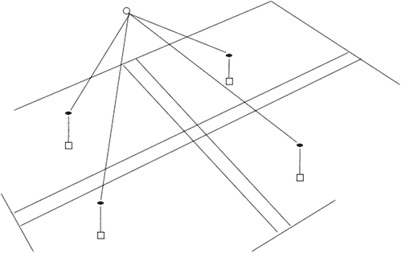

图 9.3 一个包含一个整合节点（圆形）、四个合成节点（点）和四个感知节点（正方形）的层级组织结构实例。

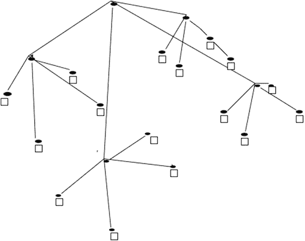

图 9.4 具有 5 个整合节点、16 个合成节点和 16 个感知节点的层级组织结构。

### 9.1.2

关联是指至少一个人的聚集，其存在的目的是为了执行某些任务安排，以便在监控大量指令的同时尝试完成许多目标。对目标实现方式的限制决定了所需准备的节奏，从而影响了关联的规模和多方面性质。例如，一个渐进式关联的目标是创建某一区域内车辆行为的具有重大意义的历史记录。完成该目标所需的任务包括识别和表征车辆产生的声学信号、根据区分的信号类型权衡特定类型车辆接近的证据，以及决定车辆在区域内的行驶路线并进行记录。

实现关联目标的指令强调了在时效性、开发成本、效能、完成度和质量等特征之间进行权衡的准备。例如，在信号理解任务中，我们可能要求框架在情况允许的情况下尽快对信息生成深度评估的翻译，从而最大限地强调时效性（短响应时间）和质量（准确理解）的特性，这可能会损害开发成本（预期的处理速度决定了相应的响应）。此外，通常预期适当框架是健壮的、能够适应中心故障，并且在框架错误增加时能够无缝地恢复执行性能。

### 9.1.3 组件

组织由部分组成。例如，渐进式关联有三个部分：检测、组合和协调中心。这些部分在实践上共同拥有的是完成这些任务时要使用的一系列职责和资源。

### 9.1.3.1 职责

部分执行任务。这些包括：对于实现关联动机至关重要的任务集；作为层级开销获取的任务；以及——特别是在人工系统中，某些任务违反或对关联动机没有贡献，但由于特殊原因，对该部分是必不可少的。确定职责的一种方法是将思维空间的子区域分配给部分，这些子区域的特征是层级任务 `[2]`。对于信号理解任务，思维空间的元素可能是框架所观察的物理区域、思维时刻（例如，特定类型信号的位置、一组信号是由特定类型车辆传递的选择等）、审议层级（各种类型的信号、信号组、车辆类型、车辆示例）以及时间。在整个为了信号翻译的关联中为了实现其目标而需要执行的所有任务中，检测中心仅执行信号识别任务。其他部分负责执行剩余的任务。

### 9.1.3.2 资源

部分拥有某些资源，并依靠这些资源执行其任务，因此一个部分所需的资源将取决于它在关联中所扮演的角色。我们描述了三种“类型”的资源：程序资源（信息）、设备资源（装置）和不同的部分（专家）。访问部分资源即是访问另一组程序和设备资源以及另一份部分联系人列表。

### 9.1.3.3 信息

我们同样描述了三种类型的信息：计算、数据库和能力。计算指示如何处理信息，数据库是数据的仓库，而能力是指主框架常见的启发式信息类型。位于每个中心的求解器可以融合任何或所有这些类型的信息 `[4]`。例如，计算和能力会指导中心如何解读信号信息以作为车辆接近的证据，以及如何跟踪这些车辆。某些信息可能是元级信息，用于决定何时适用应用空间显式信息。

### 9.1.3.4 装置

尽管有了关于如何执行任务的信息，专家可能仍需要特定的执行器来执行该任务。这些可以是执行器（机械臂，或机械臂在传感器期间可能使用的雪橇或扳手（传感器是检测中心用于识别信号的设备））。使用工具需要专家拥有额外信息：如何使用它。

### 9.1.3.5 专家和分包商

如果出现了超出部分能力范围的意外问题，了解某些拥有技能的人将是有帮助的。根据这些信息，该部分可以向主系统请求思维指导或就问题的解决方案达成共识。基本上，一个部分可能认为了解谁可以使用其信息、谁能为其提供缺失的信息，或者谁可以分担其准备负载是有帮助的。Smith 研究了一种用于适当思维的方法，称为契约网络方法，其中中心在面对其无法独自理解的问题时，会聘请该问题或其子问题的安排 `[2, 5]`。这种策略并不依赖于预先知道谁适合处理问题。

### 9.1.4 部分之间的关系

### 9.1.4.1 对应

至少两个片段之间最重要的连接是谁与谁对话。这种连接在图 9.1 和图 9.2 中表现得最为显著，其中每一条节点线都代表了一个通信连接的场合。通信连接用于区分片段获取特别重要的资产、数据数据的来源，并识别其产生数据的购买者。

同样，通信期间交换内容的细节也同样重要。将消息结构与通信连接关联起来的需求使得其启动变得复杂。它要求满足连接的实体还必须满足其消息结构是良好的要求。也就是说，如果一个实体希望以特定的组织格式发送包含某些数据的消息，那么连接中的另一个实体（假设双向情况）必须被配置为以类似的格式接收这些数据。

最后，将特定的通信策略与通信连接关联也可能是重要的。Durfee、Lesser 和 Corkill 研究了几种通信策略对分布式批判性思维系统全局行为的影响。

### 9.1.4.2 权限 (#chapter9.xhtml#re_ch-9-sec-12)

连接中的权限决定了对来自不同来源的消息（或者可能来自同一源的多个消息）应给予多少强调程度。如果消息具有权限，该部分可能会允许对其操作产生更显著的影响。在五枢纽关联中，协调节点可能被赋予引导协调节点在其分配的区域内搜索车辆证据的权限。一旦收到此类消息，一个组合节点可能会停止其已决定的任何处理（因为其可以访问的局部数据）并接管上述工作。


对一个位置应该投入多少关注？该部分可能意识到环境已经变化，而位置的方向现在不再适用。它们应该被遵循、忽略还是质疑？一个整合节点可能拥有非常充分的证据表明车辆的方向位于特定方向，而它却要求协调节点去查看其他地方。该节点必须选择是继续处理这些确定的信息，还是遵循集成器的指示。坦率地说，在节点之间存在单一多样性可能是很有吸引力的，某些组合节点对整合节点权限的倾向比其他节点更明显。对权限倾向较小的节点被称为自协调的或多疑的。`Reed` 和 `Lesser` 讨论了蜂群区域个体中自我课程（`self-course`）的重要性。`Corkill` 研究了在执行信号理解的传输批判性思维连接中使用疑节点。通常，层级关系可以用两个层面来描述：在一个（中等）全局的层面勾勒出连接及其成员，以及在局部层面阐述细节和个体的变化。

### 9.1.4.3 区域、距离等

关联的各个部分之间可能存在许多其他重要关系。例如，如果一个片段是价值随时间而减的物品的制造商，那么使用该物品的片段可能就在其附近，或者它们可能被放置在可靠运输网络的终端；制造商的销售工作站可能位于另一个国家，而不是同一个城市。用于信号翻译的关联中的传感节点应该跨越整个地区传输。整合节点需要与传感节点通信（尤其是在大多数情况下，传感节点的聚合），以检查这些节点的职责位置。

### 9.1.5 使用 EFIGE 的组织结构描述

本节介绍了 `EFIGE`，一种用于描述层级结构的语言。`EFIGE` 中的关联描述是多层级的 [1]。也就是说，它们由单个或复合结构组成，而复合结构的组成部分可能是单个或复合的。片段被赋予局部名称，受限制地启动，可以复制，并且作为参数属性的数据可以在它们之间分配。参数化的描述和片段的限制性启动允许描述被递归地表征，这就是多层级关联的情况。

字段用于确定个人在关联中的职责、列出个人履行其职责所需的资源，以及关于个人的在启动期间可能收集的额外信息，或可能提供用于衡量个人培训属性的数据。这些字段的属性从根本上是取决于应用程序的。我们引入的用于描述关联的多层级方法类似于不同语言的定义结构。赋予我们的方法额外能力的是在这一多层级系统中呈现的关联和限制条件。例如，几乎所有用于描述结构的语言都提供了它们自己的单个结构和复合结构。

### 9.1.6 约束求解算法

我们用于寻找关联协作需求解答的计算首先应用每个片段的偏好和收集指令，然后选择选择次数最少的片段。这样，一个组约束仅产生单一安排的整合节点将在任何具有至少两个选择的节点之前准备就。这种程序限制了在搜索树中的扩展，这是重要的，因为在选择分支时我们没有全局信息可以应用 [5, 6]。如果存在多个选择，则使用片段的偏好限制来选择其中一个。被选中的选择是一个局部安排。然后使用局部安排来生成全局安排。局部安排记录了协调节点将与之通信的传感节点，全局安排包含了所有的传感整合节点对。关联中尚未具有局部安排的不同个体的选择必须与刚刚选择的安排保持一致。为了使其他个体的选择是可预测的，它们应该：

1. 如果安排包含它们的名称，则包含片段名称。

2. 如果安排不包含它们的名称，则不包含片段名称。

冲突的次数被擦除，并选择当前次数最少的自然片段进行准备。

`EFIGE` 股份在所有方面都已针对 `Lisp` 实际化。描述由权威结构组成，用于分布式车辆监控测试平台 (`DVMT`) [[[4, 7]]。（例如在此部分使用的各种分级关联就是其中之一。）`DVMT` 重现了执行信号理解的传递问题解决器的过程。`EFIGE` 中的关联描述被解析并添加到参数记录中，该记录指示了即将在 `DVMT` 上进行的调查。一个关联的描述可以通过更改提供给描述参数的属性来创建关联的多次启动。这些预留结果必须手动生成——这是一种繁琐且容易出错的策略。

## 基础约束

目前，`EFIGE` 翻译器允许在描述引导的任何地方真实查找节点，并预期在任何需要的地方存在通信通道。基本上，框架被允许尽可能按需设计就绪系统。这对于最初在当前设计需求之外构建关联非常有帮助。升级 `EFIGE` 翻译器的下一个阶段是允许它在特定的系统工程下启动预定义类别的“最佳”关联。这包括确定对应特定系统工程的基础级需求，并将这些固定限制整合到关联的启动中 [7]]。底层指令指示启动的关联包含了具有给定属性的某些或全部属性的片段，或者实现了这些特定关系。此类需求可能会确定整个就绪系统，使得翻译器的任务是像最理想的那样启动关联的实用部分及其相对于无法提供完全理想建模帮助的物理系统上的关系；如果底层指令指示只有十二个处理节点，但其启动的关联需要三十七个，则协调器应将不同的分级节点分配给同一个处理器。

### 9.1.6.1 需求传播

考虑到组合情况，将限制或收集需求应用于空间中的所有个体可能是荒谬的。例如，`n` 个编排节点与检测节点通信的方式（其中任何给定的集成节点可以分配从零到所有检测节点的数量）的数量为 `2`。目前的计算尝试通过消除基于局部数据的项目增项来避免查看该集合中的所有对象。因此，如果集成节点 `A` 的限制需求选择检测节点 `P`，如果 `P` 的限制指令选择了 `A`，则验证 `P`。如果没有，则 `P` 作为 `A` 的可能性被排除 [1]]。这消除了对 `P` 和 `An` 配置的进一步思考，从而将搜索空间减半。遗憾的是，评估 `A` 的限制指令需要应用于区域内的所有检测节点，并对连接中的所有编排和检测节点重复执行。

提高效率的另一种方法是指令生成。在这种技术中，连接中部分所需的辅助器描述随着指令的评估被逐步开发。据信，指令生成允许释放日益具体的限制，在仅经过一次扫描（例如）后就能识别出既需要又被集成模式所需的检测节点。限制需求的生成已经在一些框架中实施，例如 `MOLGEN`。然而，`EFIGE` 中使用的更复杂限制的生成使得部分难以被分析。

### 9.1.6.2 指令效用

当大量指令被强制执行时，拥有能够明智地更改它们的选项以获得答案，或确定哪些必须满足、哪些可以安全地忽略或放弃是非常有价值的 [1, 2]]。这需要关于限制背后的动机信息（因为权威目标），以便对其重要性做出决策，并且需要发现冲突的能力以确定更改哪些指令。这通常可能是不可行的。`Fox` 分配了需求效用评估，这些评估随后可以用于判断特定情况下给定限制的实现或未实现的价值。效用最低的指令在未满足时更容易对结果产生负面影响。效用评估还用于回溯，以发现几乎做了不当决策的选择点。在这些点上会寻找并做出另一个决策，然后重新启动。

## 9.2 组织结构比较研究

**功能性**：功能性结构建立在构建的基础上，并分为具有特定工作或职责的小规模分组或集合。例如，一个企业可以在计算机技术、人工智能、市场营销（销售）以及财务和会计方面拥有大规模功能。每个分支都有一个主管或总经理，他们向排名中的执行层人员汇报 [6]。

![inline9.1]

**部门**：这种组织结构允许公司内部小组具有更大的自由度。这种结构的例子是通用电气。`GE` 拥有航空、运输、热能、数字和可再生能源等多个部门。

在该结构中，每个部分主要作为自己的组织进行运营，管理自己的资源，并控制在特定项目或分支上使用多少资金。

![inline9.2]

这种类型的结构为大型公司提供了巨大的弹性，允许每个部门作为独立的业务运行，向控股公司的首席执行官 (`CEO`) 或高级管理人员汇报。尽管每个计划都在极高级别获得了批准，但问题可以在部门级得到解决。

这种公司结构的缺点是，由于关注部门或分支，在个人部门执行相同工作的员工或人员之间可能无法进行良好的交流。这种结构增加了会计实践的难度，并可能产生税务影响。

![inline9.3]

**矩阵**：在给定的组织结构中，员工或工人根据情况或项目向多个老板汇报。例如，在正常工作情况下，大型工程公司的员工可能向一个经理汇报，但可能会出现一个需要公司特殊工程师的新项目。在项目的持续期间，该员工还将向该项目主管汇报，同时向其经理汇报所有其他日常任务或工作。

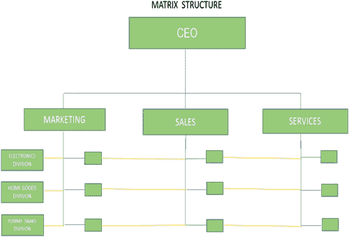

组织结构的比较研究强调了影响公司如何与内外部环境运行的不同组件之间的相似之处和差异。比较管理还包含了对不同文化和国家的分析，通过对不同组织进行比较，帮助经理识别它们之间的异同，从而提高组织的能力和效率。为了提高公司的表现（无论是在低水平还是高水平），其组织结构的发展都是必要的。

在分析不同国家公司的组织结构之前，有必要理解其定义和内容……这些国家在经济发展、文化水平和历史方面各不相同。拥有一个相对良好的组织结构的社会并不一定成功，但如果组织结构不当，发展中国家的任何公司长期来看无法在市场中生存。政府因素取决于国家的传统和既往事实。英国公司由董事会管理，董事会是公司主要的决策单元和组织结构中的权力来源 [1, 8]。股份有限公司（`PIC`）必须有一个由至少两个由股东任命的经理组成的管理委员会。其中一人是主席，他可以是公司的总经理（`GM`）。或者，总经理通常会被任命为行政经理。除了主席之外，公司还会有一名秘书，负责遵守法律并负责行政管理中的纪律。董事会的其他成员则不受限制。

## 9.3 结论

本研究再次证实，文化需要以一个关键目标为导向。组织需要采取网格式的策略，来思考其传统是有于产生预期结果，还是需要为了结果而进行改变。随着组织的扩张，执行人员修正了对系统改革的需求，并应该有效实施人员组成的引入和加强。基准测试（`Bench-marking`）可用于选择方案并推进现有的组织方法。

我们提出，分层结构的表述对于大型异构系统中分散式框架的实例化和支持至关重要。目前用于描述权威结构的方言不允许对裁量关系的描述，且不足以描述更层次需求的关系。我们识别了三种局限性（局限、汇聚和偏向），并利用它们来描述和启动裁量性的和复杂的层级关系。我们提供了一种计算方法，用于发现关系描述中协作需求的解决方案。最后，我们通过将这些策略融合到一种名为 `EFIGE` 的权威启动语言及其中介器中尝试了这些策略。在调查后，发现了一些局限性，包括会影响其能力的因素。

## 参考文献

1. `Pattison, H. Edward, Daniel D. Corkill, and Victor R. Lesser` . “组织结构描述的实例化.” `Distributed Intelligence` 1 (1987): 59–96.

2. `Horling, Bryan, and Victor Lesser` . “多智能体范式调查.” `Knowledge Engineering` 19.4 (2004): 281–316.

3. `Sims, Mark, Daniel Corkill, and Victor Lesser` . “多智能体组织设计与实例化中领域知识与协调知识的分离.” `Proceedings of AAA-04 Workshop on Agent Organizations: Theory and Practice`. `AAAI Press`, California, 2004: 1–7.

4. `de Kinderen, Sybren, and Monika Kaczmarek-Heß` . “基于模型的组织结构分析：一种支持组织结构设计与分析的多级建模评估.” `Software and Systems Modeling` 19.2 (2020): 313–343.

5. `Les Gasser, et al.` “分布式系统中的组织知识表示与使用.” `Distributed Intelligence`. `Morgan Kaufmann`, 1989: 55–78.

6. `Hannoun, Mahdi, et al.` “MOISE: 一种多智能体系统的组织模型.” In `Monard M.C., Sichman J.S.` (eds) `Advances in Artificial Intelligence`. `IBERIA 2000`. `Lecture Notes in Computer Science`, vol 1952. Berlin, 2000: 156–165.

7. `Malone, Thomas W., and Stephen A. Smith` . “组织结构性能建模.” `Operations Research` 36.3 (1988): 421–436.

8. `Kaufmann, Wesley L., Borry, and Leisha Hart-Davis` . “不仅是形式化：理解组织结构与官僚主义.” `Public Administration` 79.2.

## 10.1 引言

为了实现一种自定义编程环境，`R.Bisiani` [1] 设计了一套方法论、工具和架构，被称为 `Agora`。开发这种环境的需求是为了有效且快速地构建和评估异构人工智能应用。

### 10.1.1 适用于 Agora 的系统

1. 系统应该是异构的：这意味着不能使用单一的计算模型、机器或语言。

2. 系统应该处于快速演进状态：这意味着算法经常发生变化，但系统的某一部分保持不变，正如研究系统一样。

3. 系统在计算上应该是冗余的：这意味着单一处理器不足以完成所需的工作。

`Agora` 通过虚拟机对异构系统进行身份验证，这不依赖于语言，允许计算模型的多种变化。这可以准确地映射到大量不同的计算机架构上。`Agora` 对快速演进的支持与 `Lisp` 环境中的相同，即通过增量编程来辅助这一特性。

运行在并发虚拟机上的程序可以与环境结合，并与独立创建的程序共享相似的数据。这种技术提供了无尽的自定义环境，这些环境是根据用户的需求设计的。

无论如何，系统支持支持并行，因为无论它们如何在单个处理器上运行，它们始终被描述为并行计算。我们可以说，从应用的角度来看，`Agora` 并不是一个环境；基本上，它是应需求产生的，这种需求源于设计和实现 `CMU` 语音识别系统。

### 10.2 Agora 的架构

`Agora` 采用分层架构，使用分层模型来解释图 10.1 所示的从底部到底部的结构。

![图 10.1 Agora 的分层架构 [1, 3].](images/fig10.1.jpg)

图 10.1 `Agora` 的分层架构 [[1], [3]]。

第一层或底层是广泛（异构）处理器的网格。这些异构处理器可能是单进程处理器、松散连接的多处理器、共享内存多处理器或自定义硬件加速器。在所有这些异构处理器上执行计算所需的底层软件由 `Mach Operating System` 提供。将网格假说映射到真实机器上所需的工具由 `Agora` 提供。`Mach` 是一个兼容 `UNIX` 的操作系统，运行在多处理器上。

第二层是 `Mach` 层。该层的三个主要功能是：(1) 消息传递，(2) 共享内存和 (3) 线程。基本的交付过程是传递消息。消息传递的独特传输机制是通过在所有机器上运行所有 `Agora` 应用获得的。为了增强性能，使用了共享内存。线程也被称为轻量级进程。它包含自己的程序计数器、栈和一组寄存器。这些是与另一个进程共享地址空间的进程。线程有助于快速创建新的计算。

第三层是并发或并行虚拟机层。这一层处理 `Agora` 的汇编语言级。该层的功能是选择最合适的 `Mach` 原语，代码被汇编或组合然后进行链接，并将各种任务分配给机器。所有执行的数学计算将与机器无关。系统在这一层被完全描述。并行虚拟机层描述了框架，尽管用户负责编程其计算。

下一层，即第四层，是框架层。这是大多数研究程序应用程序所在的级别。创建了一个特殊环境，以便用户通过熟悉的术语进行通信。相关的框架执行应用系统的表示或解释、组装、调试和生产运行的函数。`ABE` 的框架与在 `Agora` 中使用的框架相似。框架提供了任何类型程序的生成和维护工具。例如，框架具有用于实现数据流或远程过程调用传输机制的虚拟机代码。框架使用一种工具来将现有的虚拟机代码与用户提供的代码合并。

框架使用结构化的图形化编辑器，允许用户根据数据流图理解编程。研究人员利用框架生成框架实例化（包括用户提供的数据和代码）。一个框架实例化将与其他框架链接，以创建一个复杂的框架。

### 10.3 Agora 的虚拟机

设计 `Agora` 虚拟机时要考虑两点：第一，机器应该能够准确地执行各种计算模型；其次，机器应该避免对计算机架构实现产生限制。`Agora` 将数据表示为一组相似类型的元素集合。称为 `clique`（簇）的全局结构存储了元素。每个 `clique` 都有一个独立的名称，定义了它的身份和类型。

`Agora` 强制用户将计算分解为独立的组件，称为知识源（`KS`），它们并行运行。`KS` 使用 `clique` 传输数据，并在生成特定模式的元素时转变为激活状态。每个 `clique` 的名称在创建时都会注册在 `Agora` 中。知道某个 `clique` 名称的特定 `KS` 将执行操作。由于名称是用例之间 `clique` 的全局共享，只需通过 `KS` 创建 `clique` 并在另一个用例中声明它是共享的。

### 10.3.1 元素簇 (EC)

每组相同类型的元素集合被称为元素簇。元素类型在 `KS` 代码中使用某种语言定义，这种语言有助于编程逻辑，并附带了一些额外信息。`Agora` 在代码交付给编译器或解释器之前，会从源代码中移除这些补充信息。在类型声明中添加的额外信息用于调度和调试目的，例如计算出的每秒访问次数、显示过程等。通过利用能力（`capabilities`），`KS` 访问 `EC` 中的元素。

`Agora` 的能力将被修改并用于将数据从 `clique` 复制到 `KS` 的地址空间，反之亦然。读取和添加元素是两种访问模式。尽管任何人都可以从 `EC` 读取内容，但只有当 `KS` 具有对 `EC` 的添加元素访问权限时，它才会添加元素。在任何情况下，一旦添加，元素就不能删除或修改。

### 10.3.2 知识源 (KS)

每个 `KS` 由一个或多个完全独立于系统的函数组成。每次调用此函数时调用 `Agora` 原语 `create KSs`，它会生成许多类似的 `KS` 实例。在创建 `KS` 实例时，将确定某些模式。一旦满足模式，`KS` 函数将被激活。模式根据到达事件和存储在元素中的数据值确定。

### 10.3.3 KS 映射到 Mach 层


在`KSs`创建之后，它们被映射到`Mach`原语`[5]`中。通过这种映射，一个`KS`可以与另一个`KS`聚类，从而从共享计算机资源中获益。类可以实现为共享内存的多进程，也可以实现为通过消息连接的多个处理器。在`Mach OS`上，相似`KS`的多次引用可以非常轻量或高效地实现，例如在单进程中通过多个用于数据处理的`Threads`来实现`KS`。任何`KS`都可以通过利用`Agora`原语（控制`KS`的计算范围）来实现聚类。

最后，`Agora Virtual Machine`提供了一种动态和统计性控制多进程处理的机制：`KS`将以多种方式分组，并在不同配置的处理器上动态实现，从而控制进程的分配。

### 10.3.4 框架 (Frameworks)

描述、构建和执行任何应用程序的主要接口是`Framework`级。框架提供了一个环境，该环境根据其所用系统组件的需求进行自适应。框架由一组限制在单一环境中的自定义工具组成。这允许工具协同工作，并通过共享工具信息来获益。`Agora`提供了一种简单的框架语言`CFrame`以促进共享。

### 10.3.4.1 典型框架工具

`Framework`中的工具是用户可以在框架内部调用的某种程序。工具可以是外部程序（如`C compiler`或`screen editor`），也可以是使用`Agora`创建的任何其他应用程序。每个`Framework`都包含一组最少的工具。工具应该提供`[2]`：

1. 任务描述：用户定义系统的机制。该描述包括定义系统结构（如果框架未预定义的话）以及提供用户提供的代码。

2. `Preprocessors`（预处理器）：`preprocessor`将用户提供的代码转换为并行虚拟机原语。这包括将用户提供的代码与`Framework`中描述的代码合并，以实现所需的编程模型。

3. 多进程运行与调试：用户界面允许用户在不同的真实机器上启动并运行系统。高级的`Framework`提供多处理器调试，能够持续监控内存活动，并对数量级的`EC`、`language debuggers`以及特定序列的`KS`等执行受控的启动响应。

4. `EC display`：一种允许用户查看运行系统数据的`EC`的机制。

5. `EC management`：至少必须有某些程序从文件将元素添加到`EC`中，反之亦然。为此，提供了一个`element editor`用于查看`EC`中的元素并向`EC`中添加新元素。

### 10.3.4.2 知识库：CFrame

`Agora`提供了一种名为`CFrame`的简单框架语言，它是根据`SRL`语言`[10]`设计的。`CFrame`允许程序和用户以语义网的形式存储和访问信息。`EC`存储语义网并由不同的工具共享，即使工具运行在不同的机器上。

## 10.4 系统示例

### 10.4.1 智能交通系统 (ITS)

`Agora`提供了一种动态和统计性控制多进程处理的机制：`KS`将以多种方式分组，并在不同配置的处理器上动态实现，从而控制进程的分配。

`Mach`原语`[5]`允许`KS`与另一个`KS`聚类，从而从共享计算机资源中获益。

相似`KS`的多次引用在`Mach OS`上可以非常轻量或高效地实现，例如在单进程中通过多个用于数据处理的`Threads`来实现`KS`。任何`KS`都可以通过利用`Agora`原语（控制`KS`的计算范围）来实现聚类。

### 10.4.1.1.2.1 服务端组件

`Agora`中的感兴趣区域被分为图 10.6 所示的质心。质心是位置坐标。超级节点`SN`控制质心集的库存，以管理可用质心集的全局视图。这些质心集通过`SM`分配给`RM`。每当`SM`收到来自任何`RM`的请求时，它就会分配一个新的质心并更新全局视图。但如果`SN`节点已经分配了该质心，则执行回滚。

创建`V2V`和`V2M`通信所需的动作序列如图 10.7 所示。

![FIGURE 10.7 使用 Agora 启动行人/车辆连接的序列图 [7]。](images/fig10.7.jpg)

FIGURE 10.7 使用 Agora 启动行人/车辆连接的序列图 [7]。

`TMC`是从车辆和行人接收的交通网络数据存储库。`TMC`架构如图 10.8 所示。

![FIGURE 10.8 交通管理中心 (TMC) 架构 [7]。](images/fig10.8.jpg)

FIGURE 10.8 交通管理中心 (TMC) 架构 [7]。

为了构建一个可扩展、负载均衡、容错且低延迟的框架，已采取了各种步骤，这些包括：

1. 首先，`RM`、`RM`备份和`SN`应该以分级的方式排列，以消除分层架构的固有缺点。

2. 其次，多个`SN`、`RM`和`RM`备份（`RM BAK`）的数量可能会引入冗余，划分工作负载，并为应用请求提供低延迟。

3. 第三，高交通密度区域中的质心集被限制为不能超过两个质心。

4. 第四，`V2V`和`V2M` Agora 数据包首先进行加密，然后通过`UDP`通信，以消除固有低包延迟的缺点。

### 10.4.1.1.2.2 客户端组件

客户端组件分别针对车辆和移动 Agora 用户分类为`VIS`和`MIS`。`VIS`和`MIS`都是 XML 配置的接口，并执行许多安全、效率和信息娱乐应用，如道路标志通知、应急响应的 VOIP 电话、上下文信息等。

实时状况应用是`VIS`和`MIS`的不可组成部分，它提供了邻车辆距离的详细信息。处于安全距离的邻车辆显示为绿色闪烁方块，而可能碰撞的警报显示为红色闪烁方块，近距离车辆（图 10.9）。

![FIGURE 10.9 车辆集成系统 (VIS) 界面 [7]。](images/fig10.9.jpg)

FIGURE 10.9 车辆集成系统 (VIS) 界面 [7]。

### 10.4.1.2 Agora ITS 应用

`Agora`为`VIS`和`MIS`提供各种项目应用，这些应用被分为安全、效率和信息娱乐类。

### 10.4.1.2.1 安全应用

设计安全应用目的是防止道路上生命和财产的损害。它包括行人警报、建议警报和政府 2.0，有助于根据当前地理位置向`TMC`报告危险道路状况。`Agora`通过基于 RFID 标签的用户限制应用提供安全应用（图 10.10）。

![FIGURE 10.10 行人警报；2. 政府 2.0；3. 基于 MIS 应用 [7]。](images/fig10.10.jpg)

FIGURE 10.10 行人警报；2. 政府 2.0；3. 基于 MIS 应用 [7]。

### 10.4.1.2.2 效率应用

效率应用顾名思义提高了交通网络的效率。该应用包括交通警报、消防车警报、救护车警报等。该应用使用`TMC` Web 服务根据车辆的地理位置获取数据。这帮助司机避开拥堵区域（图 10.11）。

![FIGURE 10.11 交通警报；2. 救护车警报应用 [7]。](images/fig10.11.jpg)

FIGURE 10.11 交通警报；2. 救护车警报应用 [7]。

### 10.4.1.2.3 信息娱乐应用

该应用包括寻找餐厅、天气、检查油价和碳排放等。该应用旨在为用户提供信息、娱乐和便利（图 10.12）。

![FIGURE 10.12 VIS 碳排放应用 [7]。](images/fig10.12.jpg)

FIGURE 10.12 VIS 碳排放应用 [7]。

### 10.4.2 CMU 语音识别

图 10.13 展示了`Agora`在设计 CMU 系统 ANGEL 中的用法。

![FIGURE 10.13 ANGEL 语音系统结构 [1, 3]。](images/fig10.13.jpg)

FIGURE 10.13 ANGEL 语音系统结构 [1, 3]。

声学和语音组件使用了数据流和黑板模式。顶层框架提供了用于数据流和远程过程调用的图形编辑器。顶层的每个子组件通过不同的框架设计。假设器被用作子组件`[9]`；它在回复的选定时间内应用束搜索算法并生成单词假设。语音假设和词汇是搜索的输入。称为锚点的标记用于指示时间。

假设器应该随机顺序接受音素和锚点。在检查整个声学-语音假设是否在锚点的 Delta 时间范围内可用后，对每个锚点执行搜索。

假设器需要两个函数：

1. `match()`函数，从音素中假设单词

2. `enough_phonemes()`条件函数，检查在锚点的时间间隔内是否有足够的音素。

`KS`设置会生成`KS`词假设器的实例化，该实例化每当锚点（anchors）到达时就会激活。当三个`KS`中的任何一个接受锚点时，该特定的`KS`会检查是否有足够的语音假设可用。如果有足够的语音假设，则`KS`执行`match`函数；如果没有足够的备用语音假设，则它将生成`KS`的实例化，等待直到所有必要的音素就绪后再执行`match`函数。当目标机器没有共享内存时，`KS`词假设器将被编译为任务。框架设计者需要高效使用的用例数量通过在`KS`创建过程中传递给`Agora`的参数来指示。

## 10.5 Agora 作为电子商务最小化分布式协议的应用

为了在电子商务中支持低接受成本的大批量交易，一种名为`Agora`的预定义协议被用作 Web 协议因为它有四个卓越特性：

1. **最小化（Minimal）**：`Agora`中交易的接受成本几乎相当于免费网页浏览，其成本基于消息数量计算。

2. **分布式（Distributed）**：`Agora`是完全分布式的。

3. **在线仲裁（Online arbitration）**：客户与商家之间的某些争议可以通过在线仲裁员解决。

4. **欺诈控制（Fraud control）**：`Agora`可以将欺诈水平限制在某些预定义的水平。

因此，我们可以说`Agora`是一个安全的、认证的且不可否认的协议，可以用于不安全的通信。

Gabber 和 Silberschatz [11] 在他们的研究中将银行视为控制客户和商家账户的金融机构。商家基本上是电子化销售商品的供应商。银行提供交易处理设施，信用卡公司也是如此。客户是电子化购买商品的终端用户。

Gabber 和 Silberschatz [11] 假设银行是信任的实体，而客户和商家是不被信任的。仲裁员是第四种实体，负责解决客户与商家之间的问题。

`Agora`是一种用于电子商务的 Web 协议，它是完全分布式的，需要 4 条消息来完成交易（包括货物传输），且无需中央权威访问。`Agora`消息将附加在现有的`http`消息中，无需任何额外消息。在该协议中，交易要求传输账户标识符而非资金，这就是为什么`Agora`被称为基于信用的协议。

## 10.5.1 基本协议

`Agora`协议中包含 4 个实体：银行、商家、客户和仲裁员。这里使用了多个银行的概念。每个银行都有一个唯一的标识符`Bid`、一个私钥`K[b]^s`和一个公钥`K[b]^p`。在客户和商家发起任何销售或购买之前，重要的要求是客户和商家必须拥有银行账户。

`Cacct`用于表示客户账户，而`Macct`用于指定商家账户。`Mname`是用于识别商家的唯一公共名称，这个唯一公共名称可以作为商家的 IP 地址或域名。`K[c]^s`和`K[m]^s`分别是客户和商家的私钥，而`K[c]^p`和`K[m]^p`分别是它们的公钥。

银行向客户和商家提供`ID`，客户和商家可以预设这些 ID 以识别自己的身份。客户的签名 ID 是`SCid`，而`SMid`是商家的签名 ID。仲裁员负责解决客户与商家之间的任何争议，而不一定由银行，但他们是信任的实体。仲裁员有权撤销已承诺的交易。`Aid`、`K[a]^s`、`K[a]^p`分别是每个仲裁员的唯一标识符、私钥和公钥。数字签名用于对`Agora`协议中的消息。

```
Sx = Ek), E 是加密函数，H 是安全的单向哈希函数，k 是签名者的私钥 K[x]^s
```

```
当 H(msg) = D[k] (S[x] (msg)), 则只有签名 S[x] (msg) 被验证，D 是描述函数，k 是签名者的公钥 K[x]^p。
```

对于消息签名，将使用以下符号：

* `Sa`使用仲裁员私钥`K[a]^s`对消息进行签名

* `Sb`使用银行私钥`K[b]^s`对消息进行签名

* `Sc`使用客户私钥`K[c]^s`对消息进行签名

* `Sm`使用商家私钥`K[m]^s`对消息进行签名

## 10.5.2 账户

银行向客户和商家提供`IDs`，这意味着客户和商家必须在某些银行开户。客户和商家 ID 仅在账单期间有效，银行在每个账单周期后生成新的 ID。在当前账单周期结束或下一个周期结束（也称为宽限期），这些 ID 将过期。通过这一程序，银行强制客户按时支付账单。

该协议假设为了防止暴力破解，所有参与者在每个账单周期都会修改他们的公钥和私钥。表 10.1 描述了商家和客户 ID 的生成，其中`x||y||z`用于解释`x`、`y`和`z`的拼接。

## 10.5.3 交易

`Agora`交易的消息控制流如图 10.14 所示。

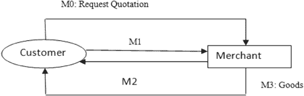

* `M0`——这是交易的开始。此消息表示客户向商家索报价。

* `M1`——这是来自商家的回复消息。

```
M1 = SMid || Seq || price¯ || Sm(H(Mid || price¯))
```

`Seq`是唯一的交易 ID；`price¯`是要求的货物价格。

* `M2`——在该消息中，客户首先验证`SMid`，检查`Mid`的过期日期，并将`Mname`与预期的商家名称比较，从`Mid`中提取`K[m]^p`，最后验证`Seq`和`price`。

```
M2 = SCid || Seq || price¯ || Sc(H(Cid || Mid || Seq || price¯))
```

* `M3`——在这里商家验证`SCid`，检查`Cid`的过期日期，从`Cid`中提取`K[c]^p`，验证`Seq`和`price`，并将`Seq`和`price`与`M1`比较。一旦`M2`通过所有测试，商家提交交易并向客户提供货物。最后，商家在账单周期结束前将交易提交给银行进行结算；`M1`和`M2`对构成了交易证明。

## 10.5.4 Agora 协议的属性

### 10.5.4.1 最小化

当任何网络电子商务协议产生的消息数量与免费网页浏览相同时，它就是最小化的。免费浏览中需要 HTTP 消息来获取页面，如图 10.15 所示。免费浏览期间产生的常规`http`消息可以被`Agora`协议承载，如图 10.15 所示。

![图 10.15 HTTP 消息中的寄载 [10].](images/fig10.15.jpg)

图 10.15 HTTP 消息中的寄载 [10]。

在这里，消息`M0`是菜单页面的普通`GET`请求。

`M1`消息由商户生成，用于菜单中引用的所有按次付费页面。`Menu`将`M1`封装起来，使得它们在浏览器中不可见。

`M2`消息在客户决定购买某个页面时，立即根据正确的`M1`消息生成。后续针对按次付费页面的`GET`请求包含`M2`作为参数。服务器根据按次付费页面的内容响应。

我们可以说`Agora`是一个极简协议，因为它完全嵌入在 HTTP 消息中。与免费网页浏览相比，`Agora`不会产生额外的消息，但某些消息会较长，主要是因为包含各种`M1`消息的菜单页面。

### 10.5.4.2 分布

由于客户和商户都会使用`K[b]p`（即后端公钥）在本地验证身份，因此`Agora`是完全分布式的。交易不需要预先准备，无需访问银行。商户仅在账单期间联系银行一次，以传输累计的交易。

#### 10.5.4.3 身份认证

商户和客户分别对`M1`和`M2`签名。`K[m]^p`和`K[c]^p`用于商户和客户验证签名。一旦`M2`经过验证，客户无法否认。客户和商户不会创建欺诈账户，因为银行的私钥会对所有的`ID`签名。

### 10.5.4.4 安全性

`Agora`能够防止任何可以拦截、重放或修改消息的入侵者。

### 10.5.4.4.1 重放

由于`M2`包含唯一的交易 ID 和商户 ID，旧的`M2`消息不能用于任何其他交易。重放`M0`会生成新的`M1`，而旧的`M2`消息永远不会匹配新的`M1`。

### 10.5.4.4.2 重复

由于每笔交易都有唯一的序列号`Seq`，商户无法对客户重复收费。这种双重收费会被银行立即检测到。

##### 10.5.4.4.3 修改

一旦客户签署了包含原始价格的`M2`，入侵者就无法更改商品的收费金额。

### 10.5.4.4.4 中间人攻击

中间人`Ϻ`可以拦截并更改商户和客户之间的所有消息。`Ϻ`用包含高价报价`Smid`的新`M1`替换`M1`，并用自己的密钥签名。一旦客户同意购买，`Ϻ`按照原始价格将`M2`提交给银行并通过商户交付商品。`Ϻ`利用原始价格与涨价之间的差额获利。但这种中间人攻击是不可能的，因为客户可以验证在`SMid`部分包含预期`Mname`的`M1`。

### 10.5.5 用于监管欺诈的增强协议

基础`Agora`协议容易受到两种主要欺诈类型：首先是客户欺诈；其次是被盗`ID`的欺诈使用。由于在不访问银行的情况下分布式验证客户 ID，上述两种欺诈可能会发生。

`E-Agora`用于指定增强型 Agora 协议，该协议允许低级欺诈。此增强协议使用了以下参数：`L`表示客户责任限制，`T`表示通知期，`R`表示每个周期`T`的最大购买率，`P`是概率`0 ≤ p ≤ 1`，`M`表示价格阈值。

##### 10.5.5.1 新消息


`E-Agora`协议是增强型`Agora`协议，通过在基础协议的基础上进行以下添加来解决欺诈问题。协议的控制流和消息在[图 10]中描述。

2. R. Bisiani, et al., “The Architecture of Agora Environment” 第 4 章，分布式人工智能，1, 99–117, 1987. [www.microsoft.com/en-us/research/publication/architecture-agora-environment/](http://www.microsoft.com)

3. M.A. Salahuddin, A. Al-Fuqaha, “Agora: 一个用于智能交通系统开发的多功能框架”，收于 D. Benhaddou, A. Al-Fuqaha (编辑)，《无线传感器与移动自接网络：车辆与空间应用》，Springer 出版（第 163–184 页），2015 年 1 月。

4. R. Bisiani, A.D Adams, “CMU 分布式语音识别系统”，第 11 次 DARPA 战略系统会议，美国海军研究生学院，加州蒙特利利，1985 年 10 月。

5. R. Baron, et al., “Mach-1: 一种大规模多处理器应用的操作系统环境”，IEEE Software, 2(4), 65–67, 1985 年 7 月。

6. L. Erman, et al., “ABE: 架构概述”，分布式人工智能工作会议论文集，加州海牧场，1985 年。

7. Motorola。Motomesh 1.2 网络设置与安装指南。Motorola，2006 年。[`manualzz.com/doc/25626506/motomesh-1.2-network-setup-and-installation-guide`](https://manualzz.com)

8. Y. Khaled, et al., “关于高效车辆应用的设计”，IEEE 车辆技术会议 (VTC)，巴塞罗那，2009 年。

9. P.E. Green, “AF: 一种实时分布式协作解决问题的框架”，1985 年 DAI 工作会议论文集，加州海牧场，1985 年 12 月。

10. M.S. Fox, J.M. Dermoh，数据库在知识库系统中的作用。机器人研究所 TR，卡内基基梅梅隆大学，1986 年。[www.researchgate.net/publication/2557994\_The\_Role\_of\_Databases\_in\_Knowledge-Based\_Systems](http://www.researchgate.net)

11. E. Gabber, A. Silberschatz, “Agora: 一种电子商务的极简分布式协议”，第 2 次 USENIX 电子商务工作会议论文，新泽西州穆雷山，1996 年。

# 11 用于分布式人工智能研究的 11 个测试床

Shubhangi Sankhyadhar 和 Mohit Pandey

## 目录

- 11.1 引言
- 11.2 背景
- 11.3 工具与方法
  - 11.3.1 MACE
    - 11.3.1.1 MACE 系统
  - 11.3.2 Actor 模型
  - 11.3.3 MICE 测试床
  - 11.3.4 ARCHON
    - 11.3.4.1 多智能体环境
    - 11.3.4.2 ARCHON 架构
  - 11.3.5 分布式车辆监控测试床 (DVMST)
  - 11.3.6 AGenDA 测试床
    - 11.3.6.1 架构级
    - 11.3.6.2 系统开发级
    - 11.3.6.3 其他用于 DAI 的测试床
- 11.4 结论

## 参考文献

## 11.1 引言

分布式人工智能 (DAI) 是人工智能的一个分支领域，已有二十多年的历史。DAI 是一种关注多个系统相互作用以实现目标的方法。更广泛地说，DAI 涉及智能体、车辆等。实验对于 DAI 来说至关重要，因为系统可能非常复杂并包含大量信息，最好将其分解为不同的部分以便正常运行（例如灵活性、模块化和效率）。DAI 在应用中起着关键作用，它为应用设计人员提供了一个创建智能体的平台，促进了智能体之间的通信，并提供了一个智能体执行某些操作的环境。

## 11.2 背景

DAI 研究人员关注理解和生成模型。人们倾向于将 DAI 分为两个主要领域：问题求解和多智能体系统。分布式问题求解 (DPS) 如何在多个协作并共享信息的模块（或“节点”）之间区分问题求解功能。在纯 DPS 程序中，所有交互（协作以及任何通信）都作为计划的一部分包含在内。多智能体 (MAS) 研究关注一组独立的（可能是预先存在的）机构的行为，其目标是解决给定问题。MAS 可以定义为“一个集成的问题求解网络集合，它们共同工作以解决超出它们控制范围的问题”。这些问题求解者通常被称为机构；它们是自动化的，并且本质上可能是复杂的（通过不同层级的问题求解来说明）。DAI 不关心问题求解层级和表示层级上相似过程之间的通信问题。也就是说，我们不为了每个单元进行良好的 AI 计算而关注对相同的过程进行相同的 AI 处理。实验是 DAI 的重要组成部分。通过考虑实验的重要性，已经开发了许多软件。本章讨论了一些测试床，包括 Actor 风格的语言`MACE`、基于 LISP 的软件`MICE`、基于 Prolog 的软件`PRS`、面向代理的编程`AOP`、`DAIS`、`METAT`和`ARCHON`。

## 11.3 工具与方法

DAI 通过提供一些科学构建和实践中的演示，为知识表示和问题求解带来了新的视角。我们正在为理解科学和人工智能投射了新的光芒。Konolige 和 Nilsson 认为，DAI 对我们理解人工智能至关重要。

## 11.4 结论

## 4. DAI 的研究有助于我们对基于自然语言的通信过程的理解 [5]。

传统的分布式计算和仿真算法允许程序员解决通信问题，并通过提供语言结构和合约控制过程，使系统可以使用其解决方案。在分布式人工智能（DAI）中，我们尝试通过设计问题解决者（通过通过解决协调问题，再解决解决方案）来提高灵活性 [6]。

DAI 应用的一个测试平台任务是此类应用的设计者提供必要的工具，以构建代理（agents）、描述它们的交互、构建它们运行的环境，并支持在计算机上对应用进行仿真。目前已经提出并实现了不同的 AI 系统测试平台，如`DVMT`、`MACE`、`MCS/IPEM`、`Actor`、`Concurrent MetaTem`、`Archon`、`Procedural Reasoning System`、`PHOENIX`、`TRUCKWORLD`、`TILEWORLD`、`ABCL/1`、`ABE MICE`以及`黑板架构（blackboard architecture）`。测试 DAI 的独立领域包括交通控制、空中交通控制、过程与生产控制、电信和个人电脑通信。已经开发了一些应用链接和问题解决框架，它们具有不同的层级、责任和知识，以及特定结果的共享。这些包括 [6]:

*   黑板框架（Blackboard frameworks）
*   合约框架（Contracting framework）
*   集成框架（Integrative framework）
*   开放系统框架（Open system frameworks）

## 11.3 工具与方法论

在所有科学发展的早期阶段，实验在开发新概念和将其转化为新颖理论方面起着重要作用。用于实验和测试的场所被称为`testbeds`（测试平台）。已经提出并实现了不同的 AI 系统测试平台，如`DVMT`、`MACE`、`MCS/IPEM`、`Actor`、`Concurrent MetaTem`、`Archon`、`Procedural Reasoning System`、`PHOENIX`、`TRUCKWORLD`、`TILEWORLD`、`ABCL/1`、`ABE MICE`以及`黑板架构”。

### 11.3.1 MACE

1985 年 12 月 3 日至 6 日在加利福尼亚的海牧场（Sea Ranch）举行了一场关于分布式人工智能（DAI）的研讨会。28 名参与者聚集讨论 DAI 的理论和实践。Les 和 [7] 讨论了分布式人工智能的理论本质，以及多处理器`DA1`测试平台的实现和一种名为`MACE`（用于多代理计算环境）的语言。`MACE`为 DAI 测试提供了具有跨学科多样性元素且涵盖一系列问题领域的高级支持。`MACE`的主要目标是提供一个编程环境。DAI 需要描述语言、仿真器和运行时环境（如处理器、处理器速度、网络互连和通信） [8]。`MACE`支持在不同复杂度水平检查不同风格的 DAI；此外，它有助于构建广泛的 DAI 系统。`MACE`环境将代理与处理器映射，并通过消息提供多个代理之间的通信。

`MACE`系统由代理及其通信组成，如图图 11.1 所示。`MACE`系统具有以下组件 [9]：

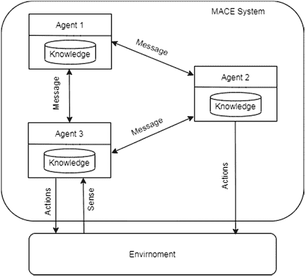

图 11.1 MACE 系统。

*   **代理集合（Collection of agents）**：`MACE`系统的基本计算单元是代理。`MACE`代理描述语言描述组织的代理簇。`MACE`代理是并发对象，由一个名为`and`的用户定义过程部分和引擎组成，以及一组数据库。
*   **系统代理社区（Community of system agent）**：`MACE`命令解释、用户界面、代理构建器簇、执行监控、跟踪、错误处理由若干预定义的系统代理提供。
*   **设施集合（Collection of facilities）**：所有代理都使用设施，包括模式匹配器、仿真器、多个标准代理引擎、标准错误处理程序以及所有代理都能理解的标准消息。
*   **仪器仪表化（Instrumentation）**：`MACE`是一个仪表化的测试平台，允许在广泛实验中对问题解决进行特征测量。最常见的测量是数据库大小、消息拥塞、代理的工作以及处理器节点的负载。
*   **描述数据库（Description database）**：包含由系统代理簇维护的代理描述。系统代理簇执行以下任务：
    *   构建新描述
    *   验证描述
    *   从描述构建可执行代理
*   **内核集合（Collection of kernels）**：`MACE`内核执行诸如调度代理执行、处理代理间的通信、代理与处理器的映射、代理间消息路由等功能。
*   **反射能力（Reflection capabilities）**：`MACE`代理的知识数据库由计划、角色、代理实现、课程、高级和行为反射能力组成。
*   **进化哲学（Evolutionary philosophy）**：`MACE`代理随时间变化并积累专业知识。`MACE`代理是自包含对象，拥有熟悉数据库、属性，并对收到的消息采取行动。

#### 11.3.1.1 MACE 系统

##### 11.3.1.1 MACE 代理

`MACE`代理是自包含对象，不继承自其他活跃对象（这些对象本质上是“社交的”，并通过消息与环境通信）。每个代理都有唯一的分类，并分配有一个唯一的地址。该地址包含：

*   代理名称
*   代理类
*   居住节点
*   运行的机器

`MACE`具有一些预定义的系统代理，如垃圾回收器、人员配置（“个人”）专家、故障控制专家、一个知道其他代理路由的`postmaster`（邮局），以及执行动态负载均衡的`allocators`集合等。

每个代理包含其他代理无法直接可见的属性，但其内容可以通过消息发送。

| 代理的属性 = 引擎 + 数据库 |
| --- |
| 属性包括： |

*   **类型 A**：定义代理的类。
*   **状态 (Status)**：描述事件的状态，即：运行、等待、新建、销毁或停止。
*   **引擎 (Engine)**：引擎是一个指示如何解释消息并改变其本地状态的函数。
*   **世界模型 (World Model)**：每个代理都有从世界模型提取的唯一地址。
*   **熟悉 (Acquaintance)**：封装`MACE`中的代理和知识。
*   **入站消息 (Incoming Messages)**：包含待接收消息的数据库。

注意：`MACE`中的消息是包含发送者和接收者地址的 LISP 列表。

##### 11.3.1.1 在 MACE 中的感知

代理通过接收消息感知世界，并被通知内部事件和系统事件。`MACE`代理可以监控两种类型的事件：

*   某些可见操作的结果事件。这些包括发送或接收消息、任何状态变化，或者创建或销毁新事件。此类事件由守护进程（Demons，从事件描述到消息的映射）监控。
*   由于内核操作或监控代理注意到状态变化而引起的事件。此类事件由`imps`（谓词-动作对）监控。

##### 11.3.1.3 在 MACE 中采取的行动

在智能体（agent）中，有两个可执行部分：其初始化代码和智能体引擎。当内核评估智能体引擎时，`MACE`执行一个动作。消息发送也是一种动作；消息可以单播、多播或广播给特定类的智能体。

智能体可以执行三种动作：

*   通过修改其属性来改变内部状态
*   向智能体或外部环境发送消息
*   向`MACE`内核发送监控请求

### 11.3.1.1.4 MACE ADL

*   为了描述智能体，`MACE`提供了一种名为`ADL`（代理描述语言）的语言；为了描述仿真和执行环境的方面，它提供了一种名为`EDL`（环境描述语言）的语言。
*   它是`LISP`的扩展。它提供了通用智能体类型（这些是不可执行的）以及被称为实际智能体的可执行实例的描述。
*   在`MACE`中，智能体被分组在组织（organizations）中，组织反过来提供单一的消息入口。
*   组织提供了封装和概念模块化。

### 11.3.2 Actor 模型

Actor 模型是一种用于并发计算的数学理论，它将“Actor”视为并发计算的通用原语。Actor 仅与允许进行通信的 Actor 建立通信，如图图 11.2 所示。

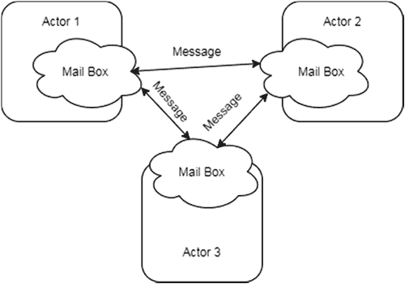

图 11.2 Actor 通信。

当 Actor 接收到消息时执行以下功能：

*   Actor 通过信箱（mailbox）传递消息与其他 Actor 通信
*   这创建了更多的 Actor
*   这还决定了接收下一条消息时应该采取什么行为

Actor 不共享内存，即 Actor 可以维护一个私有状态，该状态无法被另一个 Actor 修改。

Actor 模型应用了多种语言：

*   Act 1
*   Act 2
*   Act 3
*   ActTalk
*   ABCL
*   Erlang
*   Io
*   Scala
*   以及更多

在本节中，我们将描述用于`DAI`测试平台的某些语言。

1. A. `ABCL/1`：这是由 Akinori Yonezawa 在 1986 年开发的基于 Actor 的面向对象编程语言。
   *   `ABCL/1`的特性：
      1. I. `对象 (Objects)`：对象与 Actor 模型中描述的略有不同。每个对象都有自己的处理能力和本地内存。
         对象处于以下三种模式之一：
         1. i. `休眠 (Dormant)`：这是对象的初始状态。
         2. ii. `激活 (Active)`：每当对象接收到消息时，它就会进入激活模式。
         3. iii. `等待 (Waiting)`：当激活状态的对象需要某些特定消息时，它进入等待模式。
         借助图 11.3，可以很容易地理解对象的原理。
         `ABCL/1`中的对象定义为：
         *   `objectobject-name`
         *   `(本地内存的状态表示)`
         *   `(script (=> message-pattern where constraint…..action….))`
         注意：“where constraint”和对象名称是可选的。
      2. II. `消息传递 (Message Passing)`：
         Actor 之间的消息被分类为点对通信，这些消息不能被广播或多播。要向对象发送消息，发送对象必须知道接收对象的名称，因为发送对象忘记名称将导致遵循间接消息发送策略。`ABCL/1`有两种消息传递模式：
         1. i. `普通模式 (Ordinary Mode)`：当以普通模式向对象（`O`）发送消息（例如`M`）时，可能会出现以下情况：
            * • 如果`O`处于休眠模式，则如果消息`M`是接受的，`O`变为激活并开始执行，否则`M`被丢弃。
            * • 如果`O`处于激活模式，则`M`在队列中。
            * • 如果`O`处于等待状态，则检查`M`的可接受性，如果发现`M`可接受，则`O`重新激活；否则`M`被放入队列。
         2. ii. `快速模式 (Express Mode)`：它的工作方式就像中断，即它控制并监控对象，无论处于休眠、激活还是等待状态。

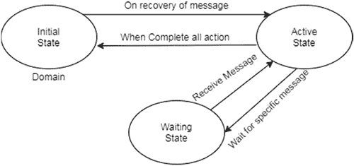

图 11.3 对象工作协议。

   *   `ABCL/1`的设计原则 [ [10, 11, ]:
      1. I. 消息传递的清晰语义：在需要传递消息的对象之间，语义应该是清晰且透明的。
      2. II. 对象间的消息传递基于底层的面向对象计算模型。

2. B. `ActTalk`：


`ActTalk` 并不是一种新语言，它只是嵌入在 `Smalltalk-80` 中的 Actor。`ActTalk` 是 Actor 模型的实现，因此它必须支持并发。为此，它利用了 `SmallTalk-80` 提供的进程和信号量，此外所取的 Actor 是对象、类和消息 [12]。`ActTalk` 内核是提供面向对象并发的基础。内核类集合提供了：

- `Actor 类`：定义对象的语义。
- `Actor 行为类`：定义 Actor 的行为。
- `Activity 类`：定义激活的内部活动

`ActTalk` 设计原则 [13]：

1. `ActTalk` 集成在 `SmallTalk-80` 的编程环境中。
2. `ActTalk` 拥有丰富的类库，提供了某些活动模型、语言结构、对象间的通信。
3. `ActTalk` 提供模块化方法，因为内核具有各种组件集。
4. `ActTalk` 提供了基础且标准的面向对象并发语义。

### 11.3.3 MICE 测试平台

`MICE`（密歇根智能协调）解决了异构环境中的协调技术问题。不同环境的特征可以使用 `MICE` 进行仿真 [14, 15]。

当多个智能体在同环境中协调时，我们之前的测试平台提供了满意的结果；但当要在异构环境中正确协调时，这些智能体会导致失败。

我们早期的语言如 `MACE`、`ACD` 关注智能体与环境或其他智能体之间的通信，即使它们还关注错误处理、监控等任务。

相反，`MICE` 是未来，它只关注智能体运行的环境。正如我们所知，实时环境是动态的，因此需要开发一种灵活的方法在动态环境中行动。

### 11.3.4 ARCHON

`ARCHON` 是一个软件框架，为 `DAI` 应用组件的交互提供了平台。它还提供了设计方法论来构建这些交互。`Arch` 项目应用于多个现实领域，如电输传输管理系统、粒子加速器控制、配电、水泥窑复杂的供应链控制以及柔性机器人单元的控制。

#### 11.3.4.1 多智能体环境

在 `ARCHON` 多智能体环境中，代理（agent）是解决问题目的的最小实体。代理可以处理自己的问题，并与社区中的其他代理进行通信。代理与其他社区成员的协作与通信有助于改进个体以及整个应用程序的解决方案。代理由 `Archon` 层和应用程序组成，也被称为智能系统。设计过程涉及多智能体环境，并包含两个主要阶段：问题分析和实际设计。包括文档化和识别现有系统、现有系统及其用户之间，以及不同用户之间的交互。在分析阶段，为了兼顾可维护性和可实现的并行性，现有系统可能会被拆分为几个代理。实际设计阶段同时考虑了现有系统和新系统。现有系统及其用户创建了一个部分自动化的多智能体系统。通过在分析阶段发现所有额外的协作动作并应用 `ARCHON` 架构工具，设计人员可以扩展并增强整个系统。

根据其计算机和软件需求，最初的 `ARCHON` 层使用 `LISP` 实现；后来扩展到 `C++`，现在运行在 `Sun4` 架构的 `UNIX` 上，以及在 `i386` 机器的 `Linux` 上。

#### 11.3.4.2 ARCHON 架构

`ARCHON` 软件已用于集成不同类型的应用程序，在这些应用中，代理是松耦合且半自主的。由于代理是松耦合的，各自信息系统（IS）之间的相互依赖数量被保持到最低；控制是去中心化的，就像代理是半自主的一样。在 `ARCHON` 社区中，每个代理都有自己的本地权限来控制其信息系统以及与其他代理的交互，即不存在全局权限。为了实现全局关联目标，需要代理之间进行交互，且这些交互由代理的 `AL` 支配。例如，向你认识的人请求信息，向你认识的人请求服务，以及自愿提供你认为对他人相关的信息。

代理需要：控制其本地信息系统内的操作，确定何时与其他机构交互（此时它需要展示其信息系统及该系统其他机构的能力），并与他人通信。这些基本需求被整合到 `ARCHON` 的架构和执行中（见图 11.4）。该构建任务由四个模块组成：

```
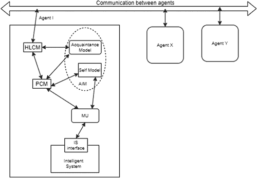
```

FIGURE 11.4 ARCHON 架构。

- 规划与网络模块 (PCM)
- 高级通信层
- 代理信息管理 (AIM)
- 高层通信 (HLCM)

每个信息系统功能都由监测单元 (MU) 表示。MU 控制本地信息系统。许多单元在 `Monitor` 或任何其他编程管理语言和 IS 硬件中提供标准接口。规划与网络模块 (PCM) 是 `ARCHON` 层的不可缺的一部分，它讨论了代理在更广泛的伙伴社区中的角色 [16, 17]。该模块应该评估代理的当前状态，并确定采取哪些步骤来促进与其他人的协作，同时确保代理对社区福利做出贡献。代理信息管理 (AIM) 模块是一个分布式管理系统，旨在为所属组织提供信息管理服务 [18]。在 `ARCHON` 中，它用于存储代理模型和领域级数据。高层通信 (HLCM) 允许代理根据 `TCP / IP` 协议使用资源进行通信。HLCM 包含了 `ISO / OSI 会话层` 功能，持续监控通信环境并自动调整中断。信息可以发送给指定的代理或相关组织。

软件和 `ARCHON` 已用于许多不同工业领域开发实时 DAI（分布式代理智能）策略，包括电力分配与供应、分销与配送、水泥控制、粒子加速控制、动态单细胞控制等。

### 11.3.5 分布式车辆监控测试台 (DVMST)

分布式车辆监控测试台产生了一个分布式知识型问题解决系统的计算模型，该系统运行在车辆监控任务的概念版本上。基础 DVMST 的工作原理如下：

1. 系统包含几个处理节点。
2. 每个节点都有一个声波检测传感器（声学检测传感器）。
3. 节点之间的通信通过无线通信网络完成。
4. 车辆的运动产生被噪声检测传感器感知到的声信号。
5. 为了检测车辆位置，我们可以对来自各种传感器的信息进行关联，以获得准确性结果。

由于以下原因，DVMST 是解决分布式问题解决任务的合适工具：

1. 它通过噪声传感器收集大量实时数据并将其分离到抽象地图中。
2. 信息被增量地分离到动态答案图中。
3. 复杂性很容易计算，因为它取决于车辆数量、运动模式以及收集传感器数据时的误差。
4. 它导致了广泛的时间（与时间相关）、空间（与空间相关）和功能网络（与网络功能相关）分解（见图 11.5）。

```
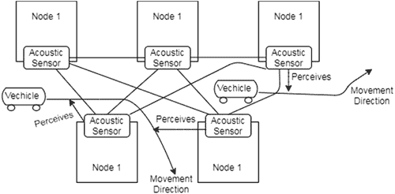
```

FIGURE 11.5 DVMT。

### 11.3.6 AGenDA 测试台

AGenDA 测试台由德国人工智能研究中心 (DFKI) 开发，这是一个德国的人工智能研究中心 [19]。该代理专注于系统中一组代理如何在实时环境中相互交互以实现共同目标。AGenDA 测试台分为两个层：

1. 架构层
2. 系统开发层

我们将详细描述每个层级：

#### 11.3.6.1 架构层

AGenDA 测试台的架构层设计使用 `InteRRap` 代理架构。`InteRRAP` 架构旨在组织和构建代理，并提供帮助代理在不稳定环境中交互的功能。`InteRRAP` 架构提供了以下特性：

- 代理应该知道应对意外情况。
- 代理应该以目标为导向工作。
- 代理必须以能够满足实时约束的方式解决任何任务
- 代理应该能够与其他现有代理协作

`InteRRap` 在知识库和功能部分之间定义了清晰的边界，同时它保持了模型的层级结构。`InteRRap` 的主要组件如图所示。信息在代理控制单元和层级知识库之间流动。控制单元的协作组件与知识库的协作组件通信。基于计划的组件从知识库的本地计划组件提取知识，而基于行为的组件从知识库的行为模式组件提取知识，第四个组件即世界接口组件，则从知识库的工作模型组件提取知识（见图 11.6）。

#### 11.3.6.2 系统开发级

该级别使用 `MAGSY System` 实现，这是一个基于规则的多智能体系统。

它为 DAI（分布式智能体）系统的构建构建、可视化以及评估提供了工具。在 `MAGSY` 中，智能体被描述为 `(F,R,S)`，其中：

- `F` = 代表智能体本地知识的事实（Facts）
- `R` = 规则集
- `S` = 智能体提供的服务集

#### 11.3.6.3 DAI 其他测试平台

1. **MCS 测试平台**

多智能体核心系统（`MCS`）是埃塞大学开发的一项 DAI 研究工具。`MCS` 基于 `PROLOG` 并运行在 `UNIX` 上。`MCS` 是基于实验的而非纯粹基于概念的。这些实验特别关注多智能体社区中“情境化”动作与基于“预测性”或“策略性”设计所产生的动作之间的联系，以及调整智能体社会模型内容对其行为和集体效率的影响。

2. **Phoenix 测试平台**

`Phoenix` 是一个基于 `LISP` 的测试平台。它为智能体提供了灵活的架构并提供了通信设施。`Phoenix` 测试平台提供的不仅仅是翻译功能。

3. **CADDIE 测试平台**

分布式智能体的控制与引导（`CADDIE`）。它是一个基于 `C++` 和 `PROLOG` 的测试平台。它提供了一个描述智能体及其之间通信的系统。它还提供了定义场景、收集以及分析数据的工具。

4. **并发 METATEM**

一种 DAI 的形式化语言，其中每个智能体通过表达其期望的功能来定义，它是为了直接产生智能体的实际运行而创建的瞬态心理信念（transient mental belie）。

5. **过程化推理系统 (PRS)**

它是构建智能体的一种常用方法，试图将来自实践且有意义的计划目标相结合；它已用于许多 DAI 实验。

## 11.4 结论

目前有多种测试平台可以解决分布式问题解决方法。测试平台的主要目标是在不一致的环境中提供多智能体通信。诸如 `MACE`、`ABCL`、`ActTAlk` 等测试平台侧重于智能体通信，而 `MICE` 是一个不仅关注通信，还关注智能体通信所在环境的测试平台。某些测试平台侧重于一种应用解决方法，例如 `DVMST`，它在有效解决特定问题方面有自己的优势，但同时，遵循这种方法会为 N 个问题生成测试平台。在现实环境中，事物是不稳定的，因此有许多此类 DAI 实验实现，能够处理不断变化的环境特性，并在智能体之间以及智能体与环境之间提供控的多智能体通信。

## 11. 参考文献

1. Bond, H., and L. Gasser. “What is DAI.” In Alan H. Bond, Leslie Gasser (eds.), `Reading in Distributed Artificial Intelligence`. San Francisco, CA, 1988.
2. Durfee, Edmund H., Victor R. Lesser, and Daniel D. Corkill. “Trends in cooperative distributed problem solving.” IEEE Transactions on Knowledge & Data Engineering` 1 (1989): 63–83.
3. Gasser, Les. “DAI approaches to coordination.” `Distributed Intelligence: Theory and Praxis` (1992): 31–51.
4. Konolige, Kurt, and Nils J. Nilsson. “Multiple-agent planning systems.” AAAI 80: 138–142.
5. O’Hare, Greg M., and Nicholas R. Jennings, eds. `Foundations of Distributed Intelligence`, Vol. 9. John Wiley & Sons, London, UK, 1996.
6. Gasser, Les. “Large-scale concurrent computing in artificial intelligence.” Proceedings of 3rd Conference on Hypercube Computers and Applications, Volume 2, California, 1989.
7. Gasser, Les. “The 1985 workshop on distributed intelligence.” AI Magazine 8(2): 91–97 (1987).
8. Heath, Michael T., ed. `Hypercube Multiprocessors`, 1987: Proceedings of the Second Conference on Hypercube Multiprocessors, Knoxville, Tennessee, September 29–October 1, 1986, Vol. 29.
9. Gasser, Les, Carl Braganza, and Nava Herman. “Implementing distributed AI systems using `MACE`.” In Alan H. Bond, Leslie Gasser (eds.), `Readings in Distributed Intelligence`. San Francisco, CA, 1988, 445–450.
10. Briot, J.-P., and Jean de Ratuld. “Design of a distributed implementation of `ABCL/I`.” Proceedings of the1988 ACM SIGPLAN Workshop on Object-Based Concurrent Programming, New York, 1988.
11. Yonezawa, Akinori, Jean-Pierre Briot, and Etsuya Shibayama. “Object-oriented concurrent programming in `ABCL/I`.” ACM SIGPLAN Notices 21.11 (1986): 258–268.
12. Briot, Jean-Pierre. “Actalk: a testbed for classifying and designing actor languages in the smalltalk-80 environment.” ECOOP 89: 109–129 (1989).
13. Briot, Jean-Pierre. “Actalk: a framework for object-oriented concurrent programming-design.” Object-Oriented Parallel and Distributed Computing II—Proceedings of the 2nd France-Japan workshop. (1999): 209–231.
14. Durfee, Edmund H., and Thomas A. Montgomery. “MICE: a flexible testbed for intelligent coordination.” Proceedings of the 9th Workshop on Distributed Artificial Intelligence, Bellevue, Washington. 1989.
15. Montgomery, Thomas A., and Edmund H. Durfee. “Using `MICE` to study intelligent coordination.” Proceedings of the 2nd International IEEE Conference on Tools for Artificial Intelligence. IEEE, Herndon, VA, 1990.
16. Jennings, Nicholas R. “The `ARCHON` system and its applications.” 2nd International Conference on Cooperating Knowledge Based Systems (CKBS-94). Keele, United Kingdom, 1994, 13–29.
17. Jennings, Nicholas R., and Jeff A. Pople. “Design and implementation of `ARCHON’s` coordination module.” Proceedings Workshop on Cooperating Knowledge Based Systems, Keele, UK, (1993): 61–82.
18. Visser, A., et al. “Application Study: Robot Arm Control, the Outcome of Using `AIM`.” Technical Report Archon UvA/TN014/93, Department of Computer Systems, University of Amsterdam, 1993.
19. Bajaj, Sandeep, et al. “Virtual Internet Testbed: Status and Research Agenda.” Technical Report 98-678, University of Southern California, 1998.

## 12.1 引言


分布式问题消除是对去中心化问题的有利安排，以及位于不同特定处理器节点上的信息代理（方法、规则集等）的近似组合。卡尔曼综合（Kallman syndrome，简称`KS`）的参与基于这样一个假设：即其中没有任何人拥有足够的数据来解决整个问题；共同知识的交换对于允许整个集合灵活地得出答案至关重要。通过民主化，我们指的是检查和控制信息都是合法的且有时是地理上分布的；既没有全局性的控制，也没有全局性的信息存储。对于松耦合的方法，单个`KS`将大部分时间花在计算而非通信上。分布式问题求解器（Distributed Problem Solver）提供了更好的速度、稳定的质量、扩展性、处理具有特征空间离散应用程序的能力，并因此具备承受未知数据和信息的能力。由于此类框架非常特殊，它们也提供了应用的清晰度和设计的简单性。

尽管在分布式处理方面已经做了大量工作，但大多数应用程序尚未关注对于安排人工智能（AI）问题求解器至关的问题。例如，大部分准备工作通常在中心站点完成，远程处理器仅限于基本的数据收集（例如信用卡检查）。虽然收集信息和准备工作并不罕见，但很少分散控制，因此处理器之间没有产生大量的协作。分布式处理领域的科学家们并没有将问题解决视为他们的核心兴趣。例如，人们通常预期一个全局化的问题存在，其中主要关注点遵循任务的理想静态循环、处理器节点间的互连技术、资源分配以及死锁消除。人们通常期望获得任务之间的时间和优先级关系的完整信息，因此，传输背后的重要目的被认为是负载调节（参见，例如 \[1, 2\]）。另一方面，分布式问题求解将问题的划分作为其核心目标的一部分。分布式问题求解与分布式准备框架之间的主要区别，通常通过考察框架的起点以及由此产生的机器互连灵感来发现。分布式处理框架通常根源于整合一个配备用于完成一系列广泛不同任务的机器系统。通常会设想一些特定的应用程序。每个应用程序都在一个节点构建（例如在一个提出的三节点框架期间，尝试融资、请求通行和过程控制）。其点是探索如何适应由于维持不同任务以理解使用各种机器的优势（共享数据库、敏捷容错等）而产生的任何冲突和缺点。遗憾的是，出现的冲突通常是专门的（例如，字长和数据库组），并包含了社会和政治问题 \[33\]。协调一系列不同任务的安排带来了对访问控制和安全等问题的需求，并促使将参与视为框架规划和设计层面上可能冲突的观点和愿望之间的某种交易。另一方面，在分布式问题求解中，一个任务被构想为框架，因此，要投入的资源没有其他预定义的任务要执行。框架再次被创建。随后，硬件和编程通常根据一点进行选择：即导致对有益行为产生最有利条件的决策。这还意味着协作被看作良好的问题解决行为；也就是说，准备好相互强制的框架如何成为一个高效的团队？因此，我们的兴趣在于创建用于意愿实体之间良好行为的系统，而不是用于将参与视为可能相互矛盾的元素之间某种交易的结构。

这促使我们思考协作节点之间的通信形式。我们主要关心节点间传递的信息内容，并相应的节点对数据用于有效解决问题的利用。我们较少关心影响通信的确切结构。

在本文中，分布式问题求解中的两种协作是任务共享（task-sharing）和结果共享（result-sharing）。在前者中，节点帮助共享执行总问题子任务的数值数据负担。节点通过共享支持总问题不同侧面的完整结果来相互帮助。另一种视角的出现是因为节点使用了不同的`KS`（例如，在对话框架案例中是语法结构与声学）或不同的信息（例如，在分布式检测框架案例中在不同区域检测的信息）。对于每种结构，都介绍了基本策略，并描述了使用它的框架。分析了这两种结构的实用性，并讨论了它们的关联性。

求解器的物理设计在这里并不是感兴趣的重点。它被认为是一个由松耦合、离散节点组成的系统。每个节点包含一组独特的`KS`。节点之间是互连的，这意味着通过发送消息，每个节点可以相互通信。节点不交换内存。

## 12.2 实时路线引导分布式系统框架

典型的路线引导方法设了一个中心控制器，能够预测驾驶者的起点终点（O-D）旅行愿望，理想地从开始到结束为每个司机分配一条路线，并在合理时重新路由 \[4, 5\]。集中框架的已知障碍包含了 TMC 与一个一个客户之间巨大的准备和通信需求。TMC 需要处理、存储和通信限制。因此，TMC 应该尽可能被过载 \[3\]。此外，此类框架被认为具有很高的运行成本 \[6\]。

相反，各种分级分布式模型为了适应私有化部署的持续响应式车辆路径引导方法，这些方法接受有限的可访问数据 \[7, 8\]。在大规模组织中，考虑到局部数据源和不可避免的干扰，对快速控制活动的需求明确建议了使用分布式数据和控制结构。虽然分布式框架在广播通信和计算系统控制等领域被广泛使用，但最近分布式框架已被认为是车辆交通系统中进行路径引导的一种良好方法。Hawas 和 Mahmassani \[9\]建立了一个非协作的去中心化结构和一组基于启发式的规则，用于响应式连续路径引导。这种去中心化结构的能力能够在空间上和瞬态上影响不断波动的信息程度。

与这种方法不同，它不依赖于之前的信息（或预期）以及时间相关的 OD（起点-目的地）请求。这种结构接受一组分布在系统上的局部控制器。每个局部控制器都负责为其领域范围内的车辆提供响应式路径引导。这些控制器是非协作的，因为它们不交换关于其特定领域内交通状态的信息。指示了结合了启发式评估能力的局部决策指南，反映了不断变化的洞察程度。这种非协作的去中心化设计在间歇性以及偶发情况下在计算上是高效的，并且在真实环境中强大且成功的 \[9\]。利用分布式多操作框架来改进动态路径引导和交通执行，已在 Adler 等人 \[10\]中有所阐述。车间通信（IVC）系统为交通路网管理问题提供了去中心化的解决方案 \[11, 13, 14\]。IVC 系统是灵活、自发系统的产物，没有固定基础，而是采用通用枢纽来组织路网功能。

有几种由 ITS 活动支持的 IVC 系统。FleetNet \[12\]利用 IVC 系统来提升驾驶员和旅行者的安全性和舒适度。VGrid \[11\]建议自治解决车辆交通流控制问题。TrafficView \[13\]描述了一个用于分散和收集由 IVC 支持的车辆信息的框架。

在一种交通安排中，Hawas、Napeñas 和 Hamdouch \[7\]创建了两种基于车间通信（IVC）的路径引导算法。虽然这些基于 IVC 的算法与集成框架相比是合理的，但目前仍存在许多挑战，如快速的拓扑变化、频繁的中断以及较小的有效系统跨度。由于车辆相对速度很高，IVC 组织遇到的是极快速的拓扑变化。同样，由于拥有 IVC 的车辆组织程度低，IVC 安排容易出现断裂。最后，由于可用性差，有效的系统测量值通常很小。这些观点在使用 IVC 技术时施加了限制。例如，人们必须在获取更广泛范围通信的额外可能性与由于通信质量差可能导致的性能下降之间进行权衡。

考虑到健壮框架所对应的巨大准备工作和高昂运营成本，以及基于 IVC 的框架所识别的不安全性和通信需求，本章旨在优雅改进 Hawas 和 Mahmassni 之前的工作 \[8\]。该改进旨在解决在普通纯净分布式框架内部经常遇到的循环问题。该改进通过允许改变的去中心化控制器之间进行数据交换（或协作）来实现。在一种情况下，我们研究了使用控制器协作来交换其领域交通状况数据的可能性。这种改进预计将克服基于 IVC 的框架与快速拓扑变化、连续断连和差通信相关的局限性，同时也克服了健壮框架在处理量和成本方面的限制。数据交换将扩展单个控制器的信息区域，并可能通过允许使用更高程度的知识来基于局部决策指南升级启发式评估能力的确定，从而提高控制质量。这种新框架将在本文中通过统一去中心化框架来实现。

## 12.3 协作的专家

一个在分布式处理器上工作的路径求解器，广为人知的类比可能是一群擅长合作的人类专家，他们试图完成一项巨大的任务。这种类比已用于一些 AI 框架 \[15, 16, 17, 18\]。

在任何情况下，如果`E1`知道哪些不同的专家具备必要的技能，他就可以直接向他们提供建议。如果万一他并不认识任何特定的、可以同样准备好帮助他的人（或者万一这项差事并不需要特殊能力），那么在那时，他可以向整个聚会描述这项任务。

如果另一个大师（`E2`）接受自己有能力完成`E1`所描述的任务，他会告知`E1`自己是可以提供帮助的，并可能展示他所具备的任何特别相关的技能。`E1`可能会找到几个这样的志愿者并在他们之间进行选择。被选中的志愿者要求`E1`提供额外的细微考量，因此，两人在任务执行期间将进行进一步的直接通信。

有待执行任务的人与具备执行此类任务的人员之间通过一种简单的交换方式建立联系，以分发手头的`Exceptional`（特殊）任务。在他们寻求解决方案的过程中，他们强有力地构建了子小组。

第二种协作适用于子问题无法由独立工作的专家单独解决的情况。在这种形式下，专家们定期向彼此报告他们在个人任务期间需要获得的部分结果。我们称这种结果的共享（例如`[17]`和`[19]`）。在这一协作模型中，假设已经进行了先验的问题划分，各个专家处理具有共同点的子问题（例如，解释来自重叠图像部分的数据）。当专家（`E1`）的子问题的部分结果可能与其邻居的处理有关时，他会向邻居（`E2`和`E3`）报告该子问题的部分结果。（例如，一个部分结果可能是`E1`仅使用可用信息和知识能获得的最优结果。）`E2`和`E3`尝试 (1) 使用`E1`的结果来确认或拒绝其子问题的竞争结果；或 (2) 将自己的部分结果与`E1`的结果聚合，以提供与`E1`子问题以及他们的问题相关的结果；或 (3) 使用`E1`的结果指出他们可能希望用于解决子问题的替代攻击方案。

子小组提供了两个优势。首先，个体之间的通信并不一定会分散整个聚会。这通常很重要，因为通信本身在大型聚会中可能是干扰和问题的真正根源。因此，建立协会的主要动机之一是减少所需的通信量。其次，子小组成员可以使用比整个聚会使用的语言更有针对性的语言进行交流。

## 12.4 分布式问题解决视角

本节针对一个合适的解决方案在解决障碍时经历的阶段提出了一个模型（见`图 12.1`）。该模型包含一个用于维持本章核心关注的两种协作类型的系统。它使我们能够确定这两种结构的用途、它们最适合的问题类型，并在此基础上它们相关的路径。

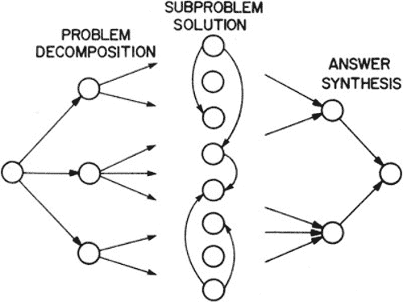

图 12.1 分布式问题解决阶段。

在主要阶段，问题被分解为子问题。如`图 12.1`所示，分解过程可能包括一系列划分指令；此外，该策略本身可能被用于以避免瓶颈。分解一直持续到创建出部分（不可分解的）子问题。例如，考虑一个简单的循环目标检测框架（`DSS`）。在复杂的分解阶段，在感兴趣区域的显式分内区分对象的子问题被表征并分配在可用的传感器之间。

后续阶段包括部分子问题的安排。如图所示，这可能需要中心节点之间的通信和参与以解开各个子问题。在`DSS`模型中，如果物体可以从一个区域移动到另一个区域，那么在子问题安排阶段 (1) 就需要通信，因此传感器就其邻居关于它们需要识别的物体的进展情况提供建议是有用的；或者 (2) 如果一个传感器在没有不同传感器帮助的情况下很难可靠地区分物体。

答案聚合在第三阶段进行；也就是说，子问题的组合形成了对通用问题答案的理解。与问题分解一样，答案聚合同样是分级和循环的。在`DSS`模型中，安排组合阶段包括对感兴趣区域内物体的引导。对于某些意外问题，这三个阶段的复杂性和重要性可能会发生波动。某些阶段可能缺失或微不足道。例如，在`[19]`中考虑的交通灯控制问题中，问题分解阶段不包含计算。交通灯控制器只需部署在每个交叉路口。对于`DSS`来说，问题分解通常由问题的空间分布直接建议的。

交通灯控制同样没有答案聚合阶段。对部分子问题的响应可能是相关交叉路口的顺畅交通流。没有机会汇总总的交通引导。因此，对通用问题的响应是通过子问题的答案获得的。（这通常适用于控制问题；注意，在任何情况下并不意味着理解子问题的中心之间的通信是不需要的。）

许多搜索问题（如符号连接`[20]`）同样包含一个微不足道的答案聚合阶段。当问题被分解并阐明后，唯一的答案聚合就是重述所遵循的步骤。在任何情况下，对于某些问题，安排阶段是主要的阶段。一个模型是`COGEN`程序`[21]`。`COGEN`用于原子结构解释。它产生符合给定方程的所有可能的分异构体。在复杂的分解阶段，`COGEN`产生符合数据的所有结构（通过首先创建中间结构、分解这些结构，以此类推直到只剩下含有原子或粒子的结构）。原子（如分子）通过名称和化合进行考量。

## 12.5 协作的注意事项

采用分布式方法最关键的一点可能是承认快速的并行计算。为了做到这一点，必须从战略距离上维持处理器之间“互不干扰”的情况。这依赖于问题本身（例如，某些问题的信息或计算无法被拆分为足够的自治部分，以让处理器处理全部内容）。尽管如此，这种方式也取决于并行计算的设计。因此，考虑用于参与的结构是合适的。请注意，无论如何，问题解决者都应该执行即使是完全的分解。节点甚至仍要做出妥协，由一个节点处理整个区域的某。在 AI 问题解决器中，会将技能划分为领域特定的`KS`，每个`KS`都精通通用问题的某个特定部分。`KS`的框架通常是为了评估为了解决特定问题而需要传递的不同类型的信息而构建的。例如，在我们的示例中，在关于话语本身信号的讨论中，从言语的语言结构到任务领域的语义`[22]`。关于构建哪些`KS`的决策通常是随着任务的进展式信息反映层级安排而做出的。例如，`HEARSAY-II`话语理解框架命令链中使用的和是参数化的、段的、语音的、表音、音节、词汇、短语和理论`[22]`。选择`KS`通常是为了处理某一程度考量的信息，或连接两个层级（参见例如`[22]`和`[23]`）。

在分布式处理器中，`KS`之间的关联比在单处理器中成本更高，因为在适当的工程中通信通常比计算慢得多。因此，参与系统必须限制处理器之间的通信。可用的通信通道也可能完全阻塞，导致节点在传输消息时被迫保持空闲。

作为一个过载通信可能导致问题的简单案例，考虑一个具有 100 个通过一个通信通道互连的节点的分布式处理器。假设所有节点都以每秒 108 指令的速度运行；计算和通信负载由所有节点共享。随后，并行计算工程的目标是每个节点必须为其执行的十个方向中的每个方向贡献微小部分。有了这些参数，可以清楚看出交换通道必须具有至少 1 Gbit/s 的传输能力（无论如何，忽略通道冲突的影响）`[18]`。如果数据传输能力很小，处理器将被被动地等待消息。

显然，有许多结构并不需要如此程度的通道传输速度。无论如何，原因仍然是必须特别考虑节点间通信和节点间通信。

## 12.6 任务共享

任务共享是一种参与类型，单个节点通过分担执行负担来相互帮助。任务共享在`图 12.2`中以图表形式指示。

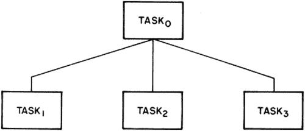

图 12.2 任务共享。

任务共享中要解决的关键问题是任务如何在处理器节点之间进行分发。必须有一种方法，使得有待执行任务的节点能够找到最合适的空闲节点来执行这些任务。我们称之为关联问题。解决关联问题对于维持问题解决器的焦点至关重要。

协议是通过一种近的公共确定程序建立的，该程序维护了信息的双向移动。总而言之，任务的负责人通过任务声明消息在各个枢纽中宣布任务的存在（图 12.3）。可用的节点（潜在的临时工作者）评估由少数几个主管发布的任务声明（图 12.4），并对它们认为合适的任务提交报价（图 12.5）。私有主管评估这些报价，并向其认为普遍适的节点授予合同以执行任务（图 12.6）。因此，负责人和临时工作者通过协议连接起来（图 12.7），并在协议执行期间进行隐密通信。

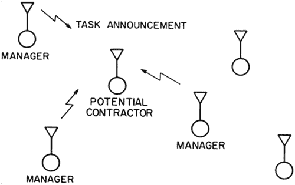

图 12.3 提交任务通知。

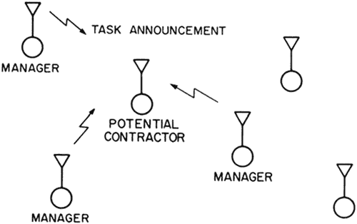

图 12.4 接收任务警报。

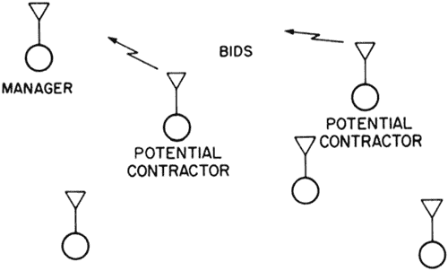

图 12.5 资质认证。

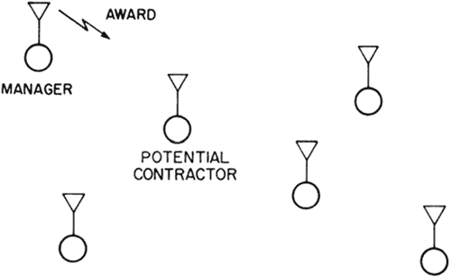

图 12.6 授予合同。

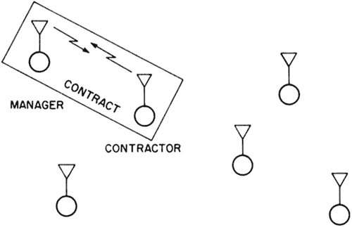

图 12.7 管理员与承包商之间的连接。

这种交换过程可能会重复。临时工作者可能会对任务进行分包并向不同的节点授予协议。此时，它就成了这些协议的管理员。这导致了任务共享中常见的各种分级控制结构。控制之所以被分散，是因为准备工作和通信并不是在特定的枢纽进行的，而是每个节点都适合承担和分发任务。这保持了与可能破坏执行的瓶颈之间的战略距离。它同样提高了可靠性，并在个人节点故障时允许执行过程的优雅降级。不存在任何其故障会完全阻碍协议安排过程的节点。

我们刚刚快速概述了交换过程。在执行过程中出现了一些不便之处。针对基础技术存在多种改进方案，使能够在不需要复杂性特性的特定关联中实现高效处理（例如，当进行简单的数据请求时）。请参见`[24]`。

接下来是一个任务安排案例，涉及数据检测和特征提取的社会活动。这源于一个应用数据检测系统（DSS）的重现`[25]`。检测问题被分配若干任务。我们将考虑这些任务中的一个——特征分配，它是在 DSS 活动的实施期间产生的。

该任务的主管是尚未具备检测能力但具有广泛处理能力的节点。它们打算发现一组传感器节点，并为它们提供信号特征标记。相反，传感器节点的处理能力有限，试图寻找主管，以便进一步处理它们从原始检测数据中提取的特征标记。

回顾一下，我们将节点间的通信视为一个拥有执行任务的节点与一个适合执行该任务的节点之间的理解。在某些情况下，对这种理解理想性质的判定取决于成员的视角。例如，从特征分配管理员的角度来看，最简单的临时工作者配置在包含区域具有良好的空间分配，并有足够的传感器类型流通。从对潜在特征分配合同工者的视角来看，相反，最简单的管理员是那些距离它们最近的，以减少潜在的通信问题。

协议网络规范中的每种消息类型都有留出任务特定数据的空间。这些空间的选择是为了捕捉节点之间方便传递的各种信息，以便在建立合适关联而不产生过度的通信。例如，特征分配声明包含以下字段：


# 任务反映字段

任务反映字段包含了任务类型，并以此反映管理员的状态。这允许潜在的临时工作者确定它应该向哪个主管响应。

# 资质详情字段

资质详情字段的内容表明，投标者必须具备检测能力，并且必须位于主管指定的相似区域内。这减少了冗余的消息流量，并通过明确确定主管认为基本的合同工作者特征提供了准备工作。

# 报价确定字段

报价确定字段表明，投标者必须标明其位置以及传感器的名称和形式。这通过指示主管必须选择合适临时工作者安排的信息，缩短了报价消息的长度。

潜在的合同工作者从迁移的主管处听到任务声明。如果合格，它们向最近的主管提交报价，其中包含任务声明中列出的数据。主管利用这些数据选择一组投标者，并随后授予特征合同。授权消息确定了临时工作者必须使用哪些传感器向其管理员优雅地标记特征信息。

在`DSS`中使用协议网络规范使得传感器框架的逐步安排成为可能，考虑到可用传感器和处理器节点的数量、它们的区域，以及通常解决通信的简易程度等因素。

安排为关联提供了比当前思维框架中更显著的工具。受协议网络规范影响的关联是许多人工智能编程语言的扩展（参见`[26]`的内部和外部对话）。

# 12.7 结果共享

结果共享为关联提供了一种比当前思维框架中存在的更显著的工具。

结果共享的一个基本用例是改进“正方形世界”（`squares world`）图像的可预测性标记`[27]`。一张正方形世界图像可能是一个轮廓，显示了场景中许多清晰物体（例如 3D 形状、楔形和金字塔）的边。每幅图像被视为一个图表，其节点（`hubs`）与图像内部物体的顶点相关，弧段与连接顶点的边对应。目标是确定图表内部节点曲线与真实物体之间的对应关系。

一个真实可行的顶点通常由一个从之前的候选名称中的集合给出，该集合取决于汇于该顶点的线条数量，从而形成了线条之间的点（例如“L”、“T”、“螺栓”和“叉口”）`[27]`。顶点还通过形成它的线条特征来进一步刻画（例如，一条线可以表征物体表面之间的弧形边界、该点光线与阴影之间的边界）。这种标记是通过观察分离顶点来定义的。由于对于每个顶点，大多数情况下只能完成一个名称，因此存在模糊性。尽管如此，通过考虑物体中提供边的顶点之间协作关系所强加的限制，潜在标记的数量通常会减少（通常减少到一个名称）。在海量的组合可构想的顶点类型中，只有少数在真实真实的物体中可以共享一个基础。沿着此，实现可预测图像标记的方法是将每个顶点的名称集与其邻居的名称集协调，并消除冲突的名称。

如果我们将问题合并为处理器节点负责图像内部的一个顶点，那么基本的结果共享程序就显而易见了。节点将其相邻的名称集传递给邻居。每个节点利用这些远程标记集的局部一致性来修剪自己的名称集。然后它将新的名称集传递给邻居。该策略持续进行直到所有节点都建立了特殊标记，或无法进一步进行修剪。（这种标记标记的迭代精炼过程被称为去展开、需求传播或范围限制。）

图 12.9 显示了`Waltz`考虑的一幅简单图像。出现在每个顶点相邻框内的数字表示了在没有任何内部顶点约束的情况下，该顶点可用的之前的标记数量。

![FIGURE 12.9 Sample blocks world issues (from \[28\]).](images/fig12.9.jpg)

FIGURE 12.9 示例区块世界问题（来自`[28]`）。

尽管来自正方形世界的图像中出现了不一致性，真实的图像也会受到由于嘈杂信息和错误的元素定位器而产生的模糊性的负面影响。图像再次被视为图表；但在这一次，节点对应于图像的小部分区域`[29, 30]`。这种设置下的测试标记是带有指示方向的线段或物体（例如门口、座位和垃圾桶）。

同样，与正方形世界问题一样，目标是通过考虑相邻节点的逻辑数据来为每个节点决定一个唯一的名称。在这种情况下，无法构想出直接的要求。相反，限制（或如它们被所称为兼容性）表达了与邻居节点识别的标记是可靠的某种程度（例如，在一个节点识别出的带有特定方向的线段与相邻节点区分的具有比例方向的另一个线段具有高度的相似性）。

该策略通过在可能的相邻组件识别的基础上与每个节点配对一个标记集合来实现。每个名称还分配了一个数值置信度量。与过去一样，节点现在将其相邻的名称集传递给邻居。每个节点不是修剪其标记集，而是利用这些远程名称集来刷新与其自身名称集中名称相关标识的信息估计。虽然已经建立了一种高水平的约定来鼓励任务共享`[24]`，但在结果共享的研究中还没有出现过非常相似的约定。我们正在逐步检查结果传递的对应结构，以扩展协议网约定并将其巩固。这种三步走的舞蹈通过使用一种逐个考虑每个顶点的联合计算解决了这个问题。该计算需要 80 次迭代才能为这幅图像准确地确定标记。

更新在上述描述的标记之间的通信的基础上完成，并加强或削弱每个名称的信息度量。该过程持续进行直到所有节点都建立了唯一的标记（即，每个节点的每个名称对于该节点相反名称的标记包含极大的置信度度量），或无法进行进一步的更新。

图 12.10 显示了`MSYS`考虑的类区域示例`[29]`。对于每个位置，显示了可能的理解以及它们来自之前的概率。此外，还展示了设置在任何将被解释为“座位”的区域上的限制。这些限制增加了位置事件应该解释为座位的信息。

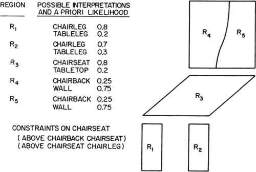

FIGURE 12.10 MSYS: reference debate.

分布式`HEARSAY-II`采用的技术与图像命名框架所采用的技术实际上相似。理论的渐进式优化受影响的方式在实际上类似于名称集的刷新。尽管如此，图像标记框架仅通过共享限制或对单个节点所完成结果的限制来实现参与化。而分布式`HEARSAY-II`采取了日益广泛的策略。它通过共享限制和对单个节点所完成的结果进行共同收集来实现协作（即：将相邻节点完成的局部理解组合起来，以形成越来越完整的翻译）。

在初步测试中，分布式`HEARSAY-II`中的结果共享方法表现出了影响信息和数据不确定性与脆弱性的迷人能力。在“质量搜寻”与“信息交换”权衡的微小偏移，结果共享方法倾向于累积而非交换：聚集局部的、模糊的方案有时比尝试灵活地构建一个完整且确定的单一方案要简单得多，而且实际上不会导致任何精度的损失。

# 12.8 任务共享与结果共享：对比分析

任务共享用于通过在节点之间建立明确的分配子任务关联来编排分解。产生的优先级对于作为结果合并的方法也有帮助。任务共享假设部分子问题通常由独立运行的单个节点理解，节点间的通信微乎其微。主要关注点是有效协调节点和任务，以便快速进行批判性思维。它对于适合刻画渐进式任务系统（例如启发式搜索）或信息审议阶段（例如音频或视频信号理解）的问题领域通常是有用的。此类问题允许分解为一组通常自由的子任务，而不需要全局数据或同步。单个子任务通常被分配给单独的处理器节点；这些节点随后能够执行子任务，而无需与其他节点进行通信。如果是如此，任务共享可能是一种处理分布式批判性思维所有三个阶段的极佳协作方式。

在结果共享框架中，节点面临着与任务共享框架中描述的相似的关联问题。在结果共享案例中，节点必须从所有产生的结果中选择要传输的真实结果，以及要传输这些结果的相反节点。对于源源不断的结果，节点必须决定是否承认它，以及采取何种操作来维护获得的结果。此外，总而言之，我们不能假设节点只与其邻居通信。这可能会阻碍解决涉及子问题间非局部协作问题的概率（例如，尽管网格图像中的阴影区域可能不相邻，但根据它们与光源的关系，它们应该是相关的）。问题在于，我们应该识别关联组织内部物理相邻性以及因果或数据依赖的接近性。

当部分子问题使其无法通过在与其他节点进行大量通信的情况下独立运行的节点解决时，结果共享用于促进子问题的排序。结果共享不为问题分解提供组件。因此，它必须单独作为一种协作，用于那些由分布式求解器外部的操作处理问题分解和子任务传递到单个节点的问题。结果共享为答案合并提供了一个微不足道的系统。在此引用中，它的用处在于，比例的结果共享组件通常用于答案合并，也用于子问题排序。

结果共享在以下问题领域通常是有用的：

1. 一个节点完成的结果影响或强制要求由另一个节点完成的任务（即：结果之间是相互应用的），
2. 结果共享驱动框架联合以回答问题（即：从远程节点获得的结果不会引起波动），以及
3. 结果共享驱动框架得出问题的精确答案。

由于所传递处理器之间计算/通信速度的不均匀，减少节点间通信对于任务共享和结果共享两类协作都至关重要。约定网络协议使用特定的任务声明过滤等组件来减少多余的报价，而分布式`HEARSAY-II`使用各种有趣的工具来限制节点之间传递的假设数量。例如，一种技术是仅考虑传输那些通过局部准备无法进一步细化或扩展的结果。（这种结果被归类为“局部完备”`[[31]]`）。

最近有人表示`[[19]]`，结果共享的重要优势地位在于其对脆弱性的韧性。尽管如此，有趣的是，任务共享甚至可能实现对脆弱性的韧性。例如，考虑一个应用程序，其中三个节点试图理解从图像覆盖部分提取信息的统一翻译。在结果共享方法中，它们打算通过共享数据的不完整翻译来达成一致。在任务共享方法中，三个节点再次处理它们自己的部分信息，而不是将它们的不完整翻译传给彼此，而是将它们传递给第四个节点（合同网络术语中的管理员），该节点负责查看异常。该节点有时会利用最佳当前信息和局部理解，对三个不同的节点进行重新分配任务。仍然存在选择何时结束批判性思维活动以及选择哪个节点回答集群外客户的问题。在分布式`HEARSAY-II`框架中，所有节点最终将确定整个表达式的翻译。这对于三节点框架可能是可以接受的，但对于更大框架会导致不适当的通信量。这个简化模型突出了分布式批判性思维中主要的、未解决问题之一——即在控制分散在多个独立节点的框架中实现合理行为的最佳方法。当需要准备的任务或结果的数量超过实际节点的数量时，拥有待共享任务或结果的节点必须寻求集群的关注和资源。

由于任务共享，必须构建相应的工具来确保每个子问题都得到了真实处理，并防止处理器在尝试解析不可区分的子问题时产生相互干扰，同时避免某些子问题被无意中忽略。此外，最终影响答案的子问题其准备程度倾向于不会引起冲突的子问题，这是至关重要的。我们提出了“安排”（`arrangement`）作为一种处理这些问题的系统，并据此构建了协作网络协议`[19]`。然而，显然仍有许多工作需要完成。

由于结果共享，必须确保节点之间能够相互影响，以合并成一个精确的安排。事实上，即使从外部节点获得的不完整结果也可能为任务提供有效的新的搜索方向，但它们也可能产生干扰。在关于结果共享框架的后续工作中，人们发现不同节点产生的置信度量往往非常难以整合。例如，在传输的`HEARSAY-II`中发现，集成方法使用的置信度估计对于分布式定义并不真正适用。结果是，远程创建的结果有时会让节点追求那些并不有效的搜索方向，因为它们在收到这些结果之前已经在寻找其他方向了。从传输过程中丢失部分结果的分析中可以找到这种现象的证据。有时，框架的执行效率确实提高了，这表明节点有时会占据其邻居。再次，该领域仍有许多工作需要解决。在关联假设术语中，第四个节点完成一个“整合任务”。这种分级控制可能是人类组织为了影响脆弱性的一种标准组件`[11, 12]`。在协作网络方法中，任务负责人最适合执行此类职责。

# 12.9 结论

研究了分布式计算中两种相关的参与类型：任务共享和结果共享。这些结构对于不同类型的问题以及分布式计算的不同阶段具有价值。任务共享在分布式计算的复杂分解和答案组合阶段非常有利。它假设子问题的安排可以在节点间通信极少的情况下完成。当部分子问题无法在不与其他节点通信的情况下由自治工作的节点理解时，结果共享有助于子问题的安排阶段。它在适当的响应合并阶段也很有用——特别是对于那些安排阶段是子问题安排阶段的延续的问题。从长远来看，我们希望确定能够同时利用这两种协作类型的框架，利用各自的特性来解决问题，或者使任何一种形式在没有另一种形式的情况下具有足够的创新性。

# 参考文献

1. `[1]`. J. L. Baer, “A survey of some theoretical aspects of multiprocessing,” Computing Surveys, Vol. 5, 1973, pp. 31–80.

2. `[2]`. E. K. Bowdon, Sr., and W. J. Barr, “Cost-effective priority assignment in network computers,” in FJCC Proceedings, Vol. 41,R. Davis and R. G. Smith, Eds. Montvale, NJ: AFIPS Press, 1972, pp. 755–763.

3. `[3]`. C. R. D’Olivera, An Analysis of Computer Decentralization, Cambridge: Massachusetts Institute of Technology, MIT LCS-TM-90, October 1977.

4. `[4]`. L. Chen, et al., “VGITS: ITS based on intervehicle communication networks and grid technology,” Journal of Network and Computer Applications, Vol. 31, No. 3, 2007, pp. 285–302. doi:10.1016/j.jnca.2006.11.002

5. `[5]`. Y. E. Hawas, “A microscopic simulation model for incident modeling in urban networks,” Transportation Planning and Technology, Vol. 30, No. 2, 2007, pp. 289–309. doi:10.1080/03081060701398117

6. `[6]`. Y. E. Hawas, et al., “Comparative assessment of Inter Vehicular Communication (IVC) algorithms for real-time traffic route guidance,” Journal of Intelligent Transportation Systems: Technology Planning and Operations, Vol. 13, No. 4, 2009, pp. 199–217. doi:10.1080

7. `[7]`. Y. E. Hawas, and M. A. Hameed, “A multi-stage procedure,” Transportation Planning and Technology, Vol. 32, No. 1, 2009, pp. 71–91.

8. `[8]`. Y. E. Hawas, and H. S. Mahmassani, Experiments with a Rolling Horizon Dynamic Route Algorithm: Robustness under Stochastic Demands. Transportation Research, Vol. 15, 1996, pp. 83–90.

9. `[9]`. J. Chen, et al., “Research on traffic,” Proceedings of the IEEE 61st Vehicular, Vol. 61, No. 5, 2005, pp. 290.

10. `[10]`. J. Chen, et al., “A grid,” Journal of Computer Search and Development, Vol. 40, No. 12, 2003, pp. 1676–1681.

11. `[11]`. H. S. Mahmassani, System Optimal Dynamic Assignment in a Congested Traffic. Heidelberg: Springer-Verlag, 1995.

12. `[12]`. H. S. Mahmassani, and Y. E. Hawas, Paper presented at the INFORMS, Atlanta, 1996.

13. `[13]`. R. G. Smith, A Framework for Problem-Solving in a Environment.

14. `[14]`. V. R. Lesser, et al., Working Papers in Distributed Computation I: Cooperative Distributed Problem Solving. Amherst: Department of Computer and Information Science, University of Massachusetts, July 1979.

15. `[15]`. C. Hewitt, “Viewing control structures as patterns of passing messages,” Artificial Intelligence, Vol. 8, 1977, pp. 323–364.

16. `[16]`. D. B. Lenat, “Beings: knowledge as interacting experts,” in Proceeding of the 4th International Joint Conference on Artificial Intelligence, September 1975, pp. 126–133.

17. `[17]`. V. R. Lesser, R. D. Fennell, L. D. Erman, and D. R. Reddy, “Organization of the HEARSAY II speech understanding system,” IEEE Transactions Acoust Speech and Signal Process, Vol. ASSP-23, 1975, pp. 11–24.

20. N. J. Nilsson, 《Problem Solving Methods in Artificial Intelligence*. New York: McGraw-Hill, 1971.


21. R. E. Carhart, D. H. Smith, H. Brown, and C. Djerassi, “Applications of artificial intelligence for chemical inference—XVII: an approach to computer-assisted elucidation of molecular structure,” *Journal of the American Chemical Society*, Vol. 97, 1975, pp. 5755–5762.

22. L. D. Erman, and V. R. Lesser, “A multi-level organization for problem-solving using many, diverse, cooperating sources of knowledge,” in *Proceeding of the 4th International Joint Conference on Artificial Intelligence*, September 1975, pp. 483–490. [https://dl.acm.org/doi/10.5555/1624626.1624702](https://dl.acm.org/doi/10.5555/1624626.1624702)

23. H. P. Nii, and E. A. Feigenbaum, “Rule-based understanding of signals,” in *Pattern-Directed Inference Systems*, D. A. Waterman and F. Hayes-Roth, Eds. New York: Academic, 1978, pp. 483–501.

24. R. G. Smith, “The contract net protocol: high-level communication and control in a distributed problem solver,” *IEEE Transactions on Computers*, Vol. C-29, 1980, pp. 1104–1113.

25. R. G. Smith, and R. Davis, “Applications of the contract net framework: distributed sensing,” in *Proceedings of the ARPA Distributed Sensor Net Symposium*. Pittsburgh, PA, December 1978, pp. 12–20.

26. R. Davis, and R. G. Smith, “Negotiation as a metaphor for distributed problem solving,” *Artificial Intelligence*, Vol. 20, No. 1, 1983, pp. 63–109. doi: 10.1016/0004-3702(83)90015-2

27. D. L. Waltz, *Generating Semantic Descriptions from Drawings of Scenes With Shadows*. Cambridge: Massachusetts Institute of Technology, MIT AI-TR.-271, November 1972.

28. P. H. Winston, *Artificial Intelligence*. Reading, MA: Addison-Wesley, 1977.

29. H. G. Barrow, and J. M. Tenenbaum, *MSYS: A System for Reasoning About Scenes*. Menlo Park, CA: SRI International, SRI TN 121, April 1976.

30. S. W. Zucker, R. A. Hummel, and A. Rosenfeld, “An application of relaxation to the labeling and curve,” *IEEE Transactions on Computers*, Vol. C-26, 1977, pp. 394–403.

31. V. R. Lesser and L. D. Erman, “Distributed interpretation: a model,” *IEEE Transactions on Computers*, Vol. C-29, 1980, pp. 1144–1163.

# 基于深度神经网络的入侵检测系统的车辆安全抗攻击且高效协议对比研究

## 13.1 引言

近年来，工业界和学术界都关注能够支持高移动性宽带连接的无线网络 [1-2-3]。特别是联动汽车或车辆网络的定义，如图 13.1 所示。它在现代车辆连接性中引起了巨大的关注。随着最新的车载计算和识别方法的发展，它是敏锐运输系统和智能城市的关键赋能者 [4-5-6]。最终，这一代新网络将对社会产生重大影响，让日常出行更加健康、更绿色、更高效且更轻松。除了各种人工智能（`AI`）技术的进步外，它还为第五代移动通信（`5G`）的自动驾驶铺平了道路。

## 13.2 相关工作

## 13.3 背景

### 13.3.1 处理阶段

### 13.3.2 训练阶段

## 13.4 入侵检测系统

## 13.5 基于机器学习的 IDS

## 13.6 提出的技术

### 13.6.1 提出的深度神经网络入侵系统

### 13.6.2 深度神经网络的训练

#### 13.6.2.1 ANN 参数

#### 13.6.2.2 输入层神经元

#### 13.6.2.3 隐藏层神经元

#### 13.6.2.4 输出层神经元

#### 13.6.2.5 传递函数

## 13.7 仿真参数

### 13.7.1 平均端到端延迟

### 13.7.2 平均能量消耗

### 13.7.3 平均网络吞吐量

### 13.7.4 数据包交付率 (`PDR`)

## 13.8 结论

## 参考文献

# 车载网络资源分配

近年来，图论技术在车载网络资源分配设计中得到了广泛审查 \[15]。车辆应用严苛且异构的服务质量（QoS）规范以及车载环境中强烈的固有动态性，为开发高移动性环境提供有效且高效的无线网络带来了重大挑战。四种车载自接通信与上述的车载自接设备机制密切相关，并描述了图 13.1 所示每种通信类型的主要功能 \[16, 17]。

在车载移动自网络（`VANETs`）科学中（也称为车载域），引入车载通信正变得越来越重要。汽车的运行效率，尤其是疲劳和司机嗜睡，对驾驶员和公共安全至关重要 \[18, 19]。

`V2V` 连接将为驾驶员提供一个共享信息和警告消息的数据交换通道。`VANETs` 的另一个有用的研究领域是车路基础设施（`V2I`）连接，使驾驶员能够实时跟踪交通和天气，并提供环境感知和监控 \[20, 21]。`V2V` 连接将为驾驶员提供一个共享信息和警告消息的数据交换通道。`VANETs` 的另一个有用的研究领域是车路基础设施（`V2I`）连接，使驾驶员能够实时跟踪交通和天气，并提供交通细节和监控数据。

这种不当行为对网络产生了若干负面影响，例如：(1) 降低网络可靠性；(2) 增加簇的间隔，导致需要监控机制来检测这种违规的多路中继（`MPR`）。许多幸存的进程是非协作的，这通常会导致不可信的选择。

这种不当行为对网络产生了若干负面影响 \[22]，例如：(1) 降低网络可靠性；(2) 增加簇的间隔，导致需要监控机制来检测这种违规的 `MPR`。许多幸存的进程是非协作的，这通常会导致不可信的选择 \[23]。随机移动系统路点（`RWMM`）和参考点组移动（`RPGM`）的高斯-马尔可夫模型、曼哈顿模型用于仿真和评估测试 \[23, 24]。随机移动系统路点（`RWMM`）和参考点组移动（`RPGM`）的高斯-马尔可夫模型、曼哈顿模型用于仿真和评估测试 \[23, 24]。这种不当行为对网络产生了若干负面影响：(1) 降低网络可靠性；(2) 增加簇的间隔，导致需要监控机制来检测这种违规的 `MPR`。许多幸存的进程是非协作的，这通常会导致不可信的选择。随机移动系统路点（`RWMM`）和参考点组移动（`RPGM`）的高斯-马尔可夫模型、曼哈顿模型用于仿真和评估测试 \[23, 24]。

### VANET 与通信机制

在车载移动自网络（`VANETs`）科学中（也称为车载域），引入车载通信正变得越来越重要。汽车的运行效率，尤其是疲劳和司机嗜睡，对驾驶员和公共安全至关重要 \[18, 19]。

`V2V` 连接将为驾驶员提供一个共享信息和警告消息的数据交换通道。`VANETs` 的另一个有用的研究领域是车路基础设施（`V2I`）连接，使驾驶员能够实时跟踪交通和天气，并提供环境感知和监控 \[20, 21]。`V2V` 连接将为驾驶员提供一个共享信息和警告消息的数据交换通道。`VANETs` 的另一个有用的研究领域是车路基础设施（`V2I`）连接，使驾驶员能够实时跟踪交通和天气，并提供交通细节和监控数据。

### 违规行为的影响

这种不当行为对网络产生了若干负面影响，例如：(1) 降低网络可靠性；(2) 增加簇的间隔，导致需要监控机制来检测这种违规的 `MPR`。许多幸存的进程是非协作的，这通常会导致不可信的选择。

这种不当行为对网络产生了若干负面影响 \[22]，例如：(1) 降低网络可靠性；(2) 增加簇的间隔，导致需要监控机制来检测这种违规的 `MPR`。许多幸存的进程是非协作的，这通常会导致不可信的选择 \[23]。随机移动系统路点（`RWMM`）和参考点组移动（`RPGM`）的高斯-马尔可夫模型、曼哈顿模型用于仿真和评估测试 \[23, 24]。

### 检测与仿真

这种不当行为对网络产生了若干负面影响：(1) 降低网络可靠性；(2) 增加簇的间隔，导致需要监控机制来检测这种违规的 `MPR`。许多幸存的进程是非协作的，这通常会导致不可信的选择。随机移动系统路点（`RWMM`）和参考点组移动（`RPGM`）的高斯-马尔可夫模型、曼哈顿模型用于仿真和评估测试 \[23, 24]。

在车载移动自网络（`VANETs`）科学中（也称为车载域），引入车载通信正变得越来越重要。汽车的运行效率，尤其是疲劳和司机嗜睡，对驾驶员和公共安全至关重要。

此图如图 13.1 所示。

随着越来越多的软件模块和外部接口安装在车辆上，新的威胁和漏洞正在涌现。研究人员已经展示了如何通过车载电子控制单元（`ECUs`）来入侵并控制车辆操控。目前已经提出了多种安全机制来解决这些漏洞。尽管如此，它们仍然无法满足为关键安全 `ECUs` 提供针对车载网络攻击的有效保护的需求。我们建议了一种基于异常的入侵检测（`IDS`）框架，称为基于时钟的入侵检测（`CIDS`），以缓解这一缺陷。它测试并利用周期车载消息间隔对 `ECUs` 进行指纹。随后利用递归最小二法（`RLS`）算法构建 `ECUs` 时钟行为的基准。

在此基础上，`CIDS` 通过累积和（`CUSUM`）识别识别误差中的不规则偏移，这是入侵的简单迹象。它能以 0.055% 的误报率轻松检测出车辆网络的入侵。与最先进的 `IDSs` 不同，`ECUs` 指纹 `CIDS` 还有助于研究根源——即发起攻击的 `ECU`。我们在原型 `CAN` 总线和真实车辆上进行的测试表明，`CIDS` 可以检测到攻击者发多种 Sybil 节点车载网络攻击 `[Cho, K. T., & Shin, K. G. (2016)]` `[26]`。

为了增强车辆网络的安全性，提出了一种利用 `DNN` 的革命性 `IDS`。特征向量根据网络车载数据包导出的概率训练了 `DNN` 结构构建参数。`DNN` 为给定数据包的每个类别区分正常包和攻击包的概率，以便设备能够检测到任何恶意车辆攻击。与当前 `IDS` 使用的人工神经网络相比，所建议的技术借鉴了深度学习科学的最新进展，例如深度置信网络（`DBN`）在无监督预训练中的限制初始化。实验结果表明，所提技术可以通过提高 `CAN` 总线的检测率来实时响应攻击 [27]。

汽车制造商的兴起趋势是建立车辆管理与车队之间的无缝通信，提供远程诊断和空中软件更新。有必要将以前孤立的车辆网络连接到外部网络，因此随着被认为是网络攻击的完全全新的类型威胁的显现。在本文中，我们讨论了一种识别车辆网络网络攻击需求方法的适用性。我们收集了信息，并在开放的 3.01 通信协议标准草案和目录对象页面中为通信和 `ECU` 行为创建安全细节。我们还包含了一组示例，建议了攻击检测器的有效位置，并使用各种攻击措施测试了研究结果 [28]。

Vanessa 多年来一直受到巨大的认可。`VANET` 中无线通信的实现确保了安全需求得到考量。在 `VANET` 内部，各种攻击基于攻击者生成多个身份来模拟多个节点，这种攻击被称为 Sybil 攻击（女巫攻击）。在本章中，提建议精确量化不同假设（天线类型、传输信号强度）对 Sybil 攻击有效性的影响 [26]。

车辆通信在通过交换健康状态以确保安全旅行方面起着重要作用。研究人员提出了几种方法来保护安全消息。与动态系统相比，固定密钥基础设施协议具有更高的部署效率安全性。本章的结论是提出一种基于固定密钥基础设施的自组织车辆网络检测身份欺充的方法；即 Sybil 攻击。这种攻击对网络输出有重大影响。建议的解决方案是使用密码学方法检测 Sybil。最后，使用 `Mat` 实验室仿真器检查了该方法的效果，因为系统拥有认证机构，可以对 Sybil 攻击进行短时间检测 [29]。

他们提出了一种用于基于位置的应用隐私车辆车载网络（`VANETs`）Sybil 攻击检测的安全协议。在我们的协议中，车辆通过分析与邻居的行为逻辑来本地定义 Sybil 攻击。攻击检测使用了定期传输的安全消息中的车辆通信特性和 GPS 位置。汽车将不会实施新的硬件，且具有有限的连接和开销处理。因此，我们的协议非常轻量化，适用于实际应用。此外，还考虑了巧妙的入侵场景（恶意车辆将改变其通信范围以避免被检测）以及恶意车辆的合谋场景。基于 `NS2` 的仿真结果证明了协议的性能 [30]。

使用 `QoS-OLSR` 协议解决识别异常自组织道路网络（`VANET`）车辆的问题。在该协议下，车辆在创建集群时可能通过要求虚假信息或形成集群包含异常行为。如果车辆超速或低于限速，则最低限速被视为自私或异常行为，这种行为会导致网络断开。我们正在提出一种两阶段模型，激励节点在集群形成期间协作，并在集群形成后识别异常节点。提供声誉机会和网络基础设施以使车辆协作。

我们将训练人工神经网络（`ANN`），直到误差减小。`MLP` 采用反向传播算法法进行网络训练 [33]。在训练过程中，使用了由合适的仿真器收集或创建的原始数据的一系列向量。通过与练习向量的预期结果相比，调整输出误差减少关系的权重来实现学习。

## 13.4 侵入检测系统

一个理想的入侵检测系统（`IDS`）应该满足车载异构移动网络（`VANETs`）的各种需求：

- `VANET` 的使用不会给当前网络带来新的缺陷和漏洞。

- 它需要少量资源，且不应通过产生无意义的开销来损害整个网络的性能——在检测率和检测开销之间不需要权衡。

- 对现有设施无需任何更改/升级。

- 应提供无需任何人工干预的针对入侵者的自动实时安全防护。它应该是轻量化且低复杂的。

- 它应该能够耐心且可靠地运行，而无需了解其操作过程。提供标定的误报率（`FPR`）和漏阴性率（`FNR`）。

- 它应该能够自我防御并监控自身，以验证攻击者是否已破解它。它能够与其他 `IDS` 通信。

- 高检测率和短检测时间。

- `IDS` 不仅应该检测攻击，还应该能够识别攻击的来源和类型。

- 检测率和网络输出应尽可能稀疏，以确保网络不受影响。

- 节点移动性不影响 `IDS` 的检测。

- 变量等初级分布不影响 `IDS` 的输出。

- 单个 `IDS` 可以以同样的效率检测多种攻击。

一些研究 [34, 35] 将 `IDS` 系统用于 `GPCR-MA`，该协议具有许多参数，如高移动性、大区域和道路车段，并通过测量 `QoS` 参数的变化进行性能验证。`IDS` 检测攻击车辆并将该 ID 传递到改进后的 `GPCR-MA` 协议中，这被称为 `GPCR-ARE`，如流程图所示（图 13.5）。

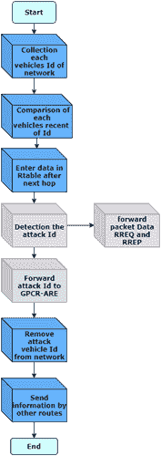

图 13.5 安全 `IDS` 的提议流程图 (`GPCR-ARE`)。

## 13.5 基于机器学习的 IDS

为了帮助应对恶意攻击，入侵检测方法在传统网络中已得到广泛研究。通过各种入侵检测的文献技术，基于机器学习技术的攻击数据包模式不同于正常数据包的模式。在一些研究 [36–38] 中，入侵检测使用了对数据包的统计建模，以应用人工神经网络（`ANN`）和支持向量机（`SVM`）。

在一项研究 [39] 中，`ANN` 和 `SVM` 都使用了基于频率的编码方法。上述工作侧重于监督学习，因此训练需要多个标记集。相比之下，Kayak 等人采用了无监督机器学习技术，例如自组织映射（`SOM`）来用于网络检测。图 13.6 显示了网络检测。`IDS` 检测到攻击车辆并将该 ID 传递到修改后的 `GPCR-MA` 协议中，即 `GPCR-ARE`，如流程图所示。

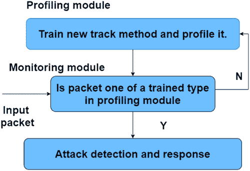

机器学习的 `IDS` 架构。

### 13.6.2.3 隐藏层神经元

1. `N[h]`: 隐藏层的总神经元数量根据经验公式设置：

| `N h = _ Ni + No + l` | 1 到 10 之间 |

| :--- | :--- |

### 13.6.2.4 输出层神经元

1. `N[o]`: 输出层的总神经元数量等于 1，表示最终判断结果。

### 13.6.2.5 传输函数

1. `F(x) = tansig(x) = 2/(1 + exp(−2x)) − 1`

## 13.7 仿真参数

900/600 m² 的仿真区域由 20 到 100 个节点的车辆集合、300 m 的传输范围以及多车道公路拓扑组成。`Network Simulator 2` 创建了一个带有参数的文件以仿真 `MATLAB` 方法。车辆位置和车辆移动性的流量模型参数总结在表 13.1 中。

表 13.1

仿真参数

| 参数 | 数值 |

| :--- | :--- |


| MAC 层协议（无线） | `IEEE 802.11` |

| 网络仿真器 | `NS2.35` |

| 应用层 | `TCP` |

| 路由协议 | `GPCR-MA` 和 `GPCR-ARE` |

| 信道模式 | `Wireless channel` |

| 车辆数量 | 20; 40; 60; 80 和 100 |

| 仿真时间 | 100; 200; 300; 400 和 500 秒 |

| 流量类型 | `CBR` |

| 移动范式 | 高速公路、曼哈顿、高斯-马尔可夫、`RPGM` 和随机随机点 |

| 仿真区域 | 900 × 900 |

| 性能指标 | 数据包交付率、平均网络吞吐量、平均能量和平均延迟 |

| 接口队列类型 | `Tail/ Drop/PriQueue` |

| 天线类型 | 全向性 |

| 网络接口模式 | `Phy/WirelessPhy` |

| 射电传播模式 | `Two-Ray Ground` |

根据仿真数据，我们可以使用以下公式计算端到端平均值、平均能量、平均网络吞吐量以及 `PDR`（包交付率），这些公式在下文公式 13.1、13.2 和 13.3 中给出。

### 13.7.1 平均端到端延迟

此处，公式 (13.1) 代表平均端到端延迟公式 `D`，成功交付的数据包总数为为 `n`。

| `Average delay = ∑ i = 1 n Received Packet Time − Send Packet Time * 1000 ms / Total Number of Packets Delivery Successfully` | (13.1) |

| :--- | :--- |

### 13.7.2 平均能量消耗

总能量消耗是普通车辆网络总消耗能量，而车辆能量支出是通信所用能量的总和。

### 13.7.3 平均网络吞吐量

此处，公式 (13.2) 代表吞吐量的数学公式，即目的地接收的数据总和。数据包大小代表进入目的地的第 `ith` 个包的大小；最后一个包的到达时间称为数据包到达，而第一个包的到达时间标记为数据包发射。框图缩放表示设备层使用的封包数量。平均吞吐量是单位时间的吞吐量。

| `Average Throughput = Total number of packet received by destination * Packet Size / Packet Arrival − Packet Start` | (13.2) |

| :--- | :--- |

### 13.7.4 包交付率 (PDR)

计算 `PDR` 的数学公式如下所示。

| `Packet delivery ratio = received packets / generated packets = ∑ Total packets received by destination / Total packets send by source` | (13.3) |

| :--- | :--- |

## 13.8 结论

我们简要介绍了人工智能的基础性知识，并提供了如何在车辆网络中学习这些工具并做出明智决策的示例。我们还强调了一些开放问题和关注领域。在这项研究中，我们解决了自组织网络中故障节点的检测问题。当车辆超速或减速时，即可被认为存在行为异常。目前大多数策略集中在集体决策上。其他策略则使用辅助方案来衡量不同的结果。我们提出了一种基于深度神经网络 (`DNN`) 的保护车辆的高效 `IDS`。我们通过从车辆网络深奥方法中通过非规则预训练得出的概率训练了 `DNN` 参数。`DNN` 为每一类数据提供了区分正常数据包和攻击数据包的机会，这意味着设备可以有效地检测恶意攻击以及测试中使用的新网络模式信息。

## 参考文献

1. Peng, H., Liang, L., Shen, X. and Li, G., 2018. Vehicular communications: a network layer perspective. `IEEE Transactions on Vehicular Technology`, 68(2), pp. 1064–1078.

2. Araniti, G., Campolu, C., Iera, A., and Molinaro, A., 2013. LTE for vehicular networking: a survey. `IEEE communications`, 51(5), pp. 148–157.

3. Cheng, X., Chen, C., and Yang, Y., 2017. 5G-enabled cooperative intelligent framework. `IEEE Systems`, 32(3), pp. 53–59.

4. Hussain, M.I., Singh, A. and Shukla, P., 2016. In-depth analysis of attacks in ad hoc network. `International Journal of Software Engineering and Applications`, 10(12), pp. 329–368.

5. Sun, W., Brström, F., Sou, K., and Sui, Y., 2015. Radio resource management for D2D-based V2V communication. `IEEE Transactions on Vehicular Technology`, 65(8), pp. 6636–6650.

6. Zhang, R., Cheng, X., Yang, L., and Shen, X., 2014. A novel TDMA-based scheduling protocol for vehicular networks. `IEEE Transactions on Intelligent Systems`, 16(1), pp. 411–416.

7. Kenney, J.B., 2011. Dedicated short-range communications (`DSRC`) standards in the United States. `Proceedings of the IEEE`, 99(7), pp. 1162–1182.

8. Eckhoff, D., Sofra, N. and German, R., 2013, March. A performance study of cooperative awareness in ETSI G5 and IEEE `WAVE`. In 2013 10th Annual Conference on Wireless On-demand Network Systems and Services (WONS) (pp. 196–200). IEEE, Banff, AB.

9. Eichler, S., 2007, September. Performance evaluation of the `IEEE 802.11 p WAVE` communication standard. In 2007 IEEE 66th Vehicular Technology Conference (pp. 2199–2203). IEEE, Baltimore, Maryland.

10. Hassan, M.I., Vu, H.L. and Sakurai, T., 2011. Performance analysis of the `IEEE 802.11 MAC` protocol for `DSRC` safety applications. `IEEE Transactions on Vehicular Technology`, 60(8), pp. 3882–3896.

11. Seo, H., Lee, K.D., Yaskawa, S., Peng, Y. and Sartori, P., 2016. LTE evolution for vehicle-to-everything services. `IEEE Communications Magazine`, 54(6), pp. 22–28.

12. Wang, J., Shao, Y., Ge, Y. and Yu, R., 2019. A survey of vehicle to everything (v2x) testing. `Sensors`, 19(2), p. 334.

13. Boston, M., Klügel, M., Kellerer, W. and Fertl, P., 2014, April. 移动设备到设备通信中依赖位置的资源分配。收于 2014 IEEE Wireless Communications and Networking Conference (WCNC) (pp. 1679–1684)。 IEEE, Atlanta, Georgia.

14. Liang, L., Xie, S., Li, G.Y., Ding, Z. and Yu, X., 2018. 车载通信中基于图的资源共享。`IEEE Transactions on Wireless Communications`, 17(7), pp. 4579–4592.

15. Liang, L., Ye, H. and Li, G.Y., 2018. 迈向智能车载网络：一种机器学习框架。`IEEE Internet of Things Journal`, 6(1), pp. 124–135.

16. Faezipour, M., Nourani, M., Saeed, A. and Addepalli, S., 2012. 智能车载区域网络的进展与挑战。`Communications of the ACM`, 55(2), pp. 90–100.

17. Liang, W., Li, Z., Zhang, H., Wang, S. and Bie, R., 2015. 车载自组织网络：架构、研究问题、方法论、挑战与趋势。`International Journal of Distributed Sensor Networks`, 11(8), p. 745303.

18. Yousefi, S., Mousavi, M.S. and Fathy, M., 2006, June. 车载自组织网络 (VANETs)：挑战与展望。收于 2006 6th International Conference on ITS Telecommunications (pp. 761–766)。 IEEE, 成都, China.

19. Paul, B. and Islam, M.J., 2012. 车车联网中 VANET 路由协议综述。`IOSR Journal of Computer Engineering (IOSRJCE)`, 7(5), pp. 1–9.

20. Belanovic, P., Valerio, D., Paier, A., Zemen, T., Ricciato, F. and Mecklenbrauker, C.F., 2009. 车云基础设施通信的无线链路。`IEEE Transactions on Vehicular Technology`, 59(1), pp. 269–282.

21. Miller, J., 2008, June. 车对车对基础设施 (V2V2I) 智能交通系统架构。收于 2008 IEEE Intelligent Vehicles Symposium (pp. 715–720)。 IEEE, 埃因霍温, 荷兰.

22. Hussain, N., Maheshwary, P., Shukla, P.K. and Singh, A., 2018. 用于 VANET 的抗攻击且高效的基于 QoS 的 `GPCR-ARE` 协议。`International Journal of Applied Engineering Research`, 13(3), pp. 1613–1622.

23. Hussain, N., Maheshwary, P., Shukla, P.K. and Singh, A., 2018. 用于高速公路场景车载自组织路由协议的移动感知 `GPCR-MA`。`International Journal of Organizational and Collective Intelligence (IJOCI)`, 8(4), pp. 47–65.

24. Hussain, N., Maheshwary, P., Shukla, P.K. and Singh, A., 2019. 用于 VANET 高速公路场景的基于曼哈顿与 `RPGM` 参数的移动感知 `GPCR-MA` 路由协议。见 Proceedings of Recent Advances in Interdisciplinary Trends in Engineering & Applications (RAITEA)。

25. Grover, J., Gaur, M.S., Laxmi, V. and Prajapati, N.K., 2011, November. 一种利用 VANET 中邻车辆的 Sybil 攻击检测方法。收于 第 4 届 International Conference on Security of Information and Networks (pp. 151–158)。

26. Cho, K.T. and Shin, K.G., 2016, October. 车内网络的错误处理使其脆弱。收于 2016 ACMSAC Conference on Computer and Communications (pp. 1044–1055)。

27. Kang, M.J. and Kang, J.W., 2016. 使用深度神经网络的入侵检测系统。`PloS`, 11(6), p. e01578.

28. Larson, U.E. and Nilsson, D.K., 2008, June. 一车内基于规范的攻击检测方法。收于 2008 IEEE Intelligent Vehicles Symposium (pp. 220–225)。

29. Rahbari, M. and Jamali, M., 2011. VANET 中加密 Sybil 攻击的高效检测。`arXiv:1112.2257`.

30. Hao, Y. and Cheng, Y., 2011, December. 收于 2011 IEEE Global Telecommunications Conference-GLOBECOM (pp. 1–5)。

31. Wahab, O. and Mourad, A., 2014. 基于 Dempster-Shafer 异常车辆的协作监护狗模型。`Current Science`, 41, pp. 43–54.

32. Golovko, V. and Kochur, P., 1997, September. 多层感知机神经网络的矩阵实现。收于 1997 South African Symposium on Signal Processing (pp. 181–186)。

33. Fu, L. and Jonsson, E., 1996. 增量反向传播学习。`IEEE Transactions on Neural Networks`, 7(3), pp. 757–761.

34. Hussain, N., Maheshwary, P., Shukla, P.K. and Singh, A., 2019. 高速路 `GPCR` 黑洞攻击检测。International Conference on Advanced Computing (pp. 183–191)。

35. Hussain, N., Shukla, P.K. and Singh, A., 2019. `GPCR-MA` 路由协议 Sybil 攻击检测。`Current Science`, 20(1), pp. 1–11.

36. Golovko, V. and Kochur, P., 2005. 使用神经网络的鲁棒异常检测。收于 2005 IEEE Data Acquisition and Advanced Systems: Technology and Applications, Bulgaria (pp. 108–111)。

37. Hu, W., Liao, Y. and Vemuri, V., 2003, June. 使用支持向量机的检测。见 International Conference on Machine Learning (pp. 282–289)。

38. Zhang, Z., Li, J., Manikopoulos, C. and Jorgenson, J., 2001. HIDE：一种基于统计预处理和神经网络分类的分层入侵检测系统。见 IEEE Workshop on Information Assurance, United States (pp. 85–90)。

39. Chen, W.H., Hsu, S.H. and Shen, H.P., 2005. SVM 和 ANN 在入侵检测中的应用。`Computers and Operations Research`, 32(10), pp. 2617–2634.

40. Koscher, K., Czeskis, A., Roesner, F., Patel, S., Kohno, T., Checkoway, S., McCoy, D., Kantor, B., Anderson, D., Shacham, H. and Savage, S., 2010, May. 现代汽车的实验性安全性分析。收于 2010 IEEE Symposium on Security and Privacy, Berleley/Oakland (pp. 447–462)。


41. Woo, S., Jo, H.J. and Lee, D.H., 2015. 联网汽车的实用无线攻击及车内 CAN 安全协议。IEEE Transactions on Intelligent Transportation Systems, 16(2), pp. 1–14.

# 14 一基于去中心化计算的安全电子投票系统

Dhruv Rawat, Amit Kumar, and Suresh Kumar

目录

## 14.1 引言

## 14.2 背景与动机

### 14.2.1 秘密投票

### 14.2.2 人人一票

### 14.2.3 投票资格

### 14.2.4 透明度

### 14.2.5 投票的准确记录与计票

### 14.2.6 可靠性

## 14.3 文献综述

## 14.4 主要贡献

### 14.4.1 合同的变量

### 14.4.2 准备选票

### 14.4.3 投票计票

## 14.5 电子投票与区块链

### 14.5.1 加密学

# 14.6 区块链在投票系统中的应用

## 14.7 结果与分析

## 14.8 结论

[References]

## 14.1 引言

在每一个民主国家，投票系统都是重中之重，对它的威胁就是对国家安全的威胁。在投票领域使用区块链技术，主要目标是尽可能地降低整个选举过程的成本。在使投票程序变得可靠高效的同时，我们可以取代被认为存在缺陷的传统投票系统。电子投票和在线调查是了解民意的几种方法。

计算机技术在过去的几十年里取得了长足进步。电子投票机（EVMs）被认为是有缺陷的，因为物理层面的担忧会对投出的票构成威胁，也会威胁投票的保密性 [1]。电子投票系统面临着各种黑客的威胁。很难消除电子投票中的欺诈行为，在系统被黑后，进行高昂的数据清理也非常困难。即使只有一个系统被黑，也可能视为整个选举投票系统的失败，而且公民会担心自己的匿名性受到破坏，从而质疑系统的完整性。

一个电子投票系统应该能够身份验证，它应该提供透明度，它应该保护投票者的匿名性，并最终为我们提供正确、准确的结果。

关于将区块链技术引入电子投票，目前正在进行大量的研究。日本是第一个领先这项研究的国家，实施了本国的投票系统并将其转换为区块链电子投票系统。其他国家也在领先。

区块链是一个存储交易细节/数据的账本，它是公开的、分布式的、不可变的且点对点的。它有几个主要特征：

1. (i) 由于账本是点对点的，因此没有单点，即账本存在于不同的位置，因此不必担心流程会在单点发生故障，且易于维护。

2. (ii) 控制权是分布式的。

3. (iii) 每当我们创建一个新区块时，它是前一个版本账目的引用创建一个不可更改的链。这防止了对区块链完整性的篡改。

4. (iv) 在向区块链添加新区块时，必须遵循共识算法，使提议的新区块成为账本的永久部分。

## 14.2 背景与动机

投票有几个基本原则：

* 秘密投票：你的票是秘密的。不应该有人准备将你的票关联回你的个人资料。

* 一人一票：每位选民投一次票，因此选举委员会应该准备好适应选民、投票以及未投票人员的异质性 [2]。

* 选民资格：只有经过核实的某国公民并拥有投票权的公民才有资格。

* 透明度：计票必须是透明的，即政府应该显示谁赢了以及代表他们获得了多少选票，以便公民充分了解此情况。

* 投票被准确记录：计票是一致的。总票数向公众公布，结果一旦公布就无法更改。

* 可靠性：系统必须是可靠的，应该防止欺诈发生，并阻止各种安全违规行为。

我们必须记住，这些是我们迄为止在主流电子投票系统中遵循的要原则。如果我们开发新的系统，也需要实现这些原则。

区块链将解决在这些早期尝试建立电子投票系统时发现的众多问题。区块链 `DApp` 不担心网络接入的安全，因为任何访问终端节点的黑客都无法对不同节点产生影响。

### 14.2.1 秘密投票

在选票合约中，只记录了钱包地址。每位选民都通过其钱包地址识别。除了主席之外，没有人能知道他们是如何投票的。

`votes` 数组被断言为非公开；因此，没有人能够浏览其内容。

现实可能比这复杂一点。在区块链上，如果你尝试读取，即使是非公开变量也是清晰可见的。为了使其真正变为非公开，合约的用户必须在写入值之前对这些值进行编码（加密）。

### 14.2.2 一人一票

`voter` 数组存储了已投票选民的清单。它确保没有人会投两次。一旦选民投票，他的状态就会变为 `voted`，选票合约会检查以确认他们不会再次投票。

### 14.2.3 选民资格

选民资格通过在投票开始之前收集一个钱包地址数组来决定。

选民的地址必须与主席在流程开始前的的地址。然而，如果选民的 `MetaMask` 钱包被盗，其他人就可以代表他们投票。然而，在区块链上，重要的因素是钱包的非公开钥。

但主席如何确保投票的是正确的人呢？人脸识别？是的，只要你通过了指纹或生物识别检查，这就可以实现。

### 14.2.4 透明度

透明度涉及区块链默认始终执行的操作。在区块链上采取的每一个操作和保存的每一个记录都是不变的，即一旦合约部署，无论如何都无法更改。

### 14.2.5 投票的准确记录与计票

在智能合约中，选票会经历许多状态，从创建选票到投票，再到关闭选票和最终计票。

在每一个状态下，合约规定了主席和选民允许或不允许执行的操作。

### 14.2.6 可靠性

区块链没有单一故障点，因为链中的每个节点都参与并维护区块链的运行。如果 `Smart contract` 部署在区块链上，它将是不可更改的。良好的合约的业务逻辑一旦部署，就如刻在石头上一样。一旦合约部署，主席无法修改其原则，例如，从“一人一票”修改为“一人两票”。

## 14.3 文献综述

Zhang, Wenbin, IBM 区块链创新中心 IBM 研究院，新加坡

该作者在 2018 年 IEEE 会上对区块链技术及其在生态系统中的应用进行了简要综述。他讨论了电子投票平台的所有先决条件，以及将加密过程添加到投票流程中的算法方案，以使其更加安全和廉价。

他提出了一种区块链上的原生机制，以促进区块链网络中对等节点的决策过程。该计划协议保护了投票者的隐私，并允许在没有可靠第三方的情况下对作弊行为进行检测和纠正。他在 `hyperledger material` 上的实现表明该协议是可行的，并且可以在中等规模实施。

Wu, Hsin-Te, 国澎湖科技大学

这些作者开发了一种基于区块链的投票系统网络安全机制。区块链提供了分布式设计，且仅允许添加知识而不允许修改，这有效地允许任何用户进行知识认证。他们广泛地利用线性配对来建立网络安全机制，该机制具有加密/解密知识量低的优点，减少了节点对知识的持有量。

## 14.4 主要贡献

本章的贡献如下：

1. (i) 我们提出了一种使用 `ether` 实现投票系统的电子投票系统。

2. (ii) 它是多用途的，也可以用于进行调查。

3. (iii) 该过程已变得非常容易实现，但它非常安全。

我们提出了一个包含伪代码的智能合约，如在本节中讨论的。

### 14.4.1 合约变量

```solidity
struct vote{
     address voterAddress;
     bool choice;
}
```

`vote` 结构体包含两个元素：投票者的地址以及投票者做出的选择。真或假。

```solidity
struct voter{
     string voterName;
     bool voted;
}
```

公民有三个属性：他的姓名以及他是否投票。

```solidity
mapping(uint => vote) private votes;
mapping(address => voter) public voterRegister;
```

投票存储在名为 `votes` 的映射中，投票者存储在名为 `voterRegister` 的映射中。

```solidity
uint private countResult = 0;
```

`countResult` 是一个没有人能看到的非公有变量。

```solidity
enum State {Created, Voting, Ended}
State public state; own
```

选票有三个状态：创建的时间、投票过程的确认、投票已提交的确认。此时，合约关闭。

### 14.4.2 准备选票

```solidity
constructor(string memory _ballotName, string memory _proposal) {
    ballotAddress = msg.sender;
    ballotName = _ballotName;
    proposal = _proposal;
    state = State.Created;
}
```

`constructor` 初始化了 `ballotAddress`、`ballotName` 和 `proposal`。

```solidity
function addVoter(address _voterAddress, string memory _voterName) public {
    require(state == State.Created, "Voting ended");
    voterRegister[_voterAddress].voterName = _voterName;
    voterRegister[_voterAddress].voted = false;
    countResult++;
    emit voterAdded(_voterAddress);
}
```

接下来，`addVoter` 函数向 `voterRegister` 添加信息。

### 14.4.3 计票

```solidity
function endVote() public {
    require(state == State.Voting, "Voting not active");
    state = State.Ended;
    emit voteEnded(countResult);
}
```

`endVote` 函数改变状态并触发事件。

## 14.5 电子投票与区块链

电子投票系统只是另一种使用电子手段实现投票过程的投票系统。根据民主的不同需求，可以相应设计 `EVM`。回到区块链，区块链是一个分布的数据日志。没有单一或集中的管理机构。每个节点都与其他彼此连接（p2p）。

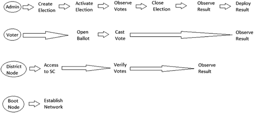

图 14.1 选举过程和角色。

选举的进行需要许多角色。这些：

- **管理员 (Administrators)**：负责选举的运行。许多公司和政府机构被赋予了这一角色。

- **投票者 (Voters)**：获得政府背景证明的合格公民，即政府已对个人进行了背景调查，确认其是可行公民并可以投票。

- **地区节点 (District nodes)**：当主管理员创建选举时它们开始运作，每个选票位于国家的不同地方，即每个地区都有一个节点，负责智能合约的顺利运行。

- **引导节点 (Boot Node)**：引导节点仅仅是帮助区域节点找到彼此并通信的帮手。

数据经过处理后，必须由链上网络中的计算机进行挖掘，以验证数据的真实性。虽然没有中介机构来认证和证实交易，但区块链中的每笔交易都被认为是完全安全且经过核实的。这之所以可行可行，是因为有各种共识算法来帮助维护区块链的真实性。因此，为了具体化，有多种共识算法，包括：

* 工作量证明 (Proof of work)

* 权益证明 (Proof of stake)

* 容量证明 (Proof of capacity)

### 1. (i) 工作量证明

这是一种共识算法，利用已完成工作的证明来指定矿工去挖掘下一个区块，并获得相应的奖励。`PoW` 是比特币使用的共识算法。该算法的工作原理基于：区块链中的每个矿工都会被赋予一个数学问题并必须给出解决方案。可能有成千上万甚至数百万个矿工，但只有一个人有机会挖掘下一个区块，因此任何以最短时间解开谜的矿工将挖掘下一个区块，也就是说，他们拥有非常强大的硬件，能够在最短时间内算出谜题的答案。曾出现过一种构建矿机的趋势，仅仅为了在区块区块后获得一些加密货币作为奖励。

### 2. (ii) 权益证明

权益证明是 `PoW` 共识算法最常见的替代方案。以太坊曾使用与比特币相同的工作量证明，但现在已从 `PoW` 转向 `PoS`。现在，这种算法与 `PoW` 算法略有不同。在 `PoW` 中，重点在于制造能够以更快速度解决问题的昂贵硬件；而这里，重点是权益（stake），即所有矿工必须投入一些加密货币才能挖掘新区块，即质押。显而易见，没有任何黑客或欺骗人员会投入资金作为权益，因为他们必须通过背景检查才能这样做。现在，质押完成后，所有矿工将共同挖掘区块，在区块完成后，所有矿工将根据他们投入的赌注（即比例）获得后续奖励。

### 3. (iii) 容量证明

在 `PoC` 算法中，矿工必须投资硬盘。与 `PoW` 类似，拥有最快硬件并在最短时间内完成谜题的矿工获得奖励；在这里，拥有最大硬盘空间的矿工将有机会被选中挖掘下一个区块。

### 14.5.1 密码学

区块链使用密码学。这是一种创建和使用代码来确保信息传输安全的过程。

* 明文：传输过程中需要保护的数据。

* 加密算法：这是一个数学过程，能够为任何给定的明文和加密密钥产生密文。它是一种以明文和加密密钥作为输入并产生密文的加密算法。

* 密文：它是加密算法使用特定加密密钥生成的明文乱码版本。密文是不受保护的。它在公共通道上流动。它可以被任何访问通信通道的人截获或攻破。

* 解密算法：这是一个数学过程，为任何给定的明文和加密密钥产生密文。（注：原文为“产生密文”，但上下文意指产生明文）。

* 加密密钥：这是一个数学过程，为任何给定的明文和加密密钥产生密文。

* 解密密钥：这是一个数学过程，为任何给定的明文和加密密钥产生密文。

密码系统分为两种类型：

* 对称密钥：在对称加密中，用于加密和解密的两个密钥是相同的。

* 非对称密钥：在非对称加密中，用于加密和解密的两个密钥是不同的。

* `Ganache`: 一种允许我们创建具有多个账户的个人区块链，并允许我们自定义以太坊值的软件。

* `MetaMask`: 一个简化与以太坊区块链通信方式的扩展程序，它可以帮助我们轻松使用以太坊钱包。

选举过程可以解释为以下五点：

1. (i) 创建选举：

   管理员必须使用 `DApp`（去中心化应用程序）创建选举。这会与智能合约交互，智能合约中包含了所有选民列表、所有区域节点以及关于投票系统的每条信息。

   所有候选人的姓名都必须列在其中，并附上他们的选举标志。当部署时，候选人的姓名将连同选举标志一起出现在屏幕上。

   此外，生成选举智能合约需要一些以太坊来启动选举，以便证明创建者不是伪造的。

2. (ii) 添加选民列表：

   合约创建后，管理员需要制作一份符合投票资格的公民列表。这可以在投票过程之前完成。委员会必须对公民进行背景检查，查看他们是否年满 18 岁且为本国公民，并授予他们投票权限，将其姓名添加到选民名单中。现在添加他们再次需要一些以太坊。在将所有选民添加到列表后，合约即可准备好部署。

3. (iii) 投票交易：

   这是合约部署后的过程。当个人在各自的区域节点进行投票时，他们会与主投票智能合约交互。但他们只能与他们注册的投票智能合约交互，即全国范围内仅限区域节点。

   选举开始前，每位选民将获得 1 个以太坊，投票花费 1 个以太坊。因此，选民只能投一次票。

   每当个人投票时，他们将花费相应数量的太坊，之后他们就可以投票（在这种情况下为 1 个以太坊）。投票完成后，管理员将收到通知，告知指定的候选人已投票，但他们投给了谁将永远无人知。这是投票的主要功能之一，即匿名性。每一张票都将附加到区块链上，直到投票结束。只有选民自己知道他们投给了谁，其他人无人知。

4. (iv) 结束选举：

   当时间到时，管理员将结束投票智能合约，这反过来将花费他一些以太坊，以确保只有真实的管理员（人员）能够结束投票。

5. (v) 计票：

   每个智能合约将统计自己的结果，并将结果保存在其各自的专用存储中。选举结束后，所有智能合约的最终结果将分别公布。

## 14.7 结果与分析

区块链有多种方式可以创建一个安全、透明且防欺的环境。区块链有多种方式可以创建一个安全、透明且防欺的环境。

## 14.8 结论

在本章中，我们将关注基于区块链的投票系统的性能和安全性。我们将讨论诸如速度、可扩展性以及区块链技术的去中心化本质等挑战。

记录检索管理确保正确的数据通过适当的方式移动到正确的区域。利用查看、删除、分离、审阅等若干技术，从档案中收集适用于给定区域的可用信息。这里的“站点（site）”是指通过特定查询安排请求数据的个人、专家或机器。“数据（data）”单元源自“档案”，而记录是镜像报告 `[2]` 的数据表面。从一组报告中收集的数据单元在特定的限制审查下进行。某个地点（或创作者）的“梦想（dream）”让数据的引入变得有趣。由于每位作者的观点都存在冲突，尽管引入了相似的数据材料，所有内容都作为作者创作的作品以交替的路径进行解读。相似的数据可以从许多记录中分离出来，且每条记录都具有独特的表面价值 `[3]`。

从区域到数据（或报告）或反之寻找最高效且最短的路径，就是正确的数据承载。当我们处于“数据”视角时，数据从一个内容传输到下一个内容，然后出现在正确的地点。从这个视角来看，我们称之为“文档提取（或检索）”或“信息检索”，并单独记录。另一方面，站在“站点”的角度，我们从一份文档开始切换到下一份，遍历它们，直到一个信息索引包含正确的数据 `[4]`。那将被归类为“搜索数据”（或报告空间）或“探索数据空间”。数据流（Datastream）是一个描述信息恢复和路径的术语。聪明的记录检索取决于对报告的某些“认知（cognizance）”，以获得高效的流数据方法。一种精明的报告检索方法并非对此类记录缺乏关注。

获取数据的明方法并非源于对某些数据缺乏信息。如果区域是一个个人、操作员或机器，我们可以识别出针对给定区域问题修正报告的正确方法。


“理解（Understanding）”既指记录也指区域。如果某个内容被认为是合理的，它将以非常结构化的句子、优美的类型、周围组织的信息、根据已接受读者的信息进行全传播的情境内容、根据预期读者的观点进行完美调整、极其适应已接受读者的状况以及思维能力来编写。“欣赏（Appreciation）”既指记录也指区域。如果某个内容被认为是合理的，它以非常结构化的词汇、一流的类型、周围组织的信息、可能根据预期读者的经验进行最佳传播的情境材料、与预期读者的观点平衡、为已接受客户的状态编写以及思维能力来构思。（我们在这里没有确定什么是“信息层级”）。从另一个角度看，在这些地方之间存在数据差异。现在，我们回到“高效报告检索”问题。对我们到此为止所讨论的后续内容进行回顾。

## 15.2 人工智能

人工智能是能够执行通常需要人类智能完成的任务的计算机系统的开发。这包括学习、推理、问题解决、感知和语言理解。

### 15.2.1 AI 的一些现实实例

* 自动驾驶汽车
* 波士顿动力（Boston dynamics）
* 导航系统
* 聊天机器人
* 人机游戏
* 更多！

### 15.2.2 AI 的优势

主要目标是减少以下方面的的伤害：

* 战争
* 危险工作场所
* 自然灾害
* 交通
* 清洁
* 更多！

### 15.2.3 人类智能

创建类智能的过程涉及可以在人类帮助下学习和进步的计算机系统。具有智能的计算机可以像人类一样思考和行为。图灵写过一篇伟大的论文，建立了这种人类行为的概念 `[7]`。

## 信息检索 (IR)

软件工程部门存在的首要目的是存储和恢复特定客户大量的文学或交互媒体数据，例如消息、图片、音频等。信息检索应用程序处理的文章通常称为报告，而随后处理这些记录的产设备被称为信息检索系统（IRS）。IR 框架的任务是使用户能够在一系列档案中发现包含其正在搜索的数据，或者帮助满足客户对数据的需求。信息检索是一项四十多年为客户提供解决方案的创新技术，并将是一个活跃的研究领域 `[8]`。

## 15.3 IR 与 DB 的比较

下表总结了信息检索与数据库（DB）系统之间的主要区别。

**表 15.1** 系统 IR 与 DB 之间的差异。

| | 信息检索 | 数据库/数据检索 |
| --- | :--- | :--- |
| 匹配 | 部分匹配 | 精确匹配 |
| 推论 | 归纳 | 演绎 |
| 模型 | 概率性 | 确定性 |
| 分类 | 多属性型 (Polythetic) | 单属性型 (Monothetic) |
| 查询语言 | 自然语言 | 人工语言 |
| 查询规范 | 不完全 | 完全 |
| 需要的项目 | 相关 | 匹配 |
| 错误响应 | 不敏感 | 敏感 |

`IR` 与 `DB` 之间更为根本的区别在于，`IR` 需要获取适用于客户信息的档案，这些信息必须通过问题进行通信，而不是像 `DB` 那样简单地协调这种等效查询。这种区别是关键的，因为中心性是一个复杂的概念，它超越了仅仅协调某些查询术语和记录中存在的术语，而是为了日益逐点讨论的影响进行对话 [1]。

其影响之一是，对客户信息的需求与报告实质之间的关联被被认为是模糊的，`IR` 框架试图对其进行估计，留给客户一个对其真实意义的明确判断。另一个影响是，客户对数据的需求与档案实质之间的关联被视为是不常的，因此 `IR` 框架只需尝试获取它，留给客户一个对其真实重要性的明确判断。沿着这条线，`IRS` 检索那些可能被客户认为重要的记录，即可能满足客户数据需求的记录。因此，根据查询获取的 `DB` 事实通常被视为对查询的真实且完整的回答。在 `IR` 中，档案的显性意义在不同客户之间以及不同场合之间完全不同，即使对于同一个人也是如此。这种 `IR` 功能无疑产生了一些影响。其次，发送到 `IR` 设备的用户请求通常更加模糊。

### 15.2.4 信息检索评估

在简要综述中，一个值得 `IR` 回顾的重要研究领域是关于评估 `IR` 程序。在分析 `IR` 中的查询评估方面已经投入了大量工作和精力。考虑到 `Rijsbergen` 先生在尝试评估 `IRS` 时建议的方法，至少必须尝试回答两个问题：

1. 评估什么？
2. 如何评估？

根据首要问题，应该注意，科学家可能希望决定修复过程的速度或 `IR` 的协作水平。例如，框架考虑了这些因素。`IR` 有不同的方面，分析师在查看它们时可能参与了，这正如书中几次提到的那样明显。在所有条件相同的情况下，我们在这里讨论的关键视角是修复过程的可行性。而随后的问题需要一个日益详尽的答案。本书讨论了评估 `IR` 框架的多种方法，特别是当该框架旨在特定类型的通信和重要档案时。在任何情况下，细心和精确是通常应用于 `IR` 的两种最流行的充分性检查。另一方面，随后的问题需要一个日益专业的答案。在书中，我们将看到几种评估 `IR` 框架的不同方法，特别是当该框架为特定类型的协作和各种档案工作时 [2] (Table 15.2)。

**表 15.2 回顾了精密度判别与评估值**

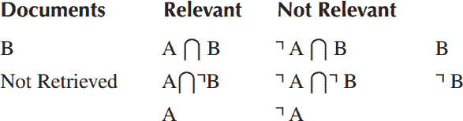

## 15.3 分布式人工智能

人工智能于 1975 年实现分布化，这是一个处理智能体之间智能通信的人工智能关注的领域。分布式人工智能框架被视为一组被称为“专家”的明智个体的，他们通过协调努力、结合或竞争进行传递。它作为人工智能的一个研究领域而兴起，管理专家之间的明智协作。分布式人工智能框架被开发为一群被称为“操作员”的敏锐个体的集合，通过共同努力、结合或竞争进行传递。

### 15.3.1 分布式人工智能简介

分布式人工智能（`DAI`）被称为去中心化人工智能，是人工智能的一个子领域，致力于创建分布式智能安排。`DAI` 与多专家框架以及该领域的先驱有密切的关系。分布式人工智能（`DAI`）是深度思考、规划和决策的解决方案。它具有极强的等扩展性，因此它可以处理大规模的注册和计算机资源的空间分布。这些特性使其能够处理包括准备极其大数据集的问题。`DAI` 框架是自组织的学习智能枢纽（操作员），通常是广泛分布的。`DA` 框架是自律的学习智能枢纽（专家），通常是广泛分布的。

`DAI` 枢纽可以独立工作，不完整的安排通过枢纽之间的接触连接起来，通常不是同时进行的。由于其规模，`DAI` 框架强大且多功能，并且基本上是松耦合的。`DAI` 框架旨在适应困难表征或隐藏信息索引的变化，因为重新部署的规模和复杂性。与具有密切关联且地理位置接近的处理枢的同质或整合人工智能框架不同，`DAI` 框架不允许在一个区域收集所有材料数据。因此，`DAI` 框架通常处理大型数据集的样本或哈希体验。

此外，源数据集在执行 `DAI` 程序期间可能会被更改或修改。`DAI` 用于创建和维护知识库、专家程序和学习过程。

* **并行问题解决**：主要解决如何调整传统的人工智能原则，以便利用多处理器系统和计算机集群来加速计算。
* 分布式问题解决 (DPS)：实体概念，即可以相互通信的自主实体，其创建是作为 DPS 实现的示例。更多详细信息，请参阅下文。
* 多智能体仿真 (MABS)：分布式人工智能（DAI）的一个分支，为不仅需要分析宏观层面事件还要分析微观层面事件的仿真提供了基础。

### 15.3.2 分布式人工智能工具

这是一个数据恢复框架，它利用 DAI 工具，包含两个基于板的模块：语义解析器和一个重构模块。语言解析器从应用程序中提取语法结构，并建立一个包含请求关键信息组件的格式系统。语义解析器，和一个重构模块。语言解析器从应用程序中提取语法结构，并创建一个包含数据恢复框架的布局系统，该框架利用由两个基于板模块组成的 DAI 编程：关键请求数据工作。重构模块使用该系统获取相关报告的特定部分。在这一部分，我们以更精确的描述描述每个模块的能力和设计。

### 15.3.3 完整文档与文档交换格式

“完整记录”在报表工程的思想下，要求对档案内部信息的程度进行描述。当通信发生时，记录的双方接受他们将从报告的表面结构（即从作者的组合）中恢复完整档案。完整档案的恢复是合法通信的前提。我们将框架工程细节命名为“网络交换设计”。

完整记录从两次会议的数据中。由于双方都参与了用户区域的理解，它们相互互补。此外，它们也追求实现。接下来的部分将引入“数据设计”的概念，以解释双方在实体和程序上的对应信息（图 15.1）。

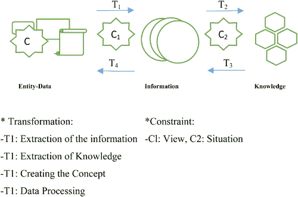

图 15.1 信息架构系统。

### 15.3.4 分布式信息检索的数据网络架构

创建者拥有理解作者报告的所有信息（如前面的章节所示），但创建者并没有提供完整档案。完整档案对于智能记录恢复至关重要。恢复记录的一个明确点是实现作者与用户之间有效的接触。问题在于完整报告可以恢复的地方。据称一种方法是数据工程（图 15.2）。

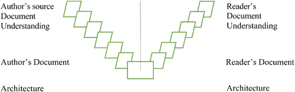

图 15.2 分布式信息架构。

### 15.3.5 DAI 的类型

* 在多智能体结构中，智能体组织它们的知识、行动以及通信过程的推理。智能体是物理或虚拟实体，能够行为、感知环境并与他人交互。智能体是独立的，具有实现目标的能力。通过它们的行动，智能体改变其环境的状态。有多种形式的团队合作。
* 工作在节点之间分配，知识在分布式问题解决中共享。主要关注的是分解和合成知识及解决方案的任务。

### 15.3.6 分布式人工智能的挑战

1. 何时执行智能体通信与交互，以及应该使用什么语言或通信协议
2. 如何确保智能体的可靠性
3. 如何通过措辞、定义、分解和分配来合成“智能体”组之间的结果

DAI 框架不需要将所有相关信息收集在单一区域，这与具有紧耦合且拓扑接近的处理中心的固定或集成人工智能框架不同。因此，DAI 框架通常在大规模数据集的子测试或哈希印象上运行。此外，在 DAI 执行过程中，源数据集可能会更改或更新。

### 15.3.7 分布式人工智能的目标

理解人工智能的规划、学习和识别问题，特别是当它们需要大量数据时。为了达到目标，DAI 需要：

* 一个具有不可靠和失效资源的分布式系统
* 节点之间的动作协调和协作
* 在线机器学习和数据集样本

有几个原因希望多智能体系统能够：

* 并行问题解决：主要解决如何调整传统的人工智能原则，以便利用多处理器系统和计算机集群来加速计算。
* 分布式问题解决 (DPS)：实体概念，即可以相互通信的自主实体，其创建是作为 DPS 实现的示例。
* 多智能体仿真 (MABS)：分布式人工智能的一个分支，为不仅需要分析宏观层面事件还要分析微观层面事件的仿真提供了基础。
* 操作员促进他们的知识、行动以及通信过程的推理。智能体是物理或虚拟实体，能够行为、感知环境并与他人交互。智能体是独立的，具有实现目标的能力。通过它们的行动，智能体改变其环境的状态。有多种形式的团队合作。
* 工作在节点之间分配，知识在分布式问题解决中共享。主要关注的是分解和合成知识及解决方案的任务。
* 智能体是独立的可以实现目标。智能体通过其行动改变其环境的状态。有多种形式的团队合作。

DAI 可能采用自底向上的方法处理 AI，就像传统的自上而下的处理方法一样，例如包含架构（subsumption architecture）。此外，DAI 也可能作为一种应急方案。

### 15.3.8 DAI 实现的领域

* 电子交易，例如 DAI 方法从极广泛的金融数据交易子样本中学习交易策略
* DAI 程序控制 WLAN 网络中的 `http://dair.uncc.edu/projects/past-projects/wlan-resource/`、`http://dair.uncc.edu/projects/past-projects/wlan-resource/`，例如在电信、共享资源中
* 路由，例如对交通网络内的车辆流量进行建模
* 调度，例如车间调度，由资源管理机构确保局部优化、协调效率和局部连续性
* 多智能体框架，如人工计算机、计算机仿真分析
* 电力站，例如应用于变压器状态的多代理状态监控系统（`COMMAS`）和 IntelliTEAM II 自动恢复系统。

### 15.3.9 软件代理

`DPS` 和 `MABS` 利用的核心思想是被称为 `machine operators for reflection`（反射机器操作员）的程序。专家是一个自给自足的虚拟（或物理）对象，能够理解自己的状态并对其进行跟进。在类似的过程中，专家通常准备好与不同的操作员合作，完成一个操作员无法独立完成的典型目标。这种对应策略使用了一种与受益者交流的语言。一种有效的初步分组是将专家分为：

* 反应型代理（Reactive agent）：不外是一个接收输入、处理输入并生成输出的自动机。
* 思考型代理（Deliberative agent）：相比之下，思考型代理应该对环境有无偏见的观察，并能够执行其计划。
* 反应代理（Reactive agent）：仅仅是一个接收输入、处理输入并生成输出的汽车。
* 思考代理（Deliberative agent）：相反，思考型代理将对其世界有内部感知，并能够实施其计划。
* 混合代理（Hybrid agent）：混合代理是反应型和思考型代理的混合，既实施它们的计划，又在不经过思考的情况下直接对外部事件做出反应。

公认的代理架构定义了代理内部的组织方式，包括以下：

* `ASMO`（分布式模块的出现）
* `BDI`（相信-欲望-意图，一种描述如何制定计划的通用架构）
* `InterRAP`（一种三层架构，包含反应层、思考层和社交层）
* `PECS`（物理、情感、认知、社会，描述了这四个部分如何影响代理的行为）
* `Soar`（一种基于规则的方法）

## 15.4 结论

数据的公平进展在档案的设计及其用于记录交易的配置归一化中得到了体现。在数据工程的世界观下，勾勒出了整体蓝图。数据工程的一个思想是单语言记录恢复和多语言解释性管理。档案恢复的“智能性”接受完全理解，并最终形成一份完成的报告。

此类活动中的归一化问题是可行对应中的一个有趣的现象。接受此类准则后，恢复整个记录的信息可以位于一个“分布式”组织中，无论它是在本质上还是真实地体现的。在这种世界观下，在分布式领域进行合理的协作是可能的。该过程从创建阶段开始。这是一种有趣的方法，因为每个模块将提升每种控制的优势：语言解析器的有效性、特定部分的适应性以及工作重构模块视角。这些实践重点加强了这种恢复。

## 参考文献

1. M. Braunhofer, M. Kaminskas, and F. Ricci . Location-aware music recommendation. International Journal of Multimedia Information Retrieval, 2(1), 31–44, 2013.
2. Y.-S.Choi, J. Lee, J.-X. Huang, and K.-S. Choi . Cross-language information retrieval for Korean-Chinese-English languages. Proceedings of `ACL2000` (Demonstration), Hong Kong, 2000.
3. G. Grefette, ed. Cross-Language Information Retrieval. Kluwer Publishers, 1998.
4. K. Sparck Jones, and P. Willett, eds. Readings in Information Retrieval. Morgan Kaufmann, 1997.
5. G. Schecter. Information Retrieval: A Critical View. Academic Press, London, 1967.
6. W. Goffman A searching procedure for information retrieval. Information Storage and Retrieval, 2, 294–304, 1977.
7. Swets, J.A. Effectiveness of Information Retrieval Methods. Beranek and Newman, Cambridge, 1967.
8. S. Mizzaro How many relevances in information retrieval? Interacting with Computers, 10(3), 303, 1998.

# 16 分布式人工智能 人智能的未来

Pushpa Singh, Rajnesh Singh, Narendra Singh, and Murari Singh

## 16.1 引言

分布式人工智能（`DAI`）是 AI 的一个分支，用于学习、规划、决策能力和远程处理。DAI 技术对于那些本质上是分布式的或需要快速处理海量数据计算的问题特别有价值（Kokkinaki & Valavanis, 1995）。基于 AI 的学习和预测应用中使用了巨大的数据集。这些数据集来自广泛的计算资源和不同的领域。为了快速分析大量数据，IoT 和 5G 网络提供了最佳连接通道模型（Singh & Agrawal, 2018a），作为基于 AI 和 IoT 的应用的互联网基础设施。这些应用需要扩展性、容错性和快速处理，而这在中心化系统中是非常困难的（Patel, 2019）。分布式计算环境是实现基于 AI 和 IoT 应用的最终解决方案。现代基于 AI 的应用设计应该能够在分布式节点上进行支持并实施。这种支持分布式环境的 AI 称为 `DAI`，分布式节点被称为 `agent`。DAI 也称为去中心化人工智能，致力于为现实世界的问题开发分布式解决方案。


人工智能（AI）代表了一个更广泛的领域，机器可以“智能”地执行任务并像人类一样思考。机器学习和深度学习是人工智能的子集，用于解决现实世界的问题。机器学习可以定义为一种无需显式编程即可自主学习的系统。深度学习是机器学习的子集，应用于大数据集，并在神经元网络方面受到人类大脑处理模式的启发。在深度网络中，有许多层，每层包含许多神经元进行处理，以及用于构建模型的学习算法；例如 `CNN`、`RNN` 等（Alom 等人，2019）。基于此类模型的应用需要多台机器，并且必须利用并行性和分布式环境。分布式人工智能（DAI）必须包含一个框架，该框架要包含优化系统的性能优势，而无需用户考虑调度、数据传输和机器故障。“Ray”作为一个用于演进 AI 应用的分布式框架，它采用了一种分布式的、容错的单动态执行引擎，针对大规模机器学习和强化学习应用（Moritz 等人，2018）。DAI 克服了传统 AI 的挑战，并根据分布式方法提供不断学习和适应数据集变化的能力。将处理分布到一组自主处理节点有助于加速计算。DAI 关注同步智能行为：智能体通过协调它们的知识、技能和计划来解决问题，并朝着特定的交互目标努力（Bond & Gasser，2014）。DAI 基于基于代理的建模（ABM）和多智能体系统（MAS）来运行多处理器系统以及计算机、节点或实体的集群（Simmonds 等人，2019）。

在本章中，作者提出了一种用于分布式环境的 AI 启用节点。AI 启用节点实际上在 DAI 的多智能体系统中被称为代理（agent）。本章旨在阐述医疗保健系统的实时应用，由于大规模规模的计算和计算节点的空间分布，该系统需要复杂的学习、预测和决策。DAI 在各种应用中提供实时处理、消费、存储和分配，涵盖医疗（Datta 等人，2019）、农业（Eli-Chukwu，2019）和废物管理（Dubey 等人，2020）。医疗和保健应用将为患者提供多项健康评估、药物处方决策支持和建议。农业中的 AI 具有巨大的潜力，可以利用卫星成像、分布式传感器、云、物联网等新技术，来处理一个与土壤、农民、灌溉等不同代理构成分布式环境的系统。

本章剩余结构如下：第 16.2 节讨论了传统 AI 的历史背景和挑战。第 16.3 节介绍了分布式环境的基础和 DAI 的目标。第 16.4 节给基于 DAI 的实时应用。第 16.5 节包含了未来的工作方向，第 16.6 节总结了本章。

## 16.2 AI 的背景与挑战

人工智能是模拟人类大脑的计算机科学领域。人工智能并不是新现象或概念。“人工智能”一词首次于 1956 年提出，了几十年时间才在实现技术现实方面取得了重大进展。AI 的简要发展史见于[表 16.1](#chapter16.xhtml#T16.1)。

### 表 16.1 人工智能的发展史

| 年份 | 描述 |
| --- | --- |
| 1943–1954 | McCulloch 和 Pitts 在 1943 年提出神经元可以组合以构建图灵机。1950 年，艾兰·图灵提出了《计算机器与智能》，也称为“图灵测试”。马文·明斯基和迪恩·爱德蒙兹在 1951 年制定了 `SNARC` 作为第一个神经网络。1952 年，亚瑟·萨缪尔构建了第一个电脑国际棋程序和独立学习的主机程序。 |
| 1955–1961 | 赫伯特·西蒙和 Allen Newell 的第一个人工智能程序。Rosenblatt 的感知机模型是一种模式识别的 ANN 模型（1957 年）。约翰·麦锡于 1958 年为 AI 引入了 `Lisp` 语言。James Slagle 在 1961 年开发了 `SAINT`（符号自动积分器）程序。 |
| 1962–1969 | 由 Daniel Bobrow 引入的一种自然语言理解的计算机程序。爱德华·费根鲍等人于 1965 年在斯坦福大学尝试了 `DENDRAL`。特里·威诺格在 1968 年创建了 `SHRDLU`，一种早期的自然语言理解计算机程序。1969 年，明斯基和帕珀特指出感知机无法学习评估异或（XOR）的逻辑函数。 |
| 1970–1979 | `WABOT-1` 机器在日本早稻田大学工作。1972 年的 `MYCIN` 用于识别引起严重污染的细菌，1978 年有 `XCON`（主配置器）程序。 |
| 1980–1990 | 开发了强大的学习规则，使得多层网络能够被训练。日本通贸易工业省于 1981 年设计了一台可以进行讨论、破解方言、破解图片并像人一样推理的电脑。1986 年，David Rumelhart、Geoffrey Hinton 和 Ronald Williams 提出了反向传播网络。1988 年，马文·明斯基和赛 mour 出版了他们 1969 年书籍《感知机》的扩展版。然而，从 1969 年到 1993 年，由于市场崩溃，AI 经历了寒冬。 |
| 1991–2000 | 1993 年，维纳·文奇发表《即将到来的技术奇点》，他预测“在三十年内，我们将拥有超人类的洞察。不久之后，人类时代将结束。”1993 年，研究再次兴起，1997 年，IBM 的 `Deep Blue` 击败象棋冠军。 |
| 2001–2010 | 第一场 `DARPA 大挑战赛`（针对自主车辆的奖金赛）在穆哈维沙漠举行。2004 年，没有一台自主车辆完成了 150 英里的路线。李飞（2007 年）与 `ImageNet` 相关。 |
| 2011–2020 | 多伦多大学专家计划的 `CNN` 在 2011 年的 `ILSVCR` 中错误率仅为 16%。2016 年，Google DeepMind 开发的计算机围棋程序“解决智能”。2017 年，`OpenAI-machine` 机器人比赛中获胜。2018 年，阿里巴巴的 AI 在阅读测试中胜过人类。2018 年，`Google Duplex` 服务允许 AI 助手在电话上预约。2020 年，《机器人如何帮助对抗新冠肺炎》和《流行病期间 AI 作为调解者》是 AI 的一些最新进展。 |

### 16.2.1 用于 AI 的硬件

1965 年，戈登·摩尔（Gordon Moore）检测到集成电路中晶体管数量的规律。自 2005 年以来，研究人员不再获得更快的计算机，硬件设计开始采用多核模式。因此，为了充分利用新的硬件实现，软件也必须在多线程环境中进行开发。目前的机器整合了惊人的多核 CPU，以及用于处理并行计算的专用硬件。`GPU` 和 `FPGA` 是创建 AI 框架的工作站中通常可以使用的专用硬件。`GPU` 是一种旨在加速图像等多维数据处理的芯片。

## 16.2.2 AI 的平台与编程语言

AI 平台被描述为硬件架构或软件框架与应用结构的结合，允许程序执行执行。AI 平台还包括利用机器实现比人类更快的速度。该平台模拟人类大脑可以执行的认知功能，如批判性思维、推理、学习、规划、社会知识以及通用见解。顶级的 AI 平台包括 `Google AI`、`TensorFlow`、`Vital AI`、`Wit`、`Receptiviti`、`Microsoft Azure`、`Rainbird`、`Infosys Nia`、`Wipro HOLMES`、`Dialogflow`、`Premonition`、`Ayasdi`、`MindMeld`、`Meya`、`KAI`、`Watson Studio`、`Lumiata`、`Infrrd` 等。

编程语言在 AI 的开发中起着至关重要的作用。许多研究人员在 AI 领域开展研究，并发现了特殊需求；例如能够轻松操作符号而不是准备数字或字符序列。然而，麻理工学院（MIT）的研究员约翰·麦卡锡（John Maccarthy）构建了一种用于理性框架的即时编程语言 `LISP`。从那时起，开发了多种编程语言，如 `IPL`、`LISP`、`C`、`Algo 68`、`C++`、`C#`、`GO`、`Java`、`Julia`、`Matlab`、`Python`、`R`、`Prolog`、`Clojure`、`Scala` 等。

## 16.2.3 AI 的挑战

基于计算机的 AI 也被称为机器智能，通过获取和应用信息及技能来构建人类洞察（He et al., 2019）。传统架构非常局限，只能处理应用程序的简化版本。当机器根据一组解决问题的需要规则来完成任务时，这种“智能”行为被视为人工智能。这种智能行为通过“学习”成为可能，而“学习”可以通过大规模数据集、规则和数学算法来实现。为了进行学习、预测和分析，AI 框架的传统架构并不合适。传统 AI 系统面临以下挑战：

- 传统的 AI 框架缺乏专门的软件来接收非结构化数据作为输入并处理和显示输出。
- 传统的 AI 框架必须需要训练和人工交互来理解结果。
- 硬件故障的风险。
- 由于大型数据集和复杂计算导致处理能力缓慢。
- 缺乏处理深度学习的特定处理单元（如 `CPU`）。
- 数据集需要更高的 `RAM`，我们没有办法租更大的机器。
- 网络基础设施糟糕。
- 缺乏与最新技术进展集成的基础设施。

## 16.3 分布式 AI 的组件与建议环境

当前的 AI 架构框架必须包含不同的组件，例如用于设计多租户数据科学环境的软件、分布式计算、训练和推理环境、数据库管理需求以及高速网络环境。`Hadoop` 的 `MapReduce` 被制造用于允许大规模计算的自动并行化和分布，以处理海量原始数据（如爬取的文档或网络日志），并计算多种派生数据。[图 16.1] 显示了单个 AI 实体的理论组件表示。

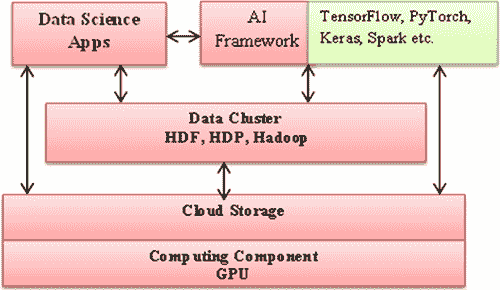

图 16.1 AI 启用节点中的组件

用于演进 DAI 并提供满足环境需求的重要组件列在后续章节中。

### 16.3.1 图形处理器 (GPU)

AI 的主要资源是作为加速器提供存储和网络解决方案的 `GPU`。`GPU` 位于 `IBM Power` 系统。`NVIDIA Tesla V100` 模型提供了高性能计算 (HPC) 和图形处理。它提供了比单台 `CPU` 更好的性能。`GPU` 适用于机器学习/深度学习涉及的矩阵和向量运算，并将深度学习系统的速度提高 100 倍；如果在不同的计算节点上作为独立代理并行运行，可以将运行时间从周缩短到秒。

### 16.3.2 存储

为了支持 AI 产生的各种数据格式和速度，存储系统必须分布在云端。云提供存储、存档和备份。云计算中的有效 AI 计算需要分布式快照协议。`Hadoop` 分布式文件系统 `HDFS` 是一种为 `Hadoop` 框架编写的分布式可扩展文件系统。该系统通过在多个节点上复制数据来获得一致性。`HDFS` 用于维护大型数据集的副本，以满足随机和顺序 I/O 的性能需求。`NetApp` 企业级 `HDFS` 存储解决方案提供的解决方案允许在边缘环境、本地数据中心和云之间进行无缝的数据管理和部署（Ranganathan, 2018）。

DAI（分布式人工智能）是指在多智能体环境中分配、管理和预测任务、目标或决策性能的科学（Deshmukh, 1992）。DAI 是一类基于多智能体系统的技术，将问题解决分配到一组启用 AI 的节点上。这些节点分布在不同的地理位置，并通过高速网络连接，以处理基于 AI 的应用程序，例如无人驾驶汽车、医疗系统（从一家医院到另一医院）等。DAI 基于多智能体系统。智能体（Agent）可以认为是完成某事的手段。智能体可以是智能设备、人类、移动设备、笔记本电脑、桌面或其他任何电子设备。这种分布式环境为 DAI 提供了一个高速网络，其中每个协调智能体可以将任务划分为不同的分布式位置。协调智能体跟踪所有分配给其他智能体的任务，并控制和管理分布式智能体处理的结果。智能体协调者（头部，中心主体）将原始问题分解为不同的任务。这些任务被分配给智能体执行者进行处理和执行。每个智能体执行者负责解决任务。然后智能体头部可以监控对应所选任务结果的组成和集成。智能体集成器负责整体结果（通常，这是同一个智能体协调者）。DAI 的环境在图 16.2 中所示。

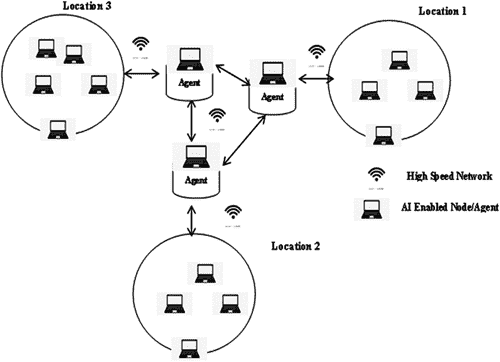

图 16.2 基于智能体的 AI 分布式环境。

DAI 系统由三个主要特征定义（Ponomarev & Voronkov, 2017）：

1. 智能体之间的任务分配。
2. 智能体之间的权力分配。
3. 智能体之间的通信。

分布式系统包含以下特征，以呈现 DAI 环境：

* 节点的负载共享、通信和协同工作。
* 在不同节点上分布海量数据集的样本并进行在线机器学习。
* 在深度学习的情况下，对复杂的查询集进行并行执行。
* 分布式机器学习算法是广泛学习的片段，得益于其将学习方法分配到几个其他节点上的能力。AI 和分布式学习算法的计算性能已经得到了扩展。
* 有助于缓解人们在类环境中遇到的许多安全问题（Verma et al., 2018）。
* 为 AI 应用提供容错且健壮的环境。
* 降低了成本并提升了整体性能。

此外，分布式计算环境提供了当前技术的集成，以成功实施 AI 平台。DAI 指的是基于多个处理器的 AI 的子领域。有一组节点或智能体（逻辑上不同的处理元素）试图解决一个问题。分布式计算最大的优势是它提供了不受限制的可扩展性，没有单点故障。当一个节点故障时，其他节点可以承担其责任而不会发生数据丢失，这在中央系统中是没有发生的。

BOINC（伯网络网络开放基础设施）是一个分布式计算组织的开放软件平台。BOINC 架构基于分布式人工智能的概念。它有一个 BOINC 客户端和 BOINC 服务器。BOINC 客户端可以通过 `HTTP` 通信协议进行工作。客户端可以运行和控制应用程序。BOINC 服务器包含一组独立的子系统（智能体），每个子系统负责其定义的任务，例如执行计算、文件传输、任务调度器等。

## 16.4 分布式人工智能的应用

DAI 系统由分布式节点组成，这些节点在通信期间自主运行。此外，不同的 DAI 应用声称利用 AI 来获取医生的解决问题能力。我们相信 AI 创新正在快速发展，并可能帮助人类提供社会保险的能力（Kermany et al., 2018; Esteva et al., 2017）。DAI 具有检测数据集中重要连接的前景，并且广泛应用于许多领域。最常见的应用是医疗保健、农业、废物管理、电子商务、智能网络等。

### 16.4.1 医疗系统

AI 正多样地用于医疗和研究目的，如疾病预测和识别、并发病之间的关联、医疗服务的提供以及药物发现（Tran et al., 2019）。DAI 是整合和演进分布式医疗系统的一种极具力的方法。DAI 能够解决异性问题，支持智能和分布式存储，允许优化个性化的电子健康环境，并提高整体系统性能。智能体可以作为分布式系统环境的一部分，并确保用于组合成工作的异性医疗系统的不同系统之间的互操作性（Al-Sakran, 2015）。

具有分布式节点及其多样化数据源的典型医疗生态系统在图 16.3 中所示。每个节点代表不同的计算智能体，如患者智能体、医生智能体、保险智能体、药物智能体、研究智能体等。该智能体可以与其他智能体通信。智能体协调者可以从一家医院收集信息并提供给其他医院，以获得更好的准确性和预测。

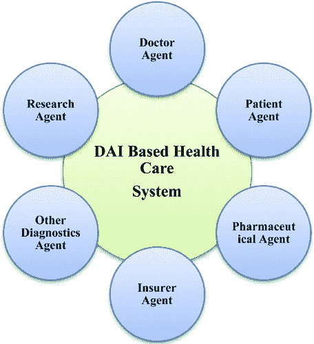

图 16.3 医疗系统的 DAI 环境。

分布式人工智能有助于找到快速有效的方法和环境，以有效对抗 COVID-19 疾病。可以通过分布的智能体收集数据，人们连接发送有关症状和诊断的实时信息。基于 AI 的系统为专家和研究社区提供重要信息和建议（Pham et al., 2020）。生物信息学的能力也有助于传染病检测和药物发现，以阻止未来的流行和大流行情况（Singh & Singh, 2020a）。

### 16.4.2 农业系统

农业自动化是所有国家最关注的领域和新兴话题。农业系统的自动化提高了土壤产率，还增强了土壤肥力（Al-Sakran, 2015）。如图 16.4

图 16.4 基于 DAI 的农业系统。

分布式系统中的代理体物理上可以位于同一地点，并通过本地网络连接，或通过广域网连接到其他位置，从而实现低延迟和更好的性能。DAI 系统允许将复杂的问题/数据分解为较小的部分，并分配给多台计算机（代理体）以并行方式工作，这可以缩短预测、识别、分类和自动化所需的处理时间。

### 16.4.3 电子商务](#chapter16.xhtml#re_ch-16-sec-14)

DAI 系统可以从电子商务中海量金融数据的子样本中学习金融交易规则和政策。AI 与电子商务提供了多种服务，如智能物流、推荐系统、产品搜索中的电子助手以及最优定价设施（Song et al., 2019）。在构成分布式环境的大规模真实在线银行数据、客户数据和电子商店上进行实验，可以获得显著更高的准确率，并识别出忠实客户的消费者行为（Singh & Agrawal, 2018b; Singh & Agrawal, 2019）、客户细分（Singh et al., 2020）以及数字市场中的产品偏好。区块链技术的重大进展以及与 AI 和物联网集成的能力，为企业提供了一个透明的交易交易系统（Briggs & Buchhols, 2019）。

### 16.5 未来展望](#chapter16.xhtml#re_ch-16-sec-15)

分布式人工智能是当务之急，因为未来的数据分析将主要在分布式环境中进行。与代理体、组件、协议等的异构性质进行集成和协调是未来将解决的主要挑战。此外，安全和透明性是 AI 分布式环境中仍然面临的挑战性问题。必须需要清晰的程序来接受相关的复杂性和法律困难，以确保社会从 AI 的改进中受益。基于 AI 的决策可能会导致全新的动态和技术，促进可解释性、真实性和以用户为中心。区块链技术可以与 AI 结合，支持多代理体系统的透明和分布式决策过程（Singh & Singh, 2020b）。多代理体系统可用于雾计算和区块链的管理与组织（Calvaresi et al., 2019）。DAI 可以在未来五年内实现道路上自动驾驶车的预期。

### 16.6 结论](#chapter16.xhtml#re_ch-16-sec-16)


在本章中，我们介绍了一种克服传统 AI 系统挑战的 AI 分布式环境。带有 AI 的分布式系统被称为 DAI，它在被称为代理体的分布式节点之间提供分配、集成和通信。因此，DAI 是一种多代理体系统，利用物联网、云计算等最新技术来解决实时应用。AI 应用如医疗保健、农业和电子商务基于大型数据集和复杂算法。基于代理体的分布式环境为这些应用提供了便捷的计算以及快速的预测和分类。换句话说，DAI 将能够以几乎无限的存储、动力、连接性和最高效率解决绝对任何问题。

然而，DAI 通常使得系统很难正确且完全地规范代理体的行为动态。利用具有物联网、云、区块链等最新技术的代理体，使得 DAI 更加健壮、安全和快速。

## 参考文献

1. Al-Sakran, H. O. (2015). Framework architecture for improving healthcare information systems using agent technology. *International Journal of Managing Information Technology*, 7(1), 17.

2. Alom, M. Z., Taha, T. M., Yakopcic, C., Westberg, S., Sidike, P., Nasrin, M., ... Asari, V. (2019). State-of-the-art deep learning theory and architectures. *Electronics*, 8(3), 292.

3. Bond, A., & Gasser, L. (Eds.). (2014). *Readings in Distributed Intelligence*. Morgan Kaufmann, San Francisco, CA.

4. Briggs, B., & Buchhols, S. (2019). Tech trends 2019: Beyond the digital frontier. *Deloitte Insights*, 90, 19–26.

5. Calvaresi, D., Mualla, Y., Najjar, A., Galland, S., & Schumacher, M. (2019). Explainable multi-agent systems through blockchain. In *Workshop*.

6. Dubey, S., Singh, P., Yadav, P., & Singh, K. (2020). Household waste management system using IoT and machine learning. *Procedia Computer Science*, 167, 1950–1959.

7. Deshmukh, A. V. (1992). Distributed artificial intelligence. *Knowledge Management Intelligence Complex*, 1, 1–6.

8. Eli-Chukwu, N. C. (2019). Applications of artificial intelligence in agriculture: A review. *Engineering, Technology & Applied Science Research*, 9(4), 4377–4383.

9. Esteva, A., Kuprel, B., Novoa, R. A., Ko, J., Swetter, S. M., Blau, H. M., & Thrun, S. (2017). Dermatologist-level classification of skin cancer with deep neural networks. *Nature*, 542(7639), 115–118.

10. He, J., et al. (2019). The practical implementation of artificial intelligence technologies in medicine. *Nature Medicine*, 25(1), 30–36.

## 参考文献

13. Jha, K., Doshi, A., Patel, P., & Shah, M. (2019). 人工智能在农业中自动化的全面综述。 *Artificial Intelligence in Agriculture*, 2, 1–12.

14. Kermany, D. S., Goldbaum, M., Cai, W., Valentim, C. C., Liang, H., Baxter, S. L., ... Dong, J. (2018). 基于图像的深度学习的医疗诊断和可治疗疾病识别。 *Cell*, 172(5), 1122–1131.

15. Kokkinaki, A. I., & Valavanis, K. P. (1995). 针对自动化制造系统的基于 AI 和 DAI 的规划技术进行比较研究。 *Journal of Intelligent and Robotic Systems*, 13, 201–245. [`doi.org/10.1007/BF01424008`](https://doi.org)

16. Lim, J., Gil, J. M., & Yu, H. (2018). 云计算环境中高效人工智能计算的分布式快照协议。 *Symmetry*, 10(1), 30.

17. Moritz, P., Nishihara, R., Wang, S., Tumanov, A., Liaw, R., Liang, E., ... Stoica, I. (2018). Ray：一种用于新兴 {AI} 应用的分布式框架。第 13 届 `USENIX` 操作系统设计与实施学术会议 (`OSDI` 18) (pp. 561–577)。Carlbad, CA. ISBN 978-1-939133-08-3

18. Patel, D. T. (2019). 物联网 (IoT) 的分布式计算。见于 *物联网中的计算智能* (pp. 84–109)。IGI Global. [`doi.org/10.4018/978-1-5225-7955-7.ch004`](https://doi.org)

19. Pham, Q. V., Nguyen, D. C., Hwang, W. J., & Pathirana, P. N. (2020). 人工智能 (AI) 与大数据用于新冠肺炎 (COVID-19) 大流行：现状技术综述。2020040383 (doi: 10.20944/preprints202004.0383.v1).

20. Ponomarev, S., & Voronkov, A. E. (2017). 多代理系统与去中心化人工超智能。[`arxiv.org/abs/1702.08529`](https://arxiv.org)

21. Simmonds, J., Gómez, J. A., & Ledezma, A. (2019). 基于代理的模型和多代理系统在洪水水文学问题中的作用：简要综述。*Journal of Water and Climate Change*. [`doi.org/10.2166/wcc.2019.108`](https://doi.org)

22. Singh, P., & Agrawal, R. (2018a). 适用于异构和物联网网络的以客户为中心的最佳连接通道模型。*Journal of Organizational and End User Computing (JOEUC)*, 30(4), 32–50.

23. Singh, P., & Agrawal, R. (2018b). 开源软件在异构网络中最大化用户期望的前。*International Journal of Open Source Software and Processes (IJOSSP)*, 9(3), 1–14.

24. Singh, P., & Agrawal, V. (2019). 基于用户服务体验的客户留存协作模型。见于 Bhatia S., Tiwari S., Mishra K., Trivedi M. (编), *计算机通信与计算科学进展* (pp. 55–64)。Springer, 新加坡。[`doi.org/10.1007/978-981-13-6861-5\_5`](https://doi.org)

25. Singh, P., & Singh, N., (2020a). 数据挖掘技术在生物信息学中的作用。*International Journal of Applied Research in Bioinformatics (IJARB)*, 11(6), 出版。

26. Singh, N., Singh, P., Singh, K. K., & Singh, A. (2020). CRM 的基于机器学习的分类与分段技术：客户分析。*International Journal of Business Forecasting and Marketing Intelligence*, 6(2), 99–117.

27. Singh, P., & Singh, N. (2020b). 结合 IoT 与 AI 的区块链：农业与医疗健康综述。*IJAEC*, 11(4)。

28. Song, X., Yang, S., Huang, T. (2019). 人工智能在电子电子商务中的应用。*Physics: Series*, 1302.

29. Verma, D., Calo, S., Cirincione, G. (2018). 边缘到云的架构。技术白皮书，NetApp。

30. Tran, B., Ha, H., Vuong, Q., ... Toka, L. (2020). 医学领域人工智能的研究演变。*Journal of Clinical Medicine*, 8(3).

31. Varga, P., Franko, J., Balla, D., ... Bahr, R. (2018). 5G 支持。见于：第 19 届分布式计算与网络会议论文集 (1–6)。

32. Vermesan, O., Eisenhauer, M., Serrano, M., Sundmaeker, H. (2018). 下一代物联网中的安全性问题。见于：Ovidiu Vermesan (编), *下一代物联网：边缘分布式智能*。SINTEF, 挪威。欧洲委员会。ISBN 9788702208, [`doi.org/10.13052/rp-9788702207`](https://doi.org)

34. Zheng, X., Zhu, M., Li, Q., Chen, C. C., Tan, Y. C. (2019). FinBrain：当金融遇到 AI。*Frontiers of Information Technology & Electronic Engineering*, 20(7), 914–924.

# 用于车载自组织网络交通管理的基于代理的混合神经网络分析

G. Kiruthiga, G. Uma Devi, N. Yuvaraj, R. Arshath Raja, 以及 N.V. Kousik

- 17.1 引言
- 17.2 网络模型
- 17.3 交通管理
  - 17.3.1 代理单元
  - 17.3.2 基础设施单元
- 17.4 性能评估
- 17.5 结论
- 17 参考文献

## 17.1 引言

近年来，车载自组织网络 (VANETs) 为用户提供了安全管理和数据管理，并设计了相应的控制方法以适应任何情况，强调网络动态。随着车辆数量的增加，使用集中式和分布式算法的交通管理变得日益复杂。这间接影响了城市交通，增加了交叉口延迟、燃料消耗、交通事故和排放值。

实时准确的交通流预测是交通管理系统的关键特征。智能交通系统 (ITS) 提供了可靠的交通管理服务，通过协调网络使使用户感知环境。各种信息和通信技术在 ITS 中的应用进一步增强了交通移动管理。它高度支持 VANET 中车辆与路侧单元 (RSU) 之间的通信，以实现高效安全的交通。

为了解决交通管理中的复杂问题，现有文献已进行了相关研究。这些方法被用于解决 VANET 中的交通拥堵，包括扩展性、性能和管理难题。各种优化任务的执行对调节城市场景下的交通流动态起着重要作用。

然而，现有方法对拥堵的影响受限于无法为交通预测提供准确且及时的信息。最近，拥堵效应被视为一个分类问题并提供了广泛的解决方案，但大多数系统由于使用有限而导致 \[8, 9\]。为了支持这两种局限性，ITS（智能交通系统）通过分析各种网络参数来支持交通状况预测 \[10\]。这种预测涉及路线的预规划和重新调度，从而减少拥堵 \[11, 12\]。随机特性 \[13\]和非线性交通流进一步对准确交通预测构成了严峻挑战 \[14, 15\]。VANET（车载自组织交通网络）方法使用线性模型和机器学习模型基于网络密度进行交通流预测，这无法读取系统的非线性不确定性 \[16–18\]。

随着交通量的指数级增长和对高计算资源的需求，交通管理分析变得复杂 \[19\]。因此，考虑到不确定性、指数级增长和高计算资源，需要高端智能系统来提供灵活开放的架构，以实现车辆更顺畅的传输。采用深度学习模型的高端智能系统具有管理网络级抽象和资源优化的能力。

基于这样的动机，我们引入移动智能体 (MA) \[20\]作为感知环境的关键因素，为 DNN 路由算法提供输入以实现最优决策。本章的主要贡献包括：

1. 作者设计了一种方案，能够实时感知 VANET 环境并在快速实例更新路由表，以降低车辆碰撞率。

2. 作者将深度神经网络 (DNN) \[21–25\]算法与 MA 结合，以提高实时场景下 VANET 的路由能力。这确保了根据定期实例来自 MA 的输入做出最优路由决策，从而确保跨 MANET（移动自组织网络）提供更好的服务交付。

3. 作者在实时交通场景下，从数据包交付率、延迟、错误率和吞吐量等各种碰撞回避指标，对 DNN-MA 模型与现有的深度和机器学习模型进行了评估。

本章大纲如下：第 17.2 节讨论了网络模型。第 17.3 节提供了交通管理系统的细节。第 17.4 节讨论了用于 VANET 路由的 DNN-IA 架构细节。第 17.5 节总结了整个项工作。

## 17.2 网络模型

图 17.1 显示了具有两种实体的 VANET 网络模型：车对车 (V2V) 和车对基础设施 (V2I)。

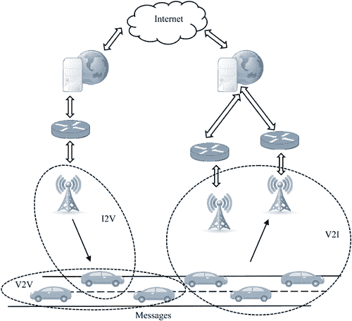

图 17.1 VANET 模型。

- **车辆单元**：车辆单元，简单来说就是车辆，负责运输目的，并被 VANET 用于与沿路段的附近车辆或位于路边缘/拐角的道路安全单元 (RSUs) 进行通信。在本章中，我们使用椭圆曲线加密作为一种加密算法来生成加密凭据并存储在车辆中。全球定位系统 (GPS) 可以找到车辆位置。路段内的车辆总数可以通过 RSU 使用 GPS 单元确定。

- **路侧单元 (RSUs)**：RSU 充当部署在道路旁的接入点，它持有沿路段的车辆单元详细信息。由车辆单元加密的路段被视为交通消息通道 (TMC) 或 IA（智能路侧）的中继。MA 通过更快的通信媒介与 RSU 连接。RSU 的功能是运行和存储加密凭据，以解码车辆信息和 DNN-IA 算法。

- **TMC 或 IA**：MA 使用路段来计算交通密度。TMC 的方向连接与 RSU 结合。RSU 的功能是运行和存储加密凭据，以解码车辆信息和 DNN-IA 算法。MA 使用路段来计算交通密度。TMC 的方向连接与 RSU 结合。RSU 的功能是运行和存储加密凭据，以解码车辆信息和 DNN-IA 算法。MA 使用路段来计算交通密度。

（注：由于原文最后两段关于 TMC/IA 的描述存在重复，译文严格遵循原文句式结构）MA 使用路段来计算交通密度。TMC 的方向连接与 RSU 结合。RSU 的功能是运行和存储加密凭据，以解码车辆信息和 DNN-IA 算法。MA 使用路段来计算交通密度。

*修正：根据原文最后一段落：*

MA 使用路段来计算交通密度。TMC 的方向连接与 RSU 结合。RSU 的功能是运行和存储加密凭据，以解码车辆信息和 DNN-IA 算法。MA 使用路段来计算交通密度。

*重新对齐原文最后两落：*

MA 使用路段来计算交通密度。TMC 的方向连接与 RSU 结合。RSU 的功能是运行和存储加密凭据，以解码车辆信息和 DNN-IA 算法。MA 使用路段来计算交通密度。

（注：原文文本在 TMC/IA 处确实有明显的句子重复，译文已忠实保留原文结构）

MA 使用路段来计算交通密度。TMC 的方向连接与 RSU 结合。RSU 的功能是运行和存储加密凭据，以解码车辆信息和 DNN-IA 算法。MA 使用路段来计算交通密度。

*再次重新审视原文最后部分：*

"The MA uses road segments to calculate the traffic density. The direction connection of TMC with RSU...（此处原文重复）... The MA uses road segments to calculate the traffic density."

翻译为：

MA 使用路段来计算交通密度。TMC 的方向连接与 RSU 结合。RSU 的功能是运行和存储加密凭据，以解码车辆信息和 DNN-IA 算法。MA 使用路段来计算交通密度。

（抱歉，我发现原文确实存在多处逻辑重复，以下为基于原文文本的最终对应翻译）：


MA 使用路段来计算交通密度。TMC 的方向连接与 RSU 结合。RSU 的功能是运行和存储加密凭据，以解码车辆信息和 DNN-IA 算法。MA 使用路段来计算交通密度。

然而，现有方法对拥堵的影响受限于无法为交通预测提供准确且及时的信息。最近，拥堵效应被视为一个分类问题并提供了广泛的解决方案，但大多数系统由于使用有限而导致 \[8, 9\]。为了支持这两种局限性，ITS（智能交通系统）通过分析各种网络参数来支持交通状况预测 \[10\]。这种预测涉及路线的预规划和重新调度，从而减少拥堵 \[11, 12\]。随机特性 \[13\]和非线性交通流进一步对准确交通预测构成了严峻挑战 \[14, 15\]。VANET（车载自组织交通网络）方法使用线性模型和机器学习模型基于网络密度进行交通流预测，这无法读取系统的非线性不确定性 \[16 [](#chapter17.xhtml#re_TNF-CH017_CIT00017)–18\]。

随着交通量的指数级增长和对高计算资源的需求，交通管理分析变得复杂 \[19\]。因此，考虑到不确定性、指数级增长和高计算资源，需要高端智能系统来提供灵活开放的架构，以实现车辆更顺畅的传输。采用深度学习模型的高端智能系统具有管理网络级抽象和资源优化的能力。

基于这样的动机，我们引入移动智能体（MA） \[20\]作为感知环境的关键因素，为 DNN 路由算法提供输入以实现最优决策。本章的主要贡献包括：

1. 作者设计了一种方案，能够实时感知 VANET 环境并在快速实例更新路由表，以降低车辆碰撞率。
2. 作者将深度神经网络（DNN） \[21 [](#chapter17.xhtml#re_TNF-CH017_CIT00022) [](#chapter17.xhtml#re_TNF-CH017_CIT00023) [](#chapter17.xhtml#re_TNF-CH017_CIT00024)–25\]算法与 MA 结合，以提高实时场景下 VANET 的路由能力。这确保了根据定期实例来自 MA 的输入做出最优路由决策，从而确保跨 MANET（移动自组织网络）提供更好的服务交付。
3. 作者在实时交通场景下，从数据包交付率、延迟、错误率和吞吐量等各种碰撞回避指标，对 DNN-MA 模型与现有的深度和机器学习模型进行了评估。

本章大纲如下：第 17.2 节讨论了网络模型。第 17.3 节提供了交通管理系统的细节。第 17.4 节讨论了用于 VANET 路由的 DNN-IA 架构细节。第 17.5 节总结了整个项工作。

## 17.2 网络模型

图 17.1 显示了具有两种实体的 VANET 网络模型：车对车（V2V）和车对基础设施（V2I）。


图 17.1 VANET 模型。

* 车辆单元：车辆单元，简单来说就是车辆，负责运输目的，并被 VANET 用于与沿路段的附近车辆或位于路边缘/拐角的道路安全单元（RSUs）进行通信。在本章中，我们使用椭圆曲线加密作为一种加密算法来生成加密凭据并存储在车辆中。全球定位系统（GPS）可以找到车辆位置。路段内的车辆总数可以通过 RSU 使用 GPS 单元确定。
* 路侧单元（RSUs）：RSU 充当部署在道路旁的接入点，它持有沿路段的车辆单元详细信息。由车辆单元加密的路段被视为交通消息通道（TMC）或 IA 的中继。MA 通过更快的通信媒介与 RSU 连接。RSU 的功能是运行和存储加密凭据，以解码车辆信息和 DNN-IA 算法。
* TMC 或 IA：MA 使用路段来计算交通密度。TMC 的方向连接与 RSU 结合。RSU 的功能是运行和存储加密凭据，以解码车辆信息和 DNN-IA 算法。MA 使用路段来计算交通密度。

基础设施单元位于应用层，并利用车辆的位置、位置和速度，通过 `DNN`（`DNN` 的架构见图 17.2）以稳健的方式计算路由路径。基础设施单元的工作流如图图 17.3 所示。

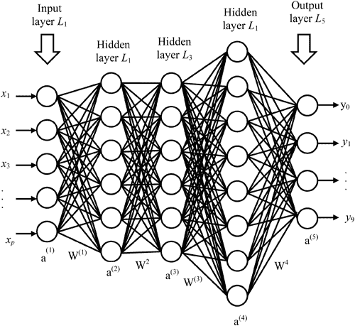

图 17.2 DNN 架构。


图 17.3 基础设施单元工作流。

基础设施单元的设计用于收集车辆单元的位置、速度和时间戳等控制信息。控制信息的收集以迭代方式进行，以确保收集的信息是精确的。信息由 `MAs` 收集，而不是由车辆单元直接发送基础设施单元（即 `RSU`）。来自 `MAs` 的数据作为输入发送到 `DNN` 模型，由其处理路由建立（路由过程与 [22] 中执行的过程相同），并将路由细节转发给 `MAs`。`MAs` 然后通过代码执行单元对 `MAs` 执行路由动作，然后建立路由以避免 `VANETs` 中的拥堵。通过这种方式，整个操作的执行严格避免了拥堵这一主要挑战。

## 17.4 性能评估

`DNN-MA` 在 Python 仿真器中进行仿真，`VANETs` 下仿真 `DNN` 的参数见表 17.1。仿真在一个固定道路宽度的双车道道路上进行，面积为 1500 × 1500 m²。该研究涵盖了 200 个路口和 250 个路段，其中 170 个路口设有交通信号。仿真涵盖了城市场景下的 500 辆车辆，其速度在 0 到 50 kmph（每小时公里）之间变化。

### 表 17.1 仿真参数

| 参数 | 值 |
| --- | --- |
| 总车辆单元数 | 100–300 |
| 信道载波频率 | 5.9 GHz |
| 频率 | 5.9 GHz |
| 仿真区域 | 1500 m × 1500 m |
| 最大传输 | 20 mW |
| 比率 | 18 Mbps |
| 包长度 | 均匀 |
| 路径损耗系数 | 2 |
| 信号衰减阈值 | −90 dBm |
| 车辆速度 | 20–50 kmph |
| 流量类型 | CBR |
| 传输范围 | 150 m |
| MAC 协议 | 802.11 p |
| CBR 速率 | 4 包/秒 |
| 信标间隔 | 0.5 s |
| 仿真时间 | 1000 s |
| MAC 数据速率 | 6 mb |
| 移动模型 | Krauß 模型 |

所提出的 `DNN-IA` 的验证是针对现有的深度学习模型：`DNN` [20] 和机器学习模型：人工神经网络（`ANN`） [21] 进行的。验证通过流量类型、车速和网络密度等多种性能指标进行，以评估平均延迟、累积分布函数 (CDF)、能量效率、数据交付率和网络吞吐量。

图 17.4 显示了 `DNN-IA` 与现有 `DNN` 和 `ANN` 模型之间的网络连接质量。传输范围在 200 到 500 米之间变化，而车辆的到达率保持在 30 到 50 kmph 之间。仿真结果显示，随着距离指标的增加，连接失效的概率增大，且随着距离 `RSU` 进一步增加超过 400 米，与车辆的连接将会丢失。然而，每 350 米放置一个 `RSU` 有助于 `VANETs` 从长期来看与车辆建立连接。另一方面，随着网络流量增加（从 100 辆到 300 辆），与 300 米内车辆建立连接的概率仍然是一个挑战（这从图 17.5 中可以看出）。图 17.5 显示了 `DNN-IA`、`DNN` 和 `ANN` 之间的 CDF 结果，在 100 到 300 辆车辆之间测试了连接概率。在这方面，300 辆车辆的网络密度标记为高，200 辆为中等，100 辆为低。结果显示，在低密度网络下，所提出的方法比 `DNN` 和 `ANN` 模型与车辆建立了更远距离的连接。当网络密度增加时，网络性能会出现下降。


图 17.4 网络连接随距离和网络密度的变化。


图 17.5 随网络密度变化的成功连接 CDF (100–300 车辆单元 (VU))。

图 17.6 显示了通过改变车辆速度，车辆间数据传输的平均延迟结果。仿真结果表明，随着速度增加，数据传输的延迟也会增加。相反，随着网络密度的增加，延迟进一步增加。速度增加和车辆密度增加的导致了最大的平均延迟。这种移动性由于在车辆之间转发数据包时无法建立链路而影响了数据传输。这直接影响了交付率，因为平均延迟与数据交付率成反比（图 17.7）。相比之下，仿真结果显示，在速度和密度最小的情况下，链路建立良好，因此平均延迟显著减少。总而言，由于由于 `MA` 的存在，`DNN-IA` 在最小平均延迟率方面比 `DNN` 和 `ANN` 更有效，且失败率更低。

图 17.8 显示了不同数据速率下的吞吐量结果。数据速率随网络密度和车辆速度的变化而变化。仿真结果表明，在道路边缘，当车辆以最小速度移动时，达到最大吞吐量；而在直路和弯道路段，吞吐量最低。此外，通过 `DNN-IA` 对路段车辆的最优选择比其他方法增加了网络吞吐量。最优选择降低了数据包丢失率，且通过选择最优相邻车辆跳数有效维护了传输链路，使得吞吐量具有高度一致性且能量效率较高。在 `DNN` 和 `ANN` 中由于缺乏 `MA` 来指定哪些车辆可以用于建立链路，导致了吞吐量下降，从而无法严格根据链路可靠性来避免能量消耗。


图 17.8 速度和网络密度变化对吞吐量的影响。

## 17.5 结论

在本章中，`DNN-MA` 为 VANET 中高度拥堵路径下的车辆提供了有效的路由方案。本章使用的 `DNN-MA` 提供了最优路径以提高能量效率。基于深度学习的 `MA` 检查整个网络，以寻找 VANET 中每辆车辆的状态。网络中较高的交通拥堵允许 `DNN-MA` 根据来自 `MA` 的输入优化路由决策。`DNN` 以更快的速度有效处理路由决策，并为网络提供设置最优路径的解决方案，从而更短的时间内减少网络拥堵。`RSU` 处的路由表对车辆状态进行定期更新，确保了最优车辆选择和稳定的路由决策。在速度、距离、车辆密度以及数据和传输速率变化下的验证表明，`DNN-MA` 比现有的 `DNN` 和 `ANN` 模型提供了更快的路由决策。仿真结果显示，`DNN-MA` 模型增加了连接性、吞吐量、数据包交付率并减少了端到端延迟和等待时间。结果进一步表明，`DNN-MA` 的连接终止概率较低，这支持了更高的数据传输率。因此，基于 `MA` 持续监控的 `DNN` 简化路由决策以最优方式维持了交通密度，并确保了数据包高效交付到目的节点。最后，路由决策在低移动性车辆上的适用性比高移动性车辆更有效率。

## 参考文献

1. Blot, G., Fouchal, H., Rousseaux, F., & Saurel, P. (2016, May). An experimentation of vanets for traffic management. In 2016 IEEE International Conference on Communications (ICC) (pp. 1–6). IEEE, Kuala Lumpur, Malaysia.
2. Li, S., Liu, Y., & Wang, J. (2019). An efficient broadcast scheme for safety-related services in distributed TDMA-based VANETs. IEEE Communications Letters, 23(8), 1432–1436.
3. Shen, L., Liu, R., Yao, Z., Wu, W., & Yang, H. (2018). Development of dynamic platoon models for predictive traffic control. IEEE Transactions on Intelligent Transportation Systems, 20(2), 431–440.
4. Yao, Z., Jiang, Y., Zhao, B., Luo, X., & Peng, B. (2020). A dynamic method for adaptive signal control in a connected vehicle environment. Journal of Intelligent Transportation Systems, 24(2), 184–200.
5. Srivastava, S., & Sahana, S. K. (2017). Nested evolutionary model for traffic signal optimization. Applied Intelligence, 46(1), 113–123.
6. Srivastava, S., & Sahana, S. K. (2019). Application of bat algorithm for transport network design. Applied Computational Intelligence and Soft Computing, 2019, 1–18.
7. Balta, M., & Özçelik, İ. (2020). A 3-stage fuzzy-decision tree model for traffic optimization in urban city via a SDN based VANET architecture. Future Generation Computer Systems, 104, 142–158.
8. Ke, X., Shi, L., Guo, W., & Chen, D. (2018). Multi-dimensional traffic detection based on fusion of visual features and convolutional neural network. IEEE Transactions on Intelligent Transportation Systems, 20(6), 2157–2170.
9. Altiğ, E., & Baykan, B. (2017). Discover the world's research. Turk Journal of Neurology, 23, 88–89.
10. Nagy, A. M., & Simon, V. (2018). Survey on traffic prediction in smart cities. Pervasive and Mobile Computing, 50, 148–163.
11. Tanwar, S., Vora, J., Tyagi, S., Kumar, N., & Obaidat, M. S. (2018). A systematic review on security issues in vehicular ad hoc network. Security and Privacy, 1(5), e39.
12. Luo, X., Li, D., Yang, Y. (2019). Spatiotemporal flow prediction with KNN. Journal of Advanced Transportation, 2019.
13. Ravi, B., Thangaraj, J., Petale, S. (2019). Data forwarding for inter-vehicular communication in VANETs using stochastic method. Wireless Personal Communications, 106(3), 1591.
14. Kang, D., Lv, Y., Chen, Y. (2017). Short-term traffic flow with LSTM recurrent network. In 2017 IEEE 20th International Conference on Intelligent Transportation Systems (ITSC) (pp. 1–6). IEEE.
15. Mackenzie, J., Roddick, J., Zito, R. (2018). An evaluation of HTM and LSTM for arterial flow prediction. IEEE Transactions on Intelligent Transportation Systems, 20(5), 1847–1857.
16. Fu, R., Zhang, Z., Li, L. (2016). Using LSTM and GRU neural network for traffic flow. In 2016 31st Youth Academic Annual Conference of Chinese Association of Automation (YAC) (pp. 324–328). IEEE, Wuhan, China.


17. Ma, X., Tao, Z., Wang, Y., Yu, H., Wang, Y. (2015). Long short-term memory network for traffic speed prediction using remote sensor data. Transportation Research Part C: Emerging Technologies, 54, 187–197.

18. Shao, H., & Soong, B. H. (2016). Traffic flow prediction with long-term memory networks (LSTMs). In 2016 IEEE Region 10 Conference (TENCON) (pp. 2986–2989). IEEE, Singapore.

19. Ku, I., Lu, Y., Gerla, M., Gomes, R. L., Ongaro, F., & Cerqueira, E. (2014). Towards software-defined VANET: Architecture and services. In 2014 13th Annual Mediterranean Ad Hoc Networking Workshop (MED-HOC-NET) (pp. 103–110). IEEE, Piran, Slovenia.

20. Lu, J., Feng, L., Yang, J., Hassan, M. M., Alelaiwi, A., & Humar, I. (2019). Artificial agent: The fusion of artificial intelligence and a mobile agent for energy-efficient traffic control in wireless sensor networks. Future Generation Computer Systems, 95, 45–51.

21. Venkataram, P., Ghosal, S., & Kumar, B. V. (2002). Neural network based optimal routing algorithm for communication networks. Neural Networks, 15(10), 1289–1298.

22. Reis, J., Rocha, M., Phan, T. K., Griffin, D., Le, F., & Rio, M. (2019, July). Deep neural networks for network routing. In 2019 International Joint Conference on Neural Networks (IJCNN) (pp. 1–8). IEEE, Budapest, Hungary.

23. Geyer, F., & Carle, G. (2018, August). Learning and generating distributed routing protocols using graph-based deep learning. In Proceedings of the 2018 Workshop on Big Data Analytics and Machine Learning for Data Communication Networks (pp. 40–45).

24. Perez-Murueta, P., Gómez-Espinosa, A., Cardenas, C., & Gonzalez-Mendoza, M. (2019). Deep learning system for vehicular re-routing and congestion avoidance. Applied Sciences, 9(13), 2717.

25. McGill, M., & Perona, P. (2017, August). Deciding how to decide: Dynamic routing in artificial neural networks. In Proceedings of the 34th International Conference on Machine Learning-Volume 70 (pp. 2363–2372). JMLR. org.

# 18 数据科学与分布式人工智能

V. Radhika

## 目录

* 18.1 引言
* 18.2 灵感
* 18.3 分布式传感器网络
* 18.4 关联性测试
  * 18.4.1 基于人类的网络实验
  * 18.4.2 机器网络测试
* 18.5 解决问题的抽象模型
  * 18.5.1 HSII 组织：产生系统方法
  * 18.5.2 Hearsay-II 多处理机制
  * 18.5.3 邻近上下文
  * 18.4.4 数据完整性
  * 18.5.5 上下文分析
  * 18.5.6 通过仿真对 HSII 多处理器性能进行分析
  * 18.5.7 HSII 语音理解系统：仿真配置
* 18.6 工作的分层级分布
* 18.7 广场（Agora）
* 18.8 图像处理的探索性结果
* 18.9 总结与结论
* 参考文献

## 18.1 引言

分布式人工智能（DAI）的研究有望在智科学领域产生广泛的影响，例如心理模型、社会洞察、传播框架、组合以及语言支持。生成式人工智能同样支持人机交互，即任务分配、智能接口、交换理解和言语行为。问题解释、认识论、共同构思发展、通信思维和批判性思维在 AI 研究中至关重要，而 AI 框架的构建涉及协作框架、生成式感知和信息融合、协作机器人、群体结构批判性思维等。然而，对 DAI 的研究具有基本意义：为了促进它们的活动，智能智能体需要对不同操作者的信息、活动和计划进行通信和推理。

## 18.2 灵感

数字化的进步深刻影响着工业、科学和创新。数据科学和人工智能算法的智能建立了一个访问的基本控制点，而信息/数据的处理已如图 18.1 所示。它们对于个人、组织乃至国家逻辑和文化进步的经济成就至关重要 [1]。第四次工业革命被用于通过分析产生的海量数据集来确定知识的逻辑部分。


图 18.1 数据科学的流程。

信息已成为创造的关键因素。它通常利用数据科学和人工智能算法生成，并因此滥用，以提供新的知识来更有可能地理解（或解释）问题。已经确定信息和数据科学、人工智能技术是信息经济中严重的差异化因素：能够利用它们的公司将变得更快、表现更好 [2]。因此，掌握信息和精通数据科学以及人工智能技术是未来成功的关键要素。`R`是研究和数据科学最青睐的开源语言。`R`提供了大量的测量（线性和非线性回归、经典、统计检验、时间序列分析、排序、聚类等）和图形程序，并且具有极强的扩展性。它在大数据处理中非常有价值。

传播和并行一直是人工智能中的重要课题。在 20 世纪 50 年代，由于工和神经系统管理策略被创建。使用的计算结构是层层`神经元`，它们展示的过程通常是设计任务，而主要的编程策略是突触学习。学习假设中取得了一些假设性结果。`Lee`在概率状态变量 (`PSV`) 中研究了半成品和计算机网络 [3]。`Aleksander`检查了神经系统的输入 [4]，它将框架总结为 RAM 组件系统。尽管如此，由于缺乏足够的突破性编程或学习策略、理论上的不可管理性以及使用问题，使得此类工作变得困难。它在当前的执行幸运时期被另一个领域占据，如并行分布式处理 `McClelland` [5] 和连接主义 `Feldman` [6]。

## 18.3 分布式传感器网络

为了获取信息，引入了分布式传感器网络 (`DSN`)。微芯片的进步、束交换无线电接口、传感器以及用于机械化批判性思维的人造推理策略，共同构建了一个高度机器人化、低功耗、智能且可传输的传感器网络体系。其中一个模型如图[图 18.2]所示。由分布在战斗区域的廉价智能网关组成的 `DSN` 被认为对于获取大量的声学感知信息、处理这些信息以减少脆弱性并产生更高层次的理解，并将这些离散数据快速传输给需要它的管理员非常有价值。分布式系统的发展正在迅速进行。两个两个困难的领域是交通控制和机械控制。


图 18.2 整体性能：问题 3-6 (a) 无政府委员会，(b) 动态分层锥。

在尝试为 `DSN` 描述合适的结构时，受到了一些通用设备模式的影响：处理能力正以与设备成本降低相同的速度增长；通信能力也在以更低的成本不断提高，而且所需的总计算量越来越小。这些是容易且低功耗传感器，它们可能会保持相当的可靠性。`DSN` 需要根据详细的当前设备计划和需求进行维护。大规模的态势评估 (`SA`) 通常包括一个数据生产者和消费者组成的系统，处理随区域、聚合程度和考虑水平变化的数据。当前军事形势下的有利态势评估需要比以往任何时候都更快地处理更多的此类数据。新的数据准备技术建议自动化更复杂的 `SA` 任务。

`SA` 由两个结构组成：一个是信托人结构，鼓励通信和重组；另一个是更为复杂的分层结构，它可能培养了对当前全球问题观点的假设。为了研究这些结构，进行了一项基于重构 `SA` 任务的研究。这项测试任务通过将许多前线 `SA` 任务的组件转换为逐步可识别的数据处理问题而创建。特别是，消息（移动的词和表达式）以蛇形方式穿过一个被障碍稀疏覆盖的区域，在到达最终目标之前停止。从 `DSN` 的角度来看，这些词代表辐射外外信号的移动阶段。任务是在阶段到达目标之前尽可能快地识别接近的阶段。协会中的每个成员视野都受限，因此协作对于协会执行其策略至关重要。

如果可以用预测其在一段时间后自我演化的动态理论来取代静态数据假设，那么通信需求就可以减少。过程汇编网络 (`PAN`) 使网关能够通信并预测其重要邻居的信念框架。在此期间，它将通常需要访问详细信息的任务替换为一个只需要考虑意外的框架。

`SA` 任务适用于实验室实验。即杂乱、瞬态和组件数据可以汇总以解释和阐明高水平事件的问题。军事前线形势与协会研究的其他不同情况一样，过于复杂且描述不足，无法帮助这种实验室研究，因此我们希望开发一个捕捉非此类案例核心的缩减空间。该任务的需求包括：

- 如图[图 18.2]所示的战斗区域形势，包含两类移动的物体和数据，因为问题必须支持各种类型的活动；例如伪装和散布、复合攻击和欺骗；
- 许多传感器，每个传感器都能看到一些但不是所有的低级活动，因为发布的信息必须包含错误并允许缺失；
- 瞬态信息，因为数据估计根本上取决于方便的准备；
- 处理器之间有限的通信，目标是研究通信算法交换；
- 丰富的数据条件，因为必须提供足够的数据以允许框架克服上述障碍并得出答案。

一个显示这些属性的测试任务配置，并利用它来考虑之前描述的分层方面（[图 18.3]）。


图 18.3  D DSN 的重要性数据链。

## 18.4 测试的协会

在这一任务条件下，尝试了两种不同的权威结构作为类似任务的可能。主要的协会决定考虑一种“平级”的非差异分层协会。在计算机推理 (`AI`) 写作中，这种结构通常被称为“参与式专家”世界观。这种类型最著名的 AI 工作可以以 `Erman` 等人的 `Hearsay-II` 对话理解框架作例。总的来说，“参与式专家”协会由几乎没有不同分层结构的权威实体组成。此类协会通过共享个人观点来解决问题，这些观点提炼并最终将局部翻译整合进共识中。子委托、披露需求和资产分配选择通常不是从先指定的。协会结构根据环境和变化有力地执行行为和通信设计，并以数据协调的方式更改示例。

与“协调专家”世界观直接相反的是不同分层的“假设 Y”或“感知锥”协会。前一个名称源于 `Lawrence` 和 `Lorsch` 关于组织理论的权威假设，该假设关注大型的结构化一致状态公司。后一个术语源于 `Uhr` 在设计识别中的早期 AI 工作。此类协会被汇编为考虑水平的严格等级制度。在每个层级，单个组件接收来自其下层级的报告，根据其非凡能力和在等级制度中的位置整合这些报告，并向上报告其结果的译译版本。系统的最高层可能会多次要求其下属根据其全球观点修改某些过去的报告，或者报告它所构建的可用翻译。“协作式专家”协会通常将在不复杂、尽管日益令人怀疑或快速演变的形势中获得支持。

完整的 `SA` 任务显示，这种方法假设每种层级结构都可能是合适的，并尝试了这两种。主要的结构被称为“无政府委员会 (`AC`)”，反映了其缺乏明显的立法结构，以及该协会倾向于产生许多董事信托委员会来执行明确任务的特质。随后的结构被尝试作为“动态层级锥体 (`DHC`)”。`DHC` 是一种“感知锥体”关联，经过调整，能够对空间不均匀或快速变化的信息流具有越来越增强的接收能力。

### 18.4.1 基于人类的节点实验

设备、受试者与程序：底层测试的一个重要目标（即人类玩家充当枢纽）是，在一种适合检查的结构中捕捉枢纽操作数据。这促使我们从一开始就考虑一个基于 PC 的测试平台，该平台能够为每个枢纽提供更好的工具来执行其任务，同时能够自然地记录追踪和执行信息。在随后形成的框架中，每个枢纽都配备了一个阴极射线管 (`CRT`) 终端。利用该终端，他们向不同的枢纽发送消息（受发布频率限制），向外部“控制器”提交谜题内容的正式报告，并展示其对框架的当前视角。

利用该测试平台和所描述的关联，他们引导了一系列随机分析。这些调查并非通过精确的实验控制来计划，以便进行正式的理论测试。或者，采用这些方法是为了在每个权威结构强加的约束下创造自然性，并推导出供 PC 程序使用的启发式方法，以增强适当控制的分析。实验共运行了六次独立的初步实验或“问题”。三次初步实验使用了 `AC` 层级结构，三次使用了 `DHC` 结构。每种情况下都使用一个不同的谜题。

在每个初步实验之前，受试者见面以获取枢纽分配（即枢纽位置）并创建标准的问题理解系统和方法。这些措施确保了用于安排消息的低级显示，以及更高层级的系统（例如，“为了减少单调的权威假设，将正式推测通过外部通信发送给 HL，由他们单独进行报告”）。枢纽还交换了关于他们如何处理问题理解任务的数据，例如追踪词汇或字母移动的技术。这些安排会议持续了约 30 分钟。随后受试者执行了任务。每个问题的总时间约为 60 分钟。结束后进行了简短的询问，受试者对活动给出总体印象、他们的问题解释启发式方法以及以后改进系统的新想法。他们还完成了一份简短的后测调查。

探索性分析与结果：前两次关键思维会议被视为训练会议，以熟悉每种权威结构。后四次会议经过了检查和分析，首先在相当长的总问题理解执行中（理论的准确性和实用性），随后在越来越详细的方式中进行。这项检查完成后，揭示了一些更为微妙的理论。

由于每个问题都使用不同的谜题，因此无法评估问题之间观察到的对比的稳定性。在某种程度上，可以预期对比会混淆困难和枢纽波动，正如权威结构一样。考虑到这一局限，将真实的枢纽执行与该特定问题的某些全局表现规则进行对比是合理的。通过这种方式，对于每个问题，通过一个假设的“全局枢纽”计算出基准执行。据假设，全局枢纽可以错误地看到整个谜题框架，并拥有一套定义理论和权威报告的规则或启发式方法。对于每个进展周期（像时钟一样的一次信息更新），评分员将这些准则应用于当前视图，以确定全局枢纽将报告哪些词。

执行结果如图 18.2 所示。每个图表显示了全局枢纽和真实枢纽在每轮中正确报告的总百分比。弯曲之间的阴影区域显示了实际执行偏离全局标准的程度。通常来说，显然 `AC` 的性能优于 `DHC`。在所有情况下，达到全局基准揭示水平的情况都更为明显。

为了理解导致良好执行的权威因素，对思维遵循进行了进一步调查。这些调查集中在三个一般假设上：

1. `AC` 的执行比 `DHC` 更有效，使用的消息更少即可达到相同效果。
2. `AC` 的通信比 `DHC` 更快，枢纽对数据的反应更快。
3. 高层次、更具概念的数据（例如表达和主题假设）在 `AC` 结构中共享和看到的更为频繁。

`KSs`（知识系统）通过将推测和来自控制板的信息作为输入并发布新的推测来工作。它们的活动可以通过追踪起始传感器信息到最后一次报告的变化来后续。在每一轮的结束时，任何未被表示的信息都将被一个 `KS` 专家利用，产生一系列可能的“可怕的线条混合”（ghastly line blends）的演进，它知道这些混合是针对该新数据可能的解释。当这种情况发生时，另一个负责将“可怕的线条”推测转换为阶段理论的 `KS` 答案会“觉醒”，并发布其关于可能产生这些线条的阶段的最佳推测。随着时间的推移和新信息的不断，这些不同推测的信度会发生变化，其中一个作为信息流的最佳解释脱颖而出。在特定点之后，一个理论被证明足以向框架中的不同节点传递 `KS`，这个“知道”此类标准的 `KS` 会借此做出决定，并将推测传递给通信模块。之后，可能随着来自邻居的确认数据出现，对某项推测的信度变得高到足以在系统之外正式详细化。当这种情况发生时，最初竞争的推测已被一组协调的 `KS` 专家剪掉。

通信限制比人类检查中的要宽松。每个节点都可以与系统中的其他某些节点通信，就像与外部世界通信（通过传感器信息和权限报告）。通信媒介是高效且实时的。可以共享三种数据：低级 (`LL`) 传感器报告、中级 (`IL`) 外星线条混合理论，以及高层级 (`HL`) 阶段推测。

### 执行的测试与结果

利用该系统复制尝试了三种基本结构：

* **一个全球整合节点**：这种结构也可以看作是一个两级进展，前提是限制所有低级节点的操作仅限于原始传感器信息的安全获取和重传。该结构提供了一个基准，用于评估下方的系统结构，因为我们认为，在足够的处理能力的情况下，一个整合算法本质上会在固定 `KS` 模块安排内展现出理想的批判性思维能力。
* **非传输节点的单级系统**：简单地缩小上述全球节点的视野范围并使系统复制依赖于它，使我们能够看到性能是如何受到没有通信或协调的严重衰减影响的。


**非传输节点的单级系统**（注：原文此处重复了，译文按原文保留）：简单地缩小上述全球节点的视野范围并使系统复制依赖于它，使我们能够看到性能是如何受到没有通信或协调的精确衰减影响的。

**传输节点的单级系统**：`AC`赖以执行的结构本质上优于静态节点系统；然而，它逊于全球节点。

它没有测试类似`DHC`的结构，不完全由于它在人类测试中的糟糕表现，很大程度上是因为`PC`资源和时间限制，使其难以包含更多节点和广泛得多的分析结构；并且在`DSN`任务中需要一个用于日益形式化的技术以以丢弃和共享信息的组件。

消息谜题任务被用作我们的领域。尽管如此，由于它只是日益广泛的情况评估问题的象征性替代品，该结构在这里以更广义的术语进行讨论，即检测和跟踪在空间（阶段）中移动的物体。图 18.5 的左侧的进展数据系统被用于构建我们项目中的信息结构；本文使用的相应`SA`术语在右侧。注意，重要数据链看起来像不同的符号在仔细地分解。


图 18.5 `HSII`框架关联。

`KSs`通过将理论和来自控制板的信息作为输入并在那里发布新的理论来工作。

我们的机器如何以如此低的通信堆叠实现了人类的执行水平，促使我们分析在分布式洞察安排中推动通信的组件。节点相互通信的原因之一如下：

1. 共享可能产生全球影响的局部数据；
2. 用新出现的局部数据更新其他节点；
3. 根据需要协调获取、准备和传输节点数据；
4. 以良好的方式划分任务负载；
5. 共享处理目标以防止重复练习；
6. 共享可能偏离或阻止需求的层级推测；
7. 预测数据将在何处以及何时出现以证实或反驳现有推测。

`Hearsay-II`话语理解框架（`HSII`）由 Lesser 等 \[13]、Erman 和 Lesser \[8\] 开发，目前是卡内基梅梅隆大学的一项进行中的工作，它涉及一种能够充分利用多处理器框架的批判性思维关联。`HSII`被设计为一种`AI`框架关联，适用于通信基于信息的批判性思维技术，经过适当分类的主题信息可以作为适合贡献其见解的信息源，以一种平等的信息协调方式进行交流。一个信息源（`KS`）可以被描述为一个操作符，它体现了特定领域特定部分的信息，并通过执行依赖于其信息的活动来帮助处理该领域的问题，促进整体安排的进展。`HSII`框架关联允许这些不同的自主和各种信息源被确定。它们的协作促进了相互帮助（可能是非并发且以相应的方式），以影响一个复杂的安排。

### 18.5.1 HSII 组织：一种系统方法

`HSII`框架关联可以被描述为一种“平等”的框架，它有一个反映动态问题安排状态的强大数据库。这个被称为`chalkboard`（黑板）的数据库是一个多维信息结构，其基本信息组件被称为`hub`。例如，`HSII`话语理解框架数据库的元素包括指令级（例如：语音、表面音位、音节、词汇和短语级）、表述时间（从信息表达的最早起始点估算的话语时间）以及信息选择（允许在相同的级别和表述时间同时存在多个`hubs`）。`board`可以被任何先决条件或`KS`过程读取和写写（其中`KS`过程体现了创造性活动，即使用创建框架的表述）。先决条件是程序化排列的，可能指示在信息结构上执行任意复杂的测试以选择先决条件的满足。为了避免经常性冗余地执行这些先决条件测试，它们因此具有前先决条件，即对重要的原始数据库事件的基本筛选（例如，观察数据库中给定`hub`的给定字段的变化，或数据库中任何`hub`的给定字段）。当这些原始事件发生任何一个时，那些检查此类事件的先决条件就会变得可调度，并在执行时测试先决条件是否完全满足。测试先决条件的满足情况并不被认为是一个即时的、甚至是统一的活动，一些此类先决条件测试可以同时进行。

代表创造性活动的`KS`形式同样是程序化排列的，可能指示在信息结构上执行的主观性复杂任务分组。某些随机`KS`过程的总影响通常是推测要添加到数据库的新信息，或者是检查（并可能调整）最近放置在数据库中的信息。这遵循一般的理论和测试问题解决的世界观，即创建描述不完整问题安排的理论，并对其进行合法性测试；这一循环一直持续，直到确认阶段确保准备工作完成（然后问题被解释，或者被证明是失败的）。`KS`过程的执行通常与其先决条件的满足是瞬时分离的；允许执行某些随机`KS`。（注：此处原文包含大量重复乱码文本，已根据逻辑进行了清理）。

### 18.5.2 Hearsay-II 多处理机制

多处理条件必须帮助不同的动态和准备好的程序进行个体限制执行，并保护程序免受合法或间接方式的相互干扰。此外，还应提供工具，以便不同的动态程序能够通信以实现理想的程序参与。由于组件`KSs`被认为是自由演化的，并且不假设不同`KS`的显式存在，这些`KSs`之间的通信在根本上必须是后端的。对特定`KS`结构的渴望源于通常大量人员参与使用`KSs`安排的方式，而且出于实验和`KS`执行研究背后的动机，框架应该能够利用`KS`的可选子集进行有效的重新配置。`KSs`之间的通信采取两个基本结构：用于以后收集相关信息事件数据的数据库观测（局部设置和先决条件执行），以及用于区分破坏早期信息假设的信息事件的数据库检查（标签和消息）。随后的章节将检查这些类型的数据库检查，以及它们与多处理框架所需的信息获取同步工具的关系。

### 18.5.3 局部语境

全局数据库（写板）建议仅包含强效的当前数据。由于先决条件（经过协调的信息）应在数据库发生重大变化（即真实信息事件）时尝试满足，且由于先决条件测试或活动执行（或两者的连续混合）均不被认为是不可分割的活动，因此每个需要回溯相关可验证信息事件的程序单元（先决条件或活动）都必须容纳一个局部数据库。这些局限数据库在`HSII`中被称为“局部设置”（`neighborhood settings`），它们记录了自上一次执行先决程序或自执行`KS`过程以来向写板写入的进展，为不同的先决条件和`KS`提供了定制化的工作环境。局部设置仅包含适用于其所有者的那些信息事件和状态变化。局部设置的创建时间（即从开始收集信息事件起的时间）

### 18.4.4 数据完整性

迈向信息可信度的一种方法是通过禁止中间形式具有更改（甚至可能是查看）基本信息的能力，来确保信息假设的合法性。`HSII`框架提供了两种类型的锁定机制：`hub locking`（中心锁定）和`area locking`（区域锁定），它们可用于确保对理想信息的选择性访问。`hub locking`确保对写板上明确确定的中心受限制访问。相比之下，`district locking`确保对一组明确地依赖于多个中心属性的中心具有特权访问。在`HSII`的当前用法中，区域属性由中心的特定数据水平和时间范围来指示。如果写板被视为一个具有数据水平和时间方向的二维结构，那么`district locking`允许锁定写板上的一个主观矩形区域。`Locale locking`（位置锁定）具有额外属性，可以防止除提及`district lock`的程序以外的其他程序在该区域指定的写板区域创建任何新中心。通过允许具有只读访问需求的形式访问中心或区域（称为`hub`或`area`），引入了额外的锁定灵活性；这通过允许提供的中心的多个用户同时存在，同时在所有用户完成之前阻止任何对该中心的研究者的访问，从而减少了潜在的冲突。该框架还提供了一个`super lock`（超级锁），允许同时锁定一组中心和区域。`super lock`原地通过将预定义的非抢占式信息获取请求系统应用于理想的中心和区域锁定，以避免数据库挂机的风险。

### 18.5.5 上下文分析

当前章节将讨论用于描述对话处理任务中`HSII`关联的多处理器处理执行的不同测试。

### 18.5.6 通过仿真进行 HSII 多处理器性能分析

为了了解不同的效率问题，包括多处理器处理问题的解决关联，在`HSII`对话处理框架的单处理器形式内部整合了一个仿真模型。`HSII`问题理解关联并未被显示和重现。相反，真实的`HSII`用法（即使在单处理器上执行，它也是一个多处理器关联）被修改，以允许仿真一个紧耦合的多处理器硬件环境。

仿真测试有四个主要目标：(1) 量化执行`multiprocessing`控制所涉及的开销，(2) 确定在对话处理中是否存在大量同步，(3) 查看不同类型的同步如何影响写板的测量，以及(4) 了解适用于多处理器关键结构的计算方法。无疑，引入的任何结果都将反映所估计特定用例的效率和浪费方面，但`HSII`关联对于这些解释来说足够宽泛。

### 18.5.7 HSII 对话理解系统：仿真配置

`HSII`对话处理框架的安排基于随后的仿真结果包含了八个传统的`KS`，它们运行在一个包含六个数据水平的写板上（`图 18.5`）。

在重现中使用的`KS`（知识源）如下：分段分类器、电话合成器（包含两个`KS`）、音素估计器、电话语音同步器（包含三个`KS`）以及评分方法模块（参见图 18.6）。这些`KS`由约六个在所有时间启动的预置条件形式初始化，这些形式会持续检查黑板数据库，以寻找与其相关`KS`相关的场合和信息设计。由于重现尝试的开销极高（而且由于某些可用`KS`的开发阶段有限），该设计仅代表了包含约 15 个`KS`的逐步完善框架的一个集。Lesser 等人 \[13\]对整个`HSII`对话处理系统框架的黑板和不同`KS`提供了日益详尽的描述。

## 18.6 工作的分层级分布

导演将任务分配给这些单元，将它们视为权威安排中的原生实体 \[9\]。每个单元在此解析控制指令，并将其开发以控制单元内的原生实体。

组件和数据的精炼对于关联的最优组织至关重要。这是有限合理性要求的。以下是满足有限合理性强制要求的单元属性：

1. 将单元中包含的各种活动（程序）视为一个单一的活动（推演）。
2. 像控制原始活动一样控制单元（在推演空间中进行安排）。
3. 授权。发送给单元的指令由单元内部对其进行解释。
4. 减少数据流。单元可以汇总单元内部的数据。
5. 隐藏细节。不同单元不需要的数据和控制被封装在单元内部。

在适当框架的结构中解析上述指令需要：

1. 过程的结果必须是完全描述的；
2. 形式之间的通信必须微乎其微（接近可分解性）；
3. 必须理解过程对不同过程的影响；
4. 必须感知权力边界；
5. 必须感知数据流边界。过程之间的第一个限制是基本需求。在过程被使用之前，必须识别出它创建了什么。第二个减少了关联的多方面控制性质，这可能会降低其可行性。第三个至关重要，确保一个过程的活动不会破坏另一个过程。最后两个重点保证了适当的控制以及基于该控制的数据。

`Hearsay-II`的设计符合了许多此类需求。`KS`是一个可以被视为单一活动的单元。在`Hearsay-II`中，利用改进反馈大纲来描述`KS`作为单一活动对调度器的影响。`KS`隐藏向不同的`KSs`隐藏其计算过程和中间结果，并将其通信限制在黑板上的几个理论上。黑板结构系统描述了`KSs`如何传递信息以及它们如何交互（基本上，发布一个理论可能会让另一个`KS`做出响应）。

另一方面，如果计算和数据存储被仔细地分解并妥地组织，就可以获得直接的加速。因此，必须更多关注程序关联中的任务分解和批判性思维。

以下是减少协调复杂性的某些权威基础。

1. **松散资源**：复杂协调性质的一个方面是耦合任务的协调。当一个任务的贡献取决于另一个任务的输出时，任务就是耦合的。当单个任务的状态变化会立即影响另一个任务的状态时，任务是紧耦合的。为了减少耦合的紧密性，引入了松散资产。在耦合任务之间嵌入了支持库存，以便万一某项任务出现问题，其他任务不会立即受到影响。

分布式系统中对“松散性”的两种理解是：

   i. 在处理器发生故障时，在交换处理器上复制任务（形式、模块）；以及

   ii. 用消息队列替代技术调用；发送给任务的请求和消息被放入队列中，以减少任务的同步性（紧耦合）。

松散性也被广泛应用于`PC`设备中。功能单元的复制提高了设备的可靠性。例如，航天器会复制基本单元。松散在`Hearsay-II`中以多种方式出现。`KSs`可以被复制到多个处理器上，以便相同的任务可以并行执行。此外，在写字板上创建和放置不同的理论可以被视为创建了缓冲库存。`KS`有许多推测可以尝试，并且可以在不监控另一个`KS`正在或没有做什么的情况下继续运行。

2. **功能与产品的分工**：任务的耦合也可以通过合理的分解来减少。关联假设承认两类关联划分：

   - 第一种是产品或独立划分。这种划分要求单元基于关联将要创建的产品为基础。

   - 第二种是职能划分。有用的划分将单元放置在交付产品的关键能力上（例如：采购、广告、材料等）。取决于关联所解决的问题的属性（例如：交付飞机），一种划分减少了复杂性，而不同的构建增加了不可预测性。

不确定性的很大比例是协调的衡量标准。任何划分使得单元内部关联大于单元之间（通信区域）。一个显示协作领域的框架几乎是可分解的（Simon \[14\]）。

## 18.7 Agora

`Agora`在希腊语中意为市场或聚集场所，个人在此处查看开放的问题（类似于商业中心）。通过这种方式，`AI Agora`是信息科学与媒体研究的一项活动。它建立了一场关于人工智能原理及应用科学的讨论与对话安排。基于计算机的智能`Agora`将全球访问者呈现为邻社区演讲者。

在线讨论是杂乱的。声音在群体中失去了所有方向。思想被喧闹淹没。这就是为什么我们制作了`Agora`，让人们通过轮流每个重要的讨论共同关注问题。公共广场利用`AI`和通用语言处理自动地发现值得的知识点。通过这些知识点改进你的工作流程，你就迈向了卓越。公共广场的关键在于让人们共同解决问题——轮流进行每个重要的讨论。公共广场使用`AI` + 特色语言处理在大规模讨论中发现卓越的体验。

## Agora 亮点

- **智能优先**。根据任何即将到来的客户消息，立即预测紧迫性、概率和目标。
- **检测趋势性问题**。持续监控最受关注的问题、建议和新模式。
- **建议回复**。通过建议的回复节省时间并引导常见问题。

## Agora 有 13 个主要替代方案

### 1. Vox neural

`Vox`是 21 世纪终极通用兴趣新闻热点。`Vox`的核心基础：解释新闻。它诚实地处理真实事实，通过从政府问题、公共政策、全球事务到主流社会、科学、商业、食品、体育及其他一切复杂主题公开地引导群众。`Vox`是增长最快的新闻平台之一 (`comScore`)，也是`Vox Media`的一部分。`Vox Media`正通过让最聪明的创意声音拥有制作和传播优质内容的创新，并与寻求敏锐和教育性内容体验的群体联系，重新定义领先媒体机构。

- 管理拨入的呼叫、拨出的呼叫和短信。
- 支持网页聊天、`WhatsApp`、`Facebook Messenger`、`Telegram`和`Line`。
- 处理`Facebook`、`Instagram`、`Twitter`和电子邮件的协作。
- 获取每个通道的实时报告。
- 监控每个协作的所有部分。
- 分类并保存所有记录。

#### 预测拨号器 (Prescient DIALER)

- 水平和垂直拨号技术。
- 每个操作员最多支持 10 个并发呼叫。
- 定义铃响限制时间和拨号尝试的设置参数。
- 自定义电子邮件和短信布局。
- 检测回复邮件。
- 创建数据库通道。
- 配置阻止。
- 启用智能拨号（大数据分析）。

#### 话语分析 (Discourse ANALYTICS)

- 自然地分析客户声音。
- 生成持续先进的合协议。
- 捕获对话分析以进行质量认证。
- 定义特定的关键词设置。
- 支持`IVR`的语音识别。
- 当说出关键词时创建智能标签。

### 3. 报告与分析

1. 生成多类数据的报告和文档，包括：
   - 坐席能力
   - 活动
   - 语音分析
   - 游戏化
   - 交互与对话
   - 路由，这仅仅是冰山一角
2. 涵盖超过 60 份管理报告。
3. 与业务智能系统协作。
4. 提供来自`wolkvox`的额外`API`。

### 4. RapidMiner

`RapidMiner`是一个由同名创建的数据科学编程平台，为数据准备、`AI`、深度学习、内容挖掘和预测性分析提供集成领域。

#### RapidMiner 亮点

- **数据准备**：无缝集成并针对构建`ML`模型进行了优化。
- **机器学习设计**：使用视觉化工作流架构或自动化显示构建设计模型。
- **模型运营**：部署并管理模型，并将其转换为规范性活动。

### 5. Kapiche

**产品详情：**

`Kapiche`旨在帮助机构利用我们的卓越软件在大范围内理解并联系他们的客户。`Kapiche`使用独特的主题建模系统，允许客户从非结构化信息中构建远离核心主题。竞争对手软件依赖词汇表或词典来做到这一点，而`Kapiche`软件基于单一`AI`算法，可以在更短的时间内实现类似的结果，且没有人工构建词汇表的偏见。提供对普通人所使用的细微人类语言的理解。

#### Kapiche 亮点

- 从你的工作中卸下长时间的工作。让`Kapiche`的通用语言处理算法进行准备，这样你就可以投入更多精力成为你所认为的数据大师。
- 自动识别不断发展的趋势，在它们变得巨大之前。`Kapiche`的`AI`算法在每次包含新信息时都能自然识别出出的主题，使你能够通知相关部门并跟进问题，在它们成为你机构更严重的问题之前。
- 轻松查看如何改进`CX`衡量。影响分允许你识别出最需要修复的客户提供。理解特定问题对你的`NPS`、`CSAT`或`CES`评分产生的具体影响，并观察改进这些问题如何驱动总分上升。
- 随时间跟踪问题和趋势。衡量你的业务决策对客户忠诚度的影响，并在你解决客户问题或推出新产品和服务时观察反馈如何变化。
- 最初的更深层洞察：立即感知不同主题或客户群体表现如何，并根据需要进行组织。根据你需要的深度以任何你需要的方式切割信息。你对数据的控制力比以往任何时候都大。
- 快乐、悲伤以及所有中间地，`Kapiche`区分了你客户评价中整体和单条回复层面的任何趋势，为你提供了理解客户的另一个维度。


- 通过可自定义仪表板进行共享。只有当正确的人考虑它们时，洞察才有价值。使用可自定义仪表板在整个公司或仅与特定部门、小组或代表共享洞察，以实现所需的修复。制作、修改并共享加载了你研究的深度、重要洞察的仪表板。

- 通过协调增强你的体验。防止数据孤岛，并通过 Kapiche 组合使你的业务做出以客户为中心的业务决策。Kapiche 允许连接不同的数据点以进行更深入的客户分析，包括来自 CRM、评审工具和分布式供应商份额、行为、支出和 CX 数据。

### 6. MonkeyLearn

MonkeyLearn 是一个 AI 平台，允许你使用机器学习探索内容，以自动化业务工作流并节省大量的人工数据准备时间。从原始文本如消息、对话、网页、记录、推文等中整理并关注重要信息！你可以使用自定义类别或标签来描述文本，并关注特定信息如关联性或关键词。MonkeyLearn 的引擎可以使用直接组合（无需编码）或 `API` 和 `SDK` 有效集成。

MonkeyLearn 的亮点如下。

### 针对支持团队

- 自动分类和组织工单。MonkeyLearn 将根据主题、问题、预期、假设或需求对您的工单进行标记。您可以在您的帮助程序中使用这些标签，并结合重定向和优先级排序规则。

- 消除手动和重复的准备工作。自动标记将使您的团队专注于关闭更多工单，而不是进行手动信息处理。

- 获取洞察和见解。持续和自动化的标记将使您的团队能够从帮助工单中发现新的见解。

### 针对产品和客户体验团队

- 大规模分析反馈。MonkeyLearn 通过在几分钟内而非几周对您的输入进行自动标记来提供帮助。

- 定制化、集中化且准确。MonkeyLearn 通过保持可靠的标记标准让您能够信任自己的数据。

- 自定义报告。通过与您喜好的 AI 工具衔接，构建自定义报告和仪表板。

### 针对开发者

- 自定义文本分析。通过准备您的自定义内容分类器或提取器获取高精度的结果。

- 快速集成测试。在几分钟内集成您的模型。

- 精美的 API、SDK 和文档。由设计师为工程师打造。

### 7. 发现 TEXT

一个用于 AI 的共享书籍分析平台。

我们提供许多语言、内容挖掘、数据科学、人类解释和 AI 亮点。Discover Text 提供了一系列从简单到尖端的云端软件，帮助客户快速、准确地评估大量内容信息。我们的客户对基础统计调查的非结构化自由内容，以及相关的元数据（发现于客户评论阶段、CRM、对话、电子邮件、大规模人力资源或其他研究、政府公开反馈、Twitter、RSS 频道以及其他类型的内容信息）。

- Discover Text 的亮点。

- 收集、清理和分析内容信息。

- 人类与机器共同分类内容。

- 发现有效的工具。

- 布尔特征搜索、n-grams、词云和自定义词点引用。

### 8. Advize.ai

Advize 整合了 AI 驱动的深度学习分类、点显示、情感分析和模式识别，帮助零售企业了解其客户，并专注于增加增长和客户忠诚度的高效增强。

#### Advize.ai 的亮点：

- 分类。深度学习模型精确分类客户评论。为了获得极其精确的结果，我们创建了扩展客户旅程和特定业务每个关键部分的自定义模型。

- 情感分析。Advize 利用增强的点显示和语义标记来准确归类客户描述其经历时所的情感。

- 优先级排序。Advize 整合了客户评论、履行评分、情感和触达，帮助您做出数据驱动的优先级决策。

- 细分。使用增强的细分来查看每个客户群体如何看待您的业务。

- 异常识别。通过持续的、数据驱动的方法发现模式，识别评论中的异常情况并提醒您的团队。

- 强大的报告。监控进展并发现变化的原因。通过查看每个问题如何影响消费者忠诚度，提高 NPS 等 KPI。

### 9. CITIBEATS

Citibeats 是一款独特的 AI 高级分析平台，擅长识别社交趋势和关注点。它从海量数据中发现、排序并整合个人的情感。它提供主观数据和估计体验，为您的数据提供更多意义。全球客户依赖 Citibeats 适用于智能城市、出行、旅游、金融和保险。我们的技术是与麻理工学院和奇点大学（Singularity University）共同开发的，并获得联合国和欧盟的授权。Citibeats 是一个社交货币产品，旨在根据个人需求改善社会秩序。

CITIBEATS 的亮点如下。

#### 针对领域专家：

- 简单化。无需编码或数据科学即可引导您的任务。

- 适应您的环境。为您的本地环境和挑战创建自己的模型。

- 可扩展的效果。将您的任务扩展到多个地理区域和 50 多种语言。

#### 针对数据专家：

- 自定义模型，快速。在几分钟内创建自定义模型，并看到它们随着时间的推移而发展。

- 合合一。在一个阶段内连接数据源、训练和分析。

- 丰富您的研究。使用我们的 `API` 将您的数值数据与内容信息对应。

### 10. GAVAGAI

Gavagai 是最好的内容分析软件。在任何语言中，Gavagai Explorer 都能帮助从您的整个客户评论数据中获取见解。探索器简单、快速，并支持 46 种语言。这是一个专属于每个人的 AI 驱动分析工具！

#### Gavagai 的亮点：

- 访问在线来源的审核信息。现在您可以从 50 多个不同的在线来源中抓取并下载调查信息；您可以从中分析这些信息。无需额外费用。

- 自定义概念。您的空间可能需要对估计进行自定义。“敏感”的纸是可以接受的；但“敏感”的牙齿就很糟糕。在这里逐步了解估计的自定义。

- 保存并重用模型。分析模型可以存起来稍后使用，例如，万一您需要筛选对类似问题回答的趋势。

- 发现文本中的关键点。让我们发现关键主题；因此没有必要预定义它们。您可以更改框架建议的点，甚至包含新的点。此外，当添加新数据时，点定义也可以自然变化：逐步了解自动包含的术语。

- 更广泛的估计范围。Gavagai Explorer 表征文本中的积极和消极，以及爱、恐惧、恨、暴力、欲望和怀疑，适用于每种语言。

- 获取大部分元数据。元数据和 NPS 会影响点的排列和质量。Gavagai Explorer 允许您应用不同的通道来发现和建模这些关联。

- 跨语言分析。在一种语言中开始分析，保存模型，它旨在扩展到不同的语言。这使得处理多种语言变得简单，并允许您控制跨项目的一致性。

- 使用 API 轻松集成。使用提供的 `RESTful APIs` 将 Gavagai Explorer 功能集成到任何开发流水线并不困难。

- 自定义概念。您可以定义自己的自定义概念，如粗俗或购买偏好，并在一段时间后或跨社会经济背景对其进行衡量。

- 自动多词短语。“San Francisco”、“Feliznavidad”、“God morgon”；几个词序列放在在一起。我们称它们为 N-grams，Explorer 自然地思考它们，因此您不需要自己监控它们。在任何语言中。

### 10. Agara

Agara 是企业对客户通信的终极解决方案。Agara 利用先进的语音 AI 逐步处理客户服务入量。Agara 可以完全独立地处理通话，或将实时建议提供给人工专家，以便快速有效地判断通话内容。Agara 消除了了所有专注于支持电话的繁琐工作。企业可以通过零等待时间、从根本上提高首次通话解决率以及缩短通话时长，来大幅提升其服务体验。这种体验的提升远超超过一半的成本节省和运营效率的提高。

#### Agara 的特点

- 自动语音识别。Agara 能够持续为每个入量自然地创建并存储卓越的通话转录。

- 高级 NLU（自然语言理解）。Agara 独有的 NLU 引擎能够对识别出的语音和内容流进行深度分析，并将其分类为具体的意图。

- 深度学习。使用 1000 万多个客户服务特定数据点训练的深度学习模型，随后利用这些数据为客户的问题找到正确的意图。

- 文本转语音。我们的类人文本转语音框架能够回复客户，并像人工操作员一样调查和关闭工单。

- 分析。Agara 还提供了一个丰富的仪表板，为您提供从关键支持指标到操作员执行细节的所有信息。

- 灵活部署。Agara 可以以非侵入性的方式集成到您的 CRM 和云通信服务中，技术需求极低，因此您可以立即产生业务影响力。

### 11. MeaningCloud

MeaningCloud 是提取各种非结构化内容（社交媒体讨论、文章、文档、网页内容等）含义的最简单、通常最强大且最合效益的方法。我们提供内容分析产品，用于从多种语言的任何媒体内容中分离出最准确的知识片段。此外，我们提供 SaaS 和本地化部署。我们为各种企业（制药、会计、媒体、零售、住宿、电信等）创建定制化和行业特定的解决方案。我们的应用场景包括——演示知识中的洞察提取——客户、员工、居民或患者的语音分析（总而言之是客户或客户体验研究）——智能文档自动化——智能工单（用于帮助热台）——语义分类——社交媒体危机管理。

#### MeaningCloud 的特点

- 强大。它整合了最先进的技术来提供复杂的功能：包括层级概念分析、在线生活语言处理。

- 可定制。它提供了真实的界面，允许客户使用自己的词汇和模型有效地调整系统。

- 易于使用和集成。从 Excel 插件开始使用，通过我们的模块进行无代码编排，或通过我们的 SDK 和 Web 服务进行创建。平台开放，易于学习和使用。

- 无职责。无需编程来引入或框架来交付。拥有云端方案的所有稳定性和活性，并提供免费测试的机会。

- 多种语言。您使用西班牙语、英语、法语、葡萄牙语或意大利语分析内容的主要工具。

- 价格实惠。仅按需付费，无激活费用，维护时间最低，并拥有市场上最慷慨的免费方案。如果您不喜欢，可以随时停止使用。

### 12. Proxem

Proxem 是大数据语义分析和数字化转型领域的法国先驱。我们提供 SaaS 软件解决方案来分析海量的打印信息，使我们的客户能够从网络、在线生活、聊天机器人、消息、订单概述等方面逐步提取相关数据，而这只是冰山一角。我们将您的所有数据整合到多源、多语言和多主题的编程方案中。Proxem 软件通过允许客户在不编写任何代码的情况下分析内容，提供了最易懂的内容挖掘工具。

#### Proxem 的特点

- Proxem Insight：在一个阶段内从每个客户和代表性评论中获得重要见解

- Proxem Dialog：定制的虚拟助手和聊天机器人

- Proxem Knowledge：通过 AI 和语义分析进行数据提取和信息执行

### 13. Rosette

Rosette 出自 Basis Technology，是广泛垂直领域驱动公司的内容分析基础选择，包括企业搜索、商业智能、信息挖掘、电子发现（e-Discovery）、金融合规和国家安全。类似的卓越且经过充分测试的 NLP 套件（已被 Airbnb、Attivio、Microsoft、Oracle、Pinterest、Salesforce、Stumble Upon、Yelp 以及无数公司使用）也适用于初创公司。

#### Rosette 的特点

- 翻译

- 基础语言

- 分类

- 实体提取

- 实体链接

- 语言识别

- 名称匹配

- 名称翻译

- 关系提取

- 语义相似性

- 情感分析

- 主题提取

数据科学和分布式 AI 中的某些应用涉及图像和视频。

- 量子注册框架已调整用于许多应用程序，例如量子图像处理（QIMP）、量子图像表示、图像分割等。此 `QIR` 模型包含了构成先驱 `QIRs` 以及后续版本的图像中的每一个。该集合中的所有 `QIRs` 都使用色彩模型或视觉对比来编码图像内容（Yan et al. [1]）。

- 图像的超目标可以通过每个框架定义的多个层级来实现。

- 依赖于区域开发方法的图像密集协调可以通过通用窗口执行，以减少计算的复杂性并在短期节省时间。

- 图像的范围（从 2D 到 3D）可以通过利用二次误差矩阵进行解耦（Sang and Wang [15]）。

### 18.8 图像处理的探索性结果

```

```

FIGURE 18.7 新型图像融合流程图。

本章回顾了数据科学，并结合了信息访问和信息准备方法。介绍了一种基于信息的 AI 问题理解框架关联，旨在利用该关联内部可访问的处理或信息部分的任何独特性。知识库（KSs）在很大程度上应该是自由的，并且适用于知识库形式的离线执行。很大程度上，框架控制是适当的且基于协调的，取决于全局共享黑板数据库中发生的事件。不同知识库形式之间的通信（和关联）受限于将黑板数据库作为通信的主要方法，从而显示出一种类似于异常数据协调类型程序控制的间接对应关系。这种解决问题的关联方式被认为在共享内存的紧密耦合离线处理器系统环境下特别易于执行。利用本文所述的框架关联程序开发的 HSH，为评估该框架设计的多处理部分提供了一个环境。

## 参考文献

1. F. Yan, A.M. lliyasu, and S.E. Venegas-Andraca . 量子图像表征综述。Quantum Information Procedure, 15, 2016, pp. 1–35.

2. A.H. Bond, and L. Gasser . 分布式人工智能阅读。Text Book, Morgan Kaufmann Publishers, Inc., San Mateo, CA, 1988.

3. B.J. Lee, L.O. Gilstrap Jr., B.F. Snyder, and M.J. Pedelty . 概率状态变量系统假设第一卷：总结与结论。Special Report ASD-TDR-63-664, Vol. No. 1, AF Avionics Laboratory, Wright-Patterson Air Force Base, Ohio, 1963.

4. I. Aleksander . 活动导向学习网络。Kybernetes, 4, 1975, pp. 39–44.

5. J.L. McClelland, D.E Rumelhart, and the PDP Research Group. 等分布处理：认知微观结构的探索（两卷）。MIT Press, Cambridge, 1987.

6. J.A. Feldman, and D.H. Ballard . 连接主义模型及其属性。Intellectual Science, 6(3), 1982, pp. 205–254.

7. F. Hayes-Roth, and R. Wesson . 用于环境评估的传递洞察。Rep. N-1447-ARPA, Rand, Corporation, Santa Monica, CA, January 1980.

8. L.D. Erman, F. Hayes-Roth, V.R. Lesser, and D.R. Reddy . Hearsay-II 话语框架：整合信息以确定脆弱性。Tech Rep. CMU-CS-79-156, Carnegie-Mellon University, Pittsburgh, PA, in press.

9. P.R. Lawrence, and J.W. Lorsch . 组织与环境。Harvard University, Boston, MA, 1967.

10. L. Uhr . 模式识别、学习与思维。Prentice-Hall, Englewood Cliffs, NJ, 1973.

11. H.P. Nii, and EA. Feigenbaum . 基于规则的符号理解。见 Pattern-Directed Inference System, D.A. Waterman and F. Hayes-Roth, Eds. Academic, New York, 1978, pp. 483–501.

12. A. Newell . 创建框架：控制结构模型。见 Visual Information Processing, W. C. Pursue, Ed. Academic Press, New York, 1973, pp. 463–526.

13. V.R. Lesser, and D.D.Corkill . 实际精确且实用的分布式框架。IEEE Transactions on Man, Systems and Cybernetics, SMC-11, 1981, pp. 81–96.

14. H. A. Simon . 多面性质工程。Proceedings of the American Philosophical Society, 106, 1962, pp. 467–487. (同样见 Simon 1968.)

15. S.C. Park, and G.N. Wang . 3D 图像简化。见数字图像处理国际会议, IEEE, 2009, pp. 270–274. doi:10.1109/ICDIP.2009

## 索引

1. A

2. ACTOR, 180, 181, 185, 186–187

3. Act, 186–187

4. AGENT, 255, 259–260, 271–272

5. Agent-Based Modeling, 264

6. Agent Oriented Software, 24, 29

7. Agent-view, 89

8. Agent-view reorganization, 89

9. Agora, 157–178, 309

10. Applications of DAI, 15

11. ARCH, 15, 18, 10, 96, 181, 188–194

12. Artificial intelligence (AI), 2, 4, 7, 559, 218, 275

13. Artificial Neural Network (ANN), 282

14. Automated Decision system, 101, 104–107

15. C

16. Berkeley Open Infrastructure (BOINC), 7, 270

17. Big data analytics, 47–57


# 索引

## B

- Blackboard architecture, 9–10, 96, 181
- Byzantine Fault Tolerance (BFT), 69

## C

- CACSD, 127–128
- Clock-based IDS (CIDS), 222
- CMU, 157–158, 167, 178
- Cognitive analytics, 53
- Computer Aided Control Engineering (CACE), 127
- Computerized physician order entry (CPOE), 52
- Convolutional neural network, 51, 288
- Convolutional software Node Network (CNN), 126

## D

- DAI multi agents, 5
- Decentralized system, 66
- Decision procedures, 42, 101–122
- Deep Neural Network (DNN), 232
- 分布式人工智能, 17–18, 59–60, 86, 100–103, 115, 121, 124, 134, 139–140, 155, 178–179, 181
- 分布式决策制定, 101, 117–118, 274
- 分布式问题解决 (DPS), 4, 86, 180, 257, 259
- 分布式传感器网络, 291, 293
- 分布式车辆监控测试平台 (DVMST), 179, 190
- 文档检索, 59–60, 64, 67, 251
- 动态规划, 101, 118–120

## E

- 日食攻击, 69, 79
- EFIGE, 143, 149–151, 155
- 电子病历 (EPRs), 52
- 元素团团 (EC), 157, 160
- 进化智能体, 19, 22, 24, 28, 30–31, 35, 43
- 进化软件系统, 19, 24, 27–28, 31
- 进化系统, 19, 24, 27–28, 39
- E-投票, 237–249

## F

- 框架, 7, 13, 43, 55, 86–88, 100, 124, 127, 132–135, 143, 146–147, 155, 157, 161–294, 301, 302, 309

## G

- 遗传算法, 61–62, 66
- 遗传编程, 60, 67–68
- 图形处理器 (GPU), 263, 268

## H

- Hadoop 分布式文件系统 (HDFS), 268–269
- 医疗维护组织 (HMOs), 52
- HSII, 291, 299–307
- 人类判断, 112–114

## I

- 基于图像的诊断, 47, 49–50
- 信息检索, 19, 59, 67–68, 85–86, 99–100, 251, 254, 258, 261–262
- 信息检索系统 (IRS), 254
- 实例化, 18, 155, 241
- 智能智能体, 15, 17, 19, 21, 33, 38, 44, 107, 15, 134, 193, 259, 264
- 智能运输系统 (ITS), 157, 162
- 入侵检测系统 (IDS), 217, 225, 227–228, 234–235

## K

- 基于知识的系统, 91
- 知识源, 97, 157, 160

## L

- 大规模决策 (SDM), 101, 118

## M

- 机器协作 (ACE), 179, 181, 188, 193, 194
- 人机界面 (MMI), 124
- 密歇根协作 (MICE), 179, 181, 188, 193, 194
- 多智能体协作系统 (COMMAS), 260
- 多智能体框架, 132, 260
- 多智能体, 1–3, 5–7, 13, 139
- 多智能体系统 (MASs), 2
- 多层感知器 (MLP), 224
- 多智能体核心系统 (MCS), 192
- 多处理器, 158, 162, 178, 194

## N

- 中本聪共识, 69–70, 72

## O

- 组织结构, 141, 145, 152–153

## P

- 帕罗托协作测试平台 (PACT), 16
- 过程组装网络 (PAN), 294
- 销毁证明 (PoB), 74
- 权益证明 (PoS), 73–74, 80
- 工作量证明 (PoW), 70

## Q

- 量子力学, 123, 131

## R

- 线性整流单元, 130, 229
- 递归最小二乘 (RLS)算法, 222
- 远程过程调用 (RPC), 10
- 道路安全单元 (RSUs), 279
- 路由, 30, 83, 120, 183, 221, 231, 234, 260, 278–282, 287–289
- RSU, 163–165

## S

- 秘密投票, 237–238
- 态势评估 (SA), 294
- 软件代理, 19, 28–32, 35, 40, 42–43, 86, 251, 260
- Sybil 攻击, 69, 77–79, 222–223, 234

## T

- TMC, 162–166, 169, 197, 280

## V

- VANET, 218–225, 233–234, 277–280, 282–283, 287–289
- 车联网基础设施 (V2I), 218, 279
- 车对车 (V2V), 234
- 计票, 237, 242
- 投票人资格, 237, 239
