# 分布式智能：利用人工智能、区块链、物联网和绿色能源构建自主技术生态系统构建指南

## 责任限制与免责声明

献给不断突破可能边界的新一代思想者和架构师。

## 关于作者

Sathvik Vishwanath 博士是一位成功的企业家，始终将心血投入创新和颠覆性技术中！他曾担任 `Unocoin` 的联合创始人兼首席执行官多年，这是印度领先的加密货币交易所之一，他在将比特币和其他数字资产推向印度主流方面发挥了作用。

Vishwanath 拥有工程和创业背景，创立了数家成功的科技初创公司。他对加密货币和区块链技术的工程、财务和政治方面有深入理解，并对其破坏传统金融系统和实现新价值转移形式的潜力有所关注。

他曾出现在包括《经济时报》和《商业内部》在内的众多媒体上，并在会议、活动和 TedX 上就该主题进行演讲。

他的第一本书《区块链解决方案架构》（`Architecting Blockchain Solutions`）同样由 `BPB Publications` 出版，使他成为科技社区中备受尊敬的权威，为区块链世界及其变革潜力提供了宝贵的见解。

由于他对颠覆性技术的激情，以及通过对区块链、人工智能、物联网和绿色能源等领域的大量研究和远见，他获得了哲学博士学位。

在本书中，Sathvik 继续探索新兴技术的汇聚，推向数字时代可能的边界。他的工作不仅反映了他的专业知识，也体现了他对教育和激励下一代科技爱好者的承诺。

在不沉浸于写作或领导公司时，Sathvik 喜欢参与关于技术未来及其对社会影响的具有启发性的讨论。

过去，Sathvik 在图库尔的 Siddaganga 技术学院（`Siddaganga Institute of Technology`）获得了电子与通信学学士学位。他还是著名的墨尔本商学院的校友，在那里完成了商业和信息技术硕士学位。

## 关于评审员

* Anjanava Biswas 是亚马逊云服务（`AWS`）的屡奖资深 AI 专家解决方案架构师、公共演讲者和作者，在企业架构、云系统和转型策略方面拥有超过 16 年的经验。他致力于人工智能、机器学习和生成式 AI 的研究、开发和创新。

## 鸣谢

我深感谢许多提供坚定不移的支持并使本书成为可能的人。首先，我要向我的父母和妻子 Deepti Sathvik 持续的鼓励和对我工作的信任表示由衷的谢意。没有他们坚实的支持，这本书永远无法完成。

我还要感谢许多为区块链、人工智能、物联网和绿色能源等颠覆性技术提供宝贵见解的网站和出版材料。尽管这些领域仍然有些缺乏结构化，但同事 Shreya Jain 和编辑 Shashank Bharadwaj 的贡献对塑造此书至关重要。

我还要对 `BPB Publications` 敬职团队的耐心和理解表示诚挚的感谢。他们提供的延长期限对于在书中加入实时更新至关重要，确保了其相关性和完整性。

最后，我想向这些颠覆性技术领域的先驱和创新者们致敬。他们对进步的不懈追求以及在必要时应用这些先进技术的承诺，一直是本工作不断的灵感源泉。

## 前言

在这样一个技术进步正在重塑我们社会结构的时代，我们正处于前所未有的变革的十字路口。人工智能、区块链、物联网和绿色能源的融合不仅仅是在改变行业——它正在重新定义我们生活、工作以及与我们周围世界互动的方式。

本书《分布式智能》（`Distributed Intelligence`）是我走过这些颠覆性技术历程的结晶。作为一名深度参与区块链和数字创新领域的人，我亲眼见证了这些技术带来的潜力和挑战。我之前的著作《构建区块链解决方案》（`Architecting Blockchain Solutions`）为理解其中一项变革性技术奠定了基础。在本书中，我希望将这种探索进一步，深入研究人工智能、机器人和绿色能源与区块链汇的更广泛的生态系统，创造出一种既强大又充满前景的协同效应。

本书的灵感源于我希望为像我一样对这些技术的潜力感兴趣的人提供一份全面的指南。无论你是技术人员、业务领导者，还是仅仅对未来好奇的人，本书都旨在为在复杂且快速演变的分布式智能格局中导航提供路线图。在 13 章中，我尽力介绍了每种颠覆性技术，随后介绍了它们融合产生的影响。

在整个写作过程中，我不断提醒自己面对变化时适应能力的重要性。随着我们周围世界的变化，我们对这些技术的理解和应用也应该随之。本书不仅是对我们今天知识的反映，更是技术不断演进及其对明天影响的见证。可能性是巨大的，挑战也是重大的，但通过知识、创新和拥抱变化的意愿，我们可以构建一个既智能又可持续的未来。

虽然最大的风险是不去冒险，但第二大风险是忽视那些可能让你变得无足轻的技术。希望这本书能成为你通往未来技术精彩世界之旅的催化剂。本书涵盖的章节概述如下：

# 第 1 章 去中心化的基础

## 引言

去中心化已成为当今世界的一个流行词，所以你很可能在你的社交圈里听到人们热情地提到这个词，无论他们是否真的了解它。

当你思考这个问题时，去中心化听起来确实是一个简单的术语：它一定是在谈论某种没有中央权威的结构。虽然这确实总结并简化了去中心化的概念，但实际上，它还有很多内容。

在本章中，我们旨在理解去中心化、去中心化技术的演变，以及去中心化的两个热门方面：区块链和 DeFi（去中心化金融）。

## 结构

本章将涵盖以下主题：

* 理解去中心化
* 去中心化的历史与演变
* 区块链的兴起
* 定义去中心化金融

## 目标

当你开始探索未来技术时，本章旨在帮助你轻松上手这些概念，并从解释我们讨论的核心概念之一开始：去中心化和区块链。

在本章结束时，读者将对去中心化的内涵，以及通往去中心化道路中涉及的核心技术有良好的理解。

## 理解去中心化

去中心化是后期各种技术和运动的基础原则，包括加密货币、区块链和 Web3 空间。正如下面的图 1.1 所示，去中心化网络遍布全球的计算机上：


图 1.1：理解去中心化

现在，让我们尝试使用组织结构来解构去中心化这一概念。

## 解构去中心化

在传统的工作环境中，结构的形成导致了存在套基于层级的管理体系，决策责任和日常运营通过该系统以特定方式传递。虽然高层管理负责公司愿景和工作流的大多数决策，但低层管理和员工没有参与治理或任何其他决策的权力。

然而，遵循去中心化原则的组织改变了这一点。它消除了中央管理点，使得公司的所有利益相关者都有平等的权利做出组织决策。

本质上，作为政策的去中心化规定了决策权在整个组织中的分配方式，消除了权威，并分配了权力、功能甚至责任。

同样的基本规则被复制到任何选择实施去中心化的系统中，从供应链到政府计划再到金融交易网关：没有掌握决策权的中央权威。

## 去中心化系统的组成

去中心化系统由几个关键组件组成，这些组件共同工作以实现三项主要内容的分布，例如：

* 对结构和运营的控制权
* 对治理的控制权
* 参与各种决策

虽然实现这种分布状态的实际元素可能根据去中心化平台的不同而异，但在这里我们列出你一定会在所有去中心化系统中找到常见组件：

* **分布式账本**：去中心化账本是去中心化网络的核心组件；我们甚至可以将其称为去中心化系统的核心。账本是一个在多个位置维护的、共识共享且同步的安全的数据库。账本分布在所有网络参与者之间，对所有人可见且可审计。因此，如果我们说两个名为 `Alice` 和 `Bob` 的参与者想要通过此类账本进行交易，他们需要获得账本上所有参与者的批准，正如图 1.2 所示：

    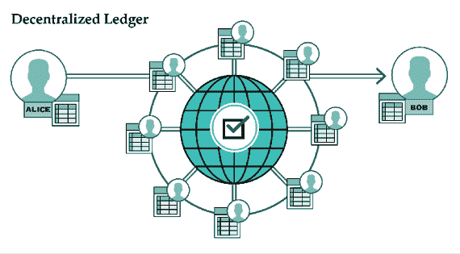

    图 1.2：Alice 和 Bob 通过分布式账本进行交易

    账本将记录与网络上执行的所有交易/协议相关的数据以及相关的参与者。分布在所有网络参与者之间确保了没有单一实体对账本控制控制，所有记录都可以由整个去中心化网络验证。区块链是去中心化网络中分布式账本最著名的例子。

* **节点网络**：去中心化系统将有一个由网络参与者运行的分布式节点网络。去中心化系统中的所有节点都维护系统记录的实时副本，并根据系统执行的操作扮演不同的角色。

    去中心化结构中的节点将相互作用以验证交易、记录信息并对系统状态达成整体共识。

* **交换媒介**：去中心化网络可能会选择引入原生令牌来作为网络上的某种货币或交换媒介。原生令牌是在区块链上创建的令牌。网络上的节点可能会之间交换这些原生令牌以用于网络特定的目的，去中心化网络还可能被编码为通过这些令牌奖励参与者的特定活动。


**共识机制**：为了在网络的所有节点之间实现一致和一致性，去中心化系统利用共识机制。共识系统用于确定网络节点如何对交易有效性和系统状态达成一致。

共识机制的流行例子包括`工作量证明 (PoW)`，参与者必须证明他们正在努力维护网络；以及`权益证明 (Post)`，参与者需要通过质押或锁定去中心化网络的原生货币来支持其诚信。

**治理模型**：你可能认为如果没有治理规则，民主去中心化网络将陷入无政府状态。然而，存在特定的去中心化治理机制防止这种情况。治理模型的工作方式类似于共识模型，原生令牌在这里也起着关键作用。

在去中心化治理模型中，原生令牌持有者可以在决策、协议升级、功能更改等方面发言。这样，所有网络节点都有平权参与治理，而不是屈从于基于层级的结构。

**加密安全**：加密在确保去中心化系统安全方面起着至关重要的作用。各种加密技术可以用于确保去中心化网络的安全，例如公钥加密和数字签名。

此类方法证明了去中心化网络内执行交易和通信的完整性和真实性。此外，加密算法保护敏感数据，实现身份验证并维护用户隐私以实现真正的无信任。

**智能合约**：对于去中心化网络中的所有协议，这些本质上是满足对方约定的条件下自动执行的合约。自动化合约是高级计算机程序或协议，根据条款自动控制并记录操作。

你将在去中心化网络中找到所有或部分上述特征。它们共同确保了一个所有网络参与者在决策中拥有平等发言权的系统，并在之间平等分配对网络功能的权力，并以无信任且可追踪的方式进行交易。

再次以上述去中心化组织结构为例，让我们再次对它们进行快速浏览：

## 去中心化的优势

**加速决策**：在去中心化的管理结构中，决策权被下放到业务执行层，而执行层的人员最接近实际情况。这使他们能够快速、有效地做出决策，因为他们对正在处理的情况拥有第一手的知识和理解。通过通过将决策权分配到组织的各个层级，去中心化管理提升了效率和灵活性。

**更好的沟通**：组织结构中的去中心化不仅增强了决策，还改进了组织内部的整体通信系统。当你将决策权赋予较低层级时，去中心化管理促进了上级和下之间有效沟通渠道。这种信息的开放流动促进了透明度、协作，并加强了组织架构中不同层级之间的关系。

**技能提升**：在去中心化的组织结构中，中基层管理者通过直接参与决策过程获得了宝贵的工作经验。这种对决策的接触培养了他们的主人翁和责任感，使他们能够为组织的成功贡献力量。因此，他们的士气和工作满意度得以提高，带来了更高水平的积极性和生产力。管理层获得了一个胜任的新的人才储备，他们通过经验学习来处理困难的管理状况。

**组织的整体增长**：当你在组织结构中实施去中心化时，它可以在许多部门之间产生更强大的健康竞争氛围，促使相互超越。为什么呢？因为去中心化培养了所有管理层级的独立性，允许他们按照认为合适的方式运行自己的部门，从而让他们个人更多地参与到组织中。这种增强的竞争意识对生产力水平产生奇妙作用，并对整个企业有利的。

现在我们理解了为什么去中心化在管理层面是极好的。然而，这仅仅是去中心化政策及其实施方式的一个基本示例，以及它们与中心化结构相比所提供的优势。

然而，去中心化和相关技术的更广泛益处是什么？

去中心化在你可以想象的任何领域（从技术、金融到国家政府用途等）都提供着许多益处。以下是去中心化的一些关键优势：

**更好的隐私性**：去中心化的概念与用户信息隐私概念紧密相关。在去中心化系统中，通过尽量减少强制性数据收集并赋予用户对其信息更大的控制权来确保用户隐私，让他们可以选择分享什么内容。总的来说，去中心化平台降低了数据泄露和未经授权访问数据的风险。

**更高的安全性**：去中心化最吸引人的方面之一是安全性的提高。由于没有单点故障，去中心化系统更能抵抗恶意攻击，因为攻破整个网络比黑客可能能够处理的挑战大得多。此外，去中心化系统利用加密学等机制来确保数据安全，并利用共识协议在大多数人许可后才执行任何功能。

**改进的透明度**：去中心化系统通常拥有开放、透明的账本，允许任何人查看和验证所有记录的数据。这种透明度允许建立无需信任的系统，确保了问责制、交易的追踪追溯以及便于审计。此外，没有参与者需要信任中心化的权威人物或中间机构。

**对外部自然威胁的韧性**：去中心化系统将其数据分布在广泛的节点网络中，因此即使某个节点由于自然灾害或停电而暂时失效，它仍然可以保持活跃。同样，没有单点故障。

**增强的包容性**：去中心化技术可以为全球缺乏银行服务的人群提供银行服务。

**赋予民主更多力量**：去中心化系统天然是民主的：每个参与者在决策过程中都拥有发言权。

**成本效益**：去中心化意味着不需要中间机构，使系统的维护和运行成本更低。

**更大的创新与协作机会**：去中心化系统消除了各行各业人士的准入门槛，允许开发者在现有程序之上构建去中心化应用。

现在，我们理解了去中心化网络的基本概念。此外，我们对去中心化网络采用的核心组件及其所服务的益处有了认识。

## 去中心化的历史与演变

去中心化的概念具有丰富的历史，跨越技术、治理和金融等多个领域。当我们谈论从中心化向分布式转变过程中最著名的去中心化技术时，很难准确确定我们所知的确切第一个去中心化技术。许多对发展和普及做出贡献的里程碑式技术包括：

### 互联网

虽然当代的互联网或 Web 2.0 在很大程度上是中心化的（像 Meta 和 Apple 这样的大数据公司主宰着市场），互联网可以被称为去中心化技术的起源。互联网的发展及其底层协议（如`TCP/IP`）为去中心化通信奠定了基础。

## 互联网的历史

互联网的起源可以追溯到 20 世纪 60 年代，当时美国国防部高级研究计划署（ARPA）试图创建一种在部分故障时不会中断的通信机制。这促成了 ARPANET 的诞生，它可以被称为现代互联网最早的先驱。

快到 1969 年，第一条 ARPANET 消息在两个不同地点的计算机之间传输。自此，我们今天所知的互联网作为一种通信媒介诞生了。在接下来的十年里，ARPANET 扩展并连接了许多大学、研究机构甚至政府组织。

20 世纪 70 年代，传输控制协议/网协议（TCP/IP）的发展带来了一套标准协议，为各种网络之间的相互通信提供了可能。这导致了互联网络早期种子的萌芽。现在，所有孤立的网络都有了相互连接的方法，形成了一个广泛的网网。

20 世纪 80 年代，美国国家科学基金会（NSF）为 NSFNET 奠定了基础；这是一个连接了全美多个超级计算中心的高速网络。此外，商业互联网服务提供商（ISP）的引入导致越来越多的用户访问互联网。

现在我们进入互联网历史中广为人知的部分。20 世纪 90 年代，著名的蒂姆·伯纳斯·李士（Sir Tim Berners-Lee）提出了万维网（WWW）。万维网首次赋予了广大用户通过互联网搜索和访问数据的能力。这一时代的网页浏览器包括 Mosaic 和 Netscape Navigator，它们都让全球普通民众更容易地使用互联网。

20 世纪 90 年代也是基于互联网的公司和创新首次开始出现的时期。搜索引擎以及在线服务和产品相问世，改变了我们日常生活的两个主要方面：

* 企业的运营方式

* 普通人与互联网交互的方式和程度。

在 20 世纪 90 年代后期，宽带互联网技术出现，其中引注目的是数字用户线路（DSL）和电缆互联网。这两者都促进了互联网在全球的普及，并为家庭和企业提供了更快、更可靠的互联网连接。现在是国际通信便捷模式、多媒体内容和内容在线流媒体创新的时代。

21 世纪 00 年代出现了一些如今 Instagram 和 Twitter 等社交媒体平台的著名先驱：即 Friendster 和 MySpace，它们彻底改变了世界不同地区人们之间的在线互动。

值得注意的是，2004 年是马克·扎克伯格（Mark Zuckerberg）创立 Facebook 的年份，它至今仍然是全球最流行的社交媒体平台之一。

最后，20 世纪 00 年代后期及之后的几十年引入并普及了智能手机，这反过来导致移动互联网在使用在全球范围内激增。

例如，截至 2024 年 7 月，全球已有 54.5 亿互联网用户，相当于今天全球人口的 67.1% 以上。

今天，互联网是我们生活中不可或缺的一部分。回到去中心化的话题，互联网现在有了我们能够命名的三个不同代。

### Web 1.0

Web 1.0 是互联网的早期阶段，出现在 20 世纪 80 年代后期和 20 世纪 90 年代初。此时，网站主要是静态网页，它们提供你请求的信息，但并不提供许多交互功能。这些网站的多媒体能力有限，是使用基础 HTML 编辑工具创建的。

然而，Web 1.0 为我们今天所扩展的基于信息的在线空间奠定了基础。

### Web 2.0

网页演化的下一个阶段——Web 2.0 或真正的社交时代，带来了许多新技术。其中的例子包括：

* 客户端脚本（`CSS`、`JavaScript`）

* 服务端脚本（`PHP`、`Python`、`Ruby`）

* 专注于交互的应用程序接口（`APIs`）

所有这些发展都促进了全球用户之间的实时通信和交互。通过`CSS`和`JavaScript`等客户端脚本语言，网页变得更具响应性和动态性，创建了流畅且交互式的 UI。

`APIs`通过允许各种软件系统相互连接并在之间共享用户数据，进一步增强了交互性。这些`APIs`为开发者将各种创新功能和服务集成到他们的应用程序中提供了空间，从而真正完善了社交角度，扩展了用户参与和连接的可能。

随着 Facebook 和 Twitter 等社交媒体平台的繁荣，电子商务和广告也确立了它们的地位。`WWW`逐渐成为一个全球性市场，在访问世间所有产品和服务方面提供了便利。然而，这也导致了用户隐私的缺乏，并导致用户对他们在互联网上与服务提供者共享的数据几乎没有任何控制权。

所以，互联网本质上是我们能命名的第一个去中心化技术，但随着时间的推移变得越来越中心化。什么解决方案解决了这一问题？当然是 Web 3.0。

### Web 3.0

Web 3.0 仍然是一个新兴概念，尚未形成具体的形状。然而，这个时代确实由去中心化技术定义。Web 3.0 旨在成为一个分布式网络集合，旨在将数据控制权交还给用户，以便他们可以选择与谁共享什么类型的信息。

此外，Web 3.0 旨在实现互联网之父蒂姆·伯纳斯·李关于语义网的概念。对于那些不太了解的人来说，语义网基本上是我们万维网的扩展，它赋予机器理解和解释各种网页内容的能力。这将为每个用户带来更流畅、更个性化的网页体验。

许多技术正在助力 Web 3.0 的这一去中心化目标。`IoT`、`5G`、人工智能（`AI`）、虚拟现实和`区块链`可以被认为是最令人兴奋的参与者。所有这些技术共同增强了活动速度，改进了数据安全，提高了用户体验的沉浸感，并从根本上改变了我们与虚拟世界连接的方式。

然而，无论如何看，互联网的历史向你展示了去中心化概念的最早期雏形：一种让普通用户与世界互动并参与一个能让他们的声音被听到的全球网络的方式。归结底，这才是去中心化的真谛。

还有哪些技术进步促进了去中心化技术的出现？是时候查看列表的其他部分了：

### BitTorrent

`BitTorrent`由 Bram Cohen 在 2001 年的那个遥远的年份引入，是一个全球闻名的点对点（`P2P`）文件共享通信促进器。事实上，该平台通过去中心化的点对点网络彻底改变了文件共享。

它是如何运作的？嗯，首先，BitTorrent 的功能并不涉及任何中心化服务器。相反，在该平台上，用户可以直接相互共享文件而无需任何中间环节，这实现了高效且隐私的文件分发。

## 比特币与区块链

在任何去中心化技术的列表中，如果不提到区块链都是不完整的。被称为区块链的去中心化账本首次首次应用是作为比特币——第一种虚拟货币或加密货币的底层技术。2008 年，名为中本聪（Satoshi Nakamoto）的匿名个人或团体发布了比特币白书，向世界引入了区块链技术。

[图 1.4] 为我们展示了比特币区块链运行的基本概念：

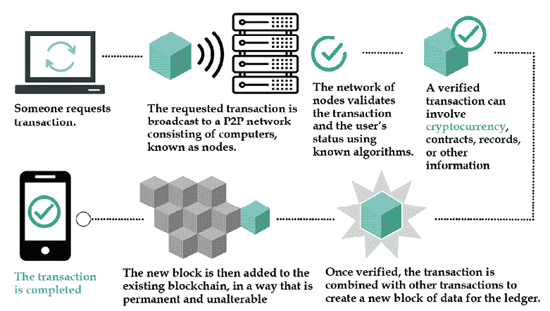

图 1.4：比特币的工作原理

比特币于约一年后的 2009 年正式启航，迄为止，它仍然是你能找到的最成功的加密货币。比特币是去中心化技术的卓越应用。比特币区块链实现了安全且透明的比特币点对点（P2P）交易，而无需任何中心化权威机构或任何类型的第三方。

## 以太坊与智能合约

回到 2015 年，以太坊是另一个在区块链技术帮助下启动的著名加密货币。现在， 2009 年到 2015 年之间，许多基于区块链的加密货币已经发布，但在市值或流行程度方面，没有哪一个像今天的以太坊这样接近比特币。

以太坊由维塔尼里克（Vitalik Buterin）创立，该平台是第一个真正测试区块链技术边界并催生智能合约概念的平台。以太坊向世界证明，在创建一个真正的去中心化生态系统方面（这种生态系统不仅倡导，而且为用户实现了真正的公平），区块链的能力是无限的。

以太坊的关键创新是发现了智能合约，这逐渐促进了去中心化应用（dApps）的执行以及具有多种功能的新代币的创建。

## 去中心化金融

以太坊区块链是去中心化金融的起源和核心。值得注意的是，加密领域是金融领域真正去中心化的母亲。

DeFi 就像我们在传统经济系统中看到的各种传统金融服务和产品，但更好且基于区块链。近年来 DeFi 的出现推了全球范围内金融领域去中心化的边界。

去中心化金融领域的平台通常利用智能合约带来各种金融产品和服务，即：

* 贷款与借贷

* 加密货币交易所

* 收益农（Yield farming）

* 保险

* 现实与虚拟资产的代币化与交易

当然，在去中心化金融中，你可以在家方便地享受金融产品和服务，而无需任何不的中间环节。

因此，你有一系列可以包含在去中心化伞下的技术列表。然而，请记住，去中心化的历史远超技术组件。其他探索去中心化概念的领域包括全球治理系统（因为民主的概念可以追溯到古希腊）以及各国的联邦政府。我们的全球政治历史确实影响了我们所持有的分布式决策和权力共享的现代理念。

至于去中心化的历史，它是一个持续的演变，由不断的技术进步以及对用户和开发者更高透明度和安全性的总体追求所定义。

多年来，在去中心化系统方面，有一个主题保持不变，那就是个人赋能。

## 区块链的兴起

在我们讨论去中心化话题的同时，我们将扩展区块链以及这种分布式账本技术的历史，这种技术首于比特币，并改变了世界。

什么是区块链？区块链的旅程从哪里开始？区块链在当今世界中的用例是什么？让我们探索这一切以及更多！

## 理解区块链

区块链是由虚拟区块组成的链。所有这些区块都包含了区块链上执行的交易数据，以及相关的参与者。分布式账本遍布在全球的计算机网络（或节点）中，区块链上的所有参与者都可以访问区块链上记录的信息，用于审计和验证。以下 [图 1.5] 总结了区块链：

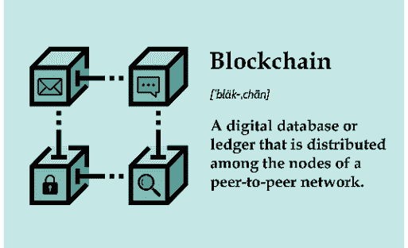

图 1.5：什么是区块链？

区块链是由虚拟区块组成的链。所有这些区块都包含了区块链上执行的交易数据，以及相关的参与者。分布式账本遍布在全球的计算机网络（或节点）中，区块链上的所有参与者都可以访问区块链上记录的信息，用于审计和验证。

区块链上的所有区块都带有一个名为`hash`的唯一标识符。现在，链上的每个新块都被添加到末尾，并且区块按时间顺序链接。区块链是不可篡改的，这意味着没有人可以篡改存储在上面的数据。如果需要对记录进行任何更改，链上的所有节点必须对此达成共识。

根据基本定义，它只是告诉你区块链在各处促进了去中心化。

## 区块链的基本特征

区块链继承了（或更准确地说定义了）我们在在本之前讨论的去中心化系统的大部分元素。让我们探索区块链的基础知识：

**去中心化**：区块链不需要中心化的控制点，账本由网络中所有参与节点集体维护和更新。

**安全性**：区块链利用加密技术来确保分布式账本上存储的所有信息的安全性和完整性。如上所述，每个区块都标记有唯一的`hash`，它结合了其直接前驱的`hash`，创建了一个在没有所有网络参与者共识的情况下无法更改的区块链。

**共识机制**：当然，这是为了为所有网络节点提供一个具体的系统，以同意交易的有效性、做出治理决策，并确保一般的去中心化。

**不可篡改性**：一旦新块添加到区块链中，更改或删除其中包含的数据几乎是不可能的。因此，区块链使得恶意者在不让所有网络节点发现差异的情况下，无法操纵存储在它们上的记录。

**透明性**：在区块链上执行和记录的交易对网络中的所有参与者可见。区块链的透明性促进了信任，并增强了问责制审计性，因为区块链上的任何参与者都有权验证交易的有效性并追踪链上资产的流动。

现在，存在某些类型的区块链可能会将记录的访问权限限制仅给选定的参与者，但在任何情况下，区块链上的所有利益相关者始终允许查看和审计所有记录，以确保完全的透明度。

## 区块链的类型

既然已经提到了区块链类型，让我们快速了解一下不同类型的区块链。

区块链主要有三种：公有链、私有链以及联盟链或联邦链。这三者之间的区别主要是由于它们不同的应用场景，以及便于这些应用场景的特性。这三种类型总结在[图 1.6]中。

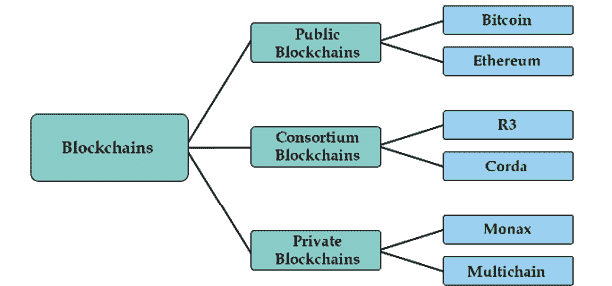

图 1.6：区块链的类型

### 公有链

公有链（即广为人知的`Bitcoin`和`Ethereum`）是开放且无需许可的网络。这意味着它们在真正意义上是去中心化的，任何想要参与、查看和在区块链上添加数据的人都可以访问。

公有链依赖`PoW`或`PoS`等共识机制来验证所有交易并保护网络。它们是不可篡改、透明的，并且由于去中心化因素具有高水平的安全性。

公有链经常用于加密货币、去中心化应用以及任何需要开源代码的项目。

### 私有链

与公有链相反，私有链是许可性网络，将访问权限限制在选定的用户组。在私有链中，并不是所有人都能像公有链那样成为节点。相反，节点由被授予加入网络权限的特定实体运营。

与公有链的主要区别在于私有链能够提供更高程度的可扩展性和隐私性。私有链可以被设计为更快地处理交易。它们通常被私营企业、金融机构以及任何对更高水平控制和隐私要求的组织使用。

然而，这些区块链很大程度上取决于去中心化因素。

### 联盟链或联邦链

这些基本上是公有链和私有链的混合体，或者是两者之间的桥梁。联盟链或联邦链本质旨在提供两者的优点。它们由联盟或一组组织治理，而不是由单一实体。


联盟链是许可网络，其共识由预先选定的参与者控制。节点运营者通常是一组相互信任并为了特定目的而合作的组织。他们共同维护区块链。

公有链关注去中心化，而私有链关注可扩展性，联盟链则在这两个方面取得了平衡，使其适用于行业协作、供应链管理以及多个组织必须汇合共享并验证信息的合资企业。

请注意，还存在这三种区块链类型的混合模型和变体。例如，`layer-2` 解决方案为不同区块链之间的互操作性留了空间，增强了可扩展性并允许资产和数据在多个区块链网络之间传输。

此外，你还可以找到区块链即服务（`BaaS`）平台，它们为你提供工具和基础设施，根据你的特定用例创建并部署自定义区块链。

## 区块链的历史

1991 年，研究人员 `Stuart Haber` 和 `W. Scott Stornetta` 首次提出区块链技术概念。他们的目标是为数字文档的时间戳创建一个实用的计算解决方案，确保其不可篡改性并防止篡改或日期错误。为了实现这一目标，他们提出了一个利用加密技术的系统。在该系统中，文档被标记上时间戳并存储在顺序区块链中。

1992 年，`Merkle Trees` 通过最初由 `Stuart Haber` 和 `W. Scott Stornetta` 开发的系统创建了一个法律实体，但这次注入了更多功能。现在区块链技术已经具备了存储几组数据并将其收集到一个区块的能力；`Merkle` 利用安全的区块链按顺序存储多条数据记录。

回到 2000 年，`Stefan Konst` 发表了他关于加密安全数据链的自己的理论，以及他关于如何使该理论变为现实的想法。

2008 年，`Satoshi Nakamoto` 在白皮书中提出了他现在著名的分布式区块链概念 `A Peer Peer Electronic Cash System`。通过修改 `Merkle tree` 模型并添加更多安全性功能，`Satoshi Nakamoto` 实际上创建了一个利用时间戳的点对点网络。

2009 年，真正的 `Bitcoin` 白皮书发布，区块链作为加密货币的骨干进入公众视野。但在未来的几年里，区块链将不仅仅是加密货币的底层结构。

2014 年见证了区块链 2.0 的首次实质性存在：这是许多用例出现的时期，区块链的使用从局限于加密货币开始扩张。

2015 年，随着 `Vitalik Buterin` 发布 `Ethereum Frontier`，区块链开发取得了另一个里程碑。`Ethereum` 允许开发者编写智能合约并创建和部署 `dapps`。

2015 年，`Linux Foundation` 还启动了非常流行的 `Hyperledger` 项目。

2022 年，`Ethereum` 区块链放弃了旧的量量共识机制（最初由 `Bitcoin` 使用），转而实现更低能耗的证明证明共识。之前，`PoW` `Ethereum` 的节点通过竞争计算能力来赢得区块验证并获得奖励。然而，在 `PoS` 网络中，节点需要质押数量的 `ETH`（`Ethereum` 原生加密货币）才有资格成为网络验证者。

在过去的十年里，区块链跨越了加密领域，现在已部署于你想象的几乎任何行业的各种用例中，正如[图 1.7]所示：

目前主要的区块链用例讨论如下：

*   加密货币：如果不提到加密货币，区块链用例列表将是不完整的。到目前为止，区块链技术最著名的用例仍然是 `Bitcoin` 和 `Ethereum` 等加密货币。区块链为加密货币的发行、传输和存储提供了一个去中心化、透明且安全的平台。此外，区块链允许在没有中间机构的情况下进行加密货币的点对点交易。

## 区块链应用场景

### 供应链管理

区块链技术通过记录和验证货物在整个系统中的移动，增强了供应链的透明度和可追溯性。此外，区块链可以透明地追溯供应链上任何产品的源头，确保真实性并防止伪造。总而言之，区块链技术实现了高效的供应链管理，减少了欺诈并提升了产品质量。与 `IoT` 或物联网等技术相结合，区块链使得供应链资产追踪和库存管理变得日益高效。

## 金融产品与服务

区块链技术通过实现更快速、安全且具有成本效益的跨境支付、汇款和结算，正在彻底改变金融产品和服务业。事实上，它还通过允许代币化证券或稳定币等数字资产的发行和交易，带来了新的金融产品。

## 身份管理

区块链专注于隐私，能够实现安全且去中心化的数字身份解决方案。通过区块链，个人现在对自己的个人数据拥有完全的所有权和控制权，而且在验证虚拟身份时无需要求用户交出控制权的中心化数据库。区块链驱动的身份管理可以实现流畅的数字身份验证、快速的 `KYC` 流程，并显著减少任何类型的身份欺诈。

## 网络安全

区块链通过去中心化保障了安全因素，因此网络安全无疑是区块链最突出的应用场景之一。恶意行为者需要破坏区块链网络中的大多数节点才能真正破解区块链网络的安全，这在本质上是不可能的。

### 医疗保健

区块链在医疗保健领域的应用可能是革命性的。这种去中心化技术可以提高患者医疗数据的安全性和隐私。此外，参与医疗保健的不同机构可以使用可操作的区块链系统，以防篡改且去中心化的方式存储健康记录。区块链本质上可以简化医疗记录管理，增强患者隐私，并实现医疗服务提供者之间信息的高效交换。更不用说它让患者对医疗数据拥有完全控制权，并可以随时随地访问。

## 知识产权管理

区块链技术能够为知识产权（即任何版权、专利和商标）的跟踪和管理创建一个安全透明的平台。通过这种方式，区块链能够保护你对知识产权的控制，并简化许可和版税分配流程。

## 选举与投票系统

区块链驱动的投票系统有助于增强选举的透明度和完整性，同时保护所有选民的安全和隐私。存储在区块链上的选票由于其不可篡性和透明性，几乎无法被操纵，预示着公平且可审计的选举过程。

## 能源管理

区块链允许点对点的能源交易，并在可再生能源的买卖中使用智能合约。这去中心化并优化了能源分配，并鼓励使用可再生资源获取能源。

## 媒体与娱乐

这是区块链另一个可以带来重大变革的领域，为内容创作者和消费者提供了分享其偏好内容的新方式。虽然内容所有权和数字权利管理将变得简单，但区块链还可以简化并自动化版税分配，为这些流程增加透明度和可追溯性因素。此外，基于区块链的平台可以实现内容创作者与消费者之间的直接接触，利用代币化生态系统为粉丝创建优化的奖励机制。

## 去中心化金融

最后，区块链促进了 `DeFi` 平台创建开放且全球可访问的金融生态系统，这些系统不涉及也不依赖任何中介或权威机构来剥夺权利。

- **无许可性**：`DeFi` 应用是无许可的，因此无需等待权威机构的批准即可进入 `DeFi` 平台并开展你想要执行的任何金融活动。因此，`DeFi` 不遵循传统法币金融的传统许可系统。

- **非托管性**：在 `DeFi` 中，用户对自己的资产以及个人数据拥有完全控制权。用户可以利用 `DeFi` 钱包与领域内的金融协议进行有效交互，并掌控自己的财务未来。

- **互操作性**：随着 `Ethereum` 等区块链在去中心化金融领域的出现，开发者可以利用开源代码在现有应用之上构建新应用。这为 `DeFi` 平台带来了互操作性：你可以无缝地在不同平台之间切换，而无需任何麻烦，同时节省了时间和相关费用。凭借 `DeFi` 固有的互操作性特性，你可以更好地将 `DeFi` 平台视为独立的乐高积木，并对其进行组合并塑造成任何你想要的形状。

## 去中心化金融的组件

为了更好地掌握 `DeFi` 的特性，理解其核心组件至关重要。`DeFi` 的核心组件可能与当今其他现有金融生态系统有相似之处。

以下四层构成了理想的 `DeFi` 技术栈，在推动去中心化金融的实用性方面发挥着关键作用：

### 结算层 (Settlement layer)

`DeFi` 平台中的结算层是相关应用和其他 `DeFi` 解决方案构建的基础层。结算层可以由公共区块链（如 `Ethereum`）及其原生加密货币（如 `ETH`）组成。在所构建的应用上进行的交易将使用原生货币，相同的代币也可能用于奖励机制和费用支付等用途。

### 协议层 (Protocol layer)

该层本质上为正在构建的 `DeFi` 平台的治理模型制定规则和制度。这些规则还包括 `DeFi` 平台所属金融行业领域的通用规则。同名层建立的协议还确保应用与其他去中心化实体具有互操作性，并有助于为去中心化金融平台吸引理想的流动性水平。

### 应用层 (Application layer)

`DeFi` 平台上的应用层承载了此类应用的实际面向消费者方面。加密交易所、借贷和贷款等金融服务主要建立在此层之上。

### 聚合层 (Aggregation layer)

最后一层是连接其前一层的不同应用以向用户提供服务。因此，`DeFi` 聚合器可以帮助你在许多金融应用之间转移资金，以确保收益最大化。

这四层共同工作以实现上述 `DeFi` 功能，确保世界任何角落的用户都能获得金融产品和服务的真正去中心化和可访问性。

## DeFi 的优势

让我们详细分析 `DeFi` 的优势：

- **金融包容性**：这不言而喻，金融包容性无疑是去中心化金融最大的优势之一。`DeFi` 协议旨在为任何连接互联网的人提供开放且可访问的金融服务，无论他们来自世界的哪个部分。`DeFi` 打破了传统银行账户或良好信用记录等准入门槛。这使得全球缺乏银行服务的人群能够参与全球金融生态系统。

- **增强安全性**：去中心化金融协议通常利用先进的加密技术，确保为用户资金及数据提供最大的安全性。任何 `DeFi` 应用的去中心化本质也使其能够抵抗单点故障，从而使攻击尝试几乎不可能。此外，用户对自己的资金和钱包拥有完全控制权，消除了中心化控制并降低了未经授权访问的风险。

- **透明性**：去中心化金融平台构建在公共区块链之上，因此所有操作和交易都记录在不可篡改且完全透明的账本上。有了这种透明度，所有用户都可以验证和审计在平台上进行的金融活动。此外，透明性因素增加了去中心化平台的安全性，减少了欺诈和骗局的机会。

- **缺乏人工干预**：`DeFi` 平台存在智能合约，以实现平台上发生的所有金融功能的自动化。智能合约可以被编码为遵守各种规则和标准，从而使任何中介的人工干预和任何人为参与变得不再必要。智能合约带来的自动化进一步简化了所有流程，减少了行政开销，并确保所有交易都能快速高效地执行。

- **消除中介机构**：`DeFi` 平台在执行指定任务的任何时候都不需要任何中心化权威点或任何第三方。中介的消除让你拥有更大的财务自由，让来自各种金融背景的人更容易使用 `DeFi` 平台，并减少了你执行金融服务或使用 `DeFi` 产品需要支付的费用。

- **创新与协作**：去中心化金融带来了一个开源开发和协作的环境，任何对去中心化技术感兴趣的人都可以参与。本质上，任何人都可以通过构建现有的 `DeFi` 协议并为整个 `DeFi` 生态系统做出贡献，将其创新想法变为现实。`DeFi` 中创新和协作的机会是无限的，最终促进了金融以及我们生活中其他任何方面的去中心化。

所以，现在我们已经了解去中心化特别是在金融领域已经取得了多远进展，以及 `DeFi` 应用带来的益处。

## DeFi 用例

让我们快速浏览一下目前去中心化金融的所有热门应用：

- **借贷**：`DeFi` 平台非常著名地带来了借贷协议，你可以通过出借你的资产来获得利息作为被动收入，并通过存入你拥有的受特定平台支持的加密资产作为押品来借入加密资产。

- **去中心化交易所 (DEXs)**：这些交易所允许你直接在 `DeFi` 平台上与其他用户交易数字资产。

- **稳定币**：这些是锚定法币（如 `USD`）、另一种加密货币或其他有价值资产（如贵金属）的加密货币。这些的设计初衷是平衡传统加密资产的波动性和法币资产的稳定性，以去中心化的方式带来两者的结合。

- **自动做市商 (AMMs)**：这些是算法协议，引导用户在 `DEXs` 上获得流动性和有利的交易，而无需传统的订单簿。

- **代币化**：`DeFi` 允许现实世界资产或金融工具的代币化及后续交易。

- **质押 (Staking)**：这种 `DeFi` 应用允许你在特定平台上质押部分持仓一段时间，以此赚取利息。

- **保险**：去中心化保险是传统保险的一种变体，但它运行在去中心化网络上，并使用智能合同自动化包括理赔和支付在内的所有程序。

`DeFi` 正在通过民主化促进金融包容来彻底改变我们所知的金融领域。与此同时，它还在不断产出创新产品，以适应变化的时代。当然，`DeFi` 仍然是一个新兴领域，面临着自身的风险和挑战，例如监管考虑和可扩展性限制，但有一点是可以肯定的：`DeFi` 运动不会消失，去中心化在金融领域的实施和应用刚刚开始！

## 结论

在本章中，我们涵盖了广泛的话题：我们介绍了去中心化的基础知识、去中心化技术历史、区块链以及去中心化金融的出现。这里得出的结论是，虽然去中心化的概念已经有了几个世纪，但区块链是最终为这一理念插上翅膀的技术。随着世界以极快的速度向数字未来奔刺，去中心化是我们生活各个方面的需求。到目前为止，去中心化在金融领域的整合是壮观的，但仍有一些方法可以让 `DeFi`、区块链以及去中心化理念本身进入主流。

区块链与人工智能（`AI`）、机器人技术等其他新兴技术的协作，可以为今天的消费者提供更好的融合，以便他们更好地理解和接受去中心化技术。这是我们在下一章的目标：熟悉这种技术网络，这些技术可以在不久的将来相结合，彻底改变我们平凡的日常生活。

在 `Chapter 2` ——《未来技术》中，我们将熟悉人工智能、区块链、机器人技术和自动化，并辅以所有这些技术的迷人示例。请保持关注！

## 问题

1. 你如何理解去中心化的概念？

   答案：去中心化是一种系统，决策责任和控制权分布在所有利益相关者之间，而不是由中央机构或中介机构。它消除了层级结构，并赋予网络中所有用户平等的权利。

2. 在回顾直到区块链的去中心化历史时，可以提到哪些技术？

   答案：`ARPANET`、`传输控制协议/网协议 (TCP/IP)`、`NSFNET`、`世界网 (WWW)`、`数字用户线路 (DSL)` 和 `BitTorrent` 的兴起为现代互联网、去中心化和数据管理奠定了基础。

3. 到目前为止互联网分为哪几代？你如何定义每一代？

   答案：`Web 1.0`：早期互联网，于 20 世纪 80-90 年代启动，提供的信息用户交互性有限，并使用基础的 `HTML`。

   `Web 2.0`：21 世纪 00 年代，`Web 2.0` 通过技术引入了动态和用户交互的社交内容，催生了电子商务和社交媒体。

   `Web 3.0`：它是互联网一个演进的去中心化阶段，旨在通过`区块链`、`IoT`、`AI` 等先进技术让用户获得数据的控制。

4. 什么是区块链？

   答案：区块链是一种去中心化的数字账本，记录全球计算机网络（或节点）上的所有交易，确保透明性和安全性。

5. 区块链有哪些特征？

   答案：区块链的关键特征包括去中心化、通过加密技术的稳健安全性、共识机制、数据的不可篡改以及允许所有用户验证交易的透明性。

6. 区块链的核心组件有哪些？

   答案：区块链的核心组件包括交易数据块、被称为 `hashes` 的唯一标识符以及共同维护和更新数字账本的节点网络。

7. 列举一些区块链目前的用例。

   答案：区块链目前的用例包括——点对点加密货币交易、供应链管理、去中心化金融 (`DeFi`)、医疗数据安全、网络安全、媒体和娱乐、知识产权管理等。

8. 什么是去中心化金融？

   答案：去中心化金融 (`DeFi`) 构建在区块链技术之上，旨在通过消除对传统中介或银行等中央机构的需求，创建一个开放、包容且透明的金融生态系统。

9. 区块链和 `DeFi` 的概念是如何联系的？

   答案：区块链作为 `DeFi` 的基础技术，创建了一个没有任何中介的开放、透明且安全的金融系统。区块链的去中心化本质确保了生态系统中用户的控制和更好的访问性。

10. `DeFi` 平台的组成部分有哪些？

    答案：理想 `DeFi` 栈的关键组件包括：

    - `结算层`：使用原生加密货币作为费用和奖励来促进交易。

    - `协议层`：为治理模型建立规则和条例，并吸引领域内的流动性。

    - `应用层`：面向用户的层，托管各种金融服务并关注用户参与。

    - `聚合层`：它连接多个应用，通过允许在各种 `DeFi` 服务之间简化资金转账以实现利润最大化，优化可用性。

11. 哪些核心原理构成去中心化金融平台？

    答案：定义 `DeFi` 平台的核心原理是去中心化、互操作性、透明性以及通过 `smart contracts` 实现的可编程性，以及没有任何中央控制的去中心化平台。

12. 你能想到 `DeFi` 的哪些可行场景？

    答案：`DeFi` 可以促进房地产代币化和交易、提供去中心化身份、质押机会、智能合约保险等。

# 第 2 章：未来技术

## 引言

在上一章中，我们回顾了去中心化的历史：我们学习了导致今天科技领域去中心化的所有技术，并重点介绍了最大的去中心化技术——区块链。此外，我们还学习了去中心化金融的概念以及我们今天看到的许多 `DeFi` 用例！

现在，是时候深入探讨书中涵盖的更多技术了。在本章中，我们将学习人工智能 (`AI`)、区块链、机器人技术等，并探索这些技术如何单独或相互结合来促进我们社会的发展！

话不多说，让我们进入正文。

## 结构

本章将讨论以下内容：

- 理解 `AI`

- 理解区块链

- 理解机器人和自动化

- `AI`、区块链、机器人和自动化的示例

## 目标

在本章中，我们的目标是理解 `AI`、区块链、机器人和自动化的影响机制。为了真正理解这些技术的任何融合如何丰富我们全球的生活，我们还将查看这些技术到目前为止的一些现实应用。通过这些示例，我们可以窥见当这些技术继续演进和融合时，等待着我们的充满前景的未来。

## 理解 AI

人工智能（`AI`）是对机器行为的模拟，这些机器通过编程和训练，能够像人类一样思考、响应和学习。这项技术允许计算机执行通常需要人类智能才能完成的看似智能的任务，即感知、决策、语音识别、问题解决甚至语言翻译。

简而言之，这就是 `AI` 系统的工作原理：它们使用算法和模型来处理海量数据，识别模式，然后做出明智的决策或推测，而这些工作通常需要大量的人力才能完成。

值得注意的是，机器学习（`ML`）是 `AI` 的子集，它允许机器通过从数据中学习随时间推移提高其性能。与为每种场景编写显式规则的传统软件不同，`ML` 模型专门使用高级算法在数据集上进行训练，这些算法允许进行模式识别和预测。这种训练可以通过监督学习和无监督学习方法进行，使模型在处理信息时不断提高准确性。

`AI` 显然在各个行业都有各种应用，包括虚拟助手、医疗诊断、自然语言处理、自动驾驶汽车、金融分析等。

随着 `AI` 技术的进步，它有潜力彻底改变几乎所有领域的运营方式，而且我们日常生活的各个方面也将不断增长。


# AI 的工作原理

AI 需要专门的硬件和软件来编写和训练机器学习算法。此外，通常使用 `Python`、`Java`、`R`、`C++` 等编程语言来编写 AI 系统。

我们可以以聊天机器人为例，简单地理解 AI 是如何工作的：你向系统输入大量的训练数据，使其学习理解文本模式等内容，并对用户的问题给出生动的回答。

AI 通过数据、算法和计算能力的结合来工作。AI 的工作过程可以简化为以下步骤：

1. **数据收集**：AI 系统最初需要大量数据来像人类一样进行学习和做出决策。因此，AI 系统在广泛的数据集上进行训练，这些数据集包含与其设计任务相关的示例和模式。例如，聊天机器人需要输入人类文本的示例，以学习客户的言语模式和需求。

2. **数据预处理**：一旦 AI 系统收集了所需数据，它就会对数据进行预处理：在这里，数据被清洗并转换为 AI 算法理解的合适格式。这一步骤是为了确保输入 AI 系统的数据具有一致性，并为系统训练做好准备。

3. **模型架构选择**：AI 算法专注于根据特定的用例、数据特征和模态选择合适的模型架构。这包括确定要训练的模型类型，例如神经网络、决策树等，这些模型将经过初始训练过程以增强其整体性能。

4. **实际训练**：在这一阶段，正在构建的 AI 系统将使用预处理后的数据进行训练，使其能够从中学习。模型通过迭代训练过程不断最小化误差并逐渐提高性能，这通常涉及对训练数据的多个轮次（`epochs`）。

5. **验证与测试**：一旦 AI 系统完成训练，将会在不同的数据集上对其进行测试，以检查其性能，包括其生成所需数据的能力、速度等。这一阶段确保了 AI 系统经过了良好的训练，并能够在新数据集上正确运行。

6. **预测**：在训练和性能验证之后，AI 系统被认为已准备好进行预测。因此，现在当你给这个模型提供全新的、未见的输入时，模型应该能够处理它并产生所需的输出。

这些是任何普通 AI 系统运行涉及的通常步骤。某些 AI 系统可能会进一步使用持续学习，它们在数据发生变化时不断更新知识库并学习、适应新数据。通过这种方法，AI 模型可以继续保持相关性。

# AI 的优缺点

现在，虽然 AI 系统已得到良好利用并在各行业受到赞誉，但批评也随之大量增加。现在，是时候让我们来看 AI 的许多优点和显著缺点了。

## AI 的优点

以下是 AI 的一些优点：

* 使用 `ML` 的 AI 系统可以分析海量数据，其训练时间根据模型复杂度、数据量、计算资源可用性等因素而异，并以记录的速度处理这些模式和关系。这种能力实现了更好的决策，特别是在复杂和数据密集型场景下。

* 构建在良好训练和优化的 AI 系统在执行详细任务时较不易受人为错误影响。然而，重要的是，如果这些模型不持续升级或改进，它们在新的数据上的性能可能会下降。AI 可以自动化重复单调的任务，节省人力。

* 作为前一点的结果，AI 还提高了各种流程的生产力效率，使组织专注于更具战略性和价值的活动。

* AI 有助于节省人力并完成劳动密集型任务。

* 当然，在任何工作中——无论是数据密集还是其他——AI 都能减少花费在工作上的时间。这适用于所有行业，从金融、安全、欺诈检测到医疗和 IT。

* 基于 AI 的系统 7x24 小时运行，因此适用于需要持续协助的客户和服务等领域。

* AI 驱动的系统非常适合内容定制。它们可以根据个人偏好和行为提供个性化用户体验。从电子商务中的个性化产品推荐到社交媒体上的个性化内容建议，AI 提升了用户满意度和参与度。

* AI 系统在任务中输出质量一致。

* AI 擅长根据历史数据模式预测未来趋势进行高效预测，这在金融、医疗和营销等行业特别有用，预测分析可以优化策略和结果。

* 可以让 AI 模型从新数据持续学习以适应变化并随时间推移提高性能。这使得 AI 系统随着获得更多经验而变得准确有效。

* AI 可以优化能源管理、物流和运输等领域的资源分配，从而节省成本并实现资源高效利用。

## AI 的缺点

以下是 AI 的一些缺点：

* 由于对计算资源的要求，训练 AI 模型可能昂贵且耗能。

* 创建 AI 系统需要高水平的技术技能，包括编程和数据分析。成功的 AI 开发还需要访问高级硬件和软件等关键技术资源。

* AI 系统可能会继承训练数据中的偏差，特别是在高扩展要求的情况下。如果不加仔细管理，可能会导致不公平的结果、歧视和对社会偏见的延续。

* 此外，任何 AI 模型的准确性主要取决于用于训练模型的数据的质量和多样性。因此，任何偏见、错误或不完整的数据都会导致不准确的输出。

* AI 系统通常需要访问海量数据进行训练，这引发了对隐私和数据安全的许多合理关注。对数据的任何不慎处理都可能导致安全泄露并损害用户隐私。

* AI 还涉及伦理问题：AI 导致的人类工作流失可能会增加失业率，造成社会结构失衡。

* 虽然 AI 系统可能缺乏完全的人类类创造力和情感智能，但它们确实展现出某些创造能力。其创造力程度仍然是一个争论的话题，但 `LLM` 正越来越多地被应用于媒体、娱乐和营销等创意领域。

* 在没有人类监督的情况下，过度依赖 AI 系统可能会带来灾难性的后果，特别是当 AI 做出任何错误预测时。

表 2.1 快速概述了 AI 最显著的优缺点：

| AI 的优点 | AI 的缺点 |
| --- | --- |
| * AI 系统节省了人类的精力和时间。<br>* 它们较不容易受到人为错误的影响。<br>* AI 驱动的系统使劳动密集型任务自动化。<br>* 基于 AI 的系统始终活跃，使得它们特别适用于客户服务等领域。<br>* AI 驱动的系统在内容定制方面表现出色，增强了用户体验。<br>* AI 可以根据历史数据模式预测结果和趋势。<br>* AI 模型可以从新数据中不断学习，提高其准确性。<br>* AI 可以在各个领域实现高效的资源利用。 | * 训练 AI 模型可能昂贵且耗能。<br>* 创建 AI 系统需要高度专业技术知识的人员。<br>* AI 系统可能会从训练数据中继承偏见。<br>* 输入到 AI 驱动系统的偏见、错误或不完整的数据会导致不准确的输出。<br>* AI 系统训练需要海量数据，引发了对隐私和数据安全的关注。<br>* 初期，AI 消除了许多人类工作，增加了失业率。<br>* AI 系统缺乏完全的人类创造力和情感智能，但显示出某些创造能力，并越来越多地用于创意领域。 |

表 2.1：AI 的优缺点对比

如我们所知，AI 等技术本身并没有好坏之分；它们只是人类手中的工具，根据我们自己的意愿来使用。因此，上述大多数 AI 的缺点都可以通过人类的考虑来解决。我们需要记住伦理方面，并将人类需求放在首位。

此外，解决隐私和安全问题可能需要一种跨学科的方法，涉及政策制定者、技术人员、伦理学家以及整个社会。确保 AI 系统以负责任、透明且总体上再次将人类需求和道德放在首位的方式进行开发和使用，是我们每个人的责任。

# AI 的分类

AI 可分为强 AI 和弱 AI，讨论如下：

* 强 AI 系统，也称为通用人工智能（`AGI`），由强大的程序组成，足以复制人类大脑所拥有的认知能力。因此，如果这种 AI 遇到它不熟悉的任务，它足够强大，能够将其特定领域的知识应用到所呈现的新任务中，并得出解决方案。这种 AI 相比人类智能将具有巨大优势，因为它虽然具有人类水平的智能，但得益于其半导体硬件，其执行任务的速度将快十亿倍。

* 然而，弱 AI 或狭义 AI 只能完成它被训练处理的特定类型任务。像 `Alexa` 这样的虚拟个人助手就是这种弱 AI 的例子。

根据密歇根州大学整合生物学和计算机科学与工程助理教授 Arend Hintze 的说法，AI 可以被进一步分为以下四类：

* 反应式 AI 系统，它们没有记忆，并针对特定任务进行训练。它可以做出预测，但由于缺乏记忆，无法利用过去的经验将获得的知识应用于未来的任务中。

* 有限内存的 AI 系统。这些系统可以使用过去的经验在未来的任务中得出明智的结果。自动驾驶汽车的决策部分可能通过这种方式创建。

* 借用心理学术语“心理理论”（`theory of mind`），可以让 AI 系统具有足够的社交智能来理解情感。这种 AI 可能能够理解人类意图并预测人类行为，因此它们可以作为由人类和 AI 系统组成的团队成员行动。系统可能无法真正理解情感，它只是能够以一种看似人类的方式对其做出反应。

* 自意识 AI 系统，它们将具有自我意识并拥有意识。这些 AI 系统能够理解并形成心理状态以便交流。当然，这种类型目前不存在。

# AI 的应用

AI 可用于广泛的行业以改进流程、决策和客户体验。应用 AI 的一些行业包括：

* 医疗保健：AI 已经用于医学影像以进行准确诊断，或用于药物发现。它可以应用于个性化治疗方案、患者远程监控，甚至是虚拟健康助手。

* 教育：AI 可应用于带来自适应学习平台、帮助学生按自己的节奏学习的智能辅导系统，以及自动评分系统。

* 电子商务：AI 可用于此领域进行产品推荐、理解和预测客户需求、库存管理，当然还有用于客户支持的聊天机器人。

* 金融：基于 AI 的系统可在此处理海量数据、欺诈检测、算法交易、个性化财务建议和信誉风险评估等。

* 交通与物流优化：AI 在此用于路线优化、预测性维护、预测，以及一旦自动驾驶汽车普及后的应用。

* 制造业优化：另一个 AI 可以帮助实现所有流程的优化和精简、辅助预测性维护、监督控制并使各个步骤自动化的领域。

* 营销与广告：AI 驱动的系统可用于定向广告和内容个性化以增强用户体验，并进一步用于情感分析和客户细分。

* 农业：AI 在此可用于监测作物和农机设备自动化。

* 房地产：在该领域，AI 可用于无偏见的房产估值、房地产中的个性化推荐，显然还有房产的虚拟看房。

当然，这些只是 AI 带来巨大变化的众多行业中的少数例子。AI 还可以与其他新兴技术结合，带来前所未有的产品和服务。

# 理解区块链

既然我们已经了解了区块链的基础知识，这是我们进一步深入探索它的机会。首先，让我们了解区块链的架构。

## 区块链的底层架构

下面的图展示了区块链技术的架构：

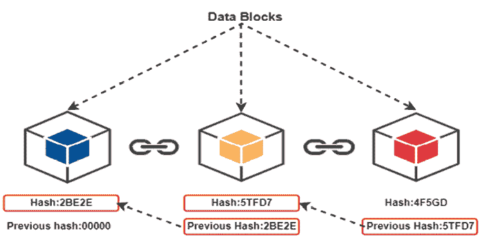

图 2.1：区块链架构

来源：[`www.mdpi.com/2071-1050/14/13/7633`](https://www.mdpi.com/2071-1050/14/13/7633)

区块链架构是去中心化账本协议的设计和结构，它能够实现交易的记录和验证，并通过全球节点网络传播。

那么，从底层架构来看，普通的区块链由什么组成？以下是其核心组件：

* **分布式账本**：这是区块链的基础构建块。区块链的记录遍布全球节点网络，因此信息链保持了防篡改性和透明性。

* **共识机制**：正如我们所知，这是区块链在所有节点之间达成共识并维护去中心化的方式。自从以太坊转向权益证明（`PoS`）共识协议以来，这一概念引起了广泛关注。特别是在 `PoS` 共识机制下，节点通常需要质押一定数量的原生代币才能获得链上交易潜在验证者的资格。一旦他们成功完成工作并更新区块链，就能获得平台从用户处获取的部分交易费用作为奖励。

* **加密哈希**：区块链依赖加密哈希来确保链上记录数据的完整性并加强安全性。因此，链上的每个区块都包含一个唯一的加密哈希值，该哈希值基于区块内的数据以及链上上一个区块的哈希值计算得出。链上任何区块包含数据的任何更改都会导致其哈希值改变，从而导致所有后续区块出现差异，使篡改变得易于检测。

* **智能合约**：这些是存储在区块链上的自动执行代码，根据预定义的规则和条件进行编程。智能合约在满足指定条件时会自动执行。它们允许减少的人工干预并实现自动化流程。

* **梅克尔树**：这些是用于提高大型数据集验证效率的数据结构。树结构通过对单个数据元素进行哈希，然后成对地对输出进行哈希，直到得到一个最终输出。`Merkle Tree` 结构能够对区块中的大型数据集实现更快速、更具扩展性的验证。

* **公钥/私钥对**：这些是维护区块链交易隐私性和可验证性的加密工具。系统为每个人唯一提供这些密钥：公钥用于接收他人的交易，私钥用于签名和发起交易，并证明对资金的所有权。

* **网络协议**：它们使得区块链上节点之间的通信成为可能。它们规定了节点通信的规则，帮助同步数据并就区块链当前状态达成共识。

现在，这些都是你可能会看到的普通区块链架构中的基础组件。请记住，不同的区块链网络可能会根据其特定的应用场景和设计目标，在架构上有所差异。

# 区块链的优点与缺点

现在，就像任何其他技术发展一样，区块链也有自己的优缺点。让我们检查一下。

## 区块链的优点

区块链提供了大量的优势，使其成为广泛应用急需的技术。区块链的一些主要优势包括：

* 区块链为你可能能想到的任何组织结构引入了急需的去中心化。由于没有中心化的控制点，这增强了安全性、隐私性和透明度。

* 一旦数据记录在区块链上，由于加密哈希的存在，它们在本质上是不可篡改的。恶意行为者无法在通知整个网络的情况下更改区块序列或其中持有的数据。

* 区块链采用了先进的加密技术，为所有数据和交易提供安全保障。此外，网络的分布式特性和共识机制共同作用，使区块链能够抵抗黑客攻击和未经授权的访问。

* 区块链允许无信任交易，因此所有交易双方可以在不需要信赖中间介的情况下参与交易。智能合约则会自动执行此类交换。

* 由于区块链的透明性和不可篡改性，参与者可以轻松追踪交易的来源和流向，再次确保了真实性并减少了欺诈。

* 在跨境支付方面，区块链可以实现更快速、更高效的交易。由于减少了中间介并加快了流程，区块链还降低了交易成本。

* 区块链的开源特性和许可平台鼓励在现有开发的基础上进行创新，并根据消费者和行业需求促进了跨行业新应用程序和解决方案的创建。

## 区块链的缺点

尽管区块链提供了许多优点，它也面临着挑战。让我们来看看这些障碍：

* 作为目前区块链最常见的问题之一，这些网络在处理大量交易时面临可扩展性问题。因此，随着区块链上参与者和交易数量的增加，可能会变慢并导致确认时间变长和交易费用增加。

* 像 `Bitcoin` 这样的工作证明区块链可能是高能耗的，导致环境问题。

* 由于区块链上的每个全节点都必须存储整个账本的副本，这会导致巨大的数据存储需求。对于具有庞大交易历史的公共区块链尤其如此。

* 互操作性是区块链仍然面临的另一个挑战，因此大多数现代区块链仍然缺乏无缝的互操作性。

* 区块链可能受到私钥被盗、智能合约漏洞以及工作证明网络 `51%` 攻击等风险的影响。

* 正如我们所知，区块链交易是不可逆的，这在发生欺诈或任何错误时，很难纠正和补救局面。

表 2.2 显示了区块链的优缺点：

| 区块链的优点 | 区块链的缺点 |
| --- | --- |
| * 去中心化，因此没有中央机构监控你的资金或交易。 | * 网络规模扩大后出现可扩展性问题。 |
| * 由于去中心化增强了安全性、隐私性和透明度。 | * 由于工作证明等共识机制导致的高能耗。 |
| * 数据的不可篡改性。 | * 公共区块链随着增长带来的存储担忧。 |
| * 使用加密哈希确保数据安全。 | * 不同区块链网络之间缺乏互操作性。 |
| * 无信任交易。 | * 容易受到 `51%` 攻击或智能合约故障等安全威胁。 |
| * 透明性和可追溯性。 | * 交易的不可逆性使得错误/欺诈活动难以挽回。 |
| * 更快的交易，特别是对于跨境应用。 | |
| * 由于缺乏中间介和自动化流程，降低了交易费用。 | |
| * 开源代码鼓励更易的进一步开发。 | |

解决我们在上面讨论的区块链缺点需要持续的研究、创新，当然，还需要开发者之间的协作。这些挑战中的大部分已经在处理中。例如，已经有了层-1 和层-2 区块链解决方案来分担主链的负载并解决扩展性问题；同时，人们正努力通过区块链桥接、封装币（`wrapped crypto`）等手段来解决互操作性挑战。

尽管面临挑战，区块链仍然具有不可估量的巨大潜力，能够改变行业、培养信任并在全球范围内创建更高效、更安全的系统。其日益增长的采用以及该领域每隔几天就有新进展，足以证明这一点。

# 将区块链与人工智能和机器人相结合

既然我们已经对区块链的原理和前景有了相当了解，让我们借此机会了解一下我们在本书中所提议并讨论的技术协作是如何运作的。

区块链可以通过我们能想到的多种方式与机器人和人工智能相结合，在创造全新可能性的同时也增强这些技术的能力。

以下是区块链与机器人及人工智能交叉的一些可能用例：

* **数据完整性**：在机器人系统和 AI 模型中，数据完整性是准确决策的至关重要的组件。这正是区块链的不可篡改性和透明性可以发挥作用的地方，用于记录数据来源，并确保用于 AI 训练数据集的数据真实性。

  区块链可以存储数据哈希，帮助追溯数据集的历史和谱系。这有两个好处：

  * 防止数据操纵
  * 增强对之前讨论过的 AI 系统的信任

* **自主机器人与 AI 治理**：随着机器人和 AI 系统变得越来越自主，这些系统的治理和问责机制已成为需要监督的关键因素。区块链可以为机器人和 AI 治理引入一个去中心化的框架，让 AI 系统做出的决策通过共识程序，并记录在区块链上，以实现透明化、易审计性和问责制。

* **AI 与智能合约**：AI 可以集成到基于区块链的智能合约中，带来处理更复杂、更自动化决策过程的能力。这将真正使任何时候的人为干预都变得没有必要，从而加快流程。为了更清楚地理解如何实现这一点，将在后续章节中提供更多细节。

* **用于区块链治理的 AI**：AI 可以分析区块链数据，并随着时间的变化对任何网络参数（如正在使用的共识算法）提出优化建议。AI 驱动的分析总体上有助于提高区块链网络的性能。

* **AI 与物联网的集成**：当我们将物联网（`IoT`）引入其中时，区块链和 AI 可以为连接设备创建一个安全的、去中心化的生态系统。AI 算法现在可以处理从 `IoT` 设备获取的数据，然后由区块链接管以确保 `IoT` 设备之间的安全通信，提升 `IoT` 系统的整体可靠性和安全性，让我们的日常生活变得更加简单。

* **AI 驱动的市场**：以区块链为中心的平台可以促进基于 AI 的市场，开发者可以以去中心化的方式提供其 AI 模型。所有交易将通过智能合约执行，带来一个运行流畅的 AI 生态系统。


**去中心化 AI 模型与联邦学习**：去中心化 AI 模型利用区块链在分布式节点网络上托管 AI 服务，增强可访问性并减少与单点故障相关的风险。这种基础设施支持联邦学习，AI 模型可以在分布式数据源上进行训练，而永远不需要共享原始数据。这解决了 AI 模型训练中的隐私问题。

正如我们整本书想要向你展示的目标一样，AI、区块链和机器人的整合为各个行业领域提供了许多令人兴奋的机会，同时提高了透明度、安全性和效率。

一旦我们解决了扩展性和隐私挑战，并学会通过在去中心化区块链中负责任地使用 AI 和机器人来解决伦理问题，这些技术的组合将从根本上重塑我们所知的大多数行业！

现在，让我们讨论本章的最后一项技术：机器人与自动化！

## 理解机器人与自动化

在进入最后的有趣的例子之前，让我们先了解什么是机器人和自动化。

自动化和机器人当然是两种不同的技术。混用这两个术语意味着一个人对这两种技术缺乏了解。然而，两者在多个领域确实重叠，以实现一系列智能程序。

## 定义机器人与自动化

机器人和自动化是两个频繁关联的技术领域，它们促进了机器的设计、制造和运行，这些机器能够自主或半自主地执行给定任务，无需任何人工干预。

机器人技术是技术的分支，涵盖机器人的设计、建造和运行。机器人是一种可编程的机器或机械设备，能够在自主或在操作员控制执行任务。

机器人可以用于制造、医疗、农业以及深海或太空探索等各个行业。通常，机器人被用于执行对人类来说太危险或太重复的任务，并提高效率和精密度。

另一方面，自动化是允许控制系统在极少或无需人工干预的情况下将机器投入使用的的技术。自动化用于实现流程简化、减少体力劳动并提高生产率。这些自动化系统可以涵盖从传感器检测到黑暗时开灯，到金融、制造和物流中更复杂的程序的所有内容。

这两种技术的结合可以提高效率、降低劳动力成本、提高安全性，并能够在广泛的行业中精确地执行人类可能无法完成的任务。

机器人技术和自动化正作为一种交织的技术在快速发展，并伴随着 AI、机器学习、区块链、智能合约等的进一步集成。

总的来说，这些组合导致了极其复杂且功能强大的系统。

## 机器人与自动化的分类

机器人技术可以分为三个不同且广泛的类别，即：

*   依赖人工操作的机器。
*   半自主机器人，它们可以执行某些任务，但仍需要人工干预和监督。
*   完全自主机器人，它们拥有完全独立执行给定任务的智能，甚至可以对未见的情况做出反应。

自动化也可以划分为三个大类，它们是：

*   软件自动化，利用计算机程序处理虚拟环境中的重复性任务。
*   机器人流程自动化（`RPA`），这是一种软件自动化，可以像人类一样利用计算机界面。`RPA` 工具可以通过 `AI` 和 `ML` 变得更高效，以便它们能够根据一组给定的规则执行任务。
*   工业自动化，使机器能够执行物理过程。这可能包括机器人自动化。

## 机器人技术 vs 自动化

`Table 2.3` 并列了机器人技术与自动化的区别：

| 基础 | 这是一个涉及设计、建造和运行我们称为机器人的技术分支。机器人是一种可编程的机械设备，能够在自主或在操作员的控制下执行任务。 | 自动化是利用技术以最小的人工干预来操作机器和系统。这项技术旨在简化流程、减少体力劳动并提高生产力。 |
| --- | --- | --- |
| 组件 | 机器人技术涉及物理组件，如传感器、执行器、电机和机械框架。此外，其他需求还涉及控制机器的软件和算法。 | 自动化主要涉及软件系统，包括控制系统、传感器和执行器。这些组件可能连接到物理机器人，也可能没有。 |
| 范围 | 机器人技术的重点是针对各种用例开发和部署机器人。它涉及对机器人力学、控制系统、传感器和编程的研究，以创造能够执行原本需要人工干预任务的机器。 | 这是一个相对更广泛且通用的概念，涵盖了任何利用技术来实现任何过程和任务自动化的行为，其范围不仅限于物理任务。自动化可以包括软件自动化、工业自动化甚至业务流程自动化。 |
| 目的 | 这项技术的目的是创建以类似于人类的方式执行任务的机器，通常是在物理环境中。机器人的设计初衷是与物理世界交互，可以用于从制造、医疗保健到太空探索的各个行业。 | 这里的目的是减少任何任务和过程中的人工干预。自动化的目的是通过在物理和虚拟空间内采用无人化的技术控制和管理系统，来优化和加速操作、增强效率，并将人为错误降至零。 |
| 应用 | 机器人技术已应用于一系列需要与环境进行物理交互的行业和任务，例如手术、探测和物流。 | 如前所述，这可以应用于广泛的任务——包括物理和非物理任务。自动化可以用数据输入、海量数据分析、会议和维护程序的调度、功能监控以及保持工业过程控制等任务。 |

表 2.3: 机器人技术 vs. 自动化

现在，在讨论将两者结合以及在各种用例中使用自动化之前，我们来看看这些技术的优缺点。

## 机器人技术的优缺点

机器人技术在各个行业和应用中提供了广泛的利益，如下：

### 机器人技术的优点

*   机器人能够比人类更快、更一致地执行大多数任务，无论这些任务有多危险或重复。自然地，这意味着你可以想象的任何流程的生产力和效率都会提高。
*   机器人可以比人类做出更精确、更准确的动作，这在制造、组装以及许多其他对精度要求高的任务中特别有用，而这些任务否则很容易受到人为错误的影响。
*   如所述，机器人可以以极高的效率执行危险或有害的任务，这有助于人类工人避免此类活动。
*   机器人是为了生产力和效率而生的。
*   机器人可以 24/7 不间断运行，这为医疗保健提供了支持。
*   机器人可以让教育工具在全球范围内普及，并促进各个领域的研究。
*   机器人技术有助于推动 AI 等技术的发展。

### 机器人技术的缺点

*   机器人技术的初期投资可能是巨大的，特别是对于小型企业而言。
*   机器人系统的维护可能非常复杂，耗费时间并侵占紧预算。
*   机器人缺乏适应不同工作环境的灵活性。
*   停电等事件会使机器人系统变得失效。
*   机器人容易受到网络安全威胁的侵害。
*   关于滥用机器人力量和工人阶级职业流业的伦理问题普遍存在。
*   缺乏人情味会导致体验缺乏个性化和定制化。

解决这些缺点再次需要我们人类的审慎考虑、合理的规划以及对机器人技术的负责任部署。解决伦理疑虑的最好方法是在人类能力与机器人能力之间取得平衡。

这将进一步有助于发挥机器人技术的全部潜力，因为我们相信，在任何领域要实现真正的伟大，始终需要某种程度的人类参与。我们相信大多数人都会认同这一点。

接下来是自动化的优点和缺点！

## 自动化的优缺点

正如我们所知，自动化为几乎所有的企业和行业提供了广泛的优势。

### 自动化的优点

*   自动化作为一种技术简化了流程并消除了对人工干预的需求，使任何领域的操作更快速、更高效。
*   自动化帮助您节省人力成本，从长远来看可以节省大量资金。
*   当然，自动化对于重复性和劳动密集型任务特别有用。
*   自动化系统以高精度的一致性执行任务，最大限度地减少可能发生的人为错误，提高整体运营质量。
*   自动化系统全天候持续不停地工作。
*   自动化系统可以根据行业需求或生产要求的变化轻松扩展，这无疑为企业提供了一个极具扩展性的解决方案。
*   自动化当然可以处理人类无法完成的危险任务。这提高了操作中人类对应者的安全性。
*   自动化系统对预设触发器的反应比人类更快，缩短了遇到关键情况时的延迟。
*   自动化系统可以快速高效地处理和分析大量数据，为更快的决策和流程优化提供了极大帮助。
*   随着自动化接管重复性任务，人类可以专注于特定工作中更具创造性和/或战略性的方面。这实现了团队生产力的优化。
*   自动化可以通过个性化回复、聊天机器人等方式增强客户服务，确保各行业提供更快的支持。
*   自动化可以集成到 AI 和机器人等技术中，以改进整体运营。

### 自动化的缺点

*   自动化是另一种引发不同部门工作岗位流失担忧的技术。
*   同样，最初为您的业务实施自动化系统可能需要大量的资金投入，这阻碍了小型企业获得其收益。
*   自动化系统的维护可能复杂。
*   编写按特定方式运行的机器将难以适应任何意外情况，需要人工干预且缺乏灵活性。
*   技术故障、网络安全威胁，甚至是像停电这样平凡的事，都会导致涉及自动化的整个流程无限期停止。
*   过度依赖自动化可能会导致可能来不及及修复的错误，以及灾难性的后果。
*   自动化可能会限制或完全消除人类员工在解决问题或产生新想法时能带来的创造力和创新。
*   缺乏人类互动会影响各个领域并导致客户不满意，例如在客户服务岗位中。

表 2.5 显示了自动化的优缺点快速概述：

| 自动化的优点 | 自动化的缺点 |
| --- | --- |
| * 自动化简化了流程并限制了人工干预，提高了效率。<br>* 自动化减少了人力成本。<br>* 自动化系统对于重复性和劳动密集型任务有用。<br>* 自动化系统全天候工作。<br>* 自动化系统可以根据需求的变化具有高度的可扩展性。<br>* 自动化可以处理对人类来说太危险的任务。<br>* 自动化系统对预设触发器的反应比人类更快。<br>* 自动化可以通过更快速和个性化的回复增强客户服务。<br>* 自动化可以与 AI 和机器人等技术集成，以推动这些领域的进展。 | * 自动化引发了对不同部门工作岗位流失的担忧。<br>* 小型企业可能因为高昂的前期成本而难以实施自动化系统。<br>* 自动化系统的维护很复杂。<br>* 自动化系统适应不断变化的需求灵活性较低。<br>* 技术故障和网络安全威胁困扰着这些系统。<br>* 过度依赖自动化可能导致不可逆的后果。<br>* 自动化限制了人类的创造创新。<br>* 缺乏人类互动会导致客服等领域的用户获得不满意的体验。 |

表 2.5：自动化的优缺点

机器人技术和自动化在优缺点方面具有相似之处，再次，通过审慎的规划和有效的管理，解决所有自动化的缺点是非常可行的，从而保持人类和自动化劳动力之间的平衡。

现在我们来看 AI、自动化、区块链和机器人如何结合，带来各种现实应用案例。

## AI、区块链、机器人和自动化的示例

向您解释这些技术单独应用以及组合应用的最佳方法，是通过我们已经见过的迷人示例来进行。让我们直接进入这些示例吧！

### 机器人护士 Grace

Grace 由一家位于香港的机器人公司创建，旨在让患者感到放松舒适。Grace 被介绍为世界知名机器人 Sophia 的姐姐（Sophia 已获得沙特阿拉伯的国籍）。Grace 出生 2021 年新冠肺炎肺炎期间，她是 AI、机器人技术和自动化程序的融合。

### 仿生肢体

仿生肢体连接在人体上以替换肢体（如手臂或手）的机电设备。仿生用户控制系统试图拦截大脑的信号（这些信号本会被其所替换的肢体解释），并将其转换为设备的指令。这再次涉及 AI 和自动化。

### 基于视觉的 AI 无人机

来自苏黎世大学的自主无人机去年挑战世界上最优秀的人类飞行员进行了一场公平的无人机比赛，双方都依赖于他们的视觉感知以及对当前情况的思考和反应能力。这里涉及到 AI、自动化和相关技术的绝妙运用，导致无人机赢得了比赛。请参考下图：


图 2.2：迪拜世界无人机大奖 [知识共享许可]

### Fetch.ai

`Fetch.ai` 是一个帮助您自动化预订机票等日常任务的平台，甚至可以用于去中心化金融领域的财务指导。`Fetch.ai` 通过部署作为您的数字孪生机器人来实现网络交易的去中心化和自动化，该机器人会与航空公司供应商或其他交易者/金融服务提供者的数字孪生交互，并根据您设置的参数获取交易。

### 医疗保健领域的形状变化微机器人

微型机器人可用于将药物（如化疗药物）输送到癌细胞，人员 `Jiawen Li`、`Li Zhang`、`Dong Wu` 等已对此进行了测试。这在抗癌方面可能是突破性的。其中涉及的技术包括机器人技术、自动化和人工智能。

## AI-区块链

这个总部位于纽约的平台带来了一种基于区块链和人工智能构建的数字资产云协议。该机构将 `AI agents` 应用于其 `blockchain` 以确保安全性。该机构的目标是为企业提供可扩展且防篡改的数据库解决方案，以支持各种业务。

## 作为个人助手的家庭机器人

Labrador Systems 最近推出了 `Retriever`，这是一种半自动移动桌它可以根据人类指令传输物体。这是机器人技术和自动化的极应用，旨在帮助行动不便的人。

## Bext360

该机构位于科罗拉多州丹佛，利用 `AI` 和 `blockchain` 增强咖啡、木材、海鲜和矿产部门的供应链透明度。涉及的 `AI` 用于分析作物、预测生长模式，而 `blockchain` 则记录产品在整个供应链中的旅程——从种子到成品。此外，`blockchain` 还充当支付记录器，确保所有相关方都能快速、透明地收到付款/产品。

## 机械手臂远程纹身

荷兰 T-Mobile 通过开发世界上首个远程纹身的自动化系统，将其 `5G networks` 的推广推了一个全新的高度。纹身是由位于另一地的艺术家 `Wes Thomas` 控制的机械手臂在演员 `Stijn Fransen` 身上完成的，得益于其 `5G network` 的力量。这一过程被记录在一部纪录片风格电影中，涉及机器人技术和自动化。

下图显示了机器人制作纹身的过程：


图 2.3: 远程纹身

## BurstIQ 的 LifeGraph

该平台结合了 `AI` 和 `blockchain`，让患者对自己的健康数据拥有增强的所有权和管理控制。`LifeGraph` 允许医疗专业人员为患者的健康记录和健康方案构建安全的存储解决方案。通过此平台构建的所有应用都内置了同意和恢复功能。

## Dobby

Dobby 总部位于华盛顿特区，是一个再次利用 `blockchain` 和 `AI` 的家庭服务平台。房主可以利用该平台寻找维护和修理项目的协助。该平台的应用程序将提供屋顶、水水和其他维护服务的本地工人与寻求服务的人士连接起来。`blockchain` 在此促进了数据的快速交换，并有助于减少财务损失。

从这些技术多样的性质以及不同的行业来看，我们相信你已经了解这些技术在现实应用中的实施是具有包容性和多方面性的。在 `AI`、`blockchain`、`robotics` 和自动化等强大技术的推动下——这些技术实质上允许你实现梦想中的任何功能——天空确实没有极限。

## 结论

## 问题

### 1. AI 是如何工作的？

答案：以下是 `AI` 工作的步骤：

*   `Data collection`：`AI` 系统首先收集数据。
*   `Data preprocessing`：`AI` 系统清洗数据。
*   `Model building`：创建 `AI models`。
*   `Training`：为 `AI models` 输入数据。
*   `Validation and testing`：对 `AI models` 进行测试。
*   `Prediction`：现在，`AI models` 提供输出。

### 2. AI 有哪些分类？

答案：`AI` 的两个主要类别是：

*   `Strong AI`：其认知能力与人类大脑相当。
*   `Weak AI`：只能完成特定领域的任务。

### 3. 列举几个 AI 的优点和缺点。

答案：`AI` 的优点包括：

*   能够在短时间内处理海量数据并从中学习。
*   可以自动处理单调的任务。
*   有助于降低人工成本。
*   可以防止人类进入危险地带。
*   可以通过平台的个性化关注和推荐增强用户体验。
*   `AI` 模型可以不断学习和改进。

缺点包括：

*   训练这些模型可能非常昂贵且消耗大量能量。
*   偏偏或错误的数据会产生错误的输出。
*   `AI` 训练数据带来了隐私和安全问题。
*   `AI` 可能会消除人类工作，导致失业。

### 4. AI 有哪些常见应用？

答案：AI 在以下领域有新兴的应用：

*   在医疗保健领域，`AI` 用于精准诊断、个性化护理、远程监控和聊天机器人。
*   在电子商务领域，`AI` 用于为用户提供定制购物体验。
*   在农业领域，`AI` 可用于照料作物和自动化农业设备。

### 5. 区块链如何与 AI 和机器人等其他技术结合？

答案：这三种技术有多种结合方式。例如，`blockchain` 和 `AI` 可以结合以增强供应链的可溯性，而 `robotics` 可用于辅助人类并提高生产力。

### 6. 机器人和自动化有什么区别？

答案：机器人技术负责机器人机器的设计、构造和操作。另一方面，自动化只是让机器系统能够在很少或无人工干预的情况下运行的技术。因此，可以说机器人系统使用了自动化，但自动化系统并不一定需要机器人技术。

### 7. AI、机器人和自动化的伦理担忧有哪些？你认为我们如何解决这些问题？

答案：使用偏差或错误数据训练的 `AI system` 会产生不公平的输出，而且在涉及 `AI`、机器人和自动化技术的地方，人类工人可能会被边缘化和淘汰，导致失业危机。此外，`AI systems` 在训练过程中消耗大量能量，这是开发者必须尝试解决的另一个角度。

### 8. 区块链、AI 和机器人结合的可能用例有哪些？

回答：在医疗保健领域，区块链可用于维护患者记录，并让医疗提供人员轻松访问。同时，AI 驱动的系统可以提供急救、个性化治疗方案等，而机器人护士可以被分配护理患者并以极高的精度参与手术。

加入我们书籍的 Discord 空间

加入书籍 Discord 工作区获取最新更新、优惠、全球科技动态、新发布以及与作者的交流：

[`discord.bpbonline.com`](https://discord.bpbonline.com)


# 第 3 章 AI 详解

## 引言

在上一章中，我们介绍了未来将统治世界的：区块链、人工智能、机器人技术和自动化。人工智能（AI）是一个吸引了我们六十多年的概念，现在已成为我们日常生活中不可缺的一部分。本章将探索 AI，探讨其定义、历史、当前进展以及对人类的影响。

AI 关乎创建能够像人类一样思考、学习和行动的机器，但也扩展到增强和提升人类智能。今天，AI 正在改变我们的生活和行业，为流媒体平台提供推荐支持，实现自动驾驶汽车，并协助医疗诊断。


然而，AI 也带来了挑战和争议，包括由于自动化导致的就业流失、监控增加带来的隐私担忧，以及来自超级智能 AI 的生存性风险。理解并应对这些挑战对于充分利用 AI 的潜力并确保其益处被广泛共享至关重要。

## 结构

在本章中，我们将涵盖以下主题：

* 介绍 AI
* AI 历史
* AI 的最新进展
* AI 的影响
* AI 的未来潜力

## 目标

在本章中，我们的目标是对 AI 进行全面探索，从其核心定义和类型开始，包括`ML`、`DL`和神经网络。让我们顺便追溯一下 AI 的历史：从它的萌芽到 AI 寒冬再到它的复兴，涵盖所有的关键里程碑。

此外，让我们谈谈 AI 的当前进展、它与日常生活的融合，以及对各行业的影响。

## 介绍 AI

AI 领域是多学科的，它可能涵盖并要求在计算机科学的基础上考虑心理学和哲学思考。

AI 当然是指创建能够执行原本需要人类智能的任务的机器或计算机。这些任务可以从理解自然语言到精确识别复杂模式，从解决问题到从经验中学习任何一切。

在基础层面，AI 关乎创建能够思考的机器——或者至少看起来在思考的机器。它关乎开发能够理解、推理、学习和交互的系统。它关乎构建能够感知环境并采取行动以最大化实现目标机会的智能智能体。

虽然我们的 AI 技术尚未达到那种先进的水平，但 AI 的目标仍然不仅仅是复制人类智能：它实际上关乎增强、提升甚至超越它。

AI 是一个跨越科学、技术、哲学和伦理边界的领域。它是一个既关乎理解人类智能又关乎创建智能机器的领域。它是一个以深刻且深远的方式改变我们世界的领域，开启了新的可能性，并提出了新的挑战。它是我们技术未来的前沿领域，塑造着我们生活、工作和娱乐的方式。

## AI 的类型

下文将讨论两大类 AI。

### 狭义 AI

第一种——我们每天与之交互的 AI 类型——被称为狭义 AI 或弱 AI。这项技术设计用于识别声音、识别图像，甚至进行自动驾驶。然而，它有局限性，一次只能完成一项狭窄的任务。

我们今天与之交互的大多数 AI 系统，从智能手机上的`Siri`和`Alexa`等虚拟助手，到`Netflix`或`Amazon`的推荐算法，再到驱动`Google`搜索引擎的 AI，都是狭义 AI 的例子。

例如，当我们在`WhatsApp`上收到来自 Amazon 关于订单状态的消息时，它会说我们只需回复`STOP`即可停止接收此类通知。相反，假设我们回复了类似`cool, thanks!`这样的内容，那么我们收到的回复就像聊天机器人没有懂一样。聊天机器人只会理解`STOP`命令。这告诉了我关于这里涉及的 AI 什么？

它告诉我们，狭义 AI 系统非常复杂，并且在执行特定任务时通常比人类更准确或高效。然而，它们的范围是有限的，只能在特定领域内执行任务。因此，一个根据你的观看历史推荐电影而训练的 AI 不能对你的财务投资提供建议：它在特定任务上是智能的，但这种智能不会转移到其他领域。

### 通用 AI

另一方面，通用 AI（也称为强 AI 或人工通用智能`AGI`）是那种有潜力在人类水平上跨越广泛任务理解、学习和应用知识的 AI。这是我们在科幻电影中看到的 AI——那种可以下国际棋、写交响曲、交谈甚至理解情感的 AI。虽然我们距离实现通用 AI 仍然遥远，但它代表了许多 AI 研究者的终极目标。

尽管我们在 AI 方面取得了巨大进展，但距离实现通用 AI 仍然遥远。目前的 AI 系统在执行明确编程或训练的特定任务时表现出色。然而，在被要求执行训练之外的任务或面对陌生情况时，它们会感到困难。

除了这两个类型之外，当然还有这种——尽管仍处于理论阶段。

### 超级智能 AI

超级智能 AI 是一个概念，即 AI 系统的认知性能在最具经济价值的工作中远胜人类。它是一种超越人类智能和能力的 AI。这种形式的 AI 不仅仅复制人类的智能和能力，而且在我们所做的一切上都异常出色。

虽然超级智能 AI 是一个迷人的概念，但它目前处于理论和推测领域。许多专家认为，开发超级智能 AI 还需要几十年甚至更久。

虽然超级智能 AI 听起来很好，但这种 AI 引起了关于智能本质和人类未来的重大伦理和哲学问题，以及确保 AI 用于造福人类的需要。

AI 还包含几个子领域，每个领域都有特定的目标和技术。这些包括`ML`（计算机被编程从数据中学习）、自然语言处理（系统旨在理解和生成人类语言）、计算机视觉（机器被训练解释和理解视觉世界），以及机器人技术（使用 AI 控制现实世界中的实体）。

## AI 核心概念

是时候深入探讨 AI 的子领域，并探索涵盖多个 AI 领域的关键概念了。

### 机器学习

机器学习（`ML`）是人工智能（AI）的一个子集，专注于开发通过经验和数据自动改进计算机算法。该过程涉及使用海量数据训练 AI 模型，使其能够在无需针对特定任务进行显式编程的情况下做出预测或决策。

机器学习算法主要分为四大类：

#### 监督学习

监督学习涉及使用已经标记标签的数据集来训练模型，这意味着正确答案是已知的。监督学习的一个常见应用是图像和物体识别。例如，模型在成千上万种各种标记过的图像和物体上进行训练。随着时间的推移，它学会了准确地分类和识别新的、未见的图像。其他用例还包括预测分析、客户情感分析和垃圾邮件检测。

来源：[`www.ibm.com/topics/supervised-learning#:~:text=the%20Difference%3F%22-,Supervised%20learning%20examples,-Supervised%20learning%20models`](https://www.ibm.com/topics/supervised-learning#:~:text=the%20Difference%3F%22-,Supervised%20learning%20examples,-Supervised%20learning%20models)

#### 无监督学习

在无监督学习中，模型获得一个没有任何标签的数据集，任务是寻找数据中的模式和关系。无监督学习算法可以显著增强医学成像。在放射学中，它们可以分析成千上万幅医学图像以检测和分类肿瘤并识别病理异常，而无需先标记标签。这种能力有助于实现比传统方法更快、更准确的诊断。此类模型还可以识别各种新闻板块文章、检测安全漏洞、设备故障等。

来源：[`www.ibm.com/topics/unsupervised-learning#:~:text=as%20object%20recognition.-,Medical%20imaging%3A,-Unsupervised%20machine%20learning`](https://www.ibm.com/topics/unsupervised-learning#:~:text=as%20object%20recognition.-,Medical%20imaging%3A,-Unsupervised%20machine%20learning)

#### 半监督学习

半监督学习结合了前两种。这种模型使用标记数据来学习车辆、动物、运动等的基本分类，然后将这些知识应用于未标记的数据中。而不是手动标记成千上万张图像，半监督学习模型利用较小的标记数据集来理解更大的未标记数据。相同的技术也可以应用于文本分类、业务和市场中的异常模式或趋势检测。

来源：[`www.geeksforgeeks.org/ml-semi-supervised-learning/?ref=lbp#:~:text=Examples%20of%20Semi%2DSupervised%20Learning`](https://www.geeksforgeeks.org/ml-semi-supervised-learning/?ref=lbp#:~:text=Examples%20of%20Semi%2DSupervised%20Learning)

#### 强化学习

强化学习涉及一个代理，它根据奖励和惩罚来学习执行动作。强化学习的一个经典例子是机器人领域。机器人被教执行复杂的任务，如驾驶、评估动态环境以及对现实刺激做出反应。另一个应用包括自然语言处理（`NLP`），它通过文本交互来改进机器人和决策系统。

来源：[`www.ibm.com/topics/reinforcement-learning#:~:text=environment%20interaction.15-,Examples%20of%20reinforcement%20learning,-Robotics`](https://www.ibm.com/topics/reinforcement-learning#:~:text=environment%20interaction.15-,Examples%20of%20reinforcement%20learning,-Robotics)

#### 深度学习

深度学习（`DL`）是机器学习的一种类型，使用人工神经网络和表示学习。与传统的机器学习技术相比，深度学习处理各种数据源对数据工程的需求较低。深度学习模型使用多层神经网络构建，它们可以自动学习图像、声音和文本数据的表示。

深度学习在许多领域取得了突破性进展，包括图像和语音识别以及自然语言处理。这项技术将自动驾驶汽车、语音控制助手和图像识别系统的创新推向了新的高度。

### 神经网络

神经网络是模仿人类大脑并旨在识别模式的算法。它们使用机器感知解释感官数据对原始输入进行标记或聚类。这些网络可以被训练以识别复杂的模式、预测结果并做出决策。

神经网络接收输入，然后在隐藏层中使用在训练期间调整的权重进行处理。然后模型产生预测。通过调整权重来寻找模式以优化输出。

## 人工智能的历史

人工智能的起源根于早期为其扩张奠定基础的发展和概念。

### 人工智能的早期起源

赋予智能或意识的人造生物的概念并不新鲜。几千年来，它一直是人类想象和神话的一部分。古希腊神话讲述了神灵铁匠赫菲斯托斯创造了机械仆人。与此同时，在犹太民间传说中，魔歌姆（Golem）是通过宗教仪式赋予生命的人造生物。这些关于人工生命和智能的早期想法是我们现在所知人工智能的前身。

然而，将这些想法正式化为人工智能的科学和学术领域是相对较晚的发展。约翰·麦卡锡在 1956 年的达特茅会议上发明了“AI”这一术语。在会议期间，人工智能的核心使命被宣布为：能够详尽地描述智能或学习的每一个方面，使其能够由机器进行模拟。

然而，这种正式化的进程开始得早得多。19 世纪，发明家和工程师制造了看似模仿人类智能的机械装置。一个例子是下方的图 3.1。

在 20 世纪 30 年代和 1940 年代，现代计算的基础被奠定了。英国数学家和逻辑学家艾兰·图灵在此期间发挥了至关重要的作用。他关于可以模拟任何计算机算法逻辑的通用机器的工作是人工智能的基础。

值得注意的是，图灵提出了图灵测试，用以衡量机器展示与人类等同或无法区分的智能行为的能力。

20 世纪 50 年代和 1960 年代是人工智能研究乐观和快速进展的时期。早期人工智能研究人员预测机器将在一代内完成人类可以做的任何工作。在此期间，人工智能研究主要由国防部资助。这导致了如下方图 3.2。

然而，到 20 世纪 60 年代末和 70 年代初，这种乐观情绪开始消退。早期 AI 研究人员所做的承诺并没有像预期中那样迅速实现。这导致了被称为“AI 寒冬”的时期，其特征是资金投入的减少以及对 AI 研究兴趣的下降。

20 世纪 80 年代，由于模仿人类专家知识和分析能力的专家系统的出现，AI 领域经历了一次人气热潮。随着 20 世纪 90 年代和 2000 年代互联网的普及以及计算能力的显著提升，AI 已成为我们日常生活的基本组成部分。

今天，AI 是一个蓬勃发展的领域，应用广泛，且研发活跃。从神话中的自动机器到 AI 的形式化，这段旅程充满了成功与挫折。随着我们不断前进，从这段历史中汲取的经验将继续指导 AI 的发展。

## 科幻小说中的 AI

当我们讨论 AI 的历史时，科幻小说中的 AI 也值得一提。科幻小说是围绕 AI 产生的炒作的核心部分。今天的许多 AI 研究人员可能在小时候某一天读过科幻小说或看过科幻电影，当时脑海中第一个浮出的念头就是：如果我能做一个像人形一样酷的东西，它能和我玩，甚至可能帮我洗碗怎么办？

第一部将 AI 推向主流的科幻媒体是玛丽·谢莱的小说《弗兰肯斯坦》（又称《现代普罗米修斯》），如图 3.3 所示。

图 3.3：玛丽·谢莱的《弗兰肯斯坦；或现代普罗米修斯》

来源：[`www.amazon.in/Frankenstein-Modern-Prometheus-Uncensored-1818/dp/9176370690`](https://www.amazon.in/Frankenstein-Modern-Prometheus-Uncensored-1818/dp/9176370690)

如果你认为这并不完全是能激发人们对 AI 兴奋之情的书，也有人认为《弗兰肯斯坦》仅仅缺乏微调其所创造的人形物的技巧。

无论如何，随着科幻说的演变，许多其他作品引入了 AI 或类 AI 的概念。例如：

* 卡雷尔·恰佩克的《R.U.R（罗苏姆通用机器人）》（1920 年）：这是一部向世界引入“机器人”（robot）一词的剧作。它展示了通过生物工程制造的人造生物。
* 弗里德里·朗格执导的《大都会》（1927 年）：这部作品是一部无声电影，展示了一个反乌托邦社会，其中有一个由疯狂科学家特旺创造的、名为玛丽亚的人形机器人。
* 艾萨克·阿西莫夫的《我机器人》（1950 年）：你可能听说过这部作品，阿西莫夫是一位非常著名的作家。
* 斯坦利·库布里克执导的《2001 太空漫游》（1968 年）：剧中出现了智能系统 HAL 9000。

## AI 的复兴

首先，技术取得了重大进展。更强大的处理器的出现使得复杂计算成为可能，互联网的到来导致了数据的爆炸。

其次，算法取得了进步。深度学习（`DL`）等允许机器从海量数据中学习的技术在这一时期得到了开发和完善。

最后，人们对 AI 的应用潜力日益认可。从自动化琐碎任务到处理海量数据，AI 的变得显而易见。

今天，我们正处于对 AI 浓浓兴趣和投资的时期。机器学习（`ML`）和深度学习（`DL`）的进步，结合海量数据和强大计算资源的可用性，取得了显著进展。

ELIZA 采用了一种名为模式匹配和替换的技术来模拟对话，这让用户觉得被理解了。虽然 ELIZA 并不理解对话内容，但它是人机交互的早期尝试之一，为现代机器人和虚拟助手铺平了道路。

## 反向传播算法的发展

20 世纪 70 年反向传播算法的发展是另一个重要里程碑。`backpropagation` 也称为误差反向传播，是一种通过从神经网络的输出节点追踪到输入节点来识别错误的算法。这种方法使得大型神经网络的训练成为可能，是开发`DL`的关键因素。

## 深蓝系统击败卡斯帕罗夫

1997 年，IBM 的`Deep Blue`成为第一个击败国际象棋冠军的 AI，如图 3.5 所示：


图 3.5：深蓝，IBM 的超级计算机

来源：[`www.britannica.com/topic/Deep-Blue`](https://www.britannica.com/topic/Deep-Blue)

深蓝击败加里·卡斯帕罗是一个里程碑式的时刻，展示了 AI 的潜力。它证明了 AI 可以在特定任务中模仿并超越人类智能。

## IBM Watson 赢得《危险问》

2011 年，另一款 IBM AI`Watson`在《危险问》（Jeopardy）节目中击败了该节目最著名的两位冠军。`Watson`理解自然语言、处理大量信息以及在压力下做出准确决策的能力标志着 AI 的巨大进步。

## AlphaGo 的发展

可能近年来最重要的里程碑之一是 Google DeepMind 开发的`AlphaGo`。2016 年，`AlphaGo`成为第一个击败世界围棋冠军的 AI。围棋是一种复杂的棋类游戏，其可能的步骤比宇宙中的原子还要多，被认为是 AI 面临重大挑战。`AlphaGo`的胜利展示了现代 AI 技术、深度学习和强化学习的力量。

`AlphaGo`的开发过程还制作成了纪录片并在 YouTube 上播放，如以下图 3.6 所示：


图 3.6：纪录片《AlphaGo》

来源：[`www.youtube.com/watch?v=WXuK6gekU1Y`](https://www.youtube.com/watch?v=WXuK6gekU1Y)

## OpenAI 的 GPT-3

2020 年，OpenAI 发布了`GPT-3`，这是一种利用`ML`生成与人类语言相似文本的语言预测模型。凭借惊人的 1750 亿`ML`参数，`GPT-3`能够产生高度连贯且符合上下文的句子，代表了自然语言处理领域的重大突破。

从那时起，OpenAI 推出了更多许多基于`GPT`的模型，如下：

* `DALL-E`模型通过`NLPs`生成并编辑图像，将创意与 AI 结合，用于视觉内容生成。
* `GPT-3.5 Turbo`以速度快和适合简单任务闻名。
* `GPT-4 Turbo`和`GPT-4` AI 模型展示了先进的提示理解能力，并比之前的版本更好的输出。
* `GPT-4o mini`是一个较小、更便宜的模型，针对快速和轻量级任务进行了优化。
* `GPT-4o`是一个高智能旗舰模型，旨在处理复杂的多步骤任务。

来源：[`platform.openai.com/docs/models`](https://platform.openai.com/docs/models)

这些里程碑代表了 AI 领域的重大进展。它们推向了可能的边界，为 AI 的应用开启了新的可能性。随着我们继续探索 AI 的潜力，想象该领域未来的里程碑将会是什么样是非常令人兴奋的。

## AI 的最新进展

如果你仔细思考一下，你会发现 AI 系统已经被应用于我们的日常生活中，而我们甚至没有注意到。AI 领域最新进展的一些常见日常应用如下：


**推荐系统**：我们与 AI 交互最常见的方式之一是通过推荐系统。这些系统使用 AI 算法分析我们的行为和偏好，并提供个性化建议。例如，当`Netflix`推荐你可能喜欢的电影，或`Amazon`根据浏览历史推荐产品时，正如我们之前讨论的，那是 AI 在工作。这些系统已经变得非常复杂，通常能以惊人的准确预测我们的偏好，增强了我们的用户体验并让生活更加便利。

**语音助手**：AI 驱动的语音助手，如亚马逊的`Alexa`、苹果的`Siri`和`Google Assistant`已成为家庭常客。这些系统使用 AI 理解我们的语音命令、回答问题、播放我们喜欢的音乐、控制智能家居设备并向我们讲笑话。它们是 AI 如何以自然、类的方式与我们交互的完美示例。

**导航与交通**：AI 改变了我们导航和旅行的方式。`Google Maps`和`Waze`是利用 AI 分析实时交通数据并建议到达目的地最高效路线的应用。同样，`Uber`和`Ola`等网约车软件使用 AI 匹配司机和乘客，优化路线并确定费用。此外，在不遥的未来，AI 驱动的自动驾驶汽车可能会改变我们的交通系统。

**医疗健康**：AI 正在以多种方式改变医疗健康。它被用于预测疾病、个性化治疗甚至辅助手术。例如，AI 算法可以分析医学图像以更早、更准确地检测癌症或心脏病的迹。AI 聊天机器人可以提供健康建议并提醒患者用药。此外，AI 机器人可以协助外科医生进行精确无创手术。

**社交媒体**：AI 在社交媒体平台中起着至关重要的作用。它被用于个性化推送信息、推荐我们可能认识的人，甚至检测并过滤不适当或有害的内容。例如，`Facebook`使用 AI 识别并标记照片中的脸。相反，`Twitter`（现`X`）使用 AI 向用户推荐帖子。

**搜索引擎**：AI 改变了我们在网上搜索信息的方式。搜索引擎利用 AI 理解我们的搜索查询、优化搜索结果并为问题提供直接答案。AI 可以理解搜索上下文，提供个性化结果，甚至预测我们的需求。

## 各各的 AI 应用

当我们谈论 AI 改变生活时，必须考虑技术如何变革各个行业。从医疗、金融到交通和制造业，AI 提高了生产力，促进了创新并开启了新前景。现在来深入了解 AI 对这些领域的影响。

### 医疗健康

AI 正在使医疗健康更加个性化、预测性和预防性。AI 算法分析大量的健康数据以发现模式和趋势，从而改善患者护理。例如，AI 可以预测哪些患者面临败血症或心力衰竭等严重疾病的风险，让医生早期干预并增加挽救机会。

AI 还在改变诊断。`ML`算法可以分析医学图像，以更早、更准确地检测癌症或心脏病的迹象。AI 还可以分析患者的遗传信息，预测他们对某些疾病的风险以及他们对不同治疗的反应，为个性化医疗铺平道路。

此外，AI 正在改善患者护理和医院管理。AI 驱动的聊天机器人可以回答患者的问题、提供健康建议，并提醒患者服药。AI 还可以帮助医院更有效地管理资源，例如通过预测患者入院率和优化人员排表。

### 金融

在金融行业，AI 自动化处理复杂和/或重复性任务，分析海量数据并改进决策制定。AI 算法可以分析交易模式以检测欺诈活动，帮助防止欺诈和网络犯罪。AI 还可以分析金融市场，做出比任何人类都更快的毫秒级交易决策。

AI 正在进一步改变我们管理财务的方式。机器人顾问（Robo-advisers）利用 AI 提供个性化的财务建议并管理投资。这些系统分析客户的财务状况、风险承受能力和投资目标，提供定制投资建议并自动管理他们的投资组合。

此外，AI 正在帮助金融机构提供更好的客户服务。AI 驱动的聊天机器人可以 24/7 回答客户查询，`ML`算法可以分析客户行为以预测他们的需求并提供个性化服务。

### 交通

AI 正在重塑交通行业，使旅行更加安全、高效和便利。AI 是自动驾驶汽车的核心，它们使用`ML`算法来感知环境、做出决策并在无需人工干预的情况下导航。虽然自动驾驶汽车仍处于开发早期，但它们具有大幅减少事故、提高交通效率和改变我们交通系统的潜力。

AI 还在改善公共交通：AI 算法可以分析交通数据以优化公交和火车时刻表、预测延误并管理交通。此外，AI 正在用于开发智能基础设施（例如交通灯），这些设备能够适应实时交通状况以减少拥堵。

### 制造业

在制造业中，AI 提高了效率、质量和安全性。AI 可以优化生产计划、管理供应链并预测维护需求以尽地减少停机时间。AI 还可以通过检查产品和检测缺陷，比人工检测员更准确地改进质量控制。

AI 驱动的机器人被用于自动化重复任务，使人类能够专注于更复杂、更有创造性的任务。这些机器人可以从经验中学习并适应新任务，比传统的自动化系统更灵活、更有能力。

此外，AI 正在帮助制造商设计更好的产品。制造商可以利用 AI 算法分析海量数据，识别模式和趋势。通过这种方法，公司可以收集有关客户偏好的价值信息，并将其用于创建满足其需求的产品。

### 零售

在零售领域，AI 被用于个性化购物体验、管理库存和优化定价。AI 可以分析客户的浏览和购买历史来推荐他们可能的产品。AI 还可以预测不同产品的需求并优化库存水平以减少浪费并增加销售。

AI 也在改变店内体验。例如，亚马逊的 Go 商店使用 AI 允许客户无需经过结账队列即可购物。客户拿他们想要的产品，AI 会向他们的账户收费。

此外，AI 正在帮助零售商更好地了解客户。AI 算法可以分析客户行为以识别趋势和模式，帮助零售商调整其产品供应和营销策略以满足客户需求。

最近，关于我们的手机是否积极倾听我们的对话以投放广告出现了一些担忧。

AI 对人类生活的影响是显著的；正如我们所知，它正在医疗、金融、制造业和娱乐等各个领域改变着我们的世界。这项技术驱动了效率、创新和增长，显著改变了我们的生活。在这里，我们将探索 AI 的重大积极影响，探讨它如何增强自动化、提高效率、从数据提供新见解、提高可用性并增强创造力。

## 自动化

### AI 自动化的优势

AI 最大的优势之一是自动化。AI 可以自动化重复任务，将人类工人释放出来从事更复杂、更具创造性的任务。这提高了效率，增加了工作满意度，并降低了错误风险。

AI 驱动的自动化应用于广泛行业。制造业机器人可以组装产品、检查质量和管理库存。这些机器人可以不疲地工作，提高生产力。它们还可以执行人类工人难以实现的精确且一致的任务，从而提高质量。

在医疗保健领域，AI 可以自动化预约调度、管理患者记录甚至诊断疾病等任务。实施 AI 技术可以减轻医疗专业人员的工作负载，让他们投入更多注意力关注患者护理，最终改善健康结果。此外，AI 具有潜力减少医疗保健中人为错误的可能性，而这些错误可能导致严重后果。

在金融领域，AI 可以进一步自动化欺诈检测、风险评估和客户服务任务。这可以提高安全性、风险评估准确性和客户服务。AI 还可以自动化交易，提高效率并可能获得更高的利润。

## 提高效率

AI 可以通过多种方式提高效率。通过任务自动化，AI 可以减少完成这些任务所需的时间和精力。然而，AI 在提高效率方面的收益远不止自动化。

AI 可以优化流程，使其更高效、有效。例如，AI 可以通过预测需求和管理库存来优化供应链。实施 AI 技术可以减少支出，增强客户满意度并获得更大的财务收益。此外，AI 可以根据人数和天气状况调节制冷系统，高效管理建筑能源消耗。这导致了大量的节约并减少了生态足迹。

AI 还可以通过更好地利用数据来提高效率。通过分析大量数据，AI 技术可以识别出提供价值见解的模式和趋势，有助于做出决策。例如，AI 可以分析客户行为以优化营销策略，从而增加销售额和客户满意度。AI 可以分析患者数据以改善医疗结果，增进健康水平并可能降低医疗成本。

## 数据中的新见解

AI 最的优势之一是其分析海量数据并揭示模式和趋势的能力。这可以提供新的见解，以驱动创新、改进决策并创造新机会。

例如，AI 可以分析健康数据以预测疾病爆发，帮助在疾病发生前进行预防。这可以拯救生命并降低医疗成本。AI 可以分析财务数据以预测市场趋势，帮助投资者做出更好的决策并可能增加他们的回报。AI 还可以分析社交媒体数据以理解公众情绪，帮助企业改进其产品和服务，并可能增加其市场份额。

这些见解还可能导致新的发现。例如，AI 可以分析科学数据以发现新的模式或关系，带来新的科学发现。AI 可以进一步分析业务数据以发现新的增长或效率机会，从而提高盈利能力。

## 提高可用性

AI 正在让技术变得更易于获取。AI 驱动的语音助手可以帮助残障人士更高效地使用技术。例如，视力障碍人士可以使用语音助手阅读文本、发送消息或执行其他任务。行动不便的人士可以使用语音助手控制智能家居设备，让他们的家变得更加便利。

AI 还可以将文本和语音翻译成不同的语言，让全球范围内的人们更容易获取信息。打破语言障碍可以促进跨文化的交流与理解。

AI 还被用于开发新的辅助技术。例如，AI 驱动的假肢可以适应使用者的动作，使其更舒适、更实用。AI 驱动的轮椅可以自主导航，赋予用户更大的独立性。这些技术可以显著提高残障人士的生活质量。

## 增强创造力

AI 也在增强人类的创造力。AI 可以生成新想法、激发新设计，甚至创造艺术。这可以刺激人类的创造力，带来新的创新和发现。

例如，AI 可以为产品或服务生成新想法，帮助企业进行创新。AI 可以通过生成图像或图案激发新设计，帮助设计师创造新风格。AI 甚至可以创造全新的艺术或音乐，挑战我们对创造力的认知并激发新的表达形式。

AI 还可以通过为创意表达提供新工具来增强创造力。例如，AI 可以生成 3D 模型、制作动画或作曲，让艺术家以新的方式进行创作。AI 还可以对创意作品提供反馈，帮助艺术家提高技能。

## AI 的负面影响

AI 虽然是一种变革力量，但也存在潜在的负面影响。AI 的快速发展以及与社会和工业各个方面的融合已经带来了一些挑战和担忧。这些问题从工作岗位流失、隐私问题到需要审慎考虑和采取积极措施的伦理困境。

### 岗位流失

与 AI 相关的常见担忧是岗位流失的可能性。随着 AI 技术的改进，它可以执行更广泛的任务，这可能导致特定行业的就业机会减少。例如，自动驾驶车辆可能会取代卡车司机，而 AI 聊天机器人可能会取代客户服务代表。

然而，重点是，虽然 AI 可能会取代某些工作，但它也可以创造新工作。例如，AI 的兴起增加了对数据科学家、AI 专家和其他技术专业人员的需求。此外，AI 可以自动化处理琐事，让员工能够专注于更复杂、更具想象力的任务。这可能带来更有趣的职业角色。

尽管如此，AI 导致的岗位流失可能会带来重大的社会和经济挑战。工作被自动化的工人可能需要帮助寻找新工作，特别是如果他们缺乏 AI 创造的岗位所需的技能。解决劳动力市场变化可能引起的不平等加剧和社会动荡等潜在后果至关重要。为了缓解这些问题，优先为工人提供教育和培训机会以在不断变化的环境中适应并生存是至关重要的。

### 隐私问题

许多 AI 系统需要海量数据，这可能会导致隐私问题。例如，分析个人数据以提供个性化服务的 AI 系统可能被用于侵犯个人隐私或对其进行歧视。此外，随着 AI 深度融入我们的生活，存在着被用于监控或操纵人类行为的风险。

隐私担忧在某些类型的 AI（如人脸识别技术）中尤为严峻。虽然这项技术可以有益的用途，例如提高安全性或寻找失踪人员，但它也可以侵犯个人隐私或根据其身份对其进行针对攻击。

为了解决这些担忧，建立强大的数据保护法和 AI 使用伦理准则至关重要。个人应该对其数据及其使用方式拥有控制权，并且 AI 系统的决策过程应当保持透明。

## 伦理困境

AI 还引发了几个伦理困境。例如，随着 AI 系统变得越来越自主，为它们的行为分配责任变得越来越困难。AI 系统造成的错误或伤害的责任由开发者和用户承担，因为 AI 本身不能承担全部责任。

另一个伦理困境与 AI 在决策中的应用有关。AI 系统做出决策比人类更快、更准确，但它们也可能存在偏见或不公。例如，如果 AI 系统在有偏的数据上进行训练，它可能会做出有偏见的决策。这可能导致歧视或不公正对待。

AI 还提出了关于智能和意识本质的伦理问题。有些人认为，既然 AI 系统可以学习、思考和做出决策，我们必须将它们视为有感知的生物，并考虑它们在社会中的权利。然而，随着 AI 的进步，这是一个复杂的应对问题，就像许多科幻媒体中的预测一样。

## 对 AI 的过度依赖

对 AI 系统的过度依赖将重塑社会的运作方式，对人类技能、决策能力和整体韧性的影响将超出你的想象。

会导致批判性思维能力和创造力的匮乏，因为分析任务的自动化将使人类参与需要创新性思维和解决问题类活动的机会大大减少。因此，在决策任务上过度依赖 AI 可能导致与批判性思维、问题解决和创造力相关的人类技能大幅下降。

此外，在 AI 广泛使用的领域（如医疗诊断或财务分析），存在这样一种风险：人类专家可能过度依赖 AI 建议，导致他们自身的诊断或分析能力随着时间的推移而化。由于这些岗位缺乏优秀的人才，一旦 AI 系统遇到不的情况或发生错误，即使是这些人类专家可能无法干预并有效解决局面。

毕竟，没有任何 AI 系统是完美无缺的；它们可能会遇到错误、偏见或它们无法处理的意外场景。在这种情况下，对 AI 的过度依赖可能导致在 AI 系统失灵时，人类缺乏控制局面的技能或知识。这确实是一个令人非常担忧的问题，特别是在医疗、交通或应急响应等关键领域。

## AI 的未来潜力

推进 AI 的积极影响并加强这些影响，同时减轻并最终完全消除负面影响，这是 AI 的发展之路。未来带来了重大的技术进步，将改变我们的生活。

对于像 AI 这样庞大且动态的技术，预测地平线上会出现什么可能非常困难，但这里有一些令人兴奋的前景。

### AI 的未来应用

AI 的演进为未来应用提供了无数可能，可能会彻底改变各个行业，解决复杂问题并提高生活质量。

### 气候建模

气候变化是我们时代最紧迫的问题之一，AI 在解决这一问题上可能至关重要的作用。AI 可以分析海量气候数据以创建更准确、更详细的模型。这些模型可以帮助我们理解气候变化的影响，并制定减轻这些影响的有效策略。

例如，AI 可以预测温室气体排放或森林砍伐如何影响全球温度、海平面天气模式。这可以为政策决策提供参考并帮助我们应对气候变化的影响。

AI 还可以帮助我们开发减少温室气体排放的解决方案。例如，AI 可以优化建筑的能源使用，减少其碳足迹。AI 还可以优化可再生能源系统（如风能或太阳能），使其更加高效且成本效益。

### 个性化教育

教育是另一个 AI 具有巨大力的领域。AI 可以实现个性化教育，根据每个学生的需求和能力调整学习材料。这可以使学习更有效、更具吸引力，帮助学生发挥全部潜力。

例如，AI 可以分析学生的表现以识别他们的优缺点。然后，它可以调整学习材料，重点关注学生需要更多帮助的领域。AI 还可以根据学生的需要调整学习进度，让他们按照自己的节奏进行学习。

AI 还可以提供个性化的反馈和指导，帮助学生提高理解能力和技能。例如，AI 可以对学生的写作提供反馈，帮助他们改进语法和风格。

### 医疗健康

AI 对医疗健康的影响是巨大的，但仍有许多未开发的潜力。随着技术的进步，AI 可能使根据患者独特的遗传和生活方式定制医疗方案成为可能。这可能带来更有效的治疗，且副作用更少。

AI 还可以彻底诊断。AI 算法可以分析医学图像、遗传数据和其他健康数据，以更早、更准确地检测疾病。这将实现早期干预，改善患者的预后。

此外，AI 可以改进医疗管理。AI 可以预测患者的入院率，帮助医院更有效地管理资源。AI 还可以优化治疗方案，确保患者以最高效接受最有效的治疗。

## AI、区块链与机器人赋能行业

AI、区块链和机器人的集成在各个行业具有变革性应用的潜力，正如我们在`Chapter 2`《未来技术》中简要讨论的那样。这种汇聚为以下领域创建更高效、安全和自主的系统带来了可能：

- AI 驱动的机器人可以增强供应链流程的自动化，而区块链则确保货物的透明度和可追溯性。智能合同可以根据所有参与方设定的预定义条件，进一步实现支付和订单履行的自动化。

- AI 驱动的自动驾驶车辆可以使用区块链进行安全且防篡的数据共享，允许车辆之间进行无缝通信。过路费、充电站和其他相关服务的支付也可以使用基于区块链的系统自动化。

- 人工智能无人机和机器人系统可以监控农作物并自动实现农业领域的种植和收割等任务。区块链可以进一步追踪食品从农场到餐桌的整个过程，确保食品安全并减少欺诈。

- AI 增强型机器人可以优化未来智能城市中的废物管理、能源消耗和城市规划。`Blockchain`也可以参与其中，确保不同城市系统之间的数据共享，并让公民对自己的个人数据有更多控制权。

- AI 还可以优化智能电网中的能源使用，而`blockchain`可以带来点对点的能源交易，以及能源生产者与消费者之间的安全交易。

- AI 驱动的机器人可以通过适应实时信息来增强制造流程。随后，`Blockchain`可以接手负责保护知识产权、监控部件的来源和移动，并实现供应链内的自动支付。

- AI 功能的机器人可以监控并清理它们被分配的海洋、森林和其他生态系统的污染。`Blockchain`在这里也大大用用场：通过跟踪环境影响数据，甚至激励环保行为。

- AI 与机器人的协作还可以优化仓库运营，同时`blockchain`确保库存和产品的透明化追踪，并对补货或其他任何流程问题发送及时警报。

谈到 AI 的未来潜力，在涉及 AI 伦理影响方面，需要关注并改进的关键领域将在下一节中介绍。

## AI 的伦理与社会影响

随着 AI 不断进步并渗透到我们生活的各个方面，它带来了一系列伦理考量和潜在的社会变化。

### 隐私与安全

随着 AI 技术的进步及其更深入地融入我们的日常生活，隐私和安全问题变得越来越重要。AI 系统需要大量数据（包括个人和敏感信息）才能正常运行。这引发了关于谁有权访问这些数据、如何使用这些数据以及如何保护的问题。

此外，随着 AI 系统的普及，它们成为了极具吸引力的网络攻击目标。黑客可能为了恶意操纵 AI 系统，例如传播虚假信息，或在自动驾驶汽车等 AI 控制的系统中造成物理伤害。

需要强有力的数据保护法和网络安全措施来解决这些担忧。AI 系统使用和处理数据的透明度也至关重要。用户应该对自己的数据拥有控制权，并告知其使用情况。

### 就业与经济影响

AI 对就业和经济的影响是一个复杂的问题。AI 对就业的影响可能会根据行业和工作类型而异。涉及常规任务的工作更容易被自动化。相比之下，需要创造力、批判性思维和社交技能的工作受影响的可能性较小。


AI 技术的崛起可能导致某些职位的流失。尽管如此，它也提供了新的就业机会。由于 AI 的出现，对 AI、数据科学和其他技术领域熟练专业人才的需求增加了。凭借自动化重复性任务的能力，AI 可以让员工专注于更具挑战性和想象力的工作。这可能带来更具成就感和满意的职业生涯。

然而，这种转型过程可能是具有挑战性的，特别是对于那些工作被取代的人来说。再培训和教育计划对于帮助这些工人获得新技能并过渡到新工作至关重要。

## 社会与文化影响

AI 可以带来重大的社会文化变化。AI 系统与日常生活的整合可能会影响我们的社交互动、文化规范和整体社会结构。

例如，AI 可能会通过自动化某些形式的通信影响我们的社交互动。AI 聊天机器人可能会取代某些互动，改变我们与企业或机构交流的方式。事实上，这正在发生。

AI 还会影响我们的文化规范。例如，随着 AI 系统处理创作任务的能力不断增强，它们可能会影响我们对创造力和艺术的看法。AI 生成的艺术或音乐可能成为我们文化景观的标准部分。

此外，AI 可能会影响社会结构。例如，如果 AI 的收益没有分配均匀，AI 可能会加剧经济不平等。另一方面，AI 也可以用于解决社会问题，例如通过预测和预防犯罪，或改进对教育或医疗服务的获取。

## 结论

在本章中，我们涵盖了什么是 AI，追溯了它从早期起源到目前进展以及未来潜力的历史。它探讨了 AI 的各种类型、核心概念以及改变该领域的重大里程碑。通过 AI 在多个行业的多样应用以及近期研究的突破，我们了解了它对社会产生的深远影响。尽管目前存在负面影响，但 AI 技术无疑是一个可以完全改变我们生活许多方面的游戏规则改变者。AI 是一个复杂且多面的领域，影响深远。它拥有改变世界的巨大潜力，但也带来了必须解决的重大挑战。随着我们继续加强对 AI 的理解和应用，能够敏锐地意识到其潜在收益和陷阱并引导这一领域是至关重要的。

此外，AI 与我们时代其他突破性技术（如区块链、机器人和自动化）相结合，将为我们的日常生活带来全新水平的便利，而这些技术领域在各行业部门的融合潜力是无限的。

在下一章中，我们将探索书中讨论的转型性技术——区块链。就像 AI 一样，区块链是一项具有变革多个行业潜力的突破性技术，能够引发变革。我们将探索它的核心概念、历史、当前应用和未来潜力，并与 AI 进行类比和对比。

我们希望这一章已经向你很好介绍了 AI，从它的基础定义到历史历程，再到目前的发展。此外，还讨论了 AI 对人类的影响以及 AI 在未来的潜力。

## 问题

1. AI 有哪三种类型？

答案：AI 的三种类型是：

*   狭义 AI（Narrow AI）或弱 AI，它只能专注于其被明确编程的任务，且缺乏适应性。
*   通用 AI（General AI）或强 AI，它能够适应不同的情况，更接近真实的人类智能。然而，我们还没有达到这一水平。
*   超级人工智能（Superintelligent AI），它能够超越人类智能。

2. 我们所说的超级人工智能是指什么？

答案：超级人工智能本质上是超人类，与实际人类相比，其智能和能力极大。然而，这些系统目前仅存在于科幻媒体中。

3. 什么是 AI 寒冬？

答案：AI 寒冬是指 AI 开发兴趣低迷时期的称呼。这些时期的特征是 AI 开发项目缺乏资金，以及对该技术可行性的普遍怀疑，例如在 1970 年代。

4. AI 如何影响我们的日常生活的？

答案：AI 通过亚马逊 Alexa 等语音助手进入了我们的日常生活，为我们的生活方式带来了更高的便利。此外，生成式 AI 正在接管我们的日常生活，参与到创作领域。

5. AI 有哪些积极影响？

答案：AI 的积极影响包括：

*   实现单调或困难任务的自动化
*   减少人为错误并提高效率
*   能够快速处理大量数据并从中学习
*   AI 通过辅助人类使技术变得更易普及
*   AI 可以参与创意领域

6. 书中讨论了 AI 哪些潜在的未来应用？

答案：在未来，AI 可用于个性化教育，在医疗保健领域在人类专业人员介入之前提供某种程度的医疗关注，等等。

7. 你认为应该如何处理 AI 的伦理问题？例如，我们如何应对工作流业的问题？

答案：开发者和用户都必须合作来解决与 AI 相关的任何社会和安全问题。可以制定以人为本的政策，确保该技术仅用于增加便利性。至于工作流业问题，可以对人类工人进行技能增强和多样化培训，即使在使用 AI 的情况下，公司也可以为人类分配一定数量的职位，等等。

8. 什么是生成式 AI？

答案：生成式 AI 是一种特定的 AI，它在经过参考内容（如图像、音乐或文本）的训练后可以创建内容。

9. AI、区块链和机器人技术的结合可以带来哪些潜在应用？

答案：AI 驱动的机器人可以利用区块链确保数据安全共享，并针对特定输入保持连接，同时方便访问各种信息。

## 加入我们书籍的 Discord 空间

加入书籍的 Discord 工作区以获取最新更新、优惠、全球科技动态、新书发布以及作者面对面交流：

[`discord.bpbonline.com`](https://discord.bpbonline.com)


# 第 4 章 区块链详解

## 引言

上一章完全关于探索 AI：它的定义、历史、前景以及对人类的影响。现在是时候关注书中强调的另一种与 AI、机器人技术和自动化相关的其他新兴技术了。我们已经在第 1 章“去中心化：基础”和第 2 章“未来技术”中学习了区块链的基础知识，因此现在是时候深入挖掘了。

在本章中，让我们学习加密货币的历史，以及它是如何利用区块链的。然后，让我们详细解释该技术的工作原理、在加密货币领域之外的应用，以及区块链开发中的构建模块。

首先，让我们讨论区块链以及它的历史如何与比特币联系在一起。

## 结构

在本章中，我们将涵盖以下主题：

*   比特币与区块链历史
*   比特币减半
*   区块链技术
*   区块链开发
*   成为区块链开发者

## 目标

在我们讨论区块链、AI 和机器人技术之间的互连性和可能性时，密切学习每项独立技术是非常重要的。由于我们已经读过关于 AI 的内容，现在是关注区块链了。本章涵盖了与比特币相关的区块链历史和发展，以及对其基本概念的描述。

我们希望在本章结束时，你将对区块链的来源以及区块链的运行机制有坚实的理解，并且能够更容易理解区块链与 2020 年其他新兴技术相结合的意义。

## 比特币与区块链历史

区块链的故事始于比特币，这是第一个去中心化的加密货币。它由名为中本聪（Satoshi Nakamoto）的匿名个人或团体于 2008 年引入。比特币是一种没有中央机构运行的数字货币。由于底层区块链技术，比特币交易无法被伪造或撤销。

区块链是一种分布式账本，记录了跨越计算机网络的所有交易。链中的每个区块都包含一组交易，新块始终添加到末尾。这确保了一旦交易被记录，几乎无法被更改，为网络提供了不可篡性和安全性。

### 比特币的创建

比特币的目标是解决双重花费问题——数字货币可能被花费多次的风险。为了实现这一点，中本引入了一种名为工作证明（PoW）的共识机制。这要求矿工使用高功率硬件解决复杂的数学题。第一个解决题目的矿工可以验证交易并将新块添加到区块链，并获得比特币奖励。

PoW 机制在区块链中至关重要，因为它通过验证保护网络并创建了新的比特币。这一过程确保了只有有效交易会被添加到账本，防止欺诈并维护信任。

### 区块链是不可篡变的

记录在区块链上的任何交易都无法被更改或篡改。区块通过加密链接在一起，确保了整个链的完整性。这种不可篡性是区块链的特征之一。

## 比特币挖矿与工作证明

比特币区块链依赖于名为工作证明（PoW）的共识机制。这是第一个使用 PoW 的区块链，它仍然许多许多区块链的基础机制，尽管一些正在探索替代方案。

### 工作证明共识机制是如何工作的

*   比特币矿工使用他们的专用挖矿硬件竞争解决复杂的数学题。
*   获胜者可以验证新交易并将新块添加到比特币区块链中。
*   PoW 的使用在区块链中至关重要，因为它：
    *   通过验证保护网络。
    *   作为对矿工的奖励创建新的比特币。

新的比特币通过这种共识机制释放到系统中。比特币总共只有 2100 万个，而比特币挖矿就是它们释放的方式。

### 数学谜题

比特币矿工解决的谜题涉及一个猜游戏。这些谜题的存在是为了要求比特币矿工提供计算工作证明和能量消耗，这反过来保护了比特币网络，防止恶意行为者轻易操纵它。

在比特币区块链上，矿工们竞争争猜一个被称为`nonce`（随机数）的值（他们尝试精确猜出该值，或者只是尽可能接近该值）。`nonce`结合了当前区块和上一个区块的数据，并产生一个符合特定标准的哈希值。该标准通常是产生的哈希值应具有特定数量的前导零。

以下是比特币挖矿竞争的进行方式：

*   比特币矿工收集在比特币区块链上执行的一批未确认交易，并创建一个区块头。区块头是一种包含记录交易的若干个关键组件的数据结构，如图所示：

    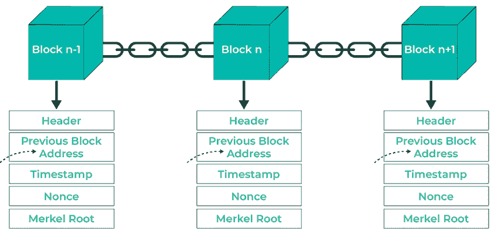

    图 4.1：区块的关键组件

    来源：[`media.geeksforgeeks.org/wp-content/uploads/20240829122823/blockchainstruct1.webp`](https://media.geeksforgeeks.org/wp-content/uploads/20240829122823/blockchainstruct1.webp)

其关键组件包括：

*   `Hash`：区块的唯一标识符，通过加密算法生成。
*   `Nonce`：矿工用于在哈希计算过程中改变哈希输出的数字。
*   `Merkle root`（梅克尔根）：指当前区块`Merkle tree`中交易的哈希。
*   `Timestamp`（时间戳）：告诉我们将区块放入区块链的时间戳。
*   `Difficulty target`（难度目标）：寻找小于或等于目标的有效哈希值的难度标准。
*   `Previous block hash`（上一个区块哈希）：包含区块链中上一个区块的哈希（唯一加密数字）。

    上述内容可以参考以下来源：

    [`www.coinbase.com/learn/crypto-basics/what-is-mining`](https://www.coinbase.com/learn/crypto-basics/what-is-mining)

    [`www.investopedia.com/tech/how-does-bitcoin-mining-work/#:~:text=a%20cryptographic%20algorithm%20(-,called%20hashing,-).%20The%20result%20of`](https://www.investopedia.com/tech/how-does-bitcoin-mining-work/#:~:text=a%20cryptographic%20algorithm%20\(-,called%20hashing,-\).%20The%20result%20of)

    [`www.investopedia.com/terms/b/block-bitcoin-block.asp#:~:text=Previous%20block%20hash%3A`](https://www.investopedia.com/terms/b/block-bitcoin-block.asp#:~:text=Previous%20block%20hash%3A)

*   现在，比特币矿工反复更改`nonce`，并使用加密哈希函数对区块头进行相应的哈希处理，在比特币中这种算法是`SHA-256`。
*   现在，矿工检查产生的哈希是否符合特定条件（如前所述，通常是产生的哈希具有特定数量的前导零）。如果结果哈希仍不满足要求的条件（即没有指定数量的前导零），矿工将调整`nonce`并重新尝试。你现在可以猜为什么工作证明是一项如此耗能的活动，尤其是当你考虑到对环境的影响时。
*   当矿工不断寻找符合特定条件的哈希值时，第一个找到能使其接近满足给定条件的哈希值的`nonce`的矿工会立即将解决方案广播到网络。现在，其他比特币矿工通过亲自应用哈希函数来测试和验证广播的解决方案。
*   一旦解决方案被认为有效，比特币区块即被采挖出来，找到并广播解决方案的矿工将获得新铸造的比特币，以及新区块中包含交易的交易费。

挖矿竞争至关重要，因为它为比特币区块链增加了巨大的价值，并强化了区块链的许多特性。让我们来了解其中一些特性：

*   `Immutable`（不可篡改性）：区块链上记录的交易无法更改或删除。这创建了一个永久的、防篡改的账本，增强了用户之间的信任和安全性。
*   `Decentralization`（去中心化）：缺乏中心权威减少了单点故障的风险，并使网络对攻击更具韧性。
*   `Security`（安全性）：区块链上的每笔交易都经过加密哈希处理并单独加密。这使得篡改原始数据几乎是不可能的，因为这将需要更改所有后续哈希。
*   `Consensus mechanism`（共识机制）：区块链网络使用复杂的算法，允许节点验证交易并确保所有更改都经过多数验证者的批准。
*   `Smart contracts`（智能合约）：它们是自动执行的合约，将协议条款直接嵌入代码中。当所有预设条件满足时它们会自动执行，并跳过中间人或第三方干预。

    来源：[`www.geeksforgeeks.org/features-of-blockchain/?ref=lbp#:~:text=Course-,Features%20of%20Blockchain,-Last%20Updated%20%3A`](https://www.geeksforgeeks.org/features-of-blockchain/?ref=lbp#:~:text=Course-,Features%20of%20Blockchain,-Last%20Updated%20%3A)

以下是比特币挖矿必要的原因：

*   比特币挖矿确保以控制的速度添加到区块链，并发行比特币。
*   挖矿防止网络垃圾信息，并要求参与者投入计算资源以获得添加新区块的机会。
*   比特币矿的数学难题可以随时间进行调整，以应对网络算力的波动。
*   `Decentralization and trustless-ness of blockchain`（区块链的去中心化和无信任性）：比特币的去中心化对公众产生了广泛影响。例如，区块链是透明的；所有交易在分布式账本上可见。这种透明度帮助用户建立信任，因为没有单一实体控制网络。

    比特币区块链还引入了某种程度的无信任性。比特币交易是点对点执行的，交易的完成不需要信任对方、中间人或中心权威。这种无信任性是区块链引入的一项革命性特性，特别是在 2008 年全球规模性金融危机剥夺了人们对中央金融机构的信任之后。

    来源：[`www.geeksforgeeks.org/features-of-blockchain/?ref=lbp#:~:text=Course-,Features%20of%20Blockchain,-Last%20Updated%20%3A`](https://www.geeksforgeeks.org/features-of-blockchain/?ref=lbp#:~:text=Course-,Features%20of%20Blockchain,-Last%20Updated%20%3A)

*   `Bitcoin blockchain’s impact on the technology today`（比特币区块链对今天技术的影响）：比特币区块链为加密货币之外更广泛的区块链奠定了基础。当然，开发者需要一些时间才能意识到区块链在金融领域之外的潜力，但一旦意识到，就无法阻挡了。
*   `Evolution of blockchain beyond Bitcoin`（比特币之外区块链的演进）：在讨论比特币之外的区块链时，总有一种苦乐交织的感觉，因为今天 Web3 开发者的主流想法都是关于比特币的缺点。在某些时刻，我们忽略了比特币区块链最初的、令人震惊的贡献。

抛开情感因素不谈，区块链确实在超越比特币的基础上进化，尽管它保持了所有核心概念和功能完好无损。如今的区块链平台采用了多种共识机制以提高可访问性和可持续性，采用了新的治理模型以提高效率和去中心化，并提供了扩展性解决方案以解决原始`PoW`在不断扩张的网络中的局限性，适应不同的应用场景。

### 比特币对现代区块链的贡献

然而，从本质上说，比特币的创造确实催生了如今的区块链。比特币彻底改变了金融，展示了区块链在为所有人简化金融事务方面的效率，并暗示了区块链在金融领域之外的潜力。

虽然比特币目前的主要应用仍然是像黄金这样的价值存储手段，以及与法币货币竞争的去中心化货币，但比特币引发的创新已使其在自诞生以来的几年中开发了各种基于区块链的解决方案。比特币引领了当今的 Web3 革命，重塑了各行业并在全球范围内创造了更广泛、更包容性的机会。

### 关于比特币的更多信息

区块链在 2023 年的成功在很大程度上归于比特币迄今为止的成功。`BTC`被称为加密货币之王，虽然目前众多的加密货币和代币在用途上各不相同，但比特币一直被认为是全球法币货币的有力竞争者。同时，零售和机构投资者将比特币视为巨大的价值来源。

当世界各国都在考虑对加密货币进行监管时，比特币已经在萨尔瓦多国成为法定货币。随着 5G 技术席卷全球，`BTC`继续为各国未获得服务和服务不足的人群带来新颖且具有包容性的金融解决方案。

### 比特币减半

比特币减半是由`Satoshi Nakamoto`构建在加密货币中的一种现象。这是一个大约每四年一次，或在比特币网络每产生`210,000`个区块后发生一次事件。在减半期间，每次成功添加新区块后，作为矿工奖励产生的新比特币数量将减半。

当比特币在 2009 年发布时，矿工每成功挖出一个区块通常可以获得 50 个比特币的奖励。2012 年，发生了第一次比特币减半，将区块奖励从 50 个比特币减少到 25 个比特币。第二次减半发生在四年后的 2016 年，将区块奖励进一步从 25 个比特币减半到 12.5 个比特币。下一次减半是在 2020 年 5 月，将区块奖励从 12.5 个比特币减少到 6.25 个比特币。在 2024 年比特币减半后，区块奖励下降至每个区块 3.125 个比特币。


在 2023 年 8 月，已有 1945 万个比特币流通，仍有 155 万个比特币尚未开采。估计，在所有 2100 万个比特币进入流通之前，将是 2140 年。

比特币减半的原因是为了控制通胀，以及实施稀缺性并增加货币的价值。

值得注意的是，`Nakamoto` 本人在 2009 年至 2010 年间挖矿了约 110 万个`BTC`，然后消失了，将`BTC` 开发的责任交给了`Gavin Andresen`（曾名`Gavin Bell`）。

比特币以其极端的波动性而闻名，这是一种价值取决于投资者情绪的货币，如下所示：

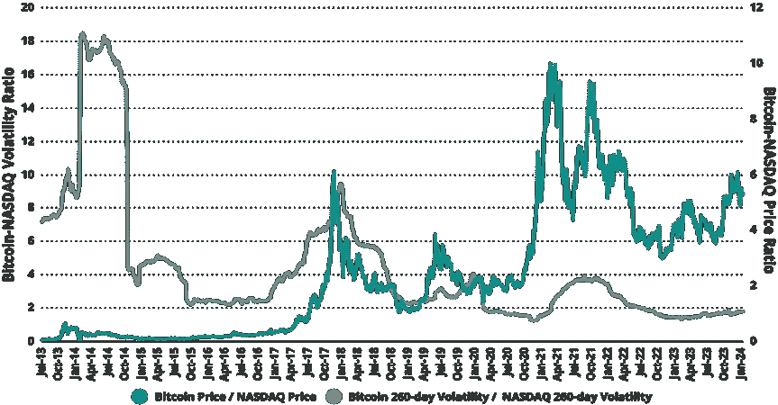

图 4.2：比特币随时间的波动性：2013 年 7 月至 2024 年 1 月

来源：[`www.vaneck.com/us/en/blogs/digital-assets/bitcoin-volatility/`](https://www.vaneck.com/us/en/blogs/digital-assets/bitcoin-volatility/)

波动性部分源于高特热力周期（Gartner Hype Cycle），这是新技术的共同生命周期——毕竟，比特币还是个青少年。该周期的五个阶段为：

*   技术触发期
*   膨胀预期峰值
*   幻灭谷底
*   启蒙斜坡
*   生产力平台期

此后，比特币多次流失阵地，但每次都会回到之前的高点，并超越它。因此，比特币并不是许多传统投资者仍可能担心的那种泡沫，很大一部分原因在于 `Satoshi Nakamoto` 对区块链的巧妙运用。

2023 年，随着人工智能的兴起，区块链将在决定 AI 驱动内容的真实性以及坚持人类优先的伦理考虑方面发挥重要作用。这将同时有利于这两种技术并确保公众的采用。随着比特币和加密货币市值的增长，区块链无疑将长期留存。

高特发布了 2024 年版的区块链和 Web3 热力周期。下图显示了该图表的细节：

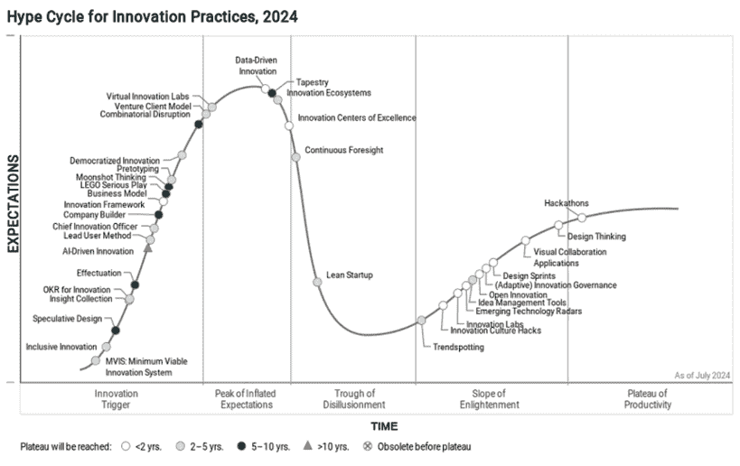

图 4.3：高特 Web3 和区块链的热力周期阶段，2024 年 7 月

来源：[`www.ledgerinsights.com/gartner-hype-cycle-stablecoins-to-go-mainstream-within-two-years/`](https://www.ledgerinsights.com/gartner-hype-cycle-stablecoins-to-go-mainstream-within-two-years/)

图 4.3 中值得注意的三个重要方面之一是，区块链钱包、智能合约、共识机制和加密货币预计将在未来两年内达到生产力平台期。还预计它们在此阶段将获得广泛的关注和采纳。

## 区块链技术

让我们回顾一下关于区块链机制和功能的认知：区块链的核心是一个遍布全球节点网络的分布式去中心化账本，用于验证交易。为了解释这项技术如何工作，让我们看看核心组件如何汇聚以确保运行：

*   **节点促进高效去中心化**：众所周知，区块链运行在去中心化的计算机网络（节点）上，而不是单一权威。节点使区块链去中心化，并确保没有实体实体控制整个网络，增强了安全性并防止单点故障。

*   **账本确保不可篡改性**：一旦新数据被添加到区块并将区块添加到区块链，区块链的去中心化账本确保所有节点都拥有其更新副本，并确保没有网络共识无法更改或删除任何数据。因此，区块链确保了数据的完整性，并通过去中心化获得了节点的信任。

*   **加密哈希函数确保安全性**：加密哈希函数是将任何输入数据（如区块链上执行的交易）转换为特定长度字符字符串的数学算法。每个哈希值对于区块链上的输入数据都是唯一的，并考虑了几个因素，即要记录的交易、时间戳、上一个区块的哈希值以及`nonce`。哈希值用于区块链上的识别和验证，并确保了安全性和透明度。

此外，哈希确保了大量数据的压缩，并为区块链上必须保留账本更新副本的全节点节省了存储空间。值得注意的是，哈希也确保了不可篡改性：坏人无法在更改区块哈希值而不引起所有节点的警觉。这是因为通过哈希引用连接的区块，加上加密哈希属性，确保了区块内容的任何修改都会导致整个区块链出现可检测的变化，因为区块的哈希值带有对上一个区块的引用。

因此，哈希有助于增强区块链的抗篡改性，并维护了区块链数据的不可变性和安全性。

*   **区块将交易分组**：区块链闻名的交易区块旨在将与单个交易相关的数据分组。区块链上的每个区块都包含交易列表、时间戳、对上一个区块哈希的引用（用于创建不可更改的区块链）以及一个 `nonce`（用于在对区块进行哈希处理时确保特定条件的数字）。区块使得在区块链上查找信息变得更容易，其内容对所有网络参与者可见，确保了透明度。

*   **共识机制确保去中心化治理**：众所周知，共识机制决定了区块链上的所有节点如何就交易的有效性添加到区块链的顺序达成一致。`PoW` 起于比特币，而较新的 `Proof of Stake (PoS)` `Ethereum 2.0` 则运行在常见的共识机制上，以确保网络决策中的节点声音都能被听到。

区块链上的交易由网络节点使用这些共识机制进行验证。在节点接受并记录到区块之前，交易必须遵守共识机制预定义的规则。

所有共识机制都有某种方式来确保节点真正致力于区块链网络的进展。例如，`PoW` 要求矿工通过竞争解决与猜测正确 `nonce` 相关的数学题来投入足够的计算努力，而 `PoS` 则要求节点在一定时间内质押最小数量的原生加密货币，以竞争并获得每个添加到链上的区块的验证者资格。

*   **智能合约带来自动化并减少人工干预**：智能合约是原始比特币区块链不具备的功能之一；它们由以太坊在 2015 年提出。众所周知，智能合约是自动执行的合同，其条款由交易双方约定并直接写入代码中。激活后，一旦双方满足预定义的条件，它们就会自动执行这些操作。这些合约在确保自动化、快速、无信任的交易方面表现出色，对于区块链的交易者和开发者来说都非常方便。

*   **点对点网络确保畅畅**：区块链上的节点以点对点的方式相互通信。这就是它们验证交易、向链中添加新区块并更新账本副本以及维护区块链整体完整性的方法。下面的图 4.4 显示了点对点网络的图形表示：

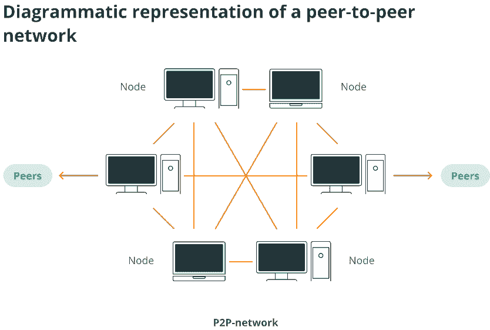

图 4.4：比特币区块链起源了现代区块链的大多数特征

来源：[`s3.cointelegraph.com/storage/uploads/view/d6015d82025b7e1151290089b0fd45e2.png`](https://s3.cointelegraph.com/storage/uploads/view/d6015d82025b7e1151290089b0fd45e2.png)

*   **公私钥确保网络参与者的安全性**：区块链利用非对称加密。因此，链上的每个用户都获得了一对与其虚拟钱包关联的密钥，其中一个是可以共享以接收交易的公钥（类似于 UPI ID），另一个是你可以用于签署发起的交易并证明对账户中加密货币所有权的私钥（类似于你的 UPI PIN）。这种机制确保了区块链网络上所有节点的安全性，使得没有中心化监管者的去中心化系统变得安全。

*   **区块链分叉解决了与不可变性相关的挑战**：虽然这些不能说是区块链的核心组成部分，但它们仍然是该技术的重要部分。当节点对任何治理决策（涉及区块链功能、用例以及交易有效性的决策）产生意见时，就会发生区块链分叉。由于区块链是不可变的，分叉是为了启动任何更改或升级。

区块链分叉主要有两种类型：软分叉和硬分叉。这些分叉的产生基于如添加新功能、增强安全性或解决其他问题。

### 区块链中的软分叉

软分叉是对区块链协议的向后兼容升级。通过软分叉，开发者可能希望引入比区块链现有规则更具限制性的新规则。

在软分叉中，区块链的原始参与者可以在不离开基础平台的情况下仍然参与新网络。通过软分叉实施的新规则与区块链基础的旧规则兼容，这确保了旧节点可以验证新节点创建的交易和区块。

以下是软分叉的简要特征：

*   新规则在某些方面比现有规则更具限制性。
*   旧区块链节点在软分叉后仍可以验证新区块，即使它们不理解或支持新规则。
*   超过 50% 的区块链矿工需要同意新规则，软分叉才能成功。然而，即使并非所有节点都同意，只要有大多数的支持就可以继续进行。
*   不要求所有节点在区块链软分叉后立即升级。

### 硬分叉

与软分叉相比，区块链硬分叉是对区块链协议的更具实质性且潜在具有破坏性的升级。硬分叉引入了与区块链现有规则不向后兼容的全新规则。

这意味着未升级到新协议的区块链节点将不再能够验证由新节点创建的交易和区块。

以下是硬分叉的简要特征：

*   硬分叉引入的新规则与现有规则不兼容，导致区块链平台的分歧。
*   仍遵循旧规则的旧节点无法验证由新协议节点添加的交易和区块。
*   所有节点必须升级到新协议以避免中断并参与新平台。
*   如果分叉导致了共识机制等重大重大的变化，硬分叉还可能为新平台需要新的加密货币。

# 比特币分叉 (Bitcoin Fork)

- **日期**: 2017 年 8 月 1 日
- **分叉原因**: 比特币网络在区块大小扩展上存在哲学和技术上的分歧。想要改变的一方倾向于更大的区块大小以快速处理更多交易，而另一派则希望像往常一样使用较小的区块，并将交易发送到比特币闪电网络（Lightning Network）等链下解决方案以增加扩展性。双方未能达成共识，因此那些想要更大区块的人创建了硬分叉。
- **结果**: 比特币现金（Bitcoin Cash）作为一个独立的区块链被创建，具有更大的区块大小（初始为 8MB，随后增加）。比特币现金旨在与原始比特币网络相比，提供更快速、更廉价的交易。比特币现金的新生代币被称为 `BCH`。

# 比特币上的隔离见 (SegWit) 激活

- **类型**: 软分叉
- **日期**: 2017 年 8 月 24 日
- **原因**: 在比特币和比特币现金分歧后仅几天便启动，这项名为 `SegWit` 的软分叉旨在通过将交易数据与对手签名数据分开存储，为比特币的扩展性问题提供解决方案，从而在区块中为交易留出空间。这一发展的想法最初是在 2015 年提出的。比特币现金的分叉是为了避免隔离见所带来的协议更新。
- **结果**: 作为软分叉激活后，`SegWit` 为后续发展铺平了道路，例如集成比特币闪电网络，其旨在实现更快、更廉价的链下交易。

# 经典以太坊 (Ethereum Classic ETC) 分叉

- **类型**: 硬分叉
- **日期**: 2016 年 7 月 20 日
- **原因**: 为了应对臭名昭著的 DAO 攻击（约有 600 万美元的 `ETH` 被盗），以太坊社区必须执行硬分叉以控制损害。
- **结果**: 当地大多数以太坊社区支持分叉并迁移到了新链（即我们现在所知的以太坊）。然而，少数社区成员仍持反对并继续留在原始链上，该链被称为经典以太坊。该区块链的原生代币被称为 `ETC`。

# 以太坊的君士堡 (Byzantium) 升级

- **类型**: 软分叉
- **日期**: 2017 年 10 月 16 日
- **原因**: 君士堡升级是以太坊上更广泛的大都会（Metropolis）升级的一部分而进行的，目标是提高网络的扩展性、隐私性和安全性。
- **结果**: 此次由于是软分叉，不需要创建一个独立的平台。君士堡升级启动了多项改进，包括以太坊 Gas 价格的变化、区块奖励的减少以及增强的安全措施，正如其目标的那样。

# 罗门 (Monero) 硬分叉

- **类型**: 硬分叉
- **日期**: 多次
- **原因**: 罗门社区至今已进行了多次硬分叉，以实施协议升级并改进许多隐私相关的属性。
- **结果**: 这些分叉引入了诸如变化，如通过环形机交易 (`Ring CT`) 等功能增强隐私、减小交易大小以及改进安全措施。

# 以太坊 2.0 和上海-卡佩拉 (Shanghai-Capella) 升级

- **类型**: 硬分叉
- **日期**: 2023 年 4 月 12 日
- **原因**: 现在，我们所有人肯定都听过这个，即使我们不知道全部细节。合并发生在 2022 年，最终将以太坊区块链的共识机制从 `PoW` 转换为 `PoS`。虽然这让网络节省了超过 99%的能量，但作为一个 `PoW` 区块链，以太坊上海卡佩拉主网发布在改进以太坊的所有方面又进了一步。上海-卡佩拉升级或 Shapella 硬分叉主要关注从质押合约提取质押的 `ETH`。
- **结果**: 随着 Shapella 升级，若干以太坊改进提案 (`EIP`) 现在生效。`EIP-4895` 现在允许提取质押资金，`EIP-3855` 正在降低 Gas 费用，`EIP-3860` 旨在在某些情况下限制开发者 Gas 费用。

所有这些区块链分叉示例展示了导致区块链社区发起软硬硬分叉的多样原因。从对协议机制的严重分歧到最小化安全漏洞，再到解决扩展性问题，区块链分叉是许多原因的解决方案。虽然并不是所有的都像节点希望的那样成功，但它们无疑是应对区块链不可篡改性导致限制的极佳对策！

既然我们知道了哪些组件组合成了区块链技术的特性，现在是时候看看加密之外的区块链了。

## 区块链的非加密用例

区块链在 2023 年已经远远超越了比特币和加密货币，现在在各个行业中都有许多非加密货币的用例。大多数用例的卓越性可以归于区块链的透明性、安全性和去中心化。

废话不多说，让我们来看一些例子。

## 使用区块链的非加密行业

首先，快速看看区块链已经在范围内传播的许多领域，其中一些我们已经在第一章讨论过。即使不是所有的用例都实现，但开发者已经将它们可视化，并且它们正处于测试阶段。

以下是区块链的非加密用例：

- **供应链管理**: 区块链可以为供应链带来端到端的可见性和可追溯性。区块链机制使能够对产品的来源、加工和分配进行精确追踪，提高透明度并减少农业、医药以及其他商品和服务行业的欺诈。

- **农业与食品安全**: 区块链技术通过跟踪所有农产品从农场到餐桌的历程来确保食品安全，帮助识别并随后管理污染或其他问题。

- **医疗数据共享**: 区块链可以安全地存储和共享患者的医疗记录，确保数据完整性和隐私性以及可访问性。患者、医生、医疗提供者甚至研究人员可以访问并共享与患者相关的信息，同时对数据访问拥有平等控制权。

- **房地产记录与交易**: 区块链可以通过安全记录房地产产权、所有权历史和法律文件并将其放到网上供所有利益相关者查看，从而简化房地产交易。这减少了纸质工作，提高了效率并防止了欺诈。

- **身份验证**: 区块链技术可以为用户创建主权数字身份，允许人们控制自己的个人数据，并并在他们需要时与授权方（如金融机构或政府机构）安全共享。

- **物流管理**: 区块链可以通过对货物进行实时追踪、减少延迟以及利用去中心化、点点通信和透明度来优化运输和物流行业的整体效率。

- **投票系统**: 区块链可以促进透明且不可篡改的数字选举，消除世界范围内存在的选举欺诈，增强选民的信心和安全。通过区块链的每张票都可以安全记录，确保选举结果的完整性并使其不可篡改。

- **知识产权保护**: 区块链的去中心化账本可用于任何知识产权（如专利、版权和商标）的时间时间戳并验证其所有权和创建日期。

*   **数字内容与版权问题**：通过区块链，艺术家和内容创作者有了一种新方法来证明所有权并追踪他们发布的数字内容的使用和分情况，确保他们获得公平的回报和版权执法。

*   **能源交易与管理**：区块链可以实现点对点的能源交易，允许个人和企业直接买卖多余能量，并更高效地管理能源消耗。

*   **捐赠**：近年来，我们听过许多欺骗案例，骗子以慈善捐赠的名义筹集大量资金并卷走了积累的资金。区块链可以增强这些慈善机构的透明度，并提供捐赠及其分配的不可篡改记录，让捐赠者能够检查并验证该项目的合法性。

*   **保险理赔**：在金融领域，区块链可以通过允许保险公司、保单持人和服务提供商之间安全共享数据，来自动化并加速保险理赔的处理。

*   **法律合同**：通过智能合约，法律合同可以更好地确保完整性和条件的满足。此外，区块链通过提供不可篡改的协议记录，简化了法律合同的创建、执行和执行，减少了争议并降低对人工中介的需求。

所有这些用例都突出了区块链的去中心化和安全特性如何彻底改变各行业。因此，你可能还能脑出关于区块链如何应用于我们可能遗漏的其他行业的想法。

截至 2024 年，区块链已有若干明显的非加密应用。

## 区块链非加密应用

让我们从食品安全中的区块链开始。

### 食品安全中的区块链

*   **食品安全中的区块链**：全球许多巨头品牌使用区块链来确保提供给客户的食品是安全的，其中包括：

    *   **沃尔玛 (Walmart)**：沃尔玛在食品链中使用区块链追踪切片芒果的包装。以前他们需要六天时间来手动追踪这些芒果的整个行程，而有了区块链，他们将这一时间缩短到了几秒钟。

    *   **雀巢 (Nestlé)**：雀巢使用区块链追踪从农场到生产地再到工厂的牛奶。这帮助他们确保了产品的透明度和完整性，并因诚实的经营实践赢得赞誉。

    *   **JBS**：JBS 在食品领域利用区块链对供应商的牲畜运输信息进行高效交叉检查，增强了安全性、透明度和可追溯性。

    *   **凯森食品 (Tyson Foods)**：凯森食品尝试使用区块链追踪从农场、生产地到工厂的供应链。同样，这确保了更高且简便的可追溯性。

### 政府倡议中的区块链

*   **政府倡议中的区块链**：到为止，相当多的政府实体已使用了区块链，以下是一些正在使用的解决方案：

    *   **Kaleido**：Kaleido 是一个提供区块链解决方案的品牌，用于跨行业分布式账本的集成。Kaleido 为联合国、疾病控制与预防中心（CDC）以及世界自然基金会（WWF）提供过服务。


## 区块链在加密领域之外的应用

### 投票与选举

* **Follow My Vote**：该平台通过构建在区块链上的开源票箱实现安全的在线投票。Follow My Vote 确保了选民的易访问性，以及选民的安全和对选举过程的信任。
* **Voatz**：Voatz 是另一个基于区块链的移动投票平台。他们引入了加密生物识别安全系统，允许选民在世界任何网络连接尚可的地方使用手机进行投票。

### 非加密应用中的区块链

* **非加密应用中的区块链**：是的，智能合约在加密领域之外具有巨大的潜力。以下是真实世界的示例：
  * **谷歌 (Google)**：谷歌有一个基于区块链的用于供应链管理的智能追踪追踪应用（Intelligent Track and Trace）。该软件允许去中心化应用。
  * **DFINITY**：DFINITY 的 Internet Computer 是一个开源项目，允许开发者在智能合约的帮助下构建链上去中心化应用。

* **医疗保健中的区块链**：区块链技术有各种现实应用。让我们来看看：
  * **BurstIQ**：该平台帮助医生管理并收集与敏感健康信息相关的见解。
  * **Medicalchain**：Medicalchain 允许数据更轻松、更安全的流动。通过它，医生无需等待手动获取保险信息。
  * **Patientory**：这是一个针对患者和医生的综合医疗记录系统，允许医疗提供者即时访问病史。
  * **WholeCare**：WholeCare 是另一个基于区块链的功能，带来了定制化的护理方案、药物方案、简便的预约方式和其他资源。

### 房地产管理中的区块链

* **房地产管理中的区块链**：区块链在现实世界中也被用于房地产管理，方法如下：
  * **Propy INC**：Propy 是一个遍布全球的房地产市场，允许你买卖房产。智能合约用于确保这些交易的不可篡改和安全，Propy 甚至允许房地产转化为非同质化代币（NFT）。

### 物流中的区块链

* **物流中的区块链**：让我们讨论一下现实应用：
  * **甲骨文 (Oracle)**：甲骨文有一个供应链管理应用程序，允许供应链的多级透明化，因此用户可以轻松追踪食品的质量和运输状态。
  * **敦克斯 (DHL)**：在美国拥有巨大影响力的知名物流公司敦克斯已经采用区块链物流一段时间了。该公司使用区块链维护其货运的数字账本，并确保所执行交易的完整性。

## 区块链开发

如果不告诉你如何进行区块链开发，那么关于区块链的讨论就是不完整的，特别是对于那些考虑从事 web3 相关技术开发的学习者来说。这就是为什么本章的最后一部分将致力于开发区块链的基础知识。

## 区块链开发的关键阶段

开发区块链应用包含许多技术和概念性步骤。以下是你必须考虑的重大步骤（当然，这是一个简化版本）：

1. **定义用例和需求**：开发区块链应用的第一步是确定你想要通过它解决的问题，当然还有它将所属的领域或行业。请记住记录你的区块链为了解决该用例所需的特定需求和功能。

2. **选择区块链类型**：如果你还记得，在第一章中，我们讨论了三种主要的区块链：公有链、私有链以及联盟链或联邦链。根据你具体的用例，你需要选择你的区块链平台是对向公众开放，还是限制特定的参与者。

3. **选择共识机制**：接下来，你需要选择一个与你的用例完美契合的共识机制。

   > 提示：在 2024 年及以后，选择一个像权益证明（proof of stake）这样可持续的共识协议将让你受益匪浅，而且它对大多数用例都很方便。

4. **可视化区块链架构**：现在你需要构思并定义你区块链的各种组件，即节点和原生加密货币，并确定将执行交易以及为节点分配哪些角色。

5. **选择开发平台**：现在你需要根据你选择的区块链类型选择合适的区块链平台或框架。例如，如果你选择公有链，`Ethereum` 和 `Binance Smart Chain` 是常见的选择。然而，对于私有链，你可以查看像 `Hyperledger Fabric` 或 `Corda` 等平台。

6. **决定是否需要智能合约**：首先，你需要确定你的用例是否需要智能合约来实现自动化。如果是，你可以使用与你选择的区块链开发平台兼容的编程语言来开发它们，例如，你可以使用 `Solidity` 来开发基于 `Ethereum` 的公有链协议。

7. **构建基础网络基础设施**：你需要通过部署参与你所选共识机制的节点来建立区块链网络。你还需要为节点配置所需的软件和适当的安全措施。

8. **区块链的编码与开发**：下一步是实现你区块链的核心组件，包括共识机制、数据结构、交易验证程序以及任何网络协议。

9. **各方面的测试与质量保证**：现在是测试你目前为止组装的区块链应用了：现在你在测试环境中运行它，以识别并修复漏洞、缺陷和任何性能问题。为了这一点，你需要进行单元测试、集成测试和端到端测试，以确保你的区块链应用运行符合预期。

10. **区块链的部署与发布**：所有测试已完成，你的区块链出色地通过了。或者可能它最初没有如预期运行，但随后你改进了缺点，现在它比任何时候都好。现在你将你的区块链网络部署在你选择的环境中，无论是 `testnet` 还是 `mainnet`。
    * `testnet`：为测试设计的沙箱环境。
    * `mainnet`：进行真实交易的上线运行网络。

11. **区块链的监控与维护**：记住定期监控区块链的健康和性能。及时处理出现的问题并根据需要应用更新。

12. **社区和生态系统的构建**：如果你的区块链是公有链，围绕它培养一个社区非常重要。在社交媒体上与爱好者互动，并鼓励开发者在你的平台上构建 `dApps`。

13. **为区块链提供文档与支持**：记住为潜在用户和开发者在网上发布精良、全面的文档。为任何查询提供支持渠道。

这就是对开发区块链所涉及的长期且复杂过程的简化说明。当然，开发区块链需要对技术的深厚理解，以及扎实的编程技能。

## 成为区块链开发者

成为区块链开发者需要结合相关的教育、技术技能、实战经验以及对区块链技术的深刻理解。以下是一份你可以遵循的逐步指南：

* **学习区块链技术基础**：从坚实理解区块链技术的工作原理开始这段旅，包括去中心化、共识机制、密码学、哈希（hashing）、智能合约等内在概念。你可以通过参加在线课程和教程来实现。

* **熟悉加密货币**：对区块链的理解与加密货币是密相连的，所以记住彻底学习不同的加密货币，特别是像 `Bitcoin` 和 `Ethereum` 这样流行的货币机制。

* **学习相关的编程语言**：你还需要掌握区块链开发中常用的某些编程语言，例如用于 `Ethereum` 智能合约的 `Solidity`、`JavaScript`、`Python`、`Rust` 等。

* **理解数据结构和算法**：现在你需要对与区块链相关的数据结构和算法建立深刻的理解，因为它们对于高效开发区块链至关重要。

* **探索不同的区块链平台和框架**：尝试在欢迎开发者的流行平台（如 `Ethereum`、`Binance Smart Chain` 等）上获得区块链开发的实战经验。

# 区块链开发指南

* **理解区块链智能合约**：如果你想在今天开发基于区块链的应用，学习智能合约是非常重要的，因此请阅读智能合约的概念并内化其工作原理。你应该学习如何在各种区块链平台上编写、部署和与智能合约进行交互。

* **学习开发去中心化应用**：在学习智能合约之后，你可以探索去中心化应用或 `dApp` 开发，以便在区块链网络上构建交互式平台。学习 `dApp` 开发将教你创建用户界面、部署智能合约以及实现交易处理机制的细节。

* **开始构建自己的项目**：开始构建你自己的区块链项目以应用你目前所学的知识。实战经验将帮助你磨练实用的区块链技能，同时向任何潜在的雇主展示你的作品。

* **开始尝试测试网**：现在，你可以利用各种区块链平台提供的测试网络来练习开发，而没有任何实际利益风险。这样你就可以在一个安全环境中测试你的应用程序。

* **贡献开源项目**：在测试你作为区块链开发者技能的同时，你也可以参与开源区块链项目，与其他开发者协作并向他们学习。

* **人脉拓展与协作**：在学习方面，通过社交媒体关注当地的区块链发展，并参加区块链聚会、会议和论坛，与该领域的专业人士建立人脉。这种协作和知识共享无疑将增强你作为区块链开发者的成长。

* **跟上区块链世界的动态**：区块链技术正在快速演进，因此请关注区块链、加密货币以及整个 `web3` 领域的最新趋势、发展和进展。

现在，虽然这些步骤读起来很简单，但重要的是记住，成为一名精通的区块链开发者需要相当的时间和投入。因此，当你从基础教育开始时，要引导自己坚持下去，直到你具备了成为一名真正的、专业的区块链开发者所需的技能水平。

区块链是一项具有巨大潜力的新兴技术，尽管它从根本上源于加密领域。当加密货币在探索金融领域数字交易的新前沿时，区块链将领先并与其他技术协作，共同塑造我们的未来。

在当下，成为区块链专业人士将使你成为即将到来的技术革命的核心部分，更不用说你在这一过程中获得的丰厚财务报酬。

## 结论

区块链为加密货币创造了奇迹，它也渗透到了我们的日常行业中，带来了更高的透明度和更好的用户控制等优势。我们希望这一章对帮助你更好地理解区块链及其影响具有工具性作用，你将更容易掌握本书中讨论的 `AI`、区块链、机器人技术以及其他新兴技术相结合所产生的巨大潜力。

在本章中，我们学习了区块链的所有基础知识——从其底层的加密货币 `Bitcoin` 到区块链的核心组件，以及区块链在加密之外的一些真实世界案例。此外，我们还学习了区块链是如何开发的。

既然我们已经探索了 `AI` 和区块链，在下一章中，我们将对机器人进行同样的研究。让我们来看看机器人技术的历史、未来和当前应用。

## 问题

1. **`Bitcoin` 与区块链的起源有什么关系？**
   **答案**：`Bitcoin` 是我们今天所区块链的首次实现。

2. **区块链的核心特征有哪些？**
   **答案**：区块链的核心特征包括：
   * 去中心化
   * `proof of work`（工作量证明）
   * 加密安全
   * 不可篡改
   * 透明性
   * 群组聚集

3. **什么是共识机制？为什么区块链需要共识机制？**
   **答案**：共识机制用于区块链以确保大多数节点达成共识。如果没有像 `proof of work` 这样的共识机制，区块链将无法去中心化。

4. **区块链的核心组件有哪些？**
   **答案**：区块链的核心组件是：
   * 区块
   * 节点
   * 加密哈希值
   * 加密钱包以及私钥和公钥
   * 共识机制
   * 智能合约
   * 点对点网络
   * 去中心化账本

5. **什么是区块链分叉？**
   **答案**：区块链分叉是在大多数节点对网络决策无法一致时发生的升级。这些分叉可以是 `soft fork`（软分叉，对原始区块链的升级）或 `hard fork`（硬分叉，创建一个新的区块链）。

6. **区块链硬分叉和软分叉的主要区别是什么？**
   **答案**：虽然区块链 `soft fork` 不需要节点加入新的区块链，但 `hard fork` 需要节点根据他们是反对还是支持新决定，移动到新的区块链。

7. **区块链有哪些非加密的用案例？**
   **答案**：区块链可以应用于多种行业，即：
   * 供应链管理中更高的透明度。
   * 医疗保健领域的记录和管理，使患者可以随时访问个人记录，医疗机构也可以在患者危急时无需向患者索取就尽早访问记录。

8. **举几个区块链非加密真实世界应用的示例。**
   **答案**：以下是目前现实世界中区块链的几个非加密用途：
   * 沃尔玛已在食品链中使用区块链跟踪切片芒果的包装。
   * 谷歌的 `Blockchain Node Engine` 提供与智能合约相关的服务。
   * `BurstIQ` 帮助医生通过区块链管理并获取有关患者问题的信息。

9. **区块链开发的关键阶段有哪些？**
   **答案**：区块链开发的关键阶段包括：
   * 选择用例
   * 选择选择的区块链类型
   * 选择共识机制
   * 创建区块链架构
   * 选择现有的区块链平台/基础设施来实现你的用例
   * 如需要实现智能合约
   * 配置节点
   * 设置共识机制、数据结构、交易验证程序和网络协议
   * 对功能进行测试
   * 发布你的区块链
   * 持续监控项目
   * 构建社区
   * 为你的区块链创建文档
   * 保持用户输入开放

加入我们的书籍 Discord 空间

加入书籍 Discord 工作区，获取最新动态、优惠、全球科技新闻、新发布以及与作者的互动：

`https://discord.bpbonline.com`


# 第 5 章 机器人学详解

## 引言

既然我们已经探索了区块链和人工智能，现在让我们了解机器人学。

在本章中，我们将探索机械工程、电子工程和计算机科学的汇聚点，它们以我们往往意识到的更多方式改变着我们的生活——机器人学。机器人不再仅仅是科幻小说中的东西。它们已经出现，并且日益成为我们生活中不可或缺的一部分。从制造产品、照顾我们的健康，到帮助我们做家务，甚至探索太空的最远处，机器人正在承担那些危险、枯燥或仅仅超出人类能力的任务。它们正在提高各个领域的工作效率、精度和安全性，让我们的生活变得更轻松、更安全。

从最初对自动化机器的设想到我们今天看到的复杂机器人，这种演变是由技术、工程和计算机科学的不断进步推动的。这是一个迷人的旅程，标志着惊人的创新、雄心勃勃的梦想以及全球科学家和工程师的不懈努力。本章将详细探讨机器人学的历史、重要意义、设计和功能。我们还将理解各种用例，并看看全球范围内一些流行的机器人。最后，我们还将为那些想要进入这一变革领域的人讨论一些潜在的职业机会。

## 结构

在本章中，我们将涵盖以下主题：

* 机器人学简介
* 探索机器人学的意义
* 机器人学及其历史
* 机器人设计与功能的迭代
* 机器人的工业用例
* 机器人的家用用例
* 世界著名的机器人
* 机器人领域的职业

## 目标

在本章中，我们将探索机器人学迷人的演变，从其最早的起源到我们今天看到的先进学习型机器。我们还将理解为什么我们需要机器人，它们是如何从简单的自动化机器转变为复杂的实体，以及塑造这一领域的关键里程碑。

然而，我们的旅程并不止于历史。我们还将探索机器人技术如何彻底改变各个行业和我们的日常生活。从制造和物流到医疗保健和农业，机器人正在产生巨大的影响。它们并不仅局限于工厂和农田——它们还在我们家里帮助我们，协助完成任务，甚至以机器人玩具的形式提供娱乐。

在本章结束时，我们希望你将对机器人学领域有一个全面的理解，并能欣赏机器人技术的潜力及其对各个行业和日常生活的影响。

## 机器人简介

今天，机器人学是技术领域最引人注目且发展最快的领域之一。它汇聚了计算机工程、人工智能和自动化等技术，创造出高度先进的自动化机器，能够以受控的方式执行复杂的任务。机器人已经渗透到我们生活的许多领域，无论我们是否意识到，它们都在这里演化。

一个机器人通常由几个关键组件组成，使其能够与环境交互并做出响应：

* **传感器**：机器人使用先进传感器，如摄像头、`Light Detection and Ranging (LiDAR)`、红外传感器和超声波传感器、压力检测器等，来感知并与周围环境交互。

* **执行器**：它们的功能相当于机器人的肌肉，将电输入转换为实际运动。如`motors`、伺服电机和气动执行器等机械部件部分有助于机器人手臂的运动。

* **控制系统**：它们是机器人的大脑，处理数据并提供相关的输出。软件实现了实时决策，允许机器人适应环境并精确地执行任务。

* **电源**：机器人移动和自主运行需要大量的能量。`Fuel cells`通常提供更持久的能量。虽然电源线提供了可靠的电力，但它们限制了移动。

* **通信系统**：这些系统允许机器人通过`Wi-Fi`、蓝牙或自定义协议等无线技术与人类或其他机器人有效交互。此类系统允许在复杂任务期间进行实时决策和协调。

* **安全机制**：机器人学这样先进的自动化技术通常伴随着巨大的安全关注。紧急停止按钮、安全屏障至关重要。

来源：[`www.linkedin.com/pulse/robotics-robotics-components/`](https://www.linkedin.com/pulse/robotics-robotics-components/)

所有组件共同工作，创建出能够处理信息、思考并做出响应的高感知机器人。让我们进一步探讨。

## 探索机器人学的意义

机器人学在当今世界非常重要，因为通过区块链和人工智能等技术的推动，一旦我们充分探索了机器人学的演变，从简单的机器到复杂的实体，我们将看到机器人如何变得更加高效、多功能和智能。机器人不仅在技术层面很重要，它们在制造、物流、医疗保健和农业等大型行业中产生了真实影响，同时也进入了我们的家庭，帮助我们处理家务，甚至陪伴我们。

## 机器人学的重要性

让我们谈谈惊人的机器人世界以及它为什么在许多领域变得如此重要。

机器人不仅仅是电影中看到的酷科幻角色。它们可以不疲倦地工作，处理对我们来说危险的任务，而且非常精确。以下是它们重要的原因：

* 以制造业为例。过去，人类完成一切，但现在机器人是主角。它们负责组装、喷漆、焊接甚至包装。最好的部分是它们速度快、出错少，而且不会请假。此外，还有一种被称为`cobots`的新型机器人——它们就像机器人世界的友好邻居。它们与我们一起工作，在需要时提供帮助（或机械臂）。

* 现在，让我们谈谈医疗保健。机器人在这里也引起了波澜。图 5.1 所示的达芬奇手术系统是非常先进的机器人，协助外科医生执行复杂的手术。它非常精确，患者通常恢复得更快，并发症更少。机器人还在帮助事故或疾病后的患者康复。它们就像高科技物理治疗师。

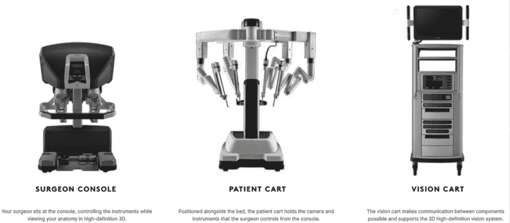

图 5.1：达芬奇系统的三个组件


来源：[`www.intuitive.com/en-us/patients/da-vinci-robotic-surgery/about-the-systems`](https://www.intuitive.com/en-us/patients/da-vinci-robotic-surgery/about-the-systems)

农业也经历了技术改造。机器人在田间种植、收割，甚至监控作物。它们就像现代版的稻草人，但要聪明得多。凭借它们所有的传感器和`AI`，它们为农民提供实时更新，帮助他们对作物做出最佳决策。这完全关乎在照顾地球的同时获得更多产量。

让我们来聊聊物流。机器人在仓库中进行拣选、包装和分拣。无论昼夜，它们都确保我们的包裹已准备就绪。随着无人机和自主递送机器人的出现，我们的包裹可能会更快地送达家门口。

机器人在建筑、采矿、国防甚至太空探索领域也留下了自己的足迹。无论是铺砖、探索火星还是拆除炸弹，机器人都在那里为我们所有人让工作变得更安全、更高效。

简而言之，机器人不仅仅是机器；它们是我们进步道路上的伙伴。它们帮助我们做得更多、走得更远、梦想更大的梦想。

## 机器人技术及其历史

让我们探索一下机器人技术的历史，看看我们第一次看到与今天机器人相似的东西是什么，以及机器人技术多年来是如何演变的。

## 机器人技术的早期起源

创造能够自主执行任务的机器数百年来一直是人类痴迷的源泉。这种痴迷根植于古代，当时的发明家和工程师制造了自动机器（automata）——即可以执行简单任务或模仿人类动作的机械设备。这些早期机器是我们今天熟悉的机器人的先驱，它们的创造标志着人类向现代机器人技术发展之旅的开始。现在让我们来聊可以执行各种任务的早期机器：

- 在古希腊，工程师亚历山大的海伦（`Heron of Alexandria`）开创了自动机器的创造，如图 5.2

图 5.2：亚历山大的海伦设计的寺庙分配葡萄酒和牛奶的自动机器示意图

来源：[`www.historyofinformation.com/image.php?id=3851`](https://www.historyofinformation.com/image.php?id=3851)

- 同样，在古代中国，发明家制作了可以上茶或演奏音乐的机械人形。像`亚历山大的海伦`的装置一样，这些自动机器是由重物、弹簧和水等简单机制驱动的。它们只能执行预设的任务，而能够像人类一样思考和学习的机器概念仍然是一个遥远的梦想。然而，这些早期自动机器代表了机器人技术演进中的关键一步，展示了机器模仿人类动作和自主执行任务的潜力。

- 通往现代机器人技术的道路在 18 世纪和 19 世纪发生了巨大的飞跃，随着可编程机器的发展，如`雅卡尔织机`和`分析引擎`（analytical engine）。这些机器使用打孔来控制其操作，这一概念后来成为开发第一代计算机不可或缺的一部分。

例如，`雅卡尔织机`可以根据打孔卡编码的指令织出复杂的图案，展示了机器以精度和一致性执行复杂任务的潜力。你可以在图 5.3 中看到它：

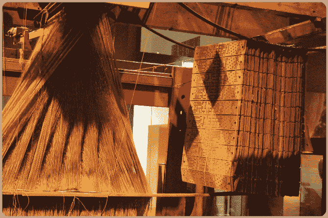

图 5.3：苏格兰国家博物馆的雅卡尔织机

来源：[`en.wikipedia.org/wiki/Jacquard_machine#/media/File:A_Jacquard_loom_showing_information_punchcards,_National_Museum_of_Scotland.jpg`](https://en.wikipedia.org/wiki/Jacquard_machine#/media/File:A_Jacquard_loom_showing_information_punchcards,_National_Museum_of_Scotland.jpg)

- 正如在第 3 章《AI 详解》中所提到的，在卡雷尔·恰佩克（`Karel Čapek`）1920 年的戏剧《罗姆通用机器人》（R.U.R.）中引入了`robot`（机器人）一词。剧情描绘了一个未来，人工人类（称为机器人）被用作低成本动力。这种由机器人统治的世界的反乌托邦愿景引发了反抗，导致了人类的灭绝，凸显了不受控制的技术进步的潜在危险。

- 第一台真正的工业机器人`Unimate`于 1961 年安装在通用汽车（`General Motors`）的装配线上。`Unimate`是一种可编程机器，可以执行焊接和移动零件等重复性任务。它的成功标志着机器人技术历史上的转折点。机器人第一次被用于真实的工业环境，执行以前由人类完成的任务。这标志着现代机器人时代的开始，为机器人在制造业和其他行业的广泛应用铺平了道路。

你可以在下面的图 5.4 中找到`Unimate`的图片：

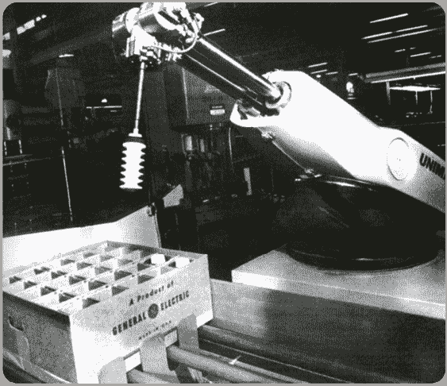

图 5.4：Unimate

来源：[`artsandculture.google.com/asset/the-unimate-robot/6QHAyki7K0pjZA`](https://artsandculture.google.com/asset/the-unimate-robot/6QHAyki7K0pjZA)

机器人技术的早期起源，从古代自动机器到第一代工业机器人，代表了人类智慧和创新的历程。它们反映了我们对创造能够自主执行任务的机器的持久痴迷，这种痴迷驱动了机器人技术从简单的机械设备到今天复杂的、智能机器人的演变。

当我们继续探索机器人技术的潜力时，这些早期起源提醒着我们已经走了多远，并预示了未来令人兴奋的可能！

## 多年机器人技术

自古代自动机器以来，多年机器人技术的变化证明了人类创新和对技术进步的不懈追求。从世界上第一台工业机器人`Unimate`的引入到今天复杂的智能机器人，机器人技术的发展历程标志着重要的里程碑和变革性的突破。

以下是多年机器人技术的回顾：

- 20 世纪 70 年代和 80 年代是机器人技术演变的关键时期。期间，机器人从僵硬、不灵活的机器转变为更通用、更智能的设备。`斯坦福手臂`（Stanford Arm）和`可编程通用装配机`（PUMA，即 PUMA 机器人）是这一转变的典型例子。这些机器人能够执行精确、复杂的任务，展示了机器人技术在各种应用中的潜力。

下面的图 5.5 显示了`PUMA`：

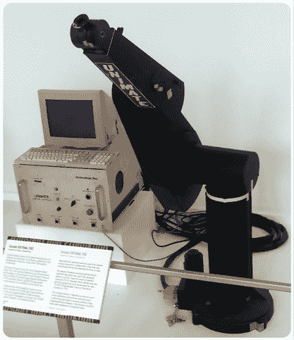

图 5.5：PUMA

来源：[`en.wikipedia.org/wiki/Programmable_Universal_Machine_for_Assembly#/media/File:Unimate_500_PUMA_Deutsches_Museum.jpg`](https://en.wikipedia.org/wiki/Programmable_Universal_Machine_for_Assembly#/media/File:Unimate_500_PUMA_Deutsches_Museum.jpg)

与此同时，微处理器和软件的发展彻底改变了机器人的控制机制，使其操作更加灵活智能。

- 随着我们进入 20 世纪 90 年代和 21 世纪，机器人开始离开工厂进入更广泛的世界。这一时期机器人出现在日常生活和敏感领域。例如，`Roomba`吸尘器改变了家居清洁。同时，`达芬奇手术系统`为手术程序带来了前所未有的精确性和控制。与此同时，火星探测器`精神号`和`机会号`展示了机器人在探索和科学研究中的潜力，开启了太空探索的新领域。这些双胞火星探测器可以在下面的图 5.6 中看到：

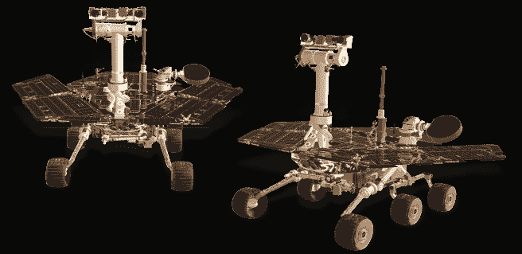

图 5.6：火星探测器双胞胎：精神号和机会号

来源：[`science.nasa.gov/mission/mars-exploration-rovers-spirit-and-opportunity/`](https://science.nasa.gov/mission/mars-exploration-rovers-spirit-and-opportunity/)

近年来，在人工智能进步的推动下，机器人领域见证另一场革命。今天的机器人可以从经验中学习，适应新环境，甚至能够理解自然语言。人工智能为机器人开启了新的可能性，从自动驾驶汽车、配送无人机到个人助理机器人和机器人伙伴应有尽有。这些进步正在改变各个行业，并重新定义机器人的功能。

尽管取得了这些显著进展，机器人领域仍处于早期阶段。仍有许多挑战需要克服，包括技术和社会两个方面。提高机器人的灵活性和自主性在技术层面仍然是一个重大挑战。机器人必须能够在复杂、不可预测的环境中导航，并执行需要高精度和控制的精细任务。

在社会方面，确保机器人安全且符合伦理的使用是一个紧迫的问题。随着机器人越来越融入我们的生活，我们必须考虑其伦理影响，并建立准则，以确保以人类优先的方式实现机器人技术的益处。

机器人的潜力是巨大的，未来的旅程将是令人兴奋且具有变革性的。随着我们不断推动机器人能力的边界，我们预计看到进一步的进步，这将重新定义我们对机器人及其在生活中作用的理解。

## 机器人设计与功能的迭代

我们所看到的机器人领域的新迭代是多方面演化的结果，以下是不同的类型。

### 灵活性革命

过去笨重、僵硬的机器人已经经历了巨大的转变。今天的机器人注重适应性和多功能性。它们被设计为终极问题解决者，准备好应对各种挑战。机器人有两类代表：

- **模块化机器人**：将它们想象成机器人领域的“变形金刚”。它们可以根据任务进行重塑和重新配置。无论是爬行、飞行还是游泳，这些机器人都能进行相应的调整。这不仅关乎物理上的适应性，更是为了针对各种任务优化性能。

- **软机器人**：这些不是那种典型的金属巨兽。它们由柔性材料制成，可以挤压、拉伸和适应。它们非常适合在不可预测的环境中导航或以极度小心处理脆弱物品。

### 高级感应能力

现代机器人具有惊人的感知力。配备了先进的传感器，它们能够以惊人的准确性解释周围环境，使其反应更加灵敏、直观。视觉和触觉传感器帮助机器人更好地导航、理解和分析其环境。让我们简要了解它们：

- **视觉传感器**：这就像赋予了机器人视觉能力。它们现在可以识别物体并解释符号。这种视觉能力使它们能够在复杂地形中导航并进行更自然的交互。

- **触觉传感器**：这关乎触碰。机器人现在可以感知纹理、测量压力，并以比拟人类触觉的精度处理物体。这正在彻底改变从制造到医疗保健的各个行业。

### 自适应与自我改进

机器人已成为热衷学习的学习者。它们不再受限于预设指令，而是不断地进化、适应和改进。

- **人工智能**：通过人工智能，机器人可以处理海量数据，从经验中学习并做出明智的决策。这就像为它们配备了一个随每个任务而进化的动态大脑。

- **自适应行为**：现代机器人从错误中学习，确保不再犯同样的错误。这种适应性使它们在需要不断优化和改进的任务中变得无足价值。

### 扩展到物理任务之外的能力

机器人已经超越了它们的传统角色。它们不再仅仅负责物理任务；它们还是思考者、创新者和问题解决者。机器人可以轻松做出明智的决策并执行复杂任务。让我们简要了解这一点：

- **决策制定**：得益于机器学习，机器人可以筛选复杂数据、识别模式并做出关键决策。从医疗健康诊断到财务预测，它们正在证明自己的能力。

- **复杂任务**：机器人现在正进入我们曾认为是人类专享的领域。无论是复杂的医疗程序、自动驾驶还是艺术创作，它们都展示了其多功能性。

当我们站在一个新技术纪元的门槛上时，显而易见的是，机器将在我们的生活中扮演更加重要的角色。它们正在从单纯的工具演变为伙伴、协作者甚至伴侣。机器人的设计旨在与人类协同工作，理解我们的需求、情感和愿望。与人工智能和区块链等其他新兴技术相结合，机器人领域是无限的。随着每一天的过去，我们都在发现新的应用，推向可能的边界。

## 机器人的工业应用案例

近年来，机器人的工业应用大幅增加，机器人被引入制造、物流、医疗保健和农业等多个领域。机器人在这些行业中的应用提高了效率、生产力和安全性，同时也为创新和增长开启了新的可能性。

### 制造

在制造领域，机器人正在改变产品组装、检查和包装的方式。工业机器人设计用于快速、精确且一致地执行各种任务，现在已成为许多制造流程中不可或缺的一部分。它们被用于组装、喷漆、焊接、包装和检查等任务，其速度和精度超过了人类的能力。

例如，`Toyota`和`General Motors`等汽车制造商在其组装线上大量使用机器人。这些机器人执行焊接车身、安装挡风玻璃和喷漆车辆等任务。它们可以持续工作而不休息，提高了生产力和效率。此外，使用机器人消除了人为错误的风险，确保了最终产品的高质量和一致性。

另一个例子是全球最大的电子代工厂`Foxconn`，它使用机器人组装`iPhone`和`iPad`等产品。这些机器人可以以精确且一致的方式完成安装微小螺丝等精细任务。在这些对精度要求极高的任务中使用机器人，不仅确保了产品质量，还显著提高了生产速度。

制造机器人通过执行可能危及人类员工的危险任务，提高了生产力并改善了安全性。它们还可以在对人类有害的环境中工作，例如高温或有毒物质环境。在对安全和效率至关重要的行业，机器人是无价的。

### 物流

物流业作为全球贸易的关键支柱，由于机器人的出现，正在经历巨大的变革。机器人在这一领域发挥着日益重要的作用，将分拣、包装和运输货物等任务自动化。这种自动化不仅是为了取代体力劳动，更是为了提高效率、缩短交付时间，并最终提升客户满意度。

物流行业中的机器人是不知疲倦的工人。它们全天候工作，无需休息，不会疲劳或分心。这种无间断的运行显著提高了效率，使物流公司能够处理更大数量的货物并更快地完成订单。

结果是公司和客户的双赢局面：公司可以处理更多业务，而客户可以更快地收到订单。

全球最大的在线零售商亚马逊（Amazon）是机器人如何彻底改变物流的典型案例。在其巨大的仓库中，亚马逊雇用了一支由`Amazon Robotics`开发的机器人群。这些机器人不仅仅是简单的机器；它们是智能实体，利用机器学习算法来优化路线并避开障碍。它们在仓库内移动货物，搬运重物并快速、高效地将其运送到指定位置。这种自动化显著缩短了完成客户订单所需的时间，导致了更快的交付速度和更高的客户满意度。

然而，机器人在物流中的作用并不局限于仓库。它们在递送过程中也留下了自己的足迹。`Starship Technologies`和`Nuro`等公司正在开发小型自动驾驶机器人，可以将货物直接送到客户门口。这些机器人被设计为在人行道和人行道上穿行，使其成为城市地区“最后一公里”配送的理想选择。它们可以独立运行，避开障碍并安全到达目的地。这种自主递送能力提高了效率，降低了交付成本，并为客户提供了独特且便利的交付体验。

机器人在物流行业的使用是技术变革力量的证明。这不仅关乎取代人力劳动，更关乎增强整个物流流程，使其更加高效、可靠且对客户友好。

### 医疗保健

机器人现在医疗保健的各个领域发挥着关键作用，从患者护理到手术，甚至是康复治疗。机器人与医疗保健的结合不仅提高了护理的效率和效果，还增强了患者的体验和结果。

在患者护理方面，机器人证明是医疗人员无价的盟友。它们承担了常规任务，让医疗人员能够更多地关注直接护理。一个典型的例子是由`Diligent Robotics`开发的`Moxi`机器人。

`Moxi`设计用于通过执行传递物资、收集洗单和处置废物等任务来协助医疗人员。通过接管这些琐碎的任务，`Moxi`为医疗人员释放了宝贵的时间，让他们能够专注于提供高质量的患者护理。这不仅提高了医疗服务的效率，还通过确保医疗人员能够投入更多注意力到患者身上增强了患者的体验。

你可以在下面的图 5.7 中看到`Moxi`：

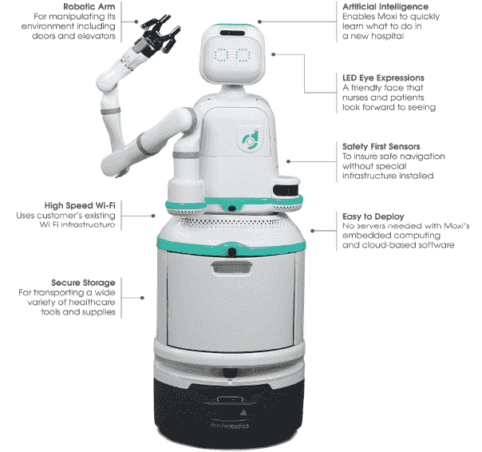

图 5.7：`Moxi`机器人

来源：[`www.diligentrobots.com/moxi`](https://www.diligentrobots.com/moxi)

机器人的影响不仅限于患者护理还延伸到了手术、康复和行政任务。在手术领域，机器人正在改变手术的方式。上述由`Intuitive Surgical`开发的达芬奇手术系统（Da Vinci Surgical System）就是一个例子。该机器人系统旨在辅助微创手术。它为外科医生提供了增强的视觉、精准控制，使他们能够以更高的准确性执行复杂的手术程序。结果是并发症减少、患者术后疼痛减轻以及恢复时间缩短。这代表了手术护理的重大进步，改善了患者预后并提升了护理质量。

机器人在康复治疗领域也产生了巨大影响。由`Hocoma`开发的`Lokomat`是一种机器人设备，旨在帮助脊髓损伤或中风的患者恢复行走能力。`Lokomat`提供重复性的高强度的训练，这是神经康复的关键部分。通过提供持续且密集的训练，`Lokomat`帮助患者更快更有效地恢复运动技能。这不仅改善了患者预后，还提高了他们的生活质量。你可以在下面的图 5.8 中看到`Lokomat`：

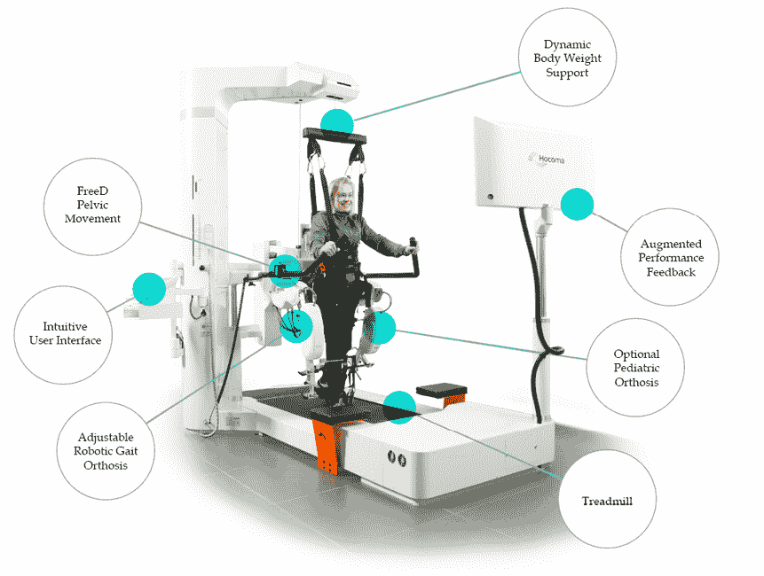

图 5.8：`Lokomat`

来源：[`www.hocoma.com/solutions/lokomat/`](https://www.hocoma.com/solutions/lokomat/)

## 农业

农业行业作为人类文明最古老且最重要的部门之一，也经历着巨大的转型。机器人与农业耕作的结合正在改变我们种植和收获食物的方式，开启了效率、生产力和可持续性的新纪元。

农业机器人旨在使许多传统上由人工完成的任务自动化。这些任务包括播种、作物收获和田间除草。这些机器人的妙之处在于它们能够不知疲倦地全天候工作，无需休息或闲息。这种持续的运行显著提高了生产力，允许在更短的时间内完成更多工作。它还减少了对体力劳动的需求，解决了许多农业地区面临的劳动力短缺问题。

例如，由`Blue River Technology`开发的`Lettuce Bot`。这种创新机器人用于疏间生菜田，这项任务对于确保最佳生长至关重要，但既耗时又劳动力密集。`Lettuce Bot`使用机器视觉技术识别单株生菜植物，然后精确地移除多余植物。这一过程确保了剩余植物有足够的空间和资源来生长，从而获得健康的作物和更高的产量。


另一个引人注目的例子是由`Harvest CROO Robotics`开发的`Harvest CROO`机器人。这种机器人旨在采摘草莓，这项任务需要高精度和细腻。`Harvest CROO`机器人结合机器视觉和机器学习算法来识别成熟的草莓，然后小心采摘，而不对果实或植物造成任何伤害。这种自动化不仅提高了效率，还确保了收获物的质量。

除了提高生产力外，农业机器人对农业耕作的可持续性做出了贡献。通过高精度执行任务，这些机器人可以减少水和化肥等资源的使用。它们可以针对特定的植物或区域，最大限地减少浪费并降低农业对环境的影响。这种精准农业方法是迈向更可持续、更高效的农业实践的重要一步。

## 机器人的家用案例

家用领域机器人的使用正与工业领域同步增加，改变了日常任务并引入了更高水平的便利和效率。从机器人扫地器、个人助理机器人到机器人玩具，机器人在家庭环境中的应用是多样且不断扩展的。

### 机器人扫地器

我们都知道，家庭打扫是多么耗精力且耗时。这正是扫地机器人大显身手的地方，它们能让你无需费力就能保持地板整洁。

这些方便的小型设备，例如`iRobot`受欢迎的`Roomba`系列（如图 5.9 所示），是机器人技术进入我们生活的极佳范例，让我们的生活变得更加轻松。想象一下，当你外出办事、工作甚至在睡觉时，这些扫地机器人正在勤奋地工作。它们非常智能，结合了传感器、算法、甚至机器学习，在你的家中穿行、避开障碍并清洁地面。

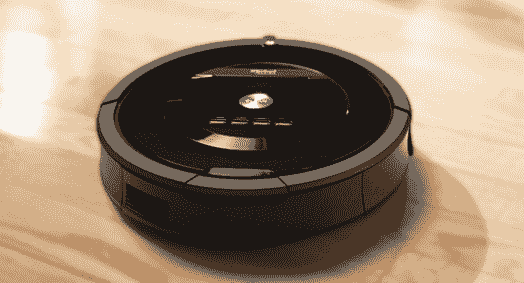

图 5.9：Roomba

来源：[`www.inc.com/graham-winfrey/3-design-tips-from-the-revolutionary-roomba-vacuum.html`](https://www.inc.com/graham-winfrey/3-design-tips-from-the-revolutionary-roomba-vacuum.html)

它们的工作原理如下：`Roombas`以随机或算法模式移动，以确保覆盖整个地板区域。它们也非常聪明——它们能检测到地板上的污垢，并重点关注需要更多清洁的区域。最棒的部分是，当电池电量低时，它们会自动返回底座进行充电。某些型号甚至可以使用智能手机 App 进行控制和定时计划，这对于我们这些行程忙碌的人来说超级方便。

然而，这不仅仅关乎便利。扫地机器人彻底改变了家庭清洁，将过去的一项耗费体力的任务转变为自动化的过程。它们可以清洁家具下方，绕过障碍物并覆盖大面积区域，确保在没有任何人工干预的情况下进行彻底清洁。这是一项游戏规则的改变，特别是对于行动不便或行程忙碌的人群来说。

## 个人助手机器人

在人类历史的浩瀚长卷中，出现过无数重新定义我们生活方式的时刻。轮子的发明、电的发现，以及现在个人助手机器人的兴起。想象一下：在这个世界里，一个专注且时刻关注的助手只需语音指令即可召唤。这并非科幻电影中的场景——而是我们的现实。

想象一下，在柔和声音中醒来，它为你读出当天的日程，播放早晨歌单，甚至为你冲好咖啡。在这个世界里，你从未真正孤独，总有人（或者说某种东西）准备好提供帮助、娱乐或仅仅聊天。这是一个技术不仅具有功能性而且具有个性化的世界。

走进`Amazon Echo`，一个看似简单的设备，却彻底改变了我们的家。它看起来可能只是另一个智能音箱，但它的核心在于其功能。在 Amazon AI 助手`Alexa`的驱动下，`Echo`超越了传统的定义。虽然它没有手脸，但它的机器人本质是不言而喻的。它倾听、理解并回应。无论你是在厨房里多任务处理，还是在准备一个舒适的夜晚，`Alexa`在那里提供。从设置闹钟到控制房间温度，它是便利性的典范。

然而，个人助手机器人的世界并不止于语音命令。来自`SoftBank Robotics`的`Pepper`——这是一款设计远超功能性的人形机器人。`Pepper`是向未来的一次跨越，这种机器人不仅执行任务，还能与人互动。凭借识别脸部、理解情感甚至参与对话的能力，`Pepper`模糊了机器与伴侣之间的界限。无论是在商店迎接顾客，还是在家里随你喜欢的旋律跳舞，`Pepper`展示了机器人成为我们社会结构中不可或缺部分的潜力。你可以在以下图 5.10 中看到`Pepper`：


图 5.10：Pepper

来源：[`robotsguide.com/robots/pepper`](https://robotsguide.com/robots/pepper)

个人助手机器人的崛起标志着我们与技术关系的转变。这不再仅仅关乎自动化或效率。它关乎建立一种纽带，一种关系的模拟。这些机器人带来了实用与陪伴的结合，让我们与它们的互动更加自然，不那么机械。

随着技术的不断进步，个人助手机器人领域将不断扩展。随着人工智能和机器学习的创新，这些机器人将变得更加直觉，在我们开口之前就能理解我们的需求。随着它们的价格变得更加亲民，全球范围内家庭采用这些机器人助手将不再是稀奇事。

## 机器人玩具

这些并不是普通的玩具。它们是娱乐、教育和灵感的结合体，旨在激发儿童和成人对机器人和技术的喜爱。它们不仅仅是玩具；更是伴侣、老师，以及通往创意与创新世界的大门。

例如，`Anki Cozmo`。这个紧凑、友好的机器人是乐趣和互动的结晶。`Cozmo`喜欢玩游戏，可以识别脸部，甚至能表达各种情感。不过，这不仅仅关乎玩耍。`Cozmo`的设计旨在以一种既有趣又有意义的方式吸引用户。你可以在以下图 5.11 中看到`Cozmo`：


图 5.11：Anki Cozmo

来源：[`www.amazon.in/Cozmo-Anki-Collector-Robot/B0165N6`](https://www.amazon.in/Cozmo-Anki-Collector-Robot/B0165N6)

然而，乐趣并不止于`Cozmo`。来自`LEGO Mindstorms`系列，这是一个极佳的平台，允许儿童和成人构建自己的机器人并编写程序执行各种任务。这是一种既动手又动脑的体验，且趣味十足。如图 5.12 所示的`LEGO Mindstorms`在提供有趣体验的同时，教授了解决问题、创意和编程等重要技能。

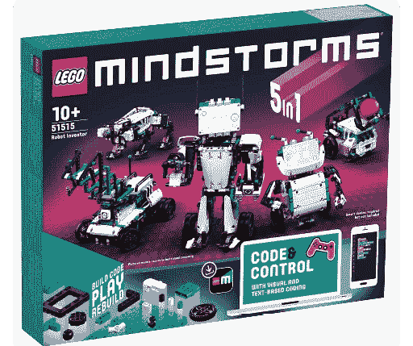

图 5.12：LEGO Mindstorms

来源：[`www.mallareddyew.com/gens.php?cid=321&kys=lego+robotics+invention&g=13`](https://www.mallareddyew.com/gens.php?cid=321&kys=lego+robotics+invention&g=13)

像`Cozmo`和`LEGO Mindstorms`这样的机器人玩具不仅仅是玩具。它们是参与、学习和灵感的工具。机器人技术让各个年龄段的人都能触及，以有趣互动的方式介绍了编程、问题解决和机器人的基础。这些玩具不仅仅是为了提供娱乐，更是为了塑造未来的创新者和问题解决者。

这些都是当今世界机器人主要的用例，无论是工业用还是家用。现在我们已经到了本章的末尾，是时候去探索机器人世界的最后一个（可能是你觉得最有趣的）方面了：当今最受欢迎的机器人！

## 世界著名的机器人

在这一节中，我们将深入探讨在世界各个领域产生重大影响的一些突破性且受欢迎的机器人。从人形到先进机器，这些机器人都是卓越创新的成果。

## Sophia

Sophia 是来自总部位于香港的达达机器人（Hanson Robotics）的人形机器人。她于 2016 年情人节被激活，并于当年 3 月在德克萨斯州首次出现在公众面前。如果根据用途来判断，Sophia 被称为社交机器人，她基本上可以模仿人类的对话和语音模式。为了强调她的受欢迎程度和受到的热烈欢迎，Sophia 于 2017 年 10 获得了沙特阿拉伯国籍，成为首位获得该项荣誉的此类机器人。

在下面的图 5.13 中可以看到 Sophia：


图 5.13: Sophia

来源：[`www.dazeddigital.com/science-tech/article/51783/1/sophia-the-robot-mass-produced-to-provide-company-during-covid-hanson-robotics`](https://www.dazeddigital.com/science-tech/article/51783/1/sophia-the-robot-mass-produced-to-provide-company-during-covid-hanson-robotics)

此外，Sophia 在 2017 年 11 月还被评为联合国开发计划的首位“创新冠军”。在新冠肺炎期间，曾出现过量产 Sophia 以帮助灾害救援的讨论。

## Atlas

Atlas 并不像 Sophia 那样保持人类的形状，也无法完全成为一个好的对话伙伴；但 Atlas 可以跑酷。你可以在下面的图 5.14 中看到 Atlas：

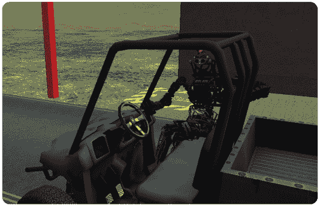

图 5.14: Atlas

来源：[`en.wikipedia.org/wiki/Atlas\_(robot)#/media/File:Atlas\_climbing\_into\_a\_vehicle.jpg`](https://en.wikipedia.org/wiki/Atlas_\(robot\)#/media/File:Atlas_climbing_into_a_vehicle.jpg)

Atlas 由波士顿动力（Boston Dynamics）与美国国防高级研究计划局（DARPA）合作开发，他专注于执行人类无法胜任的各种搜索和救援任务。

## Nadine

另一个类似 Sophia 的机器人 Nadine 可以进行对话并进行眼神交流，她甚至能记得你与她进行过的任何对话。她是根据她的创造者纳迪亚·塔尔曼（Nadia Thalmann）教授建模的，如下图 5.15 所示：


图 5.15: Nadine

目前，Nadine 在新加坡友保险（AIA Singapore）担任前台接待。

## Geminoid DK

坦率，这种超真实的机器人有时会让人毛骨悚然；他是根据奥尔堡大学（University of Aalborg）的亨利·沙费（Henry Scharfe）建模的。这里的目的是再次创建一个尽可能像人类的机器人，甚至他的举止也很像他所建模的人。Geminoid DK 出现在下面的图 5.16 中：


图 5.16: Geminoid DK

来源：[`phys.org/news/2011-03-geminoid-dk-ultra-realistic`](https://phys.org/news/2011-03-geminoid-dk-ultra-realistic)

## Spot

Spot 由波士顿动力开发，以犬类为模型。它的行为类似于狗，可以在人类难以通行的环境中导航。你可以在下面的图 5.17 中看到 Spot：

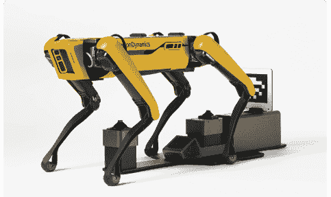

图 5.17: Spot

来源：[`www.iotworld.com/robotics/spot-the-design-behind-robot`](https://www.iotworld.com/robotics/spot-the-design-behind-robot)

## 机器人领域的职业

随着自动化的兴起，机器人学正成为最有前景的途径之一。今天，机器人技术已经改变了工业和家庭生活，为那些渴望利用技术的人开启了机会。该领域的一些热门大学和专业课程包括：

*   机器人工程
*   控制论
*   医疗机器人
*   自动化
*   机器人设计
*   航空航天工程

如果你是一个对科学、技术、工程和数学（STEM）充满热情的人，你就需要保持领先。机器人学的未来在未来几年里看起来非常广阔，可以为那些期待通过技术创造积极影响的人开启机会之门。

## 结论

当我们结束本章之际，显而易见的是，机器人领域从诞生到今天已经经历了一段漫长的历程。从古代文明神话中的自动机器到 21 世纪复杂的智能机器人，这段历程是漫长的，并伴随着无数的突破和创新。这段旅程改变了工业，从根本上改变了我们对机器能成就什么的理解。

本章开头探讨了机器人的必要性，这种需求源于人类对任务自动化、提高效率和增强人类能力的渴望。从古代工程师亚历山大的海伦（Heron of Alexandria）创造的精巧机械装置，到 20 世纪彻底改变制造业的工业机器人，机器人学历史证明了人类的智慧和对进步的不懈追求。

在下一章中，我们终于开始学习书中设定的要讨论的技术的结合。我们将讨论 AI 驱动的自动化，了解这两个技术概念结合后的基础和历程，以及现实世界的用例。此外，我们还将深入探讨用于增强区块链安全和优化交易、智能合约中的 AI 使用等内容！请期待！

## 问题

1. 你如何定义机器人学？在你看来，它与人工智能的关系有多紧密？

   答案：机器人学是一门涉及设计和制造机器人系统的工程分支。人工智能旨在为系统添加类人智能，而机器人学是一个完全不同的分支，因为它与智能无关。根据用例的不同，机器人可以在有或没有人工智能的情况下运行。

2. 最早的自动机器形式有哪些？它们是为哪些任务设计的？

   回答：亚历山大的希律创造了世界上已知的第一个机器人实例，通过机器驱动的自动化技术来执行各种任务，包括一种自动开启神庙大门的机制。

3. 机器人技术的演变是如何影响制造业的？

   回答：在制造业中，机器人参与组装、检测和包装。随着机器人技术的出现，该领域的运营机构引入了机器人与人类工人共同工作，减少了人为错误，并提高了人类员工的安全。

4. 机器人在家庭环境中的应用示例有哪些？

   回答：在日常家庭中，可以引入像 Roomba 这样的机器人来帮助清洁。此外，还会有个人助理机器人，以及像虚构角色大白（Baymax）那样的个人医疗机器人。

5. 机器人开发和使用带来了哪些挑战？

   回答：机器人技术带来了一些需要考虑的伦理问题。例如，制造业等已经在工作流程中使用机器人的行业，也会减少人类工人数量——因为机器人带来了效率和不间断的工作。这可能导致许多人失去工作，如果他们不能及时提升技能，后果将变得更加严重。

6. 你认为如何解决围绕机器人的伦理担忧？

   回答：雇佣机器人的行业必须主动确保人类工人优先，要么始终为人类工人保留固定比例的空缺职位，要么承担提升现有员工技能的责任并为他们创造职业前景。

7. 列举人类历史上一些受欢迎的机器人。

   回答：一些流行的机器人包括社交人形机器人索菲亚（Sophia）和个人助理小白奇（Pepper）。

# 第 6 章 AI 驱动的自动化

## 引言

上一章完全关于机器人技术：我们讨论了历史和用例，并查看了当今世界上最著名的机器人。现在，虽然机器人技术在很大程度上涉及自动化来实现其大多数用例，但正如我们之前所说的，机器人技术和自动化是两种完全不同的技术。

与我们在书中讨论的其他新兴技术相比，自动化可能是你最不感兴趣的一个，因为我们已经了解它的奇迹已经有一段时间了。然而，即使自动化经常被谈论为一种本质上减轻各行业人类工人负担的单一技术，但其中也存在可能让你惊讶的细微差别。例如，自动化与 AI 的结合为自动化可以实现的目标开启了完全全新的途径。

在本章中，我们将探索 AI 驱动自动化的复杂性、其实际应用案例以及许多从 AI 驱动自动化中受益的行业。

## 结构

在本章中，我们将涵盖以下主题：

*   AI 驱动的自动化
*   AI 驱动的自动化系统中 AI 与自动化
*   区块链中基于 AI 的自动化
*   AI、自动化和区块链的用例
*   区块链、AI 和自动化结合的应用

## 目标

通过本章，我们的目标是理解与 AI 的结合，以及它如何通过与区块链等其他技术的各个方面结合来放大其潜力。在本章结束时，我们希望你能够更好地掌握当今的新兴技术如何结合以为我们不断数字化的社会提供广泛的用途。

我们将从 AI 驱动自动化的基本定义开始。

## AI 驱动的自动化

正如麦肯锡在 2018 年报告所说，过去 60% 的职业中约 30% 的工作活动计划在不久后引入自动化。事实证明这是相当正确的，随着自动化的广泛使用，AI 也随之而来。根据基本定义，AI 驱动的自动化是指使用`AI`技术和算法来自动处理广泛行业和应用中的各种任务、过程和决策。当然，对决策部分给予了额外强调，因为这是将`AI`与自动化结合的主要优势：你获得了可以独立思考并在无需任何人工干预的情况下完成不同任务的机器。

AI 驱动的自动化利用了如`ML`、深度学习、自然语言处理、计算机视觉以及其他`AI`技术流，使系统和过程更加高效、智能和自主。

## AI 驱动自动化的组件

以下是 AI 驱动自动化的关键组件和特征：

*   数据处理与分析：AI 驱动的自动化始于数据，正如所有`AI`驱动的机制一样。它涉及收集和分析来自与用例相关的各种源量数据，以提取有价值的见解和模式。正如我们之前提到的，机器学习模型会在这些数据上进行训练以执行特定任务。

*   ML 算法：`ML`算法是 AI 驱动自动化的核心。这些算法使系统能够从收集的数据中学习并随着时间的推移提高性能。AI 驱动自动化中常见的`ML`任务包括分类、回归、聚类和推荐。

*   决策：AI 驱动的自动化系统可以根据其分析的数据做出决策或建议，这对于减少自动化过程中的人工干预非常有帮助。此类 AI 驱动的自动化系统所做的决策取决于用例，范围从简单的基于规则的选择到复杂的概率决策不等。


### 过程自动化

AI 驱动的自动化可以自动执行跨领域的重复性和基于规则的任务。例如，在客户服务中，AI 驱动的聊天机器人可以处理常规查询。在制造业中，AI 驱动的机器人可以自动执行装配线过程（如图 6.1 所示）。正如你可能意识到的，AI 驱动的自动化确实已经在我们周围生效。

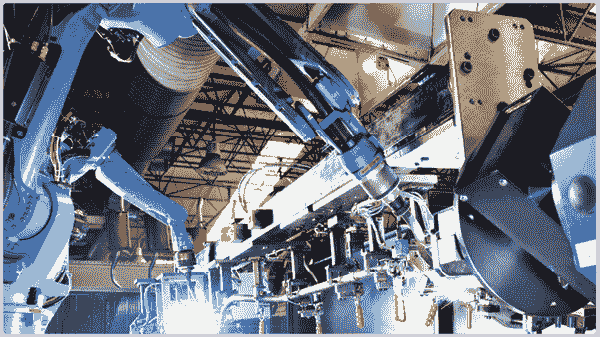

图 6.1：AI 驱动的自动化

来源：`https://electrical-engineering-portal.com/9-reasons-for-automation-of-manufacturing-processes`

### 预测分析

AI 驱动的自动化系统可以根据历史数据预测未来的事件或结果。这在各种应用中都有价值，包括制造业的预测性维护和金融领域的欺诈检测。

### 自然语言处理 (NLP)

`NLP` 技术使 AI 系统能够理解和生成人类语言。这对于 AI 驱动的自动化系统（如聊天机器人、虚拟助手以及自动内容生成）特别有用。

### 计算机视觉

计算机视觉允许 AI 系统解释和理解来自图像和视频的视觉信息。增强了这一功能的 AI 系统可以与自动化结合，应用于人脸识别、自动驾驶汽车和制造业质量控制等领域。

### 持续学习

AI 驱动的自动化系统可以随着新数据的接触随时间推移进行适应和改进。这种适应性对于在动态环境中保持相关性和准确性至关重要，特别是在无法总是进行人工干预的情况下。

### 人机协作

在许多情况下，AI 驱动的自动化可以设计为与人类操作员共同工作。人机团队在增强双方能力和提高整体效率方面可以大有作为。

### 风险管理

正如我们所知，AI 可以评估风险并提供建议以缓解风险。这在金融等行业中至关重要，AI 驱动的算法结合自动化技术，可以帮助管理投资组合。

## AI 驱动的自动化的优势

我们已经对 AI 驱动的自动化的组件及其多样的可用性所提供的处有了初步了解，现在让我们简要理解它们：

- AI 驱动的自动化处理重复性任务和流程，减少人工投入并加速工作流。
- AI 赋能的自动化系统可以极高精度的执行任务，减少人为错误的风险。
- 通过 AI 驱动的自动化简化运营并降低劳动力成本，组织从长远来看可以节省资金。
- 此外，AI 驱动的自动化系统可以处理增加的工作负载，而无需按比例增加资源。
- AI 可以快速分析海量数据，使自动化系统能够实现更快、数据驱动的决策。
- AI 驱动的分析还可以从收集的数据中发现有价值的洞察，进一步辅助战略规划。
- AI 驱动的自动化可以学习并适应不断变化的情况和新数据，随时间推移保持相关性。
- 采用 AI 驱动自动化的组织注将在其行业中获得竞争优势。
- AI 赋能的自动化系统可以协助并增强人类能力，提高特定组织的整体性能。
- 此外，随着 AI 驱动自动化的实施，员工可以专注于更具战略性和创造性的任务，因为所有的常规工作都已自动化。
- AI 赋能的自动化系统可以一致地执行任务，确保质量统一并符合法规规定，同时避免了通常人为干预带来的错误。
- 仅以 AI 驱动自动化的一个领域为例，聊天机器人和虚拟助手可以提供 24/7 支持，提升零售业的客户服务和满意度。
- 再举一个例子，在制造业等行业，AI 支持的自动化可以预测设备故障，减少停机时间并帮助提前维护成本。
- 基于 AI 驱动自动化的推荐系统可以进一步为用户个性化内容和产品，提升他们的体验并增加参与度。
- 在医疗保健和交通等领域，AI 驱动的自动化系统可以通过预测分析和自主系统增强安全性。
- AI 可以实时评估并缓解风险，这使得 AI 赋能的自动化在金融交易和网络安全等领域特别有用。

总而言之，AI 驱动的自动化具有变革各行业的潜力，因为它能够降低运营成本、提高生产力、优化决策并实现全新的、此前无法的能力。

AI 驱动的自动化仍然会引发伦理和社会考量，例如对就业和数据隐私的影响，随着这些技术的不断演进，这些问题需要仔细处理。正如我们在上一节中反复迭代过的，在使用这些技术时，将人类需求放在首位很重要，以防止这些革命性创新被误用。

现在，在我们进一步探讨 AI 驱动的自动化之前，你可能仍在好奇自动化与 AI 之间的区别。我们之前已经分别讨论过这些新兴技术，但在 AI 驱动的自动化系统中，现在让我们学习如何区分所采用不同组件，并进一步增强它们。

## AI 与自动化

在数字时代，人工智能和自动化都将变革不同的行业和我们的工作方式。然而，它们显然不是同义词。以下是自动化与 AI 之间的关键区别。

### 自动化

以下是自动化的简要解释：

- `基于规则`：自动化涉及对预定义规则和指令的使用。它遵循一组步骤。
- `有限的决策`：自动化系统可以根据预定义的条件做出简单决策。它们通常是规则驱动的，缺乏对情况的适应性。
- `无学习能力`：自动化系统本身不具备从数据中学习的能力。它们完全按照程序执行。

#### 自动化的示例

机器人流程自动化（`RPA`）是自动化的一种自动化形式，由软件机器人执行数据输入、表单填写等重复任务。

制造业中的自动化传送带是自动化的另一个例子。

### 人工智能

现在，我们认为这样总结人工智能：

- `自适应且智能`：AI 系统通过处理数据、识别模式和做出决策来模拟人类智能。它们可以处理常规和复杂任务。
- `学习能力`：AI 涉及通过 `ML` 算法从数据和经验中学习。这使得 AI 系统随时间推移提高其性能、准确性和决策水平。
- `高级决策`：AI 可以通过考虑多个因素和概率结果做出复杂的决策。这些系统可以适应变化，甚至超过人类。

#### 人工智能的示例

Siri 和 Alexa 等虚拟助手使用 `NLP` 理解并响应语音指令，这些都是 AI 赋能的系统：


图 2：亚马逊 Alexa 是 AI 赋能系统的示例

来源：[`www.wired.com/2017/02/amazon-alexa-hits-10000-skills-plenty-room-grow/`](https://www.wired.com/2017/02/amazon-alexa-hits-10000-skills-plenty-room-grow/)

自动驾驶汽车也使用 AI 根据传感器数据进行导航并做出实时决策。

### 自动化与 AI

以下是这些技术的对比，以便你总结 AI 赋能自动化系统中的部分归属于哪种技术。让我们通过下表来看自动化与 AI 的对比：

| 特性 | AI | 自动化 |
| --- | --- | --- |
| 人工干预 | AI 拥有与其操作领域相关的类人智能，很少或不需要人工干预。 | 自动化只能执行预编程的任务，环境发生变化时需要人工干预。 |
| 适应性和智能 | AI 更智能、更具适应性，并能够从数据中学习。 | 自动化是规则驱动的，缺乏适应性。 |
| 关注领域 | AI 主要侧重于基于提供的数据和洞察的决策能力。 | 自动化侧重于精确、重复的任务，将人类工人从枯燥、耗时的活动中解放出来。 |

**表 6.1：自动化与 AI**

现在，AI 和自动化通常结合在一起，以创建复杂的系统，这些系统在各行业中受益于 AI 驱动的智能和基于规则的自动化。AI 对于日常运营来说还很新，而自动化已经使用了多年，特别是在制造业等领域。

## AI 驱动的自动化的示例

AI 驱动的自动化可以应用于各个行业和领域，以简化流程、提高效率并改进决策。一些示例包括：

- **自动纠正和文本编辑器**：从一个例子开始，这提醒我们确实在不知不觉的日常生活中使用了基于 AI 的自动化。在文字处理器、短信应用程序和任何数字写作媒介中，我们都使用 AI 算法识别错误并自动纠正。这是通过使用 `ML`、`deep learning` 和 `NLP`（自然语言处理）的基于 AI 的自动化系统实现的。
- **制造业**：在制造业中，AI 驱动的机器人可以自动执行组装、焊接和质量控制等任务。这些智能机器人可以适应生产线的变化，并与人类工作人员合作以提高效率。
- **医疗保健**：AI 算法可以分析医学图像（如 `X-rays` 和 `MRIs`）以检测异常并协助诊断。此外，由 AI 驱动的聊天机器人和虚拟健康助手可以提供患者信息、安排预约并回答常见的健康问题。
- **客户服务**：AI 驱动的聊天机器人已用于客户支持，以处理常规查询并提供 24/7 的支持。
- **助手**：此外，基于 AI 的语音助手（如亚马逊的 `Alexa` 和 `Google Assistant`）可以执行设置提醒、回答问题和控制智能家居设备等任务。
- **个性化搜索算法**：当你去流媒体服务搜索电影或浏览电子商务商店时，你可能会发现推荐的内容符合你的口味。这是由于 AI 驱动的算法会自动监控你的在线活动以分析你的偏好。从你的活动中收集的数据被输入到机器学习和深度学习过程中，以便系统预测下哪些项目将符合你的品味。
- **金融**：AI 自动算法可以分析市场数据并为你执行交易，根据市场状况的变化做出瞬间决策。
- **电子交易**：谈到金融，我们能够方便地从家里向企业付款，这得益于银行使用 AI 为我们简化支付流程。在我们进行支付和共享账户详情以接收电子支付时，基于 AI 的自动化可用于确保安全性、身份验证、隐私性等等。
- **欺诈检测**：基于 AI 的自动化系统可以实时且定期地监控个人和财务数据的交换，以识别并防止欺诈活动。事实上，AI 算法可以跟踪你的消费模式，并监控你经常购买的物品类型以及你常去的商店，以便它们检测到任何使用你财务信息的异常活动。
- **零售业**：AI 自动化可以通过分析需求模式来帮助零售商优化库存水平、减少过度积并防止缺货。此外，AI 驱动的个性化服务可以根据客户的浏览和购买历史向其推荐产品。
- **自动驾驶车辆**：自动驾驶汽车和卡车可以使用基于 AI 的自动化进行实时导航、障碍物检测和决策。
- **物流**：在提高自动驾驶车辆便利性和效率的同时，基于 AI 和自动化的系统可以为物流公司优化交付路线，减少燃料消耗和交付时间。
- **农业**：AI 自动化可以通过分析来自传感器和无人机的数据来帮助农民，优化种植、灌溉和收割过程。
- **能源管理**：AI 可管理和优化智能电网中的能量分配，从而更均衡、公平地平衡供需，并减少价值能源的浪费。
- **招聘**：基于 AI 的自动化还可以帮助你筛选职位申请人，将候选人与职位描述进行匹配，甚至进行初试。
- **区块链**：在维护区块链安全性方面，基于 AI 的自动化是一种驱动力。除了增强安全隐私之外，AI 还可以进一步简化区块链交易，通过智能自动化增强智能合同。

这些示例告诉我们，基于 AI 的自动化是一种多功能技术，你可以为你想象的几乎任何行业的特定关注领域创建这种技术。AI 自动化带来了许多益处，如提高效率、节省开支等。

AI 驱动的自动化还能够快速分析数据并识别与区块链数据存储能力完美契合的模式。它们共同为区块链网络引入了新的智能水平。这种增强使组织能够从内外部的海量数据源访问并获取可操作的洞察。

最后，区块链、AI 和自动化的协同效应在简化涉及多个利益相关者的复杂业务流程方面表现卓越。例如，智能合约中的 AI 可以根据特定条件自动执行操作，简化流程、提高效率并减少摩擦。这在供应链管理和纠纷解决等领域特别有益。

从本质上，区块链、自动化和 AI 的结合使组织能够增强真实性、简化操作，并利用增强智能来提高决策和效率。这种协同效应通过利用这两种技术的优势，具有彻底改变各个行业的潜力。

现在，让我们来看看 AI、区块链和自动化的结合在三个特定领域的表现如何：交易、智能合约以及区块链的安全性。

## 使用 AI 和自动化简化区块链交易

AI 和自动化工具可以作为强大的工具，来简化和增强区块链交易。当然，区块链技术以其安全性和透明性著称，它已经改变了金融、供应链和医疗保健等行业。然而，AI 和自动化的集成通过以下方式将区块链的能力提升到了新水平：

- 提高效率
- 降低成本
- 增加区块链网络的可扩展性

以下是利用 AI 和自动化来简化区块链交易的方法：

- **智能合约**：智能合约是自执行的协议，其所有交易双方均同意的合约条款直接写入代码中。AI 可用于根据预定义的条件优化并自动化这些合约的执行。这不仅确保了协议的自动执行，还减少了对中介的需求，使交易更快、更具效益，更不用说更安全。
- **可扩展性**：随着交易数量的增加，区块链网络经常面临可扩展性的挑战。AI 可以通过预测流量模式来优化网络性能，确保即使在高峰时期也能高效处理交易。
- **预测分析**：AI 算法可以分析区块链上的历史交易数据，以预测未来趋势（例如通过分析用户在节日或任何宏观经济期间的行为预测交易量）和潜在问题（如扩展性相关问题）。这种预测分析可优化交易路由、防止欺诈并确保支付的顺畅。
- **增强安全性**：AI 驱动的安全系统可以自动化，持续监控区块链网络中的异常和潜在威胁。一旦检测到任何疑活动，AI 可触发自动响应或警报，快速消除威胁并维护区块链的完整性。
- **交易验证**：AI 算法可以协助验证交易的真实性，确保只有有效交易被添加到区块链中。这有助于降低欺诈或错误交易的风险。然而，这确实引发了对区块链上验证者角色的疑问，需要开发人员确保所部署 AI 驱动自动化没有削弱区块链活动中的人为因素。
- **NLP（自然语言处理）**：NLP 驱动的聊天机器人和虚拟助手可以促进用户与区块链网络的交互。用户可以通过自然语言查询区块链、发起交易或接收账户更新，使区块链对更广泛的受众更加可用，特别是那些不通技术的用户。
- **合规与报告**：自动化工具可以通过自动生成报告，确保区块链交易符合不断变化的监管要求。

AI、自动化与区块链技术的结合将改变交易的进行方式。通过自动化区块链的各个方面并使用 AI 优化性能，组织可以简化操作。当然，可扩展性的增加只是 AI 和自动化结合在简化区块链交易方面卓越的众多原因之一，正如我们在“使用 AI 和自动化简化区块链交易”中所看到的。如果智能系统可以简化第一层和二层解决方案，这一障碍将得到有效消除。AI 和自动化的协同效应无疑将在区块链的广泛采用中发挥至关重要的作用。

## 基于 AI 的智能合约自动化

你已经了解了人工智能如何增强区块链中智能合约的功能。AI 和自动化正在成为创建和执行智能合约的强大赋能者，为这一以太坊首次引入的区块链技术基石提供了更高的效率、准确性和适应性。

如果你忘记了定义，智能合约当然是自执行的数字协议片段，带有交易中所有参与方均遵守的预定义规则和条件。正如你显易所见的，智能合约中已经有了一定的自动化。

智能合约构建在以太坊等支持智能合约功能的区块链平台上。为了让区块链上的金融实现真正的去中心化，智能合约是将财务权交还给合约中发送方和接收方的机制之一。

现在，回到主题，以下是 AI 和自动化增强智能合约的某些方式：

- **自动化合约创建**：AI 可以通过分析用户的自然语言输入来协助起草和生成智能合约。这简化了合约创建过程，并减少了用户编写复杂代码的需求，使智能合约更加易于使用，同样特别是对于不通技术的用户。
- **NLP**：NLP 算法可以将人类可读的合约条款转换为机器可读的代码。这种人机语言差距的桥接简化了智能合约模板的创建。
- **自动化验证**：AI 驱动的工具可以自动验证智能合约中的条件和条款。这确保了代码符合预期逻辑并最大限度地减少了错误风险。
- **监控与合规**：AI 驱动的监控工具可以跟踪与合约条件相关的实时数据。如果条件被满足或违反，智能合约可以自动执行操作，例如转账资金或发送通知。
- **动态合约执行**：AI 使智能合约能够适应并响应现实世界中的事件和数据。例如，保险领域的智能合约可以使用天气数据，在出现恶劣天气时自动触发赔付。
- **风险评估**：AI 算法可以评估与智能合约中各种条款和条件相关的风险。这有助于用户对合同条款做出明智决策，并协商更好的协议。
- **预测性分析**：AI 可以分析历史数据，并根据未来的市场趋势和模式优化合同条款和条件，从而达成更高效、公平的协议。
- **自动托管服务**：在复杂的多签名合约中，AI 可以自动化托管过程，确保资金或资产在满足预定义条件之前安全保存。这减少了对中间机构的需求。
- **安全预言机**：预言机是为基于区块链的智能合约提供数据的第三方服务。AI 可以验证数据的真实性并确保外部数据源的可靠性来增强预言机的安全性。
- **争议解决**：AI 智能合约内部提供争议解决机制。如果双方产生分歧，AI 可以分析合同条款和交易数据，提出进一步的公平解决方案。

智能合约是确保区块链交易顺畅、维护交易去中心化并为所有参与方提供公平条款的重要组件。通过简化和增强智能合约的创建，并反过来放大上述组件，AI 驱动的自动化为广泛行业提供了稳健且多功能的解决方案。

## 区块链安全中的 AI 与自动化

最后，是 AI 在增强区块链安全因素方面的作用。现在，我们知道区块链的核心在于金融去中心化和通的数据共享。这也是为什么区块链允许参与者具有一定程度的隐私，以便人们可以通过验证私钥发送交易而无需暴露其真实身份。

在确保参与者匿名性的同时，区块链还保持交易对授权用户透明且不可篡改，因此任何恶意行为者都无法篡改记录而不让链的其他部分获知。这些我们已经知晓，但当去中心化程度不足时，链上仍可能偶尔发生篡改情况，导致用户的重大损失。AI 驱动的自动化可以在此提供帮助。

人工智能和自动化具有增强区块链技术内部安全性和隐私的关键潜力。AI 可以通过以下方式进一步固化区块链的安全性，使网络更加稳健且尊重隐私：

- **增强的异常检测**：AI 驱动的自动算法可以持续监控区块链网络中的异常活动或偏差。任何意外行为或可疑交易都可以触发警报以便进一步调查，降低安全泄露的风险。
- **历史数据分析与模式识别**：AI 可以分析历史交易模式并识别潜在威胁。它可以自动识别与欺诈活动相关的反复模式，实现早期的干预和防欺诈。
- **隐私保护技术**：AI 可用于开发隐私保护技术，例如`zero-knowledge proofs`，确保用户在区块链上进行交易的同时，保持其数据的隐私和安全。


# 安全多方计算

AI 可以促进安全多方计算，允许多个方在保持输入私密性的同时共同对其输入进行函数计算。这对于隐私保护应用具有重要价值。

# 智能合约审计

AI 可以自动审计智能合约的漏洞和潜在利用漏洞。这确保了智能合约从一开始就是安全的，降低了代码弱点和攻击的风险。

# 身份验证

基于 AI 的身份验证系统可以集成到区块链网络中，以增强用户身份验证和授权。这降低了未经授权访问和身份盗窃的风险。

# 安全数据共享

AI 可以实现区块链网络上的安全数据共享。它允许用户仅向授权方授予访问，同时维护数据隐私。

# 加密与解密

AI 算法可以增强区块链网络中使用的加密技术，使未经授权的实体访问区块链上存储的敏感数据的难度。

# 行为分析

AI 可以对网络参与者进行行为分析，以检测异常或恶意行为。这包括跟踪交易历史并验证用户的操作是否符合其通常模式。

# 预测性威胁情报

AI 可以从各种来源收集威胁情报，预测区块链网络的潜在安全威胁，并对此保持警惕。这种主动方法有助于预先保护网络。

# 隐私令牌

AI 可用于开发侧重隐私的加密令牌，在确保交易有效性的同时优先考虑用户匿名性。

通过将 AI 和自动化集成到区块链网络，用户和组织可以从更高的安全性和隐私保护中获益。组合技术不仅可以缓解现有威胁，还可以主动预测并防止新出现的安全问题。

根据我们刚刚讨论的 AI 和自动化在区块链中的三个用例，未来对于更安全、更私且更具韧性的区块链生态系统无疑充满了巨大希望。同时，AI 和自动化都是不断演进的技术，这意味着未来将出现我们尚未预到的这些组合的新应用。这无疑是一个令人心加速的旅程！

# AI、自动化与区块链的用例

现在让我们来看一看 AI、自动化与区块链技术融合的一些用例。虽然其中一些可能已经在付诸实践，另一些正在探索未来的可能性：

## 供应链管理

区块链提供了一个不可篡改的账本，用于跟踪供应链中货物的移动，确保透明度和可追溯性。AI 随后分析收集的数据以优化库存管理并预测供应链中断。此外，通过智能合约实现的自动化可以自动并简化采购、支付和质量控制流程，减少人工干预并提高效率。

在食品安全的一个相关领域，区块链可以跟踪食品产品的源头和历程。AI 随后可以分析这些数据以检测污染或变质问题，并在必要时发出报警并停止特定物品的供应。

## 医疗保健

区块链可以安全地存储和管理患者记录，确保数据完整性和隐私。AI 可以分析收集的数据以用于医疗诊断、治疗建议和预测性分析。

此外，区块链可以帮助跟踪药物的生产和分发，而 AI 可以协助识别任何假药并确保患者安全。

## 金融服务

区块链促进了更快、更廉价的跨境交易。与此同时，AI 可以增强欺诈检测并对这些交易进行自动合规检查。AI 驱动的算法还可以在基于区块链的加密货币交易所执行高频交易策略，优化交易决策。这种后者的用例已经在交易机器人中广泛使用了。

# AI and core technologies

在我们深入理解 AI 与区块链结合的潜力之前，让我们先快速回顾一下 AI 和区块链的基础知识。

# 定义 AI

AI（人工智能）是指在机器中模拟人类智能；因此，它本质上是一门让机器像人类一样思考和学习的科学。

# AI 的目标

AI 的目标是开发能够执行与人类相当任务的系统和技术，特别是那些需要人类智能的任务。AI 旨在参与的特定类型任务包括解决问题、理解自然语言、识别语音和思维模式，以及最重要的：做出决策。

# AI 的核心技术

AI 系统由多种技术组成，这些涉及 AI 的核心技术包括：

## 机器学习

机器学习（ML）是 AI 的子集，侧重于使机器能够在不经过显式编程的情况下，从获得的数据中持续学习。机器学习涉及创建算法，这些算法可以通过经验和数据分析来提高其在任务中的性能。一些常见的机器学习技术包括回归、分类、聚类和深度学习。

## 深度学习

深度学习是机器学习的一种特定形式，使用了受人脑结构启发的人工神经网络。这些神经网络（特别是深度神经网络）可以分析海量数据，广泛应用于图像和语音识别、自然语言处理以及推荐系统。

## 自然语言处理

自然语言处理（NLP）是 AI 的一个分支，旨在平滑 AI 系统与人类语言之间的交互。NLP 使机器不仅能够理解和解释，还能用人类语言交流。正如你所猜的，NLP 广泛应用于聊天机器人、语言翻译以及 AI 系统的情感分析等应用。

## 计算机视觉

AI 系统的这一部分涉及教计算机解释和理解来自世界的视觉信息，例如图像和视频。计算机视觉用于目标检测、人脸识别、自动驾驶和医疗图像分析等应用。

## 语音识别

由于亚马逊 Alexa 等助手 AI 设备如今已进入几乎每个家庭，你可能对这项技术非常熟悉。语音识别技术允许机器将口语语言转换为文本，反之亦然。它用于语音助手、转录服务和交互式语音响应系统等应用。

## 硬件

专用硬件，如图形处理器（GPU）和张量处理单元（TPU），旨在加速人工智能和深度学习任务。这些组件对于 AI 应用的高计算需求至关重要。

## AI 软件开发工具

有许多软件工具、库和框架，例如 `TensorFlow`、`PyTorch` 和 `scikit-learn`，它们让开发人员构建和训练 AI 模型变得更容易。

## 生成式 AI

ChatGPT 让这个术语在今天非常流行。生成式 AI 模型利用完全无监督或部分监督的机器学习算法，它们使计算机能够利用输入的文本、音频、视频、代码、图像和其他输入来生成与输入类似的新鲜内容。因此，生成式 AI 模型学习输入内容的特征和关系，并可以生成与训练数据集独特的输出。

存在生成对抗网络（GAN），它们可以使用文本和图像作为输入形式来生成多媒体内容。另一方面，还有基于 transformer 的生成式 AI 模型可以使用互联网上的可用数据创建新的文本内容。

## 机器人

机器人技术与 AI 结合可以创建自主或半自主的机器人，它们可以执行组装、探索甚至手术等任务。机器人还可以帮助创建高度类人、善社交的机器人，它们可以陪伴人们，并就任何任何话题进行对话！

## 强化学习

强化学习是机器学习的一种类型，系统通过与环境交互来学会做出决策。该技术使用奖励和惩罚链来引导系统的这种学习过程。强化学习主要应用于机器人等领域。

## 专家系统

专家系统是 AI 程序，旨在模拟人类专家在相应操作领域的决策能力。这些系统使用知识库和推理引擎等技术解决方案，在特定场景下提出建议或解决问题。

# AI 的优缺点

当与区块链结合以造福人类更大的利益时，AI 系统既有优势也有劣势。一方面，有效率提升的因素，但另一方面，你还需要考虑伦理问题。

## AI 构建未来的优势

我们已经知道 AI 的许多益处，但这里是对其优势的简要回顾：

- AI 可以自动处理重复性任务，减少人力和错误。
- 各行各业的 AI 可以导致在广泛任务中提高生产力并节省成本。事实上，很少有 AI 无法完成的任务。
- AI 可以通过自动化工作中不那么愉快的部分，让人类更多地关注创造性任务。
- AI 可以增强残障人士的无障碍体验。
- AI 系统可以让所有人更广泛地获取技术信息。此外，AI 驱动的教育工具可以提供个性化的学习体验，让教育对更广泛的读者更有效且易，帮助他们按自己的节奏学习。
- 在医疗领域，AI 可以协助医疗诊断、药物发现和个性化治疗方案，改善患者预后并拯救生命。
- AI 可以优化资源管理和能源消耗，为更可持续、更环保的实践做出贡献。
- 人工智能可以加速研究和数据分析，带来从气候科学到基因组学等各个领域的突破。
- AI 通过促进创新并反过来创造全新的行业来推动经济增长。

## 未来需要解决的 AI 缺点

撇开所有优点（诚然这些优点非常多），以下是 AI 的一些缺点，这些缺点在 AI 工具的使用变得更广泛之前需要得到解决：

- AI 自动化可能导致某些行业的职业流失，可能引发经济和社会动荡。我们在利用技术解决方案时，目标应该是将人类因素优先，因此职业流失问题必须由我们这些选择在组织中使用 AI 解决方案的人来积极解决。
- 从更技术缺陷的角度来看，AI 算法可能会从训练数据中继承偏见，从而导致歧视性结果。我们不希望在医疗、金融贷款或新招聘等领域发生这种情况，这就是为什么在训练 AI 系统时应该主动解决这个问题。
- AI 的数据驱动本质在敏感的个人信息被收集和共享时（例如为了创建用于 AI 系统的数据集），可能会引发隐私问题。这是开发者需要关注的另一个因素。
- 大型 AI 模型的训练消耗了大量的能量，这可能会引发严重的环境问题。出于同样的原因，建议使用可再生能源。
- 由于 AI 刚刚作为一项广泛的技术起步，AI 带来的益处尚未得到公平分配。这在最初阶段可能会加剧经济不平等问题，而这同样是一个需要积极努力解决的问题。
- AI 系统可能被利用来实施网络攻击。例如，自动驾驶汽车可能会突然停止执行指令，更糟糕的是，它可能会策划一起事故。这是开发者必须制定解决方案以确保人类未来的另一个方面。
- AI 的另一个问题是品牌、医疗健康专业人员等对其对其过度依赖，这在至少的情况下会导致人与人之间联系的减少，在最坏的情况下会发布错误信息；这在医疗保健领域可能是致命的。任何时候都都需要一定程度的人为参与，特别是在更敏感的行业中。

在战争等领域，自主决策可能证明是致命的。AI 确实带来了许多类似的伦理挑战，特别是在缺乏问责机制和透明度的情况下。让 AI 系统的决策过程即使对于非技术人员来说也是清晰是非常重要的，并让那些为了各种目的创建 AI 模型的人积极参与提高透明并接受问责。

总而言之，为了利用 AI 的优势造福更广泛的人类同时减轻其弱点，至关重要的是：

- 采用负责任的 AI 实践
- 投资于广泛的 AI 教育
- 建立伦理框架
- 确保各行各业的人们都能获得 AI 带来的益处

正如我们多次提到的，伦理考量、监管以及利益相关者之间的持续对话（以及对这些对话的遵循）对于塑造 AI 的未来以造福社会至关重要。

现在，我们将探讨本章讨论的第二种技术。区块链的基础知识及其优缺点显著影响着人类的未来。让我们来看吧。

# 区块链与核心技术

让我们从定义区块链、其目标以及背后的核心技术开始。

# 定义区块链

如果你还记得我们关于去中心化技术的第一个章节，区块链本身是一种分布式账本技术，它允许在遍布名为 `nodes` 的计算机网络上对交易进行安全且透明的记录。

# 区块链的目标

区块链与 `Bitcoin` 同时诞生，作为加密货币的底层技术。然而，从此以后，它的应用已扩展到数字资产之外。区块链正被全球范围内用于现实场景，例如供应链管理、农业福利、个人贷款和其他中心化金融服务等。

# 区块链的核心技术

为了重温我们的记忆，涉及区块链的核心技术和概念如下。

## 分布式账本

区块链的核心是一个分布式账本，它维护着跨越全球 `nodes` 网络的交易记录。没有中央权威来维护账本，而是由遍布世界各地的 `nodes` 网络共同维护它。

## 节点 (Nodes)

由于区块链是去中心化的，决策权依赖于网络上的每个参与者，每个人都有平等的发言权。从世界连接到区块链网络的计算机被称为 `nodes`，网络参与者可以使用它们连接到网络并参与决策。

## 区块

区块链上的交易被分组在虚拟区块中，每个区块都包含一个经过验证的交易列表，并盖有时间戳以保持记录的统一。链上的每个区块通过一个 `hash` 与其前一个区块链接，该哈希包含前一个区块哈希值的一部分，因此记录是不可篡改且防篡改的。

## 加密术

区块链依赖加密技术来确保所有交易的安全，防止恶意行为者篡改所保存的记录。用户获得公钥和私钥，可以使用它们来验证和授权交易以及接收交易。总的来说，加密确保了区块链交易的秘密性和完整性，保护了用户的个人和财务信息。

## 加密货币

大多数区块链都有自己的原生加密货币，如 `Bitcoin` 的 `BTC` 或 `Ethereum` 的 `ETH`。这些原生加密货币通常用于激励网络参与者参与区块验证、支付交易费用，并实现区块链 `nodes` 之间的价值转移。

## 共识机制

为了维护分布式账本的完整性，所有区块链网络都采用共识机制，帮助所有 `nodes` 就如何验证交易以及将其添加到账本达成一致。因此，每个节点都将获得平等的发言权。今天区块链使用的常用共识机制包括工作量证明（`PoW`）（例如 `Bitcoin`）、权益证明（`PoS`）（例如 `Ethereum`）以及委托委托权益证明（`DPoS`）（例如 `Tron`）。图 7.1 中重点介绍了了更多用于区块链的共识机制：

```
images/Figure_7.1.png
```

图 7.1：不同的区块链共识机制

来源：`https://medium.com/coinmonks/blockchain-blog-15-blockchain-consensus-protocols-ac07d35b4c`

## 智能合约

我们今天所知的智能合约由 `Ethereum` 区块链在 2015 年提出，是带有规则和条件的自动执行协议。一旦满足所有预定义的条件，这些合约就会执行。几乎所有在 `Ethereum` 之后创建的区块链都有或旨在这一功能。

# 区块链的优缺点

与 AI 一样，区块链技术提供了许多造福人类的优势和优点，但也面临着自身的缺点和挑战。以下是区块链对人类的一些优缺点，从显著的优势开始。

## 区块链构建未来的优势

区块链技术具有许多优势，由于与 AI 相比伦理考量较少，你可以说区块链可能距离实现广泛普及更近一步。

以下是区块链的优势因素：

- 由于其去中心化的特性和建立直接点点连接的能力，区块链可以完全消除所有中间环节。这有助于您降低各种流程的成本并提高效率，例如资金转账、银行业务和供应链管理。
- 凭借其去中心化因素，区块链可以扩大金融普惠的范围，并将基本服务送到尚未获得银行服务或服务不足的人手中。通过区块链和去中心化金融应用，任何拥有良好网络连接的人都可以点击获得金融服务。
- 区块链去中心化且不可篡的账本使其具有高度的安全性和防篡性，这在各种应用中都可以发挥作用。此外，它使得任何错误行为——无论是故意还是无意的——对所有网络参与者立即可见。
- 区块链上的自动执行智能合约可以自动化所有协议和交易，减少对人工流程及相关错误的需求。
- 公有区块链上的交易对所有人都是透明且可追溯的，增强了责任机制并减少了欺诈。通过这一点，你可以开始看到区块链如何成为某些与 AI 相关的伦理问题的解决方案。
- 区块链将信息和财务的控制权交回用户。因此，所有个人都可以对自己的隐私数据和数字化/数字资产有更好的控制，减少数据泄露和隐私侵犯。同样，AI 与区块链的结合有助于确保没有私有数据被喂给人工智能系统。
- 数据一旦记录在区块链上，它就无法被更改或删除，确保了数据的完整性，这在医疗记录维护和供应链的使用中尤为关键。
- 区块链减少了所有参与方对中心化机构的依赖，促进了更加分布式和民主化的系统。这是任何去中心化模型的核心优势之一。

## 未来需要解决的区块链弱点

现在，让我们来看看区块链的缺点：

- 如今许多区块链平台面临着可扩展性挑战，限制了它们能够处理的交易数量。这在像 `Bitcoin` 这样较旧的区块链中为常见。`Ethereum` 也面临严重的可扩展性问题，正如我们所知，它最近已转向权益证明共识算法，新链将采取措施解决与可扩展性相关的挑战。
- 缺乏可扩展性会导致许多问题，如交易处理延迟、高费用或系统过载导致的完全崩溃。这是区块链通往主流道路的主要障碍之一，在去中心化时代真正开始之前，必须解决可扩展性挑战。
- 像 `Bitcoin` 这样的工作证明区块链在挖矿操作中需要大量能量，由于环境因素，从长期来看是不可的。这是 `Ethereum` 转向权益证明的另一个原因。

在 2022 年合并后，新的 `Ethereum` 区块链减少了 99% 以上的能量消耗，这对于寻求长期生存的 `PoW` 区块链来说应该是一个榜范。

- 与任何新技术一样，区块链在最初可能非常复杂，且在各行业现有基础设施中实施面临挑战。这对于非精通技术的组织来说尤其如此，而且入驻成本可能很高。
- 此外，区块链的监管在某种程度上与加密货币监管紧密相关，这可能会给某些国家和地区的区块链带来监管不确定性。总体，区块链的监管环境仍在演变，这可能会导致不确定性和潜在的法律挑战。
- 在某些情况下，完全去中心化可能会导致治理问题，例如决策冲突。此类分歧可能导致区块链的硬叉，在这种情况下，治理困难可能会长期存在。
- 区块链的不可篡改性在少数情况下可能出现记录错误或需要撤销的欺诈交易时证明是一个弱点。
- 区块链可能会受到特定的网络攻击，特别是那些较小的网络。例如，可能会发生 51% 攻击，攻击者与网络超过 50% 的节点合作导致网络正常程序的故障。此类困难很难解决。
- 区块链提供完全的数据透明度，这在某些情况下再次被证明是不利的。例如，在医疗领域，隐私是一个至关重要的组成部分，而区块链可能无法允许。然而，通常这些特定问题可以通过简单选择私有网络而非公共网络来解决。

总体而言，可扩展性问题是今日区块链面临的最大困境，全面的解决方案尚未出现。虽然开发者继续为此努力，但尽管面临重重困难，区块链确实正在接管主流。

为了利用区块链的优势来造福人类并减轻其弱点，负责任且深思熟虑的技术实施至关重要，AI 也是如此。事实证明，区块链是一种可以为更大的利益服务的技术，它可以被有效地用于解决现实世界的挑战和机遇。

现在我们已经清楚了 AI 和区块链的关键优势和劣势，让我们来看看一些实际的用例，以及结合这些优势如何为人类确保一个技术安全且光明的未来。

# AI 与区块链的用例

AI 和区块链一旦结合使用，就有潜力带来重大且独特的进步，对人类的未来产生积极影响。AI 与区块链的协作特征是去中心化、透明性、高安全性、隐私性，最重要的是不可置信的效率。通过结合这些技术的优势，我们可以朝着一个更具包容性、可持续性并响应人类不断变化的需求的世界努力。

现在，是时候看看这种组合的一些实际用例了。我们之前已经在某种程度上讨论过区块链与 AI 的融合以及一些潜在应用，但这次，我们的目标是准确了解这两项技术如何在各个行业中共同工作及其用例。

以下是用例：

- 增强数据安全和隐私：区块链去中心化且防篡改的账本可以为用户提供安全透明的个人数据管理手段。此外，AI 可用于身份验证和访问控制。这确保了保持完全去中心化，并且个人用户是控制自己数据的唯一者；这种做法有助于保护数据隐私并减少数据泄露的风险。


# 金融包容

在金融领域实施区块链可能是最简单的，考虑到其基于加密货币的金融系统的历史。区块链驱动的金融产品和服务可以为缺乏银行服务和不足的群体提供可用性更高的银行服务。区块链实现了安全高效的跨境支付，成本可能远低于传统系统。此外，`AI` 可以增强欺诈检测和风险评估，这两者的结合让每个人都能获得更便利、安全的金融服务。

# 跨境交易

在跨境金融领域，我们知道区块链促进了更快、更廉的跨境交易。在这里，`AI` 可以协助自动化合规性检查并增强这些区块链驱动交易的安全性，使国际价值转移更高效。

# 改进医疗保健

医疗保健是当今所有新兴技术旨在改进的领域之一。正如你所想象的，区块链可以安全地存储和管理医疗记录，而 `AI` 可以分析这些记录，以提供更准确的诊断和治疗建议。两者的结合带来了更有效、更具个性化的医疗保健，可能挽救生命并减少涉及多位医疗专业人员和其他人工干预的成本。区块链确保了医疗记录中的隐私性和完整性，而 `AI` 则通过提供对医疗状况和治疗方案的洞察，增强了患者护理水平。

# 供应链透明度

另一个可以从当今重大技术进步中受益的领域是供应链管理领域。区块链可以追踪所有产品从源头到目的地的历程，而 `AI` 可用于分析这些收集的数据，以预测并防止供应链中断，确保产品质量并减少浪费。`AI` 与区块链的结合可以带来更安全、更高效的供应链。例如，`AI` 可以根据历史数据预测需求模式，并主动防止任何连续中断。区块链发挥了其特长：记录产品的历程，确保链上所有流程的透明度和洞察。同时，`AI` 被集成用于诸如优化库存管理和预测补货需求等工作，从而无需人工干预。

# 环境保护

通过供应链整合，区块链可以追踪所有产品的来源，确保遵循可持续和环保的实践。`AI` 可以进一步监控和优化跨组织及供应链的能源使用和资源管理。这里区块链与 `AI` 的结合有助于实现更负责任的环境保护实践。

# 教育与资质

`AI` 驱动的教育平台可以提供个性化的学习体验，增加全球获得教育的机会。此外，区块链可以验证教育学分和证书的真实性，使个人在招聘程序中更容易证明自己的资历。此外，`AI` 和区块链可以协作创建去中心化的、安全的科研网络。在这里，研究人员可以共享他们收集的数据并更有效地进行协作。

# 透明的投票系统与高效治理

区块链可以通过优化的投票系统，增强选举和政府流程的透明度和安全性。在治理方面，`AI` 可以提高行政任务的效率和准确性，减少官僚低效，并确保公平。两者结合时，区块链确保透明度，而 `AI` 致力于简化行政流程和选举，两者共同提升整体治理水平，创造双赢局面。

# AI 伦理与问责

在与 `AI` 相关的最紧迫的问题中，区块链可以为输入到 `AI` 系统的数据以及 `AI` 的决策过程提供透明且不可篡改的记录。这有助于对 `AI` 系统问责，并解决与 `AI` 应用相关的伦理疑虑。当 `AI` 系统与区块链交互时，`AI` 做的决策将带有时间戳且无法被更改，因为 `AI` 系统在未来会学习到更好的决策方法。`AI` 系统还可以利用区块链在不同系统之间创建交易（类似于加密货币交易），就像一个系统利用另一个系统的产品/服务。例如，一辆在偏远地区遇到爆胎或破损的自动驾驶汽车可以订购并支付新轮胎，同时利用即时取送服务将轮胎送到汽车所在地，并预约技师上门，技师可以临现场更换轮胎。作为替代方案，它也可以直接预订拖车服务。

# 智能合约的安全性

我们正快速迈向智能合约将广泛使用的未来，虽然它们自动化了支付，但确保这些智能合约安全的审计变得比以往任何时候都重要。我们不希望出现由于智能合约代码的错误或漏洞导致支付未能到达其合法接收者的情况。`AI` 在此可以用于检测智能合约中的任何缺陷。`AI` 可以经过训练，以识别智能合约代码中哪些问题需要标记，以及哪些事件序列可能导致资金流失。因此，当区块链致力于促进快速、自动的交易时，`AI` 可以确保涉及智能合约完全的安全。然而，这并不意味着人类审计员的必要性被消除了。虽然 `AI` 可以留意人为错误和恶意行为，但为了进行全面评估，人类智能仍然是必要的。

# 法律行业

区块链可以在智能合约的帮助下自动化并保护法律协议，而 `AI` 可以审查法律文档的准确性和合规性。区块链确保法律合同的安全性和不可篡改性，而 `AI` 则提高了法律文档审查的速度和效率。

# 房地产

与传统方式相比，区块链可以简化物业交易。事实上，房地产可以表示为区块链上的数字标记并进行部分或全部交易。同时，`AI` 可以评估物业价值、预测市场趋势并通过集成区块链来自动化尽职调查。区块链通过数字标记确保物业交易的安全透明，而 `AI` 则增强了房地产决策。两种技术的结合可以消除对经纪和其他人工干预的需求。

# 新闻、内容验证与版权保护

深度伪造和我们消费的新闻及其他内容中的误信息是 21 世纪紧迫的问题。然而，利用公共区块链追踪任何信息的来源是增加新闻信誉的好方法。因此，区块链可用于带来内容的信任因素，而 `AI` 也可以用于检测虚假新闻和版权侵权。区块链确保内容的真实性，而 `AI` 则识别并缓解误信息和版权侵权的传播。

# 交互式 NFT

非同质化标记（`NFT`）正在席卷全球，强调了区块链标记的真实性和所有权。与 `AI` 合作，围绕艺术的 `NFT` 可以变得互动且动态，这将为 `NFT` 爱好者引入全新的互动水平。虽然区块链有助于创建和分发数字艺术和角色，但 `AI` 可以增强它们的交互能力。你可以注意到，大多数用例的共同因素是区块链提供了去中心化、安全性、透明度和不可篡改性，而 `AI` 增强了决策过程并实现了任务自动化，总体使各行业的流程更加高效、可靠和安全。

# AI 在去中心化应用中的优势

现在，除了智能合约，以太坊区块链增加了另一个整合环节——去中心化应用（`dApps`）。对于上述所有的区块链用例，`AI` 的集成将在基于区块链的去中心化应用中完成，以便两者能够有效协作。

将 `AI` 应用于改进 `dApps`（去中心化应用程序）总体带来许多显著优势，增强其功能、用户体验和整体性能。特别是 `UX`（用户体验）是目前大多数 `dApps` 面临的难题，因为它们对于不通技术的人来说仍然难以上手。

让我们快速查看一下 `AI` 应用 `dApps` 的主要优势：

* **个性化**：`AI` 可以分析用户行为和偏好，在 `dApps` 中提供个性化的内容和推荐，增强用户体验。

* **聊天机器人和虚拟助手**：基于 `AI` 的聊天机器人可以提供实时支持，并帮助用户有效地导航和使用 `dApps`，再次增加了流畅的用户体验。

* **自动化**：`AI` 可以自动化各种 `dApp` 功能，例如交易处理、数据管理和通知，减少对人工干预的需求并提高整体效率。此外，`AI` 还可以根据市场条件和其他任务自动启动交易，特别是对于那些初接触去中心化金融的用户。

* **语言支持**：`AI` 驱动的 `NLP` 可以通过让 `dApps` 以用户喜欢的语言与其进行交流来打破语言障碍，再次增强了 `UX` 方面。

* **预测分析**：通过分析 `dApps` 生成的数据，`AI` 可以预测 `dApp` 内的趋势、潜在问题和用户行为，从而主动解决问题并进行优化。

* **数据分析**：此外，`AI` 可以提供价值的见解，从而指导并丰富决策、业务策略和用户参与工作。

* **威胁和欺诈检测**：`AI` 算法可以检测任何可疑或欺诈活动并提醒用户或管理员，防止未经授权的访问或恶意行为。这将增强 `dApps` 的安全性。

* **可扩展性**：`AI` 可以根据使用模式帮助 `dApps` 扩展，确保网络在某些时期能够处理增加的流量，而不影响性能。

* **真实性**：`AI` 可以验证 `dApps` 上内容和数据的真实性，降低伪造或操纵信息的风险。

* **审核和过滤**：`AI` 还可以过滤掉去中心化应用程序中的有害或不当内容，确保一个更安全、包容且更易友的环境。

* **dApp 健康监测**：通过对生成的数据进行分析，`AI` 还可以预测 `dApp` 性能中的潜在问题，实现预防性维护并最大限地减少停机时间。

随着 `dApp` 角色的优化，`AI` 在区块链领域的通用优势正在不断增加。因此，虽然融合技术可以增强跨行业的各种流程，但它们也可以通过放大彼此的核心方面，从本质上使相互变得更好。

# AI 与区块链融合的示例

现在让我们来看看全球范围内结合 `AI` 和区块链的组织所想出的独特用途：

* `Web3` 领域公司 `Unstoppable Domains` 提到了他们的一个想法：区块链可以用于追踪新闻和引言的来源，并追溯到相关人员。因此，人物 `X` 可以利用 `AI` 机器人在互联网上搜索自己的名字，每当他们被新闻媒体引用或提到时，他们就可以收到通知，并使用与其加密钱包和私钥绑连的去中心化域名在区块链上验证信息。

* 根据数据令牌化公司 `Nevermined` 的数据，`AI` 和区块链的结合可以消除内容抄袭和版权问题。区块链上的智能合约可以自动执行版权条款，并部署 `AI` 算法扫描内容以发现任何可能的侵权。区块链上将对任何给定内容的所有和使用产生不可篡改的记录，让创作者能够以安全的方式分享他们的作品。`Nevermined` 已经在测试这一概念了。

* `Alethea AI` 创建了智能 `NFT` 或 `iNFTs`，它们可以将你创建的 `NFT` 与智能存储包（`Intelligence Pods`）相结合。这些存储包可以经过训练以培养出你想要的性格，从本质上赋予你的 `NFT` 一个丰满的角色。`iNFTs` 可以根据 `NFT` 的唯一数据集进行定制，引导从完善的性格到知识集，再到特定技能的一切内容。

* 生成式 `AI` 公司 `Chain ML` 已经在与一家名为 `Cube3` 的 `Web3` 安全公司合作，利用 `AI` 终结不合规的加密交易。正如 `Chain ML` 所承认的，`AI` 在保护智能合约方面的潜力是不可思的。

这四个例子都使区块链与 `AI` 融合的一些用例走向了现实。正如我们提到的，这两种新兴技术结合的前景是无限的，新的用例将继续不断涌现并变为现实。

# 结论

在本章中，我们学习了 `AI` 和区块链结合的所有知识、它们如何融合产生独特的用例，以及两者的优势。我们探索了 `AI` 和区块链技术之间的动态协同作用，强调了它们的优劣势，以及这两种强大的技术如何与现实世界的示例相关。从可扩展性到个性化，`AI` 和区块链技术正在演进，并让更多示例变为现实。

在下一章中，我们将涵盖 `AI` 与机器人技术的融合。我们将观察人工智能如何控制机器人执行复杂任务并现场决策，并理解这两种技术交织的核心方面。

# 问题

1. `AI` 具有哪些对未来人类有益的优势？

   答案：`AI` 可以自动化重复性任务，并接手危险区域的工作，以提高人类对应的效率和安全性。此外，通过这种方式，人类可以关注更具创造力的领域。

2. 区块链具有哪些对未来人类有益的优势？

   答案：区块链可以为其参与的几乎任何行业带来更高程度的透明效率。从供应链到医疗保健到选举，区块链无处不在。

3. 区块链和 `AI` 是如何协同工作的？有哪些优势？

   答案：区块链和 `AI` 可以相互融合，将去中心化与类人智能和效率相结合，从而带来数据安全增强、更方便更廉价的跨境交易、更易获取的个性化教育以及供应链优化的优势。

4. 区块链与 `AI` 融合有哪些现实应用案例？

   答案：`Alethea AI` 创建了智能 `NFT` 或 `iNFTs`，它们将基于区块链的 `NFT` 与智能存储包相结合。它们是可以定制的，并根据个人构建。

5. 列举一个你认为 `AI` 和区块链结合的用例有助于解决目前世界面临的某些紧迫问题。

   答案：`AI` 和区块链可以结合起来确保无人无法篡改的公平选举，从而确保结果公平真实。

6. 你认为 `AI` 如何改进区块链的智能合约和 `dApp` 功能？

   答案：`AI` 可以被借用于智能合约，以实现更好的决策和适应性，这也能增强 `dApp`。

# 加入我们书籍的 Discord 空间

加入书籍的 `Discord` 工作区，获取最新更新、优惠、全球科技动态、新发布以及与作者的互动：

**[`discord.bpbonline.com`](https://discord.bpbonline.com)**

在当今时代，`AI` 真正是重新定义人类成就的技术。我们已经讨论了 `AI` 与区块链结合的影响，现在是时候来理解 `AI` 与机器人学的融合了。在机器人机器上增加与人类相当（或接近人类）的智能将如何改变现状，它又对技术未来和我们的世界产生什么影响？`AI` 如何赋能机器人？无人机、人脸识别、聊天机器人、虚拟助手等涉及哪些关键技术？我们将在本章中找到所有答案！

# 结构

本章涵盖了以下主题：

* 科技对话中的 `AI` 与机器人

* 定义机器人与 `AI`

* `AI` 与机器人学结合的历史

* 机器人与 `AI` 的应用

* 机器人与 `AI` 融合的优势

* `AI` 与机器人的未来

* 介绍智能机器人

# 目标

本章关于人工智能与机器人学融合的目标，是分析智能技术如何为机器人带来更多控制和效率，并使其能够执行日益复杂的任务，并根据实时数据和分析做出决策。我们将从 `AI` 和自动化的历史开始，理解机器人中 `AI` 的细微差别以及智能机器人的工作原理。此外，我们将探索 `AI` 与机器人学融合的好处和未来。例如，`AI` 驱动的机器人可以提高人类工人的效率和安全性，而 `AI` 与机器人的结合可以通过无需人工干预即可处理患者并提供个性化服务，为医疗领域提供先进护理。

话不多说，让我们从理解这两项技术的结合及其各自范围开始。

# 科技对话中的 AI 与机器人

虽然机器人和 `AI` 长期一直是讨论的话题，但过去的二十年见证了它们在进展和应用显著增长。在 21 世纪之前，人们对机器接管世界并使人类变得毫无误解。然而，过去几年这两项技术的进步已经消除了这些不理性。机器人和 `AI` 现在与人类和谐地工作，提高了我们的生产力、速度和准确性。

目前围绕 `AI` 与机器人融合的热度，主要是由于它们在推动第四次工业革命（通常称为 `Industry 4.0`）中起的关键作用。`AI` 与机器人学的交汇将成为实现 `Industry 4.0` 愿景的关键驱动力，其核心是通过部署物理信息系统、认知能力和 `IoT` 技术（以人工智能为基础）来提高制造效率和灵活性。

通过在智能工厂中集成 `AI` 和机器人所实现的效率提升，正在推动这些技术在制造业中日益普及。这一重大转变促使世界经济论坛 (`WEF`）将机器人与 `AI` 的出现识别为工业革命的第四浪潮。

现在，在制造业之外，`AI` 与机器人学的融合具有变革许多其他行业的潜力。在进入它们的结合可能性之前，让我们回到基础：什么是机器人学和 `AI`？

# 定义机器人与 AI

众所周知，机器人学是一个多学科的技术和工程领域，专注于被称为机器人机器的设计、建造、操作和使用。自主或半自主机器可以在物理世界中执行任务，通常是在各种情况下。

机器人学涵盖了广泛的应用，包括制造业中的自动化、`AI` 中的强化学习、医疗领域的手术机器人以及数据空间探索。

# 机器人与 AI 的区别

在研究机器人与人工智能的融合之前，理解两者之间的区别是重要的。此外，我们可能都注意到 `AI` 和机器人这两个术语被交叉使用的实例。机器人学和 `AI` 是非常不同但相互关联的领域，注意它们之间的基本区别对于清晰理解两者的范围非常重要。

让我们来看看机器人与 `AI` 的基本区别：

| | 机器人学 (Robotics) | 人工智能 (AI) |
| --- | --- | --- |
| 定义 | 机器人学是一个更广泛的领域，涉及被称为机器人的物理机器的设计、建造和操作。这些机器可以在 `AI` 的帮助下自主或半自主地执行任务。 | `AI` 专注于创建具有类似于人类智能的软件系统或算法。这些系统可以执行需要人类智能的任务，例如解决问题、模式识别和决策制定。`AI` 并不一定总是涉及物理机器。 |
| 范围 | 机器人学领域主要关注物理和机械设备的发展。机器人为了特殊任务与物理世界进行交互，并包括传感器、执行器和移动性等方面。 | `AI` 专注于开发智能软件和算法，这些算法可以分析数据、从数据学习并做出独立决策。`AI` 可应用于多个领域，从自然语言处理到图像识别。 |
| 工作区域和环境 | 由机器人驱动的机器直接与物理环境交互，因此具备相应的导航和感知能力。 | 相比之下，`AI` 系统通常以数字方式与数据或信息交互，可能没有物理实体。它们的基本工作是处理数据并根据数据做出决策。`AI` 系统可以被教变得具有动态，并不断接收和处理新数据以进行实时决策。 |
| 认知能力 | 机器人可以配备物理传感器来收集环境信息，但它们的认知能力通常依赖于任何添加的 `AI` 组件来处理和解释这些数据。 | `AI` 系统专注于认知任务，如理解语言、识别数据中的模式以及根据这些数据分析做出决策。 |
| 应用 | 机器人被用于各个行业，如制造业（工业机器人）、农业（农业无人机）、医疗保健（手术机器人）和太空探索（漫游器机器人）。 | `AI` 也应用于一系列领域，包括自然语言处理（聊天机器人）、图像和语音识别（人脸识别和虚拟助手）、金融服务（欺诈检测）和医疗保健（疾病诊断）。 |
| 示例 | 我们都认识 `Sophia`，一个社交人形机器人。她于 2016 年被创造出来，在机器人所能实现的成就方面确实突破了边界。 | 像 `Siri` 和 `Alexa` 这样的虚拟个人助手是我们生活中 `AI` 的日常实例。 |

### 表 8.1：机器人学与人工智能的区别

现在，两者之间的区别对我们来说已经非常清楚了，但最初为什么会产生混淆呢？这是因为机器人学与人工智能之间存在大量的重叠。许多机器人整合了 `AI` 以实现决策能力和自主行为。`ML` 和 `computer vision` 等 `AI` 技术经常被用于增强机器人的能力，许多人认为 `AI` 是所有机器人的核心部分。虽然对于大多数现代机器人来说确实如此，但这两个术语绝对不能相互替代。

总而言之，基本区别在于：机器人学涉及物理机器的设计和建造，而 `AI` 则侧重于创建智能软件系统。这两个领域经常产生交集，`AI` 是许多机器人的关键组件，使它们能够感知、处理信息，最重要的是做出决策。在过去的几年里，我们看到机器人学与人工智能的融合趋势日益增强。这两项技术的整合使机器人能够执行任务，并对物理环境进行实时学习和适应。`Embodied AI`（具身智能）是一个将 `AI` 的计算智能与机器人执行任务的物理相结合的概念。以 `AI` 为大脑，它使机器人能够感知、处理信息，最重要的是做出决策。这种先进技术的融合桥起了现实世界与虚拟世界之间的鸿沟。

#### 理解机器人学与人工智能的融合

现在，让我们扩展一下机器人学和 `AI` 是如何工作的。正如我们发现的，`AI` 带来了许多技术，使机器人能够处理自己收集的数据、理解模式和上下文、规划后续行动并执行它们。因此，机器人可以移动，而无需受限于它们僵化的、一次性的程序。


同时，机器人学又是增强 AI 的呢？当然，对于一个没有实体的系统来说，机器人学提供了移动和导航技能，更不用说物体操作了。

这一切意味着 AI 与机器人学的结合可以创造出能力与人类相当的机器。此外，AI 驱动的机器人甚至可以与人类互动并学习新活动，而无需编程，因为它们拥有从不断变化的环境学习并适应的大脑。

在进一步学习这两项技术之前，你还记得它们的起源吗？我们第一次看到 AI 算法或类似于今天这样的机器人是什么时候的？让我们快速回顾一下记忆吧！

## AI 与机器人学的结合历史

正如我们所知，AI 和机器人学是如今持续获得日益主流关注的两大新兴技术。然而，它们各自的历史以及融合的历史讲述了它们已经存在很长的一段时间的故事。

第一个出现的相关概念是`automation`（自动化）。历史上最早已知的自动化系统之一是古希腊的水钟。大约在公元前 325 年左右，希腊人开始使用水钟来测量戏剧表演、演讲或工作班次的时间长短。该设备被称为`clepsydra`，意为“偷水者”。它是用粘土、石头或铜制成的。

在工业革命期间，人们开发了各种机器来使工厂程序自动化，减少了对人力劳动的需求，并提高了输出效率。然而，这与我们今天所知的机器人仍然差得远。

任何类似于 21 世纪机器人的东西都是最早在上世纪中期被创造的。1954 年，George Devol 创造了第一台名为`Unimate`的工业机器人。这台机器人主要用于制造业，提高了汽车工业的生产力。随后，正如我们所知的，“机器人”一词源于科幻小说作家艾萨·阿西莫夫（Isaac Asimov）。

阿西莫夫提出了`机器人三定律`，这是一组机器人为了不对人类造成伤害而需要遵循的指导原则。以下是法律规定：

* 机器人应该将人类放在第一位并确保他们的安全。
* 机器人应该始终服从人类的命令，前提是不与第一条法律冲突。
* 机器人应该专注于保护自己，除非这直接违反第一条或第二条法律。

迄为止，在创建机器人时一直遵循这些原则，以优先考虑人类因素。

同时，第一个 AI 程序是由 Christopher Strachey 在 1951 年创建的。Strachey 为`Ferranti Mark I`计算机编写了一个下国际象棋的程序。1956 年后，相关领域的研究人员聚集在`Dartmouth Conference`（达特茅斯会议），讨论如何开发 AI 及其潜力。这次会议被许多认为是 AI 作为一个独立领域的诞生。

然而，AI 研究直到 20 世纪 60 年代和 70 年代才开始聚集动力，当时`machine learning`开始发展。接后的几十年里，见证了`expert systems`（专家系统）的产生，最重要的是经常用于 AI 研究的编程语言`Lisp`。

在 20 世纪 80 年代短暂暂停后，AI 研究在 90 年代重新兴起。这时`customer service chatbots`（客户服务机器人）和`speech recognition software`（语音识别软件）等发明出现。此外，互联网的发展带来了搜索引擎和推荐系统，这一切都需要 AI 算法来运行。

在 21 世纪，我们获得了进一步的进展，如`big data`（大数据）和先进的`ML algorithms`，这些都导致了社交媒体上的智能虚拟助手、推荐和个性化。直到今天，自动化和 AI 都已成为我们日常生活中不可或的一部分，而我们却并未察觉。它们遍布于我们查找信息的搜索引擎中，出现在策划我们喜好内容的社交媒体推送中，以及我们在工厂和仓库获得的机器人帮助中。

回到 AI 与机器人学的结合分析。AI 究竟是如何赋能机器人的？

## AI 丰富机器人基础设施

是时候稍微扩展一下 AI 系统是如何整合到机器人中的了。AI 技术通过提供以下能力使机器人变得更智能：

* AI 为机器人配备了传感器和摄像头，使其能够感知环境。`machine learning`和`computer vision algorithms`等技术帮助机器人识别物体、人类及其周围。这意味着机器人可以以类人的方式观察并理解世界（至少在其工作区域所需的范围内）。
* AI 驱动的机器人可以从经验中学习。它们可以分析通过经验收集的数据并相应地调整行为。就像人类一样，这种持续学习的过程使机器人随着时间的推移不断提高性能，变得更加高效和强大。
* AI 技术允许机器人处理大量数据并根据这些信息做出决策。因此，机器人可以在不同情况下选择最佳行动，这对于需要解决问题或决策的任务非常有用。机器人工作环境发生细微变化就需要重新编程的时代已经过去。
* AI 算法帮助机器人优化行动。例如，它们可以找到仓库中拣货和包装的最有效路径，或者不断调整运动以减少能量消耗至最低。
* AI 赋予机器人理解和响应人类语言的能力。这意味着它们可以与人交流，理解语音命令并进行全面对话，使它们对用户非常友好并能够与人类协作工作。
* AI 使机器人能够承担以往仅限人类的复杂且错综的任务。这包括医疗保健、制造、研究和探索领域的任务。
* AI 驱动的机器人已经渗透到全球各个领域，如制造、运输、农业、医疗保健等。通过 AI，机器人可以识别脸部、理解自然语言指令、分析人类语音、进行预测性分析并适应环境。医疗行业在 AI 技术的整合下见证了巨大的变革。今天，AI 驱动的手术机器人可以预测诊断结果、患者预和手术效率。集成算法分析实时患者数据，为外科医生提供准确的生理细节，并自动执行某些手术步骤。这些机器人现在能够极高的准确性和精度执行多项复杂的程序，使其变得更加安全。

正如你所看到的，AI 技术总体上为机器人提供了认知能力，使其能够以接近人类智能的方式进行感知、思考和行动。因此，机器人变得更加智能、更具适应性，并在各种行业和应用中具有极高的价值。

## 机器人领域使用的 AI 技术

现在，哪些特定的 AI 技术被投入机器人中以创建能够实现上述所有壮举的自主系统？以下是其中一些：

* **人工神经网络**：神经网络（包括深度神经网络）被用于机器人执行决策、模式识别和精确控制等任务。
* **机器学习**：`ML`算法使机器人能够数据中学习并随着时间的推移提高性能。这对于物体识别、语音识别和路径规划等任务至关重要。强化学习作为`ML`的领域，通常用于教机器人根据奖励和惩罚做出决策并采取行动。
* **计算机视觉**：计算机视觉算法帮助机器人观察并解释其环境。这项技术对于机器人执行物体检测、跟踪和人脸识别等任务至关重要。深度神经网络通常用于机器人中的图像处理。
* **传感器融合**：机器人通常拥有多个传感器，如摄像头、激光雷达（激光测距）、超声传感器和陀螺仪。传感器融合技术涉及结合来自各种传感器的数据，帮助机器人对环境建立更全面的理解，这对于它们接收数据非常重要。
* **自然语言处理 (NLP)**：正如你所假设的，配备这项技术的机器人可以理解并生成人类语言。这项技术对于人机交互非常有用，使机器人能够处理语音命令并以类人类的方式与用户对话。
* **同步定位与地图构建 (SLAM)**：`SLAM`算法使机器人能够在创建周围地图的同时确定其在地图中的位置。`SLAM`在机器人的自主导航和探索任务中至关重要。
* **Transformer 模型**：Transformer 模型通过让机器从海量数据中学习正在彻底改变机器人领域。这些模型可以处理图像和自然语言序列以引发某些动作。
* **强化学习**：强化学习 (`RL`) 是`ML`的一个分支，代理通过交互过程（探索与利用）做出决策以实现累积奖励最大。`RL`使机器人与不断的环境直接交互，学习复杂行为并适应它们。
* **路径规划**：正如你所猜的，路径规划算法帮助机器人找到从一个点到另一个点的避障路线。这些算法对于移动机器人（包括自动驾驶车辆和无人机）特别重要。
* **反应控制**：反应控制系统允许机器人对变化的情况快速反应并避免碰撞。它们通常与路径规划算法结合使用。
* **预测性分析**：预测性分析最常用于工业机器人，通过分析从各种传感器采集的数据，帮助机器预测设备故障和维护需求。
* **行为树**：行为树通过将更复杂的机器人行为分解为更小、易于管理的任务来设计行为。它们在人形机器人等应用中非常有用。

所有这些不同的 AI 技术都赋予了机器人与其环境交互和适应的能力，使其能够执行行业要求的广泛任务并做出自主决策。随着 AI 的不断进步，机器人技术也取得了巨大进展，机器人变得越来越强大，并更胜任日常任务。

## 机器人技术与 AI 的应用

现在我们知道了 AI 如何融入机器人机器中以赋予其类人智能，并总体上创建可以跨行业与人类协作的系统。现在，哪些行业将从机器人与 AI 的结合应用中受益最多，让我们讨论一下：

* **制造业**：上述融合技术的应用在制造业中有许多用途。AI 驱动的机器人可以部署在制造中：
  * 高精度装配线角色
  * 与人类操作员一起
  * 快速重复地捡取物品并重新上架
  * 跟踪库存水平并在材料补给时发出警报
  * 利用从传感器收集的数据进行预测性维护并减少停机时间
  * 任何需要耐心和精度的重复工作

  燃料驱动的机器人本质上可以减少制造任务中的人为因素并自动化重复任务，释放人类工人并降低劳动力成本。

* **医疗保健**：这是另一个 AI 引导的高精度机器人可以大显身场的领域。AI 和机器人是这样增强医疗保健的：
  * AI 驱动的机器人可以协助外科医生获得更高的准确性和效率。
  * AI 驱动的机器人可以赋予移动能力，以预判需要哪些药物并自行运输。
  * 通过 AI 驱动的机器人携带实验室样本和用品，可以将医院的工作人员解放出来。
  * 最后，AI 和机器人驱动的外骨骼可以为在遭受临时或永久性瘫痪伤病后的患者重新恢复活动能力。
  * 对于老年人，这些机器人在医疗和社会援助方面都是完美的伙伴。

  医疗保健领域的 AI 和机器人技术总体上可以放大效率和精度因素，并为患者提供全面的护理。

* **增强安全**：让我们看看 AI 驱动的机器人在这里如何提供帮助：
  * AI 驱动的巡逻机器人可以监控指定区域并关注任何异常情况。
  * AI 可以赋予机器人进行行为分析，以便在事故发生前识别威胁。
  * 人脸识别是 AI 和机器人在巡逻或扫描监控录像时可以带来的另一项得手技术。

  AI 驱动的机器人可以部署在国防领域，与武装人员一起工作，并以人类可能缺乏的精度确保安全和监控。

* **运输与物流**：以下是 AI 驱动的机器人集成在此特定领域的方式：
  * 自动驾驶车辆可以使用 AI 进行环境感知、检测传入的危险并规划路线以优化导航。

  交通辅助机器人可以被引入以帮助人类进行导航引导，并确保他们在繁忙道路上的安全。

  此外，AI 驱动的机器人可以处理食品和其他货物的“最后一公里”交付。

  AI 调度系统可以优化整个运输网络的路线、燃料消耗和交通协调。

  支持 AI 的机器人将彻底改变交通运输，同时作为人类的导航指南以确保其安全。

## 农业

在耕作中，AI 和机器人技术可以再次创造奇迹，例如：

* 自主无人机可以开启计算机视觉功能，以便对作物进行健康检查、跟踪生长情况并确定灌溉需求。
* 机器人可用于分类和采摘成熟的农产品。
* 自动驾驶拖拉机可以根据自主决策播种、浇水、喷药，并完成更多任务。
* AI 驱动的机器人可以执行如除草等细微工作，以优化流程并确保作物的健康生长。

AI 已应用于全球农业及各个供应链中。引入机器人技术将把便利性和效率提升到一个全新的高度。

### 其他行业

现在，除了这些显著领域外，还有一些 AI 和机器人可以共同带来变革的行业：

* **太空探索**：像火星探测器“精神号”和“机遇号”这样的机器人利用 AI 探索遥远行星。它们能自主在挑战性地形中导航、收集样本并将数据传回地球。
* **娱乐**：主题公园和娱乐场所可以配备 AI 驱动的动画人和机器人，提供沉浸式体验，增强游客的参与度。
* **环境保护**：AI 驱动的机器人可监测和保护环境。它们可以追踪野生动物、识别并处理污染，为保护工作做出贡献。
* **农业（高级）**：AI 分析工具可以根据实时作物调查数据精确地喷洒杀虫剂和农药。同样，基于 AI 的机器人可以高效准确地收获作物，从而获得更高的产量和可持续的实践方法。
* **灾害响应**：这些技术在灾害响应（洪水、事故、滑坡等）中发挥着关键作用，通过实时分析数据集，确保及时干预、协调应急响应并最大限度地减少灾害影响。

所有这些应用都展示了结合 AI 和机器人技术解决现实世界挑战和增强我们生活多个方面的通用性。这些技术之间的协同效应将继续推动多个行业的创新，并逐渐实现更广泛的使用。

## 机器人与 AI 融合的优势

现在，通过上述所有应用，我们已经对机器人与 AI 集的许多好处有了很好的了解。尽管如此，这里简单回顾一下两者结合带来的系列益处：

* AI 赋予机器人感知其工作环境并参与决策的能力，而不需要在发生微小变化时重新编程。
* AI 驱动的机器人具有更高程度的自主性。
* 由于它们可以实时学习，它们可以自己改进工作方式，而不需要额外的编程或训练。
* AI 驱动的机器人可以与人类更有效地交流，提高双方并肩工作时的效率。
* AI 驱动的机器人可以利用其自身的思考能力处理危险情况，而将人类置于危险之中。
* 机器人不再警惕重复性工作，对相同动作的持续调整有助于 AI 驱动的机器人产生最大的输出效率。这对于具有严格质量标准的行业尤为重要。
* AI 驱动机器人的自动化可以降低人工成本并最大限地减少错误，最终实现长期的成本节省。
* 此外，公司可以用更少的资源实现更高的生产率。
* AI 驱动的机器人可以持续工作不休息，实现 24 小时运营；这在数据中心、仓储和监控等应用中特别有价值。
* 机器人可以通过传感器和摄像头收集大量数据，AI 则使它们能够分析这些收集的数据以获取见解，促进预测性维护、流程优化和数据驱动的决策。
* AI 使得机器人能够在环境中自主导航、规划路线并避开障碍物，这对于自动驾驶汽车和无人机等应用至关重要。
* 最后但同样重要的是，AI 和机器人的融合实现了更高的扩展性，可以将额外的机器人很容易地集成到现有系统中，以满足增长的需求。

### 潜在缺点

机器人与 AI 融合的潜在缺点如下：

* AI 与机器人的整合带来了重大的伦理问题，例如隐私担忧、算法偏见、决策归属以及对伦理框架的遵循。
* AI 驱动机器人的复杂性使得理解和管理这些技术变得更加困难。随着技术的精密，可靠性可能会受到损害。
* 如果公共环境中的机器人在紧急情况下无法做出适当或及时的反应，可能会对人类造成安全担忧。

凭借这些优点以及其他因素，AI 和机器人技术的融合将继续推动创新，涵盖你想象的任何领域！

## AI 与机器人的未来

现在，机器人与 AI 的融合正准备重塑全球行业以及我们的日常生活。AI 驱动的机器人在教育等领域有许多贡献，人形机器人可以带来个性化的学习体验。同时，家里也会有助理机器人。在此基础上，AI 驱动的机器人可以致力于解决人类目前面临的最大问题，从气候变化、医疗问题到能源保护。中国工业和信息化部（MIIT）认为，人形机器人可能会成为下一个颠覆性技术，就像计算机或智能手机一样。伦理 AI 与治理、先进处理器以及算法效率的提高是未来需要关注的关键趋势。

总而言之，AI 驱动的机器人带来了通往公平公正社会的希望，赋予了各行各业的人力量。然而，在进入未来之前，还有许多需要应对和解决的挑战。事实是，这些技术对于普通人来说仍然遥不可及，而且存在伦理考量。

仅从名称你就能推断出，智能机器人确实是配备了人工智能（AI）的机器人。智能机器人是人工智能与机器人融合的现有应用，我们可以将其作为一个案例，研究这两种技术融合后可以取得什么样的成就。

进一步扩展定义，智能机器人由多个高灵敏度传感器驱动，这些传感器可以感知周围的环境，并且得益于集成的人工智能技术，配备了自学习和自纠正等功能。智能机器人能够与人类合作并模拟人类的动作。

智能机器人的一个早期例子是由位于马萨诸塞州波士顿的 Rethink Robotics 创建 Baxter。该公司已不再运营。Baxter 是一种人形机器人，是一个工业安卓机器人，它在工厂的员工旁边工作，它是专为精密包装等极具重复性的任务而设计的。它友好的举态让它非常受欢迎。

自 Baxter 以来，智能机器人可以完成的任务数量和种类稳步增加，现在它们不仅具备体力劳动的能力，还具备了认知工作的能力。

## 智能机器人的优势

采用智能机器人有许多优点，例如：

* 它们工作速度快且精确，能够高效地完成高度重复的任务，且没有人为错误。
* 除了精确性，它们在自己的工作领域还具备类似于人类的智能，而不需要重复编程。
* 它们可以从工作区域的环境和经验中进行动态学习。
* 从长期来看，智能机器人的自动化可以降低人工成本、减少错误并降低运营费用。
* 智能机器人被设计在危险环境中工作，减少了对人类工人的风险。它们可以轻松承担拆弹、深海探索和核反应堆检查等任务。
* 智能机器人配备了传感器，人工智能可以收集并分析大量数据，为决策和流程优化提供宝贵的见解。
* 智能机器人可以轻松扩大或缩小规模，以适应特定任务或生产过程的需求。

## 对智能机器人日益增长的需求

在如今，智能机器人之所以需求很大有很多原因。其中一些原因如下：

* 制造业、医疗保健、建筑甚至汽车等行业日益依赖工业自动化。智能机器人在这些领域特别受推崇，因为它们具有极化的准确性和一致的性能。在所有这些行业中，智能机器人都能通过卓越的工作质量做出贡献，并能够保护工人免受因危险情况或机器故障导致的受伤。此外，智能机器人可以被编程执行搬运重物等特定工作，极大地增加了生产力因素。
* 物联网（IoT）时代即将来临，各种机器和系统现在可以相互进行数字通信，以提高人类的生活质量。预测性维护现在可以在问题发生之前进行预测和防止。通过物联网，可以存储大量数据，智能机器人可以负责预测性维护。它们通过分析监控机器温度和电压等内容的传感器数据，识别任何机器何时可能故障。

基于这些原因，你可以说智能机器人之所以如此受青的主要原因是：

* 工作准确性和精度的提高
* 保护人类工人
* 在日常工作所需的机器发生故障之前进行检查和修复

总的来说，随着常规任务尽可能地自动化，需要智能机器人来提高生活质量。

## 智能机器人的应用领域

许多行业都可以部署智能机器人。以下是顶尖领域：


## 智能机器人的应用领域

- **医疗保健领域**：智能机器人可以`24/7`替医生。它们可以以人性化的方式与患者互动，识别症状并在保护隐私的同时提供治疗。

- **工业用途**：制造单元中的智能机器人可以创造奇迹。它们可以扩大产能，确保工人安全并降低人工成本。

- **教育**：教育机器人作为教学教具。它们被用于吸引学生，并培养解决问题、推理和沟通的能力。

- **灾害监测**：由人工智能驱动的先进航空无人机可以调查易灾区，检查损坏情况，识别幸存者并促进更快的响应。

- **仓库管理**：机器人被用于仓库优化库存、订单履行、监控供应链并减轻工人的体力负担。

- **其他**：从农业到物流，再到防御安全和公共关系，几乎所有部门都能受益。

## 智能机器人的未来

正如你所看到的，不同新兴技术之间的界限已开始模糊，人工智能、机器人技术和自动化技术的相互关联是不可避免的。在智能机器人的背景下，它们只是技术融合成就众多例子之一。此类技术将继续在全球范围内广泛采用，并提高各行业和操作的生产力。随着智能机器人继续推动数字化转型，我们在电影中看到的未来社会可能并不遥远，那时系统将为社会各阶层的人类带来最高程度的便利。

## 结论

现在，我们终于完成了对人工智能辅助机器人技术的初步学习。当我们学习机器人技术和人工智能的定义及其融合的复杂性时，你一定越来越清楚，这些技术结合后的范围是无限的。随着人工智能使机器人在智能和效率上不仅与人类相当，甚至超过了人类，一个便利且公平的世界正在等待人类。剩下的就是解决紧迫的问题，并启动由人工智能引领的技术革命。

在下一章中，我们将讨论这些问题之一：人工智能、区块链和机器人技术带来的隐私与安全考量。我们将讨论在这些技术带来的无信任环境中数据如何交换，以及如何借助这些同样的技术进步来确保隐私和安全。

在本章中，我们已经了解了机器人学与人工智能的定义和区别，回顾了这种结合的历史，发现了将它们结合在一起的技术，并讨论了它们在医疗保健、农业、太空探索、教育、灾害监测等领域的案例。最后，我们还对这种结合可能带来的未来进行了推测，包括人类能力的增强、智能算法、劳动力中的人形机器人等。

## Questions

1. AI 与机器人学之间的主要区别是什么？

   答案：机器人学主要关于被称为机器人的物理机械的设计和建造，而人工智能则侧重于通过各种技术构建类人人工智能，并可以在软件和硬件中实现。虽然人形机器人 Sophia 是一个社交机器人（赋予了 AI 能力），但亚马逊的 Alexa 是一个不需要机器人实体即可完成其动作的 AI 系统。

2. AI 是如何赋能机器人的？

   答案：AI 可以通过机器学习（ML）、自然语言处理（NLP）、计算机视觉和路径规划等各种技术丰富机器人，使其具备提高适应能力所需的智能和决策能力。

3. 将 AI 与机器人结合起来有什么好处？

   答案：AI 驱动的机器人具有更高的自主性，并具有强大的决策能力和适应能力，以及增强的物理能力。它们在包括医疗保健和制造业在内的众多行业中非常有用。

4. AI 与机器人技术融合的一些主要应用有哪些？

   答案：AI 驱动的机器人在医疗领域用于在没有人工工作人员的情况下提供个性化护理和紧急服务；在制造业中用于简化工作流，并确保人类工人在更危险环境中更好的安全性。

5. 什么是智能机器人？

   答案：智能机器人本质上是由 AI 驱动的机器人。它们配备了高灵敏传感器，并具有自学习和自纠正等特性。

6. 你认为哪些行业可以从 AI 驱动机器人的整合中受益匪浅？

   答案：医疗保健是 AI 赋能机器人能够丰富患者体验的主要行业之一，帮助医生和其他人员提供可能的护理。它们可以协助手术、提供急救和紧急护理、`24/7`全天候个性化地照顾患者等。

# 第 9 章：绿色能源及其影响

## 引言

可再生能源领域一直处于转型前沿，通过创新的解决方案利用自然的力量，最大限度地减少对环境的不利影响。当我们探索绿色能源、新兴技术与可持续未来潜力之间的融合时，我们将深入可再生能源的世界，这是今天最有前景的领域之一。在本章中，我们将讨论什么是绿色区块链，以及这项尖端技术如何改变我们管理和分配清洁能源的方式。我们探索 AI 在优化可再生能源系统中的作用，并发现物联网（IoT）和大数据分析等其他新兴技术如何应用于绿色能源项目。本章将让你全面理解在向更绿色、更可持续的未来努力的过程中面临的各种挑战和机遇。

虽然明天的新兴技术已准备好改变我们所知的世界，但无疑，它们消耗了前所未有的能量。例如，2022 年估计`Bitcoin`的年化耗电量达到 127 太瓦时（`TWh`）。为了直观理解，这个数字远超挪威这样规模的国家全年的用电量。

同时，当 Reddit 小组`r/aipromptprogramming`询问`ChatGPT`关于它的能源需求时，结果显示`ChatGPT-4`查询的估计能耗为 0.001-0.01 kWh（`3.6-36 kJ`），基于模型大小和处理 token 数量等因素。事实证明单个`GPT`查询消耗的能量是 Google 搜索的 1567%，或 15 倍。

我们可以认为这两者都是现代技术的奇迹，让人类的未来变得更简单，并让我们夺回了对财务的控制。然而观点仍然是，能源消耗的在未来将反噬我们。

解决方案是绿色能源。

世界上有许多地区的`Bitcoin`矿矿已经变得绿色；可再生能源有潜力增强所有未来技术，反之也被这些技术增强。让我们在本章中进行探索。

## 结构

本章涵盖了以下主题：

- 介绍绿色能源
- 绿色能源对未来技术的重要性
- 可再生能源极具前景的领域
- 介绍绿色区块链
- AI 与可再生能源
- 将新兴技术应用于可再生能源
- 绿色能源与新兴技术协作的挑战

## 目标

我们在本章的目标是理解绿色能源的重要性并探索其各种充满前景的领域。此外，我们将探索绿色区块链以及 AI 与可再生能源的伙伴关系。我们还将关注未来技术在可再生能源中的应用，以及如何解决许多目前存在的问题。最后，让我们看看在将绿色能源与新兴技术结合时仍然存在的挑战，以及在未来如何应对这些挑战。

## 介绍绿色能源

绿色能源，也称为可再生能源，是任何源自自然再生资源的能量。此类能源来源包括从阳光、风力、雨水到潮汐、波浪、地热等一切。

与不会补充（至少在人类时间尺度上不会）的传统能源源不同，绿色能源更具可持续性，且对环境的影响较低或为零。

绿色能源的主要形式包括：

- 太阳能通过太阳能电池板捕捉阳光产生。
- 风能通过风力涡轮机捕捉风的力量产生。
- 水电通过捕捉流动水的能量（通常在大坝或河流中）产生。
- 地热能从地球内部热量中提取。
- 生物质能源自有机材料，如植物和动物废物。

## 绿色能源对未来技术的重要性

绿色能源重要的原因有很多且显而易见。让我们来看看：

- 环境可持续性：
  - 绿色能源：与传统化石燃料相比，它们产生的温室气体排放得多。这有助于缓解气候变化并减少空气污染，为更可持续、更环保的未来做出贡献。
  - 资源的丰富：与有限的化石燃料储备不同，绿色能源由于是自然再生的。因此可再生能源确保了能源供应的持续可靠，减少了对稀缺资源的依赖，并促进了长期能源安全。
- 国家的能源独立：利用绿色能源有助于减少对进口化石燃料的依赖，从而增强国家的能源独立性。这可以为消费者带来更稳定的能源价格，并降低对与能源资源相关的地缘政治冲突的脆弱性。
- 技术创新：投资绿色能源技术有助于促进创新，并推动储能、传输和效率方面的进步。创新的益处不仅限于能源领域，还能刺激其他行业的技术进步。

### 就业机会

- 绿色能源部门：该部门具有在制造、安装、维护和研究领域创造大量就业的潜力。这有助于国家的经济增长，并为各业的熟练工人提供全新的机会。
- 能源去中心化：太阳能电池板和风力涡轮机等绿色能源技术可以在各种规模上部署，促进去中心化发电原则。总体而言，绿色能源减少了对大规模集中电网的需求，并增强了韧性和适应性。

### 社区赋能

- 地方层面：绿色能源项目使社区能够积极参与并从能源生产中受益。这可以增强社区的韧性和经济发展。
- 减少环境影响：理所当然，与化石燃料等传统能源相比，绿色能源对环境的影响较低。可再生能源有助于保护生态系统、维护生物多样性并减少与传统能源资源提取相关的负面影响。
- 成本竞争力：随着时间的推移，绿色能源技术的进步会导致成本降低，使可再生能源的获取与传统能源相当。这种成本平齐有助于增强绿色能源解决方案的经济可行性。

简而言之，绿色能源对于未来的技术至关重要，因为它解决了环境挑战并促进了可持续性，这些都是`blockchain`和`AI`等技术仍在努力解决的关键领域。事实上，可再生能源可以认为是构建更清洁、更可持续未来的基石。

## 再生能源的有前景领域

在绿色能源大规模普及之前，普通人了解除了太阳能和风能名称之外的各种可再生能源部门和来源是重要的。现在，让我们调查各种类型的可再生能源：

### 浮式太阳能

作为最受欢迎的可再生能源领域之一——太阳能的一种形式，我们讨论的第一个领域是浮式太阳能。这正如你想象的那样：在漂浮于各种水域的浮结构上安装光伏电池板。这对于土地稀缺或昂贵的地区特别有用。


图 9.1：中国的 150 兆瓦（MW）浮式太阳能光伏站

来源：[`www.climateaction.org/news/china-breaks-ground-on-the-worlds-largest-floating-solar-plant`](https://www.climateaction.org/news/china-breaks-ground-on-the-worlds-largest-floating-solar-plant)

例如，中国已经开发了一个 150 兆瓦（MW）浮式太阳能光伏站，以降低太阳能成本。淮南浮式光伏公园二期位于中国安徽，如图 9.1 所示。

### 潮能

潮能是另一种利用地球、月球和太阳之间的引力产生电力的可再生能源。潮汐的涨落产生了动能，通过潮能发电系统捕获这些动能。这些系统通常采用水下涡轮机或潮流发生电机将水的运动转化为电能。

潮能具有可预测性和一致性，为传统的化石燃料提供了更可持续的替代方案。潮能在大清洁、可靠的发电方面具有巨大潜力，有助于全球向更环保的能源解决方案转型。

下面的图显示了位于苏格兰的 MeyGen 潮流项目：


图 9.2：苏格兰 MeyGen 潮流项目

来源：[`saerenewables.com/tidal-stream/meygen/`](https://saerenewables.com/tidal-stream/meygen/)

例如，位于苏格兰的 MeyGen 项目是全球以来规划的规模最大的潮流项目。MeyGen 项目包括在彭特兰德海峡（Pentland Firth）安装潮汐涡轮机，该地以世界上一些最强的潮汐而闻名。截至 2023 年 3 月，该项目已产生约 51 GWh（瓦时）的能量。注意的是，MeyGen 的离岸租赁和场地资源允许在未来安装高达 398MW 的容量。

### 地热能

地热能是从地球内部热量中利用的可再生能源。本质上，这种绿色能源源于地表下的自然热量，通过地热发电厂和直接利用应用开发。通过从深层储水层获取蒸汽或热水，地热系统产生电力或为建筑和工业过程提供直接供热。

地热源尽可能地减少了温室气体排放，提供了持续可靠的电力供应，并在向更清洁、更可持续的能源替代方案过渡的过程中起着至关重要的作用。

下面的图显示了由地热能的冰岛蓝湖：


图 9.3：冰岛蓝湖，由地热能驱动

来源：[`www.thinkgeoenergy.com/icelands-blue-lagoon-expanding-to-meet-growth/`](https://www.thinkgeoenergy.com/icelands-blue-lagoon-expanding-to-meet-growth/)

例如，冰岛是地热能大规模使用的最著名案例。事实上，冰岛拥有 99.96% 的可再生能源供应，约 85% 的冰岛房屋使用地热供暖。冰岛首都雷克雅未克拥有世界上最大的供热系统，而闻名的蓝湖完全由地热能驱动。

### 氢能

绿色能源中另一个有前景的领域，氢能是源自氢气的一种清洁且多功能的电力形式。它是传统化石燃料的有前景的替代方案，产生的能量对环境的影响最小。

氢可以通过多种方法产生，例如使用可再生电力进行电解或通过重整天然气。在燃料电池中使用，氢与氧气发生化学反应，产生电和水作为产物。这种被称为电化学转换的过程不会产生有害排放。

氢能在多种应用中具有潜力，包括交通、工业过程和发电，有助于实现更可持续和低碳的能源未来。下面的图显示了氢燃料电池：


图 9.4：丰田 Mirai 中的氢燃料电池

来源：[`www.toyota-europe.com/electrification/fcev`](https://www.toyota-europe.com/electrification/fcev)

例如，氢能应用的一个显著案例是氢燃料电池汽车。这些车辆（包括诸如`Toyota Mirai`或`Hyundai Nexo`等氢动力汽车）利用氢气作为燃料，通过燃料电池中上述化学反应产生电能。随着汽车行业探索可持续性方案，氢燃料电池汽车代表了氢能现在减少交通碳排放方面的一个广阔前景。

除了这些创新的绿色能源外，还有一些值得关注的重要可再生能源趋势。其中包括：

- 带碳捕集与存储的生物能（`BECCS`），这是一项将生物能生产与二氧化碳（`CO2`）排放捕集及存储相结合的技术。`BECCS`的总体目标是实现负排放，这意味着从大气中移除的`CO2`比生物能生产过程中释放的更多。通过主动移除`CO2`，`BECCS`旨在抵消现有排放并为全球应对气候变化的努力做出贡献。

  

  图 9.5：英国的 Drax 电站

  来源：[`www.drax.com/about-us/our-sites-and-businesses/drax-power-station/`](https://www.drax.com/about-us/our-sites-and-businesses/drax-power-station/)

  在英国，Drax 电站正在探索使用`BECCS`来捕集并存储由生物质燃烧产生的`CO2`排放。目前，Drax 电站提供了英国约 11% 的可再生能源，与风能和太阳能等间歇性更高的可再生能源相比，它是一个灵活且安全的来源。上图 9.5 展示了该电站：

- 锂离子电池和抽水蓄能等储能解决方案正被越来越多的应用。

  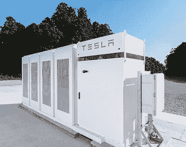

  图 9.6：在日本安装的 Tesla Powerpack

  来源：[`www.tesmanian.com/blogs/tesmanian-blog/tesla-powerpack-in-japan`](https://www.tesmanian.com/blogs/tesmanian-blog/tesla-powerpack-in-japan)

  例如，Tesla Powerpack 是一种锂离子电池存储系统，用于存储多余的绿电并在需求高峰期向电网供电。这再次降低了我们对化石燃料的依赖并稳定了电网。

现在，我们对什么是绿色能源、它对未来的承诺以及最令人兴奋的领域有了了解。是时候讨论可再生能源如何帮助未来的技术变得绿色了。

让我们从绿色区块链开始。

## 介绍绿色区块链

正如我们在章节开头讨论的，`Bitcoin`区块链的碳足迹超过了整个国家一年的总量，自`Bitcoin`出现以来，这几乎一直是区块链可持续性争论的核心。尽管科技和金融爱好者很快指出，`Bitcoin`用例的成功和广泛的必要性（即促进全球范围内去中心化的点对点交易）足以抵消了其高能耗的缺点，但对绿色区块链的呼声仍在加密社区中流传。

在`Ethereum`（它曾与`Bitcoin`使用相同的共识机制，因此能耗也相似）切换到不同的共识系统以采用更环保的方法后，这种需求被放大了。

## Bitcoin 的能耗

`Bitcoin`的共识机制是工作证明（Proof of Work），它利用挖矿机制在其网络上实现共识和去中心化。工作证明（`PoW`）可以通过下图 9.7

图 9.7：工作证明形成

来源：[`levelup.gitconnected.com/bitcoin-proof-of-work-the-only-article-you-will-ever-have-to-read-4a1fcd76a294)`](https://levelup.gitconnected.com/bitcoin-proof-of-work-the-only-article-you-will-ever-have-to-read-4a1fcd76a294))

向权益证明（`PoS`）共识机制过渡是解决`Bitcoin`可持续性挑战的可行方案。

目前，在`Bitcoin`的`PoW`中，矿工正在竞争解决复杂的数学题，以验证链上的交易并创建新区块。所有矿工都运行强大的计算机来执行这些计算，每轮中第一个解出谜题的人获得向区块链添加新区块的权利。这一过程自然需要大量的计算能量，虽然提供了去中心化和安全性，但也引发了环境担忧。

虽然`PoW`拥有十年的历史来证明其在运行今天最大的区块链网络方面的有效性，但其能耗激发了人们对环境影响较小的替代共识机制（如`PoS`）的兴趣。在`PoS`中，参与者不需要整天运行高功率计算机来添加新区块；他们只需要锁住其原生加密货币持有以获得网络权益，并为存款赚奖励。

已知最早且运行的`PoS`算法应用用于加密货币`Peercoin`背后的区块链；那是 2012 年的事了。虽然`Peercoin`并没有获得广泛认可，但从那时起诸如`Cardano`和`Algorand`等热门区块链，它们从诞生之初就实现了`PoS`。

`PoW`与`PoS`以及可持续绿色区块链的真正争论在`Ethereum`转换到`PoS`后才开始。


`Ethereum`是一个规模与`Bitcoin`相当的网络，并且是去中心化金融和众多区块链项目的中心。在`Ethereum`转换到`PoS`之前，许多人认为像`Bitcoin`这样的大网络无法像较小网络那样平滑地通过共识转换来维持可持续性，且区块链的去中心化性质可能会因此遭受损害。

第一个理由被`Ethereum`大规模且平滑向权益证明的转型所抵消。通过转向权益证明，`Ethereum`成功减少了其作为工作证明网络99%以上的能耗。

然而，关于第二，加密社区的大部分人认为`PoS`不如`PoW`那样去中心化。这是因为在`PoS`区块链中，拥有较高权益的人可以竞争成为验证者，并有机会被选中添加新区块。事实上，在`Ethereum`这样的区块链上，你的权益越高，被选中的机会就越大。这就是为什么在网络中拥有较高权益的验证者群体可能具有控制区块链的权力。

例如，`Lido`是一种流动性质押解决方案，目前占据了区块链上31.9%的所有质押`ETH`。这一比例高于任何其他平台或个人，因此对`Ethereum`的去中心化构成了潜在威胁。在图9.4中，你可以看到其他平台与`Lido`相比的质押`ETH`数量。因此，现在理论上尽管`Bitcoin`规模巨大完全转向`PoS`或任何其他低能耗共识机制是可能的，但在去中心化方面可能需要做出妥协。考虑到`Bitcoin`已经获得主流认可，以至于在萨尔瓦多成为法定货币，且许多其他国家也有支持`Bitcoin`的政客执政，这种网络风险对许多人来说可能是不可接受的。

现在让我们讨论绿色区块链的解决方案，以及如何在限制碳足迹的同时确保去中心化。

绿色区块链本质上是指那些不会对气候变化产生显著影响的区块链。以下是`Bitcoin`这样的区块链可以变绿的一些方式：

- 网络参与者可能在个人层面做出有意识的决定，仅使用绿色能源。
- 必须选择一种在处理和记录交易之初不需要大量能量的共识机制，这样网络中的利益相关者就不必在个人层面管理碳足迹。然而，正如我们讨论的，这可能意味着在安全性上有所妥协。

使用绿色能源为区块链挖矿提供动力，可以保留`PoW`驱动网络带来的独特价值。为了实现这一点，需要以下两个条件：

- 使可再生能源变得更廉价、更易获得。
- 存在监管要求以促使矿工采用绿色能源。

太阳能、水能、潮汐、地热和生物质等替代能源已经在开发中。同时，通过核能产生的能源出奇地处于启动绿色比特币挖矿的前沿。2023年3月，`TeraWulf`（`WULF`）在`Nautilus Cryptomine`设施启动运营，这是美国首个核能驱动的比特币挖矿设施。据报道，该基础设施有约8,000台矿机在线，代表算力或哈希率约为每秒1.0兆哈希（`EH/s`）。

使用核能开采比特币（或任何其他工作证明加密货币）具有许多益处，包括：

- 核能提供了所有电力资源中最高的能量容量。
- 核能还具有极高的可靠性；无疑比更不可预测的风能或太阳能更高。
- 核裂变效率极高，提供的能量是传统化石燃料方法的约8,000倍。
- 核能成本与更传统的来源相比具有竞争力，使其成为对成本敏感的人来说比其他可再生能源方案更好的替代方案。
- 尽管许多人对核能的危险持有误解，但事实是这种资源释放的辐射比任何其他来源少得多。事实上，研究表明，即使是最糟糕的核电事故造成的伤害也比工业事故小。

虽然绿色比特币/绿色区块链的广泛采用仍取决于个人用户，但确实有几种可持续方案正待探索。事实上，许多比特币社区成员已经在利用绿色能源，例如东非的地热能和萨尔瓦多的火山活动。

与此同时，今天活跃的区块链中约40%使用了`proof of stake`或其他`PoW`以外的共识机制。这证明了绿色区块链通过绿色能源的使用和低能耗共识机制的结合在未来是可行的。

## 绿色区块链示例

如今的一些绿色区块链包括`Cardano`、`Solana`和`Polkadot`。这三者区块链都放弃了`PoW`，选择了诸如`PoS`、`proof of history`等更新的共识系统。

探索的下一个前沿是AI和可再生能源，因为绿色能源显著增强了AI机制的可持续性。

## AI与可再生能源

虽然AI公司负责界定并减少它们的碳足迹，但用户也应该主动寻找相关信息，并选择支持那些积极关注环境因素的项目。

正如我们在章节开头讨论的`ChatGPT`，如果你仔细考虑，`ChatGPT`查询使用的能量比`Google`多是理所当然的。向`ChatGPT`提问时，你预期的输出只有在模型运行等同于多次`Google`之后之后产生。然而，尽管`Bitcoin`有理由使用`PoW`来保护其去中心化网络，但可持续性因素不容忽视，这是一个类似的例子。

随着`ChatGPT`、`Midjourney`等应用程序变得容易获取，AI的碳足迹呈指数级增长；到2023年底，`ChatGPT`记录了约1.805亿用户。环境影响问题无法再忽视。

## AI模型对环境的影响

以下是AI模型如此高能耗的原因：

- 随着`ChatGPT`、`Midjourney`等应用变得触手可及，AI的碳足迹呈指数级。此外，正如国际能源署建议的，全球AI数据中心消耗了大量水。
- 在训练模型时，许多数据中心仍使用化石燃料能源，导致了温室气体排放。
- 例如，2021年，`Google`的全球数据中心消耗了约43亿加仑水。这帮助`Google`减少了约30万二氧化碳足迹。
- 尽管许多人仍对核能危险持有误解，但事实是这种资源释放的辐射远低于任何其他来源。事实上，研究表明，最糟糕的核电事故造成的伤害仍比工业事故小。

虽然绿色比特币/绿色区块链的广泛采用仍取决于个人用户，但确实有几种可持续方案正待探索。事实上，许多比特币社区成员已经在利用绿色能源，例如东非的地热能和萨尔瓦多的火山活动。

与此同时，今天活跃的区块链中约40%使用了`proof of stake`或其他`PoW`以外的共识机制。这证明了绿色区块链通过绿色能源的使用和低能耗共识机制的结合在未来是可行的。

## 实现绿色AI

对于冷却设备，许多AI数据中心也需要大量水而非空气。水冷数据中心被证明比风冷数据中心节省10%的能量，因此产生更低的碳足迹。

例如，根据微软的2022年环境可持续性报告，其全球用水量从2021年的470万立方米增加到2022年的640万立方米。这相当于约17亿加仑水，很可能是归因于其AI研究。

正如你可以评估的，虽然这降低了大型AI公司留下的碳足迹，但它消耗了全球关键的水源，危及水生生物。有多种解决方案。

嗯，首先，使用可再生能源为数据中心提供动力是绿色未来解决方案的一部分。此外，我们可以在审慎考虑后选择使用AI服务。特别是对于生成式AI，专家认为，为了个人娱乐/利益而创建休闲博客文章和图像并非此类高能耗工具的最佳用途。作为用户，我们必须专注于在医学、医疗保健以及灾害控制等关键领域充分利用AI的能力，利用其预测和决策能力。

再次，正如区块链一样，在个人层面承担责任是我们必须努力的目标。

现在，这里有一个我们以前可能没有深入思考的新视角。区块链和人工智能受益于绿色能源和技术的使用，但两者也有所回馈。话话实说，让我们探索一下这两种未来技术为可再生能源提供的解决方案。

## 绿色能源中的区块链

正如我们在《实现绿色区块链》中讨论过的，在将可再生能源普及到大众方面仍然面临挑战。这些挑战与绿色能源的成本和可用性有关。在理解区块链在可再生能源中的应用之前，让我们先探索仍然存在的挑战。

### 针对绿色能源挑战的区块链解决方案

以下是区块链在可再生能源领域的解决方案范围：

- 由于其固的不稳定性，处理可再生能源面临挑战。例如，太阳能和风能发电波动，为电力公司确保稳定的能源供应带来了困难。毕竟，可再生能源产生的波动会影响电网稳定性。
- 绿色能源供应链缺乏透明度会导致对来源和真实性的质疑。此外，验证可再生来源需要成本，因为需要来源证明。不用说，这是可再生能源特有的挑战，因为传统能源不需要此类证明。
- 高效且透明的机制是实现便捷、优化的对点能源交易的必要条件。
- 激励个人生产者将多余能源输入电网，是另一个保持绿色能源供应高效的需求。
- 碳信用市场缺乏透明度和问责制是另一个与绿色能源部门相关的问题。
- 最后，为可再生能源项目筹资金可能会遇到困难。

现在我们看到了区块链如何解决这些问题，尽管你可能已经有了概念。

### 区块链解决方案

以下是区块链为绿色能源提供的解决方案：

- 区块链上的智能合约可以促进去中心化的电网管理，优化能源分配并实时平衡供给。
- 透明且不可篡改的区块链日志确保了可再生能源来源的可追溯性，防止任何欺诈并为消费者提供有关能源来源的可验证信息。
- 区块链的透明度和可追溯性消除了对昂贵外部验证的需求，使可再生能源更具经济可行性。通过在区块链上安全地记录可再生来源，降低了相关的证明，促进了更广泛的应用并可能降低消费者的价格。
- 正如我们所知，智能合约实现了去中心化的能源交易，允许拥有可再生来源的消费者在安全透明的平台上将多余能源直接卖给其他用户。
- 代币化和智能合约可以为能源供应商创建一个代币激励系统，奖励他们贡献剩余能源并支持去中心化的能源网络。
- 区块链可以增强碳信用交易的透明度和可追溯性，确保减排努力的合法性。
- 通过区块链平台的代币化和众筹实现了可再生项目的碎片化，使投资民主化并为所有此类项目提供去中心化的资金。

区块链在绿色能源领域还有其他用例，例如区块链的去中心化分布式特性通过降低单点故障或网络攻击的风险，增强了电网的韧性和安全性。通过解决绿色能源计划的所有问题，区块链技术总体对可再生能源的进展和更广泛的应用贡献巨大，使向可持续和去中心化能源系统的转型变得可行。现在，是时候看看人工智能的贡献了。

### 绿色能源中的人工智能

直觉告诉我们，列出至少两个在绿色能源中有用的人工智能方面：决策自动化和对人类员工的帮助。

让我们探索AI在可再生能源中可以帮助的领域领域：

### 用于自动决策的AI

通过自动决策，计算机系统可以在没有任何人工干预的情况下处理信息并做出决策。通过这样，计算机处理复杂任务的速度比人类快得多，而且节省了时间和精力的等宝贵资源。例如，可以雇用自动化AI系统为`PV`电站安排预防性维护。

### 用于辅助决策的AI

现在，自动决策可能会带来受训练数据影响的各种偏差，导致可能危险的错误决策。因此，并非所有可再生能源领域都能利用自动决策。然而，AI对于辅助决策仍然很有帮助。

通过这种方式，实际决策的责任取决于更了解情况的人类，他们可以更灵活地适应不同的环境。此处的AI仅负责提供可以增强决策过程的见解并提出建议。因此，人类和计算机可以合作，结合他们的知识、经验和分析能力。示例包括必须进行细致决策的领域，例如在项目定稿之前，对不同太阳能和风能场址进行环境影响分析。

### 用于识别风险和机会的AI

图像识别（我们之前讨论过的AI技术的一个部分）可以验证数据。因此，开发者和投资者可以使用此技术结合相关算法，从计划中的项目中找出所有可能的风险和机会。事实上，智能算法可以为开发者生成现金流模型，以理解项目的潜力。由于项目建模过程可以完全自动化，AI可以进一步识别盈利且可能成功的项目，并让团队中的人类部分完成交易以实现最高效率。

### 跨电厂输出优化的AI

AI程序可以引入ML天气模型、历史数据和气象站的实时信息，结合卫星图像、传感器和摄像头，来规划和优化跨电厂的所有流程和输出。良好的天气预报可以实现对传统发电机最有效的管理，并减少启动和关闭机组的成本。通过这种方式，电厂可以根据天气变化调整预期输出。

- `AI`在预测功率输出方面的作用：这不言而喻，但`AI`系统也可以利用风速等预测，对几分钟内的短期输出进行预测。通过集成`AI`，可以更容易管理电网稳定性和分配，从而优化电厂流程并安排维护计划。

由于可再生能源领域本身是一个处于上升期的行业，与已经拥有既定流程的成熟行业相比，该行业更容易采用`AI`和`blockchain`等新兴技术，并围绕这些技术构建一整套流程作为其固有的一部分。当然，相反的情况也是如此。`Blockchain`和`AI`都是处于发展的领域，可再生能源的使用可以很好地整合，而无需对现有协议产生过多的更改。

## 结合绿色能源与新兴技术的挑战

现在，让我们讨论一下在将绿色能源整合到`blockchain`和`AI`中（以及反之）时，我们可能需要处理的问题：

- `AI`系统中的算法偏差可能导致错误的决策，这可能引发灾难性规模的后果，正如我们在“绿色能源中的AI”中所讨论的那样。
- 集成`AI`和`blockchain`来优化可再生能源的发电和供应可能会导致许多人失业。这是今天所有新兴技术共同存在的问题，只有通过开发者/公司负责人和管理层发掘人性，并在考虑工人/对其进行技能提升培训的同时优化工作流和成本，才能解决这个问题。
- 数据安全是`AI`参与绿色能源时的一个重要方面，可以通过实施有关数据匿名化的严厉政策，并确保训练和决策流程的透明度来解决。
- 当在个人层面采用绿色能源时，`blockchain`矿工甚至`AI`开发者都会希望利用他们可用的最廉价的源，而这通常是化石燃料产生的能量。这一问题只能通过让绿色能源更廉价、更容易获得，并增加销售/消耗绿色能源的激励机制来解决。
- 即使大型`AI`公司运营的`blockchain`网络/数据中心使用绿色能源，它们也可能给发电机带来压力，并夺走其他关键设施的能量。从长期来看，这可能会缓慢整个经济向可再生能源效率的转型。

随着`AI`和`blockchain`逐渐与可再生能源更加交织，这些问题仍留待未来解决。

## 结论

可再生能源是我们世界的未来，现在是时候有意识地对抗气候变化和全球变暖了，以便我们的后代能够生活在一个健康的世界中生存。这正是为什么未来的技术如果不将绿色能源内化为自身不可的一部分，就无法成长。我们希望本章已经向你介绍了绿色能源的所有基础知识：它是什么、如何生产、它如何能够帮助`blockchain`和人工智能等新兴技术，以及反过来得到它们的帮助。

在下一章中，我们将学习书中讨论的技术的隐私和安全考虑——从`AI`和机器人领域的隐私到基于`blockchain`的系统的安全性。

## 问题

1. 什么是可再生能源？

   答案：可再生能源或绿色能源是任何源自自然再生资源的能量。示例包括太阳能和天然气。

2. 可再生能源是如何产生的？

   答案：通过物理基础设施利用自然资源将其转化为能量；例如，使用太阳能板。

我们这次的目标是首先理解AI和机器人技术带来了哪些特定的安全和隐私考量，然后进入这两个领域的开发者如何旨在解决这些问题。此外，我们将探讨区块链的许多功能，这些功能可以在无信任环境中确保安全的数据传输和记录。我们的最终目标是通过几个示例，理解去中心化机器学习网络如何工作，以实现更好的数据安全性和真实性。

## AI中的隐私与安全问题

让我们从AI开始，这项技术因其输入AI系统的数据（用使其能够执行各种操作）引发了关于隐私担忧而饱受最多的批评。AI存在哪些具体问题？它如何影响人类的隐私和安全？

## AI与隐私问题

以下是对上述某些问题的简要回顾：

- 侵犯版权和知识产权法：AI模型从全球网的深处获取数据进行训练。在此过程中，使用了来自不同创作者的受保护作品和知识产权。由于训练过程缺乏透明度，此类创作者很少能在AI模型被非法训练之前提出异议。随着AI模型随时间的推移变得越来越精细，甚至其创造者也失去了对它们所消耗的数据以及此类行为合法性的控制。
- 偏见和缺乏公平性：AI算法可能会从输入的数据训练数据中继承偏见，这可能导致潜在的歧视性结果。这会导致公平性问题，例如在招聘或贷款等应用中。
- 未经许可使用生物识别信息：随着智能手机时代的到来，使用生物识别数据保护设备对我们大多数人来说变得越来越普遍。现在，随着这一功能的便利性，也出现了一个紧迫的问题：公共监控设备可能使用AI扫描生物数据以有效检测人员，包括监控摄像头、人脸或指纹扫描仪以及识别声音的麦克风，它们还可以存储这些数据。现在，对于AI公司如何使用这些收集的生物识别数据几乎没有任何规定。通常，这些数据是由AI在未经我们同意的情况下收集并存储的——可能导致我们在不知情的情况下发生安全泄露。
- 使用任何所有用户数据：除了为了训练AI模型而违反用户隐私外，此类系统还可以被程序化记录用户输入的查询数据，并将其用于未来的训练。因此，用户与AI模型共享的任何数据都有可能被系统在未经同意的情况下用于未来的输出。当用户在查询中输入敏感数据时，这种情况尤为危险。
- 使用公共记录：各种公司和个人的公共记录（数字化的或其他形式）经常被用于训练AI模型。因此，AI可以在未经特定同意的情况下收集有关任何实体的当前和之前的信息，并将其作为AI系统生成的输出的一部分。
- 安全数据存储：AI中使用的大型数据集需要安全的存储和传输。未能实现这一点将导致数据泄露。
- AI模型缺乏安全协议：今天使用的许多AI模型没有内置的安全协议，这意味着恶意行为者有机会不公平地访问其他用户的个人信息。此外，AI模型可能会受到攻击，例如通过操纵输入来欺骗AI系统。确保AI模型的安全至关重要。
- IoT与AI的集成及相关安全问题：IoT设备将成为我们日常生活的一部分，由于AI集成到IoT设备中，这些设备的安全漏洞可能会导致数据泄露和对连接系统的未经访问。
- 深度伪造（Deepfakes）：AI可以生成令人信服的深度伪造视频和音频，最近几位公众人物的情况就证明了这一点。这使得区分现实与操纵内容变得具有挑战性。因此，AI可用于传播虚假信息。
- 缺乏正确的法规：大多数国家没有为AI公司训练和构建AI模型定义一套规则，这意味着没有正确的方法来让相关方对全球范围内用户的隐私和安全违规行为负责。到为止，AI公司被允许在透明度有限的情况下自行决定它们的数据记录和存储策略，而且遵循网络安全措施也取决于它们自己的选择。

此外，AI在监控和监测中的应用引发了关于隐私权的伦理问题。在智慧城市和任何公共空间，这是在主流AI使用出现之前需要解决的另一个疑虑。

## 解决与AI相关的隐私和安全担忧


如果你想一下，如果相关的 AI 公司选择遵循伦理标准，并在各自模型的训练过程中选择透明化，并声明它们选择了哪些数据来丰富模型，上述大多数问题就可以得到解决。然而，在没有合适法规的情况下，无法保证会遵循最佳实践。

然而，AI 公司在此可以采取以下关键步骤来解决 AI 安全问题：

*   对 AI 系统使用的任何所有信息进行数据加密，以便其在存储和传输过程中免受泄露影响。
*   在 AI 模型训练期间，可以使用联邦学习和多方计算等技术进一步保护数据隐私。
*   使用相关输入对 AI 模型进行常见网络攻击的测试，以根除并消除漏洞。
*   在开发前规划并坚持伦理 AI 指南，并考虑公平性、问责性和透明度等因素。
*   为了放大透明度因素，确保构建的 AI 模型是易于解释的，这样用户就可以理解需要收集哪些数据，以及为什么以及如何做出决定。这将帮助他们提供相关的许可并保留个人信息。
*   定期发布透明度报告，让用户了解他们的数据是如何使用的。
*   尽量减少收集的数据，并删除或至少限制对个人数据的保留。
*   作为原则，永远不要将用于业务/个人的任何敏感信息作为 AI 模型的训练数据。
*   应让用户意识到他们输入和共享哪些数据，以及在与 AI 模型交互时永远不要什么类型的数据。
*   确保用于访问 AI 服务的任何`APIs`安全的并具有防止黑客的最大保护。
*   规划治理框架和监督机制，以监控 AI 模型并确保所有涉及的过程符合隐私和安全要求。
*   这不言而喻，但严格限制对敏感数据和整个 AI 系统的访问。
*   必须定期进行安全审计和漏洞检查，以识别或预测 AI 中的漏洞。
*   此外，AI 系统应根据所需的新的安全协议进行更新，以获得最大的保护。
*   发生任何安全问题时，你应该有一个灾难响应计划，并构出清晰的恢复程序。
*   此外，与同行以及监管机构合作，以确定 AI 安全挑战的集体最佳实践。

除了这些通用方法外，制定与你组织想要建立的文化相适应的 AI 最佳实践，并考虑到用户的隐私预期也至关重要。此外，关注新类型的网络攻击、法规和全球实践，以适应不断变化的技术格局，也是必不可少的。

## 现实案例：生成式 AI 与安全问题的解决

在学习机器人技术及相关的安全问题之前，让我们先来看看新兴生成式 AI 的案例，它面临着哪些特定问题，以及这里的安全问题是如何解决的。

### 生成式 AI

生成式 AI 是人工智能的一个子领域，它利用现有数据集来识别模式和示例，以生成新的信息、图形化表示等。正如`ChatGPT`一样，生成式 AI 可以根据查询生成文本，并进一步帮助创建图像、设计、音频和视频文件等。在`Figure 10.1`中，你可以了解生成式 AI 机制的工作原理：

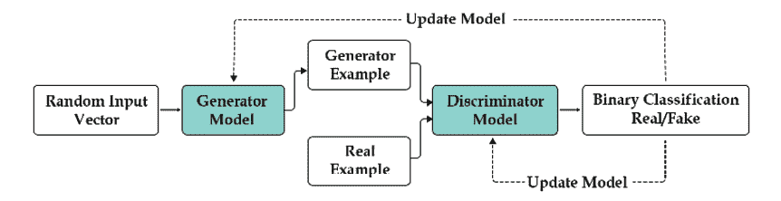

图 10.1：生成式 AI 的工作

### 生成式 AI 中的隐私与安全担忧

像`ChatGPT`这样的生成式 AI 模型可以记录与用户交互期间输入和生成的数据。正如你可能意识到的那样，生成式 AI 模型可能会接收个人数据，并在稍后以输出的形式可能发布收集到的任何敏感信息。因此，在训练生成式 AI 时使用敏感数据（从财务信息到医疗记录或其他任何其他隐私数据）可能会导致隐私问题，并使许多实体面临风险。

### 解决与生成式 AI 的隐私问题

正如`ChatGPT`的母公司`OpenAI`所做的，在构建生成式 AI 模型时，用户隐私和数据安全应该是两个最重要的因素。`OpenAI`对收集的数据进行匿名化并聚合，以降低根据之前的输入识别个人的概率。此外，他们仅短期保留收集的数据，并采取安全措施防止泄露，同时遵守相关的数据隐私法规。

以下是解决与生成式 AI 相关的隐私问题的最佳实践：

*   培训员工和用户负责任地使用该工具。必须传达维护隐私的特殊性。员工应该知道操纵个人用户数据的风险，而用户应该知道哪些数据可以作为输入，哪些数据不应该。
*   像`OpenAI`那样对数据进行匿名化和最小化数据收集是重要的，同时实施数据安全协议也很重要。
*   对数据隐私法规的合规应该是持续的，还要进行频繁监控。

再次，正如`OpenAI`的案例清楚所示的，保护数据隐私和确保安全很大程度上取决于 AI 公司为特定目的构建系统。

## 机器人技术中的隐私与安全问题

回到机器人，这项技术带来了与人工智能类似的隐私担忧，尤其是随着两种技术之间交织程度的增加。

### 机器人与隐私及安全问题

与机器人相关的安全担忧有很多，可能会影响部署的机器和周围的人。来自贝贝鲁特大学和布尔艮-弗兰奇-康芒特大学的特定研究人员在题为`机器人网络安全：漏洞、攻击、应对措施和建议`的报告中概述了了其中一些挑战：

*   缺乏安全网络：缺乏受监管的安全协议可能会干扰人类与机器人之间的通信，并可能为不同的网络和物理威胁留出空间。
*   身份验证缺陷：未能遵循正确的身份验证措施，并使用弱密码代替`TLS/SSL`或`SSH`机器身份，可能导致机器人系统受到未经授权的操纵。
*   隐私和机密性担忧：弱加密算法可能导致缺乏机密性，这可能会导致敏感数据和设计计划处理不当。此外，缺乏适当的安全措施可能会使敏感的个人数据和知识产权遭受未经授权的泄露。
*   缺乏完整性：这可能源于实施了弱的消息身份验证协议，这些协议可以被轻易破解，再次导致对存储或传输过程中的敏感数据处理不当。
*   机器身份验证：没有稳健的机器身份验证系统可能会导致权限滥用和对机器人系统的未经授权访问。
*   物理访问限制：应该对物理访问进行限制，以防止未经授权访问构建机器人的实验室控制设备及其工作环境。
*   安全设计：应该建立这些设计以防止对人类和环境的任何危害，缺乏这些可能会导致前所未有的伤害。
*   设计安全特性：缺乏这些特性可能导致攻击者入侵机器人的结构和设计以利用任何漏洞并引发后续攻击。这种威胁可能导致数据投毒和其他机器人系统的其他不伦理更改。

### 解决与机器人相关的隐私与安全担忧

现在，机器人技术领域有很多威胁和挑战需要解决，以防止对敏感信息的未经访问以及对机器人周围人类和环境的物理伤害。让我们看看如何实现：

*   应该为机器人、控制器和任何其他连接设备之间的连接建立安全的通信协议。这应该阻止数据拦截。
*   机器人和授权控制系统之间传输的数据应该加密。对于存储的数据也可以采取相同的措施以防止未经授权的访问。
*   应该实施严格的访问控制，以限制对机器人系统的物理或远程访问。只有授权的人员才能访问机器人控制接口。
*   可以使用多因素身份验证来确保只有具有访问权限的人才能与机器人交互并访问存储的敏感信息。
*   可以采取物理安全措施保护机器人免受任何操纵或盗窃。
*   机器人内部也可以构建安全的身份验证机制，确保它们只能遵循来自身份验证源的命令。
*   像 AI 系统一样，机器人指定的工作区域应收集并存储最少的数据。
*   机器人软件应该定期更新，以跟上新的安全措施并更新以现有漏洞。
*   可以在机器人系统的设计和开发过程中考虑隐私问题。例如，可以实施数据匿名化和数据收集最小化（特别是对于个人的任何可识别信息）。
*   可以保留日志以查找谁访问了机器人的数据和控制系统，以便立即发现未经授权或异常的活动。
*   对机器人进行针对威胁和漏洞的定期安全审计和评估，以根除任何被利用的空间。
*   建议为机器人系统开发个体的伦理框架，重点关注透明度、公平和问制等因素。

与应对 AI 伦理考量的措施类似，机器人面临的隐私和安全挑战需要开发者采取主动的方法。同时，密切关注不断演变的法规和威胁，并采用新的实践以确保透明度和真实性至关重要。

## 区块链与数据隐私

与上述两种技术相比，区块链到目前尚未引发许多伦理考量。然而，当区块链与 AI 和机器人结合时，某些元素可以增强数据隐私和安全。

## 去中心化以确保数据安全和真实性

以下是区块链通过去中心化支持数据隐私的某些特性：

- **区块**：区块链数据存储在虚拟区块中，所有交易都带有时间戳并由创建者签名。此外，每个区块的头部都包含一个唯一标识符，区块按时间顺序保留在链上。区块的不可篡改性通过防止篡改进一步确保了数据的真实性。
- **透明性**：区块链的透明性有助于追踪任何数据的来源，以及与之交互过的用户。这无疑解决了 AI 和机器人系统的可追溯性和透明性需求。
- **哈希**：区块链上的所有区块都包含前一个区块的加密哈希值，这有助于维护上述的时间顺序，并使配备的系统能够威慑操纵数据的坏分子。
- **去中心化**：区块链的去中心化意味着没有单点故障。全球节点网络确保攻击者无法完全击垮整个网络并攻击存储的数据。
- **数据加密**：区块链上的数据加密确保了存储在网络上的数据任何未经授权的人无法访问。
- **共识机制**：区块链的任何更改都需要大多数节点的共识才能执行。这意味着，在不通知整个网络发生更改的情况下，无法进行任何未经授权的修改，从而防止了大多数网络攻击。
- **公钥和私钥**：区块链上的每个节点都获得一个公钥和一个私钥，前者用于接收交易，后者用于授权交易。这有助于确保用户安全的同时，仍可以将转账追溯到源头。

通过这些特性，区块链可以在无信任、去中心化的环境中确保数据安全传输，从而消除 AI 和机器人的大多数隐私和安全考量。通过区块链，你可以确保数据的真实性、限制授权，并通过警报整个节点网络来最大限度地加强防止安全泄露的保护。通过区块链共享的数据可以保持安全并仅供授权的人员访问；此外，还可以向共享数据添加匿名性因素，相应节点使用其私钥对交易签名，而不是公开其姓名。

在接下来的章节中，我们来看看区块链、AI 和机器人的结合如何在未来定义数据安全和隐私，并解决各自的考量。

## 区块链、AI 与机器人中的数据安全与隐私

如果我们从深度伪造（deepfakes）问题开始，区块链凭借在数据共享和记录方面的不可篡改性和可追溯性，能够停止 AI 生成假图像或其他媒体文件。随着区块链和 AI-机器人技术组合市场的扩张——预计到 2032 年，全球区块链 AI 市场价值将达到 35.1923 亿美元——区块链的各种特性继续带来新的数据安全和隐私措施。

让我们来看看一些创新的基于区块链的项目如何在此领域实现数据安全和真实性：

- **去中心化自治组织（DAOs）**：VIDT DAO：一个名为`VIDT DAO`的区块链开源平台，致力于引入区块链的去中心化时间戳技术，以保护证书、固件和 AI 结果等虚拟数据，并验证其真实性。该平台的原生代币被称为`VIDT token`，用于提供跨组织的数据验证和治理权限。

    其工作原理如下：`VIDT 持有者`对其想要保护的文件盖上时间戳，然后发起交易将文件和所有相关细节记录到多个区块链中。

    该平台还将其服务扩展到`FileValidator`，该工具允许你以最符合用户的方式为文件盖上时间戳。

    现在，`VIDT DAO`如何帮助 AI 和机器人应用？`FileValidator`可以利用其技术为 AI 提示词及其结果盖上时间戳，从而为 AI 模型保留透明且不可篡改的记录。

- **与 Fetch.ai 的无信任数据交换**：你可能在之前的章节中记得这个平台。`Fetch.ai`利用区块链、机器学习和多智能体系统等技术来增强数据的真实性、隐私性和安全性。

    这家 AI 公司为自主服务提供了安全的基础。通过`Fetch.ai`，用户可以构建并连接不同平台的智能体，以自动化常规任务或其他任务。`Fetch.ai`允许用户在 AI 和自动化的帮助下在多个领域创建开放服务，ML 网络确保了由区块链驱动的数据安全、隐私和真实性。

- **市场智能中的 AI：LunarCrush**：在另一个略有不同的例子中，`LunarCrush`是加密资产智能平台，它利用 AI 分析不同社交媒体平台上的实时大数据，为加密货币提供实时市场洞察、分析和预测。这即使让加密领域的新手也能做出明智的交易决策，并让经验丰富的者避免受虚假新闻影响和做出仓促决策而掉入陷阱。

上述三个项目都有助于确保区块链、AI 和机器人领域的数据真实性和安全性，同时将虚假信息隔绝之外。这表明，虽然新兴技术有自己需要处理的安全和伦理考量，但它们仍然可以用于推动未来的去中心化时代，提供用户安全、透明性、真实性和问责制，为我们所有人带来更好的未来。

## 结论

总之，AI 和机器人都在数据安全、隐私和真实性，以及访问授权和伦理问题方面带来了挑战。然而，一旦与区块链结合，不仅可以解决这些问题，在去中心化、无信任环境的安全数据传输和存储方面还会开启全新的领域。正如我们本章最后一节的三个示例所示，与我们目前的系统相比，去中心化的 ML 网络确实可以带来更好的数据真实性和安全性。

在下一章中，我们将讨论区块链、AI 和机器人的行业应用，以及一些案例研究。此外，我们将深入探讨结合技术带来的伦理和法律影响，以及从法律和其他观点来看仍然面临的挑战。请关注！

## 问题

1. AI 有哪些安全考量？

答案：未经许可的情况下使用生物识别数据、侵犯版权和知识产权法以及缺乏安全协议是一些主要的考量因素。

2. AI 公司可以采取哪些措施来消除 AI 中的隐私和安全挑战？

回答：针对常见的网络攻击对 AI 模型进行测试、发布透明度报告以及放弃使用敏感信息可以有所帮助。

### 3. 什么是生成式 AI？如何解决由其引起的特定安全挑战？

回答：生成式 AI 是 AI 的一个子领域，它利用现有数据集来识别模式，并根据给出的指令生成新的信息、图形化表示等。

数据匿名化、最小化数据收集以及遵守数据隐私法规可以帮助生成式 AI 更加安全。

### 4. 机器人技术带来了哪些安全和隐私考量？

回答：加密算法薄弱导致的机密性缺失以及监管安全协议的缺陷是两个紧迫的问题。

### 5. 我们如何致力于解决与机器人相关的隐私和安全问题？

回答：对机器人与授权控制系统之间传输的数据采用安全通信协议和加密有助于解决这些问题。

### 6. 区块链哪些特性可以确保我们与 AI 和机器人系统的交互安全？

回答：区块链可以确保数据的透明度，追踪其来源以及所有相关的交易。此外，区块链遵循的加密原理确保了存储在上面的数据未经授权的人员无法访问。

### 7. 请举例说明区块链、AI 和机器人技术结合，如何在信任环境中确保安全的数据交换和存储。

回答：`Fetch.ai`利用区块链、机器学习和多智能体系统，致力于确保数据的真实性，并消除隐私和安全担忧。

# 第 11 章 行业洞察与启示

## 引言

在上一章中，我们讨论了 AI 和机器人技术的隐私与安全考量，以及区块链如何介入解决大部分此类问题。然而，随着我们接近这本书旅程的终点，是时候讨论当今所有新兴技术面临的进一步的伦理和法律影响，以及阻碍它们进入普通大众生活的障碍了。此外，我们将讨论书中提到的所有技术的一些行业应用，并结合案例研究，以真正从视角上审视目前它们是如何被使用的，以及仍有哪些挑战待解决。

从监管的不透明到尚待解决的伦理困境，参与当今新兴技术的开发者无疑面临许多需要应对的问题。然而，在这些挑战找到解决方案的同时，AI、区块链、机器人技术和自动化已应用于全球各业。话话不多说，让我们进入这些示例。

## 结构

本章涵盖了以下主题：

*   AI、区块链、机器人技术和自动化的工业应用
*   围绕未来技术的伦理和法律问题
*   未来的挑战与障碍

## 目标

我们这次的目标是讨论书中述的新兴技术的行业应用，并配以一些案例研究。在此基础上，我们将探索 AI、机器人、自动化和区块链在通往主流成功的道路上所面临的伦理和法律障碍。在我们关注这些问题并探索如何解决它们的同时，也将展望我们作为社会成员可能需要提前准备的任何未来挑战。

## AI、区块链、机器人技术和自动化的应用

这四项技术已应用于各种工业用例中了一段时间。然而，在本章中我们将通过一些案例研究重点介绍某些特定的用例。让我们先从 AI 开始。

### AI 的行业应用与案例研究

AI 与物联网（`IoT`）紧密结合，AI 的工具和技术在许多工业用途中具有优势。让我们来看其中一些：

*   **预测性维护中的 AI**：这是 AI 工业用途最常见的用例之一，预测性维护基本上是利用机器学习等技术来确定特定地点（如工厂）的不同资产，或者可能是单个资产的不同部分运行是否良好。因此，这些资产能够预测何时需要进行维护。

    在这种用例中，预测性维护利用多个传感器读数、外部数据源等，对大量记录的事件进行分析。`ML`被进一步用于确定所监控资产的剩余寿命。

    真实案例：德国铁路运营商`Deutsche Bahn`（德铁）利用从铁路道岔收集的数据来预测任何故障。这帮助他们减少了意外延迟的发生。此外，`Nissan`（日产）运营着 AI 预测维护平台，以确定数千个资产的剩余使用寿命。该公司声称，在实施`AI`预测性维护后，非计划停机减少了 50%，且回收期短于三个月。

*   **制造流程优化中的 AI**：自主机器可用于各行业的制造流程优化。此处的智能机器人可以接手单调或危险的人工任务，从而节省时间和成本。在这些情况下，使用强化学习技术来训练机器人/任何自主机器，以便它们在实施后能够反复执行相关任务以确保准确性。

    真实案例：`ABB`在上海开了一家极其先进的机器人超级工厂，在那里机器人被用于制造更多的机器人。这些机器人的自主性由`AI`和“数字孪生”概念驱动；这个孪生本质上是一个利用真实世界数据创建模拟并预测特定产品/流程表现的计算机程序。

*   **质量检测中的 AI**：在质量检测中实施`AI`有多种方法，但自动光学检测可能是作为工业 AI 用例被使用最广泛的。在这种情况下，通过相机能够自主扫描设备，并测试是否存在可能导致故障的组件缺失或质量缺陷。当然，`Computer vision`（计算机视觉）是此处使用的 AI 技术组件。

    一旦接收到图像，将采用`ML`根据可能的故障对图像进行分类。同样，这种实施也节省了时间和成本，特别是对于大型制造设施而言。

    真实世界案例：一家德国汽车公司引入了由深度学习驱动的制造流程质量控制系统。该系统与最终组装过程集成，因此消除了对专门测试区域的需要。

*   **网络安全中的 AI**：`AI`最受欢迎的用例之一是通过网络威胁检测及后续流程来确保网络安全和隐私。在此处，`AI`系统观察网络基础设施，并通过对历史数据的分析检测异常/恶意活动。`AI`的工作范围进一步包括网络流量分析、恶意软件沙箱、终端检测与响应等。


# 供应链优化中的 AI

有多种方式实施`AI`来优化供应链活动，如下：

- 使用 AI 工具改进库存管理以减少延迟。
- 通过预测分析缩短库存规划时间并使成本最小化。
- 通过预测分析进一步优化维修并找出理想的订货点。

对于这些任务，使用的技术通常涉及时间序列分析、概率建模和模拟。

**真实案例**：大陆集团（Continental）创建了软件系统，用于预测其车队更换轮胎的理想时间。AI 模型可以执行从预测总里程并与基准进行对比，到启动行动的各项任务。通过该系统，大陆集团能够降低轮胎库存，从而提升了道路安全。

## AI 在设备和人员物理安全领域

谈到工业用例，AI 能够通过实时监控检测制造现场对设备和人员的物理威胁。AI 可以利用计算机视觉分析工人的动作并检测异常。例如，它可以识别工人是否未佩戴所需的安全装备，或者限制区域是否存在未经授权的人员。

此外，预测性分析可用于预见潜在的安全隐患，从而采取主动措施防止事故或伤害。配备 AI 技术的体穿戴设备还可以实时监测工人的体征，在发生健康紧急情况时提供快速警报。

## AI 辅助助手改进工作流

在制造业领域，可以集成语音助手，让工人访问任何信息，而无需编写精确指令或查阅长报告。AI 驱动的语音助手可以整合到实时监控系统中。此外，这些助手可以进化到理解上下文并为工人提供个性化帮助。通过这种方式，它们可以在复杂的组装过程或故障排除程序中提供分步指导。

与 IoT 设备的集成可以允许语音助手自主控制和监控机器，带来更精简的工作流。

## AI 在研发领域

AI 算法可以分析海量数据集以找出模式和趋势，帮助新产品和组件的快速开发。AI 驱动的研发可以实现各种组件的自动化设计。例如，生成式 AI 能够在限制时间内，根据成本、材料和性能等因素的预设规则，为特定应用开发出多种不同的设计。之后，只需选择最合适的一个即可。数字孪生和仿真的概念再次通过 AI 工具应用于此类场景。

## AI 在数据管理领域

数据通常存储在制造企业的多个系统中，导致很难在短时间内进行访问。然而，AI 驱动的数据管理系统可以自动从各种来源提取、清洗和整合数据，提供一个统一且易于访问的数据仓库。

## AI 在资源勘探领域

AI 可用于采矿和采石业，自动化资源勘探区域，简化勘探流程。配备 AI 图像识别功能的无人机可以高效地调查大面积区域，为选择采矿活动的最佳位置提供宝贵的见解。AI 还可以进一步用于自动化钻井数据分析，帮助识别有价值矿物并简化资源开采中的决策过程。

这些 AI 应用都贡献于工业流程的转型和效率的提高，使其能够应对动态挑战。随着技术的不断进步，AI 在工业运营中的整合可能会导致更多创新的用例，更不用说对现有应用的增强了。

现在，是时候学习区块链的一些行业应用了。

# 区块链的行业应用与案例研究

与 AI、机器人和自动化相比，区块链是一项较新的技术。然而，它已经在各个行业中找到了用武。让我们来看一些区块链工业应用和案例研究：

## 区块链优化供应链

对于企业而言，寻找可靠的供应商有时可能是困难的，导致供应链延迟和中断。进一步的担忧还包括对质量标准的遵守、对法规的合规以及对相关 ESG 措施的遵守。考虑到这些因素，寻找合适的供应商既耗时又昂贵，因为在不公开重要信息的情况下从供应商获取并验证数据是一项重大挑战。区块链可以被用于在增强隐私的同时简化数据共享，从而惠及所有参与方。

**真实案例**：供应商信息网络 Trust Your Supplier 为企业简化了供应商验证。他们与`IBM`合作创建了一个区块链应用程序，让企业能够安全、快速地与授权合作伙伴共享数据。该平台允许企业从第三方验证者处获得业务相关信息、财务数据或 ESG 数据的对进行认证。通过验证后，公司将获得一个基于区块链的企业数字护照。

据报道，这一用例将供应商的入驻时间缩短了 70% 以上，并将企业的数据验证成本降低了约 50%。

## 区块链助力汽车行业合规性

汽车行业特别有许多严格的法规需要遵守，包括安全规则、几何特征、所用材料质量、环境考量等。这些法规变化迅速，需要传达给多个层级的供应商，以确保所有设备都根据最新的指南进行制造。因此，确保合规性可能证明是困难的，区块链在这一方面可以再次为汽车制造商提供帮助。

**真实案例**：雷诺集团（`Renault`）也与`IBM`合作创建了一个可以以透明方式确保整个供应链合规的生态系统——这是汽车行业的首创。区块链应用程序跟踪汽车制造过程中涉及的所有组件，以确保符合合规性。据报道，这使不合规费用减少了一半，管理不合格或不合规的费用减少了 10%。由于该倡议已证明成功，雷诺集团现在计划进一步投资区块链，以准确估算产品碳足迹，并提高回收操作的可见性。

## 区块链助力国际贸易

在进出口中，国际贸易可能存在某些风险。进口商的预付款可能导致出口商带钱跑路而不发送承诺的货物；出口商如果先发货而进口商拒绝付款，也可能被骗。正如你可能猜到的那样，区块链在这里提供了很大的透明度，帮助进出口商进行受智能合约约束的去信赖交易。

**真实案例**：`Marco Polo Network`正在利用区块链创建一个平台，进出口商可以通过与供应链 ERP 系统集成，透明地共享与订单和交付相关的数据。该平台为双方创建了不可篡改的合同，确保在双方同意的条件下进行付款/供货，解决了所有信任问题。此外，数字交易结算的自动化减少了纸质工作并使过程更加高效。

## 区块链即时理赔处理

传统的理赔处理需要漫长的过程，理赔结算通常需要几周时间。为了加快理赔速度并减少等待的烦恼，区块链和智能合约可以再次投入用场。

**真实案例**：Etherisc 正在利用区块链技术实现理赔处理自动化，通过创建智能合约在满足特定预设条件时执行协议。第三方数据提供者负责确保支付协议的条款得到满足。因此，在通知相关保险供应商后，Etherisc 会审查初始的理赔调查和保单检查程序，从而提高了效率并缩短了理赔结算所需的时间。

## 用于食品质量检测的区块链

许多知名公司正利用基于区块链的应用来确保提供给终端用户的食品是新鲜的。一旦报告任何问题，区块链可以确保相关产品能够追溯到源头，并尽早识别和解决问题。

**真实案例**：这些示例之一是雀巢（Nestlé），他们希望让中国父母对其方方 NAN A2 的卓越品质感到放心。2008 年，中国有约 30 万婴儿因类似产品中的三聚胺而生，这就是为什么雀巢需要一种策略来赢得父母的信任。

雀巢与中国科技公司 Techrock 合作，创建了一个可以通过移动应用程序访问的公共区块链应用。这提高了透明度，并允许父母验证 NAN A2 的成分、来源、生产细节以及包装信息。这使得雀巢在中国婴幼儿配粉市场中占据了最大的份额。

## 用于能源分配的区块链

我们之前讨论过区块链去中心化技术在能源分配中的应用。在能源供需不平衡时，优化电力的分配是迫切的需求。在这种情况下，区块链可以帮助实现能源的点对点分配。

**真实案例**：TenneT 是一家总部位于荷兰和德国的能源输送运营商。该公司与 IBM 和 Sonnen 合作开发了区块链应用程序以优化电网。现在，储能系统可以连接到 TenneT 的电网数据库。分布式机制允许将电力供需的任何不平衡状态与利益相关者共享。然后，该应用程序允许连接的储能设备根据需要收集或释放能量，使能源分配变得高效。

## 用于追踪和共享知识产权的区块链

许多企业缺乏向潜在投资者展示其资产真实价值的机会，导致其被低估。然而，区块链可以用于知识产权的代币化并与意向方轻松、透明地进行传输。同时，区块链还验证这些知识产权的真实性，并追踪从源头到任何查看代币内容者的过程。

**真实案例**：IPwe 已与 IBM 合作，引入了区块链技术，让企业的知识产权代币化并存储在云端。这样，潜在投资者就可以轻松访问知识产权并在验证数据后进行投资。因此，所有企业现在都有了公平的机会展示它们的知识产权，投资也变得更加简单。

到此，各各的区块链应用及知名案例研究的列表就结束了。正如你所推出的，区块链的透明度和去中心化有助于在大多数用例中增加信任因素，同时增加了所有参与方获取数据的便利性。

是时候探索机器人和自动化的某些用例了。

# 机器人与自动化的应用及案例研究

机器人和自动化应用于多个领域，以提高各种流程的效率、精度和安全性。它们可以独立工作，也可以被程序设定在各种工作中与人类同伴共同工作。机器人的一些常见行业用例包括：

## 组装和分发中的机器人与自动化

机械臂和自动化系统广泛应用于工厂，执行组装、焊接、喷漆和包装等任务。它们提升了速度和准确性，从而提高了生产效率。

> 注意：组装机器人通常不移动，而是固定在地面或通过其他手段锁定在空间中。

此外，还有分发机器人用于涂胶、钉钉和钉书机、布线、电缆、拧螺丝等不同应用任务。这些任务需要敏捷的机器人。

## 处理和物流中的机器人与自动化

机器人经常被用于仓库和配送中心，执行需要高精度的单调任务，如货物拣选、包装和分类。自动引导车辆（`AGVs`）和自主移动机器人（`AMRs`）用于优化物流并减少人工劳动和成本。

## 焊接和金属加工中的机器人与自动化

机器人广泛用于焊接和金属加工过程中。它们经过编程以确保焊接质量的一致性，并配备了在恶劣或危险环境中处理重复性任务的能力。

## 包装和托盘化的机器人与自动化

机器人可以通过自动化任务来简化包装流程，如将物品放入箱中、密封、贴标签和托盘化——这些仍然是需要精度的单调工作。采用机器人和引入自动化提高了效率，并减少了包装操作中的错误。

## 喷漆和涂层中的机器人与自动化

机器人再次用于汽车制造等行业的精细喷漆和涂层应用。机器人经过编程以确保涂层均匀，减少浪费并提高成品的质量。

## 质量检测中的机器人与自动化

视觉系统和机械臂可以结合，用于质量控制和检测任务。机器人可以检查产品缺陷、测量尺寸并确保符合质量标准。

## 食品加工中的机器人与自动化

在食品行业中，机器人被用于排序、切割和包装等任务。这在食品行业中特别有益，因为增强了卫生水平，降低了污染风险，并提升了整体食品安全。

## 药品制造中的机器人与自动化

机器人在药品生产中也扮演着角色，执行药物分发、分类和包装等任务。在一个具有严格监管要求的行业中，机器人带来的自动化可以确保极高的合规性。

## 建筑和拆除中的机器人与自动化

机器人系统可以用于建筑工作，执行砌墙、喷射和拆除等任务。机器人因此增强了人类工人的安全性，并可以处理重复性或危险的任务。

## 采矿和勘探中的机器人与自动化

自主机器人和无人机被用于采矿作业，执行勘探、测绘和材料运输等任务。它们提高了挑战性环境中的安全性和效率。

## 农业中的机器人与自动化

农业机器人（包括无人机和自动拖拉机）可用于种植、收割和监测作物等任务。它们甚至可以被编程以识别脆弱作物并进行格外小心的处理。自动化放大了农业任务的效率并减少了对人工劳动的需求。

正如上述所有人工智能、区块链以及机器人和自动化的用例所示，这些技术已经接管了众多行业，提供了降低成本、优化工作流、提高透明度、高效合规、增强安全性、减少对人力资源的依赖并从而减少错误发生率等益处。然而，尽管有这些益处，仍然存在伦理和法律问题，需要开发者以及在某些情况下监管机构的关注。本章的下一部分将探讨这些问题。

# 未来技术面临的伦理和法律问题

区块链、人工智能、机器人和自动化的应用涉及许多挑战。虽然我们之前讨论过其中大部分内容，但这里是对一些关键问题的概述，以及它们如何成为广泛普及的障碍：

## 区块链的不可篡改性和隐私担忧

区块链的不可篡改性增加了存储在平台上的数据的安全性，但该特性也带来了问题。一旦数据被添加到区块链，就很难修改或删除。这意味着如果你不小心将任何私有数据放在链上，你将无法删除它，这可能导致隐私泄露。此类隐私担忧可能会阻碍区块链的采用，特别是在数据机密性至关应用中。

## AI 带来的机会缺失和不公平

当涉及到人工智能以及机器人和自动化时，这些技术具有取代某些工作（尤其是需要体力劳动的工作）的潜力，导致失业并加剧经济不平等。如果开发者、组织和立法者不采取适当的措施，对工作流失的恐惧和获取机会的不平等可能会减缓人们对人工智能和机器人的接受。对于本就机会有限的边缘社区来说，情况尤为如此。

## 机器人和自动化带来的职业流失

正如提到的，虽然基于机器人的自动化越来越多地接管行业，但某些体力工作将交移给它们或变得过时，从而影响劳动力某些部门的就业机会。如果没有雇主的适当监管和积极措施，对职业流失的恐惧可能导致人们对行业中高强度采用机器人产生抵触，特别是在那些严重依赖传统劳动力的世界地区。

## 区块链带来的去中间节点化和问责缺失

区块链的去中间节点化消除了对中间机构的需求，使用户能够以更低的成本对其信息和财务拥有更多控制。然而，这在问责方面也会带来挑战，特别是当出现任何前所未有的问题时。引入人工智能元素后，缺乏明确的问责机制以及人工智能驱动的决策中潜在的偏见可能会导致怀疑并阻碍广泛接受。此外，权力从传统中间机构的转移可能会受到现有权力结构的阻力。然而，前者至少可以通过加强用户对新兴技术方面的教育，并让开发者有意识地做出选择（确保 AI 决策的透明度并对任何出现的问题负责）来解决。

## AI 带来的偏见和不公平

正如我们所知，AI 算法可能会继承输入给它们的训练数据中存在的任何偏见。这可能导致错误的输出，并强化现有的社会或其他偏见。因此，带有偏见的 AI 可能会营造一种不信任和抵触的氛围，通过将所有 AI 应用感知为不公正或具有歧视性而抵制其部署。再次强调，开发者之间明确的问责和透明度政策可以确保从根上消除这一问题。

## AI 带来的不透明性

某些 AI 模型保持其训练数据集隐藏，这自然会导致对问责和公平的担忧。这种透明度的缺乏无疑会导致抵触，并使利益相关者要求决策过程具有可见性。

## 监管不合规

区块链、人工智能和机器人等技术的快速发展超过了监管框架的发展，这可能在确保符合伦理标准和法律要求方面带来挑战。正如你所推断的，监管的不确定性将阻碍所有未来技术的广泛采用，因为企业和个人会由于潜在的法律后果而犹豫。这一问题的唯一解决方案是全球监管机构制定特定行业的法规，同时技术行业中的开发者和所有利益相关者共同努力，采用一套确保透明度、隐私和问责的准则，以消除目前阻碍数字未来的伦理及其他问题。

面对并解决所有这些挑战对于未来技术的进步至关重要。随着我们接近不可避免的人工智能、区块链、机器人和全方位自动化时代，具有远见性地预测并规划未来的挑战是非常重要的。

# 未来的挑战和障碍

随着人工智能、机器人和区块链等技术的演进，它们可能遇到的的未来挑战包括：

- 在创新与伦理实践之间取得正确的平衡将是一个持续的挑战，而不是一劳永逸的问题。开发者不断提升自己将至关重要。
- 网络安全挑战是另一个我们必须时刻保持警惕的领域。人工智能、机器人和区块链在关键系统中的集成程度越高，网络安全攻击的风险就越大。因此，采用和更新健壮的安全措施以防止数据泄露、黑客攻击和其他恶意将将另一个持续的过程。
- 需要对现有劳动力进行转型准备并对其进行技能培训，以解决就业市场上潜在的不平等问题。
- 确保不同技术和平台之间的无缝互操作性将具有挑战性，因为生态系统会产生更多组件并变得日益复杂。在区块链领域，开发者已经在努力解决这一挑战，其他领域也需要持续的创新。
- AI 模型的能量消耗（特别是在深度学习方面）可能是巨大的。应对对环境的影响并致力于开发更高效的算法将是一个需要克服的挑战，而且随着 AI 应用规模和复杂性的增长也是如此。

解决诸如人工智能、区块链和机器人的伦理使用、制定国际标准以及管理全球网络安全威胁等挑战，需要全球政府以及行业和组织的协作。建立此类协作框架可能是另一项复杂的任务。

当然，有效应对这些挑战需要技术开发者、政策制定者、企业乃至普通人的共同努力。然而，通过积极的措施、伦理考虑和持续的创新，任何问题都可以随着时间的推移而解决。

# 结论

我们已经探讨了人工智能、区块链以及机器人与自动化在各行业中的用例，并学习了它们如何在各行业中助力隐私保护、透明度、效率等方面。然而，我们也学习了许多困扰未来技术的伦理和法律问题。正如我们所推断的那样，解决这些挑战需要技术人员、开发者、监管机构以及整个社会的共同努力。建立明确的伦理准则、确保透明与问责制、促进包容性以及制定稳健的监管框架，都是克服所有这些障碍并实现区块链、人工智能和机器人技术负责任且公平部署的必要步骤。

在下一章中，我们将讨论构建我们目前为止所构想的未来。从教育个体到建立社区，从伦理决策到采纳可持续实践，让我们来详细了解如何构建一个由技术赋能的未来吧！

# 问题

1. 人工智能有哪些工业应用？

答案：`AI`在制造流程优化和预测性维护中是`AI`的两个突出的工业应用。

2. 区块链如何赋能不同的行业？

答案：`blockchain`可以通过更高的透明度和流畅的工作流来增强供应链，甚至让国际支付变得更容易。

3. 机器人和自动化如何造福不同的行业？

答案：`robotics`和自动化在许多行业都是需要的，用于处理和物流，以及组装和分发等。

4. 围绕新兴技术的实施有哪些伦理和法律问题？你认为应该如何解决它们？

答案：围绕`blockchain`的存在隐私担忧，以及`AI`和`robotics`带来的失业问题，这些都可以通过开发者和用户仔细、精确的考虑来解决。

5. 开发者采取哪些重要措施可以确保在对待`AI`和其他技术时立场伦理且周全？

答案：开发者可以共同制定一套通用准则，以消除伦理方面的考虑。

# 第 12 章 构建未来

## 引言

我们终于接近了书本书旅程的终点。通过我们目前为止讨论的`AI`、`blockchain`、`robotics`和自动化的许多用例——无论是独立存在还是与其他新兴技术融合——我们应该对未来的样子有了很好的了解。然而，为了在明天过上便利高效的生活，今天仍有一些与上述新兴技术相关的挑战需要解决。我们之前曾简要讨论过其中一些挑战，但现在是时候全面审视待解决的问题了。

从向普通人普及新技术及其益处与风险的教育，到建立社区参与，到利益相关者的伦理决策，再到维持可持续实践——这些只是我们今天为了建设更美好的明天需要考虑的因素。那么，如何在这里找到解决方案呢？今天，`AI`、`blockchain`和`robotics`正在融合，重塑各个行业的技术未来和商业模式。这种融合简化了业务流程，也为创新开辟了道路。但是，尽管可能源是这些技术成功的迫切需求，但在该方面仍存在哪些挑战，我们又如何解决它们呢？让我们来探索这一切。

## 结构

本章将涵盖以下主题：

- 预见明天


# 需要应对的主要挑战

# 最紧迫挑战的解决方案

# 挑战与解决方案：绿色能源

## 目标

在本章中，我们的目标是学习技术的未来将会是什么样。此外，我们将探索今天 `blockchain`、`AI`、`robotics` 和自动化面临的挑战，并将从个体赋能到社区参与，再到伦理决策和可持续实践。最后，我们将发现为什么这些方面如此关键并探讨相关问题。

## 预见明天

人工智能、`blockchain`、机器人与自动化与由绿色能源驱动的 `IoT` 等其他尖端技术的融合，将导致整个行业的彻底转型。我们所熟知的世界将面临重塑，以下是世界在明天可能成为常态的几件事：

- `AI` 驱动的分析提供跨领域的价值洞察，允许企业做出更好的数据驱动决策，优化所有业务流程并提高整体工作流效率。此外，在医疗领域，`AI` 驱动的数据分析可用于检测疾病、制定个性化的饮食和治疗方案并在增强隐私的同时全面提升患者体验。

- 此外，`AI` 驱动的医学影像系统可以帮助医生更早、更有效地检测癌症等疾病。此外，`AI` 驱动的聊天机器人可用于快速医疗建议和紧急医疗支持。总的来说，未来的技术将增加全球服务欠缺人群的可及性。

- 说到医疗保健，可以为医疗专业人员和医院建立共享 `blockchains`，存储患者记录并可由 `nodes` 随时提取，减少纸质工作和等待时间。辅助机器人已经在以极高的精度执行手术，通过消除任何可能的人为错误在过程中挽救更多生命。

- 量子计算、先进的 `AI` 芯片和专门的 `AI` 硬件将变得无处不在、更加高效，并通过 `AI` 算法和应用实现重大突破。

- `AI` 和 `robotics` 将智能机器带到我们生活的每一个领域。例如，在物流、制造和农业等行业，智能机器人将用于精确快速的工作流。仓库可以雇用智能机器人优化订单履行流程，减少人力（从而减少人为错误）和交货时间。这将使客户体验更好，并实现更好的成本节约。

`AI` 与物联网（`IoT`）相结合扩大了智能在线设备的范围。这些设备可以像流媒体服务或电子商务网站一样，从我们的行为、习惯和偏好中学习，并相应调整以提供更好的用户体验。未来，将出现智能家居，物联网和 `AI` 设备将与 `AI` 驱动的语音助手相结合，完成从控制温度、加固安全系统到补充食品储藏室的一切任务。生活将比过去科幻小说可能想象的还要更加便利。

`AI` 驱动的车辆将为未来带来智能自动驾驶汽车。自动驾驶汽车可以减少道路交通事故并缓解交通拥堵——这是因为 `AI` 驱动的机器不容易产生情绪爆发，因此更擅长遵守规则。此外，`AI` 还能为老年人和残障人士提供移动解决方案。

区块链将继续确保交易的透明安全，增强对金融交易、供应链以及任何数字交互的信任。

绿色能源将变得更易获得且更平民，从而成为未来后代的主要能源来源。同时，`AI` 将优化能源消耗，区块链将确保能源交易的透明，而机器人可以致力于增强电厂的整体流程。

区块链支持的去中心化工作模式将促进远程协作，`AI` 提高生产力，自动化简化组织中的任务，为尽可能顺畅的工作流铺平道路，让人类工人能够从事他们最喜欢的任务，同时将重复性和体力性劳动自动化。

`AI` 驱动的个性化教育平台将允许我们按照自己的节奏学习，设定自己的目标并在认为合适时进入下一阶段。可以有区块链验证的凭证来确保学位的真实性，并简化招聘/录取流程。同时，机器人也可以为教学做出贡献，彻底改变教育格局。

`AI`、区块链和机器人将在环境监测、保护工作和可持续资源管理方面协作。绿色能源的使用将进一步推波，使这些活动变得更加环保。

在区块链确保数据完整性的同时，人工智能可以增强网络安全，而机器人可以在保护物理和数字空间方面发挥作用，增强在线和线下的整体安全性。

强化学习能够训练复杂的 `AI` 模型，在实时环境中实现更自然、更智能的交互。这种自监督学习将减少对人工训练和数据分析的需求。

在不久的将来，我们与 `AI` 机器人的互动将多于人类。这些可以以导师、职业顾问、聊天机器人、客服等形式存在。

在接下来的十年里，我们还期待由 `AI` 技术驱动的人形机器人取得重大进展。这些机器人将类人类，并经过训练在工厂、医院、公司、农业等领域执行任务。`Tesla`、`Figure` 和 `1X Technologies` 等公司是这项技术的前沿，并计划很快在现实环境中部署此类机器人。

除此，我们还可以期待各国政府制定稳健的伦理框架和政策来监管技术发展，确保负责任的 `AI` 系统、公平的区块链实践以及机器人的伦理使用。

现在，我们知道当 `AI`、区块链、机器人和其他未来技术被最优利用时，明天将充满希望。然而，这些技术进步也有许多缺点。

整合此类高端技术的主要关注点之一是扩展性问题。区块链固有的特性可能会阻碍 `AI` 的实时数据分析并影响其性能。由于监管指南和道德考量不断演变，数据隐私和安全是另一个主要缺点。区块链优先考虑安全和匿名性，而 `AI` 则需要访问大数据集。

## 需要解决的主要挑战

随着时间的推移，总会有新的挑战要应对。但对于今天的世界，为了让未来的技术进入普通百姓的大门，以下是必须优先解决的问题：

- **人为因素：赋能个人**：确保新兴技术造福个人而非制造不平等或权力集中，是开发者和支持创新性企业的企业共同承担的责任。对未来用户的赋能促进了包容性、机会的平等获取以及技术收益整体更具民主性的分布。

- **引入社区参与**：让社区参与到与 `AI`、区块链、机器人和自动化部署相关的决策过程中，对于目前的开发者来说既是一个关键需求，也是一个至关重要的挑战。然而，社区参与确保了技术进步符合当地需求、价值观和可持续发展目标，促进社会接受并减少阻力。这是确保未来技术获得主流认可必须解决的最重要挑战之一。

- **确保伦理决策**：为了确保问责和透明以防止纠纷并/或在发生事故时采取果断行动，为 `AI`、区块链、机器人、自动化等技术的负责任开发和使用建立伦理框架是必须的。今天，我们还看到 `AI` 幻觉（`AI hallucinations`）和深度伪造（`deep fake`）担忧日益增加。`AI` 幻觉是由于训练数据不足、错误的假设或预测以及数据偏差等许多底层因素导致 `AI` 模型生成的虚假或误导性结果。此类 `AI` 模型可以创建并传播关于虚假事件的极具说服力的深度伪造视频或音频。事实上，开发者主动的伦理考量可以防止意外后果、`AI` 幻觉和深度伪造、隐私侵入、偏差和负面社会影响，促进一个符合人类价值观的明天。

- **可持续实践的重要性**：在 `AI`、区块链、机器人和自动化的开发和部署中，平衡技术创新与环境可持续性是另一个当务之急。正如我们所知，可持续实践可以减轻生态影响，有助于更清洁的环境并确保新兴技术的长期可行性。当然，可再生能源是将可持续性引入未来技术工作的许多方式之一。

为什么这四个因素特别如此重要？原因有很多，包括：

- 赋能个人和参与社区确保了技术的利益普及，避免了数字鸿沟的产生。

- 伦理决策培养用户对技术的信任，鼓励其负责任地采用并减少对潜在负面的担忧。

- 优先考虑可持续实践确保了技术进步对地球及其居民的整体福祉做出贡献，而非损害。

- 遵循所有这些因素有助于未来技术和谐地融入社会，避免冲突并产生积极的社会影响。

## 针对最紧迫挑战的解决方案

现在我们知道了哪些特定挑战需要立即采取行动，以推广未来的技术并让普通人更容易接触到这些技术。那么，会有哪些解决方案呢？让我们详细讨论。

## 赋能大众

要解决的首要挑战是：如何赋能普通人，让他们适应由区块链、`AI`、机器人技术及其他新兴技术驱动的未来？学习曲线可能会非常陡峭，当人们对这些技术几乎一无所知时，要说服他们转向全新的系统并非易事。这就是为什么让他们理解去中心化、自动化未来的益处，并赋予他们相关知识至关重要。

以下是一个起点：

- 作为新兴技术领域的利益相关者，推广关注 `AI`、`blockchain`、`robotics` 和 `automation` 的易上手且具包容性的教育计划，为个人适应未来就业市场和生活方式配备相关技能。

- 实施并启动数字素养计划，消除新兴技术的神秘感，为个人提供基础知识，以便有效导航和利用这些技术及相关工具。

- 与当地组织、学校和社区中心建立合作伙伴关系，传播有关未来技术的信息，并促进基层的参与。

- 发起公众意识活动，消除旧有的迷观念和误解，解决公众疑虑，并强调新兴技术的潜在积极影响。

- 倡导负担得起且广泛获取的技术设备和互联网连接，弥合数字鸿沟并确保机会平等。

- 促进社区对话，在任何与技术实施相关的决策过程中纳入多元化观点，确保代表性和包容性。

- 此外，启动关于科技行业多样化和包容性的对话，以确保广泛的视角和经验能贡献到新兴技术的发展过程中。

- 将伦理考量整合到 `AI` 和 `robotics` 培训中以赋能个人，确保技术在使用过程中的伦理决策。

- 通过使应用程序/网站的用户界面更具互动性、整体用户体验更流畅，推广基于 `blockchain` 的金融服务，以增强金融包容性，让缺服务地区的个人能够获得银行和经济机会。

- 赋能个人理解并保护他们的数字隐私，倡导在 `AI`、`blockchain` 和 `automation` 系统中优先考虑用户数据保护政策。

- 支持和/启动创建协作学习平台，让个人可以在其中分享有关新兴技术的经验、见解和最佳实践。通过这样，经验丰富者可以为新手对新技术提供保障，并使他们的学习曲线不再那么陡峭。

- 在技术开发中推广包容性设计实践，并与同一技术领域的其他团队负责人共同创建一个通用框架。这一步将确保所有即将推出的产品和服务都能让具有不同能力和背景的个人能够使用。

- 建立再培训和技能提升计划，支持个人在自动化改变职业格局时转型到新角色。目前有许多认证数字课程和培训计划可以升级 `AI`、`blockchain` 和 `robotics` 技能。`Google`、`Coursera`、`Udemy` 以及其他此类平台已与知名大学合作，提供关于此类先进技术的领先课程。

- 教育个人其在数字空间中的法律权利，授权他们要求技术服务提供商遵循伦理且负责任的做法。

- 对于政府和监管机构而言，可以通过为利用新兴技术的初创企业和小型企业提供特定支持来鼓励创业，从而促进创新和经济增长。此外，这将帮助普通人对新技术建立信任。

在面对新兴技术时赋能个人并非易事，它需要一种兼顾教育、可访问性、伦理考量和鼓励积极参与的多方面方法。

## 增加社区参与度

解决这一挑战的方法与赋能未来技术奇迹的用户适应它们并没有太大区别。然而，这一步是在大众已经意识到技术基础知识之后进行的，因此社区对变化的警惕会减少。

以下是我们认为可以采取的措施：

- 作为新兴技术领域的项目开发者，我们可以举办研讨会和网络研讨会，向社区成员介绍我们正在开发的 `blockchain`/`AI`/`robotics`/`automation`/其他技术的优势、风险和应用。

- 我们可以选择组织现场演示和互动环节，让社区成员体验技术的实际应用。

- 此外，提供易于获取的深度探讨技术细节和用例的学习资源（如在线课程和教程），赋予社区成员知识，以便更好地理解和利用这些技术。

- 可以利用 `X`、`Reddit` 和 `Telegram` 等社交媒体平台举办在线论坛，社区成员可以在其中讨论这些技术的担忧、想法和潜在应用，促进具有独特视角的包容性对话。不言而喻此类活动也可以线下举行。

- 我们可以选择创建一个社区大使计划，由个人当选担任代表，在我们（技术开发者）与社区之间架起桥梁，促进更好的沟通并增加参与度。

- 展示本地化的用例和成功案例，说明我们正在从事的具体技术如何已经积极影响了社区，使收益对我们的社区成员来说更加具体。

- 记住为我们正在进行的项目建立社区反馈渠道，并持续跟进这些反馈，确保未来技术的开发符合社区的价值观和需求。

- 社区成员也可以参与关于 `AI`、`blockchain`、`robotics` 以及我们可能从事的其他技术的伦理考量和负责任使用的研讨会，以在他们中培养责任感。

- 我们还可以发起黑客松和其他创新挑战，邀请社区参与并承诺丰厚的奖励，从而鼓励对项目未来进行协作解决问题，并激发创意和创新。

总体而言，增加新兴技术项目的社区参与度需要创建一个协作与学习的环境，并在社区成员中培养一种共同所有权的感觉。开源社区是促进创新、协作以及为发展中的技术共享想法和解决方案的绝佳方式。由开发者、领导者和消费者组成的多元化社区可以汇聚应对技术的需求和挑战。通过积极营造这种包容性环境，我们可以寻找赋能和赞赏社区成员的新方法，同时我们的项目也将获得宝贵的见解，以及为了成功实施而广泛支持。

## 确保开发者进行伦理决策

现在，我们作为参与新兴技术领域的开发者，其责任是多方面的，涵盖了许多沉重的方面。其中一个因素是确保透明度、承担问责，并本质上始终坚持“人为本”。如何确保我们以及我们构建的技术始终保持伦理道德？以下是一些解决方案：

- 为参与开发的及其他团队成员实施伦理培训计划，让他们了解区块链、人工智能、机器人、自动化或我们可能从事的其他未来技术领域中不断演变的伦理考量。

- 除了未来可能实施的特定本地和全球监管指南外，将我们自己的伦理框架和准则整合到技术开发过程中，确保伦理考量从启动到部署都是项目的一部分。

- 在开发团队内部建立伦理委员会，确保多元化群体的参与，并纳入不同背景的观点，以对我们的项目进行全面的伦理评估。

- 在开发团队内部定义明确的问责机制，确保个人知道要对其贡献所产生的伦理影响负责。

- 帮助开发者从以往项目的伦理考量和该领域的任何教训中学习，促进持续改进的文化。

- 确保伦理决策是一个持续的过程。因此，定期进行评估，以评价技术对各种利益相关者（包括最终用户和社区）的潜在伦理影响。

- 在开发团队内部以及整个社区之间促进透明沟通，确保伦理决策得到公开讨论，新想法得到分享，从而共同解决潜在问题。

- 我们还可以实施匿名报告渠道，鼓励团队成员在不担心报复的情况下表达他们的伦理疑虑。

- 确保随时了解我们所在行业与技术开发相关的法律法规，确保项目在推进过程中符合法律和伦理标准。

- 特别是涉及到人工智能时，在开发人工智能系统时遵循既定的伦理 `AI` 设计原则，如公平、透明、问责和包容性。透明地声明用于训练的数据非常重要，例如，在使用任何潜在敏感信息时确保匿名性。

- 另一个确保我们持续考虑伦理观点的好方法是评估即将出现的技术对社会的潜在影响，同时考虑预期之内和意料之外的后果，以预测并解决未来可能带来的伦理挑战。

- 最后同样重要的是，显而易见的一步是采用以用户为中心的设计，优先考虑最终用户的需求、安全和隐私，使技术开发与伦理原则保持一致。

通过在技术开发中整合伦理，我们作为项目负责人或开发者可以培养出一种责任文化。这是实现所有技术进步真正目的（即改善人类生活）最审慎的考量之一。伦理决策将引导我们走向正确的道路，确保技术服务于人类，而不是相反。

联合国教育、科学及文化组织（`UNESCO`, 2024）全球人工智能伦理全球论坛强调了重要的指南，旨在确保全球行业的伦理 `AI` 治理。联合国教科文组织强调公平、包容、可持续和非歧视政策原则。它还促进了使用伦理影响评估工具来评估和理解人工智能对社会的影响。全球论坛进一步引入了全球人工智能伦理观测站，在全球范围内监测和分析伦理实践。联合国教科文组织已对近五十国家的人工智能进行了全面诊断，提供了对其能力和挑战的见解。这些倡议和框架促进了协作生态系统，以构建更好的融合技术，来源：`https://www.unesco.org/en/forum-ethics-ai`。

## 采取可持续实践共创明天

最后，如果我们考虑尽量减少所有未来技术对环境的影响，即使我们在这些技术上取得了所有进展，也将没有明天。解决方案在于可再生能源的使用等方面。让我们来看一些可持续实践：

- 在区块链、人工智能和机器人领域开发和使用高效能算法，以尽量减少资源消耗并促进可持续性。例如，区块链可以切换到消耗更少的共识机制，如权益证明（`Proof of Stake`）。

- 采用可再生能源为区块链节点、人工智能数据中心、人工智能服务器和机器人系统供能，减少与技术基础设施相关的碳足迹。

- 在硬件制造中应用循环经济原则，促进组件的重复利用和回收以减少电子垃圾。

- 在软件和硬件开发中采用极简设计方法，专注于核心功能以减少不必要的资源消耗。

- 为机器人和自动化系统引入高效制造工艺，在生产和组装过程中尽量减少浪费。

- 实施工具和方法来衡量和跟踪区块链网络、人工智能模型和自动化系统的碳足迹，增强问责制。

- 投资于环保人工智能数据中心设计，优先考虑能源效率和可持续材料的使用。

- 在机器人组件制造中集成可降解和环保材料，有助于可持续的寿命终结处置。

- 通过与致力于伦理和环境负责实践的供应商合作，确保供应链的可持续性。

- 可以使用人工智能的监控系统实时评估并缓解技术运营对环境的影响。

- 促进由人工智能和自动化驱动的协作工具支持的远程办公实践，减少日常通勤需求并降低相关的环境影响。

- 参与公众意识活动，教育用户、开发者和企业了解科技行业采取可持续实践的重要性。

- 人工智能与区块链的协同作用有助于开发用于气候分析和行动的创新工具，例如跟踪碳排放、预测优化解决方案等。它还可以帮助优化可持续农业实践、可再生能源分配和废物管理的供应链。

- 借助人工智能的帮助，我们还可以简化区块链操作、监控能源消耗、部署市场驱动的解决方案，并从根本上实施可持续倡议。

通过将可持续实践整合到区块链、人工智能、机器人技术、自动化等开发、部署和使用中，新兴技术领域的倡导者可以在构建更具环保意识和更具韧性的未来方面发挥关键作用。继续创新，提出更多方法，以确保可持续性在整个项目过程中始终是我们的首要任务。

现在，我们已经知道如何解决那些让未来技术远离普通人触及的严峻挑战，并构建一个技术丰富的明天。

在进入本书的最后一个章节并回顾我们在本书中讨论过的所有内容之前，让我们快速查看一些为了获得更好的适应性而需要解决的绿色能源问题。

### 挑战与解决方案：绿色能源

未来的技术所需的能源是人类历史上消耗能量的百倍。虽然对于它们能带给我们的便利性、效率和创新程度来说，这似乎是一个很小的代价，但我们的世界无法将剩余的常规能源资源耗在上面，因为这关乎我们物种的生存。这就是为什么绿色能源是看到本章初初设想的未来的必经之路。一些关键创新趋势包括：农业中的光伏互补和漂浮光伏、发光太阳能聚集器、大数据分析中的能耗预测、分布式水电发电、生物燃料生产、基于人工智能的可再生能源自动化等。

然而，由于成本高和可用性低，可再生能源对于普通人仍然遥不可及。让我们仔细观察限制绿色能源走向主流的问题，并尝试为这些问题寻找解决方案。


### 绿色能源面临的挑战

以下是需要解决的紧迫问题：

- 太阳能和风能等绿色能源具有间歇性，这对维持可靠稳定的能源供应带来了挑战。
- 尽管长期成本较低，但安装太阳能电池板或风力轮机等绿色能源系统的成本可能是采用的障碍。
- 将现有基础设施转型以适应绿色能源需要对电网升级和高效分配的智能技术进行大量投资。
- 与现有基础设施和遗留系统的兼容性问题可能会减缓绿色能源解决方案与更广泛电网的整合。
- 开发高效且成本效益的储能技术至关重要，以便存储在高峰期间产生的多余能量，并在低产期间使用。
- 储能技术材料（如`lithium-ion batteries`）的可用性可能面临局限性，需要探索替代和可持续材料。
- 对绿色能源缺乏认识和存在误解可能会阻碍广泛接受，这强调了教育和意识活动的必要性。
- 大规模部署可再生能源基础设施可能需要大量土地，可能会影响生态系统和当地环境。
- 对于公司而言，转向绿色能源可能需要对现有员工进行重新培训并开发新的技能组合，导致劳动力市场面临潜在挑战。
- 设计绿色能源系统以抵抗极端天气事件和其他气候相关的挑战对于其长期有效性至关重要。
- 持续的研发对于提高效率和降低绿色能源技术成本以实现更广泛的应用至关重要。
- 在全球监管机构方面，建立支持性的政策、激励措施和法规对于鼓励企业和个人至关重要。
- 应对气候变化和推广绿色能源需要全球合作与协议。

这是不言而喻的，但解决所有这些挑战需要政府、行业和社区共同努力，以创造可持续且具有韧性的未来。

### 有效解决方案

以下是解决上述问题的一些方法：

- 参与绿色能源生产的人员可以选择投资电池和`pumped hydro storage`等储能技术，在生产高峰期间存储多余能量。
- 现有基础设施可以使用智能电网技术进行升级，以高效分配和管理绿色能源，提高电网可靠性。
- 该领域的倡导者还可以开展意识活动，向公众普及绿色能源的益处并消除误解。
- 项目负责人可以实施战略规划和环境影响评估，以降低可再生能源的碳足迹。
- 直接参与绿色能源创造或使用的公司必须实施培训和教育计划，帮助员工获得绿色能源所需的技能，确保平稳过渡。
- 可以采取分阶段方法将绿色能源基础设施与现有系统整合，允许逐渐兼容。
- 绿色能源基础设施可以采用气候韧性设计以抵抗自然事件并确保连续运行。
- 有必要对储能替代材料进行探索和投资，以减少对稀缺资源的依赖。
- `Blockchain`可以增加绿色能源交易的可溯性和透明度，引入点对点的能源交易，实现更好的电网管理。
- `Smart contracts`和`decentralized protocols`可以进一步提供安全的能源交易，并为客户自动化。这将提供更好的可用性。
- 绿色能源设施中的`predictive analytics`可以通过`predictive maintenance`来优化性能。此外，利用`AI`工具进行实时监控可以尽早发现潜在问题，从而采取及时行动并优化能源产生。
- 财务激励、税收抵免和补贴可以使绿色能源的初始投资对个人和企业更有吸引力。
- 政府可以为绿色能源领域的研发分配资金和资源，鼓励公共部门和私营部门之间的合作以推动技术进步，并在过程中增加对这些技术的信任。
- 此外，监管机构可以在地方和国家层面制定明确且支持性的政策、法规和激励措施，以鼓励绿色能源解决方案的采用。

通过实施这些解决方案，利益相关者可以克服挑战并加速绿色能源的普及，为更可持续、更环保的能源格局做出贡献。`AI`有助于优化电网，从而提高能源效率和可持续性。根据国际能源署的《2023年电力市场报告》，可再生能源预计到2025年将满足超过90%的增长需求。智能电网、节能电器和可持续实践的应用可以增加再生资源的使用，并减少非再生能源的消耗。多年来，智能电网能源应用在市场上大幅增长，为能源消耗预示了更好的前景。然而，带来这一变化最重要的因素是相关项目参与者的持续创新，以及世界领导人提供的优惠政策。绿色能源的成本正在迅速下降——太阳能电池的价格现在比二十年前便宜了90%以上。在许多市场，当由于绿色能源增加输出而产生剩余能量时，能源成本曾暂时降至零。

## 结论

至此，我们已经到达本章的末尾。这一次，我们学习了所有笼罩`AI`、`blockchain`、`机器人`、`自动化`等未来技术道路的最紧迫问题，并尝试思考它们如何无缝地构建我们不受这些挑战的明天。然后，我们讨论了绿色能源——将其推向主流仍面临哪些挑战，以及具体应如何解决这些挑战。

当新兴技术领域的开发者和其他利益相关者应对我们讨论的问题以及未来可能出现的更多问题时，这些创新技术是不可战胜的这一点依然是事实。今天的挑战将为明天更高效、更便利的未来铺平道路。

`AI`、`blockchain`、`机器人`、`IoT`、`5G`等先进技术的汇聚将推动全球范围内巨大的创新和增长。由于这些进步带来的挑战，可以通过多元专业知识、教育资源以及符合社会价值观和诚信的伦理及可持续方法来解决。

在本书的最后一章中，我们将快速回顾书中讨论的所有内容。我们希望这段旅程对我们来说充满启发性且令人愉快！

对于进入什么领域以及未来将如何有一个良好的了解。就此，我们希望已经实现了这一目标，并让这本书成为了一次充满知识且令人兴奋的旅程。

现在，我们将简要回顾在本书中学到的内容以增强记忆。

## 问题

1. 未来技术面临的最紧迫问题是什么，是什么阻碍了它们进入主流？

   回答：一些问题包括缺乏社区参与、造成不平等以及导致工人失业，当然，还包括缺乏伦理决策。

2. 开发者如何赋能个人以采用未来技术？

   回答：围绕未来技术实施易于获取的教育计划是一个很好的起点。

3. `blockchain`常见的监管问题有哪些？

   回答：不遵守`KYC`政策和反洗钱法是`blockchain`监管中迫切关注的问题。

4. 如何让社区成员在新兴技术领域的未来项目创造提供更高水平的参与？

   回答：支持并创建协作学习平台，让用户可以分享与新兴技术相关的经验、见解和最佳实践，有助于培养这种参与感。

5. 应采取哪些措施来确保团队领导做出伦理的决策？

   回答：广泛的教育以及一套定义清晰的指南可以帮助团队领导。

6. 为什么`AI`需要受到监管？

   回答：虚假信息传播的风险会对社会产生不利影响。在没有任何严格监管的情况下，`AI`的自主性可能会导致破坏性的损害。

7. 为什么我们应该推广绿色技术的使用？

   回答：通过创新促进可持续性、减少对环境的损害并开发高效能的解决方案至关重要。

8. 利用未来技术的项目可以采取哪些可持续实践？为什么它们是必要的？

   回答：之一是有意识地使用绿色能源，这有助于项目长期保持可持续性并吸引用户。

9. 哪些挑战阻碍了绿色能源进入普通百姓？

   回答：高成本和可用性较低是两个需要解决的挑战。

10. 这些挑战的解决方案是什么？

    回答：可以使用财务激励和税收抵免来赋能用户并增加绿色能源的采用。

11. 我们如何监管`AI`和`机器人`等先进技术？

    回答：首先，当局必须实施强制性测试，让技术开发者负责，并根据其进展和能力将`AI`分为风险等级。

# 第 13 章 互联技术的未来

## 引言

现在，当我们在这本书中的旅程达到终点时，本章探讨了去中心化的见解，以及明天最著名的技术——`AI`、`blockchain`、`机器人`、`自动化`和绿色能源的历史演变、现状和未来。我们探索了这些技术的用例、紧迫问题和解决方案，以及它们的潜力和可持续性。我们还讨论了这些技术增长的挑战并探讨了解决方案。随着我们适应这些快速的技术进步，我们还将讨论`AI`、`blockchain`、`自动化`、`机器人`与其他新兴未来技术及绿色能源汇聚后的未来将是什么样子。

我们在书中的总体目标是强调未来技术的优点和范围，让从普通人到希望进入这些领域的爱好者每个人对他们将进入什么领域以及未来将如何有一个良好的了解。就此，我们希望已经实现了这一目标，并让这本书成为了一次充满知识且令人兴奋的旅程。

现在，我们将简要回顾在本书中学到的内容以增强记忆。

## 结构

本章涵盖了以下主题：

- 去中心化及其方面
- 未来技术
- `blockchain`、`AI`、`机器人`和`自动化`的汇聚
- 新兴技术的绿色能源
- 用新兴技术迎接未来
- `AI`、`机器人`和`blockchain`的远未来
- 其他未来技术

## 目标

我们的目标是让读者记住书中所有的核心要点：从未来权力的去中心化到`blockchain`、人工智能、`机器人`和`自动化`等未来技术及其不同特征，到此类技术汇聚的潜力。最后，我们还讨论了我们在使我们想象的未来变为现实中所扮演的角色。

为了给所有的学习增加一些趣味，接下来，我们将在未来技术的指导下，想象20、30或50年后世界可能是什么样子。

### 去中心化及其方面

在本书初期，我们的目标是理解去中心化。我们学习了去中心化组织的运作、去中心化系统的组成和优点、去中心化的历史，当然还有`blockchain`以及随后的`DeFi`——今天去中心化技术最先进的两个领域。

### 去中心化和去中心化技术

去中心化是指权力、权威或控制分布在多个实体中，而不是集中在单一的中央权威——无论是在治理结构、金融系统还是其他地方。在不同的语境下，去中心化可能涉及决策、资源或治理的分散。

像`blockchain`这样的去中心化技术是在可以在没有中央权威或中介的情况下运行的系统或平台。这些技术利用参与者的分布式网络和点对点架构来达成共识，并在不依赖单一控制实体的范围内实现预期的功能。

## 去中心化历史

计算领域的去中心化概念随着`ARPANET`等早期计算机网络的发展而出现。这些网络通过允许多台计算机进行通信，实现了信息交换的去中心化。当然，`ARPANET`是我们今天所知的互联网最早的先驱。

我们今天所知的互联网可以分为`Web 1.0`、`Web 2.0`和`Web 3.0`。第一个是静态的，第二个可访问性更高但日益中心化，而第三个侧重于用户信息的去中心化和安全性，以及更具沉浸式的用户界面。

如`BitTorrent`等点对点（`P2P`）文件共享系统的兴起通过允许用户之间直接共享而无需中央服务器，挑战了中心化模型。

`Bitcoin`由`Satoshi Nakamoto`在2009年引入，它开启了去中心化的全新领域，事实上这也是迄今为止流行的。`Blockchain`作为底层技术允许去中心化且无需信任的交易，消除了对银行等中央权威的需求。

`Ethereum`后通过引入`smart contracts`扩展了`blockchain`的可能性，智能合约是自动执行的协议，双方同意的条款直接写入代码中。这进一步导致了超出加密货币金融交易的去中心化应用（`dApps`）。

尽管`Bitcoin`在2008年全球金融危机后向世界介绍了`DeFi`概念，但`Ethereum`是开始探索`DeFi`整个范围的区块链。`DeFi`的兴起以基于区块链的金融服务（如贷款、借贷和交易）为标志，展示了传统金融活动去中心化的潜力。

随后出现了去中心化自治组织（`DAOs`），这些企业由透明计算机程序中的规则代表，这些程序由所有组织成员控制，不受任何中心化结构的影响。

如前，`Web 3.0`的概念设了一个去中心化的网络，用户对自己的数据和交互有更多的控制权。项目旨在创建传统网络服务的去中心化替代方案，`blockchain`一同`AI`将是这一版本的万维网中最常用的技术之一。这是去中心化技术最令人期待的应用之一。

现在，许多区块链平台和加密货币继续探索和实施去中心化应用、`smart contracts`和治理机制，为去中心化技术的演进做出贡献。`DeFi`已成为接近获得主流认可的空间之一。

## 去中心化金融用例

迄今为止`DeFi`最流行的用例如下：

- 贷款和借贷：用户可以在这里借出他们的加密货币资产以赚利息，而借款人可以存入押品并立即获得贷款，无需等待漫长的审批流程或大量的文件工作。
- 去中心化交易所（`DEXs`）：这些平台允许我们以点对点的方式交易数字资产，同样没有中央权威。
- 稳定币：这些是挂钩实体或数字资产的加密货币。
- 代币化：`DeFi`平台允许此。
- 质押：我们可以认为此是`DeFi`的一种形式。
- 去中心化交易所（`DEXs`）：这些平台允许我们以点对点的方式交易数字资产，同样没有中央权威。

总体而言，去中心化的历史和现状反映了对`AI`、`NLP`、`computer vision`和自主系统日益增长的需求。

## 未来技术

我们在`Chapter 1: The Foundations of Decentralization`中探索了已经熟悉的技术。四项关键技术将在接下来的章节中讨论。

## 人工智能

人工智能（`AI`）涉及创建计算机系统，这些系统可以编程执行原本需要人类智能的任务，如学习、推理、解决问题和理解自然语言。`ML`、`NLP`、`computer vision`、语音识别和自主系统都是`AI`的一部分。

## AI 的类型

正如我们所学的，`AI`根据其能力大致分为两个主要类型，例如：

- 窄人工智能或弱人工智能：`Narrow AI`是为了执行一个特定任务或窄范围任务而设计的。因此，它本质上在预定义的领域内表现出色，但缺乏在不同领域应用其智能的能力。这里的例子包括如`Siri`和`Alexa`等虚拟个人助手、图像识别系统、语言翻译应用。
- 通用人工智能或强人工智能：这指的是一种可以在广泛任务中理解、学习和应用知识的智能形式，类似于人类智能。然而，实现`general AI`是一个复杂且持续的挑战。

## 涉及的关键技术

`AI`涵盖了多种技术，其中包括：

- `ML`是`AI`的一个子集，涉及算法和模型的开发，使系统能够根据经验（选定的数据集）进行学习并在此基础上改进，而无需经过显式编程。
- `NLP`使系统和机器能够理解、解释和生成人类语言以及不同的说话方式。`NLP`负责语言翻译、情感分析和聊天机器人交互等任务。
- `Computer vision`允许机器根据视觉数据进行理解并做出决策。它可以完成图像识别和分类、目标检测以及视频分析等任务。
- `Speech recognition`技术使机器能够将口语语言转换为文本，促进了语音交互。这些机制可以识别说话者，并学习为每个独特的用户采用定制的方法和建议。
- `Neural networks`旨在模拟人类大脑的结构和功能用于`AI`系统。
- `Deep learning`不要与`ML`混淆，它可以带来擅长处理大量数据或复杂数据的模型。
- `Reinforcement learning`是另一种`AI`技术，涉及通过接收作为奖励或惩罚的反馈来训练模型以做出一系列决策。正如其名所示，这种机制强化了`AI`机器中的正确方法。

还有专家系统，它们本质上是与特定领域的人类专家具有相似决策能力的AI系统。为了实现这一点，这些系统使用了基于规则的方法。

## 区块链

区块链是一种分布式账本技术，能够在全球计算机网络上实现安全、透明且防篡改的交易记录。像`Bitcoin`和`Ethereum`这样的加密货币、智能合约、`DeFi`以及安全数据共享是目前区块链最流行的应用。然而，这项技术已经进入了各种非加密用例——从供应链优化到医疗保健，从教育到网络安全。

## 区块链的核心组件

以下是构成区块链的关键元素：

- `Blocks`（区块）是区块链中数据集的数字表示。每个区块包含一定数量的交易或信息，并有一个名为`cryptographic hash`（加密哈希）的唯一标识符。区块链通过链接这些区块形成。每个区块包含上一个区块的哈希值，从而形成链。
- 区块链运行在全球分布的`nodes`（节点，基本上连接参与者到网络的计算机）网络上。每个全节点存储整个区块链的副本，不需要中央权威来控制网络。
- `Consensus mechanisms`（共识机制）确保区块链网络中的所有节点对区块链的状态达成一致，并参与决策。这是维护区块链权力真正去中心化的核心特征。不同的机制被用于实现共识，例如用于`Bitcoin`的`proof of work (PoW)`证明和用于`Ethereum`的`proof of stake (PoS)`证明。
- `Cryptographic hash functions`（加密哈希函数）用于为区块创建唯一的标识符（`hashes`），如上所述。这些函数确保了区块内数据的完整性以及区块之间的链接，并且当然保护区块链免受恶意行为者的篡改。
- `Smart contracts`（智能合约）在交易双方列出的所有条件都经过签署后即可自动执行。通过自动化合约协议，智能合约使得中心化中间人变得不再必要。
- 区块链账本是不可更改的，这意味着它不能被修改或篡改。这确保了链的历史交易记录的完整性。
- 区块链运行在`P2P network`（点对点网络）上，节点之间直接通信进行决策、交易结算等。这强化了区块链的去中心化网络结构，并增强了安全性和韧性。
- `Public and private key pairs`（公私钥对）用于安全的数字签名，以及用户在区块链上保留的钱包的最大安全性。交易用`private key`（私钥）签名，而`public key`（公钥）与其他用户共享以接收交易。

## 区块链的用例

区块链拥有非常广泛的用例，涵盖了加密货币领域及其之外。以下是最著名的几个：

- 区块链最为人知的用途是创建加密货币，如`Bitcoin`、`Ethereum`等。区块链提供了一种去中心化且安全的点对点交易方式，使加密货币成为传统金融的替代方案。
- 从加密领域出现的`DeFi applications`（DeFi应用）可以利用区块链提供金融服务，如贷款、借贷、交易和收益挖掘，而无需银行等传统中间人。
- 除了加密之外，区块链允许创建代表现实或数字资产的代币。这些代币可以在区块链平台上交易，以获得更好的访问和曝光，并代表所有权和价值。
- 区块链通过消除中间人为降低交易成本，还简化并加速了跨境支付。它实现了更快、更具效益的国际交易。


# 区块链的应用场景

区块链在项目融资方面非常有用。它通过`initial coin offerings (ICO)`或代币销售促进融资。项目可以发行自己的代币通过区块链筹资金，由于在线媒体性，投资者可以以更好的访问性参与这些发行。

作为数字时代最大的优势之一，区块链提供了一种安全且去中心化的数字身份管理方法。用户可以对其个人信息拥有更强的控制，减少身份盗窃的风险。

区块链可用于保护医疗数据的存储和共享。通过这种，患者对自己的医疗记录有更好的控制，医疗提供人员可以通过共享账本访问准确且最新的信息。

区块链提高了整个供应链的透明度和可追溯性。分布式账本允许参与者（`nodes`）跟踪货物从生产到交付的移动，减少任何错误或欺诈，并确保产品的真实性。

区块链可以增强投票系统的安全性和透明度，这是全球范围内维护选举完整性所迫需要的。它提供了不可更改的选票记录，减少了欺诈或错误的风险。

区块链还通过提供透明且防篡改的账本简化了房地产交易。它减少了对中间人的需求，并在引入代币化的同时提高了房产转移的效率。

区块链可用于知识产权（如专利和版权）的时间戳标记和安全保护。同样，所有权和来源的不可更改记录大有用处。

正如我们在书中讨论的绿色能源，区块链可以通过允许用户直接买卖多余的可再生能源来开启点对点的能源交易。通过这一用例，区块链支持了去中心化的绿色能源市场。

# 机器人技术

机器人涉及机器人机械的设计、建造和部署，以自主或半自主的方式执行各种任务。这包括物理机器人和软件驱动的机器人流程。机器人在当今世界有许多应用，从工业自动化到医疗机器人，从自动驾驶汽车到无人机，还有像亚马逊`Alexa`这样的个人助手。

## 目前使用的机器人类型

今天正在为各种应用创建不同类型的机器人，即：

- `Service robots`（服务机器人）用于为人类提供不同的服务，它们可以被编程在商业和家庭环境中运行。例如，有用于清洁和快速客户服务的机器人。
- `Autonomous vehicles`（自动驾驶车辆）由机器人驱动，并配备了导航和控制系统。自动驾驶汽车和无人机实现了更快的物流和更好的道路安全。
- `Industrial robots`（工业机器人）用于制造业和工业环境，执行一系列任务，如焊接、组装、喷漆和包装——重复性或危险的任务交给机器人更好，因为它们比人类对手具有更高的准确性和安全性。这些机器人通常是可编程的，运行在生产线上。
- `Medical robots`（医疗机器人）设计用于医疗应用，从手术、康复到诊断和患者协助。机器人辅助的手术正逐渐变得非常普遍，引入了精确和微创的工作。
- `Agricultural robots`（农业机器人）设计用于种植、收割和监测作物等任务。这里的目标是在机器人帮助下提高效率并减少体力劳动。
- 存在用于砌墙、焊接和混凝土浇筑等活动的建筑机器人。同样，其目的是提高人类工人的安全性，并提升任务执行的效率。
- 搜救机器人可以在灾区被创建和部署，以协助搜索和搜救行动。它们能够穿越人类救援人员难以胜任的挑战性地形，并定位幸存者。
- 人形机器人的目的是模仿和模拟人类行为，而且它们当然是根据真人进行建模的。这些机器人的任务通常是帮助人类在各种情况下感到舒适。例如，社交机器人可以像人类一样进行对话、识别情绪并提供陪伴。它们可以被用于协助老年人和医疗保健领域。

# 自动化

与机器人技术不同，自动化是指利用技术在极少或没有人工干预的情况下执行任务。它既涉及物理过程，也涉及软件驱动的自动化。自动化比上述所有三种技术都要早，目前已用于制造自动化、家居自动化、业务流程自动化和机器人流程自动化（`RPA`）。

## 自动化用例

自动化在我们的生活中比我们想象的要常见。以下是最突出的用例：

- 企业使用自动化来简化数据输入和客户支持等常规流程。这减少了错误并加快了以数据为中心的操作。
- 代表营销团队，自动化可以进一步用于调度和发送电子邮件、细分受众，甚至分析营销活动表现。这简化了电子邮件营销的工作。
- 客户关系管理（`CRM`）系统利用自动化来处理客户互动、跟踪任何线索，并启动后续程序。
- 自动化用于制造业，执行如组装、焊接和包装等任务。自动化使机械臂和输送系统能够在生产过程中实现极效率。
- 金融部门也使用自动化处理多项任务，例如发票处理和财务报告。通过消除人工操作，自动化减少了人为错误，并加快了财务工作流。
- 医疗保健专业人员和机构使用自动化进行计费、记录等。
- 自动化应用于 IT 任务，如系统监控、软件部署和网络配置，以提高效率并简化工作流。
- 供应链管理也需要自动化，用于库存追踪、订单履行和物流优化等工作。自动化提高了供应链流程的准确性和效率。
- 自动检查系统可以在制造等行业中识别缺陷并确保产品质量。

最后，由于许多人错误地认为机器人技术和自动化是指同一件事，这里是我们在书中学到的两者区别：

# 机器人技术 vs 自动化

自动化本质上是指利用技术在没有任何人工干预的情况下执行各种任务的整个概念。软件和硬件可以是自动化的组成部分，它可以应用到我们能想象到的所有领域，而不像常见假设那样认为它仅适用于手动任务。

相反，我们可以将机器人技术称为自动化的增强子集，它涉及被称为机器人的物理机械。该流派侧重于机器人的设计、构造和操作。因此，虽然所有的机器人技术都涉及自动化，但并非所有的自动化都需要机器人。自动化可以包括基于软件的过程（如数据输入）以及物理过程，但机器人技术专门处理使用机器人完成的物理自动化。

随着未来的到来，这些技术变得比以往任何时候都更加紧密相连。在即将出现的创新项目中，`AI`驱动机器人系统中的智能决策，`区块链`为`AI`和机器人程序提供安全透明的数据交易，而自动化则增强了包括`AI`、`区块链`和机器人技术在内的多个领域的效率。总而言之，这些技术的持续演进和整合促进了更智能、去中心化和自动化系统的出现，塑造了未来的技术格局。

# 区块链、AI、机器人技术和自动化的融合

正如所述，这四项技术在未来将不断交织，在各行业创造创新的、前所未有的解决方案。一些突出的用例可以在供应链管理和金融等常见嫌疑人领域中找到。

以下是这些技术在未来的范围：

- 在供应链中，`区块链`可以促进安全透明的交易并验证产品/原材料的产地。`AI`可以提供分析，而机器人和自动化可以进一步增强端到端的追溯性。结果将确保真实性、检测欺诈、减少错误并简化物流。
- `DAO`（去中心化自治组织）是组织去中心化的最显著案例之一。基于`区块链`，它们可以利用`AI`作为争议发生的中立第三方。`DAO`对所有行业和类型的组织都有帮助，让所有利益相关者对公司的目标和决策拥有平等权利。
- 在医疗保健领域，`区块链`可以被信任用于医疗记录的安全和易于访问。此外，`AI`可以编程分析患者数据并开发基础急救和个性化治疗方案。同时，机器人可以自动执行医疗任务（如测量生命体征）。总而言之，技术的融合确保了数据完整性，引入了更好的患者护理并加速了医学研究。
- 在未来的智能城市中，`区块链`可用于透明顺畅的治理，`AI`用于数据分析，机器人用于所需的自动化服务。这将公民便利、城市规划和资源管理提升到一个全新的高度。
- 为了绿色能源的广泛使用和优化生产，`区块链`技术可用于双方之间直接去中心化且无需信任的交换。此外，`AI`将用于预测能源分析，机器人用于自动化能源分配。这将减少对中心化机构的依赖，从而降低成本并提高可及性。
- 在金融市场，`区块链`可以实现资产代币化，`AI`可以分析市场趋势，机器人可以代表交易者执行交易。
- 最后，由`AI`驱动的智能合约可用于法律文件分析，以简化法律流程。这减少了对中间环节的需求，并确保了交易更快、更安全。

回想起来，未来的技术除非使用可再生能源并摆脱化石燃料，否则绝不可能进入大众。正如我们在书中所强调的，`blockchain`和`AI`等技术的能源需求是巨大的，从长远来看，使用传统能源维持它们是不可持续的。因此，绿色能源对于使我们在书中构想的未来成为现实至关重要。

未来技术中传统能源的碳足迹导致了气候变化。源自太阳、风能等可再生能源的绿色能源减少了碳排放，为未来营造了更清洁的环境。

随着全球政府对`blockchain`和`AI`等技术的创建和使用出法规出台，这些指令可能会促进绿色能源的使用。积极遵循此类标准将确保采用`blockchain`、`AI`、机器人技术和自动化的组织符合合规性，并最大限度地降低法律风险。

此外，可再生能源与`blockchain`、`AI`、机器人技术和自动化的可持续发展目标相一致。这些技术应该在追求效率和便利的同时，减少对环境的影响，使绿色能源原则成为它们工作的重要补充。

绿色能源可以高效为`blockchain`、`AI`、机器人技术和自动化的所需的基础设施提供动力。可再生能源可以用于运行数据中心、矿矿中心、制造设施和机器人系统，减少对不可再生能源的依赖。

从经济角度来看，投资绿色能源技术可以为利用/创造未来技术的企业带来长期成本节省。虽然初始设置成本可能很高，但随着时间的推移，运营和维护费用通常更低，从整体上提供了经济效益。

特别对于`blockchain`，无论所使用的共识机制是否具有能源效益，都必须引入绿色能源以提高所有`blockchain`网络的整体能源效率。

绿色能源实践与日益增强环保意识的消费者群体共鸣。因此，采用绿色能源符合利益相关者的价值观，对公众认知产生积极影响，并吸引具有社会责任感的投资者。

绿色能源来源也丰富且分布式，减少了对集中能源系统的依赖。这增强了用户的能源安全和独立性，对于维持新兴技术的增长至关重要。

总体而言，绿色能源与`blockchain`、`AI`、机器人技术和自动化的融合确保了一个更可持续、更高效且负责任的技术未来。对于致力于未来技术的开发者和公司来说，采用绿色能源实践不仅符合他们的环保目标，还增强了新兴技术在普通人眼中的韧性和伦理地位。

# 用新兴技术拥抱未来

当组织采用伦理和可持续实践将`blockchain`、`AI`、机器人技术和自动化等技术推向前沿时，基层的采用也同样重要。适应新创新是个人和职业成长的核心组成部分，尽早开始将会在未来提供优势；因此，适应新技术对于成功至关重要。

无论是被动等待`blockchain`、`AI`、机器人技术和自动化时代的狂热爱好者，还是希望积极参与这些技术开发的人，以下是人如何适应未来的方式：

在采用新事物时，最重要的是对变化持有开放和创新的观点，以及面对随之而来的学习曲线。我们需要保持好奇心，并以开放的心态不断学习新技术。我们有多种方法做到这一点，包括在线课程、研讨会，当然，还有我们自己的研究。了解技术如何从个人和职业角度影响我们，并保持在领先地位。

事实上，作为一名专业人士，适应新技术是职业发展的的迫切需求。作为领导者和员工，学习并整合新的工具和平台以提高便利性和效率非常重要，这反过来有助于组织在竞争世界中取得成功。

如果技术采用是目标，那么我们的个人生活应该无缝地实施新技术。当然，我们已经在这样做，只是可能没有意识到——从像`Alexa`这样的智能助手到健身追踪，再到像`Duolingo`这样的语言学习应用，`AI`无处不在。

在采用新技术方面，社区建设一直有效。我们可以通过加入现有社区与志同道合的人合作，甚至只是与朋友和家人分享知识来建立社区。我们有很多方法可以做到这一点——有`Reddit`等平台上的在线论坛，有社交媒体小组，甚至有在线和线下聚会。我们可以分享见解、提出挑战、寻找解决方案并帮助互相学习。社区在加速新事物的采用方面可以发挥奇效，并在过程中引入日益包容性的技术格局。

作为技术的狂热用户，我们可以选择积极跟进即将开展的项目，并向相关团队提供反馈。这将帮助开发者改进其产品并根据用户便利性进行优化。

最后，涉及到伦理考虑时，这是开发者和用户共同承担的责任。确保负责任地采用新兴技术，注意它们对隐私、安全以及我们整体健康等因素的影响。我们对新技术的伦理贡献将在全球范围内带来更负责任的技术生态系统。

记住，在当今世界，采用新技术不仅是一项技能，而且是在稳步走向数字化世界中生存的必然。因此，当我们迎接未来的技术时，普通人的贡献和热情无疑将是塑造未来的驱动力。

# AI、机器人和区块链的远未来

书中讨论的技术处于早期开发阶段；没有人能确定 5、10、20 年或 50 年后的世界将会是什么样。然而，进行推测是令人兴奋的，尽管是基于有据的猜测。

为了让我们对未来技术的理解增添一点惊喜，让我们讨论未来几年人工智能、机器人技术和`blockchain`面临的前景！

## AI 和机器人的潜在未来

机器人技术的未来与`AI`密相连。让我们想象几十年后它们会让世界变成什么样子。

在社交场合，`AI`驱动的机器人作为朋友和倾信者的潜力既令人兴奋又令人恐惧——这要归功于科幻电影、电视节目和书籍，它们将智能机器人描绘成从寻找朋友的孤独生物到接管世界的冷酷反派等各种形象，`AI`和机器人技术更实用的实施最可能影响行业。

以下是可能发生：在当今世界，订单履行跟上用户需求面临着诸多挑战。自主移动机器人（`AMR`）将作为解决方案出现，自动管理包装、运输等，无需任何地方的人工干预。这些 AI 驱动机器人的技术在导航方面将变得更加灵活，它们将具备理解动态环境的能力，并做出现场决策。

零售和批发行业已经很好地利用机器人。AI 驱动的万能机器人渗透这些领域并使生产力提高十倍只是时间问题。

预见 AI 对各行业的影响，意味着许多公司将积极实施创新技术。此外，AI 可能会创造出全新的业务模式。

人类与 AI 的协作将开启创新的新时代。在创意和产品开发阶段，人类的投入将提供宝贵的见解，关于应该解决哪些困境，以及如何让输出对目标用户最方便。

AI 系统还可以与研究人员无缝协作，加速医学、材料科学和环境研究等领域的科学突破。

AI 驱动的个性化教育将迎合个人学习风格，消除学生的挫败感。虚拟导师可以实时适应学生，使教育更具吸引力、更易于获取，并根据每个学习者的优缺点进行定制。

AI 驱动的自动驾驶汽车将主导交通，带来更安全、更高效的通勤。

此外，智能城市将利用 AI 优化交通流、能源消耗和公共服务等，提升整体城市生活水平。

AI 可以参与治理，实现更透明、公平的决策和计划执行。

AI 系统将在快速响应全球危机（包括流行病、自然灾害和任何人道主义紧急情况）方面发挥至关重要的作用。例如，预测分析和资源分配策略将帮助减轻意外事件的影响。不再会有像`Covid-19`大流行那样的大规模损失了。

AI 将更好地促进在气候变化、医疗保健和贫困等紧迫问题上的全球协作。跨境数据共享和 AI 驱动的倡议将促进国际合作以造福人类。

由先进机器人驱动的外骨骼将得到广泛应用。这些可穿戴设备可以帮助行动障碍人士，增强人类在劳动密集型任务中的力量，并应用于体育和娱乐领域。

娱乐行业可以拥抱机器人以提供互动和沉浸式体验。机器人将参与现场表演，成为主题公园的景点，并提供虚拟现实体验，创造新的娱乐形式。

智能机器将在环保工作中发挥至关重要的作用。从清洁海洋到监测野生动物，机器人技术将为保护生物多样性和应对生态挑战做出贡献。

令人惊讶的是，受昆虫集体行为启发的群机器人将允许机器人群无缝协作。这项技术将应用于搜救、环境监测和建筑等任务。

回到日常生活。我们可以想象一个像`Baymax`这样的个性化医疗助手，它会监测我们的体征并以各种想象的方式支持我们的健康，让生活变得轻松。这对老年人和残障人士特别有帮助。

还会有社会机器人，它们会适应指定的人类并提供陪伴。

既然如此，有一天可能开发出类似于托尼·斯克的`J.A.R.V.I.S.`的东西来控制犯罪率并为人类提供保护，不过这很大。

## 区块链的潜在未来

现在，区块链的潜在用途与 AI 和机器人的融合不同，尽管三者都可以共同应用于各行业以提高创新效率。以下是区块链未来的可能：

随着各国对区块链的接受程度提高，全球国家和州政府很可能开始在官方工作中使用分布式账本，放弃传统的纸质记录。尽管向数字存储的迁移在世界每个地方已进行了一定程度，但类区块链的账本可以通过数据验证的共识、节点的易于访问以及支持加密的安全功能，带来更好的信任、安全性和透明度。

可能会出现跨行业采用的单一区块链，而不是为不同的公司或行业设立孤立的账本，这将提高可访问性和透明度。

区块链系统将提供验证身份和资产的单一来源，更不用说提高了安全性和可访问性。此外，区块链身份可以带来以前从未过的某种自我主权。

加密货币的广泛采用将使国际贸易更加顺畅、快速，同时利用区块链减少文书工作。

从购买商品到获取服务，日常交易也将在区块链平台上实现代币化。这些数字令牌将作为通用的价值单位，带来无缝无界的交易。

基于区块链的社交媒体平台将优先考虑用户隐私和内容所有权。用户将对其数据有更好的控制，去中心化的内容分模型将减少中心化实体的影响。

航天机构和私营公司将采用区块链管理卫星数据、协调太空任务并确保安全通信。此外，智能合同将自动化太空探索物流的各个方面。

智能城市将利用区块链实现互联系统之间安全且可操作的数据共享。基于区块链的平台可以进一步增强城市管理、基础设施建设和资源优化。

`DAOs`，即去中心化自治组织将流行，带来由智能合同和社区投票驱动的去中心化实体。

艺术家和其他创作者将使用区块链对其知识产权进行时间戳和保护。智能合同将自动支付版税，从而确保创作作品的公平补偿和追溯性。

慈善机构和人道主义组织可以利用区块链进行透明负责的援助分配。此外，捐赠者可以实时跟踪其贡献的影响，培养信任和问责。

智能合同和去中心化应用（`dApps`）将利用 AI 算法实现高级自动化、决策和数据分析。

## 2050 年及以后的世界

区块链、人工智能、机器人和其他新兴技术的融合将在未来三十左右创造出一个巨大变革的世界。随着所有此类未来技术的主流采用，这里是一些可能的情景：

城市将转变为互联的枢纽，智能家居、建筑和公共空间将进行无缝通信。增强现实（`AR`）将丰富日常生活，提供个性化的信息和娱乐。

这些城市还将带来可持续、环保的环境。绿色能源解决方案和先进的废物管理系统将使城市生活不仅高效，而且具有环保意识。

每个家户都将拥有无缝融入日常生活的 AI 伙伴和机器人助手。这些伙伴将能够理解人类情感，学习我们的喜好，并协助我们完成各种任务，开启人机协作的新纪元。

我们将享受到个性化的医疗生态系统，其中 AI 驱动的诊断和医疗助手将彻底改变预防和治疗护理。


自动驾驶汽车可能在 2050 年成为现实。在 AI 和机器人技术的帮助下，许多公司已经在该领域进行创新。这些汽车将由先进的 AI 系统驱动，这些系统在决策能力、适应性和多功能性方面与人类媲美。它们将利用道路传感器驱动行驶并减少事故的发生。

学校将变得完全虚拟化。在智能机器人老师的帮助下，我们将按照自己想要的内容和进度进行学习。在遥远的未来，机器人或人类可能只是在屏幕上实时渲染，并能够独立地与每个学生进行互动。这种虚拟现实或增强现实技术结合 AI，甚至可以创建并渲染虚拟学生来填满教室，帮助辅助学生的学习。

脑机接口将允许人类大脑与外部设备之间的直接通信。脑机融合将实现对技术无与伦比的控制和沉浸式体验。

当然，传统的银行模式将位于去中心化和社区驱动的金融生态系统。加密货币将带来真正的金融包容和平等。

车辆、电器和机器能够相互通信。它们能够订单服务、寻求帮助，或为磨损的零件甚至杂货下单。如果它们不在同一个管辖区，它们还可以通过区块链技术进行支付。例如，自动驾驶汽车可能会向停车场内的另一辆汽车付费，以获得紧急优先停车位。汽车可能会向另一辆汽车付费并在最快车道让路。救护车可以与同路上的所有汽车通信，获取前往医院的最优路径。

最后，随着太空探索成为一项共同事业，人类的存在可能延伸到地球之外。月球基地、火星殖民地和行星采矿项目将为星际文明铺平道路。

这些只是区块链、AI、机器人技术和自动化融合为明天世界带来的许多用例之一。虽然其中某些应用在今天看来可能是不可思议的，但它们正处于走向现实的道路上。

## 其他未来技术

当我们进入技术世界的之旅延伸到本书之外时，请记住学习更多这些新兴技术。它们将与区块链、人工智能和机器人共同成长，与它们交织在一起并诞生出全新的用例。其中一些快速发展的技术包括：

- **量子计算**：根据量子力学原理，量子计算机带来了前所未有的计算能力。它们有潜力解决几乎所有传统计算机无法处理的复杂问题。

- **物联网**：`IoT` 预计将我们的普通设备（包括家电）连接到互联网，使其能够发送和接收数据。这项技术对智能家居、医疗保健、农业和工业自动化具有重要意义。

- **5G 技术**：第五代无线技术是 `5G`，它已经到来，并承诺提供更快、更可靠的互联网连接。`5G` 是我们提到的 `IoT` 的骨干，允许智能设备之间的无缝通信。

- **边缘计算**：边缘计算的核心是在更接近数据源的地方处理数据，降低延迟并增强实时数据处理。这是 `IoT` 和自动驾驶汽车等应用的另一项关键技术。

- **纳米技术**：这是一个在科幻中经常听到的术语，纳米技术涉及处理小于 100 纳米的维度和公差，例如单个原子和分子水平上的尺度。纳米技术应用于医学、电子和材料科学。

- **数字孪生**：这些本质上是物理对象或系统的虚拟副本。它们被用于制造、医疗保健和城市规划，允许对流程进行模拟、分析，并进行优化。

- **生物识别**：人脸识别等生物识别技术现在是各领域实现最大化安全性、认证和身份验证的不可或缺的一部分。

- **语音和 NLP**：语音和自然语言处理的进步正在增强人机交互。虚拟助手和语言翻译就是例子。

- **合成生物学**：合成生物学的核心是设计和人工构建生物部件、设备和系统。它不仅应用于医学领域，还应用于环境保护。

- **网络安全技术**：随着网络威胁案例的增加，新的网络安全技术也层而出，包括 AI 驱动的威胁检测和基于区块链的安全。网络安全技术对于保护身份、个人数据和数字资产至关重要，这是技术爱好者需要关注的一个重要领域。

到此，我们的列表就结束了。令我们着迷的技术是无尽的，因此我们需要保持敏锐眼光，对任何感兴趣的领域进行研究并持续学习。

## 结论

现在，我们在书中的旅程结束了。在书中，我们讨论了区块链、AI、机器人技术和自动化，以及它们的益处、考虑因素、障碍和用例，并充分理解了这些技术的承诺以及它们如何定义人类的未来。此外，我们学习了可以帮助这些技术实现自给自足的绿色能源。我们的积极参与——无论是作为开发者、组织负责人还是普通人——将确保这些技术成为善的力量，而不落入人性中不道德一面的陷阱。在新兴技术中早期采用伦理和可持续实践，将确保一个以人为本并致力于提高各阶层人士生活质量的世界。

我们希望你对技术发展保持好奇，并为技术生态系统的未来做出积极贡献。

加入我们书籍的 Discord 空间，获取最新更新、优惠、全球科技动态、新书发布以及与作者的互动：

`https://discord.bpbonline.com`

# 深度学习 (DL) 59

# 机器学习 (ML) 58

# 神经网络 59

## AI, 核心技术

- 计算机视觉 155

- 深度学习 155

- 专家系统, 156

- 生成式 AI 155

- GPUs/TPUs 155

- 机器学习 (ML) 154

- 自然语言处理 (NLP) 155

- 许多框架, 155

- 强化学习 156

- 机器人技术 156

- 语音识别 155

## AI 发展, 关键点

- AlphaGo 66

- 反向传播 65

- 深蓝击败卡斯帕罗夫 65

- IBM Watson 66

- OpenAI GPT-3 66

- AI, 缺点 32, 33

- AI 驱动的自动化 136

## AI 驱动的自动化, 方面

- 块链, 结合 144

- 安全, 增强 147-149](#ch06.xhtml#page149)

- 智能合约 146, 147

- 交易, 简化 144

## AI 驱动的自动化, 收益 138, 139

## AI 驱动的自动化, 组件

- 计算机, 视觉 137

- 持续学习 137

- 数据处理, 136

- 决策, 137

- 人机协作, 138

- , 算法, 136

- 自然语言处理 (NLP) 137

- 预测性分析, 137

- 流程自动化, 137

- 风险管理, 138

## AI 驱动的自动化, 场景 141-143](#ch06.xhtml#page143)

## AI 驱动的自动化, 技术

- BLACKBOX 151

- FINALIZE 151

## AI 驱动的自动化, 用用案例

- 教育/就业市场 150

- 能源部门, 150

- 金融服务, 150

- 政府，选举, 150

- 医疗健康 149

- 物联网 (IoT) 150

- 法律, 150

- 房地产, 150

- 供应链管理, 149

## AI, 基础

- 早期, 起始 60, 61

- 科幻小说 62

- 后的, 复兴, 63

## AI, 功能

- 自适应，智能, 140

- 决策, 140

- 学习能力, 140

## AI 未来, 应用

- 气候建模 76

- 医疗健康, 77

- 个性化教育, 76

- 机器人行业, 赋能, 77

- AI 目标, 154

## AI, 行业

- 金融 69

- 医疗健康 68

- 制造业 69

- 零售 70

- 交通 69

## AI 模型 200

- AI 模型, 原因 200, 201

## AI 负面影响

- AI 依赖, 75

- 伦理困境, 75

- 岗业取代, 74

- 隐私担忧, 74

## AI 积极影响

- 可用性提升, 73

- 自动化 72

- 创造力增强, 73

- 数据洞察, 72

- 效率提高, 72

- AI 安全问题, 210, 211

- AI 安全步骤, 211, 212

## AI 步骤

- 实际训练, 31

- 数据收集, 31

- 数据预处理, 31

- 模型架构, 31

- 预测, 31

- 验证测试, 31

## AI, 类型

- 通用 AI 57

- 弱 AI 57

- 超智能 AI 57, 58

## AI, 用用案例

- AI 市场, 40

- 自主机器人, 40

- 块链治理, 40

- 数据完整性, 40

- 联邦学习, 40

- IoT 集成, 40

- 智能合约, 40

- AI 弱点, 157, 158

## 自动化 41

- 自动化的优点, 46

- 自动化/AI 比较, 141

- 自动化分类, 42

- 自动化的缺点, 46-48](#ch02.xhtml#page48)

## 自动化, 功能

- 决策 139

- 无学习能力, 140

- 基于规则, 139

## 自动化/机器人, 关键差异 42

## B

# 比特币 84

## 比特币, 特性

- 区块链影响, 88

- 共识机制, 88

- 去中心化, 87

- 演变, 89

- 不可变, 87

- 革命, 89

- 安全性, 87

- 智能合约, 88

- 无需信任, 88

## 比特币减半 89-91](#ch04.xhtml#page91)

## 比特币减半, 阶段 90

## 比特币, 关键组件

- 块, 31

- 哈希, 31

- 梅尔克树根, 31

- `nonce`, 31

- 目标, 31

- 时间戳, 31

## 区块 14

- 区块, 优点, 37, 38

- 区块架构, 36

- 区块案例研究, 225-227](#ch10.xhtml#page227)

## 区块, 组件

- 共识机制, 36

- 加密哈希, 36

- 分布式账本, 36

- 梅尔克树, 37

- 网络协议, 37

- 公钥/私钥, 37

- 智能合约, 37

## 区块链, 核心技术

- 块, 159

- 共识机制, 160

- 加密货币, 159

- 加密, 159

- 分布式账本, 159

- 节点, 159

- 智能合约, 160

# 不变性 15

# 安全性 15

# 透明性 15

# 区块链、未来技术

- 5G 技术 266

- 生物识别 267

- 网络安全 267

- 数字孪生 267

- 边缘计算 267

- 物联网 (IoT) 266

- 纳米技术 267

- 自然语言处理 (NLP) 267

- 量子计算 266

- 合成生物学 267

- 区块链未来趋势 264

- 区块链目标 158

- 区块链历史 17, 18

- 区块链关键关注问题 229\-231

- 区块链非货币应用 100\-102

- 区块链非货币用例例 99, 100

- 区块链安全、真实性 217, 218

- 区块链优势因素 161

# 区块链技术 92

## 区块链技术、方面

- 硬叉 95

- 非货币 98

- 软叉 95

## 区块链技术、组件

- 加密学 92

- 去中心化 92

- 去中心化治理 93

- 交易组 93

- 不变性 92

- 干预 93

- 对等网络 93

# 区块链交易、方面

- 合规、报告 145

- 自然语言处理 (NLP) 145

- 预测分析 145

- 可扩展性 145

- 安全增强 145

- 智能合约 145

- 交易验证 145

# 区块链、类型

- 私有 16

- 公有 16

# 区块链、用例

- 加密货币 19

- 网络安全 19

- 去中心化金融 (DeFi) 20

- 选举系统 20

- 能源管理 20

- 金融产品、服务 19

- 医疗保健 19

- 身份管理 19

- 知识产权管理 20

- 媒体、娱乐 20

- 供应链管理 19

- 区块链弱点 162, 163

# D

## DApps、关键优势

- 真实性 167

- 自动化 167

- 聊天机器人、虚拟助手 166

- 数据分析 167

- 欺诈检测 167

- 健康监控 167

- 语言支持 167

- 审核过滤 167

- 个性化 166

- 预测分析 167

- 可扩展性 167

# 去中心化 2

## 去中心化、优势

- 加速决策 5

- 通信 5

- 组织增长 6

- 技能增强 5

## 去中心化、方面

- 社区参与 240

- 伦理决策保障 241, 242

- 赋能 238, 239

- 可持续采用 242, 243

## 去中心化、利益

- 更好的隐私 6

- 成本效益 7

- 安全性提升 6

- 包容性增强 7

- 创新协作 7

- 自然韧性 6

- 民主化 7

- 透明性改进 6

## 去中心化、挑战

- 社区参与 237

- 伦理决策 237

- 人为因素 237

- 可持续 237

## 去中心化、组件

- 共识机制 4

- 加密安全 4

- 分布式账本 3

- 治理模型 4

- 交换媒介 4

- 网络节点 4

- 智能合约 5

## 去中心化、收敛 258, 259

## 去中心化、演变

- 比特币/区块链 11, 12

- BitTorrent 11

- 去中心化金融 (DeFi) 13

- 以太坊 12

- 互联网 8

- 去中心化历史 251

- 去中心化结构 2, 3

## 去中心化、技术

- 人工智能 (AI) 252

- 自动化 257

- 区块链 253

- 机器人技术 256

- 去中心化应用 (DApps) 166

- 去中心化金融 (DeFi) 21

# 去中心化金融 (DeFi)

## DeFi、优势

- 金融包容 23

- 人为干预 24

- 创新协作 24

- 消除中间环节 24

- 安全增强 23

- 透明性 24

## DeFi、组件

- 聚合层 23

- 应用层 23

- 协议层 23

- 结算层 22

## DeFi、关键特性

- 去中心化平台 21

- 全球透明访问 22

- 可互操作性 22

- 非托管 22

- 无许可性 22

- 智能合约 22

## DeFi、用例

- 自动做市员 (AMMs) 25

- 去中心化交易所 (DEXs) 25

- 保险 25

- 贷款与借贷 24

- 稳定币 25

- 质押 25

- 代币化 25

# E

- ELIZA 65

- 以太坊 198

# F

- Fetch.ai 49

# G

- 地热能 193

- 绿色区块链 196, 197

- 绿色区块链、利益 199, 200

- 绿色区块链、挑战 231

- 绿色区块链、方式 199

- 绿色能源 190

- 绿色能源、挑战 244, 245

- 绿色能源、缺点 202

- 绿色能源、重要性 259, 260

- 绿色能源、问题 205

- 绿色能源、关键形式 191

- 绿色能源、关键点 203

- 绿色能源、原因

- 社区赋能 192

- 环境可持续性 191

- 创造就业 191

- 绿色能源、方式 245, 246

- 人工智能优化绿色能源 203\-205

# H

- 硬叉 95

- 硬叉、关键特性 95

# I

- 互联网、世代

- Web 1.0 10

- Web 2.0 10

# Web 3.0 10, 11

## 物联网 (IoT)，工业用途

- 网络安全 223

- 数据管理 224

- 物理安全 224

- 预测性维护 222

- 过程优化 222

- 质量检测 223

- 研发 224

- 资源探索 224

- 供应链管理 223

- 工作流改进 224

# M

## 机器学习 (ML) 58

- 机器学习分类

- 强化学习 59

- 半监督学习 59

- 监督学习 58

- 无监督学习 58

# N

## Nadine 131

## 自然语言处理 (NLP) 178

# Q

## 量子计算 266

# R

## 可再生能源，类型

- 生物能捕集与封存 (BECCS) 195

- 漂浮式太阳能 192

- 地热能 193

- 氢能 194

- 潮能 193

## 机器人流程自动化 (RPA) 140

## 机器人技术 41, 112

- 机器人优势 43, 44

- 机器人 AI 应用

- 农业 180

- 医疗保健 179

- 制造业 179

- 安全增强 180

- 交通与物流 180

- 机器人/AI 对比 173-(175](#ch08.xhtml#page175)

- 机器人 AI 未来趋势 182, 183

- 机器人 AI 问题 215, 216

- 机器人 AI 技术

- 人工神经网络 178

- 行为树 179

- 计算机视觉 178

- 机器学习 178

- NLP 178

- 路径规划 178

- 预测分析 179

- 反应式控制 178

- 强化学习 (RL) 178

- 传感器融合 178

- SLAM 178

- Transformer 模型 178

- 机器人各个方面

- AI-区块链 49

- AI 无人机 48

- Bext360 50

- 仿生肢 48

- BurstlQ's LifeGraph 50

- Dobby 51

- Fetch.ai 49

- Grace 48

- Labrador Systems 49

- 微机器人 50

- 机器人优缺点 43, 44

- 机器人助手 126, 127

- 玩具 128, 129

- 机器人灵活性 120

- 任务 121

- 改进机器人 120

- 传感器能力 120

- 机器人历史 115-(119](#ch08.xhtml#page119)

- 机器人重要性 113-(115](#ch08.xhtml#page115)

- 执行器 113

- 通信系统 113

- 控制系统 113

- 电源供应 113

- 安全机制 113

- 传感器 112

- 机器人现实场景

- Atlas 130

- Gemoid DK 131

- Nadine 131

- Sophia 129, 130

- Spot 132

- 机器人用例

- 农业 125

- 医疗保健 123, 124

- 物流 122, 123

- 制造业 121, 122

# S

## 可扩展性 146

- 智能机器人 183

- 智能机器人应用 185

- 智能机器人益处 184

- 软叉 95

- 软叉关键特性 95

- Sophia 129

# T

## 触觉传感器 120

- 潮能 193

- 交通 69

# U

## 联合国文组织 242

# V


# 视觉传感器 120
