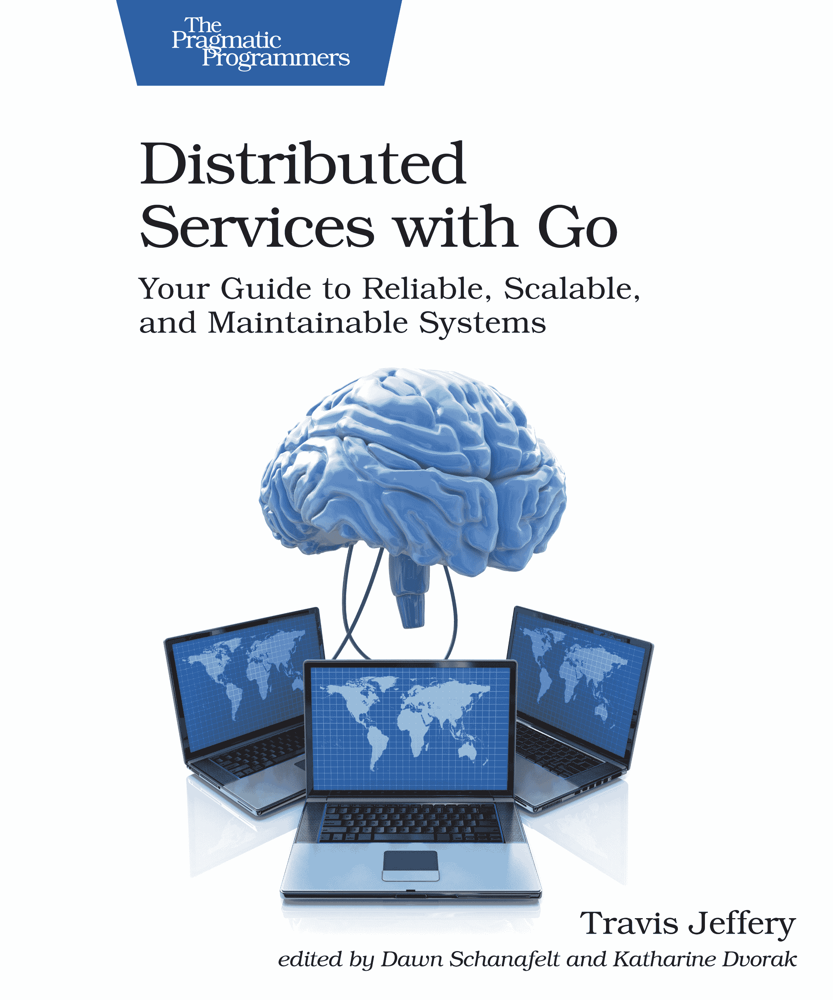

# Go 服务：可靠、可扩展、易维护系统指南



## 可靠、可扩展、可维护的系统指南

## 由 Travis Jeffery 编写

许多制造商和销售商使用的命名法是商标。当这些命名法在本书中出现，且 The Pragmatic Programmers, LLC 知道有商标主张时，这些命名法已以首字母大写或全部大写的形式打印。The Pragmatic Starter Kit、The Pragmatic Programmer、Pragmatic Programming、Pragmatic Bookshelf 和连接 `g` 的设备是 The Pragmatic Programmers, LLC 的商标。

在编写本书时，我们已尽最大努力确保其准确性。然而，出版商不对任何错误或遗漏负责，也不对因本书中使用的信息（包括程序代码片段）导致的损害负责。

## 关于 The Pragmatic Bookshelf

The Pragmatic Bookshelf 是一家敏捷出版公司。我们存在是因为我们希望改善开发者的生活。我们通过创作及时、实用的书籍来实现这一点，这些书籍由程序员为程序员编写。

我们的 Pragmatic 课程、工作坊和其他产品可以帮助您和您的团队创建更好的软件并玩得更开心。欲获取更多信息以及最新的 Pragmatic 书籍，请访问我们的网站 [`pragprog.com`](http://pragprog.com)。

我们的电子书不包含任何数字版权管理（DRM），一直保持 DRM‑free。我们先行推出“beta 书”概念，即在书籍编写期间即可购买并阅读，并可向作者提供反馈以帮助改进全书。所有购买者均可免费获取源码下载（如适用）、错误纠正和讨论论坛，这些内容均可在书籍的主页 pragprog.com 上找到。我们致力于简化您的生活。

想及时了解我们最新的书籍和公告，以及偶尔的特别优惠，只需在 [`pragprog.com`](https://pragprog.com) 创建账户（只需电子邮件地址和密码），然后勾选接收新闻简报的复选框。您也可以在 Twitter 上关注我们 @pragprog。

如果您直接从 [`pragprog.com`](https://pragprog.com) 购买，您将获得所有可用格式的电子书，只需一次价格即可。您可以通过 Dropbox 在所有设备（包括 iPhone/iPad、Android、笔记本电脑等）之间同步电子书。您可在书籍的整个版本周期内免费获得更新。当然，您也可以随时返回下载您需要的书籍。从亚马逊 Kindle 商店购买的电子书受 Amazon 的政策约束，其文件格式的限制可能导致电子书在不同设备上显示不同。更多信息请参见我们的常见问题解答 [`pragprog.com/#about-ebooks`](https://pragprog.com/support/#about-ebooks)。欲了解本书更多信息并获取免费资源，请访问本书主页 [`pragprog.com/book/tjgo`](https://pragprog.com/book/tjgo)。

感谢您的持续支持，

Andy Hunt  

The Pragmatic Programmers  

本书的制作团队包括：Dave Rankin（首席执行官）Janet Furlow（首席运营官）Tammy Coron（总编辑）Dawn Schanafelt 和 Katharine Dvorak（开发编辑）L. Sakhi MacMillan（校对员）Potomac Indexing, LLC（索引）Gilson Graphics（排版）Andy Hunt 和 Dave Thomas（创始人）

如需客户支持，请联系 support@pragprog.com。

如需国际版权，请联系 rights@pragprog.com。

Having built most of the technologies in this book without the benefit of this book, I can wholeheartedly recommend Distributed Services with Go. Travis delivers years of practical experience distilled into a clear and concise guide that takes the reader step by step from foundational knowledge to production deployment. This book earns my most hearty endorsement.

| → || Brian Ketelsen |

| --- | --- |

|  || Principal Developer Advocate, Microsoft; and Organizer, GopherCon |

In this practical, engaging book, Travis Jeffery shines a light on the path to building distributed systems. Read it, learn from it, and get coding!

| → || Jay Kreps |

| --- | --- |

|  || CEO, Confluent, Inc., and Co-Creator of Apache Kafka |

Travis Jeffery distills the traditionally academic topic of distributed systems down to a series of practical steps to get you up and running. The book focuses on the real-world concepts used every day by practicing software engineers. It’s a great read for intermediate developers getting into distributed systems or for senior engineers looking to expand their understanding.

| → || Ben Johnson |

| --- | --- |

|  || Author of BoltDB |

For any aspiring Gopher, Travis provides a gentle introduction to complex topics in distributed systems and provides a hands-on approach to applying the concepts.

| → || Armon Dadgar |

| --- | --- |

|  || HashiCorp Co-Founder |

A must-have for Gophers building systems at scale.

| → || William Rudenmalm |

| --- | --- |

|  || Lead Developer, CREANDUM |

This book is a great resource for Go developers looking to build and maintain distributed systems. It pairs an incremental development process with extensive code examples to teach you how to write your own distributed service, understand how it works under the hood, and how to deploy your service so others may start using it.

| → || Nishant Roy |

| --- | --- |

|  || Tech Lead |

# 

I write this, having finished the book, two and a half years after I began. Writing this book was the hardest thing I’ve done. I’ve built a few startups and several open source projects—this was much harder. I set out to write a good book people would enjoy and find useful. I’m critical of myself and my work and wouldn’t put out anything I didn’t deem worthy. It took me a long time to write because I didn’t want to compromise. I’m happy with this book and proud of myself.

I thank my editors, Dawn Schanafelt and Katharine Dvorak, for their patience and for helping me to improve my writing and motivating me in hard times.

Thank you to my publisher, The Pragmatic Bookshelf, for the guidance I received in writing my first book and for all of the work out of view.

I thank my book’s reviewers and beta readers for giving me their impressions of the book and contributing suggestions and errata to help me improve the book. Thank you to Clinton Begin, Armon Dadgar, Ben Johnson, Brian Ketelsen, Jay Kreps, Nishant Roy, William Rudenmalm, and Tyler Treat.

Thank you to the free and open source software communities for putting out code to study, change, and run. Special thanks to the people at Hashicorp for open-sourcing their Raft and Serf packages I use in this book and their services like Consul, whose source I studied and learned from a lot. Thank you to the Emacs and Linux contributors—the text editor and operating system I wrote this book with. Thank you to the Go team for creating a simple, stable, useful language.

Thank you to my parents, Dave and Tricia Jeffery, for buying my first computer and programming books and encouraging me with a strong work ethic.

Thank you to my high school English teacher, Graziano Galati, for giving me the right reading at the right time in my life.

Thank you to J. R. R. Tolkien for authoring The Lord of the Rings. I read it while writing this book, and the rapport with Frodo and Samwise aided me on the journey.

I thank my cat, Callie Jeffery. I adopted her a quarter of the way through writing the book, and her useful contributions to the discussion helped speed up my writing pace.

Thank you to Emily Davidson for her love and support and for fueling me with broccoli soup, ginger kombucha, and matcha tea.

Thank you, dear reader, for independently furthering your skills and knowledge and having the ambition to put your dent in the universe.

—Travis Jeffery

# 

这本书面向中级到高级开发者，旨在教他们如何构建分布式服务。我将这本书面向 Go 程序员编写，Go 语言的基础经验会对你有帮助，但你不需要是专家。本书展示了如何构建分布式服务，其概念与所使用的语言无关。因此，如果你正在使用 Go 编写分布式服务，你可以充分利用本书；如果不是，你也可以将这里提出的想法应用到任何语言中。

 || 这本书的代码与 Go 1.13+ 兼容。

---

## 这本书的内容

我们将设计、开发并部署一个分布式服务，以探索 Go 的能力。我们将分层开发和部署该服务：从存储处理的基础，到客户端和服务器的网络通信，再到分布式服务实例的分布、部署和测试。我将本书分为四个部分，分别对应这些层次。（如果你不熟悉我接下来提到的技术，不用担心——我在相关章节中进行了解释。）

-   如何开始在 Go 中掌握所有操作的路径呢？构建分布式服务并不是世界上最容易或最小的项目。如果一次性尝试构建所有组件，你只会得到一个庞大、混乱的代码库以及大脑疲惫的结果。你需要逐步构建项目。一个良好的起点是一个通过 HTTP 的提交日志 JSON 服务。即使你以前从未编写过 Go 的 HTTP 服务器，我仍会教你如何创建一个可供网络客户端调用的可访问的应用编程接口 (API)。你将学习提交日志 API，并且由于整本书围绕同一个项目进行，你将为后续章节的代码编写做好准备。

# Chapter 2  

| ​  || │   ├── type.proto |

| ​  || │   └── wrappers.proto |

| ​  || └── readme.txt |

-   [费曼学习法](http://media.pragprog.com/titles/tjgo/code/StructureDataWithProtobuf/Makefile)的灵感源于诺贝尔物理奖获得者`Richard Feynman`。

1.  运用费曼技巧，你只需花上`20 min`就能深入理解知识点，而且记忆深刻，`难以遗忘`。

```
if (condVar > someVal) {console.log("xxx")}
```

Web 前端开发者使用日志来帮助管理其应用的状态。在 Redux 中，^([\[13\]](#f_0029.xhtml#FOOTNOTE-13)) 一个与 React 经常一起使用的流行 JavaScript 库，你会以纯文本对象的形式记录更改，并使用纯函数处理这些更改，这些纯函数会将更新应用于你的应用状态。

所有这些示例都使用日志来存储、共享和处理有序数据。这真的很酷，因为同一个工具可以用于复制数据库、协调分布式服务以及管理前端应用的状态。你可以通过将系统中的更改拆解为单一、原子操作来解决大量问题，特别是在分布式服务中，这些操作可以通过日志进行存储、共享和处理。

数据库通常提供一种方式，将其状态恢复到过去的某个时间点，这通常称为“时间点恢复”。你会从过去取一个数据库快照，然后通过重放写前日志直到达到你想要的时间点。如果你自始至终都有每一个日志，就不需要快照；但对于拥有长期历史且变更很多的数据库，保存每一个日志是不可行的。 Redux 使用相同的思想来实现撤销/重做操作：它在每个操作后记录应用的状态，撤销操作只需让 Redux 将 UI 中显示的状态回退到之前记录的状态。像 Git 这样的分布式版本控制系统也工作原理相同；你的提交日志历史就是字面意义上的提交日志。

如你所见，完整的日志不仅包含最新状态，还包含所有曾经存在的状态，这使得你能够构建一些原本需要复杂才能实现的酷炫功能。日志很简单——这也是它们为何出色。

## 如何工作

日志是一种仅追加的记录序列。你在日志末尾追加记录，通常从上到下、从旧到新阅读（类似运行 `tail -f` 命令查看文件）。你可以记录任何数据。历史上，人们用“日志”一词指代供人类阅读的文本行，但随着更多人使用日志系统，其中的“日志”已变为供其他程序阅读的二进制编码消息。当我在本书中谈论日志和记录时，我并不特指任何一种特定的数据类型。当你向日志中追加记录时，日志会为该记录分配一个唯一且递增的偏移量，这相当于该记录的 ID。日志就像一张始终按时间排序的表格，它为每条记录按偏移量和创建时间进行索引。


日志的具体实现必须处理我们没有无限磁盘空间的事实，这意味着我们不能无限期追加到同一个文件中。因此，我们将日志分割为若干段。当日志过大时，我们通过删除已处理或归档的旧段来释放磁盘空间。清理旧段的操作可以在后台进程中运行，而我们的服务仍可继续向最新（活动）段写入，并从其他段读取，几乎不会产生冲突，尤其是在协程访问相同数据时。

在段列表中，总有一个特殊的段，我们称之为“活动段”。因为它是唯一我们正在向其写入的段。当活动段写满时，我们会创建一个新段并使其成为活动段。

每个段包含一个存储文件和一个索引文件。段的存储文件用于存储记录数据；我们会持续向该文件追加记录。段的索引文件用于存储每条记录的索引信息。索引文件通过加速读取来提升性能，因为它将记录的偏移量映射到存储文件中的位置。给定偏移量读取记录是两步过程：首先从索引文件获取该记录的条目，该条目告诉你记录在存储文件中的位置；然后在存储文件中读取该位置的记录。由于索引文件仅需要两个字段——记录的偏移量和在存储文件中的存储位置，因此索引文件远小于存储所有记录数据的存储文件。索引文件足够小，我们可以将它们内存映射^([\[14\]](#f_0029.xhtml#FOOTNOTE-14))，使文件操作的速度与在内存中操作的速度一样快。

现在你已经了解了日志的工作原理，是时候自己构建一个了。让我们开始编码吧。

## 构建日志

我们从底层开始构建日志，先构建存储和索引文件，然后是段，最后是日志。这样我们可以在构建每个组件时编写并运行测试。由于“日志”一词可能指代至少三种不同的事物——记录、存储记录的文件以及将多个段组合在一起的抽象数据类型——为了避免混淆，在本章中我将始终使用以下术语来指代这些事物：

*   记录——我们日志中存储的数据。
*   存储——用于存储记录的文件。
*   索引——用于存储索引条目的文件。
*   段——将存储文件和索引文件捆绑在一起的抽象层。
*   日志——将所有段组合在一起的抽象层。

### 编码存储

首先，在 `internal/log` 目录下创建我们的日志包目录，然后在该目录中创建名为 `store.go` 的文件，其中包含以下代码：

[WriteALogPackage/internal/log/store.go](http://media.pragprog.com/titles/tjgo/code/WriteALogPackage/internal/log/store.go) 

```go
package log

import (
    "bufio"
    "encoding/binary"
    "os"
    "sync"
)

var (
    enc = binary.BigEndian
)

const (
    lenWidth = 8
)

type store struct {
    *os.File
    mu sync.Mutex
    buf *bufio.Writer
    size uint64
}

func newStore(f *os.File) (*store, error) {
    fi, err := os.Stat(f.Name())
    if err != nil {
        return nil, err
    }
    size := uint64(fi.Size())
    return &store{
        File: f,
        size: size,
        buf: bufio.NewWriter(f),
    }, nil
}
```

The `store` struct is a simple wrapper around a file with two APIs to append and read bytes to and from the file. The `newStore(*os.File)` function creates a store for the given file. The function calls `os.Stat(name string)` to get the file’s current size, in case we’re re-creating the store from a file that has existing data, which would happen if, for example, our service had restarted.

We refer to the `enc` variable and `lenWidth` constant repeatedly in the store, so we place them up top where they’re easy to find. `enc` defines the encoding that we persist record sizes and index entries in and `lenWidth` defines the number of bytes used to store the record’s length.

Next, write the following `Append` method below `newStore`:

[WriteALogPackage/internal/log/store.go](http://media.pragprog.com/titles/tjgo/code/WriteALogPackage/internal/log/store.go) 

```go
func (s *store) Append(p []byte) (n uint64, pos uint64, err error) {
    s.mu.Lock()
    defer s.mu.Unlock()
    pos = s.size
    if err := binary.Write(s.buf, enc, uint64(len(p))); err != nil {
        return 0, 0, err
    }
    w, err := s.buf.Write(p)
    if err != nil {
        return 0, 0, err
    }
    w += lenWidth
    s.size += uint64(w)
    return uint64(w), pos, nil
}
```

`Append` 函数（`Append([]byte)`）会将给定的字节持久化到存储中。我们会先写入记录的长度，这样在读取记录时就能知道需要读取多少字节。我们会将数据写入缓冲写入器，而不是直接写入文件，以减少系统调用次数并提高性能。如果用户写入了大量的小记录，这将会带来很大的帮助。随后，我们会返回写入的字节数，这与 Go 标准 API 的惯例一致，同时也返回存储中保存该记录的位置。该段将在创建关联索引条目时使用该位置。

在 `Append` 方法下面，添加以下 `Read` 方法：

[WriteALogPackage/internal/log/store.go](http://media.pragprog.com/titles/tjgo/code/WriteALogPackage/internal/log/store.go) 

```go
func (s *store) Read(pos uint64) ([]byte, error) {
    s.mu.Lock()
    defer s.mu.Unlock()
    if err := s.buf.Flush(); err != nil {
        return nil, err
    }
    size := make([]byte, lenWidth)
    if _, err := s.File.ReadAt(size, int64(pos)); err != nil {
        return nil, err
    }
    b := make([]byte, enc.Uint64(size))
    if _, err := s.File.ReadAt(b, int64(pos+lenWidth)); err != nil {
        return nil, err
    }
    return b, nil
}
```

`Read(pos uint64)` 方法会返回在给定位置存储的记录。首先它会刷新写入缓冲区，以防我们即将尝试读取的记录还未写入磁盘。随后我们会计算需要读取多少字节才能获取完整记录，并读取返回该记录。编译器会在函数作用域内为字节切片分配栈内存。当值在函数调用生命周期之外使用时（例如返回该值），该值会逃逸。

在 `Read` 方法下面，添加以下 `ReadAt` 方法：

[WriteALogPackage/internal/log/store.go](http://media.pragprog.com/titles/tjgo/code/WriteALogPackage/internal/log/store.go) 

```go
func (s *store) ReadAt(p []byte, off int64) (int, error) {
    s.mu.Lock()
    defer s.mu.Unlock()
    if err := s.buf.Flush(); err != nil {
        return 0, err
    }
    return s.File.ReadAt(p, off)
}
```

`ReadAt(p []byte, off int64)` 方法会将 `len(p)` 字节读取到 `p`，起始偏移为 `off`，并在 `store` 类型上实现 `io.ReaderAt` 接口。

最后，在 `ReadAt` 方法下面添加以下 `Close` 方法：

[WriteALogPackage/internal/log/store.go](http://media.pragprog.com/titles/tjgo/code/WriteALogPackage/internal/log/store.go) 

```go
func (s *store) Close() error {
    s.mu.Lock()
    defer s.mu.Unlock()
    err := s.buf.Flush()
    if err != nil {
        return err
    }
    return s.File.Close()
}
```

`Close` 方法会在关闭文件前持久化任何缓冲数据。

现在，我们来测试我们的存储是否正常工作。在日志目录下创建一个 `store_test.go` 文件，包含以下代码：

[WriteALogPackage/internal/log/store_test.go](http://media.pragprog.com/titles/tjgo/code/WriteALogPackage/internal/log/store_test.go) 

```go
package log

import (
    "io/ioutil"
    "os"
    "testing"
)

var (
    write = []byte("hello world")
    width = uint64(len(write)) + lenWidth
)

func TestStoreAppendRead(t *testing.T) {
    f, err := ioutil.TempFile("", "store_append_read_test")
    require.NoError(t, err)
    defer os.Remove(f.Name())

    s, err := newStore(f)
    require.NoError(t, err)

    testAppend(t, s)
    testRead(t, s)
    testReadAt(t, s)

    s, err = newStore(f)
    require.NoError(t, err)
    testRead(t, s)
}

func testAppend(t *testing.T, s *store) {
    t.Helper()
    for i := uint64(1); i < 4; i++ {
        n, pos, err := s.Append(write)
        require.NoError(t, err)
        require.Equal(t, pos+n, width*i)
    }
}

func testRead(t *testing.T, s *store) {
    t.Helper()
    var pos uint64
    for i := uint64(1); i < 4; i++ {
        read, err := s.Read(pos)
        require.NoError(t, err)
        require.Equal(t, write, read)
        pos += width
    }
}

func testReadAt(t *testing.T, s *store) {
    t.Helper()
    for i, off := uint64(1), int64(0); i < 4; i++ {
        b := make([]byte, lenWidth)
        n, err := s.ReadAt(b, off)
        require.NoError(t, err)
        require.Equal(t, lenWidth, n)
        off += int64(n)

        size := enc.Uint64(b)
        b = make([]byte, size)
        n, err = s.ReadAt(b, off)
        require.NoError(t, err)
        require.Equal(t, write, b)
        require.Equal(t, int(size), n)
        off += int64(n)
    }
}

func TestStoreClose(t *testing.T) {
    f, err := ioutil.TempFile("", "store_close_test")
```


```
require.NoError(t, err)
defer os.Remove(f.Name())

s, err := newStore(f)
require.NoError(t, err)

_, _, err = s.Append(write)
require.NoError(t, err)

f, beforeSize, err := openFile(f.Name())
require.NoError(t, err)

err = s.Close()
require.NoError(t, err)

_, afterSize, err := openFile(f.Name())
require.NoError(t, err)
require.True(t, afterSize > beforeSize)
}

func openFile(name string) (*os.File, int64, error) {
    f, err := os.OpenFile(
        name,
        os.O_RDWR|os.O_CREATE|os.O_APPEND,
        0644,
    )
    if err != nil {
        return nil, 0, err
    }
    fi, err := f.Stat()
    if err != nil {
        return nil, 0, err
    }
    return f, fi.Size(), nil
}
```

```
const (
    offWidth uint64 = 4
    posWidth uint64 = 8
    entWidth = offWidth + posWidth
)

type index struct {
    file *os.File
    mmap gommap.MMap
    size uint64
}
```

我们在整个索引中使用 `*Width` 常量，就像存储的变量和常量一样，我们将常量放在文件顶部，以便于查找。`*Width` 常量定义每个索引条目所占用的字节数。

我们的索引条目包含两个字段：记录的偏移和它在存储文件中的位置。我们将偏移存储为 `uint32`，位置存储为 `uint64`，因此它们分别占用 4 和 8 个字节。我们使用 `entWidth` 可以直接根据偏移计算出条目的位置，因为文件中的位置等于偏移乘以 `entWidth`。

`index` 定义了我们的索引文件，由一个持久化文件和一个内存映射文件组成。`size` 表示索引的大小以及下一个要追加到索引的条目应写入的位置。

现在在 `newIndex` 函数下方添加以下 `newIndex` 函数：

```
func newIndex(f *os.File, c Config) (*index, error) {
    idx := &index{
        file: f,
    }
    fi, err := os.Stat(f.Name())
    if err != nil {
        return nil, err
    }
    idx.size = uint64(fi.Size())
    if err = os.Truncate(f.Name(), int64(c.Segment.MaxIndexBytes)); err != nil {
        return nil, err
    }
    if idx.mmap, err = gommap.Map(f.Fd(), gommap.PROT_READ|gommap.PROT_WRITE, gommap.MAP_SHARED); err != nil {
        return nil, err
    }
    return idx, nil
}
```

`newIndex` 为给定的文件创建索引。我们创建索引并保存文件当前的大小，以便在添加索引条目时跟踪索引文件中的数据量。我们在内存映射文件之前先将文件扩展到最大索引大小，然后返回创建好的索引给调用者。

接下来，在 `newIndex` 下方添加以下 `Close` 方法：

```
func (i *index) Close() error {
    if err := i.mmap.Sync(gommap.MS_SYNC); err != nil {
        return err
    }
    if err := i.file.Sync(); err != nil {
        return err
    }
    if err := i.file.Truncate(int64(i.size)); err != nil {
        return err
    }
    return i.file.Close()
}
```

`Close` 确保内存映射文件的数据已同步到持久化文件，并且持久化文件已刷新到稳定存储。随后它将持久化文件截断到实际包含的数据量，最后关闭文件。

现在我们已经看到如何打开和关闭索引，可以讨论文件增长和截断的意义。

当我们启动服务时，服务需要知道下一个要写入日志记录的偏移量。服务通过读取索引文件的最后 12 个字节来获取下一条记录的偏移，这是一个简单的过程。然而，在我们对文件进行增长时，这个过程会出错。（我们现在进行文件增长的原因是，一旦文件被内存映射，就无法再调整大小，所以只能在此时进行。）我们通过在文件末尾追加空空间来增长文件，这导致最后一个条目不再位于文件末尾，而是与文件末尾之间存在未知的空白空间。这个空白空间会阻碍服务正确重新启动。因此我们在服务优雅退出时会截断索引文件，去除空白空间，使最后一个条目再次位于文件末尾。这种优雅的退出使服务能够正确且高效地重新启动。

### Handling Ungraceful Shutdowns


A graceful shutdown occurs when a service finishes its ongoing tasks, performs its processes to ensure there’s no data loss, and prepares for a restart. If your service crashes or its hardware fails, you’ll experience an ungraceful shutdown. An example of an ungraceful shutdown for the service we’re building would be if it lost power before it finished truncating its index files. You handle ungraceful shutdowns by performing a sanity check when your service restarts to find corrupted data. If you have corrupted data, you can rebuild the data or replicate the data from an uncorrupted source. The log we’re building doesn’t handle ungraceful shutdowns because I wanted to keep the code simple.

现在回到编程部分。

在 `Read` 方法下方添加以下 `Read` 方法：

```
func (i *index) Read(in int64) (out uint32, pos uint64, err error) {
    if i.size == 0 {
        return 0, 0, io.EOF
    }
    if in == -1 {
        out = uint32((i.size / entWidth) - 1)
    } else {
        out = uint32(in)
    }
    pos = uint64(out) * entWidth
    if i.size < pos+entWidth {
        return 0, 0, io.EOF
    }
    out = enc.Uint32(i.mmap[pos : pos+offWidth])
    pos = enc.Uint64(i.mmap[pos+offWidth : pos+entWidth])
    return out, pos, nil
}
```

`Read(int64)` 接收一个相对偏移并返回对应记录在存储中的位置。给定的偏移是相对于段的基准偏移的；0 始终是索引的第一条记录，1 是第二条，以此类推。我们使用相对偏移来减小索引的大小，因为偏移以 `uint32` 存储。如果使用绝对偏移，则需要以 `uint64` 存储偏移并为每条记录多占用四个字节。四个字节看似不多，但在处理分布式日志（如 LinkedIn）时，记录数量可以达到万亿级，四个字节的开销会变成巨大的负担。即使是相对较小的公司，每天也会产生数十亿条记录，这同样会产生显著的开销。

在 `Read` 方法下方添加以下 `Write` 方法：

```
func (i *index) Write(off uint32, pos uint64) error {
    if uint64(len(i.mmap)) < i.size+entWidth {
        return io.EOF
    }
    enc.PutUint32(i.mmap[i.size:i.size+offWidth], off)
    enc.PutUint64(i.mmap[i.size+offWidth:i.size+entWidth], pos)
    i.size += uint64(entWidth)
    return nil
}
```

`Write(off uint32, pos uint64)` 用于向索引中追加给定的偏移和位置。首先检查是否有足够的空间写入新条目。如果有空间，则使用编码函数将偏移和位置写入内存映射文件，并更新下一次写入的位置。

在 `Write` 方法下方添加以下 `Name` 方法，用于返回索引的文件路径：

```
func (i *index) Name() string {
    return i.file.Name()
}
```

创建一个名为 `segment.go` 的文件，放在 `internal/log` 目录，并以以下代码开头：

`/WriteALogPackage/internal/log/segment.go`

```
package log

import (
    "fmt"
    "os"
    "path"

    api "github.com/travisjeffery/proglog/api/v1"
    "google.golang.org/protobuf/proto"
)

type segment struct {
    store *store
    index *index
    baseOffset, nextOffset uint64
    config Config
}
```

Our `segment` needs to call its `store` and `index` files, so we keep pointers to those in the first two fields. We need the `nextOffset` and `baseOffset` to know what offset to append new records under and to calculate the relative offsets for the `index` entries. And we put the `config` on the `segment` so we can compare the `store` file and `index` sizes to the configured limits, which lets us know when the `segment` is maxed out.

Below the previous snippet, add the following `newSegment` function:

`/WriteALogPackage/internal/log/segment.go`

```
func newSegment(dir string, baseOffset uint64, c Config) (*segment, error) {
    s := &segment{
        baseOffset: baseOffset,
        config: c,
    }
    var err error
    storeFile, err := os.OpenFile(
        path.Join(dir, fmt.Sprintf("%d%s", baseOffset, "*.store")),
        os.O_RDWR|os.O_CREATE|os.O_APPEND,
        0644,
    )
    if err != nil {
        return nil, err
    }
    if s.store, err = newStore(storeFile); err != nil {
        return nil, err
    }
    indexFile, err := os.OpenFile(
        path.Join(dir, fmt.Sprintf("%d%s", baseOffset, "*.index")),
        os.O_RDWR|os.O_CREATE,
        0644,
    )
    if err != nil {
        return nil, err
    }
    if s.index, err = newIndex(indexFile, c); err != nil {
        return nil, err
    }
    if off, _, err := s.index.Read(-1); err != nil {
        s.nextOffset = baseOffset
    } else {
        s.nextOffset = baseOffset + uint64(off) + 1
    }
    return s, nil
}
```


The `log` calls `newSegment` when it needs to add a new segment, such as when the current active segment hits its max size. We open the store and index files and pass the `os.O_CREATE` file mode flag as an argument to `os.OpenFile` to create the files if they don’t exist yet. Then we create our index and store with these files. Finally, we set the segment’s next offset to prepare for the next appended record. If the index is empty, then the next record appended to the segment would be the first record and its offset would be the segment’s base offset. If the index has at least one entry, then that means the offset of the next record written should take the offset at the end of the segment, which we get by adding 1 to the base offset and relative offset. Our segment is ready to write to and read from the log—once we’ve written those methods!

Next, below `newSegment` put the following `Append` method:

`/WriteALogPackage/internal/log/segment.go`

## WriteALogPackage/internal/log/segment.go

### 1. 重新划分标题层级

### 2. 优化段落格式，删除多余空行

### 3. 保留正文核心内容

### 4. 所有单独出现的变量名（`varName`），函数名（`funcName()`），类名（`ClassName`），路径名（`/path.to.xxx`），命令名（`cmdname`）以及它们的语句或表达式（`ClassName.funcName(var1 + var2, "cmd arg0 arg1"`）都需要添加反引号。如果上述东西被粗体（**）或者斜体（*）包围，去掉星号再加反引号。

### 5. 代码块前后加上三个反引号（```）

---

## 以下是需要排版的文本

### 1. 代码块前后加上三个反引号（```）

```go
func (s *segment) Append(record *api.Record) (offset uint64, err error) {
	cur := s.nextOffset
	record.Offset = cur
	p, err := proto.Marshal(record)
	if err != nil {
		return 0, err
	}
	_, pos, err := s.store.Append(p)
	if err != nil {
		return 0, err
	}
	if err = s.index.Write(
		// index offsets are relative to base offset
		uint32(s.nextOffset-uint64(s.baseOffset)),
		pos,
	); err != nil {
		return 0, err
	}
	s.nextOffset++
	return cur, nil
}
```

`Append` writes the record to the segment and returns the newly appended record’s offset. The `log` returns the offset to the API response. The segment appends a record in a two-step process: it appends the data to the store and then adds an index entry. Since index offsets are relative to the base offset, we subtract the segment’s next offset from its base offset (which are both absolute offsets) to get the entry’s relative offset in the segment. We then increment the next offset to prep for a future append call.

Now add the following `Read` method below `Append`:

```go
func (s *segment) Read(off uint64) (*api.Record, error) {
	_, pos, err := s.index.Read(int64(off - s.baseOffset))
	if err != nil {
		return nil, err
	}
	p, err := s.store.Read(pos)
	if err != nil {
		return nil, err
	}
	record := &api.Record{}
	err = proto.Unmarshal(p, record)
	return record, err
}
```

`Read(off uint64)` returns the record for the given offset. Similar to writes, to read a record the segment must first translate the absolute index into a relative offset and get the associated index entry. Once it has the index entry, the segment can go straight to the record’s position in the store and read the proper amount of data.

Next, put the following `IsMaxed` method below `Read`:

```go
func (s *segment) IsMaxed() bool {
	return s.store.size >= s.config.Segment.MaxStoreBytes ||
		s.index.size >= s.config.Segment.MaxIndexBytes
}
```

`IsMaxed` returns whether the segment has reached its max size, either by writing too much to the store or the index. If you wrote a small number of long logs, then you’d hit the segment bytes limit; if you wrote a lot of small logs, then you’d hit the index bytes limit. The `log` uses this method to know it needs to create a new segment.

Write this `Remove` method below `IsMaxed`:

```go
func (s *segment) Remove() error {
	if err := s.Close(); err != nil {
		return err
	}
	if err := os.Remove(s.index.Name()); err != nil {
		return err
	}
	if err := os.Remove(s.store.Name()); err != nil {
		return err
	}
	return nil
}
```

`Remove` closes the segment and removes the index and store files.

Finally, add this last function at the end of the file:

```go
func nearestMultiple(j, k uint64) uint64 {
	if j >= 0 {
		return (j / k) * k
	}
	return ((j - k + 1) / k) * k
}
```

`nearestMultiple(j uint64, k uint64)` returns the nearest and lesser multiple of `k` in `j`, for example `nearestMultiple(9, 4) == 8`. We take the lesser multiple to make sure we stay under the user’s disk capacity.

### 2. 代码块前后加上三个反引号（```）

```go
package log

import (
	"io"
	"io/ioutil"
	"os"
	"testing"

	"github.com/stretchr/testify/require"
	api "github.com/travisjeffery/proglog/api/v1"
)

func TestSegment(t *testing.T) {
	dir, _ := ioutil.TempDir("", "segment-test")
	defer os.RemoveAll(dir)

	want := &api.Record{Value: []byte("hello world")}

	c := Config{}
	c.Segment.MaxStoreBytes = 1024
	c.Segment.MaxIndexBytes = entWidth * 3

	s, err := newSegment(dir, 16, c)
	require.NoError(t, err)
	require.Equal(t, uint64(16), s.nextOffset, s.nextOffset)
	require.False(t, s.IsMaxed())

	for i := uint64(0); i < 3; i++ {
		off, err := s.Append(want)
		require.NoError(t, err)
		require.Equal(t, 16+i, off)

		got, err := s.Read(off)
		require.NoError(t, err)
		require.Equal(t, want.Value, got.Value)
	}

	_, err = s.Append(want)
	require.Equal(t, io.EOF, err)

	// maxed index
	require.True(t, s.IsMaxed())

	c.Segment.MaxStoreBytes = uint64(len(want.Value) * 3)
	c.Segment.MaxIndexBytes = 1024

	s, err = newSegment(dir, 16, c)
	require.NoError(t, err)
	// maxed store
	require.True(t, s.IsMaxed())

	err = s.Remove()
	require.NoError(t, err)
	s, err = newSegment(dir, 16, c)
	require.NoError(t, err)
	require.False(t, s.IsMaxed())
}
```

We test that we can append a record to a segment, read back the same record, and eventually hit the configured max size for both the store and index. Calling `newSegment` twice with the same base offset and `dir` also checks that the function loads a segment’s state from the persisted index and log files.

### 3. 代码块前后加上三个反引号（```）

```go
package log
```


进入`/path/to/xxx`目录，找到`xxx.json`。

在表达式`cvar = avar + bvar`中，加法运算符（`+`）将`avar`与`bvar`相加，得到它们的和`cvar`

在`List.of(arg0, arg1, arg2)`中，`List`接口的工厂方法`of()`接受一系列的元素，返回包含它们的只读列表。

之后我们这样调用`cmd`命令：`cmd arg0 arg1 arg2`。

```
if (condVar > someVal) {console.log("xxx")}
```


| || `off` `int64` |

| || } |

| ||  |

| || `func` (o `*originReader`) Read(p `[]byte`) (`int`, `error`) { |

| || n, err := o.ReadAt(p, o.off) |

| || o.off += `int64`(n) |

| || `return` n, err |

| || } |

```
Reader 返回一个 io.Reader 以读取整个日志。我们将在实现协调一致时需要这种能力，以支持快照和恢复日志。Reader 使用 io.MultiReader 调用来连接各段的 store。段的 store 通过 originReader 类型包装，有两个原因。第一个原因是为了满足 io.Reader 接口，以便可以传递给 io.MultiReader 调用。第二个原因是为了确保从 store 的起始位置开始读取并读取其整个文件。
```

```
[WriteALogPackage/internal/log/log.go](http://media.pragprog.com/titles/tjgo/code/WriteALogPackage/internal/log/log.go)

| --- | --- |

| || `func` (l `*Log`) newSegment(off `uint64`) `error` { |

| || s, err := newSegment(l.Dir, off, l.Config) |

| || `if` err != nil { |

| || `return` err |

| || } |

| || l.segments = append(l.segments, s) |

| || l.activeSegment = s |

| || `return` nil |

| || } |
```

newSegment(off int64) 创建一个新段，将该段追加到日志的段切片中，并将新段设为活动段，以便后续的追加操作写入它。

```
```

[WriteALogPackage/internal/log/log_test.go](http://media.pragprog.com/titles/tjgo/code/WriteALogPackage/internal/log/log_test.go)

| --- | --- |

| || `package` log |

| ||  |

| || `import` ( |

| || *"io/ioutil"* |

| || *"os"* |

| || *"testing"* |

| || *"github.com/stretchr/testify/require"* |

| || api *"github.com/travisjeffery/proglog/api/v1"* |

| || *"google.golang.org/protobuf/proto"* |

| || ) |

| ||  |

| || `func` TestLog(t `*testing.T`) { |

| || `for` scenario, fn := `range` `map`[`string`]`func`( |

| || t `*testing.T`, log `*Log`, |

| || ){ |

| || *"append and read a record succeeds"*: testAppendRead, |

| || *"offset out of range error"*: testOutOfRangeErr, |

| || *"init with existing segments"*: testInitExisting, |

| || *"reader"*: testReader, |

| || *"truncate"*: testTruncate, |

| || } { |

| || t.Run(scenario, `func`(t `*testing.T`) { |

| || dir, err := ioutil.TempDir(*"", *"store-test"*) |

| || require.NoError(t, err) |

| || `defer` os.RemoveAll(dir) |

| ||  |

| || c := Config{} |

| || c.Segment.MaxStoreBytes = 32 |

| || log, err := NewLog(dir, c) |

| || require.NoError(t, err) |

| ||  |

| || fn(t, log) |

| || }) |

| || } |

TestLog(`*testing.T`) 定义了一个测试用例表，用于测试日志。我使用了表格来编写测试用例，以避免在每个测试用例中重复创建新日志的代码。

现在，在 TestLog 函数下面定义测试用例：


# Part 2 网络

# 第 4 章 使用 gRPC 处理请求

我们已经设置好项目和协议缓冲区，并编写了日志库。目前，我们的库只能在单台电脑上单人单独使用。而且该人必须学习我们库的 API，运行我们的代码，并将日志存储在本地磁盘——这些都不是大多数人会做的，从而限制了我们的用户基数。通过将我们的库转换为 Web 服务，我们可以解决这些问题，并吸引更大的受众。与在单台计算机上运行的程序相比，网络服务具有三大主要优势：

* 你可以在多台计算机上运行它们，以实现高可用性和可扩展性。
* 它们允许多个人共同操作同一份数据。
* 它们提供易于使用的可访问接口。

编写服务以获取这些优势的某些情形包括：为前端提供公共 API、构建内部基础设施工具，以及创建可供他人构建自身业务的服务（人们很少为使用库付费）。

在本章中，我们将在此基础上构建库，创建一个服务，使多个人能够共同操作同一份数据，并能在多台计算机上运行。我们暂时不支持集群；我们将在第 8 章 *使用共识协调服务* 中处理该问题。我找到的最佳工具是 Google 的 gRPC 用于在分布式服务中处理请求。

[WriteALogPackage/internal/log/log_test.go](http://media.pragprog.com/titles/tjgo/code/WriteALogPackage/internal/log/log_test.go)

```go
func testAppendRead(t *testing.T, log *Log) {
    append := &api.Record{
        Value: []byte("hello world"),
    }
    off, err := log.Append(append)
    require.NoError(t, err)
    require.Equal(t, uint64(0), off)

    read, err := log.Read(off)
    require.NoError(t, err)
    require.Equal(t, append.Value, read.Value)
}
```

`testAppendRead(*testing.T, *log.Log)` 测试我们能够成功地向日志追加并从中读取记录。当我们向日志追加一个记录时，日志会返回它为该记录分配的偏移量。因此，当我们请求日志在该偏移量处的记录时，我们期望得到与我们追加的相同记录。

```go
func testOutOfRangeErr(t *testing.T, log *Log) {
    read, err := log.Read(1)
    require.Nil(t, read)
    require.Error(t, err)
}
```

`testOutOfRangeErr(*testing.T, *log.Log)` 测试当我们尝试读取超出日志已存储偏移范围时，日志会返回错误。

```go
func testInitExisting(t *testing.T, o *Log) {
    append := &api.Record{
        Value: []byte("hello world"),
    }
    for i := 0; i < 3; i++ {
        _, err := o.Append(append)
        require.NoError(t, err)
    }
    require.NoError(t, o.Close())

    off, err := o.LowestOffset()
    require.NoError(t, err)
    require.Equal(t, uint64(0), off)
    off, err = o.HighestOffset()
    require.NoError(t, err)
    require.Equal(t, uint64(2), off)

    n, err := NewLog(o.Dir, o.Config)
    require.NoError(t, err)

    off, err = n.LowestOffset()
    require.NoError(t, err)
    require.Equal(t, uint64(0), off)
    off, err = n.HighestOffset()
    require.NoError(t, err)
    require.Equal(t, uint64(2), off)
}
```

`testInitExisting(*testing.T, *log.Log)` 测试当我们创建一个日志时，日志会从之前的日志实例存储的数据中初始化。我们在关闭前向原始日志追加三条记录。然后我们创建一个新日志，配置与旧日志相同的目录。最后，我们确认新日志已从旧日志存储的数据中初始化。

## 什么是 gRPC？

在过去构建分布式服务时，我常遇到两个让我抓狂的常见问题：维护客户端与服务器之间的兼容性以及保持性能。

我想确保客户端和服务器始终兼容——即客户端发送的请求服务器能理解，反之亦然，服务器的响应客户端也能理解。当我对服务器做出破坏性改动时，希望旧客户端仍能继续工作，我通过为 API 版本化来实现这一点。

为保持良好的性能，主要关注点是优化数据库查询和优化实现业务逻辑的算法。一旦完成这些优化，性能往往取决于服务端快速解析请求和序列化响应的速度，以及每次客户端与服务器通信时减少开销——例如，使用单一长连接而非为每个请求新建连接。

因此，我对 Google 开源的高性能 RPC（远程过程调用）框架 gRPC 感到欣喜。gRPC 在构建分布式系统时非常有帮助，我认为它能简化你的工作。gRPC 如何帮助你构建服务？

## 构建服务时的目标

以下是构建网络服务时需要重点关注的最重要目标，以及 gRPC 如何帮助实现这些目标：

### 简洁性

网络通信是技术性且复杂的。在构建服务时，我们希望专注于它解决的问题，而不是关注请求-响应序列化等技术细节。你希望使用能够抽象这些细节的 API。但当你需要在更低层次上工作时，这些低层次也应易于接入。

在低到高层次框架的光谱上，gRPC 属于中等偏高层次。它位于类似 Express 的框架之上，因为 gRPC 决定如何序列化和结构化端点，并提供双向流等特性，但位于类似 Rails 的框架之下，因为 Rails 处理从请求到数据存储再到应用结构的全部工作。gRPC 可通过中间件扩展，其活跃的社区已编写大量中间件，帮助解决构建服务时常见的问题——例如日志、认证、速率限制和追踪。

### 可维护性

编写服务的第一个版本只是整个工作周期的一小部分。一旦服务上线且他人依赖它，你必须保持向后兼容。对于请求-响应类型的 API，最简单的向后兼容方式是进行版本化并运行多个 API 实例。

在 gRPC 中，你可以在出现重大 API 变更时轻松编写并运行独立版本的服务，同时利用 protobuf 的字段版本化来处理小幅变更。对所有请求和响应的类型检查有助于防止在你和同事构建服务时不小心引入不兼容的变更。

### 安全性

当你在网络上公开服务时，你暴露给网络上的所有人——潜在的整个互联网。必须控制谁可以访问你的服务以及他们能执行什么操作。

gRPC 支持 SSL/TLS（安全套接层/传输层安全）来加密客户端与服务器之间交换的所有数据，并允许你在请求中附加凭证，以便知道是哪位用户在发起请求。我们将在下一章讨论安全性。

### 易用性

编写服务的目的在于让人们使用它并解决他们的问题。服务越易用，越受欢迎。通过告知用户他们在做错误的事（例如使用了错误的请求），你已经迈出了让服务易用的一大步。

With gRPC，所有的服务方法、请求和响应以及它们的体内容都是通过类型定义的。编译器会将 protobuf 注释复制到你的代码中，以帮助用户在类型定义不足时进行使用。你的用户会通过代码的类型检查来确认他们是否正确使用了 API。将请求、响应、模型和序列化全部进行类型检查，对新手来说是很大的帮助。gRPC 还允许用户通过 godoc 查看 API 的详细信息。许多框架并没有提供这两个便利功能。

**性能**

: 你希望你的服务尽可能快速且使用资源最少。例如，如果你能在 Google Cloud Platform 的 n1-standard-1 实例（约 $35/月）上运行你的应用，而不是在 n1-standard-2 实例（约 $71/月）上运行，这将使你的成本减半。

gRPC 基于 protobuf 和 HTTP/2，因为 protobuf 在序列化方面表现非常好，HTTP/2 提供了持久连接的手段，gRPC 充分利用了这一点。因此，你的服务运行高效，不会导致不必要的高额服务器账单。

**可扩展性**

: 可扩展性可以指通过负载均衡来扩展以在多台计算机之间分担负载，也可以指项目开发人数的增加。gRPC 使得两种类型的扩展都更加容易。

你可以根据需求使用不同种类的负载均衡与 gRPC 结合，包括客户端负载均衡、代理负载均衡、旁路负载均衡或服务网格。

为了增加项目参与人数，gRPC 允许你将服务编译为 gRPC 支持的语言中的客户端和服务器。这使得开发者可以使用自己熟悉的语言来构建相互通信的服务。

我们现在清楚了我们想要的服务目标，让我们创建一个符合目标的 gRPC 服务。

## 定义 gRPC 服务

gRPC 服务本质上是一组相关的 RPC 端点——它们的关系由你来决定。常见的例子是 RESTful 风格，即端点操作同一资源，但分组可以更宽松。通常，它只是为了解决某个问题而需要的一组端点。在我们的例子中，目标是让人们能够写入和读取他们的日志。

创建 gRPC 服务需要在 protobuf 中定义它，然后编译协议缓冲区为包含客户端和服务器桩的代码，再实现这些桩。要开始，打开 `log.proto` 文件（即我们之前定义 `Record` 消息的文件），并在该文件中添加以下服务定义，位于消息定义的上方：

[ServeRequestsWithgRPC/api/v1/log.proto](http://media.pragprog.com/titles/tjgo/code/ServeRequestsWithgRPC/api/v1/log.proto)

```protobuf
service Log {
    rpc Produce(ProduceRequest) returns (ProduceResponse) {}
    rpc Consume(ConsumeRequest) returns (ConsumeResponse) {}
    rpc ConsumeStream(ConsumeRequest) returns (stream ConsumeResponse) {}
    rpc ProduceStream(stream ProduceRequest) returns (stream ProduceResponse) {}
}
```

`service` 关键字表明这是编译器生成的服务，每行 RPC 定义了该服务的一个端点，指定请求和响应类型。请求和响应是消息，编译器会将它们转换为 Go struct，如上一章节所示。

我们有两个流式端点：

* `ConsumeStream`——服务器端流式 RPC，客户端发送请求后，服务器返回一个流供客户端读取一系列消息。
* `ProduceStream`——双向流式 RPC，客户端和服务器都通过只读写流发送消息序列。两个流独立运行，客户端和服务器可以按任意顺序读写。例如，服务器可以等待客户端发送全部请求后再返回响应，这适用于批量处理或聚合多个请求的响应。也可以采用逐请求响应的方式，即每个请求立即返回对应的响应，适用于每个请求需要单独处理的场景。

在服务定义下方，添加以下代码来定义我们的请求和响应：

```protobuf
message ProduceRequest {
    Record record = 1;
}

message ProduceResponse {
    uint64 offset = 1;
}

message ConsumeRequest {
    uint64 offset = 1;
}

message ConsumeResponse {
    Record record = 2;
}
```

请求包含要写入日志的记录，响应返回该记录的偏移量，即记录的标识符。消费请求同样指定要读取的日志偏移量，服务器返回指定的记录。

要生成客户端和服务器代码，需要告诉 protobuf 编译器使用 gRPC 插件。

## 使用 gRPC 插件进行编译

此步骤只需一秒钟。运行以下命令安装 gRPC 包：

```shell
$ go get google.golang.org/grpc@v1.32.0
$ go get google.golang.org/grpc/cmd/protoc-gen-go-grpc@v1.0.0
```

然后打开你的 Makefile，并将编译目标更新为以下内容，以启用 gRPC 插件并编译我们的 gRPC 服务：

```makefile
compile:
    protoc api/v1/*.proto \
        --go_out=. \
        --go-grpc_out=. \
        --go_opt=paths=source_relative \
        --go-grpc_opt=paths=source_relative \
        --proto_path=.
```

运行 `$ make compile`，然后打开 `api/v1` 目录下的 `log_grpc.pb.go` 文件，查看生成的代码。你会看到一个可工作的 gRPC 日志客户端，编译器已经为我们预留了实现服务的 API。

## 实现 gRPC 服务器

由于编译器生成了服务器桩，我们需要做的是编写一个结构体，其方法与 protobuf 中的服务定义相匹配。

在项目根目录下运行 `mkdir -p internal/server` 创建内部 server 目录结构。Go 中的内部包是特殊的，只能由附近的代码导入。例如，你可以导入 `/a/b/c/internal/d/e/f` 中的代码，但不能导入 `/a/b/g` 中的代码。在此目录中，我们将在 `server.go` 文件中实现我们的服务器，并定义一个名为 `server` 的包。

首先，我们需要在 `server.go` 中定义服务器类型和一个用于创建服务器实例的工厂函数：

```go
package server

import (
    "context"

    api "github.com/travisjeffery/proglog/api/v1"
    "google.golang.org/grpc"
)

type Config struct {
    CommitLog CommitLog
}

var _ api.LogServer = (*grpcServer)(nil)

type grpcServer struct {
    api.UnimplementedLogServer
    *Config
}

func newgrpcServer(config *Config) (srv *grpcServer, err *error) {
    srv = &grpcServer{
        Config: config,
    }
    return srv, nil
}

func (s *grpcServer) Produce(ctx context.Context, req *api.ProduceRequest) (
    *api.ProduceResponse, error) {
    offset, err := s.CommitLog.Append(req.Record)
    if err != nil {
        return nil, err
    }
    return &api.ProduceResponse{Offset: offset}, nil
}

func (s *grpcServer) Consume(ctx context.Context, req *api.ConsumeRequest) (
    *api.ConsumeResponse, error) {
    record, err := s.CommitLog.Read(req.Offset)
    if err != nil {
        return nil, err
    }
    return &api.ConsumeResponse{Record: record}, nil
}

func (s *grpcServer) ProduceStream(
    stream api.Log_ProduceStreamServer,
) error {
    for {
        req, err := stream.Recv()
        if err != nil {
            return err
        }
        res, err := s.Produce(stream.Context(), req)
        if err != nil {
            return err
        }
        if err = stream.Send(res); err != nil {
            return err
        }
    }
}

func (s *grpcServer) ConsumeStream(
    req *api.ConsumeRequest,
    stream api.Log_ConsumeStreamServer,
) error {
    for {
        select {
        case <-stream.Context().Done():
            return nil
        default:
        }
        record, err := s.CommitLog.Read(req.Offset)
        if err != nil {
            return err
        }
        if err = stream.Send(&api.ConsumeResponse{Record: record}); err != nil {
            return err
        }
        req.Offset++
    }
}
```

在错误处理方面，如果要提取客户端上的详细信息，你需要将错误转换回状态，通过其 `Details` 方法取出详细信息，然后将详细信息的类型转换为服务器上设置的 protobuf 类型，在我们的例子中是 `*errdetails.LocalizedMessage`。

```go
st := status.Convert(err)

for _, detail := range st.Details() {
    switch t := detail.(type) {
    case *errdetails.LocalizedMessage:
        // send t.Message back to the user
    }
}
```

聚焦回我们的服务，让我们添加一个名为 `ErrOffsetOutOfRange` 的自定义错误，当客户端尝试消费超出日志范围的偏移量时，服务器会将此错误发送回客户端。在 `api/v1` 目录内创建一个 `error.go` 文件，包含以下代码：

```go
package log_v1

import (
    "fmt"

    "google.golang.org/genproto/googleapis/rpc/errdetails"
    "google.golang.org/grpc/status"
)

type ErrOffsetOutOfRange struct {
    Offset uint64
}

func (e ErrOffsetOutOfRange) GRPCStatus() *status.Status {
    st := status.New(
        404,
        fmt.Sprintf("offset out of range: %d", e.Offset),
    )
    msg := fmt.Sprintf(
        "The requested offset is outside the log's range: %d",
        e.Offset,
    )
    d := &errdetails.LocalizedMessage{
        Locale:  "en-US",
        Message: msg,
    }
    std, err := st.WithDetails(d)
    if err != nil {
        return st
    }
    return std
}

func (e ErrOffsetOutOfRange) Error() string {
    return e.GRPCStatus().Err().Error()
}
```

接下来，让我们更新你的日志以使用此错误。找到 `internal/log/log.go` 中日志的 `Read(offset uint64)` 方法中的这一部分：

```go
if s == nil || s.nextOffset <= off {
    return nil, fmt.Errorf("offset out of range: %d", off)
}
```

然后将该部分改为：

```go
if s == nil || s.nextOffset <= off {
    return nil, api.ErrOffsetOutOfRange{Offset: off}
}
```

最后，我们需要更新 `internal/log/log_test.go` 中相关的 `testOutOfRange(*testing.T, *log.Log)` 测试为以下代码：

```go
func testOutOfRangeErr(t *testing.T, log *Log) {
    read, err := log.Read(1)
    require.Nil(t, read)
    apiErr := err.(api.ErrOffsetOutOfRange)
    require.Equal(t, uint64(1), apiErr.Offset)
}
```

下面是服务器的测试代码：

```go
package server

import (
    "context"
    "io/ioutil"
    "net"
    "testing"

    "github.com/stretchr/testify/require"
    api "github.com/travisjeffery/proglog/api/v1"
    "github.com/travisjeffery/proglog/internal/log"
    "google.golang.org/grpc"
)

func TestServer(t *testing.T) {
    for scenario, fn := range map[string]func(
        t *testing.T,
        client api.LogClient,
        config *Config,
    ){
        "produce/consume a message to/from the log succeeeds": testProduceConsume,
        "produce/consume stream succeeds": testProduceConsumeStream,
        "consume past log boundary fails": testConsumePastBoundary,
    } {
        t.Run(scenario, func(t *testing.T) {
            client, config, teardown := setupTest(t, nil)
            defer teardown()
            fn(t, client, config)
        })
    }
}
```

`TestServer(*testing.T)` 定义了我们的测试用例列表，然后为每个用例运行一个子测试。在 `TestServer` 下方添加以下 `setupTest(*testing.T, func(*Config))` 函数：

```go
func setupTest(t *testing.T, fn func(*Config)) (
    client api.LogClient,
    cfg *Config,
    teardown func(),
) {
    t.Helper()

    l, err := net.Listen("tcp", ":0")
    require.NoError(t, err)

    clientOptions := []grpc.DialOption{grpc.WithInsecure()}
    cc, err := grpc.Dial(l.Addr().String(), clientOptions...)
    require.NoError(t, err)

    dir, err := ioutil.TempDir("", "server-test")
    require.NoError(t, err)

    clog, err := log.NewLog(dir, log.Config{})
    require.NoError(t, err)

    cfg = &Config{
        CommitLog: clog,
    }
    if fn != nil {
        fn(cfg)
    }
    server, err := NewGRPCServer(cfg)
    require.NoError(t, err)

    go func() {
        server.Serve(l)
    }()

    client = api.NewLogClient(cc)

    return client, cfg, func() {
        server.Stop()
        cc.Close()
        l.Close()
        clog.Remove()
    }
}
```

`setupTest(*testing.T, func(*Config))` 是一个辅助函数，用于设置每个测试用例。我们的测试设置首先在本地网络地址上创建一个监听器，我们的服务器将运行在该地址上。端口 0 在我们不关心使用哪个端口时很有用，因为 0 会自动为我们分配一个空闲端口。然后我们建立一个不安全的连接到我们的监听器，并借助它创建一个客户端用于访问我们的服务器。接下来我们创建服务器，并在 goroutine 中开始处理请求，因为 `Serve` 方法是一个阻塞调用，如果我们不在 goroutine 中运行它，后面的测试将永远不会执行。

现在准备编写一些测试用例。在 `testProduceConsume` 下方添加以下测试用例：

```go
func testProduceConsume(t *testing.T, client api.LogClient, config *Config) {
    ctx := context.Background()

    want := &api.Record{
        Value: []byte("hello world"),
    }

    produce, err := client.Produce(
        ctx,
        &api.ProduceRequest{
            Record: want,
        },
    )
    require.NoError(t, err)

    consume, err := client.Consume(ctx, &api.ConsumeRequest{
        Offset: produce.Offset,
    })
    require.NoError(t, err)
    require.Equal(t, want.Value, consume.Record.Value)
    require.Equal(t, want.Offset, consume.Record.Offset)
}
```

`testProduceConsume(*testing.T, api.LogClient, *Config)` 测试生产和消费是否正常：使用客户端和服务器将记录生产到日志，再消费回来，然后检查我们发送的记录是否与得到的记录相同。

在 `testProduceConsume` 下方添加以下测试用例：

```go
func testConsumePastBoundary(
    t *testing.T,
    client api.LogClient,
    config *Config,
) {
    ctx := context.Background()

    produce, err := client.Produce(ctx, &api.ProduceRequest{
        Record: &api.Record{
            Value: []byte("hello world"),
        },
    })
    require.NoError(t, err)

    consume, err := client.Consume(ctx, &api.ConsumeRequest{
        Offset: produce.Offset + 1,
    })
    if consume != nil {
        t.Fatal("consume not nil")
    }
    got := grpc.Code(err)
    want := grpc.Code(api.ErrOffsetOutOfRange{}.GRPCStatus().Err())
    if got != want {
        t.Fatalf("got err: %v, want: %v", got, want)
    }
}
```

`testConsumePastBoundary(*testing.T, api.LogClient, *Config)` 测试当客户端尝试消费超出日志边界时，服务器是否会返回 `api.ErrOffsetOutOfRange` 错误。

我们还有一个测试用例。将以下片段放在文件底部：

```go
func testProduceConsumeStream(
    t *testing.T,
    client api.LogClient,
    config *Config,
) {
    ctx := context.Background()

    records := []*api.Record{{
        Value:  []byte("first message"),
        Offset: 0,
    }, {
        Value:  []byte("second message"),
        Offset: 1,
    }}

    {
        stream, err := client.ProduceStream(ctx)
        require.NoError(t, err)

        for offset, record := range records {
            err = stream.Send(&api.ProduceRequest{
                Record: record,
            })
            require.NoError(t, err)
            res, err := stream.Recv()
            require.NoError(t, err)
            if res.Offset != uint64(offset) {
                t.Fatalf(
                    "got offset: %d, want: %d",
                    res.Offset,
                    offset,
                )
            }
        }
    }

    stream, err := client.ConsumeStream(
        ctx,
        &api.ConsumeRequest{Offset: 0},
    )
    require.NoError(t, err)

    for i, record := range records {
        res, err := stream.Recv()
        require.NoError(t, err)
        require.Equal(t, res.Record, &api.Record{
            Value:  record.Value,
            Offset: uint64(i),
        })
    }
}
```

`testProduceConsumeStream(*testing.T, api.LogClient, *Config)` 是 `testProduceConsume` 的流式对应测试，验证我们可以通过流进行生产和消费。

运行 `$ make test` 来测试你的代码。在测试输出中，你会看到你的 `TestServer` 测试通过。

你现已知道如何在 protobuf 中定义 gRPC 服务、将 gRPC protobuf 编译成代码、构建 gRPC 服务器，并测试客户端和服务器之间的端到端工作。你能够构建 gRPC 服务器和客户端，并可以通过网络使用你的日志。

接下来，我们将通过 SSL/TLS 加密客户端与服务器之间发送的数据，并对请求进行身份验证，从而改进我们服务的安全性，这样我们就能知道谁在发出每个请求以及他们是否被允许这样做。

### Encrypt In-Flight Data

Encryption of data in-flight prevents man-in-the-middle attacks (MITM).^([\[21\]](#f_0046.xhtml#FOOTNOTE-21)) An example of a MITM attack is active eavesdropping, where the attacker makes independent connections with the victims to make them think they’re talking directly with each other when in fact the conversation is controlled by the attacker. This is bad because not only can the attacker learn confidential information, but also the attacker can maliciously change the messages sent between the victims. For example, say Bob was trying to send money to Alice using PayPal, but Mallory changed the account the money was sent to from Alice’s to her own.

**Cryptography’s Conventional Names**

Bob, Alice, and Mallory are placeholder names commonly used when discussing cryptography ([`en.wikipedia.org/wiki/Alice_and_Bob#Cast_of_characters`](https://en.wikipedia.org/wiki/Alice_and_Bob#Cast_of_characters)). Typically Alice and Bob want to exchange a message, and Mallory is a malicious attacker. There’s a whole cast of characters, and they’re named with rhyming mnemonics to their role (for example: Mallory the malicious attacker, Eve the eavesdropper, Craig the password cracker).

The most widely used technology for preventing MITM attacks and encrypting data in-flight is TLS, the successor to SSL. TLS used to be considered necessary only for "serious" websites like online banks, but these days all sites should use TLS.^([\[22\]](#f_0046.xhtml#FOOTNOTE-22)) Modern browsers highlight websites that don’t use TLS as unsafe and recommend their users to not even use them.

The process by which a client and server communicate is kicked off by a TLS handshake. During this handshake, the client and server:

1. Specify which version of TLS they’ll use;
2. Decide which cipher suites (the set of encryption algorithms) they’ll use;
3. Authenticate the identity of the server via the server’s private key and the certificate authority’s digital signature; and
4. Generate session keys for symmetric encryption after the handshake is complete.

Once this handshake process is complete, the client and server can communicate securely.

Fortunately we don’t have to worry about implementing these TLS handshake steps, as TLS handles them for us behind the scenes. Our job is to obtain certificates for our client and server to use and to tell gRPC to communicate over TLS using the given the certs.

We’ll build TLS support into our service to encrypt data in-flight and authenticate the server.

### Authenticate to Identify Clients

Once you’ve secured the communication between your clients and server with TLS, the next step to securing your service is authentication. Authentication is the process of confirming who a client is (TLS already does this for the server). For example, whenever you post a tweet on Twitter, Twitter needs to verify that the user attempting to post the tweet is really you.

Most web services use TLS for one-way authentication, only authenticating the server. Client authentication is usually left to the application, often through a combination of username/password credentials and tokens. Mutual TLS authentication (also called two-way authentication) is when the server and client authenticate to each other, and is more commonly used for machine-to-machine communication (like distributed systems). In mutual TLS, both the server and client use certificates to prove their identities.

Because mutual TLS authentication works well, is simple to implement, and is widely used—both in terms of the number of people using it and the number of technologies supporting it—many companies use it to secure the communication between their internal distributed services.^([\[23\]](#f_0046.xhtml#FOOTNOTE-23)) Since many people use mutual TLS authentication, it makes sense for new services (like ours) to support it, too. So we’ll integrate mutual TLS authentication into our service.

### Authorize to Determine Clients' Permissions

Authentication and authorization are highly related, and people commonly refer to both as "auth." Authentication and authorization almost always happen together in a request’s lifecycle and at the same location in the server’s code. In fact, for many web services whose resources have a single owner, authentication and authorization are the same process. For example, a Twitter account has a single owner, and if a client authenticates as the owner, Twitter lets them do whatever they want to the account.

It’s necessary to distinguish between authentication and authorization when resources have shared access with different levels of ownership. Take our log service, for example: Alice might be the owner and have read and write access to the log’s contents, while Bob might be allowed to only read the contents and not write to them. In that case, you need fine-grained access-control authorization.

In our service, we’ll use authorization based on an access control list (ACL) to control whether a client is allowed to read or write (or both) the log.

Now that you have a good idea of the three key aspects of securing distributed systems, let’s implement them in our service.

一旦你通过 TLS 保护客户端与服务器之间的通信后，下一步是实现安全服务的身份验证。身份验证是确认客户端是谁的过程（TLS 已经完成了服务器的身份验证）。例如，每当你在 Twitter 上发布推文时，Twitter 需要验证尝试发布推文的用户是否真的是你。

大多数 Web 服务使用 TLS 进行单向身份验证，只验证服务器。客户端的验证通常交给应用程序处理，一般通过用户名/密码凭证和令牌的组合来实现。双向 TLS 身份验证（也称为双因素认证）是服务器和客户端相互验证对方通信的方式，更常用于机器对机器的通信（如分布式系统）。在这种模式下，服务器和客户端都使用证书来证明自身身份。

由于双向 TLS 身份验证效果显著、实现简单且使用广泛（无论是使用人数还是支持技术的数量），许多公司使用它来保护内部分布式服务之间的通信。由于很多人使用双向 TLS 身份验证，新服务（比如我们的）也应当支持它。因此我们将在我们的服务中集成双向 TLS 身份验证。

认证和授权高度相关，人们常用“auth”来指代两者。认证和授权几乎总是在请求的生命周期以及服务器代码中的位置同步完成。事实上，对于许多资源拥有单一所有者的 Web 服务，认证和授权往往是同一过程。例如，Twitter 账户只有一个所有者，如果客户端以该所有者身份验证，Twitter 就会让其对账户进行其想要的任何操作。

当资源具有共享访问权且拥有不同层级所有权时，区分认证和授权是必要的。以我们的日志服务为例，Alice 可能是所有者，拥有对日志内容的读写权限；而 Bob 可能只被允许读取内容，但无法写入。在这种情况下，需要细粒度的访问控制授权。

在我们的服务中，我们将使用基于访问控制列表（ACL）的授权方式，来控制客户端是否被允许读取或写入（或两者）日志。

现在你对保护分布式系统的三个关键方面有了基本了解，接下来让我们在我们的服务中实现它们。

## 使用 TLS 对服务器进行身份验证

你已经了解了 TLS 的工作原理以及使用原因，现在可以在我们的服务中实现 TLS 支持，以加密传输中的数据并验证服务器身份。我还会介绍如何简化证书的获取和管理。

### 使用 CFSSL 作为自建 CA

在修改服务器代码之前，我们需要先获取证书。我们可以使用第三方证书颁发机构（CA）获取证书，但这可能会产生费用（取决于 CA），并且繁琐。对于内部服务（比如我们的），无需通过第三方权威机构。受信任的证书不必来自 Comodo、Let’s Encrypt 或其他 CA，它们可以来自你自己运营的 CA。使用合适的工具，这既免费又简便。

CloudFlare^([\[24\]](#f_0046.xhtml#FOOTNOTE-24)) 开发了名为 CFSSL 的工具包，用于对 TLS 证书进行签名、验证和打包。CloudFlare 将 CFSSL 用于其内部服务的 TLS 证书，充当自己的证书颁发机构。CloudFlare 开源了 CFSSL，让其他人（包括我们）可以使用。即使是像 Let’s Encrypt 这样的大型 CA 供应商也使用 CFSSL。非常感谢 CloudFlare，因为 CFSSL 是一个非常有用的工具包。

CFSSL 提供了两个我们需要的工具：

* `cfssl` 用于签名、验证和打包 TLS 证书，并以 JSON 格式输出结果。
* `cfssljson` 用于将上述 JSON 输出拆分为单独的密钥、证书、CSR（证书签名请求）和 bundle 文件。

安装 CloudFlare CLI 并运行以下命令：

```shell
$ go get github.com/cloudflare/cfssl/cmd/cfssl@v1.4.1
$ go get github.com/cloudflare/cfssl/cmd/cfssljson@v1.4.1
```

要初始化我们的 CA 并生成证书，需要向 `cfssl` 命令传递各种配置文件。我们需要分别为 CA 和服务器证书创建配置文件，并且需要一个包含 CA 通用信息的配置文件。因此，让我们新建一个目录来存放这些配置文件，运行 `$ mkdir test`。

在 `test` 目录下创建一个名为 `ca-csr.json` 的文件，并将以下 JSON 内容写入：

```json
{
    "CN": "My Awesome CA",
    "key": {
        "algo": "rsa",
        "size": 2048
    },
    "names": [
        {
            "C": "CA",
            "L": "ON",
            "ST": "Toronto",
            "O": "My Awesome Company",
            "OU": "CA Services"
        }
    ]
}
```

`cfssl` 将使用此文件配置我们 CA 的证书。CN（Common Name）表示我们的 CA 名称为 “My Awesome CA”。`key` 定义用于签署证书的算法和密钥大小；`names` 是一个包含各种名称信息的列表，每个名称对象至少应包含 “C”（国家）、“L”（城市或地区）、“ST”（州或省）、“O”（组织）或 “OU”（组织单元）中的一个或多个值。

创建一个 `test/ca-config.json` 文件，包含以下内容以定义 CA 的策略：

```json
{
    "signing": {
        "profiles": {
            "server": {
                "expiry": "8760h",
                "usages": [
                    "signing",
                    "key encipherment",
                    "server auth"
                ]
            },
            "client": {
                "expiry": "8760h",
                "usages": [
                    "signing",
                    "key encipherment",
                    "client auth"
                ]
            }
        }
    }
}
```

我们的 CA 需要知道它将颁发什么类型的证书。配置文件中的 `signing` 部分定义了 CA 的签署策略。该配置表明 CA 可以生成用于数字签名、密钥加密和认证的客户端和服务器证书，且证书有效期为一年。

在 `test` 目录下创建一个名为 `server-csr.json` 的文件，并写入以下 JSON 内容：

```json
{
    "CN": "127.0.0.1",
    "hosts": [
        "localhost",
        "127.0.0.1"
    ],
    "key": {
        "algo": "rsa",
        "size": 2048
    },
    "names": [
        {
            "C": "CA",
            "L": "ON",
            "ST": "Toronto",
            "O": "My Awesome Company",
            "OU": "Distributed Services"
        }
    ]
}
```

`cfssl` 将使用这些配置来配置我们服务器的证书。`hosts` 字段是证书应有效的域名列表。由于我们在本地运行服务，只需要 `127.0.0.1` 和 `localhost`。

现在让我们更新我们的 Makefile，使其调用 `cfssl` 和 `cfssljson` 来实际生成证书。将你的项目的 Makefile 设置为：

```makefile
CONFIG_PATH=${HOME}/.proglog/

.PHONY: init
init:
    mkdir -p ${CONFIG_PATH}

.PHONY: gencert
gencert:
    cfssl gencert \
        -initca test/ca-csr.json | cfssljson -bare ca

    cfssl gencert \
        -ca=ca.pem \
        -ca-key=ca-key.pem \
        -config=test/ca-config.json \
        -profile=server \
        test/server-csr.json | cfssljson -bare server
    mv *.pem *.csr ${CONFIG_PATH}

.PHONY: test
test:
    go test -race ./...

.PHONY: compile
compile:
    protoc api/v1/*.proto \
        --go_out=. \
        --go-grpc_out=. \
        --go_opt=paths=source_relative \
        --go-grpc_opt=paths=source_relative \
        --proto_path=.
```

在这份更新后的 Makefile 中，我们添加了 `CONFIG_PATH` 变量，用于指定生成证书的目标目录，以及一个 `init` 目标用于创建该目录。由于这些配置文件在文件系统的静态且已知位置，查找和使用证书的过程会更加简便。`gencert` 目标调用 `cfssl`，根据我们之前添加的配置文件生成 CA 和服务器的证书及私钥。

我们在测试中会频繁引用这些配置文件，因此我们创建一个包来存放它们的路径变量，以便于引用。创建内部 `config` 目录，并在其中添加 `files.go` 文件，内容如下：

```go
package config

import (
    "os"
    "path/filepath"
)

var (
    CAFile = configFile("ca.pem")
    ServerCertFile = configFile("server.pem")
    ServerKeyFile = configFile("server-key.pem")
)

func configFile(filename string) string {
    if dir := os.Getenv("CONFIG_DIR"); dir != "" {
        return filepath.Join(dir, filename)
    }
    homeDir, err := os.UserHomeDir()
    if err != nil {
        panic(err)
    }
    return filepath.Join(homeDir, ".proglog", filename)
}
```

这些变量定义了我们生成的证书的路径，供测试中查找和解析。如果 Go 允许在 `const` 中使用函数调用，我们会使用常量和 `const` 关键字。

我们将使用证书和密钥文件来构建 `*tls.Config`，因此在 `config` 目录下创建 `tls.go` 文件，开头代码如下：

```go
package config

import (
    "crypto/tls"
    "crypto/x509"
    "fmt"
    "io/ioutil"
)

func SetupTLSConfig(cfg TLSConfig) (*tls.Config, error) {
    var err error
    tlsConfig := &tls.Config{}
    if cfg.CertFile != "" && cfg.KeyFile != "" {
        tlsConfig.Certificates = make([]tls.Certificate, 1)
        tlsConfig.Certificates[0], err = tls.LoadX509KeyPair(
            cfg.CertFile,
            cfg.KeyFile,
        )
        if err != nil {
            return nil, err
        }
    }
    if cfg.CAFile != "" {
        b, err := ioutil.ReadFile(cfg.CAFile)
        if err != nil {
            return nil, err
        }
        ca := x509.NewCertPool()
        ok := ca.AppendCertsFromPEM([]byte(b))
        if !ok {
            return nil, fmt.Errorf(
                "failed to parse root certificate: %q",
                cfg.CAFile,
            )
        }
        if cfg.Server {
            tlsConfig.ClientCAs = ca
            tlsConfig.ClientAuth = tls.RequireAndVerifyClientCert
        } else {
            tlsConfig.RootCAs = ca
        }
        tlsConfig.ServerName = cfg.ServerAddress
    }
    return tlsConfig, nil
}
```

我们的测试使用了几种不同的 `*tls.Config` 配置，而 `SetupTLSConfig` 让我们只需一次函数调用即可获取每种类型的 `*tls.Config`。

下面是客户端 `*tls.Config` 的配置：客户端通过设置 `RootCAs` 让客户端使用我们的 CA 来验证服务器的证书；客户端通过设置 `RootCAs` 并配置 `Certificates`，使服务器能够验证客户端证书；服务器通过设置 `ClientCAs`、`Certificate` 和 `ClientAuth` 为 `tls.RequireAndVerifyCert`，实现验证客户端证书并让客户端验证服务器证书。

在 `SetupTLSConfig` 下方，添加以下结构体：

```go
type TLSConfig struct {
    CertFile string
    KeyFile string
    CAFile string
    ServerAddress string
    Server bool
}
```

`TLSConfig` 定义了 `SetupTLSConfig` 用来确定返回哪种 `*tls.Config` 的参数。

回到测试部分。我们需要测试客户端是否使用我们的 CA 来验证服务器证书。如果服务器证书来自不同的权威，客户端将无法信任服务器并建立连接。在 `setup_test.go` 中，添加以下导入：

```go
"github.com/travisjeffery/proglog/internal/config"
"google.golang.org/grpc/credentials"
```

然后在现有的 `setupTest` 函数中，替换为以下代码：

```go
t.Helper()

l, err := net.Listen("tcp", "127.0.0.1:0")
require.NoError(t, err)

clientTLSConfig, err := config.SetupTLSConfig(config.TLSConfig{
    CAFile: config.CAFile,
})
require.NoError(t, err)

clientCreds := credentials.NewTLS(clientTLSConfig)
cc, err := grpc.Dial(
    l.Addr().String(),
    grpc.WithTransportCredentials(clientCreds),
)
require.NoError(t, err)

client = api.NewLogClient(cc)
```

在上述代码中，我们配置客户端的 TLS 凭据，使其使用我们的 CA 作为根证书（客户端将使用该根证书来验证服务器）。然后我们告诉客户端使用这些凭据进行连接。

接下来，我们需要将服务器的证书和密钥文件配置好，以便它能够处理 TLS 连接。在之前的代码片段下方添加以下代码：

```go
serverTLSConfig, err := config.SetupTLSConfig(config.TLSConfig{
    CertFile: config.ServerCertFile,
    KeyFile: config.ServerKeyFile,
    CAFile: config.CAFile,
    ServerAddress: l.Addr().String(),
})
require.NoError(t, err)

clientTLSConfig, err := config.SetupTLSConfig(config.TLSConfig{
    CertFile: config.ClientCertFile,
    KeyFile: config.ClientKeyFile,
    CAFile: config.CAFile,
})
require.NoError(t, err)

clientCreds := credentials.NewTLS(clientTLSConfig)
cc, err := grpc.Dial(
    l.Addr().String(),
    grpc.WithTransportCredentials(clientCreds),
)
require.NoError(t, err)

client = api.NewLogClient(cc)

serverTLSConfig, err := config.SetupTLSConfig(config.TLSConfig{
    CertFile: config.ServerCertFile,
    KeyFile: config.ServerKeyFile,
    CAFile: config.CAFile,
    ServerAddress: l.Addr().String(),
    Server: true,
})
require.NoError(t, err)

serverCreds := credentials.NewTLS(serverTLSConfig)
server, err := NewGRPCServer(cfg, grpc.Creds(serverCreds))
require.NoError(t, err)

go func() { server.Serve(l) }()

return client, cfg, func() {
    server.Stop()
    cc.Close()
    l.Close()
}
```

`/SecureYourServices/internal/config/files.go`

```go
var (
    CAFile = configFile("ca.pem")
    ServerCertFile = configFile("server.pem")
    ServerKeyFile = configFile("server-key.pem")
    ClientCertFile = configFile("client.pem")
    ClientKeyFile = configFile("client-key.pem")
)
```

`/SecureYourServices/test/client-csr.json`

```json
{
    "CN": "client",
    "hosts": [""],
    "key": {
        "algo": "rsa",
        "size": 2048
    },
    "names": [
        {
            "C": "CA",
            "L": "ON",
            "ST": "Toronto",
            "O": "My Company",
            "OU": "Distributed Services"
        }
    ]
}
```

`/SecureYourServices/Makefile`

```makefile
cfssl gencert \
    -ca=ca.pem \
    -ca-key=ca-key.pem \
    -config=test/ca-config.json \
    -profile=client \
    test/client-csr.json | cfssljson -bare client
```

`/SecureYourServices/internal/server/server.go`

```go
func NewGRPCServer(config *Config, opts ...grpc.ServerOption) (
    *grpc.Server,
    error,
) {
    gsrv := grpc.NewServer(opts...)
    srv, err := newgrpcServer(config)
    if err != nil {
        return nil, err
    }
    api.RegisterLogServer(gsrv, srv)
    return gsrv, nil
}
```

最简单的授权实现方式是使用访问控制列表（ACL）。^([\[26\]](#f_0046.xhtml#FOOTNOTE-26)) ACL 是一个规则表，其中每一行表示类似“主体 A 被允许在对象 C 上执行操作 B”的内容。例如：Alice 被允许使用 Go 读取分布式服务。在这个例子中，Alice 是主体，读取是操作，分布式服务与 Go 是对象。

ACL 的一个美妙之处在于它易于构建。由于它仅是一个表格，像 `map` 或 CSV 文件这样的简单结构就可以支撑数据；在更复杂的实现中，key-value store 或关系型数据库会存储数据。因此，从零开始构建 ACL 库并不困难，但有一个名为 Casbin 的优秀库^([\[27\]](#f_0046.xhtml#FOOTNOTE-27))，它支持基于多种控制模型（包括 ACL）强制执行授权。Casbin 使用广泛、经过测试且可扩展，是你工具箱中有价值的工具，让我们学习如何使用它并加以利用！

首先，通过在项目根目录运行以下命令将 Casbin 作为依赖项添加：

```shell
$ go get github.com/casbin/casbin@v1.9.1
```

我们将 Casbin 与我们自己的内部库进行包装。如果日后使用其他授权工具，我们只需修改库中的代码，而无需在整个项目中更改大量代码。为内部库创建 `auth` 目录并运行：

```shell
$ mkdir internal/auth
```

然后在该目录中使用你喜欢的文本编辑器创建名为 `authorizer.go` 的文件，并添加以下代码：

```go
package auth

import (
    "fmt"

    "github.com/casbin/casbin"
    "google.golang.org/grpc/codes"
    "google.golang.org/grpc/status"
)

func New(model, policy string) *Authorizer {
    enforcer := casbin.NewEnforcer(model, policy)
    return &Authorizer{
        enforcer: enforcer,
    }
}

type Authorizer struct {
    enforcer *casbin.Enforcer
}

func (a *Authorizer) Authorize(subject, object, action string) error {
    if !a.enforcer.Enforce(subject, object, action) {
        msg := fmt.Sprintf(
            "%s not permitted to %s to %s",
            subject,
            action,
            object,
        )
        st := status.New(codes.PermissionDenied, msg)
        return st.Err()
    }
    return nil
}
```

在这段代码中，我们定义了一个 `Authorizer` 类型，其唯一的方法 `Authorize` 将委托给 Casbin 的 `Enforce` 函数。该函数根据你配置 Casbin 的模型和策略，判断给定的主体是否被允许在给定的对象上执行指定的操作。`New` 函数的 `model` 和 `policy` 参数是你为 Casbin 配置授权机制（这里将是 ACL）以及包含 ACL 表格的策略文件（CSV 格式）的路径。

由于我们需要进行授权测试，因此需要多个具有不同权限的客户端，这意味着需要多个客户端证书。拥有多个权限不同的客户端可以让我们验证服务器是否根据 ACL 规则允许或拒绝客户端的请求。因此，我们需要修改 Makefile 中的 cert 生成目标，使其生成多个客户端证书。具体操作是在 `gencert` 目标中替换客户端证书部分，具体如下：

```makefile
cfssl gencert \
    -ca=ca.pem \
    -ca-key=ca-key.pem \
    -config=test/ca-config.json \
    -profile=client \
    -cn="root" \
    test/client-csr.json | cfssljson -bare root-client

cfssl gencert \
    -ca=ca.pem \
    -ca-key=ca-key.pem \
    -config=test/ca-config.json \
    -profile=client \
    -cn="nobody" \
    test/client-csr.json | cfssljson -bare nobody-client
```

运行 `$ make gencert` 即可生成这些证书。

接下来，我们更新服务器测试以验证授权功能，并确保当前服务器未实现授权时测试失败。稍后在实现服务器授权后，测试将通过，从而确认授权已成功实现。

首先，更新测试中客户端的初始化代码，使其能够使用两个客户端（root 和 nobody）进行授权测试。在 `server_test.go` 中修改客户端创建逻辑，如下：

```go
newClient := func(crtPath, keyPath string) (
    *grpc.ClientConn,
    api.LogClient,
    []grpc.DialOption,
) {
    tlsConfig, err := config.SetupTLSConfig(config.TLSConfig{
        CertFile: crtPath,
        KeyFile: keyPath,
        CAFile: config.CAFile,
        Server: false,
    })
    require.NoError(t, err)
    tlsCreds := credentials.NewTLS(tlsConfig)
    opts := []grpc.DialOption{grpc.WithTransportCredentials(tlsCreds)}
    conn, err := grpc.Dial(l.Addr().String(), opts...)
    require.NoError(t, err)
    client := api.NewLogClient(conn)
    return conn, client, opts
}

var rootConn *grpc.ClientConn
rootConn, rootClient, _ = newClient(
    config.RootClientCertFile,
    config.RootClientKeyFile,
)

var nobodyConn *grpc.ClientConn
nobodyConn, nobodyClient, _ = newClient(
    config.NobodyClientCertFile,
    config.NobodyClientKeyFile,
)
```

然后更新 teardown 函数，确保关闭所有客户端连接：

```go
return rootClient, nobodyClient, cfg, func() {
    server.Stop()
    rootConn.Close()
    nobodyConn.Close()
    l.Close()
}
```

我们创建了两个客户端：一个是拥有完整权限的 superuser（root），另一个是没有权限的 nobody 客户端。由于创建这两个客户端的代码仅在证书路径上有所不同，我们通过新增 `newClient(crtPath, keyPath string)` 辅助函数将其抽象化。服务器现在接收一个 `Authorizer` 实例，并将授权逻辑委托给它。在测试中，我们会根据需要使用 root 或 nobody 客户端。这一改动还要求我们更新现有的测试，以适配新的客户端使用方式。

修改 `TestServer` 函数，使其能够接收未授权的客户端：

```go
func TestServer(t *testing.T) {
    for scenario, fn := range map[string]func(
        t *testing.T,
        client api.LogClient,
        config *Config,
    ){
        "produce/consume a message to/from the log succeeeds": testProduceConsume,
        "produce/consume stream succeeds": testProduceConsumeStream,
        "consume past log boundary fails": testConsumePastBoundary,
    } {
        t.Run(scenario, func(t *testing.T) {
            rootClient, _, config, teardown := setupTest(t, nil)
            defer teardown()
            fn(t, rootClient, config)
        })
    }
}
```

更新 `server.go` 中的 `Config` 结构体：

```go
type Config struct {
    CommitLog CommitLog
    Authorizer Authorizer
}
```

定义 `Authorizer` 接口：

```go
type Authorizer interface {
    Authorize(subject, object, action string) error
}
```

更新 `Produce` 方法：

```go
func (s *grpcServer) Produce(ctx context.Context, req *api.ProduceRequest) (
    *api.ProduceResponse, error) {
    if err := s.Authorizer.Authorize(
        subject(ctx),
        objectWildcard,
        produceAction,
    ); err != nil {
        return nil, err
    }
    offset, err := s.CommitLog.Append(req.Record)
    if err != nil {
        return nil, err
    }
    return &api.ProduceResponse{Offset: offset}, nil
}
```

更新 `Consume` 方法：

```go
func (s *grpcServer) Consume(ctx context.Context, req *api.ConsumeRequest) (
    *api.ConsumeResponse, error) {
    if err := s.Authorizer.Authorize(
        subject(ctx),
        objectWildcard,
        consumeAction,
    ); err != nil {
        return nil, err
    }
    record, err := s.CommitLog.Read(req.Offset)
    if err != nil {
        return nil, err
    }
    return &api.ConsumeResponse{Record: record}, nil
}
```

添加常量和辅助函数：

```go
const (
    objectWildcard = "*"
    produceAction = "produce"
    consumeAction = "consume"
)
```

将以下代码添加到 `server.go` 底部：

```go
func authenticate(ctx context.Context) (context.Context, error) {
    peer, ok := peer.FromContext(ctx)
    if !ok {
        return ctx, status.New(
            codes.Unknown,
            "couldn't find peer info",
        ).Err()
    }
    if peer.AuthInfo == nil {
        return context.WithValue(ctx, subjectContextKey{}, ""), nil
    }
    tlsInfo := peer.AuthInfo.(credentials.TLSInfo)
    subject := tlsInfo.State.VerifiedChains[0][0].Subject.CommonName
    ctx = context.WithValue(ctx, subjectContextKey{}, subject)
    return ctx, nil
}

func subject(ctx context.Context) string {
    return ctx.Value(subjectContextKey{}).(string)
}

type subjectContextKey struct{}
```

`authenticate(context.Context)` 函数是一个拦截器，它从客户端的证书中读取 subject 并将其写入 RPC 的 context。使用拦截器，你可以拦截并修改每个 RPC 调用的执行，从而将请求处理分解为更小、可重用的块。（其他框架将同样的概念称为中间件。）`subject(context.Context)` 函数返回客户端证书的 subject，以便我们识别客户端并检查其访问权限。

更新 `NewGRPCServer(*Config, ...grpc.ServerOption)` 函数：

```go
func NewGRPCServer(config *Config, opts ...grpc.ServerOption) (*grpc.Server, error) {
    opts = append(opts,
        grpc.StreamInterceptor(
            grpc_middleware.ChainStreamServer(
                grpc_auth.StreamServerInterceptor(authenticate),
            ),
        ),
        grpc.UnaryInterceptor(
            grpc_middleware.ChainUnaryServer(
                grpc_auth.UnaryServerInterceptor(authenticate),
            ),
        ),
    )
    gsrv := grpc.NewServer(opts...)
    srv, err := newgrpcServer(config)
    if err != nil {
        return nil, err
    }
    api.RegisterLogServer(gsrv, srv)
    return gsrv, nil
}
```

在 `setup_test.go` 的 `setupTest` 中，导入你的 auth 包，并更新服务器的配置：

```go
authorizer := auth.New(config.ACLModelFile, config.ACLPolicyFile)
cfg = &Config{
    CommitLog: clog,
    Authorizer: authorizer,
}
```

我们的服务器现在对其请求进行授权了！你可以通过再次运行测试来验证一切是否正常：`$ make test`。上次运行它们失败是因为我们的服务器没有拒绝没有任何权限的 nobody 客户端。这次测试会通过，因为我们的服务器现在只会授权那些基于你的 ACL 被允许的用户！

## What You Learned

You’ve learned how to secure services in three parts: by encrypting connections with TLS, through mutual TLS authentication to verify the identities of clients and servers, and by using ACL-based authorization to permit client actions. Next we’ll make our service observable by adding metrics, logs, and traces.

# 第 6 章 观察你的系统

想象某一天你醒来发现你腰带最后一个孔不再合适。你走到秤前，发现你一夜之间显著增加了体重。你开始紧急节食和健身计划。几周后，你称一下体重，发现 somehow 体重又增加了。这到底是怎么回事？

你需要了解自己身体内部正在发生什么。如果我们的身体内置了可观测性，我们就能拥有像激素水平那样的指标，可以在仪表盘上绘制图表。如果我们能看到激素水平的突然失衡，在其他条件不变的情况下，我们可以推断出根本原因是激素失衡。但如果看不到变化，你就会盲目尝试各种改动来寻找问题，每个改动都会带来自己的影响。

我们让系统可观测，是为了能够提出能提供系统洞察的问题，从而调试意外出现的问题。关键词是“意外”——让系统可观测意味着我们能修复以前从未发生过的任意问题。本章中，我们将让我们的服务变得可观测，以便了解其内部状态。

## 三种遥感数据类型

可观测性是从系统的外部输出来理解系统内部（行为和状态）的程度。我们使用指标、结构化日志和追踪作为输出，使系统可观测。虽然有三种类型的遥感数据，每种都有其特定用例，但它们往往来源于同一事件。例如，每当一个 Web 服务处理请求时，它可能会增量“已处理请求”指标，记录一条请求日志，并生成一个追踪。

### 指标

指标测量随时间变化的数值，例如失败请求的数量或每个请求的耗时。这类指标有助于定义服务级指标（SLI）、目标（SLO）和协议（SLA）。你会使用指标来报告系统健康状况、触发内部告警，并在仪表盘上绘图，以一眼了解系统的运行情况。

由于指标是数值型数据，可以通过降低分辨率来减少存储需求和查询时间。例如，如果我们经营一家图书出版公司，会有每本书的购买指标。为了发货，我们需要知道客户的订单，但在发货完成且退货政策通过后，我们不再关心订单细节。当进行会计或业务分析时，这种细节过于冗余。最终我们只需要季度收入来做税务、计算同比增长，以及判断是否可以雇佣更多编辑和作者来扩展业务。

指标有三种：

- **计数器**：计数器记录事件发生的次数，例如失败请求的数量或系统某项事实的总和，如处理的字节数。
- **直方图**：直方图展示数据的分布情况。主要用于测量请求持续时间和大小的百分位数。
- **量表**：量表跟踪某事物的当前值，并可以完全替换该值。量表适用于饱和类指标，例如主机的磁盘使用率百分比或负载均衡器数量与云提供商限制的对比。

你可以测量几乎任何东西，那么应该测量什么？哪些指标能为系统提供有价值的信号？以下是 Google 的四个黄金信号^([\[31\]](#f_0050.xhtml#FOOTNOTE-31))：

- **延迟**：服务处理请求所需的时间。如果延迟激增，通常需要通过垂直扩展（更换内存、CPU 或 IOPS 更大的实例）或水平扩展（向负载均衡器添加更多实例）来扩展系统。
- **流量**：服务的需求量。对于典型的 Web 服务，这可能是每秒处理的请求数；对于在线视频游戏或视频流服务，这可能是并发用户数。这些指标虽可用于炫耀，但更重要的，它们能帮助你了解自身规模，并在需要新设计时及时发现。
- **错误**：服务请求的失败率。内部服务器错误尤为重要。
- **饱和度**：服务容量的度量。例如，如果你的服务将数据持久化到磁盘，在当前入口速率下是否 quickly 会耗尽磁盘空间？如果使用的是内存存储，当前内存使用量占总可用内存的比例是多少？

虽然大多数调试故事以指标开始——无论是通过告警还是通过仪表盘观察到异常——但你会转向日志和追踪来获取更详细的问题信息。下面我们来看看日志和追踪。

### 结构化日志

日志描述系统中的事件。你应该记录任何能为你提供有用洞察的事件。日志应帮助排查故障、审计和分析，以便了解哪里出了问题、由谁执行了什么操作以及这些操作耗时多久。例如，一个 gRPC 服务的日志可能会为每个 RPC 调用记录：

```json
{
    "request_id": "f47ac10b-58cc-0372-8567-0e02b2c3d479",
    "level": "info",
    "ts": 1600139560.3399575,
    "caller": "zap/server_interceptors.go:67",
    "msg": "finished streaming call with code OK",
    "peer.address": "127.0.0.1:54304",
    "grpc.start_time": "2020-09-14T22:12:40-05:00",
    "system": "grpc",
    "span.kind": "server",
    "grpc.service": "log.v1.Log",
    "grpc.method": "ConsumeStream",
    "peer.address": "127.0.0.1:54304",
    "grpc.code": "OK",
    "grpc.time_ns": 197740
}
```

在这条日志中，我们可以看到调用者何时调用了该方法、调用者的 IP 地址、调用的服务和方法、调用是否成功以及请求耗时。在分布式系统中，请求 ID 有助于在多个服务中拼凑完整的请求链路。

这条 gRPC 日志是 JSON 格式的结构化日志。结构化日志是一组遵循固定 schema 和格式的名值对，易于程序解析。结构化日志使我们能够将日志捕获、传输、持久化和查询分离。例如，我们可以将日志捕获并传输为 Protocol Buffers，然后重新编码为 Parquet^([\[32\]](#f_0050.xhtml#FOOTNOTE-32)) 格式并持久化到列式数据库。

我建议将结构化日志收集到像 Kafka 这样的事件流平台，以便进行任意处理和传输。例如，你可以将 Kafka 与 BigQuery 数据库连接，实时查询日志，或将 Kafka 与 GCS 对象存储连接，以保留日志的历史副本。

在处理日志时，需要在记录太少导致无法调试问题，或者记录太多导致信息过载而错过关键内容之间取得平衡。建议多记录一些，后续再根据实际情况剔除无用的日志。这样可以避免在排查或审计问题时缺少必要信息。

### Traces

Traces 用于捕获请求生命周期，并让你能够跟踪请求在系统中流转的过程。像 Jaegar、^([\[33\]](#f_0050.xhtml#FOOTNOTE-33)) Stackdriver、^([\[34\]](#f_0050.xhtml#FOOTNOTE-34)) 和 Lightstep^([\[35\]](#f_0050.xhtml#FOOTNOTE-35)) 等用户界面支持可视化展示请求在系统中花费时间的位置。在分布式系统中，这种可视化尤为有用，因为请求会跨多个服务执行。

你可以在追踪中添加详细信息，以便更好地了解每个请求。常见的做法是为每个追踪添加用户 ID，这样当用户出现问题时，可以轻松定位他们的请求。

追踪由一个或多个 Span 组成。Span 可以存在父子关系，或作为兄弟关系被链接。每个 Span 代表请求执行的一个部分。你可以自行决定如何细分这些部分。先从宽泛的范围入手：跨所有服务端到端地追踪请求，Span 开始于服务入口并结束于出口。然后在每个服务内部，追踪重要的方法调用。

现在，让我们更新代码，使你的服务变得可观测。

**Make Your Service Observable**

Let’s make your service observable by adding metrics, structured logs, and traces. When you deploy your services to production, you’ll usually configure your metrics, structured logs, and traces to go to external services like Prometheus,^([\[36\]](#f_0050.xhtml#FOOTNOTE-36)) Elasticsearch,^([\[37\]](#f_0050.xhtml#FOOTNOTE-37)) and Jaeger. To keep things simple, we’ll just log our observability pieces to files and see what the data looks like.

OpenTelemetry^([\[38\]](#f_0050.xhtml#FOOTNOTE-38)) is a Cloud Native Computing Foundation (CNCF) project that provides robust and portable APIs and libraries that we can use for metrics and distributed tracing in our service. (OpenCensus and OpenTracing merged to form OpenTelemetry, which is backward-compatible with existing OpenCensus integrations.) OpenTelemetry’s Go gRPC integration supports traces but not metrics, so we’ll use the OpenCensus libraries in our service since OpenCensus’s gRPC integration supports them both. Unfortunately, neither OpenTelemetry nor OpenCensus support logging yet. OpenTelemetry should support logging at some point—a special interest group^([\[39\]](#f_0050.xhtml#FOOTNOTE-39)) is planning OpenTelemetry’s logging specification. In the meantime, we’ll use Uber’s Zap logging library.^([\[40\]](#f_0050.xhtml#FOOTNOTE-40))

Most Go networking APIs support middleware, so you can wrap request handling with your own logic. This is where I recommend beginning making your service observable by wrapping all requests with metrics, logs, and traces. That’s why we’re using the OpenCensus and Zap integrations’ interceptors.

Run the following commands within your project to add the OpenCensus and Zap dependencies:

```shell
$ go get go.uber.org/zap@v1.10.0
$ go get go.opencensus.io@v0.22.2
```

Then open `internal/server/server.go` and update your imports to include the highlighted imports in this snippet:

```go
import (
    "context"
    "time"

    grpc_middleware "github.com/grpc-ecosystem/go-grpc-middleware"
    grpc_auth "github.com/grpc-ecosystem/go-grpc-middleware/auth"
    grpc_zap "github.com/grpc-ecosystem/go-grpc-middleware/logging/zap"
    grpc_ctxtags "github.com/grpc-ecosystem/go-grpc-middleware/tags"
    api "github.com/travisjeffery/proglog/api/v1"
    "go.opencensus.io/plugin/ocgrpc"
    "go.opencensus.io/stats/view"
    "go.opencensus.io/trace"
    "go.uber.org/zap"
    "go.uber.org/zap/zapcore"
    "google.golang.org/grpc"
    "google.golang.org/grpc/codes"
    "google.golang.org/grpc/credentials"
    "google.golang.org/grpc/peer"
    "google.golang.org/grpc/status"
)
```

Update `NewGRPCServer`:

```go
func NewGRPCServer(config *Config, grpcOpts ...grpc.ServerOption) (*grpc.Server, error) {
    logger := zap.L().Named("server")
    zapOpts := []grpc_zap.Option{
        grpc_zap.WithDurationField(
            func(duration time.Duration) zapcore.Field {
                return zap.Int64(
                    "grpc.time_ns",
                    duration.Nanoseconds(),
                )
            },
        ),
    }

    trace.ApplyConfig(trace.Config{DefaultSampler: trace.AlwaysSample()})
    err := view.Register(ocgrpc.DefaultServerViews...)
    if err != nil {
        return nil, err
    }

    grpcOpts = append(grpcOpts,
        grpc.StreamInterceptor(
            grpc_middleware.ChainStreamServer(
                grpc_ctxtags.StreamServerInterceptor(),
                grpc_zap.StreamServerInterceptor(logger, zapOpts...),
                grpc_auth.StreamServerInterceptor(authenticate),
            ),
        ),
        grpc.UnaryInterceptor(
            grpc_middleware.ChainUnaryServer(
                grpc_ctxtags.UnaryServerInterceptor(),
                grpc_zap.UnaryServerInterceptor(logger, zapOpts...),
                grpc_auth.UnaryServerInterceptor(authenticate),
            ),
        ),
        grpc.StatsHandler(&ocgrpc.ServerHandler{}),
    )

    gsrv := grpc.NewServer(grpcOpts...)
    srv, err := newgrpcServer(config)
    if err != nil {
        return nil, err
    }
    api.RegisterLogServer(gsrv, srv)
    return gsrv, nil
}
```

# Chapter 7 Server-to-Server Service Discovery

迄今为止，我们已经构建了一个安全的独立 gRPC Web 服务。现在，让我们开始将独立服务转变为分布式服务的旅程，通过引入服务发现，使服务能够自动处理节点加入或从集群中移除的情况。

如果你对服务发现不熟悉，别担心——通读本章后你会了解它。服务发现是分布式服务最酷的功能之一：机器能够自动发现其他机器！（当 Skynet 变得自觉并接管时，我们可以感谢服务发现的作用。）下面是本章的许多服务发现好处的快速概览。

## Why Use Service Discovery?

服务发现是确定如何连接到服务的过程。一个服务发现方案必须保持服务、其位置和健康状态的最新列表（也称为注册表）。下游服务会查询该注册表，以发现上游服务的位置并建立连接——例如，Web 服务发现并连接到其数据库。这样，即使上游服务发生变化（扩展、缩小或被替换），下游服务仍然可以连接它们。

在云计算之前，你可以通过手动管理和配置静态地址来实现“服务发现”，这在应用运行于静态硬件时是可行的。如今，服务发现在现代云应用中扮演着重要角色，因为节点变化频繁。

与其使用服务发现，一些开发者选择在服务前部署负载均衡器，让负载均衡器提供静态 IP。但在服务器对服务器的通信场景中，你控制服务器且不需要负载均衡器作为客户端与服务器之间的信任边界^([\[41\]](#f_0059.xhtml#FOOTNOTE-41))，因此应使用服务发现。负载均衡器会增加成本、增加延迟、引入单点故障，并需要随服务扩缩而更新。如果你管理着数十或数百个微服务，不使用服务发现意味着还需要管理同样数量的负载均衡器和 DNS 记录。对于像我们这样的分布式服务，使用负载均衡器会迫使我们依赖像 nginx 或 AWS ELB、Google Cloud Load Balancer 等负载均衡服务，这会增加运维负担、基础设施成本和延迟。

在我们的系统中，我们有两个服务发现问题需要解决：

* 我们的集群内部服务器如何相互发现？
* 客户端如何发现服务器？

本章我们将着手实现服务器的发现。随后，在 Chapter 8 实现共识后，*Coordinate Your Services with Consensus*，我们将在 Chapter 9 处理客户端的发现，*Discover Servers and Load Balance from the Client*。

现在你已了解服务发现的功能，我们准备将其嵌入到我们的服务中。

## Embed Service Discovery

当你有一个需要与服务通信的应用时，所使用的服务发现工具需要执行以下任务：

* 管理包含服务信息的注册表，例如它们的 IP 和端口；
* 帮助服务通过注册表发现其他服务；
* 对服务实例进行健康检查，并在实例不佳时将其移除；
* 当实例下线时注销服务。

传统上，构建分布式服务的开发者依赖独立的服务发现服务（如 Consul、ZooKeeper 和 Etcd）。在这种架构中，使用你的服务的用户需要运行两个集群：一个是你的服务集群，另一个是服务发现集群。使用独立的服务发现服务的好处是你无需自行实现服务发现。但从用户的角度来看，缺点是他们必须学习、启动并运维额外服务的集群。这将使用户难以采用你的服务，且采用者不太可能向他人推荐该服务，推荐力度也会打折。

因此，那些构建分布式服务的人使用独立的服务发现服务，用户为何能够接受额外负担？因为他们没有更好的选择。构建分布式服务的开发者缺乏将服务发现直接嵌入其服务的库，而用户也无其他选项。

好在时代在变化。如今，Gophers 拥有 Serf——一个提供去中心化集群成员管理、故障检测和编排的库，你可以轻松将其用于在分布式服务中嵌入服务发现。Hashicorp，其创建者，使用 Serf 为其自己的服务发现产品 Consul 供电，所以你身处良好公司。

使用 Serf 嵌入服务发现意味着你无需自行实现服务发现，用户也无需运行额外集群。这是一举两得。

**When to Depend on a Stand-Alone Service-Discovery Solution**

你可能会遇到需要将服务发现与多个平台集成的情况——例如，如果你投入大量精力进行这种集成工作，这可能是时间使用不当的方式。此时，使用像 Consul 这样已经提供这些集成的服务会更合适。无论如何，Serf 始终是个不错的起点。一旦你的服务已解决核心问题并变得稳定或接近稳定，你将更清楚自己是否需要依赖服务发现服务。

以下是使用 Serf 构建我们服务的其他好处：

* 在服务初期，Serf 的设置和构建速度快于部署独立服务。
* 从 Serf 迁移到独立服务比从独立服务迁移到 Serf 更容易，因此我们仍然保留两种选择。
* 我们的服务将更易于部署且更具灵活性，使我们的服务更易于访问。

因此，对于我们的服务，我们将使用 Serf 来构建服务发现。

现在我们已经看到了使用 Serf 的好处，让我们快速讨论 Serf 是如何工作的。

## 使用 Serf 发现服务

Serf 通过高效、轻量的 gossip 协议在集群节点之间维护成员关系。与 ZooKeeper 和 Consul 等服务注册项目不同，Serf 不采用中心注册的架构模型。相反，集群中每个服务实例都作为 Serf 节点运行。这些节点以与僵尸病毒扩散的方式相同的方式相互交换消息：一个被感染的僵尸很快会感染其他所有人。与其相反，Serf 不是在传播僵尸病毒，而是在传播集群中节点的信息。你通过监听 Serf 的消息来获取集群变更，然后据此处理。

要使用 Serf 实现服务发现，我们需要：

1. 在每个服务器上创建一个 Serf 节点。
2. 为每个 Serf 节点配置监听地址，并接受其他 Serf 节点的连接。
3. 为每个 Serf 节点配置其他 Serf 节点的地址，并加入它们的集群。
4. 处理 Serf 的集群发现事件，例如节点加入或失败。

让我们开始编码。

Serf 是一个轻量级工具，可用于无限的使用场景，但其 API 在针对特定问题时可能冗长。我们希望我们的发现层解决的具体任务是：以尽可能少的 API 调用告诉我们服务器何时加入或离开集群，以及它们的 ID 和地址。因此，让我们为服务器创建一个 `discovery` 包。

开始之前，运行以下命令安装 Serf 包：

```shell
$ go get github.com/hashicorp/serf@v0.8.5
```

然后在 `internal/discovery` 目录下创建 `membership.go` 文件，并以如下代码开始：

```go
package discovery

import (
    "net"

    "go.uber.org/zap"

    "github.com/hashicorp/serf/serf"
)

type Membership struct {
    Config
    handler Handler
    serf *serf.Serf
    events chan serf.Event
    logger *zap.Logger
}

func New(handler Handler, config Config) (*Membership, error) {
    c := &Membership{
        Config: config,
        handler: handler,
        logger: zap.L().Named("membership"),
    }
    if err := c.setupSerf(); err != nil {
        return nil, err
    }
    return c, nil
}

type Config struct {
    NodeName string
    BindAddr string
    Tags map[string]string
    StartJoinAddrs []string
}

func (m *Membership) setupSerf() (err error) {
    addr, err := net.ResolveTCPAddr("tcp", m.BindAddr)
    if err != nil {
        return err
    }
    config := serf.DefaultConfig()
    config.Init()
    config.MemberlistConfig.BindAddr = addr.IP.String()
    config.MemberlistConfig.BindPort = addr.Port
    m.events = make(chan serf.Event)
    config.EventCh = m.events
    config.Tags = m.Tags
    config.NodeName = m.Config.NodeName
    m.serf, err = serf.Create(config)
    if err != nil {
        return err
    }
    go m.eventHandler()
    if m.StartJoinAddrs != nil {
        _, err = m.serf.Join(m.StartJoinAddrs, true)
        if err != nil {
            return err
        }
    }
    return nil
}

type Handler interface {
    Join(name, addr string) error
    Leave(name string) error
}
```

后面的方法：

```go
func (m *Membership) eventHandler() {
    // ...
}

func (m *Membership) handleJoin(member serf.Member) {
    if err := m.handler.Join(
        member.Name,
        member.Tags["rpc_addr"],
    ); err != nil {
        m.logError(err, "failed to join", member)
    }
}

func (m *Membership) handleLeave(member serf.Member) {
    if err := m.handler.Leave(
        member.Name,
    ); err != nil {
        m.logError(err, "failed to leave", member)
    }
}

func (m *Membership) isLocal(member serf.Member) bool {
    return m.serf.LocalMember().Name == member.Name
}

func (m *Membership) Members() []serf.Member {
    return m.serf.Members()
}

func (m *Membership) Leave() error {
    return m.serf.Leave()
}

func (m *Membership) logError(err error, msg string, member serf.Member) {
    m.logger.Error(
        msg,
        zap.Error(err),
        zap.String("name", member.Name),
        zap.String("rpc_addr", member.Tags["rpc_addr"]),
    )
}
```

`isLocal` 返回给定的 Serf 成员是否为本地成员，通过检查成员名称来确定。`Members` 返回集群 Serf 成员的时间点快照。`Leave` 告诉该成员离开 Serf 集群。`logError` 记录给定的错误和消息。

让我们现在测试我们的 Membership 代码。在 `internal/discovery` 目录中创建一个 `membership_test.go` 文件，并以以下代码开头：

```go
package discovery_test

import (
    "fmt"
    "testing"
    "time"

    "github.com/hashicorp/serf/serf"
    "github.com/stretchr/testify/require"
    "github.com/travisjeffery/go-dynaport"
    . "github.com/travisjeffery/proglog/internal/discovery"
)

func TestMembership(t *testing.T) {
    m, handler := setupMember(t, nil)
    m, _ = setupMember(t, m)
    m, _ = setupMember(t, m)

    require.Eventually(t, func() bool {
        return 2 == len(handler.joins) &&
            3 == len(m[0].Members()) &&
            0 == len(handler.leaves)
    }, 3*time.Second, 250*time.Millisecond)

    require.NoError(t, m[2].Leave())

    require.Eventually(t, func() bool {
        return 2 == len(handler.joins) &&
            3 == len(m[0].Members()) &&
            serf.StatusLeft == m[0].Members()[2].Status &&
            1 == len(handler.leaves)
    }, 3*time.Second, 250*time.Millisecond)

    require.Equal(t, fmt.Sprintf("%d", 2), <-handler.leaves)
}

func setupMember(t *testing.T, members []*Membership) (
    []*Membership, *handler,
) {
    id := len(members)
    ports := dynaport.Get(1)
    addr := fmt.Sprintf("%s:%d", "127.0.0.1", ports[0])
    tags := map[string]string{
        "rpc_addr": addr,
    }
    c := Config{
        NodeName: fmt.Sprintf("%d", id),
        BindAddr: addr,
        Tags: tags,
    }
    h := &handler{}
    if len(members) == 0 {
        h.joins = make(chan map[string]string, 3)
        h.leaves = make(chan string, 3)
    } else {
        c.StartJoinAddrs = []string{
            members[0].BindAddr,
        }
    }
    m, err := New(h, c)
    require.NoError(t, err)
    members = append(members, m)
    return members, h
}

type handler struct {
    joins chan map[string]string
    leaves chan string
}

func (h *handler) Join(id, addr string) error {
    if h.joins != nil {
        h.joins <- map[string]string{
            "id": id,
            "addr": addr,
        }
    }
    return nil
}

func (h *handler) Leave(id string) error {
    if h.leaves != nil {
        h.leaves <- id
    }
    return nil
}
```

模拟处理器跟踪我们的 `Membership` 调用的 `Join` 和 `Leave` 方法的次数，以及使用的 ID 和地址。

运行 Membership 的测试，并确保它们通过。

## 发现服务并复制日志

让我们基于我们的服务发现，在我们的服务中添加复制功能，这样在集群中有多个服务器时，我们可以存储日志数据的多个副本。复制使我们的服务更具备容错能力。例如，如果节点的磁盘失败且我们无法恢复其数据，复制可以救我们一命，因为它确保在另一块磁盘上保存了一份副本。

在下一章中，我们将协调服务器，使我们的复制具有明确的主从关系，但目前我们只希望服务器在发现彼此时相互复制，而不必担心是否应该这样做，就像侏罗纪公园的科学家那样。本章的其余部分的目标是构建一个简单的东西，利用我们服务的发现功能，并为下一章的协调复制做好准备。

仅凭发现功能是不够的——如果一堆计算机发现彼此，但什么也不动，那又有什么用处？发现很重要，因为发现事件会触发我们的服务中的其他进程，如复制和共识。当服务器发现其他服务器时，我们希望触发这些服务器进行复制。我们需要在我们的服务中有一个组件，它处理当服务器加入（或离开）集群时，并开始（或停止）从该服务器进行复制。

我们的复制是拉取式的，复制组件会从每个发现的服务器中消费数据，并在本地服务器上生成副本。在拉取式复制中，消费者会定期轮询数据源，查看是否有新数据需要消费。在推送式复制中，数据源会将数据推送到它的副本。（在下一章我们将集成 Raft 到我们的服务中，它是推送式的。）

拉取式系统的灵活性对于日志和消息系统非常有用，其中消费者和工作负载可能不同——例如，如果你有一个客户端持续流处理其数据并一直运行，还有一个客户端批量处理其数据并每隔二十四小时运行一次。当在服务器之间复制时，我们希望以尽可能低的延迟复制最新数据，前提是服务器是同构的，因此拉取式和推送式系统的行为大致相同。但我们将更容易编写自己的拉取式复制，这将凸显我们为何需要共识。

要在我们的集群中添加复制功能，我们需要一个复制组件，它充当 Membership 处理器，处理服务器加入和离开集群的情况。当服务器加入集群时，组件会连接到该服务器并运行一个循环，从发现的服务器中消费数据并生成到本地服务器。

在 `internal/log` 目录中，创建一个新文件，名为 `replicator.go`，用于包含我们的复制代码，并以以下代码片段开始：

```go
package log

func (r *Replicator) replicate(addr string, leave chan struct{}) {
    cc, err := grpc.Dial(addr, r.DialOptions...)
    if err != nil {
        r.logError(err, "failed to dial", addr)
        return
    }
    defer cc.Close()

    client := api.NewLogClient(cc)

    ctx := context.Background()
    stream, err := client.ConsumeStream(ctx,
        &api.ConsumeRequest{
            Offset: 0,
        },
    )
    if err != nil {
        r.logError(err, "failed to consume", addr)
        return
    }

    records := make(chan *api.Record)
    go func() {
        for {
            recv, err := stream.Recv()
            if err != nil {
                r.logError(err, "failed to receive", addr)
                return
            }
            records <- recv.Record
        }
    }()

    for {
        select {
        case <-r.close:
            return
        case <-leave:
            return
        case record := <-records:
            _, err = r.LocalServer.Produce(ctx,
                &api.ProduceRequest{
                    Record: record,
                },
            )
            if err != nil {
                r.logError(err, "failed to produce", addr)
                return
            }
        }
    }
}
```

循环从被发现的服务器以流式方式消费日志，然后生产到本地服务器以保存副本。我们复制来自另一服务器的消息，直到该服务器失败或离开集群，此时复制器关闭该服务器的通道，打破循环并结束复制 goroutine。当 Serf 收到事件说另一服务器离开集群时，复制器关闭通道，然后此服务器调用我们即将添加的 `Leave` 方法。

在 `replicate` 方法下方编写 `Leave(name string)` 方法：

```go
func (r *Replicator) Leave(name string) error {
    r.mu.Lock()
    defer r.mu.Unlock()
    r.init()
    if _, ok := r.servers[name]; !ok {
        return nil
    }
    close(r.servers[name])
    delete(r.servers, name)
    return nil
}
```

`Leave(name string)` 方法处理服务器离开集群的情况：从要复制的服务器列表中移除该服务器，并关闭该服务器关联的通道。关闭通道会向 replicate goroutine 中的接收者发出信号，停止从该服务器复制。

接下来，在 `Leave` 方法下方添加 `init` 辅助函数：

```go
func (r *Replicator) init() {
    if r.logger == nil {
        r.logger = zap.L().Named("replicator")
    }
    if r.servers == nil {
        r.servers = make(map[string]chan struct{})
    }
    if r.close == nil {
        r.close = make(chan struct{})
    }
}
```

我们使用此 `init` 辅助函数来惰性初始化服务器 map。你应该使用惰性初始化来给你的结构体一个有用的零值，因为有用的零值可以在保持相同功能的同时减小 API 的规模和复杂性。如果没有有用的零值，我们将不得不导出一个复制器构造函数供用户调用，或导出复制器结构体上的 `servers` 字段供用户设置——这会让用户学习更多 API，并在使用我们的结构体之前编写更多代码。

追加以下片段以实现 `Close` 方法：

```go
func (r *Replicator) Close() error {
    r.mu.Lock()
    defer r.mu.Unlock()
    r.init()

    if r.closed {
        return nil
    }
    r.closed = true
    close(r.close)
    return nil
}
```

`Close` 关闭复制器，使其不再复制新加入集群的服务器，并通过使 replicate goroutine 返回来停止复制现有服务器。

我们还有一个处理错误的辅助方法。在文件底部添加此 `logError(err error, msg, addr string)` 方法：

```go
func (r *Replicator) logError(err error, msg, addr string) {
    r.logger.Error(
        msg,
        zap.String("addr", addr),
        zap.Error(err),
    )
}
```

使用此方法，我们只需记录错误，因为没有其他用途，同时保持代码简短。如果你的用户需要访问错误，可以导出一个错误通道，将错误发送到通道中供用户接收和处理。

这就是我们的复制器的全部内容。就组件而言，我们现在有了复制器、membership、日志和服务器。每个服务实例必须设置并连接这些组件才能工作。对于更简单、短运行的程序，我会创建一个 `run` 包，导出一个 `Run` 函数负责运行程序。对于更复杂、长时间运行的服务，我会创建一个 `agent` 包，导出一个 `Agent` 类型来管理组成服务的不同组件和进程。让我们为我们的服务编写一个 Agent，然后端到端地测试我们的日志、服务器、membership 和复制器。

创建一个 `internal/agent` 目录，其中包含一个名为 `agent.go` 的文件，该文件以此代码开头：

```go
package agent

import (
    "crypto/tls"
    "fmt"
    "net"
    "sync"

    "go.uber.org/zap"

    "google.golang.org/grpc"
    "google.golang.org/grpc/credentials"

    api "github.com/travisjeffery/proglog/api/v1"
    "github.com/travisjeffery/proglog/internal/auth"
    "github.com/travisjeffery/proglog/internal/discovery"
    "github.com/travisjeffery/proglog/internal/log"
    "github.com/travisjeffery/proglog/internal/server"
)

type Agent struct {
    Config

    log *log.Log
    server *grpc.Server
    membership *discovery.Membership
    replicator *log.Replicator

    shutdown bool
    shutdowns chan struct{}
    shutdownLock sync.Mutex
}
```

Agent 在每个服务实例上运行，设置并连接所有不同组件。结构体引用了 Agent 管理的每个组件（log、server、membership、replicator）。

在 Agent 之后，添加其 Config 结构体：

```go
type Config struct {
    ServerTLSConfig *tls.Config
    PeerTLSConfig *tls.Config
    DataDir string
    BindAddr string
    RPCPort int
    NodeName string
    StartJoinAddrs []string
    ACLModelFile string
    ACLPolicyFile string
}

func (c Config) RPCAddr() (string, error) {
    host, _, err := net.SplitHostPort(c.BindAddr)
    if err != nil {
        return "", err
    }
    return fmt.Sprintf("%s:%d", host, c.RPCPort), nil
}
```

Agent 设置组件，因此其 Config 包含组件的参数，以便将它们传递给组件。

在 Config 下方，放置此 Agent 创建者函数：

```go
func New(config Config) (*Agent, error) {
    a := &Agent{
        Config: config,
        shutdowns: make(chan struct{}),
    }

    setup := []func() error{
        a.setupLogger,
        a.setupLog,
        a.setupServer,
        a.setupMembership,
        a.setupReplicator,
    }

    for _, fn := range setup {
        if err := fn(); err != nil {
            return nil, err
        }
    }
    return a, nil
}
```

Agent 测试：

```go
package agent_test

import (
    "context"
    "crypto/tls"
    "fmt"
    "io/ioutil"
    "os"
    "testing"
    "time"

    "github.com/stretchr/testify/require"
    "github.com/travisjeffery/go-dynaport"
    "google.golang.org/grpc"
    "google.golang.org/grpc/credentials"

    api "github.com/travisjeffery/proglog/api/v1"
    "github.com/travisjeffery/proglog/internal/agent"
    "github.com/travisjeffery/proglog/internal/config"
)

func TestAgent(t *testing.T) {
    serverTLSConfig, err := config.SetupTLSConfig(config.TLSConfig{
        CertFile: config.ServerCertFile,
        KeyFile: config.ServerKeyFile,
        CAFile: config.CAFile,
        Server: true,
        ServerAddress: "127.0.0.1",
    })
    require.NoError(t, err)

    peerTLSConfig, err := config.SetupTLSConfig(config.TLSConfig{
        CertFile: config.RootClientCertFile,
        KeyFile: config.RootClientKeyFile,
        CAFile: config.CAFile,
        Server: false,
        ServerAddress: "127.0.0.1",
    })
    require.NoError(t, err)

    var agents []*agent.Agent
    for i := 0; i < 3; i++ {
        ports := dynaport.Get(2)
        bindAddr := fmt.Sprintf("%s:%d", "127.0.0.1", ports[0])
        rpcPort := ports[1]

        dataDir, err := ioutil.TempDir("", "agent-test-log")
        require.NoError(t, err)

        var startJoinAddrs []string
        if i != 0 {
            startJoinAddrs = append(
                startJoinAddrs,
                agents[0].Config.BindAddr,
            )
        }

        agent, err := agent.New(agent.Config{
            NodeName: fmt.Sprintf("%d", i),
            StartJoinAddrs: startJoinAddrs,
            BindAddr: bindAddr,
            RPCPort: rpcPort,
            DataDir: dataDir,
            ACLModelFile: config.ACLModelFile,
            ACLPolicyFile: config.ACLPolicyFile,
            ServerTLSConfig: serverTLSConfig,
            PeerTLSConfig: peerTLSConfig,
        })
        require.NoError(t, err)

        agents = append(agents, agent)
    }

    defer func() {
        for _, agent := range agents {
            err := agent.Shutdown()
            require.NoError(t, err)
            require.NoError(t, os.RemoveAll(agent.Config.DataDir))
        }
    }()
    time.Sleep(3 * time.Second)

    leaderClient := client(t, agents[0], peerTLSConfig)
    produceResponse, err := leaderClient.Produce(
        context.Background(),
        &api.ProduceRequest{
            Record: &api.Record{
                Value: []byte("foo"),
            },
        },
    )
    require.NoError(t, err)
    consumeResponse, err := leaderClient.Consume(
        context.Background(),
        &api.ConsumeRequest{
            Offset: produceResponse.Offset,
        },
    )
    require.NoError(t, err)
    require.Equal(t, consumeResponse.Record.Value, []byte("foo"))

    // wait until replication has finished
    time.Sleep(3 * time.Second)

    followerClient := client(t, agents[1], peerTLSConfig)
    consumeResponse, err = followerClient.Consume(
        context.Background(),
        &api.ConsumeRequest{
            Offset: produceResponse.Offset,
        },
    )
    require.NoError(t, err)
    require.Equal(t, consumeResponse.Record.Value, []byte("foo"))
}

func client(t *testing.T, agent *agent.Agent, tlsConfig *tls.Config) api.LogClient {
    tlsCreds := credentials.NewTLS(tlsConfig)
    opts := []grpc.DialOption{grpc.WithTransportCredentials(tlsCreds)}
    rpcAddr, err := agent.Config.RPCAddr()
    require.NoError(t, err)
    conn, err := grpc.Dial(fmt.Sprintf("%s", rpcAddr), opts...)
    require.NoError(t, err)
    client := api.NewLogClient(conn)
    return client
}
```

运行 `$ make test`。如果一切正常，你的测试通过，你正式制作了一个可以复制数据的分布式服务。恭喜！

现在当我们的服务器发现其他服务器时，它们会复制彼此的数据。我们的复制实现有一个问题：当一台服务器发现另一台服务器时，它们会循环复制彼此！你可以通过在测试底部添加以下代码来验证：

```go
consumeResponse, err = leaderClient.Consume(
    context.Background(),
    &api.ConsumeRequest{
        Offset: produceResponse.Offset + 1,
    },
)
require.Nil(t, consumeResponse)
require.Error(t, err)
got := grpc.Code(err)
want := grpc.Code(api.ErrOffsetOutOfRange{}.GRPCStatus().Err())
require.Equal(t, got, want)
```

我们只向服务生产了一条记录，但我们却能从原始服务器消费多条记录，因为它复制了另一台服务器从原始服务器复制来的数据。

我提到过，在下一章中我们将协调服务器，使它们具有明确的领导者-追随者关系，这样只有追随者会复制领导者。我们还希望控制副本数。通常在生产部署中，三个副本是理想的：你可以丢失两个而不会丢失数据，而且只有三个副本你不会存储超过必要的数据。

所以让我们继续使用 Raft 构建共识并协调我们集群中的节点。

# Chapter 8 Coordinate Your Services with Consensus

Distributed services are like commercial kitchens. Imagine a small restaurant opens up with one stove and one cook. Patrons discover the restaurant and tell their friends, and business is booming. But the kitchen struggles with the mob of customers and sometimes the stove breaks, forcing the restaurant to close for the night and lose business. So the restaurant hires two more cooks and buys two more stoves. The cooks keep up with orders now but they make mistakes: they mix up appetizers and entrees; they mix up tables; they make double of one order while forgetting to make another. They lack coordination. So the kitchen hires a chef to oversee and coordinate the kitchen. When an order comes in, the chef divides the order and assigns the appetizers, entrees, and deserts to the cooks who prepare the food timely and correctly. The patrons love the fast, quality service, and the kitchen becomes world-renowned.

In this chapter, we look at the chef of distributed services: consensus. Consensus algorithms are tools used to get distributed services to agree on shared state even in the face of failures. In *Request Discovered Services and Replicate Logs*, we naively implemented replication in our service, and the servers replicate each other in a cycle, making infinite copies of the same data. We need to put the servers in leader and follower relationships where the followers replicate the leader’s data. We’ll do just that in this chapter using Raft for leader election and replication.

## What Is Raft and How Does It Work?

Raft is a distributed consensus algorithm designed to be easily understood and implemented. It’s the consensus algorithm behind services like Etcd—the distributed key-value store that backs Kubernetes, Consul, and soon Kafka, whose team is migrating from ZooKeeper to Raft.^([\[48\]](#f_0064.xhtml#FOOTNOTE-48)) Because Raft is easy to understand and implement, developers have written many quality Raft libraries used in many projects and it’s become the most widely deployed consensus algorithm today.

Let’s talk about Raft’s leader election first and then talk about its replication, and that’ll transition into coding replication in our service.

### Leader Election

A Raft cluster has one leader and the rest of the servers are followers. The leader maintains power by sending heartbeat requests to its followers, effectively saying: “I’m still here and I’m still the boss.” If the follower times out waiting for a heartbeat request from the leader, then the follower becomes a candidate and begins an election to decide the next leader. The candidate votes for itself and then requests votes from the followers. “The boss is gone! I’m the new boss, right?” If the candidate receives a majority of the votes, it becomes the leader, and it sends heartbeat requests to the followers to establish authority: “Hey y’all, new boss here.”

Followers can become candidates simultaneously if they time out at the same time waiting for the leader’s heartbeats. They’ll hold their own elections and the elections might not result in a new leader because of vote splitting. So they’ll hold another election. Candidates will hold elections until there’s a winner that becomes the new leader.

Every Raft server has a term: a monotonically increasing integer that tells other servers how authoritative and current this server is. The servers’ terms act as a logical clock: a way to capture chronological and causal relationships in distributed systems, where real-time clocks are untrustworthy and unimportant. Each time a candidate begins an election, it increments its term. If the candidate wins the election and becomes the leader, the followers update their terms to match and the terms don’t change until the next election. Servers vote once per term for the first candidate that requests votes, as long as the candidate’s term is greater than the voters’. These conditions help prevent vote splits and ensure the voters elect an up-to-date leader.

Depending on your use case, you might use Raft just for leader election. Imagine you’ve built a job system with a database of jobs to run and a program that queries the database every second to check if there’s a job to run and, if so, runs the job. You want this system to be highly available and resilient to failures, so you run multiple instances of the job runner. But you don’t want all of the runners running simultaneously and duplicating the work. So you use Raft to elect a leader; only the leader runs the jobs, and if the leader fails, Raft elects a new leader that runs the jobs. Most use cases rely on Raft for both its leader election and replication to get consensus on state.

Raft’s leader election can be useful by itself, but usually the point is to elect a leader that’s responsible for replicating a log to its followers and doing something with the log data. Raft breaks consensus into two parts: leader election and log replication. Let’s talk about how Raft’s replication works.

### Log Replication

The leader accepts client requests, each of which represents some command to run across the cluster. (In a key-value service for example, you’d have a command to assign a key’s value.) For each request, the leader appends the command to its log and then requests its followers to append the command to their logs. After a majority of followers have replicated the command—when the leader considers the command committed—the leader executes the command with a finite-state machine and responds to the client with the result. The leader tracks the highest committed offset and sends this in the requests to its followers. When a follower receives a request, it executes all commands up to the highest committed offset with its finite-state machine. All Raft servers run the same finite-state machine that defines how to handle each command.

Replication saves us from losing data when servers fail. There’s a cost-benefit to replication. Like any insurance, replication costs (in complexity, in network bandwidth, in data storage), but the benefit of having replicated data to handle when a server fails makes it worth paying for the time the servers work. A Raft leader replicates to most of its followers, assuring that we won’t lose data unless a majority of the followers fail.

我推荐在 Raft 集群中使用三台和五台服务器。三台服务器的集群可以容忍单个服务器故障，而五台服务器的集群可以容忍两台服务器故障。我推荐使用奇数服务器数量，因为 Raft 可以处理 (N–1)/2 个故障，其中 N 是集群的大小。如果你有一个四台服务器的集群，它只能容忍一个服务器的丢失，这与三台服务器的集群相同——所以你会为一个没有增加容错能力的额外服务器付费。对于更大的集群，CockRoachDB 在 Raft 上写了一层叫 MultiRaft^([\[49\]](#f_0064.xhtml#FOOTNOTE-49))，它将数据库的数据分割成范围，每个范围都有自己的共识组。为了保持我们的项目简单，我们将使用单个 Raft 集群。

我们的服务用例是独特的，因为复制日志是我们的最终目标。Raft 的算法会复制日志，我们可以将所有日志管理都交给 Raft 的内部实现来完成。这将使我们的服务高效且易于编写，但不会教你如何使用 Raft 构建那些不是分布式日志的分布式服务。

在其他服务中，你会使用 Raft 来复制一条命令日志，然后通过状态机执行这些命令。如果你在构建分布式 SQL 数据库，你会复制并执行插入和更新的 SQL 命令；如果你在构建一个键值存储，你会复制并执行 `set` 命令。因为其他服务会使用日志作为手段而非目的，所以我们将按照构建其他类型服务的方式来构建我们的服务，即复制转换命令——在我们的服务中，这些命令是追加命令。技术上，我们将复制两个日志：一个包含 Raft 命令的日志，另一个是有限状态机应用这些命令后产生的日志。这个服务可能不如它可以达到的那样优化，但你学到的东西在构建其他服务时会更有用。

## 实现我们服务中的 Raft

我们有一个日志，可以在一台计算机上写入和读取记录。我们想要一个在多台计算机上复制的分布式日志，所以让我们在我们的服务中实现 Raft 来实现这一点。

安装 Raft 并运行以下命令：

```shell
$ go get github.com/hashicorp/raft@v1.1.1
$ # use etcd's fork of Ben Johnson's Bolt key/value store,
$ # which includes fixes for Go 1.14+
$ go mod edit -replace github.com/hashicorp/raft-boltdb=github.com/travisjeffery/raft-boltdb@v1.0.0
```

在内部日志目录中，创建一个名为 `distributed.go` 的文件，并以以下代码片段开头：

```go
package log

import (
    "bytes"
    "crypto/tls"
    "fmt"
    "io"
    "net"
    "os"
    "path/filepath"
    "time"

    raftboltdb "github.com/hashicorp/raft-boltdb"
    "google.golang.org/protobuf/proto"

    "github.com/hashicorp/raft"

    api "github.com/travisjeffery/proglog/api/v1"
)

type DistributedLog struct {
    config Config
    log *Log
    raft *raft.Raft
}

func NewDistributedLog(dataDir string, config Config) (
    *DistributedLog,
    error,
) {
    l := &DistributedLog{
        config: config,
    }
    if err := l.setupLog(dataDir); err != nil {
        return nil, err
    }
    if err := l.setupRaft(dataDir); err != nil {
        return nil, err
    }
    return l, nil
}
```

这段代码定义了我们的分布式日志类型以及创建日志的函数。函数将日志的初始化逻辑推迟到我们稍后要编写的 setup 方法中。日志包将包含我们之前编写的单服务器、非复制日志，以及使用 Raft 构建的分布式、复制日志。

在 `NewDistributedLog` 下面，编写这个 `setupLog` 方法：

```go
func (l *DistributedLog) setupLog(dataDir string) error {
    logDir := filepath.Join(dataDir, "log")
    if err := os.MkdirAll(logDir, 0755); err != nil {
        return err
    }
    var err error
    l.log, err = NewLog(logDir, l.config)
    return err
}
```

`setupLog(dataDir string)` 创建该服务器的日志，该服务器将存储用户的记录。

### 设置 Raft

一个 Raft 实例由以下几部分组成：

* 一个有限状态机，用于应用你给 Raft 的命令；
* 一个日志存储，用于存储 Raft 的命令；
* 一个稳定存储，用于存储 Raft 集群的配置——服务器、地址以及其他信息；
* 一个快照存储，用于存储 Raft 数据的紧凑快照；
* 一个传输层，用于 Raft 与服务器的对等节点进行通信。

我们需要设置这些组件来创建一个 Raft 实例。在 `setupLog` 下面，添加这个 `setupRaft` 方法：

```go
func (l *DistributedLog) setupRaft(dataDir string) error {
    fsm := &fsm{log: l.log}

    logDir := filepath.Join(dataDir, "raft", "log")
    if err := os.MkdirAll(logDir, 0755); err != nil {
        return err
    }
    logConfig := l.config
    logConfig.Segment.InitialOffset = 1
    logStore, err := newLogStore(logDir, logConfig)
    if err != nil {
        return err
    }

    stableStore, err := raftboltdb.NewBoltStore(
        filepath.Join(dataDir, "raft", "stable"),
    )
    if err != nil {
        return err
    }

    retain := 1
    snapshotStore, err := raft.NewFileSnapshotStore(
        filepath.Join(dataDir, "raft"),
        retain,
        os.Stderr,
    )
    if err != nil {
        return err
    }

    maxPool := 5
    timeout := 10 * time.Second
    transport := raft.NewNetworkTransport(
        l.config.Raft.StreamLayer,
        maxPool,
        timeout,
        os.Stderr,
    )

    config := raft.DefaultConfig()
    config.LocalID = l.config.Raft.LocalID
    if l.config.Raft.HeartbeatTimeout != 0 {
        config.HeartbeatTimeout = l.config.Raft.HeartbeatTimeout
    }
    if l.config.Raft.ElectionTimeout != 0 {
        config.ElectionTimeout = l.config.Raft.ElectionTimeout
    }
    if l.config.Raft.LeaderLeaseTimeout != 0 {
        config.LeaderLeaseTimeout = l.config.Raft.LeaderLeaseTimeout
    }
    if l.config.Raft.CommitTimeout != 0 {
        config.CommitTimeout = l.config.Raft.CommitTimeout
    }

    l.raft, err = raft.NewRaft(
        config,
        fsm,
        logStore,
        stableStore,
        snapshotStore,
        transport,
    )
    if err != nil {
        return err
    }
    hasState, err := raft.HasExistingState(
        logStore,
        stableStore,
        snapshotStore,
    )
    if err != nil {
        return err
    }
    if l.config.Raft.Bootstrap && !hasState {
        config := raft.Configuration{
            Servers: []raft.Server{{
                ID: config.LocalID,
                Address: transport.LocalAddr(),
            }},
        }
        err = l.raft.BootstrapCluster(config).Error()
    }
    return err
}
```

稳定存储是一个键值存储，用于存储 Raft 重要的元数据，如当前任期或服务器投票给谁。Bolt^([\[50\]](#f_0064.xhtml#FOOTNOTE-50)) 是一个用于 Go 的嵌入式和持久化键值数据库，我们将其作为稳定存储使用。

我们设置 Raft 的快照存储。Raft 快照用于在必要时高效恢复和恢复数据，例如当你的服务器的 EC2 实例失败，自动扩展组会启动另一个用于 Raft 服务器的实例。与从 Raft 领导节点流式传输所有数据不同，新节点会从快照（你可以将其存储在 S3 或类似的存储服务中）恢复数据，然后从领导节点获取最新的变更。这样更高效，也更不给领导节点造成负担。你需要频繁快照，以减少快照中的数据与领导节点上的数据之间的差异。`retain` 变量指定我们将保留一个快照。

我们创建我们的传输层，它包装了一个流层——一个低级别的流层抽象（我们将在 `Stream Layer` 中自行实现流层）。

`config` 的 `LocalID` 字段是此服务器的唯一 ID，也是我们必须设置的唯一配置字段；其余字段是可选的，在正常操作中默认配置应该没问题。

为了加快测试速度，我们支持覆盖少量超时配置以加速 Raft。例如，当我们关闭领导者时，我们希望选举在一秒内完成，而在生产环境中，你需要更长的超时时间来处理网络延迟。

要支持配置 Raft，请在你的日志 `Config` 结构体（`internal/log/config.go`）中添加以下高亮行：

```go
package log

import (
    "github.com/hashicorp/raft"
)

type Config struct {
    Raft struct {
        raft.Config
        StreamLayer *StreamLayer
        Bootstrap bool
    }
    Segment struct {
        MaxStoreBytes uint64
        MaxIndexBytes uint64
        InitialOffset uint64
    }
}
```

通常你会将服务器配置为仅有的投票者，等待它成为领导者，然后告诉领导者向集群添加更多服务器。随后添加的服务器不进行引导。我们的 Raft 设置到此结束。让我们继续构建我们的 DistributedLog。

### Log API

我们已经编写了设置 DistributedLog 的代码；接下来我们将编写其公开 API，这些 API 用于向日志追加记录和从中读取记录，并包装 Raft。DistributedLog 将具有与 `Log` 类型相同的 API，以便它们可以互换。

在 `setupRaft` 下方添加此 `Append` 方法：

```go
func (l *DistributedLog) Append(record *api.Record) (uint64, error) {
    res, err := l.apply(
        AppendRequestType,
        &api.ProduceRequest{Record: record},
    )
    if err != nil {
        return 0, err
    }
    return res.(*api.ProduceResponse).Offset, nil
}
```

`Append(record *api.Record)` 将记录追加到日志。与 *Code the Store* 中我们直接将记录追加到此服务器的日志不同，我们告诉 Raft 应用一个命令（我们复用 `ProduceRequest` 作为命令），该命令告诉 FSM 将记录追加到日志。Raft 运行 *Log Replication* 中描述的过程，将该命令复制到大多数 Raft 服务器，并最终将记录追加到大多数 Raft 服务器。

将此 `apply` 方法放在 `Apply` 下方：

```go
func (l *DistributedLog) apply(reqType RequestType, req proto.Message) (
    interface{},
    error,
) {
    var buf bytes.Buffer
    _, err := buf.Write([]byte{byte(reqType)})
    if err != nil {
        return nil, err
    }
    b, err := proto.Marshal(req)
    if err != nil {
        return nil, err
    }
    _, err = buf.Write(b)
    if err != nil {
        return nil, err
    }
    timeout := 10 * time.Second
    future := l.raft.Apply(buf.Bytes(), timeout)
    if future.Error() != nil {
        return nil, future.Error()
    }
    res := future.Response()
    if err, ok := res.(error); ok {
        return nil, err
    }
    return res, nil
}
```

FSM：

```go
var _ raft.FSM = (*fsm)(nil)

type fsm struct {
    log *Log
}

type RequestType uint8

const (
    AppendRequestType RequestType = 0
)

func (l *fsm) Apply(record *raft.Log) interface{} {
    buf := record.Data
    reqType := RequestType(buf[0])
    switch reqType {
    case AppendRequestType:
        return l.applyAppend(buf[1:])
    }
    return nil
}

func (l *fsm) applyAppend(b []byte) interface{} {
    var req api.ProduceRequest
    err := proto.Unmarshal(b, &req)
    if err != nil {
        return err
    }
    offset, err := l.log.Append(req.Record)
    if err != nil {
        return err
    }
    return &api.ProduceResponse{Offset: offset}
}

func (l *fsm) Snapshot() (raft.FSMSnapshot, error) {
    r := l.log.Reader()
    return &snapshot{reader: r}, nil
}

var _ raft.FSMSnapshot = (*snapshot)(nil)

type snapshot struct {
    reader io.Reader
}

func (s *snapshot) Persist(sink raft.SnapshotSink) error {
    if _, err := io.Copy(sink, s.reader); err != nil {
        _ = sink.Cancel()
        return err
    }
    return sink.Close()
}

func (s *snapshot) Release() {}

func (f *fsm) Restore(r io.ReadCloser) error {
    b := make([]byte, lenWidth)
    var buf bytes.Buffer
    for i := 0; ; i++ {
        _, err := io.ReadFull(r, b)
        if err == io.EOF {
            break
        } else if err != nil {
            return err
        }
        size := int64(enc.Uint64(b))
        if _, err = io.CopyN(&buf, r, size); err != nil {
            return err
        }
        record := &api.Record{}
        if err = proto.Unmarshal(buf.Bytes(), record); err != nil {
            return err
        }
        if i == 0 {
            f.log.Config.Segment.InitialOffset = record.Offset
            if err := f.log.Reset(); err != nil {
                return err
            }
        }
        if _, err = f.log.Append(record); err != nil {
            return err
        }
        buf.Reset()
    }
    return nil
}
```

FSM 必须访问它管理的数据。在我们的服务中，那是一个日志，FSM 将记录追加到日志。如果你正在编写键值服务，那么你的 FSM 会更新你的数据存储：一个 int、一个 map、Postgres——无论你使用什么存储。

你的 FSM 必须实现三个方法：

* `Apply(record *raft.Log)`——Raft 在提交日志条目后调用此方法。
* `Snapshot`——Raft 定期调用此方法以快照其状态。对于大多数服务，你将能够构建压缩日志——例如，如果我们正在构建一个键值存储，并且有一堆命令说“将 foo 设置为 bar”、“将 foo 设置为 baz”、“将 foo 设置为 qux”等等，我们只需要设置最新的命令即可恢复当前状态。因为我们正在复制日志本身，所以我们需要完整日志来恢复它。
* `Restore(io.ReadCloser)`——Raft 调用此方法从快照恢复 FSM——例如，如果 EC2 实例失败并且新实例取代了它。

`Snapshot` 返回一个 `raft.FSMSnapshot`，表示 FSM 状态的时间点快照。在我们的例子中，该状态是我们的 FSM 的日志，因此调用 `Reader` 返回一个 `io.Reader`，它将读取日志的所有数据。

这些快照有两个目的：它们允许 Raft 压缩其日志，这样它就不会存储 Raft 已经应用过的命令的日志。它们还允许 Raft 更有效地引导新服务器，而不需要领导者一遍又一遍地复制其整个日志。

Raft 根据你配置的 `SnapshotInterval`（Raft 检查是否应该快照的频率——默认两分钟）和 `SnapshotThreshold`（自上次快照以来多少日志后创建新快照——默认 8192）来调用 `Snapshot`。

Raft 在我们创建的 `FSMSnapshot` 上调用 `Persist`，将其状态写入某个 sink，根据你为 Raft 配置的快照存储，sink 可以是内存、文件、S3 桶——存储字节的地方。我们使用文件快照存储，这样快照完成时，我们会有一个包含所有 Raft 日志数据的文件。共享状态存储（如 S3）会将写入和读取快照的负担放在 S3 上，而不是领导者，并允许新服务器恢复快照而无需从领导者流式传输。Raft 在完成快照后调用 `Release`。

Raft 调用 `Restore` 从快照恢复 FSM。例如，如果我们丢失了一台服务器并扩展了一台新服务器，我们会想要恢复其 FSM。FSM 必须丢弃现有状态，以确保其状态与领导者的复制状态匹配。

在我们的 `Restore` 实现中，我们重置日志并将其初始偏移量配置为我们从快照中读取的第一条记录的偏移量，以便日志的偏移量匹配。然后我们读取快照中的记录并将其追加到我们的新日志。

接下来，在 FSM 下方添加以下片段以定义 Raft 的日志存储：

```go
var _ raft.LogStore = (*logStore)(nil)

type logStore struct {
    *Log
}

func newLogStore(dir string, c Config) (*logStore, error) {
    log, err := NewLog(dir, c)
    if err != nil {
        return nil, err
    }
    return &logStore{log}, nil
}

func (l *logStore) FirstIndex() (uint64, error) {
    return l.LowestOffset()
}

func (l *logStore) LastIndex() (uint64, error) {
    off, err := l.HighestOffset()
    return off, err
}

func (l *logStore) GetLog(index uint64, out *raft.Log) error {
    in, err := l.Read(index)
    if err != nil {
        return err
    }
    out.Data = in.Value
    out.Index = in.Offset
    out.Type = raft.LogType(in.Type)
    out.Term = in.Term
    return nil
}

func (l *logStore) StoreLog(record *raft.Log) error {
    return l.StoreLogs([]*raft.Log{record})
}

func (l *logStore) StoreLogs(records []*raft.Log) error {
    for _, record := range records {
        if _, err := l.Append(&api.Record{
            Value: record.Data,
            Term: record.Term,
            Type: uint32(record.Type),
        }); err != nil {
            return err
        }
    }
    return nil
}

func (l *logStore) DeleteRange(min, max uint64) error {
    return l.Truncate(max)
}
```

Raft 会通过你的 FSM 的 `Apply` 方法传入从其管理的日志存储中读取的 `*raft.Log`。Raft 先复制日志，然后将日志记录传递给你的状态机。我们使用自己的日志作为 Raft 的日志存储，但需要将其包装以满足 Raft 所需的 `LogStore` 接口。在此片段中，我们定义了我们的日志存储以及创建它的函数。

Raft 使用这些 API 来获取记录和日志信息。我们已经在日志上实现了这些功能，只需包装现有方法即可。我们称之为偏移，Raft 称之为索引。

Raft 使用这些 API 来向其日志追加记录。我们只是将调用翻译为我们的日志 API，并将记录类型转换为对应的类型。这些更改需要在我们的 `Record` 类型中添加一些字段。

修改 `api/v1/log.proto` 中的 `Record` 消息为以下内容：

```protobuf
message Record {
    bytes value = 1;
    uint64 offset = 2;
    uint64 term = 3;
    uint32 type = 4;
}
```

然后运行 `$ make compile` 编译 protobuf。

`DeleteRange(min, max uint64)` 用于删除偏移在 `min` 到 `max` 之间的记录，用于清理旧记录或快照中存储的记录。

### 流层

Raft 使用流层在传输层提供低级流抽象，以便与 Raft 服务器建立连接。我们的流层必须满足 Raft 的 `StreamLayer` 接口：

```go
type StreamLayer interface {
    net.Listener
    // Dial is used to create a new outgoing connection
    Dial(address ServerAddress, timeout time.Duration) (net.Conn, error)
}
```

在 `distributed.go` 的底部添加以下片段以开始实现 `StreamLayer`：

```go
var _ raft.StreamLayer = (*StreamLayer)(nil)

type StreamLayer struct {
    ln net.Listener
    serverTLSConfig *tls.Config
    peerTLSConfig *tls.Config
}

func NewStreamLayer(
    ln net.Listener,
    serverTLSConfig,
    peerTLSConfig *tls.Config,
) *StreamLayer {
    return &StreamLayer{
        ln: ln,
        serverTLSConfig: serverTLSConfig,
        peerTLSConfig: peerTLSConfig,
    }
}
```

这个片段定义了 `StreamLayer` 类型并检查它是否满足 `raft.StreamLayer` 接口。我们希望启用服务器间的加密通信，因此需要传入用于接受 incoming 连接的 TLS 配置（`serverTLSConfig`）和用于创建 outgoing 连接的 TLS 配置（`peerTLSConfig`）。

在 `NewStreamLayer` 下方添加 `Dial` 方法和 `RaftRPC` 常量：

```go
const RaftRPC = 1

func (s *StreamLayer) Dial(
    addr raft.ServerAddress,
    timeout time.Duration,
) (net.Conn, error) {
    dialer := &net.Dialer{Timeout: timeout}
    var conn, err = dialer.Dial("tcp", string(addr))
    if err != nil {
        return nil, err
    }
    // identify to mux this is a raft rpc
    _, err = conn.Write([]byte{byte(RaftRPC)})
    if err != nil {
        return nil, err
    }
    if s.peerTLSConfig != nil {
        conn = tls.Client(conn, s.peerTLSConfig)
    }
    return conn, err
}
```

`Dial(addr raft.ServerAddress, timeout time.Duration)` 用于向集群中的其他服务器建立出站连接。当我们连接到服务器时，我们会写入 `RaftRPC` 字节以标识连接类型，从而在同一端口上通过我们的日志 gRPC 请求复用该连接。如果流层配置了 peer TLS 配置，我们会建立带有客户端 TLS 的连接。

在 `Dial` 下方添加以下片段，实现流层的 `net.Listener` 接口：

```go
func (s *StreamLayer) Accept() (net.Conn, error) {
    conn, err := s.ln.Accept()
    if err != nil {
        return nil, err
    }
    b := make([]byte, 1)
    _, err = conn.Read(b)
    if err != nil {
        return nil, err
    }
    if bytes.Compare([]byte{byte(RaftRPC)}, b) != 0 {
        return nil, fmt.Errorf("not a raft rpc")
    }
    if s.serverTLSConfig != nil {
        conn = tls.Server(conn, s.serverTLSConfig)
    }
    return conn, err
}
```

此外还需要实现 `net.Listener` 的 `Addr` 和 `Close` 方法：

```go
func (s *StreamLayer) Close() error {
    return s.ln.Close()
}

func (s *StreamLayer) Addr() net.Addr {
    return s.ln.Addr()
}
```

我们还可以在服务中添加一个 `GetServers` 端点，让客户端可以发现集群中的服务器。在 `log.proto` 中的 `Log` 服务中添加一个 RPC：

```protobuf
service Log {
    rpc Produce(ProduceRequest) returns (ProduceResponse) {}
    rpc Consume(ConsumeRequest) returns (ConsumeResponse) {}
    rpc ConsumeStream(ConsumeRequest) returns (stream ConsumeResponse) {}
    rpc ProduceStream(stream ProduceRequest) returns (stream ProduceResponse) {}
    rpc GetServers(GetServersRequest) returns (GetServersResponse) {}
}

message GetServersRequest {}

message GetServersResponse {
    repeated Server servers = 1;
}

message Server {
    string id = 1;
    string rpc_addr = 2;
    bool is_leader = 3;
}
```

在 `internal/log/distributed.go` 中实现 `GetServers`：

```go
func (l *DistributedLog) GetServers() ([]*api.Server, error) {
    future := l.raft.GetConfiguration()
    if err := future.Error(); err != nil {
        return nil, err
    }
    var servers []*api.Server
    for _, server := range future.Configuration().Servers {
        servers = append(servers, &api.Server{
            Id: string(server.ID),
            RpcAddr: string(server.Address),
            IsLeader: l.raft.Leader() == server.Address,
        })
    }
    return servers, nil
}
```

在 `internal/server/server.go` 的 `Config` 中增加 `GetServerer` 接口并实现服务器端点：

```go
type Config struct {
    CommitLog CommitLog
    Authorizer Authorizer
    GetServerer GetServerer
}

type GetServerer interface {
    GetServers() ([]*api.Server, error)
}

func (s *grpcServer) GetServers(
    ctx context.Context, req *api.GetServersRequest,
) (
    *api.GetServersResponse, error) {
    servers, err := s.GetServerer.GetServers()
    if err != nil {
        return nil, err
    }
    return &api.GetServersResponse{Servers: servers}, nil
}
```

在 `agent.go` 的 `setupServer` 中注入 `GetServerer`：

```go
serverConfig := &server.Config{
    CommitLog: a.log,
    Authorizer: authorizer,
    GetServerer: a.log,
}
```

## What You Learned

Now when our servers discover other servers, they replicate each other’s data. That’s a problem with our replication implementation: when one server discovers another, they replicate each other in a cycle! You can verify it by adding this code at the bottom of your test:

```go
consumeResponse, err = leaderClient.Consume(
    context.Background(),
    &api.ConsumeRequest{
        Offset: produceResponse.Offset + 1,
    },
)
require.Nil(t, consumeResponse)
require.Error(t, err)
got := grpc.Code(err)
want := grpc.Code(api.ErrOffsetOutOfRange{}.GRPCStatus().Err())
require.Equal(t, got, want)
```

We only produced one record to our service, and yet we’re able to consume multiple records from the original server because it’s replicated data from another server that replicated its data from the original server. No, Leo, we do not need to go deeper.

I mentioned that in the next chapter we’ll work on coordinating the servers so that they’d have a defined leader-follower relationship so that only the followers would replicate the leader. We also want to control the number of replicas. Typically in a production deployment, three replicas is ideal: you could lose two and still not lose data, and with only three you won’t be storing more data than necessary.

So let’s work on building consensus with Raft and coordinating the nodes in our cluster.


```
if (condVar > someVal) {console.log("xxx")}
```


首先，我们来看一下代理的初始化设置。在 `New` 函数中，`setup` 变量被定义为一个函数切片，用于存储各个初始化函数的引用：

```
setup := []func() error {
    if cfg.Bootstrap {
        return cmux.New()
    }
    return nil
}
```

然后，将各个初始化函数添加到 `setup` 切片中：

```
a.setupLogger,
a.setupMux,
a.setupLog,
a.setupServer,
a.setupMembership,
}
```

将 `setupMux` 放在 `New` 函数之后：

[CoordinateWithConsensus/internal/agent/agent.go](http://media.pragprog.com/titles/tjgo/code/CoordinateWithConsensus/internal/agent/agent.go)

```
func (a *Agent) setupMux() error {
    rpcAddr := fmt.Sprintf(
        ":%d",
        a.Config.RPCPort,
    )
    ln, err := net.Listen("tcp", rpcAddr)
    if err != nil {
        return err
    }
    a.mux = cmux.New(ln)
    return nil
}
```

`setupMux` 在我们的 RPC 地址上创建一个监听器，该监听器将同时接受 Raft 和 gRPC 连接，然后使用该监听器创建 mux。mux 将接受该监听器上的连接，并根据您配置的规则匹配连接。

让我们更新 `setupLog` 来配置匹配 Raft 的规则并创建分布式日志。将现有的 `setupLog` 方法替换为以下代码片段：

[CoordinateWithConsensus/internal/agent/agent.go](http://media.pragprog.com/titles/tjgo/code/CoordinateWithConsensus/internal/agent/agent.go)

```
func (a *Agent) setupLog() error {
    raftLn := a.mux.Match(func(reader io.Reader) bool {
        b := make([]byte, 1)
        if _, err := reader.Read(b); err != nil {
            return false
        }
        return bytes.Compare(b, []byte{byte(log.RaftRPC)}) == 0
    })
```

在此代码片段中，我们配置了匹配 Raft 连接的 mux。我们通过读取一个字节并检查该字节是否与我们设置的出站 Raft 连接写入的字节匹配来识别 Raft 连接，如“流层”部分所述：

[CoordinateWithConsensus/internal/log/distributed.go](http://media.pragprog.com/titles/tjgo/code/CoordinateWithConsensus/internal/log/distributed.go)

```
// identify to mux this is a raft rpc
_, err = conn.Write([]byte{byte(RaftRPC)})
if err != nil {
    return nil, err
}
```

如果 mux 匹配此规则，它将把连接传递给 `raftLn` 监听器，由 Raft 处理该连接。在前一个代码片段之后添加 `setupLog` 的其余部分：

[CoordinateWithConsensus/internal/agent/agent.go](http://media.pragprog.com/titles/tjgo/code/CoordinateWithConsensus/internal/agent/agent.go)

```
logConfig := log.Config{}
logConfig.Raft.StreamLayer = log.NewStreamLayer(
    raftLn,
    a.Config.ServerTLSConfig,
    a.Config.PeerTLSConfig,
)
logConfig.Raft.LocalID = raft.ServerID(a.Config.NodeName)
logConfig.Raft.Bootstrap = a.Config.Bootstrap
var err error
a.log, err = log.NewDistributedLog(
    a.Config.DataDir,
    logConfig,
)
if err != nil {
    return err
}
if a.Config.Bootstrap {
    err = a.log.WaitForLeader(3 * time.Second)
}
return err
}
```

我们配置分布式日志的 Raft 使用我们的多路复用监听器，然后配置并创建分布式日志。

通过更新 `setupServer` 为以下内容，让 gRPC 服务器使用 mux 的监听器：

[CoordinateWithConsensus/internal/agent/agent.go](http://media.pragprog.com/titles/tjgo/code/CoordinateWithConsensus/internal/agent/agent.go)

```
func (a *Agent) setupServer() error {
    authorizer := auth.New(
        a.Config.ACLModelFile,
        a.Config.ACLPolicyFile,
    )
    serverConfig := &server.Config{
        CommitLog: a.log,
        Authorizer: authorizer,
    }
    var opts []grpc.ServerOption
    if a.Config.ServerTLSConfig != nil {
        creds := credentials.NewTLS(a.Config.ServerTLSConfig)
        opts = append(opts, grpc.Creds(creds))
    }
    var err error
    a.server, err = server.NewGRPCServer(serverConfig, opts...)
    if err != nil {
        return err
    }
    grpcLn := a.mux.Match(cmux.Any())
    go func() {
        if err := a.server.Serve(grpcLn); err != nil {
            _ = a.Shutdown()
        }
    }()
    return err
}
```

因为我们多路复用了两种连接类型（Raft 和 gRPC），并且为 Raft 连接添加了匹配器，所以我们知道所有其他连接都必须是 gRPC 连接。我们使用 `cmux.Any`，因为它匹配任何连接。然后我们告诉 gRPC 服务器在多路复用监听器上提供服务。

将您的 `setupMembership` 方法替换为以下内容：

[CoordinateWithConsensus/internal/agent/agent.go](http://media.pragprog.com/titles/tjgo/code/CoordinateWithConsensus/internal/agent/agent.go)

```
func (a *Agent) setupMembership() error {
    rpcAddr, err := a.Config.RPCAddr()
    if err != nil {
        return err
    }
    a.membership, err = discovery.New(a.log, discovery.Config{
        NodeName: a.Config.NodeName,
        BindAddr: a.Config.BindAddr,
        Tags: map[string]string{
            "rpc_addr": rpcAddr,
        },
        StartJoinAddrs: a.Config.StartJoinAddrs,
    })
    return err
}
```

我们的 `DistributedLog` 负责协调复制，这要归功于 Raft，因此我们不再需要 `Replicator`。现在我们需要 `Membership` 来告诉 `DistributedLog` 服务器何时加入或离开集群。删除 `Shutdown` 中的 `a.replicator.Close` 行，并删除 `internal/log/replicator.go` 文件。剩下要做的就是告诉我们的 mux 提供连接服务。在 `New` 函数的 `return` 语句之前添加以下行：

[CoordinateWithConsensus/internal/agent/agent.go](http://media.pragprog.com/titles/tjgo/code/CoordinateWithConsensus/internal/agent/agent.go)

```
go a.serve()
```

然后将 `serve` 放在文件底部：

[CoordinateWithConsensus/internal/agent/agent.go](http://media.pragprog.com/titles/tjgo/code/CoordinateWithConsensus/internal/agent/agent.go)

```
func (a *Agent) serve() error {
    if err := a.mux.Serve(); err != nil {
        _ = a.Shutdown()
        return err
    }
    return nil
}
```

现在让我们更新代理测试以适配 Raft，并测试我们的复制和协调功能。在“你学到了什么”部分，我向您展示了一个测试片段，该片段会因我们的服务器以循环方式相互复制而不是遵循领导者-追随者关系而导致测试失败。现在该片段将通过了！

在 `internal/agent/agent_test.go` 中，将以下行添加到代理的配置中：

[CoordinateWithConsensus/internal/agent/agent_test.go](http://media.pragprog.com/titles/tjgo/code/CoordinateWithConsensus/internal/agent/agent_test.go)

```
Bootstrap: i == 0,
```

这一行就是我们启动 Raft 集群所需的全部内容。

在测试的底部添加此代码片段：

[CoordinateWithConsensus/internal/agent/agent_test.go](http://media.pragprog.com/titles/tjgo/code/CoordinateWithConsensus/internal/agent/agent_test.go)

```
consumeResponse, err = leaderClient.Consume(
    context.Background(),
    &api.ConsumeRequest{
        Offset: produceResponse.Offset + 1,
    },
)
require.Nil(t, consumeResponse)
require.Error(t, err)
got := grpc.Code(err)
want := grpc.Code(api.ErrOffsetOutOfRange{}.GRPCStatus().Err())
require.Equal(t, got, want)
```

现在，我们通过从追随者消费记录来检查 Raft 是否已将我们生产到领导者的记录复制到追随者，并且复制到此为止——领导者不会从追随者复制记录。

使用 `$ make test` 运行您的测试。您的分布式服务现在使用 Raft 进行共识和复制！

## 你学到了什么

在本章中，您学习了如何通过向服务添加领导者选举和复制来使用 Raft 协调分布式服务。我们还研究了如何多路复用连接并在一个端口上运行多个服务。接下来，我们将讨论客户端发现，以便客户端可以发现并调用我们的服务器。

#### 脚注

[\[48\]](#f_0061.xhtml#FNPTR-48)

: 

[`cwiki.apache.org/confluence/display/KAFKA/KIP-500:+Replace+ZooKeeper+with+a+Self-Managed+Metadata+Quorum`](https://cwiki.apache.org/confluence/display/KAFKA/KIP-500:+Replace+ZooKeeper+with+a+Self-Managed+Metadata+Quorum)

[\[49\]](#f_0062.xhtml#FNPTR-49)

: 

[`www.cockroachlabs.com/blog/scaling-raft`](https://www.cockroachlabs.com/blog/scaling-raft)

[\[50\]](#f_0062.xhtml#FNPTR-50)

: 

[`github.com/boltdb/bolt`](https://github.com/boltdb/bolt)

[\[51\]](#f_0063.xhtml#FNPTR-51)

: 

[`tools.ietf.org/html/rfc7983`](https://tools.ietf.org/html/rfc7983)

版权所有 © 2021，The Pragmatic Bookshelf。

## 三种负载均衡策略

有三种策略可用于解决发现和负载均衡问题：

* 服务器代理——您的客户端将请求发送到负载均衡器，负载均衡器知道服务器（通过查询服务注册表或本身作为服务注册表），并将请求代理到您的后端服务。

* 外部负载均衡——您的客户端查询一个知道服务器的外部负载均衡服务，该服务告诉客户端应将 RPC 发送到哪个服务器。

* 客户端负载均衡——您的客户端查询服务注册表以了解服务器，选择要发送其 RPC 的服务器，并将 RPC 直接发送到服务器。

使用服务器代理是最常用的发现和负载均衡模式。大多数服务器不信任其客户端，无法让他们控制负载均衡的工作方式，因为这些决策可能会影响服务的可用性（例如，允许客户端针对单个服务器并调用它直到不可用）。您可以在客户端和服务器之间放置代理作为信任边界。代理允许您控制系统如何接收请求，因为代理背后的所有网络都在您的网络中，是受信任且受您控制的。服务器代理通过维护或调用服务注册表来了解其代理的服务器。人们经常使用 AWS 的 Elastic Load Balancer（ELB）来平衡来自 Internet 的外部流量。ELB 是服务端发现路由器的示例——传入请求命中 ELB，ELB 将请求代理到注册到 ELB 的一个实例。

对于复杂且非常准确的负载均衡，您可以运行外部负载均衡器。外部负载均衡器知道所有服务器以及可能的所有客户端，因此它拥有所有数据来决定客户端应调用哪台最佳服务器。您需要为外部负载均衡器付出运维负担。我从未需要过外部负载均衡器。

或者，当您信任客户端时，可以使用客户端负载均衡。客户端负载均衡减少了延迟并提高了效率，因为请求直接到达目的地——没有中间环节。这种负载均衡模式具有弹性，因为没有单点故障。但是，您需要加强网络和安全性，以允许客户端直接访问您的服务器。

我们将把客户端发现和负载均衡构建到我们的服务中，因为我们同时控制客户端和服务器，并且我们为低延迟、高吞吐量的应用程序设计了服务。

## 在 gRPC 中实现客户端负载均衡

虽然我们在本章中讨论的想法可以应用于任何客户端和服务器，但由于我们的服务是 gRPC 服务，我们将使用这些术语。gRPC 将服务器发现、负载均衡以及客户端请求和响应处理分开——通常您只需编写后者。在 gRPC 中，解析器发现服务器，选择器通过选择处理当前请求的服务器来进行负载均衡。gRPC 还有管理子连接的均衡器，但将负载均衡决策委托给选择器。gRPC 提供了一个 API（`base.NewBalancerBuilderV2`）来创建基础均衡器，但您可能不必编写自己的均衡器。

当您调用 `grpc.Dial` 时，gRPC 会获取地址并将其传递给解析器，解析器发现服务器。gRPC 的默认解析器是 DNS 解析器。如果您提供给 gRPC 的地址关联了多个 DNS 记录，gRPC 将跨这些记录中的服务器平衡请求。您可以编写自己的解析器，并使用社区编写的解析器。例如，Kuberesolver^([\[52\]](#f_0072.xhtml#FOOTNOTE-52)) 通过从 Kubernetes API 获取端点来解析服务器。

gRPC 默认使用轮询负载均衡。轮询算法的工作原理是将第一个调用发送到第一台服务器，第二个调用发送到第二台服务器，依此类推。在最后一台服务器之后，它再次回到第一台服务器。因此，我们向每台服务器发送相同数量的调用。当每个请求需要服务器执行相同的工作时（例如，将工作推迟到单独服务（如数据库）的无状态服务），轮询效果很好。您可以始终从轮询负载均衡开始，然后再优化。

然而，轮询负载均衡的问题在于它不考虑您对每个请求、客户端和服务器的了解。例如：

* 如果您的服务器是带有单写入者和多读取者的复制分布式服务，您会希望从副本读取，以便写入者可以专注于写入。这需要知道请求是读取还是写入，以及服务器是主服务器还是副本。

* 如果您的服务是全局分布式服务，您会希望客户端优先与本地服务器进行网络通信，这意味着您必须知道客户端和服务器的位置。

* 如果您的系统对延迟敏感，您可以跟踪服务器上正在处理或排队的请求数量的指标，或其他一些延迟指标组合，并让客户端请求数量最少的服务器。

现在您已经了解了客户端发现和负载均衡在 gRPC 中的工作方式，以及何时可能需要超越轮询以更高效地进行负载均衡，那么在构建自己的服务时，您能用这些知识做些什么呢？

我们正在构建的服务是单写入者、多读取者的分布式服务——领导者服务器是唯一可以追加到日志的服务器。目前我们的客户端连接到单个服务器，因此如果我们想调用领导者和追随者，我们必须创建多个客户端。如果我们想平衡追随者之间的消费调用，我们必须在客户端代码中管理。

我们可以通过编写自己的解析器和选择器来解决一些问题：解析器发现服务器以及哪台服务器是领导者，选择器管理将生产调用引导到领导者并平衡追随者之间的消费调用。解析器和选择器将使您的服务更易于使用，我们也可以删除部分测试代码。希望这对您来说很棒——对我来说确实如此——让我们开始吧。

## 端到端测试发现和负载均衡

我们准备更新代理的测试，以端到端测试所有内容：客户端配置解析器和选择器、解析器发现服务器、选择器为每个 RPC 选择子连接。

打开 `internal/agent/agent_test.go` 中的代理测试，并添加此导入：

[CoordinateWithConsensus/internal/agent/agent_test.go](http://media.pragprog.com/titles/tjgo/code/CoordinateWithConsensus/internal/agent/agent_test.go)

```
"github.com/travisjeffery/proglog/internal/loadbalance"
```

```
func client(
    t *testing.T,
    agent *agent.Agent,
    tlsConfig *tls.Config,
) api.LogClient {
    tlsCreds := credentials.NewTLS(tlsConfig)
    opts := []grpc.DialOption{
        grpc.WithTransportCredentials(tlsCreds),
    }
    rpcAddr, err := agent.Config.RPCAddr()
    require.NoError(t, err)
    conn, err := grpc.Dial(fmt.Sprintf(
        "%s:///%s",
        loadbalance.Name,
        rpcAddr,
    ), opts...)
    require.NoError(t, err)
    client := api.NewLogClient(conn)
    return client
}
```

高亮行在我们用于调用 `grpc.Dial` 的 URL 中指定了我们的方案，以便 gRPC 知道使用我们的解析器。

通过运行 `$ go run ./internal/agent` 运行代理的测试，您会看到领导者客户端的消费调用现在失败。为什么？之前，每个客户端连接到一个服务器。因此领导者客户端连接到领导者。当我们生产记录时，它们立即可用于领导者客户端消费，因为它从领导者服务器消费——我们不必等待领导者复制记录。现在，每个客户端连接到每台服务器，并向领导者生产并从追随者消费，因此我们必须等待领导者将记录复制到追随者。

更新您的测试，以便在使用领导者客户端消费之前等待服务器复制记录。将出现在第 14 行之前的 `time.Sleep` 移到第 4 行之前：

```
1: // wait until replication has finished
- time.Sleep(3 * time.Second)
-
- consumeResponse, err := leaderClient.Consume(
5: context.Background(),
- &api.ConsumeRequest{
- Offset: produceResponse.Offset,
- },
- )
10: require.NoError(t, err)
- require.Equal(t, consumeResponse.Record.Value, []byte("foo"))
-
- followerClient := client(t, agents[1], peerTLSConfig)
- consumeResponse, err = followerClient.Consume(
15: context.Background(),
- &api.ConsumeRequest{
- Offset: produceResponse.Offset,
- },
- )
20: require.NoError(t, err)
- require.Equal(t, consumeResponse.Record.Value, []byte("foo"))
```

再次使用 `$ make test` 运行您的测试，并观察它们通过！

## 解析服务器

我们将在本节中编写的 gRPC 解析器将调用我们创建的 `GetServers` 端点，并将其信息传递给 gRPC，以便选择器知道它可以路由请求到哪些服务器。

首先，通过运行 `$ mkdir internal/loadbalance` 为我们的解析器和选择器代码创建一个新包。

gRPC 对解析器和选择器使用构建器模式，因此每个都有一个构建器接口和一个实现接口。因为构建器接口只有一个简单方法——`Build`——我们将用一个类型实现这两个接口。在 `internal/loadbalance` 中创建一个名为 `resolver.go` 的文件，以以下代码开头：

[CoordinateWithConsensus/internal/loadbalance/resolver.go](http://media.pragprog.com/titles/tjgo/code/CoordinateWithConsensus/internal/loadbalance/resolver.go)

```
package loadbalance

import (
    "context"
    "fmt"
    "sync"

    "go.uber.org/zap"
    "google.golang.org/grpc"
    "google.golang.org/grpc/attributes"
    "google.golang.org/grpc/resolver"
    "google.golang.org/grpc/serviceconfig"

    api "github.com/travisjeffery/proglog/api/v1"
)

type Resolver struct {
    mu sync.Mutex
    clientConn resolver.ClientConn
    resolverConn *grpc.ClientConn
    serviceConfig *serviceconfig.ParseResult
    logger *zap.Logger
}
```

`Resolver` 是我们将实现到 gRPC 的 `resolver.Builder` 和 `resolver.Resolver` 接口中的类型。`clientConn` 连接是用户的客户端连接，gRPC 将其传递给解析器，以便解析器使用它发现的服务器进行更新。`resolverConn` 是解析器自己的到服务器的客户端连接，以便它可以调用 `GetServers` 获取服务器。

在 `Resolver` 类型下方添加此代码片段，以实现 gRPC 的 `resolver.Builder` 接口：

[CoordinateWithConsensus/internal/loadbalance/resolver.go](http://media.pragprog.com/titles/tjgo/code/CoordinateWithConsensus/internal/loadbalance/resolver.go)

```
var _ resolver.Builder = (*Resolver)(nil)

func (r *Resolver) Build(
    target resolver.Target,
    cc resolver.ClientConn,
    opts resolver.BuildOptions,
) (resolver.Resolver, error) {
    r.logger = zap.L().Named("resolver")
    r.clientConn = cc
    var dialOpts []grpc.DialOption
    if opts.DialCreds != nil {
        dialOpts = append(
            dialOpts,
            grpc.WithTransportCredentials(opts.DialCreds),
        )
    }
    r.serviceConfig = r.clientConn.ParseServiceConfig(
        fmt.Sprintf(`{"loadBalancingConfig":[{"%s":{}}]}`, Name),
    )
    var err error
    r.resolverConn, err = grpc.Dial(target.Endpoint, dialOpts...)
    if err != nil {
        return nil, err
    }
    r.ResolveNow(resolver.ResolveNowOptions{})
    return r, nil
}

const Name = "proglog"

func (r *Resolver) Scheme() string {
    return Name
}

func init() {
    resolver.Register(&Resolver{})
}
```

`resolver.Builder` 由两个方法组成——`Build` 和 `Scheme`：

* `Build` 接收构建解析器所需的数据（如目标地址）以及解析器将使用其发现的服务器更新的客户端连接。`Build` 设置到服务器的客户端连接，以便解析器可以调用 `GetServers` API。

* `Scheme` 返回解析器的方案标识符。当您调用 `grpc.Dial` 时，gRPC 从您提供的目标地址中解析出方案，并尝试找到匹配的解析器，默认使用其 DNS 解析器。对于我们的解析器，您将目标地址格式化为这样：`proglog://your-service-address`。

我们在 `init` 中向 gRPC 注册此解析器，以便 gRPC 在寻找匹配目标方案的解析器时知道此解析器。

在 `init` 下方放置此代码片段，以实现 gRPC 的 `resolver.Resolver` 接口：

[CoordinateWithConsensus/internal/loadbalance/resolver.go](http://media.pragprog.com/titles/tjgo/code/CoordinateWithConsensus/internal/loadbalance/resolver.go)

```
var _ resolver.Resolver = (*Resolver)(nil)

func (r *Resolver) ResolveNow(resolver.ResolveNowOptions) {
    r.mu.Lock()
    defer r.mu.Unlock()
    client := api.NewLogClient(r.resolverConn)
    // get cluster and then set on cc attributes
}
```

```
type getServers struct{}

func (s *getServers) GetServers() ([]*api.Server, error) {
    return []*api.Server{{
        Id: "leader",
        RpcAddr: "localhost:9001",
        IsLeader: true,
    }, {
        Id: "follower",
        RpcAddr: "localhost:9002",
    }}, nil
}

type clientConn struct {
    resolver.ClientConn
    state resolver.State
}
```

```
func (c *clientConn) UpdateState(state resolver.State) {
    c.state = state
}

func (p *Picker) Build(buildInfo base.PickerBuildInfo) balancer.Picker {
    p.mu.Lock()
    defer p.mu.Unlock()
    var followers []balancer.SubConn
    for sc, scInfo := range buildInfo.ReadySCs {
        isLeader := scInfo.
            Address.
            Attributes.
            Value("is_leader").(bool)
        if isLeader {
            p.leader = sc
            continue
        }
        followers = append(followers, sc)
    }
    p.followers = followers
    return p
}

var _ balancer.Picker = (*Picker)(nil)

func (p *Picker) Pick(info balancer.PickInfo) (
    balancer.PickResult, error) {
    p.mu.RLock()
    defer p.mu.RUnlock()
    var result balancer.PickResult
    if strings.Contains(info.FullMethodName, "Produce") ||
        len(p.followers) == 0 {
        result.SubConn = p.leader
    } else if strings.Contains(info.FullMethodName, "Consume") {
        result.SubConn = p.nextFollower()
    }
    if result.SubConn == nil {
        return result, balancer.ErrNoSubConnAvailable
    }
    return result, nil
}

func (p *Picker) nextFollower() balancer.SubConn {
    cur := atomic.AddUint64(&p.current, uint64(1))
    len := uint64(len(p.followers))
    idx := int(cur % len)
    return p.followers[idx]
}

func init() {
    balancer.Register(
        base.NewBalancerBuilder(Name, &Picker{}, base.Config{}),
    )
}
```

```
$ kind create cluster
```

- [您可以通过运行以下命令来验证 Kind 已创建您的集群并配置 `kubectl` 使用它：]

```
$ kubectl cluster-info
> Kubernetes master is running at https://127.0.0.1:46023
KubeDNS is running at \
https://127.0.0.1:46023/api/v1/namespaces/kube-system/services/kube-dns:dns/proxy
```

- 为了进一步调试和诊断集群问题，请使用 `kubectl cluster-info dump`。

Kind 会在集群中运行一个 Docker 容器来代表一个 Kubernetes 节点。默认情况下，Kind 会启动一个包含所有功能的单节点集群。您可以通过运行以下命令查看节点容器：

```
$ docker ps
CONTAINER ID IMAGE COMMAND CREATED ...
033de99b1e53 kindest/node:v1.18.2 "/usr/local/bin/entr…" 2 minutes...
```

- 我们现在拥有一个运行中的 Kubernetes 集群——让我们在上面运行我们的服务！在 Kubernetes 中运行服务需要一个 Docker 镜像，而我们的 Docker 镜像需要一个可执行的入口点。让我们编写一个代理 CLI，它将作为我们服务的可执行文件。

## 编写代理命令行界面

我们的代理 CLI 提供足够的功能，可作为 Docker 镜像的入口点运行我们的服务，解析参数，然后配置并运行代理。

我使用 Cobra^([\[57\]](#f_0083.xhtml#FOOTNOTE-57)) 库来处理命令和参数，因为它非常适合创建既简单又复杂的 CLI。它在 Go 社区中被 Kubernetes、Docker、Helm、Etcd、Hugo 等项目使用。Cobra 还与名为 Viper^([\[58\]](#f_0083.xhtml#FOOTNOTE-58)) 的库集成，这是一个用于 Go 应用程序的完整配置解决方案。

第一步是创建 `cmd/proglog/main.go` 文件，并以以下代码开头：

[DeployLocally/cmd/proglog/main.go](http://media.pragprog.com/titles/tjgo/code/DeployLocally/cmd/proglog/main.go)

```
package main

import (
    "log"
    "os"
    "os/signal"
    "path"
    "syscall"

    "github.com/spf13/cobra"
    "github.com/spf13/viper"
    "github.com/travisjeffery/proglog/internal/agent"
    "github.com/travisjeffery/proglog/internal/config"
)

func main() {
    cli := &cli{}

    cmd := &cobra.Command{
        Use: "proglog",
        PreRunE: cli.setupConfig,
        RunE: cli.run,
    }

    if err := setupFlags(cmd); err != nil {
        log.Fatal(err)
    }

    if err := cmd.Execute(); err != nil {
        log.Fatal(err)
    }
}
```

以上代码定义了我们唯一的命令。我们的 CLI 非常简单。在更复杂的应用中，此命令将作为根命令，用于管理子命令。Cobra 会在命令运行时调用您在命令上设置的 `RunE` 函数。将或调用命令的主要逻辑放在该函数中。Cobra 允许您运行在 `RunE` 之前和之后的钩子函数。

Cobra 为具有多个子命令的应用程序提供持久标志和钩子（因此我们在此程序中未使用它们）——持久标志和钩子适用于当前命令和所有子命令。持久标志的常见用例是在包装 API 的 CLI 中，每个子命令都需要一个用于 API 端点地址的标志。在这种情况下，您可以在根命令上声明一次 `--api-addr` 持久标志，然后让所有子命令继承该标志。

要定义我们的 `cli` 和 `cfg` 类型，添加以下代码：

[DeployLocally/cmd/proglog/main.go](http://media.pragprog.com/titles/tjgo/code/DeployLocally/cmd/proglog/main.go)

```
type cli struct {
    cfg cfg
}

type cfg struct {
    agent.Config
    ServerTLSConfig config.TLSConfig
    PeerTLSConfig config.TLSConfig
}
```

我通常会创建一个 `cli` 结构体，其中包含所有命令共享的逻辑和数据。我为那些需要特殊处理的字段（如 `*net.TCPAddr` 和 `*tls.Config`）创建了单独的 `cfg` 结构体。

现在，让我们设置 CLI 的标志。

### 暴露标志

在前面的代码片段下方，添加以下代码来声明我们 CLI 的标志：

[DeployLocally/cmd/proglog/main.go](http://media.pragprog.com/titles/tjgo/code/DeployLocally/cmd/proglog/main.go)

```
func setupFlags(cmd *cobra.Command) error {
    hostname, err := os.Hostname()
    if err != nil {
        log.Fatal(err)
    }

    cmd.Flags().String("config-file", "", "Path to config file.")

    dataDir := path.Join(os.TempDir(), "proglog")
    cmd.Flags().String("data-dir",
        dataDir,
        "Directory to store log and Raft data.")

    cmd.Flags().String("node-name", hostname, "Unique server ID.")

    cmd.Flags().String("bind-addr",
        "127.0.0.1:8401",
        "Address to bind Serf on.")
    cmd.Flags().Int("rpc-port",
        8400,
        "Port for RPC clients (and Raft) connections.")
    cmd.Flags().StringSlice("start-join-addrs",
        nil,
        "Serf addresses to join.")
    cmd.Flags().Bool("bootstrap", false, "Bootstrap the cluster.")

    cmd.Flags().String("acl-model-file", "", "Path to ACL model.")
    cmd.Flags().String("acl-policy-file", "", "Path to ACL policy.")

    cmd.Flags().String("server-tls-cert-file", "", "Path to server tls cert.")
    cmd.Flags().String("server-tls-key-file", "", "Path to server tls key.")
    cmd.Flags().String("server-tls-ca-file",
        "",
        "Path to server certificate authority.")

    cmd.Flags().String("peer-tls-cert-file", "", "Path to peer tls cert.")
    cmd.Flags().String("peer-tls-key-file", "", "Path to peer tls key.")
    cmd.Flags().String("peer-tls-ca-file",
        "",
        "Path to peer certificate authority.")

    return viper.BindPFlags(cmd.Flags())
}
```

这些标志允许用户通过命令行参数配置代理，或者了解默认配置。

使用 `pflag.FlagSet.{{type}}Var` 方法，我们可以直接设置配置的值。但问题是，并非所有类型都有默认的解析 API。例如，我们的 `BindAddr` 配置是 `*net.TCPAddr`，需要从字符串中解析。您可以在有足够数量的相同类型标志时定义自定义标志值，或者使用中间值。

但如果我们想通过文件配置服务，而不仅仅是通过标志，我们需要查看如何从文件加载配置，以支持动态配置。

### 管理您的配置

Viper 提供了一个集中式配置注册系统，多个配置源可以设置配置，但您可以在一个地方读取结果。您可以让用户通过标志、文件或从 Consul 等服务加载动态配置来设置配置——Viper 支持所有这些。

## 配置和部署服务到 Kubernetes 中使用 Helm

Helm^([\[60\]](#f_0083.xhtml#FOOTNOTE-60)) 是 Kubernetes 的包管理器，用于在 Kubernetes 集群中分发和安装服务。Helm 包被称为 chart。chart 定义了运行服务在 Kubernetes 集群中所需的所有资源，例如部署、服务、持久化卷声明等。Kubernetes 上的 chart 类似于 Debian 上的 Debian 包或 macOS 上的 Homebrew 公式。作为服务开发者，您想要构建并共享一个 Helm chart 以便让其他人更容易运行您的服务。（如果您在 dogfooding 您自己的服务，您将获得相同的好处。）

A release 是运行一个 chart 的实例。每次您将 chart 安装到 Kubernetes 中，Helm 都会创建一个 release。在 Debian 包和 Homebrew 公式的例子中，releases 类似于进程。

最后，repositories 是用于共享和从中安装 charts 的地方；它们类似于 Debian 的 sources 和 Homebrew 的 taps。

要安装 Helm，请运行此命令：

```
$ curl https://raw.githubusercontent.com/helm/helm/master/scripts/get-helm-3 \
| bash
```

在编写我们自己的 Helm chart 之前，让我们先试用 Helm 并安装一个现有的 chart。Bitnami^([\[61\]](#f_0083.xhtml#FOOTNOTE-61)) 维护了一个流行应用程序的 charts 仓库。让我们添加一个 Bitnami 仓库并安装 Nginx chart，这是一个 Web 和代理服务器：

```
$ helm repo add bitnami https://charts.bitnami.com/bitnami
$ helm install my-nginx bitnami/nginx
```

我们可以通过运行 `$ helm list` 查看 releases：

```
$ helm list
NAME NAMESPACE REVISION UPDATED STATUS...
my-nginx default 1 2020... deployed...
```

让我们请求 Nginx 以确认它确实在运行：

```
$ POD_NAME=$(kubectl get pod \
--selector=app.kubernetes.io/name=nginx \
--template '{{index .items 0 "metadata" "name" }}')
$ SERVICE_IP=$(kubectl get svc \
--namespace default my-nginx --template "{{ .spec.clusterIP }}")
$ kubectl exec $POD_NAME curl $SERVICE_IP
% Total % Received % Xferd Average Speed Time Time Time Current
Dload Upload Total Spent Left Speed
100 612 100 612 0 0 597k 0 --:--:-- --:--:-- --:--:-- 597k
<!DOCTYPE html>
<html>
<head>
<title>Welcome to nginx!</title>
<style>
body {
width: 35em;
margin: 0 auto;
font-family: Tahoma, Verdana, Arial, sans-serif;
}
</style>
</head>
<body>
<h1>Welcome to nginx!</h1>
<p>If you see this page, the nginx web server is successfully installed and
working. Further configuration is required.</p>

<p>For online documentation and support please refer to
<a href="http://nginx.org/">nginx.org</a>.<br/>
Commercial support is available at
<a href="http://nginx.com/">nginx.com</a>.</p>

<p><em>Thank you for using nginx.</em></p>
</body>
</html>
```

除了设置一些配置参数以适应我们的用例之外，我们可以使用相同的技术在生产环境中部署 Nginx。Helm 使安装和配置 Nginx 集群变得容易，我们可以用同样的方式管理其他服务。

通过运行以下命令卸载 Nginx release：

```
$ helm uninstall my-nginx
release "my-nginx" uninstalled
```

现在，让我们构建自己的 chart。

### 构建您自己的 Helm Chart

在本节中，我们将为我们的服务构建一个 Helm chart，并使用它在我们的 Kind 集群中安装一个集群。

通过运行以下命令创建您的 Helm chart：

```
$ mkdir deploy && cd deploy
$ helm create proglog
```

Helm 在一个新的 `proglog` 目录中创建了一个新 chart，该目录使用一个示例进行了引导，向您展示 Helm chart 的样子——以便您编写自己的 chart 或为您自己的服务进行调整。`proglog` 目录包含以下目录和文件：

```
.
└── proglog
├── charts
├── Chart.yaml
├── templates
│   ├── deployment.yaml
│   ├── _helpers.tpl
│   ├── ingress.yaml
│   ├── NOTES.txt
│   ├── serviceaccount.yaml
│   ├── service.yaml
│   └── tests
│       └── test-connection.yaml
└── values.yaml

4 directories, 9 files
```

`Chart.yaml` 文件描述了您的 chart。您可以在模板中访问此文件中的数据。`charts` 目录可能包含子 charts，尽管我从未需要过子 charts。

`values.yaml` 包含您 chart 的默认值。用户可以在安装或升级 chart 时覆盖这些值（例如，您的服务监听的端口、服务的资源需求、日志级别等）。

`templates` 目录包含模板文件，您可以使用您的值渲染这些模板以生成有效的 Kubernetes 清单文件。Kubernetes 应用渲染的清单文件来安装您的服务所需的资源。您使用 Go 模板语言编写您的 Helm 模板。

您可以通过运行 `$ helm template` 在本地渲染模板，而无需在 Kubernetes 集群中应用资源。当您开发模板或希望以两步计划然后应用的流程应用更改时，这很有用，因为您可以看到 Kubernetes 将应用的渲染资源。

要查看 Helm 将使用示例 chart 创建的资源，请运行此命令：

```
$ helm template proglog
```

您将看到以下内容：

```
---
# Source: proglog/templates/serviceaccount.yaml
apiVersion: v1
kind: ServiceAccount
metadata:
name: RELEASE-NAME-proglog
labels:

helm.sh/chart: proglog-0.1.0
app.kubernetes.io/name: proglog
app.kubernetes.io/instance: RELEASE-NAME
app.kubernetes.io/version: "1.16.0"
app.kubernetes.io/managed-by: Helm
---
# Source: proglog/templates/service.yaml
rest
```

我们不需要示例模板，因此通过运行此命令删除它们：

```
$ rm proglog/templates/**/*.yaml proglog/templates/NOTES.txt
```

通常，Helm charts 为每种资源类型包含一个模板文件。我们的服务将需要两种资源类型：StatefulSet 和 Service，因此我们将有一个 `statefulset.yaml` 文件和一个 `service.yaml` 文件。让我们从 StatefulSet 开始。

#### Kubernetes 中的 StatefulSets

您使用 StatefulSets 来管理 Kubernetes 中的有状态应用程序，就像我们持久化日志的服务一样。任何需要以下一项或多项的服务都需要 StatefulSet：

* 稳定的、唯一的网络标识符——我们服务中的每个节点都需要唯一的节点名称作为标识符。

* 稳定的、持久的存储——我们的服务期望其写入的数据在重启后持续存在。

* 有序的、优雅的部署和扩展——我们的服务需要初始节点来引导集群，并将后续节点加入其集群。

* 有序的、自动化的滚动更新——我们总是希望我们的集群有一个领导者，当我们滚动领导者时，我们希望给集群足够的时间在滚动下一个节点之前选举新的领导者。

所谓“稳定”，我指的是在重启和扩展等调度更改中持续存在。

如果您的服务不是有状态的，并且不需要这些功能，那么您应该使用 Deployment 而不是 StatefulSet。一个例子是持久化到关系数据库（如 Postgres）的 API 服务。您可以使用 Deployment 运行 API 服务，因为它是无状态的，而使用 StatefulSet 运行 Postgres。

使用此代码创建一个 `deploy/proglog/templates/statefulset.yaml` 文件：

[DeployLocally/deploy/proglog/templates/statefulset.yaml](http://media.pragprog.com/titles/tjgo/code/DeployLocally/deploy/proglog/templates/statefulset.yaml)

```
apiVersion: apps/v1
kind: StatefulSet
metadata:
name: {{ include "proglog.fullname" . }}
namespace: {{ .Release.Namespace }}
labels: {{ include "proglog.labels" . | nindent 4 }}
spec:
selector:
matchLabels: {{ include "proglog.selectorLabels" . | nindent 6 }}
serviceName: {{ include "proglog.fullname" . }}
replicas: {{ .Values.replicas }}
template:
metadata:
name: {{ include "proglog.fullname" . }}
labels: {{ include "proglog.labels" . | nindent 8 }}
spec:
# initContainers...
# containers...
```

```
| volumeClaimTemplates:
| - metadata:
| name: datadir
| spec:
| accessModes: [ "ReadWriteOnce" ]
| resources:
| requests:
| storage: {{ .Values.storage }}
```

我省略了 spec 的 `initContainers` 和 `containers` 字段以使代码片段更小（我们将在接下来填充这些字段）。这里唯一需要注意的是我们的 StatefulSet 有一个 `datadir` PersistentVolumeClaim——该声明为我们的集群请求存储。根据我们的配置，Kubernetes 可以使用本地磁盘、云平台提供的磁盘等来满足该声明。Kubernetes 负责获取并将存储绑定到您的容器。

现在，将前一个代码片段中的 `initContainers...` 替换为以下代码：

[DeployLocally/deploy/proglog/templates/statefulset.yaml](http://media.pragprog.com/titles/tjgo/code/DeployLocally/deploy/proglog/templates/statefulset.yaml)

```
initContainers:
- name: {{ include "proglog.fullname" . }}-config-init
image: busybox
imagePullPolicy: IfNotPresent
command:
- /bin/sh
- -c
-
- ID=$(echo $HOSTNAME | rev | cut -d- -f1 | rev)
- cat > /var/run/proglog/config.yaml <<EOD
\ data-dir: /var/run/proglog/data
\ rpc-port: {{.Values.rpcPort}}
\ # Make sure the following three key-values are on one line each in
\ # your code. I split them across multiple lines to fit them in
\ # for the book.
\ bind-addr: \
\ "$HOSTNAME.proglog.{{.Release.Namespace}}.\svc.cluster.local:\
\ {{.Values.serfPort}}"
\ bootstrap: $([ $ID = 0 ] && echo true || echo false)
$([ $ID != 0 ] && echo 'start-join-addrs: \
"proglog-0.proglog.{{.Release.Namespace}}.svc.cluster.local:\
{{.Values.serfPort}}"')
EOD
volumeMounts:
- name: datadir
mountPath: /var/run/proglog
```

Init 容器在 StatefulSet 的 `containers` 字段中列出的应用程序容器之前运行完成。我们的配置 init 容器设置我们服务的配置文件。我们将第一台服务器配置为引导 Raft 集群。我们将后续服务器配置为加入集群。我们将 datadir 卷挂载到容器中，以便我们可以写入我们的应用程序容器稍后将读取的同一个配置文件。

将前一个代码片段中的 `containers...` 替换为以下内容：

[DeployLocally/deploy/proglog/templates/statefulset.yaml](http://media.pragprog.com/titles/tjgo/code/DeployLocally/deploy/proglog/templates/statefulset.yaml)

```
containers:
- name: {{ include "proglog.fullname" . }}
image: "{{ .Values.image.repository }}:{{ .Values.image.tag }}"
ports:
- containerPort: {{ .Values.rpcPort }}
name: rpc
- containerPort: {{ .Values.serfPort }}
name: serf
args:
- --config-file=/var/run/proglog/config.yaml
# probes...
volumeMounts:
- name: datadir
mountPath: /var/run/proglog
```

这些容器定义了我们 StatefulSet 的应用程序容器；我们需要一个用于我们的服务。我们挂载卷到容器以读取配置文件和持久化日志。我们使用一个标志告诉我们的服务在哪里找到它的配置文件。

#### 容器探针和 gRPC 健康检查

Kubernetes 使用探针来了解是否需要对容器采取措施以提高服务的可靠性。对于服务，通常探针请求一个健康检查端点，该端点响应服务的健康状况。

有三种类型的探针：

* 存活探针指示容器是存活的，否则 Kubernetes 将重启容器。Kubernetes 在容器的整个生命周期中调用存活探针。

* 就绪探针检查容器是否准备好接受流量，否则 Kubernetes 将从服务负载均衡器中移除 pod。Kubernetes 在容器的整个生命周期中调用就绪探针。

* 启动探针指示容器应用程序何时启动，Kubernetes 可以开始探测存活和就绪。分布式服务通常需要经过服务发现并加入集群共识，然后才能初始化。如果我们有一个在服务完成初始化之前失败的存活探针，我们的服务将不断重启。启动后，Kubernetes 不会再次调用此探针。

这些探针应该有助于提高服务的可靠性，但如果实施不当，它们可能会导致事故（例如，在容器完成初始化之前重启容器的存活探针示例）。致力于提高服务可靠性的系统可能比服务本身导致更多事故。

您有运行探针的三种方式：

* 向服务器发出 HTTP 请求；

* 打开到服务器的 TCP 套接字；以及

* 在容器中运行命令（例如，Postgres 有一个名为 `pg_isready` 的命令，用于连接到 Postgres 服务器）。

前两种是轻量级的，因为它们不需要镜像中的任何额外二进制文件。但是，如果您使用自己的协议，命令可能更精确且必要。

gRPC 服务通常使用 `grpc_health_probe` 命令，该命令期望您的服务器满足 gRPC 健康检查协议。^([\[62\]](#f_0083.xhtml#FOOTNOTE-62)) 我们的服务器需要导出一个定义为：

```
syntax = "proto3";

package grpc.health.v1;

message HealthCheckRequest {
string service = 1;
}

message HealthCheckResponse {
enum ServingStatus {
UNKNOWN = 0;
SERVING = 1;
NOT_SERVING = 2;
}
ServingStatus status = 1;
}

service Health {
rpc Check(HealthCheckRequest) returns (HealthCheckResponse);

rpc Watch(HealthCheckRequest) returns (stream HealthCheckResponse);
}
```

让我们更新服务器以导出健康检查服务。

打开 `internal/server/server.go` 并添加高亮显示的导入：

[DeployLocally/internal/server/server.go](http://media.pragprog.com/titles/tjgo/code/DeployLocally/internal/server/server.go)

```
import (
    "context"
    "time"

    api "github.com/travisjeffery/proglog/api/v1"

    grpc_middleware "github.com/grpc-ecosystem/go-grpc-middleware"
    grpc_auth "github.com/grpc-ecosystem/go-grpc-middleware/auth"
    grpc_zap "github.com/grpc-ecosystem/go-grpc-middleware/logging/zap"
    grpc_ctxtags "github.com/grpc-ecosystem/go-grpc-middleware/tags"

    "go.opencensus.io/plugin/ocgrpc"
    "go.opencensus.io/stats/view"
    "go.opencensus.io/trace"
    "go.uber.org/zap"
    "go.uber.org/zap/zapcore"

    "google.golang.org/grpc"
    "google.golang.org/grpc/codes"
    "google.golang.org/grpc/credentials"
    "google.golang.org/grpc/peer"
    "google.golang.org/grpc/status"

    "google.golang.org/grpc/health"
    healthpb "google.golang.org/grpc/health/grpc_health_v1"
)
```

```
type Config struct {
    Raft struct {
        raft.Config
        BindAddr string
        StreamLayer *StreamLayer
        Bootstrap bool
    }
    Segment struct {
        MaxStoreBytes uint64
        MaxIndexBytes uint64
        InitialOffset uint64
    }
}
```

更改您的 `DistributedLog` 的引导代码以使用配置的绑定地址：

[DeployLocally/internal/log/distributed.go](http://media.pragprog.com/titles/tjgo/code/DeployLocally/internal/log/distributed.go)

```
if l.config.Raft.Bootstrap && !hasState {
    config := raft.Configuration{
        Servers: []raft.Server{{
            ID: config.LocalID,
            Address: raft.ServerAddress(l.config.Raft.BindAddr),
        }},
    }
    err = l.raft.BootstrapCluster(config).Error()
}
```

并在 `distributed_test.go` 中，更新您的日志配置以设置地址：

[DeployLocally/internal/log/distributed_test.go](http://media.pragprog.com/titles/tjgo/code/DeployLocally/internal/log/distributed_test.go)

```
config := log.Config{}
config.Raft.StreamLayer = log.NewStreamLayer(ln, nil, nil)
config.Raft.LocalID = raft.ServerID(fmt.Sprintf("%d", i))
config.Raft.HeartbeatTimeout = 50 * time.Millisecond
config.Raft.ElectionTimeout = 50 * time.Millisecond
config.Raft.LeaderLeaseTimeout = 50 * time.Millisecond
config.Raft.CommitTimeout = 5 * time.Millisecond
config.Raft.BindAddr = ln.Addr().String()
```

运行您的日志测试以验证它们通过。

最后，在 `agent.go` 中，更新 `setupMux` 和 `setupLog` 以配置 mux 和 Raft 实例：

[DeployLocally/internal/agent/agent.go](http://media.pragprog.com/titles/tjgo/code/DeployLocally/internal/agent/agent.go)

```
func (a *Agent) setupMux() error {
    addr, err := net.ResolveTCPAddr("tcp", a.Config.BindAddr)
    if err != nil {
        return err
    }
    rpcAddr := fmt.Sprintf("%s:%d", addr.IP.String(), a.Config.RPCPort)
    ln, err := net.Listen("tcp", rpcAddr)
    if err != nil {
        return err
    }
    a.mux = cmux.New(ln)
    return nil
}

func (a *Agent) setupLog() error {
    // ...
    logConfig := log.Config{}
    logConfig.Raft.StreamLayer = log.NewStreamLayer(
        raftLn,
        a.Config.ServerTLSConfig,
        a.Config.PeerTLSConfig,
    )
    rpcAddr, err := a.Config.RPCAddr()
    if err != nil {
        return err
    }
    logConfig.Raft.BindAddr = rpcAddr
    logConfig.Raft.LocalID = raft.Configuration{
        logConfig.Raft.Bootstrap = a.Config.Bootstrap
        // ...
    }
}
```

现在我们准备好在我们的 Kubernetes 集群中部署服务。

### 安装您的 Helm Chart

我们已经完成了 Helm chart 的编写，可以在我们的 Kind 集群中安装它来运行我们的服务集群。

您可以通过运行以下命令查看 Helm 渲染的内容：

```
$ helm template proglog deploy/proglog
```

您会看到仓库仍然设置为默认值：nginx。打开 `deploy/proglog/values.yaml` 并将整个内容替换为以下内容：

[DeployLocally/deploy/proglog/values.yaml](http://media.pragprog.com/titles/tjgo/code/DeployLocally/deploy/proglog/values.yaml)

```
# Default values for proglog.
image:
repository: github.com/travisjeffery/proglog
tag: 0.0.1
pullPolicy: IfNotPresent
serfPort: 8401
rpcPort: 8400
replicas: 3
storage: 1Gi
```

`values.yml` 的意义在于设置良好的默认值并显示用户如果需要可以设置的参数。

现在，通过运行此命令安装 Chart：

```
$ helm install proglog deploy/proglog
```

等待几秒钟，您会看到 Kubernetes 设置了三个 pod。您可以通过运行 `$ kubectl get pods` 列出它们。当所有三个 pod 都准备好时，我们可以尝试请求 API。

我们可以告诉 Kubernetes 将 pod 或 Service 的端口转发到您计算机上的一个端口，这样您就可以在 Kubernetes 中运行的服务上发出请求，而无需负载均衡器：

```
$ kubectl port-forward pod/proglog-0 8400 8400
```

现在我们可以从 Kubernetes 外部运行的程序在 `:8400` 请求我们的服务。

让我们编写一个简单的可执行文件来获取服务器列表。创建一个名为 `cmd/getservers/main.go` 的文件，内容如下：

[DeployLocally/cmd/getservers/main.go](http://media.pragprog.com/titles/tjgo/code/DeployLocally/cmd/getservers/main.go)

```
package main

import (
    "context"
    "flag"
    "fmt"
    "log"

    api "github.com/travisjeffery/proglog/api/v1"
    "google.golang.org/grpc"
)

func main() {
    addr := flag.String("addr", ":8400", "service address")
    flag.Parse()
    conn, err := grpc.Dial(*addr, grpc.WithInsecure())
    if err != nil {
        log.Fatal(err)
    }
    client := api.NewLogClient(conn)
    ctx := context.Background()
    res, err := client.GetServers(ctx, &api.GetServersRequest{})
    if err != nil {
        log.Fatal(err)
    }
    fmt.Println("servers:")
    for _, server := range res.Servers {
        fmt.Printf("%s\t-%v\n", "servers:", server)
    }
}
```

然后，运行命令请求我们的服务以获取并打印服务器列表：

```
$ go run cmd/getservers/main.go
```

您应该看到以下输出：

```
servers:
- id:"proglog-0" rpc_addr:"proglog-0.proglog.default.svc.cluster.local:8400"
- id:"proglog-1" rpc_addr:"proglog-1.proglog.default.svc.cluster.local:8400"
- id:"proglog-2" rpc_addr:"proglog-2.proglog.default.svc.cluster.local:8400"
```

这意味着我们集群中的所有三台服务器都已成功加入集群并相互协调！

## 您学到了什么

在本章中，您学习了 Kubernetes 的基础知识以及如何使用 Kind 设置一个可以在您的机器或 CI 上运行的 Kubernetes 集群。您还学习了如何创建 Helm chart 以及如何将您的 Helm chart 安装到 Kubernetes 中以运行您的服务集群。您学到了很多！在下一章中，我们将在此基础上，将您的服务部署到云平台上。

#### 脚注

[\[53\]](#f_0076.xhtml#FNPTR-53)

: 

[`kubernetes.io`](https://kubernetes.io)

[\[54\]](#f_0077.xhtml#FNPTR-54)

: 

[`kubernetes.io/docs/reference/kubectl/overview`](https://kubernetes.io/docs/reference/kubectl/overview)

[\[55\]](#f_0078.xhtml#FNPTR-55)

: 

[`kind.sigs.k8s.io`](https://kind.sigs.k8s.io)

[\[56\]](#f_0078.xhtml#FNPTR-56)

: 

[`docs.docker.com/install`](https://docs.docker.com/install)

[\[57\]](#f_0079.xhtml#FNPTR-57)

: 

[`github.com/spf13/cobra`](https://github.com/spf13/cobra)

[\[58\]](#f_0079.xhtml#FNPTR-58)

: 

[`github.com/spf13/viper`](https://github.com/spf13/viper)

[\[59\]](#f_0079.xhtml#FNPTR-59)

: 

[`golang.org/pkg/flag/#Value`](https://golang.org/pkg/flag/#Value)

[\[60\]](#f_0081.xhtml#FNPTR-60)

: 

[`helm.sh`](https://helm.sh)

[\[61\]](#f_0081.xhtml#FNPTR-61)

: 

[`bitnami.com/kubernetes`](https://bitnami.com/kubernetes)

[\[62\]](#f_0081.xhtml#FNPTR-62)

: 

[`github.com/grpc/grpc/blob/master/doc/health-checking.md`](https://github.com/grpc/grpc/blob/master/doc/health-checking.md)

版权所有 © 2021，The Pragmatic Bookshelf。

# 第 11 章

使用 Kubernetes 将应用程序部署到云端

在上一章节，我们将工作集中在使我们的服务可部署，但我们只在本地部署了它。在这一章节，我们将把我们的服务部署到云端并将其放在 Internet 上。Kubernetes 抽象了应用程序所需的资源——容器、网络、存储卷等——类似于 Go 抽象操作系统和处理器架构，使您可以在每个系统上运行相同的程序。因此，将本地 Kubernetes 集群移动到云端所需的更改可能很少，甚至不需要。

主导市场的三大云平台是：Google Cloud Platform (GCP)、^([\[63\]](#f_0088.xhtml#FOOTNOTE-63)) Amazon Web Services (AWS)、^([\[64\]](#f_0088.xhtml#FOOTNOTE-64)) 和 Microsoft Azure。^([\[65\]](#f_0088.xhtml#FOOTNOTE-65)) 这三个平台提供相似的功能集，并拥有各自的 Kubernetes 服务。由于 Kubernetes 消除了平台之间的差异，我们可以轻松部署到任一平台，在提供商之间切换（甚至可以与提供商协商更优价格），或同时在所有平台上运行。本章节，我们将把服务部署到 Google Cloud Platform。

GCP 提供免费产品的免费层级，带有限制，并提供 12 个月的免费试用期内 $300 信用额度。对于本书的工作而言，重要的是免费层级包含一个 Kubernetes 集群和 5 GB 的存储空间——足以将我们的服务部署到云端。尽管 Google 不会在免费试用期间向您收费，但您需要一张信用卡来注册，并且在试用期间，Google 会显示一个横幅，显示您还有多少信用额度和剩余时间，以便您了解状态。一旦试用期结束，或者您决定购买服务并使用平台的更多资源时，Google 要求您启用自动计费。

## 创建 Google Kubernetes Engine 集群

让我们先通过创建 Google Cloud 账户和 Google Kubernetes Engine (GKE) 集群来为您设置 Google Cloud，并配置您的计算机的 Docker 和 `kubectl` 以便与云服务配合工作。GKE 是 GCP 的托管 Kubernetes 服务，它允许您通过单击即可创建一个 Kubernetes 集群。GKE 集群由 Google 的站点可靠性工程师管理，确保您的集群可用且保持最新，因此您可以专注于应用程序，而非 Kubernetes。

### 使用 Google Cloud 注册

打开 GCP 注册表单^([\[66\]](#f_0088.xhtml#FOOTNOTE-66))，登录到您现有的 Google 账户或创建新账户。按照表单指示，填写您的信息直到开始免费试用。然后继续下一步，创建 Kubernetes 集群。

### 创建 Kubernetes 集群

导航到 Kubernetes Engine 服务^([\[67\]](#f_0088.xhtml#FOOTNOTE-67))，点击“创建集群”以打开集群创建表单（如下图所示）。在表单中，将名称字段从默认的 `cluster-1` 更改为 `proglog`。保持位置类型为默认（Zonal）。在主版本部分，选择“Release 频道”单选框，并选择当前的“Regular 频道”，即 `1.16.11-gke.5`（截至本文撰写时）。然后点击页面底部的“创建”按钮。页面将刷新并显示一个指示 GCP 正在配置集群的旋转图标。当集群准备就绪时，您会看到一个绿色对勾，如示例所示。


### 安装和验证 gcloud

Google Cloud 提供一个包含多种工具和库的云软件开发套件 (SDK)，用于与 Google 服务协作。该 SDK 包含 `gcloud` CLI，我们需要它来与 Google Cloud API 交互并配置 Docker。按照您的操作系统在 Google Cloud Developer Tools 页面上的安装说明安装最新的 Cloud SDK。^([\[68\]](#f_0088.xhtml#FOOTNOTE-68))

安装 `gcloud` CLI 后，运行以下命令对您的账户进行验证：

```
$ gcloud auth login
```

现在，您可以运行 `gcloud` 命令来操作您账户中的资源。获取您的项目 ID，并配置 `gcloud` 使用该项目作为默认值：

```
$ PROJECT_ID=$(gcloud projects list | tail -n 1 | cut -d' ' -f1)
$ gcloud config set project $PROJECT_ID
```

我们将多次使用这个 `PROJECT_ID` 环境变量，因此如果您打开新的终端会话，请确保再次设置该变量。

### 将我们的服务镜像推送到 Google 的容器注册表

我们需要让我们的服务镜像能够被 GKE 集群的节点拉取，因此需要将镜像推送到 Google 的 Container Registry。运行以下命令将镜像推送到注册表：

```
$ gcloud auth configure-docker
$ docker tag github.com/travisjeffery/prolog:0.0.1 \
gcr.io/$PROJECT_ID/prolog:0.0.1
$ docker push gcr.io/$PROJECT_ID/prolog:0.0.1
```

第一行配置 Docker 使用 Google 的 Container Registry，并使用 `gcloud` 作为这些注册表的凭据帮手。您可以打开 Docker 配置文件（默认位于 `~/.docker/config.json`）查看配置变更。第二行为 `gcr.io` 注册表创建新标签。`gcr.io` 注册表位于美国（但这可能会改变），如果您需要在特定区域存储镜像，还可以使用 `us.gcr.io`、`eu.gcr.io` 和 `asia.gcr.io`。第三行将镜像推送到注册表。

### 配置 kubectl

最后的设置允许 `kubectl` 和 Helm 调用我们的 GKE 集群：

```
$ gcloud container clusters get-credentials proglog --zone us-central1-c
Fetching cluster endpoint and auth data.
kubeconfig entry generated for proglog.
```

此命令会更新您的 kubeconfig 文件（默认位于 `~/.kube/config`），将 `kubectl` 指向 GKE 集群。Helm 也使用该 kubeconfig 文件。

好了，我们已完成 Google Cloud 项目的设置、创建 GKE 集群，并配置客户端以管理集群。我们可以直接将服务部署到 GKE，但当前的部署设置无法使服务在 Internet 上可用。

让我们修复它。

## 使用 Metacontroller 创建自定义控制器

我们可以直接部署服务而无需修改，服务的功能与在本地 Kind 集群中相同。但我们希望扩展部署设置，使服务能够在 Internet 上提供。由于我们的服务通过客户端负载均衡，每个 pod 需要其 own 静态 IP，因此需要为每个 pod 创建一个负载均衡服务。虽然理想情况下 Kubernetes 能自动创建和删除负载均衡服务以适应 pod 的伸缩，但它默认不支持此功能。

Enter Metacontroller.

Metacontroller^([\[69\]](#f_0088.xhtml#FOOTNOTE-69)) 是一个 Kubernetes 插件，它简化了编写和部署自定义控制器的过程。Metacontroller 让我们能够挂载到 Kubernetes 的变更上，从而可以与我们自己的变更组合。它会处理与 Kubernetes API 的所有交互，包括在您 behalf 运行基于级别的重新调 conciliation 循环。您只需接收描述 Kubernetes 观察状态的 JSON，并返回描述您期望状态的 JSON。您可以使用 Kubernetes 编写需要编写 Operator^([\[70\]](#f_0088.xhtml#FOOTNOTE-70))（一种流行的扩展 Kubernetes 的模式）所需的功能，但所需代码和努力远少于 Operator。

### 安装 Metacontroller

安装 Metacontroller 需要应用几个定义 Metacontroller API 和授权的 YAML 文件，以便这些 API 能够管理 Kubernetes 集群的资源。您可以使用两种 Metacontroller API：

- `CompositeController`，用于基于某个父资源管理子资源。`Deployment` 和 `StatefulSet` 控制器符合此模式。

- `DecoratorController`，用于向资源添加行为。这是我们需要的控制器模式，将为我们的 pod‑per‑service 功能构建。

接下来，我们使用 Helm 来安装 Metacontroller。从项目根目录运行以下命令来定义 Metacontroller Helm 图表：

```
$ cd deploy
$ helm create metacontroller
$ rm metacontroller/templates/**/*.yaml
metacontroller/templates/NOTES.txt
metacontroller/values.yaml
$ MC_URL=https://raw.githubusercontent.com
/GoogleCloudPlatform/metacontroller/master/manifests/
$ curl -L $MC_URL/metacontroller-rbac.yaml > metacontroller/templates/metacontroller-rbac.yaml
$ curl -L $MC_URL/metacontroller.yaml > metacontroller/templates/metacontroller.yaml
```

然后运行以下命令安装 Metacontroller 图表：

```
$ kubectl create namespace metacontroller
$ helm install metacontroller metacontroller
```

现在我们可以更新我们的 proglog 图表，以支持 pod‑per‑service 功能，并将服务部署到云端。

### 添加 pod‑per‑service 负载均衡 Hook

我们将创建一个 `DecoratorController`，为 StateSet 中的每个 pod 添加负载均衡服务。

在 `deploy/proglog/templates/service-per-pod.yaml` 文件中添加以下代码，定义我们的 `DecoratorController` 与 Metacontroller 配置：

[DeployToCloud/deploy/proglog/templates/service-per-pod.yaml](http://media.pragprog.com/titles/tjgo/code/DeployToCloud/deploy/proglog/templates/service-per-pod.yaml)

```
{{ if .Values.service.lb }}
apiVersion: metacontroller.k8s.io/v1alpha1
kind: DecoratorController
metadata:
name: service-per-pod
spec:
resources:
- apiVersion: apps/v1
resource: statefulsets
annotationSelector:
matchExpressions:
- {key: service-per-pod-label, operator: Exists}
- {key: service-per-pod-ports, operator: Exists}
attachments:
- apiVersion: v1
resource: services
hooks:
sync:
webhook:
url: "http://service-per-pod.metacontroller/create-service-per-pod"
finalize:
webhook:
url: "http://service-per-pod.metacontroller/delete-service-per-pod"
```

这段代码表明我们的 `DecoratorController` 为每个经过标注的 StatefulSet 添加 `service-per-pod-label` 和 `service-per-pod-ports` 注解。`hooks` 字段指定了控制器将调用的钩子。`sync` 钩子负责创建和维护所需的资源；`finalize` 钩子为 StatefulSet 添加 finalizer，防止 Kubernetes 在钩子完成清理前删除 StatefulSet。当前 Metacontroller 支持运行 webhook，因此需要一个内部 Service 和 Deployment 来运行这些 webhook。

在前一个代码片段之后，添加以下片段来定义 webhook Service 与其配置：

[DeployToCloud/deploy/proglog/templates/service-per-pod.yaml](http://media.pragprog.com/titles/tjgo/code/DeployToCloud/deploy/proglog/templates/service-per-pod.yaml)

```
---
apiVersion: v1
kind: ConfigMap
metadata:
namespace: metacontroller
name: service-per-pod-hooks
data:
{{ (.Files.Glob "hooks/*").AsConfig | indent 2 }}
---
apiVersion: apps/v1
kind: Deployment
metadata:
name: service-per-pod
namespace: metacontroller
spec:
replicas: 1
selector:
matchLabels:
app: service-per-pod
template:
metadata:
labels:
app: service-per-pod
spec:
containers:
- name: hooks
image: metacontroller/jsonnetd:0.1
imagePullPolicy: Always
workingDir: /hooks
volumeMounts:
- name: hooks
mountPath: /hooks
volumes:
- name: hooks
configMap:
name: service-per-pod-hooks
---
apiVersion: v1
kind: Service
metadata:
name: service-per-pod
namespace: metacontroller
spec:
selector:
app: service-per-pod
ports:
- port: 80
targetPort: 8080
{{ end }}
```

这段代码定义了我们的 webhook、Deployment 与 Service，其中 ConfigMap 挂载钩子代码文件。控制器在 StatefulSet 变更时调用 `http://service-per-pod.metacontroller/create-service-per-pod` 端点，在 StatefulSet 删除时调用 `http://service-per-pod.metacontroller/delete-service-per-pod` 端点。端点路径对应钩子文件名。

创建钩子目录以存放钩子代码：

```
$ mkdir deploy/proglog/hooks
```

在钩子目录中添加 `create-service-per-pod.jsonnet` 文件，用于创建服务：

[DeployToCloud/deploy/proglog/hooks/create-service-per-pod.jsonnet](http://media.pragprog.com/titles/tjgo/code/DeployToCloud/deploy/proglog/hooks/create-service-per-pod.jsonnet)

```
function(request) {
local statefulset = request.object,
local labelKey = statefulset.metadata.annotations["service-per-pod-label"],
local ports = statefulset.metadata.annotations["service-per-pod-ports"],

attachments: [
{
apiVersion: "v1",
kind: "Service",
metadata: {
name: statefulset.metadata.name + "-" + index,
labels: {app: "service-per-pod"}
},
spec: {
type: "LoadBalancer",
selector: {
[labelKey]: statefulset.metadata.name + "-" + index
},
ports: [
{
local parts = std.split(portnums, ":"),
port: std.parseInt(parts[0]),
targetPort: std.parseInt(parts[1]),
}
for portnums in std.split(ports, ",")
]
}
}
for index in std.range(0, statefulset.spec.replicas - 1)
]
}
```

我们在实现钩子时使用 Jsonnet，^([\[71\]](#f_0088.xhtml#FOOTNOTE-71)) 一个数据模板语言，它在 JSON 基础上增加了变量、条件、算术、函数、导入和错误处理。Kubernetes 将我们装饰的 StatefulSet 作为函数参数传入。我们的实现遍历 StatefulSet 的每个副本，构建服务附件列表。我们可以挂载仅通过所有权引用与目标资源关联的任意资源，这意味着如果 StatefulSet 被删除，这些资源也会被删除。

接下来，添加删除服务的钩子：

[DeployToCloud/deploy/proglog/hooks/delete-service-per-pod.jsonnet](http://media.pragprog.com/titles/tjgo/code/DeployToCloud/deploy/proglog/hooks/delete-service-per-pod.jsonnet)

```
function(request) {
attachments: [],
finalized: std.length(request.attachments['Service.v1']) == 0
}
```

如果 StatefulSet 不符合我们的装饰器选择器，或者 StatefulSet 被删除，那么我们将删除我们创建的任何附件。如果我们观察到所有服务都已消失，我们将 StatefulSet 标记为已最终确定，以便 Kubernetes 可以删除它。

最后，我们必须更新我们的 StatefulSet 并设置注解，以通知 Kubernetes 装饰此 StatefulSet 并为每个 pod 创建一个服务。将 `statefulset.yaml` 中定义的 StatefulSet 的 metadata 更改为包含这些注解：

[DeployToCloud/deploy/proglog/templates/statefulset.yaml](http://media.pragprog.com/titles/tjgo/code/DeployToCloud/deploy/proglog/templates/statefulset.yaml)

```
apiVersion: apps/v1
kind: StatefulSet
metadata:
name: {{ include "proglog.fullname" . }}
namespace: {{ .Release.Namespace }}
labels: {{ include "proglog.labels" . | nindent 4 }}
{{ if .Values.service.lb }}
annotations:
service-per-pod-label: "statefulset.kubernetes.io/pod-name"
service-per-pod-ports: "{{.Values.rpcPort}}:{{.Values.rpcPort}}"
{{ end }}
spec:
# ...
```

这就是我们所有的 Metacontroller 更改。我们的服务现在应该为每个 pod 创建一个负载均衡器服务。让我们将服务部署到我们的 GKE 集群并试用它！

## 部署到 Internet

这是我们整本书一直在构建的时刻：将我们的分布式服务部署到云端。运行以下命令：

```
$ helm install proglog proglog \
--set image.repository=gcr.io/$PROJECT_ID/proglog \
--set service.lb=true
```

此命令将我们的 proglog chart 安装到我们的 GKE 集群。我们设置了镜像仓库，以配置 StatefulSet 从 Google Container Registry 拉取镜像。我们还启用了 service-per-pod 控制器。您可以通过传递 `-w` 标志来观察服务的启动情况：

```
$ kubectl get services -w
```

```
$ ADDR=$(kubectl get service \
-l app=service-per-pod \
-o go-template=\
'{{range .items}}\
{{(index .status.loadBalancer.ingress 0).ip}}{{"\n"}}\
{{end}}'\
| head -n 1)
$ go run cmd/getservers/main.go -addr=$ADDR:8400
servers:
- id:"proglog-0" rpc_addr:"proglog-0.proglog.default.svc.cluster.local:8400"
- id:"proglog-1" rpc_addr:"proglog-1.proglog.default.svc.cluster.local:8400"
- id:"proglog-2" rpc_addr:"proglog-2.proglog.default.svc.cluster.local:8400"
```

## 您学到了什么

恭喜！您已将您的服务部署到云端。现在，Internet 上的任何人都可以使用您的服务。您设置了一个 Google Cloud 账户、一个项目和一个 GKE 集群。您还学习了如何使用 Metacontroller 编写一个简单的控制器来扩展 Kubernetes 资源的行为。

我们现在已经到达了本书的结尾，您已经完成了很多工作。您从零开始制作了一个分布式服务。您学习了分布式计算的概念，如服务发现、共识和负载均衡。您已经准备好制作自己的分布式服务并为现有项目做出贡献。^([\[72\]](#f_0088.xhtml#FOOTNOTE-72))

去在这个不断发展的领域留下您的印记吧！

#### 脚注

[\[63\]](#f_0084.xhtml#FNPTR-63)

: 

[`cloud.google.com`](https://cloud.google.com)

[\[64\]](#f_0084.xhtml#FNPTR-64)

: 

[`aws.amazon.com`](https://aws.amazon.com)

[\[65\]](#f_0084.xhtml#FNPTR-65)

: 

[`azure.microsoft.com/en-us`](https://azure.microsoft.com/en-us)

[\[66\]](#f_0085.xhtml#FNPTR-66)

: 

[`console.cloud.google.com/freetrial/signup/tos?pli=1`](https://console.cloud.google.com/freetrial/signup/tos?pli=1)

[\[67\]](#f_0085.xhtml#FNPTR-67)

: 

[`console.cloud.google.com/kubernetes`](https://console.cloud.google.com/kubernetes)

[\[68\]](#f_0085.xhtml#FNPTR-68)

: 

[`cloud.google.com/sdk/docs/downloads-versioned-archives`](https://cloud.google.com/sdk/docs/downloads-versioned-archives)

[\[69\]](#f_0086.xhtml#FNPTR-69)

: 

[`metacontroller.app`](https://metacontroller.app)

[\[70\]](#f_0086.xhtml#FNPTR-70)

: 

[`coreos.com/blog/introducing-operators.html`](https://coreos.com/blog/introducing-operators.html)

[\[71\]](#f_0086.xhtml#FNPTR-71)

: 

[`jsonnet.org`](https://jsonnet.org)

[\[72\]](#f_0086.xhtml#FNPTR-71)

: 

[`github.com/avelino/awesome-go#distributed-systems`](https://github.com/avelino/awesome-go#distributed-systems)

版权所有 © 2021，The Pragmatic Bookshelf。

感谢您！

您喜欢这本书吗？请告诉我们。花点时间发送电子邮件至 support@pragprog.com，提供您的反馈。告诉我们您的故事，您就有机会赢得免费电子书。请使用主题行“Book Feedback”。

准备好阅读下一本精彩的 Pragmatic Bookshelf 书了吗？请访问 [`pragprog.com`](https://pragprog.com)，并使用优惠券代码 BUYANOTHER2021 在您的下一本电子书上节省 30%。

在禁止、限制或不受欢迎的地方无效。不要在靠近水的地方使用电子书。如果皮疹持续存在，请咨询医生。不适用于《The Pragmatic Programmer》电子书，因为它比 Pragmatic Bookshelf 本身还要古老。副作用可能包括知识和技能的提高、市场销路的提升以及深深的满足感。请定期增加剂量。

并感谢您一直以来的支持，

Andy Hunt，出版人


## 您可能还对以下内容感兴趣…

*选择封面了解更多信息*

### 探索软件定义无线电

 

您是否希望能够仅使用您的计算机、一根旧电视天线和一个 20 美元的 USB 棒接收卫星图像？现在您可以了。终于，这项技术可以将您的计算机变成超级无线电接收器，能够调谐到世界各地的 FM、短波、业余“火腿”甚至卫星频率，以及其上方。收听警察、消防和飞机信号，无论是明文还是编码。借助本书的高级天线设计，您可以接收的信号将不受限制。

Wolfram Donat

(78 页) ISBN: 9781680507591 $19.95

### Elixir 中的遗传算法

 

从金融到人工智能，遗传算法是一种具有广泛应用的强大工具。但您不需要一种奇特的新语言或框架来开始；您可以用一种您已经熟悉的语言来学习遗传算法。加入我们，深入探讨编写遗传算法所需的算法、技术和方法。从入门问题到实际应用，您将学习使用遗传算法解决问题的基本原则。

Sean Moriarity

(242 页) ISBN: 9781680507942 $39.95

### 设计和构建出色的 Web API

 

API 正在以越来越快的速度改变商业世界。获得快速设计、构建和部署高质量 Web API 所需的基本技能，这些 API 健壮、可靠且具有弹性。从初始设计到原型制作和实现，再到为您的组织部署关键任务 API。充满信心地测试、保护和部署您的 API，避免“发布到生产环境”的恐慌。使用十多个开源实用程序和您可以立即应用的常用编程模式，应对几乎所有 API 挑战。

Mike Amundsen

(330 页) ISBN: 9781680506808 $45.95

### 量子计算

 

- [量子计算](https://wiki.example.org/quantum_computing)将会改变世界。现在您可以亲自去检查它。了解量子计算的工作原理，并编写在 IBM Q 量子计算机（世界上最早运行的功能化量子计算机之一）上运行的程序。培养您的直觉，将量子概念应用于挑战性的计算任务。编写程序以触发量子效应，加速找到问题的正确解决方案。立即获得计算的未来。

Nihal Mehta, Ph.D.

(580 页) ISBN: `9781680507201` $45.95

### 常识指南：数据结构和算法，第二版

 

如果您认为数据结构和算法仅仅是理论，那您错失了它们对代码的实际作用。学习使用大 O 记法让代码快速提升数量级。从 `hash tables`、`trees` 和 `graphs` 等数据结构中选择，使代码效率指数级提升。通过简洁语言和清晰图示，本书让复杂主题变得易懂，无论您的背景如何。新版在每章都加入了练习题，并新增了 `dynamic programming` 和 `heaps and tries` 等章节。获得实践信息，掌握数据结构和算法以应对日常工作。

Jay Wengrow

(506 页) ISBN: `9781680507225` $45.95

### 构建基于位置的 iOS 项目

 

编码很酷，户外也很棒。通过基于位置的 iOS 应用，您可以将两者结合，提升户外体验。使用 Swift 创建自己的应用，利用 GPS 数据、读取 iPhone 传感器数据、在地图上绘制、使用地理围栏自动化、存储增强现实世界地图。您会玩得不亦乐乎，甚至不会意识到自己在学习。更好的是，每个项目都设计为可扩展，最终可提交到 App Store。探索、分享、玩得开心。

Dominik Hauser

(154 页) ISBN: `9781680507812` $26.95

### iOS 单元测试示例

 

无畏地改变 iOS 代码设计，使用坚实的单元测试。利用 Xcode 内置的测试框架 XCTest 和 Swift，对所有代码（包括遗留代码）获得快速反馈。学习测试所有 iOS 代码的技巧和方法，尤其是关键的 `UIViewController`。学会在未使用测试的遗留代码中隔离并替换依赖。通过安全的重构让这些测试得以实现，并自动快速验证所有变更。即使是大胆的代码改动也能完全放心。

Jon Reid

(300 页) ISBN: `9781680506815` $47.95

### 成为高效软件工程管理者

 

软件初创公司每天登上全球新闻版面。随着技术公司的成功与成长，其工程部门也随之扩大。在您的职业生涯中，您可能会突然获得领导团队的机会：成为经理。但这往往是未知领域。如何判断这一职业转变是否适合您？如果决定迈出这一步，需要学习什么才能成功？从哪里开始？如何确认自己做得正确？所谓的“正确”到底指什么？管理不是一个脏词吗？本书将分享您需要知道的成功管理工程师的秘诀。

James Stanier

(396 页) ISBN: `9781680507249` $45.95

* * *

