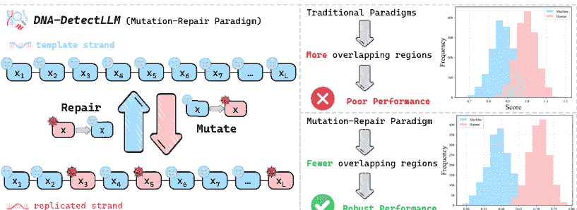
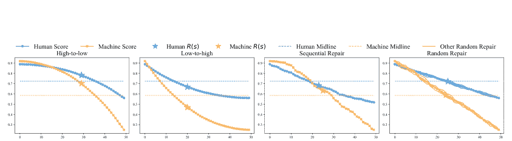
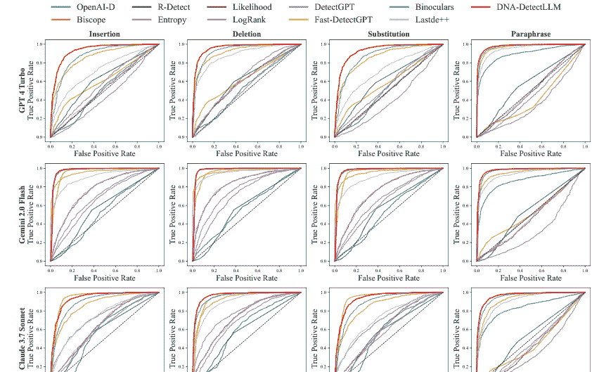
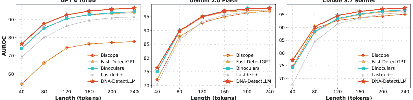
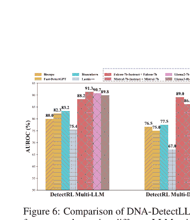
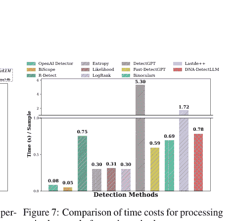

# 基于 DNA 突变修复范式的 AI 生成文本识别

## 摘要

大语言模型（LLM）的快速进步模糊了 AI 生成文本与人类撰写文本之间的界限。这一进展带来了虚假信息、作者归属模糊以及知识产权担忧等社会风险，突显了对可靠的 AI 生成文本检测方法的迫切需求。然而，生成式语言建模的最新进展导致人类撰写文本与 AI 生成文本的特征分布出现显著重叠，模糊了分类边界，使准确检测变得愈发困难。为应对上述挑战，我们提出了一个受 DNA 启发的视角，利用基于修复的过程直接且可解释地捕捉人类撰写文本与 AI 生成文本之间的内在差异。基于这一视角，我们引入了 DNA-DetectLLM，一种用于区分 AI 生成文本和人类撰写文本的零样本检测方法。该方法为每个输入构建一个理想的 AI 生成序列，迭代修复非最优词元（token），并将累积的修复工作量量化为一种可解释的检测信号。实证评估表明，我们的方法实现了最先进的检测性能，并针对各种对抗性攻击和输入长度表现出强大的鲁棒性。具体而言，DNA-DetectLLM 在多个公开基准数据集上，AUROC 取得了 5.55% 的相对提升，F1 分数取得了 2.08% 的相对提升。

## 1 引言

大语言模型（LLM）的快速进步产生了越来越像人类的文本内容，极大地缩小了 AI 生成文本与人类撰写文本之间可区分的差距。虽然这些改进催生了重大的技术突破，但同时也带来了严峻的社会挑战，包括虚假信息的传播、作者归属的模糊以及对知识产权的威胁 [2, 1, 12]。因此，迫切需要有效且可靠的方法来准确检测 AI 生成文本。

尽管大量的研究工作致力于 AI 生成文本检测，但现有方法通常采用基于训练或无训练的方法。基于训练的方法 [25, 15, 11, 34, 10] 依赖于大量的标注数据，限制了其可扩展性及其向新域推广的能力。相比之下，无训练方法 [19, 4, 13, 32] 利用固有的统计差异来区分人类撰写文本和 AI 生成文本。这两种范式本质上都是通过尝试在特征空间中识别不同的、可分离的边界来运行的。

图 1：突变-修复范式的示意图。输入序列可以类比为复制链，而理想的 AI 生成序列则对应于模板链。

然而，生成式语言建模的最新进展产生的输出与人类创作的内容越来越难以区分，导致这些分类边界逐渐模糊。实证研究 [6, 24] 强调了人类撰写文本和 AI 生成文本在特征分布中存在的显著重叠区域，这严重降低了实际场景中的检测准确率。因此，迫切需要一种能够更精确、更本质地捕捉 AI 与人类写作生成过程之间差异的方法。

在分子生物学中，DNA 的双螺旋结构确保了遗传信息的稳定传递，但在复制过程中发生的突变会引入变异，可能导致个体差异甚至癌症等疾病。类似地，理想的 AI 生成文本序列可以被视为一条“模板链”，代表了每个位置最可能的词元选择。相比之下，人类撰写的文本更像是一条突变的链，其中词元选择偏离了最优概率，从而产生了可测量的差异。受这种生物机制的启发，我们提出了 AI 生成文本检测的新视角：通过类比 DNA 碱基修复过程，我们迭代地“纠正”文本中的非最优词元，并衡量将其恢复为理想 AI 生成形式所需的难度。这种基于修复的方法直接且可解释地捕捉了 AI 生成文本与人类撰写文本之间的固有分歧。

基于这一直觉，我们提出了 **DNA-DetectLLM**，一种检测 AI 生成文本的新型零样本方法。对于每个输入序列，我们首先构建其对应的理想 AI 序列——即在参考语言模型下，通过在每个位置贪心地选择最可能词元所形成的序列。然后，我们对输入序列执行逐词元的修复过程，逐步将词元修改为它们的最优选择，直到序列与理想 AI 序列完全对齐。为了量化这一修复过程的难度，我们引入了一个修复分数，用于捕捉完成转变所需的累积工作量。最后，通过将修复分数与校准的阈值进行比较，**DNA-DetectLLM** 利用其偏离理想生成模式的根本差异，稳健地区分 AI 生成文本和人类撰写文本。

**DNA-DetectLLM** 在多个数据集和 LLM 上始终实现最先进的性能。特别是，它在三个公开基准数据集上获得了 **5.55%** 的 AUROC 相对提升和 **2.08%** 的 F1 分数相对提升。此外，该方法对多种对抗性攻击表现出显著的鲁棒性，并且适用于不同的输入长度。效率实验还表明其具有快速的检测能力，每个样本的处理时间不到 0.8 秒。

我们的贡献总结如下：

- 受 DNA 复制过程中核苷酸碱基的突变和修复机制启发，我们将突变-修复范式引入 AI 生成文本检测。

- 我们提出了 **DNA-DetectLLM**，这是一种检测 AI 生成文本的新型零样本方法，该方法增量地修复输入序列中的突变成词元，直到其与理想的 AI 生成序列完美对齐，随后将修复难度量化为文本检测的指标。

- 广泛的评估验证了 DNA-DetectLLM 为 AI 生成文本检测提供了一种可靠、高效且具有广泛通用性的解决方案，在各种检测设置下均有一致的提升。

## 2 相关工作

检测 AI 生成文本对于增强公众信任度和防止误用至关重要，引发了学术界和工业界日益增长的兴趣。除了水印技术 [18]（在生成期间嵌入可识别的标记）之外，当前的事后检测方法大致分为基于训练和无需训练的方法。

**基于训练的方法。** 此类方法通常涉及训练分类模型以区分 AI 生成文本和人类撰写文本。具体而言，OpenAI [25] 早期的努力采用基于 RoBERTa 的模型来训练文本分类器。随后，RADAR [15] 引入对抗性学习以增强对改写文本的鲁棒性。DeTeCtive [11] 利用多层级对比学习将由不同 LLM 生成的文本映射到相应的特征空间，并基于相似度指标进行分类。DPIC [34] 通过重构提示词并重新生成文本来提取深层文本特征。Biscopic [10] 提出采用双向交叉熵损失来提取统计特征，用于训练二元分类器。R-Detect [26] 采用非参数核相对测试来检测 AI 生成文本，从而与双样本测试相比降低了假阳性率。然而，现有研究 [5, 29] 表明，基于训练的方法通常会对分布内特征过拟合，导致对分布外（OOD）文本的泛化能力较差。因此，研究人员越来越关注开发更具通用性的无训练方法。

**无训练的方法。** 这些无训练方法强调利用文本的概率特性，基于特定假设构建统计分数，并根据分数与阈值的比较做出决策。例如，LogRank [8]、Likelihood [14] 和 Entropy [16] 计算平均概率排名、似然概率和熵值，以衡量 AI 生成文本的不确定性。DetectGPT [19] 开创了一种使用扰动生成大量对比样本来评估整体分布的范式。虽然 DetectLLM-NPR [27] 和 DNA-GPT [33] 等方法进一步发展了这一范式，但其效率局限性阻碍了实时或大规模检测的实现。Fast-DetectGPT [4] 随后更新了采样技术，以计算条件概率曲率，显著提高了检测效率并拓宽了潜在应用。Binarcoles [13] 通过从双模型视角计算交叉困惑度（cross-perplexity）实现了最先进的分类性能。Lastde++ [32] 提出通过计算多样性熵（Diversity Entropy）来关注局部文本特征，以优化分类性能。

## 3 DNA-DetectLLM

### 3.1 预备知识

本研究主要涉及两个统计指标：对数困惑度（log-perplexity），它量化单一模型下的平均词元级负对数似然；以及交叉困惑度（cross-perplexity），它捕捉两个模型概率分布之间的平均逐词元交叉熵：

$$
\text{log } \text{PPL}_{M_1}(s) = -\frac{1}{L}\sum_{i=1}^{L} \log P_{M_1}(x_i|x_{<i}),
$$

$$
\text{log X-PPL}_{M_1, M_2}(s) = -\frac{1}{L}\sum_{i=1}^{L} P_{M_1}(x_i|x_{<i}) \log P_{M_2}(x_i|x_{<i}),
$$

其中 $s$ 是长度为 $L$ 的输入序列，$x_i$ 表示第 $i$ 个词元，$P_{M}\left(x_{i}\mid x_{<i}\right)$ 是在参考模型 $M_1$ 或观察模型 $M_2$ 下，给定其前序词元时 $x_i$ 的条件概率。此外，它们的比值 $\sigma(s)$ 已被实证证明可作为有效的分数用于

区分 AI 生成的文本 [13]。为了量化局部词元级修改对这些指标的影响，本工作引入了**条件对数困惑度**和**条件分数**：

$$\log \mathrm{PPL}_{M_{1}}(\hat{s} | s) = - \frac{1}{L} \sum_{i = 1}^{L} \log P_{M_{1}} (\hat{x}_{i} | x_{<i}) \quad \sigma(\hat{s} | s) = \frac{\log \mathrm{PPL}_{M_{1}}(\hat{s} | s)}{\log \mathrm{X-PPL}_{M_{1}, M_{2}} (s)} , \tag{2}$$

其中 $\hat{s}$ 表示通过修改输入序列 $s$ 中的词元所得到的序列。

### 3.2 DNA-DetectLLM 概述

DNA-DetectLLM 的完整工作流程可以概括为 3 个关键步骤，如图 2 所示。

- **步骤 1：获取理想的 AI 生成序列。** 对于给定的输入，我们通过在每个位置贪心地选择最可能的词元来构建理想的 AI 生成序列。
- **步骤 2：突变修复机制。** 我们对输入序列进行迭代的词元级修改，直到它与理想的 AI 生成序列完全一致。
- **步骤 3：基于修复分数的检测。** 我们引入一个修复分数来量化修复的难度，该分数与经过校准的阈值进行比较，以确定检测结果。

### 3.3 获取理想的 AI 生成序列

我们提出了*理想 AI 生成序列 $\hat{s}$*的概念，类似于 DNA 复制中无错误的模板链，其中每个词元都是通过最大化其位置上的条件概率来选择的：

$$\hat{s} = \{\hat{x}_{1}, \hat{x}_{2}, \dots, \hat{x}_{L}\}, \quad \text{其中} \quad \hat{x}_{i} = \arg \max_{\hat{x} \in \mathcal{V}} P_{M_{1}}(\hat{x} | x_{<i}), \tag{3}$$

其中 $\mathcal{V}$ 表示词汇表，$x_{<i} = \{x_{1}, \dots, x_{i-1}\}$ 表示输入序列 $s$ 的前 $i-1$ 个词元。

### 3.4 突变修复机制

我们将非最大概率词元视为突变词元，将最大概率词元视为理想词元。类似于 DNA 中的突变-修复范式，我们提出了一种*突变修复机制*，旨在揭示 AI 生成文本和人工撰写文本在偏差模式上的根本差异。在该机制下，输入序列中的突变词元通过逐步用其理想词元进行迭代修复，直到输入与理想形式完全一致：

$$x_{i} \in s = \{x_{1}, x_{2}, \dots, x_{L}\} \rightarrow \hat{x}_{i} = \arg \max_{\hat{x} \in \mathcal{V}} P_{M_{1}}(\hat{x} | x_{<i}), \quad \text{如果} \quad x_{i} \neq \hat{x}_{i}, \tag{4}$$

图 3：不同修复策略下修复分数的变化。

### 3.5 基于修复分数的检测

我们引入了*修复分数* $R(s)$ 来量化修复过程的难度，定义为其在整个修复轨迹中累积的平均条件分数：

$$R(s) = \frac{1}{T+1} \sum_{t=0}^{T} \sigma(s_{t}|s) = \frac{\sum_{t=0}^{T} \log \text{PPL}_{M_{t}}(s_{t}|s)}{(T+1) \log X \text{-PPL}_{L, M_{T}}(s)}, \qquad (5)$$

其中 $s_{t}$ 是 $t$ 步修复后的序列，$T$ 是需要修正的突变词元的总数。

人工撰写的文本通常表现出更严重的突变，导致修复难度更大。相比之下，AI 生成的文本通常更容易修复。因此，输入序列的检测结果确定如下：

$$D(s) = \begin{cases} \text{人工撰写的文本}, & R(s) > \tau \\ \text{AI 生成的文本}, & R(s) \leq \tau. \end{cases} \qquad (6)$$

### 3.6 对修复顺序的敏感性以及分数简化

图 3 表明，对于相同的输入序列，不同的修复顺序会产生不同的修复分数，这是由于每个突变词元对条件分数的影响不相等。突变词元可以大致分为高概率和低概率类型。修复低概率词元通常会导致条件分数发生较大变化，而高概率词元导致的较小变化。为了系统地分析修复顺序的影响，我们确定了以下四种主要的修复策略：

- **从高到低：** 先修复高概率词元，然后修复低概率词元，会导致一个凸形的“修复曲线”和较高的修复分数。
- **从低到高：** 先修复低概率词元，再修复高概率词元，会产生一个凹形的“修复曲线”和较低的修复分数。
- **顺序修复：** 无论概率值如何，都按照词元在输入序列中出现的原始顺序进行修复。
- **随机修复：** 按随机选择的顺序修复词元。对多次随机修复的修复分数取平均值可得到更稳定的估计。

这些发现突显了修复分数对所选修复顺序的敏感性。执行多次随机修复可以有效缓解偏差，使修复分数接近初始分数和最终分数的中间值。因此，我们进一步推导出，当随机修复次数 $N$ 趋于无穷大时，平均修复分数收敛。推导如下：

设 $\{\delta_{1}, \delta_{2}, \dots, \delta_{T}\}$ 为满足 $\sum_{i=1}^{T} \delta_{i} = \sigma(s) - \sigma(s|s)$ 的一组非负实数。此外，$\delta_{i} = \sigma(s_{t-1}|s) - \sigma(s_{t}(s)$ 量化了修复当前词元对分数的影响。由于每个词元修复对条件对数困惑度的影响是独立且固定的，因此对于给定的输入序列，集合 $\{\delta_{1}, \delta_{2}, \dots, \delta_{T}\}$ 由固定值组成，其顺序取决于修复策略而变化。进一步可得：

$$\sigma(s_{t}|s) = \sigma(s) - \sum_{i=1}^{t} \delta_{i} \quad \text{对于 } t = 1, 2, \dots, T, \quad \text{其中 } \sigma(s) = \sigma(s_{0}|s). \qquad (7)$$

对于特定的排列 $\phi \in [1, N]$，对应的修复分数 $R^{\phi}(s)$ 为：

$$R^{\phi}(s) = \frac{1}{T + 1}\sum_{t = 0}^{T}\left(\sigma(s) - \sum_{i = 1}^{t}\delta_i^{\phi}\right) = \sigma(s) - \frac{1}{T + 1}\sum_{i = 1}^{T}\delta_i^{\phi}\cdot(T - i + 1).$$

由于每个词元被随机修复的概率相等，$\delta_i^{\phi}$ 在所有排列中出现在第 $i$ 个位置的期望值为 $\frac{1}{T}(\sigma(s) - \sigma(s \mid s))$。我们进一步推导修复分数的期望值如下：

$$\mathbb{E}[R(s)] = \sigma(s) - \frac{1}{T + 1}\sum_{i = 1}^{T}\mathbb{E}\left[\delta_i^{\phi}\right]\cdot(T - i + 1) = \sigma(s) - \frac{1}{T + 1}\cdot\frac{\sigma(s) - \sigma(s \mid s)}{T}\cdot\frac{T(T + 1)}{2}.$$

因此，当随机排列数量 $N$ 趋于无穷大时，平均修复分数收敛如下：

$$\lim_{N \to \infty}\frac{1}{N}\sum_{n = 1}^{N}R^{(n)}(s) = \lim_{N \to \infty}\frac{1}{N}\sum_{n = 1}^{N}\left(\frac{1}{T + 1}\sum_{t = 0}^{T}\sigma^{(n)}(s_i \mid s)\right) = \frac{1}{2}(\sigma(s) + \sigma(s \mid s)).$$

因此，我们将修复分数简化为 $R(s) = \frac{1}{2}(\sigma(s) + \sigma(s \mid s))$，在提高检测性能的同时避免了修复过程中的中间分数计算。

## 4 实验

## 4.1 实验设置

**数据集。** 为了评估在不同领域的表现，我们从三个代表性任务中收集了 4,800 条人工撰写的文本：新闻文章写作（XSum [20]）、故事生成（WritingPrompts [7]）和学术写作（ArXiv [21]）。对于每条文本，我们构建了特定于任务的提示词（见附录 C），并使用三个先进的 LLM 生成相应的 AI 输出：GPT-4 Turbo、Gemini-2.0 Flash 和 Claude-3.7 Sonnet。我们进一步从三个高质量的检测基准——M4 [30]、DetectRL [31] 和 RealDet [35]——中各采样 2,000 条平衡样本，以确保在真实场景中进行公平和全面的评估。

**指标。** 我们采用接收者操作特征曲线下面积（AUROC [17]）和 F1 分数来评估检测性能，其中较高的值表明人工撰写文本与 AI 生成文本之间的可分离性更好。

**基线方法。** 我们将 DNA-DetectLLM 与现有的基于训练和非训练方法进行比较。对于基于训练的方法，我们包括 OpenAI-D [25]、Broscope [10] 和 R-Detect [26]。对于非训练方法，我们考虑了包括似然度 [14]、LogRank [8] 和熵 [16] 在内的经典零样本检测器，以及若干最近的 SOTA（最先进）方法，如 DetectGPT [19]、Fast-DetectGPT [4]、Binculars [13] 和 LastDet++ [32]。

**实现细节。** 在真实的检测场景中，文本数据的来源和分布通常是未知的，这构成了一个分布外（OOD）检测问题。为了确保对基于训练方法的公平性，我们仅在 HC3 数据集 [9] 上进行训练，该数据集与测试集完全不重叠。对于非训练方法，用于打分的 LLM 选择可能会引入显著的性能差异 [3]。为了消除这一因素，我们通过在所有方法中使用 Falcon-7B-Instruct [22] 来计算词元生成概率，从而标准化参考（或打分）模型。此外，Fast-DetectGPT、Binculars、LastDet++ 和 DNA-DetectLLM 使用 Falcon-7B [22] 作为观察者（或采样）模型，而 DetectGPT 使用 TS-3B [23]。在测试期间，最大输入词元长度限制为 1024。更多细节见附录 D。

## 4.2 主要结果

表 1 比较了 DNA-DetectLLM 与其他基线方法在不同写作任务和不同生成模型上的检测性能。DNA-DetectLLM 始终取得了

## 表 1：各检测器在不同数据集和 LLM 上针对人类撰写文本与 AI 生成文本的 AUROC（%）

| 检测器 | XSum | XSum | XSum | WritingPrompt | WritingPrompt | WritingPrompt | Arxiv | Arxiv | Arxiv | 平均值 | GPT-4 | GPT-4 | GPT-4 |
| :--- | :---: | :---: | :---: | :---: | :---: | :---: | :---: | :---: | :---: | :---: | :---: | :---: | :---: |
| | Gemini-2.0 Turbo | Claude-3.7 Sonnet | Flash | Gemini-2.0 Flash | Claude-3.7 Sonnet | Flash | Gemini-2.0 Turbo | Claude-3.7 Sonnet | Flash | | Gemini-2.0 Turbo | Claude-3.7 Sonnet | Flash |
| **基于训练的方法** | | | | | | | | | | | | | |
| Open-AI-D | 60.51 | 68.93 | 62.96 | 50.94 | 59.47 | 57.28 | 49.63 | 51.40 | 68.57 | 58.85 | - | - | - |
| Biscope | 75.08 | 95.63 | 94.09 | 80.08 | 98.71 | 98.05 | 82.53 | 99.74 | 96.61 | 91.17 | - | - | - |
| R-Detect | 63.56 | 45.63 | 51.13 | 73.38 | 71.07 | 75.74 | 56.47 | 57.24 | 53.35 | 60.89 | - | - | - |
| **免训练方法** | | | | | | | | | | | | | |
| Entropy | 72.26 | 54.85 | 74.90 | 87.85 | 90.36 | 91.17 | 45.60 | 79.96 | 80.42 | 75.26 | - | - | - |
| Likelihood | 70.03 | 69.50 | 70.39 | 80.82 | 95.52 | 85.85 | 57.87 | 93.60 | 86.24 | 78.82 | - | - | - |
| LogRank | 69.61 | 69.36 | 69.81 | 84.35 | 94.15 | 84.15 | 54.18 | 98.15 | 85.80 | 78.26 | - | - | - |
| DetectGPT | 61.50 | 68.09 | 61.36 | 78.80 | 89.33 | 78.17 | 56.10 | 92.18 | 80.27 | 74.42 | - | - | - |
| Fast-DetectGPT | 98.33 | 92.54 | 94.30 | 97.79 | 98.58 | 94.14 | 92.12 | 99.80 | 98.21 | 96.20 | - | - | - |
| Binoculars | 98.06 | 95.56 | 96.83 | 97.73 | 99.35 | 97.29 | 93.69 | 99.87 | 97.99 | 97.39 | - | - | - |
| Laksh++ | 97.25 | 90.87 | 92.77 | 95.12 | 98.19 | 92.56 | 90.43 | 98.54 | 97.57 | 94.90 | - | - | - |
| **DNA-DetectLLM** | **99.31** | **96.65** | **98.45** | **98.86** | **99.72** | **98.51** | **95.00** | **99.88** | **98.35** | **98.30** | - | - | - |
| DNA-DetectLLM 采用其他修复顺序 | | | | | | | | | | | | | |
| 由低至高 | 98.94 | 94.98 | 97.31 | 98.29 | 99.41 | 97.77 | 92.48 | 99.75 | 97.91 | 97.43 | - | - | - |
| 由高至低 | 99.14 | 97.22 | 98.40 | 98.63 | 99.81 | 98.37 | 94.67 | 99.77 | 97.44 | 98.16 | - | - | - |
| 顺序修复 | 98.90 | 97.82 | 98.37 | 96.80 | 99.77 | 98.55 | 95.78 | 99.91 | 98.21 | 98.23 | - | - | - |

*注：原 OCR 表格中“平均值”下方后三列的表头被重复标记为“GPT-4”。根据表 2 的上下文及标准论文结构，这些列可能指代特定的 LLM 或为格式错误。然而，观察表 2 可知，平均值后的列对应具体基准测试。在表 1 中，结构通常列出所测试的 LLM。OCR 表头中 `\multicolumn{3}{c|}{GPT-4}` 重复出现三次，暗示源文件或 OCR 可能存在错误。鉴于数据行在检测器名称后有 10 个数值，而表头暗示 3 组 3 列（9 列）+ 平均值（1 列）+ 检测器（1 列）= 11 列？不，数据行只有 10 个数字。让我们重新检查数据行的计数。*

*数据行示例：`60.51|68.93|62.96` (3个) `50.94|59.47|57.28` (3个) `49.63|51.40|68.57` (3个) `58.85` (1个平均值)。总计 10 个值。表头包含 1 (检测器) + 3 (XSum) + 3 (WritingPrompt) + 3 (Arxiv) + 1 (平均值) + 3 (GPT-4?) + 3 (GPT-4?) + 3 (GPT-4?) + 1 (空)。该表头结构在 OCR 输入中格式错误。查看数据，仅有 10 个数字。表头暗示更多列。等等，表头中最后三组 `\multicolumn{3}{c|}{GPT-4}` 可能被误解了。让我们看看“平均值”列。它是单列。平均值后的 3+3+3 = 9 个列在表头中，但数据中平均值后没有列。
*更正*：表格表头的 OCR 文本可能乱码了。数据行恰好包含 10 个数值列。
1. 检测器
2-4. XSum
5-7. WritingPrompt
8-10. Arxiv
11. 平均值
OCR 表头中显示了额外的 `\multicolumn{3}` 块。我将根据提供的数据结构化表格。表头中最后三组可能对应其他内容或为错误。然而，仔细观察数据，`58.85` 是第 10 个值。表头在 OCR 中显示为 `|\multicolumn{1}{l|}{}|\hline`。
实际上，这些表格通常与 LLM 进行比较。表头中重复的 `GPT-4` 可能是 `GPT-4`、`Claude`、`Gemini`？但数据行在平均值处截止。
假设提示中提供的表格仅包含前 4 组数据 + 平均值。OCR 中多余的表头可能是伪影或空列。我将根据存在的数据渲染表格。如果数据行中的数字少于表头，我将留空或进行调整。
*重新阅读数据*：
`Open-AI-D|60.51|68.93|62.96|50.94|59.47|57.28|49.63|51.40|68.57|58.85`
共有 10 个数字。
列：检测器，XSum(3)，WP(3)，Arxiv(3)，平均值(1)。
OCR 表头有多余列。我将忽略多余的空表头，并根据数据内容格式化。

## 表 2：在公共基准数据集上的检测性能（AUROC 和 F1 分数）

| 检测器 | M4 | M4 | DetectRL 多 LLM | DetectRL 多 LLM | DetectRL 多领域 | DetectRL 多领域 | RealDet | RealDet | 平均值 | 平均值 |
| :--- | :---: | :---: | :---: | :---: | :---: | :---: | :---: | :---: | :---: | :---: |
| | AUROC | F₁ | AUROC | F₁ | AUROC | F₁ | AUROC | F₁ | AUROC | F₁ |
| **基于训练的方法** | | | | | | | | | | |
| Open-AI-D | 71.51 | 71.18 | 78.15 | 71.90 | 74.60 | 70.03 | 78.75 | 77.47 | 78.75 | 72.65 |
| Biscope | 79.74 | 73.08 | 79.97 | 76.52 | 71.64 | 92.88 | 86.90 | 82.28 | - | - |
| R-Detect | 61.91 | 67.14 | 67.40 | 66.56 | 79.19 | 73.38 | 65.93 | 67.72 | 68.61 | 68.20 |
| **免训练方法** | | | | | | | | | | |
| Entropy | 83.72 | 79.10 | 64.30 | 71.92 | 47.82 | 69.24 | 75.42 | 74.72 | 67.82 | 73.75 |
| Likelihood | 85.77 | 78.38 | 66.82 | 66.71 | 48.96 | 66.69 | 85.35 | 79.75 | 71.73 | 72.88 |
| LogRank | 87.50 | 80.70 | 67.30 | 65.55 | 50.53 | 66.69 | 86.28 | 80.69 | 72.91 | 75.89 |
| DetectGPT | 73.13 | 70.11 | 49.57 | 66.67 | 34.67 | 66.67 | 78.69 | 73.80 | 59.02 | 69.31 |
| Fast-DetectGPT | 89.77 | 84.12 | 82.26 | 75.93 | 74.98 | 68.91 | 93.25 | 90.00 | 85.07 | 79.74 |
| Binoculars | 90.00 | 87.40 | 83.21 | 82.87 | 77.45 | 80.20 | 93.64 | 90.51 | 86.08 | 85.25 |
| Laksh++ | 91.43 | 84.97 | 75.36 | 69.24 | 67.30 | 66.67 | 93.90 | 89.41 | 82.00 | 77.57 |
| **DNA-DetectLLM** | **91.74** | **87.72** | **88.99** | **84.85** | **88.23** | **84.94** | **94.48** | **90.58** | **90.86** | **87.02** |

在所有设置下均取得最先进的性能，平均 AUROC 为 98.30%，相对提升 0.93%。具体而言，在 XSum、WritingPrompts 和 Arxiv 数据集上分别取得了 1.36%、0.87% 和 0.58% 的相对提升，展现出强大的跨领域泛化能力。这种强大的泛化能力可归因于 DNA-DetectLLM 能够通过突变-修复机制，动态捕捉领域特定文本与其理想 AI 生成对应文本之间的生成差异，从而在不同领域中稳健地识别人类撰写文本与 AI 生成文本。

表 2 评估了所有方法在三个高质量公共基准测试上的实际检测性能。DNA-DetectLLM 展现出卓越的可靠性，平均 AUROC 和 F1 分数分别提升了 5.55% 和 2.08%。值得注意的是，在具有挑战性的 DetectRL 设置中，它取得了显著的 AUROC 提升——多 LLM 设置提升 6.92%，多领域设置提升 13.92%。这一提升可归因于 DetectRL 固有的难度，由于数据集的构建方式，其正样本和负样本均可能包含具有相同标签的文本混合。这种复杂性阻碍了依赖固定统计分数的传统免训练方法。相比之下，DNA-DetectLLM 通过将复杂构建的输入文本与其各自的理想 AI 生成序列进行对齐，适当计算修复分数。这种灵活的基于修复的评分方式在分布重叠和模糊情况下能够进行更准确的检测，凸显了 DNA-DetectLLM 在复杂检测场景中的实用性。

## 4.3 鲁棒性

### 4.3.1 对各种攻击的鲁棒性

图 4 展示了 DNA-DetectLLM 及其他基线方法在各种攻击下的 AUROC 曲线（详情见附录 E）。我们在由 GPT-4 Turbo、Gemini-2.0 Flash 和 Claude-3.7 Sonnet 生成的文本上进行了实验，并引入了两种不同的攻击：词元级编辑和改写。编辑攻击涉及以 1% 的比率随机插入、删除或替换词元。改写攻击使用 DIPPER 对 AI 生成的文本进行重新表述。为了保持标签的清洁性，攻击仅应用于 AI 生成的文本。

图 4：DNA-DetectLLM 和基线方法在改写和编辑攻击下的 AUROC 曲线。

图 5：在截断至目标词元数的输入文本上的检测性能（AUROC）。

结果表明，DNA-DetectLLM 对多种对抗性攻击表现出强大的鲁棒性。例如，在 GPT-4 Turbo 生成的文本上，我们的方法在插入、删除、替换和改写攻击下分别取得了 6.65%、3.17%、6.62% 和 0.81% 的相对 AUROC 提升。值得注意的是，在低假正率（FPR）条件下，这种提升尤为显著。我们将这种鲁棒性归因于以下观察：虽然词元级编辑的范围有限，但它们可能会显著改变输入序列的生成概率分布，同时对其理想 AI 生成序列的影响微乎其微。因此，DNA-DetectLLM 仍然能够计算准确的修复分数以实现可靠检测。此外，即使在使用 Dipp er 进行改写攻击的情况下，该方法也能有效捕捉与理想序列的内在偏差，并维持 97.23% 的高 AUROC。这些发现突显了 DNA-DetectLLM 检测经过对抗性操纵的 AI 生成文本的能力，即使这些攻击旨在逃避检测。

### 4.3.2 在不同长度上的鲁棒性

先前的研究 [4, 28] 表明，词元长度显著影响检测性能，较短的文本更难检测。我们通过截断输入文本以改变目标词元数来研究其影响。图 5 展示了五种方法在不同长度下的检测性能：DNA-DetectLLM、Binoculars、Fast-DetectGPT、Lastde++ 和 Biscope。结果显示，DNA-DetectLLM 在不同长度上始终优于所有基线方法。在 GPT-4 Turbo 生成的文本上，它实现了 2.46% 的平均 AUROC 提升。虽然所有方法都受益于较长的输入，但 DNA-DetectLLM 在较短文本上表现出更大的优势。在词元长度为 40 时，它分别比次优方法高出 3.38%、1.80% 和 3.27%。这些发现表明，我们的方法通过从有限的文本输入中提取更具判别力的特征，从而能够在较短长度下进行检测。

### 4.4 消融实验

我们通过两类消融实验进一步评估了修复顺序和不同基础 LLM 的重要性。更详细的消融研究见附录 F。

**各种修复顺序下的基于修复分数的检测。** 表 1 比较了 DNA-DetectLLM 在各种修复顺序下的检测性能。当修复顺序更改为“由高至低”、“由低至高”或“顺序修复”时，观察到性能略有下降。虽然这些策略仍优于其他基线，但它们需要在每次突变词元修复后重新计算条件分数，导致计算成本显著增加。相比之下，简化的修复分数（$R(s) = \frac{1}{2}(\sigma(s) + \sigma(s|s))$）在保持强大性能的同时，将效率提高了一个数量级，凸显了其在实际部署中的必要性。

**DNA-DetectLLM 在不同 $M_1$ 和 $M_2$ 下的表现。** 图 6 评估了四种不同的 LLM 组合：“Falcon-7B-Instruct + Falcon-7B”、“Llama-3-8B-Instruct + Llama-3-8B”、“Mistral-7B-Instruct + Mistral-7B” 和 “Llama-2-7B + Llama-7B”。结果表明，这些组合中的任意一种都显著优于现有基线，平均性能提升 15.28%。有趣的是，“Llama-2-7B + Llama-7B” 组合略微超过了我们在主要实验中使用的默认组合“Falcon-7B-Instruct + Falcon-7B”，实现了 92.4% 和 90.7% 的 AUROC。这些发现突显了 DNA-DetectLLM 的内在有效性，表明其稳健的检测性能不依赖于任何特定的 LLM 组合，并通过更好的 LLM 配对还有进一步提升的潜力。

### 4.5 效率分析

效率对于 AI 生成文本检测至关重要，因为缓慢的检测速度会阻碍实际场景中的大规模或实时监控。图 7 展示了每种方法的平均每样本处理时间。为了消除文本长度这一混淆因素，我们从 ReadDet 数据集中随机采样了 1,000 篇长文本，将其截断为 300 个词元，并在批次大小为 1 的情况下测量平均检测成本。我们观察到，Biscope 和 OpenAI-D 等基于训练的方法最快，每文本处理时间少于 0.1 秒，但这些方法涉及显著的训练开销。在免训练方法中，Likelihood、Logrank 和 Entropy 等经典方法速度更快，推理时间约为 0.3 秒，但其检测准确性未达我们的

的要求。DNA-DetectLLM、Binoculars 和 Fast-DetectGPT 处理每个样本耗时 0.8 秒，其中 DNA-DetectLLM 实现了更优的检测性能。

## 5 结论

在本文中，我们提出了 DNA-DetectLLM，这是一种新颖的零样本 AI 生成文本检测方法，基于受 DNA 启发的突变-修复范式。大量实验表明，DNA-DetectLLM 持续达到 SOTA 检测性能，并在多种场景中表现出强大的鲁棒性。我们希望我们的工作能为 AI 生成文本检测提供新的见解和视角，并计划进一步探索突变-修复范式以提升检测性能。

## 参考文献

- [1] David Ifeoluwa Adelani, Hao Thi Mai, Fuming Fang, Huy Hoang Nguyen, Junichi Yamagishi, 和 Isao Echizen. 利用神经语言模型生成保留情感态度的虚假在线评论及其基于人类和机器的检测。载于《国际先进信息网络与应用会议》，2019 年。
- [2] Alim Al Ayub Ahmed, Ayman Aljabouh, Praveen Kumar Donopudi, 和 Myung Suh Choi. 使用机器学习检测虚假新闻：一项系统性文献综述，2021 年。
- [3] Guangsheng Bao, Yanbin Zhao, Cucai He, 和 Yue Zhang. Glimpse：使白盒方法能够使用专有模型进行零样本 LLM 生成文本检测。载于《第十三届国际学习表征会议》，2025 年。
- [4] Guangsheng Bao, Yanbin Zhao, Zhiyang Teng, Linyi Yang, 和 Yue Zhang. Fast-detectGPT：通过条件概率曲率高效零样本检测机器生成文本。载于《第十二届国际学习表征会议》，2024 年。
- [5] Souradip Chakraborty, Amrit Singh Bedi, Sicheng Zhu, Bang An, Dinesh Manocha, 和 Furong Huang. 关于 AI 生成文本检测的可能性，2023 年。
- [6] Liam Dugan, Alyssa Hwang, Filip Trhlik, Andrew Zhu, Josh Magnus Lúdan, Hainiu Xu, Daphne Ippolito, 和 Chris Callison-Burch. RAID：一个用于机器生成文本检测器鲁棒评估的共享基准。在 Lun-Wei Ku, Andrea Maritini, 和 Vivek Srikumar 编辑的《计算语言学协会第 62 届年会论文录（第 1 卷：长论文）》中，第 12463–12492 页，泰国曼谷，2024 年 8 月。计算语言学协会。
- [7] Angela Fan, Mike Lewis, 和 Yann Dauphin. 分层神经故事生成。在 Iryna Gurevych 和 Yusuke Miyao 编辑的《计算语言学协会第 56 届年会论文录（第 1 卷：长论文）》中，第 889–898 页，澳大利亚墨尔本，2018 年 7 月。计算语言学协会。
- [8] Sebastian Gehrmann, Hendrik Strobelt, 和 Alexander Rush. GLTR：生成文本的统计检测与可视化。在 Marta R. Costa-jussà 和 Enrique Alfonseca 编辑的《计算语言学协会第 57 届年会：系统演示论文集》中，第 111–116 页，意大利佛罗伦萨，2019 年 7 月。计算语言学协会。
- [9] Biyang Guo, Xin Zhang, Ziyuan Wang, Mingqi Jiang, Jinran Nie, Yuxuan Ding, Jianwei Yue, 和 Yupeng Wu. ChatGPT 距离人类专家有多近？比较语料库、评估与检测，2023 年。
- [10] Hanxi Guo, Siyuan Cheng, Xiaolong Jin, Zhuo Zhang, Kaiyan Zhang, Guanghong Tao, Guangyu Shen, 和 Xiangyu Zhang. Biscople：通过检查前序 token 的记忆来进行 AI 生成文本检测。在 A. Globerson, L. Mackey, D. Belgrave, A. Fan, U. Paquet, J. Tomczak, 和 C. Zhang 编辑的《神经信息处理系统进展》第 37 卷，第 104065–104090 页。Curran Associates, Inc., 2024 年。
- [11] Xun Guo, Shan Zhang, Yongxin He, Ting Zhang, Wanqun Feng, Haibin Huang, 和 Chongyang Ma. DetectGPT：通过多级对比学习检测 AI 生成文本。在 A. Globerson, L. Mackey, D. Belgrave, A. Fan, U. Paquet, J. Tomczak, 和 C. Zhang 编辑的《神经信息处理系统进展》第 37 卷，第 68320–68347 页。Curran Associates, Inc., 2024 年。
- [12] Zhiwei Guo, Yu Shen, Ali Kashif Bashir, Muhammad Imran, Neeraj Kumar, Di Zhang, 和 Keping Yu. 在物联网应用中利用协作神经网络实现鲁棒的垃圾发送者检测。《IEEE 物联网期刊》，8(12):9549–9558, 2021 年。
- [13] Abhimanyu Hans, Avi Schwartzschild, Valerija Cherepanova, Hamid Kazemi, Aniruddha Saha, Micah Goldblum, Jonas Geiping, 和 Tom Goldstein. 用双筒望远镜发现 LLM：机器生成文本的零样本检测，2024 年。
- [14] Tatsuhiro B. Hashimoto, Hugh Zhang, 和 Percy Liang. 统一自然语言生成的人类评估与统计评估。在 Jill Burstein, Christy Doran, 和 Thamar Solorio 编辑的《2019 年计算语言学协会北美章节会议：人类语言技术论文集，第 1 卷（长文和短文）》中，第 1689–1701 页，美国明尼苏达州明尼阿波利斯，2019 年 6 月。计算语言学协会。
- [15] Xiaomeng Hu, Pin-Yu Chen, 和 Tsung-Yi Ho. Radar：通过对抗学习实现鲁棒的 AI 文本检测。在 A. Oh, T. Naumann, A. Globerson, K. Saenko, M. Hardt, 和 D. Levine 编辑的《神经信息处理系统进展》第 36 卷，第 15077–15095 页。Curran Associates, Inc., 2023 年。
- [16] Daphne Ippolito, Daniel Duckworth, Chris Callison-Burch, 和 Douglas Eck. 当人类被欺骗时，自动检测生成文本最容易。在 Dan Jurafsky, Joyce Chai, Natalie Schluter, 和 Joel Tetreault 编辑的《计算语言学协会第 58 届年会论文集》中，第 1808–1822 页，在线，2020 年 7 月。计算语言学协会。
- [17] Alberto Jiménez-Valverde. 关于受试者工作特征曲线（AUC）下面积作为物种分布模型中区分度指标的认识。《全球生态学与生物地理学》，21(4):498–507, 2012 年。
- [18] John Kirchenbauer, Jonas Geiping, Yuxin Wen, Jonathan Katz, Ian Miers, 和 Tom Goldstein. 大语言模型的水印。CoRR, abs/2301.10226, 2023 年。
- [19] Eric Mitchell, Yoonho Lee, Alexander Khazatsky, Christopher D Manning, 和 Chelsea Finn. DetectGPT：利用概率曲率进行机器生成文本的零样本检测。在 Andreas Krause, Emma Brunskill, Kyungchan Cho, Darba Engelson, 和 Jonathan Scarlett 编辑的《第 40 届国际机器学习会议论文集》，《机器学习研究进展》第 202 卷，第 24950–24962 页。PMLR, 2023 年 7 月 23–29 日。
- [20] Shashi Narayan, Shay B. Cohen, 和 Mirella Lapata. 不要给我细节，只要摘要！用于极致摘要的主题感知卷积神经网络。在 Ellen Riloff, David Chiang, Julia Hockenmaier, 和 Jun’ichi Tsujii 编辑的《2018 年自然语言处理经验方法会议论文集》中，第 1797–1807 页，比利时布鲁塞尔，2018 年 10 月-11 月。计算语言学协会。
- [21] Sayak Paul 和 Soumik Rakshit. arxiv 论文摘要。https://www.kaggle.com/datasets/psayakpaul/arxiv-paper-abstracts, 2021 年。
- [22] Guilherme Penedo, Quentin Malartic, Daniel Hessow, Ruxandra Cojocaru, Alessandro Cappelli, Hamza Alobeidli, Baptiste Pannier, Ébéasr Almeida, 和 Julien Launay. Falcon LLM 的 RefinedWeb 数据集：仅使用网络数据超越精心策划的语料库。arXiv 预印本 arXiv:2306.01116, 2023 年。
- [23] Colin Raffel, Noam Shazeer, Adam Roberts, Katherine Lee, Sharan Narang, Michael Matena, Yanqi Zhou, Wei Li, 和 Peter J. Liu. 探索统一文本到文本 Transformer 在迁移学习中的极限。《机器学习研究期刊》，21(140):1–67, 2020 年。
- [24] Vinu Sankar Sadasivan, Aounon Kumar, Sriram Balasubramanian, Wenxiao Wang, 和 Soheil Feizi. AI 生成文本能否被可靠地检测？，2025 年。
- [25] Irene Solaiman, Miles Brundage, Jack Clark, Amanda Askell, Ariel Herbert-Voss, Jeff Wu, Alec Radford, Gretchen Krueger, Jong Wook Kim, Sarah Kreps, 等. 语言模型的发布策略及其社会影响。arXiv 预印本 arXiv:1908.09023, 2019 年。
- [26] Yiliao Song, Zhenqing Yuan, Shuhai Zhang, Fanyan Zhong, 和 Fengrui Luo. 用于机器生成文本检测的深度核相对检验。载于《第十三届国际学习表征会议》，2025 年。
- [27] Jinyan Su, Terry Yue Zhuo, Di Wang, 和 Preslav Nakov. Detectllm：利用对数秩信息进行机器生成文本的零样本检测，2023 年。
- [28] Yuchuan Tian, Hanting Chen, Xueto Wang, Zheyuan Bai, QINGHUA ZHANG, Ruifeng Li, Chao Xu, 和 Yunhe Wang. AI 生成文本的多尺度正样本-未标记样本检测。载于《第十二届国际学习表征会议》，2024 年。
- [29] Adaku Uchendu, Thai Le, Kai Shu, 和 Dongwon Lee. 神经文本生成的作者归属。在 Bonnie Webber, Trevor Cohn, Yulan He, 和 Yang Liu 编辑的《2020 年自然语言处理经验方法会议（EMNLP）论文集》中，第 8384-8395 页，在线，2020 年 11 月。计算语言学协会。
- [30] Yuxia Wang, Jonibek Mansurov, Petar Ivanov, Jinyan Su, Artem Shelmanov, Akim Tsvigun, Chenxi Whitehouse, Osama Mohammed Afzal, Tarek Mahmood, Toru Sasaki, Fanyan Luo, 和 Preslav Nakov. M4：多生成器、多领域和多语言黑盒机器生成文本检测。在 Yvette Graham 和 Matthew Purver 编辑的《第 18 届计算语言学协会欧洲章节会议（第 1 卷：长论文）论文集》中，第 1369-1407 页，马耳他圣朱利安，2024 年 3 月。计算语言学协会。
- [31] Junchao Wu, Runzhe Zhan, Derek F. Wong, Shu Yang, Xinyi Yang, Yulin Yuan, 和 Lidia S. Chao. DetectRL：在现实场景中基准测试 LLM 生成文本检测。载于《第三十八届神经信息处理系统会议数据集与基准赛道》，2024 年。
- [32] Yihuai Xu, Yongwei Wang, Yifei Bi, Huangsen Cao, Zhouhan Lin, Yu Zhao, 和 Fei Wu. 通过挖掘 token 概率序列实现免训练的 LLM 生成文本检测。CoRR, abs/2410.06072, 2024 年。
- [33] Xianjing Yang, Wei Cheng, Yue Wu, Linda Ruth Petzold, William Yang Wang, 和 Haifeng Chen. Dna-gpt：用于免训练检测 GPT 生成文本的发散 n-gram 分析。载于 ICLR，2024 年。
- [34] Xiao Yu, Yuang Qi, Kejiang Chen, Guoqiang Chen, Xi Yang, Pengyuan Zhu, Xiuwei Shang, Weiming Zhang, 和 Nenghai Yu. Dpic：解耦提示词特征与内在特征用于 LLM 生成文本检测。在 A. Globerson, R. Makay, D. Belgrave, A. Fan, U. Paquet, J. Tomczak, 和 C. Zhang 编辑的《神经信息处理系统进展》第 37 卷，第 16194-16212 页。Curran Associates, Inc., 2024 年。
- [35] Xiaowei Zhu, Yubing Ren, Yanan Cao, Xixun Lin, Fang Fang, 和 Yangqi Li. 可靠地界定假阳性：一种基于多尺度保形预测的零样本机器生成文本检测框架，2025 年。

## A 局限性

受限于内存约束，我们无法在计算资源充足的情况下扩大用于评估方法效率的批处理大小。因此，本研究并未完全探索在涉及大规模 AI 生成文本实时监测的真实场景中的性能差异。报告的效率结果基于统一的小批处理设置下的相对比较。

## B 更广泛的影响

提出的 DNA-DetectLLM 通过提高准确性并引入一种新颖的检测视角，为人工智能生成文本检测领域做出了贡献。其增强的可靠性可能作为参考，用于需要辅助判断的社会相关场景。然而，我们强调检测本身就带有暗示或指控的风险。尽管我们的方法表现出强大的性能，但我们强烈反对将其输出用作惩罚性或纪律性背景下的直接证据。无论其准确性如何，此类应用都可能导致严重后果和滥用。

## C 主要数据提示词设计

表 3：不同写作任务的输入提示词及相应输出示例，其中输出样本来自 GPT-4 生成的文本。

| 写作任务 | 输入提示词 | 输出 |
| :--- | :--- | :--- |
| 新闻报道写作 | 一名警方消息人士告诉 BBC，昨晚一名塔利班渗透者允许武装分子进入拉斯卡尔加地区首都的警察局。请继续。 | 据信与塔利班有关联的武装分子袭击了警察局，并与警官们进行了一场漫长的枪战…… |
| 故事生成 | 两个孩子走进了 Rockmount 动物园。请继续。 | 当他们兴奋地跨过门槛时，看到树梢上色彩鲜艳的鹦鹉在叽叽喳喳叫，眼睛不禁睁大…… |
| 学术写作 | 请根据以下标题撰写摘要：“纯探索与匹配赌博机中的遗憾最小化”。 | 本文深入研究了匹配赌博机问题背景下纯探索和遗憾最小化领域——这是机器学习的一个重要领域…… |

表 3 展示了我们为不同写作任务设计的通用提示词。使用这些提示词，我们在 GPT-4 Turbo、Gemini-2.0 Flash 和 Claude-3.7 Sonnet 上生成了 4,800 篇人工智能生成文本——对应人工撰写的文本——这些文本被用于我们的实验中。

## D 实现细节

所有实验都在单张拥有 80GB 内存的 NVIDIA A100 GPU 上完成。除非另有说明，温度、top-k 和其他生成参数均使用默认设置。本研究不涉及额外的超参数调优。对于基于训练的方法（Biscope 和 R-Detect），模型在 HC3 数据集的 4,000 个平衡样本上进行训练，并根据在单独的 2,000 个样本验证集上的验证性能选择表现最佳的检查点。在主要实验中，报告的所有 F1 分数均是通过根据每种方法的正负分数选择最佳阈值而获得的最大值。

## E 鲁棒性实验

在本研究中，我们未考虑针对人工撰写文本的对抗性攻击，因为在这种情况下规避行为通常无关紧要。相反，我们专注于涉及人工智能生成文本的对抗性场景，引入两种常见的攻击类型：改写和标记级别编辑。对于改写攻击，我们采用 DAPPER 工具，其超参数设置为词汇多样性为 60，句法多样性为 60。这种程度的改写足以潜在地绕过最先进（SOTA）的检测器。对于编辑攻击，我们使用 GPT-2 分词器对输入进行分词，并对 1% 的标记应用随机插入、删除和替换。插入或替换的标记是从分词器的词汇表中均匀采样的。

表 4：GPT-4 Turbo 在各种攻击下的 AUROC (%)。

| 方法 | 插入 | 删除 | 替换 | 改写 |
| --- | --- | --- | --- | --- |
| OpenAI-D | 51.54 | 52.95 | 51.62 | 89.50 |
| Biscope | 60.75 | 62.66 | 58.59 | 41.16 |
| R-Detect | 61.71 | 61.27 | 61.08 | 57.49 |
| Entropy | 57.52 | 63.38 | 55.44 | 36.04 |
| Likelihood | 51.54 | 60.69 | 49.89 | 49.33 |
| LogRank | 52.19 | 60.69 | 50.45 | 50.48 |
| DetectGPT | 43.78 | 52.36 | 39.67 | 44.60 |
| Fast-DetectGPT | 86.16 | 92.05 | 85.89 | 96.70 |
| Binoculars | 87.55 | 93.32 | 87.28 | 97.23 |
| Lastde++ | 71.60 | 88.51 | 71.34 | 94.94 |
| **DNA-DetectLLM** | **93.37** | **96.28** | **93.06** | **98.02** |

表 5：Gemini-2.0 Flash 在各种攻击下的 AUROC (%)。

| 方法 | 插入 | 删除 | 替换 | 改写 |
| --- | --- | --- | --- | --- |
| OpenAI-D | 52.28 | 56.72 | 53.02 | 86.46 |
| Biscope | 95.48 | 95.79 | 95.15 | 52.61 |
| R-Detect | 56.40 | 56.37 | 56.84 | 52.97 |
| Entropy | 65.59 | 71.11 | 63.47 | 33.50 |
| Likelihood | 76.41 | 82.86 | 74.73 | 47.02 |
| LogRank | 76.79 | 82.93 | 74.98 | 47.65 |
| DetectGPT | 68.74 | 76.01 | 66.60 | 49.68 |
| Fast-DetectGPT | 95.39 | 96.57 | 95.23 | 95.27 |
| Binoculars | 97.41 | 98.06 | 97.35 | 96.78 |
| Lastde++ | 90.39 | 95.31 | 90.16 | 93.41 |
| **DNA-DetectLLM** | **97.72** | **98.16** | **97.69** | **97.80** |

表 6：Claude-3.7 Sonnet 在各种攻击下的 AUROC (%)。

| 方法 | 插入 | 删除 | 替换 | 改写 |
| --- | --- | --- | --- | --- |
| OpenAI-D | 57.99 | 60.50 | 57.80 | 83.62 |
| Biscope | **93.99** | 93.47 | **93.65** | 44.34 |
| R-Detect | 58.44 | 58.24 | 58.06 | 53.02 |
| Entropy | 73.32 | 78.29 | 70.87 | 35.93 |
| Likelihood | 64.11 | 73.01 | 61.93 | 42.80 |
| LogRank | 64.26 | 72.79 | 61.99 | 44.21 |
| DetectGPT | 60.39 | 68.81 | 57.54 | 45.37 |
| Fast-DetectGPT | 86.38 | 92.74 | 85.34 | 92.56 |
| Binoculars | 89.81 | 95.34 | 88.88 | 95.33 |
| Lastde++ | 73.47 | 89.85 | 72.54 | 90.43 |
| DNA-DetectLLM | 93.77 | **96.89** | 93.25 | **96.81** |

表 4、表 5 和表 6 报告了所有方法在不同人工智能生成文本下，面对各种对抗性攻击时的检测性能。值得注意的是，DNA-DetectLLM 在所有对抗性场景中都始终表现出强大的性能，显示出对编辑和改写攻击的鲁棒性。相比之下，免训练方法受到标记级别编辑的显著影响，而基于训练的方法则更容易受到基于改写的攻击的影响。

## F 消融研究补充

表 7：不同修复策略和数据集上的消融结果。

| 设置 | XSum | WP | Arxiv | M4 | RealDet | 平均 | 时间成本 (秒) |
| :-- | :-- | :-- | :-- | :-- | :-- | :-- | :-- |
| 默认 | 98.14 | 99.03 | 97.74 | 91.74 | 94.48 | **96.23** | **0.78** |
| 从低到高 | 97.08 | 98.49 | 96.71 | 92.42 | 94.71 | 95.88 | 14.11 |
| 从高到低 | 98.25 | 98.94 | 97.29 | 89.56 | 93.59 | 95.53 | 14.45 |
| 顺序修复 | 98.36 | 98.37 | 97.97 | 91.26 | 93.71 | 95.93 | 14.55 |

表 7 比较了 DNA-DetectLLM 在不同修复顺序下的检测性能和推理时间。结果表明，默认设置与替代策略相比取得了优异的性能，同时将计算时间缩短了几乎 20 倍，突出了其实际的效率。

## NeurIPS 论文检查清单

1. **声明**

问题：摘要和引言中提出的主要声明是否准确反映了论文的贡献和范围？

答案：[是]

理由：我们方法的方法论流程和贡献，包括数据集构建，都在摘要和引言中清晰地列出了。

指南：

- 答案 NA 意味着摘要和引言未包含论文中提出的声明。
- 摘要和/或引言应清楚地陈述所提出的声明，包括论文中的贡献以及重要的假设和限制。对此问题的回答为“否”或 NA 会被审稿人视为负面信号。
- 所提出的声明应与理论和实验结果相符，并反映结果预计能推广到其他设置的程度。
- 只要明确这些目标并非由该论文实现，将雄心勃勃的目标作为动机是可以接受的。

2. **局限性**

问题：论文是否讨论了作者所开展工作的局限性？

答案：[是]

理由：我们在附录 A 中讨论了本研究的局限性。

指南：

- 答案 NA 意味着论文没有局限性，而答案“否”意味着论文有局限性，但未在论文中讨论。
- 鼓励作者在论文中创建一个单独的“局限性”部分。
- 论文应指出任何强假设以及结果对这些假设违背的鲁棒性（例如，独立性假设、无噪声设置、模型良定、仅在局部成立的渐近近似）。作者应反思这些假设在实践中可能被违背的情况及其后果。
- 作者应反思所提出声明的范围，例如，如果该方法仅在少数数据集上测试或仅运行了少数几次。通常，实证结果依赖于隐含假设，这些假设应当明确阐述。
- 作者应反思影响方法性能的因素。例如，当图像分辨率较低或在低光照条件下拍摄图像时，人脸识别算法可能表现不佳。或者，由于无法处理技术术语，语音转文本系统可能无法可靠地提供在线讲座的封闭式字幕。
- 作者应讨论所提出算法的计算效率及其随数据集大小变化的扩展性。
- 如果适用，作者应讨论其方法在解决隐私和公平性方面问题的潜在局限性。
- 虽然作者可能担心对局限性的完全坦诚会被审稿人作为拒绝的理由，但更糟糕的结果可能是审稿人发现论文中未承认的局限性。作者应运用最佳判断力，并认识到有利于透明度的个人行动在制定保护社区完整性的规范方面发挥着重要作用。审稿人将特别被告知不要因为诚实讨论局限性而受到惩罚。

3. **理论假设与证明**

问题：对于每个理论结果，论文是否提供了完整的假设集合以及完整（且正确）的证明？

答案：[是]

理由：简化修复分数的完整推导过程，包括所有假设，详见 3.6 节。

指南：

-   答案为 NA 表示论文未包含理论结果。
-   论文中的所有定理、公式和证明均应编号并互相引用。
-   任何假设应在定理陈述中明确陈述或引用。
-   证明可以出现在正文或补充材料中，但如果出现在补充材料中，鼓励作者提供一个简短的证明概要以提供直觉理解。
-   反之，如果核心部分提供了非正式证明，则应通过附录或补充材料中提供正式证明来予以补充。
-   证明所依赖的定理和引理应正确引用。

### 4. 实验结果的可复现性

问题：论文是否完整披露了复现其主要实验结果所需的所有信息，直至影响论文主要主张和/或结论的程度（无论是否提供代码和数据）？

答案：[是]

理由：我们完整披露了复现主要实验结果所需的所有信息，包括但不限于第 3、4 节及附录 D 中提供的细节。

指南：

-   答案为 NA 表示论文未包含实验。
-   如果论文包含实验，对该问题回答“否”将不会被审稿人良好接受：无论是否提供代码和数据，使论文可复现都是重要的。
-   如果贡献是数据集和/或模型，作者应描述为使结果可复现或可验证而采取的步骤。
-   根据贡献不同，可复现性可以通过多种途径实现。例如，如果贡献是一种新颖架构，完整描述架构可能就足够了；或者如果贡献是特定模型和经验评估，可能有必要使他人能够使用相同数据集复制该模型，或者提供该模型的访问权限。通常，发布代码和数据是实现这一目标的好方法，但可复现性也可以通过详细说明如何复现结果、访问托管模型（例如，对于大型语言模型）、发布模型检查点或适合所进行研究的其他方式来提供。
-   虽然 NeurIPS 不要求发布代码，但会议要求所有投稿提供某种合理的可复现途径，这可能取决于贡献的性质。例如：
    -   (a) 如果贡献主要是一种新算法，论文应清楚说明如何复现该算法。
    -   (b) 如果贡献主要是一种新的模型架构，论文应清晰且完整地描述该架构。
    -   (c) 如果贡献是一种新模型（例如，大型语言模型），那么要么可以访问该模型以复现结果，要么可以复现该模型（例如，使用开源数据集或如何构建数据集的说明）。
    -   (d) 我们认识到在某些情况下可复现性可能具有挑战性，在这种情况下，欢迎作者描述他们提供可复现性的特定方式。对于闭源模型，模型的访问可能在某些方面受限（例如，仅限注册用户），但其他研究人员应有可能通过某种途径复现或验证结果。

### 5. 数据和代码的公开访问

问题：论文是否按补充材料中所述，提供了数据和代码的公开访问权限，以及忠实地复现主要实验结果的充分说明？

答案：[是]

理由：我们在补充材料中包含了数据和代码，并附有详细说明，以方便复现主要实验结果。

指南：

-   答案为 NA 表示论文未包含需要代码的实验。
-   更多详情请参阅 NeurIPS 代码和数据提交指南（[NeurIPS code and data submission guidelines](https://nips.cc/public/guides/CodeSubmissionPolicy)）。
-   虽然我们鼓励发布代码和数据，但我们理解这可能不可行，因此“否”是一个可接受的答案。除非未包含代码对贡献至关重要（例如，对于新的开源基准），否则论文不能仅因未包含代码而被拒绝。
-   说明中应包含复现结果所需的精确命令和环境。更多详情请参阅 NeurIPS 代码和数据提交指南（[NeurIPS code and data submission guidelines](https://nips.cc/public/guides/CodeSubmissionPolicy)）。
-   作者应提供数据访问和准备的说明，包括如何访问原始数据、预处理数据、中间数据和生成数据等。
-   作者应提供脚本以复现新提出方法和基线的所有实验结果。如果只有部分实验可复现，他们应说明哪些实验被排除在脚本之外以及原因。
-   在提交时，为保持匿名性，作者应发布匿名版本（如适用）。
-   建议在补充材料（附在论文后）中提供尽可能多的信息，但允许包含指向数据和代码的 URL。

### 6. 实验设置/细节

问题：论文是否指定了理解结果所需的所有训练和测试细节（例如，数据划分、超参数、它们如何被选择、优化器类型等）？

答案：[是]

理由：我们在 4.1 节中指定了所有训练和测试细节。

指南：

-   答案为 NA 表示论文未包含实验。
-   实验设置应在论文核心部分以足以欣赏结果并理解其意义的详细程度呈现。
-   完整细节可以提供在代码中、附录中或作为补充材料。

### 7. 实验统计显著性

问题：论文是否适当且正确地报告了误差线，或关于实验统计显著性的其他适当信息？

答案：[否]

理由：虽然我们未报告误差线，但我们使用 AUROC 和 F1 分数对我们的方法和所有基线进行评估。

指南：

-   答案为 NA 表示论文未包含实验。
-   如果结果附有误差线、置信区间或统计显著性检验，至少对于支持论文主要主张的实验，作者应回答“是”。
-   误差线所捕获的变异性因素应明确陈述（例如，训练/测试划分、初始化、某个参数的随机抽取，或在给定实验条件下的整体运行）。
-   应解释计算误差线的方法（闭式公式、调用库函数、自举法等）。
-   应给出所做的假设（例如，误差服从正态分布）。
-   应清楚误差线是标准差还是均值的标准误。
-   报告 1 倍标准差（1-sigma）误差线是可以的，但应加以说明。如果未验证误差的正态性假设，作者最好报告 2 倍标准差（2-sigma）误差线，而不是声称拥有 96% 的置信区间。
-   对于非对称分布，作者应注意不要在表格或图表中显示对称误差线，因为这会导致超出范围的结果（例如，负的误差率）。
-   如果误差线报告在表格或图中，作者应在文本中解释其计算方式，并在文本中引用相应的图表。

### 8. 实验计算资源

问题：对于每个实验，论文是否提供了足够的关于复现实验所需的计算机资源（计算工作器类型、内存、执行时间）的信息？

答案：[是]

理由：计算资源在附录 D 中有详细描述。

指南：

-   答案为 NA 表示论文未包含实验。
-   论文应指明计算工作器的类型，CPU 或 GPU，内部集群或云提供商，包括相关的内存和存储。
-   论文应提供每次单独实验运行所需的计算量以及估算总计算量。
-   论文应披露完整的研究项目是否比论文中报告的实验需要更多计算资源（例如，未纳入论文的初步或失败实验）。

### 9. 道德准则

问题：论文中开展的研究是否在各方面都符合 NeurIPS 道德准则 [https://neurips.cc/public/EthicsGuidelines](https://neurips.cc/public/EthicsGuidelines)？

答案：[是]

理由：我们已彻底阅读 NeurIPS 道德准则，并确保我们在研究的各个方面都遵守了该准则。

指南：

-   答案为 NA 表示作者未审阅 NeurIPS 道德准则。
-   如果作者回答“否”，他们应解释需要偏离道德准则的特殊情况。
-   作者应确保保持匿名性（例如，如果由于其所在司法管辖区的法律或法规而有特殊考虑）。

### 10. 更广泛的影响

问题：论文是否讨论了所开展工作的潜在积极社会影响和消极社会影响？

答案：[是]

理由：我们在附录 B 中讨论了我们工作的潜在社会影响。

指南：

-   答案为 NA 表示所开展的工作没有社会影响。
-   如果作者回答 NA 或 No，他们应解释为什么其工作没有社会影响，或者为什么论文未涉及社会影响。

### 11. 保障措施

问题：论文是否描述了针对高风险误用（例如预训练语言模型、图像生成器或爬取的数据集）的数据或模型负责任发布而实施的保障措施？

回答：[NA]

理由：不涉及误用问题。

指南：

- 回答 NA 意味着论文未涉及此类风险。
- 高风险误用或双重用途的已发布模型，应配备必要的保障措施，以便对模型的使用进行控制，例如要求用户遵守使用指南或限制对模型的访问权限，或实施安全过滤器。
- 从互联网爬取的数据集可能存在安全风险。作者应描述他们是如何避免发布不安全图像的。
- 我们认识到提供有效的保障措施具有挑战性，且许多论文并不强制要求这一点，但我们鼓励作者考虑此事并尽最大努力。

### 12. 现有资产的许可证

问题：论文中使用的资产（例如代码、数据、模型）的创建者或原始所有者是否得到了适当的署名，且其许可证和使用条款是否被明确提及并得到恰当遵守？

回答：[Yes]

理由：我们为本研究中使用的所基线方法和数据集提供了适当的引用。

指南：

- 回答 NA 意味着论文未使用现有资产。
- 作者应引用生成代码包或数据集的原始论文。
- 作者应说明使用了哪个版本的资产，并尽可能包含 URL。
- 每个资产都应注明其许可证名称（例如 CC-BY 4.0）。
- 对于从特定来源（例如网站）爬取的数据，应提供该来源的版权和服务条款。
- 如果资产已发布，应提供包内的许可证、版权信息和使用条款。对于流行数据集，paperswithcode.com/datasets 已为部分数据集整理了许可证信息。其许可指南有助于确定数据集的许可证。
- 对于重新打包的现有数据集，应同时提供原始许可证和衍生资产的许可证（如果有所变更）。
- 如果这些信息在网上不可用，鼓励作者联系资产的创建者。

### 13. 新资产

问题：论文中介绍的新资产是否文档完善，且文档是否与资产一同提供？

回答：[Yes]

理由：所有代码、数据集和模型都文档完善，并通过补充材料公开访问。

指南：

- 回答 NA 意味着论文未发布新资产。
- 研究人员应在提交时通过结构化模板传达数据集/代码/模型的细节。这包括关于训练、许可证、局限性等的细节。
- 论文应讨论是否以及如何获取资产使用对象（人员）的同意。
- 在提交时，请记得对你的资产进行匿名化处理（如适用）。你可以创建匿名 URL 或包含匿名 zip 文件。

### 14. 众包和涉及人类被试的研究

问题：对于众包实验和涉及人类被试的研究，论文是否包含了给参与者的完整指令文本和截图（如适用），以及关于报酬（如有）的详情？

回答：[NA]

理由：我们的工作不涉及众包，也不涉及人类被试研究。

指南：

- 回答 NA 意味着论文不涉及众包，也不涉及人类被试研究。
- 将此信息包含在补充材料中是可以的，但如果论文的主要贡献涉及人类被试，则应在主论文中包含尽可能多的细节。
- 根据 NeurIPS 道德准则，参与数据收集、整理或其他劳动的人员，其报酬应至少达到数据收集者所在国家的最低工资标准。

### 15. 涉及人类被试研究的机构审查委员会（IRB）批准或同等证明

问题：论文是否描述了研究参与者可能面临的风险，这些风险是否向受试者披露，以及是否获得了机构审查委员会（IRB）批准（或根据国家或机构要求进行的同等批准/审查）？

回答：[NA]

理由：我们的工作不涉及众包，也不涉及人类被试研究。

指南：

- 回答 NA 意味着论文不涉及众包，也不涉及人类被试研究。
- 根据进行研究的国家不同，任何涉及人类被试的研究可能需要 IRB 批准（或同等证明）。如果您获得了 IRB 批准，应在论文中明确说明。
- 我们认识到相关程序在不同机构和地区之间可能存在显著差异，并期望作者遵守 NeurIPS 道德准则及其所属机构的指南。
- 在初次提交时，请勿包含任何破坏匿名性（如适用）的信息，例如进行审查的机构名称。

### 16. 大语言模型使用声明

问题：如果大语言模型（LLM）是本研究核心方法中重要的、原创的或非标准组成部分，论文是否描述了 LLM 的使用情况？请注意，如果 LLM 仅用于写作、编辑或格式调整目的，且不影响研究的核心方法、科学严谨性或原创性，则无需声明。

回答：[Yes]

理由：本研究中使用的 LLM 已在第 4.1 节和第 4.4 节中明确描述。

指南：

- 回答 NA 意味着本研究的核心方法开发未涉及将 LLM 作为任何重要、原创或非标准的组成部分。
- 请参阅我们的 LLM 政策 (https://neurips.cc/Conferences/2025/LLM) 以了解哪些内容应当或不应被描述。

