# Docker 深度实战

```
$ docker service inspect --pretty web-fe
ID: z7ovearqmruwk0u2vc5
Name: web-fe
Service Mode: Replicated
Replicas: 5
ContainerSpec:
 Image: nigelpoulton/gsd:1.0
 init: false
Endpoint Mode: vip
Ports:
  PublishedPort = 8080
  Protocol = tcp
  TargetPort = 80
  PublishMode = ingress
UpdateConfig:
  Parallelism: 1
  On failure: pause
```

作者：Docker 队长 (Docker Captain)

igel Poulton

Nigel Poulton @nigelpoulton

本版本于 2024 年 5 月出版。

在编写本版时，我仔细检查了每一个章节的每一个字，确保所有内容都与 Docker 最新版本以及行业最新趋势保持同步。我还删除了重复内容，并使每个章节都更加简洁。

主要变化包括：

- 增加了大量关于 BuildKit、buildx 和全新的 Docker Build Cloud 的内容
- 关于 Docker Scout 的全新章节
- 使用 `docker init` 命令的全新内容
- 关于 Docker Debug 和使用 `docker debug` 命令的全新内容
- 关于在 Docker 中使用 WebAssembly (Wasm) 的新章节
- 更新了所有图片以获得更高质量
- 添加了术语表

祝你阅读愉快，准备好掌握容器技术吧！


感谢所有阅读我的书籍和观看我培训视频的朋友。我对所有的内容都充满热情，当你们与我联系并提供反馈时，对我意义重大。我也很喜欢我们在活动、机场以及其他其他随机场合相遇。请务必过来打个招呼——不要害羞！

特别感谢 Niki Kovacs 对 2023 年版提供的详尽反馈。感谢每一位提供反馈的读者，但 Niki 对这本书非常关注，他的反馈非常慷慨，并且对我缓慢的回复非常有耐心。你可以在这里找到 Niki：

https://www.microlinux.fr

https://blog.microlinux.fr

https://twitter.com/microlinux_eu

## 关于作者

Nigel Poulton (@nigelpouton)

Nigel 是一个技术极客，致力于钻研酷炫的技术，并创作让这些技术更容易学习的书和视频。他是 Docker 和 Kubernetes 畅销书籍的作者，也是这些领域最受欢迎的在线培训视频作者。

Nigel 是一位 Docker 队长，他最近痴迷领域是服务器端 WebAssembly (Wasm)。此前，Nigel 曾在中小型企业担任高级技术职位。

在空余时间，他喜欢听声书和看科幻电影。他希望自己生活在未来，能够探索时空、宇宙和其他令人大脑爆炸的现象。他热爱学习、汽车和足球。他与出色的妻子和三个孩子住在英国。

- X: @nigelpouton
- LinkedIn: Nigel Poulton
- Mastodon: @nigelpouton@hachyderm.io
- 网站: nigelpouton.com
- 邮箱: ddd@nigelpoulton.com

我将本书分为两个主要部分：

- 1. 宏观概念
- 2. 技术细节

**宏观概念**将带你快速上手相关内容，如什么是 Docker、为什么我们需要容器，以及**云原生、微服务和编排**等基础术语。

**技术细节**部分涵盖了你关于**镜像、容器、多容器微服务应用**以及日益重要的**编排（orchestration）**的话题所需要了解的所有知识。它甚至涵盖了 WebAssembly、使用 Docker Scout 进行漏洞扫描、容器调试、高可用性等内容。

- **第 1 章**：总结了 Docker 和容器的历史和潜在未来
- **第 2 章**：解释了最重要的与容器相关的标准和项目
- **第 3 章**：向你展示了获取 Docker 的几种方法
- **第 4 章**：带你走过一个非常简单的实操容器工作流
- **第 5 章**：解释了 Docker Engine 的架构
- **第 6 章**：深入探讨镜像和镜像管理
- **第 7 章**：深入探讨容器和容器管理
- **第 8 章**：带你走过容器化应用程序的过程
- **第 9 章**：向你展示如何使用 Compose 构建、部署和管理多容器应用
- **第 10 章**：带你走过构建安全 Swarm 集群的过程
- **第 11 章**：在安全的 Swarm 上部署和管理多容器应用
- **第 12 章**：带你走过构建和容器化 WebAssembly 应用
- **第 13 章**：深入研究 Docker 网络
- **第 14 章**：构建并测试 Docker 叠加网络（overlay networks）
- **第 15 章**：介绍 Docker 中的持久化数据和非持久化数据
- **第 16 章**：涵盖了所有主要的 Linux 和 Docker 安全技术

Docker 和云原生生态系统发展非常快，一本 2-3 年前的 Docker 书已经没有价值。因此，我致力于每年更新这本书。

如果这听起来很过分，那么欢迎来到新常态。

本书在所有良好的图书出版平台都有硬装版、平装版和电子书版。

当你购买 Kindle 版时，你有权获得未来的所有更新。然而，Kindle 并不总是下载最新版本。

一个可能的解决方案是访问 http://amzn.to/2153jdg 并选择 Quick Solutions。然后选择 Digital Purchases（数字购买），搜索你的 Docker Deep Dive Kindle 版购买记录，并选择 Content and Devices（内容和设备）。你的购买将出现在列表中，并带有一个“Update Available”（可用更新）的按钮。点击该按钮。删除 Kindle 上的旧版本并下载新版本。

如果这不起作用，你唯一的选择是联系 Kindle 支持。

如果你喜欢这本书并且它对你的职业有所帮助，请向朋友推荐它并在 Amazon 或 Goodreads 上留下评论来分享这份喜爱。

如果你发现拼写错误或想提出建议，请发送邮件至 ddd@nigelppoulton.com

就是这些。让我们在 Docker 的世界里大显身手！

## 第一部分：宏观概念

## 第 1 章：从 3 万英尺空看容器

容器接管了世界！

在本章中，你将学习为什么我们需要容器、它们为我们做了什么，以及我们可以在哪里使用它们。

### 糟糕的过去

应用程序是每个现代业务的动力源。当应用程序崩溃时，业务也会崩溃。

大多数应用程序运行在服务器上，在过去，我们受限于每个服务器运行一个应用程序。结果导致故事变成了这样的：

每当业务需要一个新的应用程序时，就必须购买一台新服务器。不幸的是，我们并不擅长模拟新应用程序的性能需求，IT 部门只能猜测。这通常导致业务购买性能远超应用程序所需的昂贵服务器。毕竟，没有人想要性能过剩的服务器。由于这种限制，我们不得不购买性能远超应用程序所需的昂贵服务器。这通常导致业务购买性能远超应用程序所需的昂贵服务器。由于这种限制，我们不得不购买性能远超应用程序所需的昂贵服务器。

由于 Docker 的出现，尽管有了这些伟大的工作，在 Docker 出现之前，容器变得非常复杂。

> 注意：我知道许多容器类技术早于 Docker 存在，但没有一个像 Docker 那样改变世界。

Docker 是让 容器变得简单并走向大众的魔法。我们将在下一章讨论更多关于 Docker。

微软努力将 Docker 和容器技术带到 Windows 平台。

在编写时，Windows 平台支持以下所有：

- Windows 容器
- Linux 容器

Windows 容器运行应用程序并需要 Windows 内核。Windows 10、Windows 11 以及所有现代 Windows Server 原生支持 Windows 容器。

Windows 系统也可以通过 WSL 2（Windows Linux 子系统）运行 Linux 容器。

这意味着 Windows 10 和 Windows 11 是开发和测试容器的良好平台。

然而，尽管在开发 Windows 容器方面付出了巨大努力，几乎所有容器都是 Linux 容器。因为 Linux 容器更小、更快，且工具更多。

### Windows 容器对比 Linux 容器

理解容器共享其运行的主机内核至关重要。这意味着容器 Windows 应用需要 Windows 内核，而容器 Linux 应用需要 Linux 内核。

然而，如所述，你可以在安装了 WSL 2 后端的 Windows 系统上运行 Linux 容器。

不存在 Mac 容器。然而，Mac 是处理容器的绝佳平台，我所有的日常容器工作都在 Mac 上进行。

在 Mac 上处理容器最流行的方法是使用 Docker Desktop。它通过在 Mac 上的轻量级 Linux VM 中运行 Docker 来工作。其他工具如 Podman 和 Rancher Desktop 也是 Mac 上处理容器的好工具。

WebAssembly (Wasm) 是一种现代二进制指令集，可以构建比容器更小、更快、更安全且更可移植的应用程序。你使用喜欢的语言编写应用并将其编译为 Wasm 二进制文件，它就可以任何任何 Wasm 运行环境的地方运行。

然而，Wasm 应用有很多局限性，我们仍在制定许多标准。因此，容器仍然是云原生应用的主流模型。

容器生态系统也比 Wasm 生态系统丰富且成熟得多。

正如你将在 Wasm 章节中看到的，Docker 和容器生态系统正在适应并与 Wasm 应用协作。你可以预计未来，VM、容器和 Wasm 应用将在大多数云平台和应用程序中并运行。

本书涵盖了 Wasm 和容器领域的最新进展。

Kubernetes 是部署和管理容器化应用的行业标准平台。

> **术语：** 容器化应用是指作为容器运行的应用程序：我们将在稍后的部分对此进行详细介绍。

旧版本的 Kubernetes 使用 Docker 来启动和停止容器。然而，较新版本使用了 `containerd`，它是 Docker 的精简版本，针对 Kubernetes 和其他平台的使用进行了优化。

重要的的关键点是：所有的 Docker 容器都可以在 Kubernetes 上运行。

如果你需要学习 Kubernetes，请查看这些资源：

- **快速上手 Kubernetes (Quick Start Kubernetes)**：此书大约有 100 页，能让你在**一天内**上手 Kubernetes！
- **《Kubernetes 教程》(The Kubernetes Book)**：这是精通 Kubernetes 的终极书籍。

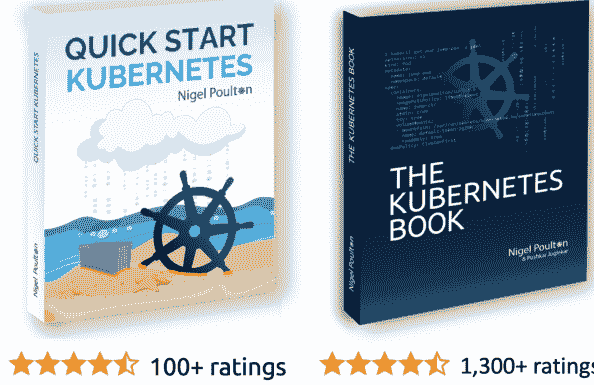

我每年都会更新这两本书，以确保它们符合云原生生态系统（包括 WebAssembly）的最新进展。

我们曾生活在这样一个世界：每当业务需要新应用时，我们必须购买一台全新的服务器。VMware 的出现让我们能够从新旧服务器中压榨出更多价值。然而，在 VMware 和虚拟机程序成功之后，出现了一种更新、更高效且可移植的虚拟化技术——容器。但在 Docker 出现并变得简单之前，容器是非常复杂且难以实现的。WebAssembly 正在推动云计算的第三次浪潮，但 Docker 和容器生态系统正在进化以与 WebAssembly 工作，本书专门有一个章节介绍 Docker 和 WebAssembly。

本章将为你介绍 Docker 以及塑造容器生态系统的一些重要标准和项目。目标是为我们后续章节的构建奠定基础。

本章主要分为两个部分：

- Docker
- 与容器相关的标准和项目

Docker 处于容器生态系统的核心。然而，“Docker”这个词可以有两个含义：

1. Docker 平台
2. Docker, Inc. 公司

Docker 平台是一套精细封装的工具集合，用于创建、管理和编排容器。Docker, Inc. 是创建 Docker 平台的公司，并持续作为开发新功能的推动力量。

让我们深入探讨一下。

Docker, Inc. 是一家总部位于帕罗奥图的科技公司，由法国出生的美国开发者兼企业家 Solomon Hykes 创立。Solomon 现在已不在该公司任职。

该公司最初是一家名为 dotCloud 的平台即服务（PaaS）提供商。在幕后，dotCloud 在容器之上提供其服务，并有一个内部工具来帮助他们部署和管理这些容器。他们将这个内部工具称为 Docker。

“Docker”一词是一个英国英语表达，意为“码头工人”，指在船上装卸货物的人员。

2013 年，dotCloud 放弃了经营困境的 PaaS 业务，更名为 Docker, Inc.，并专注于将 Docker 和容器引入世界。

Docker 平台的设计目的是尽可能容易地构建、交付和运行容器。

从高层来看，Docker 平台包含两个主要部分：

- CLI（客户端）
- 引擎（服务器）

CLI 是用于部署和管理容器的熟悉的 `docker` 命令行工具。它将简单的命令转换为 API 请求并发送到引擎。

引擎包含了所有运行和管理容器的服务器端组件。

图 2.1 显示了高层架构。客户端和引擎可以在同一台主机上，也可以通过网络连接。

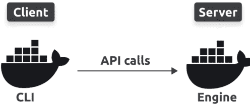

图 2.1 Docker 客户端与引擎。

在随后的章节中，你会发现客户端和引擎是极其复杂的，并包含许多微小的专业化部分。图 2.2 让你了解引擎背后的一些复杂性。然而，客户端隐藏了所有这些复杂性，因此你不需要担心。例如，你在 CLI 中输入易于理解的 docker 命令，CLI 将其转换为 API 请求并发送给守护进程（daemon），由守护进程处理其他所有事情。

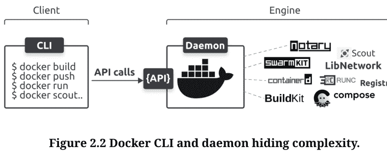

让我们转换一下，简要查看一些标准和治理机构。

有几个影响容器和容器生态系统发展的重要标准和治理机构。其中一些包括：

- OCI
- CNCF
- Moby 项目

开放容器倡议 (OCI) 是一个负责低级容器相关标准的治理委员会。

它在 Linux 基金（Linux Foundation）的伞下运行，创立于容器生态系统的早期。当时，一家名为 CoreOS 的公司的一些成员不喜欢 Docker 主导整个生态系统的方式。作为回应，CoreOS 创建了一个名为 appc 的开放标准，定义了镜像格式和容器运行时等内容的规范。他们还创建了一个名为 rkt（读音为“rocket”）的参考实现。

appc 标准的操作方式与 Docker 不同，使生态系统陷入了两个竞争性标准的尴尬境地。

虽然竞争通常是好事，但竞争性标准通认为是坏的，因为它们会产生困惑并减缓用户的采用速度。幸运的是，生态系统中的主要参与者聚集在一起，形成了 OCI，作为一个中立厂商的轻量级委员会来治理容器标准。这允许我们归档 appc 项目，并将所有低级容器相关的规范放在 OCI 的治理之下。

在此时，OCI 维护着三个称为“规范”的标准：

- 镜像规范 (image-spec)
- 运行时规范 (runtime-spec)
- 分发规范 (distribution-spec)

我们在解释 OCI 标准时，经常使用轨道的类比：

当铁轨的大小和属性被标准化时，它让铁路行业的企业家们有了信心，他们建造的火车、车厢、信号系统、平台和其他铁路基础设施能够与标准的轨道兼容——没有人希望轨道尺寸有竞争性的标准。

OCI 规范对容器生态系统做了同样的事，并从此蓬勃发展。自从 OCI 以来，Docker 也发生了很大变化，所有现代版本的 Docker 都实现了所有三个 OCI 规范。例如：

- Docker 构建器 (BuildKit) 创建符合 OCI 标准的镜像
- Docker 使用符合 OCI 标准的运行时创建符合 OCI 标准的容器
- Docker Hub 实现 OCI 分发规范，并是一个符合 OCI 标准的注册表

Docker, Inc. 以及许多其他公司在 OCI 的技术监督委员会（TOB）中有成员。

云原生计算基金会 (CNCF) 是另一个在容器生态系统中具有影响力的 Linux 基金会项目。它创立于 2015 年，目标是“……推进容器技术的发展……并让云原生计算无处不在”。

CNCF 并不创建和维护容器相关的规范，而是托管了重要的项目，如 Kubernetes、containerd、Notary、Prometheus、Cilium 等许多项目。

当我们说 CNCF 托管了这些项目时，意思是它为项目提供了空间、结构和支持，使其成长和成熟。例如，所有 CNCF 项目都会经历以下三个阶段或时期：

- 沙盒 (Sandbox)
- 孵化中 (Incubating)
- 已毕业 (Graduated)

每个阶段都会通过对治理、文档、审计、贡献跟踪、营销、社区参与等提出更高标准的要求，提高项目的成熟度。例如，被接受为沙盒的新项目可能有很棒的主意和技术，但需要帮助和资源来建立强大的治理体系等。CNCF 会帮助解决这些问题。

已毕业项目被认为已准备好投入，并保证具有强大的治理机制且实施了良好的实践。

如果你回顾图 2.2，你会发现 Docker 使用了至少两种 CNCF 技术—— containerd 和 Notary。

Docker 创建了 Moby 项目，这是一个由社区引导的地方，供开发者在此构建用于容器平台的专用工具。

平台构建者可以根据需求选择特定的 Moby 工具来构建他们的容器平台。他们甚至可以混合 Moby 工具、内部工具以及其他项目的工具来组合自己的平台。

Docker, Inc. 最初创建了 Moby 项目，但现在其成员包括微软、Mirantis 和 Nvidia。


Docker 平台使用来自各种项目的工具构建，包括 Moby 项目、CNCF 和 OCI。

本章向你介绍了 Docker 以及容器生态系统的一些主要影响。

Docker, Inc. 是一家位于帕罗奥的科技公司，正在改变我们开发软件的方式。他们是现代容器革命的先驱和发起者。

开放容器倡议（OCI）负责底层容器标准，并维护运行时、镜像格式和注册库的规范。

Moby 项目托管开发者可以用于构建容器平台的底层工具。

## 第 3 章：获取 Docker

本章将向你展示以下方法：

- `Docker Desktop`
- `Multipass`
- Linux 上的安装

`Docker Desktop` 是使用 Docker 的最佳方式，它可以让你在笔记本电脑上获得包含所有最新工具、插件和扩展的完整 Docker 体验。我每天都在使用，并推荐给每个人。

我们还将向你展示如何通过 `Multipass` 和简单的 Linux 安装在笔记本电脑上使用 Docker。但是，只有在你无法使用 `Docker Desktop` 时才应该考虑这些方法，因为它们的功能较少。

### Docker Desktop

`Docker Desktop` 是 Docker, Inc. 提供的一款桌面应用，是使用容器的最佳方式。你可以获得带有精美 UI 的 `Docker Engine`、所有最新的插件和功能，以及一个带有市场的的扩展系统。如果你想学习 Kubernetes，甚至还可以获得 `Docker Compose` 和单节点 Kubernetes 集群。

它对个人使用和教育免费，但如果你将其用于工作，且你的公司员工超过 250 人或年收入超过 1000 万美元，则需要支付许可费用。

Windows 10 和 Windows 11 专业版及企业版的 `Docker Desktop` 支持 Windows 容器和 Linux 容器。Mac、Linux 以及 Windows 家庭版的 `Docker Desktop` 仅支持 Linux 容器。书中所有的示例以及现实世界几乎所有的容器都是 Linux 容器。

让我们 Windows 和 MacOS 上安装 `Docker Desktop`。

Windows 版 `Docker Desktop` 需要满足所有条件：

- 64 位版本的 Windows 10/11
- 必须在系统的 BIOS 中启用硬件虚拟化支持
- `WSL 2`

更改系统 BIOS 中的任何内容时请务必小心。

在互联网上搜索“install Docker Desktop on Windows”。这将带你进入下载页面，你可以在那里下载安装程序并按照说明操作。在提示时，你应该安装并启用 `WSL 2` 后端（适用于 Linux 的 Windows 子系统）。

安装完成后，你需要从 Windows 开始菜单手动启动 `Docker Desktop`。启动可能可能需要一分钟，但你可以通过屏幕底部 Windows 栏上的动画鲸鱼图标查看启动进度。

一旦开始运行，你可以打开终端并输入一些简单的 `docker` 命令。

```
$ docker version
<Snip>
Server: Docker Desktop 4.30.0 (149282)
Engine:
Version: 26.1.1
API version: 1.45 (minimum version 1.24)
Go version: go1.21.9
Built:
Tue Apr 30 11:48:28 2024
OS/Arch: linux/amd64
<Snip>
```

注意 Server 输出如何显示 `OS/Arch: linux/amd64`。这是因为默认安装假设你将处理 Linux 容器。

某些版本的 Windows 允许通过右键点击 Windows 通知区域中的 Docker 鲸鱼图标并选择“切换到 Windows 容器”来切换容器……这样做会让现有的 Linux 容器在后台运行，但在切换回 Linux 容器模式之前你无法管理它们。

恭喜。你现在 Windows 机器上安装了一个可以运行的 Docker。

确保你运行在 Linux 容器模式下，以便之后跟上书中的示例。

Mac 版 `Docker Desktop` 类似于 Windows 版 `Docker Desktop`——一个带有精美 UI 的封装产品，可以让你在笔记本电脑上获得完整的 Docker 体验。你还可以启用内置的单节点 Kubernetes 集群。

在继续安装之前，你需要知道 Mac 上的 `Docker Desktop` 在轻量级 Linux VM 内部安装守护和服务端组件，并无缝地将 API 暴露给你的本地 Mac 环境。这意味着你可以在 Mac 上打开终端并运行 `docker` 命令，而无需知道它们都运行在一个隐藏的 VM 中。这也是为什么 Mac 版 `Docker Desktop` 仅支持 Linux 容器——一切都运行在 Linux VM 内部。

图 3.1 显示了 Mac 版 `Docker Desktop` 的高层架构。

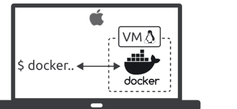

图 3.1

在 Mac 上安装 `Docker Desktop` 的简单方法是在网页上搜索“install Docker Desktop on macOS”，按照链接下载，然后完成简单的安装程序。

当安装程序完成后完成后，你必须从 MacOS Launchpad 手动启动 `Docker Desktop`。启动可能需要一分钟，但你可以观察屏幕顶部状态栏中的动画 Docker 鲸鱼图标。一旦启动，你就可以点击鲸鱼图标来管理 `Docker Desktop`。

打开终端窗口并运行一些常规 Docker 命令。尝试以下：

```
$ docker version
Client:
Cloud integration: v1.0.35+desktop.1
Version: 26.1.1
API version: 1.45
OS/Arch: darwin/arm64
<Snip>
Server: Docker Desktop 4.30.0 (149282)
Engine:
Version: 26.1.1
API version: 1.45 (minimum version 1.24)
OS/Arch: linux/arm64
containerd:
Version: 1.6.31
runc:
Version: 1.1.12
docker-init:
Version: 0.19.0
<Snip>
```

注意 `Server` 组件的 `OS/Arch:` 显示为 `linux/amd64` 或 `Linux/arm64`。这是因为守护进程运行在前面提到的 Linux VM 内部。`Client` 组件是一个原生 Mac 应用，直接在 Mac OS Darwin 内核上运行。这就是为什么它显示为 `darwin/amd64` 或 `darwin/arm64`。

你现在可以在 Mac 上使用 Docker 了。

只有在你无法使用 `Docker Desktop` 时才考虑本节，因为 `Multipass` 安装版没有开箱支持 `docker scout`、`docker debug` 或 `docker init`。

`Multipass` 是一个免费工具，用于在 Linux、Mac 或 Windows 机器上创建云风格的 Linux VM，且安装和使用极其简单。它是创建多节点生产级 Docker 集群的简单方法。

访问 `https://multipass.run/install` 并安装适用于你硬件和操作系统的版本。

安装完成后，你只需要三个命令：

```
$ multipass launch
$ multipass ls
$ multipass shell
```

让我们看看如何启动并连接一个预装了 Docker 的新 VM。

运行以下命令来基于 `docker` 镜像创建一个名为 `node1` 的新虚拟机。该 docker 镜像已预装了 Docker，开箱即用。

```
$ multipass launch docker --name node1
```

下载镜像并启动虚拟机大约需要一两分钟。

列出所有虚拟机以确保你的虚拟机已正常启动。

| 名称 | 状态 | IPv4 | 镜像 |
|---|---|---|---|
| node1 | Running | 192.168.64.37<br>172.17.0.1<br>172.18.0.1 | Ubuntu |

在处理书中后的示例时，你将使用 `192` 开头的 IP 地址。

使用以下命令连接到虚拟机。

```
$ multipass shell node1
```

连接后，你可以运行以下命令来检查 Docker 版本并列出已安装的 CLI 插件。

```
$ docker --version
Docker version 26.1.0, build 9714adc

$ docker info
Client: Docker Engine - Community
Version: 26.1.0
Context: default
Debug Mode: false
Plugins:
buildx: Docker Buildx (Docker Inc.)
  Version: v0.14.0
  Path: /usr/libexec/docker/cli-plugins/docker-buildx
compose: Docker Compose (Docker Inc.)
  Version: v2.26.1
  Path: /usr/libexec/docker/cli-plugins/docker-compose
```

示例中的安装仅包含 `buildx` 和 `compose` CLI 插件。如果你想遵循书中后面的 Docker Scout、Docker Init 和 Docker Debug 示例，你必须手动安装相关的插件。

你可以输入 `exit` 退出虚拟机，并输入 `multipass shell node1` 重新登录。你也可以输入 `multipass delete node1` 然后运行 `multipass purge` 来将其删除。

只有当你无法使用 `Docker Desktop` 时，才需要考虑本节。此安装方式不会安装安装我们在后续某些章节中用到的 `docker scout`、`docker debug` 或 `docker init` CLI 插件。

这些指令向你展示了如何在 Ubuntu Linux 22.04 上安装 Docker，仅供参考。还有许多其他安装方法，你应该在网上搜索最新的指令。

```
$ sudo snap install docker
docker 24.0.5 from Canonical ✓ installed
```

运行一些命令来测试安装情况。你需要在命令前加上 `sudo`。

```
$ sudo docker --version
Docker version 24.0.5, build ced0996

$ sudo docker info
<Snip>
Server:
Containers: 0
Running: 0
Paused: 0
Stopped: 0
Images: 0
Server Version: 24.0.5
<Snip>
```

你几乎可以在任何地方运行 Docker，而且安装它比以往任何时候都简单。

`Docker Desktop` 在你的 Linux、Mac 或 Windows 机器上提供了一个功能完的 Docker 环境，是在本地机器上获取 Docker 开发环境的最佳方式。它易于安装，包含了 `Docker Engine`，拥有美观的 UI，并有一个包含许多扩展程序以增强其功能的市场。它可以与 `docker scout`、`docker debug` 和 `docker init` 配合使用，甚至让你启动一个单节点 Kubernetes 集群。

`Multipass` 是启动一个运行 Docker 的本地虚拟机的极佳方法，而且在 Linux 服务器上安装 Docker 还有许多方法。这些方法让你能够访问大多数 Docker 免费功能，但缺少 `Docker Desktop` 的某些功能。

本章将为你提供一些实操经验以及对镜像和容器的高级视角。其目标是为你后续章节中更详细的内容做好准备。

我们将本章分为两个部分：

- 运维视角 (Ops perspective)
- 开发视角 (Dev perspective)

运维视角侧重于启动、停止、删除容器以及执行命令。开发视角则侧重于构建镜像、运行容器以及在容器内部进行操作。通过这两个视角，你将理解 Docker 的核心工作原理。

运行以下命令来验证你的 `test` 容器仍在运行。

| CONTAINER ID | IMAGE | COMMAND | CREATED | STATUS | NAME |
|---|---|---|---|---|---|
| bbd2e5ad1817 | ubuntu:latest | "/bin/bash" | 7 mins | Up 7 min | test container |

输出显示了你的 `test` 容器，你可以看到它是在 7 分前创建的，并且已经运行了 7 分钟。

你可以使用 `docker attach` 命令将你的 shell 附加到容器的主进程。

运行以下命令将你的 shell 附加到容器内的 Bash 进程。

```
$ docker attach test
root@bbd2e5ad1817:/#
```

确保你的 shell 提示符发生了变化，这意味着你已成功连接到容器。

输入 `Ctrl-C` 再次退出容器，并验证你的 shell 提示符恢复到本地机器。

运行另一个 `docker ps` 来验证你的容器仍在运行。

| CONTAINER ID | IMAGE | COMMAND | CREATED | STATUS | NAMES |
| bbd2e5ad1817 | ubuntu:latest | "/bin/bash" | 9 mins | Up 9 min | test |

使用 `docker stop` 和 `docker rm` 命令停止并删除容器。

```
$ docker stop test
test
```

容器停止可能需要几秒钟。

```
$ docker rm test
test
```

运行带有 `-a` 标志的 `docker ps` 命令来验证容器已成功删除，该标志会列出所有容器，即使是已停止状态的。

```
$ docker ps -a
CONTAINER ID | IMAGE | COMMAND | CREATED | STATUS | PORTS
```

恭喜你，你拉取了一个 Docker 镜像，从中启动了一个容器，登录了它，在其中执行了命令，停止了它并删除了它。

容器的核心是应用程序。

你将在本节中完成所有步骤：

- 从 GitHub 仓库克隆一个应用
- 检查应用的 Dockerfile
- 将应用容器化
- 以容器形式运行应用

运行以下命令对仓库进行本地克隆。这将应用程序代码复制到你的机器，以便在随后的步骤中对其进行容器化。你需要 `git` CLI 才能完成此操作。

```
$ git clone https://github.com/nigelpoulton/psweb.git

Cloning into 'psweb'...

remote: Enumerating objects: 63, done.

remote: Counting objects: 100% (34/34), done.

remote: Compressing objects: 100% (22/22), done.

remote: Total 63 (delta 13), reused 25 (delta 9), pack-reused 29
```

Receiving objects: 100% (63/63), 13.29 KiB | 4.43 MiB/s, done.
Resolving deltas: 100% (21/21), done.

进入 `psweb` 目录并列出内容。

```
$ cd psweb

$ ls -l

total 32

-rw-r--r-- 1 nigelpoulton staff 324 5 Feb 12:31 Dockerfile

-rw-r--r-- 1 nigelpoulton staff 378 5 Feb 12:31 README.md

-rw-r--r-- 1 nigelpoulton staff 341 5 Feb 12:31 app.js

-rw-r--r-- 1 nigelpoulton staff 355 5 Feb 12:47 package.json

drwxrxr-xr-x 3 nigelpoulton staff 96 5 Feb 12:31 views
```

该应用是一个运行某些静态 HTML 的简单 Node.js Web 应用。

检查应用的 `Dockerfile`。`Dockerfile` 是一个纯文本文档，告诉 Docker 如何构建它。

```dockerfile
FROM alpine

LABEL maintainer="nigelpoulton@hotmail.com"

RUN apk add --update nodejs npm

COPY . /src

WORKDIR /src

RUN npm install

EXPOSE 8080

ENTRYPOINT ["node", "app.js"]
```

现在，你只需要知道 `Dockerfile` 中的每一行都代表构建镜像的指令。

列出 `Dockerfile` 的内容。

```bash
$ cat Dockerfile
```

运行以下命令根据 `Dockerfile` 中的指令创建镜像。如果你正在跟随操作，请运行：

```
$ docker build -t test .
```

[+] Stage 1/1 : FROM alpine

[+] Stage 1/1 : LABEL maintainer="nigelpoulton@hotmail.com"


[+] Stage 1/1 : RUN apk add --update nodejs npm

[+] Stage 1/1 : COPY . /src

[+] Stage 1/1 : WORKDIR /src

[+] Stage 1/1 : RUN npm install

[+] Stage 1/1 : EXPOSE 8080

[+] Stage 1/1 : ENTRYPOINT ["node", "app.js"]

Successfully built bbd2e5ad1817

docker: test: bbd2e5ad1817

恭喜你，你拉取了一个 Docker 镜像，从中启动了一个容器，登录了它，在其中执行了命令，停止了它并删除了它。

# 开发者视角，我们将查看 Docker Engine 的内部。

本章侧重于操作，你可以在不了解即将学习的所有内容的情况下使用 Docker。然而，要真正精通某事，你需要了解内部发生了什么。因此，如果你想精通 Docker，应该阅读这一章。

我将本章分为以下几个部分：

- Docker Engine – 概要摘要 (TLDR)
- Docker Engine
- 开放容器标准 (OCI) 的影响
- runc
- containerd
- 启动新容器（示例）
- shim 到底是什么
- 它在 Linux 中是如何实现的

让我们学习 Docker Engine 吧。

## Docker Engine

Docker Engine 是模块化的，并从 OCI、CNCF 和 Moby 项目等项目引提取的许多小型专业化组件构建的。

在许多方面，Docker Engine 就像汽车引擎：

- 汽车引擎由许多专业部件组成，共同工作驱动汽车行驶——进气歧管、节气门、气缸、活塞、火花塞、排气歧管等。
- Docker Engine 由许多专业工具组成，共同工作以创建和运行容器——API、镜像构建器、高层运行时、低层运行时、shim 等。

图 5.1 显示了用于创建和运行容器的 Docker Engine 组件。虽然存在其他组件，但这个简化的图关注启动和运行容器的组件。

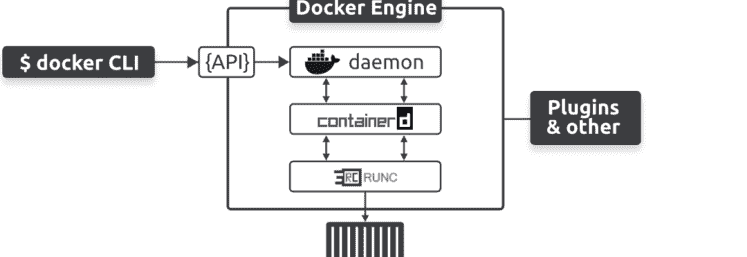

图 5.1

在本书中，我们提到 `runc` 和 `containerd` 时会使用小写的“r”和“c”，这是它们在官方项目文档中的写法。这意味着以 `runc` 或 `containerd` 开头的句子将不以大写字母开头。

当 Docker 首次发布时，Docker Engine 有两个主要组件：

- Docker 守护进程（daemon，有时简称为“daemon”）
- LXC

守护进程是一个单体二进制文件，包含了 API、镜像构建器、容器执行、卷、网络等所有代码。

LXC 负责了最艰出的工作，即与 Linux 内核进行交互，并构建所需的命名空间（namespaces）和控制组（cgroups）来构建和启动容器。

依赖 LXC 给 Docker 项目带来了几个问题。

首先，LXC 是特定于 Linux 的，而 Docker 具有成为多平台的愿景。

其次，Docker 的演进非常快，没有办法确保 LXC 能按照 Docker 需要的方式进行演进。

为了改进体验并帮助项目更快速演进，Docker 用自己的工具 *libcontainer* 替换了 LXC。`libcontainer` 的目标是作为一个平台无关的工具，让 Docker 能够访问宿主机内核中基础的容器构建模块。

`Libcontainer` 在很早以前就已经替换了 Docker 中的 LXC。

如前所述，Docker Engine 原本是一个单体结构，几乎所有功能都编码在守护进程中。然而，随着时间的推移，由于以下原因，这变得越来越成问题：

1. 它变慢了
2. 这不是生态系统想要的
3. 在单体软件上很难进行创新

项目组意识到这些挑战，并启动了一项长期计划，以拆分并重构 Engine，使每个功能都变成自己独立的小型专用工具。平台构建者就可以重用这些工具来构建其他平台。

拆分 Docker 守护进程的工作是一个持续的过程，所有用于构建镜像和执行容器的代码都已移除并重构为小型、专用的工具。显著的例子包括移除高层和低层运行时功能，并在名为 `containerd` 和 `runc` 的独立工具中重新实现它们，这两个工具都被 Docker、Kubernetes、Firecracker 和 Fargate 等许多不同项目使用。从 Docker Desktop 4.27.0 开始，Docker 已从守护进程中移除了镜像管理，现在使用 `containerd` 的镜像管理能力。

图 5.2 显示了用于运行容器的 Docker Engine 主要组件的视图，并列出了每个组件的主要职责。

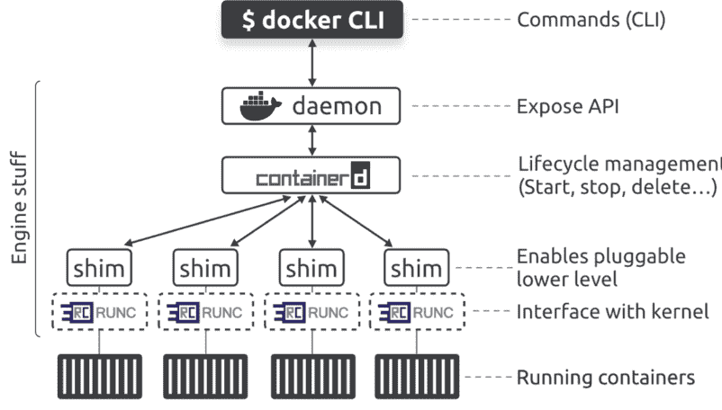

图 5.2 - Engine 组件及其职责

其他其他 Engine 组件。

## 开放容器标准 (OCI) 的影响

在 Docker, Inc. 重构 Engine 的同时，OCI 正在定义两个容器相关的标准：

1. 镜像规范 (image-spec)
2. 运行时规范 (runtime-spec)

这两项规范都于 2017 年 7 月作为 1.0 版本发布，并且在今天仍然至关重要。

他们甚至添加了第三种称为“分发规范”（distribution-spec）的规范，用于规定如何通过注册表分发镜像。

在编写时，`runtime-spec` 版本为 1.1.0，`image-spec` 版本为 1.0.2，`distribution-spec` 版本为 1.0.1。然而，正在制定 `image-spec` 和 `distribution-spec` 的 1.1 版本。我们提到这一点是为了强调这些底层规范的缓慢而稳健的特性，因为它们被许多其他项目深度依赖——稳定性是底层 OCI 规范的重中之义。

Docker, Inc. 是 OCI 的创始成员，并深度参与了规范的定义。它继续通过贡献代码和帮助指导规范来参与其中。

自 2016 年以来的所有版本的 Docker 都实现了 OCI 规范。例如，Docker 使用 `runc`（OCI `runtime-spec` 的参考实现）创建符合 OCI 规范的容器（`runtime-spec`）。它还使用 `BuildKit` 构建符合 OCI 规范的镜像（`image-spec`），而 Docker Hub 是一个符合 OCI 规范的注册表（`registry-spec`）。

## runc

如前所述，`runc`（读音为“run see”，且始终用小写“r”写入）是 OCI `runtime-spec` 的参考实现。Docker, Inc. 深度参与了该规范的定义并贡献了 `runc` 的初始代码。

`runc` 是 `libcontainer` 的轻量级 CLI 封装，你可以下载并使用它来管理符合 OCI 规范的容器。然而，它是一个非常底层工具，缺乏你在 Docker Engine 中获得几乎的所有功能和插件。幸运的是，如图 5.2 所示，Docker 使用 `runc` 作为其底层运行时。这意味着你既可以获得 OCI 规范的容器，又能获得 Docker 用户体验。

在术语方面，我们有时说 `runc` 运行在 OCI 层，并且我们经常将其称为底层运行时。

Docker 和 Kubernetes 都将 `runc` 作为它们的默认底层运行时，并且都将其与 `containerd` 高层运行时配对：

- `containerd` 作为高层运行时运行，管理生命周期事件
- `runc` 作为底层运行时运行，通过与内核交互执行生命周期事件，完成实际构建和删除容器的工作

你可以在这里查看最新发布：

- https://github.com/opencontainers/runc/releases

## containerd

`containerd`（读音为“container dee”，且始终用小写“c”写入）是 Docker 在从守护进程中剥离功能时的另一个工具。

我们将 `containerd` 称为高层运行时，因为它管理启动、停止和删除容器等生命周期事件。然而，它需要一个运行时来执行实际工作。大多数情况下，`containerd` 与 `runc` 配对作为其底层运行时。正如你在图 5.3 中看到的，它使用了 shim（垫片），可以使用其他底层运行时替换 `runc`。我们将在 WebAssembly 章节中详细介绍，届时你将看到如何使用 Docker 运行 WebAssembly 应用。

最初的计划是让 `containerd` 成为管理容器生命周期事件的小型专用工具。然而它它增长到包含了管理镜像、网络和卷的能力。

添加更多功能的原因之一是为了像 Kubernetes 这样的项目希望 `containerd` 能够推取镜像。幸运的是，这些额外功能是模块化的，这意味着 Kubernetes 等项目可以包含 `containerd` 但只选取它们需要的部分。

`containerd` 最初由 Docker, Inc. 开发并捐赠给了云原生计算基金会 (CNCF)。在编写时，`containerd` 是一个 CNCF 成毕业项目，意味着它是稳定且适用于生产环境的。你可以在这里查看最新发布：

- https://github.com/containerd/containerd/releases

### 启动新容器（示例）

现在你已经对全局有了了解，让我们看看如何使用 Docker 创建新容器。

启动容器最常见方法是使用 Docker CLI。可以尝试运行以下命令基于 nginx 镜像启动一个名为 `ctr1` 的新容器。

```
$ docker run -d --name ctr1 nginx
```

运行 `docker ps` 命令查看容器是否正在运行。

| CONTAINER ID | IMAGE | COMMAND | CREATED |
|--- | --- | --- | --- |
| 9cfb0c9aacb2 | nginx | "/docker-entrypoint..." | 9 秒前 |

当你运行此类命令时，Docker 客户端将其转换为 API 请求并发送到守护进程暴露的 API。

守护进程接收请求，将其解释为创建新容器的请求，并传递给 `containerd`。请记住，守护进程不再包含任何创建容器的代码。

守护进程通过 gRPC CRUD 风格 API 与 `containerd` 通信。

尽管名字如此，即使是 `containerd` 也无法创建容器。它将所需的 Docker 镜像转换为 OCI 边界，并告诉 `runc` 使用它来创建一个新容器。

`runc` 与操作系统内核交互，拉取创建容器所需的所有构建体（命名空间、cgroups 等）。容器作为 `runc` 的子进程启动，一旦容器启动，`runc` 就会退出。

图 5.3 总结了这一过程。

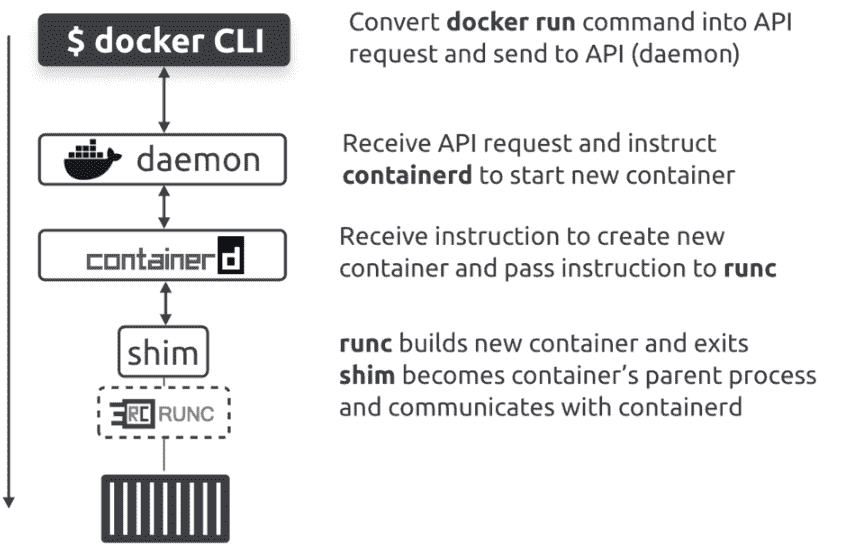

通过将容器的创建和管理与 Docker 守护进程解耦，并在 `containerd` 和 `run` 中实现，使得可以停止、重启甚至更新守护进程而不影响正在运行的容器。我们有时将其称为无守护进程容器。

如果你之前启动了 NGINX 容器，应该使用以下命令删除它。

```bash
$ docker rm ctrl -f
```


本章中的一些图表显示了 `shim` 组件。

`shim` 是一种流行的软件工程模式，Docker Engine 在 `containerd` 和 OCI 层之间使用它们，带来了以下益处：

- 无守护进程容器
- 提高效率
- 使 OCI 层变得可扩展

我们已经提到过无守护进程容器。

在效率方面，`containerd` 为每个新容器 `fork` 出一个 `shim` 和一个 `runc` 进程。然而，每个 `runc` 进程在容器开始运行后就会退出，留下 `shim` 进程作为容器的父进程。`shim` 是轻量级的，位于 `containerd` 和容器之间。它报告容器状态并执行低级任务，例如保持容器的 STDIN 和 STDOUT 流打开。

`shim` 还让将 `runc` 替换为其他低级运行时成为可能。

在 Linux 系统上，Docker 将我们讨论的组件实现为以下独立的二进制文件：

- `/usr/bin/dockerd`（Docker 守护进程）
- `/usr/bin/containerd`
- `/usr/bin/containerd-shim-runc-v2`
- `/usr/bin/runc`

你可以通过运行 `ps` 命令在基于 Linux 的 Docker 宿主机看到所有这些内容。某些进程只有在系统有运行的容器时才会存在，如果你在 Mac 上使用 Docker Desktop，则看不到它们，因为 Docker Engine 运行在虚拟机内部。

在编写本文时，Docker 已经剥离了守护进程的大部分功能，让守护进程专注于提供 API。

### 章节总结

Docker Engine 是一个能够轻松构建、分发和运行容器的平台。它实现了 OCI 标准，是一个由许多微小、专用组件组成的模块化应用程序。

Docker 守护进程实现了 Docker API，但大多数其他功能已被剥离，并作为 `containerd` 和 `runc` 等独立的可组合工具实现。

`containerd` 执行镜像管理任务并监督容器的生命周期管理，例如启动、停止和删除容器。Docker, Inc. 最初编写了它，然后将其贡献给了 CNCF。它被归类为高级运行时，并被许多其他项目（包括 Kubernetes、Firecracker 和 Fargate）使用。

`containerd` 依赖于名为 `runc` 的低级运行时与宿主机内核交互并构建容器。`runc` 是 OCI runtime-spec 的参考实现，并期望从符合 OCI 规范的边界中启动容器。`containerd` 与 `runc` 通信，并确保 Docker 镜像作为符合 OCI 规范的边界呈现给 `runc`。

`runc` 基于 `libcontainer` 的代码，你可以将其作为独立的 CLI 工具运行以创建容器，它几乎用在所有使用 `containerd` 的地方。

`shim` 让将 `containerd` 与其他低级运行时成为可能。

## 6：与镜像配合

在本章中，我们将深入研究 Docker 镜像。你将学习镜像是什么、如何与它们交互，以及它们在底层是如何工作的。你将在第 8 章“应用程序容器化”中学习如何构建自己的镜像。

我将章节安排如下：

- Docker 镜像 – 概述 (TLDR)
- 镜像简介介绍
- 拉取镜像
- 镜像仓库
- 镜像命名和标记
- 镜像与层
- 按摘要拉取镜像
- 多架构镜像
- 使用 Docker Scout 进行漏洞扫描
- 删除镜像

### Docker 镜像 – 概述 (TLDR)

在开始之前，以下所有术语的意思都是相同的，我们将交替使用：*镜像 (Image)、Docker 镜像 (Docker image)、容器镜像 (container image)* 和 OCI 镜像。

镜像是一个只读包，包含了运行应用程序所需的所有内容。这意味着它们包含了应用程序代码、依赖项、一组极简的操作系统构建体和元数据。你可以从单个镜像启动多个容器。

如果你熟悉 VMware，镜像有点像虚拟机模板——虚拟机模板像一个已停止的虚拟机，而镜像像一个已停止的容器。如果你是一个开发者，镜像类似于*类 (classes)* —— 你可以从类中创建一个或多个对象，而你可以从一个镜像中创建一个或多个容器。

获取镜像最简单的方法是从*仓库 (registry)* 中拉取。Docker Hub 是最常见的仓库，而*拉取 (pulling)* 镜像会将其下载到本地机器，Docker 在那里它可以启动一个或多个容器。还存在其他仓库，Docker 与所有它们都能工作。

镜像是通过堆叠独立的*层 (layers)* 制成的，并将它们表示为单一的统一对象。其中一层可能包含操作系统组件，另一层可能包含应用程序依赖项，Docker 堆叠这些层并使它们看起来像一个统一系统。

镜像通常很小。例如，官方的 NGINX 镜像约为 60MB，官方的 Redis 镜像约为 40MB。然而，Windows 镜像可能巨大。

这就是核心介绍。让我们进一步深入。

### 镜像简介

我们已经说过镜像像是停止的容器。你甚至可以停止容器并从它创建一个新镜像。基于这种想法，镜像是*构建时 (build-time)* 构建体，而容器是*运行时 (run-time)* 构建体。图 6.1 显示了*构建和运行*的性质，你可以从单个镜像启动多个容器。

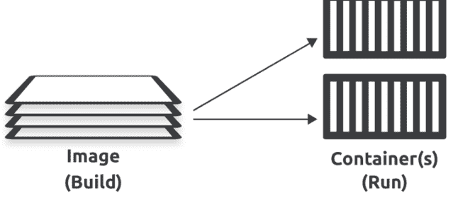

图 6.1

`docker run` 命令启动容器的最常用方式。一旦容器运行，镜像和容器就绑定了，只有当你删除了使用它的容器后才能删除该镜像。

容器设计用于运行单个应用程序或微服务。因此，它们应该只包含代码和依赖项。

例如，官方的 Alpine Linux 镜像目前约为 3MB。这是因为它没有带六种 shell、三种不同的包管理器以及你“可能”每十年需要一次的工具。事实上，镜像不带 shell 或包管理器已越来越常见——如果应用程序在运行时不需要它，镜像就不会包含它。我们称这些为精简镜像。

另一个让镜像保持较小的原因是缺少操作系统内核。这是因为容器使用它们运行所在的宿主机内核。大多数镜像中与操作系统相关的组件是文件系统，你有时会听到人们说包含操作系统。

不幸，Windows 镜像可能巨大。例如，某些 Windows 镜像可能有几个 GB 大，推送和拉取需要很长时间。

### 拉取镜像

干净的 Docker 安装有一个本地仓库。

本地仓库是本地机器上用于存储镜像以便方便访问的区域。我们有时称之为镜像缓存，在 Linux 上它通常位于 `/var/lib/docker/<storage-driver>`。然而，如果你使用 Docker Desktop，它将在 Docker 虚拟机内部。

运行以下命令检查你的本地仓库内容。此示例中有三个与运行的三个 Docker Desktop 扩展相关的镜像。你的将会不同，并且可能是空的。

| REPOSITORY | TAG | IMAGE ID | CREATED |
|---|---|---|---|
| docker/disk-usage-extension | 0.2.9 | f4c95478a537 | 2 周前 |
| docker/logs-explorer-extension | 0.2.6 | 417dd9a8f96d | 2 个月前 |
| portainer/portainer-docker-extension | 2.19.4 | 908d04d20e86 | 2 个月前 |

获取镜像的过程被称为*拉取 (pulling)*。

运行以下命令拉取 `redis` 镜像并验证它是否存在于你的本地仓库中。

**注意：如果你在 Linux 上进行操作，且尚未将用户账户添加到本地 docker Unix 组，你可能需要在所有后续命令的开头加上 `sudo`。**

```
$ docker pull redis

Using default tag: latest ----- Assume the 'latest'

latest: Pulling from library/redis ----- Assume you want to

08df40659127: Download complete ----- Pulling layer

4f4b700ef54: Already exists ----- Pulling layer (loca

4fe7aaab04: Download complete ----- Pulling layer

57de0f129a55: Download complete ----- Pulling layer

546e941f15b: Download complete ----- Pulling layer

f7f7da262cd8: Download complete ----- Pulling layer

f45ab649e450: Download complete ----- Pulling layer

983f900bbc88: Download complete ----- Pulling layer

Digest: sha256:76d5908f5e19fdd73daf956a38826f79033ee4707d90283

Status: Downloaded new image for redis:latest

docker.io/redis:latest ----- docker.io = Docker
```

```
$ docker images

REPOSITORY TAG CREATED SIZE

redis latest 11c3e418c296 2 weeks ago 223MB
```

该镜像现在存在于你的本地仓库中。然而，我在 `docker pull` 的输出中标记了几行有趣的内容。我们将在本章节稍后的部分详细介绍它们，但现在值得简单提一下。

Docker 是有主张的，并且在拉取镜像时做了两个假设：

- 1. 它假设你想拉取标记为 `latest` 的镜像。
- 2. 它假设你想从 Docker Hub 拉取镜像。

你可以覆盖这两项设置，但如果你不覆盖它们，Docker 将使用这些作为默认值。

Redis 镜像有八个层。然而，Docker 只拉取了七层，因为它已经有了其中某一层的本地副本。这是因为我的系统运行了 Portainer Docker Desktop 扩展，它基于一个与 Redis 镜像共享公共层的镜像。你很快就会学到这一点，镜像可以共享层，而 Docker 足够智能，只拉取它尚未的层。

我们将在本章节稍后详细讨论这些点。

## 镜像仓库 (Image registries)

我们将镜像存储在称为仓库（registries）的集中位置。仓库的作用是安全地存储镜像，并使其易从不同环境中访问。

图 6.2 显示了仓库在“构建 > 传输 > 运行”流水线中的核心作用。

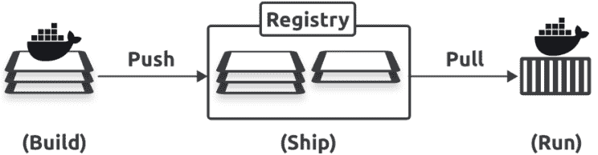

图 6.2

大多数现代仓库实现了 OCI 分发规范，我们有时称之为 *OCI 仓库*。大多数仓库还实现了 Docker Registry v2 API，这意味着你可以使用 Docker CLI 和其他 API 工具来查询它们并以标准方式与它们交互。某些仓库还提供了高级功能，如镜像扫描和与构建流水线的集成。

最常见的仓库是 Docker Hub，但也存在其他仓库，包括基于互联网的第三方仓库和安全的本地仓库。然而，如前所述，Docker 是有主张的，除非你告诉它不同仓库的，否则它将默认使用 Docker Hub。在本书剩余部分我们将使用 Docker Hub，但这些原理适用于其他仓库。

镜像仓库包含一个或多个*镜像存储 (image repositories)*，而镜像存储包含一个或多个镜像。图 6.3 显示了一个具有三个存储的镜像仓库，每个存储包含一个或多个镜像。

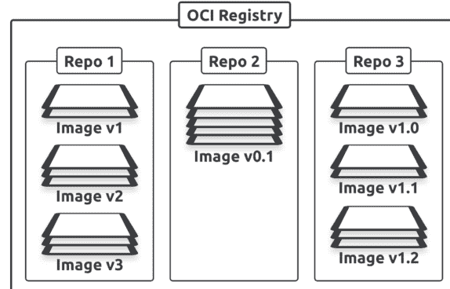

图 6.3 - 仓库架构

### 官方仓库 (Official repositories)

Docker Hub 有*官方仓库*的概念，这些是由 Docker 和应用供应商审核并筛选的镜像之家。这意味着它们*应该*包含最新的、高质量的安全的、文档完备且遵循良好实践的代码。

大多数流行的应用程序和操作系统在 Docker Hub 上都有官方仓库，它们很容易识别，因为它们位于 Docker Hub 命名空间的最顶层，并带有绿色的 Docker 官方镜像徽章。以下列表显示了几个存在于 Docker Hub 命名空间顶层的官方仓库及其 URL：

- nginx: https://hub.docker.com/_nginx/
- busybox: https://hub.docker.com/_busybox/
- redis: https://hub.docker.com/_redis/
- mongo: https://hub.docker.com/_mongo/

图 6.4 显示了 Docker Hub 上的 Alpine 和 NGINX 官方仓库。两者都有绿色的 Docker 官方镜像徽章，且拉取次数均超过十亿。此外，注意两者适用于广泛 CPU 架构。

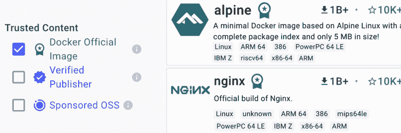

图 6.4 - Docker Hub 上的官方仓库

### 非官方仓库 (Unofficial repositories)

以下列表显示了我在非官方仓库的西部西部中的两个个人仓库，你不应该信任它们。

- nigelpoulton/gsd — https://hub.docker.com/r/nigelpoulton/gsd/
- nigelpoulton/k8sbook — https://hub.docker.com/r/nigelpoulton/k8book/

注意它们存在于 `nigelpoulton` 二级命名空间之下。这是表明它们不是官方仓库的几个迹象之一。

虽然非官方仓库中有许多优秀的镜像，但你应该始终假设任何来自非官方仓库的镜像都是**不安全的**。这基于永远不信任互联网软件的良好实践。事实上，在下载和使用 Docker 官方镜像时你也应该保持谨慎。

## 镜像命名与标记 (Image naming and tagging)

大多数时候，你将根据名称处理镜像，并且可以从名称中学习很多关于镜像的信息。图 6.5 显示了一个完全限定的镜像名称，包括仓库名称、用户/组织名称、存储名称和标签。如果你没有指定，Docker 会自动填充仓库和标签值。

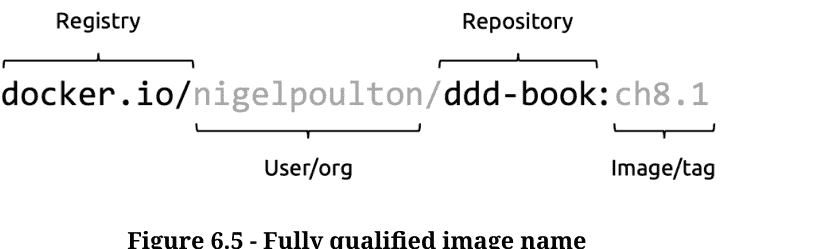

引用官方仓库的镜像非常简单。你只需要提供用冒号分隔的存储名称和镜像名称。有时我们把镜像名称称为标签。从官方仓库拉取镜像的格式是：`docker pull <repository>:<tag>`

之前的示例通过以下命令拉取了 Redis 镜像。它拉取了标记为 `latest` 的镜像。

```
$ docker pull redis:latest
```

以下示例显示了如何拉取几个官方镜像：

```
$ docker pull mongo:7.0.5 从官方仓库拉取标记为 7.0.5 的镜像

$ docker pull busybox:glibc 从官方仓库拉取标记为 glibc 的镜像

$ docker pull alpine 从官方仓库拉取标记为 latest 的镜像
```
几点需要注意：

- 如前所述，如果你在存储名称后没有指定镜像标签，Docker 假设你要 `latest`。如果仓库没有标记为 `latest` 的镜像，命令将失败。
- 标记为 `latest` 的镜像并不保证是最新的。

从非官方仓库拉取镜像几乎与官方仓库一样——你只需要在存储名称之前添加 Docker 用户名或组织。以下示例显示了从所有 nigelpoulton 的 tu-demo 存储拉取 v2 镜像。

```
$ docker pull nigelpoulton/tu-demo:v2
```

要从不同的仓库拉取镜像，你只需要在存储名称之前添加仓库的 DNS 名称。例如，以下命令从 GitHub Container Registry (`ghcr.io`) 上 Brandon Mitchell 的 `regclient/regsync` 仓库拉取最新镜像。

```
$ docker pull ghcr.io/regclient/regsync:latest

latest: Pulling from regclient/regsync

614f2b64ccf9: Download complete

7746d6728537: Download complete

685af2c79c31: Download complete

4c377311167a: Download complete

662e9541e042: Download complete

digest: sha256:149a95d473d6beed2a1404d7c3b000ddffa583a94836587ba8e33

Status: Downloaded newer image for ghcr.io/regclient/regsync:latest

ghcr.io/regclient/regsync:latest
```

注意拉取（pull）的操作与 Docker Hub 看起来完全相同。这是因为 GHCR 支持 OCI 镜像规范并实现了 Docker Registry v2 API。

### 具有多个标签的镜像

你可以为单个镜像赋予任意数量的标签。

从表面上看，以下输出似乎列出了三个镜像。但仔细观察会发现，其实只有两个 —— `b4210d0aa52f` 镜像被标记为 `latest` 和 `v1`。

```
$ docker images

REPOSITORY             TAG      IMAGE ID        CREATED

igelpoulton/tu-demo  latest   b4210d0aa52f  2 days ago

igelpoulton/tu-demo  v1       b4210d0aa52f  2 days ago
```


igelpoulton/tu-demo  v2       6ba12825d092  12 minutes ago

这是一个说明 `latest` 标签与仓库中最新镜像并不相关的绝佳例子。在这个例子中，`latest` 标签指向的是与 `v1` 标签相同的镜像，而该镜像实际上比 `v2` 镜像更旧。

### 镜像与层

如前所述，镜像是松散连接的只读层的集合，每层都包含一个或多个文件。

图 6.6 显示了一个具有四层的镜像。Docker 负责将它们堆叠起来并表示为一个单一的统一镜像。

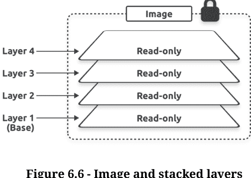

你将查看以下所有检查层信息的方法：

- 拉取（Pull）操作
- `docker inspect` 命令
- `docker history` 命令

运行以下命令拉取 `node:latest` 镜像，并观察单个层的拉取过程。较新版本的层数可能更多或更少，但原理是相同的。

```
$ docker pull node:latest

latest: Pulling from library/ubuntu

952132ac251a: Pull complete

82659f8f1b76: Pull complete

c19118ca682d: Pull complete

8296858250fe: Pull complete

24e0251a02c: Pull complete

digest: sha256:f4691c96ebbaa9d..28ae95a60369c506dd6e6f6ab

Status: Downloaded newer image for node:latest

docker.io/node:latest
```

每一行以 `Pull complete` 结尾的行代表 Docker 拉取的一个层。该镜像有五层，如图 6.7 所示，并带有层 ID。

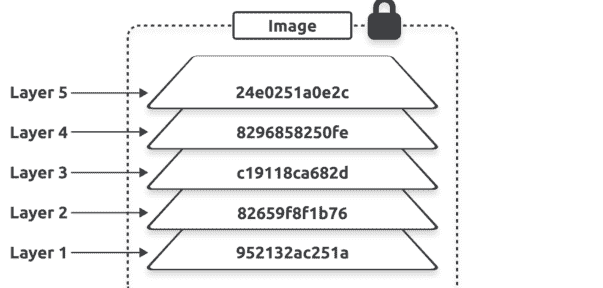

图 6.7 - 镜像层与 ID

查看镜像层的另一种方法是通过 `docker inspect` 命令检查镜像。以下示例检查了上一步拉取的同一个 `node:latest` 镜像。

```
docker inspect node:latest

{
  "Id": "sha256:bd3d4369ae......fa2645f5699037d7d8c6b415a
  "RepoTags": [
    "node:latest"
  ],
  "Snip":
  "RootFS": {
    "Type": "layers",
    "Layers": [
      "sha256:c8a75145fc...894129005e461a43875a094b9341",
      "sha256:c62fb330b6...7214ead6aac305dd03f70b95cdc61",
      "sha256:05575a193...3a9565d78962c7f368d5ac598499",
      "sha256:4837348061...12695f548406ea77feb5074e195",
      "sha256:0cad5e07ba...4bae4cfc66b372625e16c32a0eae"
    ]
  }
}
```

截取后的输出显示了五层。然而，它显示的是它们的 SHA256 哈希值，这与 `docker pull` 输出中显示的短 ID 不同。

`docker inspect` 命令对于获取详细的镜像信息非常有用。

你还可以使用 `docker history` 命令检查镜像并查看其层数据。然而，此命令显示的是镜像的构建历史，而不是最终镜像中层的严格列表。例如，某些 Dockerfile 指令（`ENV`、`EXPOSE`、`CMD` 和 `ENTRYPOINT`）只添加元数据而不会创建层。

#### 基础层

所有 Docker 镜像都从一个基础层开始，每当你添加新内容时，Docker 就会添加一个新层。

考虑以下构建简单 Python 应用程序的过度简化示例。你的公司规定所有应用程序都必须在官方 Ubuntu 24:04 镜像之上构建。这意味着官方 Ubuntu 24:04 镜像将成为该应用的基础层。安装 Python 将添加第二层，而你的应用程序源代码将添加第三层。最终镜像将有三层，如图 6.8 所示。记住，这是一个为了演示目的的过度简化示例。

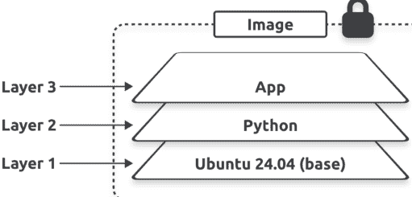

图 6.8

理解镜像是按照构建顺序堆叠的所有层的组合是非常关重要的。图 6.9 显示了一个具有两层的镜像。每层有三个文件，这意味着镜像有六个文件。

它还显示层被存储为独立对象，而镜像只是识别所需层的元数据，并解释了如何堆叠它们。

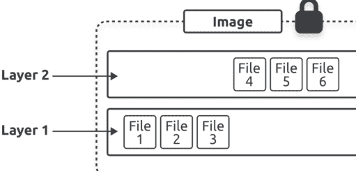

图 6.9

在图 6.10 稍微复杂的三层镜像示例中，镜像在统一视图中仅显示了六个文件。这是因为顶层中的文件 7 是文件 5 的更新版本。在这种情况下，顶层中的文件直接覆盖了文件。这意味着可以通过添加层来更新镜像。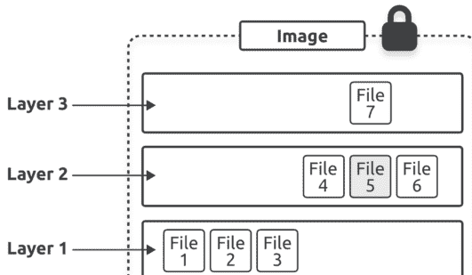

图 6.10 - 堆叠层

在底层，Docker 使用存储驱动来堆叠层并呈现它们为单一文件。无论你使用哪种存储驱动，结果都是一样的。图 6.11 显示了三层堆叠并合并到一个统一视图。

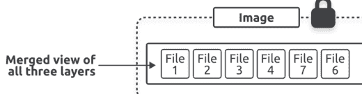

图 6.11

#### 共享层

如前所述，镜像可以共享层，从而提高性能。图 6.12 显示了两个共享同一层的镜像。

```
$ docker pull node:latest

latest: Pulling from library/ubuntu

952132ac251a: Pull complete

82659f8f1b76: Pull complete

c19118ca682d: Pull complete

8296858250fe: Pull complete

24e0251a02c: Pull complete

digest: sha256:f4691c96ebbaa9d..28ae95a60369c506dd6e6f6ab

Status: Downloaded newer image for node:latest

docker.io/node:latest
```

每一行以 `Pull complete` 结尾的行代表 Docker 拉取的一个层。该镜像有五层，如图 6.7 所示，并带有层 ID。层在仓库端也是共享的。这意味着你可以在仓库中存储大量镜像，仓库通过从存储任何层的单个副本来节省空间。

### 通过哈希值拉取镜像

到目前为止，你已经学习了如何使用名称（标签）拉取和操作镜像。虽然这是最常见的方法，但它有一个问题——标签是可变的。这意味着你可能会错误标记镜像，或者为新镜像赋予与旧镜像相同的标签。一个极其常见的例子是 `latest` 标签。例如，以前拉取的 `alpine:latest` 标签与今天拉取的可能不是同一个镜像。

考虑一个概述信任可变标签的潜在影响的快速示例。假设你有一个名为 `goltrack:1.5` 的镜像，你收到警告说它存在严重漏洞。你构建了一个包含修复的新镜像，但随后你犯了错误。你在相同的仓库中推送了新镜像，使用了与漏洞镜像相同的标签。

花时间考虑刚刚发生了什么以及影响。

你有一个名为 `goltrack:1.5` 的镜像，它正被你生产环境中的许多容器使用，并且它有一个严重缺陷。你创建了一个包含修复的版本。这太棒了，但随后你犯了错误。你在相同的仓库中推送了新镜像，使用了与漏洞镜像相同的标签。这覆盖了原始镜像，导致你没有很好的方法来确定哪些生产容器正在使用该漏洞镜像和

它们正在使用固定镜像——两个镜像具有相同的标签！

这就是镜像摘要（image digests）大显身手的地方。

Docker 使用内容寻址的存储模型，每个镜像都会获得一个加密内容哈希值，我们通常称之为摘要。由于这些是镜像内容的哈希值，两个不同的镜像不可能具有相同的摘要。同样，在不创建新的唯一摘要的情况下，更改镜像也是是不可能的。幸运的是，Docker 允许你使用镜像摘要而不仅仅是名称。

如果你已经通过名称拉取了镜像，可以通过运行 `docker images --digests` 参数来查看其摘要，如所示。

```
$ docker images --digests alpine

REPOSITORY TAG DIGEST IMAGE ID

alpine  latest sha256:c5b1261d...8elad6b c5b1261d6d3e
```

如果你想在拉取镜像之前找到它的摘要，可以使用 `docker buildx imagetools` 命令。以下示例获取了 Docker Hub 上 `nigelpoulton/k8sbook/latest` 镜像的摘要。

```
$ docker build imagetools inspect nigelpoulton/k8sbook:latest

Name: docker.io/nigelpoulton/k8sbook:latest

MediaType: application/vnd.docker.distribution.manifest.v2+json

Digest: sha256:13dd59a0c74e9a147800039b1ff4d61201375c0088b96a29
<Snip>
```

现在你可以使用摘要来拉取镜像。为了可读性，我精简了命令和输出。

```
$ docker pull nigelpoulton/k8sbook@sha256:13dd59a0...bce2e14b

docker.io/nigelpoulton/k8sbook@sha256:13dd59a0...bce2e14b: Pulling

59f164fb787: Download complete

a052f188b3e: Download complete

94a9f4efa5: Download complete

b7e60677fa: Download complete

edfb0c26f1fb: Download complete

5b1423465504: Download complete

2f23a362cd9: Download complete

Digest: sha256:13dd59a0...bce2e14b

Status: Downloaded newer image for nigoulton/k8sbook@sha256:13

docker.io/nigelpoulton/k8sbook:latest@sha256:13dd59a0...bce2e14b
```

也可以直接查询注册表 API 获取镜像数据，包括摘要。以下 curl 命令查询了 Docker Hub 上同一镜像的摘要。

```
$ curl "https://hub.docker.com/v2/repositories/nigelpoulton/k8sbook" | jq '.results[].digest'
```

"sha256:13dd59a0c74e9a147800039b1ff4d61201375c008b96a29c5bd17244"

## 镜像哈希值与层哈希值

你已经知道镜像只是独立层的松散集合。这意味着镜像只是一个包含某些元数据和层列表的清单文件（manifest）。应用程序及其所有依赖项都存在层中。然而，层是完全独立的，没有“属于镜像”的概念。

考虑到这一点，镜像和层具有如下的摘要：

- 镜像摘要是镜像清单文件的加密哈希值
- 层摘要是层内容的加密哈希值

这意味着对层或镜像清单的所有更改都会导致新的哈希值，这为我们提供了一种简单且可靠的方法来判断是否发生了更改。

### 内容哈希值与分发哈希值

Docker 在每次推送（push）和拉取（pull）前后都会比较哈希值，以确保没有发生篡改。然而，它在推送和拉取期间还会压缩镜像，以节省网络带宽和注册表的存储空间。由于这种压缩，前后的哈希值将不会匹配。

为了解决这个问题，每个层都有两个哈希值：

- 内容哈希（未压缩）
- 分发哈希（已压缩）

每当 Docker 从注册表推送或拉取一个层时，它都会包含层的*分发哈希*并用它来验证没有发生篡改。这就是为什么不同 CLI 和注册表输出中的哈希值并不总是匹配的原因之一——有时你看到的是内容哈希，而另一次看到的是分发哈希。

### 多架构镜像

Docker 的优点之一是它的简单性。然而，随着技术不断的发展，它们不可避免地变得更加复杂。当 Docker 开始支持不同的平台和架构时（例如在 ARM、x64、PowerPC、s390x 等变体上的 Windows 和 Linux），这种情况发生了。突然之间，所有不同架构的同一个镜像都有多个版本，开发者和用户必须投入大量的额外工作来获取正确的版本。这破坏了流畅的 Docker 体验。

多架构镜像救场！

幸运的是，Docker 和注册表 API 进行了适应并变得足够聪明，可以将多个架构的镜像隐藏在单个标签之后。这意味着可以在任何架构上执行 `docker pull alpine` 并获得正确版本的镜像。例如，如果你在 AMD64 机器，你将获得 AMD64 镜像。

为了实现这一点，Registry API 支持两个重要的构造结构：

- 清单列表（Manifest lists）
- 清单（Manifests）

*清单列表*正如其名义——镜像标签所支持的架构列表。每个受支持的架构都有自己的*清单*，其中列出了构建它时使用的层。

运行以下命令查看 `alpine:latest` 标签后支持的不同架构。

```
$ docker buildx imagetools inspect alpine

Name: docker.io/library/alpine:latest

MediaType: application/vnd.docker.distribution.manifest.list.v2+json

Digest: sha256:c5b1261d6d3e43071626931fc04f70149baeba2c8ec62
```

Manifests:
Name: docker.io/library/alpine:latest@sha256:6457d53f...645

为你的系统拉取正确的镜像是一回事，但为所有不同的架构构建镜像又是呢？

`docker buildx` 命令让创建多架构镜像变得简单。例如，你可以在 `linux/arm` 的 Docker Desktop 上为 `linux/amd64` 以及可能的其他架构构建镜像。我们将在后续章节中执行此类构建，但 `docker buildx` 提供了两种创建多架构镜像的方法：

- 模拟 (Emulation)
- 构建云端 (Build Cloud)

模拟模式通过在运行目标架构的 QEMU 虚拟机内部在你的本地机器上执行不同架构的构建。它在大多数情况下都能工作，但速度较慢且没有共享缓存。

Build Cloud 是 Docker, Inc. 提供的一项新服务，在云端原生硬件上执行构建，不需要模拟。它非常快，允许你与同事共享公共构建缓存，并无缝集成到 Docker Desktop 以及任何支持云驱动的 buildx 版本的 Docker Engine 中。它还与 GitHub Actions 和其他 CI 解决方案集成。在编写本文时，Docker Build Cloud 是一项需要付费的订阅服务。

我们将在后续章节中同时使用这两者，但我运行了以下命令使用 Build Cloud 构建了 `nigelpoulton/tu-demo` 镜像的 AMD 和 ARM 版本。

```
$ docker buildx build \
  --builder=cloud-nigelpoulton-ddd-cloud \
  --platform=linux/amd64,linux/arm64 \
  -t nigelpoulton/tu-demo:latest --push
```

## 使用 Docker Scout 进行漏洞扫描有很多工和插件可以扫描镜像中的已知漏洞。

我们将查看 Docker Scout，因为它内置于 Docker 的几乎每一个层，包括 CLI、Docker Desktop、Docker Hub 以及 scout.docker.com 门户。它是一个非常优秀的服务，但需要付费订阅。虽然存在其他类似的产品和服务，但大多数都需要付费订阅。

最新版本的 Docker Desktop 预装了 Scout CLI 插件并已就绪。如果你运行的是不同版本的 Docker，可能可以通过 GitHub 仓库安装 CLI 插件。

你可以使用 `docker scout quickview` 命令获取镜像的漏洞概览。以下命令分析了 `nigelpoulton/tu-demo:latest` 镜像。如果本地不存在副本，它将从 Docker Hub 拉取并在本地进行分析。

```
docker scout quickview nigelpoulton/tu-demo:latest

  SBOM of image already cached, 66 packages indexed

| Target | nigelpoulton/tu-demo:latest | 0C |

| :--- | :--- | :--- |

| digest | b4210d0aa52f | |

| Base image | python:3-alpine | 0C |

| Updated base image | python:3.11-alpine | 0C |
```

输出显示为零严重漏洞 (0C)、一个高 (1H)、一个中等 (1M) 和零低风险 (0L)。

你可以使用 `docker scout cves` 命令获取更详细的信息，包括修复建议。


`docker scout cves nigelpoulton/tu-demo:latest`

✓ SBOM of image already cached, 66 packages indexed

✗ Detected 1 vulnerable package with 2 vulnerabilities

### 概述

分析的镜像
| Target | `nigelpoulton/tu-demo:latest` |
| :--- | :--- |
| digest | `b4210d0aa52f` |
| platform | `linux/arm64/v8` |
| vulnerabilities | 0C 1H 1M 0L |
| size | 26 MB |
| packages | 66 |

### 软件包与漏洞
0C 1H 1M 0L `expat` `2.5.0-r2`
`pkg:apk/alpine/expat@2.5.0-r27os_name=alpine&os_version=31`

x HIGH `CVE-2023-52425`
https://cve.docker.com/v/CVE-2023-52425
Affected range : `<2.6.0-r0`
Fixed version : `2.6.0-r0`

我截取了输出，使其只显示严重和高风险漏洞，但有几点是很清楚的：

- 它检测到了一个包含两个漏洞的受影响包

- 受影响的包名为 `expat`，我们正在运行的漏洞版本是 `2.5.0-r2`

- 它列出的漏洞为 `CVE-2023-52425`

- 它包含一个指向更多信息的 Scout 报告链接

- 它建议我们更新到包含修复的的`2.6.0-r0` 版本

图 6.14 显示了这在 Docker Desktop 中的外观，你可以在 Docker Hub 中获得类似的集成和视图。

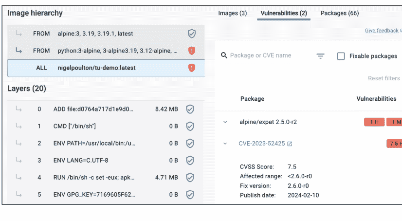

图 6.14 - Scout 与 Docker Desktop 的集成

`scout.docker.com` 门户提供概述仪表板，允许你配置策略，并让你设置与 Docker Hub 以及其他注册表的集成，以远程扫描和监控多个仓库。

### 删除镜像

你可以使用 `docker rmi` 命令删除镜像。`rmi` 是 `remove image` 的缩写。

删除镜像会将它们从本地仓库中移除，不再出现在 `docker images` 命令中。该操作还会删除本地文件系统中包含层数据的所有目录。然而，在删除所有引用这些镜像之前，Docker 不会删除多个镜像共享的层。

你可以通过名称、短 ID 或 SHA 删除镜像。你也可以用同一个命令删除多个镜像。

以下命令删除了三个镜像——一个通过名称，一个通过短 ID，一个通过 SHA。为了方便阅读，我精简了输出。

```
$ docker rmi redis:latest af111729d35a sha256:c5b1261d...f8elad6b
Untagged: redis:latest
Deleted: sha256:76d5908f5e19fdd73daf956a38826f790336ee4707d9028f
```

Untagged: `nigelpoulton/tu-demo:v2`

Deleted: `sha256:af111729d35a09fd`

### 章节总结

本章向你介绍了镜像的重要理论和基础知识。

你学习了镜像包含了运行容器应用程序所需的所有内容。这包括了足够的操作系统、源代码、依赖项和元数据。

你可以从单个镜像启动一个或多个容器。

在底层，Docker 通过堆叠一个或多个只读层来构建镜像，并将它们呈现为一个统一的整体。每个镜像都有一个清单（`manifest`），其中列出了构成镜像的层以及如何堆叠这些层。

你学习了镜像名称也称为标签（`tags`），它们是可变的，并且并不总是拉取到相同的镜像。例如，今天拉取 `alpine:latest` 标签的镜像与一年后拉取的镜像是不同一个。幸运的是，每个镜像都有一个不可变的摘要（`digest`），你可以使用它来保证始终拉取到相同的镜像。

Docker Hub 有精选官方镜像的概念，这些镜像用起来比非官方镜像更安全。然而，在从互联网下载软件时（即使是来自 Docker Hub 的官方镜像），你也应该始终保持谨慎。

镜像可以共享层以提高效率，并且 Docker 能够轻松地为许多不同的 CPU 架构（如 ARM 和 AMD）构建和拉取镜像。

Docker Scout 可以扫描镜像的已知漏洞并提供修复建议。它需要 Docker 订阅，并已集成到 `docker` CLI、Docker Hub 和 Docker Desktop 中。

在下一章中，我们将对容器进行类似的介绍——它们是镜像的运行时兄弟。

## 7: 容器操作

Docker 实现了开放容器倡议（OCI）规范。这意味着你在本章中学习的某些内容将适用于其他实现 OCI 规范的容器运行时和平台。

我将本章分为以下章节：

- 容器 – 简要概述 (TLDR)
- 容器对比虚拟机 (VMs)
- 镜像与容器
- 检查 Docker 是否正在运行
- 启动容器
- 容器如何启动应用
- 连接到容器
- 检查容器进程
- `docker inspect` 命令
- 向容器写入数据
- 停止、重启和删除容器
- 杀死容器的主进程
- 使用 Docker Debug 调试精简版镜像和容器
- 使用重启策略实现自愈容器
- 相关命令

### 容器 – 简要概述 (TLDR)

容器是镜像的运行时实例，你可以从单个镜像启动一个或多个容器。

图 7.1 显示了从单个镜像启动的多个容器。共享镜像是只读的，但你可以向容器写入内容。

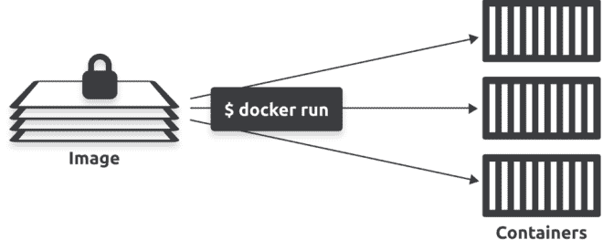

图 7.1

你可以像操作虚拟机一样启动、停止、重启和删除容器。然而，容器比虚拟机更、更快且更具移植性。它们被设计为无状态和瞬时的，而虚拟机被设计为长时间运行，并且可以带着状态和数据进行迁移。

容器也被设计为不可变的。这意味着在部署之后你不应该更改它们——如果容器故障，你应该用一个新容器替换它，而不是连接到它并在运行实例中进行修复。

容器应该只运行单个进程，我们使用它们来构建微服务应用。例如，一个具有四个功能（微服务）的应用（如 Web 服务器、认证、目录和商店）将拥有四个容器——一个运行 Web 服务器，一个运行认证服务，一个运行目录，另一个运行商店。

### 容器对比虚拟机 (VMs)

容器和虚拟机都是运行应用程序的虚拟化技术。它们都可以在你的笔记本电脑、裸机服务器、云端等运行。然而，它们的虚拟化方式非常不同：

- 虚拟机虚拟化硬件
- 容器虚拟化操作系统

在虚拟机模型中，你启动一台服务器并引导一个管理程序（`hypervisor`）。当管理程序启动时，它会占用所有硬件资源，如 CPU、内存、存储和网络适配器。要部署应用，你要求管理程序创建一个虚拟机。它通过将硬件资源划分成虚拟版本（如虚拟 CPU 和虚拟内存）并将它们封装成一个看起来完全像物理服务器的虚拟机。一旦有了虚拟机，你就安装操作系统，然后安装应用。

在容器模型中，你启动同一台服务器，操作系统启动并占用所有硬件资源。然后你安装像 Docker 这样的容器引擎。要部署应用，你要求 Docker 创建容器。它通过将操作系统资源（如进程树和文件系统）划分成虚拟版本，然后将其封装成一个看起来完全像普通操作系统的容器。然后你告诉 Docker 在容器中运行应用。

图 7.2 并列显示了两种模型，并试图通过在同一台服务器上运行数量是虚拟机 3 倍的容器来证明容器更高的高效性。

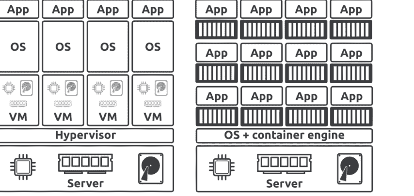

图 7.2

综之，管理程序执行硬件虚拟化，将硬件资源切划成虚拟版本并封装为虚拟机。容器引擎执行操作系统虚拟化，将操作系统资源切划成虚拟版本并封装为容器。虚拟机看起来和感觉完全像物理服务器。容器看起来和感觉完全像普通操作系统。

#### 虚拟机开销 (The VM tax)

虚拟机模型最大的问题之一是你需要在每个虚拟机上安装一个操作系统——每个操作系统都会消耗 CPU、内存和存储，并且需要较长时间才能启动。

容器通过共享运行所在的宿主机上的单个操作系统来规避所有这些。这使得容器相比虚拟机具有以下优势：

- 容器更小、更具移植性
- 你可以在你的基础设施上运行更多容器
- 容器启动速度更快
- 容器减少了你需要管理的操作系统数量（补丁、更新等）
- 容器提供了更小的攻击面

让我们简要扩展一下每一点。

容器比虚拟机小，因为它们只包含应用代码和一组最少操作系统相关的结构（例如基本的文件系统对象）。由于由于，它们的大小通常只有几兆字节。另一方面，每个虚拟机都需要一个完整的操作系统，这意味着它们通常是几百或几千兆字节。

由于容器不包含操作系统，你可以运行比虚拟机多得多的容器。例如，作为虚拟机部署 100 个应用将需要 100 个操作系统，每个操作系统都消耗 CPU、内存和存储，并且每个都需要打补丁和管理。然而，作为容器部署相同的 100 个应用不需要额外的操作系统。这极大地减少了你的操作系统开销，并允许你将系统资源分配给应用程序而不是操作系统。

容器启动也比虚拟机更快，因为它们使用了已经启动的宿主机操作系统。另一方面，虚拟机在启动应用之前需要经过完整的操作系统自举过程。

关于容器的早期担忧之一集中在共享内核模型，即同一宿主机上的所有容器共享宿主机的内核。虽然这提供了性能和移植性优势，但它比每个虚拟机都有专用内核的虚拟机模型安全性低。例如，一个利用宿主机内核漏洞的恶意容器可能会影响同一宿主机上的所有其他容器。幸运的是，现在容器平台已经成熟并配备了领先的工具，可以使它们比虚拟机更安全，这已不再是一个主要担忧。例如，大多数容器引擎和平台对安全相关技术（如 SELinux、AppArmor、seccomp、capabilities 等）实现了合理的默认设置。你甚至可以配置这些设置使容器比虚拟机更安全。其他技术（如镜像漏洞扫描）为你提供了比以往任何时候都更多的软件安全控制。在写作时的 2024 年，容器是绝大多数新应用的首选解决方案。

### 前提条件

你需要一个工作的 Docker 环境来跟随示例，我推荐使用 Docker Desktop。其他 Docker 设置也应该可行，但如果你想跟随那些示例，可能需要手动安装 Docker Debug 插件。

## 镜像与容器

如前所述，你可以从单个镜像启动多个容器。在这种关系中，镜像是只读的，但每个容器都是读写。。如图 7.3 所示，Docker 通过为每个容器创建一个薄的读写层并将其放置在共享镜像之上来实现这一点。

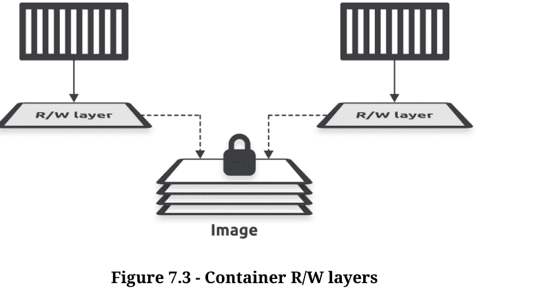

在这个示例中，每个容器都有自己的薄层 R/W 层（读写层），它们共享同一个镜像。容器*通过*自己的 R/W 层查看并访问镜像中的文件和应用程序，如果它们进行了任何更改，这些更改将被写入它们的 R/W 层。当你停止容器时，Docker 会保留该 R/W 层并在重启容器时恢复它。然而，当你删除容器时，Docker 会删除其 R/W 层。这样，每个容器都不更改共享镜像的情况下创建并保留自己的更改。

### Docker 正在运行

运行 `docker version` 来检查 Docker 是否正在运行。它会检查 CLI 和引擎组件。

```
$ docker version

Client:  v24.0.7

API version: v1.43

OS/Arch:  darwin/arm64

Server: Docker Desktop 4.30.0

Engine: 26.1.1

API version: 1.45

OS/Arch: linux/64
```

只要你从 Client 和 Server 获得响应，你就可以继续并跳过下一节。如果你收到错误，这通常意味着你的 Docker 守护进程没有运行，或者你的用户账户没有访问它的权限。如果你在 Linux 上运行，你需要确保你的用户账户是 `docker` 组的成员。如果不是，你可以通过运行 `usermod -aG docker <username>` 并重启 shell 来添加它。或者，你可以在所有 `docker` 命令前加上 `sudo` 以访问访问 API 套接字 `/var/run/docker.sock`。

如果你的用户账户已经是 `docker` 组的成员，但你仍然收到来自守护进程的错误，很有可能是 Docker 没有运行。运行以下命令之一来在使用 Systemd 的 Linux 系统上检查守护进程的状态：

```
$ service docker status
$ systemctl is-active docker
```

如果守护进程未运行，请使用适用于系统的命令启动它。

### 启动容器

`docker run` 命令是启动新容器最简单且最方法。运行以下命令启动一个名为 **webserver** 的新容器：

```
$ docker run -d --name webserver -p 5005:8080 ngelpoulton/ddd-book

unable to find image 'nigelpoulton/ddd-book:web0.1' locally

web0.1: Pulling from ngelpoulton/ddd-book

4f4fb70ef54: Already exists

c2fa07f3ff77: Download complete

0a1f0c11ea9: Download complete

claf4b5db42: Download complete

digest: sha256:3f5b281b914b39df8a1fbc189270a5672ff9e98bf0319

status: Downloaded newer image for ngelpoulton/ddd-book:web0.1

b5594b3b8b3bfdce544d2ca048e340d176be9c9fdc43081a20f1852c395e96b
```

让我们仔细观察一下该命令和输出。

- **`docker run`** 告诉 Docker 运行一个新容器
- **`-d`** 标志告诉 Docker 在后台作为守护进程运行，并脱离你的本地终端
- **`--name`** 标志告诉 Docker 将此容器命名为 **webserver**。
- **`-p 5005:8080`** 标志将你本地系统上的 **5005** 端口映射到容器内部的 **8080** 端口。这之所以有效，是因为容器的 Web 服务器正在监听 **8080** 端口。

`nigelpoulton/ddd-book:web0.1` 参数告诉 Docker 使用哪个镜像来启动容器。当你按下 **Return** 时，Docker 客户端将命令转换为 API 请求并将其提交给 Docker 守护进程。Docker 守护进程接受了该命令并在其本地镜像仓库中搜索 `nigelpoulton/ddd-book:web0.1` 镜像的副本。它没有找到，于是搜索了 Docker。在示例中，它在 Docker Hub 上找到了并拉取了本地副本。

一旦有了镜像的本地副本，守护进程就会向 `containerd` 发请求请求新容器。然后 `containerd` 指令 `runc` 创建容器并启动应用程序。它还执行了端口映射。

运行以下命令验证镜像是否已拉取到本地，以及名为 **webserver** 的新容器正在运行。

```
$ docker images

| TAG | IMAGE ID | CREATED |

| :--- | :--- | :--- | :--- |

| ngelpoulton/ddd-book | web0.1 | 3f5b281b914b | 12 minutes ago |

$ docker ps

| IMAGE | COMMAND | STATUS | PORT |

| :--- | :--- | :--- | :--- |

| b5594b3b8b3f | ngelpoulton... | "node ./app.js" | Up 2 mins | 0.0.0.0:5005 |
```

你也可以将浏览器连接到 Docker 主机的 5005 端口来测试应用程序。如果你使用 Docker Desktop，将浏览器指向 `localhost:5005`。如果你没有运行 Docker Desktop，将浏览器指向容器的 IP 地址。


### 容器是如何启动的

在上一节中，你创建了一个容器。但容器是如何知道启动哪个应用程序的？启动容器三种方式：

1. 镜像中定义的 Entrypoint
2. 镜像中定义的 CMD
3. 传递给 `docker run` 命令的参数

Entrypoint 和 CMD 定义在 Dockerfile 中，但它们在运行容器时可以被覆盖。如果你指定了 `<command>`，它将覆盖 CMD 指令。

如所述，`<command>` 是可选的；你将在下一章学习更多关于这些的内容。`docker run` 命令的格式如下：

```
docker run <arguments> <image> <command>
```

示例展示了两个命令——一个成功，另一个失败了。

示例列出了你当前目录的内容，并尝试使用 `vim` 编辑器编辑 `app.py` 文件。

```
/src # ls -l

total 100

-rw-r--r--r-- 1 root 324 Feb 20 12:35 Dockerfile

-rw-r--r--r-- 1 root 377 Feb 20 12:35 README.md

-rw-r--r--r-- 1 root 341 Feb 20 12:35 app.js

drwxr-xr-x 183 root 4096 Feb 20 12:41 node_modules

-rw-r--r--r-- 1 root 74342 Feb 20 12:41 package-json

-rw-r--r--r-- 1 root 404 Feb 20 12:38 package-lock


`drwxr-xr-x 2 root 4096 Feb 20 12:35 views`

`/src` # `vim app.js`

`sh: vim: not found`

```
`vim` 命令失败了是因为容器内没有安装它。
```

### 检查容器进程

大多数容器只运行单个进程。这是容器的主应用程序进程，并且始终是 PID 1。

运行 `ps` 命令查看在容器中运行的进程。你需要连接到上一节中的 `exec` 会话才能运行这些命令。

```
/src # ps

PID USER TIME COMMAND

 1 root 0:00 ./app.js

 13 root 0:00 sh

 22 root 0:00 ps
```

输出显示了三个进程：

- PID 1 是运行 Node.js Web 应用的主应用程序进程
- PID 13 是你交互式 `exec` 会话连接的 `shell` 进程
- PID 22 是你刚刚运行的 `ps` 命令

`ps` 进程在显示输出后立即终止了，而 `sh` 进程将在会在你退出 `exec` 会话时终止。这意味着唯一的长时间运行的进程是运行 Node 应用的 PID 1。

如果你杀掉容器的主进程（PID 1），也将杀死容器。这是因为容器只有在主进程运行时才会运行——当该进程不再运行时，容器就没有理由继续运行了。我们稍后会演示这一点。

输入 **`exit`** 退出 `exec` 会话并返回本地终端。

运行另一个没有指定 **`it`** 标志的 **`docker exec`** 命令。这将远程执行命令而不创建交互式会话。命令的格式为 **`docker exec <container> <command>`**，并且只有在你正在执行的命令安装在容器中时，它才会起作用。

```
$ docker exec webserver ps

PID USER TIME COMMAND

1 root 0:00 node ./app.js

42 root 0:00 ps
```

这一次只有两个进程在运行，因为你会在输入 **`exit`** 退出之前的交互式 `exec` 会话时终止了 **`sh`** 进程。

### `docker inspect` 命令

你一定会喜欢 **`docker inspect`** 命令，因为它是镜像和容器详细信息的宝库。

以下命令获取了运行中的 `webserver` 容器的完整细节，我截取了输出以突出几个有趣的地方。不过，我建议你在自己的系统上运行该命令并研究完整的输出，因为你将学到很多。

```
$ docker inspect webserver
<Snip>
"State": {
  "Status": "running"
},
"Name": "/webserver",
"PortBindings": {
  {
    "8080/tcp": [
      "HostIp": "",
      "HostPort": "5005"
    ]
  }
},
"RestartPolicy": {
  "Name": "no",
  "MaximumRetryCount": 0
},
"Image": "nigelpoulton/ddd-book:web0.1",
"WorkingDir": "/src",
"Entrypoint": [
  "node",
  "./app.js"
]
}
<Snip>
```

截取的输出显示容器正在运行，名为 `webserver`，将容器内的端口 `8080` 绑定到宿主机上的 `5005`，没有重启策略，并且基于 `nigelpoulton/ddd-book:web0.1` 镜像。`Entrypoint` 块列出了每次容器启动时都会自动运行的命令。

我们稍后会更详细介绍，但这个容器是从你启动它的镜像中继承了 `Entrypoint` 指令。你可以通过对镜像运行以下 `docker inspect` 命令来验证这一点。我截取了输出以突出相关部分。

```
$ docker inspect nigelpoulton/ddd-book:web0.1
<Snip>
"Config": {
  "WorkingDir": "/src",
  "Entrypoint": [
    "node",
    "./app.js"
  ]
<Snip>
```

我建议你花时间研究 `docker inspect` 命令的输出。你将学到很多。

### 向容器写入数据

在本节中，你将 `exec` 进入 `webserver` 容器并编辑 Web 服务器配置，以便在主页上显示新消息。在下一节中，你将停止并重启容器，并验证你的更改没有丢失。

**警告：本节仅用于演示目的。在现实世界中，你不应该这样修改运行容器。每当你需要更改运行容器时，都应该创建并测试带有更改的新容器，然后用新容器替换现有容器。

使用以下命令为 `webserver` 容器打开一个新的交互式 `exec` 会话。

```
$ docker exec -it webserver sh
/src #
```

容器运行着一个简单的 Node.js Web 应用，它使用 `views/home.pug` 文件来构建应用的主页。

运行以下命令在 `vi` 编辑器中打开 `home.pug` 文件。Windows 用户可以使用记事本或其他编辑器。

```
% vi views/home.pug
```

如果你知道如何使用 `vi`，可以继续将 `h1` 标签之后第 8 行的文本改为你喜欢的任何内容并保存更改。

如果你不熟悉 `vi`，请仔细按照以下步骤操作：

- 1. 按 `i` 键让 `vi` 进入插入模式（insert mode）
- 2. 使用方向键导航到第 8 行
- 3. 使用 `delete` 键删除第 8 行 `h1` 标签后的文本
- 4. 输入你选择的新消息
- 5. 按 `escape` 键退出插入模式并返回命令模式
- 6. 输入 `:wq` 并按回车保存你的更改并退出（`:wq` 是写入 `write` 和退出 `quit` 的缩写）

一旦你保存了更改，刷新浏览器查看更新。

输入 `exit` 退出 `exec` 会话并返回本地终端。

恭喜，你已经更新了 Web 服务器配置。

### 停止、重启和删除容器

在本节中，你将执行典型的容器生命周期事件，并查看它们如何影响你对容器所做的更改。

以下命令仅在你退出交互式 `exec` 会话后才会生效。

检查你的容器是否仍在运行。

```
$ docker ps
CONTAINER ID    IMAGE               COMMAND             STATUS      PORTS
b5594b3b8b3f  nigelpoulton...    Up 5 mins
```

使用 **`docker stop`** 命令停止它。它需要最多 10 秒来优雅地停止。

```
$ docker stop webserver
webserver
```

运行另一个 **`docker ps`** 命令。

```
$ docker ps
CONTAINER ID    IMAGE               COMMAND             STATUS      PORTS
```

容器不再出现在运行容器列表中。然而，如果你运行带有 **`a`** 标志的相同命令就可以看到它，包括已停止的容器。

```
$ docker ps -a
CONTAINER ID IMAGE COMMAND STATUS
b5594b3b8b3f nigelpou... "node /app.js" Exited (137)
```

如输出所示，它仍然存在但处于 **`Exited`** 状态。使用以下命令重启它。

```
$ docker restart webserver
webserver
```

如果你再次运行 **`docker ps`**，你会看到它处于 **`Up`** 状态。

刷新浏览器查看 Docker 是否保存了你在主页上的更改。

容器已保存你的更改！

你也可以运行以下命令直接从容器文件系统中返回文件的内容。

```
$ docker exec webserver cat views/home.pug
html
head
    title='Docker FTW'
    link(rel='stylesheet', href='https://stackpath.bootstrapcdn.c
body
    div.container
        div.jumbotron
            h1 Everybody containers!        <-- 我更改了这个 l
<Snip>
```

到为止，你已经看到启动和停止容器不会丢失更改。你还看到重启它们非常快。

运行以下命令删除容器。`-f` 标志强制执行，而不允许通常的 10 秒刷新缓冲区和优雅退出。在强制此类操作时要小心，因为 Docker 不会询问确认。

```
$ docker rm webserver -f
webserver
```

运行 `docker ps -a` 查看容器是否有任何迹象。

| CONTAINER ID | IMAGE | COMMAND | STATUS | PORTS |

容器的所有迹象都消失了，你无法重启它。你可以执行另一个 `docker run` 命令并指定相同的镜像来启动新实例，但它将不会包含你所做的更改。

> **警告：** 正如前面提到的，像这样修改运行中的容器是一种反模式，你不应该这样做。我们在这里展示它，是为了演示容器是如何工作原理，以及对容器文件系统的更改（在容器自身的薄读写 R/W 层上进行的更改）是如何跨重启持久持久的。

## 杀死容器的主进程

在本章前面的部分，我们学习了容器的设计是为了运行单个进程，而杀死这个进程也会杀死容器。

让我们测试一下这是否真实。

运行以下命令基于 Ubuntu 镜像启动一个名为 `ddd-ctr` 的新交互式容器，并让它运行 Bash shell 作为其主进程。

```
$ docker run --name ddd-ctr -it ubuntu:24.04 bash
Unable to find image 'ubuntu:24.04' locally
24.04: Pulling from library/ubuntu
51ae9e2de052: Download complete
Digest: sha256:ff0b5139e774bb0dee9ca8b8b72b4d69eaec2795debdc47c8c9
Status: Downloaded newer image for ubuntu:24.04
root@d3c892adeb3:#
```

该命令拉取 Ubuntu 镜像并将你的终端附加到容器的 Bash shell 进程。

运行 `ps` 命令列出所有运行的进程。

```
root@d3c892adeb3:# ps
PID TTY TIME CMD
1 pts/0 00:00:00 bash
9 pts/0 00:00:00 ps
```

1 是容器的主进程，是你告诉容器运行的 Bash shell。另一个是 `ps` 命令，它已经退出了。这意味着 Bash 进程是容器中运行的唯一进程。

如果你输入 `exit`，你将终止 Bash 进程并杀死容器。这是因为容器只有在主进程执行时才会运行。

通过输入 **`exit`** 返回你的本地终端，然后运行 **`docker ps -a`** 命令查看容器是否已终止，以此进行测试。

```
root@d3c892ad0eb3:#
$ docker ps -a
CONTAINER ID   COMMAND STATUS NAMES
d3c892ad0eb3  ubuntu:24.04 "bash" Exited (0) 3 secs ago d
```

如所预期，容器处于 **`exited`**（退出）状态且没有运行。然而，你可以运行以下两个命令来重启它并将你的 shell 附加到它的主进程。

```
$ docker restart ddd-ctr
dd-ctr
$ docker attach ddd-ctr
root@d3c892ade0eb3:#
```

你的终端再次附加到容器中的 Bash shell。

你可以输入 **`Ctrl+Q`** 退出容器，而不杀死你所附加的进程。

输入 `Ctrl+Q` 退出容器，并运行另一个 `docker ps` 命令以验证这次容器仍在运行。

```
root@d3c892ade0b3:/# <Ctrl+Q>
read escape sequence
$ docker ps
CONTAINER ID IMAGE COMMAND STATUS NAMES
d3c892ad0eb3 ubuntu:24.04  "bash"  Up 27 seconds ddd-ctr
```

容器仍在运行。

现在你已经知道如何在不杀死容器的情况下退出容器，让我们转换一下，看看如何使用 Docker Debug 来调试精简容器和镜像。

### 使用 Docker Debug 调试精简镜像和容器

在编写本文时，Docker Debug 是一个新工具，需要 Pro、Team 或 Business 订阅。

部署仅包含应用代码和依赖项的小镜像是一种被广泛接受的实践。这意味着不包含 shell 或调试工具是使镜像和容器更小更安全的一部分。然而，当出现问题时，这使得调试它们变得困难。

这就是 **`Docker Debug`** 出现的地方，它允许你获取不包含 shell 的镜像和容器的 shell 权限，并无缝地向它们注入强大的调试工具。

从高层次来说，Docker Debug 通过向容器附加 shell 并挂载一个加载了调试工具的工具箱来工作。这个*工具箱*被挂载为名为 `/nix` 的目录，并在你的调试会话期间可用但对容器永远不可见。一旦你退出 Docker Debug 会话，`/nix` 目录就会被移除。如果你正在调试运行中的容器，你所做的任何更改对容器立即可见，并跨容器重启持久化。例如，在 Docker Debug 会话期间更新 `index.html` 将立即更新运行的 Web 应用，并且如果容器停止并重启，更改将持久存在。如果你正在调试镜像或停止的容器，Docker Debug 会话会创建一个调试沙箱并将其作为 R/W 层添加到镜像中，使其感觉像一个运行的容器。然而，你在调试镜像或停止的容器时所做的更改**不会**持久化，并在你退出调试会话后就会丢失。

如果你一直在一直操作，你将有一个名为 **`ddd-ctr`** 的运行容器。如果没有，你可以运行以下命令启动一个：

```
docker run --name ddd-ctr -it ubuntu:24.04 bash
```

运行以下命令附加到容器并查看它是否有任何调试工具。接接的 `docker attach` 命令与你之前学习的 `docker exec` 命令类似，但它会自动连接到容器的主进程。如果你已经连接到容器，则不需要运行 `docker attach` 命令。

```
$ docker attach ddd-ctr
root@d3c892ade0eb3:#
root@d3c892ade0eb3:# ping nigerelppoulton.com
bash: ping: command not found
root@d3c892ade0eb3:# nslookup nigerelppoulton.com
bash: nslookup: command not found
root@d3c892ade0eb3:# vim
bash: vim: command not found
```

所有命令都失败了，因为此容器中没有安装任何工具。这会导致没有 Docker Debug 的情况下调试此容器变得困难。

输入 `Ctrl+Q` 安全地从容器断开而不杀死 Bash 进程。

在接下来的步骤中，你将使用 Docker Debug 获取容器的 shell 会话，并运行容器中未安装的命令。你甚至可以使用 Docker Debug 获取不包含 shell 的容器和镜像的访问。

你需要登录 Docker 才能使用 Docker Debug，并且只有在你拥有 Pro、Team 或 Business 许可时才有效。

```
$ docker login
Authenticating with existing credentials...
Login Succeeded
```

运行以下命令检查你是否有 Docker Debug 插件。现代版本的 Docker 默认包含此。其他 Docker 安装可能没有，你必须手动安装。

```
$ docker info
Client: 26.1.1
Context: default
Debug Mode: false
Plugins:
debug: Get a shell into any image or container
```

一旦你登录并安装了插件，就可以使用 Docker Debug 了。命令的格式为 **`docker debug <image>|<container>`**。我们将为运行的容器 **`ddd-ctr`** 打开一个 Docker Debug 会话。

```
$ docker debug ddd-ctr
```


> 这是一个附加 shell，即：
> - 对容器的更改对容器可见
> - `/nix` 目录对容器不可见

Version root@d3c892adeb3 / [ddd-ctr]
docker >

你已成功连接到运行的容器并获得了一个新的 shell 提示符 (`docker >`)。你还获得了关于容器短 ID 和名称的有用信息，以及你所做的更改将可见的提醒。

尝试运行上一节失败的 **`ping`、`nslookup` 和 `vim`** 命令。如果你在 **`vim`** 会话中卡住了，只需输入 **`:q`** 并按 **Enter**。

```
docker > ping nigeroulton.com
PING nigeroulton.com (192.124.249.126) 56(84) bytes of data.


64 bytes from cloudproxy10126.sucuri.net (192.124.249.126): icmp

64 bytes from cloudproxy10126.sucuri.net (192.124.249.126): icmp~

^C

`docker` > `nslookup` nigeroulton.com

zsh: command not found: `nslookup`

`docker` > `vim`

VIM - Vi IMImproved

~ version 9.0.1441

~ by Bram Moolenaar et al.

~ Vim is open source and freely distributable

<Snip>

:q

```

**ping** 和 **vim** 命令有效，但 **nslookup** 仍然失败了。这是因为默认的 Docker Debug 工具箱包含 **ping** 和 **vim**，但不包含 **nslookup**。别担心，你可以使用 Docker Debug 内置的 **install** 命令添加 **search.nixos.org** 上列出的任何包。

运行以下命令安装 **bind** 包（包含 **nslookup** 工具），然后运行

# 再次使用 nslookup 命令。

```
docker > install bind

Tip: 你可以在此处安装任何可用包：https://search.nix

正在安装 'bind-9.18.19'

<Snip>

docker > nslookup nigelpoulton.com

Server:       192.168.65.7

Address:      192.168.65.7#53

非权威回答:

Name:               nigelpoulton.com

Address:      192.124.249.126

```

该命令生效了，`nslookup` 现在已安装在你的工具箱中，并将在未来的 Docker Debug 会话中可用。

恭喜，你已经使用 Docker Debug 挂载到了运行中的容器，并运行了不属于容器本身的故障排除命令。你还学习了如何向你的 Docker Debug 工具箱中添加额外工具。请记住，你对运行中容器做的任何更改都会立即对容器可见，并在关闭会话后仍然存在。

输入 `exit` 终止调试会话并返回本地 shell。

运行以下命令创建一个新的 Docker Debug 会话，用于调试 `nigelpoulton/ddd-book:web0.1` 。如果你没有本地副本，Docker 将自动从 Docker Hub 拉取镜像。

```
$ docker debug nigelpoulton/ddd-book:web0.1
```


> 注意：这是一个沙箱 shell。所有更改都不会影响实际的 Version: 0。root@3f5b281b914b /src [nigelpoulton/ddd-book:web0.1] dockerer >

注意这次不同的提示信息。调试镜像会创建一个沙箱 shell，更改不会影响实际镜像。这提醒你，调试镜像和已停止的容器与调试运行中的容器的行为不同：

- 在调试运行的容器时做的更改是持久化的
- 在调试镜像或停止的容器时做的更改会在退出调试会话时被删除

运行 `nslookup` 命令证明该工具已保存到你的工具箱中，无需重新安装即可使用。

```
docker > nslookup craigalanson.com

Server: 192.168.65.7

Address: 192.168.65.7#53

非权威回答:

Name: craigalanson.com

Address: 198.185.159.144

<Snip>
```

Docker Debug 有一个内置的 `entrypoint` 命令，允许你打印、检查和测试镜像或容器的 Entrypoint 或 Cmd 命令。这些是 Docker 用于启动容器应用执行的命令。

运行以下 entrypoint 命令以查看该容器在启动时运行的默认命令。

```
docker > entrypoint --print

node ./app.js
```

`entrypoint` 命令足够智能，可以查找 Entrypoint 和 Cmd 指令。

输入 `exit` 退出调试会话。

总而言，Docker Debug 是一个用于调试精简镜像和容器的新型工具。它让你能够访问不包含 shell 的容器和镜像，并且你可以运行容器或镜像中不可用的故障排除工具。你对运行中容器做的任何更改都会立即生效，并在停止和重启操作中持久。然而，在调试镜像和停止的容器时做的更改会在关闭会话时丢失。在所有情况下，你安装和使用的工具都永远不是容器或镜像的一部分。

### 使用重启策略实现自愈容器

容器重启策略是自愈的一种简单形式，允许本地 Docker 引擎自动重启失败的容器。

你可以对每个容器应用重启策略，Docker 支持以下四种策略：

- no（默认）
- on-failure（失败时重启）
- always（总是重启）
- unless-stopped（除非被停止）

| 重启 | 非 | 零 | docker | 当 |
|---|---|---|---|---|
| | | | stop | |
| | | | exit | |
| no | | | restart | |
| on-failure | | | | | |
| always | | | | | |
| unless-stopped | | | | |

非零退出码表示发生了错误。零退出码表示正常退出。我们将通过 `always` 策略来演示这一点，运行一个名为 `alwaysdie` 的容器。

```
$ docker run --restart always --name alwaysdie sh
```

这将连接到容器。输入 `exit` 退出 shell。这将 shell 回到本地 shell。

运行以下命令以查看是否发生了什么。

```
$ docker ps
```

| 容器 ID | 镜像 | 创建 | 状态 |
|---|---|---|---|
| 19362830bb53 | alpine | | Up 15 seconds |

容器正在运行中。然而，由于你 15 秒前创建了它，它是符合预期的。如果你使用 `always` 策略并强制 Docker 停止它，它不会重启。这很重要，如果你强制 Docker 停止它，它不会重启。

167

1. 你使用 `always` 策略启动一个新容器
2. 如果你强制 Docker 停止它，它不会重启。
3. 你使用 `docker stop` 停止容器
4. 如果你强制 Docker 停止它，它不会重启

你也可以通过以下方式删除容器和镜像：

```
$ docker rm $(docker ps -aq) -f

ac16541921f

5bd3741185fa

$docker rmi $(docker images -q)

Untagged: nigelpoulton/ddd-book:web0.1

Deleted: sha256:3f5b281b914b1e39df8a1fc189270a567ff9ebaeba2c8672bd

Untagged: ubuntu:24.04

Deleted: sha256:ff0b5139e74bb0dee9ca8b5724d69ea2795deb8dc4c8672

Untagged: alpine:latest

Deleted: sha256:c5b1261d6d3e43071626931fc004f70149eba2c8672
```

- **docker stop** 停止正在运行的容器并将其置 **Exited (137)** 状态。它向容器的 PID 1 进程发送 SIGTERM 信号，允许容器有 10 秒时间优雅退出。如果进程在 10 秒内未清理并停止，它将发送 SIGKILL 强制容器立即终止。
- **docker restart** 重启已停止的容器。
- **docker rm** 删除已停止的容器。你可以添加 -f 标志来删除容器，无需先停止它。
- **docker inspect** 向你显示有关容器的详细配置和运行信息。
- **docker debug** 为容器或镜像挂载调试 shell，并允许你运行容器或镜像内部无法运行的命令。这需要 Pro、Team 或 Business 版本的 Docker 订阅。

### 本章总结

在本章中，你学习了虚拟机（VMs）和容器之间的一些主要区别，包括容器更小、更快速且更具移植性。

你学习了如何使用 **docker** CLI 启动、停止和重启容器，并看到了容器文件系统的更改在重启后依然存在。

你学习了容器运行单个进程，如果该进程被杀死，容器将无法运行。你还看到了三种告诉容器运行哪个应用以及如何启动它的——通过镜像元数据中的 Entrypoint 或 Cmd 指令，或者通过 `docker run` CLI。

你学习了新的 Docker Debug 工具，以及它如何允许你获取精简容器的 shell 并运行容器内不存在的故障排除命令。

最后，你学习了如何为容器附加重启策略，以及不同的重启策略是如何工作的。

## 第 8 章：应用程序容器化

Docker 能够轻松将应用程序打包为镜像并作为容器运行。我们将此过程称为容器化，本章将带你完成整个过程。

我将本章节分为如下：
- 应用程序容器化 – 核心摘要 (TLDR)
- 单容器应用的容器化
- 使用多阶段构建进入生产环境
- Buildx、BuildKit、驱动程序和 Build Cloud
- 一些良好实践

### 应用程序容器化 – 核心摘要 (TLDR)

Docker 旨在轻松地构建、发布和运行应用程序。我们称之为容器化，其过程如下：

1. 编写你的应用程序并创建依赖列表
2. 创建一个 Dockerfile，告诉 Docker 如何构建和运行该应用
3. 将应用构建成镜像
4. 将镜像推送到注册表（可选）
5. 从镜像运行容器

你可以在图 8.1 中看到这五个步骤。

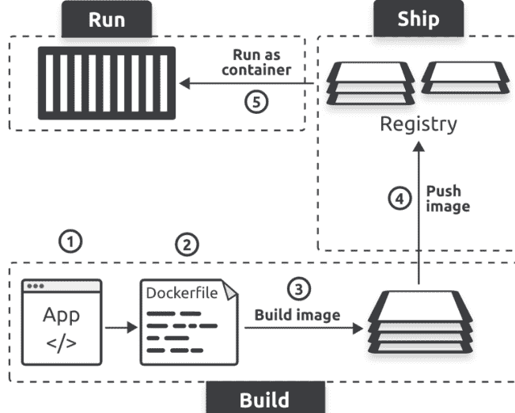

图 8.1 - 应用程序容器化的基本流程

### 单容器应用的容器化

在本节中，你将完成以下步骤将一个简单的 Node.js 应用容器化：
- 从 GitHub 获取应用程序代码
- 创建 Dockerfile
- 将应用容器化
- 运行应用
- 测试应用
- 深入观察

我建议你跟着 Docker Desktop 操作操作。这是因为我们将使用新的 `docker init` 命令，该命令在其他版本的 Docker 中可能没有安装。如果你没有带有 `docker init` 插件的 Docker 安装，不要担心，手动复制 Dockerfile 并遵循其余示例。

### 获取应用程序代码

我们将使用的应用程序是一个简单的 Node.js Web 应用，它在 8080 端口提供网页服务。

如果你仍然需要克隆仓库，请运行以下命令进行克隆。你需要安装 git，它会创建一个名为 ddd-book 的新目录。

```bash
$ git clone https://github.com/nigelpoulton/ddd-book.git

Cloning into 'ddd-book'...

remote: Enumerating objects: 47, done.

remote: Counting objects: 47/47, done.

remote: Compressing objects: 100% (32), done.

remote: Total: 47 (delta 11), pack 0

Receiving objects: 100% (47/47), 167.30 KiB | 1.66 Mi/s, done.

Resolving deltas: 100% (11/11), done.
```

进入 **ddd-book/node-app** 目录并列出内容。

```bash
$ cd ddd-book/node-app

$ ls -l

total 98

-rw-r--r-- 1 nigelpton staff 341 Feb 12:35 app.js

drwx-xr-x 2 nigelpton staff 4296 Mar 12:18 node_modules

-rw-r--r-- 1 nigelpton staff 355 Mar 12:10 package.json

drwxr-xr-x 2 nigelpton staff 96 Feb 12:35 .
```

该目录是构建上下文（build context），因为它包含了应用程序源码和依赖文件。

### 创建 Dockerfile

在过去，你需要手动创建 Dockerfile。幸运的是，新版本的 Docker 支持 `docker init` 命令，它可以分析应用并自动创建遵循良好实践的 Dockerfile。

运行以下命令为应用创建一个 Dockerfile。如果你的 Docker 安装没有 `docker init` 插件，你需要跳过此步骤。你需要在 `node-app` 目录下运行它。

```bash
$ docker init

Welcome to the Docker Init!

? What application platform does your project use? Node 20.8.0

? What version of Node do you want to use? 20.8.0

? What package manager do you want to use? npm

? What command do you want to use to start the app? app.js

? What port does your server listen on? 8080

CREATED: .dockerignore

CREATED: Dockerfile

CREATED: compose.yaml

CREATED: README.md
```

- ✓ 你的 Docker 文件已就绪！

进程创建了一个新的 Dockerfile 并将其放在当前目录中。它看起来如下：

```dockerfile
1. ARG NODE_VERSION=20.8.0

2. FROM ${NODE_VERSION}-alpine

3. ENV NODE_ENV production

4. WORKDIR /usr/src/app

5. RUN --mount=type=bind,source=package.json,target=package.json \
   --mount=type=cache,source=package-lock.json,target=package-lock.json \
   npm ci --omit=dev

6. USER node
```

```dockerfile
7. COPY .

8. EXPOSE 8080

9. CMD app.js
```

第 1 行和第 2 行告诉 Docker 拉取 node:20.8.0-alpine 镜像并作为新镜像的基础。

第 3 行将环境设置为 production。第 4 行设置工作目录。

第 5 行绑定并安装依赖。第 6 行确保 Node 以非 root 用户运行。

第 7 行将源码拷贝到 WORK 目录。第 8 行记录了应用端口。

第 9 行是 Docker 启动容器时执行的命令。

你现在拥有了构建应用所需的一切：源码、依赖和 Dockerfile。

### 将应用容器化

在本节中，你将应用程序构建为镜像。

如果你的 Docker 安装没有 `docker init` 插件且你没有遵循上一步，在继续之前你需要将 `sample-Dockerfile` 重命名为 `Dockerfile`。

运行以下命令构建名为 `ddd-book:ch8.node` 的新镜像。确保包含结尾的点 `.`，因为这告诉 Docker 使用当前目录作为构建上下文。记住，构建上下文是应用所在的目录。

```bash
$ docker build -t ddd-book:ch8.node .

[+] Building 16.2s (12/12) FINISHED

=> [internal] load build definition from Dockerfile 0

=> => transferring dockerfile: 1.21kB

=> => transferring context: 659B

=> [stage-0 1/4] FROM docker.io/library/node:20.8.0-alpine

=> [stage-0 2/4] WORKDIR /usr/src/app

=> [stage-0 3/4] RUN --mount=type=bind,source=package.json,target=package...

=> [stage-0 4/4] COPY .

=> exporting to image 0

=> => exporting layers 0

=> => writing image sha256:f282569b8bd0f...016clada91

=> => naming docker.io/library/ddd-book:ch8.node
```


我截取了输出内容，但你可以看到创建四个镜像层的四个编号步骤。

| REPO TAG | IMAGE ID | CREATED | SIZE |
| :--- | :--- | :--- | :--- |
| ddd-book ch8.node | 24dd040fa06b | 18 minutes ago | 268M |

恭喜，你已经将应用容器化为 OCI 镜像！

运行 `docker inspect ddd-book:ch8.node` 命令来验证镜像并查看 Dockerfile 中的设置。你应该能够看到镜像层以及元数据，例如暴露端口、工作目录和 Entrypoint 值。

```bash
$ docker inspect ddd-book:ch8.node

[
  {
    "Id": "sha256:24dd040fa06baf6e40144c5a59f9a749159a932ece",
    "RepoTags": [
      "ddd-book:ch8.node"
    ],
    <省略部分>
    "ExposedPorts": {
      "8080/tcp": {}
    },
    "WorkingDir": "/usr/src/app",
    "Cmd": [
      "/bin/sh",
      "-c",
      "node app.js"
    ],
    <省略部分>
    "Layers": [
      "sha256:5f4d9fc4c98de918202a9c81e501c6429bc87",
      "sha256:6b204e93dbab786f9628bbe32c20d385f2c44",
      "sha256:012c308a7ec993a47db7c46d17b53dce264a",
      "sha256:35a839ac7cc92afd86902e97629141",
      "sha256:91caa807041ccfeb25b34d62ca6674bf21",
      "sha256:a483b3d0c5a6938407e4abd791f130b44",
      "sha256:ea24594db2099441a33dd144c507609"
    ]
  }
```

你可能会好奇为什么镜像在创建时有七层。这是因为 `node:20.8-alpine` 基础镜像已经包含了四层，因此 `FROM` 指令拉取了基础层，随后 `WORKDIR`、`RUN` 和 `COPY` 指令又添加了三层。你可以在图 8.2 中看到这一点

图 8.2 - Dockerfile 和镜像层

## 将镜像推送到 Docker Hub

这是一个可选部分，你需要一个 Docker Hub 账户才能操作。访问 hub.docker.com 并注册一个账号。你需要完成以下步骤：

1. 登录 Docker Hub
2. 为镜像打标签
3. 推送镜像

创建镜像后，你通常会将它们推送到某个仓库以确保它们安全，并让同事和客户端访问。有很多仓库，但 Docker Hub 是最常用的，也是默认推送镜像的地方。

登录 Docker Hub。

```bash
$ docker login

使用你的 Docker ID 登录并推送镜像

Username: nigelpout

Password:

警告！你的密码将以加密存储在 /home/ubuntu
```

登录后，你需要为镜像打标签。这是因为 Docker 使用镜像标签来确定将其推送到哪个仓库。如果你运行 `docker images` 命令，你会看到一个标记为 `ddd-book:ch8.node` 的镜像。如果你推送这个镜像，Docker 将尝试将其推送到 Docker Hub 上名为 `ddd-book` 的仓库。然而，该仓库并不，命令将失败。

运行以下命令为镜像打标签。命令的格式为 `docker tag <当前标签> <新标签>`，它为同一个镜像创建了一个额外的标签。

```bash
$ docker tag ddd-book:ch8.node nigelpoulton/ddd-book:ch8.node
```

再次运行 `docker images` 命令查看带有两个标签的镜像。你会除了 REPO 列外，所有内容都相同。这是因为同一个镜像的不同名称。

| REPO | TAG | IMAGE ID | CREATED |
|---|---|---|---|
| nigelpoulton/ddd-book | ch8.node | 24dd04fa06b | 38分钟前 |
| ddd-book | ch8.node | 24dd04fa06b | 38分钟前 |

将其推送到 Docker Hub。此工作你需要登录 Docker ID。

```bash
$ docker push nigelpoulton/ddd-book:ch8.node

ref 指向 [docker.io/nigelpoulton/ddd-book]

e64ef261755c8: 推送

d25f74b85615: 推送

71ebde14d1: 推送

7b3f8039e3c4: 推送

2a279ae89a2: 从 library/node 挂载

4927cb899c33: 从 library/node 挂载

579b34f0a95b: 推送

ced319b3ffb5: 推送

ch8.node: digest: sha256:24dd040fa06baf...1f7f8629635274a size: 85
```

图 8.3 显示 Docker 如何确定推送到哪里。


现在你已经将镜像推送到仓库，可以在任何连接互联网的地方访问它。你还可以授予其他人权限拉取并推送更改。

## 运行应用

如前所述，应用程序是一个监听 `8080` 端口的 Web 服务器。

运行以下命令启动容器。

```bash
$ docker run -d -p 8080:8080 --name ddd-book nigelpoulton/ddd-book:ch8.node
```

`-d` 标志在后台运行容器。`--name` 标志为容器命名。`-p 8080:8080` 标志将宿主机上的 8080 端口映射到容器内的 8080 端口。

一旦容器运行，你可以在浏览器中访问 `http://localhost:8080` 来使用应用程序。

```
"sha256:a48b3b3d0c5a693840e7e4abd7971f130b444753,
"sha256:ea2d4594dbbbef4009441a33dd1dd4c5076d7fe09a"
},
```

如前文所述，输出显示了七层，因为基础镜像有四层，而 Dockerfile 又增加了三层。

图 8.5 将 Dockerfile 指令映射到镜像层。带有箭头的粗体指令会创建层；其他指令则创建元数据。层 ID 在你的环境中会有所不同。

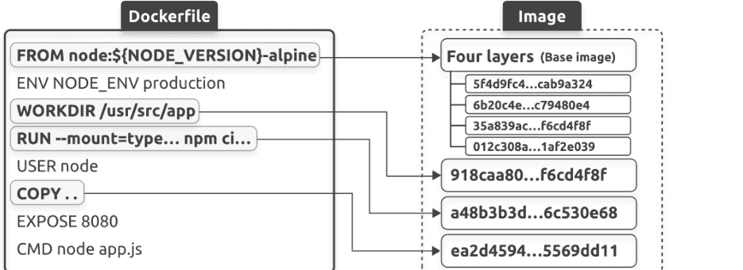

图 8.5

**注意：** 旧版本的构建器不会为 WORKDIR 指令创建层。然而，该指令会修改文件系统权限，当前的构建器会创建一个非常小的层。这种行为在未来可能会发生变化。

通常认为，使用 Docker 官方镜像和验证发布者镜像作为你创建的新镜像的基础层是一项良好实践。这是因为它们保持了高标准，并能对已知漏洞快速修复。

## 使用多阶段构建进入生产环境

在容器镜像方面……越大越坏！例如：

- 大意味着速度慢
- 大意味着更多的潜在漏洞
- 大意味着更大的攻击面

由于这些原因，你的容器镜像应该只包含在生产环境中运行你的应用程序**需要**的内容。

这就是多阶段构建大显身手的地方。

从高层来说，多阶段构建使用一个带有多个 FROM 指令的单个 Dockerfile —— 每个指令代表一个一个新的构建阶段。这允许你拥有一个阶段，在包含编译器和其他构建工具的大型镜像内部进行构建应用程序的繁重工作，然后你还有另一个阶段，将编译后的应用拷贝到精简镜像（slim image）中用于生产环境。构建器甚至可以并行运行不同的阶段以加快构建速度。

图 8.6 显示了一个高层工作流。阶段 1 构建了一个包含所有所需构建和编译工具的镜像。阶段 2 将应用代码拷贝到镜像并进行构建。阶段 3 创建了一个微小的生产就绪镜像，仅包含编译后的应用以及运行它所需的任何内容。

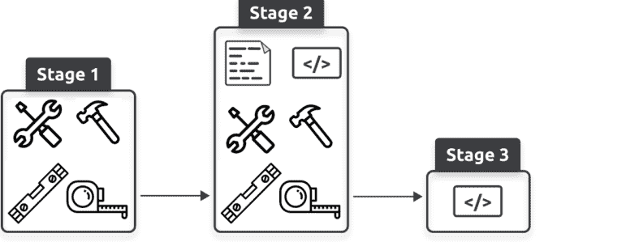

图 8.6

让我们来看一个例子！

我们将使用该书籍 GitHub 仓库中 `multi-stage` 文件夹下的代码。这是一个简单的 Go 应用，其客户端和服务器借自 GitHub 上的 Docker 示例项目 `buildme` 仓库。如果你不是 Go 程序员，不要担心；你不需要是。你只需要知道它会将客户端和服务器应用编译成可执行文件，这些文件不需要 Go 语言或任何其他工具或运行时即可执行。

是 Dockerfile：

```
FROM golang:1.22.1-alpine AS Stage 0
WORKDIR /src
COPY go.mod go.sum .
RUN go mod download
COPY . .
FROM base AS build-client << Stage 1
RUN go build -o /bin/client ./cmd/client
FROM base AS build-server << Stage 2
RUN go build -o /bin/server ./bin/server
FROM scratch AS prod << Stage 3
COPY --from=build-client /bin/client /bin/
COPY --from=build-server /bin/server /bin/
ENTRYPOINT [ "/bin/server" ]
```

需要注意的第一点是有四个 FROM 指令。每一个指令都是一个独立的构建阶段，Docker 从 0 开始对它们进行编号。然而，我们为每个阶段提供了一个友好的名称：

- Stage 0 称为 base，构建一个包含编译工具等内容的镜像
- Stage 1 称为 build-client，编译客户端可执行文件
- Stage 2 称为 build-server，编译服务器可执行文件
- Stage 3 称为 prod，将客户端和服务器可执行文件拷贝到精简镜像中

每个阶段都会输出一个中间镜像，后续阶段可以使用该镜像。然而，当最终阶段完成后，Docker 会删除它们。

base 阶段的目标是创建一个可重用的构建镜像，包含阶段 1 和 2 构建客户端和服务器应用所需的所有工具。此阶段创建的镜像仅用于编译可执行文件，而不用于生产。它拉取了 `golang:1.22.1-alpine` 镜像，该镜像解压缩后超过 300MB。它将工作目录设置为 `/src` 并从你的目录中拷贝 `go.mod` 和 `go.sum` 文件。这些文件列出了应用程序的依赖。之后，它使用 `RUN` 指令安装依赖，然后使用 `COPY` 指令将应用程序代码拷贝到镜像中。这一切创建一个包含许多构建内容的巨大镜像。当此构建阶段完成后，它会输出一个后续阶段可以使用的大镜像。build-client 阶段没有拉取新镜像。相反，它使用 `FROM base AS build-client` 指令使用 base 阶段创建的中间镜像。然后它发布一个 RUN 指令将客户端应用编译为二进制文件。该阶段的目标是创建一个包含编译后的客户端二进制文件的镜像，供后续阶段引用。build-server 阶段对服务器执行了相同的操作，并输出一个类似的镜像供后续阶段使用。prod 阶段拉取了最小的 `scratch` 镜像。它运行运行两个 `COPY --from=` 指令，从 build-client 阶段拷贝编译后的客户端应用，从 build-server 阶段拷贝编译后的服务器应用。然后它告诉 Docker 在作为容器启动时运行服务器应用。该阶段输出最终的生产镜像，极小的镜像内仅包含客户端和服务器二进制文件以及告知如何启动应用的元数据。构建器将首先运行 base 阶段，然后并行运行 build-client 和 build-server 阶段，最后运行 prod 阶段。

它始终尝试并行运行阶段，但只有在不存在依赖关系时才能这样做。例如，build-client 和 build-server 阶段依赖于 base 阶段，在 във阶段完成之前无法运行（两者都从 FROM 开始）。然而，build-client 和 build-server 阶段之间没有相互依赖，因此它们之间可以并行运行。

```docker
FROM scratch AS prod-client         <----- 新阶段
COPY --from=build-client /bin/client /bin/
ENTRYPOINT [ "/bin/client" ]
```

```docker
FROM scratch AS prod-server         <----- 新阶段
COPY --from=build-server /bin/server /bin/
ENTRYPOINT [ "/bin/server" ]
```

我已经预先准备了该文件并将其命名为 **Dockerfile-final**，放在 **multi-stage** 文件夹中。你可以看到唯一的变化是将最后的 **prod** 阶段拆分为两个阶段：一个用于客户端构建，另一个用于服务器。通过这样一个这样的 Dockerfile，你可以告诉 **docker build** 命令要目标针对两个最终阶段中的哪一个进行构建。

让我们开始吧。

运行以下两个命令，从同一个 **Dockerfile-final** 文件创建两个不同的镜像。这两个命令都使用了 **-f** 标志来告诉 Docker 使用 **Dockerfile-final** 文件。它们还使用了 **--target** 标志来告诉构建器从哪个阶段开始构建。

```bash
$ docker build -t multi:client --target prod-client -f Dockerfile
<Snip>
docker build -t multi:server --target prod-server -f Dockerfile
<Snip>
```

检查构建结果和镜像大小。

| REPOSITORY | TAG | IMAGE ID | CREATED | SIZE |
|---|---|---|---|---|
| multi | full | a7a01440f2b5 | 4 hours ago | 25.2MB |
| multi | server | a75778df1b9c | 4 seconds ago | 11.7MB |
| multi | client | 02b621e9415f | 37 seconds ago | 11.9MB |

你现在有了三个镜像，**client** 和 **server** 镜像的大小各约为 **full** 镜像的一半。这是合理的，因为 **full** 镜像包含了客户端和服务器的二进制文件，而其他镜像只包含其中一个。

## Buildx, BuildKit, drivers 和 Build Cloud

本节将快速查看驱动构建的主要组件。

在后台，Docker 的构建系统包含一个客户端和一个服务器：

- **客户端**: Buildx
- **服务器**: BuildKit

Buildx 是 Docker 最新最强大的构建客户端。它以 CLI 插件的形式实现，并支持 BuildKit 的所有最新功能，例如多阶段构建、多架构镜像、高级缓存等。从 Docker v23.0 和 Docker Desktop v4.19 开始，它一直是默认的构建客户端。

你可以配置 Buildx 与多个 BuildKit 实例通信，我们将每个 BuildKit 实例称为 *builder*（构建器）。构建器可以位于你的本地机器、云端或数据中心，或者 Docker 的 Build Cloud 中。

如果你将 buildx 指向本地构建器，镜像构建将在你的本地机器上完成。如果你将其指向远程构建器（例如 Docker Build Cloud），构建将在远程基础设施上完成。

图 8.7 显示了一个配置为与本地和远程构建器通信的 Docker 环境。

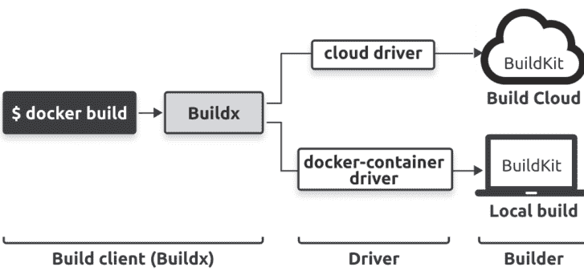

图 8.7 - Docker 构建架构

在图中，本地构建器使用 `docker-container` 驱动在专用容器内创建一个 BuildKit 实例。所有使用该驱动的构建都将在专用容器中运行。另一个选项是使用云驱动程序将构建发送到 Docker 的 Build Cloud 服务。Build Cloud 提供快速构建和共享缓存，但需要付费订阅。

当你运行 `docker build` 命令时，buildx 会解析该命令并将构建请求发送到所选的构建器。这包括 Dockerfile、命令行参数、缓存选项、导出选项以及构建上下文（应用程序和依赖列表）。构建器执行构建并导出镜像，而 buildx 客户端报告进度。

运行以下命令查看你在系统上配置的构建器。我在书中精简了输出内容，但你可以看到一个本地和一个远程构建器。

```bash
$ docker buildx ls

NAME/NODE DRIVER/ENDPOINT PLATFORMS

builder * docker-container linux/arm64, l

builder0 desktop-linux linux/arm64, l

cloud-nlpout-dd cloud linux/arm64, 


`linux-amd64 cloud/amd64,`

我截取了输出内容，但你仍然可以看到两个重要的点：

- 每个 Dockerfile 指令都执行了两次——一次针对 AMD，一次针对 ARM
- 最后几行显示镜像层正直接推送到 Docker Hub

现在你已经执行了构建，构建器（builder）将显示为激活状态，并列出它支持的架构。

图 8.8 显示了两种架构的镜像如何在 Docker Hub 的同一个仓库和标签下显示。

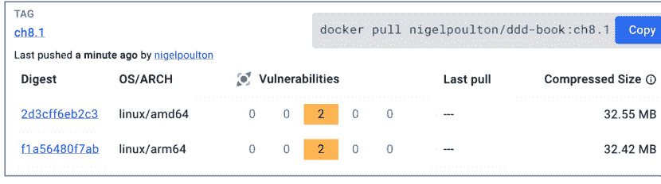

### 图 8.8 - 多平台镜像

你也可以使用 Docker Build Cloud 进行构建。这是一个基于云的服务，提供快速构建功能并允许你与团队成员共享构建缓存。它需要付费订阅。

如果你拥有允许访问 Build Cloud 的 Docker 订阅，可以访问 `build.docker.com` 并配置你的第一个云构建器。你也可以通过 CLI 创建云构建器，如下所示。如果你正在跟着操作，需要给你的构建器起一个不同的名字。

```
$ docker buildx create --driver cloud nigelpoulton/ddd cloud-nigelpoulton-ddd
```

一旦拥有了云构建器，你可以通过 `docker buildx use <builder>` 命令将其设为默认构建器，也可以在执行单个构建时指定它。

以下命令使用 `--builder` 标志使用 `cloud-nigelpoulton-ddd` 云构建器来构建之前步骤中相同的镜像。记住如果你跟着操作，请使用你自己的云构建器。

```
$ docker buildx build \
  --builder=cloud-nigelpoulton-ddd \
  --platform=linux/amd64,linux/arm64 \
  -t nigelpoulton-ddd-book:ch8.1 --push
=> [internal] connected to docker build cloud service <Snip>
```

在此时，Build Cloud 支持多种 AMD 和 ARM 架构，而 `docker-container` 驱动支持更多，但速度较慢且可靠性较低。

### 一些良好的实践

让我们用一些最佳实践结束本章。这不是一个完整的列表，这些建议适用于本地和云构建。

#### 利用构建缓存

BuildKit 使用缓存来加速构建。查看影响的最佳方法是在干净的 Docker 主机上构建一个新镜像，然后紧接着重复相同的构建。第一次构建将拉取镜像并花费时间构建层。第二次构建将立即完成，因为第一次构建的层和其他产物已被缓存并被后续构建利用。

如果你使用本地构建器，缓存仅对同一系统上的其他构建可用。然而，你的整个团队可以在 Docker Cloud 上共享缓存。

对于每次构建，构建器都会从顶部开始逐行遍历 Dockerfile。对于每一行，它都会检查缓存中是否已经有了该层。如果有，就会发生缓存命中（cache hit）；如果没有，就会发生缓存未命中（cache miss），并根据该指令构建新层。缓存命中是让构建器变快的最好方法之一。

让我们仔细观察一下。

假设如下 Dockerfile：

```
FROM alpine

RUN apk add --update nodejs npm

COPY . /src

WORKDIR /src

RUN npm install
```

第一条指令告诉 Docker 使用 `alpine:latest` 镜像作为它的*基础镜像*（base image）。如果你已经有了该镜像的副本，构建器将移动到下一个指令。如果你没有，它将从 Docker Hub 拉取。

下一条指令（`RUN apk...`）运行命令来更新软件包列表并安装 `nodejs` 和 `npm`。在执行指令之前，Docker 会检查构建缓存中是否有使用相同指令构建的层。在这种情况下，它正在寻找直接在 `alpine:latest` 镜像上执行 `RUN apk add --update nodejs npm` 指令构建的层。

如果找到匹配的层，它将链接到该层并在保持缓存的情况下继续构建。如果**没有**找到匹配的层，它将失效缓存并构建该层。缓存失效意味着构建器必须完整执行剩余的所有 Dockerfile 指令，而不能使用缓存。

假设 Docker 为 `RUN` 指令有一个缓存层，该层的 ID 为 `AAA`。

下一条指令运行 `COPY ./src` 命令将应用代码复制到镜像中。上一条指令获得了缓存命中，这意味着 Docker 可以检查它是否有一个通过对 AAA 层运行 `COPY ./src` 而构建的缓存层。如果有该的缓存层，它将链接到该层并继续下一条指令。如果没有缓存层，它将构建并使后续构建的缓存失效。

此过程将持续到 Dockerfile 的剩余部分。

理解几点是非常重要的。

任何指令导致缓存未命中时，缓存都会失效，并在构建的剩余部分不再被检查。这意味着你应该编写 Dockerfile，让可能导致缓存失效的指令位于 Dockerfile 的末尾。这允许构建尽可能长时间从缓存中受益。

你可以通过运行 `docker build --no-cache` 选项来强制构建忽略缓存。

同样重要的是理解，COPY 和 ADD 指令包含逻辑，用以确保你复制到镜像中的内容自上次构建以来没有更改。例如，如果 `COPY .src` 指令复制到层的文件自缓存层构建以来发生了变化，校验和不匹配，Docker 就会构建一个层。

### 仅安装本质包

我们经常开玩笑说，构建应用时我们安装了整个互联网。作为一个简单的例子，之前使用的简单 Node.js 应用依赖于两个包：

- Express
- Pug

然而，这些包依赖于其他包，而其他包又依赖于其他。在此时，构建这个简单的应用程序实际上下载了 97 个包！

幸运的是，某些包管理器提供了一种只安装本质包而不是整个互联网的方法。例如，apt 包管理器，它允许你指定 `no-install-recommends` 标志，这样它只安装字段中的包，而不是推荐和建议的包。

### 清理

如果你跟着操作了，你的本地仓库中将有一个运行中的容器和几个镜像。你应该删除运行中的容器，并可选地删除本地镜像。

运行以下命令删除容器。

```
$ docker rm -f
```

使用以下命令可选地删除本地镜像。请确保使用你环境中的镜像名称。

```
$ docker rmi \
multi:full multi:client multi:server ddd-book:ch8.node nigelpoulton
```

### 容器化应用 – 命令

- `docker build` 将应用程序容器化。它读取 Dockerfile 并遵循指令创建 OCI 镜像。`-t` 标志标记镜像，`-f` 标志允许你指定 Dockerfile 的名称和位置。构建上下文（build context）是应用程序文件所在的地方，可以是本地主机上的目录或远程 Git 仓库。

- `FROM` 指令指定基础镜像。它通常是 Dockerfile 的第一指令，从 Docker 官方镜像或经过验证的发布者构建被认为是良好的实践。`FROM` 也用于标识多阶段构建中的新阶段。

- `RUN` 指令允许在构建期间运行命令。它通常用于更新软件包和安装依赖项。每个 `RUN` 指令都会创建一个新的镜像层。

- `COPY` 指令将文件添加到镜像，你会经常使用它将应用代码复制到新镜像中。每个 `COPY` 指令都会创建一个镜像层。

- `EXPOSE` 指令记录应用程序的网络端口。

- `ENTRYPOINT` 和 `CMD` 指令告诉 Docker 在启动新容器时如何运行应用。

- 其他其他 Dockerfile 指令包括 `LABEL`、`ENV`、`ONBUILD`、`HEALTHCHECK` 等。

### 章节总结

本章教了你如何将应用程序容器化。这是将应用程序构建成容器镜像并将其作为容器运行的过程。

你从 GitHub 拉取了一些应用程序源代码，并使用 `docker init` 命令自动生成了一个 Dockerfile，其中包含的指令告诉 Docker 如何将该应用构建为容器镜像。接着，你使用 `docker build` 创建镜像，使用 `docker push` 将其推送到 Docker Hub，并使用 `docker run` 将其作为容器运行。

在此过程中，你学习了 Dockerfile 指令，其中某些指令会向镜像中添加内容并创建新层，而某些不添加内容的指令则只添加元数据。

此之后，你还学习了多阶段构建（multi-stage builds）如何允许你创建更小、更高效的生产环境镜像，而不会携带编译应用等带来的臃肿内容。

随后，你了解到 `buildx` 是默认的构建客户端，它集成了 BuildKit 引擎的最新功能。你学习了如何创建本地和远程构建器（BuildKit 实例），以及如何使用它们来执行多架构构建。

你还学习了构建缓存（build cache）对于加速构建的重要性，以及如何优化 Dockerfile 以利用构建缓存。

## 9: 使用 Compose 的多容器应用

在本章中，你将使用 Docker Compose 部署和管理多容器应用。当我们谈论 Docker Compose 时，通常将其简写为 Compose，并始终使用大写字母“C”。

我将本章安排如下：

- Docker Compose – 核心要点 (TLDR)
- Compose 背景
- 安装 Compose
- 示例应用
- Compose 文件
- 使用 Compose 部署应用
- 使用 Compose 管理应用

### Docker Compose – 核心要点 (TLDR)

我们通过组合许多共同工作的小型服务来创建现代云原生应用程序。我们将其称为微服务应用，它们带来了许多优势，例如自愈能力、自动伸缩和滚动更新。然而，它们可能会变得复杂。

例如，你可能有一个包含以下服务的微服务应用：

- Web前端 (Web front-end)
- 订单 (Ordering)
- 目录 (Catalog)
- 后端数据存储 (Back-end datastore)
- 日志 (Logging)
- 身份验证 (Authentication)
- 授权 (Authorization)

与其拼凑复杂的脚本和长长的 `docker` 命令，Compose 允许通过一个名为 `Compose file` 的简单 YAML 文件来描述应用程序。然后，你可以使用 `docker compose` 命令配合 Compose 文件来部署和管理应用。

你应该将 Compose 文件保存在如 Git 这样的版本控制系统中。

这些就是基础内容。让我们深入探讨。

### Compose 背景

当 Docker 刚问世时，一家名为 `Orchard Labs` 的公司构建了一个名为 `Fig` 的工具，使得部署和管理多容器应用变得简单。它是一个运行在 Docker 之上的 Python 工具，允许你在一个简单的 YAML 文件中定义复杂的多容器微服务应用。你甚至可以使用 **fig** 命令行工具来管理整个应用的生命周期。

在后台，Fig 会读取 YAML 文件并调用相应的 Docker 命令来部署和管理应用。

Fig 非常非常出色，以至于 Docker, Inc. 收购了 Orchard Labs，并将 Fig 重新命名为 *Docker Compose*。他们将命令行工具从 **fig** 重命名为 **docker-compose**，最近他们将其整合到了 **docker** CLI 中，并带有了它自己的 **compose** 子命令。现在，你可以运行简单的 **docker compose** 命令来轻松管理多容器微服务应用。

还有一个 [Compose 规范]() 驱动着 Compose 成为定义多容器微服务应用的开放标准。该规范由社区引导，并与 Docker 实现保持分离，以维持更好的治理和更清晰的界定。然而，*Docker Compose* 是其*参考实现*（reference implementation），你应该预期 Docker 会实现完整的规范。

阅读规范也是学习细节的极佳方法。

### 安装 Compose

所有现代版本的 Docker 都预装了 Docker Compose，你不再需要将其作为一个独立的应用程序进行安装。

使用以下命令进行测试。请务必使用 `docker compose` 命令而不是旧的 `docker-compose`。

```
$ docker compose version

Docker Compose version v2.25.0
```

## 示例应用

我们将使用图 9.1 所示的示例应用，包含两个服务、一个网络和一个卷。

 图 9.1 - 示例应用

`web-fe` 服务在每次接收请求时都会通过 Web 服务器增加计数器。两个服务都连接到 `counter-net` 网络。`web-fe` 服务挂载了 `counter-vol` 卷。

`compose.yaml` 文件定义了这些内容。

如果你还没有这样做，请克隆 GitHub 仓库：

```
$ git clone https://github.com/example/ddd-book

Cloning into 'ddd-book'...

remote: Enumerating objects: 67,

remote: Counting objects: 100% (67/67),

remote: Compressing objects: 100% (67/67),

remote: Receiving objects: 100% (73.6 KiB | 1.83 MiB/s), done.

remote: Resolving deltas: 100% (67/67), done.

remote: Delta summary: 100% (67/67), done.

Checking out 67 files, delta compression used.

67 files | created 00.
```

进入 `ddd-book/multi-container` 目录并列出内容：

```
$ cd ddd-book/multi-container

$ ls -l

total 20

drwxr-xr-x 2 user group 4096 May 21 10:00 .

drwxr-xr-x 2 user group 4096 May 21 10:00 ..

-rw-r--r-- 1 user group  355 May 21 10:00 Dockerfile

-rw-r--r-- 1 user group  332 May 21 10:00 compose.yaml

-rw-r--r-- 1 user group  248 May 21 10:00 app.py

-rw-r--r-- 1 user group   188 May 21 10:00 requirements.txt
```

```yaml

services:

  web-fe:             <----- 服务名称。容器将

  deploy:

    replicas: 1          <----- 为该服务部署单个容器

    build:               <----- 从当前目录下的 Dockerfile 构建

    command: python app.py <----- 启动时执行此命令

    ports:

      target: 8080       <----- 映射容器内的端口

      published: 5001 <----- ...映射到 Docker 宿机的 5001 端口

  networks:

    counter-net          <----- 将容器连接到 "counter" 网络

  volumes:

    type: volume

    source: counter-vol <----- 挂载 "counter-vol" 卷

    target: /app         <----- ...挂载到容器内的 "/app"
```


让我们逐一分析。

- `web-fe`：是服务的名称，所有作为此服务创建创建的容器其名称中都包含“web-fe”。
- `deploy.replicas: 1` 告诉 Docker 为此服务部署单个容器。你可以指定不同的副本数量来为该服务部署多个相同的容器。然而，这在 Docker 安装上无法实现，因为你只有一个 Docker 宿主机，且只有一个容器可以使用 Docker Desktop 宿主机上的 5001 端口。你将在 **Deploying apps with Docker stacks** 章节中学习如何为此服务部署多个副本。

- `build`：告诉 Docker 根据当前目录下的 Dockerfile 构建此服务容器的镜像。
- `command: python app.py` 是 Docker 在为此服务创建的每个容器内部执行的命令。镜像中必须存在 `app.py` 文件，且镜像必须安装了 Python。Dockerfile 会处理这两个需求。
- `ports`：在此处将服务容器的网络端口映射到 Docker 宿主机。此示例映射了容器内部的 5001 端口。
- `networks`：告诉 Docker 将此服务的容器连接到 `counter-net` 网络。该网络应该已经存在或者在 `networks` 顶层键中定义。
- `volumes`：告诉 Docker 将 `counter-vol` 卷挂载到所有服务容器内部的 `/app` 目录。该卷应该已经存在或者在 `volumes` 顶层键中定义。

总之，Compose 将指示 Docker 为 `web-fe` 服务部署单个容器。它将从相同目录下的 Dockerfile 构建新镜像，并从该镜像启动容器。当容器启动时，其名称将包含 `web-fe` 并运行 `python app.py` 命令。它将连接到 `counter-net` 网络，在宿主机的 5001 端口上暴露 Web 服务，并将 `counter-vol` 卷挂载到 `/app`。如果你定义了多个副本（容器），它们将是完全相同的。

**注意：** 你不需要在 Compose 文件中指定 `command: python app.py` 选项，因为它已经在 Dockerfile 中定义过了。不过，我在这里展示它是为了让你知道它是如何工作的。你也可以使用 Compose 来覆盖 Dockerfile 中的指令。

`redis` 服务要简单得多。

让我们来看这一个。

- `redis`：是服务的名称，所有作为此服务创建的容器其名称中都包含“redis”部分。
- `deploy.replicas: 1` 告诉 Docker 为此服务部署单个容器。
- `image: redis:alpine` 告诉 Docker 从 Docker Hub 拉取 `redis:alpine` 镜像并使用它启动服务的容器。
- `networks`：告诉 Docker 将服务的容器连接到 `counter-net` 网络。

将两个服务都连接到 `counter-net` 网络意味着它们可以通过名称相互解析并进行通信。这是重要的，因为下面 `app.py` 文件的片段显示了 Web 应用通过名称与 `redis` 服务进行通信。

```python
import time
import redis
from flask import Flask, render_template
app = Flask(__name__)
cache = redis.Redis(host='redis', port=6379) <----- "redis" 是
<Snip>
```

`networks` 和 `volumes` 块非常简单，定义了一个名为 `counter-net` 的网络和一个名为 `counter-vol` 的卷。

```yaml
networks: <----- 此块定义了一个新网络
  counter-net:
volumes: <----- 此块定义了一个新卷
  counter-vol:
```

现在我们理解了 Compose 文件是如何工作的的，让我们来部署应用。

### 使用 Compose 部署应用

在本节中，你将使用 Compose 文件来部署应用。你需要该书籍 GitHub 仓库的本地副本，并且需要在 `multi-container` 文件夹中运行所有命令。

运行以下命令来部署应用：

```bash
docker compose -f docker-compose.yml up -d
```
（注：根据上下文推断上述命令，因为 OCR 文字被裁剪了）。

容器名称末后的数字允许每个服务拥有多个副本。例如，如果 `web-fe` 服务有三个副本，它们将被命名为 `multi-container-fe-1`、`multi-container-fe-2` 和 `multi-container-fe-3`。

运行以下命令来查看 `counter-net` 网络和 `counter-vol` 卷。

| NETWORK ID | NAME | DRIVER | SCOPE |
| :--- | :--- | :--- | :--- |
| 46100cae7441 | multi-container-counter-net | bridge | local |

$ docker volume ls
local multi-container-counter-vol

应用程序部署好后，你可以将 Web 浏览器指向 Docker 主机的 5001 端口进行查看。如果你正在运行 Docker Desktop，可以连接到 `localhost:5001` (img/ae0230bf8529bd076c8d237_0.png)。

刷新页面会导致计数器增加。这是因为程序会统计访问次数并将计数器存储在 Redis 服务中。如果你按照教程并在前台运行了应用程序，你将在终端中看到每次刷新时的响应代码。如果你使用 `--detach` 标志在后台启动它，则看不到这些内容。

恭喜！你已成功使用 Docker Compose 部署了一个多容器应用程序！

### 使用 Compose 管理应用

在本节中，你将看到如何停止、重启、删除以及获取 Compose 应用程序的状态。运行以下命令关闭应用程序。如果你是在前台启动的，你将看到请求应用程序优雅退出的消息。

$ docker compose down
- Container multi-container-redis-1 Removed
- Container multi-container-fe-1 Removed
- Network multi-container-counter-net Removed

输出显示 Docker 删除了两个容器和网络。然而，它没有提到卷。运行 `docker volumes` 命令查看卷是否仍然存在。

$ docker volume ls
local multi-container-counter-vol

卷仍然存在，包括存储在其中的计数器数据。这是因为 Docker 知道我们会在卷中存储重要信息，可能不希望与其他资源一起删掉它们。基于此考虑，Docker 将卷的生命周期与应用程序的其他部分解耦。Docker 还会保留在启动应用时构建和拉取的的镜像。这使得未来的部署速度更快。你可以随时运行 `docker images` 命令来验证镜像仍然存在。

让我们探索其他几个 `docker compose` 子命令。运行以下命令重新部署应用。

$ docker compose up --detach
[+] Running 2/3
- Network multi-container-counter-net Created 0.2s
- Container multi-container-redis-1 Started 0.2s
- Container multi-container-fe-1 Started 0.2s

注意这次启动速度快得多。这是因为卷和两个镜像已经存在。使用 `docker compose ps` 命令检查应用程序的当前状态。

| NAME | COMMAND | SERVICE | STATUS |
| :--- | :--- | :--- | :--- |
| multi-container-redis-1 | "docker-entrypoint.sh" | redis | Up |
| multi-container-fe-1 | "python app/app.py" | web-fe | Up |

输出显示了两个容器、它们正在执行的命令、当前状态以及它们监听的网端口。运行 `docker compose top` 列出每个容器内的进程。

$ docker compose top
multi-container-redis-1
UID PID PPID ... CMD
lxd 12023 11980 redis-server :6379

multi-container-fe-1
UID PID PPID ... CMD
root 12024 12002 0 python app/app.py python app.py
root 12085 12024 0 /usr/local/bin/python app/app.py python

返回的 PID 数字是从 Docker 主机看到的 PID 数字（而不是容器内部的）。你正准备停止并重启应用程序。但在在此之前，请再次将浏览器连接到应用程序并刷新几次页面。在继续之前记下计数器的值。运行以下命令停止应用并重新检查其状态。

$ docker compose stop
[+] Running 2/2
- Container multi-container-redis-1 Stopped
- Container multi-container-fe-1 Stopped

$ docker compose ps
NAME COMMAND SERVICE STATUS PORTS

应用程序已停止，但 Docker 还没有删除它的任何资源。通过检查容器仍然存在来验证这一点。

| docker compose ps -a | | | | |
| :--- | :--- | :--- | :--- |
| NAME | IMAGE | ... | SERVICE |
| multi-container-redis-1 | redis:alpine | ... | redis |
| multi-container-fe-1 | ... | ... | web-fe |

## 10: Docker Swarm

现在你已经了解如何安装 Docker、拉取镜像以及处理容器，下一步的逻辑步骤就是在规模上执行这些操作。这就是 Docker Swarm 发挥用场的地方。

我将本章分为以下几个主要部分：

- Docker Swarm – 核心摘要 (TLDR)
- Swarm 入门
- 构建安全的 Swarm 集群
- 在 swarm 上部署和管理应用
- 服务日志
- 命令

### Docker Swarm – 核心摘要 (TLDR)

Docker Swarm 包含两个含义：

1. 企业级 Docker 节点集群
2. 微服务应用的编排器

在集群方面，Swarm 将一个或多个 Docker 节点分组为一个集群。开箱即用，你将获得一个加密的分布式集群存储、加密网络、互信 TLS、安全的集群加入令牌以及一个让管理和轮换证书轻而易行的 PKI。你甚至可以在不中断的情况下添加和删除节点。我们将这些集群称为“swarms”（集群）。

在编排方面，Swarm 让部署和管理复杂的微服务应用变得简单。你在 Compose 文件中声明式地定义应用，并使用简单的 Docker 命令将其部署到 swarm 中。你甚至可以执行滚动更新、回滚和扩缩操作。

Docker Swarm 类似于 Kubernetes —— 两者都是运行和管理容器化应用的集群。Kubernetes 更流行，拥有更活跃的社区和生态系统。然而，Swarm 更容易使用，是中小企业小型应用部署的热门。学习 Swarm 也能为你学习和使用 Kubernetes 做好准备。事实上，如果你计划学习 Kubernetes，应该查看我的书籍《Quick Start Kubernetes》和《The Kubernetes Book》。

### Swarm 入门

在集群方面，一个 swarm 是一个或多个 Docker 节点，它们可以是物理服务器、虚拟机（VM）、云实例、树莓派等。唯一的要求是它们都运行着 Docker 并且可以通过可靠网络进行通信。

**术语：** 当指代 Docker Swarm 技术时，我们将 Swarm 写为大写的“S”。当把 swarm 视为一个节点集合的集群时，我们将使用小写的“s”。

swarm 中的每个节点要么是管理器（manager），要么是工作节点（worker）：

- Managers 运行控制平面服务，维护集群状态并将用户应用调度到工作节点上
- Workers 运行用户应用

在默认安装中，Swarm 在 managers 和 workers 上运行用户应用。然而，在重要的集群上，你可以强制用户应用运行在 worker 节点上，让你的 managers 专注于集群管理操作。

swarm 将其状态和配置存储在内存分布式数据库中，该数据库在所有 manager 节点之间进行复制。幸运的是，它在你创建 swarm 时会自动配置并自进行维护。

Swarm 使用 TLS 加密通信、身份验证节点并授权角色（managers 和 workers）。它还配置并执行自动密钥轮换。对于集群存储，它会在你创建 swarm 时自动配置并自进行维护。

图 10.1 显示了一个具有三个 managers、三个 workers 以及一个在三个 managers 之间进行复制的分布式集群存储的 swarm 高级视图。

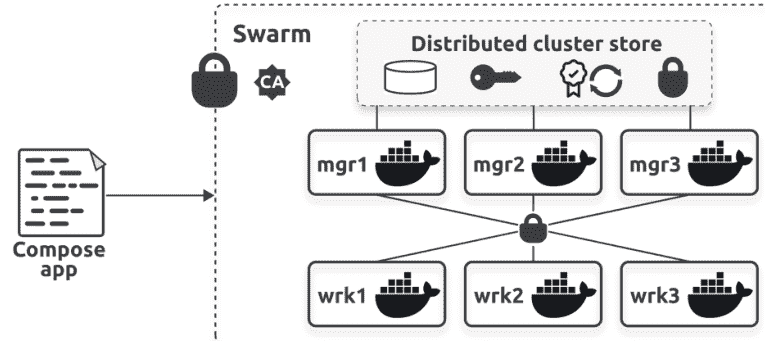

图 10.1 高级 swarm 视图

在编排方面，Swarm 让部署和管理容器化应用变得简单。它在集群之间平衡负载，并添加了云原生能力，如自愈、扩缩、发布和回滚。

入门介绍到此为止。让我们构建一个 swarm。

### 构建安全的 swarm 集群

在本节中，你将构建一个安全的 swarm 集群。我将构建图 10.2 所示具有三个 managers 和两个 workers 的集群。你可以构建不同的集群，但通常适用以下规则：

- 为了高可用，建议使用三个或五个 managers
- 拥有足够的 workers 来处理你的应用需求

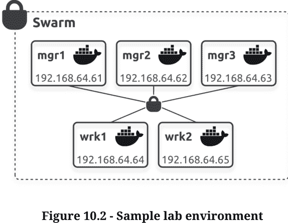 # 前决条件

如果你跟随操作，我建议使用 Multipass 在你的笔记本电脑或本地机器上创建五个 Docker 虚拟机。Multipass 免费且易用，我将在示例中使用它。

然而，运行五个 Multipass 虚拟机需要大量的资源，每个虚拟机需要 2 个 CPU、40GB 磁盘空间和 4GB 内存。如果你的系统可以处理，你可以创建较少的 managers 和 workers，或者在 [Play with Docker](https://play.docker.com/) 中构建你的实验。Play with Docker 是一个免费的云端服务，允许你创建最多五个节点。如果你配置了名称解析，通过名称而不是 IP 地址来引用节点会让你觉得更容易。我不建议在 Docker Desktop 上跟随操作，因为它只支持单个节点，无法满足书中后续示例的需求。

### 构建你的 Docker 节点

本节使用 Multipass 构建图 10.2 中的 swarm。

在在网上搜索 *install multipass* 并按照指令在你的系统上安装。

运行以下五个 `multipass launch` 命令来创建运行 Docker 的虚拟机。我们将每个虚拟机称为 *node*（节点），每个节点需要 2 个 CPU、40GB 磁盘空间和 4GB 内存。如果你的机器没有这些资源，请前往 Play with Docker。

将三个节点命名为 `mgr1`、`mgr2` 和 `mgr3`，另外两个命名为 `wrk1` 和 `wrk2`。你的 IP 会不同，但这没关系。创建每个虚拟机可能需要一两分钟。

```
$ multipass launch --name mgr1
Launched: mgr1
$ multipass launch --name mgr2
Launched: mgr2
$ multipass launch --name mgr3
Launched: mgr3
$ multipass launch --name wrk1
Launched: wrk1
$ multipass launch --name wrk2
Launched: wrk2
```

运行以下命令并注意节点 IP。你的地址会不同，你只需要关注每个 192.168.x.x 地址。

| 名称 (Name) | 状态 (State) | IPv4 | 镜像 (Image) |
| :--- | :--- | :--- | :--- |
| mgr1 | Running | 192.168.64.61 | Ubuntu 22.04 |
| mgr2 | Running | 172.17.0.1, 192.168.64.62 | Ubuntu 22.04 |
| mgr3 | Running | 172.17.0.1, 192.168.64.63 | Ubuntu 22.04 |
| wrk1 | Running | 192.168.64.64, 172.17.0.1 | Ubuntu 22.04 |
| wrk2 | Running | 192.168.64.65, 172.17.0.1 | Ubuntu 22.04 |

一旦构建好节点，你可以使用 `multipass shell` 命令登录，并输入 `exit` 退出。

登录其中一个节点并检查 Docker 是否已安装并运行。

```
$ multipass shell mgr1
$ docker --version
Docker version 26.1.1, build 2ae903e
```


输入 `exit` 退出节点并返回本地 shell。

一旦确认你的节点工作正常，就可以移动到下一节并构建 swarm。

### 初始化一个新的 swarm

构建 swarm 的过程被称为初始化 swarm，以下是层级流程：

1. 初始化第一个管理器
2. 加入额外的管理器
3. 加入工作节点

在 Docker 节点加入 swarm 之前，它以单引擎模式运行，只能运行普通容器。加入 swarm 后，它会切换到 swarm 模式，并运行名为 swarm 服务的高级容器。稍后介绍服务。

当你在当前处于单引擎模式的 Docker 节点上运行 `docker swarm init` 命令时，Docker 会切换到 swarm 模式，创建一个新的 swarm，并将该节点变为 swarm 的第一个管理器。然后你可以添加更多节点作为 managers 和 workers，这些节点也会切换到 swarm 模式。

你将完成以下所有操作：

1. 从 `mgr1` 初始化一个新的 swarm
2. 将 `wrk1` 和 `wrk2` 加入工作节点
3. 将 `mgr2` 和 `mgr3` 作为额外的管理器

完成程序后，所有五个节点将处于 swarm 模式并属于同一个 swarm。

示例将使用图 10.2 中的名称和 IP。你的地址会不同，你应该使用自己的。

1. 登录 `mgr1` 并初始化一个新的 swarm。务必使用你的 `mgr1` 节点的私有 IP 地址。

```bash
docker swarm init \
  --advertise-addr 192.168.64.61:2377 \
  --listen-addr 192.168.64.61:2377
```

Swarm initialized: current node (d21lyz...c79qzkx) is now a manager.
<Snip>

让我们逐步解析命令的不同部分：

1. `docker swarm init` 告诉 Docker 以此节点作为第一个管理器初始化一个新的 swarm。
2. `--advertise-addr` 标志是可选的，它告诉 Docker 将节点的哪一个 IP 地址作为 swarm API 端点进行广播。它通常是节点的一个 IP 地址，也可以是外部负载均衡器。
3. `--listen-addr` 标志告诉 Docker 在结的哪些接口上接收 swarm 流量。如果你没有指定，它的默认值与 `--advertise-addr` 相同。

然而，如果 `--advertise-addr` 是负载均衡器，你必须使用 `--listen-addr` 来指定本地 IP。
我建议在重要的生产环境中同时指定这两个标志。不过，对于大多数实验室环境，你只需要运行不带任何标志的 `docker swarm init` 即可。
也可以为公告地址和监听地址指定不同的端口，但使用默认的 2377 是常见的。

- 2. 列出集群中的节点。

| ID | HOSTNAME | STATUS | AVAILABILITY | MANAGER STATUS |
|---|---|---|---|---|
| d21...qzkx | mgr1 | Ready | Active | Leader |

`mgr1` 是集群中唯一的节点，并列为 Leader（领导者）。我们稍后会讨论 Leader。

- 3. 在 `mgr1` 上运行以下命令，查看添加新工作节点和管理器所需的命令和令牌（tokens）。

```
$ docker swarm join-token worker
```

要向此集群添加一个管理器，请运行以下命令：

`docker swarm join --token SMTKN-1-0uahebax...c87udx2c 192`

`docker swarm join-token manager`

要向此集群添加一个管理器，请运行以下命令：

`docker swarm join --token SMTKN-1-0uahebax...ue4hv6ps3p 192`
```

注意这些命令除了 join 令牌（`SMTKN…`）之外是完全相同的。你应该将 join 令牌保存在安全的地方，因为它们是其他节点加入你的集群所需的全部内容！

- 1. 登录 `wrk1` 并使用正确的命令和令牌将其作为工作节点加入集群。我在示例中添加了可选的 `advertise-addr` 和 `listen-addr` 标志，以便你了解如何使用它们。你可以不使用它们，但如果你使用了，请务必为你的环境使用正确的 IP。

```
$ docker swarm join \
  --token SMTKN-1-0uahebax...c87tu8dx2c \
  10.0.0.1:2377 \
  --advertise-addr 192.168.64.64:2377 \
  --listen-addr 192.168.64.64:2377
```

该节点作为工作节点加入了集群。

如果你遇到加入集群的问题，请确保所有节点之间开放了以下网络端口：

- 1. `2377/tcp`: 用于安全的客户端到集群的通信
- 2. `7946/tcp` 和 `udp`: 用于控制平面 gossip 协议（gossiper）
- 3. `4789/udp`: 用于基于 VXLAN 的叠加网络

- 5. 在 `wrk2` 上重复上一步操作，以便你有两个工作节点。如果你指定了 `--advertise-addr` 和 `--listen-addr` 标志，请确保使用 `wrk2` 的 IP 地址。

- 6. 登录 `mgr2` 和 `mgr3`，并使用步骤 3 中的管理器令牌将它们加入为管理器。同样，你不需要使用 `--advertise-addr` 和 `--listen-addr` 标志，但如果你使用了，请务必为你的环境使用正确的 IP。

```
$ docker swarm join \
  --token SWMTKN-1-0uahebax...ue4hv6ps3p \
10.0.0.1:2377 \
  --advertise-addr 192.168.64.62:2377 \
  --listen-addr 192.168.64.62:2377
```

该节点作为管理器加入了集群。

- 7. 从任何一个管理器节点上运行 `docker node ls` 来列出集群中的节点。

| ID | HOSTNAME | STATUS | AVAILABILITY | MANAGER |
|---|---|---|---|---|
| 0g4rl...babl18 * | mgr2 | Ready | Active | |
| xltli...l0yn | mgr3 | Ready | Active | |
| d21ly...9kx | mgr1 | Ready | Active | Leader |
| 8y0vb...wmr67 | wrk1 | Ready | Active | |
| e62gf...l5wt | wrk2 | Ready | Active | |

观察 MANAGER 列，你会看到它们是 Reachable（可达）或 Leader。带有星号的是工作节点。恭喜你，你创建了一个具有三个管理器和两个工作节点的集群。你现在可以从那里执行命令。

### Swarm 高可用性

Swarm 集群是高用的（HA），这意味着一个或多个管理器故障，集群将继续运行。从技术上讲，Swarm 实现了活动/被动模式。在 Swarm 中，我们称活动的管理器为 leader，将被动的称为 followers。如果 leader 故障，其中一个 follower 将被选为新的 leader，且集群将继续运行。

以下最佳实践适用于此：

- 1. 始终部署奇数数量的管理器
- 2. 不要部署过多的管理器（3 个足够了）
- 3. 将管理器跨可用区部署

与共识算法一样，参与者越多，达成共识的时间就越长。在实施之前最好仔细考虑。

### 内置安全性

Swarm 自带许多安全功能，例如证书颁发机构（CA）、双向 TLS、加密网络、加密节点 ID 等。幸运的是，Swarm 会自动以合理的默认值进行配置。

### 锁定集群

尽管 Swarm 拥有所有安全功能，重启旧管理器或恢复旧备份可能会损害你的集群。例如，拥有旧节点的恶意攻击者可能能够将其重新加入集群并获得未经的访问。坦率地说，你可以使用 Swarm 的 autock 功能，强制重启的管理器出示密钥才能被允许重新加入集群。

你可以在构建集群时通过向 `docker swarm init` 命令传递 `--autock` 标志来锁定新集群。对于现有集群，你可以使用 `docker swarm update` 命令对其进行 autock。

从你的任何一个管理器节点运行以下命令来锁定现有的集群：

```
$ docker swarm update --autock=true
```

Swarm updated.

要在重启后解锁集群管理器，请运行 `docker swarm unlock` 命令为重启的管理器解锁集群，并提供解锁密钥。

```
$ docker swarm unlock
```

Please enter unlock key: <enter your key>

WMKEY-1-XDeU3XC75Ku7rvGvIx0vV7ehdVJGgIAvq0D8VuEaw
```

Docker 将重新把节点加入集群，在后续命令中，它将显示为 **ready**（就绪）和 **reachable**（可访问）。

你应该锁定你的生产集群并保护好解锁密钥。

### 专用管理器节点

默认情况下，Swarm 在工作节点（workers）和管理器（managers）上运行用户应用程序。但是，你可能希望配置你的生产集群仅在工作节点上运行用户应用程序。这允许管理器专门负责控制平面的职责。

在任何管理器节点上运行以下命令以防止其运行用户应用程序。你需要使用管理节点的名称，如果你想强制用户应用程序仅运行在工作节点上，则需要在所有管理器节点上运行该命令。

```
$ docker node update --availability drain mgr1
```

你将在之后部署具有多个副本的服务时看到此操作产生的影响。

现在你已经构建了集群并理解了领导者（leaders）和管理器（manager）高可用的概念，让我们转向应用端。

### 在集群上部署和管理应用

Swarm 节点可以运行普通容器，也可以运行名为 *services*（服务）的增强容器。每个 *service* 接收单个容器定义，并为其增强云原生功能，如自愈、扩展以及自动滚动和回滚。

在本节中，你将部署一个简单的 Web 服务器作为 *swarm service*，并查看如何扩展、滚动和删除它。

Swarm 允许通过两种方式创建和管理服务：

1. 命令式（Imperatively）通过命令行
2. 声明式（Declaratively）通过 Compose 文件

我们将在下一节介绍 Compose 文件。现在我们将关注命令式方法。

运行以下命令部署一个名为 `web-fe` 的新服务，并带有五个相同的副本。

```
$ docker service create --name web-fe \
-p 8080:8080 \
--replicas 5 \
nigelpoulton/ddd-book:web0.1
```

```
z7oveargqmru0u2vc5o7ql0p
overall progress: 5 out 5 tasks
1/5: running [================================]
2/5: running [============================]
3/5: running [============================]
4/5: running [============================]
5/5: running [============================]
verify: Service converged
```

`docker service create` 命令告诉 Docker 部署一个新的服务。`--name` 标志将其称为 `web-fe`，`-p` 标志将每个节点的 8080 端口映射到每个副本（容器）内部的 8080 端口，`--replicas` 标志告诉 Swarm 部署五个副本。

当我们指代服务时，交叉使用 replicas（副本）和 containers（容器）术语。你的 Docker 客户端将命令发送给集群管理器，领导管理器（leader manager）启动了部署五个副本的任务。你配置此集群使得用户应用程序不在管理器上运行，这意味着五个副本将运行在你的工作节点上。每个接收任务的工作节点拉取了镜像，启动了容器并创建了端口映射。

然而，此并未结束。你发布的命令请求具有五个副本的服务，Swarm 将其存储在集群中作为 *desired state*（期望状态）。在后台，Swarm 运行一个 *reconciliation*（协调）循环，不断比较集群的 *observed state*（观测状态）与 *desired state*。当两个状态匹配时，世界一切正常，不需要进一步操作。当它们不匹配时，Swarm 会采取行动使 *observed state* 与 *desired state* 一致。

例如，如果托管五个副本之一的 *worker* 失败，集群的 *observed state* 将从 5 个副本变为 4 个，不再匹配 5 个的 *desired state*。一旦集群发现差异，它将启动一个新的副本将 *observed state* 回到 *desired state*。我们称之为 *reconciliation*（协调）或 *self-healing*（自愈），它是云原生应用的核心原则。

你很快就会学会期望状态和协调也是扩展、滚动和回滚的核心。

### 查看和检查服务

运行 `docker service ls` 命令查看集群上所有的服务。

| ID | NAME | MODE | REPLICAS | IMAGE |
|---|---|---|---|---|
| z7o...uw | web-fe | replicated | 5/5 | ... |

输出显示了一个基本配置和状态信息。此外，你可以看到服务的名称以及五个副本都在运行。如果你在部署服务后过早运行命令，某些副本可能不在运行状态。这通常是因为工作节点仍在拉取镜像并启动副本。

你可以运行 `docker service ps` 命令查看服务副本列表及其每个副本的状态。

| ID | NAME | IMAGE | NODE | DES |
|---|---|---|---|---|
| 817...f6z | web-fe.1 | nigelpoulton/ddd-book:web0.1 | wrk1 | Run |
| ald...mzn | web-fe.2 | nigelpoulton/ddd-book:web0.1 | wrk1 | Run |
| cc0...ar0 | web-fe.3 | nigelpoulton/ddd-book:web0.1 | wrk2 | Run |
| 6f0...azu | web-fe.4 | nigelpoulton/ddd-book:web0.1 | wrk1 | Run |
| dyl...p3e | web-fe.5 | nigelpoulton/ddd-book:web0.1 | wrk2 | Run |

输出单独成行显示每个副本，包括它运行的节点以及每个副本的期望状态和当前观测状态。如预期的那样，你有五个副本分布在你所有的工作节点上。

如果你需要服务的详细信息，可以运行 `docker service inspect` 命令。

```
$ docker service inspect --pretty web-fe
ID: z7ovearqmruwk0u2vc5o7ql0p
Name: web-fe
Service Mode: Replicated
Replicas: 5
Placement:
UpdateConfig:
Parallelism: 1
On failure: pause
Monitoring Period: 5s
Max failure ratio: 0
Update order: stop-first
RollbackConfig:
Parallelism: 1
On failure: pause
Monitoring Period: 5s
Max failure ratio: 0
Rollback order: stop-first
ContainerSpec:
Image: nigelpoulton/ddd-book:web0.1@sha256:8d6280c0042..
Init: false
Resources:
Endpoint Mode: vip
Ports:
PublishedPort = 8080
Protocol = tcp
TargetPort = 8080
PublishMode = ingress
```


示例使用了 `--pretty` 标志将输出限制为易读的格式。如果你去掉 `--pretty` 标志，将通过 `docker inspect` 命令的输出获取更多关于底层运行的信息。

我们将稍后回来看这些输出。

Swarm 部署副本有两种两种模式：

- Replicated（副本）
- Global（全局）

默认的 `replicated` 模式允许你部署所需数量的副本，并尝试均匀分布在可用节点上。

`global` 模式在每个可用节点上部署单个副本。两种模式都尊重可用性并仅在符合条件的节点上部署。例如，如果你不允许集群在管理器上部署应用程序，两种模式都只会在工作节点上部署。如果你想部署全局服务，需要在 `service create` 命令中传递 `--mode global` 标志。显然，它不支持 `--replicas` 标志，因为它在每个节点部署一个副本。

### 扩展服务

服务的另一个强大功能是通过添加或删除副本来伸缩它们。

假设业务兴隆，你的前端收到的请求数翻倍。幸运的是，你可以使用 `docker scale` 命令轻松扩展副本数量。

运行以下命令将 `web-fe` 服务从 5 个副本扩展到 10 个。

```
$ docker service scale web-fe=10

web-fe scaled to 10

overall progress: 10 out of 10 tasks

1/10: running [================================]

```

```
2/10: running [============================]

3/10: running [============================]

4/10: running [============================]

5/10: running [============================]

6/10: running [============================]

7/10: running [============================]

8/10: running [============================]

9/10: running [============================]

10/10: running [============================]
```

在后台，命令更新了集群存储中 `web-fe` 服务的期望状态从 5 个副本变为 10 个。协调循环读取了 10 个副本的新期望状态，将其与当前 5 个副本的观测状态进行比较，并增加了 5 个以使观测状态与新的期望状态同步。

再次运行 `docker service ls` 以验证操作成功完成。

如果有十个工作节点，你可能在每个工作节点上运行一个副本。

| ID | NAME | IMAGE | NODE | DESIRED | CURRENT |
|---|---|---|---|---|---|
| nwf...tpn | web-fe.1 | nigelpton/ddd-book:web0.1 | wrk1 | | 中 |
| yb0...e3e | web-fe.2 | nigelpton/ddd-book:web0.1 | wrk2 | | 中 |
| mos...g6f | web-fe.3 | nigelpton/ddd-book:web0.1 | wrk2 | | 中 |
| utn...6ak | web-fe.4 | nigelpton/ddd-book:web0.1 | wrk1 | | 中 |
| 2ge...fyy | web-fe.5 | nigelpton/ddd-book:web0.1 | wrk2 | | 中 |
| 64y...m49 | web-fe.6 | nigelpton/ddd-book:web0.1 | wrk2 | | 中 |
|  ild...51s | web-fe.7 | nigelpton/ddd-book:web0.1 | wrk1 | | 中 |
| vah...rjf | web-fe.8 | nigelpton/ddd-book:web0.1 | wrk1 | | 中 |
| xe7...fvu | web-fe.9 | nigelpton/ddd-book:web0.1 | wrk2 | | 中 |
| l7k...jkv | web-fe.10 | nigelpton/ddd-book:web0.1 | wrk1 | | 中 |

在后台，Swarm 运行一种名为 `spread` 的调度算法，该算法尝试尽可能均匀地平衡副本在可用节点上。

运行另一个 `docker service scale` 命令将副本数量调回 5。

```
$ docker service scale web-fe=5

web-fe scaled to 5

overall progress: 5 of 5 tasks

1/5: running [========================================]

2/5: running [========================================]

3/5: running [========================================]

4/5: running [========================================]

5/5: running [========================================]
```

```
5/5: running [============================================]

verify: Service web-fe converged
```

现在你已经知道如何伸缩服务了，让我们来看看如何删除它们。

### 删除服务 (Deleting services)

删除服务非常简单——可能太简单了。

运行以下命令来删除 `web-fe` 服务。使用此命令时要小心，因为它不会请求确认。

```
$ docker service rm web-fe

web-fe
```

确认它已经消失了。

| docker service ls |
| ID | NAME | MODE | REPLICAS | IMAGE | PORTS |

让我们来看看如何执行滚动更新（rollout）。

### 滚动发布更新 (Rollouts)

应用更新是生活常态，在很长一段时间里，这种更新是非常痛苦的。我个人为了重大的应用更新浪费了足够的周末，我不想再经历一次了。

幸运的是，由于有了 Docker 服务，更新设计良好的微服务应用变得简单。

**术语：** 我们使用 `rollouts`（发布）、`updates`（更新）和 `rolling updates`（滚动更新）来表示相同的意思——更新正在运行的应用程序。

你即将部署一个新服务来演示滚动更新。但在之前，你将为该服务创建一个新的覆盖网络（overlay network）。这并不是必须，但我想让你看到如何将服务连接到网络。

运行以下两个命令创建一个名为 `uber-net` 的新覆盖网络，然后检查它是否存在。

```
$ docker network create -d overlay uber-net

43wp6pzea470et4d57udn9ws
```

```
$ docker network ls

| NETWORK ID | NAME | DRIVER | SCOPE |

| 43wp6pzea47 | uber-net | overlay | swarm |

| <Snip> | | | |
```

新网络已存在，并已成功创建为作用于整个 swarm 的覆盖网络。你将在稍后的章节中学习覆盖网络，但目前只需要知道它们跨越所有 swarm 节点，并且位于同一个覆盖网络中的所有容器都可以通信，即使它们被部署在不同的节点上。

图 10.5 显示了四个 swarm 节点通过一个三层网络连接到两个底层网络。覆盖网络跨越所有四个节点，并创建一个单一的扁平二层 网络，抽象化了底层网络。所有的容器副本都连接到覆盖网络并可以相互通信。（img/ae0230bf8529bd8076c4c780dca8d3_277_0.png）图 10.5

让我们创建一个新服务并将其连接到 `uber-net` 网络。

```
$ docker service create --name uber-svc \
  --network uber-net \
  -p 8080:8080 --replicas 12 \
  nigelpton/ddd-book:web0.0
```

```
overall progress: 12 of 12 tasks

1/12: running [====================================]

2/12: running [====================================]

3/12: running [====================================]

<Snip>

12/12: running [====================================]

verify: Service converged
```

让我们逐步分析发生了什么。在第一行中，你将服务命名为 `uber-svc`。然后你使用 `--network` 标志，告诉 Docker 将所有服务副本连接到新的 `uber-net`。接着，你将每个 swarm 节点上的 8080 端口映射到 12 个副本的 8080 端口。最后，你告诉 Docker 使用哪个镜像来创建副本。这种在每个 swarm 节点（包括未运行副本的节点）上发布服务的模式被称为 `ingress mode`（接入模式），它是默认设置。另一种方案是 `host mode`（主机模式），它只在运行副本的节点上发布服务。

运行 `docker service ls` 和 `docker service ps` 来验证服务以及每个副本的状态。

| ID | NAME | REPLICAS | IMAGE | NODE | DESIRED | CURRENT |
|---|---|---|---|---|---|
| ...7e5 | uber-svc | 12/12 | nigelpton/ddd-book:web0.1 | wrk1 | | Running |
| ...wa0 | uber-svc | 12/12 | nigelpton/ddd-book:web0.1 | wrk2 | | Running |
| ...u97 | uber-svc | 12/12 | nigelpton/ddd-book:web0.1 | | |

（此处省略重复的表格内容）

版本，某些部分将响应新版本。经过足够的时间后，所有请求都将获取到新版本。

恭喜。你刚刚完成了一个对运行中的容器化应用程序的零停机滚动更新。

如果你对该服务运行 `docker service inspect --pretty` 命令，你会看到 `update parallelism`（更新并行性）和 `update delay`（更新延迟）设置已合并到服务的定义中。这意味着未来的更新将自动使用这些设置，除非你在更新命令中对它们进行了重写。

```
$ docker service inspect --pretty uber-svc

ID: mub0dgdtc8szm8ez5bs8wlt19

Name: uber-svc

Service Mode: Replicated

Replicas: 12

<Snap>

UpdateConfig:

Parallelism: 2 <<-----

Delay: 20s <<-----

</Snap>
```

### 服务日志

你可以使用 `docker service logs` 命令检查服务的日志。它会收集来自每个副本的日志并将它们显示在单个输出中。

如果你一直在跟着操作，你现在应该有一个名为 `uber-svc` 的服务，它具有 12 个副本，并映射到每个集群节点上的 `8080` 端口。打开浏览器标签页，访问任意集群节点 `8080` 端口的 IP 地址并刷新几次。

现在运行 `docker service logs` 命令来查看服务生成的任何日志消息。

```
docker service logs uber-svc

uber-svc.8.r33cra80eeut@wrk1

uber-svc.2.vid8752oj48@wrk1

uber-svc.7.jv67x3zfkyar@wrk2

uber-svc.1.zlmvo5k156@wrk2

uber-svc.3.kleeiyovue5@wrk2  | {"level":"info","message":"/"}

| {"level":"info","message":"/"}

| {"level":"info","message":"/"}

| {"level":"info","message":"/"}

| {"level":"info","message":"/"}
```

输出显示了五行，与五个不同副本服务的五个请求相关。每行左侧的长字符串是副本的名称，Docker 通过拼接服务名称、副本数量、副本 ID 以及其调度的节点名称来创建它。下表映射了请求服务的五个副本名称。

| 服务名称 | 副本数量 | 副本 ID | 节点 |
|---|---|---|---|
| uber-svc | 8 | r33cra80eeut | @wrk1 |
| uber-svc | 2 | vid8752oj48 | @wrk1 |
| uber-svc | 7 | jv67x3zfkyar | @wrk2 |
| uber-svc | 1 | zlmvvo5k156 | @wrk2 |
| uber-svc | 3 | kleeiy0vuue5 | @wrk2 |

注意 Swarm 如何在五个不同的副本之间平衡请求。在现实世界，由于浏览器和不同工具创建及处理请求的方式，你的请求可能不会这样平衡。然而，如果你刷新足够多次，最终会看到请求由不同的副本处理。

默认情况下，Docker 配置服务使用 `json-file log driver`，但存在其他驱动程序，包括：

- awlogs
- gelf
- journald（仅适用于运行 systemd 的 Linux 宿主机）
- splunk
- syslog

`json-file` 和 `journald` 是容易配置的，且它们都与 `docker service logs` 命令配合。然而，其他驱动程序并不总是与 Docker 原生命令兼容，你可能需要使用日志平台的原生工具。

以下片段来自配置为使用 `syslog` 驱动程序的 Docker 宿主机上的 `daemon.json` 文件。`daemon.json` 文件通常位于 `/etc/docker/daemon.json`，但除非你手动为自定义设置创建，否则它有时不存在。

```
{
  "log-driver": "syslog"
}
```


你可以通过在启动服务时使用 `--log-driver` 和 `--log-opts` 标志强制新服务使用特定的日志驱动程序。这将覆盖 `daemon.json` 文件中的任何设置。

服务日志期望应用程序作为 PID 1 并将日志发送到 STDOUT，错误发送到 STDERR。日志驱动程序会将日志转发到通过日志驱动程序配置的位置。

### Docker Swarm – 命令

- `docker swarm init` 创建一个新的 swarm。你运行命令的节点将成为第一个管理器，该节点上的 Docker Engine 将切换到 swarm 模式。
- `docker swarm join-token` 显示将 workers 和 managers 加入 swarm 所需的命令和令牌。在命令中添加 manager 以获取管理器加入令牌，添加 worker 以获取工作节点令牌。请确保你的加入令牌安全！
- `docker node ls` 列出 managers 和 workers，包括哪个管理器是 leader。
- `docker service create` 创建一个新的服务。
- `docker service ls` 列出正在运行的服务并提供有关其状态和运行副本数量的基本信息。
- `docker service ps <service>` 提供有关单个服务副本的更详细信息。
- `docker service inspect` 提供有关服务的详细信息。
- `docker service scale` 缩放副本数量。
- `docker service update` 更新服务的属性。
- `docker service logs` 显示日志。
- `docker service rm` 删除服务。

Swarm 是 Docker 用于集群的原生技术。它类似于 Kubernetes 但更容易使用。编排组件部署并管理微服务。Swarm 是 Docker 用于集群的原生技术。它类似于 Kubernetes 但更容易使用。编排组件部署并管理微服务。Swarm 是 Docker 用于集群的原生技术。它类似于 Kubernetes 但更容易使用。编排组件部署并管理微服务。Swarm 是 Docker 用于集群的原生技术。它类似于 Kubernetes 但更容易使用。编排组件部署并管理微服务。

### 总结

Docker stacks 结合了 Compose 和 Swarm，创建一个用于部署和管理多容器应用的平台。

我将本章分为：
- 使用 Stacks
- 构建 Swarm 实验
- 示例应用
- 管理应用

### 使用 Stacks

部署和管理云原生应用是困难的。幸运的是，Stacks 提供了帮助。从架构角度来看，stacks 位于顶层——它们构建在服务之上。 构建 Swarm 实验

本节向你展示如何构建一个包含一个管理器两个工作节点的三节点 swarm。你可以在 Multipass、Play with Docker 或几乎任何环境中构建实验。然而，我不建议使用 Docker Desktop，因为你只有一个 swarm 节点。

在将作为管理器的节点上运行以下命令：

```
$ docker swarm init

Swarm initialized: current node (lhma...w4nn) is now a manager.

<Snap>
```

复制显示的 `docker swarm join` 命令并将其粘贴到你想作为 worker 的节点中。

#### 工作节点 1

```
$ docker swarm join --token SWMTKN-1-2hl6....31lgq 172.31.40.19

This node joined a swarm as a worker.
```

#### 工作节点 2

```
$ docker swarm join --token SWMTKN-1-2hl6....31lgq 172.31.40.19

This node joined a swarm as a worker.
```

从你的管理器节点运行以下命令，以确认 swarm 已初始化包含一个管理器两个工作节点。

| ID | HOSTNAME | STATUS | AVAILABILITY | MANAGER STATUS |
| --- | --- | --- | --- | --- |
| lhm...4nn | mgr1 | Ready | Active | Leader |
| b74...gz3 | wrk1 | Ready | Active | |
| 09x...um8 | wrk2 | Ready | Active | |

现在你已经有了 swarm 实验，让我们看看示例应用。

## 示例应用

图 11.2 显示了本章剩余部分使用的应用程序。这是一个多容器微服务应用，包含：

- 两个服务 (`web-fe` `redis`)
- 一个加密的覆盖网络 (`counter-net`)
- 一个卷 (`counter-vol`)
- 一个发布的端口 (` 5001`)

### 图 11.2

**术语：** 在本章中我们将我们将“服务”（service）一词来指代在集群（swarm）上管理一个或多个相同容器的 Docker 服务对象。我们还将 Compose 文件称为“栈文件”（stack file），有时会将应用程序称为“栈”（stack）。

如果你还没有执行此操作，请登录 swarm 管理器并克隆本书的 GitHub 仓库。

```
$ git clone https://github.com/nigelpoulton/ddd-book.git

Cloning into 'ddd-book'...

remote: Enumerating objects: 8904, done.

remote: Counting objects: 100% (74/74), done.

remote: Compressing objects: 100% (52/52), done.

remote: Total 8904 (delta 21), reused 70 (delta 18), pack-used

Receiving objects: 100% (8904/8904), 74.00 MiB | 4.18 MiB/s, done

Resolving deltas: 100% (1378/1378), done.
```

进入 `ddd-book/swarm-app` 文件夹。

```
$ cd ddd-book/swarm-app
```

可以随意查看 `app` 子文件夹中的应用程序，但我们将关注 `compose.yaml` 文件。

如果你查看 Compose 文件，你会发现它有三个顶层键。

- networks
- volumes
- services

**Networks**（网络）是你定义应用程序所需的网络，**volumes**（卷）定义了所需的卷，而 **services**（服务）定义了构成应用程序的微服务。该文件是*基础设施即代码*（infrastructure as code）简单示例——应用程序和基础设施定义在一个配置文件中，你从该文件中进行部署和管理。

如果你展开每个顶层键，你会看到它们是如何映射到图 11.2 的，其中包含名为 `counter-net` 的网络，一个名为 `counter-vol` 的卷，以及两个名为 `web-fe` 和 `redis` 的服务。

```yaml
networks:
  counter-net:
volumes:
  counter-vol:
services:
  web-fe:
  redis:
```

让我们来看栈文件的每个部分。

### 深入研究栈文件

栈文件与 Compose 文件相同，但在运行时有几处不同。例如，Docker Compose 允许你在运行时构建镜像，但 Docker Stacks 不行。

让我们看看栈文件中定义的网络元素。

## 网络与网络化

当你从栈文件部署应用程序时，Docker 执行的第一件事之一就是创建 `networks` 键下列出的网络。如果它们已经存在，Docker 不需要做任何操作。但如果它们不存在，它就会创建它们。

此应用程序定义了一个名为 `counter-net` 的单一加密覆盖网络。

```yaml
networks:
  counter-net:      <---- 网络名称
    driver: overlay   <---- 网络驱动程序/类型
    driver_opts:
      encrypted: 'yes' <---- 加密数据面
```

它必须是一个覆盖网络（overlay network），以便跨越集群中的所有节点。

加密数据面将保持应用程序流量的私密性，但会带来性能损失，这种损失取决于流量类型和流量流等因素。性能损失在 10% 左右并不罕见，但你应该针对自己的应用程序进行自己的测试。

栈还将 web-fe 服务发布在集群范围入口网络的 5001 端口上，并将其映射回所有服务副本的 8080 端口。这允许外部客户端通过访问端口 5001 的任意 swarm 节点来访问服务。

```yaml
services:
  web-fe:
<Snip>
    ports:
      target: 8080      <-- 服务副本在此监听
      published: 5001   <-- 外部发布到
```

让我们来看卷和挂载。

## 卷与挂载

应用程序定义了一个名为 counter-vol 的单一卷，并将其挂载到所有 web-fe 副本的 `/app` 目录。这意味着对 `/app` 文件夹的所有读写操作都将在卷中进行。

```yaml
volumes:
  counter-vol: <<----- 卷名称
services:
  web-fe:
    <Snip
    volumes:
      - type: volume
        source: counter-vol <----- 挂载 "counter-vol" 卷
        target: /app <----- 所有服务副本中的 "/app"
```

让我们来看服务。

### 服务

大多数操作发生在服务处。我们的应用程序定义了两个，我们将逐一查看它们。

#### web-fe 服务

如你所见，web-fe 服务定义了镜像、应用程序、期望的副本数量、更新应用程序的规则、重启策略、连接的网络、要发布的端口以及如何挂载卷。这些内容很多需要吸收，所以我已经在书中对其进行了注释。花点时间阅读一遍文件和注释。

```yaml
web-fe:
  image: nigelppoulton/ddd-book:swarm-app <<----- 创建所有副本
```

```yaml
command: python app.py
deploy:
  replicas: 4
  update_config:
    parallelism: 2
    delay: 10s
    failure_action: rollback
  placement:
    constraints:
      - 'node.role == worker'
  restart_policy:
    condition: on-failure
    max_attempts: 3
    delay: 5s
    window: 120s
networks:
  - counter-net
ports:
  published: 5001
  target: 8080
volumes:
  - type: volume
    source: counter-vol
    target: /app
```

最后，`volumes` 块将 `counter-vol` 卷挂载到每个服务副本的 `/app` 目录。

```yaml
web-fe:
  volumes:
    type: volume
    source: counter-vol
    target: /app
```

#### redis 服务

`redis` 服务要简单得多。它拉取 `redis:alpine` 镜像，启动单个副本，并将其附加到 `counter-net` 网络。这与 `web-fe` 服务使用的是同一个网络，这意味着这两个服务能够通过名称（“redis”和“web-fe”）进行相互通信。

```yaml
redis:
  image: "redis:alpine"
networks:
  counter-net:
```

如前提到的，Compose 文件是应用程序文档的极佳来源。我们可以阅读这个文件并知道应用程序包含两个服务、两个网络和一个卷。我们知道服务是如何通信的、它们如何在集群（swarm）之外发布，以及关于它们将如何部署、更新和从故障中重启的某些信息。

让我们来部署并管理这个应用吧。

#### 部署应用程序

如果你计划遵循本节，你需要书籍的 GitHub 仓库副本和一个集群。示例使用一个三节点集群，其中包含一个名为 `mgr1` 的管理器和两个名为 `wrk1` 和 `wrk2` 的工作节点。

### 部署应用

你使用 `docker stack deploy` 命令来部署栈（Stacks），在其基本形式下，它接受两个参数：

- 栈文件名（Compose 文件）
- 栈名称（app）

我们将使用 `ddd-book/swarm-app` 文件夹中的 `compose.yaml` 文件，并将应用命名为 `ddd`。

在集群管理器的 `swarm-app` 目录下运行所有命令。

部署栈。

```bash
$ docker stack deploy -c compose.yaml ddd

Creating network ddd_counter-net

Creating service ddd_web-fe

Creating service ddd_web-redis
```

从输出结果中有几点需要注意。

Docker 会在创建服务之前创建网络和卷。这是因为服务消耗网络和卷，如果它们不存在，服务将启动失败。

Docker 还会在每个资源的名称前加上栈的前缀。我们将栈命名为 ddd，这意味着 Docker 将为每个资源名称加上 ddd: 前缀：

- ddd_counter-net
- ddd_counter-vol
- ddd_web-fe
- ddd_redis

你可以使用常规命令检查服务、卷和网络的状态，但 `docker stack` 命令也提供了几个选项来检查栈的状态：

- `docker stack ls` 列出运行中的栈列表以及它们包含的服务数量
- `docker stack ps <stack-name>` 提供关于特定栈及其副本的更详细信息

让我们来看下这两个命令。

```bash
$ docker stack ls

NAME SERVICES

ddd 2

$ docker stack ps ddd

NAME IMAGE NODE DESIRED S

ddd_redis.1 redis:alpine mgr1 Running

ddd_web-fe.1 nigelppton/ddd-book:swarm-app wrk1 Running

ddd_web-fe.2 nigelppton/ddd-book:swarm-app wrk2 Running

ddd_web-fe.3 nigelppton/ddd-book:swarm-app wrk2 Running

<Snip>

ddd_web-fe.10 nigelppton/ddd-book:swarm-app wrk1 Running
```

`docker stack ps` 命令非常排查服务故障非常有用。你可以看到副本基于哪个镜像、副本运行在哪些节点上，以及期望状态和当前状态。

以下输出显示了在 wrk2 节点上启动 web-fe 副本的两次失败尝试。

```bash
$ docker stack ps ddd

NAME NODE DESIRED CURRENT ERROR
```

你也可以使用 `docker service logs` 命令来检查服务日志。如果你传递服务名称或 ID，你将获得所有服务副本的日志。如果你传递特定的副本名称或 ID，你将只获得该副本的日志。

接下来的示例显示了 `ddd_web-fe` 服务中所有副本的日志。

| 命令 | 输出 |
| :--- | :--- |
| docker service logs ddd_web-fe | ddd_web-fe.9.i23pu71kq12@node2 ddd_web-fe.5.z4otpnjrvc58@node2 <Snip> \| * Serving Flask app 'app' \| ddd_web-fe.6.novrixi5iuxy@node2 ddd_web-fe.6.novrixi5iuxy@node2 ddd_web-fe.6.novrixi5iuxy@node2 | * Debug mode: on * Debugger is active! * Debugger PIN: 127-233-15 |

你可以跟踪日志（`--follow`）、查看尾部日志，并且有时可以获取额外细节（--details**）。

到目前为止，你已经使用 Docker 命令证明了栈已启动运行。然而，你也可以用浏览器进行测试。

运行 `docker stack services` 命令来发现 `web-fe` 服务发布的端口。

| NAME | MODE | REPLICAS | IMAGE |
| :--- | :--- | :--- | :--- |
| ddd_redis | replicated | 1/1 | redis-alpine |
| ddd_web-fe | replicated | 4/4 | nigelppton/ddd-book:swarm-app |

```
$ docker stack ps ddd
```


NAME          IMAGE NODE DESIRED

ddd_web-fe.1  nigelpoulton/ddd-book:swarm-app node2 Running

ddd_web-fe.2  nigelpoulton/ddd-book:swarm-appv2 node2 Running

ddd_web-fe.2  nigelpoulton/ddd-book:swarm-app node2 Shutdown

ddd_web-fe.3  nigelpoulton/ddd-book:swarm-app node1 Running

我为了适应书籍的内容精简了输出结果，并且只列出了部分副本。不过，你可以看到其中的几点。

第一行显示 `ddd_web-fe.1` 副本正在运行旧镜像，已经运行了 8 分钟。

接下来的两行显示了 `ddd_web-fe.2` 副本。你可以看到旧副本正在运行旧镜像，它在 26 秒前被关闭，并被一个运行新镜像的新版本所替换。新副本已经运行了 13 秒。

最后一行显示 `ddd_web-fe.3` 副本仍在运行旧版本。

强调两点非常重要。

首先，Docker 遵循了 Compose 文件中 `deploy.update_config` 的规则。如果你再次查看文件的该部分，你会发现 Docker 可以更新两个副本，等待 10 秒，更新下两个，再等待 10 秒，如果遇到任何问题，将尝试回滚到之前的版本。

```yaml
web-fe:
deploy:
  update_config:
    parallelism: 2
    delay: 10s
    failure_action: rollback
```

其次，容器是不可变的，Docker 并没有更新现有的容器来运行新镜像。它删除了它们，并替换为运行新镜像的新容器。

过段时间后，所有 10 个副本都将运行更新后的镜像。

刷新浏览器以确保你看到带有紫色“WebAssembly is the future”横幅的更新版本应用。

某些东西需要修复，因为它仍然显示旧的网页。

问题出在卷（volume）。让我们回顾一下发生了什么。

新镜像带有紫色“WebAssembly is the future”横幅的更新应用版本。部署删除了旧副本，并将其替换为运行新版本应用的新副本。到目前为止，一切正常。然而，当 Docker 启动每个新副本时，它挂载了带有旧应用版本的卷。这导致旧版本的应用覆盖了新版本的应用。

在处理卷时你应该意识到这一点。不过，这通常没问题，因为你通常只将卷用于数据存储，而不是用于托管应用程序二进制文件。

假设你意识到 `web-fe` 服务是有状态的，不需要卷。删除卷的声明式方法是再次编辑 Compose 文件，移除卷和挂载，然后重新部署应用。我们来操作吧。

编辑 `compose.yaml` 文件并进行以下更改：

```yaml
volumes:               <-- 删除此行
counter-vol:      <-- 删除此行
<Snip>
services:
  web-fe:
    image: nigelpoulton/ddd-book:swarm-appv2
<Snip>
volumes:                 <----- 删除此行
```

保存更改并重新部署。

```
$ docker stack deploy -c compose.yaml ddd
Updating service ddd_redis (id: ozljjsazuv7mmh14ep70pv43cf)
Updating service ddd_web-fe (id: zbbplw0hul2gbr593mvwlz5i)
```

栈将一次更新两个副本，每个之间等待 10 秒。栈已经收敛且所有副本都已更新，你应该能看到图 11.4 所示的新版本应用。刷新几次浏览器以确保运行正常。如果在部署过程中某些请求获取了旧版本，请不要担心。

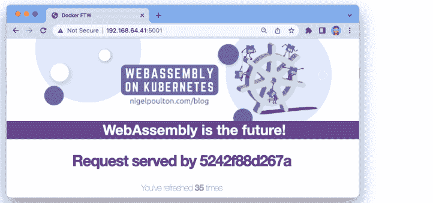

图 11.4 - 更新后的应用

卷仍然存在，你需要手动删除它。

恭喜你。你成功地使用 Docker Stacks 部署并管理了一个多容器应用。你还学习了通过栈文件（Compose 文件）进行所有更改来声明式地部署和管理应用。

### 清理

如果你一直在跟着操作，你部署了一个包含两个服务、一个网络和一个卷的应用。

你可以使用 `docker stack rm` 命令删除栈。但请注意，它会在不询问确认的情况下删除栈。

```
$ docker stack rm ddd
Removing service ddd_redis
Removing service ddd_web-fe
Removing network ddd_counter-net
```

该命令删除了网络和服务，但没有删除卷。这是因为卷的生命周期与容器和服务是解耦的，你需要手动删除它们。

在每个托管过副本的 swarm 节点上运行以下命令。

```
$ docker volume rm ddd_counter-vol
ddd_counter-vol
```

### 使用 Docker Stacks 部署应用 – 命令

- `docker stack deploy` 是你运行的部署和更新栈的命令。你需要指定栈名称和栈文件。Docker 默认期望栈名为 `compose.yaml`。
- `docker stack ls` 列出所有栈。
- `docker stack ps` 显示栈的容器状态。
- `docker stack rm` 删除栈。

### 总结

在本章中，我们通过 Docker Stacks 部署并管理了应用。

- 学习了如何通过配置 `update_config` 来控制更新策略。
- 理解了卷在更新过程中的覆盖问题。
- 学习了如何声明式地移除卷。
- 掌握了 Docker Stacks 的常用命令。

## 12 章：Docker 与 WebAssembly

WebAssembly 正在演进，带来了更小、更快、更安全的工作负载。在本章中，我们将介绍 WebAssembly，并展示如何使用 Docker 容器化并运行它。

WebAssembly 是云计算的未来。

本章的目标是向你介绍 WebAssembly，并展示如何与 Docker 协同工作。

本章章节安排如下：

- 前提条件
- WebAssembly 简介
- 编写 Wasm 应用
- 容器化 Wasm 应用
- 部署 Wasm 应用

### 前提条件

如果你计划跟着操作，你需要以下内容：

- 启用了 Wasm 的 Docker Desktop 4.30+
- 安装了 Wasm target 的 Rust 72+
- Spin 2.5+

在编写时，Docker 的 Wasm 支持是一个测试功能，且不支持 Multipass Docker 虚拟机。这意味着可能会有 Bug。我在本章的示例是在 Docker Desktop 4.30.0 上测试的。

### Wasm 与 Wasm 容器简介

Wasm 是一种新型应用程序，比传统的 Linux 容器更小、更快且更具可移植性。然而，传统的 Linux 容器能的功能比 Wasm 应用多得多。例如，Wasm 应用目前非常适合 AI 工作负载、无服务器函数、插件和边缘设备，但在处理复杂网络或密集型 I/O 方面并不理想。

不过，Wasm 正在快速演进，未来可能会在其他工作负载方面表现得更好。

深入探讨……

正如我们即将看到的，Wasm 是一种新的虚拟机架构，编程语言可以编译到该架构中。因此，你不再是将应用编译为 ARM 上的 Linux 或 AMD  Linux，而是将它们编译为 Wasm。然后，你可以在任何带有 Wasm 运行时系统上运行这些 Wasm 应用。幸运的是，Docker Desktop 已经自带了多个 Wasm 运行时。

运行以下命令查看作为 Docker Desktop 环境一部分安装的 Wasm 运行时列表。第一次运行该命令时，它将下载镜像。

```
$ docker run --rm -i --privileged --pid=host jorgeprendes420/docker
io.containerd.wasmtime.v1
io.containerd.spin.v2
io.containerd.wss.v1
io.containerd.lunatic.v1
io.containerd.slight.v1
io.containerd.wasmedge.v1
io.containerd.wasmer.v1
```

我的安装包含七个 Wasm 运行时，包括我们在示例中使用的 `io.containerd.spin.v2` 运行时。

这些 Wasm 运行时允许 `containerd` 部署和管理 `Wasm 容器`。`Wasm 容器`是运行在极化 `scratch` 容器内部的 Wasm，这样你就可以使用熟悉的 Docker 工具（如 `docker run` 命令和 Docker Hub）来构建、分发和运行它们。

说得容易容易，让我们来看看实际操作吧。

### 编写一个 Wasm 应用

我们将使用 `spin` 创建一个简单的 Web 服务器，并将其编译为 Wasm 应用。在后续步骤中，你将作为 Wasm 容器构建、分发并运行该应用。

进入新目录，然后运行以下命令创建一个名为 `hello-world` 的新 Wasm 应用。

按照示例所示回答提示。

```
$ spin new hello-world -t http-rust
Description: Wasm app
HTTP path: /hello
```

该命令创建了一个新的 `hello-world` 目录，并搭建了一个基于 Rust 的简单 Web 应用。进入此目录并检查应用文件。如果你没有安装 `tree` 命令，可以运行 `ls -l` 获取类似的结果。

```
$ cd hello-world
$ tree
.
├── Cargo.toml
├── spin.toml
└── src
    └── lib.rs
```

我们只对 `spin.toml` 和 `src/lib.rs` 文件感兴趣。

编辑 `src/lib.rs` 文件，并按照下方代码段所示更改双引号内的文本。此配置将应用显示 **Docker loves Wasm.**。

```
use spin_sdk::http::{IntoResponse, Request};
<Snip>
  Ok(http::Response::200)
    .status(200)
    .header("content-type", "text/plain")
    .body("Docker loves Wasm?")      <----- 修改此处
```

保存更改后，运行 `spin build` 命令将应用编译为 Wasm 二进制文件。

```
$ spin build
Building component with `cargo build --target wasm32-wasi --release`
<Snip>
Finished building all Spin components
```

如果你查看输出的第一行，你会发现它正在运行一个更复杂的 `cargo build` 命令，将应用编译为 Wasm 二进制文件。

运行另一个 `tree` 命令查看 Wasm 二进制文件。

```
$ tree
<Snip>
  target
    wasm32-wasi
      release
        hello_world.wasm
```

这次的输出长得多，我精简了示例，以便你只看到 `hello_world.wasm`。这个 Wasm 应用可以在任何带有 `spin` 运行时的系统上运行。你将在下一节中将其容器化。

运行 `spin up` 命令来启动该的本地实例。这将使用你之前安装的本地 `spin` 运行时启动应用。

```
$ spin up
Logging component stdio to ".spin/logs"
Serving http://127.0.0.1:3000
Available Routes:
  hello-world: http://127.0.0.1:3000/hello
```

将你的浏览器指向 `http://127.0.0.1:3000/hello` 并确保应用正常工作。


图 12.3 本地运行的 Wasm 应用

恭喜！你刚刚构建了一个简单的 Web 服务器，将其编译为 Wasm，并使用 `spin` 在本地执行。按下 `Ctrl-C` 杀死应用。

### 将 Wasm 应用容器化

Docker Desktop 允许你将 Wasm 应用容器化，这样你可以使用熟悉的工具将其推送到 OCI 仓库并在容器内运行。你始终需要一个Dockerfile 来告诉 Docker 如何将应用打包为镜像。在当前目录下创建一个名为filefile 文件并填充以下内容。

```dockerfile
FROM scratch
COPY /target/wasm32-wasi/release/hello_world.wasm
COPY spin.toml
```

该文件引用了一个名为 scratch 的特殊空镜像，因为 Wasm 容器不需要操作系统。两个 COPY 指令将 hello_world.wasm Wasm 应用和 spin.toml 文件复制到镜像。如果你仔细观察，会发现 spin.toml 文件期望 Wasm 应用位于 `target/wasm32-wasi/release/`。然而第二个 COPY 指令将其放在根目录下。这意味着我们需要更新 spin.toml 文件，以便在应用被复制到根目录后找到它。编辑 spin.toml。

```toml
source = "hello_world.wasm"
```

保存更改。运行以下命令将 Wasm 应用容器化。确保使用自己的 Docker 用户名来标记镜像。

```
$ docker build --platform wasi/wasm --provenance=false -t jorpoulton/ddd-book:wasm
```

`--platform wasi/wasm` 参数将镜像设置为 Wasm 镜像。某些旧版本的 Docker 没有构建器会导致失败。如果发生这种情况，尝试运行相同的命令但将第一行改为 `docker build`。列出系统上的镜像。

| REPOSITORY | TAG | IMAGE ID | CREATED | SIZE |
| :--- | :--- | :--- | :--- | :--- |
| jorpoulton/ddd-book | wasm | 7b5589f1006 | 2 minutes ago | 620 |

Wasm 镜像看起来就像普通镜像，只是更小。你可以正常地将镜像推送到 Docker Hub 和其他 OCI 仓库。以下命令将镜像推送到 Docker Hub 中的一个仓库。确保使用你自己的用户名标记镜像。

```
$ docker push jorpoulton/ddd-book:wasm
```

push 指向 `docker.io/jorpoulton/ddd-book`。

```
301823195c36: Pushed
896622af76a: Pushed
wasm: digest: sha256:7b5588f1006285ed6c39cc7a56aca89551075b
```

如果你查看 Docker Hub，可以发现 Docker Hub 已将其识别为 wasi/wasm 镜像。你还会看到没有漏洞分析，因为镜像扫描工具还无法分析 Wasm 镜像。


### 运行 Wasm 容器

现在你已经将 Wasm 应用打包为 OCI 镜像并推送到仓库，可以将其作为容器运行。以下命令将其在一个名为 wasm-ctr 的新容器中运行，并映射到 Docker 宿主机端口 5556。`--runtime` 参数确保 Docker 使用 spin Wasm 运行时执行容器。比 4.24 旧的 Docker 可能没有 spin 运行时会导致失败。

```
$ docker run -d --name wasm-ctr --runtime=io.containerd.spin.v2 --platform=wasi/wasm -p 5556:80 jorpoulton/ddd-book:wasm
```

你可以使用普通的 `docker ps` 命令检查它正在运行。将浏览器连接到 `http://localhost:5556/hello` 查看应用。


图 12.5 容器中运行的 Wasm 应用

恭喜！你的 Wasm 应用正在 Wasm 容器内部运行。

### 清理

运行以下命令删除容器和本地镜像。

```
$ docker rm wasm-ctr -f
wasm-ctr
$ docker rmi jorpoulton/ddd-book:wasm
Untagged: jorpoulton/ddd-book:wasm
Deleted: sha256:7b5588f1006285ed6c39dc77a56aca895510758b22163
```


你仍然在 Docker Hub 上有一个镜像副本，并在本地文件系统中 spin 应用。可以随意删除这些。

### 章节总结

在本章中，你将一个 Wasm 应用容器化并在 Wasm 容器中运行了它。

Wasm 是驱动云计算下一一浪潮的新技术。Wasm 应用比传统的 Linux 容器更小、更快、更安全且更具移植性。然而，它们并不那么灵活。例如，在编写时，Wasm 应用对于具有密集 I/O 要求或复杂网络的应用并不理想。

幸运的是，Docker 已经支持了 Wasm，并且 Docker Desktop 配带了许多流行的 Wasm 运行时。这意味着你可以使用 `docker build` 和 `docker run` 等行业标准工具来对 Wasm 应用进行容器化并运行。你甚至可以将它们推送到如 Docker Hub 等 OCI 注册表中。

## 13: Docker 网络

总是网络的问题！

每当我们遇到基础设施问题时，总是总是归咎于网络。我们之所以这样做的原因之一是网络处于一切的核心。考虑到这一点，对 Docker 网络有深入的理解至关重要。

在 Docker 早期，网络化非常困难。幸运的是，如今这几乎成了一种享受 ;)

本章将带你快速上手 Docker 网络的基础知识。你将学习容器网络模型（CNM）和 libnetwork 背后的所有理论，并将在大量示例中进行实践。你将在下一章中学习叠加网络（overlay networks）。

我将本章分为以下部分：

- Docker 网络 – 简要概述 (TLDR)
- Docker 网络理论
- 通过端口映射实现单主机桥接网络
- 连接到现有网络和 VLAN
- 服务发现
- 入口负载均衡

在我们开始之前，有几点说明。

我们将涵盖的内容都与 Linux 容器有关，我建议你使用 Multipass 或 Play with Docker 之类的工具进行练习，因为它们让你轻松访问我们将用到的某些 Linux 命令。我不建议在 Docker Desktop 上进行练习，因为它将所有内容运行在 Linux 虚拟机内部，你将无法访问 Linux 命令。

某些示例解释了网络在集群（swarm）上如何工作。只有在你运行 Swarm 集群时才能跟随这些示例。

### Docker 网络 – 简要概述 (TLDR)

Docker 运行由许多容器组成的微服务应用，这些容器共同工作形成整个应用。这些容器需要能够通信，并且某些必须连接到外部服务，例如物理服务器、虚拟机或其他设备。

幸运的是，Docker 为这两个需求都提供了解决方案。

Docker 网络基于 libnetwork，libnetwork 是一个名为容器网络模型（CNM）的开源架构的参考实现。

为了提供开箱即用的体验，Docker 配备了满足最常见网络需求的所有内容，包括多主机容器间网络以及连接到现有 VLAN 的选项。然而，该模型是可插的，生态系统可以通过接入 libnetwork 的驱动程序来扩展 Docker 的网络能力。

最后但同样重要的是，libnetwork 还提供了原生的服务发现和基础负载均衡。

这就是大局。让我们进入细节部分。

### Docker 网络理论

在最高层上，Docker 网络基于以下三个组件：

- 容器网络模型 (CNM)
- Libnetwork
- 驱动程序 (Drivers)

CNM 是设计规范，概述了 Docker 网络的基础构建块。

Libnetwork 是 CNM 的真实实现。它作为 Moby 项目的一部分开源，并被 Docker 及其他平台使用。

驱动程序通过实现特定的网络拓扑（如 VXLAN 叠加网络）来扩展该模型。

图 13.1 显示了这三者。

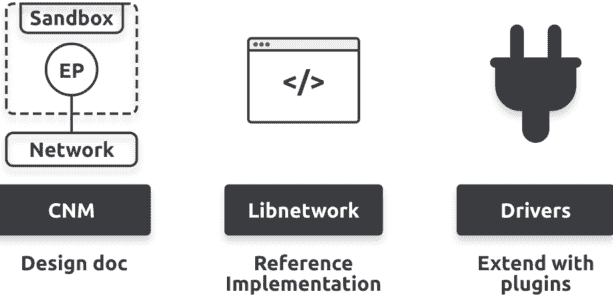

图 13.1

让我们仔细观察每一个。

#### 容器网络模型 (CNM)

一切都始于设计。

Docker 网络的设计指南是 CNM，它概述了 Docker 网络的基础构建块。

我建议你阅读[规范文档]，但从高层次来说，它定义了三个构建块：

- 沙箱 (Sandboxes)
- 端点 (Endpoints)
- 网络 (Networks)

沙箱是容器内部的隔离网络栈。它包含了以太网接口、端口、路由表、DNS 配置以及你对网络栈所期待的所有切。

端点是虚拟网络接口，看起来、用起来、感觉就像普通的网络接口。它们将沙箱连接到网络。

网络是虚拟交换机（通常是 802.1d 桥的软件实现）。因此，它们将需要通信的一个多个端点分组并隔离。

图 13.2 显示了这三者如何连接并与熟悉的设施组件。使用 CNM 术语，端点将沙箱连接到网络。你创建的每个容器将有一个沙箱，并至少有一个端点将其连接到网络。

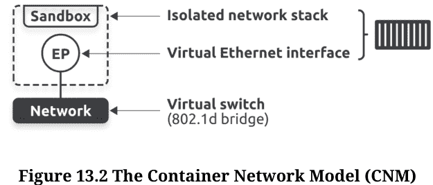

正如名称所示，容器网络模型的核心是为容器提供网络支持。图 13.3 显示了 CNM 组件与容器的关系——每个容器都有自己的沙箱，该沙箱托管容器的整个网络栈，包括一个或多个作为以太网接口并可以连接到网络的端点。

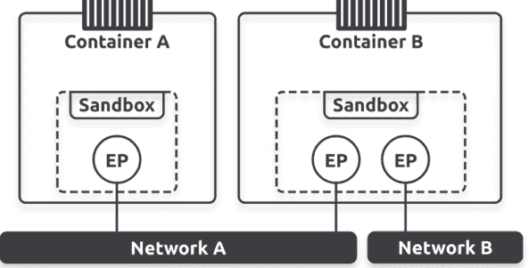

图 13.3

容器 A 只有一个接口（端点）且只连接到网络 A。然而，容器 B 有两个接口分别连接到网络 A 和网络 B。这些容器可以相互通信，因为它们都连接到了网络 A。但是，容器 B 内部的两个端点无法相互通信，因为它们在不同的网络上。

理解端点的行为完全像普通的网络适配器也很重要，这意味着你只能将它们连接到单个网络。这就是为什么容器 B 如果想连接到两个网络，就需要两个端点。

图 13.4 通过添加 Docker 宿主机进一步扩展了图表。尽管两个容器都运行在同一宿主机上，但它们的网络栈是完全隔离的，并且只能通过网络进行通信。

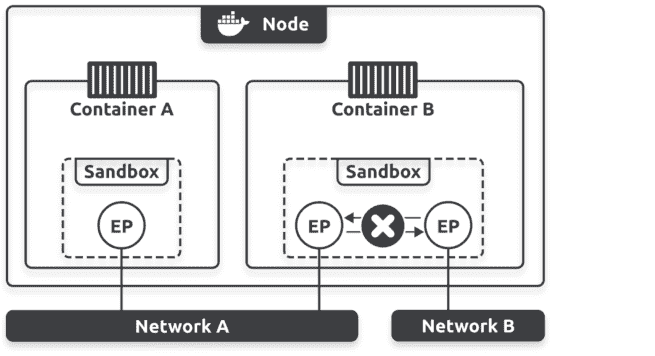

图 13.4

#### Libnetwork

Libnetwork 是 CNM 的参考实现。它是开源的、跨平台的（Linux 和 Windows），由 Moby 项目维护并被 Docker 使用。

在 Docker 创建 libnetwork 之前，它在守护进程内部实现了所有的网络代码。然而，随着时间的推移，守护进程变得越来越臃肿，且难以供其他项目使用。因此，Docker 从守护进程中移除了网络代码，并基于 CNM 设计将其重构为一个名为 libnetwork 的外部库。今天，Docker 在 libnetwork 中实现了所有的核心网络功能。

除了实现 CNM 的核心组件外，libnetwork 还实现了网络控制面，包括管理 API、服务发现和基于入口的容器负载均衡。

#### 驱动程序 (Drivers)

libnetwork 实现了控制面，但它依赖驱动程序来实现数据面。例如，驱动程序负责创建网络并确保隔离性和连通性。

Docker 自带了几个驱动程序，我们有时称它们为原生驱动或本地驱动。这些包括 `bridge`、`overlay` 和 `macvlan`，它们构建了最常见的网络拓扑。第三方也可以编写网络驱动程序来实现其他网络拓扑和更高级配置。

图 13.5 显示了 libnetwork 和驱动程序的作用，以及它们与控制面和数据面职责的关系。

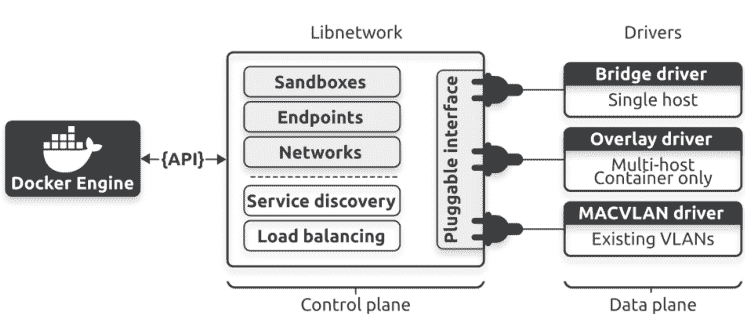

你创建的每个网络由一个驱动程序所有，该驱动程序创建并管理有关网络的一切。例如，如果你创建一个名为 prod-fe-cuda 的叠加网络，Docker 将调用 overlay 驱动来创建该网络及其资源。

为了满足复杂、流动环境的需求，单个 Docker 宿主机或 Swarm 集群可以拥有由不同驱动程序管理的异构网络。

让我们来看看单主机桥接网络以及连接到现有网络。你将在下一章中学习叠加网络。

### 单主机桥接网络

最简单的 Docker 网络类型是单主机桥接网络。

该名称告诉了我们两点：

- **Single-host（单主机）** 告诉我们该网络仅跨越单个 Docker 节点
- **Bridge（桥接）** 告诉我们它是 802.1d 桥接器（二层交换机）的实现

Docker 使用内置的桥接驱动创建单主机桥接网络。如果你运行 Windows 容器，你将需要使用 nat 驱动，但从本质上来说，它们的工作是相同的。

图 13.6 显示了两个具有相同本地桥接网络的 Docker 节点，它们都被命名为 **mynet**。尽管网络是相同的，但它们是独立且隔离的，这意味着图片中的容器无法通信，即使节点属于同一个集群（swarm）。

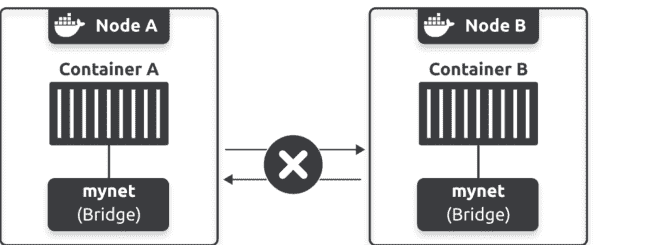

### 图 13.6

每个新的 Docker 节点都会获得一个名为 **bridge** 的默认单主机桥接网络，除非你使用 `--network` 标志对其进行覆盖，否则 Docker 会将新容器连接到。

以下命令显示了在 Docker 安装上运行 `docker network ls` 命令的输出。

```
$ docker network ls

| NETWORK ID | NAME | DRIVER | SCOPE |

| :--- | :--- | :--- | :--- |

| c7464dce29ce | bridge | bridge | local default |

| c65ab180d580 | host | host | local |

| 42a783df0fbe | none | null | local |
```

一如既往，你可以运行 `docker inspect` 命令来获取更多信息。我强烈建议在你自己的系统上运行该命令并研究输出。

```
$ docker network inspect bridge

[
  {
    "Name": "bridge",
    "Id": "c7464dce2...ba2e3b8",
    "Scope": "local",
    "Driver": "bridge",
    "EnableIPv6": false,
    "IPAM": {
      "Driver": "default",
      "Options": null,
      "Config": [
        {
          "Subnet": "172.17.0.0/16",
          "Gateway": "172.17.0.1"
        }
      ]
    },
    "Internal": false,
    "Attachable": false,
    "Ingress": false,
    "ConfigFrom": {
      "Network": ""
    },
    <Snip>
  }
]
```

所有的桥接网络都基于经过长期验证的 Linux 桥接技术，该技术在 Linux 内核中已存在 20 多年。这意味着它们是高性能且高度稳定的。这也意味着你可以使用标准的 Linux 工具对其进行检查。

所有基于 Linux 的 Docker 节点上的默认桥接网络都称为 bridge，并映射到主机内核中名为 docker0 的底层 Linux 桥接器。如图 13.7 所示。

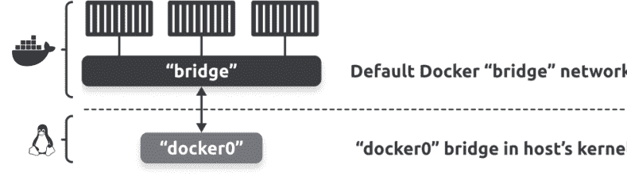

**图 13.7 - 将默认 Docker "bridge" 网络映射到主机内核中的 "docker0" 桥接器**

你可以运行 `docker network inspect` 命令来确认桥接网络是否基于主机内核中的 docker0。如果你在 Windows 上使用 PowerShell，你将需要 grep 替换为 Select-String。

```
$ docker network inspect bridge | grep bridge.name
"com.docker.network.bridge.name": "docker0",
```

现在运行这些 Linux 命令从 Linux 主机检查 docker 0 桥接器。你可能需要手动安装 brctl 工具。

```
$ brctl show
bridge name     bridge id STP enabled interfaces
docker0         8000.0242aff9eb4f no
docker_gwbridge 8000.02427abba76b no
$ ip link show docker0
3: docker0:<BROADCAST,MULTICAST,UP,LOWER_UP> mtu 1500 qdisc...\link/ether 02:42:af:f9:eb:4f brd ff:ff:ff:ff
```

第一条命令列出了你主机上所有的桥接器，并显示它们是否连接了任何设备。书中的示例显示了没有任何设备的 docker0 桥接器。第二条命令显示了 docker0 桥接器的配置和状态。图 13.8 显示了容器连接到桥接网络的完整栈，该网络随后映射到主机内核中的 docker0 桥接器。它还显示了你如何使用端口映射在接口上发布设备。

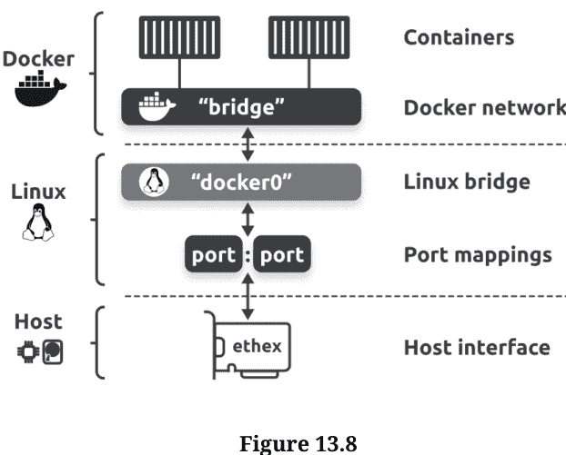

在接下来的几步中，你将完成所有操作：
1. 创建一个新的桥接网络
2. 将容器连接到新网络
3. 检查新网络
4. 测试基于名称的

运行以下命令创建一个名为 `localnet` 的新单主机网络。

```
$ docker network create -d localnet
f918f1bb02373bf94615d99cb2bef14ede935f28e4b86
```

命令返回的长数字是网络的 ID，你将在下一步中需要它。如所预期，该命令创建了一个名为 localnet 的新桥接网络，你可以用通常的 docker 命令对其进行列出和检查。然而，在后台，它还在主机内核中创建了一个新的 Linux 桥接器。运行另一个 brctl show 命令查看它。

| brctl show | bridge name | bridge id | STP enabled | interface |
| :--- | :--- | :--- | :--- | :--- |
| br-f918f1bb0602 | 8000.0242372a886b | no | |
| docker0 | 8000.02425ee84bc | no | |
| docker_gwbridge | 8000.02427abba76b | no | |

书中的示例显示了一个名为 f918f1bb02 且没有任何设备的桥接器。如果你仔细观察该名称，你会识别出它是你创建的新的 localnet 网络 ID 的前 12 个字符。此时，主机上的桥接器配置看起来如图 13.9 所示。

图 13.9

让我们创建一个名为 c1 的容器并将其连接到 localnet 网络。你可能需要安装 jq 工具。

一旦你创建了容器，检查 localnet 以验证它是否连接到内核中的桥接器。

```bash
$ docker run -d --name c1
  --network localnet
  sleep infinity
```

Docker 宿主机上的端口。它有点笨拙并且有很多局限性，但对于偶尔的测试和开发工作可能有用。

图 13.11 显示了运行两个容器的单个 Docker 宿主机。右侧的 web 容器在端口 80 上运行 Web 服务器，映射到 Docker 宿主机的端口 5005。左侧的 client 容器向 Docker 宿主机端口 5005 发送请求，外部客户端也这样做。两个请求都将命中宿主机端口 5005，并重定向到运行在 web 容器中的 Web 服务器。

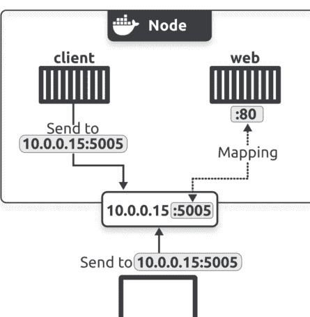

图 13.11

让我们测试一下设置，看看它是否有效。

创建一个名为 `web` 的新容器，在端口 80 上运行 NGINX，并将其映射到 Docker 宿主机的端口 5005。如果你仍然登录在上一个示例的容器中，需要先输入 `exit`。

```
$ docker run -d --name web \
--network localnet \
--publish 5005:80 \
nginx
```

验证端口映射。

```
$ docker port web
80/tcp -> 0.0.0.0:5005
80/tcp -> [::]:5005
```

输出显示 Docker 宿主机上的所有接口都存在端口映射。

你可以通过将 Web 浏览器指向 Docker 宿主机端口 5005 来测试外部访问。你需要知道 Docker 宿主机的 IP 或 DNS 名称（如果你是在 Multipass 上跟着操作，它可能可能是你的 Multipass 虚拟机的 192.168.x.x 地址）。你将看到 “Welcome to nginx!” 页面。

让我们创建另一个容器，看看它是否能通过端口映射到达 web 容器。

运行以下命令在 **bridge** 网络上创建一个名为 **client** 的新容器。

```bash
$ docker run -it --name client --network bridge alpine sh
```

该命令将你带入容器，你的提示符会发生变化。

安装 **curl** 工具。

```bash
### apk add curl
fetch https://dl-cdn.alpinelinux.org/alpine/v3.19/main/aarch64
fetch https://dl-cdn.alpinelinux.org/alpine/v3.19/community/aarch6
(1/8) Installing ca-certificates (20240226-r0)
<Snip>
```

现在连接到 Docker 宿主机端口 **5005** 的 IP，看看是否可以到达容器。

```bash


### `curl 192.168.64.69:5005`

<!DOCTYPE html>

<html>

<head>

<title>Welcome to nginx!</title>

...

```

你已经通过映射到 Docker 宿主机 IP 了运行在 web 容器中的 nginx 服务器。

尽管这种方法可行，但它很笨拙且无法扩展。例如，其他容器或宿主机进程无法使用宿主机上的端口 5005。这就是单宿主机网络仅适用于本地开发或小型应用程序的原因之一。

### 连接现有网络和 VLAN

将容器化应用连接到外部系统和物理网络是非常重要的。一个常见的例子是部分容器化的应用，运行在容器中的部分需要与运行在容器之外的部分通信。

内置的 `MACVLAN` 驱动（如果你使用 Windows 容器它是透明的）是为此而创建的。它让每个容器在物理网络上拥有自己的 IP 和 MAC 地址，使其看起来和感觉像是一个物理服务器或虚拟机。这在图 13.12 中所示。

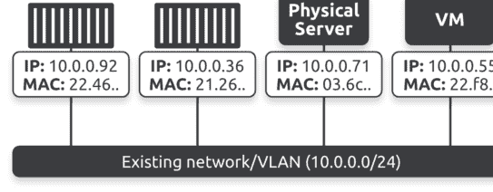

图 13.12 - 使外部网络可见的 MACVLAN 驱动

优点是 `MACVLAN` 的性能良好，因为不需要端口映射或额外的桥。但是，你需要将宿主机网卡设置为杂散模式（promiscuous mode），这在许多企业网络和公有云中是不允许的。因此，如果你的网络允许杂散模式，`MACVLAN` 将你的数据中心网络上工作。

让我们通过一些图片和一个假设的示例深入研究。这个示例只有在你的宿主机网卡处于允许杂散模式的网络上才能工作。它还需要一个现有的 VLAN 100。如果你的物理网络 VLAN 配置不同，你可以调整它。你可以遵循没有 VLAN 的操作，但不会获得完整的体验。

假设你有一个图 13.13 所示带有两个 VLAN 的：

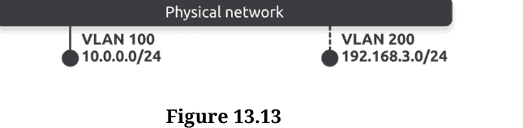

接下来，添加 Docker 宿主机并连接到网络。

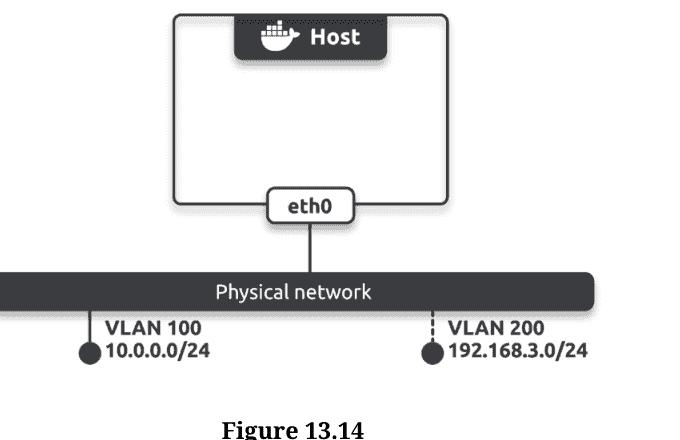

现在需要将容器附加到 VLAN 100。要做到此，你需要创建一个使用 `macvlan` 驱动的新 Docker 网络并配置以下内容：

- 子网信息
- 网关
- 分配给容器的 IP 范围
- 使用宿主机的接口或子接口

运行以下命令创建一个名为 **macvlan100** 的 MACVLAN 网络，它将容器连接到 VLAN 100。你可能需要更改父接口的名称以匹配你的系统名称。例如，将 **-o parent=eth0.100** 改为 **-o parent=enp0s.100**。父接口必须连接到 VLAN，如果你仍然登录在上一个示例的容器中，需要输入 `exit`。

```bash
docker network create -d macvlan \
  --subnet=10.0.0.0/24 \
  --ip-range=10.0.0.0/25 \
  --gateway=10.0.0.1 \
  -o parent=eth0.100 \
  # <-- 确保这匹配你的 macvlan100
```

Docker 将创建 `macvlan100` 网络和宿主机上名为 `eth0.100@eth0` 的新子接口。现在的配置如下。

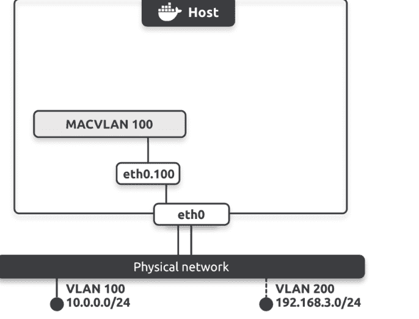

### 图 13.15

`MACVLAN` 驱动创建标准的 Linux 子接口，并用它们连接的 VLAN ID 对进行标记。在示例中，我们连接到 VLAN 100，所以我们将子接口标记为 .100 (`-o parent=eth0.100`)。

我们还使用了 `--ip-range` 标志来告诉新网络它可以分配的地址集。如果你检查网络，你将能够看到重要信息。

```json
docker network inspect macvlan100

{
  "Name": "macvlan100",
  "Driver": "macvlan",
  "IPAM": {
    "Config": [
      "Subnet": "10.0.0.0/24",
      "IPRange": "10.0.0.0/25",
      "Gateway": "10.0.0.1"
    ]
  },
  "Options": {
    "parent": "eth0.100"
  }
}
```

一旦创建了 `macvlan100` 网络，你就可以将容器连接上去，它们对其他系统可见。

```bash
$ docker run -d --name cainer1 \
--network macvlan100 \
alpine sleep 1
```

现在的配置看起来像图 13.16。

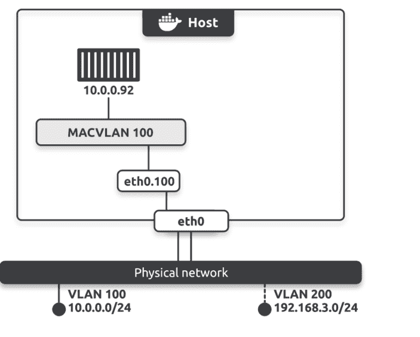

图 13.16

然而，请记住底层网络（VLAN 100）看不到 MACVLAN 的魔法，它只看到带有 MAC 和 IP 地址的容器，这意味着 `ctainer1` 容器将与 100 上的其他系统通信！

**注意**：*如果你无法使其工作，可能是因为宿主机网卡不是杂散模式。此外，请记住公云平台通常禁止杂散模式。*

### 排除连接问题

在介绍服务发现之前，关于排除连接问题的简要说明。

守护进程日志和容器日志在排除连接问题时非常有用。

如果你运行的是 Windows 容器，可以在 Windows 事件查看器中查看或直接在 `~AppData\Local\Docker` 中查看。对于 Linux 容器，取决于你使用的 `init` 系统。如果你正在运行 systemd，

Docker 会将日志发布到 journald，你可以通过 `journalctl -u docker.service` 命令查看它们。如果你正在使用不同的初始化系统，你可能需要检查以下位置：

- 运行 upstart 的 Ubuntu 系统：`/var/log/upstart/docker.log`
- 基于 RHEL 的系统：`/var/log/messages`
- Debian：`/var/log/daemon.log`

你也可以告诉 Docker 守护进程日志的详细程度。要执行此操作，请编辑位于 `/etc/docker/daemon.json` 的守护进程配置文件，将 `"debug"` 设置为 `"true"`，并将 `"log-level"` 设置为以下之一：

- `debug` - 最详细的选项
- `info` - 默认值和第二详细的选项
- `warn` - 第三详细的选项
- `error` - 第四详细的选项
- `fatal` - 最不详细的选项

以下摘自 `daemon.json` 的代码片段启用了调试功能，并将级别设置为 debug。它适用于所有 Docker 平台。

```
{
  <Snip>
  "debug":true,
  "log-level": "debug",
  <Snip>
}
```

如果你的 `daemon.json` 文件不存在，请创建它。此外，在对文件进行任何更改后，务必重启 Docker。

以上是守护进程日志。那么容器日志呢？

通常，你可以通过 `docker logs` 命令查看容器日志。如果你正在运行 Swarm，应该使用 `docker service logs` 命令。然而，Docker 支持几种不同的日志驱动程序，它们并不都能与原生 Docker 命令配合。对于其中某些驱动程序，你可能需要使用平台的原生工具查看日志。

`json-file` 和 `journald` 可能是最容易配置的，它们都适用于 `docker logs` 和 `docker service logs` 命令。

以下摘自 `daemon.json` 的片段显示了一个配置为使用 journald 的 Docker 节点。

```
{
  "log-driver": "journald"
}
```

你还可以使用 `--log-driver` 和 `--log-opts` 标志启动容器或服务，以覆盖 `daemon.json` 中的设置。

容器日志运行在你的应用程序作为 PID 1 运行，并将日志发送到 STDOUT，将错误发送到 STDERR。随后日志驱动程序会将所有内容转发到通过日志驱动程序配置的位置。

以下是一个针对名为 `vantage-db` 的容器运行 `docker logs` 命令的示例，该容器配置了使用 `json-file` 日志驱动程序。

```bash
$ docker logs vantage-db
1:C 2 Feb 09:53:22.904 # o000o000o000 Redis is starting o0000000
1:C 2 Feb 09:53:22.904 * Redis version=4.0.6, bits=64, commit=000
1:C 2 Feb 09:53:22.904 * Warning: no config file specified, using
1:M 2 Feb 09:53:22.906 * Running mode=standalone,port=6379.
1:M 2 Feb 09:53:22.906 * WARNING: The TCP block setting of 511
1:M 2 Feb 09:53:22.906 # Server initialized
1:M 2 Feb 09:53:22.906 # WARNING overcommit_memory is set to 0!
```


你很有可能在守护进程日志或容器日志中发现网络连接错误。

### 服务发现

除了核心网络外，`libnetwork` 还提供了服务发现，允许所有容器和 Swarm 服务通过名称相互定位。唯一的要求是容器必须位于同一个网络中。

在底层，Docker 实现了一个原生的 DNS 服务器，并配置每个容器使用它进行名称解析。

图 13.18 显示了一个名为 `c1` 的容器通过名称 `ping` 另一个名为 `c2` 的容器。同样的原理也适用于 Swarm 服务副本。

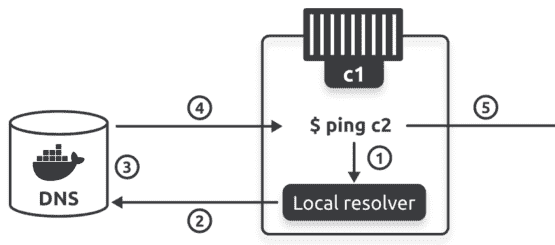

图 13.18

让我们逐步了解这一过程。

- **步骤 1：** `c1` 容器发出了 `ping c2` 命令。容器的本地 DNS 解析器检查其缓存，查看是否拥有 `c2` 的 IP 地址。所有 Docker 容器都有本地 DNS 解析器。
- **步骤 2：** 本地解析器没有 `c2` 的 IP 地址，因此它向嵌入的 Docker DNS 服务器发起递归查询。所有 Docker 容器都预配置了如何向嵌入的 DNS 服务器发送查询。
- **步骤 3：** Docker DNS 服务器为你使用 `--name` 和 `--net-alias` 标志创建的容器维护名称到 IP 的映射。这意味着它知道 `c2` 容器的 IP 地址。
- **步骤 4：** DNS 服务器将 `c2` 容器的 IP 地址返回给 `c1` 容器中的本地解析器。如果 `c1` 和 `c2` 位于不同的 Docker 网络上，它将不会返回 IP 地址——名称解析仅适用于同一网络上的容器。
- **步骤 5：** `c1` 容器向 `c2` 的 IP 地址发送 `ping` 请求（ICMP echo 请求）。

在此确认几点。

Docker 会自动将你使用 `--name` 或 `net-alias` 标志创建的每个容器的名称和 IP 注册到嵌入的 Docker DNS 服务中。它还会自动配置每个容器使用嵌入的 DNS 服务将名称转换为 IP。名称解析（服务发现）是网络范围的，这意味着它仅适用于同一网络上的容器。你可能会在守护进程日志或容器日志中发现网络连接错误。

### Ingress 负载均衡

Swarm 支持两种方式发布服务到外部客户端：

- Ingress 模式（默认）
- Host 模式

外部客户端可以通过任何节点节点访问 ingress 模式的服务，即使该节点没有运行服务副本。Ingress 模式是默认设置，这意味着每当你使用 `-p` 或 `--publish` 创建服务时，Docker 都会以 ingress 模式发布它。如果你想以 host 模式发布服务，你需要使用 `--publish` 标志并指定 `mode=host`。

这种方法仅适用于 Swarm。

短格式看起来像 `-p 5005:80`，你已经见过它了。然而，你无法使用短格式以 host 模式发布服务。

长格式如下：`--publish published=5005,target=80,mode=host`。它是一个逗号分隔的列表，命令之间没有空格，选项作用如下：

- `published=5005` 通过端口 5005 为外部客户端提供服务
- `target=80` 确保命中 `published` 端口的请求映射回服务副本的端口 80
- `mode=host` 确保请求只有在运行服务副本的节点上才能到达

在底层，ingress 模式使用层 4 路由网格，Docker 将称为服务网格或 swarm 模式服务网格。图 13.20 显示了当外部请求进入以 ingress 模式暴露的服务集群时的基本流量流。

```bash
$ docker service create -d --name svc1 --network overnet \
--publish published=5005,target=80 \
nginx
```

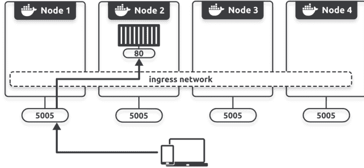

图 13.20

集群（swarm），并将其每个节点都连接到它。在端口 5005 上发布服务的操作，使得该服务可以通过每个 swarm 节点的 5005 端口进行访问，因为每个节点都连接到了入站网络（ingress network）。Docker 还会创建一个全 swarm 的规则，将所有命中节点 5005 端口的流量通过入站网络路由到 `svc1` 副本的 80 端口。

现在让我们来追踪这个外部请求。

1. 外部客户端向 Node 1 的 5005 端口发送请求。
2. Node 1 接收到请求，并知道要将到达 5005 端口的流量转发到入站网络。
3. 入站网络将请求转发到正在运行副本的 Node 2。
4. Node 2 接收到请求，并将其传递给 80 端口的副本。

如果服务有多个副本，swarm 足够智能，可以在所有副本之间进行请求负载均衡。

### 清理

如果你一直在跟着操作，你可能会有很多想要清理的容器、网络和服务。

运行以下命令删除你创建的服务。

```
$ docker service rm svcl
```

现在，删除你创建的独立容器。

```
$ docker rm c1 c2 client web mactainer1 -f
```

最后，删除你创建的网络。

```
$ docker network rm localnet macvlan100
```

### Docker 网络 – 命令

Docker 网络有其自有的 `docker network` 子命令，主要命令包括：

- `docker network ls` 列出主机上所有用的 Docker 网络。
- `docker network create` 是创建新 Docker 网络的方法。你必须为网络命名，并可以使用 `-d` 标志来指定它创建哪种驱动程序。
- `docker network prune` 删除 Docker 主机上所有未使用的网络。
- `docker network rm` 删除 Docker 主机或 swarm 上的特定网络。

你还运行了一些原生 Linux 命令。

- `brctl show` 打印 Docker 主机上所有内核桥接器的列表，并显示是否有任何容器已连接。
- `ip link show` 打印桥接配置数据。你运行了 `ip link show docker0` 来查看 Docker 主机上 `docker0` 桥接器的配置。

### 章节总结

容器网络模型（CNM）是 Docker 网络的设计文档，它定义了三个主要结构——沙箱（sandboxes）、端点（endpoints）和网络（networks）。

Libnetwork 是 CNM 的参考实现，是一个由 Moby 项目维护的开源项目。Docker 使用它来实现核心网络功能，包括服务发现等控制面服务。

驱动程序（Drivers）通过实现特定的网络拓扑结构（如桥接和叠加网络）来扩展 libnetwork 的功能。Docker 自带了驱动程序，但你也可以使用第三方驱动程序。

单主机桥接网络是最基础的 Docker 网络类型，但仅适用于本地开发和非常小的应用程序。它们不可扩展，如果你想在网络外部发布服务，需要将容器映射到主机端口。

叠加网络（Overlay networks）目前非常流行，是极佳的仅容器的多主机网络。我们将在下一章深入讨论它们。

macvlan 驱动程序允许你创建将容器连接到现有物理网络和 VLAN 的 Docker 网络。它们通过赋予容器自己的 MAC 和 IP 地址，使容器成为外部网络中的“一等公民”。遗憾的是，你必须让主机网卡（NIC）运行在混杂模式，这意味着它们在公云中无法工作。

## 14: Docker 叠加网络

叠加网络是大多数云原生微服务应用的核心，本章将让你了解它们在 Docker 中是如何工作的。

我将章节分为以下几个部分：

- Docker 叠加网络 – 概要摘要（TLDR）
- Docker 叠加网络历史
- 构建和测试叠加网络
- 叠加网络详解

让我们开启网络魔法吧！

### Docker 叠加网络 – 概要摘要

现实世界的容器需要一种可靠且安全的通信方式，而无需关心它们运行在哪个主机上或这些主机连接到了哪些网络——它们创建了跨越多个主机的二层网络。不同主机上的容器可以连接到同一个叠加网络并直接通信。

Docker 提供了原生叠加网络，配置简单且默认安全。

### Docker 叠加网络历史

2015年3月，Docker, Inc. 收购了一名为 Socket Plane 的容器网络初创公司，目标有两个：

1. 将叠加网络引入 Docker
2. 为开发者简化容器网络化

他们实现了这两个目标，并且叠加网络在 2024 年以及可预的未来仍然是容器网络的核心。

然而，在简单的 Docker 命令背后隐藏着许多复杂性。如果你只是一个普通的 Docker 用户，了解命令可能足够了。但如果你计划在生产环境中使用 Docker，特别是如果你计划使用 Swarm 和 Docker 网络，那么我们将涵盖的内容将至关重要。

### 构建和测试 Docker 叠加网络

你至少需要在 swarm 中配置了两个 Docker 节点才能跟随操作。书中的示例显示了通过路由器连接到不同网络的两个节点，但你的节点可以处于同一个网络。你可以使用两个节点进行跟踪，或者使用两个虚拟机（VMs）在同一网络上操作，但使用 Docker Desktop 在同一网络上操作只会获得一个节点，这无法获得完整的体验。

图 14.1

### 构建一个 Swarm

如果你在跟随操作，你需要在 swarm 中配置至少两个 Docker 节点。如果你已经有了一个 swarm，可以跳过此部分。

我们稍后会解释叠加网络。

### 创建一个新的叠加网络

让我们创建一个名为 `uber-net` 的加密叠加网络。

从你的管理节点 `node1` 运行以下命令。

```
$ docker network create -d overlay -o encrypted uber-net
dvuly429jvt04hgdm0q6
```

就是这样。你创建了一个全新的加密叠加网络。该网络跨越 swarm 中的两个节点，Docker 使用 TLS 对其加密（GCM 模式）。它还会每12 小时旋转一次密钥。

如果不指定 `-o encrypted` 标志，Docker 仍然加密控制面（管理流量），但不会加密数据面（应用流量）。这可能很重要，因为加密数据面会导致网络性能下降约 10%。

列出 `node1` 上的网络。

```
$ docker network ls
NETWORK ID     NAME             DRIVER    SCOPE
65585dda7500 bridge          bridge    local
```


7e368a105c7 docker_gwbridge bridge    local

a3083cdablic host             host      local

4dsq70jc36ip ingress         overlay   swarm

d97e92a23945 none           null      local

dvulyly429jv uber-net       overlay   swarm

新网络位于列表底部，其范围（`SCOPE`）是整个 swarm（`SCOPE = swarm`）。这意味着它跨越了 swarm 中的每个节点。然而，如果你在 **`node2`** 上列出网络，你将看不到 **`uber-net`** 网络。这是因为 Docker 仅在工作节点需要时才会扩展叠加网络。在我们的示例中，当运行需要它的容器时，Docker 将把 **`uber-net`** 网络扩展到 **`node2`**。这种懒加载网络部署方法通过减少 swarm 中的网络风风（gossip）提高了可扩展性。

连接容器到叠加网络

在 **`node1`** 上运行以下命令。

```
$ docker swarm init

Swarm 已初始化：当前节点现在是节点。
```

命令输出包含一个 **`docker swarm join`** 命令。复制此命令并在 **`node2`** 上运行。

```
$ docker swarm join \
  --token SMTKN-1-0hz2ec \
  172.31.1.5:2377

该节点已加入 swarm。
```

你现在拥有了一个双节点的 Swarm，**`node1`** 是节点，**`node2`** 是工作节点。

现在你已经有一个叠加网络（overlay network），让我们将容器连接到它。

默认情况下，你只能将属于 swarm（集群）服务的容器附加到叠加网络。如果你想添加独立容器，则需要在创建叠加网络时使用 `--attachable` 标志。

此示例将创建一个名为 `test` 的 swarm 服务，在 `uber-net` 网络上运行两个副本。其中一个副本将部署在 node1，另一个部署在 node2，这会导致 Docker 将叠加网络扩展到 node2。

请在 node1 上运行以下命令。

```
$ docker service create --name test \
  --network uber-net \
  --replicas 2 \
  ubuntu sleep infinity
```

检查服务的状态。

| ID | NAME | IMAGE | NODE | DESIRED STATE | CUR |
|---|---|---|---|---|---|
| sml...nw | test.1 | ubuntu:latest | node1 | Running | Run |
| tro...kgk | test.2 | ubuntu:latest | node2 | Running | Run |

`NODE` 列显示了每个节点上各运行一个副本。

切换到 node2 并运行 `docker network ls` 以验证它现在可以看到 `uber-net` 网络。

恭喜。你创建了一个跨越两个不同底层网络（underlay networks）节点的新叠加网络，并向其附加了两个容器。当我们到达理论部分并学习背后极其惊人的复杂性时，你会体会到你所做操作的多么简单！

### 测试叠加网络

图 14.2 显示了当前的设置，两个容器运行在不同的 Docker 机上，但连接到同一个叠加网络。

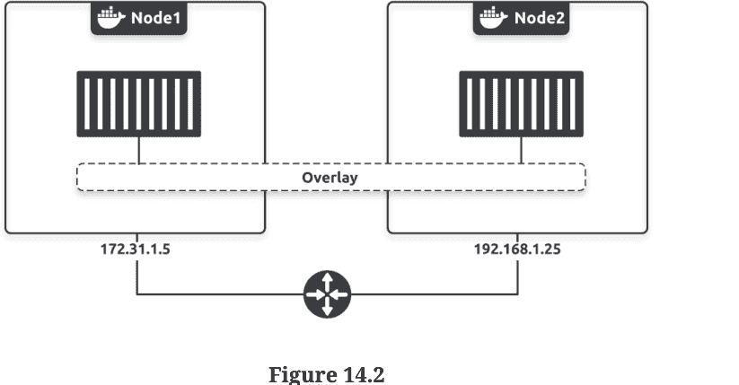

接下来的步骤将引导你获取容器的名称和 IP 地址，然后查看它们是否可以相互 ping 通。

切换回 **`node1`** 并运行 `docker network inspect` 以查看叠加网络的子网信息以及分配给服务副本的任何 IP 地址。

```
$ docker network inspect uber-net

{
  "Name": "uber-net",
  "Id": "vdulyly429jvt04hgdm0mjqc6",
  "Scope": "swarm",
  "Driver": "overlay",
  "EnableIPv6": false,
  "IPAM": {
    "Driver": "default",
    "Options": null,
    "Config": [
      "Subnet": "10.0.0.0/24",
      "Gateway": "10.0.0.1"
    ]
  },
  "Containers": [
    {
      "Name": "test.1.tro80xqwm7kl1bsyn3mt1fjkkg",
      "IPv4Address": "10.0.0.3/24"
    }
  ]
}

<Snip>
```

我截取了输出并高亮了子网信息和已连接容器的 IP。需要注意的一点是，Docker 只显示运行在本地节点上的容器的 IP 地址。例如，书中的输出只显示第一个副本 `test.1.tro...kgk` 的 IP。如果你在 node2 上运行相同的命令，你将看到另一个副本的名称和 IP。

在两个节点上运行以下命令，以获取两个副本的本地容器名称、ID 和 IP 地址，并记录下来。

第二个命令末尾的 ID（d776923a5a7）是 `docker ps` 命令返回的容器 ID。你需要根据你的环境替换该值。

| docker ps | | IMAGE | COMMAND | CREATED | STATUS |
| --- | --- | --- | --- | --- | --- |
| d776923a5a7 | ubuntu:latest | "sleep infinity" | 2 hrs ago | Up 2 |

```
$ docker inspect \
 --format='{{{{range .NetworkSettings.Networks}}{{.IPAddress}}{{end

10.0.0.3
```

我的环境中有以下内容：

- replica 1: ID=d7766923a5a7, Name=test.1.tr0...kgk, IP=10.0.0.3
- replica 2: ID=b6c897d1186d, Name=test.2.sm1...nw, IP=10.0.0.4

图 14.3 显示了为止的配置。子网和 IP 地址在你的实验环境中可能会有所不同。

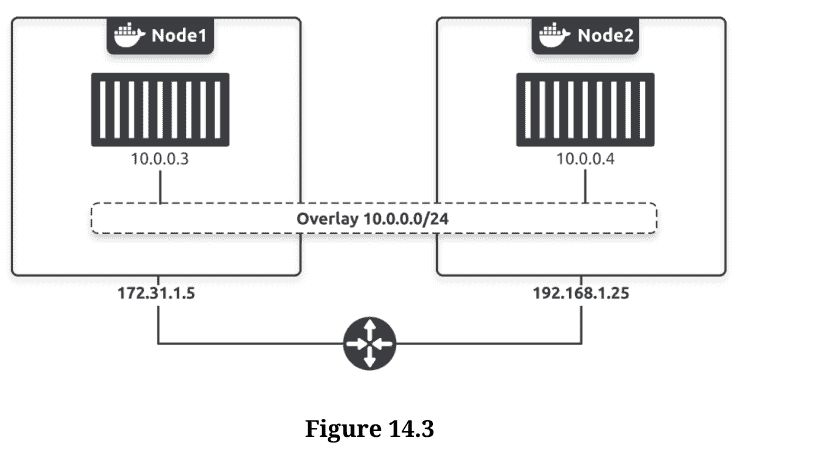

如你所示，层 2 叠加网络跨越两个节点，每个容器都通过自己的 IP 连接到它。这意味着即使两个节点位于不同的底层网络，node1 上的容器也可以 ping node2 上的容器。

让我们测试一下。你需要容器的名称和 IP。

登录到任一个容器并安装 ping 工具。

```
$ docker exec -it d7766923a5a7 bash

### apt update && apt-get install iputils-ping -y

<Snip>

Reading package lists...

Building dependency tree

Reading state information... Done

<Snip>

Setting up iputils-ping (3:2019-3) ...

Processing triggers for libc-bin (2.3) ...
```

现在通过 IP 和副本 ID ping 远程容器。

```
### ping 10.0.0.4

PING 10.0.0.4 (10.0.0.4) 56(84) bytes of data

64 bytes from 10.0.0.4: icmp_seq=1 time=0.06 ms

64 bytes from 10.0.0.4: icmp_seq=2 time=0.07 ms

64 bytes from 10.0.0.4: icmp_seq=3 time=0.03 ms

64 bytes from 10.0.0.4: icmp_seq=4 time=0.26 ms

# ping test.2.sm180xqwm7kl1bsyn3mt1nw

PING test.2.sm180xqwm7kl1bsyn3mt1nw (10.0.0.4) 56(84) bytes of

64 bytes from test.2.sm180xqwm7kl1bsyn3mt1nw.uber-net (10.0.0.4) time=0.05

64 bytes from test.2.sm180xqwm7kl1bsyn3mt1nw.uber-net (10.0.0.4) time=0.05

64 bytes from test.2.sm180xqwm7kl1bsyn3mt1nw.uber-net (10.0.0.4) time=0.04
```

恭喜。你创建了一个跨越两个不同底层网络节点的新叠加网络，并向其附加了两个容器。当我们到达理论部分并学习背后极其惊人的复杂性时，你会体会到你所做操作的多么简单！

### 测试叠加网络

图 14.2 显示了当前的设置，两个容器运行在不同的 Docker 主机上，但连接到同一个叠加网络。


接下来的步骤将引导你获取容器的名称和 IP 地址，然后查看它们是否可以相互 ping 通。

切换回 **`node1`** 并运行 `docker network inspect` 以查看叠加网络的子网信息以及分配给服务副本的任何 IP 地址。

```
$ docker network inspect uber-net

{
  "Name": "uber-net",
  "Id": "vdulyly429jvt04hgdm0mjqc6",
  "Scope": "swarm",
  "Driver": "overlay",
  "EnableIPv6": false,
  "IPAM": {
    "Driver": "default",
    "Options": null,
    "Config": [
      "Subnet": "10.0.0.0/24",
      "Gateway": "10.0.0.1"
    ]
  },
  "Containers": [
    {
      "Name": "test.1.tro80xqwm7kl1bsyn3mt1fjkkg",
      "IPv4Address": "10.0.0.3/24"
    }
  ]
}

<Snip>
```

我截取了输出并高亮了子网信息和已连接容器的 IP。需要注意的一点是，Docker 只显示运行在本地节点上的容器的 IP 地址。例如，书中的输出只显示第一个副本 `test.1.tro...kgk` 的 IP。如果你在 node2 上运行相同的命令，你将看到另一个副本的名称和 IP。

在两个节点上运行以下命令，以获取两个副本的本地容器名称、ID 和 IP 地址，并记录下来。

第二个命令末尾的 ID（d776923a5a7）是 `docker ps` 命令返回的容器 ID。你需要根据你的环境替换该值。

| docker ps | | IMAGE | COMMAND | CREATED | STATUS |
| --- | --- | --- | --- | --- | --- |
| d776923a5a7 | ubuntu:latest | "sleep infinity" | 2 hrs ago | Up 2 |

```
$ docker inspect \
 --format='{{{{range .NetworkSettings.Networks}}{{.IPAddress}}{{end

10.0.0.3
```

我的环境中有以下内容：

- replica 1: ID=d7766923a5a7, Name=test.1.tr0...kgk, IP=10.0.0.3
- replica 2: ID=b6c897d1186d, Name=test.2.sm1...nw, IP=10.0.0.4

图 14.3 显示了为止的配置。子网和 IP 地址在你的实验环境中可能会有所不同。


如你所示，层 2 叠加网络跨越两个节点，每个容器都通过自己的 IP 连接到它。这意味着即使两个节点位于不同的底层网络，node1 上的容器也可以 ping node2 上的容器。

让我们测试一下。你需要容器的名称和 IP。

登录到任一个容器并安装 ping 工具。

```
$ docker exec -it d7766923a5a7 bash

### apt update && apt-get install iputils-ping -y

<Snip>

Reading package lists...

Building dependency tree

Reading state information... Done

<Snip>

Setting up iputils-ping (3:2019-3) ...

Processing triggers for libc-bin (2.3) ...
```

现在通过 IP 和副本 ID ping 远程容器。

```
### ping 10.0.0.4

PING 10.0.0.4 (10.0.0.4) 56(84) bytes of data

64 bytes from 10.0.0.4: icmp_seq=1 time=0.06 ms

64 bytes from 10.0.0.4: icmp_seq=2 time=0.07 ms

64 bytes from 10.0.0.4: icmp_seq=3 time=0.03 ms

64 bytes from 10.0.0.4: icmp_seq=4 time=0.26 ms

# ping test.2.sm180xqwm7kl1bsyn3mt1nw

PING test.2.sm180xqwm7kl1bsyn3mt1nw (10.0.0.4) 56(84) bytes of

64 bytes from test.2.sm180xqwm7kl1bsyn3mt1nw.uber-net (10.0.0.4) time=0.05

64 bytes from test.2.sm180xqwm7kl1bsyn3mt1nw.uber-net (10.0.0.4) time=0.05

64 bytes from test.2.sm180xqwm7kl1bsyn3mt1nw.uber-net (10.0.0.4) time=0.04


恭喜。你创建了一个跨越两个不同底层网络节点的新叠加网络，并向其附加了两个容器。当我们到达理论部分并学习背后极其惊人的复杂性时，你会体会到你所做操作的多么简单！

现在你已经将容器连接到叠加网络，让我们看看 Docker 在背后到底做了什么。

## 叠加网络原理

首先，Docker 使用 `VXLAN` 在现有层 3 网络之上创建层 2 叠加网络。

幸运的是，`VXLAN` 是一种封装（encapsulation）技术，因此对于路由器和网络基础设施是透明的。

为了创建叠加网络（overlay network），Docker 会通过底层网络创建 `VXLAN` 隧道，这个隧道允许叠加流量自由流动，无需对底层网络进行更改。

## 流量流示例

之前的上手示例中有两个主机通过 IP 网络连接。你跨越两个主机部署了叠加网络，向其附加了两个容器，并进行了 ping 测试。让我们解释一下背后发生的一些事情。

Docker 在每个主机上创建一个新的沙箱（网络命名空间），并带名为 `Br0` 的新交换机。它还创建了一个 `VTEP`，一端连接到 `Br0` 虚拟交换机，另一端连接到主机的网络栈。连接到主机网络栈的一端获得了主机所在底层网络的 IP 地址，并绑定到 UDP 端口 `4789`。最后，每个主机上的两个 `VTEP` 创建了一个 `VXLAN` 隧道作为叠加网络的骨干。

图 14.6 显示了配置。记住，`VXLAN` 隧道穿过图底部的网络；为了易读性，我只是把它画得高一些。

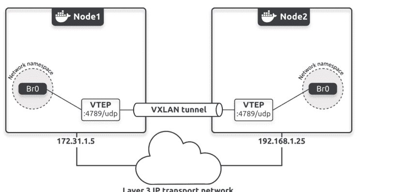

图 14.6

此时，你已经创建了 `VXLAN` 覆盖网络（overlay），准备好连接容器了。

Docker 现在会在每个容器中创建一个虚拟以太网适配器（veth），并将其连接到本地 `Br0` 虚拟交换机。最终的拓扑结构如图 14.7 所示，尽管很复杂，但现在你应该看到尽管位于两个不同的网络，容器是如何通过 `VXLAN` 覆盖网络进行通信的——覆盖网络是一个通过底层网络（underlay）传输的虚拟网络。

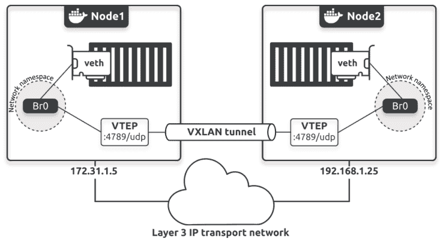

图 14.7

既然你已经知道 Docker 如何创建覆盖网络，让我们来看看这两个容器是如何通信的。

> 警告！此部分技术性很强，你不需要在日常操作中理解所有内容。

在这个示例中，我们将 node1 上的容器称为“C1”，将 node2 上的容器称为“C2”。我们假设 C1 像我们之前在实际示例中所做样 ping C2。图 14.8 显示了添加了容器名称和 IP 的完整配置。


### 图 14.8

**C1** 向 `10.0.0.4` 发起 ping 请求——这是 **C2** 的 IP 地址。

**C1** 在其本地 MAC 地址表（ARP 缓存）中没有 `10.0.0.4` 的条目，因此它在所有接口上泛洪数据包，包括连接到 **Br0** 桥接器的 veth 接口。**Br0** 桥接器知道可以将指向 `10.0.0.4` 的流量转发到连接的 `VTEP` 接口，并向容器发送代理 ARP 响应。这导致 veth 通过更新自己的 MAC 表来**学习**如何转发数据包，以便将未来所有指向 `10.0.0.4` 的数据包直接发送到本地 `VTEP`。**Br0** 交换机知道 **C2** 容器是因为 Docker 会通过网络内置的 gossip 协议将所有新容器的细节传播到每个 swarm 节点。

接下来，C1 容器中的 veth 将 ping 发送到 `VTEP` 接口，接口对其进行封装以通过 `VXLAN` 隧道传输。封装添加了一个 `VXLAN` 头部，其中包含 `VXLAN` 网络 ID（`VNID`），该 ID 将流量从 VLAN 映射到 `VXLAN`，反之亦然——每个 VLAN 被映射到其自己的 `VNID`，这样数据包就可以在接收端被解封装并转发到正确的 VLAN。这维护了网络隔离。

封装还将将帧封装在 UDP 数据包中，并将 node2 上远程 `VTEP` 的 IP 添加到*目的 IP 字段*中。它还添加了 UDP/`4789` 套接字信息。这种封装允许数据包跨越底层网络进行路由，而底层网络无需了解任何关于 `VXLAN` 的信息。

当数据包到达 node2 时，主机内核看到它的目标是 UDP 端口 `4789`，并知道有一个绑定到该套接字的 `VTEP`。这意味着它将数据包发送到 `VTEP`，`VTEP` 读取 `VNID`，对其解封装，并将其发送到与 `VNID` 对应的本地 `Br0` 交换机。从那里，它将其交付给 C2 容器。

朋友们，这就是 Docker 如何使用 `VXLAN` 构建和运行覆盖网络——这一系列令人惊叹的复杂性被完美地隐藏在单个 Docker 命令之后。

我希望这些内容足够让你开始，并在你与网络团队讨论 Docker 基础设施的网络方面时为你提供帮助。关于与网络团队交流的话题……千万不要想着你现在已经了解了 `VXLAN` 的一切就去接触他们。如果你真的那样，你可能会让自己难脸。我是经验之谈 ;-)-

最后一点。Docker 还支持在覆盖网络内部进行层3 路由。例如，你可以创建一个带有两个子网的单一覆盖网络，Docker 将处理路由。以下命令将创建一个名为 **prod-net** 的新覆盖网络，带有两个子网。Docker 将在沙箱内自动创建两个名为 **Br0** 和 **Br1** 的虚拟交换机并处理所有路由。

```
$ docker network create --subnet=10.1.1.0/24 --subnet=11.1.1.0/24
```

## 清理

如果你一直跟着操作，你已经创建了一个名为 **uber-net** 的覆盖网络并部署了一个名为 **test** 的服务。你可能 true了一个 swarm。

运行以下命令删除 test 服务。

```
$ docker service rm test
```

使用以下命令删除 uber-net 网络。你可能需要等待几秒钟，Docker 正在删除使用它的服务。

```
$ docker network rm uber-net
```

如果你不再需要 swarm，可以运行 `docker swarm leave -`

- Linux 容器：`/var/lib/docker/<storage-driver>/...`
- Windows 容器：
  `C:\ProgramData\Docker\windowsfilter\...`

尽管本地存储层允许你更新运行中的容器，但你不应该这样做这样做。相反，你应该将容器视为不可变对象，一旦部署就永远不要更改它们。例如，如果你需要修复或更改运行中容器的配置，你应该创建一个并测试带有更改的新容器，然后用新容器替换运行中的容器。

明确一点，数据库等应用程序可以更改它们管理的数据。但用户和配置工具永远不应该更改容器的*配置*，例如网络或应用程序配置。你应该始终在新容器中进行此类更改，然后用新容器替换旧容器。

如果你的容器不创建持久化数据，那么这个薄薄的可写本地存储层就足够了，你可以直接使用。然而，如果你的容器创建持久化数据，你需要阅读下一节。

## 使用卷（Volumes）

使用卷来处理容器中的持久化数据主要有三个原因：

- 卷是独立对象，不绑定到容器的生命周期
- 不同 Docker 主机上的容器可以使用同一个卷来访问和共享相同的数据

从高层次来说，你创建一个卷，然后创建一个容器，最后将卷挂载到容器中。当你将其挂载时，你将其挂载到容器文件系统中的一个目录，写入该目录的任何内容将存储在卷中。如果你删除了容器，卷和数据仍然存在。你甚至可以将存存的卷挂载到另一个容器中。

图 15.2 显示了容器外的独立对象 Docker 卷。卷被挂载到容器文件系统的 `/data`，写入该目录的任何内容都将存储在卷中，并在你删除容器后仍然存在。


图 15.2 卷和容器的高层次视图

该图还显示你可以将卷映射到外部存储系统或 Docker 主机上的目录。外部存储系统可以是云服务或专用存储设备，但无论何种，卷的生命周期都是与容器解耦的。容器的所有其他目录都使用 Docker 主机本地存储区域的薄可写层。

### 创建和管理 Docker 卷

卷是 Docker 中的一等公民。这意味着存在 `docker volume` 子命令，以及 API 中的 `volume` 资源。

运行以下命令创建一个名为 **myvol** 的新卷。

```
$ docker volume create myvol

myvol
```

默认情况下，Docker 使用内置的 `local` 驱动程序创建新卷。正如该驱动程序的名称所示，这些卷仅对与卷相同节点上的容器可用。你可以使用 `-d` 标志来指定不同的驱动程序，但你需要先安装该驱动程序。

第三方驱动程序提供了高级功能以及访问外部存储系统的权限，例如云存储服务和本地存储系统（如 SAN 和 NAS）。图 15.3 显示了通过插件（驱动程序）连接到外部存储系统的 Docker 主机。


图 15.3 将外部存储接入 Docker

一旦创建了卷，你可以使用 `docker volume ls` 命令查看它，并使用 `docker volume inspect` 命令对其进行检查。

```
$ docker volume ls

DRIVER VOLUME NAME

local myvol
```

```
$ docker volume inspect myvol

{
  "CreatedAt": "2024-05-15T12:23:14Z",
  "Driver": "local",
  "Labels": null,
  "Mountpoint": "/var/lib/docker/volumes/myvol/_data",
  "Name": "myvol",
  "Options": null,
  "Scope": "local"
}
```

注意，**Driver** 和 **Scope** 字段都被设置为 **local**。这意味着你使用 **local** 驱动程序创建了卷，它仅对此 Docker 主机上的容器可用。**Mountpoint** 告诉你卷在 Docker 主机文件系统中的位置。

默认情况下，Docker 为每个使用 **local** 驱动程序创建的卷在主机 `/var/lib/docker/volumes` 下提供一个自己的目录。这意味着任何访问 Docker 主机的人都可以绕过容器，直接在主机文件系统中访问卷的内容。你在 Docker Compose 章节中见过这一点，当时我们直接将一个文件复制到 Docker 主机上的卷目录中，该文件立即出现在容器内部的卷中。然而，这不是推荐的做法。

现在你已经创建了卷，可以创建容器来使用它。然而，在在此之前，有两种删除 Docker 卷的方法：

- `docker volume prune`
- `docker volume rm`

`docker volume prune` 命令会删除所有未挂载到容器或服务副本的卷，因此请谨慎使用！

`docker volume rm` 命令更精确，允许你指定要删除的卷。

这两个命令都不会删除正被容器或服务副本使用的卷。

由于由于你创建的 `myvol` 卷没有被容器使用，因此你可以使用任何一个命令删除它。如果你使用 `prune` 命令，请小心，因为它可能删除其他卷。

```
$ docker volume prune --all

WARNING! This will remove all local volumes not used by at least

Are sure you want to continue? [y/N] y

Deleted Volumes:

myvol

Total reclaimed space: 0B
```

恭喜。你已经创建、检查并删除了一个 Docker 卷，且这些操作都不涉及容器。这证明了卷与容器是解耦的。

此时，你已经熟悉了创建、列出、检查和删除 Docker 卷的所有命令。你甚至学会了如何通过 Compose 和 Swarm 堆栈中的 Compose 文件来部署它们。然而，你也可以通过 Dockerfile 使用 `VOLUME` 指令来部署卷。格式为 `VOLUME <container-mount-point>`。有趣的是，在 Dockerfile 中定义卷时，你无法指定主机目录。这是因为主机目录取决于你的主机操作系统，如果你指定了一个主机上不存在的目录，可能会很容易破坏你的构建。因此，在 Dockerfile 中定义卷需要在部署时指定主机目录。

### 在容器中使用卷

让我们看看如何在容器中使用卷卷。

运行以下命令创建一个名为 `voltainer` 的新独立容器，该容器挂载了一个名为 `bizvol` 的卷。

```
$ docker run -it --name voltainer \
  --mount source=bizvol,target=/vol \
  alpine
```

该命令指定了 `--mount` 标志，告诉 Docker 将名为 `bizvol` 的卷挂载到容器的 `/vol`。尽管你没有名为 `bizvol` 的卷，命令也成功执行了。这提出了一个重要的点：

- 如果指定了一个已经存在的卷，Docker 将使用它
- 如果指定了一个不存在的卷，Docker 将创建它

在我们的案例中，`bizvol` 不存在，所以 Docker 创建了它并将其挂载到容器中。

输入 **Ctrl-PQ** 返回本地 shell，然后列出卷以确保 Docker 已创建了它。

```
### <Ctrl-PQ>
$ docker volume ls

DRIVER          VOLUME NAME

local           bizvol
```

尽管卷与容器解耦，但 Docker 不允许你删除这个卷，因为它正被 **voltainer** 容器使用。

尝试删除它。

```
$ docker volume rm bizvol

Error response from daemon: remove bizvol: volume is in use - by
```

正如预期，你无法删除它。

该卷是全新的，所以没有任何数据。让我们 **exec** 进入容器并其中写入一些数据。

```
$ docker exec -it voltainer sh

### echo "I promise to write a book review on Amazon" > /vol/file
```

该命令将某些文本写入挂载卷的 **/vol** 目录下的名为 **file** 的文件中。

运行几个命令确保文件和数据存在。

```
# ls -l /vol

total 4

-rw-r--r-- 1 root root 50 May 23 08:49 file1

# cat /vol/file1

I promise to write a book review on Amazon
```

**exit** 返回到你的 Docker 主机的 shell，然后使用以下命令删除容器。

```
# exit
$ docker rm voltainer -f

volrainer
```

检查 Docker 是否删除了容器但保留了卷。

```
$ docker ps -a

CONTAINER ID IMAGE COMMAND CREATED STATUS

$ docker volume ls

DRIVER VOLUME NAME

local bizvol
```

由于卷仍然存在，你可以在 Docker 宿机的本地文件系统中查看其内容。但记住，不建议通过宿主机文件系统直接访问卷。我们这样做只是出于演示教学目的向你展示如何操作。

在你的 Docker 宿主机终端中运行以下命令。它们将显示卷在 Docker 宿主机上的目录内容。第一个命令将显示该文件仍然存在，第二个命令将显示其内容。

此步骤在 Docker Desktop 上不起作用，因为 Docker Desktop 运行在虚拟机内部。你可能需要在命令前加上 `sudo`。

```
$ ls -l /var/lib/docker/volumes/bizvol/_data/

total 4

-rw-r--r-- 1 root root 50 Jan 12 14:25 file1

$ cat /var/lib/docker/volumes/bizvol/_data/file1

I promise to write a book review on Amazon
```

太棒了，卷和数据仍然存在。

看看你是否能将现有 **bizvol** 卷挂载到一个新的服务或容器中。运行以下命令创建一个名为 **newctr** 的新容器，并将 `bizvol` 挂载到 `/vol`。

```
$ docker run -it \
--name newctr \
  --mount source=bizvol,target=/vol \
alpine sh
```

你的终端现在已连接到 **newctr** 容器。检查卷和数据是否已按预期挂载。

```
# cat /vol/file1

I promise to write a book review on Amazon
```


恭喜。你创建了一个卷，向其中写入了一些数据，删除了原始容器，在第二个容器中挂载了它，并验证了数据仍然存在。

输入 `exit` 退出容器并跳转到 Amazon 写下你承诺要写的书评。

如果你留了评论，谢谢！如果你没留，我会哭的 :-)

### 在跨集群节点间共享存储

将 Docker 与*外部存储系统*集成，可以让你能够向多个节点呈现共享存储，使得运行在不同节点上的容器可以共享同一个卷。这些外部系统可以是云存储服务，也可以是你本地数据中心中的企业级存储系统。例如，你可以向多个 Docker 宿主机呈现单个存储 LUN 或 NFS 共享（共享卷），以便这些宿主机上的任何容器都可以访问并共享该卷。图 15.4 显示了一个外部存储系统向两个 Docker 节点呈现共享卷。Docker 节点使用对应外部系统的适当驱动程序，使共享卷对一个或两个容器可用。


图 15.4

构建像这样的共享设置需要很多要素。你需要访问特殊存储系统的权限，并了解它们的工作原理。你还需要一个与外部存储系统兼容的卷驱动程序/插件。最后，你需要了解应用程序如何读写共享存储，以避免潜在的数据损坏。

#### 潜在的数据损坏

数据损坏是任何共享存储配置主要关注的问题。

假设基于图 15.4 有以下示例。

运行在 `ctr1` 中的应用程序向共享卷写入了一次更新。然而，它并没有直接提交更新，而是将其保留在本地缓存中以便更快地调取。此时，`ctr1` 中的应用程序认为它已经将数据写入了卷。但是，在 `ctr1` 刷新缓存并将数据提交到卷之前，实际上只有 `ctr2` 中的应用程序用不同的值更新了相同的数据并将其直接提交到卷。此时，两个应用程序都认为它们已经更新了卷中的数据，但 `ctr2` 的应用程序领先了几秒。随后，`ctr1` 将数据刷新到卷并覆盖了 `ctr2` 应用程序所做的更改。然而，两个应用程序都没有感知到对方所做的更改。

这就是为什么你需要设计共享数据的应用程序，以协调共享卷的更新。

### 清理

如果你一直跟着操作，那么你现在会有一个容器和一个卷。

运行以下命令删除容器。

```
$ docker rm
```

现在，运行此命令删除卷。

```
$ docker volume rm bizvol
```

### 卷与持久化数据 – 命令列表

- `docker volume create` 创建新卷。默认情况下，它使用 `local` 驱动程序创建，但你可以使用 `-d` 标志指定不同的驱动程序。
- `docker volume ls` 列出 Docker 宿主机上所有的卷。
- `docker volume inspect` 显示卷的详尽信息。你可以使用此命令查看卷在 Docker 宿主机文件系统中的位置。
- `docker volume prune` 删除**所有**未被容器或服务副本使用的卷。**请谨慎使用！**
- `docker volume rm` 删除未使用的特定卷。

### 章节总结

数据主要有两种类型：*持久化*和*非持久化*。

持久化数据是你需要保留的数据，而非持久化数据是你不需要保留的数据。

默认情况下，所有容器都会获得一个可写的非持久化存储层，该层随容器的创建而消失。我们有时将这种非持久化数据的存储称为*本地存储*。然而，如果你的应用程序创建了你需要保留的数据，你应该将数据存储在 Docker 卷中。

Docker 卷是 Docker API 中的一级对象，你可以使用自己的 `docker volume` 子命令独立于容器管理它们。这意味着删除容器不会删除其卷中的数据。

存在一些第三方插件，可以让 Docker 访问特殊的外部存储系统。

卷是 Docker 环境中处理持久化数据的推荐方式。

## 16：Docker 安全

如果安全变得很困难，我们就不可能去实现它。坦率地说，Docker 的大部分安全功能都是简单的，并且预配置了合理的默认值。这意味着你无需任何努力就能获得中等水平的安全体验。默认设置并不完美，但它们是一个很好的起点。

Docker 支持所有主要的 Linux 安全技术，并添加了一些自己的功能。因此，我将章节进行了划分，首先涵盖 Linux 安全技术，最后以涵盖 Docker 技术结束章节：

- Docker 安全 – 核心摘要
- Linux 安全技术
  - 内核命名空间 (Kernel namespaces)
  - 控制组 (Control Groups)
  - 权限 (Capabilities)
  - 强制访问控制 (Mandatory Access Control)
  - seccomp
- Docker 安全技术
  - Swarm 安全
  - Docker Scout 与漏洞扫描
  - Docker 内容信任 (Content Trust)
  - Docker 密钥 (Secrets)

本章重点关注 Linux，但与 Docker 安全相关的部分适用于 Linux 和 Windows 容器。

### Docker 安全 – 核心摘要

良好的涉及到分层和深度防御，层数越多越好。幸运的是，Docker 提供了许多安全层，包括图 16.1 所示的内容。


图 16.1

如你所见，Docker 利用了常见的 Linux 安全和工作负载隔离技术，包括命名空间、控制组、权限、强制访问控制 (MAC) 和 seccomp。它为每种技术都提供了合理的默认设置，但你可以根据特定需求对其进行自定义。

Docker 也有它自己的安全技术，包括 Docker Scout 和 Docker 内容信任。

Docker Scout 提供了领先的漏洞扫描功能，可以扫描你的镜像，提供已知漏洞的详细报告并建议解决方案。Docker 内容信任 (DCT) 允许你对镜像进行加密签名和验证。

如果你使用 Docker Swarm，还将获得 Docker 自动配置的所有内容：加密的节点 ID、双向认证 (TLS)、自动 CA 配置和证书轮换、安全的集群加入令牌、加密集群存储、加密网络等。

还存在其他安全相关的技术，但重要的是，Docker 与主要的 Linux 安全技术协同工作，并添加了一些自己的功能。有时，Linux 安全技术可能复杂且难以处理，但 Docker 原生的技术总是易于操作的。

### 内核命名空间

内核命名空间（Kernel namespaces，通常简称为 namespaces）是构建容器的主要技术。

让我们快速比较一下命名空间（namespaces）、容器与虚拟机管理程序（hypervisors）以及虚拟机（VM）。

命名空间将进程树和文件系统等操作系统结构虚拟化，而虚拟机管理程序则将 CPU 和磁盘等物理资源虚拟化。在虚拟机模型中，虚拟机管理程序通过组合虚拟 CPU、虚拟磁盘和虚拟网卡来创建虚拟机，使得每个虚拟机看起来、用起来和感觉就像一台物理机器。在容器模型中，命名空间（容器）通过组合虚拟进程树、虚拟文件系统和虚拟网络接口，使得每个容器看起来、用起来和感觉完全像一个普通的操作系统。

从很高的层次来说，命名空间提供了轻量级的隔离，但没有提供强大的安全边界。与虚拟机相比，容器效率更高，但虚拟机更安全。

不过不用担心。Docker 等平台实现了额外的安全技术，如 cgroups、capabilities 和 seccomp，以提高容器安全性。

命名空间是一项经过测试的技术，在 Linux 内核中已经存在很长时间。然而，在 Docker 出现之前，它们非常复杂且难以使用，直到 Docker 通过简单的 `docker run` 命令和开发者友好的 API 隐藏了所有复杂性。

在编写本文时，每个 Docker 容器都会获得以下命名各自的独立实例：

- 进程 ID (pid)
- 网络 (net)
- 文件系统/挂载 (mnt)
- 进程间通信 (ipc)
- 用户 (user)
- UTS (uts)

图 16.2 显示了一个运行两个容器的单个 Docker 主机。宿主机操作系统有一组我们称为*根命名空间*（root namespaces）的集合，而每个容器都有自己的等效隔离命名空间集合。容器中的应用程序认为它们运行在自己的主机上，并且感知不到*根命名空间*或其他容器中的命名空间。


让我们简要查看 Docker 如何使用每个命名空间：

- **Process ID 命名空间：** Docker 使用 pid 命名空间为每个容器提供独立的隔离进程树。这意味着每个容器都有自己的 PID 1，无法看到或访问运行在其他容器中的进程。任何容器也无法看到或访问运行在宿主机上的进程。
- **Network 命名空间：** Docker 使用 net 命名空间为每个容器提供隔离的网络栈。该堆栈包括接口、IP 地址、端口范围和路由表。例如，每个容器都拥有自己的 eth0 接口，具有其唯一的 IP 和端口范围。
- **Mount 命名空间：** 每个容器都有自己的 mnt 命名空间，具有其独特的隔离根（ / ）文件系统。这意味着每个容器都可以拥有自己的 /etc、/var、/dev 以及其他重要的文件系统结构。容器内的进程无法访问宿主机的文件系统或其他容器的文件系统。
- **Inter-process Communication 命名空间：** Docker 使用 ipc 命名空间用于容器内部的共享内存访问。它还将容器与宿主机或其他容器的共享内存隔离开。
- **User 命名空间：** Docker 为每个容器提供仅在容器内有效的用户。它还允许将这些用户映射到 Docker 主机上的不同用户。例如，你可以将容器的根用户（root）映射到宿主机上的非 root 用户。
- **UTS 命名空间：** Docker 使用 uts 命名空间为每个容器提供自己的主机名。

请记住，容器是 Docker 组织的看起来像普通操作系统的命名空间集合。这些命名空间提供了隔离，但它们本身并不是足够的安全边界。这就是为什么 Docker 使用我们即将讨论的技术来增强容器安全性。

### 控制组 (Control Groups)

如果说命名空间关乎隔离，那么控制组（cgroups）就关乎限制。

将容器想象成类似于酒店里的房间。虽然每个房间看起来是隔离的，但它们实际上共享许多东西，如水供应、电力供应、空调、游泳池、电梯、健身房、早餐吧等。容器也是如此——尽管它们是隔离的，但它们共享许多公共资源，如宿主机的 CPU、内存、网络 I/O 和磁盘 I/O。

Docker 使用 cgroups 来限制容器对这些共享资源的使用，防止任何容器消耗所有资源并导致拒绝服务（DoS）攻击。

### 权限 (Capabilities)

Linux root 用户极其强大，你不应该使用它来运行应用和容器。

然而，这并不像将它们作为非 root 用户运行那么简单，因为大多数非 root 用户非常无力，实际上毫无用处。我们需要的是一种以容器所需的精确权限集运行容器的方法——不多，也不少。这就是 capabilities 大显身用场的地方。

在底层，Linux root 用户是多种能力的组合。其中一些包括：

- `CAP_CHOWN`: 允许更改文件所有者
- `CAP_NET_SERVICE`: 允许将 socket 绑定到低端口
- `CAP_SETUID`: 允许提升进程的权限级别
- `CAP_SYS_BOOT`: 允许重启系统

列表还有很多，非常长。Docker 利用 capabilities，使你能够以 root 身份运行容器，但剥离所有你需要的能力。例如，假设你的容器唯一能力是绑定到低端口。在这种情况下，Docker 可以以 root 身份启动容器，删除所有能力，然后重新添加 `CAP_NET_SERVICE`。

Docker 自带了合理的开箱即用能力，但你应该为你的应用和容器配置自己的能力。然而，配置自己的能力需要巨大的精力。

### 强制访问控制系统 (Mandatory Access Control systems)

Docker 与主要的 MAC 技术兼容，如 AppArmor 和 SELinux。

取决于你使用的 Linux 发行版，Docker 对所有新容器应用默认的 AppArmor 或 SELinux 配置文件。根据 Docker 文档，默认配置提供了适度的保护，同时提供了广泛的应用兼容性。

你可以告诉 Docker 在不使用这些策略的情况下启动容器，你也可以配置自己的策略。然而，配合 capabilities，配置自己的策略非常强大，但需要大量精力。

### seccomp

Docker 使用 seccomp 来限制容器向宿主机内核发出的系统调用（syscalls）。

系统调用应用程序请求 Linux 内核执行任务的方式。在编写本文时，Linux 拥有 300 多个系统调用，Docker 默认配置禁用了大约 40-50 个。

根据 Docker 的安全哲学，所有新容器都配置了默认的 seccomp 配置文件，其默认设置设计合理，旨在提供适度的安全性而不影响应用兼容性。

一如既往，你可以自定义自己的 seccomp 配置文件，或者告诉 Docker 在不使用配置的情况下启动容器。遗憾的是，Linux 系统调用表很长，对于某些用户来说，配置自定义 seccomp 策略可能复杂到难以接受。

### 关于 Linux 安全技术的总结

Docker 支持大多数重要的 Linux 安全技术，并带有合理的默认设置，在增加安全性的同时不会过于限制。图 16.3 显示了 Docker 如何使用这些技术构建多层的深度防御安全态势。


图 16.3 - Linux 安全深度防御

### Docker 安全技术

让我们转向 Docker 提供的某些安全技术。

### Swarm 安全

Docker Swarm 允许你对多个 Docker 主机进行集群并声明式管理应用程序。每个 Swarm 包含

管理节点和工作节点可以是 Linux 或 Windows 系统。管理节点托管控制平面，负责配置集群和分发工作任务。工作节点运行应用程序容器。

幸运的是，swarm 模式包含了许多安全特性，Docker 会自动根据合理的默认值对其进行配置。这些包括：

- 加密型节点 ID
- 用于双向认证的 TLS
- 安全的加入令牌（join tokens）
- 具有自动证书轮换功能的 CA 配置
- 加密的集群存储
- 加密的网络

让我们逐步学习构建一个安全的 swarm 并配置一些安全方面的 Aspect。

如果你正在跟进操作，你需要三个能够通过名称相互 ping 通的 Docker 主机。示例使用了三个名为 `mgr1`、`mgr2` 和 `wrk1` 的主机。

#### 配置安全的 Swarm

在你想要作为第一个节点的节点上运行以下命令。我们将从 `mgr1` 运行示例。

```
$ docker swarm init

Swarm initialized: current node (7xam...662z) is now a manager.
```

大搞定！你已经配置了一个安全的 swarm，它具有加密的集群 ID、加密的集群存储、一个具有 90 天证书轮换策略的证书授权机构、一组用于添加新管理节点和工作节点的安全加入令牌，并为当前管理节点配置了用于双向 TLS 的客户端证书——这一切只需一个命令！

图 16.4 显示了当前的 swarm 配置。在你的实验环境中某些细节可能会有所不同。


图 16.4

让我们加入 `mgr2` 作为额外的管理节点。

加入新的管理节点有两个步骤：

- 提取安全的加入令牌
- 在要添加的节点上执行带有加入令牌的 `docker swarm join` 命令

从 `mgr1` 运行以下命令以提取节点加入令牌。

```
$ docker swarm join-token manager

要向此 swarm 添加管理节点，请运行以下命令：

docker swarm join --token \
SwMTKN-1-ldmtwu...r17stb-2axi5...8p7glz \
172.31.5.251:2377
```

输出为你提供了在 `mgr2` 上运行的完整命令和加入令牌。加入令牌和 IP 地址在你的实验环境中会有所不同。

加入命令的格式为：

- `docker swarm join --token <manager-join-token>:<ip-of-existing-manager>:<swarm-port>`

令牌的格式为：

- `SWMTKN-1-<hash-of-cluster-certificate>--<manager-join-token>`

复制命令并在 `mgr2` 上运行：

```
$ docker swarm join --token SWMTKN-1-1dmtwu...r17stb-2axi5...8p7g

此节点已作为管理节点加入 swarm。
```

列出你 swarm 中的节点。

| ID | HOSTNAME | STATUS | AVAILABILITY | MANAGER STATUS |
|---|---|---|---|---|
| 7xamk...ge662z | mgr1 | Ready | Active | Leader |
| i0ue4...zcjm7f * | mgr2 | Ready | Active | Reachable |

现在你拥有有一个由 `mgr1` 和 `mgr2` 作为管理节点的双节点 swarm。它们都可以访问集群存储，并配置了用于双向 TLS 的客户端证书。

在现实世界中，为了高可用性，你总是会运行三个或五个管理节点。

图 16.5 显示了包含两个管理节点的更新 swarm。


添加工作节点是类似的两个步骤过程——提取加入令牌并在节点上运行命令。

在任一管理节点上运行以下命令以暴露工作节点加入令牌。

```
$ docker swarm join-token worker
```


要向此 swarm 添加工作节点，请运行以下命令：

```
docker swarm join --token \
SWMTKN-1-ldmtwu...r17stb-2axi5...8p7glz \
172.31.5.251:2377
```

复制命令并在 `wrk1` 上运行：

```
$ docker swarm join --token SWMTKN-1-1dmtwu...r17stb-2axi5...8p7g
```

此节点已加入 swarm。

从你的任一管理节点运行另一个 `docker node ls`。

| ID | HOSTNAME | STATUS | AVAILABILITY | MANAGER |
|---|---|---|---|---|
| 7amk...ge62z * | mgr1 | Ready | Active | Leader |
| airdl...ofzvlu | wrkl | Ready | Active | |
| i10eue4...zcjm7f | mgr2 | Ready | Active | Reachable |

你的 swarm 有两个管理节点和一个工作节点。管理节点配置了高可用性 (HA)，且集群存储复制到两个节点。图 16.6 显示了最终配置。


图 16.6

现在你已经构建了一个安全的 Swarm，让我们检查一些安全方面。

### Swarm 加入令牌

加入管理节点和工作节点的唯一要求是拥有安全的加入令牌。这意味着你应该妥善保存它们，永远将其发布在公共仓库甚至不受限制的内部仓库中。

每个 swarm 维护两个不同的加入令牌：

- 管理节点令牌
- 工作节点令牌

每个加入令牌都有四个由连线分隔的字段：

`PREFIX` - `VERSION` - `SWARM ID` - `TOKEN`

前缀始终是 `SWMTKN`，允许你对它进行模式匹配以防止人们意外发布。`VERSION` 字段指示 swarm 的版本。`Swarm ID` 字段是集群证书的哈希值。`TOKEN` 字段是工作节点或管理节点的令牌。

如下表所示，对于任何给 swarm，管理节点和工作节点的令牌除了最后的 `TOKEN` 字段外都是相同的。

你可以通过向 `docker swarm init` 命令传递 `--external-ca` 标志来配置新集群使用外部 CA，并可以使用 `docker swarm ca` 命令管理其他 CA 相关的设置。

```
$ docker swarm ca --help

Usage: docker swarm ca [OPTIONS]

显示并轮换根 CA

Options:

  --ca-cert pem-file      新集群 PEM 格式根证书的路径

  --ca-key pem-file       新集群 PEM 格式私钥的路径

  --cert-expiry duration 节点证书的有效期（默认为 2160h0m0）

  -d, --detach           立即退出而不是等待收敛

  --external-ca external-ca 一个或多个 ca 的规范

  -q, --quiet            抑制进度输出

  --rotate               轮换 swarm CA - 如果未提供 ca，则将生成新的 ca
```

### 集群存储 (The cluster store)

集群存储是 Docker 存放 swarm 集群配置和状态的地方。它对于其他 Docker 技术（如叠加网络 `overlay` 和 `secrets`）也至关重要。这就是为什么叠加网络许多许多高级安全功能仅在 swarm 模式下运行的原因。

集群存储基于流行的 `etcd` 分布式数据库，并会自动加密和复制到所有管理节点（`managers`）。

Docker 处理日常维护，但你应该为生产集群实现强力的备份和恢复程序。

关于 swarm 模式安全的介绍就到此这里。让我们来看一些不需要 swarm 模式的 Docker 安全技术。

### Docker Scout 与漏洞扫描 (Docker Scout and vulnerability scanning)

每个容器运行着多个软件软件包，这些软件包可能存在漏洞，恶意者可以利用这些漏洞。

镜像扫描会分析你的镜像并生成一份所有使用的软件软件包的详细列表。我们将此列表称为软件材料清单 (`SBOM`)，镜像扫描系统会将 `SBOM` 与已知漏洞数据库进行对比，并提供软件漏洞的报告。大多数漏洞扫描器会对漏洞进行排序并提供修复建议。

漏洞扫描现在是大多数软件供应链中不可或缺的一部分。

`Docker Scout` 是 Docker 的原生扫描平台，与 Docker Hub、Docker Desktop、Docker CLI 工作，甚至有自己的 Docker Scout Dashboard。然而，它是一项基于订阅的服务。

其他扫描平台可用，但大部分也需要某种形式的订阅。

如果你正在使用 Docker Desktop，可以运行以下命令查看 Docker Scout 的示例。

```
$ docker scout quickview nigelpoulton/tu-demo:latest

✓ 已从证明获取来源

✓ 已拉取

✓ 镜像已存储用于索引

✓ 已索引 66 个软件包

| Target | nigelpoulton/tu-demo:latest | 0C |

| :--- | :--- | :--- |

| digest | b4210d0aa52f | |

| Base image | python:3-alpine | 0C |

| Updated base image | python:3.11-alpine | 0C |
```

输出显示为零关键漏洞 (`0C`)、四个高危 (`4H`)、两个中 (`2M`) 和零低级 (`0L`)。

你还可以运行 `docker scout cves` 命令来获取更详细的信息，包括修复建议。

```
$ docker scout cves nigelpoulton/tu-demo:latest

✓ 镜像 SBOM 已缓存，66 个软件包已索引

✓ 检测到 6 个漏洞软件包，总共 8 个漏洞

### 概述

已分析镜像

| Target | nigelpoulton/tu-demo:latest

| :--- | :--- |

| digest | b4210d0aa52f |

| platform | linux/arm64 |

| vulnerabilities | 0C 4H 2M 0L |

| size | 26 MB |

| packages | 66

### 软件包与漏洞

0C 1H 1M 0L expat 2.5.0-r2

pkg:apk/alpine/expat@2.5.0-r27os_name=alpine&os_version=3.14

* 高危 CVE-2023-52425

https://scout.docker.com/v/CVE-2023-52425

影响范围：<2.6.0-r0

修复版本： 2.6.0-r0

* 中危 CVE-2023-52426

https://scout.docker.com/v/CVE-2023-52426

影响范围：<2.6.0-r0

修复版本： 2.6.0-r0

<Snip>
```

我截取了输出，所以它只显示了部分漏洞。然而，即使从书中的截取输出中，你可以看到：

- Scout 扫描了 66 个软件包并检测到几个漏洞
- 我们正在使用 2.5.0-r2  `expat` 软件包，它包含一个高危 (`1H`) 和一个中 (`1M`) 漏洞
- 高危漏洞列为 `CVE-2023-52425`，中危为 `CVE-2023-52426`
- 报告包含了指向 Scout 报告的链接，其中包含每个漏洞的更多信息
- Scout 建议更新到 `expat` 版本 `2.6.0-r0`，该版本包含了这两个漏洞的修复

图 16.8 显示了在 Docker Desktop 中的外观，你也可以在 Docker Hub 中获得类似的集成和视图。


如果你订阅了 Docker Scout，可以使用 `scout.docker.com` 门户配置策略以及与 Docker Hub 和其他注册表的集成。

尽管漏洞扫描很有用，但它只扫描镜像，不会检测网络、节点或编排器的安全问题。此外，并不是所有扫描器都是同等的。例如，最好的扫描器执行深层二进制级扫描，而其他可能只查看包名而不仔细检查内容。

总之，扫描工具对于检查你的镜像和检测已知漏洞非常棒。但要注意，知得越多，责任越大——一旦你意识到了漏洞，你就有责任缓解或修复它们。

### 使用 Docker Content Trust 签名并验证镜像 (Signing and verifying images with Docker Content Trust)

Docker Content Trust (`DCT`) 让你能够轻松验证镜像的完整性和发布者，当你通过互联网等不可信的网络拉取镜像时，这一点尤为重要。

从高层次来说，`DCT` 允许你在将镜像推送到 Docker Hub 等仓库时对其签名。它还允许你验证拉取并作为容器运行的镜像。

图 16.9 显示了高层流程。


图 16.9 - Docker Content Trust 镜像签名与验证

你还可以使用 `DCT` 提供*上下文*信息，例如开发者是否已对在特定环境（如 `prod` 或 `dev`）中使用的镜像进行了签名，或者某个镜像是否已被新版本取代，因此已过时。

以下步骤将引导你完成配置 Docker Content Trust、签名并推送镜像，然后拉取已签名的镜像。

如果你计划跟着操作，你需要一个加密密钥对。如果你还没有，可以运行以下 `docker trust` 命令来生成一个。该命令会生成一个名为 `nickel` 的新密钥对，并将其加载到本地信任存储库中备用。它会提示你输入密码语；别忘记它 :-)

```
$ docker trust key generate niger

Generating key for niger...

Enter passphrase for new niger key with ID 1f78609
```
如果你已经有一对密钥了，可以使用 `docker trust key load` 导入它。下一步是将你的密钥对与你将推送镜像的仓库关联。此示例会将 `niger.pub` 密钥与 Docker Hub 上的 `ddd-` 仓库关联。你的文件和仓库将会不同，且在运行命令前仓库不需要存在。

```
$ docker trust signer add --key niger.pub nigpoun/ddd-

Adding signer "niger" to nigpoun/dct...

Initializing signed repository for nigpoun/dct...

Enter passphrase for root key with ID aee3314:

Enter passphrase for new repository key with ID 1a18dd1:

Repeat passphrase for new repository key with ID 1a18dd1:

Successfully initialized "nigpoun/dct"

Successfully added signer: niger to nigpoun/dct
```

现在你加载了密钥对并将其与仓库关联，最后一步是对镜像签名并推送。

以下命令会对本地镜像 `nigelpoulton/ddd-trust:signed` 进行签名并推送到 Docker Hub。你的镜像将具有不同的名称，并且将其推送到不同的仓库。

```
$ docker trust sign nigelpoulton/ddd-trust:signed

Signing and pushing trust data for local image nigelpoulton/ddd-t

The push refers to repository [docker.io/nigelpoulton/ddd-trust]

6495b414566f:7ef8b: Mounted from nigelpoulton/ddd-book

79867f7ef8b: Mounted from nigelpoulton/ddd-book

bca2a409639: Mounted from nigelpoulton/ddd-book

28ad2149d870: Mounted from nigelpoulton/ddd-book

4f4fb700ef54: Mounted from nigelpoulton/ddd-book

5elfc7f5df34: Mounted from nigelpoulton/ddd-book

signed: sha256:b65f91aa4e670bbafad0fbb91281ea95f9cdc7528a

Signing and pushing trust metadata

Enter passphrase for nigel key with ID 92330ea:

Successfully signed docker.io/nigelpoulton/ddd-trust:signed
```

push 操作会在 Docker Hub 上创建仓库，然后签名并推送镜像。你可以在 Docker Hub 上查看该仓库，并运行以下命令检查其签名数据。

```
$ docker trust inspect nigelpoulton/ddd-trust:signed --pretty

Signatures for nigelpoulton/ddd-trust:signed
```

已签名标签摘要 签名者
signed 30e6d35703c578ee...4fcbbbb0f281 nigel

这里是 nigerpoulton/ddd-trust:signed 的签名者列表及其密钥
签名者 密钥
nigel 4d6f1bf55702

这是 nigerpoulton/ddd-trust:signed 的管理员密钥
仓库密钥: 5e72e54afafb8444f...6b27444b32010ad22
根密钥: 40418fc47544ca630...69a2cb89028c22092

你可以导出一个值为 `1` 的 `DOCKER_CONTENT_TRUST` 变量，以强制 Docker 宿主机对所有镜像进行签名和验证。

```
$ export DOCKER_CONTENT_TRUST=1
```

一旦启用该功能，你将无法拉取和使用未签名的镜像。

通过尝试拉取一个未签名的镜像进行测试。

```
$ docker pull nigerpoulton/ddd-book:web0.2

Error: remote trust data does not exist for docker.io/nigerpoulton does not have trust data for docker.io/nigerpoulton/ddd-book
```

你不能再拉取不带信任数据的镜像了！

删除你刚刚签名并推送的镜像本地副本，然后尝试从 Docker Hub 拉取它。你的镜像名称将会有所不同。

```
$ docker rmi nigelpoulton/ddd-trust:signed

Untagged: nigelpoulton/ddd-trust:signed@sha256...
<Snip>
```

现在，尝试拉取该镜像。

```
$ docker pull nigelpoulton/ddd-trust:signed

Pull (1 of 1): nigelpoulton/ddd-trust:signed@sha256:30e6...

docker.io/nigelpoulton/ddd-trust@sha256:30e6... Pulling from nige08409417260: Pull complete

digest: sha256:30e6d37053c578e70323b9dc87ada2ba958c1928615ac8a6

Status: Downloaded newer image for nigelpoulton/ddd-trust@sha256:

Tagging nigelpoulton/ddd-trust@sha256:30e6... as nigelpoulton/docker.io/nigelpoulton/ddd-trust:signed


拉取成功，因为该镜像具有有效的信任数据。

总结来说，Docker 内容信任（Docker Content Trust）是一项重要技术，可以帮助你验证所拉取和运行镜像的完整性。它的基础形式配置简单，但更高级的功能（如上下文）可能会更加复杂。

## Docker Secrets（秘密）

大多数应用程序都会利用密码、证书和 SSH 密钥等敏感数据。幸运的是，Docker 允许将它们封装在 `secrets` 内部以保持安全。

**注意：** `Secrets` 只在 swarm 模式下有效，因为它们利用了集群存储。

在后台，Docker 会在 `secrets` 集群存储中 `静态存储`（at rest）以及在网络中 `传输中`（in flight）时对其进行加密。它还使用 `内存文件系统` 将 `secrets` 挂载到容器中，并采用最小权限模型，即只有被显式授予访问权限的服务可以使用 `secrets`。甚至还有一个 `docker secret` 命令。

图 16.10 显示了创建 secret 并将其部署到服务副本的高级工作流：


### 图 16.10 - Secret 工作流

让我们来看图中的五个步骤。我使用了密钥符号表示 secret，它只对黑暗容器可用。

- 1. 你创建一个 secret
- 2. Docker 将其存储在加密的集群存储中
- 3. 你创建一个服务（黑暗容器）并授予对 secret 的访问
- 4. Docker 在将 secret 通过网络发送到服务副本时对其进行加密
- 5. Docker 将 secret 以未加密文件的形式挂载到内存文件系统，并到服务副本中

浅色容器属于不同的服务，无法访问该 secret。

一旦使用 secret 的副本终止，Docker 就会销毁内存文件系统并从节点中清除 secret。

Docker 以未加密的形式挂载 secrets，以便应用程序可以使用它们，而无需解密所需的密钥。

你可以使用 `docker secret` 命令创建和管理 secrets，并通过向 `docker service create` 命令传递 `--secret` 标志将它们附加到服务。

### 清理

如果你一直按照这些步骤进行操作，那么你已经创建了一个 swarm，添加了一个签名者，在 Docker Hub 上创建了一个新仓库，并导出了环境变量来自动签名和验证镜像。

运行以下命令禁用 Docker 内容信任。你需要在每个启用了 Docker 内容信任的节点上运行它。

```
$ unset DOCKER_CONTENT_TRUST
```

从你创建的仓库中移除签名者。你的签名者和仓库将有不同的名称。

```
$ docker trust signer remove nigelpoulton/ddd-trust

Removing signer "nigel" from nigerpoulton/ddd-trust...

all signed tags are currently revoked, use docker trust sign to f
```

此外，你可能还想删除在 Docker Hub 上创建的仓库，并删除系统上的本地密钥文件（通常是 `.pub` 文件）。

通过运行以下命令删除 swarm：

```
$ docker swarm leave
```

### 章节总结

Docker 内容信任可以配置得非常简单。它允许你签名并验证镜像。Docker secrets 允许你安全地处理敏感数据。虽然 swarm 模式的学习曲线较复杂，但它提供了非常强大的功能。

## 下一步计划

非常感谢阅读我的书。你正通往容器的大师！

## 关于封面

感谢设计封面的人。左侧的 YAML 代码代表了书的主题。右侧的垂直符号是用克林语编写的信息。

## 加入社区

有一个充满活力的社区，可以在网上加入 Docker 群组和聊天。

现在你已经掌握了一些 Docker 知识，下一步是 Kubernetes。它的范围更大，社区更活跃。

我很乐意与你联系讨论 Kubernetes 和其他技术。你可以通过以下方式联系我：

- Twitter: twitter.com/nigelpoulton
- LinkedIn: linkedin.com/in/nigelpoulton
- Mastodon: @nigelpoulton@hachyd.io
- Web: nigelpoulton.com
- YouTube: youtube.com/nigelpoulton

## 反馈与评论

书籍的生存取决于 Amazon 评论和评分。我花了一多的时间写这本书，并坚持不懈地更新它。所以……请花时间在 Amazon 或 Goodreads 上留一个友好的评论。

此外，如果你对未来的版本有内容建议或修复，请联系我。

## 术语表

此词汇表定义了书中用到的一些 Docker 和容器相关术语。

如果你认为我漏掉了某些重要内容，请联系我。

| 术语 | 定义 (根据 Nigel) |
| --- | --- |
| API | 应用程序接口。在 Docker 的情况下，所有资源都定义在 Docker API 中，它是 RESTful 的，并通过 `Docker Daemon` 暴露。 |

| 术语 | 定义 (根据 Nigel) |
| --- | --- |
| Base image | 所有容器镜像的第一层。由 Dockerfile 的 `FROM` 指令创建，通常包含应用程序所需的最小操作系统构造。 |

| 术语 | 定义 (根据 Nigel) |
| --- | --- |
| Build | 构建新容器镜像的过程。Docker 通过执行 Dockerfile 中定义的指令集来 `构建` 镜像。 |

| 术语 | 定义 (根据 Nigel) |
| --- | --- |
| Build Cloud | 一项订阅服务，在 Docker 云端基础设施中执行快速高效的镜像构建。它允许团队之间共享公共构建缓存以实现极速构建。 |
| BuildKit | Docker 的构建引擎，实现了高级构建功能，如高级缓存、多阶段构建和多架构构建。 |

| 术语 | 定义（根据 Nigel 的观点） |
|---|---|
| Buildx | Docker 最新且最强大的构建客户端，支持 BuildKit 的所有最新功能，例如多阶段构建和多架构镜像。自 Docker Engine v23.0 和 Docker Desktop v4.19 起，Buildx 一直是 Docker 的默认构建客户端。 |
| Capability (能力) | Docker 使用的 Linux 内核技术，用于创建具有精确系统访问权限的用户账户。 |
| Cloud native (云原生) | 一个被过度使用的术语，对不同的人来说有不同的含义。云原生是一种设计、构建和运行现代应用程序及基础设施的方式。如果一个应用程序能够自愈、按需扩展、执行滚动更新并进行版本化回滚，我认为它是云原生的。 |
| Cluster store (集群存储库) | Docker Swarm 的分布式数据库，用于保存集群和应用的状态。它基于 etcd 分布式数据库，会自动加密并自动分布在所有 swarm 管理节点上，以实现高可用性。 |
| Compose | 一种用于定义、部署和管理多容器微服务应用的开放规范。Docker 实现了 Compose 规范并提供了 `docker compose` 命令，使得处理 Compose 应用变得简单。 |

容器是内核命名空间的集合，使其看起来、闻起来和感觉起来都像一个普通的操作系统。每个容器运行单个应用程序，并且容器比虚拟机更小、更快、更具移植性。我们有时称之为 Docker 容器或 OCI 容器。

| Container Network (容器网络) | 可扩展的接口，允许不同的网络拓扑和架构。 |
| Model (模型) | 第三方为覆盖网络和 BGP 网络提供 CNM 插件，以及它们的各种实现。 |
| 运行在每个 Docker 节点上的软件，负责拉取容器镜像、启动容器、停止容器以及其他底层容器操作。Docker 使用两个协同工作的运行时：`containerd` 是 Docker 的高级运行时，负责管理启动和停止容器等生命周期事件；而 `runc` 是 Docker 的低级运行时，与命名空间和 cgroups 等内核构造体交互。 |

| containerd | Docker 和大多数 Kubernetes 集群使用的行业标准容器运行时。由 Docker, Inc. 捐赠给 CNCF。发音为“container dee”。 |
| Containerize (容器化) | 将应用程序及其所有依赖打包成容器镜像的过程。 |
| Control Groups (cgroups) | Docker 使用的 Linux 内核特性，用于限制容器使用的主机 CPU、内存、磁盘和网络资源。 |
| Desired state (期望状态) | 你的集群和应用程序应该的状态。例如，一个应用程序微服务的期望状态可能是监听在 8080/tcp 端口的五个 xyz 容器副本。这对于调优至关重要。 |
| Docker | 一个轻松处理容器化应用程序的平台。它允许你构建镜像，以及运行和管理独立容器和多容器应用。 |
| Docker Debug | Docker CLI 插件，允许你轻松调试未包含任何调试工具的精简镜像和容器。 |
| Docker Desktop | 适用于 Linux、Mac 和 Windows 的桌面应用程序，让使用 Docker 变得简单。它拥有精美的 UI 以及许多高级功能，如漏洞管理、漏洞扫描和 Wasm 支持。 |
| Docker Hub | 高性能的 OCI 标准镜像仓库。Docker Hub 拥有超过 57PB 的存储空间，平均每秒处理 3 万次请求。 |
| Docker, Inc. | 总位于美国的科技公司，让开发者能够轻松构建、交付和运行容器化应用程序。Docker 平台背后的公司。 |
| Docker init | 一个新的 Docker CLI 插件，用于创建高保真 Dockerfile 并方便脚手架 Compose 应用。 |
| Docker Scout | Docker 的原生漏洞扫描服务。Scout 是一种与 Docker CLI、Docker Desktop、Docker Hub 以及其他镜像仓库集成的订阅服务。 |
| Dockerfile | 文本文件，包含指令告知 Docker 如何将应用程序构建为容器镜像。 |
| etcd | Docker Swarm 使用的开源分布式数据库。 |
| Image (镜像) | 包含应用程序代码、所有依赖项以及启动单个应用程序所需的元数据的存档。我们有时称之为 OCI 镜像、容器镜像或 Docker 镜像。 |
| Ingress network (接入网络) | 所有 Docker Swarm 集群上的隐藏网络，用于将服务发布给外部客户端。 |
| Kernel (内核) | Docker 使用的 Linux 内核特性，用于将容器与主机或其他容器上运行的进程隔离。 |
| Layer (层) | 镜像层包含了对基础镜像或下方层的修改。Docker 通过堆叠层来构建镜像，每层都包含其下方层的所有更改。一个简单的例子是具有基础操作系统构造的底层，随后是带有应用程序的层。这两个层结合创建了包含操作系统和应用程序的镜像。 |
| libcontainer | 一个使用命名空间、cgroups 和能力来构建容器的 Go 库。Docker 通过 `runc` 低级运行时使用 libcontainer，runc 是 libcontainer 的 CLI 封装器。 |
| libnetwork | Docker 用于创建和管理容器网络的 Go 库。 |
| Microservices (微服务) | 现代应用程序的设计模式。单个应用程序功能被开发为独立的小型应用程序（微服务/容器），并通过 API 进行通信。它们共同工作形成一个实用的应用程序。 |
| Multi-architecture builds (多架构构建，有时也称为多平台构建) | 允许通过单个 `docker build` 命令为多个架构和平台构建镜像。例如，你可以在基于 AMD 的 Windows 系统上运行单个 `docker build` 命令来同时构建 AMD 镜像 **和** ARM 镜像。 |
| Multi-state build (多阶段构建) | 允许你创建非常小的镜像（精简镜像）。你分阶段构建镜像，并且为每个阶段传递必要的产物。每个构建阶段由 Dockerfile 中自有的 `FROM` 指令表示，随后的构建阶段使用 `COPY --from` 指令使用之前阶段的产物并丢弃其他所有内容。 |
| Observed state (观测状态) | 也称为当前状态或实际状态。集群和运行应用程序的最新视图。Docker Swarm 一直努力使观测状态匹配期望状态。 |
| Open Container Initiative (OCI，开放容器倡议) | 负责创建和维护底层容器技术（镜像、运行时和仓库）标准的轻量级治理机构。Docker 创建符合 OCI 标准的镜像，实现符合 OCI 标准的运行时，Docker Hub 是符合 OCI 标准的仓库。 |
| Orchestrator (编排器) | 部署和管理应用的软件。Docker Swarm 和 Kubernetes 是管理微服务应用的示例，它们负责保持应用健康、进行扩展和缩容等…… |
| Overlay network (覆盖网络) | 跨越多个 swarm 节点的大型扁二层网络。同一覆盖网络上的所有容器即使位于不同网络的不同 Docker 主机上也可以相互通信。内置覆盖驱动程序使用先进的 VXLAN 技术创建覆盖网络。它们仅由 Docker Swarm 支持。 |

| 术语 | 定义（根据 Nigel 的观点） |
| --- | --- |
| Push (推送) | 向仓库上传镜像 |
| Pull (拉取) | 从仓库下载镜像 |
| Reconciliation (协调) | 监控应用程序状态并确保观测状态与期望状态匹配的过程。Docker Swarm 运行协调循环，确保应用程序按照你的预期运行。 |
| Registry (仓库) | 存储和检索镜像的中心位置。我们有时将其称为 OCI 仓库、容器仓库或 Docker 仓库。 |

| 术语 | 定义（根据 Nigel 的观点） |
| --- | --- |
| Repository (存储库) | 仓库中存储相关容器镜像的区域。你可以为每个仓库设置访问控制。 |
| Seccomp | Linux 内核的安全计算功能，Docker 利用它来限制容器可用的系统调用（syscall）。 |
| Secret (秘密) | Docker Swarm 允许你在运行时向容器注入敏感数据的方式。 |

| 术语 | 定义（根据 Nigel 的观点） |
| --- | --- |
| Service (服务) | 大写的 “Service” 是 Docker Swarm 的功能，它为容器提供了自愈、扩展、滚动和回滚能力。 |
| Spin | 一个可以轻松构建、部署和运行 Wasm 应用的框架。Docker Desktop 附了 spin 运行时。由 Fermyon Technologies, Inc. 创建。 |
| Swarm (也称为 Docker Swarm) | Docker 原生的编排平台。是 Kubernetes 的轻量级且易用的替代方案。 |

| 术语 | 定义（根据 Nigel 的观点） |
| --- | --- |
| Volume (卷) | 容器存储需要保留的重要数据的地方。你可以独立于容器创建和删除卷。 |
| Wasm | 详阅 WebAssembly。 |
| WebAssembly | 也称为 Wasm。一种新的虚拟机架构，比传统容器更小、更快、更具移植性且更安全。Wasm 应用可以在任何带有 Wasm 运行时的地方运行。 |

| 术语 | 定义（根据 Nigel 的观点） |
| --- | --- |
| YAML | 另一种标记语言。你用 YAML 编写 Compose 文件。它是 JSON 的超集。 |

## 来自 Nigel 的更多作品 - @nigelpoulton

## KUBERNETES 快速上手

Nigel Poulton


```
$ kubectl get pod jump-pod -o yaml

apiVersion: v1

kind: Pod

metadata:

  name: jump-pod

  namespace: default

spec:

  containers:

    - image: nigel-poulton/curl:1.0

      imagePullPolicy: IfNotPresent

      name: jump-ctr

      stdin: true

      tty: true

  volumeMounts:

    - mountPath: /var/run/secrets/kubernetes.io/serviceaccount

      name: default-token-2g29h

      readOnly: true

dnsPolicy: ClusterFirst
```

## KUBERNETES 读本

Nigel Poulton & Pushkar Joglekar

## 开启 DOCKER 之旅

Docker Captain
Nigel Poulton™


## 表达你的支持吧！

喜欢这本书！
请前往 Amazon 为它打星并评价。


写书极其困难，我花了许多深夜和清晨，只为了让这本书尽可能完美。如果你能花几分钟时间留个评论，将不胜感激。
感谢！
