# 地下工程中的数据科学与机器学习应用

# 献词

将此书全心全意献给上帝，他是我人生旅程中的磐石和指引。

献给我的父亲，加纳警察局退休助理局长丹尼尔·阿桑特·奥切雷，感谢您为我灌输强烈的职业操守和对卓越的追求。您一直是我的灵感来源，我感激您坚定不移的支持。

献给我的母亲简·杜阿·奥切雷，您的爱和鼓励一直是我力量的源泉。感谢您成为我的支柱，即使在我自我怀疑时也相信我。

献给我的爱人安娜贝尔，感谢您成为我的伴侣、我最好的朋友和我最坚定的支持者。您坚定不移的爱和支持对我的成功至关重要，我感激您在我生命中的存在。

献给我的兄弟姐妹尼古拉斯、埃利奥特、伊冯和塞尔玛，感谢你们的爱、支持和对我坚定不移的信任。你们一直是我动力之源，我感激你们为我生活带来的欢乐和笑声。

这本书是我生命中这些了不起的人的爱、支持和引导的证明。感谢你们成为我人生旅程的一部分，成为我的灵感。

# 序言

非常荣幸为这本关于数据科学与机器学习在地下工程中应用的书撰写序言。

地下工程领域是全球能源行业的关键方面，近年来随着数据科学和机器学习的出现，该领域经历了重大变革。这提高了地下资源勘探、生产和开发的效率，改进了决策，并降低了成本。将数据科学和机器学习技术应用于地下工程，正在改变我们处理该领域复杂问题的方式。传感器和其他来源产生的大量数据与强大算法和计算能力的发展相结合，使我们能够提取有价值的见解并做出明智的决策。

这本关于数据科学与机器学习在地下工程中应用的编著书籍对这一个快速发展的领域做出了重要贡献。本书汇集了一系列章节，展示了这些技术在地下工程中的创新和有影响力的应用。从储层表征到生产优化和钻井工程，贡献者提供了各种视角，展示了潜力和挑战。专业且知识渊博的贡献者来自不同背景，包括学术界、工业界和政府。他们视角的多样性丰富了讨论，并凸显了采用跨学科方法解决地下工程复杂挑战的必要性。

本书中的章节涵盖了广泛的应用领域，包括用于井尺度和储层尺度地下表征的数据驱动工作流、用于油井性能分析的机器学习技术以及智能完井。分析了多种数据类型，包括油井流量数据、电缆测井数据和地震图像。书中描述了许多机器学习算法，从传统的多元统计方法和基于树的方法到人工神经网络和深度卷积神经网络。本书为地下工程领域正在进行的研究和开发提供了宝贵的见解。

展望未来，我们可以期待人工智能和生成式机器学习模型的进步，以提高我们分析地下数据、提取有意义见解和做出决策的能力。然而，与任何快速发展的领域一样，前进的道路上会有挑战。至关重要的是继续开发和改进算法，以确保模型准确可靠，并解决在地下工程中使用这些技术的伦理问题。我希望这本书能成为能源行业研究人员、工程师和决策者的宝贵资源，并激发地下工程这一动态领域持续创新和进步。

塔潘·穆克吉

（研究）教授

能源科学与工程

斯坦福大学

# 前言

数据科学和机器学习已经彻底改变了多个行业，地下工程行业也不例外。地下工程涉及石油和天然气等自然资源的勘探、开发和生产，对满足世界能源需求至关重要。数据科学和机器学习技术在地下工程中的应用，有望显著提高该行业运营的效率、准确性和安全性。

这本关于数据科学与机器学习在地下工程中应用的研究书籍，全面概述了该领域的最新研究和发展。本书面向对数据科学和机器学习在地下工程中的潜力感兴趣的专业人士、研究人员和学生。我希望读者能重视本书的每一章，因为地下工程在满足世界能源需求方面发挥着至关重要的作用，而数据科学和机器学习技术的应用有望显著提高该行业运营的效率、准确性以及安全性。

本书汇集了一系列章节，展示了这些技术在地下工程中一些最具创新性和影响力的应用。本书的贡献者代表了多样的背景和专业知识，从学术研究人员到行业专业人士。每一章都提供了关于在地下工程中使用数据科学和机器学习的独特视角。本书的成功证明了我们贡献者的辛勤工作和奉献精神。我向拉梅兹、丹尼尔、埃里克·汤普森、阿尤布、哈利姆和尼基塔的贡献致以最深切的感谢。我们作者的贡献使本书得以出版，他们的研究为数据科学和机器学习在地下工程中的潜力提供了宝贵的见解。我衷心感谢每一位贡献者的辛勤工作、奉献精神以及对推动该领域知识进步的承诺。

在整本书中，出现了几个关键主题，包括跨学科合作的重要性、对健全透明的数据管理实践的需求，以及实施数据科学和机器学习技术在真实环境中的应用。这些主题反映了地下工程的复杂性和不断演变的性质，并强调在该领域持续创新和合作的必要性。

该领域最重要的挑战之一是将数据科学和机器学习技术与现有工程实践相结合。本书的撰稿人表明，成功的整合需要对地下工程的技术和实践方面都有深刻的理解。本研究著作通过提供一个协作、共享知识、专业知识和经验的平台，推动数据科学和机器学习在地下工程中的应用，从而促进了该领域的发展。

本书中浮现的另一个关键主题是在地下工程中使用数据科学和机器学习时透明度和伦理考虑的重要性。撰稿人强调在数据收集、分析和解释方面需要透明，以及考虑这些技术对环境和社会的潜在影响的重要性。众所周知，许多文章和文本使读者无法复现结果，要么是因为数据并非免费公开，要么是因为软件无法获取，或仅可付费购买。因此，我的目标是尽可能实操性地说明所用方法，使读者能够复现结果并将其方法推广到自己的数据。此外，作者们选择使用 `Python` 语言——一种开放获取软件——来完成机器学习过程的各个阶段。

本书大多数章节都包含用于复现各章分析的数据集、`Python` 笔记本和软件的链接。我选择 `Python` 作为本书的计算引擎有几个原因。首先，`Python` 可免费用于多种操作系统。我鼓励你花时间将自己的每个解决方案与本书中的结果进行比较。进行这种比较可能有助于你更加熟悉某种可用于更高效解决特定问题的技术。在某些情况下，它还可能让你发现比章节所述更好或更简单的解决问题的方法。

本研究著作是对该领域的重要贡献。数据科学和机器学习技术在地下工程中的应用有望显著提高该行业作业的效率、准确性和安全性。本书展示的研究呈现了新颖的技术和应用，可应对地下工程中一些最紧迫的挑战，包括地震解释、储层表征、生产优化和数据驱动决策。该研究为这一领域当前的最新技术水平和未来方向提供了独特视角，使其成为该领域研究人员、从业者和学生的宝贵资源。

这本关于地下工程中数据科学与机器学习应用的编著研究著作收录了一系列研究论文，重点展示了该领域的最新进展。本书涵盖了与地下工程中数据科学和机器学习技术应用相关的广泛主题。本书的主要贡献可概括为地震解释的新技术、改进的储层表征、数据驱动决策，以及油气之外的应用。总体而言，本书各章节的贡献增进了我们对数据科学和机器学习在地下工程中潜力的理解。本书为对该领域感兴趣的研究人员、从业者和学生提供了宝贵资源，并重点介绍了可用于解决地下工程复杂问题的最新发展。

地下工程的未来令人兴奋且充满机遇，但也面临重大挑战。技术创新的快速步伐和对可持续能源解决方案日益增长的需求，要求该行业持续和动态地应对。本书的撰稿人为数据科学和机器学习技术在应对这些挑战方面的潜力提供了宝贵见解，也指出了该领域持续合作和创新的必要性。

总之，本书提供了一组全面的研究论文，涵盖了在地下工程中应用数据科学和机器学习的各个方面。本书突显了这些技术在改变我们应对地下工程挑战方式上的潜力，并强调了在其使用中协作、透明度和伦理考虑的重要性。作为编辑，我鼓励读者深入阅读各章，探索这些令人兴奋的研究，因为他们可以期待深入了解这一令人兴奋领域的最新技术和进展。


## 第 1 章

### 引言

> “数据是新的石油”——这句流行语在当今数字时代已成为无处不在的格言。数据科学和机器学习已成为从海量数据中提取洞察和价值不可或缺的工具。地下工程领域也不例外，本书汇集了该领域专家的多篇章节，探讨了数据科学和机器学习在地下工程中的各种应用。

在本书中，我们深入探讨了这些技术在地下工程中的潜力，包括数据驱动的油藏表征、钻井作业中的机器学习，以及计算机视觉在地震图像处理与解释中的应用等主题。本书分为多个章节，每一章都针对数据科学和机器学习在地下工程中的不同应用提供了独特的视角和案例研究。

第 2 章重点介绍使用机器学习模型预测 Marun 油田的钻井液漏失。研究首先通过模型无关指标评估输入特征的重要性。在建立合适的数据集后，将使用多种机器学习模型，并采用贝叶斯优化算法对表现最佳的模型进行优化。本研究旨在为解释目标变量的单个特征泛化提供新见解。该研究的主要贡献有两个方面。首先，它使用可解释人工智能（AI）对泥浆漏失预测中的变量进行了全局解释。其次，它开发了一个利用可解释人工智能来增强钻井液漏失循环预测的机器学习工作流程。总体而言，这项研究为机器学习在地下工程中的应用以及可解释人工智能在改进钻井液漏失预测方面的潜在益处提供了有价值的见解。

第 3 章描述了一项旨在开发基于 AI 模型的研究，该模型利用电缆测井和 NMR 测量的总孔隙度与自由流体指数来预测孔隙度和可生产孔隙体积分数。与在所有井中进行核磁共振（NMR）测井相比，电缆测井更经济且省时，因此成为一种理想的油田尺度定量孔隙度和孔隙体积分数测量技术。该研究旨在为油藏表征和管理提供更高效、更准确的方法，尤其是在高油价背景下对廉价可靠技术的需求日益迫切。通过开发准确的预测模型，该研究希望有助于改善油藏管理和决策过程。

第 4 章深入探讨了利用数据驱动的机器学习技术来确定压缩声波和剪切声波测井数据，这些数据在地下工程中至关重要。作者讨论了使用相关输入变量来训练监督式机器学习模型的重要性，因为如果省略无关数据或关键特征，模型性能可能会下降。为了解决这一问题，作者根据输入特征对 Vs 和 Vp 测量的已证影响来识别并选择输入特征。这项研究区别于早期研究之处在于对 Vp 和 Vs 进行多输出预测，且 Vp 不作为 Vs 预测的输入。作者使用 Volve 油田三口井的数据来评估输入特征的相关性，并采用不同的机器学习模型来预测 Vp 和 Vs。随后，作者使用统计指标确定表现最佳的模型，并使用贝叶斯优化（BO）算法对该模型进行优化。

第 5 章探讨了油气行业中虚拟流量计量（VFM）的概念，并重点关注数据驱动的解决方案。VFM 技术依赖于分析模型或数据驱动模型进行相产量的实时计算。该章首先介绍了基于建模范式的 VFM 分类，包括第一性原理 VFM 和数据驱动 VFM。然后讨论了数据驱动建模在 VFM 系统中的应用，重点介绍了模型特征、预测变量、输入数据及相应论文。该章还描述了使用跨行业数据挖掘标准流程（CRISP-DM）框架开发数据驱动虚拟流量计的组成部分和方法论。文中展示了一种该方法的实现，用于根据电潜泵传感器数据估算流量和水 cut 率预测。最后，该章讨论了文献中报道的真实运行经验，这些经验使用了数据驱动模型。总体而言，该章全面概述了 VFM 的概念，并强调了数据驱动解决方案在油气行业 VFM 系统中的潜在应用。

第 6 章提出了一种使用机器学习技术优化流入控制阀（ICV）设置以增加石油产量的新方法。该章提出了一种数据驱动的方法来估算注入水

双图像分辨率 DCNN 技术，以确定最适合垂直分辨率改进的方法。使用合成数据预训练 DCNN 并将其部署于实际现场的成功，使得 AI 成为增强垂直和横向地震图像分辨率的有前景候选技术。本研究凸显了 AI 技术在改进地震成像和解释方面的潜力，为该领域的未来发展铺平了道路。

最后，第10章对人工智能在储层表征中的应用进行了结构化概述。该论文重点关注经验方法、AI 应用及其与其他计算模型的结合增强，以及 AI 在储层属性预测方面的最新进展。论文共分为 10 个章节，其中第2节概述了用于岩石物理储层表征的经验相关性。后续章节深入探讨了分形分析、AI 和机器学习技术（如 ANN 和 SVM）的应用，并评述了岩性与相分析。论文还考察了地震数据在储层属性预测中的贡献，第7节探讨了混合 AI 在储层表征中的应用。第8节重点概括了储层表征中所用的各种 AI 算法，第9节讨论了储层表征面临的挑战和前进方向。最后，第10节总结研究并阐明了本次评述得出的重要关键点。总体而言，这份结构化概述为 AI 在储层表征中的应用提供了宝贵的见解，凸显了其在提高表征过程准确性和效率方面的潜力。

这些章节共同全面概述了数据科学和机器学习如何应用于地下工程，展示了这些技术在彻底改变我们勘探、开采和管理地下资源方式方面的潜力。

地下工程是一个复杂且具有挑战性的领域，需要深入了解地下的物理特性，包括地质学、流体力学和岩石力学。传统上，地下工程依赖于确定性模型和人工数据解释，这些方法往往耗时且容易出错。数据科学和机器学习的出现改变了这一领域，为处理和分析大量地下数据提供了新的工具和方法。这些技术通过实现更准确的预测、更快的决策和更好的资源管理，彻底改变了地下工程。本书及时而全面地概述了数据科学和机器学习在地下工程中的不同应用，凸显了这些技术在从地下数据中挖掘新见解和创造价值方面的潜力。通过探索本书所覆盖的不同主题，读者将更深入地理解数据科学和机器学习在地下工程中的变革力量，以及将这些技术整合到地下工作流程中所面临的挑战和机遇。

总之，本书全面概述了数据科学和机器学习在地下工程中的不同应用，展示了这些技术在从地下数据中获取新见解和创造价值方面的潜力。本书的中心主题包括跨学科合作的重要性、对稳健而透明的数据管理实践的需求，以及在现实世界中实施数据科学和机器学习技术所面临的挑战。此外，本书还强调了在地下工程中使用数据科学和机器学习时透明度和伦理考量的重要性，并强调在这一快速发展的领域中需要负责任且合乎伦理的实践。

通过汇集不同领域的专家，本书为数据科学和机器学习在地下工程中的应用提供了独特的跨学科视角，凸显了这些技术在改变我们勘探、开采和管理地下资源方式方面的潜力。本书对该领域的贡献包括案例研究、最佳实践以及对在地下工程中实施数据科学和机器学习技术的机遇与挑战的批判性分析。总体而言，本书是地下工程领域研究人员、从业人员和学生的宝贵资源，为跟上这一快速发展领域的最新进展提供了至关重要的见解和视角。

## 第2章

## 利用模型无关和监督式机器学习改进钻井液漏失预测

*Daniel Asante Otchere,¹,²,*

Mohammed Ayoub Abdalla Mohammed,³ Hamoud Al-Hadrami⁴

以及 Thomas Boahen Boakye⁵

¹ 马来西亚霹雳州斯里依斯干达 32610，国油科技大学（Universiti Teknologi PETRONAS）地下地震成像研究中心。

² 美国宾夕法尼亚州大学公园，宾夕法尼亚州立大学计算与数据科学研究所。

³ 阿拉伯联合酋长国阿莱因市马卡姆区塔瓦姆环岛处的谢赫哈利法街，阿联酋大学化学与石油工程系。

⁴ 阿曼马斯喀特，苏丹卡布斯大学石油与化学工程系。

⁵ 加纳阿克拉，乔治·布什高速公路旁，北佐尔武库，Tullow Ghana Limited 地下部，PMB。

* 通讯作者：ascotjnr@yahoo.com

## 1. 引言

钻井是油气田开发和生产中一个复杂且高风险的部分（Zarouk 和 McLean，2019）。钻井液在旋转钻井中具有多种用途，钻井泥浆通过钻柱循环，以清除岩屑并改善钻头性能（Alkinani 等人，2020）。钻井液岩屑的大小、形状和密度，以及其环空流速，均会影响钻井液清除积聚岩屑的能力。钻井行业最常见的难题之一是钻井液漏失。只要钻井过程中注入的泥浆体积部分或全部渗入地层而未返回地面，就会发生这一问题（Toreifi 等人，2014）。由于体积

对机器学习模型无益。研究人员应用 Savitzky–Golay（SG）滤波器来减少数据中记录的噪声。根据他们的结果，包装法作为最高效的特征选择技术，与若干进化算法结合使用以改进模型性能。他们的研究得出结论，与开发的所有混合模型相比，LSSVM-布谷鸟优化算法记录的预测准确率最高，达到 0.94。Alkinani 等人（2020）也采用人工神经网络来估算诱发裂缝和天然裂缝中的漏失。他们的工作将数据集分为三类：60% 用于训练，20% 用于测试，20% 用于验证。针对天然裂缝和诱发裂缝分别创建了包含九种裂缝类型输入特征的数据库，为数据归一化留出空间。特征选择的应用证明了选择 Levenberg–Marquardt 函数来训练数据集的合理性，因为该函数取得了最高的准确率。他们的结果在天然裂缝网络和诱发裂缝网络中分别达到了 0.96 和 0.93 的准确率。

Abbas 等人（2019b）评估了机器学习在挖掘和分析钻井数据以预测钻井过程中漏失方面的潜力。在输入参数选择方面，该研究使用特征排序方法来降低数据集的维度。在所研究的 23 个参数中，有 18 个被选为输入变量来预测漏失。特征排序方法提高了数据集的效率，从而缩短了计算处理时间。结果表明，高斯核支持向量机（SVM）记录的准确率最高，为 0.92。他们的工作推动了更多研究，例如使用两种不同的机器学习模型，在预测漏失时考虑地质和作业参数（Abbas 等人，2019a）。Toreifi 等人（2014）还提出了一种使用模块化神经网络（MNN）和粒子群优化（PSO）预测钻井液漏失的新技术。研究使用数据归一化将数据转换到 0 到 +1 的范围内，以开发更有效的模型，其中 60% 用于训练，20% 用于测试，20% 用于验证。他们的结果得出结论，PSO 通过优化参数变化过程实现了更准确的输出。在将 AI 与钻井活动相结合领域，其他有影响力的研究和综述工作包括 Aalizad 和 Rashidinejad（2012）、Abbas 等人（2019c）、Ahmadi（2016）、Al-Baiyat 和 Heinze（2012）、Barbosa 等人（2019）和 Brankovic 等人（2021）。

考虑到用于预测钻井液漏失的不同机器学习模型和技术，主要区别在于所用模型的类型和输入变量。监督式机器学习模型的有效性取决于其训练所用的信息。因此，当输入中包含了不相关的数据时，模型性能就会受到影响（Otchere et al., 2021c）。因此，需要开发一种能够确定最合适的特征的工作流程，这涉及从现有输入变量中构建新特征（Otchere et al., 2021b）。这些新特征应能够在单独输入时相比之下提高模型性能。此外，如果使用将所有稳健模型合并为一个超级机器学习模型的更稳健模型，则机器学习模型的选择不应成为障碍。这种方法倾向于减轻每个模型的固有问题，同时互补彼此的优势。


本研究使用 Sabah et al. (2021) 和 Toreifi et al. (2014) 使用的 Marun 油田数据。在预测钻井液损失时，将使用模型无关指标评估输入特征及其重要性。一旦建立了合适的相关特征数据集，将使用几种机器学习模型来预测钻井液损失。然后将给出最佳结果的模型使用贝叶斯优化（BO）算法进行优化。本研究的主要目标是分析单个特征的影响，以生成对其解释目标的泛化能力的新见解。本研究的主要贡献是使用可解释人工智能对泥浆损失预测中变量进行全局解释，以及开发机器学习工作流程以利用可解释人工智能增强钻井液漏失预测。

## 2. 机器学习回归模型背景

本研究源于早期研究，其中使用多种工作流程和技术来利用可用输入变量预测钻井液损失。随着学者们越来越多地远离经验相关性，机器学习的使用已根深蒂固。单个钻井参数提供了有关钻井液漏失的重要信息。然而，当使用某些子集时，它们可以更准确地预测钻井液损失。在某些情况下，研究人员采用 Pearson 相关性来识别适当变量，而其他人则使用包装方法、本征技术和元启发式算法来识别重要特征。多种技术的应用表明，没有明确的特征集合可用于进行此预测。然而，需要一个稳健的工作流程来利用模型无关技术解决此预测问题。本研究旨在了解与钻井液漏失预测相关的关键输入变量之间的关系。模型无关技术选择的相關特征随后将用作输入特征。几种机器学习模型将根据其学习理论和处理高维和复杂数据的能力用于预测流体损失。

所审查的模型根据学习理论、维度、小数据或大数据以及不同的数据分布表现不同。由于钻井数据通常高度维化，可能是小数据或大数据，且具有不同的数据分布，因此识别能够处理所有这些问题的合适模型变得必要。基于这些论断，本研究建立了可导致预测误差降低的相关特征。提高泥浆损失估计的准确性对钻井作业和井的完整性具有巨大影响。因此，机器学习模型的应用虽然取决于数据类型，但可以应用于具有相似输入特征的钻井作业。机器学习模型及其不同性能最常见的问题集中在数据上。能够解释输入变量并确定因果关系的能力一直是本研究的巅峰，因为新的方法被创造来解决此问题。准确性的最小提升对于改善石油业务的决策至关重要，使该研究领域至关重要。表 2.1 提供了本研究中审查模型的总结分析。

表 2.1. 本研究中使用算法的总结及相应作者（Otchere et al., 2022b）。

| 模型 | 描述 | 开发或实现者 |

|---|---|---|

| 岭回归 | 对多重共线性具有稳健性，通过对模型估计施加一定偏差来最小化标准误差，从而实现更可靠的预测。岭回归模型通过计算标准化因变量和自变量均值之间的差异并除以其标准差来工作。 | (Hoerl and Kennard, 1970) |

| 最小绝对收缩和选择算子（Lasso） | 对多重共线性具有稳健性，在低维数据上表现更好，防止过拟合并降低标准误差。 | (Tibshirani, 1996) |

| 支持向量机（SVM） | 利用结构风险最小化归纳原理，因此产生改进的全局、稀疏且唯一的结果，具有简单的几何解释。 | (Vapnik and Lerner, 1963) |

| 决策树（DT） | 使用归纳和剪枝技术构建分层决策边界并从决策树中移除不必要的结构以对抗过拟合。 | (Gordon et al., 1984) |

| 极限梯度提升（XGBoost） | 梯度提升决策树的一阶和二阶实现，用于最大化损失函数，通过调整最终权重添加额外的正则化项以避免过拟合。 | (Chen and Guestrin, 2016) |

| 极端随机树（Extra Tree 或 ET） | 可能比随机森林实现更好的性能，采用更简单的算法来构建用作集成成员的决策树。 | (Geurts et al., 2006) |

| 随机森林（RF） | 一种先进的决策树，对过拟合具有鲁棒性且易于解释。 | (Breiman, 2001) |

## 3. 数据收集与描述

本研究旨在利用陆上 Marun 油田在钻井作业期间的数据来改善钻井液损失预测。储层段的压裂是伊朗胡齐斯坦省该油田的决定性特征。数据由 2,820 个数据点组成，包含 19 个特征，汇编自最终井报告、每日钻井报告（DDRs）、文献和每日泥浆报告（Sabah et al., 2021; Toreifi et al., 2014）。然而，在剔除缺失数据后，剩余 2783 个点。表 2.2 显示了部分选定特征的描述性统计。本研究的主要输入特征为：

- 1. 钻井作业特征：地理坐标、发生损失的深度、钻压（WOB）、孔径、钻井时间、机械钻速（ROP）、泥浆泵压力、泥浆泵流量、马氏漏斗粘度（MFVIS）和钻头转速。

- 2. 钻井泥浆特性：粘度、600/300 rpm剪切速率下的剪切应力、凝胶强度（10-s 和 10-min）、回炼固体百分比和泥浆重量（MW）。

- 3. 地层特性：地层类型、孔隙压力和破裂压力。

应用数据分析和机器学习于数据的主要优势之一是能在高维数据中发现模式和隐藏信息。因此，某些输入变量在预测钻井液漏失时将被视为无关。对于本研究，岩性被编码为 1–15 的数值变量（表 2.3）。每个井的坐标也被移除。

## 4. 方法

### 4.1 数据分析与可视化

数据分析与可视化用于帮助理解输入特征与输出之间的关系。每个输入变量对和输出之间的相关程度使用 Spearman rho 协方差矩阵量化。从热图中，泵压是唯一显示与目标呈中度相关的特征。成对图还描绘了部分输入与目标之间的非线性分布。基于图 2.1 中显示的非线性分布，很明显没有任何特征与目标显示线性相关。因此，非线性模型被认为适用于本研究。

## 表2.2 部分输入变量和目标变量的汇总统计

|  | 井眼尺寸 | 钻压（千磅） | 流量（加仑/分钟） | 泥浆密度（pcf） | MFVIS | 蒸馏固相（%） | 孔隙压力（psi） | 破裂压力（psi） | 范氏600/300 | 凝胶10分钟/10秒 | 泵压（psi） | 转速（RPM） | 泥浆漏失（桶/小时） |

|---|---|---|---|---|---|---|---|---|---|---|---|---|---|

| 计数 | 2783 | 2783 | 2783 | 2783 | 2783 | 2783 | 2783 | 2783 | 2783 | 2783 | 2783 | 2783 | 2783 |

| 均值 | 12.3 | 20.9 | 545.6 | 95.3 | 47 | 23 | 5421.4 | 7929.8 | 1.6 | 1.5 | 1934.4 | 137.9 | 56.6 |

| 标准差 | 4.9 | 9.4 | 275.1 | 34.6 | 11.9 | 16.6 | 2508.2 | 2760.4 | 0.2 | 0.2 | 721.7 | 34.6 | 97.8 |

| 最小值 | 4.1 | 1 | 80 | 30.5 | 27 | 0 | 1254.8 | 1970.6 | 1.2 | 1.1 | 297 | 42.8 | 0 |

| 25% | 8.4 | 15 | 280 | 66 | 38 | 8 | 3470 | 5468.9 | 1.5 | 1.3 | 1423.4 | 111.6 | 0 |

| 50% | 12.3 | 20 | 520 | 79.3 | 44 | 18 | 4473.4 | 8736.7 | 1.6 | 1.5 | 2228.5 | 146.7 | 17.7 |

| 75% | 17.5 | 25 | 830 | 140 | 56 | 42 | 7554.4 | 9687.2 | 1.8 | 1.6 | 2472.3 | 166.7 | 68.4 |

| 最大值 | 26 | 70 | 1000 | 160.5 | 100 | 61 | 10507.9 | 13610.4 | 2 | 2.9 | 2954.2 | 198.1 | 696.9 |

表2.3 马龙油田地层的编号（Sabah等，2021）

| 地层类型 | 数字代码 |

|---|---|

| Aghajery | 1 |

| Mishan | 2 |

| Gachsaran 7 | 3 |

| Gachsaran 6 | 4 |

| Gachsaran 5 | 5 |

| Gachsaran 4 | 6 |

| Gachsaran 3 | 7 |

| Gachsaran 2 | 8 |

| Gachsaran 1 | 9 |

| Asmary | 10 |

| Pabdeh | 11 |

| Gurpi | 12 |

| Ilam | 13 |

| Sarvak | 14 |

| Fars | 15 |

### 4.2 机器学习模型应用

交叉验证涉及从多个子集中重新采样输入数据，并使用在训练过程中未使用的二次子集来评估模型在整体数据集上的预测性能（Otchere等，2021a；Tarafder等，2021）。这种方法可用于最小化未知数据上的预测误差。本研究采用留出法交叉验证，将数据随机划分为85:15的训练组和测试组，其中测试组包含418个数据点。这种方法确保使用训练模型未观察到的独立数据点来验证模型，从而避免过拟合和选择偏差。本研究使用了几种模型，以有效找出能以较低误差预测泥浆漏失的模型。在整个研究过程中使用相同的样本外数据，以确保所有模型使用相似的数据点。

对最终模型进行了超参数调优，以进一步提高模型性能。采用了贝叶斯优化（BO）算法来改进模型（Tarafder等，2022），该算法被归类为基于顺序模型的优化过程。贝叶斯优化是一种灵活且高效的方法，利用贝叶斯定理提供一种合理机制，将全局优化问题的研究导向目标函数的极值。该算法通过基于先前结果的近似，迭代训练目标函数的贝叶斯近似概率模型来工作。

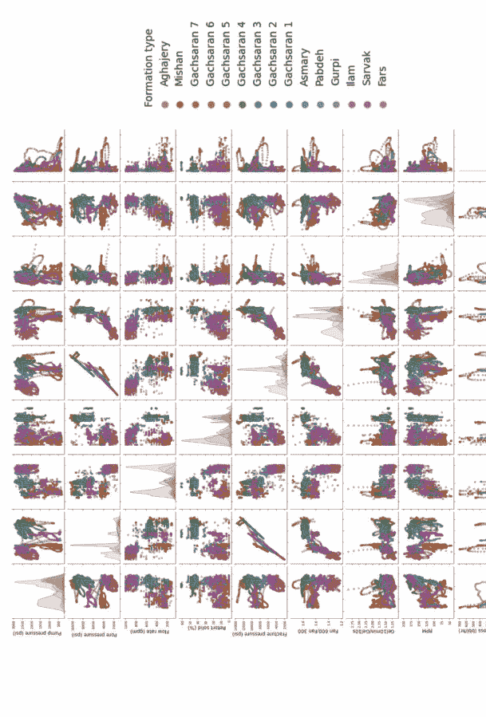

图2.1 所有变量按地层类型着色的配对图分布。

概率模型是一个将超参数映射到目标函数概率分数的响应面，在选择合适的样本来评估实际目标函数之前，通过获取函数对其成功进行评估。超参数调优是更新模型参数以调节训练过程的性能，并通过实现合理较低的代价函数来优化模型性能的行为（Otchere等，2022c）。

### 4.3 可解释人工智能

在大多数情况下，特征选择技术的应用是无监督的；因此，不存在绝对正确或错误的结果，这使得每种技术都适用于不同的数据。本研究将使用模型无关的方法来分析输入特征的重要性，以将其解释与机器学习模型分离开来。所追求的期望特性是模型表示和解释的灵活性，它们不受限于特定类型，并且在被解释模型的上下文中具有意义。为此，将使用排列特征重要性（PFI）和Shapley值来解释模型生成的结果。实现这一目标的输入包括模型、特征向量、目标值和误差指标。应用这些技术后，那些不能解释目标的特征将从输入特征向量中移除。

#### 4.3.1 排列特征重要性

排列特征重要性（PFI）是一种模型无关的方法，用于计算特征的重要性（Otchere等，2022a）。该方法通过给特征分配一个近乎随机的值，从而打乱特征与模型输出之间的关系来起作用。实现这一目标的基本工作原理是，在五十次特征排列后，通过测量估计误差的增加来计算特征的重要性。因此，如果省略某个特征的值会增加模型误差，则该特征被认为是重要的；反之，如果误差保持不变，则不重要（Breiman，2001）。应用PFI的主要优点是解释直观、能够高度浓缩地获取模型行为的全局洞察，并且无需重新训练。然而，一个缺点是，尚不清楚应使用训练数据还是测试数据来测量PFI。本研究使用Scikit-learn（Pedregosa等，2011）中的内置函数`permutation_importance`来运行PFI检查技术。对于给定的回归模型，创建一个计算所有输入特征重要性的函数。计算重要性评分标准，其中获得高分值的特征代表更强的预测能力。

#### 4.3.2 Shapley值

Shapley值由Lloyd Shapley（Shapley，1953）从合作博弈论中引入，是衡量特征重要性以及每个特征对模型性能贡献的关键概念。Shapley值的工作原理是，在每个合作博弈中，所有参与者联盟创造的总剩余价值通过一种独特分配方式分配给各参与者。该理论定义了必须满足的四个性质：有效性、对称性、虚拟性和可加性。在机器学习和可解释性中，参与者代表输入特征，Shapley值决定了每个特征对输出的贡献程度。了解特征如何贡献于模型输出，有助于理解生成模型结果的关键因素。Shapley值并不特定于任何模型类型，因此可以用于任何模型类型和架构。也许与其他解释模型结果的方法不同，Shapley值基于一个坚实的概念框架。虽然直觉意义对于可解释性至关重要，但其他方法缺乏同样严谨的概念框架。Shapley值的一个关键优势是能够在一个实例的特征值之间均匀分配。有人认为，在法律要求的某些情况下（例如解释权），Shapley可能是提供完整解释的唯一方法。与其他方法一样，Shapley也有其固有的缺点。最关键的是计算成本高，这意味着在大多数真实场景中只能计算近似解。而且它容易被误解。从模型训练中移除特征后，Shapley值并不是期望值与实际值之间的差值。它是输入值对实际预测与平均预测之间差距的贡献量。

开源的Shap库是处理Shap值和其他指标的强大工具。Shap在高效的信用分配与局部解释之间建立了联系，使其成为模型无关的工具。它将最优信用分配和局部解释结合在一起。使用博弈论中的传统Shapley值及其相关扩展已成为许多近期研究的焦点。最近的学者通过开发深度学习中Shap值的方法和梯度解释器扩展了这一概念。这些方法使用特定加权的局部线性回归来估计任何模型的Shap值。它还提供各种图表，帮助查看数据和理解模型。

本研究未包含所使用模型的数学基础，因为已有大量出版物对它们进行了详细描述。图2.2展示了本研究所使用方法工作流程的概览。

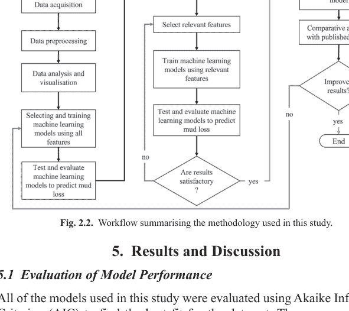

图 2.2. 概述本研究中使用的方法论的工作流程。

## 5. 结果与讨论

### 5.1 模型性能评估

本研究中使用<|message|>的所有模型均采用赤池信息准则 Akaike Information Criterion (AIC) 进行评估，以找到对数据集的最佳拟合。结果评估显示，与较大的 AIC 相比，较低的 AIC 值具有更高的拟合数据的概率。比较和选择最佳模型时考虑了以下因素。模型间 AIC 差异小于 10 时被认为不显著，10 至 50 之间为中等，50–100 之间为显著，超过 100 时为非常强。根据结果可以断定，额外树模型最终成为钻井液损失预测的最佳模型。将额外树模型与随机森林模型比较时，两者为 AIC 最低的两个模型，AIC 差异约为 260。因此，与其他模型相比，额外树模型显示出强烈的差异性和更高的拟合可能性。即使 AIC 可以衡量模型收敛到数据的程度，模型仍存在过拟合或欠拟合数据的倾向。

模型的性能是基于样本外数据结果进行评估的。由于模型使用训练数据进行训练，任何重现值的尝试都可能导致较高的准确性。另一方面，较高的训练准确性并不总是可取的，因为它可能导致过拟合，收集固有噪声并产生非泛化模型。基于样本外数据的测试准确性是模型对尚未观察到的数据所做正确预测的比例。

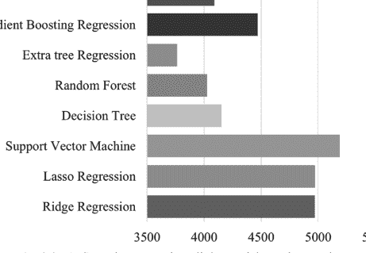

图 2.3. 在测试数据上比较所有模型的 AIC 结果。

由于模型旨在改进未见数据，因此模型具有较高的测试准确性尤为关键。在本研究中，训练和测试准确性得分的相关系数 R² 值均大于 0.85，被认为是在偏差和方差之间取得良好权衡。表 2.4 显示，Extra Tree 模型在预测泥浆损失的测试数据上具有最高的 R²。图 2.4  below 描绘了所有模型预测与实际数据的比较。

表 2.4. 本研究中使用所有模型的训练和测试相关系数分数。

| 模型 | 训练 R² 分数 | 测试 R² 分数 |

|---|---|---|

| Extra Tree Regression | 1 | 0.959819 |

| Random Forest | 0.984328 | 0.92394 |

| XGBoost | 0.99873 | 0.921476 |

| Decision Tree | 1 | 0.916176 |

| Gradient Boosting Regression | 0.868513 | 0.801631 |

| Ridge Regression | 0.372394 | 0.381738 |

| Lasso Regression | 0.367822 | 0.37421 |

| Support Vector Machine | 0.994892 | -0.027344 |

机器学习模型实现的任何有意义的准确性提升，从而降低不准确性，对决策都有显著影响。每个模型的统计和理论基础导致了性能的广泛差异。图 2.5 以交叉验证评估的形式描绘了模型的性能，以分析其精确性、效率和可靠性。

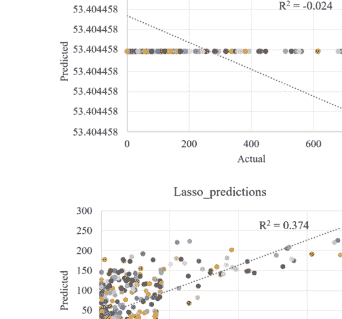

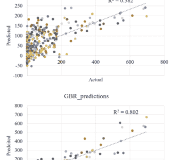

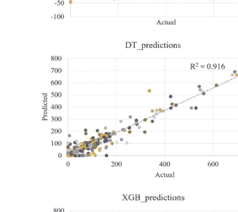

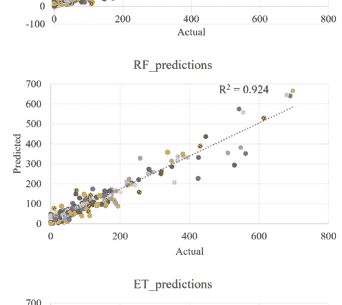

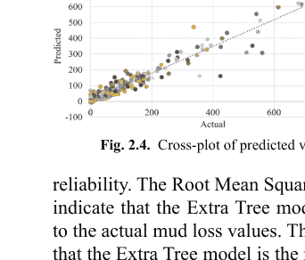

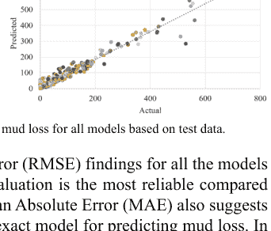

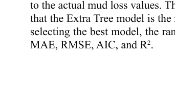

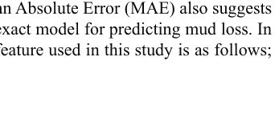

图 2.4. 基于测试数据的所有模型的预测值与实际泥浆损失的散点图。

所有模型均方根误差 Root Mean Squared Error (RMSE) 的结果表明，与实际泥浆损失值相比，Extra Tree 模型评估是最可靠的。平均绝对误差 Mean Absolute Error (MAE) 也表明 Extra Tree 模型是预测泥浆损失最精确的模型。在选择最佳模型时，本研究使用的排名特征如下；MAE、RMSE、AIC 和 R²。


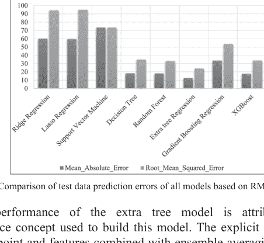

图 2.5. 基于 RMSE 和 MAE 的所有模型测试数据预测误差比较。

额外树模型的性能归因于构建该模型时使用的偏差-方差概念。切分点和特征的显式随机化结合集成平均可以比其他算法采用的较弱随机化技术更强地降低方差。除了基于一致性用于通用泛化和近似的决策树相似优势外，Extra Trees 还提供对总体模型错误的弹性，因为异常值对其预测的影响较小且局部。当输入特征显著多于随机分割时，Extra Trees 在计算效率方面可能优于决策树，同时抵制无关输入特征。

### 5.2 模型无关结果

基于 `XGBoost` 模型的排列重要性被计算出来，以评估输入变量的重要性并分析多重共线性对输入变量的影响。图 2.6 中的结果显示，泵压和孔隙压力与泥浆损失预测高度相关。结果表明，置换一个输入特征最多可使模型准确性降低 0.3，表明某些输入是相关的。然而，钻井时间、孔径、进尺、`WOB` 和 `MFVIS` 对模型预测没有提供任何改进。该结果与图 2.7 中显示的 `XGBoost` 模型的特征重要性输出进行了比较。结果中的差异表明模型无关的重要性，它可以提供因果推断。这种推断是必要的，因为相关性不等于因果关系；因此，基于相关性的特征选择技术可能无法完全改善模型性能。

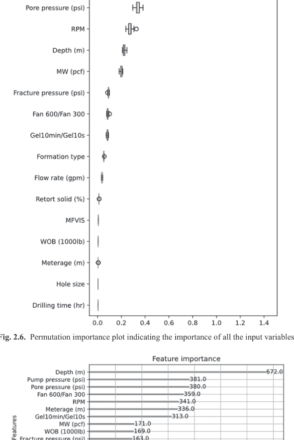

图 2.6. 指示所有输入变量重要性的排列重要性图。

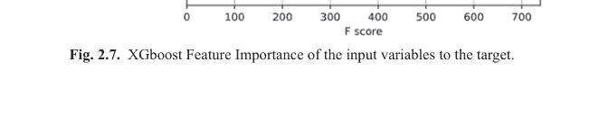

图 2.7. 输入变量对目标的 `XGBoost` 特征重要性。

### 5.3 使用模型无关指标分析特征

为保持最终模型预测的一致性，采用了相似的训练/测试划分，并将输入特征在整个数据上的性能的 `PFI` 结果呈现在图 2.8 中。`RF` 模型产生的初始测试 `R²` 为 0.92。重要性分数的计算方式是数值越高代表预测能力越好。通常，重要性分数的计算方式是数值越高表示预测能力越大。0.92 准确性分数的很大一部分可归因于最相关特征的值的重要性。结果显示，一些输入变量被赋予了相对较低的重要性分数。结果指向一组小的输入变量，解释了大部分可预测性。可以从这一发现中推断出特征的相对重要性。该结果与计算出的高测试准确性一致。

在训练数据上计算的初始排列重要性显示了模型在训练期间对每个特征的依赖性。尽管如此，必须指出，该分析同时针对训练和测试数据集进行，以帮助考虑可能有助于模型泛化能力的特征。当一个特征在训练期间被认为重要，但在测试期间被视为不重要时，更可能发生过拟合。

进行了敏感性分析以选择用于进一步预测的相关特征。`RF` 模型用于预测泥浆损失，使用前

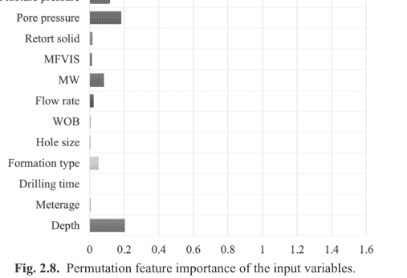

图 2.8. 输入变量的排列特征重要性。

**表2.5.** 基于排列准确率的输入变量选择。

| 选择的特征 | 丢弃的特征 | 准确率 |

|---|---|---|

| 16 | 无 | 0.9221 |

| 15 | 钻进时间 | 0.9238 |

| 14 | 钻进时间和井眼尺寸 | 0.9226 |

| 13 | 钻进时间、井眼尺寸和进尺 | 0.9348 |

| 12 | 钻进时间、井眼尺寸、进尺和钻压 | 0.9325 |

| 11 | 钻进时间、井眼尺寸、进尺、钻压和`MFVIS` | 0.9304 |

| 10 | 钻进时间、井眼尺寸、进尺、钻压、`MFVIS`和蒸馏固相 | 0.9339 |

从15个到10个特征，结果如表2.5所示。结果表明，预测井漏的最佳特征数量为13个。

### 5.4 使用Shapley值模型无关度量的特征分析

使用所有特征训练极端随机树（`Extra Trees`）模型来进行井漏预测，并使用了与`PFI`分析相同的训练和测试数据集。由于机器学习模型应具有可解释性，以帮助理解模型如何进行特定预测，因此模型无关度量很有帮助。Shapley值起源于博弈论，有必要阐明其在监督机器学习可解释性中的应用。博弈代表数据集中特定事件的预测分配。收益是特定实例的实际预测与所有实例的平均预测之间的差值。该实例的特征值协同作用，以实现井漏预测中的收益。

图2.9以特征重要性图的形式将Shapley值可视化为绝对值。`SHAP`特征重要性遵循一个简单的原理：绝对值高的特征是最重要的特征。计算每个属性在整个数据中Shapley值的绝对平均值，以评估全局重要性。泵压和流量特征变量非常重要，其中泵压最为重要，在x轴上平均使目标变量改变56.35桶/小时。该图还显示，进尺、钻进时间和钻压与目标变量的相关性较低，其中纳入钻压与`PFI`结果不一致。基于这一结果，需要进一步调查以确定哪些特征与目标变量无关。Shapley值重要性是排列特征重要性的一种替代方法。这两种重要性度量存在显著差异。模型性能的下降决定了排列特征的相关性，而Shapley值主要基于特征来源的幅度。特征重要性图信息丰富，但在显著性之外没有提供其他信息。蜂群图（bee swarm plot）是一种信息更丰富的图，被用于分析。

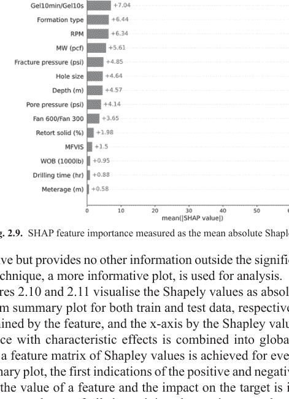

图2.9 `SHAP`特征重要性，以平均绝对Shapley值度量。

图2.10和图2.11分别将训练数据和测试数据的Shapley值以绝对值形式可视化为蜂群汇总图。y轴由特征决定，x轴由Shapley值决定。具有特征效应的特征重要性被组合成全局解释，从而为每个实例获得Shapley值特征矩阵。在汇总图中，可以识别出特征值与对目标影响之间正负关系的初步迹象。由所有训练数据点组成的数据点在y轴上以散乱方式重叠。这种可视化方式描绘了每个特征的Shapley值分布。特征按重要性降序排列。从图中可以看出，低特征值用蓝色表示，高特征值用红色表示。在分析泵压的影响时，可以观察到低值预测高井漏值，而高值预测低井漏值。泵压数据点的分布也表明了一种解释整个模型行为的全局解释。该分析证实，这种相关性本身不能称为因果关系。这一结论强调了模型无关技术在理解其他特征在井漏预测中的影响方面的重要性和必要性。从蜂群图可以观察到，大约12个特征可以在全局层面解释预测是如何做出的。

蜂群图的结果证实了那些在训练和测试结果中都具有高重要性，并在Shapley值中体现其重要性的特征。

Shapley值基于博弈论坚实的理论基础，并计算合理分配给目标变量的特征值。该方法也有助于统一可解释机器学习。其快速计算能力允许计算全局模型解释所需的多个Shapley值。由于Shapley值代表了全局解释的最小元素，这使得全局解释与局部解释兼容。

### 5.5 重要特征评估

使用基于`PFI`和Shapley值选出的前13个特征，对表现最佳的5个模型进行了进一步分析，以确定它们是否优于初始模型预测。`PFI`导致丢弃钻进时间、井眼尺寸和进尺。同时，Shapley值导致丢弃钻进时间、钻压和进尺。该结果如表2.6所示。当使用基于`PFI`和Shapley值的特征时，所有表现最佳的模型均有所改进。然而，值得注意的是，Shapley值选择了最相关的特征，这在模型准确率的巨大提升中得到了主要体现。

**表2.6.** 使用前5个模型在测试数据上计算得到的准确率。

| 模型 | 基于全部特征的准确率 | 基于`PFI`前13个特征的准确率 | 基于Shapley值前13个特征的准确率 |

|---|---|---|---|

| 梯度提升 | 0.8016 | 0.8073 | 0.9999 |

| 决策树 | 0.9162 | 0.9298 | 0.9990 |

| 随机森林 | 0.9239 | 0.9290 | 0.9970 |

| 极端随机树 | 0.9598 | 0.9710 | 0.9990 |

| `XGBoost` | 0.9215 | 0.9266 | 0.9960 |

### 5.6 模型优化

采用贝叶斯优化（`BO`）算法对模型参数进行调优，以提高模型性能。图2.12中的结果显示了使用Shapley值识别出的前13个特征的极端随机树模型以及`BO–ET`模型的性能。将结果与Sabah等人（2021）的结果进行了比较。这一比较是必要的，因为该作者使用了与本研究相同的数据，但在预测钻井液漏失时采用了不同的技术和模型。值得一提的是，尽管机器学习模型依赖于所使用的数据，但本研究中用于训练模型的大部分数据可能与其他研究不完全相似。然而，预计大部分数据将是相同的。因此，这种比较主要基于输入特征的使用方式及其对目标变量的解释，而非贬低其他研究者的结果。

#### 误差分析

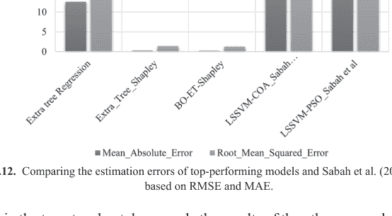

图2.12 基于RMSE和MAE比较表现最佳模型与Sabah等人（2021）模型的估计误差。

通过所进行的误差分析，观察到基于Shapley值选择的特征显著降低了模型误差。初始极端随机树模型的平均绝对误差（`MAE`）为12.6桶/小时，而基于Shapley值选择特征的`MAE`为0.3桶/小时。这一结果意味着`MAE`降低了约97%。

同样，使用全部16个特征的极端随机树模型的`RMSE`为24.0桶/小时。基于Shapley值选择特征的`RMSE`记录为1.4桶/小时。这同样意味着该误差指标降低了约94%。通过超参数调优，`BO–ET`能够将极端随机树的平均绝对误差（`MAE`）和均方根误差（`RMSE`）分别降低到0.2和1.2桶/小时。极端随机树模型的优越性主要归因于构建该模型所用的偏差-方差概念，这使其对异常值具有鲁棒性。基于所有评估标准，可以确定Shapley值选择的特征高度相关，能够对目标变量进行全局泛化，并提高模型效率。

### 5.7 敏感性分析

图2.13显示了估计井漏数据与实际井漏数据的核密度估计（`KDE`）。估计值用蓝色表示，实际值用绿色表示。根据测试数据，`BO–ET`与真实数据更为接近。这一研究表明，`BO–ET`能够比其他模型捕获更广泛的值范围。这一观察结果使其适合用于利用相关钻井参数评估其他井的钻井液漏失情况。因此，敏感性分析验证了上述评估指标。

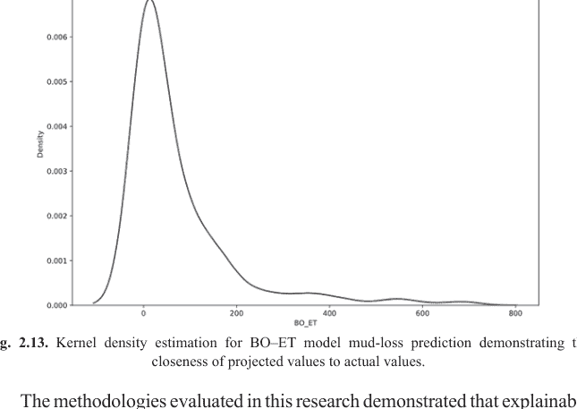

图 2.13. `BO-ET` 模型井漏预测的核密度估计，展示了预测值与实际值的接近程度。

本研究所评估的方法表明，通过使用模型无关（model agnostic）指标的可解释人工智能可以洞察输入特征。由于相关性并不意味着因果关系，简单的统计技术可能无法指示每个输入对目标变量的因果影响。研究结果显示，将输入变量逐渐增加到 13 个以上会导致模型性能下降。根据 Shapley 值，钻进时间、进尺和钻压（`WOB`）属于对钻井液漏失没有直接影响的变量。因此，不应将其用于训练模型。模型无关方法为利用相关因果特征预测漏失提供了可信且有价值的解决方案。在钻井前充分预测漏失的能力可提供关于裂缝宽度和最佳 `LCM` 颗粒尺寸分布的关键信息。因此，可以配制 `LCM` 以填充现有裂缝，或避免其渗入高渗透性地层深处，从而最大限度地减少过量钻井液漏失。因此，预测钻井液漏失可以为需要实施的干预措施类型提供有价值的见解。

## 6. 结论

本研究展示了一种识别钻井液漏失估算重要变量的方法。经评估，该方法的有效性超越了基于同一数据集先前报道的技术。所讨论的评估标准展示了模型对留出数据的拟合概率。同时，基于样本外数据的 `R²`、`MAE` 和 `RMSE` 评估了模型的精确性、可靠性和可信赖性。基于 `PFI` 和 Shapley 值，模型及其对目标的预测方式使输入特征变得可解释，表现为以下特征；

- 1. `公平性`：结果确保了预测是中立的，不会隐式或公开地偏向任何输入变量。易于解释的模型可以解释为何做出特定预测，从而更容易确定哪个输入变量具有更显著的影响。

- 2. `可靠性`：结果有助于捕捉输入变量的差异，这些差异会导致目标的显著变化，反之亦然。

- 3. `因果性`：识别了因果关系，泵压特征在训练和测试数据的全部输入变量中排名靠前。

- 4. `可信度`：结果对用于最终预测的输入特征产生了一定程度的信任。该分析基于所用技术（`PFI` 和 Shapley 值）如何解释其对输入特征与目标之间关系的判断。

可解释人工智能的应用使模型预测精度在 `MAE` 和 `RMSE` 方面分别提升了 97% 和 94%。与基于相同数据的其他已发表结果相比，`MAE` 和 `RMSE` 分别降低了 98% 和 95%。这一分析证明相关性并不意味着因果关系。如果没有 `PFI` 和 Shapley 值，`XGBoost` 的特征重要性将无法指示会导致过拟合或欠拟合的特征，也无法对特征进行全局解释。

## 致谢

作者对马来西亚国油科技大学（Universiti Teknologi Petronas）、提高采收率研究中心（Centre of Research in Enhanced Oil Recovery）以及地下地震成像中心（Centre for Subsurface Seismic Imaging）对本工作的支持表示诚挚感谢。

## 数据可用性

钻井数据来源于 Sabah 等人（2021）。

# 参考文献

Gordon, A.D., Breiman, L., Friedman, J.H., Olshen, R.A. and Stone, C.J. 1984. Classification and regression trees. Biometrics 40: 874. https://doi.org/10.2307/2530946.

Hoerl, A.E. and Kennard, R.W. 1970. Ridge regression: biased estimation for nonorthogonal problems. Technometrics 12: 55–67. https://doi.org/10.1080/00401706.1970.10488634.

Moazzeni, A., Nabaei, M. and Jegarluei, S.G. 2012. Decision making for reduction of nonproductive time through an integrated lost circulation prediction. Petroleum Science and Technology 30(20): 2097–2107. https://doi.org/10.1080/10916466.2010.495961.

Otchere, D.A., Arbi Ganat, T.O., Gholami, R. and Ridha, S. 2021a. Application of supervised machine learning paradigms in the prediction of petroleum reservoir properties: Comparative analysis of ANN and SVM models. J. Pet. Sci. Eng. 200: 108182. https://doi.org/10.1016/j.petrol.2020.108182.

Otchere, D.A., Ganat, T.O.A., Gholami, R. and Lawal, M. 2021b. A novel custom ensemble learning model for an improved reservoir permeability and water saturation prediction. J. Nat. Gas Sci. Eng. 91: 103962. https://doi.org/10.1016/j.jngse.2021.103962.

Otchere, D.A., Ganat, T.O.A., Ojero, J.O., Taki, M.Y. and Tackie-Otoo, B.N. 2021c. Application of gradient boosting regression model for the evaluation of feature selection techniques in improving reservoir characterisation predictions. J. Pet. Sci. Eng. 109244. https://doi.org/10.1016/J.PETROL.2021.109244.

Otchere, D.A., Abdalla Ayoub Mohammed, M., Ganat, T.O.A., Gholami, R. and Aljunid Merican, Z.M. 2022a. A novel empirical and deep ensemble super learning approach in predicting reservoir wettability via well logs. Applied Sciences 12: 2942. https://doi.org/10.3390/app12062942.

Otchere, D.A., Aboagye, M., Mohammed, M.A.A. and Boakye, T.B. 2022b. Enhancing drilling fluid lost-circulation prediction using model agnostic and supervised machine learning. SSRN Electronic Journal. https://doi.org/10.2139/ssrn.4085366.

Otchere, D.A., Ganat, T.O.A., Nta, V., Brantson, E.T. and Sharma, T. 2022c. Data analytics and Bayesian Optimised Extreme Gradient Boosting approach to estimate cut-offs from wireline logs for net reservoir and pay classification. Appl. Soft Comput. 120: 108680. https://doi.org/10.1016/j.asoc.2022.108680.


Pedregosa, F., Varoquaux, G., Gramfort, A., Michel, V., Thirion, B., Grisel, O., Blondel, M., Prettenhofer, P., Weiss, R., Dubourg, V., Vanderplas, J., Passos, A., Cournapeau, D., Brucher, M., Perrot, M. and Duchesnay, É. 2011. Scikit-learn: Machine learning in Python. Journal of Machine Learning Research 12: 2825–2830.

Pilehvari, A.A. and Nyshadham, V.R. 2002. Effect of material type and size distribution on performance of loss/seepage control material. Paper presented at the International Symposium and Exhibition on Formation Damage Control, Lafayette, Louisiana. pp. 863–875. In: All Days. SPE. https://doi.org/10.2118/73791-MS.

Sabah, M., Talebkeikhah, M., Agin, F., Talebkeikhah, F. and Hasheminasab, E. 2019. Application of decision tree, artificial neural networks, and adaptive neuro-fuzzy inference system on predicting lost circulation: A case study from Marun oil field. J. Pet. Sci. Eng. 177: 236–249. https://doi.org/10.1016/J.PETROL.2019.02.045.

Sabah, M., Mehrad, M., Ashrafi, S.B., Wood, D.A. and Fathi, S. 2021. Hybrid machine learning algorithms to enhance lost-circulation prediction and management in the Marun oil field. J. Pet. Sci. Eng. 198: 108125. https://doi.org/10.1016/j.petrol.2020.108125.

Shapley, L.S. 1953. A value for n-person games. pp. 307–318. In: Contributions to the Theory of Games (AM-28), Volume II. Princeton University Press. https://doi.org/10.1515/9781400881970-018.

Tarafder, S., Badruddin, N., Yahya, N. and Egambaram, A. 2021. EEG-based drowsiness detection from ocular indices using ensemble classification. pp. 21–24. In: 2021 IEEE 3rd Eurasia Conference on Biomedical Engineering, Healthcare and Sustainability (ECBIOS). IEEE. https://doi.org/10.1109/ECBIOS51820.2021.9510848.

Tarafder, S., Badruddin, N., Yahya, N. and Nasution, A.H. 2022. Drowsiness detection using ocular indices from EEG signal. Sensors 22: 4764. https://doi.org/10.3390/s22134764.

Tibshirani, R. 1996. Regression shrinkage and selection via the lasso. Journal of the Royal Statistical Society: Series B (Methodological) 58: 267–288. https://doi.org/10.1111/j.2517-6161.1996.tb02080.x.

Toreifi, H., Rostami, H. and Manshad, A.K. 2014. New method for prediction and solving the problem of drilling fluid loss using modular neural network and particle swarm optimization algorithm. J. Pet. Explor. Prod. Technol. 4: 371–379. https://doi.org/10.1007/s13202-014-0102-5.

Vapnik, V. and Lerner, A. 1963. Pattern recognition using generalised portrait method. Automation and Remote Control 24: 774–780.

Zarrouk, S.J. and McLean, K. 2019. Geothermal wells. Geothermal Well Test Analysis 39–61. https://doi.org/10.1016/B978-0-12-814946-1.00003-7.

## 第3章

## 通过测井和核磁共振测井预测总孔隙度和自由流体指数的新型堆叠集成模型的应用

Daniel Asante Otchere¹,²

## 1. 引言

随着能源需求的增长以及钻井和水力压裂技术的进步，近年来从储层中创新性地开采碳氢化合物已成为勘探和开发的重点 (Li et al., 2022)。因此，全面了解束缚流体和可动流体对于准确评价净产层以及优化完井、生产和提高采收率活动至关重要 (Otchere et al., 2022b)。在储层术语中，孔隙流体是指储层岩石孔隙结构内的流体分布。孔隙体积分数主要有两种类型：束缚流体，即物理上被困在孔隙结构中且难以置换的流体；以及自由流体体积，即可在孔隙结构中自由移动的流体。了解储层中束缚流体与自由流体比例的特定区别对于预测流体流动和生产的难易程度至关重要 (Cai and Hu, 2019)。例如，束缚流体比例较高的储层可能需要更积极的提高采收率方法来增加产量。了解孔隙流体类型和体积分数对于有效的储层管理和优化至关重要 (Cai and Hu, 2019; Otchere et al., 2021c)。

已制定了众多方法来确定储层中的流体分布。测量储层孔隙类型的最合适和最准确的方法取决于所研究储层的具体特征。一种标准方法是汞注入毛细管压力 (MICP) 分析，其测量在给定压力下可注入孔隙结构中的汞量 (Peng et al., 2017)。可注入孔隙结构中的汞量与储层中自由流体的比例直接相关。MICP 是测量流体分布的广泛使用方法，被认为是测量自由流体体积最准确和可靠的方法之一 (Dugan, 2015; Mitchell et al., 2008)。另一种方法是核磁共振 (NMR)，可提供储层孔隙结构和流体分布的详细描述 (Xu et al., 2015)。NMR 对于复杂的孔隙结构特别有用，可提供多种流体相分布的信息。此外，NMR 是一种无损方法，利用磁场和无线电波测量孔隙流体的磁化率 (Branco and Gil, 2017; Otchere et al., 2022a)。孔隙流体的磁化率用于区分储层中的束缚流体和自由流体，使其成为大尺度测量孔隙流体类型和体积分数的宝贵工具 (Heaton et al., 2000)。

然而，这两种方法都有其固有的挑战。测量或确定孔隙类型的一个基本挑战是孔隙结构的复杂性。储层可能具有各种孔隙大小和形状，不同方法可能对不同类型的孔隙结构更有效。使用 MICP 的一个挑战是它需要从储层获取岩心样品，这可能成本高且耗时。此外，岩心样品的可用性可能有限，使得难以获得足够样品以提供储层的代表性分析 (Wu et al., 2021)。此外，MICP 是一种破坏性方法，岩心样品在分析后会被破坏，这可能使在需要时对同一样品重复分析变得困难。另一个挑战是 MICP 对流体饱和度的敏感性，要求流体处于平衡状态，而在某些储层中可能并非如此。这一挑战会影响 MICP 分析所得结果的准确性 (Wu et al., 2020)。另一方面，NMR 对储层的孔隙度敏感，无法提供孔隙类型的定量测量。此外，NMR 对粘土矿物的存在有响应，这可能会影响结果的精确度 (Elsayed et al., 2020)。表 3.1 总结了这两种技术的独特优势和局限性。

表 3.1. MICP 和 NMR 技术总结，识别关键优势、局限性和测量原理。

| 技术 | 测量原理 | 由...开发 | 优势 | 局限性 | 观察 |

|---|---|---|---|---|---|

| 汞注入毛细管压力 (MICP) | 在给定压力下将汞注入孔隙结构，且可注入孔隙结构中的汞量与储层中自由流体的比例直接相关。 | Purcell (1949) | 自由流体体积 (FFV) 的准确测量 | 需要岩心样品 | MICP 被认为是最准确和可靠的测量 FFV 的方法之一，但它是一种破坏性方法。 |

| 核磁共振 (NMR) | 使用磁场和无线电波获得储层内流体分布的详细图像。 | (Bloch, 1946) | 提供储层孔隙结构和流体分布的详细图像。 | 无法提供孔隙类型的定量测量且对粘土矿物的存在敏感。 | NMR 成像对于复杂的孔隙结构特别有用，可提供多种流体相分布的信息。 |

总体而言，了解孔隙体积分数对于有效的储层管理和优化至关重要。然而，由于孔隙结构的复杂性和岩心样品的有限可用性，准确测量和确定孔隙度及其相关可采体积具有挑战性。

孔隙体积分数的测量复杂且具有挑战性。该学科的许多研究人员一直在尝试新的想法和方法。在过去二十年里，许多研究人员被吸引使用 NMR 数据来估算孔隙体积分数和总孔隙度。这种对 NMR 的偏好源于其非侵入性本质 (Otchere et al., 2022a)。人工智能 (AI) 有可能彻底改变储层孔隙体积预测的方式。一个潜在的应用是使用 AI 预测由 NMR 测量的孔隙体积，以测井数据作为输入。

常规测井在所有钻井中普遍存在，并提供储层地层特性的重要信息。这些测井与孔隙体积分数的分布表现出复杂且非线性的相关性。另一方面，NMR 测量提供孔隙结构内流体分布的信息。然而，这种方法会产生重大费用，在油价低迷期间可能不切实际地在每口井中执行 (Otchere et al., 2022a)。通过结合这两种类型的数据，AI 可用于以高精度预测孔隙度和体积分数。实现这一目标的理想方式是通过使用机器学习和数据分析技术，这些技术可以基于大量测井数据和 NMR 孔隙度及体积分数测量数据进行训练。这些技术表现出对噪声的鲁棒性，并在识别指示特定输入数据和孔隙体积分数的复杂或非线性模式或特征方面表现出高功效 (Otchere et al., 2021a)。训练完成后，AI 模型可随后基于测井数据预测新储层的总孔隙度和孔隙体积分数。

利用测井来协助估算这一不可或缺的性质，相较于在所有井中运行 NMR 测井而言更为经济、省时，并提供实时信息。因此，考虑到当前的油价，对一种廉价可靠的现场尺度定量孔隙度和孔隙体积分数测量技术的需求备受关注。故而，本研究致力于开发一种基于 AI 的模型，该模型可使用测井数据作为输入，以 NMR 测量的总孔隙度和 FFV 作为目标输出，准确预测碳酸盐岩气藏的孔隙度和可采孔隙体积分数。本研究旨在为储层表征和管理提供更高效、更准确的方法。

## 2. 核磁共振

### 2.1 概念与应用

具有奇数个质子和中子的原子核在特定共振频率的磁场作用下表现出 NMR 现象 (Coates et al., 1999)。氢中的质子由于在水和油中均丰富而具有强磁矩，这是原子核角动量的结果。此时，质子就像一个旋转的条形磁铁。在外部磁场中，它会发生极化，这表现为一个可量化的量子特征，即诱导频率（拉莫尔频率）(Amani et al., 2017)。图 3.1 显示了原子核对外部磁场反应的简化表示 (Otchere et al., 2022a)。

可组合磁共振 (CMR) 工具是一种近期开发的技术，用于孔隙度划分以确定储层中的束缚流体体积 (BFV) 和 FFV (Gubelin and Boyd, 1997)。CMR 可与 NMR 结合使用，以提供储层内流体分布更准确、更完整的图景。CMR 测量在含水饱和度高的储层中特别有用，在这些储层中其他技术可能无效。此外，CMR 可提供束缚和 FFV 两方面的信息，这是其他技术无法实现的。

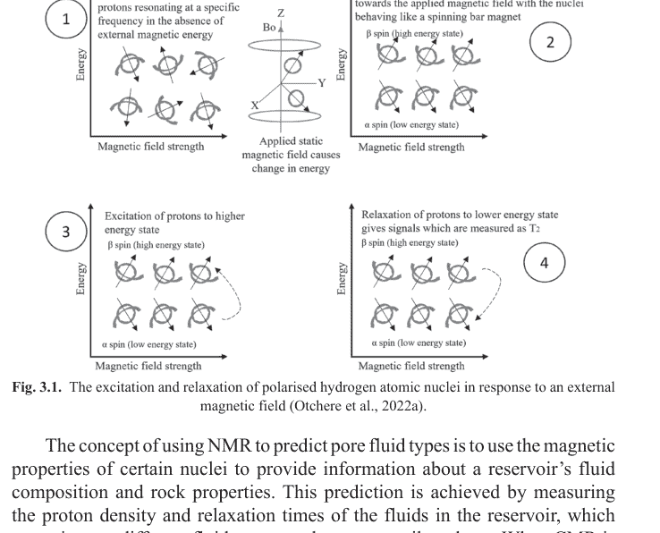

图 3.1. 外部磁场作用下极化氢原子核的激发与弛豫（Otchere et al., 2022a）。

利用 NMR 预测孔隙流体类型的概念是利用某些核的磁性来提供有关储层流体组成和岩石性质的信息。这种预测是通过测量储层中流体的质子密度和弛豫时间来实现的，这些参数对于不同类型的流体，如水、油和气，是独特的。当 CMR 用于孔隙率划分时，总孔隙率是通过测量孔隙流体的磁化率并利用磁化率与流体体积分数之间的关系来计算的。该方法基于束缚流体的磁化率与自由流体不同这一假设，这是在 CMR 中的一个关键概念。以下方程用于计算储层中的总孔隙率、BFV 和 FFV：

```
(φT) = φB + φF
```

(3.1)

其中总孔隙率表示为 `φT`，其为 0 到 1 之间的无量纲值，表示岩石样品中由孔隙构成的比例，`φB` 为束缚流体体积分数，`φF` 为 FFV 分数。

```
BFV = φB × Vp
```

(3.2)

其中 `Vp` 为孔隙体积。

```
FFV = φF × Vp
```

(3.3)

`V_p` 通常通过将岩石样品的块体体积 (`Vb`) 与总孔隙率 (`φT`) 相乘来计算。

```
$V_p = \phi T \times V_b$ (3.4)
```

其中 `V_b` 为岩石样品的块体体积，可通过氦气压汞法、压汞孔隙度测定或气体吸附等各种技术进行测量。值得一提的是，孔隙体积也可以通过测量岩石样品的块体体积并从中减去固体颗粒的体积来计算。该方法称为颗粒体积法，也是计算孔隙体积的另一种方法。这些方程基于束缚流体的磁化率与自由流体不同这一假设。这意味着可以通过测量孔隙流体的磁化率来区分束缚流体和自由流体。

### 2.2 与机器学习在 NMR 储层表征中应用相关的研究

机器学习已被广泛用于补充传统方法，并在某些情况下提供特定优势。部署机器学习技术和人工智能算法以克服复杂问题的应用在多个领域获得了关注，包括石油工业（Otchere et al., 2021a）。机器学习在储层表征中的应用已大幅增长，凸显了其在该领域的重要性。机器学习模型在数据收集量不多的情况下变得非常有用。这些模型已被用于预测各种测井曲线，而这些测井曲线由于时间和成本原因未在井中进行。与实际测井相比，这些模型显示出较高的准确性，在钻井期间节省了时间和金钱，同时提供了储层性质的实时估计。下面对利用机器学习技术和 NMR 数据提供准确替代方案的文章进行了综述。

Rezaee (2022) 阐述了一项研究，该研究采用了广泛的 CMR 资料库来生成碎屑岩的 NMR 测井工具输出。该研究旨在评估采用常规测井曲线作为输入数据的多种机器学习（ML）方法的功效。该研究生成了 CMR 数据的输出，包括不可还原孔隙流体（BVI）、粘土束缚水（CBW）、可动流体（FFI）、不可还原水饱和度（Swirr）、T₂弛豫时间的对数平均值（T₂LM）和渗透率。为此，收集了 14 口西澳大利亚井的测井曲线，其中 80% 用于模型训练和验证，剩余 20% 用于测试目的。比较结果后发现，自适应提升（AdaBoost）模型表现出最显著的结果，盲测集的 R² 值超过 0.9。这些发现表明 ML 方法可用于以高精度生成 NMR 测井。

Masroor et al. (2022) 描述了一种用于从常规测井曲线估计 NMR 渗透率的 ML 程序。该方法采用三种监督式（ML）算法：数据处理群组法、随机森林（RF）和一维卷积神经网络（CNN）。此外，还设计了一种改进的二维 CNN（Residual 2D-CNN）版本，其接收由常规测井曲线衍生的人工二维特征图。ML 和深度学习（DL）模型的超参数使用遗传算法进行优化以提高其效能。结果表明，非线性机器和 DL 技术有助于估计 NMR 渗透率，其中 Res 2D-CNN 模型提供最有效的结果（准确度为 0.97）。该研究强调了采用生成的特征图来训练 Res 2D-CNN 模型的重要性，以及在提高预测准确性和最小化训练时间方面整合残差和更深的瓶颈架构的有利影响。

Tamoto et al. (2023) 还描述了一项旨在开发用于从测井曲线估计 NMR 孔隙率的 ML 模型的研 究。NMR 测井被认为对孔隙率量化很有价值，但受高成本和不利的地下采集条件限制。调整后的 RMSE 和 R² 以及指标比较并评估了四种监督式 ML 模型。最佳结果由 CatBoost 回归器取得，RMSE 小于 0.01，调整后 R² 为 0.87。与传统经验计算相比，ML 模型显著改善了总孔隙率预测。实际 NMR 测井与 ML 预测之间的差异大多低于 5%。此外，还使用树提升基于测井曲线开发了孔隙率模型，并研究了输入变量对模型估计的影响。该研究还检验了模型的线性和非线性特征行为，以理解它们与数据集的关系。


Li et al. (2020) 提出了一项关于使用两种基于神经网络的 ML 模型的研究，即长短期记忆（LSTM）网络和带卷积层的变分自编码器（VAEc）网络，用于从地层矿物和流体饱和度测井曲线生成合成 NMR T₂ 分布。模型在巴肯页岩地层有限样本数据上进行训练和测试。结果表明两种模型均表现良好，即使输入数据受噪声污染也能合成流体填充的孔隙尺寸分布。所提出的方法有望在数据受限条件下改善储层表征。NMR 测井可提供近井眼储层体积中流体流动性、流体填充孔隙尺寸分布、流体流动性、孔隙率和渗透率等有价值的信息。然而，其获取受财务和运营挑战限制。因此，使用 ML 可使 NMR 测井在所有井中可用。

Gu et al. (2021) 提出了一种 ML 方法，通过评估 T₂-D 谱中的流体组分来估计储层中的流体饱和度。该方法整合了 GABP 神经网络和高斯混合模型（GMM），以确定基于 T₂-D 谱与流体饱和度之间物理意义的新饱和度公式。该方法通过数值模拟进行评估，结果表明与传统的 BP 神经网络相比，准确性和稳定性均有所提高。GMM 确定不同的高斯概率分布函数来表征 T₂-D 谱中的不同流体，从而实现更准确的饱和度估计。所提出的方法能够定量评估 T₂-D 谱中的流体组分。

这些研究展示了使用 ML 算法分析随钻测井和 NMR 数据并预测各种储层性质（例如孔隙尺度性质、渗透率、流体饱和度和流体类型）的潜力。这些方法已被证明是准确的，并有可能提高储层表征的效率和准确性。

## 3. 方法

### 3.1 数据收集与描述

本研究使用了来自一口垂直勘探气井的常规随钻测井曲线。该井进行了 CMR 测井。CMR 测井的目的是评估地层的总孔隙率、束缚和自由流体以及渗透率。CMR 在页岩覆盖的碳酸盐岩段进行测井。在关注区，由于井眼相对光滑且泥浆矿化度适中（约 58 ppk 相当于 NaCl，使用图表 GEN-9，`Rmf` = 0.0694 ohm·m，21°C），我们未观察到 CMR 信号的井眼效应。原始回波、T2 分布、总孔隙率和区间孔隙率上未观察到异常。由于该井使用水基泥浆钻进，T₂ 分布反映了孔隙尺寸分布。本研究中使用的数据经过了质量控制和再处理。本研究中使用的 CMR 再处理参数选择记录在表 3.2 中。图 3.2 显示了孔隙率的增量增加和多孔隙尺寸分布，具有有利的孔隙连通性，通过对 100% 盐水饱和样品的 NMR T₂ 分布进行多指数衰减时间分析而识别。孔隙率的划分如下：

1. 小孔隙孔隙率（`T₂ min` 至 3 ms）– 可视为与粘土相关的含水孔隙率（双水饱和模型中的水电阻率 `Rwb`）。

2. 毛细管束缚流体（3 ms 至 `T₂ cutoff`）– 可视为有效孔隙率的一部分。在碎屑岩中，这预期为水充满（其水电阻率等于双水饱和模型中的 `Rw`）；然而，在碳酸盐岩中，该孔隙可能充满水、烃或两者。

**表 3.2.** CMR 再处理参数选择。

| 处理参数 |  |
|---|---|
| 孔隙度算法 |  |
| 起始回波 | 第 2 个 |
| 平均级别数 | 3 |
| T₂ 最小值 | 0.5 毫秒 |
| T₂ 最大值 | 6000 毫秒 |
| 谱分量数 | 30 |
| T₁/T₂ 比值最小值 | 1 |
| T₁/T₂ 比值最大值 | 3 |
| 极化校正阈值 | 0.015 v/v |
| 产能参数 |  |
| 自由流体截止值 | 0.02 v/v |
| 孔隙度参数 |  |
| T₂ 截止值 | 100 毫秒（碳酸盐岩默认值） |
| 锥形截止起始值 | 8 毫秒 |
| T₁/T₂ 比值 | 2 |
| 分档孔隙度 T₂ 截止值（毫秒） | 1, 3, 10, 33, 100, 300, 1000, 3000 |
| 小孔孔隙度 T₂ 截止值（毫秒） | 1 到 3 |
| 毛细管束缚流体 T₂ 截止值（毫秒） | 3 到 100 |

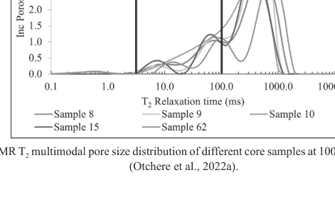

**图 3.2.** 不同岩心样品在 100% 含水饱和度下的 NMR T₂ 多峰孔径分布（Otchere 等，2022a）。

### 3.2 数据分析与特征工程

通过基于 Python 的计算平台 Jupyter notebook 计算协方差热力图和配对图，建立了输出与输入特征之间的关系。表 3.3 和表 3.4 给出了数据的统计汇总，有助于识别数据分布和预期趋势。

选取这些测井曲线是因为 Otchere 等人（2021b）的研究已确立了它们与孔隙度的关系。在下一阶段，使用选定的电缆测井数据，通过若干集成模型和深度学习（DL）模型来预测孔隙度和自由流体体积（FFV）。

**表 3.3.** 本研究所用输入数据的描述性统计。

| 统计量 | S-sonic | Gamma | SP | R(S) HLLS | Rt | Rxo | Neutron | RHOB | SXGAS |
|---|---|---|---|---|---|---|---|---|---|
| 均值 | 162.64 | 41.78 | -388.62 | 102.37 | 335.15 | 4.33 | 0.14 | 2.33 | 0.51 |
| 标准差 | 39.73 | 19.45 | 27.70 | 259.54 | 1628.80 | 3.84 | 0.06 | 0.20 | 0.35 |
| 最小值 | 99.98 | 24.57 | -431.31 | 1.45 | 1.32 | 0.86 | 0.02 | 1.76 | 0.00 |
| 25% | 138.79 | 31.47 | -411.00 | 12.17 | 12.44 | 2.09 | 0.10 | 2.17 | 0.22 |
| 50% | 149.13 | 34.83 | -397.50 | 35.94 | 46.82 | 3.21 | 0.13 | 2.37 | 0.56 |
| 75% | 172.14 | 41.96 | -369.56 | 111.24 | 180.35 | 5.19 | 0.16 | 2.47 | 0.82 |
| 最大值 | 309.04 | 114.09 | -314.13 | 4986.61 | 28651.10 | 51.44 | 0.37 | 2.66 | 1.00 |

**表 3.4.** 本研究所用目标变量的描述性统计。

| 统计量 | TCMR | CMFF |
|---|---|---|
| 均值 | 0.11 | 0.07 |
| 标准差 | 0.03 | 0.04 |
| 最小值 | 0.01 | 0.00 |
| 25% | 0.09 | 0.04 |
| 50% | 0.11 | 0.07 |
| 75% | 0.13 | 0.09 |
| 最大值 | 0.31 | 0.16 |

### 3.3 机器学习模型应用

人们普遍认为，在机器学习（ML）领域，深度学习（DL）算法比传统、更简单的对应算法表现更好。深度学习模型能够处理大量数据，因此广泛用于预测建模和模式识别任务（Otchere 等，2021a）。尽管深度学习在人工智能领域带来了诸多进步，但它仍然存在显著缺陷。超参数调优、在小型数据集上收敛缓慢、无限结构以及复杂性是最常遇到的问题。虽然传统机器学习模型可以在较小数据集上缓解这些问题，但它们在整体上产生更高模型性能的能力有限。由于小型数据集的定义模糊，很难确切知道该使用哪种模型。基于这些论述，本研究开发了一种新的自定义堆叠集成模型。该自定义集成模型在其架构中集成了多个不同的基学习器，以增强模型效果。然而，与自定义堆叠集成模型相比，各个单独模型的性能较低。

#### 3.3.1 构建深度学习模型

CNN 模型是一种特别适合图像和信号处理任务的深度学习模型。然而，在本研究中，其性能是在回归任务上评估的。它由多个层组成，包括卷积层、池化层和全连接层。为构建本研究使用的 CNN 模型，采取了以下步骤：

1. 输入数据（10 维电缆测井数据）经过重塑，以匹配 CNN 模型期望的输入形状。

2. 该模型由一系列卷积层组成，旨在从输入数据中提取特征。这些层使用滤波器扫描输入数据，并在不同尺度上提取特征。

3. 卷积层的输出随后通过一个或多个池化层，以降低特征图的维度并提供某种平移不变性。

4. 池化层的最终输出随后通过一个或多个全连接层，以做出最终预测。

5. 随后使用训练数据集训练模型，并使用留出数据集评估模型。

6. 通过调整层数、每层滤波器数量和滤波器大小对模型进行微调，以达到期望的性能水平。

7. 使用 Adam 优化器训练模型，并以 MAE（平均绝对误差）作为损失函数。

8. 使用早停法训练模型以防止过拟合。

长短期记忆（LSTM）网络和门控循环单元（GRU）是循环神经网络（RNN）的类型，特别适合处理时间序列、语音和文本等序列数据。GRU 模型与 LSTM 模型类似，但参数更少，这在数据或计算资源有限时很有用。GRU 和 LSTM 的关键特性是能够通过门控制信息进出单元，从而在更长时间内记住信息。当处理数据顺序至关重要的序列数据时，这类模型非常有用。然而，这类模型计算强度大，且需要大量数据进行训练。为构建本研究的 GRU 和 LSTM 模型，采取了以下步骤：

1. 输入数据被转换为适合 GRU/LSTM 的格式，通常为三维数组，其中第一维表示样本数，第二维表示时间步，第三维表示特征数。

2. 该模型由一个或多个 GRU/LSTM 层组成，负责处理输入数据并提取特征。

3. GRU/LSTM 层的输出随后通过一个或多个全连接层，以做出最终预测。

4. 随后使用训练数据集训练模型，并使用留出数据集评估模型。

5. 通过调整层数、每层神经元数量和丢弃率对模型进行微调，以达到期望的性能水平。

6. 使用丢弃法和早停法等正则化技术训练模型，以防止过拟合。

#### 3.3.2 构建混合堆叠集成模型

混合集成模型是多种模型协同工作以提高模型整体性能的组合。本例中，使用堆叠方法构建了由 Extra Trees、Random Forest 和 XGBoost 组成的混合集成模型。堆叠是一种技术，将基模型（Extra Trees、Random Forest 和 XGBoost）的预测结果作为输入来训练元模型，由元模型做出最终预测。基模型在相同数据集上训练，其预测结果被组合成单个数组，作为使用线性回归训练元模型的输入。元模型基于组合预测结果和训练数据集的目标变量进行训练，然后用于对测试集进行预测。这种方法通过结合不同模型的优势并降低预测方差，可以提高模型性能（Tarafder 等，2022）。表 3.5 总结了使用 Extra Trees、Random Forest 和 XGBoost 模型开发堆叠集成所用的函数，图 3.3 总结了整个工作流程。

**表 3.5.** 将堆叠集成模型作为自定义集成基学习器的模型架构。改编自 Otchere 等人（2022a）。

**算法 1：** 堆叠基学习器

```text
1: def ensemble_predict(models, X_train, y_train, X_test):
2: # create an empty array to store predictions
3: predictions = list()
4:
5: # loop through the models
6: for model in models:
7: model.fit(X_train, y_train)
8: y_pred = model.predict(X_test)
9: predictions.append(y_pred)
10:
11: # return the predictions
12: return predictions
13:
14: def train_stacking_ensemble(X_train, y_train, X_test, y_test):
15: models = get_models()
16: ensemble_predictions = ensemble_predict(models, X_train, y_train, X_test)
17: meta_model = LinearRegression()
18: meta_model.fit(ensemble_predictions, y_test)
19:
20: # predict on the test set
21: y_pred = meta_model.predict(ensemble_predictions)
22:
23: # evaluate performance
24: r2 = r2_score(y_test, y_pred)
25: mae = mean_absolute_error(y_test, y_pred)
26: rmse = sqrt(mean_squared_error(y_test, y_pred))
27: fit_likelihood = OLS(y_test, add_constant(y_pred)).fit()
28: print("R²: {:.4f}".format(r2))
29: print("MAE: {:.4f}".format(mae))
30: print("RMSE: {:.4f}".format(rmse))
31: print("AIC: {:.4f}".format(fit_likelihood.aic))
```

对于特定任务、数据集和期望性能，存在多种不同的模型组合、每种模型的不同参数以及不同的元模型，可用于寻找最佳混合集成。

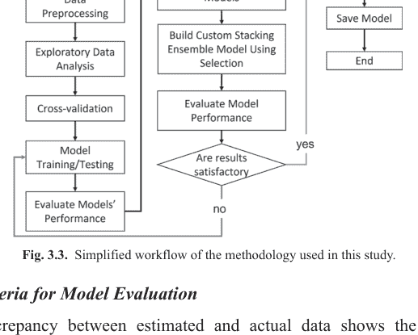

图3.3 本研究所用方法的简化工作流程。

### 3.4 模型评估标准

估计数据与实际数据之间的差异反映了模型在评估性能时的预测误差。本研究通过以下评估标准对模型性能进行了分析：

1. *平均绝对误差（MAE）*：该评估标准又称L1损失，对相对误差敏感，对预期结果的整体缩放具有鲁棒性。MAE的数学表达式为：

$$MAE = \frac{\sum_{i=1}^{n} |y_i - \hat{y}_i|}{n}$$  (3.5)

2. *均方根误差（RMSE）*：该评估标准是模型预测误差的标准差，表示预测数据与实际数据的接近程度。其表达式为：

$$RMSE = \sqrt{\frac{\sum_{i=1}^{n} (y_i - \hat{y}_i)^2}{n}}$$  (3.6)

3. *赤池信息准则（AIC）*：该评估指标基于频率论概率方法，根据模型的最大概率估计对其进行评分。该技术用于确定模型的精确性和优越性，表明模型与新数据之间更稳健的匹配。AIC的统计表达式为：

$$AIC = 2K - 2(\log - likelihood)$$  (3.7)

4. 决定系数（R²）：R²表示因变量与最优拟合回归线的接近程度。R²的数学表达式为：

$$R^2 = 1 - \frac{\sum (y_i - \hat{y}_i)^2}{\sum (y_i - \bar{y})^2}\tag{3.8}$$

除R²外，低误差也表明模型性能良好。

## 4 结果与讨论

### 4.1 模型性能评估

鉴于运行核磁共振（NMR）测井的成本以及机器学习模型在储层表征中的有效性，本研究使用多种模型从电缆测井资料中估算碳酸盐岩储层的总孔隙度和自由流体体积。图3.4中的结果表明，与其他模型相比，混合集成模型在总孔隙度和可动流体预测方面对留出数据的精度有所提高。尽管某些模型（Extra Trees和XGBoost）取得了最高的训练精度，但相对于混合模型，其测试精度较低，这些模型可能对训练数据过拟合。过拟合是指模型过于复杂，能够很好地拟合训练数据，但无法很好地泛化到测试数据。该问题通常由模型中参数过多或容量过大引起，使其能够拟合训练数据中的噪声。在本例中，Extra Trees模型具有高达1的训练精度，表明其能够很好地拟合训练数据。然而，其测试精度0.82低于混合模型，这表明Extra Trees模型无法很好地泛化到新数据。另一方面，混合模型结合了多个模型的预测，从而降低了方差并提高了最终预测的稳健性。因此，它不太可能过拟合训练数据，更有可能很好地泛化到新数据。仅基于这一点，就必须指出混合模型比其他模型表现得更为稳健。此外，还进行了额外分析以评估所有模型的预测误差。

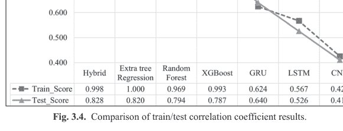

图3.4 训练/测试相关系数结果比较。

误差测量用于评估模型的一致性和精度，结果如图3.5所示。MAE和结果表明混合模型优于其他模型，显示出其在多输出预测中的一致性和精度。Extra Trees回归模型的表现具有可比性，其RMSE为0.0143，MAE为0.0102。其AIC分数也高于混合集成模型，表明混合模型有更高的概率拟合新数据。随机森林和XGBoost模型表现相对良好，RMSE分别为0.0152和0.0155。它们的MAE高于混合集成模型。

另一方面，与其他基础模型相比，LSTM和GRU模型表现较差，其RMSE分别为0.0231和0.0202，MAE分别为0.0176和0.0151。它们的AIC分数也高于其他模型，表明它们不太可能很好地泛化到新数据。比较这两个RNN模型可以发现，GRU模型的误差低于LSTM模型。表现最差的模型是CNN模型，其MAE为0.0273，RMSE为0.034，表明其无法很好地拟合数据。相对较高的AIC分数也表明它不是此任务的最佳模型。

结果表明，混合集成模型是本研究中表现最好的模型，因为它具有最高的训练和测试分数、最佳的AIC分数以及最低的MAE和RMSE。Extra Trees回归、随机森林和XGBoost模型表现良好，但观察到一些过拟合问题。应进一步研究和优化集成模型以提高其性能。此外，探索其他集成方法（如bagging和boosting）以改进模型性能也将是有意义的。此外，可能需要更大的数据集和更多的计算资源来提升LSTM和GRU模型的性能（图3.5）。

下面的图3.6和图3.7展示了混合、GRU和ET模型的预测值与实际总孔隙度和FFV的核密度估计（KDE）。从观察结果来看，混合集成模型的预测输出明显更接近总孔隙度和自由流体体积的实际数据。这一结果表明，混合模型更能捕捉广泛的值范围

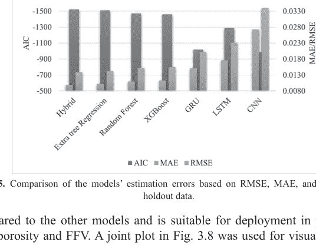


图3.5 基于RMSE、MAE和AIC的模型在留出数据上的估计误差比较。

与其他模型相比，它适合部署于预测总孔隙度和`FFV`。图3.8中的联合图用于可视化，以进一步评估混合模型的性能。图中的阴影区域显示95%置信区间，表明预测的总孔隙度和`FFV`值与实际值相比具有高置信度。低置信度区域主要出现在低值预测中，这是由于训练数据中的低孔隙度值所致。这些低值源于储层段的数据限制，该段大多具有高孔隙度值。因此，通过进行此敏感性分析，验证了前述评估指标的结果。

混合模型的优异性能主要归因于其学习理论、模型架构和数学公式。从学习理论的角度来看，混合模型结合了多个基础模型的优势，如Extra Trees回归、随机森林和XGBoost，这些都是已知通过减少过拟合和增加泛化能力来提升单一模型估计性能的集成方法。这是通过组合多个模型的预测实现的，从而降低了方差并提高了最终预测的稳健性。从模型架构的角度来看，混合模型使用堆叠集成技术来组合基础模型。该技术包括在输入数据上训练多个基础模型，然后将它们的预测作为输入提供给更高层的元模型，由该元模型做出最终预测。这使得混合模型能够捕捉数据的低层和高层特征，从而带来性能提升。从数学公式的角度来看，堆叠集成模型基于多个模型预测的线性组合概念。每个基础模型的预测通过线性函数进行组合，该函数的权重

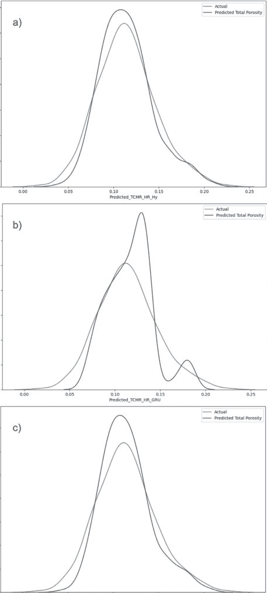

**图 3.6.** KDE 显示估计值与实际总孔隙度的接近程度，其中 (a) 为混合模型预测，(b) 为 GRU 模型预测，(c) 为 ET 模型预测。

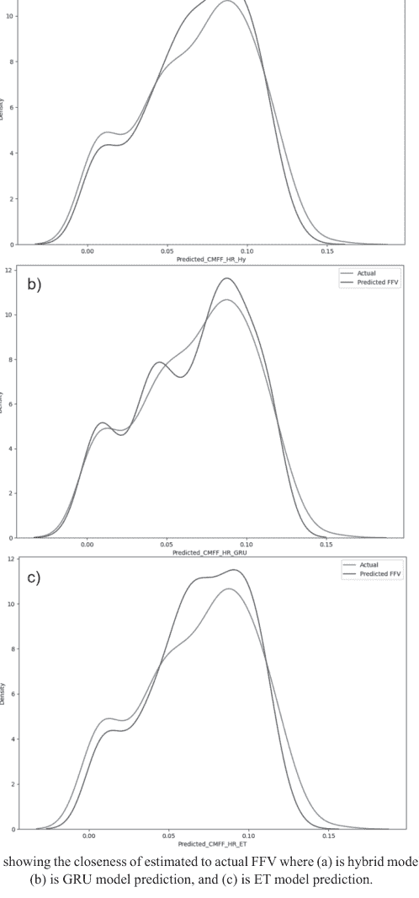

**图 3.7.** KDE 显示估计值与实际 `FFV` 的接近程度，其中 (a) 为混合模型预测，(b) 为 GRU 模型预测，(c) 为 ET 模型预测。

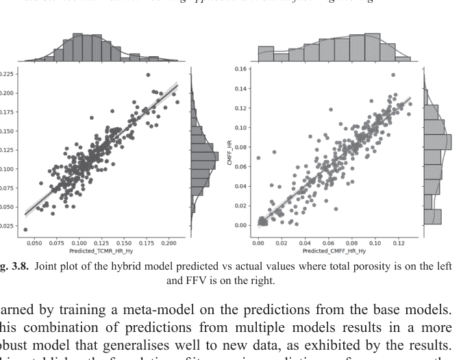

**图 3.8.** 混合模型预测值与实际值的联合图，其中左侧为总孔隙度，右侧为 `FFV`。

通过在基础模型的预测结果上训练元模型而学习得到。这种将多个模型的预测结果组合起来的方式产生了一个更稳健的模型，该模型能够很好地泛化到新数据，如结果所示。这奠定了其相对于独立基础学习器更优预测性能的基础。

需要注意的是，LSTM、CNN 和 GRU 模型的表现不佳，这可能是由于数据量有限或问题的复杂性所致。在小数据集上训练深度学习模型容易引发数据记忆，导致在保留数据上的表现不佳。小数据集下深度学习的无效性及其无法解释结果的能力证实了它不能在所有情况下都被过度评判为最合适的解决方案。

在小数据集上训练深度学习模型会导致数据记忆，通常导致过拟合，从而在保留数据上表现较弱。深度学习在小数据上的有限有效性及其无法解释结果的能力表明，它不能在所有情况下都被单独视为最佳解决方案。总体而言，混合模型的优异性能可归因于其结合多个基础模型的优势以及使用堆叠集成技术和数学公式的能力，从而产生一个更稳健的模型，能够很好地泛化到新数据。混合模型被用于预测整个井的总孔隙度和 `FFV`，如图 3.9 所示。预测模型包括训练数据和测试数据。

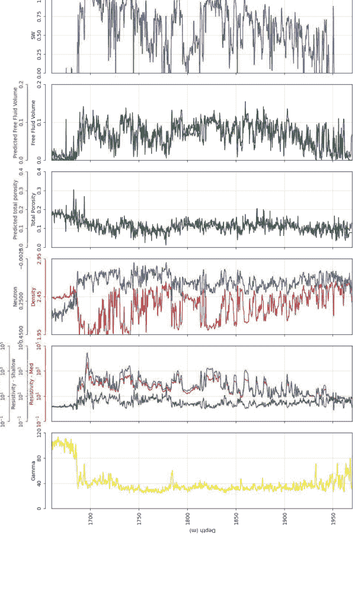

**图 3.9.** 碳酸盐井的测井图，显示实际和预测的总孔隙度及 `FFV`。

## 5. 结论

为了详细了解储层，在早期阶段量化表面润湿性至关重要。这些信息对于提高采收率（EOR），特别是化学 EOR，以最大化产量至关重要。本研究旨在开发一个合适的模型，使用测井数据作为输入来预测总孔隙度和自由流体体积。该研究评估了多个模型，包括混合集成模型、Extra Trees 回归、随机森林、XGBoost、LSTM、GRU 和 CNN。模型的性能使用多个指标进行评估，包括训练分数、测试分数、AIC、MAE 和 RMSE。当岩心润湿性数据和 NMR 测井不可用时，这些计算方法的结合提供了对表面润湿性的更准确描述。

根据本研究获得的结果，可以做出以下推断；

1. 混合集成模型实现了较高的训练和测试准确率分数，表明其能够很好地拟合训练数据并很好地泛化到新数据。这进一步得到其预测中记录的最低 MAE 和 RMSE 的支持。

2. 模型拟合新数据的可能性也很高，如 AIC 分数所示，该分数在所有模型中最低。AIC 是模型对新数据拟合概率的度量。较低的 AIC 分数表明模型更有可能很好地泛化到新数据。

3. 深度学习模型 LSTM、CNN 和 GRU 由于其高复杂性和使用的数据量而表现不佳。

4. 混合集成模型表现优于其他模型，因为它结合了多个基础模型的优势，Extra Trees 回归、随机森林和 XGBoost，并使用了堆叠集成技术。该技术涉及在输入数据上训练多个基础模型，然后使用它们的预测结果作为输入到更高层的元模型中进行最终预测。这使混合模型能够捕捉数据的低级和高层特征，从而提高性能。

本研究的结果表明，混合集成模型是该问题的稳健拟合，适用于预测总孔隙度和 `FFV`。它能够实现高准确性、一致性和精度，并很好地泛化到新数据。这使其成为石油工业中估计储层孔隙度、确定可采储层孔隙体积分数以及评估勘探区潜力的宝贵工具。这有助于提高碳氢化合物勘探和生产效率，最终提高生产率并降低成本。

*石油工程师协会 – 第13届阿布扎比国际石油展览与会议.* ADIPEC 2008 2: 952–962. https://doi.org/10.2118/117945-MS.

Otchere, D.A., Arbi Ganat, T.O., Gholami, R. and Ridha, S. 2021a. 在石油储层性质预测中应用监督机器学习范式：ANN 与 SVM 模型的比较分析。 *J. Pet. Sci. Eng.* 200: 108–182. https://doi.org/10.1016/j.petrol.2020.108182.

Otchere, D.A., Ganat, T.O.A., Ojero, J.O., Taki, M.Y. and Tackie-Otoo, B.N. 2021b. 应用梯度提升回归模型评估特征选择技术在提高储层表征预测中的作用。 *J. Pet. Sci. Eng.* 109244. https://doi.org/10.1016/J.Petrol.2021.109244.

Otchere, D.A., Hodgetts, D., Ganat, T.A.O., Ullah, N. and Rashid, A. 2021c. 静态储层建模比较反距离加权与克里金插值算法在体积估算中的应用。案例研究：Gullfaks 油田。 In: *Offshore Technology Conference.* OnePetro, Virtual and Houston, Texas. https://doi.org/10.4043/30919-MS.

Otchere, D.A., Abdalla Ayoub Mohammed, M., Ganat, T.O.A., Gholami, R. and Aljunid Merican, Z.M. 2022a. 一种预测储层润湿性经井测井的新型经验和深度集成超学习方法。 *Applied Sciences* 12: 2942. https://doi.org/10.3390/app12062942.

Otchere, D.A., Ganat, T.O.A., Nta, V., Brantson, E.T. and Sharma, T. 2022b. 数据分析与贝叶斯优化极限梯度提升方法估计测井的截止值用于净储层和含油层分类。 *Appl. Soft. Comput.* 120: 108680. https://doi.org/10.1016/j.asoc.2022.108680.

Peng, S., Zhang, T., Loucks, R.G. and Shultz, J. 2017. 汞注入毛细管压力在泥岩中的应用：符合性和压缩校正。 *Mar. Pet. Geol.* 88: 30–40. https://doi.org/10.1016/J.MARPETGEO.2017.08.006.

Purcell, W.R. 1949. 毛细管压力 – 使用汞测量以及由此计算渗透率。 *Journal of Petroleum Technology* 1: 39–48. https://doi.org/10.2118/949039-G.

Rezaee, R. 2022. 使用机器学习方法合成碎屑岩的核磁共振（NMR）输出，来自澳大利亚西北陆架和珀斯盆地的实例。 *Energies (Basel)* 15: 518. https://doi.org/10.3390/en15020518.

Tamoto, H., Gloria, R. dos S. and Carneiro, de C. 2023. 使用监督机器学习模型预测碳酸盐储层核磁共振孔隙度测井。 *J. Pet. Sci. Eng.* 220: 111169. https://doi.org/10.1016/j.petrol.2022.111169.

Tarafder, S., Badruddin, N., Yahya, N. and Nasution, A.H. 2022. 使用 EEG 信号的眼动指标进行嗜睡检测。 *Sensors* 22: 4764. https://doi.org/10.3390/s22134764.

Wu, B., Xie, R., Wang, X., Wang, T. and Yue, W. 2020. 基于 NMR 回波数据分形分析的致密砂岩储层孔隙结构表征。 *J. Nat. Gas Sci. Eng.* 81: 103483. https://doi.org/10.1016/j.jngse.2020.103483.

Wu, B., Xie, R., Xu, C., Wei, H., Wang, S. and Liu, J. 2021. 基于 NMR 回波数据预测毛细管压力曲线的新方法：以砂岩为例。 *J. Pet. Sci. Eng.* 202: 108581. https://doi.org/10.1016/j.petrol.2021.108581.

Xu, H., Tang, D., Zhao, J. and Li, S. 2015. 页岩孔隙度低场核磁共振精确测量方法：以鄂尔多斯盆地东缘临兴地区石炭系-二叠系地层为例。 *Fuel* 143: 47–54. https://doi.org/10.1016/j.fuel.2014.11.034.

# 第 4 章

使用数据驱动的机器学习技术确定纵波和横波声波测井

*Daniel Asante Otchere,¹,²,\* Raoof Gholami,³ Vanessa Nta⁴ 和 Tarek Omar Arbi Ganat⁵*

## 1. 引言

横波（`Vs`）和纵波（`Vp`）声波是地下工程中的重要参数。它们为储层勘探、开发、采收和流体封存提供了宝贵的信息（Azizia 等，2017；Zoveidavianpoor 等，2013）。这些参数或其比值在反射地震学、岩性识别和地层评价（Castagna 等，1985）、孔隙流体与孔隙压力信息（Duffaut 和 Landrø，2007；Rojas，2008）、储层表征（Eberli 等，2003；Pickett，1963）、地球物理（Phadke 等，2000；Waluyo 等，1995）以及地质力学性质（Asoodeh 和 Bagheripour，2014；Rasouli 等，2011）等方面具有重要用途。测量这些参数的方法有多种，如表 4.1 所总结。

¹ 马来西亚，霹雳州，斯里依斯干达，32610，国油科技大学地下地震成像研究中心。

² 美国宾夕法尼亚州，University Park，宾夕法尼亚州立大学计算与数据科学研究所。

³ 挪威，斯塔万格，Kjell Arholmsgate 41，斯塔万格大学能源资源系，斯塔万格，4021。

⁴ 美利坚合众国，德克萨斯州，休斯顿，N Dairy Ashford Rd 150 号，壳牌石油公司，休斯顿，德克萨斯州，77079。

⁵ 阿曼，马斯喀特，苏丹卡布斯大学石油与化学工程系。

\* 通讯作者：ascotjnr@yahoo.com

**表 4.1. 估算 `Vs` 声波速度的常用方法。**

| 方法 | 测量类型 |
|---|---|
| 实验室法 | 岩心测量 |
| 直接法 | 偶极声波测井 |
| 经验相关式 | Castagna、Gassman、Brocher、Carroll 和 Greenberg-Castagna 相关式 |
| 机器学习 | 模型示例 |

通过电缆测井可以可靠地获取连续的 `Vs` 和 `Vp` 地下数据。偶极横波声波测井发明于 20 世纪 80 年代，是最常用的测井工具，用于记录波形值并处理数据以计算 `Vs` 和 `Vp` 声波速度，并于 20 世纪 90 年代得到广泛应用（Close 等，2009）。该测量工具指示声音在地下层间传播的速度。尽管偶极声波测井可以使用，但其高昂的成本使得直接测量 `Vs` 得不偿失，因此 `Vs` 并非在所有井中都能普遍获得。这一局限性促使人们进一步研究从其他测井资料（主要是 `Vp` 测井）估算 `Vs` 的方法（Brocher，2005；Carroll，1969；Castagna 等，1985；Dvorkin 和 Mavko，2014；Gassmann，1951；Greenberg 和 Castagna，1992）。随着流体封存、地热能和非常规资源的发展，`Vs` 和 `Vp` 变得越来越重要。然而，在偶极声波测井出现之前，老井从未获取过 `Vs` 和 `Vp` 数据。现在再获取这些数据并不可行。因此，需要开展广泛的研究，以提供从其他常规电缆测井资料估算这两种测井资料的实质性研究。本研究针对 Volve 油田硅质碎屑岩含油储层，探讨了使用多输出监督机器学习方法从电缆测井资料估算 `Vs` 和 `Vp`。这项研究意义重大，尤其是在更成熟的油田中，因为老井从未获取过横波和纵波声波测井数据。该方法将提高数百口井的纵波和横波声波测井预测精度，可用于地质力学、井震联合反演及其他作业。

## 2. 文献综述

在数据涌入之前，经验和实验室技术一直用于从 `Vp` 估算 `Vs`。Pickett（1963）发表的先驱性文章之一确立了使用纵波与横波速度比作为岩性指标的概念。图 4.1 修改自 Pickett 的研究，展示了白云岩、石灰岩和纯净砂岩之间在 `Vp/V` 上的明显区别。根据 Castagna 等（1985）的研究，在石英与碳酸盐岩的二元组合中，随着组分增加，`Vp/Vs` 比往往在端元速度比之间相当线性地变化。这项研究的结果为若干经验方法奠定了基础。本研究将讨论两种最常用的 `Vs` 估算技术。

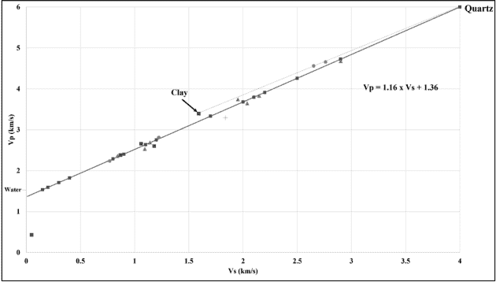

**图 4.1.** 泥岩的 `Vs` 和 `Vp` 声波速度，数据来自*原位*声波测井和野外地震测量。修改自 Castagna 等（1985）。

Castagna 等（1985）的研究得出结论，对于水饱和和干燥的硅质碎屑沉积岩，`Vs` 声波速度与 `Vp` 声波速度直接相关，如图 4.1 所示。在给定相近 `Vp` 的情况下，泥岩的 `Vp/Vs` 往往高于纯净砂岩。根据他们的结果，干燥砂岩的 `Vp/Vs` 几乎是均匀的。湿砂岩和泥岩的 `Vp` 与 `Vp/Vs` 之间呈现出间接单调关系。在水饱和砂岩中测得的 `Vs` 声波速度与 Gassmann 方程预测的结果一致。在盐水饱和的碎屑硅酸盐岩中，`Vp` 与 `Vs` 声波速度之间的这种经验线性关系被称为泥岩线，根据*原位*声波测井和野外地震测量表示为：

$$V_p = 1.16V_s + 1.36 \tag{4.1}$$

该线性方程部分可解释为黏土点位于连接石英点与水速度的直线附近。该方程的建立假设，随着黏土孔隙度增加并接近水，`Vp` 和 `Vs` 速度线性降低。类似地，当纯黏土与石英混合时，随着接近石英点，速度单调增加。这些约束与 Tosaya 和 Nur（1982）经验关系推导出的约束一致，但高孔隙度行为除外。

Greenberg 和 Castagna（1992）基于 `Vp` 的线性关系，提出了 Greenberg-Castagna 公式，用于从其他岩石物理参数估算纯单元完全盐水饱和矿物岩石的 `Vs` 声波速度。要预测 100% 饱和岩石的 `Vs` 声波速度，需要利用 Gassmann 关系进行流体替换计算。为了减轻 Greenberg-Castagna 公式的主要局限性，在存在含烃岩石时需要进行的流体替换。这需要若干组称为 Gassmann 流体替换的运算（Gassmann，1951）。他们利用表 4.2 所示的不同岩性的回归权重来满足表达式：

$$V_s = a_{i2} V_p^2 + a_{i1} V_p + a_{i0} \tag{4.2}$$

岩性回归权重的拟合线基于 Simm 和 Bacon（2014）。该方法的基本过程包括从盐水的 `Vp` 假设开始进行多次迭代，直到达到相当程度的收敛，从而确保 `Vs` 预测的有效性。`Vs` 的回归系数见表 4.2。

**表 4.2. Castagna 等（1993）给出的 `Vs` 回归系数。**

| 岩性 | `ai2` | `ai1` | `ai0` | R² |
|---|---|---|---|---|
| 砂岩 | 0 | 0.80416 | -0.85588 | 0.98352 |
| 石灰岩 | -0.05508 | 1.01677 | -1.03049 | 0.99096 |
| 白云岩 | 0 | 0.58321 | -0.07775 | 0.87444 |
| 页岩 | 0 | 0.76969 | -0.86735 | 0.97939 |

**表 4.3. 应用机器学习预测 `Vs` 和 `Vp` 的先前研究综述。**

| 作者 | 使用模型 | 岩性 | 输入变量 | 输出变量(s) | 研究区域 |
|---|---|---|---|---|---|
| Bagheripour et al. (2015) | 支持向量回归 | 碳酸盐岩 | • 压缩声波<br>• 密度<br>• 中子<br>• 真电阻率<br>• 浅层电阻率<br>• 光电因子<br>• 伽马射线 | 剪切声波 | 伊朗气田 |


| Bukar et al. (2019) | 指数高斯过程回归模型 | 砂岩 | • 压缩声波<br>• 井径<br>• 体积密度校正<br>• 真电阻率<br>• 中子<br>• 孔隙度<br>• 密度<br>• 水饱和度<br>• 伽马射线 | 剪切声波 | 澳大利亚气田 |

| Anemangely et al. (2019) | 最小二乘支持向量机-布谷鸟优化算法 | 碳酸盐岩 | • 压缩声波<br>• 真电阻率<br>• 中子<br>• 密度<br>• 伽马射线 | 剪切声波 | 伊朗阿瓦兹和阿布-泰穆尔油田 |

| Nourafkan and Kadkhodaie-Ilkhchi (2015) | 混合蚁群-模糊推理系统 (ACOFIS) | 碳酸盐岩 | • 压缩声波<br>• 中子<br>• 密度<br>• 伽马射线<br>• 光电因子 | 剪切波速度 | 伊朗切什梅-霍什油田 |

| Elkatatny et al. (2018) | • 自适应神经模糊推理系统 (ANFIS)<br>• 支持向量机 (SVM)<br>• 人工神经网络 (ANN) | 未说明 | • 体积密度<br>• 中子孔隙度<br>• 伽马射线 | • 剪切波<br>• 压缩波 | 未说明 |

| Gamal et al. (2022) | • 决策树 (DT)<br>• 随机森林 (RF) | • 石灰岩<br>• 砂岩<br>• 页岩 | 地表钻井参数 | • 剪切慢度<br>• 压缩慢度 | 未说明 |

| LeCompte et al. (2021) | 人工神经网络 (ANN) | 砂岩 | • 钻井诊断 (EDR) 数据<br>• 电阻率测井<br>• 伽马射线 | • 压缩声波<br>• 密度 | 墨西哥湾 |

| Suleymanov et al. (2021) | • 自适应神经模糊推理系统 (ANFIS)<br>• 支持向量机 (SVM) | 未说明 | • 钻头重量 (WOB)<br>• 机械钻速 (ROP)<br>• 立管压力 (SPP)<br>• 转矩 (T)<br>• 钻杆转速 (RPM)<br>• 泥浆流量 (GPM) | • 剪切波慢度<br>• 压缩波慢度 | 未说明 |

| Ali et al. (2021) | 深度神经网络 (DNN) | • 页岩<br>• 砂岩 | • 声波测井<br>• 深电阻率<br>• 中子<br>• 深度<br>• 伽马射线 | 剪切声波测井 | 巴基斯坦中印度河盆地下戈鲁组 |

| Asoodeh and Bagheripour (2012) | • 人工神经网络<br>• 模糊逻辑算法<br>• 神经模糊算法 | 碳酸盐岩 | • 热中子孔隙度 (NPHI)<br>• 体积密度 (RHOB)<br>• 电阻率 (Rt)<br>• 泥质含量 (Vsh) | • 压缩波速度<br>• 剪切波速度<br>• 斯通利波速度 | 阿斯马里组 |

| Safaei-Farouji et al. (2022) | • 随机森林 (RF)<br>• 额外树 (ET)<br>• 高斯过程回归 (GPR)<br>• 自适应神经模糊推理系统 (ANFIS) 与差分进化 (DE) 和帝国竞争算法 (ICA) 优化器的集成 | 碳酸盐岩 | • 压缩声波速度<br>• 中子<br>• 密度<br>• 伽马射线 | 剪切声波速度 | 伊朗萨尔瓦克油田 |

| Hatampour and Ghiasi-Freez (2013) | 模糊逻辑 | 碳酸盐岩 | • 中子<br>• 密度<br>• 电阻率 (Rt) | • 压缩波速度<br>• 剪切波速度<br>• 斯通利波速度 | 伊朗 |

| Chaikine and Gates (2020) | 混合卷积-循环神经网络 (cRNN) | • 粉砂岩<br>• 页岩 | • 井斜测量<br>• 密度<br>• 压缩慢度 | 剪切慢度 | 加拿大阿尔伯塔省蒙特尼组 |

| Zoveidavianpoor et al. (2013) | 自适应神经模糊推理系统 | 碳酸盐岩 | • 中子<br>• 密度<br>• 伽马射线 | 压缩波 | 中东油田 |

本研究使用了伏尔韦油田的三口井数据。输入特征及其相关性将通过实验室验证的对其对 `Vs` 和 `Vp` 预测影响的依据进行评估。在建立了相关输入变量的合适数据集后，将采用不同的机器学习模型来预测 `Vp` 和 `Vs`。基于多个统计指标表现最佳的模型随后将使用贝叶斯优化 (`BO`) 算法进行优化。

## 3. 机器学习回归模型的背景

本研究基于先前研究，在先前研究中利用多种程序和策略利用可用输入信息预测 `Vs` 或 `Vp`。随着学者们远离经验相关性，机器学习变得越来越流行。单个测井参数为 `Vp` 和 `Vs` 提供了关键信息。然而，当使用特定子集时，结果可以更精确地估计。在某些情况下，研究人员使用过滤方法选择关键特征，而其他人则使用包装方法、内在技术和元启发式算法来选择相关输入特征。这表明该预测没有标准特征集。然而，这些策略基于统计测量而非领域知识。因此，了解 `Vp` 和 `Vs` 以及地下参数如何影响其测量值被用于解决此预测问题。随后选定的适当特征将被用作输入特征。将使用几种基于决策树学习的机器学习模型来预测 `Vp` 和 `Vs`。

### 3.1 决策树概念概述

决策树算法已有数十年历史，但目前被称为分类与回归树 (`CART`)。与其它监督学习模型不同，`CART` 可用于解决回归和分类问题 (Tarafder et al., 2022)。使用决策树的目的是通过使用先前数据学习基本决策规则来构建训练模型，以估计输出变量的值或类别 (Breiman, 2001)。`CART` 模型是随机森林、装袋决策树和提升决策树等主要机器学习模型的基础。`CART` 模型是一个二叉树，类似于算法和数据结构，每个节点没有、一个或两个子节点。假设参数为数值，则节点定义特定输入参数 (`X`) 以及该参数上的分割点。树的终端（叶）节点包含用于决策的目标参数 (`y`)。构建树后，可以通过在每个带分割的分支后插入新数据行来遍历树，直到最终预测。构建二叉决策树是一种分割输入数据的技术。一种称为递归二分分割的贪婪技术用于数据划分。递归二分分割是一种统计方法，其中所有值对齐，并使用目标函数探索和评估多个策略分割点。由此选择导致最低成本的分割。基于目标函数，所有输入参数和可行分割在贪婪方法中进行评估和选择。

析取范式概念，也称为积之和 (`SOP`)，是 `CART` 模型的基础。以同一类别结束的各个分支组合形成从树根延伸到该类别叶节点的每个分支的和。在实现决策树时，确定在每个层级应将哪些特征视为根节点是主要问题。解决此问题称为属性选择。不同的属性选择技术确定在每个层级指定为根节点的属性。

进行审慎分割的偏好对树的可靠性有重大影响。`CART` 模型有特定的选择原则。为了确定节点是否应分割为多个子节点，`CART` 模型使用不同的算法。子节点的形成提高了新出现子节点的均匀性 (Gordon et al., 1984)。进行策略性分割的决定严重影响树的准确性，意味着节点的完整性随目标变量增长。`CART` 模型基于所有可用参数划分节点，然后选择产生最同质子节点的分割。算法选择也取决于目标数据的类型。

#### 3.1.1 属性选择度量

考虑到数据集有 `N` 个参数，选择哪些参数放在树的根部或各个层级作为内部节点是一个复杂的过程。随机选择任何节点作为根部无法解决该问题。选择随机方法可能会导致精度低的糟糕结果。研究人员研究了此属性选择问题并提出了几种利用以下参数的方法 (Breiman, 2001)：

- `1. 熵 (E)`：熵是指信息随机性的度量。熵越高，从数据中得出推断就越困难。熵为零的分支是叶节点，而熵为零的分支需要进一步拆分。参数的熵在数学上表示为：

```
E(S) = \sum_{i=1}^{n} -p_i \log_2 p_i \tag{4.3}
```

其中 `S` 表示当前状态，`Pi` 是在状态为 `S` 的节点中事件 `i` 发生的概率。熵对于多个参数的数学表达式为：

```
$E(S,Y)=\sum_{n\in Y}P(n)E(n)\quad(4.4)$
```

其中 `Y` 表示所选参数。

- `信息增益 (IG)`：`IG` 是一个数值属性，用来量化特定属性根据其目标区分训练样本的效率。构建决策树是为了识别信息增益最大且熵最低的特征。熵会因信息增益而降低。基于提供的特定属性值，它计算数据在分割前熵与分割后平均熵之间的差异。`IG` 的数学表示为：

```
$IG(S,Y)=E(S)-E(S,Y)\quad(4.5)$
```

- `基尼指数 (GI)`：基尼指数可以被视为评估数据集中分割的目标函数。它是通过从 `1` 中减去每个类别平方概率的总和来计算的。`GI` 偏好大而易于实现的分割，而信息增益则偏好具有唯一值的较少分割。基尼指数仅通过采用二元目标变量 `Success` 或 `Failure` 来执行二元分割。较高的 `GI` 值表示更大的不平等和异质性。`GI` 的数学表示为：

```
$GI=1-\sum_{i=1}^{n}(p_i)^2\quad(4.6)$
```

- `增益比`：`IG` 有偏向选择具有许多值的属性作为根节点的倾向。这意味着它偏好具有大量不同值的属性。增益比是 `IG` 的一种变体，可最小化偏差，通常与 `IG` 相比是最好的选择。增益比通过考虑分割前可能出现的分支数量来解决与 `IG` 相关的问题。它通过考虑分割的固有信息来调整 `IG`。增益比表示为：

```
$GR=\frac{E(S)-E(S,Y)}{\sum_{j=0}^{K}w_j\log_2 w_j}\quad(4.7)$
```

其中 `K` 指分割产生的子集数量，`j` 指一个子集。

- `方差减少 (RIV)`：`RIV` 是一种用于回归问题的方法。该方法使用传统的方差公式来选择最佳分割。实现最低方差的分割被选为分割数据的标准：

```
Variance = \frac{\sum (X - \bar{X})^2}{n} (4.8)
```

值的均值表示为 `\bar{X}`。`X` 是实际值，`n` 是值的数量。

- `卡方自动交互检测器 (CHAID)`：`CHAID` 是一种树分类方法，用于确定子节点与父节点之间的统计显著差异。它使用目标的观测频率与预测频率之间标准化差异的平方和来计算。`CHAID` 通过执行两个或多个分割来采用二元目标变量 `Success` 或 `Failure`。卡方值越大，子节点与父节点之间差异的统计显著性越大。卡方在数学上表示为：

```
$x^2 = \sum \frac{(O - E)^2}{E}$ (4.9)
```

其中 `x^2` 表示得到的卡方，`O` 是观测值，`E` 表示期望值。

这些标准将用于计算每个属性选择值。每个值都会被排序，同时特征按顺序放入树中。关于信息增益而言，具有最高值的属性位于根部。在使用 `IG` 作为标准时，假设输出为分类，而 `GI` 则假设属性为连续。`CART` 模型易于理解，因为它们会产生规则，但一个主要缺点是过拟合的实际可能性。过拟合通常发生在 `CART` 因数据中的异常值和不规则性而构建许多分支时，但它可以通过预剪枝和后剪枝方法来最小化。预剪枝会提前终止树的构建，如果节点的纯度度量低于某个阈值，最好不要分割该节点。然而，确定可接受的停止点具有挑战性。后剪枝首先深入树中以构建完整的树。如果树表现出过拟合，则在后剪枝阶段进行剪枝。交叉验证用于确定扩展节点是否会改善，以评估剪枝的有效性。如果有改善，可以扩展该节点。然而，如果它表明性能下降，则不应扩展该节点并将其更改为终端节点 (Breiman, 2001; Gordon et al., 1984)。

### 3.2 随机森林概念概述

另一个众所周知的稳健的袋装算法是 Breiman 开发的随机森林 (`RF`) (Breiman, 2001)。`RF` 使用平均法随机集成大量决策树基学习器 (Dinov, 2018)。每个基学习器都在随机向量上训练，该向量独立选择，其向量分布与其他森林学习者相似。群体智慧是 `RF` 核心中一个简单而强大的概念。这个概念意味着许多相对不相关的学习者协同工作，其表现超过任何单个基学习者。关键点在于模型之间的相关性较差，这使得 `RF` 具有出色的性能。树木相互抵消预测错误，因此 `RF` 产生出色的结果。虽然某些树可能不准确，但许多其他树会准确，使树木作为森林朝正确方向生长。决策树易受其训练的数据集影响，以至于训练数据的微小变化通常会导致树结构发生根本性改变。随机森林利用袋装原则解决了这一缺点，该原则允许从数据集中有放回地随机选择每棵独特的树，从而产生多样化的树。

从某种意义上说，任何给定树的预测成为整体模型预测的特征。由于其对过拟合的鲁棒性和简单的可解释性，`RF` 常被用于提供良好的模型结果。这种优点源于其对目标关键输入因素的评估以及对相关方面的高度重视。然而，`RF` 对高基数特征有更大的偏差。基学习器预测的平均值在数学上表示为：

```
\hat{y} = \frac{1}{n} \sum_{k=1}^{n} h_k(X) \tag{4.10}
```

其中 `\hat{y}` 是输出，`h_k(X)` 是第 `k` 棵树的预测，`X` 是输入向量，`n` 是树的数量。

袋外 (`OOB`) 分数是 `RF` 算法的另一个重要方面。在自助采样时，特定的样本将被排除在用于训练基学习器的子样本之外。这些超出样本的例子可用于评估学习器并生成 `OOB` 分数，作为随机森林模型的伪验证子集。初始化随机森林对象时将 `oob_score = True` 以获取 `OOB` 分数。`RF` 算法的另一个关键方面是其特征工程能力，即从训练数据集的输入变量中选择最相关的特征。特征选择是机器学习工作流程的重要组成部分。

随机森林的主要缺点是许多树可能会减慢速度并使模型在预测时效率低下。通常，模型倾向于快速学习但预测缓慢。更精确的预测需要更多的树，导致计算繁重的模型。

### 3.3 极端随机树概念概述

极端随机树 (`Extra-Trees`) 是一种由 Geurts 等人提出的集成学习技术 (Geurts et al., 2006)。基于树的回归器由一组层次规则组成，可预测输出的数值 (Gordon et al., 1984)。`Extra-Trees` 技术使用传统的自上而下策略来构建未剪枝决策树的集成。与之前基于树的集成算法的两个关键区别是，它通过完全随机选择切分点来分离节点。它使用整个训练样本来生长树，而不是复制自助样本。`Extra-Trees` 适当平均决策树的随机预测以提高精度，同时显著最小化计算复杂度。

`Extra-Trees` 方法建立在偏差-方差概念之上。切分点和特征的显式随机化结合集成平均可以比其他算法采用的较弱随机化技术更强地降低方差。应使用整个原始训练数据来减少偏差，而不是自助样本。假设树是平衡的，树生长方法的计算成本相对于学习样本大小为 `N log N` 的量级，与大多数其他树生长过程相同。此外，鉴于节点分割技术的简易性，预计常数因子将明显低于以前在局部优化切分点的基于集成的方法 (Geurts et al., 2006)。

构建构成树的节点和分支取决于根据预定的分割标准将输入向量划分为相互独立的区域，逐渐减小区域的大小。当树段中的样本数量低于预定义阈值时，分割终止以形成叶节点。当将新样本输入树时，会根据树构建过程中提供的分割标准采取特定路径。预测目标是通过聚合叶中存储的值生成的。分割要求、终止为叶、开发的树数量以及为每个叶分配权重是 `Extra-Trees` 与其他基于树技术不同的关键方面。

除了具有基于一致性的通用泛化和近似的单树类似优势外，`Extra-Trees` 还在整体模型误差方面提供弹性，因为异常值对其预测的影响很小且是局部的。当输入特征显著多于随机分割时，`Extra-Trees` 在计算效率方面可能优于单树，同时抵制无关输入特征。进一步与单树的比较以及取决于所处理的问题表明

极端随机树 (`Extra-Trees`) 展现低方差，且其预测精度会随着树数量的增加而提高 (Ernst et al., 2006)。

## 4. 数据收集与描述

`Volve` 油田位于挪威北海区域，是一个砂岩含油储层段。`Volve` 油田地层主要由近岸、浅海至边缘海相沉积物组成。通过大量岩心取样，发现 `Heather` 地层可划分为六种不同的相组合：海岸平原、滨面、河流-潮汐水道充填、海湾充填、河口坝和陆架开阔海相 (Folkestad and Satur, 2008; Otchere et al., 2022b, 2021a; Sneider et al., 1995)。所用数据包含来自三口井的 `12` 维数据，分别为 `15_9-F-1_A` 井 (`A` 井)、`15_9-F-1_B` 井 (`B` 井) 和 `15_9-F-15_D` 井 (`C` 井)。其中，`A` 井和 `B` 井合并，共 `4,000` 个数据点 (`A` 井 `2,125` 个，`B` 井 `1,875` 个)，用于训练和测试模型。图 `4.2` 和图 `4.3` 展示了 `A` 井和 `B` 井的电缆测井图，其中包含横波 (`DTS`) 和纵波 (`DT`) 测井曲线。随后，模型被部署用于估算没有 `Vp` 和 `Vs` 测井曲线的 `C` 井的 `DTS` 和 `DT`，该井共有 `11,935` 个数据点。将数据分析应用于数据的主要优势之一是在高维数据中发现模式和隐藏信息。因此，本研究的主要输入特征在表 `4.4` 中进行了总结并说明了理由。表 `4.5` 显示了合并的 `A` 井和 `B` 井各特征的描述性统计。

表 `4.4` 选择测井曲线作为输入变量的理由。

| 测井曲线 | 用途 | 原因 |

|---|---|---|

| 自然伽马 (`GR`) | 岩性判别 | 不同岩性具有不同的 `Vs` 和 `Vp` 波速 (Otchere et al., 2021c)。 |

| 中子 (`NPHI`) | 岩性和孔隙度判别 | 岩性和孔隙度对 `Vs` 和 `Vp` 的影响不同 (Otchere et al., 2021c)。 |

| 密度 (`RHOB`) | 岩性和孔隙度判别 | 岩性和孔隙度对 `Vs` 和 `Vp` 的影响不同 (Otchere et al., 2021c)。 |

| 光电因子 (`PEF`) | 确定矿物以解释岩性 | `Vs` 和 `Vp` 的响应随不同矿物类型或成分而变化 (Castagna et al., 1985)。 |

| 孔隙度 (`PHIF`) | 岩性判别 | `Vs` 波速对孔隙度的敏感性高于 `Vp` (Hamada and Joseph, 2020)。 |

| 含水饱和度 (`SW`) | 流体判别 | 不同地层流体对 `Vp` 和 `Vs` 响应的影响不同 (Castagna et al., 1985)。 |

| 电阻率 {真 (`RT`)、浅 (`RACELM`)、中 (`RACEHM`)、深 (`RPCELM`)} | 岩性和油气检测测井曲线 | 不同流体对 `Vs` 和 `Vp` 有不同的影响 (Otchere et al., 2021c)。 |

| 井径 (`CALI`) | 检测渗透层段，因此与地层类型相关 | 不同渗透率对 `Vs` 和 `Vp` 的影响不同 (Hamada and Joseph, 2020)。 |

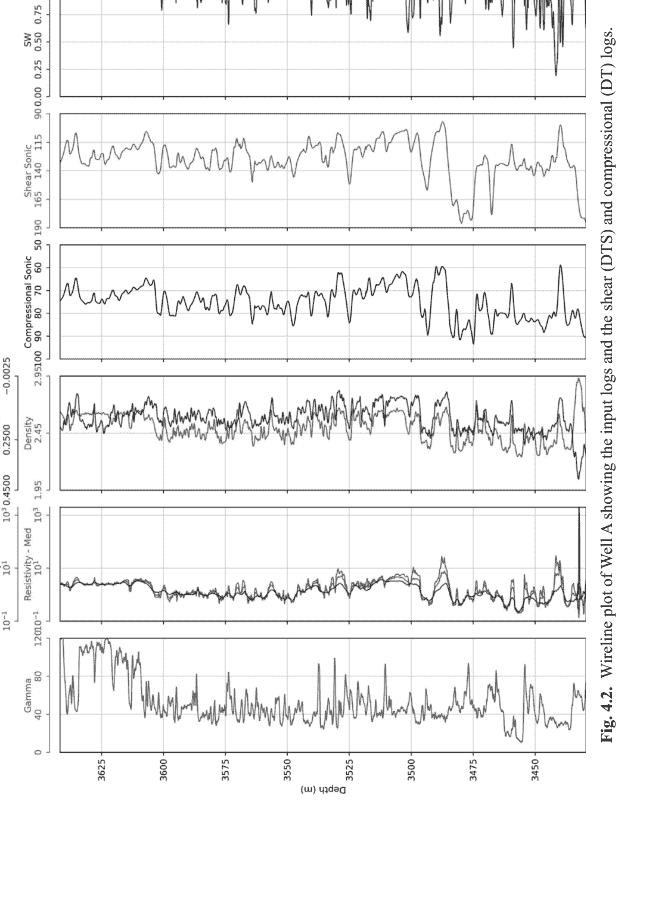


图4.2 A井电缆测井图，显示输入测井曲线以及横波（DTS）和纵波（DT）测井曲线。

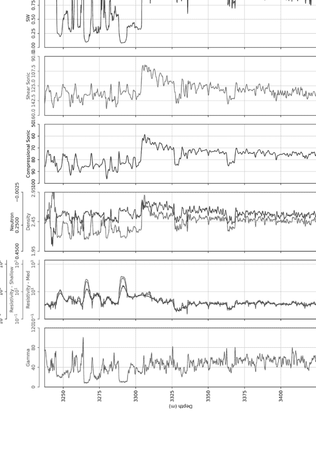

图4.3 B井电缆测井图，显示输入测井曲线以及横波（DTS）和纵波（DT）测井曲线。

表4.5 合并A井和B井的输出和输入变量的描述性统计。

| | CALI | DT | DTS | GR | NPHI | PEF | RACEHM | RACELM | RHOB | RPCELM | RT | PHIF |

|---|---|---|---|---|---|---|---|---|---|---|---|---|

| 计数 | 4000 | 4000 | 4000 | 4000 | 4000 | 4000 | 4000 | 4000 | 4000 | 4000 | 4000 | 4000 |

| 均值 | 8.66 | 75.98 | 129.96 | 48.75 | 0.16 | 6.07 | 4.25 | 3.40 | 2.47 | 3.02 | 3.96 | 0.11 |

| 标准差 | 0.04 | 6.80 | 13.56 | 20.18 | 0.05 | 0.75 | 87.41 | 50.11 | 0.13 | 7.85 | 11.99 | 0.06 |

| 最小值 | 8.47 | 58.63 | 96.90 | 8.00 | 0.05 | 4.30 | 0.20 | 0.23 | 2.15 | 0.14 | 0.19 | 0.02 |

| 25% | 8.63 | 71.68 | 122.19 | 36.88 | 0.13 | 5.62 | 1.04 | 1.03 | 2.40 | 1.06 | 1.08 | 0.06 |

| 50% | 8.67 | 75.14 | 130.42 | 46.23 | 0.16 | 6.05 | 1.44 | 1.38 | 2.48 | 1.50 | 1.58 | 0.10 |

| 75% | 8.70 | 80.93 | 136.00 | 56.55 | 0.19 | 6.37 | 2.53 | 2.42 | 2.56 | 2.64 | 3.03 | 0.15 |

| 最大值 | 8.87 | 96.22 | 186.09 | 127.06 | 0.41 | 10.99 | 5464.37 | 2189.60 | 3.05 | 96.43 | 134.70 | 0.27 |

## 5. 方法

### 5.1 数据分析与可视化

本研究对数据进行了分析和可视化，以帮助理解输入变量与两个目标变量之间的相关性。使用肯德尔相关协方差热图计算输入与目标之间的相关程度。`NPHI`、`RHOB`和`PHIF`是与两个目标变量均密切相关的参数。输入与目标之间的非线性分布也通过图4.4中的散点图矩阵展示。基于这种非线性分布，很明显没有任何输入参数与两个目标变量存在线性关系，因此建议本研究选择非线性模型。

### 5.2 机器学习模型应用

作为机器学习过程的一部分，使用留出法交叉验证技术从总数据集中随机抽取数据来训练模型。该技术通过使用未见过的数据预测目标变量来评估模型性能，并防止选择偏差和过拟合（Otchere et al., 2022a; Tarafder et al., 2021）。留出法将数据按90:10划分，构成3,600个训练数据点和400个测试数据点。选择这样的划分是为了确保大部分数据用于训练模型，因为地下储层具有非均质性，但同时保证保留足够数量模型未见过的数据进行测试。本研究使用了多种多输出模型，以确定哪种模型能准确预测`Vs`和`Vp`。本研究使用相同的样本外数据，以确保所有模型在等价的数据点上进行预测。模型性能按排名顺序使用平均绝对误差（`MAE`）、均方根误差（`RMSE`）、平均绝对百分比误差（`MAPE`）和`R²`进行评估。模型还使用赤池信息准则（`AIC`）进行比较，`AIC`是一种频率学派概率框架，根据拟合未知数据的最大似然对模型进行评分。在基于这些标准（`BO`）选出最佳模型后，使用超参数调优（一种基于顺序模型的优化过程）来提高模型的预测精度。`BO`技术是一种便捷且动态的范式，它利用贝叶斯定理为引导全局优化问题搜索目标函数极值提供合理机制（Otchere et al., 2022b）。该技术通过基于先前结果估计反复训练目标函数的贝叶斯近似概率模型来运作。在选择可接受的样本用于真实目标函数评估之前，使用采集函数评估概率模型。通过调整模型参数以提高学习算法的效率，并通过达到足够降低的代价函数来优化模型性能的过程被称为超参数调优（Otchere et al., 2022b）。然后将优化后的模型应用于同一油田的一口新井，从电缆测井数据中预测`Vs`和`Vp`。预测的`Vs`和`Vp`测井曲线将与经验关系式获得的结果进行比较。图4.5展示了研究流程。

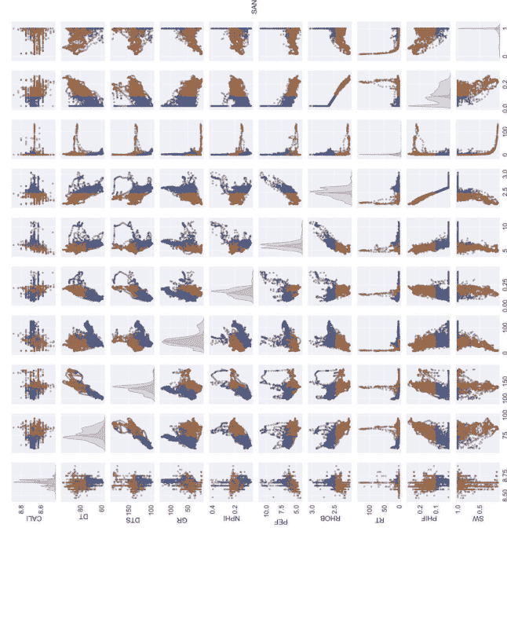

图4.4 所有输入特征的散点图矩阵分布，按砂体标志进行颜色编码。

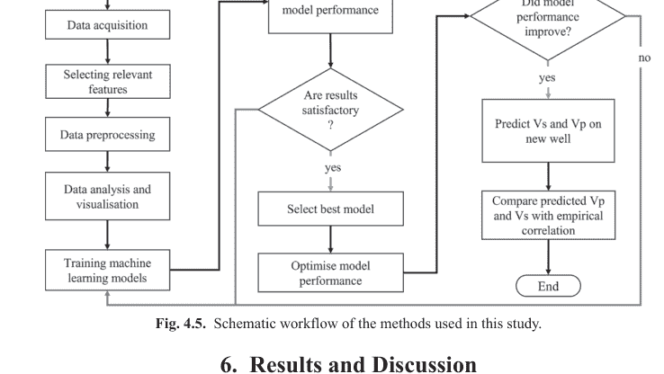

图4.5 本研究方法的示意工作流程。

## 6. 结果与讨论

### 6.1 模型性能评估

本研究使用`AIC`评估所用模型，以识别最有可能拟合样本外数据的模型。使用该指标评估模型的过程表明，`AIC`值越低，拟合新数据的可能性越大。在比较和选择最佳模型时，本研究考虑了以下方面。模型之间`AIC`结果的差异有四个显著性水平：可忽略（`<20`）、中等（`21–50`）、显著（`51–100`）和极强（`>100`）。`Extra-Trees`模型通过记录最低的`AIC`值，在`Vp`和`Vs`预测中获得了最高的拟合概率。将`Extra-Trees`模型与随机森林模型（代表`AIC`最低的两个模型）进行比较时，`AIC`差异为180。结果如图4.6所示。基于这一结果，`Extra-Trees`模型显示出极大差异和更高的拟合机会。`AIC`决定了模型与实际数据的收敛程度。然而，过拟合或欠拟合仍可能存在。因此，需要使用其他误差指标进一步评估模型。

样本外数据结果用于评估模型性能。由于模型使用训练数据集进行训练，任何复制数据的尝试都将高度准确。因此，模型预计会有较高的训练准确率。然而，高训练准确率可能会因匹配数据中的固有噪声而导致过拟合，使模型失去代表性。模型在测试数据上生成的准确预测比例用于评估模型在未见数据上的性能。在`Vp`和`Vs`预测中，高测试准确率是非常期望的，以确认模型在新数据上的准确性和鲁棒性，因为不准确的测量会在许多操作中造成长期缺陷。在本研究中，`R²`大于0.9被视为偏差和方差之间可接受的折衷。如图4.7所示，在测试过程中，`Extra-Trees`模型在估算`Vp`和`Vs`方面表现最佳。

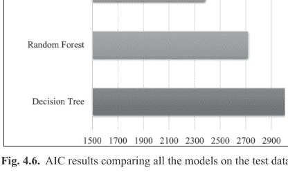

图4.6 在测试数据上比较所有模型的`AIC`结果。

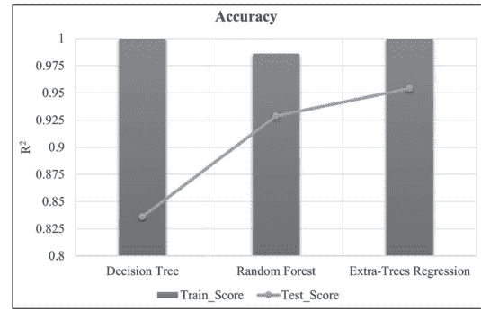

图 4.7. 本研究中所有模型的训练和测试相关系数得分。

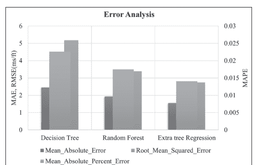

图 4.8. 基于 `MAE`、`RMSE` 和 `MAPE` 的所有模型测试数据预测误差比较。

模型在准确性上取得的任何显著改进都会对决策产生重大影响。尽管这些模型属于同一家族，但其理论和统计基础会导致模型性能存在较大差异。图 4.8 展示了各模型在测试数据上的性能，以评估其精度、一致性和稳健性。在使用 `MAE`、`MAPE` 和 `RMSE` 评估时，`Extra-Trees` 模型表现出最佳的一致性、准确性和稳健性。因此，在所有的评估指标上，`Extra-Trees` 均优于其他模型。

图 4.9 显示了用于可视化预测的 `Vp` 和 `Vs` 测试数据与实际数据及其误差范围的联合图和回归组合。联合图显示了 `KDE` 曲线的单变量直方图和双变量交叉图。对这些图中回归图和 95% 置信区间的分析表明，`Extra-Trees` 模型优于其他模型。

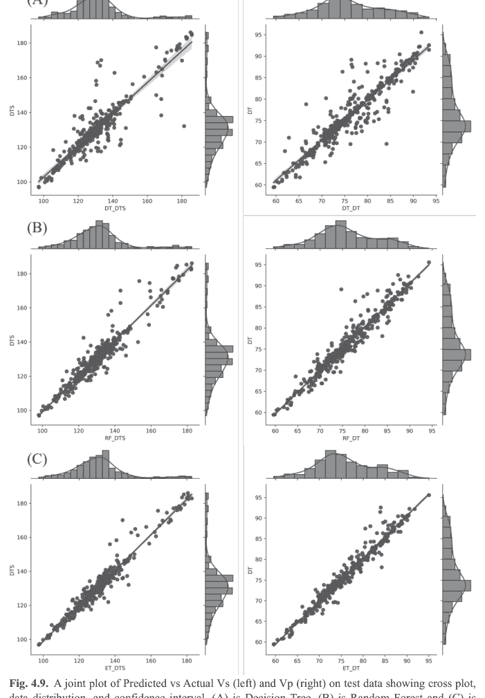

图 4.9. 测试数据上预测值与实际 `Vs`（左）和 `Vp`（右）的联合图，显示交叉图、数据分布和置信区间。（A）为决策树，（B）为随机森林，（C）为 `Extra-Trees`。

`Extra-Trees` 模型显示出更高的置信区间，并基于直方图和 `KDE` 图匹配了数值范围。尽管所有模型在预测 `Vp` 方面均表现出较高的置信度，但在预测较高 `Vs` 值时，决策树（高于 140 µs/ft）和随机森林（高于 160 µs/ft）模型的置信水平趋于下降。

`Extra-Trees` 优于随机森林和决策树的两个关键原因是：通过随机选择切分点来分离节点，以及使用整个训练样本来减少偏差。`Extra-Trees` 适当地平均了决策树的随机化预测，以提高精度，同时显著降低计算复杂度。`Extra-Trees` 方法建立在偏差-方差概念之上。除了在通用泛化和逼近方面与其他模型具有相似的一致性优势外，`Extra-Trees` 在整体模型误差方面还具有稳健性，因为异常值对其预测的影响较小且具有局部性。`Extra-Trees` 在处理无关输入特征以及输入特征超过随机分割时，可能通过在计算效率上优于决策树。决策树模型表现出严重的过拟合，训练准确率达到 100%，但与 `Extra-Trees` 模型相比，其样本外准确率相对较低。因此，基于所有指标，`Extra-Trees` 被选为对测试数据拟合最稳健的模型。

### 6.2 模型优化

采用 `BO` 技术调整参数，以提升 `Extra-Trees` 模型的性能。尽管准确率提升幅度很小，但在地下工程中，任何微小的准确率提升都会对决策产生显著影响，并可能对油田开发产生长期影响。表 4.6 显示了所有模型与 `BO-Extra-Trees`（`BO-ET`）模型的对比。预测的 `Vp` 和 `Vs` 进一步基于地层类型进行了评估。

结果进一步绘制在图 4.10 中，并按岩石类型进行分类，以评估模型性能。该图显示，`BO-ET` 模型在两种岩石类型中对 `Vs` 的预测均表现出更高的置信度。然而，观察到大多数误差来自砂岩层段中 `Vp` 和 `Vs` 的预测。已知砂岩层段是含油气层段。因此，不同流体的效应将影响声波速度的测量。图 4.11 显示了 `BO-ET` 预测的 `Vs` 和 `Vp` 与经验公式 `Castagna` 和 `Greenberg-Castagna` 的对比图。两个经验相关性仅预测 `Vs`，而 `BO-ET` 同时预测 `Vs` 和 `Vp`。数据按饱和度递增排序。相比之下，`BO-ET` 由于其数据驱动方法，表现出比经验相关性更好的匹配。观察到在较高含水饱和度区域（主要是页岩），预测的 `Vp` 和 `Vs` 比低含水饱和度区域（主要是砂岩）更接近实际值。这一观察证实了不同类型的流体会影响声波速度的测量，从而导致模型误差。通过使用含油气层段的额外数据重新训练模型，可以充分模拟流体的影响，从而提高模型的置信度。

## 表 4.6. 所有模型与贝叶斯优化 `Extra-Trees` 的性能比较。

| 指标 | 模型 | 性能 |

|---|---|---|

| `R²` | `Decision Tree` | |||||| |

| `R²` | `Random Forest` | ||||| |

| `R²` | `Extra-Trees` | |||||| |

| `R²` | `BO-Extra-Trees` | |||||| |

| `MAE` | `Decision Tree` | |||||| |

| `MAE` | `Random Forest` | ||||| |

| `MAE` | `Extra-Trees` | ||||| |

| `MAE` | `BO-Extra-Trees` | ||||| |

| `RMSE` | `Decision Tree` | |||||| |

| `RMSE` | `Random Forest` | ||||| |

| `RMSE` | `Extra-Trees` | |||| |

| `RMSE` | `BO-Extra-Trees` | ||| |

| `MAPE` | `Decision Tree` | |||| |

| `MAPE` | `Random Forest` | || |

| `MAPE` | `Extra-Trees` | || |

| `MAPE` | `BO-Extra-Trees` | | |

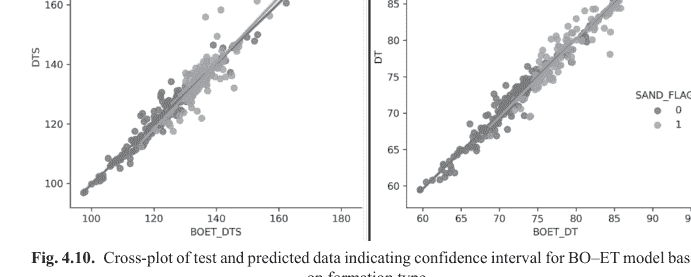

## 图 4.10. 测试与预测数据的交叉图，显示基于地层类型的 `BO-ET` 模型置信区间。

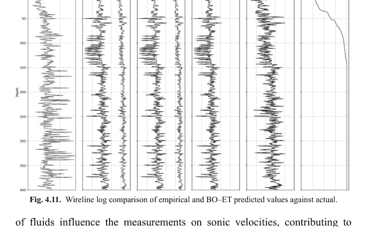

图 4.11. 经验值与 `BO–ET` 预测值相对于实际值的电缆测井对比。

本研究评估的方法表明，数据驱动模型对于 `Vs` 和 `Vp` 预测至关重要。横波和纵波声波速度受到各种地下条件的影响。电缆测井携带有关地下的重要信息。因此，它适合用于测量 `Vs` 和 `Vp`。砂岩层段中大部分误差归因于含水饱和度的影响。随着含水饱和度的增加，`Vs` 和 `Vp` 存在显著变化。当含水饱和度较高时，颗粒倾向于相互剪切。在孔隙空间未完全饱和的地下地层中可以观察到弹性特征，使其保持可压缩性。然而，当更多流体渗入多孔介质时，岩石刚度增加，而弹性降低，因为整个岩石被流体占据。孔隙空间中共存的流体类型也会影响刚度和弹性。`BO–ET` 模型在 `Vs` 预测方面优于经验相关性，原因是该模型是数据驱动的，同时考虑了干燥和饱和条件，甚至考虑了流体饱和类型。流体与岩石结构之间存在明显的相互作用，影响 `Vs` 和 `Vp` 的测量。

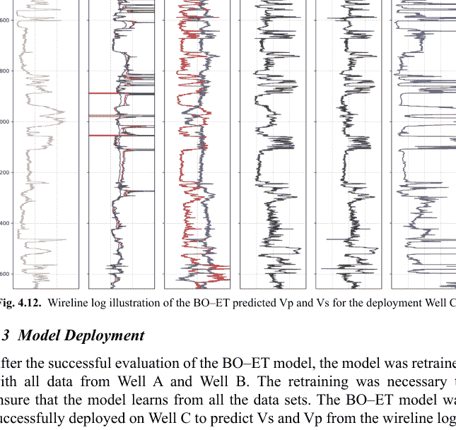

图 4.12. 部署井 `C` 的 `BO-ET` 预测 `Vp` 和 `Vs` 的电缆测井图。

### 6.3 模型部署

在对 `BO-ET` 模型进行成功评估后，使用 `Well A` 和 `Well B` 的所有数据对模型进行了重新训练。重新训练对于确保模型从所有数据集中学习是必要的。`BO-ET` 模型成功部署在 `Well C` 上，用于从电缆测井预测 `Vs` 和 `Vp`。图 4.12 显示了预测 `Vs` 和 `Vp` 测井曲线的电缆测井图，其中顶部储层位于 3,570.6 米深度。该储层在三个不同地层中具有三种不同的地层水盐度。根据在含油气层段中进行的观察，该层段内的预测测井曲线受到高度关注。对所有三个地层中流体存在的敏感性都得到了充分预测，证实了模型的稳健性。该结果表明该模型适用于在相似地层类型中预测 `Vs` 和 `Vp`。

## 7. 结论

本研究展示了利用数据驱动的领域知识和优化的 `Extra-Trees` 模型在缺少横波和纵波声波测井的井中预测这些测井曲线的方法。已发现该方法优于依赖纵波声波测井来预测的经验相关性。

就精度而言的横波声波测井。评估标准表明了模型拟合留出数据的可能性。模型的准确性、精确性和可靠性进一步通过留出数据上的 `MAE`、`MAPE`、`RMSE` 和 `R²` 进行评估。研究结果概述如下：

- 1. 对输入数据进行了充分论证，以理解其对声波速度的影响。

- 2. `Extra-Trees` 模型在精度、稳健性和拟合概率方面优于随机森林和决策树模型。

- 3. `BO` 算法对 `Extra-Trees` 模型的精度产生了虽微小但有意义的改进。

- 4. 在多输出回归预测中，砂岩层段的预测 `Vs`（横波速度）在测试数据上表现出最高的误差。

- 5. 砂岩层段的误差源于储层中不同地层流体的影响。通过使用来自井 `A` 和井 `B` 的所有数据重新训练模型，该误差得以最小化。

- 6. 将模型部署到井 `C` 后，预测的 `Vs` 和 `Vp` 与三种不同地层类型中不同流体饱和度的影响相匹配。

所提出的方法为地热、流体封存和油气行业提供了一种更便宜、更省时的替代方案，无需在每口已钻探的井中运行声波测井工具。它还提供了一种在先前未测量 `Vs` 和 `Vp` 的旧井中测量这些参数的方法。

## 致谢

作者衷心感谢马来西亚石油科技大学（Universiti Teknologi Petronas）和地下地震成像中心（Centre for Subsurface Seismic Imaging）对本工作的支持。

## 数据可用性

所使用的电缆测井数据来自 `Equinor Volve` 油田数据集，网址为 `https://www.equinor.com/en/how-and-why/digitalisation-in-our-dna/volv e-field-data-village-download.html` （[数据集]，2018年）。

# 参考文献

Ali, M., Jiang, R., Ma, H., Pan, H., Abbas, K., Ashraf, U. and Ullah, J. 2021. Machine learning: A novel approach of well logs similarity based on synchronization measures to predict shear sonic logs. J. Pet. Sci. Eng. 203: 108602. https://doi.org/10.1016/j.petrol.2021.108602.

Anemangely, M., Ramezanzadeh, A., Amiri, H. and Hoseinpour, S.A. 2019. Machine learning technique for the prediction of shear wave velocity using petrophysical logs. J. Pet. Sci. Eng. 174: 306–327. https://doi.org/10.1016/j.petrol.2018.11.032.

Asoodeh, M. and Bagheripour, P. 2012. Prediction of compressional, shear, and stoneley wave velocities from conventional well log data using a committee machine with intelligent systems. Rock Mech. Rock Eng. 45: 45–63. https://doi.org/10.1007/s00603-011-0181-2.


Asoodeh, M. and Bagheripour, P. 2014. ACE stimulated neural network for shear wave velocity determination from well logs. J. Appl. Geophys. 107: 102–107. https://doi.org/10.1016/j.jappgeo.2014.05.014.

Azizia, H., Siahkoohi, H.R., Evans, B., Farajkhah, N.K. and Kazemzadeh, E. 2017. A comparison between estimated shear wave velocity and elastic modulus by empirical equations and that of laboratory measurements at reservoir pressure condition. Journal of Sustainable Energy Engineering 5: 29–46. https://doi.org/10.7569/JSEE.2017.629502.

Bagheripour, P., Gholami, A., Asoodeh, M. and Vaez zadeh-Asadi, M. 2015. Support vector regression based determination of shear wave velocity. J. Pet. Sci. Eng. 125: 95–99. https://doi.org/10.1016/j.petrol.2014.11.025.

Breiman, L. 2001. Random forests. Mach. Learn. 45: 5–32. https://doi.org/10.1023/A:1010933404324.

Brocher, T.M. 2005. Empirical relations between elastic wavespeeds and density in the earth’s crust. Bulletin of the Seismological Society of America 95: 2081–2092. https://doi.org/10.1785/0120050077.

Bukar, I., Adamu, M.B. and Hassan, U. 2019. A machine learning approach to shear sonic log prediction. In: Society of Petroleum Engineers–SPE Nigeria Annual International Conference and Exhibition 2019, NAIC 2019. Society of Petroleum Engineers, Lagos. https://doi.org/10.2118/198764-MS.

Carroll, R.D. 1969. The determination of the acoustic parameters of volcanic rocks from compressional velocity measurements. International Journal of Rock Mechanics and Mining Sciences & Geomechanics Abstracts 6: 557–579. https://doi.org/10.1016/0148-9062(69)90022-9.

Castagna, J.P., Batzle, M.L. and Eastwood, R.L. 1985. Relationships between Compressional-wave and Shear-wave Velocities in Clastic Silicate Rocks. Vol. 50: 571–581.

Castagna, J.P., Batzle, M.L., Kan, T.K. and Backus, M.M. 1993. Rock physics—The link between rock properties and AVO response. Offset-dependent reflectivity—Theory and practice of AVO analysis. SEG 8: 135–171.

Chaikin, I.A. and Gates, I.D. 2020. A new machine learning procedure to generate highly accurate synthetic shear sonic logs in unconventional reservoirs. In: SPE Annual Technical Conference and Exhibition. SPE. https://doi.org/10.2118/201453-MS.

Close, D., Cho, D., Horn, F. and Edmundson, H. 2009. The sound of sonic: A historical perspective and introduction to acoustic logging. Canadian Society of Exploration Geophysicists Recorder 34: 34–43.

[Dataset]. 2018. Volve field data village download - data 2008-2016 - equinor.com [WWW Document]. URL https://www.equinor.com/en/what-we-do/digitalisation-in-our-dna/volv e-field-data-village-download.html (accessed 5.27.21).

Dinov, I.D. 2018. Data Science and Predictive Analytics. Springer International Publishing, Cham. https://doi.org/10.1007/978-3-319-72347-1.

Duffaut, K. and Landro, M. 2007. Vp/Vs ratio versus differential stress and rock consolidation—A comparison between rock models and time-lapse AVO data. Geophysics 72: C81–C94. https://doi.org/10.1190/1.2752175.

Dvorkin, J. and Mavko, G. 2014. V_S predictors revisited. The Leading Edge 33: 288–296. https://doi.org/10.1190/tle33030288.1.

Eberli, G.P., Baechle, G.T., Anselmetti, F.S. and Incze, M.L. 2003. Factors controlling elastic properties in carbonate sediments and rocks. The Leading Edge 22: 654–660. https://doi.org/10.1190/1.1599691.

Elkatatny, S., Tariq, Z., Mahmoud, M., Mohamed, I. and Abdulraheem, A. 2018. Development of new mathematical model for compressional and shear sonic times from wireline log data using artificial intelligence neural networks (White Box). Arab J. Sci. Eng. 43: 6375–6389. https://doi.org/10.1007/s13369-018-3094-5.

Ernst, P., Wehenkel, D., Govindaraju, L. and Rao, R.S. 2006. Extremely randomized trees, Artificial Neural Network in Hydrology. Kluwer.

Folkestad, A. and Satur, N. 2008. Regressive and transgressive cycles in a rift-basin: Depositional model and sedimentary partitioning of the Middle Jurassic Hugin Formation, Southern Viking Graben, North Sea. Sediment Geol. 207: 1–21. https://doi.org/10.1016/j.sedgeo.2008.03.006.

Gamal, H., Alsaihati, A. and Elkatatny, S. 2022. Predicting the rock sonic logs while drilling by random forest and decision tree-based algorithms. J. Energy Resour. Technol. 144. https://doi.org/10.1115/1.4051670.

Gassmann, F. 1951. Elastic waves through a packing of spheres. Geophysics 16: 673–685. https://doi.org/10.1190/1.1437718.

Geurts, P., Ernst, D. and Wehenkel, L. 2006. Extremely randomized trees. Machine Learning 63(1): 3–42. https://doi.org/10.1007/s10994-006-6226-1.

Gordon, A.D., Breiman, L., Friedman, J.H., Olshen, R.A. and Stone, C.J. 1984. Classification and regression trees. Biometrics 40: 874. https://doi.org/10.2307/2530946.

Greenberg, M.L. and Castagna, J.P. 1992. Shear-wave velocity estimation in porous rocks: theoretical formulation, preliminary verification and applications. Geophys. Prospect. 40: 195–209. https://doi.org/10.1111/j.1365-2478.1992.tb00371.x.

Hamada, G. and Joseph, V. 2020. Developed correlations between sound wave velocity and porosity, permeability and mechanical properties of sandstone core samples. Petroleum Research 5: 326–338. https://doi.org/10.1016/j.ptprs.2020.07.001.

Hatampour, A. and Ghiasi-Freez, J. 2013. A fuzzy logic model for predicting dipole shear sonic imager parameters from conventional well logs. Pet. Sci. Technol. 31: 2557–2568. https://doi.org/10.1080/10916466.2011.603005.

LeCompte, B., Majekodunmi, T., Staines, M., Taylor, G., Zhang, B., Evans, R. and Chang, N. 2021. Machine learning prediction of formation evaluation logs in the Gulf of Mexico. In: Offshore Technology Conference. OTC. https://doi.org/10.4043/31093-MS.

Nourafkan, A. and Kadkhodaie-Ilkhchi, A. 2015. Shear wave velocity estimation from conventional well log data by using a hybrid ant colony–fuzzy inference system: A case study from Cheshmeh–Khosh oilfield. J. Pet. Sci. Eng. 127: 459–468. https://doi.org/10.1016/j.petrol.2015.02.001.

Onalo, D., Adedigba, S., Khan, F., James, L.A. and Butt, S. 2018. Data driven model for sonic well log prediction. J. Pet. Sci. Eng. 170: 1022–1037. https://doi.org/10.1016/j.petrol.2018.06.072.

Otchere, D.A., Arbi Ganat, T.O., Gholami, R. and Lawal, M. 2021a. A novel custom ensemble learning model for an improved reservoir permeability and water saturation prediction. J. Nat. Gas Sci. Eng. 91: 103962. https://doi.org/10.1016/j.jngse.2021.103962.

Otchere, D.A., Arbi Ganat, T.O., Gholami, R. and Ridha, S. 2021b. Application of supervised machine learning paradigms in the prediction of petroleum reservoir properties: Comparative analysis of ANN and SVM models. J. Pet. Sci. Eng. 200: 108–182. https://doi.org/10.1016/j.petrol.2020.108182.

Otchere, D.A., Ganat, T.O.A., Ojero, J.O., Taki, M.Y. and Tackie-Otoo, B.N. 2021c. Application of gradient boosting regression model for the evaluation of feature selection techniques in improving reservoir characterisation predictions. J. Pet. Sci. Eng. 109244. https://doi.org/10.1016/J.PETROL.2021.109244.

## 第5章

## 数据驱动的虚拟流量计量系统

Ramez Abdalla* 与 Philip Jaeger

## 1. 引言

在油气生产系统中，对多相流量的准确估算是对生产系统进行监测和优化的基本工具。因此，油井的常规测试之一便是生产测试。它通常作为一项可安排的测试来执行，以监测液量、含水率和气油比（GOR）。生产测试可通过测试分离器轻松完成，以此来比较实际产量与理论产量。这是生产和油藏监测中最常见的形式。然而，该技术有其局限性。该测试的主要局限在于，其分辨率或可重复性不足以在短时间内识别液量和含水率的变化趋势。另一个潜在问题可能是时间持续性问题。在低产井和深井中经常出现这种情况，这类井需要多个耗时的完整持液周期。后来，人们开发出了一种替代生产测试的解决方案，即多相物理流量计（MPFMs）。该技术基于在不进行相分离的情况下间接估算多相流量的思路，其实现方式是通过跟踪装置内流体相性质的补充测量值，例如速度和相分率。这些流量计通常安装在井口，从而可以实时跟踪特定油井的多相流量。多相物理流量计的一个缺点是资本支出（CAPEX）和运营支出（OPEX）较高，并且需要频繁进行生产校准。

随后，虚拟流量计量（VFM）技术作为油气行业中一项极具吸引力的技术应运而生。它依赖于解析模型或数据驱动模型，对各相产量进行实时计算。本章将介绍数据驱动的虚拟流量计量解决方案。首先，基于建模范式介绍VFM的分类，将其分为第一性原理VFM和数据驱动VFM两大类。然后，概述数据驱动建模在VFM系统中的应用。在讨论这些应用的过程中，重点阐述了文献工作中所使用的模型特征、预测变量、训练输入数据以及相应的文献出处。

此外，还讨论了数据驱动虚拟流量计的组成以及开发此类流量计的方法。该方法遵循数据挖掘框架的跨行业标准流程（CRISP-DM）。这是一个许多工业项目都在使用的项目规划框架，其主要组成部分包括数据理解与准备、建模和评估。随后，展示了该方法论的一次实际应用，即利用电潜泵的传感器数据来估算流量和预测含水率。最后，我们介绍数据驱动VFM系统的现场应用经验。在这一部分，将讨论文献中报道的使用数据驱动模型的真实运行经验。

## 2. VFM的关键特征


为了对系统进行建模，必须对近井筒区域、井筒、管线和生产节流器进行模拟。为了获得精确的流量估算，需要将模型与观测数据（如入口和出口的压力与温度、节流器开度等）相结合。根据可用的测量数据，生产系统既可以从油藏到处理厂作为一个整体来表示，也可以划分为若干子模型。图5.1展示了井子模型的示意图及相关数据。此外，还可以使用优化算法来调整流量和其他调优参数。这主要是为了通过减小模型预测值与实际测量值之间的偏差来稳定估算模型。

这些系统背后的理念使其无论子模块如何，都具有共同的一般特征。其中一个特征是它们依赖于仪器和系统对流量及相分率变化的灵敏度。它们还依赖于调校/校准，以扩展到“校准范围”并适应不断变化的工况。它们可以分为纯数据驱动、热工-水力建模VFM，或混合型VFM。无论是数据驱动还是机理模型，所有VFM都应考虑井内的压降和温降、节流器两端的压降以及流动流体的相分率。

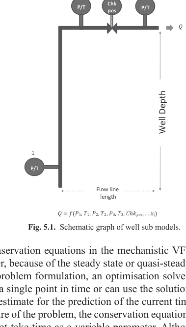

`Q = f(P₁, T₁, P₂, T₂, P₃, T₃, Chkpos, ... x)`

图5.1 井子模型示意图

机理VFM中的许多守恒方程采用动态形式。然而，由于优化问题建模的稳态或准稳态特性，优化求解器只能求解单个时间点的解，或者将上一步的解作为当前时间步预测的初始估计。有时，由于问题本身的性质，守恒方程会采用稳态形式，或者不将时间作为可变参数。尽管将VFM动态地构建为优化问题在理论上是可行的，但这一策略并未在VFM文献中得到应用。主要原因是VFM系统动态优化的复杂计算成本过高，而且这也会使其不适用于实时应用。

除动态优化外，卡尔曼滤波方法和其他状态估计方法也可用于开发动态VFM。该方法的主要难点在于，设置和使用此应用需要较高的知识水平，并且难以以可靠的方式调校实际现场数据。

另一方面，数据驱动VFM技术基于收集现场数据，并通过数学方式使其适应生产系统的物理参数，如井筒和节流器几何结构、流线壁厚等，而无需对这些参数进行显式描述。在过去几年中，这一策略不仅在油气应用中，而且在许多其他应用中都获得了广泛关注。如果模型经过充分训练，且所面临的条件处于训练范围内，数据驱动模型就可以进行快速而精确的实时计量。与机理模型相比，该方法构建模型的成本更低，因为它不需要太多深入的生产工程领域专业知识。在下一节中，我们将介绍数据驱动VFM在不同油井系统上的多种应用。

## 3. 数据驱动VFM的主要应用领域

虚拟传感器是物理传感器的便捷替代品，它利用已安装仪表的油井在已知工况下的可用数据来预测其他测量值（Vinogradov and Vorobev, 2020）。例如，对于特定节流器直径，井口压力（WHP）和井口温度（WHT）与流线压力（FLP）相关；因此，在这四个变量之间建立机器学习模型很方便，以便在需要时作为替代。由于大多数油气井呈现非平稳过程，边界条件可能随油田寿命而改变，因此可以认为虚拟传感器模型可能在油井的整个生命周期内并不总是有效，而仅在特定时间段内有效。最后，当有足够的测量数据，包括频繁的油井测试（例如每年8–12次）、永久性的井口和流线传感器（压力、温度）时，数据驱动VFM将非常有用。在接下来的小节中，我们将介绍针对不同生产系统所进行的各种VFM尝试。

### 3.1 电潜泵井中的虚拟传感

电潜泵（ESPs）由于其结构简单、效率高，目前被广泛用于许多高含水率的人工举升井和海上油井（Takacs, 2018）。在所有人工举升系统中，电潜泵更受青睐，因为它可以在更高温度下实现高产量，并且可以达到更深的深度。传感器和数据采集系统的发展使得电潜泵系统能够连续记录吸入压力和温度、泵扬程、排出压力和温度、电机温度和电流、泄漏电流、振动等数据。这些数据将按固定时间间隔记录，并传输到地面远程终端单元（RTUs）（Carpenter, 2019）。图5.2展示了电潜泵井系统上部署的子模块和传感器的示意图。

基于通信、油井技术和现场设备的进步，许多方法被用于实时流量估算。下面将概述软传感在机理建模和代理建模两方面的应用。

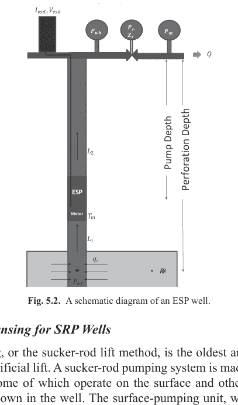

图 5.2. ESP 井的示意图。

### 3.2 用于 SRP 井的虚拟传感

抽油机采油，或抽油杆举升法，是最古老且最广泛使用的采油方式。抽油杆泵系统由多个部件组成，其中一些在地面运行，其他部分在井下运行。驱动井下泵的地面泵单元由原动机（通常为电动机）和通常固定在枢轴柱上的梁组成，该枢轴柱称为萨姆森柱，梁称为游梁。

若干传感器可提供抽油杆泵运行的测量数据。

主要测量值是泵上的载荷，形成所谓的示功图，即诊断卡，绘制顶杆（光杆）载荷与光杆位置的关系，随着泵单元在每个冲程循环中移动。光杆载荷与位置的图称为地面卡。其后，利用波动方程解由地面卡推导出井下卡。井下卡是泵柱塞上载荷与位置的图。此外，在地面，还报告了井口压力、温度以及电机的功率测量值的连续测量。此外，还提供了任何生产系统的正常频繁测试数据。这些包括使用声学换能器测量的流体液面深度以及使用分离器测试或

## 表 5.1. VFM 在 ESP 井上的应用。

| 作者 | 模型摘要 |

|---|---|

| Camilleri et al. (2011, 2015, 2016, 2016b, 2017) | 在这些论文中，讨论了具有不同改进的 ESP 模型，以及 ESP 的第一性原理模型作为虚拟流量计的现场案例研究。采用了一种混合方法来测量流量，无需测试分离器或多相流量计。文中指出，泵吸收的功率相当于电机产生的功率。油管内压力下降提供了流体平均密度的测量值，然后将其转换为含水率。为了获得验证计算的参考，在一口配备 ESP 的页岩油井上对计算速率和实测速率进行了比较（Camilleri, 2011, 2015, 2016a, 2016b, 2017）。 |

| Haouche et al. (2012a, 2012b) | VFM 模型由三个主要单元组合而成：储层单元、电动潜油泵单元和生产油管单元。采用密度校正系数来考虑气体对潜油泵运行性能的影响（Adrien, 2012；Haouche, 2012）。 |

| Binder et al. (2015) | 在一口 ESP 井中应用移动时域估计器进行流量估计。作为输入，井底、井下和泵压力传感器与泵参数一起考虑。该方法显示出准确的性能，并建议用于工业应用（Binder et al., 2015）。 |

| Zhu et al. (2016) | 在本研究中，对原始生产数据集应用了奇异谱分析（SSA），无需任何预处理或对原始序列的转换。他们研究了将原始序列分解为主要独立且可解释分量的总和，如缓慢变化趋势、循环分量和随机噪声（Zhu et al., 2016）。 |

| Krikunov et al. (2019) | 开发了一种混合物理-机器学习预测模型。它利用了多种电机频率。创建了一个数值优化模型来建议多井运行模式（Krikunov et al., 2019）。 |

| Zhu et al. (2020, 2021) | 在这些研究中，开发了一种机理模型来预测泵增压压力。目标是预测油水乳液流变性及其对 ESP 增压压力的影响，并描述气液流动条件下泵泄漏的影响（Zhu et al., 2020, 2021）。 |

| Sabaa et al. (2022) | 本研究旨在开发人工神经网络模型来预测 ESP 举升井的流量。每组数据集均包括井口参数、流体特性、ESP 井下传感器测量值和变频驱动（VSD）传感器参数的测量值。模型由四个独立的神经网络组成，用于预测油、水、气和液流量（Sabaa et al., 2022）。 |

生产测试。图 5.3 显示了抽油杆泵井的子模块、相关测试、示功图和液面测试示例。

目前已知的抽油杆泵系统虚拟传感的应用有限。这可能是由于其生产高流体速率的能力有限。在这方面已做出一些尝试。这些应用具有不同的目标。第一个目标是利用示功图和井口压力及温度作为输入来预测多相流量或环空中动态液面。第二个目标是利用电功率数据推断示功图。

测量值和一些假设值使得卡片计算不准确且不稳定。因此，在杆泵举升过程中使用示功图计算的机器学习模型来表述复杂过程。在这些示例中，使用深度神经网络找到良好的权重组合，最终使模型能够从输入数据（电气参数）得出到目标数据（示功图）的规则。

此类研究包括提取功率特征并构成一个周期内按时间顺序排列的特征向量。其后，根据坐标和载荷数据提取示功图数据和形状曲线图像。其后，按行对功率特征和示功图特征进行归一化，然后映射到 0 到 1 之间。最后，使用序列到序列算法根据功率曲线特征推断示功图（Peng et al., 2019；Zhu et al., 2021）。

### 3.3 用于气举井的虚拟传感

气举（GL）是一种人工举升方法，使用外部高压气源补充地层气以举升井内流体。GL 的原理是注入油管的气体降低了油管内流体的密度，并且气泡对液体具有“冲洗”作用。这两个因素共同作用降低了油管底部流动的井底压力（BHP）。

VFM 建模的一种用途是利用 GL 流量控制阀性能模型计算 GL 速率的非相关估计值。

图 5.4 显示了气举井的控制容积。在该系统中，输入为歧管压力、阀门和套管压力，而输出为 GL 速率。

Ziegel 等（2014）的研究应用讨论了设计数据驱动模型以支持和优化正常或气锥期间的生产作业。数据驱动模型具有有限的输入集，例如生产节流阀、GL 节流阀、由此产生的 GL 和储层压力估计。因此，将构建多个预测模型以创建最终的数据驱动模型（Ziegel et al., 2014）。

Iman et al. (2020) 开发了一种数据驱动方法来寻找 GL 井的最佳运行包络。该过程涉及构建多层感知器神经网络模型，利用地面的实时传感器数据、历史性能和零星测试数据生成多相流量以及其他感兴趣的量（如 GOR、WCT）的瞬时预测。这些模型用于生成累计油、水、气和液体产量、多相流量

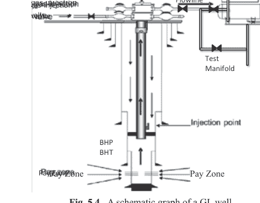

图 5.4. GL 井的示意图。

速率、WCT、GOR 和储层压力。使用时间序列预测模型，对所选的节流设置和气体注入速率组合进行敏感性分析，以生成短期井响应（Al Sebaiti et al., 2020）。

Khan et al. (2020) 使用 AI 技术推导出用于预测气举辅助井生产速率的稳健相关性。本研究中使用的 AI 技术包括人工神经-模糊推理系统、人工神经网络（ANN）、功能网络和支持向量机。他们收集了多个 GL 井的测试数据，并使用 ANN 开发方程来预测油流量。

最初，他们应用了广泛的数据分析，然后将输入数据输入到模型中，这些模型相互比较并与其他经验模型比较。他们能够以超过 98% 的准确度预测油率（Khan et al., 2020）。

### 3.4 用于气井和柱塞举升井的虚拟传感

常规柱塞举升是一种瞬态过程，由气井的循环开启和关闭组成。由于其行为复杂，使用传统的基于物理的模型来模拟储层和井筒性能的耦合行为在计算上是严格且具有挑战性的。因此，机器学习方法有助于表述柱塞举升井系统，包括柱塞到达时间、油管和套管压力以及瞬时气流量。一个周期内的阶段序列。电机阀只有两种状态，即关闭或打开。每个状态的长度取决于预编程的触发器，

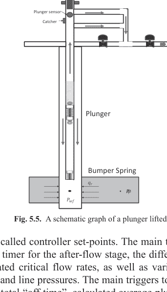

Fig. 5.5. 柱塞举升井的示意图。

也称为控制器设定点。关闭井的主要触发条件包括后流阶段的固定计时器、气体与计算临界流率之间的差异，以及套管、油管和管线压力之间的各种关系。开启井的主要触发条件包括总“关井时间”的固定计时器、计算的平均柱塞上升速度，以及压力测量值之间的不同关系。图 5.5 显示了柱塞举升井的控制容积。

如前所述，虚拟流量计包括基于物理的方法和数据驱动方法。谈到柱塞举升应用时，由于该过程极其瞬态，基于物理方法的应用极其复杂且不可行（Akhiiartdinov et al., 2020）。关于数据驱动模型，Andrianov (2018)（García et al., 2010）和 Shoeibi Omrani et al. (2018)（Loh and Omrani, 2018）展示了使用 ANNs 模拟严重窜流和液载气井瞬态行为的应用。另一方面，Akhiiartdinov et al. (2020) 尝试对柱塞举升井建立 VFM 模型。在本研究中，目标是优化控制阀的“开”和“关”周期，它们作为构建响应面的参数。

### 3.5 识别流动工况的其它应用

如前所述，VFMs 有共同的特征。其中一个主要特征是各相的比例估计，或，在其他

在大多数情况下，主题专家（SME）会构建信息丰富的特征以供进一步算法训练。使用输入数据创建能够描述多相流输运过程的良好特征，有助于获得更好的预测结果。

### 4.2 模型开发

模型开发是已实现算法构建输入和输出特征映射的阶段。此映射过程也称为模型的训练或学习阶段。在此阶段，模型将修改可用参数以精确预测最终输出。参数修改的技术取决于构建模型时实现的算法。模型开发的下一步是在不同数据集上验证和测试模型，以了解模型在未训练数据上的表现。

此外，验证步骤对于调整超参数很重要。超参数在训练前选择，以减少降低模型预测精度的噪声和偏差。K 折交叉验证是一种新技术，其中数据集被分为训练数据和测试数据然后分配模型的超参数。然后模型将在 K 折上训练，并计算模型的平均误差。K 折将使用多个超参数重复，以找到平均误差最低的最佳参数。

最后阶段是在单独的数据集上确认已验证模型的性能。在最终阶段，有两种可能的结果：第一，训练集和测试集上的误差都很大，这称为欠拟合；第二，训练集上的误差很小但测试集上的误差很大，这称为过拟合。因此，验证和测试模型以分配最佳超参数以获得最佳结果是最佳目标。折数的一个典型选择是 k = 10。图 5.7 显示了 10 折交叉验证。

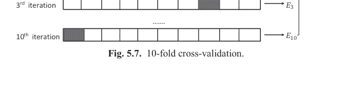

用于构建 VFM 模型的常用算法是 ANN，它可以创建源自输入并将其连接到最终输出的函数。通常，ANN 由输入层组成，用于读取输入特征，在 VFM 的情况下，这些特征通常是压力、温度、节流开度或其他生产系统参数。

ANN 的第二个组成部分是隐藏层，在该层中创建非线性函数以建立输入与预测之间的连接，而最终组成部分是输出层，其中隐藏层获得的结果经过激活函数以达到最终预测。ANN 在应用于稳态流动时显示出显著结果，而瞬态运动的情况则不同。

Al-Qutami et al. (2017) 在三篇出版物中展示了 ANN 在构建 VFM 模型中的应用（Al-Qutami et al., 2017, 2017, 2017）。他们的工作为改进 VFM 模型提供了重要见解。他们研究中应用的最新方法是对 ANN 模型使用 Levenberg-Marquardt 优化算法和 K 折交叉验证进行训练，以确定神经元数量。这项工作得出的结论是，气流速率对节流开度最敏感，而井底压力是流率预测的最关键特征。

Loh and Omrani (2018) 在模拟和现场数据上实现了前馈神经网络以预测油气流率。结果表明，NN 模型在稳态流动时有效，而模型产生的瞬态流动预测不精确。此外，他们对输入特征进行了敏感性研究，结果表明 NN 模型即使在输入噪声的情况下也能表现良好。最后，他们引入了一种新的回分配技术，利用分离器测量值预测流率。

Alajmi et al. (2015) 引入了 NN 模型来预测通过节流器的油流率，并将临界节流流量的经验相关性添加到输入特征中。该研究表明，与机械模型相比，NN 模型性能有明显提升。

为总结本节，我们回顾了创建 VFMs 的主要构建模块。它始于数据收集、预处理和特征工程。我们还介绍了验证技术。最后，我们还介绍了 NN 在 VFM 中的一些应用，作为数据驱动 VFM 所用算法的示例。

## 5. 数据驱动虚拟流量计系统的现场经验

在追求 VFMs 的过程中，发表了多项工业和研究工作。在本节中，我们重点介绍展示基准测试或商业工具的工业应用。在可用的工业工作中，Denny et al. (2013) 报道了集成 VFM 的重要性

Al-Qutami, T.A., Ibrahim, R. and Ismail, I. 2017b. 用于虚拟流量计应用的模拟退火修剪的混合神经网络和回归树集成. pp. 304–309. In: 2017 IEEE International Conference on Signal and Image Processing Applications (ICSIPA).

Al-Qutami, T.A., Ibrahim, R., Ismail, I. and Ishak, M.A. 2017c. 用于预测多相流中气流速率的径向基函数网络. pp. 141–146. In: Proceedings of the 9th International Conference on Machine Learning and Computing. ACM.

Al Sebaiti et al. 2020. 阿布扎比自然自喷井和气举井中由机器学习技术辅助的稳健数据驱动井性能优化, volume Day 4 Thu., 29 October, of SPE Annual Technical Conference and Exhibition. D041S046R002.

Arteaga-Arteaga, H.D., Mora-Rubio, A. Florez, F., Murcia-Orjuela, N., Diaz-Ortega, C.E., Orozco Arias, S., de la Pava, M., Bravo-Ortaz, M.A., Robinson, M., Pablo Guillen-Rondon, P. and Tabares-Soto, R. 2021. 机器学习预测两相流型应用. Peer J. Comp. Sc. 7: e798.

Bello, O., Ade-Jacob, S. and Kun Yuan, K. (eds.). 2014. 生产井虚拟流量计混合智能系统开发, volume All Days. SPE Intelligent Energy International Conference and Exhibition.


Binder, Benjamin J.T., Pavlov, A., Tor, A. and Johansen, T.A. 2015. 使用移动时域估计估计带电潜泵井的流率和粘度. This work is funded by the Research Council of Norway and Statoil through the petromaks project no. 215684: Enabling high-performance safety-critical offshore and subsea automatic control systems using embedded optimization (emopt). IFACPapersOnLine 48(6): 140–146. 2nd IFAC Workshop on Automatic Control in Offshore Oil and Gas Production OOGP 2015.

Camilleri, L. and Zhou, W. (eds.). 2011. 从 ESP 压力计数据获取实时流率、水含量和储层诊断, volume All Days. SPE Offshore Europe Conference and Exhibition, 2011.

Camilleri, L., El Gindy, M., Rusakov, A. and Adoghe, S. (eds.). 2015. 将 ESP 实时数据转换为远程油井的流率和储层信息, volume Day 2 Wed., 16 September. of SPE Middle East Intelligent Oil and Gas Symposium.

Camilleri, L., El Gindy, M. and Rusakov, A. (eds.). 2016a. ESP 实时数据在非常规井中实现高频、高分辨率和高重复性的井测试, volume All Days. of SPE/AAPG/SEG Unconventional Resources Technology Conference.

Camilleri, L., El-Gindy, M. Rusakov, A., Bosia, F., Salvatore, P. and Rizza, G. (eds.). 2016b. 测试不可测试的——在远程 ESP 井上以高精度提供流率测量, volume Day 2 Tue., 08 November. Abu Dhabi International Petroleum Exhibition and Conference, 2016.

Camilleri, L., El Gindy, M., Rusakov, A., Ginawi, I., Abdelmotaal, H., Sayed, E., Edris, T. and Karam, M. (eds.). 2017. 利用 ESP 的高频高分辨率流率测量提高产量, volume Day 2 Tue., 25 April SPE Gulf Coast Section Electric Submersible Pumps Symposium, 2017.

Carpenter, C. 2019. 分析解决方案有助于识别井口抽油杆泵故障. Journal of Petroleum Technology 71(05): 63–64.

Cramer, R. and Goh, K-C. (eds.). 2009. 气井、海底井和多区井的数据驱动监测与优化, volume All Days. SPE Digital Energy Conference and Exhibition, 2009.

Cramer, R., Griffiths, W.N., Kinghorn, P., Schotanus, D., Brutz, J.M. and Mueller, K. (eds.). 2011. 大型海上项目启动期间的虚拟测量价值, volume All Days. IPTC International Petroleum Technology Conference, 2011.

# 参考文献

- Poulisse, H., Van Overschee, P., Briers, J., Moncur, C. and Goh, K-C. 2006. 连续油井生产流量监测与监控。论文发表于 SPE Intelligent Energy International，荷兰阿姆斯特丹，4月11–13日。

- Sabaa, A., El Ela, M.A., El-Banbi, A.H. and Sayyouh, Mohamed H.M. 2022. 用于预测电潜泵井生产率的人工神经网络模型。SPE Production & Operations, pp. 1–10. 9月。

- Takacs, G. 2018. 第1章 - 引言。pp. 1–10. 收录于：Gabor Takacs (编)。Electrical Submersible Pumps Manual (第二版)。休斯顿, 德克萨斯州：Gulf Professional Publishing,

- Vinogradov, D. and Vorobev, D. (eds.). 2020. 虚拟流量计 Novy Port  field 案例, 卷 Day 3, 周三, 10月28日。SPE Russian Petroleum Technology Conference。

- Zhang, S. and Tang, Y. 2008. 抽油机示功图的间接测量。pp. 952–955。收录于：2008 7th World Congress on Intelligent Control and Automation。

- Zhu, D., Alyamkin, S., Sesack, L., Bridges, J. and Letzig, J. (eds.). 2016. 基于时间序列生产数据分析的电潜泵运行优化, 卷 All Days。SPE Intelligent Energy International Conference and Exhibition。

- Zhu, D., Luo, X., Zhang, Z., Li, X., Peng, G., Zhu, L. and Jin, X. 2021. 基于周期性电流数据的地表示功图全复现。SPE Production & Operations 36(03): 594–603。

- Zhu, K., Wang, L., Du, Y., Jiang, C. and Sun, Z. 2020. DeepLog: 利用全卷积网络通过多测井信号识别致密气藏。IEEE Geoscience and Remote Sensing Letters, title=Prediction of Subsurface NMR T2 Distributions in a Shale Petroleum System Using Variational Autoencoder-Based Neural Networks 17(4): 568–571。

- Ziegel, P., Shirzadi, S., Wang, S., Bailey, R., Griffiths, P., Ghuwalela, K., Ogedengbe, A. and Johnson, D. 2014. 一种基于实时数据的北海资产建模与优化的数据驱动方法。论文发表于 SPE Intelligent Energy Conference & Exhibition，荷兰乌得勒支，2014年4月。doi: https://doi.org/10.2118/167850-MS。

# 第6章

## 基于数据驱动和机器学习方法估算智能井完井中多区ICV注水速率

Daniel Asante Otchere¹,²,* and Mohammed Ayoub Abdalla Mohammed³

¹ 地下地震成像研究中心, Universiti Teknologi PETRONAS, 32610, Seri Iskandar, Perak Darul Ridzuan, 马来西亚。

² 计算与数据科学研究所, Pennsylvania State University, University Park, PA, 美国。

³ 化工与石油工程, UAE University, Sheikh Khalifa Street at Tawam R/A, Maqam District, Al Ain, 阿联酋。

\* 通讯作者: ascotjnr@yahoo.com

## 1. 引言

“智能”或“智慧”井被认为是高度发展的一种非常规井类型。该说法指的是近年来引入的尖端井型。这些井的进步性体现在其收集和分析数据、监测和控制生产过程以及根据储层条件变化调整生产的能力上。“智能”或“智慧”这一术语的提出是为了突出这些井中高度自动化和先进技术的使用。典型的智能井具有定制完井，采用封隔器或密封部件分隔井筒，并在非均质地层的不同储层段落的生产管柱上安装井下传感器和压力控制阀。井下传感器可实现对储层温度和压力的连续监测，以及控制阀，可用于近似计算分层流量。相比之下，像流入控制阀（ICVs）这样的井下阀门在控制分层流量方面具有灵活性，并用作优化井以提高采收率的控制变量。智能井可以是多分支井，每个分支由一个ICV控制，也可以是单井眼井，每个区段由一个ICV控制。大多数新的油气田开发都包括智能井。它们在降低资本和运营成本的同时实现预期产量。

智能井完井是一种用于优化油气储层生产的 technology。它涉及收集、传输和分析完井、生产和储层数据，从而实现远程选择性分层控制。该技术的应用有助于提高产量和最终采收率，同时降低资本和运营支出。智能井完井系统经过精心设计，以满足全球对智能完井的需求，即使在最困难的条件下。这些系统由多种组件组成，例如永久监测和井下控制系统、分层隔离和区间控制装置、分布式温度传感系统、地表控制和监测系统、数据采集和管理软件以及系统附件。

多层储层为油气生产带来了独特的一系列挑战，而智能井完井技术非常适合应对这些挑战。通过将井完井划分为可独立控制的多个生产区，智能井完井可实现对储层不同区段生产的 selective 控制。这使得注水、气水突破和单层生产能力的有效管理成为可能，有助于提高最终采收率并降低资本和运营支出。

智能井完井技术还可以改善注水和气突破的管理，从而减少产水量并提高最终采收率。通过远程控制ICV，可以管理来自储层不同区段的流体流动，从而提高生产效率并降低成本。除了上述好处外，智能井完井技术还可以减少油田开发所需的井数，从而降低钻井和完井成本。此外，它还允许通过远程分层控制进行水管理，减少地表处理设施的规模和复杂性。

多区智能注水井的操作人员面临着估算和管理各储层区段通过分层ICV的流体分配的问题。基于可用的井筒、流体和井管柱数据，包括分层ICV的设定、几何尺寸、生产管柱、注入流体性质、井口P/T数据以及分层储层压力/注入能力数据，已开发出一种简单而精确的经验相关性来估算注入到每个储层区段的流体体积。然而，这些方程可能会失准，有时需要重新校准。新的井下压力制度、新流体（水/气）和井口压力都是需要重新校准的情况。

作为生产技术人员，最重要的工作之一是根据井底压力、油管压差和井口压力等运行参数估算来自/流向多个储层区段的油产量/注水量。这些工作流程或经验相关性大多在某种程度上假设了物理规律，这涉及许多假设。因此，本研究提出采用数据驱动的方法。该方法使用人工智能（AI）技术，计算机基于数据模式学习物理规律，无需假设和复杂的物理模型。该概念提出先进的数据分析技术，使人们能够获得对运行参数的新见解和理解（Otchere et al., 2022b）。先进的数据分析和机器学习将被用于构建模型，并利用实际油田的日生产或注入数据预测向多个储层注入的水量。本工作的主要目标是：

1. 研究并理解通过先进数据分析技术估算分层速率所需的关键运行参数。

2. 创建一种可靠的方法，使用机器学习模型计算多层储层中的生产速率。

鉴于人工智能在石油和天然气行业取得的成功，该倡议具有巨大的研究潜力。当前研究应用机器学习技术来优化ICV设定以提高产量。在本项目中，将采用八种机器学习模型来估算ICV设定失准时注入到每个储层的注水量，从而导致错误的分层估算。这种方法将取代重新校准经验相关性以估算注入多个区段的水量，从而导致油田生产中断。在获得可接受的结果后，该方法将应用于具有各种输入参数的油生产井。该研究可以提供一种简单而准确的数据驱动方法，根据运行参数估算每个储层单元的生产流体体积。该方法还可以提供产量的实时估算，有助于储层管理计划。本提案中提交的当前结果可扩展到储层管理计划的先进制定、满足关键目标的日生产运营变化以及运营商负责任地开发国内石油资源的政策。

## 2. 智能完井简述

智能完井系统通过收集、传输和分析与完井、生产和油藏相关的数据来提高产量。这允许对特定区域进行远程控制，最终提高油藏效率。该系统通过混合不同区域的产量来帮助提高产量，能够更好地管理注水和突破，并通过最大限度地减少所需井数和优化生产来降低资本和运营开支，而无需昂贵的人工干预。智能完井系统设计用于在各种环境中运行，并可包括用于区域隔离、区间控制、井下控制、永久监测和温度传感的设备组合，以及用于数据采集和管理的软件。

### 2.1 ICV 设置与确定

应进行多次生产模拟，以优化 ICV 的设计和尺寸。ICV 尺寸对生产速率有显著影响，而生产速率在不同油田中可能差异很大。为了实现特定目标，例如最大化采油量或最小化产水量，确定 ICV 的最佳配置至关重要。这可以通过设计 ICV 来确保每种设置产生唯一的生产速率来实现。这种方法对优化过程有很大影响，因为所得数据为达成预期结果的最佳 ICV 配置提供了宝贵的见解。

在 ICV 设计领域，确定最优设计的过程通常取决于每个分支的生产能力。然而，在实践中，一些石油公司通过采用油田平均生产速率作为设计基础，而不是单个分支的速率，简化了这一过程。这种方法通常被认为更方便，尤其是出于维护和监测等后勤目的。在本研究中，ICV 尺寸的选择基于特定设置下的单区域流量、两个区域合采时的流量（迭代计算）以及三个区域合采时的流量，同时监测井下压力。ICV 设置被离散化，使得每种设置产生与区域压力对应的生产速率。设计 ICV 时考虑的几个因素包括：

- 1. 运行模拟以确定每个区域在合采所有区域和依次单独生产单个区域时的最小和最大生产速率。

- 2. 通过建立预定义的中间设置（范围从 0 到 10）来实现 ICV 区域的离散化，这些设置对应于最小和最大生产速率。ICV 区域被分割为这些设置，以量化表示阀门的开度，其中 0 表示完全关闭，10 表示完全打开。

- 3. 根据井下压力监测，将 ICV（智能完井阀）调整到其最高设置范围（7–10）可实现最大生产速率，而最低 ICV 设置范围（0–3）则导致生产速率为零。

- 4. 如果不同区域之间的生产速率差异显著，则适当使用不同尺寸的 ICV，尽管这可能不是一种可行的方法。

- 5. 在新的 ICV 设置下，对不同的基础情形进行了测试，包括所有区域同时生产和单个区域单独生产。如果一个区域内超过半数的 ICV 设置产生相同的生产速率，则降低最大生产速率。此外，模拟的案例旨在捕捉特定区域出现生产问题（气/水突破）而不得不关闭的情况。虽然这些数据应用于注入井，但该方法是模拟生产井进行的，以捕捉各种情景和生产问题。

### 2.2 ICV 创新与机器学习应用的文献综述

在文献中，ICV 作为优化油气藏生产的手段被广泛研究。这些阀门用于管理进入井内的流体，从而实现对储层不同区域的选择性生产控制。这种选择性控制能够有效管理注水、气水突破和单个区域的生产力，从而有助于提高最终采收率并降低资本和运营开支。

人工智能已成功应用于石油行业，包括储层表征（Otchere 等人，2021）、地震解释（Otchere 等人，2022c）、油藏工程（Otchere 等人，2022a）以及许多其他领域。机器学习技术也被应用于 ICV 阀的优化。研究人员使用机器学习算法来模拟 ICV 设置与生产速率之间的关系，并预测给定条件下最优的 ICV 设置。这些模型可以考虑多种因素，如井筒几何形状、流体性质和储层特征。

人们提出了各种技术来提高智能井的生产力。例如，Mubarak 等人（2008）采用密集生产测试来减少三侧向智能井的产水量，发现侧向对 ICV 设置敏感。对于不同的产水来源，不同的设置被证明是可行的。类似地，Jalali 等人（1998）通过先无限制地生产顶层，然后逐渐解除底层节流，提高了智能气井的输气速率。此外，Yeten 等人（2002）采用基于梯度的方法来优化智能井的累积采油量。Naus 等人（2006）提出了一种方法来确定 ICV 设置导致的流量变化，并在两个储层中进行了测试，目标是实现最大最终采收率。此外，Brouwer 和 Jansen（2002）评估了智能完井在多个井目标和限制条件下的影响，而 Alhuthali 等人（2010）使用智能井和最优速率控制进行水驱优化。Yeten（2003）提出了一种通用方法，使用遗传算法、爬山算法和人工神经网络（ANNs）来优化井型、轨迹、位置和 ICV 设置。另一项由 Behrouz 等人（2016）进行的研究是利用智能井技术开发了一种新方法，用于选择和排序候选井和油田、确定区间控制阀（ICV）尺寸以及优化 ICV 设置。该研究提出了一种智能井中的高效 ICV 设置优化方法，可最大化累积油量、最小化产水量或同时实现两者。研究考虑了实际案例，以证明所提出方法的有效性和鲁棒性，使用所开发的方法使得目标函数有显著改善。

Huang 等人（2011）旨在通过优化井下监测、数据传输、智能优化和生产控制系统，在中国开发智能完井系统。作者开发了一种具有专有互联网协议（IP）的 ICV 系统，并在中国创建了第一套用于可测量、可优化油井开采的智能完井系统（ICS）。结果表明，该系统稳定可靠，石油产量增加了 10.5%。Malakooti 等人（2020）提出了一种集成控制与监测（ICM）算法，可以提高多区域 I 型井的产量。该算法采用两级优化过程，以最大化预测的区域或石油生产可靠性。作者将该算法应用于商业瞬态井筒模拟器进行验证。模拟结果表明，ICM 算法可以在减少所需流动测试次数的同时优化石油生产。此外，该研究强调，在多区域 I 型井中，精确估算区域属性并非实现最大石油产量的必要条件。该算法的有效性表明，它可能适用于优化多井流量分配和多区域 I 型井的启动过程。


在文献中，研究人员还使用了其他机器学习技术，如强化学习、决策树和模糊逻辑来优化ICV阀门。这些技术在寻找最优ICV设置以及提升油气藏性能方面已显示出可观的前景。总体而言，文献综述表明，将ICV数据与机器学习技术相结合，可以成为优化油气藏生产的有效途径。机器学习算法可用于对ICV设置与产量之间的关系进行建模，并针对给定条件预测最优ICV设置。这有助于提高最终采收率、降低资本支出和运营支出，并改善油气藏的性能。

## 3. 研究方法

在ICV设计的背景下，该过程通常依赖于各个分支的生产能力。然而，一些石油公司选择采用简化方法，即使用油田的平均产量而非各个分支的产量。

- 1. 数据采集：在本研究中，数据将从地下部门的生产技术团队获取。所需的数据来自多口井，包括：`SPFM WI` 速率、环空压力、油管压力、`ICV`压差、`ICV`位置、环空温度（对应不同储层段：下段、中段和上段）、`MPFM` 速率、井口油管温度（`THT`）、环空压力、井口油管压力（`THP`）、油管压差（`Tubing dP`）。在目标井中拥有一些`ICV`映射也至关重要。映射数据有助于深入了解情况，并使用准确数据训练机器学习模型。数据按小时分组，时间跨度为两年。

- 2. 数据预处理与准备：基于收集到的数据，使用预处理技术对数据进行清洗。剔除缺失值和数据变量，为后续分析准备数据。在剔除缺失数据后，根据描述性统计，使用的数据总数为3,767个数据点。

- 3. 探索性数据分析：在任何机器学习项目中，最关键且最耗时的部分是探索性数据分析。这是与数据的首次直接接触，旨在理解数据。我们进行了初步数据调查，以发现数据模式、识别异常，并借助汇总统计、热力图和成对图可视化来检验假设。

- 4. 可解释AI与特征选择：在这一步中，检查各种输入特征并评估其重要性。基于数据分析结果，使用可解释AI技术（模型无关度量）进行特征选择。这种方法不同于基于相关性的标准方法。由于相关性并不代表因果性，模型无关度量用于指示对估算分层流量具有因果效应的变量。

- 5. 机器学习：使用多种先进的机器学习模型，根据提供的数据估算每个储层的分层流量。采用10%的留出交叉验证，将数据划分为训练集（3,390）和测试集（377）。这些模型的性能将通过多种误差指标和可视化技术进行比较。选择误差最小、准确度高且拟合概率高的模型进行部署。

目标是评估经验相关性何时失效，以及假设所有条件保持不变，模型性能是否会随时间推移而恶化。能够估算分层流量的合适机器学习模型，可用于估算特定层段所需的注入量。该模型可帮助生产技术专家规划最优`ICV`位置和油管头注入量，以维持相关层段的压力。这种方法还将减少在压力恢复（`PBU`）期间进行策略性`ICV`映射的需求，并避免在关井前将产量提升至所需最优水平的延误。工作流程示意图如图6.1所示。

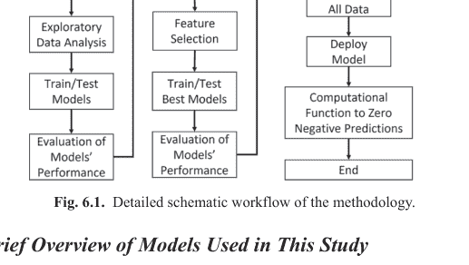

图6.1. 方法的详细工作流程示意图。

### 3.1 本研究所用模型的简要概述

本研究中用于估算分层流量的模型综述分析总结于表6.1。

表6.1. 本研究所用模型汇总。

| 基学习器 | 描述 | 作者开发或实现 |

|---|---|---|

| 自举聚合（`Bagging`） | 使用树的`Bootstrap`聚合来降低高方差算法的方差。 | Breiman (1996) |

| 岭回归 | 岭回归是一种针对多重共线性的稳健技术。该算法通过对模型估计施加一定偏差来最小化标准误差，从而获得更可靠的预测。该算法计算标准化因变量和自变量均值之间的差值，并除以它们的标准差。 | Kuhn 和 Johnson (2013) |

| 最小绝对收缩和选择算子（`Lasso`）回归 | 在回归方程中加入惩罚项，强制回归系数绝对值之和小于特定值。这会将较不重要变量的系数收缩至零，从而将其从模型中有效移除。 | Tibshirani (1996) |

| K近邻回归器 | 它基于这样的思想：具有相似特征的数据点往往具有相似的输出值。`KNN`回归器通过查找`K`个最近的训练数据点并对其输出值取平均来预测新数据点的输出值。`K`值决定了预测中所考虑的邻居数量，而用于衡量数据点之间相似性的距离度量可根据具体问题来选择。 | Silverman 和 Jones (1989) |

| 决策树 | 它使用归纳和剪枝技术来构建分层决策边界，并移除决策树中不必要的结构以对抗过拟合。 | Gordon 等人 (1984) |

| 极端梯度提升（`XGBoost`） | 这是对一阶和二阶梯度提升决策树的一种实现，用于最大化损失函数，并添加额外的正则化项来调整最终获得的权重以避免过拟合。 | Chen 和 Guestrin (2016) |

| 极度随机树（`Extra tree`） | 尽管它使用更简单的算法来构建用作集成成员的决策树，但可能比随机森林表现更好。 | Geurts 等人 (2006) |

| 随机森林 | 一种先进的决策树，对过拟合具有稳健性，且易于解释。 | Breiman (2001) |

### 3.2 模型评估标准

成功训练模型并实现良好收敛，并不意味着模型过程的结束。在模型回归分析中，模型误差是实际数据点与算法生成的最佳拟合线之间的差值。没有任何单一统计量能够分析所有形式的数据。这些度量受到多种因素的影响，包括但不限于异常值的存在、所使用的机器学习算法、导数的可发现性以及预测置信度。因此，本研究采用以下标准对模型误差进行评估，以确定所使用模型是否合适：

- 1. `平均绝对误差（MAE）`：`MAE`是一种成熟的评估度量，用于量化预测模型的准确性。它被定义为`L1`损失，表示预测输出与目标变量之间绝对差值的总和。通过测量误差的平均幅度而不考虑误差方向，`MAE`提供了对模型性能的可靠度量。此外，该度量对相对误差特别敏感，使其成为在误差大小同等重要的应用中评估性能的有用工具。`MAE`还对预测输出的全局缩放和异常值的存在具有稳健性，使其成为在各种环境中评估模型性能的多功能度量。`MAE`的数学表达式为：

  $$MAE = \frac{\sum_{i=1}^{n} |y_i - \hat{y}_i|}{n}$$ 

  (6.1)

- 2. `均方根误差（RMSE）`：该性能评估度量因其可解释为模型预测误差的标准差，并能表明预测数据与实际数据的接近程度而广受欢迎。其函数形式如下：

  $$RMSE = \sqrt{\frac{\sum_{i=1}^{n} (y_i - \hat{y}_i)^2}{n}}$$

  (6.2)

- 3. `赤池信息准则（AIC）`：该评估标准基于频率论概率框架开发，根据模型的最大似然估计为其打分。该技术评估模型的质量和准确性，从而获得对数据的更好拟合。该准则表示为：

  $$AIC = 2K - 2(log - likelihood)$$

  (6.3)

为根据输入特征的数量评估预测模型的准确性，采用了多种评估度量。然而，除`R²`外，性能评估标准的值越低，表明模型性能越好。如果无法基于这些标准得出结论，

参数方面，采用排序规则来确定优先级。具体而言，排序顺序确定如下：`MAE`、`RMSE`、`AIC` 和 `R²`。

## 4. 结果与讨论

### 4.1 可解释人工智能

所有 21 个输入特征被用于训练八个模型，其结果如图 6.2 所示。从结果来看，表现最差的模型是 `Lasso` 和 `Ridge` 算法。这一结果表明，由于输入数据的维度较高，线性模型不适用于本研究。

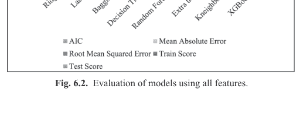

图 6.2. 使用所有特征评估模型。

`RF` 模型被用于对所研究的上部、中部和下部储层的智能井注入进行多输出预测。该方法使用了与训练所有模型时相同的训练数据集和测试数据集。置换特征重要性（`PFI`）分析用于识别有助于预测多个区域注水量的相关特征。模型无关的度量指标非常有用，因为机器学习模型被设计为可解释的，以帮助理解模型如何生成特定预测。

图 6.3 以绝对值形式可视化了训练数据和测试数据的 `PFI` 值。从结果来看，许多输入变量的重要性得分显著较低。这一结果表明，少数变量即可捕获这些输入变量的预测价值。`PFI` 图显示，对某个变量进行置换会降低多区域预测的准确性。

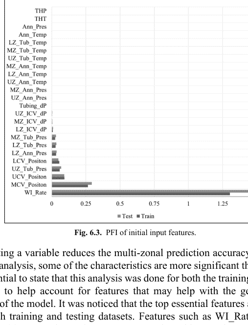

图 6.3. 初始输入特征的 `PFI`。

根据这一分析，某些特征比其他特征更重要。必须说明的是，该分析对训练数据集和测试数据集均进行了，以帮助考虑可能有助于模型泛化能力的特征。注意到训练数据集和测试数据集的最重要特征相同。诸如 `WI_Rate`、区域 `ICV` 位置、区域环空温度、油管和 `ICV` 压差等特征被认为至关重要。这一结果表明这些特征将有助于模型的泛化能力。如果某个特征对训练集而言是必要的，但对测试集而言不是，则该特征可能会导致模型过拟合。此类特征的一个示例是 `UZ_ICV_dP`。同样，当输入所有测井数据（包括新特征）时，平均测试准确率为 0.998。

因此，进行了敏感性分析以确定与本研究所相关的输入特征数量。使用上述六个高性能模型，将前 10 个和前 7 个特征与全部特征进行了准确率对比分析。从图 6.4 的结果来看，当使用 7 个输入特征时，模型获得了较高的准确率。与三个目标具有因果关系的特征是 `WI_Rate`、`UZ`（上部区域）`_Tub_Pres`、`MZ`（中部区域）`_Tub_Pres`、`LZ`（下部区域）`_Tub_Pres`、`UCV`（上部控制阀）`_Position`、`MCV`（中部控制阀）`_Position`、`LCV`（下部控制阀）`_Position`。

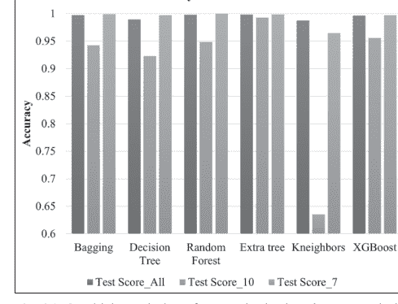

图 6.4. 基于 `PFI` 分析的特征选择敏感性分析。

根据领域知识，这些特征与总注入量、区域 `ICV` 位置（指示特定区域关闭或打开）以及各区域的油管压力有关。

### 4.2 模型评估

针对被选为相关的七个特征进行了进一步评估，以确定用于进一步优化的性能最优模型。值得注意的是，`ET` 和 `RF` 模型表现出优于其他模型的性能，尽管在留出数据上评估时，两者均未出现过拟合。因此，我们进行了额外分析以评估模型的预测误差。图 6.5 基于误差度量展示了所有推荐模型的准确率和一致性。`MAE`、`RMSE` 和 `R²` 结果表明，这七个特征使模型性能得到了大幅提升。尽管 `RF` 模型获得了更高的测试准确率，但 `ET` 模型在 `MAE` 和 `RMSE` 方面相对表现更好。从更广泛的视角来看，这七个特征使 `MAE` 和 `RMSE` 分别降低了 40% 和 47%。

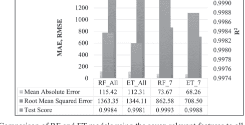

图 6.5. 使用七个相关特征与全部输入特征对 `RF` 和 `ET` 模型进行的比较。

### 4.3 敏感性分析

基于测试数据，图 6.6 至 6.8 展示了预期与实际区域速率的核密度估计（`KDE`）。实际值以红色表示，预期值以蓝色表示。`ET` 模型预测的区域注入速率更接近观测到的测试数据。这表明 `ET` 模型能够准确表示数据的不同分布范围，使其适用于预测同一油田其他井的区域注入速率。此外，前面讨论的评估度量指标也通过敏感性分析得到了验证。

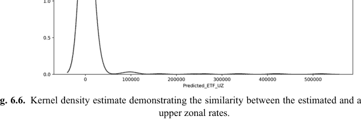

图 6.6. 核密度估计展示了估计与实测测试上部区域速率之间的相似性。


图 6.7. 核密度估计展示了估计与实测测试中部区域速率之间的相似性。


图 6.8. 核密度估计展示了估计与实测测试下部区域速率之间的相似性。

图 6.9 至 6.11 展示了联合图和回归的组合，以可视化预测的区域速率与实际测试数据区域速率及误差范围。联合图函数是一种分布图，显示单变量直方图 `KDE` 曲线和双变量图。对这些图中所示的回归图和 95% 置信区间的分析表明，使用七个 `PFI` 选定特征的 `ET` 模型表现准确。`ET` 模型显示出更高的置信水平，并根据直方图和 `KDE` 图匹配了注入量的范围。然而，当预测上部区域的高注水量时，置信水平往往会下降，这一点将进行进一步分析。对于 `ET` 模型，由于注入该区域的高注水量数据不足，200,000 桶之后的大多数数据都分散较广。然而，尽管该分析的数据不足，`ET` 模型仍成功捕获了趋势。虽然下部区域在高注入量方面也遇到类似的数据不足，但该模型在预测中并未出现低置信度。这一观察结果可归因于训练数据的差异，以及下部区域测试数据的广泛分布；相比之下，上部区域则高度集中于低注入量数据。


图 6.9. `ET` 预测与实测上部区域速率的交叉图。


图 6.10. `ET` 预测与实测中部区域速率的交叉图。


图 6.11. `ET` 预测与实测下部区域速率的交叉图。

### 4.4 模型部署

`ET` 模型使用模型无关的选定特征在多区域注水速率方面取得的优异结果，为其部署提供了信心。实验使用了另一口井的数据，该井的 `ICV` 区域速率是在用于确定速率的 `ICV` 曲线同步时计算得出的。该数据包含 3,767 个数据点，代表约五个月的每小时数据。图 6.12 展示了该模型所部署注入井的预测速率结果。组合区域速率预测与实际注水量的吻合度显而易见，证实了模型的准确性。图 6.13 至 6.15 所示的区域速率将展示预测速率以及如何


图 6.12. 总注水速率与组合预测区域速率的对比。


图6.13. 实际与预测的上部区域`ICV`速率随`ICV`位置的比较。


图6.14. 实际与预测的中部区域`ICV`速率随`ICV`位置的比较。


图6.15. 实际与预测的下部区域`ICV`速率随`ICV`位置的比较。

它们基于`ICV`位置进行预测。这是为了确认所有预测的区域速率都归入了`ICV`实际开启的区域。

## 5. 结论

总之，本研究采用了八种有监督的机器学习模型来预测油气生产环境中智能注水井的多区域速率。使用`PFI`（一种模型无关的指标）对机器学习模型进行训练和评估，以识别相关特征。其中七个特征具有相关性，并作为输入进一步训练了上一轮评估中表现排名前六的模型（当时使用了所有特征）。`Extra Trees`模型在测试数据上达到了最高的精度和一致性，其`RMSE`为708桶，`MAE`为68桶。还通过`KDE`和联合图对`Extra Trees`预测的区域速率进行了可视化，以确认其准确性。在结果令人满意后，`Extra Trees`模型被部署到一口具有五个月小时数据的新井上，预测的区域速率合计与总注入速率相匹配。此外，该模型还能在`ICV`处于关闭和完全开启位置的情况下预测区域速率。总体而言，本研究结果展示了机器学习在油气生产中预测多区域速率的潜力，并突出了`Extra Trees`模型作为该任务稳健有效工具的应用。

本研究为注水井中采用的方法提供了初步结果。当用于生产井时，该方法可提供一种简单、准确的数据驱动方法，基于井下参数估算每个储层单元的产液量。该方法还能提供产出量的实时估算，有助于提前制定油藏管理方案、为满足关键目标而进行的日常生产操作调整，以及运营商负责任地开发国内石油资源的政策。本项目的成功不会终结`ICV`映射，但将大幅减少油田生命周期内进行的映射次数。本研究的一个局限性是模型的质量取决于用于训练它的数据。当引入超出模型范围的新数据时，将需要进行`ICV`映射，并利用新数据重新训练模型以微调其预测。然而，这一局限性并不会削弱本研究提供的巨大优势。推荐采用该方法，以在使用智能完井进行生产时节省时间和金钱。

## 代码可用性

本研究中使用的`Jupyter Notebook`托管在 `https://github.com/ascotjnr/Smart-Well-Completion`。

## 致谢

作者感谢马来西亚理工大学（`Universiti Teknologi Petronas`）和地下地震成像与油气预测中心（`Centre for Subsurface Seismic Imaging and Hydrocarbon Prediction`）对这项工作的支持。

# 参考文献

Alhuthali, A.H., Datta-Gupta, A., Yuen, B. 和 Fontanilla, J.P. 2010. 通过智能井优化速率控制实现水驱优化的现场应用. SPE Reservoir Evaluation & Engineering 13: 406–422. https://doi.org/10.2118/118948-PA.

Behrouz, T., Rasaei, M.R. 和 Masoudi, R. 2016. 利用智能井概念进行石油生产优化和限制含水率的新综合方法：案例研究. Iranian Journal of Oil and Gas Science and Technology 5: 27–41. https://doi.org/10.22050/IJOGST.2016.13827.

Breiman, L. 1996. Bagging预测器. Mach Learn. 24: 123–140. https://doi.org/10.1007/bf00058655.

Breiman, L. 2001. 随机森林. Mach. Learn. 45: 5–32. https://doi.org/10.1023/A:1010933404324.

Brouwer, D.R. 和 Jansen, J.D. 2002. 使用最优控制理论的智能井水驱动态优化. In: 欧洲石油会议. SPE, 阿伯丁. https://doi.org/10.2118/78278-MS.


Chen, T. 和 Guestrin, C. 2016. XGBoost：一种可扩展的树提升系统. pp. 785–794. In: ACM SIGKDD国际知识发现与数据挖掘会议论文集. ACM, 纽约, NY, 美国. https://doi.org/10.1145/2939672.2939785.

Geurts, P., Ernst, D. 和 Wehenkel, L. 2006. 极度随机化树. Mach. Learn. 63: 3–42. https://doi.org/10.1007/s10994-006-6226-1.

Gordon, A.D., Breiman, L., Friedman, J.H., Olshen, R.A. 和 Stone, C.J. 1984. 分类与回归树. Biometrics 40: 874. https://doi.org/10.2307/2530946.

Huang, Z., Li, Y., Peng, Y., Shen, Z., Zhang, W. 和 Wang, M. 2011. 辽河油田智能完井系统研究. Procedia Eng. 15: 739–746. https://doi.org/10.1016/j.proeng.2011.08.138.

Jalali, Y., Bussear, T. 和 Sharma, S. 1998. 智能完井系统：油藏原理. In: All Days. SPE. https://doi.org/10.2118/50587-MS.

Kuhn, M. 和 Johnson, K. 2013. 应用预测建模. New York, NY: Springer New York, https://doi.org/10.1007/978-1-4614-6849-3.

Malakooti, R., Ayop, A.Z., Maulianda, B., Muradov, K. 和 Davies, D. 2020. 多区智能井的综合生产优化与监测. J. Pet. Explor. Prod. Technol. 10: 159–170. https://doi.org/10.1007/s13202-019-0719-5.

Mubarak, S.M., Pham, T.R., Shamrani, S.S. 和 Shafiq, M. 2008. 案例研究：使用井下控制阀维持加瓦尔油田第一口最大油藏接触、多分支智能完井井的石油生产. SPE Production & Operations 23: 427–430. https://doi.org/10.2118/120744-PA.

Naus, N.M.J.J., Dolle, N. 和 Jansen, J.-D. 2006. 使用无级可变流入控制阀优化混合生产. SPE Production & Operations 21: 293–301. https://doi.org/10.2118/90959-PA.

Otchere, D.A., Arbi Ganat, T.O., Gholami, R. 和 Lawal, M. 2021. 一种改进油藏渗透率和含水饱和度预测的新型定制集成学习模型. J. Nat. Gas Sci. Eng. 91: 103962. https://doi.org/10.1016/j.jngse.2021.103962.

## 第7章

## 碳酸盐岩油藏中二氧化碳低盐度水气交替注入（CO₂ LSWAG）采收率预测

## 使用有监督机器学习模型

Eric Thompson Brantson,1,* Zainab Ololade Iyiola,1 Yao Yevenyo Ziggah,2 Alexander Ofori Mensah,1 Daniel Asante Otchere,3,4 Efua Eduamba Abakah-Paintsil1 和 Emmanuel Karikari Duodu1

1 加纳塔夸矿业与技术大学石油研究学院石油与天然气工程系.

2 加纳塔夸矿业与技术大学地球科学与环境研究学院地理信息工程系.

3 马来西亚国油科技大学（Universiti Teknologi PETRONAS）地下地震成像研究中心，32610，Seri Iskandar，霹雳州，马来西亚.

4 美国宾夕法尼亚州立大学计算与数据科学研究所，宾夕法尼亚州大学公园（University Park，PA，美国）.

* 通讯作者：etbrantson@umat.edu.gh

## 1. 引言

随着全球能源需求不断增长和石油储量日益减少，从现有老油田进行提高采收率（EOR）正变得越来越重要（Sheng, 2011）。随着石油储层产量的增加，储层固有的天然能量不断消耗，导致油藏压力不足以将石油驱至地表。因此，需要采用二次采油方法（注水或注气）来提高产量。通过一次和二次采油过程采出的油量约占原始石油地质储量（OOIP）的20%–40%（Stalkup, 1984）。在应用一次和二次采油技术后，仍有三分之二的OOIP残留在油藏中（Gbadamosi et al., 2019）。

根据Brantson等人（2019）的观点，三次采油方法比一次或二次采油方法能够采出更多的油。在本研究中，采用了涉及注入低盐度水（LSW）和二氧化碳（CO₂）气的EOR协同方法，以在油田尺度提高采收率。在现场试验中使用LSW已显示出显著提高采收率的效果（Robertson, 2007; Webb et al., 2004; Vledder et al., 2010），使其在化学成本、环境影响和现场工艺实施方面成为优于传统化学EOR方法的选择（Dang et al., 2014）。另一方面，CO₂-EOR有潜力额外采出剩余地质储量的15%–20%（Ahmed, 2018）。CO₂注入方案背后的两个主要机制是原油膨胀和黏度降低（AlQuraishi et al., 2019）。值得注意的是，所有储层岩性，包括硅质碎屑岩、碳酸盐岩等，只要具备足够的封闭性以容纳油气，并具备连通的孔隙空间以利于流体聚集和流动，都适用于CO₂-EOR（Verma, 2015）。因此，估算烃类的最终采收率可为油田开发策略提供更详细的见解（Roustazadeh et al., 2022）。物质平衡法、递减曲线分析和动态数值模拟等方法被用于估算采收率，但它们耗时较长。

多年来，人们对大气中温室气体的持续积累日益认识和关注。这是由于燃烧化石燃料、森林砍伐和工业过程等人类活动排放二氧化碳（CO₂）、甲烷和一氧化二氮等温室气体所致。这些气体的积累导致全球气温上升，引起重大气候变化，对全世界构成威胁。气候变化的后果之一是海平面上升，人们观察到这是大气中CO₂和其他温室气体水平升高的直接结果。海平面上升导致了灾难性后果，如沿海地区洪水泛滥、社区流离失所、栖息地丧失和基础设施破坏（Santos et al., 2014）。因此，找到减轻温室气体排放对环境及整个世界影响的方法至关重要。

近年来，人们对CO₂-EOR作为长期人为CO₂封存应用的潜力给予了相当大的关注（Mandadige et al., 2016）。CO₂-EOR是油气行业通过向油藏注入CO₂来从井中采出更多石油的技术。该技术不仅增加了可采油量，而且还有储存 CO₂ 于地下的额外好处。这可以有效缓解温室气体排放对环境的影响，并为全球变暖问题提供解决方案。因此，研究人员、政策制定者和利益相关者应继续探索 CO₂-EOR 作为长期人为 CO₂ 储存应用的潜力，同时努力减少温室气体排放并寻找应对气候变化的可持续解决方案。

观察到的人为全球变暖的主要原因是由于在生产电力和其他制造过程中对化石燃料使用量上升，导致化石燃料燃烧产生的 CO₂ 排放不受限制（Kharecha et al., 2008）。在过去 35 年里，石油和天然气行业在注入 CO₂ 用于提高采收率方面取得了众多技术进步和作业实践（Yong et al., 2016）。CO₂ 驱替已成为最有前景的 EOR 方法之一，因为它使用来自储层的易得、天然存在的 CO₂（Sun et al., 2017）。CO₂ 驱替的典型增量采油量在 5%–25% 之间（Wu et al., 2021）。CO₂ 注入方法传统上用于油重度小于 25 的储层（Stosur, 2003）。

为寻找 CO₂ 在二次和三次提高采收率中的最佳用途，已采用了多种技术。这些技术包括可混相和不可混相 CO₂ 驱替、CO₂ huff-n-puff 以及 CO₂-泡沫注入等（Christensen et al., 1998）。在这些技术中，EOR 方法的组合形式已被证明可协同显著优化采油量（Afzali et al., 2018; Teklu et al., 2016）。在碳酸盐岩和砂岩储层中已进行了大量 CO₂-LSWAG 实验（AlQuraishi et al., 2011; Dang et al., 2014; Naderi and Simjoo, 2019; Pourafshary and Moradpour, 2019; Zolfaghari et al., 2013），这些实验报告了相对于初始含油量的增量采油，但储层尺度的研究不多。

混合低盐度气体驱在近年来越来越受到研究人员的关注（Jiang et al., 2010; Kulkarni et al., 2004），原因在于其诸多优势，如成本低、最小混相压力低且环境友好。在这种混合方法中，由于这些益处，CO₂ 常被用作注入气体（Ma and James, 2022）。LSW 的注入会改变水中气体的溶解度，影响气/油相互作用，最终提高采油量。尽管存在潜在益处，关于该混合方法有效性的观察结果各不相同，一些研究人员报告了采收率的改善。然而，其他人发现与连续气体注入（CGI）相比采收率没有改善。此外，储层中 CO₂ 在油和水之间的分配（Dang et al., 2014）会导致根据储层条件不同的采收率。

低盐度 CO₂-EOR 在 Zekri et al.（2015）对碳酸盐岩岩心的研究和 Teklu et al.（2016）对碳酸盐岩岩心和低渗透砂岩岩心的研究中得到了广泛描述。CO₂ LSWAG 的大量研究是在具有强水润湿砂岩岩心且粘土含量少的砂岩储层中进行的，这些条件对 LSW 过程不利（Dang et al., 2014），与碳酸盐岩储层不同，后者结构复杂且研究相对较少。据报道，通过结合低盐度水驱方法和 CO₂-EOR 方法，产生了一种新的 LSW 交替 CO₂（LS-WACO₂）EOR 方法。研究得出结论，与普通 WAG 相比，CO₂ 在 LSW 中的溶解度是增加残余油动员的主要原因。在 Dang et al.（2014）的研究中，对 1D 岩心中的混合 LSW 交替可混相 CO₂ 驱替注入进行了建模。他们的研究表明，混合方法在解决与水交替气 WAG 注入相关的后期生产问题方面是有效的。Pourafshary and Moradpour（2019）对 Dang et al.（2014）的研究进行了全面综述，并建议基于实验工作开展进一步的现场尺度模拟研究，以充分评估 Dang et al.（2014）开发的混合方法的实用益处。他们的建议基于 Dang et al.（2014）获得的有希望的结果，并强调需要更全面的研究来推进对该新方法的理解。此外，关于碳酸盐岩储层中 CO₂ LSWAG 注入的模拟研究非常有限（Al-Shalabi et al., 2014; Hamoud and Pranoto, 2016）。

2011 年，Aleidan and Mamora（2011）开展了一项研究，旨在比较各种水/CO₂ 注入方案对碳酸盐岩岩心样品采油量的影响。该研究分析了不同盐度下 SWAG 和 WAG 注入方案的影响。研究人员发现，当他们改用 LSW 时，两种注入方法的采油量均有所增加。这种增加是由于混合方法和气体与 LSW 注入之间的协同作用。气体在盐水中的溶解导致流体流动性降低，这解释了增量采油量。Jiang et al.（2010）还开展了一项研究，以调查水盐度对使用高粘度原油的砂岩中可混相驱替期间 WAG 性能的影响。该研究旨在检查低盐度水对 WAG 有效性的影响。研究人员发现，在 LSW 中，更高的气体溶解度调节了水与粘性油的流动度比。这种调节发生是因为盐水中的气体溶解度随着盐度降低而增加，导致气体流动性降低和盐水粘度增加。因此，水和粘性油的流动性变得更加平衡，从而提高了采油率。除了上述发现外，该团队的研究还表明，在高粘度原油砂岩可混相驱替期间，LSW 比高盐度水更能提高采油率。

这是一个关键发现，突出了在可混相驱替期间考虑水盐度对 WAG 性能影响的重要性。该团队的结果表明，使用 LSW 可显著提高采油率，进一步证明了 LSW 在提高采收率技术中的潜在益处。这些发现对石油工业具有重要意义，因为它们提供了有关水盐度如何影响 WAG 性能的宝贵见解，以及如何利用这一知识来优化高粘度原油储层的采油率。

在他们的实验研究中，Al-Abri et al.（2019）研究了不可混相 CO₂ 与智能水混合注入对砂岩岩心样品的影响。研究发现，气体注入与水样中存在的各种离子之间的协同作用导致采油量显著改善。为了进行研究，研究人员使用了三种合成盐水，每种分别含有 5000 ppm 的 MgCl₂、NaCl 和 KCl。研究显示，虽然含 MgCl₂ 的水在盐水中具有最高的 CO₂ 溶解度，但它在三次试验中导致了最低的采油量。此外，智能水的多组分离子交换改变了岩石的润湿性，使其变得更亲水，从而在无需气体注入的情况下改善了采油量。

通过 Al-Shalabi et al.（2016）使用 UTCOMP 储层模拟器进行的模拟研究，调查了 LSW 与可混相 CO₂ 混合注入在碳酸盐岩中用于 EOR 的有效性。该研究旨在比较 CGI 与混合方法的性能。结果显示，CGI 方法实现了 98.9% 的高采收率，而混合方法通过控制粘性指进仅将其提高到 99.7%。因此，研究得出结论，混合方法可能不适用于气体混相是 EOR 主要机制的条件。该研究的发现可用于优化碳酸盐岩储层 EOR 技术选择，以实现最大采收率且付出最小努力和成本。

初始岩石润湿性的考虑在混合 LSW/气体方法中至关重要。润湿性从油湿变为水湿的改变在砂岩中尤其重要，因为它对 LSW 的性能产生积极影响。相反，如果岩石初始为水湿，则 LSW 和混合方法将无效。Ramanathan et al.（2015）对海水交替气（SeaWAG）和 LSWAG 注入从含水砂岩中采油进行了实验研究。研究发现，由于岩石初始含水饱和度高，LSWAG 的采收系数低于 SeaWAG。相比之下，当低盐度盐水替代海水时，WAG 在老化油湿岩心中的采收率从 76% 提高到超过 97%。

AlQuraishi等（2017）进行了一项研究，发现低盐度交替混相CO₂方法对无粘土砂岩无效，但当存在粘土时，确实使原始石油地质储量（OOIP）的采收率达到35.1%。Yang等（2005）的研究发现，CO₂在恒温恒压条件下能够降低油和盐水间的界面张力（IFT）。这种界面张力的降低可通过混合方法提高额外采油量。Teklu等（2016）和Ramanathan等（2016）的进一步研究表明，界面张力的降低小于10达因/厘米。然而，Kumar等（2016）的一项研究报告了在CO₂存在下相对较高的界面张力。尽管这些结果不一，但重要的是要注意，界面张力的变化相对较小，并不被认为是混合LSW/气方法提高采油量的主要机制。其他机制，如降低残余油饱和度和提高驱替效率，被认为在混合方法中发挥更重要的作用。尽管如此，发现CO₂降低界面张力的潜力仍然是石油和天然气行业研究的一个重要方面。

纯气驱的问题在于不利的流度导致粘性指进和体积扫油效率降低。由于EOR项目所需气体较少，WAG方法有助于解决这一重要问题。此外，常规CO₂ WAG方法通常会导致产油延迟，而本研究可以通过CO₂ LSWAG缓解这一问题。通过克服常规WAG常见的产油滞后问题，CO₂ LSWAG加速了这些多种过程机制的协同作用。根据先前研究（Dang等，2014；Pourafshary和Moradpour，2019；Sheng，2014），CO₂-LSWAG的主要采油机制被认为是润湿性向更水湿状态转变。

然而，CO₂-LSWAG在1D均质模型和砂岩油藏现场尺度中的建模研究（Dang等，2014）已经完成，但计算成本高昂（Belazreg和Mahmood，2020；Jaber等，2019）。如表7.1所示，对于二次和三次采油模式，几乎没有应用快速可靠的机器学习模型来预测CO₂ LSWAG的性能。尽管表7.1中大多数CO₂-LSWAG研究表明采油率有所提高，但一些使用岩心样本的研究（Jiang等，2010；Ramanathan等，2015）由于初始润湿性为强水湿，不利于有效的低盐度水注入，而出现了负面或中性结果。此外，可以参考Ma和James（2022）基于CO₂-LSWAG实验室实验的综述工作，其中没有报道机器学习模型。

## 表7.1 基于现场、实验、数值模拟和机器学习模型的CO₂ LSWAG采油率预测

| 参考文献 | 多孔介质类型 | 注入流体类型 | 注入方案 | 最终采油率，%OOIP | 实验/现场/数值模拟 | 机器学习模型 |

|---|---|---|---|---|---|---|

| AlQuraishi等 (2017) | Berea和Bentheimer砂岩 | LSW + CO₂<br>HSW + CO₂ | 二次模式注入LSW + HSW，三次模式注入CO₂ WAG | 82.40% | 实验 | 无ML模型 |

| Al-Shalabi等 (2014) | 碳酸盐岩油藏 | LSWI + CO₂注入 | 三次模式 | 第一次岩心驱替 = 84.97%<br>第二次岩心驱替 = 93.65% | PHREEQC模拟和实验 | 无ML模型 |

| Dang等 (2014) | 砂岩 | CO₂ + LSW | 二次至三次模式 | 与CO₂ HSWAG相比，OOIP增量采收率为4.5%–9% | 现场、实验和数值模拟 | 无ML模型 |

| Naderi和Simjoo (2018) | 砂岩 | CO₂ + LSW | 二次至三次模式 | 在LSW基础上增加OOIP的16%，在HSW基础上增加OOIP的30% | 组分数值模拟 | 无ML模型 |

| Zolfghari等 (2013) | 砂岩 | CO₂ + LSW | 三次模式 | 92% | 实验 | 无ML模型 |


| 作者（年份） | 岩石/岩心 | 工艺 | 模式 | 采收率 | 方法 | ML 模型 |
|---|---|---|---|---|---|---|
| Teklu等 (2016) | 低渗透碳酸盐岩<br>中渗透 Berea 砂岩<br>超低渗透 Three Forks 泥岩岩心圆盘 | LSW + CO₂ | 二次至三次模式 | 岩心驱替实验 1 = 81.9%<br>岩心驱替实验 2 = 83.4%<br>岩心驱替实验 3 = 81.5% | 实验 | 无 ML 模型 |

| 作者（年份） | 岩心/介质 | 工艺 | 模式 | 采收率 | 方法 | ML 模型 |
|---|---|---|---|---|---|---|
| Saxena (2017) | 砂岩 | LSWI + CO₂ | 三次模式 | 39% OOIP | 组分数值模拟和现场 | 无 ML 模型 |

ML = 机器学习，LSW = 低盐度水，OOIP = 原始石油地质储量

Al-Jifri等（2021）根据注水速率、渗透率各向异性、水粘度和储层非均质性等参数，开发了两个新的经验方程，用于预测水驱非均质储层的采油率，而目前尚无针对CO₂-LSWAG的代理相关性，这正是本研究力图实现的。此外，Roustazadeh等（2022）开发了三种基于回归的模型，包括支持向量机（SVM）、极限梯度提升（XGBoost）和逐步多元线性回归（MLR），并结合三个数据库的多种组合构建机器学习（ML）模型，估算油气采收率（RF）。以下作者（Aliyuda等，2020；Alpak等，2019；Chen等，2020；Ibrahim等，2022；Sharma等，2010；Tahmasebi等，2020）也应用了ML算法来预测不同储层的油气采收率，但不涉及本研究中CO₂ LSWAG的情况。

在本研究中，使用包含地球化学模型的组分模拟器模拟了基于CO₂-LSWAG驱油的碳酸盐岩油藏模型，然后使用多元自适应回归样条（MARS）和数据处理群方法（GMDH）机器学习方法开发代理模型，以预测采油率。因此，本研究提倡将低盐度水与CO₂交替注入作为EOR技术，因为它具有较高的采收率，能够改善微观和宏观驱替效率。使用机器学习代理模型作为预测工具，还将提高该技术在碳酸盐岩油藏中的全油田实施效率，减少与数值模拟相关的计算时间（Amar等，2021；Kalam等，2021）。

本文的结构如下。第2节为方法论，描述了使用与流体流动和地球化学建模相结合的组分模拟器以及机器学习工具。第3节为结果与讨论，分析了当前提出的方法，并将其与使用传统模拟器优化操作条件进行比较。第4节总结了研究并阐述了本研究的主要发现。

## 2. 方法论

### 2.1 CO₂-LSWAG建模

本文的数值方法使用组分模拟器在含SO₄和羧酸盐离子交换的碳酸盐岩油藏中生成CO₂-LSWAG的各种情景。在CMG组分模拟器中，在混相条件下对CO₂-LSWAG建模时作出的假设如下：

1. 羧酸盐离子交换是润湿性改变的唯一原因。
2. 多相多组分流动方程和EOS闪蒸计算与地球化学反应完全耦合。
3. 油和水的相对渗透率曲线通过按比例缩放的羧酸盐离子交换等效分数进行改变。
4. 羧酸盐离子交换还取决于矿物的溶解和沉淀反应。

### 2.2 CO₂-LSWAG的地球化学反应

对具有SO₄²⁻和羧酸盐离子交换的碳酸盐岩，在相对渗透率曲线上进行了插值。方程(7.2)和(7.3)显示了CO₂在油藏中油和水之间的分配（Dang等，2014）。

CO₂ LSWAG建模中考虑的水相反应为：

CO₂(g) → CO₂(aq) (7.1)

CO₂(aq) + H₂O ↔ H⁺ + HCO₃⁻ (7.2)

H⁺ + OH⁻ ↔ H₂O (7.3)

CaCH₃COO⁺ ↔ CH₃COO⁻ + Ca²⁺ (7.4)

CaSO₄ ↔ Ca²⁺ + SO₄²⁻ (7.5)

MgSO₄ ↔ Mg²⁺ + SO₄²⁻ (7.6)

CO₂-LSWAG建模中对方解石和白云石考虑的矿物反应为：

CaCO₃ + H⁺ ↔ Ca²⁺ + HCO₃⁻ (7.7)

CaMg(CO₃)₂ + 2H⁺ ↔ Ca²⁺ + 2HCO₃⁻ + Mg²⁺ (7.8)

CO₂-LSWAG建模中考虑的离子交换为：

SO₄²⁻ + 2CH₃COO⁻ X ↔ 2CH₃COO⁻ + SO₄⁻ X₂ (7.9)

### 2.3 机器学习方法

本文使用`MARS`和`GMDH`机器学习技术，通过改变用于`CO₂ LSWAG`的注入水中的低盐度离子浓度。图 7.1 展示了所有有监督机器学习技术所采用的通用工作流程。所用数据集来自模拟结果，随后被划分为训练数据和测试数据。在本研究中，用于 CO₂-LSWAG 原油采收率预测（作为单目标问题）的所有有监督算法的通用工作流程如图 7.1 所示。


图 7.1. 机器学习工作流程。

#### 2.3.1 多元自适应回归样条（MARS）

Friedman 于 1991 年提出了称为 MARS 的多元非参数回归技术。该方法利用分段线性段（即样条）来捕捉输入变量与目标变量之间的复杂非线性关系。在 MARS 中，基函数项与因变量之间的数学关系如式 (7.10) 所示：

$$ORF = C_o + \sum_{k=1}^{M} C_k \beta_k(X), \qquad (7.10)$$

其中，`ORF`是目标变量，即原油采收率。在模拟油藏系统中两个或多个变量之间的相互作用时，必须考虑多个参数。这些参数包括截距（`C_o`）、基函数项数（`M`）以及第 k 个基函数的未知系数向量（`C_k`），其中 k 取 1 到 M 之间的值。基函数本身用`β_k`表示，`X`用于表示油藏参数对应的输入变量。

根据 Friedman（1991）的研究，MARS 技术使用多元样条函数作为基函数，如式 (7.11) 所示：

$$\beta_k(X)=\prod_{z=1}^{Z_k}\left[p_{zn}\cdot\left(X_{m(z,n)}-s_{zn}\right)\right]_{+}, \qquad (7.11)$$

在此上下文中，我们使用变量`Z_n`表示产生`β_k`值的分割数。变量`p_{z_n}`用作符号指示符，可取 ±1 值。记号`[.]_+`用于表示仅取正部分。函数`m(z, n)`标记预测变量，而`s_{z_n}`表示变量`X_{m(z,n)}`的相应节点值。

MARS 算法是一种用于构建能够捕捉变量间非线性关系模型的常用方法。该算法通常包括两个步骤：前向传递和后向传递。在前向传递中，算法考察潜在的节点，并从一个仅包含常数项的模型开始。这意味着初始模型假设预测变量与响应输出变量之间不存在任何关系。随着算法的进行，它逐渐向模型添加基函数（BFs），从而能够捕捉预测变量与响应输出变量之间的非线性。后向传递在前向传递之后执行，用于剔除与输出变量无关的估计项。这样做的目的是简化所开发的模型，根据式 (7.12) 给出的广义交叉验证（GCV）准则，删除最不显著的基函数。GCV 准则是一种广泛使用的方法，用于选择能够最小化模型预测误差的最佳预测变量子集。通过移除无影响的预测变量，模型变得更易解释和更易理解，同时仍能准确捕捉预测变量与响应输出变量之间的非线性关系。

$$ GCV(\varphi)=\frac{\frac{1}{N}\sum_{i=1}^{N}(O_i - P_i)^2}{\left[1-\frac{M(\varphi)}{N}\right]^2}, \tag{7.12} $$

为了在模型规模与其对数据集的拟合程度之间取得平衡，使用一个记为`φ`的调优参数。总体现场测量训练数据集用`N`表示，而`O_i`和`P_i`分别表示数据集的观测值和预测值。通过调整调优参数的值，可以调节模型复杂度与其捕捉数据集模式的精度之间的权衡。`M(φ)`在式 (7.13) 中定义为模型中使用的有效参数数量：

$$ M(\varphi)=(\varphi + 1)+d.\varphi, \tag{7.13} $$

参数`d`在非参数 MARS 算法中充当惩罚因子或平滑因子，其值决定基函数的数量和估计函数的平滑度。`d`值越大，基函数越少，估计越平滑；而`d`值越小，模型越大，基函数越多。关于`d`值选择的进一步信息以及非参数 MARS 算法的全面解释，请参阅 Friedman 1991 年的著作。

对于将变量`x_k`的第`p`段作为基函数的单变量线性回归，以`max(.)`形式表达的 MARS 方程如式 (7.14) 所示。该数学表达式演示了如何在 MARS 框架内表示`BF_p()`。为确保清晰，使用了适当的同义词，并在不改变原意的情况下对句子进行了重新组织。

$$
BF_p(x_k) = \max(0, x_k - a_p) \text{ or } BF_p(x_k) = \max(0, a_p - x_k). \quad (7.14)
$$

在数学记法中，`max(.)`表示仅保留输入的正数部分，而将负数部分赋值为零，如式 (7.15) 所示。分段线性函数可以用`max(x_k - a_p)`的形式表示，节点指定在特定值`a_p`处。

$$
\max(0, x_k - a_p) = \begin{cases} x_k - a_p, x_k \ge a_p \\ 0, \text{otherwise} \end{cases}, \quad (7.15)
$$

为了创建具有连续节点的局部线性回归，使用了`max(.)`函数。通过递归样条拟合与分割，可以最佳地选择节点。需要记住的一个关键点是，式 (7.14) 中的`BF_p(x_k)`仅当该式第二项大于零时才会为零。此外，在对两个变量的交互作用进行建模时，基函数`BF_ps()`可以用`x_k`和`x_i`的两个单变量基函数表示，如式 (7.16) 所示：

$$
BF_{ps}(x_k, x_i) = BF_p(x_k) \times BF_s(x_i). \quad (7.16)
$$

#### 2.3.2 数据分组处理方法（GMDH）

在本研究中，GMDH 被用于建立一个具有多项式次数的显式数学模型，以预测碳酸盐岩油藏混相条件下 CO₂-LSWAG 的原油采收率。控制论学者 Ivakhnenko（1966）提出了一种 GMDH 多项式神经网络（PNN）算法，用于构造高阶回归型多项式。然而，由于 GMDH 算法具有自组织特性（根据参数对最终输出的贡献自动选择其输入参数），GMDH 建模方法作为一种替代方法能够克服人工神经网络（ANN）的许多局限性（Lv 等，2023）。GMDH 采用优化准则来确定网络连通性、网络规模以及最优模型的系数，并在较少人工干预下实现模型缩减（Ivakhnenko，1971）。输入与输出关系以多项式形式表示，模型自动选择最具影响力的参数（Farlow，1984）。在本研究中，GMDH 被用于建立预测 CO₂-LSWAG 原油采收率的数学模型。Ivakhnenko（1971）应用 Kolmogorov-Gabor 多项式理论函数来求解输出参数，如式 (7.17) 所示：

$$ORF^{GMDH} = a_o + \sum_{i=1}^{n} a_i x_i + \sum_{i=1}^{n} \sum_{j=1}^{n} a_i a_j x_i x_j + \sum_{i=1}^{n} \sum_{j=1}^{n} \sum_{k=1}^{n} a_i a_j a_k x_i x_j x_k + \cdots \quad (7.17)$$

其中，$a_{i...k}$、$x_{i...j}$、$ORF$ 和 $n$ 分别表示多项式系数、输入参数、预测值和变量数量。

采用最小二乘最小化分析，可由式 (7.17) 得到多项式变量，如式 (7.18) 所示：

$$\delta_j^2 = \sum_{i=1}^{N} \left(ORF_i^{GMDH} - y_i\right)^2 \quad (7.18)$$

其中，$N$、$y_i$ 和 $ORF_i^{GMDH}$ 分别表示训练数据点的数量、实际值和预测值。

#### 2.3.3 性能指标

机器学习方法预测的准确性通过决定系数（$R^2$）、均方误差（$MSE$）和皮尔逊相关系数（$r$）来衡量，以了解目标变量相对于各个独立变量变化的情况。

$R^2$ 是一种统计指标，最佳模型预测的 $R^2$ 最优值接近 1；对于精确模型，$MSE$ 趋近于 0；$r$ 可取 $-1$ 或 $+1$，表示参数对输出的影响（Brantson 等，2019）。式 (7.19)、(7.20) 和 (7.21) 分别给出了 $R^2$、$MSE$ 和 $r$ 的数学表达式：

$$R^2 = \left( \frac{\sum_{i=1}^{n} \left(ORF_{observed} - \overline{ORF}_{observed\ mean}\right) \times \left(ORF_{predicted} - \overline{ORF}_{predicted\ mean}\right)}{\sqrt{\sum_{i=1}^{n} \left(ORF_{observed} - \overline{ORF}_{observed\ mean}\right)^2 \times \sum_{i=1}^{n} \left(ORF_{predicted} - \overline{ORF}_{predicted\ mean}\right)^2}} \right)^2 \quad (7.19)$$

$$MSE = \frac{1}{n} \sum_{i=1}^{n} \left(ORF_{measured} - ORF_{predicted}\right)^2 \quad (7.20)$$

$$r = \frac{\sum_{i=1}^{n}\left(ORF_{observed} - \overline{ORF}_{observed\ mean}\right)\times\left(ORF_{predicted} - \overline{ORF}_{predicted\ mean}\right)}{\sqrt{\sum_{i=1}^{n}\left(ORF_{observed} - \overline{ORF}_{observed\ mean}\right)^{2} \times \sum_{i=1}^{n}\left(ORF_{predicted} - \overline{ORF}_{predicted\ mean}\right)^{2}} \tag{7.21}$$

其中，`n` = 观测到的油回收率数据点的总数，`ORF_observed` = 观测到的油回收率数据点，`ORF_observed mean` = 观测到的油回收率数据点的平均值，`ORF_predicted mean` = 预测的油回收率数据点的平均值。

#### 2.3.4 数据集标准化

CO₂-LSWAG 建模过程涉及使用具有不同物理单位的数据。这些物理单位可能包括米、克、秒或与所使用数据相关的任何其他单位。为了确保数据具有可比性并且可用于生成准确的模型，进行了归一化。归一化是一种将数据缩放到共同值范围的技术。在本研究中，输入和输出向量均在区间 [−1, 1] 内进行归一化。该范围被选中的原因是它是在归一化技术中常用的值范围。归一化过程是为了确保数据存在恒定的变化，如 Eq. (7.22) 所表达的那样。通过归一化数据，输入和输出向量的值范围被限制在特定范围内，从而更容易比较和分析数据。需要注意的是，归一化并不总是必要的，但在处理具有不同物理单位的数据时经常使用。通过归一化数据，可以消除因物理单位差异而可能产生的任何偏差。这有助于确保从数据生成的模型准确可靠。

$$y_i = y_{min} + \frac{\left(y_{max} - y_{min}\right)\times\left(x_i - x_{min}\right)}{\left(x_{max} - x_{min}\right)}, \tag{7.22}$$

归一化后的数据用$y_i$表示，其中归一化数据的最大值和最小值$y_{\max}$和$y_{\min}$分别设为 1 和 −1，测量值$x_i$被缩放到 −1 到 1 的范围，$x_{\min}$和$x_{\max}$为该范围的下限和上限。这种归一化方法被广泛使用。

## 3. 结果与讨论

### 3.1 数值模型描述

本研究采用了倒置五点注入碳酸盐岩模型来模拟油田尺度的 CO₂-LSWAG 采油。储层在`Y`、`X`和`Z`方向上的尺寸约为 7400 × 7400 × 28 ft。共使用了 12,150 个网格块，其中`X`和`Y`方向各为 45 个块，`Z`方向为 6 个块。模拟使用了灵活网格和精确的角点几何，以准确表示储层的地质特征和描述，特别是非均质性和井。与传统的笛卡尔网格相比，这种方法更受青睐。储层表现出非均质性，孔隙度和渗透率存在变化。孔隙度值在 9.5%–29% 之间变化，而渗透率在各方向均不同，垂直渗透率低于水平渗透率。模型中使用的活性流体相为水和油，这在储层中常见。图 7.2a 和 7.2b 中描绘的孔隙度和渗透率变化为储层模型特征提供了宝贵的见解。此外，图 7.3 描绘了用于 CO₂-LSWAG 模拟的高盐度和低盐度条件下油水相对渗透率曲线，作为含水饱和度的函数。


(a)


(b)

图 7.2. 模型的岩石物理性质 (a) 孔隙度模型 (b) 渗透率模型。


图 7.3. 低盐度和高盐度水和油相对渗透率曲线（集合 #1 为原始相对渗透率图，而集合 #2 为 LSW 相对渗透率图）。

所选的水相或矿物反应结构为碳酸盐岩，采用 SO₄²⁻ 简单相对渗透率插值。组分向导对 SO₄²⁻ 浓度采用线性插值以实现变化。

完成储层模拟模型后，实施了井完井程序。在本研究中，我们确定逆五点井网是储层模拟的最优方法。为了实现最大效果，确保生产井和注入井的六个网格层均被射孔，并采用垂直井以实现高效采油。注入井位于中心位置，可实现储层内流体高效波及，将油向位于角部的生产井推动，从而获得较高的平面波及效率。注入流体的驱替运动在提高储层采收率方面发挥了重要作用。模型中六个网格层均实施逆五点井网和垂直井，使油得以高效采出。

### 3.2 输入与目标数据集


进行了模拟研究以获得用于训练和测试的输入和输出模拟数据集，建立映射关系。表 7.2 显示了在运行碳酸盐岩模拟模型时使用的储层参数。此外，表 7.3 显示了初始运行，其结果用作低盐水范围在 200–3000 ppm 之间变化的敏感性运行的基准情况。在低盐水范围内获得的总数据集为 1385 个样本点，其中 1,107 个用于训练，其余用于测试模型。此外，图 7.4a 显示了基准情况和 CO₂-LSWAG 情景的平均压力。

## 表 7.2. 碳酸盐岩模型的储层参数。

| 参数 | 值 |
|---|---|
| 参考压力, psi | 3337 |
| 参考深度, ft | 8596 |
| 水油接触面深度, ft | 8950 |
| 渗透率, mD | 29.76–269.40 |
| 孔隙度, % | 9.5–29% |
| 储层砂顶, ft | 8596 |
| Swcon | 0.076 |
| Soirw | 0.1434 |
| 1-Sorw | 0.75 |
| 1-Soirw | 0.8566 |
| pH | 5.22 |
| 注水速率, bbl/day | 7,000 |
| 气体注入速率, MMft³/day | 30 |
| 注入井底压力, psi | 6,710 |
| 地层水矿化度, ppm | 90,044.10 |
| 状态方程 (EOS) | Peng Robinson |

表 7.3. 地层水和注入水的基准情况。

| 物种 | 地层水, ppm | 基准注入水, ppm |
|---|---|---|
| Ca²⁺ | 18492 | 26 |
| Mg²⁺ | 2320 | 77 |
| Na⁺ | 68520.1 | 660 |
| HCO₃⁻ | 100 | 0 |
| SO₄²⁻ | 612 | 46.8 |

回收率预测可以是多个储层特征变量的函数。MARS 和 GMDH 模型的运行可控输入参数为平均储层压力 ARP、累计气体注入 CGI、累计低盐水注入 CLSWI、气体累计产量 GCP、油累计产量 OCP、气体注入速率 GIR、低盐水注入速率 LSWIR，目标为如表 7.4 所示的 CO₂-LSWAG 的 ORF。碳酸盐岩模型在模拟期间采用的 LSW 和 CO₂ 注入速率如图 7.4b 所示。

为构建代理机器学习模型，CO₂-LSWAG 注入 15 年采油得到的油饱和度图如图 7.5a、7.5b 和 7.5c 所示，分别对应 5、10 和 15 年。观察到 CO₂ 注入使其与原油互溶后降低了原油粘度。图 7.5 显示了储层的初始和最终油饱和度，描绘了 CO₂-LSWAG 注入如何降低粘度以采出更多原油。可以从 CO₂-LSWAG 的图 7.5c 中最终油饱和度图中看出，注入方案降低了储层原油的粘度，使更多原油得以采出。

## 表 7.4. CO₂-LSWAG 油回收率预测的数据集范围。

| 变量/单位 | 最小值 | 平均值 | 最大值 | 标准差 | 数据类型 |
|---|---|---|---|---|---|
| 平均储层压力 (psi) | 3349.11 | 5187.38 | 6679.61 | 1298.05 | 输入 |
| 累计气体注入 (MMMSCF) | 0.00 | 12.12 | 25.64 | 5.28 | 输入 |
| 累计低盐水注入 (MMbbl) | 0.00 | 6.83 | 18.48 | 4.24 | 输入 |
| 气体累计产量 (MMMSCF) | 0.00 | 7.61 | 17.02 | 3.16 | 输入 |
| 油累计产量 (MMbbl) | 0.00 | 13.73 | 15.96 | 3.17 | 输入 |
| 气体注入速率 (MMSCFD) | 0.00 | 13.81 | 30.00 | 4.77 | 输入 |
| 低盐水注入速率 (Mbbl/day) | 0.00 | 5.09 | 7.17 | 1.58 | 输入 |
| 油回收率 (%) | 0.00 | 72.38 | 84.07 | 16.68 | 输出 |


图 7.4. 模拟参数：(a) 平均压力基准情况和 CO₂ LSWAG，(b) LSW 和 CO₂ 注入速率。

### 3.3 MARS 建模

MARS 建模结合了递归样条拟合和分区，保持组合的正向分量，同时对非贡献属性的影响较小 (Brantson et al., 2018)。如表 7.4 所示，所有输入和目标变量都将加载到 MARS 算法中，用于开发样条拟合优化计算的训练模型。此外，MARS 模型会自动选择影响目标响应的最具影响力的输入参数，同时排除非贡献变量。此外，所使用的最大基函数、最大交互作用和用于节点优化的自由度分别为 20、1 和 3。因此，所用五个输入变量的相对重要性为：油累积产量 (100%)、气累积产量 (2.22%)、累积气注入量 (2.36%)、水注入速率 (1.63%) 和平均压力 (1.46%)。自动选择的全部参数计算出的相关因子对 ORF 目标具有积极影响。CO₂-LSWAG 的理想 MARS 模型在式 (7.23) 中表达。此外，表 7.5 指出式 (7.23) 中所写的 ORF MARS 模型的基函数及对应方程：


(a)


(b)


(c)

图 7.5. 模拟期间的油饱和度图：(a) 5 年时的油饱和度，(b) 10 年时的油饱和度，(c) 15 年时的油饱和度。

### 表 7.5. MARS 模型基函数及对应方程。

| 基函数 (BF) | 方程 |
|---|---|
| BF1 | max (0, OCP − 1.03286 × 10⁷) |
| BF2 | max (0, 1.03286 × 10⁷ − OCP) |
| BF4 | max (0, 4.09049 × 10⁸ − GCP) |
| BF5 | max (0, GCP − 5.33908 × 10⁹) |
| BF7 | max (0, GCP − 4.43216 × 10⁹) |
| BF10 | max (0, 3802.39 − ARP) |
| BF12 | max (0, 3.97977 × 10⁹ − CGI) |
| BF13 | max (0, OCP − 2.79576 × 10⁹) |
| BF15 | max (0, LSWIR − 7042.81) |
| BF17 | max (0, OCP − 7.16527 × 10⁹) |
| BF19 | max (0, OCP − 1.52833 × 10⁷) |

```
ORF = 25.7653 + 1.84934×10⁻⁶ × BF1 − 1.57532×10⁻⁶ × BF2 + 1.00632×10⁻⁸ × BF4
    − 2.33007×10⁻⁹ × BF5 + 2.36461×10⁻⁹ × BF7 + 0.00204046 × BF10
    − 3.65011×10⁻⁹ × BF12 + 3.67347×10⁻⁶ × BF13 + 0.0775678 × BF15
    − 3.02324×10⁻⁷ × BF17 − 4.68672×10⁻⁷ × BF19   (7.23)
```

图 7.6a 至 7.6d 显示了本研究中使用的 MARS 训练和测试模型的交叉图。结果显示训练和测试数据点均接近理想线，这表明 MARS 模型的稳健性。使用了三个独立数据集（低盐度分别为 573.86 ppm、1250.51 ppm 和 2949.15 ppm）来测试 MARS 模型以验证其准确性和可靠性。此外，CO₂-LSWAG 采收率预测也可以从表 7.6 中评估，显示统计性能。图 7.6e 中的箱线图显示了 MARS 训练和测试集的残差。可以观察到残差与零的差异并不显著。可以说，所建立的训练模型可以在可接受的精度范围内预测测试数据集。显示对于一个良好的模型，均值和中位数接近于零。图 7.6e 还显示了 MARS 模型的残差分布和异常值。

## CO₂ LSWAG 碳酸盐储层石油采收率预测 147

...图 7.6 续.


图 7.6 续. ...

...图 7.6 续.


图 7.6. MARS 训练和测试模型：(a) MARS 训练模型的交叉图，(b) 573.86 ppm 的 MARS 测试交叉图，(c) 1250.51 ppm 的 MARS 测试交叉图，(d) 2949.15 ppm 的 MARS 测试交叉图，(e) MARS 训练和测试的残差箱线图。

### 表 7.6. MARS 模型的训练与测试结果。

| 模型 | 训练 | 测试 (573.86 ppm) | 测试 (1250.51 ppm) | 测试 (2949.15 ppm) |
|---|---|---|---|---|
| MSE | 0.0564 | 0.2023 | 0.5541 | 0.4518 |
| R² | 0.9998 | 0.9996 | 0.9993 | 0.9995 |

### 3.4 GMDH 建模

在构建 GMDH 模型时，通常会自动选择对目标变量有影响的最具影响力的输入参数。对目标影响最大的三个输入变量是 CLSWI、OCP 和 LSWIR。GMDH 模型计算所使用的层数和神经元数分别为 2 和 2。最终获得的架构是在观察网络性能后经过一系列优化过程得到的。

图 7.7a 至 7.7d 显示了本研究中使用的 GMDH 训练和测试模型的交叉图。可以看到训练和测试数据点均接近理想线，这表明 GMDH 模型的稳健性。此外，CO₂-LSWAG 采收率预测也可以从表 7.7 中评估，显示统计性能。


(a)


(b)

图 7.7 续. ...

...图 7.7 续.


(c)


(d)

...图 7.7 续.


(e)

图 7.7. GMDH 训练和测试模型：(a) GMDH 训练模型的交叉图，(b) 573.86 ppm 的 GMDH 测试交叉图，(c) 1250.51 ppm 的 GMDH 测试交叉图，(d) 2949.15 ppm 的 GMDH 测试交叉图，(e) GMDH 训练和测试的残差箱线图。

### 表 7.7. GMDH 模型的训练与测试结果。

| 模型 | 训练 | 测试 (573.86 ppm) | 测试 (1250.51 ppm) | 测试 (2949.15 ppm) |
|---|---|---|---|---|
| MSE | 0.1674 | 0.0239 | 0.0219 | 0.0231 |
| R² | 0.9999 | 0.9999 | 0.9999 | 0.9999 |

另外，从表 7.7 可以观察到，测试数据的表现优于 MARS 模型的测试。图 7.7e 中的箱线图显示了 GMDH 训练和测试集的残差。可以观察到残差与零的差异并不显著。可以说，所建立的训练模型可以在可接受的精度范围内预测测试数据集。也可以看到，对于一个良好的模型，均值和中位数接近于零。图 7.7e 还显示了 GMDH 测试的残差分布和最少的异常值。

图 7.8 显示了用于开发 ORF 方程的 GMDH 拓扑结构。ORF 由输入层中的三个变量形成。OCP 变量在输入层与 CLSWI 和 LSWIR 结合，形成隐藏层中的两个变量，然后再结合它们构建目标层。

GMDH 模型两层的方程总结如式 (7.24) 至 (7.26) 所示：

#### 第 1 层

神经元数：2

$A = a_0 + a_1 \times OCP + a_2 \times CLSWI + a_3 \times OCP \times CLSWI + a_4 \times (OCP)^2 + a_5 \times (CLSWI)^2 \tag{7.24}$

$a_0 = 0.03088 \quad a_1 = 0.94845 \quad a_2 = 0.04723$

$a_3 = 0.05133 \quad a_4 = 0.02253 \quad a_5 = 0.00212`

$B = -b_0 + b_1 \times LSWIR + b_2 \times OCP - b_3 \times OCP \times LSWIR - b_4 \times (LSWIR)^2 + b_5 \times (OCP)^2 \tag{7.25}$

$b_0 = 0.00396 \quad b_1 = 0.00360 \quad b_2 = 0.99753`

$b_3 = 0.00431 \quad b_4 = 0.00041 \quad b_5 = 0.01058`

#### 第 2 层

神经元数：1

$ORF = -c_0 + c_1 \times B + c_2 \times A + c_3 \times A \times B - c_4 \times (B)^2 + c_5 \times (OCP)^2 \tag{7.26}$

$c_0 = 0.00038 \quad c_1 = 0.61360 \quad c_2 = 0.37942`

$c_3 = 409.55682 \quad c_4 = 205.30898 \quad c_5 = 204.23896`

其中 A 和 B 是 GMDH 神经网络中使用的虚拟独立输入或节点变量。


图 7.8. GMDH 拓扑结构示意图。

### 3.5 数值模拟器和机器学习计算时间

图 7.9 显示了使用 Intel core i5 – 11400H, 4.5 GHz 6Core, 和 16 GB of RAM 的 CMG 商用数值模拟器以及机器学习算法的模拟时间。可以看出，数值模拟执行所需运行时间很长。此外，模拟时间的显著减少表明机器学习代理模型（MARS 和 GMDH）的稳健性。此外，代理模型可以用作在所考虑的设计参数范围内 CO₂-LSWAG 的直接模拟的替代品。综上所述，使用 GPU（图形处理单元）可以进一步提高该机器学习算法的计算时间。与使用 GPU 相比，同时运行多次模拟时，该方法在速度和效率方面可能提供更大的益处。


图 7.9. 机器学习和数值模型的模拟时间。

## 4. 结论

本研究解决的问题是对使用机器学习技术在碳酸盐岩储层中利用 CO₂-LSWAG 进行 EOR 的关注和研究不足。大多数 EOR 工艺中使用的水的质量和组成未得到充分考虑，且需要快速的计算方法来预测未来的采收率。我们使用了多相多组分流动方程、地球化学建模和组成模拟数据集来构建用于预测 CO₂-LSWAG EOR 在碳酸盐岩储层中石油采收率的代理模型。两种监督机器学习模型（MARS 和 GMDH）用于分析在各种低盐度条件下这些模拟生成的数据。本研究的结论如下：

- 1. 研究表明，在油田规模上实施 CO₂-LSWAG 可以通过主要减少粘性指进显著提高石油采收率。

- 2. 与用于 CO₂-LSWAG 石油采收率因子推导数学相关性的 MARS 预测模型相比，GMDH 模型给出了更好的测试预测结果。

- 3. 机器学习模型通过显著减少模拟时间并在不损害所需精度的情况下进行泛化，预测了商业模拟器的输出。

- 4. 建议根据当前研究在油田规模上实施 CO₂-LSWAG，以提高采收率同时降低运营成本。

## 致谢

我们对匿名审稿人表示感谢，他们宝贵的意见对本研究的成功做出了重大贡献。此外，我们对计算机建模集团（CMG）提供对完成本项目至关重要的商业软件表示感谢。最后，我们承认加纳塔夸矿业科技大学、GNPC 石油研究学院以及石油和天然气工程系提供的不可或缺的支持。

# 参考文献

Afzali, S., Rezaei, N. and Zendehboudi, S.A. 2018. 水交替气（WAG）注入提高采收率的综合综述. *Fuel* 227: 218–246. https://doi.org/10.1016/j.fuel.2018.04.015.

Ahmed, T. 2018. *储层工程手册* (第 4 版). Elsevier Inc.

Al-Abri, H., Pourasary, P., Mosavat, N. and Al Hadrami, H. 2019. LSWA CO₂ EOR 技术在砂岩中提高石油采收率性能的研究. *Petroleum* 5(1): 58–66. https://doi.org/10.1016/j.petlm.2018.07.003.

Alaidan, A. A. and Mamora, D. 2010. 通过降低水盐度提高碳酸盐岩岩心 Smart CO₂ 和 WACO₂ 效率. *于：加拿大非常规资源和国际石油会议.* https://doi.org/10.2118/137548-MS.


Aleidan, A. A. and Mamora, D. 2011. 高度非均质碳酸盐岩岩心中可混相 CO₂ 注入：实验和数值模拟研究. *于：SPE 中东石油和天然气展览会和会议.* https://doi.org/10.2118/141469-MS.

Aliyuda, K., Howell, J. and Humphrey, E. 2020. 地质变量对控制油藏性能的影响：机器学习技术的见解. *SPE Reservoir Evaluation & Engineering* 23(04): 1314–1327. https://doi.org/10.2118/201196-PA.

Al-Jifri, M., Al-Attar, H. and Boukadi, F. 2021. 用于预测水驱非均质储层采收率因子的新代理模型. Journal of Petroleum Exploration and Production 11(3): 1443–1459. https://doi.org/10.1007/s13202-021-01095-4.

Alpak, F.O, Araya-Polo, M. and Onyearogu, K. 2019. 断层浊积岩储层的简化动态建模：用于勘探的采收率预测的深度学习方法. In: SPE Reservoir Evaluation & Engineering 22(04): 1240–55. https://doi.org/10.2118/197053-PA.

AlQuraishi, A.A. and Shokir, E.M. El-M. 2011. 可混相 CO2 驱的实验研究, Journal of Petroleum Science and Technology 29(19). https://doi.org/10.1080/10916461003662976.

AlQuraishi, A.A., Amao, A.M., Al-Zahrani, N.I., AlQarni, M.T. and AlShamrani, S.A. 2019. Berea 和 Bentheimer 砂岩中低盐度水和 CO2 可混相驱. Journal of King Saud University – Engineering Sciences 31(3): 286–295. https://doi.org/10.1016/j.jksues.2017.04.001.

Al-Shalabi, E.W., Sepehrnoori, K. and Pope, G. 2014. 注射低盐度水和二氧化碳对碳酸盐岩储层联合作用的地球化学研究. Energy Procedia 63: 7663–7676. https://doi.org/10.1016/j.egypro.2014.11.800.

Al-Shalabi, E., Sepehrnoori, K. and Pope, G. 2016. 碳酸盐岩岩心中低盐度水和二氧化碳联合作用的数值模拟. Journal of Petroleum Science and Engineering 137: 157–171. https://doi.org/10.1016/j.petrol.2015.11.021.

Amar, M.N., Ghafarokhi, A.J., Ng, C.S.W. and Zeraibi, N. 2021. 使用严格的软计算技术和受自然启发的算法对实际地质油田进行 WAG 优化. Journal of Petroleum Science and Engineering 206(109038): 1–13. https://doi.org/10.1016/j.petrol.2021.109038.

Belazreg, L. and Mahmood, S.M. 2020. 水交替气增量采收率因子预测及 WAG 先导试验经验教训. Journal of Petroleum Exploration and Production Technology 10: 249–269. https://doi.org/10.1007/s13202-019-0694-x.

Branson, E.T., Ju, B., Omisore, O.O., Wu, D., Aphu, E.S. and Liu, N. 2018a. 开发机器学习预测模型用于历史拟合致密气碳酸盐岩储层生产剖面. Journal of Geophysics and Engineering 15(5): 7–12. https://doi.org/10.1088/1742-2140/aaca44.

Branson, E.T., Ju, B., Omisore, B.O., Wu, D., Selase, A.E. and Liu, N. 2018b. 开发机器学习预测模型用于历史拟合致密气碳酸盐岩储层生产剖面. Journal of Geophysics and Engineering 15(5): 2235–2251.

Branson, E.T., Ju, B., Ziggah, Y.Y., Akwensi, P.H., Sun, Y., Wu, D. and Addo, B.J. 2019. 使用生产率、软计算和群体智能模型预测非常规储层水平气井产量递减. Natural Resources Research 28: 717–756.

Chen, Y., Zhu, Z., Lu, Y., Hu, C., Gao, F., Li, W., Sun, N. and Feng, T. 2020. 利用数据分析和基于神经网络的类比研究进行储层采收率估计. *于：SPE/IATMI 亚太石油天然气会议与展览.* https://doi.org/10.2118/196487-MS.

Christensen, J.R., Stenby, E.H. and Skauge, A. 1998. WAG 油田经验综述. *于：墨西哥国际石油会议和展览会论文集.* https://doi.org/10.2118/90589-MS.

Dang, C.T.Q, Nghiem, L.X, and Chen, Z. 2014. CO2 低盐度水交替气：一种提高采收率的新前景方法. *于：SPE 提高采收率研讨会，1–19.* https://doi.org/10.2118/169071-MS.

Farlow, S.J. 1984. GMDH 型算法建模中的自组织方法. New York: Marcel-Dekker. CRC Press.

Friedman, J.H. 1991. 利用自适应样条估计混合序数和分类变量的函数 (pp. 1–42). 斯坦福大学统计系.

Gbadamosi, A.O., Radzuan, J., Manan, M.A., Agi, A. and Adeyinka, S.Y. 2019. 化学强化采油技术概述：最新进展与展望. Int. Nano Lett. 9: 3–10. https://doi.org/10.1007/s40889-019-0272-8.

Hamouda, A.A. and Pranoto, A. 2016. 白垩储层中低盐度水驱与 CO₂ 用于提高采收率的协同作用. In: Proceedings of the SPE EOR Conference at Oil and Gas West Asia, 2016; Society of Petroleum Engineers. 德克萨斯州，美国: Richardson.

Ibrahim, A.F., Alarifi, S.A. and Elkhatny, S. 2022. 应用机器学习预测尼奥布拉页岩地层多段水力压裂井的预计最终采收量. Computational Intelligence and Neuroscience 1–10. http://dx.doi.org/10.1155/2022/7084514.

Ivakhnenko, A.G. 1966. 数据处理群方法——随机逼近方法的竞争者. Soviet Automatic Control 1(13): 43–71.

Ivakhnenko, A.G. 1971. 复杂系统的多项式理论. IEEE Transactions on System, Man and Cybernetics 1(4): 364–378. 10.1109/TSMC.1971.4308320.

Jaber, A.K., Alhuraishawy, A.K. and AL-Bazzaz, W.H. 2019. 用于快速评估非均质碎屑储层中可混相 CO₂-WAG 驱的基于数据的模型. In: Proceedings of the SPE Kuwait Oil & Gas Show and Conference, 13–16. https://doi.org/10.2118/198013-MS.

Jiang, H., Nuryaningsih, L. and Adidharma, H. 2010. 注射盐水矿化度对三次可混相二氧化碳驱中水交替气效果的影响：实验研究. SPE Western Regional Meeting. https://doi.org/10.2118/132369-MS.

Kalam, S., Khan, R.A., Khan, S., Faizan, M., Amin, M., Ajaib, R. and Abu-Khamsin, S.A. 2021. 用于预测低盐度水驱采收性能的数据驱动建模方法. Natural Resources Research 30: 1697–1717. https://doi.org/10.1007/s11053-020-09803-3.

Kharecha, P.A. and Hansen, J.E. 2008. 石油峰值对大气 CO₂ 和气候的影响. Global Biogeochem 22: 6–10. https://doi.org/10.48550/arXiv.0704.2782.

Kulkarni, M.M. and Rao, D.N. 2004. 各种三次气驱方法的实验研究. Paper Presented at the SPE Annual Technical Conference and Exhibition. https://doi.org/10.2118/90589-MS.

Kumar, H., Shehata, A. and Nasr-El-Din, H. 2016. 低渗透砂岩储层中低盐度与 CO₂ 驱混合方法的有效性. In: SPE Trinidad and Tobago Section Energy Resources Conference. https://doi.org/10.2118/180875-MS.

Lv, Q., Zhou, T., Zheng, R., Nakhai-Kohani, R., Riazi, M., Hemmati-Sarapardeh, A., Li, J. and Wang, W. 2023. 应用数据处理群方法与基因表达式编程预测盐水中 CO₂-N₂ 气体混合物的溶解度. Fuel 332(6): 126025, 10.1016/j.fuel.2022.126025.

Ma, S. and James, L.A. 2022. 混合 CO₂ 低盐度水交替气注入的文献综述及滞后效应研究. Energies 15(21): 7891. https://doi.org/10.3390/en15217891.

Mandadige, S.P., Ranjith, P.G., Tharaka, D.R., Ashani, S.R., Koay, A. and Choi, X. 2016. CO₂ 强化采油的综述及模拟敏感性分析. Energies 9(7): 7–22. https://doi.org/10.3390/en9070481.

Naderi, S. and Simjoo, M. 2019. 砂岩储层中低盐度水交替 CO₂ 注气提高采收率的数值研究：耦合地球化学与流体流动模拟. Journal of Petroleum Science and Engineering 173: 279–286. https://doi.org/10.1016/j.petrol.2018.10.009.

Pourafshary, P. and Moradpour, N. 2019. 利用低盐度水的混合提高采收率方法. Enhanc. Oil Recovery Process. New Technol. 8: 25.

Ramanathan, R., Shehata, A. and Nasr-El-Din, H. 2015. 水交替 CO₂ 注气过程——改变注入盐水矿化度能否提高采油量？ In: Proceedings of the OTC Brasil, Rio de Janeiro, Brazil, 27 October; Offshore Technology Conference: Rio de Janeiro, Brazil. https://doi.org/10.4043/26253-MS.

Ramanathan, R., Shehata, A. and Nasr-El-Din, H. 2016. 水交替 CO₂ 注气过程中岩石老化对采油的影响. In: SPE Improved Oil Recovery Conference. https://doi.org/10.2118/179674-MS.

Robertson, E.P. 2007. 低盐度水驱提高采油量——历史现场证据. Paper Presented at the Annual Technical Conference and Exhibition, 11–14, https://doi.org/10.2118/109965-MS.

Roustazadeh, A., Ghanbarian, B., Shadmand, M.B., Taslimitehrani, V. and Lake, L.W. 2022. 通过机器学习估计石油和天然气采收率：依赖数据库的准确性和可靠性. Preprint. http://dx.doi.org/10.48550/arXiv.2210.12491.

Santos, R., Loh, W., Bannwart, A. and Trevisan, O. 2014. 重油性质及其采收与运输方法的概述. Brazilian Journal of Chemical Engineering 31(3): 571–576. http://dx.doi.org/10.1590/0104-6632.20140313e0001853.

Saxena, K. 2017. 阿拉斯加粘性油提高采收率的低盐度水交替气注入工艺 [University of Alaska 硕士论文]. University of Alaska Fairbanks. http://hdl.handle.net/11122/7638.

Sharma, A., Srinivasan, S. and Lake, L.W. 2010. 基于采收率的油气储层分类：一种数据挖掘方法. In: SPE Annual Technology Conference & Exhibition 1: 50–70. https://doi.org/10.2118/130257-MS.

Sheng, J.J. 2011. 现代化学强化采油：理论与实践. Elsevier Publishing Corporation.

Sheng, J.J. 2013. 提高采收率现场案例研究. Waltham, Mass.: Gulf Professional Publishing.

Stalkup, F.I. 1984. 可混相驱替 (SPE 专著系列). Society of Petroleum Engineers.

Stosur, G.J. 2003. EOR：过去、现在以及未来 25 年可能带来的变化. Paper Presented at the SPE International Improved Oil Recovery Conference in Asia Pacific, Kuala Lumpur, Malaysia. https://doi.org/10.2118/84864-MS.

Sun, X., Zhang, Y., Chen, G. and Gai, Z. 2017. 纳米颗粒在提高采收率中的应用：近期进展的批判性综述. Energies 10(3): 1–6. https://doi.org/10.3390/en10030345.

Tahmasebi, P., Kamrava, S., Bai, T. and Sahimi, M. 2020. 地质与环境科学中的机器学习：从小尺度到大尺度. Advances in Water Resources 142(11): 103619. http://dx.doi.org/10.1016/j.advwatres.2020.103619.

Teklu, T.W., Alameri, W., Graves, R.M., Kazemi, H. and AlSumaiti, A.M. 2016. 低盐度水-表面活性剂-CO₂ 提高采收率. Journal of Petroleum Science and Engineering 3(3): 309–320. https://doi.org/10.1016/j.petlm.2017.03.003.

Verma, M.K. 2015. 二氧化碳强化采油 (CO₂-EOR) 基础：与碳封存相关的使用 CO₂-EOR 进行碳氢化合物采收评估方法学的支持文件. U.S. Geological Survey 15: 1–19. https://doi.org/10.3133/ofr20151071.

Vledder, P., Fonseca, J.C., Wells, T., Gonzalez, I. and Ligthelm, D. 2010. 低盐度水驱：全油田尺度润湿性改变的证明. Presented at the SPE Improved Oil Recovery Symposium, 24–28. https://doi.org/10.2118/129564-MS.


Webb, K.J., Black, C.J.J. and Al-Ajeel, H. 2004. 低盐度采油测井-注入-测井. Paper presented at the SPE/DOE Symposium on Improved Oil Recovery, 17–21. https://doi.org/10.2118/89379-MS.

Wu, D., Brantson, E.T. and Ju, B. 2021. 考虑应力敏感性和启动压力梯度影响的高盐泥质白云岩储层使用 CO₂ 进行水交替气驱的数值模拟. Acta Geophysica 69(4): 1349–1365. https://doi.org/10.1007/s11600-021-00601-w.

Yang, D., Toniwachukwuthikul, P. and Gu, Y. 2005. 压力高达 31 MPa、温度为 27°C 和 58°C 时原油 + 储层盐水 + CO₂ 系统的界面张力. Journal of Chemical Engineering Data 50(4): 1242–1249. https://doi.org/10.1021/je0500227.

Yong, T., Zhengywan, S., Jibo, H. and Fulin, Y. 2016. 复合表面活性剂原位生成 CO₂ 压裂-反压工艺提高采收率的数值模拟与优化. Journal of Chemistry 206: 13. https://doi.org/10.1155/2016/6731848.

Zekri, A., Al-Attar, H., Al-Farisi, O., Almehaideb, R. and Lwisa, E.G. 2015. 注水矿化度对选定碳酸盐岩储层中可混相二氧化碳 WAG 驱替效率影响的实验研究. Journal of Petroleum Exploration and Production Technology 5: 363–373. https://doi.org/10.1007/s13202-015-0155-0.

Zolfaghari, H., Zebarjadi, A., Shahrokhi, O. and Ghazanfari, M.H. 2013. 砂岩稠油储层中 CO₂-低盐度水交替气注入的实验研究. Iranian Journal of Oil and Gas Science and Technology 2(3): 37–47. https://doi.org/10.22050/ijogst.2013.3643.

# 第8章

## 通过迁移学习利用预训练深度卷积神经网络改善地震盐体映射

### 格罗宁根油田案例研究

Daniel Asante Otchere,1,2,* Abdul Halim Latiff,1 Nikita Kuvakin,3 Ruslan Miftakhov,3 Igor Efremov3 and Andrey Bazanov3

1 地下地震成像研究中心，马来西亚石油科技大学，32610，Seri Iskandar，Perak Darul Ridzuan，马来西亚。

2 计算与数据科学研究所，美国宾夕法尼亚州立大学，University Park，PA，美国。

3 GridPoint Dynamics，77 Hopton Road，London，SW1 6EL，United Kingdom。

* 通讯作者：ascotjnr@yahoo.com

## 1. 引言

地震数据的解释是地质勘探的关键方面。它使地质学家和工程师能够识别并界定地下构造，如断层、储层和地质构造。然而，传统的地震解释方法，如人工拾取和层位追踪，费时费力，尤其是在地质复杂且断层众多的地区。此外，这些方法容易受到噪声和其他层序挑战的影响，使其可靠性较低且准确性较差（Otchere et al., 2022c）。利用地震盐体成像获得可靠的速度模型需要一致的解释分析。然而，传统方法可能存在以下限制：

- 岩性过渡带处盐体边界清晰可辨。
- 绘制复杂的盐体堆积需要大量时间。
- 而非使用自动拾取，需要进行大量的人工层位解释。

盐体是重要的地下构造，对区域地质产生重大影响，而盐构造在二氧化碳气体储存中发挥关键作用，这是全球能源转型旅程的重要组成部分（Duffy et al., 2022）。对盐体及其地质特性的研究对于能源行业以及我们对地球地下过程的理解具有极其重要的意义。深度学习的应用在过去十年中彻底改变了石油和天然气行业，为地震解释（Otchere et al., 2022c）、储层工程（Otchere et al., 2022a）和地下表征（Otchere et al., 2022b）提供了新颖高效的方法。该技术在地下构造的测绘和成像方面做出了重大贡献，特别是盐体构造，由于其复杂的几何形状和层序复杂性而 notoriously 难以解释。与传统的地震解释方法相比，基于深度学习的算法具有多个优势，例如更高的准确性和更快的处理速度。此外，深度学习模型从大型数据集中学习并识别复杂模式的能力使其非常适合识别传统技术可能遗漏的细微地下特征。因此，近年来在石油和天然气行业应用基于深度学习的算法已大幅增长。预计它将在未来的地下表征、解释和建模中继续发挥重要作用。

地震边缘检测算法已被广泛应用于石油和天然气行业，用于检测和解释地震数据体中的层序特征。这些算法因其能够提取地震数据中可能指示地下构造的细微特征而变得越来越受欢迎（Chopra and Marfurt, 2007）。它们在地下复杂且难以解释的地区特别有用，例如断层众多或层序分层复杂的地区。此外，边缘检测算法已成功与机器学习技术集成，以提高解释结果的准确性并减少解释所需的时间（Otchere et al., 2022c）。这些进步为地下构造的高效有效测绘和表征开辟了新的可能性，对石油和天然气行业具有重要意义。然而，将该方法部署到新油田会导致测绘解释不准确。提高深度学习模型在新油田中性能的一种方法是迁移学习。

近年来，人们对使用迁移学习提高地震图像中盐体分割准确性的兴趣日益增长。迁移学习可以显著增强我们识别和测绘地下盐体构造的能力，这对新能源资源开发和气候变化缓解具有重大影响。将在一个情境中学习到的专业信息用于解决另一个情境中的问题称为迁移学习，这是一种解决模型预测与真实值之间差异的有前景的方法（Li et al., 2020; Pan and Yang, 2010）。其思路是利用大量可用的解释数据来深入了解一个问题，当对信息较少的可比情况的初始模型预测不理想时。这要求关注模型预测与真实值之间的区别，反映在其特征和边界的不同分布中。特别是被称为“域适应”的基于特征的迁移学习策略是一种潜在选择（Ben-David et al., 2007; Pan et al., 2011）。为此，它首先确定一个特征空间，在该空间中源域数据保留其内在结构，同时最小化域间的分布差异。迁移成分分析是由（Pan et al., 2011）描述的一种开创性技术。最大均值差异（MMD）最小化已成为机器学习中域适应的流行方法。该方法旨在学习不同域之间的可迁移特征，同时保留源域的变化。通过将特征空间表示为再生核希尔伯特空间（RKHS），MMD最小化能够计算概率分布之间的距离，促进知识从源域向目标域的迁移。这种方式下，基于MMD的域适应已成功应用于各种问题，包括图像分类、目标检测和自然语言处理。使用该方法已开发出具有多个核的实现（Lixin Duan et al., 2012）。

深度学习模型通过使计算机能够自动学习数据的复杂表示，彻底改变了机器学习领域。从数据中学习特征的能力使深度学习在计算机视觉和自然语言处理等数据量大的领域特别有用。近年来，结合深度学习与迁移学习的兴趣日益增加，迁移学习旨在利用相关任务的知识来提高新任务的性能。为此，Ghifary et al. (2014) 引入了深度适配神经网络（DaNN），该网络在损失函数中包含多模态依赖（M-MD）项，以最小化MMD同时保持源域的变化。该方法在图像分类和语音识别等各种应用中显示出有前景的结果。

域适应在近年来已成为一个日益流行的研究领域，随着源域和目标域之间数据分布差异带来的问题越来越多。在为解决这些问题而开发的各种技术中，域对抗神经网络（DANN）显示出巨大潜力（Ganin et al., 2016）。DANN背后的关键思想是构建一个网络，该网络能够预测源域问题，同时避免源域和目标域之间的区分。这是通过使用对抗性损失函数实现的，该函数有助于最小化源域和目标域特征表示之间的差异。DANNs 的使用已在图像识别、自然语言处理和语音识别等多个应用中得到证明。

Shi et al. (2019) 将解释和提取盐体边界的挑战定义为三维图像分割问题，并使用编码器-解码器架构评估了一种深度CNN技术。作者设计了一个数据生成器来训练模型，该生成器从大规模三维训练数据集中提取随机位置的子体，随后进行数据增强。通过对速度模型进行阈值处理，将子体二分类为盐体和非盐体用作真实标签。然后将这些数据输入网络，导致网络训练的多次迭代。这种方法使网络能够有效学习盐体特征，从而在地震数据体中实现更准确的盐体边界检测。在验证时，其模型能够自动从三维地震剖面中提取次要盐体属性。Liu et al. (2019) 也使用挤压-提取特征金字塔网络（Se-FPN）进行盐矿沉积物图像分割。他们使用 SeNet 作为骨干网络，以隐式学习抑制不重要区域同时突出关键特征。作者建议增强FPN以结合多尺度信息，其中超列被添加到网络中以结合来自多个尺度信息。所提出的 Se-FPN 在 TGS 盐体识别挑战中部署时，获得了平均交并比（MIU）为 0.86 的高质量分割。为克服模型断层预测与真实值之间的差异，Yan et al. (2021) 使用迁移学习改进了使用合成标签预训练的 CNN 的预测性能。作者使用实际野外地震解释重新训练了模型。他们使用随机采样一致性（RANSAC）自动获取和分类实际地震样本。这种方法提高了断层检测的准确性。现有文献为我们的目标提供了理论基础，即利用迁移学习用于增强盐体的检测并评估预训练 CNN 的有效性。这些先前的研究表明，迁移学习可用于提高 CNN 在图像识别任务中的准确性，即使目标数据集与源数据集不同。通过迁移学习的领域自适应，可以将预测结果与真实值之间的领域偏移（实际-预测差异）降低到预定特征空间中的可接受水平。

本研究将展示使用实际野外解释对使用合成标签预训练的 CNN 应用迁移学习，以生成盐概率模型，该模型可在地震成像和速度建模阶段作为有价值的属性使用。迁移学习和深度学习技术中的目标和边缘检测在各个领域均显示出良好的成功，使其成为地震盐映射的有吸引力的方法。这些技术的使用有可能增强对地下盐体的检测并提高盐映射的准确性，从而实现更高效、更有效的碳氢化合物储层勘探和生产。因此，本研究的主要贡献如下：

- 改进的盐分割精度：迁移学习可以显著增强我们识别和绘制地震图像中地下盐构造的能力。通过语义分割并在标记数据集上重新训练模型来改进盐概率体，模型可以更准确、更高效地学习识别盐构造，这对能源行业和我们对地球地下过程的理解至关重要。
- 成本和时间节约：地震图像中的盐分割耗时且劳动密集，需要大量的专业知识和资源。通过使用迁移学习自动化这一过程，我们可以在提高分割准确性的同时节省时间和降低成本。
- 增强的数据分析：地震图像中盐构造的准确分割对于多种应用至关重要，包括碳氢化合物勘探、CO₂ 封存和地质灾害评估。通过提高盐分割的准确性，我们可以增强对地下地质的理解，并对能源勘探和生产做出更明智的决策。
- 未来研究的潜力：使用迁移学习进行地震图像中的盐分割是一个相对较新的研究领域，具有巨大的未来探索和发展潜力。通过证明这种方法的有效性，我们可以激发该领域的新的研究，并帮助推进我们对地下过程和能源转型旅程的理解。

这些贡献将有助于减少地震解释人员解释地震特征所花费的时间和资源。本研究中的发现对能源行业和更广泛的科学界都具有重要意义，因为它们为使用迁移学习提高地震图像中盐分割的准确性提供了新的见解。本研究的结果还将突出这种方法在开发新的能源资源和通过提高我们准确识别和绘制地下盐构造的能力来减缓气候变化方面的潜力。

## 2. Method

### 2.1 Collection and Description of Data

在本工作中，格罗宁根地震场数据被选为案例研究。系统单元为 Windows 10 操作系统 (OS)，配备下一代 AMD Radeon Pro™ 以及性能最高的 NVIDIA Quadro® 专业图形，可实现 2-petaFLOPS 张量性能。研究中使用了一块 NVIDIA RTX 8000 GPU 和四颗运行频率为 3.60 GHz 的 Intel (R) Xeon (R) W-2223 i5 CPU，配备 32.0 GB DDR4-2666 MHz DRAM。本研究使用了使用合成数据和真实数据训练的预训练 DCNN 模型。所提出的方法由两个主要部分组成，即生成盐概率模型和通过迁移学习改进模型输出，如图 8.1 所示。用于盐体概率预测的优化 DCNN 模型可重复使用以绘制新的盐体，从而提高解释效率。工作流程中的模型估计部分代表一个端到端模型，在选择若干参数后可自动绘制盐体。

### 2.2 Deep Convolutional Neural Network in Salt Mapping and Post-processing

长期以来，由于地震数据为地下结构提供了有价值的信息，它在石油和天然气勘探中变得越来越重要。地震数据通常是通过向地下发送波信号并测量从不同地下层反射回来的信号获得的。这些数据经过处理和解释，以创建地下结构的地震图像。随着勘探技术的进步，3D 地震数据体变得更加常见，为地下地质提供了更详细、更准确的表征。然而，该技术产生的大量数据为解释和分析带来了重大挑战，需要开发更高效、更有效的技术。为降低相关计算成本

- 原始地震数据体
- 用于盐映射的 DCNN
- 地震数据体分割
- 用于盐映射的迁移学习
- 最终输出

图 8.1. 使用预训练迁移学习 DCNN 地震盐映射模型的工作流程示意图。


为避免直接在 3D 地震数据上训练神经网络，本研究采用 Geoplat AI 软件导入格罗宁根地区的整个 3D 地震数据体和解释的盐体。使用了基于计算机视觉模型的软件的预训练 DCNN。该模型是在通过分割标记图像创建的庞大且多样化的 3D 合成地震数据集图像库上训练的。这些合成数据经过精心设计，以捕捉复杂的地质因素和成像质量。这些图像使用 DCNN 模型进行分割，该模型最初训练为将盐标记图像标记为 1，将非盐标记图像标记为 0，如图 8.2 所示。合成数据体片段的准确分割显示在左侧，而预训练神经网络创建的预测输出显示在右侧。

预训练 DCNN 模型的出色性能促使将其应用于格罗宁根地区的实际数据集，以创建自动盐概率体。预测所选的片段大小基于在地震数据体中目视识别盐顶和盐底。格罗宁根地区的内联、交叉线和深度剖面显示在图 8.3 中。已预训练的 ResU-net 架构框架用于分割从地震数据体获得的 3D 地震图像。图 8.4 说明了 DCNN 用于创建盐概率体的应用框架。为处理低质量地震数据，应用了额外的信号增益，以放大并恢复振幅表达系数损失的区域。


实际盐层解释

使用分割方法预测的盐层

图 8.2. (a) 合成数据体片段的准确分割，以及 (b) 使用预训练神经网络产生的预测结果。


深度 - 2800

测线 - 8768


交叉线 - 8367


图 8.3. 显示测线 8768、交叉线 8367 和深度 2800 的地震数据体。


图 8.4. DCNN 在创建盐体概率体中的应用框架示意图。

#### 2.2.1 残差 U-net 的简化架构

本研究使用的 ResU-net 架构是所采用的 DCNN 架构的主干。ResU-net 利用深度残差学习的优势，通过在层之间传递信息来克服编码器面临的挑战，从而形成一个能够有效处理退化问题的深度神经网络。图 8.5 展示了 ResU-net 的简化示意图，该网络使用完整的预激活深度残差单元来训练模型。在网络内部使用旁路连接有助于信息传播而不退化，通过减少参数同时保持或提高迁移学习功能的效率来增强卷积神经网络的架构。


图 8.5. 用于 3D 盐体映射的简化端到端 U 型网络架构。

图 8.6. 专家解释的盐体显示：(a) 主测线 9090，(b) 主测线 7820，(c) 主测线 8271 和 (d) 主测线 9108。


a)


c)


b)


d)


**图 8.7.** 专家解释的盐体显示：(a) 联络测线 9034，(b) 联络测线 7960，(c) 联络测线 8188。


图 8.8. DSC 空间重叠度量示意图。

两组二值图像分割结果 A 和 B 目标区域完全重叠（图 8.8）。DSC 定义为（Yao 等，2020）：


DSC(A, B) = 2(A ∩ B)/(|A| + |B|)  (8.1)

其中 ∩ 表示两个目标区域的交集，|A| 和 |B| 是集合的基数。当背景体素数量远高于目标体素数量时，DSC 可以被视为 kappa 统计量的一种特例，通常应用于涉及可靠性分析的情形。Zou 等人（2004）此前已展示过这一概念。

## 3. 结果与讨论

### 3.1 计算的盐体体积

在图 8.9 中，可以注意到盐体概率预测的准确度较低。然而，基于地震数据使用 DCNN 绘制盐体图的可能性已经得到展示。这种低准确度的盐体概率预测体可以指示盐体的位置和边界。虽然计算出的盐体体积提供了格罗宁根地区盐体存在的大致指示，但并未提供关于盐体顶部、底部和侧壁确切位置的精确信息。这是因为计算出的体积是基于 DCNN 模型的概率输出。因此，它可能包含一些“假概率”部分，在这些部分中，反射模式的分析并不表明存在盐体。


图 8.9. (a) 联络测线 8188，(b) 主测线 9090 和 (c) 联络测线 9034 的预测盐体概率体（左）与专家解释（右）的对比。

尽管如此，这些区域在属性图上仍显示为具有较高的盐体出现概率，表明可能存在盐体。需要地球科学家进行进一步的分析和解释，以准确确定工区内盐体的位置和范围。这是因为当没有明显证据表明存在盐体时，就会出现“假概率”部分。这些概率的出现，即沿特定方向追踪的物体，被预测为具有盐体概率。这些概率是一些大面积盐体的碎片化表现，并需要进行垂直范围校正。这些假概率的产生是因为用于预训练 DCNN 的合成和现场标签并未捕捉到每个工区的所有内在特征。其中一些假概率是沿垂直方向追踪的盐体概率带投影。在这种情况下，增强概率属性的一种方法是添加人工解释的盐体标签，以重新训练预训练的 DCNN。由于预训练模型对盐体的预测不理想，建议采用迁移学习，通过调整和重新计算模型权重以适应本研究中盐体的类型，从而帮助提升模型性能。这种方法将减少“假概率”结果的数量，在这些结果中，反射模式的分析并不表明存在盐体。

### 3.2 语义分割——迁移学习应用

在最终的盐体概率体中，可以注意到迁移学习后的盐体检测与地震剖面中解释的盐体之间具有很高的相似性，如图 8.11 和图 8.10 所示。神经网络能够在深度学习过程中通过重新调整其权重，成功地在新标注数据集上进行再训练。因此，与 CNN 再训练之前获得的初始结果相比，盐体概率预测的准确度有所提高。结果显示，当迭代次数从 100 开始以 100 为步长增加到 10,000 时，出现了统计学上显著的改进。通过比较所有迭代的成对 DSC 指标并增加输入标注数据的数量，确定了输入数据和迭代次数的最佳组合。随着标注训练数据和迭代次数的逐步增加，DSC 结果逐次提高，直到在逐案例分析中达到最大值。没有证据表明存在学习曲线现象，在迭代次数超过 10,000 且输入标注数据集大小超过 5 之后，分割效果似乎几乎没有变化。

本研究证明了 DSC 作为验证手动和自动分割一致性和空间重叠准确性的直接标准的功能。使用七个输入标注数据（四条主测线和三条联络测线）进行训练和验证时，迭代 10,000 次的对应 DSC 值如图 8.12 所示。概率分数分割显示出与相应估计真值（专家解释剖面）的广泛空间重叠范围（0.6–0.95）。这一结果表明仍有进一步改进的空间。在主测线剖面中，基于更多的标注训练输入，可重复性显著更高。这一改进促使在后续的联络测线研究中增加标注数据的大小，以开发合适的匹配方法来配准这些盐体边界

#### 迁移学习指标 - Dice 系数


图 8.12. 迁移学习指标，显示每次迭代的 Dice 相似系数结果。

并增强盐体映射的视觉表示。然而，增加联络测线剖面的训练标注数据并未带来显著改进。

### 3.3 模型与专家解释的敏感性分析

图像分割是许多领域中的关键任务，包括地球物理学，在该领域中它可用于从地震数据中识别和提取感兴趣的特征。分割结果的准确性和一致性对于确保后续分析和解释的可靠性至关重要。改进分割性能的一种方法是使用迁移学习，即在新的数据上对预训练的 CNN 进行微调。基于 DSC 统计验证分析的迁移学习 CNN 被扩展到来自同一工区的不同地震剖面，并与专家解释的真值进行了比较。图 8.13 中的结果表明，预测的盐体概率体与人工解释之间的 DSC 没有显著差异。这一结果表明，通过迁移学习进行的重复分割并未引入显著偏差。这一观察结果是一个重要发现，因为它表明迁移学习可以在不损害准确性和一致性的情况下，有效地将模型的性能扩展到新的数据上。

为了突出重新解释的关键点，我们建议未来的研究关注以下领域：

- 1. 迁移学习可以是将分割模型性能扩展到新数据的一种实用方法。

- 2. Dice 相似性指标可以成为评估分割性能的有价值指标。然而，建议包括其他指标，如交并比（IoU），以确认最终结果。

- 3. 使用迁移学习不会给分割结果带来显著偏差。

- 4. 进一步的验证研究有助于确认使用迁移学习的分割结果的可靠性和一致性。

总之，我们的研究证明了迁移学习在提高地球物理学图像分割准确性和一致性方面的潜力。使用 DSC 作为评估指标，我们验证了迁移学习 CNN 在新数据上的性能，并确认不存在显著偏差。这些发现为未来的研究和自动化地球物理分割工具的开发提供了宝贵的见解。

## IL 8271


## Depth 2048


## XL 8188


图 8.13. 迁移学习得到的盐概率体和专家解释（实黑线）显示了 Inline 8271、crossline 8188 和 depth 2048 的部署剖面。

## 4. 结论

地震解释领域由于缺乏标记的地震数据而面临重大挑战。这些挑战在开发用于辅助地震解释的深度学习算法方面造成了瓶颈。准确且高质量的地震数据对于成功应用机器学习算法来解释地下地质构造至关重要。如果没有足够标记的数据，深度学习模型就无法学习准确预测地下特征（如盐体）所需的模式和相关性。为了解决这个问题，先前在合成标签上训练过的 CNN 被视为开发足够盐体分割模型的相关数据来源。由于模型与实际数据之间不可避免的差异，需要应用迁移学习来减少地震数据体中的视觉差异。该过程在格罗宁根油田的应用证明了将 DNN 与迁移学习集成用于盐体检测的有效性。在其概念化中，DSC 是 kappa 统计量的一种特定实例，kappa 统计量是一种众所周知且实用的可靠性和一致性指数。它提供了分析模型性能和重新训练过程所需调整的指标。迁移学习过程可能涉及多次重复。根据数据质量和地质复杂性，可能需要完成多次迭代。

- Ghifary, M., Kleijn, W.B. and Zhang, M. 2014. 用于对象识别的领域自适应神经网络. pp. 898–904. In: *太平洋边缘国际人工智能会议*. Springer, Cham. https://doi.org/10.1007/978-3-319-13560-1_76.

- Li, W., Gu, S., Zhang, X. and Chen, T. 2020. 用于过程故障诊断的迁移学习：从仿真到物理过程的知识迁移. *Comput. Chem. Eng.* 139: 106904. https://doi.org/10.1016/j.compchemeng.2020.106904.

- Liu, B., Jing, H., Li, J., Li, Y., Qu, G. and Gu, R. 2019. 使用深度卷积神经网络的盐沉积物图像分割. pp. 3304–3309. In: *2019 IEEE 系统、人与控制论国际会议 (SMC)*. IEEE. https://doi.org/10.1109/SMC.2019.8913858.

- Lixin Duan, Tsang, I.W. and Dong Xu. 2012. 领域迁移多核学习. *IEEE Trans. Pattern Anal. Mach. Intell.* 34: 465–479. https://doi.org/10.1109/TPAMI.2011.114.

- Otchere, D.A., Abdalla Ayoub Mohammed, M., Ganat, T.O.A., Gholami, R. and Aljunid Merican, Z.M. 2022a. 一种通过测井预测储层润湿性的新颖经验与深度集成超学习方法. *Applied Sciences* 12: 2942. https://doi.org/10.3390/app12062942.

- Otchere, D.A., Ganat, T.O.A., Nta, V., Brantson, E.T. and Sharma, T. 2022b. 数据分析和贝叶斯优化极限梯度提升方法用于从裸眼测井估算净储层和含油气层分类的截止值. *Appl. Soft Comput.* 120: 108680. https://doi.org/10.1016/j.asoc.2022.108680.

- Otchere, D.A., Tackie-Otoo, B.N., Mohammad, M.A.A., Ganat, T.O.A., Kuvakin, N., Miftakhov, R., Efremov, I. and Bazanov, A. 2022c. 利用预训练深度卷积神经网络通过数据条件化改进地震断层映射：格罗宁根油田案例研究. *J. Pet. Sci. Eng.* 213: 110411. https://doi.org/10.1016/J.PETROL.2022.110411.

- Pan, S.J. and Yang, Q. 2010. 迁移学习综述. *IEEE Trans. Knowl. Data Eng.* 22: 1345–1359. https://doi.org/10.1109/TKDE.2009.191.

- Pan, S.J., Tsang, I.W., Kwok, J.T. and Yang, Q. 2011. 通过迁移成分分析的领域自适应. *IEEE Trans. Neural Netw.* 22: 199–210. https://doi.org/10.1109/TNN.2010.2091281.

- Shi, Y., Wu, X. and Fomel, S. 2019. SaltSeg：使用深度卷积神经网络的自动三维盐体分割. *Interpretation* 7: SE113–SE122. https://doi.org/10.1190/INT-2018-0235.1.

- Yan, Z., Zhang, Z. and Liu, S. 2021. 通过微调使用合成样本预训练的卷积神经网络提高地震断层检测性能. *Energies (Basel)* 14: 3650. https://doi.org/10.3390/en14123650.

- Yao, A.D., Cheng, D.L., Pan, I. and Kitamura, F. 2020. 神经放射学中的深度学习：当前算法和方法的系统综述——新一代成像技术的浪潮. *Radiol. Artif. Intell.* 2: e190026. https://doi.org/10.1148/ryai.2020190026.

- Zou, K.H., Warfield, S.K., Bharatha, A., Tempany, C.M.C., Kaus, M.R., Haker, S.J., Wells, W.M., Jolesz, F.A. and Kikinis, R. 2004. 基于空间重叠指数的图像分割质量统计验证1. *Acad. Radiol.* 11: 178–189. https://doi.org/10.1016/S1076-6332(03)00671-8.

## 第 9 章

## 使用预训练深度卷积神经网络的地震数据体超垂直分辨率重建

## 关于 Opunake 油田的案例研究

*Daniel Asante Ochere*,¹,²,* Abdul Halim Latiff*,¹ Nikita Kuvakin,³

*Ruslan Miftakhov*,³ *Igor Efremov*³ and *Andrey Bazanov*,³

¹ 地下地震成像研究中心，Universiti Teknologi PETRONAS，32610，Seri Iskandar，Perak Darul Ridzuan，马来西亚。

² 计算与数据科学研究所，宾夕法尼亚州立大学，University Park，PA，美国。

³ GridPoint Dynamics，77 Hopton Road，伦敦，SW162EL，United Kingdom。

* 通讯作者: ascotjnr@yahoo.com

## 1. 引言

地震勘探对于石油天然气和土木工程领域地下构造的勘探和分析至关重要（Farfour et al., 2021; Talwani and Kessinger, 2003）。反射地震勘探用于绘制潜在地下特征以及构造和地层油气圈闭（Haldar, 2018）。由于地球对地表附近合成声波的反应，地下岩石的声阻抗变化会产生反射（Aminzadeh and Dasgupta, 2013; Selley and Sonnenberg, 2015）。尽管地震能量以弹性波的形式传播，但大多数成像程序假定记录的波完全由压缩波组成（Gray, 2014）。地震图像分辨率是指从地球反射能量中准确、精细地描绘地下构造的能力，它决定了在地震图像中可以观察到的细节水平（Roy Chowdhury, 2011）。然而，地下构造复杂性、数据中的噪声和干扰、低传感器分辨率、地震能量波长以及数据采集系统的空间采样间隔等因素经常限制地震图像的分辨率（Ker et al., 2010）。这些限制阻碍了对地下构造进行精确解释的效率，导致昂贵的勘探和生产活动错误。

人工智能（AI）已被越来越多地用于石油天然气行业，以改善其在地下表征、储层工程和生产方面的活动（Otchere et al., 2022a）。AI 的最新进展，尤其是计算机视觉，已显示出提高地震图像质量和限制噪声和干扰影响的潜力。通过学习地震图像中的模式和特征并利用这些知识填补新图像中缺失或受损的部分，AI 方法可用于提高地震图像的空间分辨率。这些方法有可能克服传统方法的局限性，并提供更准确、更详细的地下构造图像。

多项研究已应用 AI 技术来提高地震图像的分辨率以改善地下解释活动。例如，Li et al.（2022）使用深度卷积神经网络（DCNN）增强低分辨率和噪声地震图像，展示了用于断层检测的图像质量和分辨率的改善。（Otchere et al., 2022b）采用 DCNN 提高了格罗宁根油田的地震分辨率，从而更准确地解释了地下断层。Picetti et al.（2019）利用生成对抗网络（GAN）处理低质量地震偏移图像并提高特征分辨率。这些研究展示了 AI 在克服传统方法局限性和提高地震图像分辨率方面的潜力。

总之，地震图像分辨率在地下勘探和分析中发挥着至关重要的作用。然而，地震成像在图像分辨率和质量方面存在固有局限性，这可能会影响由此产生的解释的准确性和可靠性。AI 技术有可能利用先进的机器学习算法，如去噪和超分辨率技术，提高地震图像的分辨率和质量，并克服传统技术的局限性。因此，进一步的研究是必要的，以完全优化和验证 AI 的潜力，并探索其用于自动化地震图像解释的潜力。

本研究将展示在 Opunake 油田上应用预训练 DCNN 以提高地震图像分辨率并提高信噪比（SNR），该信噪比可在地震成像和速度建模阶段用作有价值的属性。Two image resolution DCNN

将比较技术以确定最合适的垂直分辨率提升技术。利用合成数据预训练 DCNN 的报道成功（由于数据不可用）并将其部署在实际现场，使 AI 成为垂直和横向地震图像分辨率的可行候选者。

## 2. 简要概述

地震成像是用于可视化地球地下结构和特征的知名地球物理技术。它在石油和天然气行业中被广泛用于发现和绘制碳氢化合物储层，并在土木工程中用于场地特征分析和地下设施测绘。尽管应用广泛，地震成像在图像分辨率和质量方面存在固有局限性，这会影响后续解释的准确性和可靠性。以下几个因素可能限制石油和天然气行业中地震图像的分辨率（Deng et al., 2021; Sun et al., 2022; Yan and Chunqin, 2008）：

- 1. **地震波长**：地震图像的分辨率与传入地下有限尺寸的地震源的波长直接相关。波长越短，图像分辨率越高；波长越长，图像分辨率越低。

- 2. **地震源频率和深度**：地震源（例如气枪、震源）的频率也会影响图像分辨率。频率越高，图像分辨率越高，但消耗的能量更多，可能无法像深部那样穿透地下。随着深度增加，地震图像的分辨率通常会下降，因为地震能量在穿过地下时吸收增加。

- 3. **地质**：地球地下层的组成和结构也会影响地震图像的分辨率。更坚硬、更致密的材料产生的图像比更软、更多孔的材料更清晰。复杂的地质构造（如褶皱或断层）会散射地震能量，导致图像分辨率降低。

- 4. **数据处理**：图像的分辨率会受到所采用数据处理技术质量的影响。可以使用反演和偏移等先进处理技术改善图像分辨率。某些技术，如滤波，可以帮助最小化噪声并改善分辨率，而其他技术则可能降低分辨率。

- 5. **接收器间距**：采集数据的地震接收器之间的间距也会影响图像的分辨率。间距越近，图像分辨率越高，但也会增加勘测成本。

**表 9.1.** 关于石油和天然气、土木工程和医学领域地震图像分辨率及使用 AI 的图像分辨率的综述文章摘要。

| 作者 | 标题 | 摘要 |

| --- | --- | --- |

| **油气领域** | | |


| Jo et al. (2022) | 考虑地震衰减的基于机器学习的垂直分辨率增强 | 作者使用卷积 U-Net 算法来增强地震图像分辨率。研究人员表明，使用用时变小波训练的光谱增强 CNN U-Net 模型可为地震衰减区域产生更好的结果，从而导致垂直图像分辨率显著提高。 |

| Li et al. (2022) | 用于同时地震图像超分辨率和去噪的深度学习 | 作者使用 CNN 来提高地震图像的分辨率并对其进行去噪。与传统方法相比，CNN 在增强地下结构和地层结构的详细描绘方面获得了更好的性能。 |

| Wang and Nealon (2019) | 将机器学习应用于三维地震图像去噪和增强 | 作者利用 CNN 来提高海上地震图像的分辨率，以进行叠后结构地震图像增强和降噪。他们证明了该方法在保持地质结构的多样尺度（从高分辨率断层和绕射体到深部盐下沉积）的前提下，显著改善了地震图像分辨率，以便更好地进行分析。 |

| Sun et al. (2022) | 基于 GAN 的地震剖面随机噪声抑制和超分辨率重建算法 | 作者建议将 GAN 应用于地震剖面以改善低分辨率并抑制随机噪声。他们的努力使 GAN 获得了理想的 SNR，并显著增强了重建的横截面地震图像的分辨率，从而能够更生动地观察诸如裂缝等地质结构。 |

| Lan et al. (2023) | 基于小波变换和残差神经网络的地震数据去噪 | 本研究采用小波变换和残差神经网络（ResNet）对地震图像进行去噪和增强。该方法表明，DWT-ResNet 可以利用小波分解将有效信号与噪声分离，这提高了进入网络的数据质量并增加了分辨率和准确性，从而产生出色的噪声抑制效果。 |

| Orozco-del-Castillo et al. (2014) | 用于增强地震图像特征的滤波器设计的遗传算法 | 本研究采用遗传算法（GA）进行核优化，以改善盐体内部特性和盐下地层。GA 与其他算法进行了统计比较，并被证明更适合自动解释。 |

| **医学领域** | | |

| Cengiz et al. (2022) | 使用小波变换从噪声图像中利用深度学习进行乳腺癌分类 | 作者建议利用小波变换对输入图像进行去噪，并使用 CNN 对其进行分类。基于 PSNR 测量，作者发现 CNN 产生了良好的分类结果。 |

| Gondara (2016) | 使用卷积去噪自编码器的医学图像去噪 | 在有限的样本量下，作者证明了使用卷积层构建的去噪自编码器可以有效地对医学图像进行去噪。结果表明，可以合并异构图像以增强样本量，从而改善去噪性能。 |

| Chen et al. (2018) | 使用三维深度密集连接神经网络的脑 MRI 超分辨率 | 在本研究中，作者使用三维密集连接超分辨率网络（DCS）重建结构脑 MR 图像的高分辨率元素。使用 1,113 名患者的数据集，他们发现其神经网络在重建 4 倍降分辨率图像方面超过了双三次插值和其他深度学习算法。加入 CNN 显著提高了图像分辨率，并提供了对扫描中异常现象更真实的描绘。 |

| Shi et al. (2019) | DeSpecNet：基于 CNN 的视网膜光学相干断层扫描图像散斑减少方法 | 本文提出了使用深度 CNN 对光学相干断层扫描（OCT）图像进行去斑。研究人员发现，他们的方法在视觉质量和定量指标方面实现了显著改善，并且对各种视网膜 OCT 图像具有很高的泛化能力。CNN 在抑制散斑并显示细微细节的同时保留边缘方面超过了最先进的方法。 |

| **土木工程领域** | | |

| Mukherjee et al. (2022) | 使用无人机磁测的深度学习人工智能对地下基础设施进行高分辨率成像 | 使用高分辨率地面磁数据，作者展示了使用基于 AI 的方法对管道和其他地下基础设施进行成像的可能性。他们的研究结果表明，与常见的开源深度学习 AI 工作流程和软件相比，他们的先进算法和流程效率提高了 100 倍。相比传统地球物理反演，也证明了其具有更优的分辨率和可解释性。该方法可扩展到不同尺度和分辨率的其他地球物理数据类型，如地震、电磁和重力。 |

...表 9.1 续。

| 作者 | 标题 | 摘要 |

|---|---|---|

| Jiang et al. (2019) | 遥感图像超分辨率的边缘增强生成对抗网络 | 本研究提出了一种基于 GAN 的边缘增强网络（EEGAN），用于稳健的卫星图像 SR 重建以及一种抗噪对抗学习技术。本研究表明，将恢复的中间图像与改进的边缘结合可以产生可信度极高且内容清晰的结果。在开源数据集上的大量试验表明，其重建性能优于最先进的 SR 技术。 |

总体而言，地震图像的分辨率是这些及其他因素的复杂组合，会因勘测的具体情况而显著变化。一种有前景的缓解这些限制的方法是去噪算法，它可以滤除不需要的噪声并提高地震数据的信噪比。例如，基于小波的去噪方法能有效降低地震图像中的噪声（Yan and Chunqin, 2008）。

通过使用先进的机器学习和深度学习算法，人工智能有潜力大幅提高地震图像的分辨率和质量。除了改善图像分辨率和质量外，人工智能还可以帮助自动化地震图像的解释，减少地下测绘和勘探的时间和成本。例如，CNN 已被用于对地震图像中的地下特征进行分类和识别（An et al., 2021）。另一种方法是使用超分辨率重建技术，可将地震图像的分辨率提升到超出地震源尺寸限制的程度。这些技术通常涉及使用多幅低分辨率图像来重建高分辨率图像，并已成功应用于各种成像模态（Deng et al., 2021; Sun et al., 2022）。

总之，人工智能已被证明在提高地震图像分辨率和降低噪声及干扰的影响方面有效。这些技术也已应用于医学领域，在增强分辨率和最小化医学成像噪声方面取得了类似效果。然而，在这些应用中使用人工智能仍存在缺点，例如需要大量训练数据以及过拟合的可能性。需要更多研究来提高人工智能在这些应用中的效率。人工智能在地震成像中的应用仍处于早期阶段，需要进一步研究来优化和验证这些方法。

## 地震体超垂直分辨率重建 187

Opunake 油田位于新西兰塔拉纳基地区，北岛西侧。塔拉纳基盆地是一个大型沉积盆地，形成于约 5000 至 6000 万年前的早至中新生代。它以活跃的火山和构造活动而闻名，如图 9.1 所示。这些构造活动塑造了该地区的地质（Stagpoole and Nicol, 2008）。Opunake 油田的地质由当时河流和海洋沉积的复杂混合的沉积岩（砂岩、页岩和石灰岩）、火成岩和变质岩构成（Nodder, 1993）。


> 图 9.1. 塔拉纳基盆地位置图，显示简化构造要素，修改自 Douglas (2005) 和 Rajabi et al. (2016)。

Opunake 油田包含晚新生代火山喷发形成的数层火山岩，位于沉积岩之上。这些火山岩包括玄武岩、安山岩和流纹岩，均来自附近火山喷发，包括该地区主导的层状火山塔拉纳基山（Cronin et al., 2021）。除了沉积岩和火山岩外，Opunake 油田还含有变质岩，形成于构造活动期间沉积岩和火山岩受高压高温作用时。这些变质岩包括片岩、片麻岩和石英岩，其中热力和压力的作用已使其发生改变（Nodder, 1993）。

该地区的构造活动导致了断层和褶皱，影响了 Opunake 油田的地质。该油田位于多个背斜和向斜之上，这些都是地壳中的构造褶皱（Nicol et al., 2007）。塔拉纳基盆地周边有几条重要断层，包括塑造了该地区地质的 Pohokura 断层和 Mangahewa 断层（Stagpoole and Nicol, 2008）。Moki 组和 Kapuni 组属于塔拉纳基群，是早新生代沉积于塔拉纳基盆地的一套沉积岩。该油田的主要岩层为 Moki 组的砂岩、粉砂岩和泥岩，沉积于始新世和中新世时期（Higgs et al., 2012）。较年轻的 Kapuni 组由砂岩、粉砂岩和泥岩组成，夹有煤层，沉积于 Moki 组之上（Voggenreiter, 1993）。塔拉纳基群根据其岩性和时代分为几个组。

### 3.2 Opunake 油田局部地质概况

Opunake 油田是位于塔拉纳基群最上部地层 Kapuni 组中的油气田。该油田主要由砂岩和粉砂岩组成，是油气的主要储层。该油田还富含煤炭，被开采用于能源生产（McBeath, 1977）。

该油田位于构造活动频繁的地区，过去曾经历多次地震和火山喷发。这些事件显著影响了油田的地质，包括岩层的褶皱和断层以及沉积层的改变。Opunake 油田的地质历史可分为三个主要时期：古生代、中生代和新生代。

在古生代期间，该地区是覆盖新西兰大部分地区的浅海的一部分。该海域栖息着多种海洋生物，随着时间的推移，这些生物的遗骸被埋藏并压实成沉积岩。这些岩石包括砂岩、页岩和石灰岩，是该地区最古老的岩石，可在 Opunake 油田底部找到。

在中生代期间，该地区继续经历构造活动，导致地壳抬升并形成山脉。这些山脉现已不复存在，由砂岩、页岩和石灰岩组成。后来，这些岩石被埋藏在由页岩、砂岩和煤组成的沉积层中。

在新生代期间，该地区经历了进一步的构造活动并经历了数次侵蚀期。这些活动导致地貌重塑，使沉积层暴露于地表。该地区现拥有多种岩层，包括砂岩、页岩和石灰岩，以及煤和石油矿藏。

总体而言，Opunake 油田的地质历史是一个复杂而动态的地质系统，反映了塔拉纳基地区数百万年的构造活动、火山喷发和沉积过程。这些活动导致了多种岩层和沉积层的形成。这些岩石和沉积物为地质研究和勘探提供了丰富的资源。Opunake 油田是宝贵的油气生产资源，也在新西兰能源工业发展中发挥了重要作用（McBeath, 1977）。

本研究使用由运行 Windows 10 Pro 64 位操作系统的系统单元、`CUDA Toolkit 10.2` 和 `PyTorch 2.0` 框架组成的软件环境。该单元的实验硬件环境为下一代 `AMD Radeon Pro™` 以及性能最高、具备 2 petaFLOPS 张量性能的 `NVIDIA Quadro®` 专业显卡。本研究在单块 `NVIDIA RTX 8000 GPU`、四颗运行频率为 3.60 GHz 的 `Intel(R) Xeon(R) W-2223 CPU`、`32.0 GB DDR4-2666 MHz DRAM` 上运行。在整个研究过程中，使用了 `Geoplat AI` 软件的预训练 `DCNN` 模型。该模型使用合成数据和真实数据进行预训练。

### 3.3 地震图像分辨率中的深度卷积神经网络

地震数据通过地震波信号的反射获得，经过一系列处理步骤后获得地震振幅数据并准备进行解释。随着勘探技术的进步，包括三维体数据的地震数据量不断增加。如果直接使用三维数据训练网络，其计算成本会上升。

本研究使用 `Geoplat AI` 软件导入 Opunake 油田的整个三维地震数据体。该软件包含一个基于计算机视觉的预训练 `DCNN` 模型。该模型是在

主测线 - 2700

深度 - 2040


联络测线 - 5500


图 9.2. 显示主测线 2700、联络测线 5500 和深度 2040 的地震体。

一个大型且多样的三维合成地震数据集图像库，考虑了各种复杂的地质因素和成像质量。该模型的准确性得到验证，并成功应用于 Opunake 油田，生成了一个条件概率体。广泛使用且经过预训练的 `ResU-Net` 架构框架被用于分割从 Opunake 油田获取的三维地震图像。添加了信号增益，以增强和恢复振幅表达系数损失的区域。这一额外增益有助于处理低质量地震数据。图 9.2 显示了 Opunake 油田的主测线、联络测线和深度剖面。

#### 3.3.1 残差 U-Net 的简化架构

残差 U-Net（`ResU-Net`）的简化架构是一种专为图像分割任务设计的卷积神经网络。它是 `U-Net` 架构的扩展，以在各种图像分割任务中表现良好而著称。`ResU-Net` 架构由编码器和解码器组成，两者通过一系列跳跃连接相连。编码器负责从输入图像中提取特征，而解码器负责根据特征重建图像。跳跃连接使解码器能够访问多个尺度的特征，从而有助于提高模型的准确性。

`ResU-Net` 与 `U-Net` 架构的一个关键区别在于编码器和解码器中使用了残差块。残差块是一个层块，学习输入与输出之间的残差映射，而非直接映射。这种残差块有助于减少模型中的参数数量，并提高其学习能力。`ResU-Net` 架构的数学表述如下：

设 `X` 为输入图像，`Y` 为输出图像（即分割图）。编码器由一系列卷积层和残差块组成，可写作：

```
E(X) = F(X) + X
```

其中 `F(X)` 是残差块学习的残差映射。

解码器由一系列上采样层和残差块组成，可写作：

```
D(E(X)) = G(E(X)) + E(X)
```

其中 `G(E(X))` 是残差块学习的残差映射。

模型的最终预测通过对解码器输出应用卷积层获得：

```
Y' = Conv(D(E(X)))
```

`ResU-Net` 架构的示意框架如下图 9.3 所示。

在 `ResNet` 的简化示意框架中，输入图像经过一系列卷积层和残差块。卷积层从输入图像中提取特征，而残差块负责学习输入与输出之间的残差映射。残差块的输出随后与原始输入相加，以产生该块的最终输出。最后一个残差块的输出经过一系列上采样层，以增加输出分辨率。这个上采样后的输出再经过一个最终卷积层，产生模型的最终预测。总体而言，残差块和上采样层形成一个 U 形结构，其中卷积层构成编码器，上采样层构成解码器。编码器与解码器之间的跳跃连接使模型能够访问多个尺度的特征，从而有助于提高模型的准确性。

地震体超垂直分辨率重建 191


图 9.3. 简化的端到端 `U-Net` 架构。

标准 `CNN` 与残差神经网络之间的关键区别在于信息在网络中的流动方式。在标准 `CNN` 中，各层学习输入与输出之间的实际映射。在残差神经网络中，各层学习输入与输出之间的残差映射，然后将其添加到原始输入以产生最终输出。这种残差网络有助于减少模型中的参数数量并提高其学习能力。总体而言，`ResU-Net` 架构将 `U-Net` 捕获多尺度特征的能力与残差块减少参数并改进学习的能力相结合。该技术增强了卷积神经网络架构，使其成为图像分辨率任务的有力工具。

### 3.4 训练与测试过程

本研究中对两个 `CNN` 模型进行训练和测试的方法可分为以下几个步骤：

- 1. 数据准备：第一步是收集和准备用于训练和测试模型的数据集。本研究使用了来自 Opunake 油田的低质量地震体及其对应高质量版本的数据集，这些数据受到噪声和分辨率退化等各种成像问题的影响。数据集分为两部分：训练集和测试集。模型使用训练集进行训练，并使用测试集评估其性能。

- 2. 模型构建：传统 `CNN` 模型使用标准架构构建，包含多个卷积层和池化层，后接一个全连接层。另一方面，`GAN` 模型使用生成器和判别器网络构建。生成器网络用于生成新的高质量地震体，而判别器网络用于区分生成的地震体与原始高质量地震体。

- 3. 模型训练：使用训练集对模型进行训练。传统 `CNN` 模型通过降低噪声和提高分辨率来改善低质量地震体。`GAN` 模型则被训练生成与原始高质量地震体相似的新高质量地震体。

- 4. 模型评估：模型训练完成后，使用测试集对其进行评估。模型的性能使用三种常用的图像质量指标进行评估：`PSNR`、`SSIM` 和 `SNR`。`PSNR` 衡量信号的最大可能功率与破坏信号的噪声功率之比。`SSIM` 衡量两幅图像之间的结构相似性，而 `SNR` 衡量信号强度相对于信号中噪声量的大小。

- 5. 模型比较：根据评估结果比较模型的性能。计算每个模型在测试集上的 `PSNR`、`SSIM` 和 `SNR` 值，并进行比较以确定哪个模型表现更好。

- 6. 模型选择：基于两个模型的比较，选择在图像质量指标方面表现更好的模型作为首选模型。

需要指出的是，使用数据集训练和测试模型的过程是一个迭代过程。模型架构、参数和数据集本身都可以进行微调和优化。此外，还可以通过目视检查增强图像来评估结果。

### 3.5 模型评估标准

在评估 `DCNN` 图像分辨率的性能时，使用以下指标评估模型的误差。

- 1. `SNR` 衡量信号相对于信号中总噪声量的强度。在图像处理中，`SNR` 通常用于衡量图像质量。`SNR` 是一个简单的指标，提供一个可用于比较图像质量的单一数值。然而，它不能全面评估图像质量，因为它只考虑数值，而不考虑视觉感知。通常需要结合其他指标

`SNR` 可用于对图像质量进行全面评估，例如 `SSIM` 和 `PSNR`，它们更稳健，并同时考虑亮度和结构信息。`SNR` 的公式为：

$$SNR = 10 \times \log_{10}\left(\frac{\text{Peak signal power}}{\text{Mean square error}}\right)$$  (9.4)

- 2. `PSNR` 衡量重建图像相对于参考图像的质量。它被定义为重建图像中峰值信号功率与噪声功率之比。该指标在数学上表示为：

$$PSNR = 10 \times \log_{10}\left(\frac{MAX^2}{MSE}\right)$$  (9.5)

其中 `MAX` 是图像的最大可能像素值，而 `MSE` 是条件化与原始体之间的均方误差。

- 3. `SSIM` 是衡量两幅图像之间相似度的指标。它考虑图像像素的亮度、对比度、结构、均值、标准差和交叉协方差，并给出两幅图像之间结构相似性的理解。`SSIM` 在数学上写为：

$$SSIM(x,y) = \frac{(2 \times \mu_x \times \mu_y + C1) \times (2 \times \Sigma_{xy} + C2)}{(\mu_x^2 \times \mu_y^2 + C1) \times (\Sigma_x^2 + \Sigma_y^2 + C2)}$$  (9.6)

其中 `μₓ` 和 `μᵧ` 分别是图像 `x` 和 `y` 的像素值的均值，`Σₓ` 和 `Σᵧ` 分别是图像 `x` 和 `y` 的像素值的标准差，`Σₓᵧ` 是图像 `x` 和 `y` 的像素值的协方差，`C₁` 和 `C₂` 为常数。

## 4. 结果与讨论

### 4.1 条件化地震体


在图 9.4、9.5 和 9.6 中，您会注意到条件化图像分辨率体在内联、交叉线和深度方面的高水平改善，分别对应。在本研究中，我们采用了两种基于性能分别命名为平均分辨率体和超分辨率体的 CNN 模型，以提高地震图像的质量。结果显示在视觉上有了巨大改善，尤其是在质量较低的深部。具体而言，超分辨率体模型在视觉上取得了更好的结果。虽然深度学习在地震图像处理中的应用已证明可显著提高图像质量，但需要注意的是，这些模型并非没有局限性。关键局限之一是虚假地质构造的存在，这可能在期间引入


图 9.4. 内联 2000 的比较，(a) 原始、(b) 平均分辨率条件化以及 (c) 超分辨率条件化体。


图 9.5. X线 3000 的比较，(a) 原始、(b) 平均分辨率条件化以及 (c) 超分辨率条件化体。

重要的是要理解这些指标各自提供了对增强或去噪图像质量的不同视角。

PSNR 是一个简单的指标，用于衡量信号的最大可能功率与腐蚀信号的噪声功率之比。它通常用于将原始图像与处理后图像进行比较，以评估图像增强和去噪方法质量。较高的 PSNR 值表示图像质量更高、噪声更少。根据图 9.7 的结果，平均分辨率模型相比超分辨率模型获得了最高的 PSNR。该指标易于理解和计算。然而，它无法对图像质量进行全面评估，因为它只考虑数值而不考虑视觉感知。

SSIM 考虑图像像素的均值、标准差和交叉协方差，并给出两幅图像之间结构相似性的理解。根据计算时所考虑的数据，SSIM 是评估图像质量比 PSNR 更可靠的指标，但其计算量比 PSNR 大。该指标基于这样一个思想：人类视觉系统高度适应于识别结构信息（如边缘和纹理）的小变化，而非像素强度的小变化。它通常用作信号处理应用中图像质量的度量。然而，它无法对图像质量进行全面评估，因为它只考虑数值而不考虑视觉感知。因此，必须将其与其他指标如 PSNR 结合使用。较高的 SSIM 值表示图像质量更高、噪声更少。因此，平均分辨率模型相比超分辨率模型获得了最高的 SSIM，如图 9.8 所示。SSIM 通常在 0 到 1 之间测量。然而，对于本研究，原始地震体被用作比较的标准。因此，初始 SSIM 为 1，而模型获得的改进在 0 到 1 之间估计，以捕捉 SSIM 的增加。平均分辨率模型实现了 0.4 的 SSIM 改善，而超分辨率的 SSIM 为 0.31。这一结果表明，并非所有高分辨率图像都应被归类为最佳模型。某些增强可能会导致重要地质构造的丢失，通过虚假改进体现，正如 SSIM 结果所显示的那样。

在评估图像增强或去噪方法时，PSNR、SSIM 和 SNR 可以一起使用，以提供更全面的图像质量评估。例如，提供高 PSNR 值和高 SSIM 值的方法很可能产生既视觉鲜明又在保留原始信息方面准确的图像。此外，较高的 SNR 值意味着信号强于噪声，并表明去噪方法在去除噪声方面表现良好。还需要注意的是，即使 PSNR 和 SSIM 值可能

地震体超垂直分辨率重建 199

图 9.7. 模型 PSNR 改善的比较。


图 9.8. 模型 SSIM 改善的比较。


很高时，图像的视觉感知可能不同。因此，使用多种指标进行更全面的评估并考虑图像将用于的具体应用是良好的实践。因此，当需要使图像分辨率非常高时，超分辨率模型表现更好，尤其是在地震体的浅部。然而，当模型需要增强地震体以进行解释时，平均分辨率模型是两者中更好的，因为它保留了更多地质构造和特征，同时表现出更少的虚假增强区域或在地下深部分辨率的置信度更低。

图 9.9 展示了沿内联 2000 对原始、平均和超分辨率体进行的频谱分析结果。我们的研究结果表明，原始体的 SNR 为 70.9，而平均分辨率体实现了 SNR 212.5，显著改善。有趣的是，尽管空间分辨率有所提高，但


**图 9.9.** (a) 原始地震、(b) 超分辨率体和 (c) 平均分辨率体的频谱分析比较。

内联 - 2700


深度 - 2040


X线 - 5500


图 9.10. 显示内联 2700、交叉线 5500 和深度 2040 的超分辨率条件化体。

超分辨率体仅记录了 83.6 的 SNR，表明虽然超分辨率技术可以提高地震数据的分辨率，但并不总是能带来更好的 SNR。根据频谱分析结果，平均体由于其保留低频信息的能力而优于超分辨率体，从而获得更好的 SNR。此外，超分辨率体放大了数据中的噪声，导致 SNR 降低。这在图 9.10 和 9.11 中显示，分别代表超分辨率条件化体和平均分辨率条件化体的图像描述。

我们的研究强调了使用平均分辨率（GAN）技术增强地震数据质量的潜力，并强调了在具体案例基础上评估超分辨率（CNN）技术有效性的重要性。总的来说，我们的研究结果为地震成像社区提供了宝贵的见解，以帮助其努力提高地下图像的质量，以便进行准确的解释和分析。


图 9.11. 平均分辨率条件化体积显示 Inline 2700、crossline 5500 和深度 2040。

## 5. 结论

不足的标记样本阻碍了深度学习在地震解释中应用的进展。在本研究中，我们旨在通过构建和比较两种不同的 CNN 模型，利用 AI 增强图像。第一个模型是传统的 CNN，而第二个模型是被称为 GAN 的较新架构。

传统的 CNN（超分辨率）模型使用低质量图像及其对应的高质量版本的数据集进行训练。然后该模型用于通过提高分辨率和降低噪声来增强测试图像。另一方面，GAN（平均分辨率）模型使用高质量图像的数据集进行训练。GAN 的生成器网络用于生成新的高质量图像，然后将其与原始测试图像进行比较。

两种模型的性能使用三种常用的图像质量指标进行评估：PSNR、SSIM 和频谱分析。PSNR 衡量信号的最大可能功率与破坏信号的噪声功率之间的比率。SSIM 衡量两幅图像之间的结构相似性，而 SNR 衡量信号强度相对于信号中存在噪声量的大小。

评估结果表明，两种模型在一定程度上都能增强图像。然而，在所有三个指标方面，GAN 模型表现优于传统的 CNN 模型。GAN 模型实现了更高的 PSNR、SSIM 和 SNR 值，表明生成的图像质量更高且噪声更少。

总之，该研究成功展示了使用 CNN 模型利用 AI 进行图像增强。传统 CNN 和 GAN 模型都能够增强图像。然而，在所有三个图像质量指标方面，GAN 模型表现更好。GAN 模型在 PSNR、SSIM 和 SNR 方面表现出更优的性能，这意味着它能够生成噪声更少且结构相似性更高的图像。基于这些结果，可以得出结论，GAN 模型是图像增强任务的更好选择。所提出的方法旨在鼓励在地震解释中利用和探索深度学习技术。

## 数据和软件可用性

本研究中使用的数据可通过通讯作者申请获取。如需访问本文使用的软件，请联系 https://geoplat.ai/#demo 的开发人员。

## 致谢

作者感谢 University Teknologi Petronas 和地下地震成像中心对本工作的支持，并感谢 Geoplat AI 为本工作提供软件。

# 参考文献

Aminzadeh, F. and Dasgupta, S.N. 2013. 石油地球物理学基础. pp. 37–92. https://doi.org/10.1016/B978-0-444-50662-7.00003-2.

An, Y., Guo, J., Ye, Q., Childs, C., Walsh, J. and Dong, R. 2021. 用于从三维地震数据集中自动识别断层的深度卷积神经网络. Comput. Geosci. 153: 104776. https://doi.org/10.1016/j.cageo.2021.104776.

Cengiz, E., Kelek, M.M., Oğuz, Y. and Yılmaz, C. 2022. 使用小波变换从噪声图像中利用深度学习进行乳腺癌分类. Biomedical Engineering/ Biomedizinische Technik 67: 143–150. https://doi.org/10.1515/bmt-2021-0163.

Chen, Y., Xie, Y., Zhou, Z., Shi, F., Christodoulou, A.G. and Li, D. 2018. 使用三维深度密集连接神经网络进行脑部 MRI 超分辨率. 2018 IEEE 15th International Symposium on Biomedical Imaging (ISBI 2018) April, pp. 739–742. https://doi.org/10.1109/ISBI.2018.8363679.

Cronin, S.J., Zernack, A.v., Ukstins, I.A., Turner, M.B., Torres-Orozco, R., Stewart, R.B., Smith, I.E.M., Procter, J.N., Price, R., Platz, T., Pettersson, M., Neall, V.E., McDonald, G.S., Lerner, G.A., Damaschke, M. and Bebbington, M.S. 2021. 新西兰塔拉纳基山长期层状火山的地质历史和灾害. New Zealand Journal of Geology and Geophysics 64: 456–478. https://doi.org/10.1080/00288306.2021.1895231.

Deng, M.-D., Jia, R.-S., Sun, H.-M. and Zhang, X.-L. 2021. 通过多尺度卷积神经网络对地震剖面图像进行超分辨率重建. E3S Web of Conferences 303: 01058. https://doi.org/10.1051/e3sconf/202130301058.

Douglas, A. 2005. 新西兰北部 Hikurangi 俯冲带界面的慢滑移. Geophys. Res. Lett. 32: L16305. https://doi.org/10.1029/2005GL023607.

Farfour, M., Gaci, S., El-Ghali, M. and Mostafa, M. 2021. 页岩气勘探中近期地震技术综述. pp. 65–80. In: Methods and Applications in Petroleum and Mineral Exploration and Engineering Geology. Elsevier. https://doi.org/10.1016/B978-0-323-85617-1.00012-6.

Gondara, L. 2016. 使用卷积去噪自编码器进行医学图像去噪. pp. 241–246. In: 2016 IEEE 16th International Conference on Data Mining Workshops (ICDMW). IEEE. https://doi.org/10.1109/ICDMW.2016.0041.

Gray, S.H. 2014. 地震成像. pp. S1-1–S1-16. In: Encyclopedia of Exploration Geophysics. Society of Exploration Geophysicists. https://doi.org/10.1190/1.9781560803027.entry4.

Haldar, S.K. 2018. 勘探地球物理学. pp. 103–122. In: Mineral Exploration. Elsevier. https://doi.org/10.1016/B978-0-12-814022-2.00006-X.

Higgs, K.E., King, P.R., Raine, J.I., Sykes, R., Browne, G.H., Crouch, E.M. and Baur, J.R. 2012. 新西兰塔拉纳基盆地始新世边缘海-海岸平原沉积区储层砂岩分布的序列地层学及控制因素. Mar. Pet. Geol. 32: 110–137. https://doi.org/10.1016/J.MARPETGEO.2011.12.001.

Jiang, K., Wang, Z., Yi, P., Wang, G., Lu, T. and Jiang, J. 2019. 用于遥感图像超分辨率的边缘增强 GAN. IEEE Transactions on Geoscience and Remote Sensing 57: 5799–5812. https://doi.org/10.1109/TGRS.2019.2902431.

Jo, Y., Choi, Y., Seol, S.J. and Byun, J. 2022. 考虑地震衰减的基于机器学习的垂直分辨率增强. J. Pet. Sci. Eng. 208: 109657. https://doi.org/10.1016/j.petrol.2021.109657.

Ker, S., Marsset, B., Garziglia, S., le Gonidec, Y., Gibert, D., Voisset, M. and Adamy, J. 2010. 深海高分辨率地震成像——联合深拖/OBH 反射实验：尼日利亚近海大规模物质搬运复合体的应用. Geophys. J. Int. 182: 1524–1542. https://doi.org/10.1111/j.1365-246X.2010.04700.x.

Lan, T., Zeng, Z., Han, L. and Zeng, J. 2023. 基于小波变换和残差神经网络的地震数据去噪. Applied Sciences 13(1): 655. https://doi.org/10.3390/app13010655.

Li, J., Wu, X. and Hu, Z. 2022. 用于地震图像同时超分辨率和去噪的深度学习. IEEE Transactions on Geoscience and Remote Sensing 60. https://doi.org/10.1109/TGRS.2021.3057857.

McBeath, D.M. 1977. 新西兰塔拉纳基盆地的凝析气田. New Zealand Journal of Geology and Geophysics 20: 99–127. https://doi.org/10.1080/00288306.1977.10431594.

Mukherjee, S., Bell, R.S., Barkhouse, W.N., Adavani, S., Lelièvre, P.G. and Farquharson, C.G. 2022. 利用无人机磁测的深度学习人工智能进行地下基础设施高分辨率成像. The Leading Edge 41: 462–471. https://doi.org/10.1190/TLE41070462.1.

Nicol, A., Mazengarb, C., Chanier, F., Rait, G., Uruski, C. and Wallace, L. 2007. 自始新世以来新西兰活动 Hikurangi 俯冲带构造演化. Tectonics 26(4): 1–24. https://doi.org/10.1029/2006TC002090.

Nodder, S.D. 1993. 新西兰塔拉纳基盆地近海埃格蒙特角断裂带的新构造. New Zealand Journal of Geology and Geophysics 36: 167–184. https://doi.org/10.1080/00288306.1993.9514566.

Orozco-del-Castillo, M.G., Ortiz-Alemán, C., Urrutia-Fucugauchi, J., Martin, R., Rodriguez-Castellanos, A. and Villaseñor-Rojas, P.E. 2014. 用于增强地震图像特征的滤波器设计的遗传算法. Geophys. Prospect. 62: 210–222. https://doi.org/10.1111/1365-2478.12026.

Otchere, D.A., Abdalla Ayoub Mohammed, M., Ganat, T.O.A., Gholami, R. and Aljunid Merican, Z.M. 2022a. 通过测井预测储层润湿性的新经验和深度集成超学习方法. Applied Sciences 12: 2942. https://doi.org/10.3390/app12062942.


Otchere, D.A., Tackie-Otoo, B.N., Mohammad, M.A.A., Ganat, T.O.A., Kuvakin, N., Miftakhov, R., Efremov, I. and Bazanov, A. 2022b. 通过预训练深度卷积神经网络的数据条件化改进地震断层映射：格罗宁根油田案例研究. J. Pet. Sci. Eng. 213: 110411. https://doi.org/10.1016/J.PETROL.2022.110411.

Picetti, F., Lipari, V., Bestagini, P. and Tubaro, S. 2019. 通过生成对抗网络进行地震图像处理. Interpretation 7: SF15–SF26. https://doi.org/10.1190/INT-2018-0232.1.

Rajabi, M., Ziegler, M., Tingay, M., Heidbach, O. and Reynolds, S. 2016. 新西兰塔拉纳基盆地的现代构造应力格局. J. Geophys. Res. Solid Earth 121: 6053–6070. https://doi.org/10.1002/2016JB013178.

Roy Chowdhury, K. 2011. 地震数据采集与处理. Dordrecht: Springer, pp. 1081–1097. https://doi.org/10.1007/978-90-481-8702-7_52.

Selley, R.C. and Sonnenberg, S.A. 2015. 勘探方法. pp. 41–152. In: Elements of Petroleum Geology. Elsevier. https://doi.org/10.1016/B978-0-12-386031-6.00003-5.

Shi, F., Cai, N., Gu, Y., Hu, D., Ma, Y., Chen, Y. and Chen, X. 2019. `DeSpecNet`：基于 CNN 的视网膜光学相干断层扫描图像散斑降低方法. Phys. Med. Biol. 64: 175010. https://doi.org/10.1088/1361-6560/AB3556.

Stagpoole, V. and Nicol, A. 2008. 大型俯冲后冲断带的区域构造和运动学历史：新西兰塔拉纳基断层. J. Geophys. Res. Solid Earth 113. https://doi.org/10.1029/2007JB005170.

Sun, Q.F., Xu, J.Y., Zhang, H.X., Duan, Y.X. and Sun, Y.K. 2022. 基于 GAN 的地震剖面随机噪声抑制与超分辨率重建算法. J. Pet. Explor. Prod. Technol. 12: 2107–2119. https://doi.org/10.1007/S13202-021-01447-0/FIGURES/7.

Talwani, M. and Kessinger, W. 2003. 勘探地球物理学. pp. 709–726. In: Encyclopedia of Physical Science and Technology. Elsevier. https://doi.org/10.1016/B0-12-227410-5/00238-6.

Voggenreiter, W.R. 1993. Kapuni背斜的结构与演化，塔拉纳基盆地，新西兰：来自Kapuni三维地震勘测的证据. New Zealand Journal of Geology and Geophysics 36: 77–94. https://doi.org/10.1080/00288306.1993.9514556.

Wang, E. and Nealon, J. 2019. 将机器学习应用于三维地震图像去噪和增强. Interpretation 7: SE131–SE139. https://doi.org/10.1190/INT-2018-0224.1.

Yan, F. and Chunqin, Z. 2008. 基于二次小波变换的地震数据去噪. pp. 186–189. In: 2008 International Conference on Advanced Computer Theory and Engineering. IEEE. https://doi.org/10.1109/ICACTE.2008.118.

# 第10章 石油储层表征：从经验到基于计算机的应用综述

Ebenezer Ansah,1* Anthony Ewusi,2 Eric Thompson Brantson3 and Jerry S.Y. Kuma2

在早期，地质研究涉及通过整合地质、地球物理和测井数据来描述储层（Yu et al., 2011）。鉴于此，与地质和工程相关的实际问题凸显了综合储层表征的重要性。这导致了石油和天然气工业中对各种储层表征的巨大研究和应用。

根据 Ma (2011) 的说法，储层表征是利用各种专业领域（地质、地球物理、岩石物理和工程）研究储层的性质，包括地质、工程数据的不确定性分析和空间变化。存在这些稀疏数据源之间的相关性，分析它们可以带来对储层的深入理解。用于储层表征最常用的数据是地震数据（2D、3D 和 4D）、测井数据和岩心数据。最近的进展见证了微地震在储层表征领域应用的不断发展。在表征过程中，测井提供高垂向分辨率，而地震数据提供高横向分辨率，因为它覆盖了大面积。岩心分析提供了对储层 *in-situ* 行为的精确洞察（最高分辨率），但其获取成本高昂且需要巨大的分析工作，使其受限。因此，所有可用数据源相互补充，以有效获得完整的储层描述。

为了突出一个良好的储层模型，各种数据集之间的相关性是不够的，因为数据具有一定程度的不确定性、不精确性和不完整性（Verma et al., 2012）。因此，人工智能（AI）技术已成为处理与用于储层表征的数据集相关的此类问题的一种广泛使用的建模方法（Verma et al., 2012）。在给定训练数据集的情况下，可以为复杂问题训练一个良好的模型。文献强调，AI 方法通过与其他计算技术集成来改善模型的能力（Anifowose et al., 2017; Nikravesh, 2003）。这些计算技术如遗传算法和模糊逻辑有助于纠正 AI 算法的一些各种局限性（如过拟合、参数选择等）。

本文提供了 AI 在储层表征中应用的结构化概述。强调 AI 在储层性质中使用的几篇综述可在（Anifowose et al., 2015; Anifowose et al., 2017; Nikravesh and Aminzadeh, 2001; Otchere et al., 2021a; Saikia et al., 2020; Yu et al., 2011）中找到。本文的重点是经验方法、AI 应用及其与其他计算模型的增强，以及用于储层性质预测的最新 AI 进展。本文还将讨论储层表征未来发展的一些挑战和展望。

以下是本文的结构。第二部分提供了用于岩石物理储层表征的经验相关性的概述。第 3 节强调了分形分析在储层表征中的应用。第 4 节是 AI 在岩石物理储层表征中的应用，重点是人工神经网络（ANN）和支持向量机（SVM）的应用。第 5 节回顾了岩性和相分析，而第 6 节是地震数据在储层性质预测中的贡献。第 7 节探讨了混合 AI 在储层表征中的应用。第 8 节强调了储层表征中使用的各个 AI 算法的总结，重点考虑数据输入、激活函数、输出以及 AI 算法的统计指标。第 9 节讨论了储层表征的挑战和未来方向。第 10 节总结了研究并阐述了本次综述得出的主要要点。

## 2. 岩石物理性质预测的经验模型

利用岩石物理分析进行的储层研究是一种有用的工具，因为它提供了整合储层表征和储层资源评价的基础输入数据。储层表征的经验模型由输入和输出变量之间的相关关系表示，以数学表达式表示。这些经验模型至关重要，因为它们能够将可测量的变量与难以确定的重要变量相关联。鉴于此，Reza et al. (2017) 强调了测井（输入变量）分析的重要性及其在地球科学中的应用以及与储层性质预测（输出变量）的关系。他们进一步评论了在油田各个阶段的应用及其与用于确定储层性质的不同方法的差异。岩石物理分析体现了储层参数的预测（包括但不限于孔隙度（`Phi`）、渗透率（`K`）、含水饱和度（`Sw`）和岩性）。迄今为止，确定真实储层性质的可靠方法是岩心样品的实验室测量（孔隙度、渗透率、颗粒密度和饱和度）以及井试解释。然而，由于获取成本，这些岩心样品仅限于小间隔。因此，井段储层性质的确定依赖于所获取的庞大岩石物理测井数据的解释。解释需要对测井数据进行系统处理步骤。因此，每个步骤的结果总会对后续步骤产生影响。

### 2.1 孔隙度和渗透率预测模型

根据 Mohaghegh et al. (1996)，估计储层参数的传统方法采用了单个测井之间的线性或非线性关系。他们在研究中强调，传统方法受储层假设、常数和非均质性的限制，但 Nelson (1994) 在其论文中详细回顾了一些这些问题。从岩心样品估计 `Phi` 和 `K` 的传统方法是使用诸如 Kozeny-Carman 方程（Kozeny, 1927; Carman, 1937 和 1956）、Wyllie 和 Rose 模型（Wyllie and Rose, 1950）以及用于 `Phi` 估计的中子-密度关系（Gaymard and Poupon, 1968）、用于 `K` 估计的 Timur 相关性（Timur, 1968）等模型，这些模型来自裸眼测井。用于从测井响应（密度和中子测井）估计 `Phi` 的经验关系得出地层的总孔隙度（`PhiT`）。由于储层非均质性以及孤立孔隙网络存在等问题，此 `PhiT` 在储层表征中并不有效使用。Mavko 和 Nur (1997) 强调了 Kozeny-Carman 关系在 `Phi` 快速下降导致 `K` 下降时观察到低 `Phi` 的事实。为此，Schwartz 和 Kimminau (1987) 引入了一个固结模型来调查胶结多重累积对 `Phi` 的影响。Bourbie et al. (1987) 也通过在 Kozeny-Carman 方程（式（10.1））中引入 `Phi` 的可变幂次提出了解决方案。

$K = B \phi^n d^2$ (10.1)

其中 `K` 为渗透率，`φ` 为孔隙度，`d` 为直径，`n` 为 Bourbie et al. (1987) 引入的可变幂次。`n` 在较高孔隙度和较低孔隙度时分别变化为 3 和 7–8。在所有解决方案中，Mavko 和 Nur (1997) 提出了考虑孔隙度渗流阈值的解决方案。他们的研究将渗流阈值纳入 Kozeny-Carman 关系（式（10.2）），以准确拟合观测到的渗透率与分选良好的材料，并扩展模型的范围。

$K = B(\phi - \phi_c)d^2$ (10.2)

其中 `φ_c` 为最小阈值孔隙度。注意，Kozeny-Carman 关系中用 `(φ − φ_c)` 替换 `φ` 考虑了渗流阈值。

### 2.2 饱和度预测模型

已开发出各种模型来估计 `Sw`，主要取决于待评价地层的地质。这些模型的应用可能导致 `Sw` 的不同预测。用于确定 `Sw` 的常用模型是 Archie 方程（10.3）、Simandox 方程（10.4）、Waxman Smits 方程（10.5）、印尼方程（10.6）和双水方程（10.7）相关性。多个含水饱和度模型的概述见表10.1。Archie 是最广泛使用的模型，应用于具有零泥质体积的清洁砂岩和碳酸盐岩（Shedid and Saad, 2017）。Archie (1941) 使用电阻率数据建立了一个模型，在假设水是储层中的导电元素的前提下确定清洁砂岩和碳酸盐岩储层的 `Sw` 模型。然而，2016 年，Mehana 和 El-Monier (2016) 指出，Archie 的假设在页岩地层中不成立，因为其具有高矿物和有机含量。此外，Shedid 和 Saad (2017) 也强调了 Archie 模型的同样缺点。他们强调，地层中粘土矿物的存在使 Archie 的结果复杂化，并可能给出误导性结果。

在此基础上，建立了多个经验模型来估计泥质和泥质砂地层的 `Sw`。所有上述模型都与各种不确定性相关。这些不确定性还可能取决于测井和岩心测量的准确性和精度。注意，

**表10.1 各种含水饱和度模型的特征**

| `Sw` 模型 | 特征 |
|---|---|
| 阿奇模型（Archie 1942） | 阿奇方程（Archie 1942）建立了含水饱和度与真实可渗透地层电阻率、地层孔隙度和地层水电阻率之间的关系。然而，由于储层中存在页岩，页岩是一种导电介质，这与阿奇方程最初假设的干净砂岩储层（Archie 1942）相悖，因此带来了挑战。页岩的存在会导致储层总电阻率读数出现偏差，并使阿奇方程（Archie 1942）预测的含水饱和度偏高。 |
| 西门杜克斯模型（Simandoux, 1963） | 西门杜克斯模型旨在研究减少黏土体积对岩石基质电导率和整体饱和度的体积效应。无论黏土在泥质砂岩中的具体分布形式如何，西门杜克斯模型都适用于富含黏土地层中的细粒粉砂岩。Simandoux 仅使用一种黏土（蒙脱石）在孔隙度恒定的条件下对四个合成样品进行了实验。因此，当孔隙度低于20%时，该模型会得出乐观的结果，在低孔隙度情况下不可靠。此外，该模型没有显示砂岩体积与黏土体积之间的体积平衡，并且黏土项中缺少页岩地层因子，导致模型中黏土效应的相关性过大，从而降低了估算的含水饱和度（Sam-Marcus et al., 2018）。 |
| 瓦克斯曼-斯米茨模型（Waxman-Smits 1968） | 瓦克斯曼-斯米茨模型基于真实岩石的电阻率、孔隙度和饱和度的实验室测量。瓦克斯曼-斯米茨模型关于黏土形成及其性质的主要假设如下：假定黏土表面电导率与 `Qv` 因子（定义为每单位孔隙空间中可交换黏土反离子的毫克当量数）成正比，并且 `F*` 项同时出现在砂岩电阻率项和页岩电阻率项中。该模型是广泛使用的双水模型的基础。瓦克斯曼-斯米茨方程由于具有高度的实验支持，常被用作评估其他方法的标准，但 CEC（阳离子交换容量）的测定是一项耗时的实验，这是瓦克斯曼-斯米茨模型的主要局限性。 |
| 印度尼西亚模型（Poupon and Leveaux, 1971） | 印度尼西亚方程可作为现场模型的基准，这些模型无需特殊岩心分析数据，即可在基于测井的分析中可靠工作。印度尼西亚方程也不特别假设任何特定的页岩分布。印度尼西亚模型还有一个额外特点，即它是唯一考虑饱和度指数（`n`）的模型。根据Shedid和Saad（2017）的说法，印度尼西亚预测器的结果是通过一个更简单的方程获得的，这对于快速解释更加方便。 |
| 双水模型（Clavier et al. 1977） | 双水模型是瓦克斯曼-斯米茨模型的改进形式，包含束缚水饱和度和自由水。在该方法中，提出黏土矿物对储层岩石电阻率的贡献是由孔隙空间内的自由水和黏土基质内的束缚水引起的。双水模型是为了解释泥质砂岩体积内黏土矿物表面的电导率而开发的。 |

这些不确定性对任何项目的经济性都有直接影响，但岩石物理学家往往不对此进行量化。为了评估这种影响，Bowers 和 Fitz（2000）量化了与双水模型相关的敏感性，以确定最具成本效益的方法来减少歧义，并为良好的估算提供框架。图10.1给出了岩石物理性质对项目净现值（NPV）影响的流程图。此外，毛细管压力与重力之间的平衡在自由水面（FWL）之上的含水饱和度（`Sw`）分布中起着至关重要的作用（Lian et al., 2016）。因此，从特殊岩心分析（SCAL）中获得的毛细管压力数据可以帮助估算任意给定高度处的`Sw`（Brantson, 2022; Harrison and Jing, 2001; Olakunle et al., 2015; Rudyk and Al-Lamki, 2015）。可能，只要了解预测环境的地质和沉积背景，就可以使用良好的饱和度-高度模型来估算距取心井位置较远处的`Sw`值（Hu and Chen, 2012; Lian et al., 2016; Luo et al., 2013）。

$Sw = \sqrt[n]{\frac{(a * Rw)}{Rt * Phie^{m}}}$  (10.3)

$\frac{1}{Rt} = \frac{\phi^{m} * Sw^{n}}{a * Rw} + \frac{Vsh * Sw}{Rsh}$  (10.4)

$\frac{1}{Rt} = \frac{\phi_{r}^{m*} * SwT^{n}}{a * Rw} * \left(1 + B * Q_{v} \frac{Rw}{SwT}\right)$  (10.5)

$\frac{1}{\sqrt{Rt}} = \left(\sqrt{\frac{\phi^{m}}{a * Rw}} + \frac{VCl^{(1-(Vcl/2))}}{\sqrt{Rcl}}\right) * Sw^{n/2}$  (10.6)

$\frac{1}{Rt} = \frac{\phi_{r}^{m*} * SwT^{n}}{a} * \left(\frac{1}{Rw} + \frac{Swb}{SwT}\left(\frac{1}{Rwb} - \frac{1}{Rw}\right)\right)$  (10.7)

其中`m`是胶结因子，`m*`代表用于双水模型和瓦克斯曼-斯米茨模型的胶结因子，`n`是饱和度指数，`a`代表迂曲度因子，`Vsh`是湿页岩体积，`Sw`代表有效含水饱和度，`SwT`是总含水饱和度，`Swb`是束缚水饱和度，`Rw`代表地层水电阻率，`Rwb`代表束缚水电阻率，`Rt`是输入电阻率曲线，`Qv`代表单位总孔隙体积的阳离子交换容量，`B`是黏土阳离子的等效电导，`T`代表以摄氏度为单位的地层温度。


图10.1 岩石物理性质对净现值（NPV）的影响。修改自 Bowers 和 Fitz（2000）。

## 3. 储层表征中的分形分析


许多数值方法已被用于获取储层属性，这些方法提供了储层属性与储层决策方案组成部分之间关系的信息。分形已成为量化复杂储层结构的有效工具之一，并被广泛用于模拟常规和非常规储层中的孔隙形状和流动现象（Bian et al., 2020）。Hewett（1986）最初将分形几何的思想引入储层描述和评价。Hewett 和 Bahrens（1990）通过倡导条件模拟的两种用途，证实了储层属性的分布如何可被视为随机函数的一个实现。他们利用了储层中各种尺度的流动过程和性质，并使用不完整的数据采样评估了与最终结果相关的不确定性。

Sahimi（1993）处理了多孔岩石中流动的最基本要素，从建模到分形、渗流和当前进展。Heiba 等人（1992）模拟了两相相对渗透率的渗流理论，而 Katz 和 Thompson 证实了许多砂岩的多孔岩石界面是分形的。Shook 等人（1992）将尺度化定义为将一个尺度的结果外推到另一个尺度的过程，Li 和 Lake（1995）应用这一概念开发了一种适用于非均质岩石的尺度化流程。Costa（2006）通过将分形几何的概念纳入基本的 Kozeny-Carmen 方程，开发了一个渗透率分形预测模型。随后，该模型被用于预测多种多孔材料的渗透率，并发现该模型比其他模型更适应实验结果。Zheng 和 Li（2015）开发了一个完全基于分形毛细管模型和 Darcy 定律的砂岩储层渗透率分形模型。该模型由一个分形 Kozeny-Carmen 常数组成，该常数代表了孔隙的微观结构参数。Yu 和 Cheng（2002）创建了非均质多孔介质的渗透率分形模型，并主要基于盒计数方法给出了一套关于孔隙尺寸分形维数和迂曲度分形维数的规则。Bian 等人（2020）根据渗透率与孔隙结构参数之间的关系，分析了微孔系统如何影响黏土粉砂储层的渗透率。此外，Dong（2020）开发了一个考虑微观结构参数和迂曲度的低渗透砂岩渗透率预测模型。将两个预测模型的输出与岩心实测渗透率进行比较，得到了8%的相对平均误差。所综述的文献证明，分形理论已被验证是增强储层表征的另一个良好前景，也可用于评估整个油田的项目绩效。

## 214 数据科学与机器学习在地下工程中的应用

## 4. 人工智能在岩石物理性质预测中的应用

近年来，技术的使用已广泛增长，这类技术的应用帮助解决了石油领域的问题。像人工神经网络（ANNs）和机器学习（ML）这样的基于计算机的智能，帮助解决了与油气藏相关的非线性问题（Ouenes, 2000; Kaydani et al., 2012）等石油相关问题。它在识别单个变量多分辨率中的不规则性方面具有更强的能力，而传统关系无法处理这些问题。此外，在使用基于计算机的智能时，不需要做出任何假设（Otchere et al., 2021a），其操作基于数值模型，这些模型可以识别不规则性并有助于减少数据集中存在的噪声（Saikia et al., 2020）。Olson（1998）在其研究中强调，将基于计算机的智能应用于地层评价对于建立可靠的线性关系非常重要。

存在于从电缆测井估算的储层弹性属性与相应采样流体信息之间。基于计算机智能的应用为测井实施提供了不同视角，也揭示了这些输入测井数据中蕴含的更多细节（例如，伽马射线（GR）、深电阻率（ILD）和密度（RHOB）与地层渗透率K之间的关系）。在本节中，将讨论人工智能技术，如ANN、SVM和模糊逻辑（FL），提供主要理论框架及其在储层表征中的一些应用。

机器学习算法已应用于测井数据的多项定量分析，以估算储层属性（Helle等，2001；Huang等，1996；Huang和Williamson，1997）。这种学习方法被证明简单，并为利用多种测井数据评估储层属性提供了准确方案。Nikravesh等（2003）指出，估算储层参数的计算过程似乎更可靠，因为它们不依赖于测井过程中带来的不确定性。

对于各种人工智能概念和理论，Otchere等（2021a）已深入报告了某些AI算法（如ANN、SVM和相关向量机（RVM））的数学结构。同样，Saika等（2020）和Otchere等（2021a）提供了关于AI算法结构及其优缺点和局限性的详细概述。

### 4.1 人工神经网络（ANNs）

在20世纪40年代初，McCulloch和Pitts（1943）将数学模型理想化，用以表示人类生物神经系统。这一数学模型的想法被称为ANN。人体的神经元专司信息处理。这些神经元由细胞体分支的树突状轴突变（即信号发射器）和树突（即信号接收器）组成。细胞体还包含一个细胞核，产生神经元所需的化学物质。细胞核产生的化学物质随后通过位于轴突变末端（称为轴突末梢）的突触连接，在神经元与其相邻靶细胞之间传递。在ANN结构中，输入信号（x₁, x₂, ..., xₙ）；作为化学产物或电信号，沿轴突传递至突触连接。此时，权重（w₁, w₂, ..., wₙ）将作用于来自轴突的信号。这些权重控制着细胞的方向和影响。权重与信号的乘积（w₁x₁, w₂x₂, ..., wₙxₙ）将从树突传递至神经元细胞。在神经元细胞处，对来自树突的所有权重与信号乘积求和。如果求和值超过阈值，则沿轴突发出信号。在此阶段，激活函数（f）对从轴突接收到的信号进行变换，并影响最终信号的频率。ANN架构设计中常用的一些激活函数包括sigmoid、高斯、双曲正切、分段线性等（Zendehboudi等，2018）。单个神经元ANN架构的总结如图10.2所示。此外，图10.3展示了另一个ANN和集成架构的概念模型，说明了各个操作阶段。单个神经元计算（含x输入）的数学模型如下所示：

```
$$j = \sum_{i=1}^{n} w_i x_i + a \tag{10.8}$$
```

其中，x_i是来自轴突末梢到达突触i的输入信号；w_i表示突触i的权重；a是偏置项，j是从树突接收到的所有输入之和。输出信号由以下方程给出：

```
$$y = f(j) \tag{10.9}$$
```

其中，y表示通过轴突传递至另一个感知器的神经元输出信号，f表示激活变换函数。

ANN的不同类别以及应用于输入变量的激活函数为可能的设计提供了空间，如图10.4所示。Zendehboudi等（2018）详细介绍了部分可能且流行的ANN设计。


图10.2 单神经元ANN的数学框架，显示数据流。


图10.3 （a）Mohaghegh等（1996）建模的BPNN概念模型，及（b）仿照Anifowose等（2017）的集成学习框架概念模型框架。

在图10.3a中，ANN用于估算岩石物理属性。该模型是一个三层BPNN，具有11个输入、28个隐藏层和1个输出神经元。该模型在隐藏层和输出层使用了sigmoid传递函数。作者使用0.1的小学习率和0.6的学习动量来解决输入数据中的非线性和复杂性问题。在图10.3b中，对于集成工作框架，级别


图10.4 基于不同标准的ANN类型（修改自Zendehboudi等，2018）。

级别1分层从应用机器学习识别训练和测试数据集开始；级别2创建基础学习器以处理数据集中存在的不确定性；级别3对级别2处理的各种不确定性产生输出；在级别3之后，使用训练和测试数据评估训练模型的性能；最后，使用合适的组合规则（级别4）组合输出，形成整体折衷集成结果（级别5）。

#### 4.1.1 ANN在岩石物理储层预测中的应用

Mohaghegh等（1996）引入了ANN的新应用，用于刻画储层的非均质性。他们采用了三层前馈反向传播神经网络（BPNN）方法（图10.3a）。作者建议使用通用回归神经网络（GRNN）首先确定最佳网络设计，以在更短时间内达到稳定状态。GRNN在使用不同数据集训练时，无法重现不同数据集的结果。因此，作者使用GRNN识别最优网络设计结构，并使用BPNN获得最终结果。面对高度非均质的储层，与岩心实测数据对比取得了良好拟合。Hamada和Elshafel（2010）成功应用ANN，通过利用核磁共振（NMR）T₂横向弛豫时间和测井曲线确定含气砂岩储层的孔隙度和渗透率。他们使用的ANN模型涉及NMR T₂自旋值以及RHOB和电阻率测井曲线，以预测测试井的Phi和K。ANN范式与岩心Phi和K值以及NMR预测的测试井Phi和K显示出良好的相关性。Singh等（2016）采用著名的BPNN预测气田的孔隙度。使用三条测井曲线（RHOB、声波（DT）和深电阻率测井）作为孔隙度估算的输入变量，并采用一个隐藏层。作者将预测的孔隙度与使用经验方法（涉及中子（NPHIL）和RHOB测井）估算的孔隙度进行关联。获得0.97的相关性，表明预测良好。通过使用岩心测量对其他邻井进行测试，验证了模型的稳健性。该模型对估算的孔隙度达到了0.994的良好相关系数。

Helle和Bhatt（2002）使用ANN根据电缆数据预测流体饱和度也取得了优异结果，而Elshafei和Hamada（2009）成功使用ANN估算储层属性，与岩心数据实现了极佳的相关性。Al-Bulushi等（2009）应用ANN利用裸眼井测井数据估算砂岩储层的非线性含水饱和度。根据他们的结果，他们使用电缆测井建立了良好的均方根误差（RMSE）和相关性。Zabihi等（2011）同样设计了一个ANN模型，在岩心驱替过程中以较高精度预测由重晶石硫酸盐垢在岩心孔隙中积累引起的渗透率损害。该模型考虑了来自案例研究的数据，以考察马来西亚和Berea砂岩岩心中硫酸钡累积导致的渗透率降低。结果证实，所建ANN对实测渗透率值的预测具有高精度。Nyein等（2018）开发了一个含水饱和度预测的ANN范式，包括五（5）个输入参数（GR、ILD、RHOB、光电吸收因子（PEF）和NPHI）以及多个隐藏层节点。同样，该模型训练和测试的均方误差（MSE）分别为0.0109和0.012。该模型与岩心信息获得了良好的相关性。同样，作者还利用ANN预测孔隙度，并根据测井曲线对多种岩性进行分类。用于估算孔隙度的模型将六条电缆测井曲线（GR、ILD、RHOB、NPHI、PEF和DT）作为输入，具有两个潜在节点。所得孔隙度估算与岩心数据匹配，训练和测试的MSE分别为0.001412和0.00154。良好的预测凸显了使用有效数据输入训练ANN算法以预测指定输出变量的重要性（表10.2）。

## 表 10.2. 人工神经网络在岩石物理储层预测中的应用文献。

| 作者 | 输入变量 | 预测输出 | 使用模型 | 激活函数 | 输出 | 统计指标 | 备注 |

|---|---|---|---|---|---|---|---|

| Mohaghegh 等 (1996) | 数字化测井曲线 | 孔隙度、渗透率和饱和度 | 广义回归神经网络 (GRNN)、三层前馈反向传播 | Sigmoid 传递函数 | 前馈人工神经网络的应用在岩石物理性质预测中被证明是成功的 | 未注明 (NN) | 对于基准人工神经网络算法，考虑自动参数选择将有助于提高模型的预测性能。 |

| Wong 等 (2005) | 测井曲线 (GR, ILD, LLS, RXO, RHOZ, NPHI, PEF, DT) | 孔隙度 | 支持向量机 (SVMs)、反向传播神经网络 (BPNN) | 高斯径向基核函数 | 结果显示，与 BPNN 相比，SVM 在考虑激活函数选择的情况下产生了良好的结果 | MSE 归一化数据 SVM = 0.026347 BPNN = 0.074090 MSE 原始数据 SVM = 23.7126 BPNN = 66.6817 | 尽管模型取得了良好的结果，更稳健的特征提取或选择技术可能会更好地提高预测精度 |

| Al-Bulushi 等 (2009) | 测井曲线 (GR, NPHI, RHOZ, ILD)、阳离子交换容量数据 | 水饱和度 | 具有弹性传播的人工神经网络 (ANN)、多元线性回归、饱和度高度函数 (SHF) | Tan-Sigmoid | 结果显示了测试油田和其他油田饱和度预测的稳健性 | ANN RMSE = 0.025, R = 0.91 SHF RMSE = 0.079 | 适当的超参数调优是一个问题，并且对于 SHF 应该定义一个清晰的水层以提高其性能。 |

| Zabihi (2012) | 案例研究数据 (岩心长度、岩心直径、平均孔隙度、渗透率、温度、压差) | 渗透率 | 具有反向传播算法的多层神经网络 | 双曲正切和逻辑 Sigmoid | 结果表明，所提出的神经网络以高效率预测渗透率，误差最小约为 2% | 测试的总平均绝对偏差 (TAA) 为 1.06%，性能的 TAAD 为 2.03%。 | 采用适当的超参数调优算法，该算法的效率将提高。 |

| Al-Anazi 和 Gate (2012) | 测井曲线 (Gr, NPhi, DT, RHOB, ILD) | 孔隙度和渗透率 | 支持向量回归 (SVR) 和多层感知器 (MLP) 神经网络 | 高斯径向基和 Sigmoid 核函数 | SVR 在稀疏数据集上优于 MLP | SVM 相对于 MLPNN 达到了预测的 95% 置信度中位数 MSE | 尽管 SVM 表现良好，更稳健的特征选择工具，例如嵌入模型，可能提高了预测精度 |

| Gholami 等 (2012) | 测井曲线 (DT, GR, NPHI, RHOZ, PEF, ILD, LLS)、岩心数据 | 渗透率 | 广义回归神经网络 (GRNN) 和支持向量机 (SVM) | 独立成分分析 (ICA)、损失函数、核类型 k、径向基函数 (RBF) | 在比较 SVM 和 GRNN 的结果后，使用 SVM 比使用 GRNN 的预测更准确 | SVM 在岩心与预测渗透率之间获得了 R (0.96) 和 RMSE (0.28) | 使用的留出交叉验证方法具有不规则的数据分割，这可能导致模型评估不完整 |

| Sebtosheikh 和 Salehi (2015) | 地震反演、测井曲线 | 岩石学 | 支持向量机 (SVM)：统计学习理论 (SLT)、结构风险最小化 (SRM)、经验风险最小化 (ERM) | 核函数 | 结果表明，在训练集大小减少后 SVM 具有良好的预测能力 | NN | 对于 SVM，在单个数据点的特征数量超过训练数据集数量的情况下，SVM 的性能会下降 |

| Anifowose 等 (2015) | 孔隙度和渗透率数据集来自两个具有不同地质构造的主要油气储层 | 孔隙度和渗透率 | 极限学习机 (ELM)、功能网络、随机森林 (RF)、多元回归 | Sigmoid 激活函数、正弦激活函数和 Hardlim 激活函数 | 结果表明，ELM 以更高的相关系数和更低的预测误差优于其他机器学习算法 | 所提出的 ELM 对孔隙度和渗透率的平均 R² 分别为 0.95 和 0.92；RMSE 分别为 0.18 和 0.56；MAE 分别为 0.08 和 0.48。 | 采用的改进集成学习模型已被证明在处理大多数分类和回归问题时效率很高，在相关科学领域比其他使用的算法取得了更大的成功 |

| Srisutthiyakorn (2016) | 2D/3D 二值分割图像、孔隙度、比表面积 | 渗透率 | 多层神经网络 (MNN)、卷积神经网络 (CNN)、梯度下降 (GD) | Tan-sigmoid 函数、整流线性函数 | 使用 MNN 和 CNN 的结果产生了良好的渗透率预测，尤其是在多尺度 2D CNN 的情况下。 | CNN 在多尺度 2D 情况下的测试 MSE 最低为 2.4307E-05，MNN 在多尺度 2D 情况下的测试 MSE 最低为 2.3999E-05。 | 尽管 CNN 已被证明有效且能够表示复杂的非线性函数，但在没有大型数据集的情况下，其效率变得无效。 |

| Al-Mudhafar (2017a) | 测井曲线 (NPhi, Vsh, Sw) | 岩石相和渗透率 | 概率神经网络 (PNN)、广义提升回归模型 (GBM)、多元线性回归 (MLR) | GBM 二项式和 AdaBoost 损失函数 | 结果表明岩石相的正确预测率为 95.81%，而与 MLR 相比，GBM 导致渗透率预测更准确 | PNN 对岩性预测的准确率达到 95.81%。渗透率 GBM R² = 0.9953 且 RMSE = 28.43 MLR R² = 0.9551 且 RMSE = 88.42 | PNN 相对于异常值不敏感，但如果有良好的特征选择工具，该算法的性能会有所提高。 |

| Al-Mudhafar (2017b) | 测井曲线 (NPhi, Sw, Vsh) | 岩石相 | 核支持向量机 (KSVM) 和线性判别分析 (LDA) | 非零拉格朗日乘子 | KSVM 对岩石相分类具有良好的准确性 | KSVM 使岩石相预测准确率达到 99.55% | 尽管 LDA 可以识别具有已知先验假设的模式，但 KSVM 已被证明在通过支持向量定义的决策函数识别不同特征方面是有效的 |

| Moghadasi 等 (2017) | 测井曲线 (GR, NPHI, DT, 规管, ILD, RHOZ, Sw, Vsh)、岩性、岩心数据 | 孔隙度和渗透率 | 人工神经网络 (ANN)、主成分分析 (PCA)-ANN、基于 Bagging 方法的统计 ANN | Levenberg-Marquardt 优化算法 | 结果表明，与 PCA 基于 ANN 和经典 ANN 模型获得的结果相比，统计 ANN 具有改进的质量。 | 经典神经网络 孔隙度 R² = 73.7%，MSE = 0.0089 渗透率 R² = 72.2%，MSE = 0.0074 基于 PCA 的 ANN 孔隙度 R² = 79.8%，MSE = 0.0085 渗透率 R² = 74.1%，MSE = 0.0092 Bagged ANN 孔隙度 R² = 94%，MSE = 0.001 渗透率 R² = 85%，MSE = 0.0034 | 尽管 Bagging ANN 方法可以优化 ANN 模型，但其性能在很大程度上取决于决策标准，而这通常很难确定 |

| | | | | | | | |

|---|---|---|---|---|---|---|---|


| Iturraran-Viveros 和 Munoz-Garcia（2018） | 二维反射地震数据、地震属性、测井数据（`SP`、`ILD`、`DT`、`GR`） | 孔隙度（`Phi`）、饱和度（`Sw`）和黏土含量（`Vsh`） | 反向传播人工神经网络、共轭梯度人工神经网络、`BFGS`人工神经网络 | `Gamma`检验 | 结果表明，预测参数与该位置获取的岩心数据之间具有良好的相关性 | 不适用 | 尽管人工神经网络具有无需知晓生成数据过程却能表现更好的优势，但它始终存在超参数调优以及维数问题。 |

| Zhong 和 Carr（2019） | 岩心数据、测井数据（`GR`、`RHOZ`、`Vsh`） | 孔隙度 | 支持向量机（`SVM`）、多层感知器神经网络（`MLPNN`） | 粒子群优化（`PSO`）和混合核函数（`MKF`） | `PSO-MKF-SVM`在不同方法中表现出更好的性能，而`MLPNN`表现最差。 | `PSO-MKF-SVM`<br>`R = 0.9560`, `R² = 0.9140`, `RMSE = 1.6505`, `AAE = 1.4050` 和 `MAE = 2.717` | 混合模型在预测准确性、可靠性和计算时间方面均优于传统算法，显示出良好的性能。 |

| Gogoi 和 Chatterjee（2019） | 二维叠后地震数据、测井数据（`DTs`、`RHOZ`、`GR`、`LLS`、`ILD`、`NPHI`） | 页岩含量（`Vsh`）、含水饱和度（`Sw`） | 多层前馈神经网络（`MLFN`） | `Sigmoid`激活函数 | 结果表明，使用`MLFN`模型可以进行可靠的预测 | `Vsh`<br>`MLFN`在实测值与预测值之间达到了0.88的互相关系数，误差为0.031<br><br>`Sw`<br>`MLFN`在实测值与预测值之间达到了0.85的互相关系数，误差为0.05 | 虽然能够逼近复杂函数，但其超参数选择变得具有挑战性，且往往依赖试错法。 |

## 表10.2 续 ...

| | | | | | | | |

|---|---|---|---|---|---|---|---|

| Mohamed 等人，2022 | `T₂`对数平均值、`T₂`峰值、`T₂`分量范围和`T₂`分量范围指数 | 渗透率 | 前馈反向传播神经网络、级联前馈神经网络、`Elman`神经网络、模式识别神经网络和分布式延迟神经网络 | 贝叶斯正则化 | 结果表明，`Elman`神经网络对渗透率的预测效果最佳 | 与其他方法相比，该模型的预测相关系数最高为0.99，`R2`为0.88 |  |

### 4.2 支持向量机（`SVM`）

支持向量机的概念最早于20世纪60年代初提出，但直到20世纪90年代，其应用才变得流行，因为它在分类问题上能够超越人工神经网络方法（Zendehboudi 等，2018）。`SVM`是带有核函数的机器学习算法，用于回归（`SVR`；图10.5a）和分类（`SVC`；图10.5b）分析，如图10.5所示。`SVM`已广泛应用于回归、分类和预测等各种任务。`SVM`的主要优点之一是能够处理含噪声数据和高维数据（Furey 等，2000）。此外，最简单的`SVM`结构能够对两个线性可分的类别集进行分类，其考虑的是与两个类别距离最大化的线性超平面。

考虑一个二维空间类别（类别1和2）的分类`SVM`，它可以作为线性分类来处理，如图10.5b所示。假设有`n`个输入数据，表示为 `a = {a1, a2, ..., an}`，以及一个介于−1和+1之间的标签变量`yn`，该变量有助于对输入变量进行分类。在这种情况下，当`yn = +1`时，第`i`个输入可归入类别1；当`yn = −1`时，归入类别2。给定一个垂直于决策边界的向量`w`（如图所示），决策函数可以表示为：

$c(a,w,e)=w\cdot a+e=\sum_{i=1}^{n} w_i a_i + e$ (10.10)

其中`c`是决策函数，`a`表示输入向量，`w`表示垂直于分割线的向量，`e`为偏置。


图10.5 `SVM`架构，显示了：（a）高维空间中的回归`SVM`/`RVM`；（b）监督支持向量利用最优超平面在两个非线性数据之间建立线性关系。

`SVM`分类问题对应最大化两个类别之间的间隔（Zendehboudi 等，2018）。为了帮助最小化这个问题，引入拉格朗日乘子（`α_i ≥ 0`），将有约束问题转化为无约束问题。此外，当类别无法通过线性超平面线性分离时，`SVM`可以利用核中的`Sigmoid`、多项式和径向基函数等变换，对高维空间中的任何给定输入进行分类（Zendehboudi 等，2018）。考虑到核函数，将向量`x_i`和`x_j`引入目标函数。由于优化依赖于样本向量的点积，到特征空间的转换可以简化为寻找核函数`K(x_i, x_j)`。目标函数的数学表达式可以表示为：

```
G = \sum_{i=1}^n \alpha_i - \frac{1}{2} \sum_{i=1}^n \sum_{j=1}^n y_i \alpha_i K(x_i, x_j) y_j \alpha_j 
(10.11)
```

#### 4.2.1 机器学习（`ML`）在岩石物理储层预测中的应用

Al-Anazi 和 Gate（2012）利用`SVM`分析了有限测井数据比例对非均质砂岩储层中`Phi`和`K`预测的贡献。为了验证，将`SVM`的支持向量回归（`SVR`）与多层感知器（`MLP`）神经网络进行了对比，结果表明`SVR`优于`MLP`。

Wong 等人（2005）还使用高斯径向基激活函数`SVM`预测了澳大利亚西部近海非均质储层的`Phi`。该模型没有定义权衡参数管理的复杂度与观测误差之间的相对平衡，以最小化处理时间。作者将该模型与`BPNN`进行了比较，验证了其结果，确立了`SVM`作为表征非均质储层的替代性监督`ML`范式的优势。

Gholami 等人（2012）也进行了一项对比研究，使用`SVM`和`GRNN`预测南帕尔斯气田气井的`K`。他们采用独立成分分析（`ICA`）来选择相关测井数据。结果显示，岩心渗透率与预测渗透率之间具有良好的相关性，相关系数为0.97。此外，将`SVM`与`GRNN`的结果进行比较，`SVM`比`GRNN`更快、更准确地实现了油气储层渗透率预测。正如 Asante-Okyere 等人（2020b）所报道，`SVM`在岩石物理性质领域表现出更优的性能。表10.3列出了`SVM`在岩石物理性质预测领域的应用。

## 表10.3 关于`SVM`在岩石物理储层预测中应用的文献

| 作者 | 输入变量 | 预测输出 | 使用模型 | 激活函数 | 输出 | 统计度量 | 备注 |

|---|---|---|---|---|---|---|---|

| Wong 等人（2005） | 测井数据（`GR`、`ILD`、`LLS`、`RXO`、`RHOZ`、`NPHI`、`PEF`、`DT`） | 孔隙度 | 支持向量机（`SVM`）、反向传播神经网络（`BPNN`） | 高斯径向基核函数 | 结果表明，考虑到激活函数的选择，`SVM`比`BPNN`取得了更好的结果 | **归一化数据`MSE`** `SVM` = 0.026347 `BPNN` = 0.074090 **原始数据`MSE`** `SVM` = 23.7126 `BPNN` = 66.6817 | 虽然模型取得了良好的结果，但更稳健的特征提取或选择技术可能会进一步提高预测精度 |

| Anifowose 等人（2011） | 测井数据（`GR`、`Phi`、`RHOB`、`Sw`、`ILD`、`CALI`） | 孔隙度和渗透率 | 函数网络（`FN`）、二型模糊逻辑系统（`T-2 FLS`）、支持向量机（`SVM`） | 核激活函数 | 结果表明，与单个模型相比，混合模型具有更高的相关系数 | 混合模型在孔隙度预测中达到了最大`R²`为0.96，在渗透率预测中`R²`为0.70。 | 尽管`SVM`可以处理小数据集，但该论文证明混合模型在解决基准`SVM`算法的问题方面具有更大潜力 |

| Al-Anazi 和 Gate（2012） | 测井数据（`Gr`、`NPhi`、`DT`、`RHOB`、`ILD`） | 孔隙度和渗透率 | 支持向量回归（`SVR`）和多层感知器（`MLP`）神经网络 | 高斯径向基核函数和`Sigmoid`核函数 | `SVR`在稀疏数据集上优于`MLP` | 与`MLPNN`相比，`SVM`预测的中位`MSE`达到了95%置信水平 | 虽然`SVM`表现良好，但更稳健的特征选择工具（如嵌入式模型）可能会提高预测精度 |

表10.3 续 ...

| 作者 | 输入变量 | 预测输出 | 使用的模型 | 激活函数 | 输出 | 统计度量 | 备注 |

|---|---|---|---|---|---|---|---|

| Gholami等（2012） | 测井数据（`DT`、`GR`、`NPHI`、`RHOZ`、`PEF`、`ILD`、`LLS`）、岩心数据 | 渗透率 | 广义回归神经网络（`GRNN`）和支持向量机（`SVM`） | 独立成分分析（`ICA`）、损失函数、核类型`k`、径向基函数（`RBF`） | 在比较`SVM`和`GRNN`的结果后，`SVM`比使用`GRNN`的预测更准确 | `SVM`在岩心渗透率与预测渗透率之间达到了`R`（0.96）和`RMSE`（0.28） | 所使用的留出交叉验证方法存在不规则的数据划分，可能导致模型评估不完整 |

| Anifowose等（2013） | 反射地震数据、测井数据 | 渗透率 | 支持向量机（`SVM`）、二型模糊逻辑（`T2FL`） | 核函数 | 经过比较，`SVM`模型给出了最准确的渗透率预测 | `SVM`对地震加测井输入产生了良好的预测，`RMSE`约为0.49，`R`约为0.7，`MAE`约为0.38 | 在处理小数据量时，`SVM`优于`T2FL`，而`T2FL`最适合处理具有不确定性的输入数据 |

| Sebtosheikh和Salehi（2015） | 地震反演、测井数据 | 岩性 | **支持向量机（`SVM`）**：统计学习理论（`SLT`）、结构风险最小化（`SRM`）、经验风险最小化（`ERM`） | 核函数 | 结果表明，在训练集规模减少后，`SVM`仍能进行良好的预测 | `NN` | 使用`SVM`时，当单个数据点的特征数量超过训练数据集的数量时，`SVM`的性能会不佳 |

| Al-Mudhafar（2017b） | 测井数据（`NPhi`、`Sw`、`Vsh`） | 岩相 | 核支持向量机（`KSVM`）和线性判别分析（`LDA`） | 非零拉格朗日乘子 | `KSVM`在岩相分类中具有良好的准确性 | `KSVM`实现了99.55%的岩相预测准确率 | 尽管`LDA`能够识别具有已知先验假设的模式，但`KSVM`已被证明能够通过由支持向量定义的决策函数有效识别不同的特征 |

| Zhong和Carr（2019） | 岩心数据、测井数据（`GR`、`RHOZ`、`Vsh`） | 孔隙度 | 支持向量机（`SVM`）、多层感知器神经网络（`MLPNN`） | 粒子群优化（`PSO`）和混合核函数（`MKF`） | `PSO-MKF-SVM`在不同方法中表现出更好的性能，而`MLPNN`表现最差 | `PSO-MKF-SVM`：`R=0.9560`，`R²=0.9140`，`RMSE=1.6505`，`AAE=1.4050`，`MAE=2.717` | 与传统算法相比，该混合模型在预测、可靠性和计算时间方面表现出良好的准确性 |

| Wang等（2019） | 岩心数据、电缆测井数据（`GR`、`Vsh`） | 微相 | 支持向量机（`SVM`） | 径向基核函数 | `SVM`算法在沉积微相的自动定量识别方面取得了良好的效果，预测准确性较高 | 结果表明，使用`SVM`模型达到了84%的预测准确率 | 尽管该方法的预测准确率很高，但如果使用良好的特征选择工具来识别用于模型训练的相关参数，准确率可能会更高 |

| Qiang等（2020） | 测井数据（`GR`、`SP`、`Caliper`、`ILD`、`DT`、`DTs`、`RHOZ`、`NPHI`）、岩心数据和叠后反演 | 孔隙度、饱和度、声阻抗空间分布 | 支持向量机（`SVM`）、序贯高斯模拟（`SGS`）和高斯指示模拟（`GIS`） | 径向基核函数 | `SVM`对孔隙度表现出良好的预测效果，而`GIS`和`SVM`的混合模型对储层属性的空间变化预测更高 | `SVM`在所有输入井中获得了平均总体`R=0.84` | 特征选择工具的实施可能有助于提高模型性能 |

| Xie等（2020） | 测井数据（`GR`、`CNL`） | 岩性识别 | 随机集成树分类器（`RETC`）、随机森林（`RF`）、梯度树提升（`GTB`）和`XGBoosting` | `N`折交叉验证、多元离群值 | 结果表明，所提出的框架（`RETC`）在砂岩岩性预测准确率方面高于其他`AI`分类器 | `RETC`在Daniudui和Hangyingqi气田的预测准确率分别为89.4%和91.1% | 对于所考虑的岩性识别数据输入，如果使用其他有用的测井数据（如光电因子和密度），预测准确率将会提高 |

| Asante-Okyere等（2020a） | 岩心数据、测井数据（`GR`、`DT`、`SP`、`ILD`、`NPHI`） | 含水饱和度 | 最小二乘支持向量机（`LSSVM`）、减法聚类方法（`SCM`）、自适应神经模糊推理系统（`ANFIS`） | 主成分分析（`PCA`）、耦合模拟退火（`CSA`）、单纯形算法 | 总体而言，`PCA-LSSVM`的预测误差最小，在饱和度预测方面优于`PCA-ANFIS-SCM` | `PC-LSSVM`测试（`RMSE`和`AAE`）=0.048和0.034；`ANFIS-SCM`测试（`RMSE`和`AAE`）=0.055和0.036 | 由于采用了特征选择技术，并且该混合`SVM`能够很好地处理小数据集，因此其预测效果良好 |

## 5. 岩性与岩相分析

许多学者（如Meshri，1986；Pettijohn，1983；Yu，2008）都对沉积环境及其非均质性（表10.4）进行了研究，但Qiu（2000）除外。这些作者认为，沉积环境及其非均质性的比较可以通过研究其岩相来进行最佳分类。在20世纪90年代初，Walker和James（1992）强调，岩相分析在研究盆地充填时至关重要。岩性与岩相分析有助于将储层岩石序列细分为相应的岩石地层单元，从而帮助绘制沉积区域之间的图件、进行对比并分析其物源。由于岩相建模的复杂性，Tang（2008）概述了岩相建模的两种基本方法：利用经验方程（如Archie方程）、多元统计和神经网络。近年来，后者受到了更多关注，一些研究人员使用多元统计和神经网络进行岩相建模（如Bestagini等，2017；Miller等，2019；Tran，2020）和岩性识别（如Al-Anazi和Gates，2010；Al-Mudhafar，2017a；Alzubaidi等，2021）。

### 5.1 人工智能在岩性与岩相分析中的应用

Rafiq等（2016）提出了微地震岩相分析的概念，该概念能够将偏心储层分割为离散的岩相，以响应微地震，并结合微地震与三维地震数据的联合解释。该方法最初由Eaton等（2014）提出，并已被作者们加以改进。他们的发现与三维地震数据中的主要弯曲不规则性相关。通过将微地震岩相分析与从测井和岩心数据中获取的裂缝相结合，作者们划分了储层段，标记了构造和沉积趋势。De Matos等（2007）提出了两种新的半自动替代方法用于地震岩相分析。他们使用Kohonen自组织映射（`SOM`）聚类作为一种先进的方法来绘制地震岩相图、评估其数量，并借助小波变换算法选择每个定向地质段中的地震道特征。为了验证他们的结果，两种方法都被使用，并利用了巴西近海Campos盆地Namorado深水油田的合成和真实地震数据。对于多个地震数据集，结果证实了`SOM`聚类具有良好的预测效果。结果还表明，通过利用小波变换技术所注意到的地震道特征，地震岩相分析得到了改进。Avseth和Mukerji（2002）将电缆测井数据整合到地震岩相分类中。该研究的输入数据包括`GR`、`RHOB`、地震速度和阻抗。岩相

## 表10.4 关于人工智能在岩性和相分析中应用的文献

| 作者 | 输入变量 | 预测输出 | 使用模型 | 激活函数 | 输出结果 | 统计度量 | 备注 |

|---|---|---|---|---|---|---|---|

| Avseth and Mukerji (2002) | 测井曲线（`GR`、`RHOZ`、`DT`） | 岩相 | 岩石物理、马氏线性判别分析（`MLDA`）、概率密度函数（`PDF`）、经典神经网络（`NN`） | **`MLDA`：** 均值和协方差；**`NN`：** `Sigmoid` 传递函数 | 结果表明，与 `PDF` 和 `MLDA` 相比，`NN` 的预测效果稍好，但 `MLDA` 在将测井曲线分组为离散岩相方面仍然可行 | 所有应用的模型成功率约为80% | 如果考虑光电因子和自然电位等额外输入，模型的预测性能会得到提升 |

| Tang (2008) | 测井曲线（`GR`、`SP`、`DT`、`NPHI`、`RHOZ`、`PE`、`ILD`） | 电相 | 概率神经网络（`PNN`） | 径向基函数 | `PNN` 具有良好的分类性能 | `PNN` 的预测准确率达到70%以上 | 尽管 `PNN` 取得了良好的分类效果，但将其与其他统计分类工具进行比较，可以显示该算法相对于其他模型的预测优势 |

| Al-Mudhafar (2017a) | 测井曲线（`NPhi`、`Vsh`、`Sw`） | 岩相和渗透率 | 概率神经网络（`PNN`）、广义提升回归模型（`GBM`）、多元线性回归（`MLR`） | **`GBM`：** 二项式与 `AdaBoost` 损失函数 | 结果表明，岩相预测正确率达95.81%，而 `GBM` 的渗透率预测比 `MLR` 准确得多 | `PNN` 对岩性预测的准确率为95.81%。**渗透率** `R²` = 0.9953，`RMSE` = 28.43（**`GBM`**）；**`MLR`** 的 `R²` = 0.9551，`RMSE` = 88.42 | `PNN` 相对而言对异常值不敏感，但如果使用良好的特征选择工具，算法的性能还会提高 |

| Al-Mudhafar (2017b) | 测井曲线（`NPhi`、`Sw`、`Vsh`） | 岩相 | 核支持向量机（`KSVM`）和线性判别分析（`LDA`） | 非零拉格朗日乘子 | `KSVM` 对岩相分类具有较高的准确率 | `KSVM` 的岩相预测准确率达到99.55% | 尽管 `LDA` 可以通过已知的先验假设识别模式，但 `KSVM` 已被证明能够通过支持向量定义的决策函数有效识别不同特征 |

| Wang 等人 (2019) | 岩心数据、电缆测井曲线（`GR`、`Vsh`） | 微相 | 支持向量机（`SVM`） | 径向基核函数 | `SVM` 算法实现了对沉积微相的良好自动定量识别，并具有良好的预测准确率 | 结果表明，使用 `SVM` 模型可实现84%的预测准确率 | 尽管该模型的预测准确率较高，但如果使用良好的特征选择工具来识别模型训练的相关参数，准确率本可以更高 |


| Ameur-Zaimeche 等人 (2020) | 测井曲线（`GR`、`RHOZ`、`K`、`TH`）、岩心数据 | 岩相 | 多层感知器神经网络（`MLPNN`）、经典聚类分析（`CCA`） | `MLPNN`：`Sigmoid` 激活函数；`CCA`：划分法和层次法 | 与经典聚类分析相比，`MLPNN` 在岩相预测方面表现良好，具有最低的 RMS 和最高的 R 值 | `MLPNN` 的 RMSE 和 MAE 分别为0.39和0.23；`R（测试）`=0.92。`CCA` 的 RMSE 和 MAE 分别为1.04和0.54；`R`=0.68 | 与对异常值敏感的 `CCA` 相比，`MLPNN` 对输入数据中的异常值不敏感，并且适用于复杂函数 |

| 作者 | 输入数据 | 应用 | 模型 | 验证 | 研究结果 | 性能 | 备注 |

|---|---|---|---|---|---|---|---|

| Xie 等人 (2020) | 测井曲线（`GR`、`CNL`） | 岩性识别 | 随机集成树分类器（`RETC`）、随机森林（`RF`）、梯度提升树（`GTB`）和 `XGBoosting` | `N` 折交叉验证、多变量离群值 | 结果表明，所提出的框架（`RETC`）对砂岩岩性的预测准确率高于其他人工智能分类器 | `RETC` 在大牛地气田和杭锦旗气田的预测准确率分别为89.4%和91.1% | 在岩性识别所考虑的数据输入下，如果使用另一条有贡献的测井曲线，如光电因子和密度，预测准确率会有所提高 |

| Asante-Okyere 等人 (2020b) | 岩性数据和测井曲线（`RHOB`、`GR`、`SP`、`CN`、`ILD`） | 岩相 | 梯度提升机（`GBM`） | `K` 均值、高斯混合模型 | 结果表明，基于 `K` 均值的 `GBM` 在分类准确率方面性能有所提升 | 比较各模型，`GBM` 的训练准确率和测试准确率分别为80.97%和80.96%，而 `K` 均值 `GBM` 的训练和测试准确率分别为82.89%和81.42% | 所采用的 `K` 均值聚类算法基于数据的聚类中心；如果数据聚类不是清晰的圆形聚类，则其分类将变得困难 |

| Chai 等人 (2022) | 地震数据 | 地震相 | 深度学习（`DL`）神经网络 | `BridgeNet` 和 `ResNet` | 沿训练和测试部分的预测相精度表明，结果与地质沉积相一致，证实了增强型灵活 `BridgeNet` 的泛化能力 | `DL NN` | 具有较大卷积核的 `ANN` 优于具有较小卷积核的 `ANN`。此外，带有捷径连接的 `BridgeNet` 优于没有捷径连接的 `BridgeNet` |

分类基于北海浊积岩储层的六种不同相组，考虑了黏土含量、粒度和层理构造。在数据过滤之后，作者使用神经网络和各种多元统计技术对岩相进行分类。基于建立相与其物理性质之间联系的能力，使用了马氏线性判别分析（`MLDA`）、概率密度函数（`PDF`）分类器以及带反向传播的多层前馈设计（`MLFN-BP`）大规模自适应方法。结果强调了使用 `PDF` 通过留出交叉验证来识别新相；然而，`MLFN-BP` 分类器是处理多维聚类边界的最佳算法。就模型性能而言，Otchere 等人 (2021a) 提出，如果采用更强的选择技术仅选取相关的输入变量，模型性能本会有所提升，并指出了他们模型存在的选择偏差。同样，为了提高其模型性能，岩石物理模型本应是输入测井数据的最佳条件化工具。Ameur-Zaimeche 等人 (2020) 使用 `MLP` 对前馈神经网络进行了进一步研究，以重建阿尔及利亚 Sif Fatima 油田的岩相间断。通过将 `MLP` 与聚类分析相结合，他们的结果表明，`MLP` 更适合预测未取心岩相。

Tang (2008) 通过分析变量之间的多维相关性，使用概率神经网络（`PNN`）结合部分测井曲线定义了碳酸盐岩相。由于 `PNN` 能够分析测井曲线与不同相之间存在的多维关系，其性能优于判别分析和多元逻辑统计算法。为了评估 `PNN` 岩相预测的可靠性，将两个测井岩性指示器与模型相结合，使用简单克里金法进行分带绘图。分带相图与概念储层模型之间存在良好的相关性，这表明储层建模和流动模拟器效果良好。Al-Mudhafar (2017b) 使用测井曲线研究了核支持向量机（`KSVM`）在岩相分布建模中的应用。由于 `KSVM` 能够通过由额外支持向量子群定义的决策函数识别不同类别，作者选择了 `KSVM`。为了进一步验证模型，使用已知岩相进行了交叉验证。验证结果表明，使用 `KSVM` 算法取得了99.55%的准确率。此外，近年来，关于相和岩性分析改进的文献越来越多（例如，Asante-Okyere 等人，2020b；Otchere 等人，2022b；Shen 等人，2019；Xie 等人，2021）。

## 6. 地震引导的岩石物理属性预测

将地震数据与测井数据整合用于岩石物理属性预测，需要将源数据统一到共同的维度（深度与时间），即测井数据位于深度域、地震数据位于时间域。这通常通过地震-测井标定（Saikia 等，2020）实现，即将井位处的地震响应与从测井中提取的合成地震道进行匹配。合成地震道由反射系数与合成子波卷积生成，并利用了地质层的反射特征。在生成合成子波后，便可确定合成地震道的深度及其对应的真实地震道时间。一旦获得最佳匹配（拉伸和压缩），就可建立深度与时间的关系（Saikia 等，2020）。

地震引导的储层属性预测是帮助估算储层属性的改进方法之一（表10.5）。在井数量不多、仅依靠测井解释储层变得困难的油田中，该方法采用统计工具来估算整个油田的储层属性。由于测井信息只能局限于特定位置，因此无法有效用于更大范围的油田。鉴于测井信息的这种局限，整合地震数据有助于从整体上估算油田储层属性的变化。近年来，各种人工智能算法已被用于结合地震数据和测井数据来估算储层属性。

Gogoi 和 Chatterjee（2019）在 Tipam 砂岩和 Barail 砂质砂岩储层中，采用多层前馈（`MLF`）算法从测井和地震数据中预测了储层属性。所用数据集包括来自二维叠后地震数据的完整声阻抗，以及 `RHOB`、孔隙度（`Phi`）和剪切阻抗。`MLF` 算法通过多个隐藏层生成了单层页岩体积和含水饱和度（`Sw`）。经分析，两种储层的估算误差都很小，表明 `MLF` 可用于预测此类属性。Iturraran-Viveros 和 Munoz-Garcia（2018）证实了 `MLF` 在估算砂岩或页岩储层属性方面的有效性。他们研究了在地震尺度上使用地震属性和电缆测井作为输入因子来描述 Tenerife 油田的岩石物理属性，并区分砂岩或页岩。伽马检验作为一种多维平滑工具，用于优化训练人工神经网络（`ANN`）的输入变量选择。因此，它支持了对 `Phi` 和 `Sw` 的良好评估，并与各相的岩心、测井以及地震振幅建立了良好的关联。Soleimani 等人（2020）通过将 `MLF` 与 `PNN`、`RBF`、多元线性回归（`MLR`）和地质统计方法（`GM`）进行比较，评估了 `MLF` 的性能。

### 表10.5 人工智能在地震引导的岩石物理属性预测中的应用文献综述

| 作者 | 输入变量 | 预测输出 | 使用模型 | 激活函数 | 输出 | 统计度量 | 备注 |

| --- | --- | --- | --- | --- | --- | --- | --- |

| De Matos 等（2007） | 3D地震数据 | 地震相 | 自组织映射（`SOMs`）、小波变换、`K`均值划分聚类 | 高斯分布函数 | 通过使用小波变换技术检测地震道奇异性，地震相预测效果得到改善 | `NN` | 尽管`SOM`以地震数据为输入能提供良好的岩相分类，但加入测井数据将有助于提高分类性能。 |

| Anifowose 等（2013） | 反射地震数据、测井 | 渗透率 | 支持向量机（`SVM`）、二型模糊逻辑（`T2FL`） | 核函数 | 经比较，`SVM`模型给出了最准确的渗透率预测 | `SVM`对地震加测井输入产生了良好预测，`RMSE`约为0.49，`R`约为0.7，`MAE`约为0.38 | 与最适合处理含不确定性输入数据的`T2FL`相比，`SVM`在处理小数据量时表现更优。 |

| Sebtosheikh 和 Salehi（2015） | 地震反演、测井 | 岩性 | `支持向量机（SVM）`：统计学习理论（`SLT`）、结构风险最小化（`SRM`）、经验风险最小化（`ERM`） | 核函数 | 结果表明，在减小训练集大小后，`SVM`仍能实现良好预测 | `NN` | 对于`SVM`，当单个数据点的特征数量超过训练数据集数量时，`SVM`的性能会下降。 |

| Rafiq 等（2016） | 叠后3D地震数据、地震属性、测井、岩心数据、水力压裂处理记录 | 微地震相 | 聚类分析 | 主曲率异常 | 结果表明，将微地震与地震数据整合可为表征非常规储层提供宝贵见解 | `NN` | 虽然聚类分析提供了重要见解，但它受采样误差影响较大，并且只有在分析后才显得可靠。 |

| Srisutthiyakorn（2016） | 2D/3D二值分割图像、孔隙度、比表面积 | 渗透率 | 多层神经网络（`MNN`）、卷积神经网络（`CNN`）、梯度下降（`GD`） | 双曲正切`Sigmoid`函数、线性整流函数 | `MNN`和`CNN`的结果对渗透率产生了良好预测，尤其是在多尺度2D `CNN`情况下 | 在多尺度2D情况下，`CNN`的最低测试`MSE`为2.4307E-05，`MNN`的最低测试`MSE`为2.3999E-05 | 尽管`CNN`已被证明能高效表示复杂的非线性函数，但没有大型数据集其效率将失效。 |

| Iturraran-Viveros 和 Munoz-Garcia（2018） | 二维反射地震数据、地震属性、测井（`SP`、`ILD`、`DT`、`GR`） | 孔隙度（`Phi`）、饱和度（`Sw`）和黏土含量（`Vsh`） | 反向传播`ANN`、共轭梯度`ANN`、`BFGS ANN` | 伽马检验 | 结果表明，预测参数与该位置获得的岩心数据具有良好的相关性 | `NN` | 尽管`ANN`具有无需知道生成数据的物理过程仍能表现更好的优势，但它始终存在超参数调优和维数问题。 |

| Gogoi 和 Chatterjee（2019） | 二维叠后地震数据、测井（`DTs`、`RHOZ`、`GR`、`LLS`、`ILD`、`NPHI`） | 页岩体积（`Vsh`）、含水饱和度（`Sw`） | 多层前馈神经网络（`MLFN`） | `Sigmoid`激活函数 | 结果表明，使用`MLFN`模型能够进行可靠预测 | 页岩体积：`MLFN`在实测值与预测值之间的互相关为0.88，误差为0.031。`Sw`：`MLFN`在实测值与预测值之间的互相关为0.85，误差为0.05。 | 尽管具有逼近复杂函数的能力，但其超参数选择变得具有挑战性，并且总是依赖试错方法。 |

| Soleimani 等（2020） | 反射地震数据、测井（`RHOZ`、`GR`、`DT`） | 孔隙度 | 多层前馈网络（`MLFN`）、径向基函数（`RBF`）、概率神经网络（`PNN`）、地质统计学、回归分析 | 高斯函数 | 结果表明，与使用的其他方法相比，神经网络具有优越性 | `PNN`的平均验证误差为4.6，而`MLFN`为4.8 | 尽管`PNN`验证误差良好，但其内存使用效率较低。 |

| Qiang 等（2020） | 测井（`GR`、`SP`、`Caliper`、`ILD`、`DT`、`DTs`、`RHOZ`、`NPHI`）、岩心数据、叠后反演 | 孔隙度、饱和度、声阻抗空间分布 | 支持向量机（`SVM`）、序贯高斯模拟（`SGS`）和高斯指示模拟（`GIS`） | 径向基核函数 | `SVM`对孔隙度预测效果良好，而`GIS`和`SVM`的混合方法对储层属性空间变化的预测效果更好 | `SVM`对所有输入井的平均总体`R`为0.84 | 特征选择工具的使用可能有助于提高模型性能。 |

通过地震属性和测井数据估算伊朗某油田的孔隙度与压缩波速度。与其他方法相比，`PNN`-高斯函数选择在测试、训练和验证三个独特数据集上表现出最小的误差、最显著的相关性以及最少的计算时间。

Anifowose等人（2013）将`SVM`与`ANN`和二型模糊逻辑（`TFL`）进行了评估，以帮助改进碳酸盐岩储层中`K`的预测。预测通过使用三维地震信号和电缆测井作为输入参数完成。结果表明，结合地震特征和电缆测井数据增强了`SVM`和`ANN`模型的训练性能。Sebtosheikh和Salehi（2015）利用`SVM`技术，在非均质碳酸盐岩储层中，测试了有限训练数据集对从变换地震特征和导出测井信息估算岩性的影响，结果证明了该方法在面对有限数据时的鲁棒性。研究还发现，减小训练和测试数据规模并未影响`SVM`在岩性预测中的性能。为了改进气田声阻抗、孔隙度和饱和度的空间分布预测，Qiang等人（2020）提出了一种新模型，通过整合测井、岩心和地震反演数据来提高储层质量预测。作者采用了顺序高斯模拟（`SGS`）和高斯指示模拟（`GIS`），这两种统计算法用于估算储层属性的空间分布。为了提高模型的鲁棒性，该模型被校准到叠后地震反演，以利用`SVM`、径向基函数（`RBF`）核和测井数据建立关系。最终，`SVM`在薄岩相层与地震波形之间建立了良好的关系，从而更好地预测了岩相的空间区分。此外，利用`SVM`将孔隙度和含水饱和度预测与岩相分类相结合，在优质储层区域显示出良好的相关性。为了展示`SVM`的鲁棒性，Wang等人（2019）应用`SVM`从电缆测井数据识别沉积微相。`SVM`模型使用通过岩心样本观察和测井数据获得的综合沉积微相进行训练。作者开发了一个可量化的判别`SVM`模型，并将其与标准结果进行比较，这有助于在未取心井中以高达84%的准确率预测沉积微相。

## 7. 用于岩石物理性质预测的AI混合模型

人工智能已被证明相较于传统数学方法能提高储层属性预测的准确性，但进一步提高其有效性的需求仍持续存在（Otchere等，2021a）。对AI模型准确性的各种改进以及减少处理时间的方法，包括整合不同模型来处理各种局限性，例如维度问题、过拟合和局部最小值。为遏制这一限制，大量文献应用了各种模型进行特征选择（Asante-Okyere等，2020；Dorrington等，2004；Lim等，2004；Zerrouki等，2014）并改进其优化（Amiri等，2015；Anifowose等，2011；Anifowose等，2017；Saemi等，2007），以提高AI算法的建模能力。

Moghadasi等人（2017）研究了使用袋装`ANN`、基于`ANN`的主成分分析（`PCA`）和`BPNN`来预测渗透率和孔隙度。从使用的11口井中选取了7种测井数据作为模型参数，预测输出使用岩心渗透率和孔隙度进行训练。`PCA`被用作特征提取方法，以帮助识别相关变量。为了对预测的多个数据集进行平均以增强稳定性并降低不确定性，采用了自举采样袋装技术生成多个训练集进行预测。根据所生成的模型，袋装`ANN`集成模型预测的`R²`分别最高，为0.94（94%）和0.85（85%），并在孔隙度和`K`上具有最低的`MSE`，分别为0.001和0.0034。Srissuthiyakorn（2016）开发了多层神经网络（`MNN`）和卷积神经网络（`CNN`）范式，从岩石图像中提取几何特征和特征来预测渗透率。其范式采用基于梯度下降的反向传播与贝叶斯正则化进行训练。`MNN`使用孔隙度、欧拉数、平均曲率积分和比表面积进行建模。从他们的研究来看，与贝叶斯正则化网络和`CNN`相比，前馈网络产生了更高的测试`MSE`（均方误差）。

Xie等人（2020）开发了一种从粗到细的框架，结合了异常值检测和多类分类，使用高度随机化的基于树的分类器来解决大多数机器学习算法的可重复性问题。与一些机器学习分类器（如随机森林、梯度树提升和`xgboost`）进行比较，以帮助提高模型的能力。在砂岩中，该模型在预测准确性上优于基线分类器。Asante-Okyere等人（2020a）采用了一种混合模型来精确估算储层含水饱和度。该模型采用`PCA`作为特征提取技术，以提升优化后的最小二乘支持向量机（`LSSVM`）和自适应神经模糊推理系统-减法聚类方法（`ANFIS-SCM`）的有效性。在训练和测试过程中，`PC-LSSVM`模型相较于所提出的`PC-ANFIS-SCM`模型取得了更好的性能。就结果而言，`PC-LSSVM`混合模型在含水饱和度评估中具有最低的预测误差，并优于混合的`PC_ANFIS-SCM`模型。Asante-Okyere等人（2020b）提出了一种用于AI算法的混合模型，输入数据的整理有助于提高算法的预测性能。使用岩石物理模型作为测井数据整理的补充工具近年来受到了广泛关注，并已被证明在测井数据整理中非常有用。此外，将岩石物理与AI算法相结合的工作尚不多见。总之，从表10.1可以推断，本综述工作将成为推进AI在储层表征中应用研究的基础。

## 9. 挑战与展望

Yu等人（2011）指出，储层表征是一项涉及定性和定量解释的多学科综合工作。随着来自各种地质和储层问题的数据日益复杂和丰富，新技术和新方法正越来越多地被用于储层表征。适当的整合取代了运行昂贵且无关的测井的需求，能够更快地提供正确的估算，并增强操作者的信心。一个好的代表性储层表征为优化油田整个生命周期的性能提供了一个良好的模型。实现这一目标需要来自多个学科的准确测量，以准备储层的良好定量和定性表征。在这方面已经进行了重要的实验，但仍存在许多挑战，下面讨论了一些未来的展望。

### 9.1 AI视角

文献中已强调了`ANN`算法的各种修改，如函数网络（`FNN`）、`PNN`和径向基函数（`RBF`），以帮助消除`ANN`算法的各种局限性。这解决了经验相关性无法揭示的各种输入之间的非线性问题。AI在储层表征的不同任务中产生了改进的预测和分类，即使用混合建模（Amiri等，2015；Anifowose等，2011；Anifowose等，2015；Saemi等，2007）以及集成模型（Anifowose等，2015）来提供良好的建模超参数。

AI算法的特征提取和选择是大多数文献正在解决的主要领域之一，以帮助提高这些AI工具的预测能力。特征选择通过识别必要和不必要的特征来考察AI算法的各个输入，这些特征反过来影响算法的效率。由于传统AI算法缺乏特征提取能力，大多数研究都着眼于将AI算法混合以弥补这一缺陷。考虑到各种特征选择工具（`PCA`、前向特征选择（`FFS`）、线性判别分析（`LDS`）等），模糊辅助混合模型已被证明在许多已评论文献中具有良好的性能。

由于用于训练人工智能算法的各种数据集的空间维度，将数据集从高维空间转换到低维空间同时保持高维结构的需求有助于提高人工神经网络和机器学习算法的预测能力。该降维过程被称为特征提取。随着深度学习算法的发展，特征提取问题已得到解决，因为算法可以从原始数据输入中提取有价值的信息。本文评阅的文献表明，软计算方法的应用与通过试错方法选择参数设置以获得高性能准确性有关。因此，未来的研究必须采用软计算方法的参数自动选择，以避免在寻找最佳参数时浪费大量时间。


近年来，石油行业见证了由先进传感器产生的大量数据（Saikia et al., 2020），这导致了先进建模和估计技术的发展。这种先进建模是应用深度学习算法（例如，CNN）来处理特征选择（Shaheen, 2016）并通过其隐藏神经元从输入数据中提取有用信息（Saikia et al., 2020）。深度学习（DL）的应用在储层表征领域尚未得到充分利用，但在图像和语音识别领域取得了很大成功（Bae et al., 2016; Fujiyoshi et al., 2019; He et al., 2016; Pouyanfar et al., 2018）以及医疗等其他领域（Chen et al., 2018; Fang et al., 2019）。尽管近年来DL已被应用于解决各种学习任务，模型的训练是困难的（Rere et al., 2016），但随着数据可用性的改善，DL模型的性能有所提高。多年来，已实施了诸如随机梯度下降（SGD）、共轭梯度（CG）、无 Hessian 优化（HFO）和 Krylov 子空间下降（KSD）等各种算法来遏制这一缺陷。这些算法显示出一些局限性，例如 SGD 的多种手动调优方案、CG 的缓慢以及 HFO 和 KSD 的更高内存消耗（Rere et al., 2016）。为了解决其中一些算法的问题，将元启发式与 DL 混合将是一个很好的研究方向。元启发式优化技术已成功应用于工程、科学及相关行业的许多优化问题的求解。在储层表征领域，将 DL 与元启发式算法混合的研究很少。尽管如此，其另一个重要方面——关于储层表征的无标签数据学习——也尚未得到充分利用。同样，随着岩心信息与测井数据的可用性，半监督深度学习方法的应用可以带来储层表征的更大成功，并且必须加以利用。

## 250 地下工程中的数据科学和机器学习应用


因此，未来的工作将致力于研究半监督深度学习方法的应用，以帮助改进储层性质预测和相分析，并研究利用一些元启发式算法改进 DL 模型。图 10.6 显示了所提出的半监督深度学习模型的框架。在半监督学习算法架构（图 10.6）中，少量标记数据用于模型的局部训练（监督学习）。监督训练后，训练好的模型和未标记数据集用于预测输出，从而产生伪标签。由于这些伪结果可能不准确，算法同时将伪标签数据与标记训练数据关联，并将输入标记训练数据与未标记训练数据关联。这些关联数据再次用于训练模型以减少误差并提高模型的准确性。

地球物理和岩石物理测井数据受到噪声和各种处理不确定性的影响，因此需要适当的预处理技术来改善数据的定性和定量分析。Saikia et al. (2020) 强调了噪声、异常值、虚假属性去除以及不同数据源在时间、深度和频率方面的合适相关性作为预处理技术的一些方面。为有效处理这些问题，岩石物理学的应用在地球物理学界获得了广泛关注。这一范式有助于改善测井条件。此外，近年来岩石物理学在石油工业中也受到广泛关注，以帮助校正输入测井数据，从而改善储层表征。（Chi and Han, 2009; Mukerji et al., 2001; Saberi, 2013; Saxena et al., 2018）。为了捕捉岩石的测井响应以及与理论关系相关的不确定性，


结合岩石物理学的地震引导方法是最好的方法。由于地质位置对所获取的数据（地球物理、岩心数据和岩石物理）有很大影响，地质的特征（弹性模量）可以通过岩石物理模型来解决，并理解此类地质的地球物理数据响应（图 10.7）。在图 10.7 中，岩石物理模型用于校正各种输入测井数据（如密度和声波测井），然后用于更好地增强储层表征（确定性反演、相概率映射等）。该技术的使用有助于理解地质复杂性、改善测井响应，并且可以用较少的数据样本实现相当高的准确度。因此，未来的工作应利用岩石物理模型与人工智能模型相结合来校正用于预测储层性质的各种输入，以获得未来属性建模的更准确、更精确的结果。

图 10.7. 岩石物理学在测井校正中的应用及其对储层表征的贡献。

## 10. 结论

过去几年，石油工业为其资源估算产生了大量数据。然而，在当前经济条件下，大多数现场数据采集受到限制，因此在考虑使用复杂模型的情况下，储层表征依赖于所获取的数据。所有可用数据（岩石物理学、地质学、地球物理学、岩石力学和工程）的整合在实现良好的储层表征中发挥着重要作用。可用数据的整合提供了高

## References

- Al-Anazi, A. and Gates, I.D. 2010. 用于分类岩相和模拟非均质储层渗透率的支持向量机算法。 *Engineering Geology* 114(3–4): 267–277. https://doi.org/10.1016/j.enggeo.2010.05.005.
- Al-Anazi, A.F. and Gates, I.D. 2012. 用于预测孔隙度和渗透率的支持向量回归：样本量的影响。 *Computers and Geosciences* 39: 64–76. https://doi.org/10.1016/j.cageo.2011.06.011.
- Al-Bulushi, N., King, P.R., Blunt, M.J. and Kraaijveld, M. 2009. 用于预测含水饱和度和流体分布的人工神经网络模型开发。 *Journal of Petroleum Science and Engineering* 68(3–4): 197–208. https://doi.org/10.1016/j.petrol.2009.06.017.
- Al-Mudhafer, W.J. 2017a. 通过先进机器学习算法整合测井解释用于岩相分类和渗透率建模。 *Journal of Petroleum Exploration and Production Technology* 7(4): 1023–1033. https://doi.org/10.1007/s13202-017-0360-0.
- Al-Mudhafer, W.J. 2017b. 在伊拉克南鲁迈拉油田祖拜尔组主产层中整合核支持向量机进行高效岩相分类。 *Modeling Earth Systems and Environment* 3: 1–8. https://doi.org/10.1007/s40808-017-0277-0.
- Alzubaidi, F., Mostaghimi, P., Swietojanski, P., Clark, S.R. and Armstrong, R.T. 2021. 使用卷积神经网络从钻孔岩心图像进行自动岩性分类。 *Journal of Petroleum Science and Engineering* 197: 107933. https://doi.org/10.1016/j.petrol.2020.107933.
- Ameur-Zaimeche, O., Zeddouri, A., Heddam, S. and Kechiched, R. 2020. 阿尔及利亚南部伯基内盆地西夫法蒂玛油田非取心井的岩相预测：多层感知器神经网络与基于聚类分析方法比较研究。 *Journal of African Earth Sciences* 166: 103826. https://doi.org/10.1016/j.jafrearsci.2020.103826.
- Amiri, M., Ghiasi-Freez, J., Golkar, B. and Hatampour, A. 2015. 利用帝国主义竞争算法优化的人工神经网络提高致密含泥砂岩储层含水饱和度估计：案例研究。 *Journal of Petroleum Science and Engineering* 127: 347–358. https://doi.org/10.1016/j.petrol.2015.01.013.
- Anifowose, F. and Abdulraheem, A. 2011. 应用于油气储层表征的模糊逻辑驱动和 SVM 驱动混合计算智能模型。 *Journal of Natural Gas Science and Engineering* 3(3): 505–517. https://doi.org/10.1016/j.jngse.2011.05.002.
- Anifowose, F.A., Abdulraheem, A., Al-Shuhail, A. and Schmitt, D.P. 2013. 利用人工智能技术从地震和测井数据改进渗透率预测。 pp. 2190–2196. *In: SPE Middle East Oil and Gas Show and Conference*. March. OnePetro. https://doi.org/10.2118/164465-MS.
- Anifowose, F.A., Labadin, J. and Abdulraheem, A. 2015. 基于非线性特征选择的极限学习机集成模型用于改进天然气储层表征。 *Journal of Natural Gas Science and Engineering* 26: 1561–1572. https://doi.org/10.1016/j.jngse.2015.02.012.
- Anifowose, F.A., Labadin, J. and Abdulraheem, A. 2017. 石油储层表征与建模中的混合智能系统：迄今的历程与未来挑战。 *Journal of Petroleum Exploration and Production Technology* 7: 251–263. https://doi.org/10.1007/s13202-016-0257-3.
- Archie, G.E. 1952. 碳酸盐岩储层岩石分类与岩石物理学考虑。 *Aapg Bulletin* 36(2): 278–298. https://doi.org/10.1306/3D9343F7-16B1-11D7-8645000102C1865D.
- Asante-Okyere, S., Shen, C., Ziggah, Y.Y., Rulegeya, M.M. and Zhu, X. 2020a. 基于主成分分析（PCA）的混合模型用于储层含水饱和度的精确估算。*Computers and Geosciences* 145: 104555. https://doi.org/10.1016/j.cageo.2020.104555.
- Asante-Okyere, S., Shen, C., Ziggah, Y.Y., Rulegeya, M.M. and Zhu, X. 2020b. 一种集成梯度提升机器与聚类算法的岩性分类新混合技术。*Natural Resources Research* 29: 2257–2273. https://doi.org/10.1007/s11053-019-09576-4.
- Avseth, P. and Mukerji, T. 2002. 利用统计岩石物理根据测井资料进行地震岩相分类。*Petrophysics: The SPWLA Journal of Formation Evaluation and Reservoir Description* 43(02): 70–81.
- Bae, H.S., Lee, H.J. and Lee, S.G. 2016. 基于自适应MFCC和深度学习的语音识别。第1542–1546页。载于：*2016 IEEE 11th Conference on Industrial Electronics and Applications (ICIEA)*，六月。IEEE. 10.1109/ICIEA.2016.7603830.
- Bestagini, P., Lipari, V. and Tubaro, S. 2017. 利用测井资料进行岩相分类的机器学习方法。第2137–2142页。载于：*Seg. Technical Program Expanded Abstracts 2017*. Society of Exploration Geophysicists. https://doi.org/10.1190/segam2017-17729805.1.
- Bian, H., Xia, Y., Lu, C., Qin, X., Meng, Q. and Lu, H. 2020. 基于CT图像的天燃气水合物储层孔隙结构分形表征与渗透率模拟。*Geofluids* 2020: 1–9. https://doi.org/10.1155/2020/6934691.
- Bourbié, T., Coussy, O. and Zinszner, B. 1987. *多孔介质声学*. Gulf Publ. Co., 由 N. Marshall 从法语翻译，*Acoustique des Milieux Poreux*. https://doi.org/10.1121/1.402899.
- Bowers, M.C. and Fitz, D.E. 2000. 确定计算含水饱和度不确定性的概率方法。载于：*SPWLA 41st Annual Logging Symposium*. 六月。OnePetro.
- Brantson, E.T., Sibi, S., Osei, H., Owusu, E.B., Takyi, B. and Ansah, E. 2022. 一种利用响应面法和人工神经网络进行碎屑岩储层饱和度-高度建模的新方法。*Upstream Oil and Gas Technology* 9: 100081. https://doi.org/10.1016/j.upstro.2022.100081.
- Carman, P.C. 1937. 流体通过颗粒床的流动。*Trans. Inst. Chem. Eng.* 15: 150–166. https://doi.org/10.1016/S0263-8762(97)80003-2.
- Carman, P.C. 1956. 气体通过多孔介质的流动。*Butterworths*, London. https://doi.org/10.1016/S0263-8762(97)80003-2.
- Chai, X., Nie, W., Lin, K., Tang, G., Yang, T., Yu, J. and Cao, W. 2022. 基于深度学习的地震相分类开源软件包：SEG 2020开放数据基准实验。*IEEE Transactions on Geoscience and Remote Sensing* 60: 1–19. 10.1109/TGRS.2022.3144666.
- Chen, H., Engkvist, O., Wang, Y., Olivecrona, M. and Blaschke, T. 2018. 深度学习在药物发现中的崛起。*Drug Discovery Today* 23(6): 1241–1250. https://doi.org/10.1016/j.drudis.2018.01.039.
- Chi, X.G. and Han, D.H. 2009. 利用岩石物理模板进行岩性和流体识别。*The Leading Edge* 28(1): 60–65. https://doi.org/10.1190/1.3064147.
- Costa, A. 2006. 渗透率-孔隙度关系：基于分形孔隙空间假设对Kozeny-Carman方程的重新审视。*Geophysical Research Letters* 33(2). https://doi.org/10.1029/2005GL025134.
- De Matos, M.C., Osorio, P.L. and Johann, P.R. 2007. 利用小波变换和自组织映射进行无监督地震相分析。*Geophysics* 72(1): 9–21. https://doi.org/10.1190/1.2392789.
- Dong, S., Xu, L., Dai, Z., Xu, B.I.N., Yu, Q., Yin, S., Zhang, X., Zhang, C., Zang, X., Zhou, X. and Zhang, Z. 2020. 一种用于低渗透砂岩储层渗透率估算的新型分形模型。Fractals 28(08): 2040005. https://doi.org/10.1142/S0218348X20400058.
- Dorrington, K.P. and Link, C.A. 2004. 遗传算法/神经网络方法用于测井预测的地震属性选择。Geophysics 69(1): 212–221. https://doi.org/10.1190/1.1649389.
- Eaton, D., Caffagni, E., Van der Baan, M. and Matthews, L. 2014. 水力压裂处理、返排和生产期间致密砂岩储层的被动地震监测与综合地质力学分析。第1537–1545页。载于：Unconventional Resources Technology Conference, Denver, Colorado, 25–27 August. Society of Exploration Geophysicists, American Association of Petroleum Geologists, Society of Petroleum Engineers. https://doi.org/10.15530/urtec-2014-1929223.
- Elshafei, M. and Hamada, G.M. 2009. 泥质砂岩储层油气潜力的神经网络识别。Petroleum Science and Technology 27(1): 72–82. https://doi.org/10.2118/110959-MS.


Fang, S.H., Tsao, Y., Hsiao, M.J., Chen, J.Y., Lai, Y.H., Lin, F.C. and Wang, C.T. 2019. 利用倒谱向量检测病理嗓音：一种深度学习方法。Journal of Voice 33(5): 634–641. https://doi.org/10.1016/j.jvoice.2018.02.003.

Fujiyoshi, H., Hirakawa, T. and Yamashita, T. 2019. 基于深度学习的自动驾驶图像识别。IATSS Research 43(4): 244–252. https://doi.org/10.1016/j.iatssr.2019.11.008.

Furey, T.S., Cristianini, N., Duffy, N., Bednarski, D.W., Schummer, M. and Haussler, D. 2000. 利用微阵列表达数据进行癌症组织样本的支持向量机分类与验证。Bioinformatics 16(10): 906–914. https://doi.org/10.1093/bioinformatics/16.10.906.

Gaymard, R. and Poupon, A. 1968. 含烃地层中中子测井和地层密度测井的响应。The Log Analyst 9(05).

Gholami, R., Shahraki, A.R. and Jamali Paghaleh, M. 2012. 利用支持向量机预测油气储层渗透率。Mathematical Problems in Engineering 2012: 1–18. https://doi.org/10.1155/2012/670723.

Gogoi, T. and Chatterjee, R. 2019. 利用地震反演和神经网络模拟估算印度上阿萨姆盆地的岩石物理参数。Geoscience Frontiers 10(3): 1113–1124. https://doi.org/10.1016/j.gsf.2018.07.002.

Hamada, G.M. and Elshafei, M.A. 2010. 利用核磁共振和常规测井的神经网络预测非均质气砂储层的孔隙度和渗透率。Nafta 61(10): 451–465. https://doi.org/10.2118/126042-MS.

Harrison, B. and Jing, X.D. 2001. 饱和度-高度方法及其对体积油气原始地质储量的影响。载于：SPE Annual Technical Conference and Exhibition. September. OnePetro. https://doi.org/10.2118/71326-MS.

He, K., Zhang, X., Ren, S. and Sun, J. 2016. 用于图像识别的深度残差学习。第770–778页。载于：Proceedings of the IEEE Conference on Computer Vision and Pattern Recognition. IEEE.

Heiba, A.A., Sahimi, M., Scriven, L.E. and Davis, H.T. 1992. 两相相对渗透率的逾渗理论。SPE Reservoir Engineering 7(01): 123–132. https://doi.org/10.2118/11015-PA.

Helle, H.B., Bhatt, A. and Ursin, B. 2001. 利用人工神经网络从电缆测井预测孔隙度和渗透率：北海案例研究。Geophysical Prospecting 49(4): 431–444. https://doi.org/10.1046/j.1365-2478.2001.00271.x.

Helle, H.B. and Bhatt, A. 2002. 利用委员会神经网络从测井资料确定流体饱和度。Petroleum Geoscience 8(2): 109–118. https://doi.org/10.1144/petgeo.8.2.109.

Meshri, I.D. 1986. 关于碳酸和有机酸的反应性及次生孔隙的产生：有机质在沉积物成岩作用中的作用。载于：Gautier, D.L. (ed.). Roles of Organic Matter in Sediment Diagenesis. SPEM Special Publication. 38: 123–128.

Miller, R.S., Rhodes, S., Khosla, D. and Nino, F. 2019. 人工智能在沉积相识别中的应用——二叠纪盆地。载于：Unconventional Resources Technology Conference, Denver, Colorado, 22–24 July, Society of Exploration Geophysicists: pp. 4410–4415. https://doi.org/10.15530/urtec-2019-193.

Moghadasi, L., Ranaee, E., Inzoli, F. and Guadagnini, A. 2017. 通过智能方法进行岩石物理测井分析。载于：SPE Bergen One Day Seminar. April. OnePetro. https://doi.org/10.2118/185922-MS.

Mohaghegh, S., Arefi, R., Ameri, S., Aminian, K. and Nutter, R. 1996. 借助人工神经网络进行油气藏表征。Journal of Petroleum Science and Engineering 16(4): 263–274. https://doi.org/10.1016/S0920-4105(96)00028-9.

Mohamed, E., Elsayed, M., Hassan, A., Mahmoud, M. and El-Husseiny, A. 2022. 利用核磁共振T2弛豫时间分布预测各类储层岩石渗透率的机器学习方法。载于：ADIPEC. October. OnePetro. https://doi.org/10.2118/211624-MS.

Mukerji, T., Avseth, P., Mavko, G., Takahashi, I. and González, E.F. 2001. 统计岩石物理：结合岩石物理、信息论和地质统计学降低地震储层表征的不确定性。The Leading Edge 20(3): 313–319. https://doi.org/10.1190/1.1438938.

Nelson, P.H. 1994. 沉积岩中的渗透率-孔隙度关系。The Log Analyst 35(03).

Nikravesh, M. and Aminzadeh, F. 2001. 智能储层表征技术的过去、现在和未来。Journal of Petroleum Science and Engineering 31(2–4): 67–79. https://doi.org/10.1016/S0920-4105(01)00121-8.

Nikravesh, M., Zadeh, L.A. and Aminzadeh, F. 2003. 石油勘探中的软计算与智能数据分析。Elsevier.

Nyein, C.Y., Ghareb, M., Hamada and Ahmed Elsakka, 2018. 人工神经网络（ANN）预测泥质砂岩储层的孔隙度和含水饱和度。AAPG Asia Pacific Region, the 4th AAPG/EAGE/MGS Myanmar Oil and Gas Conference: Myanmar: A Global Oil and Gas Hotspot: Unleashing the Petroleum Systems Potential.

Okon, A.N., Adewole, S.E. and Uguma, E.M. 2021. 用于储层岩石物理性质的人工神经网络模型：孔隙度、渗透率和含水饱和度预测。Modeling Earth Systems and Environment 7(4): 2373–2390. https://doi.org/10.1007/s40808-020-01012-4.

Okalunle, I., Chinedu, A., Udoka, N. and Muyiwa, E. 2015. 利用类似油田岩心数据在部分评价气田中进行饱和度-高度建模：尼日尔三角洲ZAN油田的优化案例研究。载于：SPE Nigeria Annual International Conference and Exhibition. OnePetro. https://doi.org/10.2118/178374-MS.

Olson, T.M. 1998. 利用神经网络从测井资料预测低渗透气藏孔隙度和渗透率。载于：SPE Rocky Mountain Regional/Low-Permeability Reservoirs Symposium. April. OnePetro. https://doi.org/10.2118/39964-MS.

Otchere, D.A., Ganat, T.O.A., Gholami, R. and Ridha, S. 2021a. 监督机器学习范式在油气藏性质预测中的应用：ANN和SVM模型的比较分析。Journal of Petroleum Science and Engineering 200: 108182. https://doi.org/10.1016/j.petrol.2020.108182.

Otchere, D.A., Ganat, T.O.A., Gholami, R. and Lawal, M. 2021b. 一种用于改进储层渗透率和含水饱和度预测的新型自定义集成学习模型。

天然气科学与工程杂志 91: 103962. https://doi.org/10.1016/j.jngse.2021.103962.

Otchere, D.A., Abdalla Ayoub Mohammed, M., Ganat, T.O.A., Gholami, R. and Aljunid Merican, Z.M. 2022a. 一种通过测井数据预测储层润湿性的新型经验与深度集成超学习方法. 应用科学 12(6): 2942. https://doi.org/10.3390/app12062942.

Otchere, D.A., Ganat, T.O.A., Nta, V., Brantson, E.T. and Sharma, T. 2022b. 数据分析和贝叶斯优化的极限梯度提升方法，用于从电缆测井中估算净储层和有效产层分类的截止值. 应用软计算 120: 108680. https://doi.org/10.1016/j.asoc.2022.108680.

Ouenes, A. 2000. 模糊逻辑和神经网络在裂缝性储层表征中的实际应用. 计算机与地球科学 26(8): 953–962. https://doi.org/10.1016/S0098-3004(00)00031-5.

Pettijohn, F.J. 1975. 沉积岩. 纽约: Harper & Row, 第3卷, 第628页.

Pouyanfar, S., Sadiq, S., Yan, Y., Tian, H., Tao, Y., Reyes, M.P., Shyu, M.L., Chen, S.C. and Iyengar, S.S. 2018. 深度学习综述：算法、技术与应用. ACM计算概览（CSUR） 51(5): 1–36. https://doi.org/10.1145/32324150.

Qiang, Z., Yasin, Q., Golsanami, N. and Du, Q. 2020. 利用人工神经网络从测井-岩心和地震反演分析预测储层质量：以巴基斯坦萨万气田为例. 能源 13(2): 486. https://doi.org/10.3390/en13020486.

Qiu, Y.N. 2000. 近十年地质储层建模的发展，北京（中文）. 石油学报. 12(4): 55–62.

Rafiq, A., Eaton, D.W., McDougall, A. and Pedersen, P.K. 2016. 利用结合地表地震属性的微地震相分析进行储层表征. 解释 4(2): 167–181. https://doi.org/10.1190/INT-2015-0109.1.

Rere, L.M., Fanany, M.I. and Arymurthy, A.M. 2016. 卷积神经网络的元启发式算法. 计算智能与神经科学. https://doi.org/10.1155/2016/1537325.

Reza, C., Mohammed, A.R. and Mahmoud, M. 2017. 在伊朗西南部某油气藏中使用地质统计方法确定岩石物理参数. J. Sci. Eng. Res. 4(12): 44–55.

Rudyk, S. and Al-Lamki, A. 2015. 阿曼深层致密气藏饱和度-高度模型. 天然气科学与工程杂志 27: 1821–1833. https://doi.org/10.1016/j.jngse.2015.11.015.

Saberi, M.R. 2013. 岩石物理集成：从岩石物理学到模拟. 见：第十届双年国际会议与展览. 第444卷.

Saemi, M., Ahmadi, M. and Varjani, A.Y. 2007. 利用遗传算法设计神经网络以估算储层渗透率. 石油科学与工程杂志 59(1–2): 97–105. https://doi.org/10.1016/j.petrol.2007.03.007.

Sahimi, M. 1993. 岩石中的流动现象：从连续介质模型到分形、逾渗、元胞自动机与模拟退火. 现代物理评论 65(4): 1393. https://doi.org/10.1103/RevModPhys.65.1393.

Saikia, P., Baruah, R.D., Singh, S.K. and Chaudhuri, P.K. 2020. 人工神经网络在储层表征领域中的应用：从浅层模型到深层模型的综述. 计算机与地球科学 135: 104357. https://doi.org/10.1016/j.cageo.2019.104357.

Saxena, V., Krief, M. and Adam, L. 2018. 储层表征的井孔声学与岩石物理手册. Elsevier.

Schwartz, L.M. and Kimminau, S. 1987. 颗粒固结模型中电传导的分析. 地球物理 52(10): 1402–1411. https://doi.org/10.1190/1.1442252.

Sebtosheikh, M.A. and Salehi, A. 2015. 使用反演地震属性数据和岩石物理测井作为新方法，通过支持向量分类器预测岩性，并研究训练数据集大小对非均质碳酸盐岩储层性能的影响. `石油科学与工程杂志` 134: 143–149. https://doi.org/10.1016/j.petrol.2015.08.001.

Shaheen, F., Verma, B. and Asadfoullah, M. 2016. 自动特征提取在深度学习架构中的影响. pp. 1–8. `见：2016年国际数字图像计算会议：技术与应用（DICTA）.` IEEE. 10.1109/DICTA.2016.7797053.

Shedid, S.A. and Saad, M.A. 2017. 利用测井数据比较和敏感性分析泥质砂岩储层含水饱和度模型. `石油科学与工程杂志` 156: 536–545. https://doi.org/10.1016/j.petrol.2017.06.005.

Shen, C., Asante-Okyere, S., Yevenyo Ziggah, Y., Wang, L. and Zhu, X. 2019. 基于小波分析与降维的GMDH岩性识别作为测井数据预处理技术. `能源` 12(8): 1509. https://doi.org/10.3390/en12081509.

Shook, M., Li, D. and Lake, L.W. 1992. 通过检查分析对多孔介质中不混溶流动的尺度化. `原位（美国）` 16(4).

Singh, S., Kanli, A.I. and Sevgen, S. 2016. 使用人工神经网络方法估算孔隙度的一般方法：以堪萨斯气田为例. `地球物理学与大地测量学研究` 60: 130–140. https://doi.org/10.1007/s11200-015-0820-2.

Soleimani, F., Hosseini, E. and Hajivand, F. 2020. 在伊朗油田中通过地震属性分析估算储层孔隙度. `石油勘探与生产技术杂志` 10(4): 1289–1316. https://doi.org/10.1007/s13202-020-00833-4.

Srisutthiyakorn, N. 2016. 从2D/3D二值分割图像预测渗透率的深度学习方法. pp. 3042–3046. `见：SEG 2016年技术程序扩展摘要.` 勘探地球物理学家学会. https://doi.org/10.1190/segam2016-13972613.

Tang, H. 2008. 使用人工神经网络方法改进碳酸盐岩储层相分类. `见：加拿大国际石油会议.` 六月. OnePetro. https://doi.org/10.2118/2008-122.

Timur, A. 1968. 渗透率、孔隙度和残余水饱和度关系的研究. `见：SPWLA第九届年度测井研讨会.` 六月. OnePetro.


Tran, T.V., Ngo, H.H., Hoang, S.K., Tran, H.N. and Lambiase, J.J. 2020. 在越南近海南昆山盆地成熟油田中，使用人工智能预测沉积相以改善储层表征. *见：亚洲海洋技术会议.* 十月. OnePetro. https://doi.org/10.4043/3086-MS.

Verma, A.K., Cheadle, B.A., Routray, A., Mohanty, W.K. and Mansinha, L. 2012. 使用神经网络方法从测井数据估算孔隙度和渗透率. pp. 1–6. *见：SPE年度技术会议暨展览*（五月）.

Walker, R.G. 1992. 相、相模型和现代地层学概念. *相模型：对海平面变化的响应：* 第454页. https://doi.org/10.4116/jaca.34.19.

Wang, D., Peng, J., Yu, Q., Chen, Y. and Yu, H. 2019. 利用测井数据自动识别沉积微相的支持向量机算法. *可持续性* 11(7): 1919. https://doi.org/10.3390/su11071919.

Wong, K.W., Fung, C.C., Ong, Y.S. and Gedeon, T.D. 2005. 使用支持向量机进行储层表征. pp. 354–359. *见：国际建模、控制与自动化计算智能会议暨国际智能代理、网络技术与互联网商务会议（CIMCA-IAWTIC’06）*, 十一月. IEEE. 第2卷. 10.1109/CIMCA.2005.1631494.

Wyllie, M.R.J. and Rose, W.D. 1950. 从电测井数据定量评价储层岩石物理特性的一些理论思考. 石油技术杂志 2(04): 105–118. https://doi.org/10.2118/950105-G.

Xie, Y., Zhu, C., Zhou, W., Li, Z., Liu, X. and Tu, M. 2018. 用于地层岩性识别的机器学习方法评估：调参过程与模型性能的比较. 石油科学与工程杂志 160: 182–193. https://doi.org/10.1016/j.petrol.2017.10.028.

Xie, Y., Zhu, C., Hu, R. and Zhu, Z. 2021. 一种用于智能测井岩性识别的由粗到细的极度随机树方法. 数学地球科学 53: 859–876. https://doi.org/10.1007/s11004-020-09885-y.

Xie, Y., Zhu, C., Hu, R. and Zhu, Z. 2021. 一种用于智能测井岩性识别的由粗到细的极度随机树方法. 数学地球科学 53: 859–876. https://doi.org/10.1007/s11004-020-09885-y.

Yu, B. and Cheng, P. 2002. 双分散多孔介质的分形渗透率模型. 国际热与传质杂志 45(14): 2983–2993. https://doi.org/10.1016/S0017-9310(02)00014-5.

Yu, X., Ma, Y.Z., Psaila, D. et al. 2011. 储层表征与建模：回顾过去以展望未来. 见：Ma, Y.Z. 和 P.R. La Pointe（编）. 不确定分析与储层建模. AAPG 回忆录. 96: 289–309. DOI:10.1306/13301421M963458.

Yu, X.H. 2008. 碎屑岩油气储层沉积学（第二版）（中文）：中国北京：石油工业出版社：第551页.

Yu, Y., Lin, L., Zhai, C., Chen, H., Wang, Y., Li, Y. and Deng, X. 2019. 岩性特征和成岩作用对四川盆地西部上三叠统须家河组四段致密气砂岩储层质量的影响. 海洋与石油地质 107: 1–19. https://doi.org/10.1016/j.marpetgeo.2019.04.040.

Zabihi, R., Schaffie, M., Nezamabadi-Pour, H. and Ranjbar, M. 2011. 用于硫酸盐结垢导致渗透率损害预测的人工神经网络. 石油科学与工程杂志 78(3–4): 575–581. https://doi.org/10.1016/j.petrol.2011.08.007.

Zendehboudi, S., Rezaei, N. and Lohi, A. 2018. 混合模型在化工、石油和能源系统中的应用：系统综述. 应用能源 228: 2539–2566. https://doi.org/10.1016/j.apenergy.2018.06.051.

Zerrouki, A.A., Aifa, T. and Baddari, K. 2014. 在阿尔及利亚Hassi Messaoud油田利用模糊排序和人工神经网络从测井数据预测天然裂缝孔隙度. 石油科学与工程杂志 115: 78–89. https://doi.org/10.1016/j.petrol.2014.01.011.

Zheng, B. and Li, J.H. 2015. 基于Kozeny-Carman方程的多孔介质分形渗透率新模型. 天然气地球科学 26(1): 193–198. https://doi.org/10.1155/2022/8088151.

Zhong, Z. and Carr, T.R. 2019. 一种新的混合粒子群优化-混合核函数支持向量机模型在储层孔隙度预测中的应用：以美国西弗吉尼亚州Jacksonburg-Stringtown油田为例. 解释 7(1): 97–112. https://doi.org/10.1190/INT-2018-0093.1.

# 第11章

## 用于朱比利油田未来流入和流出性能的人工举升设计：利用历史生产数据和人工神经网络模型

Solomon Adjei Marfo,¹ Eric Thompson Brantson,²* Eric Mensah Amarfio,² Abakah-Paintsil Efuah Eduamba,² Iyiola Zainab Ololade,² Alexander Mensah Ofori,² Ebenezer Ansah³ and Emmanuel Karikari Duodu²

预测生产参数如生产速率、石油采收率或储量估算是一项必不可少的工作，使运营商能够确定石油项目的经济盈利能力。流入和油管性能关系（IPR 和 TPR）是用于分析和预测井性能的两种数学技术。AL-Dogail 等人（2018）使用人工智能（AI）（反向传播网络和模糊逻辑）作为另一种技术来预测气藏的流入 IPR，以实现有效的储层管理。

加纳朱比利油田的运营商最近将产量数据下调，从 87,000 桶油/日（BOPD）下调至 70,000 桶油/日，这是由于某些技术问题，例如水割增加（Renpu, 2011）、Atuabo 气体减产以及集输管线砂污染等诸多因素（Agyeman, 2020）。最初，Tullow Oil 等朱比利油田运营商进行的油田评估显示，生产峰值速率达到 120,000 BOPD，水注入能力为 230,000 桶水/日（BWPD），气体出口和注入能力高达 160 MMscf/d（Schempf, 2011）。由于这些技术问题，该生产速率已被削减。这些诸多挑战可通过实施人工举升系统来解决（Boyun et al., 2007）。

人工举升通常是一种降低井底流动压力的方法，以便井能够以期望的速率生产。传统上，人工举升被视为与成熟油田相关的井下泵送或气举活动，其中平均储层压力已下降，使得储层无法依靠自身自然能量生产（Mohammed et al., 2016）。约 90% 的生产井需要某种形式的人工举升来增加流体从井中流出的流量，当储层不再具有足够的能量以经济速率自然生产以提高财务绩效时（Flatern, 2015）。当储层能量不足或尽管能量充足但水割较高时，则可使用人工举升方法在合理的生产压力降条件下维持油井生产（Fleshman et al., 2011）。根据 Neely 等人（1981）的研究，地理和环境条件被认为是人工举升选择中的主导因素，以及一些次要因素，包括储层压力、生产指数、储层流体性质和流入性能。有些举升方法适用于高产井，而其他方法适用于低产井。在为特定应用选择人工举升方法之前，需要考虑多个因素（Battia and McAllister, 2014; Woods and Lea, 2017）。

为应对这些挑战并提高产量，本研究旨在调查筛选和设计最佳人工举升方法以提高产量并预测朱比利油田未来 IPR 和 TPR 的可行性，使用历史生产数据。此外，本研究还调查了使用径向基函数神经网络（RBFNN）和反向传播神经网络（BPNN）模型来预测管线压力（THP）的历史数据。Wu 等人（2016）和 Brantson 等人（2018）也开展了类似的应用研究，用于预测致密碳酸盐气藏生产剖面。此外，人工神经网络（ANN）在石油和天然气行业的应用始于 1980 年代，然而，在本十年中已变得十分普遍，现在已成为常见的行业实践（Baudoin, 2016; Brantson et al., 2019a, 2019b; Chen et al., 2021）。

本文结构如下。第 2 节讨论了用于预测未来 IPR 和 TPR 以及 ANN 预测 THP 的方法。第 3 节说明了实施 IPR、TPR 和 ANN 所获得的结果。第 4 节总结了研究的主要结论。

## 2. 方法

### 2.1 人工举升筛选技术

要将人工举升技术应用于油田，必须进行筛选，以确保将正确的人工举升系统应用于所讨论的油田。筛选过程中需要考虑的因素包括位置、深度、估计产量、储层性质和其他因素。筛选过程是评估特定人工举升系统适用性的初始程序（Brown, 1982）。目标是逐步淘汰不合适的系统，将选择范围缩小到少数几个候选系统以供下一步选择。尝试选择最佳系统，并将设计参数与现有方法和图表进行比较（Lea and Nickens, 1999）。本研究中，油田参数与筛选图（Takacs, 2015）上的参数进行了比较，并选择了合适的举升方法。

### 2.2 流入性能关系生产预测

流入性能关系是评估油气生产中储层产能的一种方法。IPR 曲线是井底流动压力与液体生产速率之间关系的图形表示（Boyun et al., 2007）。IPR 曲线以标准化方式呈现，图的纵坐标为井底流动压力，横坐标为相应的生产速率（Hill et al., 1993）。

方程（11.1）和（11.2）基于 Vogel 模型，可用于生成一组曲线。这是为了改善井的未来性能，设计工程师可利用其在井的整个生命周期内评估良好的性能（Boyun et al., 2007）。

$$\frac{J_f^*}{J_p^*}=\frac{\left(\frac{k_{ro}}{B_o\mu_o}\right)_f}{\left(\frac{k_{ro}}{B_o\mu_o}\right)_p}\tag{11.1}$$

$$q=\frac{J_f^{*}\,\bar{p}_f}{1.8}\left[1-0.2\frac{p_{wf}}{\bar{p}_f}-0.8\left(\frac{p_{wf}}{\bar{p}_f}\right)^2\right] \tag{11.2}$$

其中，

- $\bar{P}_f$ = 未来时刻的储层压力。

- $J_f^{*}$ = 未来生产指数

- $J_p^{*}$ = 现有生产指数

- $k_{ro}$ = 油的相对渗透率

- $B_o$ = 油形成体积系数

- $\mu_o$ = 油粘度

- $p_{wf}$ = 井底压力

- $q$ = 流量

### 2.3 流出性能关系生产预测

垂直举升性能（VLP）也称为流出性能关系（OPR），是描述井底压力随流量变化的情况。为流出性能分析提供了不同的 VLP 相关性。

### 2.4 PROSPER 井模型建立程序

PROSPER（Production and System Performance）用于为构成整体性能的井系统每个组件建立单独模型，然后通过性能匹配验证每个模型子系统。因此，该程序保证了计算的准确性。当模型系统修改为实际数据时，PROSPER 可可靠地用于基于地表生产数据模拟不同情景并预测储层压力。

PROSPER 有五个主要部分。它们是选项摘要、PVT 数据、IPR 数据、设备数据和分析摘要。以下步骤用于建立模型、进行敏感性分析并设计最佳气举模型。

#### 第 1 步：选项摘要

井特征、流体类型、完井情况和期望的举升方法在该部分中定义，如表 11.1 所示。选择了黑油模型，因为它适用于多种应用和烃类系统。

**表 11.1. 选项汇总数据**

| 数据 | 备注 |
|---|---|
| 选项 | 选项菜单用于定义井的特征。井特征如流体类型、井完井情况和期望的举升方法在此定义。 |
| PVT 模型 | 选择了黑油模型。该模型适用于多种应用和烃类流体系统。需要至少提供溶解气油比、油粘度和水形成盐度。PVT 数据被输入，并选择了与位置或油型最相符的相关性。 |
| 流体描述 | 油和水 |
| 温度模型 | 粗略近似 |
| 流型 | 油管流动 |
| 井型 | 生产井 |
| 预测 | 压力和温度海上模型 |
| 井完井 | 裹管井 |
| 储层类型 | 单分支储层 |
| 人工举升设计 | 气举 |

#### 第 2 步：PVT 数据

数据如溶解气油比 (GOR)、水盐度和油中存在的杂质被输入到仿真程序中，如表 11.2 所示。用于将实际油田数据与仿真程序相匹配的数据也输入到此菜单中。选择了泡点和油粘度相关性。Glazo 和 Beal 等人的相关性是标准偏差最小的最佳相关性模型。

**表 11.2. PVT 数据**

| 输入数据 | 值 |
|---|---|
| 溶解气油比 (scf/bbl) | 1,243 |
| 油度 (°API) | 36 |
| 气度 | 0.878 |
| 水盐度 (ppm) | 100000 |
| 摩尔百分比 H₂S (%) | 0 |
| 摩尔百分比 CO₂ (%) | 0 |
| 摩尔百分比 N₂ (%) | 0 |

#### 第 3 步：设备数据

在 PROSPER 软件的本节中，井参数如井斜、地面设备、井下设备、地热梯度和平均热容被输入。

#### 2.4.1 偏斜测量数据输入

输入了储层的测量深度和真垂直深度。由于所考虑的所有井均为垂直井，使用了顶部和底部射孔。使用的数据可在表 11.3 中看到。

**表 11.3. 偏斜测量数据**

| 参数 | 值 |
|---|---|
| 圣诞树处基准 (ft) | 0 |
| 测量深度 (ft) | 12519 |
| 真垂直深度 (ft) | 12300 |

#### 2.4.2 地面设备数据输入

本节输入的信息包括圣诞树、歧管或节流阀。输入了 60°F 的环境温度和 8 BTU/hr/ft²/F 的总体传热系数。数据见表 11.4。

**表 11.4. 地面设备数据**

| 参数 | 值 |
|---|---|
| 歧管/圣诞树 (真垂直深度) | 0 |
| 环境温度 (°F) | 60 °F |
| 总体传热 | 8 BTU/hr/ft²/F |

#### 2.4.3 井下设备数据输入

本节允许用户输入油管和套管的内外直径。此外，还可以输入套管和油管的粗糙系数，否则如果粗糙度未知，可使用理论值 0.0006。表 11.5 显示了井下数据。

**表 11.5. 井下设备数据**

| 设备 | 测量深度 (ft) | 油管/套管内径 (英寸) | 油管/套管内粗糙度 (英寸) |
|---|---|---|---|
| 油管 | 12,300 | 4.778 | 0.0006 |
| 套管 | 12,519 | 8.535 | 0.0006 |

#### 2.4.4 平均热容数据输入

本节允许用户输入气体、油和水的平均热容。表 11.6 显示了输入的数据。

**表 11.6. 平均热容数据**

| 参数 | 值 |
|---|---|
| Cp 油 | 0.53 BTU/lb/F |
| Cp 气 | 0.51 BTU/lb/F |

#### 第 4 步：敏感性分析

PROSPER 通过改变 GOR、水含量和储层压力等参数帮助用户进行分析，以了解这些参数的变化如何影响井或储层的产能。对于本工作，水含量、GOR 和储层压力被改变。

#### 第 5 步：垂直举升性能相关性

提供了不同的 VLP 相关性。测试结果表明，Petroleum Expert 相关性适用于井的实际情况，因此用于 VLP 和敏感性分析。对于地面设备水平管道，采用了 Beggs 和 Brill (1991) 相关性。

#### 第 6 步：气举建模

在本工作中，采用了连续气举系统。选择连续气举的原因基于以下标准；本工作中的井为高产能井，举升气可用且这证明了气举方法的适用性，且所调查油田在高 GOR 条件下生产。PROSPER 仿真软件用于对所有调查井的气举进行建模。使用了 10 MMscf/天的气注入速率。输入的套压为 1,500 psi，启动压力约为 1,900 psi。杀井液的压力梯度设为 0.465 psi/ft。所有这些数据集均显示在表 11.7 中。

### 2.5 人工神经网络

ANN 是一组相互连接的单元的输入和输出，其中每个连接都与其计算机程序相关联的权重 (Pennel et al., 2018; Akwensi et al., 2021; Brantson et al., 2022)。该网络有助于从大型数据库构建预测模型。该模型建立在人类神经系统的概念之上。对于本工作，将考虑两种类型的 ANN (BPNN 和 RBFNN) 模型。

**表 11.7. 气举数据**

| 参数 | 值 |
|---|---|
| 最小阀间距 | 250 ft |
| 杀井液梯度 | 0.465 psi/ft |
| 运行注入压力 | 1300 psi |
| 启动压力 | 1900 psi |
| 气举阀类型 | R-20 Monel<br>孔径：32<br>R 值：0.25 |
| 阀跨压差 dP | 250 psi |
| 垂直举升性能相关性 | Petroleum Experts 2 |


| 地面设备相关性 | Beggs and Brill |

| 井深 | 12300 ft |

| 水含量 | 14% |

| 最大液体产量 | 12472 STB/D |

| 最大可用气量 | 10 MMScf/day |

#### 2.5.1 反向传播神经网络

BPNN 是一种 ANN 模型，涉及根据前一次迭代获得的误差率对神经网络的权重进行微调。权重的适当调整可以降低误差率，从而使模型更准确，进而提高模型的泛化能力。

#### 2.5.2 径向基函数神经网络

RBFNN 是一种神经网络，通过项的线性组合近似多元函数或多元函数，以便可用于多个维度。它用于近似在有限数量点上已知函数或数据，以便可以经常且高效地对近似函数进行评估。

#### 2.5.3 ANN 流程

对于本工作，来自 Jubilee 油田的历史生产数据即井的生产数据被分为训练数据和测试数据。`MATLAB` 是用于构建 ANN 模型的软件。预测的输入为天数、气量、累计产气量、累计产油量和流动井底压力。模型的输出为 THP。为了测试模型的准确性，测量了一些统计参数，如 `MAPE` 和相关系数 (`R`)。`R` 值越接近 1 表示准确性越好，而 `MAPE` 值越接近 0 表示


图 11.1. ANN 流程。

误差越小。还计算了计算时间以了解哪个模型运行更快。图 11.1 显示了从 ANN 模型获得结果所遵循的过程。

## 3. 结果与讨论

### 3.1 研究区域的生产与井数据

Jubilee 油田位于西部地区，距岸 60 公里，位于加纳海岸外 Deepwater Tano 和 West Cape Three Points 区块之间。图 11.2 分别显示了 Jubilee 勘探区和产量。油田位于热带气候区，纬度为 4.492°N，经度为 2.916°W。Jubilee 油田的勘探和开发计划始于 2008 年底，钻探了 Odum、Mahogany 和 Heydua 井。油田的可采储量估计超过 3.7 亿桶，上产潜力为 18 亿桶。水深为 1100 m。Jubilee 油田通过 FPSO（浮式生产储油卸油系统）开发，目标高峰日产量为 120,000 BOPD，水注入能力为 230,000 BWPD，气出口和注入能力最高达 160 MMscf/d (Schempf, 2011)。海底集输容器位于立管基座下方，用于接收井的生产并将其输送至 FPSO 进行处理。压缩机安装在 FPSO 上，用于处理产出气以输送至岸上气处理设施。部分处理后的气体在立管基座处注入用于间歇性海底增压。

所使用的生产数据包括日产气量 (`MMSCF/D`)、`BOPD`、累计产油量 (`MMSTB`)、油管头压力 (`psig`)、流动井底压力 (`psia`) 和生产天数。

## 表11.9 井口地面数据。

| 参数 | A井 | B井 |

|---|---|---|

| 分离器/井口压力（Psi） | 441 | 441 |

| 温度（°F） | 110 | 110 |

| 主电源（V） | 415 | 415 |

| 频率（Hz） | 60 | 60 |

| 原油相对密度（°API） | 36 | 36 |

| 水的相对密度 | 1.03 | 1.03 |

| 结垢 | 无 | 无 |

| 气体相对密度 | 0.878 | 0.878 |

| CO₂含量 | 无 | 无 |

| H₂S含量 | “ | “ |

| 石蜡 | “ | “ |

| 沥青质 | “ | “ |

| 出砂 | “ | “ |

| 含水率（%） | 14 | 20 |

| 气油比（scf/bbl） | 1243 | 1243 |

| 泡点压力：（psia） | 4419 | 4419 |

## 表11.10 PVT和粘度数据。

| 井 | A | B |

|---|---|---|

| 储层压力（psia） | 6 014.7 | 6 014.7 |

| 温度（°F） | 210 | 210 |

| 原油体积系数（Bo）（bbl/stb） | 1.595 | 1.595 |

| 溶解气油比（GOR）（scf/stb） | 1243 | 1,243 |

| 原油粘度 μₒ（cP） | 0.7 | 0.7 |

## 表11.11 井流入特性数据。

| 井测试（生产） | A | B |

|---|---|---|

| 静压，psig | 5516 | 4872 |

| 测试产量（桶/天） | 14008 | 3026 |

| 测试压力，psig | 3701 | 4635 |

#### 3.1.1 基础案例产量

下图以图形方式展示了A井和B井的计算平均日产量。表11.12显示了计算结果。这将作为评估实施连续气举方法后井筒产能是否有所改善的基础。图11.3和图11.4分别显示了A井和B井的日生产剖面，其平均基础案例产量分别为8,161桶油/天和9,850桶油/天。

## 表11.12 筛选结果

| 油田参数 | 数值 |

|---|---|

| 深度 | 3657.6 m |

| 生产量 | 24 000 桶/天 |

| 温度 | 98.89–106.11°C |

| 原油相对密度 | 36°API |

| 原动机 | 可用压缩机 |

| 位置 | 海上 |


图11.3 A井日生产剖面。


图11.4 B井日生产剖面。

### 3.2 人工举升筛选

表11.12显示了油田参数与Takacs（2015）图表上的参数对比，并选择了满足该图表的气举方法。以下是本次研究中针对目标油田筛选合适人工举升方法时获得的结果。

由于两口井均为高产液指数井，因此使用了一套针对高产液指数井的筛选图。有杆泵和螺杆泵因深度限制（不超过3,050米）而不适用于该油田。电动潜油泵（ESP）和气举是筛选过程中接下来的备选方案。筛选过程结束时，根据以下标准选择了气举。气举可适用于流体相对密度大于15°API的井油田。此外，所有井的温度均在气举可接受的范围内（98.89–106.11°C）。井所需的操作产量在气举使用的可接受范围内。气举的操作产量范围为200–30,000桶油/天。根据优势筛选，气举因其在海上使用时的高效性而成为海上应用的绝佳选择。除此之外，现场已有可用的压缩机。基于上述原因，气举被选为本研究中目标井的人工举升技术。表11.12显示了用于筛选的油田数据。

### 3.3 PROSPER模拟结果

#### 3.3.1 IPR曲线

使用PROSPER模拟软件为每口井生成了IPR曲线族。PROSPER软件生成曲线并计算绝对无阻流量（AOF）潜力。图11.5和图11.7分别显示了A井和B井当前的IPR曲线。纵轴上的截距


图11.5 A井当前IPR曲线。

图11.6 A井未来IPR曲线。


图11.7 B井当前IPR曲线。


表示关井储层压力，而横轴上的截距表示以地面桶/天为单位的流量。A井的AOF为28,486.5标准桶/天，B井的AOF为37,826.4标准桶/天。通过敏感性分析生成的未来IPR曲线分别见图11.6和图11.8，对应A井和B井。


**图11.8** B井未来IPR曲线。

#### 3.3.2 垂直举升性能相关式

图11.9显示了垂直举升性能（VLP）相关式图。在本研究中，应用了Dons和Ros修正的VLP相关式以及Petroleum Experts相关式。绘制此图的目的是确定哪种相关式最适合所研究的井。这些结果是通过在深度-压力横向曲线上绘制一个测试点获得的，如图11.9底部的蓝点所示。


**图11.9** 垂直举升性能相关式图。

#### 3.3.3 期望产量

期望产量是基于技术和经济因素实现最佳生产的产量。这通常是管理层的选择。在本研究中，技术考虑是确定期望流量的基础。气举需要期望流量。通过改变每口井的某些参数（如储层压力、含水率和总气油比）获得了敏感性图。图11.10显示了A井的敏感性图，测试产量为14,008桶油/天，压力为3,071磅/平方英寸表压。期望流


量（即17,000桶油/天，见图11.10）仍然落在交点之外，表明该井的产量必须改变，因为该值并非最佳。可以观察到，测试点位于流出性能曲线与流入性能曲线的交点处，表明期望测试产量是可行的。可以推断，在当前储层条件下，如果井底压力低于1,400磅/平方英寸，由于流入性能曲线与油管性能曲线不再相交，该井将停止流动并成为死井。这一观察结果适用于A井。B井的敏感性图显示最大目标产量为22,000桶油/天，测试产量为3,026标准桶/天，压力为4,872磅/平方英寸。从图11.11的曲线可以看出，低于2,472磅/平方英寸时，由于流入性能曲线与油管性能曲线不再相交，B井将成为死井。

### 3.4 气举结果

获得了A井和B井的各种气举模拟结果及其各自的气体敏感性图。敏感性图显示了每口井的最佳注气速率以及最佳产量。对于输入模拟程序的参数，以下是每口井获得的结果。图11.12和图11.13显示了A井和B井的气举设计，这些设计采用间距线法设计了四个气举阀。图11.14和图11.15显示了A井和B井的气体敏感性图，用于确定最大经济注气量。


#### 3.4.1 最佳产量

在PROSPER中模拟后，获得了表11.13中的以下产量。将使用油田生产历史计算的平均日基础案例产量与应用气举模拟后获得的下述结果进行比较，两口井的产能均有所提高。A井提高了83.63%，B井提高了61.64%。


**图 11.15.** B 井气体敏感性。

**表 11.13.** A 井和 B 井的气举结果（最优产率）。

### 3.5 人工神经网络结果

#### 3.5.1 人工神经网络架构

表 11.14 显示了用于 ANN 模型预测 THP 的两口井的历史生产数据输入和输出统计。然而，构建训练模型的数据库时使用了三口井的生产数据，而测试模型时使用了一口井的数据。

**表 11.14.** 输入和输出数据统计。

| 参数 | 最小值 | 最大值 | 平均值 | 标准差 | 数据类型 |

|---|---:|---:|---:|---:|---|

| 天数 | 0 | 2455 | 1009.04 | 660.53 | 输入 |

| 日产油量（MMSTB/D） | 0 | 27645 | 11308.43 | 5023.96 | 输入 |

| 累计产油量（MMSTB） | 0 | 26.06 | 10.44 | 6.68 | 输入 |

| 累计产气量（MMSCF） | 0 | 32.73 | 8.04 | 9.41 | 输入 |

| 产气速率（MMSCF/D） | 0 | 23.66 | 5.94 | 6.51 | 输入 |

| 流动井底压力（PSIA） | 2489.96 | 6212.41 | 4423.02 | 508.60 | 输入 |

| 油管头压力（PSIG） | 1095.03 | 4185.29 | 2564.75 | 430.48 | 输出 |

#### 3.5.2 模型可视化

图 11.16 显示了 BPNN 模型的训练图，而图 11.17 显示了其测试图。结果表明，在五个输入、一个神经元和一个输出的架构下，预测点更接近理想线。BPNN 展示了预测结果与实际情况的最佳吻合程度。还可以观察到，测试井数据集在训练模型上泛化得很好。

图 11.18 显示了 RBFNN 模型的训练图，而图 11.19 显示了其测试图。在六个输入、17 个神经元和一个输出的架构下，测试 RBFNN 展示了预测结果与实际情况的最佳吻合程度。测试 RBFNN 展示了预测结果与实际情况的最佳吻合程度。此外，还可以观察到，测试井数据集在训练模型上泛化得很好。

RBFNN 是一种用于油井性能预测的强大人工智能技术，在本研究中，它表现出比 BPNN 模型更高的预测精度。然而，RBFNN 也有一些可能影响结果精度的局限性。RBFNN 的主要局限之一是其对基函数的数量和位置非常敏感，而基函数的数量和位置对模型的精度至关重要。选择合适数量和位置的基函数可能颇具挑战性，选择不当会导致数据过拟合或欠拟合。此外，径向基函数本身的选择也会影响模型的精度。这些局限性对研究结果的潜在影响在于 RBFNN 模型的精度


图 11.16. BPNN 模型的训练图。


图 11.19. RBFNN 的测试图。

### 3.6 讨论

本研究使用 PROSPER 模拟软件建立的气举模型对油井性能预测的精度具有重要意义。将气举模型应用于两口井有助于优化人工举升系统的性能，从而提高油井产能和效率。A 井提高了 83.63%，B 井提高了 61.64%。通过使用历史生产数据，气举模型可以在不同作业情景下对未来油井性能进行准确预测。这对于优化生产计划、识别潜在的生产问题并提前排除故障非常重要。气举模型还能够预测井下和地面参数，如油管头压力和注气速率，这些参数对于确定气举系统的有效性至关重要。优化气举模型的开发对油气行业具有重要意义。它可以带来更高效、更具成本效益的生产，改善资产管理，并提高利润。此外，本研究开发的方法可应用于其他具有相似生产特征的油田，为优化人工举升系统提供标准化方法。总体而言，本研究凸显了将人工智能技术整合到气举建模中，以实现准确的油井性能预测和优化的潜在益处。虽然本研究的发现特定于 Jubilee 油田，但所开发的方法可应用于其他具有相似生产特征的油田。建议在附近油田（如 Pecan 油田）投产初期就实施人工举升，是基于 Jubilee 油田所观察到的技术问题以及早期

**表 11.15.** 用于评估 ANN 模型的统计指标。

| 模型（ANN） | BPNN | RBFNN |

|---|---|---|

| 训练 R 相关系数 | 0.96178 | 0.96328 |

| 平均绝对百分比误差（MAPE） | 0.01651 | 0.02055 |

| 测试 R 相关系数 | 0.96118 | 0.96290 |

| MAPE | 0.02764 | 0.02134 |

| 计算时间（秒） | 6.83160 | 10.7950 |

干预的潜在益处。然而，该建议对其他油田的适用性应根据其独特的特征和条件进行评估。

## 4. 结论

总之，本研究为 Jubilee 油田优化人工举升系统的开发做出了贡献，提高了所有油井的产能。此外，BPNN 和 RBFNN 等人工智能技术的应用已证明可提高油井性能的预测精度。这些发现对油田生产的优化具有重要意义，本研究开发的方法可应用于其他油田，以提高效率和产能。从本研究可以得出以下结论。

- 成功为所研究油田筛选并设计了最优人工举升系统（气举）。

- 将根据油田生产历史计算的平均日产基础流量与应用气举建模后获得的结果进行比较，所有油井的产能均有所提高。A 井提高了 83.63%，B 井提高了 61.64%。

- 与所使用的 BPNN 模型相比，RBFNN 对 Jubilee 油田油管头压力的预测效果最佳，R 为 96.290%，MAPE 为 0.02764。

- 与 RBFNN 模型相比，BPNN 由于所使用的神经元数量，计算时间更短。

- 建议在 Jubilee 油田附近的油田（即由 Aker Energy 运营的 Pecan 油田）投产初期采用人工举升方法，以避免 Jubilee 油田所面临的技术问题。

# 数据科学与机器学习在油藏工程中的应用

我们感谢匿名审稿人对本研究的贡献。我们也感谢加纳国家石油公司提供数据访问权限，使本研究得以成功。我们还要感谢 PETEX 提供该软件的教育许可。最后，我们感谢加纳塔夸矿业与技术大学的大力支持。

- Agyeman, B.K. 2020. 气举和电动潜油泵设计：以 Jubilee 油田为案例研究. 未发表的理学学士项目报告，塔夸矿业与技术大学，第 1–118 页。

- Akwensi, P.H., Branton, E.T., Niipelle, J.N. and Ziggah, Y.Y. 2021. 人工神经网络在自然地形分类中的性能评估. Applied Geomatics 13(3): 453–465.

- AL-Dogail, A.S., Baarimah, S.O. and Basfar, S.A. 2018. 利用人工智能技术预测气田的流入动态关系. In: SPE 沙特阿拉伯王国年度技术研讨会与展览会. 四月. OnePetro.

- Baudoin, C.R. 2016. 在油气行业部署工业互联网：挑战与机遇. In: SPE 智能能源国际会议与展览会. OnePetro.

- Bhatia, A. and McAllister, S. 2014 人工举升：聚焦水力潜油泵, ClydeUnion Pumps, Tech 101(10): 3, 29–31.


- Boyun, G., William, C.L. and Ali, G. 2007. 采油工程：计算机辅助方法. 英国牛津: Elsevier Ltd., 第 186–300 页。
- Branton, E.T., Ju, B., Omisore, B.O., Wu, D., Aphu, E.S. and Liu, N. 2018. 开发用于致密气碳酸盐岩油藏生产剖面历史拟合的机器学习预测模型. Journal of Geophysics and Engineering 15(5): 22–35.
- Branton, E.T., Ju, B., Opoku Appau, P., Akwensi, H.P., Agyare Peprab G., Liu, N., Aphu, E.S., Annan Boah, E. and Aidoo Borsah, A. 2019a. 用于混合化学提高采收率（CEOR）的低盐度水聚合物驱数值油藏模拟器开发及智能代理建模. Journal of Petroleum Science and Engineering 187: 1–23.
- Branton, E.T., Ju, B., Ziggah, Y.Y., Akwensi, P.H., Sun, Y., Wu, D. and Addo, B.J. 2019b. 利用产能、软计算和群体智能模型预测非常规油藏水平气井的产量递减. Natural Resources Research 28(3): 717–756.
- Branton, E.T., Osei, H., Aidoo, M.S.K., Appau, P.O., Issaka, F.N., Liu, N., Ejeh, C.J. and Kouamehan, K.S. 2022. 用于溢油清理的椰子油和发酵棕榈酒生物柴油生产：实验、数值和混合元启发式建模方法. Environmental Science and Pollution Research, 1–19.
- Brill, J.P. and Beggs, H.D. 1991. 管道中的两相流, 休斯顿, 第 6 版, 1991, 第 1–15 页。
- Brown, K.E. 1982. 人工举升系统概述. Journal of Petroleum Technology, SPE 9979-PA, 13 页。
- Chen, X., Wang, D.Y., Tang, J.B., Ma, W.C. and Liu, Y. 2021. 采用微极连续介质有限元法考虑应变软化的岩土稳定性分析. Journal of Central South University 28(1): 297–310.
- Flatern, R.V. 2015. 《油田评论》，人工举升系统，`www.slb.com`，访问于2019年11月。
- Fleshman, R. 和 Lekic, H.O. 1999. 高产量人工举升。*《油田评论·春季刊》* 49–63。
- Hill, T. 和 Remus, W. 1993. 用于智能支持管理决策的神经网络模型。*《夏威夷大学》* 11(5)：449–459。
- Lea, J.F. 和 Nickens, H.V. 1999. 人工举升方式的选择。*SPE 52157*，俄克拉何马城，俄克拉何马州，30页。
- Mohammed, A.G.H. 和 Nasr, G.G. 2016. 优化气举以提高油井性能。*《世界科学院、工程与技术国际机械与机电工程杂志》* 10(3)：512–520。
- Neely, B., Gipson, F., Capps, B., Clegg, J. 和 Wilson, P. 1981. 人工举升方法的选择。*SPE 10337*，达拉斯，得克萨斯州，1页。
- Pennel, M., Hsiung, J. 和 Putcha, V.B. 2018. 使用机器学习模型检测人工举升故障并优化性能。*见：SPE西部区域会议*。OnePetro。
- Renpu, W. 2011. 油管与生产套管尺寸的选择与确定。*《先进完井工程》*，第3版。休斯顿：Gulf Professional Publishing，第117–170页。
- Schempf, F.J. 2011. Jubilee油田使加纳跻身西非深水区域前列。*《离岸（Conroe, Tex.）》* 71(4)。
- Takacs, G. 2015. *《有杆泵抽油手册：采油工程基础与长冲程杆式抽油》*。休斯顿：Gulf Professional Publishing。
- Woods, J.D. 和 Lea, J.F. 2017. 人工举升有何新进展？*《世界石油生产技术：人工举升》*，美国：Gulf Publishing，第43–50页。
- Wu, D., Ju, B. 和 Brantson, E.T. 2016. 致密气井因储层损害和非达西效应导致产能下降的研究：实验室、数学建模及应用。*《天然气科学与工程杂志》* 34：779–791。

# 第12章 利用机器学习方法对两相流参数进行建模

Longtong Dafyak* 和 Buddhika Hewakandamby

英国诺丁汉大学。

\* 通讯作者：`longtongdafyak@gmail.com`


图12.1 （a）水平管和（b）垂直管中的流型（Shoham，2006）。

两相流在自然过程和工业过程中占主导地位：从空气中夹带的水滴，到家用配水管线、内燃机、发电厂等，均不例外。在勘探工业中，由于这些流体在地下共存，管道中的气液流动是一种标准做法（McCain，1994；Soloveichik等，2022）。此外，管道仍是长距离输送流体最安全、最经济的方式（Green和Jackson，2015；加拿大能源报告，2020）。

当气体和液体在管道中同时流动时，会形成独特的流动构型，即流型。Hewitt和Roberts（1969）以及Mandhane等（1974）将这些流型分为泡状流、分散泡状流、塞状流、段塞流、分层流和环状流，Shoham（2006）在图12.1中对此进行了图示说明。所形成的流型取决于操作参数、管道几何变量和流体的物理性质（Lu，2015）。每种流型都与相与相之间以及相与管壁之间的特定相互作用有关，因此一种流型与另一种流型完全不同（Nie等，2022）。动量、相分布和速度分布的差异使得气液流动动力学比单相流复杂得多。然而，一些流型具有相似的间歇行为和特征参数。

气液流动的广泛应用以及气液两相流研究者的好奇心推动了对该领域的大量研究，从而开发出多种气液模型。先驱研究者（Nicklin，1962；Dukler和Hubbard，1975；Fernandes等，1983；Alves和Shoham，1991）提出了基于物理的模型来描述两相流动力学；然而，这些模型要么高度简化，要么需要很长的计算时间才能求解。因此，多年来人们开发了多种经验和半经验模型来预测两相流参数。这些关联式可预测大多数流型的平均空隙率和速度，以及间歇流型流动结构的频率、空隙率和长度等两相流参数。这些经验/半经验关联式主要有两个局限性：其一，其适用性局限于开发它所依据的流动条件；其二，其中一些关联式已被证明可适用于较宽范围的两相流条件，但开发大多数经验关联式所用的简单曲线拟合方法通常不足以对两相流变量之间的复杂关系进行最优建模。

随着机器学习（ML）应用的发展与普及，研究人员已探索将ML技术用于预测两相流流型和参数。Cai等（1994）、Rosa等（2010）、Al-Naser等（2016）、Mask等（2019）、Liu等（2020）以及dos Santos Ambrosio等（2022）使用支持向量机、人工神经网络（ANN）和基于树的算法开发的流型模型显示出令人鼓舞的结果，准确率约为96%–100%。Yan等（2018）评述了软计算技术、ML、进化计算、模糊逻辑和概率推理，并提出了多相流研究未来发展的方向。Azizi等（2016）利用ANN对油水混合物的468个实验数据点进行液相分率预测。Kim等（2020）和Abdul-Majeed等（2022）提出了专门用于模拟段塞流参数的ML模型。最近，Aliyu等（2023）针对气液环状流中夹带液相分率提出的ANN模型表现出良好的性能，均方根误差（`RMSE`）和`R²`分别为0.005和0.97。这些研究还对现有关联式进行了比较，证明了ANN、随机森林和支持向量回归在超越传统两相流关联式方面的潜力。尽管这些研究对数据驱动建模做出了贡献，但侧重于比较不同ML算法在两相流建模中能力的研究仍然很少。因此，本研究重点评估多种ML算法在两相流预测中的性能，并评估这些ML模型与传统经验关联式相比的适用性。

在本研究中，关注范围仅限于间歇流型的平均空隙率和结构速度。这是因为间歇流（段塞流、塞状流/细长气泡流和搅拌流）是两相流系统中最持久且通常极具挑战性的流型。这两个参数也是大多数两相流型的通用特征；因此，所开发的模型可广泛应用于各种两相流条件。本研究考虑的两相流变量包括操作条件（气液相表观速度、管径和倾角）和流体性质（气液相黏度、气液相密度）。

## 2. 数据来源与现有关联式

本研究使用的数据来自Escrig（2017）和Dafyak（2022）在诺丁汉大学气液流动实验装置上进行的实验。Escrig等（2017）和Dafyak等（2021）的研究对实验程序进行了详细描述。表12.1详细列出了本研究中用于平均空隙率和结构速度的数据来源及相应的操作变量。

表12.1 数据来源和操作变量汇总。

| 作者（年份） | 数据点数量 | 流体体系 | `D`（管径，mm） | `θ`（倾角，°） | `U_SL` (m/s) | `U_SG` (m/s) | `ρ_L` (kg/m³) | `μ_L` (cp) |
|---|---|---|---|---|---|---|---|---|
| Dafyak (2022) | 985 | 空气-油 | 67 | 0-90 | 0.03-2.82 | 0.08-0.3 | 928 | 93-230 |
| Escrig (2017) | 493 | 空气-油 | 67 | 0-90 | 0.06-2.92 | 0.02-0.47 | 917 | 5 |

两项实验均在 67 mm 管道中进行，使用空气和硅油混合物，管道倾角、气相和液相速度范围相似；然而，流体性质不同。共进行了 1,478 次实验，涵盖了不同的管道倾角、表观气速和液速以及液体黏度。该数据集涵盖了水平轴与垂直轴之间（0°–90°）的上倾流动，适用于低至中等液体黏度；其中，Escrig（2017）探究了 7 种管道倾角，而 Dafyak（2022）在此范围内覆盖了 10 种管道倾角。

表12.2 汇总了预测平均空隙率和结构速度时最常用的一些关联式。这些基于滑速比和漂移通量模型建立的半经验关联式已被证明具有稳健性和易扩展性，在广泛的流体和流动参数范围内表现出良好性能（Woldesemayat 和 Ghajar，2007；Godbole 等，2011）。因此，本研究所考虑的现有关联式仅限于平均空隙率和结构速度的滑速比关联式及漂移通量关联式。这些关联式的性能将在第5节中使用本研究的测试数据进行评估。

## 3. 方法

本研究中数据处理和模型开发的顺序流程包括数据采集与来源、数据预处理、模型开发、超参数调优、模型评估与验证。所有分析均在 `Python` 环境中使用开源库完成：`Pandas`、`Numpy`、`Matplotlib` 和 `Seaborn` 用于数据处理和可视化，`Keras` 和 `Sklearn` 用于预测建模。

本研究的实验数据来源于第2节所述的先前研究。数据预处理和特征工程涵盖了为优化模型开发和评估而准备数据的所有步骤。本研究将输入参数称为特征，输出参数称为目标值，并对其进行了识别（图12.2）。利用相关性分析来确定输入变量与目标变量之间关系的强度。这有助于选择最相关的变量进行模型开发，剔除不相关变量以减少噪声、避免多重共线性，并提高模型的整体性能。在模型开发之前，数据被分别划分为训练数据和测试数据，用于模型开发和模型评估。本研究中所有机器学习算法均使用相同数量的数据进行训练和测试。本研究所采用的监督学习算法包括多元线性回归（MLR）、多项式回归（PR）、随机森林（RF）、支持向量回归（SVR）、以及深度神经网络（DNN）。

这些算法的特征汇总在表12.3中。每种机器学习算法的超参数都经过了调优，以优化模型性能并提高准确率（表12.4）。选择最优建模参数能够减少过拟合、优化训练速度，并提升模型的整体泛化能力。

在最后一步，使用以下统计参数评估每个机器学习模型的性能：`RMSE`、平均绝对百分比误差（`AAPE`）、平均百分比误差（`APE`）以及相关系数（`R²`）。同时将机器学习模型与现有关联式的性能进行比较，以评估机器学习在模拟两相流参数方面的适用性。

图12.3展示了流动变量与两相流参数之间的皮尔逊标准相关系数。管径、气体密度和黏度显示出最小的相关性；这可能与这些参数为常数值有关，因为所有实验点均使用空气作为气相，且所有实验都在同一根管道（直径 = 0.067 m）中进行。一些现有模型显示，混合速度与本研究中考虑的两相流参数之间存在很强的相关性。

因此，本研究将混合速度（表观气速 + 表观液速）作为变量之一纳入考虑。负相关性表明（`U_SL`、`ρ_L`、`θ` 和 `μ_L`）与平均空隙率呈反比关系，而 `U_SG` 和 `U_m` 与平均空隙率呈正相关关系。`U_SG` 与平均空隙率和结构速度的相关性均为最高。尽管图12.3中的相关性矩阵显示，管道倾角与平均空隙率之间的相关性很小，

**表12.3 回归算法简介。**

| 机器学习算法 | 图示 |
|---|---|
| **线性回归** 假设因变量与一个或多个自变量之间存在线性关系。线性回归可以是简单线性回归（一个自变量）或多元线性回归（两个或多个自变量）。线性回归通过估计系数（斜率和截距）来最小化实际值与预测值之间的损失函数（Montgomery 等，2012）。 | [图示：线性回归线和数据点] |
| **多项式回归** 对因变量和自变量之间的非线性关系进行建模。多项式模型可以通过添加高阶项来拟合复杂关系；然而，适当的多项式阶数是减少过拟合的重要考虑因素（James 等，2013）。 | [图示：多项式回归曲线] |
| **随机森林** 是一种集成学习方法，由多个决策树组合而成。RF 模型的开发遵循以下顺序：自助采样和树构建——对原始数据集进行随机抽样以创建多个数据子集。剪枝——移除对模型性能没有提升的节点或分支。多数投票——聚合多个决策树的预测以做出最终预测（Breiman，2001）。 | [图示：由多个决策树组成的随机森林] |
| **支持向量回归** 通过寻找一个在最大化分离输入数据的同时最小化训练数据误差的超平面，学习将输入特征映射到连续输出值的函数。SVR 使用核函数将输入数据变换到更高维空间，在该空间中更容易找到线性决策边界（Chang 和 Lin，2012）。 | [图示：支持向量回归超平面和支持向量] |
| **深度神经网络** 的架构由多层节点组成。每个节点执行不同类型的计算，并学习输入和输出变量之间的复杂关系。网络的第一层接收输入变量，后续层处理数据，输出层提供最终预测。网络节点的权重和偏置经过迭代调整，以最小化预测输出与实际输出之间的差异（Goodfellow 等，2016）。 | [图示：具有输入层、隐藏层和输出层的深度神经网络] |


图12.3 相关系数热力图。

但是，Bendiksen（1984）以及 Woldesemayat 和 Ghajar（2007）的经验关联式则表明情况并非如此；因此，管道倾角被纳入本研究的建模数据集中。空气属性和管径因与输出数据无相关性而从数据集中剔除。管道倾角、表观气速和液速、液体黏度和密度对目标变量有一定影响；因此，在模型开发中使用了所有这些流动变量，以捕捉它们对平均空隙率和结构速度的影响。全部数据按 4:1 的比例划分为训练集和测试集，即 1,146 个训练数据和 287 个测试数据。值得注意的是，在模型开发之前，使用 `Z-score` 归一化将所有变量转换到相似尺度。

### 4.2 模型开发与评估

对于每个模型，都调优了训练参数，以确保在最小化过拟合的同时获得最佳模型性能。例如，几个

**表12.4 训练超参数**

| 机器学习算法 | 参数 | 值 |
|---|---|---|
| PLR | 多项式次数 | 4 |
| RF | 决策树数量 | 100 |
| | 决策树深度 | 20 |
| SVR | 核函数 | `rbf` |
| DNN | 输入层激活函数 | `relu` |
| | 隐藏层激活函数 | `tanh` |
| | 所有层的核初始化器 | `normal` |
| | 优化器 | `adam` |
| | 批量大小 | 20 |
| | 训练轮数 | 50 |

RF模型的开发通过分别改变最大树木数量和最大深度在50–300和20–50范围内进行。选择具有最佳性能且包含足够数量决策树的模型，以确保RF模型开发中自举和建树阶段的随机性。本例中设定的最大树木数量和树深度分别为100和20，如表12.4所示。对PR、SVR和DNN也采用了类似的超参数调整技术，最优值见表12.4。


表12.5展示了基于预定义统计误差参数，各机器学习模型在测试数据上的平均空隙率和结构速度模型性能。除多元线性回归外，所有机器学习模型对平均空隙率的预测均可接受。尽管所有非线性模型对平均空隙率的性能均在90%以上，但与PR和SVR相比，RF和DNN显示出更优越的预测能力。如表12.5所示，DNN的R²和RMSE最佳，而RF的APE和APPE最佳；然而，这两种机器学习算法的这些值处于相似范围内。对于结构速度，所有非线性模型表现出相似的能力，RMSE为0.1，APPE和R²分别在3.5%–3.7%和99.0%–99.2%之间。`U_TB`的MLR模型表现出可接受的性能，RMSE和R²分别为0.24和94.7，但与本研究中考虑的其他机器学习模型相比，其性能不可同日而语。因此，基于MLR的平均空隙率和结构速度模型均被认为不适合进一步分析，因为与其他机器学习模型相比，其性能较差。图12.4展示了各机器学习模型的预测参数与测试数据的交叉图。对于空隙率，RF和DNN的预测值均与测试数据在20%范围内吻合。图12.4揭示了MLR在预测平均空隙率方面的较差表现

### 表12.5 机器学习模型的统计误差参数

| 机器学习算法 | RMSE | APE | APPE | R² |
|---|---|---|---|---|
|  | (-) | (%) | (%) | (%) |
| **平均空隙率** |  |  |  |  |
| 多元线性回归 | 0.08 | 24.92 | 9.49 | 83.81 |
| 多项式回归 | 0.02 | 3.98 | -0.29 | 98.37 |
| 随机森林 | 0.02 | 2.21 | 0.27 | 99.32 |
| 支持向量回归 | 0.02 | 6.30 | -0.61 | 98.60 |
| 深度神经网络 | 0.01 | 2.86 | -0.60 | 99.55 |
| **结构速度** |  |  |  |  |
| 多元线性回归 | 0.24 | 1.84 | 9.77 | 94.74 |
| 多项式回归 | 0.10 | 0.36 | 3.69 | 98.96 |
| 随机森林 | 0.10 | 0.61 | 3.52 | 99.01 |
| 支持向量回归 | 0.10 | 0.39 | 3.94 | 98.97 |
| 深度神经网络 | 0.10 | -1.27 | 3.63 | 98.99 |

在预测平均空隙率时，数据点分散显著，尤其是`ε > 0.4`的情况。对于结构速度，所有机器学习模型的大多数数据都落在20%范围内。MLR模型的结果支持了Nicklin（1962）和Bendiksen（1984）等线性关联式的良好性能。本研究中开发的所有模型训练时间均不到2分钟，因此训练时间未被作为性能标准。然而，ANN在计算上的挑战更大，因为需要调整多个超参数。因此，尽管RF与DNN显示出相似的统计误差参数，但RF被选为本研究数据集的最佳模型。

## 5 机器学习算法与现有关联式的比较

本小节评估了现有关联式的性能，并将其与第4节中评估的机器学习算法的性能进行比较。使用相同的测试数据来评估机器学习模型和现有关联式。表12.6显示，Bendiksen（1984）和Woldesemayat 和 Ghajar（2007）模型优于其他关联式，其RMSE和R²分别为0.04和约96%。这些模型涵盖了所有上倾流动。值得注意的是，Lockhart 和 Martinelli（1949）、Rouhani 和 Axelsson（1970）以及Premoli 等人（1970）的关联式是专门为垂直流动开发的。尽管Bendiksen模型未考虑流体属性，但其表现能力与Woldesemayat 和 Ghajar（2007）关联式（该关联式考虑了表面张力、气体和液体密度）的能力相当。

平均空隙率，`ε`

结构速度，`U_TB`


图12.4 `ε`和`U_TB`的预测值与测试数据交叉图。

利用机器学习方法对两相流参数进行建模

### 表12.6 经验关联式的统计误差参数

| 经验关联式 | RMSE (-) | APE (%) | APPE (%) | R² (%) |
|------------------------|----------|---------|----------|--------|
| 平均空隙率     |          |         |          |        |
| Lockhart 和 Martinelli (1949) | 0.09 | 8.82 | 20.90 | 80.69 |
| Bendiksen (1984) | 0.04 | -1.28 | 12.82 | 95.50 |
| Rouhani 和 Axelsson (1970) | 0.10 | 24.03 | 24.97 | 73.09 |
| Premoli 等人 (1970) | 0.15 | -0.81 | 29.35 | 46.97 |
| Woldesemayat 和 Ghajar (2007) | 0.04 | 7.54 | 8.77 | 96.24 |
| 结构速度     |          |         |          |        |
| Bendiksen (1984) | 0.31 | 5.98 | 13.17 | 91.22 |
| Hassan 和 Kabir (1988) | 0.37 | -14.99 | 17.18 | 87.41 |
| Woldesemayat 和 Ghajar (2007) | 0.37 | -16.40 | 18.00 | 87.46 |

表12.6还显示了结构速度关联式的性能。在所有统计误差参数上，Bendiksen（1984）关联式表现最佳。对于水平流动，基于零漂移速度假设开发的漂移通量关联式，与假设相反（即非零漂移速度）的关联式（Woldesemayat 和 Ghajar，2007）相比，预测结构速度的准确度往往较低。因此，Bendiksen（1984）关联式优于Hassan 和 Kabir（1988）关联式并不令人意外。尽管Woldesemayat 和 Ghajar（2007）关联式是基于漂移通量模型开发的，假设水平管中非零漂移速度，并考虑了一些流体属性，但在本研究所探索的数据集上，它未能达到Bendiksen（1984）关联式的预测能力。

为了进一步验证所开发的机器学习模型，仅将性能最佳的关联式与机器学习模型的开发进行比较。对于本研究探索的实验条件和两相流参数，Bendiksen（1984）和Woldesemayat 和 Ghajar（2007）模型在结构速度和平均空隙率方面均表现出最佳性能。比较表12.6和表12.5中的统计误差参数，除MLR外，机器学习算法在预测平均空隙率方面均优于传统经验关联式。对于结构速度，所有机器学习模型在RMSE、APPE、APE或R²方面至少比本研究中考虑的关联式高出8%。这一比较评估证明了机器学习算法在开发数据驱动模型方面的能力，其准确度显著高于现有经验模型。

## 6 结论与建议

本研究探讨了回归算法预测两相流参数的能力。使用多元线性回归、多项式回归、随机森林、支持向量回归和深度神经网络，预测了不同气相和液相表观速度、液体粘度和密度以及管道倾角下间歇流型的平均空隙率和结构速度。对于这两个参数，MLR对目标变量的预测精度最低，这表明两相参数与流动变量之间的关系复杂，无法用线性关系充分建模。尽管所有其他机器学习模型表现出相似的性能，但就本研究考虑的统计误差参数而言，RF和DNN表现最佳。预测结果的交叉图显示，大多数数据与相应测试数据在20%范围内吻合。通过将性能与成熟关联式进行比较，对机器学习预测模型进行了验证。除MLR外，所有机器学习模型在RMSE、APPE、APE或R²方面均至少比本研究中考虑的传统经验关联式高出8%。

在本研究中，机器学习模型使用与训练数据集具有相同配置的测试数据进行评估。作者建议未来的工作应探索来自其他来源的验证数据，以充分验证机器学习模型，考虑过拟合倾向，并进行最佳超参数调整，以优化这些回归模型的多功能性和泛化能力。此外，应考虑利用机器学习库评估特征重要性。该技术量化了每个流动变量对机器学习模型的贡献，进而量化其对两相流参数的影响程度，而这种影响是传统关联式方法难以捕捉的。

# 符号表

| 符号 | 说明 |
|--------|-------------|
| `A` | 管道截面积 |
| `C_d` | 漂移系数 |
| `C_o` | 分布系数 |
| `D` | 管道直径 |
| `g` | 重力加速度 |
| `Re` | 雷诺数 |
| `U_d` | 漂移速度 |
| `U_m` | 混合物速度 |
| `U_TB` | 平移速度 |
| `x` | 干度 |
| `θ` | 管道倾角 |
| `ε` | 空隙率 |
| `σ` | 表面张力 |
| `ρ_L` | 液体密度 |
| `ρ_G` | 气体密度 |
| `μ_G` | 气体粘度 |
| `μ_L` | 液体粘度 |

# 参考文献

- Abdul-Majeed, G.H., Kadhim, F.S., Almahdawi, F.H.M., Al-Dunainawi, Y., Arabi, A. 和 Al-Azzawi, W.K. 2022. 应用人工神经网络预测段塞流持液率。 *《国际多相流杂志》* 150(1月): 104004. https://doi.org/10.1016/j.ijmultiphaseflow.2022.104004.

- Al-Naser, M., Elshafei, M. 和 Al-Sarkhi, A. 2016. 人工神经网络在多相流型检测中的应用：一种新方法。 *《石油科学与工程杂志》* 145: 548–564. https://doi.org/10.1016/j.petrol.2016.06.029.

- Aliyu, A.M., Choudhury, R., Sohani, B., Atanbori, J., Ribeiro, J.X.F., Ahmed, S.K.B. 和 Mishra, R. 2023. 用于预测垂直管环形气液两相流中夹带液滴份额的人工神经网络模型。 *《国际多相流杂志》* 164: 104452. https://doi.org/10.1016/j.ijmultiphaseflow.2023.104452.

- Alves, I.N. 和 Shoham, O. 1991. 倾斜管中的段塞流现象。 *石油工程*，美国塔尔萨大学。博士论文（1991年7月）。

- Azizi, S., Awad, M.M. 和 Ahmadloo, E. 2016. 利用人工神经网络预测垂直和倾斜油水两相流中的持水率。 *《国际多相流杂志》* 80: 181–187. https://doi.org/10.1016/j.ijmultiphaseflow.2015.12.010.

- Bendiksen, K.H. 1984. 倾斜管中长气泡运动的实验研究。 *《国际多相流杂志》* 10(4): 467–483. https://doi.org/10.1016/0301-9322(84)90057-0.

- Breiman, L. 2001. 随机森林。 *《机器学习》* 45: 5–32.

- Cai, S., Toral, H., Qiu, J. 和 Archer, J.S. 1994. 基于神经网络的气水两相流目标流态识别。 *《加拿大化学工程杂志》* 72(3): 440–445. https://doi.org/10.1002/cjce.5450720308.

- 加拿大。能源报告。2020. *油砂：管道安全*。 https://www.nrcan.gc.ca/energy/publications/18754.

- Chang, C.C. 和 Lin, C.J. 2012. LIBSVM：支持向量机库。 *《ACM智能系统与技术汇刊》（TIST）* 2(3): 27.

- Dafyak, L. 2022. *倾斜管中粘性段塞流的水动力学*（12月）。 诺丁汉大学。

- Dafyak, L.A., Hewakandamby, B., Fayyaz, A. 和 Hann, D. 2021. *倾斜管中粘性段塞流的泰勒气泡*。 提交于海洋技术会议，虚拟会议及德克萨斯州休斯顿，2021年8月。 https://doi.org/10.4043/31238-MS.

- dos Santos Ambrosio, J., Lazzaretti, A.E., Pipa, D.R. 和 da Silva, M.J. 2022. 基于空隙率时间序列和机器学习的两相流型分类。 *《流量测量与仪表》* 83(2021年11月): 102084. https://doi.org/10.1016/j.flowmeasinst.2021.102084.

- Dukler, A.E. 和 Hubbard, M.G. 1975. 水平及近水平管中气液段塞流模型。 *《工业与工程化学基础》* 14(4): 337–347. https://doi.org/10.1021/i160056a011.

- Escrig, J. 2017. *几何参数对气液间歇流的影响*。 诺丁汉大学博士论文。

- Escrig, J., Hewakandamby, B. 和 Azzopardi, B. 2017. *管道直径和倾斜度对气液间歇流周期结构速度的影响*。 11月。

- Fernandes, R.C., Semiat, R. 和 Dukler, A.E. 1983. 垂直管中气液段塞流的水动力模型。 *《美国化学工程师学会杂志》* 29(6): 981–989. https://doi.org/10.1002/aic.690290617.

- Godbole, P.V., Tang, C.C. 和 Ghajar, A.J. 2011. 垂直上升两相流中不同流型空隙率关联式的比较。 *《传热工程》* 32(10): 843–860. https://doi.org/10.1080/01457632.2011.548285.

- Goodfellow, I., Bengio, Y. 和 Courville, A. 2016. *深度学习*（第1卷）。 麻省理工学院出版社。

- Green, K.P. 和 Jackson, T. 2015. 油气运输安全：管道还是铁路？ 弗雷泽研究所：1–14.

- Hasan, A.R. 和 Kabir, C.S. 1988. 预测斜井中的多相流行为。 *《SPE生产工程》* 3(4): 474–482. https://doi.org/10.2118/15449-PA.

- Hewitt, G.F. 和 Roberts, B.N. 1969. 用同步X射线和闪光摄影研究两相流型。 英国原子能管理局研究组，伯克郡。

- James, G., Witten, D., Hastie, T. 和 Tibshirani, R. 2013. 统计学习导论。 应用R的统计学习导论：176–178.

- Kim, T.W., Kim, S. 和 Lim, J.T. 2020. 基于数据驱动机器学习方法对段塞特性的建模与预测。 *《石油科学与工程杂志》* 195(6月): 107712. https://doi.org/10.1016/j.petrol.2020.107712.

- Liu, Y., Tong, T.A., Ozbayoglu, E., Yu, M. 和 Upchurch, E. 2020. 水平井和垂直上斜井中气液两相流的一种改进漂移通量关联式。 *《石油科学与工程杂志》* 195(6月): 107881. https://doi.org/10.1016/j.petrol.2020.107881.

- Lockhart, R.W. 和 Martinelli, R.C. 1949. 等温两相、双组分管流数据的关联式建议（第45卷，39–48页）。 化学工程进展，加州大学伯克利分校。

- Lu, M. 2015. 两相段塞流的实验与计算研究。 伦敦帝国理工学院博士论文，6月。

- Mandhane, J.M., Gregory, G.A. 和 Aziz, K. 1974. 水平管中气液流动的流型图。 *《国际多相流杂志》* 1(4): 537–553. https://doi.org/10.1016/0301-9322(74)90006-8.

- Mask, G., Wu, X. 和 Ling, K. 2019. 基于机器学习的改进气液流型预测模型。 *《石油科学与工程杂志》* 183(8月): 106370. https://doi.org/10.1016/j.petrol.2019.106370.

- McCain, W.D., Jr. 1990. *石油流体特性*。 塔尔萨，俄克拉荷马州：彭威尔出版公司。 ISBN 0-87814-335-1.

- Montgomery, D.C., Peck, E.A. 和 Vining, G.G. 2012. 线性回归分析导论。 威利。

- Nicklin, D.J. 1962. 两相泡状流。 *《化学工程科学》* 17(9): 693–702. https://doi.org/10.1016/0009-2509(62)85027-1.

- Nie, F., Wang, H., Song, Q., Zhao, Y., Shen, J. 和 Gong, M. 2022. 基于CNN算法的两相流型图像识别。 *《国际多相流杂志》* 152(3月): 104067. https://doi.org/10.1016/j.ijmultiphaseflow.2022.104067.

- Premoli, A., Francesco, D. 和 Prima, A. 1970. 在绝热条件下评估两相混合物密度的经验关联式。 收录于：欧洲两相流研究组会议，意大利米兰。

- Rosa, E.S., Salgado, R.M., Ohishi, T. 和 Mastelari, N. 2010. 人工神经网络和专家系统应用于垂直上升气液流流型识别的性能比较。 *《国际多相流杂志》* 36(9): 738–754. https://doi.org/10.1016/j.ijmultiphaseflow.2010.05.001.


- Rouhani, S.Z. 和 Axelsson, E. 1970. 过冷和沸腾区域的空隙体积分数计算。*《国际传热与传质杂志》* 13(2): 383–393. https://doi.org/10.1016/0017-9310(70)90114-6.

- Shoham, Ovadia. 2006. *管道中气液两相流的机理建模*。美国石油工程师学会。https://doi.org/10.2118/9781555631079.

- Soloveichik, Y.G., Persova, M.G., Grif, A.M., Ovchinnikova, A.S., Patrushev, I.I., Vagin, D.V. 和 Kiselev, D.S. 2022. 一种油气藏多相可压缩流有限元建模方法。*《应用力学与工程中的计算机方法》* 390: 114468. https://doi.org/10.1016/j.cma.2021.114468.

- Woldesemayat, M.A. 和 Ghajar, A.J. 2007. 水平管和上倾斜管中不同流型空隙率关联式的比较。*《国际多相流杂志》* 33(4): 347–370. https://doi.org/10.1016/j.ijmultiphaseflow.2006.09.004.

- Yan, Y., Wang, L., Wang, T., Wang, X., Hu, Y. 和 Duan, Q. 2018. 软计算技术在多相流测量中的应用：综述。*《流量测量与仪表》* 60(2月): 30–43. https://doi.org/10.1016/j.flowmeasinst.2018.02.017.


# 索引

## A

- 赤池信息量准则 (AIC) 75

- 解析模型 88

- 人为 CO₂ 126, 127

- 人工智能 (AI) 1, 7, 35, 60, 106, 169, 182, 185, 208, 214, 261

- 人工举升方法 262, 272, 283

- 人工举升系统 262, 263, 282, 283

- 人工神经网络 (ANNs) 8, 208, 215, 220, 224, 261, 262, 267, 287

## B

- 反向传播网络 261

- 反向传播神经网络 227, 262

- 贝叶斯定理 75

- 贝叶斯优化 1, 2

- 束缚流体 33, 36–38, 40, 41

- 束缚流体体积 36, 37

- 老油田 125

## C

- 资本和运营成本 105

- 二氧化碳 3

- 二氧化碳 (CO₂) 注入 126

- 气候变化 126, 127

- CO₂ 驱油 127, 128

- CO₂ 封存 126, 127, 163

- 纵波声波 58, 61–63, 82

- 计算机视觉 1

## D

- 数据采集 105, 107, 110

- 数据分析 11, 110, 163

- 数据挖掘框架 88

- 数据科学 1, 4, 5

- 数据驱动模型 88, 94–97, 100

- 深度自适应神经网络 (DaNN) 161, 162

- 深度卷积神经网络 (DCNN) 3, 159, 164–166, 168, 169, 172, 173, 179, 181, 182, 189

- 深度学习 39, 43, 160, 161, 163, 176, 178, 179

- 基于深度学习的算法 160

- 深度神经网络 250, 252

- 分布式温度传感系统 105

- 井下控制系统 105

- 井下传感器 104

- 钻井 6–11, 17, 20, 23, 26–29

- 钻井液 6–9, 11, 27, 28

- 钻井作业 7, 10, 11

## E

- 电动潜油泵 88, 90, 92, 100

- 经验关联式 58, 64, 75, 79–82, 105, 106, 111, 208, 248, 287–290, 293, 297, 298

- 提高采收率 (EOR) 3, 125

- 集成模型 33, 43–45, 48, 49, 54

- 进化计算 287

- 可解释人工智能 9, 15, 28, 29, 110, 114

## F

- 相分析 208, 234, 235, 250

- 断层 159, 160, 162, 169

- 流动动力学 286, 287

- 流量计量 87, 88, 96

- 流型模型 287

- 流量 87, 88, 90, 92–97, 99, 100

- 流动结构 287
