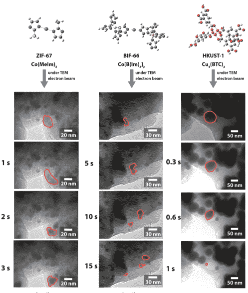
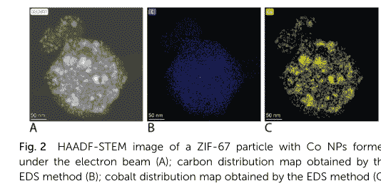
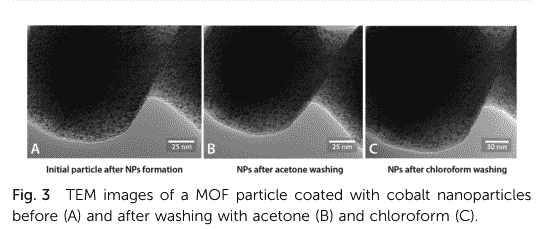
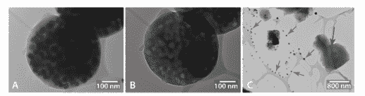
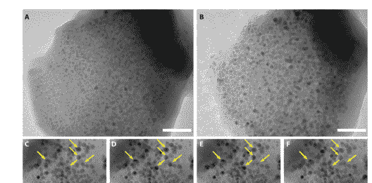
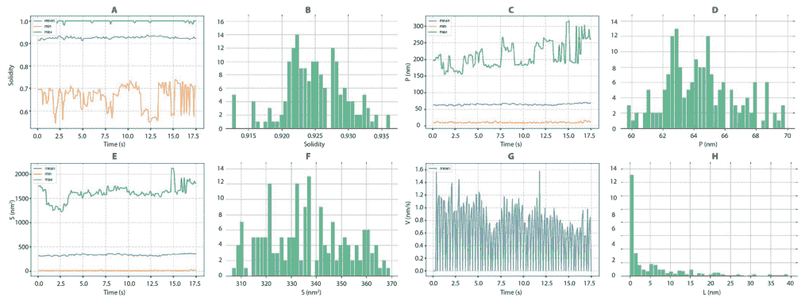
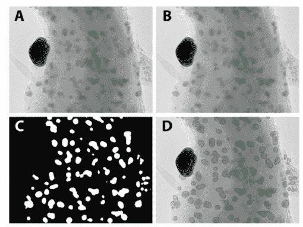
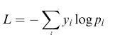
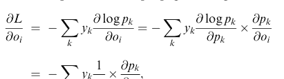

# MOF材料中金属纳米粒子动态行为：电子显微镜与深度学习分析

电子显微镜是纳米尺度系统的关键表征技术，电子显微镜图像通常以静态模式记录和分析研究对象的形貌。当前新兴的趋势是分析电子显微镜测量过程中观察到的纳米尺度动态行为。在这项工作中，在电子显微镜实验条件下研究不同组成和拓扑的 MOF 结构的稳定性，揭示了由特定框架的电子束诱导转化形成的 M NPs 的不寻常动态行为。相变到液相导致在秒级内发生空间迁移、快速烧结以及 M NPs 尺寸的增加。在铜纳米粒子的情况下，观察到了瞬时升华。Co NPs 的动态行为通过结合深度学习和经典计算机视觉技术的计算框架进行了分析。本研究首次揭示了各种 MOF 在电子束作用下的稳定性以及形成的 M NPs 的动态行为的独特信息。观察到 Fe、Ni、Cu 和 Co NPs 从分子框架中形成，并表现出特定的后续行为——Fe 为稳定形式，Co 为过度动态行为，Cu 为升华/冷凝。本研究的两个重要结论应予以提及：（i）对 MOF 样品的电子显微镜研究应谨慎进行，因为电子束作用下的分解可能导致错误结果和“幻象”纳米粒子的出现；（ii）MOF 是原位视频模式下进行分子到纳米转换基础研究的极佳模型，包括多种动态转变。

## 引言

小尺寸金属纳米粒子（M NPs）在科学和技术的各个领域被广泛应用。1–5 重要的是，它们即使在室温下也可能不稳定。M NPs 形状的变化可能导致纳米器件特性的关键变化。6,7 因此，已知异相纳米催化的效率关键取决于其形状和尺寸。8–10 干净金属表面上纳米粒子中单个金属原子的扩散势垒极低（1.0 eV）。11 因此，即使是微小的热激活也足以引起原子扩散。这使得干净金属表面在远低于熔点的温度下能像液体一样流动。12 M NPs 的熔点低于块体金属。小尺寸 M NPs 在远低于熔点的温度下表现出准熔相。在此相中，粒子在不同结构之间连续振荡。此外，不同形状的粒子可以具有不同的相区域。13 1954 年，首次在显微镜中电子束作用下观察到低熔点金属（如 Pb、Sn 和 Bi）纳米粒子的熔化。14 对于小于 10 nm 的粒子，熔点会显著降低。更大粒子的液态转变现象也有描述。例如，在显微镜室内加压条件下观察到了亚 10 nm 结晶银粒子的类液态伪弹性。6 已证明 Ag 纳米粒子可以像液滴一样变形。有趣的是，同时它们内部仍保持结晶。关于高熔点金属，已描述了 TEM 室内 CO 流中 Pt 粒子的类液态行为。15

纳米粒子中原子易扩散的后果之一是它们倾向于烧结或聚合。16,17 这一现象在纳米技术、催化以及电子纳米器件开发中也具有重要意义。TEM 室内纳米粒子的烧结可用作冷焊来制造纳米器件。12 使用原位 TEM，已证明大银纳米粒子（20–50 nm）可在 300 °C 下熔合。18 更有趣的是，Ag NPs 和 Au NPs（约 20 nm）的熔合可以通过电子束在 200 °C 下启动的扩散在 30–60 分钟内发生。19–24 对于更小的 Ag 和 Au NPs（~3 和 7.5 nm），在 HR-TEM 室内电子束作用下观察到了烧结，并伴随其晶体结构的重排。25

纳米粒子的低相稳定性不仅会导致熔化和烧结，还会导致升华。电子显微镜中纳米粒子的升华已有报道，涉及金属（主要是银）、26–28 GeSb2Te4、29 Bi2Te3、Bi2Se3、30 CdSe、31 GeTe、32 和 MgO–Mg。33 在所有情况下，升华均伴随额外加热（> 300 °C）。特别是，银纳米粒子的升华发生在不经过熔化的直接相变过程。34 直径 9 nm 的 Ag NPs 尺寸减小始于约 575 °C。更大的 Ag NPs（50 nm）的升华需要更高温度（约 675 °C）。28 已有报道描述了在石墨上沉积的 4 nm 铜粒子在额外加热至 800 °C 时的升华。作者指出，铜纳米粒子的行为取决于支撑物的类型。在 CuO 支撑物的情况下，升华之外，铜纳米粒子在 700 °C 下发生了熔化。35

在使用电子显微镜研究纳米粒子时，应考虑电子束对样品可能产生的影响。电子束的作用不仅限于对样品的加热。例如，早已有报道表明电子束可以诱导化学转化并还原某些化合物。21,36–39 此外，电子束还原已被提议作为生产 M NPs 甚至化学键的方法。40–43

金属有机框架（MOFs）是由有机分子（连接剂）连接的金属离子组成的一类重要的多孔配位聚合物。44,45 MOFs 是气体储存、46–48 电化学、49–51 光催化、52,53 催化、54–56 以及传感器57 和纳米反应器58–60 应用的有前途材料。它们还可以作为通过热解合成原子分散催化剂和 MOF 衍生多孔材料的前驱体。61–63 MOF 结构在电子束照射下的不稳定性是一个已知问题，这使得使用电子显微镜研究这些杂化多孔材料变得困难。64–68 已表明，透射电子显微镜中电子束作用下金属有机框架的稳定性主要由金属而非连接剂类型决定。例如，Cu- 和 Ru-MOFs 表现出稳定性差。69 在这些条件下，MOF 分解可用作合成 ZnO、In 和 Cu 纳米粒子以及有序银纳米结构的方法。70

在本研究中，我们报道了 MOF 材料在电子束照射下形成的 M NPs 的动态行为。详细分析了电子显微镜室内各种 MOF 的 M NPs 行为和稳定性。在 Co-MOFs（ZIF-67, BIF-66）的情况下，电子束照射导致形成具有异常高迁移率的纳米粒子。在 Cu-MOFs（HKUST-1）的情况下，电子束启动了形成的纳米粒子的瞬时升华（图 1）。使用机器学习方法研究了含 Co 纳米粒子的行为，以数字化跟踪粒子轨迹和性质。

## 结果与讨论

### MOF分解过程中的纳米粒子形成

不同性质（即组成、拓扑和孔结构）的 MOF，例如 MIL-53（AlOHBDC，BDC = 1,4-苯二甲酸盐），NH2-MIL-53（AlOHABDC，ABDC = 2-氨基-1,4-苯二甲酸盐），MIL-101(Fe)（Fe3O(BDC)3），NH2-MIL-101(Fe)（Fe3O(ABDC)3），NH2-MIL-101(Al)（Al3O(ABDC)3），BIF-66（Co[B(Im)2]4，Im = 咪唑根），ZIF-67（Co(MeIm)2，MeIm = 2-甲基咪唑），ZIF-8（Zn(MeIm)2），HKUST-1

图 1 TEM 实验中电子束作用下基于 Co2+（ZIF-67, BIF-66）和 Cu2+（HKUST-1）的 MOF 转化过程中的动态现象。展示了钴纳米粒子的迁移、熔合、形状变化和分离以及铜纳米粒子的升华。

| MOF | 金属离子 | 合成方法 | M NPs 的形成 | M NPs 的液相样行为 | M NPs 的升华 |
|---|---|---|---|---|---|
| MIL-53(Al) | Al3+ | 76 | — | — | — |
| NH2-MIL-101(Al) | Al3+ | 77 | — | — | — |
| NH2-MIL-53(Al) | Al3+ | 78 | — | — | — |
| ZIF-8 | Zn2+ | 78 | — | — | — |
| MIL-101(Fe) | Fe3+ | 79 | + | — | — |
| NH2-MIL-101(Fe) | Fe3+ | 79 | + | — | — |
| Ni(BDC) | Ni2+ | 80 | + | — | — |
| Ni(BTC) | Ni2+ | 80 | + | — | — |
| MOF-74(Ni) | Ni2+ | 80 | + | — | — |
| BIF-66 | Co2+ | 81 | + | + | — |
| ZIF-67 | Co2+ | 81 | + | + | — |
| HKUST-1 | Cu2+ | 82 | + | — | + |

(Cu3(BTC)2，BTC = 1,3,5-苯三羧酸盐)，Ni(BDC)、Ni(BTC) 和 MOF-74(Ni)（Ni2DOBDC，DOBDC = 2,5-二羟基-1,4-苯二羧酸盐）采用透射电子显微镜（TEM）进行了分析。其中一些在受到加速电压为 100 kV 的电子束照射时，倾向于转变为直径数纳米至数十纳米的颗粒。颗粒的形成主要取决于框架中的金属离子，并观察到含有 Co2+（BIF-66、ZIF-67）、Fe3+（MIL-101(Fe)、NH2-MIL-101(Fe)）、Cu2+（HKUST-1）和 Ni2+（Ni(BDC)、Ni(BTC)、MOF-74(Ni)）的 MOF 发生了这种情况（表 1 和 图 S1、S2，ESI†）。含有 Al3+（NH2-MIL-101(Al)、MIL-53(Al)、NH2-MIL-53(Al)）和 Zn2+（ZIF-8）的 MOF 是稳定的（图 S3，ESI†）。一个有趣的观察是，这与金属的标准还原电势 Mn+/M0 一致：稳定 MOF 的金属具有较低的值（Zn2+/Zn0 为 −1.66 eV，Al3+/Al0 为 −0.76 eV），而易发生转变的 MOF 的金属则较高（Co2+/Co0 为 −0.28 eV，Ni2+/Ni0 为 −0.25 eV，Fe3+/Fe0 为 −0.04 eV，Cu2+/Cu0 为 0.34 eV）71。此外，颗粒的形成还取决于发射电流。

在 NPs 形成方面。同一 MOF 的不同颗粒在电子束照射不同时间点观察到 NPs 的出现。有趣的是，正如我们所观察到的，即使经过长时间照射，并非所有框架颗粒都在电子束作用下转化为纳米颗粒。许多 MOF 结构仅在发射电流增加到 17 μA 时才开始转变。使用高倍率启动了纳米颗粒的形成。将发射电流降低到 8 μA 可以在不发生转变的情况下获得 MOF 颗粒表面的图像。因此，MOF 的转变和纳米颗粒的形成强烈取决于电流密度。应当指出，仅观察到电子束作用下的部分纳米颗粒形成，而同一 MOF 样品的某些颗粒保持不变。

我们在 TEM 研究中采用了以下参数：加速电压 100 kV，倍率范围 50–150 K，使用 CCD 摄像头进行检测。屏幕密度约为 10−12 A cm−2。我们的观察表明，框架转变为 NPs 的速率不仅取决于电子剂量，还取决于 MOF 的性质和颗粒尺寸。对于 BIF-66 和 ZIF-67，转变为 NPs 几乎是瞬时发生的。对于 Ni MOF，则需要几十秒甚至几分钟的时间。

最有可能的是，MOF 结构的转变是由于二次电子的产生引起的，这可能导致框架中的化学键断裂。72,73 电子束可以还原 MOF 结构中的金属离子，从而形成 M NP。样品可能会因与电子束的相互作用而加热。然而，之前的研究表明，用电子束加热样品仅限于几十度或几百度。28,72 因此，由于强烈加热导致的 MOF 材料转变不太可能。

为分析以钴为基础的 MOF 材料的热稳定性，将 BIF-66 和 ZIF-67 样品加热至 350 °C（2 h）。TEM 研究表明样品形貌无变化。根据 TGA 数据，BIF-66 在 370 °C 之前具有热稳定性，之后在 370–525 °C 范围内观察到氧化降解，并伴随放热

效应，峰值分别在 458 °C 和 492 °C，重量损失为 55.2%（图 S4 和 S5，ESI†）。在 525–650 °C 温度范围内，重量损失为 12.1%，并伴随峰值在 580 °C 的放热效应。样品的最终降解发生在 650–790 °C 范围内。

Fig. 5 铜纳米颗粒形成后的 HKUST-1 颗粒的 TEM 图像 (A) 及其升华后的图像 (B)。(C) 显示了较低倍率下在网状碳薄膜上出现的升华后颗粒图像。红色箭头指向升华后的颗粒，绿色箭头指向 Cu NPs 从中蒸发的 MOF 颗粒。

为确定形成的纳米颗粒的性质，对 ZIF-67 样品进行了 EDS 分析。根据电子束在 MOF 颗粒上形成纳米颗粒的元素分布图，高钴含量区域对应于所研究的纳米颗粒的位置（图 2）。

观察到的纳米颗粒在有机溶剂中不溶。对样品同一区域在用丙酮和氯仿清洗前后的分析表明，这些溶剂照射后钴纳米颗粒没有明显变化（图 3）。因此，所得纳米颗粒是稳定的。纳米颗粒成分中存在分子有机组分的可能性不大。

### 形成的纳米颗粒的动态行为

对形成的纳米颗粒进行进一步 TEM 观察，从而确定了它们在电子束作用下的不同行为。Fe 纳米颗粒是静态的。在 MOF-74(Ni) 结构转变过程中形成的纳米颗粒情况下，观察到颗粒尺寸逐渐增大（图 4A 和 B）。此外，在电子束作用下还观察到了颗粒“闪烁”，这可能是由于局部加热和磁场作用下其取向发生变化所致（图 4C–F）。74

在所研究的 MOF 材料中，在电子束作用下，BIF-66 和 ZIF-67 结构转变过程中形成的钴纳米颗粒的动态行为最为有趣。相比之下，以铁基 MOF（MIL-101）转变形成的 Fe NPs 是稳定且静态的（表 1）。在 Co-MOF 的 TEM 研究中获得的视频清楚地显示，纳米颗粒在 MOF 颗粒表面上活动移动，改变形状，并且在某些情况下相互融合并增大尺寸。在某些情况下，一个纳米颗粒分裂成几个独立的纳米颗粒（图 1）。这表明 Co NPs 具有液相样特性。值得注意的是，观察到的液相样纳米颗粒的尺寸从几纳米到几十纳米不等。

图 4 镀 Ni NPs 的 MOF-74(Ni) 颗粒在持续电子束照射前 (A) 和后 (B) 的 TEM 图像，以及以 15 s 间隔拍摄的一系列图像 (C–F)。比例尺相当于 50 nm。

块体 Fe、Co 和 Ni 的熔点分别为 1812、1768 和 1726 K。尽管这些数值很接近，但它们之间存在显著的 > 40 K 差异。在这一系列中，铁是上述金属中最难熔的。这可能是 Fe NPs 静态特性的原因之一。相比之下，Co 和 Ni 表现出动态行为。与块体金属相比，M NPs 具有较低的熔点。可以使用 Gibbs–Thomson 方程预测熔点降低。对于尺寸小于 100 nm 的颗粒，这一效应显著。对于尺寸为 10 nm 的钴颗粒，熔点显著超过 1000 °C。对于尺寸约为 1 nm 的 Co NPs，熔点约为 500 °C。因此，对于观察到的纳米颗粒，熔点降低的尺寸效应不应很强。转变为液态需要远高于几百度的温度。

块体和表面原子热稳定性的重要因素是塔曼温度（0.5Tmelt，单位 K）和休蒂格温度（0.3Tmelt，单位 K）。在高于相应数值的温度下，颗粒的单个原子表现出迁移性。对于块体钴，塔曼温度为 877 °C，休蒂格温度为 526 °C。尺寸为 5–22 nm 的钴纳米颗粒的休蒂格温度在 200–240 °C 范围内，而塔曼温度高于 500 °C。73 因此，由电子束引发的加热可能导致钴纳米颗粒表面原子的迁移。然而，这不太可能导致 M NPs 熔化。

在含铜的 HKUST-1（表 1）中观察到了更有趣的行为。聚焦电子束时，形成了直径范围约为 10–100 nm 的球形纳米颗粒。随着发射电流增加，观察到 Cu NPs 逐渐升华。在某些情况下，直径约为 50 nm 的纳米颗粒在几秒钟内完全消失。此外，在电子束照射的 HKUST-1 颗粒周围数微米半径范围内，还观察到 TEM 网格网状碳薄膜上形成了 Cu NPs。在此情况下，MOF 颗粒变得多孔，位于其中“蒸发”颗粒的小室边界处

Fig. 6. (A) 拓扑特征“颗粒实心度”随时间变化的图（绿色 – 最大值，蓝色 – 平均值，橙色 – 帧内最小值）；(B) 特征“实心度”分布直方图；(C) 拓扑特征“颗粒周长”随时间变化的图（绿色 – 最大值，蓝色 – 平均值，橙色 – 帧内最小值）；(D) 特征“周长”分布直方图；(E) 拓扑特征“颗粒面积”随时间变化的图（绿色 – 最大值，蓝色 – 平均值，橙色 – 帧内最小值）；(F) 特征“面积”分布直方图；(G) 平均速度图；(H) 颗粒行驶路径直方图。

clear (Fig. 5). It should be mentioned that bulk Cu has the lowest melting point among the considered metals (1358 K).

### 基于深度学习的Co纳米颗粒动态行为分析

为研究BiF-66样品中所得Co纳米颗粒的行为，我们利用深度学习分析了通过TEM获得的视频。为分析所观察颗粒的拓扑特征，我们考虑了Solidity（完整度）指标，其表征轮廓面积与其凸包面积之比，以及颗粒的周长和面积。所给图表和直方图（Fig. 6）说明了纳米颗粒拓扑的变化动态及分布规律。

根据颗粒实心度分析数据，实验过程中平均实心度和最大实心度保持不变，即接近凸形（Fig. 6A）。最显著的实心度动态表现在变化值的情况。这表明实心度在0.6–0.7范围内的颗粒形状存在不稳定性和变化趋势。视频分析中的颗粒实心度分布显示，大多数颗粒的实心度在0.920–0.930范围内（Fig. 6B）。

对颗粒周长动态的分析表明，最小值和平均值保持相对稳定，分别约为10 nm和65 nm（Fig. 6C）。这表明尺寸为2 nm和10 nm（在圆形形状情况下）的颗粒保持其几何参数的稳定性。同时，最大周长在实验过程中倾向于变化。这表明周长在150–200 nm范围内（直径24–32 nm）的颗粒最不稳定，倾向于分裂并与其他颗粒合并。颗粒沿周长的分布显示，实验期间绝大多数颗粒的周长在60–70 nm范围内（圆形情况下为10–11 nm）（Fig. 6D）。

类似地，在此处。关于“周长”指标，此处也观察到面积趋势。最小值和平均值保持相对稳定，约为15和320 nm2（圆形颗粒为2和10 nm）（Fig. 6E）。最大面积倾向于变化，这表明面积在1250–2250 nm2范围内的颗粒不稳定。颗粒面积分布显示，实验期间大多数颗粒的面积在310–370 nm2范围内（10–11 nm）（Fig. 6F）。

移动颗粒的平均速度在[0, 1.6] nm s−1范围内（Fig. 6G）。分析样品中颗粒在观测时间内的移动距离在[0, 295.22] nm范围内，平均值为27.75 nm（Fig. 6H）。

应指出，所观察的纳米颗粒是单个的，并不代表次纳米颗粒的聚集体。在研究条件下，Co NPs作为整体移动且未发生解体。如果是次纳米颗粒的聚集体，情况不会如此（应出现未校正的运动或解体）。NPs的完整性也得到了HR-TEM（Fig. S12和S13，ESI†）和SAED（Fig. S14，ESI†）分析的证实。

## 结论

MOFs在电子束作用下的稳定性与分解之间的关系是一个众所周知的问题，这使得通过电子显微镜（即TEM）对这类纳米多孔杂化材料的研究变得复杂。总之，已开展了MOFs对电子束作用的抵抗力的系统研究。研究了各种组成、拓扑和孔隙结构的MOF结构，它们在电子束作用下表现出不同的稳定性，主要取决于框架中金属配位中心的类型。Al-和Zn-MOFs较不太可能转变为M NPs，而Fe-、Co-、Ni-和Cu-MOFs降解形成M NPs。

随后，研究了M NPs在电子束作用下的行为。因此，Fe NPs被证明是稳定的并具有静态图像。相比之下，形成的Co NPs在电子束作用下呈液态并表现出惊人的动态行为。尽管其尺寸可达100 nm且无额外加热，转变后MOF材料表面上的钴纳米颗粒会改变形状、沿载体表面移动、相互合并并分解成几个颗粒。由HKUST-1形成的铜纳米颗粒在电子束作用下的行为也表现出有趣。Cu NPs在几秒钟内升华，并在距离研究颗粒几微米处的碳基底上沉积。

为了更深入地理解正在进行的过程，利用计算机视觉和深度学习对Co NPs的动态进行了分析。这使得能够以高速分析TEM实验中获得的Co NPs运动视频。研究发现，实心度最低且面积和周长最大的颗粒容易发生变化。因此，最动态的是形状最不凸的大颗粒。形状凸且尺寸较小的颗粒在几何参数方面被证明更稳定。

所观察到的现象表明，即使在透射电子显微镜研究条件下，大纳米颗粒也容易发生相变。这表明需要控制基于金属纳米颗粒的纳米器件的工作条件。同时，由电子束启动的这种相变可进一步用于开发纳米尺寸器件或催化系统。

## 实验部分

### MOFs的合成

MOFs根据公开的程序合成。76-82 MIL-101(Fe)和NH2-MIL-101(Fe)样品按照之前报道的改良程序，在大气压下使用微波（MW）技术制备。78 为合成MIL-101(Fe)，将苯-1,4-二羧酸（H2BDC）（0.230 g，1.38 mmol）溶解在N,N-二甲基甲酰胺（DMF）（60 mL）中。然后，加入FeCl3 × 6H2O（0.748 g，2.77 mmol）。所得混合物被搅拌，转移到玻璃反应器中，并在家用微波炉中加热（145–155 °C，40 min）。粗产品用DMF（2 × 15 mL）分离，在新鲜DMF部分（15 mL）中浸泡24 h，用EtOH（3 × 15 mL）冲洗，并抽真空（160 °C，4 h，10–3 torr）。

为合成NH2-MIL-101(Fe)，将2-氨基苯-1,4-二羧酸（H2ABDC）（0.501 g，2.77 mmol）溶解在DMF（60 mL）中。然后，加入FeCl3 × 6H2O（0.374 g，1.38 mmol）。所得混合物被搅拌，转移到玻璃反应器中，并在家用微波炉中加热（145–155 °C，45 min）。粗产品通过离心分离，用DMF（2 × 15 mL）冲洗，在新鲜DMF部分（15 mL）中浸泡24 h，用EtOH（3 × 15 mL）冲洗，并抽真空（160 °C，4 h，10–3 torr）。

### TEM分析

采用面向目标的方法优化分析测量。83 测量前，样品从异丙醇悬浮液中安装在覆有碳膜的3 mm铜网上。样品形貌使用Hitachi HT7700透射电子显微镜进行研究。图像在100 kV加速电压和8–17 mA发射电流下以亮场TEM模式采集。

### HR-TEM分析

HR-TEM微图使用Themis-Z 3.1仪器（TFS, USA）获得，该仪器配备X-FEG单色化器和CS/S双色差校正器，加速电压为200 kV。元素分析使用Super-X EDS探测器（能量分辨率约120 eV）在HAADF-STEM模式下进行。TEM研究的样品通过乙醇中的超声分散及随后将悬浮液沉积在支撑于铜网上的“穿孔”碳膜上制备。

### 结合深度学习和经典计算机视觉技术的计算框架分析

为研究BIF-66中纳米颗粒的行为，对使用TEM获得的视频进行了分析。所提方法基于机器计算模型，由视频帧流处理的顺序应用组成（Fig. 7）。

Denoising is a preparatory step for cleaning a video image from noise in digital data, which is necessary due to the high sensitivity of machine learning methods (used in the next step – binarization)

Fig. 7 将机器学习视频处理应用于TEM视频帧：(A) 初始帧；(B) 去噪；(C) 二值化；(D) 分割。

关于输入数据的质量。通过去噪处理，即应用一组数字滤波器，可以显著提高后续二值化阶段的工作质量。

为获得最佳性能，针对所检查的特定类型视频需要单独的滤波器设置。然而，通过启发式方法，建立了一套有效的参数组合，以满足后续阶段使用U-Net卷积神经网络的需求。这使得该方法及所开发软件整体的灵活性得以提高。在此，采用了以下经典数字滤波器序列：

- (1) 非局部均值滤波器；
- (2) 双边滤波器；
- (3) 中值滤波器；
- (4) 高斯滤波器。

**二值化**用于提高视频流帧上图像的对比度，从而为下一阶段输入数据分割问题的成功求解创造条件。对于二值化，使用了卷积神经网络U-Net，84其显著特征是采用软最大值函数与交叉熵损失函数的组合。

在此，为实现反向传播算法，我们得出

类似方法已被广泛且有效地实现，用于在CUDA设备上为卷积神经网络提供推理。

所使用神经网络的训练样本基于研究样本形成，允许以相当好的灵活性处理同类型样本的数据，这提高了系统对输入数据变化的稳定性。

**分割**允许将二值化数据划分为具有区分特征的一组对象。获得的二值化数据经过基于图像拓扑结构分析方法的轮廓检测算法处理。这会生成一个对象列表，其中包含以参数形式描述的每个轮廓（生成点的坐标、矩、相对于其他轮廓的层级位置等）。生成的对象列表经过额外的后验过滤。因此，为了算法的进一步运行，仅使用参数位于给定值范围内的对象。允许的值范围通过启发式方法选择，考虑研究样本的类型以及视频流生成系统的参数（帧率、分辨率）。

为了便于跟踪任务，还采用了将对象划分为父对象和子对象组的方法。这消除了冗余计算，进而通过减少每帧的处理时间来提高系统性能。

跟踪是处理的最后阶段，它允许在图像中选择特定对象，并计算和跟踪空间和时间特性的变化。跟踪的任务是识别对象并计算指定的度量。识别算法包括查找相邻帧对象之间的相似度系数。跟踪模块处理的数据已预处理和过滤。因此，每个处理对象要么是需要分配其自身唯一索引的新对象，要么是先前识别过的对象，需要根据接收到的信息更新数据。

相似度系数基于一组给定的度量（重心坐标、面积、周长、密度和层级位置）计算为欧几里得距离。在计算中，仅获取参数位于指定值范围内的对象的数据。通过这种方式，具有异常数据的对象被过滤掉。例如，跟踪参数的变化率过高可能意味着新对象的出现，但相对于前一帧的对象，其相似度评分很高。

考虑到指定的值范围和所选的数据输出格式，跟踪模块生成检测和识别对象的列表，以及相应的计算特征。

## 利益冲突

没有需要声明的利益冲突。

## 致谢

作者谨感谢Vladimir V. Chernyshev科学博士（莫斯科国立大学，化学系）和Igor V. Mishin科学博士（谢列申卡有机化学研究所）获取PXRD图谱。作者谨感谢Igor V. Chistyakov博士利用SAED对ZIF-67样品进行表征并提供有益建议。该研究得到科学院NSh-5199.2022.1.3基金资助。HAADF-STEM研究使用“全国催化剂研究中心”共享知识中心的设备进行。MIL-53、NH2-MIL-53、MIL-101(Fe)、NH2-MIL-101(Fe)、NH2-MIL-101(Al)、BIF-66、ZIF-67、ZIF-8和HKUST-1的合成得到俄罗斯联邦科学与高等教育部资助，拨款编号075-15-2021-591。

## 注释和参考文献

- 1 Y. Zhao, C. Ye, W. Liu, R. Chen and X. Jiang, *Angew. Chem., Int. Ed.*, 2014, 53, 8127–8131.

- 2 Y. Ni, C. Kan and J. Xu, *Phys. Chem. Chem. Phys.*, 2022, 24, 21522–21537.

- 3 Y. Lu, Q. Hu, Y. Lin, D. B. Pacardo, C. Wang, W. Sun, F. S. Ligler, M. D. Dickey and Z. Gu, Nat. Commun., 2015, 6, 10066.

- 4 H. L. Reddy, J. L. Arias, J. Nicolas and P. Couvreur, Chem. Rev., 2012, 112, 5818–5878.

- 5 R. R. Arvizo, S. Bhattacharyya, R. A. Kudgus, K. Giri, R. Bhattacharya and P. Mukherjee, Chem. Soc. Rev., 2012, 41, 2943–2970.

- 6 J. Sun, L. He, Y.-C. Lo, T. Xu, H. Bi, L. Sun, Z. Zhang, S. X. Mao and J. Li, Nat. Mater., 2014, 13, 1007–1012.

- 7 L. Zhong, F. Sansoz, Y. He, C. Wang, Z. Zhang and S. X. Mao, Nat. Mater., 2017, 16, 439–445.

- 8 J. Wang, A. Ouvrard, W. Zheng, S. Carrez, A. Ghalgaoui and B. Bourguignon, Phys. Chem. Chem. Phys., 2023, 25, 10845–10852.

- 9 S. Zhang, X. Tan, Y. Zhou, J. Liu, X. Liang, X. Ding, G. Lyu, Y. Wei, J. Chen, Y. Mao, J. Wu, Y. Huang, Y. Huang, X. Tan and Z. Huang, Phys. Chem. Chem. Phys., 2022, 24, 6193–6207.

- 10 S. Guo, S. Zhang and S. Sun, Angew. Chem., Int. Ed., 2013, 52, 8526–8544.

- 11 D. E. Sanders and A. E. DePristo, Surf. Sci., 1992, 260, 116–128.

- 12 D. V. Wagle and G. A. Baker, Mater. Horiz., 2015, 2, 157–167.

- 13 P. M. Ajayan and L. D. Marks, Phys. Rev. Lett., 1988, 60, 585–587.

- 14 M. Takagi, J. Phys. Soc. Jpn., 1954, 9, 359–363.

- 15 S. B. Vendelbo, C. F. Elkjaer, H. Falsig, I. Puspitasari, P. Dona, L. Mele, B. Morana, B. J. Nelissen, R. van Rijn, J. F. Creemer, P. J. Kooyman and S. Helveg, Nat. Mater., 2014, 13, 884–890.

- 16 P. Grammatikopoulos, M. Sowwan and J. Kioseoglou, Adv. Theory Simul., 2019, 2, 1900013.

- 17 J. Li, J. Chen, H. Wang, N. Chen, Z. Wang, L. Guo and F. L. Deepak, Adv. Sci., 2018, 5, 1700992.

- 18 M. A. Asoro, D. Kovar and P. J. Ferreira, Chem. Commun., 2014, 50, 4835–4838.

- 19 Y. Liu and Y. Sun, Nanoscale, 2015, 7, 13687–13693.

- 20 J. M. Yuk, M. Jeong, S. Y. Kim, H. K. Seo, J. Kim and J. Y. Lee, Chem. Commun., 2013, 49, 11479–11481.

- 21 E. Z. da Silva, G. M. Faccin, T. R. Machado, N. G. Macedo, M. de Assis, S. Maya-Johnson, J. C. Sczancoski, J. Andrés, E. Longo and M. A. San-Miguel, J. Phys. Chem. C, 2019, 123, 11310–11318.

- 22 J. C. Sczancoski, S. Maya-Johnson, W. da Silva Pereira, E. Longo and E. R. Leite, Cryst. Growth Des., 2019, 19, 106–115.

- 23 H. Yasuda and H. Mori, Z. Phys. D, 1997, 40, 140–143.

- 24 P. S. Lemos, G. S. Silva, R. A. Roca, M. Assis, R. Torres-Mendieta, H. Beltran-Mir, G. Mínguez-Vega, E. Cordoncillo, J. Andres and E. Longo, Phys. Chem. Chem. Phys., 2019, 21, 6101–6111.

- 25 M. Jose-Yacaman, C. Gutierrez-Wing, M. Miki, D.-Q. Yang, K. N. Piyakis and E. Sacher, J. Phys. Chem. B, 2005, 109, 9703–9711.

- 26 J. Li, Z. Wang, Y. Li and F. L. Deepak, Adv. Sci., 2019, 6, 1802131.

- 27 Y. Ding, F. Fan, Z. Tian and Z. L. Wang, Small, 2009, 5, 2812–2815.

- 28 M. A. Asoro, D. Kovar and P. J. Ferreira, ACS nano, 2013, 7, 7844–7852.

- 29 K. Berlin and A. Trampert, J. Phys. Chem. C, 2018, 122, 2968–2974.

- 30 J. Buha, R. Gaspari, A. E. Del Rio Castillo, F. Bonaccorso and L. Manna, Nano Lett., 2016, 16, 4217–4223.

- 31 D. J. Hellebusch, K. Manthiram, B. J. Berberwyck and A. P. Alivisatos, J. Phys. Chem. Lett., 2015, 6, 605–611.

- 32 J. W. L. Yim, B. Xiang and J. Wu, J. Am. Chem. Soc., 2009, 131, 14526–14530.

- 33 Q. Yu, M. M. Mao, Q. J. Li, X. Q. Fu, H. Tian, J. X. Li, S. X. Mao and Z. Zhang, Nano Lett., 2016, 16, 1156–1160.

- 34 J.-G. Lee, J. Lee, T. Tanaka and H. Mori, Phys. Rev. Lett., 2006, 96, 075504.

- 35 C. Chen, Z. Hu, Y. Li, L. Liu, H. Mori and Z. Wang, Sci. Rep., 2016, 6, 19545.

- 36 A. S. Kashin and V. P. Ananikov, Nat. Rev. Chem., 2019, 3, 624–637.

- 37 Y. Zhang, D. Keller, M. D. Rossell and R. Erni, Chem. Mater., 2017, 29, 10518–10525.

- 38 S. R. Singh and L. D. Marks, Philos. Mag. Lett., 1989, 60, 31–36.

- 39 D. J. Smith, M. R. McCartney and L. A. Bursill, Ultramicroscopy, 1987, 23, 299–303.

- 40 T. Tsuda, T. Sakamoto, Y. Nishimura, S. Seino, A. Imanishi and S. Kuwabata, Chem. Commun., 2012, 48, 1925–1927.

- 41 J. Li and F. Deepak, Chem. Commun., 2020, 56, 4765–4768.

- 42 A. Markevich, S. Kurasch, O. Lehtinen, O. Reimer, X. Feng, K. Müllen, A. Turchanin, A. N. Khlobystov, U. Kaiser and E. Besley, Nanoscale, 2016, 8, 2711–2719.

- 43 K. L. Y. Fung, S. T. Skowron, R. Hayter, S. E. Mason, B. L. Ware, N. A. Besley, Q. M. Ramasse, C. S. Allen and A. N. Khlobystov, Phys. Chem. Chem. Phys., 2023, 25, 9092–9103.

- 44 H. Furukawa, K. E. Cordova, M. O’Keeffe and O. M. Yaghi, Science, 2013, 341, 1230444.

- 45 G. Cai, P. Yan, L. Zhang, H.-C. Zhou and H.-L. Jiang, Chem. Rev., 2021, 121, 12278–12326.

- 46 M. E. Zick, S. M. Pugh, J.-H. Lee, A. C. Forse and P. J. Milner, Angew. Chem., Int. Ed., 2022, 61, e202206718.

- 47 F. Gandara, H. Furukawa, K. Lee and O. M. Yaghi, J. Am. Chem. Soc., 2014, 136, 5271–5274.

- 48 J. D. Martell, P. J. Milner, R. L. Siegelman and J. R. Long, Chem. Sci., 2020, 11, 6457–6471.

- 49 L. Wen, K. Sun, X. Liu, W. Yang, L. Li and H.-L. Jiang, Adv. Mater., 2023, 35, 2210669.

- 50 R. Rajak, M. Saraf, P. Kumar, K. Natarajan and S. M. Mobin, Inorg. Chem., 2021, 60, 16986–16995.

- 51 Y. Zhang, L. Jiao, W. Yang, C. Xie and H.-L. Jiang, Angew. Chem., Int. Ed., 2021, 60, 7607–7611.

- 52 T. Zhang and W. Lin, Chem. Soc. Rev., 2014, 43, 5982–5993.

- 53 K. Natarajan, A. K. Gupta, S. N. Ansari, M. Saraf and S. M. Mobin, ACS Appl. Mater. Interfaces, 2019, 11, 13295–13303.

- 54 Y.-B. Huang, J. Liang, X.-S. Wang and R. Cao, Chem. Soc. Rev., 2017, 46, 126–157.

- 55 A. S. Rosen, J. M. Notestein and R. Q. Snurr, Phys. Chem. Chem. Phys., 2022, 24, 8129–8141.

- 56 Z. Wang, A. Bilegsaikhan, R. T. Jerozal, T. A. Pitt and P. J. Milner, ACS Appl. Mater. Interfaces, 2021, 13, 17517–17531.

- 57 R. Rajak, M. Saraf, S. K. Verma, R. Kumar and S. M. Mobin, Inorg. Chem., 2019, 58, 16065–16074.

- 58 T. Kitao, T. Miura, R. Nakayama, Y. Tsutsui, Y. S. Chan, H. Hayashi, H. Yamada, S. Seki, T. Hitosugi and T. Uemura, Nat. Synth., 2023, DOI: 10.1038/s44160-023-00310-w.

- 59 R. Haldar, B. Sen, S. Hurrle, T. Kitao, R. Sankhla, B. Kühl, A. Welle, S. Heissler, G. Brenner-Weiß, P. Thissen, T. Uemura, H. Gliemann, C. Barner-Kowollik and C. Wöll, Eur. Polym. J., 2018, 109, 162–168.

- 60 X. Zhang, T. Kitao, D. Piga, R. Hongu, S. Bracco, A. Comotti, P. Sozzani and T. Uemura, Chem. Sci., 2020, 11, 10844–10849.

- 61 H. B. Aiyappara, P. Wilde, T. Quast, J. Masa, C. Andronescu, Y.-T. Chen, M. Muhler, R. A. Fischer and W. Schuhmann, Angew. Chem., Int. Ed., 2019, 58, 8927–8931.

- 62 X. Lin, Q. Li, Y. Hu, Z. Jin, K. M. Reddy, K. Li, X. Lin, L. Ci and H.-J. Qiu, Small, 2023, 2300612, DOI: 10.1002/smll.202300612.

- 63 Y.-Z. Chen, R. Zhang, L. Jiao and H.-L. Jiang, Coord. Chem. Rev., 2018, 362, 1–23.

- 64 Y. Zhu, J. Ciston, B. Zheng, X. Miao, C. Czarnik, Y. Pan, R. Sougrat, Z. Lai, C.-E. Hsiung, K. Yao, I. Pinnau, M. Pan and Y. Han, Nat. Mater., 2017, 16, 532–536.

- 65 D. Esken, S. Turner, O. I. Lebedev, G. Van Tendeloo and R. A. Fischer, Chem. Mater., 2010, 22, 6393–6401.

- 66 S. Turner, O. I. Lebedev, F. Schröder, D. Esken, R. A. Fischer and G. Van Tendeloo, Chem. Mater., 2008, 20, 5622–5627.

- 67 O. I. Lebedev, F. Millange, C. Serre, G. Van Tendeloo and G. Férey, Chem. Mater., 2005, 17, 6525–6527.

- 68 C. Wiktor, S. Turner, D. Zacher, R. A. Fischer and G. Van Tendeloo, Microporous Mesoporous Mater., 2012, 162, 131–135.

- 69 C. Wiktor, M. Meledina, S. Turner, O. I. Lebedev and R. A. Fischer, J. Mater. Chem. A, 2017, 5, 14969–14989.

- 70 B. W. Jacobs, R. J. T. Houk, M. R. Anstey, S. D. House, I. M. Robertson, A. A. Talin and M. D. Allendorf, Chem. Sci., 2011, 2, 411–416.

- 71 C. E. Housecroft and A. G. Sharpe, 《无机化学》, Pearson Education Limited, 埃塞克斯, 第4版, 2012.

- 72 L. Reimer, 《透射电子显微镜：图像形成与微区分析物理》, Springer, 柏林, 1989.

- 73 B. W. Jacobs, R. J. T. Houk, B. M. Wong, A. A. Talin and M. D. Allendorf, Nanotechnology, 2011, 22, 375601.

- 74 J. C. Azcárate, M. H. Fonticelli and E. Zelaya, J. Phys. Chem. C, 2017, 121, 26108–26116.

- 75 M. Wolf, H. Kotze, N. Fischer and M. Claeys, Faraday Discuss., 2017, 197, 243–268.

- 76 V. I. Isaeva, O. L. Eliseev, R. V. Kazantsev, V. V. Chernyshev, A. L. Tarasov, P. E. Davydov, A. L. Lapidus and L. M. Kustov, Polyhedron, 2019, 157, 389–395.

- 77 V. I. Isaeva, M. N. Timofeeva, V. N. Panchenko, I. A. Lukoyanov, V. V. Chernyshev, G. I. Kapustin, N. A. Davshan and L. M. Kustov, J. Catal., 2019, 369, 60–71.

- 78 V. I. Isaeva, O. L. Eliseev, V. V. Chernyshev, T. N. Bondarenko, V. V. Vergun, G. I. Kapustin, A. L. Lapidus and L. M. Kustov, Polyhedron, 2019, 158, 55–64.

- 79 K. M. L. Taylor-Pashow, J. Della Rocca, Z. Xie, S. Tran and W. Lin, J. Am. Chem. Soc., 2009, 131, 14261–14263.

- 80 E. S. Degtyareva, K. S. Erokhin and V. P. Ananikov, Catal. Commun., 2020, 146, 106119.

- 81 V. I. Isaeva, K. Papatthanasiu, V. V. Chernyshev, L. Glukhov, G. Deyko, K. K. Bisht, O. P. Tkachenko, S. V. Savilov, N. A. Davshan and L. M. Kustov, ACS Appl. Mater. Interfaces, 2021, 13, 59803–59819.

- 82 V. I. Isaeva, B. R. Saifutdinov, V. V. Chernyshev, V. V. Vergun, G. I. Kapustin, Y. P. Kurnysheva, M. M. Ilyin and L. M. Kustov, Molecules, 2020, 25, 2648.

- 83 V. V. Kachala, L. L. Khemchyan, A. S. Kashin, N. V. Orlov, A. A. Graclev, S. S. Zalesskiy and V. P. Ananikov, Russ. Chem. Rev., 2013, 82, 648–685.

- 84 O. Ronneberger, P. Fischer and T. Brox, arXiv, 2015, preprint, arXiv:1505.04597.
