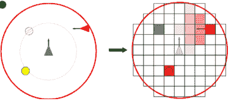
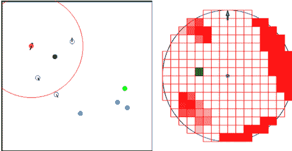
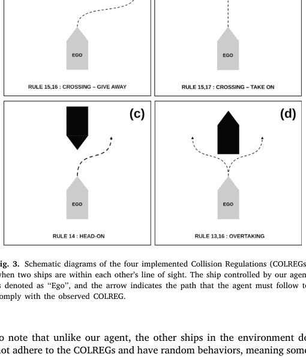
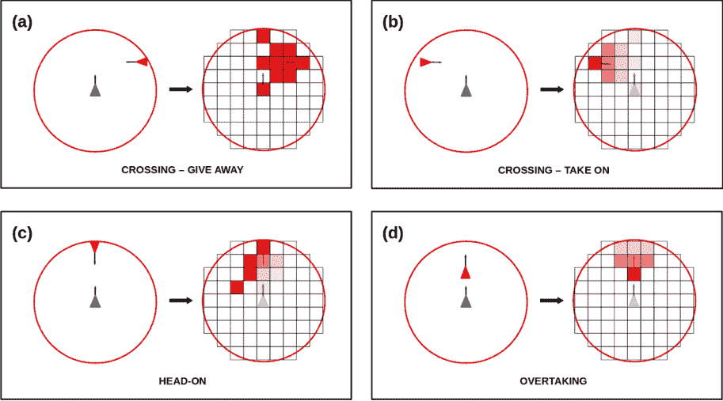
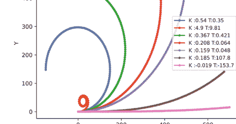
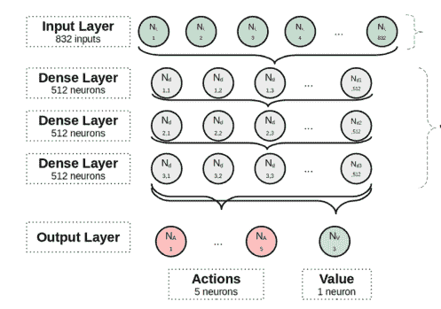
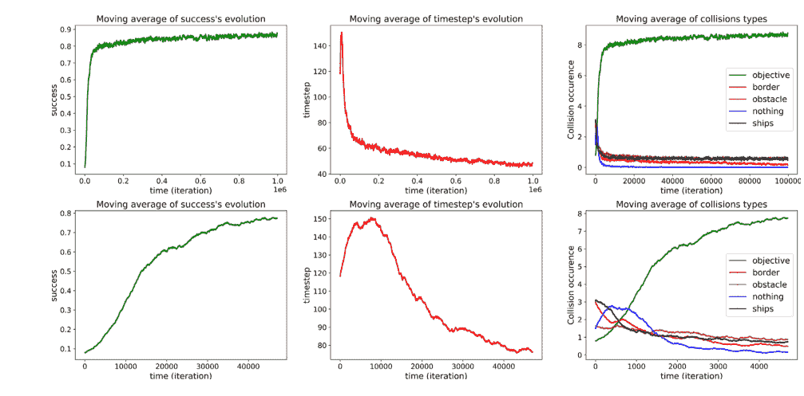
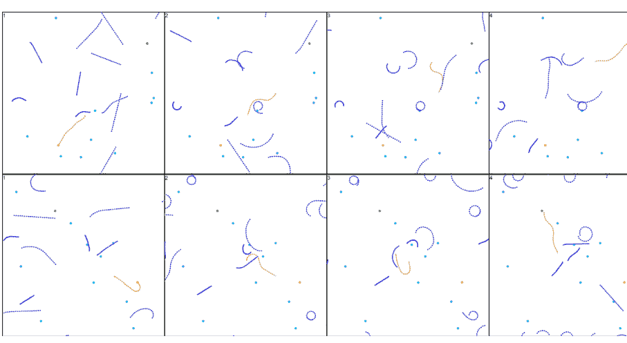
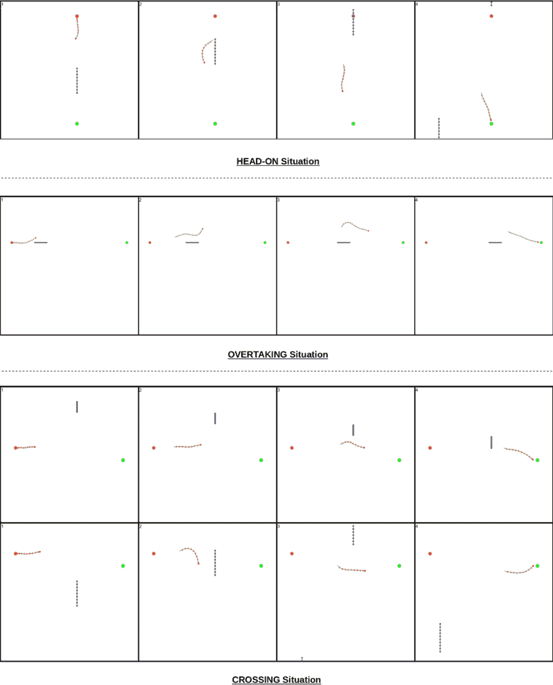

# 在密集环境中使用碰撞网格与深度强化学习的船舶动态轨迹规划


## 摘要

在海运交通繁忙的区域，在验证自主导航模型时，船舶安全至关重要。虽然针对特定情况存在精确方法，但在全局背景下它们是不够的。本研究采用近似的深度强化学习方法来解决在存在大量静态和移动障碍物的密集环境中的导航问题。我们的模型通过使智能体能够动态地根据周围环境调整其运动学，以在不与障碍物碰撞的情况下到达指定目标，从而优先考虑船舶完整性。为此，我们将碰撞网格以危险区域的形式作为模型的输入，并使用近端策略优化算法对其进行训练。此外，我们建议在碰撞网格中实施《海上避碰规则》（COLREGs），因为这些航行规则对于获得自主智能体的现实行为是必要的。智能体的性能是在一组随机生成的场景上进行评估的，这些场景运行的环境复杂程度与训练期间使用的环境相似。这些测试表明，这种类型的数据结构使训练有素的智能体能够在遵守 COLREGs 的同时在密集环境中导航，成功率为 94.69%。

## 1. 引言

船舶的主要目标是确保其安全。根据 Baker 和 McCafferty（2005）的研究，人为错误占碰撞的 80%，因此，人们对开发自主导航系统以执行部分导航任务的兴趣日益增长。在需要快速行动的动态环境中，自主系统必须做出有效的决策以确保船舶的安全。

先前的研究，例如 Statheros 等人（2008），已经表明自主船舶导航是可行的。为了做出相关决策，这些系统必须考虑各种因素，包括 COLREGs、船舶特性、意图、环境和邻近物体。这些系统必须解决几个子问题，例如预测周围物体的轨迹以构建安全轨迹并避免危险区域的碰撞避免模型。然而，环境的复杂性和物体的数量使得考虑所有物体具有挑战性，而精确方法难以应对不太常见的情况。

在此背景下，我们决定使用强化学习（RL）（Sutton and Barto, 2018; Kaelbling et al., 1996）作为一种近似方法来改进现有算法。RL 是一种技术，使智能体能够通过根据其行动获得奖励并通过最大化获得的奖励随着时间的推移改善其行为来学习如何在环境中导航。RL 已被证明在玩视频游戏（如 GVGAI（Torrado et al., 2018）或 Atari（Kaiser et al., 2019））、掌握国际象棋（Silver et al., 2017）、执行网络优化（Luong et al., 2019）或协作机器人导航（Hu et al., 2020）方面有效。训练算法也随着时间的推移而发展，其中深度 Q 神经网络（DQN）方法通过使用神经网络来概括状态过多而无法使用 Q 表的环境的状态，从而取代了 Q 学习。RL 中的另一个重要发展是异步 Actor-Critic（A3C）算法（Mnih et al., 2016），它同时使用多个智能体来优化全局神经网络。信任区域策略优化（TRPO）（Schulman et al., 2015）可以通过优化旧策略和新策略之间的变化，在不影响性能的情况下使用大量实验来改进行为。近端策略优化（PPO）（Schulman et al., 2017）是 TRPO 的增强版本，它简化了与旧策略相比新策略增益的估计，而不会降低性能。在本文中，我们将使用 PPO 方法作为训练算法。PPO 已证明在到达目标或与障碍物碰撞之前采取行动。相对目标被放置在连接智能体位置与目标精确位置的线段上，位于视距的中程位置。该位置是基于在 10% 到 100% 范围内变化的位置进行的实验确定的，以找到最佳点。实验表明，如果位置离智能体太近，智能体对周围障碍物不够谨慎，只专注于到达目标。这导致模型学会了到达目标，但碰撞率高于可接受的百分比。当位置离视距太近时，会出现几个问题。首先，如果位置在 90% 到 100% 之间，由于网格构造不允许对观测圆进行完美铺砌，目标可能会从观测中消失。如果一个物体没有被网格单元覆盖，即使它在视距之下，也不会被考虑。观察到的第二个问题是，离圆心越远，相同距离上的铺砌方格数量越多。在相对目标可能出现的视距 90% 处，方格数量将比视距 50% 处更多。这种增加导致学习复杂性更大，因为需要处理的信息更多。将相对目标放置在中距离，在考虑周围障碍物和追求目标之间取得了平衡，从而提高了智能体的整体性能。

我们的智能体必须考虑的几条信息包括碰撞点。首先，我们必须考虑环境的边界以及静态障碍物。智能体将把边界，或“墙”，感知为其无法进入的绝对危险区域。静态障碍物是空间中的不动点，将由一个点表示。移动障碍物也很重要，将不仅由其在给定时间的位置表示，还将由其在三个不同方向 0°、−20°、+20° 的下一个潜在位置表示。然而，只有满足 n mod 3 = 0 的位置才会被保留，以防止碰撞网格生成算法过载。可能的碰撞点集合仅在其位置在视距内或等于视距时才会被考虑。此外，我们决定在网格上将智能体定位在 [0,0]，方向为 0°，视距内的其他物体的相对位置和方向将根据智能体的位置重新计算。因此，智能体只能使用观测视距内的空间点，并且不知道其他物体的方向、速度或轨迹意图。换句话说，轨迹外推不被视为真实意图，而是线性预测。

神经网络接收来自雷达式网格的输入数据。Boschian 和 Pruski（1993）曾研究过使用网格表示环境的方法，他们提出了一种使用网格表示机器人二维交互空间的方法。我们的工作将这种方法扩展到包括动态可适应的网格。Elfes（1989）也提出了使用网格进行自动船舶控制的路径规划解决方案，用于从机器人传感器创建占用网格，该网格可通过评估安全和危险区域用于轨迹规划算法。此外，Kim 等人（2014）使用 Theta* 算法根据网格地图确定船舶的最佳路径。Woo 和 Kim（2020）改编了占用网格的概念，用于使用 RL 的船舶导航。他们将观测空间分为三个部分，每个部分都是用于路径跟踪、固定障碍物和移动障碍物的网格。这种方法允许使用 CNN 对信息源进行单独处理，然后再合并在一起。

碰撞网格是基于智能体所做的所有观测生成的。智能体的圆形观测视距被划分为大小相等的正方形。每个正方形的状态是根据填充坐标确定的，填充坐标是正方形的边缘。如果任何元素落在正方形内，其状态将被更改。正方形的大小是在为智能体提供准确信息和生成网格的计算性能之间权衡确定的。具有大正方形的网格可能会导致精度损失，因为放置在正方形内的任何船舶都会导致整个正方形被填满。另一方面，具有小正方形的网格会增加输入数据的大小，并使算法收敛花费更长时间。因此，对于半径为 r_h = 120 m 的观测视距，选择了边长为 d_c = 15 m 的正方形，从而得到包含 208 个正方形的网格。诸如环境中物体的碰撞区域或船舶未来位置的间距等附加约束可以添加到铺砌过程中。

为观测视距生成完美的网格是不可行的，尤其是在使用大正方形时。此外，只有当视距直径与正方形长度的比率为偶数整数时，才能实现对称网格。为了生成网格，我们从左下边缘开始（即坐标 [−r_h, −r_h]），从左到右、从下到上移动，步长等于正方形的大小。如果正方形的中心位于圆的区域内，则该正方形被包含在网格中。圆的填充率可能会根据正方形大小而变化。生成网格的算法在算法 1 中给出。

```
Algorithm 1 Generating the grid
Grid = []
r_h ← horizon
d_c ← sizeof square
i ← −r_h
while i < r_h do
  j ← −r_h
  while j < r_h do
    if euclidean(0, i + d_c/2, 0, j + d_c/2) < r_h then
      Grid.append([i, j])
    end if
    j ← j + d_c
  end while
  i ← i + d_c
end while
```

网格在实验开始时构建，并在环境状态每次变化时重置为 null 值。然后由环境生成的每个物体都会被处理并映射到相应的网格正方形（如果它在观测范围内）。此信息存储在表“Objects_environment”中，其中表的每个索引都是一个子数组，包含三元组 x_i, y_i, weight_i，其中 i 是表的索引，x、y 是坐标，weight 表示正方形的吸引力水平。较高的权重表示智能体到达该正方形的兴趣更大，而较低的权重表示更大的危险。目标被赋予权重 1，墙壁和静态物体被赋予权重 0.9，船舶的权重为 0.8，其线性预测在预测的每个时间步的权重为 −0.8×0.85^j，其中 j 表示时间步。该加权应用于反映船舶未来位置的锥体。锥体中权重的强度取决于与初始位置的距离，随着距离原点的增加，强度减小。锥体是通过将未来船舶位置投影到三个方向创建的，即方向 dir_n + [0°、+20°、−20°] 的修改，其中 dir_n 表示船舶 n 的航向（以度为单位）。这些投影之间的区域不需要加权，因为假设智能体不会尝试进入锥体中的空隙。[-20°、+20°] 的振幅还使智能体能够预见移动障碍物轨迹的未来变化，从而提前适应潜在变化。基于物体位置填充网格的过程可能计算密集，尤其是在使用视距上的循环时。为此，我们开发了算法 3，它将物体坐标投影到正方形大小的最接近的倍数，以确定物体属于哪个网格正方形，同时考虑负位置。我们还在实验开始时生成一个名为 GridDict 的字典，其中包含网格的附加填充信息 for grid




**图 1.** 根据智能体对环境的观察（左）生成网格（右）的示意图。我们的智能体位于中心，目标以绿色表示，固定障碍物以黄色表示，进入观察范围的船舶以红色三角形表示。



**图 2.** 模拟器在某一时刻的视图（左）以及智能体在范围内捕获的碰撞网格（右）示例。静态障碍物、移动障碍物或边界在网格中以红色调显示，智能体以绿色显示，网格上的箭头表示智能体的方向。智能体位于网格中心的蓝点上；因此碰撞区域相对于智能体的位置和方向放置。

位置。如果在该字典中不存在的位置添加新对象，则忽略该错误并继续实验。这种优化减少了实验时间，同时仍提供与算法 2 中描述的朴素算法相同的结果。图 2 显示了基于智能体观察生成的网格示例。左图提供环境的俯视图，右图显示网格随智能体观察范围的变化，船舶向北行驶。图中还显示了左舷侧的相对目标，以及两个移动障碍物及其各自放置在网格中的投影锥体。

与 OZT 不同，正方形填充方法是均匀的，与障碍物在正方形内的位置以及未来船舶运动投影集合无关。均匀加权产生的近似值显著简化了危险区域空间。此外，网格预处理的信息远少于 CNN 所处理的信息。例如，一张 50 × 50 像素的图像需要处理 2500 个像素，而我们的网格只有 208 个输入需要处理。网格在智能体范围内所有可见对象生成完毕后，我们对每个正方形中包含的所有值取平均值。最后，我们将这些平均值导出为一维矩阵，表示智能体在特定时间观察到的数据。图 1 展示了根据环境状态进行网格填充的示例。左侧，智能体的观察结果显示在由红色大圆定义的范围内。由于智能体的角度设置为 0°，其位置为 [0, 0]，该信息已经过预处理。我们观察到左上角的绿色目标位于范围之外。因此，在范围 50% 处沿相同方向放置一个相对目标，以绿色阴影圆表示。如果遵循碰撞网格的构建过程，我们会看到目标以绿色填充其中一个正方形。在智能体后方观察到一个黄色静态障碍物，其位置作为绝对碰撞点填充在碰撞网格中。最后，一个移动障碍物从智能体右舷进入范围，从该船舶到其运动未来投影的最后位置形成了一个碰撞锥体。需要注意的是，此网格生成示意图未考虑任何避碰规则（COLREG）。

**算法 2：填充网格 - 朴素算法**

```text
Require: Grid
Require: Objects_environment as objects

Fill_Grid = []
d_c ← size of square
i ← 0
while i < Grid.size do
    Fill_Grid[i] ← []
    j ← 0
    while j < objects.size do
        x ← Grid[i][0]
        y ← Grid[i][1]
        m ← objects[j].x
        n ← objects[j].y
        if x − d_c/2 ≤ m and x + d_c/2 ≥ m and y − d_c/2 ≤ n and y + d_c/2 ≥ n then
            Fill_Grid[i].append([objects[j].weight])
        end if
        j ← j + 1
    end while
    i ← i + 1
end while
```

**算法 3：填充网格 - 优化算法**

```text
function CLOSESTMULTIPLE(n, mult)
    return (int) ((n + mult/2) / mult) * mult
end function

Require: Grid_Dict
Require: Objects_environment as objects

Fill_Grid = {}
d_c ← size of square
i ← 0
while i < objects.size do
    m ← objects[i].x
    n ← objects[i].y
    m ← sign(m) * closestMultiple(|m|, d_c)
    n ← sign(n) * closestMultiple(|n|, d_c)
    Grid_Dict[m,n].append(objects[i].weight)
    i ← i + 1
end while
```

### 3.2. 避碰规则（COLREGs）的实现

《国际海上避碰规则》（COLREGs）在 IMO（1972）中有总结，是一套旨在防止海上碰撞的规则。这些规则规定了船舶在不同环境中应如何行事，并要求使用灯光和声音信号或船舶控制等工具来限制与其他船舶碰撞的风险。它们是适用于所有类型船舶的国际规则，无论其用途或动力如何，以确保海上行为的一致性。然而，个别国家可根据自身视角对这些规则进行本地调整，以增强安全。完整的 COLREGs 规则可在 DLS（2010）中找到。我们的工作重点研究海事规则第二节中关于船舶在视野内存在其他船只时的行为部分。这些规则在自主船舶的机器学习应用中被广泛研究。需要注意的是，与我们的智能体不同，环境中的其他船舶不遵守 COLREGs 并且行为随机，这意味着在本研究阶段某些机动可能不会发生。



**图 3.** 两艘船舶处于彼此视线范围内时四种已实现避碰规则（COLREGs）的示意图。由我们的智能体控制的船舶记为“Ego”（本船），箭头表示智能体为遵守所观察到的避碰规则而必须遵循的路径。

要在我们的智能体行为中实现 COLREGs，有各种方法可供选择。一种方法是在操作层面约束智能体的行为，即阻止会导致违反 COLREGs 的行为，或倾向于产生更安全轨迹的行为。另一种方法是修改奖励函数，即改变智能体在每个状态变化时观察环境所获得的奖励。尽管以这种方式实现 COLREGs 的文献很丰富，我们还是决定不采用。调整奖励函数可能很复杂，并可能引入削弱学习过程甚至产生错误结果的偏差。相反，我们考虑修改智能体的观察结构，将图 3 中总结的各种 COLREGs 纳入输入。在此图中，(a) 和 (b) 表示“交叉相遇”规则，其中生效的规则是“右舷优先”：如果两艘船舶交叉相遇，从右舷侧接近的船舶保持航向，左舷侧的船舶必须改变航向，从优先船舶的后方通过或掉头。规则 (c) 是“对遇”规则：当两艘船舶从相反方向接近彼此时，两船均向右转向，从对方的左舷侧通过。最后，规则 (d) 是“追越”规则：如果一艘船舶打算超越另一艘船舶并且有足够的速度，它必须保持平行航向，或定位在被追越船舶前方足够远的位置，以便后者不必改变航向或速度。此处给出的图仅用于说明后续将要实现的内容。此类机动必须提前充分设置，尽可能限制轨迹变化。

所提出的方法旨在碰撞网格中实现 COLREGs，以应对多种约束。首先，通过不将 COLREGs 集成到奖励函数中，我们可以单独处理每条信息，而不是将观察结果合并为通常是子奖励之和的奖励。如果其他信息以正子奖励覆盖相应的子奖励，这可能导致智能体忽略某项 COLREG。将这些规则纳入输入也使得智能体将采取的不同行为更加清晰。当我们用信息叠加层增强观察时，智能体在决策上游而非下游受到约束。

为了实现每条 COLREG，我们预测船舶的未来位置，从而改变智能体可航行的区域。通过与投影轨迹相关的单元格分配权重，我们可以影响智能体对环境及其危险程度的感知。例如，假设智能体已学会进入加权区域会产生负奖励。如果将相同权重分配给相邻船舶的投影路径，智能体将感知到前方有一条障碍线并避开这些坐标，即使它们只是潜在危险。这就是通过调整与船舶投影相关的权重来实现 COLREGs 的方式，使智能体能够学会如何识别安全区域和危险区域，同时遵守航行规则。

图 4 展示了在修改权重后将 COLREGs 应用于观察结果的情况。一般情况下，每个投影的权重从船舶初始位置开始线性递减，这意味着距离障碍物越远，危险程度越低。这适用于船舶 \(n\) 的各个投影 \(d\) 的三个方向。对于第 \(i\) 个投影单元格，危险区域的强度使用公式 \(f_{n,\mathrm{dir}}(i)=0.85^i\) 计算。在“交叉相遇”情形 (a) 中，智能体不具有优先权，出现在智能体范围右上部分（即 [0°, 90°] 区间内）的所有船舶都应予以考虑。第一个条件确保只考虑处于优先位置的船舶。第二个条件是船舶可能与智能体发生碰撞。如果两条路径的交点位于智能体前方，即在范围内且角度处于 [0°, 180°] 区间内，我们为每个投影分配最大强度 1。这会在智能体前方形成绝对危险区域，结果为 \(f_{n,\mathrm{dir}}(i)=1\)。在智能体具有优先权的“交叉相遇”情形 (b) 中，我们保持初始权重而不降低，以防止智能体采取更危险的路径。此外，由于其他船舶意图不可预测且不遵守 COLREGs，智能体不能忽视它们。对于“对遇”规则 (c)，在交叉相遇情况下，两艘船舶必须从对方的左舷侧通过。第一步是估计两艘船舶是否处于可以相互通过的位置，如果是，则调整相关危险区域的强度。我们检查它们的方向是否在 [−20°, +20°] 范围内呈相反方向，这通过式 (1) 计算，其中 dir 是对象的方向（以度为单位）。如果结果在 [160°, 200°] 区间内，我们还需要检查船舶是否位于智能体前方，即在 [0°, 180°] 区间内。如果满足此条件，则存在交叉，我们修改权重以最小化障碍船舶左舷侧的权重，并最大化该船舶右舷侧的权重。因此得到以下 3 个公式：\(f_{n,\mathrm{dir}_0}(i)=0.85^i\) 用于前方投影，\(f_{n,\mathrm{dir}_{20}}(i)=0.7^i\) 用于左舷侧投影，最后 \(f_{n,\mathrm{dir}_{-20}}(i)=1\) 用于右舷侧投影。最后，最后一个 COLREG“追越”(d) 不修改初始权重，因为我们希望能够在不切断被追越船舶轨迹的情况下超越它。

\[
T'(\mathrm{agent\_dir}, \mathrm{ship\_dir}) = \max(\mathrm{agent\_dir}, \mathrm{ship\_dir}) - \min(\mathrm{agent\_dir}, \mathrm{ship\_dir})
\]
\[
T = T' \pm 20^\circ \tag{1}
\]

## 4. 实验设置

为了训练我们的模型，我们首先定义环境及其约束条件。接下来，我们选择船舶动力学、其目标以及将移动并与智能体交互的障碍物类型。对于移动障碍物，我们认为赋予它们随机行为更为合适，这些行为可能是危险的，以便处理最坏可能的情况。第二步，我们必须处理碰撞网格接收到的所有信息，以及赋予每条信息的权重。我们不优化与不同对象相关的权重，因为我们的目标是验证所提出的方法，而不是对其进行微调。然而，智能体的行为可以得到改善，并且




**图4.** 基于对移动障碍物的观察，为每个COLREGs在网格中生成碰撞区域权重。由智能体驾驶的船舶以蓝色显示，而障碍物未来位置的投影以红色显示。红色单元格的不透明度对应障碍物构成的危险等级，颜色越深表示风险越高。

通过这种方式进行细化。最后，我们设置模型的各种超参数，例如PPO算法和神经网络结构，并根据其约束确定智能体可以执行的各种动作。我们在100万个随机化回合中训练智能体，并在每个回合后记录其性能演变以供进一步分析。

舵的稳定性以及$K$都会改变船舶转向的难度。我们需要确定最佳参数，以便实验在合理时间内运行，同时考虑到机动性较低的船舶比机动性较高的船舶需要更多空间来完成转向。我们使用其他论文中研究的常数$K$和$T$比较了一些船舶的动力学特性。这些参数包括：$K = 0.54, T = 0.35$（Artyszuk等，2016）、$K = 4.9, T = 9.81$（Artyszuk，2016）、$K = 0.367, T = 0.421$；$K = 0.208, T = 0.064$；$K = 0.159, T = 0.048$（Shen等，2019b）。我们还考虑了$K = 0.185, T = 107.8; K = -0.019, T = -153.7$（Fossen，2011）。我们在图5中绘制了不同轨迹随参数$T$和$K$变化的比较。基于这一分析，我们选择了常数$K = 0.54, T = 0.35$（蓝色曲线），因为它们使船舶具有良好的机动性，同时不会让极紧的转向过于容易。这些常数在整个实验过程中保持不变，并且只能应用于在真实条件下具有相似动力学特性的船舶。

**不同K/T参数下的船舶位置演变**



**图5.** 基于不同T、K，应用Nomoto一阶模型时船舶在100个时间步内的位置演变。船舶保持恒定速度，同时舵角固定为5°。

### 4.1. 模拟器

用于训练智能体的模拟器是一个二维空间，尺寸为$sizeMax \times sizeMax$米，其中$sizeMax = 350$米。智能体是一艘船，在该环境中运行时，其方向可变，以度为单位；其速度也可变，以m s$^{-1}$为单位。在每个回合中，为智能体生成一个新的目标，即它必须到达的空间中的一个点。智能体的初始位置及其目标是随机生成的，但我们限制任一元素出现在离边缘太近的位置。为确保这一点，在每个回合开始时，坐标$x$或$y$在区间$[20, sizeMax - 20]$内生成。这一约束避免了因船舶或目标生成在碰撞箱边界内而无法解决的回合。在这个二维空间中，有两种类型的障碍物：静态障碍物和移动障碍物。静态障碍物的位置在整个回合中保持不变。移动障碍物与智能体具有相同的物理约束，但没有意图或目标。它们沿恒定轨迹运动，每个时间步有5%的概率改变航向。这些障碍物的行为与智能体无关，它们可以自由地与智能体碰撞或远离智能体。如果移动障碍物碰到边缘，它将重新出现在对面边缘的一个随机位置。环境中忽略障碍物之间或障碍物与船舶之间的碰撞。

我们为智能体的行为添加了动力学特性，以使模拟器更真实，并纳入影响移动物体的约束。为此，我们使用了式(2)所示的一阶Nomoto模型，该模型可在船舶改变航向时估算其机动过程中的旋转率。我们对该方程进行了修改，以离散时间形式应用于我们的模拟器。方程中的常数$K$和$T$影响船舶的动力学特性，其中$T$决定舵的稳定性，$K$改变船舶转向的难度。

$$
\frac{\dot{r}(s)}{\delta(s)} = \frac{K}{1 + Ts} \tag{2}
$$

为了更新船舶的位置，我们使用时间步长$\delta_i = 1$秒计算转向率，然后根据$dir_{i-1}$和转向率修改船舶的方向$dir_i$。利用船舶速度$s_i$、先前位置$x_i, y_i$以及以弧度表示的方向$dir_i$，我们使用式(3)计算新位置。

$$
\begin{aligned}
x_i &= s_i \times \cos(dir_i) + x_{i-1}\\
y_i &= s_i \times \sin(dir_i) + y_{i-1}
\end{aligned} \tag{3}
$$

### 4.2. 奖励评估

除非受到学习或验证阶段定义的回合时长限制，否则智能体终止回合的唯一方式是与环境中的物体（如目标、边界或障碍物）碰撞。到达边界时，只需越过空间边界即可结束回合；而对于其他物体，则需要进入碰撞区域（即碰撞箱）。目标的最大欧几里得碰撞距离（15米）略大于其他类型障碍物的碰撞距离（13米）。本研究不使用奖励塑形（Ng等，1999），这意味着只考虑回合结束时获得的奖励。尽管常见的做法是对所有观测到的状态应用修改后的奖励以加速学习并更准确地评估某些状态，但在本研究中不建议这样做。轨迹（时间、速度等）不应被过度约束，因为这可能导致收敛到危险状态。相反，智能体被教导制定碰撞避免策略，即使这意味着要走更长的路径。

第一个理由是使用碰撞网格来评估状态值，该网格清晰地用负权重划分危险区域，用正权重或零权重划分感兴趣区域。这种评估将反映在网络的更新中，并且即使没有被动奖励，折扣奖励仍将评估每次导致成功或失败回合的转移的相关性。因此，可以在网格、其权重和折扣奖励之间建立关联。第二个理由是构建被动奖励函数的复杂性。确定该函数各部分对智能体向其目标收敛的影响是困难且模糊的。例如，如果目标太远，目标相对位置会显示在视界的50%处，这进一步使被动奖励函数复杂化。在没有障碍物的情况下，当网格保持不变时，无法区分朝向目标的正向动作与中性或负向动作。因此，对于这样的转移，奖励变得模糊，提供固定奖励与实际发生情况不符。试图依赖智能体的航向来解决这种模糊性也是不够的，因为转向率可能不会将目标相对位置从一个格子改变到另一个格子。即使确定了良好的目标达成评估，仍然需要评估距离、潜在碰撞以及对COLREG的任何违反，以建立全局奖励。由于这些信息在每个步骤的网格中已得到考虑，将其纳入奖励将是冗余的。此外，不同组件的加权是被动奖励的一个显著缺点，并且很难确定为每个组件分配适当的权重。奖励加权过程可能很困难，因为它涉及大量的超参数化。此外，它可能仅适用于当前特定问题，使得在环境或智能体采取的动作发生任何修改时难以复现。因此，智能体只能获得由碰撞类型决定的三种可能恒定奖励值之一。例如，如果智能体与目标碰撞，则获得+5的奖励；如果它与障碍物或边界碰撞，则会获得-1的奖励；在所有其他情况下，奖励为0。奖励函数的方程如式(4)所示。在每个持续t个时间步的回合结束时，我们使用折扣因子γ从i = t − 1到i = 0计算每个时间步的累积奖励：$rW_i = \gamma \times rW_{i+1}$。对于回合中花费的时间步数没有惩罚，因此智能体不会因使用较长或较短的轨迹到达目标而受到惩罚。因此，主要目标是在不与任何障碍物碰撞的情况下到达目标，唯一的非零奖励来自结束回合的正碰撞或负碰撞。

**表1.** 用于训练和评估模型的环境配置详情。

| 名称 | 数值 |
|------|------|
| 移动障碍物数量 | 3 |
| 静态障碍物数量 | 3 |
| 正奖励 | 5 |
| 负奖励 | -1 |
| 零奖励 | 0 |
| 主船视界（米） | 120 |
| 方格大小（米） | 15 |
| 障碍物碰撞箱半径（米） | 13 |
| 目标碰撞箱半径（米） | 15 |

$$
rW_{\text{final}} =
\begin{cases}
5, & \text{如果碰撞=目标}\\
-1, & \text{如果碰撞=（船舶或障碍物或墙壁）}\\
0, & \text{其他}
\end{cases} \tag{4}
$$

## 5. 模型验证

### 5.1. 智能体训练

我们的模型生成将分两个阶段进行。第一阶段涉及模型的训练，第二阶段涉及对其性能的评估。训练过程将包含100万个回合，每个回合的最大持续时间为300个时间步。总训练时间约为52小时，主要取决于网格中方格的数量和环境中的障碍物数量。在每个回合开始时，智能体的起始位置、目标和环境中的各种障碍物将被随机初始化。因此，学习环境不会保持静态，环境参数汇总在表1中。在学习阶段和评估阶段，每个新回合开始时，所有障碍物的位置，以及移动障碍物的舵角和方向，都会与智能体驾驶的船舶及其目标的位置一起随机重置。这种环境的随机化使我们能够观察智能体泛化其策略并在以前未见过的场景中表现良好的能力。环境大小限制为350 × 350米，每种类型的障碍物最多三个。这一约束预计将通过加快收敛和缩短回合持续时间来加速学习过程。此外，限制障碍物数量应帮助智能体学会避开它们，而不仅仅关注避障。最后，由于输入数据仅限于带有视界的网格，环境大小对模型性能的影响不大。虽然我们可以在不同大小和障碍物密度的环境中测试模型，但在学习过程中限制大小应该会带来更快的收敛，尽管代价是智能体对环境的可观测性降低。

为了使用PPO学习方法训练模型，需要定义两个神经网络：演员网络（actor-network），用于为每个动作分配权重；评论家网络（critic-network），用于评估智能体动作的价值。两个网络具有相同的内部结构和相同数量的输入，即3个隐藏层，每层512个全连接神经元。输入大小由……的数量决定




图6. 用于训练学习模型的神经网络架构示意图。PPO算法使用了两个网络，除输出层外结构相同。Actor网络由5个神经元组成，分别对应智能体可用来修改其轨迹的5种动作；Critic网络有1个神经元，用于估计价值函数。

水平方向上的方格产生了大小为208的观测。为了在不使用循环神经网络（RNN）(Salehinejad et al. 2018)的情况下估计移动障碍物的运动，我们通过堆叠最近4次观测来实现短期记忆，从而得到832个输入。Actor网络有5个输出，Critic网络有1个输出。图6展示了使用PPO训练智能体时所用的两个神经网络的结构。实验将使用AMD Ryzen 9 3900X和NVIDIA GeForce RTX 3090在Ubuntu 18.04.6上运行。算法使用Python 3.6.9实现，并采用Torch 1.10和CUDA 11.1。

智能体是轨迹自由的，也就是说，它可以通过调整舵角或速度来调整自己的轨迹，以朝向目标。因此，它不会遵循预定轨迹或被动受奖励影响的轨迹，而是可以根据所遇到的状态调整自身行为。对于Actor网络，智能体可以执行五种离散动作，分别是“加速”、“减速”、“向左转向”、“向右转向”或“不采取任何行动”。在改变速度时，智能体可以在[1 – 5] m s⁻¹区间内以±0.5 m s⁻¹的幅度调整速度。我们不希望智能体在静止状态下进行机动，而且最大速度受到其观测范围以及由此产生的反应时间的限制。对于舵机操纵性，其幅度限制在[−20°, +20°]区间内，并且在每个时间步只能改变−5°或+5°，以限制船舶可能做出的反应和可能受到的物理约束。用于训练神经网络的PPO学习算法的超参数汇总在表2中，其中使用了beta为（0.9,0.999）的Adam优化器。

### 5.2. 评估

在整个学习过程中，会保存碰撞类型、每个回合的持续时间（以时间步为单位）以及表示每个回合成功或失败的二进制值。图7中的分析图就是根据这些数据生成的，展示了智能体随时间的... 为了提高不同图表的可读性，给定回合i的每个显示值都是最近500个回合的滚动平均值，即 1/500 Σ_{i-500}^{i} object_i，其中object是为每个图表计算的相关信息。例如，使用steptime来绘制每个回合随时间变化的持续时间。

图的上部（TOP）展示了实验的完整结果，而下部（BOT）仅显示前50,000个回合的演变。第一个观察结果是，智能体已经学会到达其目标，BOT显示这一学习是在

表2
PPO算法训练模型所用的超参数。该表列出了多种超参数，包括最大回合数、批量大小、学习率、折扣因子和裁剪参数值。这些超参数对于决定PPO算法的收敛性和稳定性起着关键作用，其值通常基于对类似问题的先前经验来设置，而不是使用自动超参数优化工具。

| PPO超参数 |  |  |
|---|---|---|
| 名称 | 符号 | 值 |
| 最大回合数 | K | 10⁶ |
| 批量大小 | T | 3 × 10⁴ |
| 学习率 | η | 0.0001 |
| 折扣因子 | γ | 0.99 |
| 裁剪参数 | ε | 0.1 |
| 小批量数量 | N | 10 |
| 价值函数系数 | c₁ | 0.5 |
| 熵系数 | c₂ | 0.01 |

在不到20,000个回合内实现的。中间的图显示，在前20,000个回合中成功率迅速上升，随后逐渐增加，并在30,000个回合后达到约80%的成功阈值。右下方的图表明，在前10,000个回合中，平均时间步从120增加到150，这表明智能体学会了到达目标，但需要更多时间。随后，随着智能体学会找到更优的轨迹且不增加与环境的不良碰撞，平均时间步下降到80。BOT左侧的图显示，负面碰撞的数量很少，并且以“none”结束的回合为零，这表明智能体总是试图实现其目标。TOP表明，这种快速学习不会随时间的推移而丧失，性能甚至略有提升，因为中间图表的斜率并非完全平坦。TOP的图还表明，学习不会随时间的推移而丢失，熵系数稳定了结果，同时不允许进行冒险探索。

表3中给出了一个性能评估示例。环境设置与学习阶段保持一致，每次评估都使用相同的随机种子进行对比研究。评估在1000、10,000、100,000和100万回合时进行，一次评估代表500个回合运行的平均性能。该表显示了准确率（即成功回合的百分比）、以时间步衡量的回合平均持续时间（指回合结束前智能体观察到的状态的平均数量），以及负面碰撞率或零碰撞率（表示达到最大时间步数但智能体既未到达目标也未与任何障碍物碰撞的回合比例）。

需要注意的是，有些回合被排除在性能计算之外。具体来说，在评估期间，任何持续时间少于20个时间步的回合都会从计算中移除。这是因为我们认为，在一个回合开始时，如果障碍物靠近智能体，智能体至少需要20个时间步才能开始机动。然而，这一估计在很大程度上取决于智能体的机动能力，如果智能体的机动性较差，该值可能会高得多。持续时间少于20个时间步且到达目标的回合也为了保持一致而被忽略。评估表明，智能体随时间推移不断改进其行为，所有指标在学习过程中都得到增强。汇总表3表明，在训练结束时，智能体的平均性能达到94.69%。这意味着，在测试的500个回合中，只有5.31%超出20个时间步评估阈值的回合导致了负面碰撞。500个评估场景是随机生成的，与训练时使用的场景无关。成功率的计算方法是：到达目标的回合数除以测试的回合总数。计算与固定障碍物、船舶或墙壁的碰撞率时也使用相同的方法。评估环境与学习阶段相同，如表1所总结。500个评估场景在使用与学习阶段相同设置的条件下，总共在26.58秒内生成。



图7. 描述智能体学习随时间演变的图表。左图显示了智能体遇到的碰撞类型分布，中图显示了智能体成功到达目标的平均回合数，右图以时间步为单位展示了每个回合的平均持续时间。上排图表示完整的学习过程，下排图则关注前50,000个回合。这些图表为智能体的学习动态和训练过程的有效性提供了有价值的见解。

## 表3

分析模型在不同训练检查点（定义为训练过程中的回合数）下的性能。该表显示了模型在500个回合中的平均碰撞率，并使用相同的随机种子进行评估。通过使用各种训练检查点并系统评估模型在训练过程不同阶段的性能，该表展示了模型的碰撞率如何随时间演变。

| 性能评估 | 回合数 |  |  |  |
|---|---|---|---|---|
| | 10³ | 10⁴ | 10⁵ | 10⁶ |
| 成功率（%） | 5.4 | 38.3 | 90.1 | 94.69 |
| 平均时间步 | 169 | 247 | 83 | 55 |
| 船舶碰撞（%） | 30.3 | 21.3 | 2.5 | 2.5 |
| 静态障碍物碰撞（%） | 14.5 | 18.9 | 7.1 | 2.8 |
| 墙壁碰撞（%） | 8.9 | 20.3 | 0.2 | 0 |
| 零碰撞（%） | 40.9 | 1.2 | 0.3 | 0 |

## 表4

在训练结束时，通过改变环境密度评估模型性能，其中密度k表示每种类型的障碍物有k个。该表显示了模型在不同密度下500个回合的平均碰撞率，从而可以全面分析环境复杂度对模型性能的影响。通过系统性地改变障碍物密度并测量相应的碰撞率，该表为了解模型对环境条件变化的鲁棒性提供了见解。

| 基于密度的性能 | 密度 |  |  |  |  |
|---|---|---|---|---|---|
| | 1 | 2 | 3 | 4 | 5 |
| 成功率（%） | 98.6 | 96.8 | 94.69 | 88.9 | 83.89 |
| 平均时间步 | 45 | 54 | 55 | 63 | 71 |
| 船舶碰撞（%） | 0.5 | 1.4 | 2.5 | 4.3 | 7.6 |
| 静态障碍物碰撞（%） | 1 | 1.8 | 2.8 | 6.8 | 8.3 |

表4展示了在改变环境中的障碍物密度时，使用相同策略的智能体性能的进展情况。这里的密度是指每种类型障碍物的数量。为确保可比性，在不同密度下进行的各种测试都在相同的环境尺寸（即350×350 m）中执行。这些评估是在之前训练过的同一模型上进行的，仅测试智能体在不同密度环境中的导航能力，并考虑到它是在密度为3的环境中训练的。固定障碍物和移动障碍物的数量保持一致。结果表明，随着密度的增加，智能体的整体性能会下降，障碍物过多会妨碍智能体的导航能力。

我们可以通过图8中详述的两个场景来展示智能体学到的行为。这些场景提供了智能体在环境中的行为可视化概览。演示场景中使用的环境被扩大到800×800 m的正方形，每种类型的障碍物有十个。船舶的动力学、碰撞判定框、出现模式以及不同物体的行为都与训练时使用的相同。上下展示的两个回合将场景进展分为四个帧，每个帧包含相同数量的时间步，但最后一帧稍微多一些，以显示整个回合。在每个帧中，起点是大的红点，智能体在每个图像中的最后位置是小红点。它之前的位置为黄色，其目标为绿色。我们还可以看到移动障碍物的轨迹为蓝色，固定障碍物的轨迹为浅蓝色。所呈现的两个示例是根据它们在仅四个帧中分析智能体行为的价值来选择的。有时通往目标的路径太短，使得其值得分析，或者它会进入一个密集区域，难以用单张图像分析其机动。

在第一个场景中，可以观察到在第1帧中智能体一开始已经朝向正确的方向，它径直向目标移动，并做小幅调整以保持航向。在第2帧中，智能体试图通过向左螺旋转向来避开一个静止障碍物和一个移动障碍物，然后返回其目标。在第3帧中，一个移动障碍物迎面接近智能体，因此智能体试图通过向左转向来躲避它。我们可以看到智能体已经转了将近90°以避免碰撞，因为此时COLREG规则被触发，但它被迫抢风转向。因此，它选择远离该船，以




图8：一个包含两个回合的序列示例，每个回合分为四帧，描绘了智能体在试图通过一条包含每种类型10个障碍物的路径时的轨迹（红色）。起点用较大的红点表示，目标用绿色表示。智能体轨迹的变化是它为了避免与障碍物碰撞而采取的规避机动的结果。

避免碰撞而不是向右舷穿越然后恢复航向。在第四帧中，已经没有障碍物会改变其轨迹，因此智能体无需任何进一步的规避动作即可到达目标。

在第二个场景中，可以观察到，在第1帧中，智能体必须进行机动，因为其随机生成的方向与其目标相反。因此，它试图调整航向。第2帧显示，智能体遇到了许多碰撞风险并相应做出操作。首先，一艘船从右舷接近智能体，因此它稍微向右舷偏移，以安全距离从其后方通过。随后，它遇到了另一艘正在回旋的船，这使得尝试向右舷机动变得困难，因此它大幅向左转，几乎转了半圈。第3帧显示了由于先前机动而对其轨迹的修正，然后它找到了航向。在最后一帧中，由于没有碰撞风险，它几乎保持恒定航向以达到目标。

在这个示例中，图9展示了智能体如何应对并遵守每项避碰规则（COLREG）。智能体从一个大红点出发，必须到达一个绿点，其轨迹用黄色描绘，最后位置用小红点表示。一艘蓝色船只出现在地平线上，触发了一条避碰规则。移动障碍物、智能体及其目标的初始位置均为手动设置，以强制触发所需的避碰规则。在这种情况下，障碍船保持固定速度且无法改变方向。这些示例并不能验证避碰规则在所有情况下都会被遵守，但证明了所提出的实现是一致的。在“对遇”情形中，我们观察到智能体改变航向向右舷以避开迎面而来的船只。在“追越”情形中，智能体试图超越该船，但意识到它不能过早地置于被超越船只的前方，因此改变其轨迹以远离该船。在“交叉”情形中，两种优先状况都被提出，我们观察到当智能体拥有优先权时，它不会进行过多机动。然而，它确实更接近另一艘船，这可能是由于目标不再位于其轴线上，它曾试图转向重新校准，但距离太远。平均回合持续时间图显示，智能体试图尽快到达目标，而对其方向进行重新校准似乎与此一致，但优先于安全性。最后一种情况是智能体没有优先权，我们可以观察到它转了90°以确保另一艘船先行通过，然后再继续前往目标。未来可以开展进一步的工作，以在更复杂和多样化的情境中验证智能体的行为。

## 6. 结论

在本研究中，我们证明了在智能体的观测范围内使用碰撞网格作为输入结构，可以使智能体在密集环境中导航并实现其目标。网格基于智能体的观测范围创建，并在每次迭代时更新，以反映周围物体的变化。此外，考虑了移动物体潜在的未来运动以评估碰撞风险，使智能体能够预测运动并在整个旅程中确保自身安全。为了训练智能体，我们采用了PPO学习算法，该算法已被证明在解决类似导航问题方面是有效的。在密集环境中，智能体被训练成在避免与随机行为物体碰撞的同时到达目标。结果表明，这种学习方法使我们的智能体能够发展出一种表现卓越且与环境碰撞风险较低的行为。

在成功克服随机行为之后，智能体已具备在空间中安全导航的能力，同时避开可能与之碰撞的物体。在评估阶段，移除了不能代表智能体行为的不相关回合，但与移动物体的碰撞仍然发生。据观察，在某些情况下，智能体无法做出决策来防止碰撞，例如当一艘船在最后一刻改变航向时，智能体在物理上无法足够快地做出反应以避免撞击。此外，当物体接近智能体的速度快到它无法反应时，也会发生碰撞。总的来说，与环境的碰撞发生在智能体无法避免的情况下。然而，碰撞网格促进了避碰规则的有效实施，使得在将规则纳入复杂奖励函数并确保其得到考虑可能很困难的情况下，智能体的行为得以解释。

该模型还有改进的潜力，以强化智能体的行为并增强其真实感。一个可能的改进是在其他训练算法上测试模型。同样重要的是使模型更加稳健，对各种对抗性攻击和潜在数据丢失的敏感性更低。尽管该模型目前尚未经历数据丢失或传感器故障（由于用单点填充整个网格单元），但此类事件在真实世界情境中可能发生。因此，可以集成额外的传感器（如LiDAR），以补偿任何信息丢失或改善碰撞网格的信息质量。用于检测可能碰撞的碰撞判定区域（hitboxes）可以进一步精细化，以更好地适应移动障碍物的轨迹。此外，碰撞网格内的值可以以加权强度传播到其周围，这样离船只过近的区域就不会被智能体视为安全区域。还可以考虑使用来自自动识别系统（AIS）的实际数据评估模型性能，以验证智能体在真实条件下的机动，并比较不同自主船在相同条件下的方法。



**对遇情况**

**追越情况**

**交叉情况**

**图9.** 训练后的智能体必须应用避碰规则（COLREGs）的情境示例，如本工作所实现的那样。每个示例以四帧呈现，从左到右描绘了回合的进展。这些示例在实验结束时生成，用于评估智能体在应对各种场景时激活相应避碰规则的能力。

尽管本研究的结果令人鼓舞，但要确保碰撞网格作为模型输入的可靠性，仍有工作要做。

## CRediT 作者贡献声明

- **R. Teitgen：** 构思并设计了分析，收集了数据，贡献了数据或分析工具，执行了分析，撰写——初稿。
- **B. Monsuez：** 贡献了数据或分析工具，执行了分析，撰写——初稿。
- **R. Kukla：** 贡献了数据或分析工具，执行了分析，撰写——初稿。
- **R. Pasquier：** 贡献了数据或分析工具，其他贡献。
- **G. Foinet：** 贡献了数据或分析工具，其他贡献。

## 利益冲突声明

作者声明，他们没有已知的竞争性经济利益或个人关系可能影响本文所报告的工作。

## 数据可用性

本文所述研究未使用任何数据。

## 参考文献

Artyszuk, J., 2016. 基于全面任务模型调整的船舶操纵线性模型固有特性. TransNav Int. J. Mar. Navig. Saf. Sea Transp. 10 (4), 595–604.

Baker, C., McCafferty, D., 2005. 事故数据库中人为因素问题的回顾：结果对分级意味着什么. 载于：国际船舶设计与操作中的人因因素会议论文集. RINA Feb, Citeseer.

Bhopale, P., Kazi, F., Singh, N., 2019. 基于强化学习的自主水下航行器避障. J. Mar. Sci. Appl. 18 (2), 228–238.

Boschian, V., Pruski, A., 1993. 机器人单元的网格建模：一种内存高效的方法. J. Intell. Robot. Syst. 8 (2), 201–223.

Cheng, Y., Zhang, W., 2018. 欠驱动无人船简洁深度强化学习避障方法. Neurocomputing 272, 63–73.

Chun, D.-H., Roh, M.-I., Lee, H.-W., Ha, J., Yu, D., 2021. 基于深度强化学习的自主船舶避碰. Ocean Eng. 234 (109216), 109216.

DHS, 2010. 国际海上避碰规则. URL: https://web.archive.org/web/20100927052959/http://www.navcen.uscg.gov/?pageName=navRulesContent.

Elfes, A., 1989. 使用占据栅格进行移动机器人感知和导航. Computer (Long Beach Calif.) 22 (6), 46–57.

Fossen, T.I., 2011. 船舶水动力学与运动控制手册. John Wiley & Sons.

Guo, S., Zhang, X., Zheng, Y., Du, Y., 2020. 基于深度强化学习的无人船自主路径规划模型. Sensors 20 (2), 426.

Hu, J., Niu, H., Carrasco, J., Lennox, B., Arvin, F., 2020. 基于Voronoi图的多机器人未知环境自主探索深度强化学习方法. IEEE Trans. Veh. Technol. 69 (12), 14413–14423.

Imazu, H., 1987. 避碰机动研究. Tokyo University of Marine Science and Technology, Tokyo, Japan.

IMO, 1972. 国际海上避碰规则公约. URL: https://www.imo.org/en/about/Conventions/Pages/COLREG.aspx.

Kaelbling, L.P., Littman, M.L., Moore, A.W., 1996. 强化学习：综述. J. Artificial Intelligence Res. 4, 237–285.

Kaiser, L., Babaeizadeh, M., Milos, P., Osinski, B., Campbell, R.H., Czechowski, K., Erhan, D., Finn, C., Kozakowski, P., Levine, S.，等，2019. 用于Atari的基于模型的强化学习. arXiv preprint arXiv:1903.00374.

Kim, H., Kim, D., Shin, J.-U., Kim, H., Myung, H., 2014. 角速率约束下的无人水面艇路径规划算法. Ocean Eng. 84, 37–44.

Kuwata, Y., Wolf, M.T., Zarzhitsky, D., Huntsberger, T.L., 2014. 使用速度障碍实现符合避碰规则的安全海上自主导航. IEEE J. Ocean. Eng. 39 (1), 110–119.

Li, L., Wu, D., Huang, Y., Yuan, Z.-M., 2021. 一种基于深度强化学习与人工势场并带有避碰规则避碰功能的统一路径规划策略. Appl. Ocean Res. 113, 102759.

Luong, N.C., Hoang, D.T., Gong, S., Niyato, D., Wang, P., Liang, Y.-C., Kim, D.I., 2019. 深度强化学习在通信与网络中的应用：综述. IEEE Commun. Surv. Tutor. 21 (4), 3133–3174.

Meyer, E., Heiberg, A., Rasheed, A., San, O., 2020. 使用深度强化学习实现符合避碰规则的无人水面艇避碰. IEEE Access 8, 165344–165364.

Mnih, V., Badia, A.P., Mirza, M., Graves, A., Lillicrap, T., Harley, T., Silver, D., Kavukcuoglu, K., 2016. 深度强化学习的异步方法. 载于：国际机器学习会议. PMLR, pp. 1928–1937.

Ng, A.Y., Harada, D., Russell, S., 1999. 奖励变换下的策略不变性：理论及其在奖励塑形中的应用. 载于：ICML，第99卷，pp. 278–287.

Nomoto, K., Taguchi, T., Honda, K., Hirano, S., 1957. 船舶操纵性能研究. Int. Shipbuild. Prog. 4 (35), 354–370.

Salehinejad, H., Sankar, S., Barfett, J., Colak, E., Valaee, S., 2018. 递归神经网络的最新进展. arXiv.

Sawada, R., Sato, K., Majima, T., 2021. 连续动作空间中基于LSTM的深度强化学习自动船舶避碰. J. Mar. Sci. Technol. 26 (2), 509–524.

Schulman, J., Levine, S., Abbeel, P., Jordan, M., Moritz, P., 2015. 信任区域策略优化. 载于：国际机器学习会议. PMLR, pp. 1889–1897.

Schulman, J., Wolski, F., Dhariwal, P., Radford, A., Klimov, O., 2017. 近端策略优化算法. arXiv:1707.06347.

Shen, H., Hashimoto, H., Matsuda, A., Taniguchi, Y., Terada, D., Guo, C., 2019a. 基于深度Q学习的多船自动避碰. Appl. Ocean Res. 86, 268–288.

Shen, H., Hashimoto, H., Matsuda, A., Taniguchi, Y., Terada, D., Guo, C., 2019b. 基于深度Q学习的多船自动避碰. Appl. Ocean Res. 86, 268–288.

Silver, D., Hubert, T., Schrittwieser, J., Antonoglou, I., Lai, M., Guez, A., Lanctot, M., Sifre, L., Kumaran, D., Graepel, T.，等，2017. 通过通用强化学习算法自玩游戏掌握国际象棋和日本将棋. arXiv preprint arXiv:1712.01815.

Statheros, T., Howells, G., Maier, K.M., 2008. 自主船舶避碰导航的概念、技术与方法. J. Navig. 61 (1), 129–142.

Sutton, R.S., Barto, A.G., 2018. 强化学习：导论. MIT Press.

Torrado, R.R., Bontrager, P., Togelius, J., Liu, J., Perez-Liebana, D., 2018. 用于通用视频游戏AI的深度强化学习. 载于：2018 IEEE计算智能与游戏会议. CIG, IEEE, pp. 1–8.

Woo, J., Kim, N., 2020. 基于深度强化学习的无人水面艇避碰. Ocean Eng. 199 (107001), 107001.

Zhang, J., Yan, X., Chen, X., Sang, L., Zhang, D., 2012. 基于国际海上避碰规则的防碰撞决策辅助新方法. Proc. Inst. Mech. Eng. Part M 226 (3), 250–259.

Zhao, L., Roh, M.-I., 2019. 基于深度强化学习的符合避碰规则的多船避碰. Ocean Eng. 191 (106436), 106436.

