# 动态 Web 应用开发：PHP 和 MySQL 使用指南

献给我的孙女 Grace Elizabeth，她只需一个微笑就能给我带来如此多的快乐。

Simon Stobart

献给我的女儿 Kate，她与我的第一本书一同诞生。

David Parsons

## 引言

欢迎阅读《使用 PHP 和 MySQL 进行动态 Web 应用开发》。本书涵盖了实现非常复杂的动态 Web 应用所需的全部知识。为此，我们将探讨多个不同但相互关联的主题。首先，我们提供一些关于 Web 应用的背景知识，以便你能够将后面介绍的技术置于合适的上下文中。接下来，我们描述 (X)HTML 语言，它是所有 Web 应用和脚本的构建基础，也是我们在本书中描述和考察的所有其他技术的基石。我们介绍表示层（即层叠样式表）的概念，它使你能够将格式和展示特性与 (X)HTML 本身分离开来。然后，我们介绍 JavaScript 客户端脚本语言，它使你能够开发更具交互性和更强大的 Web 应用。我们还介绍并描述 Ajax，这是一种用于提供高级动态 Web 应用的较新机制。Ajax 是一种创建异步服务器连接的机制，使我们能够创建通过 Web 界面运行得更加流畅和高效的应用，其方式与程序在计算机操作系统（如 Microsoft Windows）上运行非常相似。

我们选定的脚本语言是 PHP 预处理语言，它是一种服务器端应用，可用于与数据库交互，从而提供更高级的在线应用。我们用几章篇幅来介绍 PHP 语言，因为它极其强大，能够让我们创建非常复杂的应用。在本书结尾，我们考察 Ajax 和 PHP 技术如何协同工作，以及你应如何确保所创建的脚本和应用符合各种已发布的标准。最后，我们考察在开发在线应用时应注意哪些安全问题，以及如何确保你的应用尽可能健壮和安全。

在序言的其余部分，我们描述本书的结构安排，以及我们认为你应如何利用本书以达到最佳效果。我们将介绍使用上述不同技术所需的应用程序软件，说明如何安装该软件以及在哪里可以找到更多相关信息。我们还将澄清一些将在本书后面介绍的术语，并描述本书网站上提供了哪些可供下载的附加材料。让我们首先说明本书的写作对象。

## 本书面向哪些读者？

本书的目标读者群有意设定得较为宽泛，但主要是面向那些希望更深入地学习如何创建专业动态 Web 应用的人。作为教育工作者和 Web 开发人员，我们深知每个人的知识、背景和 Web 开发经验会有很大差异，而你希望从一本关于动态 Web 开发的书中获得的知识和技能，也可能与别人截然不同。你可能已经具备一些熟练的 Web 开发技能，这很好，因为我们会很快进入更有趣、更深入的专题。你可能有一些编程经验，在这种情况下，你可能会发现与编程和脚本相关的章节相当熟悉。

我们试图做的是编写一本涵盖你需要掌握的所有不同技术，并阐述如何将这些技术结合起来，使你在基础上能够开始创建任何类型的复杂 Web 应用的书籍。这不是一本为拥有多年 Web 开发经验的人编写的书，也不是一本参考书。此外，由于篇幅限制，我们不得不削减可分配给不同主题和技术的篇幅。例如，我们在本书的前几章介绍 (X)HTML 和 JavaScript，但假设读者对此已有一些（尽管可能有限）了解。我们更侧重于 PHP 脚本语言，以及如何将这种语言与 Ajax 异步技术集成。许多人会觉得这些主题新颖且令人兴奋。

## 本书结构与特色

本书基本上分为三个部分，第一部分包括第 1 章至第 7 章。这些章节为你提供 Web 技术所需的基础背景知识。涵盖的主题包括 (X)HTML、层叠样式表（CSS）和 Ajax。第二部分为第 8 章至第 17 章，介绍 PHP 脚本语言，并阐述如何利用它控制 (X)HTML 及其他技术的生成，以产生非常复杂的动态应用。在这一部分中，还引入了数据库的概念，并探讨了如何创建 MySQL 数据库以及如何将其与 PHP 应用对接。最后，第三部分考察 Ajax 技术如何与 PHP 脚本对接、如何创建符合已发布标准的 Web 应用以及为什么这如此重要，还有你应该注意哪些安全问题以及如何确保你的应用不会违反这些问题。

我们对本书进行了设计，以便根据你的背景、经验以及你想学习的内容，你可以直接跳到相应章节并从中开始学习。例如，如果你已经是一位经验丰富的 (X)HTML 和 CSS 开发人员，但想温习一些 JavaScript，那么你可以直接翻到第 6 章。另一方面，如果你只想知道 Ajax，并且已经了解 (X)HTML 和 JavaScript，那么你可以直接翻到第 7 章。如果你是 PHP 专家，你可以跳过 PHP 相关章节，直接进入第 18 章，了解 Ajax 如何与 PHP 对接。

每一章开头都会列出本章旨在实现的关键学习目标。换句话说，我们在章节开头就告诉你本章将学到什么。在简要介绍所涵盖的主题之后，章节的主要部分开始。每一章都设计为从开头读到结尾。我们加入了许多插图和屏幕截图，以配合正文，并确保每个主题都尽可能清晰地得到解释。在专注于不同脚本技术（如 (X)HTML、CSS、AJAX 和 PHP）的章节中，有许多完整的小示例，你可以自己输入并运行，也可以从本书网站下载。脚本示例如下所示：

```
This is how a script
is highlighted within a chapter
```


所有脚本都包含在随书附带的光盘中；如果你不想自己输入，就不用费这个力气了。在正文中，如果有需要突出显示的重点，我们会用“注意”的形式提醒你，如下所示：

| 注意 | 重要事实会用这种方式突出显示！ |

大多数章节的末尾都提供了一些练习，供你检验自己对本章内容的理解程度。这些练习的答案可以从本书网站下载。每章结尾都会总结所讲内容，之后通常还会列出一些参考文献或阅读清单，供你就相关主题做进一步阅读。

## 硬件要求

本书中的示例都已在一台运行 Microsoft Windows 操作系统的 PC 上进行了尝试和测试。更具体地说，我们是在运行 Windows XP 和最新的 Windows Vista 的 PC 上测试这些示例的。不过，由于我们介绍的技术，如 (X)HTML、Ajax、JavaScript 和 PHP，基本上都是平台无关的，因此我们所有的示例也应该能在运行 UNIX（或其众多开源变体之一）或 Apple OS X 操作系统的计算机上正常工作。唯一可能无法按预期运行的示例，是那些与操作系统文件系统交互的示例，例如 PHP 中依赖于平台的文件上传或文件处理示例。

此外，当你开发出自己的 Web 应用程序后，你可能会希望托管它们，以便任何使用互联网的人都能看到并访问它们。为此，大多数人需要一位“服务提供商”将你的应用程序托管在他们的 Web 服务器上。如何在你服务提供商的计算机系统上上传脚本和配置数据库，不同提供商之间差异很大，我们不可能逐一解释如何操作。不过，大多数服务提供商都有出色的帮助和支持，能够指导你完成将脚本和应用程序从本地 PC 传输到其 Web 服务器的过程。

## 你需要哪些软件？

如上所述，我们已经在一台基于 Windows 的 PC 上测试了本书中的脚本和示例，并且我们假设你在尝试书中示例和练习时也会使用这个平台。不过，无论你使用什么计算机平台，要成功实现本书中的所有示例，你都需要以下软件：

- 支持 (X)HTML、CSS 和 Ajax 的 Web 浏览器。
- 一个 Web 服务器。
- 一个 PHP 解释器。
- 一个 MySQL 数据库。
- PHPMyAdmin 数据库界面。
- 一个文本或脚本编辑器。
- MySQL 数据库建模工具（并非必需，但你可能会觉得它有用）。

如果你使用的是 Windows XP 或 Windows Vista，那么好消息是：获得所有这些软件都非常容易，而且全部免费。下面是我们针对这些不同软件组件给出的建议。

## Web 浏览器

Web 浏览器用于显示脚本的结果并控制你的脚本。我们的示例已使用 Microsoft Internet Explorer 7.0.6、Mozilla Firefox 2.0.0.6 和 Opera 9.23 进行了测试。我们确信它们也适用于这些 Web 浏览器的任何更新版本。Windows Vista 预装了 Internet Explorer 7，但如果你使用的是较早版本的 Windows 操作系统，可以在这里免费获取：

```
http://www.microsoft.com/windows/downloads/ie/getitnow.mspx
```

最新版 Firefox 可在这里免费获取：

```
http://www.mozilla.com/en-US/firefox/
```

最新版 Opera 可在这里免费获取：

```
http://www.opera.com/
```

## Web 服务器、PHP 解释器、MySQL 数据库和 PHPMyAdmin 界面

Web 服务器负责提供和处理你的脚本。PHP 解释器处理你的 PHP 代码。MySQL 数据库系统用于存储你的应用程序可能用到的任何数据库；PHPMyAdmin 工具是一个用 PHP 编写的基于 Web 的应用程序，为创建和配置你的 MySQL 数据库提供了方便且相对简单的界面。过去，你需要分别获取和配置这些软件组件，这可能会带来不少困难。不过现在，已经有一个包含所有这些组件的集成软件包，只需一步即可下载，既简单又免费。这个软件包名为 WAMP（代表 Windows、Apache（Web 服务器）、MySQL 和 PHP），可在这里获取：

```
http://www.wampserver.com/en/
```

随书光盘中包含最新软件包的副本，因为其下载总大小为 21 MB。不过，该软件包中捆绑的应用程序会定期更新，因此你可能需要访问网站，以确认你使用的是最新版本。

## 文本或脚本编辑器

你需要一个文本编辑器来创建和编辑你的 (X)HTML、JavaScript、CSS、Ajax 和 PHP 脚本。你可以使用的最简单的编辑器之一是 Windows 自带的记事本，但这不是我们推荐的编辑器。许多脚本编辑器远比记事本这样的简单文本编辑器先进，它们能为开发者提供的支持也远远超过记事本，而且记事本的设计初衷本就不是要提供这样的支持。我们目前最喜欢的是 PHP Designer，可以在这里找到：

```
http://www.mpsoftware.dk/
```

它有专业版（可以试用，但需要购买）和个人版（功能较少，但免费）。PHP Designer

- 对象：类的一个实例。
- 类成员：类的方法和数据成员的统称。

## 网上还有哪些其他资源？

除了本书和随书光盘中的内容之外，我们还为将本教材作为主要教学辅助资料的读者或教师提供了许多其他资源：

- 与每章配套的 PowerPoint 幻灯片。
- 每章末尾示例的参考答案。
- 完整示例的代码和设计文档，演示了如何创建简单的刽子手游戏、购物车和会员消息系统。
- 所有代码示例。

配套网站可在 www.cengage.co.uk/stobart 找到。

## 小结

在这篇前言中，我们介绍了本书，说明了它的目标读者以及它所涵盖的知识和技能。我们解释了本书的结构，以及如何最好地使用它来获得最佳学习体验。我们还介绍了将要使用的各种软件，并说明了如何正确安装它们。现在你已经准备好开始阅读本书的第一章，该章介绍 Web 应用程序的概念。

信息要保存在少数几个页面中，而已提交到你的系统的底层数据则需要某种受管的数据存储，以便你可以长期保存它，在整体系统的不同部分、不同上下文中复用相同的内容，并确保它在你的 Web 应用程序之外也有某种存在形式。要做到这一点，你需要某种*持久化*，也就是将 Web 应用程序内容存储在数据库或其他形式的辅助存储中的方式，同时还需要某种将 Web 应用程序连接到数据库的方式。幸运的是，Web 应用程序也可以帮助我们做到这一点。

Web 应用程序提供了连接数据库的功能，使其内容可以保存在永久存储中，并在需要时被检索。

如果 Web 应用程序的内容存储在数据库中，那么我们需要确保其他人对其部分内容所做的任何更改都能得到正确处理，例如，一个客户端所做的更改不会与另一个客户端同时所做的更改相冲突。这意味着我们必须能够支持*事务*。事务确保对持久化数据所做的任何更改都以受管且一致的方式进行；因此，如果两个用户试图更改同一数据，要么每次只允许一个用户访问（悲观锁定），要么两个用户可以同时尝试更改，但只有第一个提交更改（即*提交*）的用户才会成功（乐观锁定）。

Web 应用程序利用数据库的事务服务，使其内容的更新可靠且一致。

在考虑完这些之后，我们可能还要考虑性能和可靠性。如果有很多其他人也想访问 Web 应用程序，一个人可能需要等待多久才能获得访问权？如果运行该应用程序的机器因某种原因发生故障，又会怎样？也许我们需要提供应用程序的多个副本，以便多个客户端可以同时访问；并且即使一台机器发生故障，我们仍然能够向客户端提供必要的服务。特别是，我们可能会发现，随着时间推移，我们需要在不对现有系统造成破坏的情况下支持越来越多的客户端，因此我们需要某种方式来扩展系统，以保持性能和可靠性。

Web 应用程序利用其底层硬件和软件基础设施的服务，在多个机器上运行同一个应用程序，从而实现可扩展性。

图 1.1 总结了我们在本节中介绍的一些 Web 应用程序特性。

## 图 1.1 一些 Web 应用程序特性

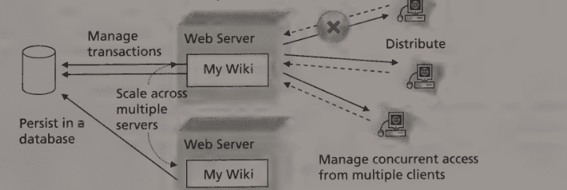


本节中提到的所有问题都常见于 Web 应用，并且全部都很难、繁琐且耗费成本地从头编程。因此，如果我们能够重用一套现有的工具来提供所有这些服务，将我们从编写代码中解放出来以解决特定的业务问题，这将非常有用。Web 应用开发语言及其支持工具的作用就是为所有这些服务提供这样的框架。然而，Web 应用无法孤立工作，因为它们依赖于互联网和万维网的基本技术。在下一节中，我们将解释这些技术中最重要的一些特征。

## 1.2 E-一切 – 互联网和万维网

Web 应用依赖互联网和万维网才能工作，一个需要牢记的重要点是互联网和万维网并不是同一回事，因为互联网的第一个版本比万维网早了十多年。互联网是由 ARPAnet 发展而来的网络互联网络，该项目始于 1970 年代。其名称来源于其赞助方美国政府高级研究计划署（ARPA）。它最初将少数研究站点连接在一起，但使用了现在支持更大互联网的相同核心技术。相比之下，万维网（简称 web 或 WWW）是可通过互联网访问的基于超文本的多媒体信息集合，诞生于 1990 年代（超文本意味着网页内容相互链接，使得我们可以轻松地在物理上位于世界任何地方的网页之间导航）。或许我们可以说，互联网是信息高速公路，而万维网就是其上行驶的交通。

如今已成为万维网的东西，最早由 Tim Berners-Lee 于 1990 年在 CERN 开发（CERN 最初是法语 Conseil Européen pour la Recherche Nucléaire 的缩写，英文更通用的说法是欧洲核子研究组织）。它最初是用于在 CERN 管理信息的分布式超文本系统（基于之前的超文本研究），但很快发展成为更庞大的事物。从旨在帮助研究人员的学术工具演变而来，它既成为休闲应用的重要平台，也是商业的关键要素，不仅适用于专门基于网络的点 com 公司，也成为大型企业、政府和其他组织 IT 战略的一部分。

从内部研究工具，Web 很快开始演变为更大、更重要的事物。1991 年至 1993 年间，Web 服务器开始在 CERN 之外上线，使用互联网的底层技术。CERN 将 Web 技术免费开放，以便其他人能够在此基础上构建系统。最初，Web 上的通信基于文本，因此用户友好性不强。第一个图形化 Web 浏览器（能够显示 Web 内容的应用）由 Tim Berners-Lee 于 1991 年编写，但这仅限于 CERN 内部使用。然而，其他图形浏览器很快被开发出来，1993 年，NCSA（国家超级计算应用中心）发布了其 Mosaic 图形浏览器供公众使用。随后不久出现了第一批商业浏览器版本，Netscape Navigator 和 Microsoft Internet Explorer，随后几年又加入了许多更复杂的浏览器，包括 Opera、Mozilla Firefox 和 Safari。

图形浏览器能够显示图像和多种文本字体，使得访问万维网变得简单且有吸引力，并将潜在用户群从仅限技术专家扩展到普通公众。Web 开始获得媒体报道并触及更广泛的受众，1994 年成立了万维网联盟（W3C），以创建 Web 标准并确保 Web 技术的 proliferate 不会导致不同系统之间不兼容。1993 年，使用 NCSA 开发的通用网关接口（CGI）创建了用于在服务器上编写动态网页的第一个工具。这些工具使得网页能够在服务器上即时生成。与仅向用户提供静态内容、所有人看到相同页面不同，CGI 使得可以为个人用户生成页面，以便他们可以看到自己的搜索结果、银行账户详情、航班预订、购物车等。随后出现了其他服务器端技术，包括 PHP（最初为 Personal Home Page Tools，后更名为 PHP：Hypertext Preprocessor）、Java 和 Microsoft 的 .NET，使得能够开发在 Web 上运行的工业级应用。1995 年，Sun Microsystems 发布了首个 Java 感知浏览器 HotJava，Netscape 引入了 JavaScript 的第一个版本，带来了可在浏览器内部运行应用的潜力。随着浏览器和服务器技术不断发展，“网页冲浪”、“上线”和“电子商务”等术语进入了日常用语，此后一切再也不一样了。

## 1.3 重要的互联网技术

万维网依赖于一些重要的互联网技术才能工作。这些包括：

- TCP/IP（传输控制协议/互联网协议）
- IP 地址
- 域名

### TCP/IP（传输控制协议/互联网协议）

TCP/IP 实际上是一整套相关的协议和工具，帮助计算机相互通信。互联网上使用的一些协议包括用于发送电子邮件的 SMTP（简单邮件传输协议）和 FTP（文件传输协议），它允许文件轻松地从远程站点复制到本地或反之。

### IP 地址

互联网上的计算机最初连接到某种本地网络，无论是在组织内部还是作为互联网服务提供商（ISP）的服务的一部分。为了将所有这些独立系统构建成一个整体，使用称为路由器的硬件设备将所有不同网络粘合在一起。为此，互联网上的每台机器都必须具有唯一的 IP（互联网协议）地址，以便通信能够路由到正确的计算机。IP 地址是一个 32 位二进制数，提供数十亿种可能的组合，尽管最新的格式称为 IPv6（IP 第 6 版 – 之前的版本实际上是第 4 版 IPv4），通过使用 128 位二进制数提供了更多组合。

IP 地址以四组点分十进制数字表示，格式为 nnn.nnn.nnn.nnn。其中每个数字的范围为 0–255，例如，127.0.0.1。

| 注 | IPv6 地址以冒号分隔的八个 4 位十六进制数字书写。 |
|---|---|

给定一个 IP 地址，一台机器可以像在同一物理网络上一样连接到另一台机器。一些机器具有固定的 IP 地址，而另一些机器在连接时临时从池中分配一个 IP 地址，这种技术称为 DHCP（动态主机配置协议）。这种 IP 地址池化在不同时间对不同机器重复使用同一地址方面更有效。它还减少了确保每台机器具有适当地址所需的管理工作，特别是对于必须为大量计算机提供互联网访问的系统，例如商业 ISP。

### 域名

大多数托管网站的计算机使用域名而不是实际的 IP 地址。这意味着用户例如可以访问 www.w3.org 而不是使用万维网联盟站点的实际 IP 地址。域名系统（DNS）使域名能够转换为有效的 IP 地址。解析程序查询名称服务器以获取 IP 地址，并使客户端能够路由到实际的主机机器。DNS 由多个专用服务器组成（分布式数据库），维护不同区域的命名信息。区域是一组相关的域名，如 '.com'、'.org' 等，它们出现在 DNS 的同一级别，DNS 具有树状结构（见图 1.2）。

特定域出现在特定区域中，例如 W3C 域位于 'org' 区域内（w3.org）。最高级别的区域称为 '根域'，其下是包含所有顶级域的区域，包括国家代码域。对于每个国家，都有一个区域包含该国内的各种类型的域，使用如 'co' 表示公司、'ac' 表示学术机构等区域。由于这种树状结构，各层区域分别管理，解析单个域名请求可能涉及多个不同的名称服务器。域名由互联网号码分配机构（IANA）控制，该机构由互联网名称与数字地址分配机构（ICANN）管理。这些组织提供的域名类型数量稳步增加

图 1.2 具有部分互联网区域和域的 DNS 树结构


多年来，随着新型网站的开发，例如用于电视服务的 '.tv' 域名和用于移动服务的 '.mobi'。

使用域名比仅使用 IP 地址更好，因为域名更容易记住，而且名称通常反映所有者的身份（例如，‘ibm.com’、‘w3.org’、‘harvard.edu’）。使用 DNS 名称而不是 IP 号码也更灵活，因为域名与 IP 地址之间的映射可能会发生变化，因此同一个名称可以在不同的主机系统之间迁移。域名对电子邮件也很重要，因为它们用于电子邮件地址（例如，web-human@w3.org）。

## 1.4 重要的万维网技术

单独来看，互联网提供了全球不同计算机相互连接并传输数据的可能性。然而，万维网在互联网的基础平台上增加了一些非常重要的技术。其中包括：

- 超文本传输协议 (HTTP)
- HTML
- URL、URI 和 URN

### 超文本传输协议 (HTTP)

万维网使用 *超文本传输协议* (HTTP) 来发送信息。使用该协议时，域名（或 IP 地址）前面加上 ‘http://’（例如，http://www.webhomecover.com）。网络浏览器通常将 ‘http://’ 作为其默认协议，因此在网站名称中经常省略此前缀。HTTP 是一种 *请求-响应* 协议。客户端（通常是浏览器软件）向 Web 服务器发送请求，Web 服务器是能够托管基于 Web 的内容并根据请求将其提供给客户端的软件。服务器处理传入的请求并提供响应，通常以用超文本标记语言 (HTML) 编写的页面的形式呈现，浏览器可以解释该页面。HTTP 请求默认在服务器的 80 端口上处理。服务器端口是用于标识服务器上另一个系统可以连接到的特定进程的数字。许多常见服务，包括 HTTP，都分配了标准端口号以简化通信。

HTTP 请求始终是特定类型；GET、POST、HEAD、PUT、DELETE、CONNECT、OPTIONS 或 TRACE。所有这些请求类型都有其用途，但在大多数 Web 应用程序中，请求通常仅限于 GET 或 POST。在大多数情况下，这两种请求都可用于实现相同的结果。GET 请求旨在从服务器检索信息，通常包含搜索查询或其他参数数据。POST 请求旨在将数据发送到服务器，通常来自 HTML 表单。表单是网页的一部分，允许用户使用文本字段、选择列表和单选按钮等组件提供数据。表单具有 ‘action’，其中包含运行在服务器上的应用程序的网络地址，该应用程序知道如何处理表单的内容。当用户按下网页上的 ‘submit’ 按钮时，数据将被发送到此处。

响应 HTTP 请求后从服务器返回的是 HTTP 响应，在许多情况下它将是一个网页，但也可以是某种代码编号以

## 1.5 特殊类型的 Web 应用程序

网络上充斥着公共网站，它们使用网页向任何能够使用浏览器连接万维网的人提供信息。还有大量企业对客户 (B2C) 网站，使任何拥有互联网连接和网络浏览器的人都可以使用产品和服务。然而，还有一些具有特定特征的特殊用途 Web 应用程序。其中三个重要例子是内联网、外联网和门户。

### 内联网

除了在互联网上拥有公共存在外，许多组织还在安全防火墙后面维护一个私有的 *内联网*。内联网由仅在组织内部可用的网页和其他资源组成。内联网的拥有成本低，因为它们使用互联网的标准技术。它们在减少内部电话簿、软件和程序手册、表格等纸张使用的同时提高了内部沟通。它们以每个人都可以在桌面上使用的形式从中央数据库中获取信息。内联网已被证明对各种组织都有价值，例如，信用卡公司与许多银行合作，内联网可作为有关所有这些银行信息的中央存储库，而制药公司已使用内联网从世界各地的许多来源获取有关药物试验和所有国家新药提交法规的信息。

### 外联网

*外联网* 介于互联网和组织的内联网之间。只有选定的外部人员，例如客户、供应商或其他贸易伙伴，才被允许访问外联网。外联网的范围从高度安全的企业对企业 (B2B) 系统到用于下载评估软件的自助注册系统。外联网可用于例如允许网上购物客户通过安全连接登录以检查订单状态，或快递公司用户随时检查其交付情况。

### 门户

*门户* 是一种特殊的 Web 应用程序。其作用是充当进入多个其他应用程序的网关（‘portal’ 的含义）。门户的结构通常是展示多个 *微件*，这些微件是进入其他应用程序的基于窗口的链接。它们通常还提供个性化功能，以便用户可以自定义呈现给他们的微件，并更改门户的布局、外观和感觉。门户通常由鼓励用户注册的公共网站使用，例如 Yahoo。它们也经常被组织用作进入公司内联网提供的各种应用程序的途径。在移动环境中，门户是移动服务提供商实现移动互联网轻松访问的流行方式。Vodafone Live! 等移动门户提供对移动网络运营商提供的服务“围墙花园”内的各种应用程序的链接，以及更通用的移动互联网访问。

## 1.6 Web 应用程序架构

要了解 Web 应用程序如何通过网络向客户端提供服务，有必要对分布式计算机系统的架构有一定的了解。在本节中，我们介绍层和层级概念。

### 层

分层架构的概念是指我们将软件系统的不同部分视为具有不同且独立的角色。这是一种概念上的，而非必然是物理上的系统组件分层。基本的三层是表示层（处理用户界面）、业务逻辑层（处理应用程序中使用的业务流程和概念）和数据管理层（处理系统中底层数据的管理和持久化）。

如果你思考这种模型如何与例如在桌面计算机上以‘独立’方式运行的文字处理器类型相关（见图 1.4），你可以看到文字处理程序的某些部分处理表示，即我们在屏幕上如何看到文档。这可能相当复杂，并允许同一文档的多种不同视图，例如编辑视图和打印预览。在此层后面是业务逻辑层，其中包含创建和编辑文档时需要执行的所有流程，例如拼写检查、格式设置、分页、编辑等。该层还包含我们在应用程序中处理的主要概念，例如文档、段落、单词、字母、图表等。最后，在此层之下是数据管理层。该层的工作是使我们的文档能够保存和重新加载，可能以简单的平面（顺序）文件形式，以便它们可以在文字处理程序的不同运行之间保持持久。

### 图 1.4 文字处理系统的概念层

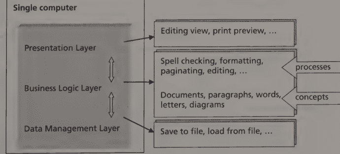


需要注意的是，我们的分层文字处理示例假设所有三个层都将在一台计算机上运行的单个程序中实现。换句话说，这些层是概念上的，而非物理上的。

## 层级与分布式系统

当我们谈论层级时，我们也在谈论层。然而不同之处在于，术语‘tiers’通常用来表示物理上分离的设备。因此，多层级系统是指部署在多个不同节点（计算机）上的系统。使用多个层级在我们希望使应用程序分布式且可扩展时是必要的。例如，在基于 Web 的银行系统中，表示层，即 Web 浏览器，会分布在所有用户的计算机上，但应用层则会在银行的某处中央计算机或多台计算机上运行。该层级将管理诸如查询账户、转账、订购支票簿等业务流程。该层中还包括账户、客户、交易和对账单等业务对象。为了应对大量用户并协助安全，数据管理层也将在单独的机器（可能有几台）上运行。对于这种复杂的大规模数据存储，而不是使用简单的平面文件，我们将使用数据库管理系统来执行数据的四个基本操作，即创建、读取、更新和删除（简称为 CRUD）。一旦我们开始使用大量计算机在多个层级上运行系统的不同部分，我们就拥有了 n 层架构（见图 1.5）。n 层架构是 Web 应用的基础部分，因为表示层（在 Web 浏览器中运行）总是广泛分布的，而某些系统的用户数量众多意味着业务逻辑和数据管理层也可能需要在多台机器上分布。

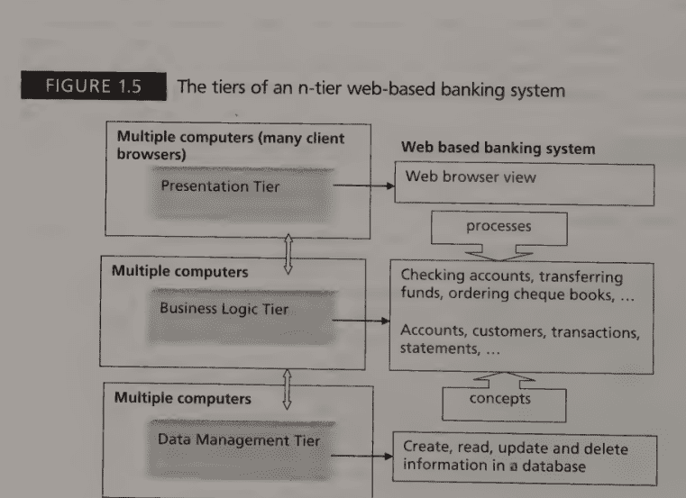

## 1.7 Web 2.0 与 Ajax

自 2000 年代中期以来，讨论万维网而不提及 Web 2.0 和 Ajax 已变得困难。Web 2.0 是一个自 2004 年首次 Web 2.0 大会以来被广泛使用的术语。虽然它可能被归类为一个伞形营销术语，而非特定技术或架构，但一些作者，尤其是（O’Reilly 2005），通过一套已发表的原则、实践和模式为其提供了一些具体规范。许多讨论 Web 2.0 的出版物都关注丰富的用户界面，特别是异步 JavaScript 和 XML（Ajax）的使用，但 Web 2.0 的思想超越了 Ajax，包含了关于现代 Web 应用应如何开发的广泛思想。Web 2.0 背后的关键思想或许可以概括为：

-   Web 作为软件平台
-   面向服务的架构
-   用户与贡献者社区

在本节中，我们简要探讨其中一些思想，这些思想将在本书的各个部分再次出现。最重要的是，*可扩展标记语言* (XML) 的作用，它是面向服务架构的基础，可以被视为 Web 2.0 许多方面的一个重要组成部分。

### Web 作为软件平台

过去，应用程序构建所基于的软件平台是特定的计算机操作系统，例如 Microsoft Windows 或 Linux。相比之下，Web 应用程序能够跨越多个操作系统，因为 Web 浏览器可以不论页面从哪个系统下载都能渲染相同的内容。服务器可能运行在一个操作系统上，而其客户端运行在许多其他操作系统上。一个关键的 Web 2.0 模式是 *单一设备之上的软件*，它关乎应用程序如何跨越不同类型的设备，从 Web 服务器到台式 PC 到移动电话到便携式媒体播放器。例如，为了下载音乐，我们可能会使用 PC 连接到 Web 服务器并将移动设备连接到 PC，所有这些都使用单个应用程序。在这种情况下，整个应用程序运行的平台是 Web，而不仅仅是单个设备。

### 面向服务的架构

在 Web 早期的日子里，关注点在于正在使用的应用程序。例如，‘浏览器大战’，主要在 1990 年代中期 Netscape 和 Microsoft 之间，是关于使用哪个应用程序访问 Web。最近，关注点更多地放在通过 Web 可用的底层内容上，而非使用的特定应用程序。这种内容是通过各种形式的 *Web 服务* 提供的。Web 服务是使用可扩展标记语言 (XML) 通过 Web 提供的数据源。通过组合多个 Web 服务构建的系统被称为 *面向服务的架构* (SOA)。可通过 Web 服务访问的内容示例包括新闻、天气、地图数据和书籍信息。一些作者使用 *可编程网络* 一词来描述构建利用来自多个基于 Web 的资源的内容的应用程序的能力，使用可自由获得的应用程序编程接口 (APIs) 来创建 *混搭*。在 Web 术语中，混搭是一个将不同来源的内容混合在一起的应用程序。一些混搭将来自多个不同服务的内容组合起来以生成整体应用程序，而其他混搭使用单一服务但重新组织内容以满足其需求。

Web 服务的一个简单示例是 RSS（一个有多个来源的缩写：Really Simple Syndication、Rich Site Summary 和 RDF Site Summary），它使用 XML 提供新闻和天气等频繁更新信息的订阅源。

### 用户与贡献者社区

传统软件构建是关于为特定目的构建自包含的应用程序，例如处理公司工资单或管理公司账户。这类应用程序通常 intended for ‘内部’使用，尽管它可能向客户公开某些功能。例如，银行使用的软件主要在内部使用，但可能会公开一些基于 Web 的服务，使客户能够对其账户执行某些交易。在许多 Web 2.0 应用程序中，与这种集中控制不同，应用程序是关于参与应用程序本身的用户社区的一个很好的例子是 Wikipedia，一个任何人都可以创建或编辑条目的在线百科全书。其他应用程序可能主要由单个组织提供内容，但允许用户做出一定贡献。一个例子是音乐下载网站，允许用户发布自己的评论。当然，并非每个系统都适合向用户社区开放 Web 应用程序的贡献，但软件开发方法的某些方面可以纳入许多不同类型的 Web 应用程序中。

### Ajax

异步 JavaScript 和 XML（Ajax）一词由 Garrett（2005）在关于 Web 开发当前趋势的文章中提出。JavaScript 是一种可在浏览器内运行的编程语言，使得在查看页面时运行连接到服务器的程序成为可能。我们将在本书后面更详细地介绍 Ajax，但它与 Web 2.0 的关系主要在于在浏览器环境中提供丰富的用户体验。最简单地说，Ajax 使能够使用从服务器读取的数据更新网页的某些部分，而无需刷新整个页面，使用户体验更像使用传统的桌面应用程序而不是浏览网站。开发 Ajax 应用程序的工具很多，其中一些非常复杂。然而，使用几行 JavaScript 代码就可以在 Web 应用程序中包含一些简单的 Ajax。

## 1.8 那么你想成为一名 Web 应用程序开发人员吗？

开发人员在构建 Web 应用程序时面临许多挑战。有关于技术选择的决策，有关于架构的选择，有关于设计的选择，也有关于实现的选择。在决定如何构建 Web 应用程序时，总是存在权衡和取舍，我们必须意识到做出某些选择的原因及其后果。幸运的是，还有许多工具、技术和可重用的设计（设计模式）可以帮助我们应对这些挑战。本书的目的是探讨现代 Web 应用程序开发中的一些重要问题，并提供一些我们可能采取的解决方案的示例，尽可能避免本周技术的炒作，同时充分利用我们可以从他人那里学到的经验，并充分发挥现有技术的优势。


## 练习

**1.1** 在**图1.2**中，我们看到了域名系统中的一些顶级域。通过使用网络搜索查找其中一些域，并找出例如‘int’域由哪些类型的组织使用。查找图表中未包含的其他顶级域。在网络搜索中，你会发现 ICANN 和 IANA 网站很有用（http://www.icann.org 和 http://www.iana.org）。

**1.2** 在我们的分层架构示例中，我们提到了在单台机器上运行的字处理器。我们以基于网络的银行系统为例，将其与分层与多层架构进行了比较。然而，基于网络的字处理器正变得越来越流行。进行互联网搜索，找一些在网页上工作的字处理器的例子。根据它们的描述，你认为字处理示例中的各层将如何应用于基于网页的字处理器的各层？在回答这个问题时，花一些时间使用这些基于网页的字处理器之一可能会有所帮助。

**1.3** 查看维基百科网站（http://www.wikipedia.org）。要在这个在线百科全书中添加或修改条目，你必须遵循哪些流程？过去，维基百科上的一些条目曾出现过一些有争议的问题。看看你是否能通过网络搜索找到这些问题的相关资料，并了解在管理该网站时需要做出哪些政策变更。

**1.4** 在网络上找到一个受欢迎的博客。描述该博客的作者和内容。你认为这个博客为什么受欢迎？

**1.5** 门户网站的一个常见特点是它们可以个性化。找到一个你可以个性化的基于网络的门户网站（例如 http://www.yahoo.com）。列出你可以在该网站上个性化的内容列表。

**1.6** Ajax 如何使用服务器上的数据更新当前页面的一个简单示例是 Google Suggest。进入 Google Suggest 主页（你可以通过网络搜索找到它），开始输入一个搜索词。随着你的输入，系统会建议可能的相关搜索。

## 总结

在本章中，我们介绍了 Web 应用的主要特性、技术和用途。这些内容涵盖了互联网和万维网的各个方面、Web 应用所使用的分布式架构以及一些特殊类型的 Web 应用。表1.1总结了本章介绍的各种缩写词和简写术语及其定义。

## 表1.1 本章介绍的术语

| 缩写/术语 | 含义 |
|---|---|
| Ajax | 异步 JavaScript 和 XML |
| API | 应用程序编程接口 |
| ARPA | 高级研究计划局（ARPANet 的创立者） |
| B2B | 企业对企业 |
| 博客 | 网络日志；一种面向公众访问的基于网络的日记 |
| CERN | 欧洲核子研究中心（法语：Conseil Européen pour la Recherche Nucléaire，英语中通常称为 European Organisation for Nuclear Research） |
| CGI | 通用网关接口 |
| CRUD | 创建、读取、更新、删除 |
| DHCP | 动态主机配置协议 |
| DNS | 域名系统 |
| FTP | 文件传输协议 |
| HTML | 超文本标记语言 |
| HTTP | 超文本传输协议 |
| IANA | 互联网号码分配局 |
| ICANN | 互联网名称与数字地址分配机构 |
| IPv4 | 互联网协议版本4 |
| IPv6 | 互联网协议版本6 |
| ISP | 互联网服务提供商 |
| NCSA | 国家超级计算应用中心 |
| PHP | 最初为“个人主页工具”，后更名为 PHP：超文本预处理器 |
| PKI | 公钥基础设施 |
| RSS | 简易信息聚合（Really Simple Syndication、Rich Site Summary 或 RDF Site Summary） |
| SMTP | 简单邮件传输协议 |
| SOA | 面向服务的架构 |
| SSL | 安全套接层 |
| TCP/IP | 传输控制协议/网际协议 |
| URI | 统一资源标识符 |
| URL | 统一资源定位符 |
| URN | 统一资源名称 |
| W3C | 万维网联盟 |
| 维基 | WikiWikiWeb；一个开放供公众贡献和编辑的网站 |
| WWW 或 W3 | 万维网 |
| XML | 可扩展标记语言 |

## 参考文献和进一步阅读

Garrett, J.J. (2005) *Ajax：一种 Web 应用的新方法.* http://www.adaptivepath.com/publications/essays/archives/000385.php

O'Reilly, T. (2005) *什么是 Web 2.0：下一代软件的设计模式与商业模式.* O'Reilly Network, http://www.oreilly.com/pub/a/oreilly/tim/news/2005/09/30/what-is-web-20.html

## Web 应用需求：分析与设计

### 学习目标

- 理解分析 Web 应用系统需求时使用的一些技术
- 能够使用 UML 中与 Web 应用相关的一些表示法
- 理解 Web 应用开发生命周期中涉及的一些流程方面
- 能够将一些常见的设计模式应用于网页的结构

### 引言

在本章中，我们探讨一些用于分析 Web 应用需求的技术。所使用的一些表示法来自统一建模语言（UML），并带有一些为满足网页设计特殊需求而开发的扩展。还有一些非正式图表并非来自任何特定的表示法。该过程基于统一过程（UP）的某些方面，但采用了一种轻量级的“敏捷”方法。在本章结尾，我们讨论了与系统设计相关的一些考虑因素，并描述了一些 Web 可用性模式。

### 2.1 Web 应用需求有何不同？

Web 应用的开发在许多方面与任何其他软件系统的开发相似。我们必须找出用户的需求，选择合适的软件架构，设计并构建整体框架，创建所有必要的组件，同时不断根据技术和用户期望测试不断演进的系统，并适应不断变化的需求和情况。然而，在某些方面，Web 应用有其特殊的需求。也许最明显的是 Web 应用具有一种特殊的用户界面。它们的呈现可能通过多种不同类型的设备进行，从台式计算机到手机，而这种呈现基于某种在浏览器中运行的网页。此外，与许多软件系统不同，Web 应用通常要服务于数量非常庞大的匿名用户，这些用户可能位于世界任何地方。这意味着我们的设计必须考虑到数据通信和多个访问同一资源的问题。其底层通信协议基于请求-响应模型，即应用位于远离用户的系统上，用户的设备必须向应用发出请求，由应用代为执行活动。这与桌面应用形成对比，桌面应用可能具有更丰富、更具交互性和即时性的界面。在构建此类系统时，我们还必须时刻意识到，我们应用的一部分将在中央服务器上运行，而另一部分将在许多不同的客户端设备上运行。所有这些差异（以及更多）意味着我们必须扩展对分析和设计的理解，以应对 Web 应用的所有特殊关注点。

### 2.2 软件开发生命周期

虽然我们已经说过 Web 应用有一些特殊需求，但我们采用的任何开发方法都需要在项目生命周期（项目开始与结束之间发生的过程和事件）中提供四项服务来支持我们：

- 它需要引导我们完成各项活动。
- 它需要指定在系统开发过程中应创建的制品（如文档、图表和软件组件）。
- 它应该指导参与项目的个人和团队的任务。
- 它应该提供适当的衡量和监控进度与产出的标准。

为了实现这些目标，它需要帮助系统开发人员了解他们的角色、活动和工作流程，以及他们需要创建的最终软件产品。这些特性的定义方式不必过于规定性，尤其是对于小型项目。从 1990 年代起使用的许多软件开发方法都强调敏捷性，这在许多情况下意味着通过在尽可能简单的工作流程中执行活动来生成尽可能简单的制品。尽管如此，当前大多数软件开发方法都使用迭代的概念，迭代已逐渐取代了基于瀑布模型的较旧方法。

### 瀑布模型

早期开发软件系统的方法往往遵循传统的工程方法，即一个系统必须先收集完所有需求才能进行分析，在完全分析后才能进行设计，在充分设计后才能实现，只有到那时才能进行测试。这就是所谓的瀑布模型，因为开发过程可以看作是一系列按固定顺序发生的独立阶段（见图2.1）。其中存在相邻阶段之间某种反馈的概念，例如，我们可能会根据实现情况重新审视设计的某些方面，或者在代码未通过测试时重写代码，但没有能力应对不断变化的需求或在项目生命周期早期开始测试的概念。


这种方法在许多工程环境中可能效果不错，但对于大多数软件项目来说并不那么有效。这是因为软件的需求往往更加流动和动态，会随着应用环境的变化而不断调整。为了应对这种更为灵活的设计过程，迭代方法应运而生。

## 迭代方法

迭代方法就像一系列小型的瀑布式流程：我们收集需求、分析、设计、构建和测试系统的一部分，对其进行反思，根据经验调整计划，然后重复这一过程多次，直到项目完成（见图2.2）。因此，在瀑布模型的任何给定点上，反馈回路

## 图2.1 瀑布模型

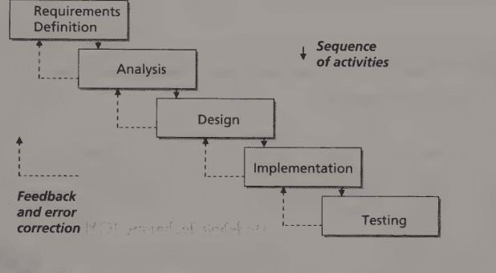

## 图2.2 迭代模型

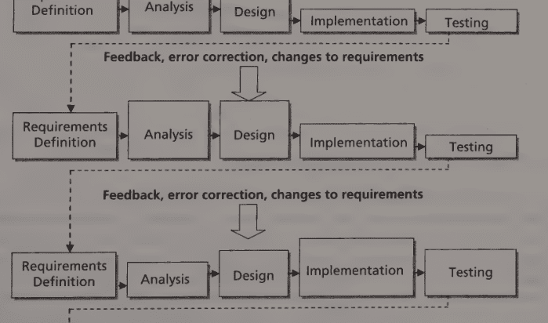

## 初始阶段

在初始阶段，我们探索一个项目到足够的程度，以了解其是否可行。这意味着要收集初始需求，调查相关技术问题，并在必要时构建软件原型作为概念验证。在此阶段，可能会研究新技术和框架，以评估它们是否适合当前项目。在初始阶段结束时，我们应有足够的信息来知道整个项目是否具有现实的成功机会，并且还应有整个项目的初步计划，包括总预算和总体时间框架。UP的规程表明，在此阶段我们还必须建立开发环境和流程来管理软件配置和变更。对于一个简单的项目，或者一个熟悉领域的项目，这个阶段可能只需要一次迭代。对于大型项目或涉及大量新技术和工具的项目，则需要更多迭代。在每次迭代结束时，应达到一个特定的里程碑并产生一个有意义的可交付成果。例如，初始阶段的一次迭代可能需要交付一个使用特定代码框架、应用服务器和数据库的可操作概念验证，以及项目计划和预算。实验性的概念验证原型有时被称为“尖峰”（spikes）（Cockburn 2005）。

## 细化阶段

在许多方面，这是最重要的阶段，因为它证明了所选软件架构的可行性（或不可行性）。细化阶段最重要的可交付成果是一个可执行架构，我们可以将其类比为一座建筑的地基和承重结构（框架）。虽然与完成所有外墙、内墙和装修所需的时间和人力相比，奠基和搭建钢结构骨架可能需要的人力和时间更少，但这是更关键的阶段。地基和框架需要能够支撑所有后续工作，否则建筑会倒塌，就像过去许多软件项目一样。在软件项目中，可执行架构必须为所有后续开发提供合适的基础和框架，因此它必须满足项目最重要的需求，并解决其关键风险因素。例如，如果项目在性能方面有特定要求，例如应支持的并发用户数，那么可执行架构就应证明它能够实现这一要求。因此，负载测试等实践在细化阶段很重要。虽然可执行架构可以被视为基于原型，但它是架构原型，这意味着它要在投入生产之前不断被精炼。这与通常在初始阶段开发并在证明或测试替代方案的作用完成后就被丢弃的概念验证原型不同。可执行架构不是一个“尖峰”，而是一个“行走的骨架”，是将在系统整个生命周期中持续存在的框架的开端（Cockburn 2005）。由于该阶段的重要性，可能有多次迭代。

## 构建阶段

在此阶段，所有必要的组件都被添加到现有的可执行架构中。这就像为建筑添加外墙、内墙和装修。在此阶段，由于新的或变化的需求，可执行架构可能会有一些小的改动，但其核心功能应是稳定的。然而，对于我们在框架内开发的组件，我们应该能够非常灵活。在构建阶段结束时，我们应该拥有一个完整的软件

### 2.4 Web 应用的初始阶段

在本章的其余部分，我们将讨论初始阶段可能适合的一些活动。以图2.3中的图表作为粗略指南（同时承认这仅仅是为了给出该过程的一般印象，而不表示其他任何含义），我们可以预期该阶段会包括一些初步的分析和设计，以及业务建模和需求收集。事实上，我们可以将本书的大部分内容视为描述适合初始阶段的活动，因为我们将探索对您来说可能是新的技术，并演示一些简单的概念验证代码。如图2.3所示，我们将进行一些编码、一些测试以及对软件环境的相当多的探索。本书中的应用程序代码没有一个是足够复杂到可以被视为工业级架构原型的；事实上，它可被视为一系列“尖峰”。然而，它应提供足够的材料来构建一个更具可扩展性的框架。总之，它可以构建成一个可被视为进一步开发的“行走的骨架”。

我们在本章其余部分中逐步完成的示例意在让你了解初始业务建模和分析过程如何是一种调查和发现的过程，即我们根据经验和实验不断修正最初的假设。因此，您将看到我们展示的不是最初就完美的东西；相反，我们展示的只是一个起点，随着我们进一步探索需求并利用各种分析工具和技术，我们会不断完善它。软件开发本质上是一项团队工作，个人技能和关系至关重要，这一点很难用书本形式来复制。因此，您应将以下示例视为通过协商和讨论过程演变的产物，而不是只有一个“正确答案”。每个软件问题都有许多可能的解决方案，每个方案都有自己的优缺点。还有一件事是肯定的：每个真实的软件项目都比乍看起来要复杂得多。

### 2.5 需求建模

开发任何 Web 应用的第一步必须确立业务目标（这是 UP 业务建模规程的一部分）。在 20 世纪 90 年代的“互联网泡沫”时期，曾有一段时候，开发基于 Web 的系统时除了“别人都有网站，所以我们也需要一个”之外，对业务目标几乎没有什么现实的认识。时代已经改变，如今人们更关注投资回报（ROI）等方面。讨论业务目标的一个很好的重点是就应用的使命声明达成一致，它简洁地总结了这项活动的意义。

在本书中，我们使用一个基于家庭保险 Web 应用的简化案例研究。这是一个虚构的场景，我们将对其进行分析和设计：

> > *Web Home Cover* 是一家新成立的企业，旨在通过 Web 提供家庭保险。其商业案例基于提供完全在线的服务，因此在保险公司所需的初始资本投资方面非常高效。由于该公司仅通过 Web 运营，它必须有一个能够满足所有客户和员工需求的 Web 应用。该应用还必须编写成能尽可能多地支持各种 Web 客户端，从台式计算机到移动设备。


这可能是该项目的使命宣言：

> *将家庭保险服务带到网络的每一个角落*

这是我们家庭保险 Web 应用商业案例的精髓。它简洁明了。冗长的“流行语宾果”短语最好不要出现在使命宣言中。

## Web 应用需求收集

我们在着手构建基于 Web 的解决方案的道路上必须采取的第一步，是识别拟议系统的高级需求（或业务目标）。这在许多情况下相当困难，因为我们可能不知道实际用户会是谁。如果 Web 应用是面向公司内部网的（仅在组织内部使用的应用），那么找到系统的潜在用户就会相当容易。然而，如果我们要推出一个电子商务网站，那么我们的应用面向的就是网络空间中一个 largely 未知的庞大用户群。那么，我们如何才能确定他们的需求可能是什么呢？我们可以采取多种方法。一种常见的方法是使用焦点小组，其中一小部分代表我们可能用户群的人会被召集起来，在有结构且受控的情境下，使用样本材料回答问题并提供意见。另一种方法是让市场营销人员扮演可能用户的角色并代表他们的需求，据推测是因为他们的工作就是告诉人们他们想要什么。在任何情况下，我们都需要制定一套用户画像，以便让我们了解我们试图满足的是谁的需求。这些用户画像可以是简单的 demographics 摘要（例如我们预期用户的年龄范围、性别、兴趣、平均收入等），也可以是更为复杂的“人物角色”，其中会为我们假设的典型用户开发虚构的传记。不管我们使用谁来代表实际用户，在某个时间点我们需要召集一组合适的利益相关者（那些直接或间接对系统感兴趣的人）到一个房间，让他们在一次被称为联合需求研讨会的活动中写下最初的一组需求。这不需要复杂的工具，通常使用的是翻页纸或白板和笔。与通常的头脑风暴方法不同，卡片头脑风暴可能被用来鼓励充分参与。在头脑风暴中，参与者轮流喊出他们的贡献，这对某些人来说令人沮丧，对另一些人来说令人畏惧，而在卡片头脑风暴方法中，每个人同时将各自的贡献写在单独的卡片上。所有卡片被汇总，然后由小组一起探讨。经验表明，从此类会议中可能出现的核心需求的“魔术”数量是 12 个（或多或少），不过这取决于你想要达到的详细程度。

我们现在设想 Web Home Cover 项目的需求研讨会。我们的利益相关者可能有哪些？就我们的目的而言，我们可以设想一个由首席软件开发人员、项目经理、数据库管理员、运行焦点小组的市场营销人员（手握一套用户画像）、销售经理、理赔评估员和一名保险核保员组成的团队。到所有甜甜圈都吃完的时候，墙上的翻页纸上列出了一份看起来像这样的需求清单：

- 1. 新用户应能够获取建筑物保险的即时报价。
- 2. 新用户应能够获取财产保险的即时报价。
- 3. 新用户应有选择申请两种或其中一种家庭保险的选项。
- 4. 保单持有人应能够使用安全登录检查当前保单并请求更改。
- 5. 新用户应能够使用安全登录检查其申请的状态。
- 6. 呼叫中心员工应能够使用安全登录查看和查询所有保单详情。
- 7. 核保员应能够使用安全登录访问所有等待处理的申请。
- 8. 新用户应能够立即检索之前的报价，即使他们尚未申请保单。
- 9. 网站应提供足够的信息让用户通过电子邮件、电话或书面方式联系公司。
- 10. 用户应能够从桌面和移动设备访问系统。
- 11. 保单持有人应能够就其保单提出索赔。
- 12. 系统应 24/7/365 可用，并能够处理 10,000 名并发用户。
- 13. 系统应具有心灵感应的用户界面。

关于这组需求，有几点需要注意。首先，虽然大多数是功能需求（系统应该做什么），但有些是非功能性的（系统应该如何做它所做的事情）。例如，一个功能需求是“新用户应能够获取建筑物保险的即时报价”。这是系统必须为其用户做的事情。非功能需求的例子是可以从多台设备访问系统或全天候可用。这些不是系统所做的事情，而是它提供这些功能的方式的特征。一些需求需要进一步探讨，例如最后两项有些极端，但旨在指出一些重要的考虑因素。虽然系统全天候可用可能是理想的，但我们必须考虑这样做的成本与实际需求之间的权衡。同样，该需求包含了对可能并发用户数量的乐观预测。我们都听说过一些因过于受欢迎而在为所有用户提供服务时迅速崩溃的网站。然而，dot com 时代的历史中，有更多例子是系统预计会有大量用户，但最终只有 trickle。性能、可用性和安全需求应始终通过成本效益分析仔细审视。对于每个需求，我们必须问“完美”解决方案与可接受解决方案的成本差异有多大。“心灵感应用户界面”需求来自 Dilbert 漫画，但同样有一个严肃的观点，那就是需求经常使用任意请求，例如“界面必须用户友好”，而这些实际上毫无意义。需求必须既现实又可衡量。提出系统必须通过某些可用性或可学习性指标（衡量标准）的提议会更有用。

## 优先排序需求

一旦我们有一组初始需求，我们就需要对它们进行优先排序。在迭代开发方法中这是很重要的，因为我们必须在不同的迭代中安排需求。因此，如果需求将在开发生命周期的不同时间点交付，那么我们应该先解决更重要的需求，特别是因为在过程中可能会出现新需求。如果有任何需求被此过程推到队列的后面，那么它们应该是优先级较低的需求。没有必要对所有需求进行排序。在许多情况下，四个优先级别被认为是可以接受的，有时被归类为：

- 必须有
- 应该有
- 可以有
- 想有

这种优先排序方法有时使用缩写 *MoSCoW* 来指代。

优先排序练习的一个有用方法是让参与者从不同角度分两轮为他们的需求投票，可能使用某种多重投票机制（例如每个参与者有四票）。例如，第一轮可以从客户的角度对需求进行优先排序，第二轮可以从员工的角度对需求进行优先排序。

由于在教科书的情境中投票很困难，我们必须假设我们已经执行了此练习并得出了一些结论。考虑到我们的使命宣言，似乎以下需求是“必须有”。

- 1. 新用户应能够获取建筑物保险的即时报价。
- 2. 新用户应能够获取财产保险的即时报价。
- 3. 新用户应有选择申请两种或其中一种家庭保险的选项。
- 7. 核保员应能够使用安全登录访问所有等待处理的申请。
- 10. 用户应能够从桌面和移动设备访问系统。
- 11. 保单持有人应能够就其保单提出索赔。

有了这些需求，我们就可以通过网络销售保险并尽可能覆盖更多人。

“应该有”的是什么？这些仍然是核心功能。也许以下需求属于这一类别：

- 4. 保单持有人应能够使用安全登录检查当前保单并请求更改。
- 6. 呼叫中心员工应能够使用安全登录查看和查询所有保单详情。
- 9. 网站应提供足够的信息让用户通过电子邮件、电话或书面方式联系公司。

有了这些需求，我们可以帮助留住和支持现有客户，并提供最大机会吸引新业务。

以下需求最好归类为“可以有”：

- 5. 新用户应能够使用安全登录检查其申请的状态。
- 8. 新用户应能够立即检索之前的报价，即使他们尚未申请保单。


我们可以没有这些，但它们可能会为我们的用户带来一些好处。它们可能被视为“糖”（方便但非必需）。

这些是我们最后的两个需求：

- 12. 系统应全天候 24/7/365 可用，并能够处理 10,000 个并发用户。
- 13. 系统应具有心灵感应的用户界面。

这些至少在目前必须归入“希望拥有”类别。在被认真视为优先需求之前，它们肯定还需要进一步的工作。

这项练习的意义何在？它使我们在开发系统时能够先安排重要的需求。敏捷方法会使用“故事卡片”来表示需求，每张卡片代表一个关于系统应做什么的用户故事。通过对这些卡片进行优先级排序，我们可以将它们放入不同的迭代中，最重要的放在早期迭代中。

### 2.6 分析工具 – 领域模型、用例和故事板

在本节中，我们介绍一些基本的 UML 记法，可帮助我们可视化应用程序的关键特性。即使开发项目采用不担心大量正式文档的敏捷方法，使用标准记法进行描述性草图也非常有用，可作为开发人员和用户之间的通用沟通媒介。

### 领域模型

在深入系统用例的细节之前，建立一个有用的模型是领域模型，它捕捉业务领域的关键概念。领域模型帮助我们开始以结构化的方式理解领域中各种重要概念如何相互作用。同样，我们应该在研讨会环境中开发领域模型。一些分析方法建议领域模型应逐步从用例分析中发展出来，但及早开发领域模型的优势在于它提供了一个通用词汇表，后续的分析阶段可以在此进行。这确保了例如，分析的不同线程不会最终为同一概念使用两个不同的名称，因为每个人都可以基于并增强同一个领域模型。该模型本身捕捉了几个简单的思想：

- 领域中的关键概念是什么？
- 哪些概念相互作用？
- 我们如何描述这些交互关系？
- 这些交互的基数是什么？（换句话说，哪些关系是一对一，哪些是一对多，哪些是多对多？）

我们可以开始通过识别核心需求中的名词来识别我们领域中的核心概念。从我们的目标集合中，我们可以找到 27 个名词（复数名词已

### 图 2.7 家庭保险系统的领域模型

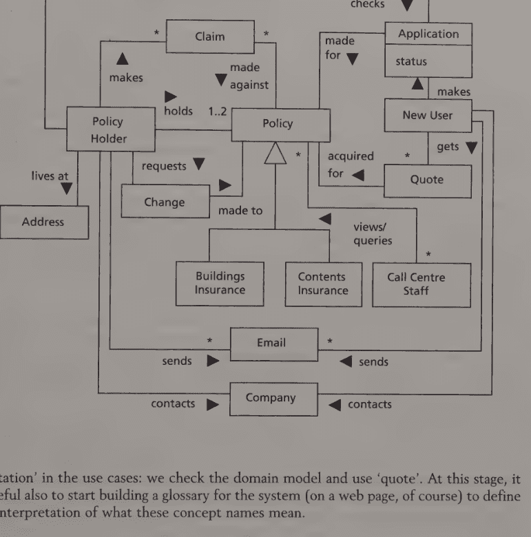

‘quotation’ 在用例中：我们检查领域模型并使用‘quote’。在此阶段，建立系统的词汇表（当然是在网页上）也很实用，以定义我们对这些概念名称含义的解释。

### 用例图

用例图非常简单。它们帮助我们展示不同类型的用户以及他们使用系统时的目标。因为它们是分析工具，所以它们不会预见任何特定类型的技术或系统将如何实际交付其需求。它们所做的只是指定这些需求是什么（以非常宽泛的方式）。图 2.8 显示了用例图中主要组件类型的记法。

正如你所见，只有三种：参与者、用例和系统边界。用例位于系统边界内，参与者位于边界外。箭头用于指示哪些参与者使用哪些用例。需要注意的是，参与者并不代表个人，而是代表人们在使用系统时可以承担的不同角色。在某些情况下，同一个人可能在不同时间承担不同的角色。

### 图 2.8 用例图记法

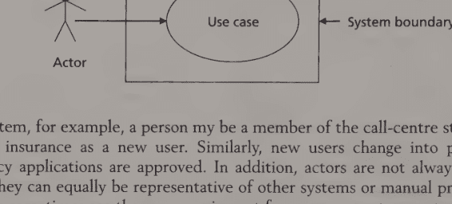

在我们的系统中，例如，一个人可能是呼叫中心员工的成员，但也可能作为新用户申请保险。同样，如果保单申请获得批准，新用户就会转变为保单持有人。此外，参与者并不总是人们承担的角色。它们同样可以代表其他系统或手动流程。因此，有时我们会看到箭头从用例指向代表外部系统的参与者。

参与者和用例描述角色和目标。每个参与者应使用描述用户角色的名词命名，而不是个人，例如‘policy holder’。每个用例应描述用户使用系统的目标，因此应使用动词短语命名（例如‘Apply for policy’）。尽管在某些情况下用例和需求之间可能存在一一对应关系，但单个用例也可能满足多个需求。你将在第 2.7 节看到此示例。

图 2.9 显示了从我们在研讨会中列出的功能需求中提取的用例图。请注意，我们从需求中取出了五个参与者：新用户、保单持有人、呼叫中心员工、理赔评估员和保险承保人。有十一个用例。请注意某些参与者与多个用例有关联。

### 用例实现

一旦我们确定了用例应该是什么，我们就必须找到某种方式来展示其内部发生的情况。这被称为用例实现。我们可以使用多种不同的记法来实现这一点，从简单的文本描述到各种图表。这里，我们介绍 UML 中的一些序列图记法以及一些非正式的故事板。由于我们正在设计一个 Web 应用程序，实现特定于参与者与基于页面的演示交互的环境。序列图捕捉用户与系统的交互，而故事板对于建模基于页面的系统很有用，因为它们提供了一种简单描述页面流程和 Web 应用程序典型的替代路径的方法。它们也可以用于非正式地描述网页的布局和内容。为了链接网页和我们的 UML 图，我们可以使用用于设计基于 Web 的系统的 UML 的 Web 应用程序扩展（WAE）（Conallen 1999）。这些是一组特殊的图标，可在 UML 模型中使用，以表示特定于 Web 应用程序的组件，例如网页。

### 用例描述

然而，在绘制图表之前，我们首先通过编写每个用例的文本描述来总结参与者与系统交互的序列。它还将捕捉发生的任何选择或迭代。这些文本描述的性质因项目而异，有些建议的格式和内容比其他更严格和复杂。我们在此建议的方法是保持简单但对每个交互进行编号。这使得更容易“插入”替代事件序列。用例描述的风格是对话式的，即它描述了一系列参与者请求和系统响应，按对出现。

作为示例，我们从‘Get buildings insurance quote’用例开始。在文本描述中，我们捕捉一些重要信息：

- 用例的名称
- 使用它的参与者
- 起始页面（这特定于 Web 应用程序）
- 用例中发生情况的简要描述。

用例名称：获取建筑保险报价

参与者：新用户

起始页面：主页

### 用例描述：

- 1. 参与者选择获取保险报价。
- 2. 系统请求参与者的个人详细信息。
- 3. 参与者输入其个人详细信息。
- 4. 系统显示可用的保险报价选择。
- 5. 参与者选择获取建筑保险报价。
- 6. 系统请求待投保建筑物的信息。
- 7. 参与者输入有关建筑物的数据。
- 8. 系统显示建筑保险报价。

### 系统序列图

现在我们有了用例的文本描述，我们可以绘制系统序列图。这以 UML 的记法显示参与者与系统之间的交互。

系统序列图的组件包括用例的参与者、他们交互的组件、标有标签的箭头显示参与者与其他组件之间传递的消息以及垂直时间轴。事实上，可以用水平时间轴绘制序列图，但这通常不被软件工具支持。参与者交互的组件类型称为边界对象，因为它存在于系统与参与者之间的边界上。边界对象通常是某种图形界面组件。在 Web 应用程序中，这将在网页上显示。边界对象的 UML 记法如图 2.10 所示。

我们的系统序列图如图 2.11 所示。

### 使用故事板设计页面和 Web 流程

如果你以前见过系统序列图，你可能会注意到图 2.11 中的图与常规有所不同，因为它指示了系统界面边界对象显示的表单和页面。在 Web 应用程序中，交互是通过一系列页面进行的，因此从参与者角度看系统是基于页面的。通过使用图 2.11 中的序列图样式，我们可以开始探索将在故事板中使用的页面及其序列。用例中出现的页面序列有时被称为 Web 流程，这只是一个使用一系列网页来实现其目标的用例工作流程。

### 图 2.10 边界对象的 UML 记法


## 图 2.11 系统顺序图

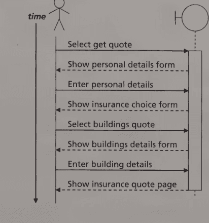

由于我们的交互是通过网页进行的 Web 应用程序，我们将在序列图中利用 UML Web 应用程序扩展中的网页图标（见图 2.12a）。网页是‘架构上重要的组件’，它们同时存在于分析模型和设计模型以及编码系统（Conallen 1999）中。页面可以用标记语言（例如 HTML）或编程语言（例如 PHP）编码。使用正式符号在软件包中创建的文档和工件中可能很有用。然而，在纸上或白板上非正式地进行分析时，使用刻板印象标签来表示网页等组件通常更容易（见图 2.12b）。使用符号还是刻板印象由你决定，符号不必完全准确。事实上，Conallen 本人在不同的出版物中使用了符号的不同版本（见（Conallen 1999）和（Conallen 2001））。

在系统顺序图中概述了用户交互后，我们可以有用地绘制故事板的初稿，表示用例期间访问的页面（见图 2.13）。对于这个初始故事板，我们仅描述页面名称、导航路径以及触发页面之间转换的事件。

由于故事板是非正式的设计工具，因此在表示法、风格甚至何时使用方面几乎没有共识。一些开发者建议可以一步创建整个网站的故事板。虽然这对于主要是静态内容的简单网站是可行的，但更动态和复杂的 Web 应用程序需要更增量的方式。因此我们建议为每个用例开发故事板的方法。最终，所有故事板可以汇总起来，总结整个 Web 应用程序的导航路径。

故事板的一个选项是使用 UML 扩展符号为客户端页面和表单定义页面类型（见图 2.14），而不是使用图 2.12 中的通用网页图标。

## 图 2.12 UML 扩展符号 a) 网页 和 b) 其刻板印象等价物

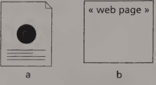

## 图 2.13 一个简单的故事板

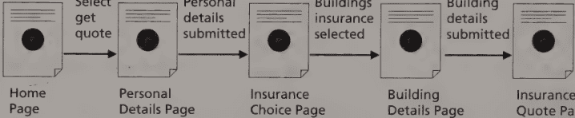

## 图 2.14 UML 扩展符号 (a) 客户端页面 和 (b) 表单

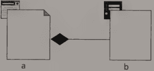

请注意，在这种表示法中，我们通常将表单图标用作客户端页面的组合组件（黑色菱形表示页面部分由表单组成）。然而，如果我们遵循一页一表单的可用性模式（Graham 2002），也称为按钮重力，因为它将重点放在每个页面上的单个‘Submit’按钮上，那么我们可以省去单独的页面图标，并使用表单图标来表示完整的表单页面。

逐页查看，我们可能会使用‘客户端页面’图标定义主页和建筑物报价页面，而其他页面则使用‘表单’图标。没有使用这些符号的要求，但它们可以帮助可视化典型的 webflow，通常从客户端页面开始，然后通过一个或多个表单页面，以‘向导’风格收集数据，最后到达显示 webflow 结果给用户的摘要页面（图 2.15）。

### 2.7 构建更多用例

到目前为止，一切顺利。我们已经为‘获取建筑物保险报价’用例编写了用例实现，并且有一个简单的故事板。由于我们正在执行分析活动，我们没有尝试考虑数据类型、页面布局、组件类型或任何

- 7a. 参与者输入有关内容的资料。
- 8a. 系统显示内容保险报价。

### 备选流程 – 两种保险类型

- 5a. 参与者选择同时获取建筑物保险报价和内容保险报价。
- 6、7、6a、7a
- 8b. 系统显示内容保险报价、建筑物保险报价和总计。

使用修改后的用例，我们需要修改后的系统顺序图。这可以在图 2.16 中看到。该图表示法中的一个重要补充是显示备选流程之间的选择。历史上 UML 在这方面一直存在一定程度的混淆和不清晰，但我们通常通过使用方括号来显示条件语句，例如 [select buildings quote OR select both quotes]。在我们的图中，我们然后使用更大的方括号来表示属于该条件块的操作集。有些更复杂的表示法，但它们与这个简单版本相比并没有增加太多价值。

除了更新的系统顺序图外，我们还有一个显示备选流程的修改后故事板。在这个版本中，我们还使用客户端页面和表单的两个图标来强调一系列用于用户输入的表单的‘向导’风格 webflow（图 2.17）。

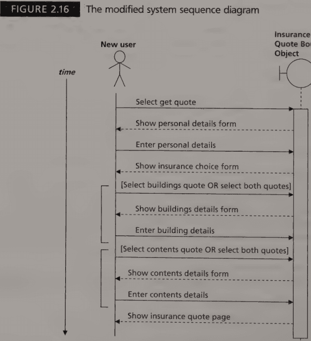

## 图 2.17 带客户端页面和表单图标的更新故事板

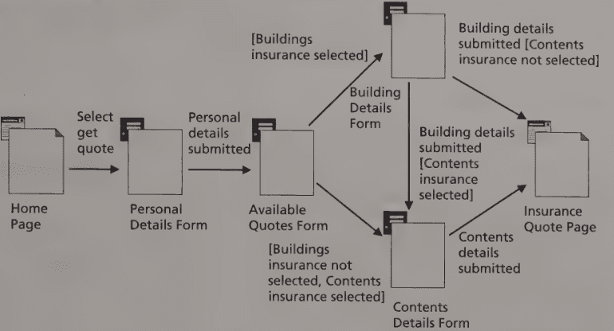

### 2.8 从分析到设计

到目前为止，我们通过探索单个用例的一些方面，触及了开发 Web 应用程序的需求收集和分析过程的关键阶段。在本章的最后一部分，我们介绍了一些与从分析到设计转变相关的概念。

在迭代过程中，从分析到设计的转移可以是无缝的，只是不断添加更多细节的问题。然而，我们在分析学科中使用的文档水平具有一个重要特征：很大程度上是非技术性的，并且可被非开发者理解。因此，像用例图和故事板这样的分析文档可以直接用于与客户和潜在用户的讨论中。随着我们进入设计阶段，我们开始远离那些容易被开发团队以外的人理解的图表，转而使用更详细的图表，这些图表清楚地反映了所选的实现工具和技术，或者，如果采用敏捷方法，则简单地将新出现的设计体现在代码本身中。

### 设计是技术感知的

需求分析是关于定义问题域并指定我们预期系统将如何从用户角度使用。从这个角度来看，它是技术无关的，这意味着我们不必了解用于解决问题所使用的技术，只需了解我们想要的解决方案的特征即可。相比之下，设计是关于我们如何规划解决方案，因此它是技术感知的。这意味着在我们了解将如何构建它之前，我们无法设计解决方案。例如，如果你被要求设计一个开罐器，你可能能够提出一个合理的设计，因为你可能已经对开罐器的工作方式有一些了解。然而，如果你被要求设计一台时光机，你可能会感到困难，因为你不熟悉时光机技术。你可以将其与

分析时光机的需求相比，后者即使在不知道设计的情况下也是完全可能的。虽然我们的类比表明分析与设计之间存在很大差距，但在迭代过程中，从分析到设计的转变是渐进的。与瀑布式开发不同，我们的设计从高层次开始，与分析并不太远，并变得更加详细。

### 架构设计

如果要成功地进行详细设计，你需要了解解决方案的技术，那么在本书的早期讨论详细设计为时尚早。随着我们学习各章节和案例研究，你将学习多种技术，一旦掌握这些技术，你就能详细设计使用它们系统的设计。然而，在这个阶段，我们的设计方法将在更高层次上，通常称为架构设计。Web 应用程序的整体架构无论实际应用领域如何都揭示了一些共同主题。这些共同主题可以封装成设计模式，使我们能够在不同系统之间重用设计特性。软件中设计模式的概念首先在 1990 年代流行起来，特别是随着（Gamma et al. 1995）的出版。这向软件社区介绍了软件设计的通用组件，经过多个应用程序的开发，可以被其他应用程序重用的思想。这些模式可以用多种方式表达，但通常包括某种图表，可以使用 UML 或更非正式的方式编写。

### 静态与动态内容

我们设计中的一个重要考虑因素是静态内容与动态内容之间的平衡，以及我们如何表示这些内容。我们的设计必须考虑应用程序中有多少部分将由静态页面表示（对每个客户端都相同），有多少必须由动态生成的内容组成。在大多数 Web 应用程序中，网站的一部分将由静态内容组成，例如 HTML、便携式文档格式（PDF）、图像、视频或其他为每个客户端提供的内容。另一方面，任何有用的 Web 应用程序几乎肯定必须包括为特定客户端即时生成的动态内容，使用某种服务器页面技术。这就是为什么在设计图表中区分不同类型的页面是有用的。

### 2.9 Webflow 设计

在本章前面，我们介绍了使用 Web 应用程序扩展符号的一些分析级图表，以显示一系列表单页面与最终客户端页面之间的依赖关系如何描述用户 webflow 的结构。虽然这种以客户端为中心的 webflow 视图在分析阶段是有帮助的，因为它帮助我们可视化客户端如何与 Web 应用程序交互，但在设计阶段我们必须同时考虑客户端和服务器。在本节中，我们介绍了一个 webflow 设计模型，描述了客户端和服务器之间的结构关系，可以支持动态内容的生成。在这些图表中，我们引入了另一个 WAE 图标，表示服务器页面（图 2.18）。

我们从一个简单的单个 HTTP 请求-响应交互模型开始，其中静态网页中的 HTML 表单将其内容提交到服务器，并动态构建客户端页面并发送回客户端。在这个第一个模型（图 2.19）中，我们假设

## 图 2.18 WAE 服务器页面图标


## 图 2.19 提交给构建客户端页面的服务器页面的静态网页上的表单

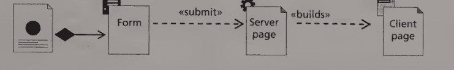

服务器页面既管理必要的业务逻辑，又生成 HTML 响应。

该模型与我们在分析阶段介绍的模型相似，但包含了服务器页面，该页面动态构建客户端页面。尽管这种依赖关系模型在单个请求-响应周期的上下文中有效，但它存在一些缺点。主要问题是我们最初假设表单是静态网页的一部分。这种静态与动态页面的混合效果并不理想。例如，如果表单不是动态生成的，那么当用户在表单中输入数据时出现错误，就无法用错误信息和之前的输入重新填充表单。这意味着如果输入的数据因某种原因无效，用户就必须从头开始。另一个严重问题是可能无法在一系列交互中维护用户的‘会话’。HTTP 是一种无状态协议，这意味着它不会在客户端和服务器之间保持连接。相反，每个请求-响应周期都可能使用新的服务器连接。因此，服务器无法通过 HTTP 连接‘记住’客户端，所以我们必须管理服务器端的会话组件，该组件跟踪特定用户。服务器上的每个会话都有客户端的唯一标识符，并且该标识符也必须对客户端可用。当客户端发送请求时，会话 ID 可以随请求一起发送，服务器可以找到具有匹配 ID 的客户端会话。问题在于，将会话 ID 存储在客户端的首选方式是在浏览器 cookie 中（浏览器可以从 HTTP 响应中提取并存储在文件中的一小段基于文本的数据），但用户可能选择在浏览器中禁用 cookie。如果是这种情况，服务器必须使用另一种方式在客户端存储会话 ID，这需要使用动态生成的网页，因为会话 ID 必须写入页面本身。

## 动态客户端页面

鉴于上面描述的混合静态和动态内容的问题，我们下一个设计模型仅使用动态生成的客户端页面（图 2.20）。这样做

## 图 2.20 包含动态表单生成的页面结构

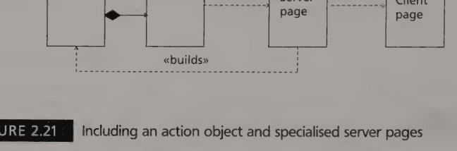

## 图 2.21 包含动作对象和专用服务器页面

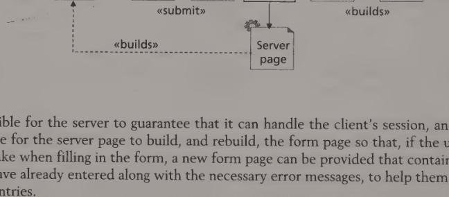

使服务器能够保证处理客户端的会话成为可能，并且服务器页面也可以构建和重建表单页面，这样如果用户在填写表单时出现错误，就可以提供一个包含用户已输入数据以及必要错误信息的新表单页面，以帮助他们更正输入。

现在，服务器页面动态生成带有表单的客户端页面，该表单提交回同一服务器页面，直到可以生成下一个客户端页面。尽管这是一个相对简单的模型，但它提供了可作为动态 Web 流基础的基本静态结构。然而存在一个问题，即服务器页面现在负责做出关于 Web 流的决策并生成两种可能页面之一，即更新后的表单或下一个客户端页面。为了更好地分离关注点，一种常见的架构方法是包含一个负责 Web 流决策的动作对象。然后动作对象可以委托给进一步的服务器页面，以重新生成表单页面或构建下一个客户端页面（图 2.21）。

## 动态 Web 流建模

到目前为止我们使用的图表是静态图表，显示不同 Web 组件之间的关系。为了可视化这些组件所贡献的动态 Web 流，绘制一些序列图会很有用。图 2.22 中的序列图包含了来自图 2.21 中静态模型的某些参与组件，并标识了它们随时间传递的消息。在这种情况下，我们仅对原始表单无需重新生成的情形进行建模，但这可以很容易地使用条件添加到图表中，就像我们在图 2.16 中所做的那样。

图 2.22 中的图表代表了 Web 应用程序中一个请求-响应周期内的典型交互。然而，在更深入地研究我们自己的设计之前，我们

## 图 2.22 使用序列图建模动态 Web 流

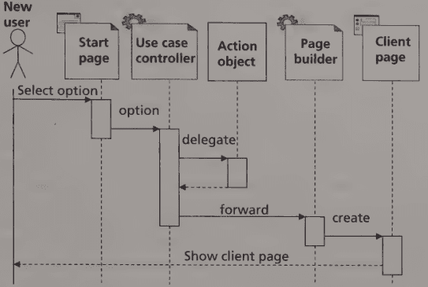

必须首先更详细地探讨我们所说的 *服务器页面* 和 *动作对象* 是什么意思。我们还需要了解‘转发’是什么意思，服务器页面如何‘委托’给动作对象等等。我们还需要了解如何将领域概念的内容表示在网页上。在接下来的章节中，我们将探讨所有这些概念以及实现它们所需的必要技术。一旦我们了解所有各种组件如何协同工作，就能构建完整的设计。

### 2.10 网页结构的设计模式

到目前为止我们查看的设计模式涉及系统的高层架构，即服务器端组件。在本章的最后一部分，我们将查看一些与客户端相关的页面设计模式。与之前描述的模式一样，这些模式可在许多不同的 Web 应用程序中重复使用。我们将查看以下模式：

- 页面左上角的站点标志
- 导航栏
- 面包屑
- 三区域布局
- 主页
- 网站地图
- 将内容存储在数据库中

这些模式的主要关注点是可用性，使用户能够轻松导航我们的 Web 应用程序。这些模式均来自（Graham 2002）。

## 页面左上角的站点标志

页面左上角的站点标志模式非常简单，但你在整个网络上都会经常看到它。站点标志除了出现在页面的左上角（正如模式名称所暗示的那样）外，还应始终作为返回网站主页的超链接（图 2.23）。该模式的要点是它使用户在任何时候都能快速、轻松地返回主页。一旦你意识到这种模式，访问不使用它的网站就会非常令人恼火！

## 导航栏

之前，我们介绍了用例作为指定 Web 应用程序参与者高层目标的一种方式。这些主要用例将成为用户导航的起点。在这些高层用例中，可能存在与特定任务相关的多个更详细的用例。导航栏模式提供了一种基于一般任务和相关子任务组合的简单网站导航方式。该模式建议主要用例将出现在页面顶部的导航栏中，使用户能够轻松执行最重要的功能。左侧可用于服务导航（即当前用例内部的内容）。这将使某人能够访问诸如‘联系我们’之类的高层用例，而服务导航栏可能包括该高层用例内部的用例选项，例如‘办公地点’、‘电子邮件地址’、‘部门’等。图 2.24 显示了使用导航栏模式的页面的总体布局。

导航栏将包含‘页面左上角的站点标志’模式，正如我们所见，它已经充当主页链接。它通常还包括指向拥有网站的组织或公司的信息的链接，例如其隐私政策和联系信息。更具体的链接将取决于 Web 应用程序的性质。例如，电子商务网站将包括注册和登录、结账、购物车和账户信息。根据应用程序的类型，还有各种其他可能性。这些可能包括可下载项目、网站地图、社区、常见问题、新闻和新闻稿、招聘等。

在 WebHomeCover 应用程序中，导航栏的高层用例将包括我们已经看到的，例如‘更改策略详情’。对于此用例，

## 图 2.23 ‘页面左上角的站点标志’模式

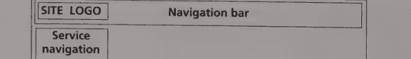

## 图 2.24 ‘导航栏’模式


服务导航栏可能包含详细的使用场景选项，例如“更改地址”、“更改保障级别”、“增加保障”等。

## 面包屑

面包屑的概念来源于童话故事：故事中的角色在穿过森林时留下一串面包屑，以便再次找到回家的路。在故事中，这些面包屑通常会被小鸟吃掉，从而导致灾难，但这种情况不太可能发生在网站上。面包屑的作用是告诉用户他们相对于首页所处的位置。每当用户进入一个新页面，列表中就会新增一条面包屑，因此用户可以轻松地看到自己在网站中走过的路径。此外，面包屑列表的各个组成部分应当设置为超链接，单击任意一条面包屑即可跳转到相应页面。面包屑通常是导航栏的次要组成部分，也可能与搜索框结合使用（图 2.25）。

图 2.25 “面包屑”模式


## 三区域布局

三区域布局模式实际上在很大程度上基于我们已经介绍过的模式（左上角的站点标志、导航栏和面包屑）。如果使用这些模式，就已经用到了两个区域（顶部和侧边导航栏），剩下的便是一个主页面区域，用于容纳当前内容（图 2.26）。这种模式在 Web 应用中非常常见，可以用表格、框架或样式表来实现。我们更倾向于使用样式表而非表格，使用表格而非框架，因为我们应当知道一条规则：“公共站点不要使用框架”。不使用框架的主要原因是浏览器对框架的支持不太可靠，尤其是在移动互联网上显示页面时。然而，在支持移动客户端时，我们也可能会考虑完全不使用三区域布局，而是采用更简单的方法，将导航与内容分离开来。我们将在第 14 章讨论面向移动客户端的自适应 Web 应用时探讨这些问题。尽管许多网站仍然使用表格进行布局，但浏览器对复杂样式表的支持不断增强，使样式表成为更受青睐的方法。

图 2.26 “三区域布局”模式

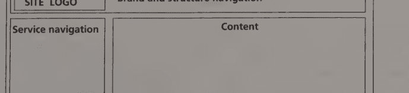

## 首页

三区域布局被推荐作为网站所有页面的一致布局。然而，首页可以成为三区域布局规则的例外，因为作为用户的起始点，它具有特殊的作用，因此可以具备一些特殊特征。不过，首页不应只是一个闪屏（splash screen），因为闪屏加载和运行可能需要很长时间（例如，如果它包含动画或视频，正如一些网站所偏好），用户可能会对此感到沮丧。相反，首页需要包含通往主要使用场景的导航，使用户能够快速、轻松地开始实现其目标。图 2.27 展示了首页模式的建议轮廓。与三区域布局模式相比，它使站点标志更加突出，并将其置于屏幕中央：在标志下方有一些简短信息，用来传达网站的核心信息。在这些信息下方，醒目的链接（可能使用按钮或图片）提供对系统中所有最重要使用场景的快速访问。最后，还可以显示一些关于网站主要功能的更多信息。总体而言，首页模式的意图是产生较高的视觉冲击力，同时让用户能够尽快开始实现其目标。

图 2.27 “首页”模式


## 站点地图

导航栏中建议的链接之一是站点地图。与首页一样，站点地图在 Web 应用中具有特殊作用，因为它向用户提供整个应用的鸟瞰视图，允许直接访问站点的任何部分（至少是那些合理允许直接访问的部分），而无需了解如何通过其他页面导航。许多站点地图只是文本列表。然而，一个更有趣且更有用的站点地图应提供工作流概览，不仅显示链接列表，还显示贯穿 Web 应用的路线的可视化地图。站点地图的具体外观取决于应用本身，但图 2.28 指出了可能包含的一些特征：表示指向网页超链接的可视组件，同时也指示这些页面之间已经存在的链接。图形化站点地图有许多种布局方式。用“graphical site map”（图形化站点地图）进行网络搜索，应该会得到大量不同风格的可供使用的网站链接。

图 2.28 “站点地图”模式

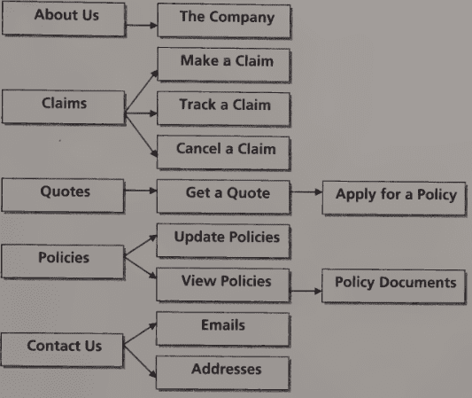

图 2.29 在多个页面中复用内容


## 将内容存储在数据库中

Web 应用通常必须在网站的许多不同页面上提供相同的内容。图 2.29 展示了此类需求的一个非常简单的示例。在这里，我们可能希望在每个页面底部添加一个简单的页脚（“© WebHomeCover.com 2000–2008”）。我们最不愿意做的事情就是把这个页脚添加到每一个页面，并分别维护这些数据的每个实例。例如，如果我们的 Web 应用有 154 个页面，而我们需要将页脚更新为“© WebHomeCover.com 2000–2009”，就必须这样做 154 次。应当指出，页脚示例有许多简单的解决方案，因为它在每个页面上都是一致的，但它说明了一个在 Web 应用中非常常见的概念：相同的基础数据可能需要在网站的不同部分以不同方式出现。举一个更复杂的例子：考虑一个用户登录的网站。在这样的应用中，用户的登录名（或某个别名）通常会出现在登录后所访问页面的某个位置。

在动态 Web 应用中，我们拥有的最重要模式就是把内容存储在数据库中。维护 Web 应用可能会变得非常复杂，我们不希望每次更新应用时都必须复制和粘贴大量内容。因此，我们需要将内容存储在数据库这一个地方，并动态构建页面。以我们简单的“页脚”示例为例，用于页面页脚的文本字符串可以存储在数据库中的一个地方，每次页面需要时再从数据库中读取。如果页脚需要更新，只需在一个地方更新——即数据库。

## 通用设计指南

关于 Web 应用的通用设计指南，有许多资料来源。以下示例取自（Sparks 2004）。

- 围绕现有内容而非未来内容进行设计
  Web 应用应围绕你已拥有的内容来构建，而不是围绕将来可能拥有的内容。这是敏捷开发的基本原则——尽早让最简单的方案运转起来，然后随着时间的推移逐步完善。为迎合将来可能出现的内容而设计过度复杂的应用结构是不必要的。
- 避免不必要的图片
  图片需要时间加载，而且每次图片下载都是一个独立的 HTTP 连接。在许多情况下（例如在移动设备上），这会造成很大的开销。在文字足够的情况下，不要使用图片。
- 充分利用超链接
  尽可能多地使用超链接。这一点实际上主要直接适用于静态内容而非动态内容，因为在许多动态内容场景中，我们必须引导用户沿着有限的路径前进。然而，我们应该确保网站内的导航得到超链接的良好支持。
- 使用层叠样式表（CSS）
  包含自身表示规范的 HTML 不仅难以构建和维护，而且会变得非常庞大。使用层叠样式表（将在第 4 章介绍）可以减少 HTML 页面的下载大小。
- 让导航保持流畅
  这是 Web 应用的一个重要方面，因为用户工作流必须合理。我们需要注意在特定时间点提供适当数量的用户路径。一个重要方面是确保用户可以从 Web 应用中的任何一点正确地回溯，例如在在线购买场景中，能够以可控的方式退出结账流程。
- 定期访问自己的网站
  从外部以用户的视角而非内部开发者的视角审视你的 Web 应用，更容易发现其中的问题，而不是只从内向外地看。


## 练习

**2.1** 以客户登录为例，用户在客户端页面上的表单中输入用户名和密码，绘制一个序列图来展示各种交互。考虑成功登录和不成功登录两种情况下的 Web 流程。

**2.2** 为“View policy details”用例创建以下制品：

- 至少包含一个备选流程的用例描述
- 系统序列图
- 故事情节板

你认为领域模型是否需要任何更新？

**2.3** 本练习最好分组进行，以便你可以尝试需求研讨会的想法。你需要为该项目识别一些高层需求、领域模型和用例图：

项目描述：许多研究研究依赖问卷来收集数据。在线进行可以帮助提高回收数量，因此你的团队被要求开发一个 Web 应用来支持基于 Web 的研究问卷的创建。该系统需要能够收集问卷数据、存储它、允许检索并生成简单的统计报告。

在你的需求研讨会中，采用一些你认为适合此场景的角色，并考虑这些角色中利益相关者的需求。

**2.4** 为 WebHomeCover 应用设计一个主页，从分析中选择最重要的用例和信息。

**2.5** 为本章所述的任何高层用例设计网页结构。使用三区域布局，所有高层用例放在顶级导航栏中，服务级导航放在左侧。

**2.6** 采用练习 2.4 和 2.5 中的主页和三区域布局的基本设计，并将其应用于练习 2.3 中的问卷应用。

**2.7** 考虑一个简单的问卷的 Web 流程如何工作，该问卷有五个问题，每个问题显示在单独的页面上。回答完最后一个问题后，面包屑导航可能是什么样的？

## 摘要

本章首先探讨了如何收集和分析需求以开发基于 Web 的应用，介绍了诸如联合开发研讨会和用例分析等实践。我们应用了 UML 的一些记法，包括针对 Web 应用的特殊扩展，以帮助我们描述基于 Web 系统中的组件和工作流程。我们还看到了迭代方法和统一过程的阶段如何帮助我们组织 Web 开发项目。本章后半部分，我们专注于 Web 应用设计的架构方法，介绍了服务器端组件和 Web 流程的重要方面。我们介绍了网页的常见设计模式，旨在协助 Web 应用的可用性。表 2.1 总结了本章介绍的术语。在接下来的章节中，我们将应用架构和可用性模式，开始构建工作 Web 应用的组件和交互。

## 表 2.1 本章介绍的术语

| 缩写 | 含义 |
|---|---|
| CSS | Cascading Style Sheets |
| MoSCoW | Must have, Should have, Could have, Want to have |
| PDF | Portable Document Format |
| ROI | Return on Investment |
| UML | Unified Modeling Language |
| UP | Unified Process |
| WAE | Web Application Extensions |

## 参考文献和延伸阅读

- Cockburn, A. (2005) *Crystal Clear: A human-powered methodology for small teams*. Boston: Addison-Wesley.
- Conallen, J. (1999) *Building Web Applications with UML*. Reading, MA: Addison-Wesley.
- Conallen, J. (2001) ‘Modeling Web-Tier Components’. *Dr. Dobb's Journal*. http://www.ddj.com/dept/architect/184414696
- Fowler, M. (2002) *Patterns of Enterprise Application Architecture*. Addison-Wesley.
- Gamma, E., Helm, R., Johnson, R. and Vlissides, J. (1995) *Design Patterns: Elements of reusable object-oriented software*. Addison-Wesley.
- Graham, I. (2002) *A Pattern Language for Web Usability*. London: Addison-Wesley.
- Jacobson, I. (2004) *What I don't like in RUP*. http://www.jaczone.com/postcards/.
- Rosenberg, D., Stephens, M. and Collins-Cope, M. (2005) *Agile Development with Iconix Process: People, process and pragmatism*. New York: Apress.
- Sparks, M. (2004) *Extreme Website Design*. Exoftware Agile Solutions, http://www.exoftware.com/whitepapers

## 元素

一对开始和结束标签，以及它们之间的标记内容，被称为一个元素。因此元素的一般格式为：

```
<tag_name>  ← Start tag
Marked up content  } Element
</tag_name>  ← End tag
```

标签定义的特征应用于元素的内容。元素可以包含其他嵌套在其中的元素，嵌套层级不限。一个嵌套元素被称为“子”元素，并在其“父”元素内部开始和结束。

```
<parent_tag>
  <child_tag>
    Marked up content  ← Nested element
  </child_tag>
</parent_tag>
```

### 标签中的属性

一些元素具有属性，可在某种程度上配置该元素。属性出现在开始标签内部，由一个或多个名称-值对组成，格式如下：

```
attribute_name="attribute_value"
```

例如，如果我们有一个名为“document”的元素，它可能有一个名为“language”的属性，其值使用标准语言代码，例如法语（fr）：

```
<document language="fr">
```

也可以使用单引号代替双引号括起属性值，即

```
<document language='fr'>
```

重要的是要确保你使用的双引号和单引号是垂直类型（Unicode 字符编号分别为 22 和 27），分别称为引号和撇号。如果你用文字处理器编辑 XML 文档要小心，因为它很可能会使用左右引号（Unicode 编号 91-94），这会导致文档出错。因此，与其使用文字处理器，最好使用专用的标记编辑器（如 XMLSpy）或文本编辑器来创建和编辑文件。

属性的使用方式与元素不同，因为它们是关于为元素提供元数据。换句话说，它们用于为元素提供额外信息或应用一些额外配置。文档所写的语言是关于文档的信息，而不是其内容的一部分，因此将语言指定为属性比使用元素更有意义。

一个元素可以有多个属性，在这种情况下它们都出现在开始标签内。“document”元素除了具有 language 属性外，还可能具有“type”属性来指示文档的类型。例如，文档可能是一份说明书：

```
<document language="fr" type="manual">
```

当开始标签包含多个属性时，它们的顺序无关紧要。因此这个开始标签与前一个具有完全相同的含义：

```
<document type="manual" language="fr">
```

### 良构文档

尽管在 SGML 中事情会变得复杂，但构成良构文档的主要规则相当简单。在这里，我们列出最重要的四条：

- 在良构文档中，所有标签必须平衡，以便元素同时具有开始和结束标签：`<tag>...</tag>`
- 标签必须正确嵌套，以便子标签必须在其父标签关闭之前关闭：
  ```
  <parent_tag>
    <child_tag>
    ...
    </child_tag>
  </parent_tag>
  ```
- 文档必须有一个根元素包围整个文档，因此其开始标签是文档中的第一个标签，其结束标签是最后一个。
- 所有属性值必须用引号写出。单引号和双引号都有效，但必须正确匹配（即你不能在同一个属性值周围混合使用单双引号）。`<tag name="value">` 或 `<tag name='value'>`

这些来自 SGML 的基本思想适用于超文本标记语言（HTML）和可扩展标记语言（XML），两者都是 SGML 的实现。然而，SGML 有许多关于什么语法有效的复杂规则，包括一些允许语法被最小化或省略的特性。这种复杂性有助于解释 HTML 最终成为一个看似相当不一致的语法，以及浏览器为何对 HTML 标签使用的变化非常宽容。

## 3.2 HTML – 网页的语言

在本节中，我们介绍超文本标记语言（HTML），它是对 SGML 的特定实现，用于标记网页，多年来一直是 Web 的支柱。然而，HTML 对于创建 Web 应用呈现来说相当是笨拙的工具，它已演进为 XHTML，我们稍后会讨论。


用于指定网页中所显示信息的结构和样式。浏览器使用这些标签来组织它们之间的文本，并将指定的标记应用于开始和结束标签之间的任何内容。例如，由`<P>`标签定义的段落元素用于将文本组织成段落。

```
<P>some text in paragraph one . . .</P>
<P>some text in paragraph two . . .</P>
```

最新的HTML规范4.01建议元素名称使用大写字母（属性名称使用小写字母），尽管实际上HTML不区分大小写，所以这只是一个约定而非要求：

> 元素名称用大写字母书写。……属性名称用小写字母书写。……请记住，在HTML中，元素和属性名称不区分大小写；这一约定旨在提高可读性。（Raggett 等人，1999年）

我们将在第4章看到，XML和XHTML的元素名称使用小写字母。因此，当你在本书中看到标记时，就会立刻明白：如果元素名称是大写，那么示例是HTML 4.01；如果是小写，那么该标记是XML或XHTML。

段落和其他类似元素可以被视为结构元素，因为它们以某种语义方式组织内容。换句话说，它们帮助我们理解内容的含义。段落通常将一些涉及同一主题的句子组合在一起。同样，诸如`<H1>`这样的主标题元素标签也可以被视为结构性的。将文本组织成标题、副标题、段落等，是在不同文本块彼此关联的方式上提供结构。然而，它并不指定这些标题、副标题等的外观。相比之下，HTML还包含许多与文档表现样式相关的标签，用于改变字体、颜色或其他样式方面。这类标签的一个简单例子是粗体（`<B>`）标签：

```
<B>this text will be presented in bold face</B>
```

这样的标签专门用于定义文档的一部分在显示时的外观，与文本的结构或语义无关。我们不会在本章中介绍表现性标记。处理页面表现的首选方式是使用层叠样式表（CSS），我们将在第4章中介绍。

## 创建HTML文档

最简单的HTML文档包含一组少量的结构和内容元素。这些是HTML、HEAD、TITLE和BODY。HTML文档中的第一个和最后一个内容应始终是包围根（HTML）元素的标签，即`<HTML> . . . </HTML>`。在HTML元素内部，有一个嵌套的HEAD元素，`<HEAD> . . . </HEAD>`，其中包含文档头部信息，包括文档标题。TITLE元素嵌套在HEAD元素内部，使用`<TITLE>`和`</TITLE>`标签。TITLE元素的内容出现在浏览器标题栏的顶部、历史记录列表中，以及如果你为页面创建书签，还会出现在书签文件中。BODY元素位于HEAD元素之后。BODY元素表示浏览器窗口中显示的页面内容。以下是一个具有这组最小元素的HTML文档：

```
<HTML>
    <HEAD>
        <TITLE> The title of the web page </TITLE>
    </HEAD>
    <BODY> body content of the web page </BODY>
</HTML>
```

## 内容类型

在文档主体中，内容通常被组织成文本信息块，如标题、段落、列表和表格。主体中也可能有其他媒体类型，如图像、声音片段和影片。媒体类型是某种多用途互联网邮件扩展（MIME）类型，它定义了可以在互联网上使用的特定文件类型。自HTML 4以来，首选的术语是内容类型，因为媒体类型更恰当地应用于输出设备的类型。无论如何，HTML文档的类型是'text/html'，但这类文档可能包含对不同类型内容的引用。HTML提供了大量标签来组织文档内容的结构，包括可能包含在其中的所有其他内容类型。在本章中，我们将介绍主要的组织元素：标题、段落、列表、表格和表单。

## 文本元素

网页内容的很大一部分基于文本的管理。文本的结构可以使用标题、副标题和段落来组织。某些其他类型的内容可以有效地按列表（可以以某种方式排序）或表格来结构化。文本的某些语义方面也可以包含在标记中，例如提供强调或指示引文。在本节中，我们将介绍一些有助于组织HTML页面内容的基本结构元素。

组织基于文本的内容的一种非常常见的方式是使用标题、副标题和段落。H1、H2、H3、H4、H5和H6元素可用于不同级别的标题和副标题。H1是最大的标题，H6是最小的。由于标题通常比后面的文本大，使用超过前两三级标题可能不太合理。在许多浏览器中，最小的标题类型比标准段落文本还要小。

正如我们已经看到的，段落元素的HTML语法是`<P>`。你还应在每个段落末尾添加结束标签`</P>`，以使元素“格式良好”，不过大多数浏览器即使没有结束标签也能正确显示页面。这是最小化（minimisation）的一个方面，是SGML的一个特性，意味着并非所有元素都需要结束标签，如果元素的结束可以从文档结构的其他部分推断出来，例如另一个段落的开始推断前一段的结束。浏览器通常会在段落元素之前留一个空行。在下面的示例中，我们使用一个H1元素作为主标题，H2元素作为副标题，正文段落用`<P> ... </P>`标签包围。

这个示例还包含了HTML中的注释语法，如下所示：

```
<!-- this is a comment -->
```

我们将在全书中使用这种注释语法来指示每个示例所引用的源文件。

```
<HTML>
<HEAD>
<TITLE>Versions of HTML</TITLE>
</HEAD>
<BODY>
<!-- File: example3-1.htm -->
<H1>Versions of HTML</H1>
<H2>HTML 1.0</H2>
<P>
The first version of HTML dates from 1991, and was developed by Tim Berners-Lee. It was very different from the HTML we know today...
</P>
<H2>HTML 2.0</H2>
<P>
The second version of HTML, in 1996, was an attempt to standardise the language, which was being widely implemented by different vendors' web browsers...
</P>
</BODY>
</HTML>
```

图3.1显示了该页面在Internet Explorer 7中的外观。请注意标题、副标题和段落的文本大小不同。

图3.1 标题、副标题和段落

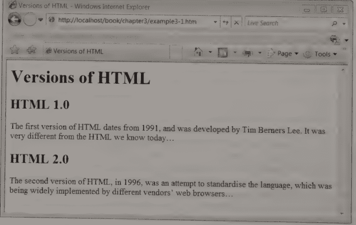

## 3.4 HTML文档类型

浏览器通常能够处理HTML元素的省略，并且实际上对格式不良的HTML语法相当宽容。然而，良好的实践不仅是要编写格式良好的HTML，还要为文档指定类型定义。这有助于浏览器通过将文档结构与特定定义匹配来渲染文档，该定义规定了HTML元素和属性应如何组织。

自HTML 2.0以来，公共文档类型定义（DTD）已可用于指定HTML文档的类型。HTML 4.01中有三个这样的DTD：‘strict’（严格）、‘transitional’（过渡）和‘frameset’（框架集）（Raggett 等人，1999年）。与‘strict’版本相比，‘transitional’和‘frameset’版本允许更广泛的元素和更灵活的结构，并允许表现与内容和结构的广泛混合。我们将在后面的章节中更详细地介绍DTD以及如何使用它们来验证文档的结构，但与此同时，我们声明我们的HTML标记使用‘strict’类型定义。为此，我们需要在HTML文档顶部添加以下行：

```
<!DOCTYPE HTML PUBLIC "-//W3C//DTD HTML 4.01//EN"
"http://www.w3.org/TR/html4/strict.dtd">
```

这表示文档应遵循HTML 4.01结构的严格规则。‘DOCTYPE’指的是一个公开可用的、用于指定HTML文档类型的DTD。以下是我们第一个示例，添加了必要的定义：

```
<!DOCTYPE HTML PUBLIC "-//W3C//DTD HTML 4.01//EN"
"http://www.w3.org/TR/html4/strict.dtd">
<HTML>
    <HEAD>
        <TITLE>Versions of HTML</TITLE>
    </HEAD>
    <BODY>
        <H1>Versions of HTML</H1>
        <H2>HTML 1.0</H2>
        <P>
The first version of HTML dates from 1991, and was developed by Tim Berners-Lee.
It was very different from the HTML we know today. . .
        </P>
        <H2>HTML 2.0</H2>
        <P>
The second version of HTML, in 1996, was an attempt to standardise the language,
which was being widely implemented by different vendors' web browsers. . .
        </P>
    </BODY>
</HTML>
```

## 3.5 组织文本

除了将页面组织成标题和段落之外，我们还可以将许多其他结构元素应用于HTML文档。在本节中，我们将介绍一些有助于组织文本的元素。


## 换行符和水平分隔线

换行符（BR）和水平分隔线（HR）是空元素的示例。HTML 中的空元素没有独立的开始标签和结束标签，而是由单个标签组成，既不要求闭合标签，也不隐含闭合标签。HTML 中空元素的一个示例是换行符，它最早出现在 HTML 2.0 规范中：

```
<BR>
```

该元素没有开始标签和结束标签，而是由单个标签组成，强制文档换行。与段落元素不同（段落元素会另起一行并在段落前留出空白），BR 元素会另起一行，但不会强制插入空行。

水平分隔线是另一个源自 HTML 2.0 的空元素示例。该标签如下所示：

```
<HR>
```

浏览器通常将水平分隔线显示为一条图形线。当然，人们可能会质疑 HR 元素究竟是结构性的，还是仅仅用于呈现。它在各种 HTML 规范中的定义经历了一个演变过程：从“文本各部分之间的分隔线”，到“用于表示主题的转换”，再到“由可视化用户代理渲染的水平分隔线”，因此两种解释都有其道理（Korpela 2002）。

## 引用和块引用

HTML 中有许多结构元素，有些比其他的更常用。虽然 CITE 和 BLOCKQUOTE 并不常用，但它们是有用的示例，展示了一些带有语义的元素；它们传达的是文本的含义以及文本与周围文档其他部分的关系，而非层级结构或呈现方式。

在文档中，较长的引文和引用通常采用与正文不同的结构。HTML 包含用于长引文的 <BLOCKQUOTE> 元素和用于引用的 <CITE> 元素。下一个示例与上一个类似，但进行了修改，加入了 <CITE> 和 <BLOCKQUOTE> 元素。您应该注意，BLOCKQUOTE 元素不应直接包含文本，而应包含段落或标题等结构元素，文本位于这些元素内部。这里我们使用一个段落元素。

```
<!DOCTYPE HTML PUBLIC "-//W3C//DTD HTML 4.01//EN"
"http://www.w3.org/TR/html4/strict.dtd">
<HTML>
<HEAD>
<TITLE>Versions of HTML</TITLE>
</HEAD>
<BODY>
<!-- File: example3-2.htm -->
<H1>Versions of HTML</H1>
<H2>HTML 1.0</H2>
<P>The first version of HTML dates from 1991, and was developed by Tim
Berners-Lee. It was very different from the HTML we know today.
```

在特定浏览器中，不应仅仅为了获得那种呈现效果而使用它。BLOCKQUOTE 元素表示应对该元素的主体进行特殊处理，以识别出它是一个长引文。无论元素的实际内容如何，都不应将其用作实现特定格式的便捷方式。也许更明显的是，使用 CITE 元素不应仅仅被视为使文本变为斜体的一种方式。

## 惯用（短语）元素

CITE 是*惯用*或*短语*元素之一。这些元素涉及我们在书面表达中的常见用法类型。例如，我们会寻找强调文本特定部分的方法。为了支持这些惯用法，HTML 包含了一些元素，如用于强调的 EM 和用于更强强调的 STRONG。浏览器通常将 EM 文本渲染为斜体，将 STRONG 文本渲染为粗体，但与 CITE 元素一样，浏览器选择渲染这些元素的实际方式与我们如何使用标签无关。我们使用它们来表示一种表达类型，而不是为文本选择特定的外观。

## 下标和上标

SUB（下标）元素使用较小的字体，并向常规字符高度的底部对齐；SUP（上标）元素使用较小的字体，并向常规字符高度的顶部对齐。这些元素似乎介于结构性与呈现性之间的灰色地带。然而，内容的这些方面有一些重要的公认用途，例如在科学记数法或某些语言的渲染中。上标通常用于表示参考文献、脚注或商标，以及用于数学公式；而下标用于化学公式。HTML 4 规范中包含了这两个关于上标和下标的实用示例：

```
H<SUB>2</SUB>O  to represent H₂O (the chemical symbol for water)
E = mc<SUP>2</SUP>  to represent E = mc² (Einstein's formula for relativity)
```

由于这些特定的应用，只要 <SUB> 和 <SUP> 元素用于这些普遍接受的场景而非仅仅为了追求效果，就可以将它们的用法视为结构性的。

## 特殊字符

由于 HTML 页面使用标记语法，某些符号（尤其是 < 和 >）对于处理它们的应用程序（如浏览器）具有特殊含义。HTML

### 表 3.1 HTML 字符引用

| HTML 字符引用 | 等效字符 | 含义 |
|---|---|---|
| `&lt;` | `<` | 小于 |
| `&gt;` | `>` | 大于 |
| `&quot;` | `"` | 引号 |
| `&amp;` | `&` | 与号 |
| `&nbsp;` | （一个空格） | 不间断空格 |
| `&reg;` | ® | 注册商标 |
| `&copy;` | © | 版权 |

字符引用是数字或符号名称，可在 HTML 文档中用来代替字面字符。它们适用于表示字符集中常规数字和字母范围之外的特殊字符，或那些在标记语言中具有其他含义、因而可能导致浏览器出现处理问题的字符。所有 HTML 字符引用都以 & 符号开头，以分号结尾。表 3.1 显示了一些 HTML 字符引用的示例。

## 3.6 列表

列表是组织 HTML 文档中某些类型内容的适当方式。列表可以以易于阅读的布局呈现简短、相关的信息项，并且可以嵌套（即列表中的列表）以生成目录、索引或文档大纲等结构。HTML 中有三种类型的列表：

- 无序列表
- 有序列表
- 定义列表

### 无序列表

无序列表是一种具有列表结构、但没有编号或字母来表示有意义顺序的列表。在其他语境中，这种类型的列表称为项目符号列表。浏览器通常会在列表中的每个项目前显示项目符号前缀。无序列表元素的标签名是 UL，它可以包含任意数量的嵌套 LI（列表项）元素：

```
<UL>
    <LI> a list item </LI>
    <LI> another list item </LI>
    ...
</UL>
```

### 有序列表

在有序列表中，列表项带有编号或字母标记。这对于具有有意义顺序的列表非常有用，例如说明、章节、食谱或联赛排名表。有序列表的标签名是 OL，同样使用 LI 作为嵌套的列表项元素：

```
<OL>
    <LI> the first list item </LI>
    <LI> the second list item </LI>
    ...
</OL>
```

### 嵌套有序列表和无序列表

列表可以根据内容需要嵌套并组合在一起。但在这样做时，有一件重要的事情需要牢记：任何嵌套在另一个列表中的列表都必须放在自己的列表项（LI）元素中，使用如下结构：

```
<UL>
    <LI> an item in the main list</LI>
    <LI> Here comes a nested list...
        <OL>
            <LI> an item in the nested list</LI>
            <LI> another item in the nested list</LI>
            ...
        </OL>
    </LI>
    <LI> another item in the main list</LI>
    ...
</UL>
```

在这个来自家庭保险系统领域的示例中，我们同时使用了有序列表和无序列表：

```
<!DOCTYPE HTML PUBLIC "-//W3C//DTD HTML 4.01//EN"
"http://www.w3.org/TR/html4/strict.dtd">
<HTML>
    <HEAD>
        <TITLE> Making a Claim</TITLE>
    </HEAD>
    <BODY>
        <!-- File: example3-3.htm -->
        <H1>Useful Tips</H1>
        <UL>
            <LI> Making a Claim
            <OL>
                <LI>Find as much documentation as you can (photos, receipts, etc.)
                </LI>
                <LI> Fill in the on-line claim form</LI>
                <LI> Don't do anything until an assessor has contacted you</LI>
            </OL>
            </LI>
            <LI>Changing your policy
            <OL>
                <LI> Log in to your user account </LI>
                <LI> Select 'update policy details' from the list of options </LI>
                <LI> Follow the on-screen instructions to make the required changes
                </LI>
            </OL>
            </LI>
        </UL>
    </BODY>
</HTML>
```

图 3.3 显示了该页面在 Opera 9 中的外观。您会注意到，主无序列表使用圆形项目符号，嵌套的有序列表使用阿拉伯数字标记。这是浏览器的行为，并非由我们的列表元素所指定。


**图 3.3** 嵌套有序列表和无序列表在浏览器中的显示效果

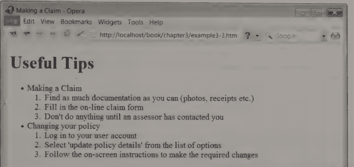

## 定义列表

定义列表与其他类型的列表略有不同，因为它们是按术语表的形式组织的。定义列表的外部元素使用 `<DL> . . . </DL>`（定义列表）标签。在该元素内部，出现一组或多组术语和定义。在每一组中，术语由 `DT`（定义术语）元素定义，定义则出现在 `DD`（定义列表定义）元素中。下面是一个包含定义列表的 HTML 文档示例：

```html
<!DOCTYPE HTML PUBLIC "-//W3C//DTD HTML 4.01//EN"
"http://www.w3.org/TR/html4/strict.dtd">
<HTML>
    <HEAD>
        <TITLE>Markup Languages</TITLE>
    </HEAD>
    <!-- File: example3-4.htm -->
<BODY>
    <DL>
        <DT> SGML </DT>
        <DD> Standard Generalised Markup Language </DD>
        <DT> HTML </DT>
        <DD> HyperText Markup Language </DD>
        <DT> XML </DT>
        <DD> eXtensible Markup Language </DD>
    </DL>
</BODY>
</HTML>
```

图 3.4 展示了该定义列表在 Mozilla Firefox 2 中的显示效果。在这个浏览器中，定义和术语在字号或样式上没有区别，只有布局受到影响。不过，我们可以添加 `EM` 或 `STRONG` 标签，以进一步在语义上区分定义与术语。

**图 3.4** 定义列表

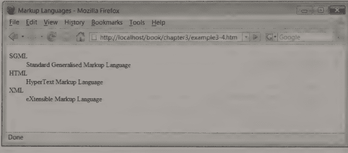

## 3.7 HTML 中的属性

到目前为止，我们已经看到了许多 HTML 元素，但这些元素都没有包含属性。然而，许多 HTML 标签都可以带有属性。其中许多属性可以被归类为表现性属性；事实上，在 HTML 中使用属性进行表现，很好地说明了元素与属性在用法上的差异。元素用于定义文档的内容，而属性往往为这些元素提供额外的配置。如果我们将元素的表现视为其元数据的一部分，那么就可以理解，属性是一种将元数据应用于 HTML 元素的好方式。然而，属性并不仅限于定义表现。它们也可以用于某些结构方面，我们将在接下来的示例中看到。

### 图像

刚才我们说过，目前讨论的是内容和结构而非表现，因此此时引入图像乍看起来可能有点奇怪。然而，网页中的图像是一种内容类型的实例，这意味着它是页面内容的一部分，而不是页面的表现。只不过这种内容恰好具有视觉特征。可以使用 `IMG` 空元素将图像添加到网页中，但与之前看到的空元素（`BR` 和 `HR`）不同，`IMG` 元素没有属性则无法使用。关键属性是 `src`，它指定要包含在页面中的图像文件的 URI。网络上最常见的图像文件类型是 GIF（Graphics Interchange Format，图形交换格式）、JPEG（Joint Photographic Experts Group，联合图像专家组）和 PNG（Portable Network Graphics，便携式网络图形），因为它们的文件体积相对较小，因此下载速度也相当快。GIF 和 PNG 文件通常用于绘图，而 JPEG 用于照片，因为 JPEG 能比 GIF 处理更多颜色，并且比 PNG 拥有更灵活的压缩算法。PNG 格式是在 Unisys 持有 GIF 压缩算法专利时开发的，但它在渲染超过 256 种颜色方面也优于 GIF 文件，尽管相应文件往往比 GIF 更大。

除了定义图像的来源外，我们还必须使用 `alt` 属性提供一个替代文本值。这既有助于在图像无法加载时提供文本替代（例如，用户为了速度而在浏览器中禁用了图像加载），也有助于为无法看到图像的用户提供可读出的文本。下面是一个以 GIF 文件为来源的 `IMG` 元素：

```html

```

可应用于图像的其他属性是 `height` 和 `width`，它们可用于在页面上按原始尺寸缩放图像，但更常用于指定图像的实际尺寸（以像素为单位），使浏览器能够更快地加载页面，因为浏览器可以在下载文件之前预先估算所需的显示空间：

```html

```

### 链接

万维网最重要的方面之一就是链接（又称超链接或网络链接），它使我们能够从一个网络资源跳转到另一个资源，无论该资源在网络上的何处。链接有两个端点，称为锚点：源锚点位于当前文档中，目标锚点是被链接的网络资源（文档、图像、声音文件等）。单击网页中的链接即可获取所链接的网络资源。HTML 中链接的完整细节相当复杂，因此这里只介绍基础知识。

HTML 文档中用于锚点的元素名是 `A`，最重要的属性是 `href`（超文本引用），它包含所链接资源的 URI。例如，下面是一个指向 WebHomeCover 网站 URI 的锚点：

```html
Click <A href="http://www.webhomecover.com">here</A> for a great
insurance deal...
```

锚点元素主体中的文本（`here`）是显示在浏览器中的实际超链接。

并非所有锚点元素中的 URI 都需要包含完整的网址。许多用于 Web 应用的锚点会链接到同一应用中的其他页面，因此 URI 可以是使用本地路径的文件名。例如，下面的锚点引用本地目录中的一个文件：

```html
<A href="aboutus.htm">About Us</A>
```

也可以使用相对路径。这里，我们假设当前文件夹（用 `.` 表示）下有一个 `images` 文件夹，其中存储着一个图像文件：

```html
<A href="./images/map.gif">Find Us</A>
```

除了链接到其他文件，HTML 页面中的锚点还可以链接到文档的特定部分。如果目标锚点不是完整的 URI，而是在文档内部，那么可以在链接的目标端使用锚点元素。例如，我们可能希望链接到文档中包含我们保险政策某些条款与条件的那一部分。若要链接到同一文档的某一部分，源锚点中使用的 URI 是目标锚点的名称，前面加一个井号，例如：

```html
<A href="#terms">terms and conditions</A>
```

在这个示例中，我们假设同一文档中有一个名为 `terms` 的目标锚点。它将在文档的其他地方使用锚点元素的 `id` 属性来定义，例如：

```html
<A id="terms">Terms and Conditions</A>
```

单击源锚点的超链接会将用户带到包含目标锚点的文档部分。下面的标记展示了源锚点和目标锚点如何在同一个文档中出现：

```html
Our insurance is offered according to our standard <A href="#terms">terms and
conditions</A> which you should read carefully before making a claim...

blah blah blah...

<H2><A id="terms">Terms and Conditions</A></H2>
WebHomeCover reserve the right to...
```

当目标锚点在另一个文档的某个部分时，也可以使用同样的方法。唯一的不同是锚点名称前面要加上所在页面的 URI，例如：

```html
<A href="legal.htm#terms">terms and conditions</A>
```

在这种情况下，我们假设 `terms` 锚点位于另一个名为 `legal.html` 的文档中。也可以使用完整地址：

```html
<A href="http://www.webhomecover.com/legal.htm#terms">
    terms and conditions
</A>
```

与文本一样，图像也可以通过将 `IMG` 元素嵌套在锚点元素中而用作链接锚点，例如：

```html
<A href="home.html">
    
</A>
```

这是实现我们在第 2 章中看到的“左上角站点徽标”模式的有用技巧，即单击公司徽标总是会带你前往主页。

### 电子邮件链接

锚点也可以用于电子邮件链接。为此，只需在 `href` 属性中使用 `mailto` 值，其格式如下：

```html
<A href="mailto:help@webhomecover.com">Email the help desk</A>
```

当单击“给帮助台发送电子邮件”时，Web 浏览器可能会打开你的电子邮件客户端来撰写邮件，不过，这确实取决于浏览器配置，因此其行为无法保证。


下面的示例展示了一个包含链接和图像的 HTML 页面：

```
<!DOCTYPE HTML PUBLIC "-//W3C//DTD HTML 4.01//EN"
"http://www.w3.org/TR/html4/strict.dtd">
<HTML>
    <HEAD>
        <TITLE>Our Insurance</TITLE>
    </HEAD>
    <BODY>
        <!-- File: Example3-5.htm -->
        <P>
        <A href="home.htm">
        
        </A>
        </P>
        <H1>Our Insurance</H1>
        <P>
        Our insurance is offered according to our standard
        <A href="#terms">terms and conditions</A>
        which you should read carefully before making a claim
        . . . blah blah blah . . .
        </P>
        <P>
        If you have any enquiries, please
        <A href="mailto:help@webhomecover.com">
        Email the help desk
        </A>
        <H2><A id="terms">Terms and Conditions</A></H2>
        <P>
        WebHomeCover reserve the right to . . . blah blah blah . . .
        </P>
    </BODY>
</HTML>
```

图 3.5 显示了在 Internet Explorer 7 中显示的页面。要查看内部链接的效果，您需要在点击“条款和条件”链接之前调整窗口大小，使条款和条件部分在点击前不可见。

## 3.8 表格

表格可以是网页中有用的结构元素。信息通常可以使用基于表格的格式有效显示，特别是如果所呈现的数据是从关系数据库读取的，因为这些数据库以表格形式存储数据。表格由行和列组成，可选列标题和标题。每部分表格（行和列相交处）称为单元格（图 3.6）。

### 表格标签

在 HTML 4 中，表格是一个相当复杂的元素，使用了多个嵌套元素来表示表格模型，即底层表格结构。它可以分为头部、正文和页脚，并且可以对列进行分组。然而在本概述中我们只介绍表格的基础知识。

### 图 3.5 Internet Explorer 7 中显示的链接和图像

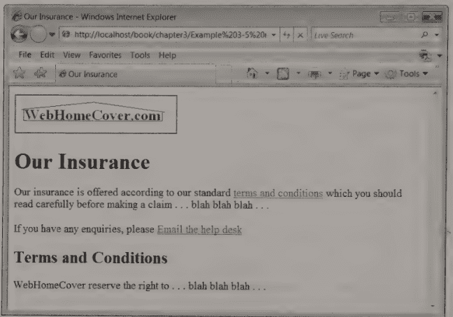

### 图 3.6 表格的组成部分

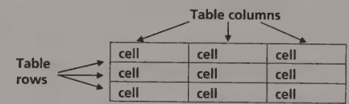

### 表格元素和行

HTML 中的表格元素由 <TABLE>...</TABLE> 标签定义。表格元素包含所有其他表格相关标签，例如指定标题、标题和数据单元格。CAPTION 元素是可选的，但可用于描述表格，例如：

```
<CAPTION>Our Call Centres</CAPTION>
```

表格中的每一行由表格行（TR）元素定义：

```
<TR>...</TR>
```

### 表格单元格

有两种类型的表格单元格，一种包含列标题，另一种包含数据。<TH>...</TH>（表格标题）标签可选择性地用于定义在表格列顶部行中使用的标题元素。其他单元格使用 <TD>...</TD>（表格数据）标签定义。

### 表格示例

在我们逐步介绍 HTML 表格的各个方面时，我们开发了一个简单的表格示例，展示呼叫中心的地点和联系电话。为本示例的目的，我们假设 WebHomeCover 在各个地区设有呼叫中心，此信息将以表格形式呈现在网页上。以下文档包含用于基本表格的 TABLE 元素。有一个标题（‘Our Call Centres’）和四列，每列都有一个标题单元格：‘Territory’、‘Location’、‘Phone’和‘Fax’。有四行，每行对应一个呼叫中心。

```
<!DOCTYPE HTML PUBLIC "-//W3C//DTD HTML 4.01//EN"
"http://www.w3.org/TR/html4/strict.dtd">
<HTML>
    <HEAD>
        <TITLE>Our Call Centres</TITLE>
    </HEAD>
    <BODY>
        <!-- File: example3-6.htm -->
        <TABLE>
            <CAPTION>Our Call Centres</CAPTION>
            <TR>
                <TH>Territory</TH> <TH>Location</TH> <TH>Phone</TH> <TH>Fax</TH>
            </TR>
            <TR>
                <TD>Americas</TD> <TD>New York</TD>
                <TD>0800 1425364</TD> <TD>0800 1122334</TD>
            </TR>
            <TR>
                <TD>EMEA</TD> <TD>London</TD>
                <TD>0800 1324536</TD> <TD>0800 8444463</TD>
            </TR>
            <TR>
                <TD>EMEA</TD> <TD>Cape Town</TD>
                <TD>0800 9009586</TD> <TD>0800 9944474</TD>
            </TR>
            <TR>
                <TD>APAC</TD> <TD>Sydney</TD>
                <TD>0800 1114445</TD> <TD>0800 1114445</TD>
            </TR>
        </TABLE>
    </BODY>
</HTML>
```

图 3.7 显示了表格在浏览器中显示的样子。请注意，至少在此浏览器（Internet Explorer 7）中，表格标题以粗体显示以区别于表格数据单元格。

### 表格组织

表格的组织可以灵活，意思是如果没有数据可用，我们可以选择留空单元格，并且还可以跨多个单元格或列。要留空单元格，我们只需从 TH 或 TD 标签之间移除数据。仅为

### **图 3.7** 在 Internet Explorer 7 中显示的表格

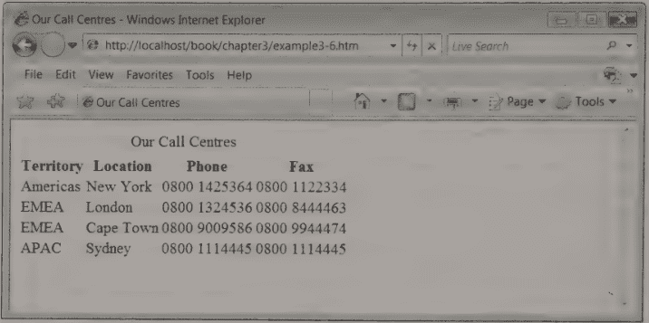

出于本示例的目的，我们可以假设开普敦办公室没有传真号码。要留空此单元格，我们只需从该单元格中移除数据并替换为不间断空格字符（&nbsp;）：

```
```html
<!-- File: example3-7.htm -->
<TR>
    <TD>EMEA</TD> <TD>Cape Town</TD>
    <TD>0800 9009586</TD> <TD>&nbsp;</TD>
</TR>
```
```

现在表格显示为图 3.8 所示。

### 跨列跨行属性

表格包括一个有用的示例，说明属性如何用于更改 HTML 中元素的配置。除了从单元格中省略数据外，我们还可以使数据跨越多个单元格。这是通过使用可以应用于 TD 或 TH 标签的‘rowspan’或‘colspan’属性完成的。例如 colspan="2" 表示跨两列，rowspan="3" 表示跨三行。图 3.9 显示了这些属性如何影响表格的结构。

在我们的示例中，相邻单元格中出现了一些相同的数据。EMEA 在 Territory 列中出现了两次，APAC 办公室的电话和传真号码相同。我们可能会选择重构表格，以便相同的数据可以在多个单元格中跨列显示，从而避免不必要地重复数据。在此版本的表格中，我们在 Territory 列中使用 rowspan，在 APAC 行中使用 colspan：

```
```html
<!DOCTYPE HTML PUBLIC "-//W3C//DTD HTML 4.01//EN"
"http://www.w3.org/TR/html4/strict.dtd">
<HTML>
    <HEAD>
        <TITLE>Our Call Centres</TITLE>
    </HEAD>
    <BODY>
```

```
<!-- File: example3-8.htm -->
<TABLE>
<CAPTION>Our Call Centres</CAPTION>
    <TR>
        <TH>Territory</TH> <TH>Location</TH> <TH>Phone</TH> <TH>Fax</TH>
    </TR>
    <TR>
        <TD>Americas</TD> <TD>New York</TD>
        <TD>0800 1425364</TD> <TD>0800 1122334</TD>
    </TR>
    <TR>
        <TD rowspan="2">EMEA</TD> <TD>London</TD>
        <TD>0800 1324536</TD> <TD>0800 8444463</TD>
    </TR>
    <TR>
        <TD>Cape Town</TD> <TD>0800 9009586</TD> <TD>&nbsp;</TD>
    </TR>
    <TR>
        <TD>APAC</TD> <TD>Sydney</TD> <TD colspan="2">0800 1114445</TD>
    </TR>
    </TABLE>
</BODY>
</HTML>
```

### 图 3.8 在表格中留空单元格

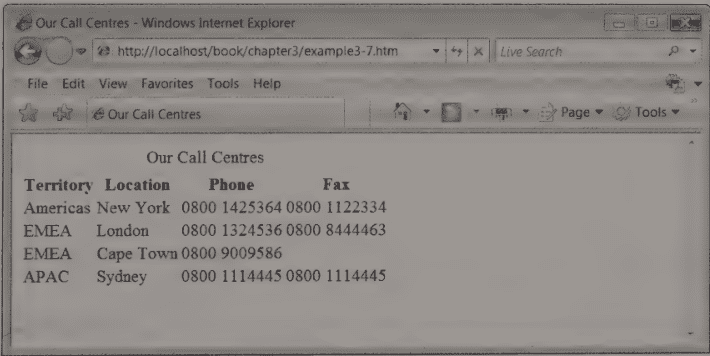

### 图 3.9 rowspan 和 colspan 属性对表格单元格的影响

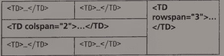

### 图 3.10 在表格中跨单元格的效果

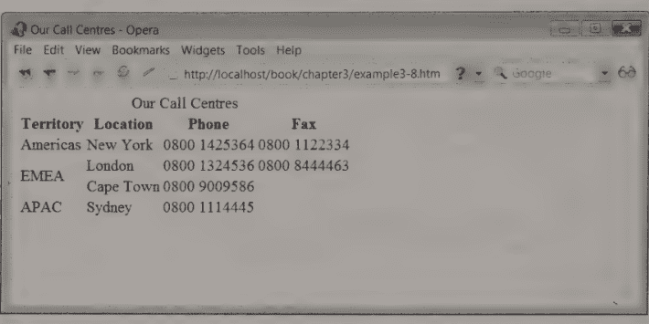

图 3.10 显示了在浏览器中显示的表格。跨行的部分很容易看到，因为‘EMEA’已在行间居中。跨列的部分就不那么明显了，因为悉尼的号码仍左对齐。如我们在许多其他示例中看到的那样，像这样的呈现决策是由浏览器做出的。

### 表格边框

更改表格的边框样式是呈现性的，而非结构性的。然而，在这一点上引入表格边框是有用的，这样我们可以看到前一个示例中使用的跨列跨行属性的效果。表格和单元格边框的宽度可以使用 TABLE 标签的‘border’属性来控制。该属性的值定义了表格和单元格边框的宽度（以像素为单位）。由此推断，它还设置框架周围有边框，并在各个单元格周围显示垂直和水平线。‘border’的默认值是‘0’，意味着没有边框可见，使得很难看到我们表格中水平跨列的效果。在这里，我们将边框值设置为‘1’，这意味着每个单元格都有可见的框架：

```
<TABLE border="1">
```

对前一个示例做这一项更改会改变浏览器显示，如图 3.11 所示（修改后的源文件为‘example3-9.htm’）。

现在我们可以看出，悉尼电话号码跨越了两个单元格，而开普敦号码则没有。然而，使用呈现性的‘frame’属性并不是最佳方法。我们将在下一章看到如何使用样式表管理表格呈现。

## 3.9 表单

表单是任何 Web 应用程序中非常重要的一部分，因为它们允许用户向服务器上运行的应用程序发送信息。Web 上的大部分用户交互基于 HTTP‘GET’请求，这使客户端能够从服务器请求数据。相比之下，表单使 HTTP‘POST’请求成为可能，该请求发送数据

表单元素的“method”属性指定了浏览器如何将HTML表单数据传输到服务器程序。与表单一起使用的最常见方法是“post”和“get”，但“post”更可取。“get”请求是默认的HTTP请求类型，但主要用于从服务器获取数据，例如请求下载HTML页面。因此，尽管“get”请求可能会向服务器发送一些数据（例如请求页面的标识或搜索查询的参数），但只需要向服务器发送少量数据。正因为如此，使用这种请求类型只能向服务器传输有限数量的数据（在某些Web服务器上为240个字符）。此外，“get”请求还存在一些安全问题，因为所有参数数据都附加在URL上。因此，它在浏览器地址栏中可见，所以包含参数数据的URL可以被“收藏”并再次使用。

相比之下，使用“post”方法时，可以传输无限量的数据，URL不能被“收藏”，且表单数据对用户是隐藏的。

| 注意 | 虽然使用post请求发送的数据大小没有具体限制，但服务器可能配置为限制实际可以提交的数据量。这可能是防止拒绝服务攻击所必需的，因为大量数据可能被提交到服务器以耗尽服务器资源。 |

除了“get”和“post”方法之外，还有其他几个较少使用的方法（主要由Web浏览器软件用于从Web服务器获取文档信息），即“head”、“delete”、“put”、“trace”和“options”。这些方法偶尔有用，但通常不被Web应用程序实现，因此尝试使用这些方法可能会返回HTTP响应错误501，即“not implemented”（未实现）错误。

## 输入类型

在FORM元素内部，我们定义表单的各个组件。这些组件使用户能够输入数据，因此包括文本框、单选按钮、复选框和选择列表等。允许输入数据的组件称为控件。其中许多控件使用空的INPUT元素来指定，具体的组件类型由“type”属性定义。另一个基本属性是“name”，用于在用户输入的数据发送到服务器时标识数据的来源。例如，我们可以在表单中有一个文本框用于输入某人的电子邮件地址。该input元素的类型为“text”，该元素的名称可能为“email”（或类似名称）。服务器端应用程序可以使用这个名称来检索用户在该文本框中输入的内容。该元素的写法如下：

```
<INPUT type="text" name="email">
```

INPUT元素中还可以使用其他属性。例如，有一个“value”属性，用于为输入类型提供默认值：

```
<INPUT type="text" name="email" value="email@address">
```

另一种简单的输入类型是“password”。它与文本框类似，但在该字段中键入字符时，屏幕上会显示其他字符，例如星号：

```
<INPUT type="password" name="pword">
```

每个控件都可以使用LABEL元素与之关联一个文本标签。标签必须使用“for”属性与一个控件或一组控件相关联，该属性必须与表单中控件的“id”属性匹配。因此，如果我们要将LABEL标签与表单控件一起使用，那么该控件除了name之外还需要一个“id”属性。例如，下面是一个id为“pword”的密码输入类型的标签：

```
<LABEL for="pword">Password:</LABEL>
```

这意味着密码输入的input元素需要包含这个id：

```
<INPUT type="password" name="pword" id="pword">
```

将标签与控件关联不会影响它在表单中的位置；你需要手动安排。但它确实有这样的效果：如果你在浏览器中点击标签，关联的控件会立即获得焦点。

任何HTML表单的一个基本组件是类型为“submit”的INPUT元素。这会向表单添加一个按钮，使表单数据能够在HTTP请求中发送到服务器。当按下提交按钮时，表单的“action”属性用于将HTTP请求定向到相应的服务器端资源。表单必须有一个“submit”按钮才能调用其action，除非HTTP请求由客户端脚本语言（如JavaScript）管理，在这种情况下，脚本可以提交表单数据。

表单也可能有一个重置按钮，由type为“reset”的INPUT元素定义。按下重置按钮会将表单中的组件恢复为其默认值，但从用户的角度来看，重置按钮是否能提供任何实际好处尚有争议。一般来说，只有当表单具有有用且有效的一组默认值时，才应在表单上使用重置按钮。对于submit和reset输入类型，“value”属性可用于为按钮提供文本标签。

下面是一个非常简单的页面，包含一个使用标签、文本和密码输入类型以及提交和重置按钮的登录表单。这里我们假设有一个名为“login”的服务器端组件，表单将数据提交给它。该表单包含一个表格，用于帮助将组件组织成简洁的布局。

```
<!DOCTYPE HTML PUBLIC "-//W3C//DTD HTML 4.01//EN"
"http://www.w3.org/TR/html4/strict.dtd">
<HTML>
    <HEAD>
        <TITLE>Customer Login</TITLE>
    </HEAD>
    <BODY>
        <!-- File: example3-10.htm -->
        <FORM action="login" method="post">
            <TABLE>
                <TR>
                    <TD><LABEL for="loginid">Login Name:</LABEL></TD>
<TD><INPUT type="text" name="loginid" id="loginid"></TD>
</TR>
<TR>
<TD><LABEL for="pword">Password:</LABEL></TD>
<TD><INPUT type="password" name="pword" id="pword"></TD>
</TR>
<TR>
<TD></TD>
<TD>
<INPUT type="submit" value="Login">
<INPUT type="reset" value="Clear form">
</TD>
</TR>
</TABLE>
</FORM>
</BODY>
</HTML>
```

图3.13显示了该表单在Internet Explorer 7中的显示效果。当然，点击“Login”按钮只会产生一个HTTP“404 not found”错误，因为我们还没有在服务器上运行任何东西。

在HTML表单中还有其他几种输入类型。两种相关的类型是复选框和单选按钮。它们之间的唯一区别是：复选框总是独立于任何其他组件，而单选按钮可以分组，使得同一组中一次只能选择一个单选按钮。复选框通过将INPUT元素的“type”属性设置为“checkbox”来定义。这里我们使用一个复选框来表示用户是否希望加入邮件列表。复选框实际上表示一个布尔值；它要么被选中（true），要么未被选中（false）。

```
<INPUT type="checkbox" name="mailinglist">
```

复选框默认未选中。但我们可以通过将“checked”属性的值设置为“checked”来改变这一点。

## 图3.13 在Internet Explorer 7中显示的表单

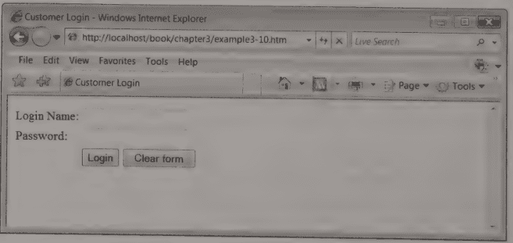

```
    <INPUT type="checkbox" name="mailinglist" checked="checked">
```

单选按钮与复选框相似，可以是选中或未选中，但可以通过具有相同的“name”属性值来分组。在下一个示例中，我们使用单选按钮询问用户是想以访客身份访问我们的网站、创建一个新账户还是使用现有账户登录。因为所有三个单选按钮的name都是“status”，它们将被视为一个组，因此任何时刻只能选择其中一个按钮。“value”属性定义了当提交表单时，如果选择了该特定单选按钮，将发送到服务器的值。默认情况下，“login”单选按钮被选中，因为其“checked”属性已设置为“checked”。以下是用于这三个单选按钮的INPUT和LABEL元素：

```
    <INPUT TYPE="radio" name="status" id="guest" value="guest">
    <LABEL for="guest">Access the site as a guest</LABEL>
    <INPUT TYPE="radio" name="status" id="new" value="new">
    <LABEL for="new">Set up a new user account</LABEL>
    <INPUT TYPE="radio" name="status" id="login" value="login"
    checked="checked">
    <LABEL for="login">Login using an existing account</LABEL>
```

> > **注意**
> >
> > 由于单选按钮的“id”属性在页面中必须是唯一值，因此它不能与“name”属性具有相同的值。这里使用的方法是为“id”和“value”属性赋予相同的值。

这是一个包含我们示例中的单选按钮和复选框的页面。submit和reset按钮的“value”属性都有默认值，不出所料分别是“Submit”和“Reset”。在这个示例中，我们省略了reset按钮的“value”属性，因此它的标签将是默认值（“Reset”）。

```
    <!DOCTYPE HTML PUBLIC "-//W3C//DTD HTML 4.01//EN"
    "http://www.w3.org/TR/html4/strict.dtd">
    <HTML>
        <HEAD>
            <TITLE>Site Access</TITLE>
        </HEAD>
        <BODY>
            <!-- File: example3-11.htm -->
            <FORM action="siteaccess" method="post">
                <TABLE>
                    <TR>
                        <TD colspan="2">
                            Welcome to our site. How would you like to continue?
                        </TD>
                    </TR>
```


```
<TR>
    <TD>
        <INPUT TYPE="radio" name="status" id="guest" value="guest">
    </TD>
    <TD><LABEL for="guest">Access the site as a guest</LABEL></TD>
</TR>
<TR>
    <TD><INPUT TYPE="radio" name="status" id="new"
value="new"></TD>
    <TD><LABEL for="new">Set up a new user account</LABEL></TD>
</TR>
<TR>
    <TD>
        <INPUT TYPE="radio" name="status" id="login" value="login"
checked="checked">
    </TD>
    <TD>
        <LABEL for="login">Login using an existing account</LABEL>
    </TD>
</TR>
<TR>
    <TD colspan="2">
        <LABEL for="mailinglist">Please check this box if you would
like to be added to our mailing list</LABEL>
    </TD>
    <TD>
        <INPUT type="checkbox" name="mailinglist"
id="mailinglist" checked="checked">
    </TD>
</TR>
<TR>
    <TD></TD>
    <TD>
        <INPUT type="submit" value="Continue">
        <INPUT type="reset">
    </TD>
</TR>
</TABLE>
</FORM>
</BODY>
</HTML>
```

图 3.14 显示了在 Opera 9 中显示的带单选按钮和复选框的页面。

## 文本区域

文本区域允许输入多行文本，不使用 INPUT 元素，而是由 TEXTAREA 元素定义。此元素包含可选属性来设置文本的行数和列数（‘rows’ 和 ‘cols’ 属性）。输入到 TEXTAREA 中的文本会在行尾自动换行。如果在元素的正文中添加任何文本，则它会出现在文本区域中，如本示例所示

```
<TEXTAREA name="description" rows="5" cols="30">
    Describe your insurance claim here
</TEXTAREA>
```

图 3.15 显示了 TEXTAREA 及其默认文本的显示情况。

## 选择列表

选择列表可用于从列表中选择一个或多个选项。列表可以是下拉式、可滚动的或只是项目列表，并且可以选择启用多项选择。选择列表包含一个 SELECT 元素和一个或多个嵌套的 OPTION 元素。每个 OPTION 都有一个 ‘value’ 属性，指定如果在表单提交时选择该选项，则发送到服务器的值。OPTION 元素的正文包含在列表中显示该选项时使用的文本。在此示例中，选择列表用于选择保险保障金额。此的默认格式将是下拉列表。

## 图 3.14 带单选按钮和复选框的表单

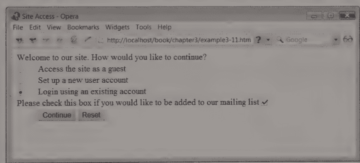

## 图 3.15 带一些默认文本的 TEXTAREA 组件

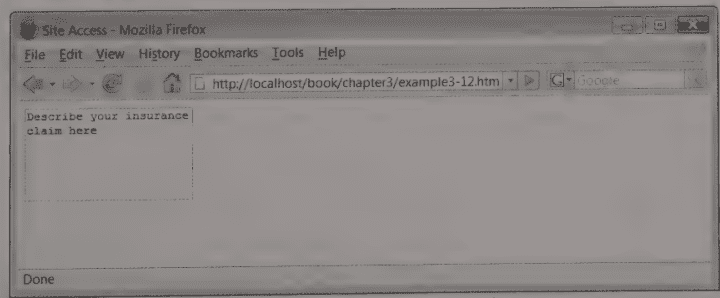

```
<SELECT name="cover">
<OPTION value="10000">10,000</OPTION>
<OPTION value="20000">20,000</OPTION>
<OPTION value="30000">30,000</OPTION>
<OPTION value="50000">50,000</OPTION>
<OPTION value="100000">100,000</OPTION>
</SELECT>
```

要创建滚动或完整列表而不是下拉列表，我们可以使用 SELECT 元素的 ‘size’ 属性。如果我们将 size 设置为 ‘1’，这是默认值，会创建下拉列表。任何更大的值都会创建带滚动条的列表（如果 size 小于选项总数）或简单列表，如果 size 大于或等于选项数。在我们的示例中，此开始标签将创建带滚动条的列表：

```
<SELECT name="cover" size="3">
```

而这将创建一个非滚动列表，因为有五个选项：

```
<SELECT name="cover" size="5">
```

图 3.16 显示了使用三种 size 设置时选择列表的外观。

## 图 3.16 由 ‘size’ 属性的值控制的 SELECT 组件

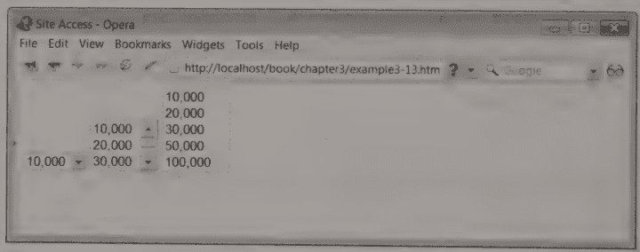

## 练习

在本系列练习中，我们为房屋保险网站开发一些页面。此时，我们只关注可能用于介绍和解释该网站的静态页面，而不是处理索赔或购买保险的 Web 应用程序流程。

- 1. **3.1** 使用 HTML，实现你在第 2 章末尾创建的设计中的主页的内容和结构。
- 2. **3.2** 使用 HTML，为网站实现一个“关于我们”页面，该页面使用你在第 2 章末尾设计的三分区布局。使用表格来实现此布局（我们将在第 4 章中看到如何使用样式表来实现此布局）。你需要在此页面上提供合理数量的内容，其中应包括不同类型的信息，如“我们的历史”、“我们的使命”、“我们的人”等。
- 3. **3.3** 使用合适的软件包创建公司标志并在你的三分区布局中使用它（你可能还想包含来自其他来源的图像）。
- 4. **3.4** 图 3.17 显示了来自房屋保险申请的 HTML 表单，用于收集有关财产保险的数据。编写一个 HTML 页面，创建一个与此类似的表单。

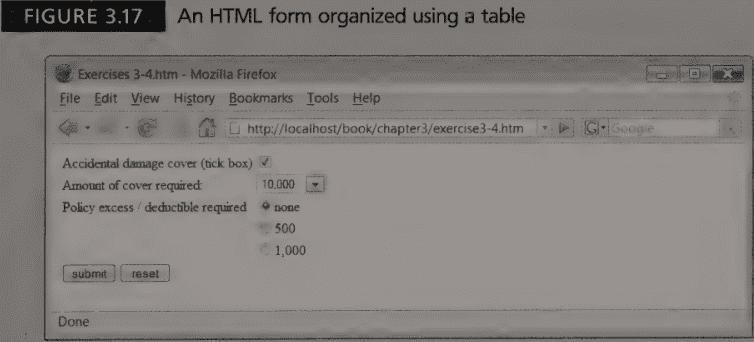

## 摘要

我们本章首先介绍了 SGML，即 HTML 和许多其他标记语言的演化而来的标记语言。我们追溯了 HTML 的演变至版本 4，然后查看了用于构建 HTML 文档的一些最重要的元素，包括标题、列表、表格和表单。表 3.2 提供了本章介绍的 HTML 元素的摘要，而表 3.3 总结了同时引入的新术语。

## 表 3.2 本章介绍的 HTML 元素

| 元素 | 含义 |
|---|---|
| HTML | 包围整个文档的根元素 |
| HEAD | 文档头部信息 |
| TITLE | 出现在浏览器标题栏中的文本 |
| BODY | 在浏览器中显示的页面主体内容 |
| P | 段落 |
| H1, H2, H3, H4, H5 and H6 | 标题级别 |
| BR | 换行 |
| HR | 水平线 |
| CITE | 引用 |
| BLOCKQUOTE | 块引用 |
| EM | 强调 |
| STRONG | 强强调 |
| SUB | 下标 |
| SUP | 上标 |
| UL | 无序列表 |
| LI | 列表项 |
| OL | 有序列表 |
| DL | 定义列表 |
| DT | 定义列表术语 |
| DD | 定义列表定义 |
| IMG | 图像 |
| A | 锚点 |
| TABLE | 表格 |
| CAPTION | 表格标题 |
| TR | 表行 |
| TH | 表头 |
| TD | 表格数据 |
| FORM | 表单 |
| INPUT | 用于输入数据的表单组件 |
| LABEL | 表单组件的文本标签 |
| TEXTAREA | 多行文本输入框 |
| SELECT | 选择列表 |
| OPTION | 选择列表中的一个选项 |
| & ; | 字符引用（开始和结束字符） |
| <!-- --> | 注释文本（开始和结束字符） |

## 表 3.3 本章介绍的术语

| 缩写术语 | 含义 |
|---|---|
| ANSI | American National Standards Institute |
| GML | Goldfarb, Mosher, Lorie |
| ISO | International Standards Organisation |
| MIME | Multipurpose Internet Mail Extension |
| SGML | Standard Generalized Markup Language |

## 参考文献和进一步阅读

Connolly, D. (1995). HTML 2.0 Materials. W3C. http://www.w3.org/MarkUp/html-spec/
Goldfarb, C. (1996). The Roots of SGML -- A personal recollection. http://www.sgmlsource.com/history/roots.htm
Korpela, J. (2002). Empty Elements in SGML, HTML, XML, and XHTML. http://www.cs.tut.fi/~jkorpela/html/empty.html
Raggett, D., Le Hors, A. and Jacobs, I. (1999). HTML 4.01 specification. http://www.w3.org/TR/html401/

## 表示层中的样式：
级联样式表 (CSS)

## 学习目标

- 能够对 HTML 元素应用内联样式
- 能够使用文档头部中的级联样式表 (CSS) 对单个 HTML 页面进行样式设置
- 能够创建外部 CSS 文件并将其链接到多个 HTML 页面
- 能够对单个文档应用样式表级联
- 能够使用 CSS 控制网页的布局

## 引言

在第 3 章中，我们集中研究了 HTML 中的一些重要结构元素。HTML 还提供了一系列元素和属性来支持文档的呈现，包括文本样式和字体、前景和背景颜色、内容对齐以及列表和表格格式。然而，使用这种类型的标记会将呈现与结构和内容混合在一起，使得难以单独开发和维护 Web 应用程序的呈现层。更好的方法是使用级联样式表 (CSS) 来应用与 HTML 标记独立的呈现格式。在本章中，我们探讨级联样式表的语法和使用方法，并了解它们如何应用于 HTML 页面。

## 4.1 分离表示

HTML 4.0 是第一个明确尝试将结构与呈现分离的 HTML 版本。虽然用于附加单独的


自 HTML 早期版本以来，样式表就可以应用于 HTML 文档，但很少被使用。本节中，我们将看到 HTML 如何发展成为包含表现性标签的标记语言，探讨独立样式表的发展，并了解 CSS 如何将 HTML 文档的表现与其内容和结构分离。

在第 3 章中我们研究了 HTML 语法，并了解了 HTML 如何用于指定网页的内容和结构。HTML 页面的结构元素包括段落、标题和表格等元素。虽然 HTML 也有表现性元素和属性，但最好将任何样式规范（颜色、字体大小等）单独通过使用样式表语言来完成。那么，为什么 HTML 具有表现性标签，如果我们不应该使用它们呢？这实际上是网络技术演进方式的结果，是受影响个人、浏览器厂商和标准机构共同作用的结果。这些各种影响意味着，使用样式表将结构和内容与表现分离的做法是一种发展相当不规律的方法。在 HTML 的早期，有人对 HTML 应该如何设置样式以及是否应基于浏览器配置或其他机制进行过一些争论。虽然一直被认为将页面内容与其表现规范分离是良好的做法，但并没有就如何做到这一点达成共识。还有关于谁应控制文档外观的争论，是作者、查看者，还是两者结合。各种早期浏览器都有自己的方式来应用样式表以管理 HTML 文档的外观，但这是在控制文档在特定浏览器中配置方式的角度进行的。它并不能使 HTML 页面的作者指定其应如何呈现。为了解决这个问题，浏览器开始支持与表现方面相关的 HTML 标签。例如，1994 年发布的 Netscape Navigator 第一个版本支持 CENTER 元素。由于早期的 HTML 规范只是将当时领先浏览器已在使用的语法汇集在一起，这种标签的引入导致其随后被纳入标准 HTML 规范中。然而，就在 Netscape Navigator 引入第一个表现性 HTML 标签的同时，CERN 的 Håkon Lie 发表了关于他所称的“级联 HTML 样式表”的首次提案（Lie and Bos 1999）。级联的概念是 HTML 文档可以使用有序的样式表列表来呈现，因此可能有多个不同的样式表依次应用于给定的 HTML 文档，每个样式表提供更专业的格式。Lie 的提案包含了 HTML 文档中 LINK 元素的思想，该元素提供单独样式表的 URL。该提案的原始版本如下所示：

```html
<LINK REL="style" HREF="http://NYT.com/style">
```

随着网络技术社区对样式表的讨论，人们逐渐认识到它们不仅应适用于 HTML，还应适用于其他类型的文档。HTML 的引用被删除，它们被简单地重新命名为层叠样式表（CSS）。尽管当时也有其他样式表技术的替代提案，但在 1995 年万维网联盟成立后，CSS 成为明显的领导者，该联盟举办了关于 CSS 的国际研讨会。随后在 1996 年出现了第一个 W3C 建议，CSS level 1，得到了当时领先浏览器的支持，即 Microsoft Internet Explorer 和 Netscape Navigator，尽管在那个阶段两者的实现都有限，都没有完全实现 level 1 规范。下一个版本 CSS level 2 于 1998 年发布，而 CSS level 3 是一个正在进行的建议。

我们已经讨论了将结构和内容与表现分离的必要性，但为什么这如此重要？指定网站页面外观不仅是平面设计师的问题，也是管理问题。保持网站页面外观统一，同时以有组织的方式标明网站各个关注点之间的差异是很重要的。例如，网站的不同部分可能会使用不同的配色方案。相关的另一个问题是，应该能够在所有页面上一致地更改网站的外观，而无需进行大规模的维护工作。

那么，CSS 如何帮助我们以一种能够在网站的不同部分应用一致的整体风格并进行定制，同时便于更改的方式来管理 Web 应用程序的表现呢？CSS 通过提供以内联方式、文档内部或外部指定样式信息的能力来实现这一点。这意味着样式可以在不同的粒度级别应用：在整个网站、特定页面或特定元素上。CSS 还提供将一系列样式表级联应用于单个文档的能力，从而使多种样式能够融合在一起。

## 4.2 CSS syntax

CSS 语法会略有变化，具体取决于使用位置。内联样式、内部样式表和外部样式表各自涉及一种特定的语法类型，但都相似。

使用 CSS 的最简单方法是内联样式，即使用“style”属性将样式直接添加到 HTML 元素中。该属性的值由冒号分隔的两个部分组成。第一部分是正在应用的样式属性，第二部分是该属性的实际值。例如，样式属性之一是“color”（前景、文本、颜色），该属性的一个可能值是“blue”。在这里，我们将 H1 元素的样式设置为颜色“blue”。

```html
<H1 style="color: blue">Heading</H1>
```

> > **NOTE**  
> > 冒号后的空格在这里用于提高可读性，并非必需。

颜色值“blue”是 W3C HTML 4.0 标准中指定的 16 个颜色名称之一：aqua、black、blue、fuchsia、gray、green、lime、maroon、navy、olive、purple、red、silver、teal、white、yellow。

许多浏览器还识别大量其他颜色名称，并且除了命名颜色之外，您还可以使用红色、绿色、蓝色（RGB）值以此属性格式“混合”自己的颜色：

```css
color: rgb(r, g, b)
```

在此格式中，三个颜色值中的每一个都由 0 到 255 范围内的整数指定，每个整数代表所需颜色的红色、绿色或蓝色分量的强度。使用全部三个分量的最大值，“color: rgb(255,255,255)”得到白色，而全部三个分量为零值，“color: rgb(0,0,0)”得到黑色。

样式表还可用于设置背景颜色，使用“background-color”属性。在此示例中，我们将文本颜色设置为白色，背景颜色设置为黑色。如果我们将多个样式应用于单个元素，则样式由分号分隔，如下所示：

```
<H2 style="color: white; background-color: black">Sub heading</H2>
```

如果我们在 HTML 文档中使用内联样式，我们应该告知浏览器我们使用的样式表语言。虽然默认是 CSS，但规范指出“包含设置 style 属性的元素但未定义默认样式表语言的文档是不正确的。”（Raggett et al. 1999）

因此，我们应在 HEAD 元素中添加以下 META 元素，声明“text/css”作为样式类型：

```
<META http-equiv="Content-Style-Type" content="text/css">
```

| NOTE | 可以使用许多可能的属性与 META 元素一起使用，它提供有关包含它的文档的各种类型信息。单个 HEAD 元素可以包含多个 META 元素。 |
|------|-------------------------------------------------------------------------------------------------------------------------------------------------------------------------------------------------------------------------------------------------------------------|

在此示例中，我们添加了必要的 META 标签，并对一个 H1 元素和两个 H2 元素应用了内联样式。第二个 H2 样式演示了 RGB 颜色语法以指定黑色背景上的白色文本，尽管效果与第一个 H2 元素样式完全相同，后者使用标准颜色名称实现相同效果。样式元素以粗体显示：

```
<!DOCTYPE HTML PUBLIC "-//W3C//DTD HTML 4.01//EN"
"http://www.w3.org/TR/html4/strict.dtd">
<HTML>
<HEAD>
<META http-equiv="Content-Style-Type" content="text/css">
<TITLE>Our Insurance Cover</TITLE>
</HEAD>
<BODY>
<!-- File: example4-1.htm -->
<H1 style="color: blue">
We provide the following types of insurance</H1>
<H2 style="color: white; background-color: black">
Buildings Cover</H2>
<P>You may think you're "safe as houses" but you'd be surprised how many things can damage the building you live in. Fires, earthquakes, subsidence, runaway trucks, cricket balls through windows or the occasional meteor. Best to be covered!
```


## 4.3 样式表

仅在标签内使用内联样式，与使用标准HTML中的表现元素和属性相比，并无实际优势。虽然我们使用了不同的语法，但实际上并未将结构和内容与表现分离，也没有获得将通用样式应用于文档的任何好处。只有当样式也应用于整个文档时才有用，这样我们就可以，例如，将标准样式应用于文档中的所有H1元素，而不是逐一对每个元素进行设置。在这种情况下，内联样式适用于微调表现，但不应用来为整个文档设置样式。更广泛地应用样式是通过样式表完成的，样式表可以位于HTML页面内部，也可以作为外部文档，通过LINK元素链接到HTML页面。首先，我们看看如何在HTML页面中包含样式表。

### 内部样式表

内部样式表是包含在HTML文档的HEAD元素中，通过STYLE元素定义的样式表。此类样式表仅应用于该文档。对于CSS，STYLE元素的“type”属性值设为“text/css”，这与使用META元素进行内联样式时相同。

```
<STYLE type="text/css">
...styles defined here
</STYLE>
```

在STYLE元素中定义样式的语法与内联样式类似，不同之处在于我们还需要指定样式应用于哪些元素类型。样式表的每个组件由三部分组成：

- HTML元素类型的名称
- 该元素的表现属性名称
- 要应用的属性值。

属性和它的值出现在花括号内（与内联样式一样，用冒号分隔）：

```
element {property: value}
```

例如，如果我们想将所有H1（主标题）元素改为蓝色样式，可以添加以下样式元素：

```
<STYLE type="text/css">
 h1 {color: blue}
</STYLE>
```

请注意，在CSS中我们将使用小写字母作为元素名称，因为之后会将其应用于XHTML页面。在XHTML中，元素名称必须使用小写。对于不区分大小写的HTML，样式表中使用的大小写无关紧要。

我们的内联样式示例与这种样式之间的区别在于，后者将应用于正在格式化的页面中的所有“h1”元素。有时我们会想对特定元素类型应用多种样式，在这种情况下，我们可以将不同的样式分隔开

### 图4.2（续）

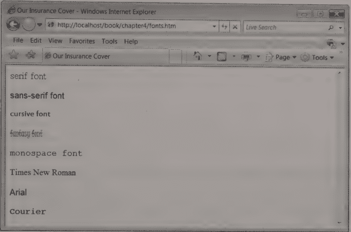

### 图4.3 由 a) Mozilla Firefox 2、b) Opera 9 和 c) Internet Explorer 7 显示的 Times New Roman、Arial 和 Courier 字体

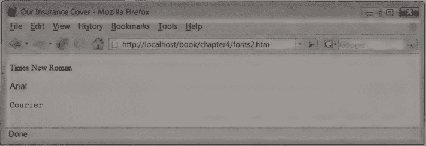

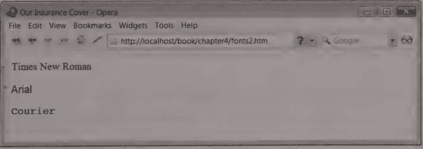

```
<P>You may not realise just how much the stuff you have would cost to replace.
If the burglars move in while you're on holiday, could you afford to replace the TV, the stereo, the chairs, the cupboards, the crockery, etc?
</P>
<P>Not only that, our contents cover means that if you have your bike stolen, drop the vase your mother-in-law gave you as a wedding present, lose your camera, leave your glasses on the train or have your mobile phone stolen, you'll be fully compensated.
</P>
</BODY>
</HTML>
```

图4.4显示了该页面在 Internet Explorer 7 中的外观。

### 设置字体大小

字体大小可以使用多种不同的度量单位来设置，包括英寸、厘米、毫米、磅或派卡等绝对度量单位。然而，在不同浏览器环境中，将大小设置为特定度量值并不十分灵活，只应应用于目标客户端设备已知的专门应用程序中。大多数Web应用程序并非如此，因此更好的方法是使用相对的方法来调整文本大小。即使在这里，也不止一种选择：我们可以使用百分比度量（%）、像素度量（px）、字体的“x高度”（x）或“em”

### 图4.4 应用于多个标题和段落的样式


要将此样式表应用于HTML页面，我们需要在页面的HEAD元素中添加相应的LINK元素。此LINK示例指定了“webhomecover.css”文件：

```
<LINK href="webhomecover.css" rel="stylesheet" type="text/css">
```

该示例假定CSS文件与HTML文件位于同一文件夹中（无论是在本地还是在Web服务器上）。否则，可以根据情况将“href”属性的值写成包含目录路径或完整URL。

下面是我们之前的示例HTML页面，但使用的是外部样式表而不是内部样式表。

```
<!DOCTYPE HTML PUBLIC "-//W3C//DTD HTML 4.01//EN"
"http://www.w3.org/TR/html4/strict.dtd">
<HTML>
<HEAD>
    <LINK href="webhomecover.css" rel="stylesheet" type="text/css">
    <TITLE>Our Insurance Cover</TITLE>
</HEAD>
<BODY>
    <!-- File: example4-3.htm -->
    <H1>We provide the following types of insurance</H1>
    <H2>Buildings Cover</H2>
    <P>You may think you're "safe as houses" but you'd be surprised how many things can damage the building you live in. Fires, earthquakes, subsidence, runaway trucks, cricket balls through windows or the occasional meteor. Best to be covered!
    </P>
    <H2>Contents Cover</H2>
    <P>You may not realise just how much the stuff you have would cost to replace. If the burglars move in while you're on holiday, could you afford to replace the TV, the stereo, the chairs, the cupboards, the crockery, etc?
    </P>
    <P>Not only that, our contents cover means that if you have your bike stolen, drop the vase your mother-in-law gave you as a wedding present, lose your camera, leave your glasses on the train or have your mobile phone stolen, you'll be fully compensated.
    </P>
</BODY>
</HTML>
```

一旦我们有了独立的样式表，就可以在多个HTML页面中使用它。这里，我们将同一个样式表应用于另一个页面：

```
<!DOCTYPE HTML PUBLIC "-//W3C//DTD HTML 4.01//EN"
"http://www.w3.org/TR/html4/strict.dtd">
<HTML>
<HEAD>
    <LINK href="webhomecover.css" rel="stylesheet" type="text/css">
    <TITLE>Our Promise to You</TITLE>
</HEAD>
<BODY>
```

```
<!-- File: example4-4.htm -->
<H1>Our Promise to You</H1>
<H2>No Unreasonable Exclusions</H2>
<P>
Many insurance companies include many exclusions in their policies, making it difficult to claim for events such as 'acts of God', terrorism or subsidence. We have the smallest set of exclusions of any fictional insurance company.
</P>
<H2>Rapid Response</H2>
<P>
If you make a claim, we promise to respond to you within 24 hours, either by settling immediately or putting you in contact with one of our insurance assessors.
</P>
<H2>Low, Low, Rates</H2>
<P>
We constantly monitor our prices against our competitors and guarantee that we provide the best-value insurance that you can't actually buy.
</P>
</BODY>
</HTML>
```

图4.5显示了与图4.4中相同的样式已被应用。

### 图4.5 在另一个页面中重用相同的样式


## 4.4 使用“class”和“id”属性应用样式

到目前为止，我们已经了解了如何将样式应用于特定的HTML元素，如H1、H2和P。在许多情况下这很有用，但有时我们希望：

- 将同一样式应用于多种类型的HTML元素。
- 将样式应用于特定HTML元素的部分（但不是全部）实例。
- 将样式应用于元素的某个特定实例。

为此，我们需要某种方式来标记HTML的各个部分，以便将样式应用于通过这些标签识别的元素。我们可以通过两种方式做到这一点：

- 我们可以使用“class”属性。这使我们能够将多个元素分组为属于同一个类。然后我们可以将样式应用于该类的所有成员。
- 我们可以使用“id”属性。这可以用于为元素提供唯一的id。该id可用于应用文档中其他任何地方都不使用的样式。

### 使用“class”属性

class属性可以应用于许多元素。此外，一个给定的元素可以属于多个类。作为在一系列不同元素中应用样式的一种方式，class属性非常有用。例如，假设我们希望主标题（H1）和副标题（H2）都居中。当然，我们可以在样式表中分别将相同的样式应用于H1和H2元素。然而，更灵活且更易于维护的方法是使用class属性。第一步是将H1和H2元素都标识为属于同一个类。类的名称由页面作者决定。在下一个示例中，我们将类名“heading”应用于H1和H2元素的所有实例。

```
<!DOCTYPE HTML PUBLIC "-//W3C//DTD HTML 4.01//EN"
"http://www.w3.org/TR/html4/strict.dtd">
<HTML>
<HEAD>
    <LINK href="webhomecover.css" rel="stylesheet" type="text/css">
    <TITLE>Our Insurance Cover</TITLE>
</HEAD>
<BODY>
    <!-- File: example4-5.htm -->
    <H1 class="heading">We provide the following types of insurance</H1>
    <H2 class="heading">Buildings Cover</H2>
    <P>You may think you're "safe as houses" but you'd be surprised how many
things can damage the building you live in. Fires, earthquakes, subsidence, runaway trucks, cricket balls through windows or the occasional meteor. Best to be
covered!
    </P>
    <H2 class="heading">Contents Cover</H2>
    <P>You may not realise just how much the stuff you have would cost to replace.
If the burglars move in while you're on holiday, could you afford to replace the
TV, the stereo, the chairs, the cupboards, the crockery, etc?
    </P>
```


```
<P>Not only that, our contents cover means that if you have your bike stolen, drop the vase your mother-in-law gave you as a wedding present, lose your camera, leave your glasses on the train or have your mobile phone stolen, you'll be fully compensated.
</P>
</BODY>
</HTML>
```

我们还需要在样式表中对‘heading’元素应用样式。为此，我们只需在类名前加上一个句点并为该类指定样式。在此示例中，我们将‘heading’类的所有成员居中：

```
h1{color: blue}
h2{color: red; font-style: italic}
p{font-family: sans-serif}
.heading{text-align: center}
```

现在，任何属于‘heading’类的元素都将被居中对齐，无论该类应用于哪些 HTML 元素。

## 对元素子集应用类样式

在前面的示例中，我们使用 class 属性将样式应用于多个不同的元素。使用 class 属性的另一种方法是将样式应用于特定类型元素的一个子集。例如，我们可以对某些子标题应用特殊样式，而不对其他子标题应用。在此示例中，我们更改样式表，使某些段落被强调而其他段落不被强调。我们通过在类名前加上 HTML 元素名称来实现，如下所示：

```
elementname.classname {style}
```

要更改‘emphasis’段落，我们在样式表中添加‘p.emphasis’：

```
h1{color: blue}
h2{color: red; font-style: italic}
p{font-family: sans-serif}
.heading{text-align: center}
p.emphasis{font-weight: bold}
```

现在，所有段落都将使用无衬线字体，但只有标记为属于‘emphasis’类的段落才会以粗体字体显示：

在下面的示例中，我们使两个段落属于‘emphasis’类：

```
<!DOCTYPE HTML PUBLIC "-//W3C//DTD HTML 4.01//EN" "http://www.w3.org/TR/html4/strict.dtd">
<HTML>
<HEAD>
<LINK href="webhomecover.css" rel="stylesheet" type="text/css">
<TITLE>Our Insurance Cover</TITLE>
</HEAD>
```
```
<BODY>
    <!-- File: example4-6.htm -->
    <H1 class="heading">We provide the following types of insurance</H1>
    <H2 class="heading">Buildings Cover</H2>
    <P>You may think you're "safe as houses" but you'd be surprised how many things can damage the building you live in. Fires, earthquakes, subsidence, runaway trucks, cricket balls through windows or the occasional meteor.</P>
    <P class="emphasis">Best to be covered!</P>
    <P></P>
    <H2 class="heading">Contents Cover</H2>
    <P>You may not realise just how much the stuff you have would cost to replace. If the burglars move in while you're on holiday, could you afford to replace the TV, the stereo, the chairs, the cupboards, the crockery, etc?</P>
    <P class="emphasis">Not only that, our contents cover means that if you have your bike stolen, drop the vase your mother-in-law gave you as a wedding present, lose your camera, leave your glasses on the train or have your mobile phone stolen, you'll be fully compensated.</P>
    </BODY>
</HTML>
```

## 图 4.6 使用‘class’属性对段落应用样式

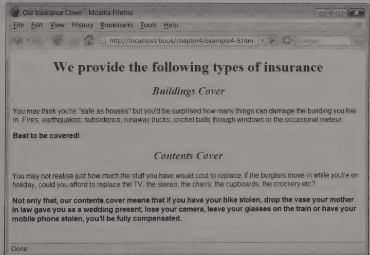

## 元素 id 属性

有时我们可能希望对某个特定元素应用样式，而不对其他元素应用。在这种情况下，该元素需要一个唯一的标识符，使其与文档中的每个其他元素不同。由于‘class’属性可以应用于多个元素，因此不能用于唯一标识特定元素。相反，我们使用‘id’属性在文档中标识元素的唯一实例，例如特定的段落或标题。在这里，我们为单个段落应用唯一的‘id’：

```
<p id="footer"> &copy;WebHomeCover.com 2007 </p>
```

页面上只有此元素可以具有‘footer’的 id。要在样式表中设置‘id’元素的样式，我们使用以下语法：

```
#idvalue{style}
```

在这里，我们对‘footer’段落应用一些特殊样式

```
#footer
{
    font-weight: bold;
    font-style: italic;
    color: white;
    background-color: black;
    text-align: center
}
```

图 4.7 显示了使用我们特殊的页脚样式在浏览器中页脚的外观，如果将其添加到前面的示例 HTML 页面中（完整源文件位于‘example4-7.htm’）。

## 4.5 块级和内联元素

到目前为止，我们一直将样式应用于上一章中介绍的一些 HTML 元素。许多 HTML 元素的一个问题是它们本身就具有一些表现含义，例如标题的相对大小或 STRONG 元素在应用样式表之前的渲染方式。有时能够将样式应用于仅指定结构最基本部分且没有表现含义的元素是有用的。一般来说，HTML 元素可以是块级或内联。块级元素表示与其他内容块以某种方式分离的内容块，通常通过从新行开始，而内联内容是块的一部分，并且在任何方面都不会与之分离。块可以出现在其他块内，内联元素可以出现在其他内联元素内。图 4.8 显示了块和内联元素之间的一般关系。

HTML 中的块级元素由 DIV（division）元素表示，而内联元素由 SPAN 元素表示。它们的主要价值在于能够为将应用样式表进行展示的文档提供通用结构。‘id’属性可以链接到级联样式表。以下样式表（'divspanstyles.css'）将样式应用于上面示例中使用的类和 id。请注意，这里没有对 HTML 标签应用样式，只有我们自己定义的类和 id。

## 图 4.9 使用 DIV 和 SPAN 应用的样式


```
.heading{text-align: center; color: blue}
.text{text-align: left; font-family: Arial}
.bigger{font-size: 2em}
#items{font-weight: bold}
#risk{font-weight: bold; font-style: italic; color: red}
```

图 4.9 显示了 HTML 页面在浏览器中的显示效果，所有样式均仅使用 DIV 和 SPAN 元素应用。

## 4.6 对列表和表格应用样式

有一些样式可以应用于列表。例如，使用 'list-style-type' 属性可以指定使用的符号。无序列表的项目符号可以样式化为 'disc'、'circle' 或 'square'。这些可用于覆盖浏览器对项目符号的默认使用。有序列表的数字格式也可以使用 'type' 属性指定，以选择数字（阿拉伯数字或罗马数字）或字母格式（表 4.1）。或者我们可以将值设置为 'none' 以删除任何符号或数字。

图 4.10 显示了来自 'example3-5.htm' 的页面的修改版本，其中包含嵌套的有序和无序列表，在 Internet Explorer 7 中显示。页面唯一的变化是包含必要的 LINK 元素以应用样式表（修改后的 HTML 位于文件 'example4-9.htm' 中）。在样式表中添加了两行来格式化列表，将无序列表的项目符号更改为 'square' 样式，并对有序列表使用小写罗马数字：

```
ul{list-style-type: square}
ol{list-style-type: lower-roman}
```

## 表 4.1 可应用于有序列表的样式

| list-style-type 属性 | 编号样式 |
|---|---|
| decimal | (1,2,3, ...) - 默认值 |
| upper-alpha | (A,B,C ...) |
| lower-alpha | (a,b,c ...) |
| upper-roman | (I,II,III,IV ...) |
| lower-roman | (i,ii,iii,iv ...) |

## 图 4.10 使用样式格式化列表

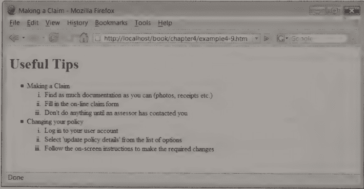

我们可以以多种方式更改表格的呈现方式，包括：
- 在单元格内添加间距
- 在单元格之间添加内边距
- 设置表格的颜色
- 添加边框
- 对齐表格及其内容
- 设置表格的宽度

其中一些将应用于整个表格，一些应用于表格的一部分（例如表格行），而其他则可以使用类或 id 属性应用。为了保持以下示例简单，我们将重点关注可应用于 HTML 表格元素的样式。例如，以下样式将表格的‘width’属性设置为当前窗口的 50%，而表格的外部‘border’属性将设置为 3 像素宽的实心黑色边框：

```
table{width: 50%; border: 3px black solid}
```

> 注意 除了‘solid’之外，边框的其他样式还包括‘dotted’、‘dashed’、‘double’和‘groove’。当然，样式也可以应用于行或单元格。


## 图 4.12 折叠表格边框的效果

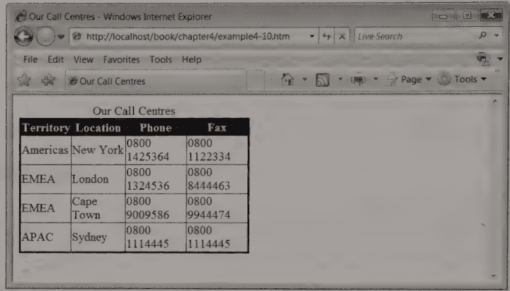

## 4.7 样式表级联

在本章开头我们说过，级联样式表提供了一组有序的样式表，可以在同一文档中进行“级联”，每个样式表都会添加更具体的样式。这样，来自多个来源的样式信息就可以组合在一起。下面的示例使用了两个外部样式表和一个内部样式表：

```
<LINK href="webhomecover.css" rel="stylesheet" type="text/css">
<LINK href="informationpage.css" rel="stylesheet" type="text/css">
<STYLE type="text/css">
p.important{color: red; font-size: large}
</STYLE>
```

就本示例而言，'informationpage.css' 包含以下样式：将 'heading' 类的成员左对齐，并将 'courier' 字体应用于二级标题：

```
.heading{text-align: left}
h2{font-family: courier}
```

当一系列级联样式应用于同一文档时，样式会被聚合在一起，因此最终样式是多个样式表的组合。如果发生冲突，即不同的样式被应用于相同类型的元素时，更局部定义的样式总会覆盖更全局定义的样式。例如，使用内部样式表（通过 'style' 元素）定义的样式会覆盖外部样式表中定义的任何样式。此外，如果同一类型的多个样式表（例如两个外部样式表）在一个页面中列出，后出现的样式会覆盖先出现的样式。在我们的示例中，'informationpage.css' 中定义的任何样式都会覆盖 'webhomecover.css' 中为相同元素定义的样式。具体来说，'informationpage.css' 中的 'heading' 样式会覆盖 'webhomecover.css' 中定义的 'heading' 类的 'center' 对齐方式。'webhomecover.css' 中定义的其他样式将继续应用。

头部中 'style' 元素内定义的任何样式都会覆盖外部样式，但在我们的示例中，唯一应用的样式（针对 'important' 段落）是一种新样式，因此不会覆盖外部样式表中的任何内容。任何内联样式都会覆盖其他所有样式，就像我们的示例中将 'normal' 字体样式应用于两个二级标题一样：

```
style = "font-style: normal"
```

这会覆盖 'webhomecover.css' 应用的斜体样式。以下是完整的 HTML 页面：

```
<!DOCTYPE HTML PUBLIC "-//W3C//DTD HTML 4.01//EN"
"http://www.w3.org/TR/html4/strict.dtd">
<HTML>
<HEAD>
<LINK href="webhomecover.css" rel="stylesheet" type="text/css">
<LINK href="informationpage.css" rel="stylesheet" type="text/css">
<STYLE type="text/css">
    p.important {color: red; font-size: 1.2em}
</STYLE>
<TITLE>Information About Our Insurance Cover</TITLE>
</HEAD>
<BODY>
<!-- File: example4.11.htm -->
<H1 class="heading">Important Information</H1>
<H2 class="heading" style="font-style: normal">Buildings Cover</H2>
<P>Buildings cover is subject to an inspection by a structural engineer prior
to insurance being approved should WebHomeCover require this inspection.
</P>
<H2 class="heading" style="font-style: normal">Contents Cover</H2>
<P>You will be required to provide documentary and/or photographic evidence
of items to be covered on your policy where an individual item may be classified
as a valuable antique.
</P>
<P class="important">
Failure to meet these terms and conditions may invalidate your insurance cover.
</P>
<HR>
<P id="footer">&copy;WebHomeCover.com 2007 </P>
</BODY>
</HTML>
```

图 4.13 显示了级联样式表在 Internet Explorer 中对该页面的效果。请注意，所有标题的样式都因第二个外部样式表而发生了变化，内部样式表为 'important' 段落设置了大号字体，而二级标题通过内联样式被设置为非斜体。其他样式（例如应用于页脚的样式）则不受影响。

## 图 4.13 多个样式表级联的效果

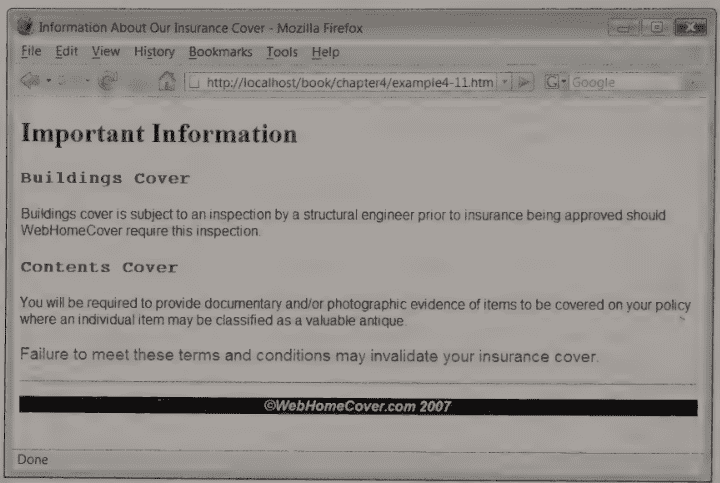

## 4.8 使用 CSS 进行页面布局

到目前为止，我们一直在研究如何使用 CSS 改变文档各部分的外观。但我们也可以使用它来管理文档的布局。这是一个相当复杂的主题，在这里我们无法充分展开，但本节将作为 CSS 页面布局一般概念的入门介绍。

我们之前介绍了一些与通用页面布局相关的设计模式，例如导航栏、左上角的网站标志以及三区域布局。在本章的最后一个示例中，我们将看到如何使用 CSS 来实现三区域布局。

在之前的练习中，你被要求使用表格来实现三区域布局，但许多作者声称使用样式表来做这类布局更好。解决这个问题的方法有很多，但这里我们将介绍一个非常简单的解决方案，使用 'float' 和 'clear' 样式属性。我们可以将 'float' 属性的值设置为 'left' 或 'right'，使相关元素出现在页面的右侧或左侧，其他元素则环绕在它周围。这对于设置三区域布局的左侧导航栏非常有用。要设置其他不环绕浮动元素的元素，我们可以使用 'clear' 属性。该属性的值可以是 'left'（不环绕左侧的浮动元素）、'right'（不环绕右侧的浮动元素）或 'both'（不环绕任何浮动元素）。图 4.14 显示了三区域布局和页脚的页面总体布局。请注意，侧边导航栏使用 'float' 属性浮动到页面左侧，并允许主要内容环绕到右侧。为了保持内容区域可能比侧边导航栏更长的列布局，我们将导航栏的宽度和内容的左边距设置为相同的值。这样可以防止内容环绕到导航栏下方。我们不使用 'clear'，因为我们要让内容出现在侧边导航栏旁边，而不是它的上方或下方。但是，为了保持顶部导航栏位于侧边导航栏上方，以及页脚位于侧边导航栏下方，我们对两者都使用 'clear' 属性。图 4.15 显示了各种样式如何应用于三区域布局。

## 图 4.14 由 CSS 样式定义的三区域布局（带页脚）

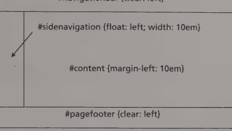

### 使用 CSS 处理锚点

在我们的三区域布局中，顶部导航栏和侧边导航栏都会有链接。要使用 CSS 为锚点设置样式，我们必须采用一种与设置简单文本样式略有不同的方法，因为锚点可能处于四种状态之一，每种状态都可以应用不同的样式。这四种状态是：

- link：尚未被点击且鼠标指针未悬停在其上的链接
- visited：之前已被访问且鼠标指针未悬停在其上的链接
- hover：鼠标指针悬停在其上的链接
- active：正在被鼠标点击的链接

要为这些状态应用样式，我们使用 CSS 伪类，它出现在元素名称之后，并用冒号与元素名称分隔。例如，要使用 'link' 伪类设置尚未被点击的锚点的颜色，我们可以使用以下样式：

```
a:link{color: black}
```

在为这些伪类应用样式时，它们必须按照样式表中的正确顺序出现（即上面列表中使用的顺序）。以下是我们可能应用于这四种锚点状态的一些样式：

```
a:link{color: black}
a:visited{color: blue}
a:hover{font-weight: bold}
a:active{font-style: italic}
```


**图 4.15** 使用样式表实现的三分区布局，如 Opera 9 浏览器中显示的那样


## 练习

**4.1** 创建一个包含一些文本的简单网页。使用样式表和 RGB 颜色语法，将文本颜色设为蓝色。

- 如果不加蓝色混合红色和绿色会得到什么？
- 如果不加红色混合绿色和蓝色会得到什么？

**4.2** 在家庭保险系统的三区域布局示例中，将（CD 上提供的）房屋图片添加到左侧区域底部。

**4.3** 创建一个名为 ‘basic.css’ 的 CSS 文件，用于提供研究问卷网站页面的表现。在此阶段，我们仅关注可能用于介绍和解释该网站的静态页面，而不是问卷本身。在第一个版本中，仅为 HTML 元素提供格式。

**4.4** 查看你的‘关于我们’页面，以确定可以使用‘class’属性有意义地分类的内容部分。确定一个或多个内容类后，修改你的 CSS 以适当应用样式。

**4.5** 创建一个名为‘infopage.css’的 CSS 文件。添加至少一种不在‘basic.css’中的样式，可应用于你的‘关于我们’页面。

**4.6** 使用 CSS 管理你的页面布局，应用三分区布局。

**4.7** 尝试使用 CSS 管理你的主页布局。

## 摘要

在本章中，我们看到了如何使用 CSS 为 HTML 文件提供表现。我们首先通过使用‘style’属性将内联样式添加到元素中开始。然后我们看到了如何使用 STYLE 元素在文档头部包含样式表，以便可以为相同类型的元素重用样式。下一阶段介绍了如何编写和链接外部样式表，以便可在多个网页中使用。我们通过使用 CSS 管理页面的布局结束了本章。CSS 有很多方面，远不止本章所能涵盖的。表 4.2 总结了本章介绍的 CSS 属性及其一些可能值。当然，这只是完整 CSS 语法的很小一部分，但如果你想进一步探索样式表，有很多书籍和在线资源可供使用。

### 表 4.2 本章介绍的 CSS 属性

| Property | 含义 | 可能的值 | 示例 |
|---|---|---|---|
| color | 前景（文本）颜色 | HTML 4.0 中定义的 16 种颜色名称中的任意一种：aqua, black, blue, fuchsia, gray, green, lime, maroon, navy, olive, purple, red, silver, teal, white, yellow。RGB 颜色值：`color: rgb(R,G,B)` | `color: blue`<br>`color: rgb(255, 255, 255)`<br>`color: rgb(0, 0, 0)` |
| background-color | 背景颜色 | 与 color 相同的值 | `background-color: black` |
| text-align | 文本对齐 | left, right, center, justify | `text-align: center` |
| font-style | 字体样式 | normal, italic, oblique | `font-style: italic` |
| font-weight | 字体粗细 | normal, lighter, bold, bolder | `font-weight: bold` |
| font-size | 字体大小 | 像素、em、百分比或名称的度量：large, small, x-small, x-large | `font-size: 110%`<br>`font-size: .8em`<br>`font-size: 20px`<br>`font-size: x-large` |
| font-family | 字体族 | serif, sans-serif, cursive, fantasy, monospace, Arial, Courier, 'Times New Roman' | `font-family: sans-serif`<br>`font-family: 'Times New Roman'` |
| list-style-type | 列表编号或项目符号样式 | decimal, upper-alpha, lower-alpha, upper-roman, lower-roman | `list-style-type: square`<br>`list-style-type: lower-roman` |
| width | 元素宽度（例如表格宽度） | 页面宽度的百分比 | `width: 50%` |
| border | 表格边框 | 像素数和线型：solid, dotted, dashed, double, groove | `border: 3px solid` |
| margin | 所有元素边距 | auto | `margin: auto` |
| margin-left | 左边距 | em 的度量 | `margin-left: 1em` |
| margin-right | 右边距 | em 的度量 | `margin-right: 3em` |
| margin-top | 上边距 | em 的度量 | `margin-top: 5em` |
| margin-bottom | 下边距 | em 的度量 | `margin-bottom: 2em` |
| border-collapse | 表格边框样式 | collapse | `border-collapse: collapse` |
| link<br>visited<br>hover<br>active | 锚元素的伪类 | `a:link`<br>`a:visited`<br>`a:hover`<br>`a:active` | `a:link { color: black; }` |
| float | 页面内的相对对齐 | left, right | `float: left;` |
| clear | 停止内容环绕右侧或左侧的元素 | left, right, both | `clear: both` |

## 参考文献和进一步阅读

- Bos, B., Lie, H., Lilley, C. and Jacobs, I. (1998) *层叠样式表，第二级 CSS2 规范*, W3C Recommendation 12-May-1998, Chapter 17, http://www.w3.org/TR/REC-CSS2/tables.html
- Lie, H. and Bos, B. (1999) *层叠样式表，面向 Web 的设计*, 2nd edition. Chapter 20, 'CSS 的传奇'. Addison Wesley.
- Raggett, D., Le Hors, A. and Jacobs, I. (1999) *HTML 4.01 规范*, Section 14, '样式表'. http://www.w3.org/TR/html4/present/styles.html
- Weinman, L. (2007) *浏览器安全的网页调色板*. http://www.lynda.com/hex.asp

## 内容、结构和验证：XML、DTD 和 XHTML

### 学习目标

- 理解半结构化数据的概念
- 能够构建格式良好的 XML 文档
- 能够创建文档类型定义
- 能够根据文档类型定义验证 XML 文档
- 能够创建格式良好且有效的 XHTML 文档

### 引言

在本章中，我们首先回顾 HTML 的一些局限性，然后探讨如何使用 XML 和 XHTML 为表示数据和构建网页提供更灵活的方法。在此过程中，我们看到这些标记语言中的一些可以通过文档类型定义（DTDs）进行验证。我们还看到可以使用哪些工具来测试 XML 和 XHTML 文档的格式良好性和有效性，使用这些 DTD。

### 5.1 HTML 的局限性

HTML 在提供一种相对简单的方式在网上呈现数据方面非常成功。它能够快速创建包含多种内容类型（文本、图像、视频、声音等）的网页，并且这些页面可以由常见的浏览器（如 Internet Explorer 和 Mozilla Firefox）呈现给用户。然而，随着 Web 应用程序变得更加复杂并解决更复杂的需求，使用 HTML 作为管理 Web 应用程序内容的主要方式的局限性变得明显。其中一个主要问题是‘传统’HTML 将内容、结构和表现结合在一起，这违背了关注点分离的理念。

例如，看看这段使用 FONT 元素的非常短的 HTML 源代码（这在我们的 HTML 章节中没有涉及，因为我们没有讨论表现元素）：

```
<FONT color="red"><P>Hello... </P></FONT>
```

在此标记中，我们可以看到一些内容（‘Hello...’）、一个结构元素（段落标签）和一个表现元素（FONT 元素，此处用于将字体颜色设为红色）。如果我们使用这种类型的标记构建 Web 应用程序的页面，那么在原始开发和对页面进行更改时，将内容、结构和表现的不同关注点分离将变得非常困难。因此，仅使用 HTML 会使我们的 Web 应用程序在构建和维护方面都变得困难。当然，部分解决方案是使用层叠样式表（CSS）进行表现标记，正如我们在上一章所看到的那样。然而，表现与内容和结构的混合并不是唯一的问题。

HTML 的另一个严重问题是它不必是格式良好的。以下示例大多数浏览器都能处理，因为它们通常对格式不佳的 HTML 容忍度很高：

```
<DIV CLASS=intro><p><STRONG><EM>Hello... </STRONG></EM></DIV>
```

这里，标记格式不佳有四个方面。首先，属性值（‘intro’）未被引号或撇号包围。其次，有一个元素有开始标签但没有结束标签（<p>）。然后，嵌套不当：终止 </STRONG> 标签出现在终止 </EM> 标签之前，但应出现在其之后。最后，对大小写的使用不一致且不正确（标签全部为大写，除了 <p> 标签，而属性名 ‘CLASS’ 为大写）。

### 格式不佳文档的影响

这种缺乏格式良好性为什么重要？这可能成为问题的原因有几个。也许最重要的是，格式不佳的文档无法通过验证。这很重要，因为验证会检查文档以确保正确的元素和属性以正确的顺序和数量出现，这是成功处理文档内容的第一步。由于使用标记语言创建的文档的确切结构无法提前得知，处理此类文档的程序需要知道它们将满足某些结构规则。一个需要处理标记的软件应用程序的例子是 Web 浏览器。总的来说，浏览器必须非常容忍格式不佳的 HTML，并尽力渲染 HTML 页面，无论其格式多么糟糕。然而浏览器灵活性的限度是有限的。如果 HTML 文档格式特别糟糕，浏览器处理可能会任意失败，在某些情况下会导致用户看到空白页面。这可能是因为浏览器经常忽略无法正确处理的部分，有时忽略了页面中的大部分或全部内容。在这种意义上，浏览器是其自身成功的受害者，由于历史上能够管理格式不佳的文档，可能存在格式不佳的文档是可以接受的期望。

在支持超出浏览器正常页面渲染的某些客户端处理的‘智能客户端’应用程序中，例如使用文档对象模型（DOM）的应用程序，运行其中的程序脚本可能会出现问题


浏览器。DOM 是文档内容、结构和样式的标准接口，使应用程序能够访问和更新该文档。在网页浏览器中，常用来与 DOM 交互的编程语言是 JavaScript（例如，在 Ajax 应用中），而 JavaScript 错误在 Web 应用中很常见。问题在于，DOM 表示浏览器内 HTML 文档的结构，JavaScript 程序通常需要遍历 DOM 来处理页面的各个部分。如果 HTML 格式不规范导致 DOM 构建不当，JavaScript 可能无法找到它要找的内容。

## 为什么仅有 HTML 不够

格式不当的文档问题可以通过对照 DTD 验证 HTML 页面来解决。然而，HTML 还有一个重要问题，即 HTML 只能用于表示网页标记，不能表示其他任何内容。这意味着我们在网页中表示的内容，除了单个网页的特定结构外，没有任何其他结构可应用于它。但支撑 Web 应用的数据可能需要在不同的页面中以不同的方式使用，跨越应用的许多部分，甚至在不同应用之间使用。理想情况下，我们希望有一种独立的方法来表示内容的底层结构，而不必考虑它在网页中的组织和呈现方式。

总之，HTML 作为一种简单、灵活的语言，在创建将内容、结构和呈现结合在一起的网页方面有许多优点。然而，它没有足够的内在结构和语法规则，使除浏览器（浏览器只关心呈现）之外的其他应用程序无法有效处理它们。此外，HTML 的语法固定为一组仅用于渲染网页的标签，它不能用来表示更一般类型的内容。如果我们想用标记以更严谨、更有用的方式呈现内容，就需要某种 HTML 之外的语言。这种语言就是*可扩展标记语言*（XML）。

### 5.2 半结构化数据

在本节中，我们探讨可扩展标记语言（XML）与半结构化数据概念之间的关系。我们将了解如何在 XML 文档中使用元素和属性来表示半结构化数据，并解释在构造 XML 文档时如何选择元素或属性。

半结构化数据不包含类型信息，具有自我描述性，并且其结构可以存在变化。半结构化数据是自我描述的，因为它包含标签；每条数据都包含一些元数据，告诉我们关于该数据元素的信息。这意味着半结构化数据文档可以支持系统间的互操作性，因为当它在不同应用之间被序列化（作为数据流发送）时，会携带自身的标签，帮助接收系统处理其内容。这正是 XML Web 服务工作的基础。

解释半结构化数据的最佳方式或许是从一个结构化数据的示例开始：

```
02 03 1959 15 08 1977 08 04 1994
```

如果查看这些数据，可以发现它遵循一种重复且一致的结构。有三组数字，每组中前两个数字是两位数字，第三个数字是四位数字。不同数字之间用空格分隔。结构化数据的重要特征是它遵循一致且可预测的格式。在本例中，你大概可以看出这些数据表示的是一系列日期，尽管数据本身没有任何信息告诉你这一点，除非你已经有关于日期的知识（日期有日号、月号，尤其是自“千年虫”恐慌之后，还有四位数的年份）。如果更仔细地看，你可能会假设每组中日号在月号之前，因为“15”不可能是月份。然而，仅凭这些结构化数据，这只是推测。这些数据可能根本就不是日期。也许它只是目录中的一个零件编号，或者是一些体育比赛结果。如果没有一点元数据帮助我们，我们实际上无从知晓。

假设这些数据实际上是一系列日期，那么处理这些数据的任何应用程序都需要知道：每个数据项与其相邻数据项之间用空格分隔，并且数据以三个为一组出现，每组按顺序表示日、月、年。这些信息并不随数据本身携带，因此我们必须“直接知道”这些信息。相比之下，半结构化数据是人类可读且自我描述的。下面的示例展示了以半结构化格式表示的相同数据（这不是“真正的”语法，只是用作示例的一种语法）。

```
[dates
  [date [day: 03] [month: 02] [year: 1959] ]
  [date [day: 15] [month: 08] [year: 1977] ]
  [date [day: 08] [month: 04] [year: 1994] ]
]
```

在这个版本中，数据既人类可读，又自我描述，因为数据使用可识别的名称来描述自身。借助这些标签，我们可以清楚地看到数据表示的是一系列日期，并且每个日期由日、月和年组成。

### 结构的变化

半结构化数据的关键特征之一是允许数据的结构存在变化，因此元素的顺序和数量可以有所不同。在这个数据版本中，我们在第一个日期中添加了一个“星期名称”元素，但其他日期没有添加。

```
[dates
  [date [day-name: Tuesday] [day: 03] [month: 02] [year: 1959] ]
  [date [day: 15] [month: 08] [year: 1977] ]
  [date [day: 08] [month: 04] [year: 1994] ]
]
```

如果没有标签提供的元数据，这种类型的结构即使不是不可能处理，也会非常困难。应用程序必须检查每个日期开头的数据类型，看它是文本（星期名称）还是数字（日号）。然而，如果我们把结构弄得更复杂，数据中有许多可选部分，最终，在没有识别标签的情况下将无法处理这些信息。半结构化数据的要点在于自我描述性

XML 的设计目标（Bray 等人，2006）包括：

- 在互联网上易于使用。
- 支持各种应用。
- 与 SGML 兼容。
- 易于编写处理 XML 文档的程序。
- 可选功能的数量尽可能少（理想情况下为零）。
- 人类可读且相当清晰。
- 设计要快速完成。
- 设计要正式而简洁。
- 使文档易于创建。
- 不认为简洁性重要。

在许多其他用途中，XML 可用来替代 HTML 创建网页，但将内容与呈现分离。与 HTML 将内容、结构和呈现结合为单一语言不同，XML 纯粹是一种管理内容的（标记）数据描述语言。它定义了数据结构和语法，但不定义语义（它不指定数据的实际含义）。它执行的角色超出了 HTML 的能力范围，例如不同应用之间的数据交换（如 Web 服务）。使用 XML 作为不同系统之间的通信机制，可以避免使用许多不同的文件格式。各个行业已经标准化了基于 XML 的特殊语言，使它们能够使用通用格式交换数据。这类格式的示例包括：由 RosettaNet 组织定义的 B2B（企业对企业）XML 文档规范（主要用于电子元件行业），以及用于医疗保健临床和行政数据的 HL7（Health Level 7）。XML 可以（并且已经）用于表示各种各样的信息类型。下面的示例是一个更大文档的片段，来自通用蛋白质知识库（UniProt 2005），描述了结核病的 DNA。这里，XML 被用来表示非文本数据。

```
<?xml version="1.0" encoding="UTF-8"?>
<organism key="2">
    <name type="scientific">Mycobacterium tuberculosis</name>
    <dbReference type="NCBI Taxonomy" id="1773" key="3"/>
</organism>
<sequence length="325" mass="34581" checksum="B993B5442FD5557D" modified="1993-07-01" version="1">
MTDVSRKI...
LQVPSPSMGRDIKVQFQSGGNNSPAVYLLDGLRAQDDYNGWDINTPAFEW
YYQSG...
ANRAVKPTGSAAIGLSMAGSSAMILAAYHPQQFIYAGSLSALLDPSQGMG
PSLIGLAM...
CGNGTPNELGGANIPAEFLENFVRSSNLKFQDAYNAAGGHNAVFNFPPNG
THSWEYWGAQLNAMKGDLQSSLGAG
</sequence>
</entry>
<copyright>
Copyrighted by the UniProt Consortium, see http://www.uniprot.org/terms
```


根据知识共享署名-禁止演绎许可协议分发
</copyright>
</uniprot>

下一个示例同样使用XML，但情况截然不同。这也是一份更大XML文档中的一小段，只不过这次它包含的是来自英国《广播时报》（BBC 2005）的XMLTV格式（Eden 2005）电视节目单。此处的内容主要基于文本。

```
<?xml version="1.0" encoding="ISO-8859-1"?>
<!DOCTYPE tv SYSTEM "xmltv.dtd">
<tv source-info-name="Radio Times"
    generator-info-name="XMLTV"
    generator-info-url="http://membled.com/work/apps/xmltv/">
    <channel id="channel4.com">
        <display-name>Channel 4</display-name>
        <display-name>4</display-name>
    </channel>
    <programme start="20050102010500 UTC" stop="20050102024000 UTC" channel="channel4.com">
        <title>The Rachel Papers</title>
        <desc lang="en">A 19-year-old studying to go to Oxford enters all the information about his love life into his computer in a determined effort to find the perfect seduction technique. But his system collapses when he meets and falls in love with the beautiful Rachel, an American living in London. The couple spend a passionate weekend together, but then the dream begins to fall apart.</desc>
    <credits>
        <director>Damian Harris</director>
        <actor>Dexter Fletcher</actor>
        <actor>Ione Skye</actor>
        <actor>Jonathan Pryce</actor>
        <actor>James Spader</actor>
        <actor>Bill Paterson</actor>
        <actor>Shirley Anne Field</actor>
    </credits>
    <date>1989</date>
    <category lang="en">film</category>
    <category lang="en">Film</category>
    <video>
        <aspect>16:9</aspect>
    </video>
    <subtitles type="teletext" />
</programme>
</tv>
```

### 5.4 XML的组成部分

与HTML文档类似，XML文档由一系列用尖括号包围的标签组成，开始标签可以包含属性。然而，XML还有一两个额外的方面，包括所谓的序言（prolog）。有许多

## 法律风险排查清单

本清单旨在帮助您识别和评估业务活动中可能存在的法律风险点，请逐项核查并如实填写。

| 风险类别 | 风险描述 | 涉及部门 | 风险等级 |
| --- | --- | --- | --- |
| 合同管理 | 合同条款不完整，缺少违约责任条款 | 法务部、采购部 | 高 |
| 合同管理 | 合同签署未经合规审查 | 法务部 | 中 |
| 知识产权 | 商标注册有效期未续展 | 市场部 | 高 |
| 知识产权 | 专利申请文件权利要求范围过窄 | 研发部 | 中 |
| 劳动用工 | 未与员工签订书面劳动合同 | 人力资源部 | 高 |
| 劳动用工 | 加班费计算基数约定不明 | 人力资源部 | 低 |
| 数据合规 | 用户个人信息收集未获明确授权 | 技术部 | 高 |
| 数据合规 | 跨境数据传输未完成安全评估 | 技术部、法务部 | 中 |

- 请各责任部门于**2025年6月30日**前完成自查
- 风险等级为"高"的项目需在**两周内**提交整改方案
- 整改方案须经法务部复核后报管理层审批

> > 注意：本排查结果仅作为内部管理参考，不构成法律意见。如遇重大合规问题，请及时咨询外部法律顾问。

填表人：____________    审核人：____________    日期：____________

## 图5.2 在 Mozilla Firefox 2 浏览器中显示的XML文档

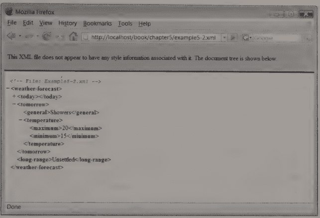

## 查看XML页面

到目前为止，我们已经看到了几个XML文档，但我们可以用它们做什么呢？稍后我们将使用基于XML的语言XHTML来创建网页，但同时我们也可以直接在浏览器中查看XML文档。只要你使用的浏览器能够理解XML，就可以像HTML文档一样将XML文档作为本地文件直接打开。图5.2展示了我们的天气预报XML文档在Mozilla Firefox 2浏览器中的显示效果。该浏览器（并非所有浏览器都如此）的行为是将XML文档显示为树状结构，并允许元素展开或折叠。从该图可以看出，第一个‘temperature’元素已被折叠，其前面有一个‘+’符号表示这一点，而第二个‘temperature’元素则处于展开状态（所有展开的元素前面都有一个‘-’符号）。单击这些符号可以展开或收缩与之关联的元素。

## 格式良好的XML

与HTML文档不同（HTML文档可以是格式良好的，但并非必须如此），XML文档必须是格式良好的。格式良好的XML规则与格式良好的HTML规则相似，但你会注意到有一两个重要的区别：

- 空标签必须正确表示，需要在闭合尖括号之前加上一个末尾的斜杠，即

`<tag/>`

这与HTML不同，在HTML中，像`<BR>`这样的空标签不需要末尾斜杠。
- 与HTML不同，XML中的文本是区分大小写的。此外，与HTML 4.0规范不同，XML元素名称和属性名称应始终使用小写。
- 元素和属性名称必须以字母开头，但也可以包含数字、下划线、连字符、句点或冒号。当然，在HTML中，这些名称是由HTML语法预定义的。

能够将XML文档加载到浏览器中的一个有用特性是，浏览器会检查它是否为格式良好的。以下XML文档不是格式良好的，因为‘average-winter-temperature’元素缺少其结束标签：

```
<?xml version="1.0"?>
<!-- File: Example5-3.xml -->
<climate>
    <average-winter-temperature>
    10
    <average-summer-temperature>
    20
    </average-summer-temperature>
</climate>
```

尝试将此文档作为本地文件在Mozilla Firefox 2中打开时，会出现图5.3所示的错误消息。浏览器提示缺少结束标签。

## XML中的属性与元素

与HTML一样，XML开始标签可以包含属性，以定义与该元素直接相关而非由其他元素定义的属性。在HTML中使用属性时，受到HTML语法的约束。相比之下，如果你在创建XML文档结构，就需要决定哪些数据应该用元素表示，哪些应该用属性表示。与嵌套标签相比，属性与其宿主元素的耦合更紧密，灵活性较低，但具有一些特殊的性质。那么，如何决定某条特定数据应该建模为元素还是属性呢？一般的经验法则是，除非有特殊需要，否则应使用元素。这是因为使用元素有很多优点：

- 在单个元素中不能有多个同名属性，但可以有多个同名的嵌套元素。
- 如果以后想更改文档结构，属性的灵活性较低。
- 属性不能用于描述层次结构，但元素可以嵌套到这些层次结构中。
- 处理XML的软件程序更难操作属性。
- 你无法指定属性的有意义顺序，但处于同一嵌套级别的一组元素确实具有有意义的顺序（它们是文档顺序的一部分）。

> > **注意** 除了元数据属性外，此处列出的属性方面与DTD的使用有关（稍后介绍）。XML Schema还能使元素具备其中某些特性。

整体观点是，如果你仅仅将属性用作在XML文档中保存数据的一种方式，那么最终得到的文档将难以阅读和维护。那么，为什么我们还要使用属性而不是元素呢？事实上，属性在特殊情况下非常有用。这些情况包括：

- 表示元数据。元素应用于包含数据，而属性适合提供有关该数据的进一步信息，例如呈现数据的语言，或者如果内容涉及某些产品文档，则可提供内容的版本号。
- 为元素提供可用于交叉引用数据的唯一ID。有特殊类型的属性可以做到这一点，它们使XML树也能像图一样运作（即彼此没有嵌套关系的元素仍然可以关联）。
- 为某段数据指定一组可能的值。例如，你想说明交通灯只能是红色或绿色，不能是其他颜色。这称为枚举类型。属性可用于枚举类型，但元素不能。
- 指定一个固定值（常量）。你可以用属性来做到，但不能用元素。
- 指定默认值。你可以用属性来做到，但不能用元素。
- 在XML文档中引用外部实体（如其他文件）。属性具有实现此功能的特殊类型。

一个更专业化的需求，但可能值得了解的是，在处理速度很重要的情况下，属性通常更好。某些程序处理XML的方式意味着，使用属性可以获得更好的性能（Eckstein 2002）。

## 图5.3 尝试加载格式错误的XML文档时，Mozilla Firefox 2显示的错误消息

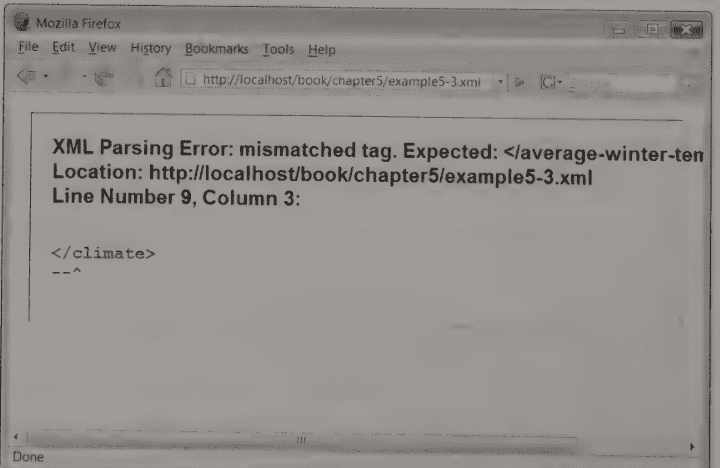


以下示例展示了一个包含属性的 XML 文档。在本例中，我们有一些带有 ‘calendar’ 属性的 ‘date’ 元素。当然，我们也可以使用一个元素来包含所使用日历类型的信息（在本例中为公历），但这可以合理地被视为元数据，因此可能更适合表示为属性。

```
<?xml version="1.0"?>
<!-- File: Example5-4.xml -->
<dates>
    <date calendar="gregorian">
        <day>1</day>
        <month>3</month>
        <year>2005</year>
    </date>
    <date calendar="gregorian">
        <day>2</day>
        <month>3</month>
        <year>2005</year>
    </date>
</dates>
```

关于属性的其他用途呢？正如我们将看到的，只有当我们将 XML 文档与验证文档（如文档类型定义（DTDs））结合使用时，它们才开始变得可用，因此我们将在第 5.5 节中重新讨论这个问题。

## CDATA 节
某些字符（如 < 和 >）会破坏程序对 XML 文档的正确解析，并使其看起来格式不正确。这类情况的一个例子可能是编程语言中的某种关系表达式，使用 ‘>’ 和 ‘<’ 符号：

```
<relational-expression>
    if(a > b && c < d)
</relational-expression>
```

在这种情况下，我们可以使用 CDATA 节使 XML 解析器忽略整个序列。CDATA 代表 ‘character data’（字符数据），与 PCDATA（‘parsed character data’ 解析字符数据）相对。CDATA 节看起来像这样：

```
<![CDATA[content]]>
```

它看起来可能不必要地复杂，但请记住，这类节必须能被 XML 解析器轻松识别，并且不会与文档中可能存在的其他类型的标记混淆。使用这种复杂格式可确保解析器能够识别 CDATA 节。以下是使用 CDATA 的示例：

```
<relational-expression>
    <![CDATA[if(a > b && c < d)]]>
</relational-expression>
```

### 5.5 验证 XML 文档
只要 XML 文档格式良好，就可以使用它来满足各种目的。问题在于，格式良好的 XML 文档仍然可能完全不可预测。由于基于 XML 的语言是可扩展的，我们可以使用自己决定的名称创建新的元素和属性，并且可以按任意顺序放置任意数量的元素，并将它们嵌套到我们选择的任意深度。其结果是，XML 文档本身并不能帮助我们了解给定类型文档的可接受结构。理想情况下，我们需要一种指定方法：

-   在 XML 文档中可以使用哪些元素名称，它们可能出现多少次以及出现的顺序
-   可以使用哪些属性名称，它们可以与哪些元素一起使用，以及它们是强制性的还是可选的
-   属性可能具有的任何默认值或允许值。

规则有助于描述特定类型的 XML 文档应如何结构化，以便他人根据这些规则创建有效文档。检查 XML 文档是否符合其中一组规则称为 *validation*。例如，XML 文档可能用于包含杂志文章的内容。文章可能包含标题、章节标题和子标题、文本段落、脚注、侧边栏和参考文献。我们期望这些不同类型的内容之间具有一定的关系，例如，我们可能假设子标题必须出现在标题的上下文中，并在文本段落之前出现，参考文献出现在末尾，标题出现在开头，等等。我们还可能期望只有一个标题和一组参考文献，但可能有许多标题、子标题和段落。XML 本身无法强制执行这些规则，使得处理不符合这些规则的文档变得困难。也许文章需要以 XML 格式提交给杂志的编辑部，但它们必须遵循我们在此描述的约定结构类型。为了强制执行这种结构，我们需要根据有关此类文档如何组织的规则的另一种定义来验证 XML 文档。这些定义可以表示为文档类型定义（DTDs）或 XML 模式（曾有其他方法，但 DTDs 和 XML 模式是最常见的）。可以使用任一类型的验证，但对于特定的验证过程，我们会选择其中一种（图 5.4）。

DTDs 已存在很长时间，因为它们是 SGML 的一部分，而 XML Schema 是一种更新的验证类型，得到了微软的强烈支持。在本章中，我们重点介绍使用 DTDs 验证 XML 文档，因为它们仍然被广泛使用，相对简单，并且与我们稍后将介绍的 XHTML 文档一起使用。除了定义 XML 文档元素的可接受结构外，验证文档还可以为 XML 文档提供默认值、枚举类型和其他有用的‘合理性检查’。

## 文档类型定义（DTDs）
我们可以使用 DTDs 验证 XML 文档，但 DTD 到底是什么？它基本上是一种特殊的标记类型，其中包含允许的结构定义 of a

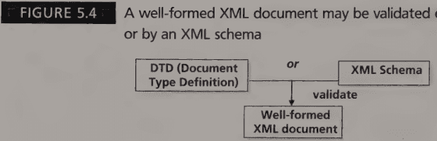

特定类型文档。DTD 描述了其中包括：

-   可以为元素类型使用哪些名称
-   给定元素可能或必须使用的次数
-   同一嵌套级别的元素可能出现的顺序
-   元素如何嵌套
-   可以或必须与特定元素一起使用的属性

XML 文档可以通过在 XML 文档本身中包含 DTD 标记或通过使用 URI 外部引用它来链接到 DTD。

## 在 DTD 中定义元素
对于我们的第一个示例 DTD，我们将描述一个简化的‘weather-forecast’ XML 文档类型。在此 DTD 中，没有属性，我们只是描述元素。从此示例中您会看到，DTD 语法与 XML 语法不同。它确实使用尖括号，但其他方面则大不相同：

```
```dtd
<!ELEMENT weather-forecast (today, tomorrow, long-range)>
<!ELEMENT today (#PCDATA)>
<!ELEMENT tomorrow (#PCDATA)>
<!ELEMENT long-range (#PCDATA)>
```
```

DTD 的第一行表示第一个元素（weather-forecast）是根。其他元素（today、tomorrow 和 long-range）是根的子元素（即嵌套在其中），并且按它们必须出现在有效 XML 文档中的顺序定义。其余三行表示这三个嵌套元素中的每一个都包含解析字符数据（#PCDATA）。这意味着元素将包含字符数据，XML 处理器在读取文档时会解析该数据。我们的第一个 XML 示例（此处再次显示）对此 DTD 有效。我们有必要的根元素，其中三个嵌套元素按正确顺序排列：

```
<?xml version="1.0"?>
<!-- File: Example5-1.xml -->
<weather-forecast>
    <today>
        rain
    </today>
    <tomorrow>
        showers
    </tomorrow>
    <long-range>
        unsettled
    </long-range>
</weather-forecast>
```

相比之下，以下文档格式良好，但根据我们的 DTD 无效：

```
```xml
<?xml version="1.0"?>
<weather-forecast>
    <today>
        Rain
    </today>
    <tomorrow>
        Showers
    </tomorrow>
</weather-forecast>
```
```


它无效是因为缺少‘long-range’元素，而 DTD 规定它应该出现。同样，以下文档也是无效的。在这里，所有必要的元素都存在，但它们的顺序错误——‘tomorrow’应该出现在‘long-range’之前：

```
```xml
<?xml version="1.0"?>
<weather-forecast>
    <today>
        Rain
    </today>
    <long-range>
        Unsettled
    </long-range>
    <tomorrow>
        Showers
    </tomorrow>
</weather-forecast>
```
```


## 将 DTD 添加到序言
DTD 出现在 XML 文档序言的一部分。可以将 XML 及其完整的 DTD 定义放在同一文档中。为此，我们将 DTD 放在 DOCTYPE 声明中，其中包含根元素的名称：

```
```xml
<!DOCTYPE rootelement[...DTD here...]>
```
```

XML 中根元素的名称必须与 DTD 中使用的名称相同。相比之下，如果文档只是未针对 DTD 进行验证的 XML，则根元素的名称可以任意选择。在我们的示例中，根元素是‘weather-forecast’。使用这种方法意味着根元素的名称出现了三次，一次在 DOCTYPE 中，一次作为 DTD 中的元素声明，再一次在 XML 文档中。当 XML 文档包含 DTD 时，我们还可以

XML 声明的 ‘standalone’ 属性用于指示这一点，通过将其值设置为 ‘yes’（即该文档不依赖于任何外部文档。）

```
<?xml version="1.0" standalone="yes"?>
<!-- File Example5-5.xml -->
<!DOCTYPE weather-forecast[
    <!ELEMENT weather-forecast (today, tomorrow, long-range)>
    <!ELEMENT today (#PCDATA)>
    <!ELEMENT tomorrow (#PCDATA)>
    <!ELEMENT long-range (#PCDATA)>
]>
<weather-forecast>
    <today>
        Rain
    </today>
    <tomorrow>
        Showers
    </tomorrow>
    <long-range>
        Unsettled
    </long-range>
</weather-forecast>
```

如果你在标准浏览器中打开此文档，你会看到浏览器不会使用 DTD 进行验证。相反，它只是像之前一样简单地显示 XML 文件，图 5.5 显示了加载到 Internet Explorer 中的文档，该浏览器承认 DTD 的存在但不验证 XML。

| 注 | 尽管浏览器可能不使用 DTD 来验证 XML，但它们可能会检查 DTD 是否格式良好，如果不是则显示错误消息。 |
|---|---|

## 图 5.5 标准浏览器不会验证 XML 文档，因此与 XML 文件一起使用的 DTD 被忽略

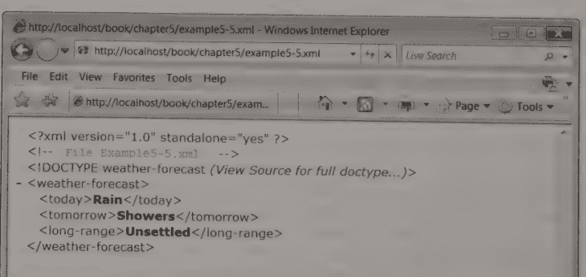

## 使用 XMLSpy 验证 XML

在前面的示例中，我们看到即使提供了 DTD，网络浏览器也不会验证 XML 文档。虽然有许多可以与浏览器一起用于 XML 验证的插件，但没有一个特别容易使用，而且它们通常存在局限性。因此，使用其他工具来测试我们的 XML 文档是否有效会很有帮助。其中一种工具是 XMLSpy，它可用于许多不同的基于 XML 的流程。附录包含有关 XMLSpy 的简要介绍以及如何使用它来验证 XML 文档。

## 将 DTD 与 XML 文档分离

将 DTD 包含在与 XML 相同的文档中固然很好，但我们就无法在多个文档中重用该 DTD。再次查看我们的示例应该可以清楚地表明这不是很有帮助。让我们来看另一个天气预报文档。

```
<?xml version='1.0'?>
<!-- File Example5-5.xml -->
<weather-forecast>
    <today>
        Sunshine
    </today>
    <tomorrow>
        Sunshine
    </tomorrow>
    <long-range>
        Thunder storms
    </long-range>
</weather-forecast>
```

此文档的内容与第一个不同，但仍需要根据 DTD 进行验证，因为它是同一文档类型。事实上，我们预计每天都会有一个新的天气预报文档，每个文档都需要根据 DTD 进行验证。与其在每个 XML 文档中不断重复 DTD，我们可以通过将其存储为单独的文档来重用相同的 DTD。由于这种灵活性经常需要，DTD 通常以单独的文件编写，通过 URL 或本地文件名引用。图 5.6 显示了单个 DTD ‘forecast.dtd’ 如何用于验证多个单独的 XML 文件，例如每周每一天的一个天气预报文件。

## 系统或公共文档类型？

当 DTD 以外部文件形式与 XML 分开存储时，它可以在 DOCTYPE 中作为系统 DTD 或公共 DTD 引用。系统文档类型来自你自己的本地系统，要么是 URI 要么是文件路径。对于为自己的应用程序内部开发的任何 DTD，‘system’ 都是合适的类型。相比之下，公共文档类型是具有某种全球已知标识符的类型，因为它被许多不同的应用程序使用。一个很好的例子是可用于验证 HTML 或 XHTML 文档的常用 DTD 集合。由于许多人使用相同的 DTD 来编写有效的网页，因此使用公共文档类型。公共文档类型标识符的格式不是 URL，而是正式公共标识符（FPI）。FPI 具有以下结构：

```
-//owner//keyword description//language
```

我们可以在 HTML 4.01 文档的公共文档类型中看到此结构：

```
-//W3C//DTD HTML 4.01//EN
```

所有者是 ‘W3C’，关键字（后跟空格）是 ‘DTD’，描述是 ‘HTML 4.01’，语言是英语（‘EN’）。语言与 DTD 相关，而不是文档所写的语言。

处理文档的软件（例如浏览器）应该能够识别这些标准文档类型名称并找到必要的 DTD。然而，由于不能在每个应用程序中都依赖此机制，任何对公共文档类型的引用都必须随后跟随对系统文档类型的引用。如果找不到公共文档类型，XML 处理器将改用系统文档类型。由于这是要求，只有公共文档类型需要特别标记。系统文档类型跟在公共文档类型之后，但没有标签。HTML 4.01 文档类型清楚地显示了这一点：

```
<!DOCTYPE HTML PUBLIC "-//W3C//DTD HTML 4.01//EN" "http://www.w3.org/TR/html4/strict.dtd">
```

在此示例中，‘-//W3C//DTD HTML 4.01//EN’ 是公共文档类型，而 ‘http://www.w3.org/TR/html4/strict.dtd’ 是系统文档类型。系统文档类型的值可以根据需要从标准 URL 更改为本地文件名。

下一个示例显示我们的天气预报 XML 文档引用了本地文件系统中的单独系统 DTD。以下是 DTD 文件（‘forecast.dtd’）的内容：

```
<!ELEMENT weather-forecast (today, tomorrow, long-range)>
<!ELEMENT today (#PCDATA)>
<!ELEMENT tomorrow (#PCDATA)>
<!ELEMENT long-range (#PCDATA)>
```

这包含了 DTD 定义，就像我们在之前的示例中看到的那样。系统 DOCTYPE 条目保留在 XML 文档中并引用 DTD 文件名。如果 DTD 与 XML 文件分开，则 ‘standalone’ 属性的值应为 ‘no’ 而不是 ‘yes’，就像前一个示例中那样。由于此属性的默认值是 ‘no’，因此在这里并非绝对必要。

```
<?xml version="1.0" standalone="no"?>
<!-- File Example5-7.xml -->
<!DOCTYPE weather-forecast SYSTEM "forecast.dtd">
<weather-forecast>
    <today>
        Rain
    </today>
    <tomorrow>
        Showers
    </tomorrow>
    <long-range>
        Unsettled
    </long-range>
</weather-forecast>
```

在此文档中，天气预报的 DTD（‘forecast.dtd’）假定存储在与 XML 文件相同的本地文件系统文件夹中。

## 图 5.6 使用单个 DTD 验证多个 XML 文档

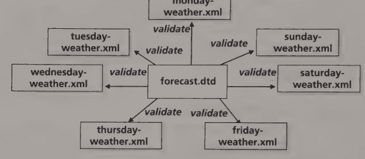

## DTD 中的元素声明

正如我们从第一个 DTD 示例中看到的那样，元素声明的一般形式是

```
<!ELEMENT element-name (regular-expression)>
```

‘regular-expression’ 描述了元素的使用方式。以逗号分隔的元素名称列表定义了这些元素可能出现的顺序，就像我们在天气预报中嵌套标签时看到的那样：

```
<!ELEMENT weather-forecast (today, tomorrow, long-range)>
```

相比之下，被定义为 #PCDATA 的元素将不包含任何嵌套元素：

```
<!ELEMENT today (#PCDATA)>
```

到目前为止，我们只看了一个简单的示例，其中 DTD 定义了元素的序列。然而，正如我们在 XML 的上下文中讨论的那样，半结构化数据不一定需要如此可预测的结构，但我们仍然希望能够验证表现出半结构化特征的 XML 文档，例如可选元素、元素以不同顺序出现以及元素在同一文档中多次出现。为了探索这些类型文档的验证，我们将使用一个稍微复杂一些的示例。假设 WebHomeCover 希望在某种候选人管理系统中管理有关求职申请人的信息。此信息将包含有关候选人资格、技能、经验等的数据，但这些信息在不同候选人之间可能会有很大差异。他们可能拥有不同类型和数量的资格、担任过不同数量的以前工作，并且技能组合差异很大。为了将此类数据存储在 XML 中，我们必须能够利用其半结构化属性来适应这些数据结构的变化。


我们将从一个简单但不够灵活的 DTD 开始，它仅处理资格。该 DTD 与我们的天气预报 DTD 非常相似：

```
<!ELEMENT qualification (certificate, diploma, degree)>
<!ELEMENT certificate (#PCDATA)>
<!ELEMENT diploma (#PCDATA)>
<!ELEMENT degree (#PCDATA)>
```

这里的问题在于，资格的不可预测性不如天气预报的结构（尽管也许比天气本身更可预测！）。目前的 DTD 假设每个候选人都会拥有证书、文凭和学位。这对于表示不具备全部三项的候选人来说是不合适的。幸运的是，DTD 语法包含许多运算符符号，可以提供我们指定实际需求所需的灵活性。

## DTD 运算符符号

我们可以通过使用竖线运算符 (|) 来解决当前必须要求全部三个资格的限制，在 DTD 语法中它表示“或”。在此版本的 DTD 第一行中，候选人可能在其 XML 文档中出现这些元素中的任意一个（证书、文凭或学位）。

```
<!ELEMENT qualification (certificate | diploma | degree) >
```

这是一些改进，但另一方面，每个候选人现在只能拥有这些资格中的任意一个，而不能多于一个。我们可以通过将 qualification 元素嵌套在另一个可能出现多次的元素（‘qualifications’）内部来解决这个问题。星号运算符 (*) 用于指定元素可以出现零次或多次，如本例所示，其中 ‘qualifications’ 元素由零个或多个 ‘qualification’ 元素组成：

```
<!ELEMENT qualifications (qualification*)>
```

这好多了。现在我们可以拥有任意数量的资格。然而，这仍然可能不理想，因为 qualification 元素可能出现零次，意味着候选人没有任何资格。为了确保文档中至少包含一个资格，我们可以使用 ‘+’ 运算符，它表示“一个或多个”，而不是 ‘*’ 运算符。在此版本中，必须有一个或多个资格。

```
<!ELEMENT qualifications (qualification+)>
```

另一个有用的规范是使元素可选，使其可以出现零次或一次（但不超过一次）。用于表示可选元素的运算符是问号。也许我们还关心候选人是否具有某种更高资格，但不需要知道他们是否拥有多个。我们可以添加一个 ‘higher qualification’ 元素，但使其可选：

```
<!ELEMENT qualifications (qualification+, higher-qualification?)>
```

从这些示例中我们可以看出，我们需要仔细设计 DTD 规范以匹配我们的需求。表 5.1 总结了我们为指定 DTD 中元素的特征而引入的各种运算符符号。

## 表 5.1 DTD 中使用的运算符符号

| 运算符符号 | 含义 |
|---|---|
| \| | 或 |
| * | 零个或多个 |
| + | 一个或多个 |
| ? | 可选（零个或一个） |

## 空元素

我们可以选择使元素专门为空，这意味着有效的 XML 文档不能为此类标签包含主体。我们已经看到，具有内容主体的标签使用 #PCDATA 类型指定。相比之下，空元素使用 EMPTY 定义。例如，‘higher-qualification’ 元素可能被声明为空：

```
<!ELEMENT higher-qualification EMPTY>
```

尽管可以拥有既没有属性的空元素，也许可作为文档中的某种“开关”来简单指示某事物是否存在或不存在，但大多数空标签确实包含属性。例如，‘higher-qualification’ 元素可能包含一个包含资格类型的属性。我们稍后将看到如何在 DTD 中包含属性。

以下示例（‘qualifications.dtd’）是一个纯粹由元素声明（无属性）组成的 DTD，其中包含我们迄今为止介绍的语法的示例。相比之前的示例，添加了一些额外的元素（year、institution 和 name）。

```
<!ELEMENT qualifications (qualification+, higher-qualification?, institution+)>
<!ELEMENT qualification (year, (certificate | diploma | degree)) >
<!ELEMENT higher-qualification EMPTY>
<!ELEMENT year (#PCDATA)>
<!ELEMENT certificate (#PCDATA)>
<!ELEMENT diploma (#PCDATA)>
<!ELEMENT degree (#PCDATA)>
<!ELEMENT institution (name)>
<!ELEMENT name (#PCDATA)>
```

在示例 DTD 中，第一行表示 ‘qualifications’（根）元素包含一个或多个 ‘qualification’ 类型的元素、一个可选的 ‘higher-qualification’ 以及一个或多个 ‘institution’ 元素，按此顺序。

第二行表示每个 ‘qualification’ 元素首先包含一个 ‘year’ 元素，然后是 ‘certificate’、‘diploma’ 或 ‘degree’ 元素中的一个。‘certificate’、‘diploma’ 和 ‘degree’ 元素仅包含字符数据。‘institution’ 元素包含一个 ‘name’ 元素。

DTD 越复杂，其有效 XML 文档的结构就越灵活。具有可选元素和可多次出现的元素的 DTD，可以有许多结构变体供有效 XML 使用。下一个示例是此 DTD 的有效 XML 文档。该文档包含两个 'qualification' 元素和两个 'institution' 元素，以及一个（空）'higher-qualification' 元素。

```
<?xml version='1.0'?>
<!-- File Example5-8.xml -->
<!DOCTYPE qualifications SYSTEM "qualifications.dtd">
<qualifications>
    <qualification>
        <year>2001</year>
        <diploma>Electronic Engineering</diploma>
    </qualification>
    <qualification>
        <year>2005</year>
        <degree>Computer Science</degree>
    </qualification>
    <higher-qualification/>
    <institution>
        <name>Oxford University</name>
    </institution>
    <institution>
        <name>MIT</name>
    </institution>
</qualifications>
```

下一个 XML 文档对 'qualifications.dtd' 也是有效的。请注意它要短得多，仅包含一个 'qualification' 和一个 'institution'，并且没有 'higher-qualification'。

```
<?xml version='1.0'?>
<!-- File Example5-9.xml -->
<!DOCTYPE qualifications SYSTEM "qualifications.dtd">
<qualifications>
    <qualification>
        <year>1999</year>
        <certificate>Baking</certificate>
    </qualification>
    <institution>
        <name>Springfield College</name>
    </institution>
</qualifications>
```

## DTD 中的属性声明

到目前为止，我们验证过的 XML 示例仅使用元素，但有时属性可以完成元素无法完成的事情。一旦我们开始根据 DTD 验证 XML，就会变得非常清楚，因为 DTD 可以提供有关属性的一些非常有用的数据和元数据。属性可以与 DTD 结合使用以：

- 定义默认值
- 定义一组有效值

## 其他属性类型

并非所有属性都是简单的字符数据（CDATA）。未声明为 CDATA 的属性可以包括具有默认值、枚举类型以及 NMTOKEN 类型的属性。

默认值在属性名后用引号声明。在此默认值示例中，‘qualification’ 元素具有 ‘years-of-study’ 属性，其默认值为 ‘3’：

```
<!ATTLIST qualification years-of-study "3">
```

使用枚举类型时，属性在使用于 XML 文档中时必须具有一组指定值中的一个。可能的值由竖线分隔（即‘或’字符）：

```
(value1|value2|..)
```

在此枚举类型示例中，‘is-university’ 属性只能是 ‘true’ 或 ‘false’。这里使用了 ‘false’ 的默认值，尽管提供默认值并非必需。

```
<!ATTLIST institution is-university (true | false) "false">
```

当提供默认值时，定义 REQUIRED 或 IMPLIED 就不相关了，否则就相关。可以为枚举类型提供任意数量的可能值。这里，使用一周中各天的名称作为 ‘day-name’ 属性：

```
<!ATTLIST calendar day-name (Monday | Tuesday | Wednesday | Thursday |
Friday | Saturday | Sunday) #REQUIRED>
```

由于未提供默认值，因此该属性已被标记为 required。

NMTOKEN 属性类型表示‘名称标记’。如果您使用此类型而不是 CDATA，它将限制属性可以包含的字符集为字母、数字、句点、连字符、下划线和冒号：

以下 DTD（‘qualifications2.dtd’）基于我们之前查看的 DTD，描述资格和机构，但已添加了多个属性：

```
<!ELEMENT qualifications (qualification+, higher-qualification?, institution+)*>
<!ELEMENT qualification (year, (certificate | diploma | degree) ) >
<!ATTLIST qualification level CDATA #REQUIRED
          internationally-recognised CDATA #IMPLIED
          years-of-study CDATA "3">
<!ELEMENT higher-qualification EMPTY>
<!ATTLIST higher-qualification type CDATA #REQUIRED>
<!ELEMENT year (#PCDATA)>
<!ELEMENT certificate (#PCDATA)>
<!ELEMENT diploma (#PCDATA)>
<!ELEMENT degree (#PCDATA)>
<!ATTLIST degree type CDATA #REQUIRED>
<!ELEMENT institution (name)>
<!ATTLIST institution is-university (true | false) "false">
<!ELEMENT name (#PCDATA)>
```


## 练习

### 5.1 来自第 5.4 节的以下 XML 文档格式不正确：

```
<?xml version="1.0"?>
<climate>
    <average-winter-temperature>
    10
    <average-summer-temperature>
    20
    </average-summer-temperature>
</climate>
```

正如示例所示，如果将它加载到浏览器中，错误信息会抱怨在遇到关闭 ‘climate’ 标签时缺少关闭 ‘average-winter-temperature’ 标签。为什么它不在遇到打开 ‘average-summer-temperature’ 标签时就失败？

### 5.2 这里有一个简单的 DTD：

```
<!ELEMENT building (address, value, construction)>
<!ELEMENT address (#PCDATA)>
<!ELEMENT value (#PCDATA)>
<!ELEMENT construction (#PCDATA)>
<!ATTLIST building rental (true|false) #REQUIRED>
```

编写一个符合此 DTD 的 XML 文档，描述一栋投保的建筑物，地址为 100 Seaview Road，价值 £400,000，砖瓦结构，并用作出租。

### 5.3 本章前面我们看到以下 XML 文档：

```
<?xml version="1.0"?>
<!-- File: Example5-2.xml -->
<weather-forecast>
    <today>
        <general>Rain</general>
        <temperature>
            <maximum>15</maximum>
            <minimum>11</minimum>
        </temperature>
    </today>
    <tomorrow>
        <general>Showers</general>
        <temperature>
            <maximum>20</maximum>
            <minimum>15</minimum>
        </temperature>
    </tomorrow>
    <long-range>Unsettled</long-range>
</weather-forecast>
```

编写一个使该文档有效的 DTD。

### 5.4 编写一个使以下 XML 文档有效的 DTD

```
<policies>
<description>Policies taken out in January</description>
<policy type="contents">
<policy-number>1234557</policy-number>
<policy-holder>A. Liu</policy-holder>
</policy>
<policy type="buildings">
<policy-number>1234558</policy-number>
<policy-holder>C. Jones</policy-holder>
</policy>
<report-date>01/01/2008</report-date>
</policies>
```

假设可以有零个或多个 ‘policy’ 元素，并且 ‘type’ 属性是强制性的。

### 5.5 编写一个涵盖以下元素和属性规则的 DTD

元素：

- ‘policy-report’ 根元素由一个可选的 ‘description’ 元素、一个或多个 ‘policy’ 元素和一个 ‘report-dates’ 元素组成。
- ‘report-dates’ 是一个空元素。
- ‘policy’ 元素由一个 ‘policy-number’ 元素组成，其后是 ‘personal-customer’ 元素或 ‘corporate-customer’ 元素之一。
- ‘description’、‘policy-number’、‘personal-customer’ 和 ‘corporate-customer’ 都是解析字符数据。

属性：

- ‘policy’ 元素有一个强制性的 type 属性，其值只能为 ‘buildings’ 或 ‘contents’。
- ‘report-dates’ 有两个属性，一个强制性的 ‘start’ 属性和一个可选的 ‘end’ 属性。

### 5.6 现在编写一个符合你在练习 5.5 中创建的 DTD 的 XML 文档。

### 5.7 将演示三区域布局的 Example 4.12.htm 中的 HTML 文档转换为有效的 XHTML。你需要：

- 更改 DOCTYPE
- 在开始的 HTML 标签中添加命名空间和语言
- 将所有元素名称改为小写
- 确保空元素正确终止。

## 摘要

本章首先描述了 HTML 作为将页面内容、结构和表现结合在一起的标记语言的局限性。我们介绍了半结构化数据的概念，并了解了 XML 如何遵循其原则。我们探讨了 XML 作为一种元语言，能够由于其可扩展的特性而定义任意数量的特定标记语言。我们探讨了 XML 和 HTML 的验证概念，最后是 XHTML，这是 HTML 和 XML 结合在一起的演进路径。在此过程中，我们看到了如何使用 DTD 对文档进行验证，以确保文档结构正确。

## 参考文献和进一步阅读

- BBC (2005) Radio Times. http://www.radiotimes.com/
- Bray, T., Paoli, J., Sperberg-McQueen, C., Maler, E. and Yergeau, F. (2004) Extensible Markup Language (XML) 1.1. W3C. http://www.w3.org/TR/2004/REC-xml11-20040204/
- Bray, T., Paoli, J., Sperberg-McQueen, C., Maler, E. and Yergeau, F. (2006) Extensible Markup Language (XML) 1.0 (Fourth Edition). W3C http://www.w3.org/TR/REC-xml/#sec-origin-goals
- Eckstein, R. (2002) Java Enterprise Best Practices. Farnham: O'Reilly.
- Eden, R. (2005) XMLTV wiki. http://xmltv.org/
- Pemberton, S. (2007) XHTML2 Working Group Home Page. http://www.w3.org/MarkUp/
- Uniprot. (2005) The Universal Protein Resource. http://www.ebi.uniprot.org/index.shtml

## JavaScript 简介

### 学习目标

- 了解客户端脚本语言在浏览器中支持应用程序流程的作用
- 了解 JavaScript 语言的关键特性
- 能够使用 DOM 的对象、属性和方法与浏览器和 HTML 文档交互
- 能够编写操作 JavaScript 变量的简单脚本
- 了解如何编写 JavaScript 函数并将它们放入单独的文件中，以便网页中的脚本可以调用它们

### 引言

本章介绍 JavaScript 语言，可用于编写在浏览器内运行的代码。我们应用 JavaScript 中最重要的一些概念，包括文档对象模型 (DOM) 和内置的 JavaScript 对象。本章中的示例展示了如何使用 JavaScript 对象的属性和方法，如何处理包括数字、字符串、日期和数组在内的简单数据类型，以及如何使用算术运算符。我们探讨了 JavaScript 编程的控制结构，并了解如何在脚本元素、函数和外部文件中编写代码。

### 6.1 JavaScript – 是什么，为什么？

脚本语言是轻量级的编程语言，通常是解释执行而不是编译执行，并在特定环境中运行。‘a client-side script is a program that may accompany an HTML document or be embedded directly in it’ (Ragget et al. 1999)。

JavaScript 是可在 Web 浏览器中运行的多种脚本语言中最常用的一种。JavaScript 代码可以嵌入到 HTML 文档中或从 HTML 文档调用，这些脚本可以动态生成页面内容。一般来说，JavaScript 用于三个主要目的：

- 改善使用基于浏览器的应用程序的用户体验的视觉外观和感觉。例如，JavaScript 可用于创建弹出窗口和交互式菜单，并使页面的一部分，例如图像，对鼠标事件做出响应，例如鼠标指针经过它们。JavaScript 结合 DOM 和层叠样式表 (CSS)，是动态 HTML (DHTML) 的基础，使基于浏览器的应用程序更具交互性。
- 将 Web 应用程序处理从服务器卸载到客户端。这方面的一个很好的例子是能够执行客户端表单验证，在将 HTML 表单提交到服务器进行进一步处理之前检查其内容。并非所有验证都可以在客户端完成，但像检查必填字段是否为空这样简单的事情仍然非常有用。
- 启用异步 JavaScript 和 XML (Ajax) 实现，以提供客户端和服务器之间更无缝的交互。

JavaScript 最初由 Netscape 于 1995 年开发，并引入到 Netscape Navigator 2.0 中。它最初被称为 ‘LiveScript’，后来成为 ‘JavaScript’，因此经常与 Java 混淆，尽管两者之间存在许多差异。虽然术语 ‘JavaScript’ 被广泛使用，但严格来说，该名称仅适用于 Netscape 版本。在 Microsoft 浏览器中运行的版本称为 ‘JScript’，还有一种标准语言版本称为 ‘ECMAScript’。ECMA 是一个欧洲标准联盟，最初是欧洲计算机制造商协会，因此得名。

### 6.2 文档对象模型 (DOM)

DOM 是一个 W3C 规范，使 JavaScript 等脚本语言能够访问和更新文档的内容、结构和样式，而不管使用的平台或脚本语言如何。第一个 DOM 规范 (level 1) 于 1998 年发布，第二个 (level 2) 于 2000 年发布，第三个 (level 3) 于 2004 年发布。DOM 由适用于任何结构化文档的核心接口集组成，还有专门用于 XML 或 HTML 文档的附加接口。随着 XHTML 规范使 HTML 更接近 XML，XML 和 HTML 之间的这种区别变得不那么重要。术语 ‘DOM level 0’ 有时用于指在第一个正式 DOM 规范之前在浏览器 (例如 Internet Explorer 3 和 Netscape Navigator 3) 中使用的事实上的对象模型。为了确保与这些早期文档模型的向后兼容，一些专门与 HTML 相关的 DOM API 部分被包含在内。

DOM 将文档表示为节点层次结构，其中一些节点可以有子节点，一些是叶节点。你可以从我们之前对 XML 文档结构的讨论中认识到 DOM 的核心方面。例如，文档节点只能有一个类型为元素 的子节点 (当然是文档的根元素)。元素节点 however 可以有多个子节点，这些子节点也可能是元素。文本节点是叶节点，这意味着它不能有任何子节点。随着我们研究 JavaScript，你会发现它有自己的文档对象建模方式，其中一些直接来自标准 W3C DOM，一些是 JavaScript 特有的。


### 6.3 JavaScript 的特性

JavaScript 中的语言结构与许多其他语言相似，包括 C、C++、C# 和 Java，但存在一些重要差异。也许最明显的区别是 JavaScript 是松散类型的，这意味着在声明变量时我们只需声明其名称，而不需要声明其类型。我们还可以在不同时间使用同一个变量引用不同类型的数据。这在像 Java 这样强类型的语言中是不可能的，但在 PHP 中是可能的，而 PHP 也是松散类型的。

JavaScript 并不是完全面向对象的语言，也不允许创建新的对象类型（尽管 ECMAScript 的较新版本已开始朝此方向发展）。相反，它是一种基于对象或原型语言，其中有许多内置对象和对象类型可用于程序中。例如，JavaScript DOM 中的顶级对象是 window，它代表浏览器窗口（或框架）。

### 为网页设置默认脚本语言

由于 JavaScript 只是浏览器可能支持的众多脚本语言之一（其他包括 VBScript 和 Tcl），因此有必要指定在特定页面中使用的是 JavaScript。应在 ‘head’ 元素内部使用 ‘meta’ 元素来设置默认脚本语言，如下所示：

```
<meta http-equiv="Content-Script-Type" content="text/javascript" />
```

对于链接到固有事件的脚本，设置默认脚本语言非常重要，例如鼠标按钮被按下、键盘上的键被按下以及 HTML 文档被加载。

| 注 | 'text/javascript' 很可能在即将到来的标准中被 'application/javascript' 取代，但目前尚未被浏览器广泛支持。 |
|------|------------------------------------------------------------------------------------------------------------------------------------------|

### 向网页添加脚本

可以通过使用 <script>...</script> 元素将脚本添加到网页中。这些可以添加到 HTML 的 head 或 body 元素中，甚至可以作为页面定义之外的单独元素添加。脚本也可以作为可重用的函数写入单独的文件中（见第 6.9 节）。不属于 JavaScript 函数的脚本元素将在页面加载时运行，而函数可以在其他时间被调用，例如通过单击按钮。除了在文档的 meta 标签中设置默认脚本语言外，每个脚本元素还应通过将 type 属性设置为 ‘text/javascript’ 来定义该特定元素使用的脚本语言。无论在文档中的何处出现，所有使用 JavaScript 的脚本元素都应如下所示：

```
<script type="text/javascript">
... JavaScript source code goes here
</script>
```

### 图 6.1 某些浏览器相关 JavaScript 对象的关系

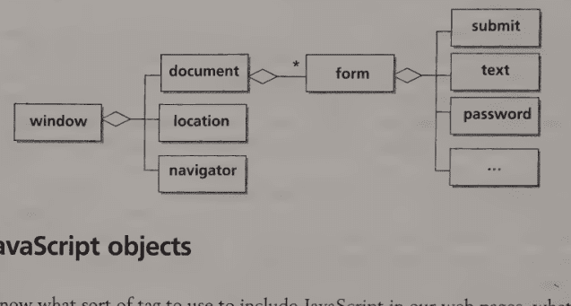

### 6.4 JavaScript 对象

现在我们知道了在网页中包含 JavaScript 应使用什么类型的标签，这些元素中应放入什么类型的代码？JavaScript 的一个重要方面是其与各种类型对象交互的能力。其中一些与浏览器环境的 DOM 组件相关，例如 window、document、location 和 navigator。一些与常见数据类型相关，例如 Array、String 和 Date，而其他一些，例如 Math，则提供一些标准实用函数。与浏览器环境相关的对象具有父子关系，其中一个对象包含另一个对象。图 6.1 显示了其中几个浏览器相关 JavaScript 对象之间的关系。window 对象包含 document（在浏览器窗口中加载）以及 location 和 navigator 对象，而 document 可能包含一个表单，该表单反过来包含各种 HTML 控件，例如文本字段和按钮。

### 对象属性

JavaScript 对象具有属性、方法和事件处理程序。属性是反映对象状态的值；方法是对象可以执行的操作；事件处理程序使在发生事件（例如按钮被按下、组件失去或获得焦点或文档被加载）时能够调用状态更改或方法。可以 ‘dot’ 表示法访问对象的属性，其中对象的名称后跟属性的名称，两者由点分隔：

```
object.property
```

可以使用 ‘ = ’ 运算符设置属性的值。例如，document 对象的属性之一是 title。这是在浏览器窗口顶部标题栏中显示的文本。此示例显示了 document 的 title 属性被设置。

```
document.title="JavaScript document title"
```

以下是使用页面 body 中的脚本元素设置文档标题属性的 XHTML 页面的完整源代码。请注意，为了使 XHTML 有效，并且当然为了让 JavaScript 能够定位该元素以填充它，XHTML head 元素需要包含一个 title 元素，即使它是空的。

```
<?xml version="1.0"?>
<!DOCTYPE html PUBLIC "-//W3C//DTD XHTML 1.1//EN" "http://www.w3.org/TR/xhtml11/DTD/xhtml11.dtd">
```

这类注释有助于其他 JavaScript 开发人员理解您编写的脚本。注释语法的第二种用途是在脚本元素中的代码周围包裹 HTML 或 XML 注释，结合 JavaScript 单行注释。这样做有两个原因：

- 如果客户端浏览器不支持 JavaScript，或 JavaScript 被禁用，代码可以从浏览器中隐藏。
- 如果您希望页面的其余部分是有效的 XHTML，则需要将 JavaScript 语法隐藏在验证器之外，因为 JavaScript 中常用的一些字符（例如 ‘<’ 和 ‘>’）会导致验证问题。

我们在脚本周围包裹注释的方式是使用 HTML 注释开始序列 ‘<!--’ 在前面加上它，JavaScript 将其视为单行注释。然后在脚本末尾，使用 HTML 注释结束序列，但在其前面加上 JavaScript 单行注释，即 ‘// -->’其效果是 JavaScript 忽略关闭 HTML 注释字符，但浏览器将其识别为 HTML 注释的结束。以下是更改文档 title 属性的脚本的修改版本，但添加了注释语法。使用这种方法意味着您的脚本在不支持 JavaScript 的浏览器中不会引起问题，并且您的文档仍然可以是有效的 XHTML。

```
<script type="text/javascript">
<!--
document.title="JavaScript document title"
// -->
</script>
```

### 对象作为属性

某些对象的属性也是对象。例如，window 的 location 属性实际上是一个 ‘Location’ 对象，具有自己的属性和方法。我们可以使用点表示法在对象层次结构中导航，访问 ‘window’ 对象的 ‘location’ 属性，然后访问其自己的属性。在此示例中，访问了 ‘location’ 的 ‘protocol’ 属性：

```
window.location.protocol
```

以下是使用 location 的协议值设置文档 title 属性的脚本的 XHTML 页面。

```
<?xml version="1.0"?>
<!DOCTYPE html PUBLIC "-//W3C//DTD XHTML 1.1//EN"
"http://www.w3.org/TR/xhtml11/DTD/xhtml11.dtd">
<html xmlns="http://www.w3.org/1999/xhtml" xml:lang="en">
<head>
<meta http-equiv="Content-Script-Type" content="text/javascript"/>
<title></title>
</head>
<body>
<!-- File: Example6-2.htm -->
<script type="text/javascript">
<!--
document.title = window.location.protocol
// -->
</script>
</body>
</html>
```

图 6.3 显示了 Mozilla Firefox 2 的标题栏，当文件加载到浏览器中时显示 http: 协议。根据浏览器用于显示的内容，‘protocol’ 属性的其他可能值包括 ‘file:’ 和 ‘ftp:’。

| 注 | ‘Location’ 不是 DOM 对象，而是一个 JavaScript 对象，基于 DOM 层次结构中 window 的 ‘location’ 属性。 |
|------|--------------------------------------------------------------------------------------------------------------------------------|

### 对象方法

方法是对象可以做的事情。对象方法的简单示例是 ‘document’ 对象的 ‘write’ 和 ‘writeln’ 方法，它们允许我们将页面内容写入当前文档。它们之间的唯一区别是 ‘writeln’ 在写入内容后向生成的 HTML 添加回车和换行，但这不会在实际的 HTML 文档中插入换行元素。要调用方法，我们使用与访问属性时相同的点表示法。

方法可以有参数作为参数传递给它们，放在括号中。在此示例中，‘write’ 方法作为参数传递了一些字符串数据（可能包括标记）。字符串数据是由引号（单引号或双引号）括起来的字符集合。

```
document.write("<h2>Subheading</h2>")
```

### 在文档中定位脚本

在下一个示例中，我们使用 ‘document.write’ 方法来说明将脚本放在文档 body 中与放在 head 中之间的区别。如果我们将脚本放在文档 body 中，我们可以将其定位在文档其余部分中

### 图 6.3 使用 ‘protocol’ 属性设置的 Mozilla Firefox 2 标题栏

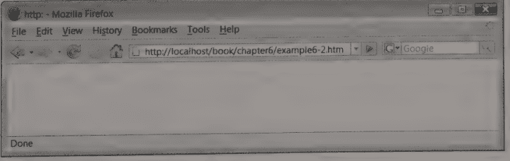


在一个特定位置。相比之下，head 元素中的脚本在 body 内容渲染之前运行。以下示例展示了一个 script 元素，该元素写入子标题，被放置在写入主标题和一些段落文本的 HTML 标签之间。

```
<?xml version="1.0"?>
<!DOCTYPE html PUBLIC "-//W3C//DTD XHTML 1.1//EN"
"http://www.w3.org/TR/xhtml11/DTD/xhtml11.dtd">
<html xmlns="http://www.w3.org/1999/xhtml" xml:lang="en">
<head>
<meta http-equiv="Content-Script-Type" content="text/javascript"/>
<title>JavaScript</title>
</head>
<body>
<!-- File: Example6-3.htm -->
<h1>Main Heading</h1>
<script type="text/javascript">
<!--
document.write("<h2>Subheading</h2>")
// -->
</script>
<p>paragraph text</p>
</body>
</html>
```

在浏览器中显示的页面（见图 6.4）显示，脚本已在 body 中出现的那个位置执行，在主标题和段落之间。

相比之下，此版本的页面将脚本放在 ‘head’ 元素中：

```
<?xml version = "1.0"?>
<!DOCTYPE html PUBLIC "-//W3C//DTD XHTML 1.1//EN"
"http://www.w3.org/TR/xhtml11/DTD/xhtml11.dtd">
<html xmlns = "http://www.w3.org/1999/xhtml" xml:lang="en">
<head>
<meta http-equiv="Content-Script-Type" content="text/javascript"/>
<title>JavaScript</title>
<script type="text/javascript">
<!--
document.write("<h2>Subheading</h2>")
// -->
</script>
</head>
<body>
<!-- File: Example6-4.htm -->
<h1>Main Heading</h1>
<p>paragraph text</p>
</body>
</html>
```

图 6.5 显示了浏览器中的结果文档。请注意，脚本已在 body 之前运行，这意味着子标题现在排在最前面。

注意 在 Firefox 的早期版本中，错误控制台被称为 JavaScript 控制台，因此相关的菜单项是 'JavaScript Console'。

### 6.6 JavaScript 类型和变量

在前面的一节中，我们研究了一些与 JavaScript DOM 相关的 JavaScript 对象的方面；‘window’ 和 ‘document’ 对象及其某些属性。本节我们来看 JavaScript 中的一些数据类型，其中一些是非常简单类型（数字、字符串、布尔值），而另一些则表示更复杂类型（Date、Math、Array）。我们还将看到变量如何声明，以及如何操作它们的值，例如通过使用算术表达式。

### 声明和使用变量

在迄今为止看到的示例中，JavaScript 对象已被用于修改浏览器窗口或提供直接写入 document 对象的数值。然而，有时我们需要将一个值存储在变量中，该值可能是调用对象方法的结果。在 JavaScript 中，变量只是一个用于引用特定值的名称。它不是声明为特定类型，而是简单地使用保留字 ‘var’ 声明，例如

```
var myVariable
```

尽管变量不一定必须使用 ‘var’ 保留字声明，但重要的是要理解，不带 ‘var’ 前缀声明变量会使其成为全局变量。全局变量对当前页面中的所有脚本可见。因此，除非你确实需要声明全局变量，否则始终使用 ‘var’ 关键字。JavaScript 变量名有几条简单的规则：

- 第一个字符必须是字母（大写或小写）或下划线。
- 其余名称可以包含大写或小写字母、数字和下划线。
- 名称不应以两个下划线开头，因为这种格式的名称由 JavaScript 用于内部目的。
- 名称不能包含空格。
- 名称不能是 JavaScript 保留字。
- 名称区分大小写。

尽管变量没有特定类型，但它们引用的值确实有类型。这些类型包括简单的数字、字符串（字符）和布尔值。将变量命名为以其类型表示的方式会很有用。例如，我们可以为每个变量名加上一个三字母的类型指示符，例如整数用 ‘int’，布尔值用 ‘boo’，字符串用 ‘str’，等等。下面的 JavaScript 片段显示了这三种类型的一些字面值被赋给三个变量。在每种情况下，变量声明是相同的，因为没有使用数据类型。

```
var intSomeNumber = 4
var strSomeCharacters = "characters"
```

```
var booSomeIndicator = true
```

在上面的示例中，三个变量是在单独的行上声明的。在 JavaScript 中使用新行作为不同语句之间的分隔符是可以接受的，但语句实际上应该用分号分隔，像这样：

```
var intSomeNumber = 4;
var strSomeCharacters = "characters";
var booSomeIndicator = true;
```

这种方法比仅使用新行更稳健，因为分号即使语句出现在同一行也会将语句分隔开。

### 对数值变量的算术运算

我们可以使用以下五个运算符对 JavaScript 数值变量进行算术运算：

| | |
|---|---|
| 加 | + |
| 减 | - |
| 乘 | * |
| 除 | / |
| 取模 | % |

所有算术语句的格式相同，即赋值（=）运算符左侧的变量等于右侧算术表达式的结果：

```
var = expression;
```

一些示例（其中 ‘flt’ 前缀表示浮点数）可能是

```
var intTotalBananas = intMyBananas + intYourBananas;
var fltNetPay = fltGrossPay - fltDeductions;
var fltArea = fltHeight * fltWidth;
var fltDistanceInKm = fltDistanceInMiles / 0.62137;
var intParentsBiscuits = intNumberOfBiscuits % intNumberOfChildren;
```

### 自增和自减运算符

还有一些简单的运算符可用于递增和递减变量的值。其中最常用的是 ‘++’ 运算符，它将 1 加到变量上。

```
var intCounter = 1;
intCounter++;
```

在此示例中，变量 ‘intCounter’ 将被递增以保存值 2。我们可以看到，自增运算符只是以下内容的简写：

```
intCounter = intCounter + 1;
```

还有一个递减运算符，合乎逻辑的是 ‘--’，它从变量的值中减去 1：

```
```javascript
intCounter--;
```
```

这将从 ‘intCounter’ 的当前值中减去 1，是以下内容的简写：

```
```javascript
intCounter = intCounter - 1;
```
```

### 前缀和后缀运算符

前面自增和自减运算符的示例都使用了 ‘postfix’ 记法（即 ‘++’ 或 ‘--’ 出现在变量之后）。我们也可以使用 ‘prefix’ 记法（运算符出现在变量之前）：

```
```javascript
postfix notation:   intCounter++  or  intCounter--
prefix notation:    ++intCounter  or  --intCounter
```
```

如果运算符未作为较大表达式的一部分使用，则这不会产生差异，但如果作为一部分使用则可能很重要。如果其中一个运算符以前缀记法使用，则运算符将在表达式其余部分之前执行，但如果使用后缀记法，则将在之后执行。例如，如果我们的 ‘intCounter’ 变量的值要在以下表达式中赋给另一个变量：

```
```javascript
var intCounter = 1;
var intCurrentCount = intCounter++;
```
```

‘intCurrentCount’ 的值是 1，因为自增运算符（将 1 加到 ‘intCounter’ 上）在将 ‘intCounter’ 的值赋给 ‘intCurrentCount’ 之后才被求值（后缀记法）。使用前缀记法，自增在赋值之前发生，‘intCurrentCount’ 的值将为 2：

```
```javascript
var intCounter = 1;
var intCurrentCount = ++intCounter;
```
```

为避免混淆，本书中不会将自增和自减运算符作为较大表达式的一部分使用，并且在所有情况下都将采用后缀记法。

### 其他简写表达式

自增和自减运算符仅在需要将 1 加到或从变量的现有值中减去 1 时才适用。然而，我们也有通过对现有值进行算术运算来更改变量值的简写。例如，我们可以替换表达式：

```
```javascript
fltVariable = fltVariable + 5;
```
```

为：

```
```javascript
fltVariable += 5;
```
```

如你所见，当我们更改变量的值时，这种简写形式只需避免两次写出变量名。变量也可以类似地递减，因此要从‘fltVariable’中减去 4，我们可以写：

```
fltVariable -= 4;
```

表 6.1 显示了所有五个算术运算符的简写表达式示例。

## 运算符优先级

当编写包含多个算术运算符的表达式时，你需要了解‘运算符优先级’，即表达式的哪一部分会先被求值。有一个标准（而且相当大）的表格适用于几乎所有语言，但其中最重要的部分显示在表 6.2 中。

请考虑以下示例：

```
var intVar = 4 + 2 * 3;
```

表 6.1 使用算术运算符的简写表达式

| 通常表达式 | 简写表达式 |
|---|---|
| fltVariable = fltVariable + 5; | fltVariable +=5; |
| fltVariable = fltVariable - 4; | fltVariable -=4; |
| fltVariable = fltVariable * 2; | fltVariable *=2; |
| fltVariable = fltVariable / 3; | fltVariable /=3; |
| fltVariable = fltVariable % 4; | fltVariable %=4; |

表 6.2 运算符优先级表中的一些重要元素

| 优先级 | 符号 | 描述 |
|---|---|---|
| 更高 | () | 括号 |
|  | ++ | 自增和自减运算符 |
|  | -- |  |
|  | * | 乘、除和取模运算符 |
|  | / |  |
|  | % |  |
|  | + | 加法和减法运算符 |
|  | - |  |
|  | *= | 简写赋值表达式 |
|  | /= |  |
|  | += |  |
|  | -= |  |
|  | %= |  |
| 较低 |  |  |

由于乘法先于加法执行，结果将为 10。如果这不是我们想要的，我们可以使用括号来改变表达式各部分求值的顺序。要强制先执行加法，我们可以写

```
var intVar = (4 + 2) * 3;
```

正如你所期望的，这给出的结果是 18，因为加法现在在乘法之前执行。如果同一表达式中出现两个相同优先级的运算符（即加法和减法，或乘法、除法和取余），则它们从左到右求值。例如，在以下表达式中，乘法在除法之前求值，得出答案 15：

```
var intVar = 10 * 3 / 2;
```

### 6.7 使用和创建对象

在第 6.4 节中，我们介绍了与 DOM 相关的一些 JavaScript 对象，例如‘document’和‘window’。在 JavaScript 中还有许多其他类型的对象可供我们使用。其中一些是可直接使用的单个对象，例如‘Math’对象，而另一些是我们可以在需要时创建的类型，例如字符串和日期。在本节中，我们介绍其中一些对象类型并了解它们如何创建和使用。

### Math 对象

算术运算符对于简单计算来说足够了，但有时我们需要能够进行更复杂数学运算的服务。在这些情况下，‘Math’对象提供了对多种数学运算的支持，包括几何方法、幂运算、舍入和随机数生成。以下脚本使用‘random’方法生成介于零和一之间的伪随机数。

```
<!-- File: Example6-5.htm -->
<script type = "text/javascript">
<!--
    document.write("Here is a random number between zero and one: ");
    document.write(Math.random() )
// -->
</script>
```

图 6.6 显示了此脚本的一种可能输出。由于 random 方法生成的数字始终介于零和一之间，推导出其他范围的随机数或随机整数需要进一步的工作。

由于 Math 类的各种方法返回数学运算的值，这些返回值可以分配给变量，例如，

```
var fltRandomNumber = Math.random();
```

Math 类还具有表示常见数学值的一些属性。其中之一是‘PI’。以下脚本元素使用‘Math.PI’，和‘Math.pow’方法，

### 图 6.6 由 Math.random() 方法生成的伪随机数

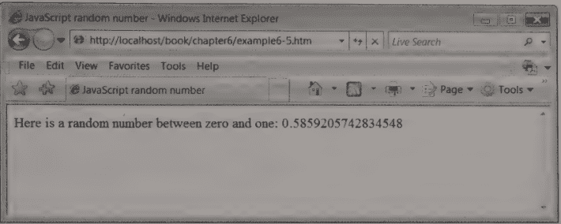

### 图 6.7 使用 Math 对象计算得到的圆的面积


它将第一个参数提高到第二个参数的幂，以计算圆的面积。虽然这是一个简单的示例，但它展示了 Math 类的属性和方法，将结果分配给变量，并使用括号确保计算的各部分按正确顺序进行（即我们在乘以‘PI’之前先平方半径）。

```
<!-- File: Example6-6.htm -->
<script type="text/javascript">
<!--
var intRadius = 10;
var fltArea = Math.PI * (Math.pow(intRadius, 2) );
document.write(fltArea);
// -->
</script>
```

图 6.7 显示了在浏览器中显示的计算结果。

### 字符串

JavaScript 字符串只不过是由单引号或双引号括起来的零个或多个字符的序列。你使用哪一种并不重要，但这种选择确实使你能够在一个引号内包含另一种引号，这在将 JavaScript 与 HTML 结合使用时特别有用。例如，这是一个有效的 JavaScript 字符串，其中包含带有引号属性的 HTML：

```
''
```

当然，我们也可以交换引号字符：

```
""
```

字符串的另一个有用方面是它们可以使用‘+’运算符连接（合并）。例如，这里我们通过连接来写出一些文本和文档标题：

```
document.write("Document title is " + document.title);
```

你可以将不同数据类型与字符串连接起来，它们将被视为单个字符串。字符串还具有许多属性和方法。例如，'length'属性返回字符串中的字符数，而'substring'方法返回两个指定字符位置之间的字符串部分。以下脚本同时使用'length'属性和'substring'方法来显示字符串的最后一个字符。请注意，方法返回的子字符串从第一个参数指定的字符位置之后开始，但包含第二个参数指定的位置处的字符：

```
<!-- File: Example6-7.htm -->
<script type = "text/javascript">
<!--
var strFullString = "a string";
var intLength = strFullString.length;
var strSubString = strFullString.substring(intLength-1, intLength);
document.write("Last character is " + strSubString);
// -->
</script>
```

图 6.8 显示了脚本在浏览器中的结果。

### 图 6.8 在浏览器窗口中显示的子字符串


### 日期对象

与作为浏览器环境一部分的对象以及内置于 JavaScript 中的‘Math’对象不同，表示日期和时间的‘Date’对象需要在需要时创建。能够即时创建‘Date’对象也意味着我们可以创建和操作任意数量的对象。在 JavaScript 中创建对象使用保留字‘new’和构造函数方法，该方法与对象类型同名，并且像其他方法一样后面跟有括号。新建的‘Date’对象可以分配给变量：

```
var dateToday = new Date();
```

我们可以用日期做什么？基本上我们可以使用默认设置，其中包括其创建的日期和时间，或者专门设置其值。如果你简单地将日期对象写入文档，你将获得机器使用的本地时区相对于协调世界时（UTC）的当前日期和时间，UTC 基于格林威治标准时间。你还可以使用‘toUTCString’方法以 UTC 显示当前日期和时间，或使用‘toLocaleString’方法以当前本地时区相对于 UTC 显示时间。在以下脚本中，我们以这三种不同的方式显示同一个日期对象：

```
<!-- File:Example6-8.htm -->
<script type="text/javascript">
<!--
var dateToday = new Date();
document.write("The current date and time is: " + dateToday);
document.write("<br />The date and time in Coordinated Universal Time is: " + dateToday.toUTCString() );
document.write("<br />The date and time using the current locale is: " + dateToday.toLocaleString() );
// -->
</script>
```

不同浏览器显示日期的方式略有不同。图 6.9 显示了这三个版本的日期在 Mozilla Firefox 2 中的显示方式，但其他浏览器在呈现方面会略有不同。

表 6.3 显示了 Date 类的一些其他方法。

### 数组

数组是一组具有相同名称但由索引值标识的值，索引值出现在方括号中。与 Date 对象一样，数组也可以即时创建，我们可以拥有任意数量的数组，因此它们再次使用保留字‘new’创建，例如：

```
var arrMyArray = new Array(size);
```

‘size’参数将是一个指定数组中元素数量的数字。我们可以使用包含索引的方括号设置或检索数组中的值


## 图 6.9 在 Mozilla Firefox 2 中显示 ‘Date’ 对象的脚本结果


## 表 6.3 Date 类的一些方法

| 方法 | 用途 |
|---|---|
| getDate<br>setDate | 返回或设置月份中的日期（1 到 31 之间的数字） |
| getDay | 返回一周中的日期，数字在 0（星期日）到 6（星期六）之间 |
| getHours<br>setHours | 返回或设置小时值，整数在 0（午夜）到 23（晚上 11 点）之间 |
| getMinutes<br>setMinutes | 返回或设置分钟值，整数在 0 到 59 之间 |
| getSeconds<br>setSeconds | 返回或设置秒值，整数在 0 到 59 之间 |
| getFullYear<br>setFullYear | 返回或设置年份值，四位整数 |
| getTime<br>setTime | 返回或设置日期，自 1970 年 1 月 1 日起的毫秒数 |

数字。数组索引从零开始，因此要设置数组第一个元素的值，我们在方括号中使用零。

```
arrMyArray[0] = "a string";
```

由于数组没有指定类型，数组的元素可以包含不同 JavaScript 类型的数值。例如，数组的下一个元素可以包含一个数字：

```
arrMyArray[1]=10;
```

这里有一个简单的脚本，使用数组将当前星期几的名称写入文档。它使用 JavaScript Date 对象获取星期几的数字（使用 'getDay' 方法），然后使用字符串数组返回实际的星期几名称。请注意，'getDay' 方法使用零表示星期日，然后从那里开始计数，六表示星期六。这与数组非常契合，因为数组的索引也从零开始。

```
<!-- File: Example6-9.htm -->
<script type="text/javascript">
<!--
var date=new Date();
var arrDayNames=new Array(7);
arrDayNames[0]="Sunday";
arrDayNames[1]="Monday";
arrDayNames[2]="Tuesday";
arrDayNames[3]="Wednesday";
arrDayNames[4]="Thursday";
arrDayNames[5]="Friday";
arrDayNames[6]="Saturday";
var strToday=arrDayNames[date.getDay()];
document.write("Today is " + strToday);
// -->
</script>
```

图 6.10 显示了在星期四运行此脚本的结果。

而不是一次一个地为数组元素赋值，另一种方法是使用初始化列表，在这种方法中，我们不是创建空数组然后使用索引号向元素添加数据，而是直接以逗号分隔的列表形式提供实际数据。例如，我们可以像这样同时创建并填充 ‘arrDayNames’ 数组：

```
var arrDayNames =
["Sunday","Monday","Tuesday","Wednesday","Thursday","Friday", "Saturday"];
```

### 6.8 控制结构

JavaScript 具有与许多其他语言类似的用于循环和决策的控制结构。‘if’ 和 ‘if…else’ 结构可用于评估条件语句并相应地做出响应。还有两种类型的循环，即 ‘while’ 循环和 ‘for’ 循环。

## 图 6.10 使用日期名称数组显示当前日期


## ‘if...else’ 语句

‘if’ 语句由两个（且仅两个）不同的行动方案和一个条件组成。JavaScript 中的条件始终返回一个布尔值，采取哪一个行动方案取决于该值是 true 还是 false。其中一个行动方案实际上可能是什么都不做。‘if’ 语句如下所示：

```
if(condition)
{
    // do this
}
else
{
    // do this instead
}
```

‘else’ 部分是可选的。如果条件为 false 且没有 ‘else’ 部分，则脚本将在 ‘if’ 语句之后继续执行。

## 关系运算符

在编写任何类型的条件语句（包括 ‘if’ 语句和循环）时，我们需要使用关系运算符来表达比较变量的条件。JavaScript 中使用的运算符如表 6.4 所示。

这里可能引起混淆的唯一运算符是 ‘identical to’ 和 ‘not identical to’ 运算符。它们与 ‘equal to’ 和 ‘not equal to’ 运算符的区别仅在于，相等允许某些类型转换，而恒等则不允许。表中所示的示例应能说明这一点。如果我们测试表达式：1 == true

那么它将返回 true，因为 1 可以转换为布尔值 ‘true’。然而，这个表达式：1 === true 将返回 ‘false’，因为恒等运算符在比较时不允许类型转换。

表 6.4 JavaScript 关系运算符

| 条件 | 关系运算符 | 示例 |
|---|---|---|
| 等于 | == | if(intTemperature == 100) |
| 恒等于 | === | if(1 === true) |
| 不等于 | != | if(chrGrade != 'F') |
| 不恒等于 | !== | if(1 !== false) |
| 小于 | < | if(fltSales < fltTarget) |
| 小于或等于 | <= | if(intEngineSize <= 2000) |
| 大于 | > | if(intHoursWorked > 40) |
| 大于或等于 | >= | if(intAge >= 18) |

## 表 6.5 逻辑运算符

| 运算符 | 含义 | 示例 |
|---|---|---|
| && | 与 | if(intAge > 4 && intAge < 16) |
| || | 或 | if(intTimeElapsed > 60 || booStopped == true) |
| ! | 非 | if(!booFormValidated) |

为了评估更复杂的条件，我们需要使用逻辑运算符来组合表 6.4 中显示的简单关系运算符。三个逻辑 JavaScript 运算符如表 6.5 所示。

所有这些表达式都返回 true 或 false。‘not’ 运算符 (!) 可能令人困惑，因为如果表达式为 ‘false’，它会返回 ‘true’。例如，表中表达式 ‘if(!booFormValidated)’ 在 ‘booFormValidated’ 为 false 时为 true，即如果表单未验证，则 ‘未验证’ 为 true。我们经常发现该运算符用于测试指示某事已发生的布尔 ‘flag’ 变量。‘not’ 运算符与测试 true 的能力相对应，例如 ‘if(booFormValidated)’ 也是一个同样有效的表达式。

## 使用选择：模拟抛硬币

下一个脚本示例使用 ‘if’ 语句进行选择。此选择基于使用随机生成的数字来模拟抛硬币，硬币可能正面或反面朝上。为了表示硬币的翻转，我们需要随机生成一个值，当然我们可以使用 ‘Math.random’ 方法来做到这一点，它返回 0.0 到 1.0 之间的随机值。根据 ECMA 规范，该函数可能返回零，但绝不会返回一。

```
var fltRandomNumber = Math.random();
```

从 ‘random’ 方法获得该值后，脚本随后使用 ‘if’ 语句选择硬币显示正面还是反面。如果随机数小于 0.5，则硬币设为正面，否则设为反面。当然，从程序的角度来看，使用 ‘小于’ 还是 ‘大于’ 没有区别，因为无论哪种方式我们都得到 50/50 的几率（或多或少）。

```
<!-- File: Example6-10.htm -->
<script type="text/javascript">
<!--
document.write("The coin has landed on ");
var fltRandomNumber = Math.random();
if(fltRandomNumber < 0.5)
{
    document.write(" Heads!");
}
else
{
    document.write(" Tails!");
}
// -->
</script>
```

## 图 6.11 模拟抛硬币脚本的两种可能结果之一


图 6.11 显示了运行此脚本的两种可能结果之一。

## ‘while’ 循环

‘while’ 循环可用于编写在给定条件为 true 时重复的代码。条件显示在 ‘while’ 保留字后的括号中：

```
while(intNum <= 10)
{
    // code here
}
```

在下一个示例中，while 循环用于模拟掷骰子，同样使用 Math.random 方法生成伪随机浮点数。为了得到 1 到 6 范围内的随机整数，我们首先将 Math.random 方法的结果乘以 6，这将给出 0 到 6 范围内的浮点数（但不包括恰好 6）。为了将该浮点数转换为整数，使用了 ‘floor’ 方法，它简单地通过删除小数点后的任何值来截断数字，给出一个整数。‘floor’ 的可预测行为比使用 ‘round’ 给出了更“随机”的数字。最后，再加 1 得到 1 到 6 范围内的整数。‘while’ 循环重复，直到模拟骰子“掷出” 6。

```
<!-- File: Example6-11.htm -->
<script type="text/javascript">
<!--
    var intDieValue=Math.floor(Math.random()*6);
    intDieValue++;
    while(intDieValue !=6)
    {
        document.write("You threw a " + intDieValue + "<br/>");
        intDieValue=Math.floor(Math.random()*6);
        intDieValue++;
    }
    document.write
        ("You threw a " + intDieValue + " - game over! <br/>");
// -->
</script>
```

图 6.12 显示了运行此脚本的一种可能输出。


图6.12 使用“while”循环模拟掷骰子的脚本的一个输出示例


## 'for' 循环

“for”循环与“while”循环非常相似，因为它在条件保持为真时重复执行。然而，它还有另外两个元素：一个初始化部分，可用于设置循环中使用的变量的初始值；另一个部分可在每次循环结束时用于更改变量的值：

```
for(initialise; condition; increment)
{
    // code here
}
```

典型的“for”循环会在开始时初始化一个变量，将该变量用作条件值，并在每次迭代结束时递增（或递减）该变量的值。

在下一个脚本中，我们生成一个乘法表。“for”循环用于初始化乘法表的乘数（从1开始），提供“while”条件（乘数小于或等于十二）以及增量（将乘数增加1）。乘法表的值由1到12范围内的随机数生成。

```
<!-- File: Example6-12.htm -->
<script type="text/javascript">
    <!--
    var intRandomInteger=Math.floor(Math.random()*12);
    intRandomInteger++;
    document.write(intRandomInteger + " times table <br/>");
    for(var intMultiplier=1; intMultiplier <=12; intMultiplier++)
    {
        document.writeln(intMultiplier + " x " + intRandomInteger + " = " +
        intMultiplier * intRandomInteger);
        document.writeln("<br/>");
    }
    // -->
</script>
```

## 图6.13 一个生成乘法表的脚本的可能输出


图6.13展示了该脚本生成乘法表的一种可能结果。

### 6.9 编写函数

到目前为止，我们所有的JavaScript代码都写在body或head元素中的脚本里，这些脚本在文档加载时执行。然而，你也可以将JavaScript代码写在函数中，然后从页面其他地方的script元素调用这些函数。如有必要，同一个函数也可以从同一页面的多个位置调用。函数可以写在HTML文档的head或body中的script元素内（正如我们之前的脚本那样），也可以写在单独的文件中。将函数写在单独文件中的主要优点是，它们可以被不同网页中的脚本重用。包含JavaScript函数的文件通常以“.js”作为文件扩展名。

无论函数写在哪里，它们都不会被自动调用，即使它们出现在文档的body中也是如此，因此它们必须由其他脚本调用或由某种事件触发。

声明一个JavaScript函数只需使用关键字“function”，后跟函数名和任何参数（放在括号中）。函数体用花括号括起来：

```
<script type="text/javascript">
function functionname(parameters)
{
}
</script>
```

函数可以使用保留字“return”返回一个表示函数最终结果的值，后面跟着要返回的变量或值：

```html
<script type="text/javascript">
function functionname(parameters) {
...
    return value
}
</script>
```

如果包含该语句，返回值的行通常是函数中的最后一行。这是因为return语句之后的任何代码都不会被执行；函数在该点终止。这种特性还可以用于有意“短路”函数，即在我们希望在执行所有代码之前退出函数的情况下，可能是由于某些错误条件，或者因为我们已经有了所需的结果。

下面的脚本展示了一个简单的函数，它使用了我们之前脚本示例中见过的相同星期名称数组。不同之处在于，该函数不是将星期名称写入文档，而是返回星期名称。

```html
<script type="text/javascript">
<!--
function getDayName()
{
    var date=new Date();
    var arrDayNames=["Sunday","Monday","Tuesday","Wednesday",
    "Thursday","Friday", "Saturday"];
    return arrDayNames[date.getDay()]
}
// -->
</script>
```

## 在body元素外部定义函数

到目前为止，我们一直将脚本嵌入到文档的body中，这意味着页面加载时JavaScript就会立即运行。然而，一旦我们开始使用函数，就可以将它们放在文档的head元素中，或者完全放在文档外部，然后从另一个脚本或事件中调用它们。

在下面的示例中，我们看到一个函数（此处添加到文档的head中）如何从文档body中的脚本被调用。由于body中的脚本在文档加载时被调用，因此函数也同时被调用。调用JavaScript函数只需使用其名称并传递任何必需的参数。与对象方法不同，函数名称前不需要任何前缀。如果函数返回一个值，调用该函数的代码可以使用该值。在这个XHTML页面中，一个脚本调用了“getDayName”函数。没有需要传递的参数值，但从函数返回的字符串会被写入文档。

```
<?xml version="1.0"?>
<!DOCTYPE html PUBLIC "-//W3C//DTD XHTML 1.1//EN" "http://www.w3.org/TR/xhtml11/DTD/xhtml11.dtd">
<html xmlns="http://www.w3.org/1999/xhtml" xml:lang="en">
<head>
<meta http-equiv="Content-Script-Type" content="text/javascript"/>
<title>JavaScript day name function</title>
<script type="text/javascript">
<!--
function getDayName()
{
var date=new Date();
var arrDayNames=["Sunday","Monday","Tuesday","Wednesday","Thursday","Friday","Saturday"];
return arrDayNames[date.getDay()]
}
// -->
</script>
</head>
<body>
<!-- File: Example6-13.htm -->
<script type="text/javascript">
<!--
document.write(getDayName());
// -->
</script>
</body>
</html>
```

图6.14显示了在星期四加载页面的结果。

## 使用外部JavaScript文件

在迄今为止我们看到的所有示例中，JavaScript都出现在HTML源文件中。然而，如果我们想重用任何JavaScript函数，那么它们需要与HTML页面分开存储。

图6.14 一个使用“getDayName”函数显示当前日期的网页


在前面的示例中，我们使用了一个名为“getDayName”的函数。尽管这个函数很简单，但它可能在多个页面中复用，因此与其将其放入HTML文档的头部，不如将其放入一个单独的文件中。包含JavaScript代码的文件通常具有“.js”扩展名，因此在本例中我们假设有一个名为“dayname.js”的文件。请注意，当JavaScript与XHTML源文件分开存储时，没有“script”元素，只有JavaScript源代码。网页中保留了script元素，用于指定包含该JavaScript函数的文件。

```
// File: dayname.js
function getDayName()
{
    var date=new Date();
    var arrDayNames=
    ["Sunday","Monday","Tuesday","Wednesday","Thursday","Friday",
    "Saturday"];
    return arrDayNames[date.getDay()]
}
```

要使用在外部文件中定义的函数，script元素需要包含“src”属性，该属性指定JavaScript源文件的路径和文件名。

```
<script type="text/javascript" src="path/filename.js"></script>
```

重要的是，script元素从来不是空元素，换句话说，它总是有独立的开始和结束标签，即使它们之间没有任何内容。这是必要的，因为有些浏览器只有在script元素同时具有开始和结束标签时才能处理它。

下面是一个XHTML页面，它通过script元素的“src”属性引用外部JavaScript文件，从而使用“getDayName”函数。

```
<?xml version = "1.0"?>
<!DOCTYPE html PUBLIC "-//W3C//DTD XHTML 1.1//EN"
"http://www.w3.org/TR/xhtml11/DTD/xhtml11.dtd">
<html xmlns="http://www.w3.org/1999/xhtml" xml:lang="en">
<head>
    <meta http-equiv="Content-Script-Type" content="text/javascript"/>
    <title>JavaScript day name function</title>
    <script type="text/javascript" src="dayname.js">
    </script>
</head>
<body>
    <script type="text/javascript">
        <!--
            document.write(getDayName() );
        // -->
    </script>
</body>
</html>
```


```html
<head>
  <meta http-equiv="Content-Script-Type" content="text/javascript"/>
  <title>International Time Zones</title>
  <script type="text/javascript" src="timezones.js">
  </script>
</head>
<body>
  <!-- File: exercise6–2.htm -->
  <script type="text/javascript">
    showTimeZones();
  </script>
</body>
</html>
```

以下是你的函数应执行的步骤：

1. 创建一个时区数组。
2. 创建一个这些时区偏移量的数组。
3. 创建一个新的 Date 对象。它将包含当前区域设置中的日期和时间（可能不是 UTC）。
4. 使用 `getTime()` 方法获取当前日期和时间（以毫秒为单位），以便通过算术运算轻松更改。
5. 使用 `getTimezoneOffset` 方法找出当前区域设置与 UTC 之间的差异（以分钟为单位）。
6. 将当前区域设置中的时间（以毫秒为单位）转换为 UTC，方法是加上它们之间的偏移量。每分钟有 60,000 毫秒，因此需要将偏移值乘以 60,000，再加到当前时间的毫秒值上。
7. 写出开始一个表格所需的标签，如下所示：

      ```javascript
      document.write("<table><tr><th>Time Zone</th><th>Offsets from UTC</th><th>Current Date and Time</th></tr>");
      ```

8. 启动一个“for”循环，依次遍历每个时区（使用时区数组的 `length` 属性来控制循环）。
9. 对于每个时区，计算与 UTC 的差异（以毫秒为单位）。每小时有 3,600,000 毫秒，因此将其乘以当前时区偏移量（存储在数组中）的小时数。
10. 通过将偏移量加到 UTC 时间上，计算出当前时区的时间（以毫秒为单位）。
11. 使用调整后的毫秒值创建一个新的 Date 对象（可以通过将毫秒值作为参数传递给构造函数来创建新的 Date）。
12. 写出表格的下一行（需要包含表格行和单元格的 HTML 标签）。代码可能如下所示：

      ```javascript
      document.write("<tr><td>" + arrTimeZones[i] + "</td><td>" + arrOffsets[i] + "</td><td>" + zoneDate.toLocaleString() + "</td></tr>");
      ```

13. 关闭 table 元素。

## 小结

在本章中，我们介绍了 JavaScript 语法的主要特性，包括与文档对象模型（DOM）各部分进行交互；声明变量、数组和对象；执行算术运算；连接字符串；表达条件以及控制循环。我们看到了如何使用该语言创建客户端进程，从而将小程序集成到浏览器环境中。我们使用了许多 JavaScript 对象方法，例如生成随机数和访问日期与时间信息。我们研究了向网页添加 JavaScript 代码的各种方式，包括将代码放在文档的 body 或 head 中，或者放在单独的 “js” 文件中，这样就可以在不同页面中重用封装在 JavaScript 函数中的相同代码。表 6.7 对本节介绍的 JavaScript 关键字、JavaScript 对象类型和内置对象进行了总结。在下一章中，我们将以这些基础为依托，了解如何将 JavaScript 与 DOM、样式表和服务器端进程结合使用，使 Web 客户端更具交互性和动态性。

## 表 6.7 本章介绍的 JavaScript 关键字、类型和对象

| 关键字 | 对象类型 | 内置对象 |
|---|---|---|
| new | Date | document |
| var | String | window |
| function | Math | navigator |
| if |  | location |
| else |  |  |
| while |  |  |
| for |  |  |
| return |  |  |
| true |  |  |
| false |  |  |

## 参考文献和延伸阅读

Raggett, D., Le Hors, A. 和 Jacobs, I. 1999. HTML 4.01 规范，第 18 节“脚本”。http://www.w3.org/TR/html4/interact/scripts.html

## 交互式 JavaScript：动态 HTML、客户端验证与 Ajax

### 学习目标

- 了解动态 HTML（DHTML）的各个组成部分以及它们如何协同工作
- 理解如何使用 JavaScript 导航文档对象模型（DOM）
- 能够使用事件触发 JavaScript 函数
- 理解客户端表单验证的原理和实践
- 能够使用异步 JavaScript 和 XML（Ajax）与服务器建立连接

### 引言

在第 6 章中，我们看到了如何使用 JavaScript 编写在客户端浏览器中运行的简单脚本和函数。这些 JavaScript 代码可用于实现客户端流程，例如计算值、操作字符串数据以及与文档对象模型（DOM）中的对象交互。在本章中，我们将了解如何将 JavaScript 与 DOM 和样式表结合使用，创建动态 HTML（DHTML）页面，通过响应浏览器中的事件并动态修改页面或浏览器呈现，为用户提供更具交互性的体验。我们还将看到 JavaScript 如何通过专注于两种特定类型的 JavaScript 编程来促进客户端与服务器之间的交互。首先，我们将看到 JavaScript 如何用于简单（“表面”）的表单验证。在此角色中，JavaScript 可以在用户输入表单的数据提交到服务器之前，对这些数据进行一些基本的“合理性检查”，从而减轻服务器的负载。其次，我们将看到如何使用 JavaScript 构建 Ajax 应用程序，这些应用程序能够在后台与服务器通信并异步更新页面，而无需替换或刷新当前整个网页。

## 7.1 动态 HTML（DHTML）

动态 HTML 不是一种特定的技术，而是指结合使用 JavaScript、DOM 和层叠样式表（CSS）来使网页更加动态和交互。JavaScript 代码可用于定位 DOM 的节点并与其内容交互，而样式可用于增强呈现的动态方面，例如显示或隐藏页面的某些部分。“发明”DHTML 的功劳通常归于微软的 Scott Isaacs，不过由于 DHTML 与其说是一种技术，不如说是一组技术的集合，也许“发明”并非恰当的术语。DHTML 依赖于 HTML 4.0 中引入的某些特性以及 CSS 元素，因此它无法在旧版浏览器（例如 Internet Explorer 或 Netscape Navigator 4.0 之前的版本）上运行。

### 导航 DOM

要编写 DHTML 代码，我们需要能够导航 DOM。在第 6 章开头，我们曾使用 document 对象，看到了其中的一些方面。事实上，DOM 中的节点树始于 document 对象，我们可以从该对象导航到其他节点，既可以使用唯一 id（如果元素节点上使用了 `id` 属性），也可以使用类似于 XPath 的方法遍历文档树的各个部分。实现此目的的两种方法是使用 `firstChild` 属性（它简单地标识当前节点的第一个子节点）或 `childNodes` 属性（像数组一样使用索引号访问）。然而，由于浏览器不兼容，尝试使用这些方法在 DOM 中导航可能会非常麻烦。更可靠的方法是在希望于 JavaScript 代码中访问的节点上使用 `id` 属性，并使用 `getElementById` 方法导航到它们。还有一个 `getElementsByTagName` 方法，用于定位特定 HTML 标签的所有出现位置。为了解释这些方法的工作方式，我们将引用以下 XHTML 文档，该文档有多个带有 id 属性的元素：

```xml
<?xml version="1.0"?>
<!DOCTYPE html PUBLIC "-//W3C//DTD XHTML 1.1//EN"
"http://www.w3.org/TR/xhtml11/DTD/xhtml11.dtd">
<html xmlns="http://www.w3.org/1999/xhtml" xml:lang="en">
<head>
<meta http-equiv="Content-Script-Type" content="text/javascript"/>
<title>Our Insurance</title>
</head>
<body>
<!-- File: example7-1.htm -->
<div id="heading1">Buildings Insurance</div>
<p id="para1">
You need this type of insurance to cover you in case of
<span id="risk">severe damage to your home</span>
(for example fire, flood, vehicle or tree crashing into it)
as well as more everyday risks like accidentally breaking a window
</p>
<div id="heading2">Contents Insurance</div>
<p id="para2">
You need this type of insurance to cover
<span id="items">things in your house</span>,
```


```
such as furniture, electrical goods, carpets and curtains, against risks such as fire, theft, water damage (due to burst pipes, etc) or accidental breakage
</p>
</body>
</html>
```

为了导航到此文档的第二段落，其 id 为 'para2'，我们可以使用以下表达式：

```
document.getElementById("para2");
```

另一种实现相同结果的方法是使用适当的标签名（本例中为 'p'）配合 getElementsByTagName 方法，该方法将 HTML 标签的名称作为参数（标签名参数不区分大小写）。这对于没有 'id' 属性的元素来说是一个有用的替代方案。由于 'getElementsByTagName' 方法会定位指定标签的所有实例，结果像数组一样被索引，从零开始。因此，第二段落在段落标签集合中的索引为 '1'，访问方式如下：

```
document.getElementsByTagName("p")[1];
```

## 与节点交互

一旦我们知道如何使用 DOM 导航到节点，就可以使用该节点访问其属性。节点的属性包括 'nodeName' 和 'nodeType'。例如，以下表达式会获取第一段的 'nodeName' 和 'nodeType'：

```
document.getElementById("para1").nodeName;
document.getElementById("para1").nodeType;
```

在这种情况下，节点名称为 'p'，类型为 '1'。

| NOTE |
|------|
| 元素类型为 1，属性类型为 2，文本节点类型为 3。（了解这一点在调试时偶尔会很有用——有时你访问的节点并不是你认为的那个节点！） |

我们可以使用 'nodeValue' 属性访问文本节点的内容。由于段落是元素节点而不是文本节点，因此需要导航到其子节点才能获取其中的文本。我们可以通过使用 'firstChild' 属性访问元素的第一个子节点，然后获取其节点值，如下所示：

```
document.getElementById("para1").firstChild.nodeValue;
```

这将返回从开始的段落标签到下一个 span 标签的文本。

除了访问节点属性外，我们还可以使用 'getAttribute' 方法访问属性，该方法将属性名作为参数。例如，要访问第一个 'div' 元素的 'id' 属性，可以使用以下表达式：

```
document.getElementById("heading1").getAttribute("id");
```

如果你在前面描述的 XHTML 页面的 body 中添加以下脚本，就可以在本节中测试我们介绍的一些表达式：

```
<script type="text/javascript">
<!--
document.write("Paragraph 1 is node name " +
    document.getElementById("para1").nodeName);
document.write("<br />Paragraph 1 is node type " +
    document.getElementById("para1").nodeType);
document.write("<br />The text node inside paragraph 1 is " +
    document.getElementById("para1").firstChild.nodeValue);
document.write("<br />The attribute value of the first div is " +
    document.getElementById("heading1").getAttribute("id") );
// -->
</script>
```

你应该注意，如果想在脚本中导航 DOM，就不能将脚本放在 head 元素中，因为它会在 body 加载之前执行，而 DOM 尚未构建！因此，此特定脚本需要在 body 中。

| NOTE |
|------|
| 实际上，除非脚本在函数中，否则永远不要在头部放置向文档写入内容的脚本，因为它们会在文档 body 加载之前写入输出。 |

脚本的输出应包括图 7.1 所示的信息。

**图 7.1 使用 DOM 显示节点类型、名称和值**


## 在 DOM 中更改值

除了读取节点属性外，JavaScript 和 DOM 还可用于更改文档部分内容。在下一个示例中，我们将使用文本字段通过在脚本中设置其值来显示时间。文本字段被赋予唯一的 id 'clock'，以便我们可以使用 'getElementById' 方法轻松访问它。它还被设置为只读（使用 'readonly' 属性），因为它仅用于显示目的，而不是用户输入：

```
<input type="text" size="6" id="clock" readonly="readonly"/>
```

下面的 JavaScript 函数（'showClock'）使用新创建的 Date 对象显示页面加载的时间。它使用 'getElementById' 根据其 'id' 属性在文档中定位文本字段。然后它将文本字段的 'value' 属性（这是 DOM 中 HTML 部分的属性）设置为由 Date 对象中的小时和分钟组成的字符串。

```
<!-- showclock.js -->
function showClock()
{
    var date=new Date();
    document.getElementById("clock").value =
        date.getHours() + ":" + date.getMinutes();
}
```

以下 XHTML 页面使用 body 中的脚本调用 'showClock' 函数：

```
<?xml version="1.0"?>
<!DOCTYPE html PUBLIC "-//W3C//DTD XHTML 1.1//EN"
"http://www.w3.org/TR/xhtml11/DTD/xhtml11.dtd">
<html xmlns="http://www.w3.org/1999/xhtml" xml:lang="en">
<head>
    <meta http-equiv="Content-Script-Type" content="text/javascript"/>
    <title>JavaScript clock</title>
    <script type="text/javascript" src="showclock.js">
    </script>
</head>
<body>
    <!-- File: example7-2.htm -->
    <div>
        <input type="text" size="6" id="clock" readonly="readonly"/>
    </div>
    <script type="text/javascript">
        showClock();
    </script>
</body>
</html>
```

图 7.2 显示了浏览器中文本字段中显示的时间。

**图 7.2 页面加载时显示在文本字段中的时间**


## 7.2 JavaScript 事件

到目前为止，我们所有的 JavaScript 代码都是作为 XHTML 页面加载的一部分运行的，由文档 body 中的脚本元素触发。然而，我们并不总是希望 JavaScript，特别是函数，仅在文档加载时运行。为了更好地控制脚本的运行，并使基于浏览器的应用程序更具交互性，我们可以使用各种类型的事件来触发 JavaScript 代码的运行。这些事件包括文档在浏览器中加载（'onload' 事件）、鼠标在页面组件上移动（'onmouseover'）或按钮被按下（'onclick'）。事件处理程序使 JavaScript 对象和函数能够响应这些事件。

### 'onload' 事件

在下一个示例中，我们将不向文档 body 添加脚本元素，而是从 'onload' 事件调用 'showClock' 函数，该事件在文档 body 加载时触发。

```
<body onload="showClock()">
```

这种方法意味着我们可以在不使用文档 body 中的脚本元素的情况下，使 JavaScript 函数在文档加载后立即运行。

| NOTE |
|------|
| 请注意，此处的 'onload' 全部为小写。你可能会在其他来源看到此事件被称为 'onLoad'。然而，由于该事件作为 body 标签的属性出现，使用任何大写字母都会导致你的页面不是有效的 XHTML。 |

此脚本显示了一个使用 'onload' 事件调用 'showClock' 函数的 XHTML 页面：

```
<?xml version="1.0"?>
<!DOCTYPE html PUBLIC "-//W3C//DTD XHTML 1.1//EN"
"http://www.w3.org/TR/xhtml11/DTD/xhtml11.dtd">
<html xmlns="http://www.w3.org/1999/xhtml" xml:lang="en">
<head>
<meta http-equiv="Content-Script-Type" content="text/javascript"/>
<title>JavaScript clock</title>
<script type="text/javascript" src="showclock.js">
</script>
</head>
<body onload="showClock()">
    <!-- File: example7-3.htm -->
    <div>
    <input type="text" size="6" id="clock" readonly="readonly"/>
    </div>
</body>
</html>
```

### 定时器事件

正如我们在前一个示例中看到的，使用 'onload' 事件的效果与从文档 body 中的脚本触发 JavaScript 函数相同。对于我们的时钟来说，这并不是很有帮助，因为时间很快（在一分钟内）就会错误。我们可以通过使用 JavaScript 定时器事件来解决这个问题。'setTimeout' 方法可用于设置一个计时器，在指定的间隔（以毫秒为单位）后调用函数。在原始 'showClock' 函数的此修改版本（称为 'showTimer'）中，我们添加了一个 'setTimeout' 事件，以递归方式大约每 1000 毫秒（每秒）调用一次 'showTimer' 函数。为了更轻松地看到其工作效果，秒数以及分钟和小时都会写入文本字段。

```
// File: showtimer.js
function showTimer()
{
    var date=new Date();
    document.getElementById("clock").value=date.getHours() + ":" +
        date.getMinutes() + ":" + date.getSeconds();
    setTimeout("showTimer()", 1000);
}
```

调用此函数的页面只需在两个地方进行修改，首先在头部调用新函数，其次使用 'onload' 事件调用新函数。因此，唯一的变化是所使用的 '.js' 文件的名称和被调用函数的名称：

```
<?xml version = "1.0"?>
<!DOCTYPE html PUBLIC "-//W3C//DTD XHTML 1.1//EN"
    "http://www.w3.org/TR/xhtml11/DTD/xhtml11.dtd">
<html xmlns="http://www.w3.org/1999/xhtml" xml:lang="en">
    <head>
        <meta http-equiv="Content-Script-Type" content="text/javascript"/>
        <title>JavaScript clock</title>
        <script type="text/javascript" src="showtimer.js">
        </script>
    </head>
    <body onload="showTimer()">
        <!-- File: example7-4.htm -->
        <div>
            <input type="text" size="6" id="clock" readonly="readonly"/>
        </div>
    </body>
</html>
```


### 图 7.3 显示小时、分钟和秒的文本字段


图 7.3 显示了修改后的文本字段，该函数以小时、分钟和秒显示时间。

## innerHTML 与 DOM

在前面的示例中，我们使用文本字段显示当前时间。另一种在浏览器特定区域显示内容的方法是写入文档的节点。实现这一点的一种方式是使用 DOM 的接口，但这可能相当复杂，而且不同的浏览器对相同脚本的反应可能不同。另一种方式是使用 HTML 元素的“innerHTML”属性。这使我们能够直接访问文本节点并更新其内容。

“innerHTML”属性并不属于正式的 HTML DOM 规范的一部分，它由微软于 1997 年在 Internet Explorer 4 中引入。然而，由于它广受欢迎，已被其他浏览器采纳，尽管它没有被包含在任何公共标准中，因此它在跨浏览器支持方面相当可靠。关于使用“innerHTML”是否明智，一直存在诸多争论。不过，它使用简单，并已用于许多 Ajax 实现中。反对使用“innerHTML”的理由之一是，它可以在客户端脚本的处理过程中包含结构性元素（即标记），这会导致关注点分离不佳。因此，最好将“innerHTML”的使用限制在内容操作上，而不是用它动态生成标记。

在下一个示例中，我们将修改“showTimer”函数以使用“innerHTML”属性。改动相对简单。首先，我们将文本输入字段替换为一个合适的文档节点，这里是一个不包含文本的简单“div”元素。

```
<div id="clock"></div>
```

接着，在 JavaScript 函数中，我们只需通过“getElementById”方法访问“div”元素，并设置其“innerHTML”属性的值：

```
// File: showinnertimer.js
function showTimer()
{
  var date=new Date();
  document.getElementById("clock").innerHTML=date.getHours() + ":" +
date.getMinutes() + ":" + date.getSeconds();
setTimeout("showTimer()", 1000);
}
```

除此之外，一切看起来和工作起来都与之前几乎相同，只是时间在浏览器中仅以文本形式显示，而不是在文本字段组件中。下面是由该函数使用的包含“div”元素的完整 XHTML 页面。

```
<?xml version="1.0"?>
<!DOCTYPE html PUBLIC "-//W3C//DTD XHTML 1.1//EN"
"http://www.w3.org/TR/xhtml11/DTD/xhtml11.dtd">
<html xmlns="http://www.w3.org/1999/xhtml" xml:lang="en">
<head>
<meta http-equiv="Content-Script-Type" content="text/javascript"/>
<title>JavaScript clock</title>
<script type="text/javascript" src="showinnertimer.js">
</script>
</head>
<body onload="showTimer()">
<!-- File: example7-5.htm -->
<div id="clock"></div>
</body>
</html>
```

图 7.4 显示了浏览器中的输出。时间不再位于文本字段中，而只是文档的一个文本节点。

## 响应按钮事件

到目前为止，我们使用过的事件（“onload”事件和定时器事件）与用户活动无关。然而，如果我们想让网页更具动态性，就需要能够响应用户在页面中的操作。实现这一点的一种方式是通过用户触发的事件（例如按下按钮）来调用 JavaScript 函数。HTML 按钮组件可以通过其“onclick”事件链接到 JavaScript 函数。在下一个示例中，我们将使用按钮事件调用 window 对象的“resizeTo”方法，该方法将浏览器窗口设置为指定的宽度和高度。宽度和高度的值出现在方法名后的括号中，并用逗号分隔。此示例会将窗口大小设置为 400 像素宽、200 像素高：

```
window.resizeTo(400,200);
```

### 图 7.4 使用“innerHTML”属性在浏览器中显示的当前时间


我们的下一个脚本示例演示了使用按钮事件来调整窗口大小。它还演示了如何在脚本中的多个位置调用同一个 JavaScript 函数。我们使用的函数名为“resizeWindow”，它接受宽度和高度两个参数，并相应设置窗口大小：

```
// File: resize.js
function resizeWindow(width, height)
{
    window.resizeTo(width,height);
}
```

在文档的 body 中，有两个按钮，它们都使用“onclick”事件来调用“resizeWindow”函数。第一个按钮（标记为“shrink window”）将窗口设置为 400 × 300 像素。第二个按钮使用 screen 的两个属性（“availWidth”和“availHeight”）将窗口大小设置为可用的最大值。“screen”对象是 window 对象的一个属性。

```
<?xml version="1.0"?>
<!DOCTYPE html PUBLIC "-//W3C//DTD XHTML 1.1//EN"
"http://www.w3.org/TR/xhtml11/DTD/xhtml11.dtd">
<html xmlns="http://www.w3.org/1999/xhtml" xml:lang="en">
<head>
    <meta http-equiv="Content-Script-Type" content="text/javascript"/>
    <title>JavaScript window resize</title>
    <script type="text/javascript" src="resize.js">
    </script>
</head>
<body>
    <!-- File: example7-6.htm -->
    <div>
        <input type="button" onclick="resizeWindow(400,300)"
        value="shrink window"/>
        <input type="button"
        onclick="resizeWindow(window.screen.availWidth,
        window.screen.availHeight)" value="restore window"/>
    </div>
</body>
</html>
```

图 7.5 显示了在按下“shrink window”按钮之前，Mozilla Firefox 2 中的窗口。

| 注意 | 使用此函数时，不同浏览器可能会表现出略有不同的行为。例如，Opera 9 只会在窗口独立（而非选项卡式窗口的一部分）时调整窗口大小。 |
|------|---------------------------------------------------------------------------------------------------------------------------------------------------------------------------------------------------|

```
<body>
    <!-- File: example7-7.htm -->
    <div>
        <a href="javascript:openWindow('about.htm')">open window</a>
    </div>
</body>
</html>
```

单击页面中的超链接所产生的效果因浏览器而异。在某些情况下会创建一个新窗口，在其他情况下则会出现一个新选项卡。图 7.6 显示了 Internet Explorer 7 如何响应此函数并打开一个新窗口。

## 7.3 动态样式表

除了与 DOM 交互之外，DHTML 的另一个重要特性是使用样式表动态更改文档的呈现方式。此技术的一个常见示例是应用 JavaScript 和样式表来显示或隐藏页面的部分内容。例如，该技术可用于向网页添加可展开的菜单。要在脚本中与样式交互，我们可以使用 DOM 中元素的“style”属性来动态地将样式应用于文档的各个部分。可用于显示或隐藏页面部分的 CSS 样式属性是“display”，其值可以为“block”（使内容可见）或“none”（使其不可见）。以下函数使用“if”语句在“none”和“block”之间切换元素的显示样式。在此示例中，“element”是一个变量，它引用当前文档中由“id”属性标识的元素节点。

### 图 7.6 由 JavaScript URL 触发的“openWindow”函数在 Internet Explorer 7 中的效果


```
// File: changedisplay.js
function changeDisplay(id)
{
    var element=document.getElementById(id);
    if(element.style.display=='none')
    {
        element.style.display='block';
    }
    else
    {
        element.style.display = 'none';
    }
}
```

到目前为止，在本章中，我们了解了如何使用 JavaScript 导航到 DOM 中的节点并访问这些节点的属性，包括“style”属性。我们还了解了如何使用事件触发 JavaScript 函数。在下一个示例中，我们将所有这些技术整合到一个 DHTML 页面中，当单击 JavaScript URL 时，该页面会显示和隐藏页面的部分内容。该页面包含两个标题分别为“JavaScript”和“DHTML（动态 HTML）”的区块，它们位于使用 JavaScript URL 的锚点中。当单击这两个标题中的任何一个时，详情文本（包含在具有唯一 id 的“div”标签中）会在显示和隐藏之间切换。“div”元素的 id 被传递给“changeDisplay”函数，以便切换其状态。

我们需要能够以两种方式调用此函数。首先，我们需要在页面加载时使用“onload”事件调用它，以设置页面的初始状态。要从“onload”事件调用多个函数，或者（如此处所示）多次调用同一个函数，可以将函数调用放入以逗号分隔的列表中，如下所示：

```
<body onload="changeDisplay('jsdetail'), changeDisplay('dhtmldetail')">
```

由于两个“div”元素的显示状态最初尚未设置，因此当函数第一次针对某个元素被调用时，它会执行“else”块并将显示状态设置为“none”。从那时起，当单击其中任何一个 JavaScript URL 时，都会调用该函数并切换显示状态。以下是这两个 URL 的一个示例：

```
<a href="javascript:changeDisplay('jsdetail')">JavaScript</a>
```

请注意它如何将其中一个“div”元素的 id 传递给函数。以下是完整的 XHTML 页面：

```
<?xml version="1.0"?>
<!DOCTYPE html PUBLIC "-//W3C//DTD XHTML 1.1//EN"
    "http://www.w3.org/TR/xhtml11/DTD/xhtml11.dtd">
<html xmlns="http://www.w3.org/1999/xhtml" xml:lang="en">
    <head>
        <meta http-equiv="Content-Script-Type" content="text/javascript"/>
        <title>DHTML show and hide</title>
        <script type="text/javascript" src="changedisplay.js">
        </script>
    </head>
    <body onload="changeDisplay('jsdetail'), changeDisplay('dhtmldetail')">
        <!-- File: example7-8.htm -->
        <div>
```


```
<a href="javascript:changeDisplay('jsdetail')">JavaScript</a>
</div>
<div id="jsdetail">
JavaScript is a scripting language that can be run inside the browser to enable client-side processes.
</div>
<div>
<a href="javascript:changeDisplay('dhtmldetail')">
DHTML (Dynamic HTML)</a>
</div>
<div id="dhtmldetail">
DHTML is a label given to techniques that use JavaScript, CSS and the DOM to make web pages more dynamic and interactive.
</div>
</body>
</html>
```

图 7.7 显示页面在初始加载到浏览器时的情况，此时两个 div 元素样式均处于 ‘none’ 显示状态。

图 7.8 显示当两个 ‘div’ 元素样式均处于 ‘block’ 状态（即可见）时页面的外观。

**图 7.7 通过将样式的 display 属性设置为 ‘none’ 来隐藏 ‘div’ 元素**


**图 7.8 通过将样式的 display 属性设置为 ‘block’ 使 ‘div’ 元素可见**


## 7.4 客户端表单验证

JavaScript 在 Web 应用中能发挥的最有用的作用之一是对用户输入到网页表单中的数据进行客户端验证。我们只能在客户端提供表面验证。例如，我们可以检查信用卡号码是否符合信用卡号码的正确格式，或检查特定类型的卡，如 Visa 卡，是否以该类型的正确号码开头，但我们无法在浏览器中实际检查信用卡本身的有效性。那必须由服务器端进程来完成。表面验证包括检查空字段、检查是否已做出选择（例如来自单选按钮或下拉列表），而不是保留空默认值，检查数字、日期、电子邮件或信用卡字段是否包含正确类型的字符，等等。

### 处理表单的函数

对于普通的 HTML 表单，按下 ‘submit’ 按钮会将 HTTP 请求发布到表单元素的 ‘action’ 属性定义的 URI。例如，此简单表单包含用户 ID 和密码的输入字段，并提交到名为 ‘customerLogin’ 的服务器端应用程序：

```html
<form action="customerLogin" method="post">
<table>
<tr>
<td><label for="loginid">Login Name:</label></td>
<td><input type="text" id="loginid"/></td>
</tr>
<tr>
<td><label for="pword">Password:</label></td>
<td><input type="password" id="pword"/></td>
</tr>
<tr>
<td></td>
<td><input type="submit" value="Login"/>
<input type="reset" value="Clear form"/></td>
</tr>
</table>
</form>
```

表单一旦提交到服务器，就为时已晚，无法在浏览器中验证任何表单数据。因此，JavaScript 为我们提供了一个特殊的 ‘onsubmit’ 事件，让我们在按下按钮时调用函数，而不是直接提交到服务器。我们可以使用该函数来验证表单，并根据表单内容是否有效返回 ‘true’ 或 ‘false’。如果返回 ‘true’，则表单数据将提交到服务器端应用程序。如果返回 ‘false’，则取消提交，我们可以给用户机会纠正他们输入的数据。

JavaScript 函数可以通过以下两种方式访问表单的组件以检查其有效性：

- The function can use the DOM to access the form’s components via the document object.
- The form can be passed as a parameter to the function.

作为第一种方法的示例，此表单标签包含 ‘onsubmit’ 事件处理程序，调用一个名为 ‘validate’ 的 JavaScript 方法，该方法不带参数：

```html
<form action="customerLogin" method="post" onsubmit="return validate()">
```

如果未将表单的引用传递给函数，则可以使用 DOM 的 ‘getElementById’ 方法定位表单的输入字段，只要它们具有 ‘id’ 属性。在此示例中，函数使用 DOM 访问 ‘loginid’ 文本字段，检查它是否为空字段（使用双引号中间什么都没有表示空字符串，这将是空文本输入字段的内容）。

```javascript
function validate()
{
    if(document.getElementById("loginid").value==""
    ...
```

相比之下，此版本的表单元素采用第二种方法，将表单作为参数传递给 ‘validate’ 方法。表单使用保留字 ‘this’ 引用（即把此表单传递给函数）：

```html
<form action="customerLogin" method="post" onsubmit="return validate(this)">
```

如果将表单的引用作为参数传递给函数，则可以通过参数对象的子元素访问表单控件。在此示例中，我们通过表单而不是 document 对象导航到同一个文本字段（‘loginid’）。

```javascript
function validate(loginForm)
{
    if(loginForm.loginid.value=="")
    ...
```

使用哪种方法取决于你，但将表单传递给函数似乎在验证例程中更常用。

### 弹出对话框

到目前为止，本节我们研究了一些检查表单组件状态的 JavaScript 代码，但如果我们想向用户指示存在问题怎么办？我们可以使用前面介绍的技术通过 DOM 向页面写入，但指示应用程序中出现问题的更常见方法是显示弹出对话框。JavaScript 提供了三种类型的弹出对话框，即 alert、confirm 和 prompt 对话框。这些是模态对话框，这意味着在关闭它们之前你无法在浏览器中执行其他任何操作。它们是通过使用 window 对象的 ‘alert’、‘confirm’ 和 ‘prompt’ 方法调用的。

alert 用于简单地向用户显示消息。alert 上的唯一按钮是 ‘OK’ 按钮，点击后对话框会消失。创建 alert 非常简单；我们只需将要显示的文本作为参数（在括号中）传递给 alert 函数：

```javascript
alert("message");
```

confirm 对话框与 alert 相似，因为它会包含某种类型的消息。然而它有两个按钮，‘OK’ 和 ‘Cancel’。如果用户点击 ‘OK’，框返回 true。如果用户点击 ‘Cancel’，框返回 false。

```javascript
confirm("message");
```

与另外两种对话框不同，prompt 对话框会要求用户输入值。除了文本输入字段外，它还包含 ‘OK’ 和 ‘Cancel’ 按钮。如果用户点击 ‘OK’，框返回输入值，但如果用户点击 ‘Cancel’，框返回 null。JavaScript 中的 null 值意味着变量没有值。

```javascript
var returnValue=prompt("prompt text", "default value");
```

这里有一个简单的 JavaScript 函数，按顺序创建这三种对话框类型。当调用该函数时，对话框会一个接一个地出现。

```javascript
// File: showdialogs.js
function showDialogs()
{
  alert("This is an alert");
  confirm("This message wants confirmation");
  prompt("Please enter something in the text area", "I'm a default");
}
```

这里有一个在加载时调用此函数的 XHTML 页面：

```html
<?xml version="1.0"?>
<!DOCTYPE html PUBLIC "-//W3C//DTD XHTML 1.1//EN"
"http://www.w3.org/TR/xhtml11/DTD/xhtml11.dtd">
<html xmlns="http://www.w3.org/1999/xhtml" xml:lang="en">
<head>
<meta http-equiv="Content-Script-Type" content="text/javascript"/>
<title>JavaScript Dialogs</title>
<script type="text/javascript" src="showdialogs.js">
</script>
</head>
<body onload="showDialogs()">
<!-- File: example7-9.htm -->
</body>
</html>
```

图 7.9 显示了 Mozilla Firefox 2 浏览器中显示这三个对话框时的外观。它们在其他浏览器中看起来略有不同，但内容和按钮基本相同。

### 在验证例程中使用对话框

这三种对话框类型都可以在验证例程中使用。然而，也许最简单的方法是使用 alert 来通知用户表单数据中存在错误。

这里有一个完整的 ‘validate’ 函数，使用表单参数和 alert。该函数检查登录表单中用户名或密码文本字段是否为空。在每个

## 图7.9 在Mozilla Firefox 2中显示的三种JavaScript对话框


在这种情况下，文本字段的值与空字符串（“”）进行比较。如果该字段为空，则会将一些错误文本添加到‘strErrorMessage’变量中，并将‘booValid’变量的值设置为‘false’。在检查完两个字段后，如果‘booValid’变量为‘false’，则会显示一个包含错误消息的警告框，并且由于该方法本身返回‘false’，表单不会被提交。

```
// File: validateform.js
function validate(loginForm)
{
var booValid=true;
var strErrorMessage="";
if(loginForm.loginid.value=="")
{
strErrorMessage += "user name field cannot be empty\n";
booValid=false;
}
if(loginForm.pword.value=="")
{
    strErrorMessage += "password field cannot be empty";
    booValid=false;
}
if(!booValid)
{
    alert(strErrorMessage);
}
return booValid;
}
```

下面是一个XHTML页面，它使用表单的‘onsubmit’事件调用‘validate’函数：

```
<?xml version="1.0"?>
<!DOCTYPE html PUBLIC "-//W3C//DTD XHTML 1.1//EN"
"http://www.w3.org/TR/xhtml11/DTD/xhtml11.dtd">
<html xmlns="http://www.w3.org/1999/xhtml" xml:lang="en">
<head>
<title>Customer Login</title>
<script type="text/javascript" src="validateform.js">
</script>
</head>
<body>
<!-- File: example7-10.htm -->
<form action="customerLogin" method="post"
onsubmit="return validate(this)">
<table>
<tr>
<td><label for="loginid">Login Name:</label></td>
<td><input type="text" id="loginid"></td>
</tr>
<tr>
<td><label for="pword">Password:</label></td>
<td><input type="password" id="pword"></td>
</tr>
<tr>
<td></td>
<td><input type="submit" value="Login">
<input type="reset" value="Clear form">
</td>
</tr>
</table>
</form>
</body>
</html>
```

图7.10显示了表单以及当两个字段都为空时出现的警告框。如果只有一个字段为空，那么警告框中只会出现一条消息。如果两个字段都有内容，那么表单数据将被提交到服务器。

## 图7.10 在两个字段都留空时显示的表单和警告框，在Internet Explorer 7中运行


## 验证其他类型的表单组件

除了检查文本字段是否包含字符（这是必填字段的常见流程）之外，我们还可以进行其他类型的检查。例如，我们可以查看用户是否从选择列表中做出了选择，或者查看单选按钮或复选框是否已被选中。

向‘select’组件添加一个空选项以确认用户已做出选择是很有用的。如果他们接受默认值（即未选择任何内容），那么我们可以使用JavaScript验证函数将其标记为错误。例如，在这个选择列表中，第一个选项是空的。这意味着我们可以通过验证索引为零的选项（即空选项）未被选中，来确保用户明确地从列表中选择‘Administrator’或‘User’。

```
<select id="loginoptions" size="1">
  <option></option>
  <option>Administrator</option>
  <option>User</option>
</select>
```

在我们的JavaScript验证函数中，我们可以使用‘selectedIndex’属性来检查所选选项的索引。如果索引为零，那么我们可以进行一些错误通知。

```
if(loginForm.loginoptions.selectedIndex == 0 )
{
  strErrorMessage += "you must select your Login role\n";
  booValid=false;
}
```

在此示例中，表单中有单选按钮。

```
<input type="radio" name="action" value="view"/> View settings
<input type="radio" name="action" value="update"/> Update settings
```

通过不提供默认选中的按钮，我们可以强制用户明确选择其中一个按钮，并再次使用JavaScript验证来检查他们是否已经这样做了。在‘validate’函数的这一部分中，我们检查两个单选按钮的‘checked’属性是否都为false。如果两个按钮都没有被选中，我们就标记一个错误。

```
if( (!loginForm.action[0].checked) && (!loginForm.action[1].checked) )
{
    strErrorMessage +="You must select View or Update settings\n";
    booValid=false;
}
```

另一种可能的验证形式是检查同一表单中做出的不同选择是否彼此一致，例如在我们的登录表单中，可能只有管理员才能更新设置。这意味着任何试图以用户身份登录但同时选择‘更改设置’单选按钮的人都会做出无效的选择。在‘validate’方法的这一部分中，我们将这些条件组合在一起。

```
if( (loginForm.action[1].checked) &&
(loginForm.loginoptions.selectedIndex !=1) )
{
    strErrorMessage +=
        "You cannot update settings unless you are an administrator\n";
    booValid=false;
}
```

以下是完整的‘validate’函数（在一个不同的文件中，以区别于之前的版本）。

```
// File: validateloginform.js
function validate(loginForm)
{
    var booValid = true;
    var strErrorMessage = "";
    if(loginForm.loginid.value == "")
    {
        strErrorMessage += "user name field cannot be empty\n";
        booValid=false;
    }
    if(loginForm.pword.value == "")
    {
        strErrorMessage += "password field cannot be empty\n";
        booValid=false;
    }
    if(loginForm.loginoptions.selectedIndex == 0 )
    {
        strErrorMessage += "you must select your Login role\n";
        booValid=false;
    }
    if( (!loginForm.action[0].checked) && (!loginForm.action[1].checked) )
    {
        strErrorMessage += "You must select View or Update settings\n";
        booValid=false;
    }
    if( (loginForm.action[1].checked) &&
    (loginForm.loginoptions.selectedIndex != 1) )
    {
        strErrorMessage += "You cannot update settings unless you are
        an administrator\n";
        booValid=false;
    }
    if(!booValid)
    {
        alert(strErrorMessage);
    }
    return booValid;
}
```

下面的XHTML页面包含了由JavaScript的‘validate’函数验证的各种表单组件。

```
<?xml version="1.0"?>
<!DOCTYPE html PUBLIC "-//W3C//DTD XHTML 1.1//EN"
"http://www.w3.org/TR/xhtml11/DTD/xhtml11.dtd">
<html xmlns="http://www.w3.org/1999/xhtml" xml:lang="en">
<head>
<title>Customer Login</title>
<script type="text/javascript" src="validateloginform.js">
</script>
</head>
<body>
<!-- File: example7-11.htm -->
<form action="customerlogin" method="post"
onsubmit="return validate(this)">
<table>
<tr>
<td><label for="loginid">Login Name:</label></td>
<td><input type="text" id="loginid"/></td>
</tr>
<tr>
<td><label for="pword">Password:</label></td>
<td><input type="password" id="pword"/></td>
</tr>
<tr>
<td><label for="loginoptions">Select Login role:</label></td>
<td><select id="loginoptions" size="1">
<option></option>
<option>Administrator</option>
<option>User</option>
</select>
</td>
</tr>
<tr>
<td>Select Action:</td>
<td>
<input type="radio" name="action" value="view"/> View settings
<input type="radio" name="action" value="update"/> Update settings
</td>
</tr>
<tr>
<td></td>
<td><input type = "submit" value = "Login"/>
<input type = "reset" value = "Clear form"/>
</td>
</tr>
</table>
</form>
</body>
</html>
```

图7.11显示了当已输入用户名和密码，但用户尝试以用户（而不是管理员）身份登录并选择了‘更新’设置时，警告框的样子。

## 图7.11

由‘validate’函数显示的警告框，该函数交叉引用了表单中的两个控件


## 7.5 Ajax的出现

2005年，围绕Web应用程序开发的一大热门话题是Ajax的出现，它作为一种将桌面应用程序体验的某些方面引入基于浏览器的应用程序的方式。Ajax并不是一个特别新的概念，它继承了更悠久的客户端处理传统，包括JavaScript、Java小程序和DHTML。然而，Ajax与先前方法之间的显著区别在于“单页Web应用程序”的概念，即页面内容异步地从服务器更新，而无需重建整个页面。这种方法的一个早期示例是Google Suggest，当用户键入字符时，它能够动态地在搜索文本框中填充搜索词建议，当然前提是浏览器能够支持它。Ajax应用程序最重要的组件是‘XMLHttpRequest’组件，该组件最早由微软在Outlook Web Access 2000中引入，后来又在Internet Explorer 5.0中引入。此后，其他浏览器也相继实现了自己的‘XMLHttpRequest’。该组件使浏览器托管的应用程序能够向服务器发送请求并接收响应，而无需替换或完全刷新当前网页。相反，从服务器返回的响应（可能是XML文档或简单的字符流）可以由客户端脚本处理，并使用DOM来更新页面的部分内容。图7.12显示了基于Ajax的系统的一般架构。此架构的关键在于Ajax引擎在用户界面和服务器之间充当中介，在可能的情况下在客户端进行处理（使用DHTML），并在必要时发送异步HTTP请求和接收XML数据（或者实际上任何其他合适格式的数据），然后通过DOM在浏览器中呈现这些数据。

## 图7.12 Ajax架构，改编自（Garrett 2005）


同样重要的是，这种处理可以异步进行。这意味着用户不必为了继续与应用程序交互而等待服务器响应。相反，应用程序能够继续为用户服务，同时在服务器响应到达时处理它。图7.13显示了这个总体思路。即使在Ajax引擎向服务器提交XMLHttpRequests并等待响应时，浏览器中的用户活动仍在继续。Ajax引擎负责处理与获取服务器响应相关的事件，但用户不必等待它。然而，Ajax应用程序不一定是异步的。在某些情况下，在继续当前过程之前等待服务器响应可能是合适的。


图 7.13 在 Ajax 中使用异步通信，改编自 (Garrett 2005)


Ajax 本身并不是一项技术，而是 Garrett（2005）用来描述一种构建 Web 应用方式的标签，这种方式在客户端脚本中使用‘XMLHttpRequest’对象来无缝更新网页。Garrett 将 Ajax 总结为以下技术的组合：

- 使用 XHTML 和 CSS 的基于标准的表示
- 使用文档对象模型进行动态显示和交互
- 使用 XML 和可扩展样式表语言转换（XSLT）进行数据交换和处理
- 使用‘XMLHttpRequest’进行异步数据检索
- JavaScript 将一切绑定在一起

当然，Garrett 列出的技术并不是在 Web 上提供单页应用的唯一方式；其他技术，如 Flash，也可以达到类似效果。

## 使用 JavaScript 编写 Ajax 代码

编写 Ajax 应用基本上有两种方法。一种是使用标准 JavaScript 自行构建 Ajax 代码。另一种是使用某种封装了底层 Ajax 代码的 API 和/或开发工具，例如 Google Ajax API（尽管这只是众多示例中的一个）。在本章中，我们重点使用标准 JavaScript 来开发相对简单的 Ajax 应用。然而，对于更复杂的系统，考虑使用 Ajax 开发工具可能更合适。

如果你在编写 Ajax 应用时不使用任何工具或框架，最重要的事情之一就是构建一个 JavaScript 函数，使其能够根据脚本运行所在的浏览器获取合适类型的‘XMLHttpRequest’对象。主要选择是在较旧的 Microsoft 浏览器和较新的 Microsoft 浏览器或非 Microsoft 浏览器之间进行。这是因为随着时间的推移，Microsoft 开发了不同的‘XMLHttpRequest’组件实现。在早期版本（用于 Internet Explorer 5 和 6）中，他们使用 ActiveX 对象将‘XMLHttpRequest’实现为 Microsoft XML Core Services（MSXML）的一部分，即使在这些 Microsoft 浏览器版本中，ActiveX 对象的类型也略有不同。然而，从 Internet Explorer 7.0 开始，该实现基于原生脚本，其工作方式与其他浏览器类似。因此，为了确保我们在 JavaScript 中获得正确类型的‘XMLHttpRequest’对象，我们需要编写一个函数，依次尝试访问这些不同的实现，直到找到匹配项。有多种方法可以做到这一点，包括下面这个简单示例（Dutta 2006）。它利用 window 对象的属性来识别可用的‘XMLHttpRequest’类型。对于较新版本的 Internet Explorer 和其他浏览器，会有一个‘XMLHttpRequest’属性。如果不存在该属性，则浏览器可能是旧版本的 Internet Explorer，此时 window 应该有一个‘ActiveXObject’属性。当然，如果这两个测试都返回‘false’，那么该浏览器不支持 Ajax。

```
if(window.XMLHttpRequest)
{
    // If IE7, Mozilla, Safari, etc: Use native object
    var xmlHttp = new XMLHttpRequest();
}
else
{
    if(window.ActiveXObject)
    {
        // otherwise, use the ActiveX control for IE5.x and IE6
        var xmlHttp = new ActiveXObject("Microsoft.XMLHTTP");
    }
}
```

（Zakas 等人 2006）描述了一种更详细的方法，该方法考虑了已经实现的 ActiveX 对象的几种不同版本。它还使用了 JavaScript 异常处理以及‘if’语句。异常处理代码使用保留字‘try’和‘catch’。可能抛出异常（即错误条件）的代码被放在标有‘try’的代码块中，而能够处理该异常（如果发生）的代码则被放在随后的‘catch’块中。‘catch’块中的代码仅在抛出异常时才执行。否则，只执行‘try’块中的代码。这是‘try … catch’块的基本结构：

```
try
{
    // Attempt to execute some code here
}
catch(e)
{
    // If it throws an exception, handle it here
}
```

下面是一个‘if’语句（作为函数的一部分），其中也包含一个‘try … catch’块。它尝试创建一个‘XMLHttpRequest’对象并将其返回给函数的调用者，但如果失败，则会抛出异常，由 catch 块处理。在这种情况下，我们除了让代码继续执行之外不做任何操作，因为下一步是查找正确类型的 ActiveX 对象。

```
if(window.XMLHttpRequest)
{
    // If IE7, Mozilla, Safari, etc: Use native object
    try
    {
        xhrRequest = new XMLHttpRequest();
        return xhrRequest;
    }
    catch(exception)
    {
        // OK, just carry on looking
    }
}
```

在 Internet Explorer 的某些版本中，我们可能能够识别出五种不同版本的 ActiveX 对象。检查每种对象的一种有效方法是将它们的各种名称放入一个数组，然后使用‘for’循环遍历它们，直到找到匹配项。该数组需要从最新的对象名称开始，因为较新的 ActiveX 组件可能比旧组件性能更好。下面是一个包含各种 ActiveX 对象相关名称的数组：

```
var IEControls = ["MSXML2.XMLHttp.5.0", "MSXML2.XMLHttp.4.0", "MSXML2.XMLHttp.3.0", "MSXML2.XMLHttp", "Microsoft.XMLHttp" ];
```

下面是一个完整的函数‘getXMLHttpRequest’，它使用了我们介绍的各种技术和方法：

```
function getXMLHttpRequest()
{
    var xhrRequest = null;
    if(window.XMLHttpRequest)
    {
        // If IE7, Mozilla, Safari, etc: Use native object
        try
        {
            xhrRequest = new XMLHttpRequest();
            return xhrRequest;
        }
        catch(exception)
        {
            // OK, just carry on looking
        }
    }
    else if(window.ActiveXObject)
    {
        // ... otherwise, use the ActiveX control for IE5.x and IE6
        var IEControls=["MSXML2.XMLHttp.5.0", "MSXML2.XMLHttp.4.0",
        "MSXML2.XMLHttp.3.0", "MSXML2.XMLHttp", "Microsoft.XMLHttp"];
        for(var i=0; i < IEControls.length; i++)
        {
            try
            {
                xhrRequest = new ActiveXObject(IEControls[i]);
                return xhrRequest;
            }
            catch(exception)
            {
                // OK, just carry on looking
            }
        }
    }
    // if we got here we didn't find any matches
    throw new Error("Cannot create an XMLHttpRequest");
}
```

一旦我们有了‘XMLHttpRequest’对象，就可以使用‘open’方法通过它打开到服务器 URL 的连接。该方法至少需要三个参数（如果连接需要用户名和密码，则可以更多）。第一个是连接的 HTTP 方法（通常是‘GET’或‘POST’），第二个是我们想要连接的服务器端应用程序的 URL，第三个参数是一个布尔值，用于指定我们希望进行异步（true）还是同步（false）连接。由于 Ajax 背后的基本概念之一是进行异步连接，因此第三个参数通常设置为‘true’，除非有充分理由需要等待响应后再继续。

```
xhrRequest.open("GET", url, true);
```

URL 字符串包含将处理该请求的服务器端程序的名称。在许多情况下，当请求类型为‘GET’时，它还包括来自当前页面的请求参数。

一旦与服务器建立了连接，我们就必须通过某种方式知道何时（以及是否）收到了来自服务器的成功响应。

因此，‘XMLHttpRequest’对象最重要的方面也许是它的‘onreadystatechange’事件，该事件在请求状态改变时触发。我们可以通过将一个函数名赋给该事件来响应这种状态变化，这样当状态发生变化时就会调用该函数。

```
xhrRequest.onreadystatechange = nameoffunction;
```

重要的是要注意，在这行代码中，与‘onreadystatechange’关联的函数名后面没有括号。只有当函数是匿名的并且以内联方式声明时，才会使用括号，换句话说，函数定义作为同一条语句的一部分出现，如下所示：

```
xhrRequest.onreadystatechange = function()
{
    // body of in-line function here
};
```


注意保留字 `function` 和右大括号末尾的分号。在我们的第一个示例中，我们使用一个单独声明的函数 `processResponse`，因此函数名的赋值如下：

```
xhrRequest.onreadystatechange = processResponse;
```

请求可能处于的五种状态为：

- 0 = 未初始化
- 1 = 加载中
- 2 = 已加载
- 3 = 交互中
- 4 = 完成

`onreadystatechange` 事件在每次状态改变时触发，这意味着我们的函数在从 0 到 4 的各个阶段会被调用多次。然而，我们通常不希望在这些事件触发时做出响应，直到状态达到 4（完成），此时我们已经成功接收到服务器响应，并可以相应地进行处理。与 `onreadystatechange` 事件关联的函数在继续处理之前必须检查状态并处理任何问题。即使我们收到了响应，它也可能不是我们所期望的，例如我们可能收到一个不是 200（“OK”响应）的 HTTP 响应代码。因此，在尝试处理响应之前，我们还需要检查响应是否为 OK。下面是一个函数的大纲，用于检查 `XMLHttpRequest` 的状态和 HTTP 状态代码。

```
function processResponse()
{
    if (xhrRequest.readyState == 4 && xhrRequest.status == 200)
    {
        // now we can do something with the response
    }
}
```

一旦其他一切就绪，我们需要使用 `open` 方法打开到服务器的连接（如我们之前所述），然后使用 `send` 方法发送请求，该方法可能只是发送请求，也可能同时发送一些数据，也许是要发布到服务器的一串数据（如果我们不是将查询参数作为 GET 请求附加到 URL，这可能是必要的），或者可能是一个 XML 文档。如果我们不发送这些数据项中的任何一个，则参数值可以设置为 null。

```
xhrRequest.send(null);
```

一旦请求已发送到服务器，并且有一个函数能够响应 `onreadystatechange` 事件，下一步就是能够处理响应。根据服务器端实现的工作方式，作为响应返回的数据可以是简单的字符串数据，也可以是 XML 文档。如果响应是字符串数据，那么用于处理它的适当属性是 `responseText`。如果响应是 XML 文档形式，那么适当的属性是 `responseXML`。

表 7.1 和表 7.2 总结了 `XMLHttpRequest` 对象的属性和方法。

### 表 7.1 `XMLHttpRequest` 对象属性

| 属性 | 描述 |
|---|---|
| `onreadystatechange` | 在 `readyState` 每次更改时触发的事件的事件处理程序 |
| `readyState` | 请求的状态，可以是以下状态：<br>0 = 未初始化<br>1 = 加载中<br>2 = 已加载<br>3 = 交互中<br>4 = 完成 |
| `responseText` | 服务器返回的字符串数据 |
| `responseXML` | 服务器返回的 XML 文档形式的数据 |
| `status` | HTTP 状态代码，例如 200（OK）、404（未找到） |
| `statusText` | 描述状态代码的消息字符串 |

### 表 7.2 `XMLHttpRequest` 对象方法

| 方法 | 描述 |
|---|---|
| `abort()` | 中止当前请求 |
| `getAllResponseHeaders()` | 返回所有头部（名称和值）作为单个字符串 |
| `getResponseHeader(headerName)` | 返回指定头部的值 |
| `open(method, URL, asyncFlag, username, password)` | 打开连接并从指定 URL 获取响应。该方法通常是 GET 或 POST；可选地，对于安全站点可以有用户名和密码 |
| `send(content)` | 将请求发送到服务器（如果是 POST 请求，可以包含字符串或 DOM 对象形式的数据） |
| `setRequestHeader(name, value)` | 将给定值分配给指定的头部 |

## 使用 Ajax 和 RSS

在本书的后面，我们将看到如何构建 Ajax 应用程序，从我们的 JavaScript 客户端连接到我们自己的服务器端应用程序。然而，作为第一个示例，我们将看到如何创建一个 Ajax 应用程序，连接到公共领域网站上可用的服务器端数据源。Web 上有许多类型的数据，我们可能使用 Ajax 应用程序来连接，但最简单的之一是 RSS 订阅源。RSS 订阅源于 1999 年首次推出，并变得越来越流行。在此期间，应用了越来越多的标准化，以努力确保互操作性。RSS 是一个来源有些混乱的缩略词，分别代表 Really Simple Syndication（真正简单的聚合）、Rich Site Summary（富站点摘要）或 RDF Site Summary（RDF 站点摘要）。然而，它们都有大致相同的意图：提供一种将经常更新的内容聚合到 Web 应用程序中的方式，以便内容可以被传播。越来越多的标准“feed”图标被用于 Web 应用程序中，以指示 RSS 内容的可用性（图 7.14）。

### 图 7.14 标准 RSS 订阅图标


RSS 订阅源的格式基本上是一个简单的 XML 文档，其根元素名为 `rss`。在此元素内部是一个单独的 `channel` 元素，它描述了频道的内容，并包含一系列 `item` 元素。以下是 RSS 2.0 文档中的一些主要元素。

```
<?xml version="1.0"?>
<rss version="2.0">
    <channel>
        <title>...</title>
        <link>...</link>
        <description>...</description>
        ...
        <item>
            <title>...</title>
            <link>...</link>
            <description>...</description>
            <pubDate>...</pubDate>
            <guid>...</guid>
        </item>
        <item>
            ...
        </item>
    </channel>
</rss>
```

### `XMLHttpRequest` 的安全问题

`XMLHttpRequest` 的安全问题之一是浏览器会防范跨域请求，这意味着它们会警告或禁止任何尝试将 `XMLHttpRequest` 发送到网页来源域之外的其他域。这实际上意味着，将 `XMLHttpRequest` 用作 RSS 阅读器的一部分可能不是一个理想的解决方案，因为我们必须开始处理诸如使用安全证书对脚本进行签名等问题。当我们连接到自己的测试服务器时，这不会

用于显示我们从服务器读取内容的页面。在我们的示例中，我们使用了一个 id 为 `feed` 的 `div`：

```
<div id="feed"></div>
```

这是我们收到响应后写入内容的地方。

我们需要做的另一个主要更改是提供一个函数，该函数不仅仅在建立连接时显示警报。相反，我们需要遍历 RSS XML 文档的 DOM。您会从 RSS 文档的结构中注意到，`channel` 元素内部有一个 `description` 元素，每个 `item` 元素内部还有另一个 `description` 元素。在下面的函数中，我们使用 `getElementsByTagName` 方法获取所有 description 元素的集合。然后我们使用索引 `1` 导航到第一个 item 描述（因为索引 0 将是 channel 描述）。然后我们将 `div` 的 `innerHTML` 属性设置为该元素内容的值。当我们连接到 Yahoo 新闻订阅源时，内容是一组链接到 HTML 内容的锚点。

```
// File: processnewsfeed.js
function processYahooNewsFeed()
{
    if (xhrRequest.readyState == 4 && xhrRequest.status == 200)
    {
        var descriptions = xhrRequest.responseXML.getElementsByTagName('description');
        var firstItemDescription = descriptions[1];
        feed.innerHTML = firstItemDescription.firstChild.nodeValue;
    }
}
```

这是检索内容并显示它的网页。它与上一个示例类似，只是包含了 div 标签并调用了 `processYahooNewsFeed` 函数。

```
<?xml version="1.0"?>
<!DOCTYPE html PUBLIC "-//W3C//DTD XHTML 1.1//EN" "http://www.w3.org/TR/xhtml11/DTD/xhtml11.dtd">
<html xmlns="http://www.w3.org/1999/xhtml" xml:lang="en">
<head>
<title>Ajax RSS Reader</title>
<script type="text/javascript" src="getxmlhttprequest.js"></script>
<script type="text/javascript" src="processnewsfeed.js"></script>
</head>
<body>
<!-- File: example7-13.htm -->
<h1>Yahoo News Feed</h1>
<div id="feed"></div>
<script type="text/javascript">
// no 'var', so this is a global variable!
xhrRequest = getXMLHttpRequest();
```

try
{
    xhrRequest = getXMLHttpRequest();
}
catch(error)
{
    document.write("Cannot run Ajax code using this browser");
}
if(xhrRequest != null)
{
    xhrRequest.onreadystatechange = processYahooNewsFeed;
    xhrRequest.open("GET", "http://rss.news.yahoo.com/rss/topstories", true);
    xhrRequest.send(null);
}
</script>
</body>
</html>

图 7.16 显示了页面在检索到 feed 中的第一项时的外观。当然，实际内容每天都会发生变化。

图 7.16 使用 Ajax 在网页中包含的 Yahoo 新闻 feed 的一部分


并使用它来验证包含信用卡号码、日期和浮点数等字段的表单。

### 7.4

在名为 ‘mouseover.js’ 的外部文件中，编写两个 JavaScript 函数，通过使用 logo 的两个不同版本并在鼠标经过 logo 位置时在它们之间切换来为 WebHomeCover logo 添加动画效果。以下是一个 XHTML 页面，其中包含一个锚点，该锚点使用 ‘onmouseover’ 和 ‘onmouseout’ 事件来触发 JavaScript 函数。

```
<?xml version="1.0"?>
<!DOCTYPE html PUBLIC
    "-//W3C//DTD XHTML 1.1//EN"
    "http://www.w3.org/TR/xhtml11/DTD/xhtml11.dtd">
<html xmlns="http://www.w3.org/1999/xhtml" xml:lang="en">
    <head>
        <meta http-equiv="Content-Script-Type" content="text/javascript"/>
        <title>Mouse over logo</title>
        <script type="text/javascript" src="mouseover.js"></script>
    </head>
    <body>
        <!-- File: Exercise7-4.htm -->
        <h2>WebHomeCover Logo</h2>
        <div>
            <a href="http://www.webhomecover.com" onmouseover="mouseOver()" onmouseout="mouseNotOver()">
            
            </a>
        </div>
    </body>
</html>
```

你需要实现 ‘mouseOver’ 和 ‘mouseNotOver’ 函数。在这些函数中，使用 getElementById 方法导航到 ‘logo’（‘img’ 元素）并将 ‘src’ 属性的名称设置为两个图像文件名之一（每个函数一个）。这两个文件（随 CD 提供）是 ‘webhomecoverlogo.gif’ 和 ‘webhomecoverinverted.gif’。

### 7.5

编写一个名为 ‘processWeatherFeed’ 的 Ajax 函数，该函数访问 RSS 文档中的第一个 title 元素和第二个 description 元素，将它们连接在一起并将其内容写入 XHTML 文档的一个元素。你可以使用各种 RSS 天气 feed 的 URI。例如，Yahoo 提供了一个简单的 RSS URI 用于天气 feed，其中你附加一个 ‘p’ 请求参数，其值为某个位置。例如，以下 URI 将获取英国伦敦的天气。

http://weather.yahooapis.com/forecastrss?p=UKXX0085

你可以通过从 Yahoo 天气主页面导航来查找任何全球天气位置的代码：

http://weather.yahoo.com/

你还可以使用其他天气 feed，例如 RSSWeather.com。以下是使用其 RSS feed 访问伦敦天气的 URL

```
http://www.rssweather.com/icao/EGLC/rss.php
```

你会在网上找到其他 feed，具体取决于它们的配置方式，你可能能够连接它们。记住所有 RSS feed 都使用相同的 XML 文档结构，因此你可以创建一个通用函数，能够读取任何 RSS feed 的数据，而不仅仅是我们到目前为止所做的新闻或天气。

### SUMMARY

在本章中，我们在之前介绍的 JavaScript 语法基础上，探索了 DHTML、表单验证和 Ajax 的一些方面。我们首先描述了 JavaScript 的一些特性，这些特性让我们能够使用 DOM 导航到 XHTML 文档的各个部分并动态更改其状态。然后我们研究了 JavaScript 的一个重要方面，即客户端验证。我们以研究 Ajax 的一些基本方面作为本章的结尾，Ajax 使用 JavaScript 与服务器通信并在无需重新加载的情况下更改当前页面的内容。

### References and further reading

- Dutta, S. (2006) *原生 XMLHttpRequest 对象*. http://blogs.msdn.com/ie/archive/2006/01/23/516393.aspx
- Garrett, J.J. (2005) *Ajax：一种新的 Web 应用程序方法*. http://www.adaptivepath.com/publications/essays/archives/000385.php
- Zakas, N., McPeak, J. and Fawcett, J. (2006) *专业 Ajax*. Wrox/Wiley 2006

## Introduction to PHP

## PHP 简介

### LEARNING OBJECTIVES

### 学习目标

- Be aware of the PHP language and understand what it can be used for
- 了解 PHP 语言并理解它可以用作什么
- Understand that PHP can be embedded within (X)HTML documents using tags to denote the start and end of PHP code
- 理解 PHP 可以使用标记嵌入到 (X)HTML 文档中以表示 PHP 代码的开始和结束
- Understand how it is possible to jump in and out of PHP within a document and what the PHP parser does when it interprets a document
- 理解在文档中如何进出 PHP 以及 PHP 解析器在解释文档时做什么
- Understand and be able to use the echo construct effectively
- 理解并能够有效地使用 echo 构造
- Understand how PHP instructions should be separated
- 理解 PHP 指令应如何分隔
- Understand why you should comment your PHP scripts and be able to do so
- 理解为什么应该注释你的 PHP 脚本并能够做到
- Understand the different PHP types that are supported and how to use PHP variables
- 理解支持的不同 PHP 类型以及如何使用 PHP 变量
- Understand what a PHP constant and a predefined variable are and be able to use them
- 理解 PHP 常量和预定义变量是什么并能够使用它们
- Understand what an expression is, the role of operators and operands and operator precedence
- 理解表达式是什么、运算符和操作数的作用以及运算符优先级

### INTRODUCTION

### 引言

Welcome to the PHP scripting language. In this chapter, we begin by introducing you to the PHP language. We explain what PHP is and how it works by introducing you to your first PHP script and show you how you can view the output that it generates within a Web browser.
欢迎使用 PHP 脚本语言。在本章中，我们首先向你介绍 PHP 语言。我们通过介绍你的第一个 PHP 脚本来解释 PHP 是什么以及它如何工作，并向你展示如何在 Web 浏览器中查看它生成的输出。

We shall provide an introduction to script syntax and explain how and why it is important for you to comment your PHP scripts carefully. We shall introduce the concept of variables and describe how you use them. We shall examine the different types of data which a variable can store and the differences between them. We will also examine PHP operands and operators and explain how these go together to form expressions.
我们将提供脚本语法的介绍并解释为什么以及如何仔细注释你的 PHP 脚本很重要。我们将介绍变量的概念并描述如何使用它们。我们将检查变量可以存储的不同数据类型以及它们之间的差异。我们还将检查 PHP 操作数和运算符并解释它们如何组合形成表达式。

In conclusion, we cover all the basic fundamental PHP constructs and syntax you need to know before you can start doing some of the really interesting and powerful things we cover in later chapters. By the end of this chapter, you will be familiar with creating PHP scripts, saving them and viewing their output using a browser of your choice. It is worthwhile pointing out that PHP is widely supported by a large community of developers and you will find a comprehensive annotated manual online at http://www.php.net/manual/en/ if there are some PHP language concepts we introduce that you would like to investigate further. Anyway, we have a lot to get through, so let’s get started.
总之，我们涵盖了在开始做本章后面涵盖的一些真正有趣和强大的事情之前你需要了解的所有基本 PHP 构造和语法。到本章结束时，你将熟悉创建 PHP 脚本、保存它们并使用你选择的浏览器查看其输出。值得指出的是，PHP 得到大量开发人员社区的广泛支持，如果你想进一步研究我们介绍的一些 PHP 语言概念，你可以在网上找到一份全面的注释手册，网址为 http://www.php.net/manual/en/。无论如何，我们有很多内容要学习，所以让我们开始吧。

### 8.1 Welcome to PHP

### 8.1 欢迎使用 PHP

According to the PHP web site (www.php.net) ‘PHP is a widely-used general-purpose scripting language that is especially suited for Web development and can be embedded into HTML’.
根据 PHP 网站（www.php.net）‘PHP 是一种广泛使用的通用脚本语言，特别适合 Web 开发并且可以嵌入到 HTML 中’。

PHP is a scripting language which can be combined within (X)HTML documents to enable the creation of dynamic web systems. By doing this you can overcome one of the more serious limitations of (X)HTML documents – they are static in nature. What we mean by this
PHP 是一种脚本语言，可以与 (X)HTML 文档结合使用以实现动态 Web 系统的创建。通过这样做，你可以克服 (X)HTML 文档的一个更严重的限制——它们本质上是静态的。我们所说的这个意思

FIGURE 8.1 How PHP works

图 8.1 PHP 的工作原理


is that a standard (X)HTML document is stored on a server and, when requested, displayed to a user via a web browser. The document that is displayed does not change. It might have some clever JavaScript or plug-in which provides a degree of user interaction but it cannot change the fundamental content it contains nor interface with a database to reflect new dynamic up-to-date content each time it is loaded. By using PHP, you can accomplish all of these things.
是标准 (X)HTML 文档存储在服务器上，并在请求时通过 Web 浏览器显示给用户。显示的文档不会改变。它可能有一些巧妙的 JavaScript 或插件提供一定程度的用户交互，但它不能改变其包含的基本内容，也不能与数据库接口以在每次加载时反映新的动态最新内容。通过使用 PHP，你可以完成所有这些事情。

PHP is a hypertext pre-processor (it's where the name PHP comes from) which means that it processes the hypertext document before it is served to the browser. PHP is therefore a server-side scripting language and all the work is done at the server before it is sent to the client (your web browser). Figure 8.1 illustrates how PHP works.
PHP 是一个超文本预处理器（这就是 PHP 这个名字来源），这意味着它在文档提供给浏览器之前处理超文本文档。因此 PHP 是一种服务器端脚本语言，所有工作都在发送到客户端（你的 Web 浏览器）之前在服务器上完成。图 8.1 说明了 PHP 的工作原理。

If you look closely at Figure 8.1, you see that a user has requested a PHP document from a web server. If the document had been a simple (X)HTML document, the server would have simply sent it to the client web browser. Because the document is a PHP document, the server passes the document to the PHP interpreter. This parses through the document searching for any PHP commands. When it finds any it removes them and replaces them with any output that the PHP commands generate. When it has finished parsing the document, the resulting document with the PHP removed is sent to the user's browser. It sounds complex but it is easier if you see it working for yourself.
如果你仔细观察图 8.1，你会看到用户已从 Web 服务器请求了一个 PHP 文档。如果该文档是一个简单的 (X)HTML 文档，服务器只需将其发送给客户端 Web 浏览器。由于该文档是 PHP 文档，服务器会将文档传递给 PHP 解释器。解释器会解析文档以查找任何 PHP 命令。当它找到任何命令时，它会删除它们并用 PHP 命令生成的任何输出替换它们。当它完成解析文档后，去除了 PHP 的结果文档将被发送到用户的浏览器。这听起来很复杂，但如果你自己看到它工作，就会更容易理解。

### 8.2 Your first PHP script

### 8.2 你的第一个 PHP 脚本

Welcome to your first PHP script, which is commonly known as a 'hello world' application, as all it does is display the words 'Hello, World':
欢迎使用你的第一个 PHP 脚本，它通常被称为 'hello world' 应用程序，因为它所做的只是显示单词 'Hello, World'：

```
<!DOCTYPE html PUBLIC "-//W3C//DTD XHTML 1.1//EN"
"http://www.w3.org/TR/xhtml11/DTD/xhtml11.dtd">

<html xmlns="http://www.w3.org/1999/xhtml" xml:lang="en">
<head>
<title>PHP Script</title>
<meta http-equiv="Content-Type" content="text/html; charset=ISO-8859-1" />
</head>
<body>
<?php
echo "<p>Hello, World</p>";
?>
</body>
</html>
```

Okay, this does look very complicated for an introductory script but that is because we have chosen to embed the PHP script into an (X)HTML document which conforms to the W3C recommendations and standards. This is a very good thing to do as it ensures the quality and consistency of web documents, but it does make things a little complex for the beginner.
好吧，这对于一个入门脚本来说看起来确实很复杂，但这是因为我们选择将 PHP 脚本嵌入到符合 W3C 建议和标准的 (X)HTML 文档中。这是一件非常好的事情，因为它确保了 Web 文档的质量和一致性，但它确实使初学者的事情变得有点复杂。

Don’t worry about understanding the script at the moment but type the script into your chosen editor and save it as ‘example8-1.php’ in your web server directory. Exactly how you do this depends on the editor you are using, the web server and the PHP environment
目前不要担心理解脚本，但将脚本输入到你选择的编辑器中并将其保存为 ‘example8-1.php’ 到你的 Web 服务器目录中。具体如何操作取决于你使用的编辑器、Web 服务器和 PHP 环境

## 图 8.2 你的第一个 PHP 脚本


你电脑上已有。我们假设你已安装了 WAMP 环境，并且你的 Web 服务器目录位于：

```
C:\wamp\www\
```

你可能希望在 ‘www’ 目录下创建子目录来存放各章节的脚本，但这由你决定。如果你已将脚本保存为 ‘example8-1.php’ 在上述目录中，那么你可以通过输入以下内容来查看脚本的输出：

```
localhost/example8-1.php
```

在浏览器的地址栏中输入并按回车。

> > **注意**  非常重要的一点是 PHP 脚本必须以 .php 文件扩展名保存。如果你省略了这一点，那么 Web 服务器可能无法识别你的文件包含 PHP 脚本，因此它将无法按预期工作。

图 8.2 说明了使用 Web 浏览器查看脚本时的输出。

### 8.3 简化你的第一个 PHP 脚本

我们可以通过去掉 PHP 脚本前后的所有 (X)HTML 元素来简化此脚本，以便专注于 PHP 脚本本身。因此，为了清晰起见，我们将从脚本开头删除以下行：

```
<!DOCTYPE html PUBLIC "-//W3C//DTD XHTML 1.1//EN"
    "http://www.w3.org/TR/xhtml11/DTD/xhtml11.dtd">
<html xmlns="http://www.w3.org/1999/xhtml" xml:lang="en">
<head>
<title>PHP Script</title>
    <meta http-equiv="Content-Type" content="text/html; charset=ISO-8859-1" />
</head>
<body>
```

包含一些 PHP 脚本的文档，服务器会将文档传递给 PHP 解释器。让我们更清楚地了解一下这个过程。

解释器逐行解析文档，除非检测到 PHP 开始标签，否则输出的文件与输入文档相同。它解释标签后找到的代码，并将任何 echo 构造数据输出到输出文件，直到检测到结束 PHP 标签。然后它继续解析文档，将剩余的行复制到输出文件。

所有这些都在服务器上发生，在解析后的文档（已移除 PHP）发送到用户浏览器显示之前。此过程在图 8.3 中说明。

为了更清楚地说明，请考虑这个稍作修改的 ‘Hello, World!’ 脚本：

```
<body>
<?php
echo '<p>Hello, World!</p>';
?>
</body>
```

此脚本与之前 ‘example8-1.php’ 的精简版本之间的唯一区别是，我们在 PHP 脚本周围包含了 <body> </body> 元素。解析脚本后，生成并发送到 Web 浏览器的输出如下：

```
<body>
<p>Hello, World!</p>
</body>
```

你可以通过将上述脚本输入并保存为 ‘example8-2.php’，然后使用浏览器查看输出来自行证明这一点，在浏览器地址栏中输入以下内容：

```
localhost/example8-2.php
```

你看到的显示内容只有文本 'Hello, World!'，因为 <body> </body> 标签在网页上不可见。然而，如果你右键单击网页并选择查看页面（在 FireFox 中）或在 Internet Explorer 中查看源代码，则会弹出一个窗口，如图 8.4 所示，说明 PHP 解析器生成的完整输出。

### 图 8.3 解析后的 PHP 文档


### 图 8.4 PHP 解析器输出


你可以在 (X)HTML 文档的许多位置嵌入 PHP 开始和结束标签及代码。请考虑以下示例：

```
<?php
echo '<p>This is PHP script generated.</p>';
?>
<p>This is not.</p>
<?php
echo '<p>This is also PHP script generated.</p>';
?>
```

此示例（可保存为 'example8-3.php'）说明了两对特殊的开始和结束 PHP 标签，说明在文档中你可以从非 PHP 脚本切换回 PHP 脚本。解析上述脚本后生成的输出如下：

```
<p>This is PHP script generated.</p>
<p>This is not.</p>
<p>This is also PHP script generated.</p>
```

此脚本的输出如图 8.5 所示。

### 8.5 分离 PHP 指令

让我们再次查看简单的 Hello, World PHP（'example8-1.php'）脚本：

```
<?php
echo '<p>Hello, World!</p>';
?>
```

### 图 8.5 在 PHP 中进出


此脚本中只有一个指令：

```
echo '<p>Hello, World!</p>';
```

PHP 要求每个语句末尾以分号终止。以下是包含两个指令的 PHP 脚本示例（你可以将其保存为 'example8-4.php'）：

```
<?php
echo '<p>Hello, World!</p>';
echo '<p>Hello, World!</p>';
?>
```

### 8.6 对脚本进行注释

注释是人类可读的文本，被 PHP 解释器忽略，但包含在内以提供对开发者或未来代码阅读者有用的提醒或说明。PHP 支持多种不同的注释样式，从类似这样的 C 风格单行注释开始：

```
// this is a single line comment
```

到类似这样的 shell 脚本单行注释：

```
# this is a shell-style comment
```

还有多行注释，像这样：

```
/* this comment is an example of
a multi-line comment */
```

| 注意 | 在大型且复杂的脚本中，注释变得非常有用，因为很难弄清楚发生了什么。写得好的注释可以帮助设计师记住，或帮助新开发者理解原始作者实现的内容。 |

以下脚本说明了注释的一种相当无用的用法，用来帮助读者跟随脚本正在做什么。它是无用的，因为脚本太简单，注释只是增加了混乱，什么也无法进一步理解：

```
<?php
// File: example8-5.php

/* This script will display the text "Hello, World!" twice on
separate lines of the web browser */

echo '<p>Hello, World!</p>'; // This is the first "Hello, World!"
echo '<p>Hello, World!</p>'; // This is the second.
?>
```

你应该小心不要‘嵌套’多行注释。例如，以下内容会导致问题：

```
/*
echo 'Hello';
/* this comment will cause problems */
*/
```

为什么这会导致问题？因为解析器在遇到第一个 */ 标签时确定注释的结束。在上面的示例中，解析器会报告错误，因为它找到了第二个 */ 标签。

从现在开始，我们将使用注释来指示我们创建的脚本示例的文件名，例如在上面的脚本中：

```
// File: example8-5.php
```

### 8.7 基本变量

变量可以被视为容纳数据的容器。变量所保存的数据在 PHP 脚本执行期间可能会发生变化，因此得名‘变量’。PHP 变量可以保存不同类型的信息，我们稍后会更详细地考虑这一点。现在让我们看看 PHP 中的变量是什么样的以及如何创建它们。

PHP 中的变量由 $ 符号后跟变量名表示。以下是一个示例变量：

```
$name='Simon';
```

变量名为‘name’，它已被赋值为‘Simon’。

注意
PHP 变量名区分大小写。因此变量 $name 与 $Name 是不同的变量。小心！

在命名变量时需要考虑一组规则。有效的变量名可以以字母或下划线字符开头，后跟任意数量的字母、数字或下划线。以下脚本说明了一些示例有效变量：

```
```php
<?php
// File: example8-6.php

$var= 'Elizabeth';
$_var= 56;
$var= 'Hall';

echo "<p>$var $var $_var</p>";
?>
```
```

以下变量无效：

```
```php
var = 'Simon'; // Invalid – does not start with a $ symbol
$2var = 'Simon'; // Invalid – name starts with a number.
```
```

### 8.8 变量类型

变量数据存储在计算机的内存中，但计算机需要知道数据的存储格式，因为不同类型的数据占用不同的空间。数据的格式称为其数据类型，PHP 支持八种原始类型，列于表 8.1。

我们将逐一检查这些类型并描述它们可以包含的数据。

> > **注意**
> >
> > 变量的类型实际上是由 PHP 在脚本运行时根据变量的使用方式确定的。这种编程语言被称为弱类型。在其他编程语言中，变量类型由程序员确定，这些被称为强类型编程语言。

### 表 8.1 — PHP 原始数据类型

| 描述 | 类型 |
|---|---|
| 标量类型 | Boolean<br>Integer<br>Float<br>String |
| 复合类型 | Array<br>Object |
| 特殊类型 | Resource<br>NULL |


## 表 8.2 变量类型命名

| 类型 | 变量名 |
|---|---|
| 布尔型 | boo |
| 整型 | int |
| 浮点型 | flo |
| 字符串 | str |
| 数组 | arr |
| 对象 | obj |

前面我们描述了变量命名的规则。然而，在编程时，使用能够表明变量所存储数据类型的变量名是很有用的。表 8.2 列出了不同的变量类型，以及可用于变量名开头的三个字母代码，以表明变量所存储的数据类型。

> 注意：Resource 和 NULL 类型是特殊类型，我们选择不为其设置变量命名代码。

下面演示两个变量名：

```
$strName='Elizabeth';
$intAge=34;
```

第一个变量 `$strName` 用于存储人名，即一串字符，此处为 'Elizabeth'，并使用前三个字符 'str' 表示它存储的是字符串。第二个变量 `$intAge` 用于存储人的年龄，这是一个整数，并使用前三个字符 'int' 表示它存储的是整数。

现在我们将简要介绍每种变量类型，描述它们的用途，并举例说明它们的外观。

## 布尔型

布尔类型表示真值。它可以是 TRUE 或 FALSE。下面是一个保存布尔值的变量示例：

```
$booAnswer=True;
```

## 整型

整数值是集合 Z = {…, −2, −1, 0, 1, 2, …} 中的数字。整型数值有时也被称为整数，因为它们没有小数部分。下面是一些赋值为整数值的变量示例：

```
$intNumber = 5;
$intAnotherNumber = -5;
```

| 注意 | 整数的大小取决于平台，尽管你通常可以假设最大值为二十亿。如果你指定了一个超出整数大小范围的数字，PHP 会将其解释为浮点数。 |

## 浮点型

浮点数也称为 floats、doubles 或实数，是包含小数部分的数字。下面是一个赋值为浮点值的变量示例：

```
$floNumber = 1.234;
```

浮点值也可以使用以下格式表示：

```
$floAnotherNumber=1.2e3;
```

| 注意 | 浮点数的大小取决于平台，尽管你通常可以假设最大值约为 1.8 的 308 次方。 |

## 字符串

字符串是一系列字符。我们在之前的 PHP 示例中已经使用了字符串，但现在要说明的是，PHP 有三种不同的方式可以指定字符串。第一种也是最简单的方法是使用单引号（'）来表示字符串字符的开始和结束，例如：

```
'This is a simple string'
```

我们可以将字符串赋值给变量，并使用 echo 结构输出它们：

```
<?php
// File: example8-7.php
$strName = 'Elizabeth';
echo '<p>';
echo $strName;
echo '</p>';
?>
```

由于字符串使用单引号字符来指定其开始和结束，如果我们希望将单引号作为字符串的一部分，就需要一种特殊的方法来包含单引号。例如，考虑以下文本：

```
Hello I'm Simon
```

如果我们简单地用单引号将其括起来，PHP 解释器将不知道哪个单引号表示字符串的结束：

```
'Hello I'm Simon'
```

为了解决这个问题，PHP 使用反斜杠（\）字符，称为“转义”，允许我们在字符串中包含单引号。因此，上面的字符串将如下所示：

```
'Hello I\'m Simon'
```

> 注意
> PHP 中的字符串可以非常大。你无需担心使用长字符串！

如果你回顾之前的一些示例，会发现我们使用了双引号（"）括起来的字符串。当字符串用双引号括起来时，PHP 理解的转义字符比用单引号时更多。这些转义字符列在表 8.3 中。

然而，增加一些额外的转义字符并不是全部，双引号字符串最重要的特性是它会展开任何包含的变量名。考虑以下示例：

```
<?php
// File: example8-8.php

$strName='Elizabeth';

echo '<p>$strName</p>';
?>
```

## 表 8.3 转义字符

| 转义序列 | 描述 |
|---|---|
| \n | 插入换行字符 |
| \r | 插入回车字符 |
| \t | 插入制表符 |
| \\ | 插入反斜杠字符 |
| \$ | 插入美元符号 |
| \" | 插入双引号字符 |

在上面的示例中，echo 显示的字符串将是：

```
<p>$strName</p>
```

然而，如果我们修改脚本，使 echo 结构使用双引号字符串，如下所示：

```
<?php
// File: example8-9.php

$strName = 'Elizabeth';

echo "<p>$strName</p>";
?>
```

那么脚本的输出将是：

```
<p>Elizabeth</p>
```

我们将在后面的章节中再次讨论字符串，并介绍一些允许我们操作字符串的 PHP 函数。

## 数组

PHP 中的数组是有序映射，本质上是一种将值映射到键的数据类型。数组非常强大，我们将在第 11 章中进行介绍。

## 对象

对象类型是类的一个实例。面向对象以及类和对象的整个概念将在第 16 章中解释，所以你暂时可以忘记这种类型。

## 资源

资源是一种特殊的变量类型，它保存对外部项（例如数据库、文本文件或正在创建的图像）的引用（也称为句柄）。资源类型由特殊函数生成，我们将在后面的章节中遇到它们时加以强调。

## NULL

NULL 数据类型用于指定不包含任何值的变量。如果变量被赋予了 NULL 类型，或者已被定义但未设置任何值，则该变量被视为 NULL，例如：

```
$var = NULL;
```

### 8.9 常量

常量是简单值的名称。与变量不同，常量（顾名思义）在脚本执行过程中不会改变。PHP 常量遵循相同的命名约定

运算符是当给定一个值时会产生另一个值的东西。运算符被认为是对第一个值进行运算，这也是其名称的由来。操作数是运算符所操作的对象。PHP 有三种不同类型的运算符：一元运算符只操作一个值，二元运算符操作两个值（这是 PHP 支持的最大运算符组），三元运算符需要三个值。我们将介绍 PHP 支持的每种运算符。

## 算术运算符

算术运算符执行基本算术运算，列在表 8.4 中。

下面的脚本演示了使用上述运算符所获得的输出：

```
<?php
// File: example8-11.php

$intA = 5;
$intB = 4;

$intC = $intA + $intB;
echo "<p>$intA + $intB = $intC</p>";
$intC = $intA - $intB;
echo "<p>$intA - $intB = $intC</p>";
$intC = $intA * $intB;
echo "<p>$intA * $intB = $intC</p>";
$intC = $intA / $intB;
echo "<p>$intA / $intB = $intC</p>";
$intC = -$intA;
echo "<p>$intA minus = $intC</p>";
$intC = $intA % $intB;
echo "<p>$intA % $intB = $intC</p>";
?>
```

> **注意** 除法运算符即使两个操作数都是整数，也会返回浮点值。

上述脚本的输出如图 8.6 所示。

## 表 8.4 算术运算符

| 运算符 | 名称 | 示例 | 结果 |
|---|---|---|---|
| + | 加法 | $a + $b | $a 和 $b 的和 |
| - | 减法 | $a - $b | $a 和 $b 的差 |
| * | 乘法 | $a * $b | $a 和 $b 的积 |
| / | 除法 | $a / $b | $a 除以 $b 的商 |
| - | 取反 | -$a | $a 的相反数 |
| % | 取模 | $a % $b | $a 除以 $b 的余数 |


### 图 8.6 算术运算符的输出


## 赋值运算符

赋值运算符是‘=’。我们在之前的示例中使用过该运算符，将值赋给变量，例如：

```
`$intYear = 2005;`
```

大多数人错误地认为赋值运算符的意思是‘等于’，即变量 $intYear 等于 2005，但这是错误的。你应该将赋值运算符理解为‘赋值为’，即变量 $intYear 被赋值为 2005。除了简单的赋值运算符外，还有一些组合运算符，它们允许将算术运算和赋值操作组合在一起。表 8.5 展示了这些赋值运算符。

以下脚本演示了使用上述运算符所得到的输出：

```php
<?php
// File: example8-12.php
$intA = 5;
$intB = 4;

$intA += $intB;
echo "<p>5 + $intB = $intA</p>";
$intA = 5;
$intA -= $intB;
echo "<p>5 - $intB = $intA</p>";
$intA = 5;
$intA *= $intB;
echo "<p>5 * $intB = $intA</p>";
$intA = 5;
$intA /= $intB;
echo "<p>5 / $intB = $intA</p>";
$intA = 5;
$intA %= $intB;
echo "<p>5 % $intB = $intA</p>";
?>
```

上述脚本的输出如图 8.7 所示。

### 表 8.5 赋值运算符

| 运算符 | 名称 | 示例 | 结果 |
|---|---|---|---|
| = | 赋值 | $a = $b | 赋值 |
| += | 加并赋值 | $a += $b | 将 $a 与 $b 的和赋给 $a |
| -= | 减并赋值 | $a -= $b | 将 $a 与 $b 的差赋给 $a |
| *= | 乘并赋值 | $a *= $b | 将 $a 与 $b 的乘积赋给 $a |
| /= | 除并赋值 | $a /= $b | 将 $a 与 $b 的商赋给 $a |
| %= | 取余并赋值 | $a %= $b | 将 $a 除以 $b 的余数赋给 $a |

### 图 8.7 赋值运算符


## 位运算符

位运算符，也称为位操作运算符，允许你打开或关闭整数中的各个位。表 8.6 展示了可用的各种位运算符。

以下脚本演示了使用上述运算符所得到的输出：

```php
<?php
// File: example8-13.php

$intA = 7;
$intB = 2;

$intC = $intA & $intB;
echo "<p>$intA & $intB = $intC</p>";
$intC = $intA | $intB;
echo "<p>$intA | $intB = $intC</p>";
$intC = $intA ^ $intB;
echo "<p>$intA ^ $intB = $intC</p>";
$intC = ~$intA;
echo "<p>~$intA = $intC</p>";
$intC = $intA << $intB;
echo "<p>$intA << $intB = $intC</p>";
$intC = $intA >> $intB;
echo "<p>$intA >> $intB = $intC</p>";
?>
```

### 表 8.6 位运算符

| 运算符 | 名称 | 示例 | 结果 |
|---|---|---|---|
| `&` | 与 | `$a & $b` | 当两个操作数中对应的位都为 1 时，将该位设为 1 |
| `\|` | 或 | `$a \| $b` | 当任一操作数中对应的位为 1 时，将该位设为 1 |
| `^` | 异或 | `$a ^ $b` | 当两个操作数中对应的位仅有一个为 1 时，将该位设为 1。 |
| `~` | 非 | `~$a` | `$a` 中为 1 的位变为 0，反之亦然（负数时最高位被设为 1）。 |
| `<<` | 左移 | `$a << $b` | 将 `$a` 中的位向左移动 `$b` 步。每移动一步相当于乘以 2。 |
| `>>` | 右移 | `$a >> $b` | 将 `$a` 中的位向右移动 `$b` 步。每移动一步相当于除以 2。 |

### 图 8.8 位运算符的输出


上述脚本的输出如图 8.8 所示。

位运算符常常给初学者带来一些困扰，但好消息是它们并不常用，所以如果你没有完全理解它们，也不用担心，继续往下读即可。我们没有足够的篇幅来包含所有运算符的详细示例，但图 8.9 展示了 `7 ^ 2` 是如何工作的。

### 图 8.9 如何计算 7 ^ 2

7
| 128 | 64 | 32 | 16 | 8 | 4 | 2 | 1 |
| --- | --- | --- | --- | --- | --- | --- | --- |
| 0 | 0 | 0 | 0 | 0 | 1 | 1 | 1 |

2
| 128 | 64 | 32 | 16 | 8 | 4 | 2 | 1 |
| --- | --- | --- | --- | --- | --- | --- | --- |
| 0 | 0 | 0 | 0 | 0 | 0 | 1 | 0 |

^ 
| 128 | 64 | 32 | 16 | 8 | 4 | 2 | 1 |
| --- | --- | --- | --- | --- | --- | --- | --- |
| 0 | 0 | 0 | 0 | 0 | 1 | 0 | 1 |

### 表 8.7 比较运算符

| 运算符 | 名称 | 示例 | 结果 |
| --- | --- | --- | --- |
| == | 等于 | $a == $b | 如果 $a 等于 $b，则为真 |
| === | 全等 | $a === $b | 如果 $a 等于 $b 且类型相同，则为真 |
| != | 不等于 | $a != $b | 如果 $a 不等于 $b，则为真 |
| <> | 不等于 | $a <> $b | 如果 $a 不等于 $b，则为真 |
| !== | 不全等 | $a !== $b | 如果 $a 不等于 $b 或类型不相同，则为真 |
| < | 小于 | $a < $b | 如果 $a 小于 $b，则为真 |
| > | 大于 | $a > $b | 如果 $a 大于 $b，则为真 |
| <= | 小于或等于 | $a <= $b | 如果 $a 小于或等于 $b，则为真 |
| >= | 大于或等于 | $a >= $b | 如果 $a 大于或等于 $b，则为真 |

在图 8.9 中，我们可以看到数字 7 和 2 以二进制形式（一个字节）存储时的样子。异或运算符检查两个字节中的每一位，如果两个位都是 0 或都是 1，则在生成的字节中存储 0。如果一个位是 0，另一个位是 1，则存储 1。最终结果得到值 5。

## 比较运算符

比较运算符允许你比较两个值。表 8.7 展示了比较运算符。

我们将在第 9 章介绍 `if` 语句时提供这些运算符的使用示例。

### 表 8.8 字符串运算符

| 运算符 | 名称 | 示例 | 结果 |
|---|---|---|---|
| `.` | 连接 | `$a . $b` | 返回 `$a` 与 `$b` 连接后的结果 |
| `.=` | 连接并赋值 | `$a .= $b` | 将 `$b` 连接到 `$a` 的末尾 |

### 图 8.10 字符串运算符


### 表 8.9 递增和递减运算符

| 运算符 | 名称 | 示例 | 结果 |
|---|---|---|---|
| `++` | 前置递增 | `++$a` | 先将 `$a` 加 1，再返回 `$a` |
| `++` | 后置递增 | `$a++` | 先返回 `$a`，再将 `$a` 加 1 |
| `--` | 前置递减 | `--$a` | 先将 `$a` 减 1，再返回 `$a` |
| `--` | 后置递减 | `$a--` | 先返回 `$a`，再将 `$a` 减 1 |

以下脚本演示了这些运算符之间的区别：

```php
<?php
// File: example8-15.php
$intA = 3;
echo "<p>$intA begins as " . $intA . "</p>";
echo '<p>$intA++ ' . $intA++ . " </p>";
echo '<p>$intA is now really ' . $intA . "</p>";
echo '<p>++$intA ' . ++$intA . "</p>";
echo '<p>$intA-- ' . $intA-- . "</p>";
echo '<p>$intA is now really ' . $intA . "</p>";
echo '<p>--$intA ' . --$intA . "</p>";
?>
```

上述脚本的输出如图 8.11 所示。

### 图 8.11 递增和递减运算符


### 表 8.10 逻辑运算符

| 运算符 | 名称 | 示例 | 结果 |
|---|---|---|---|
| And | 与 | `$a and $b` | 如果 $a 和 $b 都为真，则为真 |
| Or | 或 | `$a or $b` | 如果 $a 或 $b 任一为真，则为真 |
| Xor | 异或 | `$a xor $b` | 如果 $a 或 $b 任一为真但不都为真，则为真。 |
| `!` | 非 | `!$a` | 如果 $a 不为真，则为真 |
| `&&` | 与 | `$a && $b` | 如果 $a 和 $b 都为真，则为真 |
| `||` | 或 | `$a || $b` | 如果 $a 或 $b 任一为真，则为真 |

之所以会出现令人困惑的输出，是因为后置递增和后置递减运算符先将值返回给 echo 结构（由它显示），之后才递增或递减变量中的值。

> **注意** 前置和后置递减与递增运算符使用完全相同的字符，但它们是前置还是后置，取决于它们出现在表达式之前还是之后。

## 逻辑运算符

PHP 支持六个逻辑运算符，如表 8.10 所示。

我们将在第 9 章介绍控制流时提供这些运算符的使用示例。

> **注意** 我们之所以有不同形式的 `and` 和 `or`，是因为它们的优先级不同。如表 8.11 所示。


现在，这个表达式的答案可能是 2 加上 4 得到 6，然后乘以 3 得到 18。或者可能是 4 乘以 3 得到 12，再加上 2 得到 14。事实上，答案是 14，因为乘法运算符 (*) 的优先级高于加法运算符 (+)。当然，我们也可以使用括号来强制优先级，例如：

```
(2 + 4) * 3
2 + (4 * 3)
```

然而，PHP 有一个优先级表，列出了其运算符的优先级顺序（参见表 8.11）。优先级最高的运算符位于表的顶部。表同一行上的运算符具有相同的优先级，在这种情况下，表中的结合性列用于确定运算符在表达式中从右到左或从左到右的求值顺序。

### 8.11 预定义变量

PHP 为任何正在运行的脚本提供大量预定义变量。其中许多取决于平台和服务器，因此无法在此轻松记录。PHP 以一组预定义数组的形式提供这些预定义变量。这些数组被称为超全局变量，因为它们可在脚本中的任何位置访问。虽然我们尚未描述数组，但我们在以下脚本中提供了一个访问预定义变量的示例，以说明它们的外观：

```
<?php
// File: example8-17.php
echo "<p>" . $_SERVER['DOCUMENT_ROOT'] . "</p>";
?>
```

预定义变量 DOCUMENT_ROOT 存储根服务器文档的位置。在 Windows WAMP 服务器上，这应该是：

```
C:/wamp/www
```

我们将在第 12 章中再次讨论预定义变量，但现在，如果您查看表 8.12，您可以看到数组的名称。

如果您不完全理解上面的表格，请不要担心，我们将在适当的地方介绍预定义变量并解释如何访问它们。

## 表 8.12 预定义变量超全局变量

| 预定义变量数组 | 描述 |
|---|---|
| $GLOBALS | 包含当前可用的所有变量的引用 |
| $_SERVER | 包含由 Web 服务器设置的预定义变量 |
| $_GET | 包含由 URL 查询字符串提供给脚本的预定义变量 |
| $_POST | 包含通过 HTTP POST 提供给脚本的预定义变量 |
| $_COOKIE | 包含由 Cookie 提供的预定义变量 |
| $_FILES | 包含通过 HTTP POST 文件上传提供的预定义变量 |
| $_ENV | 包含通过环境提供给脚本的预定义变量 |
| $_REQUEST | 包含通过 GET、POST 和 COOKIE 机制提供给脚本的预定义变量 |
| $_SESSION | 包含当前注册到脚本会话的预定义变量 |

## 练习

8.1 考虑以下变量名。对于每个变量，判断其是否有效或无效：

```
$var = 5;
$_var = 5;
$_var_ = 5;
$v3ar = 5;
$5var = 5;
$_5var = 5;
```

8.2 以下脚本会显示什么？

```
<?php
echo '<p>Hello I\'m Simon</p>';
?>
```

8.3 对于以下每种类型，我们建议您用哪三个字符开头变量名以表示变量存储的数据类型？

- 布尔
- 整数
- 浮点
- 字符串
- 数组
- 对象

8.4 以下脚本会显示什么？

```
<?php
define ("NAME", "Hayley");

echo "<p>";
echo "NAME";
echo 'NAME';
echo NAME;
echo '</p>';
?>
```

8.5 以下脚本会显示什么？

```
<?php
$strName = "Simon";

echo "<p>";
echo '$strName';
echo "</p>";
?>
```

## 8.6 以下脚本会显示什么？

```
<?php
echo "<p>";
echo 2 + 4 * 4;
echo "</p>";
?>
```

## 摘要

在本章中，我们首先介绍了 PHP 语言并描述了它的设计目的。我们解释了 PHP 解释器如何将嵌入在 (X)HTML 文档中的 PHP 命令替换为由 PHP echo 结构产生的输出。我们展示了如何创建简单的 PHP 脚本、保存它们，然后从 Web 浏览器查看其输出。

我们向您介绍了 echo 结构并解释了这是向 (X)HTML 文档注入信息的首要方法。我们解释了注释及其作为理解脚本的人类可读辅助的作用。然后我们介绍了变量及其类型以及预定义变量和常量。我们最后通过介绍表达式以及 PHP 支持的众多操作数和运算符来结束本章。

## 参考文献和进一步阅读

PHP 手册 http://www.php.net/manual/en/
PHP 网站-www.php.net

## 控制流

## 学习目标

- 理解控制流的概念以及它为何在使脚本更强大方面很重要
- 理解并能够使用 ‘if’ 结构，包括 ‘else’ 和 ‘elseif’ 组件
- 理解并能够使用 ‘switch’ 结构，并能够使用 ‘break’ 语句来增强它
- 理解迭代的概念，包括简单和嵌套循环
- 理解并能够使用 ‘while’、‘do-while’ 和 ‘for’ 循环
- 理解并能够使用 ‘break’ 和 ‘continue’ 语句来影响循环的迭代

## 引言

在本章中，我们学习控制流。控制流是一个术语，指的是脚本或程序的语句执行的顺序。

在第 8 章的所有 PHP 脚本中，各个语句都是顺序执行的。这意味着解释器开始处理脚本的第一条语句，然后是下一条语句，直到到达脚本末尾。每条语句都是按照其在脚本中出现的顺序执行的。语句的顺序执行如图 9.1 所示。

然而，如果像 PHP 这样的脚本语言只能按顺序处理其语句，那么我们能够创建的脚本的复杂程度将非常有限。幸运的是，PHP 的设计者考虑得更为长远，并包含了一些语句，可以用来改变脚本中语句的执行顺序。

在本章的剩余部分，我们将介绍可用于影响 PHP 脚本控制流的语句，并通过一些简单示例进行说明。

### 9.1 ‘if’ 结构

‘if’ 结构是 PHP 语言最强大的功能之一，它允许有条件地执行代码语句。换句话说，‘if’ 结构会计算一个表达式，如果发现为真，则执行 ‘if’ 条件之后的语句。‘if’ 结构的结构如下：

```
if ( expression )
    statement to be executed if expression is true
```

图 9.2 说明了 ‘if’ 结构的结构。

以下是 ‘if’ 结构使用的简单示例：

```
<?php
// File: example9-1.php

$intA = 5;
$intB = 3;

if ($intA > $intB)
    echo "<p>$intA is greater than $intB</p>";
?>
```


上面的脚本中我们定义了两个变量并将它们赋值为 5 和 3。if 结构包含一个简单的条件表达式（参见第 8.10 节），其求值为 true 或 false。在这种情况下，变量 $intA 的值大于 $intB，因此 ‘if’ 结构之后的语句被执行。上述脚本的输出为：

```
5 is greater than 3
```


**注意** — 因为变量 $intA 和 $intB 是固定的，所以此脚本始终产生相同的输出。您需要手动编辑然后重新运行脚本以更改变量的值，以显示如果 $intA 不大于 $intB 则不会显示任何内容。

有时我们可能希望有多个语句有条件地执行。我们可以通过在要评估的每个语句周围包含单独的 ‘if’ 结构来实现，例如：

```
```php
<?php
// File: example9-2.php

$strColor = "green";

if ($strColor == "green")
    echo "<p>The color is green</p>";
if ($strColor == "green")
    echo "<p>Green is a nice color</p>";
if ($strColor == "green")
    echo "<p>We have the color of grass</p>";
?>
```
```

幸运的是，我们不必这样做，有一种更简单的方法可以实现这一点。我们需要做的就是使用打开和关闭大括号字符 ‘{’ 和 ‘}’，将您希望有条件执行的语句全部分组到一个语句组中，例如：

```
```php
<?php
// File: example9-3.php

$strColor = "green";
if ($strColor == "green") {
    echo "<p>The color is green</p>";
    echo "<p>Green is a nice color</p>";
    echo "<p>We have the color of grass</p>";
}
?>
```


## 图 9.3 ‘if’ 构造的输出


注意
使用大括号字符我们可以指定任意数量希望有条件执行的语句。

上述两个脚本的输出显示在图 9.3 中。

注意
大括号可以格式化，使其看起来像上面的示例：

if ( expression ) {
    ...
}

或者它们可以出现在单独的行上：

if ( expression )
{
    ...
}

## ‘else’ 语句

有时你可能希望在满足条件时执行某个语句，而在不满足时执行另一个语句。这是通过使用扩展了 ‘if’ 构造的 ‘else’ 语句实现的。‘if-else’ 构造的结构如下：

```
if ( expression )
    statement to be executed if expression is true
else
    statement to be executed if expression is false
```

图 9.4 说明了 ‘if-else’ 构造。

以下是 ‘if-else’ 构造使用的一个简单示例：

```
<?php
// File: example9-4.php

$intA = 5;
$intB = 3;
```

```
if ($intA > $intB)
    echo "<p>$intA is greater than $intB</p>";
else
    echo "<p>$intA is less than or equal to $intB</p>";
?>
```

你可以更改 $intA 和 $intB 的值来证明 ‘if–else’ 构造能正确工作。

| 注意 | ‘else’ 构造不能独立于 ‘if’ 构造使用。 |
|------|--------------------------------------------------------------------------|

与 ‘if’ 构造相同，‘if–else’ 构造使用大括号将多个语句分组以进行条件执行，例如：

```
<?php
// File: example9-5.php

$strColor="blue";

if ($strColor == "green") {
    echo "<p>The color is green</p>";
    echo "<p>Green is a nice color</p>";
    echo "<p>We have the color of grass</p>";
}
else {
    echo "<p>We don't know what colour we have</p>";
    echo "<p>Other than it is not green</p>";
}
?>
```

上述脚本的输出在图 9.5 中说明。

## 图 9.4 ‘if–else’ 构造


**注意** 你只能对一个 ‘if’ 构造使用一个 ‘else’ 语句。

## ‘elseif’ 语句

‘elseif’ 构造是 ‘else’ 和 ‘if’ 的组合。它的操作方式与 ‘else’ 构造类似，即扩展 ‘if’ 构造以在 ‘if’ 表达式求值为 false 时执行不同的语句。然而它不同之处在于，它只会在 ‘elseif’ 表达式为 true 时执行替代表达式。‘elseif’ 构造的语法是：

```
if ( expression1 )
    statement to be executed if expression1 is true
elseif ( expression2 )
    statement to be executed if expression2 is true
```

图 9.6 说明了与 ‘else’ 构造结合的 ‘elseif’ 构造。


## 图 9.7 ‘switch’ 构造


‘switch’ 构造包含一个 ‘switch’ 组件，其中会计算一个表达式。然后将表达式的结果依次与一系列 ‘case’ 语句进行比较。第一个与表达式匹配的 ‘case’ 值决定了将执行哪些相关语句。

> 注意 虽然你可以使用多个 ‘if’ 语句实现 ‘switch’ 构造，但代码可能会变得复杂且难以理解。

图 9.7 说明了 ‘switch’ 构造。

> 注意 注意使用大括号来包围 ‘switch’ 结构。

以下脚本说明了 ‘switch’ 构造的使用：

```
<?php
// File: example9-7.php

$strName = "Elizabeth";

switch ($strName) {
case "Simon":
    echo "<p>Hello Simon</p>";
case "Elizabeth":
    echo "<p>Hello Elizabeth</p>";
case "Hayley":
    echo "<p>Hello Hayley</p>";
case "Alan":
    echo "<p>Hello Alan</p>";
}
?>
```

在上面的示例中，有四个 case 会根据变量 $strName 的值显示一条消息。上述脚本的输出显示在图 9.8 中。有趣的是，输出可能不是你所期望的。除了简单显示文本外，case 也会被输出。因此在此示例中，文本输出为：

"Hello Elizabeth"

## 图 9.9 带有 ‘breaks’ 语句的 ‘switch’ 构造


图 9.9 说明了带有 ‘break’ 语句的 ‘switch’ 构造。

| 注意 | 请仔细查看图 9.9 中的图表并将其与图 9.7 中的图表进行比较。注意图 9.9 中的箭头如何指示 ‘break’ 语句在每个 case 之后强制退出 ‘switch’ 构造。 |
|------|-------------------------------------------------------------------------------------------------------------------------------------------------------------------------------------------------------------------------------------------------------------------|

使用 ‘break’ 语句让我们能够对 ‘switch’ 构造做一些更复杂的事情。例如，如果我们让一些 ‘case’ 语句为空并包含一个策略性放置的 ‘break’ 语句，我们就可以展示 ‘switch’ 语句的强大功能：

```
<?php
// File: example9-9.php

$intTotal = 3;

switch ($intTotal) {
case 0:
case 1:
case 2:
case 3:
case 4:
    echo "<p>$intTotal is less than or equal to four!</p>";
    break;
case 5:
    echo "<p>$intTotal is greater than four!</p>";
}
?>
```

在上面的示例中，值 0 到 3 没有关联的语句，因此，如果 ‘case’ 为真，则它只是将控制权传递给列表中的下一个 ‘case’ 语句。因此，如果 $intTotal 的值在 0 到 4 之间，则与 case 4 关联的 ‘echo’ 语句会被执行，然后是 ‘break’ 语句，该语句强制 ‘switch’ 语句结束。因此，使用 $intTotal 值为 3 时，此脚本产生的输出为：

3 is less than or equal to four!

## ‘default’ 语句

‘switch’ 语句的另一个特殊情况是 ‘default’ case。‘default’ case 将与未被其他任何 case 匹配的任何内容匹配，因此应始终是最后一个语句。以下脚本说明了其用法：

```
<?php
// File: example9–10.php

$intTotal = 6;

switch ($intTotal) {
case 0:
case 1:
case 2:
case 3:
case 4:
    echo "<p>$intTotal is less than or equal to four!</p>";
    break;
case 5:
    echo "<p>$intTotal is equal to five!</p>";
    break;
default:
    echo "<p>$intTotal is greater than five!</p>";
}
?>
```

上述脚本的输出在图 9.10 中说明。

> > **注意**
> > 尝试调整 $intTotal 变量中包含的值，以检查 ‘switch’ 构造内的其他 case 是否按预期工作。

## 图 9.10 ‘switch’ 语句的 ‘default’ case 的输出


### 9.3 ‘while’ 循环构造

‘while’ 循环是 PHP 中最简单的循环类型，但这并不意味着它们不强大。‘while’ 循环的基本语法是：

```php
while ( expression )
    statement
```

与 ‘if’ 构造类似，‘while’ 循环可以使用大括号在其内部分组多个语句。其语法为：

```php
while ( expression ) {
    statement
    ...
}
```

‘while’ 循环可以使用替代语法来表示其分组的语句：

```php
while ( expression ):
    statement
    ...
endwhile;
```

‘while’ 语句的含义很简单。它告诉 PHP 只要 ‘while’ 表达式求值为 true，就重复执行循环内嵌套的语句。在每次迭代期间，表达式的值在循环开始时检查。如果表达式为 true，则执行循环内容。如果为 false，则控制跳转到循环构造之后的语句。如果 ‘while’ 表达式在第一次迭代时求值为 false，则循环内的语句不被执行。图 9.11 说明了 ‘while’ 循环构造。

以下脚本说明了一个简单的 ‘while’ 循环：

```php
<?php
// File: example9-11.php

$intCount = 1;

while ($intCount <= 10) {
    echo "<p>Iteration $intCount</p>";
    $intCount++;
}
?>
```


在这个例子中，变量 $intCount 被赋值为 1。‘while’循环表达式检查 $intCount 中的值是否小于或等于 10，如果是，则执行循环内的语句。在循环内，一个‘echo’结构输出变量 $intCount 的值，然后它增加 1。以上脚本的输出如图 9.12 所示。

| 注意 | 因为‘while’循环内的语句可能永远不会执行，可能只执行一次，也可能执行多次，所以‘while’循环被称为零次、一次或多次循环。 |
|------|------|

while 循环通常使用一个在循环内递增或递减的变量来控制循环迭代的次数。如果你不注意控制循环迭代的次数，你可能会遇到问题，例如：

```php
<?php
// File: example9-12.php

$intCount = 1;

while (1) {
    echo "<p>Iteration $intCount</p>";
    $intCount++;
}
?>
```

## 图 9.12 ‘while’循环的输出


在这个例子中，循环用来决定是否再次迭代的条件表达式只是‘1’。由于该表达式始终为 1，它总是计算为 true，因此循环将永远继续，或者直到服务器强制停止。

### 9.4 'do-while' 循环结构

‘do-while’循环类似于‘while’循环。区别在于循环表达式被检查的位置和时间。在‘while’循环中，我们已经展示了循环表达式在循环开始时被检查。因此，如果表达式在开始时为 false，则循环内的任何语句都不会执行。而使用‘do-while’循环，表达式在循环末尾执行，在循环内的语句至少执行一次之后，对该表达式求值。

该循环的语法是：

```
do
    statement
while ( expression );
```

图 9.13 展示了‘do-while’循环的语法。

与之前提到的其他控制流结构一样，可以使用花括号将多个将要执行的语句分组到循环中：

```
do {
    statement
    statement
    ...
}
while ( expression );
```


以下脚本展示了‘do-while’循环的一个示例：

```php
<?php
// File: example9-13.php
$intCount = 1;

do {
    echo "<p>Iteration $intCount</p>";
    $intCount++;
} while ($intCount <= 10);
?>
```

上述脚本的输出与图 9.12 所示的输出完全相同。

> > **注意** 请注意，‘while’语句末尾有一个分号，用于表示‘do-while’语句的结束。

‘do-while’循环的主要区别在于，循环内的语句总是至少执行一次。考虑以下脚本：

```php
<?php
// File: example9-14.php

$intCount = 1;

do {
    echo "<p>Iteration $intCount</p>";
    $intCount++;
} while ($intCount < 1);
?>
```

在上述例子中，‘do-while’循环的条件表达式计算 $intCount 的值，以检查它是否小于 1。但是，由于 $intCount 被初始化为 1，然后在循环内递增到 2，循环表达式永远不会为 true。然而，产生的输出是：

```
Iteration 1
```

如果这个条件表达式是在‘while’循环中实现的，那么将不会产生任何输出。

> > **注意** ‘do-while’循环被称为一次或多次迭代循环，因为它内部的语句至少执行一次，可能执行多次。

### 9.5 'for' 循环结构

‘for’循环是另一种常用的循环。乍一看，它们似乎比‘while’和‘do-while’循环稍微复杂一些，因为它们的条件中包含了三个表达式。该循环的语法是：

```
for (expression1; expression2; expression3)
    statement
```

与之前的循环一样，可以在循环结构中使用花括号来组合语句：

```
for (expression1; expression2; expression3) {
    statement
    statement
    ...
}
```

第一个表达式用于为循环设置起点，第二个表达式是控制循环重复次数的主要表达式，第三个表达式通常用于递增控制循环迭代次数的变量。考虑示例‘for’循环脚本：

```php
<?php
// File: example9-15.php
for($intCount = 1; $intCount <= 10; $intCount++)
    echo "<p>Iteration $intCount</p>";
?>
```

图 9.14 展示了‘for’循环。

上述脚本产生的输出与图 9.12 中所示的 while 循环相同。‘for’循环看起来复杂，是因为它的语法中包含三个表达式，但实际上它与 while 循环基本相同，只是‘for’循环把我们在‘while’循环中不同位置使用的表达式集中到了一处。图 9.15 通过比较‘while’循环脚本和‘for’循环脚本，说明了每个表达式出现在什么位置。

> 注意
> 因为‘for’循环内的语句可能永远不会执行，可能只执行一次，也可能执行多次，所以‘for’循环被称为零次、一次或多次循环。

## 图 9.14 ‘for’循环结构


## 图 9.15 ‘while’循环与‘for’循环的比较


### 9.6 'foreach' 循环结构

PHP 支持一种特殊的循环结构，用于访问数组的内容。我们将在第 11 章中讨论这种循环。

### 9.7 嵌套循环

PHP 中的循环可以嵌套，这意味着一个循环可以放在另一个循环内部。对于嵌套循环，先开始外层循环的第一次迭代，然后当遇到内层循环时，内层循环的迭代将持续，直到其条件表达式强制它停止。此时，外层循环的第二次迭代开始，随后进行内层循环的迭代。嵌套循环结构的迭代随外层循环的最后一次迭代而完成。

任何类型的循环组合都可以嵌套，并且允许任意嵌套级别。嵌套循环可以轻松编写相当复杂的脚本。考虑以下示例：

```php
<?php
// File: example9-16.php

$booBlackWhite = 0;
echo "<table border = '1'>";
for($intRows = 1; $intRows <= 8; $intRows++) {
    $intColumns = 1;
    echo "<tr>";
    while ($intColumns <= 8) {
        if ($booBlackWhite)
            echo "<td></td>";
        else
            echo "<td></td>";
        $intColumns++;
        if ($booBlackWhite == 1)
            $booBlackWhite = 0;
```

## 3.1 实际问题中的一元一次方程

探究1 销售中的盈亏

某商店在某一时间以每件60元的价格卖出两件衣服，其中一件盈利25%，另一件亏损25%，卖这两件衣服总的是盈利还是亏损，或是不盈不亏？

销售的盈亏取决于什么？

- 商品销售中的涉及哪些量？
- 这些量之间有什么关系？

销售中的盈亏，其等量关系为：售价 = 进价 + 利润，利润 = 进价 × 利润率。

解：设盈利25%的那件衣服的进价是x元，亏损25%的那件衣服的进价是y元。

x + 0.25x = 60，解得 x = 48；

y - 0.25y = 60，解得 y = 80。

两件衣服的进价为 x + y = 128元，售价为 120元，进价大于售价，所以卖这两件衣服总的是亏损。

### 9.9 继续循环

在‘break’语句之后是‘continue’语句。‘continue’语句在循环中用于跳过当前迭代中剩余的语句，并跳到下一次迭代。考虑下面的示例：

```php
<?php
// File: example9-18.php

for($intCount = 1; $intCount<10; $intCount++){
    if ($intCount % 2)
        continue;
    echo "<p>$intCount is even.</p>";
}
?>
```

上述脚本使用一个‘for’循环迭代九次。在每次迭代中，使用一个‘if’结构来判断 $intCount 的值是奇数还是偶数。如果是奇数，则调用‘continue’语句，使处理跳转到循环的开头，从而强制开始新的迭代。如果是偶数，则显示一条相关信息。脚本的输出如图 9.18 所示。

## 图 9.18 continue 语句


## 练习

**9.1** 编写一个脚本，使用 ‘while’ 循环显示 2 的乘法表：

```
2 × 1 = 2
2 × 2 = 4
2 × 3 = 6
2 × 4 = 8
2 × 5 = 10
2 × 6 = 12
2 × 7 = 14
2 × 8 = 16
2 × 9 = 18
2 × 10 = 20
```

确保你的脚本足够灵活，只需更改单个变量中存储的值，例如 `$intTable`，即可正确显示不同的乘法表。

**9.2** 编写一个脚本，可以显示一个 XHTML 表格，每个表格单元格中显示一个数值。例如，对于 3 × 4 的表格，表格应如下所示：

| 1 | 2 | 3 |
|---|---|---|
| 4 | 5 | 6 |
| 7 | 8 | 9 |
| 10 | 11 | 12 |

脚本应使用嵌套循环结构，并且通过更改两个变量的值（例如 `$intWidth` 和 `$intHeight`）来调整表格大小。因此，如果更改为 4 × 2 的表格，输出将如下所示：

| 1 | 2 | 3 | 4 |
|---|---|---|---|
| 5 | 6 | 7 | 8 |

**9.3** 编写一个脚本，在变量中定义便士的值，例如 `$intNumberOfPence`。然后计算表示该金额所需的 £2、£1、50p、20p、10p、5p、2p 和 1p 硬币的最小数量。例如，如果 `$intNumberOfPence` 的值为 97，则脚本的输出为：

组成 97p 所需的硬币最少数量为：

- 1 × 50p
- 2 × 20p
- 1 × 5p
- 1 × 2p

**9.4** 使用循环结构，生成一个脚本来输出日历。你需要定义变量来包含月份的开始日（星期日、星期一等）和月份的天数。一个月从星期二开始且有 30 天的输出应如下所示：

| S | M | T | W | T | F | S |
|---|---|---|---|---|---|---|
|   |   | 1 | 2 | 3 | 4 | 5 |
| 6 | 7 | 8 | 9 | 10 | 11 | 12 |
| 13 | 14 | 15 | 16 | 17 | 18 | 19 |
| 20 | 21 | 22 | 23 | 24 | 25 | 26 |
| 27 | 28 | 29 | 30 |   |   |   |

**9.5** 编写一个脚本，将阿拉伯格式的日期，例如 2005，转换为罗马数字。为此，你需要了解阿拉伯数字到罗马数字转换的规则：

| 数字 | 用法 |
|---|---|
| I | I = 1 |
|   | II = 2 |
|   | III = 3 |
| V | IV = 4 (这意味着 5-1) |
|   | V = 5 |
|   | VI = 6 |
|   | VII = 7 |
|   | VIII = 8 |
| X | IX = 9 (这意味着 10-1) |
|   | X = 10 |
|   | ... |
| L | XL = 40 (这意味着 50-10) |
|   | L = 50 |
|   | LI = 51 |
|   | ... |
| C | XC = 90 (这意味着 100-10) |
|   | C = 100 |
|   | CI = 101 |
|   | ... |
| D | CD = 400 (这意味着 500-100) |
|   | D = 500 |
|   | DI = 501 |
| M | CM = 900 (这意味着 1000-100) |
|   | M = 1000 |
|   | MI = 1001 |
|   | ... |

以下是一些用于检查你的脚本的日期：

- 1900 = MCM
- 1975 = MCMLXXV
- 1998 = MCMXCVIII
- 2000 = MM
- 2067 = MMLXVII

## 总结

在本章中，我们首先描述了控制流的概念，并解释了 PHP 具有多种结构，程序员可以利用这些结构来改变脚本语句的控制流。我们检查的第一个控制流语句是 ‘if’ 语句。通过使用 ‘else’ 和 ‘elseif’ 结构对其进行了增强。接下来，描述了 ‘switch’ 语句，它本质上是 ‘if’ 结构的一种不同形式。解释了 ‘break’ 语句的使用，以控制 ‘switch’ 结构内的部分处理。接下来，检查了不同形式的循环结构，即 ‘while’、‘do–while’ 和 ‘for’ 循环。本章通过提供嵌套循环的示例、跳出循环以及继续各种循环结构的迭代而结束。

## 参考文献和进一步阅读

Imagination, PHP 文档组. PHP 控制流概述。
http://theopensourcery.com/phpcontrol.htm

Newman, C. (2005) PHP 的控制流：条件语句。 http://www.informit.com/articles/article.asp?p=381922&rl=1

Wikipedia. 控制流。 http://en.wikipedia.org/wiki/Control_flow

## 表单交互

### 学习目标

- 理解 PHP 如何通过使用 XHTML 表单与用户交互
- 理解并能够创建 XHTML 表单结构，并理解将 PHP 和 XHTML 表单结合起来为何是良好的实践
- 理解 PHP 表单如何调用自身
- 理解表单元素提供的数据如何在 PHP 脚本内部访问
- 理解表单验证的概念以及如何执行
- 理解表单元素的数据如何在表单提交后保留
- 理解如何在表单中包含隐藏数据以及为何如此

### 引言

在本章中，我们将研究用户如何与 PHP 脚本交互。在我们之前所有的脚本中，与计算机用户的交互都是单向的：脚本运行，用户可以查看输出。除直接编辑脚本外，用户无法改变语句的功能方式。然而，除非我们有一种方法在运行时动态地改变脚本的功能或更改脚本使用的数据，否则我们的 PHP 脚本将始终有点受限。

幸运的是，PHP 能够通过使用表单通过网页与用户交互。表单是 (X)HTML 的一部分，而不是 PHP 的一部分。然而，PHP 可用于访问输入到表单中的数据并在脚本中使用这些数据。

在本章中，我们首先解释表单交互的工作原理。我们研究 PHP 脚本如何访问表单字段数据，以及为什么通常最好将表单及其配套脚本组合到一个文件中。我们检查每种表单字段类型，并说明如何访问它们的数据。我们通过研究表单验证以及如何在表单上保留数据，以便用户不必重新输入，从而结束本章。

### 10.1 PHP 与表单交互

如前所述，PHP 可以使用表单来允许脚本与用户交互。但这是如何工作的，我们为什么要这样做？嗯，在第 9 章中，我们设置了一些练习，用户交互本可以让我们制作出更有趣、更有用的脚本。考虑阿拉伯数字到罗马数字日期转换问题。由于我们无法与脚本交互，我们无法在不修改原始脚本的情况下更改我们希望转换的日期。虽然这在开发环境中略显烦人，但对于我们可能希望在线提供给网络社区的任何脚本来说，其后果要严重得多。

考虑一下允许每个人访问你的服务器来更改你的 PHP 脚本所带来的安全影响！除了允许访问你的代码的内部工作原理（出于保密原因，你可能不希望这样做）之外，你还必须信任修改脚本的每个人能够正确、有序地执行此操作。基本上，这行不通，因此需要实现一种机制来允许用户指定他们希望输入到脚本中的数据，这就是表单发挥作用的地方。

通过使用 XHTML 表单，我们可以提供一个界面（表单本身），例如允许用户输入他们希望转换的日期。此日期随后可以以变量的形式传输到 PHP 脚本，由构成脚本的语句进行处理。这种简单的表单使用在图 10.1 中有所说明。

**图 10.1** 使用表单与 PHP 交互


**图 10.2** 使用表单与 PHP 交互


在图 10.1 中，我们看到网络用户从 Web 服务器请求表单。它位于服务器上，并发送到用户的客户端计算机以在 Web 浏览器中显示。图 10.2 继续讲述故事。

图 10.2 说明用户通过输入所需数据来完成表单。然后表单返回到 Web 服务器，服务器找到适当的 PHP 脚本，并将脚本和表单数据传递给 PHP 解释器。然后解释器的输出被发送回客户端浏览器供用户查看。

### 10.2 一个简单的表单

由于我们使用表单与 PHP 交互，最好的开始方法是创建如下所示的 XHTML Web 表单：

```
<!-- File: example10-1.htm -->

<h2>Please enter your personal details:</h2>
<form action="example10-1.php" method="post">

<p>
<label for="strFirstname">Firstname: </label>
```


```
<input type="text" name="strFirstname" id="strFirstname"/>
</p><p>
<label for="strSurname">Surname: </label>
<input type="text" name="strSurname" id="strSurname"/>
</p><p>
<label for="strUsername">Username: </label>
<input type="text" name="strUsername" id="strUsername"/>
</p><p>
<label for="strPassword">Password: </label>
<input type="password" name="strPassword" id="strPassword"/>
</p><p>
<input type="submit"/>
</p>
</form>
```

您应该熟悉 XHTML 表单，但让我们花一点时间快速检查一下构成脚本的元素。

| 注 | 请注意示例网页表单脚本是一个 XHTML 文档，应保存为扩展名为 .htm 的文件。 |

‘form’ 元素由开始和结束标签组成，并包围表单内的所有其他元素：

```
<form action="filename" method="type">
...
</form>
```

开始的 form 标签包含两个属性，用于指定表单提交时要执行的操作（这通常是调用脚本的名称，在我们的例子中，是一个名为 ‘example10-1.php’ 的 PHP 脚本）以及数据应通过何种方式发送到脚本。PHP 支持 post 方法，因此该元素看起来如下：

```
<form action="example10-1.php" method="post">
...
</form>
```

不必担心 post 方法的确切含义是什么；我们很快就会解释如何访问通过 post 方法发送的数据。好在您不需要理解底层机制就能获得不错的结果。

在 ‘form’ 元素内还有许多其他元素。在本例中，这些主要是 ‘label’ 元素的配对，用于表示文本标签并将标签链接到特定的表单输入字段：

```
<label for="inputFieldId">textLabel</label>
```

标签后面跟着 ‘input’ 元素，其语法如下：

```
<input type="type" name="fieldname" id="inputFieldId"/>
```

‘input’ 元素包含一个 ‘type’ 属性，用于指定表单输入字段的类型，一个 ‘name’ 属性，用于指定字段中数据的唯一名称，以及一个 ‘id’ 属性，供 ‘label’ 元素引用。每个表单元素对都由一个 ‘paragraph’ 元素包围，以确保 ‘form’ 元素在网页上显示在单独的行上：

```
<p></p>
```

我们的表单字段如下所示：

```
<p>
<label for="strFirstname">Firstname: </label>
<input type="text" name="strFirstname" id="strFirstname"/>
</p><p>
<label for="strSurname">Surname: </label>
<input type="text" name="strSurname" id="strSurname"/>
</p><p>
<label for="strUsername">Username: </label>
<input type="text" name="strUsername" id="strUsername"/>
</p><p>
<label for="strPassword">Password: </label>
<input type="password" name="strPassword" id="strPassword"/>
</p>
```

上述 ‘input’ 元素是表单上的简单输入字段，用户可以在其中输入自由格式的答案。为了帮助指导用户输入内容，会使用一些附带文本来标记输入元素。

| 注 | 输入元素具有比我们上面提到的更多的属性，如果您不确定它们是什么以及如何使用，请查阅 XHTML 指南。 |

我们的最后一个输入元素类型为 ‘submit’，它允许提交表单数据。它在表单上显示为可点击的按钮：

```
<input type='submit' />
```

由于在本例中 ‘submit’ 按钮不会传输任何相关数据，我们选择不提供 ‘name’ 属性。

| 注 | 请注意，我们同时指定了 ‘text’ 和 ‘password’ 字段。唯一的区别是，在密码字段中，当用户输入任何内容时，文本会被隐藏。 |

我们之前提到过数组，并在上面再次提到了 $_POST 数组，但我们仍未详细解释它们。请耐心等待——我们在第 11 章中会进行说明。只是它们可能有点复杂，目前您可以访问它们而无需担心其工作原理。

图 10.4 说明了当值 ‘Simon’、‘Stobart’、‘myusername’ 和 ‘mypassword’ 输入到表单字段并点击提交按钮时，PHP 脚本产生的输出。

为了说明我们构建的脚本以及可能发生的交互，我们将引入一种图表约定。该图表由两种符号组成：表示网页或脚本的方框，以及表示操作的箭头。图 10.5 说明了我们的双脚本设计，上方方框代表调用 PHP 脚本的 (X)HTML 表单，并传递相关表单数据（由箭头表示）。然而，以这种方式分离 (X)HTML 表单和 PHP 脚本实际上并不是最佳做法。问题在于，如果您希望 PHP 脚本能够检查表单数据是否正确，并在有问题的字段旁边显示消息。

如果 PHP 脚本与 (X)HTML 表单分开，它就无法轻松修改它，因此前进的方向是将 (X)HTML 表单和 PHP 脚本合并到一个文件中。

### 图 10.4 显示 PHP 表单数据


### 图 10.5 分离的 (X)HTML 和 PHP 脚本


### 图 10.6 合并的 (X)HTML 表单和 PHP 脚本


### 10.3 结合 PHP 和表单

我们要做的是将 (X)HTML 表单和 PHP 脚本合并为一个单一文档。当表单提交按钮被点击时，表单调用自身并处理其中的 PHP 脚本。这在图 10.6 中有所说明。

在图 10.6 中，有一个代表单一脚本的方框，以及一个代表数据提交回脚本的箭头。

如果脚本已经在运行，为什么我们需要将表单数据提交回脚本呢？因为您在表单中输入的数据只有在点击提交按钮并将表单数据提交到 Web 服务器后，PHP 脚本才能访问。

让我们看一个结合 PHP 和 (X)HTML 表单的示例脚本：

```
<h2>Please enter your personal details:</h2>
<form action='example10-2.php' method='post'>
<p>
<label for="strFirstname">Firstname: </label>
<input type="text" name="strFirstname" id="strFirstname"/>
</p><p>
<label for="strSurname">Surname: </label>
<input type="text" name="strSurname" id="strSurname"/>
</p><p>
<label for="strUsername">Username: </label>
<input type="text" name="strUsername" id="strUsername"/>
</p><p>
<label for="strPassword">Password: </label>
<input type="password" name="strPassword" id="strPassword"/>
</p><p>
<input type="submit"/>
</p>
</form>
```

```
<?php
// File: example10-2.php
$strFirstname = $_POST["strFirstname"];
$strSurname = $_POST["strSurname"];
$strUsername = $_POST["strUsername"];
$strPassword = $_POST["strPassword"];
echo "<p>Greetings $strFirstname $strSurname</p>";
echo "<p>Your username is $strUsername and your password is $strPassword</p>";
?>
```

上面的脚本是之前介绍的 (X)HTML 表单和 PHP 脚本的组合。然而，虽然语法正确且没有产生错误，但脚本产生的输出并不完全符合要求，如图 10.7 所示。

在图 10.7 中，我们看到首次查看页面时，PHP 脚本的输出是可见的，并且由于没有发送表单数据，变量未定义并显示不完整消息。

### 图 10.7 合并的 (X)HTML 和 PHP 问题


此外，您可能会看到类似以下的警告通知：

```
Notice: Undefined index: strFirstname in C:\\wamp\\www\\PHPLessonExamples\\Lesson10\\
example10-2.php on line 35

Notice: Undefined index: strSurname in C:\\wamp\\www\\PHPLessonExamples\\Lesson10\\
example10-2.php on line 36

Notice: Undefined index: strUsername in C:\\wamp\\www\\PHPLessonExamples\\Lesson10\\
example10-2.php on line 37

Notice: Undefined index: strPassword in C:\\wamp\\www\\PHPLessonExamples\\Lesson10\\
example10-2.php on line 38
```

这些是在脚本首次运行时通知您这些变量尚未创建。默认情况下这些警告是关闭的，因此您可能在计算机上看不到它们显示。然而，这不是良好的编程实践（如第 20 章进一步所述），因此我们需要一种方法来确定表单数据是否已提交。

```
<h2>Please enter your personal details:</h2>
<form action='example10-3.php' method='post'>
<p>
<label for="strFirstname">Firstname: </label>
<input type="text" name="strFirstname" id="strFirstname"/>
</p><p>
<label for="strSurname">Surname: </label>
<input type="text" name="strSurname" id="strSurname"/>
</p><p>
<label for="strUsername">Username: </label>
<input type="text" name="strUsername" id="strUsername"/>
</p><p>
<label for="strPassword">Password: </label>
<input type="password" name="strPassword" id="strPassword"/>
</p><p>
<input type="submit" name="submit"/>
</p>
</form>
```

```
<?php
// File: example10-3.php

if (isset($_POST["submit"])) {
    $strFirstname = $_POST["strFirstname"];
    $strSurname = $_POST["strSurname"];
    $strUsername = $_POST["strUsername"];
    $strPassword = $_POST["strPassword"];

    echo "<p>Greetings $strFirstname $strSurname</p>";
    echo "<p>Your username is $strUsername and your password is
$strPassword</p>";
}
?>
```


如果我们检查上述脚本的改动，会发现只有两处。第一处是给‘submit’输入类型添加了一个‘name’属性，以便我们能够在 PHP 脚本中引用它：

```
<p><input type="submit" name="submit"/>
```

第二处改动是将所有 PHP 语句都纳入一个‘if’结构中。在‘if’结构中要计算的表达式是：

```
if (isset($_POST["submit"]) ) {
  ...
}
```

这个‘if’语句包含一个函数 isset()。如果变量已设置，该函数返回 true；如果未设置，则返回 false。在这里，这个变量就是 $_POST["submit"]。如果提交按钮被点击过，$_POST["submit"] 的值即为 true。这意味着‘if’结构中的 PHP 语句只有在表单的提交按钮被点击后才会被调用。因此，脚本首次执行时不会输出任何多余文本。上述脚本的输出如图 10.8 所示。

### 10.4 调用正确的脚本

在前面的示例中，我们在表单中“硬编码”了提交表单时要调用的脚本名称，例如：

```
<form action='example10-3.php' method='post'>
```

### 图 10.8 结合了 PHP 与 XHTML 的可工作表单


然而，如果我们能编写一个始终知道自己名称并自动调用自身的脚本，那就太好了。

有一个服务器变量（我们在第 1 课中提到过）包含当前脚本的名称。它是：

```
$_SERVER["PHP_SELF"]
```

如果我们将它的内容作为表单元素的一部分输出，就能确保脚本无论以什么名称保存，都会始终调用自身。表单元素将如下所示：

```
<form action='<?php echo $_SERVER["PHP_SELF"]; ?>' method='post'>
```

> 注意：从现在开始，我们将在所有表单脚本中使用 $_SERVER ["PHP_SELF"]。

### 10.5 一个示例表单

是时候把我们学到的表单与 PHP 脚本交互的知识好好利用一下了。下面是我们对“阿拉伯数字转罗马数字日期转换器”脚本（即练习中的主题）的答案进行修订后的版本：

```
<h2>Please enter a date in Arabic numerals:</h2>
<form action='<?php echo $_SERVER["PHP_SELF"]; ?>' method='post'>
<p>
<label for="intDate">Date: </label>
<input type="text" name="intDate" id="intDate"/></p>
<p><input type="submit" name="SubmitQuery"/></p>
</form>
<?php
// File: example10-4.php
if (isset($_POST["intDate"]) ) {
    $intDate = $_POST["intDate"];
    echo "<p>$intDate is written ";
    while ($intDate >= 1000) {
        echo "M";
        $intDate -= 1000;
    }
    if ($intDate >= 900) {
        echo ("CM");
        $intDate -= 900;
    }
    if ($intDate >= 500) {
echo "D";
$intDate -= 500;
}
if ($intDate >= 400) {
    echo ("CD");
    $intDate -= 400;
}
while ($intDate >= 100) {
    echo "C";
    $intDate -= 100;
}
if ($intDate >= 90) {
    echo ("XC");
    $intDate -= 90;
}
if ($intDate >= 50) {
    echo "L";
    $intDate -= 50;
}
if ($intDate >= 40) {
    echo ("XL");
    $intDate -= 40;
}
while ($intDate >= 10) {
    echo "X";
    $intDate -= 10;
}
if ($intDate >= 9) {
    echo ("IX");
    $intDate -= 9;
}
if ($intDate >= 5) {
    echo "V";
    $intDate -= 5;
}
if ($intDate >= 4) {
    echo ("IV");
    $intDate -= 4;
}
while ($intDate >= 1) {
    echo "I";
    $intDate -= 1;
}
echo " in Roman numerals</p>";
}
?>
```


图 10.9 展示了上述脚本的输出。

上述脚本是对之前模型解决方案的改进，因为表单允许用户重复更改他们想要转换的日期，而无需修改

### 图 10.9 阿拉伯数字到罗马数字的转换


脚本本身。让我们来看看脚本在做什么：

```
<form action='<?php echo $_SERVER["PHP_SELF"]; ?>' method='post'>
<p>
<label for="intDate">Date: </label>
<input type="text" name="intDate" id="intDate"/></p>
<p><input type="submit" name="SubmitQuery"/></p>
</form>
```

与我们上一个脚本相比，表单组件实际上非常简单，它只包含一个输入文本框和一个提交按钮。

接下来，一个‘if’结构检查我们是否有一个 intDate 表单数据字段：

```
if (isset($_POST["intDate"]) ) {
```

如果有，则将表单数据字段的值赋给一个变量：

```
$intDate = $_POST["intDate"];
```

脚本的其余部分由若干组‘while’和‘if’结构组成。每个结构对每个罗马数字执行完全相同的功能。考虑第一对‘while’和‘if’结构：

```
while ($intDate >= 1000) {
    echo "M";
    $intDate -= 1000;
}
if ($intDate >= 900) {
    echo ("CM");
    $intDate -= 900;
}
```

第一个‘while’循环会迭代输出‘M’并从 $intDate 的值中减去 1000，直到 $intDate 的值低于 1000。接下来，‘if’结构检查 $intDate 的剩余值是否大于或等于 900。我们需要检查这一点，以处理在‘M’前面放置‘C’来表示 900 的特殊情况。如果 $intDate 的值大于 900，则输出‘CM’并将 $intDate 减去 900。若干‘while’和‘if’结构对每个罗马数字重复处理日期，直到‘I’。

| 注意 | 如果你觉得这个脚本的设计看起来很浪费，并且应该有更简洁、更好的编码方式，那么你是对的。我们将在第 12 章回到这个示例。 |
|------|---------------------------------------------------------------------------------------------------------------------------------------------------------------------------------------------------------------------|

### 10.6 访问表单元素

到目前为止，我们已经演示了如何访问在输入文本字段中输入的表单数据。输入密码字段数据的访问方式完全相同。我们将继续研究如何访问我们可以使用的其他各种表单元素中的数据。

### 单选按钮

单选输入类型是我们可以交互的另一种表单字段。它不允许用户输入任何文本，而是提供一系列“单选按钮”，用户可以从中进行选择。一组按钮中只能选中一个。以下脚本中显示了 radio 类型的一个示例：

```
<h2>Please select your favourite color:</h2>
<form action='<?php echo $_SERVER["PHP_SELF"]; ?>' method='post'>
<p>
<label for="strBlue">Blue: </label>
<input type='radio' name='strColor' value='blue' id='strBlue'/>
<label for="strGreen">Green: </label>
<input type='radio' name='strColor' value='green' id='strGreen'/>
<label for="strYellow">Yellow: </label>
<input type='radio' name='strColor' value='yellow' id='strYellow'/>
<label for="strRed">Red: </label>
<input type = 'radio' name = 'strColor' value = 'red' id = 'strRed'/>
</p>
<p><input type = 'submit' name = 'submit'/></p></form>
<?php
// File: example10-5.php
if (isset($_POST["submit"]) ) {
$strColour=$_POST["strColor"];
echo "<p>Your favourite color is $strColor</p>";
}
?>
```

该脚本输出一个包含一系列标签和单选按钮的简单表单：

```
<label for="strBlue">Blue: </label>
<input type='radio' name='strColor' value='blue' id='strBlue'/>
```

```
<label for="strGreen">Green: </label>
<input type='radio' name='strColor' value='green' id='strGreen'/>
<label for="strYellow">Yellow: </label>
<input type='radio' name='strColor' value='yellow' id='strYellow'/>
<label for="strRed">Red: </label>
<input type='radio' name='strColor' value='red' id='strRed'/>
```

请注意，每个单选按钮都分配了不同的值，但所有名称都是相同的。

> 注意：为了确保表单知道哪些按钮构成一组，同一组内的所有按钮必须共享相同的名称。

处理表单数据的 PHP 脚本将单选按钮字段的值赋给变量 $strColor：

```
if (isset($_POST["submit"]) ) {
    $strColour= $_POST["strColor"];
    echo "<p>Your favorite color is $strColor</p>";
}
```

然后使用一个简单的 echo 语句输出用户选择的颜色。上述脚本的输出如图 10.10 所示。

### 复选框

复选框字段允许用户从表单中选择任意多个选项。每个复选框都被赋予一个唯一的名称。复选框表单字段的使用示例

### 图 10.10 访问单选按钮数据


如下面的脚本所示：

```
<h2>Please select your favourite colors:</h2>
<form action='<?php echo $_SERVER["PHP_SELF"]; ?>' method='post'>
<p>Blue <input type='checkbox' name='strColorBlue' value='blue'/>
Green <input type='checkbox' name='strColorGreen' value='green'/>
Yellow <input type='checkbox' name='strColorYellow' value='yellow'/>
Red <input type='checkbox' name='strColorRed' value='red'/></p>
<p><input type='submit' name='SubmitQuery'/></p>
</form>
<?php
// File: example10-6.php
if (isset($_POST["submit"]) ) {
    $strColorBlue = $_POST["strColorBlue"];
    $strColorGreen = $_POST["strColorGreen"];
    $strColorYellow = $_POST["strColorYellow"];
    $strColorRed = $_POST["strColorRed"];
    echo "<p>Your favourite colors are $strColorBlue $strColorGreen $strColorYellow $strColorRed</p>";
}
?>
```

上述脚本输出一个表单，其中包含四个标签和复选框字段：

```
<label for="strBlue">Blue: </label>
<input type='checkbox' name='strColorBlue' value='blue' id='strBlue'/>
<label for="strGreen">Green: </label>
<input type='checkbox' name='strColorGreen' value='green' id='strGreen'/>
<label for="strYellow">Yellow: </label>
<input type='checkbox' name='strColorYellow' value='yellow' id='strYellow'/>
<label for="strRed">Red: </label>
<input type='checkbox' name='strColorRed' value='red' id='strRed'/></p>
```

由于用户可以选中任意一个或全部复选框，因此 PHP 脚本必须确保访问每个复选框中存储的所有数据值。这里通过以下代码实现：

```
$strColourBlue = $_POST["strColorBlue"];
$strColourGreen = $_POST["strColorGreen"];
$strColourYellow = $_POST["strColorYellow"];
$strColourRed = $_POST["strColorRed"];
```

图 10.11 展示了该脚本生成的输出。

## 选择结构

表单选择结构与迄今为止我们介绍过的那些使用 input 元素的表单元素不同。选择结构实际上使用两个独立的 (X)HTML 元素：select 元素和 option 元素。选择结构的格式如下：

### 图 10.11 访问复选框数据


```
<select name='name'>
<option>option</option>
...
</select>
```

以下脚本展示了此元素的使用示例：

```
<h2>Please select your title:</h2>
<form action='<?php echo $_SERVER["PHP_SELF"]; ?>' method='post'>
<p><select name='strTitle'>
<option>Mr</option>
<option>Miss</option>
<option>Ms</option>
<option>Mrs</option>
<option>Dr</option>
</select></p>
<p><input type='submit' name='SubmitQuery' /></p>
</form>
<?php
// File: example10-7.php
if (isset($_POST["submit"]) ) {
$strTitle = $_POST["strTitle"];
echo "<p>Your title is $strTitle</p>";
}
?>
```

上述脚本输出的表单选择结构如下：

```
<p><select name='strTitle'>
<option>Mr</option>
<option>Miss</option>
<option>Ms</option>
<option>Mrs</option>
<option>Dr</option>
</select></p>
```

### 图 10.12 访问选择数据


请注意，在此示例中，select 元素内包含五个 option 元素。访问所选数据项的值与之前的脚本相同：

```
$strTitle = $_POST["strTitle"];
```

上述脚本的输出如图 10.12 所示。

## 文本区域

另一个表单元素是 textarea，它是一个具有指定行数和列数的文本框，用户可以在其中输入文本。该元素的格式如下：

```
<textarea name='name' rows='num' cols='num'>
</textarea>
```

当表单显示时，位于 textarea 元素开始标签和结束标签之间的任何文本都会显示在字段中。

以下脚本演示了 textarea 元素的使用：

```
<h2>Please enter your address:</h2>
<form action='<?php echo $_SERVER["PHP_SELF"]; ?>' method='post'>
<p><textarea name='strAddress' rows='5' cols='30'></textarea></p>
<p><input type='submit' name='submit' /></p>
</form>
<?php
// File: example10-8.php
if (isset($_POST["submit"]) ) {
    $strAddress = $_POST["strAddress"];
    echo "<p>Your address is $strAddress</p>";
}
?>
```

### 图 10.13 访问 textarea 数据


### 图 10.14 四种形状作为 input 元素


该脚本显示一个 30 列、5 行的 textarea 字段：

```html
<p><textarea name='strAddress' rows='5' cols='30'></textarea></p>
```

输入到该字段中的地址与其他表单元素的访问方式相同：

```php
$strAddress = $_POST["strAddress"];
```

图 10.13 演示了 textarea 字段的使用。

## 图像字段

表单可以将图像作为输入字段进行处理。虽然这乍一看可能有些奇怪，但请看一下图 10.14 中的图像。该图像由四个形状组成，并以文件名 fourshapes.gif 保存。可以使用以下语法将表单的 input 元素指定为图像类型：

```
`<input type='image' src='image' name='name'/>`
```

当被点击时，图像元素会将鼠标点击的 X 和 Y 坐标返回给表单脚本。这些坐标以两个独立数据项（name_x 和 name_y）的形式返回，其中 name 是赋予图像元素的名称。图像的 (0,0) 位置位于左上角。图像大小为 300×300 像素，因此右下角坐标为 (300,300)。

以下脚本演示了此表单元素的一个使用示例：

```php
<h2>Please click the image:</h2>
<form action='<?php echo $_SERVER["PHP_SELF"]; ?>' method='post'>
<p><input type='image' src='graphics/fourshapes.gif'
name='intImage'/></p>
</form>
<?php
// File: example10-9.php
if (isset($_POST["intImage_x"])) {
    $intImageX = $_POST["intImage_x"];
    $intImageY = $_POST["intImage_y"];
    if ($intImageY < 150 && $intImageX < 150)
        echo "<p>You clicked on or near the Circle</p>";
    if ($intImageY < 150 && $intImageX >= 150)
        echo "<p>You clicked on or near the Square</p>";
    if ($intImageY >= 150 && $intImageX < 150)
        echo "<p>You clicked on or near the Triangle</p>";
    if ($intImageY >= 150 && $intImageX >= 150)
        echo "<p>You clicked on or near the Pentagon</p>";
}
?>
```

上述脚本在表单中包含一个 image 输入类型：

```
`<p><input type='image' src='graphics/fourshapes.gif' name='intImage'/></p>`
```

由于单击图像时表单即被提交，因此不需要提交按钮，需要将对提交按钮的检查替换为对 X 或 Y 坐标的检查：

```
`if (isset($_POST["intImage_x"])) {`
```

X 和 Y 坐标被复制到两个单独的变量中：

```php
$intImageX = $_POST["intImage_x"];
$intImageY = $_POST["intImage_y"];
```

使用四个 if 语句，通过判断返回的 X 和 Y 坐标来确定点击了哪个形状：

```
if ($intImageY < 150 && $intImageX < 150)
    echo "<p>You clicked on or near the Circle</p>";
if ($intImageY < 150 && $intImageX >= 150)
    echo "<p>You clicked on or near the Square</p>";
if ($intImageY >= 150 && $intImageX < 150)
    echo "<p>You clicked on or near the Triangle</p>";
if ($intImageY >= 150 && $intImageX >= 150)
    echo "<p>You clicked on or near the Pentagon</p>";
```

| 注意 | 由于单击图像时表单即被提交，因此无需在表单中包含提交按钮。 |

### 10.7 文件上传

表单可以使用一个元素，让用户从本地计算机选择文件并上传到服务器，供 PHP 脚本访问。这是一个复杂的过程，第 12 章将对此进行较为详细的介绍。

### 10.8 表单验证与数据保留

在与用户交互时，务必确保你认为用户输入的数据确实是你想要的数据。用户常常不会按你预期的内容输入，因此表单数据验证非常重要。如果检测到表单中输入的数据有误，则应重新向用户显示表单以供更正。然而，如果用户不得不重新输入所有表单数据，即使是那些最初正确的数据，也会非常令人恼火。因此，需要一种保留并重新显示表单数据的方法。

### 有无输入？

最简单的验证方式之一是判断用户在表单字段中是否输入了内容。检查文本或密码字段是否包含数据，只需检查由该表单字段创建的变量长度是否不为零即可。在大多数情况下，可以使用一个简单的 if 语句来完成，例如：

```
if (formvariable == NULL)
```

除了简单地检查字段中是否有数据外，还应在表单字段旁边生成适当的错误消息，向用户指出问题所在。

对于 select 表单字段，情况就有些不同了。默认情况下，菜单中的第一项会被自动选中。如果用户不想选择默认项，你需要一种方法来判断他们是否忘记输入。解决此问题的一种方法是

在菜单列表顶部包含一个“false”菜单项。然后可以检查该变量的值，从而在发现时拒绝该条目。

以下脚本说明某些表单字段是否包含数据：

```
<?php
// File: example10-10.php
$booTitle = 0;
$booFirstname = 0;
$booSurname = 0;

if (isset($_POST["submit"]) ) {
    if($_POST["strTitle"] == "Select . . .")
        $booTitle = 1;
    if($_POST["strFirstname"] == NULL)
        $booFirstname = 1;
    if($_POST["strSurname"] == NULL)
        $booSurname = 1;
}
?>
<h2>Please select your title and name:</h2>
<form action='<?php echo $_SERVER["PHP_SELF"]; ?>' method='post'>
<p>
<label for="strTitle">Title: </label>
<select name='strTitle' id='strTitle'>
    <option>Select . . . </option>
    <option>Mr</option>
    <option>Miss</option>
    <option>Ms</option>
    <option>Mrs</option>
    <option>Dr</option>
</select>
<?php if ($booTitle) echo "Please select a title!" ?>
</p>
<p>
<label for="strFirstname">Firstname: </label>
<input type='text' name='strFirstname' id='strFirstname'/>
<?php if ($booFirstname) echo "Please enter a firstname!" ?>
</p>
<p>
<label for="strSurname">Surname: </label>
<input type='text' name='strSurname' id='strSurname'/>
<?php if ($booSurname) echo "Please enter a surname!" ?>
</p>
<p><input type='submit' name='submit'/></p>
</form>
<?php
if (!($booTitle + $booFirstname + $booSurname) && isset($_POST["submit"]) )
    echo "<p>All is well, you are " . $_POST["strTitle"] . " " .
    $_POST["strFirstname"] . " " . $_POST["strSurname"] . "</p>";
?>
```

脚本中引入了不少新内容，以便我们执行数据验证。我们将逐一介绍这些内容。首先需要注意的是，在 XHTML 表单之前有一些 PHP 脚本，因为我们需要在表单重新显示之前确定表单是否缺少字段。以下三个变量被初始化为零：

```
$booTitle = 0;
$booFirstname = 0;
$booSurname = 0;
```

接下来，一个“if”结构用于判断表单是否已提交：

```
if (isset($_POST["submit"]) ) {
```

这些变量用于记录表单数据项是否包含值。由于我们有三个表单字段，因此有三个变量。接下来，三个“if”结构用于判断表单元素的值是否包含值，如果不包含则将相应变量的值设为 1：

```
if($_POST["strTitle"] == "Select . . .")
    $booTitle = 1;
if($_POST["strFirstname"] == NULL)
    $booFirstname = 1;
if($_POST["strSurname"] == NULL)
    $booSurname = 1;
```

脚本的下一部分输出 (X)HTML 表单。嵌入在表单中的是 PHP 脚本，如果表单字段为空则会显示“错误消息”。PHP 脚本如下：

```
<?php if ($booTitle) echo "Please select a title!" ?>
<?php if ($booFirstname) echo "Please enter a firstname!" ?>
<?php if ($booSurname) echo "Please enter a surname!" ?>
```

最后，在 (X)HTML 表单之后，我们有一些进一步的 PHP 脚本，用于判断表单是否缺少数据，如果没有则显示一切正常的信息：

```
if (!( $booTitle + $booFirstname + $booSurname) &&
    isset($_POST["submit"]) )
    echo "<p>All is well, you are " . $_POST["strTitle"] . " " .
    $_POST["strFirstname"] . " " . $_POST["strSurname"] . "</p>";
```

上述脚本的输出如 图 10.15 所示。

## 保留表单数据

之前的脚本运行良好，但远非完美。你会注意到，当你未能完成某个表单字段并生成错误消息时，你在其他字段中输入的所有数据都会丢失。显然，如果保留这些数据会更好，这样用户就不必重新输入或重新选择这些信息。幸运的是，在 PHP 中实现这一点是可行的。

以下脚本说明 PHP 如何保留输入到表单的 select 和文本元素中的数据：

```
```php
<?php
// File: example10-11.php
$booTitle = 0;
$booFirstname = 0;
$booSurname = 0;
$strTitle = "";
$strFirstname = "";
$strSurname = "";

if (isset($_POST["submit"])) {
    if($_POST["strTitle"] == "Select ...")
        $booTitle = 1;
    else
        $strTitle = $_POST["strTitle"];
    if($_POST["strFirstname"] == NULL)
        $booFirstname = 1;
    else
        $strFirstname = $_POST["strFirstname"];
    if($_POST["strSurname"] == NULL)
        $booSurname = 1;
    else
        $strSurname = $_POST["strSurname"];
```
```

## 图 10.15 简单的表单验证


这些变量用于保存其对应表单字段的值。

当表单提交时，若干“if”结构设置变量，要么表示未收到字段数据，要么保存接收到的数据值：

```
if (isset($_POST["submit"]) ) {
    if($_POST["strTitle"] == "Select . . .")
        $booTitle = 1;
    else
        $strTitle = $_POST["strTitle"];
    if($_POST["strFirstname"] == NULL)
        $booFirstname = 1;
    else
        $strFirstname = $_POST["strFirstname"];
    if($_POST["strSurname"] == NULL)
        $booSurname = 1;
    else
        $strSurname = $_POST["strSurname"];
}
```

为了指示某个选项已被选中，需要在打开的 option 标签中包含关键字“selected”：

```
<option selected>
```

这意味着我们需要检查每个 option 元素，以确定该选项是否之前被选中，如果是则输出文本“selected”：

```
<option <?php if($_POST["strTitle"] == "Mr") echo "Selected" ?>>Mr</option>
<option <?php if($_POST["strTitle"] == "Miss") echo "Selected" ?>>Miss</option>
<option <?php if($_POST["strTitle"] == "Ms") echo "Selected" ?>>Ms</option>
<option <?php if($_POST["strTitle"] == "Mrs") echo "Selected" ?>>Mrs</option>
<option <?php if($_POST["strTitle"] == "Dr") echo "Selected" ?>>Dr</option>
```

如果你有很多 select 选项，这可能相当麻烦！幸运的是，对于输入文本字段来说要容易得多。它们只需要一个名为 value 的新属性，该属性设置为你希望显示的值：

```
<input type='text' name='name' value='value'>
```

| 注释 | 使用“password”表单元素的数据保留与输入文本元素完全相同。 |
|------|------------------------------------------------------------|

## 图 10.16 在 select 和文本字段中保留表单字段数据


执行此操作的 PHP 代码如下所示：

```
```php
<input type='text' name='strFirstname' value='<?php
echo $_POST["strFirstname"] ?>' id="strFirstname"/>
<input type='text' name='strSurname' value='<?php
echo $_POST["strSurname"] ?>' id="strSurname"/>
```
```

图 10.16 说明了脚本即使在某个字段缺少数据而产生错误消息后仍保留表单字段数据。

保留输入到 textarea 字段中的表单数据略有不同，并在以下脚本中说明：

```
```php
<?php
// File: example10-12.php
$booAddress = 0;
$booFirstname = 0;
$booSurname = 0;
$strAddress = "";
$strFirstname = "";
$strSurname = "";

if (isset($_POST["submit"]) ) {
    if($_POST["strAddress"] == NULL)
        $booAddress = 1;
    else
        $strAddress = $_POST["strAddress"];
    if($_POST["strFirstname"] == NULL)
        $booFirstname = 1;
```
```

## 图 10.17 Textarea 数据保留


```
<input type='checkbox' name='name' value='value' checked />
```

### 10.9 隐藏数据

表单可用于传递你不希望用户看到的数据。这是通过使用表单元素类型“hidden”来实现的。为什么要这样做呢？好吧，你可能想通过表单将一些信息从一个脚本传递到另一个脚本或传回同一脚本，但你不希望用户看到这些数据或能够干预它。让我们创建一个示例脚本来说明我们的意思：

```
<?php
// File: example10-13.php
if (isset($_POST["submit"])) {
    $intCount = $_POST["intCount"];
    $intCount++;
}
else
    $intCount = 1;
?>
<h2>The number of times this form has been submitted is: <?php echo($intCount) ?></h2>
<form action='<?php echo($_SERVER["PHP_SELF"]) ?>' method='post'>
<p><input type='hidden' name='intCount' value='<?php echo($intCount) ?>'/>
<input type='submit' name='submit'/></p>
</form>
```


The above script counts the number of times the submit button has been pressed. It does this by passing a hidden form field with a value set to the number of times the form has been submitted:

```
<p><input type='hidden' name='intCount' value='<?php echo($intCount) ?>' />
```

This form field is hidden from the user but is essential in allowing the PHP script to 'remember' the total number of form submissions. The value of $intCount is incremented at the beginning of the script:

```
if (isset($_POST["submit"]) ) {
$intCount = $_POST["intCount"];
$intCount++;
}
else
$intCount = 1;
```

The output from this script is illustrated in Figure 10.18.

**图 10.18 传递隐藏的表单数据**


### 练习

- **10.1** 编写一个脚本，其中包含一个表单，包含以下元素：

  - 标题（选择元素）
  - 名字（文本元素）
  - 姓氏（文本元素）
  - 用户名（文本元素）
  - 密码（密码元素）
  - 再次输入密码（密码元素）

- **10.2** 编写一个脚本以修改练习 10.1 的解决方案。你的 PHP 脚本现在应确保所有表单字段都包含数据。

- **10.3** 编写一个脚本以修改练习 10.2 的解决方案。你的 PHP 脚本现在应确保如果检测到任何错误，所有表单字段都会被保留。

- **10.4** 编写一个脚本以修改练习 10.3 的解决方案。你的 PHP 脚本现在应执行以下额外验证：

  - a. 确保两个密码字段相同。
  - b. 确保用户名与名字或姓氏不同。
  - c. 确保密码与名字、姓氏或用户名不同。

- **10.5** 编写一个脚本，使用表单提供你所做的最小硬币数量练习的值（练习 9.3）。

### 摘要

在本章中，我们首先介绍了简单的表单，并说明了用户在表单中输入的数据如何被 PHP 脚本访问。接下来我们考虑 PHP 脚本是否应与表单分开保存，以及如何确保表单始终调用自身，无论其保存的名称是什么。我们详细研究了如何访问不同表单元素的数据。最后，我们通过研究表单验证、数据保留和隐藏数据结束了本章。

### 参考文献和进一步阅读

- Refsnes Data. HTML 表单和输入。 http://www.w3schools.com/html/html_forms.asp
- 万维网联盟。 HTML 文档中的表单。 http://www.w3.org/TR/html4/interact/forms.html
- Wikipedia. Web 表单。 http://en.wikipedia.org/wiki/Form_(web)

我们在本章开始时重新审视字符串，并演示如何操作它们。我们说明如何访问单个字符串的字符、确定字符串的长度以及在字符串中查找和替换字符串。我们研究如何反转字符串、更改其大小写并加密它。

我们介绍了数组的概念并说明如何在 PHP 中创建简单的数组。我们研究 PHP 如何支持可以使用非数字键的数组，以及如何使用‘foreach’循环访问数组的内容。我们研究如何创建多维数组以及它们可用于什么。我们说明了数组必须经过转换过程才能作为表单的一部分传递的方式。最后，我们研究了标准 PHP 库中的一些函数，这些函数使我们能够操作数组，例如计算数组中数据的出现次数、对数组进行排序和实现栈。

### 11.1 字符串 – 复习

我们在之前的示例中大量使用了字符串，但我们想回顾一些关键特性，以防你第一次错过了。字符串是一系列字符，用单引号或双引号括起来以表示字符串的开始和结束，并且可以分配给变量：

```
$strFirstname = "Simon";
$strSurname = 'Stobart';
```

字符串可以使用‘echo’结构输出到浏览器：

```
echo $strFirstname;
```

echo 结构可用于在另一个字符串内输出字符串变量：

```
echo "$strFirstname";
```

在上面的示例中，值‘Simon’被显示。然而，如果变量被单引号括起来，像这样：

```
echo '$strFirstname';
```

那么输出将是 `$strFirstname`，因为显示的是字符串名称而不是其内容。

### 字符串连接

字符串可以使用点运算符连接在一起：

```
$strFirstname . $strSurname;
```

如果上面使用‘echo’结构输出，像这样：

```
echo $strFirstname . $strSurname;
```

```
for ($intLetter=0;$intLetter<13;$intLetter++)
    echo "<td>$intLetter</td>";
    echo "</tr>";
    echo "<tr>";
    for ($intLetter=0;$intLetter<13;$intLetter++)
        echo "<td align='center'>" . $strName{$intLetter} . "</td>";
    echo "</tr>";
    echo "</table>";
?>
```

上述脚本使用两个循环输出表格的两行。第一个输出从 0 到 12 的字符偏移量数字：

```
for ($intLetter=0;$intLetter<13;$intLetter++)
    echo "<td>$intLetter</td>";
```

第二个输出字符串字符：

```
for ($intLetter=0;$intLetter<13;$intLetter++)
    echo "<td align='center'>" . $strName{$intLetter} . "</td>";
```

脚本其余部分主要包含‘echo’语句，这些语句构成 XHTML 表格。考虑‘echo’语句：

```
echo "<td align='center'>" . $strName{$intLetter} . "</td>";
```

我们必须使用点运算符来连接输出，因为字符串字符引用不能在双引号字符串内部自动展开。以下将不起作用：

```
echo "<td align='center'> $strName{$intLetter} </td>";
```

上述脚本的输出如 图 11.2 所示。

**图 11.2 字符串字符输出**


由于我们事先不知道字符串的长度。为了解决这个问题，PHP 有一个名为‘strlen’（字符串长度）的函数，它返回字符串中的字符数：

```
length = strlen(string);
```

我们将在第 13 章解释如何创建自己的函数，但现在可能值得解释一下 PHP 函数是什么以及如何使用语言提供的一些预写函数。函数是一组相关语句，当调用时执行这些语句。函数可以编写为接收值，然后处理这些值并影响相关语句产生的结果。函数可以返回单个数据，如整数或字符串。图 11.3 以图形方式说明函数可以被视为一个“黑盒子”，数据被发送到它，结果被返回。

> **注意** — 函数在盒子内如何执行其“魔术”对用户来说是未知的。

在‘strlen’函数的情况下，它可以接受单个字符串值并返回字符串的长度。函数的用法在以下脚本中显示：

```
<?php
// File: example11-2.php

$strName = "Simon Stobart";

$intStringLength = strlen($strName);
echo "<p>The string is $intStringLength characters long</p>";
?>
```

在上述脚本中，`$strName` 的值被传递给函数，结果字符串长度存储在变量 `$intStringLength` 中。脚本的输出是：

`The string is 13 characters long`


### 在字符串中查找字符串

strstr() 函数可用于在另一个字符串内查找字符串的特定部分，函数如下所示：

```
outputString=strstr(searchString, lookingForString)
```

strstr() 函数需要两个参数才能工作。第一个是我们要搜索的字符串，第二个是我们要查找的内容。函数返回从找到我们要查找的内容的那一点开始的输入字符串的剩余部分。考虑以下示例脚本：

```
<?php
// File: example11-3.php

$strName = "Simon Stobart";

$strOutput = strstr($strName, "St");
echo "<p>The result is $strOutput</p>";
?>
```

脚本在变量 `$strName` 中搜索字符串‘St’。上述脚本的输出是：

结果是 Stobart

### 替换字符串的一部分

你可能希望用另一个字符串替换字符串的一部分。str_replace() 函数可以帮助你做到这一点。函数如下所示：

```
outputString=str_replace (lookingForString, replaceString, searchString)
```

以下是函数用法的示例：

```
<?php
// File: example11-4.php

$strSentence = "The use of italics can be useful to highlight certain words";

$strOutput = str_replace("italics", "<i>italics</i>", $strSentence);
echo "<p>The string now looks like: '$strOutput'</p>";
?>
```

上述脚本搜索 `$strSentence` 字符串并将文本‘italics’替换为 `<i>italics</i>`。脚本的输出是：

字符串现在看起来像：'使用斜体可以有助于突出某些单词'

str_replace() 函数用替换字符串替换在搜索字符串中找到的所有要查找的字符串的出现次数。


### 图 11.5 数组输出


## 带键的数组

我们可以创建一个数组，同时指定我们自己的索引键：

```
$arrColors = array (0=>"Red", 1=>"Green", 2=>"Blue", 3=>"Yellow", 4=>"White");
```

键索引使用运算符 => 指定。在上面的示例中，索引的指定方式与默认索引完全相同：从 0 开始、每次递增 1 的数字索引。但如果我们以不同的顺序排列索引项，甚至漏掉某个索引号，会怎样呢？例如：

```
$arrColors = array (0=>"Red", 2=>"Green", 3=>"Blue", 5=>"", 1=>"Yellow", 4=>"White");
```

在上面的示例中，索引不是按数字顺序创建的，而且还包含了一个空白索引键——编号 5。如果我们使用上述数组，并对我们简单的“for”循环示例稍作修改，就可以看到循环遍历数组时显示的内容：

```
<?php
// File: example11-9.php

$arrColors = array (0=>"Red", 2=>"Green", 3=>"Blue", 5=>"", 1=>"Yellow", 4=>"White");

for($intCount = 0;$intCount<6;$intCount++)
    echo "<p>$intCount " . $arrColors[$intCount] . "</p>";
?>
```

请注意，for 循环现在使用表达式 <6 来确定数组中的最后一项，因为我们添加了一个额外的键。脚本的输出如图 11.6 所示。

| 注意 | 请注意，数组元素按键的顺序输出，而不是按它们在“array”结构中的定义顺序输出。 |

### 图 11.6 数组键输出


## Foreach 循环

PHP 包含一种专门用于遍历数组的循环结构。这种循环结构被称为“foreach”循环，它有两种语法。第一种形式是：

```php
foreach (array as value) statement
```

foreach 循环将遍历由“array”提供的数组。当前索引的值被赋给“value”。然后数组索引递增 1，这样循环的下一次迭代将访问数组的下一个元素。以下脚本包含了一个此类循环的示例：

```php
<?php
// File: example11-10.php

$arrColors = array (0=>"Red", 2=>"Green", 3=>"Blue", 5=>"", 1=>"Yellow",
4=>"White");
$intCount = 0;
foreach($arrColors as $strColour)
    echo "<p>" . $intCount++ . " " . $strColour . "</p>";
?>
```

上述脚本的输出如图 11.7 所示。

> > **注意** 请注意，颜色的输出顺序是它们在声明时的顺序，而不是像“for”循环那样按照数字索引顺序。

“foreach”循环的第二种形式是：

```php
foreach (array as key => value) statement
```

### 图 11.7 数组与“foreach”循环


### 图 11.8 “foreach”循环另一种形式的输出


这个 foreach 语句与前面的示例类似，但另外将当前元素的索引值赋给键（key）。下面的脚本演示了这一点：

```php
<?php
// File: example11-11.php
$arrColors = array (0 => "Red", 2 => "Green", 3 => "Blue", 5 => "", 1 => "Yellow",
4 => "White");
foreach($arrColors as $intKey => $strColor)
    echo "<p>$intKey $strColor</p>";
?>
```

上述脚本的输出如图 11.8 所示。

```
$strStoredPassword = $arrUsernamePassword[$strEnteredUsername];

if (!$strStoredPassword)
    echo "<p>Invalid Username!</p>";
elseif ($strStoredPassword == $strEnteredPassword)
    echo "<p>Username and Password match!</p>";
else
    echo "<p>Invalid Password!</p>";
?>
```

上述脚本定义了一个数组，该数组使用键来表示用户名，使用数据元素来存储密码：

```
$arrUsernamePassword = array ("simon"=>"sunderland1345",
"alan"=>"stockton526", "ian"=>"belmont32", "craig"=>"durham412");
```

两个变量保存“输入”的用户名和密码：

```
$strEnteredUsername = "alan";
$strEnteredPassword = "stockton526";
```

使用输入的用户名，获取数组中对应的密码值：

```
$strStoredPassword = $arrUsernamePassword[$strEnteredUsername];
```

如果输入的用户名无效，则数组返回一个空密码，因此会显示以下内容：

```
if (!$strStoredPassword)
    echo "<p>Invalid Username!</p>";
```

“if”结构的其余部分根据密码是否匹配输出相应的提示信息：

```
elseif ($strStoredPassword == $strEnteredPassword)
    echo "<p>Username and Password match!</p>";
else
    echo "<p>Invalid Password!</p>";
```

在上面的示例中，我们输出了“Invalid Username!”和“Invalid Password!”消息。在实际应用中，通常更好的做法是只输出一条更通用的消息“Invalid Username and/or Password”，这样试图闯入系统的人就无法判断自己是否猜对了具体的用户名或密码。

## 多维数组

PHP 除了支持一维数组外，还支持多维数组。多维数组是由一维数组构成的数组。图 11.10 展示了一个多维数组。该数组由几行组成，分别存储汽车品牌、颜色和库存数量。

图 11.10 所示的数组可以使用以下语法在 PHP 中构建：

```
$arrCars = array (array ("Ford", "Mazda", "Renault", "Vauxhall", "Toyota"),
                array("Blue", "Black", "Red", "Green", "Red"),
                array(4,4,2,3,2)
);
```

### 图 11.10 多维数组

|   | 0 | 1 | 2 | 3 | 4 |
|---|---|---|---|---|---|
| 0 | Ford | Mazda | Renault | Vauxhall | Toyota |
| 1 | Blue | Black | Red | Green | Red |
| 2 | 4 | 4 | 2 | 3 | 2 |

上面的“array”结构由一个名为 $arrCars 的整体数组组成，其中包含三个没有名称的一维数组。这三个一维数组分别存储汽车的品牌、颜色和数量。

与一维数组一样，我们可以使用下标值来访问不同的数组。由于该数组是二维的，我们需要使用两个下标。例如：

$arrCars[1][0]

上面的代码将访问元素“Blue”。以下脚本演示了该数组的使用：

```php
<?php
// File: example11-14.php

$arrCars = array (array("Ford", "Mazda", "Renault", "Vauxhall", "Toyota"),
                array("Blue", "Black", "Red", "Green", "Red"),
                array(4,4,2,3,2)
);
for ($intCount=0;$intCount<5;$intCount++) {
    $strMake = $arrCars[0][$intCount];
    $strColor = $arrCars[1][$intCount];
    $intQuantity = $arrCars[2][$intCount];
    echo "<p>Make: $strMake Color: $strColor Quantity: $intQuantity</p>";
}
?>
```

上述脚本的输出如图 11.11 所示。

## 在多维数组中使用非数值键

在我们之前的多维数组示例中，我们没有指定任何索引，因此数组默认为数字整数索引。不过，我们可以指定自己的数字索引，甚至可以使用字符串。例如：

```
$arrCars = array ("Make" => array("Ford", "Mazda", "Renault", "Vauxhall", "Toyota"),
"Color"=> array("Blue", "Black", "Red", "Green", "Red"),
"Quantity"=> array(4,4,2,3,2)
);
```

```php
echo('<p>The array contains:</p>');
$arrNames = $_POST['arrNames'];
for($intCount=0;$intCount<4;$intCount++)
    echo'<p>' . $arrNames[$intCount] . '</p>';
}
else
    $arrNames = array('Simon','Liz','Gemma','Hayley');
?>
```

```html
<h2>A Hidden Array Example</h2>
```

```html
<form action='<?php echo $_SERVER['PHP_SELF']; ?>' method='post'>
<p><input type='hidden' name='arrNames' value='<?php echo $arrNames ?>' />
<input type='submit' name='submit'/></p>
</form>
```

脚本首先检查表单是否已提交，如果已提交，则显示数组的内容：

```php
if (isset($_POST['submit']) ) {
echo('<p>The array contains:</p>');
$arrNames = $_POST['arrNames'];
for($intCount=0;$intCount<4;$intCount++)
    echo'<p>' . $arrNames[$intCount] . '</p>';
}
```

如果尚未提交，那么这一定是脚本第一次运行，因此需要定义数组：

```php
else
    $arrNames = array('Simon','Liz','Gemma','Hayley');
```

表单包含隐藏数组和一个用于提交数组数据的提交按钮：

```html
<form action='<?php echo $_SERVER['PHP_SELF']; ?>' method='post'>
<p><input type='hidden' name='arrNames' value='<?php echo $arrNames ?>' />
<input type='submit' name='submit'/></p>
</form>
```

这一切看起来都很好，直到我们提交表单，得到的输出如图 11.12 所示。你的数组数据发生了什么？很遗憾，你不能以这种方式在表单之间传递数组，数据丢失了。

不过，有一种方法可以解决这个问题，那就是使用两个特殊的函数：explode 和 implode。

解决“不能将数组作为表单数据元素发送”这一问题的方法是将它们转换成我们可以发送的东西。在本例中，就是字符串。explode 和 implode 函数可用于将数组转换为字符串，以及将字符串转换为数组。

explode 函数的格式为：

```php
array = explode(separator, string);
```


## FIGURE 11.12 数组无法与表单配合工作


该函数接受两个参数，第一个是字符串，指示它将用于搜索字符串以将其拆分为单个数组元素的字符。第二个参数是字符串本身。该函数返回一个数组。

implode 函数的格式如下：

```
string = implode(separator, array);
```

implode 函数接受两个参数，第一个是字符串，指示它将用于分隔数组中每个元素的字符，第二个是数组。该函数返回一个字符串。下面的脚本是对 'example11-16.php' 的重写，但现在使用 explode 和 implode 函数将数组作为字符串通过表单传递：

```
<?php
// File: example11-17.php
if (isset($_POST["submit"]) ) {
    echo("<p>The array contains:</p>");
    $strNames = $_POST['strNames'];
    $arrNames = explode("|",$strNames);
    for($intCount=0;$intCount<4;$intCount++)
        echo"<p>" . $arrNames[$intCount] . "</p>";
}
else {
    $arrNames = array("Simon","Liz","Gemma","Hayley");
    $strNames = implode("|",$arrNames);
}
?>
```

<h2>隐藏数组示例</h2>

<form action='<?php echo $_SERVER["PHP_SELF"]; ?>' method='post'>
<p><input type='hidden' name='strNames' value='<?php echo $strNames ?>'/>
<input type='submit' name='submit'/></p>
</form>

脚本首先检查表单是否已提交。如果已提交，则获取名称字符串并使用 explode 函数将其转换为数组。然后显示数组内容：

```
if (isset($_POST["submit"]) ) {
    echo("<p>The array contains:</p>");
    $strNames = $_POST['strNames'];
    $arrNames = explode('|',$strNames);
    for($intCount=0;$intCount<4;$intCount++)
        echo"<p>" . $arrNames[$intCount] . "</p>";
}
```

如果未提交，则这必须是脚本首次运行，因此数组被定义。请注意，数组已通过 implode 函数转换为字符串：

```
else {
    $arrNames = array("Simon","Liz","Gemma","Hayley");
    $strNames = implode('|',$arrNames);
}
```

表单包含隐藏字符串：

```
<form action='<?php echo $_SERVER["PHP_SELF"]; ?>' method='post'>
<p><input type='hidden' name='strNames' value='<?php echo $strNames ?>'/>
<input type='submit' name='submit'/></p>
</form>
```

上述脚本的输出在图 11.13 中示出。

### 11.4 操作数组

与字符串一样，PHP 函数库包含大量函数，可帮助您轻松操作数组。本章剩余部分将介绍其中一些函数，并说明它们如何帮助您的编程。

### 计数数组元素

count() 函数可用于确定数组的大小（即其包含的数据元素数量）。函数的格式如下：

```
size = count(array)
```

## FIGURE 11.14 更改数组元素


上述说明了如果您希望向现有数组添加新元素，您可以像替换元素一样操作，但不指定数组的键。下文脚本对此进行了说明：

```
<?php
// File: example11-20.php

$arrColors = array (0=>"Red", 2=>"Green", 3=>"Blue", 1=>"Yellow",
4=>"White");

$intSize = count($arrColors);
echo "<p>";
for($intCount=0;$intCount<$intSize;$intCount++)
    echo $arrColors[$intCount] . " ";
echo "</p>";
$arrColors[] = "Purple";
$arrColors[] = "Brown";
$arrColors[] = "Grey";
$intSize = count($arrColors);
echo "<p>";
for($intCount=0;$intCount<$intSize;$intCount++)
    echo $arrColors[$intCount] . " ";
echo "</p>";
?>
```

上述脚本创建了一个数组并像前一个一样输出它：

```
$arrColors = array (0=>"Red", 2=>"Green", 3=>"Blue", 1=>"Yellow",
4=>"White");

$intSize = count($arrColors);
echo "<p>";
for($intCount=0;$intCount<$intSize;$intCount++)
    echo $arrColors[$intCount] . " ";
echo "</p>";
```

然而，接下来脚本在数组末尾添加了三种颜色。请注意，它还重新计算了数组的大小，因为现在大小已改变：

```
$arrColors[] = "Purple";
$arrColors[] = "Brown";
```

## FIGURE 11.15 在数组末尾添加新元素


```
<?php
$arrColors[] = "Grey";
$intSize = count($arrColors);
?>
```

然后重新显示数组：

```
<?php
echo "<p>";
for($intCount=0;$intCount<$intSize;$intCount++)
    echo $arrColors[$intCount] . " ";
echo "</p>";
?>
```

上述脚本的输出在图 11.15 中示出。

### 遍历数组

PHP 支持五个函数，对“遍历数组”很有用。遍历数组是指一种编程需求，其中数组的每个元素都被访问并以某种方式使用。‘foreach’ 循环就是允许我们遍历数组的构造示例。然而循环只能单向遍历数组，从开始到结束。reset()、next()、prev()、current() 和 end() 函数允许我们轻松地在元素之间移动。这些函数的格式如下：

```
element next (array)
element prev (array)
element current (array)
element end (array)
element reset (array)
```

next() 函数返回由数组内部数组指针指向的下一个位置的数组元素。在数组末尾，返回 null 值。当元素返回时，数组指针的值向前推进一个。prev() 函数返回由数组内部指针指向的上一个元素。如果到达数组开头，则返回 null 值。current() 函数返回当前由数组指针指向的数组元素，并且不移动内部指针。end() 函数将内部数组指针移动到数组末尾并返回最后一个数组元素。reset() 函数将内部指针移动到数组开头并返回第一个元素的值。

下面的脚本说明了这些函数的使用示例：

```
<?php
// File: example11-21.php

$arrColors = array (0=>"Red", 2=>"Green", 3=>"Blue", 1=>"Yellow",
4=>"White");

echo "<p>";
$strColour = reset($arrColors);
echo "$strColor ";
$strColor = next($arrColors);
echo "$strColor ";
$strColor = next($arrColors);
echo "$strColor ";
$strColor = prev($arrColors);
echo "$strColor ";
$strColor = current($arrColors);
echo "$strColor ";
$strColor = end($arrColors);
echo "$strColor ";
echo "</p>";
?>
```

该脚本只是使用不同的函数在数组中跳转，每次显示元素值。脚本产生的输出为：

Red Green Blue Green Green White

### 压栈和弹栈 – 创建栈

我们经常需要能够实现一个数组，允许在数组末尾添加和删除数据。这被称为实现栈。将数据添加到栈末尾称为压栈，删除数据称为弹栈。PHP 有两个函数可用于压栈和弹栈，其格式如下：

```
element array_pop(array)
numberStored array_push(array, element)
```

array_pop() 函数需要一个数组作为参数。它返回数组中最后一个元素存储的值，并将数组大小减少一个。array_push() 函数需要一个数组和您希望添加到数组中的数据作为参数。数组大小增加一个元素，数据存储在此元素中。该函数返回数组中存储的元素数量。

下面的脚本说明了这些函数的使用：

```
<?php
// File: example11-22.php

$arrColors = array ("Red", "Green", "Blue", "Yellow", "White");
```


```
echo "<p>";
foreach($arrColors as $strColor)
    echo "$strColor ";
echo "</p>";

$strColor = array_pop($arrColors);
echo "<p>$strColor</p>";
$strColor = array_pop($arrColors);
echo "<p>$strColor</p>";

echo "<p>";
foreach($arrColors as $strColor)
    echo "$strColor ";
echo "</p>";

array_push($arrColors, "Grey");
echo "<p>";
foreach($arrColors as $strColor)
    echo "$strColor ";
echo "</p>";
?>
```

脚本首先显示数组的内容：

```
echo "<p>";
foreach($arrColors as $strColor)
    echo "$strColor ";
echo "</p>";
```

然后它从数组末尾弹出两个元素：

```
$strColor = array_pop($arrColors);
echo "<p>$strColor</p>";
$strColor = array_pop($arrColors);
echo "<p>$strColor</p>";
```

数组再次被显示：

```
echo "<p>";
foreach($arrColors as $strColor)
    echo "$strColor ";
echo "</p>";
```

最后，一个新颜色被推入数组，并且数组再次完整显示：

```
array_push($arrColors, "Grey");
echo "<p>";
foreach($arrColors as $strColor)
    echo "$strColor ";
echo "</p>";
```

脚本的输出在图 11.16 中示意。

## 图 11.16 实现栈


## 计数出现次数

如果数组包含多个相同的元素，您可能希望统计其中每个元素的数量。函数 array_count_values() 可用于此操作，其格式如下：

```
array array_count_values(array)
```

该函数需要一个数组作为参数并返回结果的数组。下面的脚本说明了该函数的使用：

```php
<?php
// File: example11-23.php
$arrColors = array ("Red", "Green", "Blue", "Yellow", "White",
                    "Yellow", "Green", "Blue", "Yellow", "Grey",
                    "Red", "Yellow", "Blue", "Yellow", "White");
$arrCount = array_count_values($arrColors);

foreach($arrCount as $strColor=>$intCount)
    echo "<p>$strColor occurs $intCount times</p>";
?>
```

上面的脚本声明并填充了一个数组：

```php
$arrColors = array ("Red", "Green", "Blue", "Yellow", "White",
                    "Yellow", "Green", "Blue", "Yellow", "Grey",
                    "Red", "Yellow", "Blue", "Yellow", "White");
```

调用 array_count_values() 函数创建了一个以出现次数为索引的新数组：

```php
$arrCount = array_count_values($arrColors);
```

然后显示新数组：

```php
foreach($arrCount as $strColor=>$intCount)
    echo "<p>$strColor occurs $intCount times</p>";
```

上述脚本产生的输出在图 11.17 中示意。

## 图 11.17 数组中出现次数的计数


## 排序简单数组

函数 sort() 和 rsort() 用于排序数组。函数 sort() 用于按数值或字母顺序从低到高排序数组。函数 rsort() 将数组从高到低排序。这些函数的格式如下：

```
sort(array)
rsort(array)
```

这两个函数都需要一个数组作为参数并返回排序后的原始数组。下面的脚本说明了这些函数的使用：

```php
<?php
// File: example11-24.php

$arrColors = array ("Red", "Green", "Blue", "Yellow", "White");

echo "<p>";
foreach($arrColors as $strColor)
    echo "$strColor ";
echo "</p>";

sort($arrColors);
echo "<p>";
foreach($arrColors as $strColor)
    echo "$strColor ";
echo "</p>";

rsort($arrColors);
echo "<p>";
foreach($arrColors as $strColor)
    echo "$strColor ";
echo "</p>";
?>
```

这些标志为：

- SORT_ASC – 按升序排序
- SORT_DESC – 按降序排序
- SORT_REGULAR – 正常比较项目
- SORT_NUMERIC – 以数值方式比较项目
- SORT_STRING – 将项目作为字符串比较

下面的脚本说明了 array_multisort() 函数的使用：

```php
<?php
// File: example11-25.php

$arrCars = array(array("Ford","Mazda","Renault","Vauxhall","Toyota"),
                array("Blue","Black","Red","Green","Red"),
                array(4,4,2,3,3)
);

echo "<h1>Unsorted</h1>";

for ($intCount=0;$intCount<5;$intCount++) {
  $strMake = $arrCars[0][$intCount];
  $strColor = $arrCars[1][$intCount];
  $intQuantity = $arrCars[2][$intCount];
  echo "<p>Make: $strMake Color: $strColor Quantity: $intQuantity</p>";
}

echo "<h1>Sorted</h1>";

array_multisort($arrCars[0],SORT_ASC, SORT_STRING,
                $arrCars[1],SORT_ASC, SORT_STRING,
                $arrCars[2],SORT_NUMERIC);
for ($intCount=0;$intCount<5;$intCount++) {
  $strMake = $arrCars[0][$intCount];
  $strColor = $arrCars[1][$intCount];
  $intQuantity = $arrCars[2][$intCount];
  echo "<p>Make: $strMake Color: $strColor Quantity: $intQuantity</p>";
}
?>
```

上面的脚本首先创建数组并以未排序的形式显示它：

```php
$arrCars = array(array("Ford","Mazda","Renault","Vauxhall","Toyota"),
                array("Blue","Black","Red","Green","Red"),
                array(4,4,2,3,3)
);

echo "<h1>Unsorted</h1>";

for ($intCount=0;$intCount<5;$intCount++) {
  $strMake = $arrCars[0][$intCount];
  $strColor = $arrCars[1][$intCount];
  $intQuantity = $arrCars[2][$intCount];
```

```php
echo "<p>Make: $strMake Color: $strColor Quantity: $intQuantity</p>";
}
```

接下来，使用 array_multisort() 函数对数组进行排序。数组按品牌、型号然后数量排序。品牌和型号按升序排序并被视为字符串。数量元素被视为数字：

```php
array_multisort($arrCars[0],SORT_ASC, SORT_STRING,
                $arrCars[1],SORT_ASC, SORT_STRING,
                $arrCars[2],SORT_NUMERIC);
```

最后，排序后的数组被显示：

```php
for ($intCount = 0;$intCount<5;$intCount++) {
    $strMake = $arrCars[0][$intCount];
    $strColor = $arrCars[1][$intCount];
    $intQuantity = $arrCars[2][$intCount];
    echo "<p>Make: $strMake Color: $strColor Quantity: $intQuantity</p>";
}
```

上述脚本的输出在图 11.19 中示意。

## 图 11.19 — 一个排序的多维数组


## 练习

11.1 编写一个脚本，使用表单允许用户输入一个字符串，然后在单行表格中显示字符串的每个字符，并在其上方显示正确的字符串字符引用。因此，对于字符串‘Simon’，生成的输出将如下所示：

| 0 | 1 | 2 | 3 | 4 |
|---|---|---|---|---|
| S | i | m | o | n |

11.2 编写一个脚本，使用表单允许用户输入密码字符串。您的脚本应将加密密码作为常量值存储在变量中。您应确定新输入的密码是否与加密的密码相同。

11.3 编写一个脚本，修改上述练习 11.2 的解决方案，使其使用表单允许用户输入用户名和密码，然后可以将其与保存名称和密码的数组进行检查。

11.4 编写一个脚本，使用表单收集未知数量销售人员的销售数据。表单应包含以下字段：

- 销售人员姓名
- 星期一
- 星期二
- 星期三
- 星期四
- 星期五

用户可以在表单上输入销售人员的数据，然后点击提交按钮输入另一位销售人员的详细信息。表单还应有一个‘计算’按钮，点击后显示每周销售数据的表格。假设有三名销售人员分别叫 Simon、Joe 和 Lynn（下表显示随机销售数据），表格可能如下所示：

| 日期 / 人 | Simon | Joe | Lynn |
|---|---|---|---|
| 星期一 | 34 | 54 | 12 |
| 星期二 | 3 | 145 | 76 |
| 星期三 | 56 | 24 | 45 |
| 星期四 | 45 | 35 | 24 |
| 星期五 | 32 | 36 | 24 |


## SUMMARY

在本章中，我们首先重新审视了字符串以及如何对其进行操作。我们举例说明了各种标准库函数，这些函数可实现字符串操作，例如反转字符串或对其进行加密。

然后我们介绍了数组的概念，并说明了如何在 PHP 中创建简单数组和多维数组。我们研究了数组需要如何转换为字符串才能通过表单传递，并最后研究了标准 PHP 库中的一些函数，这些函数可帮助我们操作数组，例如统计数组中数据的出现次数、对数组进行排序以及实现栈。

## References and further reading

Refsnes Data. PHP 字符串函数. http://www.w3schools.com/php/php_ref_string.asp
Tizag.com PHP 教程：数组. http://www.tizag.com/phpT/arrays.php

## Files, Cookies, Sessions and Email

### LEARNING OBJECTIVES

- 了解什么是文件以及如何打开和关闭文件
- 了解如何从文件中读取数据
- 了解如何创建新文件
- 了解如何使用 Cookie
- 了解如何使用 Session
- 了解如何从表单上传文件到服务器
- 了解如何从 PHP 语言中生成电子邮件消息
- 了解如何生成 (X)HTML 电子邮件消息

### INTRODUCTION

在本章中，我们集中讨论与“文件”有关的所有内容。我们首先解释什么是文件以及它们如何被创建。我们说明了如何读取文件中的数据，以及文件如何成为长期存储信息的有效手段。我们还介绍了如何操作简单文件，并研究了 PHP 提供的一些使操作更轻松的函数。然后我们研究 Cookie 和 Session 在 PHP 环境中的作用，并解释虽然它们是文件，但具有非常具体且重要的作用。

我们研究如何使用表单界面将文件上传到服务器。文件上传非常重要，如果你想实现基于表单的远程文档共享系统。接下来我们介绍电子邮件的概念以及如何在 PHP 中创建电子邮件。虽然你可能不会把电子邮件看作文件，但它是在 PHP 脚本之外创建和存储的文档，因此我们认为在本章中包含电子邮件是合适的。

### 12.1 Files

从物理上讲，文件是可以被操作的有序字符集合。计算机将文件用于各种不同的用途，因此从逻辑上讲，文件可以被视为数据记录集合、计算机程序、电子邮件或文字文档。大多数情况下，计算机使用文件将信息存储在存储设备（如磁盘驱动器）上以便以后访问。PHP 包含大量用于文件操作和创建的函数。我们首先来看如何打开和关闭文件。

### Opening and Closing a File

在我们能够读取文件内容或更改/添加数据之前，需要先打开文件。打开文件会在 PHP 脚本和文件本身之间建立一个链接。这种链接通过一种称为资源（resource）的特殊类型来维护。PHP 使用名为 fopen() 的函数来打开文件：

```
filestream = fopen (filename, mode);
```

fopen() 函数需要打开的文件名和一个指示打开文件模式的字符串。该函数返回指向已打开文件的流资源。文件可以以多种不同的模式打开，这些模式列在表 12.1 中。

好吧，文件指针是什么？文件指针存储在打开文件时返回的资源流中。该指针“指向”文件中的某个位置。例如，当文件被打开以读取其内容时，文件指针位于文件的开头，并在每次读取时在文件中移动。对于以末尾写入方式打开的文件，文件指针指向文件的末尾，因为新数据通常写入此处。

PHP 允许你在本地机器上以及远程机器上打开文件（如果安全权限允许）。远程文件可通过 HTTP 或 FTP 连接访问。

### TABLE 12.1 File open modes

| 模式 | 描述 |
|------|-------------|
| r | 仅用于读取；将文件指针置于文件开头。 |
| r+ | 用于读取和写入；将文件指针置于文件开头。 |
| w | 仅用于写入；将文件指针置于文件开头并将文件截断为零长度；如果文件不存在，尝试创建它。 |
| w+ | 用于读取和写入；将文件指针置于文件开头并将文件截断为零长度；如果文件不存在，尝试创建它。 |
| a | 仅用于写入；将文件指针置于文件末尾；如果文件不存在，尝试创建它。 |
| a+ | 用于读取和写入；将文件指针置于文件末尾；如果文件不存在，尝试创建它。 |
| x | 创建并仅用于写入；将文件指针置于文件开头；如果文件已存在，fopen() 函数调用失败。 |
| X+ | 创建并用于读取和写入；将文件指针置于文件开头；如果文件已存在，fopen() 函数调用失败。 |

### FIGURE 12.1 File pointers


如果文件名以 http:// 开头，则会打开到指定服务器的 HTTP 连接并返回指向请求文件的指针。

图 12.1 说明了文件指针的概念，其中文件以两种模式打开。

一旦完成对文件的访问，应关闭它以释放内存并通知操作系统你已完成对文件的使用。在 PHP 中，使用 fclose() 函数关闭文件：

```
fclose (filestream);
```

fclose() 函数需要要关闭的文件的资源流，并根据是否能够关闭文件返回 true 或 false。以下脚本说明了这两个函数的使用，目前这是一个相当无用的示例（我们稍后会稍作改进）：

```
<?php
// File: example12-1.php

$fileTextFile = fopen ("text.txt",'a');

if (!fclose($fileTextFile) )
    echo "<p>Error closing file!</p>";
else
    echo "<p>File Closed</p>";
?>
```

上述脚本没有输出（除非在打开或关闭文件时出现问题）。

| NOTE | 如果你在 UNIX 系统上运行，则需要确保你对正在写入的目录具有正确的权限。 |

### Reading from a file

可以使用 fgetc() 函数从文件中读取单个字符。该函数的语法如下：

```
character = fgetc (filestream);
```

fgetc() 函数接收要读取的文件的文件流资源，并返回从文件中读取的字符。

在继续之前，让我们创建一个文本文件用于示例。创建一个包含以下文本的简单文本文件，并将其保存为 'files' 子目录中的 'text.txt'：

- 1. The quick brown fox jumped over the lazy dog.
- 2. The quick brown fox jumped over the lazy dog.
- 3. The quick brown fox jumped over the lazy dog.
- 4. The quick brown fox jumped over the lazy dog.

以下脚本使用 fgetc() 函数读取并显示 'text.txt' 文件的第一个字符：

```
<?php
// File: example12-2.php

$fileTextFile = fopen ("files/text.txt",'r');

$strChar = fgetc($fileTextFile);
echo "<p>$strChar</p>";

if (!fclose($fileTextFile) )
    echo "<p>Error closing file!</p>";
?>
```

上述脚本的输出为：

1

要读取整个文件，我们需要实现一个循环结构。我们还需要某种方法来确定文件的末尾。feof() 函数可用于检查文件指针是否位于文件末尾。该函数如下所示：

```
feof (filestream);
```

该函数需要一个文件流参数，并根据是否已到达文件末尾返回 true 或 false。让我们修改之前的脚本以使用此函数并读取整个文件：

```
<?php
// File: example12-3.php

$fileTextFile = fopen ("files/text.txt",'r');
```


```
echo "<p>";
while (!feof($fileTextFile)) {
    $strChar = fgetc($fileTextFile);
    echo "$strChar";
}
echo "</p>";

if (!fclose($fileTextFile))
    echo "<p>Error closing file!</p>";
?>
```

在上面的示例中，请注意使用‘while’循环和feof()函数来控制对文件的迭代读取：

```
while (!feof($fileTextFile)) {
```

上述脚本的输出如图12.2所示。

“啊，但是”，我们听到你喊道，“为什么浏览器中的输出没有将文件的每一行单独显示在一行上？”其实，答案很简单：你还没有以这种方式格式化输出。要做到这一点，你应该读取文件的整行，并使用XHTML <br/>元素将其输出，这样文件的每一行就会在浏览器中单独显示在一行上。最简单的方法是使用另一个函数fgets()：

```
string = fgets (filestream, length);
```

fgets()函数需要一个参数，但也可以接受两个参数。第一个参数是要读取的文件流，第二个是一个整数，表示一次性读取的最大字符数。该函数读取字符串中的字符，直到达到length指定的大小，或读取到换行符，或遇到文件结束标记。函数返回它读取的字符字符串。

| 注意 | 如果未指定length参数，则长度默认为1 kB，即1024字节。 |

### 图12.2 文件内容


### 图12.3 文件的格式化内容


下面的脚本是对前一个脚本的修改，使用fgets()函数并将文件输出格式化为浏览器显示：

```
<?php
// File: example12-4.php
$fileTextFile = fopen ("files/text.txt",'r');

echo "<p>";
while (!feof($fileTextFile) ) {
    $strLine = fgets($fileTextFile);
    echo "$strLine<br/>";
}
echo "</p>";

if (!fclose($fileTextFile) )
    echo "<p>Error closing file!</p>";
?>
```

上述脚本的输出如图12.3所示。

## 获取文件大小

使用filesize()函数可以轻松获取文件的字节大小：

```
filesize = filesize (filename);
```

该函数返回一个整数，表示文件的字节大小。如果你想知道文件的大小，例如决定是否真的要读取它，这个函数很有用。

## 读取整个文件

你可以使用fread()函数读取整个文件：

```
string = fread (filestream, length);
```

fread()函数由两个参数组成，第一个是文件流，第二个是要读取的字符数。如果将其设置为文件的长度

然后整个文件将一次性被读取。该函数返回文件内容的字符串。以下脚本说明了该函数的用法：

```
<?php
// File: example12-5.php

$fileTextFile = fopen ("files/text.txt",'r');

$intSize = filesize ("files/text.txt");
$strFile = fread($fileTextFile, $intSize);
echo "<p>$strFile</p>";

if (!fclose($fileTextFile) )
    echo "<p>Error closing file!</p>";
?>
```

上述脚本的输出与图12.3相同。

## 创建新文件

到目前为止，示例展示了文件可以被读取和显示。然而，使用PHP的文件处理功能，你还可以向文件写入数据。fwrite()函数允许将字符串写入文件；其语法为：

```
fwrite(filestream, stringToWrite);
```

fwrite()函数需要两个参数，第一个是文件流，第二个是要写入文件的数据。以下脚本说明了该函数的用法：

```
<?php
// File: example12-6.php

$fileTextFile = fopen ("files/newtext.txt",'w');

$strDataOne = "Simon";
$strDataTwo = "Elizabeth";

fwrite($fileTextFile, $strDataOne);
fwrite($fileTextFile, $strDataTwo);

if (!fclose($fileTextFile) )
    echo "<p>Error closing file!</p>";
else
    echo "<p>Closed Successfully</p>";
?>
```

上述脚本打开一个新文件用于写入：

```
$fileTextFile = fopen ("files/newtext.txt",'w');
```

声明了两个变量来保存将要写入文件的字符串：

```
$strDataOne = "Simon";
$strDataTwo = "Elizabeth";
```

### 图12.4 ‘newtext.txt’文件的内容


这两个字符串被写入文件：

```
fwrite($fileTextFile, $strDataOne);
fwrite($fileTextFile, $strDataTwo);
```

脚本没有浏览器输出，但如果你检查‘files’子目录，你应该会找到一个名为‘newtext.txt’的新文件，查看时应该包含如图12.4所示的数据。

如果你希望写入文件的数据‘记录’出现在单独的行上，你需要在每行末尾包含转义字符‘\r\n’。以下脚本是上面脚本的简单修改，说明了这一点：

```
<?php
// File: example12-7.php

$fileTextFile = fopen ("files/newertext.txt",'w');

$strDataOne = "Simon\r\n";
$strDataTwo = "Elizabeth";

fwrite($fileTextFile, $strDataOne);
fwrite($fileTextFile, $strDataTwo);

if (!fclose($fileTextFile))
    echo "<p>Error closing file!</p>";
?>
```

该文件现在应包含如图12.5所示格式的数据。

## 向现有文件添加内容

我们还可以使用fwrite()函数向现有文件添加记录。考虑以下脚本：

```
<?php
// File: example12-8.php

$fileTextFile = fopen ("files/text.txt",'a');

$strDataOne = "Simon\r\n";
$strDataTwo = "Elizabeth\r\n";

fwrite($fileTextFile, $strDataOne);
fwrite($fileTextFile, $strDataTwo);

if (!fclose($fileTextFile) )
    echo "<p>Error closing file!</p>";
?>
```

运行此脚本后，‘text.txt’文件应包含如图12.6所示格式的数据。

| 注意 | 如果你的文件与图12.6中的示例不完全相同，这可能是因为原文件的最后一行没有额外的回车换行。 |

### 图12.5 ‘newtext.txt’文件的格式化内容


### 图12.6 ‘text.txt’文件的修订内容


## 检查文件是否存在

要检查文件是否存在，我们使用file_exists()函数：

```
file_exists (filename);
```

file_exists()函数需要指定要检查的文件名，并根据是否找到文件返回true或false。下面是一个检查文件是否存在的简单脚本：

```
<?php
// File: example12-9.php

if (!file_exists("files/text.txt") )
    echo "<p>File Doesn't exist!</p>";
else
    echo "<p>File Exists!</p>";
?>
```

### 12.2 Cookie

Cookie是一种浏览器在客户端计算机上存储数据的机制。由于下次访问网页时cookie仍然可用，因此cookie可用于跟踪或识别返回网页的用户。关于cookie需要记住的重要一点是它们存储在客户端计算机上，如图12.7所示。Cookie是一种文件类型，这就是为什么我们将它们包含在本章中。

浏览器可以控制是否允许写入cookie，因此你无法保证它们被允许。这是cookie的一个主要问题。

### 创建Cookie

要创建cookie，我们需要使用setcookie()函数：

```
setcookie (name, value, expire, path, domain, secure)
```

### 图12.7 Cookie存储在客户端计算机上


### 表12.2 setcookie()函数参数

| 参数 | 描述 |
|------|------|
| Name | Cookie文件的名称 |
| Value | 要存储在cookie文件中的数据 |
| Expire | 定义cookie有效生命周期的日期字符串 |
| Path | 域中cookie有效的URL子集 |
| Domain | cookie可用的域 |
| Secure | 如果设置为'1'，则仅在与主机的通信渠道安全（https）时才传输cookie |

对于setcookie()函数，除了‘name’之外的所有参数都是可选的。如果只有‘name’参数，则该名称的cookie会从客户端删除。你也可以用空字符串（“”）替换任何参数以跳过该参数。表12.2列出了setcookie()函数的参数并描述了它们的用法。

setcookie()函数返回true或false，具体取决于cookie是否成功创建。

使用cookie时，你需要了解以下内容：

- Cookie在下次加载对cookie可见的页面之前不会可见。要测试cookie是否成功设置，请在cookie过期前在下次加载页面时检查cookie。过期时间通过‘expire’参数设置。
- 必须使用与设置cookie时相同的参数删除cookie。
- Cookie名称可以设置为数组名称，并且在你的PHP脚本中可以作为数组使用，但单独的cookie存储在用户系统上。你可能需要考虑使用explode()或serialize()函数来设置一个包含多个名称和值的cookie。

以下脚本说明了setcookie()函数的用法：

```
<?php
// File: example12-10.php

$strValue = "Hello, this is a cookie";

setcookie ("TestCookie", $strValue);

echo "<p>Cookie Set</p>";
?>
```

上述脚本声明了一个字符串变量，并将其写入名为‘TestCookie’的cookie中。脚本没有明显的输出，因此要查看我们是否成功创建了cookie以及是否可以读取其数据，我们需要知道如何查看和访问cookie。

Cookie创建是定义(X)HTML脚本的HTTP头的一部分，因此setcookie()函数必须在向浏览器发送任何输出之前调用。如果你正在


如果你创建脚本包含所有有效的 (X)HTML 文档信息，你可能会认为你的脚本应该看起来像这样：

```
<!DOCTYPE html PUBLIC "-//W3C//DTD XHTML 1.1//EN"
"http://www.w3.org/TR/xhtml11/DTD/xhtml11.dtd">

<html xmlns="http://www.w3.org/1999/xhtml" xml:lang="en">

<head>
<title>PHP Script</title>
<meta http-equiv="Content-Type" content="text/html; charset=ISO-8859-1" />
</head>
<body>
<?php
// File: example12-11.php
$strValue = "Hello, this is a cookie";
setcookie ("TestCookie", $strValue);
echo "<p>Cookie Set</p>";
?>
</body>
</html>
```

不幸的是，上述脚本返回错误：

```
Warning: Cannot modify header information – headers already sent by (output started at
/home/cs0sst/public_html/PHPLessonExamples/Lesson12/example12-11.php:11) in
/home/cs0sst/public_html/PHPLessonExamples/Lesson12/example12-11.php on line 14
```

此错误表明 setcookie() 函数在信息发送到浏览器之前未输出。确实如此，因为所有文档头信息都已发送。为了正确生成带有 cookie 的有效 (X)HTML 文档，你需要在标题元素之前设置 cookie，如下所示：

```
<?php
// File: example12-12.php

$strValue = "Hello, this is a cookie";
setcookie ("TestCookie", $strValue);
?>

<!DOCTYPE html PUBLIC "-//W3C//DTD XHTML 1.1//EN"
"http://www.w3.org/TR/xhtml11/DTD/xhtml11.dtd">

<html xmlns="http://www.w3.org/1999/xhtml" xml:lang="en">

<head>
<title>PHP Script</title>
<meta http-equiv="Content-Type" content="text/html; charset=ISO-8859-1" />
</head>
<body>
<?php
echo "<p>Cookie Set</p>";
?>
</body>
</html>
```

为了节省空间，我们将展示简单的脚本形式。

### 读取 cookie

查看和访问 cookie 很简单。我们之前提到过 cookie 变量可以通过预定义的 $_COOKIE 数组访问，这正是我们将要使用的方式。请记住，cookie 在页面下一次加载之前不会变得可见。为了测试 cookie 是否成功设置，我们需要在 cookie 过期前在页面下一次加载时检查 cookie。下面的脚本说明了如何检查我们的 cookie：

```
<?php
// File: example12-13.php

$strCookieData = $_COOKIE["TestCookie"];

echo "<p>$strCookieData</p>";
?>
```

上述脚本的输出是：

Hello, this is a cookie

### 删除 cookie

Cookies 可以通过仅使用 setcookie() 函数并传入 cookie 的名称来删除，例如：

```
setcookie ("TestCookie");
```

### 在 cookie 中存储多个数据项

在 cookie 中存储多个可变数据项的一种方法是创建一个包含所有首选信息的字符串，并将其作为单个值传递给 cookie。然后我们可以使用 explode() 函数从 cookie 中提取所有信息。下面的脚本说明了 cookie 数据的创建：

```
<?php
// File: example12-14.php

$strAddress = $_SERVER['REMOTE_ADDR'];
$strBrowser = $_SERVER['HTTP_USER_AGENT'];
$strOs = $_ENV['OS'];

$strInfo = "$strAddress::$strBrowser::$strOs";
setcookie ("AnotherCookie", $strInfo);
?>
```

脚本获取三个预定义变量，它们保存客户端地址、所使用的浏览器和操作系统：

```
$strAddress = $_SERVER['REMOTE_ADDR'];
$strBrowser = $_SERVER['HTTP_USER_AGENT'];
$strOs = $_ENV['OS'];
```

这些被组合并写入 cookie：

```
$strInfo = "$strAddress::$strBrowser::$strOs";
setcookie ("AnotherCookie", $strInfo);
```

下一个脚本说明了从 cookie 中检索数据：

```
<?php
// File: example12-15.php

$strReadCookie = $_COOKIE["AnotherCookie"];
$arrList = explode ("::", $strReadCookie);

echo "<p>IP Address: $arrList[0] </p>";
echo "<p>Client Browser: $arrList[1] </p>";
echo "<p>Operating System: $arrList[2] </p>";
?>
```

上述脚本读取 cookie 数据并将获得的字符串‘爆炸’成一个数组：

```
$strReadCookie = $_COOKIE["AnotherCookie"];
$arrList = explode ("::", $strReadCookie);
```

然后显示数组的每个元素：

```
echo "<p>IP Address: $arrList[0] </p>";
echo "<p>Client Browser: $arrList[1] </p>";
echo "<p>Operating System: $arrList[2] </p>";
```

上述脚本的输出如图 12.8 所示。

### 图 12.8 来自 cookie 的多项数据


### 图 12.9 会话存储在服务器上


### 12.3 会话

会话与 cookie 相似，因为它们基本上服务于相同的目的——在网站的页面之间保留一些数据。然而，会话与 cookie 不同之处在于它们存储在服务器上（见图 12.9），因此更安全，因为客户端和服务器之间没有数据来回传递。此外，即使用户在客户端浏览器上禁用了 cookie，会话仍然有效。

本质上，会话允许为每个用户存储变量及其值。这些变量的值可以因用户而异，从而使不同的用户能够分配不同的偏好。会话通过为访客分配一个唯一 ID（称为会话 ID）来工作。这由用户存储在 cookie 中或作为 URL 的一部分嵌入。会话 ID 看起来像这样：

```
sess_f231be97d46fb1ca96c1323e88f4523f
```

在服务器上，会创建一个同名会话文件。此文件用于存储分配给会话的变量的值。会话文件的内容可能如下所示：

```
intCount|i:18;strName|s:5:"Simon";
```

在上面的示例中，‘intCount’ 是一个已存储在会话中的变量。变量 ‘intCount’ 为整数类型，包含值 18。‘strName’ 是字符串类型的变量，包含值 ‘Simon’。

### 启动会话

要创建会话，我们需要做的第一件事是调用 session_start() 函数：

```
session_start ()
```

session_start() 函数检查是否为此用户创建了会话，如果没有则创建。如果会话存在，则检索所有变量及其值并可供使用。该函数始终返回 true。

会话变量使用 $_SESSION 关联数组注册。例如：

```
$_SESSION["intCount"] = 0;
```

上面的代码行将名为 ‘intCount’ 的变量注册到会话中。下面的脚本提供了会话变量使用的示例：

```
<?php
// File: example12-16.php

session_start();
if (!$_SESSION["intCount"])
    $_SESSION["intCount"] = 1;
else
    $_SESSION["intCount"]++;

echo "<p>You have accessed this page " . $_SESSION["intCount"] . " times.</p>";
?>
```

上述脚本调用 session_start() 函数以创建新会话或访问现有会话：

```
session_start();
```

如果变量 ‘intCount’ 未注册到会话，则注册它并设为 1：

```
if (!$_SESSION["intCount"])
    $_SESSION["intCount"] = 1;
```

如果变量 ‘intCount’ 已存在，则将其递增一：

```
$_SESSION["intCount"]++;
```

变量的值显示在页面上，如图 12.10 所示。

### 图 12.10 使用会话


此脚本的效果是创建一个用户特定的计数器，记录特定用户对页面的访问次数。

会话与 cookie 类似，因为它们是 HTTP 头的一部分，因此 session_start() 函数必须在任何输出发送到浏览器之前调用。如果你要在上述脚本中包含所有正确的 DOCTYPE 和头信息，cookie 的创建仍需在它之前。因此完整的“标准兼容”脚本如下所示：

```
<?php
// File: example12-17.php

session_start();

if (!$_SESSION["intCount"])
    $_SESSION["intCount"] = 1;
else
    $_SESSION["intCount"]++;
?>

<!DOCTYPE html PUBLIC "-//W3C//DTD XHTML 1.1//EN"
    "http://www.w3.org/TR/xhtml11/DTD/xhtml11.dtd">

<html xmlns="http://www.w3.org/1999/xhtml" xml:lang="en">

<head>
<title>PHP Script</title>
<meta http-equiv="Content-Type" content="text/html; charset=ISO-8859-1" />
</head>
<body>
<?php
echo "<p>You have accessed this page " . $_SESSION["intCount"] . " times.</p>";
?>
</body>
</html>
```

### 使用会话设置页面颜色

下面的脚本说明了使用会话使用户能够设置用于显示网页的颜色。这些颜色保持不变，直到用户更改它们：

```
<?php
// File: example12-18.php

session_start();

if (!$_SESSION['strBgCol'])
    $_SESSION['strBgCol'] = "blue";
```


```
if (!$_SESSION['strTextCol'])
    $_SESSION['strTextCol'] = "yellow";

if (isset($_POST["submit"]) ) {
    $strBgCol = $_POST["strNewBgCol"];
    $strTextCol = $_POST["strNewTextCol"];
    $_SESSION['strBgCol'] = $strBgCol;
    $_SESSION['strTextCol'] = $strTextCol;
}
else {
    $strBgCol = $_SESSION['strBgCol'];
    $strTextCol = $_SESSION['strTextCol'];
}

?>
<head>
<style type="text/css">
body {background-color: <?php echo $strBgCol ?>}
p {color: <?php echo $strTextCol ?>}
h2 {color: <?php echo $strTextCol ?>}
</style>
</head>
<body>
<h2>What Colors would you like?</h2>
<form action='<?php echo $_SERVER["PHP_SELF"] ?>' method='post'>
<p>
<label for="strNewBgCol">Background Color: </label>
<select name='strNewBgCol' id='strNewBgCol'>
    <option>red</option>
    <option>green</option>
    <option>blue</option>
    <option>cyan</option>
    <option>yellow</option>
</select></p>
<p>
<label for="strNewTextCol">Text Color: </label>
<select name='strNewTextCol' id='strNewTextCol'>
    <option>red</option>
    <option>green</option>
    <option>blue</option>
    <option>cyan</option>
    <option>yellow</option>
</select>
<input type='submit' name='submit'/>
</p>
</form>
</body>
```

脚本首先通过注册会话开始：

```
session_start();
```

接下来，检查两个会话变量是否存在，如果不存在，则创建两个默认值：

```
if (!$_SESSION['strBgCol'])
    $_SESSION['strBgCol'] = "blue";
if (!$_SESSION['strTextCol'])
    $_SESSION['strTextCol'] = "yellow";
```

如果表单已被提交（换句话说，用户已更改页面的颜色），则获取它们：

```
if (isset($_POST["submit"]) ) {
$strBgCol = $_POST["strNewBgCol"];
$strTextCol = $_POST["strNewTextCol"];
$_SESSION['strBgCol'] = $strBgCol;
$_SESSION['strTextCol'] = $strTextCol;
}
```

否则，获取存储在会话变量中的值：

```
else {
$strBgCol = $_SESSION['strBgCol'];
$strTextCol = $_SESSION['strTextCol'];
}
```

在页面的头部部分，定义了一个样式：

```
<head>
<style type="text/css">
```

为页面的背景颜色以及‘段落’和‘二级标题’元素的文本颜色设置样式：

```
body {background-color: <?php echo $strBgCol ?>}
p {color: <?php echo $strTextCol ?>}
h2 {color: <?php echo $strTextCol ?>}
</style>
</head>
```

脚本的其余部分输出允许用户更改页面颜色的表单。脚本的输出如 图 12.11 所示。

## 取消注册会话变量

会话变量可以取消注册。你可能希望这样做，以确保你创建的会话完全清除任何变量值。unset() 函数清除当前已注册到会话的变量，其格式如下：

```
unset(variableName);
```

### 图 12.11 更改页面颜色


### 12.4 从表单上传文件

我们在第 10 章中展示了表单可用于与用户交互。我们介绍了在此交互中可使用的各种表单字段元素。然而，当时我们遗漏提到了一种 input ‘file’ 类型的元素，它允许用户连同任何表单数据一起提交其本地计算机上的整个文件。能够以这种方式上传整个表单非常强大，因为它允许你构建动态网页，使来自网络任何位置的用户都可以向你的 Web 服务器提交文档。收到该文档后你如何处理它，由你决定。

### 创建上传表单

除了这种额外的输入字段类型外，我们还需要对‘form’结构做一些其他更改以执行文件上传。首先，我们必须在 form 元素中插入属性‘enctype’，其值为‘multipart/form-data’。这会通知服务器表单可能包含上传的文件：

```
<form enctype='multipart/form-data' action='script' method='post'>
```

应包含 input ‘file’ 字段以创建输入字段，我们可以在其中浏览并选择本地机器上的文件以上传到服务器。该元素的格式如下：

```
<input type='file' name='myFileName' />
```

最后，使用隐藏字段包含最大文件大小（以字节为单位）是良好的做法。在此字段中，系统变量 MAX_FILE_SIZE 被设置为某个值，从而限制可以上传的文件的最大大小。下面给出了一个示例：

```
<input type='hidden' name='MAX_FILE_SIZE' value='size' />
```

下面显示了一个带有文件上传字段的表单示例：

```
<!--example12-19.htm -->
<form enctype='multipart/form-data' action='example12-19.php' method='post'>
<p><input type='hidden' name='MAX_FILE_SIZE' value='100000' />
<label for='strFile'>Document File: </label>
<input name='strFile' type='file' id = 'strFile'/>
<input type='submit' name='SubmitQuery' /></p>
</form>
```

| NOTE | 请注意，上面的脚本不包含 PHP，因此保存为 .htm 扩展名。 |

上面脚本的输出如 图 12.12 所示。

你可以在表单字段中输入要上传的文件的名称和位置，或者你可以点击 Browse 按钮打开‘选择文件窗口’并查找和选择要上传的文件。该窗口如 图 12.13 所示。

然而，此时点击提交按钮只会导致错误，因为我们尚未编写 PHP 脚本来处理文件的接收。

### 创建 PHP 上传脚本

访问上传文件的脚本存在许多潜在风险。存在病毒和其他恶意程序的潜在威胁。为克服这一点，PHP 文件上传必须经过一系列步骤以确保其真实性。图 12.14 说明了这些步骤。

当通过表单上传文件时，文件会被存储在临时位置。该位置取决于你的计算机操作系统。文件使用 PHP 创建的临时名称存储。会创建几个环境变量来存储临时

### 图 12.12 文件上传表单


### 图 12.13 文件浏览器窗口


### 图 12.14 使用 PHP 上传文件


文件名称和文件的真实名称。PHP 包含一些函数，可让你确定临时文件是否确实通过 PHP 表单上传，如果是，则允许你将文件连同其原始名称一起移动到最终位置。

我们现在将检查需要实现的 PHP 语句，以确保这些步骤正确执行。当文件上传时，分配给表单字段的名称（在前面的示例中为 'strFile'）用于在名为 $_FILES 的环境变量数组中存储文件的临时名称和真实名称。

临时文件名和真实文件名可以这样访问：

```
$strFilename = $_FILES['strFile']['tmp_name'];
$strRealname = $_FILES['strFile']['name'];
```

访问这些信息很重要，因为我们需要使用它来检查这是否是真实文件且已正确上传。为此我们使用 is_uploaded_file() 函数：

```
is_uploaded_file(filename);
```

is_uploaded_file() 函数如果文件是有效上传文件则返回值为 1，否则返回 0。如果文件是真实的，则可以使用 move_uploaded_file() 函数移动并重命名它：

```
move_uploaded_file(filename, destination);
```

此函数需要两个参数，指定临时文件名，然后是移动文件的目标位置和存储时的名称。让我们看一个简单示例来展示这些函数按预期工作：

```
<?php
// File: example12-20.php

$strFilename = $_FILES['strFile']['tmp_name'];
$strRealname = $_FILES['strFile']['name'];

if (is_uploaded_file($strFilename) )
    if (move_uploaded_file($strFilename, "uploaded/$strRealname") )
        echo "<p>File uploaded successfully</p>";
    else
        echo "<p>Error: File not moved successfully!</p>";
else
    echo "<p>Error: Not an uploaded file!</p>";
?>
```

脚本首先将临时文件名的名称分配给 $strFilename，并将其原始真实文件名分配给 $strRealname：

```
$strFilename = $_FILES['strFile']['tmp_name'];
$strRealname = $_FILES['strFile']['name'];
```

接下来，使用 ‘if’ 语句结合 is_uploaded_file() 函数来检查文件是否有效上传：

```
if (is_uploaded_file($strFilename) )
```

如果文件不是有效上传，则显示以下消息：

```
else
    echo "<p>Error: Not an uploaded file!</p>";
```

否则，另一个结合 move_uploaded_file() 函数的 ‘if’ 语句将文件从临时位置移动到其永久位置，同时

原始文件名：

```
if (move_uploaded_file($strFilename, "uploaded/$strRealname") )
```

如果由于某种原因文件无法移动，则会显示错误消息：

```
else
    echo "<p>Error: File not moved successfully!</p>";
```

好吧，那么我们在复制文件后如何访问它呢？好吧，我们可以浏览到其位置并查看文件，或者我们可以编写一个小型脚本来访问上传的文件。

> **NOTE** 如果您上传到 UNIX 计算机，则您的上传路径可能与上面显示的不同。

## 查看上传的文件

为了让我们能够查看已上传的文件，我们首先将修改之前的 PHP 脚本，以便除了将文件移动到“uploaded”子目录外，还在简单的文本文件中记录已上传的文件名。我们将在查看脚本中使用此信息。以下是修改后的脚本：

```
<?php
// File: example12-21.php

$strFilename = $_FILES['strFile']['tmp_name'];
$strRealname = $_FILES['strFile']['name'];

if (is_uploaded_file($strFilename) )
    if (move_uploaded_file($strFilename, "uploaded/$strRealname") ) {
    echo "<p>File uploaded successfully</p>";
    $fileTextFile = fopen ("uploadedfiles.txt",'a');
    fwrite($fileTextFile, "$strRealname\r\n");
    if (!fclose($fileTextFile) )
        echo "<p>Error closing file!</p>";
    }
else
    echo "<p>Error: File not moved successfully!</p>";
else
    echo "<p>Error: Not an uploaded file!</p>";
?>
```

您需要更改脚本“example12-19.htm”，以便表单调用此脚本（“example12-21.php”），以便正确工作。

脚本的修改全部在检查文件是否已成功移动的“if”结构内。打开一个文件进行追加，并在关闭文件之前写入上传的文件名：

```
$fileTextFile = fopen ("uploadedfiles.txt",'a');
fwrite($fileTextFile, "$strRealname\r\n");
if (!fclose($fileTextFile) )
    echo "<p>Error closing file!</p>";
```

该脚本现在为我们提供了已上传文件列表。我们现在可以编写一个简单的脚本来查看和浏览这些文件：

```
<?php
// File: example12-22.php

$fileTextFile = fopen ("uploadedfiles.txt",'r');

echo "<h1>The following files have been uploaded</h1>";
while (!feof($fileTextFile) ) {
    $strLine = fgets($fileTextFile);
    echo "<p><a href='uploaded/$strLine'>$strLine</a></p>";
}

if (!fclose($fileTextFile) )
    echo "<p>Error closing file!</p>";
?>
```

该脚本非常简单。它打开“uploadedfiles.txt”文件：

```
$fileTextFile = fopen ("uploadedfiles.txt",'r');
```

使用“while”结构，它显示所有已上传的文件：

```
while (!feof($fileTextFile) ) {
    $strLine = fgets($fileTextFile);
    echo "<p><a href='uploaded/$strLine'>$strLine</a></p>";
}
```

上述脚本的输出看起来与图 12.15 所示类似。尝试点击上传的文件链接，看看会发生什么。

## 图 12.15 文件上传查看器


### 12.5 给用户发送电子邮件

电子邮件已成为电子通信的关键方式之一。PHP 包含电子邮件创建和交互的功能支持。在本节中，我们介绍 mail() 函数，该函数在 PHP 脚本中被广泛使用，以便同时向一个或多个收件人发送纯文本、HTML 和 mime 类型消息。电子邮件可以被视为数据流（如果您愿意，也可以是文件），这就是为什么我们将它们包含在本课中的原因。

除了演示如何以基本形式使用此函数外，我们还将研究 mail() 函数的一些更高级功能。

使用 PHP 发送电子邮件非常简单。为此，我们使用 mail() 函数。这使我们能够将消息从源邮件服务器传输到同一台或另一台邮件服务器上的目标电子邮件帐户。为了成功使用此函数，您必须能够访问邮件服务器。

要使用的邮件客户端在 php.ini 文件中定义。默认情况下，php.ini 文件中适用于邮件的部分如下：

```
[mail function]
; For Win32 only.
SMTP = localhost
```

您的 PHP 服务器是在 UNIX 还是 Windows 环境下运行，决定了您应如何配置此文件。对于 Windows 用户，您必须配置 SMTP 邮件服务器的位置和您的电子邮件地址。如果您拥有 Google 邮件帐户，则您的 SMTP 服务器地址为：

```
smtp.gmail.com
```

如果您拥有英国 Yahoo! 邮件帐户，则为：

```
smtp.mail.yahoo.co.uk
```

将 php.ini 文件更改为将 SMTP 从“localhost”更改为您的 SMTP 邮件服务器并保存文件。

UNIX 用户需要输入其 sendmail 应用程序的位置，通常为“/usr/bin/sendmail”。您应咨询您的服务提供商，以了解您需要为 SMTP 邮件服务器替换默认“localhost”的设置。

## 发送简单的邮件消息

mail() 函数可用于构建简单的邮件消息。mail() 函数的格式如下：

```
mail (to, subject, message, headers)
```

## 图 12.16 一封简单的电子邮件


然而，仅在消息正文中包含 (X)HTML 元素并不是故事的结束。为了使其工作，我们还需要包含一些额外的头信息，如下所示：

```
$headers = "MIME-Version: 1.0\r\n";
$headers .= "Content-type: text/html; charset=iso-8859-1\r\n";
```

MIME 代表多用途互联网邮件扩展。MIME 扩展了互联网邮件的格式，以允许更复杂的非基于文本的电子邮件。电子邮件客户端需要知道我们使用的是哪个版本的 MIME，因此 MIME 头定义了 MIME 版本。Content-type 头是强制性头，指定消息正文的格式（在本例中为文本和 html）以及使用的字符集。以下脚本举例说明了创建 (X)HTML 电子邮件消息的脚本：

```
<?php
// File: example12-24.php

$strEmail = "simon.stobart@sunderland.ac.uk";
$strSubject = "Sales Figures";
$strMessage = "
<html>
<head>
<style type='text/css'>
body {background-color: white}
tr {color: white;
    background-color: blue}
h1 {color: black}
</style>
</head>

<body>
<div align="center">
<h1>Weekly Sales Figures</h1>
<table width=\"385\">
    <tr>
        <td>Mon</td><td>Tue</td><td>Wed</td><td>Thu</td><td>Fri</td>
    </tr>
    <tr>
<td>£100,000</td><td>£89,000</td><td>£67,000</td><td>£120,400</td><td>
£101,800</td>
    </tr>
</table>
</div>
</body>
</html>
";

$strHeaders = "MIME-Version: 1.0\r\n";
$strHeaders .= "Content-type: text/html; charset=iso-8859-1\r\n";
$strHeaders .= "From: simon.stobart@sunderland.ac.uk\r\n";
$strHeaders .= "Reply-To: simon.stobart@sunderland.ac.uk";
echo "<p>Message sent</p>";
mail($strEmail, $strSubject, $strMessage, $strHeaders);
?>
```

上述脚本首先通过定义电子邮件的收件人和电子邮件主题开始：

```
$strEmail = "simon.stobart@sunderland.ac.uk";
$strSubject = "Sales Figures";
```

消息使用 (X)HTML 元素创建：

```
$strMessage = "
<html>
<head>
<style type='text/css'>
body {background-color: white}
tr {color: white;
    background-color: blue}
h1 {color: black}
</style>
</head>

<body>
<div align="center">
<h1>Weekly Sales Figures</h1>
<table width=\"385\">
    <tr>
        <td>Mon</td><td>Tue</td><td>Wed</td><td>Thu</td><td>Fri</td>
    </tr>
    <tr>
<td>£100,000</td><td>£89,000</td><td>£67,000</td><td>£120,400</td><td>
£101,800</td>
    </tr>
</table>
</div>
</body>
</html>
";
```

接下来，包含特殊的 MIME 头：

```
$strHeaders = "MIME-Version: 1.0\r\n";
$strHeaders .= "Content-type: text/html; charset=iso-8859-1\r\n";
```

其后是 from 和 reply-to 头：

```
$strHeaders .= "From: simon.stobart@sunderland.ac.uk\r\n";
$strHeaders .= "Reply-To: simon.stobart@sunderland.ac.uk";
```

最后，发送消息：

```
mail($strEmail, $strSubject, $strMessage, $strHeaders);
```

上述脚本在网页上生成的输出为：

Message sent

然而，图 12.17 中说明了产生的电子邮件。

## 图 12.17 一封 (X)HTML 电子邮件


调用新脚本的网页。这是一个非常重要的安全特性，因为我们可以确保登录安全不会轻易被绕过。最后，我们学习如何将用户从一个网页重定向到另一个网页。

## 13.1 函数

函数是一段脚本，只有在函数被调用时才会被执行。如果函数从未被调用，与函数关联的脚本也永远不会被执行。函数非常强大，因为它们允许我们将代码分解为模块化的块，从而帮助脚本设计。由于函数可以从脚本中的任何位置按需调用任意多次，它们还有助于减少为应用程序编写的代码量，因为函数内的代码可以在脚本中一遍又一遍地“重用”。我们在之前的许多示例中已经使用过函数，但这些都是由他人为我们使用而编写的函数。我们将学习如何创建自己的函数。好消息是它们的工作方式与你一直使用的函数完全相同，并且一旦编写完成，你就可以与他人分享它们，让他们的编程生活更轻松，就像 PHP 开发者与你分享他们的函数库一样。

我们知道所有函数都可以接收多个参数，这些参数会传递给函数进行处理。我们也从过去使用已定义函数的经验中知道，函数可以返回一个单一值。这在图 13.1 中有所说明。

函数不必接收任何参数，也不必返回值。它们可以仅仅由用户定义的 PHP 语句组成。

### 用户定义的函数

当我们希望定义自己的函数时，我们需要使用 ‘function’ 关键字并使用以下语法：

```
function name (arguments...) {
...
...
}
```

函数使用关键字 ‘function’ 定义，后跟函数的唯一名称。每个函数必须有一个唯一名称。函数名称后面跟着一对括号，括号内包含以逗号分隔的参数列表（如果有的话）。构成函数的脚本语句被包含在大括号内。

**图 13.1** 函数调用


> **注意** — 即使函数没有参数，括号仍然需要包含。

我们稍后会研究函数如何“返回”值。然而，现在让我们研究如何创建函数：

```php
<?php
// File: example13-1.php

echo "<p>Fahrenheit To Celsius</p>";
function fahrenheitToCelsius() {
    $floFahrenheit = 212;
    $floCelsius = (5/9)*($floFahrenheit-32);
    echo "<p>$floFahrenheit<sup>o</sup>F = $floCelsius<sup>o</sup>C</p>";
}
?>
```

上述脚本定义了一个名为 fahrenheitToCelsius() 的函数，该函数不接收任何参数。函数内的关联脚本将华氏温度值转换为摄氏温度值。然而，当我们运行脚本时，函数内的代码不会被处理。原因是我们没有调用函数。在上述脚本中，我们将通过以下调用来执行此操作：

```php
fahrenheitToCelsius();
```

例如：

```php
<?php
// File: example13-2.php

echo "<p>Fahrenheit To Celsius</p>";

function fahrenheitToCelsius() {
    $floFahrenheit = 212;
    $floCelsius = (5/9)*($floFahrenheit-32);
    echo "<p>$floFahrenheit<sup>o</sup>F = $floCelsius<sup>o</sup>C</p>";
}

fahrenheitToCelsius();
?>
```

上述脚本的输出是：

```text
212°F = 100°C
```

> **注意** — 在 PHP 中，函数是在函数调用之前还是之后定义并不重要！

### 变量和作用域

你会注意到示例函数在函数内部声明了 $floFahrenheit 的值。这并不实用，因为函数将始终执行相同的计算。我们需要的是在函数外部定义 $floFahrenheit 的值，以便我们可以调整它，例如像这样：

```php
<?php
// File: example13-3.php

echo "<p>Fahrenheit To Celsius</p>";

function fahrenheitToCelsius() {
    $floCelsius = (5/9)*($floFahrenheit-32);
    echo "<p>$floFahrenheit<sup>o</sup>F = $floCelsius<sup>o</sup>C</p>";
}

$floFahrenheit = 212;
fahrenheitToCelsius();
?>
```

在上面的示例中，$floFahrenheit 的值是在函数外部定义的：

```php
$floFahrenheit = 212;
fahrenheitToCelsius();
```

不幸的是，函数的输出不起作用，因为它给出了一个奇怪的结果：

0F = -17.7777777780C

你也可能会收到类似这样的几个警告通知：

```
Notice: Undefined variable: floFahrenheit in
C:\wamp\www\PHPLessonExamples\Lesson13\example13-3.php
```

你可以尝试将变量声明和函数调用移到函数之前，像这样：

```php
<?php
// File: example13-4.php

echo "<p>Fahrenheit To Celsius</p>";

$floFahrenheit = 212;
fahrenheitToCelsius();

function fahrenheitToCelsius() {
    $floCelsius = (5/9)*($floFahrenheit-32);
    echo "<p>$floFahrenheit<sup>o</sup>F = $floCelsius<sup>o</sup>C</p>";
}
?>
```

不幸的是，它仍然不起作用，并且可能会出现更多警告通知！原因在于函数被设计为工作的方式。函数被设计为与脚本的其余部分隔离。在函数外部声明的变量在函数内部不可见。这被称为变量的作用域。有趣的是，在函数内部定义的变量在函数外部也不可用！

注意
变量具有作用域，通常在函数内部或函数外部！

考虑以下脚本：

```php
<?php
// File: example13-5.php
echo "<p>Fahrenheit To Celsius</p>";
function fahrenheitToCelsius() {
    $floFahrenheit = 212;
    $floCelsius = (5/9)*($floFahrenheit-32);
}

fahrenheitToCelsius();
echo "<p>$floFahrenheit<sup>o</sup>F = $floCelsius<sup>o</sup>C</p>";
?>
```

在上面的脚本中，我们修改了之前的示例，使显示转换的 echo 语句位于函数外部。然而，$floFahrenheit 的原始值和 $floCelsius 的计算值都在函数内部，因此输出为以下结果也就不足为奇了：

0°F = 0°C

是的，你猜对了，脚本仍然不起作用，并且可能会出现警告通知！事实上，变量作用域意味着我们可以这样做：

```php
<?php
// File: example13-6.php
echo "<p>Fahrenheit To Celsius</p>";
function fahrenheitToCelsius() {
    $fltFahrenheit = 212;
    $fltCelsius = (5/9)*($fltFahrenheit-32);
    echo "<p>$fltFahrenheit<sup>o</sup>F = $fltCelsius<sup>o</sup>C</p>";
}

$fltFahrenheit = 100;
fahrenheitToCelsius();
echo "<p>$fltFahrenheit<sup>o</sup>F </p>";
?>
```

在上面的示例中，我们声明变量 $fltFahrenheit 并将其赋值为 100：

```
$fltFahrenheit = 100;
```

然后我们调用函数 fahrenheitToCelsius()：

```
fahrenheitToCelsius();
```

最后，我们显示 `$fltFahrenheit` 的值：

```
echo "<p>$fltFahrenheit<sup>o</sup>F </p>";
```

上述脚本的输出如 图 13.2 所示。这向我们展示的是，虽然我们在函数外部声明了一个名为 `$fltFahrenheit` 的变量，并在函数内部声明了同名变量，但它们被视为两个完全不同的变量，并且各自的值得以保持。

为了推进函数的使用，我们需要某种方法让函数能够看到函数外部的变量值。实现此目的的方法是通过使用函数参数。

### 创建带参数的函数

参数用于向函数传递值。这些可以是常量，也可以是在函数外部声明的变量。以下是修改后的脚本示例，其中包含了一个参数：

```php
<?php
// File: example13-7.php

echo "<p>Fahrenheit To Celsius</p>";

function fahrenheitToCelsius($floFahrenheit) {
    $floCelsius = (5/9)*($floFahrenheit-32);
    echo "<p>$floFahrenheit<sup>o</sup>F = $floCelsius<sup>o</sup>C</p>";
}
fahrenheitToCelsius(100);
?>
```

在上述脚本中，有两个主要区别需要注意。第一个是在函数定义中，其中括号现在包围了一个名为

**图 13.2 — 变量作用域**


$floFahrenheit。这表明在函数被调用时，它会接收一个值，并将其存储在变量 $floFahrenheit 中：

```
function fahrenheitToCelsius($floFahrenheit) {
```

第二个区别是函数调用，现在调用中包含了一个要传递给函数的常量值：

```
fahrenheitToCelsius(100);
```

上述脚本的结果是正确的：

100°F = 37.777777778°C

我们可以稍微重写脚本来证明可以传递变量值：

```
<?php
// File: example13-8.php

echo "<p>Fahrenheit To Celsius</p>";

function fahrenheitToCelsius($floFahrenheit) {
    $floCelsius = (5/9)*($floFahrenheit-32);
    echo "<p>$floFahrenheit<sup>o</sup>F = $floCelsius<sup>o</sup>C</p>";
}

$floFahrenheitOne = 100;
fahrenheitToCelsius($floFahrenheitOne);
?>
```

上述脚本说明了两件重要的事情。首先，我们可以直接将变量传递给函数：

```
fahrenheitToCelsius($floFahrenheitOne);
```

然而，它也表明传递给函数的变量名不必与函数接收的参数名相同：

```
function fahrenheitToCelsius($floFahrenheit) {
```

| 注意 | 当函数接收到一个值时，它会将该值复制到参数中，因此参数叫什么名字并不重要。 |
|------|-------------------------------------------------------------------------------------------------------------------|

## 多个参数

函数可以编写为接受多个参数。下面的脚本通过让我们的温度转换函数变得更灵活一些来说明这一点。该函数现在能够接受两个参数，并可以在摄氏度和华氏度之间进行双向转换：

```
<?php
// File: example13-9.php

echo "<p>Temperature Converter</p>";
```

我们可以改编上述脚本来说明可以在循环结构中调用函数：

```
<?php
// File: example13-10.php

function temperatureConvert($floTemp, $strType) {
    if ($strType == "F") {
        $floCelsius = (5/9)*($floTemp-32);
        echo "<p>$floTemp<sup>o</sup>F = $floCelsius<sup>o</sup>C</p>";
    }
    else {
        $floFahrenheit = (9/5)*$floTemp+32;
        echo "<p>$floTemp<sup>o</sup>C = $floFahrenheit<sup>o</sup>F</p>";
    }
}

echo "<h2>Some nice holiday temperatures:</h2>";
for($intCount=25;$intCount<40;$intCount++)
    temperatureConvert($intCount, "C");
?>
```

上述脚本的输出如图 13.4 所示。

## 默认参数

有时，如果函数带有默认参数会很有用。这样，即使我们不想传递所有参数，也可以调用函数。默认参数是在函数声明中赋值的。请考虑以下脚本，它修改了我们之前的温度转换函数。该修改假设如果只传入温度，则温度类型为摄氏度。

```
<?php
// File: example13-11.php

function temperatureConvert($floTemp, $strType = "C") {
    if ($strType == "F") {
        $floCelsius = (5/9)*($floTemp-32);
        echo "<p>$floTemp<sup>o</sup>F = 
                $floCelsius<sup>o</sup>C</p>";
    }
    else {
        $floFahrenheit = (9/5)*$floTemp+32;
        echo "<p>$floTemp<sup>o</sup>C = 
                $floFahrenheit<sup>o</sup>F</p>";
    }
}

echo "<h2>Some nice holiday temperatures:</h2>";
for($intCount=25;$intCount<40;$intCount++)
    temperatureConvert($intCount);
?>
```

请注意，函数参数中只有一个具有默认值：

```
function temperatureConvert($floTemp, $strType = "C") {
```

### 图 13.4 循环中的函数


### 一些不错的假期温度：

- 25°C = 77°F
- 26°C = 78.8°F
- 27°C = 80.6°F
- 28°C = 82.4°F
- 29°C = 84.2°F
- 30°C = 86°F
- 31°C = 87.8°F
- 32°C = 89.6°F
- 33°C = 91.4°F
- 34°C = 93.2°F
- 35°C = 95°F
- 36°C = 96.8°F
- 37°C = 98.6°F
- 38°C = 100.4°F
- 39°C = 102.2°F

另外，请注意函数调用不再指定温度类型：

```
temperatureConvert($intCount);
```

上述脚本的输出与图 13.4 所示相同。在我们之前的一些用户自定义函数示例中，我们已经展示了可以向函数传递值，这些值可以用来影响函数本身的功能。但我们还没有看到如何从函数返回值。

## 返回一个值

关键字 ‘return’ 用于从函数返回一个值：

```
return value;
```

当遇到关键字 ‘return’ 时，函数会将控制权返回到调用它的位置。让我们修改脚本来演示函数的返回：

```
<?php
// File: example13-12.php

function temperatureConvert($floTemp, $strType = "C") {
    if ($strType == "F")
        $floAnswer = (5/9)*($floTemp-32);
    else
        $floAnswer = (9/5)*$floTemp+32;
    return $floAnswer;
}

echo "<h2>Some nice holiday temperatures:</h2>";
for($intCount=25;$intCount<40;$intCount++) {
    $floFahrenheit = temperatureConvert($intCount);
    echo "<p>$intCount<sup>o</sup>C = $floFahrenheit<sup>o</sup>F</p>";
}
?>
```

上述脚本是对 temperatureConvert() 函数的重写，使其使用关键字 ‘return’ 返回温度转换的答案：

```
return $floAnswer;
```

调用函数的 ‘for’ 循环也稍作了修改，使得函数返回的值存储在变量 $floFahrenheit 中：

```
for($intCount = 25;$intCount<40;$intCount++) {
    $floFahrenheit = temperatureConvert($intCount);
    echo "$intCount<sup>o</sup>C = $floFahrenheit<sup>o</sup>F<br>";
}
```

上述脚本的输出与图 13.4 中的相同。

| 注意 | 当函数执行完毕后，程序的控制流将返回到脚本中紧接在调用该函数之后的位置。 |
|------|-----------------------------------------------------------------------------------------------------------------------------------------------|

我们可以直接输出函数返回的值。请考虑对上述脚本的以下修改：

```
<?php
// File: example13-13.php

function temperatureConvert($floTemp, $strType = "C") {
    if ($strType == "F")
        $floAnswer = (5/9)*($floTemp-32);
    else
        $floAnswer = (9/5)*$floTemp+32;
```

```
return $floAnswer;
}
echo "<h2>Some nice holiday temperatures:</h2>";
for($intCount=25;$intCount<40;$intCount++)
    echo "<p>$intCount<sup>o</sup>C = " . temperatureConvert($intCount) . "<sup>o</sup>F</p>";
?>
```

上述脚本与 ‘example13-12.php’ 之间的唯一区别在于，echo 结构和函数调用被组合在了一起：

```
echo "$intCount<sup>o</sup>C = " . temperatureConvert($intCount) . "<sup>o</sup>F<br>";
```

## 返回多个值

我们之前提到过，PHP 中的函数不能返回多个值。更准确的说法是，它们只能返回一种类型。数组可以用来‘绕过’函数只能返回单个值这一问题。

以下脚本演示了如何使用数组从函数中返回多个‘条目’：

```
<?php
// File: example13-14.php

function temperatureConvert($floTemp, $strType = "C") {
    if ($strType == "F") {
        $floAnswer = (5/9)*($floTemp-32);
    } else
        $floAnswer = (9/5)*$floTemp+32;

    $arrResult = array();
    $arrResult[] = $floAnswer;
    $arrResult[] = $strType;
    return $arrResult;
}
echo "<h2>Some nice holiday temperatures:</h2>";
$floCelsius = 99.9;
$arrResult = temperatureConvert($floCelsius);
echo "<p>$floCelsius<sup>o</sup>" . $arrResult[1] . " = " . $arrResult[0] . "<sup>o</sup>F</p>";
?>
```

在此脚本中，temperatureConvert 函数声明了一个数组，并将 $floAnswer 和 $strType 的值赋给该数组。然后，该数组从函数中被返回：

```
$arrResult = array();
$arrResult[] = $floAnswer;
$arrResult[] = $strType;
return $arrResult;
```

函数调用接收从函数返回的值（该值是一个数组），并访问数组中的各个值：

```
```php
$arrResult = temperatureConvert($floCelsius);
echo "<p>$floCelsius<sup>o</sup>" . $arrResult[1] . " = " .
$arrResult[0] . "<sup>o</sup>F</p>";
```
```

上述脚本的输出如图 13.5 所示。

### 图 13.5 ‘多个’返回值


## 按值传递的参数

到目前为止，我们所有向函数传递参数的示例都是按值传递的。这意味着传递的是变量的一份副本。如果该值在函数中被更改，则函数外部变量的值保持不变。因此，以下脚本：

```
```php
<?php
// File: example13-15.php

function reverseIt($strString) {
    $strString = strrev($strString);
}

$strName = "Simon";
echo "<p>$strName ";
reverseIt($strName);
echo "reversed is $strName</p>";
?>
```
```

无法按预期工作，并产生以下输出：

```
Simon reversed is Simon
```

## 按引用传递的参数

PHP 支持‘按引用’将变量传递给函数。要按引用传递变量，我们只需在函数定义中的变量名前加上字符 &。这

通过引用传递变量允许函数修改原始变量的值。请看下面的示例：

```
<?php
// File: example13-16.php

function reverseIt(&$strString) {
    $strString = strrev($strString);
}
$strName = "Simon";
echo "<p>$strName ";
reverseIt($strName);
echo "reversed is $strName</p>";
?>
```

上述脚本输出如下：

Simon reversed is nomiS

### 在函数内调用函数

函数可以在自身内部调用其他函数。请看下面的脚本：

```
<?php
// File: example13-17.php
function decimal($floNum) {
    $floNum = round($floNum, 2);
    return $floNum;
}

function multiply($floNumber) {
    $floNumber *= 3.12;
    echo "<p>$floNumber</p>";
    $floNumber = decimal($floNumber);
    echo "<p>$floNumber</p>";
}

$floNumber = 5.2234;
multiply($floNumber);
?>
```

在此脚本中，定义了一个浮点数并将其传递给 multiply() 函数：

```
$floNumber = 5.2234;
multiply($floNumber);
```

该函数将数值乘以3.12，然后显示其当前值：

```
$floNumber *= 3.12;
echo "<p>$floNumber</p>";
```

图13.6 一个函数调用另一个函数的输出


然后它调用 decimal() 函数，将 $floNumber 的值传递给它，并假定该值会被返回。最后显示该数值：

```
$floNumber = decimal($floNumber);
echo "$floNumber";
```

decimal() 函数接收该变量，并使用预定义函数 round() 将该数值四舍五入到两位小数，然后返回该值：

```
function decimal($floNum) {
    $floNum = round($floNum, 2);
    return $floNum;
}
```

上述脚本的输出如图13.6所示。

### 递归函数

递归函数是指调用自身的函数。递归函数在计算某些类型的数学函数时非常有用。以下示例是一个用于判断一个数是否为2的幂的递归函数：

```
<?php
// File: example13-18.php

function isPowerOfTwo($intNumber) {
    if ($intNumber == 1)
        return "<p>yes</p>";
    elseif ($intNumber%2 == 1)
        return "<p>no</p>";
    else {
        $intNumber /= 2;
        return isPowerOfTwo($intNumber);
    }
}

echo isPowerOfTwo(256) ;
?>
```

在此示例中，通过将数字256传递给 isPowerOfTwo() 函数来检查它是否为2的幂：

```
echo isPowerOfTwo(256) ;
```

当函数被调用时，一个if语句会检查该数字是否等于1。如果是，则显示'yes'。如果不是，则使用另一个if语句检查 $intNumber 的当前值除以2的余数是否等于1。如果此条件成立，则显示'no'：

```
if ($intNumber == 1)
    return "<p>yes</p>";
elseif ($intNumber%2 == 1)
    return "<p>no</p>";
```

如果该数字不满足这两个条件中的任何一个，则将其除以2，函数调用自身（通过使用return关键字），并重复此过程：

```
$intNumber /= 2;
return isPowerOfTwo($intNumber);
```

在此示例中，生成的输出为：

yes

## 13.2 拆分源文件

函数允许我们将代码划分为易于管理的部分；然而，另一种划分代码的方式是将一个大型的PHP脚本拆分成多个较小的脚本。这样可以使您更容易地共享和重用脚本的各个部分。

请看下面的脚本：

```
<?php
// File: example13-19.php

function temperatureConvert($floTemp, $strType = "C") {
    if ($strType == "F") {
        $floCelsius = (5/9)*($floTemp-32);
        echo "<p>$floTemp<sup>o</sup>F = 
            $floCelsius<sup>o</sup>C</p>";
    }
    else {
        $floFahrenheit = (9/5)*$floTemp+32;
        echo "<p>$floTemp<sup>o</sup>C = 
            $floFahrenheit<sup>o</sup>F</p>";
    }
}
?>
```

上述脚本只是前面示例中的 temperatureConvert() 函数。现在再看：

```
<?php
// File: example13-20.php

include_once ("example13-19.php");

echo "<h2>Some nice holiday temperatures:</h2>";
for($intCount=25;$intCount<40;$intCount++)
    temperatureConvert($intCount);
?>
```

上述脚本使用 'include_once' 语句在指定位置包含 'example13-19.php' 脚本的一个副本。该脚本的输出与图13.4所示相同。

> **注意** 'include' 和 'include_once' 之间的区别在于，即使被要求再次包含该文件，'include_once' 也只会包含该文件一次。

'require' 和 'require_once' 语句的工作方式与 'include' 和 'include_once' 语句完全相同。唯一的区别在于它们处理失败的方式。使用 'require' 和 'require_once' 时，如果找不到文件，将生成致命错误并终止脚本的执行。

## 13.3 获取时间和日期

能够访问系统时间和日期是一项非常实用的能力。日期和时间可用于各种任务，从在网页上显示正确的日期和时间这一简单操作，到创建数据库记录创建时间的时间戳。

日期和时间都可以通过一个名为 getdate() 的函数来访问：

```
$array = getdate();
```

getdate() 函数返回一个包含当前日期和时间的数组。该数组是一个字符串索引数组，其索引值在表13.1中描述。

以下脚本演示了使用 getdate() 函数访问日期：

```
<?php
// File: example13-21.php

$arrDate = getdate();

$intSeconds = $arrDate['seconds'];
$intMinutes = $arrDate['minutes'];
```

图13.7 日期函数


此函数返回一个由两部分组成的字符串：

'msec sec'

'sec' 的值是自1970年1月1日午夜以来经过的秒数。字符串的 'msec' 部分是当前秒的微秒小数部分。以下是在脚本中使用该函数的示例：

```
<?php
// File: example13-22.php

$strSecs = microtime();
echo "<p>$strSecs</p>";
?>
```

在执行上述脚本时，输出为：

0.29059500 1131475671

虽然我们意识到 microtime() 函数看起来并不起眼，但它实际上非常有用。在本章稍后生成随机数时，我们将再次使用该函数。

### 检查有效日期

有时用户需要通过表单输入日期。虽然并非所有日期都能一眼看出是否正确，但最好检查该日期是否确实有效，例如，以下哪些日期是有效的：

-   6,29,2005
-   13,19,2005
-   2,28,2005
-   2,29,2000

上述操作使用从 microtime() 函数获取当前时间时产生的随机数来为随机数生成器设置种子。我们现在可以获取随机数了，rand() 函数使我们能够实现这一点。此函数的格式为：

```
$number = rand();
```

可以在不带任何参数的情况下调用 rand() 函数，此时它将返回一个随机数，其最大值和最小值不在您的控制范围内。不过，您可以通过包含起始参数和结束参数来限制生成的随机数范围，如下所示：

```
$number = rand($start, $end);
```

以下脚本演示了生成一个1到6之间的随机数。因此，此脚本可用于模拟掷骰子：

```
<?php
// File: example13-24.php

srand( (double) microtime() * 1000000);
$intRandVal = rand(1,6);
echo "<p>Random Number: $intRandVal</p>";
?>
```

## 13.5 水果机示例

我们将把所学的关于函数和随机数的知识结合起来，创建一个水果机脚本。该脚本使用一些简单的图片来表示水果机中的水果。如图13.8所示。

这些图片存储在脚本所在目录下的 'graphics' 子目录中：

```
<?php
// File: example13-25.php

$arrFruits = array (1=>"apple", 2=>"orange", 3=>"lemon", 4=>"plum");

function randomNumber ($intStart, $intEnd) {
    srand( (double) microtime() * 1000000);
    $intRandVal = rand($intStart,$intEnd);
    return $intRandVal;
}

$strFirst = $arrFruits[randomNumber(1,4)];
$strSecond = $arrFruits[randomNumber(1,4)];
$strThird = $arrFruits[randomNumber(1,4)];

echo "<h2>Try your luck at the fruit machine ...</h2>";
echo "<table width='450'><tr>";
echo "<td></td>";
```


```
```php
echo "<td></td>";
echo "<td></td>";
echo "</tr></table>";

if ($strFirst == $strSecond && $strFirst == $strThird)
    echo "<h2>You Win!</h2>";
?>
<form action='<?php echo $_SERVER["PHP_SELF"]; ?>' method='post'>
<p><input type='submit' value='spin'/></p>
</form>
```
```

脚本首先声明一个水果数组：

```
```php
$arrFruits = array (1=>"apple", 2=>"orange", 3=>"lemon", 4=>"plum");
```
```

定义了函数 randomNumber() 来生成随机数：

```
```php
function randomNumber ($intStart, $intEnd) {
    srand( (double) microtime() * 1000000);
    $intRandVal = rand($intStart,$intEnd);
    return $intRandVal;
}
```
```

通过调用函数 randomNumber() 生成三个介于 1 和 4 之间的随机数，并将对应的数组元素存储到相应的变量中：

```
```php
$strFirst=$arrFruits[randomNumber(1,4)];
$strSecond=$arrFruits[randomNumber(1,4)];
$strThird=$arrFruits[randomNumber(1,4)];
```
```

水果图片在一个简单的表格中输出：

```
```php
echo "<h2>Try your luck at the fruit machine...</h2>";
echo "<table width='450'><tr>";
echo "<td></td>";
echo "<td></td>";
echo "<td></td>";
echo "</tr></table>";
```
```

一个 'if' 结构检查水果是否相同：

```
```php
if ($strFirst == $strSecond && $strFirst == $strThird)
    echo "<h2>You Win!</h2>";
```
```


### 图 13.9 水果机


使用一个简单的表单允许用户再次“旋转”水果：

```
<form action='<?php echo $_SERVER["PHP_SELF"]; ?>' method='post'>
<p><input type='submit' value='spin'/></p>
</form>
```

上述脚本的输出如图 13.9 所示。

## 13.6 页面重定向和来源引导

很多时候您可能希望构建一个安全的网页。您可以创建一个登录表单，要求用户输入用户名和密码。您可以通过将它们与文件或数据库进行比较来检查这些信息是否正确（我们将在后面演示如何做到这一点）。如果用户名和密码有效，您可能希望将用户引导到新页面以供其访问。否则，用户将停留在用户名和密码表单页面上。

可以使用 header() 函数中的 'Location:' 字符串来执行用户重定向：

```
header ("Location: webpage");
```

这种基本的网页安全形式如图 13.10 所示。

| 注意 | 与 Cookie 函数一样，header 函数必须在向浏览器发送任何输出之前调用。 |

### 图 13.10 简单的登录和重定向


让我们创建一个简单的页面来说明重定向：

```
<?php
// File: example13-26.php
if(isset($_POST["submit"])) {
    $strUserPass = array ( "john" => "red",
        "simon" => "green",
        "liz" => "blue",
        "david" => "yellow");
    if (array_key_exists($_POST["strUsername"], $strUserPass) )
        if ($strUserPass[$_POST["strUsername"] ] ==
            $_POST["strPassword"])
            header("location: example13-27.php");
        else
            echo "<h1>Incorrect Username and/or password!</h1>";
}
?>
<form name="form1" method="post" action="">
<p>
<label for="strUsername">Username: </label>
<input type="text" name="strUsername" id="strUsername"/></p>
<p>
<label for="strPassword">Password: </label>
```

```
```html
<input type="password" name="strPassword" id="strPassword"/></p>
<p><input type="submit" name="submit" /></p>
</form>
```
```

上述脚本判断表单是否已提交，如果已提交，则定义一个用户名和密码的数组：

```
```php
if(isset($_POST["submit"]) ) {
    $strUserPass = array ( "john" => "red",
                           "simon" => "green",
                           "liz" => "blue",
                           "david" => "yellow");
```
```

接下来使用函数 array_key_exists() 来检查数组中是否存在用户名键。该函数如下所示：

```
```php
trueFalse = array_key_exists(Arraykey, Array)
```
```

在脚本中我们编写：

```
```php
if (array_key_exists($_POST["strUsername"], $strUserPass) )
```
```

然后检查输入的用户名和密码是否匹配，如果匹配，则将用户重定向到新页面：

```
```php
if ($strUserPass[$_POST["strUsername"]] === $_POST["strPassword"])
    header("location: example13-28.php");
```
```

否则，生成错误消息并重新显示表单：

```
```php
else
    echo "<h1>Incorrect Username and/or password!</h1>";
```
```

上述脚本在用户名和密码不正确时的输出如图 13.11 所示。

我们还需要创建一个简单的页面供重定向：

```
```php
<?php
// File: example13-27.php

echo "<h1>Well done, you are correctly logged in!</h1>";
?>
```
```

上述脚本的输出如图 13.12 所示。

一切看起来运行良好，但请考虑一下：如果用户直接绕过登录脚本并直接加载 'example13-27.php'，会发生什么情况。它可以正常工作，而用户则绕过了我们的安全措施。

头部重定向与 Cookie 和会话类似，它们都是 HTTP 头部的一部分，因此必须在向浏览器发送任何输出之前调用 header() 函数。如果您要在上述脚本中包含所有正确的 DOCTYPE 和头部信息，Cookie 的创建仍然需要在此之前。因此，完整的“符合标准”的脚本如下所示：

```
```
<?php
// File: example13-28.php

if ($_SERVER["HTTP_REFERER"]
!= "http://localhost/book/chapter13/example13-26.php")
header("location: example13-26.php");
?>
<!DOCTYPE html PUBLIC "-//W3C//DTD XHTML 1.1//EN"
"http://www.w3.org/TR/xhtml11/DTD/xhtml11.dtd">

<html xmlns="http://www.w3.org/1999/xhtml" xml:lang="en">
<head>
<title>PHP Script</title>
<meta http-equiv="Content-Type" content="text/html; charset=ISO-8859-1" />
</head>
<body>
<h1>Well, done you are correctly logged in!</h1>
</body>
</html>
```
```

## 练习

13.1 编写一个脚本，实现一个将厘米转换为英寸以及将英寸转换为厘米的函数。转换公式为：

1 厘米 = 0.393700787 英寸

13.2 重写先前课程中给出的罗马数字日期到阿拉伯数字日期的转换程序，使其使用函数。

13.3 创建一个实现“桥上醉汉”问题的脚本。基本内容是醉汉从桥中间开始，随机向左或向右蹒跚而行，直到到达桥的左侧或右侧。桥的大小由您自己决定。

醉汉和桥的图形可以非常简单：

### 图 13.13 桥上的醉汉


13.4 编写一个脚本，修改 'example13–26.php'，使用户名和密码存储到文件中并从文件中读取。

## 总结

在本章中，我们首先研究了如何创建自己的用户自定义函数。我们引入了变量作用域的概念，并说明了函数如何接收参数并返回值。接下来，我们介绍了文件“include”语句，并说明了如何使用它们来拆分复杂的脚本并促进组件复用。然后，我们介绍了日期、时间和随机数，并解释了它们的用途。最后，我们研究了如何检查来源网页以及如何自动将网页重定向到另一个网页。

## 参考文献和扩展阅读

Gilfillan, I. (2002) PHP 中的日期和时间 http://www.wdvl.com/Authoring/Languages/PHP/Date_Time/
Hioxindia.com. PHP 中的日期和时间 http://www.hscripts.com/tutorials/php/dateAndTime.php
维基百科. 子程序（函数） http://en.wikipedia.org/wiki/Subroutine


## 数据库

### 学习目标

- 了解什么是关系型数据库以及表和字段是什么
- 了解在 MySQL 中字段可以设置的不同类型
- 能够使用 PhpMyAdmin 创建数据库
- 理解数据库键的概念
- 能够使用 PhpMyAdmin 创建表
- 能够使用 PhpMyAdmin 填充和编辑数据表
- 能够导出数据库备份转储文件

### 引言

到目前为止，我们已经学习了大量关于 PHP 语言的知识，但我们尚未考察 PHP 最大的优势之一——它与数据库管理系统交互的能力。通过这样做，PHP 脚本能够从数据库中提取、存储、修改和删除数据。将 PHP 这种动态脚本语言与数据库连接起来，可以释放 PHP 语言的巨大潜力，使我们能够创建功能非常强大的网络应用程序。

然而，在我们说明 PHP 如何与数据库交互之前，我们首先需要介绍将要使用的数据库管理系统，并解释如何与其交互以设置 PHP 可以访问的数据库。在本章中，我们介绍数据库的概念，并向您展示如何创建我们在第 15 章中使用的数据库。

由行和列组成。列通常被称为‘字段’，用于将数据结构划分为正确的顺序。数据库表中的行是存储记录的地方。数据库表在特定数据库内也有一个唯一的名称分配给它。图 14.1 说明了一个简单的数据库表。

如果我们查看图 14.1，我们会看到它包含一个名为 Customers 的表。该表由三个数据列字段组成，标题为 Title、Surname 和 Firstname。数据（目前还没有）将被插入到这些字段中的每一个，形成表内若干条记录行。这些行被称为表记录。图 14.2 说明了我们的数据库表填充了一些记录。

关系型数据库可以包含许多不同的数据表。例如，图 14.3 说明了一个包含一些记录的 Products 表。

从图 14.3 可以注意到的一个事项是，数据库中每个表中的字段数量可能不同。在 Products 表中，我们有四个字段：name、description、quantity 和 cost。

### 图 14.1 Customers 表

Customers
| Title | Surname | Firstname |
|---|---|---|
|  |  |  |
|  |  |  |
|  |  |  |
|  |  |  |

### 图 14.2 包含记录的 Customers 表

Customers
| Title | Surname | Firstname |
|---|---|---|
| Mrs | Smith | Lynne |
| Miss | Jones | Ann |
| Mr | Brown | Simon |
| Mr | Smith | David |
| Mr | Bell | Peter |
| Ms | Hall | Liz |
| Mr | Smith | Kevin |
| Mr | Jones | Jack |
| Mr | Green | William |
| Mrs | Smith | Lynne |
| Mr | Bell | Simon |
| Mr | Brown | Ian |

### 图 14.3 包含记录的 Products 表

| Name | Description | Quantity | Cost |
|---|---|---|---|
| Beer Glass | 600 ml Beer Glass | 345 | 3.99 |
| Wine Glass | 125 ml Wine Glass | 236 | 2.99 |
| Wine Glass | 175 ml Wine Glass | 436 | 3.50 |
| Shot Glass | 50 ml Small Glass | 132 | 1.50 |
| Spirit Glass | 100 ml Short Glass | 489 | 2.50 |
| Long Glass | 200 ml Tall Glass | 263 | 2.50 |
| Beer Glass | 300 ml Beer Glass | 247 | 2.99 |
| Wine Glass | 225 ml Wine Glass | 96 | 3.99 |

### 表 14.1 文本字段类型

| 类型 | 最大长度 | 描述 |
|---|---|---|
| varchar | 255 characters | 可变长度文本字段类型 |
| char | 255 characters | 固定长度文本字段类型 |
| tinytext | 255 characters | 可变长度文本字段类型 |
| text | 65,535 characters | 可变长度文本字段类型 |
| mediumtext | 16,777,215 characters | 可变长度文本字段类型 |
| longtext | 4,294,967,295 characters | 可变长度文本字段类型 |
| enum | 65,535 characters | 文本字段的可能值 |

### 数据库字段类型

数据库字段定义了表内数据的结构。像变量一样，数据库字段可以定义为不同类型。为了使事情变得稍微复杂一些，数据库字段可以定义的类型并不总是与用于访问数据库的编程语言相同。在 MySQL 数据库管理系统中，可以定义相当多的字段类型。这些列在表 14.1、14.2 和 14.3 中。

回顾我们的 Customers 和 Products 表，我们可以思考应该为每个数据库字段分配什么类型。对于 Customers 表，我们建议以下类型：

Title varchar (10)
Surname varchar (100)
Firstname varchar (100)

对于 Products 表：

Name varchar (255)
Description text
Quantity int
Cost float

### 表 14.2 数值字段类型

| 类型 | 最大长度 | 描述 |
|---|---:|---|
| int | 4,294,967,295 | 有符号或无符号数值字段类型 |
| tinyint | 255 | 有符号或无符号数值字段类型 |
| mediumint | 16,777,215 | 有符号或无符号数值字段类型 |
| bigint | 18,446,744,073,709 | 有符号或无符号数值字段类型 |
| float | - | 有符号浮点数值字段类型 |
| double | - | 有符号浮点数值字段类型 |
| decimal | - | 有符号数值字段类型（数字以字符形式存储） |

### 表 14.3 日期和时间字段类型

| 类型 | 范围 | 描述 |
|---|---|---|
| date | 1001-01-01 to 9999-12-31 | 日期格式：YYYY-MM-DD |
| time | -838:59:59 to 838:59:59 | 时间格式 |
| datetime | 1001-01-01 00:00:00 to 9999-12-31 23:59:59 | 日期时间格式：YYYY-MM-DD HH:MM:SS |
| timestamp | 2 to 14 digits | 用于表示不同类型 Unix 时间戳的数值 |
| year | 1901 to 2155 | 用四位数字（或两位数字）表示年份。 |

varchar 字段类型后括号中的数字定义了可以在该字段中存储的最大字符数。因此在 Title 字段的情况下仅指定 10 个字符，因为我们只会存储诸如‘Mr’、‘Mrs’、‘Doctor’和‘Professor’等数据。例如。然而，在 Surname 的情况下，指定了总共 100 个字符，因为我们希望存储客户的姓氏，其中一些可能相当长。

### 14.2 phpMyAdmin 界面

MySQL 是一个非常强大的数据库管理系统，我们在这些章节中只会触及其表面。MySQL 可以通过简单的命令行界面控制，然而为了让我们更轻松，我们将使用一个可以通过 Web 浏览器访问的图形用户界面。该界面称为 phpMyAdmin（因为它是用 PHP 编写的），如图 14.4 所示。

有关 phpMyAdmin 的更多信息可在 http://www.phpmyadmin.net/home_page/index.php 找到。phpMyAdmin 界面本身就是一个非常强大的工具。它必须是这样，因为它形成了 MySQL 数据库管理系统的接口，而该系统具有大量 phpMyAdmin 提供的访问设施。你可以

### 图 14.4 phpMyAdmin 界面


通过点击工具栏上的 wamp 图标然后选择出现的菜单中的 phpMyAdmin 来访问 phpMyAdmin。如果你安装了 wamp，那么运行 phpMyAdmin 的另一种方法是输入：

```
http://localhost/
```

到你的浏览器导航窗口，然后点击在浏览器窗口中出现的工具菜单中的 phpMyadmin，如图 14.5 所示。

Web 浏览器应该很快启动并显示 phpMyAdmin 应用程序，如图 14.4 所示。

默认情况下，phpMyAdmin 未为你默认的 root 账户设置密码。这是一个严重的安全问题，如果你希望在实时网站上运行 PHP 脚本和 MySQL 数据库，则需要解决此问题。然而，所有好的服务提供商都已保护了他们的 MySQL 数据库系统，这意味着当初始 phpMyAdmin 屏幕出现时，你将被提示输入用户名和密码。然而，现在如果你在自己的计算机上开发，请不要担心 root 密码的缺失。

### 创建数据库

要创建新数据库，你只需在 phpMyAdmin 系统主页上的表单字段中输入你希望调用数据库的名称，例如 'glassesRus'，然后点击 'Create' 按钮，如图 14.6 所示。


图 14.5 选择 phpMyAdmin 应用程序


当你单击“创建”按钮时，应该会看到一条消息，提示数据库已正确创建，如图 14.7 所示。

## 查看数据库

phpMyAdmin 通过应用程序窗口左侧的一个简单下拉菜单系统，提供对你创建的所有数据库（或为你创建的所有数据库）的访问。要查看你可用的数据库，请单击屏幕左侧“（数据库）”旁边的按钮。此时应出现一个可用数据库的下拉菜单。图 14.8 展示了我们测试计算机上可用的数据库。如你所见，我们有很多数据库，因为多年来我们一直在开发各种项目。不过，如果仔细查看，你会发现在列表中有一个名为“glassesRus”的数据库。我们将通过单击来选择它。

选择我们的数据库后，我们应该会看到一个屏幕，其中显示消息“在数据库中未找到任何表”，如图 14.9 所示。

这没关系，因为我们还没有创建任何表。不过，在开始创建数据库表之前，是时候进一步了解表和数据库记录的相关知识了。

图 14.6 创建数据库


图 14.7 成功创建的数据库


图 14.10 获取特定人员的记录

| 称谓 | 姓氏 | 名字 |
|---|---|---|
| Mrs | Smith | Lynne |
| Miss | Jones | Ann |
| Mr | Brown | Simon |
| Mr | Smith | David |
| Mr | Bell | Peter |
| Ms | Hall | Liz |
| Mr | Smith | Kevin |
| Mr | Jones | Jack |
| Mr | Green | William |
| Mrs | Smith | Lynne |
| Mr | Bell | Simon |
| Mr | Brown | Ian |


| 称谓 | 姓氏 | 名字 |
|---|---|---|
| Ms | Hall | Liz |

### 14.3 数据库表键

再看一下图 14.2 中的 Customers 表。假设我们要求数据库管理系统在该记录表中搜索某个特定的人，例如“Liz Hall 女士”，数据库能够返回该人的一条记录，如图 14.10 所示。

然而，如果我们想搜索“Lynne Smith 夫人”，就会遇到一个潜在问题，如图 14.11 所示。

问题是存在两位 Lynne Smith 夫人，而且按照当前的表设计，我们无法区分她们。目前这或许还不是问题，但如果你想为 Lynne Smith 夫人刚刚购买的商品向她收费，那么最好确保是向正确的 Lynne Smith 夫人收费。

解决可能包含相同数据这一问题的简便方法是创建一个唯一的数据字段（称为键）。由于键字段始终是唯一的，因此我们总能区分一条记录与另一条记录。图 14.12 展示了唯一键字段可能的样子。我们已经修改了 Customers 表，使其现在包含一个名为 Id 的新字段。该字段包含一个简单的唯一整数值。

图 14.12 还说明了当我们搜索“Liz Hall 女士”时一切正常。图 14.13 说明了搜索“Lynne Smith 夫人”会返回那两条记录，但唯一标识符使我们能够区分不同的记录。

我们也可以在 Products 表中创建唯一键，如图 14.14 所示。

图 14.11 获取特定人员记录时遇到的问题

Customers

| 称谓 | 姓氏 | 名字 |
|---|---|---|
| Mrs | Smith | Lynne |
| Miss | Jones | Ann |
| Mr | Brown | Simon |
| Mr | Smith | David |
| Mr | Bell | Peter |
| Ms | Hall | Liz |
| Mr | Smith | Kevin |
| Mr | Jones | Jack |
| Mr | Green | William |
| Mrs | Smith | Lynne |
| Mr | Bell | Simon |
| Mr | Brown | Ian |


| 称谓 | 姓氏 | 名字 |
|---|---|---|
| Mrs | Smith | Lynne |
| Mrs | Smith | Lynne |

图 14.12 唯一标识符字段

Customers

| Id | 称谓 | 姓氏 | 名字 |
|---|---|---|---|
| 1 | Mrs | Smith | Lynne |
| 2 | Miss | Jones | Ann |
| 3 | Mr | Brown | Simon |
| 4 | Mr | Smith | David |
| 5 | Mr | Bell | Peter |
| 6 | Ms | Hall | Liz |
| 7 | Mr | Smith | Kevin |
| 8 | Mr | Jones | Jack |
| 9 | Mr | Green | William |
| 10 | Mrs | Smith | Lynne |
| 11 | Mr | Bell | Simon |
| 12 | Mr | Brown | Ian |


| Id | 称谓 | 姓氏 | 名字 |
|---|---|---|---|
| 6 | Ms | Hall | Liz |

注意：我们的唯一键字段在不同数据库表中可以具有相同的名称和值。

Customers 表中各字段的类型现在如下所示：

- Id int
- Title varchar (10)
- Surname varchar (100)
- Firstname varchar (100)

### 14.4 在 phpMyAdmin 中处理数据

### 创建表

要在 phpMyAdmin 中创建新表，只需在“名称：”字段中输入要创建的表的名称，并在创建表表单中输入字段数量。该表单如图 14.15 所示。以 Customers 表为例，我们输入“Customers”和 4，然后点击 Go 按钮。

点击 Go 按钮后，屏幕将切换为显示字段表单！如图 14.16 所示。这个表单乍一看相当复杂，但好在我们可以忽略许多选项，一切仍会正常工作。

首先要注意的是，表单中需要填写四行，因为表有四个字段。第一列“Field”用于输入字段名称。下一列“Type”是一个下拉列表，包含 MySQL 支持的各种类型。我们已经确定每个字段的类型，因此这里没有问题。第三列“Length/Values”用于在适用情况下指定字段的长度。例如，Title 字段是 varchar 类型，我们已指定其最大长度为 10，因此需要在该列中填入值 10。

其余列允许我们为字段指定特殊属性。这些属性在表 14.4 中进行了说明。

图 14.15 创建新表


图 14.16 表字段表单


表 14.4 特殊字段属性

| 字段 | 说明 |
|---|---|
| 排序规则 | 指定存储在表中的数据的字符集。我们不会使用此选项。 |
| 属性 | 无符号：数值将是无符号的。<br>无符号零填充：数值将是无符号的，并在数字开头补零，直到填满字段指定的最大长度。<br>我们不会使用此选项。 |
| 空 | 非空：数据库字段不能为空。如果为空，将生成错误。<br>空：数据库字段可以为空。 |
| 默认值 | 指定在没有提供数据值时该字段将被设置的值。 |
| 额外 | 自动递增：创建新记录时自动生成字段值。这主要用于确保创建唯一的字段值，因为生成的值比上一次生成的值大 1。<br>主键、索引和唯一：指定表的索引方式。我们将在键字段上使用主键索引。<br>指定字段包含全文。我们不会使用此选项。 |

好消息是，在大多数情况下，我们可以直接忽略这些额外的列。然而，对于第一个表字段 Id，除了要在“Field”列中输入“Id”、在“Type”列中选择“INT”之外，我们还要确保在“Extra”列中选择“auto_increment”，并选中“Primary”单选按钮。“auto_increment”选项指示数据库在向表中添加新记录时创建存储在 Id 字段中的数据值。该数据值是先前存储的 Id 值加 1。此选项确保每条记录都有唯一的主键，通常在需要主键时使用。

Customers 表中的其他三个字段只需要填写“Field”、“Type”和“Length/Values”列。如图 14.17 所示。

完成表设置后，可以单击 Save 按钮。随后屏幕将显示一条消息，表明 Customers 表已创建，并在需要时提供一套复杂的方法来修改和变更表。此屏幕如图 14.18 所示。

在屏幕左侧，数据库下拉菜单的数据库名称旁现在有一个 (1)。这表示该数据库中有一个表。另请注意，数据库下拉列表下方是我们当前正在编辑的数据库名称，以及该数据库中第一个（目前也是唯一一个）表的名称。

这里显示的文字不单单是信息，而是一个巧妙的数据访问系统。如果单击下拉列表下方的数据库名称，你将进入

图 14.17 已完成的 Customers 表字段信息


**图 14.18 Customers 表界面**


“创建新表”表单，如图 14.15 所示。如果单击数据库表“Customers”的名称，你将进入表编辑界面，如图 14.18 所示。

既然你已经知道如何创建表，请转到“创建新表”表单并创建 Products 表。请记住，这里共有五个字段及其类型，如下表所示：

| 字段 | 类型 |
|---|---|
| Id | int |
| Name | varchar (255) |
| Description | text |
| Quantity | int |
| Cost | float |

另外，请记住，与 Customers 表的 Id 一样，Products 表的 Id 也需要在 Extra 列中选择“auto_increment”，并同时选中“Primary”单选按钮。填写完成的表单如图 14.19 所示。

单击 Save 按钮后，你应该会进入一个界面，提示 Products 表已正确创建，如图 14.20 所示。

你还应注意，屏幕左侧现在已在之前的 `customers` 表下方插入了第二个表（`products`）。此外，下拉菜单中数据库名称旁边现在应显示数字 2，表示该数据库有两个表。

**图 14.19 Products 表填写完成的字段信息**


**图 14.20 Products 表界面**


我们正在取得进展。下一步是使用图 14.2 和图 14.3 所示的数据填充这些表。

## 添加数据

要在 phpMyAdmin 中向表添加数据记录，请先单击网页左侧数据库名称下方列表中要添加记录的表。如果单击 customers，你应该会看到类似图 14.18 所示的界面。要开始添加记录，请单击屏幕顶部中间的“Insert”选项卡，你应该会看到类似图 14.21 的界面。

我们要插入此表的记录如图 14.2 所示。第一条记录是：

Mrs Smith Lynne

你应该将这些数据输入到顶部表单右侧对应的“Value”字段中。底部表单字段可以忽略。

> **注意** 不要为 ID 输入值。创建表时，我们选择了自动递增设置，这意味着系统会自动为我们创建该值。

**图 14.21 插入客户记录界面**


**图 14.22 客户记录填写完成界面**


由于我们要插入多条记录，请单击屏幕底部的“Insert another new row”按钮。在单击 Go 按钮之前，屏幕应如图 14.22 所示。

单击 Go 按钮后，你应该会看到一个界面，提示该行已正确插入，并提供一个新表单用于插入下一行记录。将图 14.2 中显示的所有记录插入表中。

完成后，单击屏幕左侧数据库名称下方的 products 表链接。然后选择“Insert”选项卡，插入如图 14.3 所示的 Products 表的所有记录行。

> **注意** 请记住，不要插入各记录的 ID 值，因为它们会自动插入。

## 查看记录

我们可以通过单击表名左侧的图标来查看已输入的记录，以确保它们正确，如图 14.23 所示。

**图 14.25 编辑记录界面**


这位客户现在决定使用她的全名“Elizabeth”，因此我们需要更正这条记录。单击铅笔图标后，我们会进入类似图 14.25 所示的界面。

在表单的“值”列中，删除名字“Liz”，将其替换为“Elizabeth”。单击 Go 按钮将返回上一个界面。

> **注意** 请检查 Customers 表和 Products 表中的所有其他记录是否正确，并在进入下一阶段前进行任何必要的修改。

## 备份数据库

虽然我们的 MySQL 数据库目前来说不会有什么问题，但出于安全考虑，最好还是创建一份数据库副本。这样一来，如果出现任何问题，我们都可以恢复数据库；同时，我们也可以将数据库安装到另一台计算机的另一个 MySQL 数据库管理系统中，而无需重新输入到目前为止已输入的所有数据表和记录。

要进行数据库备份，首先需要单击屏幕左侧的数据库名称。屏幕现在应显示如图 14.26 所示的信息。

**图 14.26 数据库信息界面**


**图 14.27 导出数据库界面**


**图 14.28 将数据库保存到文件**


接下来，我们需要选择屏幕顶部中间的“Export”选项卡。屏幕现在应如图 14.27 所示。

要将数据库备份到文件，只需选中“Save as file”复选框，然后单击 Go 按钮。此时将出现如图 14.28 所示的弹出对话框，允许你将数据库保存到本地文件。

单击该按钮，将生成一个与数据库同名、扩展名为 .sql 的文件。

| 注意 | 这是你的数据库的 SQL 转储文件。它实际上并不是数据库的备份，而是一个可以在任何 MySQL 系统上重新创建数据库的文件。 |
|------|------|

如果你在文本编辑器中打开数据库的 .sql 文件，你会看到其内容如下：

```
-- phpMyAdmin SQL Dump
-- version 2.6.1-p13
-- http://www.phpmyadmin.net
--
-- Host: localhost
-- Generation Time: Nov 12, 2005 at 03:05 PM
-- Server version: 4.1.10
-- PHP Version: 5.0.4
--
-- Database: `glassesrus`
--
-- --------------------------------------------------------
--
-- Table structure for table `customers`
--
CREATE TABLE `customers` (
  `Id` int(11) NOT NULL auto_increment,
  `Title` varchar(10) NOT NULL default '',
  `Surname` varchar(100) NOT NULL default '',
  `Firstname` varchar(100) NOT NULL default '',
  PRIMARY KEY (`Id`)
) ENGINE = InnoDB DEFAULT CHARSET = latin1 AUTO_INCREMENT = 13 ;
--
-- Dumping data for table `customers`
--
INSERT INTO `customers` VALUES (1, 'Mrs', 'Smith', 'Lynne');
INSERT INTO `customers` VALUES (2, 'Miss', 'Jones', 'Ann');
INSERT INTO `customers` VALUES (3, 'Mr', 'Brown', 'Simon');
INSERT INTO `customers` VALUES (4, 'Mr', 'Smith', 'David');
INSERT INTO `customers` VALUES (5, 'Mr', 'Bell', 'Peter');
INSERT INTO `customers` VALUES (6, 'Ms', 'Hall', 'Elizabeth');
INSERT INTO `customers` VALUES (7, 'Mr', 'Smith', 'Kevin');
INSERT INTO `customers` VALUES (8, 'Mr', 'Jones', 'Jack');
INSERT INTO `customers` VALUES (9, 'Mr', 'Green', 'William');
INSERT INTO `customers` VALUES (10, 'Mrs', 'Smith', 'Lynne');
INSERT INTO `customers` VALUES (11, 'Mr', 'Bell', 'Simon');
INSERT INTO `customers` VALUES (12, 'Mr', 'Brown', 'Ian');
-- --------------------------------------------------------
--
-- Table structure for table `products`
--
CREATE TABLE `products` (
  `Id` int(11) NOT NULL auto_increment,
  `Name` varchar(255) NOT NULL default '',
  `Description` text NOT NULL,
  `Quantity` int(11) NOT NULL default '0',
  `Cost` float NOT NULL default '0',
```

**图 14.29 删除数据库表**


**图 14.30 删除表的确认界面**


### 14.5 扩展我们的数据库

### 我们的设计

现在是时候考虑我们的数据库设计了。目前，我们有两个表：Customers 和 Products。我们可以使用数据库设计表示法以图形方式说明它们，如图 14.33 所示。

我使用了一个名为 MySQL Workbench 的工具来绘制我的数据库设计图。该工具可从 http://dev.mysql.com/downloads/gui-tools/5.0.html 获取。目前它仅处于 Alpha 版本，这意味着它不是为商业项目设计的。不过，该工具确实能让人们很好地了解下一代数据库设计工具。

如何使用 MySQL Workbench 不在本教程的讨论范围内，但我们可以清楚地看到，当前有两个彼此独立的数据库表。我们使用该工具只是为了说明我们将要创建的新表以及它们之间的关系。稍后我们将演示如何在 phpMyAdmin 中创建这些表。

目前，这种数据库设计对我们来说没有太大用处，因此我们需要改进设计。我们要做的是创建一个名为 Purchases 的新表。这个表将保存每位客户购买记录的详细信息。其数据字段和类型将...

**图 14.33 MySQL Workbench 中的当前数据库设计**


如下所示：

| 字段 | 类型 |
|---|---|
| Id | Integer |
| customers_Id | Integer |
| Day | Integer |
| Month | Integer |
| Year | Integer |

customers_Id 字段与 Customers 表中的 id 字段相同，它让我们能够在 Customers 表与 Purchases 表之间建立关系，因为读取 Purchases 表时，我们需要知道是哪位客户进行了购买。现在我们的数据库设计如图 14.34 所示。

现在，Purchases 表既包含自身唯一的 Id，也包含进行购买的客户的 Id。它还有三个字段用于存储购买日期。我们本可以使用一个日期字段，但如果将这些日期拆分为三个独立的整数字段，以后操作会更方便。然而，目前的设计还不能让我们存储当时购买了哪些产品。为此，我们需要创建一个名为 purchaseProducts 的新表。purchaseProducts 表将包含以下数据字段和类型：

| 字段 | 类型 |
|---|---|
| products_Id | Integer |
| purchases_Id | Integer |
| Quantity | Integer |
| Cost | Float |

products_Id 字段来自 Products 表的 Id 字段；它让我们能够确定购买了哪种产品。purchase_Id 是 Purchases 表的 Id 字段。

## 图 14.34 修订后的数据库设计


Quantity 字段存储购买了多少件产品，Cost 字段存储价格。我们将 cost 字段同时放在这个表和 Products 表中，因为产品的价格可能会随时间变化，但我们希望记录实际购买时的价格，因此 purchaseProducts 表中包含了这个字段。现在我们的数据库设计如图 14.35 所示。

现在该使用 phpMyAdmin 在我们的 MySQL 数据库中创建这些新表了。点击屏幕左侧的数据库名称，如图 14.7 所示，输入第一个新表的名称。这个表就是 purchaseProducts，包含上述四个字段。该表没有自己的主索引，但它有来自其他表的两个索引，即 products_Id 和 purchases_Id 字段。为了指明这些字段，我们需要确保选中“Index”单选按钮。这是屏幕最右侧一排中的第二个单选按钮。如图 14.36 所示，这两个字段都应选中该单选按钮。按图中所示输入数据后，单击 Save 按钮即可创建表。

接下来，我们创建 Purchases 表：点击屏幕左侧的数据库名称，输入名称“Purchases”，并将字段数量设为 5。

点击 Go 按钮将显示 Purchases 的建表界面。按图 14.37 所示填写完成。

> 注意
> 请注意，id 字段是 auto_increment（自动递增）并且是主键。此外，customer_Id 是索引。

## 图 14.35 已添加到设计中的 purchaseProducts 表


## 图 14.36 添加 purchaseProducts 表


## 图 14.37 添加 Purchases 表


至此，我们已经完成了数据库结构的创建，可以向这些新字段添加一些数据了。

## 我们的数据

创建数据库的下一步是为刚刚创建的表添加一些新记录。需要输入到 Purchases 表中的数据如图 14.38 所示，需要输入到 purchaseProducts 表中的数据如图 14.39 所示。请将所有数据输入到正确的数据库表中。

就是这样，我们现在已经完成了数据库结构和数据内容。在下一课中，我们将学习如何使用 PHP 脚本与 MySQL 数据库交互，提取并操作这些数据。

## 图 14.38 Purchases 表数据

| Id | customers_id | Day | Month | Year |
|---|---|---|---|---|
| 1 | 2 | 3 | 9 | 2006 |
| 2 | 4 | 6 | 9 | 2006 |
| 3 | 6 | 13 | 9 | 2006 |
| 4 | 2 | 22 | 9 | 2006 |
| 5 | 1 | 28 | 9 | 2006 |
| 6 | 9 | 1 | 10 | 2006 |
| 7 | 7 | 1 | 10 | 2006 |

## 图 14.39 purchaseProducts 表数据

| products_id | purchase_ID | Quantity | Cost |
|---|---|---|---|
| 2 | 1 | 20 | 2.99 |
| 3 | 2 | 10 | 3.50 |
| 8 | 2 | 30 | 4.50 |
| 6 | 3 | 25 | 2.50 |
| 3 | 4 | 10 | 3.50 |
| 4 | 4 | 100 | 1.50 |
| 5 | 4 | 40 | 3.00 |
| 1 | 5 | 22 | 3.99 |
| 1 | 6 | 6 | 3.99 |
| 3 | 7 | 15 | 3.50 |
| 4 | 7 | 25 | 2.00 |
| 5 | 7 | 10 | 2.50 |
| 7 | 7 | 55 | 2.50 |
| 8 | 7 | 1 | 3.99 |

## 练习

14.1 将你完成的数据库备份为 .sql 文件，并妥善保管。

## 小结

在本章中，我们首先介绍了数据库的概念。我们描述了数据库表及其字段的概念。我们考察了 MySQL 等数据库支持的不同字段类型。接着，我们介绍了 phpMyAdmin 工具，并演示了如何使用它操作 MySQL 数据库。我们通过创建“glassesrus”数据库演示了数据库的创建过程。我们探讨了如何添加、修改和删除记录，以及如何将数据库备份到转储文件。最后，我们演示了 MySQL Workbench 工具，并扩展了我们的数据库。

## 参考资料与延伸阅读

- MySQL 主页。 http://www.mysql.com/
- MySQL 文档。 http://dev.mysql.com/doc/
- PHP editors.com。使用 phpMyAdmin 学习 SQL。 http://www.php-editors.com/articles/sql_phpmyadmin.php
- phpMyAdmin 主页。 http://www.phpmyadmin.net/home_page/index.php
- 维基百科。数据库。 http://en.wikipedia.org/wiki/Database

## 将 PHP 连接到数据库

## 学习目标

- 理解如何使用 PHP 连接到 MySQL 数据库
- 理解如何从数据库读取单条记录
- 理解如何从数据库读取多条记录
- 理解如何读取符合特定要求的记录
- 理解如何对返回的记录进行排序
- 理解如何删除、插入和修改记录
- 理解如何统计符合搜索条件的记录出现次数

## 引言

在第 14 章中，我们介绍了 MySQL 关系数据库管理系统。我们展示了如何使用 MySQL 的 phpMyAdmin 界面创建新的数据库。在这些数据库中，我们创建了表，并指定了用于保存表内数据的字段名称和类型。我们需要完成这些任务，因为这是为本章即将学习的内容做的准备。

现在，我们将了解 PHP 如何与我们创建的数据库交互，从数据库中提取信息并更新数据库。我们将展示这有多么简单，以及数据库如何帮助我们构建真正动态且实用的 Web 应用程序。

## 15.1 连接到 MySQL DBMS

为了使 PHP 脚本能够访问数据库，我们需要在脚本与数据库管理系统（DBMS）之间建立连接。将 PHP 脚本连接到 DBMS 是一项

mysql_error() 函数不需要参数，并返回一个错误消息字符串。将 die() 函数与 mysql_error() 函数结合使用，形式如下：

```
die("Could not connect: " . mysql_error() )
```

将 die() 函数与 mysql_connect() 函数结合使用时，我们需要使用“or”结构，如下所示：

```
$dbLocalhost = mysql_connect("localhost", "root", "")
    or die("Could not connect: " . mysql_error() );
```

上面的代码片段现在应这样理解：“与 localhost 建立 MySQL 连接，如果连接失败，就停止脚本”。

现在，我们可以将这些函数组合成第一个 PHP 脚本，如下所示：

```
<?php
// File: example15-1.php

$dbLocalhost = mysql_connect("localhost", "root", "")
    or die("Could not connect: " . mysql_error() );

mysql_select_db("glassesrus", $dbLocalhost)
    or die("Could not find database: " . mysql_error() );
echo "<h1>Connected To Database</h1>";
?>
```

上述脚本会打开到 DBMS 服务器的连接，然后尝试选择“glassesrus”数据库，即我们在第 14 章中创建的数据库。如果任一操作出错，都会生成错误消息并终止脚本。如果一切顺利，运行上述脚本的输出将看起来似乎没有任何输出。

## 15.2 从数据库读取数据

将 PHP 连接到数据库的下一步是让 PHP 向数据库发送一条结构化查询语言（SQL）语句，以开始检索数据记录。为此，我们需要引入一个新函数 mysql_query()：

```
resourceRecords = mysql_query (query, resourceId);
```

mysql_query() 函数需要两个参数；第一个是 SQL 查询字符串（稍后会详细介绍），第二个是 mysql_connect() 函数返回的数据库资源标识符。该函数会为返回的数据返回一个资源标识符。

| 注意 | 如果查询引用的表不存在，mysql_query() 函数将会失败并返回“false”。 |

以下是该函数的一个有效用法示例：

```
$dbRecords = mysql_query("SELECT * FROM customers", $dbLocalhost)
```


如果我们修改 PHP 脚本以包含这个函数调用，那么最终我们会得到：

```php
<?php
// File: example15-2.php

$dbLocalhost = mysql_connect("localhost", "root", "")
    or die("Could not connect: " . mysql_error());

mysql_select_db("glassesrus", $dbLocalhost)
    or die("Could not find database: " . mysql_error());

$dbRecords = mysql_query("SELECT * FROM customers", $dbLocalhost)
    or die("Problem reading table: " . mysql_error());
echo "<h1>Connected To Database</h1>";
?>
```

如果一切顺利，运行上述脚本后的输出结果将看似为空。

值得仔细看一下我们在上述函数中使用的 SQL 语句。图 15.1 说明了该 SQL 语句各组成部分的实际含义。

mysql_query() 函数会返回一个资源指针，指向与我们所提供 SQL 语句匹配的所有记录。这些记录可能是零条、一条或多条。我们需要的是一个能从记录集中返回某个记录单元格内容的函数。这个函数名为 mysql_result()：

`fielddata = mysql_result (resourceRecords, row, field);`

mysql_result() 函数需要三个参数。第一个是 mysql_query() 函数返回的记录资源指针。第二个是表示返回哪条记录的数字，0 表示第一条记录，1 表示第二条，依此类推。第三个参数是要返回的数据库字段名称。该函数返回存储在该字段中的数据。下面是该函数的一个示例：

`$strSurname = mysql_result($dbRecords, 0, "surname");`


```php
$dbLocalhost = mysql_connect("localhost", "root", "")
    or die("Could not connect: " . mysql_error() );

mysql_select_db("glassesrus", $dbLocalhost)
    or die("Could not find database: " . mysql_error() );
?>
```

我们建议你将这些代码保存在一个名为 “database.php” 的独立 PHP 文件中。现在，主脚本将需要一个 require_once() 函数来包含 “database.php” 脚本：

```php
require_once("database.php");
```

我们的脚本现在如下所示：

```php
<?php
// File: example15-4.php

require_once("database.php");

$dbRecords = mysql_query("SELECT * FROM customers", $dbLocalhost)
    or die("Problem reading table: " . mysql_error() );

$strSurname = mysql_result($dbRecords, 0, "Surname");
echo "<p>$strSurname</p>";
?>
```

| 注意 | 请不要在 “database.php” 或 “database2.php”（稍后我们将介绍）中包含任何 XHTML 声明，因为当这些文件被包含到主 PHP 脚本中时，这些声明也会被一并包含。 |
| --- | --- |

将数据库连接部分分隔开来的原因是，它提供了一种便捷的方法，可以将脚本从一个数据库平台迁移到另一个数据库平台。考虑以下脚本：

```php
<?php
// File: database2.php

$strLocation = "Home";
//$strLocation = "Work";

if ($strLocation == "Home") {
    $dbLocalhost = mysql_connect("localhost", "root", "")
        or die("Could not connect: " . mysql_error() );

    mysql_select_db("glassesrus", $dbLocalhost)
        or die("Could not find database: " . mysql_error() );
}
else {
    $dbLocalhost = mysql_connect("localhost", "username", "password")
        or die("Could not connect: " . mysql_error() );

mysql_select_db("anotherdatabase", $dbLocalhost)
    or die("Could not find database: " . mysql_error() );
}
?>
```

上述脚本的设计允许用户只需将 $strLocation 的值改为 “Home” 或 “Work”。“if” 结构会检查该变量的值，并建立到 DBMS 服务器的相应连接。通过将 “database2.php”（本例中）文件单独保存，开发人员在将脚本从一台开发计算机迁移到另一台时，只需进行这一处更改。

| 注意 | 这样做还有一个好处，就是可以让我们的示例脚本稍微简短一些！ |
| --- | --- |

## 15.4 查看记录

### 查看完整记录

回到我们之前的脚本，它可以显示记录中的单个字段。我们可以推断，可以通过像下面这样访问每个字段来显示记录的所有字段：

```php
<?php
// File: example15-5.php

require_once("database2.php");

$dbRecords = mysql_query("SELECT * FROM customers", $dbLocalhost)
    or die("Problem reading table: " . mysql_error() );

$strSurname = mysql_result($dbRecords, 0, "Surname");
$strTitle = mysql_result($dbRecords, 0, "Title");
$strFirstname = mysql_result($dbRecords, 0, "Firstname");
$intId = mysql_result($dbRecords, 0, "Id");

echo "<p>$intId $strTitle $strFirstname $strSurname</p>";
?>
```

上述脚本的输出是：

1 Mrs Lynne Smith

虽然这很有用，但我们可能想要做的是轻松显示所有记录。

### 查看所有返回的记录

为了显示 mysql_query() 返回的所有记录，我们需要引入一个名为 mysql_fetch_row() 的新函数：

    array = mysql_fetch_row(resourceRecords);

该函数只需要一个参数，即 mysql_query() 函数返回的资源标识符。它返回一个包含数据库记录的数组。当这个新函数与循环结构结合使用时，我们可以访问并显示所有返回的记录。下面是一个实际运行的示例：

```php
<?php
// File: example15-6.php

require_once("database2.php");

$dbRecords = mysql_query("SELECT * FROM customers", $dbLocalhost)
    or die("Problem reading table: " . mysql_error());

while ($arrRecord = mysql_fetch_row($dbRecords)) {
    echo "<p>" . $arrRecord[0] . " ";
    echo $arrRecord[1] . " ";
    echo $arrRecord[2] . " ";
    echo $arrRecord[3] . "</p>";
}
?>
```

上述脚本在 “while” 循环结构中调用了 mysql_fetch_row() 函数。该函数返回一条数据库记录，并将其存储在数组 $arrRecord 中。

图 15.3 显示所有客户记录


当最后一条记录被返回后，mysql_fetch_row() 返回 false，循环停止迭代。在循环内部，使用了多条 echo 语句来显示字段。这些字段存储在 $arrRecord 数组中，并通过各个数组元素 0、1、2 和 3 来访问。

上述脚本的输出如图 15.3 所示。虽然 mysql_fetch_row() 函数可用于访问和显示数据库记录，但它有一个小缺点。如你所见，脚本必须使用数组编号来引用各个字段。这使代码不易阅读，并可能引入错误。函数 mysql_fetch_array() 是 mysql_fetch_row() 函数的扩展版本：

    array = mysql_fetch_array(resourceRecords);

与 mysql_fetch_row() 函数一样，mysql_fetch_array() 函数只需要一个参数，即 mysql_query() 函数返回的资源标识符。它返回一个包含数据库记录的数组。与 mysql_fetch_row() 函数确实不同的一个地方是，我们可以按名称引用数据库字段。下面是一个示例：

```php
<?php
// File: example15-7.php

require_once("database2.php");

$dbRecords = mysql_query("SELECT * FROM customers", $dbLocalhost)
    or die("Problem reading table: " . mysql_error() );

while ($arrRecords = mysql_fetch_array($dbRecords) ) {
    echo "<p>" . $arrRecords["Id"] . " ";
    echo $arrRecords["Title"] . " ";
    echo $arrRecords["Surname"] . " ";
    echo $arrRecords["Firstname"] . "</p>";
}
?>
```

上述脚本的工作方式与之前的脚本完全相同，输出结果也完全相同。唯一的区别是代码更具可读性，因为我们可以按名称引用数据记录字段。

## 15.5 限制返回的记录

### 仅选择某些记录

到目前为止，我们已经介绍了一条允许我们从表中获取所有记录的 SQL 语句。然而，你可能已经猜到，SQL 的功能远不止于此。请考虑以下 SQL 语句：

    SELECT Surname FROM customers

这种对 SELECT 语句的增强形式，是用要检索的字段列表替换了检索所有字段的 * 符号。在此示例中，只获取了 “Surname” 字段。


## 图 15.4 仅显示姓氏


我们可以修改之前的脚本以使用此 SQL 语句为例：

```php
<?php
// File: example15-8.php

require_once("database2.php");

$dbRecords = mysql_query("SELECT Surname FROM customers", $dbLocalhost)
    or die("Problem reading table: " . mysql_error() );
while ( $arrRecords = mysql_fetch_array($dbRecords) ) {
    echo "<p>" . $arrRecords["Id"] . " ";
    echo $arrRecords["Title"] . " ";
    echo $arrRecords["Surname"] . " ";
    echo $arrRecords["Firstname"] . "</p>";
}
?>
```

现在运行此脚本时获得的输出如 图 15.4 所示。

你会看到只有‘Surname’被显示，即使我们尝试访问‘Title’和‘Firstname’的数组内容。然而，由于 SQL 语句只获取了‘Surname’，这些字段不存在，因此它们不包含任何值且未显示。

注
如果你希望获取多个字段，可以在 SQL 语句中用逗号列出它们，例如：

SELECT Surname,Firstname FROM customers

## 选择特定数量的记录

我们还可以修改 SELECT 语句使其使用 LIMIT 选项。我们可以使用 LIMIT 从表中选择特定数量的记录：

```
SELECT * FROM customers LIMIT 3,4
```

LIMIT 选项有两个参数：第一个表示起始行（其中 0 为第一行），第二个表示起始行之后要选择的记录数。因此在上面的示例中，检索到的第一条记录将是第四条记录，并且从该点开始只获取四条记录。以下是脚本中的语句：

```php
<?php
// File: example15-9.php

require_once("database2.php");

$dbRecords = mysql_query("SELECT * FROM customers LIMIT 3,4", $dbLocalhost)
    or die("Problem reading table: " . mysql_error() );

while ($arrRecords = mysql_fetch_array($dbRecords) ) {
    echo "<p>" . $arrRecords["Id"] . " ";
    echo $arrRecords["Title"] . " ";
    echo $arrRecords["Surname"] . " ";
    echo $arrRecords["Firstname"] . "</p>";
}
?>
```

上述脚本的输出如 图 15.5 所示。

## 图 15.5 限制检索的记录


## 搜索匹配的记录

SELECT 语句可以进一步修改以仅获取符合特定条件的记录。为此使用 WHERE 属性，例如：

```
SELECT * FROM customers WHERE Title = 'Mr'
```

WHERE 属性可用于指定要在数据库记录中搜索的内容。在上面的示例中，只有标题为‘Mr’的记录将被返回。这在以下脚本中实现：

```php
<?php
// File: example15-10.php

require_once("database2.php");
$dbRecords = mysql_query("SELECT * FROM customers WHERE Title =
    'Mr' ", $dbLocalhost)
    or die("Problem reading table: " . mysql_error() );
while ($arrRecords = mysql_fetch_array($dbRecords) ) {
    echo "<p>" . $arrRecords["Id"] . " ";
    echo $arrRecords["Title"] . " ";
    echo $arrRecords["Surname"] . " ";
    echo $arrRecords["Firstname"] . "</p>";
}
?>
```

上述脚本的输出如 图 15.6 所示。

WHERE 属性也可以与 AND 属性结合使用，例如：

```
SELECT * FROM customers WHERE Title = 'Mr' AND Surname = 'Smith'
```

## 图 15.6 仅获取包含 'Mr' 的记录


这里只返回标题为‘Mr’且姓氏为‘Smith’的记录。此外 OR 属性也可以使用：

```
SELECT * FROM customers WHERE Title = 'Mr' OR Title = 'Mrs'
```

在上面的示例中，标题为‘Mr’或‘Mrs’的记录将被返回。最后，AND 和 OR 的使用可以结合起来，例如：

```
SELECT * FROM customers WHERE Title = 'Mr' AND Surname = 'Smith'
OR Title = 'Mrs'
```

此 SELECT 语句将获取姓氏为‘Smith’且标题为‘Mr’或标题为‘Mrs’的所有记录。上述 SELECT 语句已在以下脚本中实现：

```php
<?php
// File: example15-11.php

require_once("database2.php");

$dbRecords = mysql_query("SELECT * FROM customers WHERE Title = 'Mr' AND Surname = 'Smith' OR Title = 'Mrs' ", $dbLocalhost)
    or die("Problem reading table: " . mysql_error() );
while ($arrRecords = mysql_fetch_array($dbRecords) ) {
    echo "<p>" . $arrRecords["Id"] . " ";
    echo $arrRecords["Title"] . " ";
    echo $arrRecords["Surname"] . " ";
    echo $arrRecords["Firstname"] . "</p>";
}
?>
```

上述脚本的输出如 图 15.7 所示。

## 图 15.7 符合 WHERE 条件的记录


## 排序记录

ORDER BY 属性可用于对获取记录的顺序进行排序，例如：

```
SELECT * FROM customers ORDER BY Surname DESC
```

ORDER BY 属性后面跟随用于排序记录的数据字段。在上面的示例中，这是 Surname。可以指定 DESC 或 ASC 属性来指示排序应为升序还是降序。换句话说是从高到低或从低到高。

以下脚本说明了 ORDER BY 属性的使用：

```php
<?php
// File: example15-12.php

require_once("database2.php");

$dbRecords = mysql_query("SELECT * FROM customers WHERE Title = 'Mr'
ORDER BY Surname DESC", $dbLocalhost)
    or die("Problem reading table: " . mysql_error() );

while ($arrRecords = mysql_fetch_array($dbRecords) ) {
    echo "<p>" . $arrRecords["Id"] . " ";
    echo $arrRecords["Title"] . " ";
    echo $arrRecords["Surname"] . " ";
    echo $arrRecords["Firstname"] . "</p>";
}
?>
```

## 图 15.8 排序后的输出


仔细检查脚本可知，它还使用 WHERE 属性仅获取标题为‘Mr’的记录。此外，记录已按 DESCending 顺序排序。上述脚本的输出如 图 15.8 所示。

| 注 | LIMIT、WHERE 和 ORDER BY 属性可以组合成单个 SELECT 语句。 |

## 15.6 访问多个表

### 查看来自多个表的数据

到目前为止，我们所有的示例都涉及单个表 Customers。然而，没有理由不能同时访问多个表。请考虑以下脚本：

```php
<?php
// File: example15-13.php

require_once("database2.php");

$dbRecords = mysql_query("SELECT * FROM customers WHERE Title = 'Mrs' ",
                        $dbLocalhost)
    or die("Problem reading table: " . mysql_error() );
echo "<p>Customers:</p>";

while ($arrRecords = mysql_fetch_array($dbRecords) ) {
    echo "<p>" . $arrRecords["Id"] . " ";
    echo $arrRecords["Title"] . " ";
    echo $arrRecords["Surname"] . " ";
    echo $arrRecords["Firstname"] . "</p>";
}
$dbRecords = mysql_query("SELECT * FROM products WHERE Name = 'Wine Glass' ", $dbLocalhost)
    or die("Problem reading table: " . mysql_error() );

echo "<p>Products:</p>";

while ($arrRecords = mysql_fetch_array($dbRecords) ) {
    echo "<p>" . $arrRecords["Id"] . " ";
    echo $arrRecords["Name"] . " ";
    echo $arrRecords["Description"] . " ";
    echo $arrRecords["Quantity"] . " ";
    echo $arrRecords["Cost"] . "</p>";
}
?>
```

上述脚本获取标题为‘Mrs’的客户表中的所有记录并显示它们。随后它获取名称为‘Wine Glass’的产品表中的所有记录并显示这些。输出显示在 图 15.9 中。

## 图 15.9 获取多个表的数据


虽然这可能有用，但如果我们能够读取客户表然后找出哪些客户实际购买了产品并显示出来，那就更有用了。

### 使用记录读取另一个表

我们从第 14 章知道我们的数据库具有以下表：

- Customer
- Products
- Purchases
- purchaseProducts

我们现在要创建的脚本读取客户记录然后显示该客户购买的产品。以下是脚本：

```php
<?php
// File: example15-14.php

require_once("database2.php");

$strSurname = "Jones";
$dbCustRecords = mysql_query("SELECT * FROM customers WHERE Surname =
    '$strSurname'", $dbLocalhost)
    or die("Problem reading table: " . mysql_error() );

while ($arrCustRecords = mysql_fetch_array($dbCustRecords) ) {
    $intId = $arrCustRecords["Id"];
    echo "<p>Customer: ";
    echo $arrCustRecords["Title"] . " ";
    echo $arrCustRecords["Surname"] . " ";
    echo $arrCustRecords["Firstname"] . "</p>";
}
```


在 ‘while’ 循环内，另一条数据库查询会选择所有与存储在 $intId 中的客户 ID 匹配的购买记录：

```
$dbPurRecords = mysql_query("SELECT * FROM purchases WHERE
    customers_Id = '$intId' ", $dbLocalhost)
    or die("Problem reading table: " . mysql_error() );
```

一个 ‘while’ 循环获取这些购买记录并显示其购买时间。购买 ID 键存储在变量 $intPurId 中：

```
while ($arrPurRecords = mysql_fetch_array($dbPurRecords) ) {
    $intPurId = $arrPurRecords["Id"];
    echo "<p>Purchased On: ";
    echo $arrPurRecords["Day"] . "/";
    echo $arrPurRecords["Month"] . "/";
    echo $arrPurRecords["Year"] . "</p>";
}
```

在 ‘while’ 循环内，另一条数据库查询会选择所有与存储在 $intPurId 中的购买 ID 匹配的 purchaseProducts：

```
$dbProRecords = mysql_query("SELECT * FROM purchaseProducts
    WHERE purchases_Id = '$intPurId' ", $dbLocalhost)
    or die("Problem reading table: " . mysql_error() );
```

一个 ‘while’ 循环获取这些购买产品并显示它们。products_Id 字段存储在 $intProductId 中：

```
while ($arrProRecords = mysql_fetch_array($dbProRecords) ) {
    $intProductId = $arrProRecords["products_Id"];
    echo "<p>" . $arrProRecords["Quantity"] . " ";
}
```

在 ‘while’ 循环内，又一条数据库查询获取所有与存储在 $intProductId 中的键匹配的产品（只有一个）：

```
$dbProductRecords = mysql_query("SELECT * FROM products WHERE
    Id = '$intProductId' ", $dbLocalhost)
    or die("Problem reading table: " . mysql_error() );
```

由于只有一个产品记录与产品 ID 键匹配，因此不需要再使用另一个循环，一个简单的 mysql_fetch_array() 函数调用即可返回该记录的所有字段以供显示：

```
$arrProductRecord = mysql_fetch_array($dbProductRecords);
    echo $arrProductRecord["Name"] . " ( " .
    $arrProductRecord["Description"] . ") at &#163;";
    echo $arrProductRecord["Cost"] . " each.</p>";
```

上述脚本的输出在图 15.10 中示出。

检查图 15.10 可见，Ann Jones 小姐于 2006 年 3 月 9 日购买了一件产品，并在 2006 年 9 月 22 日购买了三件产品。然而，Jack Jones 先生没有购买任何东西。

**图 15.10. 多个表的输出**


## 15.7 插入、删除和修改记录

### 插入记录

到目前为止，我们所有的示例都说明了如何读取和显示数据库信息。现在是时候研究如何创建新的数据库记录了。为此，我们需要引入一个新的 SQL 语句，即 INSERT INTO 语句，其格式如下：

```
INSERT INTO table (field1, field2, . . . ) VALUES ('value1', 'value2', . . . )
```

使用上述语句，待插入数据的表名在 INSERT INTO 关键字之后指定。接下来，要插入数据的各个表字段名会被指定，以逗号分隔并用括号括起来。之后，VALUES 关键字后面跟着要放置在字段名中的值，同样以逗号分隔并用括号括起来。

上述语句看起来有点复杂，不过我们可以稍微简化如下：

```
INSERT INTO table VALUES ('value1', 'value2', . . . )
```

上述 INSERT INTO 语句按提供的顺序将提供的值插入到每个数据库字段中。以下脚本提供了此方法的示例：

```
<?php
// File: example15-15.php
require_once("database2.php");

$dbProdRecords = mysql_query("INSERT INTO products VALUES ('', 'Beer Mug', '600 ml Beer Mug', '100', '5.99')", $dbLocalhost)
    or die("Problem writing to table: " . mysql_error() );

$dbProdRecords = mysql_query("SELECT * FROM products", $dbLocalhost)
    or die("Problem reading table: " . mysql_error() );

while ($arrProdRecords = mysql_fetch_array($dbProdRecords) ) {
    echo "<p>" . $arrProdRecords["Id"] . " ";
    echo $arrProdRecords["Name"] . " ";
    echo $arrProdRecords["Description"] . " ";
    echo $arrProdRecords["Quantity"] . " ";
    echo $arrProdRecords["Cost"] . "</p>";
}
?>
```

上述脚本使用 SQL 语句调用 mysql_query() 函数：

```
INSERT INTO products VALUES ('', 'Beer Mug', '600 ml Beer Mug', '100', '5.99')
```

该 SQL 语句在 Products 表中创建一条新的数据记录。脚本还读取 Products 表并显示输出，如图 15.11 所示。

**注意：** INSERT INTO 数据值中第一个数据项包含一个空白数据值。这是空白的，因为实际插入到数据字段的值会自动递增并由 MySQL DBMS 处理。

**图 15.11. 添加了一条新记录**


### 删除记录

我们可以使用 mysql_query() 函数使用 DELETE FROM 语句从表中删除记录：

```
DELETE FROM table WHERE field='value'
```

DELETE FROM 查询需要提供数据库表名以及我们要删除的字段及其值。例如，如果我们想删除客户 Simon Brown，其客户 ID 为 ‘3’，则可以写：

```
DELETE FROM customers WHERE Id='3'
```

| 注意 | 在开始运行删除数据库记录的脚本之前，这将是一个导出数据库并备份其数据的好时机！ |
| --- | --- |

该 SQL 语句在以下脚本中示出：

```
<?php
// File: example15-16.php

require_once("database2.php");

$dbCustRecords = mysql_query("DELETE FROM customers WHERE Id = '3' ",
                $dbLocalhost)
    or die("Problem writing to table: " . mysql_error() );

$dbCustRecords = mysql_query("SELECT * FROM customers", $dbLocalhost)
    or die("Problem reading table: " . mysql_error() );

while ($arrCustRecords = mysql_fetch_array($dbCustRecords) ) {
    echo "<p>" . $arrCustRecords["Id"] . " ";
    echo $arrCustRecords["Title"] . " ";
    echo $arrCustRecords["Surname"] . " ";
    echo $arrCustRecords["Firstname"] . "</p>";
}
?>
```

上述脚本从 Customers 表中删除 Id = ‘3’ 的记录。删除后表的內容随后被显示。你可以在图 15.12 中看到 Id 值为 3 的记录现在已缺失。

| 注意 | 请注意，我们仔细选择了该客户，因为他们没有进行过任何购买。如果他们曾进行过购买，我们就必须确保清理 Purchases 和 purchaseProducts 表，以确保没有对已不存在的客户的键引用！ |
| --- | --- |

### 修改记录

SQL UPDATE 语句用于修改现有数据库记录的内容。

```
UPDATE table SET field1='value1', field2='value2' . . . WHERE
field='value'
```

UPDATE 语句要求你指定要更新的表名，提供字段及其更新值列表，最后指出应使用这些值更新哪些记录。以下脚本说明了如何更新单条记录：

```
<?php
// File: example15-18.php

require_once("database2.php");

$dbCustRecords = mysql_query("UPDATE products
SET Description = '250 ml Tall Glass' WHERE Id = '6' ", $dbLocalhost)
    or die("Problem updating table: " . mysql_error() );

$dbProdRecords = mysql_query("SELECT * FROM products", $dbLocalhost)
    or die("Problem reading table: " . mysql_error() );

while ($arrProdRecords = mysql_fetch_array($dbProdRecords)) {
    echo "<p>" . $arrProdRecords["Id"] . " ";
    echo $arrProdRecords["Name"] . " ";
    echo $arrProdRecords["Description"] . " ";
    echo $arrProdRecords["Quantity"] . " ";
    echo $arrProdRecords["Cost"] . "</p>";
}
?>
```

在上述脚本中，以下 SQL 查询被发送到数据库：

```
UPDATE products SET Description = '250 ml Tall Glass' WHERE Id = '6'
```

这会更改 Products 表中记录 6 的描述。脚本的输出如图 15.13 所示。

当然，你也可以生成一个导致多条记录被更新的 SQL 语句，请考虑以下脚本：

```
<?php
// File: example15-19.php

require_once("database2.php");

$dbCustRecords = mysql_query("UPDATE products SET Name = 'Beer and Lager Glass'
                WHERE Name = 'Beer Glass' ", $dbLocalhost)
    or die("Problem updating table: " . mysql_error() );

$dbProdRecords = mysql_query("SELECT * FROM products", $dbLocalhost)
    or die("Problem reading table: " . mysql_error() );
```


**图 15.13 更新单条记录**


```
while ($arrProdRecords = mysql_fetch_array($dbProdRecords)) {
    echo "<p>" . $arrProdRecords["Id"] . " ";
    echo $arrProdRecords["Name"] . " ";
    echo $arrProdRecords["Description"] . " ";
    echo $arrProdRecords["Quantity"] . " ";
    echo $arrProdRecords["Cost"] . "</p>";
}
?>
```

该脚本将名称为“Beer Glass”的所有产品记录更新为“Beer and Lager Glass”。 上述脚本的输出在图 15.14 中示出。

**图 15.14 更新多条记录**


## 15.8 计数记录并检查是否存在

### 有多少条记录？

mysql_num_rows() 函数可用于统计表中记录的数量。 其形式如下：

```
$numberRecords = mysql_num_rows($resourceQuery);
```

函数需要由 mysql_query() 函数返回的资源句柄，并返回返回记录数的整数。 以下是脚本中该函数的示例：

```
<?php
// File: example15-20.php

require_once("database2.php");

$dbProdRecords = mysql_query("SELECT * FROM products", $dbLocalhost)
    or die("Problem reading table: " . mysql_error() );

$intProductCount = mysql_num_rows($dbProdRecords);

echo "<p>We currently have $intProductCount products</p>";

while ($arrProdRecords = mysql_fetch_array($dbProdRecords) ) {
    echo "<p>" . $arrProdRecords["Id"] . " ";
    echo $arrProdRecords["Name"] . " ";
    echo $arrProdRecords["Description"] . " ";
    echo $arrProdRecords["Quantity"] . " ";
    echo $arrProdRecords["Cost"] . "</p>";
}
?>
```

上述脚本的输出在图 15.15 中示出。

**图 15.15 计数记录**


### 记录是否存在？

mysql_num_rows() 函数也可用于确定数据库中是否存在记录。 请考虑以下脚本：

```
<?php
// File: example15-21.php

require_once("database2.php");

$dbProdRecords = mysql_query("SELECT * FROM products WHERE Name = 'Shot Glass' ",
    $dbLocalhost)
    or die("Problem reading table: " . mysql_error());

$intProductCount = mysql_num_rows($dbProdRecords);

if ($intProductCount > 0)
    echo "<p>Yes, we have a Shot Glass</p>";
else
    echo "<p>No, we have no Shot Glasses</p>";
?>
```

脚本调用 mysql_query() 函数返回所有名称为‘Shot Glass’的产品：

```
$dbProdRecords = mysql_query("SELECT * FROM products WHERE Name = 'Shot Glass' ",
    $dbLocalhost)
    or die("Problem reading table: " . mysql_error());
```

返回的记录数被计数：

```
$intProductCount = mysql_num_rows($dbProdRecords);
```

简单的 if 结构输出适当的提示信息：

```
if ($intProductCount > 0)
    echo "<p>Yes, we have a Shot Glass</p>";
else
    echo "<p>No, we have no Shot Glasses</p>";
```

上述脚本的输出为：

是的，我们有 Shot Glass

## 15.9 选择和子字符串

SELECT 语句的 SUBSTRING 属性可用于获取与子字符串参数匹配的记录，例如：

```
SELECT * FROM products WHERE substring(Name,1,4) = 'Wine'
```

在上述示例中，SELECT 语句返回 Products 表中 Name 字段前四个字符等于 'Wine' 的所有记录。

以下脚本说明了此命令的使用：

```
<?php
// File: example15-22.php

require_once("database2.php");

$dbProdRecords = mysql_query("SELECT * FROM products WHERE substring(Name,1,4) = 'Wine' ", $dbLocalhost)
    or die("Problem reading table: " . mysql_error() );

echo "<p>Products:</p>";
while ($arrRecords = mysql_fetch_array($dbProdRecords)) {
    echo "<p>" . $arrRecords["Id"] . " ";
    echo $arrRecords["Name"] . " ";
    echo $arrRecords["Description"] . " ";
    echo $arrRecords["Quantity"] . " ";
    echo $arrRecords["Cost"] . "</p>";
}
?>
```

SELECT 语句返回 Products 表中 Name 字段以值 'Wine' 开头的所有记录。 此脚本的输出在图 15.16 中示出。

**图 15.16 通过子字符串选择的记录**


产品：

| 编号 | 名称 | 描述 | 数量 | 价格 |
| --- | --- | --- | --- | --- |
| 2 | Wine Glass | 125 ml Wine Glass | 236 | 2.99 |
| 3 | Wine Glass | 175 ml Wine Glass | 436 | 3.5 |
| 8 | Wine Glass | 225 ml Wine Glass | 96 | 3.99 |

## 练习

- 15.1 编写一个脚本修改‘example15-13.php’，使表单界面允许用户输入姓氏进行搜索。
- 15.2 编写一个脚本修改‘example15-14.php’，使在任何阶段未找到记录时显示适当的提示信息。 例如‘No purchases made.’ 
- 15.3 编写一个脚本修改‘example15-13.php’，使其不再搜索客户，而是搜索特定产品，然后确定谁购买了该产品。

## 摘要

在本章中，我们首先解释了如何在一个 PHP 脚本与 MySQL 数据库管理系统之间建立连接。 我们解释了如何选择由管理系统提供的特定数据库以及如何访问数据库中表内存储的记录。 除了研究如何读取数据库记录外，我们还解释了如何向数据库插入、删除和修改记录。 我们以解释如何检查记录是否存在、确定符合选择的记录数量以及如何使用子字符串函数查找部分记录匹配作为本章的结尾。

## 参考文献和进一步阅读

- astonishinc.com (2001) MySQL PHP Web 数据库教程. http://blazonry.com/scripting/linksdb/index.php
- Brown, K. 使用 PHP 的基于 Web 的数据库. http://www.keithjbrown.co.uk/vworks/php/
- Refdev.com. PHP 数据库教程. http://www.refdev.com/tutorials/PHP/Databases/

## 16.1 什么是面向对象？

面向对象是一种鼓励并有助于实现代码重用的范式。 面向对象还旨在通过一种称为封装的技术来最小化任何编程更改的影响。 我们使用传统的结构化编程技术来解决这些问题并解释前几章中介绍的许多思想。 使用结构化编程，我们将解决方案分解为简单易编程的函数，并在程序中将这些函数组合在一起以执行程序所需的任务。

虽然结构化编程（也称为函数式）技术已被证明是成功的，但它并不完美。 例如，虽然它在一定程度上帮助程序员重用代码，但它并不能从根本上帮助保护数据免受意外更改。 你看，使用函数式方法，局部数据可以在函数内声明，但这可能需要作为另一个函数的参数以便进行进一步处理。 如果从一个函数传递到另一个函数的数据结构很大且复杂，那么程序员很容易意外地误用某些数据，这可能导致数据在不应该更改时被更改。

面向对象的范式对数据的设计及其相关函数采取了不同的方法。 在面向对象设计中，数据变量（称为数据成员）和函数（称为方法）被封装在称为类的结构中。 总的来说，类的各种方法和数据成员被称为类成员，如果不小心，这可能会令人困惑。

数据成员通常不能从类外部访问（某些类型的方法也不能），从而将其与脚本的其余部分和其他类隔离开来。 这种“类成员的保护”称为封装。 通常，只有与类相关联的方法才能访问和更改数据成员中保存的值，并且这些方法构成了对类数据成员的“接口”。 以这种方式调用方法被称为向类发送消息。 这在图 16.1 中示出。

**图 16.1 数据成员由类方法封装**


面向对象范式也支持多态性的概念。多态性是指若干相关的类都拥有一个同名方法的特性。例如，我们可以创建多个类，它们负责在屏幕上绘制不同的形状。所有形状都有一个名为 `draw()` 的方法，用于将它们显示出来。程序员可以调用其中任意一个类的 `draw()` 方法，并知道该方法会显示对应的形状。不过，最终生成的图像会因发送消息的形状类不同而有所差异。

创建类并不是事情的终点。类实际上是一种模板，它定义了可以保存哪些信息以及能够执行哪些操作。类本质上是一种精密的“变量类型”。正如变量被设计为保存特定类型的数据，并且你可以对特定变量执行某些操作一样，我们可以构建包含特定数据（保存在数据成员中）的类，并为其关联相应的方法，从而以不同方式操作这些数据。然而，在使用变量之前，你需要创建该变量的实例，对于类也是如此。类是模板，要使用它，你必须用一些具体数据创建该类的一个实例。类的实例称为对象。

大多数面向对象编程语言都会实现前面描述的特性。不过，根据你使用的编程语言不同，所使用的术语也会有所差异。例如，类方法、函数和过程都用于描述同一事物。同样，数据成员、字段和变量这些术语也意味着相同的东西。

## 16.2 PHP 与面向对象

PHP 保持了简单性，并与 PHP 语言的其他方面保持一致。在定义类时，程序员需要指定该类所包含的数据成员和方法（变量和函数）。类的实例被称为对象。

### 创建类

用于定义类的关键字是 `class`。其后紧跟类名，类名可以是任何不是 PHP 保留字的名称。类名后面是一对花括号，其中包含类的数据成员和方法的定义：

```
class name {
}
```

如果我们要创建一个名为 `person` 的类，那么可以这样开头：

```
class person {
}
```

这个类目前还做不了任何事情，因为我们还没有为这个类分配任何方法或数据成员。在这样做之前，我们需要了解数据成员和方法的可见性。

### 可见性

方法或数据成员的可见性可以通过在声明前加上以下关键字来定义：

```
public
protected
private
```

`public`（公共）项可以在任何地方访问，既能在类内部也能在类外部访问。`protected`（受保护）将访问限制为继承该类的类以及定义该项的原始类。`private`（私有）将方法或数据成员的可见性仅限制为定义该成员的类。

如果我们在类中包含一些数据成员，通常会将它们设置为私有，因为我们希望利用面向对象范式的封装特性。

### 类的数据成员和方法

以下脚本展示了我们的类及其中定义的一些数据成员。所有类成员都必须放在类定义内部，即起始花括号和结束花括号之间：

```
class person {
    private $strFirstname = "Simon";
    private $strSurname = "Stobart";
}
```

类也可以关联方法。每个类方法的定义方式与在类外部定义的函数完全相同。类方法必须定义为 `public`、`private` 或 `protected`。

考虑我们包含两个成员函数的类：

```
class person {
    private $strFirstname = "Simon";
    private $strSurname = "Stobart";

    function getFirstname() {
    }
    function getSurname() {
    }
}
```

注意
类成员在声明中未指定任何可见性时，默认定义为 `public`。这就是为什么上面示例中的两个方法看起来没有指定可见性，但实际上它们是公共的。

目前这些函数没有任何代码，因此还不会执行任何操作。我们希望它们能够分别返回数据成员 `$strFirstname` 和 `$strSurname` 的值。你可能会认为可以直接在 `getFirstname()` 方法中写入一个这样的返回语句：

```
function getFirstname() {
    return $strFirstname;
}
```

不幸的是，这行不通。如果我们将变量 `$strFirstname` 定义为 `getFirstname()` 方法的一部分，上面的代码片段是没问题的。但事实并非如此，它是一个数据成员（定义在类内部但任何类方法之外）。要解决这个问题，我们需要引入一个名为 `$this` 的新伪变量。

### $this

伪变量 `$this` 是对调用对象的引用（通常是方法或数据成员所属的对象）。要访问类的数据成员，我们使用 `$this`，后面跟运算符 `->`，然后是变量名，例如：

```
$this->strFirstname;
```

| 注意 | 请注意 `$` 符号位于 `this` 前面，而不是紧跟数据成员名称之前。 |
|------|------------------------------------------------------------|

我们现在可以修改类方法，使其正确使用 `$this` 伪变量，如下所示：

```
class person {
    private $strFirstname = "Simon";
    private $strSurname = "Stobart";

    function getFirstname() {
        return $this->strFirstname;
    }
    function getSurname() {
        return $this->strSurname;
    }
}
```

现在，我们有了一个包含两个数据成员和两个方法的类。这些方法被设计为返回各自数据成员的值。然而，如果你在浏览器中查看上述脚本的输出，你会非常失望，因为什么都不会显示。这是因为虽然我们正确创建了一个类，但我们并没有使用它。我们现在需要做的是创建该类的一个实例，即对象。

### 使用类

要使用我们的 `person` 类，我们需要创建该类的一个对象。为此，我们需要使用关键字 `new`。必须创建一个新对象并将其赋值给一个变量：

```
variable = new class
```

所以，以我们的示例类为例，我们可以这样写：

```
$objSimon = new person();
```

上面的代码基本上表示我们希望创建一个名为 `$objSimon` 的变量，类型为 `person`。这等同于创建一个新变量：

```
$strName;
```

现在，如果你还记得我们的类有两个方法：`getFirstname()` 和 `getSurname()`。要调用这些方法，我们使用以下语法：

```
objectName->methodName()
```

因此，在我们的示例类中，我们可以写以下任意一种：

```
$objSimon->getFirstname();
$objSimon->getSurname();
```

为了访问方法返回的值，我们需要输出结果或将返回的值复制到变量中。以下脚本包含了我们完整的类、创建的对象以及对象方法的调用：

```
<?php
// File: example16-1.php

class person {
    private $strFirstname = "Simon";
    private $strSurname = "Stobart";

    function getFirstname() {
        return $this->strFirstname;
    }
    function getSurname() {
        return $this->strSurname;
    }
}
$objSimon = new person;
echo "<p>Firstname: " . $objSimon->getFirstname() . "</p>";
echo "<p>Surname: " . $objSimon->getSurname() . "</p>";
?>
```

上述脚本的输出如图 16.2 所示。

这样就可以了。如果我想更改数据成员 `$strFirstname` 和 `$strSurname` 的值，我们可以尝试这样写：

```
$objSimon->strFirstname = "Tim";
```

不幸的是，这会产生一条错误信息，因为数据成员 `strFirstname` 被定义为 `private`（私有），因此无法在类外部访问。为了允许我们修改对象的数据成员值，我们需要编写一些方法来实现这一点。


**图16.2 对象输出**


**图16.3 设置对象的成员**


> **注意** 如果将数据成员 `strFirstname` 的可见性改为 public，那么上述脚本就能正确运行。

为此，我们需要创建如下方法：

```php
function setFirstname($strSurname) {
    $this->strFirstname = $strSurname;
}
```

该方法接收一个包含新姓氏的变量作为参数，然后将该值赋给数据成员 `$this->strFirstname`。请考虑以下脚本，它定义了两个方法以允许修改数据成员的值，并演示了这一过程：

```php
<?php
// File: example16-2.php

class person {
    private $strFirstname = "Simon";
    private $strSurname = "Stobart";

    function getFirstname() {
        return $this->strFirstname;
    }

    function getSurname() {
        return $this->strSurname;
    }

    function setFirstname($strFirstname) {
        $this->strFirstname = $strFirstname;
    }

    function setSurname($strSurname) {
        $this->strSurname = $strSurname;
    }
}

$objSimon = new person;
echo "<p>Firstname: " . $objSimon->getFirstname() . "</p>";
echo "<p>Surname: " . $objSimon->getSurname() . "</p>";

$objSimon->setFirstname("Elizabeth");
$objSimon->setSurname("Hall");

echo "<p>Firstname: " . $objSimon->getFirstname() . "</p>";
echo "<p>Surname: " . $objSimon->getSurname() . "</p>";
?>
```

上述脚本的输出如图16.3所示。

### 多个对象实例

一旦创建了一个类，就可以创建该类的任意多个对象实例。这就像在脚本中拥有许多 integer 类型的变量一样。请考虑以下示例：

```php
<?php
// File: example16-3.php

class person {
    private $strFirstname;
    private $strSurname;

    function getFirstname() {
        return $this->strFirstname;
    }

    function getSurname() {
        return $this->strSurname;
    }

    function setFirstname($strFirstname) {
        $this->strFirstname = $strFirstname;
    }

    function setSurname($strSurname) {
        $this->strSurname = $strSurname;
    }
}

$objSimon = new person;
$objSimon->setFirstname("Simon");
$objSimon->setSurname("Stobart");
echo "<p>Firstname: " . $objSimon->getFirstname() . "</p>";
echo "<p>Surname: " . $objSimon->getSurname() . "</p>";

$objLiz = new person;
$objLiz->setFirstname("Liz");
$objLiz->setSurname("Hall");
echo "<p>Firstname: " . $objLiz->getFirstname() . "</p>";
echo "<p>Surname: " . $objLiz->getSurname() . "</p>";
?>
```

上述示例创建了一个名为 `$objSimon` 的新 person 对象，设置了 firstname 和 surname 成员的值，然后通过调用两个方法显示这些值。接着它又创建了第二个名为 `$objLiz` 的 person 对象，并对这个新对象重复同样的过程。产生的输出与图16.3所示相同。

### 从类内部调用类的方法

类方法可以调用其他类方法。为此，它们再次使用 `$this` 伪变量，语法如下：

```php
$this->functionName();
```

请考虑以下演示此过程的脚本：

```php
<?php
// File: example16-4.php

class person {
    private $strFirstname;
    private $strSurname;

    function getFirstname() {
        return $this->strFirstname;
    }

    function getSurname() {
        return $this->strSurname;
    }

    function setFirstname($strFirstname) {
        $this->strFirstname = $strFirstname;
    }

    function setSurname($strSurname) {
        $this->strSurname = $strSurname;
    }

    private function display() {
        echo "<p>Firstname: " . $this->strFirstname . "</p>";
        echo "<p>Surname: " . $this->strSurname . "</p>";
    }

    function setDisplayFirstnameSurname($strFirstname, $strSurname) {
        $this->setFirstname($strFirstname);
        $this->setSurname($strSurname);
        $this->display();
    }
}

$objSimon = new person;
$objSimon->setDisplayFirstnameSurname("Simon", "Stobart");
?>
```

上述脚本创建了一个名为 `display()` 的新方法，用于显示两个数据成员的值：

```php
private function display() {
    echo "<p>Firstname: " . $this->strFirstname . "</p>";
    echo "<p>Surname: " . $this->strSurname . "</p>";
}
```

请注意，`display()` 方法被声明为 private，这样可以防止它被外部通过如下调用方式调用：

```php
$objSimon->display();
```

| 注意 |
| --- |
| 将这个类定义为 private 并没有什么实际原因，只是为了说明 private 方法的用法而已。 |

脚本还创建了一个名为 `setDisplayFirstnameSurname()` 的新方法：

```php
function setDisplayFirstnameSurname($strFirstname, $strSurname) {
    $this->setFirstname($strFirstname);
    $this->setSurname($strSurname);
    $this->display();
}
```

该方法接收 firstname 和 surname 作为参数。然后它调用 `setFirstname()` 和 `setSurname()` 方法为类的数据成员赋上适当的值。最后它调用 `display()` 方法输出这些数据成员的当前值。产生的输出与图16.2所示相同。

### 创建多个类

除了创建类的多个实例之外，你还可以创建多个类，然后创建每个类的多个实例。请考虑以下脚本：

```php
<?php
// File: example16-5.php

class person {
    private $strFirstname;
    private $strSurname;

    function getFirstname() {
        return $this->strFirstname;
    }

    function getSurname() {
        return $this->strSurname;
    }

    function setFirstname($strFirstname) {
        $this->strFirstname = $strFirstname;
    }

    function setSurname($strSurname) {
        $this->strSurname = $strSurname;
    }

    private function display() {
        echo "<p>Firstname: " . $this->strFirstname . "</p>";
        echo "<p>Surname: " . $this->strSurname . "</p>";
    }

    function setDisplayFirstnameSurname($strFirstname, $strSurname)
    {
        $this->setFirstname($strFirstname);
        $this->setSurname($strSurname);
        $this->display();
    }
}

class vehicle {
    private $strDescription;

    function getDescription() {
        return $this->strDescription;
    }

    function setDescription($strDescription) {
        $this->strDescription = $strDescription;
    }
}

$objSimon = new person;
$objSimon->setDisplayFirstnameSurname("Simon", "Stobart");
$objBike = new vehicle;
$objBike->setDescription("Bicycle");
echo "<p>Vehicle: " . $objBike->getDescription() . "</p>";
?>
```

上述脚本创建了与之前相同的 person 类，但另外还创建了一个 vehicle 类：

```php
class vehicle {
    private $strDescription;
    function getDescription() {
        return $this->strDescription;
    }

    function setDescription($strDescription) {
        $this->strDescription = $strDescription;
    }
}
```

vehicle 类包含一个名为 `strDescription` 的单一数据成员，它保存对车辆的描述。该类还包含两个方法，允许从类外部设置和获取该数据成员。

在创建并显示 person 对象之后，又创建了一个 vehicle 对象：

```php
$objBike = new vehicle;
$objBike->setDescription("Bicycle");
echo "<p>Vehicle: " . $objBike->getDescription() . "</p>";
```

上述脚本的输出如图16.4所示。

## 16.3 多个源文件

你应该注意到，即使在这些相当简单的示例中，脚本也变得越来越长。为了解决这个问题，许多编写面向对象应用程序的开发人员会为每个类定义创建一个独立的 PHP 源文件。这有助于类复用和脚本清晰。

**图16.4 多个类的输出**


可以使用一系列 include 或 require 来加载所需的类。如果我们按这种方式拆分脚本，最终会得到用于 person 类的 `person.php` 脚本：

```php
<?php
// File: person.php

class person {
    private $strFirstname;
    private $strSurname;

    function getFirstname() {
        return $this->strFirstname;
    }

    function getSurname() {
        return $this->strSurname;
    }

    function setFirstname($strFirstname) {
        $this->strFirstname = $strFirstname;
    }

    function setSurname($strSurname) {
        $this->strSurname = $strSurname;
    }

    private function display() {
        echo "<p>Firstname: " . $this->strFirstname . "</p>";
        echo "<p>Surname: " . $this->strSurname . "</p>";
    }

    function setDisplayFirstnameSurname($strFirstname, $strSurname) {
        $this->setFirstname($strFirstname);
        $this->setSurname($strSurname);
        $this->display();
    }
}
?>
```

然后 `vehicle.php` 脚本包含 vehicle 类：

```php
<?php
// File: vehicle.php

class vehicle {
    private $strDescription;

    function getDescription() {
        return $this->strDescription;
    }
```


```
function setDescription($strDescription) {
    $this->strDescription = $strDescription;
}
}?
>
```

最后，以下脚本创建了类的对象实例，这需要包含上面的两个脚本：

```
<?php
// File: example16-6.php

require_once("person.php");
require_once("vehicle.php");

$objSimon = new person;
$objSimon->setDisplayFirstnameSurname("Simon", "Stobart");
$objBike = new vehicle;
$objBike->setDescription("Bicycle");
echo "<p>Vehicle: " . $objBike->getDescription() . "</p>";
?>
```

上述脚本的输出与图 16.4 所示相同。

然而，虽然这非常有用，但它有一个令人讨厌的特点：你必须在每个脚本开头写一个很长的 includes 或 requires 语句列表（每个类一个）。在 PHP 5 中，这不再是必要的。你可以定义一个 __autoload 函数，当你尝试使用尚未定义的类时，该函数会自动被调用。该函数如下所示：

```
function __autoload($class_name) {
    require_once $class_name . '.php';
}
```

每次需要一个类但尚未定义时，该函数都会被调用。我们可以将此函数插入到我们的脚本中：

```
<?php
// File: example16-7.php

function __autoload($class_name) {
    require_once $class_name . '.php';
}

$objSimon = new person;
$objSimon->setDisplayFirstnameSurname("Simon", "Stobart");
$objBike = new vehicle;
$objBike->setDescription("Bicycle");
echo "<p>Vehicle: " . $objBike->getDescription() . "</p>";
?>
```

上述脚本的输出与图 16.4 相同。

## 16.4 构造函数和析构函数

### 构造函数

到目前为止你应该已经注意到，创建对象是一个两阶段的过程。首先我们创建一个新对象，然后调用一个函数为该对象填充数据，例如：

```
$objSimon = new person;
$objSimon->setDisplayFirstnameSurname("Simon", "Stobart");
```

然而，有一种方法可以将这两个操作合二为一。为此，我们需要创建一个构造函数。构造函数是一个函数，在创建新对象时会自动调用，它看起来像这样：

```
void function __construct (various)
```

| 注意 | 为了向后兼容，如果 PHP 5 找不到给定类的 __construct() 函数，它将按类的名称搜索旧式的构造函数函数。 |
|------|-------------------------------------------------------------------------------------------------------------------------------------------------------------------------------------------------------------------------------------------------------------------|

让我们为我们的 person 类创建一个构造函数函数。它看起来像这样：

```
function __construct ($strFirstname, $strSurname) {
    $this->setFirstname($strFirstname);
    $this->setSurname($strSurname);
    $this->display();
}
```

构造函数接收两个参数，即 firstname 和 surname 的值，并将它们分配给适当的数据成员。我们现在已重命名为 revisedperson 的完整 person 类现在看起来像这样：

```
<?php
// File: revisedperson.php

class revisedperson {
    private $strFirstname;
    private $strSurname;

    function __construct ($strFirstname, $strSurname) {
        $this->setFirstname($strFirstname);
        $this->setSurname($strSurname);
        $this->display();
    }

    function getFirstname() {
        return $this->strFirstname;
    }

    function getSurname() {
        return $this->strSurname;
    }

    function setFirstname($strFirstname) {
        $this->strFirstname = $strFirstname;
    }

    function setSurname($strSurname) {
        $this->strSurname = $strSurname;
    }

    private function display() {
        echo "<p>Firstname: " . $this->strFirstname . "</p>";
        echo "<p>Surname: " . $this->strSurname . "</p>";
    }

    function setDisplayFirstnameSurname($strFirstname, $strSurname) {
        $this->setFirstname($strFirstname);
        $this->setSurname($strSurname);
        $this->display();
    }
}
?>
```

我们也可以为 vehicle 类创建一个构造函数：

```
function __construct ($strDescription) {
    $this->strDescription = $strDescription;
}
```

创建了构造函数后，我们现在可以使用以下语法将对象的创建和数据的填充结合起来：

```
new class (various);
```

因此，在我们的主脚本中现在有以下内容：

```
<?php
// File: example16-8.php

function __autoload($class_name) {
    require_once $class_name . '.php';
}

$objSimon = new revisedperson("Simon", "Stobart");

$objBike = new vehicle("Bicycle");
echo "<p>Vehicle: " . $objBike->getDescription() . "</p>";
?>
```

请注意，因为我们的 person 脚本有一个 display() 方法，该方法由构造函数调用，所以与 vehicle 类不同，不需要调用方法来获取对象成员的值。上述脚本的输出与图 16.4 相同。

### 析构函数

PHP 5 引入了与 C++ 等其他面向对象语言类似的析构函数概念。析构函数方法在对特定对象的所有引用被移除或对象被显式销毁时立即被调用。该方法的语法是：

```
void function __destruct (void)
```

析构函数的一个例子是：

```
function __destruct() {
    echo "<p>Destroying Class</p>";
}
```

上面的例子实际上并没有做任何有用的事情，但告诉我们在对象被删除的时间点。例如，析构函数可以用来包含释放对象使用的内存的代码。

## 16.5 数组和对象

创建的对象可以像变量一样处理。因此，你可以轻松地创建对象数组，例如：

```
<?php
// File: example16-9.php

function __autoload($class_name) {
    require_once $class_name . '.php';
}

$objSimon = new revisedperson("Simon", "Stobart");
$objLiz = new revisedperson("Liz", "Hall");
$objIan = new revisedperson("Ian", "Walker");
$objBilly = new revisedperson("Billy", "Lee");
$objHayley = new revisedperson("Hayley", "West");
$arrPeople = array($objSimon, $objLiz, $objIan, $objBilly, $objHayley);
foreach($arrPeople as $objThePerson)
    echo($objThePerson->display() );
?>
```

上述脚本创建了五个类型为 ‘revisedperson’ 的对象：

```
$objSimon = new revisedperson("Simon", "Stobart");
$objLiz = new revisedperson("Liz", "Hall");
$objIan = new revisedperson("Ian", "Walker");
$objBilly = new revisedperson("Billy", "Lee");
$objHayley = new revisedperson("Hayley", "West");
```

然后它将它们放入一个数组中，并使用 foreach 循环遍历数组，使用 display() 方法显示对象的内容：

```
$arrPeople = array($objSimon, $objLiz, $objIan, $objBilly, $objHayley);
foreach($arrPeople as $objThePerson)
    echo($objThePerson->display() );
```

为了使上述脚本按预期工作，我们必须将 person 类中 display() 方法的可见性改回 public，使其看起来像这样：

```
function display() {
    echo "Firstname: " . $this->strFirstname;
    echo "<br/>Surname: " . $this->strSurname . "<br/>";
}
```

我们还移除了构造函数内部对 display() 方法的调用，因此 person 类的构造函数现在看起来像这样：

```
function __construct ($strFirstname, $strSurname) {
    $this->setFirstname($strFirstname);
    $this->setSurname($strSurname);
}
```

上述脚本的输出如图 16.5 所示。

### 图 16.5 对象和数组


## 16.6 函数和对象

对象可以像变量一样传递给函数。然而，下面的脚本说明了一些需要注意的地方：

```
<?php
// File: example16-10.php

function __autoload($class_name) {
    require_once $class_name . '.php';
}

function change($objPerson){
    $objPerson->setFirstname("Tim");
}

$objSimon = new revisedperson("Simon", "Stobart");
change($objSimon);
$objSimon->display();
?>
```

在此示例中，你会找到一个名为 change() 的简单函数，它接收一个 person 对象并将其 firstname 改为 ‘Tim’：

```
function change($objPerson){
    $objPerson->setFirstname("Tim");
}
```

接下来创建一个对象，成员值设置为 ‘Simon’ 和 ‘Stobart’，并且通过构造函数中对 display() 函数的调用显示对象内容：

```
$objSimon = new revisedperson("Simon", "Stobart");
```

最后，调用 change() 函数并传递对象，然后再次调用 display() 函数：

```
change($objSimon);
$objSimon->display();
```

“好吧”，我听到你喊道，“我知道这个问题的答案，对象是按值传递的，因此 function change() 只会更改对象的副本，所以当第二次显示原始对象时，它仍然与第一次显示时一样”。好吧，此脚本的输出如图 16.6 所示。

如果你认为对象不会改变，你就错了。事实上，PHP 5 中的对象是非常特殊的存在，它们在传递时是按引用传递的，无需任何特殊的 & 字符。

| 注意 | 在 PHP 5 之前的版本中，对象是按值传递的，因此表现与其他类型的变量一样。 |
|------|-------------------------------------------------------------------------------------------------------------------------------|


### 图 16.6 对象与函数输出


这使编程更简单，但你需要意识到对象与其他数据类型的处理方式不同。

## 16.7 默认参数

类函数与非类函数一样，可以包含默认参数值。这使得函数可以在带参数或不带参数的情况下被调用，并且知道如果缺少参数，将使用默认值。类 revisedperson 中的构造函数已被重写以包含默认参数：

```php
function __construct ($strFirstname = "Simon", $strSurname = "Stobart") {
    $this->setFirstname($strFirstname);
    $this->setSurname($strSurname);
}
```

我们将这个新类称为 ‘revisedagainperson’。考虑以下脚本：

```php
<?php
// File: example16-11.php

function __autoload($class_name) {
    require_once $class_name . '.php';
}

$objSimon = new revisedagainperson("Simon", "Stobart");
$objSimon->display();

$objAnotherSimon = new revisedagainperson();
$objAnotherSimon->display();
?>
```

这里，一个名为 `$objSimon` 的对象通过参数 ‘Simon’ 和 ‘Stobart’ 构造。然后，另一个名为 `$objAnotherSimon` 的对象在没有任何参数的情况下构造，但使用了默认值。上述脚本的输出如图 16.7 所示。

### 图 16.7 默认方法值


## 16.8 对象调用另一个对象

一个对象可能希望与另一个对象交互。为了说明这一点，请考虑以下实现了一个‘桶’的脚本：

```php
<?php
// File: bucket.php

class bucket {
    private $intMaxVolume;
    private $intCurrentVolume;
    private $strName;

    function __construct ($strName, $intMaxVol, $intCurrentVol) {
        $this->strName = $strName;
        $this->intMaxVolume = $intMaxVol;
        $this->intCurrentVolume = $intCurrentVol;
        $this->display();
    }

    function addLiquid($intVolume){
        $this->intCurrentVolume = $this->intCurrentVolume + $intVolume;
    }

    function getName(){
        return $this->strName;
    }

    function getRemainingSpace() {
        return $this->intMaxVolume - $this->intCurrentVolume;
    }

    function emptyDownDrain() {
        $this->intCurrentVolume = 0;
        echo "<p>Emptying the " . $this->strName . "</p>";
    }

    function fillFromTap() {
        $this->intCurrentVolume = $this->intMaxVolume;
        echo "<p>Filling " . $this->strName . "</p>";
    }

    function display() {
        echo "<p>The " . $this->strName . " contains " .
        $this->intCurrentVolume . " litres out of a maximum of " .
        $this->intMaxVolume . " litres</p>";
    }

    function transfer($objOtherBucket) {
        $intSpace = $objOtherBucket->getRemainingSpace();
        if ($intSpace > $this->intCurrentVolume) {
            $objOtherBucket->addLiquid($this->intCurrentVolume);
            echo "<p>Pouring " . $this->intCurrentVolume .
                " litres from the " . $this->strName . " into the " .
                $objOtherBucket->getName() . "</p>";
            $this->intCurrentVolume = 0;
        }
        else {
            $objOtherBucket->addLiquid($intSpace);
            $this->intCurrentVolume = $this->intCurrentVolume - $intSpace;
            echo "<p>Pouring " . $intSpace . " litres from the " .
                $this->strName . " into the " . $objOtherBucket->getName() .
                "</p>";
        }
        $this->display();
        $objOtherBucket->display();
    }
}
?>
```

上述脚本实现了一个桶类。它包含三个数据成员，分别存储桶能容纳的最大水量、当前水量以及桶的名称：

```php
class bucket {
    private $intMaxVolume;
    private $intCurrentVolume;
    private $strName;
}
```

构造函数用于创建桶，并调用 `display()` 函数来显示桶的状态：

```php
function __construct ($strName, $intMaxVol, $intCurrentVol) {
    $this->strName = $strName;
    $this->intMaxVolume = $intMaxVol;
    $this->intCurrentVolume = $intCurrentVol;
    $this->display();
}
```

函数 `addLiquid()` 允许向桶中添加额外的液体：

```php
function addLiquid($intVolume){
    $this->intCurrentVolume = $this->intCurrentVolume + $intVolume;
}
```

### 图 16.8 两个桶


### 图 16.9 两个桶与四升水的解决方案

步骤 1：将 5 升桶装满

步骤 2：用 5 升桶将 3 升桶装满

步骤 3：倒空 3 升桶


步骤 4：将 5 升桶中的水倒入 3 升桶

步骤 5：将 5 升桶装满

步骤 6：用 5 升桶将 3 升桶装满


否则，将另一只桶还能容纳的最大液体量传入，当前桶的当前体积减少该量，并输出一条说明此操作的消息：

```php
else {
    $objOtherBucket->addLiquid($intSpace);
    $this->intCurrentVolume = $this->intCurrentVolume - $intSpace;
    echo "<p>Pouring " . $intSpace . " litres from the " . $this->strName . " into the " . $objOtherBucket->getName() . "</p>";
}
```

最后，调用当前桶和另一只桶的 display 方法：

```php
$this->display();
$objOtherBucket->display();
```

现在假设我们要创建两个桶对象，一个容量为 3 升，另一个为 5 升，使它们看起来如图 16.8 所示。

我们可以通过以下语句创建它们：

```php
$objFiveBucket = new bucket("Five-litre bucket",5,5);
$objThreeBucket = new bucket("Three-litre bucket",3,0);
```

有了这两个桶，我们就可以用脚本来实现一个经典问题：‘如果你有一个 3 升桶和一个 5 升桶，仅使用桶和水龙头，如何最终在 5 升桶中得到恰好四升水？’你可以自己尝试解决这个问题，但如果卡住了，问题的解决方案如图 16.9 所示。

以下是用脚本实现该解决方案时的样子：

```php
<?php
// File: example16-12.php

function __autoload($class_name) {
    require_once $class_name . '.php';
}

$objFiveBucket = new bucket("Five-litre bucket",5,5);
$objThreeBucket = new bucket("Three-litre bucket",3,0);
$objFiveBucket->transfer($objThreeBucket);
$objThreeBucket->emptyDownDrain();
$objFiveBucket->transfer($objThreeBucket);
$objFiveBucket->fillFromTap();
$objFiveBucket->transfer($objThreeBucket);
?>
```

上述脚本的输出如图 16.10 所示。

### 图 16.10 桶类输出


## 16.9 对象中的对象

一个对象可以作为类定义的一部分嵌入到另一个对象中。考虑以下脚本：

```php
<?php
// File: lock.php

class lock {
    private $strLockStatus;

    function __construct ($strLockStatus) {
        $this->strLockStatus = $strLockStatus;
    }

    function display() {
        echo " and the lock is " . $this->strLockStatus . "</p>";
    }
}
?>
```

该脚本实现了一个名为 lock 的类，它有一个数据成员，即锁的状态（锁定或未锁定）：

```php
class lock {
    private $strLockStatus;
}
```

构造函数创建对象：

```php
function __construct ($strLockStatus) {
    $this->strLockStatus = $strLockStatus;
}
```

一个名为 `display()` 的方法输出锁的状态：

```php
function display() {
    echo " and the lock is " . $this->strLockStatus . "</p>";
}
```

接下来，考虑以下脚本：

```php
<?php
// File: door.php

class door {

    private $strDoorStatus;
    private $objLock;

    function __construct($strDoorStatus,$strLockStatus){
        $this->strDoorStatus = $strDoorStatus;
        $this->objLock = new lock($strLockStatus);
        $this->display();
    }

    function display(){
        echo "<p>The door is " . $this->strDoorStatus;
        $this->objLock->display();
    }
}
?>
```

上述脚本实现了一个门类：

```php
class door {
```

该类由两个数据成员组成：`$strDoorStatus` 存储门的状态（打开或关闭），`$objLock` 是一个锁对象（如前所述）：

```php
private $strDoorStatus;
private $objLock;
```

构造函数构造门状态数据成员，并创建一个新的锁对象。构造函数还调用 `display()` 方法：

```php
function __construct($strDoorStatus,$strLockStatus){
    $this->strDoorStatus = $strDoorStatus;
    $this->objLock = new lock($strLockStatus);
    $this->display();
}
```

`display()` 方法显示门的状态。它还会调用锁对象的 display 方法：

```php
function display(){
    echo "<p>The door is " . $this->strDoorStatus;
    $this->objLock->display();
}
```

| 注意 | 请注意使用 `$this->objLock->display()` 语法来调用属于 `objLock` 对象的 display 方法，该对象是此对象的一部分。 |


## 练习

16.1 编写一个脚本，扩展 door（门）和 lock（锁）类的功能：

- 只有锁处于解锁状态时，门才能被打开。
- 门被打开时，锁可以处于锁定或解锁位置。但是，如果锁当前处于锁定状态，则门无法关闭。

你可以假设 door 和 lock 首次创建时，门是关闭的，但锁是解锁的。

16.2 编写一个脚本，创建一个名为“electriccar”的类。该类应包含另外两个类：engine（发动机）和 gearbox（变速箱）：

- 发动机可以启动或停止。
- 变速箱可以选择前进、空档和倒档。
- electriccar 类有一个 speedup() 函数，如果发动机已启动且变速箱不在空档，每次调用该函数会使车速增加 5 英里/小时。
- 调用 slowdown() 函数时，会使车速降低 5 英里/小时。
- 如果变速箱在空档，发动机只会空转——当然，前提是汽车已启动！

## 本章小结

在本章中，我们介绍了面向对象的概念。我们研究了如何在 PHP 中创建类，以及如何通过创建对象来使用这些类。我们说明了如何将类创建为独立的源文件，以及这样做的好处。我们还介绍了构造函数和析构函数的概念，它们可以让对象的创建更简单。最后，我们演示了一个对象如何调用另一个对象，以及一个对象如何包含另一个对象。

## 参考资料与延伸阅读

- Berard, E. (1998) 基本面向对象概念。http://www.toa.com/pub/oobasics/oobasics.htm
- Developer Shed (2003) PHP 中的面向对象编程入门。http://www.codewalkers.com/c/a/Programming-Basics/Beginning-Object-Oriented-Programming-in-PHP/
- Hathaway, R. (2003) 对象常见问题。http://www.objectfaq.com/oofaq2/
- 维基百科。面向对象。http://en.wikipedia.org/wiki/Object-oriented_programming

## 17.1 绘制类图

在我们继续介绍面向对象范式的更多方面之前，最好先引入一种简单的类图绘制约定，我们将在后续的一些示例中使用它来帮助说明所使用的类设计。这种类图表示法如图 17.1 所示。

图 17.1 展示了一个被分成三个部分的简单矩形。顶部区域是该矩形所代表的类的名称。中间区域列出属于该类的数据成员。底部区域则是构成该类的各个方法。图 17.2 以这种形式展示了一个类。

图 17.2 展示了第 16 章中的 bucket 类。在继续之前有几点值得注意。首先，矩形的不同区域被“拉伸”以适应各部分所包含的不同数量的项目。顶部区域表示类名：bucket。中间区域列出该类的所有三个数据成员。最后，底部区域列出各个方法。注意，为了清晰起见，构造函数已被省略（实际上，在商业实践中，它们也常常被省略！）。如果方法接收参数，则会标出这些参数；如果返回值，则会标出返回值的类型。

虽然你可能认为这样的图表并不是那么有用，但我们希望当我们在后面引入继承概念时，你会体会到它们的用处。

**图 17.1** 类图


**图 17.2** 类示例


## 17.2 继承

面向对象的一个关键优势（我们尚未介绍）是类能够从其他类继承属性。这种能力可以节省程序员的时间，降低解决方案的复杂性，并通过减少代码重复来帮助提高质量，从而减少错误的引入。我们在类图中使用箭头来表示继承，如图 17.3 所示。

在图 17.3 中，我们可以看到两个类。第一个类名为“shape”。第二个类名为“rectangle”。从 rectangle 指向 shape 的箭头表示 rectangle“是一种”shape。

通过继承，继承自另一个类的类可以访问它所继承的类的所有成员和方法（如果该类允许的话），并且还可以添加和修改自己的类成员。

关键字“extends”用于类定义中，表示一个类继承自另一个类：

```
class className extends otherClassName
```

因此，在图 17.3 的示例中，我们将编写以下代码来定义“rectangle”类：

```
class rectangle extends shape {
}
```

我们的“shape”类则简单地定义为：

```
class shape {
}
```

**图 17.3** 继承——“是一种”


**图 17.4** 扩展后的 shape 和 rectangle 类


让我们从构建这两个类开始。shape 类将包含数据成员 $intHeight、$intWidth 和 $strGraphic，用于存储表示该形状的宽度、高度和图形图像。shape 类还将包含三个方法：一个构造函数、一个用于显示形状的 display() 方法，以及一个允许调整形状大小的 resize() 方法。如图 17.4 所示。

> **注意**：我们把 __construct() 函数也列入列表中，是因为我们稍后要做的事情。不过，为了简单起见，我们去掉了构造函数的参数。

那么，在 PHP 中，我们的 shape 类看起来像这样，并应保存为“shape.php”：

```
<?php
// File: shape.php

class shape {
    private $intHeight;
    private $intWidth;
    private $strGraphic;

    function __construct($intHeight, $intWidth, $strGraphic){
        $this->intHeight = $intHeight;
        $this->intWidth = $intWidth;
        $this->strGraphic = $strGraphic;
    }
}
```

**图 17.6** Rectangle 对象


上述脚本使用第 16 章中介绍的 __autoload 函数按需加载所有类。它还创建了一个 rectangle 类型的对象，并调用 display() 方法：

```
$objRectangle = new rectangle(100,50, "rectangle.gif");
$objRectangle->display();
```

接下来，它调整对象的大小并重新显示：

```
$objRectangle->resize(50,100);
$objRectangle->display();
```

上述脚本的输出如图 17.6 所示。

> **注意**：rectangle 对象在显示和调整大小方面都工作得很好。这是因为，虽然这些方法不属于 rectangle 类，但它们属于 shape 类，而 rectangle 继承了它们的使用。

接下来，我们要创建一个名为“square”的新类。我们可以将其定义为继承自 shape，但 square 和 rectangle 非常相似，唯一的不同在于 square 的宽度和高度相同。因此，我们将构建一个继承自“rectangle”的“square”类，但它只需要一个值来指定其宽度和高度。正因为如此，我们需要重写构造函数和 resize 方法。如图 17.7 所示。

下面的脚本演示了我们的 square 类，应保存为 square.php：

```
<?php
// File: square.php

class square extends rectangle {
```

## 17.3 范围解析运算符

范围解析运算符（也称为 Paamayim Nekudotayim），或者简单地说，双冒号（::），是一个允许访问类的静态成员、常量成员以及被覆盖的成员或方法的标记。我们稍后会再回到这一点。不过，与关键字“self”和“parent”结合使用时，它可以实现对成员和方法的特定访问。

| 注意 | Paamayim Nekudotayim 在希伯来语中的意思就是“双冒号”，这并不是我们凭空杜撰的！ |
|------|------|

例如，我们遇到了一个难题：如何引用父类中与当前类中某个函数同名的特定函数。要明确引用父类，可以这样写：

```
parent::
```

在成员或方法名之前。

因此，将这一点应用到上面的 square 类中，我们最终得到：

```
<?php
// File: square.php

class square extends rectangle {
    function __construct($intSize, $strGraphic){
        parent::__construct($intSize, $intSize, $strGraphic);
    }
    function resize($intSize) {
        parent::resize($intSize, $intSize);
    }
}
?>
```

我们可以通过修改创建类实例的脚本来证明 square 类可以正常工作：

```
<?php
// File: example17-2.php

function __autoload($class_name) {
    require_once $class_name . '.php';
}

$objRectangle = new rectangle(100,50, "rectangle.gif");
$objRectangle->display();
$objRectangle->resize(50,100);
$objRectangle->display();

$objSquare = new square(100, "square.gif");
$objSquare->display();
?>
```


```
$objRectangle->resize(50,100);
$objRectangle->display();

$objSquare = new square(100, "square.gif");
$objSquare->display();

$objTriangle = new triangle(50,100, "triangle.gif");
$objTriangle->display();

$objEllipse = new ellipse(50,100, "ellipse.gif");
$objEllipse->display();
$objEllipse->resize(100,50);
$objEllipse->display();
?>
```

除了像之前一样创建我们的正方形和矩形并显示它们之外，脚本还创建并显示了一个三角形：

```
$objTriangle = new triangle(50,100, "triangle.gif");
$objTriangle->display();
```

然后它创建一个椭圆，显示它，调整其大小并再次显示：

```
$objEllipse = new ellipse(50,100, "ellipse.gif");
$objEllipse->display();
$objEllipse->resize(100,50);
$objEllipse->display();
```

### 图 17.9 三角形和椭圆类


上述脚本的输出如 图 17.10 所示。

我们现在已经达到了拥有由四种不同形状组成的继承结构的阶段。现在是时候添加一个新方法，它能够计算相关形状的面积。我们不能简单地在 shape 类中包含一个单一方法，因为计算形状面积的公式因形状而异。我们将不得不为每个形状包含一个方法。表 17.1 列出了计算我们形状面积的公式。

### 图 17.10 — 三角形、椭圆等


### 表 17.1 — 形状面积计算

| 形状 | 公式 | 代码 |
|---|---|---|
| 矩形 | 宽度 * 高度 | `$intArea = $intWidth * $intHeight;` |
| 正方形 | 同矩形 | 可从矩形继承 |
| 三角形 | 宽度 * 高度/2 | `$intArea = $intWidth * $intHeight/2;` |
| 椭圆 | π * 宽度/2 * 高度/2 | `round(Pi() * ($intWidth/2) * ($intHeight/2));` |

### 图 17.11 Area() 方法


图 17.11 说明了我们的 area() 方法将在类层次结构中包含的位置。

对图 17.11 的检查将显示，area() 方法不仅已包含在 rectangle、triangle 和 ellipse 类中，而且 getWidth 和 getHeight 两个新方法也已包含在 shape 类中。这是必需的，因为 area() 方法需要能够访问 shape 类的一部分的 $intWidth 和 $intHeight 的值。

让我们看看脚本，从 shape 类开始：

```php
<?php
// File: shape.php

class shape {

    private $intHeight;
    private $intWidth;
    private $strGraphic;
```

```
function getHeight(){
    return $this->intHeight;
}

function getWidth(){
    return $this->intWidth;
}

function __construct($intHeight, $intWidth, $strGraphic){
    $this->intHeight = $intHeight;
    $this->intWidth = $intWidth;
    $this->strGraphic = $strGraphic;
}

function display(){
    $intHeight = $this->intHeight;
    $intWidth = $this->intWidth;
    $strGraphic = $this->strGraphic;
    echo "<p></p>";
}

function resize($intHeight, $intWidth) {
    $this->intHeight = $intHeight;
    $this->intWidth = $intWidth;
}
?>
```

对脚本的检查将显示两个方法 getHeight() 和 getWidth()，它们返回数据成员 $intHeight 和 $intWidth 的值：

```
function getHeight(){
    return $this->intHeight;
}

function getWidth(){
    return $this->intWidth;
}
```

rectangle 类现在包含一个 area() 方法：

```
<?php
// File: rectangle.php

class rectangle extends shape {

    function area() {
        $intWidth = parent::getWidth();
        $intHeight = parent::getHeight();
        $intArea = $intWidth * $intHeight;
        echo "<p>Area is $intArea</p>";
    }
}
?>
```

```
$objEllipse = new ellipse(50,100, "ellipse.gif");
$objEllipse->display();
$objEllipse->area();
?>
```

上述脚本的输出如 图 17.12 所示。

## 17.4 类抽象

有时我们想要定义一个类，该类纯粹用于帮助继承结构，但我们不希望程序员能够创建该类的实例。shape 类就是一个很好的例子。目前有人可以这样做：

```
$objThing = new shape(100,100, "thing.gif");
```

我们不希望有人能够创建 shape 的实例，因为它例如没有 area() 方法，这会给我们带来各种各样的问题。然而，帮手就在眼前，因为 PHP 允许我们将类定义为抽象类：

### 图 17.12 形状的面积


```
abstract class className {
}
```

我们修改我们的 shape 类，使其读取为：

```
abstract class shape {
}
```

这将阻止任何人尝试创建 shape 类的实例。

## 17.5 多态

多态源自希腊语，意思是‘多种形式’。我们实际上在之前的继承示例中已经实现了多态方法，但可能没有意识到这一点或它们的潜力。多态函数是指在类继承结构中具有相同名称但在类之间重新定义，从而使该类的行为不同的函数。在我们的示例中，area() 方法表现出多态性，因为它在类之间具有相同的名称和属性，但使用不同的公式来计算相关形状的面积。

多态方法的威力可以在以下示例中看到：

```
<?php
// File: example17-5.php

function __autoload($class_name) {
    require_once $class_name . '.php';
}

$objRectangle = new rectangle(100,50, "rectangle.gif");
$objSquare = new square(100, "square.gif");
$objTriangle = new triangle(50,100, "triangle.gif");
$objEllipse = new ellipse(50,100, "ellipse.gif");

$arrShapes = array
    ($objRectangle,$objSquare,$objTriangle,$objEllipse);
foreach ($arrShapes as $objShape){
    $objShape->display();
    $objShape->area();
}
?>
```

上述脚本创建了四个不同的形状对象：

```
$objRectangle = new rectangle(100,50, "rectangle.gif");
$objSquare = new square(100, "square.gif");
$objTriangle = new triangle(50,100, "triangle.gif");
$objEllipse = new ellipse(50,100, "ellipse.gif");
```

### 图 17.13 多态


然后它创建一个数组并将每个对象放入数组中：

```
$arrShapes = array
    ($objRectangle,$objSquare,$objTriangle,$objEllipse);
```

然后使用 foreach 循环遍历数组，一次提取一个对象。对象的 display() 和 area() 方法被调用：

```
foreach ($arrShapes as $objShape){
    $objShape->display();
    $objShape->area();
}
```

foreach 循环运行完美，display() 和 area() 方法的输出被显示，如图 17.13 所示。多态方法属性意味着程序员不必担心从数组中返回的是哪个对象，因为他们知道简单地调用方法将导致正确的 display() 和 area() 方法被执行。

## 17.6 静态成员和方法

将类成员或方法声明为 static 使它们可以在无需实例化类的情况下访问。声明为 static 的成员不能通过已实例化的类对象访问（尽管静态方法可以）。考虑以下脚本：

```
<?php
// File: example17-6.php

class noInstancesRequiredClass {
    public static $strName = "Simon Stobart";
    public static function aStaticMethod() {
        echo "<p>" . self::$strName . "</p>";
    }
}
echo "<p>" . noInstancesRequiredClass::$strName . "</p>";
noInstancesRequiredClass::aStaticMethod();

$objExample = new noInstancesRequiredClass;
$objExample->aStaticMethod();
?>
```

上述脚本定义了一个名为 ‘noInstancesRequiredClass’ 的类，并在其中创建了一个名为 $strName 的静态成员变量：

```
class noInstancesRequiredClass {
    public static $strName = "Simon Stobart";
}
```

该类还包含一个名为 ‘aStaticMethod’ 的单一静态方法，它将显示静态成员的值：

```
public static function aStaticMethod() {
    echo "<p>" . self::$strName . "</p>";
}
```

请注意，该方法使用 self:: 作用域运算符来访问成员。

| 注 | 因为静态方法可以在不创建对象实例的情况下调用，所以伪变量 $this 在声明为静态的方法内部不可用。 |

在类外部，使用作用域运算符访问静态成员的值，而无需实例化类：

```
echo "<p>" . noInstancesRequiredClass::$strName . "</p>";
```

此外，静态方法也是以类似的方式调用的：

```
noInstancesRequiredClass::aStaticMethod();
```


最后，实例化该类，然后调用 `aStaticMethod()` 来演示这同样有效：

```php
$objExample = new noInstancesRequiredClass;
$objExample->aStaticMethod();
```

> **注意：** 静态属性不能通过对象使用箭头运算符 `->` 来访问。

上述脚本的输出为：

```
Simon Stobart
Simon Stobart
Simon Stobart
```

## 17.7 类常量

PHP 类支持包含常量值。常量一旦定义，就保持不变且不可更改。常量与普通数据成员的区别在于，你不需要使用 `$` 符号来声明或使用它们。请看以下脚本：

```php
<?php
// File: example17-7.php

class constantClass {
    const strName = "Simon Stobart";
    function showConstant() {
        echo "<p>" . self::strName . "</p>";
    }
}

echo "<p>" . constantClass::strName . "</p>";
$objExample = new constantClass;
$objExample->showConstant();
?>
```

在上述脚本中，定义了 `constantClass`，并创建了一个 `const` 成员：

```php
class constantClass {
    const strName = "Simon Stobart";
```

> **注意：** 常量成员在定义时不使用 `$` 符号。

定义了一个方法 `showConstant()`，用于输出常量的值。请注意，这里使用 `self::` 作用域运算符来访问常量成员，因为 `->` 运算符无法实现此操作：

```php
function showConstant() {
    echo "<p>" . self::strName . "</p>";
}
```

在类外部，使用作用域运算符即可访问常量成员的值，无需实例化该类：

```php
echo "<p>" . constantClass::strName . "</p>";
```

最后，实例化该类，然后调用 `showConstant()` 方法，以说明这同样有效：

```php
$objExample = new constantClass;
$objExample->showConstant();
```

上述脚本的输出为：

```
Simon Stobart
Simon Stobart
```

## 17.8 类型提示

PHP 5 引入了类型提示的概念。函数可以强制参数为对象（通过在函数原型中指定类名）或数组。请看以下脚本：

```php
<?php
// File: example17-8.php

class typeHintingClass {

    private $arrNames = array();

    function __construct(array $arrNames) {
        $this->arrNames = $arrNames;
    }

    function showContents() {
        foreach ($this->arrNames as $arrItem)
            echo "<p>$arrItem</p>";
    }

    function showOtherClass(typeHintingClass $objOther) {
        $objOther->showContents();
    }
}

$arrNames = array("Simon","Alan","Fred");
$arrColours = array("Red","Green","Blue","Yellow");

$objNames = new typeHintingClass($arrNames);
$objNames->showContents();

$objColours = new typeHintingClass($arrColours);
$objNames->showOtherClass($objColours);
?>
```

> **注意：** 类型提示只能是对象类型和数组类型（自 PHP 5.1 起）。如果你的电脑没有运行 PHP 5.1 或更高版本，上述脚本将无法运行。

该脚本首先创建了一个名为 `typeHintingClass` 的类，其中包含一个数据成员数组：

```php
class typeHintingClass {
    private $arrNames = array();
}
```

构造函数为数组成员赋值：

```php
function __construct(array $arrNames) {
    $this->arrNames = $arrNames;
}
```

`showContents()` 方法显示数组的内容：

```php
function showContents() {
    foreach ($this->arrNames as $arrItem)
        echo "<p>$arrItem</p>";
}
```

`showOtherClass()` 方法接收一个对象，然后调用 `showContents()` 方法来显示其成员的内容。在方法参数中使用了类型提示，以指定该方法期望接收一个 `typeHintingClass` 对象：

```php
function showOtherClass(typeHintingClass $objOther) {
    $objOther->showContents();
}
```

创建了两个数组：

```php
$arrNames = array("Simon","Alan","Fred");
$arrColours = array("Red","Green","Blue","Yellow");
```

创建一个对象并显示其内容：

```php
$objNames = new typeHintingClass($arrNames);
$objNames->showContents();
```

创建另一个对象，然后将新对象传递给之前的对象进行显示：

```php
$objColours = new typeHintingClass($arrColours);
$objNames->showOtherClass($objColours);
```

### 图 17.14 类型提示


你可以尝试插入下面这行脚本，以演示这段代码中类型提示的作用：

```php
$objNames->showOtherClass("Not an object!");
```

这会导致错误，因为传入的是字符串，而不是对象。

上述脚本的输出如图 17.14 所示。

## 17.9 比较对象

在 PHP 5 中，对象比较比该语言之前的版本更复杂。对象可以通过两种不同的方式进行比较。首先，使用比较运算符（`==`）时，如果两个对象实例具有相同的属性和值，并且是同一个类的实例，则它们相等。其次，使用全等运算符（`===`）时，当且仅当对象变量引用同一个类的同一个实例时，它们才完全相同。请看以下示例：

```php
<?php
// File: example17-9.php

class Person {
    public $strName;
    function __construct ($strName) {
        $this->strName = $strName;
    }
}

class AnotherPerson {
    public $strName;
    function __construct ($strName) {
        $this->strName = $strName;
    }
}

$objSimon = new Person("Simon");
$objSimon2 = new Person("Simon");
$objSimon3 = new AnotherPerson("Simon");
$objSimon4 = $objSimon;

if ($objSimon == $objSimon2)
    echo '<p>$objSimon == $objSimon2</p>';

if ($objSimon == $objSimon3)
    echo '<p>$objSimon == $objSimon3</p>';

if ($objSimon == $objSimon4)
    echo '<p>$objSimon == $objSimon4</p>';

if ($objSimon === $objSimon2)
    echo '<p>$objSimon === $objSimon2</p>';

if ($objSimon === $objSimon3)
    echo '<p>$objSimon === $objSimon3</p>';

if ($objSimon === $objSimon4)
    echo '<p>$objSimon === $objSimon4</p>';
?>
```

此脚本首先创建了一个 `Person` 类，其中包含一个数据成员 `$strName` 和一个构造函数：

```php
class Person {
    public $strName;
    function __construct ($strName) {
        $this->strName = $strName;
    }
}
```

还创建了另一个名为 `AnotherPerson` 的类，它包含与 `Person` 类完全相同的数据成员：

```php
class AnotherPerson {
    public $strName;
    function __construct ($strName) {
        $this->strName = $strName;
    }
}
```

创建了四个对象。第一个和第二个是 `Person` 类的对象：

```php
$objSimon = new Person("Simon");
$objSimon2 = new Person("Simon");
```

第三个是 `AnotherPerson` 类的对象：

```php
$objSimon3 = new AnotherPerson("Simon");
```

第四个是 `Person` 类型的对象，因为它是根据一个已经创建的实例创建的：

```php
$objSimon4 = $objSimon;
```

使用比较运算符（`==`）比较 `$objSimon` 和 `$objSimon2`，结果为 true：

```php
if ($objSimon == $objSimon2)
    echo '<p>$objSimon == $objSimon2</p>';
```

使用比较运算符（`==`）比较 `$objSimon` 和 `$objSimon3`，由于类不同，结果为 false：

```php
if ($objSimon == $objSimon3)
    echo '<p>$objSimon == $objSimon3</p>';
```

使用比较运算符（`==`）比较 `$objSimon` 和 `$objSimon4`，结果为 true：

```php
if ($objSimon == $objSimon4)
    echo '<p>$objSimon == $objSimon4</p>';
```

使用全等运算符（`===`）比较 `$objSimon` 和 `$objSimon2`，由于它们不是同一个对象实例，结果为 false：

```php
if ($objSimon === $objSimon2)
    echo '<p>$objSimon === $objSimon2</p>';
```

使用全等运算符（`===`）比较 `$objSimon` 和 `$objSimon3`，由于它们不是同一个对象实例，结果为 false：

```php
if ($objSimon === $objSimon3)
    echo '<p>$objSimon === $objSimon3</p>';
```

使用全等运算符（`===`）比较 `$objSimon` 和 `$objSimon4`，结果为 true：

```php
if ($objSimon === $objSimon4)
    echo '<p>$objSimon === $objSimon4</p>';
?>
```


## 图 17.15 比较对象


上述脚本的输出如图 17.15 所示。

## 17.10 “final”关键字

“final”关键字可以放在类方法之前，用于防止子类覆盖该方法。请看下面的示例：

```php
<?php
// 文件：example17-10.php

class Person {
    private $strName;
    function __construct ($strName) {
        $this->strName = $strName;
    }
    final function showName() {
        echo "<p>" . $this->strName . "</p>";
    }
}
class Student extends Person {
    function showName() {
    }
}
?>
```

上面的示例创建了一个 Person 类，其中包含构造函数和 showName() 方法，该方法带有前缀关键字 final：

```php
class Person {
    private $strName;
    function __construct ($strName) {
        $this->strName = $strName;
    }
    final function showName() {
        echo $this->strName;
    }
}
```

第二个类 Student 继承自 Person，并包含一个 showName() 方法：

```php
class Student extends Person {
    function showName() {
    }
}
```

然而，由于 final 关键字阻止了 showName() 方法被覆盖，因此会生成以下错误消息：

```text
Fatal error: Cannot override final method Person::showName() in c:\wamp\www\lesson1\example17-10.php on line 22
```

| 注意 | 如果将 final 关键字放在 class 关键字之前，例如：final class Person { }，那么该类本身就不能被继承。 |

## 17.11 对象接口

对象接口是一种使你能够创建脚本的方式，该脚本规定一个类必须具有哪些方法，但无需定义这些方法具体如何构建。接口使用 interface 关键字定义，方式与基本类相同，但区别在于接口中的方法都没有定义具体内容。

| 注意 | 接口中声明的所有方法都必须为 public。 |

请考虑以下脚本：

```php
interface iPerson {
    public function showName();
    public function setSurname($strSurname);
    public function setFirstname($strFirstname);
}
```

上述脚本指定了一个名为 iPerson 的接口，并规定其实现应包含三个成员方法。该脚本目前实际上不执行任何操作。

要实现接口，需要使用 *implements* 运算符。接口中的所有方法都必须在类中实现，否则会产生错误。

以下脚本通过添加接口类的实现来增强前面的脚本：

```php
<?php
// 文件：example17-11.php

interface iPerson {
    public function showName();
    public function setSurname($strSurname);
    public function setFirstname($strFirstname);
}

class Person implements iPerson {
    private $strSurname;
    private $strFirstname;

    public function showName() {
        echo "<p>" . $this->strFirstname;
        echo " ";
        echo $this->strSurname . "</p>";
    }

    public function setSurname($strSurname) {
        $this->strSurname = $strSurname;
    }

    public function setFirstname($strFirstname) {
        $this->strFirstname = $strFirstname;
    }
}

$objSimon = new Person;
$objSimon->setSurname("Stobart");
$objSimon->setFirstname("Simon");
$objSimon->showName();
?>
```

上述脚本按如下方式实现接口：

```php
class Person implements iPerson {
    private $strSurname;
    private $strFirstname;

    public function showName() {
        echo "<p>" . $this->strFirstname;
        echo " ";
        echo $this->strSurname . "</p>";
    }

    public function setSurname($strSurname) {
        $this->strSurname = $strSurname;
    }
}
public function setFirstname($strFirstname) {
    $this->strFirstname = $strFirstname;
}
}
```

然后创建该类的一个实例，以说明其能够正常工作：

```
$objSimon = new Person;
$objSimon->setSurname("Stobart");
$objSimon->setFirstname("Simon");
$objSimon->showName();
```

上述脚本的输出为：

Simon Stobart

## 练习

17.1 在形状类层次结构中添加一个名为 circle 的新类。它可以继承自 ellipse。圆的面积可以通过以下公式计算：

π * r²

我们可以将其替换为：

π * ($intWidth * $intWidth)

17.2 编写一个类的继承结构，实现以下类：

- Vehicle（车辆）
- Car（汽车）
- Hybrid Car（混合动力汽车）
- Boat（船）
- Bicycle（自行车）

Vehicle 应该是一个抽象类。Car、Boat 和 Bicycle 继承自 Vehicle。Hybrid Car 继承自 Car。混合动力汽车是一种既可以使用电池又可以使用汽油运行的汽车。以下是各种成员；你需要考虑它们适合放在层次结构中的哪个位置：

- intWeight（重量）
- intLength（长度）
- intTopSpeed（最大速度）
- intDisplacement（排量）
- intRemainingFuelLitres（剩余燃油升数）
- intRemainingBatteryLife（剩余电池寿命）
- strDescription（描述）

你应该创建一个 display() 方法，用于显示所实例化车辆的所有详细信息。你还需要创建其他支持方法，例如构造函数和一些获取成员值的方法。

## 总结

在本章中，我们首先介绍了继承和多态。

然后，我们研究了 PHP 最新版本中包含的一些新面向对象特性，例如类常量、类型提示和“final”关键字的使用。最后，我们通过研究 PHP 中对象接口的实现来结束本章。

## 参考资料和进一步阅读

Day, D. (2005) The Practicality of OO PHP. http://www.onlamp.com/pub/a/php/2005/07/28/oo_php.html

Refdev.com PHP Object Oriented Tutorials. http://www.refdev.com/tutorials/PHP/Object_Oriented/

Yank, K. (2002) Object Oriented PHP: Paging Result Sets. http://www.sitepoint.com/article/php-paging-result-sets

## 结合 Ajax 与 PHP —— 让 Web 更具动态性

## 学习目标

- 理解与 PHP 应用程序交互所需的 JavaScript 语法
- 能够使用 PHP 与 Ajax 创建动态 Web 应用程序
- 理解并能够实现一个简单的计算器示例
- 理解并能够实现一个动态股票示例
- 理解并能够实现一个带图像缩放的照片缩略图示例
- 理解并能够实现一个动态变化的直方图示例
- 理解并能够实现一个聊天室应用程序

## 引言

在本章中，我们将研究如何将 PHP、JavaScript 和 Ajax 技术结合起来，以创建动态 Web 应用程序。使用这项技术，我们能够创建与数据库交互的系统，同时提供响应更快的 Web 应用程序。

我们已经在第 6 章中介绍了 JavaScript，在第 7 章中介绍了 Ajax，随后深入探讨了 PHP 及其与数据库的集成。现在，我们准备介绍如何轻松地将这三种技术整合在一起。好消息是，并没有太多需要学习的新技术；由于我们之前已经介绍过所有这些内容，相关的语法和语言结构应该已经为你所熟悉。

Web 上对 PHP 和 Ajax 的支持正在不断增长，一旦你掌握了基础知识，可能会有越来越多的文章和资源引起你的兴趣。我们在本章的进一步阅读部分中提供了一些你可能感兴趣的网站链接。

我们首先回顾 JavaScript/Ajax 技术，并展示如何调用一个简单的 PHP 应用程序。之后，我们将介绍一些简单的 PHP 示例应用程序，以展示使用 Ajax 和 PHP 可以实现的效果。

## 18.1 实现 Ajax

创建结合了 JavaScript、Ajax 和 PHP 的应用程序相对容易。在以下所有示例中，我们都使用与第 7 章中相同的 getXMLHttpRequest 函数来创建 XMLHttpRequest 对象，如下所示：

```
// getxmlhttprequest.js
function getXMLHttpRequest()
{
    var xhrRequest = null;
    if(window.XMLHttpRequest)
    {
        // 如果是 IE7、Mozilla、Safari 等：使用原生对象
        try
        {
            xhrRequest = new XMLHttpRequest();
            return xhrRequest;
        }
        catch(exception)
        {
            // 好的，继续查找
        }
    }
    else
    {
        // ...否则，对 IE5.x 和 IE6 使用 ActiveX 控件
        var IEControls = [
            "MSXML2.XMLHttp.5.0", "MSXML2.XMLHttp.4.0", "MSXML2.XMLHttp.3.0",
            "MSXML2.XMLHttp"];
        for(var i=0; i<IEControls.length; i++)
        {
            try
            {
                xhrRequest = new ActiveXObject(IEControls[i]);
                return xhrRequest;
            }
            catch(exception)
            {
                // 好的，继续查找
            }
        }
        // 如果到了这里，说明没有找到任何匹配项
        throw new Error("Cannot create an XMLHttpRequest");
    }
}
```


为了可读性和可重用性，我们将此函数保存为 JavaScript 文件：

```
getxmlhttprequest.js
```

然后我们使用以下 JavaScript 指令在每个脚本中加载此函数：

```
<script type="text/javascript" src="getxmlhttprequest.js">
</script>
```

这意味着一旦我们创建了此函数，就可以在每个示例中一遍又一遍地使用它，而无需以任何方式重新创建或更改它。除了 ‘getxmlhttprequest.js’ 文件外，以下每个示例还都有一个唯一的 JavaScript 文件，其中包含两个函数，使用 xhrRequest.open() 函数打开与服务器上 PHP 脚本的连接，并处理服务器的响应。这些两个函数存储在一个 JavaScript 文件中，其名称适合示例脚本，例如：

- example18-1.js
- example18-2.js
- ...
- example18-6.js

由 xhrRequest.open() 函数调用的 PHP 脚本也根据示例赋予适当的文件名，例如：

- example18-1.php
- example18-2.php
- ...
- example18-6.php

而将所有内容包装在一起并由用户调用以启动示例的 (X)HTML 文件命名为：

- example18-1.htm
- example18-2.htm
- ...
- example18-6.htm

因此，每个示例都由四个文件组成：两个 JavaScript 文件、一个 PHP 服务器脚本和一个 (X)HTML 文件。我们将从最简单的示例开始，以说明这些文件如何协同工作。

## 18.2 一个简单的计算器

以下示例实现了一个简单的计算器。此计算器允许用户在几个表单字段中输入数字，然后通过从表单选择字段中选择运算符（加、减、乘和除）对输入的数字执行一些基本数学运算。以下是用户从浏览器调用的 (X)HTML 脚本，命名为 ‘example18-1.htm’：

```
<!DOCTYPE html PUBLIC "-//W3C//DTD XHTML 1.1//EN"
"http://www.w3.org/TR/xhtml11/DTD/xhtml11.dtd">
```
```html
<html xmlns="http://www.w3.org/1999/xhtml" xml:lang="en">
<head>
<title>Calculator Script</title>
<meta http-equiv="Content-Type" content="text/html; charset=ISO-8859-1" />

<script type="text/javascript" src="getxmlhttprequest.js">
</script>
<script type="text/javascript" src="example18-1.js">
</script>
</head>
<body>
<!-- File: example18-1.htm -->

<h2>Simple Calculator:</h2>
<form action="" method="post">
<p>
<input type="text" name="intValue1" id="intValue1"
onchange="startJS();" />
<select name="strOperator" id="strOperator" onchange="startJS();">
<option value="1">+</option>
<option value="2">-</option>
<option value="3">/</option>
<option value="4">*</option>
</select>
<input type="text" name="intValue2" id="intValue2"
onchange="startJS();"/>
<input type="button" value="=" onclick="startJS();" />
<input type="text" name="intResult" id="intResult" />
</p>
</form>
</body>
</html>
```

在初始文档声明和标题信息之后，脚本首先包含 'getxmlhttprequest.js' 和 'example18-1.js' JavaScript 文件，这些文件将用于形成 XMLHttpRequest 对象并处理用户事件（输入数字和选择要执行的运算）：

```
```html
<script type="text/javascript" src="getxmlhttprequest.js">
</script>
<script type="text/javascript" src="example18-1.js">
</script>
```
```

接下来，声明了一个表单，由五个表单元素组成。这些元素是用户输入用于计算的数字的两个输入文本字段、用于选择数学运算符的选择元素、用于强制更新计算（通过单击它）的输入按钮以及显示计算总和的输入文本字段：

```
```html
<form action="" method="post">
<p>
<input type="text" name="intValue1" id="intValue1"
onchange="startJS();" />
```
```
```
<select name="strOperator" id="strOperator" onchange="startJS();">
<option value="1">+</option>
<option value="2">-</option>
<option value="3">/</option>
<option value="4">*</option>
</select>
<input type="text" name="intValue2" id="intValue2"
onchange="startJS();"/>
<input type="button" value="=" onclick="startJS();" />
<input type="text" name="intResult" id="intResult" />
</p>
</form>
```

请注意，已在某些表单元素上包含三个 ‘onchange’ 事件，每当输入文本字段或选择字段更改时都会调用函数 startJS()。如果单击按钮，onclick 事件也会调用函数 startJS()。

函数 startJS() 以及另一个函数 changePage() 在 ‘example18-1.js’ 文件中定义如下：

```
function startJS() {
  xhrRequest = null;
  try {
    xhrRequest = getXMLHttpRequest();
  }
  catch(error) {
    document.write("Cannot run Ajax code using this browser");
  }

  if(xhrRequest != null) {
    // get form values
    var intValue1 = document.getElementById("intValue1").value;
    var intValue2 = document.getElementById("intValue2").value;
    var strOperator = document.getElementById("strOperator").value;
    var strUrl = "example18-1.php?intValue1=" + intValue1 + "&intValue2=" +
                intValue2 + "&strOperator=" + strOperator;

    xhrRequest.onreadystatechange = changePage;
    xhrRequest.open("GET", strUrl, true);
    xhrRequest.send(null);
  }
}
```

```
function changePage() {
  if (xhrRequest.readyState == 4 && xhrRequest.status == 200) {
    var intResponse = xhrRequest.responseText;
    document.getElementById("intResult").value = intResponse;
  }
}
```

函数 startJS() 首先通过尝试通过调用 ‘getxmlhttprequest.js’ 文件中的 getXMLHttpRequest() 函数来创建 getXMLHttpRequest 对象，从而确定浏览器是否支持 Ajax。如果生成错误，则显示一条消息并终止操作：

```
```javascript
xhrRequest = null;
try {
  xhrRequest = getXMLHttpRequest();
}
catch(error) {
  document.write("Cannot run Ajax code using this browser");
}
```
```

如果一切正常，则获取两个输入文本表单字段值中的值以及来自选择字段的运算符，并将其存储在单独的变量中：

```
```javascript
if(xhrRequest != null) {
  // get form values
  var intValue1 = document.getElementById("intValue1").value;
  var intValue2 = document.getElementById("intValue2").value;
  var strOperator = document.getElementById("strOperator").value;
}
```
```

接下来，创建了一个定义与服务器上 PHP 脚本连接的字符串。它由脚本名称和从计算器表单获得的数据创建的三个变量组成：

```
```javascript
var strUrl = "example18-1.php?intValue1=" + intValue1 +
  "&intValue2=" + intValue2 + "&strOperator=" + strOperator;
```
```

最后，调用了 XMLHttpRequest 对象的三个方法：

```
```javascript
xhrRequest.onreadystatechange = changePage;
xhrRequest.open("GET", strUrl, true);
xhrRequest.send(null);
```
```

这些方法定义了 PHP 脚本执行某些操作时应调用哪个函数、打开与 PHP 脚本的连接并将表单数据发送到脚本。在此示例中，当 PHP 脚本执行某些操作时，由 JavaScript 函数 changePage() 处理，该函数也包含在 ‘example18-1.js’ 文件中：

```
```javascript
function changePage() {
  if (xhrRequest.readyState == 4 && xhrRequest.status == 200) {
    var intResponse = xhrRequest.responseText;
    document.getElementById("intResult").value = intResponse;
  }
}
```
```

函数 changePage() 只是确定 PHP 脚本是否已执行完毕，如果是，则将脚本的输出存储在变量 intResponse 中。然后此值被注入到表单文本结果字段中，从而向用户显示计算的答案。

## **图 18.1** 简单计算器


PHP 脚本 ‘example18-1.php’，它被调用并执行计算如下：

```
```php
<?php
// File: example18-1.php
$intValue1 = $_GET["intValue1"];
$intValue2 = $_GET["intValue2"];
$strOperator = $_GET["strOperator"];

switch ($strOperator){
    case 1: echo $intValue1 + $intValue2;
        break;
    case 2: echo $intValue1 - $intValue2;
        break;
    case 3: echo $intValue1 / $intValue2;
        break;
    case 4: echo $intValue1 * $intValue2;
}
?>
```
```

该脚本通过 GET 方法获取传递给它的三个变量的值，并使用 ‘switch’ 语句使用 ‘echo’ 结构输出数学计算的结果。

上述示例的输出如 图 18.1 所示。

总之，示例创建了一个简单的 Web 表单并等待用户触发事件。当触发事件时，会建立 Ajax 连接并调用 PHP 脚本。当 PHP 脚本完成后，脚本的输出会显示在表单上。

## 18.3 一个简单的数据库库存示例

本示例说明了一个简单的动态数据库库存检查，并演示了 Ajax 可用于运行获取存储在数据库中的最新信息的 PHP 脚本。使用 Ajax 进行此示例的优点是，当用户与应用程序交互时查询数据库，从而确保显示的信息准确，但用户不会因页面重新加载而感到不便：

```
```html
<!DOCTYPE html PUBLIC "-//W3C//DTD XHTML 1.1//EN"
    "http://www.w3.org/TR/xhtml11/DTD/xhtml11.dtd">
```


```
xhrRequest = getXMLHttpRequest();
}
catch(error) {
    document.write("Cannot run Ajax code using this browser");
}

if(xhrRequest != null) {
    // get form values
    var strStock = document.getElementById("strStock").value;

    var strUrl = "example18-2.php?strStock=" + strStock;
    xhrRequest.onreadystatechange = changePage;
    xhrRequest.open("GET", strUrl, true);
    xhrRequest.send(null);
}
}

function changePage() {
    if (xhrRequest.readyState == 4 && xhrRequest.status == 200) {
        var strResponse = xhrRequest.responseText;
        document.getElementById("strStockResult").innerHTML = strResponse;
    }
}
```

与之前的示例一样，函数 `startJS()` 会检查创建 `xmlhttprequest` 对象是否存在问题；如果没有问题，则获取表单中输入的数据，与 PHP 脚本建立连接，将数据传递给脚本，并定义函数 `changePage()` 来处理来自 PHP 脚本的输出。函数 `changePage()` 获取 PHP 脚本输出并存入变量 `strResponse`，然后通过 `innerHTML` 方法将这些数据注入到之前定义的 `strStockResult` 区域中。

我们的 PHP 脚本用于查询数据库并输出相应记录，内容如下：

```
<?php
// File: example18-2.php

$strStock = $_GET["strStock"];

$dbLocalhost = mysql_connect("localhost", "root", "")
    or die("Could not connect: " . mysql_error() );

mysql_select_db("stock", $dbLocalhost)
    or die("Could not find database: " . mysql_error() );

$dbRecords = mysql_query("SELECT * FROM stock WHERE
                    Name='$strStock' ", $dbLocalhost)
    or die("Problem reading table: " . mysql_error() );

$intRecords = mysql_num_rows($dbRecords);

if ($intRecords == 0)
    echo "<p>Stock Item '$strStock' Unknown.</p>";
else {
    while ($arrRecords = mysql_fetch_array($dbRecords) ) {
```

```
$strDescription = $arrRecords["Description"];
$intQuantity = $arrRecords["Quantity"];
echo "<p>$strDescription: Currently we have $intQuantity
    of boxes.</p>";
}
}
?>
```

该脚本首先获取由 `getXMLHttpRequest` 对象传递过来的数据，并将其存储在变量 `$strStock` 中：

```
$strStock = $_GET["strStock"];
```

接着，它会与一个名为 `stock` 的数据库建立连接，该数据库是我们预先创建的：

```
$dbLocalhost = mysql_connect("localhost", "root", "")
    or die("Could not connect: " . mysql_error() );

mysql_select_db("stock", $dbLocalhost)
    or die("Could not find database: " . mysql_error() );
```

数据库字段、类型以及数据库内存储的数据如表 18.1 所示。

数据库中的实际数据是什么，或者表中的实际字段是什么，并不重要，只要脚本有内容可供搜索和显示即可。脚本的其余部分在数据库中搜索与 PHP 脚本接收到的数据相匹配的任何记录：

```
$dbRecords = mysql_query("SELECT * FROM stock WHERE
    Name = '$strStock' ", $dbLocalhost)
    or die("Problem reading table: " . mysql_error() );

$intRecords = mysql_num_rows($dbRecords);

if ($intRecords == 0)
    echo "<p>Stock Item '$strStock' Unknown.</p>";
else {
while ($arrRecords = mysql_fetch_array($dbRecords) ) {
    $strDescription = $arrRecords["Description"];
    $intQuantity = $arrRecords["Quantity"];
    echo "<p>$strDescription: Currently we have $intQuantity of boxes.</p>";
}
}
```

## 表 18.1 stock 数据库

| Id (int) | Name (varchar 100) | Description (text) | Quantity (int) |
|---|---|---|---|
| 1 | 苹果 | 英国青苹果 | 12 |
| 2 | 苹果 | 法国金冠苹果 | 20 |
| 3 | 梨 | 意大利红晕梨 | 23 |
| 4 | 梨 | 英国会议梨 | 104 |
| 5 | 苹果 | 法国粉红女士苹果 | 6 |
| 6 | 橙子 | 西班牙无籽橙 | 45 |

## 图 18.2 库存数据库输出


上述示例的输出如图 18.2 所示。

## 18.4 照片缩略图缩放应用

此示例演示了一个照片缩略图缩放应用。用户会看到一系列小照片缩略图。当鼠标移到某张照片上时，会显示一张更大的图像。此应用本来可以使用标准 JavaScript 和 (X)HTML 编写，但这需要要么在初始请求页面时下载所有图像（这会导致较长的下载时间），要么每当用户将鼠标移到图像上时刷新页面。使用 Ajax 的优势在于，只会下载用户想要放大的图像，并避免了整页刷新：

```
<!DOCTYPE html PUBLIC "-//W3C//DTD XHTML 1.1//EN"
"http://www.w3.org/TR/xhtml11/DTD/xhtml11.dtd">

<html xmlns="http://www.w3.org/1999/xhtml" xml:lang="en">

<head>
<title>Picture Script</title>
<meta http-equiv="Content-Type" content="text/html; charset=ISO-8859-1" />
<script type="text/javascript" src="getxmlhttprequest.js">
</script>
<script type="text/javascript" src="example18-3.js">
</script>
<style type="text/css">
#big {
```

照片和更大的缩放图像：

```
<style type="text/css">
#big {
    float: left;
}
#small {
    float: left;
    width: 320px;
}
</style>
```

接下来，每个缩略图图像都显示在一个 id 为 “small” 的区域中。每个缩略图文件的名称分别为 1s.jpg、2s.jpg、3s.jpg……11s.jpg：

```
<div id="small">


</div>
```

当鼠标移到图像上时，`onmouseover` 事件会触发对 JavaScript 函数 `startJS()` 的调用，并将与鼠标所在图像对应的数值传递给它。id 为 “big” 的 `div` 元素用于显示缩放后的图像。大图像的文件名与对应的小缩略图相同，只是将字符 “s” 替换为 “l”。初始显示图像 “11.jpg”：

```
<div id="big"></div>
```

在此示例中，你使用什么图像并不重要（此处使用的图像可从书籍网站下载），但所有图像都必须编号，本示例中从 1 到 12，并在文件名后加上字母 “s”。同样，对应的大图像应使用相同的名称，但加上字母 “l”。

函数 `startJS()` 和 `changePage()` 定义在文件 `example18-3.js` 中：

```
```javascript
function startJS(intPicture) {
    xhrequest = null;
    try {
        xhrequest = getXMLHttpRequest();
    }
    catch(error) {
        document.write("Cannot run Ajax code using this browser");
    }

    if(xhrequest != null) {
        // get form values
        var strUrl = "example18-3.php?intPicture=" + intPicture;
        xhrequest.onreadystatechange = changePage;
        xhrequest.open("GET", strUrl, true);
        xhrequest.send(null);
    }
}

function changePage() {
    if (xhrequest.readyState == 4 && xhrequest.status == 200) {
        var strResponse = xhrequest.responseText;
        document.getElementById("big").innerHTML = strResponse;
    }
}
```
```

函数 `startJS()` 与我们之前的示例略有不同，因为它包含一个参数 `intPicture`。该变量包含一个数字，表示鼠标移过的图像。和之前一样，该函数会检查创建 `xmlhttprequest` 对象是否有问题；如果没有问题，则与 PHP 脚本建立连接，将 `intPicture` 中图像的值传递给脚本，并定义函数 `changePage()` 来处理 PHP 脚本的输出。

函数 `changePage()` 获取 PHP 脚本输出的数据，并将其存储在变量 `strResponse` 中。该数据是一个指向大图像的简单 (X)HTML 元素，然后通过 `innerHTML` 方法将其注入到 “big” 元素中。

PHP 脚本非常简单。它获取鼠标移过图像的值（通过 GET 方法传递），并将其存储在名为 `$intPicture` 的变量中。然后输出指向对应大图像的 (X)HTML 元素：

```
```php
<?php
// File: example18-3.php

$intPicture = $_GET["intPicture"];

echo "";
?>
```
```


上述示例的输出如 图 18.3 所示。

## 18.5 一个动态直方图

假设你可能希望创建一个网站，该网站显示一个图表，几乎实时显示有关你网站的一些数据。这些数据可能是注册用户或在线用户的数量，或者例如过去一分钟内处理的交易或销售额。你可能还希望将此信息显示为直方图或条形图，并且通过使用 Ajax，你可以最大程度地减少不断更新此图表对网站用户的影响。

## 图 18.3 放大缩略图


当网页加载时，'onload' 事件会调用函数 startJS()：

```
<body onload="startJS();">
```

接下来创建一个名为 "graph" 的 division，直方图将在其中显示：

```
<h2>Graph:</h2>
<div id="graph">
</div>
```

函数 startJS() 和 changePage() 在文件 'example18-4.js' 中定义：

```
function startJS() {
    xhrequest = null;
    try {
        xhrequest = getXMLHttpRequest();
    }
    catch(error) {
        document.write("Cannot run Ajax code using this browser");
    }

    if(xhrequest != null) {
        var objDate = new Date();
        var intSecs = objDate.getTime();

        var strUrl = "example18-4.php?intSecs=" + intSecs;
        xhrequest.onreadystatechange = changePage;
        xhrequest.open("GET", strUrl, true);
        xhrequest.send(null);
        setTimeout("startJS()", 500);
    }
}

function changePage() {
    if (xhrequest.readyState == 4 && xhrequest.status == 200) {
        var strResponse = xhrequest.responseText;
        document.getElementById("graph").innerHTML = strResponse;
    }
}
```

函数 startJS() 首先检查创建 xmlhttprequest 对象是否存在任何问题：

```
function startJS(intPicture) {
    xhrequest = null;
    try {
        xhrequest = getXMLHttpRequest();
    }
    catch(error) {
        document.write("Cannot run Ajax code using this browser");
    }
}
```

创建一个日期对象并使用 getTime( ) 方法返回自 1/1/1970 以来的秒数：

```javascript
if (xhrequest != null) {
    var objDate = new Date();
    var intSecs = objDate.getTime();
}
```

我们将使用获得的值来解决某些浏览器的缓存问题。某些浏览器如果认为它们在本地缓存中存储了一个完全良好的网页，就不会重新加载网页。这给我们带来了一个问题，因为我们希望图表脚本每隔几秒自动重新加载并重新显示图表。然而，这在某些浏览器中不起作用，因为它们只是重新显示旧的缓存页面，因此无法获取和显示任何新的图表条。我们可以通过使用秒数来解决这个问题，因为它一直在增长并且不断变化。如果我们将此值附加到脚本调用中，它会欺骗浏览器使其认为我们正在调用不同的脚本，从而不使用存储在缓存中的脚本。

如果没有问题，脚本将打开与 PHP 脚本的连接，并传递之前获得的秒数值。函数 changePage( ) 被定义为处理从 PHP 脚本产生的输出。

```javascript
var strUrl = "example18-4.php?intSecs=" + intSecs;
xhrequest.onreadystatechange = changePage;
xhrequest.open("GET", strUrl, true);
xhrequest.send(null);
```

与我们之前示例中的 startJS( ) 函数的另一个不同之处是包含了一个 setTimeout( ) 函数调用，该调用被定义为在 500 毫秒后调用 startJS( ) 函数：

```javascript
setTimeout("startJS()", 500);
```

函数 changePage( ) 从 PHP 脚本获取数据输出并将其存储在变量 strResponse 中。此数据，即定义直方图的整个 (X)HTML，然后使用 innerHTML 方法注入到 ‘graph’ 元素中：

```javascript
function changePage() {
    if (xhrequest.readyState == 4 && xhrequest.status == 200) {
        var strResponse = xhrequest.responseText;
        document.getElementById("graph").innerHTML = strResponse;
    }
}
```

以下 PHP 脚本生成直方图图表，其复杂程度比我们之前的示例稍高：

```php
<?php
// File: example18-4.php

$dbLocalhost = mysql_connect("localhost", "root", "")
    or die("Could not connect: " . mysql_error());

mysql_select_db("graph", $dbLocalhost)
    or die("Could not find database: " . mysql_error() );

srand( (double) microtime() * 1000000);
$intPercentage = rand(0,99);

$dbWriteRecords = mysql_query("INSERT INTO percentageValues VALUES ('', '$intPercentage')", $dbLocalhost)
    or die("Problem reading table: " . mysql_error() );

$dbRecords = mysql_query("SELECT * FROM percentageValues", $dbLocalhost)
    or die("Problem reading table: " . mysql_error() );
$intCount = mysql_num_rows($dbRecords);
if ($intCount > 20) {
    $intStart = $intCount - 20;
    $dbRecords = mysql_query("SELECT * FROM percentageValues LIMIT $intStart,20", $dbLocalhost)
        or die("Problem reading table: " . mysql_error() );
}

$arrPercent = array (0,0,0,0,0,0,0,0,0,0,0,0,0,0,0,0,0,0,0,0);
$intSize = count($arrPercent);
$intCount = 0;

while ( ($arrRecords = mysql_fetch_array($dbRecords) ) ) {
    $arrPercent[$intCount++] = $arrRecords["Percentage"];
}
graph($arrPercent, $intSize);

function graph($arrData, $intSize) {
    $intBarWidth = 10;
    $intBarSpacing = 10;
    $intMultiplier = 1.5;

    $intSize=count($arrData);
    echo "<div id='graphScale'></div>";
    echo "<div id='graphBars'>";
    echo "";
    for($intCount=0;$intCount<$intSize;$intCount++) {
        echo "";
    }
    echo "</div>";
}
?>
```

脚本首先建立与数据库 ‘graph’ 的连接：

```
$dbLocalhost = mysql_connect("localhost", "root", "")
    or die("Could not connect: " . mysql_error() );

mysql_select_db("graph", $dbLocalhost)
    or die("Could not find database: " . mysql_error() );
```

图表数据库有一个名为 percentageValues 的单个表，它仅由两个整数字段组成：Id 和 Percentage。表的內容由 PHP 脚本生成。脚本的下一部分生成 0 到 99 之间的随机数并将其存储在图表数据库中：

```
srand( (double) microtime() * 1000000);
$intPercentage = rand(0,99);

$dbWriteRecords = mysql_query("INSERT INTO percentageValues VALUES
('', '$intPercentage')", $dbLocalhost)
    or die("Problem reading table: " . mysql_error() );
```

接下来，读取数据库的内容并将数据库中的记录数存储在 $intCount 中：

```
$dbRecords = mysql_query("SELECT * FROM percentageValues", $dbLocalhost)
    or die("Problem reading table: " . mysql_error() );
$intCount = mysql_num_rows($dbRecords);
```

如果数据库中的记录数大于 20，则读取最后 20 条记录：

```
if ($intCount > 20) {
    $intStart = $intCount - 20;
    $dbRecords = mysql_query("SELECT * FROM percentageValues LIMIT $intStart,20",
        $dbLocalhost)
        or die("Problem reading table: " . mysql_error() );
}
```

定义一个数组，并将所选数据库记录的百分比值存储在该数组中：

```
$arrPercent = array (0,0,0,0,0,0,0,0,0,0,0,0,0,0,0,0,0,0,0,0);
$intSize = count($arrPercent);
$intCount = 0;

while ($arrRecords = mysql_fetch_array($dbRecords) ) {
    $arrPercent[$intCount++] = $arrRecords["Percentage"];
}
```

最后，调用函数 graph()，并向其传递数组内容和数组大小：

```
graph($arrPercent, $intSize);
```

函数 graph() 首先指定直方图条的宽度、它们之间的间距以及影响条高度的乘数：

```
function graph($arrData, $intSize) {
    $intBarWidth = 10;
    $intBarSpacing = 10;
    $intMultiplier = 1.5;
```


## 图 18.4 动态直方图


显示一个代表直方图刻度的图像以及一个隐藏的图像，该图像固定了条形的最大高度：

```php
$intSize=count($arrData);
echo "<div id='graphScale'></div>";
echo "<div id='graphBars'>";
echo "";
```

对于数组中的每个百分比值，在一个 ‘div’ 元素中显示一个代表直方图条的图像：

```php
for($intCount=0;$intCount<$intSize;$intCount++) {
    echo "";
}
echo "</div>";
```

上述示例的输出如 图 18.4 所示。

## 18.6 一个简单的聊天系统

以下示例说明了一个简单的聊天系统。用户可以发布消息，这些消息对查看聊天系统的任何人可见。聊天系统还在接收到新消息时自动向所有用户显示，无需刷新页面：

```html
<!DOCTYPE html PUBLIC "-//W3C//DTD XHTML 1.1//EN"
    "http://www.w3.org/TR/xhtml11/DTD/xhtml11.dtd">

<html xmlns="http://www.w3.org/1999/xhtml" xml:lang="en">
<head>
<title>Chatroom Script</title>
<meta http-equiv="Content-Type" content="text/html; charset = ISO-8859-1" />

<script type="text/javascript" src="getxmlhttprequest.js">
</script>
<script type="text/javascript" src="example18-5.js">
</script>
<style type="text/css">
#chatroom {
    float: left;
    width: 300px;
}

#messageform {
    float: left;
    width: 250px;
}
</style>
</head>
<body onload="startJS(1);">

<!-- File: example18-5.htm -->

<h2>Chatroom:</h2>

<div id="chatroom">
</div>
<div id="messageform">
<form action="" method="post">
<p>UserId: <input type="text" name="strUserId" id="strUserId" /></p>
<p>Message: <input type="text" name="strMessage" id="strMessage" /></p>
<p><input type="button" value="Send Message" onclick="startJS(2);" /></p>
</form>
</div>
</body>
</html>
```

首先，加载了 'getxmlhttprequest.js' 和 'example18-5.js' JavaScript 文件：

```html
<script type="text/javascript" src="getxmlhttprequest.js">
</script>
<script type="text/javascript" src="example18-5.js">
</script>
```

包含了一个嵌入的 CSS 样式定义，用于定义消息表单的样式，用户在此输入新消息，以及聊天室的样式，消息在此显示：

```css
<style type="text/css">
#chatroom {
    float: left;
    width: 300px;
}

#messageform {
    float: left;
    width: 250px;
}
</style>
```

当页面首次加载时，函数 startJS() 被调用，并传入参数 1，表示用户已加入聊天系统：

```html
<body onload="startJS(1);">
```

一个 ‘div’ 元素定义了聊天室的范围。这用于显示聊天消息：

```html
<div id="chatroom">
</div>
```

另一个 ‘div’ 元素定义了消息表单，它由两个文本字段组成，供聊天用户输入其 id 和要显示的消息：

```html
<div id="messageform">
<form action="" method="post">
<p>UserId: <input type="text" name="strUserId" id="strUserId" /></p>
<p>Message: <input type="text" name="strMessage" id="strMessage" /></p>
<p><input type="button" value="Send Message" onclick="startJS(2);" /></p>
</form>
</div>
```

当表单按钮被点击时，onclick 事件会调用 startJS() 函数，并传入参数 2，表示一条新消息。函数 startJS() 和 changePage() 在文件 ‘example18-5.js’ 中定义：

```javascript
function startJS(intFlag) {
    xhrequest = null;
    try {
        xhrequest = getXMLHttpRequest();
    }
    catch(error) {
        document.write("Cannot run Ajax code using this browser");
    }

    if(xhrequest != null) {
        // get form values
        var strUserId = document.getElementById("strUserId").value;
        var strMessage = document.getElementById("strMessage").value;

        var objDate = new Date();
        var intSecs = objDate.getTime();

        if (intFlag == 2)
            strUrl = "example18-5.php?strUserId=" + strUserId +
                "&strMessage=" + strMessage;
        else
            strUrl = "example18-5.php?intSecs=" + intSecs;

        xhrequest.onreadystatechange = changePage;
        xhrequest.open("GET", strUrl, true);
        xhrequest.send(null);
        setTimeout("startJS()", 500);
    }
}
function changePage() {
    if (xhrequest.readyState == 4) {
        var strResponse = xhrequest.responseText;
        document.getElementById("chatroom").innerHTML = strResponse;
    }
}
```

函数 startJS() 包含一个参数 intFlag，表示用户是否刚刚启动了聊天应用程序或是否输入了消息：

```javascript
function startJS(intFlag){
    xhrequest = null;
    try {
        xhrequest = getXMLHttpRequest();
    }
    catch(error) {
        document.write("Cannot run Ajax code using this browser");
    }
}
```

与之前一样，函数检查创建 xmlhttprequest 对象是否存在任何问题，如果没有，则从表单中获取用户 id 和消息：

```javascript
if(xhrequest != null) {
    // get form values
    var strUserId = document.getElementById("strUserId").value;
    var strMessage = document.getElementById("strMessage").value;
```

创建一个日期对象，并使用 getTime() 方法返回自 1/1/1970 以来的秒数：

```javascript
var objDate = new Date();
var intSecs = objDate.getTime();
```

我们将使用获得的值来解决某些浏览器中的缓存问题，如第 18.5 节所述。接下来，如果 intFlag 的值等于 2，则将存储在 strUserId 和 strMessage 变量中的数据添加到 PHP 调用中，否则不添加，并附加 intSecs 的值。

```javascript
if (intFlag == 2)
    strUrl = "example18-5.php?strUserId=" + strUserId +
        "&strMessage=" + strMessage;
else
    strUrl = "example18-5.php?intSecs=" + intSecs;
```

最后，打开并调用与 PHP 脚本的连接。函数 `changePage()` 被定义为处理来自 PHP 脚本的输出。定义了一个 `setTimeout()` 函数，以便在 500 毫秒后调用 `startJS()` 函数，以检查系统其他用户是否发布了进一步的消息：

```javascript
xhrequest.onreadystatechange = changePage;
xhrequest.open("GET", strUrl, true);
xhrequest.send(null);
setTimeout("startJS()", 500);
```

以下 PHP 脚本处理聊天室消息：

```php
<?php
// File: example18-5.php

$dbLocalhost = mysql_connect("localhost", "root", "")
    or die("Could not connect: " . mysql_error() );

mysql_select_db("chatroom", $dbLocalhost)
    or die("Could not find database: " . mysql_error() );

if (isset($_GET["strUserId"]) ) {
    $strUserId = $_GET["strUserId"];
    $strMessage = $_GET["strMessage"];
}
else {
    $strUserId = "";
    $strMessage = "";
}
if (strlen($strMessage) > 0 && strlen($strUserId) > 0) {
    $dbWriteRecords = mysql_query("INSERT INTO messages VALUES ('', '$strUserId', '$strMessage')", $dbLocalhost)
        or die("Problem reading table: " . mysql_error() );
}
$dbRecords = mysql_query("SELECT * FROM messages", $dbLocalhost)
    or die("Problem reading table: " . mysql_error() );

while ($arrRecords = mysql_fetch_array($dbRecords) ) {
    echo "<p>[" . $arrRecords["UserId"] . "]: ";
    echo $arrRecords["Message"] . "</p>";
}
?>
```

PHP 脚本首先建立与 ‘chatroom’ 数据库的连接：

```php
$dbLocalhost = mysql_connect("localhost", "root", "")
    or die("Could not connect: " . mysql_error() );

mysql_select_db("chatroom", $dbLocalhost)
    or die("Could not find database: " . mysql_error() );
```

聊天室数据库有一个名为 chatroom 的单一表，仅包含三个字段：Id (int)、UserId (varchar(50)) 和 Message (text)。数据库表的内容由 PHP 脚本生成，因此我们无需用任何数据填充数据库。

接下来，检查 UserId 和 Message 的值是否存在，如果存在则存储在相应命名的变量中：

```php
if (isset($_GET["strUserId"]) ) {
    $strUserId = $_GET["strUserId"];
    $strMessage = $_GET["strMessage"];
}
else {
    $strUserId = "";
    $strMessage = "";
}
```

如果消息和用户 ID 字段不为空，则将它们写入数据库表：

```php
if (strlen($strMessage) > 0 && strlen($strUserId) > 0) {
    $dbWriteRecords = mysql_query("INSERT INTO messages VALUES ('', '$strUserId', '$strMessage')", $dbLocalhost)
        or die("Problem reading table: " . mysql_error() );
}
```

最后，所有消息从数据库中读取并输出到用户的网页：

```php
$dbRecords = mysql_query("SELECT * FROM messages", $dbLocalhost)
    or die("Problem reading table: " . mysql_error() );

while ($arrRecords = mysql_fetch_array($dbRecords) ) {
    echo "<p>[" . $arrRecords["UserId"] . "]: ";
    echo $arrRecords["Message"] . "</p>";
}
```

上述示例的输出如 图 18.5 所示。


## 图 18.5 双聊天窗口


## 练习

### 18.1 修改简单计算器（示例 18.1），使其检查两个字段中是否都有数值，如果没有，则在结果字段中输出“error”。

### 18.2 修改动态直方图（示例 18.4），使用户能够选择图表显示的颜色，可选颜色为红色、蓝色、黄色和绿色。应使用 select 字段向用户提供这些选项。

### 18.3 创建一个动态展开菜单系统。菜单应由一系列按钮组成，按钮上显示“+”字符，并带有一些相关的菜单文本，如下面的屏幕截图所示：


单击任意一个“+”按钮都会调用一个 Ajax 脚本，该脚本会将一些菜单数据注入到菜单的相应部分。它还应将“+”菜单按钮改为“−”按钮，如下面的屏幕截图所示：


单击“–”按钮会移除已注入的菜单文本，使菜单的该部分恢复到之前的状态（同时显示“+”按钮而不是“–”按钮）。

### 18.4 创建一个脚本，用于显示图像，并允许用户通过单击两个表单按钮之一来放大或缩小图像。

## 小结

在本章中，我们首先回顾了实现 Ajax 应用的 JavaScript 语法。接着，我们介绍了第一个启用 Ajax 的 PHP 应用——一个简单计算器，并解释了这些技术是如何集成在一起的。然后，我们引入了其他示例，以说明简单的数据库信息检索、缩略图缩放应用、动态直方图和简单聊天系统。

## 参考文献与进一步阅读

Babin, L. (2006) Beginning Ajax with PHP: From novice to professional. http://www.phpbuilder.com/columns/beginning_ajax20070104.php3

Hadlock, K. (2006) Database Enabled Ajax with PHP. http://www.webreference.com/programming/javascript/kh/

Walter, A. (2006) Using Ajax and PHP to build your mailing list. http://www.sitepoint.com/article/use-ajax-php-build-mailing-list

## 标准合规性与无障碍访问

## 学习目标

- 了解各种 Web 标准及其用途，并理解编写符合标准的 Web 应用程序的重要性
- 知道去哪里获取关于各种可用 Web 标准的进一步信息
- 了解并能够使用各种在线合规性工具，这些工具有助于判断你的脚本是否满足特定标准
- 理解使用在线标准合规性工具时可能遇到的问题和陷阱
- 理解 Web 无障碍访问的概念，以及创建无障碍 Web 系统的重要性
- 了解 Web 系统可以努力实现的不同无障碍访问级别
- 了解并能够使用在线工具来协助验证 Web 系统是否满足基本的无障碍访问指南

## 引言

在本章中，我们将探讨当今可用的各种不同的 Web 标准，并解释为什么确保你创建的 Web 系统符合其中一个或多个标准非常重要，具体取决于你使用的技术以及你希望实现的目标。我们介绍用于创建 (X)HTML 文档和层叠样式表（CSS）的标准。我们研究如何使用各种在线工具来帮助你确保应用程序符合所选标准。然后，我们探讨无障碍访问的概念，并解释为什么无障碍访问标准和指南在设计和构建 Web 应用程序时非常重要。我们将考察不同级别的无障碍访问，并考虑那些可用的工具，以帮助尽可能多的人改善 Web 系统的无障碍访问性。

### 19.1 软件标准与 Web 标准化

根据维基百科（http://en.wikipedia.org）的说法，“软件标准使软件能够互操作。很多事情（在某种程度上）是任意的，因此重要的是每个人都同意它们是什么。”对于使用 Web 技术开发应用程序的软件工程师来说尤其如此，因为这是一个快速变化和发展中的领域，越来越多的应用程序相互交互、交换信息并使用不同的协议和技术。因此，如果这一切要顺利运行，各种应用程序都应确保它们符合已经商定的标准，这一点至关重要。

标准通常由私营组织拥有和制定，例如微软为其 Windows 操作系统上运行的软件的设计和创建所制定的标准。其他标准则由非营利性公共组织制定。负责制定和完善 Web 标准的主要组织是万维网联盟（W3C），用他们自己的话说，“……开发可互操作的技术（规范、指南、软件和工具），以引领 Web 发挥其全部潜力。”W3C（http://www.w3.org）作为一个成员组织联盟运作，除制定各种 Web 标准外，还积极参与研究、教育和软件开发项目。与 W3C 一同工作的还有互联网工程任务组（IETF），它是互联网协会（http://www.isoc.org）的一部分，该协会帮助推广和促进各种 Web 标准的采用。

在本章中，我们考察 W3C 在（可扩展）超文本标记语言（(X)HTML）、JavaScript 和层叠样式表（CSS）标准方面的工作。此外，我们还将考察 Web 无障碍内容指南方面的工作。

### 19.2 HTML 与 XHTML

超文本标记语言（HTML）的历史可以追溯到 1993 年，当时它最初不是以完整标准而是以 IETF 工作草案的形式发布。多年来，HTML 被不断完善和发展，最终形成了 4.01 版本，于 1999 年作为完整标准发布，其最后一次修改是在 2001 年。HTML 4.01 规范可在 W3C 网站上获取，如图 19.1 所示。

自 HTML 4.01 标准开发结束以来，W3C 一直在继续开发 HTML 的后继者——可扩展 HTML 语言（XHTML）。XHTML 是使用可扩展标记语言（XML）开发的，它不仅比之前制定的标准更少歧义，而且更容易扩展和发展，以适应下一代 Web 技术。XHTML 标准的最新版本是 1.1（尽管 2.0 版本正在作为草案制定中），完整标准可在 W3C 网站上获取，如图 19.2 所示。

## 图 19.1 HTML 4.01 规范 (http://www.w3.org/TR/html4/)


## 图 19.2 XHTML 1.1 规范 (http://www.w3.org/TR/xhtml11/)


值得注意的是，尽管 XHTML 可能看起来是比 HTML 4.01 更新、更“好”的 HTML 版本，但 W3C 并不建议以 XHTML 1.1 弃用 HTML 4.01，两者目前都是 W3C 推荐标准。

## 图 19.3 W3C 标记验证服务 (http://validator.w3.org)


这项免费服务允许你通过三种不同方式之一指定要验证的文档，如图 19.3 所示。

第一种验证方法是直接输入要验证文档的 URL，例如：

```
www.sunderland.ac.uk
```

要通过 URL 验证的文档必须对 Web 用户在线可用，你无法以这种方式验证存储在“localhost”内网上的文档。不过，它确实允许你验证 Web 上当前存在的任何页面，以确定其是否符合 W3C 标准。

第二种验证方法是通过文件上传。在这种情况下，你需要提供计算机上要验证的本地文件的位置。提供了一个基于浏览器的表单文件上传界面，以允许你搜索并找到要上传的文件，并


提交进行验证，例如：

```
c:\wamp\www\chapter19\example19-1.htm
```

这种验证方法对于在本地计算机上创建 Web 文档并希望在将其放到公开可查看的 Web 空间之前进行验证的开发人员非常有用。问题是，以这种方式上传文档进行验证，无法检查使用 PHP 生成 XHTML/HTML 输出的脚本，因为这些脚本需要由 PHP 解释器解析后才能生成输出。此类脚本需要上传到 Web 空间，然后通过提供 Web 文档的 URL 进行验证。

最后一种验证方法是直接将希望验证的文件标记输入到表单文本框中。如果你只有少量脚本需要验证，这可能很有用，尽管上传本地文档也同样容易。

> > **注意** 在线工具处理脚本的速度取决于该服务的繁忙程度。

无论你选择哪种方式提交文档进行验证，结果都只有两种：文档有效或无效。让我们从验证最简单的文档开始：

```
Hello world!
```

如果我们将此内容输入到文本区域框中并点击“检查”按钮进行验证，结果如图 19.4 所示。

我们返回初始验证屏幕，尝试验证前面介绍的 HTML 4.01 文档：

```
<!DOCTYPE HTML PUBLIC "-//W3C//DTD HTML 4.01//EN"
"http://www.w3.org/TR/html4/strict.dtd">
<HTML>
<HEAD>
<TITLE>HTML 4.01 Document</TITLE>
<META HTTP-EQUIV="Content-Type" CONTENT="text/html; charset=ISO-8859-1">
</HEAD>
<BODY>
<P>Hello world!
</BODY>
</HTML>
```

如果我们保存此文件并通过文件上传选项提交它，则相应的输出如图 19.5 所示。

### 图 19.4 W3C 标记验证服务 – 无效文档


此页面有效，该服务会提供一张图形，你可以将其包含在网页中，向他人表明你已注意创建了一个可互操作的网页。在网页中包含该图形所需的代码也已提供：

```
<p>
<a href="http://validator.w3.org/check?uri=referer"></a>
</p>
```

根据你决定编写网页所依据的标准，会提供不同的图形图标，其中一些如图 19.6 所示。

### 图 19.5 W3C 标记验证服务 – 有效文档


**注意** 本书中的所有示例均已编写为符合 XHTML 1.1 严格标准，尽管为了节省篇幅，许多 PHP 脚本在编写时省略了 XHTML 文档信息。

### 19.4 CSS 验证

除了提供允许用户自由检查其（X）HTML 文档是否符合标准的工具外，W3C 还提供验证服务，允许你验证层叠样式表（CSS）和带有嵌入式样式表的（X）HTML 文档，如图 19.7 所示。

与（X）HTML 验证服务一样，该工具提供三种验证输入形式：通过 URL、通过文件上传和直接输入。下面是一个小型 CSS 文件，我们可以用它来说明该工具的使用：

### 图 19.6 W3C 标记验证服务 – 标准符合性图标

HTML 和 XHTML

| 文档类型 | “Gold” | Blue |
|---|---|---|
| HTML 2.0 | W3C HTML 2.0 ✔ | W3C HTML 2.0 ✔ |
| HTML 3.2 | W3C HTML 3.2 ✔ | W3C HTML 3.2 ✔ |
| HTML 4.0 | W3C HTML 4.0 ✔ | W3C HTML 4.0 ✔ |
| HTML 4.01 | W3C HTML 4.01 ✔ | W3C HTML 4.01 ✔ |

| 文档类型 | “Gold” | Blue |
|---|---|---|
| XHTML 1.0 | W3C XHTML 1.0 ✔ | W3C XHTML 1.0 ✔ |
| XHTML 1.1 | W3C XHTML 1.1 ✔ | W3C XHTML 1.1 ✔ |
| XHTML 2.0（尚无法验证） | W3C XHTML 2.0 ✔ | W3C XHTML 2.0 ✔ |
| XHTML Basic 1.0 | W3C XHTML Basic 1.0 ✔ | W3C XHTML Basic 1.0 ✔ |
| XHTML-Print 1.0 | W3C XHTML Print 1.0 ✔ | W3C XHTML Print 1.0 ✔ |

完成

### 图 19.7 W3C CSS 验证服务（http://jigsaw.w3.org/css-validator）

### W3 CSS 验证服务

检查层叠样式表（CSS）和带有样式表的（X）HTML 文档

通过文件上传     通过直接输入

输入要验证的文档（带 CSS 的 HTML 或仅 CSS）的 URI：

地址：

更多选项

注意：如果要验证嵌入在（X）HTML 中的 CSS 样式表，请检查所使用的（X）HTML 是否有效。

```
    body {
        background-color: white;
        color: black;
        font-family: arial;
        font-size: 80%;
    }

    div.page {
        background-colour: white;
    }

    div.formField {
        float: left;
        background-color: white;
        width: 12cm;
        padding-top: 0.5cm;
    }
```

如果我们将上述 CSS 文件保存为 `style.css`，然后使用工具的文件上传选项定位并上传该 CSS 文件进行验证，产生的输出如图 19.8 所示。

不幸的是，该工具发现了一个错误。幸运的是，这个问题很容易修复：

```
    background-colour: white;
```

### 图 19.8 W3C CSS 验证错误


第 9 行的属性需要使用美式拼写“color”：

```
background-color: white;
```

> > **注意** 不要被美式和英式拼写的差异所困扰！

### 19.5 从符合性和验证中你能获得什么？

验证工具仅检查你所完成的工作中的不准确之处。如果你编写的脚本完全符合标准，那么使用验证工具就不是必需的。然而，问题在于人类发现编写符合一组复杂规则的脚本很困难，并且经常会犯一些验证工具可以检测到的简单错误。

验证你的（X）HTML 和 CSS 文件以确保所创建的脚本符合已发布的标准，只是确认了你的脚本符合标准。这样的验证并不意味着你的脚本是正确的，因为验证工具目前只能检查拼写错误和脚本语法规则的不正确应用。验证不会教你如何编写良好的脚本，它只是检查你编写的内容是否符合规则。当然，你可以创建一个没有达到你真正意图、但精确符合已发布规则的脚本，但这有什么用呢？

验证和符合性确实有一个好处，即你在一定程度上确信你的脚本最有可能在当前和将来尽可能多的不同类型的 Web 浏览器和尽可能多的不同环境中按预期工作。现在创建不符合标准但按预期工作的脚本，将让你对未来脚本能否继续工作远没有那么确定，因为许多浏览器会逐渐向更符合已发布的标准演化。

### 19.6 网页无障碍访问

除了确保你的 Web 文档符合已发布的标准之外，确保它们尽可能地方便残障人士访问也极其重要。

“残障”一词有时会被误解为仅指传统意义上的身体或精神残疾。在设计 Web 文档的背景下，其含义更为广泛。Web 开发人员需要考虑访问其 Web 系统的不同个体、他们访问的位置以及所使用的技术。考虑到这一点，可被视为残障的情况包括个人的：

- 无法轻松区分不同颜色组合。
- 阅读或理解所显示文本有困难。
- 在处理某些类型的视觉信息（如图像）或理解声音方面有困难。


**表 19.1 优先级** (取自 http://www.w3.org/TR/1999/WAI-WEBCONTENT-19990505/#Guidelines)

| 优先级 | 描述 |
|---|---|
| 1 | 网页内容开发者**必须**满足此检查点。否则，一组或多组用户将发现无法访问文档中的信息。满足此检查点是某些用户能够使用网页文档的基本要求。 |
| 2 | 网页内容开发者**应该**满足此检查点。否则，一组或多组用户将发现访问文档中的信息很困难。满足此检查点将消除访问网页文档的重大障碍。 |
| 3 | 网页内容开发者**可以**处理此检查点。否则，一组或多组用户将发现访问文档中的信息有些困难。满足此检查点将改善对网页文档的访问。 |

**图 19.9 W3C 可访问性图像** (http://www.w3.org/WAI/WCAG1-Conformance.html)


W3C 提供了 (X)HTML 脚本 (http://www.w3.org/WAI/WCAG1-Conformance.html) 使图像能够包含在你的网页上：

**级别 A 合格脚本：**

```
<a href="http://www.w3.org/WAI/WCAG1A-Conformance"
    title="Explanation of Level A Conformance">
</a>
```

**级别 Double-A 合格脚本：**

```
<a href="http://www.w3.org/WAI/WCAG1AA-Conformance"
    title="Explanation of Level Double-A Conformance">
</a>
```

**级别 Triple-A 合格脚本：**

```
<a href="http://www.w3.org/WAI/WCAG1AAA-Conformance"
    title="Explanation of Level Triple-A Conformance">
</a>
```

| 注 | 首先尝试让你的网页符合级别 A 可访问性。最初尝试实施一个三级 A 兼容的网站可能是一项非常艰巨的任务。 |

### 19.7 网页可访问性准则和检查点

以下准则和检查点取自 W3C 可访问性准则网站： http://www.w3.org/TR/1999/WAI-WEBCONTENT-19990505/#Guidelines。每个准则都进行了介绍和讨论，并附有与该准则相关的检查点列表表。

### 准则 1. 为听觉和视觉内容提供等效替代

虽然有些人看不到文字和图像，有些人听不到声音，但他们可以使用提供等效信息视图的技术。此类技术包括自动文本转语音翻译和文本转盲文阅读器转换。表 19.2 说明了与此准则相关的检查点及其优先级评级。

**表 19.2 准则 1 检查点**

| 检查点 | 描述 | 优先级 |
|---|---|---|
| 1.1 | 为每个非文本元素提供文本等效内容。 | 1 |
| 1.2 | 为服务器端图像映射的每个活动区域提供冗余文本链接。 | 1 |
| 1.3 | 在用户代理能够自动大声读出视觉轨道的文本等效内容之前，提供多媒体演示的视觉轨道重要信息的听觉描述。 | 1 |
| 1.4 | 对于任何基于时间的媒体演示（例如电影或动画），将等效替代内容（例如字幕或视觉轨道的听觉描述）与演示同步。 | 1 |
| 1.5 | 在用户代理为客户端图像映射链接呈现文本等效内容之前，为客户端图像映射的每个活动区域提供冗余文本链接。 | 3 |

### 准则 2. 不要仅依赖颜色

如果使用彩色文字或图形传达含义，你应确保在没有颜色的情况下查看信息时仍能确定相同的含义。这确保了在单色显示器上查看时应用程序仍可使用。此外，色调过于相似的颜色可能对患有色觉缺陷（如色盲）的人来说难以区分。表 19.3 说明了与此准则相关的检查点及其优先级评级。

**表 19.3 准则 2 检查点**

| 检查点 | 描述 | 优先级 |
|---|---|---|
| 2.1 | 确保使用颜色传达的所有信息在没有颜色的情况下也可获得，例如通过上下文或标记。 | 1 |
| 2.2 | 确保前景色和背景色组合在色觉不足的人查看时或在黑白屏幕上查看时提供足够的对比度。 | 图像为 2，文本为 3 |

### 准则 3. 正确使用标记和样式表

如本章前面所述，在为网络创建应用程序和信息时，你应确保你的脚本和 XHTML 符合标准。这将有助于确保你的应用程序在所有平台上对尽可能广泛的受众可访问。利用语言中的“漏洞”来实现特殊效果，随着这些问题在下一代网页浏览器中得到解决和移除，必然会在未来造成问题。表 19.4 说明了与此准则相关的检查点及其优先级评级。

**表 19.4 — 准则 3 检查点**

| 检查点 | 描述 | 优先级 |
|---|---|---:|
| 3.1 | 当存在适当的标记语言时，使用标记而非图像来传达信息。 | 2 |
| 3.2 | 创建符合已发布正式语法的文档。 | 2 |
| 3.3 | 使用样式表控制布局和呈现。 | 2 |
| 3.4 | 在标记语言属性值和样式表属性值中使用相对单位而非绝对单位。 | 2 |
| 3.5 | 使用标题元素传达文档结构并按照规范使用它们。 | 2 |
| 3.6 | 正确标记列表和列表项。 | 2 |
| 3.7 | 标记引文。不要使用引文标记来实现缩进等格式效果。 | 2 |

### 准则 4. 明确自然语言用法

你应确保作为文档头信息的一部分，识别网页中使用的主要语言。你还应指示该语言在网页中何时发生变化，从而使自动文本转语音工具等能够无缝自动切换到新语言。此外，所有缩写和首字母缩略词至少应完整提供一次。表 19.5 说明了与此准则相关的检查点及其优先级评级。

**表 19.5 — 准则 4 检查点**

| 检查点 | 描述 | 优先级 |
|---|---|---:|
| 4.1 | 明确标识文档文本及其任何文本等效内容（如字幕）的自然语言变化。 | 1 |
| 4.2 | 在文档中首次出现时指定每个缩写或首字母缩略词的扩展形式。 | 3 |
| 4.3 | 标识文档的主要自然语言。 | 3 |

### 准则 5. 创建优雅转换的表格

表格元素旨在提供一种整洁的表格方法来显示数据。它并非用于使网页开发者能够布局网页设计。这样做会使专业屏幕阅读器难以将这些页面转换为不同格式（如盲文）。表 19.6 说明了与此准则相关的检查点及其优先级评级。

**表 19.6 — 准则 5 检查点**

| 检查点 | 描述 | 优先级 |
|---|---|---:|
| 5.1 | 对于数据表，标识行和列标题。 | 1 |
| 5.2 | 对于具有两级或以上逻辑行或列标题的数据表，使用标记将数据单元格与标题单元格关联。 | 1 |
| 5.3 | 除非表格线性化后仍有意义，否则不要使用表格进行布局。否则，如果表格没有意义，请提供替代等效内容（可能是线性化版本）。 | 2 |
| 5.4 | 如果使用表格进行布局，不要使用任何结构标记进行视觉格式化。 | 2 |
| 5.5 | 为表格提供摘要。 | 3 |
| 5.6 | 为标题标签提供缩写。 | 3 |

### 准则 6. 确保使用新技术的页面优雅转换

在确保你的应用程序采用最新技术的同时，在适当的情况下也很重要，你的应用程序和脚本能够在旧浏览器上运行，因为并非每个人都愿意或能够更新其技术并跟上最新发展。表 19.7 说明了与此准则相关的检查点及其优先级评级。

**表 19.7 — 准则 6 检查点**

| 检查点 | 描述 | 优先级 |
|---|---|---:|
| 6.1 | 组织文档使其无需样式表即可阅读。例如，当 HTML 文档在没有关联样式表的情况下呈现时，仍应能够阅读该文档。 | 1 |
| 6.2 | 确保动态内容的等效内容在动态内容更改时得到更新。 | 1 |
| 6.3 | 确保在脚本、插件或其他程序对象被关闭或不支持时页面仍可使用。如果不可能，请在替代的可访问页面上提供等效信息。 | 1 |
| 6.4 | 对于脚本和插件，确保事件处理程序与输入设备无关。 | 2 |
| 6.5 | 确保动态内容可访问或提供替代呈现方式或页面。 | 2 |


## 准则 7. 确保用户对时间敏感内容更改的控制

网页上使用闪烁、动画和滚动功能可能会给某些人带来困难。确保这些功能可以暂停，并且在暂停时，其包含的信息清晰可见。表 19.8 说明了该准则的相关检查点及其优先级评级。

## 准则 8. 确保嵌入式用户界面的直接可访问性

有时‘对象’会被嵌入到网页中。这些对象的例子包括视频播放器、Flash 动画和 Java 小程序。如果使用此类对象，您应确保它们使用的界面对用户也具有可访问性。表 19.9 说明了该准则的相关检查点及其优先级评级。

## 准则 9. 设计设备无关性

设备无关性是指 Web 应用程序能够成功地与各种不同的输入设备一起工作，例如鼠标、键盘、轨迹球、平板电脑。要求特定设备的使用，例如鼠标，将限制应用程序对某些个人的可访问性，例如可能需要使用非指向设备的个人。表 19.10 说明了该准则的相关检查点及其优先级评级。

### 表 19.8 准则 7 检查点

| 检查点 | 描述 | 优先级 |
|---|---|---|
| 7.1 | 在用户代理允许用户控制闪烁之前，避免导致屏幕闪烁。 | 1 |
| 7.2 | 在用户代理允许用户控制闪烁之前，避免导致内容闪烁（即以规律速率改变呈现，例如开关）。 | 2 |
| 7.3 | 在用户代理允许用户冻结移动内容之前，避免页面中的移动。 | 2 |
| 7.4 | 在用户代理提供停止刷新的能力之前，不要创建定期自动刷新的页面。 | 2 |
| 7.5 | 在用户代理提供停止自动重定向的能力之前，不要使用标记自动重定向页面。相反，配置服务器执行重定向。 | 2 |

### 表 19.9 准则 8 检查点

| 检查点 | 描述 | 优先级 |
|---|---|---|
| 8.1 | 使脚本和小程序等程序化元素直接可访问或与辅助技术兼容。 | 1 |

### 表 19.10 准则 9 检查点

| 检查点 | 描述 | 优先级 |
|---|---|---|
| 9.1 | 提供客户端图像映射而不是服务器端图像映射，除非区域无法用可用的几何形状定义。 | 1 |
| 9.2 | 确保任何具有自身界面的元素都能够以设备无关的方式操作。 | 2 |
| 9.3 | 对于脚本，指定逻辑事件处理程序而不是设备相关事件处理程序。 | 2 |
| 9.4 | 通过链接、表单控件和对象创建逻辑的 Tab 顺序。 | 3 |
| 9.5 | 为重要链接（包括客户端图像映射中的链接）、表单控件和表单控件组提供键盘快捷键。 | 3 |

## 准则 10. 使用临时解决方案

弹出窗口可能会让用户感到迷失方向，虽然较新的浏览器允许此类事件，但应避免使用。表 19.11 说明了该准则的相关检查点及其优先级评级。需要指出的是，预计未来这些检查点将不再需要，因为 Web 技术将自动解决这些问题。

### 表 19.11 准则 10 检查点

| 检查点 | 描述 | 优先级 |
|---|---|---|
| 10.1 | 在用户代理允许用户关闭弹出窗口之前，不要导致弹出窗口或其他窗口出现，也不要在未通知用户的情况下更改当前窗口。 | 2 |
| 10.2 | 在用户代理支持标签与表单控件之间显式关联之前，对于所有具有隐式关联标签的表单控件，确保标签正确定位。 | 2 |
| 10.3 | 在用户代理（包括辅助技术）正确渲染并排文本之前，为所有以并行、自动换行列布局文本的表格提供线性文本替代（在当前页面或其他页面）。 | 3 |
| 10.4 | 在用户代理正确处理空控件之前，在编辑框和文本区域中包含默认占位字符。 | 3 |
| 10.5 | 在用户代理（包括辅助技术）清晰渲染相邻链接之前，在相邻链接之间包含非链接、可打印字符（周围带空格）。 | 3 |

## 准则 11. 使用 W3C 技术和指南

在可能的情况下，使用 W3C 技术（如 HTML 和 CSS）构建您的应用程序。其他技术例如 PDF 和 Flash 不包括内置可访问性功能的能力，因此可能没有那么可访问。当必须使用此类技术时，也请提供等效的可访问页面。表 19.12 说明了该准则的相关检查点及其优先级评级。

## 准则 12. 提供上下文和方向信息

如果您有一个复杂的页面，那么提供内容和方向信息以帮助用户理解网页的性质和结构是非常有用的。表 19.13 说明了该准则的相关检查点及其优先级评级。

### 表 19.12 — 准则 11 检查点

| 检查点 | 描述 | 优先级 |
|---|---|---|
| 11.1 | 在可用且适合任务时使用 W3C 技术，并在受支持时使用最新版本。 | 2 |
| 11.2 | 避免 W3C 技术的已弃用功能。 | 2 |
| 11.3 | 提供信息，以便用户可以根据其偏好接收文档（例如，语言、内容类型等）。 | 3 |
| 11.4 | 如果在尽最大努力后仍无法创建可访问的页面，请提供指向替代页面的链接，该页面使用 W3C 技术、可访问、具有等效信息（或功能），并且更新频率与不可访问（原始）页面相同。 | 1 |

### 表 19.13 — 准则 12 检查点

| 检查点 | 描述 | 优先级 |
|---|---|---|
| 12.1 | 为每个框架命名以便于框架识别和导航。 | 1 |
| 12.2 | 如果仅凭框架标题无法明显看出，请描述框架的目的以及框架之间的关系。 | 2 |
| 12.3 | 在自然且适当的情况下，将大块信息划分为更易管理的组。 | 2 |
| 12.4 | 将标签显式与控件关联。 | 2 |

### 19.8 生产三级 A 可访问网站

在阅读了 W3C 关于可访问性的指南后，您可能会意识到大多数优先级 1 检查点在含义和解释上相当清晰，例如：

- 1.1 为每个非文本元素提供文本等价物。
- 5.1 对于数据表，标识行和列标题。
- 9.1 提供客户端图像映射而不是服务器端图像映射，除非区域无法用可用的几何形状定义。

然而，一些优先级 2 检查点更难遵守，请考虑：

11.1 在可用且适合任务时使用 W3C 技术，并在受支持时使用最新版本。

确定何时以及是否新技术适合任务可能存在问题。例如，您应该多久检查一次新的技术改进，以及在什么时间点评估它们并决定何时正确实施技术？一位开发人员可能已决定今天是正确的时间，因此认为在特定情况下未使用新技术的网站不再符合可访问性标准。

13.4 以一致的方式使用导航机制。

有人可能会争辩说，如果您希望在网页上实现某些导航效果，例如自动重定向到另一个页面，那么就不可能有任何其他形式的导航，因为这将使“一致方式”检查点失效。

14.1 使用最清晰且最简单的语言，适合网站的内容。

“最简单的语言”究竟意味着什么，存在争议和争论。一个个体认为的语言简单用法，另一个可能不这么认为。

当涉及到一些优先级 3 检查点时，情况变得更加难以遵守：

11.3 提供信息，以便用户可以根据其偏好接收文档（例如，语言、内容类型等）。

这是否意味着用户可以请求任何格式的文档，并且您的系统必须能够以该格式提供，否则检查点不满足？

这点的目的是表明一些检查点在解释方式上非常主观。一些开发人员声称，在除最简单系统之外的所有系统中，实现三级 A 标准网页确实非常困难，否则会让人批评检查点未被严格遵守。声称的合规级别越高，就越难以声称系统符合（这确实应该是如此）。然而，虽然这些检查点有些困难


WebXACT 工具允许您指定要分析的网页位置。因此，任何您希望检查的网页都必须能在互联网上访问，与 W3C 工具不同，您无法从自己计算机的测试环境中上传页面。

为了测试 WebXACT，我们选择了以下位置的网站：

```
http://www.cit.sunderland.ac.uk/
```

该网页如图 19.11 所示。它是桑德兰大学互联网技术中心的首页，您会注意到该网站不仅声称符合 (X)HTML 1.0 和 CSS 标准，而且还声称达到了三 A 级无障碍合规！

在 WebXACT 中输入网站的 URL 即可启动该工具。稍等片刻后，便会显示结果页面。该页面分为四个部分，分别评估以下方面：

- 常规
- 质量
- 无障碍
- 隐私

**图 19.11 互联网技术中心网站**


图 19.12 展示了“常规”输出页面，您应当注意到该工具未发现任何想要报告的质量问题。

该工具还能够对网站的无障碍性执行多项自动化检查。对于无法自动检查的部分，它会提示用户自行检查。图 19.13 展示了 WebXACT 工具的无障碍输出，该输出表明所有自动测试均已通过，并列出了供用户执行的一系列手动检查。

WebXACT 工具在检查简单无障碍错误以及促使您重新思考是否真正达到了无障碍指南要求方面，是非常有用的资源。至于您是否认为这个网站实际上达到了三 A 级合规，我们将留待您自行判断。

**图 19.12 互联网技术中心：常规**


**图 19.13 互联网技术中心：无障碍**


## 练习

**19.1** 考虑以下 XHTML 脚本。使用 W3C 验证工具，修改该脚本，使其正确符合其 XHTML 文档类型定义。

```html
<!DOCTYPE html PUBLIC "-//W3C//DTD XHTML 1.1//EN"
        "http://www.w3.org/TR/xhtml11/DTD/xhtml11.dtd">
<html xmlns="http://www.w3.org/1999/xhtml" xml:lang="en">

<head>
<title>PHP Script</title>
<meta http-equiv="Content-Type" content="text/html; charset=ISO-8859-1" />
</head>
<body>
<!-- File: exercise19-1.htm -->

<h2>What Colors would you like?</h2>
<form action='processform.php' method='post'>
<p>
<label for="strNewBgCol">Background Color: </label>
<select name='strNewBgCol' id='strNewBgCol'>
    <option>red</option>
    <option>green</option>
    <option>blue</option>
    <option>cyan</option>
    <option>yellow</option>
</select>
</p>
<p>
<select name='strNewTextCol' id='strNewTextCol'>
    <option>red</option>
    <option>green</option>
    <option>blue</option>
    <option>cyan</option>
    <option>yellow</option>
</select>
<input type='submit' name='submit'>
</form>
</body>
</html>
```

**19.2** 使用 WatchFire WebXACT 工具，选取您最喜欢的网站之一，并分析该工具生成的报告。根据您的判断，考虑该网页达到了何种无障碍级别。这与该网页声称的级别（如有）是否不同？

## 小结

在本章中，我们首先解释了不同的 Web 标准、它们的出处以及制定者。我们说明，虽然编写符合标准的 Web 系统需要花费一些功夫，但这是一个好主意，因为它在一定程度上保证了您的脚本能够在最多样化的平台和浏览器上运行，并尽可能地面向未来。我们还介绍了一些在线验证工具，它们可以为您提供支持，确保您的脚本符合文档化的标准。

随后，本章引入了无障碍的概念。我们首先解释了无障碍对不同个体可能意味着什么。我们介绍了 W3C 关于无障碍的指南，并描述了不同的检查点及其优先级。我们讨论了围绕 W3C 指南的解释及其主观性的问题。最后，我们介绍了 WatchFire WebXACT 工具，并演示了如何使用它来确定网页的无障碍级别。

## 参考文献与延伸阅读

- Internet Engineering Task Force. Home Page. http://www.ietf.org/
- Internet Society. Home page. http://www.isoc.org
- Wikipedia. Home Page. http://en.wikipedia.org
- World Wide Web Consortium. Home Page. http://www.w3.org
- World Wide Web Consortium. Accessibility Guidelines. http://www.w3.org/TR/1999/WAI-WEBCONTENT-19990505/
- World Wide Web Consortium. Accessibility Images. http://www.w3.org/WAI/WCAG1-Conformance.html
- World Wide Web Consortium. CSS Validation Service. http://jigsaw.w3.org/css-validator/
- World Wide Web Consortium. HTML 4.01 Specification. http://www.w3.org/TR/html4/
- World Wide Web Consortium. HTML/XHTML Validation Service. http://validator.w3.org
- World Wide Web Consortium. XHTML 1.1 Specification. http://www.w3.org/TR/xhtml11/

设计良好且编写规范，不易被破坏。此外，您还应当了解可以实施的各种安全机制，以强化您的应用程序。您还应当了解可以实施的各种形式的“攻击”，从而知道如何进行防御。

## 20.1 Web 应用程序的安全性与健壮性

希望前面各章已经向您展示，创建 PHP 应用程序相对容易，但不幸的是，事情并非就此结束。在第 19 章中，我们介绍了确保任何 (X)HTML 和 CSS 脚本符合 W3C 标准的概念，并且从一开始就应考虑针对无障碍性设计系统。由于 PHP 用于生成 (X)HTML 输出，这些考虑因素是 PHP 脚本设计和实现阶段不可或缺的一部分。然而，除此之外，PHP 开发人员还需要考虑其设计的其他方面，即软件的健壮性和数据的安全性。

仅仅因为您的 Web 应用程序已安装在安全的 Web 服务器上，并不足以确保您的应用程序尽可能安全且健壮。您需要实施一种策略来提高应用程序的质量和安全性。该策略包括：

- 培养良好的编程实践，以确保您的应用程序实现得当。
- 了解可能针对您的应用程序的各种攻击形式，并确保您已做好防御。
- 确保您已认证有效用户，并实施了良好的安全密码机制。

我们首先来审视一些良好的 PHP 开发实践。

## 20.2 良好的 PHP 开发实践

### 报告所有错误

良好 PHP 开发实践的第一个（或许也是最重要的）技巧，是确保您了解 PHP 解释器生成的所有错误和警告。有趣的是，默认情况下 PHP 并不会这样做，您需要编辑名为“php.ini”的 PHP 配置文件来更改此设置。

假设您是通过 Windows 应用程序栏中的 wamp 图标安装 PHP 的，那么最方便访问“php.ini”文件的方法就是通过该图标。如果不是这样安装的，则需要在 Windows 中搜索“php.ini”文件。要通过 wamp 访问“php.ini”文件，请左键单击桌面底部应用程序栏右侧的 wamp 图标，然后选择“config files”。最后，在出现的菜单中，单击“php.ini”。该文件如图 20.1 所示。

记事本会启动并加载一份“php.ini”文件的副本，供您编辑。该文件相当长且复杂，要找到需要编辑的正确部分，您需要向下滚动，直到到达标有“Error handling and logging”的部分，如下所示。


## 图 20.1 ‘php.ini’ 文件


显示如下：

```
;;;;;;;;;;;;;;;;;;;;;;;;;;;;;;
; Error handling and logging ;
;;;;;;;;;;;;;;;;;;;;;;;;;;;;;;

; error_reporting is a bit-field. Or each number up to get desired error
; reporting level
; E_ALL             - All errors and warnings
; E_ERROR           - fatal run-time errors
; E_WARNING         - run-time warnings (non-fatal errors)
; E_PARSE           - compile-time parse errors
; E_NOTICE          - run-time notices (these are warnings which often result
;                     from a bug in your code, but it's possible that it was
;                     intentional (e.g., using an uninitialised variable and
;                     relying on the fact it's automatically initialised to an
;                     empty string)
;
; E_STRICT          - run-time notices, enable to have PHP suggest changes
;                     to your code which will ensure the best interoperability
;                     and forward compatibility of your code
; E_CORE_ERROR      - fatal errors that occur during PHP's initial startup
; E_CORE_WARNING    - warnings (non-fatal errors) that occur during PHP's
;                     initial startup
; E_COMPILE_ERROR   - fatal compile-time errors
; E_COMPILE_WARNING - compile-time warnings (non-fatal errors)
; E_USER_ERROR      - user-generated error message
; E_USER_WARNING    - user-generated warning message
; E_USER_NOTICE     - user-generated notice message
;
; Examples:
;
;   - Show all errors, except for notices
;
```

```
;error_reporting = E_ALL & ~E_NOTICE
;
;  - Show only errors
;
;error_reporting = E_COMPILE_ERROR|E_ERROR|E_CORE_ERROR
;
;  - Show all errors except for notices and coding standards warnings
;
error_reporting = E_ALL & ~E_NOTICE & ~E_STRICT
```

本节 ‘php.ini’ 文件允许您调整这些错误的报告级别和日志记录。在此对我们而言最重要的行是上述 ‘php.ini’ 文件片段的最后一行：

```
error_reporting = E_ALL & ~E_NOTICE & ~E_STRICT
```

该行将 PHP 解释器设置为报告所有错误，但不报告通知（一种轻微的错误形式）以及它检测到的任何编码标准。我们将用以下内容替换此行：

```
error_reporting = E_ALL
```

该行将打开所有错误报告，甚至是轻微的通知错误。保存 ‘php.ini’ 文件并重新启动 wamp 将激活此更改。如果您无法访问 ‘php.ini’ 文件或被阻止编辑它，您可以通过 error_reporting() 函数在脚本中强制错误报告级别，例如：

```
error_reporting(E_ALL);
```

为了说明错误报告可能带来的差异，请考虑以下示例：

```
<?php
// File: example20-1.php

$intNoValue;

if ($intNoValue == 0)
    echo "<p>Equals zero</p>";
?>
```

这里脚本定义了一个名为 $intNoValue 的变量，然后使用简单的 ‘if’ 语句来确定该值是否等于零，并显示适当的[content]
## 图 20.1 ‘php.ini’ 文件


显示如下：

```
;;;;;;;;;;;;;;;;;;;;;;;;;;;;;;
; Error handling and logging ;
;;;;;;;;;;;;;;;;;;;;;;;;;;;;;;

; error_reporting is a bit-field. Or each number up to get desired error
; reporting level
; E_ALL             - All errors and warnings
; E_ERROR           - fatal run-time errors
; E_WARNING         - run-time warnings (non-fatal errors)
; E_PARSE           - compile-time parse errors
; E_NOTICE          - run-time notices (these are warnings which often result
;                     from a bug in your code, but it's possible that it was
;                     intentional (e.g., using an uninitialised variable and
;                     relying on the fact it's automatically initialised to an
;                     empty string)
;
; E_STRICT          - run-time notices, enable to have PHP suggest changes
;                     to your code which will ensure the best interoperability
;                     and forward compatibility of your code
; E_CORE_ERROR      - fatal errors that occur during PHP's initial startup
; E_CORE_WARNING    - warnings (non-fatal errors) that occur during PHP's
;                     initial startup
; E_COMPILE_ERROR   - fatal compile-time errors
; E_COMPILE_WARNING - compile-time warnings (non-fatal errors)
; E_USER_ERROR      - user-generated error message
; E_USER_WARNING    - user-generated warning message
; E_USER_NOTICE     - user-generated notice message
;
; Examples:
;
;   - Show all errors, except for notices
;
```

```
;error_reporting = E_ALL & ~E_NOTICE
;
;  - Show only errors
;
;error_reporting = E_COMPILE_ERROR|E_ERROR|E_CORE_ERROR
;
;  - Show all errors except for notices and coding standards warnings
;
error_reporting = E_ALL & ~E_NOTICE & ~E_STRICT
```

本节 ‘php.ini’ 文件允许您调整这些错误的报告级别和日志记录。在此对我们而言最重要的行是上述 ‘php.ini’ 文件片段的最后一行：

```
error_reporting = E_ALL & ~E_NOTICE & ~E_STRICT
```

该行将 PHP 解释器设置为报告所有错误，但不报告通知（一种轻微的错误形式）以及它检测到的任何编码标准。我们将用以下内容替换此行：

```
error_reporting = E_ALL
```

该行将打开所有错误报告，甚至是轻微的通知错误。保存 ‘php.ini’ 文件并重新启动 wamp 将激活此更改。如果您无法访问 ‘php.ini’ 文件或被阻止编辑它，您可以通过 error_reporting() 函数在脚本中强制错误报告级别，例如：

```
error_reporting(E_ALL);
```

为了说明错误报告可能带来的差异，请考虑以下示例：

```
<?php
// File: example20-1.php

$intNoValue;

if ($intNoValue == 0)
    echo "<p>Equals zero</p>";
?>
```

这里脚本定义了一个名为 $intNoValue 的变量，然后使用简单的 ‘if’ 语句来确定该值是否等于零，并显示适当的[content]
## 图 20.1 ‘php.ini’ 文件


显示如下：

```
;;;;;;;;;;;;;;;;;;;;;;;;;;;;;;
; Error handling and logging ;
;;;;;;;;;;;;;;;;;;;;;;;;;;;;;;

; error_reporting is a bit-field. Or each number up to get desired error
; reporting level
; E_ALL             - All errors and warnings
; E_ERROR           - fatal run-time errors
; E_WARNING         - run-time warnings (non-fatal errors)
; E_PARSE           - compile-time parse errors
; E_NOTICE          - run-time notices (these are warnings which often result
;                     from a bug in your code, but it's possible that it was
;                     intentional (e.g., using an uninitialised variable and
;                     relying on the fact it's automatically initialised to an
;                     empty string)
;
; E_STRICT          - run-time notices, enable to have PHP suggest changes
;                     to your code which will ensure the best interoperability
;                     and forward compatibility of your code
; E_CORE_ERROR      - fatal errors that occur during PHP's initial startup
; E_CORE_WARNING    - warnings (non-fatal errors) that occur during PHP's
;                     initial startup
; E_COMPILE_ERROR   - fatal compile-time errors
; E_COMPILE_WARNING - compile-time warnings (non-fatal errors)
; E_USER_ERROR      - user-generated error message
; E_USER_WARNING    - user-generated warning message
; E_USER_NOTICE     - user-generated notice message
;
; Examples:
;
;   - Show all errors, except for notices
;
```

```
;error_reporting = E_ALL & ~E_NOTICE
;
;  - Show only errors
;
;error_reporting = E_COMPILE_ERROR|E_ERROR|E_CORE_ERROR
;
;  - Show all errors except for notices and coding standards warnings
;
error_reporting = E_ALL & ~E_NOTICE & ~E_STRICT
```

本节 ‘php.ini’ 文件允许您调整这些错误的报告级别和日志记录。在此对我们而言最重要的行是上述 ‘php.ini’ 文件片段的最后一行：

```
error_reporting = E_ALL & ~E_NOTICE & ~E_STRICT
```

该行将 PHP 解释器设置为报告所有错误，但不报告通知（一种轻微的错误形式）以及它检测到的任何编码标准。我们将用以下内容替换此行：

```
error_reporting = E_ALL
```

该行将打开所有错误报告，甚至是轻微的通知错误。保存 ‘php.ini’ 文件并重新启动 wamp 将激活此更改。如果您无法访问 ‘php.ini’ 文件或被阻止编辑它，您可以通过 error_reporting() 函数在脚本中强制错误报告级别，例如：

```
error_reporting(E_ALL);
```

为了说明错误报告可能带来的差异，请考虑以下示例：

```
<?php
// File: example20-1.php

$intNoValue;

if ($intNoValue == 0)
    echo "<p>Equals zero</p>";
?>
```

这里脚本定义了一个名为 $intNoValue 的变量，然后使用简单的 ‘if’ 语句来确定该值是否等于零，并显示适当的[content]
## 图 20.1 ‘php.ini’ 文件


显示如下：

```
;;;;;;;;;;;;;;;;;;;;;;;;;;;;;;
; Error handling and logging ;
;;;;;;;;;;;;;;;;;;;;;;;;;;;;;;

; error_reporting is a bit-field. Or each number up to get desired error
; reporting level
; E_ALL             - All errors and warnings
; E_ERROR           - fatal run-time errors
; E_WARNING         - run-time warnings (non-fatal errors)
; E_PARSE           - compile-time parse errors
; E_NOTICE          - run-time notices (these are warnings which often result
;                     from a bug in your code, but it's possible that it was
;                     intentional (e.g., using an uninitialised variable and
;                     relying on the fact it's automatically initialised to an
;                     empty string)
;
; E_STRICT          - run-time notices, enable to have PHP suggest changes
;                     to your code which will ensure the best interoperability
;                     and forward compatibility of your code
; E_CORE_ERROR      - fatal errors that occur during PHP's initial startup
; E_CORE_WARNING    - warnings (non-fatal errors) that occur during PHP's
;                     initial startup
; E_COMPILE_ERROR   - fatal compile-time errors
; E_COMPILE_WARNING - compile-time warnings (non-fatal errors)
; E_USER_ERROR      - user-generated error message
; E_USER_WARNING    - user-generated warning message
; E_USER_NOTICE     - user-generated notice message
;
; Examples:
;
;   - Show all errors, except for notices
;
```

```
;error_reporting = E_ALL & ~E_NOTICE
;
;  - Show only errors
;
;error_reporting = E_COMPILE_ERROR|E_ERROR|E_CORE_ERROR
;
;  - Show all errors except for notices and coding standards warnings
;
error_reporting = E_ALL & ~E_NOTICE & ~E_STRICT
```

本节 ‘php.ini’ 文件允许您调整这些错误的报告级别和日志记录。在此对我们而言最重要的行是上述 ‘php.ini’ 文件片段的最后一行：

```
error_reporting = E_ALL & ~E_NOTICE & ~E_STRICT
```

该行将 PHP 解释器设置为报告所有错误，但不报告通知（一种轻微的错误形式）以及它检测到的任何编码标准。我们将用以下内容替换此行：

```
error_reporting = E_ALL
```

该行将打开所有错误报告，甚至是轻微的通知错误。保存 ‘php.ini’ 文件并重新启动 wamp 将激活此更改。如果您无法访问 ‘php.ini’ 文件或被阻止编辑它，您可以通过 error_reporting() 函数在脚本中强制错误报告级别，例如：

```
error_reporting(E_ALL);
```

为了说明错误报告可能带来的差异，请考虑以下示例：

```
<?php
// File: example20-1.php

$intNoValue;

if ($intNoValue == 0)
    echo "<p>Equals zero</p>";
?>
```

这里脚本定义了一个名为 $intNoValue 的变量，然后使用简单的 ‘if’ 语句来确定该值是否等于零，并显示适当的[content]
## 图 20.1 ‘php.ini’ 文件


显示如下：

```
;;;;;;;;;;;;;;;;;;;;;;;;;;;;;;
; Error handling and logging ;
;;;;;;;;;;;;;;;;;;;;;;;;;;;;;;

; error_reporting is a bit-field. Or each number up to get desired error
; reporting level
; E_ALL             - All errors and warnings
; E_ERROR           - fatal run-time errors
; E_WARNING         - run-time warnings (non-fatal errors)
; E_PARSE           - compile-time parse errors
; E_NOTICE          - run-time notices (these are warnings which often result
;                     from a bug in your code, but it's possible that it was
;                     intentional (e.g., using an uninitialised variable and
;                     relying on the fact it's automatically initialised to an
;                     empty string)
;
; E_STRICT          - run-time notices, enable to have PHP suggest changes
;                     to your code which will ensure the best interoperability
;                     and forward compatibility of your code
; E_CORE_ERROR      - fatal errors that occur during PHP's initial startup
; E_CORE_WARNING    - warnings (non-fatal errors) that occur during PHP's
;                     initial startup
; E_COMPILE_ERROR   - fatal compile-time errors
; E_COMPILE_WARNING - compile-time warnings (non-fatal errors)
; E_USER_ERROR      - user-generated error message
; E_USER_WARNING    - user-generated warning message
; E_USER_NOTICE     - user-generated notice message
;
; Examples:
;
;   - Show all errors, except for notices
;
```

```
;error_reporting = E_ALL & ~E_NOTICE
;
;  - Show only errors
;
;error_reporting = E_COMPILE_ERROR|E_ERROR|E_CORE_ERROR
;
;  - Show all errors except for notices and coding standards warnings
;
error_reporting = E_ALL & ~E_NOTICE & ~E_STRICT
```

本节 ‘php.ini’ 文件允许您调整这些错误的报告级别和日志记录。在此对我们而言最重要的行是上述 ‘php.ini’ 文件片段的最后一行：

```
error_reporting = E_ALL & ~E_NOTICE & ~E_STRICT
```

该行将 PHP 解释器设置为报告所有错误，但不报告通知（一种轻微的错误形式）以及它检测到的任何编码标准。我们将用以下内容替换此行：

```
error_reporting = E_ALL
```

该行将打开所有错误报告，甚至是轻微的通知错误。保存 ‘php.ini’ 文件并重新启动 wamp 将激活此更改。如果您无法访问 ‘php.ini’ 文件或被阻止编辑它，您可以通过 error_reporting() 函数在脚本中强制错误报告级别，例如：

```
error_reporting(E_ALL);
```

为了说明错误报告可能带来的差异，请考虑以下示例：

```
<?php
// File: example20-1.php

$intNoValue;

if ($intNoValue == 0)
    echo "<p>Equals zero</p>";
?>
```

这里脚本定义了一个名为 $intNoValue 的变量，然后使用简单的 ‘if’ 语句来确定该值是否等于零，并显示适当的[content]
## 图 20.1 ‘php.ini’ 文件


显示如下：

```
;;;;;;;;;;;;;;;;;;;;;;;;;;;;;;
; Error handling and logging ;
;;;;;;;;;;;;;;;;;;;;;;;;;;;;;;

; error_reporting is a bit-field. Or each number up to get desired error
; reporting level
; E_ALL             - All errors and warnings
; E_ERROR           - fatal run-time errors
; E_WARNING         - run-time warnings (non-fatal errors)
; E_PARSE           - compile-time parse errors
; E_NOTICE          - run-time notices (these are warnings which often result
;                     from a bug in your code, but it's possible that it was
;                     intentional (e.g., using an uninitialised variable and
;                     relying on the fact it's automatically initialised to an
;                     empty string)
;
; E_STRICT          - run-time notices, enable to have PHP suggest changes
;                     to your code which will ensure the best interoperability
;                     and forward compatibility of your code
; E_CORE_ERROR      - fatal errors that occur during PHP's initial startup
; E_CORE_WARNING    - warnings (non-fatal errors) that occur during PHP's
;                     initial startup
; E_COMPILE_ERROR   - fatal compile-time errors
; E_COMPILE_WARNING - compile-time warnings (non-fatal errors)
; E_USER_ERROR      - user-generated error message
; E_USER_WARNING    - user-generated warning message
; E_USER_NOTICE     - user-generated notice message
;
; Examples:
;
;   - Show all errors, except for notices
;
```

```
;error_reporting = E_ALL & ~E_NOTICE
;
;  - Show only errors
;
;error_reporting = E_COMPILE_ERROR|E_ERROR|E_CORE_ERROR
;
;  - Show all errors except for notices and coding standards warnings
;
error_reporting = E_ALL & ~E_NOTICE & ~E_STRICT
```

本节 ‘php.ini’ 文件可用于调整错误报告级别和日志记录。此处最重要的是上述 ‘php.ini’ 片段的最后一行：

```
error_reporting = E_ALL & ~E_NOTICE & ~E_STRICT
```

该行让 PHP 解释器报告所有错误，但不报告通知和检测到的编码标准。我们将其替换为：

```
error_reporting = E_ALL
```

该行会打开全部错误报告，包括轻微的通知错误。保存 ‘php.ini’ 并重启 wamp 后更改生效。若无法访问或编辑 ‘php.ini’，可在脚本中通过 error_reporting() 函数强制错误报告级别，例如：

```
error_reporting(E_ALL);
```

为说明错误报告的差异，请看以下示例：

```
<?php
// File: example20-1.php

$intNoValue;

if ($intNoValue == 0)
    echo "<p>Equals zero</p>";
?>
```

脚本定义了变量 $intNoValue，然后用简单的 ‘if’ 语句判断其是否等于零并输出相应信息。默认情况下脚本无错误报告，输出为：

```
Equals zero
```

改为 E_ALL 后会产生通知：

```
Notice: Undefined variable: intNoValue in
C:\wamp\www\book\chapter20\example20-1.php on line 6
Equals zero
```

该通知说明变量 $intNoValue 未定义，即在 ‘if’ 语句中使用前未赋值。这是不良编程习惯，应写为：

```php
<?php
// File: example20-2.php
$intNoValue = 0;

if ($intNoValue == 0)
echo "<p>Equals zero</p>";
?>
```

开发脚本时应使用最高错误检查级别，以捕获所有错误并保证代码质量。

## 不要使用全局变量

历史上 PHP 会为所有 GET、POST、COOKIE 和 SESSION 变量自动生成全局变量。这种方式对程序员很方便，脚本很简单。但代价是全局变量为恶意用户提供了破坏脚本的途径。PHP 仍允许创建全局变量，但只有编辑 ‘php.ini’ 并打开该功能时才可用，我们不推荐这样做。

在 ‘php.ini’ 中搜索 Data Handling 部分，可见：

```ini
;;;;;;;;;;;;;;;;
; Data Handling ;
;;;;;;;;;;;;;;;;
;
; Note - track_vars is ALWAYS enabled as of PHP 4.0.3
;
; The separator used in PHP generated URLs to separate arguments.
; Default is "&".
;arg_separator.output = "&amp;"
;
; List of separator(s) used by PHP to parse input URLs into variables.
; Default is "&".
; NOTE: Every character in this directive is considered as separator!
;arg_separator.input = ";&"
;
; This directive describes the order in which PHP registers GET, POST, Cookie,
; Environment and Built-in variables (G, P, C, E & S respectively, often
; referred to as EGPCS or GPC). Registration is done from left to right, newer
; values override older values.
variables_order = "EGPCS"
;
; Whether or not to register the EGPCS variables as global variables. You may
; want to turn this off if you don't want to clutter your script's global scope
; with user data. This makes most sense when coupled with track_vars - in which
; case you can access all of the GPC variables through the $HTTP_*_VARS[],
; variables.
;
; You should do your best to write your scripts so that they do not require
; register_globals to be on; Using form variables as globals can easily lead
; to possible security problems, if the code is not very well thought of.
register_globals = Off
```

应将 ‘php.ini’ 的最后一行改为：

```
register_globals = On
```

保存 ‘php.ini’ 并重启 PHP 后，全局变量功能生效。

NOTE | 将 register_globals 设为 'on' 并不是一个好主意！

可能您无法控制 ‘php.ini’，服务提供商已将 register_globals 设为 ‘On’ 以兼容旧代码。但不应受全局变量编程的诱惑，下例可说明：

```
<!-- File: example20-3.htm -->
<h2>Please enter your Username and Password:</h2>
<form action='example20-4.php' method='post'>
<p>
<label for="strUserName">Username: </label>
<input type="text" name="strUserName" id="intUserName"/>
</p>
<p>
<label for="strPassword">Password: </label>
<input type="password" name="strPassword" id="intPassword"/>
</p>
<p><input type="submit" name="submit"/></p>
</form>
```

该脚本实现一个简单的 HTML 表单，要求用户输入用户名和密码，数据传给：

```
<?php
// File: example20-4.php

if (checkusernamepassword($strUserName, $strPassword))
    $intOkay = 1;

if ($intOkay)
    echo "Valid User confirmed";

function checkusernamepassword($strUserName, $strPassword) {
    return false;
}
?>
```

脚本通过 checkusernamepassword() 函数验证用户，该函数始终返回 false，因此 $intOkay 不应设为 true。但若有人创建新表单并加入：

```
<p><input type="hidden" name="intOkay" value="1"/></p>
```

例如：

```
<!-- File: example20-5.htm -->
<h2>Please enter your Username and Password:</h2>
<form action='example20-4.php' method='post'>
<p>
<label for="strUserName">Username: </label>
<input type="text" name="strUserName" id="intUserName"/>
</p>
<p>
<label for="strPassword">Password: </label>
<input type="password" name="strPassword" id="intPassword"/>
</p>
<p><input type="hidden" name="intOkay" value="1"/></p>
<p><input type="submit" name="submit"/></p>
</form>
```

调用 'example20-4.php' 时，尽管脚本内 $intOkay 未设为 true 且未初始化，表单传来的值仍有效，用户会被误判为有效。一种办法是在脚本开头初始化 $intOkay，但易被遗漏。更安全的做法是确保 register_globals = off，并使用 $_POST 超全局关联数组，如：

```
<?php
// File: example20-6.php

$intOkay=0;

if (isset($_POST["submit"])) {
    if (checkusernamepassword($_POST["strUserName"],
        $_POST["strPassword"]))
        $intOkay = 1;
}
if ($intOkay)
    echo "Valid User confirmed";

function checkusernamepassword($strUserName, $strPassword) {
    return false;
}
?>
```

在上面的脚本中，全局变量已被 $_POST 超全局关联数组取代。之前脚本中表单设置变量 $intOkay 的问题不会出现，因为不存在全局变量。

## 松散类型很糟糕

正如我们在前一章中所描述的，PHP 不是强类型语言，如果你不注意自己在做什么，这可能会导致一些问题。

请考虑以下脚本，它改编自网上关于该主题的一篇文章（http://www.onlamp.com/pub/a/php/2003/04/03/php_security.html）：

```
<?php
// File: example20-7.php

$arrUserPasswords = array(0=>"", 1=>"password1", 2=>"password2",
    3=>"password3");

// Setting username and password for the test
$intUserId = 1;
$strPassword = "password1";

// UserId within array range?
if ($intUserId < 0 || $intUserId > 3)
    die ("UserId out of range");

// UserId actually present?
if (!isset($intUserId) )
    die ("No UserId");

// Password actually present?
if ($intUserId != 0 && !isset($strPassword) )
    die ("No Password");

// Valid Password for everyone but guest?
if ($intUserId != 0 && $arrUserPasswords[$intUserId] != $strPassword)
    die ("Invalid Password");

if ($intUserId)
    echo "You are a valid User";
else
    echo "You are a Guest User";
?>
```

该脚本是用户身份验证过程的一部分（为本示例目的已简化）。它首先创建用户名和对应密码的数组。在此情况下，用户名由 0 到 3 的整数值表示。0 用户名代表访客账户，且不需要密码：

```
$arrUserPasswords = array(0=>"", 1=>"password1", 2=>"password2",
    3=>"password3");
```

脚本的下一部分创建输入的用户名（intUserId）和密码（strPassword）。在真实系统中，这些将通过表单等界面输入：

// Setting username and password for the test
$intUserId = 1;
$strPassword = "password1";
```

我们可以通过手动更改这些变量中存储的值来测试脚本。下一行使用 ‘if’ 结构确保我们的用户名（intUserId）的值在 0 到 3 之间，因为这些是用户名和密码数组中唯一的合法账户：

```
// UserId within array range?
if ($intUserId < 0 || $intUserId > 3)
    die ("UserId out of range");
```

如果未检测到有效用户名，则脚本将以消息 ‘UserId out of range’ 终止。下一行代码检查变量 $intUserId 是否确实存在，如果不存在，则脚本将以消息 ‘No UserId’ 终止：

```
// UserId actually present?
if (!isset($intUserId) )
    die ("No UserId");
```

密码会被检查是否存在，但仅当 $intUserId 的值不为 0 时：

```
// Password actually present?
if ($intUserId != 0 && !isset($strPassword) )
    die ("No Password");
```

接下来，脚本使用 ‘if’ 语句检查 $intUserId 是否等于 0，否则检查 $strPassword 中的密码是否与数组中存储的密码匹配。如果不匹配，脚本将以消息 ‘Invalid Password’ 终止：

```
// Valid Password for everyone but guest?
if ($intUserId != 0 && $arrUserPasswords[$intUserId] != $strPassword)
    die ("Invalid Password");
```

最后，如果脚本执行到此处，则使用 ‘if’ 语句显示一条消息以指示用户是有效用户还是访客用户。

```
if ($intUserId)
    echo "You are a valid User";
else
    echo "You are a Guest User";
```

到目前为止一切都好。但现在是时候通过调整 $intUserId 和 $strPassword 的值并确保脚本输出符合预期来测试我们的脚本了。

表 20.1 说明了我们设计的一些简单测试用例。测试 1 以用户名和密码的值 0 和 '' 开始，并正确输出 ‘You are a Guest User’。测试 2 使用值 1 和 ‘password1’，并正确输出 ‘You are a valid User’。测试 3 使用值 2 和 ‘password1’，并正确判断出

此处 $intUserId 的值被评估为 ‘true’，因为 $intUserId 包含非 0 的值。需要注意的是，如果更一致地实现所有 ‘if’ 条件，例如使用：

```
if ($intUserId != 0)
```

在最后一个 ‘if’ 语句中，将导致输出为 ‘You are a Guest User’，这可能对系统访问造成较小的破坏。

为了解决判断变量是否包含整数值的问题，我们可以使用 is_int() 函数：

```
is_int( variabletocheckforint )
```

在我们的脚本中，该函数如下所示：

```
// Is UserId an Int?
if (!is_int($intUserId) )
    die ("UserId not integer");
```

这确保了诸如 ‘a’ 之类的值不可接受，并确保我们在给定变量中不会混合类型。实现类型检查函数并确保我们的 ‘if’ 表达式全部一致，结果得到以下更健壮的脚本：

```
<?php
// File: example20-8.php

$arrUserPasswords = array(0=>"", 1=>"password1", 2=>"password2",
    3=>"password3");

// Setting username and passwords for the test
$intUserId = 'a';
$strPassword = "password1";

// Is UserId an Int?
if (!is_int($intUserId) )
    die ("UserId not integer");

// UserId within array range?
if ($intUserId < 0 || $intUserId > 3)
    die ("UserId out of range");

// UserId actually present?
if (!isset($intUserId) )
    die ("No UserId");

//Password actually present?
if ($intUserId != 0 && !isset($strPassword) )
    die ("No Password");

// Valid Password for everyone but guest?
if ($intUserId != 0 && $arrUserPasswords[$intUserId] != $strPassword)
    die ("Invalid Password");

if ($intUserId != 0)
    echo "You are a valid User";
else
    echo "You are a Guest User";
?>
```

## 验证表单数据

乍一听似乎显而易见，但恶意用户影响脚本运行的关键方式之一是通过脚本与用户通信的主要接口，即表单。表单由各种需要用户输入数据的字段组成，但我们不能假设用户输入的数据是我们期望的格式。为了确保数据符合我们期望的格式，我们需要正确验证数据。未能做到这一点可能导致脚本行为异常，甚至在尝试使用无效数据执行操作时崩溃。

某些表单元素比其他元素更容易验证，例如 select、checkbox 和 radio button 元素。它们更容易验证，因为它们的输入比例如输入字段更受限制，而在输入字段中用户对可以输入的内容有更大的自由度。

请考虑以下示例脚本，它说明了一个简单的选择菜单：

```
<h2>Please select your title:</h2>
<form action='<?php echo $_SERVER["PHP_SELF"]; ?>' method='post'>
<p><select name='strTitle'>
    <option>Mr</option>
    <option>Miss</option>
    <option>Ms</option>
    <option>Mrs</option>
    <option>Dr</option>
</select></p>
<p><input type='submit' name='submit'/></p>
</form>
<?php
// File: example20-9.php
if (isset($_POST["submit"])) {
    $strTitle = $_POST["strTitle"];
    echo "<p>Your title is $strTitle</p>";
}
?>
```

在此脚本中，用户会看到一个由两个元素组成的表单：选择菜单和提交按钮。用户只能从菜单中做出五种选择，因此似乎在这种情况下不需要验证，因为用户的输入非常受限。

然而，可以做出一些改进以提高用户选择正确称谓的可能性。目前脚本中，选择菜单默认选择列表中的第一项，在本例中为 ‘Mr’。如果用户忘记从列表中选择正确的称谓而直接点击提交按钮，值 ‘Mr’ 将被发送并被视为正确。这在图 20.2 中有所说明。


## 图 20.2 无空选项的选择菜单


然而，对我们脚本的一个改进是，为选择菜单添加一个空值作为默认项，例如 ‘___’：

```
<option>---</option>
```

然后我们可以检查用户是否选择了与此不同的称谓，例如：

```
if ($_POST["submit"] == "___")
    echo "<p>Please select a title.</p>";
```

这可以在一定程度上确保用户做出了明智的选择，而不是仅仅默认点击了提交按钮。完整的脚本现在如下所示：

```
<h2>Please select your title:</h2>

<form action='<?php echo $_SERVER["PHP_SELF"]; ?>' method='post'>
<p><select name='strTitle'>
    <option>---</option>
    <option>Mr</option>
    <option>Miss</option>
    <option>Ms</option>
    <option>Mrs</option>
    <option>Dr</option>
</select></p>
<p><input type='submit' name='submit'/></p>
</form>

<?php
// File: example20-10.php
if (isset($_POST["submit"]) ) {
    if ($_POST["submit"] == "___")
        echo "<p>Please select a title.</p>";
    else {
        $strTitle = $_POST["strTitle"];
        echo "<p>Your title is $strTitle</p>";
    }
}
?>
```

## 图 20.3 带有空选项的选择菜单


图 20.3 展示了修改后的表单菜单。

其他表单元素允许用户在输入数据时有更多自由，这些元素包括文本、密码和文本框元素。以下脚本演示了一个简单的登录表单，由三个表单元素组成：一个用户名输入框、一个密码输入框和一个提交按钮：

```php
<h2>Please login:</h2>

<form action='<?php echo $_SERVER["PHP_SELF"]; ?>' method='post'>
<p>
<label for="intUsername">Username: </label>
<input type="text" name="intUsername" id="intUsername"/>
</p><p>
<label for="strPassword">Password: </label>
<input type="password" name="strPassword" id="strPassword"/>
</p>
<p><input type='submit' name='submit'/></p>
</form>

<?php
// File: example20-11.php

if (isset($_POST["submit"])) {
    $intUsername = $_POST["intUsername"];
    $strPassword = $_POST["strPassword"];
    echo "<p>Username: $intUsername Password: $strPassword</p>";
}
?>
```

目前，该脚本所做的只是显示 intUsername 和 strPassword 的值，并不执行错误检查。如果用户总是遵守以下规则，那这样做也没有问题：

- 用户名必须是一个 8 位数字，以数字 5 开头，且不包含任何非数字字符。

```php
// File: example20-12.php

if (isset($_POST["submit"])) {
    $intUsername = $_POST["intUsername"];
    $strPassword = $_POST["strPassword"];

    $intErrorCount = 0;

    if (strlen($intUsername) < 8) {
        echo "<p>Username less than 8 characters</p>";
        $intErrorCount++;
    }
    if (strlen($strPassword) < 6) {
        echo "<p>Password less than 6 characters</p>";
        $intErrorCount++;
    }

    if ($intUsername{0} != "5") {
        echo "<p>Username doesn't start with a 5</p>";
        $intErrorCount++;
    }
    if (!is_numeric($intUsername) ) {
        echo "<p>Username needs to consist of only numbers</p>";
        $intErrorCount++;
    }

    if ($intErrorCount == 0)
        echo "<p>Username: $intUsername Password: $strPassword and all is well.</p>";
}
```

图 20.4 展示了该脚本的输出。

## 图 20.4 检测错误的表单字段


我们可能需要实现的另一项检查是：一个表单字段中某个数据项的值会影响另一个表单字段的验证条件。请考虑以下脚本：

```html
<h2>Please select your title:</h2>
<form action="<?php echo $_SERVER["PHP_SELF"]; ?>" method='post'>
<p>
<label for="strTitle">Title: </label>
<select name='strTitle' id='strTitle'>
    <option>Mr</option>
    <option>Miss</option>
    <option>Ms</option>
    <option>Mrs</option>
    <option>Dr</option>
    <option>Other</option>
</select>
<label for="strOther">Other: </label>
<input type="text" name="strOther" id="strOther"/>
</p>
<p><input type='submit' name='submit'/></p>
</form>

<?php
// File: example20-13.php

if (isset($_POST["submit"])) {
    echo "<p>Your title is $strTitle</p>";
}
?>
```

上述脚本实现了一个简单的表单，包含三个元素：一个选择菜单、一个文本字段和一个提交按钮。选择菜单允许用户从菜单中选择称谓。我们希望加入一段脚本，用于检测是否选择了“Other”选项，然后将 $strTitle 变量设置为 $strOther 文本字段中输入的值。还需要进一步检查 $strOther 字段中数据的长度至少为两个字符。额外的脚本如下：

```php
if ($strTitle == "Other") {
    $strTitle = $strOther;
}

if (strlen($strTitle) < 2)
    echo "<p>Title must be greater than two characters</p>";
```

包含上述验证检查的完整脚本如下：

```html
<h2>Please select your title:</h2>
<form action='<?php echo $_SERVER["PHP_SELF"]; ?>' method='post'>
<p>
<label for="strTitle">Title: </label>
<select name='strTitle' id='strTitle'>
    <option>Mr</option>
    <option>Miss</option>
    <option>Ms</option>
    <option>Mrs</option>
    <option>Dr</option>
    <option>Other</option>
</select>
<label for="strOther">Other: </label>
<input type="text" name="strOther" id="strOther"/>
</p>
<p><input type='submit' name='submit'/></p>
</form>

<?php
// File: example20-14.php

if (isset($_POST["submit"])) {
    $strTitle = $_POST["strTitle"];
    $strOther = $_POST["strOther"];

    if ($strTitle == "Other") {
        $strTitle = $strOther;
    }

    if (strlen($strTitle) < 2)
        echo "<p>Title must be greater than two characters</p>";
    else
        echo "<p>Your title is $strTitle.</p>";
}
?>
```

图 20.5 展示了该脚本的输出。

## 图 20.5 跨字段验证


## 20.3 防范恶意数据注入

### 在文本字段中转义 HTML 元素

另一个可以克服的安全漏洞是向表单的文本、密码和文本域字段注入 HTML 元素。这与表单数据验证问题密切相关，并且再次涉及到你所获得的数据是否符合预期。请考虑以下脚本：

```php
<h2>Please enter your message:</h2>
<form action="<?php echo $_SERVER["PHP_SELF"]; ?>" method='post'>
<p>
<label for="strMessage">Message: </label>
<textarea name="strMessage" id="strMessage"></textarea>
</p>
<p><input type='submit' name='submit1'/></p>
</form>
<?php
// File: example20-15.php

if (isset($_POST["submit"])) {
    $strMessage = $_POST["strMessage"];

    echo "<p>Your message is $strMessage.</p>";
}
echo "<p>This is some text further down the web page.</p>";
?>
```

上述脚本显示了一个包含两个元素的表单：一个文本域和一个提交按钮。用户可以自由地在文本域中输入消息，提交后该消息会显示在网页上。如图 20.6 所示，其中显示的消息是“PHP 是不是很棒？”。

问题出现在用户决定输入包含某些 (X)HTML 元素的消息时。他们可以这样做，因为 (X)HTML 毕竟只是文本，这被称为 (X)HTML 注入。例如，用户可以输入“<h1>这是大号字体！</h1>”作为消息。在这种情况下，用户的消息会显示为一级标题。更糟糕的是，如果用户只输入某个多部分元素的第一部分，网页的整个显示从该点起都会受到影响。考虑消息“<i>你好，这是斜体”。结果不仅是消息以斜体字符显示，消息之后的文本也以斜体显示。如图 20.7 所示。

为了克服此漏洞，你可以使用 PHP 函数 htmlentities()。其最简单的形式如下：

```text
htmlentities (string string)
```

该函数将“<”字符转换为字符实体“&lt;”，将“>”转换为字符实体“&gt;”。这些实体在浏览器中分别显示为“<”和“>”，但浏览器不会将它们识别为 (X)HTML 元素的起始和结束，因此不会解析该 (X)HTML 元素。以下脚本演示了


</p>
<p><input type='submit' name='submit'/></p>
</form>

<?php
// File: example20-16.php
if (isset($_POST["submit"])) {
    $strMessage = $_POST["strMessage"];
    echo "<p>" . htmlentities("Your message is " . $strMessage) . ".</p>";
}
echo "<p>This is some text further down the web page.</p>";
?>

上述脚本的输出如图20.8所示。

> **注意** 如果你不编写代码来防止 HTML 注入，并且你的应用程序允许此类用户输入，那么这种情况迟早会发生，无论是有意还是无意。

## 转义字符与 SQL 注入

另一种形式的字符注入可能更阴险，这就是所谓的 SQL 注入。为了解释 SQL 注入，我们需要创建一个数据库并填入一些数据。我们将创建一个名为 'users' 的数据库，其中只有一个名为 'users' 的表。表的字段和字段类型如表20.2所示。

## 图20.8 已阻止 HTML 注入


## **表20.2** users 表：字段和类型

| 字段 | 类型 | 其他 |
|---|---|---|
| Id | Int | 自动递增，主键 |
| Username | Varchar (30) | |
| Password | Varchar (30) | |

## **表20.3** users 表：数据

| Id | Username | Password |
|---|---|---|
| 1 | Alan | Smith |
| 2 | David | Regan |

并假设我们用表20.3所示的数据填充该表。

现在，我们可以创建一段简单的脚本，以便访问该数据库：

```php
<?php
// File: example20-17.php

$strUsername = 'David';
$strPassword = 'Regan';

$dbLocalhost = mysql_connect("localhost", "root", "")
    or die("Could not connect: " . mysql_error() );

mysql_select_db("users", $dbLocalhost)
    or die("Could not find database: " . mysql_error() );
$dbRecords = mysql_query("SELECT * FROM users WHERE username = '$strUsername'");

$arrRecords = mysql_fetch_array($dbRecords);
if ($strPassword != $arrRecords["password"])
    echo "<p>Invalid Password/Username</p>";
else
    echo "<p>Password and Username match!</p>";
?>
```

该脚本是一个基本的用户名和密码验证脚本。我们首先有一个用户名和密码，可以假设这些由用户输入（但为了简单起见，我们已在脚本中进行了硬编码）。然后我们检查数据库中是否存在该用户名，如果不存在则报告错误；最后检查数据库中存储的密码是否与随用户名一起提供的密码匹配。你会发现脚本可以正常工作。

但是，如果将“David”的用户名值替换为以下内容会怎样：

```text
"' OR '1 = 1";
```

需要说明的是，上述 $strUsername 的值由以下字符组成：

- 双引号
- 单引号
- 空格字符
- OR
- 空格字符
- 单引号
- 1
- =
- 1
- 双引号
- 分号

$strPassword 被设置为空：

```
$strPassword = '';
```

脚本现在变成这样：

```php
<?php
// File: example20-18.php

$strUsername = "'" OR '1=1";
$strPassword = '';
$dbLocalhost = mysql_connect("localhost", "root", "")
    or die("Could not connect: " . mysql_error() );

mysql_select_db("users", $dbLocalhost)
    or die("Could not find database: " . mysql_error() );

$dbRecords = mysql_query("SELECT * FROM users WHERE username = '$strUsername' ");

$arrRecords = mysql_fetch_array($dbRecords);
echo $arrRecords["Password"];
if ($strPassword != $arrRecords["Password"])
    echo "<p>Invalid Password/Username</p>";
else
    echo "<p>Password and Username match!</p>";
?>
```

问题是，当脚本运行时，它返回了字符串“密码和用户名匹配！”，而我们的安全性因 SQL 语句被改变而遭到破坏。上述操作之所以有效，是因为展开 $strUsername 的内容后，SQL 语句现在为：

```
SELECT * FROM users WHERE username='' OR '1=1'
```

这实际上不会返回任何记录，而且由于密码被设置为空，比较密码的 if 语句会求值为真。因此，脚本会认为用户名和密码是匹配的。

通过使用 mysql_escape_string() 函数可以防止 SQL 注入：

```
mysql_escape_string ( string unescaped_string )
```

该函数会转义 SQL 字符串中的引号字符，因此在我们的示例中，查询会变成这样：

```
SELECT * FROM users WHERE username='\' OR \'1=1'
```

转义后的字符消除了引号被 SQL 解析器错误解释的危险。此外，重要的是要确保你在代码中检查查询是否从数据库返回了任何记录。如果你期望返回一条记录，但实际没有返回任何记录，那就可能存在潜在问题。例如，我们可以使用 mysql_num_rows() 函数来实现这一点：

```
if (mysql_num_rows($dbRecords) != 1)
    echo "<p>Username not found!</p>";
```

修改后的脚本如下，它消除了 SQL 注入绕过我们的登录安全验证的可能性：

```php
<?php
// File: example20-19.php

$strUsername = '' OR '1='1';
$strPassword = '';

$dbLocalhost = mysql_connect("localhost", "root", "")
    or die("Could not connect: " . mysql_error() );

mysql_select_db("users", $dbLocalhost)
    or die("Could not find database: " . mysql_error() );

$strUsername = mysql_real_escape_string($strUsername);

$dbRecords = mysql_query("SELECT * FROM users WHERE username = '$strUsername' ");

$arrRecords = mysql_fetch_array($dbRecords);

if (mysql_num_rows($dbRecords) != 1)
    echo "<p>Username not found!</p>";
else {
    if ($strPassword != $arrRecords["Password"])
        echo "<p>Invalid Password/Username</p>";
    else
        echo "<p>Password and Username match!</p>";
}
?>
```

## 20.4 用户认证与密码

### 检查来源页面

我们在前面的章节中简要介绍了检查来源页面的概念，这里再回顾一下。请看下面的脚本：

```php
<?php
// File: example20-20.php
```

```
if(isset($_POST["submit"])) {
    $strUserPass = array ( "john" => "red",
                           "simon" => "green",
                           "liz" => "blue",
                           "david" => "yellow");

    if ($strUserPass[$_POST["strUsername"]] == $_POST["strPassword"])
        header("location: example20-21.php");

    echo "<h1>Incorrect Username and/or password!</h1>";
}
?>

<form method="post" action="">
<p>
<label for="strUsername">Username: </label>
<input type="text" name="strUsername" id="strUsername"/></p>
<p>
<label for="strPassword">Password: </label>
<input type="password" name="strPassword" id="strPassword"/></p>
<p><input type="submit" name="submit" /></p>
</form>
```

上面的脚本输出一个由三个元素组成的表单：一个文本字段、一个密码字段和一个提交按钮。用户输入用户名和密码后，系统会将这些与一个简单的用户名/密码数组进行核对。如果找到匹配项，用户就会被重定向到一个新页面，如下所示：

```php
<?php
// File: example20-21.php

if ($_SERVER["HTTP_REFERER"])
    if ($_SERVER["HTTP_REFERER"] != "http://localhost/Book/example20-20.php")
        header("location: example20-20.php");
?>

<h1>Well, done you are correctly logged in!</h1>
```

显然，我们不希望用户或某个恶意者通过在浏览器中直接输入第二个页面的地址就能跳转到该页面，从而完全绕过我们设置的安全措施，例如：

http://localhost/example20-21.php

为了防止这种情况，我们在第二个脚本的顶部加入了以下代码：

```
if ($_SERVER["HTTP_REFERER"])
    if ($_SERVER["HTTP_REFERER"] != "http://localhost/Book/example20-20.php")
        header("location: example20-20.php");
```

这些代码检查保存在关联数组 $_SERVER 中的“HTTP_REFERER”值。这里，我们需要检查所存储的值是否等于：

http://localhost/Book/example20-20.php

该值表示启动当前页面的来源页面地址。如果用户正确填写了用户名和密码登录表单，那么该值就会被设置。


到上面的值。如果用户只是直接在浏览器中输入第二个页面的地址，那么该值将不会被正确设置，我们就知道出了问题。脚本随后使用 header() 函数将浏览器重定向到初始登录表单：

```
header("location: example20-20.php");
```

## 用于身份验证的会话

会话也可以用于增强 Web 应用程序的安全性。请考虑以下脚本：

```
<?php
// File: example20-22.php

if(isset($_POST["submit"]) ) {
    $strUserPass = array ( "john" => "red",
                          "simon" => "green",
                          "liz" => "blue",
                          "david" => "yellow");

    if ($strUserPass[$_POST["strUsername"] ] == $_POST["strPassword"]) {
        session_start();
        $_SESSION['strUsername'] = $_POST["strUsername"];
        header("location: example20-23.php");
    }
    echo "<h1>Incorrect Username and/or password!</h1>";
}
?>

<form method="post" action = "">
<p>
<label for="strUsername">Username: </label>
<input type="text" name="strUsername" id="strUsername"/></p>
<p>
<label for="strPassword">Password: </label>
<input type="password" name="strPassword" id="strPassword"/></p>
<p><input type="submit" name="submit" /></p>
</form>
</body>
</html>
```

此脚本与‘example20-20.php’类似，只是它在将浏览器定向到新页面之前，启动了一个会话并存储了用户名的值：

```
session_start();
$_SESSION['strUsername'] = $_POST["strUsername"];
```

脚本随后调用脚本‘example20-23.php’：

```
<?php
// File: example20-23.php

session_start();
if (!isset($_SESSION['strUsername']))
header("location: example20-22.php");
unset($_SESSION['strUsername']);
?>
<h1>Well, done you are correctly logged in!</h1>
```

此脚本启动一个会话，然后检查会话变量 strUsername 是否已设置：

```
session_start();
if (isset($_SESSION['strUsername']))
```

如果未设置，则脚本假定用户并非通过‘example20-22.php’到达此当前脚本，并将用户返回到此脚本。

> NOTE
> 当然，您可以通过在同一脚本中结合会话和引用检查来进一步提高安全性。

## 以加密形式存储密码

您可能希望将用户的密码存储在数据库中，类似于本章前面使用的数据库示例。表 20.4 说明了我们之前设计并可重复使用的数据库表结构。

这次，与之前将密码以文本形式存储不同，我们将以加密形式存储它们。这样做的好处是，如果有人破坏了数据库的安全性并获得了数据库记录的访问权限，他们仍然无法访问每个用户的密码。我们可以使用 md5() 函数为存储创建密码的加密版本。

在 MySQL 中输入 MD5 数据似乎很困难，但 PHPMyAdmin 界面的设计者让事情变得简单。当您希望以 MD5 格式存储数据时，您只需以未加密的形式输入数据，然后选择 MD5 函数，如图 20.9 所示。

这样做会导致数据库按表 20.5 所示存储密码（‘Smith’和‘Regan’）。

最后，为了访问并检查通过表单输入的密码是否与数据库中的密码匹配，我们需要在比较之前将输入的密码转换为其加密形式

### 表 20.4 数据库用户字段和类型

| 字段 | 类型 | 其他 |
|---|---|---|
| Id | Int | Auto_increment, primary key |
| Username | Varchar (30) |  |
| Password | Varchar (30) |  |

### 图 20.9 在 MySQL 中存储 MD5 数据


### 表 20.5 表 users：数据

| Id | Username | Password |
|---|---|---|
| 1 | Alan | e95f770ac4fb91ac2e4873e4b2dfc0e6 |
| 2 | David | 09e9de9b75f2014dd8abe9dbe3a0d9fd |

与数据库中存储的进行比较，如下所示：

```
// File: example20-24.php

$strUsername = 'David';
$strPassword = 'Regan';
$dbLocalhost = mysql_connect("localhost", "root", "")
    or die("Could not connect: " . mysql_error());

mysql_select_db("users", $dbLocalhost)
    or die("Could not find database: " . mysql_error());
$dbRecords = mysql_query("SELECT * FROM users WHERE username='$strUsername' ");

$arrRecords = mysql_fetch_array($dbRecords);
if (md5($strPassword) != $arrRecords["Password"])
    echo "<p>Invalid Password/Username</p>";
else
    echo "<p>Password and Username match!</p>";
?>
```

### 表 20.6 Leet Speak 字母翻译

| 字母 | Leet 字符 |
|---|---|
| A | @ or 4 |
| B | 8 |
| E | 3 or & |
| H | # |
| I | 1 |
| L | 1 or £ |
| O | 0 or * |
| P | 9 |
| S | 5 or $ |
| Z | 2 |

## 强制执行强密码

本章中我们可以建议的最后一种安全增强措施涉及您允许用户选择的密码的质量。您的系统应告知用户其密码的强度并强制执行最低标准。例如，一个简单的系统可以为用户密码满足的以下每条规则各计 1 分：

- 最小长度（不少于 6 个字符）
- 包含大写字母
- 包含小写字母
- 包含至少一个数字
- 包含至少一个其他字符，例如 !£$% ^&*@#+

像‘simonstobart’这样的密码在上述标准上只能得 1 分，这也是合理的，因为它很容易猜到。像‘Hy6^ gDs3+’这样的密码可以得 5 分，安全性高得多，但更难记住。

一种帮助使密码既安全又易于记忆的方法是将部分字母转换为‘Leet Speak’ (http://en.wikipedia.org/wiki/Leet)。这是一种在线发展的英语形式，其中某些字母被数字或其他字符替换。结果是一个看起来与原文相似的词，因此易于记忆，但更难猜测。表 20.6 列出了一些字母及其 Leet Speak 翻译。

> **NOTE** Leet Speak 在网络上尚未标准化，因此字符和字母的不同翻译很常见。

以下脚本是一个简单的工具，可帮助您将一个易记的词转换为更安全的 Leet Speak 形式：

```
<h2>Password suggester:</h2>
<form action='<?php echo $_SERVER["PHP_SELF"]; ?>' method='post'>
<p>
<label for="strWord">Word: </label>
<input type="text" name="strWord" id="strWord"/>
</p>
<p><input type='submit' name='submit' /></p>
</form>

<?php
// File: example20-25.php

if (isset($_POST["submit"])) {
    $strPassword = generatePassword($_POST["strWord"]);
    echo "<p>$strPassword</p>";
}

function generatePassword($strWord) {
    $intWordLength = strlen($strWord);
    $strPassword = "";
    srand( (double) microtime() * 1000000);

    for ($intLetter = 0;$intLetter<$intWordLength;$intLetter++) {
        if ($strWord{$intLetter} == 'o' || $strWord{$intLetter} == 'O')
            if (rand(0,1))
                $strPassword .= '0';
            else
                $strPassword .= '*';
        elseif($strWord{$intLetter} == 'l' || $strWord{$intLetter} == 'L')
            if (rand(0,1))
                $strPassword .= '£';
            else
                $strPassword .= '1';
        elseif($strWord{$intLetter} == 'i' || $strWord{$intLetter} == 'I')
            $strPassword .= '1';
        elseif($strWord{$intLetter} == 'z' || $strWord{$intLetter} == 'Z')
            $strPassword .= '2';
        elseif($strWord{$intLetter} == 'e' || $strWord{$intLetter} == 'E')
            if (rand(0,1))
                $strPassword .= '&';
            else
                $strPassword .= '3';
        elseif($strWord{$intLetter} == 's' || $strWord{$intLetter} == 'S') {
            if (rand(0,1)) {
                $strPassword .= '5';
            else
                $strPassword .= '$';
        }
        elseif($strWord{$intLetter} == 'b' || $strWord{$intLetter} == 'B')
            $strPassword .= '8';
        elseif($strWord{$intLetter} == 'p' || $strWord{$intLetter} == 'P')
            $strPassword .= '9';
        elseif($strWord{$intLetter} == 'a' || $strWord{$intLetter} == 'A') {
            if (rand(0,1))
                $strPassword .= '@';
```


```php
elseif($strWord[$intLetter] == 's' || $strWord[$intLetter] == 'S') {
    $strPassword .= '4';
}
elseif($strWord[$intLetter] == 'h' || $strWord[$intLetter] == 'H') {
    $strPassword .= '#';
}
else {
    if (rand(0,1)) {
        $strPassword .= strtoupper($strWord[$intLetter]);
    }
    else {
        $strPassword .= strtolower($strWord[$intLetter]);
    }
}
return $strPassword;
}
?>
```

该脚本实现了一个函数，该函数解析你通过表单输入的单词的每个字母，并决定（在某些情况下随机）将哪些字母转换为数字和字符，以及剩余的字母应为大写还是小写。图 20.10 说明了上述脚本在解析密码‘simonstobart’时的输出。请记住脚本的输出是随机的，因此每次运行脚本时都可能得到不同的输出。

**图 20.10** 生成 Leet Speak 密码


## 练习

### 20.1

考虑以下脚本，该脚本旨在三次显示‘Alan’的姓氏：

```php
<?php
$intCount;

$arrFirstSurnames = array(Simon =>"Jones", James =>"Smith",
                    Alan =>"Barclay", Gemma =>"West");

for ($intA=0;$intA<=$intCount;$intA++)
    echo $arrFirstSurnames[Alan] . " ";
?>
```

确定其中包含的错误并改正它们。如果只找到一个错误，那你就没认真找。

### 20.2

编写一个脚本，根据以下规则验证以下表单字段：

- 日
- 月
- 年

- 日
- 月
- 年

两个日期都应被检查以确保它们是有效日期。

第二个日期必须比第一个日期至少大 30 天。

### 20.3

编写一个脚本，实现一个函数来确定生成密码的强度。你的脚本应通过为密码匹配以下每条规则各添加 1 分来评分密码的强度（总分为 5 分）：

- 最小长度（不少于 6 个字符）
- 包含大写字母
- 包含小写字母
- 包含至少一个数字
- 包含至少一个其他字符，例如 !£$%^&*@#+

## 摘要

在本章中，我们首先解释了为什么构建安全、健壮的 PHP 应用程序很重要，以及作为软件专业人员，在开发 Web 系统时必须对此事实尽到应有的注意。

我们通过从三个角度解决 PHP Web 开发问题来解决构建健壮和安全的 Web 系统的问题。首先介绍了理解和能够应用良好开发实践的重要性。其次，我们描述了一些可能针对你的应用程序使用的各种黑客攻击，并提出了各种可以用来抵御这些攻击的方法。最后，我们讨论了用户身份验证问题以及它为什么是一个至关重要的安全问题。作为其中的一部分，我们讨论了如何确保创建和随后保护强密码。

## 参考文献和进一步阅读

Malcolm, C. (2003) PHP 的十项安全检查，第 2 部分。 http://www.onlamp.com/pub/a/php/2003/04/03/php_security.html
Wikipedia. Leetspeak. http://en.wikipedia.org/wiki/Leet

## 使用 XMLSpy

### 介绍

XMLSpy 是 Altova® GmbH 的 XML 编辑器，提供用于建模、编辑、转换和调试 XML 技术的工具。在其众多功能中，它提供了 XML 验证支持。

本附录指的是随本图书提供的 Altova® XMLSpy 2007 企业版。当前版本以及评估许可证密钥可以从 http://www.altova.com/download 下载。Altova 还能够为教育合作伙伴提供特殊站点许可证，并为在认可课程注册的学生提供延长评估许可证。学术人员的咨询应发送至 Altova 合作伙伴计划 (partners@altova.com)。

### 为什么需要 XMLSpy？

像 Internet Explorer 这样的浏览器可以检查 XML 和 DTD 文档是否良构。图 1 显示了 Internet Explorer 7 显示关于非良构 XML 文档的错误消息。

然而，大多数浏览器在不添加特殊工具的情况下不会验证 XML 文档。此外，浏览器对 XML 文档的编辑支持很少。因此，使用 XMLSpy 这样的专用工具来编辑和处理 XML 文档会更有效率，该工具可以，例如：

- 检查 XML 文档是否良构
- 根据 DTD 验证 XML 文档
- 根据 XML Schema 验证 XML 文档
- 执行 XSLT 转换
- 显示 HTML / XHTML

**图 1** Internet Explorer 7 显示错误消息，因为 XML 文档不是良构的


**图 2** XMLSpy 窗口和助手


要安装 XMLSpy，你需要运行安装文件，该文件可在随本图书提供的 CD 上获得，也可从 Altova 网站获得。安装程序安装后，你需要第一次运行它以输入许可证详细信息。这些信息可以从你申请评估许可证后 Altova 发送的电子邮件中复制。

XMLSpy 环境包含多个窗口和“助手”（图 2），可使用“Window”菜单项打开或关闭。左侧视图是“Project”窗口，但在 XMLSpy 中你不必使用项目。文档可以独立于项目文件创建和操作。然而，如果你想将多个文档组合在一起以作为一个单元加载和保存，例如一个 XML 文件及其关联的 DTD，则项目很有用。

### 创建新文件

要创建新文件，单击“File”菜单然后选择“New”。将出现一个类似图 3 所示的对话框。从这里，你可以选择要创建的文件类型，例如新的 XML 文档。

如果你选择创建新的 XML 文档，将出现另一个对话框，询问你选择 DTD 或 XML Schema 来验证文档（图 4）。如果你还没有这些，可以简单地单击“Cancel”按钮。否则将出现另一个对话框，让你浏览要应用于文档的 DTD 或 XML Schema。

**图 3** XMLSpy 中的“创建新文档”对话框


**图 4** 启用为新 XML 文档分配 DTD 或 XML Schema 的对话框


### 测试 XML 文档是否良构且有效。

**图 5a** XMLSpy 指示 XML 文档不是良构的


你可以使用 XMLSpy 来测试 XML 文档是否良构且有效。XML 源可以直接输入到编辑窗口中，从外部编辑器复制并粘贴，或从外部文件加载（XMLSpy 还提供多种不同的编辑视图，使创建和编辑文档变得容易）。要测试 XML 文档是否良构，请从主菜单中选择“XML”，然后选择“Check well-formedness”。结果将出现在屏幕底部的输出窗口中。图 5a 显示了一个不是良构的 XML 文档，并在输出窗口中显示了错误消息。

图 5b 显示了如果文档良构时出现的“勾选”图标。

**图 7** XMLSpy 指示 XML 文档验证失败


**图 8** XMLSpy 中通过验证的 XML 文档


### 进一步信息

有关 XMLSpy 的更多信息，请参阅 Altova 网站 (http://www.altova.com) 或 XMLSpy 本身中的“帮助”功能（可从主菜单栏访问）。


- 可访问性 参见 符合标准和可访问性
- 访问表单元素 291–8
  - 复选框 292–3
  - 图像字段 297–8
  - 单选按钮 291–2
  - 选择 293–5
  - 文本区域 295–6
- 动作对象 44
- ActiveX 对象 212–13
- 参与者 33–4
- Adobe Acrobat 9
- 先进研究项目署
  - *参见* ARPA
- 敏捷性 20
- Ajax 13–6, 156, 210–21
  - ActiveX 对象 212–13
  - 架构 210
  - 异步通信 211
  - 定义 211
  - Google Suggest 210
  - MSXML 212
  - 单页 Web 应用 210
  - RSS 216–17
  - 使用 JavaScript 编写 211–16
  - XMLHttpRequest 210–16
  - XMLHttpRequest 对象
    - 方法 216
  - XMLHttpRequest 对象
    - 属性 216
  - XMLHttpRequest 安全问题 217–18
  - XMLHttpRequest 服务器
    - 连接 218–19
  - XMLHttpRequest 和 XML 数据
    - 读取 219–21
- Ajax 和 PHP 525–55
  - 动态直方图 539–45
  - 实现 Ajax 526–7
  - 简单计算器 527–31
  - 简单聊天系统 545–51
  - 简单数据库库存
    - 示例 531–5
  - 缩放照片缩略图
    - 应用 535–9
- 替代流程 39
- Amazon 1
- 美国国家标准学会
  - *参见* ANSI
- 分析与设计 41–2
  - 架构设计 42
  - 静态和动态内容 42
  - 技术感知 41–2
- 分析工具 30–8
  - 使用分镜设计页面和网页流程 36–8
  - 领域模型 30–2
  - 系统序列图 36
  - 用例图 33–6
- 锚点 69–70, 115
- ANSI 54
- API 13, 16
- 撇号 55
- 应用程序编程接口
  - *参见* API
- 参数
  - 默认 381–2, 484–5
  - 与函数 378–9
  - 多个 379–81
  - 按引用传递 385–6
  - 按值传递 385
- ARPA 4, 16
  - ARPAnet 4
- 数组
  - 与表单 324–7
  - 与对象 481–2
- 数组创建 317–24
  - 带键的数组 318–19
  - 数组与非数值键 321
  - foreach 319–21
  - 多维数组 322–3
  - 多维数组中的非数值键 323–4
  - 一维数组 321–2
  - 简单数组 317–18
- 数组操作 327–8
  - 向数组末尾添加元素 329–31
  - 计数数组元素 327–8
  - 计数出现次数 334–5
  - 入栈和出栈 332–4
  - 替换数组元素 328–9
  - 排序多维数组 336–8
  - 排序简单数组 335–6
  - 遍历数组 331–2
- 异步 JavaScript 和 XML
  - *参见* Ajax
- 属性名称 58
- 标签中的属性 55–6
- 身份验证 8
- B2B 系统 10, 16
  - XML 128
- B2C 网站 10
- Berners-Lee, Tim 4
  - HTML 57
- 块级和内联元素 106–9
- 博客 2, 16
- Booch, Grady 22
  - Booch 方法 22
- 面包屑 47
- 跳出循环 270–1
- 浏览器 9
- 项目符号列表 65
- 业务目标 26
- 企业对企业 *参见* B2B 系统
- 按钮
  - 事件 195–7
  - 重力 3
- 卡片风暴方法 27
- 层叠样式表 *参见* CSS
- CERN 4, 16, 57, 90
- CGI 5
- 复选框 292–3
- 引用和块引用 62–4
- 类抽象 509–10
- class 属性 103–4
- 类常量 513–14
- 客户端表单验证 201–9
  - 对话框和验证路径 203–6
  - 表单组件验证 206–9
  - 处理表单的函数 201–2
  - 弹出对话框 202–3
  - 表面验证 201
- 颜色 91–3
- 通用网关接口 *参见* CGI
- 并发 2
- 符合标准和可访问性 555–84
  - 优势 567
  - CSS 验证 564–7
  - HTML 和 XHTML 556–60
  - 软件标准和 Web 标准化 556
  - 三 A 可访问网站 578–9
  - W3C 标记验证服务 560–4
- WatchFire WebXACT 579–82
- 网页可访问性 567–70
- 网页可访问性指南和检查点 570–7
- 欧洲核研究委员会 *参见* CERN
- 构建阶段 24–5
- 构造函数 479–81
内容、结构和验证 123–54
HTML 限制 123–5
半结构化数据 125–7
XHTML 149–51
XML 127–9
XML 组件 129–36
XML 文档验证 137–49
内容类型 59, 68
继续循环 272
cookies 43, 350–5
创建 350–3
删除 353
读取 353
存储多个数据项 353–5
创建、读取、更新、删除 参见 CRUD
CRUD 12, 16
CSS 50, 53, 58, 89–121, 188
块级和内联元素 106–9
颜色 91–3
页面布局 114–18
表现分离 89–91
样式应用 103–6
样式表层叠 112–14
样式表 94–102
列表/表格样式 109–12
语法 91–3
验证 564–7
CSS 页面布局 114–18
active 115
CSS 与锚点 115
hover 115
布局样式应用 116–18
link 115
伪类 115
visited 115
数据
关于数据 54
保留 300–6
另请参见 恶意数据注入
phpMyAdmin 中的数据 413–27
添加数据 418–19
备份数据库 421–5
删除表 425
编辑记录 420–1
恢复数据库 425–7
特殊字段属性 414
表创建 413–18
查看记录 419–20
数据库扩展 428–32
数据 432
设计 428–32
数据库管理系统 参见 DBMS
数据库 401–33
创建 406–7
phpMyAdmin 中的数据 413–27
DBMS 402
定义 402
扩展 428–32
字段类型 404–5
MySQL 402
phpMyAdmin 接口 405–10
关系数据库字段和表 402–4
表键 410–12
查看 407–10
日期数组 390
日期函数 391
默认参数 381–2, 484–5
设计
指南 50
模式 14
另请参见 分析和设计
析构函数 481
DHCP 6, 16
DHTML 156, 188–91
CSS 188
DOM 188
DOM 导航 188–9
DOM 值更改 191
节点 189–90
类图 496
数字证书 8
DNS 6, 16
do-while 循环结构 266–7
文档对象模型 参见 DOM
文档顺序 127
文档类型定义 参见 DTDs
DOM 124–5, 155–6, 188
子节点 156
元素节点 156
叶节点 156
导航 188–9
文本节点 156
值更改 191
领域模型 30–2
基数 30
概念 31–2
域名系统 参见 DNS
域名 6–7
DNS 6
IANA 6
ICANN 6
解析器程序 6
根域 6
区域 6
点 com 4, 26
驾驶员和车辆牌照局 参见 DVLA
DTD 属性声明 146–9
CDATA 147
默认值 148
枚举类型 148
关键字 147
名称标记 148
用法 146–7
DTD 元素声明 143–6
DTD 运算符符号 144–5
空元素 145–6
DTDs 61, 125, 137–43
元素 138–9
frameset 61
前言 139–40
与 XML 文档分离 141
strict 61
system/public doctype 141–3
transitional 61
使用 XMLSpy 验证 XML 141
DVLA 402
动态内容 2
动态主机配置协议 参见 DHCP
电子商务 5
ECMAScript 156–7, 175
精化阶段 24
可执行架构 24
行走骨架 24
元素名称 58
邮件链接 70–1
锚点 70
给用户发送邮件 366–70
简单邮件消息 366–7
XHTML 消息 367–70
空元素 62, 145–6, 150–1
实体 149
Eriksson 22
错误报告 584–9
可执行架构 24
可扩展标记语言 参见 XML
外联网 10
文件传输协议 参见 FTP
文件上传 298
文件 342–50
向现有文件添加 348–9
检查文件是否存在 350
创建新文件 347–8
打开和关闭 342–50
读取整个文件 346–7
读取 344–6
大小 346
文件、cookies、会话、邮件 341–71
cookies 350–5
给用户发送邮件 366–70
文件 342–50
会话 355–60
从表单上传文件 360–5
final 关键字 519–20
Flash 9
控制流 253–75
跳出循环 270–1
继续循环 272
do-while 循环结构 266–7
foreach 结构 269
if 结构 254–9
for 循环结构 267–9
嵌套循环 269–70
- switch 结构 259–63
- while 循环结构 264–6
- 焦点小组 27
- 字体 95–8
  - 草书 95–8
  - 幻想体 95–8
  - 等宽 95–8
  - 无衬线 95–8
  - 衬线 95–8
  - 大小 99–100
- for 循环结构 267–9
- foreach 结构 269
- 表单数据验证 596–602
- 表单交互 277–308
  - 访问表单元素 291–8
  - 示例表单 288–91
  - 文件上传 298
  - 表单验证和数据保留 298–306
  - 隐藏数据 306–7
  - 调用正确脚本 287–8
  - PHP 与表单交互 278–9
- PHP 与表单 284–7
  - 简单表单 279–84
- 表单验证和数据保留 298–306
  - 数据保留 300–6
  - 存在或不存在？ 298–300
- 正式公共标识符 参见 FPI
- 表单 76–84
  - 拒绝服务 78
  - 元素 77–8
  - get 请求 78
  - 输入类型 78–82
  - post 请求 78
  - 选择列表 83–4
  - 文本区域 82–3
- FPI 142
- frameset 文档类型 149
- FTP 5, 16
- 函数 374–88
  - 按引用传递的参数 385–6
  - 按值传递的参数 385
  - 带参数的创建 378–9
  - 默认参数 381–2
  - 定义 374
  - 函数内的函数 386–7
  - 调用 374
  - 循环 382
  - 多个参数 379–81
  - 与对象 483–4
  - 递归 387–8
  - 返回多个值 384–5
  - 返回值 382–4
  - 用户定义函数 374–5
  - 变量和作用域 376–8
- 函数、日期、时间与重定向 373–400
  - 水果机示例 393–5
- 函数 374–88
  - 页面重定向和推荐 395–9
  - 随机数 392–3
  - 分离源文件 388–9
  - 时间和日期 389–92
- 通用电气 22
- GIF 68
- 全局变量 589–92
- GML 54
- 目标 34
- Goldfarb, Mosher, Lorie 参见 GML
- Google 1
- Google Suggest 210
- 图形交换格式 参见 GIF
- 健康层级 7 参见 HL7
- 隐藏数据 306–7
- HL7, XML 128
- HOLMES 402
- 内政部大型重大调查系统 参见 HOLMES
- 主页 48
- HotJava 5
- HTML 8–9, 16, 37, 53, 56–7
  - 浏览器 9
  - 字符引用 64
  - 元素 86
  - 超链接 57
  - IETF 57
  - 插件 9
  - 标签 8–9, 57
  - 另请参见 结构/内容/表现层
- HTML 属性 68–71
  - 邮件链接 70–1
  - 图像 68–9
  - 链接 69–70
- HTML 文档结构 57–60
  - 属性名称 58
  - 内容类型 59
  - CSS 58
  - 文档创建 58–9
  - 元素名称 58
  - 结构元素 58
  - 文本元素 59–60
- HTML 文档类型 61
  - DTDs 61
  - 类型定义 61
- HTML 限制 123–5
  - DOM 124–5
  - 格式不良的文档 124–5
  - 结构 125
  - 验证 124
- HTML 和 XHTML 556–60
  - 规范 556–7
  - 严格符合的文档 558–9
  - 严格符合的 XHTML 文档 559–60
- 严格不合规的文档 558
- HTTP 7–8, 16
  - 身份验证 8
  - 数字证书 8
  - HTML 7
  - HTTPS 8
  - PKI 8
  - 请求-响应协议 7–8
  - 请求 7–8
- 超链接 57, 69
- 超文本标记语言 参见 HTML
- 超文本传输协议 参见 HTTP
- IANA 6, 16
- IBM 22
- ICANN 6
- id 属性 106
- 习语（短语）元素 64
- IETF 57
  - 软件标准 556
- if 结构 254–9
  - else 语句 256
  - elseif 语句 258–9
- 图像字段 297–8
- 图像 68–9
  - 内容类型 68
  - GIF 68
  - JPEG 68
  - PNG 68
- 启动阶段 24, 26
  - 尖峰 24
- 继承 497–501
- innerHTML 和 DOM 194–5
- 输入类型
  - 复选框 80–1
  - 控件 78
  - 单选按钮 80–2
- 插入、删除、修改记录 453–8
  - 修改记录 457–8
  - 删除记录 455–6
  - 插入记录 453–4
- 交互式 JavaScript 187–224
- 国际标准化组织 参见 ISO
- 互联网 4–5
  - ARPAnet 4
- 互联网号码分配机构 参见 IANA
- 互联网工程任务组 参见 IETF
- Internet Explorer 4, 123, 211–13
- 互联网协议版本 4 参见 IPv4
- 互联网协议版本 6 参见 IPv6
- 互联网服务提供商 参见 ISP
- 互联网技术 5–7
  - 域名 6–7
  - IP 地址 5–6
  - TCP/IP 5


- 内联网 10
- 调用正确的脚本 287–8
- IP 地址 5–6
  - DHCP 6
  - IP 5
  - IPv6 5–6
  - ISP 5
  - 路由器 5
- IPv4 5, 16
- IPv6 5–6, 16
- Isaacs, Scott，DHTML 188
- ISO 54
- ISO-8859-1 130
- ISP 5, 16
- 迭代 20, 25
- 迭代方法 21–2
- Jacobson, Ivar 22–3
- Java 5
  - 小程序 9
- JavaScript 5, 9, 13, 155–85, 187–224
  - Ajax 156, 210–21
  - 特性 157–8
  - 客户端表单验证 201–9
  - 控制结构 173–8
  - 调试 163–4
  - DHTML 156, 188–91
  - DOM 125, 155–6
  - 动态样式表 198–200
  - 事件 191–8
  - 关键字、类型、对象 185
  - 对象的使用与创建 168–73
  - 对象 158–63
  - 用途 156
  - 类型和变量 164–8
  - 编写函数 178–81
  - *另见* 交互式 JavaScript
- JavaScript 特性 157–8
  - 向网页添加脚本 157–8
  - 默认脚本语言 157
  - 内建事件 157
  - meta 标签 157
  - 原型语言 157
  - window 157
- JavaScript 控制结构 173–8
  - if/else 语句 174
  - 逻辑运算符 175
  - for 循环 177–8
  - 关系运算符 174–5
  - 选择：模拟 175–6
  - while 循环 176–7
- JavaScript 事件 191–8
  - 按钮 195–7
  - innerHTML 与 DOM 194–5
  - JavaScript URL 197–8
  - onload 192–3
  - 计时器 193–4
- JavaScript 对象的使用与创建 168–73
  - 数组 171–3
  - Date 对象 171
  - Math 对象 168–9
  - 字符串 169–70
- JavaScript 对象 158–63
  - Array 158, 164
  - 注释语法 159–60
  - Date 158, 164
  - document 158
  - 事件处理程序 158
  - location 158
  - 方法 158, 161
  - navigator 158
  - 作为属性的对象 160–1
  - 定位脚本 161–3
  - 属性 158–9
  - String 158
  - window 158
- JavaScript 类型和变量 164–8
  - 数值变量的算术运算 165
  - 声明和使用变量 164–5
  - 递增/递减运算符 165–6
  - 优先顺序 167–8
  - 前缀/后缀运算符 166
  - 简写表达式 166–7
- JavaScript 编写函数 178–81
  - 外部文件 180–1
  - body 元素外部 179–80
- 联合图像专家小组
  - *参见* JPEG
- 联合需求研讨会 27
- JPEG 68
- JScript 156
- 层 11–12
  - 业务逻辑 11
  - 数据管理 11
  - 表现层 11
- Leet Speak（黑客语）613–15
- Lie, Håkon 90
- 生命周期 20
- 限制返回的记录 443–9
  - 搜索匹配的记录 446–7
  - 选择特定数量的记录 445
  - 仅选择某些记录 443–5
  - 对记录排序 448–9
- 换行和水平分隔线 62
  - 空元素 62
- 链接 69–70
  - 锚点 69
  - 超链接 69
  - 左上角站点徽标 70
  - 网页链接 69
- 列表 65–8
  - 定义列表 65, 67–8
  - 嵌套有序/无序列表 65–7
  - 有序列表 65
  - 无序列表 65
  - *另见* 列表/表格样式
- 松散类型 592–6
- 恶意数据注入 602–8
  - HTML 元素 602–5
  - SQL 注入 605–8
- 标记语法 53–4
- 混搭应用 13–14
- 媒体类型 59
- 元数据 54
- 方法之争 22
- Microsoft，软件标准 556
- MIME 59
- 最小化 59, 151
- 需求建模 26–30
  - 业务目标 26
  - 需求优先级排序 28–30
  - ROI 26
  - Web 应用需求收集 27–8
- MoSCoW 29
- Mozilla Firefox 4, 123
- MSXML 212
- 多个参数 379–81
- 多个源文件 476–8
- 多张表 449–53
  - 使用记录读取另一张表 450–3
  - 查看数据 449–50
- 多用途互联网邮件扩展
  - *参见* MIME
- 必须有、应该有、可以有、想要有
  - *参见* MoSCoW
- MySQL 402
  - DBMS 连接 435–7
- n 层架构 12
- 国家超级计算应用中心
  - *参见* NCSA
- 导航栏 46–7
- NCSA 4, 16
  - CGI 5
  - Mosaic 图形浏览器 4
- 嵌套循环 269–70
- Netscape 5, 8
  - JavaScript 156
- Netscape Navigator 4
- 对象比较 516–19
- 对象接口 520–2
- 对象管理组织 22
- 对象建模技术
  - *参见* OMT
- 面向对象 465–93
  - 数组和对象 481–2
  - 类成员 466
  - 构造函数 479–81
  - 数据成员 466
  - 默认参数 484–5
  - 定义 466–7
  - 析构函数 481
  - 函数和对象 483–4
  - 方法 466
  - 多个源文件 476–8
  - 对象调用另一个对象 485–9
  - 对象中的对象 489–92
  - PHP 与面向对象 467–76
    - 多态 467
  - 面向对象的继承和多态 495–523
    - 类抽象 509–10
    - 类常量 513–14
    - 绘制类图 496
    - final 关键字 519–20
    - 继承 497–501
    - 对象比较 516–19
    - 对象接口 520–2
    - 多态 510–11
    - 作用域解析运算符 502–9
    - 静态成员和方法 511–13
    - 类型提示 514–16
- Objectory 22
- OMT 22
- 在线 5
- 每页一个表单的可用性 38
- Opera 4
- 乐观锁定 3
- Paamayim Nekudotayim 502–9
- 页面
  - 布局 114–18
  - 重定向和引荐 395–9
  - 使用故事板的页面/工作流设计 36–8
    - 按钮重力 38
    - 每页一个表单的可用性 38
    - 构造型标签 37
- 已解析字符数据 131–3
- 解析器，PHP 230–1
- 密码
  - 加密 611–12
  - 质量 613–15
- PDF 42
- 性能 3
- 持久性 3
- 悲观锁定 3
- PHP 5, 16, 37, 225–52
  - 基本变量 233–4
  - 注释 232–3
  - 常量 238–9
  - 定义 226–7
  - 表达式 239–49
  - 表单交互 278–9
  - 进入和退出 229–31
  - 解析器 230–1
  - 预定义变量
    - 超全局变量 250
  - 预定义变量 249–50
  - 脚本 227–9
  - 分隔指令 231–2
  - 变量类型 234–8
  - *另见* Ajax 与 PHP
- PHP：超文本预处理器
  - *参见* PHP
- PHP 开发实践 568–602
  - 错误报告 584–9
  - 表单数据验证 596–602
  - 全局变量 589–92
  - 松散类型 592–6
- PHP 表达式 239–49
  - 算术运算符 240–1
  - 数组运算符 248
  - 赋值运算符 241–2
  - 位运算符 242–4
  - 比较运算符 244
  - 常量 239
  - 错误控制运算符 248
  - 递增/递减
    - 运算符 245–7
  - 逻辑运算符 247
  - 操作数 239
  - 运算符优先级 248–9
  - 运算符 239
  - 字符串运算符 245
  - 三元运算符 245
  - 变量 239
- PHP 与表单 284–7
- PHP 连接数据库 435–63
  - 插入、删除、修改
    - 记录 453–8
  - 限制返回的记录 443–9
  - 多张表 449–53
  - MySQLi DBMS 连接 435–7
  - 从数据库读取 437–9
  - 记录计数和存在性
    - 检查 458–61
  - select 与 substring 461–2
  - 分离数据库连接
    - 439–41
  - 查看记录 441–3
- PHP 与面向对象 467–76
  - $this 469
  - 类创建 467
  - 类数据成员和
    - 方法 468–9
  - 在同一类中调用类方法
    - 类 473–4
  - 多个类 474–6
  - 多个对象实例 472–3
  - 使用类 469–72
  - 可见性 468
- PHP 变量类型 234–8
  - 数组 238
  - 布尔型 235
  - 转义字符 237
  - 浮点型 236
  - 整型 235–6
  - 命名 235
  - NULL 238
  - 对象 238
  - 原始数据类型 234
  - 资源 238
  - 字符串 236–8
- phpMyAdmin 界面
  - 创建数据库 406–7
  - 查看数据库 407–10
- PKI 8, 16
- 插件 9
- PNG 68
- 多态 467, 510–11
- 弹出对话框 202–3
  - alert（警告框）202
  - confirm（确认框）203
  - prompt（提示框）203
- 便携式文档格式，参见 PDF
- 便携式网络图形，参见 PNG
- 门户 10–11
  - Portlet 10
- Vodafone Live! 10
- Portlet 10
- 表现分离 89–91
- 优先级和一致性，Web
  - 可访问性 568–70
- 需求优先级排序 28–30
  - MoSCoW 29
- 可编程 Web 13
- prolog（序言）129
- 公钥基础设施，参见 PKI
- 引号 55
- 单选按钮 291–2
- 随机数 392–3
- Rational 公司 22
- Rational 统一过程，参见 RUP
- RDF 站点摘要，参见 RSS
- Real Player 9
- 真正简单的聚合，参见 RSS
- 记录计数和存在性
  - 检查 458–61
    - 记录数量 458–60
    - 记录是否存在 460–1
- 记录查看 441–3
  - 所有返回的记录 441–3
  - 完整记录 441
  - *另见* 限制返回的记录
- 递归函数 387–8
- 可靠性 3
- 请求-响应协议 7–8
- 请求 7–8
- 解析程序 6
- 投资回报率，参见 ROI
- 返回多个值 384–5
- 返回值 382–4
- 丰富站点摘要，参见 RSS
- ROI 26
- 角色 34
- RosettaNet，XML 128
- 路由器 5
- RSS 14, 16
  - 与 Ajax 216–17
- Rumbaugh, James 22


RUP 22-3
Ivar Jacobson 23

Safari 4
作用域解析运算符 502-9
安全套接层 见 SSL
安全性 2
选择与子字符串 461-2
选择操作 293-5
半结构化数据 125-7
文档顺序 127
结构的变体 126-7
XML 125-7
分离源文件 388-9
服务器页面 45
面向服务的架构 见 SOA
会话 355-60
页面颜色 357-9
启动 355-7
注销会话变量 359-60
SGML 53-6
ANSI 54
撇号 55
标签中的属性 55-6
关于数据的数据 54
元素 55
GML 54
ISO 54
标记语法 53-4
元数据 54
引号 55
标签 54
验证 54
格式良好的文档 56
简单邮件传输协议 见 SMTP
站点徽标位于左上方 45-6, 70
站点地图 48-9
SMTP 5, 16
SOA 13-14, 16
API 13
混搭应用 13-14
可编程网络 13
RSS 14
Web 服务 13
XML 13
软件开发生命周期 20-2
敏捷性 20
迭代 20
迭代方法 21-2
生命周期 20
瀑布模型 20-1
软件标准与 Web 标准化 556
使用属性跨行/列 74-6
特殊字符 64-5
Spike 24
SQL 437
注入 605-8
SSL 8, 16
标准通用标记语言 见 SGML
标准与可访问性 见一致性
静态成员与方法 511-13
将内容存储于数据库 49-50
故事板设计 36-8
严格文档类型 149-50
字符串 310-17
更改字符串大小写 315-16
字符访问 311-12
连接 310-11
加密字符串 316
函数 316-17
长度计算 312-13
替换字符串部分 314
反转字符串 315
字符串中的字符串 314
字符串与数组 309-40
数组创建 317-24
数组操作 327-8
使用表单的数组 324-7
字符串 310-17
表示层的结构/内容 53-87
表单 76-84
HTML 56-7
HTML 属性 68-71
HTML 文档 57-60
HTML 文档类型 61
列表 65-8
SGML 53-6
文本结构 61-5
表格 71-6
结构化查询语言 见 SQL
文本结构 61-5
引用和块引用 62-4
惯用（短语）元素 64
换行和水平线 62
特殊字符 64-5
下标和上标 64
样式应用 103-6
class 属性 103-4
将类样式应用于元素子集 104-5
id 属性 106
样式表单级联 112-14
样式表 94-102
外部 100-2
字号 99-100
分组样式 95
内部 94-5
多重样式 98-9
文本格式样式 95-8
列表/表格的样式 109-12
表示层样式 见 CSS
下标和上标 64
Sun Microsystems 5
表面验证 201
switch 结构 259-63
default 语句 263
switch 和 break 261-3
系统时序图 36
system/public 文档类型 141-3
FPI 142
表格标签 71-3
表格单元格 72
表格元素和行 72
表格示例 73
表格 71-6
边框 76
组织 73-4
使用属性跨行/列 74-6
标签 71-3
另见列表/表格的样式
标签 5, 8-9, 54, 57
TCP/IP 5, 16
FTP 5
SMTP 5
文本格式样式 95-8
字体 95-8
另见文本结构
文本区域 295-6
三区域布局 47-8
层与分布式系统 12
CRUD 12
N 层架构 12
时间与日期 389-92
准确时间 390-1
日期数组 390
日期函数 391
有效日期 391-2
IP 地址 5-6
事务 3
过渡阶段 25
过渡文档类型 149
传输控制协议/互联网协议 见 TCP/IP
三 A 级可访问网站 578-9
类型提示 514-16
UML 19, 22-3, 52
Iconix 23
表示法 30
UML 和 UP 22-5
Booch 方法 22
方法之战 22
Objectory 22
OMT 22
RUP 22
UML 22-3
UP 23-5
Unicode 转换格式 8
见 utf-8
Unicode 转换格式 15
见 utf-15
统一建模语言 见 UML
统一过程 见 UP
统一资源标识符 见 URI
统一资源定位符 见 URLs
统一资源名称 见 URNs
UP 19, 22–5, 52
- 构建阶段 24–5
- 精化阶段 24
- 初始阶段 24
- 迭代 25
- RUP 23
- 过渡阶段 25
- whales 23
从表单上传文件 360–5
- 创建 PHP 上传脚本 301–4
- 创建上传表单 300–1
- 查看上传的文件 364–5
URIs 9, 16
URLs 9, 16
URNs 9, 16
用例图 33–6
- 参与者 33–4
- 目标 34
- 表示法 34
- 角色 34
- 用例描述 34–6
- 用例实现 34
- WAE 34
用例 38–41
- 备选流程 39
用户认证与密码 600–15
- 检查引用来源 608–10
- Leet Speak 613
- 密码加密 611–12
- 密码质量 613–15
- 用于认证的会话 610–11
用户与贡献者社区 14
用户定义函数 374–5
utf-8 130
utf-15 130
验证 54, 137
变量与作用域 376–8
Vodafone Live! 10
W3C 5, 57
- CSS 验证 564–7
- 标记验证服务 560–4
- 软件标准 556
WAE 34, 42
步行骨架 24
WatchFire WebXACT 579–82
瀑布模型 20–1
Web 2.0 与 Ajax 13–14
- Ajax 14
- JavaScript 13
- 面向服务的架构 13–14
- 用户与贡献者社区 14
作为软件平台的 Web 13
XML 13
Web 可访问性 567–70
- 多样性 567–8
- 优先级与一致性 568–70
Web 内容可访问性指南 568
Web 可访问性指南与检查点 570–7
- 听觉/视觉内容的替代方案 570–1
- 颜色 571
- 上下文与方向 576
- 设备无关性 574–5
- 嵌入式用户界面 574
- 临时解决方案 575
- 语言使用 572
- 标记和样式表 571–2
- 导航 577
- 表格 572–3
- 技术转移 573
- 时间敏感的内容更改 574
- W3C 技术 576
Web 应用程序 577
Web 应用程序架构 11–12
- 层 11–12
- 层与分布式系统 12
Web 应用程序扩展 见 WAE
Web 应用程序需求 19–52
- 分析与设计 41–2
- 分析工具 30–8
- 设计指南 50
- 初始阶段 26
- 建模需求 26–30
- 软件开发生命周期 20–2
- UML 19
- 统一建模语言与统一过程 22–5
- UP 19
- 用例 38–41
- 网页设计模式 45–50
- 网页流程设计 42–5
Web 应用程序需求
- 收集 27–8
- 卡片风暴方法 27
- 焦点小组 27
- 联合需求研讨会 27–8
Web 应用程序安全性与健壮性 585–617
- 恶意数据注入 602–8
- PHP 开发实践 586–602
- 用户认证与密码 608–15
Web 应用程序服务器 2
Web 应用程序 1–17
- 架构 11–12
- 博客 2
- 并发性 2
- 开发者 14
- 动态内容 2
- 互联网技术 5–7
- 互联网与万维网
- Web 4–5
- 乐观锁 3
- 性能 3
- 持久性 3
- 悲观锁 3
- 可靠性 3
- 安全性 2
- 专用 10–11
- 事务 3
- Web 2.0 与 Ajax 13–14
- Web 应用程序服务器 2
- Web 服务器 2
- 维基 2
- 万维网 2
- 万维网技术 7–9
- 作为软件平台的 Web 13
Web 链接 69
网页设计模式 45–50
- 面包屑导航 47
- 设计指南 50
- 主页 48
- 导航栏 46–7
- 站点徽标位于左上方 45–6
- 站点地图 48–9
- 将内容存储于数据库 49–50
- 三区域布局 47–8
Web 服务器 2
Web 服务 13
网上冲浪 5
网页流程设计 36–8, 42–5
- 动作对象 44
- Cookie 43
- 动态内容 43–4
- 动态网页流程 44–5
- 服务器页面 45
格式良好的文档 56
whales 23
while 循环结构 264–6
维基 2
维基百科 2, 14
- 软件标准 556
万维网 2, 4–5
- 欧洲核子研究中心 4
- CGI 5
- 互联网公司（dot com） 4
- NCSA 4
- 蒂姆·伯纳斯-李 4
- 网络浏览器 4
万维网联盟 见 W3C
万维网技术 7–9
- HTML 8–9
- HTTP 7–8
- URL、URI 和 URN 9
XHTML 53, 56–7, 149–51
- 电子邮件消息 367–70
- 空元素 150–1
框架集文档类型 149
最小化 151
严格文档类型 149-50
过渡文档类型 149
XML 13, 16, 53, 56, 127-9
设计目标 128
元语言 127
XML 组件 129-36
属性与元素 134-6
CDATA 区段 136
元素和已解析字符数据 131-3
处理指令 131
序言 129
视图页面 132
格式良好的 XML 133-4
XML 声明 130-1
XML 声明
ASCII 130
ISO-8859-1 130
utf-8 130
utf-15 130
XML 文档验证 137-49
DTD 属性声明 146-9
DTD 元素声明 143-6
DTD 137-43
实体 149
XMLHttpRequest 210-16
安全问题 217-18
服务器连接 218-19
XML 数据读取 219-21
XMLSpy 141, 619-28
Altova GmbH 619
函数 619
安装 621-4
新文件 621-3
验证 XML 623-4
XML 转换 626-8
XPath 求值 625-6
XMLTV 129
Yahoo 1
区域 6


## 使用 PHP 和 MySQL 进行动态 Web 应用程序开发

Simon Stobart & David Parsons

## 学习如何构建多设备数据库驱动的网站

《动态 Web 应用程序开发》提供了现代 Web 应用程序如何构建的端到端视角，采用一种从核心组件构建软件架构的统一方法。它带领你完整经历从分析与设计、核心技术学习，到使用标准工具、模式和框架将它们整合在一起的开发历程，既不会陷入过多细节，也不会试图覆盖过多的替代方案。

本书使用 PHP 脚本和 MySQL 数据库管理系统，对 Web 应用程序开发的重要领域进行了当代且针对性强的介绍，包括 Ajax、自适应标记、Web 应用程序框架、标准与一致性、可访问性和安全问题。它向你展示如何使用多种技术为网站构建功能。这些技术将构成一个基础框架，使你能进一步探索更具挑战性的开发，例如将应用程序移植到移动设备以及引入更多 Web 2.0 特性。

作为 Web 编程课程的理想教材，无论你是学生，还是需要提升技能并希望获得可靠且易用的自学包，这本书都能为你提供帮助。

Simon Stobart 在英国桑德兰大学从事动态 Web 应用程序开发领域的教学与研究工作。他编写了多本教材，并且是英国计算机学会以及分析师与程序员协会的会士（Fellow）。

David Parsons 在新西兰奥克兰梅西大学信息与数学科学研究所担任高级学术职务。他的研究兴趣包括软件开发方法、基于 Web 的应用程序和移动计算系统。

## 涵盖核心构建模块：

- PHP
- MySQL
- Web 2.0
- Ajax
- Javascript
- XHTML

## CD-ROM 内容：

- **工具箱：** WAMP、PHP Designer、MySQL Workbench。
- **代码：** 所有示例代码，另附三个完整的较大规模示例，分别演示了猜单词游戏、带有商品分页显示功能的购物车，以及会员留言系统。


## 主要特色：


- 全书配有可运行的示例脚本
- 涵盖安全性、可访问性和指南符合性等主题

