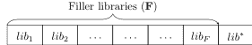

# 软件工程评估与评价 | 对抗机器学习：关于第三方的韧性

## 摘要

近年来，我们目睹了机器学习算法在多个领域（包括软件工程推荐系统（RSSE）的开发）中应用的显著增加。尽管研究人员专注于底层机器学习技术以提高推荐准确性，但鲜有关注使此类系统对恶意数据具有强健性和韧性。通过操纵算法的训练集，即大型开源软件（OSS）仓库，有可能使推荐系统易受对抗性攻击。本文对对抗机器学习及其对RSSE可能产生的影响进行了初步调查。作为概念验证，我们展示了被操纵数据的存在对两个最先进的推荐系统结果的负面影响程度，这两个系统向开发者推荐第三方库。我们的工作旨在提高软件工程社区对对抗技术及其影响的认识。我们还建议为推荐系统配备学习规避对抗活动的能力。

## 关键词

推荐系统，对抗机器学习

## ACM 参考格式：

Phuong T. Nguyen, Davide Di Ruscio, Juri Di Rocco, Claudio Di Sepio, and Massimiliano Di Penta. 2021. Adversarial Machine Learning On the Resilience of Third-party Library Recommender Systems. In Evaluation and Assessment in Software Engineering (EASE 2021), June 21–23, 2021, Trondheim, Norway. ACM, New York, NY, USA, 7 pages. https://doi.org/10.1145/3463274.3463809

## 1 引言

为应对日常编程任务，开发者访问和浏览各种信息来源 [5]。鉴于正式和非正式文档来源的丰富，问题不在于信息缺乏，而在于信息过载 [18, 19]。最近，许多研究已开展以开发方法和工具——软件工程推荐系统（RSSE）——为开发者提供自动化辅助 [10, 21, 25]。

RSSE 的开发涵盖多个阶段，包括底层算法的设计或现有算法的复用。机器学习（ML）技术是开发者在构思新推荐系统时的自然选择之一 [26]。这意味着，例如，代码元素（代码片段或 API）的推荐是从现有代码库或非正式文档中学习的。因此，推荐质量取决于底层数据的质量，其噪声问题此前已有报告 [14]。

更糟糕的是，用于训练推荐系统的在线数据可能被用于恶意目的。对抗机器学习 [13, 34]（AML）是一门研究 ML 系统（特别是推荐系统）中安全问题的领域 [7]。研究已致力于识别可能的威胁并寻求适当的对策 [1, 36]。例如，Anelli 等人 [1] 使用诱导攻击 [32] 来操纵基于链接数据运行的协同过滤推荐系统。此外，Wang 和 Han [36] 提出了一种改进的贝叶斯个性化排序技术，通过在基于协同过滤的推荐系统中利用基于对抗训练的平均策略。

为保护系统免受威胁，首先需要了解各种对抗活动 [16]。此类活动生成扰动以欺骗和干扰系统，导致故障，损害其推荐能力。

这些攻击的最终目标是操纵目标项目，从而对最终推荐产生负面或正面影响 [11]，具体取决于攻击者的意图。例如，在图像分类中，攻击者通过添加非随机噪声来构造输入图像，使其被 ML 模型错误分类，同时仍能被人类正确识别 [20]。例如，一只熊猫在输入图像被添加噪声后，被尖端深度神经网络识别为丝带，而人类仍能从伪造图像中正确识别出熊猫 [9]。

AML 已在广泛领域中被研究，例如在线购物系统 [16] 或图像分类 [20]，并涉及风险和对策。据我们所知，尽管 AML 在软件工程领域（例如测试和 DNN 应用 [31]）正受到越来越多关注，但 AML 尚未在 RSSE 的背景下进行调查。

在本文中，我们报告了关于对建议第三方库和 API 函数调用的 RSSE 造成伤害或危险的威胁的首个研究。我们选择这两类推荐，因为它们代表了以下场景：_(i)_ 推荐是从 OSS 仓库中学习的；以及 _(ii)_ 恶意推荐的结果，例如使用某个库或 API，可能导致严重的安全漏洞 [2]。

基于彻底的观察和对现有文献的分析，我们认识到，大多数改进 RSSE 的努力都集中在提高其准确性上。就我们所见，尚有工作调查使用故意伪造的数据来破坏推荐系统能力的问题，以及概念化对策。在这方面，我们的工作是第一个将 AML 问题引入 RSSE 的工作。

大多数 RSSE 严重依赖开放数据源，例如 GitHub、Maven 中央仓库或 Stack Overflow，这些数据源可能被对抗者操控 [37]。换句话说，这些系统易受配备伪造输入数据的攻击。因此，有必要了解可能的威胁，其最终目标是构思对策以提高 RSSE 的韧性。

我们首先概述了最先进的 API 和第三方库推荐系统，讨论它们可能受到 AML 影响的方式。通过在软件工程顶级场所进行的文献检索，我们表明 RSSE 面临着相当明显的威胁。然后，我们对两个现有的第三方库推荐系统进行了初步检查。实验结果揭示了一个令人担忧的结果：通过简单的操纵，我们可以轻松破坏最终推荐，使软件客户面临风险。

- 本文作出以下贡献：
  - 讨论针对第三方库和 API 调用的最先进 RSSE 的可能对抗性攻击；
  - 对两个库推荐系统进行初步评估，以扰动其推荐。

**结构。** 第 2 部分提供关于对抗性攻击及其对 RSSE 影响的背景概念。第 3 部分报告了对两个 RSSE 的初步评估。第 4 部分概述相关工作，而第 5 部分概述未来工作并总结全文。

## 2 对 RSSE 的攻击和威胁

在以下小节中，我们首先（第 2.1 节）概述推荐系统的各种攻击类型，然后（第 2.2 节）回顾建议第三方库和 API 函数调用的最先进 RSSE，同时分析它们可能暴露的 AML 威胁。

### 2.1 攻击分类

推荐系统的攻击分为以下两大类 [7]：

- **中毒攻击** 通过伪造输入数据来破坏 ML 模型；
- **规避攻击** 试图通过隐藏恶意内容来避免被检测，这些内容随后将被 ML 模型分类为合法内容。

在中毒攻击中，有两种可能的干预：

- **推送攻击** 支持目标项目，从而增加被推荐的可能性；
- 相比之下，**核弹攻击** 试图降级/诋毁目标项目 [1, 16]，迫使它们从推荐列表中消失。

在本文范围内，我们专注于中毒攻击，因为它们易于实施且有效。其余攻击留待未来工作。

### 2.2 用于挖掘库和 API 调用的 RSSE 潜在风险

我们回顾了支持软件项目开发的知名 RSSE，通过提供第三方库和 API 调用。表 1 按功能和时间顺序列出了这些系统。通过研究其内部设计，我们根据先前给出的攻击分类讨论了可能的漏洞。

### 表 1：用于挖掘库和 API 的知名 RSSE

| | 系统 | 会议/期刊 | 年份 | 数据源 |
|---|---|---|---|---|
| 库推荐 | LibRec [33] | WCRE | 2013 | GitHub |
| | LibCUP [28] | JSS | 2017 | GitHub |
| | LibD [15] | ICSE | 2017 | Android 市场 |
| | LibFinder [24] | IST | 2018 | GitHub |
| | CrossRec [21] | JSS | 2020 | GitHub |
| | LibSeek [12] | TSE | 2020 | Google Play, GitHub, MVN |
| API 推荐 | MAPO [38] | ECOOP | 2009 | SourceForge |
| | UF-Miner [35] | MSR | 2013 | Microsoft 代码库 |
| | DeepAPI [10] | ESEC/FSE | 2016 | GitHub |
| | PAM [8] | ESEC/FSE | 2016 | GitHub |
| | fine-GRAPE [29] | EMSE | 2017 | GitHub |
| | FOCUS [22, 23] | ICSE | 2019 | GitHub, MVN |

> **库推荐。** LibRec [33] 使用规则挖掘和协同过滤技术的组合来推荐库，从与正在开发的项目相似的项目中挖掘库。LibCUP [28] 建议具有强关联的库，通过使用聚类方法来识别和推荐共同使用模式。LibD [15] 为 Android 应用提供库，使用聚类技术。首先，它反编译应用程序以构建属于项目的包、类和方法的控制流图。然后，使用图来提取特征，并通过相似度函数进行分组。Ouni 等人提出了 LibFinder [24]，提供基于多目标搜索算法的库。基于协同过滤技术构建，CrossRec 从相似项目中提取库 [21]。LibSeek [12] 依赖于矩阵分解技术，通过收集邻域信息（即相似库的特征）来为移动应用提供相关库。

由此可见，所有考虑的系统都利用开放来源（例如 GitHub 或 Android 市场）进行训练。此外，它们使用基于相似度的度量（无论是相似度函数还是聚类技术）来挖掘库。因此，它们暴露于隐藏在 OSS 项目中的恶意内容的扰动。因此，我们推测，通过制造带有虚假数据的项目，攻击者可以支持（推送攻击）或诋毁（核弹攻击）一个库 [1, 7, 32]。换句话说，他们可以使一个好/有用的库

被推荐，或者更糟的是，将糟糕/恶意的库推升到推荐列表的更高排名，从而导致推荐系统的用户无意中采用它。

> API推荐。MAPO [38]通过从开发人员的上下文中提取API相关信息来推荐API模式。生成的数据根据其与客户端代码的相似性进行聚类和排名。在这方面，系统可能会被故意插入到类似项目中的恶意代码所愚弄。Wang等人提出了UP-Miner [35]，利用SeqSim和BIDE从源代码中挖掘。由于UP-Miner依赖于相似性度量，它可能会向开发人员推荐伪装成相似的项目中嵌入的恶意代码。DeepAPI [10]从自然语言查询开始生成相关的API序列。它采用RNN编码器-解码器将上下文中的单词编码为用于训练模型的向量。由于语料库是从GitHub项目中收集的，敌对用户可以在数据收集阶段轻松注入扰动，即，向系统提供受干扰的项目。PAM [8]已被提出，通过使用结构期望最大化（EM）算法从客户端代码中提取相关的API模式来推断最可能的项目。然后根据概率对挖掘出的API模式进行排名。推送和核弹攻击可以轻松修改工具获得的最终排名，即，通过操作术语的出现次数来偏袒或诋毁某个模式。FINE-GRAPE [29]通过依赖相关文件的历史来提供相关API。它解析GitHub项目，根据其历史（即来自每个API版本的方法、注解和类）发现并排名相关的API调用。FINE-GRAPE容易受到操纵，这些操纵会在GitHub项目中伪造API调用的人工历史。FOCUS [22]通过将项目编码为张量并使用协同过滤技术来建议API。由于它在从类似项目中挖掘的数据上工作，FOCUS不免受中毒攻击，即，攻击者可以创建带有有毒API的虚假项目，并将其伪装成合法项目，以诱骗FOCUS推荐这些调用。

## 3 概念验证

我们对AML对两个现有RSSE的影响进行了初步调查。该研究在两个库推荐系统上进行，即LibRec [33]和CrossRec [21]（参见表1）。选择这些工具的原因如下。LibRec是一个成熟的工具，被认为是第一个库推荐系统。CrossRec是一种较新的方法，已被证明优于LibRec。两个工具都提供了可用的复制包，12 使我们能够充分利用可用的源代码并根据研究需求进行定制。

### 3.1 问题陈述

我们考虑这样一个场景：在开发新软件时，程序员依赖推荐系统来查找并在代码中使用提供所需功能的第三方库。例如，开发人员正在搜索用于解析JSON文档的库，系统应该能够推荐那些被类似项目使用的库。我们模拟一个攻击者试图

将带有恶意代码的honeypy库（例如，参考前面的示例，一个恶意JSON解析器），记为lib*，注入到活跃项目中。鉴于在正常情况下，系统永远不会推荐lib*，因为该库在任何地方都未被调用。为此，我们强制支持lib*推送攻击（参见第2.1节），以便最终该库会被推荐给项目。

在许多情况下，经验丰富的开发人员通常只依赖于知名库，但有时一个文档齐全（即，提供有用功能）且（人为）被点赞的恶意库，仍可能被一些人采用。此外，尽管本文的评估仅限于库推荐，但类似的攻击场景也可能发生在建议代码片段的推荐系统中，例如MUSE [17]、PAM [8]或FOCUS [22, 23]。

lib*这个名称仅为说明目的而选择，以便于阅读。在实践中，为了避免被发现，攻击者可能会给库起一个山寨名称，即与流行库非常相似的名称，以更好地伪装它。事实上，近期工作[6]已报告了拼写错误抢注，这确实表明对库采用存在明显威胁。例如，一个恶意库被命名为“jellyfish”，以欺骗开发人员相信它就是“jellyfish”这一正版库。3 这样一来，开发人员在推荐系统推荐后就会毫不犹豫地采用这个伪装库。

> 总结
> 总而言之，这是为了强调在实践中被恶意库欺骗的风险是存在的。因此，使用推荐系统的软件开发人员如果不能充分研究应对这类攻击的问题，可能会遭受损失。

### 3.2 研究设计与数据集

LibRec和CrossRec都通过在训练数据中搜索最相似的项目来为活跃项目（即正在开发中的项目）推荐库 [21]。

图1：对虚假项目的库使用进行操纵。

当LibRec和CrossRec从现有项目中学习以提供推荐时，它们将项目的库使用视为一个向量，其中每个条目对应一个库：1表示该库包含在项目中，0表示不包含 [21, 33]。要攻击推荐系统，有多种方法可以为虚假用户配置文件填充评分 [3, 16]。不幸的是，它们不能直接应用于伪造项目，因为它们处理的是多级评分，而在库推荐中只有两个评分（0和1）。因此，为了为LibRec和CrossRec工具创建训练集，我们必须设计一种新方法来生成虚假项目，如下所示。一个项目的向量被分为两个独立部分，即填充库和目标库（参见图1）。我们用训练数据中的一组库填充前者，而后者设置为lib*。这旨在实现两个目标：(i) 使虚假项目与活跃项目相似；以及(ii) 提升lib*的存在感。

| | | HR@10 | | | | | HR@15 | | | | |
|---|---|---|---|---|---|---|---|---|---|---|---|---|
| α | k | γ=3 | γ=4 | γ=6 | γ=8 | γ=10 | γ=3 | γ=4 | γ=6 | γ=8 | γ=10 |
| α = 5% | k=5 | — | 0.154 | 0.177 | 0.242 | 0.219 | — | 0.154 | 0.189 | 0.252 | 0.237 |
| | k=10 | — | 0.198 | 0.273 | 0.428 | 0.410 | — | 0.198 | 0.317 | 0.455 | 0.442 |
| | k=15 | — | 0.199 | 0.307 | 0.541 | 0.546 | — | 0.199 | 0.368 | 0.580 | 0.580 |
| | k=20 | — | 0.177 | 0.316 | 0.608 | 0.637 | — | 0.177 | 0.388 | 0.638 | 0.670 |
| α = 10% | k=5 | — | 0.247 | 0.240 | 0.242 | 0.210 | — | 0.247 | 0.256 | 0.251 | 0.237 |
| | k=10 | — | 0.380 | 0.418 | 0.428 | 0.320 | — | 0.380 | 0.449 | 0.455 | 0.442 |
| | k=15 | — | 0.439 | 0.505 | 0.541 | 0.390 | — | 0.439 | 0.554 | 0.580 | 0.580 |
| | k=20 | — | 0.443 | 0.547 | 0.608 | 0.431 | — | 0.443 | 0.605 | 0.657 | 0.670 |

| | | HR@10 | | | | | HR@15 | | | | |
|---|---|---|---|---|---|---|---|---|---|---|---|---|
| α | k | γ=3 | γ=4 | γ=6 | γ=8 | γ=10 | γ=3 | γ=4 | γ=6 | γ=8 | γ=10 |
| α = 5% | k=5 | 0.159 | 0.158 | 0.145 | 0.113 | 0.103 | 0.178 | 0.177 | 0.163 | 0.138 | 0.120 |
| | k=10 | 0.140 | 0.141 | 0.165 | 0.149 | 0.140 | 0.184 | 0.190 | 0.201 | 0.185 | 0.174 |
| | k=15 | 0.154 | 0.163 | 0.188 | 0.198 | 0.189 | 0.200 | 0.227 | 0.235 | 0.250 | 0.229 |
| | k=20 | 0.112 | 0.135 | 0.207 | 0.188 | 0.194 | 0.168 | 0.191 | 0.268 | 0.235 | 0.250 |
| α = 10% | k=5 | 0.356 | 0.346 | 0.267 | 0.235 | 0.210 | 0.386 | 0.373 | 0.291 | 0.265 | 0.248 |
| | k=10 | 0.440 | 0.430 | 0.348 | 0.347 | 0.320 | 0.496 | 0.478 | 0.388 | 0.393 | 0.357 |
| | k=15 | 0.427 | 0.445 | 0.427 | 0.407 | 0.390 | 0.487 | 0.497 | 0.488 | 0.475 | 0.438 |
| | k=20 | 0.455 | 0.424 | 0.457 | 0.454 | 0.431 | 0.515 | 0.525 | 0.530 | 0.514 | 0.486 |

我们遇到以下问题：“应该选择哪些库作为填充库，以便虚假项目被纳入推荐？”事实上，推荐系统高度依赖相似性 [30]，因此我们提出选择流行库作为填充库。我们的直觉是，一个使用被广泛采用的库的虚假项目可能会引起推荐引擎的关注。从训练数据中选择一个库列表，并按调用项目数量降序排序。然后随机选择一定数量的顶级流行库。

从攻击者的角度来看，α是虚假项目与项目总数的比率（百分比）；γ是填充库的数量。对于LibRec和CrossRec，k是相似项目的数量，N是推荐排序列表的截断值 [21, 33]。我们在之前工作 [21] 使用的数据集上进行了十倍交叉验证实验，该数据集包含1,200个项目和13,497个库。对于测试项目，我们将其库随机分成两个相等的部分，第一部分用作查询，第二部分作为基准真实数据。为了衡量推送攻击的有效性，我们使用命中率HR@N，定义为被推荐lib*的项目数与测试项目总数的比率 [1]。为了衡量准确性，我们使用成功率SR@N，即至少获得一个匹配库的项目数与测试项目数的比率（推荐列表与基准真实数据的交集大小大于0）。我们实验了α={5%, 10%}作为攻击规模；k={5, 10, 15, 20}；γ={3, 4, 6, 8, 10}作为填充库的大小。对这些参数的校准使我们能够模拟压力测试，旨在研究系统在不同工作条件下的鲁棒性。

- **RQ1**: _LibRec和CrossRec是否易受推送攻击？_ 通过在从GitHub收集的真实数据集上对这两个系统进行实验，我们有兴趣了解推送攻击是否对它们构成威胁。

- **RQ2**: _α和γ如何影响攻击的有效性？_ 两个参数都可以由攻击者调整。因此，查看参数如何影响攻击效果也很重要。通过变化参数，我们研究了参数对两个系统推荐结果的影响。

### 3.3 实验结果

我们通过参考表2和表3来回答研究问题。LibRec不适用于库数量较少的项目，这就是为什么γ=3没有结果的原因。相反，我们可以运行CrossRec，任何γ > 0都可以。

#### 3.3.1 RQ1：LibRec和CrossRec是否易受推送攻击？

根据表2，我们看到，无论两个系统的内部配置如何（即k和N），推送攻击都始终成功地将lib*注入到项目中。一般来说，当使用较大的k值时，攻击会变得更有效。我们按如下方式分析运行工具所获得的结果。

当α=5%时，对于LibRec，我们可以看到系统以不同的命中率推荐恶意库。例如，当γ=4，k=5时，我们得到HR@10为0.154，并且当我们使用更多数量的库时，命中率会逐渐增加。当使用10个库时，HR@10达到0.219。此外，命中率也随k增加而增加，即用于推荐的邻近项目数量。值得注意的是，当k=20时，我们得到HR@10的命中率为0.637。同样，CrossRec在所有实验设置下也推荐恶意库。

如第3.1节所示，开发人员会自愿采用推荐的库，尤其是当虚假库使用拼写错误抢注名称伪装，且排名列表较短时，例如N=10或N=15。采用假冒库确实对正在开发的系统构成威胁。总而言之，我们得出结论，对库推荐系统的对抗性攻击极有可能发生，我们既不应低估也不应忽视它们。

> 即使采用简单的伪造，LibRec 和 CrossRec 的鲁棒性也会受到严重损害。两个系统都会向开发者推荐恶意库，一旦被调用，就会使软件客户端面临风险。

#### 3.3.2 RQ2：\(\alpha\) 和 \(\gamma\) 如何影响攻击的有效性？

攻击者关注 \(\alpha\) 和 \(\gamma\)，这两个参数在其控制之下，可以进行调整以使攻击更有效。表 2 和表 3 的结果表明，通过添加更多虚假项目，可以提高两个系统的命中率。

例如，对于 LibRec，当 (\(\alpha\)=5%, k=10, \(\gamma\)=6) 时，HR@10 为 0.273；而当 (\(\alpha\)=10%, k=10, \(\gamma\)=6) 时，相应的命中率 HR@10 为 0.418。同样，对于 CrossRec（参见表 3），当 (\(\alpha\)=5%, k=20, \(\gamma\)=6) 时，HR@10 为 0.207，而 \(\alpha\)=10% 时的命中率 HR@10 达到 0.457。当 \(\gamma\)=6 且 k=20 时，获得最大命中率，即 HR@15 = 0.530。对于 CrossRec，当 \(\gamma\) > 6 时，命中率会下降，这意味着攻击者应使用较小的 \(\gamma\) 以获得更高的命中率。对于 LibRec，最大 HR@15 为 0.670，在 \(\gamma\)=10 时获得。

我们以两种模式运行了 LibRec 和 CrossRec，即带有虚假项目和不带有虚假项目，并发现它们的成功率几乎没有差异。由于篇幅限制，我们仅报告两种模式下的平均 SR@N 差异，LibRec 和 CrossRec 分别为 2.6% 和 2%。

这意味着，推荐中无意中包含虚假项目很难被察觉，仅通过查看准确率的变化也无法检测出来。

> 通过添加更多虚假项目（\(\alpha\)），攻击者可以增加两个系统中受感染客户端的数量。较小的 \(\gamma\) 对 CrossRec 更危险，而较大的 \(\gamma\) 对 LibRec 造成的危害更大。

### 3.4 讨论

本小节讨论了试图 *破坏系统安全（标记为 \(\times\)）* 的攻击者的视角，以及 *防御系统免受敌对攻击（标记为 \(\checkmark\)）* 的管理员的视角。

尽管在评估中我们仅执行了推送攻击，但相同的方法论可以应用于实施核攻击，即从推荐中移除一个有用的库（\(\times\)）。此外，我们仅尝试了一个恶意库，但评估可以轻松扩展到一组库。

我们考虑了 LibRec 和 CrossRec 的不同设置，旨在研究系统在各种条件下的能力。在实践中，攻击者可能不知道这种设计，重要的是她如何填充虚假项目，以便恶意库会被推荐（\(\times\)），而不考虑系统的配置。

为了简化评估，我们在元数据层面生成了虚假项目，即假设所有项目都已成功从 GitHub 获取。4 在实践中，有必要将这些项目植入 GitHub，使其看起来合法（\(\times\)）。事实上，此类事件最近已被报告，其中数百个推广恶意软件应用的 GitHub 仓库被发现。5 据我们所知，针对此类滥用行为的研究仍处于起步阶段 [27]。

为了寻找可信来源，推荐系统通常选择仅从拥有大量星标和/或分叉的仓库中爬取，或者使用推荐系统为选择其训练集所采用的任何标准（\(\checkmark\)）[21]。在这种情况下，攻击者可能需要通过伪造这些信息来伪装植入的项目，例如，使用伪造账户进行星标和分叉（\(\times\)）。因此，需要机制来检测此类伪造（\(\checkmark\)）。

要渗透系统，引入库只是第一步。第二步是诱骗开发者通过调用其函数来调用该库。因此，攻击者还需要操纵 API 或代码推荐系统（\(\times\)），例如最近发表的 [8, 22, 29]。我们推测，第 3.2 节中描述的类似技术可用于注入有毒 API。

## 4 相关工作

近年来，对抗机器学习（AML）话题已引起研究界的广泛关注。在图像分类中，引入了多种对抗技术来向图像添加扰动 [9, 20]，这些图像随后会被人类正确识别。然而，DNN 容易受到这些攻击，因为它们无法对裁剪后的图像进行分类。

对于推荐系统，已有关于 AML 的各种研究 [7, 11, 16]。最近，Anelli 等人 [1] 提出了一种使用刷量攻击 [32] 来操纵基于链接数据运行的协同过滤推荐系统的尝试。在我们的工作中，我们对使用 GitHub 数据运行的 CrossRec 执行了类似的推送攻击。然而，我们需要设计自己的方法来策划虚假项目。

Wang 和 Han [36] 提出了一种改进的贝叶斯个性化排序（BPR）技术，通过在基于协同过滤的推荐系统领域利用基于对抗训练的平均策略（AT-MBPR）。通过利用用户评分，底层 MBPR 模型提取并将用户反馈分为三类。之后，算法在初始训练数据中注入对抗扰动以构建噪声数据集。然后，一个迭代过程优化目标函数。

已提出多种方法来防御推荐系统免受攻击 [16]。开发了一种基于强化学习（RL）的攻击无关检测模型 [4]。该模型利用注意力分类器，通过测量输入数据遭受扰动的概率，来区分对抗样本和正常样本。

## 5 结论与未来工作

本文对 RSSE 中 AML 话题进行了初步调查。尽管推荐库和 API 调用的 RSSE 已获得动力，但我们展示了它们如何容易受到虚假输入数据的对抗攻击。通过破坏工具的推荐列表，攻击为未经授权访问软件客户端铺平了道路。

作为未来工作，我们计划设计和评估有效的对策，以抵御针对 RSSE 定制的攻击。这将通过研究对对抗攻击具有感知能力并能捕获它们的学习算法来实现。此外，对抗尝试应转化为训练过程的特征，即，RSSE 不仅应从有用模式中学习，还应能够学习如何避免敌对模式。除了利用 GitHub 的推荐系统外，我们还计划调查利用 Stack Overflow (SO) 等问答论坛讨论的 RSSE 在多大程度上容易受到对抗攻击。例如，Prompter [25] 利用开发者在 IDE 中编写的代码和注释来推荐 SO 上的相关帖子。如果有人在 SO 帖子中隐藏恶意代码，基于 SO 的推荐系统可能会受到攻击，尽管审核和投票机制可能会使此类攻击更具挑战性。我们计划调查的另一条研究线与用于 API 推荐和代码补全的在线学习系统有关。我们计划评估此类推荐系统在多大程度上容易受到对抗攻击，并识别可能的对策以减轻相关后果。

## 参考文献

- [1] Vito Walter Anelli, Yashar Deldjoo, Tommaso Di Noia, Eugenio Di Sciascio, and Felice Antonio Merra. 2020. SASH: 基于知识图谱的语义感知推荐系统刷量攻击. In The Semantic Web. Springer International Publishing, Cham, 307–323.
- [2] Michael Backes, Sven Bugiel, and Erik Derr. 2016. Android 中可靠的第三方库检测及其安全应用. In Proceedings of the 2016 ACM SIGSAC Conference on Computer and Communications Security (Vienna, Austria) (CCS ’16). Association for Computing Machinery, New York, NY, USA, 356–367. https://doi.org/10.1145/2976749.2978333
- [3] Runa Bhaumik, Chad Williams, Bamshad Mobasher, and Robin Burke. 2006. 通过异常检测保护协同过滤免受恶意攻击. In Proceedings of IFIP’06. Held at AAAI 2006, Boston, Massachusetts. http://www.aaai.org/Press/Reports/Workshops/ws-06-10.php
- [4] Yuanjiang Cao, Xiaocong Chen, Lina Yao, Xianzhi Wang, and Wei Emma Zhang. 2020. 基于强化学习的交互式推荐系统中的对抗攻击与检测. In Proceedings of the 43rd ACM SIGIR. ACM, Virtual Event China, 1669–1672. https://doi.org/10.1145/3397271.3401196
- [5] Barthélémy Dagenais, Harold Ossher, Rachel K. E. Bellamy, Martin P. Robillard, and Jacqueline P. de Vries. 2010. 进入新的软件项目格局. In Proceedings of the 32nd ACM/IEEE International Conference on Software Engineering - Volume 1 (Cape Town, South Africa) (ICSE ’10). ACM, New York, NY, USA, 275–284. https://doi.org/10.1145/1806799.1806842
- [6] Alexandre Decan, Tom Mens, and Eleni Constantinou. 2018. 关于 Npm 包依赖网络中安全漏洞的影响. In Proceedings of the 15th International Conference on Mining Software Repositories (Gothenburg, Sweden) (MSR ’18). Association for Computing Machinery, New York, NY, USA, 181–191. https://doi.org/10.1145/3196398.3196401
- [7] Yashar Deldjoo, Tommaso Di Noia, and Felice Antonio Merra. 2020. 推荐系统中的对抗机器学习：现状与挑战. ArXiv e-prints (May 2020). http://www-ictserv.poliba.it/publications/2020/DDM20a/Survey_AMl_RecSys.pdf Under Review.
- [8] Jaroslav Fowkes and Charles Sutton. 2016. 无参数概率式跨 GitHub API 挖掘. In 24th ACM SIGSOFT International Symposium on Foundations of Software Engineering. ACM, New York, 254–265. https://doi.org/10.1145/2950290.2950319
- [9] Ian J. Goodfellow, Jonathon Shlens, and Christian Szegedy. 2015. 解释与利用对抗样本. In ICLR 2015, San Diego, CA, USA, May 7-9, 2015, Conference Track Proceedings, Yoshua Bengio and Yann LeCun (Eds.). http://arxiv.org/abs/1412.6572
- [10] Xiaodong Gu, Hongyu Zhang, Dongmei Zhang, and Sunghun Kim. 2016. 深度 API 学习. In 24th ACM SIGSOFT International Symposium on Foundations of Software Engineering. ACM, New York, 631–642. https://doi.org/10.1145/2950290.2950334
- [11] Ihsan Gunes, Cihan Kalei, Alper Bilge, and Huseyin Polat. 2014. 针对推荐系统的刷量攻击：一项全面调查. Artif. Intell. Rev. 42, 4 (Dec. 2014), 767–799. https://doi.org/10.1007/s10462-012-9364-9
- [12] Q. He, B. Li, F. Chen, J. Grundy, X. Xia, and Y. Yang. 2020. 移动应用开发中多样化的第三方库预测. IEEE Transactions on Software Engineering (2020), 1–1.
- [13] Ling Huang, Anthony D. Joseph, Blaine Nelson, Benjamin I.P. Rubinstein, and J. D. Tygar. 2011. 对抗机器学习. In Proceedings of the 4th ACM Workshop on Security and Artificial Intelligence (Chicago, Illinois, USA) (AISec '11). Association for Computing Machinery, New York, NY, USA, 43–58. https://doi.org/10.1145/2046684.2046692
- [14] Eirini Kalliamvakou, Georgios Gousios, Kelly Blincoe, Leif Singer, Daniel M. German, and Daniela E. Damian. 2014. 挖掘 GitHub 的承诺与风险. In 11th Working Conference on Mining Software Repositories, MSR 2014, Proceedings, May 31 - June 1, 2014, Hyderabad, India. 92–101.
- [15] M. Li, W. Wang, P. Wang, S. Wang, D. Wu, J. Liu, R. Xue, and W. Huo. 2017. LibD: Android 市场中可扩展且精确的第三方库检测. In 2017 IEEE/ACM 39th International Conference on Software Engineering (ICSE). 335–346.
- [16] B. Mobasher, R. Burke, R. Bhaumik, and J. J. Sandvig. 2007. 协同推荐中的攻击与补救. IEEE Intelligent Systems 22, 3 (2007), 56–63.
- [17] Laura Moreno, Gabriele Bavota, Massimiliano Di Penta, Rocco Oliveto, and Andrian Marcus. 2015. 我如何使用这个方法？. In 37th IEEE/ACM International Conference on Software Engineering, ICSE 2015, Florence, Italy, May 16-24, 2015, Volume 1. 880–890.
- [18] Gail C. Murphy. 2009. 软件开发中的信息过载攻击. In IEEE Symposium on Visual Languages and Human-Centric Computing, VL/HCC 2009, Corvallis, OR, USA, 20-24 September 2009, Proceedings. 4.
- [19] Emerson R. Murphy-Hill, Gail C. Murphy, and William G. Griswold. 2010. 理解上下文：在实验软件工程研究中创造持久影响. In Proceedings of FSE 2010, at FSE 2010, Santa Fe, NM, USA, November 7-11, 2010. 255–258.
- [20] Anh Mai Nguyen, Jason Yosinski, and Jeff Clune. 2015. 深度神经网络容易被欺骗：对不可识别图像的高置信度预测. In CVPR. IEEE Computer Society, 427–436. http://dblp.uni-trier.de/db/conf/cvpr/cvpr2015.html#NguyenYC15
- [21] Phuong T. Nguyen, Juri Di Rocco, Davide Di Ruscio, and Massimiliano Di Penta. 2019. CrossRec: 通过推荐第三方库支持软件开发者. Journal of Systems and Software (2019), 110460. https://doi.org/10.1016/j.jss.2019.110460
- [22] Phuong T. Nguyen, Juri Di Rocco, Davide Di Ruscio, Lina Ochoa, Thomas Degueule, and Massimiliano Di Penta. 2019. FOCUS: 用于挖掘 API 函数调用和使用模式的推荐系统. In Proceedings of the 41st International Conference on Software Engineering (Montreal, Quebec, Canada) (ICSE ’19). IEEE Press, Piscataway, NJ, USA, 1050–1060. https://doi.org/10.1109/ICSE.2019.00109
- [23] P. T. Nguyen, J. Di Rocco, C. Di Sipio, D. Di Ruscio, and M. Di Penta. 2021. 推荐 API 函数调用和代码片段以支持软件开发. IEEE Transactions on Software Engineering (2021), 1–1. https://doi.org/10.1109/TSE.2021.3059907
- [24] Ali Ouni, Raula Gaikovina Kula, Marouane Kessentini, Takashi Ishio, Daniel M. German, and Katsuro Inoue. 2017. 使用多目标优化的基于搜索的软件库推荐. Inf. Softw. Technol. 83, C (March 2017), 55–75. https://doi.org/10.1016/j.infsof.2016.11.007
- [25] Luca Ponzanelli, Gabriele Bavota, Massimiliano Di Penta, Rocco Oliveto, and Michele Lanza. 2016. Prompter - 将 IDE 转变为自信的编程助手. Empirical Software Engineering 21, 5 (2016), 2190–2231. https://doi.org/10.1007/s10664-015-9397-1
- [26] Martin P. Robillard, Walid Maalej, Robert J. Walker, and Thomas Zimmermann (Eds.). 2014. 软件工程中的推荐系统. Springer Berlin Heidelberg. Berlin, Heidelberg. https://link.springer.com/10.1007/978-3-642-45135-5 DOI: 10.1007/978-3-642-45135-5.
- [27] Md Omar Faruk Rokon, Risul Islam, Ahmad Darik, Evangelos E. Papalexakis, and M. Faloutsos. 2020. ResourceFinder: 从公开可用仓库中查找恶意软件源代码. ArXiv abs/2005.14311 (2020).
- [28] Mohamed Aymen Saied, Ali Ouni, Houari Sahraoui, Raula Gaikovina Kula, Katsuro Inoue, and David Lo. 2018. 通过使用模式挖掘提高软件库的可重用性. Journal of Systems and Software 145 (2018), 164–179. https://doi.org/10.1016/j.jss.2018.08.032
- [29] Anand Ashok Sawant and Alberto Bacchelli. 2017. fine-GRAPE: 细粒度 API 用法提取器 - 一种用于研究 API 用法的方法和数据集. Empirical Software Engineering 22, 3 (June 2017), 1348–1371. https://doi.org/10.1007/s10664-016-9444-6
- [30] J. Ben Schafer, Dan Frankowski, Jon Herlocker, and Shilad Sen. 2007. 协同过滤推荐系统. Springer Berlin Heidelberg, Berlin, Heidelberg, 291–324. https://doi.org/10.1007/978-3-540-72079-9_9
- [31] David Shriver, Sebastian Elbaum, and Matthew B. Dwyer. 2021. 减少 DNN 属性以实现使用对抗攻击的伪造. In 43rd International Conference on Software Engineering. IEEE.
- [32] Mingdan Si and Qingshan Li. 2020. 针对协同推荐系统的刷量攻击：一项综述. Artif. Intell. Rev. 53, 1 (2020), 291–319. https://doi.org/10.1007/s10462-018-9655-x
- [33] Ferdian Thung, David Lo, and Julia Lawall. 2013. 自动化库推荐. In 13th 2013 Working Conference on Reverse Engineering (WCRE). 182–191. https://doi.org/10.1109/WCRE.2013.6671293
- [34] J. D. Tygar. 2011. 对抗机器学习. IEEE Internet Computing 15, 5 (2011), 4–6.

- [35] J. Wang, Y. Dang, H. Zhang, K. Chen, T. Xie, and D. Zhang. 2013. 从源代码中挖掘简洁且高覆盖率的 API 使用模式. 在第 10 届 MSR 中. IEEE, 皮斯卡塔威, 319–328. https://doi.org/10.1109/MSR.2013.6624045

- [36] Jianfang Wang and Pengfei Han. 2020. 面向推荐系统的基于对抗训练的平均贝叶斯个性化排序. IEEE Access 8 (2020), 7958–7968. https://doi.org/10.1109/ACCESS.2019.2963316 会议名称: IEEE Access.

- [37] Yiming Zhang, Yujie Fan, Shifu Hou, Yanfang Ye, Xusheng Xiao, Pan Li, Chuan Shi, Liang Zhao, and Shouhuai Xu. 2020. 面向 GitHub 恶意仓库检测的网络引导深度神经网络. 在 2020 年 IEEE 知识图国际会议 (ICKG) - 458-465. https://doi.org/10.1109/ICBK50248.2020. 00071

- [38] Hao Zhong, Tao Xie, Lu Zhang, Jian Pei, and Hong Mei. 2009. MAPO: 挖掘与推荐 API 使用模式. 在第 23 届面向对象编程欧洲会议. Springer, 柏林, 海德堡, 318–343. https://doi.org/10.1007/978-3-642-03013-0_15
