# 医疗保健中的 Edge-AI：趋势与未来展望


# 前言

*Edge-AI in Healthcare: Trends and Future Perspectives* 是一本包容性指南，介绍边缘人工智能概念，重点关注医疗保健。

本书的目的是让读者了解边缘-AI的概念和问题，以及边缘-AI与机器学习、深度学习、IoT和区块链的未来发展。本书的组织方式以相当易于理解的方式解释复杂问题。

本书包含17章，涵盖边缘-AI的各个方面，包括通过智能杖增强视障人士的访问、为身体有障碍者设计的自动轮椅、医疗保健IoT中的入侵检测、通过聊天机器人体验人类精神、心脏病早期诊断、医学影像应用中的超分辨率，以及医疗旅游。

本书从（第1章）介绍医疗保健中的边缘-AI概念开始，而第2章讨论医疗保健的不同边缘-AI工具和技术。此外，第3章和第4章分别重点介绍了边缘-AI的不同机器学习和深度学习方法。后续章节包括特定问题的陈述，并解决不同的边缘-AI解决方案，例如通过开发智能杖支持视障人士、基于边缘-AI的智能医疗保健系统的身份验证、为身体有障碍者开发带有AIoT模块的自动轮椅、使用特征优化进行心脏病早期诊断，以及入侵检测和中风预测的解决方案。本书后半部分的章节强调了边缘-AI在医疗保健和数字营销中的IoT和IoE的当代作用。最后几章涵盖了通过聊天机器人体验人类精神，以及人类与基于证据的认知行为技术的参与。本书以边缘-AI启用的IoT医疗监测系统的法律和伦理影响以及边缘-AI中使用的区块链结束。

## 编辑简介

### Dr Sonali Vyas

Ph.D. (Computer Science), SMIEEE

Vyas博士作为学者和研究人员已服务十余年。目前，她在印度北阿坎德邦石油与能源大学计算机科学学院担任副教授（选定等级）。她的研究兴趣包括医疗信息学、区块链、数据库虚拟化、数据挖掘和大数据分析。她在评议期刊、会议论文集和书籍中撰写了许多研究论文、文章和书籍章节。她撰写了一本由Springer出版的《智能医疗系统》一书。她也是由Springer Nature出版的《普适计算：网络视角与未来方向》和由IGI Global出版的《可持续农业发展的智能农业技术》的编辑。她担任《统计与管理系统》（Thomson Reuters）期刊《机器学习与软件系统》特刊的客座编辑。她还在智能和可持续系统领域获得了三项专利。她还担任过AICTE-ISTE教师复修课程“嵌入式系统、IoT、普适计算”的资深人员，并在许多享有国际和国家声誉的会议上做了许多演讲。她还是许多评议国家和国际期刊的编委会和评委会成员。她还曾在许多国际和国家会议的组织委员会、国家咨询委员会和技术方案委员会任职。她还在各种著名的国际和国家会议上担任过会议主席。她获得了由国际组织研究所（I2OR，印度政府注册的MSME）和Green ThinkerZ设立的“2021年国家杰出教育家奖”和“2021年国际青年研究员奖”。她还在由VDGOOD专业协会在国际会议上颁发的工程、科学和医学领域的“2021年女性研究员奖”中获奖，并获得了全球教育和企业领导力奖（GECL-2018）的“年度最佳学术人员（女性）奖”。她是IEEE（高级会员）、ACM-India、CSI、IFERP、IAENG、ISOC、SCRS和IJERT的专业会员。

### Dr Akanksha Upadhyaya

Ph.D. (Computer Science)

Upadhyaya博士现任印度德里鲁克米尼·德维高等研究学院（RDIAS）副教授兼AI中心主任。她与RDIAS有超过九年的关联，作为学者总拥有超过13年的经验。她在信息技术、计算机科学和管理科学领域拥有教学经验。她获得阿米蒂大学诺伊达分校数据认证和欺诈检测领域的博士学位。她于2020年获得GRF颁发的杰出论文奖。凭借丰富的经验，她在各种国家和国际会议上发表过论文，并获得了多项最佳论文奖。她撰写了25多篇研究论文，其中一些已发表在由IGI Global、IEEE、Springer、Inderscience和Elsevier等出版社出版的Scopus索引期刊和会议中。她在由IIM和其他顶尖机构组织的多个国际和国家会议上担任过会议主席，曾为著名的国际图书出版物担任客座编辑，并为由Springer Nature、Inderscience和其他享有声誉的国际出版社出版的同行评议期刊审稿。她名下有两项专利，目前正担任CRC Press、Apple Academic Press和Nova Science Publisher三本编著书籍的客座编辑。她曾在多个研究工作坊和教职员工发展计划中担任研究方法和数据认证领域的受邀演讲人和资深人员。

### Professor (Dr) Deepshikha Bhargava

Ph.D. (Computer Science), Banasthali Vidyapith, Rajasthan
SMIEEE, LMCSI, MIE, M.Tech. (CS), MCA, M.Sc. (CS)

Bhargava教授拥有超过22年的学者丰富经验，目前在印度大诺伊达（阿纳亚姆校区）阿米蒂大学北方邦分校担任教授兼机构主管。她撰写了16本书和14本图书章节，编辑了两本书，并在期刊和会议论文集中发表了多篇研究论文。她最近被任命为印度电子与信息技术部（MeitY）项目评审指导小组（PRSG）成员。她还曾担任毛里求斯教育及人力资源、高等教育和科学研究部下属马萨雷恩大学（UDM）的访问研究员。她被印度电子与信息技术部（MeitY）提名，前往北阿坎德邦信息技术发展局（ITDA）信息技术部下属的无人机应用与研究中心（DARC）进行访问。她也是巴西Centro Universitário Facvest（UNIFACVEST）PaperVest Press科学顾问和PaperVest University Publisher的特聘顾问。最近，她被美国国家科学基金会（NSF）列入2022年NSF研究生研究员计划（GRFP）评审员名单。Bhargava教授还获得了以下奖项：“积极参与女性奖”、“年度最佳教职员工”（子类别：“当代主题图书撰写”）等。她还于1992年获得印度人力资源开发部（MHRD）颁发的学术卓越奖。她是联合国在线志愿者、工程师学会（IE）、ACM-W、IEEE高级会员、ACM-CSTA、印度计算机学会（CSI）、项目管理协会（PMI）、印度照明工程师学会（ISLE）和维甘·巴尔蒂（Vibha）的成员。总体而言，在她指导下已完成四名博士。她的研究兴趣领域包括人工智能、软计算、生物启发计算和医疗信息学。


## 维诺德·库马尔·舒克拉博士
### 计算机科学博士

舒克拉博士目前担任阿联酋迪拜阿米蒂大学（Amity University, Dubai, UAE）的信息技术副教授兼工程建筑室内设计学院学术负责人（Head of Academics, Engineering Architecture Interior Design）。他拥有14年以上经验。他的博士研究领域为语义网络与本体论。他是IEEE的活跃成员。他在各类权威期刊和会议上发表了多篇研究论文。他还完成了印度艾哈迈达巴德印度管理学院（IIM-A）的“普通管理课程”（General Management Program）。他还是思科认证网络培训师（CCNI，Cisco Certified Network Trainer）。他主持过多项培训项目，包括为德里输电公司（D.T.L）员工、德里Megdoot Bhawan的印度邮政部门，以及隶属于国防部的部际组织——重新安置总局（DGR，Directorate General Resettlement）的员工开展培训。（DGR）。他还撰写了《阿联酋在线零售：推动增长》（Online Retail in UAE: Driven to Grow）和《莫迪访问阿联酋：挖掘新的合作领域》（Modi’s Visit to UAE: Uncovering New Areas of Cooperation）两个案例研究，案例由英国欧洲案例清算所（ECCH，European Case Clearing House）托管。他获得了由阿联酋迪拜阿米蒂大学举办的“2020年一致探究奖”（Inquisitive Award in Unanimity, 2020）。他获得了由沙迦Manzil Center颁发的“2019年明星支持者奖”（Star Supporter Award 2019）。沙迦查伊卡·S·阿勒卡西米女殿下（Her Highness Sheikha Chaica S. Al Qassimi）和沙迦Al Manzil Center主任艾莎·萨伊德·侯赛尼博士（Dr. Ayesha Saeed Husaini）向阿米蒂大学迪拜分校颁发了“感谢证书及2019年明星支持者奖”（Appreciation Certificate and Star Supporter Award 2019），由舒克拉博士代表学校接受，以表彰其在社区参与和志愿服务方面的持续支持。他还代表阿米蒂大学迪拜分校，从印度驻苏丹国大使馆副馆长格洛丽亚·甘特女士（Mrs. Gloria Gangte）手中接受了纪念品，以表彰其在2016年指导研讨会上的贡献。

# 1 医疗保健领域的边缘-AI简介

Atishi Jain, Mann Bajpai, Aditi Gupta, Ankita Kashyap, Devesh Kumar Srivastava

## 目录

- 1.1 简介 ....................................................................1
- 1.2 医疗保健领域边缘-AI的数据使用、分析与应用 ...........3
- 1.3 医疗保健领域的边缘-AI工具与技术 ....................................6
- 1.3.1 边缘-AI的工具与技术 ................................................6
- 1.3.2 医疗保健中的实施 ....................................................7
- 1.4 医疗保健领域边缘-AI的架构、框架与模型 ...........8
- 1.4.1 边缘-AI架构（Xu et al. 2020）....................................8
- 1.4.2 边缘-AI的优势 ......................................................................9
- 1.4.3 边缘-AI框架.............................................................9
- 1.4.4 边缘-AI模型 ..................................................................10
- 1.5 医疗保健领域边缘-AI的建模与仿真技术 ............11
- 1.6 医疗保健领域的边缘-AI、机器学习与深度学习方法....................................................................................13
- 参考文献....................................................................................14

## 1.1 简介

在该模型中，算法在本地提出和处理，不依赖云端、互联网等。它们使用自身生成的数据进行训练，将其本地存储，并在需要时快速做出决策。此类技术是在各种客户端设备上训练的模型。随后，模型更新和精选的数据会定期发送到远程服务器。实施此类模型可节省回传成本和带宽需求。在医疗保健等领域，哪怕一秒的延迟都可能导致死亡，因此降低延迟是必须考虑的主要问题。边缘-AI（边缘人工智能）技术用于本地精选、分析和生成结果的分析方法，包括人工智能和机器学习等高级分析方法，机器视觉、视频分析和传感器融合等边缘计算技术，以及融合位置情报的方法。硬件支持包括使能边缘计算的电子产品和设备。能源效率和可扩展性降低了成本，提高了实时性能，并实现精准分析，加上更广泛的覆盖范围，使这项技术更具吸引力。此类技术可以使医务人员即使在连接不足的地区也能获取重症患者的信息。借助边缘-AI，即使在偏远地区，也有可能检测、识别和诊断肌肉骨骼损伤、骨折、心血管异常乃至某些神经系统疾病。AI及其在全球各行各业的应用影响已显著提升。当今，面对企业世界不断增长的数据需求，云计算已被应用于几乎每个领域，从而成为AI不可或缺的一部分。边缘-AI被视为AI的未来，是AI与边缘计算的结合，利用机器学习在硬件设备上部署智能解决方案。这些硬件设备称为边缘设备，利用机器学习算法对设备生成的数据进行分类、过滤和分析，并实时做出决策。边缘AI在服务器或设备上本地处理数据，无需将数据传输到云端，从而减少了时间延迟。从云端到边缘的这一转变非常有利。边缘AI的另一个优势是，它不需要互联网连接即可实时分析数据。近年来，AI在不同工业领域改进系统和提升技术方面的功劳值得称赞。医疗保健是由AI技术和边缘计算驱动的主要行业之一（Fasciano & Vitulano 2020）。AI有潜力实现流程自动化，并在边缘-AI的增强下，对于实现医院病房和患者的自主监测变得极其有用。这是通过各种AI算法实现的，这些算法使用大量传感器收集和处理数据，以便做出适当响应。通过自动化心血管检测（如X光）等方式，对当今医疗保健格局进行转型的创新与发展层出不穷，远不止于此。不断增长的全球人口给各个年龄段人群的生活质量带来了许多问题和挑战，这主要影响医疗保健领域。借助直接在边缘上的基于AI的技术，能够实现更快速、更私密、更精确的结果，且直接基于边缘计算运行。

随着技术的发展和人类寿命的延长，患者需要更精密、更快速的结果，以帮助他们实现任何病症的快速治疗。利用AI技术旨在促进社会健康水平的提升——这在当今世界非常必要——却因知识匮乏、社会与经济问题以及沟通不足而面临挑战。在本章中，我们将重点介绍医疗保健领域边缘-AI工具与技术的架构、框架和模型。基于AI的技术将帮助我们利用边缘-AI构建一个更具赋权的社会与社区，而边缘-AI有潜力通过改善医疗系统和降低成本，影响数百万患者和医疗服务提供者。从更好的分析到更完善的决策支持，一旦采用，边缘-AI就能创造奇迹。

借助仿真，我们可以拥有一个环境和模型，帮助我们识别哪些医疗系统有用，并帮助更好地照顾患者。通过将AI模型与我们的医疗系统相结合，我们可以快速识别和分析问题，还可以帮助提出良好的


## 1.2 医疗保健中的数据使用、分析与边缘-AI应用

solutions which can help save the lives of patients. We can train models in such a way that they can derive insights with regard to the level of disease risk from the datasets of a patient's medical and social history. The models will also be useful as they will allow the technical team to evaluate and modify the model and workflow to normal clinical practice. Edge-AI is going to prove extremely useful to patients and doctors as it ensures affordable prices and healthcare.

Edge systems can be thought of as real-time control engines or deterministic embedded communication systems present at the ends of a network, in proximity to the physical world and the industrial environment. One of the main contributors to the advent of edge-AI was the momentous advances of the Internet of Things (IoT) devices with which the web partners transmit data and information between the device and the cloud.

Data collection is achieved through devices like motion controllers, programmable logic controllers, sensors, etc., residing at the boundary of the network. All these devices have analytic capability which enables them to perform analysis and produce results at the edge itself, being connected to the running system as close as possible to the site where the data are being produced, instead of the cloud. Integration of AI at the edge nodes only allows real-time operations, decision-making, data creation, and storage within the same device. Using an inferencing model, AI models are shifted from the cloud to closer to the edge by edge-AI. If any action needs to be taken, the device takes care of it, based on the analysis that it performs. In order to analyse the larger picture, transmission of the relevant data takes place from the devices at the edge to the cloud which are then aggregated.

Machine-learning methods are used by the edge-AI systems for processing the data generated at the local level by the hardware devices. Based on the data collected by the device, AI algorithms are proposed on the hardware devices locally. The devices store the results locally and afterward the information is sent to the cloud for further processing and storage. The local computing resources and devices used in edge-AI are optimised for AI and integrated directly. This makes it ideal to analyse and process vast amounts of data in real time on site. The reduced amount of data that must be transmitted further reduces the cost of data communication. The vulnerability arising from the privacy perspective can also be avoided as data do not have to be transmitted and stored in the cloud. Let's take the example of sensor data generated to monitor and analyse the status of equipment at some remote healthcare facility. Millions of data points can be created in such an environment per second. It will be impractical to transmit the raw data to a remote data center without filtering and processing it first. The situation gets worse if there's poor network connectivity or inconsistent bandwidth. There are a few cases where, in the absence of edge technology, the data must be collected in storage media and physically shipped via trucks to the data centers. This adds latency which, in turn, results in the loss of signals which might prove to be useful in finalising the procedure for a patient’s diagnosis or a medical instrument’s need for immediate repair or replacement. All this can be avoided as, in edge-AI, the latency and bandwidth requirements are dramatically reduced because much of the process takes place next to the sensors. IoT devices have limitations when it comes to on-device AI as they usually can’t store, compute, label, and analyse large amounts of data. Furthermore, for the outcomes to be accurate and usable, massive amounts of aggregated data from several devices need to be executing the machine-learning algorithms. It is not feasible to rely on the cloud to analyse and process data for real-time decision-making. When big data analytics are held at the end device, only the updates to the algorithms are sent back to the cloud to keep the multiple sites in sync, saving expensive backhaul and cloud storage costs.

Machine-learning and intelligence processes are quite resource heavy. Deep learning algorithms need to be fed data, ultimately to train the deep neural network (DNN). After a DNN framework is established, it is deployed at the edge device for inference. So, basically, the computer collects all the data on an object from the sensors and then utilises it to make accurate predictions. Generally, edge-AI is used for inferencing, whereas, for training new algorithms, the cloud is used. The processing power and capability required for inferencing algorithms is significantly less than that required for training algorithms (Vyas 2023). Hence, at times, the inferencing algorithms are run on Central Processing Units (CPUs) or less efficient microcontrollers on edge devices. In some cases, the inference power is improved along with a reduction in power by using highly efficient AI chips. A proper edge-AI microchip can make autonomous decisions based on the data it acquires even in the absence of the cloud or even internet connection. These microchips can even have a sub-millisecond latency as the data are processed inside the device itself. Machine-learning algorithms can run autonomously due to the decentralised nature of technology. The risk of internet outages or poor network reception is eliminated. The data that the cloud receives has already been highly processed by the edge device, reducing energy consumption by 30–40%. With the 5G rollout, edge technology is becoming integral, with many network providers incorporating edge-AI in the towers themselves, improving speeds and eliminating the requirement for external servers. Some of the analytic tools widely used in the industry today include the following:

- IBM Watson IoT edge analytics.
- Intel IoT Developer Kit.
- Cisco SmartAdvisor.
- Dell Statistica.
- Oracle Edge Analytics.
- Microsoft Azure IoT Edge.
- AWS IoT GreenGrass.

Edge-AI usage is multiplying by leaps and bounds, and investment in the edge computing semiconductor industry grew by 74% over the past year, making the total investment equal to $5.8 billion. Its applications can be in various industries, ranging from healthcare to security and surveillance, from navigation to computer vision, etc. It plays a crucial role in data creation, decision-making, and performing other real-time operations where milliseconds matter. Healthcare is one such industry where on-demand insights help paramedics make immediate and crucial decisions regarding patients.

A study suggests that 30% of all globally stored data comes from life sciences and healthcare. Considering the amount of data coming in from the healthcare industry, collection and derivation of insights in real time becomes imperative in order to make quick decisions. Technologies powered by edge-AI are already making an impact in the healthcare sector. Surgeons can focus on finding anomalies to be removed, tracking surgical tools, monitoring organs which must be preserved, making automatic measurements, and detecting real-time bleeding, using ultra-low-streaming of surgical videos into AI-powered data-processing workflows. Edge-AI is being integrated into smart hospitals in technologies like patient screening, improved medical image acquisition and reconstruction, heart rate estimation, surgical therapy guidance, real-time visualisation and monitoring, conversational AI, etc. Many different medical and life science instruments, including ultrasound devices, CT and MRI scanners, cryo-electron microscopy, ultrasound devices, and DNA sequencers, benefit from edge-AI too. Some of the most severe diseases can be easier to treat as a result of early diagnosis. Early screening can be brought to a higher level with the implementation of AI-powered diagnostic tools. Google’s support in the early diagnosis of diabetic retinopathy with AI-powered bots in India is a good example. Edge-AI can be used in image recognition, predictive maintenance, visual search and object recognition and tracking. Edge-AI can notify the nursing staff if it identifies a patient at risk of falling out of a hospital bed. Also, many wearable devices come with specific hardware these days which can detect if a person falls suddenly. With training, edge-AI systems in these wearables detect falls in a fraction of a second and notify the caregivers; the Apple watch’s fall detection feature is an example of the same. Edge-AI is of immense help in the monitoring of vital signs too. AI can be leveraged to detect any abnormality at any given instant by the use of medical devices recording data like temperature, heartbeat, blood pressure, oxygen level, respiration rate, etc. (Slomka et al. 2017); these can be used to alert hospital staff. DICOM (Digital Imaging and Communications) images are quite common in radiology. Their transmission to the cloud or a central server can be costly and time-consuming, but edge-AI implementation enables analysis to happen locally, resulting in a faster diagnosis.

Advanced imaging using edge-AI has several applications in the healthcare industry. Cardiovascular abnormalities, fractures, and musculoskeletal injuries can be detected using edge-AI. The integration of AI with the concept of imaging data can also help in the identification of changes in overall flow, thickening of muscle structure, soft tissue injury, detection of hairline fractures, dislocations, and so on. Sets of diagnostic processes can be streamlined by algorithms which flag images containing anomalies in the case of neurological diseases. Large chip manufacturers like Intel, Nvidia, and Qualcomm have invested heavily


在边缘 AI 领域。Nvidia 推出了其参考边缘应用程序 Clara Federated Technique。该应用程序创建了一个 AI 训练模块，可用于预防性护理、更好的成像、预测性诊断、实时分析等。Intel 的 Pentium 和 Atom x6000E 系列以及 Celeron 的 N 和 J 系列处理器专门为增强边缘工作负载而设计。在医疗保健行业，它将促进服务机器人、医疗显示器以及需要边缘 AI 的入门级超声机（Wan et al. 2020）。

## 1.3 医疗保健领域的边缘 AI 工具和技术

### 1.3.1 边缘 AI 的工具和技术

传统上，AI 解决方案是云驱动的，因为需要高质量的硬件来执行深度学习、计算作业，并能够扩展云中的资源。但是，云存在某些局限性，可以通过将计算任务更靠近数据生成站点（即网络边缘）的需求来克服。AI 及其在全球各行各业的应用影响已得到显著提升。如今，众多应用程序都在使用 AI，这提高了数据中心的技术要求，产生了高昂的成本。云可能并不总是一个可行的选择。这带来了对云计算的需求，它有助于最大限度地减少服务交付延迟并提供所需的计算能力。在当今以数据为中心的环境中，云计算几乎应用于每个领域，以满足企业世界不断增长的数据需求，成为 AI 的组成部分。边缘 AI 是边缘计算和 AI 的融合，它使用机器学习在硬件设备上部署智能解决方案，并具有无数潜在用途。

边缘计算包括众多技术，例如收集、分析和处理，这些技术有助于将数据带到网络边缘，而不是远程位置，从而减少时间延迟。基本上，流程是分散的，并在更合理的物理位置进行。物联网（IoT）和云计算促成了对网络边缘更高智能、计算能力和高级服务的迫切需求的上升，以帮助提升边缘设备的作用。边缘设备使用机器学习算法对该硬件设备生成的数据进行排序、过滤和分析，并实时做出决策。它控制两个网络之间末端的数据流。网络之间传输的数据的传输、路由、处理、监控、过滤、翻译和存储是边缘设备的一些功能。边缘 AI 提供了很大的灵活性，允许智能设备支持各个行业。由于数据在边缘计算机的本地级别处理，这降低了数据面临篡改风险的可能性，如果数据存放在云中的某个地方，这种风险会增加。这也使计算机更加灵敏。实时数据处理的最显著优势使得可以在现场设备上直接使用 AI 应用程序。边缘推理和训练是另一个优势，因为训练模型和推理的应用直接在边缘设备上进行。边缘 AI 还提供了更高水平的自动化。在边缘训练的机器可以执行自动化任务。工业自动化和边缘 AI 技术正在迅速增长，并在全球广泛应用。从特斯拉等自动驾驶汽车到心血管检测（如 X 光）的自动化，人工智能的应用正在以指数级速度在各个领域扩展。

### 1.3.2 医疗保健中的实施

其中一个这样的领域是医疗保健。一项新兴技术是医疗保健服务机器人的开发。处理患有慢性或心理疾病的患者需要护士或照护人员长期、全天候的关注。科学家们正在探索提供持续陪伴的方法，以提供“移动医疗机器人”。这些机器人有潜力向人类医疗专业人员和专家学习并获得经验，进而做出比人类照护者更准确的诊断，因为它们不会容易出现人为错误。机器人的移动性提供了额外的优势。配备传感器的机器人不会错过关于环境和患者的最微小细节，并使机器人在重复性工作中更加灵活。这有助于捕捉关于患者的重要信息，这可能有助于他们更快康复。传感器在需要时作为直接信息向其他边缘设备或云的分发器（Islam et al. 2022），从而允许每个边缘设备处理信息并履行其职责，而不是将所有数据发送到中央服务器。AI 在心血管成像领域已取得突破，帮助放射科医生和病理科医生进行医学成像，以识别和诊断一系列疾病。MRI、CT 扫描和 X 射线图像使医生能够看到人体内部的运作情况。然而，任何人评估这些图像通常包含的海量复杂数据都可能既困难又耗时。AI 工具可以充当临床决策支持，从而通过支持放射科医生和病理科医生的工作流程来帮助提升护理交付（Mazzanti et al. 2018）。临床心脏 MRI（CMR）扫描需要大约一小时的成像时间，随后还需要大量时间对获得的图像进行后处理。尽管完全自动化的 CMR 分析方法在临床应用尚未实现，但由于手动图像后处理的当前延迟，CMR 将从自动分割中获益匪浅。各种 CMR 脉冲序列、扫描变量和成像协议——每种都需要根据每位患者和医疗问题进行定制——是扫描和分析自动化的障碍。尽管存在这些局限性，但目前有大量研究工作正在进行中以克服这些挑战。边缘 AI 在医疗保健领域的应用展现了巨大的近期潜力，可为医生和医师提供完全自动化和准确的工具，用于诊断目的以及改善患者治疗。

## 1.4 医疗保健边缘 AI 的架构、框架和模型

### 1.4.1 边缘 AI 架构（XU 等人 2020）

边缘 AI 为医疗保健、制造、能源等各个行业提供视觉、位置和分析解决方案。这些解决方案部署在边缘设备上，有助于降低延迟，允许离线和在线执行，并提供强大的结果和安全性。边缘 AI 利用这样一个事实：机器学习（ML）模型的训练和部署过程是完全解耦的。它允许将训练好的 ML 模型嵌入内存和计算资源有限的设备中，从而实现离线运行。边缘 AI 的架构如图 1.1 所示。

边缘 AI 是一种分布在云上的架构。

- 1) 云层。云层是最重要的层之一，因为它存储了当前或将来可能需要的所有边缘 AI 数据。云帮助我们从任何远程位置访问数据。边缘 AI 基于 AI、机器学习、物联网和云计算的原则。在医疗保健中，我们使用这些原则来实现精确结果。

- 2) 边缘层。该层包括设备、传感器、局域网/广域网（LANs/WANs）等。在此层中，数据被收集和存储以供进一步处理。它们具有互联网带宽、存储内存、处理能力和计算资源的功能，可以在网络其他部分很少帮助的情况下收集、处理、存储和分析数据。

- 3) 设备层。这是任何边缘 AI 网络中最重要的层之一。我们需要收集各种将发挥作用的组件。

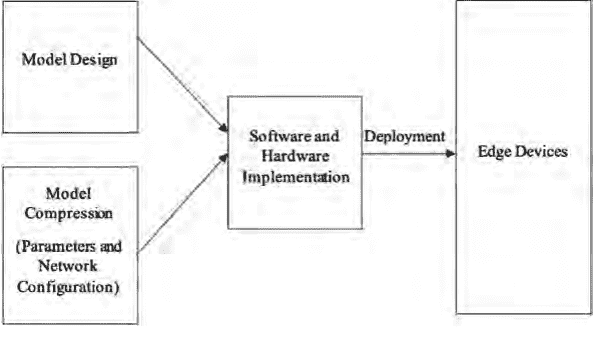

图 1.1 边缘 AI 架构。


针对特定问题的网络独特需求。然而，一个网络通常由许多设备组成，例如云服务、服务器、传感器等。一些示例包括医疗设备、环境设备、交互设备等。

### 1.4.2 边缘 AI 优势

- 1) 低延迟。在云端运行 AI 模型意味着往返延迟至少为几毫秒，根据网络连接情况，可能延长至几秒钟。

- 2) 隐私。在设备本地（即设备本身）处理数据意味着我们无需将数据发回云端进行处理。随着智能设备（例如摄像头、扬声器）开始在商店、医院、办公室、工厂等场所部署，加上用户对企业存储和处理其个人数据（包括图像、音频、视频、位置和购物历史）的日益不信任，这一点变得越来越重要。

- 3) 降低成本。边缘实时处理不仅能够实现低延迟和隐私保护，还充当“过滤器”，确保仅将相关数据传输到云端进行进一步处理，从而节省带宽。传输到云端的数据减少也意味着云端上的存储和处理成本降低。

### 1.4.3 边缘 AI 框架

虽然机器学习模型传统上嵌入在相机、手机、无人机、自动驾驶汽车等设备中，但边缘 AI 日益普及促使开发出能够高效执行 AI 推理的专用设备。边缘 AI 框架如图 1.2 所示。

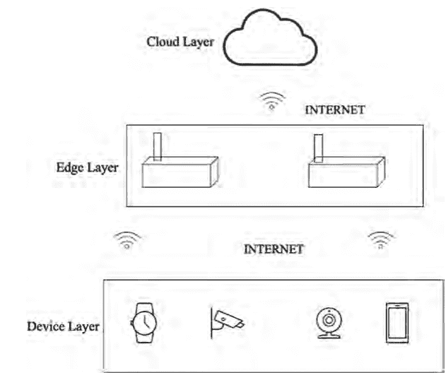

图 1.2 边缘 AI 框架。

- 1) 模型设计与模型压缩。目标是降低模型在设备上的推理时间。深度神经网络（DNN）通常需要存储和访问许多用于描述边缘模型架构的参数。边缘设备不仅在计算资源方面受限，而且在内存方面也受限。执行神经网络（NN）压缩主要有两种方式：降低精度或减少权重（剪枝）。

- 2) 软硬件实现。这将进一步进入软硬件阶段。基于模型设计和参数，我们设计软硬件，然后将其转发用于部署。

- 3) 边缘设备部署。基于信息和部署，将硬件和软件部署到设备中，这些设备进一步应用于各个行业。

### 1.4.4 边缘 AI 模型

为应对这些挑战，我们提出了 Model Audit Toward Endorsement 框架（如图 1.3 所示）。它提供可扩展引擎、与平台无关的库以及验证工具，能够保证算法在不同平台上的功能。

模型标准化包括对所选模型进行调整，以便向集成层工具提供标准接口。可以通过接口对这些模型进行访问和评估，从而使用 Model Audit Toward Endorsement 框架，这些模型通常使用其原始框架访问，通常在笔记本电脑/PC 或云服务上运行。它还可以使用为自定义处理库构建的组件在其微处理器上运行。对该过程的评估可能导致对这些模型的重新训练。它还可能就微处理器上的这些重要扩展和优化提供建议。

例如，可以通过评估模型或收集的数据来改进模型修复。通常可用的模型是在这些数据集上训练的，可能需要针对应用程序中的这些特殊参数进行调整。如前所述，为了在这些嵌入式设备上更快地运行这些模型而进行的模型修改，也可能是模型修复的另一个原因。

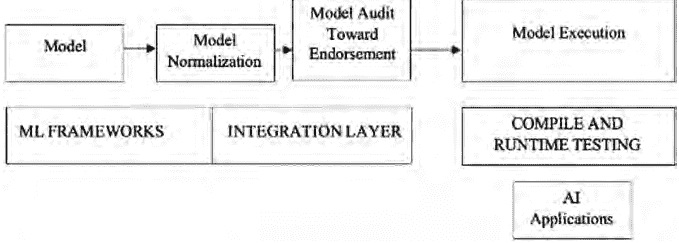

图 1.3 边缘 AI 模型。

## 1.5 医疗保健中边缘 AI 的建模与仿真技术

我们的医疗机构正面临经济动荡和诸多挑战。他们被迫提出新的创新方法来改善运营并建设性地利用有限资源。当务之急是提高服务质量并降低成本，因此我们需要旧医疗系统的可行替代方案。对智能决策技术的需求在不断增加。研究人员正在努力利用 AI 解决复杂系统问题。他们知道，即使是一次误判也可能导致生命损失。建模与仿真技术已被广泛研究，以解决医疗领域的各种决策问题。

当今，我们专注于利用技术构建智慧城市。智慧医疗和医疗设施是智慧城市的主要组成部分。医疗依赖于高效利用其资源。该领域最昂贵的资源是人力资本。如果我们能充分利用这一资源，就能向完全自动化的智慧医疗系统迈出一步。医疗每秒都在面临海量数据的冲击；为了管理如此庞大的数据，我们需要可靠且安全的数据源。为了实现这一点，我们需要使用云计算和边缘计算。基于分布式云-雾的医疗系统不仅帮助我们管理海量数据，还能保障数据安全。云计算显著降低了构建联网医疗系统的成本，同时高效最大化所提供云资源的使用率。采用云计算源于对便捷计算能力、存储和网络资源的需求，这些资源的运营和维护成本高昂。云计算可以轻松与 IoT 结合，从而进一步推动其发展。边缘 AI 在疾病诊断、治疗预后、特定病症的社交媒体分析以及医学影像方面发挥着关键作用。配备传感器的智能设备（如智能手机或智能手表）以及网关设备（如微控制器）均可用作边缘节点。

仿真是一种用于开发、维护、评估和改进系统或流程的有用分析方法。在医疗保健中利用建模与仿真技术应用于边缘 AI 的实例有很多。下面简要说明其中一些。

- 1) 减少运输时间并在严重危机期间加速分配至医院。自然灾害会造成毁灭性后果，需要迅速采取疏散响应以减轻后果的严重性。这项研究的主要目标是减少伤员的整体转移时间，从而减少人员伤亡（Vyas 等人，2019）。他们在灾害情况下管理“救护车调度与资源分配综合问题”，也称为 IPASRA。他们提出了一种数学模型，在 CPLEX 求解器下基于分支切割算法取得成功，其分辨率优于元启发式方法，并基于基于禁忌搜索和“贪婪随机自适应搜索程序”（也称为 GRASP）的混合算法的基础。问题分为两个部分：第一部分涉及处理和安排问题陈述，而第二部分则专注于问题的资源分配。禁忌搜索的原理是惩罚将解传输到先前搜索过区域的移动。GRASP 是一种元启发式方法，常用于解决组合优化问题。它可以在几秒钟内生成最优解，这证明了其能力和可靠性。

- 2) 急诊科的碳足迹。通过将缩短待机时间和住院时长作为提升患者满意度的限制条件，OptQuest 优化方法已被用于减少急诊科患者流程中的温室气体排放和碳足迹。评估和优化患者流程中的碳足迹（CFP）是这项研究的主要动机，因此在治疗过程中会考虑每个护理单元的医疗用品和使用医疗实践所花费的时间。离散事件仿真（DES）用于对所检查医院的患者流程进行决策，Arena14.0 软件包用于模拟系统。

- 3) 医疗保健系统中的独特事件表示。这是检查医疗保健系统中各种挑战的一种最强大且最通用的工具，涉及容量设计、患者流程管理、人员配置和活动调度。然而，在实践中，由于实施的特性和环境，它面临失败的风险。它在医疗保健中的关注点在于作为不确定性来源的医疗保健特征。

- 4) 强健的手术室调度算法。为了协助手术室管理员制定可靠的排程，本研究开发了一种强健的双目标算法，考虑了手术和恢复时间的不确定性。它在很小程度上容易受到数据不一致的影响。它允许最小化两个目标


同时。第一个目标是降低初始场景标准的重要性。第二个目标是最大限度地减少所有干扰情况下的标准值与起始场景值之间的差异。此评估函数的目的是制定一个对数据不确定性不太敏感的良好解决方案。

这些新发展具有巨大潜力，可改善临床工作流、降低成本并提升患者护理质量。随着医疗保健进入数据驱动的十年，对设备端数据存储和计算的需求与日俱增，更不用说速度和隐私等其他优势，这些优势使医生能够在保持安全的同时做出更快、更明智的决策。许多医疗技术企业认识到，边缘AI是医疗保健领域AI的下一波浪潮。边缘计算将数据处理、分析和存储延伸到更靠近终端源头的位置。

## 1.6 医疗保健领域的边缘AI、机器学习和深度学习方法

机器学习（ML）可定义为研究能够改进自主训练和使用数据的算法的学科。它属于AI的范畴。由于机器学习和深度学习（DL）在预测和诊断各种疾病方面表现出色，因此备受青睐。ML/DL技术取得了惊人的成果，因为它们需要的输入更少，处理数据的时间更短，速度极快。预计很快ML/DL将在重大手术和扫描过程中帮助医生和护士（Plastiras et al. 2018）。一些研究甚至表明，ML模型平均已超越人类医生。ML可以为我们提供高度准确的预测结果，甚至可以实现以人为中心的智能（Vyas et al. 2019）。得益于ML，我们现在可以考虑在偏远农村地区提供医疗服务。过去，大量临床数据被忽视，因为这些数据复杂且庞大，且没有存储此类数据的方法。因此，这些数据被低估且未被使用。ML提供了急需的选择来解决这一存储和分析问题。机器学习技术在医疗保健领域的一些应用如下：

- 1. 分类。
- 2. 聚类。
- 3. 预测。
- 4. 异常检测。
- 5. 推荐。
- 6. 自动化。
- 7. 排序。

为了节省时间（在医疗保健领域，也是挽救生命），我们需要智能设备。物联网（IoT）在医疗行业的应用正在迅速增加。物联网有助于主动与患者建立联系。许多研究人员正在开发同时涉及物联网和机器学习的设备，以快速获得准确结果。在医疗行业使用机器学习的主要原因之一是消除人为因素，从而降低人为错误的概率。ML将自动化繁忙常规流程中的所有任务，这些任务原本预计会增加人为错误。医疗行业已采用ML的一些示例如下：

- 临床决策支持系统。
- 个性化医疗。
- 数据收集。
- 行为调整。
- 重大和重复性手术。
- 临床研究。
- 药物发现。

为遵守隐私法规并在使用ML时避免做出错误决策，我们需要遵循一些伦理原则。其中一些如下：

- 隐私与数据安全。
- 透明度与知情同意。
- 代表性与包容性。
- 解决自主性问题。

机器学习和深度学习正在推动医疗行业的重大转型。ML取代医疗行业每项人工任务的日子已不远了。

## 参考文献

Fasciano, C., & Vitulano, F. (2020). 基于边缘计算的人工智能：环境辅助生活中的医疗场景。环境辅助生活人工智能会议录（AI*AAL.it 2019）。

Islam, M., Karim, R., & Vyas, S. (2022). 机器人技术的挑战：追求一体化行动。载于 V. Skala, T. P. Singh, T. Choudhury, R. Tomar, & B. Abul (编), 机器智能与数据科学应用（第227–238页）。新加坡：Springer。

Mazzanti, M., Shirka, E., Gjergo, H., & Hasimi, E. (2018). 影像、健康记录与人工智能：炒作还是希望？. 当前心脏病学报告，20(6)，1–9。

Plastiras, G., Terzi, M., Kyrokou, C., & Theocharides, T. (2018, 7月). 边缘智能：近传感器机器学习应用的挑战与机遇。载于2018年第29届IEEE专用系统、架构与处理器国际会议（ASAP）（第1–7页）。IEEE。

Slomka, P. J., Dey, D., Sitek, A., Motwani, M., Berman, D. S., & Germano, G. (2017). 心脏影像：朝着完全自动化的机器分析与解释迈进。医疗器械专家评论，14(3)，197–212。

Vyas, S. (2023). 医疗保健4.0的扩展现实与边缘AI：系统研究。载于医疗保健系统的扩展现实（第229–240页）。Academic Press。

Vyas, S., Gupta, M., & Yadav, R. (2019, 2月). 医疗保健领域的区块链与机器学习融合。载于2019年艾米蒂人工智能国际会议（AICAI）（第709–711页）。IEEE。

Wan, S., Gu, Z., & Ni, Q. (2020). 面向医疗服务机器人的边缘认知计算与无线通信。计算机通信，149，99–106。

Xu, D., Li, T., Li, Y., Su, X., Tarkoma, S., Jiang, T., ... Hui, P. (2020). 边缘智能：架构、挑战与应用。arXiv预印本 arXiv:2003.12172。

# 2 医疗保健领域的边缘AI工具与技术

Rahul Nijhawan, Sunpreet Bhatia

## 目录

| 节 | 页码 |
|---------|------|
| 2.1 引言 | 17 |
| 2.2 边缘计算 | 18 |
| 2.3 理解边缘AI | 19 |
| 2.4 边缘AI在医疗保健中的范围 | 21 |
| 2.5 边缘AI与物联网（IoT） | 22 |
| 2.6 边缘-IoT智能医疗架构 | 22 |
| 2.7 基于IoT的医疗框架中的大数据与区块链 | 23 |
| 2.8 IoT医疗框架中的边缘智能 | 24 |
| 2.9 医疗框架中的机器学习与物联网 | 25 |
| 2.10 智能医疗中的新兴边缘技术 | 26 |
| 2.11 边缘辅助智能医疗功能流 | 27 |
| 2.12 结论 | 27 |
| 参考文献 | 28 |

## 2.1 引言

智能健康监测框架在医院、工作场所和住宅等多个领域提供服务，以大幅降低就医成本，同时提升整体患者护理质量。创新的医疗服务使医生能够通过智能远程处理和对医疗请求的响应来预测、检测、诊断和治疗疾病，从而减少住院并支持患者。人工智能（AI）可用于预防和控制埃博拉、禽流感以及最近的COVID-19流行病等危险疾病的传播。鉴于这些挑战，开发有效且创新的医疗服务无疑将促进社会健康（Akmandon & Jha 2017）。智能医疗系统整合各种智能设备，以满足众多消费者的需求。因此，智能设备生成的海量医疗记录必须得到准确分析。为此，智能医疗数据中心之间需要有效的通信，以便尽可能快速地对健康紧急情况提供实时响应。数据中心的高响应时间是智能健康系统中的关键风险，可能导致不可挽回的损害。鉴于这些事实，物联网（IoT）和人工智能（AI）是解决这些问题的最有用方案。特别是，采用这两种技术的混合体可以帮助解决智能医疗领域的各种问题（Gaba & Raw 2020; He et al. 2014; Kruse et al. 2016）。借助物联网，可以在网络设备之间生成和交换数据。在医疗设施改进方面，这意味着传统医院可以转变为创新医院（Azimi et al. 2017）。与其将所有数据传输到云端数据中心，不如边缘技术使智能医疗系统能够在更靠近最终用户的位置执行程序和存储数据。因此，智能医疗系统只需将原始数据传输到远处的云端数据中心即可（Azimi et al. 2017; Bierzynski et al. 2017）。此外，通过使用复杂算法模拟人类在数据处理中的智能，AI可以在无需直接人工干预的情况下平滑得出结论的过程（Chiang & Zhang 2016）。基于患者数据，AI负责研究疾病治疗、预防和检测措施之间的关联。由于边缘端的资源限制，需要新的轻量级方法来在边缘端执行这些任务（Abdollatif et al. 2019）

## 2.2 边缘计算

边缘计算属于一种将业务应用更靠近物联网设备和本地边缘服务器的系统。起初，这种对数据的接近性可以带来显著的业务效益，例如更快的洞察和更短的响应时间。联网设备生成了大量未被利用的数据。借助边缘计算，您可以通过发现新的业务选项来最大限度地发挥其潜力，以提供更快速、更一致、更可靠的服务来服务我们的消费者（Zhang et al. 2019; Hao et al. 2019）。正是物联网设备以越来越指数的方式连接到互联网，才导致了边缘计算的出现。此外，许多物联网设备在使用时会产生大量数据。可以考虑一个从远程位置传输实时视频的网络摄像头，或者监控工厂车间制造设备的设备。边缘计算是实现更快速连接的关键组件。云服务将更靠近边缘设备，降低延迟，并为用户提供新的应用程序和服务。它将传播AI功能，并将其从云端移开。它还将为未来的混合计算提供基础，在此模式下，处理选择可以根据延迟、功耗以及整体存储和性能需求，在本地、云端或设备上实时做出（Uddin 2019; Hossain et al. 2017）。

边缘架构由云组成，云存储基于容器的工作负载，如应用程序和机器学习模型。用于管理多个边缘节点的应用程序也存储在这些云中并在此运行。这些云工作负载与边缘工作负载进行交互，包括本地工作负载和设备工作负载。云还充当所有数据的源和目的地


被其他节点所需。边缘设备是具有内置计算能力的设备。制造机器、ATM机、智能摄像头和汽车等边缘设备可以执行关键任务。边缘设备通常计算资源有限，且往往出于经济考虑。边缘设备可能更强大，但目前它们是例外而非常态。边缘节点是能够执行边缘计算的边缘设备、边缘服务器或网关的统称。边缘集群是部署在远程运营设施（如工厂、酒店和银行）中的IT计算系统。边缘集群/服务器通常以工业PC或机架式计算机的形式构建。边缘网关是一个集群，不仅托管业务应用工作负载和共享服务，还提供网络服务，例如协议转换和无线连接。

## 2.3 理解边缘-AI

在边缘（即用户的设备上）处理人工智能算法被称为边缘-AI。其概念基于与边缘计算相同的前提：数据直接在IoT端点存储、处理和管理。由于数据为机器学习在本地处理，设备不需要连接到边缘-AI。因此，云模型的通信成本大幅降低。换句话说，它将数据移动并处理到用户最近的交互点，无论是计算机、IoT设备还是边缘服务器（Gaba & Raw 2020; He et al. 2014; Kruse et al. 2016）。该技术的示例包括Google Homepod、Alexa和Apple Homepod音箱。它们使用机器学习来学习单词和短语，然后将其本地保存在设备上。当用户与AI助手（如Siri或Google）交谈时，音频录音会传输到边缘网络，在那里使用AI算法将其转换为文本，并返回给用户。边缘-AI解决了在云平台上传输和存储大量数据所带来的隐私问题，以及限制数据传输能力的带宽和延迟限制。许多行业依赖边缘技术；例如，无人驾驶汽车将通过提高电池耐久性来降低功耗。它还将与机器人和监控系统协同工作（Azimi et al. 2017; Bierzynski et al. 2017）。人工智能正在转变和改善医疗保健中的各种基本流程，其潜力更加多样化和令人惊叹。聊天机器人和用于诊断与分析的计算机辅助检测（CAD）可以帮助医生更好地了解疾病并管理患者健康。医疗系统将能够在数据生成的终端用户设备上本地执行AI算法，而传统医疗系统则无法做到。这种集成允许数据在边缘设备上在几毫秒内处理，从而产生实时结果。由于医疗服务与人类健康紧密相关，在紧急情况下提供服务和结果很重要（Chiang & Zhang 2016）。根据研究人员的说法，AI工作流的推理组件最近已移至边缘设备。

那么，让我们看看AI在未来几年如何为医疗保健的发展做出贡献。医疗记录不完整和测序无效经常导致人为错误。当文件加载到计算机中时，先进的机器学习算法可以得出正确的诊断，减少错误并提高医疗机构的效率。传统意义上的药物生产可能耗费巨资且耗时。这是一个重大障碍，特别是在大流行病威胁全世界并需要立即采取行动时。临床试验通常耗资26亿美元，仅有10%的药物能够上市。在数据量大且存在重复操作的应用中，现代AI非常有益，使得制药行业成为AI的首选候选。多年的测试数据和重复测试已被积累，并成为药物发现中困难的部分。在计算机模拟中，AI可以执行科学家可以进行的相同实验，在短时间内运行大量测试。这些发现确保了技术在医学中持续且不断扩大的重要性，从而以极低的成本实现更快的药物生产。日复一日，拥挤的医疗机构、报告数量增加和保险问题创造了一个混乱的环境。在这种情况下，AI已成为救星，能够快速浏览数据、生成报告，并让患者确切知道去哪里以及联系谁。AI是某些最复杂数字系统的核心，允许连接和对话，以及精确的时间更新、报告可用性、预约安排等。在医疗保健中，保护敏感的患者数据至关重要。他们不断升级AI算法，以帮助加密个人信息、临床报告、诊断结果等，使其免受黑客攻击，并安全地存储在云中，供患者和专业人士随时随地访问。复杂的救命程序需要高度的专注、精确度和专业知识。使用AI支持的机器人进行的成功治疗数量在增加。这些机器人包括摄像头、机械臂和手术设备。它们可以被制造为到达身体的任何部位，并提供手术部位的清晰放大图像，远优于人眼。这些治疗更不痛苦，耗时更少，并帮助患者更快恢复。通过利用心脏病发作和哮喘发作等事件的实时监控，连接设备可以挽救生命。远程监控设备使用IoT网络来连接和追踪人体内的活动。数据可以通过可穿戴设备或移动应用程序检索，AI可以快速做出决策。

AI使医疗保健从业者能够基于广泛的情景数据库进行模拟，帮助受训人员做出判断并从先前的回复中学习以实现培训要求。模式识别用于通过提供重要洞察来确定患者患特定疾病的风险，而医疗保健中的机器学习有助于快速决策和行动。保险公司可以使用连接设备来收集健康数据，用于核保、健康索赔和风险管理。保险公司和客户能够更好地沟通，虚假索赔也会减少。

得益于智能医疗设备，实时警报、追踪和监控成为可能，从而实现直接治疗、更高的准确性、更快的医生干预和更好的整体健康结果。传感器可用于追踪轮椅、体重秤、雾化器、泵和监测设备，使人员更容易跟踪它们。

尽管取得了如此重大的改进，AI在医疗保健中的应用仍处于早期阶段。持续的研究为技术添加了更多功能，从而在未来几年内在广泛的行业中带来更多关键进步。医疗保健正在经历有史以来最快速的数字化转型之一，因此AI和机器学习有很多可以提供。这些设施可以通过改善客户服务、创建新的数字业务线以及更快地实现研究目标，使世界对每个人来说更安全、更美好。

## 2.4 边缘-AI在医疗保健中的范围

现代医疗保健行业正在由边缘计算技术塑造。如前所述，实施边缘-AI有多种优势。它对患者、医疗保健从业者和医疗保健行业的工人都非常有益。

- **医疗室自主监控。** 自动化任务的潜力总体上是AI最引人注目的卖点之一。人工智能程序可以从各种传感器收集数据并对其进行分析，以选择最佳行动方案。这就是边缘AI发挥作用的地方。它通过结合计算机视觉和来自各种传感器的数据，允许对医疗室和患者进行自主监控。以跌倒检测为例。许多可穿戴设备现在包含利用特定技术检测人是否突然跌倒的能力。这些设备的边缘-AI可以被训练为实时检测跌倒，甚至通知护理人员。在大多数情况下，这可以挽救一个人的生命。Apple Watch上的跌倒检测功能就是一个示例。

- **放射学中的新应用。** 放射学中的DICOM（数字成像与通信）图像非常庞大。因此，将这些图像发送到云端或中央服务器进行处理并接收机器学习推理可能非常昂贵且耗时。另一方面，边缘-AI允许分析在本地进行，从而实现大大加快的诊断。

- **心血管异常检测。** 常规影像学检查（如胸部X光）中心血管异常的完全自动化，应该意味着更快的决策和更少的诊断错误。将人工智能应用于影像数据概念，也有助于检测肌肉增厚、监测心脏总血流量变化等重大问题。使用人工智能检测细小骨折、软组织损伤和脱位等骨折及其他肌肉骨骼损伤，可以帮助外科医生对其治疗方案更有信心。

- **乡村医学。** 在农村地区提供高质量的医疗保健一直很困难。尽管远程医疗和更多


公开的健康信息可用，但医疗从业者在为远离医院且互联网连接受限的患者提供及时、高质量的护理方面一直面临困难。传统的医疗数据库在此领域面临重大挑战，原因是连接限制，但结合 IoT 医疗设备和边缘计算应用，可以更容易地解决此类问题。总体而言，在网络边缘使用 AI 方法分析医疗数据，有助于提供更好的医疗服务，具有更快的响应时间、更高的隐私性、更高的准确性、更大的可靠性和更高的带宽利用率。通过减少发送到云服务器的数据量，还可以降低网络负载。

## 2.5 EDGE-AI 与物联网 (IOT)

Edge-AI 与 5G 和物联网等其他数字技术协同工作。IoT 可为边缘-AI 系统生成可利用的数据，而 5G 技术是边缘-AI 和物联网未来进步所必需的。物联网是一组通过互联网相互连接的智能设备网络。这些设备产生数据，数据可以发送到边缘-AI 设备，该设备还可作为数据的临时存储单元，直到数据与云同步。该数据处理方法提供了额外的灵活性。说当代医学面临困难，这还算是轻描淡写。每天，“不遗余力”地取得进展，改变着所有已知的医疗技术 (Hossain et al. 2019)。世界范围内的医疗进步基于世界最聪明头脑的最新发现，以及自学习、自主技术解决方案的潜力。然而，伴随着如此快速的进步，不可避免地需要跟上步伐。令人难以置信的是，现代技术已融入所有医疗领域，从诊断到药品、儿科和复杂手术。借助多种技术、人工智能和机器学习，哪些特定的技术概念或概念组合能够提供这种快速增长的全球利基市场所需的监测和管理能力？答案在于物联网 (IoT)。尽管该术语历史尚浅，但它已与医疗保健深度交织。它被称为“医疗互联网”。通过改善医疗设施，普通医院可以转变为智慧医院 (Ahmed et al. 2017)。智慧医院是一种复杂的设施，一切都同时被记录和管理，所有数据都汇集在一个集中数据库中。这种技术特征为现代医院提升舒适度、效率乃至成本削减的选择开辟了众多机遇。物联网应用在医疗保健中的好处远不止于此。技术在医学中有多种用途。

## 2.6 EDGE-IOT 智慧医疗架构

基于边缘的 IoT 框架可用于实现诊断、敏感和预防性医疗系统，这些框架利用多种类型的智能传感器。多年来，健康专家一直在研究远程患者监测和健康报告传输的方法，以提供实时患者数据 (Miraz et al. 2015; Pazienza et al. 2019)。推荐了面向患者的基础计算机监测设备，例如 ECG 和心率传感器 (Liu et al. 2019)。为进一步分析这些生理数据，使用了先进的 ECG 传感器 (Verma et al. 2017)。得益于 IoT 技术的最新发展，基于软件平台和系统设计的智能解决方案现在可以轻松开发和部署。静态或动态患者监测均可实现。通过动态患者监测，患者将在外部环境中被追踪 (Zhang et al. 2019)。一种通用的边缘/雾计算方法采用多级架构设计来实现其目标。三个基本级别中的每一个都包含以下元素：

- 在边缘节点级别，通过 IoT 体感传感器收集数据。智能手表、智能手机和平板电脑等设备执行低级处理。
- 该级别包括雾节点，用于收集来自 IoT 现场传感器和边缘设备的数据。
- 服务器和 PC 用于存储和本地处理，所有信息均被捕获并存储在云端。在此区域，发生高级处理。

边缘架构不必始终包含在同一架构中。在非动态系统中，可以借助云服务提供商使用雾节点直接从传感器收集数据。当无法实施雾级时，边缘设备直接与云提供商通信 (Yang et al. 2016; Hartmann et al. 2022)。使用边缘和雾计算解决方案将数据处理迁移到更靠近网络边缘的位置，从而实现更快的响应时间和更高的能源效率。数据无需持续发送到云端进行计算操作（这会消耗能源），而是可以在设备和服务器上本地处理。由于边缘和雾技术提供了较低的延迟，在涉及健康监测的情况下，紧急医疗援助可以迅速到达。由于传输到云服务的数据量巨大，隐私和安全性仍然是主要问题，尤其是当患者的医疗信息面临风险时 (Hao et al. 2019; Chen et al. 2018)。与将关键信息集中在网络的某一部分相比，将其分布在雾中可能会提供更大的隐私性。如下文所述，边缘和雾计算技术的结合如何帮助满足未来医疗设备需求（低成本、低延迟、高安全性、高隐私性、低成本、低延迟）的具体细节如下：

## 2.7 基于 IoT 的医疗框架中的大数据和区块链

每秒钟都会产生海量数据，尤其是在物联网网络中。分析如此庞大的数据量需要高性能处理能力。为此，已提出了多种大数据分析方法。机器学习和深度学习方法与物联网相结合，以提高大数据处理能力，而复杂的深度学习模型特别适用于管理此类数据 (Verma et al. 2017; Ahmed et al. 2017)。使用大数据分析，医疗保健可以更早地发现疾病、深入了解疾病过程、评估医疗和保健设施的质量并改进治疗方法。利用电子健康记录 (EHRs)、在线和社交媒体数据的数据挖掘技术，医院可以找到最实用的建议，识别 EHR 中的关联规则，并揭示疾病监测和健康相关趋势。血压、血糖、脉搏等生命体征均可通过新型物联网智能传感器进行监测。借助大健康数据分析，患者无需住院即可在家中获得诊断和改进的医疗服务。大数据还通过减少人力和出差需求，帮助物联网医疗系统降低总体治疗成本。它还使医疗从业者能够识别高风险人群并为其提供专科治疗。它还减少了由人为因素引起的错误，从而增加了对人工智能的信任。为解决大数据相关问题，物联网健康系统可以使用区块链来保护数据隐私和患者利益 (Hossain et al. 2019; Amin et al. 2019)。区块链在医疗保健中主要用于监管机密医疗数据的访问和存储。

区块链是一种不断增长的加密和连接数据集合，称为区块。区块通过加密相互链接。简而言之，区块链是一种简单而强大的方式，可以完全自动化且安全地将数据从 A 点移动到 B 点。在流程开始时，交易的一侧会创建一个区块。该区块已得到全世界数千台计算机的验证。经过验证的区块被添加到遍布互联网的链中，使其成为一份不仅独一无二，而且拥有独特历史的记录 (Xie et al. 2019)。区块链是一个对等网络，通过将计算和存储需求分布到所有网络设备上，降低了设置和维护集中式云、数据中心和网络设备的成本 (Makhdoom et al. 2019)。区块链包含患者的所有医疗记录。这些海量数据存储在可以包含各种健康数据的数据湖中。基于边缘的智能算法（例如深度学习）访问数据湖并实现广泛的数据搜索。此外，这些数据经过加密和验证。数据存储时，会使用患者的唯一 ID 在区块链上创建一个指针 (Hossain & Muhammad 2017)。当上传与患者相关的新数据时，患者将收到通知。患者可以使用智能手机和体感传感器等边缘设备，安全地将经过验证的健康数据上传到数据湖。

## 2.8 物联网医疗框架中的边缘智能

边缘计算的目标是统一各种类型的边缘设备和服务器，这些设备和服务器能够协同工作，以实现对本地生成的


数据（Mutlag et al. 2019）。万物互联（IoE）已成为现实，这要归功于物联网设备的进步。为了处理如此大量的数据，边缘智能比以往任何时候都更加重要，因为云数据中心分布在世界各地。借助边缘计算，AI技术可以部署在各种新平台上。当环境由这些代理管理时，它会被自动监控和控制，用户获得帮助（Hossain et al. 2019）。患者可以通过智能边缘平台获得治疗、疾病预防和检测以及医疗援助。最近的研究还提出了一种基于雾计算数据分析的智能医疗框架（Xie et al. 2019）。医疗保健的实时数据收集、处理和传输架构具有挑战性。该系统揭示了在医疗4.0背景下如何使用雾节点和服务器。认知智能使建议的边缘计算系统更加智能，从而实现更好的资源利用。因此，边缘智能现在已成为旨在提高智能和可靠性的前沿物联网医疗设计的一部分。

## 2.9 机器学习与医疗保健框架中的物联网

机器学习（ML）已被全球各地的研究人员用于各种应用和领域。机器学习最近引起了医疗物联网领域研究人员的兴趣。ML是人工智能领域的一种现象。ML允许机器在无需任何进一步协助的情况下，自动分析和解释一组输入作为经验（Amin et al. 2019; Qadri et al. 2020）。近年来，机器学习算法在医疗应用中变得流行。为了改进医疗应用，一些临床决策支持系统使用机器学习技术来创建高级学习模型。这些模型用于许多癌症分类应用，以实现准确的癌症类型检测。这些算法分析从传感器设备和其他数据源收集的数据，并识别患者的行为倾向和健康问题（Tuli et al. 2020）。机器学习通过使用基于物联网的智能传感器来诊断和预测心脏病患者的心脏骤停，正变得越来越流行。对于心脏病患者，ECG数据会持续监测，滤除噪声，然后将数据发送到机器学习算法中进行特征提取（Qadri et al. 2020）。使用边缘和云计算架构，ML已被用于检测患者跌倒。人工智能领域的研究人员使用ML来追踪患者的睡眠模式。由脑电图（EEG）、心电图（EKG）或眼电图（EOG）组成的多模态数据集被用于分析睡眠模式。随着假体技术的进步，ML目前正被用于事故后和伤后援助。它还用于识别和分类情绪，使机器人能够识别人类情绪（Hossain & Muhammad 2016）。这使得人们可以用自己的思想控制机器人而无需任何操作。因此，基于机器学习的医疗解决方案正在被部署，以帮助严重残疾患者过上正常生活。

## 2.10 智能医疗中的新兴边缘技术

大多数医疗机构已转向云计算，以提供处理和存储各种生物传感器收集的海量数据的经济高效解决方案。因此，基于云的医疗系统无法满足紧急和实时医疗需求。此外，传感器产生的海量数据必须定期传输到云端进行分析和存储，导致巨大的能源消耗和费用。

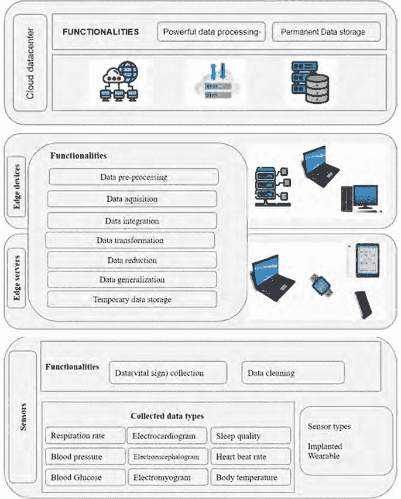

**FIGURE 2.1** 边缘辅助智能医疗功能流。

此外，大多数患者要求低成本的移动设置，而基于云的解决方案不提供这种设置（Abdellatif et al. 2019; Tuli et al. 2020）。边缘计算充当最终用户设备和云数据中心之间的层。它是一个智能网关，充当设备和数据服务器之间的通道（Abdellatif et al. 2019）。

## 2.11 边缘辅助智能医疗功能流

图2.1表示边缘辅助智能医疗功能流。边缘处理还提高了安全性、隐私性、移动性、分散性、位置感知以及在线诊断和分析，所有这些都减少了诊所和医院的就诊次数（Vyas et al. 2022; Vyas & Gupta 2022）。因此，边缘技术通过允许更快速、更彻底、更易获得的治疗，帮助建立智能医疗服务。传感器、边缘设备、边缘服务器和云数据中心层是智能医疗应用中边缘计算架构的四个级别（Vyas 2023; Vyas & Bhargava 2021）。

传感器层包含捕捉患者生命体征和数据的各种传感器（Azar et al. 2019; Al-Rakhmai et al. 2020）。我们列出了传感器可能为智能医疗系统收集的一些数据类型。传感器层和边缘设备层通过像ZigBee、Bluetooth或Wi-Fi这样的短程低功耗无线通信技术进行交互。边缘设备层包括用户的小工具，如智能手机、平板电脑和智能手表，它们可以执行一些功能并短期存储数据。使用Bluetooth、Wi-Fi或互联网将数据从设备传输到边缘服务器层。边缘服务器层由能够处理和存储更多数据的小型数据中心组成。设备和服务器之间的唯一区别是服务器层的存储容量比设备层更大。该层的云数据中心拥有更强大的中央处理单元（CPUs），并可以存储海量数据（Hosseini et al. 2020）。

## 2.12 结论

本章解释了边缘技术与AI方法的结合如何改进智能医疗系统。AI与边缘技术的结合使智能医疗系统更加智能，并带来多种好处。我们在此提出一种革命性的智能医疗框架，该框架使用边缘技术并行部署多种AI方法。建议的方法将流程从传感器转移到云服务器。由于对传感器采用轻量级AI方法，延迟、复杂性和网络负载等参数均降低了。智能医疗各个方面（包括敏感医疗数据、网络连接和用户访问）都存在安全和隐私问题。用于数据收集、预处理、传输和分析的简单模型正被能够进行重型处理和远程数据分析的复杂智能系统所取代。由于这些模型的复杂性，深度学习（DL）技术必须谨慎应用，以在不增加资源使用的情况下提高计算能力。由于实时智能传感器产生的海量数据，此类模型有时可能仅部署在云层。根据研究人员的说法，此类技术存在多种局限性，例如数据可用性、质量问题，以及在疾病预防和早期症状检测是最重要考虑因素的环境中进行实时处理。医疗系统使用个人和私人信息。因此，数据安全和存储也是这些系统的关键问题。几位研究人员还倡导在分布式DL模型中使用边缘节点和雾节点，使它们能够尽量减少训练和处理时间。边缘节点负责本地决策，而云层负责模型训练。由于GPU设备在边缘级别集成，边缘节点变得重要。它们还通过使用由图形处理单元（GPU）驱动的节点，在雾级别提高模型的计算能力和数据处理能力。

## 参考文献

-   Abdellatif, A. A., Mohamed, A., Chiasserini, C. F., Tuli, M., & Erbad, A. (2019). 面向智能健康的边缘计算：上下文感知方法、机遇与挑战. *IEEE Network*, 33(3), 196–203.
-   Ahmed, E., Yaqoob, I., Hashem, I. A. T., Khan, I., Ahmed, A. I. A., Imran, M., & Vasilakos, A. V. (2017). 物联网中大数据分析的兴起. *Computer Networks*, 129, 459–471.
-   Akmandor, A. O., & Jha, N. K. (2017). 智能医疗保健：边缘侧计算视角. *IEEE Consumer Electronics Magazine*, 7(1), 29–37.
-   Al-Rakhami, M., Gumaei, A., Alsahli, M., Hassan, M. M., Alamri, A., Guerrieri, A., & Fortino, G. (2020). 基于容器化技术的轻量且高效的边缘智能架构. *World Wide Web*, 23(2), 1341–1360.
-   Amin, S. U., Alsulaiman, M., Muhammad, G., Mekhtiche, M. A., & Hossain, M. S. (2019). 基于多层CNN特征融合的EEG运动意象分类深度学习. *Future Generation Computer Systems*, 101, 542–554.
-   Amin, S. U., Hossain, M. S., Muhammad, G., Alhussein, M., & Rahman, M. A. (2019). 用于病理检测和监测的认知智能医疗. *IEEE Access*, 7, 10745–10753.
-   Azar, J., Makhoul, A., Barhamgi, M., & Couturier, R. (2019). 面向边缘机器学习的节能物联网数据压缩方法. *Future Generation Computer Systems*, 96, 168–175.
-   Azimi, I., Anzanpour, A., Rahmani, A. M., Pahikkala, T., Levorato, M., Liljeberg, P., & Dutt, N. (2017). HiCH：面向医疗物联网的分层雾辅助计算架构. *ACM Transactions on Embedded Computing Systems (TECS)*, 16(5s), 1–20.
-   Bierzynski, K., Escobar, A., & Eberl, M. (2017年5月). 云、雾和边缘：面向未来的合作？. In *2017 第二届雾和移动边缘计算国际会议（FMEC）* (pp. 62–67). IEEE.
-   Chiang, M., & Zhang, T. (2016). 雾计算与物联网：研究机遇概览. *IEEE Internet of Things Journal*, 3(6), 854–864.
-   Chen, M., Hao, Y., Hu, L., Hossain, M. S., & Ghoneim, A. (2018). Edge-CoCaCo：面向边缘云的计算、缓存和通信联合优化. *IEEE Wireless Communications*, 25(3), 21–27.


Gaba, P., & Raw, R. S. (2020). 车辆云与雾计算架构、应用、服务与挑战. In R. S. Rao, V. Jain, & O. Kaiwartya (Eds.), IoT and Cloud Computing Advancements in Vehicular Ad-Hoc Networks (pp. 268–296). IGI Global.

Hao, Y., Miao, Y., Hu, L., Hossain, M. S., Muhammad, G., & Amin, S. U. (2019). Smart-Edge-CoCaCo：异构物联网中联合计算、缓存与通信的AI赋能智能边缘. IEEE Network, 33(2), 58–64.

Hartmann, M., Hashmi, U. S., & Imran, A. (2022). 智慧医疗系统中的边缘计算：综述、挑战与研究方向. Transactions on Emerging Telecommunications Technologies, 33(3), e3710.

He, W., Yan, G., & Da Xu, L. (2014). 在物联网环境下开发车辆数据云服务. IEEE Transactions on Industrial Informatics, 10(2), 1587–1595.

Hossain, M. S., & Muhammad, G. (2016). 云辅助工业物联网（IIoT）使能的健康监测框架. Computer Networks, 101, 192–202.

Hossain, M. S., & Muhammad, G. (2017). 面向5G的情感感知互联医疗大数据. IEEE Internet of Things Journal, 5(4), 2399–2406.

Hossain, M. S., Amin, S. U., Alsulaiman, M., & Muhammad, G. (2019, February). 应用深度学习进行癫痫发作检测和脑映射可视化. ACM Transactions on Multimedia Computing, Communications, and Applications, 15(1s), 1–17.

Hossain, M. S., Rahman, M. A., & Muhammad, G. (2017). 面向老年人的网络物理云导向多感官智能家居框架：能效视角. Journal of Parallel and Distributed Computing, 103, 11–21.

Hosseini, M. P., Tran, T. X., Pompili, D., Eliseich, K., & Soltanian-Zadeh, H. (2020). 基于深度学习和边缘计算的癫痫EEG和rs-fMRI多模态数据分析. Artificial Intelligence in Medicine, 104, 101813.

Kruse, C. S., Goswamy, R., Raval, Y. J., & Marawi, S. (2016). 医疗保健中大数据的挑战与机遇：一项系统综述. JMIR Medical Informatics, 4(4), e5359.

Makhdoom, I., Abolhasan, M., Abbas, H., & Ni, W. (2019). 物联网中区块链的采用：挑战与前进之路. Journal of Network and Computer Applications, 125, 251–279.

Miraz, M. H., Ali, M., Excell, P. S., & Picking, R. (2015, September). 物联网（IoT）、万物互联（IoE）和纳米物联网（IoNT）综述. 2015 Internet Technologies and Applications (ITA) (pp. 219–224). Wrexham, UK. doi: 10.1109/ITechA.2015.7317398.

Mutlag, A. A., Abd Ghani, M. K., Arunkumar, N. A., Mohammed, M. A., & Mohd, O. (2019). 医疗物联网系统中雾计算的使能技术. Future Generation Computer Systems, 90, 62–78.

Pazienza, A., Polimeno, G., Vitulano, F., & Maruccia, Y. (2019, October). 迈向数字未来：面向工业4.0、医疗和地域控制的创新语义物联网集成平台. In 2019 IEEE International Conference on Systems, Man and Cybernetics (SMC) (pp. 587–592). IEEE.

Qadri, Y. A., Nauman, A., Zikria, Y. B., Vasilakos, A. V., & Kim, S. W. (2020). 医疗物联网的未来：新兴技术综述. IEEE Communications Surveys & Tutorials, 22(2), 1121–1167.

Tuli, S., Basumatary, N., Gill, S. S., Kahani, M., Arya, R. C., Wander, G. S., & Buyya, R. (2020). HealthFog：用于集成物联网和雾计算环境中心脏疾病自动诊断的基于集成深度学习的智慧医疗系统. Future Generation Computer Systems, 104, 187–200.

Uddin, M. Z. (2019). 基于可穿戴传感器的活动预测系统以促进智慧医疗系统中的边缘计算. Journal of Parallel and Distributed Computing, 123, 46–53.

Verma, S., Kawamoto, Y., Fadlullah, Z. M., Nishiyama, H., & Kato, N. (2017). 海量物联网数据实时分析网络方法综述及开放研究问题. IEEE Communications Surveys & Tutorials, 19(3), 1457–1477.

Vyas, S. (2023). 医疗4.0的扩展现实与边缘AI：系统研究. In Extended Reality for Healthcare Systems (pp. 229–240). Academic Press.

Vyas, S., & Bhargava, D. (2021). 智慧健康系统：新兴趋势. Singapore: Springer.

Vyas, S., & Gupta, S. (2022). 最先进的健康与健康追踪设备案例研究. In S. S. Iyer, A. Jain, & J. Wang (Eds.), Handbook of Research on Lifestyle Sustainability and Management Solutions Using AI, Big Data Analytics, and Visualization (pp. 325–337). IGI Global.

Vyas, S., Gupta, S., Bhargava, D., & Boddu, R. (2022). 健康数据管理框架性能参数的模糊逻辑系统实现. Journal of Healthcare Engineering, 2022, 1–11.

Xie, J., Tang, H., Huang, T., Yu, F. R., Xie, R., Liu, J., & Liu, Y. (2019). 区块链技术在智慧城市中的应用综述：研究问题与挑战. IEEE Communications Surveys & Tutorials, 21(3), 2794–2830.

Yang, X., Zhang, T., Xu, C., Yan, S., Hossain, M. S., & Ghoneim, A. (2016). 深度相对属性. IEEE Transactions on Multimedia, 18(9), 1832–1842.

Zhang, Y., Ma, X., Zhang, J., Hossain, M. S., Muhammad, G., & Amin, S. U. (2019). 认知物联网中的边缘智能：提高敏感性和交互性. IEEE Network, 33(3), 58–64.

# 3 医疗保健的边缘-AI、机器学习和深度学习方法

Pawan Whig, Nasmin Jiwani, Ketan Gupta, Shama Kouser, Ashima Bhatnagar Bhatia

## 内容

- 3.1 引言 .................................................................... 31
- 3.2 边缘计算 .................................................................... 32
- 3.3 边缘-AI或边缘智能 .................................................... 34
- 3.4 深度学习 ........................................................................ 35
- 3.5 深度学习在医疗保健中的应用 ................................................ 36
- 3.5.1 脑电图（EEG）................................................ 36
- 3.5.2 多发性硬化症（MS）.............................................. 37
- 3.5.3 乳腺癌 ....................................................................... 37
- 3.6 医疗领域ML应用示例：基于AI的放射学 ... 38
- 3.7 用于法律理解的机器学习与数据知识 ........................ 38
- 3.7.1 用于患者体验和医疗运营控制的人工智能 .... 39
- 3.7.2 药物发现 ................................................................... 39
- 3.7.3 公共卫生系统中的人工智能 ............................................ 39
- 3.8 案例研究 ............................................................................... 39
- 3.8.1 Seaborn FacetGrid ............................................................... 41
- 3.9 结果与讨论 ............................................................. 41
- 3.9.1 性能指标 ........................................................ 41
- 3.10 结论与未来展望 .................................................. 42
- 参考文献 ..................................................................................... 42

## 3.1 引言

个性化治疗越来越依赖于医疗数据的分析。例如，定制化癌症治疗旨在通过考虑多种患者特异性变量（包括遗传变异、患者环境、影像、遗传学、现有药物和生活方式），为合适的患者提供适当的护理。过去十年中，当前技术（如基因组学、影像和终身监测）收集了大量复杂的健康数据，使研究人员能够为患者提供更好的治疗。然而，尽管数据丰富，我们仍缺乏对疾病和有效患者治疗的全面了解。鉴于数据的复杂性，应用机器学习（ML）和数据挖掘技术（如深度神经网络DNN）来评估此类数据变得越来越有吸引力（Whig et al. 2022）。基于信息驱动方法和机器学习仿真的可靠分析技术的发展，尤其受到识别多种形式患者数据之间关系的基本挑战所阻碍（Alkali et al. 2022）。

过去十年中，各种人工智能和机器学习方法已被用于高效分析医疗行业产生的海量数据。例如，基于逻辑回归的预测模型被用于自动化心脏疾病的早期诊断（Whig et al. 2022）。医学影像也利用机器学习自动识别对象属性。在众多机器学习模型中，基于深度神经网络（DNN）的方法正吸引大量关注，尤其是在大规模数据集分析方面。深度学习（DL）技术通过级联层过滤数据，学习过程涉及多个阶段。DNN模型在处理海量数据后会变得越来越精确，因此超越了许多传统机器学习模型。基于深度神经网络的方法在图像和自然语言分析方面也取得了出色成果（Whig et al. 2022）。由于深度学习的进步，人工智能需求和设施有了显著增长。随着移动计算和物联网的迅速发展，数十亿台连接互联网的移动和物联网（IoT）设备产生了数以百万计的信息位。物联网和人工智能技术的成功加速了扩大人工智能边界以充分发挥其优势、完全实现大数据潜力的需求。控制计算是一种基于人工智能应用实现计算的潜在理念，可用于实现这一趋势（Whig et al. 2022）。边缘智能（也称为边缘-AI）是人工智能与边缘计算的混合体，允许将机器学习算法有益地部署到数据生成的地方。卓越智能可以向每个个人和企业提供人工智能，无论他们身在何处（Whig et al. 2022）。

## 3.2 边缘计算

边缘计算定义了边缘计算的理念，旨在将信息的收集、存储、处理和分析更贴近使用点，以加快响应时间并节省带宽。边缘计算是一种分散式计算系统，能够使请求在更靠近数据源（如边缘服务器、物联网设备和本地终端）的位置运行，如图3.1所示。边缘计算的理念是处理应尽可能靠近数据源进行（Whig et al. 2022）。因此，我们相信边缘计算可能对社会产生与云计算相当的重大影响。


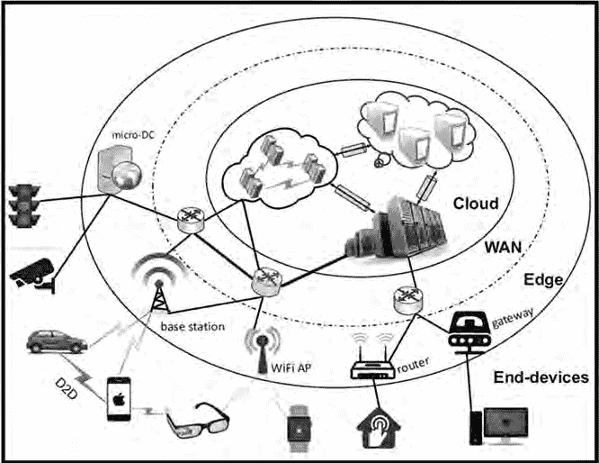

图 3.1 边缘计算与云端的连接。

在网络边缘，数据被产生。大数据的信息源近期发生了巨大变化，从雾信息中心转向更常见的终端设备，例如移动设备和 IoT 设备，因为大数据作为推动人工智能发展的关键驱动力。大数据传统上是在超大规模数据中心中创建和存储的，包括互联网购物记录、社交媒体内容和企业信息学（Jupalle et al. 2022）。然而，由于移动计算和 IoT 的发展，这一趋势正在发生变化。如今，大量传感器和智能设备正在产生海量数据，不断增加的处理控制正在将大部分计算和设施推向云端，以有利于网络（Vyas & Gupta 2022）。目前，约有 500 亿台 IoT 设备相互连接（Tomar et al. 2021）。根据思科的《全球云指数》，到 2021 年，云端之外每年产生的数据约为 850 泽字节（ZB），而全球数据中心流量预计为 20.6 ZB。这表明信息基础正在发生变化，正在从大规模云数据中心转向日益增多的边缘设备。与此同时，云计算正在变得无法控制这种广泛分散的处理能力并分析数据。广域网（WAN）容量和云计算基础设施的计算能力，正受到必须通过它们传输的海量数据量的严重阻碍（Whig et al. 2022）。

将云设施从网络核心移向网络边缘的一个概念是边缘计算。边缘计算用于在靠近信息基础的位置积累计算任务，并在可能的情况下执行操作。边缘计算与云计算不一定总是冲突。相反，边缘扩展并增强了雾计算。整合云计算与边缘计算的主要优势如下：

- **骨干网络性能。**分布式边缘计算节点可以在不将底层数据传输到云端的情况下处理各种计算活动。这使得优化网络流量负担成为可能（Vyas et al. 2022）。

- **敏捷服务响应。**部署的边缘智能应用（万物智联，AIoT）可以大幅加快响应时间并减少传输延迟。

- **强大的云端备份。**在边缘无法承担的情况下，云端可以提供强大的处理能力和庞大且可扩展的存储空间。

由于数据在网络边缘被频繁产生，在本地处理将更加有效。因此，边缘计算凭借其减轻云计算负担、降低服务延迟和最大限度减少数据传输的优势，成为突破技术发展瓶颈的关键选择（Anand et al. 2022）。

## 3.3 边缘 AI 或边缘智能

什么是边缘 AI 或边缘智能？边缘智能，有时也称为“边缘 AI”，是由边缘计算和人工智能的融合而产生的新兴研究领域。边缘智能不完全依赖云端，而是利用可用的边缘资源来实现 AI 应用。虽然“边缘 AI”这一名称是新的，但该领域的技术已经存在了一段时间。例如，2009 年，微软开发了一个基于边缘的原型机，以促进移动语音命令识别。目前尚无针对边缘智能的官方定义（Alkali et al. 2022）。Gartner Hype Cycles 将边缘智能归类为新兴技术，预测其将在未来十年内达到生产力高峰。谷歌、微软、IBM 和英特尔 等多家重要企业和技术先锋已证实边缘计算在实现 AI “最后一英里”方面的优势（Chopra & Whig 2022）。由于深度学习在计算机视觉（CV）和自然语言处理（NLP）领域具有巨大优势，深度学习应用需要的不只是云端才能运行。基于人工智能和深度学习的智能服务和应用已经彻底改变了人们生活的许多方面。然而，由于效率和延迟问题，现有的云计算基础设施不足以随时随地为每个人和每个企业提供 AI。成本：深度学习模型的训练和推理需要使用设备或用户将大量数据传输到云端，这将消耗大量网络带宽。延迟：对于许多对时间敏感的应用，访问云服务的时间并不总能保证足够快。可靠性：大多数云计算应用通过无线通信和骨干网络将用户与服务连接起来。在许多工业场景中，智能服务需要高度可靠。隐私：深度学习经常使用大量敏感数据。智能制造、智能家居和智慧城市都面临 AI 隐私问题。在某些情况下，即使是敏感数据的传输也可能失败。

## 3.4 深度学习

具有两个或更多隐藏层且旨在提高预测准确性的人工神经网络（ANN）被称为深度学习架构。高级别特征的定义利用每个低级别特征。深度学习已被用于各种目的，包括语音识别、图像分析、文本挖掘、健康监测和药物开发。

卷积神经网络（CNN）是一种用于监督式深度学习的架构。如图 3.2 所示，其主要应用场景是涉及图像处理的应用。卷积层、池化层和全连接层是 CNN 中使用的三种层类型。输入图像由卷积层中的卷积核或滤波器处理，以生成各种特征图。

在池化层中，每个特征图的大小都会减小，以最大限度地减少权重数量。这种方法通常被称为下采样或降采样。有多种池化技术，包括平均池化、最大池化和全局池化。为了从医疗数据中提取重要特征并识别任何

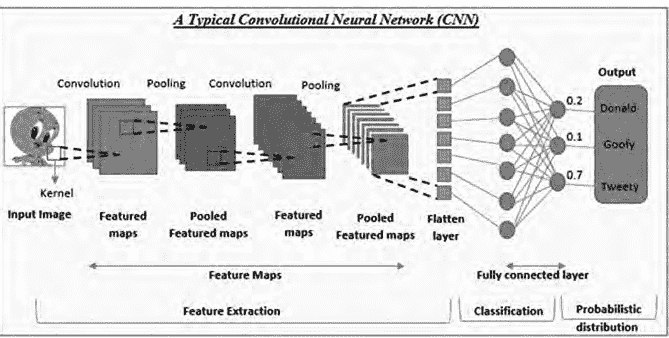

图 3.2 典型卷积神经网络（CNN）。

异常，提出了一种革命性的端到端深度学习，称为“更深层学习”。将卷积神经网络深度学习应用于一系列离散组件，用于预测出院后的意外再次入院。卷积算子用于患者电子健康记录矩阵的时间维度。在所提深度学习的第二层中。为了将电子健康记录的时间平滑性纳入学习过程，早期融合、晚期融合和缓慢融合被用作模型中的时间融合策略（Sharma et al. 2015）。

RNN 的结构具有循环连接。这些隐藏单元的循环连接执行循环计算，以顺序处理输入数据。先前的每个输入都保存在隐藏单元的状态向量中，输出是使用这些状态向量计算的。RNN 通过同时考虑当前输入和先前输入来计算新输出。尽管 RNN 性能有前景，但其在数据训练期间存在梯度消失的根本问题。使用长短期记忆（LSTM）网络是解决此问题的方法之一。深度置信网络（DBN）能够学习高维数据流形。DBN 是一种混合多层神经网络，其中存在有向和无向连接。除各层级之间的所有其他连接均为有向外，顶部两层之间的链接是无向的。DBN 可以看作是由贪婪逐层训练的受限玻尔兹曼机（RBM）堆叠而成。RBM 层彼此通信，并与前面的层级通信。在这个模型中，前馈网络和多层 RBM 用作特征提取器。RBM 只有两层：隐藏层和可见层。

## 3.5 基于深度学习的医疗保健

在本部分中，我们将介绍医疗保健方案中使用的各种深度学习方法，以区分健康人和不健康人群。为此，将针对某些疾病创建副本。最后，我们将强调深度学习在区分不健康人群和健康人群方面的效果。本单元将探讨基于疾病分组的几种方法。本节重点介绍具有各种表现形式和不同疾病类别前沿应用的最重要深度学习技术。在接下来的章节中，我们将考察九种不同的疾病类别，包括（1）脑电图图像、（2）多发性硬化症（MS）和（3）乳腺癌，本研究中包含的三种疾病是基于两个关键因素选择的。首先，是那些已得到深度学习模型广泛研究的疾病；其次，是那些使用深度学习模型来解决问题或提供有希望结果的疾病。用于治疗这些疾病的深度学习方法将在下文中更深入地介绍。

### 3.5.1 脑电图（EEG）

本节的主要目标是展示深度学习技术作为组织展示基础的重要性。作者利用深度置信网络（DBN）对脑电波形进行脑活动分类，如图 3.3 所示。

DBN 的结果表明，即使在原始数据上，该模型的预测任务所需时间也少于支持向量机（SVM）和 k-最近邻


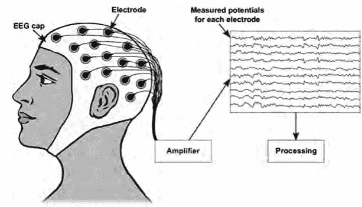

图 3.3 脑电图（EEG）演示。

邻近（KNN）分类器。随后，提出了一种基于深度学习的全新方法，用于对心电图（ECG）数据进行分类。在该模型中，特征学习阶段之后，将回归层放置在生成的图像层之上，以构建深度神经网络。与之前的方法相比，该新方法减少了专家参与并加快了在线重新训练阶段，从而提高了准确性。采用一种独特的数据平衡方法（利用CNN模型）提出了乳腺癌图像中有丝分裂核与非有丝分裂核的分类。在该模型中，通过解决有丝分裂体与非有丝分裂体之间的强相似性来处理分类案例。第二阶段开发了基于蓝色比例直方图的K-means，以在最小信息损失的情况下对多数类偏斜进行欠采样。研究结果表明，该模型既缩短了训练时间，又提高了CNN的有丝分裂检测率。

### 3.5.2 多发性硬化症（MS）

为了对心理努力进行分类，创建了一个堆叠式去噪自动编码器（AE）。随后，将这种新型架构与用于对不同机器学习模型进行标准脑力分类的方法进行了类比。后来，使用CNN技术从基线图像中提取了隐藏的MS损伤图像。该技术展示了一个深度置信网络，其中随机森林被应用于轴索和T1加权MRI图像，以在MRI等扫描中看似健康的大脑中发现MS症状。

### 3.5.3 乳腺癌

开发了一种两层深度学习架构，利用剪切波弹性成像来区分良性和恶性乳腺癌。该架构包括逐点门限玻尔兹曼机和受限玻尔兹曼机。

该方法的准确性、特异性、曲线下面积（AUC）和灵敏度是使用表征图像强度和纹理的统计参数确定的。Masud et al.（2020）描述了一种计算机辅助诊断系统，该系统使用深度学习技术来识别、分割和分类乳腺X线摄影中的肿块。提出了一种深度学习分类器和深度结构输出，用于分割肿块。

## 3.6 机器学习在医疗保健领域的应用示例：基于AI的放射学

当今，大量以电子形式存储的医学影像数据可用于输入深度学习算法，以发现模式和异常。类似于经验丰富的放射科医生解读影像数据的方式，机器和算法可以发现危险的皮肤病变、肿瘤和脑出血。因此，使用AI/ML工具和平台协助放射科医生的应用预计将迅速增长。这种方法解决了医疗保健行业的一个重要问题，因为要找到拥有必要培训的放射科医生变得越来越困难。由于数字医疗数据的激增，这些受过训练的人员通常承受巨大压力。为了跟上需求，典型的放射科医生必须每3–4秒提供一幅影像的解读结果。微软的Project InnerEye项目是一个很好的测试案例，该项目使用机器学习技术利用3D放射学图像对癌症进行分割和定位。它可以辅助精确导航、放射治疗规划的肿瘤轮廓勾勒以及手术规划。机器学习算法正在被添加到MRI和其他复杂的成像系统中，这些系统越来越多地用于早期癌症诊断。就此而言，下一节（第3.7节）提供了一个全面的总结。

## 3.7 用于法律理解的机器学习与数据知识

目前，多家医疗机构正在对艾字节级的医疗数据进行数字化。遗憾的是，这些材料经常是无序且非结构化的。与典型的事务性商业数据不同，患者数据不太容易受到简单算术模型和分析的影响。基本要求是建立强大且灵活的AI赋能方案，这些方案可以链接到多个患者数据库，并评估复杂的数据类型混合。这些方案还必须能够有效地全面筛选已完成的检查并发现任何隐藏趋势。医疗机器人还可以为传统外科医生提供特殊辅助，在治疗过程中增强视觉和导航技能，并进行微小精确的切口，以理想的缝合和伤口形状最大限度地减少不适。AI/ML在如此数字化外科机器人方面的潜在应用令人着迷。侧重于软件的机器人协作，利用广泛分布的处理器洞察以及基于AI创建的虚拟现实环境中手术及其结果的历史数据得出的建议，为远程医疗和远程手术提供即时指导和建议，可用于非常基础的治疗。

### 3.7.1 用于患者体验和医疗保健运营控制的人工智能

美国普通民众获得优质医疗保健的成本和可及性问题长期以来一直备受争论。人工智能及相关数据驱动方法特别适合解决一些已被确定为核心原因的问题——排队时间长、对高昂账单的担忧、繁琐且令人困惑的预约程序，以及难以获得适当的医疗服务提供者。传统企业几十年来一直面临类似的一系列问题，而AI/ML方法已经是解决方案的一部分。AI方案的强项是海量记录和复杂的搜索程序，它们在解决这些模式匹配挑战方面表现出色，这也说明了人工智能在医疗保健领域的潜在重要性。

### 3.7.2 药物发现

制药行业的大公司越来越多地转向人工智能和机器学习方法，以应对有效药物研发这一极具挑战性的问题。几个著名的案例涉及赛诺菲、吉利德科技和辉瑞。这些案例研究涵盖了广泛的治疗领域，包括癌症疗法、肿瘤免疫学药物和代谢性疾病。

### 3.7.3 公共卫生系统中的人工智能

这种强大的策略既可用于个体患者护理，也可用于大规模公共卫生系统。数字大流行病监测和AI辅助健康数据分析有望蓬勃发展。当前的COVID-19大流行已经证明，为疫苗接种增长和医疗调查计划开展数百场类似听证会有多么关键。使用典型的统计建模方法（这些方法面向小规模试验），很难从所有这些多样化的基础中利用数据来识别模式，并且经常产生高度怀疑的结论。此类全球规模问题需要使用AI技术。

## 3.8 案例研究

正在研究一种特征磁共振（MR）图像分类和预测方法。该模型包含用于分类和预测的特征提取，以及过滤、剥头颅等预处理阶段。大多数当前标题中包含“分类”和“预测”的研究论文都采用这种技术。这种方法的主要缺点是耗时较多且产生次优结果。

Vyas和Gupta（2022）研究中开发的独特技术采用了一种深度学习程序，该程序消除了预处理阶段，降低了计算难度，并改善了呈现效果。如果我们能够完美利用源源不断的知识来提供检查所需的基本和适当结构，那么深度学习算法就不需要任何预处理。深度学习具有高准确率，因此处于尖端地位。利用深度学习技术，准确率在2012年后显著提高。机器学习顾名思义，是研究如何教导处理器从多种类型的信息中学习的学科。Arthur Samuel提供了一个更简单的定义，他将机器学习描述为“研究计算机如何在未被明确教授的情况下学习”的学科。人们以前手动编码所有算法、数学公式、统计公式等来完成机器学习任务。因此，这个过程费力、耗时且低效。然而，由于众多Python库、框架和模块的出现，现在比过去更简单、更有效。Python是当今为此目的使用最广泛的计算机语言之一。部分由于其庞大的库系统，它已在行业中取代了许多其他语言。Python庞大的以数据为中心的Python工具生态系统使其成为数据分析的绝佳语言。其中一个应用是Pandas，它极大地简化了数据的导入和分析。条形图是一种使用长度根据所表示的数值而设置的矩形条来描绘分类数据的图表。条形图用于显示多个组之间的比较。图形的一座轴表示要比较的众多组，而另一座轴表示一个测量值。图3.4中展示的条形图显示，未患痴呆症的女性多于男性。

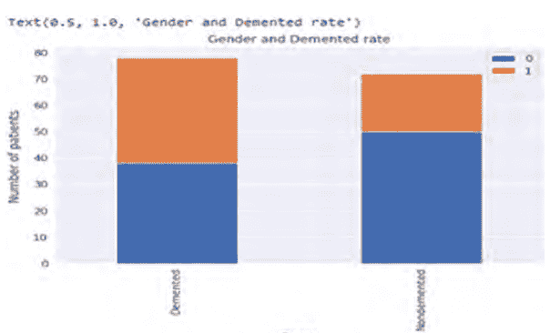

图 3.4 患痴呆和非患痴呆类别的频数。


### 3.8.1 SEABORN FACETGRID

通常生成被称为“栅格图”、“栅栏图”或“小多重图”的可视化。第三个变量的值也可以通过颜色色调参数来表示，该参数以多种色调显示不同的数据子集。为了在第三维度上解析元素，使用了颜色。但是，与获得色调的轴级函数不同，它本质上叠加子集，并未将色调参数调整到可视化上。然后，通过反复使用 FacetGrid.map() 应用一个或多个绘图技术。拟议数据集的 ASF 图谱缩放因子、ITV 投影总颅内容量，和 WV 正则化全脑容量 拟计划用于后续指令。不一致样本在受影响角色中对 70 至 80 岁人群的关注度高于无痴呆一致组。

## 3.9 RESULTS AND DISCUSSION

研究表明，男性患痴呆症（如阿尔茨海默病）的可能性远高于女性。此外，痴呆患者的受教育年限少于健康个体。此外，研究发现，非痴呆个体的脑容量大于痴呆个体。与非痴呆成人样本相比，痴呆人群样本中 70 多岁和 80 多岁人群所占比例更大。

### 3.9.1 PERFORMANCE MEASURES

接收器操作特征（ROC）曲线下面积（AUC）是我们的性能指标之一。我们认为，在对大多数非致命性不可治愈疾病（如大多数神经退行性疾病）进行诊断程序时，高实际阳性率对于快速识别所有阿尔茨海默病患者至关重要。但是，由于我们不希望错误地将健康成人标记为患有精神障碍并开始医疗治疗，我们必须确保假阳性率尽可能低。因此，如表 3.1 所示，ROC 似乎是性能指标的有力竞争者。

TABLE 3.1
准确率、召回率和曲线下面积（AUC）的比较

| 模型 | 准确率 | 召回率 | AUC |
|---|---|---|---|
| 0 Logistic Regression (w/ imputation) | 0.763158 | 0.70 | 0.766667 |
| 1 Logistic Regression (w/ dropna) | 0.805556 | 0.75 | 0.750000 |
| 2 SVM | 0.815789 | 0.70 | 0.822222 |
| 3 Decision Tree | 0.815789 | 0.65 | 0.825000 |
| 4 Random Forest | 0.868421 | 0.80 | 0.872222 |
| 5 AdaBoost | 0.868421 | 0.65 | 0.825000 |

## 3.10 CONCLUSION AND FUTURE SCOPE

该程序的主要目标是预测阿尔茨海默病。可访问的档案研究序列项目提供了“MRI 和阿尔茨海默病”数据集，用于预测老年人的认知能力。数据集已显示，空白处已填入适当值。数据预处理移除了某些不必要的特征。为了确保变量能完美适配机器学习模型，对其进行了标准化。随后，使用该数据集训练了包括支持向量机（SVM）、逻辑回归、决策树和随机森林在内的模型。作为评估标准，使用了准确率、召回率、AUC 和混淆矩阵。为了提高系统性能，所有创建的模型均采用网格技术进行了优化。效果最佳的系统使用了 SVM。一个更复杂的模型（即随机森林分类器）出现了过拟合。对结果进行比较后发现，随机森林模型大约能达到最佳结果的 87%，其次是深度学习 Ludwig 分类器，其准确率为 95%。总之，我们发现基于深度学习的混合方法和集成方法在准确率方面优于单一策略。通过同时整合两种或多种程序，且不考虑数据集类型，这些方法能够提升流程效果。深度学习技术需要大量内存和时间，这是其缺点。因此，在医疗保健系统中设计和实施最佳实践是一项重要任务。总之，鉴于健康数据的规模和复杂性，我们认为深度学习模型及其在医疗保健方案中的应用具有巨大潜力。该领域的研究人员会发现这项研究很有用，本书章节也将对在同一领域工作的研究人员大有裨益。

## REFERENCES

Alkali, Y., Routray, I., & Whig, P. (2022). 基于人工智能的可靠、高效且安全的 IoT 策略。*IUP 计算机科学期刊*, 16(2), 16–25.

Anand, M., Velu, A., & Whig, P. (2022). 基于机器学习模型的安全银行贷款行为预测。*计算机科学与工程期刊 (JCSE)*, 3(1), 1–13.

Chopra, G., & Whig, P. (2022). 基于 AI 的智能农业系统。*计算机科学可持续发展国际期刊*, 4(1).

Jupalle, H., Kouser, S., Bhatia, A. B., Alam, N., Nadikattu, R. R., & Whig, P. (2022). 基于机器学习的人类行为自动化及其预测。*微系统技术*, 1–9. Springer.

Masud, M., Eldin Rashed, A. E., & Hossain, M. S. (2020). 用于乳腺癌诊断的卷积神经网络模型。*神经计算与应用*, 1–12.

Sharma, A., Kumar, A., & Whig, P. (2015). 基于 0.35 Mm CMOS 参数的 CDTA 新型模拟逆向低通滤波器的性能。*科学、技术与管理国际期刊*, 4(1), 594–601.

Tomar, U., Chakroborty, N., Sharma, H., & Whig, P. (2021). 基于 AI 的智能农业系统。*人工智能最新趋势期刊*, 2(2).

Vyas, S., & Gupta, S. (2022). 尖端健康与健身追踪器设备案例研究。载于 S. S. Iyer, A. Jain, & J. Wang (编), 使用 AI、大数据分析和可视化的生活方式可持续性与管理解决方案研究手册 (第 325–337 页). IGI Global.

Vyas, S., Gupta, S., Bhargava, D., & Boddu, R. (2022). 健康数据管理框架性能参数上的模糊逻辑系统实现。医疗保健工程期刊, 2022, 1–11.

Whig, P., Kouser, S., Velu, A., & Nadikattu, R. R. (2022). 基于 Fog-IoT 辅助的智能农业应用。载于 揭示用于区块链和工业物联网的联邦学习 (第 74–93 页). IGI Global.

Whig, P., Nadikattu, R. R., & Velu, A. (2022). 使用 AI 应用进行 COVID-19 大流行病分析。医疗保健监测与使用 IoT 进行数据分析：技术与应用, 1, 1–25.

Whig, P., Velu, A., & Bhatia, A. B. (2022). 使用区块链应用于 IIoT 保护自然并减少碳足迹。载于 揭示用于区块链和工业物联网的联邦学习 (第 123–142 页). IGI Global.

Whig, P., Velu, A., & Naddikatu, R. R. (2022a). 基于 6G 的行业中 AI 赋能区块链的经济影响。载于 6G 无线网络中的人工智能和区块链技术 (第 205–224 页). 新加坡：Springer.

Whig, P., Velu, A., & Nadikattu, R. R. (2022b). 用于解决 IoT 和智能网络安全问题的区块链平台。载于 用于可持续 FinTech 生态系统的 AI 支持敏捷物联网 (第 46–65 页). IGI Global.

Whig, P., Velu, A., & Ready, R. (2022). 带有人机交互的人工智能中联邦学习揭秘。载于 揭示用于区块链和工业物联网的联邦学习 (第 94–122 页). IGI Global.

Whig, P., Velu, A., & Sharma, P. (2022). 区块链联邦学习揭秘：一项案例研究。载于 揭示用于区块链和工业物联网的联邦学习 (第 143–165 页). IGI Global.

## Taylor & Francis

Taylor & Francis Group
http://taylorandfrancis.com


# 4 Transforming healthcare with machine-learning and deep-learning approaches

Komal Tahiliani, Uday Panwar

## CONTENTS

- 4.1 使用 AI 改造医疗保健 ....................................................45
- 4.2 人工智能及其在医疗保健中的应用 ....................46
- 4.3 医疗保健领域 AI 的未来 ............................................................48
- 4.4 机器学习在医疗保健中的作用 ..............................................49
- 4.4.1 半监督机器学习 ............................................49
- 4.4.2 无监督机器学习 .................................................49
- 4.4.3 强化机器学习 ..............................................50
- 4.5 机器学习在医疗保健中的应用 ................................50
- 4.6 机器学习中使用的各种模型 ........................................50
- 4.7 深度学习及其在医疗保健中的作用 ............................................51
- 4.8 计算机视觉 ............................................................................51
- 4.9 自然语言处理 ............................................................51
- 4.10 强化学习（RL） ...........................................................52
- 4.11 深度学习框架 ..........................................................52
- 4.12 医疗保健中深度学习技术的案例研究 ....................55
- 4.13 医疗保健世界面临的深度学习策略挑战 ...58
- 4.14 结论 ....................................................................................58
- 参考文献 ..............................................................................................59

## 4.1 TRANSFORMING HEALTHCARE WITH AI

似乎无论你走到哪里，人工智能（AI）都在新闻中。从自动驾驶汽车到能干的协作者，AI（及其随之而来的宣传）开始渗透我们日常使用的创新（Rong et al. 2020）。基于计算机的智能创新正在进入全球的诊所、护理机构和专家工作场所——医疗保健提供者和患者已经在享受其带来的好处。由于这些有用的资源，提供者正在看到流程简化和成本降低，而患者也


获得更多定制化考量和按需护理。在医疗保健领域，关于人工智能（AI）的讨论近年来不断扩大。人工智能（AI）通过提供强大助力正在颠覆医疗保健行业（Secinaro et al. 2021）。

## 4.2 人工智能及其在医疗保健中的应用

在思考这一代技术时，全球各公司和各行各业都在谈论人工智能（AI）、机器学习和深度学习技术。重要的是要明白，所有这些内容都属于人工智能（AI）这一伞形概念的一部分（Secinaro et al. 2021）。人工智能是一个伞形术语，涵盖使机器变得更智能的方方面面。机器学习（ML）常与 AI 一起使用，但它是 AI 的一个子集。机器学习对应于一种基于算法可以实现自我学习的 AI 系统。在无需人工干预的情况下随时间变得更智能的系统涉及 ML。深度学习技术是一种应用于大量数据集的机器学习策略。大多数 AI 任务都涉及机器学习，因为智能行为需要知识（Manne & Kantheti 2021）。AI、机器学习和深度学习之间的关系如图 4.1 所示。

人工智能、深度学习和机器学习技术在改善患者病情以及医疗保健中的疾病诊断方面密切协作。图 4.2 展示了深度学习、机器学习和人工智能之间的关系（Secinaro et al. 2021）。目前，由于其更大的重要性和性能，深度学习有望接管机器学习领域。医疗保健中的智能化对应于使用详细计算，旨在以自动化方式开展特定任务。当专家和研究人员将信息输入计算机时，新得出的计算可以审计、解释，甚至为复杂的临床问题提出解决方案（Bajwa et al. 2021）。该医疗领域中的人工智能依赖于对数据集的调查和翻译，以指导专家做出更好的决策、管理患者信息数据、从复杂数据中制定定制化和个性化用药方案，并寻找新的策略和治疗方法（Bajwa et al. 2021）。在更高层面上，以下是我们应当了解的 AI 在医疗服务中的当前应用概览。

- 医疗诊断。利用人工智能确定哪些患者患有特定医疗状况。
- 药物发现。目前许多健康组织和制药公司正在利用人工智能协助药物发现，致力于缩短漫长的时间表和周期。任何计划（Chen & Decary 2020）。

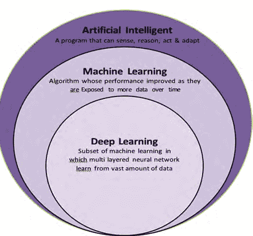

图 4.1 人工智能、深度学习与机器学习概念之间的关系。

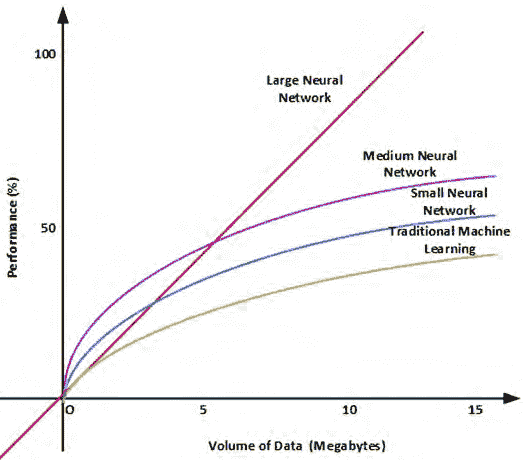

图 4.2 随数据量增加而扩展机器学习技术。

- 临床试验。预计到明年年中，医疗保健健康领域的制药市场将超过 350 亿美元。确实，正在进行的研究表明，医疗保健方法因计算机化而发生变化，这一点在临床试验方面尤其明显。考虑到计算机化在其他行业中日益重要，这不足为奇。此外，计算机化已知可以改善特定临床治疗的体验，并无疑会加速任何与人相关的周期（Mirbabaie et al. 2021）；临床试验的常规研发是一个昂贵的周期。
- 疼痛管理。这是医疗服务的一个新关注点。通过利用增强现实，结合真实世界和计算机生成的内容，我们可以转移患者对疼痛来源的注意力，甚至提供阿片类药物依赖方面的帮助。
- 改善患者预后。通过多种方法以及人工智能获得的结果，可以改善患者的预后。
- 临床决策。医疗单位中的人工智能可以提供宝贵的临床帮助，指导专家更快地做出选择和选项，其解决问题的速度超越了人类头脑所能达到的水平（Konenko 2021）。在一个决策时间和选择能够改变患者生命的行业中，更快的响应和所做决策的标准是无可比拟的。
- 数据管理（医生和患者）。医疗领域中的人工智能是对医生和患者数据与管理的卓越扩展。通过让患者更快地接触到专家，或在远程医疗被使用的任何情况下，从而减轻医疗专家的压力（Davenport & Kalakota 2019）。专家可以通过人工智能驱动的交互式模块来促进学习并提升能力。

## 4.3 医疗领域中人工智能的未来

考虑到 AI 在图像分析方面的未来进步，大部分放射学和病理学图像迟早都会被机器检查（Thompson & Brailer 2004）。文本识别对于患者通信和临床笔记等任务毫无用处，其应用将会增加。在医疗保健单位中，对 AI 的首要考量并非进步是否足够有价值，而是是否应在日常科学实践中使用。为了实现 AI 的全球接受，AI 框架必须得到控制器的支持，与 EHR 框架协调，标准化到可接受的程度使得可比设备能够类似运行，临床医生可以使用，由私人付款人协会付费，并在实地持续优化。这些问题最终都将得到解决。

## 4.4 机器学习在医疗保健中的作用

机器学习是人工智能的一个子类别，其中算法分析海量数据集，以独立识别模式和趋势，而无需被告知如何精确地解决问题。机器学习很复杂，先进的机器学习机械应用已成为行业中的闭环模式。机器学习是一种无处不在的技术，以多种方式广泛应用。它被认为是金融、医疗技术和安全等多个领域中的关键组成部分（Bhardwaj et al. 2017）。机器学习被实现用于从临床信息源中获取模式，并获得预测疾病的惊人能力。

首先，它使医疗保健专家能够专注于患者关怀，而不是将精力花费在数据搜索上。第二，机器学习在医疗领域的重要作用是诊断精度的渐进提高（Collins & Varmus 2015）。例如，机器学习在预测 COVID-19 患者死亡率方面已被证明具有 92% 的精度。第三，在医学中利用机器学习可以帮助制定更精确的治疗方案。许多临床病例各不相同，需要特殊的治疗方法。此外，虽然医疗专家和机器学习算法在基于相似信息输入时无疑会得出相似的决策，但使用机器学习可以更快地获得结果，从而让治疗更早开始（Collins & Varmus 2015）。开具适当药物的准确性取决于识别哪些疗法对特定患者有效，而这由患者的健康记录输入决定（Collins & Varmus 2015; Murphy 2012）。这种基于过去学习的决策制定需要通过使用数据集训练模型，这种方法称为监督学习。

### 4.4.1 半监督机器学习

这是一种从每个未标记和标记的统计数据中识别出一流分类器的策略。通过利用未标记的统计数据，它执行高级操作。这种方法基于若干基本假设来实现。

### 4.4.2 无监督机器学习

在无监督机器学习中，标签不接受任何训练。无监督学习所采用的策略包括分组、模糊聚类、层次聚类、K-均值分组或关联规则挖掘等算法。这些算法用于在数据测试的支持下创建结构。


### 4.4.3 强化机器学习

在这种机器学习类型中，计算机程序被授权去执行特定目标。当程序探索其缺点时，会向其提供反馈。

## 4.5 机器学习在医疗保健中的应用

机器学习算法在分析涉及海量数据的实例方面非常有帮助。机器学习特别适用于医疗应用，尤其是那些依赖前沿基因组学的应用。它常用于诊断多种疾病。在科学应用中，开发的算法将为患者提供更好的治疗方案选择。这些模型使用患者数据、急诊图表，甚至诊室本身的设计等因素（Murphy 2012）。

## 4.6 机器学习中使用的各种模型

- 支持向量机。为了实现机器学习（ML）任务，可以使用支持向量机（SVM），这是一种带有相关学习算法的监督学习模型，用于分析数据以进行分类（Sharma & Bhatia 2012）。在大多数情况下，SVM 用于分类和回归问题。
- 朴素贝叶斯分类器（NBC）。统计分类器不过是贝叶斯分类器的模型。NBC 识别并确定相对于给定类别名称的类注册概率。它执行信息过滤；因此，排序很容易实现（Bishop 1995）。
- 决策树。决策树通常涉及一种包含内部节点和带有类名的一个叶子节点的排序策略。决策树的顶部节点称为根节点。所选树很有价值，因为其开发非常简单，不需要任何边界（Bishop 1995）。
- K-近邻。K-近邻算法常用于样本分类。通过使用此技术，我们可以计算来自数量（N）个训练样本的距离度量（Zimmermann 2011）。
- 模糊逻辑。模糊逻辑是模糊集理论的一种高级形式；值介于 0 和 1 之间。它是一种广泛应用于应用程序设计的知名技术（Learning 2017）。
- CART。CART 代表分类和回归树方法论。在分类和回归树中，目标变量表示为分类变量或连续变量。变量的角色用于在树中假设和预测值（Hazra et al. 2012）。

不同的机器学习方法根据数据量的不同而有不同的响应。图 4.2 描绘了一个比较图，显示不同技术在不同网络中的响应情况。

## 4.7 深度学习及其在医疗保健中的作用

深度学习是一种训练个人电脑解决问题的人工智能方法。深度学习是无人驾驶汽车的基本发展，使它们能够识别“停车”标志。它是允许在电话、平板电脑、电视和免提扬声器等消费设备中进行语音操作的方法（Xu et al. 2014）。在深度学习中，计算机可以从图片、文本或声音中学习执行任务。模型通过使用标记统计数据与包含许多层的神经网络的关联来组织（Xu et al. 2014）。单词“深”通常显示神经网络中隐藏层的数量。常规神经网络通常有两三层，而深度网络可多达 150 层。深度学习模型通过使用大量带有标记事实的移动指南和由即时事实组成的神经关联系统进行训练，无需手动特征提取。深度学习模型在执行更多内容时可以变得越来越精确，基本上从历史中学习以完善其建立关系和关联的能力（Mishra & Shukla 2018）。

通常，与构建模型相关的数学非常复杂，并且有各种类别的组织影响该领域内的不同子流程。深度学习模型的处理能力提供了快速、精确且可行的临床受益任务。深度学习网络改变患者的认知，并在临床实践中产生重大影响。计算机视觉技术、自然语言处理和强化学习策略是最常用于临床受益的深度学习技术。

## 4.8 计算机视觉

计算机视觉是人工智能（AI）的一个学科，它使计算机系统和框架能够从高质量图像、录像和不同视觉来源中提取大量信息，并根据该信息生成响应。AI 可以使计算机系统进行思考和响应。计算机视觉超越了人类的想象力和毅力（Xu et al. 2014）。

## 4.9 自然语言处理

自然语言处理（NLP）对日常生活至关重要，并且对我们在家和工作中的生活至关重要。在不经意间，我们向虚拟家庭助手、手机，甚至车辆发送语音指令。像 Alexa、Siri 和 Google Assistant 这样的语音控制应用程序使用 NLP 和机器学习算法来回答我们的问题、向日程表添加事件，并拨打我们在语音指令中列出的联系人。NLP 不仅让我们的生活更简单，还在改变我们的工作、生活和娱乐方式（Xu et al. 2014）。AI 是能够复制人类知识的机器的统称，而 NLP 和机器学习（ML）是 AI 的两个子集。在医疗保健领域，自然语言处理有许多应用。NLP 通过使用查询接口，可以通过提供大量相关事实来大大增强事实信息和语义理解的分发（Vyas 2023）。

## 4.10 强化学习（RL）

机器学习在医疗保健中的应用有许多卓越成果，尽管在诊断病情或预测结果方面存在巨大的错误空间。RL 在类似（视频/桌面游戏）环境中学习理想策略方面表现良好，尽管它在像医疗保健这样的现实条件下通常尚未经过测试（Murphy 2012）。

## 4.11 深度学习框架

机器学习是一种普遍有益的人工推理方法，可以从收集的数据中建立有价值的联系。传统技术包括对空间的单一、引导式变换，并且在处理常规数据及其结构信息方面能力有限。当然，深度学习对于生成用于处理反映神经关系的层以接受不同抽象程度的信息组的计算模型至关重要。人工神经网络通常被描述为三层，但它们可以专门针对复杂任务进行定制和优化，而不是作为通用模型（Mishra & Shukla 2018）。

- 深度卷积神经网络。卷积神经网络由三层组成——输入层、隐藏层和输出层。图 4.3 展示了带有三个卷积和池化（csnv+pool）层以及一对全连接（FC）层的卷积神经网络，适用于任何前馈神经组织；任何中央层被称为“隐藏层”，因为它们的反馈和后果元素由激活功能和最终卷积隐藏。随着卷积元素沿该层的信息网格滑动，卷积活动创建一个元素图，从而有助于后续层的发展。随后是不同的层，例如池化层、完全连接层和标准化层（Masci et al. 2011）。
- 深度神经网络。深度神经网络（DNN）是在输入和输出之间具有多个层的人工神经组织


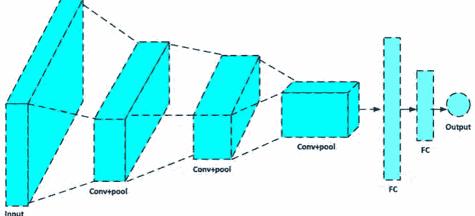

### 图 4.3 卷积神经网络的结构。

层。神经网络有多种类型，但它们通常由相似的元素组成：神经元、突触、权重、偏置和激活。DNN 可以显示复杂的非线性连接。DNN 模型创建组合模型，其中项目作为节点的分层排列来传达，如图 4.3 所示。

额外的层使来自较低层的元素排列成为可能，可能以比性能相当的浅层网络更少的单元来显示复杂信息（Coronato et al. 2020）。深度神经网络通常是前馈网络，数据从输入层移动到输出层。输入被复制并在 0 到 1 之间的某个点返回结果。如果网络没有明确地发展出特定模型，则需要进行计算以更改权重。

- 循环神经网络（RNN）。RNN 被 Apple 的 Siri 和 Google 的语音助手使用。它是一种主要的计算方式，由于内部记忆而能记住其输入，这使其特别适合由连续统计组成的 AI 问题求解。计算能力的提升以应对我们处理的海量数据，以及 20 世纪 90 年代长短期记忆（LSTM）的创新，真正使 RNN 走到了前沿（Alzubaidi et al. 2021）。

数据直接穿过网络，从不触碰同一个节点两次。前馈神经网络对其接收的输入没有记忆，且在预测即将到来的内容方面表现不佳。在 RNN 中，信息在圆环中循环。在信息基于选择并在基于先前接收的输入预测输出的点上。

- 深度自动编码器。此编码器用于特征提取，并且输入和输出节点数量相等。深度自动编码器是一种神经网络架构，如图 4.4 所示，其工作基于

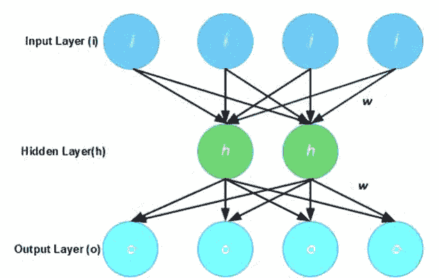

### 图 4.4 自动编码器结构，显示所有三层。

非监督学习技术，以重组输入值。简单来说，我们以最小误差将输入值 X 重新生成到神经网络中。在自动编码器中，我们提供的输入数据基本上是通过架构中的瓶颈进行压缩的，因为我们在隐藏层中施加了较少数量的神经元。如上图所示，网络接受未标记的信息作为输入 X，并通过将其表述为监督问题来训练其产生 X̂（即原始输入的副本）。网络的主要思想是最小化重构误差 L(X, X̂)，这基本上是原始输入与重构输出之间的差异（Hinton et al. 2006）。当我们限制隐藏层中的层数时，有限量的数据通过网络；否则，如果我们在隐藏层中提供相似数量的神经元，模型将在不学习输入显著特征的情况下，连同网络一起记忆输入信息。限制隐藏层中的神经元将迫使网络通过实际因重构误差而受到惩罚来更新权重（Hinton et al. 2006）。

- 深度信念网络。深度信念网络（DBN）是一种基本上包含受限玻尔兹曼机堆叠层的架构。它是具有许多隐藏节点的前馈架构。DBN 可应用于处理非监督学习任务以降低特征维度，也可应用于处理监督学习任务以构建聚类模型或回归模型。

构建 DBN 有两个阶段：逐层学习和微调。逐层学习是指对每个受限玻尔兹曼机（RBM）进行非监督训练，而微调是指在非监督学习完成后使用反向传播误差算法来校准 DBN 的参数。深度神经网络使用称为贪婪算法的算法进行重新训练。此计算采用逐层过程来实现整个自上而下系统并分析巨大的生成权重。这些连接权重决定了给定层中的所有因素如何依赖于上一层中的各种元素（Liu et al. 2014）。最近，由于其有前景的优势，DBN 在 AI 中获得了越来越多的关注。DBN 提供快速分析，并能有效地建模复杂网络结构。

- 深度玻尔兹曼机。深度玻尔兹曼机（DBM）是一种具有多层的成对无向马尔可夫场。它是由耦合的二进制随机单元组成的网络。DBM 可以在信号识别等应用中学习输入的复杂且动态的内部表示，即，使用部分标记的数据来调整使用大量未标记的感官输入信息所做出的表示。然而，与所有玻尔兹曼机和深度卷积神经网络不同，DBM 在自上而下和自下而上两种方式中同时采用演绎和生成方法，使 DBM 能够更好地揭示输入架构的表示。尽管如此，由于速度慢，DBM 的性能有限，这也降低了其实用性。在数据决策中，使用平均场推理来分配假设，并使用马尔可夫链蒙特卡罗（MCMC）来获得满意的估计（Liu et al. 2014）。这种推理必须针对每个测试输入完成，其速度比 DBM 中的单次自下而上传递慢 25 到多倍。这使得联合训练对大型数据集不切实际，并将 DBM 的使用限制在特征表示和提取等应用中。图 4.5 清晰地说明了深度学习方法在医疗保健应用方面的描述性摘要。

## 4.12 医疗保健中深度学习技术的案例研究

尽管如此，深度学习正在不断找到其在现实世界临床应用中的道路。存在大量涉及以患者为中心的应用程序的用例，以及几种旨在改善 IT 用户福祉并促进未来发展的技术。

| 应用类别 | 应用示例 |
|---|---|
| 生理信号与传感器 | 1) 捕获睡眠信息 (CNN)<br>2) 情绪识别 (DBM)<br>3) 预测驾驶员的精神状态 (RNN)<br>4) 抽搐检测 (DBN) |
| 医学影像 | 1) 从数字化乳腺X线摄影中提取的特征 (CNN)<br>2) 阿尔茨海默病识别 (DBM)<br>3) 癌症诊断 (AE)<br>4) 脊柱疾病诊断 (AE) |
| 电子健康记录与报告管理 | 1) 使用自由文本的疾病代码分类 (CNN)<br>2) 使用患者电子健康记录的特征提取 (CNN)<br>3) 从不规则发作记录中检测预测性常规临床模式 (RNN)<br>4) 推断表型模式 (AE) |
| 生物系统 | 1) 使用乳腺组织病理学图像进行有丝分裂检测 (CNN)<br>2) 脂肪组织体积分割<br>3) 镰刀型贫血中红细胞分类 (CNN)<br>4) 前列腺癌分化 (RNN) |

- 影像分析与诊断。卷积神经网络（CNN）是深度学习策略，特别适合对 MRI 和 X 光等图像进行分类，斯坦福大学的专业工程师已证明了这一点，使网络能够更高效地工作并存储更大的图像。随后，某些 CNN 在识别诊断影像研究中的重要特征时，其准确性和精确度接近，甚至在某些情况下超过了人类诊断者（Cheng et al. 2016）。研究人员已经创建了一种深度神经网络，能够以比人类放射科医生快 150 倍的速度诊断中风和脑出血等严重神经系统疾病。

- 自然语音信号处理的目的。如今，神经网络和深度学习方法在很大程度上得到自然语音信号处理工具的支持，以在医疗保健行业实现分析和解释文档方面的重大改进。同时，这些神经网络可以通过“聚集”相似单词并对其进行比较，来区分不同的词源或句法成分，帮助网络对复杂语义做出准确理解。理解口语交流的细微差别可能很困难，即，在非正式表达中通常彼此靠近出现的单词，最终可能与出现在独特语境中的等效单词完全不同。尽管语言到文本的足够准确翻译已成为通信工具的一种相当常见的技能，但从自由文本临床信息中产生可靠且有意义的翻译仍然是一项极具挑战性的练习（Cheng et al. 2016）。

- 用于跟踪患者健康的电子健康记录（EHR）。深度学习已被应用于处理 EHR，处理结构化信息（例如，剂量、药物、实验室检查）和非结构化信息（例如，自由文本临床记录）。值得注意的示例包括基于专用工程的医疗保健框架中处理 EHR 的系统，用于常见的受监督预测临床任务。对于典型方法，深度学习可以实现优于传统 AI 模型的结果。为了学习疾病、处方和实验室检查等临床概念的详细描述以用于诊断和预测，神经语言深度学习模型也已应用于 EHR（Cheng et al. 2016; Vyas 2023）。提供者、科学家和保险公司将很快使用 EHR 数据来识别疾病和药物方面的模式。AI 揭示了经常深埋在健康记录文本中的关键信息。长短期记忆（LSTM）神经网络是用于 NLP 最著名的模型之一。


- 药物发现。深度学习工程师有更多涉及精准医疗和药物发现的计划。这两项任务需要分析海量的遗传、临床和人群层面数据，以识别症状、药物和健康状况之间先前隐藏的联系。遗传药物领域是新的，因此惊人的发现很常见，这使其成为应对问题的创造性方式的令人振奋的示范领域（Xu et al. 2014）。

- 临床决策支持与分析。在临床决策支持和预测分析中，企业对深度学习作用的期望有所扩大。深度学习很快将在持续环境中成为便捷的分析伙伴，能够提供对脓毒症呼吸障碍等病情变化的感知。同样，眼科专业人员使用光学相干断层扫描（OCT）检查眼睛。这些 3D 图像描绘了眼底的描述，但难以阅读，需要仔细检查才能解读。分析这些输出的过程，加上医疗专业人员需要审查的大量扫描，在需要及时行动时，可能导致扫描与治疗之间出现重大延误。这些延误甚至可能导致人们失明，如果它们导致意外问题，例如眼底的一个通道（Alzubaidi et al. 2021; Cheng et al. 2016）。

## 4.13 医疗保健领域面临的深度学习战略挑战

- 偶尔缺乏信息会导致精度低。
- 深度学习模型的可解释性问题使其处于“黑箱”状态。
- 罕见疾病缺乏明确的疾病相关信息。
- 原始数据无法直接作为 DNN 输入的情况。
- 通过对信息测试添加小的更改，DNN 可能会被误导，导致误分类。

## 4.14 结论

鉴于各科学家对深度学习进行的所有研究，显然深度学习可以成为改善生物医学信息解读以扩大人类医疗保健的一个组成部分。深度学习创新的最新进展为展示复杂信息结构的端到端学习模型提供了新的有益进展。得益于大量有前景的案例研究、行业关键利益相关者的推测以及不断增长的用于支持一线调查的信息量，深度学习几乎可以肯定在未来几十年内为患者提供最高质量的护理方面发挥关键作用。人们需要不再将 AI 视为未来概念，而是拥抱它呈现给我们的工具和有益机会。很有趣地想象，由于 AI 正在将行业推向全新领域，医学领域未来可能走向何方。

## 参考文献

- Alzubaidi, L., Zhang, J., Humaidi, A. J., Al-Dujaili, A., Duan, Y., Al-Shamma, O., & Farhan, L. (2021). 深度学习综述：概念、CNN 架构、挑战、应用与未来方向。《大数据杂志》, 8(1), 1–74.
- Bajwa, J., Munir, U., Nori, A., & Williams, B. (2021). 医疗保健中的人工智能：转变医疗实践。《未来医学杂志》, 8(2), e188.
- Bhardwaj, R., Nambiar, A. R., & Dutta, D. (2017). 医疗保健中机器学习的研究。IEEE 第 41 届计算机软件与应用年会 (COMPSAC), 2, 236–241.
- Bishop, C. M. (1995). 模式识别神经网络。牛津大学出版社.
- Chen, M., & Decary, M. (2020). 医疗保健中的人工智能：卫生领导者的必备指南。载于《医疗管理论坛》(第 33 卷, 第 1 期, 第 10–18 页)。洛杉矶, CA: SAGE 出版社, 国家医学院。《JAMA》, 323(6) 509–510.
- Cheng, Y., Wang, F., Zhang, P., & Hu, J. (2016). 基于电子健康记录的风险预测：一种深度学习方法。载于 2016 年 SIAM 国际会议录.
- Collins, F. S., & Varmus, H. (2015). 精准医疗新计划。《新英格兰医学杂志》, 372(9), 793–795.
- Coronato, A., Naeem, M., De Pietro, G., & Paragliola, G. (2020). 面向智能医疗应用的强化学习：一项综述。《医学人工智能》, 109, e101964.
- Davenport, T., & Kalakota, R. (2019). 医疗保健中人工智能的潜力。《未来医学杂志》, 6(2), 94–98.
- Hazra, A., Mandal, S. K., & Gupta, A. (2012). 基于朴素贝叶斯、SVM 和集成算法的乳腺癌细胞检测研究与分析。《计算机应用国际杂志》, 145(2), 39–45.
- Hinton, G. E., Osindero, S., & Teh, Y. W. (2006). 深度信念网络的快速学习算法。《神经计算》, 18(7), 1527–1554.
- Kononenko, I. (2021). 医疗诊断机器学习：历史、现状与展望。《医学人工智能》, 23(1), 89–109.
- Learning, M. (2017x). 使用机器学习和数据挖掘技术进行心脏病诊断与预测：一篇综述。《计算机科学与技术进展》, 10(7), 2137–2159.
- Liu, S., Liu, S., Cai, W., Pujol, S., Kikinis, R., & Feng, D. (2014). 基于深度学习的阿尔茨海默病早期诊断。载于 2014 年 IEEE 第 11 届生物医学成像国际研讨会 (ISBI) (第 1015–1018 页).
- Manne, R., & Kantheti, S. C. (2021). 医疗保健中人工智能的应用：机遇与挑战。《应用科学与技术当前杂志》, 40(6), 78–89.
- Masci, J., Meier, U., Cireşan, D., & Schmidhuber, J. (2011). 用于分层特征提取的堆叠卷积自动编码器。载于《人工神经网络与机器学习–ICANN 2011：第 21 届人工神经网络国际会议，芬兰埃斯波，2011 年 6 月 14–17 日，论文集，第 I 部分》(第 52–59 页)。柏林，海德堡：Springer.
- Mirbabbaie, M., Stieglitz, S., & Frick, N. R. (2021). 疾病诊断中的人工智能：指导未来方向的当前研究状态的关键性回顾与分类。*健康与技术*, 11(4), 693–731.
- Mishra, A., & Shukla, A. (2018, December). 从机器学习到深度学习的趋势与挑战。*CSI 通信*, 41(8), 10–12.
- Murphy, K. P. (2012). *机器学习：概率视角*. MIT Press.
- Rong, G., Mendez, A., Assi, E. B., Zhao, B., & Sawan, M. (2020). 医疗保健中的人工智能：综述与预测案例研究。*工程*, 6(3), 291–301.
- Secinaro, S., Calandra, D., Secinaro, A., Muthurangu, V., & Biancone, P. (2021). 医疗保健中人工智能的作用：一项结构性文献综述。*BMC 医学信息学与决策*, 21(1), 1–23.
- Sharma, P., & Bhatia, A. P. R. (2012). 决策树算法的实现以分析性能。https://www.ijarcce.com/upload/december/24-Implementation%20of%20Decision.pdf
- Thompson, T. G., & Brailer, D. J. (2004). 《十年健康信息技术：提供以消费者为中心和信息丰富的医疗保健》。华盛顿特区：美国卫生与公众服务部.
- Vyas, S. (2023). 医疗 4.0 的扩展现实与边缘人工智能：系统性研究。载于*医疗系统的扩展现实*(pp. 229–240). Academic Press.
- Xu, R., Li, L., & Wang, Q. (2014). dRiskKB：基于生物医学文本构建的大规模疾病-疾病风险关系知识库。*BMC 生物信息学*, 15(1), 1–13.
- Zimmermann, H. J. (2011). 《模糊集理论——及其应用》。Springer Science & Business Media.

# 5 通过智能手杖提升视障人士的可及性

Syeda Fizza Nuzhat Zaidi, Vinod Kumar Shukla, Shaurya Gupta, Preetha V K

## 目录

- 5.1 引言 ....................................................62
- 5.2 人群面临的残疾全球统计数据....................62
- 5.3 视觉障碍全球统计...............................63
- 5.3.1 视觉障碍与失明 .................................63
- 5.3.2 残疾人对辅助技术的需求 ....64
- 5.4 面向视觉残障人士的设计 .......................65
- 5.4.1 使用在任务进行或完成时发出特定声音的数据 ............................................65
- 5.4.2 采用盲文代码........................................65
- 5.4.3 使用语音识别.........................................66
- 5.4.4 使用标准 HTML 设计网站 ..........................66
- 5.4.5 使用屏幕阅读器，例如带语音的作业访问 (JAWS) ....................................................66
- 5.4.6 使用听觉图标 ............................................66
- 5.4.7 CAPTCHA（全自动公共图灵测试以区分计算机和人类） ............................66
- 5.4.8 网站设计 ..................................................66
- 5.4.9 使用耳咏......................................................67
- 5.4.10 缩放选项.....................................................67
- 5.4.11 仿生眼..................................................67
- 5.5 面向视障人士的智能手杖原型 ......................67
- 5.5.1 近传感器简介..............................67
- 5.6 智能手杖原型所需硬件 ........................68
- 5.6.1 红外传感器..................................................68
- 5.6.2 18650 双电池座....................................68
- 5.6.3 V 蜂鸣器/微型音响-PC 安装 ................................69
- 5.6.4 手杖/棍子.......................................................69
- 5.6.5 18650 电池 .................................................69
- 5.7 拟议原型的电路图（基于传感器的智能手杖） ......69
- 5.7.1 红外近传感器测试 ...........................69


5.7.2 工作原型的结果 ........................ 71
5.8 结论与未来工作 .............................. 72
参考文献...................................................... 72

## 5.1 引言

人机交互一直是视力障碍、听力障碍、言语障碍、阅读障碍、自闭症等人群访问计算机系统时持续关注的问题。

这三类残疾，即失明与视力障碍、耳聋与听力障碍、自闭症谱系障碍，影响身体的不同器官及其功能，并在社会事件和一般生活中对个体产生极其不同的结果和影响。

但它们也有两个共同点：它们都影响感官系统，且并不总是立即显而易见。

感官系统是身体的感觉器官系统。五种重要的主要感官是视觉、听觉、味觉、嗅觉和触觉（Smith et al. 2018）。

为了为视力残障人士提出基于技术的解决方案，我们必须首先了解这类残障人士面临的挑战以及这些残疾在全球的普遍程度。

随着技术的发展及其在各个领域的应用，人与技术的交互规模大大增加。

因此，人机交互在众多领域发挥作用。

人机交互，或 HCI，是一门多学科研究领域，专注于计算机技术的设计以及用户（人类）与技术之间的交互。

最初，该领域仅关注计算机，但已将其范围扩大到涵盖各种技术设计，并成为大大小小每个领域的一部分。

HCI领域涵盖可穿戴设备、家用小工具到建筑设备。

HCI不仅增加了我们更轻松访问小工具、使生活更便利的机会，还增加了改变这星球上数百万残障人士生活的机会。

HCI的目标是生产可用且先进的技术，以服务于每个个体：为不需要帮助的人提供高度先进的技术，为需要帮助和支持的人提供高度辅助性的技术交互。

## 5.2 人们面临的残疾全球统计数据

截至2020年12月1日，全球约有十亿人患有残疾。这约占世界人口的15%；约有1.9亿人，即3.8%，年龄在15岁及以上，并因其残疾需要医疗保健（世界卫生组织（WHO）2022）（图5.1）。

全球范围内，据说每十名成年人中就有两人患有残疾。截至2020年4月7日，最常见的残疾被发现是行走/爬楼梯困难（3060万人），这可能是由于老年或某种身体残疾引起的。其次是人们需要他人持续协助

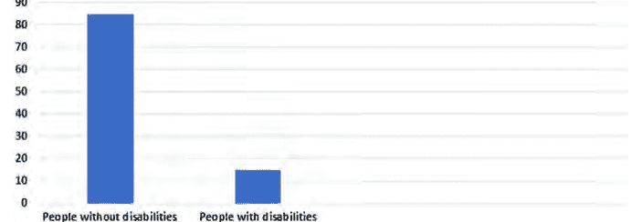

FIGURE 5.1 世界有无残疾人群（2020年）

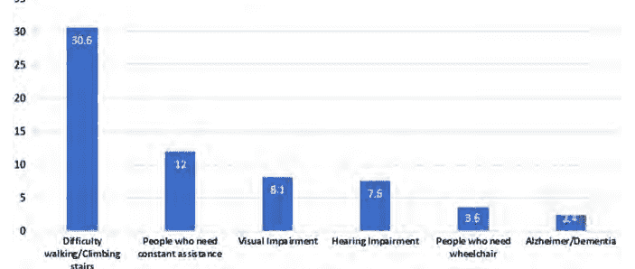

FIGURE 5.2 世界上最常见的残疾（2020年）

才能完成日常任务（1200万人）、患有视力障碍（810万人）、听力障碍（760万人）、需要轮椅（360万人）或患有阿尔茨海默病或痴呆症（240万人）（图5.2）（残障世界 2022）。

## 5.3 视力障碍的全球统计数据

### 5.3.1 视力障碍与失明

根据世界卫生组织的数据，截至2020年10月8日，全球至少有十亿人患有本可预防的近视力或远视力障碍。目前导致视力障碍和失明的主要原因是未矫正的屈光不正和白内障。该报告还发现，大多数患有视力障碍或失明的人年龄超过50岁。这十亿人包括因未解决的屈光不正（12370万）而导致中度或重度远距离视力障碍或失明的人、白内障（6520万）、青光眼（690万）、角膜混浊（420万）、糖尿病视网膜病变

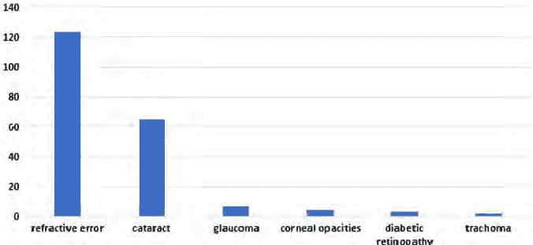

FIGURE 5.3 十亿人中的视力障碍（2020年）

（300万）和沙眼（200万），以及因未解决的老花眼引起的近视力障碍（8.26亿）（世界卫生组织 2022）（图5.3）。

### 5.3.2 残障人士对辅助技术的需求

在HCI的帮助下，为残障社会提供了多种辅助技术；这些辅助技术分为以下几类：

- 个人医疗所需的辅助产品。这些可以包括残障用户无需他人帮助即可使用的任何个人医疗设备。
- 技能训练辅助产品。这些可以包括残障用户用于改善其个人、心理或社交能力的培训的技术设备和小工具。
- 矫形器和假肢。矫形器是外部应用的装置，用于改变神经肌肉和骨骼系统的结构或功能。假肢则是用于完全或部分替代身体部位的外部设备。
- 可用于个人护理和防护的辅助产品。这些可以包括帮助残障用户穿衣、进食或饮水的辅助技术。
- 行动辅助产品。这些可以包括从一个地方移动到另一个地方所需的技术，以及将一个物体从一个工作地点移动到另一个工作地点所需的小工具。
- 通信和信息辅助产品。这些可以包括使用视觉、听觉、言语等进行通信的技术设备。
- 娱乐辅助产品。这些可以包括残障人士可用于玩游戏、观看视频、听音乐等的用户友好型设备。
- 家务辅助产品。这些可以包括帮助家务的技术小工具，例如烹饪和清洁、打开灯光或风扇等。
- 环境改善辅助产品。这些可以包括帮助残障人士熟悉所处环境并辅助其在其中导航的小工具。
- 就业和教育辅助产品。这些可以包括帮助残障人士学习以及在工作场所或学校携带和完成任务的技术小工具。

## 5.4 面向视力残障人士的设计

在为这类用户设计合适的技术小工具时，视力残疾是迄今为止最具挑战性的挑战。各种研究的结果可用于改善残疾的各个方面，例如低视力（Shukla & Verma 2019），借助智能眼镜（Nazim et al. 2022）。技术在提供这些服务方面发挥着重要作用，例如物联网（将现实世界与计算机生成内容相结合）（Trayush et al. 2021；Komal et al. 2021）和区块链技术（Vyas et al. 2022）。以下小节描述了一些面向视力残障人士的技术发明和想法：

### 5.4.1 使用在任务进行或完成时发出特定声音的数据

每个网站组件都应发出特定声音并包含元数据。例如，每个图像、图形、标题等，都应包含描述所显示图像或图形的所有文本、注释或一段文本。这很重要，因为视力残障用户使用屏幕阅读器，当每个图像和图形都有此类描述时，他们更容易理解。

### 5.4.2 采用盲文代码

盲文是视力残障社会从技术小工具获取信息的一种广泛使用的形式。这可以使视力障碍用户更容易理解键盘，并且无视力障碍的人也可以使用，从而遵循“为所有人设计”的原则。可刷新盲文显示器在此发挥作用。这种电子盲文显示器是将触觉用于视力障碍者HCI设计的一个绝佳示例（UX Collective 2022）。


### 5.4.3 使用语音识别

这涉及利用技术设备使用各种方法（例如模式识别、隐马尔可夫模型（HMM）、神经网络等）来识别语音。

### 5.4.4 使用标准 HTML 设计网站

这使得屏幕阅读器可以轻松浏览网站并理解文本。同时，使用正确的结构也很重要：H1 用于标题，H2 用于子标题，以及标签中的标题等，以便屏幕阅读器能够轻松理解并将此类信息传达给视障用户。

### 5.4.5 使用诸如语音作业访问（JAWS）之类的屏幕阅读器

这些是视障人士使用最广泛的设备。它们通过使用文本转语音引擎工作，该引擎会读出设备上存在的所有文本数据和菜单。它还会重复用户进行的所有按键，以便他们知道自己正在点击什么。当与上述盲文代码一起使用时，这些设备会更加有用，这样用户既能听到又能感觉到数据，从而为用户提供最佳体验。

### 5.4.6 使用听觉图标

使用听觉图标时，每个执行的操作都可以关联特定的声音。例如，删除某物时，可以设置为玻璃破碎声，或者关闭标签页时，可以设置为呼啸声。适用于 Macintosh 的 SonicFinder 为各种任务设有特定声音，例如文件夹具有纸张声、移动文件具有拖动声、大文件的声音比小文件更响等。

### 5.4.7 CAPTCHA（全自动区分计算机和人类的图灵测试）

CAPTCHA 工具可以与每个网站上存在的音频功能一起使用。如今，每个网站都要求我们证明自己不是机器人，这对视障人士来说变得困难。因此，每个网站上的 CAPTCHA 选项都应附带音频。

### 5.4.8 网站设计

网站设计应避免页面上有过多分散的链接，因为这会使屏幕阅读器难以识别数据内容。链接前应带有描述，这样当视障用户在该页面上使用屏幕阅读器时，就知道链接指向何处。

### 5.4.9 使用耳标

耳标是用于描述或传达事件的简短描述性声音。它们是合成声音，用于传递信息（Banerjee 等人，2020 年）。

### 5.4.10 缩放选项

设备应具有缩放文本和更改其颜色的选项，以便低视力人士可以看到较大的文本，色盲人士可以更改颜色以查看文本。iPhone 具有一项辅助功能，可使所有图标变大。还存在可以将键盘放大以查看微小字母并轻松识别的键盘。

### 5.4.11 仿生眼

这是迄今为止为视障人士设计的最先进、最昂贵的人机交互设备之一，必须通过手术植入用户的眼睛中（Kasowski & Beyeler，2022 年）。

## 5.5 面向视障人士的智能拐杖原型

人机交互领域已为残障群体开发出各种设备。本章提出的设备或原型是一种面向视障人士的智能拐杖，使用红外传感器和扬声器来提醒视障用户前方有障碍物。当视障用户移动时指向这根拐杖，传感器检测到物体后，会向蜂鸣器发送信号，蜂鸣器发出报警并提醒用户前方有障碍物。这可以让用户保持安全，并获得独立感，因为他们不需要向任何人求助或需要帮助。这也是一种有效且出色的设备，无论年龄或能力如何，任何人在黑暗中或电源无法工作时都可以使用。如果我们需要从一个房间到另一个房间，可以轻松使用此设备来指示任何障碍物（Vyas & Bhargava，2021 年）。

### 5.5.1 接近传感器简介

接近传感器在工业、医疗、航空航天等领域已取得成功，现在又在消费电子市场取得了新的成功。基于其基本原理，接近传感器分为电感式、电容式、磁感应式、光电式和超声波式等。传统做法是使用大电流驱动 LED 并提高 LED 的发光强度，或使芯片在低温下工作，从而不可避免地增加功耗或限制芯片的适用范围（Treeratanaporn 等人，2021 年）。基于红外（IR）接近传感器的背景光和暗电流环境噪声问题，本章提出将近距离红外传感器应用于制造一种轻便且对全球视障人士有用的自动设备。

基于红外线的接近传感器的工作是通过基于目标检测的方法进行的。在这种目标检测方式中，只要在红外线传感器的视线（LOS）范围内检测到物体，就会有一个沿红外线传感器方向反射的信号。这种反射信号通常称为回波信号（Junsheng 2013）。现在，如果我们使用用于目标检测工作模型的红外线接近传感器，当物体靠近传感器时，其存在会干扰或阻挡红外线信号的视线，从而产生回波信号，表明已检测到物体，并触发安装在分发器内部的 5V 蜂鸣器发出警报，告知用户障碍物。同样，这里如果没有物体，则不会输出基于回波的信号。因此，这种方法使用基于红外线的接近传感器来检测物体的存在，以警告视障用户其路径上的障碍物（Siraj & Shukla，2020 年）。

## 5.6 智能拐杖原型所需硬件

### 5.6.1 红外传感器

本章使用的传感器是接近红外传感器（图 5.4），可用于障碍物检测和避障。该传感器模块易于适应任何环境，此处使用的工作电压应高于 3.3 V 且低于 5 V。该传感器有两个红外发射器和一个用于接收的管子。其有效范围为 2–80 厘米。

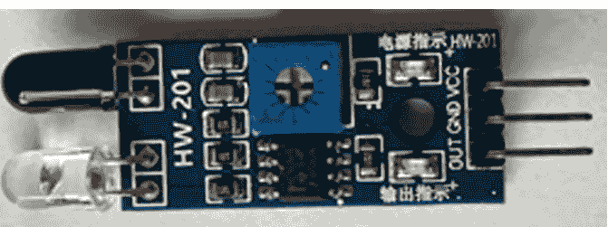

图 5.4 接近红外传感器。

### 5.6.2 18650 双电池座

此处所需的电池座应能容纳两个 18650 电池，以提供所需的电力。

### 5.6.3 5V 蜂鸣器/微型扬声器 - PC 安装

这是一个直径 12 毫米的小型扬声器（图 5.5），其工作频率在可听范围内。

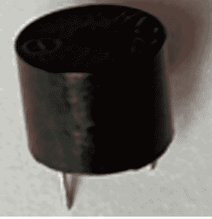

图 5.5 圆形扬声器。

### 5.6.4 拐杖/棍子

拐杖或棍子是安装电路的位置。拐杖可以是任何类型和长度，但最好是轻便的，以便于携带，长度约为 2.5–3 英尺，或者拐杖的长度应可调节。

### 5.6.5 18650 电池

此处需要两个 18650 电池。18650 电池是锂离子电池，可用于各种设备，例如手电筒、笔记本电脑、电子烟、相机、电气设备等。18650 描述了其尺寸，即 18 毫米乘 65 毫米。

## 5.7 拟议原型的电路图（基于传感器的智能拐杖）

图 5.4 显示了一个电路图，其中圆形扬声器、接近传感器和电池与导线相关联，以测试智能拐杖一部分的功能。

### 5.7.1 红外接近传感器测试

红外光（IR 光）基于物理学中的光学原理。红外接近传感器将一定电压施加到一对红外 LED（发光


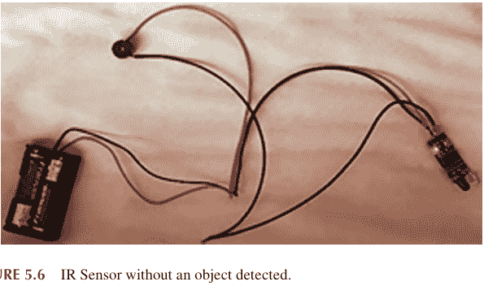

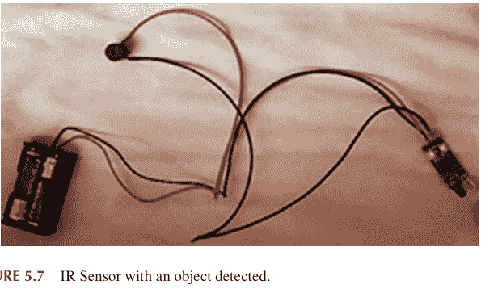

二极管)。这些二极管随后会发出红外或 IR 光。如果物体靠近，反射光会比物体离传感器更远时更强。应进行测试以确保 IR 接近传感器工作正常且 LED 正常工作（图 5.6 和 5.7）。可以通过搭建电路图的连接，然后将物体或手靠近传感器来测试传感器。如果发出光，则说明传感器工作正常，可用于模型电路中。

传感器点亮并正常工作，表明电路连接正确，且任何配置的设备中都没有松动连接。然后将电路固定在手杖上，并以美观且不会在任何点（尤其是使用时）导致短路的方式放置，因为短路可能会对使用者造成电击。


图 5.8 智能手杖设置概览

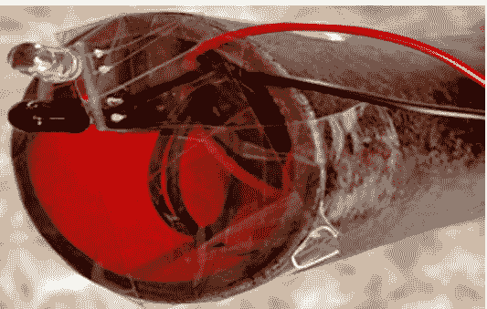

图 5.9 智能手杖工作原理

### 5.7.2 工作原型的结果

整个电路已安装在手杖上，并再次进行物体检测测试。发现，每次遇到物体时，蜂鸣器就会发出警报，表明设备工作完美，用户在需要时随时可用。图 5.8 展示了完成最终设置后的就绪状态手杖，图 5.9 展示了智能手杖的工作情况。

## 5.8 结论与未来工作

残疾人群体是世界上最大的少数群体，在设计和生产每一件新技术产品时都应予以考虑。这一群体能力各异，若得到妥善教学，能在数小时内记住使用设备导航所需的步骤和流程。挑战在于他们找不到与自己兼容的设备。正因如此，多种 HCI 设计应运而生，为残疾人提供他们应得的技术优势。因此，智能手杖专为他们打造，以确保他们在无人协助或监督的情况下移动时也能感到独立。因此，随着社会日益发展，我们也必须考虑这一残疾群体的巨大增长，并在实施新理念时考虑他们的需求。他们是技术进步消费者的四分之一，但最需要技术来使生活更加独立和便捷。因此，技术领域的每一家新企业、每一位新网页设计师和每一位新游戏开发者都必须确保关注这些能力各异用户的需求。这样可以确保技术世界的每一位消费者都对提供给他们的技术感到满意，并只能期待更多技术的消费。尽管该设备达到了目的，帮助视障人士发现路上的所有障碍，但在未来工作中，我们可以对其进行升级，使其不仅服务于单独的视障人士，也服务于同时存在视觉和听觉障碍的人。由于他们会有听觉障碍，对蜂鸣器的反应会比较困难。此外，当用户在图书馆等安静场所或夜间所有人都在睡觉时，每次将设备指向障碍物时蜂鸣器都会响起，对其他人来说也不便。与其使用蜂鸣器，不如将警报改为震动形式，这样只有用户知道障碍物的存在，设备也不会发出任何噪音。我们也可以保留蜂鸣器和震动功能，并加入一个开关，这样只有在开关打开时蜂鸣器才工作，而震动始终工作，即使开关未打开。

## 参考文献

- Banerjee, A., Saba, S. A., Rana, S., & Chakraborty, S. (2020, June). 仿生眼—综述. 在《2020 年第 8 届可靠性、Infocom 技术与优化国际会议（趋势与未来方向）（ICRITO）》（第 501–504 页）. IEEE.
- Disabled World. 残疾福利、事实、统计数据和资源. https://www.disabled-world.com/disability/, 2022 年 3 月访问.
- Junsengh, W. (2013, December). 基于数字仿真混合减法电路的 IR 接近传感器改进. 传感器与变换器, 160(12), 42–48.
- Kasowski, J., & Beyer, M. (2022). 仿生视觉的沉浸式虚拟现实模拟. 在《增强人类 2022 论文集（AH '22）》（第 82–93 页）. 纽约: 计算机协会. https://doi.org/10.1145/3519391.3522752.
- Komal, S., Abdul, B., & Shukla, V. K. (2021). 绿色物联网（G-IoT）技术、应用与未来挑战. 绿色物联网与机器学习：迈向智能可持续世界, 317–348.
- Nazim, S., Firdous, S., Pillai, S. R., & Shukla, V. K. (2022). 智能眼镜：盲人的视觉助手. 在《2022 年国际移动与嵌入式技术会议（MECON）》（第 621–626 页）. doi: 10.1109/MECON53876.2022.9751975.
- Shukla, V. K., & Verma, A. (2019). 利用拟议的电子手杖增强“低视力”用户的导航体验、物体识别和表面深度检测. 在《2019 年科学与工程技术国际会议（ASET）》（第 1–5 页）. doi: 10.1109/ICASET.2019.8714213.
- Siraj, A., & Shukla, V. K. (2020). 基于接近传感器的个性化汽车停车系统框架. 在《2020 年第 8 届可靠性、Infocom 技术与优化国际会议（趋势与未来方向）（ICRITO）》（第 198–202 页）. doi: 10.1109/ICRITO48877.2020.9197853.
- Smith, E. M., Gowran, R. J., Mannan, H., Donnelly, B., Alvarez, L., Bell, D., ... Wu, S. (2018). 为逐步实现公平获取辅助技术而启用适当的人员技能组合. 残疾与康复：辅助技术, 13(5), 445–453.
- Trayush, T., Bathla, R., Saini, S., & Shukla, V. K. (2021). 医疗保健中的物联网：挑战、益处、应用与机遇. 在《2021 年先进计算与工程创新技术国际会议（ICACITE）》（第 107–111 页）. doi: 10.1109/ICACITE51222.2021.9404583.
- Treeratanaporn, T., Torat, T., & Kongtaworn, T. (2021). 各类用户群体的触摸屏界面可用性评估. 在《2021 年第 25 届国际计算机科学与工程会议（ICSEC）》（第 149–154 页）. doi: 10.1109/ICSEC53205.2021.9684661.
- UX Collective. 面向视障人士的人机交互. https://uxdesign.cc/human-computer-interaction-for-the-visually-impaired-a467ad61175b, 2022 年 3 月访问.
- Vyas, S., & Bhargava, D. (2021). 智能健康系统：新兴趋势. Springer Singapore.
- Vyas, S., Shukla, V. K., Gupta, S., & Prasad, A. (Eds.). (2022). 区块链技术：探索机遇、挑战与应用. CRC Press
- World Health Organization. 失明和视觉障碍. https://www.who.int/news-room/fact-sheets/detail/blindness-and-visual-impairment, 2022 年 3 月访问.
- World Health Organization. 残疾与健康. https://www.who.int/news-room/fact-sheets/detail/disability-and-health, 2022 年 3 月访问.


# 6 医疗保健和数字营销中 IoT 和 IoE 环境下边缘 AI 的当代作用

Shaurya Gupta, Sonali Vyas

## 目录

- 6.1 引言 ............................................................................................75
- 6.2 边缘基础........................................................................................78
- 6.3 边缘设备............................................................................................78
- 6.3.1 基于 CPU 的边缘设备....................................................................79
- 6.3.2 基于 FPGA 的边缘设备 ................................................................79
- 6.3.3 基于 GPU 的边缘设备 .................................................................79
- 6.4 边缘 AI 赋能 IoT 中的知识市场 ................................................79
- 6.4.1 可信机构 (TA) .......................................................................80
- 6.4.2 边缘 AI 节点 ..................................................................................80
- 6.4.3 知识聚合器 .....................................................................80
- 6.5 IoT/IoE 环境中数字广告和医疗保健领域边缘 AI 的安全与保密问题....................................................80
- 6.6 结论与未来展望......................................................................81
- 参考文献....................................................................................................82

## 6.1 引言

医疗保健领域的主要技术发展（McGrow 2019）包括数据可访问性的激增，结合更强大的计算能力，以及机器学习程序的进步，这些进步培育了基于 AI 的应用程序的扩展，并正在改变日常生活的几乎每个方面。此外，与物联网 (IoT) 相关的互联网传感器和智能设备以及可穿戴智能设备，正在增强日常体验并提高生活质量。此外，对云中心 AI 解释的日益抵制，以及应用程序在实时环境中分析非凡容量和快速数据流的必要性（Satyanarayanan et al. 2015; Nastic et al. 2017），促使硬件设计师创建精简的 AI 加速器，


确保 AI 在向边缘计算交付中的应用。边缘计算（Garcia et al. 2015; Shi et al. 2016a; Satyanarayanan et al. 2013）为这类进展的融合赋予了重要特征。基于云的解决方案为分散的数据领域提供解决方案（Bouzeffrane et al. 2014），但关于保密性和隐私存在真正的担忧。此外，远程 AI 程序将逐渐统一，并开始协作解决多方面的任务（Montes & Goertzel 2019）。虽然从云端引导系统相当可行，但引入了一种包含边缘 AI 代理和实践的分散模型。这种新的边缘智能模式涉及一个网络物理实体，它交付原始数据并高效对其采取行动，而边缘计算则面临来自 AI 结构的几个例外挑战。在人工智能领域，特别是深度学习方面，已经出现了异常成功的进展，这标志着在以下方面出现了可观的创新：

- 工作站图像可视化。
- 自然语言处理。
- 身心健康医疗。
- 自动驾驶与监控。

AI 技术已从集中模式扩展到移动或分布式模式，催生了一个被称为边缘 AI 的新领域，其在专业知识、社会行为和制度等方面呈现出显著差异的生动发展。边缘 AI 在关联设备、用于信息收集和积累的组织以及数据处理方面结合了智能与调查（Shi et al. 2016）。它允许涉及数据收集和探索的大量新型应用，两者相结合。例如，数十亿手机用户正在使用许多智能手机应用程序，如翻译服务、数字助手以及健康监测服务。边缘硬件设备单元通常具有严格的设备限制，例如在服务器环境中计算能力和内存能力受限。针对多样化、大规模边缘 AI 方法的部署方案，需要投入大量制造精力，并面临各种多方面的探索挑战。创新设计方法以及设计自动化工具对于应对不断累积的边缘 AI 请求至关重要。赋能设计方法被归类为专业化设计与协同设计。设计专业化谨慎地调整集体机制以适应边缘 AI 应用的场景，例如原型压缩或专用硬件加速器。协同设计结合两种或多种专注技术，以应对优化前景。

Zhou et al. (2019)、Wang et al. (2020) 和 Xu et al. (2020) 描绘了边缘 AI 的重要认知以及当代发展，涵盖了除通用专业知识之外的主要应用领域。人工智能、机器学习和边缘计算（Deng et al. 2020）也已成为创新物联网（IoT）或万物互联（IoE）在数字广告环境（Nilsson 2014）方面的重要组成部分。当今，AI 在数字营销中被广泛使用。边缘计算允许在靠近数据源的本地处理特定数据，这对处理具有影响（Meng et al. 2020）。但是，某些微妙信息不会共享到云端（Janakiram 2019）。如今，AI 已发展成为边缘计算采用的关键，此外，它还已成为在云平台上训练的机器学习模型部署的默认终点。随着时间的推移，数字营销领域的应用呈几何倍数增长，客户正在使用各种设备来完成这些应用。基于云的数字营销已成为 AI 或 ML 运营不可或缺的一部分（Stone et al. 2020），此外，边缘 AI 改变了医疗环境。除此之外，还提出了异常的安全和保密问题，需要将其最小化，以保护用于数字营销的用户隐私数据。用户智能设备在数字营销中发挥着重要作用，并收集多种形式的用户数据以辅助营销目的。IoT 或 IoE 硬件设备单元可以连续工作，同时追踪众多客户活动，包括交付有价值的定制服务，这些在数字营销和各种医疗领域中极其有用。例如，硬件设备活动和在线追踪包括客户购买、位置数据、应用程序通信、熟人等。汇集不同的信息基础有助于构建客户数字轮廓，这些轮廓成为广告能力和决策制定的坚实信息基础。追踪数据收集增加了未来客户对 IoT 和 IoE 硬件设备的使用。AI 在数字营销中有其应用，涉及借助机器进行学习。数字推广不仅涉及产品推广，还包括医药或健康推广等广泛领域。在考虑智能家庭、机器人和大都市的情况时，数字营销变得非常关键。边缘 AI 应用于数字营销的各个方面，例如在不将客户数据传输到云端的情况下本地处理信息，以及允许机器学习算法在硬件设备单元上本地运行（Sachdev 2020）。攻击者或入侵者可能会篡改业务交易，导致客户获得有缺陷的产品，或者其私人信息落入攻击者控制之下。边缘硬件设备可能需要网络，这可能鼓励数据的本地处理。综合考虑应用程序、数据和服务（Caprolu et al. 2019），边缘 AI 为客户提供良好的关系，并本地处理安全信息，这反过来显著降低了与安全和保密相关的风险。采用边缘 AI 有助于个性化消费者的理解，同时增加客户的信任（基于 AI 和 ML 的边缘设备集中结论或某些多样化参数，这成为数字出版中的一个有益工具。）边缘硬件设备最终将从当前状态变得有影响力，除了包含云的模型（该模型将是通用架构的一部分）之外（Hagan et al. 2019a）。边缘 AI 在数字营销框架方面提供了一个灵活的轮廓，作为一种以 AI 得出的裁决为中心的动态响应。与边缘 AI 硬件设备单元相关的传感器和执行器也为数字营销目的提供重要信息。基于动态信息并使用边缘 AI 的自动市场重新细分是可行的，因为有本地处理，并且设备上可访问众多客户数据方面。考虑到边缘 AI 模型，经销商能够自发地帮助基于消费者习惯和行为以及基于客户偏好的学习预测进行客户自定义推广，尽管收集了一些可能对客户是个人的信息，并且这些信息还被用于指导无数推广分析。云模型需要智能设备与云之间的通信，客户有时会对此感到担忧，特别是如果甚至没有考虑合适的程序；边缘 AI 有助于缓解此类担忧。这些安全问题可能会对数字出版服务的客户造成损害；因此，必须解决安全和保密问题。

## 6.2 边缘要点

边缘 AI 的主要领域如下：

- 边缘预留。
- 边缘训练。
- 边缘外推。
- 边缘剥离

首先，边缘预留是指在辅助边缘应用中，边缘硬件设备及其邻近环境中的信息收集、分组和存储（Hagan et al. 2019）。消费者信息由其智能手机产生，而生态观测设备和传感器则在邻近边缘服务器中存储信息。此外，边缘训练利用边缘的有限信息和计算能力，无需高带宽要求将数据首先传输到云端。边缘训练涉及缩短位宽，以满足硬件设备限制。考虑到额外的好处，它通过规避将数据异地传输来保护客户数据的保密性。此外，边缘外推涉及在边缘实施 AI 算法。最后，边缘剥离处理一种分散计算模式，其中硬件设备单元将应用程序职责卸载到云端。剥离提升了边缘硬件设备的计算能力，前提是资源不足。

## 6.3 边缘设备

这些边缘设备可以根据计算类别分类，即：

- 基于中央处理器（CPU）。
- 基于现场可编程门阵列（FPGA）。
- 基于图形处理器（GPU）。


### 6.3.1 基于 CPU 的边缘设备

CPUs 在考虑分发以及控制系统时是关键组件。以 CPU 为中心的边缘设备提供适应性、低功耗、低成本、多任务处理和易于编程等优势。由于其并行性不足，它们被认为适用于通用指令序列。多核设备包括 Nvidia Jetson 系列 (Alvarado et al. 2020)、AMD Ryzen 系列 (Naffziger et al. 2021) 和 Arm Mali GPU (Gronquist et al. 2018)。

### 6.3.2 基于 FPGA 的边缘设备

FPGA（现场可编程门阵列）是通过强调并行性改进的架构构成的集成电路，通过以 CPU 为中心的硬件设备，擅长于大规模并行计算。基于 CPU 的边缘设备包括 Arm Cortex-M (Alkim et al. 2016)、树莓派系列 (Severance 2013)、Nano Pi 系列 (Ma’anf et al. 2021) 和 Speed MAX 系列 (Hao et al. 2021)。

### 6.3.3 基于 GPU 的边缘设备

GPU 最初被视为图像分发的一部分，除了基于并行结构的计算之外，但现在正逐渐用于加速具有巨大计算需求的 AI 任务。通过并行性和可编程性实现高效能；嵌入式 GPU 明确设计为低功耗、低成本，此外，它们在众多涉及深度学习任务的边缘设备中占据主导地位。基于 GPU 的边缘设备是一组可编程逻辑块，在应用灵活性方面非常有效，例如，辅助自主位宽和传统数值设置 (Darvish et al. 2020)。与 CPU 相比，它们可以完成更复杂的任务 (Biookaghazadeh et al. 2018; Nurvitadhi et al. 2017; Cass 2019)。在低延迟意图方面，特别是针对受时间限制的任务，FPGA 经常优于 GPU (Shi et al. 2020)，并且与 CPU 或 GPU 相比，在提供类似吞吐量时所需命令更少。不过，FPGA 在片上内存方面有限，同时也表现出低可编程性。ASIC（专用集成电路）显然可以超越其他处理器，具有相当复杂的计算输出，且功耗更低。ASIC 旨在通过抵消高质量设计和验证成本来实现节省。专用于边缘 AI 应用的 ASIC 包括 Google Edge TPU (Liang 2020) 和昇腾 310 AI 处理器 (Reuther et al. 2020)。

## 6.4 边缘 AI 启用的 IoT 中的知识市场

边缘 AI 单元。在考虑知识市场时，具有等效产出的同化信息称为知识币（KC）。这是一种创新的加密货币，与比特币和以太坊中分别使用的 BTC 和 Ether 有一定关系。知识市场由以下组件组成。

### 6.4.1 可信机构 (TA)

可信机构可能是一个行政分部，负责重置知识市场，特别是在交易方面。它可以为市场申请人创建公共约束和加密密钥。随后，在可信机构上注册后，边缘 AI 节点除了知识增强生成（KAG）之外，可能是真实的合作伙伴。

### 6.4.2 边缘 AI 节点

在 IoT 情况下，边缘 AI 节点根据角色状态相应行动，即，知识卖家、买家或无用节点。除此之外，在从合成感官信息中确定信息或收到信息请求后，他们会充当卖家。除此之外，他们会上传编码的知识到知识管理员。知识不能被视为公共性质，因为知识买家在考虑市场场景时会发现不同的信息效益。在知识被同化时，会支付相关知识币，以即时产生经济收益。无用节点在市场中既不交付也不获取知识币。

### 6.4.3 知识聚合器

在考虑 4G 网络的情况下，蜂窝网络中的密度正在相当快地增加，并将达到 50 BS/km² 的标志，届时将转换为 5G 网络 (Ge et al. 2016)。将多接入边缘计算集成到基站超密集系统中将涉及以下发展 (Guo et al. 2018)。每个基站都将配备改进的 3C，即缓存、计算和通信资源。基站通常通过高速有线链路相连。因此，作为边缘 AI 节点，它们还充当市场和存储中的知识管理员，完成加密 KC 的上传，此外还记录知识交换信息。暂时，它们保证知识市场的安全性和保密性。

## 6.5 IoT/IOE 环境中数字广告和医疗保健领域边缘 AI 的安全和保密问题

考虑一个以云为中心的模型，它面临着各种安全和保密问题，这是一个涉及许多领域（如医疗保健和数字广告）的研究领域。边缘计算在安全和保密方面具有许多优势 (Porambage et al. 2019)，这些优势正由 IoT 和 IoE 环境中的边缘 AI 所增强。边缘 AI 模型有能力与云模型关联。如果边缘设备确认 (Lee et al. 2018) 未成功执行，则会危及部分安全问题。此外，边缘设备背书不应过于广泛，因为这可能导致非法访问个人信息以及设施。举个例子，在数字营销场景中，考虑这样一个例子：个人信息被仓储，然后在边缘设备上管理，以向客户和患者以及医疗从业者提供更具针对性的说明。它涉及个人偏好以及消费者的其他聚类信息。开源漏洞仍然存在，原因是开源代码的公开和免费访问 (Hagan et al. 2019; Rauti et al. 2018)。客户信息可能被窃取或篡改，以通过某些欺骗性算法实施恶意或激进的广告设施 (Jones et al. 2019)，这代表另一个严重问题 (Rabinovici 2012)。除了设备安全和数据保护之外，安全已成为消费者以及各种公司（在保密性方面有重大关切）的严肃担忧，这作为商业的一个关键方面 (Zhang et al. 2020)。边缘信息分发的一个显著特征是，无需互联网或云连接即可进行信息的自由传播和广播 (Lee et al. 2018)。客户拥有各种 IoT 设备，并依赖它们来满足需求和购买商品以及向他们推广的各种其他功能，除此之外，客户还使用设备进行购买、获取认证、进行询问和提出要求，以实现计算机化整合 (Sachdev 2020)。此外，客户分析和数据定位正在用于提供个性化和本地化服务，对于客户或患者而言，数据定位功能有助于远程提供医疗监督。另外，重定向和再营销 (Conick et al. 2016) 是主要的数字广告方式，例如，如果客户曾搜索过特定商品，他可能会再次被定向购买相同的商品，并附带一些优惠或折扣。边缘 AI 推荐架构 (Su et al. 2019) 在数字广告视角下，对于生成商品和服务推荐非常有帮助。随着时间推移，将开展更多研究，以将边缘 AI 纳入更大的数字广告推荐框架中。尽管如此，这种相对新颖的策略可能有助于数据保留并实现提供建议的总体目标，从而有助于增强安全性和保密性。

## 6.6 结论与未来展望

除了保密问题之外，本章还讨论了 IoT 和 IoE 领域中边缘 AI 的各个关键方面，特别是


医疗保健与数字广告框架。除此之外，它还讨论了数字广告和医学领域中边缘 AI 的各个垂直领域，以及加强的安全性和保密性。虽然显而易见的是，这种范式在处理医疗保健和数字营销领域的超大规模应用时，除了保密性问题外，还需要解决许多安全性问题。本章讨论了各种安全性和保密性问题，以及众多可能的缓解措施和与数字广告及医疗保健状况相关的审议，同时还涵盖了当今语境下许多相关的法律和商业角度。随着数据量的不断增加，未来边缘 AI 将如何在各种设备上用于任何类型的数字广告或不断增长的医疗保健领域至关重要，同时在方法论层面合规，确保不打折扣地遵守安全性和保密性规则。

## 参考文献

- Alkirm, E., Jakubeit, P., & Schwabe, P. (2016 年 11 月). ARM Cortex-M 上的 Newhope. 在《安全、隐私与应用密码学工程：第 6 届国际会议，SPACE 2016，印度海得拉巴，2016 年 12 月 14-18 日，论文集》（第 332–349 页）。Cham：Springer International Publishing.

- Alvarado Rodriguez, O., Dave, D., Liu, W., & Su, B. (2020 年 11 月). 机器学习推理基准研究. 在《2020 年第 4 届图像处理进展国际会议》（第 167–171 页）。

- Biookaghazadeh, S., Zhao, M., & Ren, F. (2018). FPGA 是否适用于边缘计算？在《USENIX 边缘计算热门话题研讨会 (HotEdge 18)》中。

- Bouzefrane, S., Mostefa, A. F. B., Houacine, F., & Cagnon, H. (2014 年 4 月). 基于 NFC 的移动计算中的 Cloudlets 身份验证. 在《2014 年第 2 届 IEEE 移动云计算、服务与工程国际会议》（第 267–272 页）。英国牛津：IEEE.

- Caprolu, M., Di Pietro, R., Lombardi, F., & Raponi, S. (2019 年 7 月). 边缘计算展望：架构、技术与开放安全问题. 在《2019 年 IEEE 边缘计算国际会议 (EDGE)》（第 116–123 页）。IEEE.

- Cass, S. (2019). 将 AI 带到边缘：Google 的 TPU 现在提供面向创客的封装. IEEE Spectrum, 56(5), 16–17.

- Conick, H. (2016). 与 Kirthi Kalyanam 共度 10 分钟. Marketing Insights, 第 1–4 页.

- Darvish Rouhani, B., Lo, D., Zhao, R., Liu, M., Fowers, J., Ovtcharov, K., ... Burger, D. (2020). 利用 Microsoft 浮点数在云端推进窄精度推理的极限. 神经信息处理系统进展, 33, 10271–10281.

- Deng, S., Zhao, H., Fang, W., Yin, J., Dustdar, S., & Zomaya, A. Y. (2020). 边缘智能：边缘计算与人工智能的交汇. IEEE 物联网杂志, 7(8), 7457–7469.

- Garcia Lopez, P., Montresor, A., Epema, D., Datta, A., Higashino, T., Iamnitchi, A., ... Riviere, E. (2015). 以边缘为中心的计算：愿景与挑战. ACM SIGCOMM 计算机通信评论, 45(5), 37–42.

- Ge, X., Tu, S., Mao, G., Wang, C. X., & Han, T. (2016). 5G 超密集蜂窝网络. IEEE 无线通信, 23(1), 72–79.

- Grongvist, J., & Lokhmotov, A. (2018). 针对 ARM Mali-T660 GPU 优化 OpenCL 内核. 在《GPU Pro 360 移动设备指南》（第 167–198 页）。AK Peters/CRC Press.

- Guo, H., Liu, J., Zhang, J., Sun, W., & Kato, N. (2018). 面向超密集 IoT 网络的移动边缘计算卸载. IEEE 物联网杂志, 5(6), 4977–4988.

- Hagan, M., Siddiqui, F., & Sezer, S. (2019 年 8 月). 增强下一代边缘计算技术的安全性与隐私性. 在《2019 年第 17 届隐私、安全与信任国际会议 (PST)》（第 1–5 页）。IEEE.

- Hao, C., Dotzel, J., Xiong, J., Benini, L., Zhang, Z., & Chen, D. (2021). 边缘 AI 的设计方法论与未来趋势：专用化与协同设计. IEEE 设计与测试, 38(4), 7–26.

- Janakiram, M. (2019 年 7 月 15 日). AI 加速器如何改变边缘计算的面貌. Forbes.

- Jones, S. S., & Groom, F. M. (编). (2019). 面向非工程师的商业人工智能与机器学习. CRC Press.

- Lee, Y. L., Tsung, P. K., & Wu, M. (2018 年 4 月). 边缘 AI 的技术趋势. 在《2018 年 VLSI 设计、自动化与测试国际研讨会 (VLSI-DAT)》（第 1–2 页）。IEEE.

- Liang, X. (2020). 昇腾 AI 处理器架构与编程：CANN 的原理与应用. Elsevier.

- Ma'arif, F., Gao, Z., Li, F., & Ghifarsyam, H. U. (2021 年 7 月). 使用 ARM 处理器的离散元素法新分析. 在《IOP 会议系列：地球与环境科学》(第 832 卷，第 1 期，第 012016 页)。IOP Publishing.

- McGraw, K. (2019). 人工智能：护理要点. 护理, 49(9), 46.

- Meng, K., Cao, Y., Peng, X., Prybutok, V., & Youcef-Toumi, K. (2020). 基于普适信息与计算智能语境下寿命终止产品的智能回收决策. 清洁生产杂志, 272, 122804.

- Montes, G. A., & Goertzel, B. (2019). 分布式、去中心化和民主化的人工智能. 技术预测与社会变革, 141, 354–358.

- Nafziger, S., Beck, N., Burd, T., Lepak, K., Loh, G. H., Subramony, M., & White, S. (2021 年 6 月). 面向 AMD EPYC™ 和 Ryzen™ 处理器系列的 Chiplet 技术与设计先驱：工业产品. 在《2021 年 ACM/IEEE 第 48 届计算机体系结构国际年会 (ISCA)》（第 57–70 页）。IEEE.

- Nastic, S., Rausch, T., Sekic, O., Dustdar, S., Gusev, M., Koteka, B., & Prodan, R. (2017). 面向边缘计算的无服务器实时数据分析平台. IEEE 互联网计算, 21(4), 64–71.

- Nilsson, N. J. (2014). 人工智能原理. Morgan Kaufmann. https://stacks.stanford.edu/file/druid:zd294jv9941/zd294jv9941.pdf.

- NURVITADHI, E., Venkatesh, G., Sim, J., Marr, D., Huang, R., Ong Gee Hock, J., ... Boudoukh, G. (2017 年 2 月). FPGA 能否在加速下一代深度神经网络方面超越 GPU？在《2017 年 ACM/SIGDA 现场可编程门阵列国际研讨会论文集》（第 5–14 页）。

- Porambage, P., Kumar, T., Liyanage, M., Partala, J., Lovén, L., Ylianttila, M., & Seppänen, T. (2019). Sec-EdgeAI：面向边缘安全的 AI 与面向边缘 AI 的安全. 在《第 1 届 6G 无线峰会》（芬兰 Levi）。

- Rabinovich, I. (2012). 欧盟基本权利宪章中的被听权. 欧洲公法, 18(1), 149–173.

- Rauti, S., Koivunen, L., Mäki, P., Hosseinzadeh, S., Laurén, S., Holvtie, J., & Leppänen, V. (2018). 传感器网络中作为安全措施的内部接口多样化. 传感器与执行器网络杂志, 7(1), 12.

- Reuther, A., Michaleas, P., Jones, M., Gadepally, V., Samsi, S., & Kepner, J. (2020 年 9 月). 机器学习加速器综述. 在《2020 年 IEEE 高性能极端计算会议 (HPEC)》（第 1–12 页）。IEEE.

- Sachdev, R. (2020 年 4 月). 面向基于 IoT/IoE 的数字营销环境中边缘 AI 的安全与隐私. 在《2020 年第五届雾计算与移动边缘计算国际会议 (FMEC)》（第 341–346 页）。IEEE.

- Satyanarayanan, M. (2013 年 6 月). Cloudlets：处于云移动融合前沿. 在《第 9 届 ACM Sigsoft 软件架构质量国际会议论文集》（第 1–2 页）。

- Satyanarayanan, M., Simoens, P., Xiao, Y., Pillai, P., Chen, Z., Ha, K., & Amos, B. (2015). 物联网中的边缘分析. IEEE 普适计算, 14(2), 24–31.

- Severance, C. (2013). Eben Upton：Raspberry Pi. 计算机, 46(10), 14–16.

- Shi, W., Cao, J., Zhang, Q., Li, Y., & Xu, L. (2016). 边缘计算：愿景与挑战. IEEE 物联网杂志, 3(5), 637–646.

- Shi, P., Gao, F., Liang, S., & Yu, S. (2020 年 12 月). 嵌入式多核处理器上的多模型推理加速. 在《2020 年智能计算与人机交互国际会议 (ICHCI)》（第 400–403 页）。IEEE.

- Stone, M., Aravopoulou, E., Ekinci, Y., Evans, G., Hobbs, M., Labib, A., ... Machtynger, L. (2020). 战略营销决策中的人工智能 (AI)：一项研究议程. 底线, 33(2), 183–200.

- Su, X., Sperli, G., Moscaro, V., Piciariello, A., Esposito, C., & Choi, C. (2019). 赋能文化遗产应用的边缘智能推荐系统. IEEE 工业信息学期刊, 15(7), 4266–4275.

- Wang, X., Han, Y., Leung, V. C., Niyato, D., Yan, X., & Chen, X. (2020). 边缘计算与深度学习的融合：一项全面综述. IEEE 通信调查与教程, 22(2), 869–904.

- Xu, D., Li, T., Li, Y., Su, X., Tarkoma, S., Jiang, T., ... Hui, P. (2020). 边缘智能：架构、挑战与应用. arXiv 预印本 arXiv:2003.12172.

- Zhang, J., Zhang, F., Huang, X., & Liu, X. (2020). 面向边缘人工智能的抗泄漏认证密钥交换. IEEE 可靠性与安全性交易.

- Zhou, Z., Chen, X., Li, E., Zeng, L., Luo, K., & Zhang, J. (2019). 边缘智能：利用边缘计算铺平人工智能的最后一英里. IEEE 论文集, 107(8), 1738–1762.


# 7 基于边缘-AI的智能医疗系统身份认证
一项基于综述的研究

Akanksha Upadhyay, Bhajneet Kaur

## 目录

- 7.1 引言 .................................................... 85
- 7.2 详细综述：基于边缘-AI的智能医疗系统....... 86
- 7.3 结论 .................................................... 93
- 参考文献............................................................ 94

## 7.1 引言

人工智能 (AI) 使用专家系统，可在无需人工输入的情况下模拟人类智能。为应对严峻挑战，AI 被用于从先前经验中学习 (Gupta & Nagpal 2020; Han & Han 2021)。大多数物联网 (IoT) 应用依赖云计算进行数据处理和存储，以应对 IoT 设备定期产生的海量数据 (Yassine et al. 2019)。一种可行的 IoT 系统实现方案是多接入边缘计算，它为低延迟和现实世界应用提供边缘网络上的存储和处理资源 (Porambage et al. 2018)。此外，智能医疗系统的 EoT（或称 Edge-of-Things）由多接入边缘计算 (MEC) 与 IoT 的融合产生。已发现，区块链作为一种新范式，在降低用户或患者数据被泄露的风险方面更加可靠和安全 (Pan et al. 2019)。利用区块链边缘事物 (BEoT)、EoT 和 IoT 等新兴技术，云计算提供患者数据追踪、健康监测、药品库存和管理等服务 (Mutlag et al. 2019)。另一种新兴技术是 IoT，其中数据从边缘计算机传输到云服务器，以实现安全和最优的资源利用 (Li et al. 2020)。现代技术中的安全性与身份认证是最具挑战性的问题之一。这些系统现在具备决策能力，一次泄露可能会造成巨大危害。在医疗领域，隐私也是关键考量。

本章所述研究的目的是对当前使用前沿技术应用进行数据认证的研究进行深入分析。工作分为三个主要部分：第 7.2 节探讨了利用新技术应用（特别是在医疗行业）进行数据认证的先前研究。第 7.3 节利用词云分析对综述进行验证，旨在证实文献与当前调查的相关性。最后，结论部分（第 7.4 节）对当前研究进行了总结。

## 7.2 详细综述：基于边缘-AI的智能医疗系统

Kamruzzaman 等人 (2022) 表明，边缘-AI 和医疗物联网 (IoMT) 这两个复杂概念在智慧城市医疗中的应用日益广泛。这些技术可用于测量和管理联网医疗，这也非常有帮助，因为它最大限度地减少了人力投入并提高了管理效率。研究人员开展了一项基于综述的研究，以探讨智慧城市中基于网络的医疗领域边缘-AI 的挑战与机遇。作者仔细考虑了各种研究模式，并将其分为两类。在审查研究后发现，医疗人员管理数据、承认困难或挑战、处理紧急病例、监测患者病史、诊断和治疗在患者中表现不同的疾病，以及治疗传播更广、影响更大人群的疾病，变得越来越重要。相反，边缘-AI、IoMT、5G、雾计算和云计算等解决方案被强调为应对这些日益扩大问题的手段。但在应用最新技术的地方，结果有所改善。研究人员还指出，这些实施从患者和医疗专业人员的角度都产生了积极结果。一项详细研究还强调，需要进一步验证和应用各类研究中提出的众多模型，以确认其有效性并保证它们能在各种情境中成功应用 (Rajasekar et al. 2021)。

远程用户安全认证的方法涉及远程服务器通过可靠通信网络确认用户身份。此后，已开发出多种远程用户认证方法，但每种方法都有其自身的优缺点。所提认证系统对电子健康、远程医疗、物联网、云以及多服务器应用等实时应用的优缺点有显著影响。一个继续向不受欢迎的各方提供个人信息访问权限的薄弱系统是事务与管理信息系统 (TMISS)。与此同时，远程用户认证作为一种策略，已被证明对于加速 IoT 至关重要。安全性是一个主要问题，即使 IoT 提供对远程资源的安全访问。数据通过云计算服务和多服务器架构在许多最终用户之间共享，这需要高水平的安全性。尽管针对医疗、IoT、多服务器和云应用的远程用户认证方法进行了大量研究和开发，但这些系统中的绝大多数要么容易受到安全威胁，要么缺乏关键功能。研究人员对众多远程用户认证系统进行了分析和全面的评估，然后根据其预期用途对其进行分类。一百种最先进的远程用户认证方法已被审查，并根据其优势、关键特性、计算成本、存储成本和传输成本进行评级 (Prabadevi et al. 2021)。

在事物边缘，区块链技术作为一种可行且革命性的技术解决方案，在多个技术领域日益受到关注。物联网与边缘计算融合，创造了事物边缘，一种新的技术解决方案。由区块链和 IoT 结合建立的新范式——区块链赋能的事物边缘（BEoT），对于实现潜在的快速响应时间和有效的安全系统及服务至关重要。为了在包括智能家居、智能医疗、智能电网和智能交通在内的一系列 IoT 用例中实现工业应用，作者提出了一种开创性的 BEoT 架构，该架构将由边缘网络上的区块链监管。在所提研究中，作者还探讨了 BEoT 在提供用户授权、保密性、漏洞检测和信息安全等安全服务方面的潜力。作者开发了 BEoT，这是一种基于 MEC 和区块链的新解决方案，可为 IoT 支持的应用提供网络边缘的高安全性和低延迟 (Zhang et al. 2021)。

基于边缘的 AI 互补基于云的 AI。它消除了数据流和云存储隐私问题。它为每一毫秒都至关重要的实时应用提供支持，并通过启用边缘设备将 AI 带到网络基础设施薄弱的偏远地区。根据作者的观点，启用边缘的 AI 应用程序（如自动驾驶汽车和智能医疗）存在安全风险。边缘设备可以分析数据并采取行动，这使它们容易受到攻击。在边缘场景中对计算能力有限设备的使用日益增加，以及泄露威胁的上升，带来了重大的安全挑战。作者建议通过创建抗泄漏认证密钥交换 (LRAKE) 协议来改进边缘-AI 安全性。所提协议可以轻松实施到安全和通信标准中。该研究包括所提协议的原型、实现细节和 Bluetooth 5.0 用例。作者建议，进一步的理论和实践细节将有助于在边缘-AI 应用中部署 LRAKE 协议 (Minahil et al. 2021)。

为削减成本并升级医疗设施，越来越多的医疗数据已开始逐步存储和传输。在此背景下，电子健康云的增长为访问分布在全球的医疗数据创造了新机会。但这一成就也带来了几种新的风险和问题，例如如何保证特别脆弱的医疗数据的完整性、安全性和保密性。其中一个关键问题是数据认证，它确保存储在云中的敏感医疗数据对未经授权的用户不可访问。认证的三种方法——智能卡、密码和生物识别——满足……的需求


强安全性。研究人员引入了许多用于电子健康云的基于三因素椭圆曲线加密系统（ECC）的身份验证技术。另一方面，大多数协议存在严重的安全缺陷以及高昂的计算和通信成本。因此，作者为电子健康云创建了一种尖端安全系统，可防范多种危险，例如密码猜测、针对被盗智能卡的攻击、冒充攻击以及用户匿名性问题。此外，研究人员使用随机预言模型（ROM）对协议进行了彻底的安全分析。与现有协议相比，研究人员发现所提方法在计算和通信方面更具成本效益。因此，该协议声称更高效、可信且安全（Vimal et al. 2021）。

本研究提出了一种精度更高的跌倒检测方法。开发了三个数据处理阶段——卷积层、池化层和整体层——以整合数据分析并估算利用特征检测的跌倒检测。测试表明，基于视觉的估算准确率为 98%。该研究采用多个照片集的数据集来确定基于支持向量机（SVM）和人工神经网络（ANN）的跌倒检测准确率。通过利用物联网传感器数据以及基于雾的检索数据存储，卷积神经网络（CNN）方法提高了分类和检测准确率（Li et al. 2020）。农村地区的检测准确率也采用了利用长程无线电（LoRA）的 WiFi 予以包含。通过边缘网关数据分析改进了提供的数据，因此，系统的预测性能随时间推移得到了提升。基于研究获得的原始数据信息以及在线数据分析和排序的研究，报告了临床观察的跌倒检测（Li et al. 2020; Cui et al. 2021）。

边缘智能（EI）是最新技术之一，它将人工智能的理念与使用 5G 及超 5G（B5G）网络的移动边缘计算技术相结合。当将 EI 与使用无线局域网等异构网络集成时，会出现更多安全和隐私问题。本研究探讨了 EI 支持的异构 B5G 网络的安全性方面。这些安全性方面包括身份验证和基于可靠性的用户设备（UE）检测。已讨论了技术问题。开发了一种独特的统一身份验证框架，该框架与边缘计算协同工作，在不同网络中始终如一地对 UE 进行身份验证，同时保护其隐私（Amin & Hossain 2021）。

患者越来越期望拥有一个能根据自身健康需求定制的复杂且智能的医疗保健系统。借助 5G 和尖端物联网传感器，边缘计算使满足能耗和延迟要求的实时智能医疗解决方案成为可能。以往关于智能医疗系统的调查涉及基于云计算、雾计算、数据身份验证、安全性以及边缘计算框架中使用的各种传感器和设备等技术的架构主题。除此之外，以往的研究没有关注在边缘计算系统中实施的医疗物联网应用。为了提升边缘节点的重要性，图形处理单元（GPU）设备被嵌入到边缘层。此外，通过在雾层部署基于 GPU 的节点，大幅提升了模型的计算能力。这些基于 GPU 的节点也在雾层中用于增强模型的计算和数据处理能力。在训练型深度学习（DL）模型在雾层和边缘层仍不可行的情况下，工作负载分发和深度网络方法已被确定为智能医疗系统中的潜在解决方案。本研究的主要目的是考察智能医疗现有的和即将出现的边缘计算架构与方法论，以及了解各种应用场景的期望和约束。作者调查了使用最先进的深度学习算法针对生命体征的跟踪和识别来对健康数据进行分类的边缘智能。本研究还包括对用于边缘智能的尖端人工智能分类和预测方法的彻底检讨。虽然边缘智能具有诸多优势，但在计算复杂性和安全性方面仍面临挑战。为了提供更优质的患者生活体验，该研究基于当前研究确定了为开发医疗边缘计算服务而制定的未来建议。此外，该研究还简要总结了物联网驱动的解决方案如何应用于医疗保健的基于边缘的平台（Hayyolalam et al. 2021）。

本文展示了如何将人工智能技术和尖端技术应用于增强智能医疗保健系统。通过本地处理，边缘技术降低了延迟、网络压力和功耗，从而实现智能医疗保健系统。人工智能还赋予机器更高的智能。这两种技术无疑提升了智能医疗系统组件的智能水平，并带来了诸多优势。该研究提供了一种同时使用边缘技术和人工智能来增强医疗保健系统的智能医疗完整框架。所提方案将过程从传感器分发到云服务器。当使用轻量级人工智能技术在传感器上执行各种任务时，时间、复杂性和网络负载均有所降低。此外，在边缘层使用灵活的人工智能技术进行并行计算可降低延迟、实现更快速的反应和决策，并使护理人员能够接收实时警报——这些都是智能医疗中必不可少的。所提模型考虑了整个智能医疗保健系统的安全和隐私要求，包括敏感医疗数据、网络链接以及用户身份验证和授权。尽管所提系统架构解决了早期智能医疗架构的一些缺点，但其他问题（如数据丢失和自主网络管理）仍需解决（Shukla et al. 2021）。

医疗保健系统正在数字化数据。智能合约和其他区块链技术对于持续处理和监控物联网数据变得越来越重要。医疗物联网生成可信的患者健康数据。大量数据使得用户与设备的通信变得危险。本工作针对基于物联网的医疗数据和设备身份验证。研究人员随后提供了一种处理患者健康数据的安全方法。该方法提高了恶意节点识别的准确性和可靠性。研究人员的独特解决方案使用雾计算和区块链。为了对医疗物联网设备和患者健康数据进行身份验证，本研究引入了一种三层框架、一个适用的数学模型和框架，以及一种加密方法，即基于雾计算的高级签名加密（ASE）方法。对于实时服务和基于物联网的医疗保健用户，目标是提高安全数据传输。在边缘，所提架构和算法将能够提供安全的交易和传输服务。ASE 优于基于云的其他框架和方法。新颖的 ASE 方法在可靠性、虚假节点检测和吞吐量方面准确。ASE 在雾计算（FC）环境中以 91% 的准确率检测出虚假节点，而云准确率为 83%。ASE 算法在 FC 中可靠性为 95%，在云中可靠性为 87%。所提技术使用 iFogSim（NetBeans）和 SimBlock 进行测试（Jan et al. 2021）。

传感器、网络启用设备（医疗物联网）和广泛的数据采集推动医疗行业为患者提供更便捷的诊断和远程监测。在这种环境下，信息真实性和验证面临挑战，如果不解决这些问题，就无法提供安全通信。没有稳健的身份验证流程，就无法确保数据完整性、授权、不可否认性、用户有效性或信息验证。我们使用无线多媒体传感器网络（WMSN）为医疗物联网开发了强大且轻量的身份验证方案。所提方法解决了文献中的所有缺陷。使用 ProVerif2.00 和 BAN 测试了协议的鲁棒性。评估表明，所提方法既快速又安全。比较调查表明，所提方法轻量且安全，不同于以往方法（Deepa et al. 2020）。

信息通信技术（ICT）创新使许多生活领域变得智能化。智能应用和技术已成为必需品，但其使用在现代环境中导致了长期健康问题。糖尿病影响各年龄段人群。所提工作使用脊-阿德拉因随机梯度下降分类器（RASGD）来增强基于人工智能的疾病预测系统。所提研究使用绝对收缩与选择算子和脊回归来改进分类模型。RASGD 使用高度优化的模型来降低分类器成本。将脊回归与 ASGD 分类器结合使用提高了其收敛速度。最后，将所推荐方案的发现与回归和 SVM 进行比较，以验证智能且敏捷的系统。该智能系统的准确率为 92%，高于其他分类器（Wu et al. 2020）。

当今最著名的 ICT 创新之一是物联网。另一方面，为基于物联网的基础设施开发可靠且安全的身份验证系统仍然具有挑战性（Zargar et al. 2021）。另一项研究表明，Amin et al.（2018）和 Maitra et al.（2016）使用的技术容易受到离线模式下的密码猜测攻击、用户跟踪攻击及其他攻击（Zhou et al. 2019）。所述漏洞促使提出了一种简单的物联网身份验证方案。除了相互身份验证、用户审计和基于会话的安全性等关键安全特性外，基于物联网的


认证系统还能抵御一系列攻击。此外，在分析该方案时发现了问题。研究人员随后基于其方法提出了一种增强方案，该方案满足安全规范，也能免受已知威胁。在身份验证过程中，无法保证匿名性和真实性。研究人员随后创建了一个新的认证系统，以弥补 Zhou et al. (2019) 系统的不足。所提方法具有用户匿名性和相互认证属性，且能抵御常见攻击。研究人员还在身份验证过程的第一阶段添加了一个新参数，可快速判断用户输入的身份和密码是否准确。此外还提出了基于 IoT 的云计算认证改进方案，性能评估结果表明该方案计算量大且安全性强。因此，所提认证技术可应用于实际 IoT 设备（Li et al. 2020）。

边缘计算是一种成功解决一系列处理和计算相关问题的架构。边缘计算是通过提高 IoT 使能医疗系统的传输速度和计算能力，提供无延迟高效数据服务的技术之一。作者提出了一种基于软件定义网络的边缘计算系统框架，该框架采用轻量级认证技术对使用边缘服务器进行基于 IoT 的医疗的 IoT 设备进行认证。具备认证功能的设备在收集和传输患者数据到边缘服务器进行进一步处理之前，会先存储患者数据。使用计算机模拟评估了所提框架在 IoT 驱动医疗系统中的效率。作者建立了实验环境、仿真场景、性能评估指标，最后对仿真结果进行了分析，然后在各种设置下运行仿真。对于所提方案，性能评估指标包括平均反应时间的计算、数据包投递率、平均延迟、吞吐量和控制开销。对于边缘服务器和云服务器，平均响应时间在上传和下载时间、等待时间及系统负载方面进行了测量和比较。其他性能评估指标参数，即数据包投递率、平均延迟、吞吐量和控制开销，分别针对传统网络、边缘计算网络和基于软件定义网络的边缘计算网络进行了评估。作者指出，基于三种不同情境下的仿真输出，已验证所提系统高效，且所提方法可改进以确保患者数据隐私（Xu et al. 2020）。

作为一种为传统云面临的问题提供众多解决方案的新型计算范式，边缘计算（EC）将大力推动 IoT 行业的扩张，并丰富其应用生态系统的多样性。为提供高质量的 IoT 服务，必须应用隐私保护以及能够提升 EC 安全性和可靠性的技术。本文综述了 AI 和 EC 在 IoT 安全中的应用。首先，介绍了基本概念和术语。然后，将 EC 与 IoT 服务架构相关联。接着，评估了基于边缘的 IoT 的传统隐私保障和 AI 驱动的隐私保障。研究人员还强调了使用 AI 和区块链来增强 IoT 安全性。作者还讨论了在 EC 中保障 IoT 服务安全以及开放 AI 方面存在的问题（Ansari et al. 2020）。

随着 IoT 传感器和设备产生越来越多数据，边缘计算在数据源或其附近处理数据。将数据限制在边缘节点可在确保数据安全和隐私的同时降低延迟。然而，由于资源受限的硬件和软件异构性，许多边缘计算系统面临多种威胁。此外，将智能融入边缘计算系统的日益普遍的做法，也带来了一系列独特的安全缺陷，例如数据和模型投毒以及规避尝试。研究人员概述了所提系统中面向边缘智能的最主要威胁。研究人员还讨论了该研究的未来目标，并指出区块链和深度强化学习等前沿技术可应用于提升当前基于边缘的 AI 系统的性能（Martínez-Peláez et al. 2019）。

鉴于云计算和 IoT 的快速普及，如今增强认证流程以减少攻击和限制应用性能的安全漏洞比以往任何时候都更加重要。在本研究中，研究人员引入了一种新型基于 IoT 的云计算认证技术。作者认为 Zhou et al. (2019) 开发的方案协议既不安全也不可靠。他们声称，在审查协议后发现了一些安全漏洞和其他问题，导致系统不稳定。研究人员建议一种包含三个步骤的新版本以提升安全性。用户必须在第一步登录，随后将进行相互认证并进行密钥协商。此外，他们还添加了一个名为“连接证明”的子阶段，用于在服务器参与之前确认用户参与情况。根据研究，该新技术是对早期尝试的改进，因为它满足安全要求，并能有效抵御大多数常见且广为人知的攻击。另外，性能研究表明，新系统的注册和登录阶段所需的通信成本低于旧的认证协议（Dhillon & Kalra 2019）。

得益于云计算和物联网（IoT）技术的发展，患者现在可以在家中获得医疗服务，远程医疗专家能够实时监测患者。在某些情况下，患者信息存储在集中式医疗机构，医生可定期访问。然而，公共 WiFi 情况引发了关于患者隐私的根本性问题。最近，文献中报道了多种医疗保健服务认证方法。然而，这些方法中大多数已被证明不符合安全要求。此外，还有说法称它们未考虑医生如何访问存储在云服务器上的信息。在这项研究中，研究人员提出了一种基于加密椭圆曲线方法的多因素认证方法，允许授权的医疗专业人员访问存储在云服务器上的患者健康数据。使用基于 Web 的 AVISPA 工具，已验证所提方法能够抵御包括“重放”和“中间人攻击”在内的多种攻击。对系统性能及其防护安全风险能力的比较表明，该系统实现了会话密钥协商，并能有效防护安全风险（Lee & Park 2019）。

借助智能系统和服务，城市人口在行为模式、灵活经济、系统工程和当代生活方式等方面不断发展。该报告补充称，为了实现目标，智能系统服务必须具备包括管理、适应性、灵活性、决策、安全性和用户友好性在内的广泛特性。AI 现已被公认为一种能够帮助人们以合理方式行事、模拟认知和语义操作以及良好表示数据的技术（Hartmann et al. 2019）。

结合 5G 速度和当代计算技术的边缘计算环境，是提升医疗实时数据采集与分析性能并降低功耗的替代方案之一（Vyas et al. 2022, 2023）。过去针对医疗的研究更多关注新型雾架构和传感器，而忽略了边缘计算架构中端设备部署所用计算的最佳实践问题。该研究的主要目标是描述各种用例的设备需求与顾虑，并分析医疗应用中当前和新的边缘计算架构与方法（Vyas et al. 2021, 2022）。所提方法将跌倒检测和生理数据监测视为边缘计算应用的两大重点。其他低延迟程序监测疾病症状，包括帕金森病患者的步态问题。该研究还包括对边缘计算活动的全面调查，例如传输、安全、验证、分类、压缩和预测（Abdelatif et al. 2019）。

成功改进医疗系统是全球各国政府的首要任务。然而，以最实惠的价格为消费者提供灵活服务可能具有挑战性。未来无线技术和边缘计算是提供智慧医疗最具前景的可能性，能够实现实时且经济实惠的患者远程监测。作者讨论了利用 MEC 用于智慧健康应用的研究视角（Vyas & Gupta 2022）。同时也指出，通过可视化基于 MEC 的架构并阐述网内和上下文感知处理的优势，完全可以满足智慧健康的需求。此外，该研究揭示了如何利用此类架构提供多模态数据缩减和基于边缘的特征提取以进行事件识别。前者能够实现高效且低成本的压缩，后者则在紧急情况下提供极高可靠性和及时响应。最后，我们讨论了边缘计算可能带来的主要挑战和机遇，以及未来研究的可能方向。

## 7.3 结论

移动性和智能塑造了互联网交互。随着连接性和通信速度的提升，数字解决方案转向了云和互联设备。智能移动性将使个人、企业和


社会更甚。“推拉”已使每个领域受益，包括医疗保健（Shnurenko et al. 2020）。医疗保健已采用人工智能进行决策制定、建议、诊断等。为了执行智能和自动化任务，人工智能驱动的医疗系统需要来自经过身份验证的用户的授权数据。数据身份验证是一个关键研究课题。本章回顾了先前的研究，以确定研究人员的关注点并提供数据安全和验证系统。评估发现，研究更侧重于数据身份验证而非用户身份验证。

## 参考文献

- Abdellatif, A., Mohamed, A., Chiasserini, C., Thili, M., & Erbad, A. (2019). 面向智能健康的边缘计算：上下文感知方法、机遇与挑战。IEEE Network, 33(3), 196–203.
- Amin, R., Kumar, N., Biswas, G., Iqbal, R., & Chang, V. (2018). 分布式云计算环境中IoT设备的轻量级身份验证协议。Future Generation Computer Systems, 78, 1005–1019.
- Amin, S., & Hossain, M. (2021). 医疗保健中的边缘智能与物联网：一项综述。IEEE Access, 9, 45–59.
- Ansari, M. S., Alsamhi, S. H., Qiao, Y., Ye, Y., & Lee, B. (2020). 边缘计算中分布式智能的安全性：威胁与对策。载于《从云到物体的连续体》（第95–122页）。Cham: Palgrave Macmillan.
- Cui, Q., Zhu, Z., Ni, W., Tao, X., & Zhang, P. (2021). 面向异构超5G系统的边缘智能赋能的统一身份验证与信任评估。IEEE Wireless Communications, 28(2), 78–85.
- Deepa, N., Prabadevi, B., Maddikunta, P., Gadekallu, T., Baker, T., Khan, M., & Tariq, U. (2020). 基于脊回馈ADALINE随机梯度下降分类器的医疗保健分析AI智能系统。超级计算机期刊, 77(2), 1998–2017.
- Dhillon, P., & Kalra, S. (2019). 面向基于云-IoT的医疗服务的安全多因素ECC身份验证方案。环境智能与智能环境期刊, 11(2), 149–164.
- Gupta, I., & Nagpal, G. (2020). 人工智能与专家系统。Mercury Learning and Information.
- Han, J., & Han, J. (2021). Watson和AlphaGo中应用的人工智能技术评估。计算与信息科学学术期刊, 4(8), 29–36.
- Hartmann, M., Mashhmi, U., & Imran, A. (2019). 智慧医疗保健系统中的边缘计算：综述、挑战与研究方向。新兴电信技术事务刊, 33(3), 1–25.
- Hayyolalam, V., Aloqaily, M., Ozkasap, O., & Guizani, M. (2021). 赋能基于IoT的医疗保健系统的边缘智能。IEEE Wireless Communications, 28(3), 6–14.
- Jan, S., Ali, S., Abbasi, I., Mosleh, M., Alsanad, A., & Khattak, H. (2021). 利用无线医疗传感器网络的医疗保健系统安全患者身份验证框架。医疗工程期刊, (2021), 1–20.
- Kamruzzaman, M., Alrashdi, I., & Alqazzaz, A. (2022). 面向智慧城市医疗物联网中互联医疗的边缘AI的新机遇、挑战与应用。医疗工程期刊, 2022, 1–14.
- Lee, D., & Park, J. H. (2019). 基于AI的智能系统与服务的未来趋势：挑战、机遇与解决方案。*信息处理系统期刊*, 15(4), 717–723.
- Li, J., Cai, J., Khan, F., Rehman, A. U., Balasubramaniam, V., Sun, J., & Venu, P. (2020). 面向IoT支持医疗系统的基于SDN的边缘计算安全框架。*IEEE Access*, 8, 135479–135490.
- Maitra, T., Islam, S., Amin, R., Giri, D., Khan, M., & Kumar, N. (2016). 使用密码和智能卡的增强型多服务器身份验证协议：密码分析与设计。*安全与通信网络期刊*, 9(17), 4615–4638.
- Martínez-Pélaez, R., Toral-Cruz, H., Parra-Michel, J., García, V., Mena, L., Félix, V., & Ochoa-Brust, A. (2019). 云计算环境下增强型轻量级基于IoT的身份验证方案。*传感器期刊*, 19(9), 2098.
- Minahil, R., Ayub, M., Mahmood, K., Kumari, S., & Sangaiah, A. (2021). 基于5G技术的IoT应用中电子健康云的轻量级身份验证协议。*数字通信与网络期刊*, 7(2), 235–244.
- Mutlag, A., Abd Ghani, M., Arunkumar, N., Mohammed, M., & Mohd, O. (2019). 医疗保健IoT系统中雾计算的使能技术。*未来世代计算机系统期刊*, 90, 62–78.
- Pan, J., Wang, J., Hester, A., Alqerm, I., Liu, Y., & Zhao, Y. (2019). EdgeChain：基于区块链和智能合约的边缘-IoT框架与原型。*IEEE物联网期刊*, 6(3), 4719–4732.
- Porambage, P., Okwuibe, J., Liyanage, M., Ylianttila, M., & Taleb, T. (2018). 面向物联网实现的多接入边缘计算调研。*IEEE通信调查与教程期刊*, 20(4), 2961–2991.
- Rajasekar, V., Jayapaul, P., Krishnamoorthi, S., & Saračević, M. (2021). 医疗保健、IoT和云应用的安全远程用户身份验证方案：多层系统综述。*匈牙利理工学报*, 18(3), 87–106.
- Shnurenko, I., Murovana, T., & Kushchu, I. (2020). *人工智能：媒体与信息素养。人权与表达自由*。Moscow, Hove: 联合国教科文组织信息技术教育研究所，TheNextMinds.
- Shukla, S., Thakur, S., Hussain, S., Breslin, J., & Jameel, S. (2021). 基于集成雾计算区块链模型的医疗物联网中的识别与身份验证。*物联网期刊*, 15, 100422.
- Vimal, S., Robinson, Y. H., Kadry, S., Long, H. V., & Nam, Y. (2021). 基于边缘计算的带CNN的IoT智能健康监测。*互联网技术期刊*, 22(1), 173–185.
- Vyas, S. (2023). 医疗保健4.0的扩展现实与边缘AI：系统研究。载于 *医疗保健系统的扩展现实* (第229–240页)。Academic Press.
- Vyas, S., & Bhargava, D. (2021). *智能健康系统：新兴趋势*。Singapore: Springer.
- Vyas, S., & Gupta, S. (2022). 尖端健康与健康追踪设备案例研究。载于 *基于AI、大数据分析和可视化的生活方式可持续性和管理解决方案研究手册* (第325–337页)。IGI Global.
- Vyas, S., Gupta, S., Bhargava, D., & Boddu, R. (2022). 健康数据管理框架性能参数上的模糊逻辑系统实现。*医疗工程期刊*, 2022, 文章编号 9382322, 11页.
- Wu, H., Chang, C., Zheng, Y., Chen, L., & Chen, C. (2020). 云计算环境中基于IoT的安全身份验证系统。*传感器期刊*, 20(19), 5604. doi: 10.3390/s20195604.
- Xu, Z., Liu, W., Huang, J., Yang, C., Lu, J., & Tan, H. (2020). 边缘计算中保障IoT服务安全的人工智能：一项调研。*安全与通信网络期刊*, 2020, 1–13.
- Yassine, A., Singh, S., Hossain, M. S., & Muhammad, G. (2019). 面向智慧家庭的雾计算与云计算IoT大数据分析。Future Generation Computer Systems, 91, 563–573.
- Zargar, S., Shahidinejad, A., & Ghobaei-Arani, M. (2021). 基于IoT的云环境轻量级身份验证协议。International Journal of Communication Systems, 34(11), e4849.
- Zhang, J., Zhang, F., Huang, X., & Liu, X. (2021). 面向边缘人工智能的抗泄露认证密钥交换。IEEE Transactions on Dependable and Secure Computing, 18(6), 2835–2847.
- Zhou, L., Li, X., Yeh, K.-H., Su, C., & Chiu, W. (2019). 云计算环境下轻量级基于IoT的身份验证方案。Future Generation Computer Systems, 91, 244–251.

# 面向身体障碍人士的AIoT模块自动轮椅

Priyanka Mishra, Sanatan Shrivastava

## 目录

- 8.1 引言 .................................................................... 98
- 8.2 新冠肺炎疫情对残障人士的影响 ......... 98
- 8.2.1 疫情期间协助残障人士所面临的障碍 ...... 99
- 8.2.1.1 残障人士面临的障碍 ...................... 99
- 8.2.1.2 障碍对残障人士的影响，尤其是在大流行期间 .................................... 100
- 8.3 协助身体障碍人士的技术 ................... 101
- 8.3.1 Aarogya Setu ............................................................ 101
- 8.3.2 Aarogya Setu 的工作原理 ............................................. 102
- 8.3.3 Aarogya Setu 在协助四肢瘫痪患者时面临的挑战 ....... 102
- 8.4 人工智能物联网（AIoT）在医疗保健中的重要性 ... 103
- 8.5 利用人工智能物联网（AIoT）革新医疗保健 ................................................... 103
- 8.6 物联网（IoT）与嵌入式系统之间的二分法 ............................................................ 104
- 8.6.1 嵌入式系统 ...................................................... 104
- 8.6.2 物联网（IoT） ........................................ 104
- 8.7 工业4.0的未来：带AIoT的智能轮椅 .................. 105
- 8.8 自动轮椅与智能轮椅共有的模块 ........................................................... 106
- 8.9 智能轮椅（SWC）模块 ........................................ 107
- 8.9.1 社交距离模块 .............................................. 107
- 8.9.2 EERG头戴设备和机械臂模块 .............................. 109
- 8.9.3 Alexa助手模块 ............................................... 110
- 8.10 结论与未来工作 ............................................... 111
- 致谢 .................................................................... 112
- 参考文献 ........................................................................ 112


## 8.1 简介

残疾是指一个人执行日常任务的能力显著受阻的状态。由于各种原因，残疾人的身体机能受损。全球近10亿人可能被视为残障人士。根据图8.1，大约15%的世界人口，即近12亿人，经历严重的功能障碍，需要使用医疗保健服务。随着人口老龄化和慢性健康问题日益普遍，带病残疾的人数增多。残疾形式和维度多种多样。虽然与残疾相关的一些健康问题与健康状况不佳和高水平的医疗消费有关，但另一些则没有。另一方面，残疾人需要主流医疗保健服务，因为他们与一般人群有相同的一般医疗保健需求。享有不受歧视地获得最佳可及医疗保健的权利由《联合国残疾人权利公约》第25条保障。尽管如此，很少有国家为残疾人提供足够的帮助。只有少数国家收集能够实现残障细分的卫生领域数据。这一点在COVID-19大流行期间尤其明显，当时当局在决定大流行应对措施时忽略了对残障的考虑。除了在大流行期间及之后经历更糟糕的健康状况外，残疾人感染COVID-19、出现严重COVID-19症状或因该疾病死亡的可能性是普通公众的三倍。

## 8.2 COVID-19对不同能力人群的影响

我们不断了解更多关于COVID-19的信息，这是一种新型疾病，包括谁更容易感染它。大多数残疾人更容易感染COVID-19或因此而患上重病。患有严重基础慢性疾病的人，例如慢性肺部疾病、严重的心脏疾病或免疫系统受损，更容易因COVID-19而生病。根据图8.1，官方估计表明，印度约2.5%的人口是残疾人。根据世界卫生组织的数据，全球80%的残疾人生活在中低收入国家，尽管这一比例可能被高估了。残疾人和其他人一样，需要获得基础医疗服务。此外，某些残疾与基础疾病相关，如果患者感染COVID-19，症状会更严重。鉴于残疾人在中低收入国家更难获得设施、面临资本限制和交通便利性较差，他们更可能得不到足够的医疗关注（Disability and Health 2020）。此外，由于他们依赖直接身体接触获得支持，且缺乏基本公共卫生信息的渠道，残疾人难以采取社交距离等旨在阻止冠状病毒传播的预防措施。

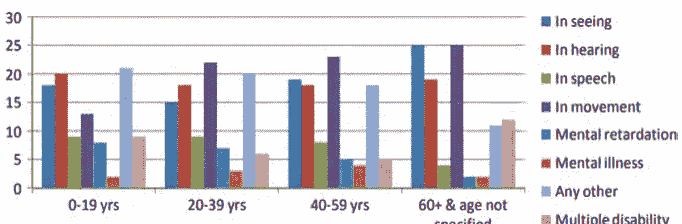

图8.1 不同残疾人群的分布。（来源：2016年社会统计概况，印度统计和方案执行部，印度政府）。

### 8.2.1 大流行期间为残疾人提供便利所面临的障碍

报告指出，在封锁期间，残疾人在获取食物、必需品和挽救生命的医疗程序方面遇到了困难，此外还难以获取信息和求助热线。此外，在这些卫生危机中负责应对工作的组织已付出了多种不懈的努力。然而，卫生官员面临的困难涉及以下一些情况。

- 确保信息可用，确保封锁限制不适用于看护人员，且患有某些残疾的员工不得被允许从事必要的服务相关工作。
- 为隔离中的残疾人提供必要服务，在治疗中优先考虑残疾人。政府正在努力完成的一项最困难的任务是为农村和村庄居民接种疫苗。
- 向应急响应专业人员讲授包括残疾人需求在内的知识。

这些建议是可选的，因此在付诸实践方面进展不大。由于流行病，人们更加意识到社会保护在增强韧性和促进康复方面的重要性。在印度，根据NSAP，国家社会援助计划（NSAP）为生活在贫困线以下、患有严重和多重障碍的人提供月度养老金。COVID-19流行病为社会机构提供了改变和愈合的机会，也为曾经分裂的社区提供了团结一致的机会。例如，残疾人长期以来一直在寻找灵活的居家办公选择，但大多未能如愿。如果我们想要建设更友好的环境，理解工作场所便利措施的重要性至关重要。

#### 8.2.1.1 残疾人面临的障碍

存在一个极其复杂的相互关联因素网络，这些因素不仅涉及个人，还涉及个人的环境以及社会/政治结构。据认为，这些因素限制了残疾人的日常活动（印度残障人口：数据和事实 2021）。根据残疾的社会概念，残疾人面临社会、身体或精神障碍（Singh & Nizamic 2009）。在寻求医疗服务时，残障人士必须克服多种障碍，例如以下几种：

- **高昂支出。** 在低收入国家，医疗服务价格和交通费用这两个因素在很大程度上导致残疾人无法获得急需的医疗服务。超过一半的残疾人无法负担医疗费用，而没有残疾人群中约三分之一的人无法负担。
- **物理障碍。** 由于建筑物（医院、卫生中心）进入不便、医疗设备不可用、洗手间设施不足、停车位难用、门道狭窄、室内台阶以及标识不清，医疗机构对残疾人存在障碍。由于乳腺X线摄影设备仅支持能够站立的女性，且检查床高度不可调节，这些因素使许多行动不便的妇女无法接受宫颈癌和乳腺癌筛查。
- **服务有限。** 缺乏适合残疾人的适当服务。众多研究表明，特别是在农村和偏远地区，残疾人有着巨大的未满足医疗需求。
- **技能不足。** 身体残障人士获得护理不足的可能性超过四倍，被拒绝就诊的可能性几乎是两倍，并声称医务人员的技能不足以满足其需求的可能性接近三倍。

社会障碍在影响一个人运作能力以及其出生、成长、受教育和就业的环境方面发挥着重要作用。以下是几种社会障碍的实例。在美国，22.3%的残疾人和7.3%的非残疾人年收入低于15,000美元（世界卫生组织 2001；Houtenville & Boege 2019；疾病控制与预防中心 2019）。非残疾儿童遭受暴力的可能性比任何类型残疾儿童低四倍（Houtenville & Boege 2019）。图8.2提供了这些数字的更多细节。相比之下，非残疾人中高中毕业生占22.3%，而残疾人中只有10.1%是高中毕业生。

#### 8.2.1.2 障碍（尤其是在大流行期间）对残疾人的影响

如今，人们承认残疾是一个人权问题。人们既在身体上，也在社会上被致残。这些障碍可以被消除，如果非政府组织、政府、专业人士和个人


图 3.22：按工作状态划分的印度残疾人分布（百分比）- 2011 年人口普查

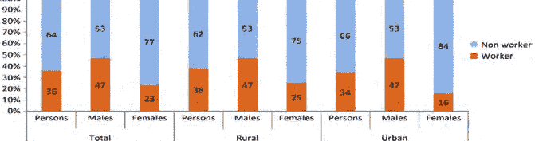

图 8.2 工作与非工作身体残障人士的百分比。（来源：疾病控制与预防中心）

残疾人及其家庭合作（Quinn & Degener 2002）。残疾人因 COVID-19 和其他大流行病面临重大挑战，包括医疗保健、信息以及至关重要的支持网络方面日益增加的障碍（世界卫生组织，2021）。残疾人经历着独特的压力和挑战组合，可能会恶化他们的心理健康。研究表明，残障人士获取基本医疗用品更具挑战性，资源匮乏时这种困难可能会加剧。他们之间的距离可能会让他们感到更孤独。根据国家科学、工程和医学院的说法，孤独和社会孤立会增加患心脏病、痴呆症等疾病的风险。如果他们感染病毒，残疾人保持社交距离和采取预防措施可能更加困难，因为他们更可能经历与其障碍相关的影响。普遍认为残障人士必须受到照料并为“保护”而被限制在特定环境中的观念，剥夺了他们的基本尊严以及发现和了解自己的机会。然而，在这些艰难的环境下，残疾人有被进一步隔离于社区之外的风险。由于对其能力的各种文化假设（这些假设会不断提高对专业人员的要求），身体残疾人士一直未能实现经济安全和独立。

## 8.3 辅助身体残障人士的技术

### 8.3.1 AAROGYA SETU

印度政府通过阿罗吉亚·塞图（Arogya Setu）应用创造了技术奇迹。该程序帮助印度政府定位热点并阻止 COVID-19 传播。用户越多，该应用遏制病毒传播的效果就越显著。通过识别并降低您和他人感染的风险，阿罗吉亚·塞图提高了您周围人员的安全性（Gupta 等人，2020）。

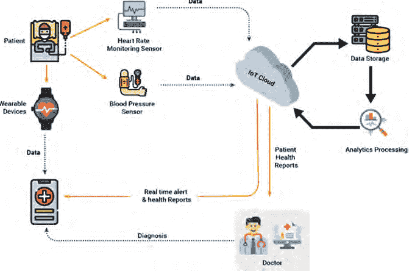

**图 8.3** AIoT 对整个医疗保健行业有重大影响。（Embedded Computing Design（www.embeddedcomputing.com）提供）

### 8.3.2 阿罗吉亚·塞图的工作原理

阿罗吉亚·塞图在您进行日常活动时使用接触者追踪技术，以跟踪您遇到或可能遇到的人员。图 8.3 显示了阿罗吉亚·塞图应用的快速操作。如果您的任何接触者随后 COVID-19 检测呈阳性，您将立即收到通知，并获得预防性医疗服务。如果您与 COVID-19 感染者有一度或二度接触，阿罗吉亚·塞图将向您发出警报并安排立即就医。还可以使用自我评估测试来确定感染风险。

### 8.3.3 阿罗吉亚·塞图协助四肢瘫痪者面临的挑战

为了帮助客户更好地管理自身健康，过去十年开发了大量移动健康（mHealth）应用。但这些 mHealth 应用中很少是为残障群体设计的，经过残疾人可访问性测试的更是少之又少。因此，残障人士使用其中许多 mHealth 应用可能会面临挑战（Zhou 等人，2020）。不幸的是，盲人或聋人无法使用阿罗吉亚·塞图，因为未提供必要的 COVID-19 调整。这最终使我们得出结论：极端的公共卫生紧急情况、封锁和复苏工作对残疾人造成了不成比例的伤害。在动荡和危机时期，残疾人是最容易遭受虐待和排斥的人群之一。因此，可以认为当前的 mHealth 发展状况对残障人群的代表性不足（Jones 等人，2018）。

## 8.4 人工智能物联网（AIoT）在医疗保健中的重要性

“任何人、任何地点、任何时间、使用任何服务、连接任何网络”这一术语指的是人工智能物联网（AIoT）。物联网是未来技术中的一大现象，具有巨大潜力，可在众多行业产生重大影响。它涉及将可单独识别的智能设备和对象连接到当前的互联网基础设施，并带有图 8.3 所示的额外优势。

其优势之一是增强超越机器对机器（M2M）场景的设备、系统和服务连接性。因此，自动化在几乎任何行业都有益处（Islam 等人，2015）。

## 8.5 利用人工智能物联网（AIoT）革新医疗保健

医学和医疗保健领域是最引人注目的物联网应用领域之一。物联网可以实现多种医疗应用，包括老年护理、运动计划、慢性病管理和远程健康监测。确保患者和医疗专业人员在家中遵循疗法和用药是另一项重要的潜在应用（Ometov 等人，2021）。因此，物联网智能设备或对象可以包括医疗设备、传感器以及成像和诊断工具。通过实现远程配置，得益于物联网，医疗从业人员可能会减少设备停机时间。为了保持各种设备平稳连续运行，物联网还可以精确确定何时更换其耗材（Ometov 等人，2021）。在考虑多种实际因素时，学者们最近将精力集中于研究物联网在医疗保健领域的潜力，包括残障人士面临的挑战。因此，大量应用、服务和原型机专门为此问题开发。基于物联网的医疗中心开发了大量网络拓扑和平台、新服务和应用、互操作性以及安全性。此外，一些国家和组织已为在医疗行业使用物联网制定了指南和标准（Mulla 2019）。另一方面，物联网在医疗保健行业的采用仍处于起步阶段。

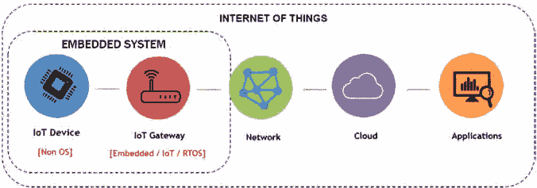

图 8.4 物联网与嵌入式系统：一种关系。（SR 大学教育协会，海得拉巴，特伦甘纳邦提供）

## 8.6 物联网（IOT）与嵌入式系统的二分法

如图 8.4 所示，不应将物联网与嵌入式系统混淆。初次接触这两个领域时可能会感到困惑，但仔细考虑后会发现它们完全不同。

### 8.6.1 嵌入式系统

在某些情况下，由于具有实时处理限制，嵌入式系统是作为更大机械或电气系统一部分来执行单一操作的控制器。嵌入式系统通常作为大型设备的一个组件出现，该设备涉及物理和机械部件以及软件和硬件实现。图 8.5 显示了嵌入式系统与物联网之间的关系。许多当代设备受嵌入式系统控制。嵌入式系统采用了已创建的 90% 以上的微处理器。微控制器（具有内置内存和外围接口的微处理器）在当代嵌入式系统中的应用比普通微处理器更为频繁，后者需要外围接口电路和外部存储器（Noorpuri 2015）。

### 8.6.2 物联网（IoT）

物联网（IoT，Internet of Things 的缩写）代表嵌入式技术（ET）、网络技术（NT）和信息技术（IT）。只需安装 NT 和 IT 基础设施，即可将您的嵌入式设备转换为物联网系统。您的智能空调系统将拥有一个称为 ES（嵌入式系统）的嵌入式系统，它使用 WiFi 模块从传感器将温度数据传输到云端（互联网）。您需要这样的嵌入式系统。WiFi 网络和云是您的


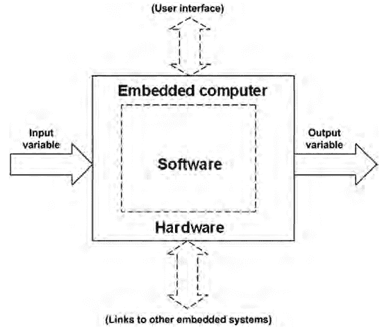

图 8.5 嵌入式系统白盒视角 (Sun et al. 2021)。

网络技术。信息技术涉及一个将安装在你手机上的程序，用于接收数据。根据接收到的信息，它会获取你的 GPS 坐标，应用将启动空调。简单的 IT 基础设施是移动应用的基础。

物联网 = IT + ET + NT

例如，假设你在家里有一台连接到互联网的智能空调。这个“物体”已连接互联网。想象一下，在酷热的夏日下班回家后，进入家门时你希望室内足够凉爽。因此，你可能会使用移动设备在下班回家时开启家中的空调。此外，当你离开办公室时，你的手机会向家中的空调发送通知。考虑到你的手机可以追踪 GPS 位置、检测你的移动，并根据室外温度控制空调，这种情景是合理的。只有当空调开启时，你才会在手机上收到警报。

## 8.7 工业 4.0 的未来：带 AIoT 的智能轮椅

低成本智能轮椅的开发旨在将由微控制器驱动的健康监测系统与标准轮椅相结合，实施必要的 COVID-19 防护和检测措施，包括通过无线移动网络发送警报信号，以及利用呼吸频率和心率检测心血管异常以确定血氧饱和度。联网的设备称为物联网（IoT），但能够从数据和经验中学习的计算机称为人工智能（AI）。人工智能为“哑”物体赋予“头脑”，而物联网则将它们连接到互联网。物联网充当“大脑”，AI 充当“身体”，以构建智能互联系统。AI 的决策能力对物联网系统有利，因为它们增强了数据管理和分析，并带来显著的生产力提升。通过 IoT 模块在数据层整合传感器的触觉和应变感官数据（这些数据可用于评估从轮椅获取的数据 (Rofer et al. 2009)），我们可以获得更复杂的感知能力。

## 8.8 自动化轮椅和智能轮椅共有的模块

印度政府科学与工业研究部（DSIR）批准了“面向身体障碍人士的自动化轮椅（AWC）”项目，由此催生了“智能轮椅”研究。COVID-19 爆发后，印度社会正义与赋权部于 2020 年 3 月 27 日发布法规，以防止残疾人感染。尽管如此，封锁对残疾人来说极其困难。在 COVID-19 封锁期间出现的几个例子为智能轮椅的设计提供了灵感。该项目旨在让残疾人群体保持公众关注，并帮助他们对抗 COVID-19。智能轮椅专注于为遭受 COVID-19 或任何大流行病的残疾人提供帮助和支持，而 AWC（自动化轮椅）则是为残疾人普遍使用而设计的。获批的 AWC 项目帮助四肢瘫痪者实现独立。四肢瘫痪者无法移动四肢。自动化轮椅（AWC）是智能轮椅构建的基本理念。几个典型模块包括：

- 1) 全球定位系统 (GPS) 和蓝牙
- 2) 基于 GPS 的实时定位
- 3) 雨刷电机加速度计
- 4) 头部运动识别模块
- 5) 障碍物检测模块
- 6) 基于传感器的模块

上述模块同时存在于 SWC 和 AWC 中。为了积累能使 SWC 在帮助残疾人方面发挥作用的智能功能，多个与 AIoT 相关的模块也叠加在该设备上。

## 8.9 智能轮椅 (SWC) 模块

必须牢记，智能轮椅 (SWC) 的目标是通过向 AWC 集成三个额外模块，保护残疾人士（尤其是四肢瘫痪者）免受 COVID-19 感染。这些模块是 Alexa 助手模块、机械臂模块 (Saponara et al. 2021)（与智能手机手持设备集成）以及保持社交距离模块 (Kim et al. 2021)。

### 8.9.1 社交距离模块

因为保持社交隔离是在大流行期间保持安全的最关键组成部分之一，因此这个内置模块至关重要。世界卫生组织指出，保持两个人之间的预设距离是防止与潜在 COVID-19 携带者发生身体接触的一种方法。流感病毒和 SARS-CoV-2 的传播方式与其他呼吸道病毒相似。人们认为，避免与人接触可能有助于防止常见呼吸道感染的传播。因此，长期的社交隔离可能是阻止呼吸道病毒大流行最成功的方法之一 (Al-barrak et al. 2017)。被动红外 (PIR) 传感器专门用于运动感应，应用范围广泛。本文推荐使用 OCTIOT PIR 传感器 (Chi et al. 2017)，因为它高效、易于使用且支持远程控制。图 8.6 展示了典型的 OCTIOT PIR 传感器。利用 OCTIOT 技术，OCTIOT 传感器系统可实现精确的运动检测，并在安装期间节能 (Chi et al. 2017)。

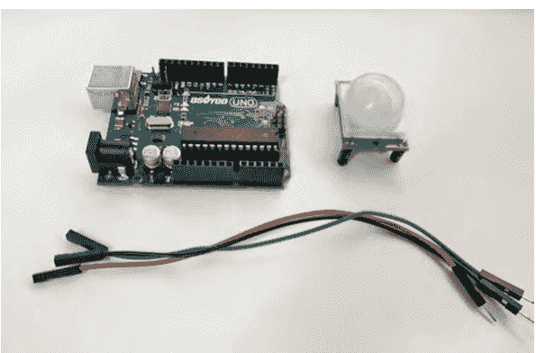

图 8.6 PIR 传感器中的 OSOYOO UNO 开发板和连接线。

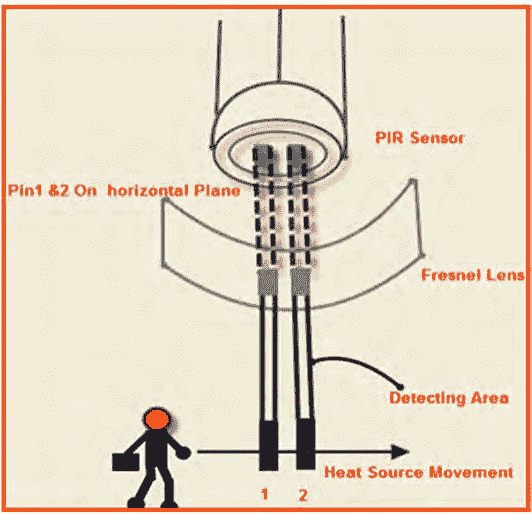

图 8.7 社交距离中 PIR 运动的工作原理。（来源：ELPROCUS）。

OCTIOT 传感器的一些特性使其可用于所介绍的轮椅。OCTIOT 传感器采用高品质材料制成，体现了其安全特性以及持续致力于提供可靠服务和优质产品的承诺。这使得设备更能承受粗暴对待和高强度使用 (Chi et al. 2017)。传感器重量轻、体积小，安装更加简便。OCTIOT 传感器易于安装的能力也非常有帮助。因此，轮椅的机动性和动作的流畅性得以保持。该传感器的范围使其更加合适。常见的物联网传感器范围为 5–8 米 (Chi et al. 2017)。这在很大程度上有助于在拥挤环境中保持社交距离。OCTIOT 传感器的典型功耗范围为 0.4–0.7 W。当传感器连接到轮椅时，整体系统效率得以保持。

OCTIOT 上的 PIR 传感器使残疾人与附近的任何人保持社交距离。图 8.7 展示了 PIR 传感器如何在特定范围内识别人类运动。它们通过使用传感器的列出参数来工作。大多数 PIR 传感器使用二进制是/否技术生成结果，并用于识别人、动物和其他物体的存在。本质上，我们可以使用 PIR 传感器来检测轮椅附近任何生物的存在，并计算附近在场人员之间的距离。传感器不是主动向环境发射能量，而是通过检测红外光被动吸收能量。当任何生物体（或热颗粒）的红外辐射撞击光学系统时，热电器件会发出警报。OCTIOT 微波 (MW) 传感器可用于此类情况。该传感器可以在小空间内识别人类存在以保持社交距离。安全是 PIR 系统的主要应用之一。PIR 传感器通过身体热辐射检测人和动物的存在。这可能用于录制视频或解锁门等活动。PIR 传感器因其耗电量少而被频繁使用。得益于所有这些优势，OCTIOT 传感器是为智能轮椅添加的一个非常实用且可靠的选择。

### 8.9.2 脑电图头戴设备和机械臂模块

对于因各种认知缺陷（即运动问题、感觉问题等）而无法使用电动轮椅的人来说，脑控轮椅是必要的。为了准确记录读数和信号解释，必须在脑电图 (EEG) 传感器的电极周围皮肤上涂抹导电凝胶。EEG 是测量大脑活动的一种技术示例。EEG 是一种工具，用于捕捉大脑神经元沿头皮放电产生的电活动。借助头部多个电极，EEG 是在短时间内记录大脑电活动。此外，该程序可以访问云上的这些数据 (Huang et al. 2012)。EEG 的产生是神经元的一个功能。当神经元产生的电位通过神经纤维传播时，会形成神经递质。使用便携式 EEG 脑波头戴设备的好处在于，它采用干式主动传感器技术来读取大脑电活动。

脑电图是大脑活动的可视化表示。由于 EEG 信号是个人依赖的内在心理活动的镜像，它们是私有的且难以模仿。由于大脑活动与个人的压力和情绪密切相关，因此生成的信息高度机密 (Abiyev et al. 2016)。EEG 信号作为大脑输出信号数量的表示 (Mtshali & Khubisa 2019)。可以使用头皮电极进行非侵入式测量。这种电活动源于神经元作为神经系统一部分工作时。EEG 可以提取这四种冲动并稍后处理。图 8.8 展示了一台在顶部安装了 EEG 的轮椅。图 8.9 说明了脑机接口 (BCI) 的工作原理。信号处理以及在信号采集后从 BCI 提取特征的过程，用于检测运动方向。一旦选择了方向，控制动作就会被激活，指令机械臂向四个方向之一移动，即向右、向左、向上或向下，使其能够抓取现实世界中的有形物体。


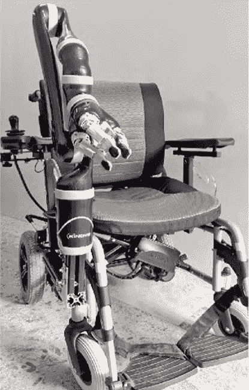

图 8.8 带有机械臂并安装脑电图的智能轮椅（Zgallai 等人，2019）。

### 8.9.3 Alexa 助手模块

四肢瘫痪患者可从传感器、智能手机、智能家居应用、云计算和虚拟助手中获益良多（Pawlaszczyk 等人，2019）。智能轮椅将具备加速移动的能力，这要归功于 Alexa 助手的集成。作为智能家居自动化的一部分，患者可以通过说出简单的口头指令来管理智能轮椅，Amazon 内置的 Alexa 语音识别系统将对这些指令进行解释。这些用户指令将被检测用于获取指令（Gebrosky 等人，2020）。可使用嵌入式系统设计或物联网来部署该模块（人工智能物联网）。Amazon Echo Dot 的最新一代是一款出色的智能设备。它是 Amazon 的双向扬声器产品线，并于 2018 年底推向市场（Vyas & Gupta，2022）。为实现语音控制和识别，它使用了 Alexa 的元素。使用 Alexa Voice Service 需要 WiFi 连接和稳定的电源。根据 Amazon 的说法，Echo Dot 的纤薄便携设计使其适用于任何环境。这使我们可以将其添加到轮椅中，无需对轮椅进行改装。使用语音识别功能，您可以进行交易或进行网上订购。Alexa 还可以安装在轮椅外，以便在无法专注于轮椅的情况下使用，例如看医生时。当某人的体温或其他生命体征超过预定阈值时，Alexa 可以通过监测体温读数并提供警报来提供帮助。它耗电量非常小，在运输方面非常节能。充电 2–2.5 小时后，可以将其插回智能轮椅，以有线或无线方式继续充电。

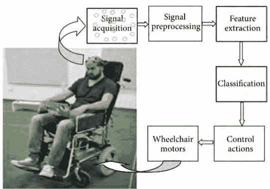

图 8.9 车载便携式脑电图的工作原理（Ajay 等人，2021）。

## 8.10 结论与未来工作

智能轮椅是社会对复杂且智能的辅助技术的实际回应，该技术在一般和特定情况下（如大流行病）都有用。在大流行紧急期间，它使用红外传感器来执行社交距离和避障技术。如果轮椅使用者的体温和心率超过设定的正常阈值，警报消息将传输给选定的人。AIoT 使这些过程能够以最低可能的延迟执行。现在送货区域的访问更加受限，智能轮椅可以在室内使用。第一款可用的智能轮椅将作为一种工具上市，该工具可以在室内独立运行，但在室外或未改装的室内情况下需要帮助。随着传感器技术的发展，更多区域将对智能轮椅开放。因此，将可用性、移动性和可负担性视为智能轮椅未来发展的关键组成部分是合理的。物联网已帮助解决许多问题，预计新的 AIoT 创新将推动智能轮椅技术发展，并在大流行等紧急情况下帮助残障人士。为在大流行和其他灾难中支持残障人士，预期的轮椅组件至关重要。建议的方法有多种外推可供应用，以改善智能轮椅的某些个别特性和总体效能。通过将其从独立系统转变为智能家居组件，可以增强其可访问性和响应性。最有趣的未来潜力之一是定制使用 Alexa/Google Home 应用程序。虽然非常昂贵，但碳纤维框架有助于减轻总体重量并提高其机动性。为未来发展，需要开发典型笨重塑料或铁基结构的替代品。为轮椅配备 O2 模块是另一种改装。由于行动不便，残障人士特别容易遭受与火灾相关的灾难。

## 致谢

“为身体残障人士提供的自动轮椅（AWC）”项目获得了印度科学技术部下属的科学与工业研究部（DSIR）在 PRISM 计划 DSIR/PRISM/119/2016-17 下的资助。我们感谢 DSIR 为我们开展此次调查提供了所需的工具。此外，我们还要感谢所审阅文章的作者，感谢他们为本章收集关键信息提供帮助。

## 参考文献

- Abiyev, R. H., Akkaya, N., Aytac, E., Günsel, I., & Çağman, A. (2016). 使用模糊神经网络的脑机接口轮椅控制. BioMed Research International, 2016, 文章 ID 9359868, 9. https://doi.org/10.1155/2016/9359868

- Ajay, M., Srinivas, P., & Netam, L. (2021年4月15日). 智能轮椅. A. K. Dubey, A. Kumar, S. R. Kumar, N. Gayathri, & P. Das (编). https://doi.org/10.1002/9781119711230.ch16

- Al-barr, L., Kanjo, E., & Younis, E. M. G. (2017). NeuroPlace: 根据心理状态对城市场所进行分类. PLoS One, 12(9), e0183890. https://doi.org/10.1371/journal.pone.0183890

- 疾病控制与预防中心，出生缺陷和发育障碍国家中心，人类发展和残障处. 残障和健康数据系统（DHDS）数据 [在线]. 访问日期：2019年8月6日.

- Chi, M., Yao, Y., Liu, Y., Teng, Y., & Zhong, M. (2017). 从演示中学习运动原始动作. 机械工程进展, 9, 168781401773726. https://doi.org/10.1177/1687814017737260

- 残障与健康. https://www.who.int/news-room/fact-sheets/detail/disability-and-health, 访问日期：2020年12月1日.

- 印度残障人口：数据和事实. Weacapable.com. 网页. 2021年9月6日. https://weacapable.com/disabled-population-india-data/

- Gebrosky, B., Grindle, G., Cooper, R., & Cooper, R. (2020). 超轻型轮椅制造中碳纤维和铝材料的比较. 残障与康复辅助技术, 15, 432–441. https://doi.org/10.1080/17483107.2019.1587018

- Gupta, R., Bedi, M., Goyal, P., Wadhera, S., & Verma, V. (2020). 印度 COVID-19 追踪工具分析：Aarogya Setu 移动应用案例研究. 数字政府：研究与实践, 1(4), 文章 28（2020年12月）, 1–8. https://doi.org/10.1145/3416088

- Houtenville, A., & Boege, S. (2019). 美国残障人士年度报告：2018. Durham, NH: 新罕布什尔大学残障研究所.

- Huang, X., Altahtat, S., Tran, D., & Sharma, D. (2012). 基于脑电图（EEG）信号处理的人体识别. 在 2012 年通信技术与信息技术国际研讨会（ISCIT）中（第 1021–1026 页）. https://doi.org/10.1109/ISCIT.2012.6380841

- Islam, S. M. R., Kwak, D., Kabir, M. H., Hossain, M., & Kwak, K. (2015). 医疗保健物联网：全面综述. IEEE Access, 3, 678–708. https://doi.org/10.1109/ACCESS.2015.2437951

- Jones, M. L., Morris, J. T., & DeRuyter, F. (2018). 移动医疗保健与残障人士：现状与未来需求. 环境研究与公共卫生国际期刊, Sharon Shea: 机器对机器 (M2M): Tech target; IoT Agenda; 更新于 2019 年 8 月, https://internetofthingsagenda.techtarget.com/definition/machine-to-machine-M2M

- Kim, M.-C., Kweon, O. J., Lim, Y. K., Choi, S.-H., Chung, J.-W., & Lee, M.-K. (2021). 冠状病毒病爆发期间社交距离对常见呼吸道病毒传播的影响. PLoS One, 16(6), e0252963. https://doi.org/10.1371/journal.pone.0252963; https://octot.io/sensor-solutions.php

- Mtshali, P., & Khubisa, F. (2019). 面向身体残障人士的智能家居电器控制系统. 在 2019 年信息通信技术与社会大会（ICTAS）中（第 1–5 页）. https://doi.org/10.1109/ICTAS.2019.8703637

- Mulla, I. A. (2019). 嵌入式系统和物联网的综合研究. 科学、工程与技术国际先进研究期刊, 6(8), 74. 版权归 IARJSET 所有. https://doi.org/10.17148/IARJSET.2019.6813

- Noorpuri, M. (2015). 探索微控制器技术、编程、接口与实现. https://doi.org/10.13140/RG.2.1.3066.8969

- Ometov, A., Shubina, V., Klus, L., Skibińska, J., Saafi, S., Pascacio, P., ..., Lohan, E. S. (2021). 可穿戴技术综述：历史、现状与当前挑战. 计算机网络, 193, 108074. ISSN 1389-1286. https://doi.org/10.1016/j.comnet.2021.108074

- Pawlaszczyk, D., Friese, J., & Hummert, C. (2019). “Alexa，告诉我……”——Amazon Echo Dot 第三代的法医检验. 计算机科学与工程国际期刊, 7(11), 20–29. 访问日期：2021年10月1日.

- Quinn, G., & Degener, T. (2002). 残障背景下联合国人权文书的当前使用与未来潜力. 日内瓦：联合国.

- Rofer, T., Mandel, C., & Laue, T. (2009年6月). 基于智能驾驶辅助的操纵杆/头部操纵杆控制自动轮椅. 在 2009 年 IEEE 康复机器人国际会议上（第 743–748 页）. IEEE.

- 冠状病毒病（COVID-19）滚动更新. 世界卫生组织. https://www.who.int/emergencies/diseases/novel-coronavirus-2019/events-as-they-happen, 访问日期：2021年7月31日.

- Saponara, S., Elhanashi, A., & Gagliardi, A. (2021). 针对 Covid-19 实施基于 AI 的实时人员检测和社交距离测量系统. 实时图像处理期刊. https://doi.org/10.1007/s11554-021-01070-6

- Singh, A., & Nizamie, S. H. (2004). 残障：概念及相关印度立法. 精神健康评论. http://www.psyplexus.com/mhr/disability_india.html, 访问日期：2009年12月24日.


- Sun, Z., Zhu, M., Zhang, Z., Chen, Z., Shi, Q., Shan, X., ... Lee, C. (2021). 基于自供电传感器增强软体机械操纵器的 AIoT 赋能虚拟商店应用. Advanced Science, 8, 2100230. https://doi.org/10.1002/advs.202100230

- Vyas, S., & Gupta, S. (2022). 关于最先进的健康与健康追踪设备的案例研究. In 利用 AI、大数据分析和可视化的生活方式可持续性与管理解决方案研究手册 (pp. 325–337). IGI Global.

- 世界卫生组织. (2001). 功能、残疾与健康国际分类 (p. 214). 日内瓦: WHO.

- 世界卫生组织. https://www.who.int/mediacentre/news/notes/2012/child_disabilities_violence_20120712/en/

- Zgallai, W., et al. (2019). 基于脑电波驱动 BCI 智能轮椅的深度学习 AI 应用. In 2019 科学与工程技术进步国际会议 (ASET) (pp. 1–5). https://doi.org/10.1109/ICASET.2019.8714373

- Zhou, L., Saptono, A., Setiawan, I. M. A., & Parmanto, B. (2020). 使残障人士可访问的自我管理移动健康应用: 定性单一受试者研究. JMIR Mhealth Uhealth, 8(1), e15060. https://doi.org/10.2196/15060

# 9 基于机器学习和深度学习算法的中风预测比较

Mayank Singhal, Manan Pruthi, Nivedita Singhal, Preeti Nagrath, Rachna Jain, Ashish Kumar

## 目录

| 章节 | 标题 | 页码 |
|------|------|------|
| 9.1 | 引言 | 115 |
| 9.2 | 问题陈述 | 117 |
| 9.3 | 文献综述 | 117 |
| 9.4 | 拟议模型 | 118 |
| 9.4.1 | 数据集描述 | 118 |
| 9.4.2 | 数据预处理 | 119 |
| 9.4.3 | 数据可视化 | 120 |
| 9.4.4 | 数据划分 | 120 |
| 9.5 | 分类算法 | 122 |
| 9.6 | 基于 IoT 的智能手表 | 124 |
| 9.7 | 实验设置 | 125 |
| 9.7.1 | 结果分析 | 125 |
| 9.8 | 结论 | 126 |
| 9.9 | 未来展望 | 126 |
| | 参考文献 | 126 |

## 9.1 引言

当今世界，中风是一个巨大的负担。它是第二大死亡原因。根据世界卫生组织（WHO）的一项研究，全球每年近有 1500 万人中风。欧洲每年约有 65 万例中风死亡。多年来，已经开展了许多基于人群的中风疾病研究，以确定类型和致死率（Anbuselvan 2020）。中风风险随心脏病增加，中风相关死亡预计在未来几年将增加到 500 万，而 1998 年为 300 万。中风导致的死亡是合并症和/或并发症的结果。中风发病及之后第一个月是患者生存最关键的时期，大量死亡发生在第一周。高血压、发热、尿路感染、低血压、脑水肿、吸入性肺炎、疝、高血糖和低血糖是中风的一些并发症（Wolf et al. 1991）。如果患者能够挺过第一周，即使如此，死亡也可能因相对不动导致的各种并发症（如败血症、肺炎和肺栓塞）而发生。中风不会区分种族、性别或年龄，但可以说，对于患有某些可能导致中风的风险因素的患者，中风的概率会以多倍增加。个人认识自身风险及其管理方式，对保护自身和他人至关重要（Lee et al. 2018）。科学证明，遵循此方法可预防 80% 的中风。有些因素会导致中风，代表不良习惯，如吸烟、饮酒和缺乏体力活动。这些因素可以通过改变生活方式本身来减少，即，养成早睡早起、晨跑、定期进行体育锻炼、饮食健康等良好习惯。另一方面，有些因素通常只能通过适当的治疗来治愈。一项研究表明，总共有十个与 90% 中风风险相关的因素，其中大约一半是可改变的。另一方面，不可改变的风险因素无法控制（Rajora et al. 2021）。如今，机器学习已在现代技术中最受要求的领域中占有一席之地。机器学习模型可以在最少的人工干预下轻松预测结果，从而减少人力并提高预测准确性。它是称为人工智能的领域的一种形式。中风预测也可以通过使用几种机器学习技术来完成。用于中风预测的数据集中存在的因素包括年龄、性别、心脏病、工作类型、BMI、吸烟状况等（Flueckiger et al. 2018）。拟议模型使用不同的算法，如逻辑回归、KNN、随机森林、决策树、SVM、朴素贝叶斯、XGBoost、MLP 分类器、CNN 和 LSTM，根据数据集中上述输入因素预测个体中风，并在该数据集上应用不同的算法。此外，将所有这些算法相互比较，并识别出准确性最高的算法。

接下来的章节（第 9.2 节）提供了拟议模型的问题陈述。下一章（第 9.3 节）介绍了类似领域之前研究的背景。此外，已详细讨论了拟议模型（第 9.4 节）的详情，随后介绍了拟议模型中使用的一些分类算法（第 9.5 节）。后续章节包含了拟议模型与物联网（IoT）（第 9.6 节）集成的基本理念，以及应用各种机器学习和深度学习算法后获得的结果分析的实验设置（第 9.7 节）。最后两个章节包括在彻底研究结果后得出的结论（第 9.8 节），随后是对项目未来展望的讨论（第 9.9 节）。

## 9.2 问题陈述

当今，中风已成为全球主要死亡原因之一。它基本上有两类相关风险因素，即可修改风险因素和不可修改风险因素。压力、心脏病、吸烟、饮酒和高胆固醇是可修改风险因素的一些示例。我们项目的中心目标是基于患者风险变量，利用各种机器学习和深度学习技术在从 Kaggle 网站获取的数据集上，构建一个准确预测中风的模型。

## 9.3 文献综述

为了获得与当前研究相关的各种概念所需的知识，已对现有文献进行了深入研究。以下是从中得出的一些关键结论。

在 Rakshit and Shrestha (2021) 中，拟议模型通过比较各种机器学习模型的准确率得分，评估了中风预测中最有效的算法。在所有测试的算法中，决策树算法以 100% 的准确率得分脱颖而出。

在 Shashank et al. (2020) 中，这里提出的模型使用了神经网络、朴素贝叶斯和决策树等多种预测算法。因此，该项目有助于利用预测模型预测中风风险，并借助 Web 应用程序提供个性化警报，以及生活方式纠正消息。

在 Wolf et al. (1991) 中，通过使用弗雷明汉心脏研究（Framingham Heart Study）队列开发健康风险评估函数，实现了中风预测。

在 Limbitote et al. (2020) 中，该研究论文包含了一项关于可预测心脏病的不同机器学习算法的调查。作者对各种算法进行了总结，并通过分析其不同特征找出了最有效的算法。

在 Rajdhan et al. (2020) 中，论文作者使用了朴素贝叶斯和遗传算法来预测心脏病。这里使用了一个 UCI 数据集来训练模型，其属性包括年龄、性别、旧峰、血压、胆固醇水平等。此外，已部署一个基于 Web 的机器学习应用程序，供用户输入其医疗详细信息，仅使用这些因素来预测心脏病的存在。

在 Lee et al. (2018) 中，作者计算了十年数据的中风预测概率，然后将用户中风的个体概率分为五个不同的类别。

在 Sudha et al. (2012) 中，神经网络、朴素贝叶斯和决策树算法已被用于检测患中风疾病的患者。


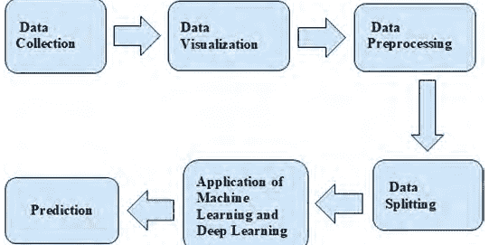

图 9.1 模型工作流程。

观察结果表明，与其他两种分类方法相比，神经网络的准确性更高。

在 Rajora et al. (2021) 中，通过实现不同的机器学习算法分析了中风预测。同时，为每种算法绘制了受试者工作特征（ROC）曲线。为实现此目的，使用了 Apache Spark。与其他算法相比，梯度提升算法在 ROC 尺度上显示了最高得分，即 0.90。

在 Anbuselvan (2020) 中，研究了各种分类算法，并获得了准确性最高的模型以预测患者的心脏病。随机森林和 XGBoost 证明是表现最好的算法，而 KNN 则是所有考虑算法中表现最差的。

## 9.4 拟议模型

在本工作中，建立了一种基于患者输入参数（如年龄、吸烟状态、BMI、平均血糖水平等）预测中风的模型。Kaggle 网站是获取中风预测数据集的来源。所提模型的工作流程如图 9.1 所示。首先，完成了数据收集和数据可视化，随后进行数据预处理以获得没有缺失值的干净数据集。其次，将干净数据集划分为训练数据和测试数据，并对其应用不同算法以获得预测结果（Schwaab et al. 2008）。每种算法的准确率以百分比形式得出并进行分析，以确定用于预测中风风险的最佳算法。

### 9.4.1 数据集描述

用于中风预测的数据集是从名为 Kaggle 的热门网站提取的。提取的数据集包含 12 个属性和 5,110 行数据。这些属性包括性别、工作类型、年龄、平均血糖水平、BMI、

| | id | 性别 | 年龄 | 高血压 | 心脏病 | 是否结婚 | 工作类型 | 居住类型 | 平均血糖水平 | bmi | 吸烟状态 | 中风 |
|---|---|---|---|---|---|---|---|---|---|---|---|---|
| 0 | 9046 | 男性 | 67.0 | 0 | 1 | 是 | 私营 | 城市 | 228.69 | 36.6 | 以前吸烟 | 1 |
| 1 | 51676 | 女性 | 61.0 | 0 | 0 | 是 | 自雇 | 农村 | 202.21 | NaN | 从未吸烟 | 1 |
| 2 | 31112 | 男性 | 80.0 | 0 | 1 | 是 | 私营 | 农村 | 105.92 | 32.5 | 从未吸烟 | 1 |
| 3 | 80162 | 女性 | 49.0 | 0 | 0 | 是 | 私营 | 城市 | 171.23 | 34.4 | 吸烟 | 1 |
| 4 | 1665 | 女性 | 79.0 | 1 | 0 | 是 | 自雇 | 农村 | 174.12 | 24.0 | 从未吸烟 | 1 |
| ... | ... | ... | ... | ... | ... | ... | ... | ... | ... | ... | ... | ... |
| 5105 | 16234 | 女性 | 80.0 | 1 | 0 | 是 | 私营 | 城市 | 63.75 | NaN | 从未吸烟 | 0 |
| 5106 | 44873 | 女性 | 81.0 | 0 | 0 | 是 | 自雇 | 城市 | 125.20 | 40.0 | 从未吸烟 | 0 |
| 5107 | 19723 | 女性 | 35.0 | 0 | 0 | 是 | 自雇 | 农村 | 82.99 | 30.6 | 从未吸烟 | 0 |
| 5108 | 37544 | 男性 | 51.0 | 0 | 0 | 是 | 私营 | 农村 | 166.29 | 25.6 | 以前吸烟 | 0 |
| 5109 | 44679 | 女性 | 44.0 | 0 | 0 | 是 | 政府工作 | 城市 | 85.28 | 26.2 | 未知 | 0 |

图 9.2 数据集。

以前的中风，举不胜尽。此处中风是结局。除了身份、居住类型和性别之外，所有其他特征都用于训练模型。X 变量用于存储独立属性，而 Y 变量用于存储依赖属性，即中风。图 9.2 显示了所使用的数据集。

### 9.4.2 数据预处理

从 Kaggle 获取的中风预测数据集在名为“bmi”的列中包含 201 个缺失值，需要填补。如果数据集中存在缺失值，最终可能导致模型准确性下降。bmi 属性缺失的值使用 bmi 的均值进行填充。同时，进行标签编码以将分类值转换为数值，因为仅可以在数值属性上进行训练。还使用 Standard Scaler (Brochu et al. 2010) 对数据集进行了归一化处理。数据预处理后得到的数据集如图 9.3 所示。

| | gender | age | hypertension | heart_disease | ever_married | work_type | Residence_type | avg_glucose_level | bmi | smoking_status | stroke |
|---|---|---|---|---|---|---|---|---|---|---|---|
| 0 | 1 | 67.0 | 0 | 1 | 1 | 2 | 1 | 228.69 | 36.600000 | 1 | 1 |
| 1 | 0 | 61.0 | 0 | 0 | 1 | 3 | 0 | 202.21 | 28.692537 | 2 | 1 |
| 2 | 1 | 80.0 | 0 | 1 | 1 | 2 | 0 | 105.92 | 32.500000 | 2 | 1 |
| 3 | 0 | 49.0 | 0 | 0 | 1 | 2 | 1 | 171.23 | 34.400000 | 3 | 1 |
| 4 | 0 | 79.0 | 1 | 0 | 1 | 3 | 0 | 174.12 | 24.000000 | 2 | 1 |
| ... | ... | ... | ... | ... | ... | ... | ... | ... | ... | ... | ... | ... |
| 5105 | 0 | 80.0 | 1 | 0 | 1 | 2 | 1 | 63.75 | 28.692537 | 2 | 0 |
| 5106 | 0 | 81.0 | 0 | 0 | 1 | 3 | 1 | 125.20 | 40.000000 | 2 | 0 |
| 5107 | 0 | 35.0 | 0 | 0 | 1 | 3 | 0 | 82.99 | 30.600000 | 2 | 0 |
| 5108 | 1 | 51.0 | 0 | 0 | 1 | 2 | 0 | 166.29 | 25.600000 | 1 | 0 |
| 5109 | 0 | 44.0 | 0 | 0 | 1 | 0 | 1 | 85.28 | 26.200000 | 0 | 0 |

图 9.3 数据预处理后的数据集。

### 9.4.3 数据可视化

数据可视化旨在深入了解数据集，并利用不同类型的图表使数据解释更加容易。绘制热图以展示提取数据集中不同参数之间的相关性，如图 9.4 所示。绘制饼图以展示中风患者和非中风患者的百分比，如图 9.5 所示。绘制计数图 (Ng 2004) 以获取男性和女性中中风和非中风事件的数量，如图 9.6 所示，而绘制散点图以评估 BMI 与平均血糖水平之间的关系，如图 9.7 所示。

### 9.4.4 数据划分

使用从 Python 的‘sklearn’导入的 train test split 函数，将数据预处理后的检索数据集划分为训练数据和测试数据。数据集分别按 80% 和 20% 的比例划分为训练集和测试集。进行了特征选择以获取贡献度最高和贡献度最低的特征 (Hippisley-Cox et al. 2017; Singh & Choudhary 2017)。贡献度最低的特征是性别和居住类型，因此从数据集中排除了这两个特征。年龄、BMI、平均血糖水平、吸烟状态、心脏病及其他特征代表独立特征，而依赖特征仅为中风。

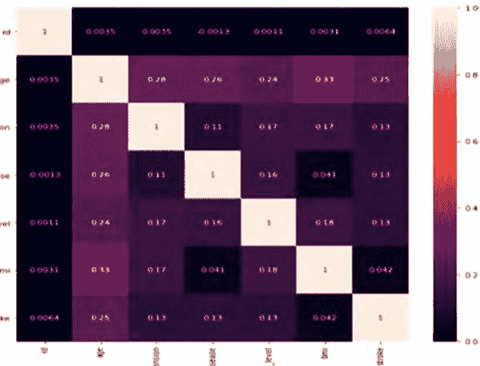

图 9.4 提取数据集中不同属性之间的相关性。

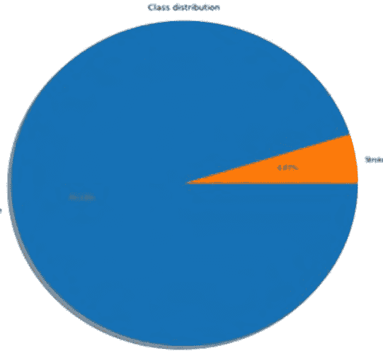

图 9.5 中风患者和非中风患者的百分比。

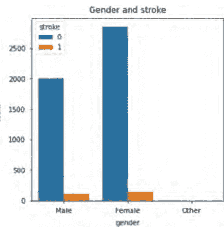

图 9.6 男性和女性中中风和非中风的数量。

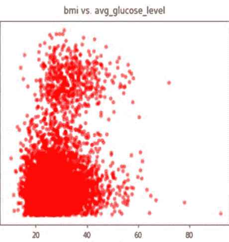

图 9.7 BMI 与平均血糖水平。

## 9.5 分类算法

逻辑回归。这是几种用于解决分类问题的机器学习算法的一个组成部分。它基于著名的概率数学概念原理工作。区分线性回归模型和逻辑回归模型的主要点在于，逻辑回归模型使用更复杂的成本函数，即 ‘sigmoid 函数’。根据假设，逻辑回归中成本函数的结果介于 0 和 1 之间。它提供各种指标，例如准确率、F1 分数、精确率、召回率、混淆矩阵等 (Anbuselvan 2020)。

K-最近邻。这是用于解决与回归和分类相关的问题的各种监督机器学习算法的一部分 (Limbitote et al. 2020)。在这里，‘K’ 表示最近邻的数量。在此过程中，使用曼哈顿距离、欧氏距离等数学方程来计算最近的‘k’个点。当将训练数据提供给此算法时，算法本身根本不进行训练。它记忆训练数据集，这比从训练数据中学习函数要好得多 (Kumar et al. 2020; Vyas 2023)。

决策树。这属于监督机器学习算法范畴 (Rakshit & Shrestha 2021)。作为一种树结构分类器，决策树是用于处理高维


data (Sudha et al. 2012)。它用于构建一个训练模型，该模型只需学习使用训练数据获得的一些简单规则，即可准确评估目标变量 (Shah & Bharti 2020; Sudha et al. 2012).

- *随机森林分类器。* 它属于监督机器学习算法的分类。作为众多决策树的组合，它用于解决回归和分类问题。Bagging 用于训练随机森林算法生成的森林。Bagging 基本上是一种集成元算法，用于提高算法的准确性。该算法通过取各种决策树输出的平均值来进行预测。准确性随决策树数量而变化：决策树越多，准确性越高 (D’Agostino et al. 2008).

- *朴素贝叶斯。* 朴素贝叶斯分类器归类于机器学习算法分类。它基于著名的贝叶斯定理；所有这些算法都基于相同的哲学，即被分类的每组特征不依赖于其他特征 (Rajdhan et al. 2020; Sudha et al. 2012).

- *支持向量机。* 它属于监督机器学习算法类别。其主要用途在于解决回归问题。使用此算法的核心思想是绘制决策边界，以便将 n 维空间分为不同的类。这样的边界称为超平面。该算法基本上选择极点（支持向量）来辅助构建超平面。这就是该算法被称为支持向量机的原因 (Kumar et al. 2020; Lumley et al. 2002).

- *XGBoost。* 极端梯度提升，也称为 XGBoost，属于集成机器学习技术类别。使用决策树作为基础，它在小型到中型表格数据上表现特别出色。它经常用于解决与回归、分类、排名和用户定义预测相关的问题 (Horn & Horn 1986).

- *MLP 分类器。* 多层感知机 (MLP) 是前馈神经网络的扩展 (Sudha et al. 2012)。它包含三层。第一层是输入层，用于吸收输入信号进行处理。第二层是输出层，执行分类和预测等活动。第三层是隐藏层，控制数据向前移动（数据从输入层流向输出层） (Bergstra et al. 2011)。MLP 中存在的神经元借助名为“反向传播学习算法”的算法进行训练。模式识别、预测、分类和近似是其主要用途。

- *卷积神经网络 (CNN)*。这是一种用于处理图像的人工神经网络。CNN 包含三种主要类型的层，即池化层、卷积层和全连接层。堆叠所有这些层形成 CNN 架构，使用一种称为卷积的特殊技术 (Oh et al. 2019; Katz et al. 1963).

- *长短期记忆。* 它是一种循环神经网络。它用于处理单个数据点（如图像）以及完整的数据序列（如视频）。LSTM 单元有四个主要组件。第一个是单元，它在不一致的时间帧上记住值 (Zheng et al. 2003)。除了单元之外，还有三个门组件（输入门、输出门和遗忘门）。这些门可以管理数据进入和退出单元的传输。

## 9.6 基于 IoT 的智能手表

拟议模型具有充分整合物联网能力的潜力，因此可用于更实际的目的。可以使用智能手表或任何类似的可穿戴设备，从用户处获取年龄、性别、吸烟状况、婚姻状况和 BMI 等值作为输入，以自行计算其他参数，例如用户是否患有心脏病、高血压和平均血糖水平。此外，所有这些数据均可存储在 IoT 云中。智能手表甚至可以通过 Bluetooth 连接到移动应用程序 (Pu et al. 2016)。云上的数据随后可存储在数据库中，我们的机器学习和深度学习算法可用于预测用户是否容易中风。决策树在所有测试算法中达到了 96.10% 的最高准确率，可用于预测。此预测随后可输入云中，并从云中显示为用户移动应用程序上的通知 (Cho et al. 2020)。此外，可以通过 Bluetooth 在用户智能手表上发出警报。图 9.8 表示我们拟议的 IoT 模型的工作流。

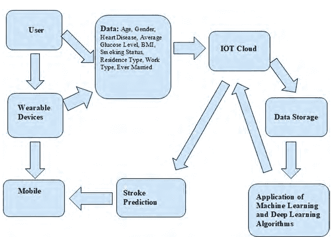

图 9.8 拟议模型的工作流。

## 9.7 实验设置

为进行此研究，我们使用了 Google Colab，它是一个在云端运行的 Jupyter Notebook 环境。这使得我们所有团队成员能够同时参与项目。我们使用了不同的算法来预测中风，并且为了比较这些算法，我们计算了不同参数，如精确度、准确率、F1 分数和召回率 (Chilamkurthy et al. 2018; Freire & de Arruda 2016)。本质上，准确率可定义为准确预测数与所做预测总数之比。精确度是用来描述所有正样本中被正确分类的正样本比例的术语，无论分类是否准确。召回率是所有可用正样本中被正确识别为正样本的比例。精确度和召回率指标结合形成 F1 分数。F1 分数在不均匀数据上表现相当好。

### 9.7.1 结果分析

应用不同算法后得到的结果显示在表 9.1 中。在使用的机器学习算法中，决策树达到了 96.1% 的最高准确率，而 MLP 分类器在深度学习算法中给出了 96.08% 的最佳准确率。总体而言，决策树在所有测试的各种算法中表现最佳，准确率最高为 96.1%。

**TABLE 9.1**
**应用不同算法后获得的结果**

| 算法 | 准确率 | 精确度 | 召回率 | F1 分数 |
| :--- | :--- | :--- | :--- | :--- |
| 逻辑回归 | 96.08 | 0.92 | 0.96 | 0.94 |
| KNN | 95.89 | 0.92 | 0.96 | 0.94 |
| 决策树 | 96.10 | 0.92 | 0.96 | 0.94 |
| 随机森林 | 95.98 | 0.92 | 0.96 | 0.94 |
| 高斯朴素贝叶斯 | 92.27 | 0.93 | 0.91 | 0.92 |
| 伯努利朴素贝叶斯 | 95.00 | 0.92 | 0.96 | 0.94 |
| 多项式朴素贝叶斯 | 91.09 | 0.93 | 0.91 | 0.92 |
| SVM | 96.08 | 0.92 | 0.96 | 0.94 |
| XGBoost | 96.08 | 0.92 | 0.96 | 0.94 |
| MLP 分类器 | 96.08 | 0.92 | 0.96 | 0.94 |
| CNN | 95.10 | 0.93 | 0.95 | 0.94 |
| LSTM | 92.17 | 0.93 | 0.92 | 0.93 |

缩写：KNN: K-近邻，SVM: 支持向量机，MLP: 多层感知机，CNN: 卷积神经网络，LSTM: 长短期记忆。

## 9.8 结论

全球中风病例数正在迅速上升，因此迫切需要提出一个有效的系统来提前准确预测中风，以便患者可以寻求医生的医疗咨询。拟议模型在预测中风方面取得了成功，决策树在所有测试算法中达到了 96.1% 的最高准确率。

## 9.9 未来展望

本项目旨在通过预测模型预测所有易受风险因素影响人群的中风风险。模型的准确率可以进一步提高，中风风险可以被更准确地预测。可以通过拟议模型的网页部署来改进研究 (Rajdhan et al. 2020)。未来，本项目可以进一步扩展，借助当前项目的输出生成中风百分比 (Shashank et al. 2020)。

## 参考文献

Anbuselvan, P. (2020). 基于机器学习技术的心脏病预测. International Journal of Engineering Research & Technology, 9, 515–518.

Bergstra, J., Bardenet, R., Kégl, B., & Bengio, Y. (2011, December). 超参数优化算法的实现. In NIPS Workshop on Bayesian Optimization (Vol. 29).

Brochu, E., Cora, V. M., & De Freitas, N. (2010). 昂贵成本函数贝叶斯优化教程，及其在主动用户建模和分层强化学习中的应用. arXiv preprint arXiv:1012.2599.

Chilamkurthy, S., Ghosh, R., Tanamala, S., Biviji, M., Campeau, N. G., Venugopal, V. K., ... Warier, P. (2018). 用于头部 CT 扫描中关键发现检测的深度学习算法：一项回顾性研究. The Lancet, 392(10162), 2388–2396.

Cho, H., Kim, Y., Lee, E., Choi, D., Lee, Y., & Rhee, W. (2020). 使用贝叶斯优化进行深度神经网络超参数调优的基本增强策略. IEEE Access, 8, 52588–52608.

D’Agostino Sr, R. B., Vasan, R. S., Pencina, M. J., Wolf, P. A., Cobain, M., Massaro, J. M., & Kannel, W. B. (2008). 用于初级保健的一般心血管风险概况：Framingham 心脏研究. Circulation, 117(6), 743–753.

Fleuckiger, P., Longstreth, W., Herrington, D., & Yeboah, J. (2018). 修订的 Framingham 中风风险评分、非传统风险标志物及多族群队列中中风的发生. Stroke, 49(2), 363–369.

Freire, V. A., & de Arruda, L. V. R. (2016, November). 基于神经网络和 PCA 的住宅负载模式识别. In 2016 12th IEEE International Conference on Industry Applications (INDUSCON) (pp. 1–6). IEEE.

Hippisley-Cox, J., Coupland, C., & Brindle, P. (2017). 开发和验证 QRISK3 风险预测算法以估计未来心血管疾病风险：前瞻性队列研究. BMJ, 357.

Horn, S. D., & Horn, R. A. (1986). 计算机化严重程度指数. Journal of Medical Systems, 10(1), 73–78.


Katz, S., Ford, A. B., Moskowitz, R. W., Jackson, B. A., & Jaffe, M. W. (1963). 老年人疾病研究. ADL指数：生物和心理社会功能的标准化衡量. JAMA, 185(12), 914–919.

Kumar, N. K., Sindhu, G. S., Prashanthi, D. K., & Sulthana, A. S. (2020年3月). 基于机器学习分类器的心血管疾病分析与预测. 在 2020 第6届先进计算与通信系统国际会议 (ICACCS) (第15–21页). IEEE.

Lee, J. W., Lim, H. S., Kim, D. W., Shin, S. A., Kim, J., Yoo, B., & Cho, K. H. (2018). 国民健康保险服务个人健康记录中中风风险预测模型的开发与实现. 计算机生物医学方法与方案, 153, 253–257.

Limbitoe, M., Damkondwar, K., Mahajan, D., & Patil, P. (2020). 基于机器学习的心脏病预测技术综述. 工程研究与技术国际期刊 (IJERT), 9(6), 2278–0181.

Lumley, T., Kronmal, R. A., Cushman, M., Manolio, T. A., & Goldstein, S. (2002). 老年人中风预测评分：验证与基于网络的应用. 临床流行病学杂志, 55(2), 129–136.

Ng, A. Y. (2004年7月). 特征选择、L1与L2正则化及旋转不变性. 在 第二十一次国际机器学习会议论文集 (第78页).

Oh, C., Tomczak, J., Gavves, E., & Welling, M. (2019). 基于图形笛卡尔积的组合贝叶斯优化. 神经信息处理系统进展, 32.

Pu, L., Zhang, X., Wei, S., Fan, X., & Xiong, Z. (2016年10月). 基于深度置信网络的3D合成孔径雷达图像目标识别. 在 2016 CIE国际雷达会议 (RADAR) (第1–5页). IEEE.

Rajdhan, A., Agarwal, A., Sai, M., Ravi, D., & Ghuli, P. (2020). 基于机器学习的心脏病预测. 研究与技术国际期刊, 9(4), 659–662.

Rajora, M., Rathod, M., & Naik, N. S. (2021年1月). 分布式环境中基于机器学习的中风预测. 在 分布式计算与互联网技术国际会议 (第238–252页). Cham: Springer.

Rakshit, T., & Shrestha, A. (2021). 使用各种机器学习技术的心脏中风预测比较分析与实现. 工程研究与技术国际期刊 (IJERT), 10.

Schwaab, M., Biscaia Jr, E. C., Monteiro, J. L., & Pinto, J. C. (2008). 通过粒子群优化的非线性参数估计. 化学工程科学, 63(6), 1542–1552.

Shah, D., & Bharti, S. K. (2020). 基于机器学习技术的心脏病预测. SN 计算机科学, 1, 1–6.

Shashank, H. N., Srikanth, S., & Thejas, A. M. (2020). 基于机器学习的中风预测. 博士论文, CMR技术学院, 班加罗尔.

Singh, M. S., & Choudhary, P. (2017年8月). 基于人工智能的中风预测. 在 2017 第8届年度工业自动化与机电工程会议 (IEMECON) (第158–161页). IEEE.

Sudha, A., Gayathri, P., & Jaisankar, N. (2012). 使用分类方法的中风疾病有效分析与预测模型. 计算机应用国际期刊, 43(14), 26–31.

Vyas, S. (2023). 医疗4.0的扩展现实与边缘AI：系统研究. 在 面向医疗系统的扩展现实 (第229–240页). Academic Press.

Wolf, P. A., D’Agostino, R. B., Belanger, A. J., & Kannel, W. B. (1991). 中风概率：来自Framingham研究的风险概况. 中风, 22(3), 312–318.

Zheng, Y. L., Ma, L. H., Zhang, L. Y., & Qian, J. X. (2003年11月). 关于粒子群优化中收敛性分析与参数选择. 在 2003国际机器学习与控制论会议论文集 (IEEE Cat. No. 03EX693) (第3卷, 第1802–1807页). IEEE.

# 10 基于边缘计算的容器化深度学习方法用于医疗物联网中的入侵检测

S. Prabavathy

## 目录

- 10.1 引言 .................................................... 129
- 10.2 背景 ...................................................... 131
- 10.2.1 边缘计算 ................................................ 131
- 10.2.2 面向物联网的深度学习 ......................................... 132
- 10.2.3 容器化 .............................................. 133
- 10.3 相关工作 .................................................... 134
- 10.4 拟议用于医疗物联网的基于边缘计算的入侵检测系统 ....... 136
- 10.4.1 在云系统中构建基于深度学习的入侵检测系统 ...... 137
- 10.4.2 在边缘节点上容器化构建的模型 .............. 137
- 10.5 结论与未来工作 .................................... 138
- 参考文献 ........................................................... 138

## 10.1 引言

数字化时代赋能医疗系统，使其能够利用技术革命的突破。

医疗系统的数字化侧重于利用医疗数据、提升患者护理服务并降低医疗服务成本（Velthoven et al. 2019）。

数字化医疗涉及的技术包括物联网（IoT）、人工智能、云计算和边缘计算。

这些开创性技术也为医疗应用带来了多方面的变化，并将医疗应用模式从疾病导向转变为患者导向。

它还将重点从疾病治疗转向预防性医疗（Jayaratre et al. 2019）。

这些技术还通过关注区域级个性化数据管理（结合一般临床数据管理）带来了显著变化（Hassanalieragh et al. 2015）。

这些技术在医疗应用各个层面带来的变化，已将医疗系统的质量和效能提升到更先进的水平。

物联网（IoT）通过部署智能传感器并通过互联网协议（IP）通信，在数字化医疗系统中发挥关键作用，以提供无处不在的环境。

正在为医疗应用开展大量物联网研究（Farahani et al. 2020; Negash et al. 2018; Strielkina et al. 2018）。

物联网的集成加速了医疗系统的转型，并提高了人们的生活水平，朝着健康生活的方向发展。

物联网通过使用患者佩戴的物联网设备实现远程患者实时监测，支持医生进行有效治疗。

已发明并使用了各种身体传感器和物联网医疗设备，用于各种医疗应用，如远程患者监测（Archip et al. 2016）、智能药丸（Goffredo et al. 2015）、可穿戴物联网设备（）、基于机器人的疾病诊断与治疗（Cianchetti et al. 2017）等。

由医疗物联网设备收集的数据对患者健康提供了完整的情境分析和详细洞察，帮助医生进行治疗并支持医学研究。

物联网在医疗中的主要应用是远程患者监测，它提供了成本和时间更低的实时个性化医疗（Kumar 2017）。

可穿戴设备，如心率监测设备、健康手环、睡眠分析仪、血压测量仪、血糖仪等，用于实时监测患者（Khan et al. 2016）。

通过跟踪老年人的健康和福祉，它有助于提前预测风险。

来自物联网医疗设备和传感器的数据在医疗领域具有巨大潜力。

患者数据在需要时随时可供医生使用，从而促进更快速的诊断和治疗。

利用数据中的临床洞察，医生可以提供精确的药物剂量。

这些数据允许识别各种药物组合的风险和益处。

这些数据支持医生和医疗专业人员做出快速可靠的决策和行动。

政府使用医疗系统数据来预测疾病传播、确定医学研究优先事项，并为卫生服务提供资金支持。

医疗系统在集成物联网时面临的主要挑战是数据隐私和安全性。

基于物联网的医疗设备收集、处理和存储实时患者数据，这些设备容易受到安全和隐私威胁（Chacko et al. 2018）。

在患者数据的收集和管理中必须确保安全性和隐私性，因为对医疗物联网设备的攻击可能会造成灾难性后果（Devi et al. 2016）。

网络犯罪分子可能会攻破医疗物联网设备，以控制设备或利用患者数据进行欺诈活动。

患者数据的任何篡改都可能导致误诊、治疗延误，有时在紧急情况下还会导致人员伤亡（Gopalan et al. 2020）。

医疗物联网设备涉及异构技术，这些技术正在增长但尚未完全标准化，存在潜在的隐私和安全威胁。

参与关键任务的连接医疗物联网设备数量增加，导致比以往更多的潜在漏洞（Hathaliya et al. 2020）。

在分散式架构中集成异构物联网设备


由于安全设计不足导致医疗物联网中存在许多安全问题。因此，医疗物联网需要一种广泛分布的安全机制，并在不同的医疗物联网设备之间建立协作安全流程（Mutlag et al. 2019）。各种入侵检测系统（IDS）已为物联网设计（Prabavathy et al. 2018; Ge et al. 2019; Almiani et al. 2020），但非常少的IDS专门用于医疗物联网（Thamilarasu et al. 2020）。用于医疗物联网的最先进的IDS基于云技术。这些IDS存在延迟问题，不适合涉及异构设备、从动态环境生成大量实时数据并需要及时响应的医疗行业（Khattak et al. 2015）。为了满足这一要求，IDS应部署在物理系统附近，以便物联网设备的数据在边缘被收集、处理和存储。在边缘网络实现IDS可以快速分析数据、识别威胁和攻击，并以更快的速度做出可操作的决策。边缘计算为IDS中的计算卸载提供分布式服务，但医疗物联网需要一个智能IDS来检测大量异构医疗物联网设备中的威胁和攻击。传统的机器学习算法对医疗物联网中的IDS效率不高。传统的机器学习算法涉及浅层学习，无法检测来自医疗物联网设备的高维海量数据中的未预见攻击。医疗物联网需要一个智能IDS，它具有强大的人工智能学习能力，能够分析异构设备的海量数据，以更准确、高效地检测攻击（Pande et al. 2021）。为了满足医疗物联网的这一要求，深度学习算法可以用于医疗物联网的IDS。深度学习能够处理和分析大量物联网数据，以识别物联网应用中的潜在漏洞和网络攻击。不幸的是，深度学习算法计算密集且需要更多资源。大多数边缘节点是资源受限的设备，不足以实现深度学习算法。基于容器的虚拟化可用于在边缘节点实现基于深度学习的IDS。基于容器的虚拟化是云计算中基于虚拟化管理程序的虚拟化的一种轻量级实现。在基于容器的虚拟化中，进程在主机的操作系统层级上被隔离（Roberto et al. 2016）。可以使用像Docker（Boettiger et al. 2015）和Kubernetes（Burns et al. 2016）这样的软件容器化平台来对基于深度学习的IDS进行容器化。所提工作的目标是在边缘节点使用深度学习算法开发一个容器化的入侵检测系统，以检测医疗物联网上的攻击。

## 10.2 背景

### 10.2.1 边缘计算

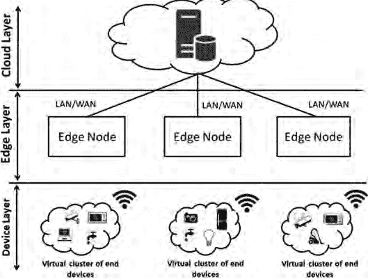

#### 图 10.1 边缘计算架构

边缘计算允许利用分布式计算技术的架构，在数据源附近进行计算和数据存储。边缘节点是指从端侧物联网设备到云数据中心的路径中的任何计算或网络资源。它为物联网设备处理上行数据，并为云服务处理下行数据。例如，在智能家居应用中，网关设备在家电与云之间充当边缘节点（Shi et al. 2016）。边缘计算在数据源附近处理数据，因此减少了传输的数据量以及将数据流式传输到云端进行处理的传输延迟。在边缘计算中，计算靠近数据源，从而通过降低云端的数据流式传输成本，使分析和处理快速且具有成本效益。此外，边缘计算通过为物联网设备提供位置感知、通过实现互操作性和灵活性来处理异构性问题、通过虚拟化使用统一的可编程接口来支持物联网应用（Hassan et al. 2018）。其分布式范式为大规模物联网应用提供高可用性和更大的可扩展性。边缘计算的架构如图10.1所示。

### 10.2.2 面向物联网的深度学习

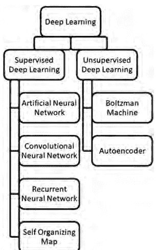

#### 图 10.2 深度学习分类

深度学习是机器学习的一个子集，允许计算机从经验中学习。它也是一种先进的人工神经网络。它是能够模仿人类认知的人工神经网络的进步（Pouyanfar et al. 2018）。简单的人工神经网络（ANN）受计算能力限制且缺乏准确性。为了提高准确性，增加了ANN的层数，从而导致了深度神经网络。由于它具有更多层的连接网络，可以在知识最少的情况下从多个简单特征中提取复杂模式。准确性的提高使许多安全关键型物联网应用能够满足其预期。为了产生准确结果，深度学习系统需要高计算资源和大量数据来训练模型。深度神经网络能够从一系列“真或假”问题的输出中对数据进行分类，涉及复杂的数学计算。如图10.2所示，深度学习算法分为监督学习和无监督学习。监督深度学习包括人工神经网络（ANN）、卷积神经网络（CNN）、循环神经网络（RNN）和自组织映射（SOM）。无监督深度学习包括玻尔兹曼机和自编码器。深度学习的主要应用包括无人驾驶汽车、聊天机器人、医学影像诊断、社交媒体中的人脸识别等。

### 10.2.3 容器化

容器化是一种软件开发方法，它将应用程序及其依赖项和环境作为一个镜像打包，并部署在主机操作系统上。容器是一种可移植的操作环境，具有运行应用程序所需的资源。容器以隔离的方式运行应用程序，不使用其他容器的资源，就像一台独立的物理计算机或虚拟机一样。容器技术与虚拟机技术不同；容器包含应用程序及其依赖项，但操作系统是共享的，而虚拟机包含应用程序及其依赖项以及完整的客户机操作系统。因此，容器比虚拟机需要的资源更少。在基于容器的虚拟化中，硬件基础设施被划分为唯一的虚拟分区，操作系统由多个容器共享（Bhardwaj et al. 2021）。容器的主要优势在于它们能够通过快速实例化新容器来实现应用程序的快速扩展，并避免部署过程中环境设置不一致的问题。容器化的主要概念包括容器主机、容器镜像、容器和容器仓库。容器主机是运行容器的物理机或虚拟机。容器镜像是执行应用程序所需的轻量级可执行软件包，包括代码、库、系统工具和设置。容器是容器镜像的运行时实例。容器仓库在创建容器时存储镜像及其依赖项。它可以设置为公共或私有注册表。图10.3展示了容器化的应用。

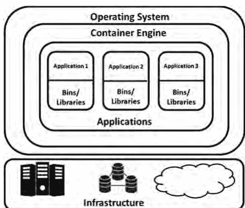

#### 图 10.3 应用程序的容器化

## 10.3 相关工作

大量研究表明，隐私和安全要求在医疗物联网中至关重要（Awotunde et al. 2021; Karunarathne et al. 2021; Velthoven et al. 2019; Jayaratne et al. 2019; Hassanalieragh et al. 2015）。针对医疗物联网的一些攻击，例如在诊断推理中诱导错误，会导致身体伤害甚至死亡（Xie et al. 2021; Farahani et al. 2020）。针对医疗物联网的另一种重要攻击是无线体域网络上的路由攻击，旨在丢弃关键信息或窃听数据（Hajar et al. 2021; Negash et al. 2018; Strielkina et al. 2018）。已开展了各种研究以


为医疗物联网（healthcare IoT）提供安全保障（Ullah et al. 2021; Archip et al. 2016; Goffredo et al. 2015; Cianchetti & Menciassi 2017），但针对医疗物联网的入侵检测系统研究仍处于起步阶段。现有的大多数物联网入侵检测系统使用传统的机器学习算法，例如 K-最近邻、随机森林、支持向量机等（Ahmad et al. 2021; Kumar 2017）。这些入侵检测系统效果不佳，因为医疗物联网的入侵检测系统应通过分析来自医疗物联网设备的大量异构数据来构建安全直觉（Manhas et al. 2021; Khan et al. 2016）。可以通过为入侵检测系统使用深度学习算法来满足这一要求，该算法可以克服入侵检测系统在有限标记数据集中的特征选择和表示方面的困难（Thakkar et al. 2021; Chacko & Hayajneh 2018）。一种名为自学习（self-taught learning）的网络入侵检测系统采用自编码器（autoencoder）与软max回归（softmax regression）设计而成（Sekhar 2021; Devi & Muthuselvi 2016）。该系统在网络安全实验室-知识发现与数据库（NSL-KDD）数据集上进行了测试。一种基于流的异常检测系统使用软件定义网络（SDN）中的深度神经网络实现（Alzahrani et al. 2021; Gopalan et al. 2021）。这些深度学习方法的结果优于传统机器学习方法，但在其中，深度学习仅用于预训练，而不用于分类。

提出了一种深度神经网络（DNN）来识别高级持续性威胁，使用 KDD 数据集进行了评估，并声称需要循环神经网络（RNN）和长短期记忆网络（LSTM）来改进未来的防御（Do Xuan et al. 2021; Hathaliya & Tanwar 2020）。提出了一种包含三个隐藏层、含有自编码器和软max回归的深度神经网络，但由于层数较少，结果在某些类别上的准确性不高（Potluri et al. 2021; Mutlag et al. 2019）。提出了一种用于训练参数的无监督深度置信网络，从而减少了分类错误（Kang & Kang 2016; Prabavathy et al. 2018）。对使用深度学习和浅层学习的知名基于网络的入侵检测系统（NIDS）方法进行了全面调查，结论是深度学习在检测准确性方面优于浅层学习（Hodo et al. 2017）。现有物联网应用安全解决方案的大部分涉及云技术，而云技术受设备数量、延迟和带宽的限制（Alam et al. 2021; Zhou et al. 2017; Ge et al. 2019; Almiani et al. 2020）。医疗环境中的设备数量呈指数级增长，安全是基于云的物联网应用中的一个主要问题。边缘计算可以成为处理基于云的物联网应用安全问题的有效替代方案（Hassan et al. 2018; He et al. 2019）。Yaseen et al.（2018）提出了一种使用边缘计算来检测移动无线传感器网络中选择性转发攻击的入侵检测系统，但该入侵检测系统只能检测选择性转发攻击（Yaseen et al. 2018; Thamilarasu et al. 2020）。为物联网应用设计了一种基于边缘网络的极限学习机（ELM）入侵检测系统，模型在边缘节点上进行训练，这不适合资源受限设备（Khattak et al. 2015; Prabavathy et al. 2018）。在边缘计算中，边缘设备在计算能力、电源规格和操作系统方面是异构的（Ozcan, M.O., Odaci, F. and Ari, I., 2019; Pande et al. 2021）。为克服在边缘节点实施入侵检测系统时的这一问题，可以使用容器化。边缘设备上的容器用于轻松管理应用程序。容器化已应用于边缘计算中的各种应用，例如智能家居（Ozcan, M.O., Odaci, F. and Ari, I.; Morabito 2016）、车载网络（Sami et al. 2020; Boettiger 2015）和工业物联网（Okwuibe et al. 2020; Burns et al. 2016），但未应用于边缘节点的入侵检测系统。针对软件定义网络（SDN）提出了雾节点网络安全系统的容器化（Prabavathy & Supriya 2021），但该系统特定于SDN，并且执行行为分析以进行异常检测。

所提出的入侵检测系统具有创新性，因为它使用深度学习算法为医疗物联网实施入侵检测，该算法经过容器化并在边缘节点上执行，以便快速从海量医疗物联网设备数据中检测攻击。

## 10.4 针对医疗物联网的拟议边缘计算基础入侵检测系统

针对医疗物联网的拟议入侵检测系统包含两个主要部分：1. 在云系统中构建基于深度学习的入侵检测系统；以及 2. 在边缘对构建的模型进行容器化，如图 10.4 所示。

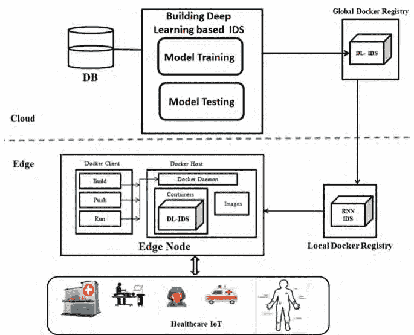

### 图 10.4 拟议的基于边缘的容器化入侵检测系统架构

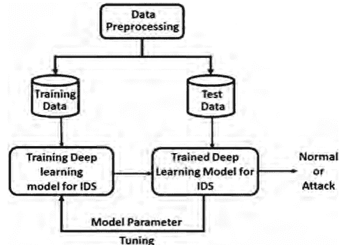

### 图 10.5 基于深度学习的入侵检测系统

### 10.4.1 在云系统中构建基于深度学习的入侵检测系统

医疗物联网的分布式特性需要一个分布式入侵检测系统，以便在靠近终端设备的地方及时检测攻击。为实现这一目标，入侵检测系统部署在边缘节点。开发医疗物联网的入侵检测系统使用深度学习。深度学习模型将对数据进行关键性分析，以提供对数据的清晰洞察，这对于医疗等实时关键应用至关重要。构建深度学习模型需要更多资源，云系统可以提供这些资源。在拟议系统中，基于深度学习的入侵检测系统将在云端开发，然后容器化以在边缘节点上使用。构建深度学习模型的初始步骤是确定合适的模型和模型参数。一旦模型被确定，将使用医疗物联网数据对模型进行训练。来自各种物联网医疗设备的数据在云存储系统中收集和预处理。预处理后的数据将分类为训练数据和测试数据。用于检测医疗物联网攻击的深度学习模型将使用云端的这些预处理训练数据进行训练。使用测试数据对训练后的模型进行测试，以检查所开发模型的准确性，并调整模型参数以达到最大准确性。具有经过微调以达到最大准确性的模型参数的深度学习模型被容器化，以在边缘节点上实现。图 10.5 显示了一个基于深度学习的入侵检测系统。

### 10.4.2 在边缘节点上容器化构建的模型

任何具有计算能力的设备都可以建模为边缘节点，例如路由器、交换机、接入点、服务器等。根据计算和通信要求，可以将边缘节点添加到物联网网络中或从中移除。边缘节点将医疗物联网设备连接到云网络。拟议的入侵检测系统在边缘节点上实现，以实现高效的资源利用并减少检测攻击时的网络延迟。边缘节点被视为 Docker 客户端，以实现基于容器的虚拟化，并通过运行 Docker 主机来实现基于深度学习的入侵检测系统。基于深度学习的入侵检测系统的镜像发布在 Docker 注册表中，供边缘访问。Docker 客户端在 Docker 守护进程中搜索基于深度学习的入侵检测系统，如果找到，则创建容器来运行入侵检测系统；否则，它会从靠近边缘节点的本地 Docker 注册表获取镜像，并构建容器来运行基于深度学习的入侵检测系统。来自医疗物联网设备（如温度传感器、压力传感器等）到高端医疗设备（如 MRI 扫描仪等）的数据流量，由边缘节点上的基于深度学习的入侵检测系统进行分析，以便及时检测攻击。

## 10.5 结论与未来工作

本章针对医疗物联网提出了一种基于边缘计算和容器化、使用深度学习模型的入侵检测系统。深度学习模型对医疗数据进行关键性分析，以提供对医疗物联网攻击的清晰洞察。容器化使高资源消耗的基于深度学习的入侵检测系统能够在资源受限的边缘节点上进行虚拟化。在边缘实施入侵检测系统为边缘节点提供了智能，以快速且更准确地学习和检测网络攻击。拟议系统可以在靠近攻击源的地方快速且以高准确性检测攻击，这对于医疗物联网等关键应用至关重要。未来工作将在实时医疗环境中实施和评估拟议系统，并提前识别攻击者的计划，以主动保护医疗物联网。

## 参考文献

- Ahmad, R., & Alsmadi, I. (2021). 物联网安全的机器学习方法：系统文献综述. 《物联网》, 14, 100365.
- Alam, T. (2021). 基于云的物联网应用及其在智慧城市中的作用. 《智慧城市》, 4(3), 1196–1219.
- Almiani, M., AbuGhazleh, A., Al-Rahayfeh, A., Atiewi, S., & Razaque, A. (2020). 用于物联网入侵检测系统的深度循环神经网络. 《仿真建模实践与理论》, 101, 102031.
- Alzahrani, A. O., & Alenazi, M. J. F. (2021). 面向软件定义网络的基于机器学习的网络入侵检测系统设计. 《未来互联网》, 13(5), 111.
- Archip, A., Botezatu, N., Şerban, E., Herhelegiu, P. C., & Zală, A. (2016, May). 用于远程患者监护的基于物联网的系统. 在 2016 年第 17 届国际喀尔巴阡控制会议 (ICCC) 中 (第 1–6 页). IEEE.
- Awotunde, J. B., Jimoh, R. G., Folorunso, S. O., Adeniyi, E. A., Abiodun, K. M., & Banjo, O. O. (2021). 基于物联网的医疗系统中的隐私和安全问题. 在 物联网、人工智能和云计算在医疗保健中的融合 (第 105–134 页). Cham: Springer International Publishing.


Bhardwaj, A., & Krishna, C. R. (2021). 云计算中的虚拟化：从虚拟机监控程序到容器化——一项综述. 阿拉伯科学与工程期刊, 46(9), 8585–8601.

Boettiger, C. (2015). 面向可重复研究的 Docker 入门. ACM SIGOPS 操作系统评论, 49(1), 71–79.

Burns, B., 等人. (2016). Borg、Omega 和 Kubernetes：三个容器管理系统十年来的经验教训. Queue, 14(1), 70–93.

Chacko, A., & Hayajneh, T. (2018). 医疗保健中物联网的安全与隐私问题. EAI 普及健康与技术事务, 4(14).

Cianchetti, M., & Menciassi, A. (2017). 外科手术中的软体机器人. 软体机器人：趋势、应用与挑战：2016 年 4 月 25-30 日意大利利沃诺软体机器人周论文集（第 75–85 页）. Cham: Springer International Publishing.

Devi, K. N., & Muthuselvi, R. (2016, 1月). IoT 医疗保健应用的并行处理. 2016 年第 10 届智能系统与控制国际会议 (ISCO) 论文集（第 1–6 页）. IEEE.

Do Xuan, C., & Dao, M. H. (2021). 基于组合深度学习模型的 APT 攻击检测新方法. 神经计算与应用, 33(20), 13251–13264.

Farahani, B., Firouvi, F., & Chakrabarty, K. (2020). “医疗物联网.” 智能物联网（第 515–545 页）. Cham: Springer.

Ge, M., Fu, X., Syed, N., Baig, Z., Teo, G., & Robles-Kelly, A. (2019). 基于深度学习的物联网网络入侵检测. 2019 年 IEEE 第 24 届太平洋边缘可靠性计算国际研讨会 (PRDC) 论文集（第 256–25609 页）. IEEE.

Goffredo, R., Accoto, D., & Guglielmelli, E. (2015). 局部药物递送可吞服智能药丸：现状与未来展望. 医疗器械专家评论, 12(5), 585–599.

Gopalan, S. S., Raza, A., & Almobaideen, W. (2021). 基于人工智能的医疗保健 IoT 安全：一项综述. 2020 年通信、信号处理及其应用国际会议 (ICCSPA). IEEE.

Hajar, M. S., Al-Kadri, M. O., & Kalutarage, H. K. (2021). 无线体域网络综述：架构、安全挑战与研究机遇. 计算机与安全, 104, 102211.

Hassan, N., Gillani, S., Ahmed, E., Yaqoob, I., & Imran, M. (2018). 物联网中边缘计算的作用. IEEE 通信杂志, 56(11), 110–115.

Hassanalieragh, M., Page, A., Soyata, T., Sharma, G., Aktas, M., Mateos, G., Kantarci, B., & Andreescu, S. (2015, 6月). 基于物联网 (IoT) 感知与云端处理的健康监测与管理：机遇与挑战. 2015 年 IEEE 服务计算国际会议论文集（第 285–292 页）. IEEE.

Hathaliya, J. J., & Tanwar, S. (2020). 医疗 4.0 安全与隐私问题详尽综述. 计算机通信, 153, 311–335.

He, D., 等人. (2019). 基于堆叠自动编码器的互联医疗系统入侵检测. IEEE 网络, 33(6), 64–69.

Hodo, E., Bellekens, X., Hamilton, A., Tachtatzis, C., & Atkinson, R. (2017). 浅层与深度网络入侵检测系统：一项分类与综述. arXiv 预印本 arXiv:1701.02145.

Jayaratne, M., Nallaperuma, D., De Silva, D., Alahakoon, D., Devitt, B., Webster, K. E., & Chilamkurti, N. (2019). 面向以患者为中心的电子医疗与临床决策支持的数据集成平台. 未来一代计算机系统, 92, 996–1008.

Kang, M.-J., & Kang, J.-W. (2016). 面向车载网络安全的基于深度神经网络的入侵检测系统. PloS One, 11(6).

Karunaratne, S. M., Saxena, N., & Khan, M. K. (2021). IoT 智能医疗中的安全与隐私. IEEE 互联网计算, 25(4), 37–48.

Khan, Y., Ostfeld, A. E., Lochner, C. M., Pierre, A., & Arias, A. C. (2016). 使用柔性可穿戴医疗设备监测生命体征. 先进材料, 28(22), 4373–4395.

Khattak, H. A. K., Abbass, H., Naeem, A., Saleem, K., & Iqbal, W. (2015, 10月). 云基础医疗系统的安全问题：从单云向多云基础设施迁移的视角. 2015 年第 17 届电子医疗网络、应用与服务国际会议 (HealthCom) 论文集（第 61–67 页）. IEEE.

Kumar, N. (2017, 8月). 医疗保健系统的 IoT 架构与系统设计. 2017 年智慧国家智能技术国际会议 (SmartTechCon) 论文集（第 1118–1123 页）. IEEE.

Manhas, J., & Kotwal, S. (2021). 使用机器学习技术的物联网入侵检测系统实现. 多媒体安全：算法开发、分析与应用, 217–237.

Morabito, R. (2016). 物联网设备上容器技术的性能评估. 2016 年 IEEE 计算机通信会议研讨会 (INFOCOM WKSHPS) 论文集（第 999–1000 页）. IEEE.

Mutlag, A. A., 等人. (2019). 医疗物联网系统中雾计算的赋能技术. 未来一代计算机系统, 90, 62–78.

Negash, B., 等人. (2018). “为医疗物联网利用雾计算.” 物联网中的雾计算（第 145–169 页）. Cham: Springer.

Okwuibe, J., Haavisto, J., Harjula, E., Ahmad, I., & Ylianttila, M. (2020). 工业物联网容器化边缘应用的 SDN 增强资源编排. IEEE Access, 8, 229117–229131.

Ozcan, M. O., Odaci, F., & Ari, I. (2019, 7月). 边缘计算环境中容器化应用的远程调试. 2019 年 IEEE 边缘计算国际会议 (EDGE) 论文集（第 30–32 页）. IEEE.

Pande, S., Khamparia, A., & Gupta, D. (2021). 基于机器学习和深度学习的医疗系统入侵检测系统. 世界工程期刊, 19(2), 166–174.

Potluri, S. (2021). 面向工业控制系统网络攻击防御的高效深度学习算法. http://dx.doi.org/10.25673/36528.

Pouyanfar, S., 等人. (2018). 深度学习综述：算法、技术与应用. ACM 计算机调查 (CSUR), 51(5), 1–36.

Prabavathi, S., & Supriya, V. (2021). 基于雾计算的大规模物联网 SDN 认知安全系统. 2021 年计算智能新兴技术国际会议 (ICETCI) 论文集（第 129–134 页）. IEEE.

Prabavathy, S., Sundarakantham, K., & Shalinie, S. M. (2018). 物联网入侵检测认知雾计算设计. 通信与网络期刊, 20(3), 291–298.

Sami, H., Mourad, A., & El-Hajj, W. (2020). 车载 OBU 按需雾：容器化微服务的资源与上下文感知部署. IEEE/ACM 网络事务, 28(2), 778–790.

Sekhar, C. H. (2021). 入侵检测系统的深度学习算法：广泛比较分析. 土耳其计算机与数学教育期刊 (TURCOMAT), 12(11), 2990–3000.

Shi, W., 等人. (2016). 边缘计算：愿景与挑战. IEEE 物联网期刊, 3(5), 637–646.

Strielkina, A., Kharchenko, V., & Uzun, D. (2018). 医疗物联网系统可用性模型：考虑漏洞攻击的分类与研究. 2018 年 IEEE 第 9 届可靠系统、服务与技术国际会议 (DESERT) 论文集（第 58–62 页）. IEEE.

Thakkar, A., & Lohiya, R. (2021). 面向物联网 IDS 的机器学习与深度学习视角综述：最新进展、安全问题与挑战. 工程计算方法档案, 28(4), 3211–3243.

Thamilarasu, G., Odesile, A., & Hoang, A. (2020). 医疗物联网入侵检测系统. IEEE Access, 8, 181560–181576.

Ullah, A., Azeem, M., Ashraf, H., Alaboudi, A. A., Humayun, M., & Jhanjhi, N. Z. (2021). 物联网中安全医疗数据聚合与传输——一项综述. IEEE Access, 9, 16849–16865.

Velthoven, M. H., Cordon, C., & Challagalla, G. (2019). 医疗组织数字化：数字健康图景与信息理论. 国际医学信息学期刊, 124, 49–57.

Xie, B., Xiang, T., Liao, X., & Wu, J. (2021). 在医疗物联网环境中使用外包 SVM 实现隐私保护的在线诊断. IEEE 可靠与安全计算事务, 19(6), 4113–4126.

Yaseen, Q., AlBalas, F., Jararweh, Y., & Al-Ayyoub, M. (2016). 移动无线传感器网络中选择性转发检测的雾计算系统. 2016 年 IEEE 第 1 届自* 系统基础与应用国际研讨会 (FAS* W) 论文集（第 256–262 页）. IEEE.

Zhou, J., Cao, Z., Dong, X., & Vasilakos, A. V. (2017). 云基础物联网的安全与隐私：挑战. IEEE 通信杂志, 55(1), 26–33.


Taylor & Francis
Taylor & Francis Group
http://taylorandfrancis.com


# 11 通过聊天机器人的人类心理体验

基于证据的认知行为技术的人类参与主题分析

尼莎·索兰基，尼迪·辛格，迪沙·加尔

## 目录

- 11.1 引言 .................................................... 143
- 11.2 文献综述.................................................... 144
- 11.3 研究问题与目标 ........................................... 146
- 11.4 研究方法.................................................. 146
- 11.4.1 研究设计 .................................................... 146
- 11.4.2 样本工具 .................................................. 147
- 11.4.3 样本 ............................................................... 147
- 11.4.4 数据收集方法 ............................................. 147
- 11.4.5 数据分析 ...................................................... 147
- 11.5 数据分析与解释 ................................... 148
- 11.6 局限性与未来展望 ....................................... 153
- 11.7 结论 ............................................................. 154
- 数据可用性声明.................................................... 154
- 参考文献.......................................................................... 155

## 11.1 引言

随着全球COVID-19病例急剧增加，各国政府正在采取必要措施来减轻大流行的影响，例如要求出现任何症状的人自我隔离。大量应用程序帮助人们进行健康管理、远程监测和整体健康维护。这些应用程序在需求高峰期减轻了英国国民保健服务（NHS）的负担，但它们也帮助参与者保护自己和他人免受任何不必要的风险（Vaidyam et al. 2019）。许多人工智能聊天机器人使用基于证据的认知行为技术（CBT）来让人们感到被理解（Abd-Alrazaq et al. 2020）。当这些聊天机器人与专业人工支持相结合时，它们提供全天候高质量的心理健康支持。多个聊天机器人通过提升人类与它们之间的心理联系，提供早期心理福祉援助。许多AI系统还将自然语言理解与临床保证相结合，帮助每个人培养可在新常态时期用于管理自身心理健康的技能（Dosovitsky et al. 2020）。通过将有效疗法的科学与艺术融入数字疗法组合中（Daley et al. 2020），自动化疗法过程和内容的工具和应用程序也创造了一种技术，该技术可以与人们建立信任关系，以填补他们从症状监测到发作管理的整个医疗旅程中的空白。该研究识别并分析了四个全球主题（心理健康的流行病学特征、聊天机器人类型、使用聊天机器人的好处、未来影响）和十个组织主题（特征、影响、症状、预防、聊天机器人类型及来源、可行性、易用性、解决复杂问题、信任、未来影响）。

本研究论文分为六个部分：第11.2节介绍了该主题的文献综述，第11.3节阐述了研究目标和方法，第11.4节提供分析和讨论，而第11.5节包含发现和建议，第11.6节包含结论和影响。

## 11.2 文献综述

在对相关工作进行初步概述后，研究人员审查了现有文献，发现已有许多与人工智能（AI）、聊天机器人和机器学习（ML）相关的研究，涉及旅游、教育、网上购物及其他领域。根据2021年的最新研究，大流行期间的医疗保健也利用了这项技术来维护疫苗接种记录，如果没有这项技术，这将花费更长时间（Srivastava 2021）。在此期间，医疗保健部门还使用聊天机器人进行各种其他用途，包括通过保持参与者的互动和参与来维护他们的心理健康（Romanovskyi et al. 2021）。人工智能不仅限于经济和专业环境，而且在Alexa和Siri等智能设备的帮助下，也使个人的日常生活更加轻松便捷（Tariq et al. 2021; Tariq & Abonamah 2021; Maher et al. 2020）。Tariq et al. (2021)将日常生活中采用这项技术称为“易用人工智能”，而专业使用的人工智能技术则被视为一个有问题的框架。AI在许多方面提供了帮助，使主要利益相关者（客户）的交易变得非常轻松便捷，因此，聊天机器人的重要贡献体现在预订航班、铁路预订和酒店方面（Suanpang et al. 2021）。所有先前的研究都证明了聊天机器人与用户感知之间的成功沟通，但它未能处理情感性和复杂性因素。这一差距归因于机器学习技术缺乏自然语言，而自然语言是聊天机器人对话的第二阶段（Suta et al. 2020）。在各行各业中，eBay使用了ShopBot，Taco Bell使用了聊天机器人“Tacobot”来接收菜单订单；建筑公司Keyes使用Roof.ai聊天机器人提问；在旅游领域，有许多像Expedia、Facebook和Messenger聊天机器人这样的聊天机器人；Skyscanner、Facebook和Messenger聊天机器人等还有许多其他聊天机器人在过去五年中在医疗保健（一般）和心理健康（特别）领域获得了流行，除了之前提到的行业之外（Vyas & Gupta 2022）。早期的研究更多与聊天机器人对参与者友好且方便的特性有关，以便及时响应客户（Sahaja et al. 2019）。还发现聊天机器人在提取信息方面有效，类似于搜索引擎，这也帮助聊天机器人进行有效对话（Suresh et al. 2020; Maher et al. 2020）。借助深度学习，聊天机器人技术已经发展到可以模仿人的水平，以发展出更强的人类情感和更便捷的方式，例如Google Maps和Siri提供人声（Verma et al. 2019; Jwala et al. 2019; Um et al. 2020; Ukpabi et al. 2019）。然而，在同一行业中，除了技术进步之外，还观察到传统代理服务的主要负面影响，这阻碍了客户采用和发展聊天机器人后端服务的意愿（Pillai, R., & Sivathanu, B. (2020)）。对代理人的这种信任和对传统流程的坚持也影响了客户在旅游业采用该技术的意愿。在电子商务行业，由于用人机交互取代了人际互动，且客户认为机器无法像人类一样响应，导致销售额下降（Xueming Luo et al. 2019）。这个问题与基于客户选择提供更多购买选项以便于客户购物的好处是分开的（Hidayatullah et al. 2019）。聊天机器人技术缺乏机器语言，而是基于自然语言工作，一种称为“verbot”的新技术可以开发用于处理计算机语言（Gaikwad 2018）。在医疗保健领域，这些聊天机器人在AI的帮助下执行各种功能，包括娱乐和提供前往其他部门的指引。参与者可以轻松快速地查看预约和报告状态，这有助于节省客户服务成本（Athota et al. 2020）。医疗保健专业人员还为大流行情况开发了一种特定的聊天机器人，通过提供一个更新大流行风险和康复状态的沟通平台，在隔离期间及隔离后管理参与者的心理冲击方面被证明是有效的（Ouerhani et al. 2020）。患者参与有助于保持患者的积极心态（Battineni et al. 2020），但参与者对AI支持聊天机器人的回避行为可能会对患者参与实践构成挑战，这可能导致心理健康专业人员让患者保持无压力并在某些互动中保持忙碌的系统恶化（Athota et al. 2020）。传统观众和技术知识较差的参与者也被研究为医院和其他医疗机构接受聊天机器人的重要接受者（Battineni et al. 2020）。医疗保健领域中聊天机器人和人工智能的出现是由


与瑜伽、冥想、减肥方案相结合，后者通过在线系统和聊天机器人的定期互动来指导饮食计划（Verma et al. 2019）。随着时间的推移，AI被用来让参与者感到愉悦，通过及时的预约和即将到来的医疗检查提醒，帮助他们相应地安排就诊（Suresh et al. 2020）。医疗保健行业的主要参与者也被发现能够通过AI支持的聊天机器人提供的系统主导服务有效管理庞大的客户群（Pillai et al. 2020）。大流行证明是医疗保健行业中聊天机器人的一个机会，尤其是在精神健康部门，因为印度的精神科医生团队发现其在治疗和隔离期间平衡受苦参与者心理健康方面是有效的（Huang et al. 2019）。聊天机器人还被建议作为大流行期间控制感染的更好工具，通过注册医生和医疗保健专业人员提供的虚拟协助，以及在敌对和压抑的环境中维持心理平衡（Battineni et al. 2020）。有许多因素可以增加聊天机器人在医疗保健领域的接受度。然而，一些关键因素，如对虚拟模式下医生的信任、对技术驱动协助的接受度、用于人际互动的非人类界面，被建议研究以提高人工智能在医疗保健领域的有效性（Athota et al. 2020; Vyas & Bhargava 2021）。由于各种生活因素，心理健康被发现对年轻一代更为关键，需要通过人际互动进行定期互动和思想分享（Oh et al. 2017）。这些AI主导的聊天机器人采用方面被发现具有更广泛的范围来研究聊天机器人在医疗保健领域的接受度和适应性。我们知道，当今医疗保健行业的需求正在迅速增长，尤其是在COVID-19大流行之后（Vyas 2023）。

## 11.3 研究问题与目标

用于心理健康问题的聊天机器人采用取决于人类与AI支持聊天机器人的参与。以往研究（Abd-Alrazaq et al. 2020; Lucas et al. 2017; Anthes 2016）仅调查了用户的采用和认知，但忽略了与聊天机器人的用户体验。文献中没有提供研究与聊天机器人用户体验的明确方法论，这是一个需要进一步探索的领域。因此，在本研究中，采用了定性方法来确定用户体验的主题，以便在未来构建概念模型，其中主要研究目标是确定用户体验的全局主题。

## 11.4 研究方法论

### 11.4.1 研究设计

在本研究中，使用了经过验证的方法来识别利用自然语言理解并提供临床保证以帮助人类改善心理健康的聊天机器人；通过主题分析，研究人员可以识别当前人类与聊天机器人共享内容的主题。在识别主题方面，主题分析涉及在数据中识别、分析和发现模式（Braun et al. 2006）。需要定性研究来研究人类对某些对象以及偏好和选择的行为、态度、信念和意见。相反，定量方法的目的是获得研究者想要研究的样本人口的比率、平均值、百分比等统计值。即使研究者旨在研究两个变量之间态度与行为的关系（Beeson et al. 2011）。在本研究中，选择了定性方法来研究聊天机器人如何帮助人类改善心理健康。

### 11.4.2 样本工具

本研究关注人类如何与理解自然语言的聊天机器人进行互动，以改善心理健康状况。为收集定性数据，进行了非结构化、开放式访谈，以识别人类用于解决心理健康问题的不同类型的聊天机器人，并识别人类目前与聊天机器人共享内容中出现的主题趋势。

### 11.4.3 样本

样本人群是前往印度古尔格拉姆SGT大学心理学部咨询的客户。使用目的性抽样技术选择样本人群。本研究共选取了15名客户样本。

### 11.4.4 数据收集方法

在本研究中，进行了定性访谈以收集数据，识别使用的不同类型的聊天机器人，并识别人类目前与聊天机器人共享内容中出现的主题趋势。采用了现象学访谈技术（Cypress 2018）来收集参与者使用聊天机器人的个人经历以及它与人际互动的不同之处。为进行定性访谈，使用了电话、WhatsApp和Skype作为媒介。

### 11.4.5 数据分析

为进行数据分析，使用了NVivo软件来识别主题和模式。NVivo提供许多优势并显著提高研究质量（Hilal et al. 2013; Hilal & Alabri 2013）。定性数据分析比以前更易于访问且更专业。该程序大大减少了处理责任，并为研究人员提供了更多时间来检测趋势、识别问题并得出结论。总的来说，强烈建议定性研究人员遵循此软件的流程，以减轻混乱、不及时和耗时的职责（）。定性方法旨在随着计算机辅助/质量数据分析（CAQDAS）的快速进步而发展。

## 11.5 数据分析与解释

主题分析过程可以分为六个更广泛的子类别。所有六个步骤都是必要的，因为在定性数据收集过程中生成了大量文本，且为分析处理文本是复杂的。在本研究中，根据(a)心理健康状况、其症状以及患者如何识别心理健康，和(b)聊天机器人如何帮助改善心理健康，识别出了十个组织主题和51个基本主题。15份访谈记录来自在SGT大学心理学部接受咨询的15名参与者。整个研究由针对每位参与者的55分钟非结构化访谈组成。随后将其逐字转录。该研究调查了参与者如何解释反馈以及如何使用反馈。讨论集中在参与者对自己在幸存COVID-19后的心理健康的感受：他们如何发现症状，参与者采取预防措施的程度，以及他们是否使用过聊天机器人。所有参与访谈并从中收集提取信息的人都同意访谈记录摘录可用于分析。值得注意的是，参与者报告了他们的经验和观点。数据收集和分析是研究的重要组成部分，相应的自上而下或理论主题分析（Braun, V., & Clarke, V. (2006)）由特定的研究问题和分析师的关注点驱动，与由数据更多驱动的自下而下或归纳分析相区别。该研究的主要目标是提出一个清晰简单的示例，可作为评估定性数据的参考。定性材料的主题网络分析有六阶段指导（Braun, V., & Clarke, V. (2006)），是开展此类研究的高效基础。所提供的分析方法采用了确立且广为人知的方法论。它表明，可以使用主题网络更有效地帮助和展示主题分析。主题网络是一种类似网状的结构，将文本总结为重要主题（Attride-Stirling 2001）。第一阶段是了解参与者的心理健康问题、症状和评估步骤。阅读了全部15份访谈记录以理解文本并正确解释结果（Braun, V., & Clarke, V. (2006)）。样本工作的结果见表11.1，并从访谈记录中识别出了潜在词汇。

在检查所有访谈记录时，出现了有趣的模式，如反复出现的词汇、观点、症状、聊天机器人的重要性及未来影响（）。所有文本都被仔细阅读并相应编码。每次后续的访谈记录阅读都带来了关于聊天机器人如何帮助减少心理健康问题以及参与者如何在沟通中发现聊天机器人的新见解。

最初，从访谈记录中识别出了51个代码，因此在最终分析中没有遗漏任何关键信息。所有代码都整合成基本


表 11.1 从书面文本中提取以创建代码文本

| 访谈摘录 | 编码 |
| :--- | :--- |
| 起初，我选择忽略症状，期望它们在休息和恢复一段时间后会消失。然而，大约一个月后，我开始感到忧郁，焦虑程度与日俱增。结果，我情绪大起大落。 | a) 焦虑<br>b) 情绪波动<br>c) 忧郁 |
| 嗯，可以这么说，独自坐在家里时，我变得自我批评。我什么也做不了。一种感觉经常涌上心头。我感到一种孤独。消极的自我对话。 | a) 自我批评<br>b) 孤独<br>c) 消极自我对话 |
| 可以这么说，独自坐在家里时，我变得自我批评，“我永远无法做任何事”之类的想法经常涌入我的脑海。我正在体验一种孤独感。自我贬低的自我对话。 | a) 孤独<br>b) 自我贬低的自我对话<br>c) 自我批评 |

在第三阶段，通过积累具有相似含义的代码来形成主题。在第四阶段，识别出若干新主题，并经过仔细审查、修改，发展为初步主题。使用 NVivo 根据各自的代码组织数据。基于组织主题，分配了颜色代码。第五阶段定义了与本研究主题相关的几个关键主题，例如主题所表达的内容以及子主题之间的关联方式。引入与心理健康相关的更多定义和基本概念、参与者讨论的内容以及他们愿意与聊天机器人分享多少信息至关重要。在最终阶段，在确定全局主题并将其置于主题网络中心后，使用可视化工具以直观、易于理解的方式描述、探索和分析经验证据。

如上图 11.1 所示，基于主题网络分析，诠释呈现出三个独立的主题层。第一层最外层称为基本主题，我们根据文本数据诠释来识别。在识别出基本主题的基础上，我们进一步精炼并聚类具有语义关联的相关术语。这些术语现在是高阶功能性术语，整体定义了基本主题的语境。由于基本主题在语义上被聚合在一起，这一第二层也称为组织主题。

我们进一步进入更高阶，组织主题在此被进一步分组并建立主题关联。使用一组组织主题所创建的集合称为全局主题。全局主题阐明了整个主题分析的总体语境。它会产生涟漪效应，成为中央主题的摘要，并有助于识别和分析文本的语境。基于初步发现，心理健康工具的使用似乎

| 基本主题 | 组织主题 | 全局主题 |
| :--- | :--- | :--- |
| 感到沮丧<br>困惑。尽管聊天机器人被认为有益且易于使用，但五名参与者发现了一些局限性：对话被认为肤浅、困惑或过于简短。这凸显了在创建未来心理健康聊天机器人时应解决的一个重要问题。对话质量还有进一步提升的空间。聊天机器人的质量（包括响应能力和响应多样性）在此情境下至关重要。目前，系统的响应有限，这可能归因于许多聊天机器人仍处于早期发展阶段。另一个需要考虑的关键因素是所呈现材料的质量及其与治疗医师建议的一致性。用户特意去寻找心理健康工具这一事实并不令人惊讶，但这表明聊天机器人能够成功触达其目标人群，并可能成为吸引正经历高水平压力或心理健康症状的人们的有帮助的方式。这一发现符合这样的观点：主动寻求治疗或在线咨询的人比寻求面对面会诊或处于临床环境中的人更了解人工智能驱动的聊天机器人。这表明聊天机器人可能成为增加可及性和识别最脆弱人群的有用工具，从而更快地获得适当的专业治疗。 |

另一项研究比较了以言语和非言语共情反应回复用户的 AI 聊天机器人与具有具身虚拟代理（基于文本的聊天机器人）的系统。参与者认为 AI 聊天机器人比在线和离线咨询更有用、更细致入微。本主题探讨的是参与者对聊天机器人的信任。八项研究中的参与者认为聊天机器人是可信的。

## 11.6 局限性与未来展望

本综述的重点是仅可与独立软件和 Web 浏览器一起使用的聊天机器人。本综述仅限于人工操作员不控制的聊天机器人。因此，患者对聊天机器人及各种交付方式的聊天机器人的看法和观点，可能与他们对本综述中发现的聊天机器人的看法和意见不同。印度不同地区或部分的患者对心理健康聊天机器人可能有不同的观点和意见，因此本综述的结果可能不能在印度每个地区推广。研究人员在德里-国家首都地区进行了研究，由于时间不足，未纳入其他州。当前研究包含了一些关于人们对聊天机器人行为的已识别主题，其余主题被排除。推广原则增加了研究的局限性，该局限性描述了不同样本上结果的差异，本研究的结果不能推广到整个人群。本研究反映了人们在 COVID-19 期间对聊天机器人的各种经历，但不同时间和不同情境下的结果也可能有所不同。要被视为鼓舞人心且具有吸引力，心理健康


聊天机器人必须富有同理心，并与用户建立关系。这可以通过提供所获数据的次要用途以及数据存储和处理协议的详细信息来实现。在传统医疗环境中，患者–医生或患者–治疗师关系以信任和忠诚为特征。医生必须被说服聊天机器人系统的价值，以鼓励参与者接受使用聊天机器人。随着AI和竞争的发展，聊天机器人已被证明是促进客户获得更好、更及时响应的良好资源。当前研究的局限性可在未来工作中克服。本研究也可用于了解通过聊天机器人在其他行业中的人类体验，而且关于不同代际在聊天机器人体验方面以及不同行业中的比较研究也可予以研究。将当前研究扩展到更大规模人群也可提取更多相关结果供考虑。这些研究可提升市场上各参与者客户服务的质量，也可促进开发有效工具以应对日益激烈的竞争。心理健康聊天机器人的能力必须得到提升。有必要改善它们理解并有效回应人类输入的能力。从知识库中稍微修改或重新表述回复的方法可能有助于解决这个问题。最具挑战性的部分是在识别出紧急情况后决定合适的回应。情感分析技术（已成功用于评估关于自杀和自残的社交媒体帖子）可能应用于健康聊天机器人训练。如果它不能回应个别用户需求，那么构建心理健康聊天机器人知识库的当前方式是不够的。方法必须包含可以从医疗记录中获取的特定于患者的信息。

## 11.7 结论

本研究用于识别不同类型的聊天机器人以及人类与聊天机器人分享的当前主题。该研究基于定性方法，并采用现象学非结构化开放式问卷技术来研究现象。进行了主题分析以识别研究的主题和模式。所得样本识别出七个主题，以及参与者用于聊天和讨论心理健康的四种不同聊天机器人。

## 数据可用性声明

必须强调，以下许可和限制适用于本研究中使用的数据。由于某些数据集具有机密或商业敏感性，访问仅在应要求时允许。数据已匿名化，且必须严格用于研究目的。应要求，可从印度哈里亚纳州古尔冈的SGT大学心理学系获取这些数据集的访问权限。

## 参考文献

- Abd-Alrazaq, A. A., Rababeh, A., Alajlani, M., Bewick, B. M., & Househ, M. (2020). 使用聊天机器人改善心理健康的有效性与安全性：系统评价与Meta分析. Journal of Medical Internet Research, 22(7), e16021.
- Anthes, E. (2016). 心理健康：这有个应用程序可以搞定. Nature, 532(7597), 20–23. https://doi.org/10.1038/532020a [Medline: 27078548]
- Athota, L., Shukla, V. K., Pandey, N., et al. (2020). 基于人工智能的医疗保健系统聊天机器人. In ICRITO 2020 – IEEE 第8届可靠性、信息通信技术与优化国际会议（趋势与未来方向）, 5(9), 619–622. https://doi.org/10.1109/ICRITO48877.2020.9197833
- Attride-Stirling, J. (2001). 主题网络：定性研究的分析工具. Qualitative Research, 1(3), 385–405.
- Battineni, G., Chintalapudi, N., & Amenta, F. (2020). 新型冠状病毒等流行病期间AI聊天机器人设计. Healthcare (Switzerland), 8(2). https://doi.org/10.3390/healthcare8020154
- Braun, V., & Clarke, V. (2006). 在心理学中使用主题分析. Qualitative Research in Psychology, 3(2), 77–101.
- Cypress, B. (2018). 定性研究方法：现象学聚焦. Dimensions of Critical Care Nursing, 37(6), 302–309.
- Daley, K., Hungerbuhler, I., Cavanagh, K., Claro, H. G., et al. (2020). 心理健康聊天机器人参与度和有效性的初步评估. Frontiers in Digital Health, 2, 41.
- Dosovitsky, G., Pineda, B. S., Jacobson, N. C., et al. (2020). 抑郁症人工智能聊天机器人：使用情况描述性研究. JMIR Formative Research, 4(11), e17065.
- Fitzpatrick, K. K., Darcy, A., & Vierhile, M. (2017). 使用完全自动化会话代理（Woebot）为抑郁和焦虑症状的年轻成人提供认知行为疗法：一项随机对照试验. JMIR Mental Health, 4(2), e19.
- Gaikwad, T. (2018). 基于人工智能的聊天机器人. International Journal for Research in Applied Science and Engineering Technology, 6(4), 2305–2306. https://doi.org/10.22214/ijraset.2018.4393
- Hidayatullah, A. F., Kurniawan, W., & Ratnasari, C. I. (2019). 印度尼西亚网店聊天的主题建模. In ACM International Conference Proceeding Series (pp. 121–126). https://doi.org/10.1145/3342827.3342831
- Hilal, A. H., & Alabri, S. S. (2013). 在定性研究中使用NVivo进行数据分析. International Interdisciplinary Journal of Education, 2(2), 181–186.
- Huang, H. Y., & Bashir, M. (2017). 用户对心理健康应用程序的采用：考察信息提示的影响. JMIR mHealth and uHealth, 5(6), e83.
- Huang, C. Y., Yang, M. C., Chen, Y. J., et al. (2019, December). 用于体重控制和健康促进的聊天机器人支持的智能无线交互医疗保健系统. In IEEE International Conference on Industrial Engineering and Engineering Management (pp. 1791–1795). https://doi.org/10.1109/IEEM.2018.8607399
- Inkster, B., Sarda, S., & Subramanian, V. (2018). 面向数字心理健康的共情驱动型对话人工智能代理（Wysa）：现实世界数据评估混合方法研究. JMIR Mhealth Uhealth, 6(11), e12106. https://doi.org/10.2196/12106 [Medline: 30470676]
- Jwala, K., Sirisha, G. N. V. G., & Padma Raju, G. V. (2019). 使用机器学习开发聊天机器人. International Journal of Recent Technology and Engineering, 8(1), 89–92.
- Lucas, G. M., Rizzo, A., Gratch, J., et al. (2017). 报告心理健康症状：使用虚拟人类访谈员消除就医障碍. Frontiers in Robotics and AI, 4. https://doi.org/10.3389/frobt.2017.00051
- Luo, X., Tong, S., Fang, Z., & Qu, Z. (2019, June). 机器与人类：AI聊天机器人披露对客户购买的影响. 20–33.
- Maher, S., Kayte, S., & Nimhore, S. (2020). 聊天机器人及其AI技术：一篇综述. International Journal for Research in Applied Science and Engineering Technology, 8(12), 503–508.
- Mishra, A., Sare, S., Shinde, S., et al. (2019). 用于仓库内容引导式导航的智能聊天机器人. International Journal of Advanced Research in Computer and Communication Engineering, 8(5), 25–28.
- Oh, K. J., Lee, D., Ko, B., et al. (2017). 基于情感对话分析和句子生成的精神医疗服务精神科咨询聊天机器人. In Proceedings – 18th IEEE International Conference on Mobile Data Management. MDM (pp. 371–376). https://doi.org/10.1109/MDM.2017.64
- Ouerhani, N., Maalel, A., Ghézala, H., et al. (2020). 基于深度学习情感分析模型的COVID-19援助智能无处不在聊天机器人（隔离期间及之后）, 1–9. https://doi.org/10.21203/rs.3.rs-33343/v1
- Pillai, R., & Sivathanu, B. (2020). 好客和旅游领域AI聊天机器人的采用. International Journal of Contemporary Hospitality Management, 32(10), 3199–3226. https://doi.org/10.1108/IJCHM-04-2020-0259
- Prakash, A. V., & Das, S. (2020). 心理健康服务中智能对话代理：用户感知的主题分析. Pacific Asia Journal of the Association for Information Systems, 12(2), 1.
- Romanovskyi, O., Pidbutska, N., & Knysh, A. (2021). Elomia聊天机器人：人工智能在心理健康斗争中的有效性. CEUR Workshop Proceedings, 2870, 1215–1224.
- Sahaja, G., Priyanka, V., Anisha, M. P. R., et al. (2019). JASC：应用科学与计算期刊 ISSN号：1076-5131 聊天机器人——多种生活方式, VI(I), 367–378.
- Srivastava, B. (2021). 聊天机器人是否错过了它们的“阿波罗时刻”？COVID-19期间使用协作助手的潜力、差距与经验教训调查. Patterns, 2(8), 100308. https://doi.org/10.1016/j.patter.2021.100308
- Suanpang, P., & Jamjuntn, P. (2021). 基于深度学习支持旅游的聊天机器人原型. Psychology and Education Journal, 58, 1902–1911.
- Suresh, P., Ravikumar, O., Hari Krishna Mahesh, K., et al. (2020). 通过具有AI技术的聊天机器人进行内容提取. International Journal of Scientific and Technology Research, 9(2), 1960–1963.
- Suta, P., Lan, X., Wu, B., et al. (2020). 聊天机器人中机器学习概述. International Journal of Mechanical Engineering and Robotics Research, 9(4), 502–510. https://doi.org/10.18178/ijmerr.9.4.502-510
- Tariq, M. U., & Abonamah, A. A. (2021). 阿联酋有效人工智能采用的提议战略框架. Academy of Strategic Management Journal, 20(2), 1–14.
- Ukpabi, D. C., Aslam, B., & Karjaluoto, H. (2019). 旅游服务中聊天机器人采用：概念性探索. In Robots, Artificial Intelligence and Service Automation in Travel, Tourism and Hospitality (pp. 105–121). https://doi.org/10.1108/978-1-78756-687-320191006
- Um, T., Kim, T., & Chung, N. (2020). 智能聊天机器人对可持续服务的客户影响与自助服务技术相比如何？. Sustainability, 12(12). https://doi.org/10.3390/su12125119


Vaidyam, A. N., Wisniewski, H., Halamka, J. D., et al. (2019). 心理健康中的聊天机器人与对话代理：精神科景观综述. 加拿大精神病学杂志, 64(7), 456–464.

Verma, P., & Jyoti, K. (2019). 面向大数据的深度学习聊天机器人. 创新技术与探索工程国际期刊, 8(11), 1005–1010. https://doi.org/10.35940/ijitee.I8017.09811119

Vijayarani, M., & Balamurugan, G. (2019). 心理健康护理中的聊天机器人. 印度精神科护理杂志, 16(2), 126.

Vyas, S. (2023). 医疗保健4.0中的扩展现实与边缘AI：系统研究. 载于《医疗保健系统的扩展现实》(第229–240页). Academic Press.

Vyas, S., & Bhargava, D. (2021). 智能健康系统：新兴趋势.

Vyas, S., & Gupta, S. (2022). 最先进的健康与健康追踪设备案例研究. 载于《利用AI、大数据分析和可视化的生活方式可持续性与管理解决方案研究手册》(第325–337页). IGI Global.

泰勒与弗兰西斯
泰勒与弗兰西斯集团
http://taylorandfrancis.com


# 12 基于特征优化深度神经网络的心脏疾病早期诊断

玛纳斯维尼·普拉丹

## 目录

- 12.1 引言 ....................................................................159
- 12.2 文献综述....................................................................161
- 12.3 基于心脏图像的自动心脏病诊断模型 ....................................................................163
- 12.3.1 预处理 ....................................................................163
- 12.3.2 特征提取 ..............................................................165
- 12.3.3 使用LPSO算法的特征选择 ........................165
- 12.3.4 基于深度神经网络的心脏病预测...............169
- 12.4 结果与讨论 ............................................................170
- 12.4.1 评价指标 ..............................................................170
- 12.4.2 实验结果 ............................................................171
- 12.4.3 比较分析 ..........................................................171
- 12.4.3.1 基于分类算法的比较分析. 171
- 12.4.3.2 基于特征选择算法的比较分析.....176
- 12.5 结论 ..............................................................................180
- 参考文献....................................................................................180

## 12.1 引言

心脏病是指影响心脏的一系列疾病。“心脏疾病”一词常与心血管疾病（CVD）连用。心脏的血液由冠状动脉供应，冠状动脉狭窄是心力衰竭的主要原因。在数据分析中，评估心血管疾病风险是一项重要任务。美国心脏病发作的主要原因是冠状动脉疾病。心脏疾病在男性中比女性更常见。世界卫生组织（WHO）的一项调查估计，印度24%的死亡是由心脏疾病引起的（WHO 2017）。2015年，全球超过30%的死亡是由于CVD，导致全球超过1700万人死亡，构成全球健康负担。在这些死亡中，超过700万是由心脏病引起的，超过75%的CVD死亡发生在发展中国家。仅在美国，25%的死亡归因于心脏病，每年导致超过630,000名美国人死亡。在心脏疾病中，冠心病最为常见，2015年因心脏病发作导致超过360,000名美国人死亡。许多死于心脏病发作的人此前曾出现未被发现或被简单忽视的症状。正如Hajar（2017）所建议的，现在是时候在心脏病实际发生前预测它了。心脏病的主要风险因素包括高胆固醇水平、高血压、吸烟、饮酒、高血糖、缺乏体育活动、CVD以及高血压性心脏病（Ali et al. 2019）。

特征提取与选择是心脏病预测的重要步骤。最佳特征集应具有有效的判别性特征，同时尽可能减少特征冗余，以避免Gu et al.（2018）所解释的“维度灾难”问题。特征选择策略常被用来探索无关特征对分类器系统性能的影响（Suganya et al. 2016; Liu & Tang 2013）。在此阶段，会选择一个最优特征子集，这些特征对于解决问题既必要又充分。特征选择通过降低维度和去除无关特征来提高算法的准确性，如Shen et al.（2012）和Singh et al.（2015）所讨论。直方图特征的方向提供了图像中边缘的方向，如Jeong et al.（2012）所示。纹理是许多应用中最重要的特征之一。纹理特征已被广泛用于心脏病分类。纹理特征是区分异常病例和正常病例的能力，如Shen et al.（2012）所示。纹理测量分为两类：一阶和二阶。在一阶中，纹理测量是从单个像素统计计算得出的。在二阶中，纹理测量考虑了邻域之间的关系，如Pham et al.（2020）和Esteva et al.（2019）所示。纹理特征已被提取并用作参数以增强分类结果。

用于心脏病分类系统的预测方法有很多，包括决策树、K近邻（KNN）、支持向量机（SVM）、朴素贝叶斯（NB）和人工神经网络（ANN）方法，还部署了更多聚类技术（Javier et al. 2019; Vivan et al. 2019; Rajakumar & George 2013; Pradhan & Bhuiyan 2023）以实现有效预测。当前，深度学习（DL）算法主要用于分类问题。医疗保健领域DL的主要研究方向包括从血清尿酸浓度中检测表型模式、确定生理模式以及预测各种疾病的严重程度（Esteva et al. 2019; Pham et al. 2020; Pradhan 2023）。

本方法的主要目标是利用DNN与LPSO实现基于心脏图像的自动心脏病诊断。所提研究主要包括四个阶段，即预处理、特征提取、特征选择和分类。在此，特征提取使用中值滤波器完成。特征提取后，从每个心脏图像中提取GLCM特征。为了降低复杂度并提高分类准确率，使用LPSO算法选择重要特征。之后，将所选特征提供给分类器，将图像分类为正常或异常。该研究的特点如下：

- 首先，利用中值滤波器去除图像中存在的噪声。
- 然后，从每个图像中提取GLCM特征。
- 为了降低复杂度并提高准确率，使用狮子粒子群优化（LPSO）算法选择重要特征。LPSO是狮子优化算法（LOA）和粒子群优化（PSO）算法的组合。
- 然后，将所选特征输入深度神经网络（DNN）分类器，将图像分类为正常或异常。
- 所提方法的性能采用不同指标进行分析，即准确率、灵敏度和特异度。

本章其余部分组织如下：文献综述在第12.2节介绍，所提心脏病预测系统在第12.3节说明。实验结果在第12.4节分析，结论在第12.5节给出。

## 12.2 文献综述

许多研究人员已利用心脏图像开发了心脏病预测系统。其中，对部分研究进行了分析。Rojas-Albarracin et al.（2019）使用彩色图像和卷积神经网络（CNN）开发了一种心脏病发作检测系统。最初，他们收集图像用于训练、验证和测试。然后，将心脏图像传输到CNN结构中。CNN直接将图像分类为正常或异常。其系统最大准确率达到91.75%，灵敏度为92.85%。此外，Garate-Escalina et al.（2020）使用主成分分析（PCA）和随机森林算法开发了一种心脏病预测系统。最初，从唯一客户标识符（UCI）机器学习库收集数据。然后，使用PCA降低数据集的维度。之后，将降维后的数据集输入CNN分类器，将数据分类为正常或异常。所提方法达到的最大准确率为


克利夫兰数据集为 98.7%，匈牙利数据集为 99.0%，克利夫兰-匈牙利 (CH) 数据集为 99.4%。

Thanga Selvi 和 Muthulakshmi (2020) 开发了一种心脏病分类系统，采用最优人工神经网络 (OANN)。OANN 包含两个主要过程，即基于距离的误分类实例移除 (DBMIR) 和用于人工神经网络 (ANN) 的教学与学习优化算法 (TLBO)，称为 TLBO-ANN。该系统基于类似 Apache Spark 的大数据框架设计。此外，该系统分为两个阶段，即离线预测和在线预测。对于离线预测，他们使用了基准数据集，而对于在线预测，他们使用了实时数据集。所提出的 OANN 模型的性能已使用 UCI 存储库中的基准心脏病数据集进行了测试。

Oliver et al. (2021) 开发了一种基于生物系统的准确心脏病预测系统，采用基于回归学习的神经网络分类器 (RLNNC)。RLNNC 系统是一个完全自动化的算法。该系统的结果对于心脏病患者以及检测和分析心脏病的药物益处是准确的。分析表明，基于 RLNNC 的技术比传统方法具有更高的效率和更高的准确率。

同样，Jiao et al. (2020) 开发了一种基于一维 CNN 的脉搏识别系统，用于检测心血管疾病患者。最初，原始数据被分割和归一化。随后，分割的数据集被分配用于训练和测试过程。然后，脉搏信号输入到 CNN，该 CNN 自动提取特征 (Vyas et al. 2022)，这些特征由完全连接层表征。最终分类准确率可达 97.14%，优于传统机器学习分类方法（如 SVM 和 KNN），为脉搏信号的分类和客观化提供了新的思路和方法。

Alkhodari 和 Fraiwan (2021) 开发了一种瓣膜性心脏病预测系统，在语心图记录中采用卷积神经网络和循环神经网络 (RNN)。最初，信号使用最大重离散小波变换 (MODWT) 平滑算法进行预处理。然后，信号被传输到基于双向长短期记忆网络 (BiLSTM) 的 CNN 和 RNN 组合中。模型按照 10 折交叉验证方案进行训练和测试，分别使用 CNN-BiLSTM 网络以及 CNN 和 BiLSTM 网络。使用 CNN-BiLSTM 网络获得了最高性能，整体 Cohen’s kappa、准确率、灵敏度和特异度分别为 97.87%、99.32%、98.30% 和 99.58%。

Dutta et al. (2020) 开发了一种基于 CNN 的冠心病预测系统。这里，预测变量使用基于较不完整的抽象和选择算子 (LASO) 的过滤系统确定。实现子采样方法来计算高类不平等。分类器比传统模型实现更高的各类别准确率。所引入的框架被用作新数据的迁移学习模型。该方法达到了最高准确率 79.5%。

## 12.3 拟议的基于心脏图像的自动心脏病诊断模型

心脏成像在诊断心脏病方面发挥着重要作用。出于各种原因，各国放射科医生和医师的缺乏或短缺，是阻碍这种高死亡率疾病早期诊断的重要因素。在开发决策支持系统的各种努力中，计算智能是临床成像预后和诊断领域的一个日益增长的趋势。这有助于放射科医生和临床医生减轻沉重负担，并减少及时诊断患者的延误。因此，本研究提出了一种使用深度神经网络进行自动心脏病预后的方法。所提方法包括四个阶段，即预处理、特征提取、特征选择和分类。基于心脏图像的自动心脏病诊断模型如图 12.1 所示。

### 12.3.1 预处理

考虑包含一些噪声的心脏图像 Iij。为去除输入图像中存在的噪声，应用了中值滤波器。中值滤波器通常用于减少图像中的噪声。它是一种非线性滤波器，计算滤波掩模内像素集合的中位数。对每个像素进行寻址，并用其 m×n 邻域的统计中位数进行替换。由于中位数是由邻域像素计算得出的，因此它对离群值更具鲁棒性，且不会创建一个新的真实像素值，从而保持边缘

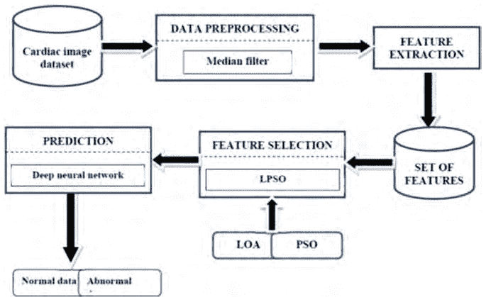

图 12.1 拟议的基于心脏图像的自动心脏病诊断模型。

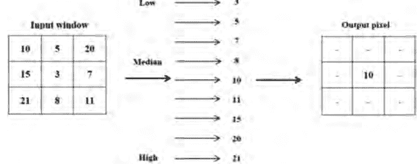

图 12.2 中值滤波器的图形表示。

表 12.1
中值滤波器应遵循的步骤

- 在像素上放置一个窗口。
- 将像素值按升序或降序排序。
- 计算中位数。
- 中位数将成为窗口中心像素的新值。
- 对所有损坏的图像区域重复上述过程。

模糊和图像细节丢失。它保留清晰的高频细节。它非常适合消除图像中的椒盐噪声。中值滤波器操作的图形表示如图 12.2 所示。应用中值滤波器算法的步骤如下（表 12.1）。

该滤波器通过分析图像中每个有效像素周围源像素的邻域来工作，如图 12.2 所示。在此情况下，使用 3×3 像素窗口来计算输出。对于图像中的每个像素，都会找到邻域像素窗口。如图 12.2 所示，窗口中的像素值按升序排序并选择中位数；在此例中，中位数为 50。接下来，输入图像中与源像素对应的输出图像中的像素将被滤波器指定的值替换。源像素值为 70，将被替换为 50。

中值滤波器去除噪声的效果随着窗口大小的增加而增强。中值滤波器在数学上表示如下：

```
\(\hat{Z}(i, j) = \text{median}_{(s,t) \in S_{ij}} \{g(s,t)\}\) (12.1)
```

其中
Z(i, j) = 给定坐标的中值滤波器，并且
Sij = 大小为 m×n 的子图像窗口的坐标

### 12.3.2 特征提取

预处理后，从每幅图像中提取纹理特征。在本章中，使用灰度共生矩阵 (GLCM) 来提取纹理特征。GLCM 给出了图像中相邻像素的灰度级对的联合分布 (Rajakumar & George 2013)。为了计算 GLCM，首先在两个像素之间建立空间关系，一个作为参考像素，另一个作为邻域像素。

设 _M(u, v)_ 为给定图像 _A_（大小为 \(a \times b\)，包含从 0 到 _G<sup>L</sup>_-1 的 _G<sup>L</sup>_ 个灰度级）的 GLCM 元素。那么，_M_ cab 被定义为矩阵元素，如下所示：

```
\( M(u, v) = \sum_{i=1}^u \sum_{j=1}^v \begin{cases} 1 & \text{if } A(a,b)=u \text{ and } I^{in} \left( a + \Delta a, b + \Delta b \right) = v \\ 0 & \text{otherwise} \end{cases} \text{ (12.2) }\)
```

其中，(_a_, _b_) 和 (_a_+Δ_a_, _b_+Δ_b_) 分别为参考像素及其邻域像素的位置。GLCM 的每个元素 _M_(_u_, _v_ | Δ_a_, Δ_b_) 表示给定邻域中两个像素的相对频率，这两个像素被距离 (Δ_a_, Δ_b_) 分隔，并分别具有灰度级值 _x_ 和 _y_ (Esteva et al. 2019)。它可以表示为 _q_(_u_, _v_ | _D<sup>p</sup>_, θ)，其中参数 _D<sup>p</sup>_ 是两个邻域分辨率单元之间的分离距离，图像中两个像素的强度分别为 _u_ 和 _v_。另一个参数 θ 表示邻域像素相对于参考像素的方向。参数 _D<sup>p</sup>_ 也被称为集距，因为它指定集合中包含的所有邻域分辨率对的距离。对于纹理计算，GLCM 必须是对称的，且 GLCM 的每个条目应为概率值。本文从每幅图像中提取了二十二个 GLCM 特征，即角二阶矩、对比度、逆差分矩、熵、相关性、方差、和均值、和方差、和熵、差分熵、惯性矩、团块阴影、团块突出度、不相似性、同质性、能量、自相关性、最大概率、归一化逆差、归一化逆差分矩、相关性信息度量 I 和相关性信息度量 II。

### 12.3.3 使用 LPSO 算法进行特征选择

特征提取过程后，使用 LPSO 算法选择重要特征。特征选择过程旨在限制输入特征的数量以实现最佳精度，并降低计算复杂度。在本章中，特征选择使用 LPSO 算法。LPSO 是狮子优化算法和 PSO 算法的组合。

_步骤 1：初始化。_ 初始化是所有优化算法的重要过程。对于特征选择，最初解是随机选择的。在


### 表 12.2 解方案格式

| 图像 | F¹ | F² | F³ | F⁴ | ... | F²² |
| :--- | :--- | :--- | :--- | :--- | :--- | :--- |
| l₁ | 0 | 0 | 1 | 0 | ... | 1 |
| l₂ | 1 | 0 | 0 | 1 | ... | 0 |
| ... | ... | ... | ... | ... | ... | ... |
| lₗ | 0 | 1 | 0 | 1 | ... | 0 |

在此方案中，每个解均被称为“狮子”。初始解方案如表 12.2 所示。

在 N 个解中，部分解随机生成，作为游狮。其余种群随机划分为 P 个狮群。该算法中每个解都有特定性别，在优化过程中保持不变。在搜索过程中，每个狮子标记其最佳访问位置。根据这些标记位置，形成每个狮群的领地。因此，对于每个狮群，其成员标记的位置（“最佳访问位置”）构成该狮群的领地。

### 步骤 2：适应度计算。

解初始化后，计算每个狮子的适应度。分类准确率被视为适应度函数。适应度函数如公式 12.3 所示。

```
Fitness = Max (Accuracy) (12.3)
```

```
Accuracy = (Tᴾ + Tᴺ) / (Tᴾ + Tᴺ + Fᴾ + Fᴺ) × 100 (12.4)
```

### 步骤 3：狩猎过程。

在狩猎过程中，猎手被随机分为三个分支。适应度最高的组被视为中路，其他组被视为右翼和左翼。在整个狩猎过程中，如果猎手提升了自身适应度，**猎物**（P）将从猎手处逃离，并获得 **猎物**（P’）的新位置，如下所示：

```
P' = P + rand(0,1) × PI × (P - H) (12.5)
```

其中；
P→ 猎物的当前位置，
H→ 攻击猎物的猎手位置，PI 为猎手适应度的提升百分比。

处于左翼和右翼的猎手的新位置为，

```
\( H' = \left\{ \begin{array}{ll} rand(H, P), & H < P \\ rand(P, H), & H > P \end{array} \right. \) (12.6)
```

其中 (H,P) 表示随机值。

雌狮的新位置计算如下：

```
\( P_F^i = P_F + 2d \times rand(0,1)\{SP_1\} + U(-1,1) \times tan(\theta) \times D_d \times \{SP_2\} \) (12.7)
```

```
\(\| \| \{SP_2\} \| \| = 1 \) (12.8)
```

- \( P_F \rightarrow \) 雌狮位置，
- \( D_d \rightarrow \) 雌狮与狮群领地中锦标赛选择点之间的距离，
- \(\{SP_1\} \rightarrow \) 雌狮之前的位置，其方向指向所选点，
- \(\{SP_2\} \rightarrow \) 与 \(\{SP_1\}\) 垂直。

### 步骤 4：漫游操作。

漫游是一种强有力的局部搜索，有助于狮群优化算法搜索并改进解。狮子沿所选区域推进 ’n’ 个单位，其中 ’n’ 是服从均匀分布的随机数。

```
\( n \sim U_d(0, 2 \times D) \) (12.9)
```

'D' 表示雄狮位置与所选领地区域之间的距离。

此外，游狮随机移动以寻找空间。游狮的新位置生成如下：

```
\( L_{ij} = \left\{ \begin{array}{ll} L_{ij} \text{ if } rand_j > prob_i \\ RAND_j \text{ otherwise} \end{array} \right. \) (12.10)
```

其中 \( L_{ij} \) 是游狮的当前位置，\( rand_j \) 是 [0, 1] 之间的均匀随机数。

\( rand(j) \) 是随机生成的向量，\( prob_i \) 是概率值。

每个游狮的概率值独立计算，如 12.11 所示：

```
\( prob_i = 0.1 + min \left( 0.5, \frac{(N_{O_i} - Bst_{N_{O_i}})}{Bst_{N_{O_i}}} \right) i = 1, 2, ... M \) (12.11)
```

其中
\( N_{O_i} \) 和 \( Bst_{N_O} \) 表示游狮中第 \( i \) 只狮子当前位置的最小延迟
M 表示游狮的数量

### 步骤 5：交配操作。

交配是保证狮子生存的关键操作。交配算子是守护者的直接混合，用于产生两个新后代。新幼狮在选择参与交配的雌狮和雄狮后随即产生，

```
\(\text{Offspring}_{1} = \chi \times F_j + \sum_{i=1}^{N_R} \frac{1-\chi}{SU_i} \times M_j \times SU_i \quad \text{(12.12)}\)
```

```
\(\text{Offspring}_{2} = (1-\chi) \times F_j + \sum_{i=1}^{N_R} \frac{\chi}{N_R} \times M_j \times SU_i \quad \text{(12.13)}\)
```

此处，‘j’ 是维度。如果雄狮 ‘i’ 被选中进行交配，则 \(SU_i=1\)，否则 \(SU_i=0\)。

\(N_R\) 表示狮群中的常驻雄狮，\(\chi\) 是均匀分布的随机数，均值为 0.5，标准差为 0.1。

通过交配，狮算法在性别之间共享数据，而新幼狮从两个亲代获得特征。

### 步骤 6：使用 PSO 进行更新。

为提升狮群优化算法的性能，每个狮子的位置进一步使用 PSO 算法更新。每个狮子的位置在搜索空间中使用 12.14 进行更新。

```
\(LP_i^{New} = LP_i + V_i^{New} \quad \text{(12.14)}\)
```

```
\(V_i^{new} = V_i + \phi_1.r_1.(pbest_i - LP_i) + \phi_2.r_2.(gbest_i - LP_i) \quad \text{(12.15)}\)
```

- 其中
- \(\phi_1, \phi_2\) = 学习率，
- \(r_1, r_2\) = 范围 [0, 1] 内的随机数，
- \(V_i\) = 当前速度，且
- \(LP_i\) = 当前位置。

所提 MLO 算法的总体流程图如图 12.2 所示。

### 步骤 7：终止准则。

从长远来看，选择最佳解。最大适应度值被视为最佳解。所选解的相应特征被输入到 DNN 分类器，以将图像分类为正常或异常。

## 12.3.4 基于深度神经网络的心脏病预测

特征选择过程后，所选特征被输入到 DNN 分类器，以将数据分类为正常或异常。DNN 分类器是遵循 ANN 的典型结构，ANN 是一种复杂网络模型。但它可以以简单形式表示层次结构以创建模型。拥有 ‘n’ 个隐藏层，它处理来自前一层（即输入层）的数据元素。每个时代后，在学习率 “alpha” 的帮助下，通过调整每个节点的权重，输入错误将逐渐减少。当存在错误时，通过网络的反向传播继续此过程，并进行微调，直到获得更好的结果。输入可以有任意数量的输入节点，且无限制，因为输入节点的增加会增加学习过程。由于输出层中有输出节点，输出数量可以单独得知。深度神经网络分类器的逐步过程如下：

- 步骤 1：读取输入层的 ‘n’ 个输入节点（F1, F2, F3 ... Fn）的数量。输入节点的数量与所选特征的数量相同。
- 步骤 2：指定需要用数据训练的隐藏层层数。输入层和隐藏层通过表示为 Wij^H 的加权值连接。同样，隐藏层与输出层之间的权重表示为 Wij^o 。
- 步骤 3：初始化每个节点的偏置和学习率值，权重将在前向传播中任意选择。
- 步骤 4：定义时代数量，以从输出到输入方向进行反向传播值。
- 步骤 5：在第一个隐藏层中，输入的加权值与神经元的偏置一起提供给求和函数，如公式 12.16 所示。

```
C_{H_1}(i=1,2..,K) = \left( \sum_{m=1}^{M} W_{ij}^h R_m \right) + b_x \quad (12.16)
```

- 步骤 6：激活函数应用于第一个隐藏层的输出，如下：

```
F \left( C_{H_1}(i) \right) = \frac{1}{\left( 1 + e^{-C_{H_1}(i)} \right)} \quad (12.17)
```

其中 F(*) 是 Sigmoid 激活函数。

- 步骤 7：同样，第 n 个隐藏层的输出操作计算如下：

```
C_{H_n}(i) = \left( \sum_{z=1}^{K} W_{ij}^o F \left( C_{H_{n-1}}(z) \right) \right) + b_p \quad (12.18)
```


其中 \( b_p \) 是第 \( p \) 个隐藏节点的偏置，\( W_{ij} \) 是具有 \( K \) 个隐藏节点的第 \( (n-1)^{th} \) 隐藏层与第 \( (n)^{th} \) 隐藏层之间的互连权重。

第 \( n^{th} \) 隐藏层的输出（即激活函数）如下所示：

\( F\left(C_{H_{-n}}(i)\right) = \frac{1}{(1 + e^{-C_{H_{-n}}(i)})} \quad (12.19) \)

步骤 8：在输出层，第 \( n^{th} \) 隐藏层的输出再次与互连权重（即第 \( n^{th} \) 隐藏层与输出层之间的权重）相乘，然后与偏置（\( b_q \)）相加，如下所示：

\( C(k) = F\left( \sum_{j=1}^{K} W_{jk}^o f\left(C_{H_{-n}}(j)\right) + b_q \right) \quad (12.20) \)

其中 \( W_{jk} \) 表示第 \( n^{th} \) 隐藏层与输出层之间的互连权重，分别对应 \( j^{th} \) 和 \( k^{th} \) 节点。输出层的激活函数充当整个模型的输出。

步骤 9：输出计算后，计算网络误差。误差计算如公式（12.21）所示。

\( \text{Error}(m) = \frac{1}{M} \sum_{m=1}^{M} \left(\text{Actual}(C_m) - \text{Target}(C_m)\right)^2 \quad (12.21) \)

其中 Target \( (C_m) \) 是估计的网络输出，Actual \( (C_m) \) 是实际输出。为获得最优网络结构，必须最小化误差。因此，必须调整权重值，直到每次迭代误差都减小。通过计算此误差函数，患者的输入特征被分类为正常或异常。在此方法中，值 1 被设定为正常数据分类的目标，值 0 被设定为异常数据分类的目标。

## 12.4 结果与讨论

本节分析了基于 DNN 的心脏图像自动心脏病诊断的性能。所提方法在 MATLAB 7.12 版本中实现。所提方法在一台搭载 Intel Core i5 处理器（主频 1.6 GHz）和 4 GB 内存的 Windows PC 上运行。使用的实验样本心脏图像如图 12.3 所示。

### 12.4.1 评价指标

所提心脏病分类方法的性能从不同指标进行分析，这些指标列于表 12.3 中。

| 指标 | 公式 |
| :--- | :--- |
| 准确率 (A) | \( A = \frac{T^p + T^N}{T^p + T^N + F^p + F^N} \times 100 \) |
| 灵敏度 (S) | \( S = \frac{T^p}{T^p + F^N} \times 100 \) |
| 特异度 (S<sub>p</sub>) | \( S_p = \frac{T^N}{T^N + F^p} \times 100 \) |
| 精确率 (P) | \( P = \frac{T_p}{T_p + F_p} \times 100 \) |
| 召回率 (R) | \( R = \frac{T_p}{T_p + F_p} \times 100 \) |
| F1-Score (T) | \( F = 2 \times \frac{\text{精确率} \times \text{召回率}}{\text{精确率} + \text{召回率}} \) |
| 负预测值 (NPV) | \( PPV = \frac{T^p}{T^p + F^p} \) |
| 假正率 (FPR) | \( FPR = \frac{F^p}{F^p + T^p} \) |
| 假负率 (FNR) | \( FNR = \frac{F^N}{F^N + T^p} \) |
| 假拒绝率 (FRR) | \( FRR = \frac{F^N}{F^N + T^p} \) |
| 假发现率 (FDR) | \( FNR = \frac{F^p}{F^p + T^p} \) |

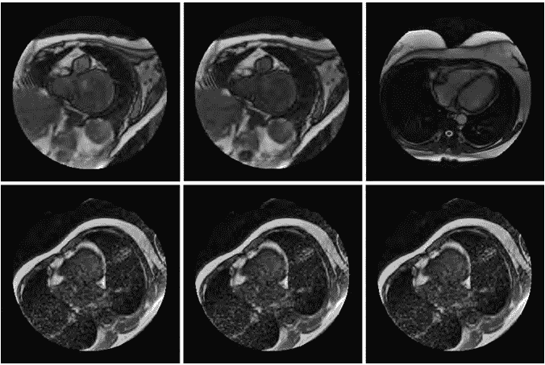

图 12.3 实验所用样本图像。

### 12.4.2 实验结果

本小节分析了所提方法获得的实验结果。图 12.4–12.7 显示了实验结果的截图。图 12.8 显示了不同方法的混淆矩阵。

### 12.4.3 比较分析

所提方法的主要目标是使用 DNN 进行基于心脏图像的自动心脏病诊断。该方法主要包含两个阶段，即特征选择和分类。

#### 12.4.3.1 基于分类算法的比较分析

为评估所提方法的有效性，我们将我们的方法与不同方法进行比较。为进行比较，本章使用了四种方法，即 DNN、ANN、KNN 和 SVM。

在图 12.9 中，从准确率、灵敏度和特异度方面分析了所提方法的性能。分析图 12.9 时，所提方法达到的最高准确率为 96.55%，而基于 DNN 的心脏病预测为 95.74%，基于 ANN 的心脏病预测为 81.57%，基于 KNN 的心脏病预测为 80.16%，基于 SVM 的疾病预测为 80.56%。从结果可以清楚地看出，所提的基于 LPSO+DNN 的心脏病预测优于其他算法。这是由于基于 LPSO 的特征选择。此外，在图 12.9 中，分析了所提方法的特异度。根据图 12.9，所提方法达到的最高特异度为 97.7%，而基于 DNN 的心脏病预测为 97.16%，基于 ANN 的预测为 87.71%，基于 KNN 的预测为 86.77%，基于 SVM 的预测为 87.04%。同样，我们所提方法达到的最高灵敏度为 93.11%，与现有方法相比较高。在图 12.10 中，从精确率、召回率和 F 值方面分析了所提方法的性能。分析图 12.10 时，我们所提的基于 LPSO+DNN 的心脏病预测达到的最高精确率为 92.11%，而基于 DNN 的预测为 89.49%，基于 ANN 的预测为 62.15%，基于 KNN 的预测为 60.32%，基于 SVM 的预测为 62.13%。同样，我们所提方法达到的最高召回率为 94.11% 和 F 值

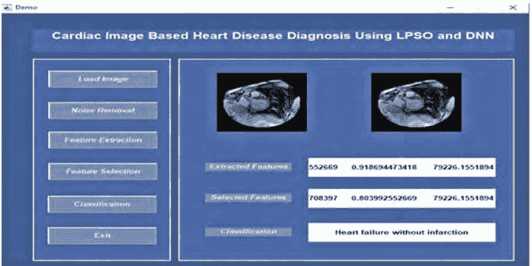

图 12.4 无梗死的心力衰竭（异常）。

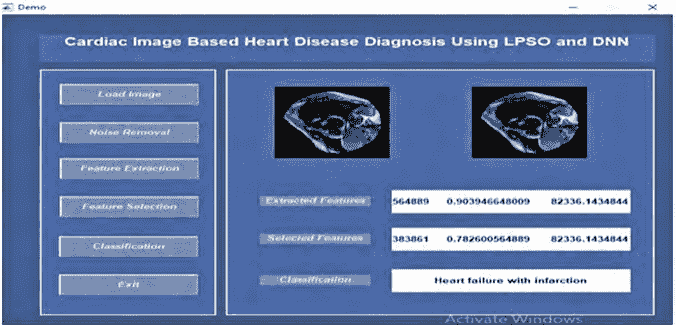

图 12.5 有梗死的心力衰竭（异常）。

of 93.11%。在图 12.11 中，从净现值 (NPV) 方面分析了所提方法的性能。分析图 12.11 时，所提方法达到的最高 NPV 为 0.97，与 DNN、ANN、KNN 和 SVM 等方法相比较高。根据图 12.11，基于 DNN 和基于 LPSO+DNN 的方法给出了最相似的结果，尽管与基于 DNN 的预测相比，所提的基于 LPSO+DNN 的方法获得了更好的结果。

图 12.12 中从假正率 (FPR) 方面分析了所提方法的性能，根据该结果，所提方法达到的最低 FPR 为 0.0229，而基于 DNN 的预测为 0.028。当从假负率 (FNR) 方面分析所提方法时，图 12.13 显示所提方法达到的最低

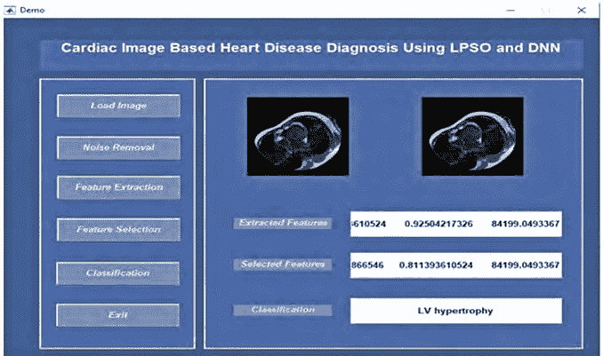

图 12.6 左心室肥厚。

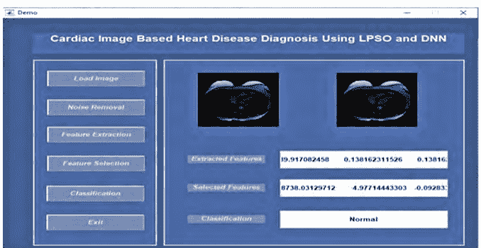

图 12.7 正常分类。

FNR 为 0.0688。同样，在图 12.14 中，所提方法在所有评估的算法中达到了最低的假拒绝率。这种优势归功于特征选择过程，该过程降低了计算复杂度并减少了错误率。在图 12.15 中，从假拒绝率 (FRR) 指标分析了所提方法的性能，其中所提方法也达到了最低的 FRR，与现有方法相比。

| 总计=246 | 正常 | 异常 |
| --- | --- | --- |
| 正常 | TP = 57 | FP = 4 |
| 异常 | FN = 4 | TN = 181 |

| 总计=246 | 正常 | 异常 |
| --- | --- | --- |
| 正常 | TP = 56 | FP = 5 |
| 异常 | FN = 5 | TN = 180 |

| 总计=246 | 正常 | 异常 |
| --- | --- | --- |
| 正常 | TP = 39 | FP = 23 |
| 异常 | FN = 22 | TN = 162 |

| 总计=246 | 正常 | 异常 |
| --- | --- | --- |
| 正常 | TP = 37 | FP = 25 |
| 异常 | FN = 24 | TN = 160 |

| 总计=246 | 正常 | 异常 |
| --- | --- | --- |
| 正常 | TP = 37 | FP = 24 |
| 异常 | FN = 24 | TN = 161 |

图 12.8 不同分类器的混淆矩阵 (a) LPSO+DNN、(b) DNN、(c) ANN、(d) KNN 和 (e) SVM。

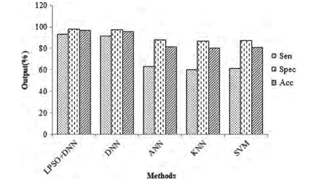

图 12.9 基于准确率、灵敏度和特异度的性能分析。


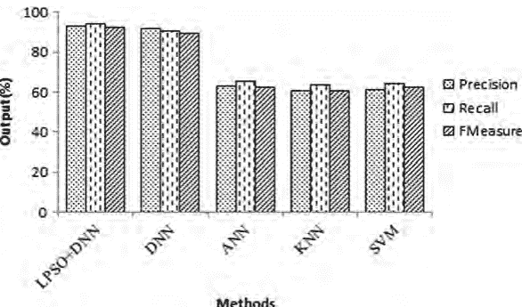

图 12.10 基于精确率、召回率和 F 值的性能分析。

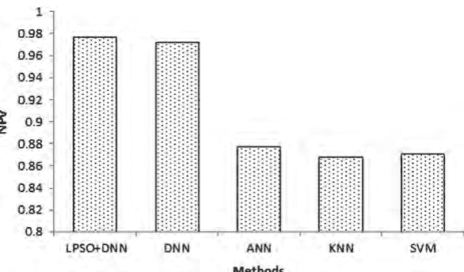

图 12.11 基于 NPY 的比较分析。

#### 12.4.3.2 基于特征选择算法的比较分析

特征选择是心脏病分类阶段的重要步骤，因为大量数据会增加计算复杂度并降低分类精度。在本章中，对于特征选择过程，使用了 LPSO 算法，该算法是 LOA 和 PSO 的组合。在此，我们基于特征选择分析不同的优化算法。

在图 12.16 中，所提方法的性能基于所选特征的数量进行分析。此处比较了三种算法，即 PSO、LOA 和遗传算法（GA）。基于此分析，我们提出的 LPSO 方法从二十二个特征中选出了十二个，而 PSO 算法选出了十六个特征，LOA 选出了十四个，GA 选出了十七个。在图 12.17 中，所提 LPSO+DNN 方法的性能基于准确率、灵敏度和特异度进行分析。分析图 12.17 时，我们提出的 LPSO+DNN 方法在预测心脏病方面达到了最高准确率 96.55%，而 LOA+DNN 为 90.87%，PSO+DNN 为 87.58%，GA+DNN 为 85.43%，这是由于混合 LPSO 特征选择的优越性；其他方法仅使用单算法特征选择。同样，与其他算法相比，我们提出的 LPSO+DNN 方法达到了最高的灵敏度和特异度。在图 12.18 中，所提


图 12.12 基于 FPR 的性能分析。


图 12.13 基于 FNR 的性能分析。


图 12.14 基于 FRR 的性能分析。


图 12.15 基于 FDR 的性能分析。

| | LPSO | PSO | LOA | GA |
|---|---|---|---|---|
| 总特征数 | 22 | 22 | 22 | 22 |
| 选中特征数 | 12 | 16 | 14 | 17 |

图 12.16 基于特征选择的性能分析。


图 12.17 基于不同特征选择算法的比较分析。

方法的性能由各种优化算法在精确率、召回率和 F 值方面进行分析。在此对分类 DNN 算法和特征选择过程的分析中，不同优化算法与 LPSO+DNN 进行了比较，即 LOA、PSO 和 GA。分析图 12.18 时，所提 LPSO+DNN 方法达到了最高精确率 93.11%、最高召回率 94.11% 和最高 F 值 92%。从图 12.18 可以清楚地看出，所提方法在四种评估方法中取得了最佳结果。


图 12.18 基于不同特征选择方法的精确率、召回率和 F 值图形图。

## 12.5 结论

心脏病是全球主要死亡原因之一。在早期预测心脏病对医生、临床医生和科学家来说是一项挑战性任务。本研究讨论了基于心脏图像的自动心脏病诊断系统，采用深度神经网络。所提方法主要包含两个阶段，即使用 LPSO 进行特征选择和使用 DNN 进行分类。分类和特征选择两个阶段的数学表达式已清楚地说明。对分类系统的性能和误差率进行了评估。结果表明，所提 LPSO+DNN 方法的有效性优于其他方法。所提出的深度学习模型能准确预测所有类型的心脏病。该模型提供准确结果，并有助于患者获得正确的药物处方。还需要进行更多研究，以将结果推广到不同方法。

## 参考文献

- Ali, L., Rahman, A., Khan, A., Zhou, M., Javeed, A., & Khan, J. A. (2019). 基于 X² 统计模型和优化配置深度神经网络的心脏病预测自动诊断系统. IEEE Access, 7, 34938–34945.
- Alkhobari, M., & Fraiwan, L. (2021). 用于心音图记录中瓣膜性心脏病检测的卷积神经网络和循环神经网络. Computer Methods and Programs in Biomedicine, 200, 105940.
- Baggen, V. J. M., Venema, E., Zívńá, R., van den Bosch, A. E., Eindhoven, J. A., Witsenburg, M., ... Roos-Hesselink, J. W. (2019). 成人先天性心脏病患者风险预测模型的开发与验证. International Journal of Cardiology, 276, 87–92. https://doi.org/10.1016/j.ijcard.2018.08.059. Epub 2018 Aug 22. PMID: 30172474.
- Dutta, A., Batabyal, T., Basu, M., & Acton, S. T. (2020). 用于冠心病预测的高效卷积神经网络. Expert Systems with Applications, 159, 113408.
- Esteva, A., Robicquet, A., Ramsundar, B., Kuleshov, V., DePristo, M., Chou, K., ... Dean, J. (2019). 医疗保健领域深度学习指南. Nature Medicine, 25(1), 24–29.
- Gárate-Escamilla, A. K., El Hassani, A. H., & Andrés, E. (2020). 基于特征选择和 PCA 的心脏病预测分类模型. Informatics in Medicine Unlocked, 19, 100330.
- Gu, S., Cheng, R., & Jin, Y. (2018). 基于竞争性蜂群优化器的高维分类特征选择. Soft Computing, 22(3), 811–822.
- Hajar, R. (2017). 冠状动脉疾病的风险因素：历史视角. Heart Views: The Official Journal of the Gulf Heart Association, 18(3), 109.
- Jeong, Y. S., Kang, I. H., Jeong, M. K., & Kong, D. (2012). 一类分类问题的新特征选择方法. IEEE Transactions on Systems, Man, and Cybernetics, Part C (Applications and Reviews), 42(6), 1500–1509.
- Jiao, Y., Li, N., Mao, X., Yao, G., Zhao, Y., & Huang, L. (2020, October). 基于一维卷积神经网络的心血管疾病患者脉搏识别. 在 International Conference on Bio-inspired Computing: Theories and Applications (第 298–308 页). Singapore: Springer.
- Liu, X., & Tang, J. (2013). 基于选定几何和纹理特征及一种新的基于 SVM 的特征选择方法的乳腺X线片肿块分类. IEEE Systems Journal, 8(3), 910–920.
- Oliver, A. S., Ganesan, K., Yuvanaraj, S. A., Jayasankar, T., Sikkandar, M. Y., & Prakash, N. B. (2021). 基于生物系统的回归学习神经网络分类器的心脏病准确预测. Journal of Ambient Intelligence and Humanized Computing, 1–9.
- Pham, H. V., Son, L. H., & Tuan, L. M. (2020). 一种用于诊断心脏病的基于深度学习神经网络和模糊规则的专家系统提案. 在 Frontiers in Intelligent Computing: Theory and Applications: Proceedings of the 7th International Conference on FICTA (2018), Volume 1 (第 189–198 页). Singapore: Springer.
- Pradhan, M. (2023). 使用生物启发优化技术进行特征选择以提高分类精度的心脏图像基础心脏病诊断. 在 L. Panigrahi, S. Biswal, A. Bhoi, A. Kalam, & P. Barsocchi (Eds.), Machine Learning and AI Techniques in Interactive Medical Image Analysis (第 151–166 页). IGI Global. https://doi.org/10.4018/978-1-6684-4671-3.ch009
- Pradhan, M., & Bhuiyan, A. (2023). 基于 MRI 图像的深度神经网络自动心脏病诊断：基于自适应细菌觅食优化算法的特征选择. 在 T. Connolly, P. Papadopoulos, & M. Solfano (Eds.), Diverse Perspectives and State-of-the-art Approaches to the Utilization of Data-driven Clinical Decision Support Systems (第 212–233 页). IGI Global. https://doi.org/10.4018/978-1-6684-5092-5.ch010
- Rajakumar, B. R., & George, A. (2013, July). 关于用于自动心脏病诊断的模糊最小最大神经网络和萤火虫算法的杂交. 在 2013 Fourth International Conference on Computing, Communications and Networking Technologies (ICCCNT) (第 1–5 页). IEEE.
- Rodríguez, J., Prieto, S., & Ramírez López, L. J. (2019). 一种用于心血管疾病预测的新型心率吸引子. Informatics in Medicine Unlocked, 15, 100174. https://doi.org/10.1016/j.imu.2019.100174
- Rojas-Albarracin, G., Chaves, M. Á., Fernandez-Caballero, A., & Lopez, M. T. (2019). 使用卷积神经网络对彩色图像中的心脏病发作进行检测. Applied Sciences, 9(23), 5065.
- Shen, Q., Diao, R., & Su, P. (2012). 特征选择集成. Turing-100, 10, 289–306.
- Singh, D. A. A. G., Balamurugan, S. A. A., & Levaline, E. J. (2015). 图像分类的新特征选择方法. Optoelectronics and Advanced Materials- Rapid Communications, 9(2015 年 11 月–12 月), 1362–1368.
- Suganya, R., Rajaram, S., Abdullah, A. S., & Rajendran, V. (2016). 一种基于数据挖掘技术预测心脏病的新特征选择方法. Asian Journal of Information Technology, 15(8), 1314–1321.
- Thanga Selvi, R., & Muthulakshmi, I. (2021). 一种用于心脏病诊断和分类模型的基于大数据的最优人工神经网络应用. Journal of Ambient Intelligence and Humanized Computing, 12(6), 6129–6139.
- Vyas, S., Gupta, S., Bhargava, D., & Boddu, R. (2022). 健康数据管理框架性能参数上的模糊逻辑系统实现. Journal of Healthcare Engineering, 2022.
- WHO. (2017). 世界卫生组织，媒体中心，心血管疾病事实资料网页. https://www.who.int/mediacentre/factsheets/fs317/en/


## Taylor & Francis
Taylor & Francis Group
http://taylorandfrancis.com


# 13 医疗影像资源稀缺世界中的超分辨率

A. Deshpande, V. V. Estrela, P. Patavardhan, G. Kallimani

## 目录

- 13.1 简介 .................................................... 183
- 13.2 超分辨率卷积神经网络（SRCNN）架构 ..... 186
- 13.2.1 SRCNN ........................................................ 186
- 13.2.2 快速 SRCNN（FSRCNN） .................................... 187
- 13.2.3 非常深的 SR 卷积网络（VDSR）............ 187
- 13.2.4 深度递归卷积网络（DRCN） .......... 187
- 13.3 基于深度学习的 SR 方法 ........................................ 187
- 13.4 讨论与未来工作 ............................... 191
- 13.5 结论 ................................................. 194
- 参考文献......................................................... 194

## 13.1 简介

医学影像（MI）为临床检查和有效的医疗干预生成了更智能、多样化且有用的人体内部器官表征。MI 使内部结构可见，并揭示被骨骼和皮肤层掩埋的问题，有助于诊断和治疗。来自计算机断层扫描（CT）和磁共振（MR）成像的有影响的非侵入式 MI 特性实现了准确、有说服力的健康审查和解读（Ogawa & Lee 1990）。组织、骨骼、心脏、大脑、肌肉和肿瘤等身体部位可以被观察。然而，低空间分辨率是一个持续存在的问题（Onesimu & Karthikeyan 2020; Ayubi et al. 2015; Andrew 2020），影响诊断过程和后处理。图像获取时间和设备是有限 MI 空间分辨率的制约因素。由于采样时间长、患者不适、更强的磁场和更高的费用，高质量图像通常难以获得。因此，为了在不影响硬件和扫描过程的情况下解决这些相关问题，超分辨率（SR）确保了有前景的输出。SR 方法旨在通过低分辨率（LR）图像构建高分辨率（HR）图像，在无需额外扫描过程的情况下提高图像的空间分辨率并改善 MI 质量。获取过程中的损失可以从 SR 过程的高频（HF）内容中恢复。SR 算法的主要目标是从欠采样 LR 图像的观测中重建 HR 图像。通过深度学习（DL）的 SR 可以帮助对抗许多疾病，例如冠状病毒疾病（COVID-19）。基于 DL 的 SR 综述可以帮助识别优秀的人工智能（AI）工具（Monda 2021）。关键词（如 AI、COVID-19、机器学习（ML）、CT、MRI、预测、DL 和 X 射线）的文献检索都与详细成像相关。为了改善患者的审查，挖掘可以将 SR 与符号学/语义学合并，以更好地描述发现并加速研究，因为 HR 需要网络资源和存储。使用各种 MI 数据集可以改进并提供不同的诊断阶段，即细分、预处理和特征提取。密集连接卷积神经网络（CNN）在提高图像准确性和分辨率方面具有卓越能力（Vyas & Bhargava 2021）。

2D 成像模型如下所示：

```
g_k (m, n) = d(h_k (w_k ( f(x, y))) + \eta _ { k } (m, n) \quad (\text{Eqn. 13.1})
```

其中 _k_ 对应 LR 图像的数量。对于 _k_=1，函数 _g_() 如下给出

```
g(m,n) = \frac{1}{q^2} \sum_{x=qm}^{(q+1)m-1} \sum_{y=qn}^{(q+1)n-1} f(x,y). \quad (\text{Eqn. 13.2})
```

_g_ 是获取的 LR 图像，_d_ 是下采样参数，变形函数为 _w_，_h_ 是模糊函数，\(\eta\) 是加性噪声。_f_ 代表基本 HR 图像；_q_ 是子采样参数或在水平和垂直方向上相等的抽取因子。_x_ 和 _y_ 是 HR 图像坐标，_m_ 和 _n_ 是 LR 图像坐标，其大小为 \(L_1 \times L_2\)，HR 图像的大小为 \(H_1 \times H_2\)，其中 \(H_1 = qL_1\) 且 \(H_2 = qL_2\)。Ogawa（1990）中的 MI 模型指出，LR 观测图像是通过对 _q_<sup>2</sup> 像素区域求平均得到的。其他 MI 过程参数可以考虑，即模糊、变形（几何变换）和噪声。设 _g_、_f_ 和 \(\eta\) 表示 _k_ 维向量。所有变形因素均属于矩阵 _A_。更现实的向量形式模型变为 _g_ = _A f_ + \(\eta\)。高质量 SR 图像可以减轻带有噪声、模糊图像、伪影和退化效果的问题，i) 成本更低，ii) 无需花哨硬件，复用现有 LR 成像系统，以及 iii) 灵活性高。SR 在生物特征识别、MI 分析、无人驾驶飞行器（UAV）等领域有多种应用（Deshpande et al. 2020; Deshpande et al. 2021）。表 13.1 对 SR 的三种主要策略进行了分类。

之前的三类分类适用于静态图像和视频。单图像 SR（SISR）过程高度依赖学习算法来推断丢失的数据，利用 LR 与 HR 图像之间的连接，从训练数据库生成超分辨率图像。

TABLE 13.1 Classification of SR methods

| 方法 | 算法 | 优点 | 缺点 |
|:---|:---|:---|:---|
| 1 基于插值（Frank 1982; Markov 2008） | a. 最近邻插值<br>b. 双三次插值<br>c. 双线性插值 | 简单且易于实现快速计算 | 在低频区域表现良好，但在边缘（HF）区域表现不佳，边缘易出现模糊和锯齿状伪影。 |
| 2 基于重建（Bertero 1998; Liu 2017） | a. 最大后验概率<br>b. 马尔可夫随机场<br>c. 核导引 | 图像叠加、变化检测 | 边缘附近存在微小不连续和像素丢失。 |
| 3 基于示例（Qu et al. 2013; Li 2016） | d. 总变分（TV）<br>e. 马尔可夫随机场<br>f. 稀疏编码<br>g. 高斯过程回归<br>h. 高斯过程回归 | 高放大倍数 | 需要巨大的图像数据库。<br>由于从数据库中搜索测试图像块，执行时间增加。 |

多图像 SR（MISR）算法通常假设目标 HR 图像，并且 LR 观测包含与预期 HR 图像的等效几何或光度偏移。一般来说，这些算法使用 LR 观测之间的差异来重建所需的 HR 图像，即它们是基于重建的 SR 算法。基于重建的 SR 算法将 SR 问题视为反问题。因此，与其他反问题一样，需要一个前向成像模型。

深度学习（DL）算法取得的最新性能促进了 LR 图像的超分辨率处理。DL 的主要目标是学习通常优于其他机器学习（ML）算法的数据层次表示。少数通过卷积神经网络（CNN）构建的现有 SR 框架出现在第 13.2 节。基于 DL 的 SR 程序出现在第 13.3 节，而第 13.4 节和第 13.5 节分别涵盖本章的讨论和结论。

## 13.2 超分辨率卷积神经网络（SRCNN）架构

卷积神经网络（CNN）是一种用于图像识别和处理的人工神经网络类型，专门设计用于处理像素数据。

### 13.2.1 SRCNN

第一个基于 DL 的 SISR 方法是 SRCNN。因此，LR 和 HR 图像直接在端到端映射中学习。

网络结构布局如图 13.1 所示。网络包含三层，每层包含通过添加


图 13.1 SRCNN 的网络结构布局（medium.com 2022）。


an activation function and a bi-cubic LR interpolation of the same size as the HR image. The network’s input image is a, and the output is a super-resolved image.

### 13.2.2 快速SRCNN (FSRCNN)

升级版的SRCNN是快速SRCNN（FSRCNN）。FSRCNN提高了HR重建速度，其结构由五个元素组成：特征提取、缩减、映射、扩展和反卷积。图13.2显示了FSRCNN结构。不放大输入图像尺寸可提高速度并减少计算。

### 13.2.3 非常深层SR卷积网络 (VDSR)

VDSR揭示了SR性能的额外改进。更深层的网络对收敛有显著影响。由于LR和HR图像传递更多信息，学习残差效果更好，从而提高了性能和速度，如图13.3所示。

### 13.2.4 深递归卷积网络 (DRCN)

DRCN通过深递归层实现SR重建。深度可能提高性能；悖论的是，卷积层阻止了参数的增加。重建结果来自对递归卷积层平均输出的加权。图13.4中的DRCN网络结构代表MRI的SR，由Fiat（2001）进行，以实现以下目标：

- (1) 对于来自3D/4D MRI的3D切片的2D图像，面内分辨率增强（Holden 2000；Malczewski 2008）为遗漏的分辨率信息提供了解决方案（cf. 表13.2）；以及
- (2) 在多个3D/4D MRI切片中，通过平面分辨率增强（Jiang 2007；Rousseau 2005）消除了混叠并减少了切片深度。相比之下，多切片2D采集的面内分辨率高于3D采集的通过平面分辨率。

## 13.3 基于DL的SR方法

MI处理使用基于DL的SR来生成高空间和高质量分辨率图像，无需额外扫描。由于DL的快速发展，依赖CNN的SR适用于MI，例如视网膜图像（Reeth 2012；Zhang 2019）和MRI（Pham 2017；Chaudhari 2020）。Pham（2017，2019）的研究利用SRCNN进行脑MRI分析（Deshpande和Patavardhan 2016a，2016b，2016c）。Chen（2018）报告了一种受密连接网络（Mahapatra 2018）启发的脑MRI SR网络。Mahapatra（2018）中出现了用于视网膜图像的快速SR和用于膝MRI的高效SR，使用结构相同的网络，包含三个SRCNN隐藏层和一个子像素卷积层。


### TABLE 13.2
## MRI的面内SR

| 类别 | 方法 | 局限性 |
| :--- | :--- | :--- |
| 确定性正则化 | 低秩TV、直接获取、双线性插值 | 噪声易受性 |
| 凸集投影（POCS） | 基于小波的POCS | 高计算成本 |
| 回投影 | 迭代回投影 | 噪声易受性 |

(Chaudhari 2020)用于将20层3D卷积算子与基于deep-resolve的膝MRI整流线性单元配对（Huang 2017）。在Zhu（2021）中，任意尺度SR（MIASSR）将元学习与生成对抗网络（GANs）相结合，以各种放大倍率对MI进行超分辨率处理，并与单模态和多模态脑MRI上的SISR过程进行比较。迁移学习使MIASSR能够处理SR心脏MR和CT图像。在临床分析任务中，例如图像质量增强、重建和分割，MIASSR证实了其作为新兴基础预/后处理步骤（模型训练和推理前用于格式化图像的步骤）的潜力。这包括但不限于调整大小、定向和颜色）。通过CNN进行的离散余弦变换（DCT）图像融合可充当SR和分类器，可使用开放访问数据集（Deshpande 2021）对肿瘤或非肿瘤组织进行分类。通过使用SR和ResNet50，该框架的性能达到了98.14%的准确率。在MRI图像上进行的实验表明，所提出的SR框架依赖于CNN、DCT和ResNet50（即DCT-CNN-ResNet50），并可以提高分类准确率。多尺度细化上下文网络（MRC-Net）与细化上下文融合（RCF）（Chen 2021）一起执行SR。

MRC-Net和RCF出现在Chen（2021）中。首先，开发了一种带时间上下文的递归MRC-Net，接着是一种用于低计算成本下性能提升的递归蒸馏模式。测试依赖于合成和真实的病理学及胶囊内镜LR图像。为了增强由相干断层扫描（OCT）捕获的视神经头图像，一种基于SR的方法（Yamashita 2020）对非常深度卷积网络（VDCR）、增强SRGAN（ESRGAN）、SRCNN和深递归卷积网络（DRCN）进行了排序。提出了一种基于自编码器的MR图像SR技术（Andrew 2021），用于从LR MR图像重建HR MR图像。

图13.5显示了基于自编码器（AE）的SR方法。根据结构相似性（SSIM）、峰值信噪比（PSNR）、计算时间和信息保真度准则（IFC）等指标，该方法在合成和真实脑MRI上表现良好。


在MR图像的LR和HR特征之间，开发了一种受AE启发的卷积网络基础SR（ACNS）（Park 2021），带有一个反卷积层，该层通过基于CNN的非线性映射外推缺失的空间信息。使用四名志愿者，所提方法在胸部MRI和虚拟幻体上进行了测试。PSNR、SSIM、IFC和计算时间与SRCNN进行了比较；FSRCNN和深递归卷积网络（DRCN）与这些方法相比表现良好。该研究暗示，ACNS有潜在应用于MRI引导放射治疗中4D MRI分辨率的实时增强。两个并行渐进学习流（Xue 2020），一个流专注于重建精细MRI，另一个流通过子带残差学习（RL）单元（ISRL）学习遗漏的HF残差。这两个并行流互补，使能够学习LR和HR MRI之间的复杂映射，引入渐进子带学习和类脑方式来强调MRI的变化纹理。所提PSR-SRN模型显示出优于传统和DL MRI SR方法的性能。它是一个级联DL框架，包含下采样网络（DSN）、去噪自编码器（DAE）和SR生成模型（SRG）（Chun 2019）。DAE训练和DSN训练中的临床LR噪声MRI扫描使用少量配对LR/HR志愿者数据，SRG与由DSN生成的数据级联，DSN将LR输入映射到HR输出。针对MRI的基于RL构建的SR过程出现（Shi 2018），作为基于浅层网络块的本地RL（LRL），以有效学习本地残差，即捕捉HF细节。算法评估依赖于两个真实MRI数据集和一个模拟MRI数据集。实验结果证明，与本研究中的其他所有基于CNN的SR算法相比，所提SR算法达到了优越性能。

## 13.4 讨论与未来工作

由于DL模型从信息中学习知识，深度数据理解和表示对于在特定应用中构建数据驱动的智能医疗物理系统至关重要。现实地说，证据以多种形式出现：

- (i) 图像包含向量、矩阵和张量，表示像素、体素、深度和变形，这些是MI中的基本特征或基础参数。第一类可以表示1D、2D、3D、4D甚至更高维度张量的MI，如果考虑高光谱图像的话。

- (ii) 序列数据是顺序相关的记录，即文本、流媒体、音频片段、视频片段和时间序列数据等序列的集合。在构建模型时，必须考虑输入数据的连续性。

- (iii) 表格数据集包含类似数据库表的列式信息。每个字段（列）必须包含名称。每列只有一个定义的数据类型。它是基于信息属性或特征构建的、包含行和列的逻辑组织数据排列。DL模型可以有效地在表格数据上学习，并允许构建数据驱动的智能系统。

DL通常依赖大数据（BD）来培养针对特定条件的数据驱动模型。稀缺数据阻碍DL算法，但可以通过预处理步骤（如数据增强和元启发法）来规避这一缺陷。图形处理单元（GPU）主要用于优化


计算操作能力强大。因此，深度学习比标准机器学习方法更依赖于包含 GPU 的高性能设备。特征工程利用领域意识，从原始数据中挖掘特征（即属性、特征和性质）。深度学习与其他机器学习实践之间的一个核心区别在于，努力直接从数据中提取高层次元素。因此，深度学习缩短了时间，并努力构建特征提取器。由于深度学习参数众多，执行时间和模型训练都很长。

大多数深度学习模型训练通过公开可用的标注数据集（即标记、标注或分类数据集）进行。然而，处理不同问题领域或当前数据驱动场景仍需要来自重要来源的原始数据。对海量原始数据进行分类既至关重要又困难。这一障碍在部署判别式深度学习模型或监督任务时尤为明显。自动动态数据标签取代了手动分类或雇佣人工标注者。它们对大型数据集至关重要，能更有效地支持监督学习，并减少人力成本。因此，对数据采集和标注方式的更深入研究，或引入无监督学习方案，可能是深度学习建模中有前景的研究方向。双耳节拍（BB）感知及合适算法选择对深度学习来说难以解释，即深度学习如何为特定模型得出最终决策，或其结果均不明确。尽管深度学习模型通过从海量数据集中学习来完成主要操作，但这种双耳节拍视角下的深度学习建模通常意味着统计理解不足，这可能是一个关键问题。相反，机器学习算法，尤其是基于规则的机器学习实践，能为阐明裁决提供清晰的逻辑规则（例如 IF-THEN），这些规则易于解释、更新或删除，并与目标应用一致。如果选择了错误的学习算法，可能会出现意外结果，导致模型失效、效率降低、精度下降；就模型性能、复杂度、精度和适用性而言，都将受损。因此，为目标应用选择合适的模型至关重要，尽管这具有挑战性。深入分析对于更好地理解和决策是必要的。

监督或判别式深度学习网络，主要采用多层感知机（MLP）、CNN、RNN 及其变体，广泛应用于无数健康领域。然而，根据目标现实世界目的和数据类型，在兼顾适用性、模型优化或精度的前提下规划新发展或其变体，可以成为一项创新，并可能成为监督或判别式学习中的重要未来属性。面向生成式或无监督学习的深度学习网络可以在医疗保健领域执行主要任务。它们允许刻画数据中的高阶相关特性（或属性），或生成新的数据表征，利用探索性调查。与监督学习不同，它不需要标注数据，因为它擅长直接从信息中获取洞察并进行数据驱动决策。因此，它可以作为监督和判别式建模的预处理阶段，也可以与半监督学习结合，以保障学习准确性和模型专业知识。

主要的深度学习任务可以包括混合协作建模和不确定性管理。成功的混合可以在高风险应用中，相较于其他框架，在性能和不确定性管理方面表现更出色。这种混合产物之所以出现，是因为混合模型开发将生成式学习与判别式学习的优势相结合。混合可以帮助使用不同参数或不同子采样训练数据集训练人工神经网络。此类程序的混合，如深度学习与深度学习、元启发式或机器学习的混合，在医疗保健中可以发挥关键作用。因此，将有效的判别式和生成式模型相结合，而非采用朴素方案，可能是一项关键的研究改进。该策略有助于解决几个日常问题，包括半监督学习活动以及模型不确定性。在确定超参数值、阈值和网络配置方面的动态性，结合计算效率，通常会影响性能、模型复杂度和计算需求之间的关系，是深度学习建模和应用中的关键问题。算法改进与提高准确性和保持计算效率的结合，即在不造成严重信息丢失的前提下，以最少资源扩展最大吞吐量，可以在即将到来的现实世界应用中为深度学习建模效率带来突破。增量方法或近期学习范式的概念在多种情况下可能是最佳的，具体取决于成像应用的性质。因此，在构建深度学习模型时，一种能够动态选择这些方法的数据驱动方案在性能和实际适用性方面可能效果更好。这种数据驱动自动化可以产生一代更智能的深度学习模型，使这些部署能够显著提升未来模型，成为重要的研究贡献。

面向物联网（IoT）的基础深度学习建模涉及许多基于通信的智能医疗相关事物。移动技术广泛用于检测和收集人类及环境材料（例如地理信息、气候数据、生物数据、人类学行为等），以用于各种智能医疗服务和应用。这些无处不在的智能设备或小工具每天产生大量数据，需要在不同的智能便携设备上进行快速数据处理。深度学习技术可以发现潜在属性并处理大量传感器和执行器信息。这些信息片段可以与各种物联网应用相关联，包括健康监测和疾病诊断，并与智慧城市、交通流量估计、交通监控、智能交通、制造检验、故障评估等协同工作。尽管深度学习方法可以是处理大数据的强大工具，但由于其高计算负担和大量内存开销，轻量化建模对资源受限技术仍不可或缺。因此，优化、泛化、压缩、剪枝、简化和特征提取等多种流程可能在多种情况下有所帮助。因此，基于基线网络结构设计创建轻量化深度学习实践，以调整深度学习模型以适应下一代便携式、物联网或资源受限设备及应用，可能代表医疗保健中一个重要的未来特征。

将领域知识集成到深度学习建模中，而不是建立一般或领域独立的连接，需要熟悉专门的学科或领域。例如，自然语言处理（NLP）可能会评估英语语言属性，这些属性与孟加拉语、日语、阿拉伯语等其他语言不同。因此，融入基于领域限制的深度学习模型可以为这类特定目的提供更好的结果。迁移学习可以是利用领域知识启动不同挑战的有效方式。上下文信息，如社会、空间、时间或生态背景，也可以在融入对领域的理解的上下文感知处理方面发挥关键作用，以进行智能决策并构建自适应和智能的上下文感知结构。理解领域熟悉度并有效地将其嵌入深度学习模型，可以是一个不同的研究方向。为不同目标领域设计通用深度学习结构，是一个生成能够处理数据多样性、无数维度和尺度、刺激形式等的框架的有前景的研究方向。该框架必须具备注意力模型（AM），用于识别最相关的输入部分，并具备获取隐式特征的方法。这些特性可以以独特且信息丰富的方式表征图像。由于其直观、多功能和可解释的特性，注意力模型是一个热门研究课题。它们被广泛应用于计算机视觉、基于单词或图像的分类、自然语言处理、推荐系统、情绪研究、客户画像等领域。强化学习等学习算法可以帮助设计注意力模型，以在执行策略搜索时找到最有利的部分。同样，CNN 与合适的注意力模型可以融合以泛化分类。在最后一种情况下，CNN 可以学习和捕捉无数层级及范围内的特征。

## 13.5 CONCLUSION

本章讨论了超分辨率及其在医疗应用中的重要性。详细信息对于预测、筛查和诊断 Covid-19 等复杂任务至关重要，而深度学习也为研究人员和卫生专家提供了宝贵帮助，但仍有太多事情有待尝试。从近期文献研究可以明显看出，超分辨率已吸引大量关注，基于深度学习的超分辨率策略占主导地位。此外，已提出并成功开发了多种最先进的基于深度学习的超分辨率方法。最终，本文强调了面向 AI 疾病管理方法未来研究方向所面临的挑战，包括噪声数据、法规以及大规模数据集的可靠性。

## REFERENCES

- Andrew, J. (2020). 基于深度学习技术的脊柱磁共振图像分割. In Proceedings 6th International Conference on Advanced Computing and Communication Systems (pp. 945–950). 印度科伊姆巴托尔.
- Andrew, J., Mhatesh, T. S. R., Sebastin, R. D., Sagayam, K. M., Eunice, J., Pomplun, M., & Dang, H. (2021). 基于轻量自动编码器的脑磁共振图像超分辨率重建. Informatics in Medicine Unlocked, 26, 100713.
- Ayubi, S., Bajwa, U. I., & Anwar, M. W. (2015). 基于超分辨率的心脏 MR 图像增强. Current Respiratory Medicine Reviews, 11, 105–113.
- Bertero, M., Boccacci, P & De Mol, C. (2021). 成像中逆问题导论. CRC press.
- Chaudhari, A. S., et al. (2020). 骨关节炎 MRI 生物标志物背景下的深度学习超分辨率效用. Journal of Magnetic Resonance Imaging, 51(3), 768–779.


Chen, Y. (2018 年 4 月). 使用 3D 深度稠密连接神经网络的脑 MRI 超分辨率. 在 *第 15 届 IEEE ISBI 论文集* (pp. 739–742).

Chen, Z., Guo, X., Woo, P. Y., & Yuan, Y. (2021). 具有样本亲和力交互的超分辨率增强医学图像诊断. *IEEE 医学成像期刊*, 40(5), 1377–1389.

Chun, J., Zhang, H., Gach, H. M., Olberg, S., Mazur, T., Green, O., ... Park, J. C. (2019). 使用级联深度学习进行 MRI 引导自适应放疗的 MRI 超分辨率重建：在有限训练数据和未知传输模型的情况下. *医学物理学*, 46(9), 4148–4164.

Deshpande, A., & Patavardhan, P. (2016a 年 7 月). 基于高斯过程回归的虹膜极化图像超分辨率. 在 *IEEE 应用与理论计算与通信技术国际会议*.

Deshpande, A., & Patavardhan, P. (2016b). 长程拍摄虹膜图像的分割与质量分析. *图像与视频处理期刊*, 6(4), 1280–1283.

Deshpande, A., & Patavardhan, P. (2016c). 非合作虹膜图像的单帧超分辨率. *图像与视频处理期刊*, 7(2), 1362–1365.

Deshpande, A., & Patavardhan, P. (2020). 无约束耳部图像的超分辨率与识别. *国际生物识别期刊*, 12(4), 396–410.

Deshpande, A., Patavardhan, P., Estrela, V. V., & Razmjooy, N. (2020). 深度学习作为无人机系统中超分辨率成像的替代方案. *无人机飞机系统成像与感知*, 2, 9.

Fiat, D. (2001 年 9 月 25 日). 增强 MRI 信号的方法, 美国专利 6 294 914 B1.

Franke, R. (1982). 散乱数据插值：对一些方法的测试. *计算数学*, 38(157), 181–200.

Holden, J. E., Unal, O., Peters, D. C., & Oakes, T. R. (2000). 通过迭代重建控制投影基 MR 血管造影中的角度欠采样伪影. 在 *第 8 届 ISMRM 年度会议论文集*. 丹佛, 科罗拉多州, 美国 (p. 1).

https://medium.com/coinmonks/review-srcnn-super-resolution-3cb3a4f67a7c, 查阅于 2022 年 1 月 5 日.

https://towardsdatascience.com/review-fsrcnn-super-resolution-80ca2ee14da4, 查阅于 2022 年 1 月 6 日.

https://towardsdatascience.com/review-vdsr-super-resolution-f8050d49362f, 查阅于 2022 年 1 月 11 日.

https://medium.datadriveninvestor.com/review-drcn-deeply-recursive-convolutional-network-super-resolution-f0a380f79b20, 查阅于 2022 年 1 月 15 日.

Huang, G., Liu, Z., Van Der Maaten, L., & Weinberger, K. Q. (2017 年 7 月). 稠密连接卷积网络. 在 *IEEE CVPR 会议论文集* (pp. 4700–4708).

Jiang, S., 等 (2007). 使用带体积重建 (SVR) 的多层快照图像对移动受试者进行 MRI：应用于胎儿、新生儿和成人脑研究. *IEEE 医学成像期刊*, 26(7), 967–980.

Li, X., Chen, J., Cui, Z., Wu, M., & Zhu, X. (2016). 基于自适应字典选择的稀疏表示的单图像超分辨率. *国际模式识别与人工智能期刊*, 30(7), 1654006.

Li, X., & Nguyen, T. Q. (2008). 基于马尔可夫随机场模型的边缘定向图像插值. *IEEE 模式分析与机器智能期刊*, 17(7), 1121–1128.

Lijun, S., Yun, X. Z., & Hua, H. (2010). 基于 MCA 和小波域 HMT 的图像超分辨率. 在 *IEEE 第 2 届信息技术与应用国际论坛 (IFITA) 论文集*, 第 2 卷.

Liu, L., Huang, W., & Wang, C. (2017). 基于使用分裂 Bregman 迭代的总变分正则化的 SAR 图像超分辨率纹理图像先验. *国际遥感期刊*, 38(20), 5673–5687.

Mahapatra, D., Bozorgtabar, B., Hewavitharanage, S., & Garnavi, R. (2018 年 5 月 21 日). 使用局部显著性图和生成对抗网络进行图像超分辨率的视网膜血管分割. arXiv:1710.04783v3 [cs.CV].

Malczewski, K. (2008 年 5 月). 通过 PROPELLER 数据融合增强 MRI 图像. 在 *IEEE 医学测量与应用国际研讨会论文集* (pp. 29–32).

Mondal, M. R., Bharati, S., & Podder, P. (2021). 使用机器学习和深度学习诊断 COVID-19：一篇综述. *当前医学成像*, 17(12), 1403–1418.

Ogawa, S., Lee, T. M., Kay, A. R., & Tank, D. W. (1990 年 12 月). 依赖血液氧合的对比度脑磁共振成像. *美国国家科学院院刊*, 87(24), 9868–9872.

Onesimu, J. A., & Karthikeyan, J. (2020). 用于医学图像分析的高效隐私保护深度学习方案. *信息技术管理期刊*, 12 (特刊：人机交互的重要性：挑战、方法和应用), 50–67. doi: 10.22059/jitm.2020.79191.

Park, S., Gach, H. M., & Kim, S. (2021). MRI 中基于自编码器启发的卷积网络的超分辨率方法. *IEEE 卫生与医学转化工程期刊*, 9, 1–13.

Pham, C. H., Ducournau, A., Fablet, R., & Rousseau, F. (2017 年 4 月). 使用深度 3D 卷积网络的脑 MRI 超分辨率. 在 *2017 年 IEEE 第 14 届生物医学成像国际研讨会 (ISBI 2017)* (pp. 197–200). IEEE.

Pham, C. H., 等 (2019 年 10 月). 使用深度 3D 卷积网络的多尺度脑 MRI 超分辨率. *计算机化医学成像与图形*, 77, 文章编号 101647.

Qu, Y. Y., Liao, M. J., Zhou, Y. W., Fang, T. Z., Lin, L., & Zhang, H. Y. (2013). 基于数据驱动高斯过程回归的图像超分辨率. 在 *智能科学与大数据工程：第 4 届国际会议, IScIDE 2013, 北京, 中国, 2013 年 7 月 31 日–8 月 2 日, 修改选定论文 4* (pp. 513–520). 柏林海德堡: Springer.

Van Reeth, E., Tham, I. W., Tan, C. H., & Poh, C. L. (2012). 磁共振成像中的超分辨率：一篇综述. *磁共振概念 A 部分*, 40(6), 306–325.

Rousseau, F., 等 (2005 年 10 月). 高分辨率胎儿脑 MR 成像的新方法. 在 *医学图像计算与计算机辅助干预国际会议论文集, MICCAI* (第 3749 卷, pp. 548–555).

Shi, J., Liu, Q., Wang, C., Zhang, Q., Ying, S., & Xu, H. (2018). 使用新型残差学习网络算法的 MR 图像超分辨率重建. *医学与生物物理学*, 63(8), 085011.

Vyas, S., & Bhargava, D. (2021). 智能健康系统：新兴趋势.

Xue, X., Wang, Y., Li, J., Jiao, Z., Ren, Z., & Gao, X. (2020). 用于 MR 图像超分辨率的渐进子带残差学习网络. *IEEE 生物医学与健康信息学期刊*, 24(2), 377–386.

Yamashita, K., & Markov, K. (2020). 使用超分辨率方法增强医学图像. 在 V. V. Krzhizhanovskaya, 等 (编), *2020 年计算科学国际会议 (ICCS) 论文集*, pp. 496–508.

Zhang, S., Liang, G., Pan, S., & Zheng, L. (2018). 一种基于深度学习网络的快速医学图像超分辨率方法. *IEEE Access*, 7, 12319–12327.

Zhu, J., Tan, C., & Guang, J. Y. (2021). 医学图像的任意尺度超分辨率. *国际神经网络期刊*, 31(10), 2150037.

# 14 由边缘 AI 支持的 IoT 医疗保健监测系统的法律和伦理影响

Ridoan Karim, Sonali Vyas

## 目录

- 14.1 引言：背景与驱动力.....197
- 14.2 由边缘 AI 支持的 IoT 医疗保健监测系统的伦理辩论 ..198
- 14.3 法律与监管挑战.....201
- 14.3.1 数据保护 ........................................201
- 14.3.2 责任制度 .......................................202
- 14.3.3 消费者保护.....................................204
- 14.3.4 知识产权 ..................................205
- 14.4 政策建议....................................206
- 14.4.1 AI 与法律素养 ....................................207
- 14.4.2 标准化 ........................................207
- 14.4.3 研究................................................208
- 14.5 结论 ...............................................208
- 参考文献.....................................................208

## 14.1 引言：背景与驱动力

人工智能 (AI) 的引入及其最新发展从根本上改变了社会的运作方式。它通过确保对技术因素的高效自动化和控制，为从教育到医疗保健再到银行和金融行业的所有领域提升生活质量带来了广泛的可能性。AI 为医疗保健行业带来了多项优势，包括使用智能传感器进行更好的监测、即时访问生命体征、远程健康监测以及有效的疾病诊断 (Davenport & Kalakota 2019)。

像 COVID-19 这样的大流行病为我们提供了一个维度，以便为一个新的医疗保健时代做好准备 (Naudé 2020)，在该时代，医疗服务提供者需要利用技术进行早期疾病诊断，这最终将导致能够挽救生命的有效治疗 (Islam 2021)。即使只


与现有设置（Kim & Huh 2020）相比；然而，引入边缘AI需要进行小幅更改（Nguyen Gia et al. 2020）。为此，医疗服务提供者可以利用现有的监测工具，例如体温监测仪，来识别患者身体行为中的异常（Rathi et al. 2021）。其要义在于，此类数据将被传输至关联医院，使其能够立即开始治疗（Rathi et al. 2021）。这将有助于在大规模范围内遏制疾病的影响和进一步传播。关于此类边缘AI如何运作的问题由此产生。

人工智能赋能的物联网（IoT）是一种备受推崇的技术工具，提供了一种集成不同电子设备的方式（Sodhro & Zahid 2021）。这些设备能够进行通信和收集数据，同时也可促使其他设备采取适当行动（Sodhro & Zahid 2021）。它在各个行业中拥有众多应用，包括农业（Gupta et al. 2020）、制造业（Wan et al. 2021）和库存管理（Oosthuizen et al. 2021）。在医疗保健行业中，可能会使用大量传感器来收集患者健康信息（包括患者图像），并在必要时启动紧急反应（Zhu et al. 2019）。使用这些设备远程检查某人的健康状况并提供援助相对简单（Rathi et al. 2021）。基于物联网和人工智能构建的智能技术已被证明在医疗保健行业具有巨大益处（Rathi et al. 2021）。边缘赋能物联网（其中，相当一部分感知和物联网应用相互连接，为医疗保健行业提供各种服务）有可能通过在更早阶段诊断和检测病症以实现便捷治疗来治疗慢性疾病（Verma & Fatima 2020）。此外，相关医疗费用会降低（Verma & Fatima 2020）。因此，边缘AI与物联网的融合可以对海量物联网数据进行分类和聚类，预测结果，并提供初步洞察。这可能有助于应对预期的大流行病，并提供快速有效的解决方案。

尽管如此，在医疗保健领域实施边缘AI时，仍存在法律和监管挑战，主要涉及消费者保护、数据保护、知识产权、网络安全和责任问题。因此，本章评估了边缘AI赋能物联网医疗监测系统的现有法律和监管挑战，并提供了可从理论和实践两方面做出贡献的见解，以确保该技术在医疗保健中的及时性。因此，本研究有潜力通过全面的法律和监管考量，大幅影响加强卫生基础设施的政策制定过程。

## 14.2 边缘AI赋能物联网医疗监测系统的伦理辩论

在医学领域使用人工智能进行决策，将在未来对诊断和治疗的开展方式产生重大影响。事实上，有些人现在将人工智能视为医生的共同诊断伙伴（Yin et al. 2021）。尽管如此，人工智能甚至可能创造新的医疗标准（Sadavjiev et al. 2019）。然而，人类始终对人工智能的行为及其决策过程背后的理由存在疑虑，并且今后仍会存在疑虑（Rigby 2019）。这就是为什么人工智能可能无法取代整个现有系统；相反，它可以提供协作支持，超越医生的手动检查，提供一个整体有效的支持系统。

人工智能解决方案对医学和医疗保健行业产生重大积极影响。它们能够以增强公共卫生系统并促进疾病预防和治疗的方式，收集、处理和使用患者记录、医疗数据、诊断发现和医学研究（Islam 2021）。人工智能技术也可用于患者监测，同时考虑国家人口统计特征（Rathi et al. 2021）。随着电子健康的发展（包括利用信息和通信技术进行健康管理的领域），健康服务的新领域正在涌现，特别是移动健康应用（m-health）（Istepanian 2022）。可信人工智能监管框架的实施应包括参与政府资助的研究（Stix 2021）。此外，将通用人工智能伦理准则与适当的立法措施相协调，对于应对不断变化的技术环境至关重要（Stahl et al. 2021）。

同样，教育公民了解人工智能在医疗健康领域的新风险、收益和伦理问题的迫切需求也不容忽视（Stahl et al. 2021）。不同政府正计划创建一个共享健康数据库，用于更好地理解和治疗慢性疾病（Sodhro & Zahid 2021）。连接基因组库并创建罕见疾病登记处，将成为医学科学所追求的一个维度（Rath et al. 2012）。在这些情况下，人工智能可以作为一种工具，用于协助临床研究、改善诊断和支持决策。此外，医学中使用的人工智能系统核心信息被视为具有敏感性，涉及患者生活中最私密和最私人的部分。此外，人们还担心基于人工智能的软件做出的判断的可解释性问题。

人工智能在诊断环境中的中介功能需要引起关注。例如，当面对来自人工智能系统的另一种解释时，医生——尤其是经验较少的医生——可能不愿挑战机器的权威。这当然具有挑战性。在系统可以被信任为诊断伙伴之前，必须采取接口与人工智能系统交互、对其进行训练以及实现持续维护和结果验证等步骤。此外，人工智能系统在很大程度上将患者视为无形的可测量统计数据。患者本人必须就其独特的病史和情境情况大声说出来，以确保他们的经历不会淹没在海量数据之中，即使这增加了医生主动寻找人工智能决策辅助未推荐方面的义务。

至关重要的是，人工智能法律应界定此类伙伴关系的边界，以牢固确立医生和患者与这种技术的关系，即使机构和法律话语倡导的是人机协作而非人工智能取代人类决策过程。人机协作的基本概念要求具备数字素养，即能够批判性地分析人工智能系统传递的信号并将其情境化的能力（Berberich et al. 2020）。必须向患者告知其护理中人工智能的参与程度、任何潜在危害以及企业和医疗职责的划分（He et al. 2019）。然而，知情同意书已经是需要由医学专家向患者或监护人解释的复杂文件（Amann et al. 2020）。必须向工作人员传授解释人工智能在患者治疗计划中作用的最佳方式，并制定计划以减少在患者和医疗专业人员之间强加新的认识层级的可能性。此外，在讨论与人机交互相关的数字素养时，重要的是要考虑数字鸿沟，并秉持正义、平等和包容的理念。根据所采用的机器人或软件人工智能程序的类型，以及借助该应用程序提供的活动或服务类型，责任方案可能会有所不同。在移动健康解决方案的情况下，制造商、医生甚至患者可能需要承担责任（Sadegh et al. 2018）。然而，这些问题通常受国家法律管辖，某些应用程序可能包含合同义务条款。

同样，许多国家都有关于通过医疗器械使用和收集数据的严格国家法律（Pesapane et al. 2018）。目前，欧盟正在实施统一法规 EU 2017/745。该法项下对医疗器械的广义定义，为人工智能应用背后的公司（制造商或进口商）制定了严格的合规政策，要求它们必须遵守详细的质量管理体系，否则可能会引发责任诉讼。它们还可能因有缺陷的医疗器械导致临床数据泄露而被追责。同样重要的是，除了严格的法规外，委员会还经常发布“MEDDEVs”，即医疗器械法律的非约束性建议（Contardi 2019）。这些受到严格监管的环境可能会阻碍人工智能的发展，特别是在医疗保健行业。

无论如何，我们无法否认边缘AI在医疗保健领域的前景。边缘计算架构可以处理从不同网关（边缘节点）或设备（终端节点）收集的大量数据。这种架构及其应用将减少处理时间和数据流量，并提供关键分析和医疗监测系统，以支持医疗服务提供者的快速响应。边缘节点的开发和设计是若干与患者监测相关的应用关注的重点（Greco et al. 2020）。在医疗保健环境中，终端节点可以进一步区分（Priyadarshini et al. 2021）。交互设备也可以指任何促进用户环境与用户之间交互的固定硬件或移动组件（Venkatesan et al. 2021）。所有这些设备都使用人工智能算法（边缘AI）进行分析，并为医疗响应提供令人满意的数据分析。

研究人员评估边缘智能，它专注于使用深度学习技术对健康数据进行分类，并检测和跟踪生命体征，其中数十亿个边缘设备相互连接（Rathi et al. 2021）。隐私泄露不仅会导致法律后果，还会构成安全威胁。


分层边缘计算系统的使用已被证明具有多种优势，包括可扩展性、低延迟以及与训练相关的模型数据的加固，这使研究人员能够使用可靠的本地边缘服务器来评估疾病（Sodhro & Zahid 2021）。边缘智能不是一种单一的技术形式。相反，它是一个包含其他创新工具的综合平台，例如深度学习（DL）、解耦区块链和多接入边缘计算（MEC）。然而，仍有许多未解之问题有待未来研究解决，主要议题包括模型/算法灵活性、数据一致性、奖励系统以及隐私和安全（Amin & Hossain 2021）。

## 14.3 法律和监管挑战

随着每一次新技术的戏剧性转型，边缘-AI给医疗保健行业带来了一系列法律问题。法律问题从数据隐私到责任，再到消费者保护和知识产权，具体取决于AI应用的性质和范围。本节重点介绍了与医疗保健相关的边缘-AI的一些法律问题。

### 14.3.1 数据保护

所有算法技术——尤其是机器学习——都是数据驱动的，需要一个运行良好的数据生态系统，该生态系统由坚实的立法框架支撑，以在保护隐私权的同时建立信任和数据可访问性。通过在众多司法管辖区颁布个人数据保护法，政策制定者在确立数据隐私作为基本人权的理想视角方面发挥了关键作用。通用数据保护条例（GDPR）就是这样一个例子，它不仅服务于欧洲，也服务于整个世界。它以个人自由、欧洲理想和信任为重点，树立了新的全球规范（Rustad & Koenig 2019）。

全球大多数隐私法律都考虑六项主要原则。首先，个人数据必须诚实、合法、透明地处理。其次，数据必须为明确、明示和合法的目的而收集。第三，“数据最小化”原则要求个人数据充足、相关，并且仅限于处理目的所需的范围。第四，个人信息必须相关且正确。第五，数据只能在必要的时间内存储。最后，个人数据的处理应以最高的诚信和保密性进行，以提供必要的安全级别，防止不当或非法处理。然而，在边缘-AI驱动的医疗保健系统中，满足特定数据保护法律的标准可能尤其具有挑战性。

首先，使用偏斜的健康数据会引发关于数据安全性和准确性的问题。必须强调的是，开发AI将是一项多学科合作。对数据用途的限制可能会带来另一项困难（Xiang & Cai 2021）。AI系统经常使用为其主要目标偶然收集的数据。在这种情况下，数据收集者必须获得数据主体的额外同意，以符合数据保护法规。此外，数据最小化规则也带来了另一项挑战。最后，透明度和知情权是数据保护合规性中面临的两个最大挑战（Asan et al. 2020）。

许多学者认为解决方案很简单，他们指出，在涉及自动数据处理时，数据控制者必须向数据主体提供有关所涉及逻辑的有意义信息，以及个人数据处理的意义和预期后果（Murdoch 2021）。然而，从原则上讲，解释权并不那么容易理解。这里的问题是，如何向数据主体传达信息，即关于底层逻辑的多少“相关”信息应该披露给数据主体。如果黑客了解系统和AI模式会怎样？如果AI处理信息向数据主体披露，数据安全是否会面临更多威胁？这些问题应从请求信息的人的角度来评估，因为其性质在某种程度上是主观的。因此，在努力遵守国际数据保护标准时，使用个人信息进行AI的医疗保健从业者可能会遇到困难（Murdoch 2021）。

一些国家甚至有严格的数据保护法规，禁止在涉及个人数据的决策中使用AI和自动化决策（Wachter et al. 2017）。试图遵循公平原则的医疗保健提供者可能会因所部署的AI方法的复杂性而面临困难。此外，偏斜的结果可能由数据不足、数据异常和算法错误引起。例如，使用世界某一地区信息的算法可能在其他地区效果不佳。因此，GDPR建议使用自动数据处理（如AI）的组织采取某些预防措施，例如使用正确的数学或统计技术进行画像，建立组织和技术措施来解决不准确个人信息的成因，并降低错误的可能性（Casey et al. 2019）。联邦贸易委员会（FTC）指南要求使用AI的医疗行业必须确保其决策公平，要求其让患者/消费者访问和控制用于决策的信息，并实施访问控制和其他保障措施，以保护其算法免受未经授权的使用（Wagner 2020）。

### 14.3.2 责任制度

开发AI技术的人员的责任和法律义务，在分析边缘-AI的法律框架时仍然是一个基本问题。法律从业者普遍认为，投资者或更广义的代表投资者行事的生产者，应对AI技术中的任何缺陷承担坚定的责任（Čerka et al. 2015）。这也应理解为，即使缺陷在产品使用后才被发现，只要他们负责技术软件更新，他们仍应承担责任（Čerka et al. 2015）。因此，在大多数情况下，无论缺陷基于硬件还是软件，严格责任都将被施加于边缘-AI产品的生产者。

边缘-AI的创新和产品也将适用产品责任的一般规则。与产品责任相关的一般原则规定了商业生产所产生的风险和利益的公平分配，该原则计算个人伤害成本以及预防伤害的可归属责任（Schönberger 2019）。这意味着，如果确定特定AI产品造成了伤害，则证明生产者/投资者已采取一切适当措施预防伤害的举证责任在其一方。无论如何，如果缺陷源于产品提供的软件、硬件或服务，投资者仍需承担责任（Bathaee 2020）。因此，即使在边缘-AI系统发布后，及时更新（包括软件和硬件）的责任也在于生产者/投资者，以维持所需的安全性和有效性水平。在边缘-AI的情况下，由于设备的互联互通和网络安全问题，预测产品性能始终具有挑战性。由于边缘-AI系统连接不同设备，系统将不得不适应由不同公司/制造商制造的不同设备。因此，适用产品责任或严格责任提供了一个广泛的框架，但并未明确具体的法律/实践问题。

由于边缘-AI系统的不可预测性，用户很难感知其有权期望的安全水平。同样，确定系统中可能被归类为未能实现所需安全程度的任何事项也存在困难。这些特征可能导致生产者更容易证明重要数据的情况。投资者、以其身份行事的生产者与用户（医疗保健提供者）之间的不平衡，支持将举证责任转移到用户，以证明系统未能按照标准标准运行。此外，用户/医疗保健提供者对边缘-AI系统结果做出决定的责任取决于系统可能的准确功能。因此，如果系统失败，用户作出的医疗决策也会失败，因此受损方（患者）更容易起诉医疗保健提供者，而不是起诉生产者/制造商/投资者。（Reed 2018）。因此，生产者必须确保边缘-AI设备的设计、描述和营销使操作员能够履行其职责。要求操作员全面履行职责的规则已在多个司法管辖区根据侵权法实施，主要在普通法国家（Cabral 2020; Sullivan & Schweikart 2019）。软件开发者应对其服务中缺陷造成的损害承担责任，就像数字技术商品和服务的制造商一样（Schönberger 2019）。因此，在此边缘-AI环境中，责任有三个主要方面应予以考虑以实施。

首先，应当设立强制责任，以确保受害者可以获得赔偿，并且潜在的侵权人在第三方可能面临风险的情况下免受责任危险。


导致受伤风险升高。其次，由于医疗保健是一个敏感行业，应对制造商、用户、操作者和开发者施加更为精细的注意义务，这最终将有助于受害者索赔损失。第三，举证责任应最初由制造商、操作者和开发者承担，即证明他们已采取标准措施确保系统和患者的安全；如果无法如此证明，受害者/受损方应当获得可获赔偿的损失。

法律和监管要求对责任问题的适当且公正的回应，应在不考虑边缘AI在医疗保健中所带来的复杂性的前提下予以制定。尽管如此，决策者不应犹豫对当前责任制度进行任何必要的修改和改变，以引入更全面的边缘AI法律和监管结构。开发多种解决方案而非单一的全面解决方案可能是必要的，需考虑与边缘AI及其众多复杂性相关的广泛风险。然而，尽管可用选项多种多样，相同风险应由等效的责任结构来覆盖。这些规则最终应明确损失是否可追偿以及追偿金额是多少。产品责任和严格责任应继续存在，如同其他可用补救措施一样。这应当使受害者能够对多个被告提出损害赔偿索赔。因此，应适用关于多个侵权人的规则。此外，合同责任或其他补偿制度可能与侵权责任一并适用，或替代侵权责任。

### 14.3.3 消费者保护

在AI驱动的医疗保健中，作为客户/消费者的患者需要特别考虑。在许多关于患者赋权和参与的学术讨论中，“患者”和“消费者”这两个术语有时被互换使用（Goldstein & Bowers 2015）。然而，问题在于这两个短语是否代表同一事物，或者“消费者”是一个知情的、审慎的决策者，而“患者”是医疗保健体系中的被动参与者？然而，医疗保健的近期商业化规定这两个词彼此对应。因此，当我们讨论AI驱动对患者的影响时，也应理解作为消费者的患者如何融入技术转型。一般而言，关于消费者在算法环境中的地位存在若干担忧，包括在有偏决策中的脆弱性增加、隐私侵犯、欺骗、商业化和剥削。

通过欧盟立法进行的消费者保护主要旨在通过提供充分信息来控制决策过程，从而保护消费者（Busch et al. 2016）。法律还确立了透明度、选择自由、平等等原则（Busch et al. 2016）。大多数消费者保护法律针对银行、房地产、旅游或其他金融机构中的特定消费者保护问题。然而，还存在一些性质更为通用的附加法规，无论其多么具体，都必须在所有AI支持的系统中实施，甚至包括医疗保健行业。例如，在欧盟中，关于更好执行消费者保护的2019/216/EU号指令、关于消费者权利的2011/83/EU号指令以及关于不公平商业行为（UCPD）的2005/29/EC号指令，可能同样适用于边缘AI驱动的医疗保健系统。

我们的目标并非深入分析这些法律行为，而是要从消费者或用户对边缘AI基础医疗服务或产品的视角出发，指出相关问题，并将其置于当前法律框架的背景下，以期为算法系统的道德和合法使用提供一些指导。以下消费者法律的广泛原则应有利于患者，包括保护较弱一方、受控自主权、非歧视（平等待遇）和隐私。当我们讨论边缘AI在医疗保健中的应用时，自主权和隐私数据保护似乎是最关键的原则。

“自主消费者”一词指独立做出决策并考虑所有可用信息和可能性的人（Jablonowska & Palka 2020）。在涉及边缘AI支持的医疗服务时，消费者应获得关于所获服务的用途、特点和质量的清晰信息，就像在任何其他类型的交易中一样。这意味着，即使是边缘AI医疗系统，也应为患者提供选择是否希望入住医院的选项，如果是，选择哪一家医院。并非总是AI系统会通知医生其患者处于脆弱状况，医生也不能总是代表患者做出自动医疗决策。同样重要的是，患者同意成为算法分析的对象，该分析基于患者提供的数据。如果研究人员需要保存数据并将其用于研究目的，同样重要的是他们已从患者处获得同意。

### 14.3.4 知识产权

知识产权法、AI和医疗保健之间存在多种紧密关联的方式。与AI相关的产品的可专利性可能会显著影响医疗保健行业企业保护其知识产权（特别是专利）的方式。最近的医疗保健相关抉择使问题变得更加复杂。美国德克萨斯州西区最近关于机器学习技术的一项裁决（Ben-Ari et al. 2017）凸显了为AI及其产生的想法申请专利所涉及的各种复杂性。德克萨斯州法院在Health Discovery Corp.诉Intel Corp.一案中裁决，涵盖使用极其复杂的机器学习系统（以帮助人类智能且自动地分析并发现基因及其他生物系统中的模式）的两项专利，根据35 U.S.C. 101指向不可专利的主题。在Alice Corp. Pty.诉CLS Bank Int’l, 573 U.S. 208 (2014)案中，最高法院概述了多种程序来决定专利申请是否主张不可专利的想法（Hsiao 2019）。法院必须审查专利权利要求是否属于自然法，或者是否只是一个抽象概念；如果是抽象想法，法院必须充分分析该权利要求的性质及其有用性，以使其符合可专利申请的条件（Hsiao 2019）。当针对医疗保健行业提出专利权利要求时，第二阶段通常会出现（Hsiao 2019）。由于难以确定专利实际上是否涵盖无效主题，法院对Alice Corp.标准的适用仍然是不可预测和不一致的，尤其是在医疗保健行业（Hsiao 2019）。

尽管医疗保健行业的专利申请仍然充满挑战（Hsiao 2019），Health Discovery Corp.为Alice标准在AI中的应用提供了进一步指导。在涉及AI时，权利要求必须声称“改进现有技术或计算机特性”，才能具有可专利性（Hsiao 2019）。例如，仅仅通过计算机功能来增强某个流程以使其更快或更有效，并不能使原本抽象的概念具有可专利性。此外，仅仅因为一项声称的发明比传统技术产生更好的数据质量或更准确的信息，并不会自动使其具有可专利性。实际上，当权利要求表述为新颖想法的进步（例如新的硬件或软件）时，法官更可能同意机器学习发明符合专利保护条件（Hsiao 2019）。然而，当权利要求以对数学算法的改进为表述，而非对使用数学算法的技术的改进（如Health Discovery Corp.案中所见）时，该发明更可能被视为对抽象概念的简单改进。

根据常识，专利通过在预定期限内授予发明者对其想法的垄断（或排他）权来促进发明性和创造性劳动。专利系统在促进技术进步方面发挥着重要作用。还存在一种不同的观点，认为与专利权相关的社会成本在很大程度上被忽视，而其提供的激励则被大大高估了（Roin 2014）。尽管如此，无论如何，我们不能否认，如果主要技术参与者看不到商业利益，他们就不会转向医疗保健领域的边缘AI并开发整体技术。通过限制对个别想法的访问，专利有效地提供了实现其全部潜在价值所需的努力。在快节奏、知识驱动且高度互联的世界中，新颖的想法和发明往往具有非常短的保质期。因此，需要相当规模的参与者网络共同努力，以访问彼此的知识和想法，从而在合理的时间内从这些发现中实现商业价值。创新时代需要一个简便的专利流程来保护信息驱动的医疗保健行业。然而，建立无缝的专利流程对医疗保健行业来说仍然是一个宏伟的愿望和挑战。

## 14.4 政策建议

一般而言，世界各地现有的法律条款忽视了阻碍AI技术发展并导致访问不均的历史差异


到数字资源（Mohamed et al. 2020）。边缘-AI 的法律实施也面临进一步的技术挑战。例如，了解当医疗保健提供者过度依赖或过度解读 AI 时法律如何运作很重要；患者如何看待边缘-AI 的利用；数据如何收集、分析和更新以实现最佳性能等。以下小节中的一些政策建议可能会回答上述一些问题。

### 14.4.1 AI 与法律素养

AI 的道德和法律原则规定，医疗保健提供者必须直接告知患者有关自动化数据处理的信息。例如，GDPR 第 13 条和第 14 条规定，当使用自动化决策（例如画像）并且此类决策可能对数据主体的权利或其他利益产生重大影响时，医疗保健提供者必须通知个人。监管机构尚未提供关于 AI 用户必须披露多少算法信息的指示。大多数情况下，公司可以向人们提供足够关于 AI 和其他自动化处理的信息。如果组织对 AI 如何运作及其服务的功能更加透明，则被认为在使用个人信息方面获得更多可信度并面临较少反对。医疗服务的情况也将如此。在开发边缘-AI 时，医疗保健提供者可能会遇到定义处理目的的困难，因为无法预见算法会学到什么以及生成的数据将如何被使用。例如，算法可能会发现意想不到的关系，从而允许对数据的新用途。医疗保健提供者必须不断评估其在 AI 中使用个人数据的原因是否与数据收集时向数据主体传达的相同或相似原因。如果新处理与原始目的不兼容，他们必须修改隐私通知以反映新的处理目的，并采取一项或多项措施，即获得重新同意并为处理发现不同的法律依据。医疗保健提供者必须预先确定创建有效算法所需的重要和必要数据范围。总体而言，在边缘-AI 医疗保健领域，法律和监管实施对数据保护、责任、消费者保护和知识产权做出适当和公正的回应是必要的。

### 14.4.2 标准化

国际标准化组织（ISO 和 IEC、CEN/CENELEC）（Sharkov et al. 2021）已发布或建立了基于 AI 的产品标准。标准化工作涵盖 AI 软件测试、伦理与人类问题以及神经网络鲁棒性等主题（Sharkov et al. 2021）。这些标准化旨在建立更严格的标准，这些标准可能适用于广泛的 AI 应用领域，而不仅仅是医疗保健。此外，许多知名的通用标准，包括质量管理（ISO9000 系列）、医疗软件生命周期标准（IEC 62304）、软件测试、健康软件安全与安全（IEC 82304）、医疗器械人体可用性（IEC 62366）和医疗器械风险管理（ISO 14971），都包含与基于 AI 的产品开发和合格评定高度相关的内容。

### 14.4.3 研究

即使 AI 带来的伦理差距正在受到关注，例如 AI 可能通过新范式消除或加剧医疗保健中的不平等或种族偏见，但其法律影响尚未被审查或解决。然而，重要的是要记住，健康 AI 或医疗保健中的边缘-AI 的法律挑战并不完全不同于其他行业 AI 实施面临的法律挑战。

## 14.5 结论

医疗保健中的边缘-AI 仍然需要人类交互，即使它依赖计算机、数学和技术来运行，这也可能会引起问题。此外，像任何其他数字健康技术一样，AI 模型可能会出错，从而对患者安全构成危险。这些缺陷可能源于多种原因，包括创建算法所需数据中的错误、程序员在创建和训练模型时所做的决定，以及 AI 赋能程序的最终实施——所有这些都涉及人类参与。由于该技术仍然相对新，我们仍然需要了解边缘-AI 对医疗保健的影响。医疗保健提供者必须向患者告知 AI 复杂性的程度，特别是所使用数据的输入类型以及数据中偏差或其他缺陷的潜力，是在这种背景下需要考虑的关键伦理问题。开发人员必须确保两个关键因素，以充分发挥边缘 AI 的潜力：(1) 数据集的真实性和可信度；以及 (2) 透明度。数据集首先必须有效且可靠。随着更多测试和训练，AI 的性能将得到提高。透明度也至关重要。虽然在理想世界中，所有数据和算法都将公开，但关于保护医疗保健数据存在真实担忧，因为它们本质上是敏感的，同时还要避免增加网络安全风险。此外，AI 软件开发人员必须对所使用的数据类型和任何软件缺陷保持充分的开放和诚实。

## 参考文献

Amann, J., Blasimme, A., Vayena, E., Frey, D., & Madai, V. I. (2020). 面向医疗保健中人工智能的可解释性：一种多学科视角. BMC Medical Informatics and Decision Making, 20(1). https://doi.org/10.1186/s12911-020-01332-6
Amin, S. U., & Hossain, M. S. (2021). 医疗保健中的边缘智能与物联网：一项调查. *IEEE Access*, 9, https://doi.org/10.1109/ACCESS.2020.3045115
Asan, O., Bayrak, A. E., & Choudhury, A. (2020). 医疗保健中的人工智能与人类信任：关注临床医生. *Journal of Medical Internet Research*, 22(6). https://doi.org/10.2196/15154
Bathaee, Y. (2020). 人工智能舆论责任. *Berkeley Technology Law Journal*, 35, 113–170.
Ben-Ari, D., Frish, Y., Lazovski, A., Eldan, U., & Greenbaum, D. (2017). “危险，Will Robinson？” 法律实践中的人工智能：一项分析和概念验证实验. *Journal of Law Technology*, 23(2), 3–35.
Berberich, N., Nishida, T., & Suzuki, S. (2020). 为了社会福祉而协调人工智能. *Philosophy and Technology*, 33(4). https://doi.org/10.1007/s13347-020-00421-8
Busch, C., Franceschi, A. De Luzak, J., Mak, V., Carvalho, J. M., Nemeth, K., Wallis, I. D., Busch, I. C., & Schulte-nölke, H. (2016). 平台经济的兴起：对欧盟消费者法的新挑战？ *Journal of European Consumer and Market Law*, 5(1), 3–10.
Cabral, T. S. (2020). 欧盟中的人工智能与责任：评估当前产品责任指令的适当性. *Maastricht Journal of European and Comparative Law*. https://doi.org/10.1177/1023263X20948689
Casey, B., Farhangi, A., & Vogl, R. (2019). 重新思考可解释机器：关于 GDPR“解释权”辩论和企业中算法审计兴起的探讨. *Berkeley Technology Law Journal*, 34(1), 143–188.
Čerka, P., Grigiene, J., & Sirbikyte, G. (2015). 人工智能造成损害的责任. *Computer Law and Security Review*. https://doi.org/10.1016/j.clsr.2015.03.008
Contardi, M. (2019). 医疗器械监管框架的变化及其对医疗器械行业的影响：从医疗器械指令到医疗器械法规. *Erasmus Law Review*, 12(2). https://doi.org/10.5553/elr.000139
Davenport, T., & Kalakota, R. (2019). 医疗保健中人工智能的潜力. *Future Healthcare Journal*, 6(2). https://doi.org/10.7861/futurehosp.6-2-94
Goldstein, M. M., & Bowers, D. G. (2015). 患者即消费者：赋权还是商品化？当代生物伦理的潮流. *Journal of Law, Medicine and Ethics*, 43(1). https://doi.org/10.1111/jlme.12203
Greco, L., Percannella, G., Ritrovato, P., Tortorella, F., & Vento, M. (2020). 基于物联网的医疗解决方案趋势：将 AI 移至边缘. *Pattern Recognition Letters*, 135. https://doi.org/10.1016/j.patrec.2020.05.016
Gupta, N., Khosravy, M., Patel, N., Dey, N., Gupta, S., Darbari, H., & Crespo, R. G. (2020). 用于农业机械健康监测的 IoT 边缘设备经济数据分析 AI 技术. *Applied Intelligence*, 50(11). https://doi.org/10.1007/s10489-020-01744-x
He, J., Baxter, S. L., Xu, J., Xu, J., Zhou, X., & Zhang, K. (2019). 医学中人工智能技术的实际实施. *Nature Medicine*, 25(1). https://doi.org/10.1038/s41591-018-0307-0
Hsiao, J. I.-H. (2019). 第二代个体化医疗中预测算法的专利资格. *SMU Science and Technology Law Review*, 22, 23.
Islam, S. (2021). 医疗保健中的人工智能. *International Journal of Engineering Materials and Manufacture*, 6(4). https://doi.org/10.26776/ijemm.06.04.2021.08
Istepanian, R. S. H. (2022). 移动健康回顾：已知的未知. *International Journal of Environmental Research and Public Health*, 19(7). https://doi.org/10.3390/ijerph19073747


Jablonowska, A., & Pałka, P. (2020). 欧盟消费者法与人工智能。经济法的转型。https://doi.org/10.5040/9781509933261.ch-006

Kim, S. K., & Huh, J. H. (2020). 医疗保健系统的人工神经网络区块链技术：侧重于个人健康记录。电子（瑞士），9(5)。https://doi.org/10.3390/electronics9050763

Mohamed, S., Png, M. T., & Isaac, W. (2020). 去殖民化的人工智能：去殖民理论作为人工智能中的社会技术前瞻。哲学与技术，33(4)。https://doi.org/10.1007/s13347-020-00405-8

Murdoch, B. (2021). 隐私与人工智能：在新时代保护健康信息面临的挑战。BMC 医学伦理，22(1)。https://doi.org/10.1186/s12910-021-00687-3

Naudé, W. (2020). 人工智能对抗 COVID-19：局限性、约束和陷阱。人工智能与社会，35(3)。https://doi.org/10.1007/s00146-020-00978-0

Nguyen Gia, T., Nawaz, A., Peña Queralta, J., Tenhunen, H., & Westerlund, T. (2020). 物联网区块链边缘人工智能。计算机科学、社会信息学与电信工程研究所讲义，LNICST，320 LNICST。https://doi.org/10.1007/978-3-030-49289-2_21

Oosthuizen, K., Botha, E., Robertson, J., & Montecchi, M. (2021). 零售业人工智能：人工智能赋能的价值链。澳大利亚营销期刊，29(3)。https://doi.org/10.1016/j.ausmj.2020.07.007

Pesapane, F., Volonté, C., Codari, M., & Sardanelli, F. (2018). 放射学中作为医疗器械的人工智能：欧洲和美国的伦理与监管问题。成像洞察，9(5)。https://doi.org/10.1007/s13244-018-0645-y

Priyadarshini, R., Barik, R. K., Dubey, H. C., & Mishra, B. K. (2021). 基于雾计算的医疗大数据分析及其安全性综述。环境计算与智能国际期刊，12(2)。https://doi.org/10.4018/IJACI.2021040104

Rath, A., Olry, A., Dhombres, F., Brandt, M. M., Urbero, B., & Ayme, S. (2012). 健康信息系统中罕见病的表征：服务于广泛最终用户的 Orphanet 方法。人类突变，33(5)。https://doi.org/10.1002/humu.22078

Rathi, V. K., Rajput, N. K., Mishra, S., Grover, B. A., Tiwari, P., Jaiswal, A. K., & Hossain, M. S. (2021). 面向智慧城市的边缘人工智能启用的 IoT 医疗监测系统。计算机与电气工程，96。https://doi.org/10.1016/j.compeleceng.2021.107524

Reed, C. (2018). 我们应如何监管人工智能？皇家学会学报 A：数学、物理与工程科学，376(2128)。https://doi.org/10.1098/rsta.2017.0360

Rigby, M. J. (2019). 在医疗保健中使用人工智能的伦理维度。AMA 伦理期刊，21(2)。https://doi.org/10.1001/amajethics.2019.121

Roin, B. N. (2014). 知识产权与奖赏：重新界定辩论。芝加哥大学法评论，81(3)，999–1078。

Rustad, M. L., & Koenig, T. H. (2019). 迈向全球数据隐私标准。佛罗里达法律评论，71，18–16。

Sadegh, S. S., Khaksour Saadat, P., Sepehri, M. M., & Assadi, V. (2018). m-健康服务开发与成功评估框架。国际医学信息学期刊，112。https://doi.org/10.1016/j.ijmedinf.2018.01.003

Savadjiev, P., Chong, J., Dohan, A., Vakalopoulou, M., Reinhold, C., Paragios, N., & Gallix, B. (2019). AI 驱动的医学影像解读去神秘化：过去、现在与未来。欧洲放射学，29(3)。https://doi.org/10.1007/s00330-018-5674-x

Schönberger, D. (2019). 医疗保健中的人工智能：对法律和伦理影响的批判性分析。国际法律与信息技术期刊，27(2)。https://doi.org/10.1093/ijlit/eaz004

Sharkov, G., Todorova, C., & Varbanov, P. (2021). 欧盟为构建强大可信的人工智能认证路线图而制定的战略、政策和标准。信息与安全：国际期刊，50。https://doi.org/10.11610/isij.3030

Sodhro, A. H., & Zahid, N. (2021). 基于雾计算的 E-医疗应用人工智能赋能框架。传感器，21(23)。https://doi.org/10.3390/s21238039

Stahl, B. C., Andreou, A., Brey, P., Hatzakis, T., Kirichenko, A., Macnish, K., Laulhé Shaelou, S., Patel, A., Ryan, M., & Wright, D. (2021). 人工智能助力人类繁荣——超越机器学习原则。商业研究期刊，124。https://doi.org/10.1016/j.jbusres.2020.11.030

Stix, C. (2021). 人工智能政策可操作原则：三条路径。科学与工程伦理，27(1)。https://doi.org/10.1007/s11948-020-00277-3

Sullivan, H. R., & Schweikart, S. J. (2019). 当前侵权责任原则对人工智能造成的伤害是否足以应对？AMA 伦理期刊。https://doi.org/10.1001/amajethics.2019.160

Venkatesan, M., Mohan, H., Ryan, J. R., Schürch, C. M., Nolan, G. P., Frakes, D. H., & Coskun, A. F. (2021). 生物医学应用的虚拟现实与增强现实。细胞报告医学，2(7)。https://doi.org/10.1016/j.xcrm.2021.100348

Verma, P., & Fatima, S. (2020). 通过边缘计算实现的智慧医疗应用与实时分析。载于《医疗保健行业物联网用例》。https://doi.org/10.1007/978-3-030-37526-3_11

Wachter, S., Mittelstadt, B., & Floridi, L. (2017). 为何一般数据保护条例中不存在自动化决策解释权。国际数据隐私法，7(2)。https://doi.org/10.1093/idpl/ipx005

Wagner, J. K. (2020). 联邦贸易委员会与移动健康应用消费者保护。法律、医学与伦理期刊，48(1_suppl)。https://doi.org/10.1177/1073110520917035

Wan, J., Li, X., Dai, H. N., Kusiak, A., Martinez-Garcia, M., & Li, D. (2021). 人工智能驱动的定制化制造工厂：关键技术、应用与挑战。IEEE 学报，109(4)。https://doi.org/10.1109/JPROC.2020.3034808

Xiang, D., & Cai, W. (2021). 健康数据隐私保护与二次利用：策略与方法。生物医学研究国际期刊，2021。https://doi.org/10.1155/2021/6967166

Yin, J., Ngiam, K. Y., & Teo, H. H. (2021). 真实生活临床实践中人工智能应用的作用：系统综述。医学互联网研究期刊，23(4)。https://doi.org/10.2196/25759

Zhu, X., Zhang, G., & Sun, B. (2019). 从人工智能角度对应急资源需求预测方法的全面文献综述。自然灾害，97(1)。https://doi.org/10.1007/s11069-019-03626-z

Taylor & Francis
Taylor & Francis Group
http://taylorandfrancis.com


# 15 医疗保健部门发展动态中人工智能的潜在作用

Biswajit Basu, Bhupendra Prajapati, Ayon Datta, Jigna B. Prajapati

## 目录

- 15.1 引言 .................................................................... 214
- 15.1.1 医疗保健类型、服务与部门 .................................... 215
- 15.1.2 医疗保健系统的不足 ............................ 215
- 15.1.3 人工智能 ................................................... 216
- 15.1.4 专家系统，NLP ........................................................ 216
- 15.1.5 ML-DL ........................................................................... 216
- 15.1.6 机器人技术 ........................................................................ 217
- 15.2 医疗保健的转型 ................................................ 218
- 15.2.1 医疗保健的当前趋势 .............................................. 219
- 15.2.1.1 基于 AI 的疾病“数据挖掘”预测 ........................... 219
- 15.2.1.2 用于诊断的“医学影像”人工智能 ................................. 220
- 15.2.1.3 “生活方式管理”中的人工智能 ............................................. 220
- 15.2.1.4 “营养”中的人工智能 ............................................................ 220
- 15.2.1.5 急诊室与手术中的人工智能 ........................................ 220
- 15.2.1.6 医院信息系统（HIS）中的人工智能 ................................ 220
- 15.2.1.7 研究中的人工智能 ............................................................... 221
- 15.2.1.8 心理健康中的人工智能 ......................................................... 221
- 15.2.1.9 制药中的人工智能 ................................................................. 221
- 15.2.1.10 虚拟助手中的人工智能 .................................................... 221
- 15.2.1.11 带有人工智能的可穿戴设备 ........................................................... 221
- 15.2.2 虚拟与线下服务 .............................................. 222
- 15.2.3 先进精准医疗 ................................................ 222
- 15.2.4 远程监测 ............................................................. 223
- 15.2.5 人工智能适应 ................................................................... 224


- 15.3 医疗保健中的 ML/DL ....................................................................224
- 15.3.1 ML 使用的不同技术 ................................................224
- 15.3.2 医疗保健领域的深度学习架构 .....................225
- 15.4 医疗保健中的机器人技术 ....................................................................226
- 15.5 通过可穿戴设备和个人设备监测健康 ...............226
- 15.5.1 促进预防性医疗保健 ..................................................227
- 15.5.2 确保患者参与........................................................228
- 15.5.3 监测有风险的患者 ................................................228
- 15.5.4 提高患者满意度和护理质量..........................................228
- 15.5.5 对雇主和医疗保健提供者的益处............................228
- 15.6 利用 AI 革新临床决策 ..............................229
- 15.7 结论 ......................................................................................229
- 参考文献..............................................................................................229

## 15.1 引言

确保人们的健康是医疗保健体系的主要义务，这些体系对健康的社会和人民至关重要。自人们开始努力保持健康和治疗疾病以来，此类系统就已存在。Donev et al. (2013) 断言，医疗保健有两个基本目标：找到正确的诊断并制定适当的治疗方案。在瑞典，错误、延迟或不明确的诊断是医疗专业人员治疗的所有重大伤害中 10% 至 20% 的根源。急诊室是诊断错误最常见的地方，也是已知的工作压力大的地方 (Kubota et al. 2016)。高患者流量和更长的住院时间与更高的死亡率、患者安全性降低、更多误诊、共病风险更高以及患者满意度降低相关 (Chen & Decary 2020)。报告可能造成或可能严重伤害患者的事件称为“lex Maria”。急诊室和初级保健的病例占 lex Maria 总登记量的 40% 至 50% (Kubota et al. 2016)。AI 简单来说是指机器的智能以及旨在产生这种智能的计算机科学分支 (Boden 1998)。AI 有潜力更好地组织患者流或治疗策略，并为医生提供做出智能医疗和医疗决策所需的几乎所有数据 (Fogel & Kvedar 2018)。由于 AI，医疗保健刚刚开始经历剧烈变化，从治疗策略的设计开始，经过药物管理或药物创造等重复任务的增强 (Ranganath et al. 2014)。医生不再需要像五十年前那样记住那么多信息。得益于数字技术，医生、护士和研究人员现在可以将更多精力投入到患者护理和更高级别的认知工作中 (Murali & Sivakumaran 2018)。AI 准备将这推进到下一个阶段。“思考”时间被用来为思考、决策和研究做准备 (Shulman & Bostrom 2012)。信息被发现或获取，而非消化，速度快得多。要将数据转化为可比形式，需要数小时以上的计算。当数据达到可比状态时，决策会迅速做出 (Ramesh 2004)。数字技术通过增强连接性、通信和信息流等因素，使有效管理复杂网络成为可能 (Belliger & Krieger 2018)。尽管技术有这些进步，误诊和漏诊仍然困扰着该领域，尤其是在急诊室。AI 技术已被证明在包括医疗保健在内的几个领域具有显著优势。然而，它在至少三个领域面临困难：技术、道德和法律问题 (Morley 2019)。医疗 AI 保障患者的合理报酬。研究人员必须评估全面的患者数据以及更一般的方面，以追踪和识别患病和总体健康的人，从而决定个性化医疗的最佳方法 (Ahmed & Zeeshan 2020)。AI 有潜力管理一系列患者护理功能以及涉及供应商、付款人和制药公司的行政流程 (Thomas et al. 2020)。

### 15.1.1 医疗保健类型、服务和部门

医学影像和（电子）健康记录只是传统的、数据密集型临床健康领域的两个例子，AI 的进步可以对其产生重大积极影响。根据 WHO (2017)，在不到一半的 WHO 成员国中，护士和助产士不足三人；在不到四分之一的 WHO 成员国中，报告的护士和助产士不足一人。此外，当每日工作时间超过十小时时，护士更容易出现疲劳、职业倦怠和工作不满 (Massaro 2017)。根据另一项研究，与休息充分的护士相比，由于疲劳、日间嗜睡、班次间恢复困难和睡眠质量差，护士报告的决策错误更多 (Lee et al. 2018; Massaro 2017)。根据研究，开发 AI 支持的健康信息技术将有助于护士在多任务工作环境中工作，例如生命体征检查和数据收集、处方管理、传染病监督和其他任务。通过将非增值护理活动和职责分配给医疗保健交付过程中参与的其他人，可以减轻护士的工作量。护士的职责将发生转变，他们将花更多时间与患者相处。借助技术，护士将以更有效、更高效的方式提供医疗保健 (Yen & Kelkye 2018)

### 15.1.2 医疗保健系统的不足

全球公共卫生一直高度关注患者安全。患者在接受治疗时很可能会经历非致命性伤害。这是整个星球疾病负担的关键原因之一。患者对任何不准确之处提供的反馈也使从业者更容易改进服务 (Bell et al. 2017)。电子医疗记录的创新减少了所需的点击次数，并简化了医疗数据的处理。由于花更多时间与患者相处，医务人员的职业倦怠有所下降，患者安全性有所提高。不良事件不仅损害患者的健康，还浪费大量医疗支出。随着机器学习 (ML) 技术的发展以及与生理学、行为、实验室检测和医学影像相关的大量医疗数据，患者和医疗专业人员都能获益更多 (Howard 2019)。根据 OECD 国家的一项研究，一些行政程序是无用的。OECD 国家的健康系统绩效与占卫生成本约 14% 的行政成本之间没有明显相关性，而全球平均水平为 3%。这表明，大约 11% 的成本没有价值。电子健康远程医疗平台系统可以将患者在家中的评估数据发送到诊所，同时强调居家护理协助并减少基于医院的支出 (Massaro & Maritati 2018)。基于云的电子病历系统显著改善了产前数据的完整性，并使门诊诊所、医院和公共卫生机构能够交换高质量、全面的医疗信息，以支持明智的健康决策 (Haskew et al. 2015)。此外，它还促进了 HIV 患者的早期治疗，并弥补了西部肯尼亚的 HIV 护理缺口 (Haskew et al. 2015)。基于 AI 的专家系统可以帮助医疗资源匮乏地区的临床医生诊断患者、制定治疗方案，甚至在没有人类医生可用时代替人类医生 (Reis et al. 2004)。

### 15.1.3 人工智能

据说，“人工智能”一词被广泛用于描述创建具有类人能力的系统，例如推理能力，即发现、泛化或从先前经验中学习的能力 (Honavar 2019; Copeland 2020)。

### 15.1.4 专家系统，NLP

统计 NLP 基于 ML，特别是深度学习 (DL) 神经网络，最近有助于提高识别准确性 (Lee & Logsdon 2018)。临床文档和已发表研究的生成、理解和分类是 NLP 在医疗保健领域的主要应用。NLP 系统能够进行对话式 AI、创建报告（例如放射学检查报告）、分析患者的非结构化临床笔记并记录患者互动 (Hussain & Malik 2014)。

### 15.1.5 ML-DL

ML 是一种技术，程序使用基于统计和概率的数学模型，在不使用传统编程的情况下从数据中训练和学习。一旦标记数据被用作基础，然后可以将未标记数据输入学习算法或软件以创建预测。


(Bohr & Memarzadeh 2020). 输入层、隐藏层和输出层是构成人工神经网络（ANN）的三层。输入层收集数据并将其发送到隐藏层，在隐藏层中使用数学模型来提取模式。输出层是在数据在隐藏层中处理后产生和显示结果的地方（Shahid et al. 2019）。ANN 的优势在于能够链接和整合实验数据及基于文献的数据。它还可以在信息缺失的情况下运行，将模型推广到类似的未发现数据，并使用归纳技术从训练数据中学习（Agatonovic-Kustrin & Beresford 2000）。系统接受足够训练后，算法随后可以有效识别图像中的结节。特别是对于图像、音频和视频等数据，深度学习（DL）是足够的（Bohr & Memarzadeh 2020）。一项结合电子健康记录（EHRs）和乳腺X线摄影数据的研究提出了一种基于深度学习的乳腺癌预测算法。由于其准确性，Assuta 医疗中心建议将其作为放射科医生的备用工具。为了提高模型的准确性，该研究的作者建议纳入更多数据（Habib 2021）。

### 15.1.6 机器人学

最近，机器人在与人协作工作方面的能力有所提高，并且通过让其执行所需活动，变得更容易教学。此外，随着更多人工智能功能被集成到它们的“大脑”（实际上是操作系统）中，机器人正在变得更加智能。随着时间的推移，物理机器人将包含我们在人工智能其他分支中看到的相同智能进步，这似乎是合理的（Etienne & Harry 2020）。手术机器人为外科医生赋予“超能力”，增强其视力、进行精确切口、缝合伤口和其他外科手术的能力。机器人除了医疗行业外，还可以通过为工厂、废物管理或发电等重大企业的员工工作来保护经济和基础设施。一家位于班加罗尔的印度企业 Invento Robotics 研制了一款名为“Mitra”的机器人，以帮助患者与亲人联系（Singh et al. 2021）。医疗机器人可以协助支持性生活、社交接触、辅助手术等。人工智能辅助手术机器人是最常用的医疗机器人之一，因为它们可以通过分析术前医疗记录的数据，在手术过程中实时物理引导外科医生的工具（Crawford 2019）。机器人还被用于运送医疗物资和设备、协助老年人护理以及帮助中风患者康复（Chen & Decary 2020）。可以合理地假设，总有一天，机器将能够监测患者的生命体征并在必要时做出适当反应（Weng 2001）。机器人流程自动化（RPA）主要使用基于服务器的软件而不是实际机器人（Schaal 1999）。它们在医疗行业用于账单、事先授权和患者记录更新等常规工作（Etienne 2020）。当与图像识别等其他技术配合使用时，它们可以用于从传真的照片中提取数据并将其输入交易系统（Robert 2019）。

通过切口，外科医生可以使用机器人辅助手术设备执行各种外科手术。与典型的外科手术相比，这种手术有助于减少疼痛、失血、疤痕、感染和术后恢复时间（Hussain 2014）。机器人技术的发展通过解决腹腔镜手术的一些缺点，改变了可控入路手术（Thomas et al. 2020）。机器人系统提供增加灵活性和人体工程学性能的能力；然而，它们并不取代外科医生或独立执行任务。它们包括 (a) 主控台，带有用户端口，使操作员能够查看手术区域的三维表示、用于监测仪器的操纵器以及用于调整相机位置和焦距的监视器面板；以及 (b) 从机单元，安装在患者一侧，包含连接的仪器和相机，并由机器人手臂控制（Singh et al. 2021）。

## 15.2 医疗保健的转型

由于科学理解、公共卫生、疾病预防、医疗保健交付和技术方面的重大进步，预期寿命和对医疗保健本身的期望都有所提高。我们必须提供更好、更快、更具成本效益的护理，并且随着医疗价格继续以指数级增长并超过 GDP 增长，我们必须为更多人提供更多、更好的服务。根据世界卫生组织（WHO）的数据，到 2030 年，全球将短缺 990 万名医生、护士和助产士（Sinha & Al Huraimel 2020）。自动化和人工智能有能力完全改变医疗保健的提供方式，满足对更好、更具成本效益的治疗的需求，并有助于弥补部分人员短缺。人工智能可以在这样的环境下促进和加速新的生物医学发现、诊断和治疗获取（Vyas & Bhargava 2021）。人工智能改变医疗保健的潜力适用于框架的所有方面，包括自我护理和预防、分诊和诊断、临床决策支持、医院或居家护理提供、慢性病管理、人群健康、运营改进以及推动医疗保健创新（例如在研发中）（Sinha & Al Huraimel 2020）。

- 初始阶段涉及为适当的挑战设计和开发人工智能解决方案，采用以人为本的人工智能和实验方法，同时让必要的利益相关者参与，尤其是医疗消费者本身（Andrews et al. 2011）

- 由计算机和社会科学家、运营和研究指导、临床利益相关者（医生、护理人员、患者）以及学科专家（例如，生物医学科学家）组成的多学科团队。多利益相关者团队提供了制定问题、目标、成功指标和里程碑所需的技术、战略和运营专业知识（Junaid & Usman 2021）。

- 以人为本的人工智能策略将人工智能与对医疗系统的民族志理解相结合。通过用户设计的研究了解主要问题是第一步。在定义关键挑战之后，下一阶段是确定人工智能可以有效解决哪些问题，以及是否有相关数据集可用于创建和后来评估人工智能（Junaid & Usman 2021）。

- 开发新的分步实验应是主要重点，利益相关者的强大反馈效应使快速体验式学习和逐步修改成为可能。实验将允许同时测试多个新概念以确定哪个有效，并发现什么有效以及为什么。通过实验和反馈，将澄清预期最终用户以及人工智能系统对他们的潜在负面和伦理影响（例如，数据隐私、安全性、公平性和安全性）（Davahli & Waldemar 2021）。

- 然后必须迭代评估和验证人工智能工具做出的预测，以了解工具的表现如何。评估基于三个标准：统计效度、临床效用和经济效用。了解人工智能在准确性、可靠性、鲁棒性、稳定性和校准等参数上的表现是统计效度（Davahli & Waldemar 2021）。

- 基于该地区和环境特有的患者群体，许多人工智能系统最初是为解决一个医疗系统中的问题而开发的。在扩展人工智能系统时，部署方法、模型更新、监管系统、系统差异和报销环境需要特别考虑（Nachev & Herron 2019）。

- 收集和分析人工智能性能、临床和安全相关问题以及不良事件的相关数据集，需要医疗保健组织、监管机构和人工智能开发者之间的合作（Nachev & Herron 2019）。

### 15.2.1 医疗保健的当前趋势

#### 15.2.1.1 利用人工智能进行疾病“数据挖掘”预测

在无处不在的技术时代，数据在促进创造力方面发挥着关键作用。数据挖掘用于从巨大的数据库中提取见解和模式。医疗保健行业收集大量患者记录。医疗保健行业可以通过对这些数据的适当分析，利用机器学习（ML）方法，在各种疾病显现之前加以处理。医疗记录被挖掘数据或解码以检索信息，包括医生与患者之间基于语音和非语音的交互（Mindfields 2018）。


#### 15.2.1.2 用于诊断的“医学影像”AI

过去几年，AI 在医学影像和诊断领域取得了重大进展，使医学研究人员和从业者能够提供无懈可击的临床实践（Vyas 2023）。此外，AI 正在改善医学影像评估，以识别癌症和糖尿病视网膜病变（DR）等疾病。最近，与传统心脏磁共振（MR）扫描相比，通用电气（GE）医疗保健已将先进技术集成到心脏评估流程中，使其能够在极短的时间内完成（Mindfields 2018）。

#### 15.2.1.3 AI 在“生活方式管理”中的应用

日益增长的数字化使人们能够掌控自己的舒适度和健康。数字化产生的数据为未来的 AI 技术提供动力。一家名为 Fedo 的初创公司刚刚发现了一种解决人们生活方式疾病风险的方法。他们创建了一种风险分类算法，用于确定一个人患七种非传染性疾病的风险（Jason 2017）。

#### 15.2.1.4 AI 在“营养”中的应用

营养类应用程序可以根据个人的兴趣和习惯提供个性化的建议和推荐，并结合 AI。总部位于伦敦的初创公司 VITL 使用 AI 识别患者的饮食需求和不足之处。除了诊断之外，它还为消费者提供个性化的饮食计划和每日维生素包。该初创公司使用一款名为 LANA（实时自适应营养顾问）的 AI 引擎，利用各种生活方式和饮食数据点，模拟人类营养专家的推理和思考过程（Jason 2017）。

#### 15.2.1.5 急诊室和手术中的 AI

FDA 批准 da Vinci 手术系统作为首款通用外科机器人。目前，由 AI 和 ML 驱动的最新外科机器人正在开发中。为了回答外科医生的问题，IBM Watson 拥有尖端的医疗认知和 NLP 能力。此外，类似的 AI 工具有助于实时血液监测，识别人体对疼痛的生理反应，并在关节镜检查和开放手术中辅助导航（Nordlinger 等人 2020）。

#### 15.2.1.6 医院信息系统（HIS）中的 AI

目前，大多数医院和诊所使用 HIS 软件通过与患者 EHR 关联来管理预约安排、治疗随访和其他行政任务。这些系统在提供卓越医疗服务方面具有巨大潜力。此外，医疗保健领域的 AI 可帮助临床医生进行实时预测分析，并解决医院所有活动中的运营问题。此外，它消除了基于纸张的操作，节省了员工时间，并自动化了数据收集、分析、报告和通信（Nordlinger 等人 2020）。

#### 15.2.1.7 研究中的 AI

得益于 AI，医疗保健专业人员现在可以对患者进行数字化画像。这可能有助于理解免疫序列，并促成肿瘤学新一代免疫诊断的开发。此外，它还被用于在遗传学、生命科学和生物信息学领域进行可重复的研究（Nachev & Herron 2019）。

#### 15.2.1.8 心理健康中的 AI

心理问题是导致我们社会中残疾和健康状况不佳的主要原因之一。最近，AI 领域的一些最重要进步发生在医疗保健领域，这个领域对采用新技术一直有些犹豫，包括心理健康问题的早期诊断。由 Touchkin 创建的具有情感智能的 AI 企鹅 Wysa，可以与用户聊天、倾听，并协助用户培养心理韧性。在三个月内，Wysa 通过与 50,000 名个人进行一百万次对话，帮助他们克服心理健康问题。其中一些人曾试图自杀，而另一些人则患有 PTSD、社交焦虑障碍（SAD）、抑郁症或双相情感障碍（Nachev & Herron 2019）。

#### 15.2.1.9 制药中的 AI

AI 正在彻底改变制药公司开发新药的方式。为了了解药物可能对患者组织或细胞产生的影响，AI 探测生物系统。由制药初创公司 BERG 开发的 AI 平台分析生物数据，以追踪健康细胞如何变成癌细胞。该软件利用单个组织中近 14 万亿个数据点，以及来自 2003 年人类基因组计划的数据。通过这项研究，BERG 能够创造一种全新的抗癌药物，有可能阻止这一进程（Sunarti & Rahman 2021）。

#### 15.2.1.10 虚拟助手中的 AI

AI 和虚拟助手正在开发中，以支持和改善类人的交互，并节省时间和成本。对于每天使用 Dragon Medical 进行临床文书工作的 50 万名医生而言，Nuance 公司（已创建医疗虚拟助手）改善了临床操作。它使使用专业医学术语的人能够自然且准确地交流（Sunarti & Rahman 2021）。

#### 15.2.1.11 带有 AI 的可穿戴设备

由于 AI 应用的小型化趋势即将到来，智能手表、服装和鞋子等可穿戴设备将在不久的将来变得越来越流行。如果没有 AI 引擎，产品的数据对用户来说将毫无价值。因此，AI 引擎正在被集成到产品的健康解决方案中，以收集个人健康见解。因此，如果临床级可穿戴技术检测到问题，消费者可以咨询医生或选择 AI 医生（Sunarti & Rahman 2021）。

### 15.2.2 虚拟和面对面服务

许多因素使得任何专业的医生都能从将 AI 集成到日常工作中受益。首先，尽管医学知识每几个月就会翻一番并呈现爆炸式增长，但医生没有足够的空闲时间来阅读并保持知识更新。AI 是学习的潜在“伙伴”。其次，AI 可以促进许多人的组织管理和慢性病治疗，特别是因为他们来自多个来源（包括基因测序和可穿戴技术）拥有更多相关信息（Chang 2020）。数字健康和医学正在开启一个技术进步时代，其中包括应用程序、可穿戴技术和远程监测、远程医疗和通信工具以及其他诊断工具，以改善护理质量并在任何情况下加快响应时间（Banaee 等人 2013）。基于传感器的、可量化的、明确的且用户友好的帕金森病评估系统有可能取代目前的定性和解释性人类评估（Steven & Topol 2016）。在数字健康和医学中，AI 赋能的数据捕获和解释的核心主题是组织、存储和理解设备收集的海量数据，以促进急性和慢性疾病的诊断和管理（Kubota 等人 2016）。

### 15.2.3 先进精准医学

与其他领域一样，精准医学正在迅速扩展。起初，国家研究委员会将该发展描述为基于“一种新的人类疾病分类法”，通过分子生物学，或利用人类基因组序列的信息来开启医疗保健革命。医疗保健专业人员现在可以使用精准医学来查找和传达可以确认或改变医疗决策进程的数据，即从基于平均患者证据的决策转变为基于个体独特特征的决策（Ziegelstein 2017）。早期疾病检测和个体化治疗的开发是精准医学进步对医疗保健产生实际影响的两个例子（Johnson 等人 2021）。基因型指导的治疗现在是精准医学对医疗保健影响中可能得到最多研究的影响之一。例如，临床医生使用基因型数据作为指南，以帮助确定理想的华法林剂量。当精准医学应用于医疗保健时，它可以产生更准确的诊断，在症状出现前识别疾病风险，并创建专门的治疗方案，以最大限度地提高效率和安全性（Haskew 等人 2015）。尽管 AI 和精准医学具有巨大潜力，但仍需要更多工作来评估、验证和改变当前的治疗方法。采用统一的数据格式，如快速医疗互操作性资源，为算法训练获取足够的高质量标记数据，以及满足社会文化、法律和监管标准，都是研究人员面临的障碍（Caudle & Klein 2014）。


### 15.2.4 远程监测

远程患者监测满足了观察患有慢性疾病、易出现急性症状的人群的信号和行为的需求。患者可从更好的治疗、确信突发健康问题正在被跟踪、以及减少医院就诊次数中受益。实时且持续的症状监测、早期疾病识别或预防、降低医疗费用、更多健康问题知识，最后，更多的服务和急诊医疗机会，只是进行远程监测的诸多益处中的一部分 (Vegesna & Melody 2017; Malasinghe et al. 2019)。

如图 15.1 所示，远程患者监测可以通过降低死亡率、预防住院以及提供更好的护理和服务，使包括糖尿病、心血管疾病和神经疾病在内的一系列医疗问题受益 (Klersy & Annalisa 2009)。治疗 episode 后缺乏监测可能会增加心力衰竭患者再入院和发病率的风险。与面对面的专业就诊相比，远程患者监测是一种更经济的选择。心电图、血压、心率和体重测量通常与电话监测和咨询相结合，形成监测过程。其中一些依赖于远程监测，而其他一些则依赖于视频会议或使用移动电话进行的监测和干预 (Jeddì & Bohr 2020)。


图 15.1 远程患者监测。

### 15.2.5 AI 适应

AI 包含可以分析非结构化数据中模式的系统。在中小企业中，会做出生产、营销、供应链、人力资源和财务决策。AI 使用算法来分析结构化和非结构化数据集。过去的研究证实，AI 技术可以提升组织的有效性和效率。中小型企业是国家经济的支柱，但在 AI 的使用方面远远落后。AI 适应性的影响在过去已广泛研究。然而，由于中小企业在各种环境中运营，一般化的研究结果无法应用于它们 (Ingalagi et al. 2021)。

## 15.3 医疗保健中的 ML/DL

ML 解决方案在健康相关应用方面众多，包括帮助临床医生找到各种针对特定患者的药物和治疗方案，以及帮助患者确定何时或是否需要安排随访咨询 (Bhardwaj et al. 2017)。目前，医疗保健行业有大量可用信息。其中包括电子病历 (EMRs)，由结构化和非结构化信息组成。大部分医疗信息都是非结构化数据；其中许多类型包括完全多样化的听觉、视觉和音乐记录；出院记录、报告和摘要。提供者与患者之间的对话很难量化和分析，因为它非常个性化，且可能朝许多不同方向发展 (Hauskrecht 2010; Shailaja & Jabbar 2019)。

### 15.3.1 ML 使用的不同技术

- 支持向量机 (SVM)。使用此技术时，会提供各种训练样本，每个样本都被分解为多个类别。SVM 通常用于解决分类和回归问题 (Sukanya & Kumar 2017)。
- 朴素贝叶斯分类。贝叶斯分类器的最佳示例是统计分类器。基于给定的类标签，朴素贝叶斯计算类成员的概率。数据仅扫描一次，使分类变得简单 (Hazra et al. 2016)。
- 决策树。决策树 (DT) 具有一个内部节点和一个带有类标签的叶节点，是分类中最常用的策略。决策树的根节点是最高节点。决策树的创建非常简单，不需要任何参数，因此非常流行 (Hazra et al. 2016)。
- K-最近邻。K-最近邻法是一种用于分类样本的流行方法。该方法允许我们使用 N 个训练样本计算距离度量 (Yadav 2019)。
- **模糊逻辑。** 模糊集理论催生了模糊逻辑。这些数字介于 0 和 1 之间。这是一种经常用于工程应用的技术 (Yadav 2019)。
- **分类和回归树方法 (CART)。** 在分类和回归树中，目标变量表示为连续变量和分类变量。这些变量用于预测树中的值 (Shailaja 2019)。

### 15.3.2 医疗保健领域的深度学习架构

- **神经网络。** 节点构成神经网络的层。节点是进行处理的位置，其设计松散模仿了人脑中的神经元。当节点接收到足够刺激时会发放信号。节点会通过将来自数据的输入与可以放大或减弱输入的权重相结合，在试图学习的方法中提供重要输入 (Manne & Kantheti 2021)。
- **卷积神经网络 (CNN)。** CNN 用于对图像进行分类、分割和识别。CNN 的主要职责包括分类视觉内容、识别输入其中的项目，以及将检测到的对象分组为簇。CNN 在依赖单元之间的连接和权重后使用下采样。CNN 架构的基本组成部分包括一个卷积层、一个池化层，以及偶尔用于监督预测的完全连接层 (Manne & Kantheti 2021)。
- **输入层。** 图像数据应位于 CNN 的输入层中。图像无非是必须首先转换为单列后才能提交的三维矩阵。每一层的输出都会馈送到下一层 (Murali & Sivakumaran 2018)。
- **卷积层。** 活动在卷积层中开始。该层描述图像的特征，例如颜色、形状和对象元素等。ReLU 层是 CNN 的扩展层。该层增加图像的非线性。在此层，实现了改进的特征提取。卷积层之后，池化层会降低输入图像的空间体积 (Murali & Sivakumaran 2018)。
- **完全连接层。** 该层中包含权重、神经元和偏差。使用完全连接层，一层中的神经元与另一层中的神经元相连。在此层，使用训练数据为图像创建类别 (Samyuktha & Geetha 2020)。
- **输出层。** 完全连接 (FC) 层位于 Softmax 层下方，Softmax 层用于二进制分类。CNN 在医疗保健行业用于医学图像分析。使用 CNN 进行医学图像分类，可以精确识别 MRI 和 X 光片中的异常 (Samyuktha & Geetha 2020)。

## 表 15.1

医疗保健中使用的机器人分类 (Fosch-Villaronga & Drukarch 2021)

| 序号 | 医疗保健中使用的机器人 | 示例 |
|---|---|---|
| 1. | 外科手术机器人 | 手术机器人、手术自动化、远程手术机器人 |
| 2. | 社会辅助机器人 | 治疗机器人、护理机器人 |
| 3. | 物理辅助机器人 | 康复机器人、护士辅助机器人 |
| 4. | 医疗保健服务机器人 | 常规任务机器人、护士辅助机器人、消毒机器人 |

## 15.4 医疗保健中的机器人技术

在医疗环境中，物理机器人设备与基于云的服务相集成。在用于医疗的网络物理系统中，物理元素与虚拟元素之间日益增加的交互和相互依赖所带来的法律和监管影响正变得日益明显 (Fosch-Villaronga & Drukarch 2021)。增加医疗可及性的需求以及改善患者结局和预防的愿望，是机器人技术可以解决的两个主要社会目标，以实现更好的医疗保健。机器人技术已展现出巨大潜力，可加速针对多种疾病和障碍开发新疗法，扩大护理质量和可及性，并改善患者结局 (Fosch-Villaronga & Drukarch 2021)。机器人在医疗保健行业的应用涵盖一系列自主级别，还包括相关技术，例如传感系统、数据处理算法和云服务，如表 15.1 所列 (Fosch-Villaronga & Albo-Canals 2019)。

## 15.5 通过可穿戴设备和个人设备监测健康

可穿戴设备是集成于服装中的电子技术或设备，可以舒适地佩戴在身体上。可穿戴技术是此类电子产品的统称。这些可穿戴技术设备用于实时跟踪数据，如图 15.2 所示。它们具有运动传感器，可捕捉您日常活动的图像，并将其与笔记本电脑或移动设备同步。虽然有多种可穿戴技术，但活动追踪器和智能手表是使用最频繁的设备之一。Apple Watch、Fitbit、胸带、鞋子、头盔、眼镜、隐形眼镜、戒指、贴片、纺织品、助听器等，充当医疗管理员或专业人员，留意需要治疗的令人担忧的模式 (Chawla 2020)。


### 图 15.2 可穿戴设备应用模型。

一些小工具仅仅敦促用户通过社交媒体平台向朋友和同事更新其健康进展，而患者的身体变化则可以由可穿戴医疗设备立即检测到。可穿戴技术影响了众多行业，但医疗保健行业受益最大（Chawla 2020）。图 15.3 演示了可穿戴设备如何预测健康问题。

医院和诊所可以通过实施可穿戴技术，在多个层面和多种角色中获益。以下小节概述了这些优势中的一些。

## 15.5.1 促进预防性医疗保健

可穿戴技术有望实现更主动的医疗保健方法。这是因为可穿戴设备可以在健康问题变得严重之前采取行动，而不是在问题已经开始造成困难后才做出反应。在健康异常成为问题之前，可以在这些已经易患此类问题的人群中发现它们（Sabry & Tamer 2022）。


### 图 15.3 可穿戴设备可以预测健康问题

### 15.5.2 确保患者参与

如果人们可以利用可穿戴技术自我监测，他们将对自身健康更加关注。用户将能够访问通过可穿戴设备持续收集的实时数据，从而了解自身健康状况（Sabry & Tamer 2022）。

### 15.5.3 监测有风险的患者

医疗保健专业人员可以使用可穿戴技术监测更容易出现医疗问题的弱势人群。如果他们处于危险中但病情不够严重到需要住院，可穿戴技术可以用于在家中监护他们（Sabry & Tamer 2022）。

### 15.5.4 提升患者满意度和护理质量

可穿戴技术为外科医生和医生提供做出更好决策所需的重要信息，同时扩大了与患者互动的机会，例如在手术过程中使用智能眼镜监测患者体征和相关数据，而不必将目光从患者身上移开（Sabry & Tamer 2022）。

### 15.5.5 对雇主和医疗保健提供者的益处

可穿戴技术对医疗保健专业人员的潜在优势显著。医护人员可以通过使用可穿戴设备在较长时间内监测患者数据，从而更全面地了解影响患者的问题。然后，他们可以利用这些信息，比在没有这些设备的情况下更准确地诊断患者（Sabry & Tamer 2022）。

## 15.6 利用 AI 革新临床决策

我们医院正在开发和实施的 AI 智能支持系统的原则，包括计算机识别临床问题、从电子健康记录（EHRs）中快速收集数据并进行算法评估、实时预测以及与临床建议相关联，这些原则有助于临床决策过程。研究表明，AI 可以在发热性中性粒细胞减少症初期检测出有多重耐药感染风险的患者，并提供与预测相一致的建议，以克服之前描述的临床环境中的困难（Garcia-Vidal & Sanjuan 2019）。

## 15.7 结论

AI 是一个蓬勃发展的科学领域，在包括医疗服务提供在内的许多行业都有应用。研究表明，医疗保健领域的 AI 市场正在快速增长。在这一学科中，它可以用于广泛的用途，包括数据管理、药物研究、糖尿病治疗和数字咨询。有一些确凿证据表明，医学 AI 在二十一世纪将能够更胜任地协助医生和患者并提供医疗保健。

## 参考文献

- Agatonovic-Kustrin, S., & Beresford, R. (2000). 人工神经网络（ANN）建模的基本概念及其在药物研究中的应用. Journal of Pharmaceutical and Biomedical Analysis, 22(5), 717–727. https://doi.org/10.1016/S0731-7085(99)00272-1

- Ahmed, Z., Mohamed, K., Zeeshan, S., & Dong, X. Q. (2020). 基于多功能机器学习平台开发的人工智能，用于更好的医疗保健和精准医疗. Database, 2020, 1–35. https://doi.org/10.1093/database/baaa010

- Andrews, M., McConnell, J., & Wescott, A. O. (2011). 作为领导驱动变革的发展——面向全球领导力倡议和世界银行研究所（WBI）的报告. SSRN Electronic Journal. https://doi.org/10.2139/ssrn.1551375

- Bajwa, J., Munir, U., Nori, A., & Williams, B. (2021). 医疗保健中的人工智能：改变医学实践. Future Healthcare Journal, 8(2), e188–e194. https://doi.org/10.7861/fhj.2021-0095

- Banaee, H., Uddin Ahmed, M., & Loutfi, A. (2013). 健康监测系统中可穿戴传感器的数据挖掘：近期趋势与挑战综述. Sensors (Switzerland), 13(12), 17472–17500. https://doi.org/10.3390/s131217472

- Belliger, A., & Krieger, D. J. (2018). 医疗保健的数字化转型（第 311–326 页）. https://doi.org/10.1007/978-3-319-73546-7_19

- Bhardwaj, R., Nambiar, A. R., & Dutta, D. (2017). 医疗保健中的机器学习研究. Proceedings – International Computer Software and Applications Conference 2, 236–241. https://doi.org/10.1109/COMPSAC.2017.164

- Boden, M. A. (1998). 创造力与人工智能. Artificial Intelligence, 103(1–2), 347–356. https://doi.org/10.1016/s0004-3702(98)00055-1

- Bohr, A., & Memarzadeh, K. (2020). 医疗保健应用中人工智能的兴起. Artificial Intelligence in Healthcare. https://doi.org/10.1016/B978-0-12-818438-7.00002-2

- Caudle, K., Klein, T., Hoffman, J., Muller, D., Whirl-Carrillo, M., Gong, L., McDonagh, E., 等. (2014). 将药理基因组学纳入常规临床实践：临床药理基因组学联合体（CPIC）指南制定过程. Current Drug Metabolism, 15(2), 209–217. https://doi.org/10.2174/1389200215666140130124910

- Chang, A. (2020). 人工智能在外科中的作用. Advances in Surgery, 54, 89–101. https://doi.org/10.1016/j.yasu.2020.05.010

- Chawla, N. (2020). 用于智能医疗的 AI、IOT 和可穿戴技术——综述. International Journal of Recent Research Aspects, 7(March), 9–13.

- Chen, M., & Decary, M. (2020). 医疗保健中的人工智能：卫生领导者的必备指南. Healthcare Management Forum, 33(1), 10–18. https://doi.org/10.1177/0840470419873123

- Copeland, B. J. (2020). 人工智能. Encyclopedia Britannica.

- Crawford, M. (2019). 医学领域的六大机器人应用，美国机械工程师学会 2016 (9).

- Davahli, M. R., & Waldemar, K. (2021). 医疗保健中基于人工智能系统的安全性控制. Symmetry, 13(1), 1–25. https://doi.org/10.3390/sym13010102

- Davenport, T., & Kalakota, R. (2020). 医疗保健中人工智能的潜力. SSRN Electronic Journal, 6(2), 94–98. https://doi.org/10.2139/ssrn.3525037

- Donev, D., Kovacic, L., & Laaser, U. (2013). 卫生系统的作用与组织. In Health: Systems – Lifestyle – Policies, A Handbook for Teachers, Researchers and Health Professionals (Vol. I). https://www.researchgate.net/publication/257830385_The_Role_and_Organization_of_Health_Care_Systems

- Etienne, H., Hamdi, S., Le Roux, M., Camuset, J., Khalife-Hocquemiller, T., Giol, M., Debrosse, D., & Assoud, J. (2020). 胸外科中的人工智能：过去、现在、展望与局限. European Respiratory Review, 29(157), 1–11. https://doi.org/10.1183/16000617.0010-2020

- Fogel, A. L., & Kvedar, J. C. (2018). 人工智能赋能数字医学. Npj Digital Medicine, 1(1), 3–6. https://doi.org/10.1038/s41746-017-0012-2

- Fosch-Villaronga, E., & Albo-Canals, J. (2019). “我会照顾你，”机器人说. Paladyn, Journal of Behavioral Robotics, 10(1), 77–93. https://doi.org/10.1515/pjbr-2019-0006

- Fosch-Villaronga, E., & Drukarch, H. (2021). 关于医疗机器人：概念、定义及医疗机器人治理的考量. https://www.researchgate.net/publication/352208794_On_Healthcare_Robots_Concepts_definitions_and_considerations_for_healthcare_robot_governance

- Garcia-Vidal, C., Sanjuan, G., Puerta-Alcalde, P., Moreno-García, E., & Soriano, A. (2019). 用于支持临床决策过程的人工智能. EBioMedicine, 46, 27–29. https://doi.org/10.1016/j.ebiom.2019.07.019

- Habib, M., Faris, M., Alomari, A., & Faris, H. (2021). Altibbi vec：面向阿拉伯语医疗和健康应用的词嵌入模型. IEEE Access, 9, 133875–133888. https://doi.org/10.1109/ACCESS.2021.3115617


Hartmaier, R. J., Albacker, L. A., Chmielecki, J., Bailey, M., He, J., Goldberg, M. E., Ramkissoon, S., 等. (2017). 高通量成人实体瘤基因组分析揭示癌症发病机制的新见解. 癌症研究, 77(9), 2464–2475. https://doi.org/10.1158/0008-5472.CAN-16-2479

Haskew, J., Ro, G., Saito, K., Turner, K., Odhiambo, G., Wamae, A., Sharif, S., & Sugishita, T. (2015). 农村肯尼亚母婴健康云端电子病历的实施. 医学信息学国际期刊, 84(5), 349–354. https://doi.org/10.1016/j.ijmedinf.2015.01.005

Hauskrecht, M., Valko, M., Batal, I., Clermont, G., Visweswaran, S., & Cooper, G. F. (2010). 用于临床警报的条件异常检测. AMIA年度研讨会论文集/AMIA研讨会. AMIA研讨会, 2010, 286–290.

Hazra, A., Kumar, S., & Gupta, A. (2016). 基于朴素贝叶斯、SVM和集成算法的乳腺癌细胞检测研究与分析. 计算机应用国际期刊, 145(2), 39–45. https://doi.org/10.5120/ijca2016910595

Honavar, V. G. (2019). 人工智能：概述. 载于《发展中国家的尖端技术与微型计算机应用》（第61–65页）. https://doi.org/10.4324/9780429042522-6

Howard, J. (2019). 人工智能：对未来工作的影响. 美国工业医学杂志, 62(11), 917–926. https://doi.org/10.1002/ajim.23037

Hussain, A., Malik, A., Halim, M. U., & Ali, A. M. (2014). 机器人在外科手术中的应用：综述. 国际临床实践杂志, 68(11), 1376–1382. https://doi.org/10.1111/ijcp.12492

Ingalagi, S. S., Mutkekar, R. R., & Kulkarni, P. M. (2021). 人工智能（AI）适应：中小企业决定因素分析. IOS Press会议系列：材料科学与工程, 1049(1), 012017. https://doi.org/10.1088/1757-899X/1049/1/012017

JASON. (2017). 健康与医疗保健的人工智能. MITRE公司7508（12月）, 65. https://www.healthit.gov/sites/default/files/jsr-17-task-002_aiforhealthandhealthcare12122017.pdf

Jeddı, Z., & Bohr, A. (2020). 使用人工智能进行远程患者监测. 医疗保健中的人工智能. INC. https://doi.org/10.1016/B978-0-12-818438-7.00009-5

Johnson, K. B., Wei, W. Q., Weeraratne, D., Frisse, M. E., Misulis, K., Rhee, K., Zhao, J., & Snowdon, J. L. (2021). 精准医疗、人工智能与个性化医疗保健的未来. 临床与转化科学, 14(1), 86–93. https://doi.org/10.1111/cts.12884

Klersy, C., De Silvestri, A., Gabutti, G., Regoli, F., & Auricchio, A. (2009). 心力衰竭患者远程监测的Meta分析. 美国心脏病学会杂志, 54(18), 1683–1694. https://doi.org/10.1016/j.jacc.2009.08.017

Kubota, K. J., Chen, J. A., & Little, M. A. (2016). 帕金森病大规模可穿戴传感器数据的机器学习：概念、前景、陷阱与未来. 运动障碍, 31(9), 1314–1326. https://doi.org/10.1002/mds.26693

Lee, S. I., Celik, S., Logsdon, B. A., Lundberg, S. M., Martins, T. J., Oehler, V. G., Estey, E. H., ... & Becker, P. S. (2018). 一种用于急性髓系白血病精准医疗大数据整合的机器学习方法. 自然通讯, 9(1), 42. https://doi.org/10.1038/s41467-017-02465-5

Malasinghe, L. P., Ramzan, N., & Dahal, K. (2019). 远程患者监测：一项综合研究. 环境智能与人机化计算期刊, 10(1), 57–76. https://doi.org/10.1007/s12652-017-0598-x

Manne, R., & Kantheti, S. C. (2021). 人工智能在医疗保健中的应用：机遇与挑战. 应用科学与技术现刊, 40(6), 78–89. https://doi.org/10.9734/cjast/2021/v40i631320

Massaro, A., Maritati, V., Savino, N., Galiano, A., Convertini, D., De Fonte, E., & Di Muro, M. (2018). 整合神经网络与DSS远程医疗用于居家护理的卫生资源管理平台研究. 信息, 9(7), 176.

Massaro, M., Lazzara, G., Milioto, S., Noto, R., & Riela, S. (2017). 共价改性高岭土黏土纳米管：合成、性质、生物与医学应用. 材料化学杂志B, 5(16), 2867–2882. https://doi.org/10.1039/c7tb00316a

Mindfields. (2018). 医疗保健中的人工智能：目录、缩写，1–27. https://www.cpaaustralia.com.au/-/media/corporate/allfiles/document/employers/ai-in-healthcare-mindfields.pdf?la=en&rev=c50cc09afb0648859a5c407063baa444

Morley, J., Machado, C., Burr, C., Cowls, J., Taddeo, M., & Floridi, L. (2019). 医疗保健中人工智能伦理的辩论：重建与批判性回顾. SSRN电子期刊，1月. https://doi.org/10.2139/ssrn.3486518

Murali, N., & Sivakumaran, N. (2018). 医疗保健中的人工智能：综述. 现代计算、信息与通信技术国际期刊, 1(6), 2581–5954. http://ijmciict.jpublications.com.

Nachev, P., Herron, D., McNally, N., Rees, G., & Williams, B. (2019). 重新定义研究型医院. NPJ数字医学, 2(1), 1–5. https://doi.org/10.1038/s41746-019-0201-2

Nordlinger, B., Villani, C., & Rus, D. (2020). 医疗保健与人工智能. 医疗保健与人工智能. https://doi.org/10.1007/978-3-030-32161-1

Ramesh, A. N., Kambhampati, C., Monson, J. R. T., & Drew, P. J. (2004). 医学中的人工智能. 英国皇家外科医学院年鉴, 86(5), 334–338. https://doi.org/10.1308/147870804290

Ranganan, R., Gerrish, S., & Blei, D. M. (2014). 黑盒变分推断. 机器学习研究期刊, 33, 814–822.

Reis, M. A. M., Ortega, N. R. S., & Silveira, P. S. P. (2004). 新生儿复苏预测中的模糊专家系统. 巴西医学与生物研究杂志, 37(5), 755–764. https://doi.org/10.1590/S0100-879X2004000500018

Robert, N. (2019). 人工智能如何改变护理. 护理管理（Springhouse）, 50(9), 30–39. DOI: 10.1097/01.NUMA.0000579898.856622.21

Sabry, F., Eltaras, T., Labda, W., Alzoubi, K., & Malluhi, Q. (2022). 医疗保健可穿戴设备中的机器学习：全景图. 医疗工程期刊, 2022. https://doi.org/10.1155/2022/4653923

Samyuktha, P. S., & Geetha, R. V. (2020). 医生对医疗保健中人工智能的认知与知识——一项调查. 欧洲分子与临床医学杂志, 7(1), 697–708. https://ejmcm.com/article_2238.html http://ovidsp.ovid.com/ovidweb.cgi?T=JS&PAGE=reference&D=emca&NEWS=N&AN=2010164658

Schaal, S. (1999). 模仿学习是通往人形机器人的途径吗？认知科学趋势, 3(6), 233–242. https://doi.org/10.1016/S1364-6613(99)01327-3

Shahid, N., Rappon, T., & Berta, W. (2019). 人工神经网络在医疗保健组织决策中的应用：范围综述. PLOS ONE, 14(2), e0212356.

Shailaja, J. (2019). 医疗保健中的机器学习. 英国医疗管理杂志, 25(2), 100–101. https://doi.org/10.12968/bjhc.2019.25.2.100

Shulman, C., & Bostrom, N. (2012). 人工智能有多难？进化论证与选择效应. 意识研究杂志, 19(7–8), 103–130.

Singh, S., Dalla, V. K., & Shrivastava, A. (2021). 抗击COVID-19：COVID-19机器人解决方案研究. AIP会议论文集, 2341（5月）. https://doi.org/10.1063/5.0050148

Sinha, S., & Ali Huraimel, K. (2020). 利用AI转型医疗保健. 以AI重构企业，3月，33–54. https://doi.org/10.1002/9781119709183.ch3

Steven, T. (2016). 从心血管护理的数字化迈向数字化转型：为何重要及对患者和提供者意味着什么. 美国心脏病学会杂志, 66(13), 1489–1496. https://doi.org/10.1016/j.jacc.2015.08.006

Sukanya, J., & Kumar, S. V. (2017). 医疗保健领域大数据分析与机器学习技术的应用. 工程与计算机科学国际期刊, 6(7), 21963–21967. https://doi.org/10.18535/ijecs/v6i7.11

Sunarti, S., Rahman, F. F., Naufal, M., Risky, M., Febriyanto, K., & Masnina, R. (2021). 医疗保健中的人工智能：未来的机遇与风险. 卫生公报, 35, S67–S70. https://doi.org/10.1016/j.gaceta.2020.12.019

Vegesna, A., Tran, M., Angelaccio, M., & Arcona, S. (2017). 通过非侵入式数字技术进行远程患者监测：系统综述. 远程医疗与电子健康, 23(1), 3–17. https://doi.org/10.1089/tmj.2016.0051

Vyas, S. (2023). 医疗保健4.0的扩展现实与边缘AI：系统研究. 载于《医疗保健系统的扩展现实》（第229–240页）. Academic Press.

Vyas, S., & Bhargava, D. (2021). 智慧健康系统：新兴趋势. https://doi.org/10.1007/978-981-16-4201-2.

Weng, J., McClelland, J., Pentland, A., Sporns, O., Stockman, I., Sur, M., & Thelen, E. (2001). 机器人与动物的自主心智发展. 科学, 291(5504), 599–600. https://doi.org/10.1126/science.291.5504.599

Yadav, R. (2019). 使用机器学习技术进行心脏病预测的调查. IJCRT, 7(1), 44–51. www.ijcrt.org.

Yen, P. Y., Kelley, M., Lopetegui, M., Saha, A., Loversidge, J., Chipps, E. M., Gallagher-Ford, L., & Buck, J. (2018). 护士时间分配与护理活动多任务处理：一项时间动作研究. AMIA：年度研讨会论文集. AMIA研讨会, 2018, 1137–1146.

Ziegelstein, R. C. (2017). 人组学与精准医学. 美国临床与气象学会学报, 128, 160–168.


Taylor & Francis
Taylor & Francis Group
http://taylorandfrancis.com


# 16 边缘 AI 赋能的区块链

## 医疗旅游行业的游戏规则改变者

Amitabh Bhargava, Deepshikha Bhargava,
Ajay Rana

## 目录

| 节 | 标题 | 页码 |
|---|---|---|
| 16.1 | 引言 | 235 |
| 16.2 | 什么是医疗旅游？ | 236 |
| 16.3 | 医疗旅游的类别 | 237 |
| 16.3.1 | 国际医疗旅游 | 237 |
| 16.3.2 | 国内/国内边界医疗旅游 | 237 |
| 16.4 | 医疗旅游：疫情前与疫情后 | 238 |
| 16.5 | 绘制医疗旅行者市场图谱 | 239 |
| 16.6 | 医疗旅游的市场参与者 | 239 |
| 16.7 | 区块链概念 | 240 |
| 16.8 | 医疗旅游中的区块链：范围、作用和影响 | 240 |
| 16.9 | 医疗旅游生态系统的区块链技术 | 241 |
| 16.10 | 边缘 AI 赋能的区块链 | 241 |
| 16.11 | 结论 | 242 |
| | 参考文献 | 242 |

## 16.1 引言

“旅游”一词通常与休闲以及前往本地或国外地点相关；然而，当与“医疗”一词结合时，其焦点从休闲旅行转变为医疗护理方式。此前，医疗旅游与来自较富裕/发达国家的患者前往较便宜/较不发达国家接受医疗治疗相关联。“医疗旅游”这一术语完全关乎患者流动性，即医疗游客/旅行者寻求其居住国以外的经济实惠的医疗保健/医疗服务。在逗留期间，他们还利用传统旅游活动，如观光、城市游览、休闲等。过去二十年中，大多数发达国家提高了医疗保健成本，如医疗治疗、药品价格、医疗程序和医疗保险账单。例如，典型的心脏搭桥手术在较不发达国家比在美国等发达国家便宜 30–70%（OECD 报告 2011）。同时，这些国家确保服务质量、医疗游客满意度、目标市场细分、质量评估、既定程序和风险管理。医疗旅游为医疗游客提供经济实惠的替代方案，如低成本治疗、廉价旅行、广告和营销、医疗旅游套餐、在线平台以及文化交流和休闲旅行。原因在于，医疗旅游现在已成为一个价值数十亿美元的行业，在医疗游客、酒店和旅游业、政策制定者、政府机构、研究人员以及广告和媒体中广受欢迎。冠状病毒大流行中断了旅游和旅游业，也影响了医疗旅游。随着区块链的出现，医疗旅游也在寻找替代方案以提升其业务（Benowitz n.d.）。

## 16.2 什么是医疗旅游？

医疗旅游有多种定义，具体取决于国家及其医疗保健法规。以下是一些定义，对牙科、整容手术、水疗和养生以及意外案例等医疗治疗施加了限制（Bhattacharjee 2019）：

- OECD（2011）的一份报告将医疗游客定义为寻求海外牙科、整容和生育治疗选择的人。

- McKinsey（2008）将医疗游客定义为在海外国家寻求药物治疗的个人。该定义不包括紧急、健康和养生旅游。

- Pollard 于 2011 年在《国际医疗旅游杂志》中将医疗旅行者定义为出国接受医疗治疗的个人（Bhattacharjee 2019）。

世界卫生组织还强调了医疗旅游和移植旅游的政策和指南（WHO 决议 WHA59.26 2006）（Etemad 2010）。相比之下，医疗游客偏好医疗旅游来治疗牙科护理；心脏、骨科和整容手术；器官、干细胞和组织移植；癌症治疗；以及代孕、体外受精（IVF）等生殖技术，仅举几例。在大流行期间，医疗旅游还提供包含疫苗接种的医疗旅游套餐（Marketdataforecast.com 2021；Kelley 2013）。热门医疗旅游目的地包括欧洲和亚洲的国家。旅行者需要遵循特定国家的规范、官方批准/执照、患者数据处理、安全政策以及药品/临床产品的质量（CDC.gov n.d.）。医疗旅游为目的地国家提供了经济增长、更好的就业机会、改进的医疗保健服务和解决方案、新兴技术、提高生活质量、为全球医疗保健、信息、社会和文化交流做出贡献、增加外汇收入、为患者量身定制的 24/7 医疗服务、支持 m-Visa、语言翻译、本地 SIM 卡、住宿和膳食、预约管理和治疗后随访等方面的改善前景（Bhattacharjee 2019）。

## 16.3 医疗旅游的类别

医疗旅游关注治疗、医疗保健解决方案和服务，涵盖从预防到治疗，再到康复的医疗保健服务。医疗旅游可大致分为国际或国内类别，如下文小节所述（Bhattacharjee 2019）：

### 16.3.1 国际医疗旅游

它包括出于医疗治疗目的而进行的入境和出境国际旅行。国际医疗旅游是指与本国相比，在国外获得更好的医疗服务。患者出于其成本效益和高质量而选择此选项。

- 入境医疗旅游。当患者来自外国/外国原产地并进入某个特定国家（如“X”）接受医疗治疗时，该患者对于国家“X”而言属于入境性质。

- 出境医疗旅游。当来自本国（如“X”）的患者前往外国/外国原产地接受医疗治疗时，该患者对于国家“X”而言属于出境性质。

换句话说，患者离开其本国（如“A”）前往外国（如“B”），对于国家“A”而言属于出境，对于国家“B”而言属于入境。这种医疗旅游类型包括风险较高的治疗，通常昂贵且需要专业化或更好的设施（Bhattacharjee 2019）。

国际医疗旅游包括牙科护理或牙科；骨科和肌肉骨骼治疗；整容/塑料手术；心脏病学（如搭桥手术、电生理学、先天性心脏病或冠状动脉疾病）；减肥或减重手术；生殖治疗（如 IVF）；眼、耳、鼻、喉手术；器官或组织移植以及康复（Meštrović 2018；Vyas & Gupta 2022）。

### 16.3.2 国内/国内边界医疗旅游

这种医疗旅游不涉及国际旅行。它属于患者在其本国境内的跨州、跨城市或跨区域旅行。当来自其家乡城市/州/地区的患者前往其所在国家的另一个城市/州/地区时，这称为国内医疗旅游。通常，公民出于获得其家乡城市/州/地区所没有的更高质量、更可靠、更快或更经济的医疗服务（如医疗、外科或牙科护理等）而更倾向于国内医疗旅游。例如，在 COVID-19 大流行期间，印度几乎所有大城市/都市都出现了医院病床和氧气短缺的情况。此时，许多患者前往附近城市/州寻求更好的治疗或床位/氧气供应。在少数情况下，他们不得不前往小城市/地区寻找此类救命选项的可用性（Meštrović 2018）。

## 16.4 医疗旅游：疫情前与疫情后

疫情前，全球健康研究所（GWI）的研究表明，医疗旅游行业推出了 800 多个健康与养生旅游项目，其中大多数位于亚太地区（例如，中国、日本、印度、泰国、印度尼西亚、马来西亚和菲律宾），并将其业务价值提升至 2017 年的 6390 亿美元。大流行之前，全球数据预测健康和养生旅游业务将每年增长 7.5%，到 2022 年达到 9190 亿美元。COVID-19 大流行严重破坏了医疗旅游，该行业一直在努力恢复。一家药物技术网站对 441 名受访者进行的调查显示，超过 52% 的受访者认为该行业需要未来三年才能将业务恢复到疫情前的水平。为了应对这种中断并恢复该行业的经济，斯里兰卡和泰国等市场的医疗旅游已经启动了多项改革（Xu et al. 2021）。

疫情后，为应对该行业经济的下降，医疗旅游行业将重点转向健康与养生、阿育吠陀和瑜伽、当地就业创造和保护，从医疗治疗转向生态旅游，并提供疫苗接种。随着技术的出现，该行业还为医疗游客增加了多项新服务，例如在线/数字平台、确保患者数据安全、非接触式服务交付、社交距离、医疗保健与卫生、当地生产的食品、手工艺品和手工制品以及娱乐（Tourism Notes 2020）。

疫情后，人们更加注重健康，并寻求高质量的医疗保健解决方案。世界卫生组织（WHO）的一份报告指出，约 40% 的人更喜欢医疗旅游，因为它结合了先进技术的经济高效医疗保健解决方案。相比之下，英国整形重建和美容外科协会的一份报告指出，约 37% 的医疗游客面临污染和治疗后矫正问题等问题。另一方面，各国正面临劳动力不足、医疗专业人员压力巨大、国内/国际航班取消以及技术采用不足等问题。这反过来对医疗旅游产生不利影响。有必要将这些因素考虑在内，以加强全球医疗旅游市场。现在，许多国家已开始投资医疗旅游，形式是邀请哈佛、克利夫兰和梅奥等医学院的教职人员到其国家，仅举几例。目前，新加坡、泰国和印度等国因其相对较低的医疗费用，在医疗旅游方面具有机遇（Bhattacharjee 2019）。


印度也在不断推进，制定策略以推广医疗旅游、乡村旅游以及会议、奖励旅游、会议和展览（MICE）旅游。《经济时报》最近的一份报告强调了印度旅游部关于推广健康和医疗旅游的草案国家战略和路线图，即在会议、会展和展览期间做广告，以吸引医疗游客。作为“Aatmanirbhar Bharat”计划的一部分，政府计划利用我们的文化多样性、价值观和遗产；古老的‘AYUSH’疗法（阿育吠陀、瑜伽和自然疗法、尤那尼、悉达和顺势疗法）；以及健康旅游。其目的是确保提供负担得起、可及、高效且高质量的医疗和健康服务，以吸引医疗游客（《经济时报》2021）。在另一次场合，在 ASSOCHAM 虚拟会议上，旅游和文化部国务部长也强调了重振印度医疗和健康旅游的目标（https://economictimes.indiatimes.com/industry/services/travel/post-pandemic-tourism-ministry-floats-strategy-to-promote-medical-rural-mice-tourism/articleshow/83640800.cms?from=mdr），而印度快速电子医疗签证设施为前往印度寻求医疗救治的外国人提供支持（Bhattacharjee 2019）。

## 16.5 绘制医疗旅游者市场地图

Maximize Market Research 公司的一份报告描述了北美、欧洲、亚太、中东、非洲和南美等地区的全球医疗旅游市场。该报告预测，未来五年医疗旅游市场将以约 10% 的复合年增长率增长，特别是在北美和亚太地区达到峰值。Alkire 的研究确定了医疗旅游的首选目的地包括墨西哥、克罗地亚、波兰、匈牙利、土耳其、阿联酋、西班牙、韩国、哥斯达黎加、巴巴多斯、埃及、澳大利亚、泰国、巴西、南非和印度。

## 16.6 医疗旅游市场参与者

医疗旅游的市场预测令人鼓舞，尽管全球只有少数几个国家正在抓住这一机遇。例如，中国作为商业巨头之一，在医疗旅游方面远远落后于马来西亚。蓬勃发展的医疗旅游现已成为全球增长的驱动力（Tewari 2020）。

发展中国家正在加强其医疗设施和基础设施、医疗中心、私立医院之间的联盟以及其他不同的医疗解决方案和套餐，以吸引医疗游客（IMF 2021）。

印度医疗旅游的主要市场参与者包括 Aditya Birla Memorial Hospital、Apollo Hospitals、Asian Heart Institute、Fortis Healthcare、KPJ Healthcare Berhad、Prince Court Medical Centre、Samitivej 等，仅举几例。这些医疗服务提供者开展整容手术、牙科护理、心脏手术、骨科和生育治疗（Vara 2021）。

## 16.7 区块链概念

区块链被称为一种用于信息共享的安全、透明且强大的系统。区块链包括分布在网络中的数字账本技术、比特币和安全交易（Wood 2021）。

Nofer 等人也描述了区块链技术，该技术提供安全且不可篡改的数据存储，并利用分布式账本技术（DLT）来记录交易（Nofer et al. 2017）。

区块链在医疗领域发挥着重要作用，特别是在医疗旅游方面。医疗游客的数据存储在电子健康记录（EHR）或电子病历（EMR）中（Gupta 2017; Ahram et al. 2017; Dagher et al. 2018; Ekblaw et al. 2016; Fan et al. 2018; Jiang et al. 2018; Roehrs et al. 2017）。患者数据必须安全，并与医院共享。为确保数据隐私，区块链中的数字账本技术确保了患者远程监护以及 EHR 或 EMR 数据传输的安全（Zhang et al. 2018）。

在区块链中，去中心化、保密性和安全性等特性确保了与全球医院、医生、部委和保险公司安全访问 EHR（Ben Fekih & Lahami 2020）。

在医疗旅游中，患者数据在各个环节都面临风险。因此，有必要安全且保密地存储其个人数据。区块链确保其安全存储、准确性和透明度（Daley 2021）。在医疗旅游中，区块链提供以患者为中心的互操作性、可访问性和隐私性。借助区块链技术，患者可以通过私有区块链访问和共享医疗数据/EMR 的标签信息，与出境医院进行交互。同时，他们可以在公有区块链上公开一般信息，如医疗反应/药物敏感性等（Sharma et al. 2021）。

## 16.8 医疗旅游中的区块链：范围、作用与影响

随着技术的发展，酒店、医疗保健和旅游在多学科领域——医疗旅游——方面取得了显著增长。技术为患者通过互联网搜索全球医疗服务、医院、医生和医疗保健解决方案提供了机会。与此同时，信任和医疗质量与医院设施、医生、特定国家的程序、健康风险、风险透明度以及医疗数据隐私同样重要。区块链技术是推动医疗行业这一发展的促进者之一。区块链通过去中心化、不可篡改性、分布式、数据加密和验证、透明度、信任、互操作性、隐私性和一致性，无需任何经纪人干预即可解决所有这些问题。区块链技术帮助医疗游客在选择出境国家时做出明智的决定。与此同时，区块链的透明性特性确保了患者出国的无障碍流动（Yoon 2019; Rejeb et al. 2020）。区块链还为医疗旅游面临的各种潜在挑战提供了解决方案，例如资金浪费、物流问题、利益相关者之间不安全的记录交换，以及入境（目的地）国家的数据泄露威胁。同样，在医疗流动性方面，缺乏访问患者 EMR 的权限不仅会减缓医疗程序，还可能损害促进者的声誉。借助区块链的去中心化记录系统，它确保医疗数据/患者个人记录的安全、顺畅共享，且无地理障碍。患者的智能合约确保其数据的所有权并防止数据泄露。患者可以为全球任何医疗服务提供者提供身份验证和访问权限。医疗旅游的另一个重要要素是保险和索赔。区块链技术还负责无经纪人地自动化处理保险索赔和支付流程、支付跟踪以及账单审计（Rejeb et al. 2019）。

## 16.9 医疗旅游生态系统的区块链技术

本节讨论了基于跨境数据共享的基础，利用区块链技术将所需信息传达给相应医疗专业人员的方法。本节主要关注区块链的四个特性，即无中间人、数据透明度和信任、数字化及互操作性以及保密性，这些特性直接影响医疗旅游。医疗旅游催生了对中介或经纪人的需求，以将游客患者与医疗服务提供者联系起来（Stephano 2019）。患者不得不向中介提供个人信息和健康数据，以便获得签证、款待、住宿、旅行安排以及医疗前后治疗等服务（https://www.magazine.medicaltourism.com/article/blockchain-technology-medical-tourism; Vyas et al. 2022）。区块链技术促进了各种增值服务，例如优化搜索合适的医疗服务提供者、可信的医疗和非医疗信息、将患者直接与医疗服务提供者联系起来（Aghaei et al. 2021）、谈判医疗套餐、验证医疗专业人员的文件以及患者的信息和健康数据、对个人健康进行综合评估、通过加密货币进行支付结算、降低交易成本（Connell 2006）；以及对其自身健康数据提供安全的访问和控制。区块链技术通过消除中介，确保患者和服务提供者之间的透明度和信任，增强数字化并保障患者数据安全，从而保护患者的个人数据。

## 16.10 边缘 AI 增强的区块链

医疗旅游依赖于医疗数据，这些数据必须关乎隐私、敏感且无延迟。如前几节所述，数据隐私和安全由区块链技术确保。同时，通过引入基于人工智能的边缘计算，可以将延迟降至最低。


Edge-AI 确保低延迟的大规模决策。同时，边缘设备的安全通过区块链架构得到保障（Gupta et al. 2021）。基于边缘AI的区块链架构可以利用分布式数据库跟踪患者数据及其分析（Nawaz et al. 2019）。此外，由边缘AI赋能的区块链技术加强了医疗物联网，用于监测医疗数据（Dai et al. 2021）。

## 16.11 结论

患者选择医疗旅游的主要原因包括：本国医疗设施有限、难以获得医疗服务；目的地国家医疗费用低廉；流动便利；全球医疗服务增长；以及获取边缘AI和区块链等技术（Vyas 2023）。然而，医疗旅游也确实存在一些问题，例如缺乏后续治疗程序；文化和语言障碍；对器官贩卖的恐惧，以及医疗基础设施不足，如缺水、卫生条件差、电力供应不足和食物选择有限；由于医疗程序、规则和法规不统一以及法律存在空白，导致对医疗旅游缺乏信任（Kelley 2013）。因此，随着边缘AI赋能的区块链技术的出现，医疗旅游作为强大市场参与者具有巨大的增长潜力。

## 参考文献

- Aghaei, H., Naderibeni, N., & Karimi, A. (2021). 在区块链平台上设计旅游业务模式. *旅游管理前沿*, 39, 100845.
- Ahram, T., Sargolzaei, A., Sargolzaei, S., Daniels, J., & Amaba, B. (2017). 区块链技术创新. 在 *IEEE技术与工程管理会议 (TEMSCON)* (第 137–141 页). IEEE.
- Ben Fekih, R., & Lahami, M. (2020). 区块链技术在医疗保健中的应用：一项综合研究. 在 M. Jmaiel, M. Mokhtari, B. Abdulrazak, H. Aloulou, & S. Kallel (编), *发达国家和发展中国家公共卫生中数字技术的影响. ICOST 2020. 计算机科学讲义* (第 12157 卷). Cham: Springer. https://doi.org/10.1007/978-3-030-51517-1_23
- Benowitz, I. J. (n.d.). 医疗旅游 – 第 9 章 – 2020 年黄皮书 | 旅行者健康 | CDC. *CDC.gov*. 2021 年 7 月 28 日检索，来自 https://wwwnc.cdc.gov/travel/yellowbook/2020/travel-for-work-other-reasons/medical-tourism
- Bhattacharjee, T. (2019 年 8 月 11 日). 医疗旅游的十大类型. *Madre Healthcare*. 2021 年 7 月 28 日检索，来自 https://www.madrehealthcare.com/top-10-types-of-medical-tourism/
- Connell, J. (2006). 医疗旅游：海、阳光、沙滩与……手术. *旅游管理*, 27(6), 1093–1100.
- Dagher, G. G., Mohler, J., Milojkovic, M., & Marella, P. B. (2018). Ancile：基于区块链技术的电子健康记录访问控制与互操作性隐私保护框架. *可持续城市与社会*, 39, 283–297.
- Dai, H.-N., Wu, Y., Wang, H., Imran, M., & Haider, N. (2021 年 6 月). 针对 COVID-19 的医疗物联网区块链赋能边缘智能. *IEEE 物联网杂志*, 4(2), 34–39. https://doi.org/10.1109/IOTM.0011.2100030
- Daley, S. (2021 年 5 月 8 日). 在医疗保健中使用区块链如何重振行业能力. Built In. https://builtin.com/blockchain/blockchain-healthcare-applications-companies. 2021 年 7 月 24 日访问.
- Ekblaw, A., Azaria, A., Halamka, J. D., & Lippman, A. (2016). 医疗保健中区块链的案例研究：“MedRec”电子健康记录和医疗研究数据原型. 在 2016 年 IEEE 开放与大数据会议芝加哥论文集 (第 13 卷，第 13 页).
- Etemad, A. (2010 年 9 月 10 日). 医疗旅游中的竞争性价格 – 第一部分. Medtalk. https://emedtravel.wordpress.com/2010/09/09/competitive-prices-in-medical-tourism-part-1/. 2021 年 7 月 24 日访问.
- Fan, K., Wang, S., Ren, Y., Li, H., & Yang, Y. (2018). Medblock：通过区块链实现高效安全的医疗数据共享. *医学系统杂志*, 42(8), 136.
- 全球医疗旅游市场规模、份额、趋势、增长及 COVID-19 分析报告 – 按治疗类型和地区细分 – 行业预测 (2021 至 2026 年) (ID: 1769). (2021 年 4 月). Marketdataforecast.com. 2021 年 7 月 12 日检索，来自 https://www.marketdataforecast.com/market-reports/medical-tourism-market
- Gupta, S. S. (2017). 区块链. IBM 在线. http://www.IBM.COM. 2021 年 7 月 24 日访问.
- Gupta, R., Reebadiya, D., Tanwar, S., Kumar, N., & Guizani, M. (2021). 当区块链遇上边缘智能：面向消费者的可信与安全解决方案. *IEEE 网络*, 35(5), 272–278.
- Jiang, S., Cao, J., Wu, H., Yang, Y., Ma, M., & He, J. (2018). BlocHIE：基于区块链的医疗信息交换平台. 在 IEEE 智能计算国际会议 (SMARTCOMP) (第 49–56 页). IEEE.
- Kelley, E. (2013 年 10 月 2 日). 医疗旅游. WHO 患者安全计划. https://www.who.int/global_health_histories/seminars/kelley_presentation_medical_tourism.pdf. 2021 年 6 月 12 日访问.
- 医疗旅游：前往另一个国家接受医疗服务 | 旅行者健康 | CDC. (n.d.). CDC.gov. 2021 年 7 月 20 日检索，来自 https://wwwnc.cdc.gov/travel/page/medical-tourism
- Meštrović, T. (2018 年 8 月 23 日). 什么是医疗旅游? News-Medical.Net. https://www.news-medical.net/health/What-is-Medical-Tourism.aspx. 2021 年 7 月 20 日访问.
- Nawaz, A., Gia, T. N., Queralta, J. P., & Westerlund, T. (2019). 面向隐私关键和数据敏感应用的边缘 AI 与区块链. 在 2019 年第十二届移动计算与泛在网络国际会议 (ICMU) (第 1–2 页). https://doi.org/10.23919/ICMU48249.2019.9006635
- Nofer, M., Gomber, P., Hinz, O., & Schiereck, D. (2017). 区块链. *商业与信息系统工程*, 59(3), 183–187.
- 后疫情旅游：部委提出推动医疗、乡村、MICE 旅游战略. (2021 年 6 月 18 日). 《经济时报》. 2021 年 7 月 24 日检索，来自 https://economictimes.indiatimes.com/industry/services/travel/post-pandemic-tourism-ministry-floats-strategy-to-promote-medical-rural-mice-tourism/articleshow/83640800.cms?from=mdr
- Rejeb, A., Keogh, J. G., & Treiblmaier, H. (2019 年 12 月). 区块链对医疗旅游的影响. 在 电子商务研讨会 (第 29–40 页). Cham: Springer.
- Rejeb, A., Keogh, J. G., & Treiblmaier, H. (2020 年 8 月 7 日). 区块链对医疗旅游的影响. 中东医疗门户. 2021 年 7 月 24 日检索，来自 https://www.middleeastmedicalportal.com/the-impact-of-blockchain-on-medical-tourism/
- Roehrs, A., da Costa, C. A., & da Rosa Righi, R. (2017). Omni PHR：整合个人健康记录的分布式架构模型. *生物医学信息学杂志*, 71, 70–81.
- Sharma, L., Olson, J., Guha, A., & McDougal, L. (2021). 区块链将如何改变医疗保健生态系统. *商业视野*, 64(5), 673–682.
- Stephano, R.-M. (2019 年 10 月). 区块链技术：医疗旅游的颠覆性变革. Medicaltourism.Com. 2021 年 6 月 24 日检索. https://www.magazine.medicaltourism.com/article/blockchain-technology-medical-tourism
- Tewari, S. (2020 年 12 月 17 日). 印度将从后新冠时代医疗旅游中受益：旅游部国务部长. Mint. https://www.livemint.com/news/india/india-to-benefit-from-medical-tourism-post-covid-mos-tourism-11608209710018.html. 2021 年 6 月 13 日访问.
- 后疫情世界中的旅游业. (2021 年 2 月 24 日). 国际货币基金组织. https://www.imf.org/en/News/Articles/2021/02/24/na022521-how-to-save-travel-and-tourism-in-a-post-pandemic-world. 2021 年 6 月 24 日访问.
- 旅游笔记. (2020 年 8 月 9 日). 医疗旅游 - 定义、历史、类型、重要性、问题与挑战. 旅游笔记. https://tourismnotes.com/medical-tourism/. 2021 年 7 月 21 日访问.
- Vara, V. (2021 年 3 月 9 日). 医疗旅游行业可能需要长达三年时间才能恢复到疫情前水平：民调. 制药技术. https://www.pharmaceutical-technology.com/news/medical-tourism-industry-will-take-up-to-three-years-to-bounce-back-to-pre-pandemic-levels-poll/. 2021 年 7 月 24 日访问.
- Vyas, S. (2023). 面向医疗 4.0 的扩展现实与边缘 AI：系统研究. 在 *医疗系统扩展现实* (第 229–240 页). Academic Press.
- Vyas, S., & Gupta, S. (2022). 最先进的健康与健身追踪设备案例研究. 在 *利用人工智能、大数据分析和可视化实现生活方式可持续性与管理解决方案研究手册* (第 325–337 页). IGI Global.
- Wood, L. (2021 年 7 月 7 日). 全球医疗旅游市场 (2021 至 2026 年) - 行业趋势、份额、规模、增长、机遇与预测 - ResearchAndMarkets.com. 商业线. https://www.businesswire.com/news/home/20210707005561/en/Global-Medical-Tourism-Market-2021-to-2026---Industry-Trends-Share-Size-Growth-Opportunity-and-Forecasts---ResearchAndMarkets.com. 2021 年 7 月 20 日访问.
- Xu, Q., Purushothaman, V., Cuomo, R. E., & Mackey, T. K. (2021). 韩国医疗旅游双语系统综述：重新思考公共卫生政策与优先事项的必要性？. *BMC 公共卫生*, 21(1), 1–17.
- Yoon, H. J. (2019). 区块链技术与医疗保健. *医疗信息学研究*, 25(2), 59–60.
- Zhang, P., White, J., Schmidt, D. C., Lenz, G., & Rosenbloom, S. T. (2018). FHIRChain：应用区块链安全且可扩展地共享临床数据. *计算与结构生物技术杂志*, 16, 267–278.
- https://globalwellnessinstitute.org/press-room/press-releases/new-study-reveals-wellness-tourism-now-a-639-billion-market/


# 17 基于人工智能的安全边缘医疗监护系统

Sunil Gupta

## 目录

| 节 | 页码 |
|---------|------|
| 17.1 引言 | 245 |
| 17.2 边缘 AI 在医疗领域的应用 | 246 |
| 17.2.1 自主病房监控 | 246 |
| 17.2.2 放射学新应用 | 246 |
| 17.2.3 农村医疗 | 246 |
| 17.3 相关工作 | 247 |
| 17.4 边缘 AI 系统的安全性 | 249 |
| 17.5 带边缘 AI 的 IoT 医疗监测系统 | 251 |
| 17.6 结论 | 251 |
| 参考文献 | 252 |

## 17.1 引言

远程处理医疗和生命科学数据时，带宽限制、网络不稳定和延迟问题可能会对结果产生负面影响。在时间至关重要的情况下，这种延迟可能是致命的。创新型医疗公司正在实施边缘计算，使数据能够立即被检查和使用，以消除这些担忧。通过将数据处理和存储更靠近数据源，并让临床和研究团队获取实时洞察，AI 驱动的仪器、医疗设备和边缘技术正在彻底改变医疗和生命科学。按需洞察支持团队在涉及患者的关键决策中做出选择，这对医疗服务的提供至关重要（Vyas & Gupta 2022）。近年来，边缘 AI 计算的使用已变得流行。2020 年，市场价值已达到 90 亿美元，预计到 2030 年将达到 600 亿美元（Allied Market Research）。

作为一种解决方案，边缘 AI 比更普遍的云 AI 表现更出色。它提供的众多优势凸显了其优越性。以实时数据分析为例，边缘 AI 在本地执行数据分析。由于数据不需要发送到云端，延迟较低，从而允许实时决策。这一能力对工厂机器人、自动驾驶汽车和其他设备可能至关重要。与云 AI 相比，边缘 AI 可以显著降低数据通信成本，因为它不需要连接。能源使用情况也是如此。这使得开发更好的可穿戴技术成为可能，该技术在医院应用方面具有很大潜力。此外，这涉及隐私概念。由于大部分数据留在本地，隐私风险较低。因为云 AI 下数据在云端传输和存储，可能会产生漏洞（Gundi 2022）。

作为一种流行的计算范式，边缘计算的目标是减少终端用户与云之间的数据传输时间。边缘计算提供的低延迟使各种人工智能应用受益。

## 17.2 边缘 AI 在医疗领域的应用

当代医疗领域在一定程度上正由边缘计算所塑造。正如前文所述，采用边缘 AI 有诸多优势。它对患者和医疗专业人员而言都可能至关重要。以下小节将描述使边缘 AI 成为该领域明显选择的一些有力论据。

### 17.2.1 自主病房监控

自动化流程的能力是 AI 总体上的主要卖点之一。可以使用多种传感器收集数据，AI 系统随后分析这些数据以确定最佳行动方案。边缘 AI 将这一点提升到了一个新水平。它通过利用计算机视觉和其他传感器的数据，为病房和患者提供自主监控。

### 17.2.2 放射学新应用

放射学中使用的 DICOM（数字成像与通信）图像体积庞大。因此，将这些图像发送到云端或中央服务器进行处理并接收机器学习推理结果可能非常昂贵且耗时。然而，边缘 AI 使分析能够在本地进行，从而大大加快诊断速度。

### 17.2.3 农村医疗

在偏远农村地区提供高质量医疗服务一直是一项挑战。尽管远程医疗有所发展，健康信息也更容易获取，但医疗专业人员仍难以为居住在远离医院且互联网连接有限的患者提供快速、高质量的护理。由于连接限制，标准医疗数据库面临重大障碍，但边缘计算应用与 IoT 医疗设备的结合使克服此类障碍变得更容易。得益于 IoT 医疗设备，医护人员即使在连接较差的地区也能获取关键患者信息，这可以扩展现有网络的覆盖范围（Kamruzzaman et al. 2022）。

## 17.3 相关工作

由于速度、成本和隐私问题，将 AI 边疆推进到互联网最后一英里存在的边缘生态系统极其困难。与传统的基于云的计算范式相比，计算和信息生成源的物理邻近性承诺了多种优势，例如上下文感知、低延迟、能源效率和隐私保护（Zhou et al. 2019）。与旨在通过从数据学习在设备和计算机中模仿智能人类行为的 AI 不同，边缘计算旨在组织许多协作的边缘设备和服务器，在本地处理生成的数据。将 AI 推送到边缘，除了边缘计算的一般优势外，还能带来互补的额外好处。边缘智能可以通过数据卸载以云-边缘-设备协调方式运行，而不仅仅意味着 AI 模型在边缘完全训练或推理。图 17.1 说明了随着边缘智能的提高，数据卸载量和路径长度如何减少。

工业、政府和医疗团体正在大力考虑开发智能传感器、人工智能和边缘分析，并将其与云计算集成以及与医疗保健相关联。为进行此分析，选取了若干最近（2016 年至 2021 年）发表的研究。研究者 S. U. Amin 和 M. S. Hossain 进行的一项研究旨在分析最新且最具创新性的边缘计算框架。本章的目标是彻底探讨分类在尖端 AI 方面的应用，以及可能用于边缘智能的方法。由于人口增长，COVID-19 等新疾病已经出现。根据 Amin & Hossain 2021 的研究，这些大流行病可以通过实施基于技术的 5G 无线连接来控制。

Nawaz 及其同事在 2019 年发表的研究（Nawaz et al. 2019）中详细介绍了“一种基于以太坊区块链的架构，用于在网络边缘研究数据，并保留访问存储在分布式数据库中的分析结果的各方的追踪”。该框架有助于解决因网络设计中加入新涂层而日益严重的安全问题（Nawaz et al. 2019）。

Tuli 等人（2020）进行了一项研究，以提出一个愿景：建立一个能够满足患者和医疗专业人员日益增长需求的综合框架。该愿景还着重于概述能够为日益增长的需求提供显著响应的理论基础。所提供的方法包括各个层面的交互的每个方面、区块链以及用于计算和机器学习的 AI（Tuli et al. 2020）。

Imran 等人（2020）声称，安全、延迟、带宽和隐私问题可能是 IoT 应用程序的主要问题。根据对过去六年研究的回顾（Imran et al. 2020），与将数据传输到云端并进行处理相关的问题将因约 2000 万台 IoT 设备而加剧。

为了评估 IoT 在预测智慧城市互联医疗解决方案方面的应用，Greco 等人（2020）进行了一项基于回顾的分析。这项研究提供了从可穿戴传感器健康监测的可行性到互联医疗边缘计算最新进展的深入分析的解决方案。

Pramanik 等人（2017）进行了一项研究，旨在批判性地考察进步的尖端医疗产业，并分析多个医疗领域的各种复杂数据。IoT 和 5G 无线连接是互联医疗中最新的两项进步，可提供更快的速度和低延迟。Poongodi 等人（2021）的主要主题是患者在紧急情况下使用救护车时面临的挑战。文献研究证实，心跳、体温和呼吸频率数据可由救护车追踪系统和患者监护仪成功用于快速诊断。根据 Pazienza 等人（2019）的说法，边缘 AI 在智慧城市互联医疗中有多种应用。有必要解决边缘计算架构问题，以便在网关（边缘节点）或设备（终端节点）上进行处理。这对于关键分析和医疗监控等应用是必要的，因为它减少了不必要的处理和数据流量。Vyas 等人（2022）声称，边缘 AI 在智慧城市中有着广阔前景。如（Vyas et al. 2022）所强调的那样，在智慧城市中采用边缘 AI 用于互联医疗可能会带来各种障碍。Tuli 等人（2020）进行了一项研究，以制定一个完整框架的愿景，满足患者和医疗专业人员日益增长的需求（Syed et al. 2021）。


图 17.1 边缘智能不断提升的层次。


根据 Imran 等人（2020 年）开展的定性次要研究，IT 应用的主要问题包括缺乏安全性、延迟、带宽和隐私。

## 17.4 边缘 AI 系统的安全性

无论计算是在云端还是在边缘进行，数据保护对于保障 AI 系统运行的安全性仍然至关重要。例如，安全启动更新和完整性检查无疑是至关重要的。此外，一次成功的攻击不仅会影响医疗等直接关系人们生命的应用的数据集安全性，还可能危及生命。在为系统安全做准备时，AI 系统开发人员必须考虑训练阶段。这意味着，除了硬件本身（包括神经网络加速器）之外，还必须考虑其他相关的攻击面。这些风险包括篡改或窃取训练数据；篡改或窃取已训练的 AI 模型；篡改或窃取输入数据；窃取推理结果；或篡改用于重新训练的结果。恶意攻击可以通过谨慎应用使用隐私和完整性加密功能的安全措施来减轻。图 17.2 展示了边缘 AI 系统在实施各阶段的训练表示。

基于训练模型的信息干扰和窃取会导致公司资源和机密信息的重大损失，因为整个训练过程需要为获取训练数据（以及训练期本身）投入大量的时间和精力。因此，鉴于安全性对物联网医疗中边缘 AI 的重要性，以及坚定的黑客可利用的广泛攻击面，当今设计人员必须从设计周期的开始就将安全性置于首位，这不足为奇。此外，正如 AI 系统在不断变化，它们的安全性也必须随之提升，以继续阻止日益复杂的威胁，因为 AI 系统变得更加复杂。

增强系统安全性的典型第一步是用反熔丝 OTP 替换使用 eFuse 的一次性可编程（OTP）内存。接下来的中间阶段是安装信任根，通常包括受保护的存储、熵源（使用物理不可克隆函数（PUF）和真随机数生成器（TRNG））以及唯一标识（作为安全启动流程的基础），如图 17.2 所示。

集成功能齐全的加密协处理器、安全元件或可信执行环境将是终极步骤。这种安全元件可以在其自己的受信任安全区域内执行所有安全和加密操作。设计人员不断面临将更多安全模块集成到单个系统中的挑战。在更新旧产品或创建全新产品线时，设计架构师通常会选择最简单但最全面的集成选项。对于第一代设计，集成多个 IP 基本上是不可避免的，因为此类安全模块/IP 的大小和功能集会因所选保护程度而异。这经常导致安全性被视为自上而下，从加密算法开始，以密钥存储作为最后组件。然而，这种策略存在一些重大问题。

当 IP 来自不同提供商时，除了创建和覆盖多个 IP 的安全边界并加以维护之外，还需要额外的集成工作。

即使在边缘 AI SoC 中，在为系统添加安全性时，易于集成也至关重要。然而，功耗是边缘 AI 驱动安全运营（AISoCs）的一个特殊且重要的因素，因为边缘设备部署在现场。不幸的是，这与必须在边缘执行的日益复杂的计算相关功能的需求直接相悖。因此，追求更高性能和更低功耗的人们越来越倾向于使用更先进的制程技术（Hayyolalam 等人 2021 年）。

根据当前市场趋势，越来越多的边缘 AI SoC 设计采用 12/16 纳米制程节点，这在计算能力、电流消耗和成本之间达到了最佳平衡点。PUFsecurity 的 PUFcc 安全加密协处理器 IP 解决了之前确定的两个重大难题。PUFcc 基于硬件信任根（HRoT），该根包含安全存储和熵源。然后添加 NIST-CAVP 和 OSCCA 认证的加密引擎，所有内容均由防篡改外壳保护。由于 PUFcc 具有卸载原本会加重主核心负担的安全进程的能力，系统性能得到提升，同时降低了功耗。图 17.3 描绘了 PUFcc 架构。该架构包括完整性检查和加密算法，如 AES 或 ECC。


图 17.2 系统训练阶段。


图 17.3 PUFcc 架构。

## 17.5 带边缘 AI 的物联网医疗监测系统

医疗边缘网络经历了重大创新和进步。基于文献，我们确定了构建此类系统时产生的某些基本需求和问题。我们的解决方案旨在解决的问题正是这些问题。

- 安全性。有关医疗场景的信息涉及人们特定的医疗状况。这些数据必须受到保护，因为它们至关重要且存在隐私风险。即使物联网设备被认为可靠，数据在通过网络传输时仍存在被拦截或伪造的潜在风险。因此，找到解决系统安全问题的方案至关重要。

- 所有权。信息必须来自合法来源，而不是来自敌对设备。因此，需要一个身份验证系统。物联网设备具有有限的处理和存储能力。这些设备包含嵌入式传感器，但缺乏足够的处理能力来进行数据分析，也缺乏足够的内存来存储产生的海量数据。这些职责需要外包（Vyas & Gupta 2022 年）。

- 响应。必须持续跟踪健康数据，并迅速发现任何紧急情况并将其报告给医生，以便及时治疗。在紧急或危险情况下，例如心脏病发作或中风，时间至关重要。必须尽快通知医生，以便他/她能够迅速推荐行动方案。因此，最好将数据传输、处理、通知和解决所需的总时间降至最低（Vyas 等人 2022 年）。

- 数据分析。必须创建一个智能系统，以发现模式、做出诊断并推荐治疗方案。

- 数据通信。为了让其他医疗从业者能够使用单一系统，共享数据以及任何关键结论或模型至关重要。需要高质量传感器来高效捕获心率、体温、呼吸、图像、语音等数据。来自多样物联网设备的数据采集是标准化的，因为每个设备都有不同的硬件，这也会影响数据格式。理解和发送从物联网设备获得的准确数据值很重要。在这方面，标准化数据格式至关重要。

## 17.6 结论

边缘 AI 和医疗物联网（IoMT）等前沿技术目前正在智慧城市的众多连接式医疗应用中使用。这些技术也可用于连接式医疗监测和管理，这非常有益，因为它可以降低


大量劳动密集型人工工作并提升管理绩效。本研究深入分析了边缘-AI 用于智慧城市联网医疗的困难、可能性与应用。具备边缘-AI 能力的边缘 IoT 医疗监测系统是未来系统的建议解决方案（Vyas 2023）。该系统的主要目的是实时安排患者。除了根据个人的健康状况或类别分配资源外，它还优先提供资源，包括医生、药品、救护车服务、血液、重症监护病房以及 X 光机等医疗设备。首先，连接到患者的具备 AI 能力的 IoT 设备收集生命体征。这些数据可以在边缘服务器上分析和存储，因为它具备所需的处理能力和内存。边缘节点启动调度器，立即监控数据，并在必要时释放医疗资源。如果所需资源不可用，边缘控制器接收请求，并利用连接到其他医院的对等节点提供所请求的资源。通过这种设计，资源能够即时且安全地提供。

## REFERENCES

- Amin, S. U., & Hossain, M. S. (2021). 医疗保健中的边缘智能与物联网：一项综述. IEEE Access, 9, 45–59.
- Greco, L., Percannella, G., Ritrovato, P., Tortorella, F., & Vento, M. (2020, July). 基于 IoT 的医疗解决方案趋势：将 AI 移至边缘. Pattern Recognition Letters, 135, 346–353.
- Gundi, J. (2022). https://www.einfotechips.com/blog/how-edge-ai-is-transforming-health-care/. Accessed on 16 November 2022.
- Hayyolalam, V., Aloqaily, M., Özkasap, Ö., & Guizani, M. (2021, June). 用于支持基于 IoT 的医疗系统的边缘智能. IEEE Wireless Communications, 28(3), 6–14. https://doi.org/10.1109/MWC.001.2000345
- Imran, H. A., Mujahid, U., Wazir, S., Latif, U., & Mehmood, K. (2020). 边缘-AI 的嵌入式开发板：一份全面报告. https://arxiv.org/abs/200900803v1. Accessed on 10 July 2020.
- Kamruzzaman, M. M., Alrashdi, I., & Alqazzaz, A. (2022, February 23). 物联网医疗物联网中智慧城市联网医疗的边缘-AI 新机遇、挑战与应用. Journal of Healthcare Engineering, 2022, 2950699. https://doi.org/10.1155/2022/2950699. PMID: 35251564; PMCID: PMC8890828.
- Nawaz, A., Gia, T. N., Queralta, J. P., & Westerlund, T. (2019, November). 用于隐私关键和数据敏感应用的边缘 AI 与区块链. 2019 第 12 届移动计算与普适网络国际会议 (ICMU) (pp. 1–2). Kathmandu, Nepal. doi: 10.23919/ICMU48249.2019.9006635.
- Pazienza, A., Mallardi, G., Fasciano, C., & Vitulano, F. (2019, November). 边缘计算的人工智能：环境辅助生活中的医疗场景. 在人工智能辅助生活 (AI-AAL.it 2019) 论文集, Rende, Italy.
- Poongodi, M., Sharma, A., Hamdi, M., Maode, M., & Chilamkurti, N. (2021). 智慧城市中的智能医疗：使用 IoT 的无线患者监测系统. The Journal of Supercomputing, 77(11), Article ID 12230.
- Pramanik, M. I., et al. (2017, November). 智能健康：智慧城市内大数据支持的健康范式. Expert Systems with Applications, 87, 370–383.
- Syed, S., Sierra-Sosa, D., Kumar, A., & Elmaghraby, A. (2021). 智慧城市中的 IoT：技术、实践与挑战综述. Smart Cities, 4(2), 429–475.
- Tuli, S., et al. (2020, March). 智能医疗的下一代技术：挑战、愿景、模型、趋势和未来方向. Internet Technology Letters, 3(2), e145.
- Vyas, S. (2023). 第十二章 - 医疗 4.0 的扩展现实与边缘 AI：系统研究. 在 Khan, S., Alam, M., Banday, S. A., & Usta, M. S. (Eds.), 面向医疗系统的扩展现实 (pp. 229–240). Academic Press. ISBN 9780323983815, https://doi.org/10.1016/B978-0-323-98381-5.00010-6.
- Vyas, S., & Gupta, S. (2022). 最先进的健康与健康追踪设备案例研究. 在 Iyer, S. S., Jain, A. & Wang, J. (Eds.), 使用 AI、大数据分析和可视化的生活方式可持续性与管理解决方案研究手册 (pp. 325–337). IGI Global. DOI: 10.4018/978-1-7998-8786-7.
- Vyas, S., Gupta, S., Bhargava, D., & Boddu, R. (2022). 健康数据管理框架性能参数的模糊逻辑系统实现. Journal of Healthcare Engineering, 2022, 1–11.
- Zhou, Z., Chen, X., Li, E., Zeng, L., Luo, K., Zhang, J. (2019). 边缘智能：用边缘计算铺平人工智能的最后一英里. Proceedings of the IEEE, 107(8), 1738–1762.

# Index

## Symbols
5G 技术, 22, 95
5G 无线连接, 248

## A
先进成像, 5
阿尔茨海默病, 41–42, 59, 63
人工智能 (AI), 1–15, 17–43, 45–48, 50–62, 64, 66, 68, 70, 72, 75–98, 100, 102–104, 106, 108, 110, 112–116, 118, 120, 122, 124, 126–130, 132, 134, 136, 138–140, 143–146, 148, 150, 152–157, 159–160, 162, 164, 166, 168, 170, 172, 174, 176, 178, 180–181, 183–184, 186, 188, 190, 192, 194, 196–211, 213–222, 224, 226, 228–233, 235–252
人工智能物联网 (AIoT), 34, 97–99, 101–103, 105–107, 109, 111, 113–114
辅助技术, 61, 64
自动轮椅, 97–99, 101, 103, 105–107, 109, 111–113

## B
大数据, 4, 17, 24, 28–30, 32–33, 43, 59, 96, 114, 157, 162, 181, 192–193, 196, 210, 231, 233, 243–244
分析, 4, 24, 28, 30, 43, 96, 114, 157, 210, 233, 244
区块链, 15, 17, 23–24, 29–30, 43, 65, 73, 85, 87, 89–90, 92, 95–96, 201, 210, 235–237, 239–244, 248, 252
区块链边缘物联网 (BEoT), 85, 87
区块链赋能边缘物联网, 87
脑机接口 (BCI), 109, 114

## C
聊天机器人, 19, 143–149, 151–157
云计算, 2, 6, 8, 11, 25–26, 29, 32–35, 82, 85–86, 88, 91–92, 94–96, 110, 129, 131, 138–139, 247
容器化, 129, 131, 133–134, 136, 138
卷积神经网络 (CNN), 35, 37, 52–53, 55, 57, 59, 88, 96, 116, 123, 125, 133, 161–162, 180, 181, 183, 184, 186–187, 190–191, 194, 225

COVID-19, 17, 39, 43, 49, 97–99, 101–103, 106–107, 113, 143, 146, 148, 153, 156, 184, 194, 196–197, 210, 233, 237–238, 242–243, 248
网络犯罪分子, 130

## D
数据隐私, 24, 91, 130, 201, 210–211, 219, 240–241
数据保护法, 201
数据可视化, 115, 118, 120
深度置信网络 (DBN), 36, 54–55, 127, 135
深度学习 (DL), 13, 27–28, 32, 35–36, 38, 40, 42, 89, 160, 183–184, 186–187, 191–194, 201, 213–214, 216–217, 224
深度递归卷积网络 (DRCN), 183, 187, 189–191, 195
深度神经网络 (DNN), 4, 9, 32, 52–53, 58, 83, 126, 133, 135, 161, 168–173, 175, 177, 179–180
数字营销, 75–79, 81–83
数字疗法, 144
数字化, 129, 141, 220

## E
ECG, 23, 25, 37, 223
边缘-AI, 1–15, 17–43, 45–46, 48, 50, 52, 54, 56, 58, 60–61, 64, 66, 68, 70, 72, 75–98, 102, 104, 110, 115, 118, 124, 128–130, 132, 138, 140, 143, 148, 150, 156, 159–160, 162, 164, 168, 170, 174, 176, 178, 180, 183–184, 186, 188, 190, 192, 194, 196–211, 213–214, 222, 226, 230, 232, 235–246, 248–252
边缘人工智能, 84, 89, 96
边缘计算, 1–2, 4, 6, 11, 13–14, 17–19, 21–22, 24–25, 27–34, 76–77, 80–85, 87–89, 91–96, 129, 131–132, 135–136, 139–140, 200–201, 211, 241, 245–248, 252
边缘设备, 2, 4, 6–9, 18–19, 23–24, 27, 33, 75, 77–79, 81, 87, 135–136, 200, 209, 242, 247, 250
边缘物联网, 85, 95
心电图 (EEG), 25, 28–29, 31, 36–37, 109, 111, 113–114
电子健康记录 (EHR), 24, 36, 48, 57, 59, 240, 242–243
嵌入式系统, 97, 104–105

## G
图形处理单元 (GPU), 28, 75, 78–79, 82, 89, 192
灰度共生矩阵 (GLCM), 161, 165
贪婪随机自适应搜索程序 (GRASP), 12
贪婪随机自适应搜索程序, 12

## H
医疗保健, 1–15, 17–43, 45–62, 64, 66, 68, 70, 72–73, 75–104, 106, 108, 110, 112–116, 118, 120, 122, 124, 126–141, 143–146, 148, 150, 152, 154–157, 159–160, 162, 164, 166, 168, 170, 172, 174, 176, 178, 180–181, 183–184, 186, 188, 190, 192–194, 196–211, 213–233, 235–252
  物联网, 25, 28–29, 89, 95, 129–131, 133–141
  机器人, 7, 230
  系统, 2, 11–12, 27, 29–30, 85–86, 88–89, 93–95, 130, 140, 155, 201, 204–205, 210, 213, 215, 219
健康聊天机器人, 152–154
人机交互, 43, 62, 67, 84, 196

## I
万物互联, 25, 29, 76
医疗物联网 (IoMT), 86, 90, 95, 141, 242, 251–252
物联网, 3–4, 6, 8, 11, 13–14, 17–20, 22–25, 28–30, 32, 42–43, 65, 72–73, 75–77, 79–81, 83–92, 94–97, 103–104, 106, 108, 110–111, 113, 115–116, 129–141, 193, 197–198, 209–211, 242, 245, 247–249, 251–252
入侵检测系统 (IDS), 129, 131, 135–138, 141
IoT 传感器, 88, 92
IR 传感器, 68, 70

## K
K-最近邻, 50, 122, 125, 135, 160, 224

## L
法律与监管挑战, 197–198, 201

## M
机器学习 (ML), 1–4, 6, 8–9, 13–15, 17, 19–22, 24–25, 28, 32–33, 35–74, 43, 46–47, 49–53, 55, 57, 59–60, 72, 75–77, 82–83, 115–119, 121–123, 125–128, 131, 132, 133, 138, 140–141, 144, 155–156, 161–162, 181, 184, 186, 196, 201, 205, 211, 213–214, 216, 229–233, 246, 248
医疗, 2–7, 9, 11–14, 17–20, 22–27, 29, 31–32, 35, 38–39, 41, 45–46, 48–50, 52, 57, 59–60, 64, 67, 86–87, 89, 92, 95, 98–103, 117, 126, 129–131, 133, 138–141, 146, 154–155, 181, 183–185, 187, 189, 191, 193, 195–196, 196, 198–200, 203, 205, 208–211, 213–217, 219–225, 227–232, 235–248, 251–252
  设备, 5, 9, 14, 20, 22, 130, 138–140, 200, 208, 245, 247
  成像, 7, 11, 32, 38, 133, 183–185, 187, 189, 191, 193, 195–196, 213, 215, 220
  旅游, 235–244
心理健康问题, 146–148, 221
mHealth, 102–103, 114, 155
MRI, 5, 7, 37–38, 42, 57, 138, 181, 183–184, 187, 189–191, 195–196, 225
多层感知器, 123, 125

## N
朴素贝叶斯分类器, 50
国家社会援助计划 (NSAP), 99
自然语言处理 (NLP), 34, 43, 45, 51–52, 57, 76, 194, 213, 216, 220
神经网络, 4, 9, 35–37, 52–54, 57, 88, 117, 123, 125, 132–133, 132–133, 153–139, 159–163, 165, 167, 171, 173, 175, 177, 179–181, 183, 186, 207, 210, 217, 225, 229, 249
NLP 系统, 216

## O
OCTIOT PIR 传感器, 107

## P
大流行病, 20, 39, 43, 97–99, 106–107, 111, 143–146, 197, 235–236, 238–239, 243–244, 248
粒子群优化 (PSO), 161, 165, 168, 176–177, 179
PIR 传感器, 108–109


隐私，3, 9, 13–14, 19, 22–24, 27, 35, 43, 76–77, 82–83, 85, 87–89, 91–92, 130, 134, 138–141, 196, 200–201, 204–205, 207, 210–211, 219, 240–241, 243, 246–249, 251–252

## R

实时监控，20

机器人，6–7, 15, 19–20, 25, 38, 77, 130, 139, 156, 217, 220, 226, 230, 232–233, 246

## S

智能手杖，61–63, 65, 67–69, 71–73

智能小工具，22, 144

智能健康，17–18, 28–30, 73, 93–94, 96, 157, 196, 233

智能医疗，11, 17–18, 22, 25–30, 85–89, 91, 93, 95, 140, 211, 230, 252

智能医院，5, 22

智能传感器，22, 24–25, 28, 247

智能轮椅，97, 105–107, 109–112, 114

中风预测，115–119, 121, 123, 125, 127

超分辨率卷积神经网络 (SRCNN)，183, 186–187, 190–191, 195

支持向量机 (SVM)，36, 41–42, 50, 59, 88, 90, 116, 125, 141, 160, 162, 171–173, 175, 181, 224, 231

支持向量机，36, 50, 88, 123, 125, 135, 160, 224

## U

无监督学习，49, 54–55, 133, 192

## W

可穿戴设备，5, 21, 213–214, 221, 226–227

可穿戴技术，113, 221–222, 226–228, 230, 246

## X

XGBoost，116, 118, 123, 125
