# 边缘计算：基础、进展与应用（工业 4.0 与机器学习进展）

工业 4.0 是指一种重点关注互连性、自动化、机器学习和实时数据的工业革命。它涉及制造技术和流程中的自动化和数据交换，其中包括信息物理系统（`CPS`）、物联网（`IoT`）、工业物联网（`IIOT`）、云计算、认知计算和人工智能。工业 4.0 的革命正在为制造商提供更快速、更灵活、更高效的流程，以更低的成本生产更高质量的商品。机器学习是利用软件工程原理、分析和数据科学知识，并将两者结合，以便将创建的 `ML` 模型提供给产品或消费者使用的过程。拟提出的系列书籍将针对本科高年级学生、研究生和专业人士，侧重于讨论工业 4.0 和机器学习的高级概念。一些新兴的应用领域包括制造工艺、工业工程、电子与通信工程、计算机科学与工程以及电气工程。

关于本系列的更多信息，请访问：[`www.routledge.com/Advances-in-Industry-4.0-and-Machine-Learning/book-series/CRII`](https://www.routledge.com/Advances-in-Industry-4.0-and-Machine-Learning/book-series/CRII)

（注：原文中存在大量重复的版权声明段落，此处已按要求进行翻译并保留核心信息）

本章详细阐述了计算范式的演进。通过分析并行计算、分布式计算、网格计算、云计算和移动云的优缺点，为它们提供了详细的工作原理。本章的后半部分涵盖了雾计算/边缘计算和渗透性计算的兴起。本章以当前的研究问题结束。

本章阐明了边缘计算对于实时应用和跨设备数据流的必要性。详细阐述了所需的边缘计算架构、网络管理和中间件。阐述了`IoTEdge-Sim`、`iFogSim` 和 `EdgeSim` 模拟器的架构，以便以重复、受控且具有成本效益的方式评估各种策略和算法。

本章向读者介绍了数据分析的基础及其方法。通过示例和插图涵盖了数据分析的不同阶段和类型。描绘并解释了边缘数据分析的架构。提出了将通用数据分析方法整合到边缘设备中的建议。包含了案例研究以及与边缘分析相关的各种编程工具和技术。

本章详细讨论了边缘数据存储安全方案，即数据保密性方案、认证方案和隐私保护方案。本章主要关注高级加密方案，如同态加密、属性加密、代理重加密、功能加密和蜜罐加密。在本章末尾包含了攻击检测与防御策略以及可能的研究方向。

通过引入区块链技术解决了边缘计算系统的安全问题。从一开始就清晰地解释了区块链及其组成部分，使外行也能理解其内容。通过清晰的插图涵盖了区块链的特性、类型、架构和基本的区块链知识。涵盖了各种平台及其工作方法，并包含了一些实际演示和代码片段。

本章详细阐述了边缘计算的高潜力用例，以便研究社区更好地理解。本章讨论了三个基于医疗边缘计算存储安全的案例研究。末尾增加了开放的研究挑战，作为未来的研究方向。本章末尾还增加了专家观点，并通过一些用例让读者了解从传感器到分析的端到端工业物联网（`IOT`）产品与解决方案。

# 致谢

我们向“全能的神”致敬，是他赐予了我们健康和信心，使我们能够成功承担并完成这本书。我们对 PSG 技术学院的院长和管理层表示衷心的感谢，感谢他们不断的鼓励和支持。感谢我们的家人，他们一直站在我们身边，通过分担日常家务鼓励我们完成此书。感谢每一位在准备本书过程中激励和指导我们的人。特别感谢 CRC Press | Taylor & Francis 集团的编辑团队和评审员，他们投入宝贵时间支持此书的快速出版。

我们感谢各行业专家为相应章节提供宝贵的专家笔记。我们要感谢印度 Maxbyte 公司的 CTO T. Viswanathan 先生和印度罗伯世公司软件架构师 C.S. Saravana Kumar 博士，根据行业需求对边缘计算用例和边缘数据分析提供了宝贵建议。此外，我们感谢新加坡科技与设计大学的研究员 Bithin Alangot 博士就区块链方面提供的建议。

# 作者简介

## Anitha Kumari 博士

`K. Anitha Kumari` 在 IT 部门担任副教授已 11 多年。她对学习新事物充满热情和好奇心。值得赞赏的是，她在 IEEE、Springer 等评审期刊上发表了 1 项专利和 75 篇技术论文。出于研究兴趣，她还贡献了 CRC Press、Springer、IGI Global 出版的书籍章节。目前，她是硕士（生物识别与网络安全）专业的课程协调员。

## Sudha Sadasivam 博士

`G. Sudha Sadasivam` 在 PSG 技术学院担任教授并负责计算机科学系。她拥有 24 年的教学经验。她在索引期刊上发表了 5 本书和约 100 篇论文。她在分布式计算领域协调两个 AICTE-RPS 项目和一个由 UGC 资助的项目。她的团队在 PSG 技术学院建立了基于大数据分析的 PSG-Yahoo/Nokia 实验室。

她还是网络安全一年期认证课程（2020 年 1 月至 12 月）的单一联系人（`SPOC`）。她还担任`International Journal of Education, Science, Technology, and Engineering`、`International Journal of Artificial Intelligence`、`Decision Making: Applications in Management` 等 Scopus 索引期刊的编辑成员，并担任 PSG 与 SETS 实验室之间签署的备忘录的 `SPOC`。

她也是`IEEE Communications Surveys and Tutorials`（影响因子：20.23）、`IEEE Transactions on Industrial Informatics`（影响因子：5.43）、`IEEE Access`、Springer 等知名期刊的活跃评审员，以及许多国际/国家会议的技术计划委员会（`TPC`）成员。她的兴趣领域包括云与物联网安全、安全协议的设计与分析、攻击与防御、计算安全、生物信息学、量子密码学、Web 服务安全、网络安全、认知安全和算法分析。她在感兴趣的领域进行了多次客座演讲。她的安全项目获得了 AICTE 的批准并授予了 180,000 卢比。她曾是 Technovator 项目（2019、2018 和 2014 年）以及`MEDROIDZ` 的导师，后者是由 ICICI – Trinity 2014 资助的项目，并被选为印度六个项目之一。在学术上，她在安纳大学和 Avinashilingam 大学的硕士（安全工程）和学士（计算机科学）学位中获得了第一名并荣获金奖。作为导师，她目前正在指导其研究领域的博士生。

## Niranjthy 博士

`M. Niranjthy` （注：原文中该作者信息不完整，此处根据格式保留姓名/实体）。

`Ms. D. Dharani` 现任印度 PSG 理工学院 IT 系的助理教授。她于 2016 年在金奈梅大学（Anna University, Chennai）获得信息技术硕士学位，并于 2014 年获得该校信息技术学士学位，目前正在金奈梅大学攻读信息与通信技术博士学位。她曾在国际/国家期刊及会议上发表过多篇论文。此外，她还合著了名为“COVID-19：基于 CNN 的 AI 社交距离检测器”的书章节，该书由 Springer 出版。她完成了 PSG CARE 赞助的为期一年的数据科学认证课程，并成功完成了 NPTEL 和 Coursera 的区块链认证课程。她的研究兴趣包括区块链技术、边缘数据分析和机器学习。

`Dr. M. Niranjanamurthy` 现任卡尔纳塔克邦班加罗尔 M. S. Ramaiah 理学学院计算机应用系的助理教授。他拥有 12* 年的教学经验和 2 年的软件工程师行业经验。他在德国 Scholars Press、Wiley-SP 和 Springer 出版了 6 本书，并在各种国际会议和国际期刊上发表了约 70* 篇研究文章。成就方面，他申请了 18 项专利，其中 3 项已授权。他担任数据科学、机器学习和网络领域四位博士生的导师。他担任 22 份国际期刊的审稿人，并两次获得最佳研究期刊评审员奖。他曾获得 2018、2019 和 2020 年计算机科学工程研究员奖。他曾担任国家/国际博士论文评审。主持过多次国家和国际会议、国家级研讨会并进行过演讲。他与多个专业机构相关，如 IEEE 会员、“国际工程师协会”（`IAENG`）终身会员以及“计算机科学教师协会”（`CSTA`）成员。他的兴趣领域包括数据科学、机器学习、电子商务和移动商务，涉及行业内部工具增强、软件测试、软件工程、Web 服务、Web 技术、云计算、大数据分析和网络技术。

人类最惊人的科学成就之一是计算机。这个词源于拉丁语“Computare”，由两部分组成——“Com”意为“一起”，“putare”意为“结算（账）”。计算机是用于计算的设备。“Computing”源于拉丁语“Computatio”，意为计算或计数。计算过程利用计算机技术来完成任务。`Computing` 过程包括使用计算设备进行信息管理、处理和通信的活动。

我们已经从计算机被视为奢侈品的时代，进入了被视为必需品的时代。我们在日常生活中不露声色地使用某种形式的计算。使用手机、洗衣机、通过电子邮件通信、金融交易都包含了某种形式的计算。由计算机触发的任务自动化在提高准确性的同时，减少了人工工作、电力、成本和时间。

触发创新的技术确保了社会的活力。计算机的使用提供了有效、公平且个性化的银行解决方案。今天，计算是每个企业、银行、政府、娱乐、工业和管理不可或缺的工具。可以说，所有大型组织（无论是政府部门还是私营）都使用计算机来处理各种日常业务。

- **教育**：计算机技术可以改变我们的学习方式。将课堂学习与在线资源相结合的混合式学习可以让学生更好地理解概念。视频、流媒体和增强现实的使用通过动画演示概念，从而提高学生的学习效果。虚拟教室可以增强互动。教师和管理人员可以使用计算机存储、维护和分析学生信息。先进的分布式账本（如区块链）有助于以安全的方式维护学生信息。万维网（`WWW`）是一个巨大的信息存储库。计算机帮助学生从这一巨大的存储库中搜索和访问信息。计算机辅助学生注册、课表安排以及考试结果处理。

- **法律**：计算机广泛用于获取信息和进行文档记录。智能系统也可用于辅助律师进行诊断和决策。它包括分析和处理信息以生成周报和月报、记录和维护支付情况、维护具有搜索功能的法院程序法律信息日记、维护用户记录。

- **政府部门**：利用计算领域进行有效的管理和记录保存。计算平台可以帮助有效存储/检索公民、服务、项目、财产、组织等人的数据。它可以用于有效的规划、通信和决策。它可以用于交通控制、监控边境敌方移动、预报天气以及预测灾害等。

- **娱乐**：计算机广泛用于各种运动，以预测和提高球员、游戏表现，播放音乐、绘画等。

- **农业**：农民在农业领域广泛使用计算机记录各种土壤和天气参数，并使各种农业任务自动化。各种门户根据每天的情况为农民提供指南。产量预测和天气预测高度依赖计算。

科学技术的快速发展改变了各个领域的业务系统。手动任务已通过计算机自动化。这降低了风险并提高了金融、工业、教育管理等各个领域业务系统的效率。总之，计算机已成为社会的大脑。

自 1960 年以来，根据传统的冯·诺依曼架构描述的计算机基础组成部分包括内存、中央处理器以及算术单元和逻辑单元。摩尔定律指出晶体管密度每 1.5 年增加一倍。这反过来使处理能力增加一倍。但也缩短了组件之间的空间并增加了功耗。这是因为功耗随时钟频率增加的平方而增加。平均而言，1986 年至 2002 年间，处理器性能每年增长 52%。2002 年后，性能趋于稳定。由于功耗限制，时钟频率无法进一步提高。增加晶体管密度的摩尔定律持续，但时钟频率必须保持稳定。这导致了多内核并行计算范式的出现。在这里，不再通过增加芯片晶体管密度来提高单个处理器的性能，而是利用这些晶体管将多个处理器封装在同一芯片中。因此，顺序计算让位于并行计算。

考虑解决拼图的情况。最初，碎片可以如图 1.1 所示分组。如果只有一个人解决拼图，可能需要 15 分钟。考虑有两个人参与，他们解决各自的部分，通过通信解决共同部分并更早地完成工作，可能只需要 9 分钟。另一方面，如果有三个人参与，他们可能在 6 分钟内解决，但需要更多的通信。与单队列相比，多队列将加快服务速度。交响团是并行处理的一个恰当例子，每个乐器手在自己的时隙内工作，也许他可能与另一个人产生竞争。

图 1.1 拼图与队列与并行处理的类比。

并行计算是使用两个或多个处理器（内核、计算机）结合来解决问题。这里使用共享内存来执行问题。考虑使用共享内存来读取成绩、计算成绩并输出结果。假设十个学生需要执行 40 条指令。如果每个指令消耗一个单位的时间，总时间为 40 个单位。现在，如果有五个处理器，可以并行计算五个学生的成绩（图 1.2）。因此对于这五个学生，操作只需 4 个单位的时间。对于十个学生，需要 8 个单位的时间。性能得到了提升。

图 1.2 顺序与并行处理的示例。

并行处理[[3]] 可以在指令流级、数据流级或两者上进行。当指令和数据都按顺序处理时，被称为单指令流单数据（`SISD`）流架构。它基本上是一个串行计算机。数据流可以并行处理，如上图所示五个学生的数据被并行处理。这种架构被称为单指令多数据（`SIMD`）流架构。一组互不依赖的指令可以并行处理。这种架构被称为多指令单数据（`MISD`）架构。当多条指令处理不同的数据时，它是多指令多数据（`MIMD`）架构。

使用并行计算的一些优势包括：

- 并行计算非常适用于建模、模拟和理解复杂的现实现象。例如建模包含数百辆车辆和无数道路的交通。

- 由于作业可以分成更小的任务并并行执行，节省了时间。

- 降低成本，因为并行系统可以使用廉价的通用计算机构建。

- 复杂问题需要巨大的计算能力。这需要并行化。

- 资源共享，例如 SETI@home 项目利用空闲处理器进行计算。

- 优化资源利用：现代计算机有多个处理器/内核，使用并行化可以提高它们的利用率。

并行处理系统中不同处理器之间的通信可以通过共享内存或网络进行[3]。

在这里，各种处理单元（`P`）共享同一内存（`M`）。处理器之间的所有通信通过共享内存进行。根据所有处理器的内存访问时间是否相同，共享内存系统分为统一内存访问（`UMA`）或非统一内存访问（`NUMA`）系统（图 1.3）。

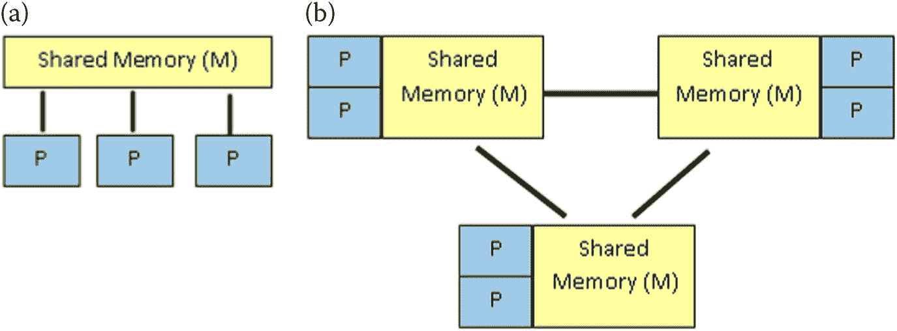

图 1.3 **(a)** 共享内存访问 (UMA) **(b)** 非统一内存访问 (NUMA)。

这类系统速度很快。该模型的主要问题是扩展性。由于所有处理器都通过共享内存进行通信，形成了一个瓶颈。由于所有通信都通过共享内存完成，该架构是紧耦合的。这种共享内存系统被称为并行计算系统。

在这些系统中，每个节点都有一个处理器（`P`）和一个内存（`M`）。每个节点都能独立进行处理。它们通过网络进行通信。网络结构用于节点之间的数据传输。这类系统被称为真正的分布式系统（图 1.4）。

图 1.4 分布式内存系统。

这类系统的扩展性高于共享内存系统，因为互连网络仅用于通信。它具有容错性，因为另一个节点可以执行故障节点的功能。当本地无法获取数据时，将从另一个远程节点获取。这导致与本地数据相比，远程数据的访问时间是非均匀的。这类系统是松耦合的，可以独立执行计算。

该模型是共享内存和分布式内存架构的混合。该模型的主要优势是像网络模型一样具有更高的扩展性。此外，由于共享内存，访问时间缩短了（图 1.5）。

图 1.5 混合系统。

因此，从程序员的角度来看，并行处理可以分类为：

* **并行处理**：当单个程序被分解为并行执行的独立任务时。

* **数据并行**：当并行处理大量值并合并结果时。

* **多处理器处理**：在单独处理器上执行两个或多个独立程序。

网络技术的进步、数据传输延迟的降低以及带宽的增加，促进了真正分布式系统的繁荣。

网络技术随着数据传输延迟的降低和带宽的增长，是分布式计算范式出现的驱动力。该范式出现于 20 世纪 60 年代，通过使用消息传递在远程计算资源之间启动通信而出现。20 世纪 70 年代局域网`ARPANET` 和电子邮件服务的增长促进了它的发展。分布式计算系统由多个独立的自治系统组成，它们通过通信和协调行动，在终端用户看来像是一个单一的整体系统。当用户给定任务时，系统透明地执行该任务。分布式系统的用户能够将系统视为一个灵活、高效、可靠、安全且易用的虚拟集中化系统。

在足球队中，每个球员都有自己的专长并独立工作。球员之间没有共享状态（没有通信）。此外，球员的移动没有全局同步。团队有一个共同目标，即防守球门和进球。这与分布式系统的定义恰恰是一个类比，分布式系统被定义为“一组自治节点，它们通过通信和协调行动，在终端用户看来像是一个单一的整体系统”。

为了应对这一挑战，某些透明性包括 [4,5]：

* **透明性**：这一特性向用户隐藏了细节。某些类型包括：

    * **位置透明性**：用户感知不到所在位置。

    * **迁移透明性**：隐藏任务是否已迁移的细节。

    * **复制透明性**：隐藏副本的细节。

    * **故障透明性**：隐藏当特定资源发生故障时重新分配的细节。

    * **并发透明性**：为多个用户之间的共享资源提供抽象。

    * **访问透明性**：向用户隐藏访问细节。

    * **扩展透明性**：便于系统扩展。

* **可靠性**：多个节点避免了在集中化系统中常见的单点故障。为了确保可靠性，分布式系统应该能够检测并从崩溃故障中恢复。为了容错，经常使用去中心化控制。冗余是复制多个节点。这确保了即使节点失败，功能也可以实例化。集中控制增加了单点故障的可能性，因此优于去中心化控制。

* **故障检测与恢复**：同样提高了系统的可靠性。它包括用于检测故障的硬件和软件机制，以及纠正系统状态的机制。原子事务、无状态服务器以及在消息传输中使用确认可以增加系统可靠性。

* **灵活性**：便于对系统进行修改以满足用户需求。可以添加新功能或服务，或修改现有服务以使系统更有效、高效。

* **扩展性**：扩展性是指系统适应不断增加的服务负载的能力。去中心化有助于构建可扩展的系统。

* **安全性**：分布式系统中的资源应受到防止破坏和未经授权访问的保护。可以使用加密原理提供身份验证和授权。应保持消息和数据的完整性。可以使用数字签名确保不可否认性。安全审计至关重要。


**性能**：分布式系统的性能应优于集中系统。提高分布式系统性能的一些措施包括采用细粒度并行、减少冗余复制操作和网络流量、在提交之前对作业进行批量处理以及使用缓存减少数据传输/磁盘读写操作。

分布式计算的一些优势 [6] 包括：

* **性能**：由于分布式应用程序中的任务可以通过在网络节点上分配负载来并行执行，它们具有良好的性能。
* **协作**：多个应用程序可以通过标准的分布式计算机制连接并通信，以协作完成任务。
* **更高的可靠性与可用性**：由于应用程序/任务在多台机器上复制，它提供了更好的可靠性。
* **扩展性**：分布式系统中的通信和松耦合使得具有更好的扩展性。
* **可扩展性**：分布式应用程序可以动态重新配置。分而治之的方法将大问题分解为小问题，这些单个组件可以由较小的开发团队独立开发。
* **复用**：分布式组件可以执行多种服务，可能被多个客户端应用程序使用。它节省了重复的开发工作并改进了组件之间的互操作性。
* `Reduced cost`：通过重用和动态重配置，可以显著地降低成本。

因此，在真正的分布式系统或点对点（`P2P`）系统中，控制权是去中心化的。在客户端-服务器架构中，客户端的角色是提交作业，而服务器完成作业并返回给客户端。在`P2P`系统中，客户端和服务器节点之间没有区别。对于某些任务，客户端可以执行服务器功能。系统是具有分布式控制的自组织系统，不需要中央服务器的集中协调。`P2P`系统最初出现是因为文件共享的需求（图 1.6）。`P2P`系统的主要优势包括：

* 工作共享
* 可扩展性
* 自主性
* 无单点故障
* 可靠性
* 降低成本
* 协作

图 1.6 客户端-服务器与 P2P 系统对比。

与集中的客户端-服务器系统相比，`P2P`环境中的安全和信任管理更为复杂。系统应该能够管理和维护异构节点。

并行处理系统实现了高性能，但它们紧密耦合且成本高昂。这种并行性可以使用通用系统的集群来实现。集群通常由同质的通用硬件组成，由主服务器集中控制。集群操作系统透明地处理任务分配、监控和收集，而无需用户参与。集群中所有节点共享的操作系统软件负责透明地分配任务和收集结果，不需要用户过多参与。

考虑一个由大量音乐家组成的乐团，他们共同演奏许多不同的乐器，并由指挥家领导。乐队可以被视为集群计算的类比（图 1.7b）。集群是一种并行或分布式处理系统，它由一组相互连接的独立计算机组成，作为一个单一的集成计算资源协同工作（类似于各种乐器）。集群的主要特征是节点是同质的，并由主节点集中控制（类似于乐团中的指挥家）。集群操作系统充当中间件，将作业拆分为任务并将任务通信给工作节点。一旦工作节点完成任务，控制器就会收集结果并通知客户端。因此，工作是由集群透明地完成的。集群中间件为用户提供了整个集群的单一系统映像（SSI）。集群的一些组件包括以下内容 [4]（图 1.7a）：

1. 用于控制集群的协调节点。
2. 拥有自己的资源（如处理器、内存和存储）的工作节点。
3. 提供工作节点与协调节点之间通信的网络。
4. 作为外部世界与集群之间防火墙的网关。

图 1.7a 集群架构。

当集群 [7] 被网关保护时，它被称为封闭集群。当集群节点可以被自由访问时，被称为开放网关。

图 1.7b 乐团 - 集群的类比。

以下是集群计算的一些益处：

1. 与大型机相比，集群能够实现高性能效益。集群系统由通用硬件组成，比大型机便宜得多。
2. 由于集群拥有多个节点，可以并行运行。集群的性能高于单机，与大型机相当。
3. 与大型机相比，集群具有良好的容错性。当集群中的节点故障时，功能由另一个节点接管。这在大型机上是不可能的。
4. 集群系统可扩展的。向集群中添加新节点不会影响其他节点。

集群提供了两种并行模型：

* 共享内存模型：所有处理器共享公共主内存，通信通过内存进行。这是一种紧耦合的并行系统。
* 分布式内存模型：每个节点都有自己的资源（包括内存），通信通过网络进行。这形成了松耦合的分布式系统。

集群的基本目标是通过聚合各个节点来提供高性能，通过平衡节点间的负载来优化集群效率，并维护冗余以处理故障。因此，根据功能，集群分类如下：

当作业需要高性能计算时，作业被拆分为称为任务的小单元并分配给集群中的各个节点。节点中的处理器等资源完成任务并将结果返回给协调节点。由于作业由多个节点并行执行，因此完成很快（图 1.8）。

图 1.8 任务并行。

图 1.9 负载均衡。

当关键作业在集群中执行且执行作业的工作节点发生故障时，作业无法完成。为了处理此类故障，中间件负责分配集群中的另一个节点来完成作业，并将中断降至最低。这种容错的集群被称为高可用。为了实现高可用性，中间件应该通过心跳消息持续监控节点的可用性。这由协调节点进行集中监控（图 1.10）。

图 1.10 容错性。

P2P 和集群架构是技术模型。它们并没有描绘计算行业的服务侧面。在集群模型中，计算服务在大多数时间内并没有被利用。因此，系统利用率较低。此外，购买和维护集群涉及的运营成本很高。为了降低成本并提高系统利用率，可以在多个用户之间共享计算资源。公用计算关注一种业务模式，即客户从付费的服务提供者处获取计算资源（见图 1.11）。这为客户提供了灵活性，可以在需要时向服务提供者请求资源。然后客户根据使用的资源向提供者付费。这种服务供给业务模式被称为公用计算。网格/云计算模型属于公用计算的范畴。这种模型最大化了资源利用率，从而降低了运营成本。就像水、电力作为公用事业提供给个人和企业一样，计算也被一种事业提供。

图 1.11 作为公用服务的计算。

服务水平协议（SLA）是服务消费者和提供者之间所需的协议。SLA 是一种正式合同，用于保证服务提供者能够满足消费者的服务质量要求。这确保了客户的满意度。良好的 SLA 确保以下几点：

* 客户满意度
* 服务质量
* 加强客户与服务提供者的关系

公用计算系统的架构由以下层组成（见图 1.12）：

* **用户**：通过合适的应用程序请求提供者服务的实体。
* **服务请求审查员**：解释客户服务请求中的`QoS`要求，并使用准入控制机制决定是否接受该请求。它因此消除了没有可用资源的请求。然后它触发`SLA 管理器`。
* **SLA 管理器**：检查`SLA`并发现合适的服务提供者以满足`SLA`中指定的`QoS`。该实体负责发现、谈判/重新谈判、定价、调度、监控、SLA 执行、分发和计费。发现组件识别能够满足请求者`QoS` old 的服务提供者。定价机制决定了如何对服务请求收费。`SLA 管理器`还根据满足协议的提供者列表将请求调度给合适的提供者。分发机制在分配的资源上启动执行被接受的服务请求。监控组件定期验证请求者的`QoS`是否得到满足。如果没有满足，则进行重新谈判。如果违反了`SLA`，可能会导致合同终止或支付罚金。
* **资源提供者**：根据`SLA`向客户提供服务的实体。

图 1.12 面向 SLA 的型公用计算系统架构。

集群计算处理协作工作以完成任务的同构系统。当我们考虑像银行这样的真实组织时，它由许多实体组成——计算设备、人员、其他设备（如计数机）、应用程序、客户。因此，自动化整个组织需要的不仅仅是计算机。这导致了网格计算范式的出现。网格计算平台的目标是在动态多领域的虚拟组织中实现协调的资源共享和问题解决。

网格计算资源包括计算能力、数据存储、硬件仪器、按需软件和应用程序。

考虑一组想要研究臭氧层的物理学家。该小组需要设备来收集大气数据，需要数学家、物理学家、计算机科学家、计算设备以及接口来完成他们的研究。所有这些连接的异构实体形成了一个网格（带有数据收集设备、计算机、分析软件、数学建模工具和接口）。网格环境中资源的异构性和地理分布性对去中心化控制（以实现更好的协调）和开放标准（为了互操作性）提出了必要性。

与网格计算相关的最重要的概念之一 [8] 是虚拟组织。网格计算旨在实现虚拟组织内参与者之间实现协调的资源共享。例如，加利福尼亚大学的一位物理学家使用来自意大利观测中心的数据集。他使用由印度数学家建立的数学模型，通过模拟应用程序进行分析。然后他通过天文台验证结果，并将结果存储在存储提供者处。这个虚拟组织涉及至少四个物理组织的实体——加利福尼亚实验室、意大利实验室、印度实验室和服务提供者。它连接了计算元素以外的实体。这样一个虚拟组织的创建基于各种物理实体之间的`SLA`。这包括组织中各种成员的角色、活动、视图和行政权限。所有这些实体形成了一个巨大的网格来研究臭氧层（见图 1.13）。

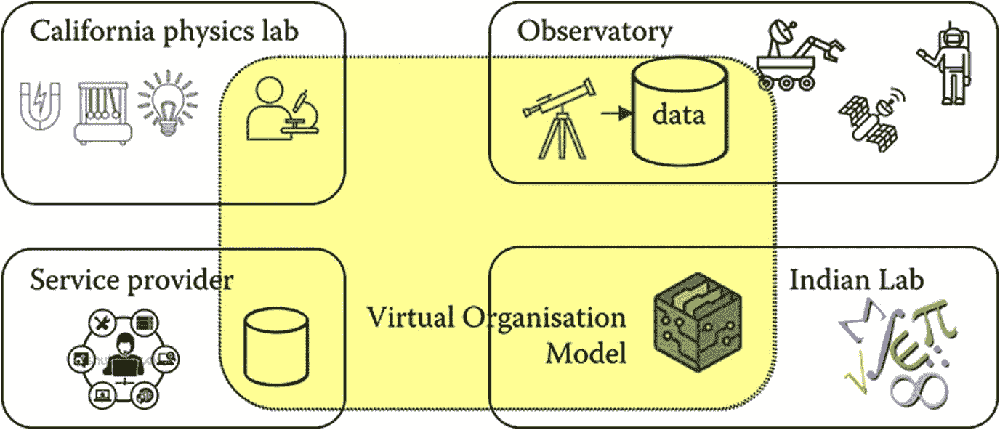

图 1.13 虚拟组织。

正如图 1.14 所示，一个或多个虚拟组织共享相同的物理资源。考虑一个天气预报的 VO。它需要数据收集、存储、分析和结果可视化的资源。这包括处理器、硬盘、内存等硬件资源以及软件应用程序和框架。硬件资源可以与另一个虚拟组织（用于金融领域）共享。

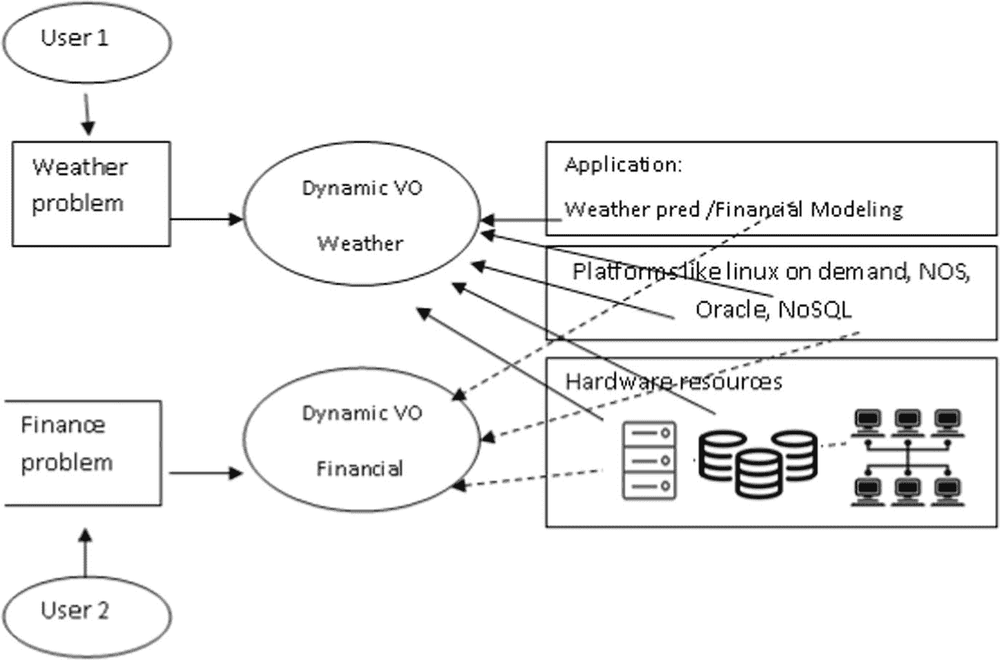

图 1.14 虚拟组织资源共享。

虚拟组织因此是：

* 逻辑实体
* 为特定问题动态创建，因此具有有限的寿命
* 它们可以动态地发现、提供和管理物理资源
* 监控`SLA`中指定的`QoS`
* 资源共享基于一组开放且定义的交互和访问规则
* 参与者之间的共享关系本质上是对点对点的

网格基本分类为计算网格或数据网格。科学模拟如质数序列、金融建模不涉及大量数据，但需要大量的计算。这些应用程序是计算密集型的。处理器和内存被大量使用。这样的网格被称为计算网格。另一方面，天气预报和物联网需要分析大量数据。它需要大量的存储资源。此类网格被称为数据网格。

主要业务领域的一些示例包括：

* 生命科学领域的基因组数据分析
* 股票/产品价格预测
* IoT 等数据密集型应用的研究
* 汽车和航天工程的设计、建模和测试
* 实现各种政府服务之间的无缝协作和灵活性
* 大规模并行在线游戏

* **分布式计算系统**：存在多种分布式计算范式，如`CORBA`、`DCOM`、`RMI`等。它们缺乏互操作性，因此无法形成`VO`（虚拟组织）。
* **点对点计算系统**：是地理分布的异构系统，没有中心化控制。它们通过协调资源共享来完成任务。`P2P`系统中没有定义虚拟组织。因此，它们与大量节点协作但缺乏安全性。较小社区的虚拟组织有助于实现更强大、更安全的资源共享。
* **集群计算**：其特点是中心化控制和细粒度并行。因此，无法有效地形成`VO`。

为了在虚拟组织之间协调资源并共享资源，网格系统具有各种组件。这些组件构成了网格架构。网格架构随不同代而异。第一代网格由基于元计算机的分布式服务器组成，通过通信协议连接并使用`Single Sign-On`（单点登录）访问。随后，网格基于`Networking Architecture`演变为第二代的分层架构。第三代基于面向服务的架构（`SOA`）。后来这演变为语义 Web 3.0 架构。

最初，网格计算始于利用桌面系统的免费计算能力，如`SETI@HOME`项目。这是志愿者计算或桌面计算的一种形式。在志愿者计算中，客户端程序运行在志愿者的计算机上。它定期通过互联网联系项目服务器，请求任务并传回完成任务的结果。志愿者计算的目标是利用桌面系统中的空闲资源用于研究和科学项目。

志愿者计算的一些局限性包括：

* 具有执行任务所需资源的志愿者可用性。
* 在单个志愿者桌面电脑上执行的任务应该是相互独立的，它们之间应该很少或没有通信。
* 志愿者计算的成功取决于志愿者是否愿意提供其免费资源用于计算目的。
* 志愿者系统硬件、操作系统和应用的异构性。
* 志愿者的信任确保任务能够可靠地完成且无错误。
* 使用数据和作业复制技术可以增强可靠性。

在分层架构中，每一层都为其上一层的组件提供服务。从底到上的各个层级如下（图 1.15）：

* **织物层 (Fabric layer)**：包括各种资源，包括计算、存储、集群和网络资源。每种资源都有其需要遵循的协议。
* **连接层 (Connectivity layer)**：旨在建立各种资源之间的通信。使用`TCP/IP`栈来实现。资源的真实性通过与`Single Sign-On`相关的安全协议决定。
* **资源层 (Resource layer)**：协议旨在在单个资源级别进行协调和共享。该层监控单个资源的`QoS`，并维护资源的元数据，如资源的位置、配置和使用情况。
* **集合层 (Collective layer)**：处理资源集合。它提供资源发现、调度、监控和故障处理等服务。
* **应用层 (Application layer)**：包含设计用于利用底层各种服务的应用程序。

图 1.15 分层网格架构。

分层架构的主要问题是该层所提供的服务之间存在紧耦合。每一层都为其紧邻的上层提供服务。为了促进组件之间的松耦合，可以使用`SOA`。

在`SOA`中，软件组件为各种应用程序或其他组件提供服务。这些服务使用了定义良好的接口，暴露了组件的功能。因此，应用程序开发者使用这些接口与组件交互。组件的内部代码不对开发者开放。我们可以得出结论：服务是应用程序中面向用户的软件组件。组件与用户之间的消息使用标准协议定义。Web 服务架构是`SOA`的一个实例。开放网格服务架构（`OGSA`）使用了 Web 服务架构（`WSA`）中的功能，并使用这种新兴架构定义了编程模型。服务是松耦合的对等实体，可以单独地或作为一个组组合或编排，以提供应用程序的能力。`OGSA`基于`WSA`的核心技术：

* **可扩展标记语言 (`XML`）**：用于定义消息交换的格式和结构。
* **Web 服务描述语言 (`WSDL`）**：用于描述网格服务的接口。
* **简单对象访问协议 (`SOAP`）**：定义了网格/Web 组件之间的消息交换模式。
* **通用描述、发现和集成 (`UDDI`）**：用于发现服务。

由全球网格论坛（Global Grid Forum）提出的`OGSA`是一种 SOA，旨在为基于网格的应用程序定义一种通用、标准且开放架构。“开放开放既指开发标准的过程，也指标准本身。`OGSA`设计用于使用标准接口和协议创建、终止、管理和调用有状态和瞬态的网格服务。瞬态服务可以动态创建和销毁。状态区分了不同的服务实例。每个服务实例都由全局唯一的网格服务句柄 (`GSH`) 标识。服务是基于`OGSA`的网格的构建块。`OGSA`在异构分布式网格中提供以下特性：

* `OGSA`定义了接口以促进服务的互操作。
* `OGSA`在包含资源的服务组件之间提供无缝的`QoS`。
* `OGSA`管理资源。
* 使用基于`WSA`的松耦合状态服务提供网格功能。

`OGSA`提供的通用服务包括（图 1.16）：

* **基础设施服务 (Infrastructure Services)**：是其他服务所需的命名、发现等服务。
* **执行管理服务 (Execution Management Services)**：用于放置、配置和管理各种任务、工作流及生命周期。
* **数据管理服务 (Data Management Services)**：提供表示、访问、创建和管理数据的接口。它们处理数据一致性、持久性和完整性问题。
* **资源管理服务 (Resource Management Services)**：提供为服务监控、分配、部署和配置网格资源。
* **安全服务 (Security Services)**：在（虚拟）组织内部执行安全相关策略。这些服务提供身份验证、授权和完整性保证接口。
* **信息服务 (Information Services)**：提供获取网格环境信息的接口。
* **自管理服务 (Self-Management Services)**：有助于实现服务`QoS`的自主服务。

图 1.16 OGSA 架构。

第三代网格进一步使用语义 Web 技术来开发和交付网格应用程序。这种网格被称为语义网格。它使用：

* 自治计算用于管理异构的网格资源。其自优化能力通过调整资源/作业来最大化资源利用率。它能够预测故障并保护自身，这被称为自愈能力（self-curing）。它能够诊断故障并从中恢复，因此它具有自修复能力（self-healing）。它是动态的，并且能够在环境变化时进行重新配置，因此它具有自配置能力。
* **按需业务**：语义网格能够根据虚拟组织的动态需求动态分配资源。对于这种资源，虚拟化是必不可少的。
* `SOA`为网格服务之间提供了松耦合性。
* 语义服务：相关的服务可以被识别和分组。

网格计算面临的一些问题包括：

* 网格计算环境中的单个作业量非常大。它被拆分为可以单独执行的任务，然后对结果进行收集或编排。由于它趋向于批处理，因此不适用于高性能计算环境。网格非常适用于高吞吐量计算应用，在这种应用中缩短的是整个作业的完成时间，而不是任务的完成时间。
* 网格计算是由科学社区推动的，因此缺乏商业效益。
* 网格应用是针对特定平台的。
* 它依赖志愿者计算在资源空闲时形成虚拟组织。这影响了完成网格作业的资源的可用性和可靠性。
* 在这里，`VO`中的所有资源为用户提供了单一系统映像。许多资源被虚拟化为一个整体。作业被分配在许多利用率不高的资源上。从业务角度来看，这可能是有害的。

云计算是实用型计算的一种形式，类似于网格计算，用户为他们使用的计算资源付费。云 [9] 被定义为一种并行分布式系统，由在数据中心维护的抽象化、虚拟化、动态管理的计算资源（如存储、计算、平台、网络、应用程序）的共享池组成。资源根据用户的需求动态地进行配置和重新配置。因此，云中的资源管理在本质上是弹性的。这是自动完成的，减少了人工干预。因此，服务从用户中抽象出来。`SLA`作为服务提供商和消费者之间的合同。用户根据其对计算资源的使用情况付费。这形成了一种商业模式。从业务角度来看，这种模式降低了组织的资本和运营成本。

## 1.8.1 云环境的特点

云计算模型实现了对共享的可配置计算资源池的无处不在、便捷、按需的网络访问。以下是云计算环境的关键特征：

* 面向服务的架构：所有功能都通过接口作为服务提供给用户。这些服务可以很容易地扩展、组合、编排，以向用户提供所需的功能。`SOA`促进了松耦合和抽象。服务可以进行定制以满足用户需求。
* `按需自服务`：服务可以根据用户的需要动态地提供，而无需人工干预。


- `广域网络访问`：云通过互联网等标准网络为移动设备、笔记本电脑和工作站等异构客户端设备提供服务。
- `资源池`：提供者的资源被汇在一起，并根据需求动态地向用户分配/释放资源。
- `快速弹性`：云中的资源根据需要动态地进行配置和释放。
- `计量化服务`：服务经过计费和监控。
- `位置无关性`：用户可以随地、随地访问云。
- `业务模式`：云计算提供了一种基于使用的资源业务模式。
- `虚拟化`：这项技术从用户中抽象出硬件/软件。一个资源被划分为多个。这导致了多租户性。

云计算模型根据其交付方式或部署模型进行分类。这里将讨论这两种大类。

## 云服务模型

云服务模型定义了不同层次的服务核心功能。这些分类如下：

- `基础设施即服务`（`IaaS`）：允许提供者建立并交付虚拟化的硬件资源，如存储、计算和网络。通信即服务和数据存储服务也是 `IaaS` 的某些示例。这属于实用型计算。
- `平台即服务`（`PaaS`）：为开发者提供构建和部署应用程序的工具、平台和环境。它包括运行时、数据库和 `API`。这也被称为框架计算。
- `软件即服务`（`SaaS`）：提供在云端运行的应用程序，用户可以按需远程访问。因此，用户被除了本地安装和使用所需软件的负担。它被称为业务计算。

## 云部署模型

根据云服务的功能和访问性 `[9]`，云提供了四种部署模型（图 18）：

- `公有云`：用户通过互联网访问由服务提供者提供的基础设施、框架、应用程序和服务。用户订阅他们访问的服务并根据使用情况付费。
- `私有云`：这种类型的云是本地的，通过内网提供服务。与公有云相比，它更安全。
- `混合云`：它由多个公有/私有云组成。这种模型结合了公有部署和私有部署模型的优点。
- `社区云`：这可以是一个由同一管理域的一组组织共享的公有/私有云。

## 云计算的优点

- 具有更好的灵活性和扩展性，因为可以随需添加新的基础设施，而不会影响正在提供的服务。
- 资源利用率更高，因为相同的资源在许多用户之间进行虚拟化共享。
- 数据备份和灾难恢复由服务提供商自动处理。
- 用户可以使用任何访问技术，随时随地在任何地方使用云资源。
- 云资源具有高可用性，当现有实例故障时，可以启动另一个实例。

## 云计算面临的挑战

云计算中面临的一些挑战包括：

- 必须具备可靠的互联网连接以访问资源。
- 客户数据的安全由服务提供商管理。
- 对云服务提供商/供应商的依赖性。

## 无处计算、泛在计算和移动计算

本节比较了无处计算、泛在计算和移动计算。

桌面计算使用户可以使用单个台电脑执行计算功能。在这里，一台台电脑由一个用户使用。无处计算进入了许多用户使用不可见资源的时代。这是一个多多的关系。无处计算的意思是“无处不在”。云是一种无处不在的环境，因为用户可以通过互联网和各种访问技术访问托管在云中的远程资源。尽管资源不移动，但可以通过互联网从任何位置访问这些资源。因此，移动性很高。

泛在计算环境将计算嵌入到如物联网等各种设备中。与移动系统相比，这些资源要小得多。这类系统的移动性较低。它们用于智能家居等应用。

移动计算将计算嵌入用户携带的设备中。移动计算涉及移动通信、移动硬件和移动软件。这类系统的移动性很高。使用手机进行计算就属于这一类。

### 无处计算的主要特征

- 无缝访问远程信息资源并具有具有容错性的通信。
- 与泛在计算和移动计算相比，用户并不拥有资源，因此对远程资源没有控制权。
- 用户可以使用合适的访问和通信技术随时、随地访问资源。

### 无处计算的局限性

无处计算的三个局限性包括：

- 网络带宽和网络覆盖的局限性。
- 电池供电设备受能量限制。
- 移动和泛在设备的输入/输出屏幕尺寸。

## 丛计算

传统的高性能计算受限于超级计算机。集群、网格和云计算范式的出现也促进了高性能计算，因为任务可以在各种工作节点上并行执行。

超级计算、网格和云等各种高性能计算基础设施可以通过巨大的高速通信网络连接起来。这种异构系统的组合形成了“计算丛林”（图 1.19）。

当用户提交应用程序时，中间件会识别哪种 `HiPC` 基础设施最佳。然后它使用合适的工具在基础设施中编译并部署应用程序。通信网络确保了各种 `HiPC` 基础设施与用户之间的通信。

图 1.19 丛计算。

任务复杂度决定了计算环境。因此，可以根据任务需求选择合适的高性能计算环境。

### 丛计算的特征

- 资源独立性和异构性：资源在存储和处理能力方面存在显著差异。因此，需要中间件来向用户隐藏资源的细节。
- 中间件：每个 `HiPC` 系统都有自己的中间件。计算丛林的中间件确保了它们之间的互操作性。
- 健壮的连接确保了与丛林中 `HiPC` 系统的可靠通信。
- 唯一的资源标识解决了资源冲突。
- 可伸变性提供了适应资源变化的灵活性。
- 容错性用于处理系统故障并恢复应用程序状态。
- 从串行代码到并行代码的自动转换。这一特性消除了对并行编程范式专家的需求。
- 中间件还将将遗留代码与丛林软件集成。

### 丛计算的局限性

- 属于不同管理域的资源管理。
- 各种高性能计算系统的互连困难。
- 当随机选择计算环境时，生成的编译器和可执行应用程序代码等系统软件将面临互操作性问题。

## 雾计算

云计算的主要问题是所有数据都必须传输到集中计算机集群以执行计算。这涉及到网络延迟。

我们可能都知道用于云环境中处理大数据的 `Hadoop` 框架。`Hadoop` 的基本概念是将计算移动到位于特定数据节点的数据。通过这样做可以最大限度地减少数据移动并降低网络延迟。

类似的情况在雾计算中也会发生。在这里，处理和存储资源通常位于网络边缘，靠近生成信息的设备。因此，雾计算更适用于智能城市、医疗保健和增强现实等对延迟敏感的应用。

雾计算是一个虚拟化平台，其中处理器、存储和网络等计算资源放置在云的边缘，而不是为云存储和处理建立通信通道。通常，处理是在用户和云之间完成的。云可以处理非实时应用程序以及数据的长期存储。

### 雾计算的特征

雾计算的一些特征 `[10]`：

- 常用数据和计算靠近终端用户。
- 区域感知处理降低了延迟。
- 地理分布式的处理确保了扩展性和速度。
- 促进使用传感器网络收集数据。
- 支持基于位置的移动。
- 促进在网络边缘进行实时数据处理。
- 支持异构资源及其之间的互操作性。
- 由于雾服务器直接连接用户，可以根据用户进行优化。
- 雾局部化和云全球化通过在边缘过滤数据并进行全球化分析或局部分析来实现更好的分析。

### 与雾计算相关的计算范式

- `移动云计算`（`MCC`）：移动设备受资源限制，因此可能无法执行某些服务。因此在网络边缘使用名为 `cloudlet` 的轻量级云服务器来克服移动设备的资源限制。主要的限制是到边缘服务器的可靠低延迟网络。
- `移动边缘计算`（`MEC`）：移动边缘计算（`MEC`）服务器位于蜂窝网络的基站。`MEC` 服务器提供计算和存储设施。用户请求被转发到 `MEC` 进行处理。如果 `MEC` 无法处理请求，则将其转发到云服务器。
- `边缘计算`（`EC`）：在物联网环境中，优选在更靠近数据源（传感器）的地方进行计算。因此，此类处理器不仅消耗来自传感器的数据，还通过处理这些数据来产生数据。边缘设备位于数据源和云服务器之间。`Cloudlet` 服务器作为移动应用和云的边缘，而 `IoT` 网关则作为 `IoT` 传感器与云之间的边缘。智能手机充当应用和云的边缘。它们可以执行计算、缓存数据或存储数据。边缘服务器还可以卸载数据或从云端获取服务。边缘服务器还可以代表云服务器为客户端提供服务。边缘计算基于设备，而雾网计算是基于位于局域网（`LAN`）的处理器。边缘计算和雾网计算旨在让计算靠近设备并实现去中心化。
- `露计算`（`DC`）：旨在实现本地计算机/智能手机与云服务的协作潜力。它的目标是充分利用本地和云系统的潜力。它基于微服务器架构。虽然雾网服务器连接到云，但它们不必使用云服务。在露计算中，来自类似 `fitbit` 设备的数据通过智能手机传输到云端并进行处理。因此，露计算始终使用云服务。
- `雾露计算`（`FDC`）：`IoT` 设备通过本地连接连接到雾网服务器。雾网服务器通过互联网连接到云。因此，它可以在雾网服务器上离线计算，也可以在云服务器上在线计算。

图 1.20 与雾网计算相关的范式。

## 雾网计算系统架构

雾网计算系统的高层架构由三层组成 `[11,12,13]`（图 1.21）：

- 最底层由 `IoT` 平台组成。该层由所有执行感知和执行功能的连接设备组成。
- 雾层：使用虚拟和物理资源。该层可以执行小型和中级数据处理。通常对于时间敏感型应用，处理在该层中完成。它积累传感器数据，对其进行处理，并将执行信号发送到 `IoT` 平台。该层也可以进行资源虚拟化。通常，在该层中进行容器虚拟化。该层还可以从云层获取服务。
- 云层：该层执行复杂的数据处理和存储。如果应用对时间不敏感，雾层从应用层获取服务以处理应用。

图 1.21 雾网计算系统架构。

用户可以从雾层或云层获取服务。

## 渗透计算

云环境提供了所需的资源（包括计算和存储）以执行传统 `IoT` 应用的功能。这种集中框架为延迟敏感型 `IoT` 应用引入了不必要的延迟。

延迟感知应用需要在数据生成/使用的设备网络边缘进行处理。因此，根据应用的性质，云模型和边缘模型需要共存并协作。云-边缘平台的无缝集成只有在支持互操作性、隐私和管理的服务的支持下才能成功。

渗透计算促进了此类服务在边缘云环境中的协作使用。为此，轻量级虚拟化机制非常合适。因此，渗透计算广泛使用容器化和微服务。

软件应用由许多独立部署的模块化微服务组成。每个微服务执行一个独特的进程，并通过定义良好的轻量级机制（如容器）进行通信。容器封装了软件组件并确保减少了部署开销。因此，基于容器的方法有助于在网络边缘的设备上部署轻量级微服务。

渗透计算通过在网络边缘提供增强的资源和数据管理能力，促进了云数据中心和网络边缘之间 `IoT` 微服务的有效执行。它还支持适当的数据传输协议以实现服务的无缝集成。

渗透计算通过使用 `dockers` 等轻量级容器，在异构云边缘环境中提供自动且安全的微服务部署。它的目标是高度分布和联邦化的环境，并实现跨越边缘和云基础设施的组成且相互连接的微服务的自动部署。

渗透计算促进了跨云、雾网和边缘计算资源的服务迁移 `[14]`。它源于“渗透”（osmosis）一词，指允许溶剂分子通过半透膜从低溶质浓度区域移动到高溶质浓度区域，使溶液浓度相等。

化学溶液类似于雾网环境的计算基础设施，其资源需求随应用和时间而变化。渗透计算旨在通过适当利用云、雾网和设备层的资源来平衡负载。这种负载均衡通过在云、雾网和设备层之间迁移服务来实现。

### 渗透过程与渗透计算的类比

渗透过程的主要元素包括溶质、溶剂、溶液、半透膜和浓度。从这些组件到渗透计算可以建立如下的类比：

- `溶质`：这些粒子不被允许迁移。我们可以将计算基础设施中的溶质类比为计算能力、存储、能量等，具体取决于应用。
- `溶剂`：溶剂可以通过半透膜在溶液之间迁移。对计算基础设施中相同事物的类比是服务。这些服务可以在云、雾网和边缘基础设施之间迁移，以提高应用的有效性。
- `溶液`：包含溶质和溶剂。对溶液的类比包括由用户、设备、计算/存储资源、平台和服务组成的完整基础设施。
- `半透膜`：控制溶剂的移动使溶液浓度相等。雾网环境在渗透计算框架中通过决定何时、何地以及如何迁移微服务来执行此功能。资源分配器根据应用决定微服务何时应在云、雾网和边缘资源之间迁移。基于资源可用性、延迟和负载平衡因素，微服务可以从一个资源迁移到另一个资源。迁移的技术支持可能包括轻量级容器服务。
- `浓度`：代表由设备、雾网和云等各层可用资源所处理的微服务比例。

因此，渗透计算模型基于渗透原理。用户面与雾层资源管理器交互，资源管理器根据应用需求将服务分为微服务和宏服务。这些资源管理器充当半透膜的作用，在边缘资源和云资源之间迁移服务，以提高应用性能。

### 微元素

在这里，应用程序被建模为一个有向图，其中数据转换任务是节点，任务之间的数据流是边。该图模型允许任务在云端、边缘层和设备层的可用资源上进行分布和执行。

这些数据转换任务也被称为微元素（`MEL`），它们封装了资源、服务和数据。一个 `MEL` 封装了以下类别之一（图 1.22）[`15`]:

- 微服务（`MS`），提供特定的功能，并可以容易地部署或迁移；
- 微数据（`MD`），代表与传感器、执行器或数据中心之间的信息流；
- 微计算（`MC`），使用实时和历史 `MD` 混合执行不同类型的计算任务（例如：统计分析、错误检查或机器学习）；或
- 微执行器（`MA`），控制网络边缘物理资源的状态。

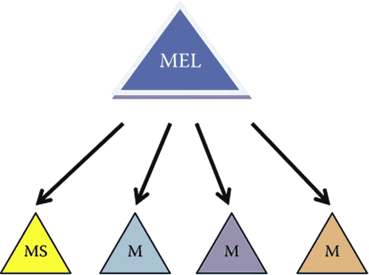

图 1.22 MEL 的分类。

`IoT` 应用被分解为许多相互作用的原子 `MELs`，它们执行简单的功能，如从传感器收集数据、对数据进行简单的转换。`MELs` 部署在容器中。这使得：

- `application`
- `application`
- `application`

## 渗透计算中的研究挑战

- **微服务负载竞争**：在联邦渗透式环境（federated osmotic environment）中，相关微服务的共同部署至关重要。但共同部署的容器化微服务会导致负载竞争。因此，理解它们组合的本质对于决定哪些微服务可以部署在一起至关重要。应该研究 `Docker Swarm` 和 `Kubernetes` 等容器引擎，通过分析性能、优先考虑负载以及协调其部署，动态处理跨云和边缘数据中心资源之间共同部署微服务的此类资源竞争。
- **资源监控**：传统工具监控 `CPU`、内存、文件系统和网络使用统计数据，但无法监控微服务级别的 `QoS`（服务质量）指标违规。因此，需要可扩展的方法来监控云和边缘数据中心内多个层级微服务的 `QoS` 和安全指标。
- **微服务编排与组合**：一种能够预测跨云-边缘数据中心同地微服务负载和性能的合适技术，结合 `QoS` 感知的资源编排与组合技术至关重要。这使得应用程序微服务可以在边缘和云资源之间进行有效的卸载和反卸载。
- **调度**：在云和网格环境中对合适资源的调度是一项重要的研究领域。必须考虑作业大小、延迟、利用率、节能等各种因素。统计和演化优化技术已得到尝试。

## 总结

本章概述了从并行处理系统到分布式系统的各种计算范式。

在集中计算范式中，所有计算机资源（如处理器、内存和存储）都位于一个物理系统中并由集中控制。资源在同一个操作系统下的各种进程之间共享。虽然此类系统可以提供高安全性、完整性、低维护成本和可靠性，但它们面临扩展性和灵活性不足的问题。

并行计算范式允许并行执行计算。通常，处理器共享一个中央内存，并通过共享内存以紧耦合的方式进行通信。或者，它们可以是松散耦合的，拥有分布式内存。在这种情况下，通信是通过消息传递实现的。

集群计算范式使用计算机集群。它是一种并行或分布式处理系统，由一组相互连接的独立计算机组成，这些计算机作为一个单一的、集成计算资源协作工作。该模型的主要特征是集中控制。

分布式计算（图 1.24）由一组独立的计算机组成，每台计算机都有自己的内存、磁盘和处理器。这些独立节点相互协作解决问题。参与的计算机之间通过消息传递进行通信，该组对用户来说似乎是一个单一的一致系统。

当分布式系统拥有去中心化控制时，它就变成了 `P2P` 系统。网格（`Grid`）是一种具有虚拟组织概念的分布式系统，许多物理资源聚合在一起以协作完成任务。

云计算是一种基于互联网的分布式计算环境。在云中，可以按需配置共享资源。云促进了类似于电力或水供应提供的公用化计算服务。

互联网的出现在云计算出现之前就已经促进了 Web 托管（`Web hosting`）。`Web hosting` 是在 `WWW` 中提供空间来托管服务器的机制。例如，应用程序服务提供商可以在 `WWW` 服务器上托管它们的应用程序，并将应用程序作为服务交付给客户。这种方法限制了所提供服务的用户。

通过虚拟化技术，这种模型可以变得更有效且在财务上更可行。这催生了向更多用户提供 `SaaS` 的概念。最终，`SaaS` 因其易用性而流行起来，催生了今天所谓的云，不仅提供软件，还可以提供平台（`PaaS`）和基础设施（`IaaS`）作为服务提供。

然而，在目前的云技术中，可以提供任何事物和一切作为服务，这产生了“万物即服务”（`XaaS`）术语。分析也可以作为一种服务提供。

虽然云计算的动力来自商业社区，但网格计算的动力来自科学社区。后来，云计算增强为雾计算（fog computing），以为 `IoT` 设备提供服务。与其他雾计算相关的范式还包括移动云计算、移动边缘计算、露水计算、雾露计算和边缘计算。

渗透式计算实现了微服务在雾计算环境不同层级之间的无缝迁移。下一章将讨论边缘计算系统。

图 1.24 分布式计算范式。

## 参考文献

1. Pete Sanderson. (2019, 8 月 7 日). 主修计算机专业的 10 个理由。[`www.collegexpress.com/interests/science-and-engineering/articles/careers-science-engineering/top-10-reasons-major-computer-science/`](https://www.collegexpress.com)。
2. Hwang, K. (2012). 分布式与云：从并行处理到物联网。Morgan Kaufmann。
3. Gill, S. (2015, 4 月). 计算机对今天社会的影响。International Journal of Core & Management (IJCEM), *2*, 173–178。
4. Abbas. (2017). 分布式计算的演进：简要路线图。International Journal of Computing, *6*, 233–249。
5. Kshemcalyani, A. (2011). 分布式计算：原理、算法和系统。Springer Press。
6. Tanenbum, A. (2015). 分布式系统：原理与范式。Pearson。


7. Couloris, G.. (2012). 分布式系统：概念与设计。Pearson。

8. Naha, A.. (2016). 网格计算：技术应用指南。Laxmi Publications。

9. Buyya, R.. (2009). 云计算与新兴平台：作为公用服务的愿景与现实。Future Generation Computer Systems, 25, 599–616。

10. Naha, R. K.. (2019). 雾计算架构：综述与挑战。Big Data-Enabled Internet of Things, 第 10 章，页. 199–223. DOI: [10.1049/PBPC025E_ch10](http://doi.org/10.1049/PBPC025E_ch10)。

13. Naha, R. N., S., Garg, Georgakopoulos, D., Jayaraman, P. P., Gao, L., Xian, Y., & Ranjan, R. (2018). 雾计算：趋势、架构、需求和研究方向综述。IEEE Access, 6, 47980–48009. DOI: [10.1109/ACCESS.2018.2866491](http://doi.org/10.1109/ACCESS.2018.2866491)。

14. Sharma, V., Srinivasan, K., Jayakody, D., Rana, O., & Kumar, R. (2017). 使用渗透计算管理服务异异性。ArXiv abs/1704.04213。

15. Villari, M., Fazio, M., Dustdar, S., Rana, O., Jha, D. N., & Ranjan, R. (2019, August). 渗透：用于云、边缘和物联网中微元素的元素的渗透计算平台。Computer, 52(8), 14–26. DOI: [10.1109/MC.2018.2888767](http://doi.org/10.1109/MC.2018.2888767)。

16. Villari, M., Fazio, M., Dustdar, S., Rana, O., & Ranjan, R. (2016). 渗透计算：边缘/云集成的新范式。IEEE Cloud Computing, 3(6), 76–83. DOI: [10.1109/MCC.2016.124](http://doi.org/10.1109/MCC.2016.124)。

考虑一个带有视频摄像头的智能建筑，用于检测人员的移动。视频信号持续流到云端服务器。云服务器中的运动检测应用可以检测特征并将其存储到数据库中。由于大量视频数据持续流到云端，会消耗大量的网络带宽。云服务器还必须同时分析来自所有摄像头的视频片段。如果运动检测应用能够在靠近摄像头的地方执行，这些问题就可以得到解决。届时，只需将所需的片段传输到云端进行进一步的分析和存储。

传统上，从各种传感器收集的实时数据被上行到云服务器进行进一步的处理和存储。云基础设施非常适合处理此类海量的不断变化的异构数据（也称为大数据）。但当数据源分布在多个地点且需要在近实时完成处理时，远端云基础设施中大数据处理就会失败。这促使了对替代范式的需求，该范式能够在更靠近传感器或数据源的地方执行计算。位于网络边缘的此类基础设施能够执行低延迟计算，聚合数据，然后将其传输到云端进一步分析。此外，来自云的下游响应也会返回给这些节点。根据网络覆盖，网络边缘可以是一个房间、一栋建筑或一个校园。

使用边缘计算基础设施在数据源附近实时处理物联网（IoT）设备产生的量数据变得至关重要。这不仅减少了计算延迟和网络资源的使用，还加强了数据安全。本节讨论了边缘计算范式通过技术准备阶段、快速增长阶段和稳定阶段的演变 [1]。

技术准备阶段始于内容分发网络（CDN）。具有地理分布缓存服务器的 CDN 使用户户能够访问最近的服务器（1998 年）。网络流量和延迟降低了。虽然 CDN 强调数据缓存，但边缘计算侧重于函数缓存。2005 年，函数缓存被应用于个性化邮箱管理以减少延迟。Cloudlet（2009 年）被用于将云信息向下传输网络边缘。边缘数据处理最初始于移动设备（2010 年）。移动边缘计算（MEC）强调在云服务器和边缘设备之间建立边缘服务器以卸载计算。雾计算的概念由思科（2012 年）提出。雾计算侧重于一个虚拟化的计算平台，将云任务迁移到网络边缘。雾计算旨在优化基础设施层面的通信，而边缘计算（2013 年）则侧重于设备、边缘服务器和云服务器层的计算和网络资源。云海计算强调系统的云端和人类/物理世界端。但边缘计算关注的是云与物联网设备之间的通信路径（上行和下游）。

2015 年以来，边缘计算引起了工业界和学术界的更多关注。2015 年，边缘计算在《边缘计算：愿景与挑战》白皮书中获得了正式定义。论文将边缘计算定义为一种可用技术，允许在网络边缘执行计算，代表云服务处理下游数据，并代表物联网服务处理上行数据。2016 年，美国国家科学基金会（NSF）合作建立了无线边缘网络中的信息中心网络（ICN-WEN）。NSF 大挑战研讨会（2016 年）和中国边缘计算研讨会（2017 年）向科学界展示了这项技术。用于物联网边缘计算的通用开源框架 LinuxEdge 于 2017 年构建。2018 年见证了工业界对边缘计算平台的积极参与。边缘计算联盟于 2018 年成立。第一本关于边缘计算的书也于该年出版。用于云和设备环境的 Kubernetes 由云原生计算基金会（CNCF）和 Eclipse 基金会于 2019 年联合开发。边缘计算在医疗领域的应用在 Bio-World 议会（2019 年）上受到了关注。这一快速增长趋势预计将在 2021 年趋于稳定。

## 感知层

它由边缘设备组成。边缘设备是一种为了有效执行特定任务而设计的特殊用途且高效益的硬件。边缘设备的计算/存储资源有限。此类设备的示例包括转换器、传感器、执行器、日志记录器和摄像头，它们具有收集和/或传输数据的功能。某些边缘设备具备执行额外活动的处理能力。对于这些设备收集的图像、视频、文本数据的分析应用，需要根据资源的可用性进行部署和管理 [4]。

它负责连接设备、边缘系统和云系统。它由各种通信和数据传输协议组成。

该层的主要组件包括边缘服务器和网关。与 `IoT` 设备相比，边缘服务器具有更高的计算/存储能力。在资源受限的边缘设备中无法执行的负载可以使用这些通用计算节点或节点集群完成。该层中的边缘网关执行专门的网络功能，包括协议映射、网络终止、隧道技术和防火墙保护。

该层负责执行复杂的数据密集型任务并存储海量数据。该层中的私有云或公共云服务器充当节点间共享数据的仓库。云服务器执行无法托管在边缘服务器上的复杂数据密集型/计算密集型应用。云服务器还用于边缘节点的资源分配和作业管理。

通过将边缘计算和云计算范式视为互补，可以在它们之间实现协同效应。边缘服务器可以在靠近数据源的地方处理延迟感知计算。共享的全局计算/存储、管理和数据隐私可以在云服务器中有效处理。图 2.1 讨论了通用边缘计算模型的各个层级。图 2.2 在考虑边缘服务器网络的情况下提供了更详细的视图 [5]。

图 2.2 边缘计算 – 详细架构。

边缘设备提供了收集数据和执行本地处理的能力。它们包括传感器、摄像头、录音器、麦克风和执行器。这些设备的计算和存储能力有限，但可以执行基础任务和数据过滤。

当考虑服务器集群时，与单个设备相比，它提供了更高的计算和存储能力。该层处理资源密集型应用，例如无法在设备边缘处理的视频/文本分析。资源供给服务根据监控、分析、预测服务和用户需求提供的信息，为各种任务动态分配云资源和边缘资源。

服务器用于执行复杂计算、资源分配与管理、数据摘要以及安全数据存储。云端软件框架定义的资源管理提供中间件服务，用于管理整个系统的资源并维护应用程序的服务质量。这些服务旨在通过在设备、边缘服务器或云层中为任务选择合适的资源，来平衡应用的延迟和成本。该层提供的某些服务包括：

- 数据管理服务用于访问存储在各种 `SQL` 和 `NoSQL` 数据存储器中的信息。
- 监控服务跟踪整个系统中应用程序和资源的当前状态。
- 知识库维护有关资源/应用程序需求的历史信息。
- 分析器（Profiler）根据知识库中的历史信息以及从监控服务获取的当前信息创建资源/应用程序配置文件。
- 性能预测服务根据资源需求的历史信息预测资源利用率和性能。这反过来会影响应用程序性能。
- 安全服务为各种应用程序提供所需的身份验证、授权和机密性。

- 无人机采集视频。初始视频处理（如色彩提取）可以在无人机和设备边缘完成。
- 捕获的帧被发送到本地边缘进行目标检测（一种更复杂的功能）。
- 目标检测后的帧被传输到云端进行进一步管理。在云端，可以分析来自多台无人机的数据，以检测活动并进行报告。
- 如果需要在设备或本地边缘进行重新训练，则可以在云端训练新模型并上传到网络边缘。

以下章节讨论了边缘计算中常用的设备和网络协议。

物联网系统中的智能对象需要感知环境感知并与环境进行交互。因此，这些智能对象通过传感器获取环境属性。它们还通过执行器对周围环境产生动作。转换器将信号从一种形式转换为另一种形式。传感器和执行器都是转换器。IoT 传感器大多数体积较小、成本效益且功耗低。它们受能量限制。一些常用的传感器列如下：

智能手机内置了传感器和数据处理能力。手机可用于感知各种物理元素。

- 使用加速度计可以感知步行和跑步等运动模式。机械式、电容式和压电式加速度计常见。
- 使用陀螺仪可以感知方向。
- 使用摄像头和麦克风可以收集视觉和音频信息。
- 使用磁力计检测到的磁场可以寻找方向和金属的存在。
- 使用使用红外（`IR`）LED 发射 `IR` 线的距离传感器可以测量距离。

手机中还可能配备测量温度、大气压力和湿度的传感器，如温度计、气压计和湿度传感器。使用手机传感器数据和计算能力的一些应用包括：

- 使用手机的摄像头、麦克风、加速度传感器进行活动检测。
- 使用手机中的传感器跟踪身体活动、饮食、运动和生活方式的健身应用。
- 使用手机的传感器和计算能力还可以分析吸烟模式和心理健康。

可穿戴设备可以使用医疗传感器远程监测患者的健康，测量心率、脉搏、血压、体温、呼吸频率和血糖水平。智能手表、手环、监测贴片和智能纺织品形式的可穿戴设备可监测患者的生命健康参数。从这些传感器测得的数据应与上下文信息相关，以得出正确的推理。

### 2.3.3 神经传感器

这些传感器使用脑电图（`EEG`）读取包括 alpha、beta、gamma、theta 和 delta 波在内的各种脑波。基于此可以推断脑活动，以管理压力、提高学习和心理健康。

### 2.3.4 环境和化学传感器

这些传感器用于获取环境参数，如温度、湿度、压力、水污染和空气污染。电子鼻（`e-nose`）和电子舌（`e-tongue`）根据气味感知化学品。这些传感器可以用于监测污染水平以及食品和农产品的质量。

无线频率识别（`RFID`）是一种识别技术。它有一个名为 `RFID` 标签的小芯片以及天线。环境磁场的变化被编码为信号并传输。这些传输的信号可以被 `RFID` 读取器读取。当 `RFID` 标签贴在被跟踪物体上时，当物体经过时，读取器会检测并记录其存在。

这些设备通过将电能转换为其他形式引起环境变化。它们包括加热或冷却元件、扬声器、灯、显示器和电机。在智能家居系统中，执行器可用于锁/解锁门、开关灯、控制温度和通知用户。

考虑一个矿业的操作环境。这种环境是危险的。在工作期间密切监测员工至关重要。可以使用传感器监测员工的健康以及工作状态。用于检测有毒气体、环境温度和照明的环境传感器可以警告员工。可以收集并监测员工的生命体征以发现他们是否处于危险。这些传感器细节可以在操作中心的本地边缘进行分析，以确保员工的安全。因此，边缘计算对于监测矿工的安全非常有益。

本节讨论了边缘计算环境的感知部分。为了在边缘计算系统的各个组件之间进行通信，有效的通信环境是关重要的。第 4 节讨论了边缘计算系统中常用的网络和数据协议。第 5 节讨论了使用软件定义网络的网络管理。

IoT 设备以异构格式采集大量实时数据。这些数据必须使用适当的通信协议传输到附近的网关，以便进一步处理和传输。通信协议可以分为两类。第一类由网络和数据链路层协议组成。第二类用于应用层和会话的数据传输协议。一些常用的网络层协议包括：

- `蓝牙`：是电子设备之间的一种安全的、短距离、低功耗、低成本的无线传输协议。通过 2.4 GHz 无线链路促进短距离电子设备之间的数据交换。蓝牙星型、网状和点对点拓扑非常适用于智能家居应用。
- `Wi-Fi`：是一族无线网络协议，基于 IEEE `802.11` 系列标准，通常用于设备的局域网和接入接入。无线调制调器范围内的任何电子设备都可以尝试访问网络。医疗和智能家居应用中的传感器通常使用 Wi-Fi 与网关通信。
- `NFC`：近场通信由飞利浦和索尼开发。是一种极短距离的无线技术，帮助相隔几厘米的设备基于磁场感应进行通信。它常用于支付和忠诚度积分。
- `Zigbee`：基于 IEEE `802.15.4`，是一种廉价、低功耗、低带宽的个人区域网无线自组技术。它常用于电池驱动的监测和控制应用。
- `LoRaWAN`：由 Semtech 开发的低功耗远程广域网，使用低无线频率（亚洲为 923 MHz）建立，范围可达 10 公。它有助于建立公共或私有的 IoT 网络。它可以用于农村地区的水监测和管理以及智能路灯应用。
- `LTE`：长期演进通过无线技术为蜂窝移动通信系统实现了高性能空中接口。无人机可以通过 4G/LTE 连接到蜂窝塔。
- `RFID`：射频识别利用无线电磁场来识别物体。它用于生产线、识别系统和收费站。它可以被 `NFC` 替代。
- `Ethernet`（以太网）：是一种用于 `LAN`、`MAN`、`WAN` 的有线计算机网络技术。以太网的一个分支可以连接高达 1024 个节点。它提供数据链路和物理层服务。
- `Z-Wave`：工作在 1 GHz 以下的的 RF 频段。它用于低延迟、低功耗应用，特别是家居自动化系统。
- `Thread`：这是一种基于 `LowPAN` 的 IPv6 协议。它补充了家庭自动化中的 `Wi-Fi` 技术。它是一种基于 `IEEE 802.15.4` 的网格协议。它工作在 2.4 GHz 频率，覆盖范围为 10–30 米。它可以处理多达 250 个节点。

图 2.3 IoT 通信协议。

表 2.1 从频率、数据速率、通信范围、功率效率和成本方面比较了上述协议。

| 协议 | 频率 | 数据速率 | 范围 | 功耗使用 | 成本 |
| --- | --- | --- | --- | --- | --- |
| `Bluetooth` | 2.4 GHz | 1 to 3 Mbps | 300 英尺 | 低 | 低 |
| `Wi-Fi` | 2.4, 5 GHz | 0.1 to 54 Mbps | <300 英尺 | 中 | 中 |
| `ZigBee` | 2.4 GHz | 250 Kbps | 300 英尺 | 低 | 中 |
| `LTE` | 蜂窝频段 | 1 to 10 Mbps | 英里 | 中 | 高 |
| `LoRa` | 923 MHz | <50 Kbps | 100 公里 | 低 | 中 |
| `RFID` | 860 to 960 MHz | 高达 100 Mbps | 高达 100 米 | 低 | 高 |
| `Z-wave` | Sub GHz | 40–100 Kbps | 100 英尺 | 低 | 中 |
| `Thread` | 2.4 Ghz | 40–250 Kbps | 10 米 | 低 | 中 |
| `NFC` | 13.56 MHz | 106 to 424 kbps | <10 厘米 | 低 | 低 |

数据传输协议提供了一套规则，用于在没有互联网连接的情况下与硬件建立点对通信。它用于消息传递。它们提供了定义语法、语义、错误恢复和数据同步的规则。一些常用的数据协议包括：

- `MQTT`：消息队列遥测传输是一种构建在传输控制协议（`TCP`）之上的发布/订阅协议。该协议支持低成本、资源受限设备中的事件驱动消息。`MQTT` 用于火灾探测器和汽车传感器。`Mosquitto` 是一个开源的 `MQTT` 代理。
- `AMQP`：与 `MQTT` 类似，高级消息队列协议（`AMQP`）在 `TCP` 之上提供了发布/订阅架构。发布者的消息通过交换机接收，并将其分发到队列。队列代表不同的主题。监听器订阅这些主题。当这些主题下有可用数据时，订阅者将接收信息。它可以用于设备边缘摄取来自各种 IoT 设备的数据。
- `XMPP`：可扩展消息和存在协议由 `IETF` 标准化，用于基于发布/订阅架构的消息交换。它使用 `TCP` 作为传输层，并带有 `SSL`。
- `CoAP`：受限应用协议（`CoAP`）是一种应用层协议，用于资源受限的传感器网络。它具有 `HTTP` 的低开销和易用性特征。它是请求-响应类型的协议。
- `HTTP`：超文本传输协议用于连接 3D 打印机的计算机。`RESTful` 架构用于 IoT 环境。然而，`HTTP` 因其成本和能量效率被考虑。`DDS`（实时数据分布服务）、`LLAP`（轻量级本地自动化）、`LWM2M`（轻量级设备机器）以及 `SSI`（简单传感器接口）也是常用的。

手动重新配置和管理设备是不现实且低效的，原因如下：

- 时间和成本增加。
- 由于设备激增带来的安全威胁。
- 停机时间增加。

这使得需要网络管理解决方案。软件定义网络（`SDN`）[8] 是一种允许应用程序编程控制网络的架构。网络布局是可配置的。`SDN` 通过解耦控制平面和数据平面来提供网络管理。`SDN` 通过以下方式实现网络管理：

- 促进设备配置和带宽分配。
- 使用安全策略和改进访问控制应对安全威胁。
- 实现资源的快速部署和统一管理。
- 使用智能技术进行网络故障排除。
- 支持与多个数据平台互操作，并提供从 IoT 设备收集、分析和上传数据。
- 解耦网络连接有助于数据上传。

使用 `SDN` 简化网络管理将使 IoT 系统更加可靠、实时、安全、可扩展并便于统一管理。使用 `SDN` 的分层网络管理架构 [9]（见图 2.4）所示如下：


> **感知层**：由各种设备组成。传感器收集数据。执行器接收网络命令以执行各种任务。

> **通信层**：由`SDN`网关和路由器组成，用于传输数据。这些网关由`SDN`控制器进行编程控制。此类网关的功能包括根据指令进行数据传输、存储和处理。这些网关还执行节点管理、协议转换和安全控制。

> **计算层**：包含`SDN`控制器。控制器不仅控制数据传输，还处理数据。`SDN`控制器的功能包括：

> - **设备管理**：包括路由器/网关的配置、管理，以及设备数据收集策略和规则。

> - **服务管理**：包括添加或删除网关支持的各种服务策略。

> - **拓扑管理**：包括路由和拓扑更新。

> - **运维**：日志、监控和功能模块的管理。

> - **安全管理**：包括身份验证和访问控制。

> - **网络激活**：使用基于容器的虚拟网络函数。

上行接口传递服务层所需的信息（规则/服务），以便控制器直接引导网关/路由器。下行接口用于配置路由器/网关，并将控制器的动态请求传递给包含路由器/网关的通信层。

边缘计算系统具有异构的各种组件（硬件和软件），必须对它们进行协调和管理，以统一的方式完成任务。第 6 节讨论了编排的性。

编排平台通过集成已有和新的异构孤岛化物联网系统、软件和设备，提供了系统的单一整体视图。因此，它能够对不同应用程序进行数据可视的可视、监控和自动化。例如，物流公司可以端到端地跟踪复杂的、多方的供应链。存储的信息可用于分析运输状况，并在发生故障时预见性地调整交付。编排的一些优势包括：

*   将物联网与现有的企业系统和业务逻辑集成。简而言之，该平台应该具备连接异构传感器、协议和软件的能力，以确保物联网“连接未连接之物”的理念。

*   来自现有和新设备及系统的数据统一。

*   对来自不同应用程序的数据进行分析。基于对历史异构跨实体数据的分析，可以轻松地启动适当的操作。

*   以简单、高效、快速的方式与各种系统建立连接。

*   轻松地配置规则。

*   在不同用户组之间建立合适的访问控制策略。

该层的主要目标是将业务需求与不同的应用程序和数据对齐。该层定义了规则、策略、业务逻辑，并实现了工作流、资源供给和变更管理。该层应具有高度的可扩展性以处理集成。`NiFi`、`Oozie`和`Apache Spark`常用于在`Hadoop`等大数据框架中接入、调度和处理物联网数据。

物联网设备是异构的且分布在许多位置。这需要使用中间件，以透明的方式为用户提供服务，并使其与设备进行交互。中间件抽象了硬件，并为通信、数据管理、计算、安全和隐私提供了应用程序接口（`API`）。中间件需要解决的某些挑战包括：

*   `互操作性`：中间件应促进异构设备之间的协作。这包括网络、语法和语义互操作性。网络互操作性将应用程序从各种通信协议中抽象出来。语法互操作性隐藏了各种数据编码格式，并以透明的方式为用户提供服务。语义互操作性确保了与领域数据的透明互操作性。

*   `设备发现与管理`：中间件提供命名服务接口来列出物联网设备及其服务和能力。可以根据这些能力发现设备。中间件还需要为用户执行负载均衡、功耗管理并提供关于设备的错误报告。

*   `可扩展性`：当设备基础设施扩大或缩小时，中间件应能够适应变化。中间件应能够管理设备之间的通信。

*   `安全与隐私`：中间件能够管理物联网环境中的隐私和安全问题，包括身份验证、用户隐私和访问控制。

*   `无缝云集成`：物联网中间件应能够与不同类型的云无缝集成。这将有助于用户分析从各种传感器收集的数据。

*   `上下文检测`：来自各种传感器的数据上下文可用于为用户提供专门的服务。上下文检测旨在从资源收集数据，并选择对计算有影响的信息。基于上下文的处理使用收集到的信息来执行任务或做出决策。

*   `基于事件`：这种类型的中间件基于发布/订阅架构。在这种模型中，所有实体通过事件进行交互。每个事件属于一种类型，并用某些参数指定。事件由生产者生成并由消费者接收。消费者实体可以订阅事件。当此类事件发生时，它们会收到生产者的通知。

*   `面向服务`：这种类型的中间件通过一组接口将资源抽象为服务。服务提供者向仓库发布/广告其服务。服务消费者从仓库中发现所需的服务并进行绑定。`Hydra`是一种具有语义互操作性的面向服务的中间件。

*   `面向数据库`：这种类型的中间件将物联网设备抽象为虚拟的中央数据库系统。该系统的优势是可以查询提取信息。主要问题是由于中心化导致的可扩展性。

*   `语义`：这种类型的中间件实现了异构设备之间的数据交换。本体用于将不同格式映射到通用格式。语义层将每个资源映射到软件层。不同资源的软件层可以使用通用格式进行相互通信。

*   `特定应用程序`：中间件是为特定应用程序设计的。中间件与应用程序紧密耦合。

中间件由四个功能组件组成，以实现异构设备之间的抽象和互操作性 [10]（图 2.5）。

*   `接口协议层`：该层实现了物联网系统协议栈中物理层、链路层、网络层、传输层和应用层使用的各种协议之间的互操作性。为了这一目的，在设备侧或中间件侧放置封装，将设备支持的协议转换为通用协议。

*   `设备抽象层`：该层基于设备之间数据格式的语法和语义互操作性。该层配置设备配置文件并向它们通信功能。

*   `上下文管理层`：物联网设备和中间件应具有上下文感知。上下文感知包括上下文检测和上下文处理。上下文检测涉及根据计算需求从资源选择数据。上下文处理使用这些信息做出决策或执行任务。

*   `应用抽象层`：为应用程序和终端用户与设备交互提供接口。可以使用`RESTful`或基于查询的接口。

图 2.5 中间件功能组件

中间件解决方案解决了物联网环境中的抽象和互操作性挑战。`Hydra`、`Aura`、`TinyDB`是一些常用的中间件。

Hydra 是一种面向服务的中间件。它运行在应用程序层和操作系统层之间。该中间件提供了一个 Web 服务接口，用于与传感器、执行器和转换器等物理设备进行交互，且透明于底层的通信技术，如`Bluetooth`、`RF`、`ZigBee`、`RFID`、`WiFi`等。这些设备的语义描述通过`OWL`、`OWL–S`提供。每个设备都被视为服务。服务通过接口暴露。用户可以通过这些接口与设备进行交互。因此，包括通信机制在内的设备细节通过这些接口从用户中抽象出来。因此，包含协议、设备、语法和语义互操作性的所有功能组件都由 Hydra 提供。各个层包括：

*   网络层：用于使用各种通信协议管理异构设备之间的通信。可以使用`SOAP`隧道。

*   安全层：提供身份验证和授权等各种安全服务。

*   语义服务层：提供上下文管理和策略管理服务。

*   服务层：提供管理本体论、事件、设备、作业编排、存储和诊断的服务。

### 2.6.1.2 Aura

Aura 旨在提供高级 API 以与各种异构设备交互。AURA 不提供接口协议层和设备抽象层。它提供应用抽象以及上下文管理层。因此，包含协议、设备、语法和语义互操作性的所有功能组件都由 AURA 提供。它还提供了数据分析能力。AURA 的组件包括：

*   任务管理器 (Task Manager)：为终端用户任务提供平台无关抽象服务。因此，终端用户可以在不同的环境中执行任务。例如，为了编辑文档，AURA 可以使用操作系统环境中的可用编辑器——Windows 下可以使用`Notepad`，Unix 下可以使用`Emacs`。

*   服务提供者 (Service Supplier)：组合任务形成终端用户的请求。它将抽象服务描述映射到特定应用的设置。如果使用 Windows 环境，则将抽象文本编辑器接口映射到`Notepad`；如果使用 Unix 环境，则映射到`Emacs`。

*   上下文观察者 (Context Observer)：收集物理上下文信息。不同设备具有不同的感知能力。基于此，上下文观察者为`Task`和`Environment`管理器收集信息。

*   环境管理器 (Environment Manager)：了解提供者提供的服务及其部署。基于这些知识，它将合适的服务映射到上下文观察者组件。

TinyDB 中间件允许用户在不知道设备规格的情况下与设备进行交互。为了此目的，TinyDB 为终端用户提供了领域特定语言 (`DSL`) 以与设备进行交互。`DSL`是一种支持选择、连接、投影和聚合操作的查询语言。它允许终端用户获取嵌入式传感环境中有关时间、地点、类型和采样方法的信息。

FiWare 使用`REST`API 从传感器收集上下文信息。上下文代理 (Context broker) 收集这些上下文信息，并提供存储和查询它们的设施。FiWare 中间件基于发布-订阅架构工作。消费者可以订阅代理发布的信息。上下文适配器充订阅者的数据转换器。应用程序使用 API 查询、分析和挖掘由上下文代理收集的上下文信息。还提供了可视化设施。

### 2.6.2 Application Interfaces

在之前的章节中，我们广泛考虑了 IoT 系统的三个主要功能组件：传感器、通信和数据处理。云端/边缘设备处理的信息必须传递给终端用户。这是通过`cloud/edge`设备完成的。（注：原文此处存在大量重复句子，译文已根据逻辑进行了去冗余处理）。

PureEdgeSim 包含各种模块：

*   `Scenario Manager`（场景管理器）：该模块加载用户场景和仿真参数。模块中的文件解析器类检查输入文件并加载仿真参数。仿真参数类持有各种参数。

*   `Simulation Manager`（仿真管理器）：该模块启动仿真、调度事件并生成输出。该模块的仿真管理器类管理仿真、调度任务；而`Simulation Logger`类生成并保存仿真输出。

*   `Data Center Manager`（数据中心管理器）：该模块负责所有数据中心和设备的生成与管理。它由两个类组成。`Server Manager`类生成服务器、边缘设备、主机和虚拟机。`Data Center`类维护边缘设备的属性，如位置、移动性、能量源和容量。

*   `Tasks Generator`（任务生成器）：该模块为每个边缘设备分配如医疗健康、智能家居和增强现实等应用。然后根据应用生成任务。

*   `Network Module`（网络模块）：该模块负责任务、请求、容器等实体传输。

*   `Tasks Orchestrator`（任务编排器）：该模块包含用户定义的编排算法。

*   `Location Manager`（位置管理器）：该模块生成移动设备的移动路径。

### 2.7.2 IoTSim-Edge

IoTSim-Edge [13] 扩展了 CloudSim 的功能，纳入边缘和 IoT 设备的不同特性。组件之间的通信由事件管理系统处理。IoT 层模拟不同类型的 IoT 设备，如汽车传感器、医疗设备、智能家居等。本段讨论了 IoTSim-Edge 的整体架构（图 2.6）。由这些传感器收集的数据在边缘数据中心进行处理。该边缘数据中心由异构处理设备组成，如智能手机、笔记本电脑、树莓派或服务器。IoT 设备与边缘设备之间的通信通过通信协议实现。提供了异构网络层和应用层协议。Edge-IoT 管理层通过接收用户层的请求并使用 Edge-IoT 资源处理请求来协调处理。图形用户界面（GUI）提供设备配置和策略。Edge-IoT 管理层配置`Edgelet`、策略、移动性、电池、同步、 QoS 以及网络、通信、传输和安全协议。IoT 应用表示为微元素（MEL）的有向无环图（DAG）。每个 MEL 抽象地表示资源、服务和数据。

图 2.6 IoTSim-Edge 架构。

提交由边缘设备执行的任务/作业称为 edgelet。与边缘设备连接的主要类包括：

*   `EdgeDataCenter`类建立边缘与 IoT 设备之间的连接。该类还执行边缘资源供给、调度和边缘处理监控。

*   `EdgeDataCenter`特性类维护`EdgeDataCenter`的属性，如策略、IoT 协议和 IoT 设备。

*   `EdgeBroker`类代表用户操作。它通过`EdgeDataCenter`类发起边缘与 IoT 设备之间的连接建立。其他功能还包括与资源协商、提交 IoT 和边缘请求以及接收结果。

*   `EdgeDevice`类根据`EdgeLet`策略展示边缘设备在接收和处理 IoT 生成的数据模型。`Battery`类和`Moving Policy`类提供手机手机等边缘设备的电池和移动条件。

*   `MicroElement` (MEL) 类模型化边缘数据中心对 IoT 数据执行的操作。`Edgelet`类模型化需要在 MEL 内部执行的任务。

与 IoT 设备连接的主要类包括：

*   `IoTdevice`类模拟了真实 IoT 设备在感知、处理、移动性、数据速率等方面的行为。由于 IoT 设备通常是自供电且移动的，存在`Battery`和`Mobility`类来赋予其这些属性。

*   `Network`类模型化了网络协议。

*   `IoTProtocol`类模型了基于 QoS 的异构网络层和应用层协议。

*   `UserInterface`类提供了必要的方法，允许用户通过交互式界面定义 IoT 应用，并将其转换为配置文件。

IoTSim-Edge 中的任务执行工作流（图 2.7）所示如下：

*   初始化 IoT-Edge 环境。用户应用与`EdgeBroker`通信。

*   Edge Broker 启动 IoT 设备并连接它们。

*   Edge Broker 指令`EdgeDataCenter`将 IoT 设备连接到 MEL。

*   一旦连接，通知 IoT 设备。

*   IoT 设备感知并生成一个 edgelet（任务）。

*   根据资源，IoT 设备对 edgelet 进行初步处理。

*   IoT 设备将 edgelet 发送到 IoT broker。

*   MEL 处理数据并将结果发送到 IoT broker。

*   `EdgeDataCenter`持续监控 IoT 设备的属性，如电池电量和位置。

*   IoT broker 向用户报告。

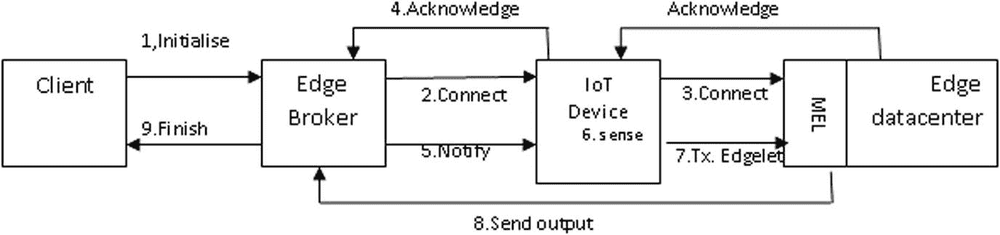

图 2.7 工作流。

### 2.7.3 iFogSim

雾是用户和远程（公共）云之间的中间层。该层比云更接近用户，因此可以提高网络性能。边缘计算具有编程系统，通常位于用户所在地。雾层是边缘设备和雾层之间的计算平台。边缘计算可以在没有雾层的情况下工作。

iFogSim 是用于边缘、雾和 IoT 环境的事件仿真器 [14]。它使用 CloudSim 处理各种组件的事件。以下是模拟雾网络所需的 iFogSim 类：

*   Fog device（雾设备）

*   Sensor（传感器）

*   Actuator（执行器）

*   Tuple（元组）

*   Application（应用）

*   Monitoring edge（边缘监控）

*   Resource management service（资源管理服务）

iFogSim 具有分层架构（图 2.8），由：

*   `Device layer`（设备层）由 IoT 传感器和执行器组成，作为数据的源或汇。传感器发射具有特定属性的数据，包括发射的大小。网络特性包括延迟、带宽等。该层通过传感器和执行器类实现。`Sensor`类维护刻画摄像头或温度传感器的属性，以及网络能力和生成的数据。`Actuator`类刻画执行器以及接收来自雾设备的数据模式。

*   `Fog device`（雾设备）可以托管应用模块。网关是连接 IoT 设备到网络的雾设备。雾层可以在公共云和设备层之间托管私有云。资源以层次方式排列。计算卸载可以从低层到高层。它通过`FogDevice`类实现，该类维护内存、处理器、存储大小、上行带宽和下行带宽等属性。该类包含为应用模块调度、分配和撤销资源的方法。

*   `Data Streams`（数据流），也被称为元组（tuples），由传感器和雾设备发射，以便传输到上层进行通信。数据流也从应用模块传输到执行器。它通过`tuple`类实现，其特征是其类型以及源和目标应用模块。它包含了`tuple`中的数据长度和处理需求。

*   `Monitoring layer`（监控层）跟踪资源使用情况、功耗以及设备/资源的可用性。该层的输出被资源管理层使用。每个设备都维护其使用统计数据并报告给监控层。该层还可以预测设备性能。`FogDevice`类中的`executeTuple()`方法包含了`tuple`处理逻辑，设备在该处更新其资源使用情况。这些统计数据也可以封装在`tuple`中并发送到资源管理层。

*   `Resource management layer`（资源管理层）用于管理各种资源。它根据静态 QoS 要求识别要分配给特定应用程序的资源（雾计算/IoT 层设备）。资源分配可以是集中式的、分布式的或混合式的。

*   应用（编程）模型。应用程序被建模为模块的集合。这些模块可以生成可供另一个模块使用的数据。这种关系可以表示为有向图，顶点形成模块，有向边表示模块之间的信息流。处理模型可以分类为：

*   感知-处理-执行模型（Sense-process-actuate model），来自传感器的信息被传输到雾设备进行处理。处理结果随后被用于驱动环境。

*   流处理模型（Stream-processing model）。雾设备集群处理由传感器设备发射的实时数据流。结果存储在雾层中。

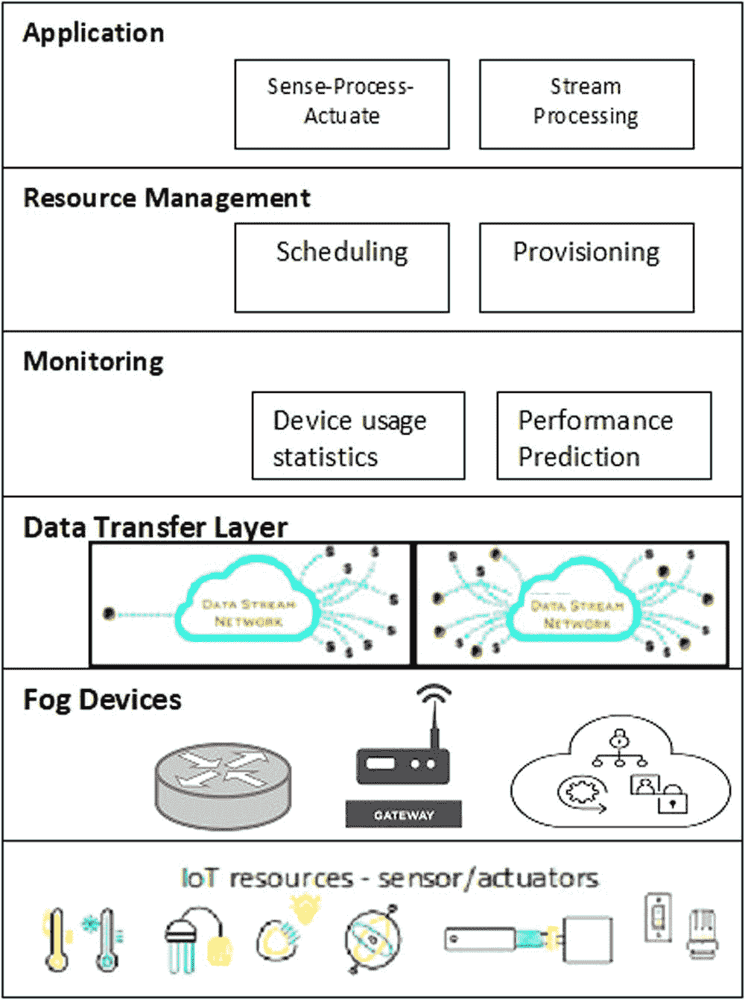

图 2.8 iFogSim 架构。

该层使用以下类实现：

*   `AppModule`类维护雾应用的的处理单元。它实现了 DAG（有向无环图）的顶点。`AppModule`实例处理传入的`tuple`并生成输出元组，并发送到 DAG 中的下一个模块。

*   `AppEdge`类维护一对应用模块之间的数据依赖关系。每条边的特征是其携带的`tuple`类型，该类型通过`AppEdge`类的`TupleType`属性捕获，并带有封装在这些元组中的处理需求和数据长度。

*   `AppLoop`实例指定用户提供的应用程序循环。它包含一个从循环起点到循环终止模块的模块列表。

#### 2.7.3.1 在 iFogSim 仿真器中创建拓扑和执行应用程序


本节详细说明了在`iFogSim`上的拓扑创建和执行：

- 安装 Eclipse IDE。
- 从 CloudsLab 链接下载并解压`iFogSim`。
- 在 Eclipse IDE 中创建一个 Java 项目，添加`FogSim`路径。
- 在`src`→`org.fog.gui.example`→`FogGui.java`下并作为 Java 应用程序运行。雾拓扑创建器被打开。可以创建新拓扑，也可以通过导入打开现有拓扑。
- 考虑视频监控案例。摄像头是传感器。根据对摄像头感知的图像的分析，执行器启动动作。初始化四个传感器和四个执行器。摄像头扫描的图像用于运动检测、用户界面、物体检测和物体跟踪。运动检测在`IoT-Device`中完成，而其他动作……

在创建拓扑时，会考虑`name`、`type`、`uplink`、`downlink`、`MIPS`、`RAM`和`rate`。当选择`sensor`时，输入`name`和`type`。对于`actuators`，`edge`连接显示在`2.9`中。


图 2.8 iFogSim 架构。

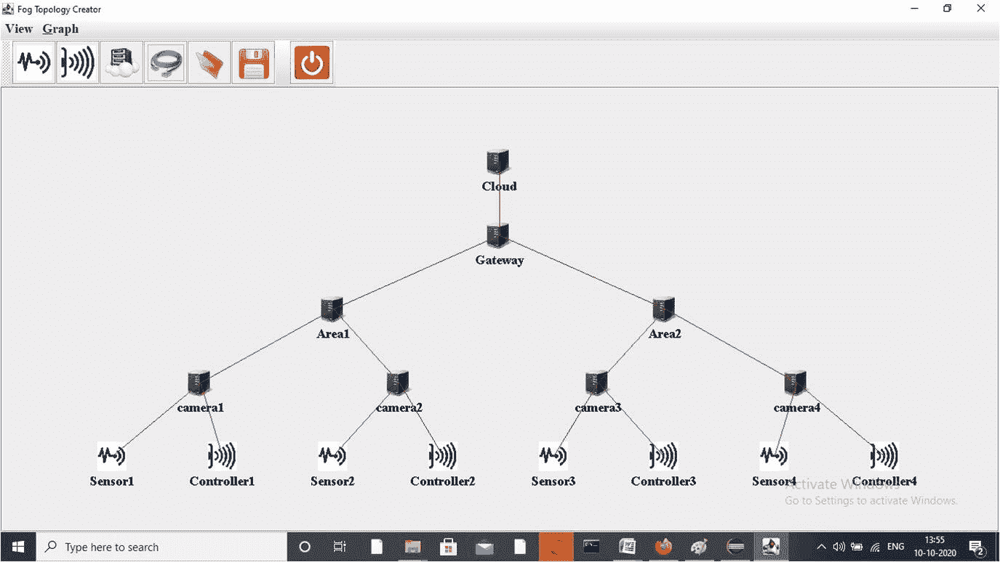

图 2.9 iFogSim 架构。

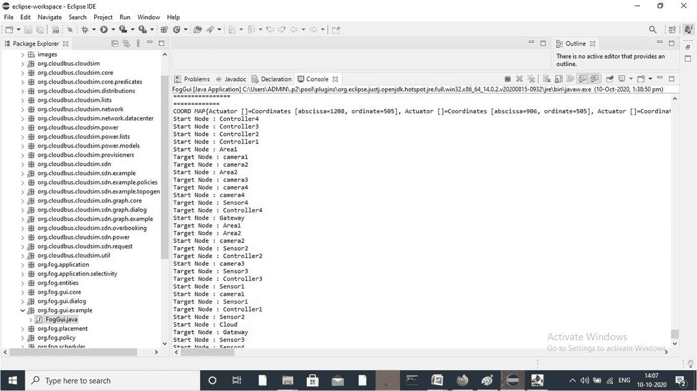

图 10.0 iFogSim 架构。

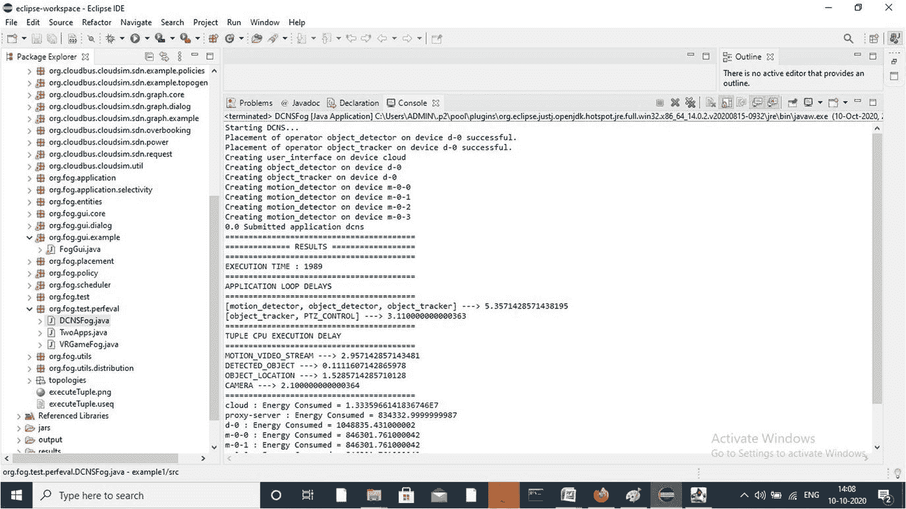

图 11.0 iFogSim 架构。

### 2.7.3.2 EdgeCloudSim

`EdgeCloudSim`(15)是一个基于 CloudSim 的开源工具，用于边缘计算的网络和计算资源仿真。各种模块包括：

- `Mobility`模块通过更新哈希表中的`x`和`y`坐标来管理移动设备的位置。使用了`Mobility`类。内置模型是游牧移动。
- `LoadGenerator`模块：为特定配置生成任务。默认情况下，`LoadGeneratorModel`使用泊松分布。
- 网络模块管理上传/下载的 LAN/WAN 参数。默认情况下，`NetworkModel`内置单服务器队列模型。
- `EdgeOrchestrator`模块：决定处理请求的资源。为了此目的，`EdgeOrchestrator`类内置概率处理程序。
- 核心仿真模块负责从配置文件加载并运行边缘计算场景。它还将执行结果保存到文件中。

## 2.8 研究方向

边缘计算支持各业的数字化转型和数据多样化，通过在靠近数据产生的地方执行操作，已成为一个热门研究课题。一些研究方向(16)包括：

### 计算卸载

由于 IoT 设备资源受限，更复杂的计算通常在云端执行。为了最小化网络传输延迟，可以将计算卸接到网络边缘的设备和资源上。因此，计算卸载是边缘计算的主要动力，并与任务调度密切相关。

### 资源分配

一旦做出卸载决策，就需要将计算任务分配给合适的资源。如果子任务之间高度相关且不可分割，则将其分配到边缘资源。否则，这些子任务可以在节点上的多个资源上执行。基于任务的存储、计算、网络和能量需求的优智能资源分配是一个活跃的研究领域。

### 核心概念

#### 移动性管理

边缘计算的主要目的是分配靠近设备的边缘资源以卸载计算。如果设备是静态的，则可以静态识别边缘资源。如果设备是移动的，那么动态资源发现和低延迟资源切换对于确保服务的连续性关重要。基于移动性的服务迁移预测技术被用于平衡成本与服务交付。

#### 流量卸载

与计算卸载类似，根据延迟、带宽、定位、能量等网络因素，流量可以在网络边缘进行卸载。其主要目标是通过某种方式卸载计算以减少网络拥塞。

#### 缓存

缓存技术能够实现高效的内容分发并提升用户体验。网络边缘的内容缓存可以避免重复的数据传输、网络拥塞和流量消耗。缓存位置和缓存管理策略是一个热门研究课题。

#### 网络控制

使用软件定义网络（`SDN`）以编程方式控制边缘计算系统中的网络是一个活跃的研究领域。

#### 数据安全与隐私

边缘计算的分布式架构使其容易受到恶意软件感染和安全漏洞的影响。一些热门研究课题包括适用于设备资源限制的轻量级加密技术，这确保了传输过程中数据的安全性。此外，当数据被存储时，合适的安全数据存储技术至关重要。同态加密可用于可搜索加密，这确保了安全性和性能。通过合适的机密性和完整性技术来确保数据安全。针对边缘计算系统的资源限制和分布式特性，为个人和群体提出合适的身份验证和访问控制机制。身份验证机制包括个人认证、跨域认证以及从一个域迁移到另一个域时的接管认证。访问控制机制包括基于属性和基于角色的方法。使用合适的隐私保护技术保护个人隐私。边缘计算环境中的隐私问题涉及在以下之间建立权衡：

- 通过计算卸载进行数据外包与维护数据隐私之间的平衡。
- 提供基于位置的服务与维护数据隐私之间的平衡。
- 数据共享与保护个人隐私之间的平衡。

研究最多的领域之一是将区块链与边缘计算系统集成。这是一种互利共赢集成。区块链在保护异构且可扩展边缘计算环境数据隐私的同时，提供了包括机密性和完整性的安全性。边缘计算为区块链环境提供了所需的资源。

## 2.9 总结

边缘计算是一种分布式计算范式，它将设备计算卸载到类似于建筑的边缘边缘。它降低了延迟并在终端设备附近执行计算。本章讨论了工业环境中对边缘计算的需求。本章还讨论了具有各种组件功能的边缘计算环境详细架构。在网络边缘执行计算的设备和本地边缘节点根据资源的可用性提高了应用的有效性。设备、网络和计算资源构成了边缘计算系统的核心。传感器和执行器感知环境。详细讨论了包括网络协议和数据传输协议在内的各种通信协议。网络管理对于配置和维护异资源以及实现它们之间的通信至关重要。为此，讨论了使用`SDN`的自动化网络管理。由于边缘计算环境具有高度异构性，需要中间件来集成这些实体使其作为一个统一整体运行。此外，还需要合适的界面与用户进行交互。本章详细讨论了中间件架构和用户界面的需求。由于系统高度复杂，很难构建一个真实的边缘计算系统来测试应用程序，因此使用了仿真器。本章详细讨论了各种仿真器（如`IoTSim-Edge`、`iFogSim`和`EdgeSim`）的特性和架构。还提供了在`iFogSim`上设置拓扑和执行应用程序的步骤。最后，本章以边缘计算领域可能的研究方向作为总结。

## 参考文献

1. Shi, W., Cao, J., Zhang, Q., Li, Y., & Xu, L. (2016, October). Edge computing: Vision and challenges. IEEE Internet of Things Journal, 3(5), 637–646. doi: [10.1109/JIOT.2016.2579198](http://doi.org/10.1109/JIOT.2016.2579198).
2. Singh Dikhit, R. (2018, March 27). All about edge computing architecture, open source frameworks and IoT solutions. OpenSource.
3. Satyanarayanan, M. (2017, January). The emergence of edge. Computer, 50(1), 30–39. doi: [10.1109/JIOT.2016.2579198](http://doi.org/10.1109/JIOT.2016.2579198).
4. Ai, Y. (2018). Internet of Things: A primer. Digital Communications and Networks, 4(2), 77–86. doi: [10.1109/JIOT.2016.2579198](http://doi.org/10.1109/JIOT.2016.2579198).
5. Sunyaev, A. (2020). Fog and edge computing. In: [10.1007/978-3-03](http://doi.org/10.1007/978-3-03)_.
6. Anawar, M. (2018). Monitoring self-adaptive applications within edge computing frameworks: A state-of-art review. Journal of Systems and Software, 136, 19–38. doi: [10.1016/j.jss.2017.033](http://doi.org/10.1016/j.jss.2017.033).
7. Al-Sarawi, S. (2017). Internet of Things (IoT) communication protocols: Review. doi: [10.1109/JIOT.2016.2579198](http://doi.org/10.1109/JIOT.2016.2579198).
8. Taherizadeh, S. (2020). A comprehensive survey of interface protocols for software defined networks. Journal of Network and Computer Applications, 156, 102563. doi: [10.1016/j.jnca.2020.102563](http://doi.org/10.1016/j.jnca.2020.102563).
9. Sethi, P. (2017). Internet of things: Architectures, protocols, and applications. Journal of Electrical and Computer Engineering, 2017, 25. doi: [10.1109/JIOT.2016.2579198](http://doi.org/10.1109/JIOT.2016.2579198).
10. Ashouri, M. (2019). Edge computing simulators for IoT system design: An analysis of qualities and metrics. Future Internet, 11, 235.
11. Gupta, H. (2017). iFogSim: A toolkit for modeling and simulation of resource management techniques in the Internet of Things, Edge and Fog computing environments. Software: Practice and Experience, 47, 1275–1296.
13. Jha, D. N., Alwasel, K., Alshoshan, A., Huang, X., Naha, R. K., Battula, S. K., Garg, S., Puthal, D., James, P., Zomaya, A. Y., Dustdar, S., & Ranjan, R. (2020). IoTSim-Edge: 一用于建模物联网和边缘计算环境行为的仿真框架。Software: Practice and Experience, 2020, 1–23.
14. Sonmez, C., Ozgovde, A., & Ersoy, C. (2017). EdgeCloudSim: 一用于边缘计算系统性能评估的环境。在*Proc. 2017 Second International Conference on Fog and Mobile Edge Computing (FMEC*, Valencia, 39–44. doi: [10.1109/FMEC.2017.7946405](http://doi.org/10.1109/FMEC.2017.7946405)。
15. Perez Abreu, D., Velasquez, K., Curado, M., & Monteiro, E. (2020). 云到雾连续体体中仿真器的对比分析。Simulation Modelling Practice and Theory, 101, 102029. ISSN 1569-190X, [10.1016/j.simpat.2019.102029](http://doi.org/10.1016/j.simpat.2019.102029)。
16. Cao, K., Liu, Y., Meng, G., & Sun, Q. (2020). 边缘计算研究综述。IEEE Access, 8, 85714–85728. doi: [10.1109/ACCESS.2020.2991734](http://doi.org/10.1109/ACCESS.2020.2991734)。

# 3 边缘分析

DOI: [10.1201/9781003230946-3](https://doi.org/10.1201/9781003230946-3)

## 3.1 数据类型

在统计学中，数据分为两类：定量数据和定性数据，如图 3.1 所示。定量数据也被称为数值数据，处理数字和可以测量的事物。例如，身高、体重、年龄、价格、温度、湿度等。然后它又被细分为离散数据和连续数据。

离散信息仅包含有限的可能值，使用整数进行计数。例如，排队中站立的人数（即 26 人）。连续信息包含特定范围内的无限可能值。例如，排队中站立的人的体重（即 49.5 公斤）。

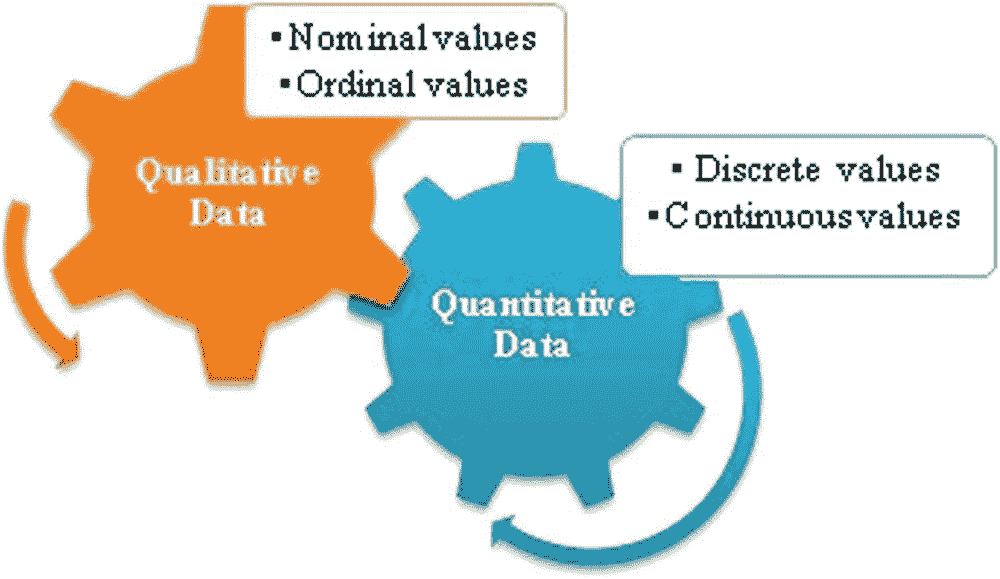

图 3.1 数据类型。

定性数据也被称为分类数据，它们不是数值数据，而是使用自然语言规范定义的。例如，人的性别、出生地、语言、职业等。在某些情况下，它也带有数值。定性数据被细分为名义数据和序数数据。序数数据具有特定的顺序（例如：满意、良好、不满意）。

连续数据包含特定范围内的无限可能值。例如，排队中站立的人的体重（即 49.5 公斤）。

定量数据具有特定的数学意义。。数据的类型对于数据分析至关重要，如果处理不当，将会产生错误的结果。理解数据的类型有助于选择正确的方法。

## 3.2 数据分析

数据分析意味着探索数据集以得出结论。数据分析利用原始数据来产生模式报告，如图 3.2。


图 3.2 数据分析流程图。

## 3.3 数据分析的目标

数据分析对不同领域具有至关重要，通过揭示数据集的模式来得出结论，有助于决策。数据分析对不同领域具有至关重要，通过揭示数据集的模式来得出结论，有助于决策。

数据分析对不同领域具有至关重要，通过揭示数据集的模式来得出结论，有助于决策。数据分析对不同领域具有至关重要，通过揭示数据集的模式来得出结论，有助于决策。

数据分析对不同领域具有至关重要，通过揭示数据集的模式来得出结论，有助于决策。。

## 3.4 受益于大数据的领域

数据分析在实施各种应用中起着至关重要的作用[ch03.xhtml#ref3_2]。

- 医疗保健
- 科学
- 电子商务
- 客户个人洞察
- 图像处理
- 自然语言处理
- 智能城市
- 智能家居
- 银行、保险和金融
- 体育
- 汽车
- 风险管理
- 营销与广告
- 灾害预测
- 游戏
- 物流
- 安全

## 3.5 数据分析实时应用

数据分析的一些应用如下：

- 根据内存、屏幕尺寸、电池容量、处理器、摄像头、操作系统、品牌、重量、颜色预测手机价格。
- 根据用户看过的电影推荐电影。
- 分析客户对产品的意见。
- 通过症状诊断疾病。

## 3.6 数据分析阶段

数据分析的阶段为：

- 数据收集和预处理
- 机器学习模型构建
- 性能评估

### 3.6.1 数据收集和预处理

在数据分析周期的阶段（如图 3.3 所示），利益相关者分析业务趋势和项目领域，他们开始建立假设来解决业务问题。他们开始观察数据集以识别关键变量并对数据集进行分类。当理解了数据的性质后，利益相关者通过删除重复、处理缺失值和噪声来准备数据。此阶段根据数据分析的需求清洗数据[ch03.xhtml#ref3_6]。

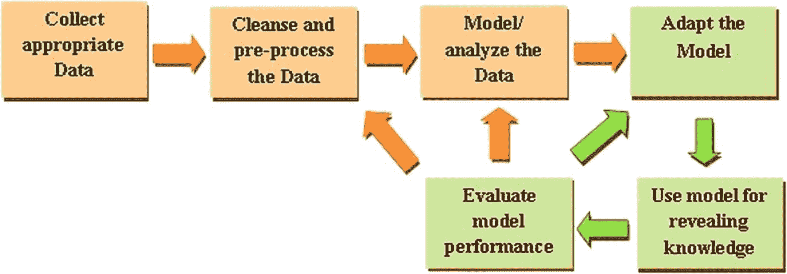

图 3.3 数据分析生命周期图。

### 3.6.2 机器学习模型构建

团队与利益相关者在预处理数据后，在识别出主要处理关键业务危机的方法和技术后开始构建学习模型。模型无非是在数据上执行的机器学习算法、统计和数学计算的组合，以实现预期目标。

> 验证：训练集可以被划分为训练集和验证集。验证是一个阶段，通过根据验证测试结果更改超参数，帮助提供最优化模型。
>
> 测试：对机器学习模型进行建模，以预测测试数据集的结果。

机器学习算法根据其处理有标签/无标签数据的能力分为以下几类。

### 监督学习

监督学习是一种机器学习技术，它能够很好地处理已标记/已标签的数据以训练机器，如图图 3.4 所示。在这里，系统需要一个监督者，即训练数据集，机器从从中学习。随后，监督学习算法被划分为以下几个子类。

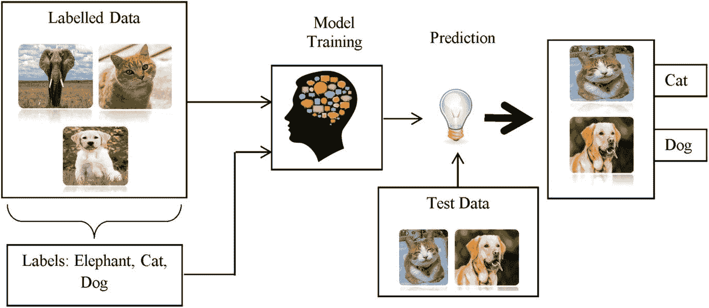

图 3.4 监督学习机制。

1. **回归**：回归技术有助于根据单个独立变量`X`或多个独立变量`X1, X2 …. Xn`预测因变量`Y`的值。
2. **分类**：通过使用分类技术，训练机器将值划分到特定的类别中。

#### 一些常用的监督学习算法

- 用于回归问题的线性回归
- 用于分类问题的逻辑回归
- 用于分类问题的 K-近邻算法
- 用于分类问题的支持向量机
- 用于分类和回归问题的随机森林

**应用：**考虑一个由狮子、老虎和狗等对象组成的数据集，每个对象都有类别标签，并被用于训练模型来识别新的输入对象。

### 无监督学习

无监督学习是一种从数据集中获取推理的机器学习技术，其中值未标记/未标记[8]。系统学习不需要任何监督者。机器通过观察获取知识并接受训练，如图图 3.5 所示。


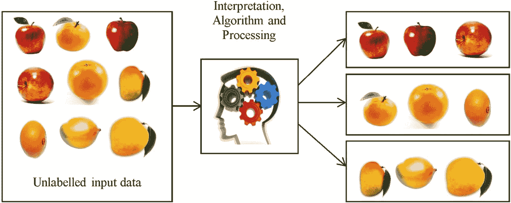

图 3.5 无监督学习机制。

无监督学习算法随后划分为以下子类。

1. **聚类**：这是一种无监督机器学习技术，通过发现个体之间的相似性将样本空间划分为不同的簇组。该技术仅使用输入值来预测关于相似性的模式和异常。各种距离计算技术（如欧几里得距离、曼顿距离）被用于寻找对象之间的相似性/异性。

2. **关联**：这是一种无监督机器学习技术，有助于识别值之间关系的概率。这些技术广泛用于寻找交易数据中的销售相关性。

### 一些常用的无监督学习算法

* 层次聚类
* K-Means 聚类
* K-近邻聚类
* 主成分分析
* 奇异值分解
* 独立成分分析
* Apriori 算法

### 应用

在零售市场中，零售商通过分析之前的交易来发现物品之间的关系，以揭示它们之间的关联。通过分析购买历史，识别并保持更频繁出现的物品组合，以提高产品销量。

### 半监督学习

这个问题依赖于监督和无监督技术。在这种情况下，某些数据有标记，而某些数据没有。该过程如图 3.6 所示。

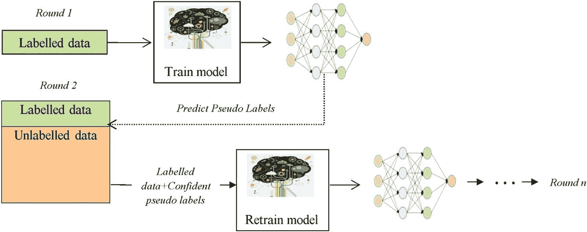

图 3.6 无监督学习机制。

### 应用

在医学影像中，某些图像由专家标记，而另一些则没有。半监督学习用于使用有限的标记数据提高模型的准确性。

### 强化学习

强化学习是一种机器学习方法，代理通过在环境中执行动作来学习决策，以实现奖励最大化。代理通过试错来学习，基于从环境中接收的正或负反馈。该系统的目标是最大化累积奖励。该过程如图 3.7 所示。

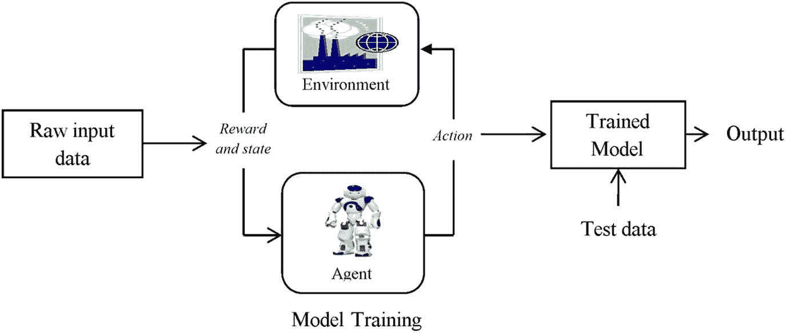

图 3.7 强化学习机制。

### 一些常用的强化学习算法

* 马尔可夫决策过程 (MDP)
* Q Learning
* 状态动作奖励状态状态 (SARSA)
* 深度 Q 网络 (DQN)
* 深度确定性策略梯度 (DDPG)

### 应用

在机器人领域、游戏和工程自动化中，强化学习用于复杂系统的控制。

### 3.6.3 性能评估

当使用上述算法构建模型时，将对其性能进行评估以测试其有效性。通用的机器学习性能评估技术包括：

* 混淆矩阵
* 准确率
* 正性预测值 (PPV)
* 回回率
* F1 分
* 特异性
* 负性预测值 (NPV)
* PR 曲线
* 接收者工作特征曲线 (ROC)

为了理解评估技术，让我们考虑一个场景，任务是识别患者是否感染新冠（报告阳性）或健康（报告阴性）。通常情况下，该分类问题的结果属于真阳性、真阴性、假阳性和假阴性等类别，如表 3.1 所示。

> 真阳性 (TP)：患者为阳性且预测为阳性
> 真阴性 (TN)：患者为阴性且预测为阴性
> 假阳性 (FP)：患者为阴性但预测为阳性
> 假阴性 (FN)：患者为阳性但预测为阴性

表 3.1 混淆矩阵——实际值与预测值的对比

|  |  | 预测 |
| --- | --- | --- |
| **实际** | 阴性 | 假阴性 |
| 阳性 | 假阳性 | 真阴性 |

#### 混淆矩阵

混淆矩阵根据参数 `TP`、`TN`、`FP` 和 `FN` 对分类结果进行矩阵可视化。

#### 准确率

准确率是一种根据准确预测评估模型性能的指标。计算准确率的公式是正确预测除以总预测数。

${Accuracy} = \\frac{{TP} + {TN}}{{TP} + {TN} + {FP} + {FN}}$(3.1)

#### 精确

精确率（Precision）是一种评估指标，侧重于在预测正例中实际正例的百分比。它也被称为正预测值（PPV）。

$Precision = \frac{TP}{TP + FP}$ (3.2)

### 召回率

召回率（Recall）是一种评估指标，旨在确定在所有可用正例中有效的正例，以识别其他漏掉的正例。召回率也称为敏感性（Sensitivity）。

$Recall = \frac{TP}{TP + FN}$ (3.3)

### F1 分数

当 `Precision` 和 `Recall` 不平衡时，`F1 score` 是两者的调和平均数。它被应用于应用。`F1 score` 被视为 `Precision` 和 `Recall` 的加权平均。

$F1 = 2 \times \frac{Precision \times Recall}{Precision + Recall}$ (3.4)

### 特异性

特异性（Specificity）是一种评估指标，计算在所有预测负例中实际负例的比例，以识别其他漏掉的负例。

$Specificity = \frac{TN}{TN + FP}$ (3.5)

### 负预测值

负预测值（NPV）是一种侧重于在所有预测负例中寻找实际负例百分比的指标。

$NPV = \frac{TN}{TN + FN}$ (3.6)

### PR 曲线

`PR Curve` 是 `Precision` 和 `Recall` 的图表。`PR Curve` 具有高 `Precision` 值具有重要意义。

### 接收者工作特征 (ROC)

`ROC curve` 是真阳性率（`TPR`）与假阳性率（`FPR`）之间的图表。曲线下的面积越大，模型越好。

## 数据分析的类型

通常，数据分析根据其目的分为四类：`descriptive analytics`（描述性分析）、`diagnostic analytics`（诊断性分析）、`predictive analytics`（预测性分析）和 `prescriptive analytics`（规范性分析）。

### 描述性分析

`Descriptive analytics` 表达过去发生了什么。这类分析对于图表和仪表板等数据可视化非常有用。它分析当前数据来回答“发生了什么？”的问题。

### 诊断性分析

`Diagnostic analytics` 对问题提供更深入的见解。这类分析也被称为根本原因分析。它旨在回答“为什么发生了什么？”的问题。

### 预测性分析

`Predictive analytics` 使用历史数据根据当前趋势预测未来。它旨在回答“可能会发生什么？”的问题。

### 规范性分析

`Prescriptive analytics` 建议采取行动以避免意外问题。它旨在回答“我应该做什么？”的问题。

边缘分析是在网络边缘、更靠近连接设备的地方或安装在附近的其他边缘处理软件上对数据进行收集、处理和分析的过程。随着物联网（IoT）和连接设备在系统自动化方面的进步，医疗保健、能源、汽车和制造业等多个行业正在网络边缘产生海量数据。早期的方法是收集这些数据并将其存储在云端或数据中心进行进一步处理。随着数据量的增加，将数据推送到中心化平台并进行处理所花费的时间越来越多 [5]。这里的目标是在数据的实际源和数据中心之间对数据进行处理和分析。它是针对物联网和云计算系统的一种优化且分布式的机制，可以降低延迟并确保决策及时做出。边缘处的处理设备允许对数据进行分析，并将报告分发给最终用户，以及时防止故障发生。根据应用需求，这些边缘分析可以是描述性分析、诊断性分析或预测性分析 [8]。

了解边缘数据分析最适用于哪些场景至关重要！

对于实时安全，系统监控对于石油钻平台、天然气设施、飞机和 CCTV 摄像头等关键性基础设施至关重要 [1]。为了保护这些关键系统免受任何种灾难的影响，正在开发许多智能设备和功能。边缘分析就是此类解决方案之一，它能够在早期阶段检测故障并报警相关人员采取相应行动。

让我们考虑一个石油钻平台的场景，它在远离数据中心的海上收集海量传感器数据。边缘分析允许传感器数据访问去中心化平台，从而在离岸进行分析，如果发现故障，可能会关闭故障阀门。这被认为比将数据发送到数据中心或云环境，并在很久之后才获得相同结果更高效的解决方案 [3]。

边缘分析提供以下主要优势 [4]：

* **降低延迟**：由于数据在源头附近进行处理，可以更快、更及时做出决策。这提高了应用的活跃性和敏捷性。
* **可扩展性**：随着网络设备数量的增加，收集和处理的数据量也迅速增加。边缘分析通过提供去中心化的潜力，扩展了处理能力。
* **降低存储成本**：数据在存储之前会针对必要信息进行处理。这降低了存储成本，因为对于自动驾驶汽车、交通管理系统等许多应用来说，没有存储存储生成的数据。
* **减少带宽**：通过在边缘对数据进行处理，传输到云端的数据相对减少或被过滤。因此，它消耗的带宽较低。
* **成本效益**：即使在遥远地区，恢复通常也会更快，因为分析系统中发生的任何故障都可以通过数据分析机制进行预测和避免，从而防止由于故障导致的损失并减少人工干预。因此，边缘分析提供了一种具有成本效益的解决方案。
* **保护安全和隐私**：集成机器学习算法可以保护物联网免受各种攻击并防止未经授权的。

## 3.9 边缘分析的潜力

尽管边缘分析是一个蓬勃发展的领域，但它可能无法视为实际大数据分析的替代。物联网结合数据分析在各个应用领域提供了大量的进步。然而，边缘数据分析最大的局限在于它只分析生成的数据的子集，并仅将分析结果传输到云端。其余未处理的数据将丢失且永远不会存储。因此，只有在此类数据丢失可以忽略不计的情况下，才会采用边缘分析 [7]。

## 3.10 边缘分析的架构

边缘分析是一种通过如图 3.9 所示，在源头附近分析数据来增强物联网和云计算的方法。边缘分析旨在以更优化的方式访问计算资源。物联网（如车辆、家电器、交通灯、医疗设备和智能机器）产生的流数据和实时数据可以使用具有自身计算能力的本地边缘服务器在产生源点进行处理。同时，也可以在系统中引入中间服务器，以便在需要时在源附近分析数据。由于决策是在数据源附近做出的，它与在云基础设施上进行的分析相比降低了延迟。如果由云服务器执行分析过程，对时间敏感的决策将无法及时做出。边缘分析框架中的服务质量得到了显著提高。由于移动到云端的数据量减少了，这随之最小化了流量和传输成本 [3]。

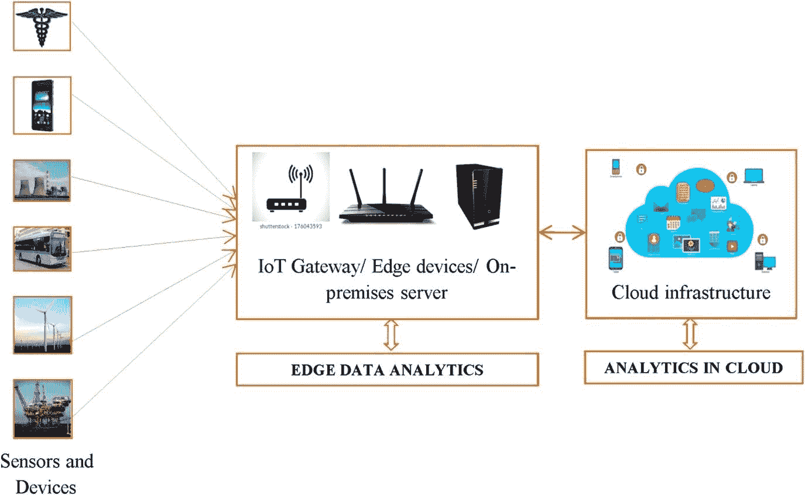

图 3.9 边缘分析的架构。

例如，风力涡电机使用多种电气光学传感器来满足各种需求。这些传感器可以帮助观察风力涡机的振动水平、温度、与其他物体之间的距离等。系统不需要持续将生成的数据发送到云分析服务器。相反，它可以设计为仅在数据超过阈值时发送数据 [1]。

## 3.11 边缘设备的机器学习

TinyML 是运行在低资源消耗型设备（如手机、微控制器和其他物联网设备）上的机器学习算法的研究领域。在智能物联网设备中引入 TinyML 会增加延迟，因为数据是在本地处理的。

**TensorFlow Lite**：TensorFlow Lite 是一个开源框架，用于设备（如手机、物联网设备和其他嵌入式设备）上通过 TensorFlow 机器学习模型进行快速推理。它生成适用于通用边缘设备执行的优化微模型。边缘设备处理大型数据集的能力有限，因为其处理能力内存有限。在设备上引入人工智能会导致资源密集型过程。TensorFlow Lite 的开发考虑了这些问题，并使用了如图 3.10 所示的工作流。

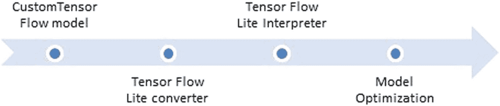

图 3.10 TensorFlow Lite 框架的工作流。

对于相应的应用，开发自定义深度学习模型或预训练模型始终是首要步骤。TensorFlow 提供了两个额外的组件，目标是将当前的深度学习模型转换为能够在目标边缘设备运行的轻量级模型。这两个组件是 TensorFlow Lite Converter 和 TensorFlow Lite Interpreter。Converter 帮助将自定义的 TensorFlow 模型转换为 TensorFlow Lite 格式。Interpreter 帮助通过利用各种 API 将 Lite 模型实现到目标边缘设备。也可以进行模型优化，以使对模型性能的影响降到最小 [10]。

# 联邦机器学习

通过联邦学习方法，可以对来自不同主机的机器学习模型进行整合，以保护数据隐私。在许多应用中，数据存储在不同的地方。在不向任何中央机构披露数据的情况下对这些数据进行统一处理是最大的挑战。在图像处理等应用中，结合不同来源的数据已成为提供充分训练和构建更好模型在大多数时候的至关重要的。在没有集中式训练数据的情况下，联邦学习统一了各种主机的模型。它解决了与个人数据隐私和安全相关的问题。它通过将数据保留在本地而非移动到云端，有助于边缘数据处理。联邦机器学习确保了不同实体之间在不涉及云的情况下进行保护隐私的数据共享。

## 3.12 边缘分析：案例研究

新冠肺炎（COVID 19）是一种影响全球的传染性呼吸道疾病。保护自身的唯一最佳方式是社交距离。各机构开始部署智能系统以追踪这些安全措施的违规情况。支持边缘分析的智能 CCTV 系统对于监控工作场所、商场、医院、大学、学校、餐厅、工厂以及各种聚集场所中活动的人非常有帮助。

该系统的关键目标如下：

* 帮助监控环境中的总人数
* 向组织内的健康和安全部门生成通知以处理安全违规行为
* 促进经过良好的安全决策

该支持边缘分析的 CCTV 系统的工作结构如下：

CCTV 视频被发送到 IoT 边缘服务器。边缘服务器不断重新训练机器学习模型。构建了包括目标检测以及某些数学计算的模型，用于衡量人与之间的距离以确保社交距离。当发生违规行为时，系统会向相关人员报警 `[9]`。

## 3.13 研究挑战与未来方向

* 在本地分析数据时，为数据提供充分的安全和隐私保护是关键研究领域。
* 在边缘进行处理时，仅分析数据的子集。遗漏原始数据可能会排除掉一些重要的见解。
* 有助于降低处理速度和处理能力的方法是实施边缘分析的核心目标。这些方法的改进空间掌握在开发者手中。
* IoT 解决方案的响应通常较慢。引入边缘分析可能会进一步降低延迟。

## 3.14 总结

数据分析如今无处不在。近年来，随着使用数据分析技术的新方法的出现，各个领域都取得了巨大的发展。IoT 和云计算共同构成了边缘计算，这是当今智能世界中另一个蓬勃发展的领域。数据分析在边缘计算中同样占据一席之地。由于智能 IoT 设备生成的流和海量数据的规模和处理时间，处理它们是一项挑战性任务。尽管目前的方法有助于在很大延迟处理数据，但将其传播到云存储仍然是一个巨大的挑战。固定在本地或数据源附近的边缘服务器完全能够在边缘进行数据分析，并且有助于过滤移动到云端的数据。这顺序构建了一个低延迟、可扩展且具效益的系统。集成到智能系统中的分析方法再次减少了人工干预，使任务自动化并帮助及时决策，让智能系统变得更加智能。

## 参考文献

1. Bonomi, F., Milito, R., Dobre, C. (eds) Fog computing: A roadmap for smart environments, Springer, 169–186.
2. Azar, M., Yassine, A., Hossain, M., & Muhammad, G. (2019). IoT data analytics for smart homes. IEEE Access, 5247–5261.
3. Wang, X., Han, Y., Leung, V. C., Niyato, D., Yan, X., Chen, X. (2020). Convergence of edge computing and deep learning: A comprehensive survey. IEEE Communications Surveys & Tutorials, 22, 869–904.
4. Patel, P., Ali, M., & Sheth, A. (2017). On using the intelligent edge for analytics. IEEE Intelligent Systems, 32, 64–69.
5. Huang, Y., Ma, X., Liu, J., & Gong, W. (2017). FOCAN: A Fog-supported network for applications. In *Proc. 25th International Conference on Network Protocols (ICNP)*, 10.
6. Singh, S., Karim, A., & Hashem, M. (2019). IoT big data analytics with fog and cloud computing. Future Generation Systems, 91, 563–573.
7. Marjani, J., Shojafar, A., & Conti, M. (2017). Big data and internet of things. IEEE Systems, 32, 18.
8. Naranjo, P., Sebastian, F., Nasuddin, A., & Yaqoob, I. (2019). Edge-computing video analytics for real-time traffic monitoring in a smart city. Sensors, 19, 2048.
9. Barthélemy, J.,aevel, N., Forehead, H., & Perez, P. (2019). Edge-computing video analytics for real-time traffic monitoring in a smart city. Sensors, 19, 2048.
10. 网页链接：`https://www.tensorflow.org/lite/guide`

核心挑战在于通过保护数据免受入侵者/攻击者的侵害来增强系统的安全性，而不是放弃它。基于安全的公司正在根据法规定制安全解决方案，以满足日益的市场需求，最大限度地减少组织泄露、篡改、破坏、损坏和盗窃等风险。许多基于边缘的系统利用传统的操作系统和主机数据库。数据机密性、完整性、安全数据搜索、身份验证、访问控制和隐私保护是边缘计算数据安全研究架构的广泛领域，如图 4.1]。

* 同态加密
* 基于身份的加密 (`IBE`)
* 基于属性的加密
* 代理重加密
* 函数加密
* 蜜罐加密
* 可搜索加密


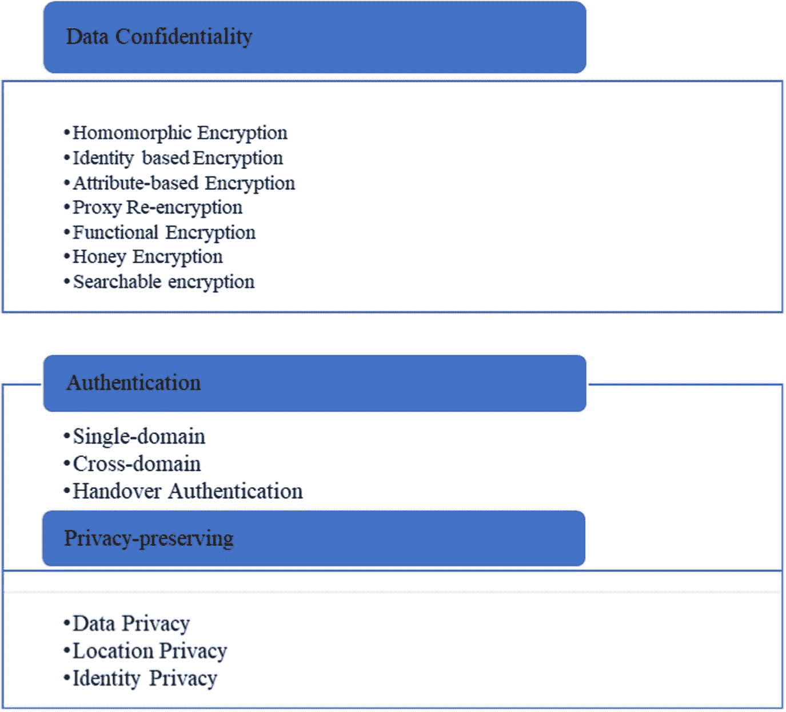

图 4.1 数据安全研究架构。

关于身份验证，将讨论以下方案及其工作原理：

- 单域
- 跨域
- 切换身份验证

在隐私保护主题上，将讨论给定方案及其工作性质：

- 数据隐私
- 位置隐私
- 身份隐私

## 4.2 数据机密性

许多公司继续对抗针对数据的侵入性攻击。为了管理和控制边缘环境中的数据窃取/泄露，由于设备是数据消费者也是生产者，必须应用适当的数据机密性方案。这些方案必须使用任何加密方案来保护敏感数据。传统的加密方案如 `AES`、`DES`、`RSA`、`ECC` 可能用于边缘环境。然而，为了任何分析/查询而访问或处理密文数据的效率非常低，且无法实现真正的适应。

近年来，针对边缘框架下的安全数据处理进行了大量研究。为了确保在数据外包或在边缘/云端处理数据期间的机密性，必须使用安全可靠的加密技术。高效的安全处理方案如下：

1. 基于身份的加密
2. 基于属性的加密
3. 代理重加密
4. 函数加密
5. 蜜罐加密
6. 可搜索加密
7. 同态加密

### 4.2.1 基于身份的加密

Shamir [2] 最初提出了一种基于身份的加密方案。系统中的任何参与方都可以通过该方案进行安全协作，通过验证对方的签名无需协商私钥/公钥。公钥基础设施（`PKI`）或任何第三方的参与对于该方案的执行并非必需。该方案不是使用 `PKI`，而是使用密钥生成器生成随机数（种子）。

加密过程中，当 `A` 向 `B` 发送邮件时，邮件将通过 `B` 的邮件标识符加密，这作为传输的公钥。接收邮件时，`B` 验证自己并从公钥生成器获取私钥。在私钥的帮助下，邮件将被解密，如图 4.2。

图 4.2 基于身份的加密。

为了解决多方环境中的身份问题，增强型 `IBE` [3] 基于被认为是 NP 的离散对数问题提出以加强环境。使用双线性映射，Boneh 和 Franklin [4] 在 2003 年提出了一种使用形式门限密码学的方案。

### 4.2.2 基于属性的加密

这是一种加密，其中私钥和密文基于一组属性，因此入侵者/攻击者/外部人员无法拥有数据的所有权。在可信机构的协助下，属性密钥在双方之间发布，并在需要时用于解密。解密是基于可信机构经过适当验证后共享的属性集的。它主要用于日志加密。

Sahai 和 Waters [5] 提出了一种新型的可重复基于属性加密方案。基于阈值的基于密钥或基于密文策略的基于属性加密正在使用。图 4.3 展示了数据所有者与用户之间基于属性加密的工作。

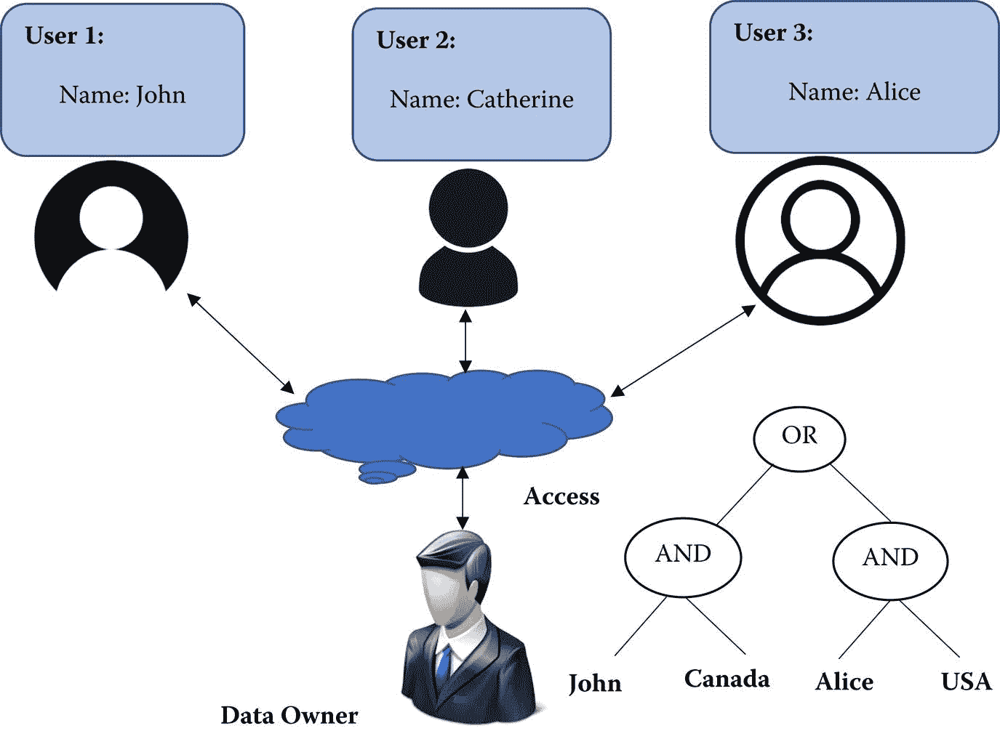

图 4.3 基于属性的加密。

### 4.2.3 代理重加密

代理重加密是 Blaze 等人 [6] 设计的一种协议，用于在代理的帮助下将一个密钥的密文转换为另一个密钥的密文。简单来说，这种方法允许在没有私钥许可的情况下将公钥转换为另一个。这可以通过一种称为重加密密钥的密钥来实现，并确保底层的明文不被泄露。由于这种迷人的特性，它在多用户共享场景中被广泛采用。第三方参与此方法以重加密发送给其他方。

图 4.4 描绘了代理重加密的工作原理。尽管该方法在 NP 级的离散对数问题下被证明是强大的，但仍有一些需要解决的问题。该方法的一个主要威胁是，如果代理是内部人员，则可能在没有用户 `A` 或 `B` 同意的情况下反向处理信息。同样，用户 `A` 和代理都可以作为内部人员在没有许可的情况下反向处理信息。为了解决这些问题，许多作者设计了增强型协议 [1]。

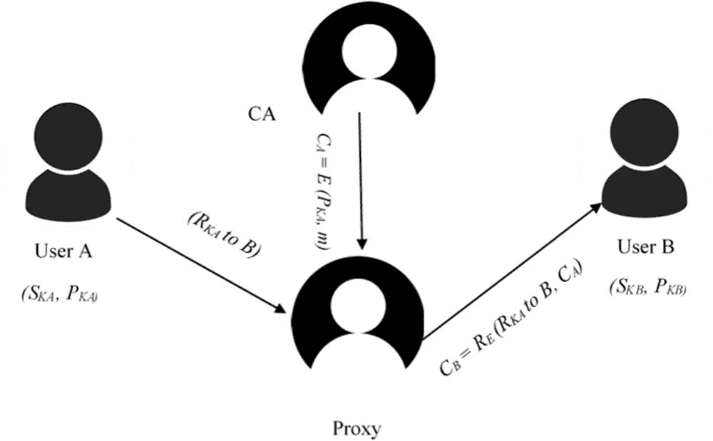

图 4.4 代理重加密。

### 4.2.4 函数加密

该方法利用特定函数来加密发送给其他方的数据。通常，它是一个黑盒函数，用户可以在不了解生成的输入知识的情况下查看输出。它为边缘环境提供了最高形式的安全性和可靠性。该领域正在进行大量研究，以设计健壮的函数防止危险的暴力攻击。

这种方法的安全性取决于所设计的函数，它是基于属性和基于身份加密的通用形式。它最初由 Amit 等人于 2005 年提出，并由 Brent 在 2010 年进行了改进 [7]。最近，在误差学习假设上进行了深度改进。解决该方法的难度与解决量子问题一样困难。

### 4.2.5 蜜罐加密

蜜加密（Honey encryption）是一种通过提供引人注目的外观来吸引攻击者/内部人员的技术，尽管解密密文后获得的是错误的明文。蜜加密源于一次性一密文技术，“蜜”一词指的是虚假/伪资源。

该技术受限于高概率，并具有相当合理的统计模型。它的创建目的是保护密码免受有害的暴力攻击/泄露，特别是在金融交易相关的网络服务中。它与格式保持加密（FPE）和格式转换加密（FTE）密切相关 [8]。蜜加密的一种简单表示见图 4.5。

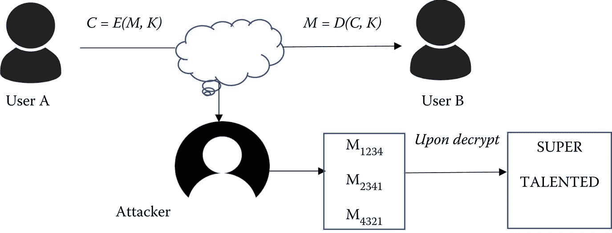

图 4.5 蜜加密。

### 4.2.6 可搜索加密

以高效的方式对加密数据进行搜索是可搜索加密的基础。对加密数据进行搜索和查询近期引起了研究人员社区的，因为它保证了数据的机密性。这被认为是减少在加密数据库中搜索单词计算开销的有效解决方案。它确保了协作方的数据隐私和可用性。它分为可搜索对称加密和可搜索非对称加密。

图 4.6 显示了可搜索加密方案的工作原理。加密格式的数据被到服务器。如果用户/数据所有者打算对存储的内容执行搜索操作，将根据关键词执行搜索操作，并在陷门函数（`trapdoor function`）的帮助下返回给用户。

陷门是一种用于检索与用户密钥关联关键词的函数。这是一个定义的程序，不会暴露任何与关键词相关的信息。这些方案的安全性取决于离散迪菲-赫尔曼（`DDH`）问题或双线性迪菲-赫尔曼（`BDH`）问题 [9]。

在可搜索对称加密中，同一个密钥用于加密、解密和陷门生成；而在可搜索非对称加密中，则采用不同的密钥。作为前提，必须创建一个标签或关键词包，以识别用于特定搜索的消息。

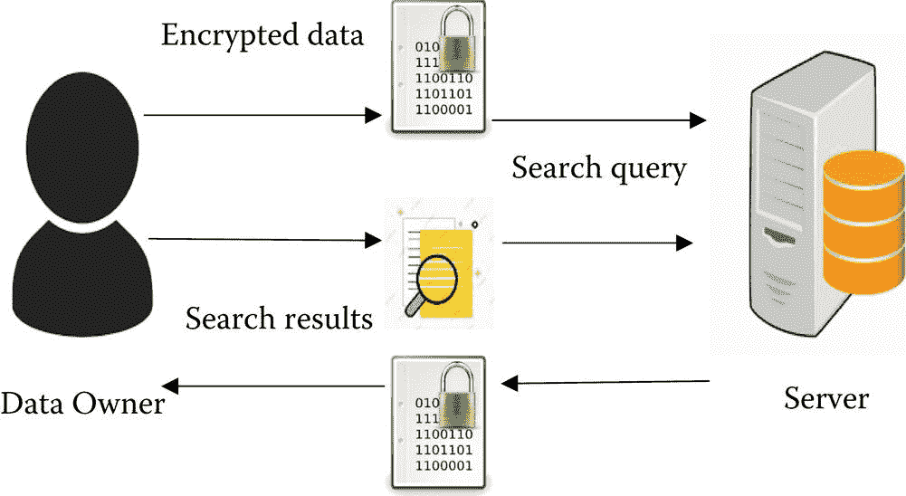

图 4.6 可搜索加密。

### 4.2.7 同态加密

为了能够直接对密文进行任意数量的任意计算，引入了同态加密。众所周知，Rivest 在 1978 年引入了隐私同态，它允许部分计算。通常情况下，它通过保持它们之间的关联将数据从一个集合转换为另一个集合。“同态”（homomorphic）一词代表“相同结构”。

例如，如果我们在密文中相两个数字并解密，输出必须等于在明文中执行相同操作所得的输出。由于操作是在加密数据上进行的，计算开销大大减少，这被认为是同态加密的主要优点。它保证了即使在不可信环境中也能以最短的时间实现透明性、高效的数据处理、数据检索和安全的数据传输。它从更广泛的角度消除了数据泄露/攻击。

大多数著名的方案将值表示为整数，并使用加法乘法作为基本操作。第一个可行方案是由 Craig Gentry 在 2009 年作为其博士论文的成果提出的。该论文为数据处理创造了一个新维度，许多研究人员开始实现新方案以及少数带有形式化安全性证明的 Gentry 增强/优化方案 [10]。Anitha Kumari 等人提出了用于医疗应用的简单安全同态加密方案 [11] [16]。

同态加密的常见应用如下：

- 安全数据存储
- 数据加密
- 隐私保护
- 在加密数据中搜索
- 多方之间的安全数据通信
- 支持加密数据中的数据分析
- 数据查询和检索

#### 4.2.7.1 同态加密的类型

同态加密的一般工作原理见图 4.7。存在三种同态加密。类型之间的区别基于在密文中执行的操作的类型和数量。分类如下：

- 部分同态加密
- 较部分同态加密
- 全同态加密

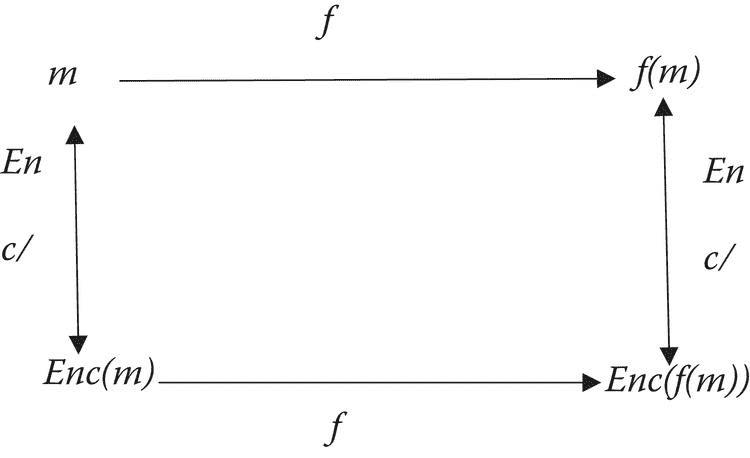

图 4.7 同态加密的工作原理。

##### 部分同态加密（PHE）和较部分同态加密（SHE）

部分同态加密（`PHE`）支持一种操作功能（加法或乘法），可以在加密数据上无限制次执行。较部分同态加密（`SHE`）支持加法或乘法或两者，执行有限次数。RSA、ElGamal、Goldwasser–Micali、Paillier 和 Boneh–Goh–Nissim 几十年来都是广名的 PHE/SHE 加密系统。

全同态加密（`FHE`）支持加法和乘法两种操作，并执行无限次。在本章中，将考虑并论证 FHE。

##### 全同态加密（FHE）

`FHE` 允许无限次无限数量的操作。FHE 的电路是预定义的且无边界的。这为探索更多领域铺平了道路，并受到了本十年研究人员的关注。它允许在加密数据上无限地计算，包括本地（连接智能设备的设备）和离线数据中心（云服务器）。

许多算法被设计并实现以提高 FHE 的准确性和效率。Dijk 等人通过引入引导技术来减少噪声，提出了一种基于实整数计算的非对称加密方案 [12]。FHE 的另一个重大贡献是 `NTRU` 方案 [13]。在 NTRU 加密方案中，任意操作基于位于 N-1 次截断多项式环中的对象。基于应用的 FHE 最近工作如下：

- 提出了一种基于卡米尔定理的高效代数同态加密方案，对整数效果最好。该方案用于电子投票和多方计算等应用。卡米尔加密方案涉及的操作本质上是模运算。
- 使用同态加密的安全摄影，通过将问题视为加密图像并上传到不可信的云服务器。
- 提出了一些 HE 方案用于自动和实时监控、自动账单处理、损耗检测、停电预警、供应扰动快速检测、实时能源规划和定价等问题。
- 提出了 Cox 比例风险模型和逻辑回归模型用于医疗保健领域的预测分析。这是一种位加密数据的标准方法。这些回归模型的函数通过整数值的多项式表达式进行近似。这种方法的优点是单个密文携带的信息比单个明文位多。局限性在于它将可能的操作限制为多项式算术电路。
- 一个全同态加密（`FHE`）嵌入原型从本质上确保用户数据免受工作平台威胁的机密性是一项具有挑战性的应用。该方案包含了转密、自动编译、并行化和消息打包，使得在实践中执行同态加密。该集成平台适用于本质上具有强非对称性的应用以及不向客户端设备发送任何响应的应用。
- 了一种用于图像加密的高效混合同态加密技术，用于基于块像素位置确保公云中私有图像的安全交换。

#### 4.2.7.2 同态加密的基本功能

大多数 FHE 的安全性基于误差学习（`LWE`）、带噪声奇偶学习（`LPN`）、舍入学习（`LWR`）或环上误差学习（`RLWE`）问题，这些问题被认为是与晶格相关的 NP-hard 问题。晶格被用于提供具有低乘法深度和复杂性的电路，这些电路已被证明能够抵抗量子攻击。

同态加密的核心功能如下：

- 密钥生成
- 加密
- 评估
- 解密

基本功能在图 4.8 中详细说明。

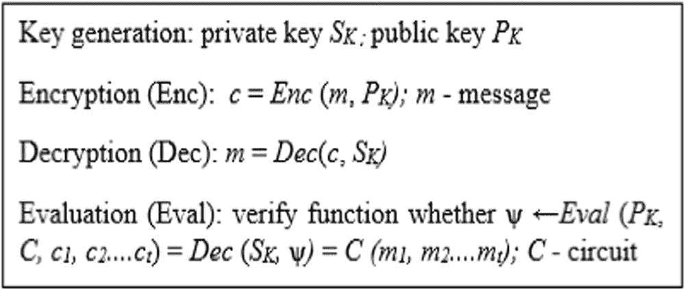

图 4.8 同态加密的基本功能。

任何 FHE 支持两种类型的同态方案，即加法同态和乘法同态。加法同态和乘法同态的详细视图请所示图 4.9。

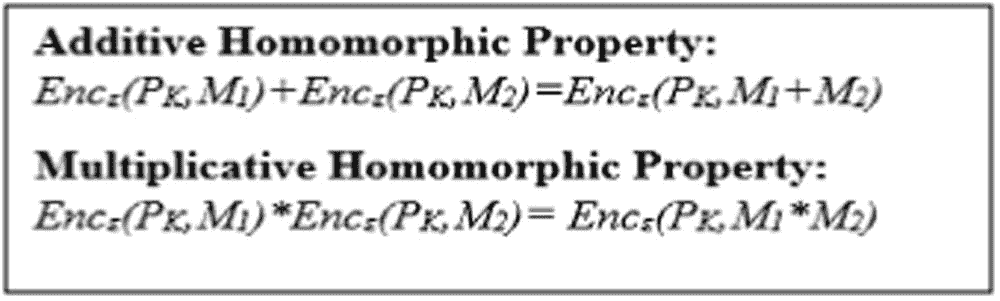

图 4.9 加法和乘法同态属性。

数据机密性下列出的方案中，仍有一些处于模糊阶段，对于边缘计算环境中的改进和应用是一个完全开放的平台。

## 4.3 身份验证

对于任何联邦环境，适当的身份验证机制都是强制，失败会导致外部人员/攻击者的访问。使用凭据验证自己的身份称为身份验证。大多数边缘环境要求在信任域内进行身份验证。边缘计算环境最合适的身份验证机制列如下：

- 单域身份验证
- 跨域身份验证
- 切换身份验证

### 4.3.1 单域身份验证

身份验证必须确保验证、数据匿名性、用户隐私和前向安全性。数据匿名性意味着即使通信在开放公共通道中进行，任何非法用户也无法获取通信。除非用户已同意共同关注/利益，否则用户隐私不得被篡改。前向安全性保证之前交换的任何消息都不会泄露给拦截者。

该领域正在进行大量研究，以增强安全并保护隐私。Liu 等人提出的 [14] 系统模型具有高度的可扩展性，确保了匿名身份验证和隐私保护。Jiang 等人提出的 [15] 隐私感知验证方案使用双线性对密码系统和动态随机数生成提供了基于单域的身份验证。该方案通过缓解大规模分布式环境中所有可能的威胁提供了相互身份验证。该方案的增强版本包含了基于身份的签名。

单域身份验证最简单的方法是单点登录（`SSO`）。一旦设置了 `SSO`，经过适当验证的用户即可访问公司在范围内提供的所有服务。`SSO` 授权用户只需登录一次即可访问多种服务/应用程序/网站。

例如，无论设备如何，使用支持 `SSO` 的 Google 账户是一项迷人的功能，可以在登录一次后在单一布局中访问所有设施。使用 `OAuth 2.0` 协议为消费者提供了一个无缝、安全且可靠的环境。图 4.10 展示了单域身份验证的工作。

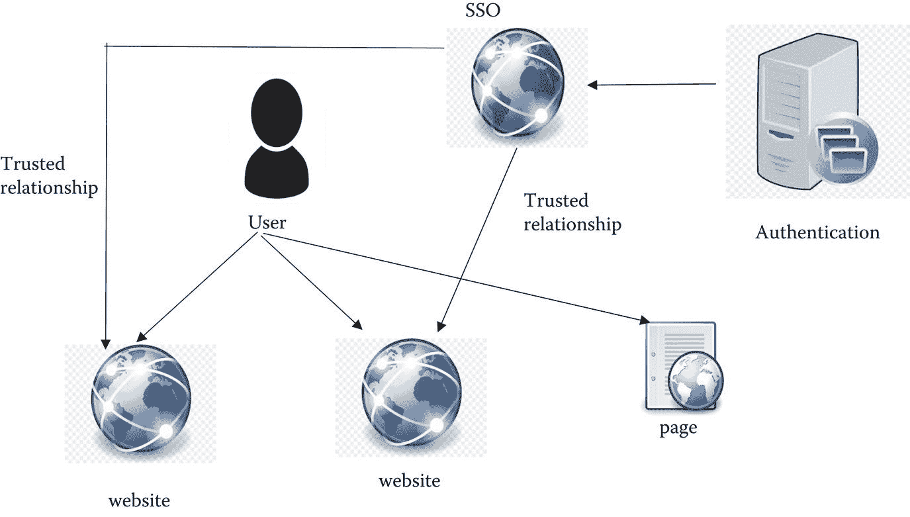

图 4.10 单域身份验证。

### 4.3.2 跨域身份验证

当跨域提出用户身份验证请求时，称为跨域身份验证。例如，如果从一个应用程序的请求发送到另一个域，则被称为跨域身份验证。从应用程序收集请求的凭据并将其发送到另一个域显然会遇到安全威胁/漏洞。为了缓解这些攻击，必须采取并部署适当的安全控制措施，以确保跨域访问的保障。

这可以通过基于属性的框架或基于组密钥的框架来实现。基于组密钥的框架要求层次树结构并维护高水平的可扩展性，而基于属性的框架被认为是下一代模型，因为它具有感知感知并提供动态访问。

尽管这些模型中存在许多方案，但密钥/证书撤销、隐私保护和匿名身份验证被认为是这些方案的主要限制，并为改进铺了道路。图 4.11 详细介绍了两个公司实体之间的跨域身份验证。

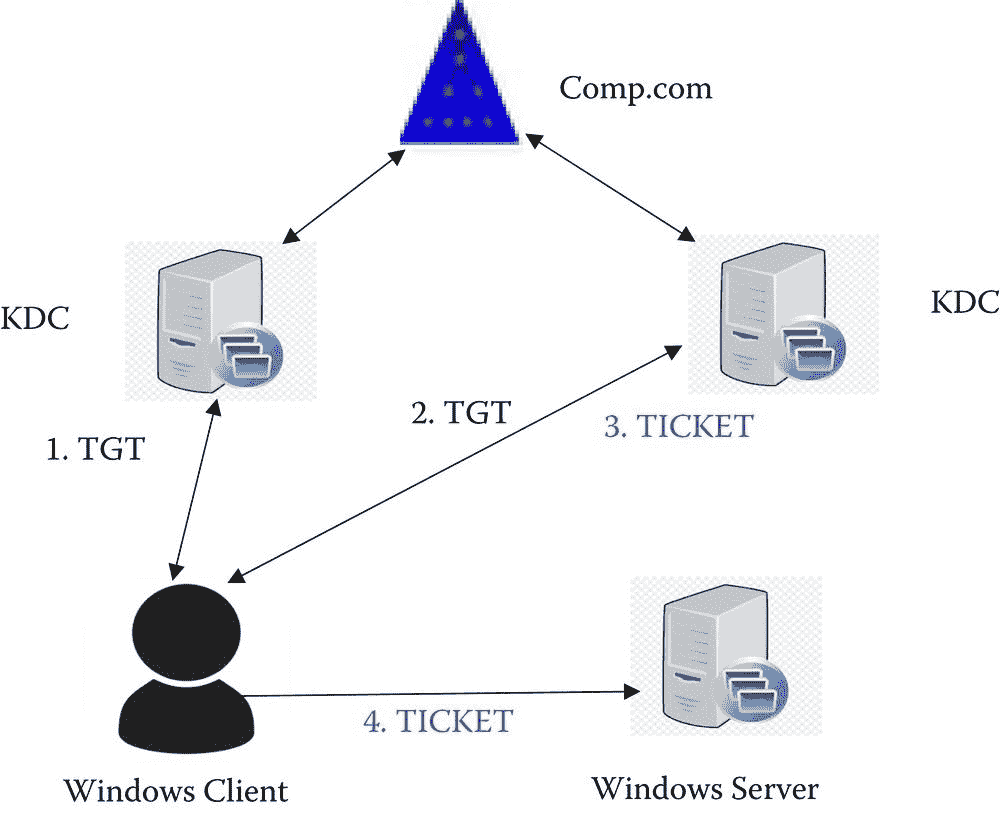

图 4.11 跨域身份验证。

### 4.3.3 切换身份验证

为了确保设备在多个访问点之间的安全无缝漫游，适当的强制身份验证是不可少的，称为切换身份验证。设计高效的切换身份验证协议是一个复杂的过程，因为它容易受到频繁的危险攻击。此外，可扩展性和处理开销被认为是切换身份验证最大的限制。

不可追踪性和身份隐私必须是该技术需要满足的原始属性。许多此类方案通过使用经典的硬密码系统如 `ElGamal` 和椭圆曲线密码学来保留匿名身份验证。一个典型的切换身份验证场景如图 4.12 所示。

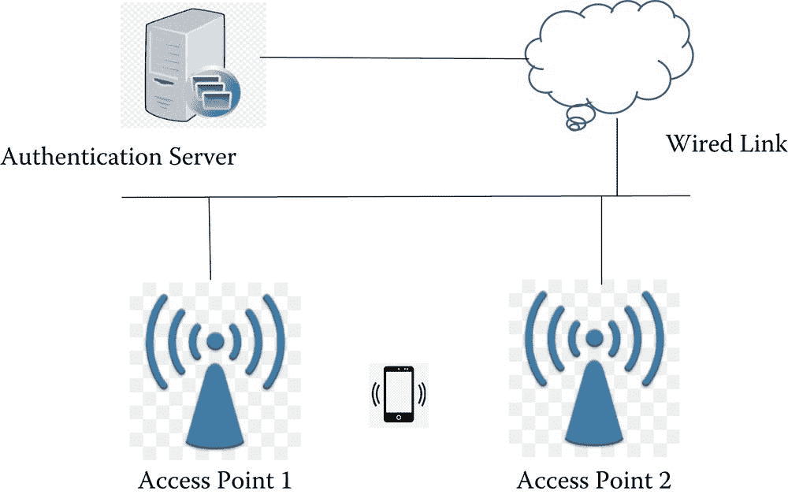

图 4.12 切换身份验证。

## 4.4 隐私保护方案

确保边缘计算环境中的隐私是一项不可避免的任务。该环境必须确保整体隐私、条件隐私、轨迹隐私、差异隐私、数据隐私、位置隐私和身份隐私。在这些隐私中，数据隐私、位置隐私和身份隐私是必须执行的隐私策略。为了实施最高水平的安全，细粒度的隐私策略执行至关重要。

### 4.4.1 数据隐私

由于前所未有的数字化转型，每天从电子商务、零售、社交媒体、银行等各种应用程序/领域产生海量数据。显然，这为严重的/有害的隐私侵犯铺了道路。考虑的关键威胁如下：

- 泄露
- 歧视
- 监控
- 个人数据滥用

数据隐私，也称为信息隐私，用于保护数据的私密性，确保非法用户无法获得数据访问权限。在收集、共享和使用数据时，必须采用适当且具有合理的机制，特别是在处理个人数据时。任何部门都有责任提供以下内容：

- 收集数据时的妥当同意（特别是针对个人）
- 数据质量保证
- 数据收集的清晰声明/协议
- 数据收集的目的
- 数据保护保障
- 政策和流程的透明度
- 问责声明

为了设计并部署了多种隐私保护技术以保护遵守法规的个人数据，例如 `K-anonymity`（K-匿名性）、`L-diversity`（L-多样性）、`T-closeness`（T-接近性）、随机化和加密技术。概率公钥加密被认为是高效保护数据隐私的技术方法之一。提出了一种结合基于排名关键词搜索的改进方法。此类方案通过提供高水平的可扩展性，更适用于边缘云环境。

### 4.4.2 地位置隐私

位置隐私是个人决定何时以及出于什么目的与他人共享信息的权利。在边缘环境中，维护用户位置的隐私保护是一项基础流程。如果不采取适当措施，攻击者将进行各种攻击，例如：

- 用户画像
- 政治/宗教歧视
- 拒绝服务
- 物理攻击
- 非法广告

在受限检索模式下构建具有位置隐私的安全定位协议，是保护位置隐私的极优方案之一。目前存在多种方法，通过虚拟位置更新、分布式缓存代理服务器、为攻击者创建伪造位置以及通过确保高水平可扩展性的基于混淆的技术来保护位置隐私。

### 4.4.3 身份隐私

身份/用户隐私是在不牺牲质量的前提下保护用户隐私。这是人们必须面对的最高挑战之一，因为许多企业正倾向于追踪终端消费者的行为并进行市场营销。近期，大量经纪人代理涌现，他们用于整合并出售个人的个人信息，卖给竞争公司/政府机构。

维护身份隐私的最佳方法是限制画像生成。动态凭证生成、跨域可信第三方管理认证被认为是维护用户身份隐私的最佳方法。大多数协议都支持自组织（`ad hoc`）移动环境，最近的研究已进入网雾-移动计算环境。

## 4.5 基于边缘的攻击检测与防御

边缘计算涉及的主要攻击类挑战包括隐私泄露、拒绝服务攻击、攻击者的未经授权访问以及数据篡改。为了在满足机密性和隐私属性的同时高效处理海量数据并提供相互认证，传统方案不再适用。获取访问权的外部或内部攻击者可能会滥用分配的权限。

通过应用跨域认证和接管认证等新型认证机制可以消除未经授权的访问。通过在网络边缘部署服务器，可以防止传统的拒绝服务及其相关攻击。另一个重大挑战是针对边缘基础设施的数据篡改和物理攻击。必须对边缘基础设施提供严格的物理保护，为了规避数据篡改，在 `Section 4.2` 中讨论了具有核心优势的现代机密性方案。

为了安全地将一个公钥转换为另一个密钥，实践中使用了基于代理的第三方访问方法，即 `proxy re-encryption`（代理重加密）。同样，在多方环境中安全地收发消息，倾向于使用 `attribute-based encryption`（基于属性的加密）。使用 `honey encryption`（蜜罐加密）可以避免所有虚假的资源访问以及有害的暴力攻击/破解。

此外，`homomorphic encryption`（同态加密）通过对加密数据而非明文执行各种操作，用于避免边缘环境中的数据泄露和侵入性攻击。隐私泄露被认为是边缘系统的另一个关键威胁。为了检测隐私泄露，必须保持全面的监控，并采用与基于位置隐私方案类似的稳健现代隐私保护机制。

因此，通过在边缘计算系统中应用上述方法，可以在安全可靠的情况下进行多源数据处理，而不会损害传输速度。它还提供了丰富的用户体验和移动性支持。


## 4.6 结论与未来方向

在本章中，讨论了边缘计算中的数据存储和图示。`homomorphic encryption`（同态加密）的功能、属性和应用进行了详细阐述。边缘计算的未来领域在`Section 4.5`中进行了分析。边缘计算框架中的数据安全和隐私问题在未来研究中得到了阐明。这种加密方案的处理速度和准确性可以在多源环境中得到增强。

## 参考文献

1. Zhang, J., Chen, B, Zhao, Y, Cheng, X, Hu, F. (2018). 边缘计算中的安全与隐私。IEEE Access, 26, 18209–18237.

2. Shamir, A. (1984). 身份加密与签名。在密码学进展（计算机科学讲义，卷 4392），47–53。Santa Barbara, CA: Springer.

3. Tsujii, S., Itoh, T. (1989). 基于离散对数的身份加密系统。IEEE Journal on Selected Areas in Communications, *7*(4), 467–473.

4. Boneh, D., Franklin, M. (2003). 基于类对的身份加密。SIAM Journal on Computing, *32*(3), 586–615.

5. Sahai, A., & Waters, B. (2005, May). 模糊身份加密。在*Proc.*，Aarhus, Denmark, 457–473.

6. Blaze, M., Bleumer, G., & Strauss, M. (1998, May). 分流协议和原子代理加密。在第 17 届国际密码学理论与应用会议上，Espoo, Finland, 127–144.

7. Boneh, D., Sahai, A., & Waters, B. (2012). 功能加密：公钥加密的新愿景。ACM Communications, *55*(11), 56–64.

8. Yin, W., Indulska, J., & Zhou, H. (2017). 用蜜罐加密保护隐私数据。Security and Communication Networks, 2017, 1–9.

9. Boneh, D., & Waters, B. (2007). 加密数据上的交、子集和范围查询。在密码学理论（卷 4392），535–554。Amsterdam, Netherlands: Springer.

10. Gentry, C., & Halevi, S. (2011). 实现 Gentry 的全同态加密方案。发表于*密码技术理论与应用年度国际会议（EUROCRYPT 2011）*，129–148。

11. Anitha Kumari, K., Sharma, A., Chakraborty, C., & Ananyaa, M. (2021). 在边缘计算系统中基于卡米尔定理的同态加密和改进型增强同态加密方案保护医疗保健数据安全与隐私。BigData. Mary Ann Liebert Publishers Ahead of Print. DoI: [`doi.org/10.1089/big.2021.0012.`](https://doi.org/10.1089/big.2021.0012)

12. Dijk, M., Gentry, C., Halevi, S., & Vaikuntanathan, V. (2010). 整数上的全同态加密。发表于*密码技术理论与应用年度国际会议（EUROCRYPT 2010）*，24–43

13. Liu, B., & Wu, H. (2016). 针对 NTRUEncrypt 系统的截断多项式环上高效乘法架构。发表于*IEEE 国际电路与系统学术会议（ISCAS）**，1174–1177。

14. Liu, H., Ning, H., Xiong, Q., & Yang, L. T. (2015). 云计算中基于共享权威的隐私保护认证协议。IEEE 并行与分布式系统事务，*26*(1), 241–251。

15. Jiang, Q., Ma, J., & Wei, F. (2018). 用于分布式移动云计算服务的隐私感知认证方案的安全性。IEEE 系统期刊，*12*(2), 2039–2042。

16. Kumari, K. A., Indusha, M., & Dharani, D. (2021). 使用安全同态加密技术基于活动追踪器数据的增强人体活动识别。发表于第 2 届新兴技术国际会议（INCET），11–7。

# 5 区块链与边缘计算系统

DOI: [10.1201/9781003230946-5](https://doi.org/10.1201/9781003230946-5)

## 5.1 区块链的历史

2008 年，中聪（Satoshi Nakamoto）发明了一种名为`Bitcoin`（`BTC`）的去信任数字货币，旨在消除数字金融交易中的第三方媒介。在`Bitcoin`的概念中，点对点（`P2P`）网络中的交易通过加密机制进行验证，交易记录存储在分布式账本中。在这里，成功的挖矿过程将获得`bitcoins`作为奖励。`Bitcoin`挖掘是一种释放`bitcoins`流通的实践。为了在区块链中添加区块，矿工需要解决一个计算性很强的难题以获得`bitcoins`形式的奖励。`Bitcoin`是使用区块链技术的第一个应用。2009 年，中聪以 50 个`bitcoins`的奖励挖出了第一个`bitcoins`区块，被称为创世区块。第一个`Bitcoin`交易由哈尔·芬尼（Hal Finney）完成，他下载了`Bitcoin`软件并从中聪处获得了十个`bitcoins`。`Bitcoin`作为开源软件发布，使许多加密货币开发者设计出模仿`Bitcoin`的不同加密货币。中聪是引入共识机制的使用者。`Bitcoin`网络证明工作量（`PoW`）共识是一种有效验证和确认`Bitcoin`网络节点的方法。直到 2014 年，`Bitcoin`仅被用加密货币。2014 年，维塔里克·布特林（Vitalik Buterin）计划利用`Bitcoin`开发加密货币之外的其他领域和用途。随后，他引入了智能合约并尝试将其到`Bitcoin`网络。在受到`Bitcoin`组织的反对后，他开发了名为`Ethereum`的自己的区块链，以及名为`ether`（`ETH`）的自己的加密货币。在区块链的第二代中，它将业务逻辑以智能合约的形式到应用程序中。目前，`ETH`是全球仅次于`BTC`的第二加密货币。2015 年，Linux 基金联合 IBM、Intel 和 SAP Ariba 开发了一个名为`Hyperledger`的企业私有区块链。结果是交易速度提高了，并且具有高度的可扩展性，使得小型区块链网络能够满足各个组织的预期。这是区块链网络演变的第三代[1。

## 5.2 分布式账本技术

在传统的文档共享系统中，多个权威无法汇总资源，信息无法同时管理或处理。例如，如果 A 人员更新并将文档发送给 B 人员，B 人员无法无法更新或修改。他/她必须更新最新的文档并重新发送给 A，即使是微小的更新，这也是一个耗时的过程。随后，中心化平台的引入通过指定一个中央权威/媒介来维护文档，实现了同步更新，如图 5.1 所示。同时，由于完全依赖单个节点是不安全的，中心化的文档共享机制出现了单点故障。

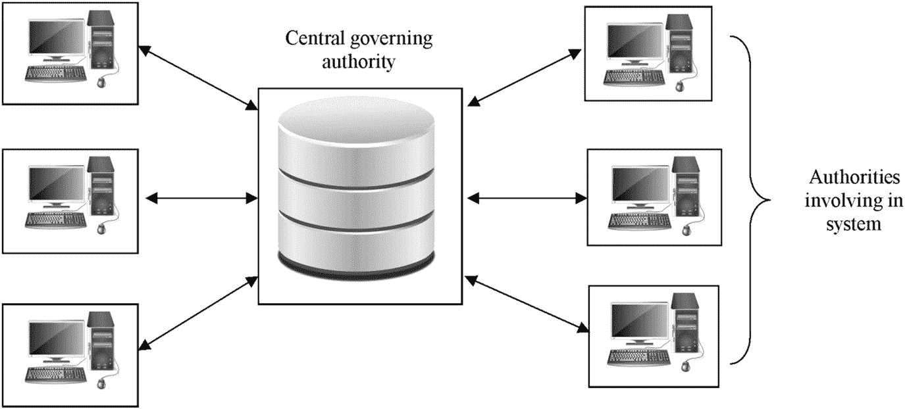

图 5.1 中心化系统。

去中心化存储机制是一种可行的解决方案，它将权限授予多个本地权威而非单个节点。去中心化组织依赖本地社区，因此消除了单点故障，如图 5.2 所示。去中心化系统需要多个协调点。因此，任何本地治理机构的故障都可能导致网络断开[2]。

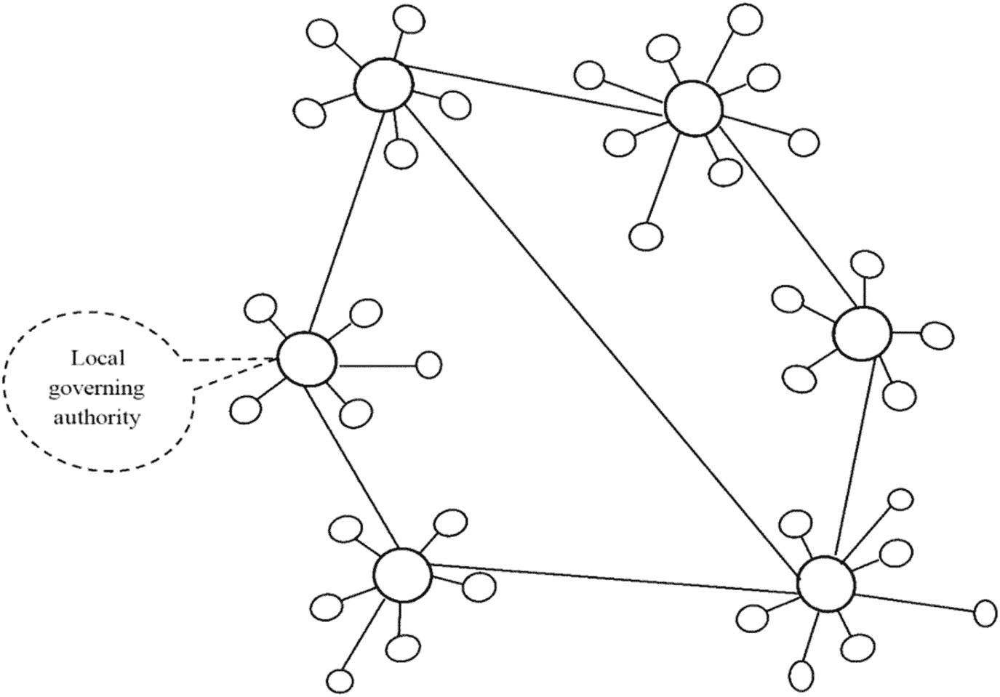

图 5.2 去中心化系统。

分布式网络是节点组，每个节点都是独立的且相互连接的。区块链是一个分布式且不可篡改的数据库，在没有任何中央监控机构参与的情况下运行。数据不存储在中心位置，这防止了丢失。因此，网络中的每个实体都拥有相同的权限。网络中的每个节点都维护一份全局数据表的本地副本。这被称为分布式账本，它通过时间戳维护网络实体之间的所有交易，以保持防篡改的数据，如图 5.3 所示。目前各种区块链框架在使用两种账本模型。未花费交易输出（`UTXO`）模型被`Bitcoin`网络使用。账户余额模型用于`Hyperledger`和`Ethereum`区块链框架。

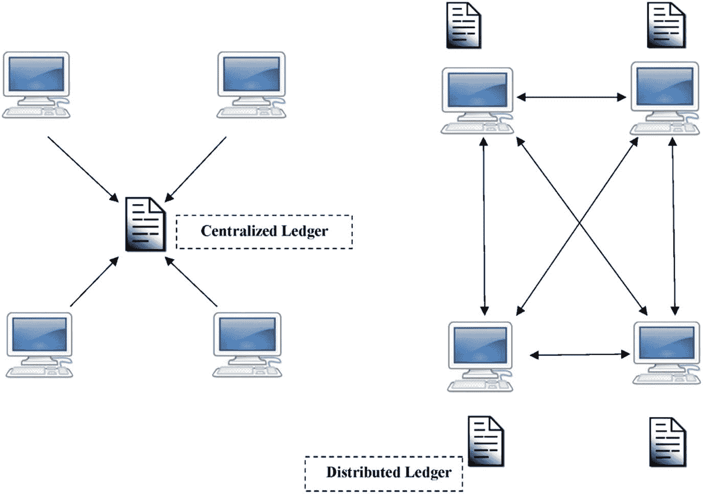

图 5.3 中心化与分布式账本。

分布式数据库将内容/数据分布在由单个实体控制和监控的不同系统中。区块链分布式架构是一个网络，其中每个节点都充当管理员。网络中的每笔交易在被添加到分布式账本之前，都会经过密码学验证和确认。一旦交易在区块链中更新，就不可能对其进行修改。该账本可比 `Linked List`（链表）数据结构，因为它是一个通过密码学链接的区块链。这些区块中的每一个都包含交易，由整个网络通过共同共识对这些交易进行验证。为了篡改或更改分布式账本的内容，网络中的每个实体必须达成一致的协议/共识，而这是可能的。由于区块之间是密码学链接的，如果不修订所有后续区块，就无法对其中某一个区块进行更改。区块链的理念类比云端的 Google 表格，每个人都可以同时执行任务而不会丢失任何数据，但区别在于，表格数据是中心化存储在 Google 服务器上的。相反，在区块链中，区块链网络的每个节点都拥有最新版本账本的相同副本，所有交易都带有时间戳并更新。

## 5.3 P2P 架构在区块链中的作用

P2P 网络由一组协作在网络中存储和共享数据的节点/设备组成，如图 5.4 所示。网络中的所有节点都具有相同的权限和权力，并执行相同的任务。在比特币等支付服务网络中，P2P 网络通常是分布式网络中数字资产的交换，买卖双方在没有任何中介的情况下进行。

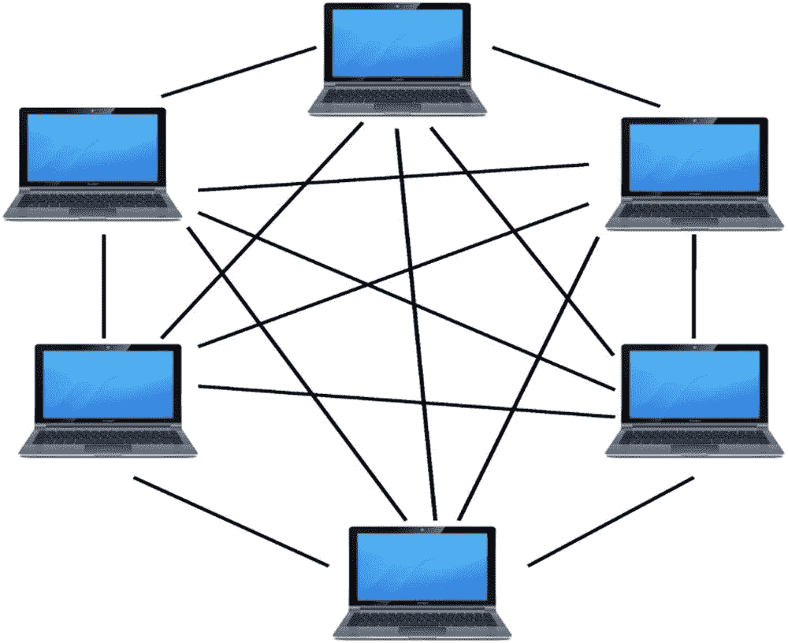

图 5.4 P2P 网络。

区块链整合了 P2P 网络架构的理念，并维护了一个每个参与者都可以信任的分布式账本，尽管参与者之间可能并不互相熟悉。结合分布式账本技术（DLT）的密码学安全 P2P 网络架构防止了数字资产交易中可能的双重花费问题。双重花费是将同一笔钱花给多个实体的过程，这在实体货币/现金系统中是不现实的。区块链系统结合了密码学解决方案、P2P 网络特征和博弈论方面。公钥密码和密码哈希函数的使用确保了网络中发生交易的透明性和隐私性。区块链网络由去中心化社区通过 P2P 网络通过激励进行管理。通常，博弈论是关于刻意决策过程的研究。在这里，交易使用共识机制进行验证，在验证过程中获胜的节点将下一个区块添加到链中，该节点还会获得经济激励。运行共识算法并将区块添加到区块链的网络矿工将获得激励。这个过程被称为“铸币”（minting）。基于共识机制向区块链添加下一个区块的过程让人想起了博弈论的属性 [3]。

## 5.4 区块链密码学

密码学技术用于区块链以确保机密性、真实性、授权、不可否认性和完整性。交易中的机密性是指保证共享信息保持保密的责任。它是指将可读消息转换为不可读格式的能力，以提高隐私性。真实性是确认用户身份以继续后续交易的过程。授权是提供用户访问特定资源权限的过程。不可否认性证明了发送者是否真的发送了这条消息。完整性确保消息在传输过程中没有被篡改，如图 5.5 所示 [4]。

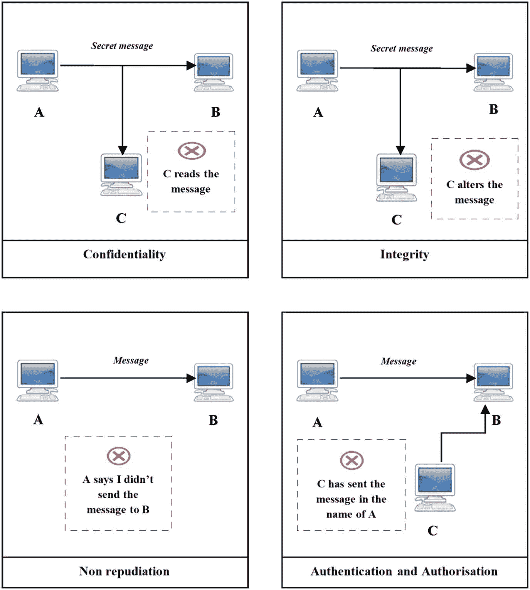

图 5.5 密码学属性。

区块链技术以多种方式使用密码学机制：例如用于钱包、交易、安全隐私保护。以下是区块链中最广泛使用的密码学技术：

* 公钥加密

* 哈希处理

* Merkle 树

* 数字签名

**公钥加密（非对称密钥加密）：** 在对称密钥机制中，一个秘密密钥同时用于加密和解密过程。虽然这些系统快速且高效，但每个用户都需要单独的密钥。对于系统中的`N`个用户，需要`N*(N-1)/2`个密钥。安全地存储和维护这些大量的密钥以及在双方之间传输密钥是一个问题。因此，区块链使用了公钥加密机制。

非对称密钥加密使用两个密钥：私钥和公钥。如果 A 人想向 B 人发送消息，A 人使用 B 的公钥对消息加密，该公钥对所有人公开。A 人将加密后的消息发送给 B 人。然后 B 人使用自己的私钥解密消息，该私钥没有任何其他人持有。在这里，公钥是由私钥推导出的，但反过来则是不可能的。

常用的公钥加密技术是`RSA`。在区块链中，使用了更安全、更快的公钥加密机制，称为椭圆曲线加密 (`ECC`)）。使用`256`字节的密钥，`ECC`比`RSA`中`3072`字节的密钥实现了更高的安全性 [5]。`ECC`算法比`RSA`以更小的密钥提供了更好的安全性。`ECC`基于非奇异椭圆曲线和点运算概念，因此更安全、更快。以下是椭圆曲线方程：

`y² = x³ + ax + b`

假设`M`是要传输的消息。公钥 (`Q`) 使用范围在 1 到`N-1`之间的私钥`d`推导得出。例如，公钥使用公式`Q = d * P`生成，其中`P`是椭圆曲线上的点，`d`是私钥，`Q`是公钥。

**ECC 加密：** 从 1 到`N-1`随机选择`k`。`m`是要传输的消息，在椭圆曲线上用`M`表示。因此，使用下面的点运算技术生成两个密文`C1`和`C2`。

```
C1 = k * P
C2 = M + k * Q
```

**ECC 解密：** 使用私钥 (`d`) 从两个密文`C1`和`C2`中提取原始消息 (`M`)，如下所示：

```
M = C2 - d * C1
```

**哈希处理：** 哈希是将任意长度文本转换为固定长度文本的过程。哈希的主要目标是维护完整性。比特币网络使用`SHA-256`作为哈希机制。`Keccak`是`SHA`的修改版本，用于以太坊区块链网络，它比`SHA`更快。一个强大的哈希算法必须满足以下属性：

* 输入数据的微小变化会产生输出的巨大差异。这被称为雪崩效应。

* 哈希始终是单向函数，确保了原始文本无法被找回。给定`H(x)`，寻找`x`在计算上是困难的。

* 它必须是无冲突的。这一属性确保了哈希值的唯一性。

哈希可以是线性哈希或基于树的哈希。由于交易是动态的，线性哈希并不区块链。每次插入都需要重新哈希，并且每次必须遍历所有节点。因此，区块链使用了基于树的哈希。在这方面，只有在需要重新计算特定路径时才需要重新哈希。它将复杂度降低到了`log N`。

### Merkle 哈希树

区块链中的每笔交易都使用`SHA-256`等算法进行哈希，并维护在区块链名为 Merkle 树的数据结构中。叶节点分别是有效交易的哈希值。中间节点通过对叶节点的哈希值再次哈希生成。此过程持续到根节点。Merkle 树中的每一个节点都通过哈希值相互链接，这使其在计算上非常强大且安全。随后将`Merkle root`添加到区块头部，以便将有效交易池集成到区块链相应的区块中。这种数据结构在`Bitcoin`和`Ethereum`区块链网络中广泛使用。

### 数字签名

为了确保认证、完整性和不可否认性，数字签名被集成到区块链中。发送者首先使用哈希函数对交易/消息数据进行哈希（`Bitcoin`使用双`SHA-256`），以便后续验证数据的完整性。然后使用发送者的私钥对哈希数据进行加密以提供身份认证，加密输出被称为该交易的数字签名。加密的消息摘要数字签名。交易数据和数字签名广播到网络。在接收端，使用发送者的公钥对数字签名进行解密以获得消息摘要。从接收到的数据再次独立计算消息摘要。检查该摘要是否与从数字签名解密出的消息摘要一致。因此，数字签名可提供认证，确保完整性和不可否认性。椭圆曲线数字签名算法（`ECDSA`）广泛用于区块链以提供数字签名，它使用`ECC`创建用于签名和验证过程的密钥对 [4]。

## 5.5 区块链的特性

区块链的基本特性如下（见图 5.6）：

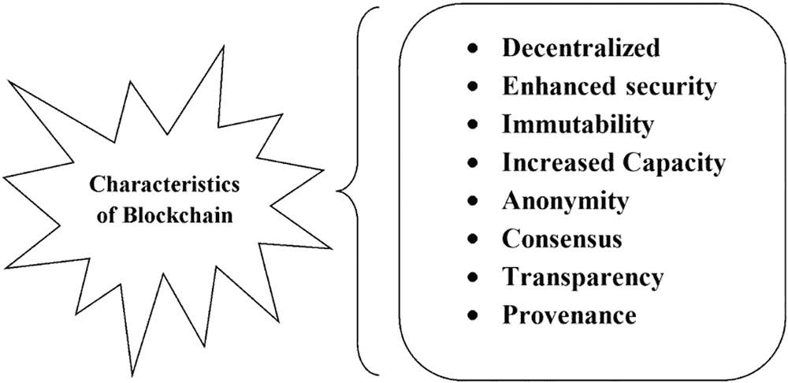

图 5.6 区块链的特性

**去中心化：** 没有单一权威可以控制区块链网络。它是一个`P2P`去中心化的分布式账本。

**增强安全性：** 区块链集成了数字签名、公钥加密和哈希机制等加密技术来维护完整性。区块链网络是可验证的。每当一个区块启动转换时，其他网络实体都会验证并确认该转换是否正确。如果数据被篡改，加密签名将失效，因此无法被网络实体验证和确认。

**不可篡改性：** 区块链的不可篡改性是通过账本实现的。区块一旦添加到区块链，就无法修改，因为它在加密上更安全，且数据的微小变化会导致生成的哈希值产生巨大差异。区块链是一个不断增长的记录列表（区块）。区块链中生成的每个区块都使用其哈希值与上一个区块链接。任何一个区块的更改都会影响所有后续区块。在密码学上更改所有后续区块是不可能的。

**容量增加：** 由于有许多节点/计算机协同工作，区块链提供了比中心化系统更大的能力。

**匿名性：** 在区块链中，个人的账户号是公开的，但它不会暴露私私、身份详情，例如参与交易的人员姓名。从账户号无法获取个人的其他详细信息，因为账户号仅在哈希处理后才会暴露。

**共识：** 每个网络参与者都保留一份整个区块链的副本。共识机制验证并确认每笔新交易。它通常会验证并确认每笔新交易。

**透明性：** 任何加入网络的人都可以查看。

**溯源性：** 为了建立信任和真实性，记录了交易历史。

## 5.6 区块链的优点与局限性

### 优点

- 没有中心权威。验证和确认提高了准确性。

- 由于去中心化程度的影响，修改资产在实践上是不可能的。

- 所有交易对网络实体开放。这确保了安全、隐私和高效。

- 尽管区块链取决于网络且速度较慢，但它消除了第三方验证。

- 它非常适合用户互不信任的网络。

### 局限性

- `Bitcoin`中的`PoW`共识大约需要 10 分钟添加一个区块。针对此问题的研究已多年。速度缓慢是区块链的一个主要问题。

- 验证每笔交易需要高计算能力。

## 5.7 区块链的类型

区块链有两种主要类型，即私有区块链和公共区块链。后来，出现了不同的区块链变体。无论什么类型，区块链网络具有以下共同属性：

- 它是一个`P2P`网络。

- 交易在分布式账本中更新。

- 区块链网络中的每个节点都拥有共享分布式账本的副本。

- 每个节点通过共识和各种加密机制验证并确认在网络中发生的交易。


去中心化程度是确定区块链分类的关键属性。完全中心化系统中最重要的威胁是实体间的信任和单点故障。区块链的去中心化和各种指标有助于建立双方的信任并避免单点故障。区块链的配置随分类而异，如图 5.7 所示。

### 图 5.7 区块链的类型

**私有区块链：** 私有区块链限制了加入网络的成员，因为它是一个许可网络。它保护了隐私。与公共区块链相比，该网络能量效率更高，因为它拥有运行速度更快的私有共识机制。这些网络波动较小。它非常适合任何特定的组织。私有区块链也被称为部分去中心化网络，因为它在某种程度上受到组织的控制。

### 公有区块链

在公有区块链网络中，任何人无需身份验证即可加入并参与共识。隐私性较低，且运行共识消耗更多能量。公有区块链是波动网络，因为任何参与者都可以根据意愿加入或离开网络。这种网络是完全去中心化且透明的。完全透明、无许可、去中心化的公有区块链示例是`Bitcoin`网络。

公有区块链也可以是许可网络。在这种情况下，网络实体在加入网络之前需要经过验证。许可公有区块链的示例是`Ethereum`区块链。公有区块链利用原生资产或货币。例如，`Ethereum`使用`ethers`作为货币。`Bitcoin`网络使用`Bitcoin`货币作为奖励。私有区块链并不关心货币。

### 联盟链/混合区块链

联盟链/混合网络是公有和私有区块链的混合。它整合了两种类型网络的优点，例如波动性、身份验证、隐私性和不可篡改性。它还降低了能量成本并在两种类型之间取得了平衡。虽然混合区块链的成员身份是私有的，但从治理角度来看它是公开的。它比无许可网络更具能源效率且具有隐私性。联盟链的示例是`Ethermint` [7]。

## 5.8 区块链架构与基础

`Bitcoin`是第一个引入区块链技术的网络。`Bitcoin` P2P 网络中的交易发生如图 5.8 和 5.9 所示。任何节点要参与区块链交易，必须拥有一个`wallet`（钱包）。它是用于与区块链网络交互的程序。

典型的区块链钱包包含用户的`private key`（私钥）。它检查账户入入和出的加密货币。向其他账户发送加密货币时，通过`wallet`中存在的`private key`形成数字签名，并在另一端使用`public key`（公钥）进行验证。

区块链中的`wallet`类似于给银行用户提供的账户存折，对一个账户来说是唯一的。加密货币运行在区块链之上，被描述为虚拟货币。它同样是去中心化的并经过加密安全的，没有单一机构可以像区块链网络那样对其控制和监控。

取决于区块链的类型，区块链网络可以在有或没有加密货币的情况下运行。通常，私有区块链不关注加密货币或基于令牌的系统。

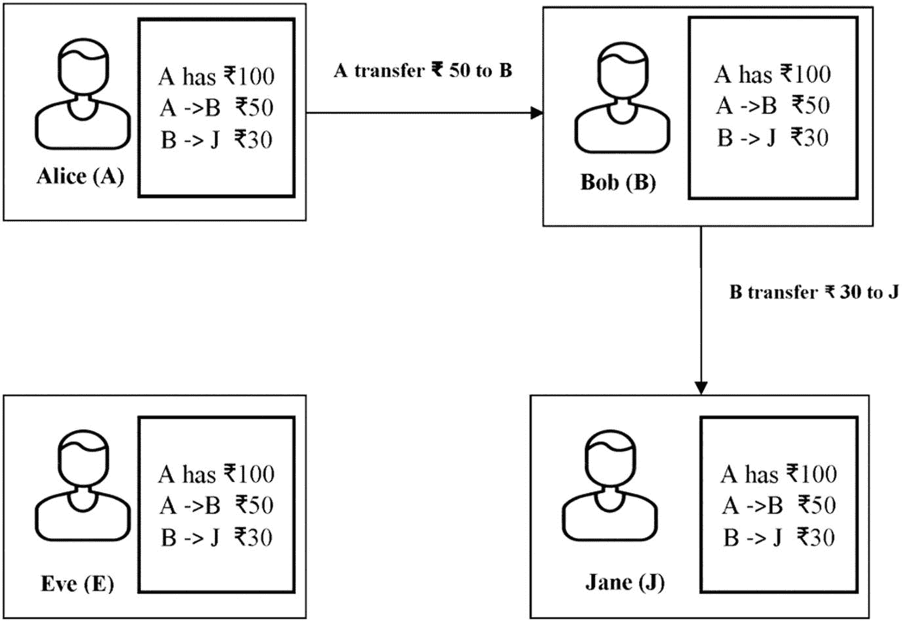

图 5.8 区块链中的交易

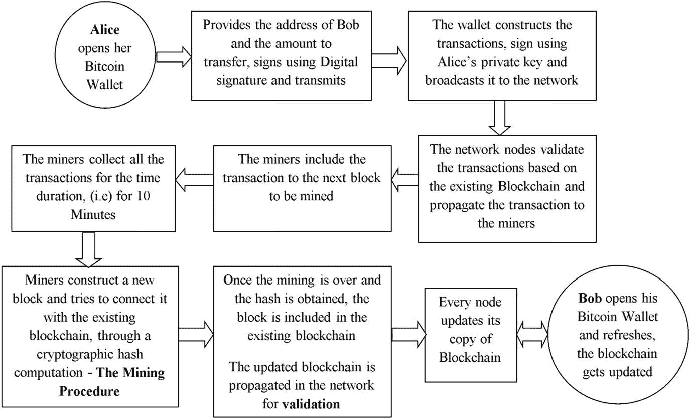

图 5.9 交易工作流

### 5.8.1 Bitcoin 网络背后的区块链

在区块链中，网络中的所有节点都维护一份分布式分布式账本。网络中的每个参与者被称为`node`（节点）。区块链网络中的节点可以分为三个类型：`light node`（轻节点）、`full node`（全节点）和`mining node`（矿节点）。

**轻节点：** `light node`也称为简单节点，它不持有完整的交易细节。它持有单个用户的`wallet`信息，如`account number`（账号）和`private key`，并在网络中发起新交易。由于它不持有账本，轻量级节点不是区块链网络的一部分。因此，这种类型的节点不参与验证其他交易。

**全节点：** `full nodes`也称为`validators`（验证者），它们是区块链网络的一部分。它以共享账本的形式持有完整的交易历史。区块链中每个`full node`的账本都持有一致的信息。它不负责提议新区块，但它可以发起交易并维护`wallet`信息。

`full node`的主要责任是验证每笔交易。验证是为了确保`wallet`有足够的金额完成交易，并通过其数字签名验证实体的可信度。在图 5.8 中，所有节点 (A)、(B)、(J) 和 (E) 都是全节点的示例，因为它们在`Bitcoin`网络中都持有共享账本。

**矿节点：** `mining node`是一个`full node`并包含`mining function`（挖掘功能）。它也被称为`block generator`（区块生成器）。这些是负责通过解决密码题来提议新区块的参与者或计算机 [8]。

### 5.8.2 交易验证

交易是`Bitcoin`网络中的基本构建块。经过验证的交易会被广播到网络节点。许多交易共同形成一个区块。许多区块通过加密链接形成一条链。区块在添加到链之前也会经过验证。验证和共识程序由`mining nodes`执行以验证区块。

如图 5.8 所示，每个节点都有共享账本。为了让交易发生，当每个节点加入区块链时，它会根据提供的节点身份提供一个`wallet`和一个`private key`。如图 5.8 所示，如果 Alice 想在`Bitcoin`网络中向 Bob 转账，它需要处理图 5.9 所示的一系列步骤。

网络中的每个`full node`通过执行用户身份验证和数据完整性来验证交易。用户身份验证通过相应的`public key`解密提议用户的数字签名来确保。数据完整性通过对交易数据进行哈希处理并与解密签名进行对比来检查。

验证交易遵循此程序。有效交易积累在池中。有效交易随后广播给`mining nodes`，以便在网络中建立新区块。

### 5.8.3 挖掘与区块结构

矿工收集有效交易并使用哈希机制形成`Merkle root hash`（默克尔根哈希）。随后`Merkle root header`被添加到区块头。通过这种方式，所有有效交易都被汇总到一个区块中。每个区块的交易数量由`mining nodes`决定。

该区块随后广播给`mining nodes`。为了识别网络中的下一个区块，区块链中使用了共识机制。网络中的`block generator/miner`根据共识挖掘区块。矿工相互竞争解决困难的数学题（如`PoW`）。

矿工通过检查`block hash`、`block height`和`size values`、上一个区块哈希值、区块中所有交易的有效性以及`block timestamp values`的正确性来验证并校验区块。挖掘后，矿工获得奖励。成功挖掘后，区块中包含的所有交易节点将手续费支付给矿工。当每个新区块被添加到链时，区块链网络也会产生新的代币。

区块结构包含图 5.10 所示的字段。为区块生成区块头哈希值需要六个字段，即时间戳、难度值、随机数、前一个哈希、Merkle 根和版本。生成的哈希值将与区块链持有者设置的目标值进行比较。

如果生成的哈希值小于目标值，则认为矿工获胜并获得奖励。如果不是，则必须修改`nonce`值并重新生成哈希值。因此，这是一个通过选取随机`Nonce`值并不断生成哈希值直到达到目标的计算问题。

寻找区块头哈希值的难易程度被称为挖矿难度。网络中的难度值每 2016 个区块变化一次。如果难度值增加，达到目标的迭代次数也将增加。

区块结构还维护了区块的大小、交易计数器以及添加到区块中的交易。每个区块都通过前一个区块的哈希值与前一个区块链接。

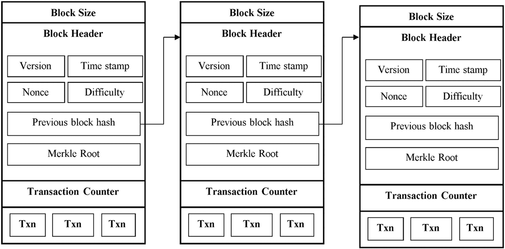

图 5.10 区块结构。

### 5.8.4 共识机制

共识是全节点之间对于包含在区块链中的后续交易区块的一种认同。网络实体通过大量的验证和校验过程以及复杂的计算来满足这种共识。它确保了网络的完整性。

著名的共识算法有`PoW`、权益证明（`PoS`）和实用拜占庭容错机制（`PBFT`）。此外，还有其他几种共识机制，如权威证明（`PoA`）、历时证明证明（`PoET`）、容量证明（`PoC`）等。根据网络需求和限制，为不同的区块链应用选择了不同的共识协议。

`PoW`是许多如比特币等流行区块链应用中常用的共识机制。`PoW`因为比特币网络而闻名，但它并非加密货币所有。以太坊网络遵循比特币并在微调后使用了`PoW`。以太坊协议使用基于内存的`PoW`，能量消耗不高。

当区块链涉及`PoW`共识时，尝试向区块链添加区块的节点都必须解决某些计算问题。先解决密码谜的人赢得共识并将区块添加到区块链，同时获得加密货币形式的奖励。谜题的复杂度取决于网络规模、活跃用户数量、区块链大小等因素。

由于`PoW`完全依赖于通过反复修改`nonce`来计算区块头元素的哈希，在极短时间内猜测并操纵所有节点的哈希来破解链是不现实的。`PoW`解决谜题是计算密集型的，这会导致巨大的能量消耗并需要更长的长时间。但未获胜节点消耗的巨大能量浪费了。

在`PoW`中，解决密码谜的过程被称为挖矿。当区块链中存在`n`个节点且超过`n/2`的节点是恶意节点时，区块链攻击变得可能。这种攻击被称为 511%攻击。无论边界如何，`PoW`在许多成功的区块链应用中运行良好。

`PoS`是`PoW`的替代方案，因为其挖矿过程使用了大量的电力和计算来维护网络安全。`PoW`的基本思想是与网络竞争以维护网络。（此处原文存在乱码重复，已忽略无意义部分。）

在分布式应用中，拜占庭将军问题指出，由于系统故障，在尝试达成某种状态时，一组将军可能会遇到通信问题。在区块链中，每个将军代表一个网络节点，他们需要对系统的当前状态达成一致。这意味着大多数节点对当前状态（此处原文存在大量重复词）达成一致。

`BFT`源自拜占庭将军问题，与其他共识方法一起用于许多区块链应用 [9。它被用于许多区块链应用 [9。

### 5.8.5 智能合约

在区块链中，智能合约已引入以太坊框架。智能合约是编写成微型计算机程序并存储在区块链中的业务逻辑。合约是双方或双方之间的协议，旨在通过法律执行。

一旦合同部署到区块链上，它是不可更改的。它无法被停止或修改。它是一个创建自动化认可的可信规则集的协议。`Solidity`是一种专门为以太坊创建的合约编程语言。这种编程结构类似于`JavaScript`。

在去中心化系统中，主要问题是信任。智能合约有助于在网络双方之间建立信任。它类似于典型编程语言中的`if-then`规则。

## 5.9 区块链平台

区块链概念在不同的平台上实施和测试，例如以太坊、`Hyperledger`、`Ripple`等。它们中的每一个都是为了执行特定类型的区块链类别创建的。

### 5.9.1 以太坊

维特币·布特林设计以太坊框架是为了将去中心化应用于货币转账之外的其他领域。该框架的主要目标是构建和运行无需中央权威即可在全球运行的应用。

以太坊是一个公共区块链平台，允许开发者构建和部署去中心化应用。在 P2P 网络上运行的应用被称为分布式应用（`DApp`）。以太坊专注于利用其特性生产`DApp`。`DApp`的每个客户端直接与其在区块链上编写并部署的实例交互。

开发者使用以太坊语言编写智能合约。它经过编译、部署并在以太坊虚拟机（`EVM`）上运行。

智能合约代码被编译成字节码并加载到`EVM`中。当客户端启动时，`EVM`会启动并执行交易。`EVM`还保证了免受网络攻击。

对于以太坊的每个用户，以太坊地址就是身份，私钥就是密码。钱包是用于存储和管理以太坊账户的软件插件。以太坊账户是以太坊地址和私钥的组合。

以太坊地址是通过私钥生成公钥，使用`keccak256`计算公钥的哈希值，并取哈希值的最后 20 个字节生成的。

每笔交易都涉及费用。与比特币一样，以太坊是 P2P 数字货币。交易支付的以太数量取决于所使用的资源。一个两个数字相加的交易需要三个工作单位。这个工作单位被称为`gas`。

Gas 价格是单位 gas 的价格，由用户固定。矿工会挑选 gas 价格较高的交易。交易费用通过通过交易消耗的 gas 乘以 gas 价格计算得出。Gas 限制表示用户愿意为执行交易购买的最大 gas 数量。

#### 比特币对比以太坊

- 比特币是基于区块链的加密货币。以太坊是带有智能合约和代币的去中心化编程平台。
- 比特币设计用于金融交易。以太坊专注于使用智能合约代码维护其他数据。
- 比特币使用 PoW 共识，以太坊使用 PoS 或 PoW 共识。
- 比特币每天处理 332 万笔交易，而以太坊每天处理 455 万笔。比特币的平均区块大小为 767 KB，以太坊的最大区块大小为 27 KB。比特币的区块数量为 564 万，以太坊的区块数量为 723 万 万。
- 比特币挖矿需要 10 分钟，以太坊需要 10–20 秒。比特币使用 SHA-256 进行哈希，以太坊使用 Ethash 和`keccak256`。

#### 框架概述

可以在 Truffle 环境中开发和测试应用程序。可以使用`Ganache`（Truffle Suite 的一部分）创建本地区块链网络实例。在这里设置区块链的 RPC 服务器、网络 ID、gas 限制和 gas 价格。为了测试目的，每个地址的地址和值已预设，如图 5.11 所示。

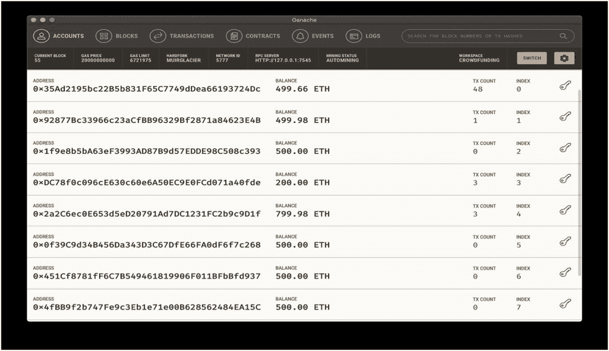

图 5.11 Ganache 区块链测试网。

账户可以加载到 metamask 中，从中访问区块链，如图 5.12 所示。


图 5.12 Metamask。

Truffle 框架提供了编译智能合约所需的依赖项。在项目目录下运行命令`npx truffle unbox react`会安装 solidity 和 React.js 的所有依赖项。从生成的目录中，会在 Client 目录下生成一个 Create React App。项目合约应保存在 Contracts 目录中，如图 5.13 所示。

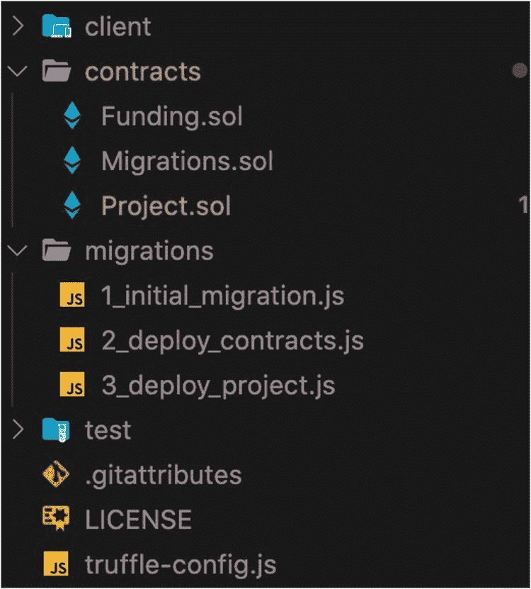

Truffle 框架提供了编译智能合约所需的依赖项。在项目目录下运行命令`npx truffle unbox react`会安装 solidity 和 React.js 的所有依赖项。从生成的目录中，会在 Client 目录下生成一个 Create React App。项目合约应保存在 Contracts 目录中，如图 5.13 所示。

区块链应用在适当的安全增强下，对于改进开放访问和金融服务非常有用。它被应用于各种领域，如游戏、供应链、物联网和物流等。

单个区块链只能处理有限数量的交易。当每秒交易数增加时，就会出现瓶颈，并导致交易费用增加。因此需要通过为特定目的设计区块链架构来扩展现有的区块链方法，将多条链结合并高效、安全地协同工作。

`Polkadot`是一种`Parachain`（平行链）网络协议，它将各种不同的区块链网络统一成一个去中心化的网络。它使得区块链具有可扩展性和定制性。它确保了多个网络之间的跨链通信和透明治理。它有助于根据应用需求升级区块链；因此有助于开发者、初创公司和企业高效利用区块链技术。

`Relay chain`（中继链）是`Polkadot`网络的核心，所有的区块链都连接到它。它允许同时处理网络中所有链的交易，从而提高了扩展性。这种并行处理被称为并行链。

跨链通信方案允许实体之间传输任何消息操作实现了操作操作互操作在升级过程中可能会分为两条独立的路径，这个问题被称为分叉。`Polkadot`确保了无分叉的区块链升级 [12]。

## 5.10 基于区块链的边缘计算

区块链可以为物联网设备建立安全可靠的资源分配和共享环境。通过卸载边缘设备的计算，它有助于增强系统的互操作性、可靠性、安全性和隐私。区块链网络为物联网设备提供了可靠的资源分配和共享环境。

### 5.10.1 物联网与区块链

物联网是传感器或电子/机械设备的集合，有助于在没有人工干预的情况下相互通信。由于物联网设备的资源限制无法自行执行数据分析，因此引入了云系统。虽然目标是建立 2P 系统，但云的介入使得系统行为类似于集中化的客户端服务器系统。因此，系统的扩展性受到了影响。

物联网设备由不同的供应商设计。因此，物联网设备的异构性导致了互操作问题。由于物联网设备资源有限，提供认证、授权和通信加密等资源密集型任务是不可能的。这些任务在云服务器上完成。

如果物联网设备容易产生安全漏洞，则通过更新固件来解决。大多数情况下，这由用户负责更新固件。如果用户没有执行，就会变成安全威胁。

为了克服这些挑战，借助边缘设备的帮助引入了物联网计算卸载，在那里也可以进行处理。当区块链与这些边缘设备集成时，它可以处理互操作性差、隐私和安全漏洞，从而改进了异构性 [13]。

#### 物联网与区块链结合的优势

- 通过在区块链中存储异构物联网设备数据，增强了物联网系统的互操作性。它为碎片化的物联网网络提供了通用的互联网访问。
- 改进了物联网系统的安全性。交易数据或传感器读数被加密、数字签名并存储在区块链中。
- 区块链中的`smart contract`（智能合约）用于更新固件，以确保物联网设备的安全性。
- 通过集成区块链保证了物联网设备的不可篡改性。因此，实现了数据的可靠性。
- 通过利用区块链，物联网系统实现了网络中设备之间安全且无信任的消息传递。结果，通过集成`smart contract`来促进`DAO`，实现了物联网的自主交互。

#### 集成区块链的物联网系统的应用

- 冰箱自主管理其与外部世界的交互。冰箱内有各种传感器用于控制操作和向用户报警。想象一种能够根据其内部物品和库存订购食物，并自动下单并支付的冰箱。仅靠执行器和传感器不足以实现这一点。因此，必须以安全的方式将物联网设备与`smart contracts`和支付系统相结合。
- 如果汽车的某些部分出现问题，由于区块链足够智能，可以对这些部分进行修复。

### 5.10.2 系统设计

物联网设备可以使用集中化或去中心化模型连接到区块链。在集中化模型中，`Ethereum full node`维护区块链。尽管区块链机制是去中心化的，当全节点故障时，物联网设备无法访问区块链。

通过`RPC`端点解决了这个问题，如图 5.14 所示。物联网设备通过`RPC`端点访问区块链的`smart contracts`。应用二进制接口（ABI）通过`RPC`端点为`smart contract`提供接口。

合约的`ABIs`通过`web3 API`暴露，`web3 API`连接到`RPC`端点。`RPC`提供了`smart contract`之间的通信。这种方法实现了去中心化。

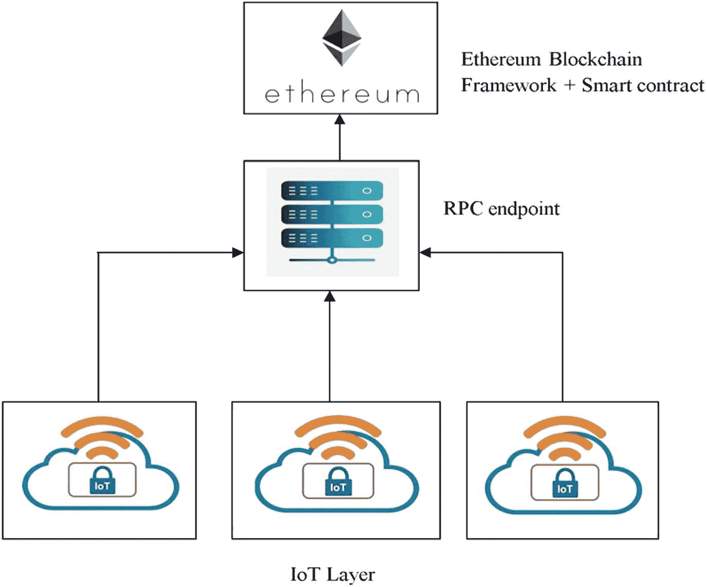


图 5.14 集成区块链的物联网设备

### 5.10.3 案例

#### 案例 I：基于区块链和物联网的众筹系统

该系统允许用户探索并资助项目所有者想法。项目所有者和用户使用`NFC Tags`作为硬件钱包。用户登录应用程序并使用与`NFC Tags`关联的支付。`Funding`合约部署在区块链上，项目所有者在上面发布项目详情。每个发布的项目都会部署一个`smart contract`，用于存储项目的资金状态信息，如资金状态和目前收到的资金金额。

每当应用程序运行时，该合约都会检查合约状态（融资中、成功或过期）。如果状态成功，资金将从合约转移给项目所有者。如果过期，资金将返回给用户。合约可以接受支付。该系统使用`Truffle`环境开发，使用`web3.js`连接 JSON RPC，使用`React.js`构建前端，并使用 Ganache CLI 私有区块链网络进行测试。NFC 的认证和处理使用`python nfcpy`库完成（如图 5.15](#ch05.xhtml#fig5_15)所示）。

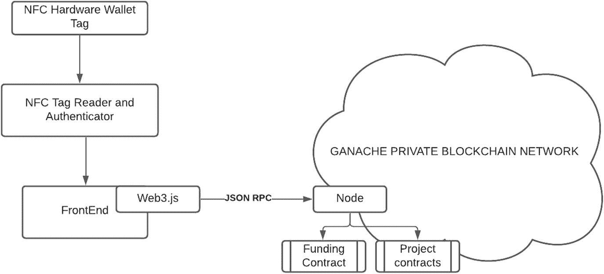

图 5.15 基于区块链和物联网的众筹系统架构

#### 使用 Solidity 语言的智能合约

开发该应用程序使用了两个智能合约。一个`Funding`智能合约实例可以关联多个`Project`智能合约。

### 资金合约

以下函数通过`web3`从前端发送参数启动一个项目，并部署项目合约，同时将合约推送到与该资金合约关联的项目列表中。

```solidity
function* startProject(
    string calldata title,
    string calldata description,
    uint durationInDays,
    uint amountToRaise
) external {
    uint raiseUntil = block.timestamp + (durationInDays * (1 days));
    Project newProject = new Project(msg.sender, amountToRaise, raiseUntil, title, description);
    projects.push(newProject);
    emit ProjectStarted(
        address(newProject),
        msg.sender,
        title,
        description,
        raiseUntil,
        amountToRaise
    );
}
```

以下函数返回与该资金合约实例关联的所有项目：

```solidity
function* returnAllProjects() external view returns(Project[] memory){
return projects;
}
```

## 项目合约

当用户输入数值进行捐时时调用的贡献函数：

```solidity
function* contribute() external verifyProjectState(ProjectState.FundRaising) payable {
    require (msg.sender != projectOwner);
    contributions[msg.sender] = contributions[msg.sender] + (msg.value);
    currentBalance = currentBalance + (msg.value);
    emit FundingReceived(msg.sender, msg.value, currentBalance);
    checkFundingState();
}
```

检查项目合约状态的函数：

```solidity
function* checkFundingState() public{
    if(currentBalance >= amountGoal){
        currentState = ProjectState.successful;
        payProjectOwner();
    }
    else if(block.timestamp > deadLine){
        currentState = ProjectState.expired;
    }
}
```

当目标达成时，向创建特定项目合约的地址支付资金的函数：

```solidity
function* payProjectOwner() internal verifyProjectState(ProjectState.successful) returns(bool){
    uint256 raisedAmount = currentBalance;
    currentBalance = 0;
    if(projectOwner.send(raisedAmount)){
        emit ProjectOwnerPaid(projectOwner);
        return true;
    }
    else{
        currentBalance = raisedAmount;
        currentState = ProjectState.successful;
        return false;
    }
}
```

#### 案例研究 II：基于区块链技术的生物识别系统

区块链技术提供了一种合适的架构，可以在安全去中心化的系统中存储和检索敏感机密数据。生物识别可以利用区块链的特性，如不可篡改性、更好的安全去中心化系统。利用集成区块链的生物特征对人员进行自动识别，有助于保护许多物联网应用中的智能设备。生物特征可以是生理性的（脸、指纹等）或行为性的（声音、手写签名等）。

##### 现有系统的问题

当生物识别存储在单一中心化数据库中时，攻击者可以窃取并泄露生物信息，这可能导致严重的后果。如果是密码被盗，很容易更换。攻击者还可以修改存储的生物识别导致身份验证失败。这些问题可以使用区块链技术来存储生物识别，因为它是安全的且防安全攻击的。

##### 设计考虑

生物识别是隐私和敏感信息。当智能合约中的变量被声明为`private`时，仅意味着该变量无法从另一个智能合约访问，但可以被`web3`等外部 API 读取。因此，生物识别不能简单地存储，因为任何人都可以访问并查看这些数据。解决此问题的方法是在存储到区块链之前对数据进行加密，并在身份验证期间解密。最近，同态加密变得越来越流行，因为它允许在加密数据上进行计算，并获得与解密后后计算相同的结果。

以太坊中执行的每条指令都需要支付一定量的`gas`（加密货币）。简单的加法指令可能消耗 1 gas，而其他复杂的计算（如`SHA3`哈希计算）可能消耗 30 gas。因此，大多数计算（如特征提取、加密和特征比较）应该在智能合约之外完成。

##### 系统设计

1. **从生物识别数据中提取特征**

   人的生物特征是通过各种传感器生成的。例如，使用面部作为生物特征，可以使用摄像头捕捉人的脸并从捕捉的图像中提取特征。

2. **存储加密数据**

   生物识别不能直接存储在区块链中，因为任何人都可以读取。在公有区块链上部署生物识别系统比使用私有区块链更安全可靠，因为它只允许少数受信任的用户参与网络。通过引入合适的加密算法，对特征进行加密并存储在公共区块链中。

3. **特征比较与身份验证**

   在身份验证期间，捕捉用户的生物识别，提取特征并与存储在区块链中的数据进行比较。比较通过计算两个生物识别之间的距离（欧几里得距离或汉明距离）完成，当生物识别匹配时最终通过用户。

##### 系统实现

实现了一个使用面部特征的简单生物识别系统以测试系统。使用名为`face_recognition`的 Python 包生成人的面部编码，并使用`AES256`算法加密特征向量。然后，将加密后的文本存储在区块链网络（注册）。在身份验证过程中检索并解密该文本。部署在网络中的智能合约如下。

##### 智能合约

```solidity
pragma solidity >=0.4.22 <0.8.0;
contract Face {
    //加密的编码存储在以地址为键的映射中
    mapping(address => string) private faceEncoding;
    address public admin;

    constructor() {
        admin=msg.sender;
    }

    function addFace(address adr,string memory face) public {
        //只有管理员（部署智能合约的地址）有权添加面部编码
        require(admin==msg.sender);
        faceEncoding[adr]=face;
    }

    function getFace(address adr) public view returns(string memory) {
        return faceEncoding[adr];
    }
}
```

持有枪支或任何火器可能导致不必要的暴力，并可能扰乱公共。滥用枪支会导致公共干扰和危害性死亡。与枪支相关的暴力的重要原因是对所有权的追踪不当。许多人手中的火器和危险武器可能导致自杀和谋杀。武器的买卖需要精简化，以控制这些有害武器的非法使用。

具有加密学骨干的分布式账本技术（DLT）在不改变现有法律法规的情况下对控枪起着至关重要的作用。区块链是一种能够提高枪及其所有权追踪的技术。所有者对这些武器发现的任何犯罪负责。分布式账本可用于枪支分配过程和所有权的不可篡改记录。

每个个人用户将拥有足够的数据来帮助分析背景检查。数据可能包括以前与枪支相关的犯罪、自杀企图等。这增加了用户的信誉分。负责武器持有和许可的政府机构可以部分或全部访问这些不可篡改的记录。

## 功能

1. **背景检查**

   区块链具有不可篡改性，且受到黑客和人为错误的攻击较小；因此，用户的所有数据和之前的交易将保持完整。这些数据可用于进行背景检查。这种检查对于通过所有权转移的验证以及为用户提供持有枪支的许可证至关重要。

2. **追踪制造商和武器销售**

   武器从制造到转售都经过了追踪。在犯罪现场发现的非法武器可以轻松追溯到其制造商以及当前和之前的所有者。非法走私武器可以被识别。通过追踪所有者的健康数据，可以追踪到心理健康状况不良的用户，这有助于预防自杀。

3. **数据共享**

   由于系统是去中心化的，任何用户都可以尝试向网络中的任何其他用户出售武器。如果买家未能通过验证，可以通知政府机构和当局，以进一步防止任何意外情况的发生。

## 系统设计

图 5.17 解释了区块链应用程序中的交易将如何帮助武器从用户 A 转移到用户 B。为了转移武器，买家和卖双方都应该是经过验证的用户。这种验证由同样作为区块链网络部分的政府进行。用户将接受背景检查以及网络中政府机构提供的许可证有效性检查。

如果用户没有许可证，只要用户成功通过所有验证和确认，该用户就有权发起获取许可证的请求交易。如果用户符合获得枪支的资格标准，政府机构将验证用户之前进行的所有记录和交易。

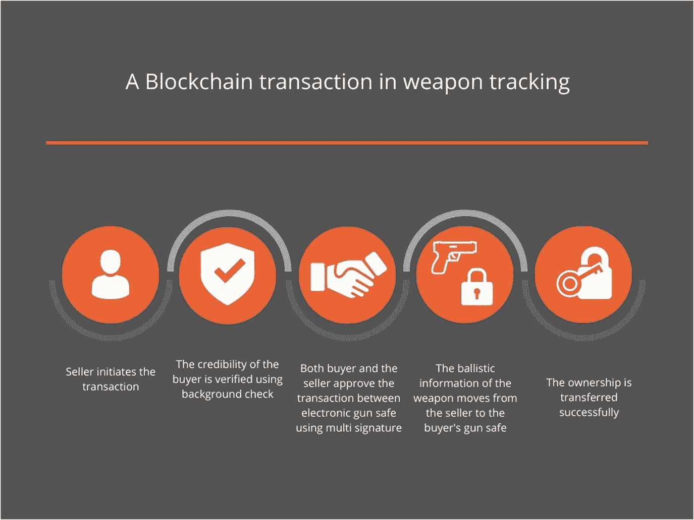

图 5.17 武器追踪中的区块链交易

区块链中每个出售或购买枪支的用户都将有一个与用户指纹等生物识别数据绑定的电子枪支保险箱。电子枪保险箱将包含用户的心理问题记录（如果有）以及其他非法活动历史。保险箱还包含之前的所有交易和拥有的各种枪支的弹道信息。

用户之前的所有记录和交易在区块链中都是不可篡改的。这些数据存储在政府当局有权访问的相应节点中。为了用户的隐私，数据对网络中的其他节点隐藏。如果持有武器的用户个人身份公开，那么极大的概率会被服从。

用户的生物识别数据可以作为私密钥来访问电子枪保险箱中的个人数据。只有在所有权转移时，这些数据才会作为背景检查进行验证。可以使用人工智能来识别任何心理问题或对枪支暴力的痴迷。

所有交易都要求双方批准销售，这是通过多签名技术（multisig）完成的。多签名允许获得许可且经过验证的买家和卖家使用各自的密钥进行签名。一旦买家通过验证并通过背景检查，数据将从卖家的电子保险箱转移到买家的保险箱。

电子枪保险箱之间的这种交易记录在不可篡改的区块链中，并盖有时间戳。如果枪的接收者未能通过背景检查，也将记录在其自己的电子枪保险箱中以备未来验证。

## 实现

借助 Remix 在线 IDE 编写了智能合约来模拟应用程序。虽然智能合约没有满足之前的所有规格，但它承诺提供关于该应用程序在现实世界中实现时的概述。

```solidity
pragma solidity ⁰.5.0;

contract Weapons {

  // 一个用于存储武器信息的结构体
  struct Weapon {
    string name;
    string physical_information;
    string weapon_type;
  }

  // 一个用于存储用户信息的结构体
  struct User {
    string name;
    mapping(uint=>Weapon) owned;
    uint count;
    uint trust_level;
  }

  // 存储用户的表
  mapping(uint=>User) users;

  // 存储武器的表
  mapping(uint=>Weapon) weapons;

  // 验证用户的信誉
  function validate(uint id) public returns(uint) {
    users[id].trust_level = 1;
  }

  // 如果发现恶意活动则用户失效
  function invalidate(uint id) public {
    users[id].trust_level -= 1;
  }

  // 将武器交给买方并从卖方处移除
  function transaction(uint id1, uint id2, uint weapon) public {
    if(validate(id1)==1 && validate(id2)==1) {
      Weapon memory temp = users[id1].owned[weapon];
      delete users[id1].owned[weapon];
      users[id2].owned[weapon] = temp;
      users[id1].count--;
      users[id2].count++;
    }
  }

  // 将用户加入区块链
  function addUser(uint id, string memory name) public {
    users[id].name = name;
    users[id].count = 0;
    validate(id);
  }

  // 从制造商处购买武器
  function requestWeapon(uint id, uint wid) public {
    if(validate(id)==1) {
      users[id].owned[wid] = weapons[wid];
      users[id].count = 1;
    }
    else {
      invalidate(id);
    }
  }

  // 添加制造的枪支
  function addGun(uint wid, string memory name, string memory physical_information, string memory weapon_type) public {
    weapons[wid].name = name;
    weapons[wid].physical_information = physical_information;
    weapons[wid].weapon_type = weapon_type;
  }
}
```

区块链将用于控制枪支和其他有害武器的销售和使用。它跟踪从制造商到终端用户的枪支流向。每一把枪支都与拥有它的个人相关联。区块链协议将高效地执行现有的枪支持有法律，无需进行任何修改。

所有数据都是不可篡改的，系统会记录用户之前的所有交易，这在背景调查期间将提供帮助。这减少了对劳动力的巨大需求，并最大限地缩短了跟踪用户数据的时间。这可能有助于控制人际暴力和自杀，因为武器所有者被追踪，任何识别出的犯罪都会被记录。

记录中任何不当或冒犯性的言论只会影响用户未来购买武器的信誉。该应用程序将帮助政府机构在提供许可证时追踪犯罪记录和用户的合法性。

## 5.11 研究挑战与未来研究方向

- 借助区块链技术对物联网设备数据进行计算卸载的研究极大提高了去中心化平台数据的安全性和隐私。智能合约可以帮助定义有效处理数据的规则。
- 区块链对于某些漏洞并非完全安全。智能合约在编写和部署后无法修改。因此，智能合约的错误或故障可能会导致如 DAO 攻击等漏洞。可以将各种研究工作纳入区块链，以防止此类攻击。
- 探索各种激励机制和共识机制可以提高区块链的质量。
- 存储在区块链中的数据是加密形式的。对加密数据利用大数据分析仍处于研究阶段。
- 由于计算密集型共识机制，交易数量有所减少。通过引入计算密集性较小的共识机制或设计联盟链网络，可以增强系统的扩展性。

### Bithin Alangot 博士的专家笔记，新加坡科技设计大学研究助理


我在为设计一个名为`HPlane`的远程医疗监控系统框架时，接触到了区块链技术。我们的框架允许对医疗数据进行高效管理，从而优化了系统中不同分布式实体之间传输的数据量。然而，由于该框架被多个不可信实体使用，管理访问控制模型变得过于复杂。因此，区块链技术提供了一个完美的解决方案，可以克服`HPlane`在访问控制方面的挑战。但区块链的集成并非易事，因为 (1) 它可能导致隐私担忧并容易受到日蚀攻击，且 (2) 它的可扩展性不好。因此，第一项工作是解决使用`PBFT`作为底层共识协议的区块链扩展性问题。随后，我致力于通过设计一种泛用的泛洪协议（gossip protocol）来寻找检测区块链客户端日蚀攻击的解决方案。这项工作是与新加坡科技设计大学的研究人员合作完成的。

另外两个有趣的研究是 (1) `SmartWitness`：使用区块链保护软件供应链，以及 (2) `具有审计性和隐私性的去中心化身份认证`。在第一个项目中主要目标是利用区块链防止恶意软件分发。该系统构建在`Ethereum`区块平台上，参与该项目有助于建立我在区块链方面的专业知识。而第二个项目旨在解决去中心化身份 (`DID`)——一种基于区块链的身份系统的问题。我们的解决方案允许拥有`DID`的用户检测是否有恶意实体在不知情的情况下使用了他的身份。然而，挑战在于提供隐私，因为我们的解决方案依赖区块链，而区块链上的任何数据都是公开可见的。我们使用了零知识简洁知识论证 (`ZK-SNARK`) 和可验证随机函数 (`VRF`) 原语来实现隐私属性。

使用区块链的去中心化身份系统研究仍处于早期阶段，我很高兴能为社区贡献我的构解。目前，我特别关注可验证凭证、零知识证明和基于身份的加密方案。

## 5.12 总结

物联网设备集成到智能系统中可以在无人工干预的情况下监控和观察其功能。尽管这为系统带来了巨大的利益，但也存在某些缺点。物联网设备产生海量数据，实际上由云服务器处理。实时处理系统必须提供延迟最小的响应。将数据推送到云端并在那里进行处理会延迟整个服务时间。因此，设计了边缘设备在数据源附近提供计算。边缘设备能够处理实时数据，物联网产生的数据可以被卸载进行处理并及时做出决策。为了保证数据交易不可篡改，提出了一种结合这些边缘设备的区块链架构。这极大地增加了网络中物联网生成数据的安全性和隐私。根据应用和需求，可以选择优的区块链类型和共识机制。在区块链中引入智能合约有助于在边缘直接对物联网数据执行微型逻辑，而不是将其推送到云端。

## 参考文献

1. Ranjan, R., *et al* (2018). 下一个重大挑战：整合物联网与数据科学。IEEE Cloud Computing, *5*(3), 12–26.

2. Maull, R., *et al* (2017). 分布式账本技术：应用与影响。Strategic Change, *26*(5), 481–489.

3. Zheng, Z., *et al* (2017). 区块链技术概述：架构、共识与未来趋势。2017 IEEE 国际大数据大会 (BigData congress)。 IEEE.

4. Henry, R., Herzberg, A., & Kate, A. (2018). 区块链访问隐私：挑战与方向。IEEE Security & Privacy, *16*(4), 38–45.

5. Anitha Kumari, K., Sudha Sadasivam, G., & Rohini, L. (2016). 一种基于 3D 椭曲线 Diffie-Hellman (ECDH) 的具有可证明安全性的双服务器仅密码认证密钥交换协议。IETE Journal of Research, *62*(6), 762–773.

6. Anitha Kumari, K., Padmashani, R., Varsha, R., & Upadhayay, V. (2020). 使用私有区块链网络保护医疗物联网 (IoMT)。In and S. L. Peng, S. Pal, & L. Huang (Eds), Principles of Internet of Things (IoT) ecosystem: Insight paradigm. Intelligent systems reference library (Vol. 174, 305–326). Cham: Springer.

7. Liu, M., Wu, K., & Xu, J. J. (2019). 区块链技术如何影响审计和会计：许可与非许可链。Current Issues in Auditing, *13*(2), A19–A29.

8. Pazmiño, J. E., & Rodrigues, C. K. S. (2015). 简单划分比特币网络可以减少交易验证时间。SIJ 计算机网络与通信工程 (CNCE), *3*(2), 17–21.

9. Zheng, Z., *et al* (2017). 区块链技术概述：架构、共识与未来趋势。2017 IEEE 国际大数据大会 (BigData congress)。 IEEE.

10. Antonopoulos, A. M., & Wood, G. (2018). 精通以坊：构建智能合约和 DApps。O’Reilly Media.

11. Cachin, C. (2016). Hyperledger blockchain fabric 架构。分布式加密货币与共识账本会议，*310*(4). 1–4.

12. [`polkadot.network/technology/`](https://polkadot.network)

13. Sharma, P. K., Chen, M.-Y., & Park, J. H. (2017). 一种用于物联网的软件定义雾节点分布式区块链云架构。IEEE Access, 6, 115–124.

14. Hartmann, F., *et al* (2019). 替代筹资：基于区块链与传统众筹的成功因素。2019 IEEE 面向区块链的软件工程国际研讨会 (IWBOSE)。IEEE。

# 6 边缘计算用例与案例研究

DOI: [10.1201/9781003230946-6](https://doi.org/10.1201/9781003230946-6)

## 6.1 用例

每个组织必须有一个明确的数据存储目标及其架构，以根据优先级/偏好级别维持计划中的用例。组织被要求分析一系列极具前景的用例及其吸引其他利益相关者的倾向。本章描述了几个通过强调机会和值得考虑的问题来充分利用边缘计算系统的部门。刻画用例的方法有很多种，本章局限于最常用的领域/行业/应用。本章将通过详细的插图和工作工作模块，详尽地阐述医疗保健部门的案例研究。

## 6.2 边缘计算高潜力用例

本节详细阐述了驱动现实的高潜力用例 `[1,2]`。以下讨论了少数几个极具前景的用例：

* 自动驾驶车辆

* 智能城市

* 工业自动化

* 网络功能

* 游戏

* 内容交付

* 金融部门

* 增强现实/虚拟现实

* 医疗保健部门

### 6.2.1 自动驾驶车辆

许多汽车行业已开始利用现代技术以智能的方式投入大量资金研发无人驾驶汽车。虽然完全依赖机器是不可能的，但安全运行是一个更好的解决方案。为了高效运行，这些车辆需要从不同的方向、环境和气候条件中收集并分析数据。它应该具有根据先前的经验/学习做出决策的潜力。此外，车辆采取的当前反馈/决策需要发送回由提供商/制造商放置的最近边缘服务器，以便有效运行并与当地政府机构进行通信。其效能基于所收集和分析的数据，用于提供警报并与网络中附近的车辆进行无不一致性的信息通信。涌入的数据必须传输到网络中的车辆，且不能出现带宽不足或延迟问题，以便在边缘支持环境中提供高可靠性。边缘支持的自动驾驶车辆必须具备从过去的决策中学习并做出自发决策的能力。自动驾驶车辆的功能如图`Fig. 1`所示。

```

```

### 6.2.2 智能城市

收集、处理、分析和管理大量数据，以获得对交通、公用事业和其他服务的见解。现有方案在提供即时响应方面存在不足。作为结果，边缘出现并提供了无延迟的解决方案。在未来，人/建筑之间的连接将是主动且响应的。`Google`、`IBM` 和 `Cisco` 等公司发许多倡议来支持政府。例如，`IBM` 发起了其智能城市挑战以发展城市。

### 6.2.3 工业自动化

制造业是第四次工业革命（俗称为 `Industry 4.0`）的主要受益者。随着 `IoT` 设备及其管理的巨大增长，这一代正处于第五次工业革命的边缘。工业部门数据存储设施和计算的整合实现了最小能量消耗和成本等利益。从各种来源获取数据并进行有效分析有助于行业通过增加生产来变得智能化。对于在低/差带宽下运行的公司，边缘计算被认为是不可替代的解决方案。边缘计算是工业应用更合适的框架，例如`飞机/导弹发射`、`海上钻井平台`、`能源制造`、`欺诈检测`、`物流设备监控`。

### 6.2.4 网络功能

由于数据和设备的剧烈爆炸，每个设备都关联了一个 `IP address` 以用于身份、通信和追溯性。由于互联设备消耗大量带宽，当前的网络功能不足以高效维持过程。边缘网关被认为是减少带宽消耗的最佳解决方案，因为它放置在非常靠近设备的地方。在边缘网关处合理化数据增强了整体功能的有效性。相比之下，必须在`路由器`、`防火墙`和`交换机`上实施改进过程/程序，以在物理或虚拟上维持该功能，因为它在云系统中运行。

### 6.2.5 游戏

从青少年到老年人，全球范围内许多人沉浸在视频游戏中。尽管少数游戏会产生负面影响，但事实证明，游戏对老年人（特别是大脑功能方面）提供了巨大的益处。此外，它还能缓解负面的心理影响并增强记忆力。相反，在多人游戏环境中，游戏对带宽和延迟敏感性要求很高。通过将边缘服务器部署在靠近用户的地方，回传带宽和低延迟极具前景。延迟越低，游戏环境就越有保障。通过边缘计算，更好的用户体验成为可能，并重新点燃了用户体验。以负担得的价格提供边缘托管游戏服务，是比投入巨额资金购买 `PlayStation/Xbox` 之外给用户的另一项丰惠服务。

### 6.2.6 内容分发

通过边缘计算模型访问网页、视频或音乐可以获得更好的体验，因为响应被确保在毫秒内完成，而不是依赖于云数据中心的响应。内容分发网络（`CDN`）市场已由 `Akamai` 和 `Limelight` 等者通过构建庞大的网络所控制/统治。少数提供商如 `Netflix/HBO` 在边缘网络部署了其定制的微缓存，具有更高的可靠性和灵活性。

### 6.2.7 金融领域

为了实现智能银行功能，银行业正采用边缘计算框架，以提供更好的消费体验和服务。该服务通过智能手机、`desktop/laptop` 等多种设备终端提供。此外，该功能还扩展到了 `ATMs` 和自助终端（`kiosks`），这些设备具有强大的内置数据收集和处理功能。通过这些更广泛的功能，银行业以更具响应性的设计吸引了客户。边缘计算通过加速通信和计算支持交易领域，从而减少了整体损失。通过将边缘服务器放置在非常靠近交易所的地方以运行高资源密集型协议/算法，高速执行变得可行。这种高获益模型为提供者和消费者促进了更准确、更适当的最新信息。

### 6.2.8 增强现实

增强现实因其在更常见的实际应用中的适用性而受到近期关注。增强现实通过在现实物体/环境之上叠加数字设备/元素，为用户提供了真实的呈现。可穿戴设备如头戴设备、眼镜、智能手表、夹克和戒指通过智能手机广泛地创建虚拟效果。增强现实最熟悉的应用是 `Instagram/Snapchat` 中的滤镜选项。增强现实背后的工作程序要求元素/设备处理视觉数据并将视觉数据映射到实时物体上。边缘框架的工作方式更加轻量化，允许设备自发地与增强现实显示融合而无任何延迟。许多零售链正在利用这项技术来提供更好的购物体验。

### 6.2.9 医疗行业

边缘计算通过为整合最新的 IT 解决方案以极具前景的患者护理创造新机会，令医疗行业为着迷。在边缘计算的帮助下，收集、保护和处理海量患者数据成为现实。由于边缘计算的部署，医疗部门甚至可以为农村背景的人群通过电子服务在毫秒级的时间内提供动态的实时决策和行动。此外，与依赖于一个中心数据库相比，现在可以随时随地访问信息了。最近，许多医疗设备出现并主导市场，其收集和处理数据的功能在治疗或诊断期间起着重要作用。例如，Anitha Kumari 等人提出在边缘计算系统中使用低密度脂蛋白对心脏病进行简单预测 [3 ]。因此，边缘计算对每个人的日常生活产生了巨大影响，引导人们走向健康安全的生活。

此外，边缘计算的足迹延伸到了视频监控、视频会议、软件定义网络、家居和办公室连接以及零售等领域/应用中。

边缘计算用例的实现实现在 图 6.2 中，以便清晰理解。

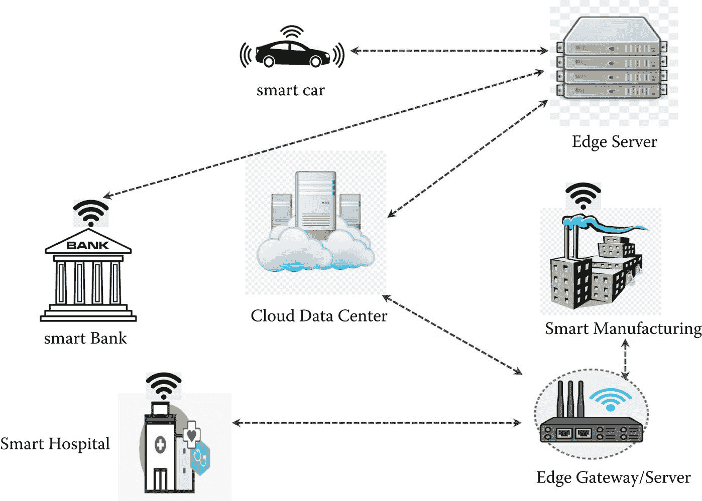

图 6.2 边缘用例的实现

## 6.3 医疗保健中的边缘计算实现

医疗行业是全球最大且增长最快的行业之一，通过在任何点动态可用低延迟患者数据将医疗数字化，为专业人员提供更好的诊断工具。在医疗记录中，当患者访问新的提供者或设施时，黑客可能会滥用数据，因此每项信息必须进行监控以避免意外事件的发生。为了存储和保护医疗数据的安全性和隐私，在层级之间存在多种方法，如属性加密、代理重加密、功能加密、蜜罐加密和同态加密。同态加密是一种先进的加密技术，允许在加密数据上进行计算，类似于在明文中进行，但增加了在加密数据上搜索的能力。在许多类型中，全同态加密（`FHE`）被广泛使用，允许在加密数据上进行完全计算。`FHE` 是一种新兴加密技术，无需将数据带回计算节点即可在加密数据上进行计算 [4,5 ]。

通常个人健康信息的转换需要在处理数字数据的三个阶段进行保护：在案例研究中，数据从医疗物联网（`IoMT`）设备采集并传输到边缘网关/服务器。边缘设备以同态方式存储数据。最后，所需的数据发送到云服务器。

本章讨论了三个案例研究，如下：

### 案例研究一：在边缘服务器上检测急性呼吸窘迫症 (ARDS)

氧气是人类生活中最重要的东西。氧气交付和氧气消耗是每个人生命中的两个重要参数，可以通过血氧仪进行计算。氧气交付、血红蛋白和氧气消耗缺乏会导致呼吸窘迫症（ARDS），这通常被称为呼吸衰竭。通过血氧仪收集这些值，可以在边缘服务器中进行分析，以识别是否患有 ARDS。

### 案例研究二：在边缘服务器上确定低血压

平均动脉压（`MAP`）是单次心脏周期内人体血管中的平均血压。根据通过血压计获取的收缩压和舒张压，计算 `MAP` 并在边缘服务器中进行分析，以确定个人是否患有低血压。

对于人体体能的健康状况而言，使用体成分计计算出的体成分是每天需要考虑的重要指标。湿度和室内温度的升高会导致热指数增加，从而引发许多健康问题。根据体成分计提供的湿度和温度值，在边缘服务器中计算并分析热指数，以识别热指数对个人的影响。

为了促进私有信息的安全存储以及对急性呼吸窘迫征（ARDS）、低血压和热指数的高效预测，在边缘网关/服务器中集成并分析了 FHE 方案。

### 6.3.1 设备与设置

为了执行这些案例研究，考虑了血压计、脉搏氧仪和体成分计。这些设备连接到 Dell Edge Gateway 5100 系列网关，配置为 1.33 GHz Intel Atom-E3825 CPU、Ubuntu Core 16 操作系统、2GB DDR3L-1067 MHz 内存以及 32GB 固态硬盘，以实现高效处理。此外，网关连接到中央云服务器。

### 6.3.2 案例研究 I：通过脉搏氧仪在边缘服务器中检测 ARDS

在人类生活中，氧气对于呼吸至关重要，因为人体利用氧气来燃烧食物分子。氧气必须从大气中高效运输到组织中，以维持正常的代谢。例如，入院的 COVID-19 患者报告了无法正常思考、味觉灵敏或头痛等症状，这是由于血液中 CO[2] 浓度升高对肺部造成损伤导致的。在这种情况下，血氧仪可以发出报警。脉搏氧仪是一种小型夹子状设备，通常固定在手指等部位。脉搏血氧测定的目的是检查心脏向全身泵送氧气的效率。它可以用于监测患有任何类型疾病的健康状况，例如 ARDS、慢性阻塞性肺疾病（COPD）、哮喘、肺炎、肺癌、贫血、心肌梗死或心力衰竭，以及先天性心脏缺陷，这些疾病都会影响血氧水平。FHE 方案被用于加密并对加密数据进行分析，以预测该人员是否受到 ARDS 的影响。

吴素素和李卫东在 2009 年提出了一种将从许多节点数据路由到单个接收设备的系统。两个医疗传感器（即心率传感器和脉搏氧仪）在网络中互连，以收集心率和脉氧仪值。监测设备使用 MSP430 微控制器和 LCD 屏幕显示数值，通过 RS232 串口端口连接到 WSN 节点，并传输到边缘网关，最终传输到云服务器 [6]。

### 6.3.2.1 脉搏血氧

脉搏血氧是一种简单且无侵入的方法，用于检查身体各部位的氧饱和度（SpO[2]）。脉搏血氧被认为是患者检查 O[2] 饱和度的合适替代方案，因为它减少了分析动脉血气过程中的出血频率。在持续监测患者和检测低氧方面，快速、方便和高准确性是脉搏血氧的其他特征。它通过检测动脉血中氧红蛋白和脱氧红蛋白的含量，并将其体现为氧红蛋白饱和度，这是动脉氧饱和度（SaO[2]）的间接估计。

### 6.3.2.2 氧输运 (DO[2])

全身氧输运（DO[2]）是从肺部输送到全身的氧气量 [7,8]。它是总血流量或心输出量（CO）与动脉血氧含量（CaO[2]）的乘积，通常用 ml min^(−1) 表示，并使用公式描述：

`DO[2] = CO * CaO[2]` (6.1)

动脉血氧含量（CaO[2]）使用公式描述：

`CaO[2] = (k1 × Hb × SaO[2]) + (k2 × PaO[2])` (6.2)

其中 Hb 是血红蛋白浓度（g liter^(−1)），SaO[2] 是动脉 Hb 氧饱和度，PaO[2] 是动脉氧分压，k1 是表示 Hb 氧结合能力的 Hufner 常数，其值介于 1.34 到 1.39 之间，k2 是血浆中溶解氧的量。对于我们的研究，k1 取值为 1.34，k2 取值为 0.0031。

### 6.3.2.3 氧耗 (VO[2])

全身氧耗（VO[2]）是组织每分钟消耗的氧量 [7,8]。在有氧条件下，氧气被消耗以产生能量，因此 VO[2] 对应于代谢率，并使用公式描述：

`VO[2] = CO * CaO[2]` (6.3)

静脉血氧含量（Cv[2]）使用公式描述：


`Cv[2] = (k1 × Hb × SaO[2]) + (k2 × PaO[2])`（6.4）

其中`Hb`是血红蛋白浓度（g liter^(−1)），`SaO[2]`是动脉氧饱和度，`PaO[2]`是动脉氧分压。

### 6.3.2.4 急窘综合征

`ARDS`是一种导致液体占据肺部使氧气无法到达身体其他部分的状况。由于氧耗，氧合可能反映以下属性：

1. `ID`
2. 血红蛋白（`HGB`）
3. 动脉氧饱和度（`SaO[2]`）
4. 静脉氧饱和度（`Sv[2]`）
5. 动脉氧分压（`PaO[2]`）
6. 静脉氧分压（`Pv[2]`）
7. 心输出量（`CO`）

从脉搏氧仪接收的数值如表 6.1 所示。

#### 表 6.1 通过脉搏氧仪采集的数据

| ID | HGB | SaO[2] | Sv[2] | PaO[2] | Pv[2] | CO |
| :--- | :--- | :--- | :--- | :--- | :--- | :--- |
| 1 | 13 | 88 | 66 | 82 | 31 | 8 |
| 2 | 10 | 91 | 56 | 80 | 27 | 4 |
| 3 | 16 | 99 | 73 | 79 | 44 | 9 |
| 4 | 14 | 95 | 72 | 89 | 37 | 7 |
| 5 | 17 | 92 | 58 | 84 | 31 | 5 |
| 6 | 9 | 93 | 58 | 92 | 33 | 5 |
| 7 | 18 | 95 | 80 | 84 | 36 | 3 |
| 8 | 9 | 100 | 76 | 82 | 30 | 3 |

为了确保数据的隐私和安全，在边缘网关中应用 `FHE` 方案，数据经过同态加密并用于进一步分析。对加密数据进行分析，通过任意计算检测人员是否患有 `ARDS`。表 6.2 展示了通过脉搏氧仪采集的加密数据值。

#### 表 6.2 通过脉搏氧仪采集的加密数据

| ID | HGB | SaO[2] | Sv[2] | PaO[2] | Pv[2] | CO | CaO[2] | Cv[2] | DO[2] | VO[2] |
| :--- | :--- | :--- | :--- | :--- | :--- | :--- | :--- | :--- | :--- | :--- |
| 99530653 | 26979418 | 70765932 | 29657567 | 13269364 | 1.21E+08 | 33735285 | 78645868 | 6248914 | 2.65E+16 | 2.3E+16 |
| 85456837 | 26957382 | 25998638 | 9654469 | 14646988 | 1.16E+08 | 26891249 | 9632375 | 24929517 | 2.59E+15 | 2.83E+16 |
| 33735285 | 1.02E+08 | 39124645 | 9654469 | 97458792 | 1.21E+08 | 6248914 | 99321270 | 67911415 | 6.21E+15 | 4.27E+15 |
| 68319184 | 26957382 | 39124645 | 32820610 | 25877398 | 92840941 | 33735285 | 77565818 | 24929517 | 2.62E+16 | 2.3E+16 |
| 1.05E+08 | 44723235 | 1.07E+08 | 1.16E+08 | 18195755 | 82536300 | 68319184 | 9632375 | 67911415 | 6.58E+15 | 6.91E+16 |
| 6248914 | 26891249 | 1.03E+08 | 1.16E+08 | 1.07E+08 | 80828047 | 68319184 | 1.18E+08 | 6248914 | 8.09E+16 | 2.3E+16 |
| 1.01E+08 | 99321270 | 39124645 | 13269364 | 18195755 | 46795202 | 85456837 | 45329396 | 15429419 | 3.87E+16 | 2.88E+16 |
| 26891249 | 26891249 | 53738496 | 95375810 | 48966385 | 85269507 | 85456837 | 78645868 | 26891249 | 6.72E+16 | 7.3E+16 |
| 26979418 | 26891249 | 1.07E+08 | 1554024 | 32820610 | 72540251 | 68319184 | 1.18E+08 | 6248914 | 8.09E+16 | 2.3E+16 |
| 1.18E+08 | 1.02E+08 | 80519520 | 14250207 | 73532190 | 99894387 | 85456837 | 44723235 | 26979418 | 3.82E+16 | 5.34E+15 |
| 78645868 | 1.18E+08 | 72011312 | 9654469 | 25877398 | 67393447 | 68319184 | 1.02E+08 | 26979418 | 6.96E+16 | 2.3E+16 |
| 67911415 | 26979418 | 1.03E+08 | 1554024 | 79792133 1E008 85556837 | 78645868 | 1.01E+08 | 6.72E+16 | 2.88E+16 |
| 1.02E+08 | 26891249 | 97458792 | 92499315 | 70765932 | 72540251 | 85456837 | 1.18E+08 | 6248914 | 1.01E+17 | 2.88E+16 |
| 24929517 | 1.18E+08 | 97458792 | 56273301 | 62720582 | 44546924 | 1.05E+08 | 67911415 | 1.18E+08 | 7.14E+16 | 1.05E+17 |
| 26957382 | 26891249 | 97458792 | 1.03E+08 | 1.2E+08 | 80828047 | 68319184 | 26979418 | 1.05E+08 | 1.84E+16 | 2.3E+16 |
| 44723235 | 26891249 | 39124645 | 1.03E+08 | 1.2E+08 | 1.21E+08 | 1.05E+08 | 1.18E+08 | 1.05E+08 | 1.25E+17 | 7.18E+16 |
| 99321270 | 67911415 | 39124645 | 79891290 | 9654469 | 8099363 | 1.05E+08 | 26957382 | 26979418 | 2.83E+16 | 1.1E+17 |
| 15429419 | 78645868 | 1.07E+08 | 92499315 | 23695237 | 99894387 | 85456837 | 24929517 | 26979418 | 2.13E+16 | 5.84E+16 |

### 6.3.2.5 边缘服务器分析

如果满足图 6.3 所示的规则，则认为患者患有 `ARDS`。在边缘服务器上通过获取患者的实时值进行分析：

- `DO[2]` 小于等于 33
- `HGB` 小于等于 11
- `VO[2]` 小于等于 24

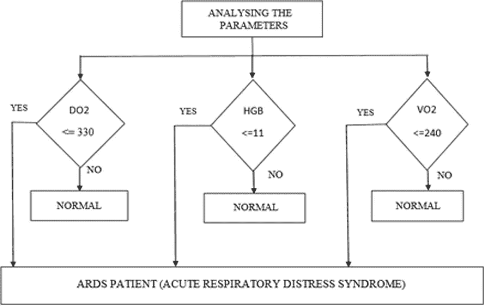

图 6.3 参数分析。

表 6.3 展示了在边缘服务器上进行的检测患者是否患有 `ARDS` 的分析。

#### 表 6.3 分析结果

| ID | DO[2] | HGB | VO[2] | ARDS_ 患者 |
| :--- | :--- | :--- | :--- | :--- |
| 99530653 | 2.65E+16 | 26979418 | 2.3E+16 | 是 |
| 85456837 | 2.59E+15 | 26957382 | 2.83E+16 | 否 |
| 33735285 | 6.21E+15 | 1.02E+08 | 4.27E+15 | 否 |
| 68319184 | 2.62E+16 | 26957382 | 2.3E+16 | 否 |
| 1.05E+08 | 6.58E+15 | 44723235 | 6.91E+16 | 否 |
| 6248914 | 8.09E+16 | 26891249 | 2.3E+16 | 是 |
| 1.01E+08 | 3.87E+16 | 99321270 | 2.88E+16 | 否 |
| 26891249 | 6.72E+16 | 26891249 | 7.3E+16 | 是 |
| 26979418 | 8.09E+16 | 26891249 | 2.3E+16 | 是 |
| 1.18E+08 | 1.02E+08 | 80519520 | 14250207 | 否 |
| 78645868 | 1.18E+08 | 72011312 | 9654469 | 否 |
| 67911415 | 26979418 | 1.03E+08 | 1554024 | 否 |
| 1.02E+08 | 26891249 | 97458792 | 92499315 | 否 |
| 24929517 | 1.18E+08 | 97458792 | 56273301 | 否 |
| 26957382 | 26891249 | 97458792 | 1.03E+08 | 否 |
| 44723235 | 26891249 | 39124645 | 1.03E+08 | 否 |
| 99321270 | 67911415 | 39124645 | 79891290 | 否 |
| 15429419 | 78645868 | 1.07E+08 | 92499315 | 否 |

低血压（hypotension）是指收缩压读数低于 90 mm Hg 且舒缩压低于 60 mm Hg 的血压状态 [9]。平均动脉压小于 55 mm Hg 可能会导致低血压。`MAP` 使用以下公式计算：

$$
{MAP} = \frac{{SBP} + 2\left( {DBP} \right)}{3}
$$

（6.5）

其中 `SBP` 是收缩压，`DBP` 是舒缩压。

### 6.3.3.2 边缘服务器对 MAP 的分析

使用血压计设备，从人体中采集收缩压和舒缩压值，并将其存储在边缘服务器中进行低血压分析，如表 6.4 所示。为了确保安全，这些值经过同态加密，并用于判断个人是否患有低血压。

#### 表 6.4 通过血压计收集的数据

| 标识 | 性别 | 收缩压 | 舒缩压 |
| :--- | :--- | :--- | :--- |
| 1 | 男 | 36 | 23 |
| 2 | 女 | 38 | 39 |
| 3 | 男 | 37 | 35 |
| 4 | 男 | 26 | 33 |
| 5 | 女 | 4 | 17 |
| 6 | 女 | 12 | 31 |
| 7 | 男 | 59 | 19 |
| 8 | 女 | 8 | 35 |
| 9 | 男 | 39 | 70 |

`MAP` 公式应用于加密的收缩压和舒缩压值上。在分析过程中，将计算出的 `MAP` 值与加密的 `55` 值进行比较。如果计算出的 `MAP` 值小于加密的 `55` 值，则表示该个人患有低血压，结果会被添加到边缘服务器的数据库中，如表 6.5 所示。

#### 表 6.5 基于 MAP 的低血压识别

| 标识 | 性别 | 收缩压 | 舒缩压 | MAP | 低血压 |
| :--- | :--- | :--- | :--- | :--- | :--- |
| 664817 | 664767 | 664866 | 664826 | 664839 | 无低血压 |
| 386811 | 386760 | 386909 | 386859 | 386875 | 无低血压 |
| 323231 | 323180 | 323328 | 323278 | 323294 | 低血压 |
| 377916 | 377863 | 377997 | 377952 | 377967 | 无低血压 |
| 201409 | 201355 | 201484 | 201444 | 201455 | 无低血压 |
| 345325 | 345271 | 345394 | 345359 | 345370 | 无低血压 |
| 568918 | 568862 | 568951 | 568921 |  | 无低血压 |
| 641068 | 641011 | 641130 | 641090 |  | 低血压 |
| 155601 | 155544 | 155682 | 155632 |  | 无低血压 |

### 6.3.4 案例研究 III：使用体成分秤在边缘服务器检测热指数

在日常生活中，身体健康状况是更重要的考虑。为了维持健康的生活，需要计算体重、`BMI`、体脂、瘦体质量、湿度和室内温度等体成分。体成分秤是一种利用生物阻抗法测量体成分的测量设备。生物阻抗法是家用秤计算体成分的常用方法。该设备使用四个导体来确定电流流经身体时产生的阻力，并据此计算总体水。从总体水中估算出九个数据点。该设备测量的九个数据点分别是体重、`BMI`、体水、瘦体质量、肌肉量、内脏脂肪和每日摄入量。该设备具有独立的室内温度湿度传感器，因此可以调节温度器以保持身体处于最佳状态。测量的湿度和室内温度值被传输到边缘服务器进行数据分析。湿度和室内温度用于测量热指数，其范围可能是`27°C`到`57°C`。湿度和室内温度的升高会导致热指数增加，从而引起疲劳、热射和中暑等健康问题。这些健康影响随热指数范围而异。热指数通过湿度和室内温度的相对比例计算。

Borga 等人对基于脂肪参考定量 MRI 的常用非侵入性体测评估方法进行了简要概述。对于脂肪组织（`AT`）或组织（`LT`）的全身测量，DXA 和定量 MRI 具有相应的线性相关性。但发现内脏脂肪组织的一致性显著较低 [11]。Bos 等提出了两种用于医疗保健预测分析的模型：Cox 比例风险模型和逻辑回归模型。他们提出了一种用于按位加密的标准的 `FHE` 方案。这些回归模型的功能可以用整数值的多项式表达式来近似。这种方法的优点是单个密文包含的信息比单纯的一位明文要多得多 [12]。

### 6.3.4.1 热指数

热指数定义为湿度和室内温度的影响量，以华氏度测量 [13]。人体受环境影响的程度。计算热指数的公式如下：

$$
HI = c[1] + c[2]T + c[3]H + c[4]TH + c[5]T² + c[6]H² + c[7]TH² + c[8]
$$

其中：

- `T` – 温度（°C）
- `H` – 湿度（%）
- `c[1]` = -8.784947556
- `c[2]` = 1.6113941
- `c[3]` = 2.338548389
- `c[4]` = -0.1461605
- `c[5]` = -0.0123094
- `c[6]` = -0.016424777
- `c[7]` = 0.00221173
- `c[8]` = 0.00072546
- `c[9]` = -0.00003582

热指数范围可能是`26°C`到`54°C`及以上。随着温度和湿度的增加，热指数逐渐增加。热指数的极端范围会导致许多健康问题，如呼吸、脑脑和心血管疾病。热指数产生和影响如表 6.6 所示。

#### 表 6.6 热指数的产生与影响

| 摄氏度 | 原因 | 影响 |
| :--- | :--- | :--- |
| 26–32°C | 注意 | 疲劳、贫血、心衰风险 |
| 32–41°C | 高度注意 | 肌肉痉挛、腹部和小腿痉挛 |


| 41–54°C | 危险 | 脱水、肥胖 |
| --- | --- | --- |
| 超过 54°C | 极端危险 | 中暑——心脏疾病风险 |

### 6.3.4.2 边缘服务器中的热指数分析

设备收集的属性如表 6.7 所示。在收集的属性中，本案例考虑了湿度和室内温度值来分析个人的热指数。计算出的热指数值将被记录备查，并向个人发送通知。最后，根据依赖关系所需值传输到云服务器。

#### 表 6.7 通过体成分秤收集的数据

| 标识 | 性别 | 体重 | 瘦体质量 | 身高 | 年龄 | BMI | 湿度 | 室内温度 |
| --- | --- | --- | --- | --- | --- | --- | --- | --- |
| 1 | 男 | 96 | 66 | 174 | 23 | 32 | 40 |  |
| 2 | 女 | 87 | 67 | 189 | 22 | 24 | 55 |  |
| 3 | 男 | 110 | 67 | 185 | 22 | 32 | 78 |  |
| 4 | 男 | 104 | 70 | 195 | 26 | 27 | 62 |  |
| 5 | 女 | 61 | 45 | 149 | 24 | 37 | 46 |  |
| 6 | 女 | 104 | 74 | 189 | 24 | 29 | 56 |  |
| 7 | 11 | 92 | 57 | 147 | 26 | 43 | 99 | 42 |
| 8 | 11 | 111 | 67 | 154 | 25 | 47 | 100 | 31 |
| 9 | 11 | 90 | 64 | 174 | 25 | 30 | 72 | 33 |
| 10 | 3 | 103 | 58 | 169 | 23 | 36 | 40 | 23 |

湿度与室内温度之间的关系如图 6.5 所示。

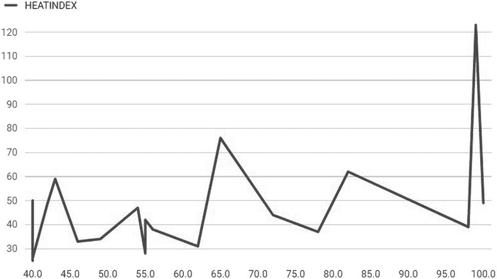

图 6.5 湿度与室内温度。

属性的同态加密值如表 6.8 所示，以保证隐私和安全。

#### 表 6.8 边缘服务器中的加密数据

| 性别 | 重量 | 瘦体质量 | 身高 | 年龄 | BMI | 湿度 | 室内温度 |
| :--- | :--- | :--- | :--- | :--- | :--- | :--- | :--- |
| 8759977 | 6078807 | 3401121 | 9785855 | 4991836 | 2004675 | 11128148 | 2483337 |
| 8759977 | 5502958 | 7028914 | 5236734 | 12452562 | 2861229 | 12913267 | 11207314 |
| 7287978 | 489574 | 7028914 | 11121095 | 12452562 | 2004675 | 8464926 | 4376414 |
| 7287978 | 8641303 | 8364146 | 2494302 | 4423197 | 2483337 | 3494691 | 4783100 |
| 8759977 | 2965637 | 9674157 | 3106086 | 2861229 | 2483337 | 12341017 | 2004675 |
| 8759977 | 8641303 | 3761029 | 5236734 | 2861229 | 4783100 | 9515812 | 2825248 |
| 8759977 | 3491122 | 6435069 | 1443346 | 4423197 | 755833 | 2875700 | 11941524 |
| 8759977 | 9425892 | 7028914 | 12506679 | 9602157 | 7619130 | 5294229 | 2411361 |
| 8759977 | 11570875 | 2220647 | 9785855 | 9602157 | 4376414 | 2155873 | 2825248 |
| 7287978 | 2483413 | 9159513 | 5826950 | 4991836 | 2893632 | 11128148 | 4991836 |
| 8759977 | 9933321 | 3401121 | 2494302 | 4423197 | 10807818 | 11311722 | 11941524 |
| 7287978 | 3829416 | 12502933 | 8720536 | 2483337 | 2004675 | 12913267 | 12243833 |
| 7287978 | 4963122 | 1288510 | 6791505 | 2004775 | 2483337 | 9692189 | 2893632 |
| 8759977 | 12351819 | 755833 | 374451 | 4376414 | 10807818 | 5481331 | 3926546 |
| 8759977 | 10624327 | 2220647 | 9127255 | 12243833 | 12452562 | 6654600 | 2004675 |
| 7287978 | 5736913 | 12351819 | 7205351 | 12243833 | 12341017 | 3689073 | 4783100 |
| 7287978 | 489574 | 548131 | 584134 | 8475679 | 9674157 | 1112118 | 781370 |
| 8759977 | 7608372 | 11761603 | 10386854 | 2004675 | 1817539 | 11941524 | 1112118 |
| 8759977 | 5294229 | 846426 | 10001765 | 11207314 | 7619131 | 755833 | 755833 |

在边缘服务器中计算，并如表 6.9 所示进行进一步处理。根据热指数，原因被归类警告、危险或极端。

#### 表 6.9 边缘服务器中的热指数

| 湿度 | 室内温度 | 热指数 | 影响 |
| :--- | :--- | :--- | :--- |
| 11128148 | 2483337 | 4423197 | 疲劳 |
| 12913267 | 11207314 | 1120314 | 疲劳 |
| 8464926 | 4376414 | 3926546 | 极端 |
| 3494691 | 4783100 | 2411361 | 疲劳 |
| 12341017 | 2004675 | 2825248 | 极端 |
| 9515812 | 2825248 | 6845336 | 极端 |
| 2875700 | 11941524 | 1138061 | 冲击 |
| 5294229 | 2411361 | 6654000 | 耗尽 |
| 2155873 | 2825248 | 1817539 | 耗尽 |
| 11128148 | 4991836 | 9602157 | 疲劳 |
| 11311722 | 11941524 | 9137937 | 冲击 |
| 12913267 | 12243833 | 1194124 | 耗尽 |
| 9692189 | 2893632 | 3494691 | 冲击 |
| 5481331 | 3926546 | 7619130 | 耗尽 |
| 6654600 | 2004675 | 8475679 | 极端 |
| 3689073 | 4783100 | 262766 | 极端 |
| 1112818 | 7813470 | 7687514 | 耗尽 |
| 11941524 | 1112848 | 6654000 | 耗尽 |
| 755833 | 755833 | 3077204 | 冲击 |

边缘服务器中不同 `FHE` 方案分析的总时间以纳秒（`ns`）测量，并在图 6.6 中给出。

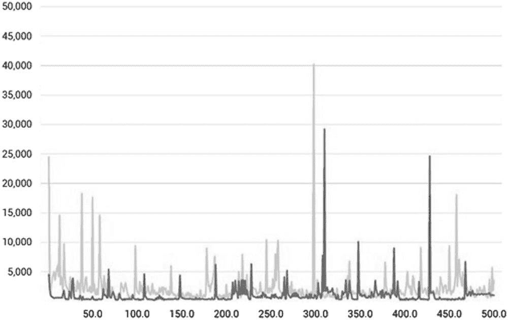

图 6.6 以纳秒计的总时间。

所考虑的案例研究展示了在边缘服务器中有效获取、存储和处理（计算）信息的过程。应用 `FHE` 方案保证了安全的存储和处理。

### 6.3.5 用例 - 工业物联网中的边缘计算/分析

**T. Viswanathan 先生，Maxbyte Technologies 首席技术官**

Maxbyte Technologies 是一家为汽车、航空航天与国防、工业产品、消费品和流程工业等行业的制造业提供工业物联网（`IIOT`）产品和解决方案的公司。Maxbyte 提供从传感器到分析的端到端工业物联网产品和解决方案。边缘计算/分析在从资产和传感器获取原始数据并将所需信息共享给 `IIOT` 企业应用程序方面发挥着至关重要的作用。

工业物联网存在多种边缘计算/分析用例，从基础数据收集到振动分析等用例中的高速数据处理。下面描述的特定用例是制造车间机器的基于振动的预测分析。

该用例的目标是根据振动测量提前预测机器故障，并采取纠正预防措施以避免机器停机。在现有情况下，机器故障只有在机器出现问题后才能被识别，维护团队随后采取所需的纠正措施来修复问题。这通常是一个昂贵的过程，因为机器已经发生故障影响了生产，且维修/恢复成本很高。

上述问题的解决方案是提前识别机器故障，并采取必要的纠正预防措施以避免机器完全故障。机器振动分析有助于识别机器故障。为此，将振动传感器安装在机器的关键部件，并以 `10/20 KHz` 的采样率采集振动数据。采集的数据需要在边缘设备上处理，以识别测量振动信号中的各种频率成分并识别任何异常。

为了预测机器故障，之前机器故障的历史数据以及包括振动在内的关键机器参数起着至关重要的作用。根据历史数据，创建了诊断和故障模型并部署到生产中的 `IIOT` 企业应用程序中。根据边缘设备捕到的实时数据和处理的数据，部署在服务器上的预测模型可以提前预测机器故障，并向相应的维护用户发送必要的警报和通知以及建议采取的操作。

该用例的主要益处是消除了因机器故障产生的高昂维修/恢复成本，这不仅影响机器健康，还影响生产。对机器进行的增量改进还将确保更高的机器运行时间并增强机器利用率。

## 6.4 结论与开放性研究挑战

边缘计算推动了多个领域的用例，包括自动驾驶汽车、智能城市、工业自动化、游戏、内容交付、金融领域和医疗领域。本章考虑了来自医疗领域的三个案例研究，并详细阐述了这些案例，确保了数据的正确获取、安全存储和动态板载处理。为了确保存储的安全，应用了同态加密方案，并在加密数据上进行分析，以保护框架免受侵入性攻击向量的影响。案例研究阐明了边缘网关/服务器对于实时应用的安全计算和处理能力。边缘计算结合先进分析算法，支持各个部门的实时模型和控制。然而，研究人员/开发者面临的开放性挑战是在启用边缘计算系统的同时，理解应用的安全和处理需求，因为这些需求不同行业之间存在差异。

## 参考文献

1. Tseng, M., Edmunds, T., & Canaran, L. (2018). 工业物联网中的边缘计算简介：工业互联网联盟白皮书。边缘计算任务组。
2. Whitaker, B. E (2018). 云-边缘计算——超越数据中心。OpenStack 白皮书，1–8。
3. Anitha Kumari, K., Ananyaa, M., Keshini, P. S., & Indusha, M. (2020). 在边缘计算系统中使用 LDL 预测心脏病。在*第 26 届（虚拟）高级计算与通信国际年度会议 (ADCOM 2020)* 中，印度西尔尔查尔，2020 年 12 月 16–18 日。
4. Gentry, C., & Halevi, S. (2011). 实现 gentry 的全同态加密方案。在*密码学技术理论与应用国际年度会议 (EUROCRYPT 2011)* 中，129–148。
5. Dijk, M., Gentry, C., Halevi, S., & Vaikuntanathan, V. (2010). 整数上的全同态加密。在 and Gilbert H. (ed) 密码学进展 – EUROCRYPT 2010。EUROCRYPT 2010。计算机科学讲义（卷 6110）。柏林，海德堡：Springer。[10.1007/978-3-642-13190-5_2](http://doi.org/10.1007/978-3-642-13190-5_2)。
6. Wu, S., & Weidong, Y. (2009). 无无线传感器网络的医疗系统。在*2009 年第 9 届电子测量与...国际会议* 中，3-53–3-57，[10.1109/ICEMI.2009.5274240](http://doi.org/10.1109/ICEMI.2009.5274240)。
7. Kenneth Roberts, J., Disselkamp, M., & Yataco, A. C. (2015). 脓血性休克中的氧输送。Annals ATS，*12*(6), 952–955。
8. Mc Lellan, S. A., & Walsh, T. S. (2004). 氧输送与血红蛋白。麻醉重症监护与疼痛持续教育，*4*(4), 123–126。
9. Kendale, S., Kulkarni, P., Rosenberg, A. D., & Wang, J. (2018). 用于预测诱导后低血压的监督机器学习预测性分析。麻醉学，*129*(4), 675–688。
10. Shen, Z., Miao, F., Meng, Q., & Li, Y. (2015). 基于多元回归分析的无袖连续血压估计。在*2015 年第 5 届信息科学技术国际会议 (ICIST)* 中，中国长沙，117–120，[10.1109/ICIST.2015.7288952](http://doi.org/10.1109/ICIST.2015.7288952)。
11. Borga, M., West, J., Bell, J. D., Harvey, N. C., Romu, T., Heymsfield, S. B., & Leinhard, O. D. (2018). 进的体成分评估：从体重指数到身体成分剖面。调查医学杂志，*66*(5), 1–9。
12. Bos, J. W., Lauter, K., & Naehr, M. (2014). 加密数据的私有分析。生物医学信息学杂志，*50*, 234–243。
13. Brooke, A. G., Bell, M., & Peng, R. D. (2013). 将热指数作为环境健康指标计算的方法。环境健康，*126*(10), 111–119。

# 索引

- 应用层，41
- 计算协会，1
- 基于属性的加密，87, 89–91, 100
- 增强现实，2, 27, 57, 139, 139, 139, 139, 142 (此处原文重复处理)
- 自动化，1, 4, 47, 49, 75, 139, 141, 158
- 大数据分析，135
- 生物识别，128
- 比特币网络，103, 104, 109, 115, 117
- 区块链架构，113, 123
- 拜庭容错，117, 118
- 案例研究，84, 125, 128, 131, 144, 145, 148, 153
- 集中平台，104
- 链，112
- 云计算，22, 25, 36, 37, 40, 42, 81, 84
- 云模型，23
- 云边缘，40
- 云服务器，124, 136
- 云端，28, 39, 43
- 集群计算，10, 13, 15, 18, 36
- 共识机制，103, 107, 111, 115, 117, 135
- 控制，140
- 网络，145
- 比例，95
- 危险，94
- 系统，87, 89, 92, 95, 101
- 去中心化，8, 81, 111, 118, 125
- 度，112
- 数字签名，145
- 边缘，107, 109, 110, 114, 115

- `边缘数据中心`，58, 59
- `边缘支持的自动驾驶车辆`，140
- `边缘物联网管理层`，57–8
- `电子数值积分器和计算机`，1
- `联邦机器学习`，83–4
- `雾计算`，27–31, 37, 39, 40
- `雾设备`，60, 62
- `全同态加密`，94, 144
- `网格计算`，15, 16, 18, 21, 37
- `hadoop`，27, 51
- `哈希`，107, 109–110, 115, 119
- `同态加密`，87, 88, 89, 93–6, 101, 144, 158
- `hyperledger`，103, 104, 118, 120–122
- `基于身份的加密`，87, 89
- `不可变数据库`，104
- `医疗物联网`，144, 112
- `物联网通信协议`，47
- `物联网：传感器`，29, 44, 60; `sim-edge`，57
- `丛林计算`，26–7
- `轻量级：认证`，101
- `云服务器`，28; `容器`，31; `机制`，30; `微服务`，30; `虚拟化`，30, 32
- `逻辑回归模型`，95, 153
- `长期演进 (LTE)`，43, 47, 48
- `机器学习`，72–74, 76, 80–, 83–5
- `机器振动分析`，158
- `merkle：哈希树`，109; `根`，109, 115, 117
- `微服务`，30–5, 37
- `中间件`，30–5, 10, 12, 26–27, 43, 51–56, 66
- `挖矿`，46, 103, 114–15, 117–119
- `铸币`，107, 118
- `移动计算`，28, 37
- `网络架构`，46
- `网络层`，41
- `编排`，33, 35, 49, 51, 54, 57
- `渗透性计算`，29, 37


* `并行计算`, 3–5, 36

* `点对点网络`, 103, 106, 107, 111, 113, 119

* `感知层`, 41, 49

* `波卡：网络`, 123

* `隐私保护`, 84, 87–88, 92–93, 97–101

* `公钥密码学`, 106–7, 110

* `射频识别`, 45–48, 54

* `强化学习`, 74–5, 140

* `可搜索加密`, 88, 89, 92–93

* `软件定义网络`, 33–4, 46, 49, 65, 143

* `solidity`, 118, 120, 126, 130, 133

* `无处不在的计算`, 25–6

* `未花费交易输出`, 104

* `公用计算`, 13–15, 22–3

* `虚拟网络函数`, 43, 50

* `世界维网`, 3, 17, 36
