## EEG 信号处理与机器学习


这是一个页码索引列表，包含从第 133 页到第 371 页的交叉引用链接。

| 索引号 | 页码 | 链接目标 |
| :--- | :--- | :--- |
| 151 | 133 | `#c05.xhtml#Page_133` |
| 152 | 134 | `#c05.xhtml#Page_134` |
| 153 | 135 | `#c05.xhtml#Page_135` |
| 154 | 136 | `#c05.xhtml#Page_136` |
| 155 | 137 | `#c05.xhtml#Page_137` |
| 156 | 138 | `#c05.xhtml#Page_138` |
| 157 | 139 | `#c05.xhtml#Page_139` |
| 158 | 140 | `#c05.xhtml#Page_140` |
| 159 | 141 | `#c05.xhtml#Page_141` |
| 160 | 142 | `#c05.xhtml#Page_142` |
| 161 | 143 | `#c05.xhtml#Page_143` |
| 162 | 144 | `#c05.xhtml#Page_144` |
| 163 | 145 | `#c05.xhtml#Page_145` |
| 164 | 146 | `#c05.xhtml#Page_146` |
| 165 | 147 | `#c05.xhtml#Page_147` |
| 166 | 148 | `#c05.xhtml#Page_148` |
| 167 | 149 | `#c05.xhtml#Page_149` |
| 168 | 150 | `#c05.xhtml#Page_150` |
| 169 | 151 | `#c05.xhtml#Page_151` |
| 170 | 152 | `#c05.xhtml#Page_152` |
| 171 | 153 | `#c05.xhtml#Page_153` |
| 172 | 154 | `#c05.xhtml#Page_154` |
| 173 | 155 | `#c05.xhtml#Page_155` |
| 174 | 156 | `#c05.xhtml#Page_156` |
| 175 | 157 | `#c05.xhtml#Page_157` |
| 176 | 158 | `#c05.xhtml#Page_158` |
| 177 | 159 | `#c05.xhtml#Page_159` |
| 178 | 160 | `#c05.xhtml#Page_160` |
| 179 | 161 | `#c05.xhtml#Page_161` |
| 180 | 162 | `#c05.xhtml#Page_162` |
| 181 | 163 | `#c05.xhtml#Page_163` |
| 182 | 165 | `#c06.xhtml#Page_165` |
| 183 | 166 | `#c06.xhtml#Page_166` |
| 184 | 167 | `#c06.xhtml#Page_167` |
| 185 | 168 | `#c06.xhtml#Page_168` |
| 186 | 169 | `#c06.xhtml#Page_169` |
| 187 | 170 | `#c06.xhtml#Page_170` |
| 188 | 171 | `#c06.xhtml#Page_171` |
| 189 | 172 | `#c06.xhtml#Page_172` |
| 190 | 173 | `#c06.xhtml#Page_173` |
| 191 | 174 | `#c06.xhtml#Page_174` |
| 192 | 175 | `#c06.xhtml#Page_175` |
| 193 | 176 | `#c06.xhtml#Page_176` |
| 194 | 177 | `#c07.xhtml#Page_177` |
| 195 | 178 | `#c07.xhtml#Page_178` |
| 196 | 179 | `#c07.xhtml#Page_179` |
| 197 | 180 | `#c07.xhtml#Page_180` |
| 198 | 181 | `#c07.xhtml#Page_181` |
| 199 | 182 | `#c07.xhtml#Page_182` |
| 200 | 183 | `#c07.xhtml#Page_183` |
| 201 | 184 | `#c07.xhtml#Page_184` |
| 202 | 185 | `#c07.xhtml#Page_185` |
| 203 | 186 | `#c07.xhtml#Page_186` |
| 204 | 187 | `#c07.xhtml#Page_187` |
| 205 | 188 | `#c07.xhtml#Page_188` |
| 206 | 189 | `#c07.xhtml#Page_189` |
| 207 | 190 | `#c07.xhtml#Page_190` |
| 208 | 191 | `#c07.xhtml#Page_191` |
| 209 | 192 | `#c07.xhtml#Page_192` |
| 210 | 193 | `#c07.xhtml#Page_193` |
| 211 | 194 | `#c07.xhtml#Page_194` |
| 212 | 195 | `#c07.xhtml#Page_195` |
| 213 | 196 | `#c07.xhtml#Page_196` |
| 214 | 197 | `#c07.xhtml#Page_197` |
| 215 | 198 | `#c07.xhtml#Page_198` |
| 216 | 199 | `#c07.xhtml#Page_199` |
| 217 | 200 | `#c07.xhtml#Page_200` |
| 218 | 201 | `#c07.xhtml#Page_201` |
| 219 | 202 | `#c07.xhtml#Page_202` |
| 220 | 203 | `#c07.xhtml#Page_203` |
| 221 | 204 | `#c07.xhtml#Page_204` |
| 222 | 205 | `#c07.xhtml#Page_205` |
| 223 | 206 | `#c07.xhtml#Page_206` |
| 224 | 207 | `#c07.xhtml#Page_207` |
| 225 | 208 | `#c07.xhtml#Page_208` |
| 226 | 209 | `#c07.xhtml#Page_209` |
| 227 | 210 | `#c07.xhtml#Page_210` |
| 228 | 211 | `#c07.xhtml#Page_211` |
| 229 | 212 | `#c07.xhtml#Page_212` |
| 230 | 213 | `#c07.xhtml#Page_213` |
| 231 | 214 | `#c07.xhtml#Page_214` |
| 232 | 215 | `#c07.xhtml#Page_215` |
| 233 | 216 | `#c07.xhtml#Page_216` |
| 234 | 217 | `#c07.xhtml#Page_217` |
| 235 | 218 | `#c07.xhtml#Page_218` |
| 236 | 219 | `#c07.xhtml#Page_219` |
| 237 | 220 | `#c07.xhtml#Page_220` |
| 238 | 221 | `#c07.xhtml#Page_221` |
| 239 | 222 | `#c07.xhtml#Page_222` |
| 240 | 223 | `#c07.xhtml#Page_223` |
| 241 | 224 | `#c07.xhtml#Page_224` |
| 242 | 225 | `#c07.xhtml#Page_225` |
| 243 | 226 | `#c07.xhtml#Page_226` |
| 244 | 227 | `#c07.xhtml#Page_227` |
| 245 | 228 | `#c07.xhtml#Page_228` |
| 246 | 229 | `#c07.xhtml#Page_229` |
| 247 | 230 | `#c07.xhtml#Page_230` |
| 248 | 231 | `#c07.xhtml#Page_231` |
| 249 | 232 | `#c07.xhtml#Page_232` |
| 250 | 233 | `#c07.xhtml#Page_233` |
| 251 | 235 | `#c08.xhtml#Page_235` |
| 252 | 236 | `#c08.xhtml#Page_236` |
| 253 | 237 | `#c08.xhtml#Page_237` |
| 254 | 238 | `#c08.xhtml#Page_238` |
| 255 | 239 | `#c08.xhtml#Page_239` |
| 256 | 240 | `#c08.xhtml#Page_240` |
| 257 | 241 | `#c08.xhtml#Page_241` |
| 258 | 242 | `#c08.xhtml#Page_242` |
| 259 | 243 | `#c08.xhtml#Page_243` |
| 260 | 244 | `#c08.xhtml#Page_244` |
| 261 | 245 | `#c08.xhtml#Page_245` |
| 262 | 246 | `#c08.xhtml#Page_246` |
| 263 | 247 | `#c08.xhtml#Page_247` |
| 264 | 248 | `#c08.xhtml#Page_248` |
| 265 | 249 | `#c08.xhtml#Page_249` |
| 266 | 250 | `#c08.xhtml#Page_250` |
| 267 | 251 | `#c08.xhtml#Page_251` |
| 268 | 252 | `#c08.xhtml#Page_252` |
| 269 | 253 | `#c08.xhtml#Page_253` |
| 270 | 254 | `#c08.xhtml#Page_254` |
| 271 | 255 | `#c08.xhtml#Page_255` |
| 272 | 256 | `#c08.xhtml#Page_256` |
| 273 | 257 | `#c08.xhtml#Page_257` |
| 274 | 258 | `#c08.xhtml#Page_258` |
| 275 | 259 | `#c08.xhtml#Page_259` |
| 276 | 260 | `#c08.xhtml#Page_260` |
| 277 | 261 | `#c08.xhtml#Page_261` |
| 278 | 262 | `#c08.xhtml#Page_262` |
| 279 | 263 | `#c08.xhtml#Page_263` |
| 280 | 264 | `#c08.xhtml#Page_264` |
| 281 | 265 | `#c08.xhtml#Page_265` |
| 282 | 266 | `#c08.xhtml#Page_266` |
| 283 | 267 | `#c08.xhtml#Page_267` |
| 284 | 269 | `#c09.xhtml#Page_269` |
| 285 | 270 | `#c09.xhtml#Page_270` |
| 286 | 271 | `#c09.xhtml#Page_271` |
| 287 | 272 | `#c09.xhtml#Page_272` |
| 288 | 273 | `#c09.xhtml#Page_273` |
| 289 | 274 | `#c09.xhtml#Page_274` |
| 290 | 275 | `#c09.xhtml#Page_275` |
| 291 | 276 | `#c09.xhtml#Page_276` |
| 292 | 277 | `#c09.xhtml#Page_277` |
| 293 | 278 | `#c09.xhtml#Page_278` |
| 294 | 279 | `#c09.xhtml#Page_279` |
| 295 | 280 | `#c09.xhtml#Page_280` |
| 296 | 281 | `#c09.xhtml#Page_281` |
| 297 | 282 | `#c09.xhtml#Page_282` |
| 298 | 283 | `#c09.xhtml#Page_283` |
| 299 | 284 | `#c09.xhtml#Page_284` |
| 300 | 285 | `#c09.xhtml#Page_285` |
| 301 | 286 | `#c09.xhtml#Page_286` |
| 302 | 287 | `#c09.xhtml#Page_287` |
| 303 | 288 | `#c09.xhtml#Page_288` |
| 304 | 289 | `#c09.xhtml#Page_289` |
| 305 | 290 | `#c09.xhtml#Page_290` |
| 306 | 291 | `#c09.xhtml#Page_291` |
| 307 | 292 | `#c09.xhtml#Page_292` |
| 308 | 293 | `#c09.xhtml#Page_293` |
| 309 | 294 | `#c09.xhtml#Page_294` |
| 310 | 295 | `#c09.xhtml#Page_295` |
| 311 | 296 | `#c09.xhtml#Page_296` |
| 312 | 297 | `#c09.xhtml#Page_297` |
| 313 | 298 | `#c09.xhtml#Page_298` |
| 314 | 299 | `#c09.xhtml#Page_299` |
| 315 | 300 | `#c09.xhtml#Page_300` |
| 316 | 301 | `#c09.xhtml#Page_301` |
| 317 | 302 | `#c09.xhtml#Page_302` |
| 318 | 303 | `#c09.xhtml#Page_303` |
| 319 | 304 | `#c09.xhtml#Page_304` |
| 320 | 305 | `#c09.xhtml#Page_305` |
| 321 | 306 | `#c09.xhtml#Page_306` |
| 322 | 307 | `#c10.xhtml#Page_307` |
| 323 | 308 | `#c10.xhtml#Page_308` |
| 324 | 309 | `#c10.xhtml#Page_309` |
| 325 | 310 | `#c10.xhtml#Page_310` |
| 326 | 311 | `#c10.xhtml#Page_311` |
| 327 | 312 | `#c10.xhtml#Page_312` |
| 328 | 313 | `#c10.xhtml#Page_313` |
| 329 | 314 | `#c10.xhtml#Page_314` |
| 330 | 315 | `#c10.xhtml#Page_315` |
| 331 | 316 | `#c10.xhtml#Page_316` |
| 332 | 317 | `#c10.xhtml#Page_317` |
| 333 | 318 | `#c10.xhtml#Page_318` |
| 334 | 319 | `#c10.xhtml#Page_319` |
| 335 | 320 | `#c10.xhtml#Page_320` |
| 336 | 321 | `#c10.xhtml#Page_321` |
| 337 | 322 | `#c10.xhtml#Page_322` |
| 338 | 323 | `#c10.xhtml#Page_323` |
| 339 | 324 | `#c10.xhtml#Page_324` |
| 340 | 325 | `#c10.xhtml#Page_325` |
| 341 | 326 | `#c10.xhtml#Page_326` |
| 342 | 327 | `#c10.xhtml#Page_327` |
| 343 | 328 | `#c10.xhtml#Page_328` |
| 344 | 329 | `#c10.xhtml#Page_329` |
| 345 | 330 | `#c10.xhtml#Page_330` |
| 346 | 331 | `#c10.xhtml#Page_331` |
| 347 | 332 | `#c10.xhtml#Page_332` |
| 348 | 333 | `#c10.xhtml#Page_333` |
| 349 | 334 | `#c10.xhtml#Page_334` |
| 350 | 335 | `#c10.xhtml#Page_335` |
| 351 | 336 | `#c10.xhtml#Page_336` |
| 352 | 337 | `#c10.xhtml#Page_337` |
| 353 | 338 | `#c10.xhtml#Page_338` |
| 354 | 339 | `#c10.xhtml#Page_339` |
| 355 | 340 | `#c10.xhtml#Page_340` |
| 356 | 341 | `#c10.xhtml#Page_341` |
| 357 | 342 | `#c10.xhtml#Page_342` |
| 358 | 343 | `#c10.xhtml#Page_343` |
| 359 | 344 | `#c10.xhtml#Page_344` |
| 360 | 345 | `#c10.xhtml#Page_345` |
| 361 | 346 | `#c10.xhtml#Page_346` |
| 362 | 347 | `#c10.xhtml#Page_347` |
| 363 | 348 | `#c10.xhtml#Page_348` |
| 364 | 349 | `#c10.xhtml#Page_349` |
| 365 | 351 | `#c11.xhtml#Page_351` |
| 366 | 352 | `#c11.xhtml#Page_352` |
| 367 | 353 | `#c11.xhtml#Page_353` |
| 368 | 354 | `#c11.xhtml#Page_354` |
| 369 | 355 | `#c11.xhtml#Page_355` |
| 370 | 356 | `#c11.xhtml#Page_356` |
| 371 | 357 | `#c11.xhtml#Page_357` |
| 372 | 358 | `#c11.xhtml#Page_358` |
| 373 | 359 | `#c11.xhtml#Page_359` |
| 374 | 360 | `#c11.xhtml#Page_360` |
| 375 | 361 | `#c11.xhtml#Page_361` |
| 376 | 362 | `#c11.xhtml#Page_362` |
| 377 | 363 | `#c11.xhtml#Page_363` |
| 378 | 364 | `#c11.xhtml#Page_364` |
| 379 | 365 | `#c11.xhtml#Page_365` |
| 380 | 366 | `#c11.xhtml#Page_366` |
| 381 | 367 | `#c11.xhtml#Page_367` |
| 382 | 368 | `#c11.xhtml#Page_368` |
| 383 | 369 | `#c11.xhtml#Page_369` |
| 384 | 370 | `#c11.xhtml#Page_370` |
| 385 | 371 | `#c11.xhtml#Page_371` |


这是一个页码索引列表，包含从第 386 条到第 620 条的页面引用，对应不同章节（c11.xhtml 到 c17.xhtml）的页面锚点。

主要覆盖范围：
- **c11.xhtml**：Page_372 到 Page_406（第 386-420 条）
- **c12.xhtml**：Page_407 到 Page_436（第 421-453 条）
- **c13.xhtml**：Page_439 到 Page_478（第 454-491 条，注意缺少 Page_440）
- **c14.xhtml**：Page_479 到 Page_523（第 492-536 条，注意缺少 Page_524）
- **c15.xhtml**：Page_525 到 Page_549（第 537-561 条，注意缺少 Page_550）
- **c16.xhtml**：Page_551 到 Page_579（第 562-590 条，注意缺少 Page_580）
- **c17.xhtml**：Page_581 到 Page_610（第 591-620 条）

所有引用均为 HTML 锚点链接格式（`#cXX.xhtml#Page_XXX`），可用于电子书或网页内部导航。


621. 611

622. 612

623. 613

624. 614

625. 615

626. 616

627. 617

628. 618

629. 619

630. 620

631. 621

632. 622

633. 623

634. 624

635. 625

636. 626

637. 627

638. 628

639. 629

640. 630

641. 631

642. 632

643. 633

644. 634

645. 635

646. 636

647. 637

648. 638

649. 639

650. 640

651. 641

652. 642

653. 643

654. 644

655. 645

656. 646

657. 647

658. 648

659. 649

660. 650

661. 651

662. 652

663. 653

664. 654

665. 655

666. 656

667. 657

668. 658

669. 659

670. 660

671. 661

672. 662

673. 663

674. 664

675. 665

676. 666

677. 667

678. 668

679. 669

680. 670

681. 671

682. 672

683. 673

684. 674

685. 675

686. 676

687. 677

688. 678

689. 679

690. 681

691. 682

692. 683

693. 684

694. 685

695. 686

696. 687

697. 688

698. 689

699. 690

700. 691

701. 692

702. 693

703. 694

704. 695

705. 696

706. 697

707. 698

708. 699

709. 700

710. 701

711. 702

712. 703

713. 704

714. 705

715. 706

716. 707

717. 708

718. 709

719. 710

720. 711

721. 712

722. 713

723. 714

724. 715

本书第二版于 2022 年首次出版

© 2022 John Wiley & Sons Ltd

**版次历史**

John Wiley & Sons, Ltd.（第 1 版，2007 年）

版权所有。除法律允许的情况外，本出版物的任何部分不得以任何形式或任何方式（电子、机械、复印、录制或其他方式）复制、存储于检索系统或传播。关于如何获得许可以重复使用本书中的材料，请访问 <http://www.wiley.com/go/permissions>。

Saeid Sanei 和 Jonathon A. Chambers 拥有被认定为本作品作者的权利，这符合法律规定。

**注册办事处**

John Wiley & Sons, Inc., 111 River Street, Hoboken, NJ 07030, USA

John Wiley & Sons Ltd, The Atrium, Southern Gate, Chichester, West Sussex, PO19 8SQ, UK

**编辑部**

The Atrium, Southern Gate, Chichester, West Sussex, PO19 8SQ, UK

有关我们全球编辑办事处、客户服务的详细信息，以及更多关于 Wiley 产品的信息，请访问 <www.wiley.com>。

Wiley 还以多种电子格式和印刷按需方式出版书籍。标准印刷版中出现的某些内容可能不适用于其他格式。

**责任限制/免责声明**

鉴于正在进行的研究、设备改良、政府法规变更，以及与实验试剂、设备和器械使用相关的持续信息流，读者应审查并评估每种化学品、设备、试剂或器械随附的包装说明书或使用说明中提供的信息，包括但不限于说明或适应症的任何变更，以及新增的警告和预防措施。尽管出版商和作者在准备本作品时已尽最大努力，但他们不对本作品内容的准确性或完整性做出任何陈述或保证，并明确免除所有保证，包括但不限于适销性或特定用途适用性的任何默示保证。销售代表、书面销售材料或推广声明不得为本作品创建或延伸任何保证。本书中引用的组织、网站或产品作为引文和/或潜在的进一步信息来源，并不意味着出版商和作者认可该组织、网站或产品可能提供的信息、服务或建议。本作品的销售基于这样的理解：出版商不从事提供专业服务的工作。此处包含的建议和策略可能不适合您的情况。您应在适当的时候咨询专家。此外，读者应知悉，本书列出的网站在本书撰写时和读者阅读时之间可能已更改或消失。出版商和作者概不负责任何利润损失或任何其他商业损害，包括但不限于特殊、附带、后果性或其他损害。

**美国国会图书馆 CIP 数据**

作者：Sanei, Saeid | Chambers, Jonathon A. | John Wiley & Sons, 出版社

书名：EEG 信号处理与机器学习 / Saeid Sanei, Jonathon A. Chambers.

描述：第二版。| Hoboken, NJ : Wiley, 2021. | 包含参考文献和索引。

标识符：LCCN 2021003276 (印刷版) | LCCN 2021003277 (电子书) | ISBN 9781119386940 (精装) | ISBN 9781119386926 (adobe pdf) | ISBN 9781119386933 (epub)

主题：LCSH: 脑电图。| 信号处理。| 机器学习。

分类：LCC RC386.6.E43 S252 2021 (印刷版) | LCC RC386.6.E43 (电子书) | DDC 616.8/047547–dc23

LC 记录可在 <https://lccn.loc.gov/2021003276> 获取

LC 电子书记录可在 <https://lccn.loc.gov/2021003277> 获取

封面设计：Wiley

封面图片：© Andrea Danti/Shutterstock, imaginima/iStock/Getty Images, xijian/iStock/Getty Images, Marmaduke St. John/Alamy Stock Photo

## 第二版序言


## 脑研究与 EEG 信号处理综述

脑研究已达到相当成熟的水平，这得益于：丰富的记录和筛选资源；大量数据库的可用性；先进的数据处理算法；以及用于更准确临床诊断的新兴人工智能（AI）。神经技术现在也被用于设计革命性接口，以引导用于人类康复的人工假肢。此外，脑修复技术、活体与基于 AI 的身体部位之间的通信、读心术、智能记录，以及虚拟和增强现实领域的应用正在显著进步。脑研究的进展将很快使“脑互联网”成为可能，并实现为个性化医疗目的而对身体的全面监测。

为了推动这项快速发展的技术，对脑电图（EEG）数据的需求正急剧上升，EEG 作为一种广泛可及、信息丰富、灵活且可扩展的脑筛选模态，配合合适的 EEG 处理方法，显得尤为重要。

自动临床诊断需要信号处理和机器学习算法，以深入洞察数据解读、制定治疗方案，并为实现个性化医疗（未来医疗体系的目标）定义路径。由于 EEG 具有极其丰富的信息含量及其与全身功能的关联，它引起了研究人员的特别关注。

EEG 信号代表大脑中的三项基本活动：
1. 首先，它们显示存在于健康受试者 EEG 中的正常脑电节律，指示清醒和睡眠等人体状态；
2. 其次，它们展示大脑对听觉、视觉和躯体感觉刺激的反应，其变化可代表精神疲劳、学习和记忆负荷情况下的大脑表现；
3. 第三，各脑区之间的通信，这可能因衰老、痴呆及许多其他因素而改变。
研究这三个方面的 EEG 是本书的重点。

单通道或多通道 EEG 信号处理中的大多数概念，起源于通信、地震、语音和音乐信号处理等不同的应用领域。EEG 信号通常是缓慢变化的波形，因此，与许多其他生理信号类似，可以在无需太多计算量的情况下在线处理。

本书《EEG Signal Processing》首版于 2007 年出版，第二版重点突出了机器学习目前对 EEG 分析产生的重大影响。这得益于数据分析的最新发展：首先，由于超级计算机、强大的显卡、大容量计算机集群以及公有云内存空间的可用性；其次，由于引入了强大的分类算法，如深度神经网络（DNNs），它们适用于脑机接口、精神任务评估、脑疾病/病症识别等众多应用。

本版内容包容且全面，涵盖了几乎所有 EEG 处理和学习方法及其多样化应用。它不仅是我们研究团队努力的成果，也是 EEG 信号处理、机器学习及其应用领域最新工作的百科全书。因此，本版内容更广、更深、更丰富，弥补了第一版的不足。因此，本版可供生物工程、神经科学、精神病学、神经影像学和脑机接口领域的研究人员作为参考，也可用于不同大学层次的生物工程和神经工程教学。

在第二版中，章节数量从 7 个增加到 18 个，通过扩展各章内容并增加许多分析 EEG 信号的新主题，包括：
1. 在 第 2 章 和 第 3 章 中，提供对 EEG 信号生成的更深入理解和洞察，并对脑 EEG 发生器进行建模；
2. 在 第 3 章–第 6 章 中，在 EEG 单通道和多通道信号处理的理论和实践方面更具包容性，包括多模态和多路数学模型中的静态和动态系统；
3. 在 第 7 章 中，提供对 AI（特别是机器学习方法）的全面详细方法，从传统的清晰分类到先进的深度特征学习方法。

第 8 章 涉及脑相干性、同步性和连接性。本章将协作学习和自适应滤波这一全新主题引入脑连接领域及其应用。第 9 章 介绍了当听觉、视觉和触觉事件定期呈现或在奇异球范式中作为目标呈现时的大脑反应。重要的脑源定位主题，利用正向和逆向问题，在 第 10 章 中得到解决。这三章的广泛应用在后续章节中给出。

从 第 11 章 开始，借助前几章的理论发展及其直接应用，讨论了更多实用且临床需求迫切的方法。第 11 章 全面研究了癫痫发作和癫痫波形。本章包含一种利用 DNNs 对癫痫样放电发生器到头皮电极记录之间路径进行建模的非常创新的方法。

第 12 章–第 14 章 中所含新材料和先进材料的根本目标是评估皮层脑电波、各脑区内的相干性和连接性，以及受试者处于清醒、睡眠、精神疲劳和不同情绪等不同状态时对不同刺激的大脑反应。第 15 章 和 第 16 章 分别介绍了信号处理和机器学习中用于识别退行性疾病和神经发育障碍的最先进技术。

脑机接口受益于丰富的新神经技术，结合用于康复、计算机游戏和最终脑通信目的的先进 AI 系统，在 第 17 章 中得到全面覆盖，该章总结了 EEG 信号和系统的应用。最后，第 18 章 展示了 EEG 如何与其他同时记录的功能性神经影像数据相结合。它介绍了多种应用，其中 EEG 可与功能性磁共振成像（fMRI）和功能性近红外光谱（fNIRS）图像相结合，以利用其高空间分辨率来提高整体诊断性能。

在处理这本研究专著涵盖的各种主题时，假设读者具备数字信号处理和机器学习基础背景，并希望专注于 EEG 分析。希望每章涵盖的概念能为该领域未来的研究和发展提供坚实基础。

正如我们在第一版中总结的，我们要强调的是，本书不试图挑战以往的临床或诊断知识。相反，我们相信本书描述的工具和算法有可能增强 EEG 信号中的重要信息，从而辅助医生，并最终提供更具成本效益和高效的诊断工具。

两位作者衷心感谢我们的研究助理和博士生，他们为本书贡献了大量材料。

*Saeid Sanei and Jonathon A. Chambers*


## 第一版前言

全球对更经济高效的临床和医疗服务的需求日益增长。因此，必须开发新技术和新设备，以辅助人体异常和疾病的诊断、监测和治疗。生物医学信号（生物信号）以其多种形式作为丰富的信息源，经适当处理后有潜力促进此类进步。在当今技术中，此类处理极有可能是数字化的，这由生物医学工程学位核心培训中纳入数字信号处理概念得到证实。数字信号处理的最新进展有望支撑生物医学研究和技术未来进步的关键方面，而本研究专著的目的正是突显这一趋势在脑活动测量处理（主要是脑电图 EEG）中的应用。

多通道 EEG 数字信号处理中的大多数概念起源于不同的应用领域，如通信工程、地震学、语音和音乐信号处理，以及其他生理信号（如心电图 ECG）的处理。本研究专著首次详细阐述的数字信号处理特定主题包括：定义；图示；时域、频域和时频域处理；信号调理；信号变换；线性和非线性滤波；混沌的定义、评估和测量；某些分类算法；自适应系统；独立成分分析；以及多元自回归建模。此外，受过去二十年该领域研究的驱动，与 EEG 处理专门相关的技术得到了全面解释，例如脑源定位、事件相关电位的检测与分类、睡眠信号分析、癫痫发作检测与预测，以及脑机接口；并借助合适的图表和（地形）图像，提供了仿真结果以评估这些方法的有效性。

本研究专著的第 1 章全面阐述了 EEG 信号的历史与产生，并探讨了其意义和诊断能力。第 2 章深入介绍了 EEG 信号处理中常用的数学算法和工具。这些算法大多是由信号处理领域的专家近期开发，随后被应用于 EEG 信号分析以服务于各种目的。在第 3 章中，解释了事件相关电位，并探讨了其检测和分类方案。许多神经和精神脑部疾病正是利用这些技术进行诊断和监测的。第 4 章通过专门研究癫痫患者 EEG 信号的行为，对上一章进行了补充。展示了一些癫痫发作预测的最新方法。本章以开启一种新的联合或双模态 EEG-fMRI 癫痫发作信号分析方法作为结尾。脑源信号定位在第 5 章中介绍。描述了传统偶极子方法，并简要回顾了一些最新处理技术，如盲源分离。在第 6 章中，总结了用于 EEG 睡眠记录分析和描述的概念，并解释了重要参数和术语。最后，在第 7 章中，探讨了用于处理 EEG 信号的开发数学工具最重要的应用之一——脑机接口，并简要解释了最新进展。描述了这些算法应用的结果。

在处理本研究专著涵盖的各个主题时，假设读者具备数字信号处理基础背景，并希望专注于 EEG 处理。希望各章涵盖的概念能为该领域未来的研究和发展提供基础。

总之，我们要强调的是，本书不旨在挑战以往的临床或诊断知识。相反，我们相信，本书描述的工具和算法有可能增强 EEG 信号中具有重要临床意义的信息，从而辅助医生，并最终提供更具成本效益和高效的诊断工具。

两位作者衷心感谢我们以前和现在的博士生，他们为本书的内容和我们对该领域的理解做出了巨大贡献。特别感谢 Min Jing、Tracey Lee、Kianoush Nazarpour、Leor Shoker、Loukianous Spyrou 和 Wenwu Wang 提供了部分插图。最后，得益于 Maryam Zahabsaniei、Erfan Sanei 和 Ideen Sanei 的精神支持和鼓励，本书才得以完成。

*Saeid Sanei*

*Jonathon A. Chambers*

*2007 年 1 月*

## 缩略语列表

3D
: 三维

AASM
: 美国睡眠医学学会

ACC
: 前扣带回

ACE
: 阿登布鲁克认知检查

ACR
: 反应准确率

ACT
: 自适应啁啾变换

AD
: 阿尔茨海默病

ADC
: 模数转换器

ADD
: 轻度痴呆的 AD 患者

ADD
: 注意力缺陷障碍

ADHD
: 注意力缺陷多动障碍

AE
: 近似熵

AE
: 自编码器

AEP
: 听觉诱发电位

AfC
: 情感计算

Ag–AgCl
: 氯化银-银

AI
: 人工智能

AIC
: 赤池信息准则

ALE
: 自适应线增强器

ALF
: 自适应标准化 LORETA/FOCUSS

ALM
: 增广拉格朗日乘数法

ALS
: 交替最小二乘法

ALS
: 肌萎缩侧索硬化症

AMDF
: 平均幅度差函数

AMI
: 平均互信息

AMM
: 增广混合矩阵

ANN
: 人工神经网络

AOD
: 听觉奇异范式

AP
: 动作电位

ApEn
: 近似熵

APGARCH
: 非对称幂 GARCH

AR
: 自回归建模

ARMA
: 自回归滑动平均

ASCOT
: 小波系数计数在各阈值上的自适应斜率

ASD
: 自闭症谱系障碍

ASDA
: 美国睡眠障碍协会

AsI
: 对称性指数

ASR
: 自动语音识别

ASS
: 平均伪迹减除法

AUC
: 曲线下面积

BAS
: 行为激活系统

BBCI
: 柏林 BCI

BBI
: 脑脑接口

BCG
: 弹道心动图

BCI
: 脑机接口

BDS
: Brock、Dechert 和 Scheinkman 检验

BEM
: 边界元法

BF
: 波束成形器

BGD
: 自助几何差异

BIC
: 贝叶斯信息准则

BIS
: 行为抑制系统

BIS
: 双频谱指数

BMI
: 脑机接口

BOLD
: 血氧水平依赖

BP
: 备动电位

BP
: 双相情感障碍

Brain/MINDS
: 疾病研究的综合神经技术脑图谱绘制

BSE
: 盲源提取

BSR
: 爆发-抑制比

BSS
: 盲源分离

bvFTD
: 行为变异额颞叶痴呆

Ca
: 钙

CAE
: 契约自编码器

CANDECOMP
: 规范分解

CBD
: 皮质基底节变性

CBF
: 脑血流

CCA
: 典型相关分析

CEEMDAN
: 带自适应噪声的全集合 EMD

CF
: 特征函数

CF
: 认知波动

CFS
: 慢性疲劳综合征

Cl
: 氯

CDLSA
: 耦合字典学习与稀疏近似

CDR
: 电流分布源重建

CI


## 缩略语对照表

### A

*   **协方差相交**
*   **cICA**: 约束独立成分分析
*   **CIT**: 隐匿信息测验
*   **CJD**: 克雅氏病
*   **CMA**: 情感圆环模型
*   **CMTF**: 耦合矩阵与张量分解
*   **CMOS**: 互补金属氧化物半导体
*   **CNN**: 卷积神经网络
*   **CNS**: 中枢神经系统
*   **CORCONDIA**: 核心一致性诊断
*   **CoSAMP**: 压缩采样匹配追踪
*   **CPS**: 网络物理系统
*   **CRBPF**: 约束劳黑威尔粒子滤波
*   **CSA**: 中枢性睡眠呼吸暂停
*   **CSD**: 电流源密度
*   **CSF**: 脑脊液
*   **CSP**: 共同空间模式
*   **CT**: 计算机断层扫描

## D

*   **DAE**: 去噪自编码器
*   **DARPA**: 国防高级研究计划局
*   **DASM**: 差分不对称性
*   **DBS**: 深部脑刺激
*   **DC**: 直流电
*   **DCAU**: 差分因果性
*   **DCM**: 动态因果建模
*   **DCT**: 离散余弦变换
*   **dDTF**: 直接定向传递函数
*   **DE**: 差分熵
*   **DeconvNet**: 反卷积人工神经网络
*   **DFT**: 离散傅里叶变换
*   **DFV**: 优势频率变异性
*   **DHT**: 离散埃尔米特变换
*   **DL**: 对角加载
*   **DLE**: 数字连接双耳
*   **DM**: 默认模式
*   **DMN**: 默认模式网络
*   **DNN**: 深度神经网络
*   **DPF**: 差分光程因子
*   **DSM**: 诊断与统计手册
*   **DSTCLN**: 深度时空卷积双向长短期记忆网络
*   **DT**: 决策树
*   **DTF**: 定向传递函数
*   **DTI**: 弥散张量成像
*   **DUET**: 退化解混估计技术
*   **DWT**: 离散小波变换

## E

*   **ECD**: 电流偶极子 / 等效电流偶极子
*   **ECG**: 心电图 / 心电检查
*   **ECoG**: 脑电皮层图
*   **ECT**: 电休克疗法
*   **ED**: 误差距离
*   **EEG**: 脑电图 / 脑电检查
*   **EEMD**: 集合经验模态分解
*   **EGARCH**: 指数 GARCH
*   **EGG**: 胃电图
*   **EKG**: 心电图 / 心电检查
*   **EM**: 期望最大化
*   **EMD**: 经验模态分解
*   **EMG**: 肌电图 / 肌电检查
*   **ENet**: 高效神经网络
*   **EOG**: 眼电图
*   **EP**: 诱发电位
*   **EPN**: 早期后部负波
*   **EPSP**: 兴奋性突触后电位
*   **ERBM**: 熵率界最小化
*   **ERD**: 事件相关去同步化
*   **ERN**: 错误相关负波
*   **ERP**: 事件相关电位
*   **ERS**: 事件相关同步化

### F

*   **FA**: 因子分析
*   **FC**: 功能连接
*   **FCM**: 模糊 *c*‐均值
*   **FD**: 分形维数
*   **FDA**: 食品药品监督管理局
*   **FDispEn**: 基于波动的离散熵
*   **FDR**: 假阳性率
*   **FEM**: 有限元模型
*   **FFNN**: 前馈神经网络
*   **FET**: 场效应晶体管
*   **fICA**: 快速独立成分分析
*   **FIR**: 有限冲激响应
*   **fMRI**: 功能性磁共振成像
*   **FMS**: 纤维肌痛综合征
*   **FN**: 假阴性
*   **fNIRS**: 功能性近红外光谱
*   **FO**: 卵圆孔
*   **FOBSS**: 一阶盲源分离
*   **FOCUSS**: 焦点欠定系统求解器
*   **FOOBI**: 基于四阶累积量的盲识别
*   **FP**: 假阳性
*   **FRDA**: 额叶节律性 δ 活动
*   **FRN**: 反馈相关负波
*   **FSOR**: 正交回归特征选择
*   **FSP**: 虚假检测源数量（位置）
*   **FTD**: 额颞叶痴呆
*   **FuzEn**: 模糊熵

### G

*   **GA**: 遗传算法
*   **GAD**: 广泛性焦虑障碍
*   **GAN**: 生成对抗网络
*   **GARCH**: 广义自回归条件异方差
*   **GARCH‐M**: 均值 GARCH
*   **GC**: 格兰杰因果性
*   **GCN**: 图卷积网络
*   **GFNN**: 全局假最近邻
*   **GJR‐GARCH**: Glosten, Jagannathan, & Runkle GARCH
*   **GLM**: 广义线性模型
*   **GMM**: 高斯混合模型
*   **GP**: 高斯过程
*   **GP‐LR**: 高斯过程逻辑回归
*   **GSCCA**: 组稀疏典型相关分析
*   **GSR**: 皮肤电反应
*   **GWN**: 高斯白噪声

## H

*   **HBO/HbO**: 氧合血红蛋白
*   **HBR/HbR**: 去氧血红蛋白
*   **HBT**: 总血红蛋白
*   **HCI**: 人机交互
*   **HD**: 亨廷顿舞蹈症
*   **HEOG**: 水平眼电图
*   **HFD**: Higuchi 分形维数
*   **HHT**: Hilbert–Huang 变换
*   **HMD**: 头戴式显示器
*   **HMM**: 隐马尔可夫模型
*   **HOPLS**: 高阶偏最小二乘法
*   **HOS**: 高阶统计量
*   **HR**: 血流动力学反应
*   **HRF**: 血流动力学反应函数
*   **HT**: Hilbert 变换

## I

*   **IAPS**: 国际情感图片系统
*   **IBE**: 国际抗癫痫局
*   **IC**: 独立成分
*   **ICA**: 独立成分分析
*   **iCOH**: 相干性虚部
*   **IED**: 发作间期癫痫样放电
*   **iEEG**: 颅内脑电图
*   **IIR**: 无限冲激响应
*   **ILAE**: 国际抗癫痫联盟
*   **IMF**: 本征模态函数
*   **ImSCoh**: S-相干性虚部
*   **INDSCAL**: 个体差异标度化
*   **IoB**: 脑际网络
*   **IPL**: 下顶叶小叶
*   **IPSP**: 抑制性突触后电位
*   **IR**: 冲激响应
*   **IRLS**: 迭代递归最小二乘法
*   **ISODATA**: 迭代自组织数据分析技术算法
*   **Isomap**: 等度量映射
*   **ISSWT**: 逆同步挤压小波变换
*   **ITR**: 信息传输率
*   **IVE**: 沉浸式虚拟环境

### J

*   **JAD**: 联合近似对角化
*   **JADE**: 特征矩阵联合近似对角化
*   **jICA**: 联合 ICA

### K

*   **K**: 钾
*   **Kc**: 科尔莫哥洛夫复杂度
*   **KDT**: 卡罗林斯卡嗜睡测试
*   **KL**: Kullback–Leibler
*   **KLT**: Karhunen–Loéve 变换
*   **KMI**: 本体运动意象
*   **KNN**: k-近邻
*   **KPCA**: 核主成分分析
*   **KSS**: 卡罗林斯卡嗜睡量表
*   **KT**: Kuhn–Tucker

### L

*   **LBD**: 路易体痴呆
*   **LCMV**: 线性约束最小方差
*   **LD**: 线性判别 / 线性分布
*   **LDA**: 线性判别分析 / 长 δ 活动
*   **LE**: Lyapunov 指数
*   **LEM**: 局部脑电模型
*   **LLE**: 最大 Lyapunov 指数
*   **LMS**: 最小均方
*   **LORETA**: 低分辨率电磁断层成像算法
*   **LP**: 低通
*   **LPM**: 每分钟字母数
*   **LPP**: 晚期正电位
*   **LRCN**: 长短期循环卷积网络
*   **LRT**: 低分辨率断层成像
*   **LS**: 最小二乘法
*   **LSE**: 最小二乘误差
*   **LSTM**: 长短期记忆网络
*   **LVQ**: 学习向量量化
*   **LWR**: Levinson–Wiggins–Robinson
*   **LZC**: Lempel–Ziv 复杂度

### M

*   **M2M**: 机器对机器
*   **MA**: 心算 / 移动平均
*   **MAF**: 多元模糊函数
*   **MAP**: 最大后验概率
*   **MCI**: 轻度认知障碍
*   **MCMC**: 马尔可夫链蒙特卡洛
*   **MDI**: 多维定向信息
*   **MDP**: 移动偶极子
*   **MEG**: 磁脑电图
*   **MFDE**: 多尺度基于波动的离散熵
*   **mHTT**: 突变亨廷顿蛋白
*   **MI**: 互信息
*   **MIL**: 矩阵求逆引理
*   **ML**: 最大似然
*   **MLE**: 最大似然估计 / 最大 Lyapunov 指数
*   **MLP**: 多层感知机
*   **MMN**: 失配负波
*   **MMSE**: 最小均方误差
*   **MNI**: 蒙特利尔神经学研究所及医院
*   **MNLS**: 最小范数最小二乘法
*   **MP**: 匹配追踪
*   **MRI**: 磁共振成像
*   **MRP**: 运动相关电位
*   **MSE**: 多系统萎缩 / 均方误差 / 多尺度熵
*   **MS**: 多发性硬化
*   **MTLE**: 内侧颞叶癫痫
*   **MUSIC**: 多通道信号分类
*   **MVAR**: 多元自回归

## N

*   **Na**: 钠
*   **NC**: 正常对照
*   **NCDF**: 正态累积分布函数
*   **NCSP**


## 缩略语表

| 缩略语 | 全称 |
| :--- | :--- |
| NDD | 神经发育障碍 |
| NES | 非癫痫性发作 |
| NIH | 美国国家卫生研究院 |
| NIR | 近红外 |
| NIRS | 近红外光谱 |
| NLMS | 归一化最小均方 |
| NMF | 非负矩阵分解 |
| NMCSP | 非参数多类公共空间模式 |
| NMR | 核磁共振 |
| NN | 神经网络 |
| NNQP | 非负二次规划 |
| NP | 神经过程 |
| NREM | 非快速眼动 |
| NSI | 非平稳指数 |
| OA | 眼部伪迹 |
| OBS | 最优基组 / 器质性脑综合征 |
| OFC | 眶额皮层 |
| OMP | 正交匹配追踪 |
| OP | 奇异范式 |
| OSA | 阻塞性睡眠呼吸暂停 |
| OSAHS | 阻塞性睡眠呼吸暂停低通气综合征 |
| PARAFAC | 并行因子分析 |
| PCA | 主成分分析 |
| PCANet | 主成分分析网络 |
| PCC | 皮尔逊积矩相关系数 / 后扣带回皮层 |
| PD | 帕金森病 |
| PDC | 偏导相干 |
| pdf | 概率密度函数 |
| Pe | 错误阳性 |
| PerEn | 排列熵 |
| PET | 正电子发射断层扫描 |
| PF | 粒子滤波 |
| PFC | 前额叶皮层 |
| PIC | 功率迭代聚类 |
| PIF | 相位相互作用函数 |
| PLED | 周期性侧向癫痫样放电 |
| PLI | 相位滞后指数 |
| PLMD | 周期性肢体运动障碍 |
| PLS | 偏最小二乘 |
| PMBR | 运动后β反跳 |
| PMBS | 运动后β同步 |
| PNRD | 非节律性δ活动 |
| POST | 枕区阳性尖锐瞬时波 |
| PPC | 相位-相位耦合 |
| PPG | 光电容积脉搏波描记法 |
| PPM | 分段普罗尼法 |
| PSD | 功率谱密度 |
| PSDM | 相空间非相似性度量 |
| PSG | 多导睡眠图 |
| PSI | 相位斜率指数 |
| PSP | 突触后电位 / 进行性核上性麻痹 |
| PSWC | 周期性尖波复合波 |
| PTSD | 创伤后应激障碍 |
| PWVD | 伪维格纳-维尔分布 |
| QEEG | 定量脑电图 |
| QGARCH | 二次 GARCH |
| QNN | 量子神经网络 |
| QP | 二次规划 |
| R&K | Rechtschtschaffen 和 Kales |
| RAP | 递归应用与投影 |
| RASM | 有理不对称性 |
| RBD | REM 睡眠行为障碍 |
| RBF | 径向基函数 |
| RBPF | Rao-Blackwell 化粒子滤波 |
| RBR | 相对β比率 |
| RCE | 递归通道消除 |
| RE | 区域熵 |
| ReLU | 修正线性单元 |
| REM | 快速眼动 |
| RF | 射频 |
| RFNN | 递归模糊神经网络 |
| RKHS | 再生核希尔伯特空间 |
| RLS | 递归最小二乘 |
| RMBF | 鲁棒最小方差波束成形器 |
| RMS | 均方根 |
| RNN | 循环神经网络 |
| ROC | 受试者工作特征曲线 |
| RP | 备战电位 |
| RR | 呼吸频率 |
| RT | 反应时 |
| rTMS | 重复经颅磁刺激 |
| RV | 残差方差 |
| SAE | 堆叠自编码器 |
| SampEn | 样本熵 |
| SAS | 睡眠呼吸暂停综合征 |
| SCA | 稀疏成分分析 |
| SCD | 镰状细胞病 |
| SCP | 慢皮层电位 |
| SCPS | 慢皮层电位移位 |
| SCR | 皮肤电反应 |
| SCV | 频谱相干值 |
| SCWT | 斯特鲁普颜色词测试 |
| SDAE | 堆叠去噪自编码器 |
| SDTF | 短时 DTF |
| SEM | 结构方程建模 |
| SFS | SyncFastSlow |
| SG | 感觉门控 |
| SI | 同步指数 |
| SICA | 空间 ICA |
| SL | 同步似然 |
| sLORETA | 标准化 LORETA |
| SLTP | 短期与长期预测 |
| SMI | 样本矩阵求逆 |
| SMl | 感觉运动区左侧 |
| SMOTE | 合成少数类过采样技术 |
| sMRI | 结构性 MRI |
| SN | 显著性网络 |
| SNN | 脉冲神经网络 |
| SNNAP | 神经网络与动作电位模拟器 |
| SNR | 信噪比 |
| SOBI | 二阶盲识别 |
| SOBIUM | 欠定混合物的二阶盲识别 |
| SPET | 单光子发射断层扫描 |
| SPM | 统计参数映射 |
| SPQ | 分裂样人格问卷 |
| SREDA | 成人亚临床节律性脑电放电 |
| SRNN | 睡眠脑电识别神经网络 |
| SSA | 奇异谱分析 |
| SSLOFO | 收缩标准 LORETA-FOCUSS |
| SSPE | 亚急性硬化性全脑炎 |
| SSVEP | 稳态视觉诱发电位 |
| SSVER | 稳态视觉诱发反应 |
| SSWT | 同步挤压小波变换 |
| STF | 空间-时间-频率 |
| STFD | 空间时频分布 |
| STFT | 短时频率变换 |
| STL | 短期最大李雅普诺夫指数 |
| STS | 上颞沟 |
| SV | 支持向量 |
| SVD | 奇异值分解 |
| SVM | 支持向量机 |
| SVR | 支持向量回归 |
| SWA | 慢波活动 |
| SWDA | 逐步判别分析 |
| SW | 慢波 |
| SWP | 慢波功率 |
| SWS | 慢波睡眠 |
| TBI | 创伤性脑损伤 |
| TDNN | 时延神经网络 |
| TDOA | 到达时间差 |
| TDP‐43 | 转录激活反应 DNA 结合蛋白 43 kDa |
| TENS | 经皮神经电刺激 |
| TF | 时频 |
| TGARCH | 阈值 GARCH 模型 |
| TICA | 时间 ICA |
| TIS | TMS 诱导模拟器 |
| TLE | 颞叶癫痫 |
| TMS | 经颅磁刺激 |
| TN | 真阴性 |
| TNM | 传统非线性方法 |
| TOA | 到达时间 |
| TotHb | 总血红蛋白 |
| TP | 真阳性 |
| TR | 重复时间 |
| TSSA | 基于张量的奇异谱分析 |
| TTD | 思维转换装置 |
| UBI | 欠定盲识别 |
| UOM | 欠定正交模型 |
| USP | 未检测源数量 |
| USR | 欠定源恢复 |
| VAE | 变分自编码器 |
| VEOG | 垂直电眼图 |
| VEP | 视觉诱发电位 |
| VLSI | 超大规模集成电路 |
| vMPFC | 腹内侧前额叶皮层 |
| VPP | 顶点阳性峰 |
| VR | 虚拟现实 |
| WA | 振幅瓦尔德检验 |
| WC | 词链 |
| WCO | 弱耦合振荡器 |
| WDC | 加权度中心性 |
| WL | 位置瓦尔德检验 |
| WMN | 加权最小范数 |
| WN | 小波网络 |
| WPE | 小波包能量 |
| wPLI | 加权相位滞后指数 |
| wSMI | 加权符号互信息 |
| WT | 小波变换 |
| WU | 加权欠采样 |
| WV | 维格纳-维尔 |

# 第 1 章 脑电图导论

## 1.1 简介

大脑是人体最神奇、最复杂的部分，负责控制所有其他器官。人脑的神经活动始于产前发育的第 17 至 23 周。人们认为，从这一早期阶段开始，贯穿一生，大脑产生的电信号不仅代表大脑功能，也代表全身状态。这一假设为研究和理解各种大脑活动提供了动力，包括正常脑电节律、大脑对刺激的反应、大脑运动发生器，以及大脑连接性。在大脑疾病、病变或异常情况下，这些活动中的一项或多项会发生变化。通过将先进的数字信号处理和机器学习方法应用于从大脑测得的脑电图（EEG）信号，便可识别大脑状态，往往也能识别全身状况，这为本书后续章节奠定了基础。


尽管本书作者从未试图评论大脑活动的生理学方面，但仍有若干与原始信号源的性质、其实际模式以及介质特性相关的问题必须加以阐述。介质定义了从神经元（即所谓的信号源）到电极（即传感器）的路径，在电极处测量到的是信号源的某种形式的混合物（头皮电极的情况）或单个信号源（例如硬膜下电极的情况）。

然而，对于从事这些信号的检测、诊断以及脑部疾病和相关病症治疗的人员来说，理解神经元功能和大脑神经生理学特性，以及信号产生及记录的潜在机制，至关重要。

然而，检查大脑活动或异常并不局限于使用 EEG。对于影响大脑结构的异常，可采用不同的影像学方法。此外，对于检测大脑功能异常——这是活动检测和功能监测的主要议程——可使用脑磁图（MEG）和功能性磁共振成像（fMRI）。然而，MEG 昂贵且不易获取，而 fMRI 时间分辨率极低且不普及。因此，EEG 因其廉价、便携且广泛可用，仍是主要的功能性大脑扫描模态。

我们将首先简要回顾 EEG 测量的历史，追溯从大脑功能最初被认识，到当前数据处理、机器学习和人工智能新技术成为热门研究焦点的历程。

## 1.2 历史

对大脑的首次认识可追溯至公元前 1700 年，当时 Imhotep 生活在埃及（见《埃德温·史密斯外科纸草书》）。当时表示“脑”的象形文字呈现为图 1.1 所示。随后，在公元前 460–379 年间，希波克拉底讨论并提出癫痫是大脑的紊乱。自此，来自世界各地、特别是希腊（罗马）和伊朗（波斯）的许多医生、临床医师和哲学家，都遇到了各种脑部疾病。在其著作《医典》（Al‐Qanun fi al‐Tibb）中，波斯医生兼哲学家阿维森纳（980–1037 年，又名 Abu Ali Sina）将癫痫的病因分为两大类：由脑部疾病引起者，以及与其他器官异常和疾病相关者。

然而，EEG 作为记录大脑活动仪器的历史，要追溯到大脑活动首次被记录或显示之时。Carlo Matteucci（1811–1868，意大利比萨）和 Emil Du Bois‐Reymond（1818–1896，德国柏林）是首批使用电流计记录肌肉神经发出的电信号、并确立神经生理学概念的人[[1]](#c01.xhtml#c1-bib-0001)，[[2]](#c01.xhtml#c1-bib-0002)。然而，Hermann Von Helmholtz（1821–1894，德国波茨坦）提出的`action current`（动作电流）概念[[3]](#c01.xhtml#c1-bib-0003)，通过测量 1849 年青蛙神经冲动的速度，阐明并证实了肌肉收缩期间发生的负向变化。

Richard Caton（英国，1842–1926）于 1875 年从皮层表面测量了兔子和猴子的大脑活动。他发现了大脑的电学本质，为 Hans Berger 发现人脑 α 波活动奠定了基础。他于 1875 年还在人头皮上放置两个电极，首次以电信号形式记录了大脑活动。从此，electro‐（指大脑电活动记录）、encephal‐（指从头部发出信号）和 gram（或 graphy，意为绘制或书写）的概念结合在一起，术语 EEG 从此被用来表示大脑的电神经活动。

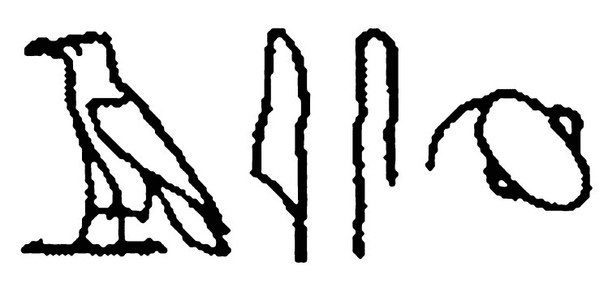

**图 1.1** 古埃及语“脑”的象形文字符号。

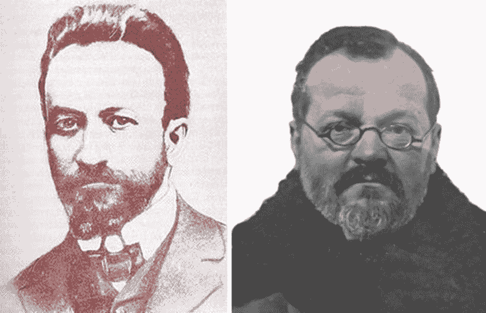

**图 1.2** 生理学家 Adolf Beck（波兰，1863–1942，左）和 Vladimir Pravdich‐Neminsky（乌克兰，1879–1952，右），他们首次实现了经颅记录大脑活动。

Fritsch（1838–1927）和 Hitzig（1838–1907）发现人大脑可被电刺激。Vasily Yakovlevich Danilevsky（1852–1939）继承了 Caton 的工作，于 1877 年完成了关于脑生理学研究的博士论文[[4]](#c01.xhtml#c1-bib-0004)。在该工作中，他研究了电刺激后的大脑活动以及动物大脑的自发电活动。

Ernst Fleischl von Marxow（1845–1891）报道了不同动物物种视觉皮层上观察到的大脑电活动。Napoleon Cybulski（1854–1919）提供了由电刺激引起的狗癫痫发作的 EEG 证据。

癫痫发作与异常电放电相关联的观点由 Kaufman 提出[[5]](#c01.xhtml#c1-bib-0005)。

Adolf Beck（波兰，1863–1942）和 Vladimir Pravdich‐Neminsky（乌克兰，1879–1952）从狗的头骨上测量了 EEG。因此，这两位科学家确实是头皮 EEG 记录的先驱（图 1.2）。

Pravdich‐Neminsky 于 1912 年从狗的大脑、硬脑膜和完整头骨记录了 EEG。他在正常条件下观察到 12–14 cycles s^(−1) 的节律，该节律在窒息下变慢，后来他称之为 `electrocerebrogram`（脑电图）。

尽管上述科学家已在 EEG 原理和测量方面进行了大量研究工作，但 Hans Berger（1873–1941，德国）被公认为发现并测量人类 EEG 信号的第一人。他于 1920 年开始研究人类 EEG[[6]](#c01.xhtml#c1-bib-0006)。Berger 几乎为所有脑电图学家所熟知。他从 1910 年开始使用弦电流计，随后改用较小的 Edelmann 型号，1924 年后又改用较大的 Edelmann 型号。1926 年，Berger 开始使用功率更强的西门子双线圈电流计（达到 130 μV cm^(−1) 的灵敏度）[[7]](#c01.xhtml#c1-bib-0007)。他在 1929 年首次报告了在感光纸上记录的持续一到三分钟的人类 EEG 记录。该记录仅采用单通道双极法，使用额枕导联。EEG 记录于 1924 年变得普及。Berger 1929 年的首份报告包含了 α 节律（作为 EEG 信号的主要成分，将在本章后面描述）和 α 阻滞反应。

20 世纪 30 年代，Berger 首次记录了睡眠纺锤波的 EEG。随后他报道了缺氧对人脑的影响、若干弥漫性和局限性脑部疾病的性质，并对癫痫放电有了初步认识[[8]](#c01.xhtml#c1-bib-0008)。在此期间，另一研究小组在 Berlin‐Buch 成立，由 Kornmüller 领导，提供了更精确的 EEG 记录[[9]](#c01.xhtml#c1-bib-0009)。Berger 还对大脑定位感兴趣，特别是脑肿瘤的定位。他还发现了精神活动与 EEG 信号变化之间存在某种相关性。


### EEG 发展史

#### 早期先驱与仪器

来自柏林小组的 Toennies（1902–1970）制造了第一台用于记录脑电位的生物放大器。1932 年，洛克菲勒基金会生产了一台用于记录 EEG 的差分放大器。

Kornmüller [[10]](#c01.xhtml#c1-bib-0010) 意识到了多导记录以及使用大量电极以覆盖更广脑区的重要性。Fischer 和 Lowenbach [[11]](#c01.xhtml#c1-bib-0011)、[[12]](#c01.xhtml#c1-bib-0012) 展示了首项聚焦于癫痫表现的 EEG 研究，并首次演示了癫痫尖波。

在英国，W. Gray Walter 成为临床 EEG 的先驱。他发现了慢脑电活动灶（δ 波），这引发了对诊断脑部异常的巨大临床兴趣。在布鲁塞尔，Fredric Bremer（1892–1982）发现了传入信号对警觉状态的影响 [[13]](#c01.xhtml#c1-bib-0013)。

#### 北美贡献

北美与 EEG 相关的研究活动始于 1934 年左右。这一年，Hallowell Davis 为自己记录到了良好的 α 节律。圣路易斯大学华盛顿小组大约在这一时期使用阴极射线示波器研究周围神经电位。20 世纪 30 年代，波士顿哈佛大学和爱荷华大学开始了人类 EEG 研究。Fredric Gibbs 开展的癫痫发作研究是那些年间 EEG 领域的主要工作，因为癫痫发作障碍领域是其最大功效所在。癫痫学历史上可分为两个时期 [[14]](#c01.xhtml#c1-bib-0014)：EEG 出现之前和之后。Gibbs 和 Lennox 将 Fischer 基于其关于毒扁豆碱及其对动物皮层 EEG 影响的研究提出的想法应用于人类癫痫学。Berger [[15]](#c01.xhtml#c1-bib-0015) 展示了几例疑似小发作患者的阵发性 EEG 放电，以及一例全身麻痹患者局限性运动发作时的 EEG 放电。

作为北美 EEG 领域的其他伟大先驱，Hallowell Davis、Herbert H. Jasper、Frederic A. Gibbs、William Lennox 和 Alfred L. Loomis 是最早研究人类睡眠期间 EEG 本质的调查者。Alfred L. Loomis、E. Newton Harvey 和 Garret A. Hobart 是首批从数学上研究人类睡眠 EEG 模式和睡眠阶段的人。在麦吉尔大学，Herbert Jasper 在找到其在基础和临床癫痫学的定位前，研究了相关的行为障碍 [[16]](#c01.xhtml#c1-bib-0016)。

#### 机构发展与技术进步

美国 EEG 学会成立于 1947 年，第一届国际 EEG 大会大约在此时于英国伦敦召开。当时德国的 EEG 研究仍局限于柏林，而日本凭借 Motokawa（一位 EEG 节律研究者）的工作引起了关注 [[17]](#c01.xhtml#c1-bib-0017)。这些年间，神经生理学家通过解剖学方法证实了丘脑皮层关系。这促成了中脑癫痫概念的形成 [[18]](#c01.xhtml#c1-bib-0018)、[[30]](#c01.xhtml#c1-bib-0030)。

20 世纪 50 年代，EEG 工作在许多不同地方扩展开展。这一时期，切除癫痫灶的手术变得普遍，Jasper 和 Penfield 合著的《癫痫与人脑功能解剖》出版。这一时期还发明了微电极。它们由钨或玻璃等金属制成，内填氯化钾等电解质，直径小于 3 μm。

人类深部 EEG 首先由 Mayer 和 Hayne（1948）利用植入式脑内电极获得。细胞内微电极技术的发明彻底改变了这一方法，并于 1952 年由 Brock 等人用于脊髓，1961 年由 Phillips 用于大脑皮层。

#### 信号分析与现代时代

EEG 信号分析始于 EEG 测量的早期。Berger 在 Dietch 的协助下（1932）将傅里叶分析应用于 EEG 序列，这在 20 世纪 50 年代迅速发展。利用 EEG 进行睡眠障碍分析始于 20 世纪 50 年代，通过芝加哥大学 Kleitman 的工作得以发展。

20 世纪 60 年代，足月儿和早产儿 EEG 分析开始发展 [[19]](#c01.xhtml#c1-bib-0019)。20 世纪 70 年代，诱发电位（EPs）的研究，特别是视觉诱发电位，作为监测精神疾病的常用手段取得了进展。

然而，EEG 的历史是一个持续的过程，始于 1300 年代初期，并带来了临床、实验和计算研究的日新月异，用于发现、识别、诊断和治疗大量神经和生理脑部异常以及人类中枢神经系统（CNS）的其他疾病。目前，EEG 使用全计算机化系统进行有创和无创记录。EEG 机器配备了许多信号处理工具、精密准确的测量电极，以及足以进行数小时超长期记录的存储器。EEG 或 MEG 机器可与其他神经成像系统（如 fMRI）集成。极精细的针式电极也可用于从大脑皮层表面记录 EEG（皮层电图），从而避免颅骨引起的衰减和非线性效应。接下来我们将描述人脑内神经活动的本质。

## 1.3 神经活动

中枢神经系统（CNS）一般由神经细胞和位于神经元之间的胶质细胞组成。每个神经细胞由轴突、树突和细胞体组成。神经细胞对刺激作出反应并远距离传递信息。神经细胞体有一个单一的细胞核，包含神经细胞大部分的代谢活动，特别是与蛋白质合成相关的部分。在细胞体中产生的蛋白质被输送到神经的其他部分。轴突是一根长圆柱体，传导电脉冲，在脊椎动物中可长达数米（长颈鹿的轴突从头部延伸至脊柱末端）。在人类中，长度可以从百分之一毫米到一米多不等。存在一个将蛋白质输送到细胞末端的轴突运输系统，该运输系统拥有在微管轨道上运行的“分子马达”。

树突与其他细胞的轴突或树突相连，接收来自其他神经的冲动或将信号中继给其他神经。在人脑中，每个神经大约与 10,000 个其他神经相连，主要通过树突连接。

CNS 中的活动主要与轴突和树突、或树突和树突之间的连接处（称为突触）间传递的突触电流有关。在细胞体膜下可记录到 60–70 mV 的负极性电位。该电位随突触活动的变化而变化。如果一个动作电位（AP）沿着纤维传播，并终止于一个*兴奋性*突触，则会在后续神经元中产生一个兴奋性突触后电位（EPSP）。如果两个动作电位在短距离内沿同一纤维传播，将发生 EPSP 的总和，若达到一定的膜电位阈值，则在突触后神经元产生一个动作电位。如果纤维终止于一个*抑制性*突触，则会发生超极化，表明出现了一个抑制性突触后电位（IPSP）[[20]](#c01.xhtml#c1-bib-0020)、[[21]](#c01.xhtml#c1-bib-0021)。图 1.3 示意性地展示了上述活动。


**图 1.3** 由细胞内微电极记录的突触激活期间神经元膜电位变化和电流流动。兴奋性和抑制性突触前纤维中的动作电位（AP）分别导致突触后神经元产生兴奋性突触后电位（EPSP）和抑制性突触后电位（IPSP）。

在产生 IPSP 之后，阳离子从神经细胞流出或阴离子流入神经细胞。这种流动最终导致神经细胞膜上的电位发生变化。原发跨膜电流在细胞内和细胞外空间的细胞膜上产生次发离子电流。流经细胞外空间的那部分电流直接负责场电位的产生。这些场电位通常频率低于 100 Hz，当信号平均值无变化时称为脑电图（EEG）信号；当平均信号有缓慢漂移时称为直流（DC）电位，这可能会掩盖实际的 EEG 信号。对于癫痫发作（由五氟烷诱导）、高碳酸血症和窒息等某些脑部异常，常可观察到 EEG 和 DC 电位的组合 [[22]](#c01.xhtml#c1-bib-0022)。接下来我们关注 AP 的本质。

## 1.4 动作电位

AP 实际上是神经传递的信息。这些电位是由离子跨神经元膜交换引起的，AP 是沿轴突传播的膜电位暂时性变化。它通常起始于细胞体，并正常向单一方向传播。膜电位去极化（变得更正），产生一个尖峰。尖峰峰值过后，膜复极化（变得更负）。电位变得比静息电位更负，然后恢复正常。大多数神经的 AP 持续时间在 5 到 10 ms 之间。**图 1.4** 展示了一个 AP 的示例。

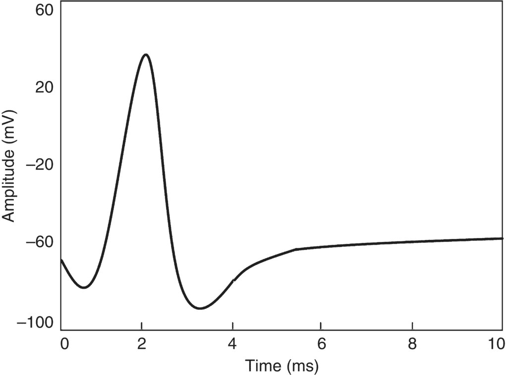

**图 1.4** 一个 AP 的示例。

AP 的传导速度介于 1 到 100 m/s 之间。AP 由多种不同类型的刺激引发；感觉神经对多种刺激有反应，例如：化学、光、电、压力、触觉和牵拉。相反，中枢神经系统（CNS，大脑和脊髓）内的神经主要受突触处化学活动的刺激。

刺激必须高于阈值水平才能引发 AP。极弱的刺激只引起微小的局部电扰动，但不产生传播的 AP。一旦刺激强度超过阈值，AP 就会出现并沿神经传播。

AP 的尖峰主要由 Na（钠）通道的开放引起。Na 泵产生 Na 和 K（钾）离子的浓度梯度，两者都用于产生 AP；Na 在细胞外浓度高、细胞内浓度低。可兴奋细胞具有特殊的 Na 和 K 通道，其门控随膜电压开启和关闭（电压门控通道）。Na 通道门控开放允许 Na 冲入细胞，带入正电荷。这使膜电位变正（去极化），产生尖峰。**图 1.5** 展示了巨型乌贼 AP 演变过程中各阶段的过程。

对于人类，AP 的幅度大约在 -60 到 10 mV 之间。在此过程中 [[23]](#c01.xhtml#c1-bib-0023)：

1.  当神经细胞的树突接收到刺激时，Na⁺ 通道将开放。
2.  如果开放程度足以将内部电位从 -70 mV 推高至 -55 mV，该过程将继续。
3.  一旦达到动作阈值，额外的 Na⁺ 通道（有时称为电压门控通道）开放。Na⁺ 内流将细胞膜内部电位推高至约 +30 mV。此阶段过程称为去极化。
4.  随后 Na⁺ 通道关闭，K⁺ 通道开放。由于 K⁺ 通道开放慢得多，去极化有时间完成。如果 Na⁺ 和 K⁺ 通道同时开放，会使系统趋向电中性，阻止 AP 的产生。

    ![Figure 1.5 Changing the membrane potential for a giant squid by closing the Na channels and opening K channels. ¶ (Source: adapted from Ka Xiong Charand [23].)](images/c01f005.gif)

    **图 1.5** 通过关闭 Na 通道和开放 K 通道改变巨型乌贼的膜电位。¶（来源：改编自 Ka Xiong Charand [[23]](#c01.xhtml#c1-bib-0023)。）

5.  随着 K⁺ 通道开放，膜开始复极化回向其静息电位。
6.  复极化通常会超越静息电位，达到约 -90 mV 的水平。这称为超极化，看似适得其反，但对信息传递实际上很重要。超极化防止神经元在此期间接收另一个刺激，或至少提高任何新刺激的阈值。超极化的部分重要性在于防止已沿轴突向上传送的刺激在相反方向触发另一个 AP。换句话说，超极化确保信号单向传播。

超极化后，Na⁺/K⁺ 泵最终将膜恢复到 -70 mV 的静息状态。

神经需要约两毫秒才能接受另一个刺激。在此期间无法产生 AP。这称为不应期。接下来描述 EEG 信号的产生。

## 1.5 EEG 产生

EEG 信号是大脑皮层许多锥体神经元树突突触兴奋期间电流流动的间接测量。当脑细胞（神经元）被激活时，会产生突触电流并沿树突传播。这种电流产生可由肌电图（EMG）机测量的磁场，以及可由 EEG 系统测量的头皮上的次级电场。

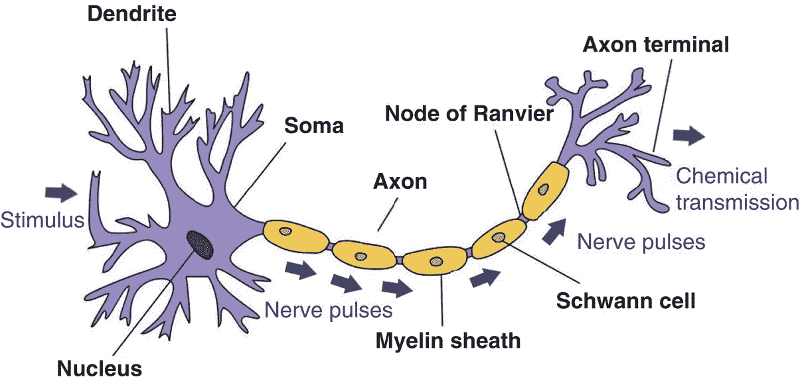

**图 1.6** 神经元的结构。

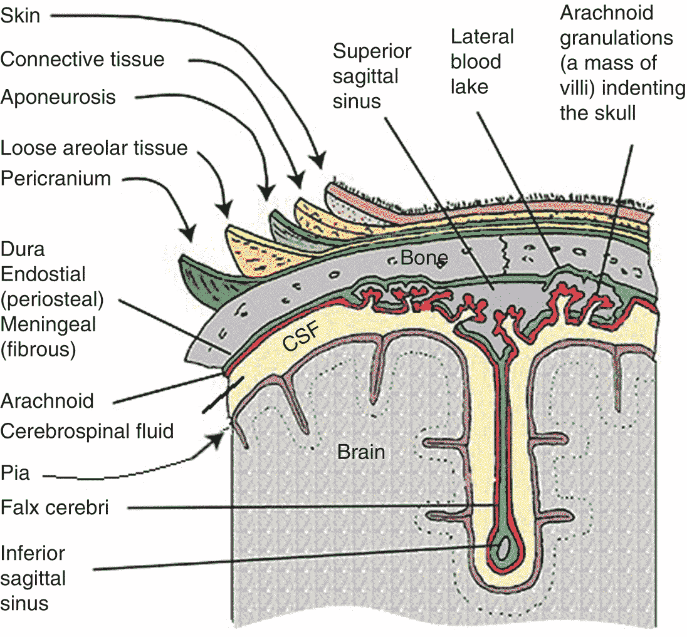

**图 1.7** 从大脑到头皮的头部层次。

电位差是由锥体细胞的突触后分级电位总和引起的，这些电位在胞体（神经元主体）和从神经元分支出的顶端树突之间形成电偶极子（**图 1.6**）。脑内电流主要是由于钠离子 (Na⁺)、钾离子 (K⁺)、钙离子 (Ca²⁺) 等正离子和氯离子 (Cl⁻) 等负离子在膜电位支配的方向上通过神经元膜泵送而产生的 [[24]](#c01.xhtml#c1-bib-0024)。


### 人头与大脑解剖

人头由三个主要层组成：头皮、颅骨和大脑（图 1.7），其中还包含许多其他薄层。此外，头皮由不同的层组成，如皮肤、结缔组织（位于皮肤下方的一层薄脂肪和纤维组织）、疏松网状结缔组织和骨膜（颅骨的骨膜，为骨骼提供营养并具备修复能力）。相反，大脑由一层薄薄的皮层覆盖，其中包含各种脑组织。皮层包括蛛网膜、脑膜、硬脑膜、硬膜外腔和蛛网膜下腔。颅骨对信号的衰减大约比软组织大一百倍。相反，大多数噪声要么产生于大脑内部（内部噪声），要么产生于头皮上（系统噪声或外部噪声）。因此，只有大量活跃的神经元才能产生足够的电位，以便使用头皮电极进行记录。这些信号随后会被大幅放大以供显示。当中枢神经系统（CNS）发育完全并具备功能时，出生时约有 $10^{11}$ 个神经元 [[25]](#c01.xhtml#c1-bib-0025)。这使得平均每立方毫米约有 $10⁴$ 个神经元。神经元通过突触相互连接形成神经网络。成年人约有 $5 \times 10^{14}$ 个突触。每个神经元的突触数量随年龄增长而增加，而神经元数量随年龄增长而减少。

鉴于头部各层电学和介电特性的多样性，大脑放电（包括皮层、皮层下和海马活动）的衰减分布在头皮上并不均匀，且受非线性影响。因此，为了模拟神经通路或定位大脑活动源，应当拥有一个准确的头部电学模型。

#### 大脑解剖

从解剖学角度来看，大脑可分为三部分：大脑、小脑和脑干（图 1.8）。大脑由大脑左、右半球组成，表面具有高度回折的层，称为大脑皮层。

大脑包含负责运动发起、感觉意识、复杂分析以及情感和行为表达的区域。小脑协调肌肉的随意运动和平衡维持。

脑干控制呼吸、心脏调节、生物节律、神经激素和激素分泌等非自主功能 [[26]](#c01.xhtml#c1-bib-0026)。

#### EEG 的临床应用

EEG 的研究为诊断许多神经系统疾病和人体其他异常铺平了道路。从人类（以及动物）获取的 EEG 信号可用于研究以下临床问题 [[26]](#c01.xhtml#c1-bib-0026)，[[27]](#c01.xhtml#c1-bib-0027)：

*   监测警觉性、昏迷和脑死亡。
*   定位头部损伤、中风和肿瘤后的受损区域。
*   测试传入通路（通过诱发电位 EP）。
*   监测认知投入（α 节律）。
*   产生生物反馈情境。
*   控制麻醉深度（伺服麻醉）。
*   研究癫痫并定位癫痫灶。
*   测试抗癫痫药物效果。
*   协助癫痫灶的实验性皮层切除术。
*   监测大脑发育。
*   测试药物的惊厥作用。
*   研究睡眠障碍和生理学。
*   研究精神障碍。

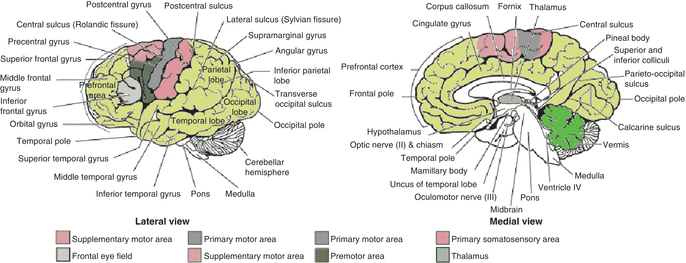

**图 1.8** 大脑主要部分的示意图。

*   自闭症患者的情绪识别。
*   监测飞行员和驾驶员的精神疲劳。
*   与其他成像模态结合，提供混合数据记录系统。

此列表证实了 EEG 分析的丰富潜力，并激发了对先进信号处理技术的需求，以协助临床医生进行解读。接下来我们将描述脑电节律，这些节律预期可在 EEG 信号中测得。

产生 EEG 信号的一些机制在细胞层面已为人所知，其基础在于神经元群体内部及之间兴奋性和抑制性相互作用的平衡。虽然已确立 EEG（或 MEG）信号主要源于同步激活且垂直取向的神经元中突触后电位总和相关的细胞外电流，但导致这种同步化至特定频带的确切神经生理机制仍不清楚。

## 1.6 大脑即网络

网络已成为人类日常社交、商业和智力生活不可或缺的一部分。网络科学吸引着神经科学，因为大脑功能源于神经元间的通信和信号传递。在每个电极处探测到的 EEG 振幅一直是评估大脑功能的主要参数。左、右脑半球间的同步性为检测精神疲劳和痴呆等异常提供了进一步洞察，并与情绪等许多其他脑状态相关，正如下一章所述。同步性常在频域中测量，因为频率和相位的变化（对应半球间的时间延迟）可轻松测量。更广泛地说，网络科学的最新发展为正常和异常大脑功能的研究开辟了新方向。

尽管网络科学的基本概念源于数学 [[28]](#c01.xhtml#c1-bib-0028) 且多用于通信领域，但许多成熟方法（如自回归建模）已被用于表征多导联 EEG 的大脑功能连接。此外，图论在设计有效分类器方面变得流行，这些分类器可将 EEG 在时空上分割为各区域，每个区域包含一个功能连接独立的大脑区域。文献 [[29]](#c01.xhtml#c1-bib-0029) 综述了神经科学研究的最新进展，特别是大脑连接作为阿尔茨海默病潜在生物标志物的研究，重点关注图论的应用。

本书后续章节中，我们将推导应用于 EEG 的图方程，其方式类似于大脑连接估计器。我们还将观察到，深度神经网络等机器学习技术可直接应用于图，以识别大脑状态。

## 1.7 小结

在介绍了一些 EEG 历史细节后，本章概述了大脑功能的神经元层面分析。还提供了头部解剖信息。EEG 信号的产生源于树突-树突或轴突-树突突触的信号传递及动作电位（AP）的产生，这是本章涵盖的重要且基本的概念。此外还强调，正常脑电节律、脑诱发反应和大脑连接均为神经元活动的结果，应区别对待以识别正常和异常脑状态。

## 参考文献

1.  **1** Caton, R. (1875). The electric currents of the brain. *British Medical Journal* **2**: 278.
2.  **2** Walter, W.G. (1964). Slow potential waves in the human brain associated with expectancy, attention and decision. *Archiv für Psychiatrie und Nervenkrankheiten* **206**: 309–322.
3.  **3** Cobb, M. (2002). Exorcizing the animal spirits: Jan Swammerdam on nerve function. *Neuroscience* **3**: 395–400.
4.  **4** Danilevsky, V.D. (1877). Investigation into the physiology of the brain. Doctoral thesis. University of Charkov, Quoted after Brazier.


## 参考文献

5. Brazier, M.A.B. (1961). A history of the electrical activity of the brain; the first half‐century. New York: Macmillan.

6. Massimo, A. (July 2004). In memoriam Pierre Gloor (1923–2003): an appreciation. *Epilepsia* **45** (7): 882.

7. Grass, A.M. and Gibbs, F.A. (1938). A Fourier transform of the electroencephalogram. *Journal of Neurophysiology* **1**: 521–526.

8. Haas, L.F. (2003). Hans Berger (1873–1941), Richard Caton (1842–1926), and electroencephalography. *Journal of Neurology, Neurosurgery, and Psychiatry* **74**: 9.

9. Spear, J.H. (2004). Cumulative change in scientific production: research technologies and the structuring of new knowledge. *Perspectives on Science* **12** (1): 55–85.

10. Kornmüller, A.E. (1935). Der Mechanismus des epileptischen anfalles auf grund bioelektrischer untersuchungen am zentralnervensystem. *Fortschritte der Neurologie‐Psychiatrie* **7**: 391–400; 414–432.

11. Fischer, M.H. (1933). Elektrobiologische auswirkungen von krampfgiften am zentralnervensystem. *Medizinische Klinik* **29**: 15–19.

12. Fischer, M.H. and Lowenbach, H. (1934). Aktionsstrome des zentralnervensystems unter der einwirkung von krampfgiften, 1. Mitteilung Strychnin und Pikrotoxin. *Naunyn‐Schmiedebergs Archiv für experimentelle Pathologie und Pharmakologie* **174**: 357–382.

13. Bremer, F. (1935). Cerveau isole’ et physiologie du sommeil. *Compte Rendu de la Sociéte de Biologie (Paris)* **118**: 1235–1241.

14. Niedermeyer, E. (1999). Chapter 1, Electroencephalography, basic principles, clinical applications, and related fields. In: Historical Aspects, 4e (eds. E. Niedermeyer and F.L. da Silva), 1–14. Lippincott Williams & Wilkins.

15. Berger, H. (1929). Über das Elektrenkephalogramm des Menschen. 7th report. *Archiv für Psychiatrie, Nervenkr* **100**: 301–320.

16. Avoli, M. (1969). Jasper's Basic Mechanisms of the Epilepsies [Internet]. 4e, Bethesda, MD: NCBI. <https://www.ncbi.nlm.nih.gov/books/NBK98150> (accessed 9 September 2020).

17. Motokawa, K. (1949). Electroencephalogram of man in the generalization and differentiation of condition reflexes. *The Tohoku Journal of Experimental Medicine* **50**: 225.

18. Niedermeyer, E. (1973). Common generalized epilepsy. The so‐called idiopathic or centrencephalic epilepsy. *European Neurology* **9** (3): 133–156.

19. Aserinsky, E. and Kleitman, N. (1953). Regularly occurring periods of eye motility, and concomitant phenomena, during sleep. *Science* **118**: 273–274.

20. Speckmann, E.‐J. and Elger, C.E. (1999). Introduction to the neurophysiological basis of the EEG and DC potentials. In: Electroencephalography, 4e (eds. E. Niedermeyer and F. Da Silva), 15–34. Lippincott Williams and Wilkins.

21. Shepherd, G.M. (1974). The Synaptic Organization of the Brain. London: Oxford University Press.

22. Caspers, H., Speckmann, E.‐J., and Lehmenkühler, A. (1986). DC potentials of the cerebral cortex, seizure activity and changes in gas pressures. *Reviews of Physiology, Biochemistry and Pharmacology* **106**: 127–176.

23. Ka Xiong Charand. (2011). Action potentials. <http://hyperphysics.phy‐astr.gsu.edu/hbase/biology/actpot.html> (accessed 19 August 2021).

24. Attwood, H.L. and MacKay, W.A. (1989). Essentials of Neurophysiology. Hamilton, Canada: B. C. Decker.

25. Nunez, P.L. (1995). Neocortical Dynamics and Human EEG Rhythms. New York: Oxford University Press.

26. Teplan, M. (2002). Fundamentals of EEG measurements. *Measurement Science Review* **2** (Sec. 2): 1–11.

27. Bickford, R.D. (1987). Electroencephalography. In: Encyclopedia of Neuroscience (ed. G. Adelman), 371–373. Cambridge (USA): Birkhauser.

28. Sporns, O. (2011). Networks of the Brain. MIT Press.

29. del Etoile, J. and Adeli, H. (2017). Graph theory and brain connectivity in Alzheimer's disease. *The Neuroscientist* **23** (6): 616–626.

30. Shipton, H.W. (1975). EEG analysis: a history and prospectus. Annual Reviews, University of Iowa, USA: 1–15.

# 2 EEG 波形

## 2.1 脑电节律

传统上，许多脑部疾病是通过目视检查 EEG 信号来诊断的。该领域的临床专家熟悉脑电节律在 EEG 中的表现。在健康成年人中，此类信号的振幅和频率会随着人的状态从一种变为另一种而改变，例如从清醒到睡眠，反之亦然。波形的特征也会随年龄变化。有五种主要脑电波，按其不同的频率范围加以区分。这些频带按频率从低到高依次称为 alpha (α)、theta (θ)、beta (β)、delta (δ) 和 gamma (γ)。Alpha 和 beta 波由 Berger 于 1929 年提出。Jasper 和 Andrews (1938) 使用“gamma”一词指代 30 Hz 以上的波。Delta 节律由 Walter (1936) 提出，用于指代 alpha 范围以下的所有频率。他还引入了 theta 波，指频率在 4–7.5 Hz 范围内的波。Theta 波的概念由 Walter 和 Dovey 于 1944 年提出 [[1]](#c02.xhtml#c2-bib-0001)。

Delta 波位于 0.5–4 Hz 范围内。这些波主要与深度睡眠相关，也可能出现在清醒状态下。很容易将颈部和下颌大肌肉引起的伪迹信号与真实的 delta 波反应混淆。这是因为肌肉靠近皮肤表面并产生大信号，而感兴趣的信号源自大脑深处，在穿过颅骨时严重衰减。尽管如此，通过对 EEG 应用简单的信号分析方法，很容易判断反应何时是由过度运动引起的。

Theta 波位于 4–7.5 Hz 范围内。术语 theta 可能被选用以暗示其推定的丘脑起源。Theta 波在意识向昏昏欲睡过渡时出现。Theta 波与潜意识材料的获取、创造性灵感和深度冥想有关。Theta 波常伴随其他频率出现，似乎与唤醒水平有关。我们知道，治疗师和经验丰富的冥想者拥有的 alpha 波会在长时间内逐渐降低频率。Theta 波在婴儿期和童年期发挥重要作用。清醒成年人出现较大量的 theta 波活动属于异常，由各种病理问题引起。Theta 波节律的变化被用于成熟度和情绪研究 [[2]](#c02.xhtml#c2-bib-0002)。


### 脑电波节律

#### Alpha 波

Alpha 波出现在头部后半部分，通常位于大脑枕叶区域，可在大脑后叶的所有部位检测到。Alpha 波的频率范围为 8–13 Hz，通常呈现为圆形或正弦波形信号。但在极少数情况下，可能表现为尖波。此时负向分量呈尖锐状，正向分量呈圆形，类似于罗兰多μ节律的波形形态。Alpha 波被认为既表示无注意力或专注的放松觉知状态。Alpha 波是整个大脑活动领域中最显著的节律，其覆盖范围可能比之前公认的更广。在高达 20 Hz 的频率范围内，常可见 Beta 波范围内的峰值，这具有 Alpha 波状态的特征而非 Beta 波状态。此外，我们经常在 Alpha 状态下观察到 75 Hz 的反应。大多数受试者闭眼时会产生一些 Alpha 波，因此有人声称这仅仅是大脑视觉区域产生的等待或扫描模式。睁眼、听到陌生声音、焦虑或精神集中/注意均可减弱或消除 Alpha 波。阿尔伯特·爱因斯坦在保持 Alpha 状态下能解决复杂的数学问题；尽管通常 Beta 波和 Theta 波也同时存在。Alpha 波在枕区振幅较高，正常振幅小于 50 μV。Alpha 波的起源和生理意义仍未明了，仍需更多研究来理解这一现象如何源自皮层细胞 [[3]](#c02.xhtml#c2-bib-0003)。

#### Beta 波

Beta 波是大脑电活动在 14–26 Hz 范围内的变化（部分文献未给出上限）。Beta 波是大脑典型的清醒节律，与主动思维、主动注意、关注外部世界或解决具体问题相关，见于正常成人。人处于恐慌状态时可能出现高水平 Beta 波。有节律的 Beta 活动主要见于额区和中央区。重要的是，中央 Beta 节律与罗兰多μ节律相关，可被运动活动或触觉刺激阻断。Beta 节律振幅通常低于 30 μV。与μ节律类似，Beta 波也可能因骨缺损 [[1]](#c02.xhtml#c2-bib-0001) 及肿瘤周围区域而增强。

#### Gamma 波

30 Hz 以上（主要高达 45 Hz）的频率对应 Gamma 波段（有时称为快 Beta 波）。尽管这些节律振幅极低且出现罕见，但检测这些节律可用于确诊某些脑部疾病。高 EEG 频率区域及脑血流量最高水平区域（氧和葡萄糖摄取最高区域）均位于额中央区。Gamma 波段也被证明是大脑事件相关同步化（ERS）的良好指标，可用于显示左右食指运动、右脚趾运动以及舌运动对应的相当宽泛的双侧区域 [[4]](#c02.xhtml#c2-bib-0004)。

#### 高频脑电活动

远超 EEG 正常活动频率范围的波（主要在 200–300 Hz 范围内）已在动物小脑结构中发现，但在临床神经生理学中未发挥作用 [[5]](#c02.xhtml#c2-bib-0005)[[6]](#c02.xhtml#c2-bib-0006)。

#### 典型正常脑节律

图 2.1 展示了典型正常脑节律及其常见振幅水平。总体而言，EEG 信号是神经活动的投影，这些活动被软脑膜、脑脊液、硬脑膜、骨质、帽状腱膜和头皮所衰减。皮层电图放电显示振幅范围为 0.5–1.5 mV，尖波可达数毫伏。然而在头皮上，振幅通常在 10–100 μV 范围内。

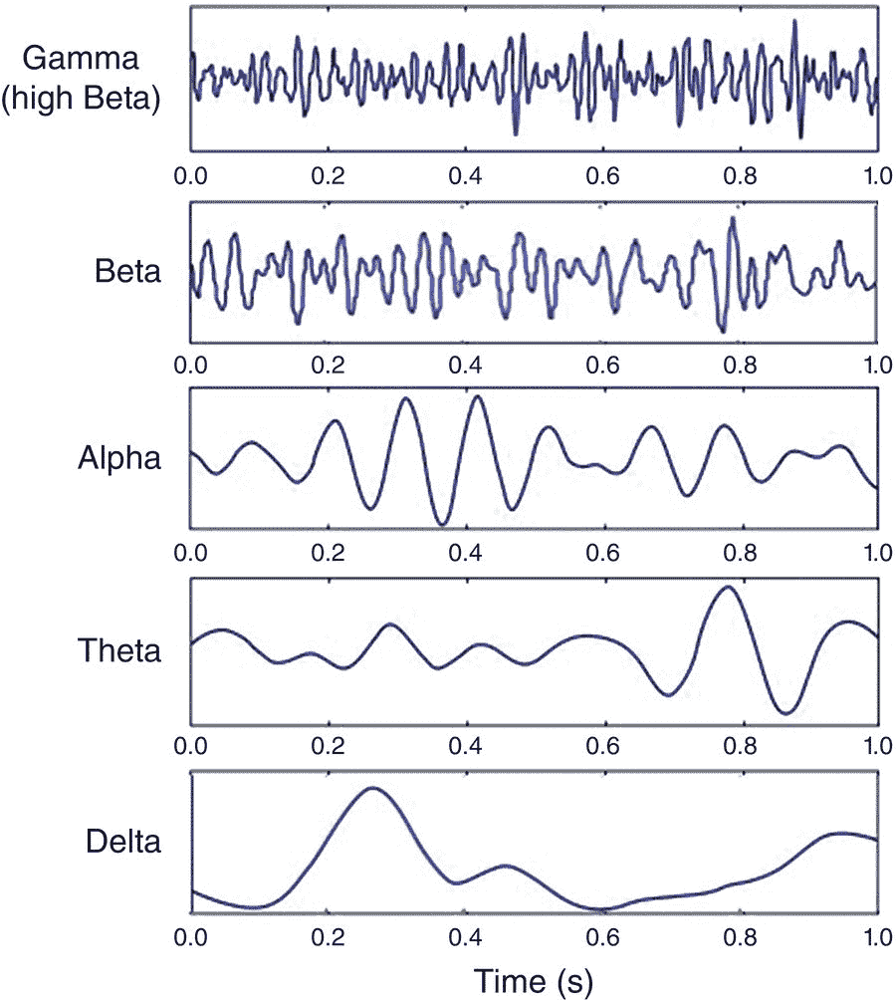

**图 2.1** 五种（可归类为四种）典型优势正常脑节律，按频率从高到低排列。Delta 波见于婴儿和睡眠成人，Theta 波见于儿童和睡眠成人，Alpha 波在无注意时于枕叶区检测到，Beta 波在注意和集中时于额顶区以低振幅出现，Gamma 波见于高负荷压力下的大脑。

若受试者状态不变，上述节律可持续存在，因此近似呈周期性。反之，存在其他脑波形，其可能：

1.  具有宽频带或表现为尖峰型信号，如 K-复合波、顶点波（睡眠中出现）或裂隙节律（因颅骨缺损产生的 Alpha 型节律）[[7]](#c02.xhtml#c2-bib-0007)，其不随运动反应，主要见于中颞区（T3 或 T4 电极下），以及某些癫痫信号。
2.  为瞬态，如事件相关电位（ERP），包含枕区正性尖锐瞬态（POST）信号（也称ρ波）。
3.  源自大脑缺损区域，如肿瘤性脑损伤。
4.  具有空间定位性且被视为周期性，但易被身体运动阻断，如μ节律。μ代表运动，与运动皮层密切相关。罗兰多（中央）μ节律在振幅和频率上与后部 Alpha 相关。然而，其地形分布和生理意义截然不同。通过μ节律可研究皮层功能及受物理和想象运动影响的大脑（多为双侧）活动变化。μ节律也用于癫痫发作障碍治疗等目的的生物反馈训练 [[1]](#c02.xhtml#c2-bib-0001)。

#### 其他研究者引入的节律

研究者还引入了其他节律：

1.  **Phi (φ) 节律**（< 4 Hz）：闭眼后两秒内出现。由 Daly 提出 [[3]](#c02.xhtml#c2-bib-0003)。
2.  **Kappa (κ) 节律**：前颞 Alpha 样节律，被认为是眼球离散侧向振荡的结果，属伪迹信号。
3.  **睡眠纺锤波**（也称 Sigma [σ] 活动）：频率范围 11–15 Hz。
4.  **Tau (τ) 节律**：代表颞区 Alpha 活动。
5.  **闭眼眼睑颤动**：引起 Alpha 频带内的额区伪迹。
6.  **Chi 节律**：类μ活动，被认为是 11–17 Hz 的特定罗兰多模式。在哈他瑜伽练习过程中观察到该波 [[8]](#c02.xhtml#c2-bib-0008)。
7.  **Lambda (λ) 波**：清醒患者中最显著，但不常见。视觉探索时行走受试者枕区出现的尖锐瞬态。为正向波，与扫视眼动时锁定，振幅不一，通常低于 90 μV [[9]](#c02.xhtml#c2-bib-0009)。


图 Figure 2.2 中的图表展示了头皮 EEG 中可能出现的所有波形。这些波形可以是清醒或睡眠状态下的正常或异常节律，以及各种伪迹。

即使经过训练的眼睛，也往往难以从头皮 EEG 中理解和检测脑节律。然而，应用先进的信号处理工具，应该能够从 EEG 中分离和分析所需的波形。因此，前景 EEG 和背景 EEG 的定义非常主观，完全取决于异常情况和应用。接下来我们将探讨 EEG 信号记录和测量的发展。

脑节律生成的早期模型是 Jansen 和 Rit 模型 [\[10\]](#c02.xhtml#c2-bib-0010)。该模型使用一组参数，通过单个区域内抑制性和兴奋性信号生成机制的相互作用产生 alpha 活动。这些模型背后的基本思想是使兴奋性和抑制性群体相互作用，从而产生振荡。该模型后来被修改和扩展，以生成和模拟其他主要脑节律，即 delta、theta、beta 和 gamma [\[11\]](#c02.xhtml#c2-bib-0011)。构建 Jansen 模型及其扩展所涉及的假设和数学原理将在本章中解释。此类模型在生成突触后电位并将其作为模板来检测、分离或提取 ERP 方面具有重要意义。在本书的 Chapter 3 中，可以看到此类模板在 ERP 提取中的应用。

## 2.2 EEG 记录与测量

从人体获取信号和图像已成为多种疾病早期诊断的关键。此类数据可以是电生物信号的形式，例如来自心脏的心电图 (ECG)、来自肌肉的肌电图 (EMG)、来自大脑的脑电图 (EEG)、来自大脑的脑磁图 (MEG)、来自胃的胃电图 (EGG) 以及来自眼神经的眼电图 (EOG)。测量也可以是超声或放射照片的一种形式，例如声图（或超声图像）、计算机断层扫描 (CT)、磁共振成像 (MRI) 或功能性 MRI (fMRI)、正电子发射断层扫描 (PET) 和单光子发射断层扫描 (SPET)。

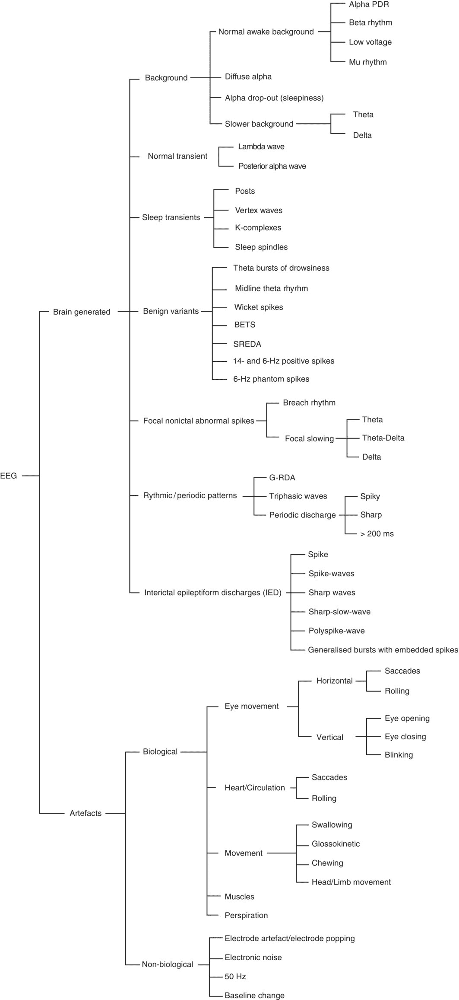

**Figure 2.2** 清醒或睡眠期间可能出现在 EEG 中的不同波形。

大脑的功能性和生理变化可以通过 EEG、MEG 或 fMRI 记录。然而，由于许多重要原因，fMRI 的应用与 EEG 或 MEG 相比非常有限：

1.  fMRI 图像序列的时间分辨率非常低（例如约每秒两帧），而完整的 EEG 带宽可以使用 EEG 或 MEG 信号查看。
2.  许多类型的精神活动、脑部疾病和脑功能障碍无法使用 fMRI 记录，因为它们对含氧血水平的影响较低。
3.  fMRI（目前还有 MEG）系统的获取受限且成本高昂。
4.  然而，EEG 的空间分辨率受限于记录电极的数量（或 MEG 的线圈数量）。

最早的电神经活动是使用简单的电流计记录的。为了放大指针的微小变化，使用镜子将投射到电流计上的光反射到墙上。d'Arsonval 电流计后来采用了安装在可动线圈上的镜子，当电流通过线圈时，聚焦在镜子上的光被反射。Marey 和 Lippmann 引入了毛细管电流计 [\[12\]](#c02.xhtml#c2-bib-0012)。Einthoven 于 1903 年引入了弦电流计，作为一种非常灵敏和更精确的测量仪器。这在几十年内成为标准仪器，并实现了照相记录。

更现代的 EEG 系统由许多精密电极、一组差分放大器（每个通道一个）和滤波器 [\[9\]](#c02.xhtml#c2-bib-0009) 以及针式（笔式）记录仪组成。多通道 EEG 可以绘制在平面纸或网格纸上。这种系统上市后不久，研究人员就开始寻找计算机化系统，以对信号进行数字化和存储。因此，人们很快意识到，要分析 EEG 信号，信号必须是数字形式。这需要对信号进行采样、量化和编码。随着电极数量的增加，数据量（以位数计）也会增加。计算机化系统允许可变设置、刺激和采样频率，有些还配备了简单或高级的信号处理工具来处理信号。

从模拟 EEG 到数字 EEG 的转换是通过多通道模数转换器 (ADC) 执行的。幸运的是，EEG 信号的有效带宽限制在约 100 Hz。对于许多应用，该带宽甚至可视为该值的一半。因此，最低 200 Hz 的采样频率（以满足奈奎斯特准则）通常足以对 EEG 信号进行采样。在某些需要更高分辨率以在频域表示脑活动的应用中，可使用高达每秒 2000 个样本的采样频率。

为了保持诊断信息，EEG 信号的量化通常非常精细。用多达 16 位表示每个信号样本在 EEG 记录系统中非常流行。这使得归档信号所需的内存量巨大，特别是对于睡眠 EEG 和癫痫发作监测记录。然而，通常情况下，归档图像所需的内存大小往往比归档 EEG 信号大得多。

简单计算表明，对于 128 导联 EEG 信号以每秒 500 个样本采样的一小时记录，需要的内存大小为 128 × 60 × 60 × 500 × 16 ≈ 3.68 Gbits ≈ 0.45 Gbyte。因此，对于大量患者的长时间记录，应有足够的存储设施，如当今技术中的 Zip 磁盘、CD、大型可移动硬盘和光盘。

尽管不同 EEG 机器读取 EEG 数据的格式可能不同，但这些格式很容易转换为大多数信号处理软件包（如 MATLAB）可读的电子表格。

EEG 记录电极及其正常功能对于获取高质量数据至关重要。EEG 记录系统中常用的电极类型有：

*   一次性（无胶型和预涂胶型）
*   可重复使用的盘状电极（金、银、不锈钢或锡）
*   头带和电极帽
*   生理盐水电极
*   针式电极。

对于大量电极的多通道记录，通常使用电极帽。常用的头皮电极由直径小于 3 mm 的 Ag–AgCl 盘组成，带有长柔性导线，可插入放大器。针式电极是那些必须通过微创手术植入颅骨下的电极。皮层与电极之间的高阻抗以及电极本身的高阻抗会导致失真，甚至可能掩盖实际的 EEG 信号。商用 EEG 记录系统通常配备阻抗监测器。为了获得满意的记录，电极阻抗应读数小于 5 kΩ，并且彼此平衡在 1 kΩ 以内。为了更精确的测量，每次试验后都会检查阻抗。


由于大脑的分层和螺旋结构，头皮（或皮层）上的电位分布并不均匀[[13]](#c02.xhtml#c2-bib-0013)。这可能会影响使用 EEG 信号进行源定位的一些结果。

### 2.2.1 常规电极定位

国际脑电图与临床神经生理学联合会推荐了用于 21 个电极（不包括耳垂电极）的常规电极设置（也称为 10-20 系统），如图 2.3 所示[[14]](#c02.xhtml#c2-bib-0014)。通常，称为 A1 和 A2 的耳垂电极分别连接到左、右耳垂，用作参考电极。10-20 系统避开了眼球位置，并利用特定的解剖标志作为测量基准，然后取该指定距离的 10% 或 20% 作为电极间距。奇数编号电极在左侧，偶数编号在右侧。

若要使用上述常规系统设置更多电极，其余电极将按等距放置在上述电极之间。例如，`C[1]`放置在`C[3]`和`C[z]`之间。图 2.4 展示了基于美国脑电学会指南的包含参考电极在内的 75 电极大规模设置。额外电极有时用于测量 EOC、ECG 以及眼睑和眼周肌肉的 EMG。在某些应用中，如 ERP 分析和脑机接口，可能仅使用单通道。在这种情况下，相应电极的位置必须确定明确。例如，`C[3]`和`C[4]`可分别用于记录 BCI 应用中的右、左手指运动相关信号。此外，`F[3]`、`F[4]`、`P[3]`和`P[4]`可用于记录 ERP P300 信号。

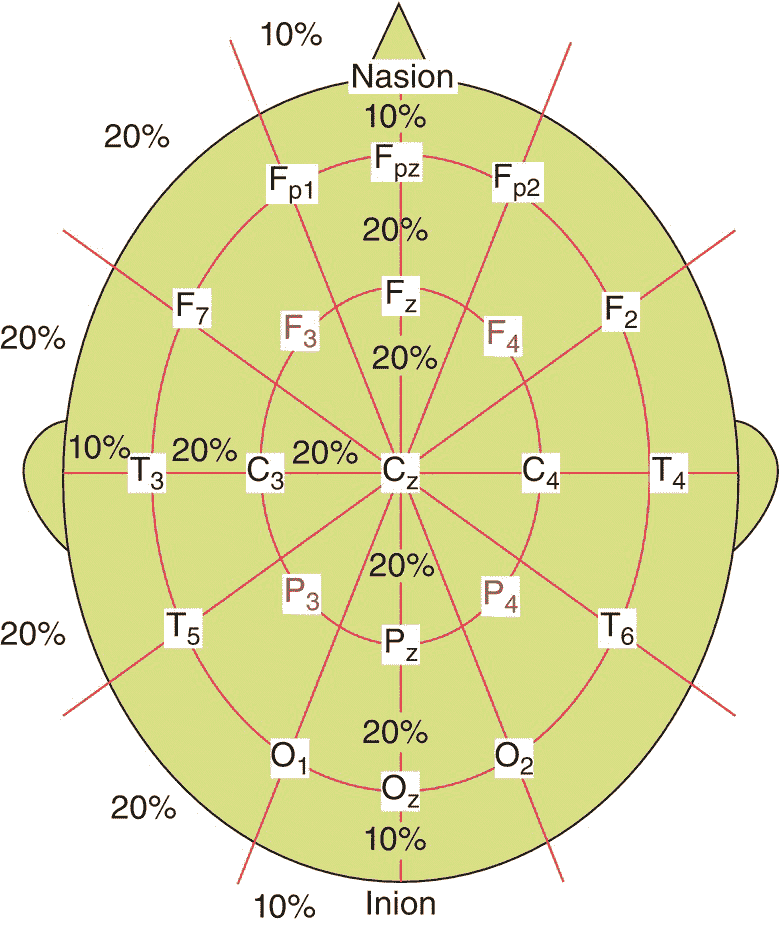

**图 2.3** 放置 21 个电极的常规 10-20 EEG 电极位置。

记录使用两种不同模式：差分模式和参考模式。在差分模式下，每个差分放大器的两个输入来自两个电极。而在参考模式下，则使用一个或两个参考电极。文献中可找到多种不同的参考电极放置方式。物理参考可用顶点（`C[z]`）、连耳、连乳突、同侧耳、对侧耳、`C[7]`、双极参考和鼻尖[[15]](#c02.xhtml#c2-bib-0015)。也存在无参考记录技术，实际使用的是共同平均参考。如果参考电极不够中性，参考的选择可能会产生地形失真。然而，在现代仪器中，参考的选择在测量中不再起重要作用[[16]](#c02.xhtml#c2-bib-0016)。在这些系统中，可使用其他参考，如`FP[z]`、手部或腿部电极[[17]](#c02.xhtml#c2-bib-0017)。整体设置包括有源电极和参考电极。

在另一种称为 Maudsley 电极定位系统的类似设置中，常规 10-20 系统经过修改，以便在癫痫发作记录中更好地捕捉癫痫灶信号。该系统与常规 10-20 系统的唯一区别在于外侧电极略微下降，以更好地捕获所需信号。该系统相较于常规系统的优势在于，它提供了大脑凸面下部更广泛的覆盖，提高了基底颞下结构记录的灵敏度[[18]](#c02.xhtml#c2-bib-0018)。研究人员使用的其他偏离国际 10-20 系统的做法见于文献[[19]](#c02.xhtml#c2-bib-0019)[[20]](#c02.xhtml#c2-bib-0020)。

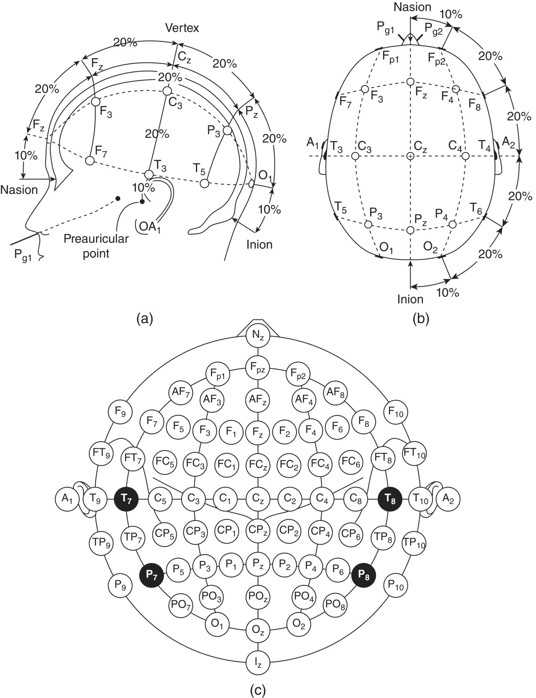

**图 2.4** 包含参考电极在内的 75 电极 10-20 电极设置示意图：(a 和 b) 表示三维测量，(c) 表示电极设置配置的二维视图。

在许多应用中，如脑机接口（BCI）和精神活动研究，通常从 10-20 设置系统中选择运动相关区域周围的少量电极使用。

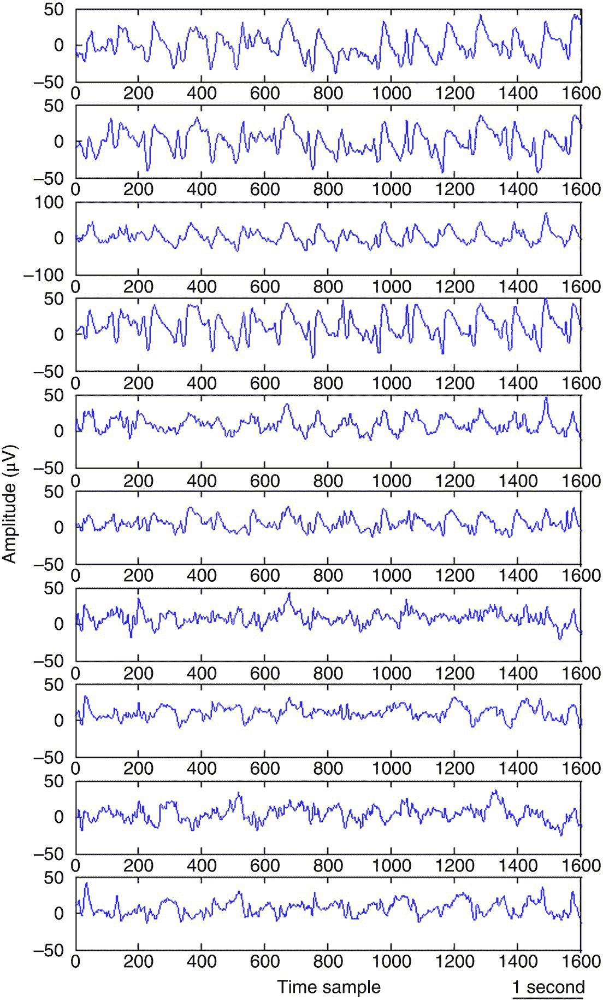

**图 2.5** 正常成人大脑活动约七秒期间的典型 EEG 信号集。

图 2.5 展示了正常成人大脑活动约七秒期间的典型 EEG 信号集。

### 2.2.2 非常规和专用 EEG 记录系统

尽管存在许多小型便携式 EEG 系统，如 5 通道或 14 通道的 Emotiv EEG 系统，但可穿戴技术的进步促成了用于 EEG 记录的专用和微型化设计。Mobile Health Technologies 生产的 GlassEEG（用于癫痫发作的实时检测）、主要针对基于 SSVEP 的脑机接口（BCI）设计的 EarEEG，以及奥地利格拉茨大学最近开发用于 BCI 的纹身 EEG，均属于此类系统（图 2.6）。

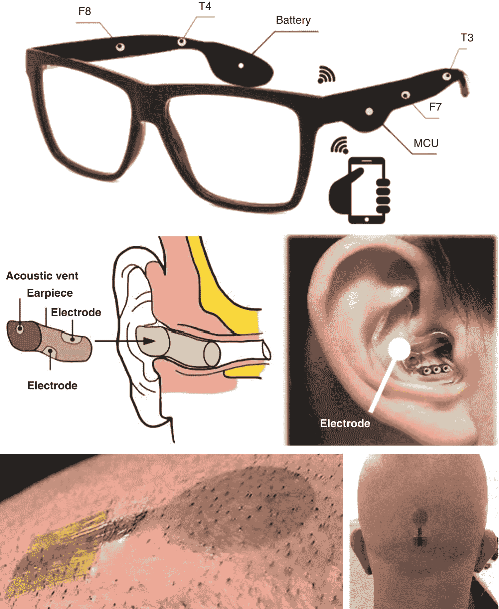

**图 2.6** 可穿戴和纹身 EEG 系统/电极。

### 2.2.3 脑电位侵入式记录

侵入式脑筛查主要旨在更接近神经元，从而获取关于神经元放电时机和缺陷神经元（如癫痫灶）确切位置的信息，用于深部脑刺激、手术或康复植入等目的。

直接从皮层表面记录，称为皮层电图（ECoG）或颅内脑电图（iEEG），是一种脑电生理监测类型，它使用直接放置在暴露的大脑表面的电极网格，记录大脑皮层的电活动。图 2.7 展示了一个示例。

ECoG 的一个流行应用是利用躯体感觉诱发电位（EPs）的相位反转来定位中央沟，用于基于 BCI 的康复。

另一种 iEEG 记录技术是使用插入卵圆孔的电极串（图 2.8）深入海马，主要用于记录癫痫发作期间的神经元活动，并定位患病神经元以供手术目的使用。一组此类电极可见于图 2.9。

本书第 11 章将展示这种记录模式在从海马检测癫痫间歇期癫痫样放电（IED）中的应用。

随着微电子学和微型传感器设计的进步，一种新型的可插入运动皮层脑血管内的微型传感器阵列被设计出来，无需开颅手术。该传感器阵列称为 Stentrode™，是一种直径不超过 4 mm 的小型金属网管（支架），支架结构内带有电极接触点（小金属圆盘）。


Stentrode™（图 2.10）预计能准确记录运动区内的神经元活动，因此可帮助因脊髓损伤、运动神经元疾病、中风、肌营养不良或肢体缺失导致瘫痪而丧失运动功能的患者。

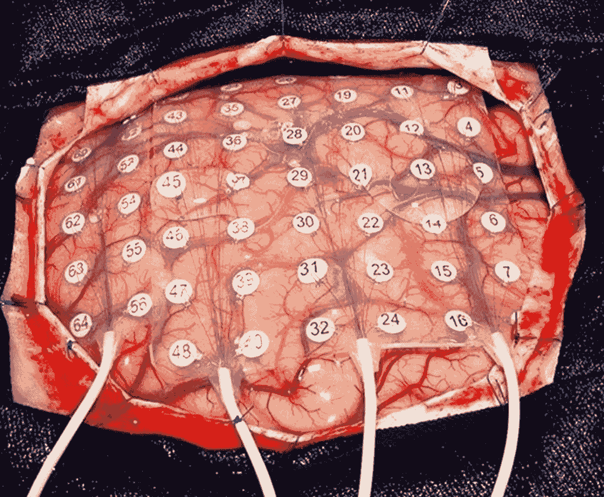

**图 2.7** 脑电皮层图。

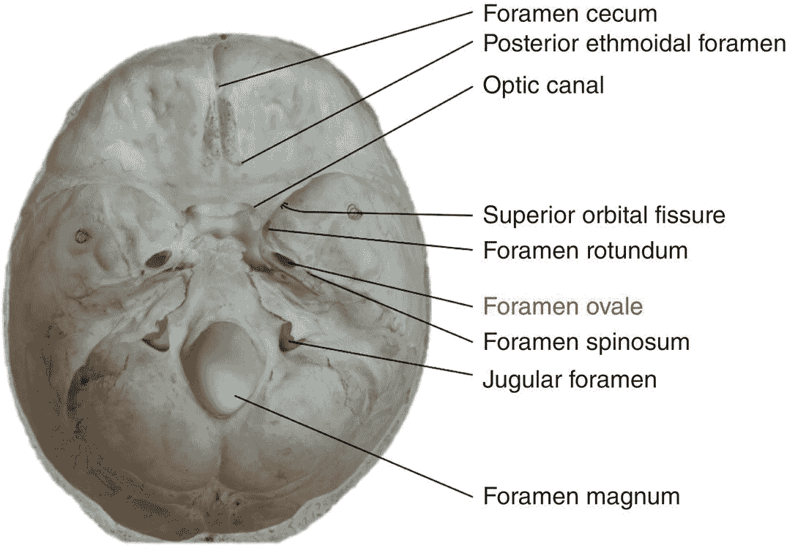

**图 2.8** 面部骨骼内的卵圆孔。

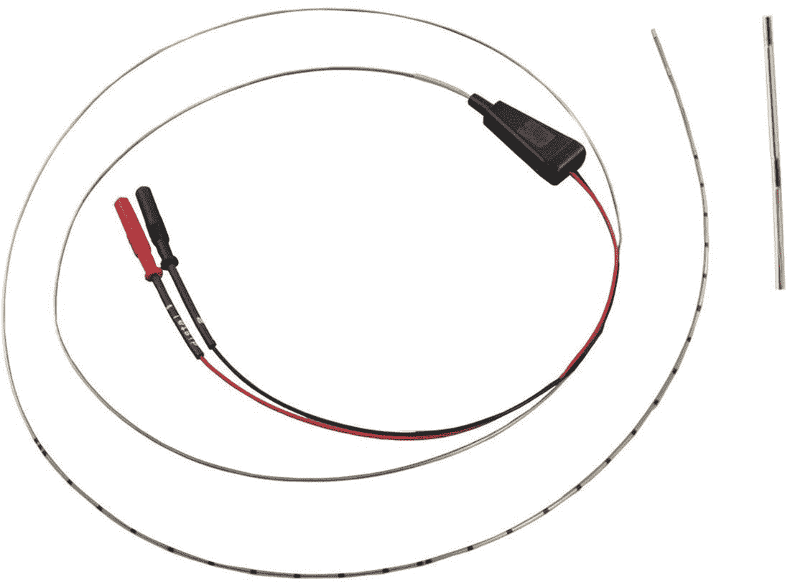

**图 2.9** 卵圆孔电极。

### 2.2.4 信号调理

原始 EEG 信号的幅度约为 μV 量级，包含高达 300 Hz 的频率成分。为保留有效信息，信号在 ADC 之前必须进行放大，并在 ADC 之前或之后进行滤波，以降低噪声并使信号适合处理和可视化。滤波器的设计旨在不向信号引入任何变化或失真。通常使用截止频率低于 0.5 Hz 的高通滤波器来消除干扰性的极低频成分（如呼吸产生的成分）。反之，则使用截止频率约为 50–70 Hz 的低通滤波器来减轻高频噪声。通常需要零点频率为 50 Hz 的陷波滤波器，以确保完美抑制强烈的 50 Hz 电源干扰。在这种情况下，采样频率可以低至带宽的两倍，这也是大多数 EEG 系统的常用做法。EEG 记录常用的采样频率为每秒 100、250、500、1000 和 2000 个样本。主要伪迹可分为患者相关（生理性）伪迹和系统伪迹。患者相关或内部伪迹包括体动相关伪迹、肌电图 (EMG)、心电图 (ECG)（及脉搏）、眼电图 (EOG)、球 istocardiogram（注：原文为 ballistocardiogram，此处保留原文或译为“弹道心动图”）和出汗。系统伪迹包括 50/60 Hz 电源干扰、阻抗波动、电缆缺陷、电子元件的电噪声以及电极不平衡阻抗。通常在预处理阶段，这些伪迹会被高度抑制，并恢复有效信息。一些去除 EEG 伪迹的方法将在本书相关章节中讨论。图 2.11 显示了一组受眨眼伪迹影响的正常 EEG 信号。同样，图 2.12 显示了一组多通道 EEG，枕区电极上清晰地出现了 ECG 信号。

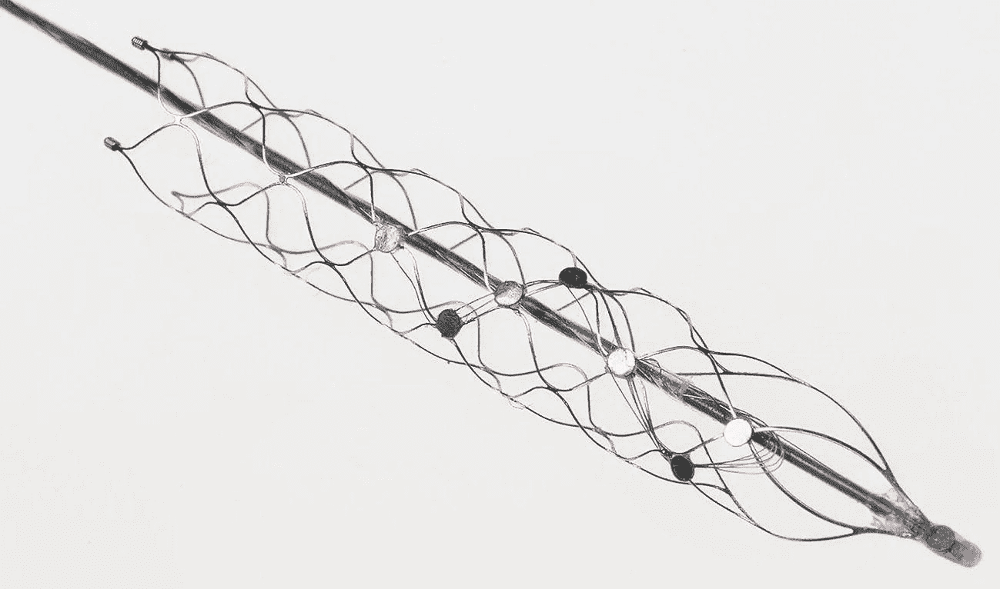

**图 2.10** 一种直径 4 毫米的 Stentrode，其电极接点位于支架结构内部。

在以下章节中，我们将重点介绍 EEG 测量中最常见的几种变化，这些变化与大脑的生理和精神异常相关。

## 2.3 睡眠

在正常睡眠的各个阶段，脑波会发生变化。入睡时，高频波形逐渐消失，连续慢波（delta 频带）随后出现纺锤波和 K 复合波，从睡眠第二阶段开始并延伸至第四阶段。在睡眠后期阶段，快速眼动 (REM) 开始并结束于人醒来之前。通过分析正常睡眠期间的 EEG 信号，可以观察并准确检测和自动评分所有这些阶段。

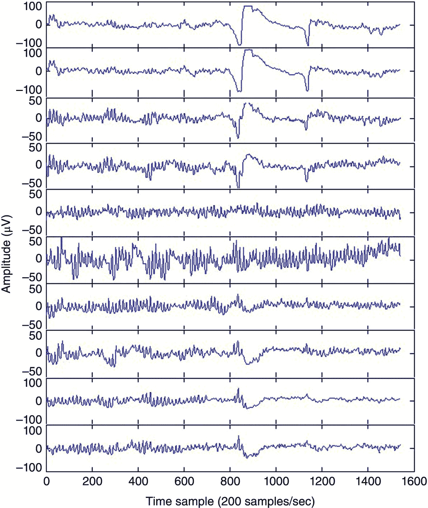

**图 2.11** 一组受眨眼伪迹影响的正常 EEG 信号。

反之，也存在受试者患有睡眠障碍的情况。这些包括阻塞性睡眠呼吸暂停 (OSA)、失眠（包括伴随性失眠和嗜睡症）、REM 睡眠行为障碍、昼夜节律睡眠障碍、非 24 小时睡眠-觉醒障碍、周期性肢体运动障碍 (PLMD)、轮班工作睡眠障碍、发作性睡病。睡眠障碍需要被诊断和治疗。

此类障碍通常通过心率和呼吸等其他记录模式来检测、监测或诊断。尽管如此，睡眠 EEG 在异常睡眠的检测或监测中的应用最近已成为一个研究课题。一些方法将在本书相关章节中讨论。

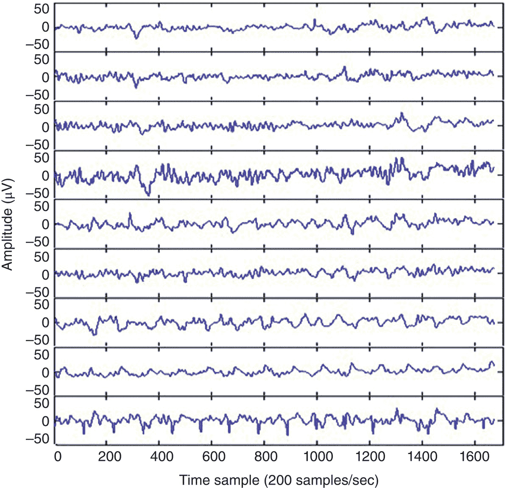

**图 2.12** 一组多通道 EEG，枕区电极上清晰地出现了 ECG 信号。

## 2.4 精神疲劳

精神疲劳通常是长时间认知负荷的结果，可在短期或长期内对人产生负面影响，并可能导致大脑无法执行其常规任务。精神疲劳主要影响大脑网络的功能，而非显著改变正常的大脑节律 [21, 22]。这些研究表明，当大脑处于精神疲劳状态时，左右脑叶之间的同步性降低，各脑叶之间的连接性也随之降低。

精神疲劳还会通过衰减和时移诱发电位 (ERP) 来削弱大脑对听觉、视觉和其他刺激的反应。研究表明，ERP 的振幅（特别是 P3b，即 P300 的一个亚成分）会降低，而 ERP 潜伏期（特别是 P3b）会随着精神疲劳的增加而延长 [23–25]。

本书专门用一章详细分析疲劳状态下大脑的 EEG。

## 2.5 情绪

大脑右半球与情绪相关。在情绪激动状态下测量的侧向化电生理参数发现，在回忆与愤怒或放松相关的过去事件时，EEG 显示出相对激活（通过 alpha 功率降低来测量）。在对视觉材料的自我报告情绪反应中也获得了类似发现 [26]。其他实验研究证实了当参与者被要求产生情绪意象时 [27]，以及在催眠诱导的抑郁状态下 [28]，右半球相对激活。更近期的定量 EEG 研究证明了大脑激活幅度与情绪唤醒强度之间存在可靠关系 [29]。在相关研究中，情绪记忆的年代久远程度与使用定量 EEG 测得的激活幅度相关 [30]。大多数这些研究均基于侧脑叶活动的不对称性得出结论 [31]。

或许，支持效价假说最有力的证据来自大量 EEG 研究，这些研究将相对增加的左半球活动与积极情绪状态相关联，将相对增加的右半球活动与消极情绪状态相关联，如文献 [32] 所示。额叶 EEG 在积极情绪反应期间显示相对左半球活动，而在消极情绪反应期间则显示相反模式。

一些近期的机器学习应用 [33] 表明，EEG 在 beta 频带与 theta 频带的功率比及其不对称性与情绪变化相关。


文献 [34] 的作者表明，来自脑电图（EEG）的六个特征——即功率谱密度（`PSD`）、差分熵（`DE`）、差分不对称性（`DASM`）、有理不对称性（`RASM`）、不对称性（`ASM`）和差分因果性（`DCAU`）——与情绪相关，并可用于情绪识别分类。

进一步的未发表研究聚焦于情绪识别的脑连接性。研究人员分析了情绪性和非情绪性影片刺激下，不同脑区间相互依赖的模式，并评估了与情绪相关的差异。随后，一种简单的同步指数（`SI`）测量方法被用于检测脑电信号中的相互依赖性，主要针对快乐和悲伤情绪。在情绪刺激期间，特别是悲伤期间，`SI` 显著变化/增加，导致额叶通道间的连接性增强。相反，快乐与额枕区更广泛的同步化相关，尽管快乐本身的同步程度较低 [35]。

## 2.6 神经发育障碍

神经发育障碍是一组影响神经系统发育的疾病，导致大脑功能异常，可能影响情绪、学习能力、自我控制和记忆 [36]。此类障碍通常始于童年，尽管其影响随时间变化，但通常伴随患者终身，并影响其终身生活。

儿童神经发育障碍的例子包括注意缺陷多动障碍（`ADHD`）、自闭症（也称为自闭症谱系障碍 `ASD`）、学习障碍、智力障碍（也称为精神发育迟滞）、品行障碍、脑瘫，以及视力和听力受损。抑郁症也可归入此类障碍。

近年来，`ADHD`、`ASD` 和抑郁症一直是脑电研究的重点，因此本书后续章节提供了一些相关示例。

## 2.7 异常脑电图模式

受试者特定状态下脑电图模式的变化提示异常。这可能源于异常模式的扭曲和消失、异常模式的出现和增加，或所有模式的消失。Sharbrough [37] 将脑电图中的非特异性异常分为三类：(i) 广泛的间歇性慢波异常，常见于 Delta 波范围，与脑功能障碍相关；(ii) 双侧持续性脑电图，通常与意识大脑反应受损相关；(iii) 定位性持续性脑电图，通常与定位性大脑障碍相关。

第一类属于爆发型信号，通过警觉个体和睁眼可减弱，闭眼、过度通气或嗜睡时则增强。成人的峰值振幅通常定位于额区，并受年龄影响。然而在儿童中，它出现在枕区或后头区。早期发现表明，这种异常模式常伴随颅内压增高（伴有肿瘤或脑导水管狭窄）出现。此外，它与灰质疾病（无论皮层还是皮层下位置）均有相关性。不过，它也可见于各种病理过程，范围从全身性毒性或代谢紊乱到颅内局灶性病变。

关于第二类，即双侧持续性脑电图，意识、目的性反应能力受损不同阶段的现象在病因学上是非特异性的，其生成机制仅被部分理解。然而，结合病因和病程等其他信息，这些发现有助于更快、更准确地预测患者恢复原有意识生活的几率。

至于第三类，即定位性持续性脑电图，这些异常可能表现为正常模式的扭曲和消失、异常模式的出现和增加，或所有模式的消失，但此类变化很少在大脑皮层见到。正常节律的定位性扭曲可能产生振幅、频率或节律反应性的不对称。生理性节律（如 Alpha 节律对睁眼 [38] 或精神警觉 [39] 的反应性丧失）的单侧反应性丧失，可可靠地定位异常的定位侧。定位性病变也可能扭曲或消除诱导睡眠的纺锤波和顶波的正常活动。

定位性持续性非节律性 Delta 活动（`PNRD`）可能由定位性异常产生。这是定位性大脑障碍最可靠的发现之一。这种定位性减慢越持续、反应性越低、越非节律和多形，它作为定位性大脑障碍出现指标的可靠性就越高 [40]–[42]。还有其他情况，如定位性炎症、外伤、血管疾病、脑肿瘤，或几乎任何其他导致定位性皮层障碍的原因，包括中枢神经系统（CNS）退行性疾病的不对称起病，均可能导致大脑信号模式出现类似异常。

颅骨缺损下方大脑皮层发生器产生的头皮脑电振幅也可能增加，除非急性或慢性损伤导致深层发生器活动显著抑制。大脑活动的扭曲是因为定位性异常可能改变单个神经元发生器的相互连接、数量、频率、同步性、电压输出和取向，以及源信号本身的位置和振幅。

关于上述三类异常脑电图，其识别和分类需要一种用于各种神经系统疾病及任何其他可用信息的动态工具。对异常模式的精确表征，能为某些特定的病理生理反应（如癫痫）或特定的疾病过程（如亚急性硬化性全脑炎 `SSPE` 或 克雅氏病 `CJD`）提供更清晰的洞见 [37]。

除上述原因外，还有许多其他原因导致异常脑电图模式。以下章节简要描述了最常见的异常情况。

## 2.8 衰老

衰老过程影响清醒和睡眠状态下人类的正常大脑活动，并改变大脑对刺激的反应。这些变化源于神经元数量的减少以及大脑病理的整体改变。这种病理表明，大脑的额叶和颞叶比顶叶受影响更大，导致大型神经元萎缩，小型神经元和胶质细胞数量增加 [43]。皮层体积减小表明存在与年龄相关的神经元丢失。大脑衰老的一个总体原因可能是大脑血流量的减少 [43]。

Alpha 频率的降低可能是脑电图中最常见的异常。这通常导致老年人前向扩散至额区增多，并降低 Alpha 波阻滞反应和反应性。精神功能减退在某种程度上与 Theta 波和 Delta 波双侧减慢的程度有关 [43]。

尽管高频脑节律的变化尚未得到充分确立，但一些研究者报道了 Beta 波活动的增加。这种 Beta 波活动的变化可被视为智力减退的早期迹象 [43]。


### 睡眠 EEG 模式

关于睡眠 EEG 模式，老年人进入嗜睡状态时，EEG 振幅会更逐渐地降低。60 岁以上，额中央波变慢，颞叶节律频率也会降低，伴随慢速眼动的频率降低变得更加明显，且在 α 节律消失后，纺锤波会出现在波形模式中。相位性和张力性 NREM 睡眠 EEG 的振幅均随年龄增长而降低 [\[43\]](#c02.xhtml#c2-bib-0043)。REM 睡眠组织随年龄也有显著变化；夜间 REM 持续时间缩短，睡眠中断显著增加 [\[43\]](#c02.xhtml#c2-bib-0043)。

痴呆症是主要发生在老年人身上最常见的精神障碍。因此，随着社会老龄化，痴呆症的患病率急剧上升。通常，EEG 是鉴别器质性脑综合征（OBS）和功能性精神障碍的宝贵诊断工具 [\[43\]](#c02.xhtml#c2-bib-0043)，连同诱发电位（EPs）在评估正常和病理性衰老中发挥重要作用。衰老预计会改变大多数神经生理参数。然而，这些参数的变异性必须超过正常的自发变异程度，才能成为急性和慢性疾病状态的诊断因子。睡眠和清醒期间 EEG 的自动分析可能提供数据中更好的对比度，并实现稳健的诊断工具。接下来我们将描述一些特定且常见的精神障碍，其早期发病可通过 EEG 测量进行诊断。

## 2.9 精神障碍

### 2.9.1 痴呆症

痴呆症是一种以智力和认知能力下降为特征的综合征。这会随之影响正常的社会活动、情绪，以及与他人的关系和互动 [\[44\]](#c02.xhtml#c2-bib-0044)。EEG 常用于研究痴呆症的影响。在大多数情况下，如原发性变性痴呆（如阿尔茨海默病）和精神障碍（如伴有认知障碍的抑郁症），EEG 可用于检测异常 [\[45\]](#c02.xhtml#c2-bib-0045)。

文献 [\[45\]](#c02.xhtml#c2-bib-0045) 将痴呆症分为皮质型和皮质下型。最重要的皮质型痴呆是阿尔茨海默病（AD），约占病例的 50%。其他已知的皮质异常包括皮克病和 CJD。它们在临床上以失语、失用和失认等表现为特征。CJD 通常可利用 EEG 信号进行诊断。图 2.13 展示了一组 CJD 患者的 EEG 信号。反之，最常见的皮质下疾病包括帕金森病、亨廷顿病、腔隙状态、正常压力脑积水和进行性核上性麻痹。这些疾病的特征是健忘、思维过程减慢、冷漠和抑郁。总体而言，皮质下痴呆引起的 EEG 模式异常比皮质型要少。

在 AD 中，EEG 后部节律（α 节律）变慢，δ 波和 θ 波活动增加。反之，β 波活动可能减少。在严重病例中，可出现癫痫样放电和三相波。此类情况下常导致认知障碍。频谱功率也会发生变化：δ 和 θ 频带功率增加，β 和 α 频带功率以及平均频率降低。

AD 和皮克病的 EEG 波形形态几乎相同。皮克病累及额叶和颞叶。准确的分析后跟高效的病例分类可鉴别这两种疾病。CJD 是一种混合型皮质和皮质下痴呆。这会导致 δ 和 θ 波活动减慢，发病约三个月后，会产生周期性尖波复合波，频率接近每秒一次，伴随背景活动降低 [\[45\]](#c02.xhtml#c2-bib-0045)。帕金森病是一种皮质下痴呆，会导致背景活动减慢以及 θ 和 δ 波活动增加。已有研究利用频谱分析证实上述变化 [\[46\]](#c02.xhtml#c2-bib-0046)。其他一些障碍（如抑郁症）对 EEG 影响较小，必须对 EEG 进行更精确的分析，才能检测到这些脑部疾病的信号异常。

通常，EEG 常用于多种皮质型和皮质下型痴呆的诊断和评估。它往往有助于鉴别阿尔茨海默病等变性疾病和精神疾病引起的假性痴呆 [\[45\]](#c02.xhtml#c2-bib-0045)。EEG 还可显示病变过程是局灶性还是弥漫性（即是否涉及背景 δ 和 θ 波活动）。EEG 还可能揭示早期 CJD 相关异常。然而，可能需要实施更先进的信号处理和定量技术，以实现稳健的诊断和监测性能。

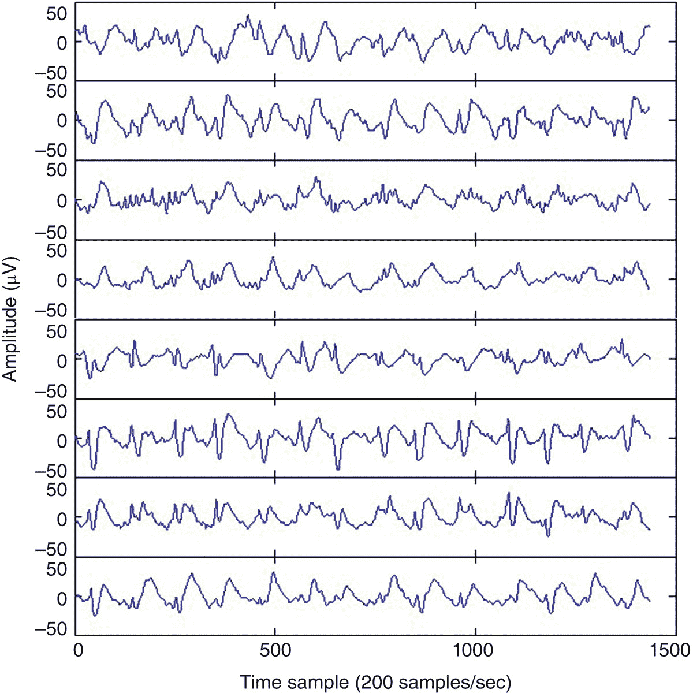

**图 2.13** 一组来自 CJD 患者的多通道 EEG 信号。

### 2.9.2 癫痫发作与非癫痫发作

临床癫痫发作的开始通常表现为 EEG 测量中频率的突然变化。通常位于 α 波频带，在发作期间频率缓慢降低（但振幅增加）。波形可能呈尖峰状，也可能不呈尖峰状。在电极递减性发作中，可发现电活动的突然去同步化。对于局灶性癫痫发作，从发作前期到发作期的过渡，表现为从混沌波形到有序波形的逐渐变化。尖波的振幅不一定代表发作的严重程度。例如，4-10 岁儿童的罗兰多尖波非常显著，但癫痫疾病通常相当良性，或者可能没有临床发作 [\[47\]](#c02.xhtml#c2-bib-0047)。

就空间分布而言，儿童期枕叶尖波非常常见。罗兰多区中央-中颞-顶叶尖波通常是良性的，而额叶尖波或多灶性尖波更具致癫痫性。尖波的形态随年龄显著变化。然而，尖波可能出现在任何觉醒水平，包括清醒和深睡。

将发作与常见伪迹区分并不困难。EEG 测量中的发作伪迹具有显著的尖峰状但重复（有节律）的性质，而大多数其他伪迹呈瞬态或噪声状。对于心电图（ECG），QRS 波群的出现频率约为 1 Hz。这些波群具有特定形状，与发作信号截然不同。


#### 癫痫发作信号形态学

癫痫发作信号的形态在不同类型间略有差异。发作可能出现在不同的频率范围内。例如，小发作放电通常在 3 Hz 左右呈现慢棘波，持续约 70 ms，且通常在额部中线处具有最大振幅。相反，15 岁以上患者会出现较高频率的棘慢波复合波。4 Hz 和 6 Hz 的复合波可能出现在癫痫患者的额区。至于 6 Hz 复合波（也称为良性 EEG 变异和模式），前部 6 Hz 棘波患者更可能发生癫痫发作，而后部放电患者倾向于神经-自主神经紊乱 [\[48\]](#c02.xhtml#c2-bib-0048)。实验并不总是得出相同结论 [\[47\]](#c02.xhtml#c2-bib-0047)。还发现枕部 6 Hz 棘波可见且常与药物有关（由于镇痛药或巴比妥类药物）及戒断反应 [\[49\]](#c02.xhtml#c2-bib-0049)。

在非癫痫患者中，脑血管疾病、晕厥发作和精神问题患者可能出现放电 [\[47\]](#c02.xhtml#c2-bib-0047)。大多数先天性盲童的枕区可见快速针状棘波放电。这些棘波与癫痫无关，通常在大龄患者中消失。

如 Figure 2.14 所示，睡眠期间在后颞区及附近头部区域可见 13–16 Hz 或 5–7 Hz 的爆发波（也称为 14 Hz 和 6 Hz 波），振幅小于 75 μV，呈弓形。这些波相对于背景波为正向。6 Hz 和 14 Hz 波可能独立出现，分别见于幼童和大龄儿童。这些波可能局限于颅骨缺损下方区域。除了 6 Hz 波外，中颞区还有与嗜睡相关的节律性 theta 爆发波活动，其形态与发作期模式非常相似。老年患者可能出现其他类似模式，如中央顶区 4–7 Hz 频带的*成人亚临床节律性 EEG 放电*（SREDA），以及前颞叶和中颞叶 2–120 Hz 宽频带的*颞部轻微锐性瞬时波*和*楔状棘波*。这些波也是非癫痫性的，但具有发作型波形 [\[47\]](#c02.xhtml#c2-bib-0047)。

癫痫发作模式称为发作期波形，出现在癫痫发作起始期。虽然本书后续章节侧重于从信号处理和机器学习角度分析这些波形，但此处简要解释了这些波形的形态学特征。信号处理研究者可在算法开发中利用这些概念。尽管这些波形模式常被肌肉运动严重遮蔽，但通常保持某些关键特征。

##### 强直-阵挛性发作

强直-阵挛性发作（也称大发作）是最常见的癫痫发作类型。它出现在所有电极中，但更倾向于额部电极（Figure 2.15）。EEG 中呈现有节奏的棘波模式，发生在 6–12 Hz 频率范围内。

##### 小发作

小发作是另一种发作间期阵发性发作模式，发生在约 3 Hz，具有广泛同步的棘慢波复合波和持续爆发。

##### 颞叶发作

颞叶发作（也称精神运动性发作或复杂部分性发作）表现为锯齿状慢波爆发，振幅相对较高（> 60 μV），频率 4–6 Hz。

##### 皮层（局灶性）发作

皮层发作在发作期具有对侧分布，振幅上升、频率减弱。发作通常由局部去同步化引起，即极快、极低电压的棘波活动，逐渐振幅上升、频率减弱。

##### 肌阵挛性发作

肌阵挛性发作在 EEG 信号中可见伴随的多棘波。其空间分布可为全面性或双侧性，额区优势 [\[50\]](#c02.xhtml#c2-bib-0050)。

##### 强直性发作

强直性发作发生在 Lennox-Gastaut 综合征患者中 [\[51\]](#c02.xhtml#c2-bib-0051)，棘波以约 10 Hz 频率重复。

##### 失张力发作

失张力发作可能表现为几秒钟的跌倒发作或抑制性，持续几分钟。显示几个多棘波或棘慢波，全面性空间分布约 10 Hz，随后出现 1.5–2 Hz 的大幅慢波 [\[52\]](#c02.xhtml#c2-bib-0052)。

##### 运动不能性发作

运动不能性发作罕见，特征为所有运动停止，但非因突然张力丧失（如失张力发作），患者处于类似缺神状态。节律频率 1–2 Hz。

##### 杰克奈夫发作

杰克奈夫发作（又称致敬发作），常见于高心律失常（婴儿痉挛、West 综合征）儿童，表现为突发性全面性扁平化去同步化或快速棘波放电 [\[51\]](#c02.xhtml#c2-bib-0051)。

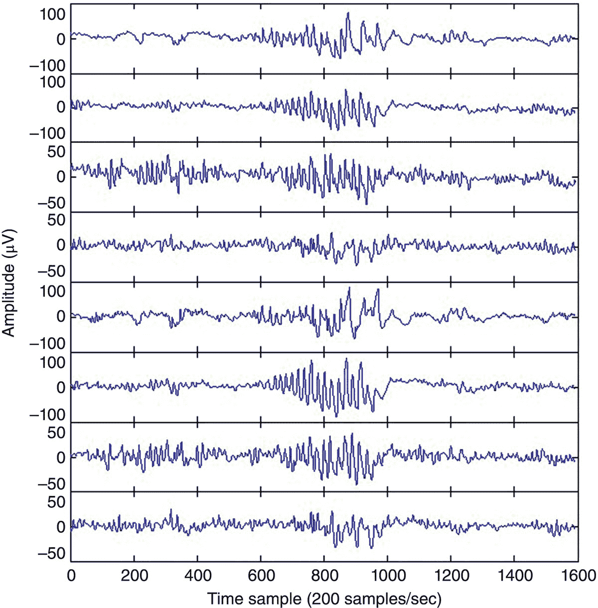

**Figure 2.14** 成人 EEG 信号组中 3–7 Hz 癫痫发作活动的爆发波。

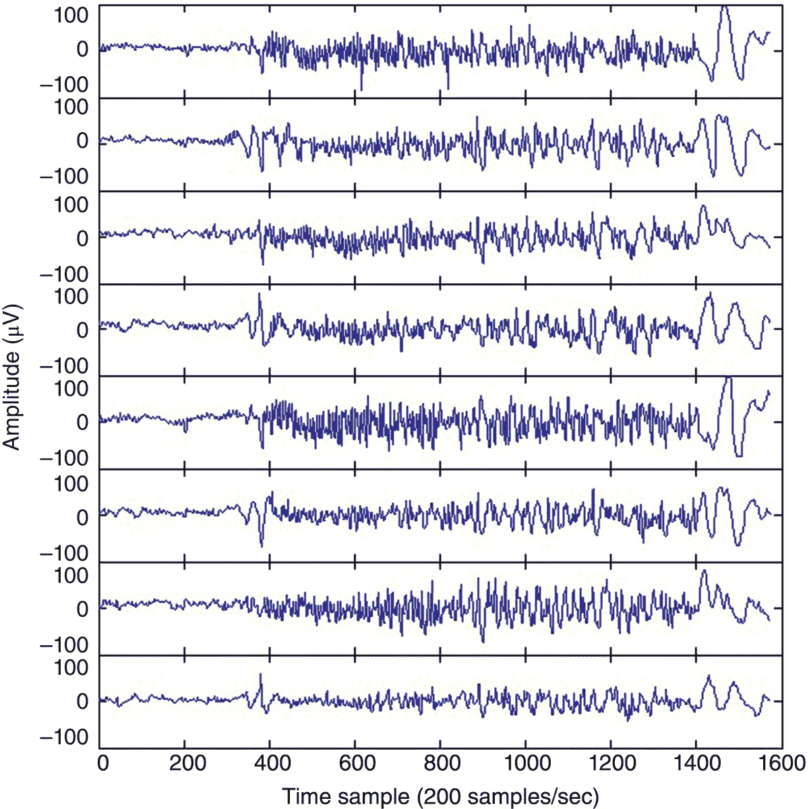

**Figure 2.15** 全身性强直-阵挛（大发作）癫痫发作。发作出现在几乎所有电极中。

通常存在几种复发性或准复发性放电，可能与癫痫发作相关，也可能无关。这些异常可能源于心因性改变、机体代谢变异、循环功能不全（常表现为急性脑缺血）。其中最重要的包括：与严重中枢神经系统疾病相关的周期性或准周期性放电；亚急性硬化性全脑炎（SSPE）中的周期性复合波；单纯疱疹病毒脑炎中的周期性复合波；晕厥发作；屏气发作；因血液化学成分突变引起的低血糖和过度通气综合征 [\[53\]](#c02.xhtml#c2-bib-0053)；以及 CJD（疯牛病）中的周期性放电 [\[54\]](#c02.xhtml#c2-bib-0054), [\[55\]](#c02.xhtml#c2-bib-0055)。后者异常的波形由尖波或尖锐三相瞬态信号组成，持续 100–300 ms，频率 0.5–2 Hz。周期性活动通常在前部区域最大，Heidenhain 型除外，后者在后部最大 [\[47\]](#c02.xhtml#c2-bib-0047)。其他癫痫样波形包括周期性侧向癫痫样放电（PLED）、急性脑缺氧中的周期性放电及其他病因的周期性放电。

尽管存在上述癫痫样信号，健康非癫痫者仍有棘波和其他阵发性放电。这些放电可见于无其他疾病症状的健康个体。然而，它们常为某些大脑功能障碍的征兆，可能发展为异常，也可能不发展。它们可能出现在个体面临特定精神挑战时期，如前线士兵、飞行员和囚犯。


### 2.9.3 精神疾病

不仅可以利用 EEG 信号研究功能性和某些解剖性脑异常，还可以通过分析此类信号来研究病理生理学脑部疾病。根据美国精神病学协会的《精神疾病诊断与统计手册（DSM）》，自 20 世纪 70 年代以来，精神病学教育的变化已相当显著。这些变化主要源于基于 EEG 信号的物理和神经学实验室研究 [[57]](#c02.xhtml#c2-bib-0057)。

有来自 EEG 相干性测量的证据表明，正常儿童与学习障碍儿童之间存在成熟模式的差异 [[58]](#c02.xhtml#c2-bib-0058)。这一发现可致使建立某种监测学习障碍的方法论。

通过分析由简单平均多个具有相同刺激的连续试次获得的诱发电位（EP），可诊断出多种精神疾病。

一些弥漫性精神障碍，如：阅读障碍，一种发育性阅读障碍；孤独症，与异常的社会互动、沟通以及受限的兴趣和活动有关，且从三岁开始出现；雷特综合征，其特征是在出生后一段正常功能期之后出现多重缺陷；以及阿斯伯格综合征，导致社会互动的严重且持续损害，以及行为、兴趣和活动的受限重复模式；均在多个功能领域造成显著损失 [[57]](#c02.xhtml#c2-bib-0057)。

注意缺陷多动障碍（ADHD）和注意缺陷障碍（ADD）、品行障碍、对立违抗性障碍和破坏性行为障碍也一直在研究中，并被纳入 DSM 范畴。这些异常大多出现于儿童期，且常阻碍儿童良好地学习和社交。相关的 EEG 特征极少被分析性地研究，但 EEG 观察结果常见于文献中 [59–63]。然而，大多数此类异常往往会随年龄增长而消失。

近期 EEG 也被用于分析谵妄 [64, 65]、痴呆 [66, 67] 以及许多其他认知障碍 [[68]](#c02.xhtml#c2-bib-0068)。在 EEG 中，谵妄的特征包括枕区优势节律减慢或消失、弥漫性 θ 或 δ 慢波活动、背景节律组织不良，以及睁眼和闭眼时 EEG 反应性丧失。与此相平行，定量 EEG (QEEG) 显示绝对和相对慢波（θ 和 δ）功率增加、快慢波功率比降低、平均频率降低，以及枕区峰值频率降低 [[65]](#c02.xhtml#c2-bib-0065)。

痴呆包含一组神经退行性疾病，导致获得性认知和行为损害，其严重程度足以显著干扰社会和职业功能。阿尔茨海默病是导致痴呆最常见的疾病。目前，该疾病在美国困扰约 500 万人，全球超过 3000 万人。更多个体表现出较轻度的认知损害，这经常演变为全面的痴呆。预计到 2050 年，痴呆的患病率将增加近两倍，因为该疾病主要影响老年人，而老年人在许多国家（尤其是工业化国家）构增长最快的年龄组别 [[67]](#c02.xhtml#c2-bib-0067)。

在其他精神和心理障碍中，遗忘性障碍（或遗忘症）、躯体疾病引起的精神障碍、物质相关障碍、精神分裂症、情感障碍、焦虑障碍、躯体形式障碍、解离性障碍、性和性别认同障碍、进食障碍、睡眠障碍、冲动控制障碍和人格障碍在文献中常被提及 [[57]](#c02.xhtml#c2-bib-0057)。然而，相应的 EEG 很少通过先进的信号处理工具进行分析。

### 2.9.4 外部影响

在使用药物治疗和抑制各种精神及中枢神经系统（CNS）异常时，EEG 信号模式可能会发生显著变化。仅仅注视电视屏幕或不专心地听音乐，也可能导致 EEG 模式的变化。然而，在外部影响中，最显著的是药理学和药物影响。因此，了解这些药物因慢性过量服用导致 EEG 波形变化的影响，以及公开中毒的模式非常重要 [[69]](#c02.xhtml#c2-bib-0069)。

麻醉药物给药对 EEG 的影响是临床医生关注的焦点。相关研究试图寻找 EEG 变化与麻醉阶段之间的相关性。研究表明，在麻醉初期会出现快速额部活动。在深麻醉下，这种活动变慢且振幅增高。在最后阶段，爆发-抑制模式提示脑干功能（包括呼吸）受累，最终 EEG 活动停止 [[69]](#c02.xhtml#c2-bib-0069)。在急性中毒病例中，EEG 模式与麻醉时的模式相似 [[69]](#c02.xhtml#c2-bib-0069)。

巴比妥类常用作抗惊厥和抗癫痫药。小剂量巴比妥类会使额叶皮层周围 25–35 Hz 频带内的活动增加。这会变为 15–25 Hz 并扩散至顶枕区。巴比妥类的依赖性和成瘾性很常见。因此，长期服用巴比妥类后突然停药会导致阵发性异常。主要并发症包括肌阵挛、全身性强直-阵挛性发作和谵妄 [[69]](#c02.xhtml#c2-bib-0069)。

除巴比妥类外，许多其他药物也被用作安眠药，如褪黑素和溴化物。在慢性溴中毒性脑病中发现非常明显的 EEG 减慢 [[69]](#c02.xhtml#c2-bib-0069)。抗精神病药物也会影响 EEG 模式。例如，神经阻滞剂增加 α 波活动，但减少 β 波爆发的持续时间及其平均频率。作为另一个例子，氯氮平增加 δ、θ 和 21 Hz 以上 β 波活动。作为另一种抗精神病药，三环类抗抑郁药（如咪普拉明、阿米替林、多塞平、去甲替林、去甲去甲替林和原三环抗抑郁药）增加慢、快活动量，伴随频率和电压的不稳定，并减慢 α 波节律。服用三环类抗抑郁药后，慢性癫痫患者的发作频率可能增加。大剂量时，这可能进一步导致非癫痫患者出现单次或多次发作 [[69]](#c02.xhtml#c2-bib-0069)。


#### 药物对脑电图的影响

在急性中毒期间，脑电图中观察到广泛、反应差、不规则的 8–10 Hz 活动，以及包括棘波在内的阵发性异常，还有非特异性昏迷模式 [\[69\]](#c02.xhtml#c2-bib-0069)。

锂常用于双相情感障碍的预防性治疗。脑电图模式的相关变化包括 β 节律减慢和阵发性弥漫性减慢，偶尔伴有棘波。局限性减慢也会发生，这不一定是局灶性脑损伤的迹象。因此，锂的给药会导致脑电图发生显著异常改变 [\[69\]](#c02.xhtml#c2-bib-0069)。

作为抗焦虑药，苯二氮卓类药物高度激活 β 波活动。这些活动在摄入后长达两周内持续存在于脑电图中。苯二氮卓类药物导致 α 波活动及其振幅减少，并轻微增加 4–7 Hz 频带活动。在急性中毒时，脑电图显示无反应性的显著快活动 [\[69\]](#c02.xhtml#c2-bib-0069)。

像麦角酸二乙酰胺和麦斯卡林这样的致幻药物会降低振幅，并可能抑制慢波 [\[69\]](#c02.xhtml#c2-bib-0069)。

中枢神经系统兴奋剂增加 α 和 β 波活动，并减少慢波及背景脑电图的振幅和数量 [\[69\]](#c02.xhtml#c2-bib-0069)。

许多其他药物（特别是抗癫痫药）的效果正在被研究，新成果也频繁发表。癫痫患者服用丙戊酸后脑电图的一个显著变化是，伴随癫痫发作减少，弥漫性棘波减少甚至消失。拉莫三嗪是另一种抗癫痫药，它阻断电压门控钠通道，从而阻止兴奋性递质谷氨酸的释放。服用拉莫三嗪会导致广泛的脑电图衰减 [\[69\]](#c02.xhtml#c2-bib-0069)。

大剂量给予青霉素可能产生肌阵挛、全身性癫痫发作，甚至癫痫持续状态 [\[69\]](#c02.xhtml#c2-bib-0069)。

## 2.10 总结

本章简要解释了脑电图信号的形成。还描述了脑电图记录的常规测量设置，以及正常或异常脑电图中存在的脑节律。此外，还指出了精神疾病、衰老、癫痫发作和非癫痫发作等常见脑异常的影响。尽管本章提到了已知的神经学、生理学、病理学和精神方面的脑异常，但还有许多其他脑部疾病和功能障碍，它们可能在相关脑电图信号中表现出某种异常，也可能不表现。

睡眠、疲劳、衰老、情绪以及人体的许多其他状态可以直接或间接地表现在脑电图模式中。神经发育障碍，特别是那些与人类行为相关的障碍，已成为极具吸引力的研究领域，因为它们与儿童人格发展相关。

中枢神经系统（CNS）的退行性疾病 \[70, 71\]，如各种溶酶体疾病、几种过氧化物酶体疾病、多种线粒体疾病、尿素循环先天性紊乱、多种氨基酸尿症，以及其他代谢性和退行性疾病和染色体异常，都必须进行评估，并将其症状与脑电图模式的变化相关联。必须充分理解这些疾病脑电图之间的相似性和差异性。相反，开发的数学算法需要考虑临床观察和发现，以进一步增强此类处理的结果。尽管已经建立了许多技术方法来处理与上述异常相关的脑电图，但仍有很长的路要走，许多问题有待解答。

本书后续章节将介绍主要用于脑电图信号分析的新数字信号处理和机器学习技术，并给出此类方法在应用中的许多示例。

## 参考文献

1.  **1** Walter, W.G. and Dovey, V.J. (1944). Electro‐encephalography in cases of sub‐cortical tumour. Journal of Neurology, Neurosurgery, and Psychiatry **7** (3–4): 57–65. [`doi.org/10.1136/jnnp.7.3-4.57`](https://doi.org/10.1136/jnnp.7.3-4.57).

2.  **2** Ashwal, S. and Rust, R. (2003). Child neurology in the 20th century. Pediatric Research **53**: 345–361.

3.  **3** Niedermeyer, E. (1999). The normal EEG of the waking adult, Chapter 10. In: Electroencephalography, Basic Principles, Clinical Applications, and Related Fields, 4e (eds. E. Niedermeyer and F.L. Da Silva), 174–188. Lippincott Williams & Wilkins.

4.  **4** Pfurtscheller, G., Flotzinger, D., and Neuper, C. (1994). Differentiation between finger, toe and tongue movement in man based on 40 Hz EEG. Electroencephalography and Clinical Neurophysiology **90**: 456–460.

5.  **5** Adrian, E.D. and Mattews, B.H.C. (1934). The Berger rhythm, potential changes from the occipital lob in man. Brain **57**: 345–359.

6.  **6** Trabka, J. (1963). High frequency components in brain waves. Electroencephalography and Clinical Neurophysiology **14**: 453–464.

7.  **7** Cobb, W.A., Guiloff, R.J., and Cast, J. (1979). Breach rhythm: the EEG related to skull defects. Electroencephalography and Clinical Neurophysiology **47**: 251–271.

8.  **8** Roldan, E., Lepicovska, V., Dostalek, C., and Hrudova, L. (1981). Mu‐like EEG rhythm generation in the course of hatha‐yogi exercises. Electroencephalography and Clinical Neurophysiology **52**: 13.

9.  **9** IFSECN (1974). A glossary of terms commonly used by clinical electroencephalographers. Electroencephalography and Clinical Neurophysiology **37**: 538–548.

10.  **10** Jansen, B.H. and Rit, V.G. (1995). Electroencephalogram and visual evoked potential generation in a mathematical model of coupled cortical columns. Biological Cybernetics **73**: 357–366.

11.  **11** David, O. and Friston, K.J. (2003). A neural mass model for MEG/EEG coupling and neuronal dynamics. NeuroImage **20**: 1743–1755.

12.  **12** Marey, E.J. and Lippmann, G. (1876). Des variations electriques des muscles du coeur en particulier etudiees au moyen de l’electrometre di. M. Lippmann. Comptes Rendus **82**: 975–977.

13.  **13** Gotman, J., Ives, J.R., and Gloor, R. (1979). Automatic recognition of interictal epileptic activity in prolonged EEG recordings. Electroencephalography and Clinical Neurophysiology **46**: 510–520.

14.  **14** Jasper, H. (1958). Report of committee on methods of clinical exam in EEG. Electroencephalography and Clinical Neurophysiology **10**: 370–375.

15.  **15** Bickford, R.D. (1987). Electroencephalography. In: Encyclopedia of Neuroscience (ed. G. Adelman), 371–373. Cambridge (USA): Birkhauser.

16.  **16** Montoya‐Martínez, J., Vanthornhout, J., Bertrand, A., and Francart, T. (2021). Effect of number and placement of EEG electrodes on measurement of neural tracking of speech. PLoS ONE **16** (2): e0246769.

17.  **17** Collura, T. (1998). A guide to electrode selection, location, and application for EEG Biofeedback, Ohio. Proceedings of the 6th Annual Conference on Brain Function/EEG, Modification and Training, Palm Springs, CA (21–25 February).

18.  **18** Nayak, D., Valentin, A., Alarcon, G. et al. (2004). Characteristics of scalp electrical fields associated with deep medial temporal epileptiform discharges. Clinical Neurophysiology **115**: 1423–1435.

19.  **19** Barrett, G., Blumhardt, L., Halliday, L. et al. (1976). A paradox in the lateralization of the visual evoked responses. Nature **261**: 253–255.


## 参考文献

20. **20** Halliday, A.M. (1978). Commentary: Evoked Potentials in Neurological Disorders, Chapter: Event‐Related Brain Potentials in Man (eds. E. Calloway, P. Tueting and S.H. Coslow), 197–210. Academic Press.

21. **21** Jarchi, D. and Sanei, S. (2010). Mental fatigue analysis by measuring synchronization of brain rhythms incorporating enhanced empirical mode decomposition. Proceedings of the 2nd International Workshop on Cognitive Information Processing (CIP). Elba, Italy.

22. **22** Jarchi, D. and Sanei, S. (2010). A novel method for analysis of mental fatigue from normal brain rhythms. Proceedings of the 17th European Signal Processing Conference, EUSIPCO. Denmark.

23. **23** Jarchi, D., Sanei, S., and Lorist, M.M. (2011). Coupled particle filtering: a new approach for P300‐based analysis of mental fatigue. Journal of Biomedical Signal Processing and Control **6** (2): 175–185.

24. **24** Jarchi, D., Makkiabadi, B., and Sanei, S. (2009). Estimation of trial to trial variability of P300 subcomponents by coupled Rao‐Blackwellised particle filtering. Proceedings of the IEEE Workshop on Statistical Signal Processing, SSP2009. Cardiff, UK.

25. **25** Jarchi, D., Makkiabadi, B., and Sanei, S. (2009). Separating and tracking ERP subcomponents using constrained particle filter. Proceedings of the 16th International Conference on Digital Signal Processing, DSP2009, Greece.

26. **26** Davidson, R.J. and Henriques, J.B. (2000). Regional brain function in sadness and depression. In: The Neuropsychology of Emotion (ed. J.C. Borod), 269–297. New York: Oxford Press.

27. **27** Karlin, R., Weinapple, M., Rochford, J., and Goldstein, L. (1979). Quantitated EEG features of negative affective states: report of some hypnotic studies. Research Communications in Psychology, Psychiatry, and Behavior **4**: 397–413.

28. **28** Tucker, D.M., Stenslie, C.E., Roth, R.S., and Shearer, S.L. (1981). Right frontal lobe activation and right hemisphere performance decrement during a depressed mood. Archives of General Psychiatry **38** (2): 169–174.

29. **29** Foster, P.S. and Harrison, D.W. The relationship between magnitudes of cerebral activation and intensity of emotional arousal. International Journal of Neuroscience **112**: 1463–1477, 2002.

30. **30** Foster, P.S. and Harrison, D.W. (2004). Cerebral correlates of varying ages of emotional memories. Cognitive and Behavioral Neurology **17** (2): 85–92.

31. **31** Demaree, H.A., Everhart, D.E., Youngstrom, E.A., and Harrison, D.W. (2005). Brain lateralization of emotional processing: historical roots and a future incorporating dominance. Behavioral and Cognitive Neuroscience Reviews **4** (1): 3–20. [`doi.org/10.1177/1534582305276837`](https://doi.org/10.1177/1534582305276837).

32. **32** Lee, G.P., Meador, K.J., Loring, D.W. et al. (2004). Neural substrates of emotion as revealed by functional magnetic resonance imaging. Cognitive and Behavioral Neurology **17** (1): 9–17.

33. **33** Xu, X., Wei, F., Zhu, Z. et al. (2020). EEG feature selection using orthogonal regression: application to emotion recognition. ICASSP 2020–2020 IEEE International Conference on Acoustics, Speech and Signal Processing (ICASSP), 1239–1243. Barcelona, Spain. [`doi.org/10.1109/ICASSP40776.2020.9054457`](https://doi.org/10.1109/ICASSP40776.2020.9054457).

34. **34** Zheng, W.‐L., Zhu, J.‐Y., and Lu, B.‐L. (2019). Identifying stable patterns over time for emotion recognition from EEG. IEEE Transactions on Affective Computing **10** (3): 417–429.

35. **35** Costa, T., Rognoni, E., and Galati, D. (2006). EEG phase synchronization during emotional response to positive and negative film stimuli. Neuroscience Letters **406**: 159–164.

36. **36** Mullin, A.P., Gokhale, A., Moreno‐De‐Luca, A. et al. (2013). Neurodevelopmental disorders: mechanisms and boundary definitions from genomes, interactomes and proteomes. Translational Psychiatry **3**: e329. [`doi.org/10.1038/tp.2013.108`](https://doi.org/10.1038/tp.2013.108).

37. **37** Sharbrough, F.W. (1999). Nonspecific abnormal EEG patterns, Chapter 12. In: Electroencephalography, Basic Principles, Clinical Applications, and Related Fields, 4e (eds. E. Niedermeyer and F.L. Da Silva). Lippincott Williams & Wilkins.

38. **38** Bancaud, J., Hecaen, H., and Lairy, G.C. (1955). Modification de la reactivite E.E.G., troubles des functions symboliques et troubles con fusionels dans les lesions hemispherigues localisees. Electroencephalography and Clinical Neurophysiology **7**: 179.

39. **39** Westmoreland, B. and Klass, D. (1971). Asymetrical attention of alpha activity with arithmetical attention. Electroencephalography and Clinical Neurophysiology **31**: 634–635.

40. **40** Cobb, W. (1976). EEG interpretation in clinical medicine. In: Part B, Handbook of Electroencephalography and Clinical Neurophysiology, vol. 11 (ed. A. Remond), B1–B6. Elsevier.

41. **41** Hess, R. (1975). Brain tumors and other space occupying processing. In: Part C, Handbook of Electroencephalography and Clinical Neurophysiology, vol. 14 (ed. A. Remond), C1–C6. Elsevier.

42. **42** Klass, D. and Daly, D. (eds.) (1979). Current Practice of Clinical Electroencephalography, 1e. Raven Press.

43. **43** Van Sweden, B., Wauquier, A., and Niedermeyer, E. (1999). Normal aging and transient cognitive disorders in the elderly, Chapter 18. In: Electroencephalography, Basic Principles, Clinical Applications, and Related Fields, 4e (eds. E. Niedermeyer and F.L. Da Silva), 340–348. Lippincott Williams & Wilkins.

44. **44** America Psychiatric Association (1994). Committee on Nomenclature and Statistics, Diagnostic and Statistical Manual of Mental Disorder: DSM‐IV, 4e. Washington DC: American Psychiatric Association.

45. **45** Brenner, R.P. (1999). EEG and dementia, Chapter 19. In: Electroencephalography, Basic Principles, Clinical Applications, and Related Fields, 4e (eds. E. Niedermeyer and F.L. Da Silva), 349–359. Lippincott Williams & Wilkins.

46. **46** Neufeld, M.Y., Bluman, S., Aitkin, I. et al. (1994). EEG frequency analysis in demented and nondemented parkinsonian patients. Dementia **5**: 23–28.

47. **47** Niedermeyer, E. (1999). Abnormal EEG patterns: epileptic and paroxysmal, Chapter 13. In: Electroencephalography, Basic Principles, Clinical Applications, and Related Fields, 4e (eds. E. Niedermeyer and F.L. Da Silva), 235–260. Lippincott Williams & Wilkins.

48. **48** Hughes, J.R. and Gruener, G.T. (1984). Small sharp spikes revisited: further data on this controversial pattern. Electroencephalography and Clinical Neurophysiology **15**: 208–213.

49. **49** Hecker, A., Kocher, R., Ladewig, D., and Scollo‐Lavizzari, G. Das Minature‐spike‐wave. Das EEG Labor **1**: 51–56.

50. **50** Geiger, L.R. and Harner, R.N. (1978). EEG patterns at the time of focal seizure onset. Archives of Neurology **35**: 276–286.

51. **51** Gastaut, H. and Broughton, R. (1972). Epileptic Seizure. Springfield, IL: Charles C. Thomas.

52. **52** Oller‐Daurella, L. and Oller‐Ferrer‐Vidal, L. (1977). Atlas de Crisis Epilepticas. Geigy Division Farmaceut.

53. **53** Niedermeyer, E. (1999). Nonepileptic attacks, Chapter 28. In: Electroencephalography, Basic Principles, Clinical Applications, and Related Fields, 4e (eds. E. Niedermeyer and F.L. Da Silva), 586–594. Lippincott Williams & Wilkins.

54. **54** Creutzfeldt, H.G. (1968). Uber eine eigenartige herdformige erkrankung des zentralnervensystems. Zeitschrift für die gesamte Neurologie und Psychiatrie **57**: 1–18, Quoted after W. R. Kirschbaum, 1920.

55. **55** Jakob, A. (1968). Uber eigenartige erkrankung des zentralnervensystems mit bemerkenswerten anatomischen befunden (spastistische pseudosklerose, encephalomyelopathie mit disseminerten degenerationsbeschwerden). Deutsche Zeitschrift für Nervenheilkunde **70**: 132, Quoted after W. R. Kirschbaum, 1921.


# 3

EEG 信号建模

## 3.1 简介

从大脑测量到的电位或磁场的产生，是由于参与认知或运动相关过程的所有神经元内部电化学活性电位的非线性求和/分布。由于涉及各种化学物质和化学过程，要实现一个能够将相应神经元内部产生活性电位的化学过程联系起来的准确模型是很困难的。然而，自 20 世纪 50 年代以来已提出了一些模型。

神经元可被视为信号转换器。大脑是一个由大量神经元组成的复杂网络。**图 3.1**a 显示了一个由三个神经元组成的小型网络。每个轴突均延伸自细胞体，后者是神经元的主体。神经元之间传输和交换称为动作电位或脉冲的电信号。神经元在突触处接收脉冲。然后，电信号或信息沿着从树突到轴突的方向传输。**图 3.1**b 示出了动作电位的波形，其在人脑中的振幅约为 100 mV。

典型神经元在没有输入信号（通常来自其他神经元）的情况下不会产生任何脉冲。足够大的输入脉冲会导致神经元产生输出脉冲，而微小的输入则不会产生输出脉冲。因此，神经元具有 `threshold`（阈值）或 `all‐or‐none`（全或无）特性。存在一个称为 `refractory period`（不应期）的特殊时期或时机（即动作电位下行沿的时机），在此期间，即使向神经元施加足量的输入，神经元也无法产生任何输出脉冲。因此，神经元可被视为一种将输入脉冲串转换或变换为另一脉冲串的器件，正如我们稍后将看到的，每个输出脉冲（动作电位）都是若干输入脉冲的积分。

## 3.2 EEG 产生的生理建模

流行的生理模型旨在最好地模拟两个或多个神经元之间的耦合。文献 [\[1\]](#c03.xhtml#c3-bib-0001) 中介绍并比较了三种脑电位产生模型。

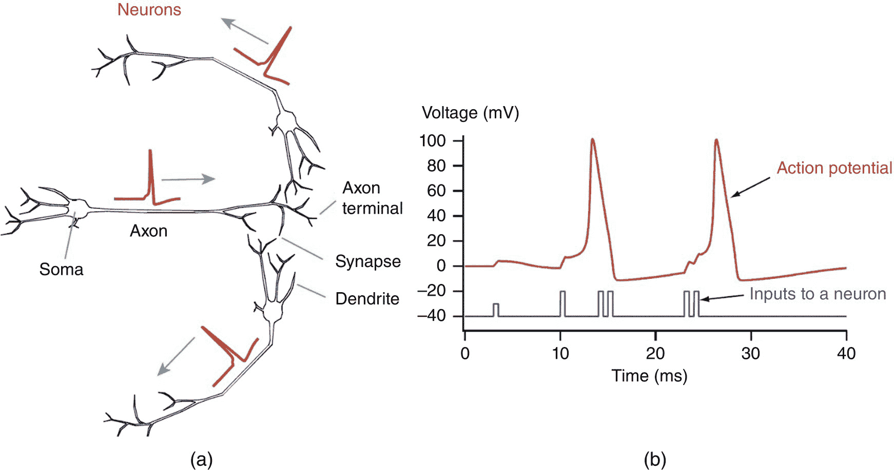

**图 3.1** (a) 一个由三个神经元组成的网络，它们交换电信号，即动作电位。(b) 包括神经元输入在内的动作电位波形。

### 3.2.1 积分-发放模型

文献 [\[1\]](#c03.xhtml#c3-bib-0001) 中描述了两个具有相互兴奋性或抑制性耦合的积分-发放神经元，用于耦合两个神经元。具有激活变量 `x[i]`（`i` = 1, 2）的神经元满足：

(3.1)
```
d(x[i])/dt = ξ − x[i] + Ei
```
其中 `ξ` > 1 为常数，0 < `x[i]` < 1，且 `E[i]`(`t`) 为神经元 `i` 的突触输入。当 `x[i]` = 1 时神经元 `i` 发放，随后将 `x[i]` 重置为 0。若细胞 `j` ≠ `i` 在时间 `t[j]` 发放，函数 `E[i]` 将增强为 `E[i]`(`t`) + `E[s]`(`t` - `t[j]`)，其中 `E[s]` 为来自单个脉冲的贡献 [\[1\]](#c03.xhtml#c3-bib-0001)。在文献 [\[1\]](#c03.xhtml#c3-bib-0001) 的一个示例中，该函数选为：

(3.2)
```
Es = g α² t e^(−αt)
```


其中 `g` 和 `α` 是分别决定突触强度和速度的参数，而公式 (3.2) 中 `α`² 的因子使 `E[s]` 随时间的积分归一化为值 `g`。在考虑的情况下，当两个神经元耦合在一起时，它们继续周期性地放电。假设神经元 1 在时间 `t = nT` 放电，其中 `T` 是周期，`n` 是整数，而神经元 2 在 `t = (n − φ)T` 放电。因此，两个神经元以相同的频率放电，但相位相差 `φ`。我们希望确定相位差 `φ` 可能的值以及它们出现的条件。

### 3.2.2 相位耦合模型

利用脑成像数据测量的神经同步过程，可以用弱耦合振荡器（WCO）模型来描述。动态因果建模（DCM）用于将 WCO 拟合到脑成像数据，从而推断神经元相互作用的结构 [[2]](#c03.xhtml#c3-bib-0002)。复杂行为是由特定脑区的相互作用介导的。最近的研究一致认为，这种相互作用可能是由振荡神经元集合的瞬态同步实例化的 [[3]](#c03.xhtml#c3-bib-0003)。例如，轮廓检测伴随着视觉皮层远端部分的伽马频带同步，多模态物体处理伴随着顶颞区的贝塔频带同步 [[4]](#c03.xhtml#c3-bib-0004)，空间记忆过程伴随着海马-前额叶的西塔频带同步 [2, 5]。DCM 允许使用贝叶斯模型选择来比较不同的模型结构 [[6]](#c03.xhtml#c3-bib-0006)。在 [[2]](#c03.xhtml#c3-bib-0002) 中，DCM 已被扩展用于相位耦合的研究。其中一个方向基于 WCO 模型，在该模型中，一个振荡器的相位变化率与其自身与其他振荡器之间的相位差有关 [[7]](#c03.xhtml#c3-bib-0007)。

WCO 理论适用于接近极限环的系统动力学。通过假设弱耦合仅导致偏离这些环的微小扰动，可以将高维微分方程组简化为仅基于振荡器相位及其成对相互作用的系统 [[2]](#c03.xhtml#c3-bib-0002)。

极限环上的动力学由 [[2]](#c03.xhtml#c3-bib-0002) 给出：

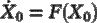<math xmlns="http://www.w3.org/1998/Math/MathML" display="block" overflow="scroll"><mspace width="3em"/><msub><mover accent="true"><mi>X</mi><mo>&#38;c.dotab;</mo></mover><mn>0</mn></msub><mo>=</mo><mi>F</mi><mfenced open="(" close=")"><msub><mi>X</mi><mn>0</mn></msub></mfenced></math> <math xmlns="http://www.w3.org/1998/Math/MathML" display="block" overflow="scroll"><msub><mi>X</mi><mn>0</mn></msub><mfenced open="(" close=")"><mrow><mi>t</mi><mo>+</mo><mi>T</mi></mrow></mfenced><mo>=</mo><msub><mi>X</mi><mn>0</mn></msub><mfenced open="(" close=")"><mi>t</mi></mfenced></math> 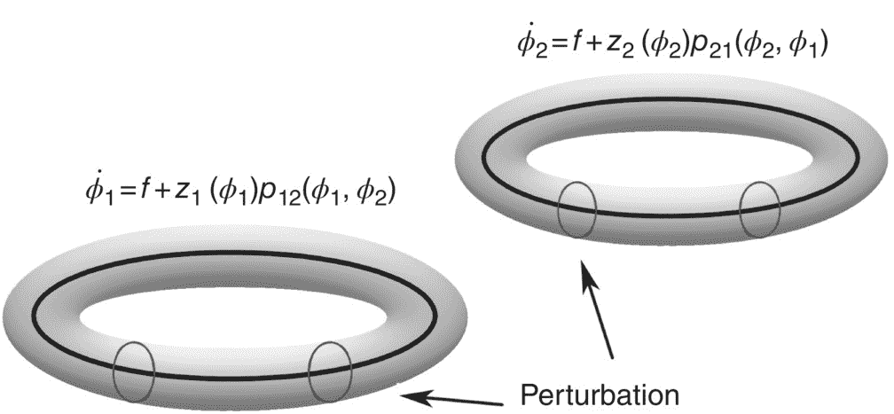

**图 3.2** 一对通过扰动函数 `p(φ[1], φ[2])` 弱耦合的振荡器。

(3.3)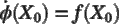<math xmlns="http://www.w3.org/1998/Math/MathML" display="block" overflow="scroll"><mover accent="true"><mi>&#981;</mi><mo>&#38;c.dotab;</mo></mover><mfenced open="(" close=")"><msub><mi>X</mi><mn>0</mn></msub></mfenced><mo>=</mo><mi>f</mi><mfenced open="(" close=")"><msub><mi>X</mi><mn>0</mn></msub></mfenced></math>

那么，对于任意相位扰动 `p(ϕ)`，这变为 [[2]](#c03.xhtml#c3-bib-0002)：

(3.4)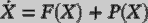<math xmlns="http://www.w3.org/1998/Math/MathML" display="block" overflow="scroll"><mover accent="true"><mi>X</mi><mo>&#38;c.dotab;</mo></mover><mo>=</mo><mi>F</mi><mfenced open="(" close=")"><mi>X</mi></mfenced><mo>+</mo><mi>P</mi><mfenced open="(" close=")"><mi>X</mi></mfenced></math> (3.5)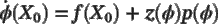<math xmlns="http://www.w3.org/1998/Math/MathML" display="block" overflow="scroll"><mover accent="true"><mi>&#981;</mi><mo>&#38;c.dotab;</mo></mover><mfenced open="(" close=")"><msub><mi>X</mi><mn>0</mn></msub></mfenced><mo>=</mo><mi>f</mi><mfenced open="(" close=")"><msub><mi>X</mi><mn>0</mn></msub></mfenced><mo>+</mo><mi>z</mi><mfenced open="(" close=")"><mi>&#981;</mi></mfenced><mi>p</mi><mfenced open="(" close=")"><mi>&#981;</mi></mfenced></math>

其中：

(3.6)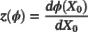<math xmlns="http://www.w3.org/1998/Math/MathML" display="block" overflow="scroll"><mi>z</mi><mfenced open="(" close=")"><mi>&#981;</mi></mfenced><mo>=</mo><mfrac><mrow><mi mathvariant="italic">d&#981;</mi><mfenced open="(" close=")"><msub><mi>X</mi><mn>0</mn></msub></mfenced></mrow><mrow><mi>d</mi><msub><mi>X</mi><mn>0</mn></msub></mrow></mfrac></math>

对于相位分别为 `φ[1]` 和 `φ[2]` 的一对振荡器，使用相同的分析（见 **图 3.2**，假设 `p[12] = p[21]`）：

(3.7)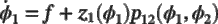<math xmlns="http://www.w3.org/1998/Math/MathML" display="block" overflow="scroll"><msub><mover accent="true"><mi>&#981;</mi><mo>&#38;c.dotab;</mo></mover><mn>1</mn></msub><mo>=</mo><mi>f</mi><mo>+</mo><msub><mi>z</mi><mn>1</mn></msub><mfenced open="(" close=")"><msub><mi>&#981;</mi><mn>1</mn></msub></mfenced><msub><mi>p</mi><mn>12</mn></msub><mfenced open="(" close=")"><mrow><msub><mi>&#981;</mi><mn>1</mn></msub><mo>,</mo><msub><mi>&#981;</mi><mn>2</mn></msub></mrow></mfenced></math> (3.8)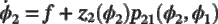<math xmlns="http://www.w3.org/1998/Math/MathML" display="block" overflow="scroll"><msub><mover accent="true"><mi>&#981;</mi><mo>&#38;c.dotab;</mo></mover><mn>2</mn></msub><mo>=</mo><mi>f</mi><mo>+</mo><msub><mi>z</mi><mn>2</mn></msub><mfenced open="(" close=")"><msub><mi>&#981;</mi><mn>2</mn></msub></mfenced><msub><mi>p</mi><mn>21</mn></msub><mfenced open="(" close=")"><mrow><msub><mi>&#981;</mi><mn>2</mn></msub><mo>,</mo><msub><mi>&#981;</mi><mn>1</mn></msub></mrow></mfenced></math>

如果进一步假设相位差 `φ[2] − φ[1] = φ` 变化缓慢，则 [[2]](#c03.xhtml#c3-bib-0002)：

(3.9)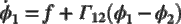<math xmlns="http://www.w3.org/1998/Math/MathML" display="block" overflow="scroll"><msub><mover accent="true"><mi>&#981;</mi><mo>&#38;c.dotab;</mo></mover><mn>1</mn></msub><mo>=</mo><mi>f</mi><mo>+</mo><msub><mi>&#915;</mi><mn>12</mn></msub><mfenced open="(" close=")"><mrow><msub><mi>&#981;</mi><mn>1</mn></msub><mo>&#8722;</mo><msub><mi>&#981;</mi><mn>2</mn></msub></mrow></mfenced></math> (3.10)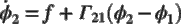<math xmlns="http://www.w3.org/1998/Math/MathML" display="block" overflow="scroll"><msub><mover accent="true"><mi>&#981;</mi><mo>&#38;c.dotab;</mo></mover><mn>2</mn></msub><mo>=</mo><mi>f</mi><mo>+</mo><msub><mi>&#915;</mi><mn>21</mn></msub><mfenced open="(" close=")"><mrow><msub><mi>&#981;</mi><mn>2</mn></msub><mo>&#8722;</mo><msub><mi>&#981;</mi><mn>1</mn></msub></mrow></mfenced></math> (3.11)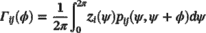<math xmlns="http://www.w3.org/1998/Math/MathML" display="block" overflow="scroll"><msub><mi>&#915;</mi><mi mathvariant="italic">ij</mi></msub><mfenced open="(" close=")"><mi>&#981;</mi></mfenced><mo>=</mo><mfrac><mn>1</mn><mrow><mn>2</mn><mi>&#960;</mi></mrow></mfrac><msubsup><mo>&#8747;</mo><mn>0</mn><mrow><mn>2</mn><mi>&#960;</mi></mrow></msubsup><msub><mi>z</mi><mi>i</mi></msub><mfenced open="(" close=")"><mi>&#968;</mi></mfenced><msub><mi>p</mi><mi mathvariant="italic">ij</mi></msub><mfenced open="(" close=")"><mrow><mi>&#968;</mi><mo>,</mo><mi>&#968;</mi><mo>+</mo><mi>&#981;</mi></mrow></mfenced><mi mathvariant="italic">d&#968;</mi></math>


*Γ*[*ij*] (*ϕ*) 称为相位相互作用函数 (PIF)。类似地，对于 *N*[*R*] 个区域，第 *i* 个振荡器的相位变化率由下式给出：

(3.12)
```
dϕ_i/dt = f_i + Σ_{j=1}^{N_R} Γ_ij(ϕ_i - ϕ_j - d_ij)
```
其中 *f*[*i*] 是第 *i* 个振荡器的固有频率。在这些公式中有两个关键假设：第一个假设是扰动足够小，以至于微分可以等效地在 *X* [0] 处计算，而不是在 *X* 处。第二个假设是振荡器相位的相对变化相对于振荡频率足够缓慢，因此相位偏移项可以用时间平均值代替。

在 [\[2\]](#c03.xhtml#c3-bib-0002) 中，上述 WCO 模型的一个扩展被用于描述振荡器网络中的动态相位变化。贝叶斯模型比较的使用允许推断大脑同步过程的潜在机制。这已被应用于来自生理模型的合成双手手指运动数据以及视觉工作记忆研究的脑磁图 (MEG) 数据。WCO 方法通过使用描述相位变化如何由瞬时相位的成对差异驱动的微分方程，适应了信号的非平稳性。

### 3.2.3 霍奇金-赫胥黎模型

最早的物理模型很可能是基于霍奇金和赫胥黎于 1952 年发表的、获得诺贝尔奖的乌贼巨轴突数学模型 \[8–10\]。霍奇金和赫胥黎方程之所以重要，不仅因为它们代表了在定量描述相关生物学现象方面最成功的数学模型，还因为推导乌贼模型可直接适用于多种神经元和其他可兴奋细胞。根据该模型，神经轴突可能受到刺激，并在细胞膜附近产生激活的钠 (Na^+) 和钾 (K^+) 通道，从而导致神经轴突的电兴奋。兴奋源于膜电位对离子运动的影响，以及膜电位与电压门控膜通道开闭之间的相互作用。当膜极化、内表面排列净负电荷、外表面排列大小相等但符号相反的净正电荷时，膜电位会增加。该电位可通过以下公式简单地与电荷量 *Q* 联系起来：

(3.13)
```
E = Q / C_m
```
其中 *Q* 以库仑/平方厘米 (Coulombs cm^(−2)) 为单位，*C*[*m*] 是膜电容的度量，单位为法拉/平方厘米 (farads cm^(−2))，E 的单位为伏特。在实践中，为了对动作电位 (APs) 进行建模，细胞膜内表面的电荷量 *Q*^(*+*)（以及外表面的 *Q*^(*−*)）必须在数学上与流经刺激电极进入细胞的刺激电流 *I* [stim] 相关联。图 3.1b 说明了神经元兴奋如何通过充当信号转换器而导致动作电位的产生 [\[11\]](#c03.xhtml#c3-bib-0011)。

然后使用 公式 (3.13) 计算电位（通常称为电场力）*E*。霍奇金和赫胥黎模型如 图 3.3 所示。在该图中，*I*[*memb*] 是正电荷流出细胞的结果。该电流主要由三种电流组成，即钠电流、钾电流和漏电流。漏电流是由于内外侧的钠离子和钾离子并不完全相等所致。

霍奇金和赫胥黎估算钠和钾电流的激活和失活函数，并推导出一个数学模型来描述类似于巨型乌贼的动作电位。该模型是一个使用电压门控通道的神经元模型。霍奇金-赫胥黎模型的空间钳制版本可以用四个常微分方程很好地描述 [\[12\]](#c03.xhtml#c3-bib-0012)。该模型描述膜电位 (*E*) 随时间的变化，详见 [\[13\]](#c03.xhtml#c3-bib-0013)。总膜电流是容性电流和离子电流之和，即：

(3.14)
```
I_memb = C_m * dE/dt + I_i
```
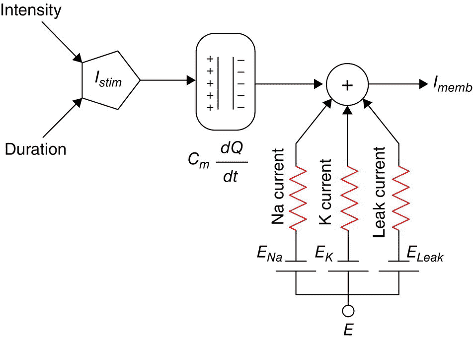

**图 3.3** 霍奇金-赫胥黎兴奋模型。

其中 *I*[*i*] 是离子电流，如 图 3.1 所示，可视为三个单独分量之和：钠电流、钾电流和漏电流：

(3.15)
```
I_i = I_Na + I_K + I_leak
```

*I*[*Na*] 可通过最大电导 `ḡ_Na`、激活变量 *a*[*Na*]，失活变量 *h*[*Na*]，以及驱动力 (*E – E*[*Na*]) 联系起来：

(3.16)
```
I_Na = ḡ_Na * a_Na³ * h_Na * (E - E_Na)
```

类似地，*I*[*K*] 可通过最大电导 `ḡ_K`、激活变量 *a*[*K*]，以及驱动力 (*E – E*[*K*]) 联系起来：

(3.17)
```
I_K = ḡ_K * a_K * (E - E_K)
```


和 `I`[`leak`] 与最大电导 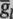<math xmlns="http://www.w3.org/1998/Math/MathML" display="inline" overflow="scroll"><msub><mover accent="true"><mi>g</mi><mo stretchy="true">&#175;</mo></mover><mi>l</mi></msub></math> 以及驱动力 (`E – E`[`l`] ) 有关，公式如下：

(3.18)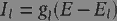<math xmlns="http://www.w3.org/1998/Math/MathML" display="block" overflow="scroll"><msub><mi>I</mi><mi>l</mi></msub><mo>=</mo><msub><mover accent="true"><mi>g</mi><mo>&#38;c.macr;</mo></mover><mi>l</mi></msub><mfenced open="(" close=")"><mrow><mi>E</mi><mo>&#8722;</mo><msub><mi>E</mi><mi>l</mi></msub></mrow></mfenced></math>

变量 `a`[`Na`] `, a`[`k`] `, and h`[`Na`] 的变化范围从 0 到 1，遵循以下方程：

(3.19)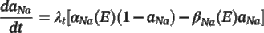<math xmlns="http://www.w3.org/1998/Math/MathML" display="block" overflow="scroll"><mfrac><mrow><mi>d</mi><msub><mi>a</mi><mi mathvariant="italic">Na</mi></msub></mrow><mi mathvariant="italic">dt</mi></mfrac><mo>=</mo><msub><mi>&#955;</mi><mi>t</mi></msub><mfenced open="\[" close="\]"><mrow><msub><mi>&#945;</mi><mi mathvariant="italic">Na</mi></msub><mfenced open="(" close=")"><mi>E</mi></mfenced><mfenced open="(" close=")"><mrow><mn>1</mn><mo>&#8722;</mo><msub><mi>a</mi><mi mathvariant="italic">Na</mi></msub></mrow></mfenced><mo>&#8722;</mo><msub><mi>&#946;</mi><mi mathvariant="italic">Na</mi></msub><mfenced open="(" close=")"><mi>E</mi></mfenced><msub><mi>a</mi><mi mathvariant="italic">Na</mi></msub></mrow></mfenced></math> (3.20)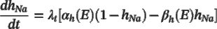<math xmlns="http://www.w3.org/1998/Math/MathML" display="block" overflow="scroll"><mfrac><mrow><mi>d</mi><msub><mi>h</mi><mi mathvariant="italic">Na</mi></msub></mrow><mi mathvariant="italic">dt</mi></mfrac><mo>=</mo><msub><mi>&#955;</mi><mi>t</mi></msub><mfenced open="\[" close="\]"><mrow><msub><mi>&#945;</mi><mi>h</mi></msub><mfenced open="(" close=")"><mi>E</mi></mfenced><mfenced open="(" close=")"><mrow><mn>1</mn><mo>&#8722;</mo><msub><mi>h</mi><mi mathvariant="italic">Na</mi></msub></mrow></mfenced><mo>&#8722;</mo><msub><mi>&#946;</mi><mi>h</mi></msub><mfenced open="(" close=")"><mi>E</mi></mfenced><msub><mi>h</mi><mi mathvariant="italic">Na</mi></msub></mrow></mfenced></math> (3.21)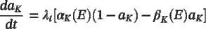<math xmlns="http://www.w3.org/1998/Math/MathML" display="block" overflow="scroll"><mfrac><mrow><mi>d</mi><msub><mi>a</mi><mi>K</mi></msub></mrow><mi mathvariant="italic">dt</mi></mfrac><mo>=</mo><msub><mi>&#955;</mi><mi>t</mi></msub><mfenced open="\[" close="\]"><mrow><msub><mi>&#945;</mi><mi>K</mi></msub><mfenced open="(" close=")"><mi>E</mi></mfenced><mfenced open="(" close=")"><mrow><mn>1</mn><mo>&#8722;</mo><msub><mi>a</mi><mi>K</mi></msub></mrow></mfenced><mo>&#8722;</mo><msub><mi>&#946;</mi><mi>K</mi></msub><mfenced open="(" close=")"><mi>E</mi></mfenced><msub><mi>a</mi><mi>K</mi></msub></mrow></mfenced></math>

其中 `α`(`E`) 和 `β`(`E`) 分别是正向和反向速率函数，`λ`[`t`] 是一个与温度相关的因子。正向和反向参数取决于电压，由 Hodgkin 和 Huxley 根据经验估算得出，如下所示：

(3.22)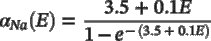<math xmlns="http://www.w3.org/1998/Math/MathML" display="block" overflow="scroll"><msub><mi>&#945;</mi><mi mathvariant="italic">Na</mi></msub><mfenced open="(" close=")"><mi>E</mi></mfenced><mo>=</mo><mfrac><mrow><mn>3.5</mn><mo>+</mo><mn>0.1</mn><mi>E</mi></mrow><mrow><mn>1</mn><mo>&#8722;</mo><msup><mi>e</mi><mrow><mo form="prefix">&#8722;</mo><mfenced open="(" close=")"><mrow><mn>3.5</mn><mo>+</mo><mn>0.1</mn><mi>E</mi></mrow></mfenced></mrow></msup></mrow></mfrac></math> (3.23)<math xmlns="http://www.w3.org/1998/Math/MathML" display="block" overflow="scroll"><msub><mi>&#946;</mi><mi mathvariant="italic">Na</mi></msub><mfenced open="(" close=")"><mi>E</mi></mfenced><mo>=</mo><mn>4</mn><msup><mi>e</mi><mrow><mo form="prefix">&#8722;</mo><mfenced open="(" close=")"><mrow><mi>E</mi><mo>+</mo><mn>60</mn></mrow></mfenced><mo>/</mo><mn>18</mn></mrow></msup></math> (3.24)<math xmlns="http://www.w3.org/1998/Math/MathML" display="block" overflow="scroll"><msub><mi>&#945;</mi><mi>h</mi></msub><mfenced open="(" close=")"><mi>E</mi></mfenced><mo>=</mo><mn>0.07</mn><msup><mi>e</mi><mrow><mo form="prefix">&#8722;</mo><mfenced open="(" close=")"><mrow><mi>E</mi><mo>+</mo><mn>60</mn></mrow></mfenced><mo>/</mo><mn>20</mn></mrow></msup></math> (3.25)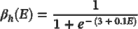<math xmlns="http://www.w3.org/1998/Math/MathML" display="block" overflow="scroll"><msub><mi>&#946;</mi><mi>h</mi></msub><mfenced open="(" close=")"><mi>E</mi></mfenced><mo>=</mo><mfrac><mn>1</mn><mrow><mn>1</mn><mo>+</mo><msup><mi>e</mi><mrow><mo form="prefix">&#8722;</mo><mfenced open="(" close=")"><mrow><mn>3</mn><mo>+</mo><mn>0.1</mn><mi>E</mi></mrow></mfenced></mrow></msup></mrow></mfrac></math> (3.26)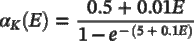<math xmlns="http://www.w3.org/1998/Math/MathML" display="block" overflow="scroll"><msub><mi>&#945;</mi><mi>K</mi></msub><mfenced open="(" close=")"><mi>E</mi></mfenced><mo>=</mo><mfrac><mrow><mn>0.5</mn><mo>+</mo><mn>0.01</mn><mi>E</mi></mrow><mrow><mn>1</mn><mo>&#8722;</mo><msup><mi>e</mi><mrow><mo form="prefix">&#8722;</mo><mfenced open="(" close=")"><mrow><mn>5</mn><mo>+</mo><mn>0.1</mn><mi>E</mi></mrow></mfenced></mrow></msup></mrow></mfrac></math> (3.27)<math xmlns="http://www.w3.org/1998/Math/MathML" display="block" overflow="scroll"><msub><mi>&#946;</mi><mi>K</mi></msub><mfenced open="(" close=")"><mi>E</mi></mfenced><mo>=</mo><mn>0.125</mn><msup><mi>e</mi><mrow><mo form="prefix">&#8722;</mo><mfenced open="(" close=")"><mrow><mi>E</mi><mo>+</mo><mn>60</mn></mrow></mfenced><mo>/</mo><mn>80</mn></mrow></msup></math>

正如神经网络与动作电位模拟器（SNNAP）文献 [\[12\]](#c03.xhtml#c3-bib-0012) 所述，`α`(`E`) 和 `β`(`E`) 参数已从原始的 Hodgkin–Huxley 版本转换而来，以符合当前的生理学惯例，即膜去极化被视为正值。此外，静息电位已偏移至 –60 mV（原版为 0 mV）。这些方程用于 SNNAP 中描述的模型。在图 3.4 中模拟了一个动作电位。对于该模型，参数设置为 `C`[`m`] = 1.1 μF cm^(−2)， <math xmlns="http://www.w3.org/1998/Math/MathML" display="inline" overflow="scroll"><msub><mover accent="true"><mi>g</mi><mo stretchy="true">&#175;</mo></mover><mi mathvariant="italic">Na</mi></msub></math> = 100 ms cm^(−2)， <math xmlns="http://www.w3.org/1998/Math/MathML" display="inline" overflow="scroll"><msub><mover accent="true"><mi>g</mi><mo stretchy="true">&#175;</mo></mover><mi>K</mi></msub></math> = 35 mS cm^(−2)， <math xmlns="http://www.w3.org/1998/Math/MathML" display="inline" overflow="scroll"><msub><mover accent="true"><mi>g</mi><mo stretchy="true">&#175;</mo></mover><mi>l</mi></msub></math> = 0.35 mS cm^(−2)，和 `E`[`Na`] *\=* 60 mV。


仿真可以运行以生成一系列动作电位（AP），这在实践中发生于事件相关电位（ERP）信号的情况。如果钾电流的最大离子电导 $\bar{g}_K$ 降低，模型将显示更高的静息电位。此外，当 $\bar{g}_K$ = 16 mS cm^(−2) 时，模型将开始表现出振荡行为。图 3.5 展示了最大钾电导降低的 Hodgkin-Huxley 振荡模型的结果。

SNNAP 还可以对爆发式神经元和中央模式发生器进行建模。这源于这样一个事实：许多神经元表现出周期性的尖峰活动，随后跟随一段不活动期。几种无脊椎动物以及哺乳动物的神经元都是爆发式细胞，并表现出高频尖峰行为期与无尖峰活动期交替出现的现象。

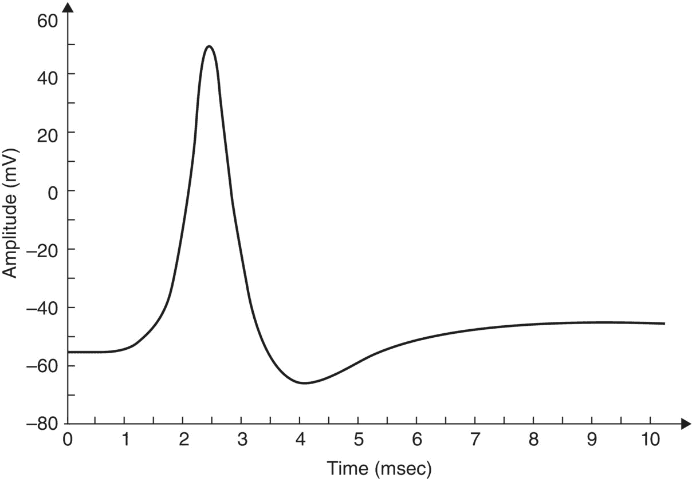

**图 3.4** 基于 Hodgkin-Huxley 模型的瞬态刺激响应下的单个动作电位。起始时间为 t = 0.4 ms，注入电流为 80 μA cm^(−2)，持续时间为 0.1 ms。选定参数为 *C* [m] = 1.2 μF cm^(−2)，$\bar{g}_{Na}$ = 100 mS cm^(−2)，$\bar{g}_K$ = 35 mS cm^(−2)，$\bar{g}_l$ = 0.35 mS cm^(−2)，和 *E*[*Na*] *=* 60 mV。

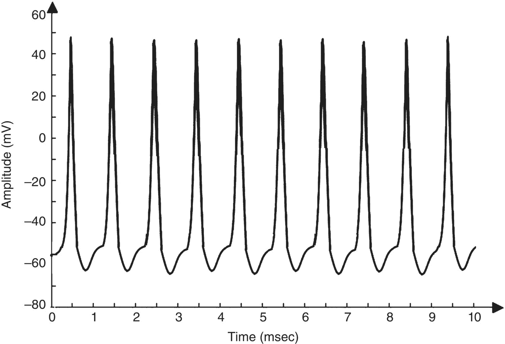

**图 3.5** 最大钾电导降低的 Hodgkin-Huxley 振荡模型产生的动作电位。

### 3.2.4 Morris-Lecar 模型

比 Hodgkin-Huxley 模型更简单的用于模拟尖峰神经元的模型是 Morris-Lecar 模型 [\[14\]](#c03.xhtml#c3-bib-0014)。该模型是一个最小生物物理模型，通常表现出单个动作电位。该模型认为，去极化膜的缓慢钙波振荡导致爆发状态。Morris-Lecar 模型最初是为描述藤壶肌肉细胞的行为而开发的。将膜电位 (*E*) 和钾激活 *w*[*k*] 与激活参数相关联的控制方程如下：

(3.28)
```
C dE/dt = I_i − \bar{g}_{ca} a_{Ca} (E) (E − E_{Ca}) − \bar{g}_k w_k (E − E_k) − \bar{g}_l (E − E_l)
```
(3.29)
```
d w_k / dt = \lambda_t ( w_∞(E) − w_k ) / \tau_k(E)
```

其中 *I*[*i*] 是三种离子电流（钙 Ca、钾 K 和漏电流 *l*）的组合，类似于 Hodgkin-Huxley 模型，它们是最大电导 $\bar{g}$、激活成分（如 *a*[*Ca*] 、*w*[*k*]）和驱动力 *E* 的乘积。钾激活变量 *w*[*k*] 的变化与稳态激活函数 *w* ∞（一条 S 形曲线）和时间常数函数 *τ*[*k*] (*E*)（一条钟形曲线）成正比。这些函数分别定义为：

(3.30)
```
w_∞(E) = 1 / ( 1 + e^(−(E − h_w) / S_w) )
```
(3.31)
```
\tau_k(E) = 1 / ( e^((E − h_w) / 2 S_w) + e^(−(E − h_w) / 2 S_w) )
```

参与钙电流计算的稳态激活函数 *a*[*ca*] (*E*) 定义为：

(3.32)
```
a_{ca}(E) = 1 / ( 1 + e^(−(E − h_{Ca}) / s_m) )
```


与 Hodgkin-Huxley 模型中的钠电流类似，钙电流也是一种内向电流。由于钙激活电流相对于钾电流而言是一个快速过程，因此将其建模为瞬时函数。这意味着对于每个电压 `E`，都要计算稳态函数 `aCa`。钙电流不包含任何失活过程。此处的激活变量 `w[k]` 类似于 Hodgkin-Huxley 模型中的 `a[k]`，最后，两个模型的漏电流是相同的 [[12]](#c03.xhtml#c3-bib-0012)。图 3.6 展示了 Morris-Lecar 模型的仿真。

钙依赖性钾通道由细胞内钙激活；钙浓度越高，通道激活程度越高 [[12]](#c03.xhtml#c3-bib-0012)。为了使 Morris-Lecar 模型表现出爆发行为，必须改变最大时间常数和输入电流这两个参数 [[12]](#c03.xhtml#c3-bib-0012)。图 3.7 展示了 Morris-Lecar 模型的爆发行为。爆发神经元的基本特征包括尖峰活动的持续时间、爆发期间动作电位（AP）的频率以及静息期的持续时间。一次完整爆发事件的周期是活跃期持续时间与静息期持续时间之和 [[12]](#c03.xhtml#c3-bib-0012)。

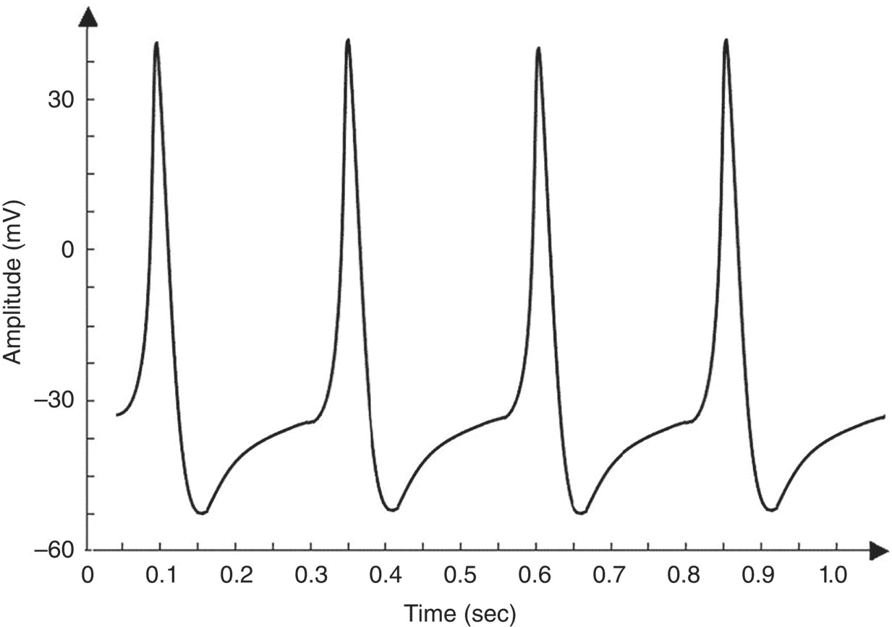

**图 3.6** Morris-Lecar 模型中的动作电位仿真。模型参数为：`C[m]` = 22 μF cm^(−2)，`ḡ[Ca]` = 3.8 mS cm^(−2)，`ḡ[k]` = 8.0 mS cm^(−2)，`ḡ[l]` = 1.6 mS cm^(−2)，`E[Ca]` = 125 mV，`E[k]` = −80 mV，`E[l]` = −60 mV，`λ[t]` = 0.06，`h[Ca]` = −1.2，`S[m]` = 8.8。

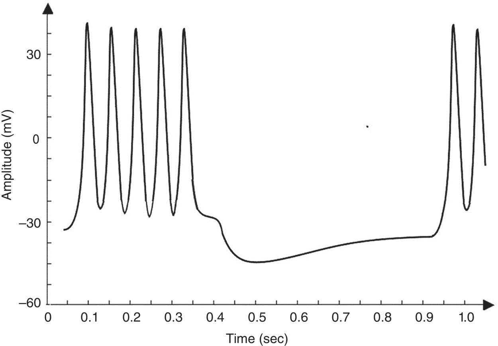

**图 3.7** Morris-Lecar 模型可产生的爆发行为示意图。

神经元通过轴突-树突或树突-树突连接跨越突触进行相互通信，这些连接可以是兴奋性的、抑制性的或电性的 [[12]](#c03.xhtml#c3-bib-0012)。通过组合上述多个模型，可以构建一个神经网络。由于神经元之间的突触连接，该网络表现出振荡行为。通常认为，兴奋性突触耦合倾向于使神经元放电同步化，而抑制性耦合则推动神经元走向反同步。这种行为已在神经回路模型中被观察到 [[1]](#c03.xhtml#c3-bib-0001)。

一旦神经元发放动作电位，就会产生突触电流。该电流刺激相连的神经元，可用一个 Alpha 函数乘以最大电导和驱动力来建模，公式如下：

(3.33)
```
I[syn] = ḡ[syn] · gsyn · (E(t) − E[syn])
```

其中：

(3.34)
```
gsyn = t · e^(−t/u)
```

`t` 为潜伏期或自突触电流触发以来的时间，`u` 为达到峰值振幅所需的时间，`E[syn]` 为突触反转电位，`ḡ[syn]` 为最大突触电导。参数 `u` 改变电流的持续时间，而 `ḡ[syn]` 改变电流的强度。这结束了对动作电位建模的论述。

由于 EEG 信号源的性质无法直接从电极信号中确定，许多研究人员尝试利用信号处理技术提取的信息来对这些过程进行建模。本章后面章节描述的线性预测（LP）方法常用于提取参数描述。

David Beeman 关于使用 Hodgkin-Huxley 兴奋模型进行真实神经建模的教程，已记录在 2005 年于美国德克萨斯州举行的首届世界建模者协会（WAM）生物学精确建模会议（BAMM）上。可在 [`www.brains‐minds‐media.org/archive/218`](http://www.brains-minds-media.org/archive/218) 查看。

## 3.3 基于神经元活动建模生成 EEG 信号

本节旨在介绍一些用于生成正常和某些异常 EEG 的成熟模型。这些模型通常是非线性的，其中一些被提出 [[15]](#c03.xhtml#c3-bib-0015) 用于建模正常 EEG 信号，另一些则用于建模异常 EEG。

一种简单的分布式模型由一组模拟神经元、丘脑皮层传递细胞和中间神经元组成，该模型 [16, 17] 融合了当时有限的生理学和组织学数据。其基本假设足以解释 α 节律的产生，即频率范围在 8–13 Hz 内的 EEG。

一个通用的非线性集总模型可采用 图 3.8 所示的形式。尽管该模型本质上是模拟的，但所有模块均以离散形式实现。该模型能够考虑分布式模型的主要特征，且便于研究改变丘脑皮层传递细胞和中间神经元的兴奋性和抑制性影响范围所产生的结果。

![Figure 3.8 A nonlinear lumped model for generating the rhythmic activity of the EEG signals; he (t) and hi (t) are the excitatory and inhibitory post synaptic potentials, f(v) is normally a simplified nonlinear function, and the Ci s are respectively the interaction parameters representing the interneurons and thalamocortical neurons [16].](images/c03f008.gif)


### 图 3.8

**图 3.8** 用于生成 EEG 信号节律性活动的非线性集总参数模型；`he` 和 `hi` 分别为兴奋性和抑制性突触后电位，`f(v)` 通常为简化的非线性函数，而 `C[i]` 分别代表代表中间神经元和丘脑皮层神经元的交互参数 [[16]](#c03.xhtml#c3-bib-0016)。

在该模型 [[16]](#c03.xhtml#c3-bib-0016) 中，存在一个包含抑制性突触后电位、非线性函数以及交互参数 `C[3]` 和 `C[4]` 的反馈回路。另一个反馈回路主要包含兴奋性电位、非线性函数以及交互参数 `C[1]` 和 `C[2]`。兴奋性神经元的作用是兴奋一个或两个抑制性神经元。后者反过来用于抑制一群兴奋性神经元。因此，神经回路形成了一个反馈系统。输入 `p(t)` 被视为白噪声信号。这是一个通用模型；通常需要更多假设才能生成异常情况下的 EEG。因此，函数 `f(v)` 可能会改变以生成不同脑部异常的 EEG 信号。相应地，`C[i]` 系数可以变化。此外，输出还受环境噪声和测量噪声影响。在某些模型中，例如局部 EEG 模型 (LEM) [[16]](#c03.xhtml#c3-bib-0016)，噪声被视为输出中的一个加性分量。

### 图 3.9

图 3.9 展示了 LEM 模型。该模型采用了 Wilson 和 Cowan [[18]](#c03.xhtml#c3-bib-0018) 的公式化方法，他们提供了一组方程来描述大量相互连接的兴奋性和抑制性神经元群体的整体活动（而非专门指 EEG）[[19]](#c03.xhtml#c3-bib-0019)。同样，在 LEM 中，假设 EEG 节律是由具有频率选择特性的不同神经元群体产生的。这些群体由单个神经元的相互连接形成，并假设由随机输入驱动。模型特征，如神经互连性、突触脉冲响应和兴奋阈值，均由 LEM 参数表示。这些参数的变化会产生相应的 EEG 节律。

假设输入 `p(t)` 来源于一系列随机分布的随机电位的求和，这些电位驱动回路中的兴奋性细胞，产生持续的背景 EEG 信号。此类信号源自丘脑和脑干内更深层的大脑源，构成中枢神经系统 (CNS) 持续或自发放电的一部分。在模型中，来自兴奋性神经元的抑制性神经元平均输入数量用 `C[e]` 表示，而从抑制性神经元到每个单独兴奋性神经元的相应平均数量为 `C[i]`。两个衰减指数的差值用于模拟每个突触后电位 `h[e]` 或 `h[i]`：

![Figure 3.9 The local EEG model (LEM). The thalamocortical relay neurons are represented by two linear systems having impulse responses he (t), on the upper branch, and the inhibitory post‐synaptic potential by hi (t). The nonlinearity of this system is denoted by fe (v) representing the spike generating process. The interneuron activity is represented by another linear filter he (t) in the lower branch, which generally can be different from the first linear system, and a nonlinearity function fi (v). Ce and Ci represent respectively, the number of interneuron cells and the thalamocortical neurons.](img/c03f009.gif)

**图 3.9** 局部 EEG 模型 (LEM)。丘脑皮层投射神经元由两个线性系统表示，其冲激响应分别为上支路的 `he` 和抑制性突触后电位 `hi`。该系统的非线性用 `fe` 表示，代表脉冲生成过程。中间神经元活动由下支路的另一个线性滤波器 `he` 表示，该滤波器通常可与第一个线性系统不同，还有一个非线性函数 `fi`。`C[e]` 和 `C[i]` 分别代表中间神经元细胞数量和丘脑皮层神经元数量。

### 方程 (3.35) 和 (3.36)

```
(3.35) h_e(t) = A [ exp(-a_1 t) - exp(-a_2 t) ]
(3.36) h_i(t) = B [ exp(-b_1 t) - exp(-b_2 t) ]
```

其中 `A, B`、`a[k]` 和 `b[k]` 为控制脉冲波形形状的常数参数。膜电位通过静态阈值函数 `f[e]` 和 `f[i]` 与轴突脉冲密度相关联。这些函数通常是非线性的；然而，为便于操作，在每个短时间区间内它们被视为线性的。使用该模型，正常脑节律（如 α 波）被视为滤波后的噪声。

### Jansen 和 Rit 模型

一个更简化的模型是 Jansen 和 Rit [[20]](#c03.xhtml#c3-bib-0020) 提出的模型。该模型如 图 3.10 所示。该模型是一个受神经生理学启发的模型，用于模拟大脑电活动（包括 EEG 或诱发电位 (EPs)）。先前开发的单个皮层柱集总参数模型 [[16]](#c03.xhtml#c3-bib-0016) 已在他们的工作中实现。该模型能产生多种类 EEG 波形和节律。耦合两个模型，并在互连中引入延迟以模拟皮层区域内部及之间的突触连接，从而能够复现 α 和 β 活动的空间分布。

通过向耦合模型的输入端施加脉冲来模拟 EPs。总体而言，其响应比使用单一模型产生的更为真实。所提出的模型基于 Jansen 和 Rit [[20]](#c03.xhtml#c3-bib-0020) 描述的皮层柱非线性模型，同时也基于 Lopes da Silva 的集总参数模型 [[16]](#c03.xhtml#c3-bib-0016)、[[18]](#c03.xhtml#c3-bib-0018)。皮层柱由一群“前馈”锥体细胞建模，它们接收来自局部中间神经元（即同一柱内其他锥体细胞、星形细胞或篮状细胞）的抑制性和兴奋性反馈，以及来自邻近或更远柱的兴奋性输入。输入可以是脉冲、任意函数或噪声。


每个神经元群体由两个模块建模。第一个模块将传入神经元群体的动作电位平均脉冲密度转换为平均突触后膜电位，后者可以是兴奋性的，也可以是抑制性的。该模块被称为突触后电位（PSP）模块，代表一种线性变换，其冲激响应由文献 [\[20\]](#c03.xhtml#c3-bib-0020) 给出：

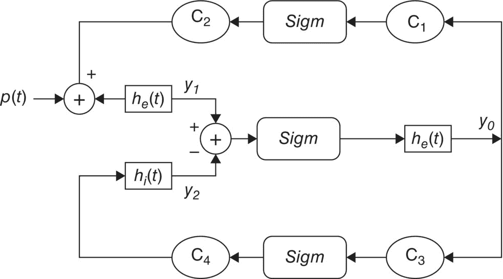

**图 3.10** 大脑皮层 α 节律生成的简化模型。输入为脉冲形波形。

(3.37)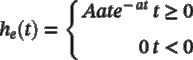<math xmlns="http://www.w3.org/1998/Math/MathML" display="block" overflow="scroll"><msub><mi>h</mi><mi>e</mi></msub><mfenced open="(" close=")"><mi>t</mi></mfenced><mo>=</mo><mfenced open="{" close=""><mtable><mtr><mtd><maligngroup/><mi mathvariant="italic">Aat</mi><msup><mi>e</mi><mrow><mo form="prefix">&#8722;</mo><mi mathvariant="italic">at</mi></mrow></msup><mspace width="0.2em"/><mi>t</mi><mo>&#8805;</mo><mn>0</mn></mtd></mtr><mtr><mtd><maligngroup/><mn>0</mn><mspace width="0.2em"/><mi>t</mi><mo>&#60;</mo><mn>0</mn></mtd></mtr></mtable></mfenced></math> 

用于兴奋性情况，抑制性情况如下：

(3.38)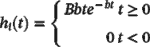<math xmlns="http://www.w3.org/1998/Math/MathML" display="block" overflow="scroll"><msub><mi>h</mi><mi>i</mi></msub><mfenced open="(" close=")"><mi>t</mi></mfenced><mo>=</mo><mfenced open="{" close=""><mtable><mtr><mtd><maligngroup/><mi mathvariant="italic">Bbt</mi><msup><mi>e</mi><mrow><mo form="prefix">&#8722;</mo><mi mathvariant="italic">bt</mi></mrow></msup><mspace width="0.2em"/><mi>t</mi><mo>&#8805;</mo><mn>0</mn></mtd></mtr><mtr><mtd><maligngroup/><mn>0</mn><mspace width="0.2em"/><mi>t</mi><mo>&#60;</mo><mn>0</mn></mtd></mtr></mtable></mfenced></math> 

`A` 和 `B` 分别决定兴奋性和抑制性 PSP 的最大振幅，`a` 和 `b` 是神经元树突网络中被动膜时间常数倒数之和以及所有其他空间分布延迟的集总表示。`Sigm` 函数定义如下 [\[21\]](#c03.xhtml#c3-bib-0021)：

(3.39)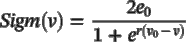<math xmlns="http://www.w3.org/1998/Math/MathML" display="block" overflow="scroll"><mtext mathvariant="italic">Sigm</mtext><mfenced open="(" close=")"><mi>v</mi></mfenced><mo>=</mo><mfrac><mrow><mn>2</mn><msub><mi>e</mi><mn>0</mn></msub></mrow><mrow><mn>1</mn><mo>+</mo><msup><mi>e</mi><mrow><mi>r</mi><mfenced open="(" close=")"><mrow><msub><mi>v</mi><mn>0</mn></msub><mo>&#8722;</mo><mi>v</mi></mrow></mfenced></mrow></msup></mrow></mfrac></math> 

其中 `e` [`0`] 表示神经元群体的最大放电率，`v` [0] 为达到 50% 放电率时的 PSP，`r` 为 S 型变换的陡峭程度。图中的连接常数 `C[1]` – `C[4]` 表征锥体细胞与兴奋性、抑制性中间神经元之间的相互作用，反映了神经元间建立的突触总数。

作为经验值，考虑 `C = C[1] = 135`，其余参数的典型建议值为 `C[2] = 0.8C`，`C[3] = 0.25C`，`C[4] = 0.25C`，`A = 3.25`，`B = 22`，`v` [0] `= 6`，`a = 100 s^(−1)`，`b = 50 s^(−1)` 和 `a[d] = 30`。

上述系统已扩展用于视觉诱发电位（VEP）的建模，这基于这样一个事实：VEP 是两个或多个所谓皮层柱相互作用的结果。图 3.11 展示了一个用于 VEP 的双柱模型，其中每个模块代表 图 3.10 中的模型。

此类模型的主要问题在于仅产生单通道 EEG，与第 3.2.2 小节解释的相位耦合模型不同，它没有对通道间关系和脑区固有连接性进行建模。因此，必须定义一个更准确的模型，以实现多通道 EEG 生成系统的仿真。这仍是一个开放性问题，也是研究领域之一。


**图 3.11** 用于 VEP 生成的双柱模型。两个连接常数 `K[1]` 和 `K[2]` 在一柱的输出馈入另一柱之前对其进行衰减。

## 3.4 直接从 EEG 信号导出的数学模型

这些模型基本上是用有限数量的统计参数来描述单通道和多通道信号，这些参数不仅表征波形的形态，还表征其时间或空间采样相关性。在这些模型中，内部和外部噪声通常被视为与脑源性信号无关的非相关时间信号。

### 3.4.1 线性模型

#### 3.4.1.1 预测方法

使用预测方法的主要目的是找到一组模型参数，以最好地描述信号生成系统。此类模型通常需要噪声型输入。在信号的自回归（AR）建模中，单通道 EEG 测量的每个采样点被定义为与其若干前序采样点线性相关，即：

(3.40)<math xmlns="http://www.w3.org/1998/Math/MathML" display="block" overflow="scroll"><mi>y</mi><mfenced open="(" close=")"><mi>n</mi></mfenced><mo>=</mo><mo form="prefix">&#8722;</mo><msubsup><mo>&#8721;</mo><mrow><mi>k</mi><mo>=</mo><mn>1</mn></mrow><mi>p</mi></msubsup><msub><mi>a</mi><mi>k</mi></msub><mi>y</mi><mfenced open="(" close=")"><mrow><mi>n</mi><mo>&#8722;</mo><mi>k</mi></mrow></mfenced><mo>+</mo><mi>x</mi><mfenced open="(" close=")"><mi>n</mi></mfenced></math> 

其中 `a[k]` ，`k = 1,2,…,p` 为线性参数，`n` 表示归一化为单位的离散采样时刻，`p` 称为模型阶或预测阶，`x(n)` 为噪声输入。在自回归滑动平均（ARMA）线性预测模型中，每个采样点基于其若干前序输入和输出采样值获得，即：

(3.41)<math xmlns="http://www.w3.org/1998/Math/MathML" display="block" overflow="scroll"><mi>y</mi><mfenced open="(" close=")"><mi>n</mi></mfenced><mo>=</mo><mo form="prefix">&#8722;</mo><msubsup><mo>&#8721;</mo><mrow><mi>k</mi><mo>=</mo><mn>1</mn></mrow><mi>p</mi></msubsup><msub><mi>a</mi><mi>k</mi></msub><mi>y</mi><mfenced open="(" close=")"><mrow><mi>n</mi><mo>&#8722;</mo><mi>k</mi></mrow></mfenced><mo>+</mo><msubsup><mo>&#8721;</mo><mrow><mi>k</mi><mo>=</mo><mn>0</mn></mrow><mi>q</mi></msubsup><msub><mi>b</mi><mi>k</mi></msub><mi>x</mi><mfenced open="(" close=")"><mrow><mi>n</mi><mo>&#8722;</mo><mi>k</mi></mrow></mfenced></math> 

其中 `b[k]` *，k =* 1, 2,…, `q` 为额外的线性参数。参数 `p` 和 `q` 为模型阶。赤池准则可用于通过最大化关于模型阶的对数似然方程 [\[22\]](#c03.xhtml#c3-bib-0022) 来确定测量信号适当模型的阶数：


其中，*p* 和 *q* 分别代表假设的 AR 和 MA 模型预测阶数，*N* 是信号样本数，而 $\sigma_{pq}²$ 是 ARMA 模型在 *p* 阶和 *q* 阶时的噪声功率。本章稍后我们将看到如何直接估计模型参数，或通过采用某些迭代优化技术来估计。

在多元 AR (MVAR) 方法中，考虑的是多通道方案。因此，每个信号样本是相对于其自身的前序样本以及来自其他通道的信号的前序样本来定义的，即对于通道 *i*，我们有：

$$y_i(n) = -\sum_{j=1}^{m}\sum_{k=1}^{p} a_{jk} y_j(n-k) + x_i(n)$$

其中 *m* 代表通道数，*x*[*i*] (*n*) 代表通道 *i* 的噪声输入。同样，模型参数可以通过迭代计算，以使实际值与预测值之间的误差最小化 [[23]](#c03.xhtml#c3-bib-0023)。


**图 3.12** 用于生成 EEG 信号的线性模型。

线性模型有许多应用。这些应用将在本书的其他章节中讨论。已经开发出不同的算法来高效地求解模型系数。在最大似然估计 (MLE) 方法 [23–25] 中，似然函数在系统参数上被最大化，这些参数是根据假设的真实、高斯分布且足够长的输入信号（约 10–20 秒，考虑采样频率 *f*[*s*] = 250 Hz，这常用于 EEG 记录）构建的。使用赤池方法，通过将牛顿-拉夫逊方法应用于生成的非线性方程，使平方误差的梯度最小化 [23, 26]。这被视为对 MLE 方法的一种近似。在 Durbin 方法 [[27]](#c03.xhtml#c3-bib-0027) 中，将 Yule-Walker 方程（将模型系数与信号的自相关联系起来）迭代求解。该方法及其结果等同于基于最小二乘法的方案 [[28]](#c03.xhtml#c3-bib-0028)。MVAR 系数通常使用 Levinson-Wiggins-Robinson (LWR) 算法 [[29]](#c03.xhtml#c3-bib-0029) 计算。MVAR 模型及其在所谓直接传递函数 (DTF) 表示中的应用，以及其在量化大脑内信号传播中的用法，将在第 8 章中详细解释。参数估计完成后，综合滤波器可由广义平稳噪声激励以生成 EEG 信号样本。图 3.12 说明了简化系统。

预测模型可以很容易地扩展到多通道数据。这导致了预测系数矩阵的估计。这些参数源于时间相关性和通道间相关性。

#### 3.4.1.2 Prony 方法

Prony 方法以前曾用于建模 EP [30, 31]。基于该模型，EP（通过向大脑施加短时听觉或视觉刺激获得）可被视为线性无限冲激响应 (IIR) 系统的冲激响应 (IR)。该领域的最初尝试是将指数阻尼正弦模型拟合到数据 [[32]](#c03.xhtml#c3-bib-0032)。该方法后来被修改为对正弦信号建模 [[33]](#c03.xhtml#c3-bib-0033)。Prony 方法用于计算 LP 参数。然后，所构建的 LP 滤波器在 z 平面上的极点角度被关联到用于建模数据的指数项的阻尼正弦波频率。因此，遵循 AR 模型所用的方法，指数的幅度和初始相位均可获得，如下所示。

基于原始方法，我们可以认为具有零激励的 AR 系统的输出与其 IR 相关，如下式所示：

$$y(n) = \sum_{k=1}^{p} a_k y(n-k) = \sum_{j=1}^{p} w_j \sum_{k=1}^{p} a_k r_j^{n-k-1}$$

其中 *y*(*n*) 代表指数数据样本，*p* 是预测阶数，$w_j = A_j e^{j\theta_j}$，*r*[*k*] =  *exp* ((*α*[*k*]  + *j*2*πf*[*k*] )*T*[*s*] )，*T*[*s*] 是归一化为 1 的采样周期，*A*[*k*] 是指数的幅度，*α*[*k*] 是阻尼因子，*f*[*k*] 是以样本/秒为单位的离散时间正弦频率，而 *θ*[*j*] 是以弧度为单位的初始相位。

因此，模型系数首先使用本节前面提到的方法之一计算，即 $\mathbf{a} = -\mathbf{Y}^{-1}\hat{\mathbf{y}}$，其中：


#### 方程 (3.45)


且 `a[0] = 1`。根据 (3.39)，`y(n)` 计算为其 `p` 个过去值的加权和。随后构造 `y(n)` 并估计参数 `f[k]` 和 `r[k]`。因此，阻尼因子可得为

#### 方程 (3.46)


谐振频率可得为

#### 方程 (3.47)


其中 `Re(.)` 和 `Im(.)` 分别表示复数量的实部和虚部。`w[k]` 参数是利用以下事实计算得出的：


或者

#### 方程 (3.48)


用向量形式可表示为 `Rw = y`，其中


`k = 0, 1, ⋯, p − 1`，`l = 1, ⋯, p` 表示上式矩阵的元素。因此，`w = R^(−1) y`，假设 `R` 是满秩矩阵，即不存在重极点。通常，这只需实施 Cholesky 分解算法 [[34]](#c03.xhtml#c3-bib-0034) 即可完成。最后，利用 `w[k]`，指数项的幅度和初始相位计算如下：

#### 方程 (3.49)


以及


#### 3.4.1 Prony 法（续）

在上述解中，我们假设数据样本数 `N` 等于 `N = 2p`，其中 `p` 为预测阶数。对于 `N > 2p` 的情况，可以得到 `w` 的最小二乘（LS）解：

```
w = (R^H R)^(-1) R^H y
```

其中 `(.)^H` 表示共轭转置。该方程也可使用 Cholesky 分解法求解。对于 EEG 信号等实数据，该方程变为 `w = (R^T R)^(-1) R^T y`，其中 `(.)^T` 表示转置运算。利用主成分分析（PCA）[[25]](#c03.xhtml#c3-bib-0025)可获得类似结果。

当数据受白噪声污染时，Prony 法的性能尚可。然而，对于非白噪声，噪声信息不易与数据分离，因此该方法可能不够成功。

正如我们将在本书后续章节中看到的，Prony 算法已被用于听觉和视觉诱发电位（AEP 和 VEP）的建模与分析 [[31]](#c03.xhtml#c3-bib-0031)，[[35]](#c03.xhtml#c3-bib-0035)。

### 3.4.2 非线性建模

可采用一种类似于 AR 或 MVAR 建模的方法，其中输出样本与前序样本存在非线性关系，该方法基于经济学研究中为预测金融增长而开发的方法。

在广义自回归条件异方差（GARCH）方法 [[36]](#c03.xhtml#c3-bib-0036) 中，每个样本通过非线性函数（或非线性函数之和）与其前序样本相关联。该模型最初是为时变波动率而引入的（因该贡献荣获 2003 年诺贝尔经济学奖）。

时间序列中的非线性借助 McLeod 和 Li [[37]](#c03.xhtml#c3-bib-0037) 以及 (Brock、Dechert 和 Scheinkman) 检验 [[38]](#c03.xhtml#c3-bib-0038) 来判定。然而，这两种检验都缺乏揭示非线性依赖实际类型的能力。

通常，无法判断非线性本质上是确定性的还是随机性的，也无法区分乘法依赖和加法依赖。随机非线性的类型可基于 Hsieh 检验 [[39]](#c03.xhtml#c3-bib-0039) 来确定。加法和乘法依赖可利用该检验加以区分。然而，该检验本身不用于获取模型参数。

假设非线性系统的输入为 `u(n)`，此类系统产生的信号作为输出为 `x(n)`，适合此类过程分析的一类受限非线性模型由下式给出：

```
x(n) = g(u(n-1), u(n-2), ...) + u_n . h(u(n-1), u(n-2), ...)
```

乘法依赖意味着方差上的非线性，这要求函数 `h(.)` 为非线性；反之，加法依赖意味着均值上的非线性，这在函数 `g(.)` 为非线性时成立。条件统计均值和方差分别定义为：

```
EE[x(n) | χ[n-1]] = g(u(n-1), u(n-2), ...)
```

以及

```
Var[x(n) | χ[n-1]] = h²(u(n-1), u(n-2), ...)
```

其中 `χ[n-1]` 包含直到时刻 `n-1` 为止的所有过去信息。原始 GARCH(p,q) 模型中，`p` 和 `q` 为预测阶数，考虑的是零均值情况，即 `g(.) = 0`。若 `e(n)` 表示利用上述非线性预测系统得到的残差（误差）信号，则有：

```
Var[e(n) | χ[n-1]] = σ²(n) = α_0 + Σ_{j=1}^q α_j σ²(n-j) + Σ_{j=1}^p β_j σ²(n-j)
```

其中 `α[j]` 和 `β[j]` 为非线性模型系数。右侧第二项（第一个求和）对应 `q` 阶移动平均（MA）动态噪声项，第三项（第二个求和）对应 `p` 阶 AR 模型。可见，时刻 `n` 残差的当前条件方差同时取决于其前序样本值和前序方差。


虽然在许多实际应用（如股价预测）中，阶数 `p` 和 `q` 通常被设定为较小的固定值（例如 `(p,q) = (1,1)`）；但为了更精确地对 EEG 等自然信号建模，阶数必须通过数学方法确定。各种 GARCH 模型的预测系数，甚至非线性函数 `g` 和 `h`，都是像线性 ARMA 模型那样迭代估计的 [[36]](#c03.xhtml#c3-bib-0036)，[[37]](#c03.xhtml#c3-bib-0037)。

这种简单的 GARCH 模型仅适用于乘性非线性依赖。此外，通过将建模方法扩展到 GARCH-M 模型类 [[40]](#c03.xhtml#c3-bib-0040)，还可以捕捉加性依赖。

上述简单 GARCH 模型的另一个局限性是无法适应符号不对称性。这是因为更新方程中使用了平方残差。而且，该模型无法处理尖峰等快速转换。考虑到这些缺陷，人们提出了许多 GARCH 模型的扩展。例如，该模型已被扩展和改进，以包含正负跳跃的非对称效应，如指数 GARCH 模型 EGARCH [[41]](#c03.xhtml#c3-bib-0041)、GJR-GARCH 模型 [[42]](#c03.xhtml#c3-bib-0042)、阈值 GARCH 模型 (TGARCH) [[43]](#c03.xhtml#c3-bib-0043)、非对称幂 GARCH 模型 APGARCH [[44]](#c03.xhtml#c3-bib-0044) 和二次 GARCH 模型 QGARCH [[45]](#c03.xhtml#c3-bib-0045)。

在这些模型中，为公式 (3.48) 和 (3.49) 中的 `g(.)` 和 `h(.)` 定义了不同的函数。例如，在 Glosten 等人提出的 EGARCH 模型 [[41]](#c03.xhtml#c3-bib-0041) 中，`h(n)` 迭代计算如下：

(3.56)
```
h_n = b + α_1 u²(n−1)(1 − η_{t−1}) + α_2 u²(n−1)η_{t−1} + κ h_{n−1}
```
其中 `b`、`α_1`、`α_2` 和 `κ` 为常数，`η[n]` 为指示函数，当 `u[n]` 为负时取零，否则取一。

除了对信号建模外，GARCH 方法还有许多其他应用。在一些近期工作 [[46]](#c03.xhtml#c3-bib-0046) 中，协方差的 GARCH 建模概念与卡尔曼滤波相结合，为求解逆问题提供了一个关于空间和时间更灵活的模型。求解逆问题有几种替代方案。许多方法属于采用 Tikhonov 正则化 [[47]](#c03.xhtml#c3-bib-0047) 的约束最小二乘法范畴。在许多可能的 GARCH 动态选择中，EGARCH 模型 [[41]](#c03.xhtml#c3-bib-0041) 已被用于迭代估计卡尔曼滤波器的方差参数。

非线性模型尚未用于 EEG 处理。为了能够使用这些模型，参数甚至阶数都应适应 EEG 的特性。此外，此类模型还应包含因异常和疾病发作导致的脑信号变化。

### 3.4.3 高斯混合模型

在这种非常流行的建模方法中，信号通过其分布的参数来表征。概率密度函数形式的分布是若干具有不同方差的高斯函数的加权和，这些函数具有不同的权重和延迟 [[48]](#c03.xhtml#c3-bib-0048)。受 `K` 个高斯分量约束的总体分布定义为：

(3.57)
```
p(x|θ_k) = Σ_{k=1}^K w_k p(x|μ_k, σ_k)
```

未知参数向量 `θ[k] = [w[k], μ[k], σ[k]]`，其中 `k = 1,2, …, K`。`w[k]` 等价于数据样本由第 `k` 个混合分量密度生成的概率（权重），受以下约束：

(3.58)
```
Σ_{k=1}^K w_k = 1
```

`μ[k]` 和 `σ[k]` 是第 `k` 个高斯分布的均值和方差，`p(x| μ[k], σ[k])` 是参数为 `μ[k]` 和 `σ[k]` 的 `x` 的高斯函数。期望最大化 (EM) [[49]](#c03.xhtml#c3-bib-0049) 常用于通过最大化 `N` 个样本数据的高斯混合 (MOG) 对数似然来估计上述参数，定义为：

(3.59)
```
L(θ_k) = Σ_{i=1}^N log( Σ_{k=1}^K w_k p(x(i)| μ_k, σ_k) )
```

EM 算法在以下两步之间交替：更新由第 `k` 个混合分量生成每个数据样本的后验概率（即所谓的 E 步）：

(3.60)
```
h_i^k = (w_k p(x_i| μ_k, σ_k)) / (Σ_{j=1}^K w_j p(x_i| μ_j, σ_j))
```

以及各混合分量参数的加权最大似然更新（即所谓的 M 步）：


## 3.5 电子模型

这些模型将细胞描述为一个独立单元。诸如 Hodgkin-Huxley 模型等成熟模型已通过电子电路实现。尽管精确模型需要大量元件，但实践表明，使用简单电路即可很好地近似此类模型 [[56]](#c03.xhtml#c3-bib-0056)。

### 3.5.1 描述膜功能的模型

大多数描述膜兴奋机制的模型都是 Hodgkin 和 Huxley 理论膜模型的电子实现。以下章节将讨论其中两种实现。

![Figure 3.14 The Lewis membrane model [57].](images/c03f014.gif)

**图 3.14** Lewis 膜模型 [[57]](#c03.xhtml#c3-bib-0057)。

#### 3.5.1.1 Lewis 膜模型

Lewis 电子膜模型基于 Hodgkin-Huxley 方程。所有元件均为并联电路，连接在代表膜内侧和外侧的节点之间。他利用有源滤波器的形式，通过电子硬件实现了钠和钾电导。由于模型输出为跨膜电压 `V_m`，钾电流可通过将对应 `G_K` 的电压乘以 (`V_m` − `V_K`) 来求得。因此，图 3.14 是 Hodgkin-Huxley 表达式的一个精确物理类比，输出电压 `V_m` 的行为与 Hodgkin-Huxley 方程预测的相符。Lewis 神经模拟器中的电子电路不仅允许插入（并改变） Hodgkin-Huxley 公式中的常数 `G_K_max`、`G_Na_max`、`V_K`、`V_Na`、`V_Cl`，还允许插入 `τ[h]`、`τ[m]`、`τ[n]`，从而可以对 Hodgkin-Huxley 方程进行修改。在此实现中，生物膜的电压乘以 100 以适配电子电路。对于其他量，则使用了生物膜的原始值。

#### 3.5.1.2 Roy 膜模型

如 图 3.15 所示，Roy 也基于 Hodgkin-Huxley 模型提出了一个模型 [[58]](#c03.xhtml#c3-bib-0058)。他在膜模型中使用场效应晶体管 (FET) 来模拟钠和钾电导 [[58]](#c03.xhtml#c3-bib-0058)。

在 Roy 模型中，电导由一个包含运算放大器、电容器和电阻器的电路控制。该电路旨在使电导表现符合 Hodgkin-Huxley 模型。Roy 的主要目标是实现一个非常简单的模型，而非精确模拟 Hodgkin-Huxley 模型。

### 3.5.2 描述神经元功能的模型

#### 3.5.2.1 Lewis 神经元模型

Lewis 模型基于 Hodgkin-Huxley 膜模型和 Eccles 的突触传递理论 [[59]](#c03.xhtml#c3-bib-0059)。模型电路如 图 3.16 所示。该神经元模型分为两部分：突触部分和产生动作脉冲的部分。两部分均由连接到代表膜内侧和外侧节点的并联电路组成。

![Figure 3.15 Circuits simulating (a) potassium and (b) sodium conductances in the Roy membrane model [58].](images/c03f015.gif)

**图 3.15** 模拟 Roy 膜模型中 (a) 钾和 (b) 钠电导的电路 [[58]](#c03.xhtml#c3-bib-0058)。

![Figure 3.16 The Lewis neuron model from 1968 [57].](images/c03f016.gif)

**图 3.16** 1968 年的 Lewis 神经元模型 [[57]](#c03.xhtml#c3-bib-0057)。


代表突触连接的部分分为两个组件：抑制性连接和兴奋性连接。在抑制性连接处引入的电压会降低产生动作脉冲部分对在兴奋性突触连接处引入的刺激的敏感性。产生动作脉冲的部分基于 Hodgkin-Huxley 模型，该模型由模拟钠和钾电导、泄漏电导以及膜电容的常规电路组成。该电路还包含一个用于输出信号的放大器。该模型可用于神经网络研究。然而，它实际上是 Lewis 46 晶体管网络的简化版本，两者形式相同。该简化 Lewis 模型的目的是遵循简单模型，以中等精度模拟动作脉冲的形态。

#### 3.5.2.2 Harmon 神经元模型

Hodgkin-Huxley 模型的电子实现能非常精确地模拟单个神经元的功能。然而，这些电路通常非常复杂。Leon D. Harmon 成功开发出了一种电路非常简单的神经元模型 [[60]](#c03.xhtml#c3-bib-0060)。Harmon 神经元模型的电路如 图 3.17 所示。该模型配备了五个可调节的兴奋性输入。其中包括代表各种突触功能的二极管电路。在兴奋性输入处引入的信号为 0.02 μF 电容充电，当电压达到约 1.5 V 后，由晶体管 `T1` 和 `T2` 组成的单稳态多谐振荡器产生动作脉冲。该脉冲由晶体管 `T3` 和 `T4` 放大。一个神经元模型的输出可驱动大量相邻神经元模型的输入。

![Figure 3.17 The Harmon neuron model [60].](images/c03f017.gif)

**图 3.17** Harmon 神经元模型 [[60]](#c03.xhtml#c3-bib-0060)。

![Figure 3.18 The Lewis model for simulation of the propagation of the action pulse [57].](images/c03f018.gif)

**图 3.18** 用于模拟动作脉冲传播的 Lewis 模型 [[57]](#c03.xhtml#c3-bib-0057)。

### 3.5.3 描述动作脉冲在轴突中传播的模型

Lewis 模拟了动作脉冲在均匀轴突中的传播，并获得了有趣的结果 [[57]](#c03.xhtml#c3-bib-0057)。如 图 3.18 所示的模型结构，可见包含一个膜元件网络以及代表细胞内电阻的轴向电阻。图中共描绘了六个膜元件。该模型是具有主动膜元件的线性核心导体模型的电子实现。每个膜元件的输出端都会产生一个动作电位的近似值。

### 3.5.4 集成电路实现

Mahowald 等人 [[61]](#c03.xhtml#c3-bib-0061) 将电子神经元模型或类神经元电路用作电子计算机的处理元件，称为神经计算机。这类模型有两个例子。由 [[62]](#c03.xhtml#c3-bib-0062) 开发的电子神经元模型采用集成电路技术实现。该电路包含一个具有八个突触的神经元。集成电路的芯片面积为 4.5 × 5 mm²。阵列包含约 200 个 NPN 和 100 个 PNP 晶体管，其中约 200 个被使用。1991 年，Mahowald 和 Douglas [[63]](#c03.xhtml#c3-bib-0063) 发表了一种电子神经元模型的集成电路实现。该模型采用互补金属氧化物半导体 (CMOS) 电路，利用超大规模集成 (VLSI) 技术实现。他们的模型精确模拟了新皮层神经元的尖峰。该电路的功耗为 60 μW，占地面积小于 0.1 mm²。据估计，在 1 cm × 1 cm 的芯片上可制造 100–200 个此类神经元。

## 3.6 神经元动作电位阈值的动态建模

神经元阈值是指跨膜电压电平，在此电平下任何进一步的去极化都将激活足够数量的钠通道，使其进入自发性正反馈阶段 [[64]](#c03.xhtml#c3-bib-0064)。该阈值通常被视为常数。阈值的任何改变都会影响神经元尖峰序列的时间变换。然而有证据表明，阈值受动作电位放电历史的非线性影响 [65–67]。文献 [[64]](#c03.xhtml#c3-bib-0064) 提出了一种用于细胞间活动动态调整阈值的方法。该方法适用于输入和输出均包含尖峰的系统。

## 3.7 总结

数学生成的大多数模型都是 EEG 发生器的非常原始的表示。需要更复杂的模型来表示大脑诱发电位 (EP) 以及在各种脑部疾病和障碍下记录的异常 EEG。此处解释的基于相位耦合的模型引入了 WCO（弱耦合振荡器），可用于模拟神经元间的相互作用。相反，Hodgkin-Huxley 模型为动作电位的产生提供了详细且准确的模型。线性和非线性预测滤波器可用于神经发生器建模。高斯混合模型能够对 EEG 进行建模，特别是事件相关、诱发和运动相关电位。最后，介绍了电路模型，用于结合兴奋性和抑制性突触后电位以产生 EEG 信号。突触电流也已使用电子电路进行建模。这些电路可扩展为单个神经元或膜的高精度模型。它们也可用于模拟大量神经元以产生特定的脑波形。电子模型有潜力用于脑形态技术。

## 参考文献

1.  **1** van Vreeswijk, C., Abbott, L.F., and Ermentrout, G.B. (1994). When inhibition not excitation synchronizes neural firing. Journal of Computational Neuroscience **1**: 313–321.

2.  **2** Penny, W.D., Litvak, V., Fuentemilla, L. et al. (2009). Dynamic causal models for phase coupling. Journal of Neuroscience Methods **183** (1): 19–30.

3.  **3** Ward, L. (2003). Synchronous neural oscillations and cognitive processes. Trends in Cognitive Sciences **7** (12): 553–559.

4.  **4** von Stein, A., Rappelsberger, P., Sarnthein, J., and Petsche, H. (1999). Synchronization between temporal and parietal cortex during multimodal object processing in man. Cerebral Cortex **9** (2): 137–150.

5.  **5** Jones, M. and Wilson, M. (2005). Theta rhythms coordinate hippocampal–prefrontal interactions in a spatial memory task. PLoS Biology **3** (12): e402.

6.  **6** Penny, W.D., Stephan, K.E., Mechelli, A., and Friston, K.J. (2004). Comparing dynamic causal models. NeuroImage **22** (3): 1157–1172.

7.  **7** Hoppensteadt, F. and Izhikevich, E. (1997). Weakly Connected Neural Networks. New York, USA: Springer‐Verlag.

8.  **8** Benedek, G. and Villars, F. (2000). Physics, with Illustrative Examples from Medicine and Biology. New York: Springer‐Verlag.

9.  **9** Hille, B. (1992). Ionic Channels of Excitable Membranes. Sunderland, MA: Sinauer.

10.  **10** Hodgkin, A. and Huxley, A. (1952). A quantitative description of membrane current and its application to conduction and excitation in nerve. Journal of Physiology (London) **117**: 500–544.

11.  **11** Doi, S., Inoue, J., Pan, Z., and Tsumoto, K. (2010). Computational Electrophysiology. Springer.


## 参考文献

12. **12** 神经网络与动作电位模拟器 (SNNAP) (2003)。教程，德克萨斯大学休斯顿医学院。[`med.uth.edu/nba/wp‐content/uploads/sites/29/2019/09/snnap_8_tutorial_v2019.pdf`](https://med.uth.edu/nba/wp-content/uploads/sites/29/2019/09/snnap_8_tutorial_v2019.pdf) (访问于 2021 年 8 月 19 日)。

13. **13** Ziv, I., Baxter, D.A., 和 Byrne, J.H. (1994)。神经网络与动作电位模拟器：描述与应用。*Journal of Neurophysiology* **71**: 294–308。

14. **14** Gerstner, W. 和 Kistler, W.M. (2002)。*Spiking Neuron Models*，第 1 版。剑桥大学出版社。

15. **15** Lagerlund, T.D., Sharbrough, F.W., 和 Busacker, N.E. (1997)。基于奇异值分解的主成分分析对多导脑电记录进行空间滤波。*Journal of Clinical Neurophysiology* **14** (1): 73–82。

16. **16** Da Silva, F.H., Hoeks, A., Smits, H., 和 Zetterberg, L.H. (1974)。脑节律活动模型：丘脑的 α 节律。*Kybernetic* **15**: 27–37。

17. **17** da Silva, F.H.L., van Rotterdam, A., Barts, P. 等 (1976)。神经元群模型：节律性的基本机制。载：*Perspective of Brain Research*, Prog. Brain Res, 第 45 卷 (编辑 M.A. Corner 和 D.F. Swaab)，281–308。

18. **18** Wilson, H.R. 和 Cowan, J.D. (1972)。模型神经元局部群体中的兴奋性与抑制性相互作用。*Biophysical Journal* **12**: 1–23。

19. **19** Zetterberg, L.H. (1973)。神经元群体的随机活动——系统分析方法。报告编号 2.3.153/1, 23, Issue no. 197418, p. 32。乌得勒支：乌得勒支 TNO 医学物理研究所。

20. **20** Jansen, B.H. 和 Rit, V.G. (1995)。耦合皮层柱数学模型中的脑电图与视觉诱发电位生成。*Biological Cybernetics* **73**: 357–366。

21. **21** Jansen, B.H., Zouridakis, G., 和 Brandt, M.E. (1993)。基于神经生理学的闪光视觉诱发电位数学模型。*Biological Cybernetics* **68**: 275–283。

22. **22** Akaike, H. (1974)。统计模型阶数识别的新视角。*IEEE Transactions on Automatic Control* **19**: 716–723。

23. **23** Kay, S.M. (1988)。*Modern Spectral Estimation: Theory and Application*。Prentice Hall。

24. **24** Guegen, C. 和 Scharf, L. (1980)。ARMA 模型的精确最大似然识别：信号处理视角。载：*Signal Processing Theory Applications* (编辑 M. Kunt 和 F. de Coulon)，759–769。阿姆斯特丹：North Holland Publishing Co.。

25. **25** Akay, M. (2001)。*Biomedical Signal Processing*。Academic Press。

26. **26** Cavanaugh, J.E. 和 Neath, A.A. (2019)。赤池信息准则：背景、推导、性质、应用、解释与改进。*WIREs Computational Statistics* **11** (3): e1460。

27. **27** Durbin, J. (1959)。移动平均模型参数的有效估计。*Biometrika* **46**: 306–316。

28. **28** Trench, W.F. (1964)。有限 Toeplitz 矩阵求逆算法。*Journal of the Society for Industrial and Applied Mathematics* **12**: 515–522。

29. **29** Morf, M., Vieria, A., Lee, D., 和 Kailath, T. (1978)。递归多通道最大熵谱估计。*IEEE Transactions on Geoscience Electronics* **16**: 85–94。

30. **30** Spreckelesen, M. 和 Bromm, B. (1988)。利用参数建模和卡尔曼滤波估计单次诱发脑电位。*IEEE Transactions on Biomedical Engineering* **33**: 691–700。

31. **31** Demiralp, T. 和 Ademoğlu, A. (1992)。利用 PRONY 方法将诱发电位建模为衰减正弦振荡。1992 年第 14 届 IEEE 工程医学与生物学学会年会国际会议，巴黎，2452–2453。[`doi.org/10.1109/IEMBS.1992.5761536`](https://doi.org/10.1109/IEMBS.1992.5761536)。

32. **32** De Prony, B.G.R. (1795)。实验与分析论文：论弹性流体膨胀率定律及水蒸气和酒精蒸气在不同温度下膨胀力定律。*Journal of Engineering Polytechnique* **1** (2): 24–76。

33. **33** Marple, S.L. (1987)。*Digital Spectral Analysis with Applications*。Prentice‐Hall。

34. **34** Lawson, C.L. 和 Hanson, R.J. (1974)。*Solving Least Squares Problems*。新泽西州 Englewood Cliffs：Prentice Hall。

35. **35** Bouattoura, D., Gaillard, P., Villon, P. 等 (1996)。基于 Prony 方法的多导诱发电位建模。数字处理应用会议论文集 (TENCON '96)，澳大利亚珀斯，第 565–568 页。

36. **36** Dacorogna, M., Muller, U., Olsen, R.B., 和 Pictet, O. (1998)。利用 GARCH 和 HARCH 模型建模短期波动性。载：*Nonlinear Modelling of High Frequency Financial Time Series*, Econometrics (编辑 L.C. Dunis 和 B. Zhou)。Elsevier，17 页。

37. **37** McLeod, A.J. 和 Li, W.K. (1983)。利用平方残差自相关诊断检验 ARMA 时间序列模型。*Journal of Time Series Analysis* **4**: 269–273。

38. **38** Ray, W.D. (1993)。非线性动力学、混沌与不稳定统计理论及经济证据。*Journal of the Operational Research Society* **44** (2): 202–203。

39. **39** Hsieh, D.A. (1989)。检验每日外汇汇率中的非线性依赖性。*Journal of Business* **62**: 339–368。

40. **40** Engle, R.F., Lilien, D.M., 和 Robin, R.P. 估计期限结构中的时变风险溢价：ARCH‐M 模型。*Econometrica* **55**: 391–407。

41. **41** Nelson, D.B. (1990)。GARCH(1,1) 模型的平稳性与持久性。*Journal of Econometrics* **45**: 7–35。

42. **42** Glosten, L.R., Jagannathan, R., 和 Runkle, D. (1995)。关于股票名义超额收益期望值与波动率之间的关系。*The Journal of Finance* **2**: 225–251。

43. **43** Zakoian, J.M. (1994)。阈值异方差模型。*Journal of Economic Dynamics & Control* **18**: 931–955。

44. **44** Ding, Z., Engle, R.F., 和 Granger, C.W.J. (1993)。股票市场收益率的长记忆性质及新模型。*Journal of Empirical Finance* **1**: 83–106。

45. **45** Sentana, E. (1991)。二次 ARCH 模型：将 ARCH 模型重新解释为二阶泰勒近似的可能性。伦敦政治经济学院。

46. **46** Galka, A., Yamashita, O., 和 Ozaki, T. (2004)。逆问题动态估计中协方差的 GARCH 建模。*Physics Letters A* **333**: 261–268。

47. **47** Tikhonov, A. (1992)。*Ill‐Posed Problems in Natural Sciences*。Coronet。

48. **48** Roweis, S. 和 Ghahramani, Z. (1999)。线性高斯模型的统一综述。*Neural Computation* **11**: 305–345。

49. **49** Dempster, A.P., Laird, N.M., 和 Rubin, D.B. (1977)。通过 EM 算法从不完整数据中获得最大似然估计。*Journal of the Royal Statistical Society B* **39**: 1–38。

50. **50** Redner, R.A. 和 Walker, H.F. (1984)。混合密度、最大似然与 EM 算法。*SIAM Review* **26**: 195–239。

51. **51** Ormoneit, D. 和 Tresp, V. (1998)。通过平均、最大惩罚似然和贝叶斯估计改进高斯混合概率密度估计。*IEEE Transactions on Neural Networks* **9** (4): 639–650。

52. **52** Archambeau, C., Lee, J.A., 和 Verleysen, M. (2003)。有限高斯混合模型 EM 算法收敛问题研究。欧洲人工神经网络研讨会论文集 (ESANN 2003)，比利时布鲁日 (2003 年 4 月 23–25 日)，99–106。

53. **53** Hesse, C.W., Holtackers, D., 和 Heskes, T. (2006)。利用高斯混合模型和广义指数混合模型对生物医学信号进行建模与分类。*Belgian Day on Biomedical Engineering, IEEE Benelux EMBS Symposium* (12 月 7–8 日)。


## 参考文献

54. Greenspan, H., Ruf, A., and Goldberger, J. (2006). Constrained Gaussian mixture model framework for automatic segmentation of mr brain images. *IEEE Transactions on Medical Imaging* **25** (9): 1233–1245.

55. Rio, M., Hutt, A., and Loria, B.G. (2010). Partial amplitude synchronization detection in brain signals using Bayesian Gaussian mixture models. *Cinquième conférence plénière française de Neurosciences Computationnelles, “Neurocomp'10”, Lyon, France (October 2010)*, 109–113.

56. Malmivuo, J. and Plonsey, R. (1995). *Bioelectromagnetism: Principles and Applications of Bioelectric and Biomagnetic Fields*. Oxford University Press.

57. Lewis, E.R. (1964). An electronic model of the neuron based on the dynamics of potassium and sodium ion fluxes. In: *Proceedings of the 1962 Ojai Symposium on Neural Theory and Modelling* (eds. R.F. Reiss, H.J. Hamilton, L.D. Harmon, et al.), 427. Stanford: Stanford University Press.

58. Roy, G. (1972). “A simple electronic analog of the squid axon membrane,” *The Neurofet*. *IEEE Transactions on Biomedical Engineering* **19** (1): 60–63.

59. Eccles, J.C. (1964). *The Physiology of Synapses*. Berlin: Springer‐Verlag.

60. Harmon, L.D. (1961). Studies with artificial neurons, I: properties and functions of an artificial neuron. *Kybernetik Heft* **3** (Dez.):: 89–101.

61. Mahowald, M.A., Douglas, R.J., LeMoncheck, J.E., and Mead, C.A. (1992). An introduction to silicon neural analogs. *Seminars in Neuroscience* **4**: 83–92.

62. Prange, S. (1990). Emulation of biology‐oriented neural networks. In: *Proceedings of the International Conference on Parallel Processing in Neural Systems and Computers (ICNC)* (ed. M. Eckmiller). Düsseldorf.

63. Mahowald, M.A. and Douglas, R.J. (1991). A silicon neuron. *Nature* **354**: 515–518.

64. Lu, U., Roach, S.M., Song, D., and Berger, T.W. (2012). Nonlinear dynamic modelling of neuron action potential threshold during synaptically driven broadband intercellular activity. *IEEE Transactions on Biomedical Engineering* **59** (3): 706–716.

65. Azouz, R. and Gray, C.M. (1999). Cellular mechanisms contributing to response variability of cortical neurons *in Vivo*. *Journal of Neuroscience* **19** (6): 2209–2223.

66. Henze, D.A. and Buzsáki, G. (2001). Action potential threshold of hippocampal pyramidal cells in vivo is increased by recent spiking activity. *Neuroscience* **105** (1): 121–130.

67. Chacron, M.J., Lindner, B., and Longtin, A. (2007). Threshold fatigue and information transfer. *Journal of Computational Neuroscience* **23** (3): 301–311.

# 4 EEG 信号处理基础

## 4.1 简介

脑电图（EEG）信号是神经活动的特征，通常是不同时刻、不同脑区神经元群发出的、具有不同潜伏期的动作电位的积分。它们由多电极脑电仪采集，电极位置可以在脑内、颅骨下的皮层表面，或者在绝大多数应用中，位于头皮的特定位置。不同录制设备的 EEG 文件格式各异，但如今它们可以通过常规软件轻松读取或转换。信号通常在时域呈现，然而，许多新型脑电仪能够应用简单的信号处理工具（如傅里叶变换）进行频率分析，并配备成像工具以可视化 EEG 地形图（空间域中的脑活动图谱）。

迄今为止，已开发出许多用于处理 EEG 信号的算法。操作包括但不限于时域分析、频域分析、空域分析和多路处理。此外，还开发了若干算法，仅从重建的 EEG 图像（即地形图）中可视化脑活动。从多传感器 EEG 中分离期望源信号是另一个研究领域。这进而可导致癫痫等脑异常的检测，以及与各种生理和心理活动相关源的定位。在本书的第 17 章中，我们还将看到，近年来脑机接口（BCI）[[1]](#c04.xhtml#c4-bib-0001)的研究重点在于先进信号处理的发展，以及协同网络和深度学习工具与算法的巨大进步。

神经活动的建模可能比任何其他器官功能的建模都更困难。然而，已有人提出了一些用于生成 EEG 信号的简单模型。其中一些模型也已扩展以包含异常 EEG 信号的生成。

脑信号源定位是另一个非常重要的研究领域[[2]](#c04.xhtml#c4-bib-0002)。为了提供一种在脑内定位源的可靠算法，需要具备关于电磁波传播的充分知识，以及如何利用测量信号中的信息来分离和定位脑内源。源可以被视为磁偶极子，从而求解著名的反问题；也可以被视为分布电流源。

病人监护和睡眠监测需要对长达数天的长 EEG 序列进行实时处理。EEG 提供了关于睡眠大脑的重要且独特的信息。睡眠期间的主要脑活动可通过开发的算法捕获，例如本章后面讨论的匹配追踪（MP）法[[3]](#c04.xhtml#c4-bib-0003)。

癫痫监测、检测和预测也吸引了众多研究者。时间序列的动力学分析结合信号源的盲分离应用，已实现从头皮 EEG 预测局灶性癫痫。反之，时频（TF）域分析在新生儿癫痫发作检测中的应用，为该领域的进一步研究铺平了道路。癫痫领域的一项重要近期贡献是如何建模颅内癫痫样放电（主要在发作间期）与头皮电极之间的传导路径。该领域的最新进展通过引入多视角方法和字典学习[[4]](#c04.xhtml#c4-bib-0004)–[[6]](#c04.xhtml#c4-bib-0006)以及深度神经网络结构[[7]](#c04.xhtml#c4-bib-0007)、[[8]](#c04.xhtml#c4-bib-0008)，实现了从头皮捕获相当比例的所谓发作间期癫痫样放电（IED）。本书第 7 章和第 11 章将描述该技术。

在以下章节中，将解释上述目标的大多数工具和算法，并讨论其数学基础。然而，这些算法在正常和异常 EEG 分析中的应用将在本书后续章节中介绍。读者还应了解从线性代数中借用的所需概念和定义。详情可参阅[[9]](#c04.xhtml#c4-bib-0009)。在本章及本书其余部分中，连续时间用“*t*”表示，离散时间用“*n*”表示（归一化采样周期 *T* = 1）。但在某些图示中会给出以秒为单位的实际时间。

## 4.2 介质的非线性


头部作为混合介质，将大脑内部局部产生的 EEG 信号在传感器位置进行组合。作为一个系统，头部在不同情况下对这些源的敏感程度可能有所不同。通常，EEG 信号可被视为非线性系统的输出，该系统可用确定性方法表征。这一概念代表了 EEG 与脑磁图（MEG）信号的根本区别。与 EEG 不同，头部的电阻率（或电导率）对 MEG 的磁场影响显著较小，尽管 MEG 中的轻微非线性源于头部组织介电常数值的微小差异。

电磁源表征与定位需要准确的体积导体模型，以表示头部几何结构和电导率场。研究表明，尽管已有大量研究，头部组织参数的测量结果仍不一致，且在不同实验中存在差异[[10]](#c04.xhtml#c4-bib-0010)。本书第 10 章对此概念有更多讨论，我们将在其中介绍脑源定位。

由于生物学和生理学现象导致的大脑代谢变化，会改变 EEG 源信号组合的过程。其中一些变化受大脑自身活动的影响。这些效应使系统呈现非线性。此类系统的分析极其复杂，迄今为止尚无人完全建立模型以辅助脑信号分析。

反之，从混沌理论和时间序列动力学分析中借用的一些指标，如差异性、吸引子维度和最大李雅普诺夫指数（LLE），可表征 EEG 信号的非线性行为。这些概念在第 4.7 节中讨论，其部分应用见第 11 章。

## 4.3 非平稳性

可通过评估信号分布随时间的变化来量化信号的非平稳性。在严格平稳过程中，信号分布在不同时间区间内保持不变。然而，通常不需要宽平稳性，因此仅需各种统计量（如均值和方差）随时间保持固定（或无显著变化）即可。

尽管在许多应用中，多通道 EEG 分布被视为多元高斯分布，但均值和协方差特性通常随片段而变化。因此，EEG 仅在短区间内被视为平稳，总体上属于准平稳。尽管该区间可能因大脑状态的快速变化而改变——如从闭眼到睁眼、睡眠到清醒、正常到癫痫发作、警觉性变化、大脑对刺激的反应（事件相关电位 ERP 和诱发电位 EP 信号）、眨眼及情绪变化——但在实践中，10 秒的 EEG 窗口通常被视为平稳。

信号片段分布的变化，可通过高斯过程的参数及分布偏离高斯分布的程度来度量。信号的非高斯性可通过测量或估计某些高阶矩来检验，如偏度、峰度、负熵和 Kullback-Leibler（KL）距离（即 KL 散度）。

偏度是衡量不对称性的指标，更准确地说是分布缺乏对称性的度量。若分布在其中线或均值点的左右两侧外观相同，则为对称分布。实信号的偏度定义为：

(4.1)
```
Skewness = E[(x(n) - μ)³] / σ³
```
其中 *μ* 和 *σ* 分别为均值和方差，*E* 表示统计期望。若分布偏向均值点右侧，偏度为负，反之为正。对于高斯等对称分布，偏度为零。

峰度用于衡量分布相对于正态分布的尖峭或平坦程度。高峰度数据集在均值附近有明显峰值，迅速下降，且尾部较重。低峰度数据集在均值附近顶部平坦而非尖峰，均匀分布即为极端情况。信号 *x*(*n*) 的峰度定义为：

(4.2)
```
kurt = m_4(x(n)) / (m_2(x(n)))²
```
其中 *m**i*) 为信号 *x*(*n*) 的第 *i* 阶中心矩，即 *m**i*) = *E*[(*x*(*n*) − *μ*)^(*i*)]。正态分布信号的峰度为三。因此常用超额峰度或归一化峰度，定义为：

(4.3)
```
Exkurt = m_4(x(n)) / (m_2(x(n)))² - 3
```
高斯分布信号的超额峰度为零。通常信号被视为遍历的，故统计平均可假设等同于时间平均，从而可用时间平均进行估计。

信号 *x*(*n*) 的负熵[[11]](#c04.xhtml#c4-bib-0011)定义为：

(4.4)
```
J_neg(x(n)) = H(x_Gauss(n)) - H(x(n))
```
其中 *x*Gauss 为与 *x*(*n*) 具有相同协方差的高斯随机信号，*H*(·) 为微分熵[[12]](#c04.xhtml#c4-bib-0012)，定义为：


## 4.4 信号分割

通常需要将 EEG 信号标记为具有相似特征的片段，这对临床医生和神经生理学家的评估尤为重要。在每个片段内，信号被视为统计平稳的，通常具有相似的时间和频率统计特性。例如，癫痫患者的 EEG 记录可分为三个片段：发作前期、发作期和发作后期。每个片段的持续时间可能不同。图 4.1 显示了一个包含上述所有片段的 EEG 序列。


**图 4.1** 包含发作前期、发作期和发作后期三个片段的强直-阵挛性癫痫发作 EEG 信号集。

在 EEG 分割中，可利用信号的时间或频率特性。这最终导致一种不相似度度量，记为 `d(m)`，用于相邻 EEG 帧之间，其中 `m` 是为帧编号的整数值，差值在 `m` 帧和 `(m − 1)`th（连续）信号帧之间计算。若 `d(m) > η[T]`，则两个不同片段的边界定义为 `m` 帧和 `(m − 1)`th 帧之间的边界，其中 `η[T]` 是经验阈值。在专家临床医生的帮助下，通过突出并有效利用信号中的诊断信息，可以实现高效分割。然而，并不总能接触到此类专家；因此，需要算法方法。

基于信号处理基础，可定义多种不同的不相似度度量。一种准则基于片段 `m` 的自相关函数，定义为：

**公式 (4.7)**
```
r_x(k, m) = E[x(n, m) x(n + k, m)]
```

假设时间区间为 `n, n + 1, …, n + (N − 1)`，第 `m` 个长度为 `N` 的帧的自相关函数可近似为：

**公式 (4.8)**
```
r̂_x(k, m) = {
    (1/N) Σ_{l=0}^{N-1-k} x(l + m + k) x(l + m),  k = 0, …, N-1
    0,                                             k = N, N+1, …
}
```

然后准则设定为：

**公式 (4.9)**
```
d_1(m) = [ Σ_{k=-∞}^{∞} (r̂_x(k, m) - r̂_x(k, m-1))² ] / [ r̂_x(0, m) r̂_x(0, m-1) ]
```


第二个标准可以基于高阶统计量。具有更均匀分布的信号（如正常脑电节律）具有较低的峰度，而癫痫信号或 ERP 信号通常具有较高的峰度值。峰度被定义为零时滞下的四阶累积量，并与二阶和四阶矩相关，如公式 (4.1)–(4.3)所示。随后定义第二级判别式 `d` 2 为：

(4.10)
```
d₂(m) = kurt_x(m) − kurt_x(m − 1)
```

其中 `m` 指 EEG 信号 `x(n)` 的第 `m` 帧。第三个标准由周期图的谱误差度量定义。第 `m` 帧的周期图通过 EEG 信号相关函数的傅里叶变换获得：

(4.11)
```
S_x(ω, m) = Σ_{k=−∞}^{∞} r̂_x(k, m) e^(−jωk), ω ∈ [−π, π]
```

其中 `r̂_x(·, m)` 是如前所述第 `m` 帧的自相关函数。然后基于归一化周期图定义该标准：

(4.12)
```
d₃(m) = [∫_{−π}^{π} (S_x(ω, m) − S_x(ω, m−1))² dω] / [∫_{−π}^{π} S_x(ω, m) dω ∫_{−π}^{π} S_x(ω, m−1) dω]
```

用于测量 `d` 1 和 `d` 3 的测试窗口样本自相关可以通过以下递归方程（公式 4.13）在大小为 `N` 的测试窗口上更新：

(4.13)
```
r̂_x(k, m) = r̂_x(k, m−1) + (1/N)[x(m−1+N)x(m−1+N−k) − x(m−1+k)x(m−1)]
```

从而在实践中可以降低计算复杂度。第四个标准对应于基于自回归（AR）建模的信号的误差能量。第 `m` 帧 AR 模型中的预测误差简单定义为：

(4.14)
```
e(n, m) = x(n, m) − Σ_{k=1}^{p} a_k(m) x(n−k, m)
```

其中 `p` 是预测阶数，`a_k(m)`，`k` = 1, 2, …, `p` 是预测系数。对于特定的 `p`，可以直接找到系数（例如使用 Durbin 方法），以使实际信号能量与预测信号能量之间的误差（残差）最小化。在此方法中，假设长度为 `N` 的帧以一个样本重叠。为第 (`m` − 1) 帧估计的预测系数随后用于预测第 `m` 帧中的第一个样本，我们将其表示为 `ê(1, m)`。如果该误差很小，则第 `m` 帧的统计特性很可能与第 (`m` − 1) 帧相似。反之，较大的值可能表明发生了变化。第四个标准的指示符可以是该信号相对于时间的微分（数字信号的差分），它在分段边界处给出一个峰值，即：

(4.15)
```
d₄(m) = max(∇_n e(n, m))
```


其中，∇`n` (.) 表示关于 `n` 的梯度，由一阶差分运算近似。图 4.2 展示了 式 (4.15) 中定义的残差和梯度，其中预测阶数选为 12。

最后，第五个准则 `d5(m)` 可通过使用信号的基于 AR 的频谱来定义，方式与短时傅里叶变换 (STFT) 用于 `d3(m)` 相同。上述 AR 模型为单变量模型，即对单通道 EEG 进行建模。当考虑多通道 EEG 时，可定义类似的准则 [[14]](#c04.xhtml#c4-bib-0014)。在这种情况下需分析多元 AR (MVAR) 模型。MVAR 也可用于表征和量化大脑内的信号传播，本书 第 8 章 将对此进行讨论。

尽管上述准则可有效用于 EEG 信号的分割，但针对特定异常的检测，可能定义出更好的系统。为此，需要识别并使用能最好描述信号行为的特征。因此，分割问题变成了一个分类问题，可对此使用不同的分类器。

## 4.5 信号变换与联合时频分析

如果信号在统计上是平稳的，则在时域或频域中对其进行表征是直观的。有限长信号的频域表示可通过使用线性变换来求得，例如（离散）傅里叶变换 (DFT)、余弦变换 (DCT) 或其他半最优变换，它们的核与信号无关。然而，由于信号的短时时域加窗和固定变换核导致的频谱模糊，这些变换的结果可能会退化。最优变换如 Karhunen–Loéve 变换 (KLT) 需要完整的统计信息，这在实践中可能无法获得。


**图 4.2** (a) 包含发作前期、发作期和发作后期片段的 EEG 癫痫信号，(b) 误差信号和 (c) 信号的近似梯度，其在片段边界处呈现峰值。预测系数数目 `p` = 12。

基于 AR 或自回归移动平均 (ARMA) 建模的参数频谱估计方法，在准确表征信号的频域特性方面可优于 DFT，但主要由于测量信号长度有限，它们可能遭受模型参数估计不佳的问题。例如，为了使用 AR 模型对 EEG 进行建模，需要预测阶数和系数的准确值。过高的预测阶数可能导致频谱中的真实峰值分裂，而过低的预测阶数会导致频域中邻近的峰值合并。

对于信号 `x(n)` 的 AR 模型，误差或驱动信号被视为零均值白噪声。因此，对 式 (4.14) 应用 z 变换，去掉分块索引 `m`，并用 `e^(jω)` 替换 z，可得：

(4.16)<math xmlns="http://www.w3.org/1998/Math/MathML" display="block" overflow="scroll"><mfrac><mrow><msub><mi>X</mi><mi>p</mi></msub><mfenced open="(" close=")"><mi>ω</mi></mfenced></mrow><mrow><mi>E</mi><mfenced open="(" close=")"><mi>ω</mi></mfenced></mrow></mfrac><mo>=</mo><mfrac><mn>1</mn><mrow><mn>1</mn><mo>−</mo><msubsup><mo>∑</mo><mrow><mi>k</mi><mo>=</mo><mn>1</mn></mrow><mi>p</mi></msubsup><msub><mi>a</mi><mi>k</mi></msub><msup><mi>e</mi><mrow><mo form="prefix">−</mo><mi mathvariant="italic">jkω</mi></mrow></msup></mrow></mfrac></math>

其中，`E(ω)` = `K[ω]` (常数)，为白噪声的功率谱，`Xp(ω)` 用于表示信号功率谱。因此，

(4.17)<math xmlns="http://www.w3.org/1998/Math/MathML" display="block" overflow="scroll"><msub><mi>X</mi><mi>p</mi></msub><mfenced open="(" close=")"><mi>ω</mi></mfenced><mo>=</mo><mfrac><msub><mi>K</mi><mi>ω</mi></msub><mrow><mn>1</mn><mo>−</mo><msubsup><mo>∑</mo><mrow><mi>k</mi><mo>=</mo><mn>1</mn></mrow><mi>p</mi></msubsup><msub><mi>a</mi><mi>k</mi></msub><msup><mi>e</mi><mrow><mo form="prefix">−</mo><mi mathvariant="italic">jkω</mi></mrow></msup></mrow></mfrac></math>

参数 `K[ω]`、`a[k]`、`k = 1, …, p` 为精确值。在实际 AR 建模中，这些将从有限长度测量中估计，从而降低频谱估计的精度。图 4.3 利用 DFT 分析和 AR 建模，对单通道 EEG 约 1550 个采样点的一个 EEG 片段的频谱进行了对比。

如 图 4.3b 所示，信号 DFT 中的波动是类周期图功率谱估计技术统计不一致性的后果。只要通过为 AR 估计选择合适的预测阶数使模型拟合实际数据，AR 技术的结果 (图 4.3c) 就能克服这一问题。EEG 信号在统计上通常是非平稳的，特别是在信号中捕捉到异常事件的情况下。在这些情况下，频域分量在观测区间上积分，不能准确显示信号的特性。时频 (TF) 方法是解决该问题的途径。

在多通道 EEG 的情况下，电极的几何位置反映了空间维度，通过多路处理方法的空间-时间-频率 (STF) 分析也变得流行起来 [[15]](#c04.xhtml#c4-bib-0015)。该领域的主要概念连同并行因子分析 (PARAFAC) 算法将在 第 17 章 中回顾，旨在从 EEG 信号中检测运动相关电位或眨眼伪迹。

STFT 定义为在滑动窗口上求取的离散时间傅里叶变换。STFT 可按如下方式执行：

(4.18)<math xmlns="http://www.w3.org/1998/Math/MathML" display="block" overflow="scroll"><mi>X</mi><mfenced open="(" close=")"><mrow><mi>n</mi><mo>,</mo><mi>ω</mi></mrow></mfenced><mo>=</mo><msubsup><mo>∑</mo><mrow><mo form="postfix">−</mo><mo>∞</mo></mrow><mo>∞</mo></msubsup><mi>x</mi><mfenced open="(" close=")"><mi>τ</mi></mfenced><mi>w</mi><mfenced open="(" close=")"><mrow><mi>n</mi><mo>−</mo><mi>τ</mi></mrow></mfenced><msup><mi>e</mi><mrow><mo form="prefix">−</mo><mi mathvariant="italic">jωτ</mi></mrow></msup></math> 

**图 4.3** 单通道 EEG 频谱。 (a) 具有显著 α 节律的一个 EEG 信号片段。 (b) 利用 DFT 得出的 (a) 信号频谱。 (c) 利用 12 阶 AR 模型得出的 (a) 信号频谱。

其中离散时间索引 `n` 指窗口 `w(n)` 的位置。类似于周期图，频谱图定义为：


(4.19)  <math xmlns="http://www.w3.org/1998/Math/MathML" display="block" overflow="scroll"><msub><mi>S</mi><mi>x</mi></msub><mfenced open="(" close=")"><mrow><mi>n</mi><mo>,</mo><mi>&#969;</mi></mrow></mfenced><mo>=</mo><msup><mfenced open="|" close="|"><mrow><mi>X</mi><mfenced open="(" close=")"><mrow><mi>n</mi><mo>,</mo><mi>&#969;</mi></mrow></mfenced></mrow></mfenced><mn>2</mn></msup></math>

基于不确定性原理，即  <math xmlns="http://www.w3.org/1998/Math/MathML" display="inline" overflow="scroll"><msubsup><mi>&#963;</mi><mi>t</mi><mn>2</mn></msubsup><msubsup><mi>&#963;</mi><mi>&#969;</mi><mn>2</mn></msubsup><mo>&#8805;</mo><mfrac><mn>1</mn><mn>4</mn></mfrac></math>，其中  <math xmlns="http://www.w3.org/1998/Math/MathML" display="inline" overflow="scroll"><msubsup><mi>&#963;</mi><mi>i</mi><mn>2</mn></msubsup></math> 和  <math xmlns="http://www.w3.org/1998/Math/MathML" display="inline" overflow="scroll"><msubsup><mi>&#963;</mi><mo>&#8734;</mo><mn>2</mn></msubsup></math> 分别为时域和频域方差，无法在时域和频域同时达到完美分辨率。通常选择窗函数以消除分块边缘的不连续性，并保持功率谱估计的正性。该选择也会影响所得技术的频谱分辨率，简单来说，这对应于分辨两个等幅频分量所需的最小频率间隔。

图 4.4 展示了从发作前期演变至发作期再到发作后期的脑电图片段的时频表示。在图 4.4 中，通过使用持续时间分别为 1 秒和 2 秒的汉宁窗，展示了时间分辨率的影响。重要的是，在图 4.4 中，发作期内的频率漂移清晰可见。

### 4.5.1 小波变换

小波变换（WT）是时频分析的另一种选择。已有成熟的文献详细阐述了 WT，例如 [16, 17]。与短时傅里叶变换（STFT）不同，基于 WT 方法的时频核能更好地在时频空间中定位信号分量。这有效地利用了时域和频域分量之间的依赖关系。因此，Morlet [16] 引入 WT 的主要目的，很可能是为了获得一个与采样周期成正比的相干时间。为了继续推导，考虑连续时间信号的情形。

#### 4.5.1.1 连续小波变换

一维信号 *f*(*t*) 的 Morlet-Grossmann 连续 WT 定义为：

(4.20)  <math xmlns="http://www.w3.org/1998/Math/MathML" display="block" overflow="scroll"><mi>W</mi><mfenced open="(" close=")"><mrow><mi>a</mi><mo>,</mo><mi>b</mi></mrow></mfenced><mo>=</mo><mfrac><mn>1</mn><msqrt><mi>a</mi></msqrt></mfrac><msubsup><mo>&#8747;</mo><mrow><mo form="postfix">&#8722;</mo><mo>&#8734;</mo></mrow><mo>&#8734;</mo></msubsup><mi>f</mi><mfenced open="(" close=")"><mi>t</mi></mfenced><msup><mi>&#968;</mi><mo>&#42;</mo></msup><mfenced open="(" close=")"><mfrac><mrow><mi>t</mi><mo>&#8722;</mo><mi>b</mi></mrow><mi>a</mi></mfrac></mfenced><mi mathvariant="italic">dt</mi></math>

其中 (.)^(\*) 表示共轭复数， <math xmlns="http://www.w3.org/1998/Math/MathML" display="inline" overflow="scroll"><mi>&#968;</mi><mfenced open="(" close=")"><mi>t</mi></mfenced></math> 为分析小波，*a* (>0) 为尺度参数（与频率成反比），*b* 为位置参数。该变换具有线性，且在平移和伸缩下保持不变，即：

(4.21)  <math xmlns="http://www.w3.org/1998/Math/MathML" display="block" overflow="scroll"><mtext>If</mtext><mspace width="0.2em"/><mi>f</mi><mfenced open="(" close=")"><mi>t</mi></mfenced><mo>&#8594;</mo><mi>W</mi><mfenced open="(" close=")"><mrow><mi>a</mi><mo>,</mo><mi>b</mi></mrow></mfenced><mspace width="0.2em"/><mtext>then</mtext><mspace width="0.2em"/><mi>f</mi><mfenced open="(" close=")"><mrow><mi>t</mi><mo>&#8722;</mo><mi>&#964;</mi></mrow></mfenced><mo>&#8594;</mo><mi>W</mi><mfenced open="(" close=")"><mrow><mi>a</mi><mo>,</mo><mi>b</mi><mo>&#8722;</mo><mi>&#964;</mi></mrow></mfenced></math>

和

(4.22)  <math xmlns="http://www.w3.org/1998/Math/MathML" display="block" overflow="scroll"><mi>f</mi><mfenced open="(" close=")"><mi mathvariant="italic">&#963;t</mi></mfenced><mo>&#8594;</mo><mfrac><mn>1</mn><msqrt><mi>&#963;</mi></msqrt></mfrac><mi>W</mi><mfenced open="(" close=")"><mrow><mi mathvariant="italic">&#963;a</mi><mo>,</mo><mi mathvariant="italic">&#963;b</mi></mrow></mfenced></math>

最后一个性质使得 WT 非常适合分析分层结构。它类似于一个数学显微镜，其性质不依赖于放大倍数。考虑函数 *W*(*a*,*b*)，它是给定函数 *f*(*t*) 的 WT。文献 [18, 19] 已表明 *f*(*t*) 可按以下方式重构：


**图 4.4** (a) 癫痫波形在不同时间分辨率下的时频表示，使用 (b) 1 ms 和 (c) 2 ms 时长的汉宁窗。

(4.23)  <math xmlns="http://www.w3.org/1998/Math/MathML" display="block" overflow="scroll"><mi>f</mi><mfenced open="(" close=")"><mi>t</mi></mfenced><mo>=</mo><mfrac><mn>1</mn><msub><mi>C</mi><mi>&#981;</mi></msub></mfrac><msubsup><mo>&#8747;</mo><mn>0</mn><mo>&#8734;</mo></msubsup><msubsup><mo>&#8747;</mo><mrow><mo form="postfix">&#8722;</mo><mo>&#8734;</mo></mrow><mo>&#8734;</mo></msubsup><mfrac><mn>1</mn><msqrt><mi>a</mi></msqrt></mfrac><mi>W</mi><mfenced open="(" close=")"><mrow><mi>a</mi><mo>,</mo><mi>b</mi></mrow></mfenced><mi>&#981;</mi><mfenced open="(" close=")"><mfrac><mrow><mi>t</mi><mo>&#8722;</mo><mi>b</mi></mrow><mi>a</mi></mfrac></mfenced><mfrac><mtext mathvariant="italic">dadb</mtext><msup><mi>a</mi><mn>2</mn></msup></mfrac></math>

其中

(4.24)  <math xmlns="http://www.w3.org/1998/Math/MathML" display="block" overflow="scroll"><msub><mi>C</mi><mi>&#981;</mi></msub><mo>=</mo><msubsup><mo>&#8747;</mo><mn>0</mn><mo>&#8734;</mo></msubsup><mfrac><mrow><msup><mover accent="true"><mi>&#968;</mi><mo stretchy="true">&#38;c.circ;</mo></mover><mo>&#42;</mo></msup><mfenced open="(" close=")"><mi>v</mi></mfenced><mover accent="true"><mi>&#981;</mi><mo stretchy="true">&#38;c.circ;</mo></mover><mfenced open="(" close=")"><mi>v</mi></mfenced></mrow><mi>v</mi></mfrac><mi mathvariant="italic">dv</mi><mo>=</mo><msubsup><mo>&#8747;</mo><mrow><mo form="postfix">&#8722;</mo><mo>&#8734;</mo></mrow><mn>0</mn></msubsup><mfrac><mrow><msup><mover accent="true"><mi>&#968;</mi><mo stretchy="true">&#38;c.circ;</mo></mover><mo>&#42;</mo></msup><mfenced open="(" close=")"><mi>v</mi></mfenced><mover accent="true"><mi>&#981;</mi><mo stretchy="true">&#38;c.circ;</mo></mover><mfenced open="(" close=")"><mi>v</mi></mfenced></mrow><mi>v</mi></mfrac><mi mathvariant="italic">dv</mi></math>


虽然通常认为 `ψ(t) = ϕ(t)`，但 `ϕ(t)` 的其他替代方案可能会增强某些特定应用的特定特征 [\[20\]](#c04.xhtml#c4-bib-0020)。`f(t)` 的重构取决于 `C[ϕ]` 是否已定义（可容许条件）。`ψ(t) = ϕ(t)` 这种情况意味着 `ψ̂(0) = 0`，即小波函数的均值为零。

#### 4.5.1.2 连续小波示例

针对连续小波变换，已经定义了不同的波形/小波/核。下面给出了最常用的几种。

Morlet 小波是一种复波形，定义如下：

(4.25)
```
ψ(t) = 1/√(2π) e^(-t²/2 + j2πb₀t)
```

该小波可分解为其构成的实部和虚部：

(4.26)
```
ψᵣ(t) = 1/√(2π) e^(-t²/2) cos(2πb₀t)
```
(4.27)
```
ψᵢ(t) = 1/√(2π) e^(-t²/2) sin(2πb₀t)
```

其中 `b[0]` 为常数，且认为 `b[0] > 0` 以满足可容许条件。图 4.5 分别显示了实部和虚部。

Murenzi 定义的墨西哥帽小波 [\[17\]](#c04.xhtml#c4-bib-0017) 为：

(4.28)
```
ψ(t) = (1 - t²) e^(-0.5t²)
```

这是高斯波形的二阶导数（参见 图 4.6）。

#### 4.5.1.3 离散时间小波变换

为了处理数字信号，需要小波系数的离散近似。如果处理的是频带受限信号，离散小波变换 (DWT) 可以根据采样定理推导出来。

通过对小波模式通过伸缩进行修改的一些简单考虑，连续形式的 WT 可以被离散化。由于小波函数 `ψ(t)` 通常不是带限的，因此有必要抑制高于采样频率一半的频率分量之外的值，以避免混叠（频域重叠）效应。


**图 4.5** Morlet 小波：实部和虚部分别显示在 (a) 和 (b) 中。


**图 4.6** 墨西哥帽小波。

傅里叶空间可用于逐尺度计算变换。如果频带宽度也减小，则一个尺度的元素数量可以减少。这需要带限小波。Littlewood 和 Paley 提出的分解 [\[21\]](#c04.xhtml#c4-bib-0021) 非常直观地说明了逐尺度的元素减少。这种分解基于频带的迭代二分法。相关小波在傅里叶空间中定域良好，可在其中进行合理分析，尽管在原始空间中不能。对在两个空间中都定域良好的离散变换的搜索导向了多重分辨率分析。

#### 4.5.1.4 多重分辨率分析

多重分辨率分析源自在不同尺度上对信号进行插值（或下采样和滤波）生成的嵌套子集。函数 `f(t)` 在每一步 `j` 上投影到子集 `V[j]` 上。该投影由 `f(t)` 与伸缩和平移后的尺度函数 `φ(t)` 的标量积 `cj` 定义：

(4.29)
```
Cⱼ(k) = ⟨f(t), 2^(-j) φ(2^(-j)t - k)⟩
```

其中 `⟨·, ·⟩` 表示内积，且 `φ(t)` 具有以下性质：

(4.30)
```
½ φ(t/2) = Σₙ₌₋∞^∞ h(n) φ(t - n)
```

其中右边是 `h` 和 `ϕ` 的卷积。对两边取傅里叶变换：

(4.31)
```
Φ(2ω) = H(ω) Φ(ω)
```


其中  <math xmlns="http://www.w3.org/1998/Math/MathML" display="inline" overflow="scroll"><mi>H</mi><mfenced open="(" close=")"><mi>ω</mi></mfenced></math> 和  <math xmlns="http://www.w3.org/1998/Math/MathML" display="inline" overflow="scroll"><mi mathvariant="italic">Φ</mi><mfenced open="(" close=")"><mi>ω</mi></mfenced></math> 分别是 *h*(*t*) 和 *ϕ*(*t*) 的傅里叶变换。对于离散频率空间（即使用 DFT），上述方程（式 4.31）允许直接从 *C*[*j*] (*k*) 计算小波系数 *C**j* + 1。如果从 *C* 0 开始，我们可以计算所有 *j* > 0 的 *C*[*j*] (*k*)，而无需直接计算任何其他标量积：

(4.32)  <math xmlns="http://www.w3.org/1998/Math/MathML" display="block" overflow="scroll"><msub><mi>C</mi><mrow><mi>j</mi><mo>+</mo><mn>1</mn></mrow></msub><mfenced open="(" close=")"><mi>k</mi></mfenced><mo>=</mo><msub><mo>∑</mo><mi>n</mi></msub><msub><mi>C</mi><mi>j</mi></msub><mfenced open="(" close=")"><mi>n</mi></mfenced><mi>h</mi><mfenced open="(" close=")"><mrow><mi>n</mi><mo>−</mo><mn>2</mn><mi>k</mi></mrow></mfenced></math>

其中 *k* 是离散频率索引。

在每一步中，标量积的数量减半，因此信号被平滑。利用此过程，构建了滤波器组的第一部分。为了恢复原始数据，Mallat 利用了正交小波的性质，但通过引入另外两个滤波器  <math xmlns="http://www.w3.org/1998/Math/MathML" display="inline" overflow="scroll"><mover accent="true"><mi>h</mi><mo stretchy="true">˜</mo></mover></math> 和  <math xmlns="http://www.w3.org/1998/Math/MathML" display="inline" overflow="scroll"><mover accent="true"><mi>g</mi><mo stretchy="true">˜</mo></mover></math>，即共轭滤波器，该理论已推广到一大类滤波器。恢复通过以下公式执行：

(4.33)  <math xmlns="http://www.w3.org/1998/Math/MathML" display="block" overflow="scroll"><msub><mi>C</mi><mi>j</mi></msub><mfenced open="(" close=")"><mi>k</mi></mfenced><mo>=</mo><mn>2</mn><msub><mo>∑</mo><mi>l</mi></msub><mfenced open="[" close="]"><mrow><msub><mi>C</mi><mrow><mi>j</mi><mo>+</mo><mn>1</mn></mrow></msub><mfenced open="(" close=")"><mi>l</mi></mfenced><mover accent="true"><mi>h</mi><mo stretchy="true">~</mo></mover><mfenced open="(" close=")"><mrow><mi>k</mi><mo>+</mo><mn>2</mn><mi>l</mi></mrow></mfenced><mo>+</mo><msub><mi>w</mi><mrow><mi>j</mi><mo>+</mo><mn>1</mn></mrow></msub><mfenced open="(" close=")"><mi>l</mi></mfenced><mover accent="true"><mi>g</mi><mo stretchy="true">~</mo></mover><mfenced open="(" close=")"><mrow><mi>k</mi><mo>+</mo><mn>2</mn><mi>l</mi></mrow></mfenced></mrow></mfenced></math>

其中 *w**j* + 1 是本节后面定义的尺度 *j +* 1 处的小波系数。为了精确恢复，共轭滤波器必须满足两个条件：

**反混叠条件**：

(4.34)  <math xmlns="http://www.w3.org/1998/Math/MathML" display="block" overflow="scroll"><mi>H</mi><mfenced open="(" close=")"><mrow><mi>ω</mi><mo>+</mo><mfrac><mn>1</mn><mn>2</mn></mfrac></mrow></mfenced><mover accent="true"><mi>H</mi><mo stretchy="true">~</mo></mover><mfenced open="(" close=")"><mi>ω</mi></mfenced><mo>+</mo><mi>G</mi><mfenced open="(" close=")"><mrow><mi>ω</mi><mo>+</mo><mfrac><mn>1</mn><mn>2</mn></mfrac></mrow></mfenced><mover accent="true"><mi>G</mi><mo stretchy="true">~</mo></mover><mfenced open="(" close=")"><mi>ω</mi></mfenced><mo>=</mo><mn>0</mn></math>

**精确恢复**：

(4.35)  <math xmlns="http://www.w3.org/1998/Math/MathML" display="block" overflow="scroll"><mi>H</mi><mfenced open="(" close=")"><mi>ω</mi></mfenced><mover accent="true"><mi>H</mi><mo stretchy="true">~</mo></mover><mfenced open="(" close=")"><mi>ω</mi></mfenced><mo>+</mo><mi>G</mi><mfenced open="(" close=")"><mi>ω</mi></mfenced><mover accent="true"><mi>G</mi><mo stretchy="true">~</mo></mover><mfenced open="(" close=")"><mi>ω</mi></mfenced><mo>=</mo><mn>1</mn></math>

在分解过程中，输入依次与两个滤波器 *H*（低频）和 *G*（高频）进行卷积。每个结果函数通过抑制每两个样本中的一个来进行抽取。高频信号被保留，我们用低频信号进行迭代（图 4.7 左侧）。在重构过程中，我们通过在每个样本之间插入一个零来恢复采样，然后与共轭滤波器  <math xmlns="http://www.w3.org/1998/Math/MathML" display="inline" overflow="scroll"><mover accent="true"><mi>H</mi><mo stretchy="true">˜</mo></mover></math> 和  <math xmlns="http://www.w3.org/1998/Math/MathML" display="inline" overflow="scroll"><mover accent="true"><mi>G</mi><mo stretchy="true">˜</mo></mover></math> 进行卷积，将结果输出相加，并将结果乘以 2。我们迭代到最小尺度（图 4.7 右侧）。正交小波对应于受限情况，即：

(4.36)  <math xmlns="http://www.w3.org/1998/Math/MathML" display="block" overflow="scroll"><mi>G</mi><mfenced open="(" close=")"><mi>ω</mi></mfenced><mo>=</mo><msup><mi>e</mi><mrow><mo form="prefix">−</mo><mn>2</mn><mi mathvariant="italic">πω</mi></mrow></msup><msup><mi>H</mi><mo>*</mo></msup><mfenced open="(" close=")"><mrow><mi>ω</mi><mo>+</mo><mfrac><mn>1</mn><mn>2</mn></mfrac></mrow></mfenced></math> 

**图 4.7** 与多分辨率分析相关的滤波器组。

(4.37)  <math xmlns="http://www.w3.org/1998/Math/MathML" display="block" overflow="scroll"><mover accent="true"><mi>H</mi><mo stretchy="true">~</mo></mover><mfenced open="(" close=")"><mi>ω</mi></mfenced><mo>=</mo><msup><mi>H</mi><mo>*</mo></msup><mfenced open="(" close=")"><mi>ω</mi></mfenced></math> (4.38)  <math xmlns="http://www.w3.org/1998/Math/MathML" display="block" overflow="scroll"><mover accent="true"><mi>G</mi><mo stretchy="true">~</mo></mover><mfenced open="(" close=")"><mi>ω</mi></mfenced><mo>=</mo><msup><mi>G</mi><mo>*</mo></msup><mfenced open="(" close=")"><mi>ω</mi></mfenced></math>

以及

(4.39)  <math xmlns="http://www.w3.org/1998/Math/MathML" display="block" overflow="scroll"><msup><mfenced open="|" close="|"><mrow><mi>H</mi><mfenced open="(" close=")"><mi>ω</mi></mfenced></mrow></mfenced><mn>2</mn></msup><mo>+</mo><msup><mfenced open="|" close="|"><mrow><mi>H</mi><mfenced open="(" close=")"><mrow><mi>ω</mi><mo>+</mo><mfrac><mn>1</mn><mn>2</mn></mfrac></mrow></mfenced></mrow></mfenced><mn>2</mn></msup><mo>=</mo><mn>1</mn><mspace width="1em"/><mo>∀</mo><mi>ω</mi></math>

我们可以很容易地看出，这一组满足两个基本 关系 (4.72) 和 (4.73)。在各种小波中，Daubechies 小波是满足上述条件的唯一紧支撑解。对于双正交小波，我们有以下关系：


#### 4.5.1.5 使用傅里叶变换的小波变换

考虑连续小波的标量积 `c0 = ⟨f(t). φ(t − k)⟩`。如果 `φ(t)` 的带宽限制在采样频率的一半，则数据采样正确。分辨率 `j = 1` 处的数据为：

(4.43)
```
c₁(k) = ⟨f(t). ½ φ(t/2 − k)⟩
```

我们可以用一个频率响应为 `H(ω)` 的离散时间滤波器，从 `c0` 计算出集合 `c1`：

(4.44)
```
H(ω) = { Φ(2ω)/Φ(ω)  if |ω| < ωc
       { 0            if ωc ≤ |ω| < ½
```

且对 `∀ ω` 和 `∀ integer m` 有：

(4.45)
```
H(ω + m) = H(ω)
```

因此，系数的估计值为：

(4.46)
```
C_{j+1}(ω) = C_j(ω) H(2^j ω)
```

截止频率在每一步都减少 2 倍，从而允许样本数量按此因子减少。尺度 `j + 1` 处的小波系数为：

(4.47)
```
w_{j+1} = ⟨f(t), 2^{-(j+1)} ψ(2^{-(j+1)} t − k)⟩
```

它们可以直接从 `C[j]` 通过以下公式计算：

(4.48)
```
W_{j+1}(ω) = C_j(ω) G(2^j ω)
```

其中 `G` 是以下离散时间滤波器：

(4.49)
```
G(ω) = { Ψ(2ω)/Φ(ω)  if |ω| < ωc
       { 0            if ωc ≤ |ω| < ½
```

关系式 (4.34) 和 (4.35) 也必须满足。一大类紧支集小波函数均可使用。已提出许多组滤波器，特别是用于编码 [[22]](#c04.xhtml#c4-bib-0022)。研究表明，这些滤波器的选择必须以缩放函数和小波函数的正则性为指导。复杂度与 `N` 成正比。该算法提供一个包含 `N` 个元素的金字塔结构。


#### 4.5.1.6 重构

数据可从其小波系数中逐步重构，从最低分辨率开始。在每个尺度上，我们计算：

(4.51)
```
C_{j+1} = H(2^j ω) C_j(ω)
```
(4.52)
```
W_{j+1} = G(2^j ω) C_j(ω)
```

我们利用已知的 `C[j + 1]`、`W[j + 1]`、`h` 和 `g` 来求解 `C[j]`。然后通过最小化以下表达式来恢复 `C_j(ω)`：

(4.53)
```
P_h(2^j ω) |C_{j+1}(ω) - H(2^j ω) C_j(ω)|² + P_g(2^j ω) |W_{j+1}(ω) - G(2^j ω) C_j(ω)|²
```

此处采用最小二乘估计器。`P_h(ω)` 和 `P_g(ω)` 是权函数，允许对 `C_j(ω)` 的恢复给出通用解。`C_j(ω)` 的关系式形式为：

(4.54)
```
C_j(ω) = C_{j+1}(ω) \tilde{H}(2^j ω) + W_{j+1}(ω) \tilde{G}(2^j ω)
```

其中共轭滤波器的表达式为：

(4.55)
```
\tilde{H}(ω) = (P_h(ω) H^*(ω)) / (P_h(ω) |H(ω)|² + P_g(ω) |G(ω)|²)
```
(4.56)
```
\tilde{G}(ω) = (P_g(ω) G^*(ω)) / (P_h(ω) |H(ω)|² + P_g(ω) |G(ω)|²)
```

很容易看出，这些滤波器满足 式 (4.35) 中给出的精确重构条件。实际上，式 (4.55) 和 (4.56) 给出了该方程的通用解。在该分析中，香农采样条件始终得到满足。不存在混叠，因此反混叠条件 (4.76) 并非必要。

如果我们选择：


(4.57)<math xmlns="http://www.w3.org/1998/Math/MathML" display="block" overflow="scroll"><mi>G</mi><mfenced open="(" close=")"><mi>&#969;</mi></mfenced><mo>=</mo><msqrt><mrow><mn>1</mn><mo>&#8722;</mo><msup><mfenced open="|" close="|"><mrow><mi>H</mi><mfenced open="(" close=")"><mi>&#969;</mi></mfenced></mrow></mfenced><mn>2</mn></msup></mrow></msqrt></math>

这对应于小波是两个分辨率平方差的情况：

(4.58)<math xmlns="http://www.w3.org/1998/Math/MathML" display="block" overflow="scroll"><msup><mfenced open="|" close="|"><mrow><mi>&#936;</mi><mfenced open="(" close=")"><mrow><mn>2</mn><mi>&#969;</mi></mrow></mfenced></mrow></mfenced><mn>2</mn></msup><mo>=</mo><msup><mfenced open="|" close="|"><mrow><mi>&#934;</mi><mfenced open="(" close=")"><mi>&#969;</mi></mfenced></mrow></mfenced><mn>2</mn></msup><mo>&#8722;</mo><msup><mfenced open="|" close="|"><mrow><mi>&#934;</mi><mfenced open="(" close=")"><mrow><mn>2</mn><mi>&#969;</mi></mrow></mfenced></mrow></mfenced><mn>2</mn></msup></math>

重构算法随后执行以下步骤：

1. 计算低分辨率下信号的快速傅里叶变换（FFT）。
2. 将 `j` 设为 `n[p]`（WT 分辨率数量）；执行以下迭代步骤：
3. 计算尺度 `j` 处小波系数的 FFT。
4. 将小波系数 `W[j]` 乘以 <math xmlns="http://www.w3.org/1998/Math/MathML" display="inline" overflow="scroll"><mover accent="true"><mi>G</mi><mo stretchy="true">~</mo></mover></math>。
5. 将较低分辨率 `C[j]` 处的信号系数乘以 <math xmlns="http://www.w3.org/1998/Math/MathML" display="inline" overflow="scroll"><mover accent="true"><mi>H</mi><mo stretchy="true">~</mo></mover></math>。
6. <math xmlns="http://www.w3.org/1998/Math/MathML" display="inline" overflow="scroll"><msub><mi>W</mi><mi>j</mi></msub><mover accent="true"><mi>G</mi><mo stretchy="true">~</mo></mover><mo>+</mo><msub><mi>C</mi><mi>j</mi></msub><mover accent="true"><mi>H</mi><mo stretchy="true">~</mo></mover></math> 的逆傅里叶变换给出系数 `C[j-1]`。
7. `j = j - 1` 并返回步骤 3。

使用带限缩放函数允许在每个尺度上减少采样并限制计算复杂度。

WT 已广泛用于 EEG 信号分析。其在癫痫发作检测（特别是针对新生儿）、神经元电位建模以及 EP 和 ERP 检测中的应用将在本书相应章节中讨论。

### 4.5.2 同步挤压小波变换

同步挤压小波变换（SSWT）已作为一种后处理技术被引入，以增强通过应用 WT 获得的 TF 频谱 [\[23\]](#c04.xhtml#c4-bib-0023)。假设输入 `f(t)` 是纯谐波信号（`f(t) = Acos(ωt)`），利用 Plancherel 定理，从 (4.20) [\[23\]](#c04.xhtml#c4-bib-0023) 推导出以下方程：

<math xmlns="http://www.w3.org/1998/Math/MathML" display="block" overflow="scroll"><mi>W</mi><mfenced open="(" close=")"><mrow><mi>a</mi><mo>,</mo><mi>b</mi></mrow></mfenced><mo>=</mo><msubsup><mo>&#8747;</mo><mrow><mo form="postfix">&#8722;</mo><mo>&#8734;</mo></mrow><mo>&#8734;</mo></msubsup><mi>f</mi><mfenced open="(" close=")"><mi>t</mi></mfenced><msup><mi>a</mi><mrow><mo form="prefix">&#8722;</mo><mfrac><mn>1</mn><mn>2</mn></mfrac></mrow></msup><mover><mi>&#968;</mi><mo>&#175;</mo></mover><mfenced open="(" close=")"><mfrac><mrow><mi>t</mi><mo>&#8722;</mo><mi>b</mi></mrow><mi>a</mi></mfrac></mfenced><mi mathvariant="italic">dt</mi><mo>=</mo><mfrac><mn>1</mn><mrow><mn>2</mn><mi>&#960;</mi></mrow></mfrac><msubsup><mo>&#8747;</mo><mrow><mo form="postfix">&#8722;</mo><mo>&#8734;</mo></mrow><mo>&#8734;</mo></msubsup><mover accent="true"><mi>f</mi><mo stretchy="true">&#38;c.circ;</mo></mover><mfenced open="(" close=")"><mi>&#949;</mi></mfenced><msup><mi>a</mi><mfrac><mn>1</mn><mn>2</mn></mfrac></msup><mover accent="true"><mover accent="true"><mi>&#968;</mi><mo stretchy="true">&#38;c.circ;</mo></mover><mo stretchy="true">&#175;</mo></mover><mfenced open="(" close=")"><mi mathvariant="italic">a&#949;</mi></mfenced><msup><mi>e</mi><mi mathvariant="italic">ib&#949;</mi></msup><mi mathvariant="italic">d&#949;</mi></math> (4.59)<math xmlns="http://www.w3.org/1998/Math/MathML" display="block" overflow="scroll"><mspace width="3.3em"/><mo>=</mo><mfrac><mi>A</mi><mrow><mn>4</mn><mi>&#960;</mi></mrow></mfrac><msubsup><mo>&#8747;</mo><mn>0</mn><mo>&#8734;</mo></msubsup><mfenced open="\[" close="\]"><mrow><mi>&#948;</mi><mfenced open="(" close=")"><mrow><mi>&#949;</mi><mo>&#8722;</mo><mi>&#969;</mi></mrow></mfenced><mo>+</mo><mi>&#948;</mi><mfenced open="(" close=")"><mrow><mi>&#949;</mi><mo>+</mo><mi>&#969;</mi></mrow></mfenced></mrow></mfenced><msup><mi>a</mi><mfrac><mn>1</mn><mn>2</mn></mfrac></msup><mover accent="true"><mover accent="true"><mi>&#968;</mi><mo stretchy="true">&#38;c.circ;</mo></mover><mo stretchy="true">&#175;</mo></mover><mfenced open="(" close=")"><mi mathvariant="italic">a&#949;</mi></mfenced><msup><mi>e</mi><mi mathvariant="italic">ib&#949;</mi></msup><mi mathvariant="italic">d&#949;</mi><mo>=</mo><mfrac><mi>A</mi><mrow><mn>4</mn><mi>&#960;</mi></mrow></mfrac><msup><mi>a</mi><mfrac><mn>1</mn><mn>2</mn></mfrac></msup><mover accent="true"><mover accent="true"><mi>&#968;</mi><mo stretchy="true">&#38;c.circ;</mo></mover><mo stretchy="true">&#175;</mo></mover><mfenced open="(" close=")"><mi mathvariant="italic">a&#969;</mi></mfenced><msup><mi>e</mi><mi mathvariant="italic">ib&#969;</mi></msup></math>

上述方程（式 4.59）中的一个假设是所选母小波集中在正能量范围内，这意味着 <math xmlns="http://www.w3.org/1998/Math/MathML" display="inline" overflow="scroll"><mover accent="true"><mi>&#968;</mi><mo stretchy="true">&#38;c.circ;</mo></mover><mfenced open="(" close=")"><mi>&#949;</mi></mfenced><mo>=</mo><mn>0</mn></math>，对于 `ε < 0`。如果 <math xmlns="http://www.w3.org/1998/Math/MathML" display="inline" overflow="scroll"><mover accent="true"><mi>&#968;</mi><mo stretchy="true">&#38;c.circ;</mo></mover><mfenced open="(" close=")"><mi>&#949;</mi></mfenced></math> 集中在 `ε = ω [0]` 附近，则 `W(a, b)` 集中在 `a = ω [0]/ω` 附近。这分布在水平线的一个区域上（例如 `a = ω [0]/ω`）。在 `ω` 与输入信号的实际瞬时频率（IF）几乎但不完全相似的情况下，`W(a, b)` 具有非零能量。通过同步挤压，其思路是将该能量从 `ω` 处移开。SSWT 中提出的方法旨在重新分配更接近实际 IF 的频率位置，以获得增强的频谱。为此，首先计算候选 IF。对于这些 IF，`W(a, b) ≠ 0`：

(4.60)<math xmlns="http://www.w3.org/1998/Math/MathML" display="block" overflow="scroll"><mi>&#969;</mi><mfenced open="(" close=")"><mrow><mi>a</mi><mo>,</mo><mi>b</mi></mrow></mfenced><mo>=</mo><mo form="prefix">&#8722;</mo><mi>i</mi><msup><mfenced open="(" close=")"><mrow><mi>W</mi><mfenced open="(" close=")"><mrow><mi>a</mi><mo>,</mo><mi>b</mi></mrow></mfenced></mrow></mfenced><mrow><mo form="prefix">&#8722;</mo><mn>1</mn></mrow></msup><mfrac><mi>&#8706;</mi><mrow><mi>&#8706;</mi><mi>b</mi></mrow></mfrac><mi>W</mi><mfenced open="(" close=")"><mrow><mi>a</mi><mo>,</mo><mi>b</mi></mrow></mfenced></math>


考虑选定的纯谐波信号 `f(t) = Acos(ωt)`，很容易观察到 `ω(a, b) = ω`。候选瞬时频率被用来恢复实际频率。因此，采用了一种重分配技术，利用 `(b, a) ⇒ (b, ω(a, b))` 将时域映射到时频域。在此基础上，`W(a, b)` 的每个值（在离散值 `a[k]` 处计算）被重分配到 `T[f] (ω[l], b)` 中，如以下方程（Eq. 4.61）所示：

```
(4.61)<math xmlns="http://www.w3.org/1998/Math/MathML" display="block" overflow="scroll"><msub><mi>T</mi><mi>f</mi></msub><mfenced open="(" close=")"><mrow><msub><mi>&#969;</mi><mi>l</mi></msub><mo>,</mo><mi>b</mi></mrow></mfenced><mo>=</mo><msup><mfenced open="(" close=")"><mrow><mo>&#8710;</mo><mi>&#969;</mi></mrow></mfenced><mrow><mo form="prefix">&#8722;</mo><mn>1</mn></mrow></msup><munder><mo>&#8721;</mo><mrow><msub><mi>a</mi><mi>k</mi></msub><mo>:</mo><mfenced open="|" close="|"><mrow><mi>&#969;</mi><mfenced open="(" close=")"><mrow><msub><mi>a</mi><mi>k</mi></msub><mo>,</mo><mi>b</mi></mrow></mfenced><mo>&#8722;</mo><msub><mi>&#969;</mi><mi>l</mi></msub></mrow></mfenced><mo>&#8804;</mo><mfrac><mrow><mo>&#8710;</mo><mi>&#969;</mi></mrow><mn>2</mn></mfrac></mrow></munder><mi>W</mi><mfenced open="(" close=")"><mrow><msub><mi>a</mi><mi>k</mi></msub><mo>,</mo><mi>b</mi></mrow></mfenced><msubsup><mi>a</mi><mi>k</mi><mrow><mo form="prefix">&#8722;</mo><mfrac><mn>3</mn><mn>2</mn></mfrac></mrow></msubsup><msub><mfenced open="(" close=")"><mrow><mo>&#8710;</mo><mi>a</mi></mrow></mfenced><mi>k</mi></msub></math>
```

其中 `ω[l]` 是最接近原始点 `ω(a, b)` 的频率，`∆ω` 是频率箱 `<math xmlns="http://www.w3.org/1998/Math/MathML" display="inline" overflow="scroll"><mfenced open="\[" close="\]"><mrow><msub><mi>&#969;</mi><mi>l</mi></msub><mo>&#8722;</mo><mfrac><mn>1</mn><mn>2</mn></mfrac><mtext>&#8710;</mtext><mi>&#969;</mi><mo>,</mo><msub><mi>&#969;</mi><mi>l</mi></msub><mo>+</mo><mfrac><mn>1</mn><mn>2</mn></mfrac><mtext>&#8710;</mtext><mi>&#969;</mi></mrow></mfenced></math>` 的宽度，`∆ω = ω[l] − ω[l − 1]`，且 `(∆a)[k] = a[k] − a[k − 1]`。`T[f] (ω[l], b)` 表示在连续频率箱中心 `ω[l]` 处的同步挤压变换。对于每个固定的时间点 `b`，应使用 Eq. (4.103) 估算所有尺度的重分配频率。对于每个期望的 `ω[l]` 瞬时频率，`T[f] (ω[l], b)` 通过对所有 `W(a[k], b)` 求和来计算，条件是重分配频率 `ω(a[k], b)` 与 `ω[l]` 之间的距离必须在指定的频率箱宽度 (`∆ω`) 之内。已证明原始信号可以在同步挤压过程后重构 [\[23\]](#c04.xhtml#c4-bib-0023)。

### 4.5.3 模糊函数与威格-维尔分布

连续时间信号的模糊函数定义为：

```
(4.62)<math xmlns="http://www.w3.org/1998/Math/MathML" display="block" overflow="scroll"><msub><mi>A</mi><mi>x</mi></msub><mfenced open="(" close=")"><mrow><mi>&#964;</mi><mo>,</mo><mi>&#957;</mi></mrow></mfenced><mo>=</mo><msubsup><mo>&#8747;</mo><mrow><mo form="postfix">&#8722;</mo><mo>&#8734;</mo></mrow><mo>&#8734;</mo></msubsup><msup><mi>x</mi><mo>&#42;</mo></msup><mfenced open="(" close=")"><mrow><mi>t</mi><mo>&#8722;</mo><mfrac><mi>&#964;</mi><mn>2</mn></mfrac></mrow></mfenced><mi>x</mi><mfenced open="(" close=")"><mrow><mi>t</mi><mo>+</mo><mfrac><mi>&#964;</mi><mn>2</mn></mfrac></mrow></mfenced><msup><mi>e</mi><mi mathvariant="italic">j&#965;t</mi></msup><mi mathvariant="italic">dt</mi></math>
```

该函数在原点处取得最大值：

```
(4.63)<math xmlns="http://www.w3.org/1998/Math/MathML" display="block" overflow="scroll"><msub><mi>A</mi><mi>x</mi></msub><mfenced open="(" close=")"><mrow><mn>0</mn><mo>,</mo><mn>0</mn></mrow></mfenced><mo>=</mo><msubsup><mo>&#8747;</mo><mrow><mo form="postfix">&#8722;</mo><mo>&#8734;</mo></mrow><mo>&#8734;</mo></msubsup><msup><mfenced open="|" close="|"><mrow><mi>x</mi><mfenced open="(" close=")"><mi>t</mi></mfenced></mrow></mfenced><mn>2</mn></msup><mi mathvariant="italic">dt</mi></math>
```

作为一个例子，如果我们考虑一个由两个具有不同载波频率的调制信号组成的连续时间信号，例如

```
<math xmlns="http://www.w3.org/1998/Math/MathML" display="block" overflow="scroll"><mi>x</mi><mfenced open="(" close=")"><mi>t</mi></mfenced><mo>=</mo><msub><mi>x</mi><mn>1</mn></msub><mfenced open="(" close=")"><mi>t</mi></mfenced><mo>+</mo><msub><mi>x</mi><mn>2</mn></msub><mfenced open="(" close=")"><mi>t</mi></mfenced></math> (4.64)<math xmlns="http://www.w3.org/1998/Math/MathML" display="block" overflow="scroll"><mspace width="1.57em"/><mo>=</mo><msub><mi>s</mi><mn>1</mn></msub><mfenced open="(" close=")"><mi>t</mi></mfenced><msup><mi>e</mi><mrow><mi>j</mi><msub><mi>&#969;</mi><mn>1</mn></msub><mi>t</mi></mrow></msup><mo>+</mo><msub><mi>s</mi><mn>2</mn></msub><mfenced open="(" close=")"><mi>t</mi></mfenced><msup><mi>e</mi><mrow><mi>j</mi><msub><mi>&#969;</mi><mn>2</mn></msub><mi>t</mi></mrow></msup></math>
```

模糊函数 `A[x] (τ,ν)` 将呈现以下形式：

```
(4.65)<math xmlns="http://www.w3.org/1998/Math/MathML" display="block" overflow="scroll"><msub><mi>A</mi><mi>x</mi></msub><mfenced open="(" close=")"><mrow><mi>&#964;</mi><mo>,</mo><mi>&#957;</mi></mrow></mfenced><mo>=</mo><msub><mi>A</mi><msub><mi>x</mi><mn>1</mn></msub></msub><mfenced open="(" close=")"><mrow><mi>&#964;</mi><mo>,</mo><mi>&#957;</mi></mrow></mfenced><mo>+</mo><msub><mi>A</mi><msub><mi>x</mi><mn>2</mn></msub></msub><mfenced open="(" close=")"><mrow><mi>&#964;</mi><mo>,</mo><mi>&#957;</mi></mrow></mfenced><mo>+</mo><mtext>cross terms</mtext></math>
```

这一概念在利用时频域进行信号分离方面非常重要。这将在本章后面的盲源分离（BSS）背景下进行讨论。Figure 4.8 演示了这一概念。

信号 `x(t)` 的威格-维尔频率分布随后被定义为模糊函数的二维傅里叶变换：


#### Wigner–Ville 分布特性

Wigner–Ville 分布可以用其对偶形式表示为：

(4.66)
```
X_WV(t, ω) = 1/(2π) ∫∫ A_x(τ, ν) e^(-jνt) e^(-jωt) dν dτ
           = 1/(2π) ∫∫∫ x*(β - τ/2) x(β + τ/2) e^(-jν(t-β)) e^(-jωτ) dβ dν dτ
```

这转变为模糊函数的对偶形式：

(4.67)
```
X_WV(t, ω) = ∫ x*(t - τ/2) x(t + τ/2) e^(-jωτ) dτ
```

利用频域中的信号，也可以获得 Wigner–Ville 分布时频表示的二次形式：

(4.68)
```
X_WV(t, ω) = ∫ X*(ω - ν/2) X(ω + ν/2) e^(-jνt) dν
```

Wigner–Ville 分布是实值的，并且在时域和频域都具有**非常好的分辨率**。它还具有时间和频率支撑特性，即如果 `x(t) = 0` 对于 `|t| > t[0]` 成立，则 `X_WV(t, ω) = 0` 对于 `|t| > t[0]` 成立；如果 `X(ω) = 0` 对于 `|ω| > ω[0]` 成立，则 `X_WV(t, ω) = 0` 对于 `|ω| > ω[0]` 成立。它也同时具有以下形式的时域边缘条件和频域边缘条件：

(4.69)
```
1/(2π) ∫ X_WV(t, ω) dt = |X(t)|²
```

和

(4.70)
```
∫ X_WV(t, ω) dω = |X(ω)|²
```

如果 `x(t)` 是两个信号 `x1` 和 `x2` 的和，即 `x(t) = x1 + x2`，则 `x(t)` 的 Wigner–Ville 分布相对于 `x1` 和 `x2` 的分布将为：

(4.71)
```
X_WV(t, ω) = X_1_WV(t, ω) + X_2_WV(t, ω) + 2 Re{X_12_WV(t, ω)}
```

其中 `Re{.}` 表示复数的实部，且

(4.72)
```
X_12_WV(τ, ω) = ∫ x_1*(t - τ/2) x_2(t + τ/2) e^(-jωτ) dτ
```

可以看出，该分布与自相关和互相关的谱均有关。伪 Wigner–Ville 分布 (PWVD) 定义为将一个以 `τ = 0` 为中心的窗函数 `w(τ)` 应用于基于时间的相关函数。


## 4.6 经验模态分解

经验模态分解（EMD）可被视为一种多尺度信号分解技术。EMD 是一种自适应时空分析方法，适用于处理非平稳和非线性时间序列。EMD 将序列在时域内划分为“模态”，即本征模态函数（IMF）。与傅里叶变换和小波变换类似，EMD 并不遵循任何物理概念。然而，这些模态可能为数据中包含的各种信号提供洞察，并具有不同的频带/分量。

EMD 基于希尔伯特-黄变换（HHT），后者是一种将信号分解为 IMF 及趋势并获取瞬时频率（IF）数据的方法。它与傅里叶变换等其他常见变换的区别在于，HHT 更像是一种算法（一种经验方法），可应用于数据集，而非一种理论工具。

IMF 表示一种简单的振荡模式，作为简单谐波函数的对应物；但不同于简单谐波分量中恒定的幅度和频率，IMF 的幅度和频率可随时间轴变化。

提取 IMF 的过程称为筛选。筛选过程如下 [[25]](#c04.xhtml#c4-bib-0025)，[[26]](#c04.xhtml#c4-bib-0026)：

1.  识别测试数据中的所有局部极值。
2.  用三次样条线连接所有局部最大值点作为上包络。
3.  对局部最小值点重复该过程以生成下包络。

上、下包络应覆盖它们之间的所有数据。其均值为 `m_1`。数据与 `m_1` 的差值为第一个分量 `d_1`：

```
x(t) - m_1 = d_1
```

理想情况下，`d_1` 应满足 IMF 的定义，因为上述 `d_1` 的构造过程应使其具有对称性，且所有极大值为正、所有极小值为负。经过第一轮筛选后，一个波峰可能变为局部最大值。以这种方式新生成的极值点实际上揭示了初始检查中丢失的适当模态。在后续的筛选过程中，`d_1` 只能被视为原始 IMF。在下一步中，`d_1` 被视为数据：


(4.78)  <math xmlns="http://www.w3.org/1998/Math/MathML" display="block" overflow="scroll"><msub><mi>d</mi><mn>1</mn></msub><mo>&#8722;</mo><msub><mi>m</mi><mn>11</mn></msub><mo>=</mo><msub><mi>d</mi><mn>11</mn></msub></math>

经过最多 `k` 次重复筛选后，`d[1]` 变为一个 IMF，即：

(4.79)  <math xmlns="http://www.w3.org/1998/Math/MathML" display="block" overflow="scroll"><msub><mi>d</mi><mrow><mn>1</mn><mfenced open="(" close=")"><mrow><mi>k</mi><mo>&#8722;</mo><mn>1</mn></mrow></mfenced></mrow></msub><mo>&#8722;</mo><msub><mi>m</mi><mrow><mn>1</mn><mfenced open="(" close=")"><mrow><mi>k</mi><mo>&#8722;</mo><mn>1</mn></mrow></mfenced></mrow></msub><mo>=</mo><msub><mi>d</mi><mrow><mn>1</mn><mi>k</mi></mrow></msub></math>

`C[1] = d[1k]` 被视为信号 `x(t)` 的第一个 IMF。

上述迭代可通过不同方式停止，例如当差分信号（当前迭代与前一次迭代之间的差）的功率（标准差）小于预定义阈值时，或当迭代次数达到一个合理的数值时 [[27]](#c04.xhtml#c4-bib-0027)。

对于其他 IMF 的计算：

(4.80)  <math xmlns="http://www.w3.org/1998/Math/MathML" display="block" overflow="scroll"><msub><mi>r</mi><mn>1</mn></msub><mo>=</mo><mi>x</mi><mfenced open="(" close="")"><mi>t</mi></mfenced><mo>&#8722;</mo><msub><mi>C</mi><mn>1</mn></msub></math>

然后将残差 `r[1]` 视为新信号，并对其应用相同的处理过程。因此

(4.81)  <math xmlns="http://www.w3.org/1998/Math/MathML" display="block" overflow="scroll"><msub><mi>r</mi><mi>n</mi></msub><mo>&#8722;</mo><msub><mi>r</mi><mrow><mi>n</mi><mo>&#8722;</mo><mn>1</mn></mrow></msub><mo>&#8722;</mo><msub><mi>C</mi><mi>n</mi></msub></math>

当残差 `r[n]` 变为一个单调函数（无法再提取 IMF）时，筛选过程最终停止。由上述方程可推导出：

(4.82)  <math xmlns="http://www.w3.org/1998/Math/MathML" display="block" overflow="scroll"><mi mathvariant="bold-italic">x</mi><mfenced open="(" close="")"><mi mathvariant="bold-italic">t</mi></mfenced><mo>=</mo><munderover><mo>&#8721;</mo><mrow><mi mathvariant="bold-italic">j</mi><mo>=</mo><mn mathvariant="bold">1</mn></mrow><mi mathvariant="bold-italic">n</mi></munderover><msub><mi mathvariant="bold-italic">C</mi><mi mathvariant="bold-italic">j</mi></msub><mo>+</mo><msub><mi mathvariant="bold-italic">r</mi><mi mathvariant="bold-italic">n</mi></msub></math>

这将数据分解为 n 个经验模态 [25, 26]。

集合经验模态分解（EEMD）是一种噪声辅助数据分析方法。EEMD 包含对添加了白噪声的信号集合进行“筛选”。EEMD 可以在无需任何先验主观准则选择（如原始 EMD 算法中的间歇性检验）的情况下自然地分离尺度。带自适应噪声的完全集合经验模态分解（CEEMDAN）是 EEMD 算法的一种变体，它能提供原始信号的精确重构和 IMF 更好的频谱分离。

## 4.7 相干性、多元自回归建模与定向传递函数

在某些应用中，如手指运动的检测与分类，弄清相关运动信号如何在大脑神经网络中传播非常有用。正如将在第 16 章中所示，源信号从枕区向颞区有持续的移动。同样明显的是，在精神任务期间，大脑内不同区域相互通信。EEG 通道间的相互作用和串扰可能是理解这一过程的唯一线索。这需要识别大脑各区域间瞬态同步期。这些现象通过目视检查 EEG 并不容易观察。因此，必须使用一些信号处理技术来推断此类因果关系。如果一个时间序列所包含的信息能够预测另一个时间序列，则称该时间序列对另一个时间序列具有因果性。

头皮 EEG 的空间统计通常以各个频带的相干性形式呈现，这些相干性既源于新皮层源之间的相关性，也源于头部组织（即大脑、脑脊液、颅骨和头皮）的体积传导。因此，谱相干性 [[28]](#c04.xhtml#c4-bib-0028) 是确定 EEG 活动同步性的常用方法。相干性公式为：

(4.83)  <math xmlns="http://www.w3.org/1998/Math/MathML" display="block" overflow="scroll"><mi mathvariant="italic">Co</mi><msubsup><mi>h</mi><mi mathvariant="italic">ij</mi><mn>2</mn></msubsup><mfenced open="(" close="")"><mi>&#969;</mi></mfenced><mo>=</mo><mfrac><mrow><mi>E</mi><mfenced open="{" close="}"><msup><mfenced open="|" close="|"><mrow><msub><mi>C</mi><mi mathvariant="italic">ij</mi></msub><mfenced open="(" close="")"><mi>&#969;</mi></mfenced></mrow></mfenced><mn>2</mn></msup></mfenced></mrow><mrow><mi>E</mi><mfenced open="{" close="}"><mrow><msub><mi>C</mi><mi mathvariant="italic">ii</mi></msub><mfenced open="(" close="")"><mi>&#969;</mi></mfenced></mrow></mfenced><mi>E</mi><mfenced open="{" close="}"><mrow><msub><mi>C</mi><mi mathvariant="italic">jj</mi></msub><mfenced open="(" close="")"><mi>&#969;</mi></mfenced></mrow></mfenced></mrow></mfrac></math> 

**图 4.10** 右手手指运动前一秒，三电极 EEG 的交叉频谱相干性。每个方块代表一个电极。仔细观察该图可发现，相同波形从 `C[z]` 传递到了 `C[3]`。

其中  <math xmlns="http://www.w3.org/1998/Math/MathML" display="inline" overflow="scroll"><msub><mi>C</mi><mi mathvariant="italic">ij</mi></msub><mfenced open="(" close="")"><mi>&#969;</mi></mfenced><mo>=</mo><msub><mi>X</mi><mi>i</mi></msub><mfenced open="(" close="")"><mi>&#969;</mi></mfenced><msubsup><mi>X</mi><mi>j</mi><mo>&#42;</mo></msubsup><mfenced open="(" close="")"><mi>&#969;</mi></mfenced></math> 是 EEG 通道 `i` 与通道 `j` 之间互相关系数的傅里叶变换。图 4.10 显示了手指运动前约一秒的交叉频谱相干性示例。该相干性的度量（如在一个频带上的平均值）能够检测零时滞同步和固定非零时滞同步，当两个神经元群落部位之间存在显著延迟时，可能会出现后者 [[29]](#c04.xhtml#c4-bib-0029)。然而，它不提供两个记录部位间耦合方向性的任何信息。

格兰杰因果性（也称为维纳-格兰杰因果性） [[30]](#c04.xhtml#c4-bib-0030) 是另一种度量指标，试图从 EEG 中提取并量化方向性。格兰杰因果性基于数据的双变量 AR 估计。在多通道环境中，该因果性是从电极的成对组合中计算得出的。该方法已被用于评估猫视觉系统局部场电位中源运动的方向性 [[31]](#c04.xhtml#c4-bib-0031)。


对于多通道记录中的多变量数据，然而，应用格兰杰因果关系在计算上并不高效 [[31]](#c04.xhtml#c4-bib-0031), [[32]](#c04.xhtml#c4-bib-0032)。定向传递函数（DTF） [[33]](#c04.xhtml#c4-bib-0033) 作为格兰杰因果关系的扩展，是从多通道数据获得的，可用于检测和量化耦合方向。DTF 优于谱相干性的优势在于，当两个脑区的频谱重叠时，它可以确定耦合中的方向性。由于已证明 [[36]](#c04.xhtml#c4-bib-0036) 在手指运动前，感觉运动区周围传感器之间存在定向的信息流或串扰，因此一些研究者采用 DTF 来确定耦合中的方向性 [[34]](#c04.xhtml#c4-bib-0034), [[35]](#c04.xhtml#c4-bib-0035)。DTF 基于将 EEG 拟合到 MVAR 模型。假设 **x**(*n*) 是一个 *M* 通道 EEG 信号，它可以用向量形式建模为：

(4.84)
```
x(n) = - Σ(k=1 to p) L_k x(n-k) + v(n)
```
其中 *n* 是离散时间索引，*p* 是预测阶数，**v**(*n*) 是零均值噪声，而 **L** [*k*] 通常是一个 *M* × *p* 的预测系数矩阵。一种类似于单通道信号 Durbin 算法的方法，即 Levinson-Wiggins-Robinson (LWR) 算法，被用于计算 MVAR 系数 [[14]](#c04.xhtml#c4-bib-0014)。赤池信息准则 (AIC) [[37]](#c04.xhtml#c4-bib-0037) 也被用于预测阶数 *p* 的估计。通过将上述方程 (Eq. 4.84) 两边同时乘以 **x**^(*T*) (*n* - *k*) 并执行统计期望，得到一组 Yule-Walker 方程 [[38]](#c04.xhtml#c4-bib-0038)：

(4.85)
```
Σ(k=0 to p) L_k R(-k+p) = 0;  L_0 = 1
```
其中 **R**(*q*) = *E*[**x**(*n*)**x**^(*T*) (*n* + *q*)] 是 **x**(*n*) 的协方差矩阵，由于信号和噪声假设不相关，它们的互相关为零。同样，由于噪声样本不相关，非零偏移下的噪声自相关为零。数据段被认为足够短，使信号在该区间内保持统计平稳，又足够长，能够准确测量预测系数。给定 MVAR 模型系数，可以获得多变量频谱。这里假设残差信号 **v**(*n*) 是白噪声。因此，

(4.86)
```
L_f(ω) X(ω) = V(ω)
```
其中

(4.87)
```
L_f(ω) = Σ(m=0 to p) L_m e^(-jωm)
```
且 **L**(0) = **I**。重新排列上述方程 (Eq. 4.87) 并用 σ[v] ²**I** 替换噪声得到

(4.88)
```
X(ω) = L_f(ω)^(-1) × σ[v]² I = H(ω)
```
这代表信号的模型频谱或 MVAR 系统的传递矩阵。通道 *i* 和通道 *j* 之间的 DTF 或因果关系可以直接从变换系数 [[32]](#c04.xhtml#c4-bib-0032) 定义为：

(4.89)
```
Θ_ij²(ω) = |H_ij(ω)|²
```
如果满足以下条件，则电极 *i* 在频率 *f* 下对 *j* 具有因果性：

(4.90)
```
Θ_ij²(ω) > 0
```
也可以生成时变 DTF（主要用于跟踪源信号），方法是在短窗口上计算 DTF 以获得短时 DTF (SDTF) [[32]](#c04.xhtml#c4-bib-0032)。

作为左/右手指运动分类或跟踪与心理任务相关源的重要特征，SDTF 发挥着重要作用。在 BCI 背景下，已给出了一些使用 SDTF 进行手指运动检测和分类的结果。

## 4.8 滤波与去噪

EEG 信号受到噪声和伪迹的影响。心电图 (ECG)、眼电图 (EOG) 或眨眼会影响 EEG 信号。任何多模态记录（如 EEG-功能性磁共振成像 (fMRI)）都会显著干扰 EEG 信号，原因既包括磁场，也包括血氧水平的变化以及氧分子对磁场的敏感性（球 istocardiogram）。EEG 的伪迹去除将在相关章节中解释。然而，EEG 中的噪声可以使用自适应和非自适应滤波技术进行估计和缓解。


EEG 信号包含 100 Hz 以下的神经元信息（在许多应用中，信息位于 30 Hz 以下）。任何高于这些频率的频率分量都可以通过使用低通滤波器简单地去除。在 EEG 数据采集系统无法消除 50 Hz 工频干扰的情况下（由于接地故障或与 EEG 系统相关的差分放大器输入平衡不完美），会使用陷波滤波器来消除它。

如果已知与放大器频率响应相关的记录系统中的非线性，则可以通过使用均衡滤波器进行补偿。然而，影响 EEG 信号的内部和外部噪声的特性通常是未知的。如果信号和噪声子空间可以被准确分离，则可以对噪声进行表征。使用主成分分析（PCA）或独立成分分析（ICA），我们能够将多通道 EEG 观测值分解为其组成成分，如神经活动和噪声。将这两者结合起来，可以提取、表征估计的噪声成分，并将其从实际 EEG 中分离出来。这些概念将在以下章节中解释，它们在伪迹和噪声去除中的应用将在后续章节中介绍。

用于通信、信号处理和生物医学信号分析的自适应噪声消除器也可用于从 EEG 信号中去除噪声和伪迹。然而，一个有效的自适应噪声消除器需要一个参考信号。图 4.11 显示了用于噪声消除的自适应滤波器的通用框图。参考信号携带关于噪声或伪迹及其统计特性的重要信息。例如，在去除眼动伪迹（见第 16 章）时，可以从 FP1 和 FP2 EEG 电极捕获眼动信号的特征。在 ERP 信号检测中，作为另一个例子，参考信号可以通过平均多个 ERP 片段获得。还有许多其他例子，如从 EEG 中消除 ECG 伪迹，以及从 EEG-fMRI 同步记录中去除 fMRI 扫描仪伪迹，在这些情况下都可以提供参考信号。


**图 4.11** 自适应噪声消除器。

自适应维纳滤波器可能是最基础的自适应滤波器类型。在图 4.11 中，滤波器的最优权重 **w**(*n*) 的计算使得 <math xmlns="http://www.w3.org/1998/Math/MathML" display="inline" overflow="scroll"><mover accent="true"><mi>s</mi><mo stretchy="true">&#38;c.circ;</mo></mover><mfenced open="(" close=")"><mi>n</mi></mfenced></math> 在均方意义上是实际信号 **s**(*n*) 的最佳估计。维纳滤波器最小化误差的均方值，误差定义为：

(4.91)<math xmlns="http://www.w3.org/1998/Math/MathML" display="block" overflow="scroll"><mi>e</mi><mfenced open="(" close=")"><mi>n</mi></mfenced><mo>=</mo><mi>x</mi><mfenced open="(" close=")"><mi>n</mi></mfenced><mo>&#8722;</mo><mover accent="true"><mi>v</mi><mo stretchy="true">&#38;c.circ;</mo></mover><mfenced open="(" close=")"><mi>n</mi></mfenced><mo>=</mo><mi>x</mi><mfenced open="(" close=")"><mi>n</mi></mfenced><mo>&#8722;</mo><msup><mi mathvariant="bold">w</mi><mi>T</mi></msup><mi>r</mi><mfenced open="(" close=")"><mi>n</mi></mfenced></math>

其中 **w** 是维纳滤波器系数向量。使用正交原理 [[39]](#c04.xhtml#c4-bib-0039)，均方误差的最终形式将为：

(4.92)<math xmlns="http://www.w3.org/1998/Math/MathML" display="block" overflow="scroll"><mi>E</mi><mfenced open="\[" close="\]"><mrow><mi>e</mi><msup><mfenced open="(" close=")"><mi>n</mi></mfenced><mn>2</mn></msup></mrow></mfenced><mo>=</mo><mi>E</mi><mfenced open="\[" close="\]"><mrow><mi>x</mi><msup><mfenced open="(" close=")"><mi>n</mi></mfenced><mn>2</mn></msup></mrow></mfenced><mo>&#8722;</mo><mn>2</mn><msup><mi mathvariant="bold">p</mi><mi>T</mi></msup><mi mathvariant="bold">w</mi><mo>+</mo><msup><mi mathvariant="bold">w</mi><mi>T</mi></msup><mi mathvariant="bold">Rw</mi></math>

其中 *E*(.) 表示统计期望：

(4.93)<math xmlns="http://www.w3.org/1998/Math/MathML" display="block" overflow="scroll"><mi mathvariant="bold-italic">p</mi><mo>=</mo><mi>E</mi><mfenced open="\[" close="\]"><mrow><mi>x</mi><mfenced open="(" close=")"><mi>n</mi></mfenced><mi mathvariant="bold">r</mi><mfenced open="(" close=")"><mi>n</mi></mfenced></mrow></mfenced><mo>,</mo></math>

以及

(4.94)<math xmlns="http://www.w3.org/1998/Math/MathML" display="block" overflow="scroll"><mi mathvariant="bold">R</mi><mo>=</mo><mi>E</mi><mfenced open="\[" close="\]"><mrow><mi mathvariant="bold">r</mi><mfenced open="(" close=")"><mi>n</mi></mfenced><msup><mi mathvariant="bold">r</mi><mi>T</mi></msup><mfenced open="(" close=")"><mi>n</mi></mfenced></mrow></mfenced><mo>.</mo></math>

通过对 **w** 求梯度并令其为零，我们得到：

(4.95)<math xmlns="http://www.w3.org/1998/Math/MathML" display="block" overflow="scroll"><mi mathvariant="bold">w</mi><mo>=</mo><msup><mi mathvariant="bold">R</mi><mrow><mo form="prefix">&#8722;</mo><mn mathvariant="bold">1</mn></mrow></msup><mi mathvariant="bold">p</mi></math>

由于 **R** 和 **p** 通常未知，因此通过用时间平均代替统计平均，以迭代方式执行上述最小化。在这种情况下，自适应滤波器对输出信号进行去相关。通用更新方程的形式为：

(4.96)<math xmlns="http://www.w3.org/1998/Math/MathML" display="block" overflow="scroll"><mi mathvariant="bold">w</mi><mfenced open="(" close=")"><mrow><mi>n</mi><mo>+</mo><mn>1</mn></mrow></mfenced><mo>=</mo><mi mathvariant="bold">w</mi><mfenced open="(" close=")"><mi>n</mi></mfenced><mo>+</mo><mi mathvariant="normal">&#916;</mi><mi mathvariant="bold">w</mi><mfenced open="(" close=")"><mi>n</mi></mfenced></math>

其中 *n* 是迭代次数，通常对应离散时间索引。Δ **w** (*n*) 的计算必须使 *E*[**e**(*n*)]² 达到一个合理的最小值。计算 Δ**w**(*n*) 最简单且最常用的方法是使用梯度下降或最速下降算法 [[39]](#c04.xhtml#c4-bib-0039)。在两种情况下，都定义了一个作为平方误差函数的准则（通常称为性能指标），如 *η* (*e*(*n*)²)，使其在每次迭代后单调减小并收敛到全局最小值。这要求：

(4.97)<math xmlns="http://www.w3.org/1998/Math/MathML" display="block" overflow="scroll"><mi>&#951;</mi><mfenced open="(" close=")"><mrow><mi mathvariant="bold">w</mi><mo>+</mo><mi mathvariant="normal">&#916;</mi><mi mathvariant="bold">w</mi></mrow></mfenced><mo>&#8804;</mo><mi>&#951;</mi><mfenced open="(" close=")"><mi mathvariant="bold">w</mi></mfenced><mo>=</mo><mi>&#951;</mi><mfenced open="(" close=")"><mrow><mi mathvariant="bold-italic">e</mi><msup><mfenced open="(" close=")"><mi>n</mi></mfenced><mn>2</mn></msup></mrow></mfenced></math>

假设 ΔW 非常小，可以得出结论：


### 方程推导与算法更新

(4.98)  
  
<math xmlns="http://www.w3.org/1998/Math/MathML" display="block" overflow="scroll"><mi>η</mi><mfenced open="(" close=")"><mi mathvariant="bold">w</mi></mfenced><mo>+</mo><mi mathvariant="normal">Δ</mi><msup><mi mathvariant="bold">w</mi><mi>T</mi></msup><msub><mo>∇</mo><mi mathvariant="bold-italic">w</mi></msub><mfenced open="(" close=")"><mrow><mi>η</mi><mfenced open="(" close=")"><mrow><mi mathvariant="bold">w</mi></mrow></mfenced></mrow></mfenced><mo>≤</mo><mi>η</mi><mfenced open="(" close=")"><mi mathvariant="bold">w</mi></mfenced></math>

其中，`∇[w] (.)` 表示关于 `w` 的梯度。这意味着通过设置 `Δw = −μ∇[w] (.)` 可满足上述方程 (Eq. 4.98)，其中 `μ` 为学习率或收敛参数。因此，通用更新方程形式为：

(4.99)  
  
<math xmlns="http://www.w3.org/1998/Math/MathML" display="block" overflow="scroll"><mi mathvariant="bold">w</mi><mfenced open="(" close=")"><mi mathvariant="bold">n</mi></mfenced><mo>=</mo><mi mathvariant="bold">w</mi><mi>T</mi><mo>−</mo><mi>η</mi><msub><mo>∇</mo><mi mathvariant="bold-italic">w</mi></msub><mfenced open="(" close=")"><mrow><mi>η</mi><mfenced open="(" close=")"><mrow><mi mathvariant="bold">w</mi><mfenced open="(" close=")"><mi>n</mi></mfenced></mrow></mfenced></mrow></mfenced></math>

采用最小均方 (LMS) 方法，`∇[w] (η(w))` 由平方误差信号的瞬时梯度替代，即：

(4.100)  
  
<math xmlns="http://www.w3.org/1998/Math/MathML" display="block" overflow="scroll"><msub><mo>∇</mo><mi mathvariant="bold">W</mi></msub><mfenced open="(" close=")"><mrow><mi>η</mi><mfenced open="(" close=")"><mrow><mi mathvariant="bold">w</mi><mfenced open="(" close=")"><mi>n</mi></mfenced></mrow></mfenced></mrow></mfenced><mo>≃</mo><mo form="prefix">−</mo><mn>2</mn><mi>e</mi><mfenced open="(" close=")"><mi>n</mi></mfenced><mi mathvariant="bold">r</mi><mfenced open="(" close=")"><mi>n</mi></mfenced></math>

因此，基于 LMS 的更新方程为：

(4.101)  
  
<math xmlns="http://www.w3.org/1998/Math/MathML" display="block" overflow="scroll"><mi mathvariant="bold">w</mi><mfenced open="(" close=")"><mrow><mi>n</mi><mo>+</mo><mn>1</mn></mrow></mfenced><mo>=</mo><mi mathvariant="bold">w</mi><mfenced open="(" close=")"><mi>n</mi></mfenced><mo>+</mo><mn>2</mn><mi mathvariant="italic">μe</mi><mfenced open="(" close=")"><mi>n</mi></mfenced><mi mathvariant="bold">r</mi><mfenced open="(" close=")"><mi>n</mi></mfenced></math>

此外，收敛参数 `μ` 必须为正，并满足以下条件：

(4.102)  
  
<math xmlns="http://www.w3.org/1998/Math/MathML" display="block" overflow="scroll"><mn>0</mn><mo>&lt;</mo><mi>μ</mi><mo>&lt;</mo><mfrac><mn>1</mn><msub><mi>λ</mi><mi mathvariant="italic">max</mi></msub></mfrac></math>

其中 `λ[max]` 表示自相关矩阵 `R` 的最大特征值。LMS 算法是最简单且计算效率最高的算法。然而，收敛速度可能较慢，特别是对于相关信号。递归最小二乘 (RLS) 算法试图提供高速稳定滤波器，但对于实时应用在数值上不稳定 [40, 41]。

定义性能指标为：

(4.103)  
  
<math xmlns="http://www.w3.org/1998/Math/MathML" display="block" overflow="scroll"><mi>η</mi><mfenced open="(" close=")"><mi mathvariant="bold">w</mi></mfenced><mo>=</mo><msubsup><mo>∑</mo><mrow><mi>i</mi><mo>=</mo><mn>0</mn></mrow><mi>n</mi></msubsup><msup><mi>γ</mi><mrow><mi>n</mi><mo>−</mo><mi>i</mi></mrow></msup><msup><mi>e</mi><mn>2</mn></msup><mfenced open="(" close=")"><mi>i</mi></mfenced></math>

然后，对 `w` 求导可得：

(4.104)  
  
<math xmlns="http://www.w3.org/1998/Math/MathML" display="block" overflow="scroll"><msub><mo>∇</mo><mi mathvariant="bold">w</mi></msub><mi>η</mi><mfenced open="(" close=")"><mi mathvariant="bold">w</mi></mfenced><mo>=</mo><mo form="prefix">−</mo><mn>2</mn><msubsup><mo>∑</mo><mrow><mi>i</mi><mo>=</mo><mn>0</mn></mrow><mi>n</mi></msubsup><msup><mi>γ</mi><mrow><mi>n</mi><mo>−</mo><mi>i</mi></mrow></msup><mi>e</mi><mfenced open="(" close=")"><mi>i</mi></mfenced><mi mathvariant="bold">r</mi><mfenced open="(" close=")"><mi>i</mi></mfenced></math>

其中 `0 < γ ≤ 1` 为遗忘因子 [40, 41]。将上述方程 (Eq. 4.104) 中的 `e(n)` 代入并写成向量形式，得到：

(4.105)  
  
<math xmlns="http://www.w3.org/1998/Math/MathML" display="block" overflow="scroll"><mi mathvariant="bold">R</mi><mfenced open="(" close=")"><mi>n</mi></mfenced><mi mathvariant="bold">w</mi><mfenced open="(" close=")"><mi>n</mi></mfenced><mo>=</mo><mi mathvariant="bold">p</mi><mfenced open="(" close=")"><mi>n</mi></mfenced></math>

其中：

(4.106)  
  
<math xmlns="http://www.w3.org/1998/Math/MathML" display="block" overflow="scroll"><mi mathvariant="bold">R</mi><mfenced open="(" close=")"><mi>n</mi></mfenced><mo>=</mo><msubsup><mo>∑</mo><mrow><mi>i</mi><mo>=</mo><mn>0</mn></mrow><mi>n</mi></msubsup><msup><mi>λ</mi><mrow><mi>n</mi><mo>−</mo><mi>i</mi></mrow></msup><mi mathvariant="bold">r</mi><mfenced open="(" close=")"><mi>i</mi></mfenced><msup><mi mathvariant="bold">r</mi><mi>T</mi></msup><mfenced open="(" close=")"><mi>i</mi></mfenced></math>

以及：

(4.107)  
  
<math xmlns="http://www.w3.org/1998/Math/MathML" display="block" overflow="scroll"><mi mathvariant="bold">p</mi><mfenced open="(" close=")"><mi>n</mi></mfenced><mo>=</mo><msubsup><mo>∑</mo><mrow><mi>i</mi><mo>=</mo><mn>0</mn></mrow><mi>n</mi></msubsup><msup><mi>λ</mi><mrow><mi>n</mi><mo>−</mo><mi>i</mi></mrow></msup><mi>x</mi><mfenced open="(" close=")"><mi>i</mi></mfenced><mi mathvariant="bold">r</mi><mfenced open="(" close=")"><mi>i</mi></mfenced></math>

由此方程得出：

(4.108)  
  
<math xmlns="http://www.w3.org/1998/Math/MathML" display="block" overflow="scroll"><mi mathvariant="bold">w</mi><mfenced open="(" close=")"><mi>n</mi></mfenced><mo>=</mo><msup><mi mathvariant="bold">R</mi><mrow><mo form="prefix">−</mo><mn>1</mn></mrow></msup><mfenced open="(" close=")"><mi>n</mi></mfenced><mi mathvariant="bold">p</mi><mfenced open="(" close=")"><mi>n</mi></mfenced></math>

RLS 算法以递归方式执行上述运算，使得 `P` 和 `R` 在当前时刻 `n` 处被估计为：


## 4.9 主成分分析

所有次优变换（如 DFT 和 DCT）均将信号分解为一组系数，这些系数不一定代表信号的组成成分。此外，变换核与数据无关，因此它们在样本去相关和能量压缩方面均不高效。因此，通常无法使用这些次优变换实现信号和噪声成分的分离。

将数据扩展为一组正交成分必定能实现信号的最大去相关。这使得数据能够分离为信号子空间和噪声子空间。


**图 4.12** PCA 的一般应用。

对于单通道 EEG，Karhunen–Loéve 变换用于将第 *i* 通道信号分解为一组加权正交基函数：


### 4.9.1 奇异值分解

奇异值分解（SVD）常用于求解最小二乘（LS）问题。这是通过将 `M × M` 方自相关矩阵 **R** 分解为其特征值矩阵 **Λ** = `diag(λ[1], λ[2], … λ[M])` 和一个 `M × M` 特征向量正交矩阵 **V** 来执行的，即 **R = VΛV**^(*H*) ，其中 `(.)^(*H*)` 表示埃尔米特（共轭转置）运算。此外，如果 **A** 是一个 `M × M` 数据矩阵，使得 **R** = **A**^(*H*) **A**，则存在一个 `M × M` 正交矩阵 **U**、一个 `M × M` 正交矩阵 **V** 和一个 `M × M` 对角矩阵 **∑**，其对角线元素等于 `λ_i^(1/2)`，使得：

(4.119)
```
A = U∑V^H
```

因此 **∑** ^(**2**) = **Λ。** **U** 的列称为左奇异向量，**V**^(*H*) 的行称为右奇异向量。如果 **A** 是秩为 `k` 的矩形 `N × M` 矩阵，则 **U** 将为 `N × N` 而 **∑** 将为：

(4.120)
```
∑ = [ S  0 ]
    [ 0  0 ]
```

其中 **S** = `diag(σ[1], σ[2], … σ[k])`，其中 `σ[i] = λ_i^(1/2)`。对于这样的矩阵，Moore–Penrose 伪逆被定义为一个 `M × N` 矩阵 `A^†`，定义如下：

(4.121)
```
A^† = U∑^†V^H
```

其中 **∑** ^† 是一个 `M × N` 矩阵，定义如下：

(4.122)
```
∑^† = [ S^(−1)  0 ]
      [   0     0 ]
```

**A** ^† 在最小二乘问题的求解中起主要作用，而 **S** ^(−1) 是一个 `k × k` 对角矩阵，其元素等于 **A** 的奇异值的倒数，即

(4.123)
```
S^(−1) = diag(1/σ_1, 1/σ_2, …, 1/σ_k)
```

为了了解 SVD 在求解 LS 问题中的应用，请考虑定义如下的误差向量 **e**：

(4.124)
```
e = d − Ah
```

其中 **d** 是期望信号向量，**Ah** 是估计值 `d̂`。为了求得 **h**，我们在上述方程（公式 4.124）中用 **A** 的 SVD 替换 **A** 并求出 **h**，从而使误差向量的平方欧几里得范数 ‖**e** ²‖ 最小化。通过使用 SVD，我们得到：

(4.125)
```
e = d − U∑V^H h
```

或者等价地

(4.126)
```
U^H e = U^H d − ∑V^H h
```


由于 **U** 是酉矩阵，‖**e** ²‖ = ‖**U**^(*H*) **e** ‖²。因此，使 ‖**e** ²‖ 最小化的向量 **h** 也使 ‖**U**^(*H*) **e** ‖² 最小化。最后，作为最优 **h**（系数向量）的唯一解可表示为 [\[43\]](#c04.xhtml#c4-bib-0043)：

(4.127)
```
<math xmlns="http://www.w3.org/1998/Math/MathML" display="block" overflow="scroll"><mi mathvariant="bold-italic">h</mi><mo>=</mo><msubsup><mo>&#8721;</mo><mrow><mi>i</mi><mo>=</mo><mn>1</mn></mrow><mi>k</mi></msubsup><mfrac><mrow><msubsup><mi mathvariant="bold-italic">u</mi><mi>i</mi><mi>H</mi></msubsup><mi mathvariant="bold-italic">d</mi></mrow><msub><mi>&#963;</mi><mi>i</mi></msub></mfrac><msub><mi mathvariant="bold-italic">v</mi><mi>i</mi></msub></math>
```

其中 *k* 是 **A** 的秩。或者，作为最优最小二乘系数向量：

(4.128)
```
<math xmlns="http://www.w3.org/1998/Math/MathML" display="block" overflow="scroll"><mi mathvariant="bold">h</mi><mo>=</mo><msup><mfenced open="(" close=")"><mrow><msup><mi mathvariant="bold">A</mi><mi>H</mi></msup><mi mathvariant="bold">A</mi></mrow></mfenced><mrow><mo form="prefix">&#8722;</mo><mn>1</mn></mrow></msup><msup><mi mathvariant="bold">A</mi><mi>H</mi></msup><mi mathvariant="bold">d</mi></math>
```

执行 PCA 等同于对协方差矩阵执行 SVD。PCA 使用与 SVD 和正交化相同的概念，将数据分解为其组成的不相关正交分量，从而使自相关矩阵对角化。每个特征向量代表一个主成分，各个特征值在数值上与它们在主成分方向上捕获的方差相关。在这种情况下，均方误差 (MSE) 就是 *N‐K* 个特征值之和，即：

(4.129)
```
<math xmlns="http://www.w3.org/1998/Math/MathML" display="block" overflow="scroll"><mi mathvariant="italic">MSE</mi><mo>=</mo><msubsup><mo>&#8721;</mo><mrow><mi>k</mi><mo>=</mo><mi>N</mi><mo>&#8722;</mo><mi>K</mi></mrow><mi>N</mi></msubsup><msubsup><mi>&#981;</mi><mi>k</mi><mi>T</mi></msubsup><msub><mi>R</mi><mi>x</mi></msub><msub><mi>&#981;</mi><mi>k</mi></msub><mo>=</mo><msubsup><mo>&#8721;</mo><mrow><mi>k</mi><mo>=</mo><mi>N</mi><mo>&#8722;</mo><mi>K</mi></mrow><mi>N</mi></msubsup><msubsup><mi>&#981;</mi><mi>k</mi><mi>T</mi></msubsup><mfenced open="(" close=")"><mrow><msub><mi>&#955;</mi><mi>k</mi></msub><msub><mi>&#981;</mi><mi>k</mi></msub></mrow></mfenced><mo>=</mo><msubsup><mo>&#8721;</mo><mrow><mi>k</mi><mo>=</mo><mi>N</mi><mo>&#8722;</mo><mi>K</mi></mrow><mi>N</mi></msubsup><msub><mi>&#955;</mi><mi>k</mi></msub></math>
```

PCA 广泛用于数据分解、分类、滤波和白化。在滤波应用中，信号和噪声子空间被分离，数据仅从实际信号的特征值和特征向量中重构。如果原始源可被视为统计上不相关，PCA 也可用于相关混合信号的 BSS（盲源分离）。


**图 4.13** 权重向量 **w**(*n*) 的自适应估计。

因此，PCA 问题可归纳为：仅给定观测值，如何求得权重 **w** 以最小化误差。此处使用 LMS 算法迭代最小化 MSE，如下所示：

(4.130)
```
<math xmlns="http://www.w3.org/1998/Math/MathML" display="block" overflow="scroll"><msub><mi>J</mi><mi>n</mi></msub><mo>=</mo><mi>E</mi><mfenced open="\[" close="\]"><msup><mfenced open="(" close=")"><mrow><mi mathvariant="bold">x</mi><mfenced open="(" close=")"><mi>n</mi></mfenced><mo>&#8722;</mo><msup><mi mathvariant="bold">&#934;</mi><mi>T</mi></msup><mfenced open="(" close=")"><mi>n</mi></mfenced><mi mathvariant="bold">w</mi><mfenced open="(" close=")"><mi>n</mi></mfenced></mrow></mfenced><mn>2</mn></msup></mfenced></math>
```

权重的更新规则为：

(4.131)
```
<math xmlns="http://www.w3.org/1998/Math/MathML" display="block" overflow="scroll"><mi mathvariant="bold">w</mi><mfenced open="(" close=")"><mrow><mi>n</mi><mo>+</mo><mn>1</mn></mrow></mfenced><mo>=</mo><mi mathvariant="bold">w</mi><mfenced open="(" close=")"><mi>n</mi></mfenced><mo>+</mo><mi>&#956;</mi><mi mathvariant="bold">e</mi><mfenced open="(" close=")"><mi>n</mi></mfenced><mi mathvariant="bold">&#934;</mi><mfenced open="(" close=")"><mi>n</mi></mfenced></math>
```

其中误差信号 **e**(*n*) = **x**(*n*) − **Φ**^(*T*) (*n*)**w**(*n*)，**x**(*n*) 为含噪输入，*n* 为迭代索引。步长 μ 可经验选择或自适应选择。然后利用这些权重从一组正交基函数中重构源信号。图 4.13 展示了使用 LMS 算法自适应估计权重向量 **w** 的整体系统。

## 4.10 小结

本章回顾了一些适用于 EEG 信号的基本信号处理工具和算法。这些基本技术可用于揭示信号的内在结构和主要特征，据此可确定大脑状态。时频域分析确实是正常和异常情况下 EEG 的良好描述符。相反，熵的变化可描述癫痫患者从发作前期到发作期的转换。这些概念将在本书后续章节中得到利用。

## 参考文献

1.  **1** Lebedev, M.A. and Nicolelis, M.A. (2006). Brain‐machine interfaces: past, present and future. Trends in Neurosciences **29**: 536–546.

2.  **2** Lopes Da Silva, F. (2004). Functional localization of brain sources using EEG and/or MEG data: volume conductor and source models. Journal of Magnetic Resonance Imaging **22** (10): 1533–1538.

3.  **3** Durka, P.J., Dobieslaw, I., and Blinowska, K.J. (2001). Stochastic time–frequency dictionaries for matching pursuit. IEEE Transactions on Signal Processing **49** (3).

4.  **4** Spyrou, L., Lopez, D.M., Alarcon, G. et al. (2016). Detection of intracranial signatures of interictal epileptiform discharges from concurrent scalp EEG. International Journal of Neural Systems **26** (4): 1650016.

5.  **5** Spyrou, L., Kouchaki, S., and Sanei, S. (2016). Multiview classification and dimensionality reduction of EEG data through tensor factorisation. Journal of Signal Processing Systems **90**: 273–284.

6.  **6** Spyrou, L. and Sanei, S. (2016). Coupled dictionary learning for multimodal data: an application to concurrent intracranial and scalp EEG. 2016 IEEE International Conference on Acoustics, Speech and Signal Processing (ICASSP), 2349–2353. Shanghai, China.

7.  **7** Antoniades, A., Spyrou, L., Martin‐Lopez, D. et al. (2018). Deep neural architectures for mapping scalp to intracranial EEG. International Journal of Neural Systems **28** (8): 1850009. [`doi.org/10.1142/S0129065718500090`](https://doi.org/10.1142/S0129065718500090).

8.  **8** Antoniades, A., Spyrou, L., Martin‐Lopez, D. et al. (2017). Detection of interictal discharges using convolutional neural networks from multichannel intracranial EEG. IEEE Transactions on Neural Systems and Rehabilitation Engineering **25** (12): 2285–2294.

9.  **9** Strang, G. (1998). Linear Algebra and its Applications, 3e. Thomson Learning.

10.  **10** McCann, H., Pisano, G., and Beltrachini, L. (2019). Variation in reported human head tissue electrical conductivity values. Brain Topography **32**: 825–858.

11.  **11** Hyvarinen, A., Kahunen, J., and Oja, E. (2001). Independent Component Analysis. Wiley.

12.  **12** Cover, T.M. and Thomas, J.A. (2001). Elements of Information Theory. Wiley.


## 参考文献

13. Azami, H., Arnold, S.E., Sanei, S. 等 (2019). 基于多尺度波动的离散熵及其在神经系统疾病中的应用。 *IEEE Access* **7** (1): 68718–68733, ISSN: 2169‐3536. [`doi.org/10.1109/ACCESS.2019.2918560`](https://doi.org/10.1109/ACCESS.2019.2918560)。

14. Morf, M., Vieria, A., Lee, D., 和 Kailath, T. (1978). 递归多通道最大熵谱估计。 *IEEE Transactions on Geoscience Electronics* **16**: 85–94。

15. Bro, R. (1998). 食品工业中的多向分析：模型、算法和应用。博士论文。阿姆斯特丹大学 (NL) 和皇家兽医与农业大学，MATLAB 工具箱。 [`www.models.kvl.dk/users/rasmus`](http://www.models.kvl.dk/users/rasmus) (访问于 2021 年 8 月 19 日)。

16. Franaszczuk, P.J., Bergey, G.K., 和 Durka, P.J. (1996). 使用匹配追踪算法对内侧颞叶癫痫发作进行时频分析。 *Society for Neuroscience – Abstracts* **22**: 184。

17. Murenzi, R., Combes, J.M., Grossman, A., 和 Tchmitchian, P. (编) (1988). *Wavelets*。海德堡，纽约：Springer Berlin。

18. Vaidyanathan, P.P. (1993). *Multirate Systems and Filter Banks*。Prentice Hall。

19. Holschneider, M., Kronland‐Martinet, R., Morlet, R.J., 和 Tchamitchian, P. (1989). 利用小波变换进行信号分析的实时算法。载于：*Wavelets: Time‐Frequency Methods and Phase Space* (编 J.M. Combes, A. Grossman 和 P. Tchamitchian)，286–297。柏林：Springer‐Verlag。

20. Chui, C.K. (1992). *An Introduction to Wavelets*。Academic Press。

21. Stein, E.M. (1958). 关于 Littlewood‐Paley、Lusin 和 Marcinkiewicz 函数。 *Transactions of the American Mathematical Society* **88**: 430–466。

22. Vetterli, M. 和 Kovačevic, J. (1995). *Wavelets and Subband Coding*。Prentice Hall。

23. Daubechies, I., Lu, J., 和 Wu, H. (2011). 同步挤压小波变换：一种类经验模态分解工具。 *Applied and Computational Harmonic Analysis* **30** (2): 243–261。

24. Glassman, E.L. (2005). 一种基于神经元动作电位的小波型滤波器，用于人头皮脑电图分析。 *IEEE Transactions on Biomedical Engineering* **52** (11): 1851–1862。

25. Chen, Y. 和 Ma, J. (2014). 基于 f‐x 经验模态分解预测滤波的随机噪声衰减。 *Geophysics* **79** (3): V81–V91。

26. Chen, Y., Zhou, C., Yuan, J., 和 Jin, Z. (2014). 经验模态分解在地震资料随机噪声衰减中的应用。 *Journal of Seismic Exploration* **23**: 481–495。

27. Huang, Y.X., Schmitt, F.G., Lu, Z.M., 和 Liu, Y.L. (2008). 利用希尔伯特谱分析研究湍流尺度间歇性的振幅频率特征。 *Europhysics Letters* **84**: 40010。

28. Gerloff, G., Richard, J., Hadley, J. 等 (1998). 人类皮层运动区在简单、内部定时和外部定时手指运动中的功能耦合与区域激活。 *Brain* **121** (8): 1513–1531。

29. Sharott, A., Magill, P.J., Bolam, J.P., 和 Brown, P. (2005). 大鼠大脑皮层和基底神经节中相干振荡场电位的方向性分析。 *Journal of Physiology* **562** (3): 951–963。

30. Granger, C.W.J. (1969). 利用计量经济模型和交叉谱方法研究因果关系。 *Econometrica* **37**: 424–438。

31. Bernosconi, C. 和 König, P. (1999). 通过脑电生理记录的谱分析研究皮层相互作用的方向性。 *Biological Cybernetics* **81** (3): 199–210。

32. Kaminski, M., Ding, M., Truccolo, W., 和 Bressler, S. (2001). 评估神经系统中的因果关系：格兰杰因果性、定向传递函数和显著性统计评估。 *Biological Cybernetics* **85**: 145–157。

33. Kaminski, M. 和 Blinowska, K. (1991). 描述大脑结构中信息流动的新方法。 *Biological Cybernetics* **65**: 203–210。

34. Jing, H. 和 Takigawa, M. (2000). 重复经颅磁刺激后脑电相干性的观察。 *Clinical Neurophysiology* **111**: 1620–1631。

35. Kuś, R., Kaminski, M., 和 Blinowska, K. (2004). EEG 活动传播的确定：成对估计与多通道估计。 *IEEE Transactions on Biomedical Engineering* **51** (9): 1501–1510。

36. Ginter, J. Jr., Kaminski, M.J., Blinowska, K.J., 和 Durka, P. (2001). 时频空间中的相位和振幅分析；应用于自主手指运动。 *Journal of Neuroscience Methods* **110**: 113–124。

37. Akaike, H. (1974). 统计模型阶数识别的新视角。 *IEEE Transactions on Automatic Control* **19**: 716–723。

38. Ding, M., Bressler, S.L., Yang, W., 和 Liang, H. (2000). 利用自适应多元自回归建模对皮层事件相关电位进行短窗谱分析：数据预处理、模型验证和变异性评估。 *Biological Cybernetics* **83**: 35–45。

39. Widrow, B., Glover, J.R., McCool, J. Jr. 等 (1975). 自适应噪声消除原理及应用。 *Proceedings of the IEEE* **63** (12): 1692–1716。

40. Satorius, E.H. 和 Shensa, M.J. (1980). 递归格滤波器：简要概述。 *Proceedings of the 19th IEEE Conference on Decision Control*, 955–959。

41. Lee, D., Morf, M., 和 Friedlander, B. (1981). 递归平方根梯形估计算法。 *IEEE Transactions on Accoustic, Speech, Signal Processing* **29**: 627–641。

42. Lawsen, C.L. 和 Hansen, R.J. (1974). *Solving Least‐Squares Problem*。Prentice Hall。

43. Proakis, J.G., Rader, C.M., Ling, F. 等 (2001). *Algorithms for Statistical Signal Processing*。Prentice Hall。

# 5 EEG 信号分解

## 5.1 简介

脑电图 (EEG) 信号记录的是源自大脑内部的许多信号的组合。这些源可以是皮层源、深层源或伪迹。由于从源到传感器的时间滞后没有显著差异，因此这些组合被视为线性混合。

尽管在大多数情况下 EEG 信号作为多通道数据进行处理，但也存在仅有单个 EEG 通道可用的情况。示例包括某些非侵入式脑机接口 (BCI) 应用、驾驶员疲劳监测，或主要用于电脑游戏的人机交互。这使得单通道 EEG 处理，以及在某些情况下的分解，成为研究议题。

单通道源分解并不总是有效，且准确性不高。尽管如此，对于许多分析单通道生物信号（包括上述简单且非侵入式的 EEG 记录）而言，它是有用的。

多通道 EEG 分解的另一个局限性在于通道数与可能源的数量之间的关系。在这种情况下，可以应用稀疏成分分析 (SCA) 等正则化方法。

在本章后续章节中，我们将从单通道源分离开始，然后转到可通过独立成分分析 (ICA)、矩阵分解或张量分解执行的多通道情况。随后我们将重点关注 SCA 在两个重要场景中的应用：第一，每个时间采样点仅有一个源处于活跃状态；第二，每个时间采样点或信号片段中活跃源的数量最多可达电极数减一。

## 5.2 奇异谱分析

单通道源分解方法之一是奇异谱分析 (SSA)。


### 5.2.1 分解

此阶段包含嵌入操作，随后进行奇异值分解（SVD）。嵌入操作将一维时间序列 **f** 映射为一个 *l* × *k* 矩阵，如文献 [\[148\]](#c05.xhtml#c5-bib-0148) 所示：

<math xmlns="http://www.w3.org/1998/Math/MathML" display="block" overflow="scroll"><mi mathvariant="bold">X</mi><mo>=</mo><mfenced open="{" close="}"><msub><mi>x</mi><mi mathvariant="italic">ij</mi></msub></mfenced><mo>=</mo><mfenced open="\[" close="\]"><mrow><msub><mi mathvariant="bold">x</mi><mn>1</mn></msub><mo>,</mo><msub><mi mathvariant="bold">x</mi><mn>2</mn></msub><mo>,</mo><mo>&#8230;</mo><mo>,</mo><msub><mi mathvariant="bold">x</mi><mi>k</mi></msub></mrow></mfenced></math> (5.1)<math xmlns="http://www.w3.org/1998/Math/MathML" display="block" overflow="scroll"><mspace width="0.65em"/><mo>=</mo><mfenced open="\[" close="\]"><mtable><mtr><mtd><maligngroup/><malignmark/><msub><mi>f</mi><mn>0</mn></msub><mspace width="1em"/><msub><mi>f</mi><mn>1</mn></msub><mspace width="1.5em"/><msub><mi>f</mi><mn>2</mn></msub><mspace width="1.0em"/><mo>&#8230;</mo><mspace width="1em"/><msub><mi>f</mi><mrow><mi>k</mi><mo>&#8722;</mo><mn>1</mn></mrow></msub></mtd></mtr><mtr><mtd><maligngroup/><malignmark/><mspace width="0em"/><msub><mi>f</mi><mn>1</mn></msub><mspace width="1em"/><msub><mi>f</mi><mn>2</mn></msub><mspace width="1.5em"/><msub><mi>f</mi><mn>3</mn></msub><mspace width="1em"/><mo>&#8230;</mo><mspace width="1em"/><msub><mi>f</mi><mi>k</mi></msub></mtd></mtr><mtr><mtd><maligngroup/><malignmark/><msub><mi>f</mi><mn>2</mn></msub><mspace width="1em"/><msub><mi>f</mi><mn>3</mn></msub><mspace width="1.5em"/><msub><mi>f</mi><mn>4</mn></msub><mspace width="1.0em"/><mo>&#8230;</mo><mspace width="1em"/><msub><mi>f</mi><mrow><mi>k</mi><mo>+</mo><mn>1</mn></mrow></msub></mtd></mtr><mtr><mtd><maligngroup/><malignmark/><mo>&#8942;</mo><mo>&#8942;</mo><mo>&#8945;</mo><mo>&#8942;</mo></mtd></mtr><mtr><mtd><maligngroup/><malignmark/><msub><mi>f</mi><mrow><mi>l</mi><mo>&#8722;</mo><mn>1</mn></mrow></msub><mspace width="0.2em"/><msub><mi>f</mi><mi>l</mi></msub><mspace width="1em"/><msub><mi>f</mi><mrow><mi>l</mi><mo>+</mo><mn>1</mn></mrow></msub><mspace width="0.5em"/><mo>&#8230;</mo><mspace width="0.5em"/><msub><mi>f</mi><mrow><mi>r</mi><mo>&#8722;</mo><mn>1</mn></mrow></msub><mspace width="0.2em"/></mtd></mtr></mtable></mfenced></math>

其中 *r* = *k + l* − 1 为窗口长度 (1 ≤ *l* ≤ *r*)，上标 *T* 表示向量的转置。向量 **x**[*i*] 称为 *l-滞后向量*（或简称为 *滞后向量*）。窗口长度 *l* 应足够大。请注意，轨迹矩阵 **X** 是一个汉克尔矩阵，这意味着对角线 *i* + *j* = *const*. 上的所有元素都相等。

在 SVD 阶段，计算轨迹矩阵的 SVD 并将其表示为一系列秩为一的双正交基本矩阵之和。考虑协方差矩阵 **C** [x] = **XX**^(*T*) 的特征值按幅度递减顺序记为 λ[1],…, λ [*l*] (λ[1] ≥*…* ≥ λ [*l*]  ≥ 0)，对应的正交特征向量记为 **u** [**1**] , **u** [2], …, **u**[*l*] 。令 *d* = max(*i*; 使得 λ [*i*] *\>* 0) = *rank*(**X**): 若记 <math xmlns="http://www.w3.org/1998/Math/MathML" display="inline" overflow="scroll"><msub><mi mathvariant="bold">v</mi><mi>i</mi></msub><mo>=</mo><msup><mi mathvariant="bold">X</mi><mi>T</mi></msup><msub><mi mathvariant="bold">u</mi><mi>i</mi></msub><mo>/</mo><msqrt><msub><mi>&#955;</mi><mi>i</mi></msub></msqrt></math>，则轨迹矩阵的 SVD 可写为：

(5.2)<math xmlns="http://www.w3.org/1998/Math/MathML" display="block" overflow="scroll"><mi mathvariant="bold">X</mi><mo>=</mo><msubsup><mo>&#8721;</mo><mrow><mi>i</mi><mo>=</mo><mn>1</mn></mrow><mi>d</mi></msubsup><msub><mi mathvariant="bold">X</mi><mi>i</mi></msub><mo>=</mo><msubsup><mo>&#8721;</mo><mrow><mi>i</mi><mo>=</mo><mn>1</mn></mrow><mi>d</mi></msubsup><msqrt><msub><mi>&#955;</mi><mi>i</mi></msub></msqrt><msub><mi mathvariant="bold">u</mi><mi>i</mi></msub><msubsup><mi mathvariant="bold">v</mi><mi>i</mi><mi>T</mi></msubsup></math>

构成分量通过配置 **X** 和 SVD 操作的约束过程进行分离。由于期望信号可能具有不同的能量水平，通常不对特征值的顺序与生理上占主导地位的分量之间的关系做任何假设（注意，如果 λ[1] *\>>* λ[2]，信息能量将主要集中在与第一奇异值相关联的最占主导地位的矩阵 <math xmlns="http://www.w3.org/1998/Math/MathML" display="inline" overflow="scroll"><msub><mi mathvariant="bold">X</mi><mn>1</mn></msub><mo>=</mo><msqrt><msub><mi>&#955;</mi><mn>1</mn></msub></msqrt><msub><mi mathvariant="bold">u</mi><mn>1</mn></msub><msubsup><mi mathvariant="bold">v</mi><mn>1</mn><mi>T</mi></msubsup></math> 中）。

通常，可以用 ICA 代替 SVD。这将子空间分解问题转化为 ICA 问题，可通过采用合适的 ICA 技术来求解。ICA 将在本章后面讨论。

### 5.2.2 重构


#### SSA 重构与多通道 EEG 分解

##### SSA 重构过程

在重构过程中，基础矩阵首先被分成若干组（取决于时间序列中的分量数量——在本应用中为肌电图 (EMG) 和心电图 (ECG) 信号），然后将每组内的矩阵相加。组的大小，换句话说，每个子空间的长度，可以根据一些先验信息来指定。在从记录的 EMG 中去除 ECG 的情况下，该特征和期望分量会根据对待提取信号统计特性的约束，被联合（且自动）识别出来。

令 `I = {i₁, …, iₚ}` 为对应于期望分量的 `p` 个特征值的索引。则对应于组 `I` 的矩阵 **X̂**_I 定义为 **X̂**_I = Σ_{j=i₁}^{iₚ} **X**_j。在将索引集 `J = {1, …, d}` 分割为不相交的子集 `I₁` 到 `Iₘ` 时，我们总是有：

**方程 (5.3)**
```
Z = Σ_{j=I₁}^{Iₘ} **X̂**_j
```

选择集合 `I₁, …, Iₘ` 的过程称为特征三元组分组。对于给定的组 `I`，分量 **X**[I] 在展开式 (5.3) 中的贡献由相应特征值的贡献来衡量：Σ_{i∈I} λ_i / Σ_{i=1}^d λ_i。

在下一步中，得到的矩阵被转换为汉克尔矩阵的形式，随后可转换为时间序列。若 `z_ij` 代表矩阵 **Z** 的一个元素，则结果序列的第 `k` 项通过对所有满足 `i + j = k + 1` 的 `i, j` 求 `z_ij` 的平均值获得。此过程称为对角平均或矩阵 **Z** 的汉克尔化。汉克尔化后的 `m × n` 矩阵 **X**_h 定义为：

**方程 (5.4)**
```
X_h = [ x̂_1   x̂_2   ⋯   x̂_i
        x̂_2   x̂_3   ⋯   x̂_{i+1}
        ⋮      ⋮     ⋱      ⋮
        x̂_j   x̂_{j+1} ⋯   x̂_{i+j-1} ]
```

其中

**方程 (5.5)**
```
x̂_k = (1 / num(D_k)) Σ_{i,j ∈ D_k} z_{i,j}  for D_k = {(p, q) : 1 ≤ p ≤ i, 1 ≤ q ≤ j, p + q = k + 1}
```
其中 `num` 表示数量。

最近开发了一种递归 SSA 算法 [150]。此类方法对于数据的实时处理具有优势。求解 SSA 问题的主要难点在于选择合适的嵌入维度（即窗口长度）以及建立一个有效的准则来选择期望的特征三元组子空间。


**图 5.1** 使用 SSA 技术分离 EMG 和 ECG；顶部信号为测量值，中间信号为分离出的 ECG，底部信号为 EMG。

作为一个例子，图 5.1 显示了通过仔细选择上述参数，从 EMG 测量中分离 ECG 信号。图 5.1 清楚地展示了 SSA 在单通道源分解方面的巨大潜力。

## 5.3 多通道 EEG 分解

EEG 信号在其正常记录格式中固有地是多通道的。然而，在常规临床 EEG 系统中，通道数最低可为 16，最高可达 256。

### 5.3.1 独立成分分析

为了有效地从电极信号中分离出潜在源，我们在任意时间段内应拥有比源信号更多的电极。

作为多通道 EEG 分解的一种非常流行的方法，ICA 的概念在于构成大脑的源相互独立。在组合源信号可被假设为相互独立的地方，这一概念在信号分离和去噪中起着至关重要的作用。

独立性的度量可以很容易地被描述出来，以评估分解分量的独立性。通常，将多通道信号视为 **y**(n)，构成信号分量视为 `y_i(n)`，若满足以下条件，则 `y_i(n)` 相互独立：


#### BSS 概念与混合模型

**图 5.2** BSS 概念；EEG 信号的混合与盲分离。

其中 `p(Y)` 为联合概率分布，`p[y] (y[i] (n))` 为边缘分布，`m` 为独立分量的数量。

ICA 的一个重要应用在于盲源分离（BSS）。BSS 是一种仅利用记录通道观测到的混合信号信息，来估计并恢复独立源信号的方法。由于其应用广泛，BSS 近来备受关注。声学信号的 BSS 常被称为鸡尾酒会问题 [[104]](#c05.xhtml#c5-bib-0104)，意指在不受控环境（如鸡尾酒会）中，从多路录音中分离出单个声源。**图 5.2** 直观展示了 BSS 概念。正如预期，若原始源相互独立，即 `p(s(n)) = ∏(i=1 to m) p_i(s_i(n))`，则 ICA 将大有用武之地。

要实现信号的完美分离，必须考虑混合过程的结构。然而在实际应用中，该过程通常未知，但可对源统计特性做出一些假设。

通常，BSS 算法不对环境做现实假设，以使问题更易处理。关于混合介质，通常有三类假设。最简单但非常流行且适用的 BSS 类型是瞬时混合，即源信号同时到达各传感器。这常被用于 EEG 等生物信号的分离，因为此类信号带宽窄且采样频率通常较低。此时 BSS 模型可轻松表述为：

```
x(n) = H s(n) + v(n)
```

其中 `m × 1 s(n)`、`n_e × 1 x(n)` 和 `n_e × 1 v(n)` 分别表示离散时刻 `n` 的源信号向量、观测信号向量和噪声向量。**H** 为尺寸为 `n_e × m` 的混合矩阵。分离通过一个 `m × n_e` 的分离矩阵 **W** 完成，它仅利用 `x(n)` 的信息来重构原始源信号（或独立分量）：

```
y(n) = W x(n)
```

在 EEG 信号处理中，`n_e` 表示电极数量。瞬时 BSS 的早期研究始于 Herault 和 Jutten [[6]](#c05.xhtml#c5-bib-0006) 1986 年的工作。他们的方法针对非高斯源，且假设独立源数量与混合信号数量相近。他们提出了一种基于循环人工神经网络（ANN）的源分离方案。

然而在声学应用中，信号到达各传感器通常存在时滞，且可能通过多径到达。此类混合模型称为卷积混合模型。例如在声学环境属性多变的场所，如四周有墙的房间内。基于这些假设，卷积混合模型可进一步分为两类：无回声和有回声。在这两种情况下，混合与分离过程的向量表示分别变为 `x(n) = H(n) * s(n) + v(n)` 和 `y(n) = W(n) * x(n)`，其中 `*` 表示卷积运算。

在无回声模型中，混合过程的展开式可给出为：

```
x_i(n) = Σ(j=1 to M) h_ij s_j(n - δ_ij) + v_i(n), for i = 1, ..., N
```

其中源 `j` 到达传感器 `i` 的衰减 `h_ij` 和时延 `δ_ij` 由源相对于传感器的物理位置决定。此时解混过程将给出为：

```
y_j(m) = Σ(i=1 to N) w_ji x_i(m - δ_ji), for j = 1, ..., M
```

其中 `w_ji` 为 **W** 的元素。在有回声混合环境中，预期来自同一源的信号将通过多条路径到达传感器。混响时间会变化且理论上可无限持续。然而在实际声学模型中，多径场景下的路径数量及总混响时间均被视为有限。因此，混合与分离模型的展开式将变为：


### 5.3.2 瞬时 BSS

这是处理 EEG 信号最常用的方案。Herault 和 Jutten 的早期工作导出了一个简单但基础的自适应算法 [\[67\]](#c05.xhtml#c5-bib-0067)。Linsker [\[68\]](#c05.xhtml#c5-bib-0068) 基于信息理论提出了无监督学习规则，以最大化 ANN 输入与输出之间的平均 MI。Comon [\[64\]](#c05.xhtml#c5-bib-0064) 通过最小化 MI 使输出相互独立。Infomax 算法 [\[69\]](#c05.xhtml#c5-bib-0069) 在精神上类似于 Linsker 方法。它使用了 Amari 等人 [\[70\]](#c05.xhtml#c5-bib-0070) 先前提出的一种优雅的随机梯度学习规则。Hyvarinen 和 Oja [\[71\]](#c05.xhtml#c5-bib-0071) 首先利用源的非高斯性开发了他们的快速 ICA (fICA) 算法。fICA 实际上是一种盲源提取算法，它根据峰度逐个提取源；具有瞬态峰值的信号具有高峰度。后来证明 Infomax 算法和最大似然估计实际上是等价的 \[1, 28\]。

#### 数学模型

(5.11) 

```
x_i(n) = Σ_{j=1}^M Σ_{k=1}^K h_{ij}^k s_j(n - δ_{ij}^k) + v_i(n), for i = 1, ..., N
```

其中 `K` 表示路径数，`v_i(n)` 是传感器 `i` 处的累积噪声。解混过程的表述将类似于无回声情况。显然，对于已知源数，如果路径数已知，则可以期望获得准确的结果。

#### 使用 ICA 进行 BSS

使用 ICA 进行 BSS 的目的是估计一个解混矩阵 `W`，使得 `Y = WX` 最好地逼近独立源 `S`，其中 `Y` 和 `X` 分别是列向量为 `y(n) = [y_1(n), y_2(n), ⋯, y_m(n)]^T` 和 `x(n) = [x_1(n), x_2(n), ⋯, x_{ne}(n)]^T` 的矩阵。

在任何情况下，瞬时情况的解混矩阵预期等于混合矩阵的逆，即 `W = H^(−1)`。然而，由于所有 ICA 算法都基于恢复独立性，因此分离受输出独立成分的排列和缩放模糊性影响，即 `W = PDH^(−1)`，其中 `P` 和 `D` 分别是排列矩阵和缩放矩阵。

#### 使用 ICA 进行 BSS 的主要方法

使用 ICA 进行 BSS 有三种主要方法：

1.  **将重构信号的联合 pdf 分解为其边缘 pdf。** 假设源信号是平稳且非高斯的，重构信号的独立性可以通过联合分布与其边缘 pdf 乘积之间的统计距离来度量。Kullback-Leibler (KL) 散度（距离）就是一个例子。对于非平稳情况和短长度数据，pdf 的估计会很差。因此，在这种情况下，这种方法可能无法得出好的结果。相反，由于这种情况下信号的 pdf 会失真，此类方法对噪声数据不鲁棒。

2.  **通过时间去相关重构信号，即在每个时间瞬间对角化协方差矩阵。** 如果信号相互独立，协方差矩阵的非对角元素将消失。尽管该陈述的逆命题并不总是成立。如果信号是非平稳的，我们可以利用时变协方差结构来估计解混矩阵。该方法的一个优点是它仅使用二阶统计量 (SOS)，这意味着在噪声和短数据长度条件下，它可能比高阶统计量 (HOS) 表现更好。

3.  **尽可能消除重构信号的时域互相关函数。** 为了执行此操作，可以在不同时滞同时对角化观测值的相关矩阵。这里通常也使用 SOS。作为另一个优点，它可以应用于白噪声存在的情况，因为这种噪声可以通过仅对 `τ ≠ 0` 使用互相关来避免。这种方法适用于平稳和弱平稳源（即在短数据段内满足平稳条件的源）。

文献 [\[64\]](#c05.xhtml#c5-bib-0064) 已表明互信息 (MI) 是独立性的度量，且最大化源信号的非高斯性等价于最小化它们之间的 MI。

#### 源数考量

在大多数情况下，源的数量是已知的。这一假设避免了由源数量误估引起的任何模糊性。在恰定情况下，源的数量等于混合信号的数量。然而在超定情况下，混合信号的数量多于源的数量。

已经有许多尝试将 BSS 应用于 EEG 信号 \[72–82\]，用于分离正常脑电节律、事件相关信号，或精神或身体运动相关源。

如果源的数量未知，则必须建立一个准则来预先估计源的数量。这一过程是一项困难的任务，特别是在涉及噪声时。

在这些源的数量多于混合信号数量的情况下（称为欠定系统），上述 BSS 方案不能简单应用，因为解混矩阵将不可逆，且通常无法提取原始源。然而，当信号稀疏时，可以利用基于聚类的其他方法。

当信号具有许多零或至少近似为零的样本时，称该信号为稀疏。如果在每个采样瞬间非零源的数量不超过传感器的数量，则此类信号混合物的分离在潜力上是可能的。稀疏信号的混合也可以是瞬时的或卷积的。然而，正如我们稍后将简要描述的，文献中仅给出了少量理想化源的简单情况的解决方案。

在 EEG 分析的背景下，尽管混合在电极处的信号数量似乎有限，但同一时刻放电的神经元对应的源数量可能是巨大的。然而，如果目标是研究大脑中的某种节律，该问题可以转换到时频 (TF) 域，甚至空间-时频 (STF) 域。在这些域中，源可以被认为是不相交且通常稀疏的。此外，如果神经元的放电模式以长时间的不活动为特征，则认为大脑中的神经元以稀疏方式编码数据 \[65, 66\]。


基于针对正峰度信号（如同步 EEG-fMRI 和语音信号）的 Infomax 算法 [\[69\]](#c05.xhtml#c5-bib-0069)，最小化源估计之间的 MI 与最大化源估计的熵是等价的。因此，可以使用随机梯度上升算法通过最大化熵来迭代寻找解混矩阵。Infomax 寻找一个 **w** 以最小化以下代价函数：

(5.12)
```
J(w) = I(z, x) = H(z) − H(z|x)
```

其中 `H(z)` 是输出的熵，`H(z|x)` 是在已知输入条件下输出的熵，`z = f(y)` 是逐元素应用于估计源 `y` 的非线性激活函数。`I(z,x)` 是构建的 ANN 的输入与输出之间的 MI。`H(z|x)` 与 **W** 无关，因此 `J` 的梯度仅与 `H(z)` 的梯度成正比。相应地，`J` 的自然梯度 [\[70\]](#c05.xhtml#c5-bib-0070) 记为 `∇[W] J` 将为：

(5.13)
```
∇_W J = ∇_W I(z, x) W^T W = ∇_W I(z, x) W^T W
```

为方便表示，此处省略了时间索引 `n`。然后，解混矩阵 **W** 的序贯自适应规则变为：

(5.14)
```
W(n+1) = W(n) + μ [ I + (1 − 2 f(y(n))) y^T(n) ] W(n)
```

其中 `f(y(n)) = (1 + exp(−y(n)))^(−1)`，假设输出为超高斯分布，`μ` 为学习率，它要么是一个小常数，要么随收敛速度逐渐变化。

基于 HOS 的特征矩阵联合对角化（JADE）是另一种著名的 BSS 算法 [\[2\]](#c05.xhtml#c5-bib-0002)。JADE 算法能有效地对估计源的四阶累积量进行对角化。该过程使用由输出的四阶累积张量与任意矩阵 **M** 的内积形成的特定矩阵 `Q_z(M)`，即：

(5.15)
```
[Q_z(M)]_ij = Σ_{k=1}^{n_e} Σ_{l=1}^{n_e} Cum(z_i, z_j^*, z_k, z_l^*) m_lk
```

其中矩阵 `M` 的第 `(l,k)` 个分量记为 `m_lk`，`Z = CY`，`*` 表示复共轭。矩阵 `Q_z(M)` 具有重要性质：它可被正确的旋转矩阵 **U** 对角化，即 `U^H Q U = Λ_M`，且 `Λ_M` 是一个对角矩阵，其对角元素取决于特定矩阵 `M` 以及 `Z`。通过使用公式 (5.15)，对于一组不同的矩阵 **M**，可以计算出一组累积矩阵 `Q_z(M)`。然后，所需的旋转矩阵 **U** 对这些矩阵进行联合对角化。在实践中，只能进行近似联合对角化 [\[2\]](#c05.xhtml#c5-bib-0002)，即该问题可表述为最小化 `J(u) = Σ_{j=1}^{n_e} Σ_{i=1}^{n_e} off(u^H Q_ij u)`，其中：

(5.16)
```
off(M) = Σ_{i≠j} |m_ij|²
```


EEG 信号具有非平稳性。信号的非平稳性已被用于开发一种基于 SOS 的有效 BSS 算法，称为 SOBI（二阶盲识别）[\[102\]](#c05.xhtml#c5-bib-0102)。在该算法中，分离在多个离散时间滞后同时进行。在每个滞后，算法对白化数据的协方差矩阵进行酉对角化。它还通过使用白化矩阵计算来减轻噪声对观测的影响，这可以提高对噪声的鲁棒性。酉对角化可以解释如下：如果 **V** 是白化矩阵，**X** 是观测矩阵，则白化观测的协方差矩阵为 **C**[**X**] = E[**VXX**^(*H*) **V**^(*H*)] = **VR**[x]**V**^(*H*) = **VHR**[s]**H**^(*H*) **V**^(*H*) = **I**，其中 **R**[x] 和 **R**[s] 分别表示观测数据和原始源的协方差矩阵。假设 **R**[s] = **I**，即源具有单位方差且彼此不相关，因此 **VH** 是一个酉矩阵。因此，**H** 可以分解为 **H** = **V** ^(−1)**U**，其中 **U** = **VH**。利用单个厄米矩阵精确对角化的雅可比技术的推广，可以高效地获得多个时间滞后的联合近似对角化。SOBI 算法通过 [\[102\]](#c05.xhtml#c5-bib-0102) 中给出的以下步骤实现：

1.  从 *T* 个数据样本中估计样本协方差矩阵 **R̂**(0)。**R̂**(0) 的最大 *m* 个特征值及其对应的特征向量分别记为 λ[1], λ[2], *…*, λ[*m*] 和 **h**[1], **h**[2], *…*, **h**[*m*]。

2.  在白噪声假设下，噪声方差的估计值 **σ̂**² 是 **R̂**(0) 最小的 *n*[*e*] *‐m* 个特征值的平均值。白化信号为 **z**(*n*) = *z*[1, *z*2, …, *z*[*n*[*e*]] (*n*)]^(*T*)，由 *z**i* = (λ[*i*] − **σ̂**²)^(−1/2) **h**[*i*]^(*H*) **x**(*n*) 计算得出，其中 1 ≤ *i* ≤ *n*[*e*]。这等价于形成白化矩阵 **Ŵ** = diag[(λ[1] − **σ̂**²)^(−1/2), …, (λ[*n*[*e*]] − **σ̂**²)^(−1/2)] **H**^(*H*)。

3.  通过计算一组固定时间滞后 *τ* ∈ {*τ*[*j*]  ∣ *j* = 1, …, *K*} 下 **z**(*t*) 的样本协方差矩阵，形成样本估计 **R̲**(*τ*)。

4.  然后将酉矩阵 **Û** 作为集合 {**R̲**(*τ*[*j*]) ∣ *j* = 1, …, *K*} 的联合对角化器获得。

5.  源信号估计为 **ŝ**(*t*) = **Û**^(*H*) **Ŵ** **x**(*t*)，或混合矩阵 **A** 估计为 **Â** = **Ŵ**^# **Û**，其中上标 ^# 表示 Moore–Penrose 伪逆。

快速独立分量分析算法（FICA）[\[71\]](#c05.xhtml#c5-bib-0071) 是另一种非常流行的 BSS 技术，它根据峰度逐个提取信号。事实上，该算法使用了一种独立性准则，利用估计源的非高斯性。在某些旨在去除尖峰伪迹的场合，例如从同步 EEG-fMRI 记录中去除 fMRI 伪迹，应用迭代 fICA 并随后对伪迹分量进行通货紧缩（deflation）可获得极佳效果 [\[83\]](#c05.xhtml#c5-bib-0083)。此类典型信号如 图 5.3 所示。


实际上，fICA 最大化负熵，负熵表示一个分布与具有相同均值和方差的高斯分布之间的距离，即：

(5.17)  <math xmlns="http://www.w3.org/1998/Math/MathML" display="block" overflow="scroll"><mi mathvariant="italic">Neg</mi><mfenced open="(" close=")"><mi>y</mi></mfenced><mo>&#8733;</mo><msup><mfenced open="{" close="}"><mrow><mi>E</mi><mfenced open="\[" close="\]"><mrow><mi>f</mi><mfenced open="(" close=")"><mi>y</mi></mfenced></mrow></mfenced><mo>&#8722;</mo><mi>E</mi><mfenced open="\[" close="\]"><mrow><mi>f</mi><mfenced open="(" close=")"><msub><mi>y</mi><mtext mathvariant="italic">Gaussian</mtext></msub></mfenced></mrow></mfenced></mrow></mfenced><mn>2</mn></msup></math>

其中 `f` 是评分函数 [[3]](#c05.xhtml#c5-bib-0003)，`Neg` 代表负熵。正如前面提到的，这等价于最大化峰度。因此，代价函数可以简单定义为：

(5.18)  <math xmlns="http://www.w3.org/1998/Math/MathML" display="block" overflow="scroll"><mi>J</mi><mfenced open="(" close=")"><mi mathvariant="bold">w</mi></mfenced><mo>=</mo><mo form="prefix">&#8722;</mo><mfrac><mn>1</mn><mn>4</mn></mfrac><mfenced open="|" close="|"><mrow><msub><mi>k</mi><mn>4</mn></msub><mfenced open="(" close=")"><mi mathvariant="bold-italic">y</mi></mfenced></mrow></mfenced><mo>=</mo><mo form="prefix">&#8722;</mo><mfrac><mi>&#946;</mi><mn>4</mn></mfrac><msub><mi>k</mi><mn>4</mn></msub><mfenced open="(" close=")"><mi mathvariant="bold-italic">y</mi></mfenced></math> 

**图 5.3** 同时用 fMRI 记录的 EEG 信号样本。

其中 `k`~4~ (`y`) 是峰度，`β` 是峰度的符号。应用标准梯度下降法来最小化代价函数，可得：

(5.19)  <math xmlns="http://www.w3.org/1998/Math/MathML" display="block" overflow="scroll"><mi mathvariant="bold">w</mi><mfenced open="(" close=")"><mrow><mi>n</mi><mo>+</mo><mn>1</mn></mrow></mfenced><mo>=</mo><mi mathvariant="bold">w</mi><mfenced open="(" close=")"><mi>n</mi></mfenced><mo>&#8722;</mo><msub><mfenced open="" close="|"><mrow><mi>&#956;</mi><mfrac><mrow><mi>&#8706;</mi><mi>J</mi><mfenced open="(" close=")"><mi mathvariant="bold">w</mi></mfenced></mrow><mrow><mi>&#8706;</mi><mi mathvariant="bold">w</mi></mrow></mfrac></mrow></mfenced><mrow><mi mathvariant="bold">w</mi><mo>=</mo><mi mathvariant="bold">w</mi><mfenced open="(" close=")"><mi>n</mi></mfenced></mrow></msub></math>

其中

(5.20)  <math xmlns="http://www.w3.org/1998/Math/MathML" display="block" overflow="scroll"><mo form="prefix">&#8722;</mo><msub><mfenced open="" close="|"><mrow><mi>&#956;</mi><mfrac><mrow><mi>&#8706;</mi><mi>J</mi><mfenced open="(" close=")"><mi mathvariant="bold">w</mi></mfenced></mrow><mrow><mi>&#8706;</mi><mi mathvariant="bold">w</mi></mrow></mfrac></mrow></mfenced><mrow><mi mathvariant="bold">w</mi><mo>=</mo><mi mathvariant="bold">w</mi><mfenced open="(" close=")"><mi>n</mi></mfenced></mrow></msub><mo>=</mo><mi>&#956;</mi><mfenced open="(" close=")"><mi>n</mi></mfenced><mi>&#981;</mi><mfenced open="(" close=")"><mrow><mi mathvariant="bold-italic">y</mi><mfenced open="(" close=")"><mi>n</mi></mfenced></mrow></mfenced><mi mathvariant="bold-italic">x</mi><mfenced open="(" close=")"><mi>n</mi></mfenced></math>

这里 `μ`(`n`) 是学习率：

(5.21)  <math xmlns="http://www.w3.org/1998/Math/MathML" display="block" overflow="scroll"><mi>&#981;</mi><mfenced open="(" close=")"><msub><mi>y</mi><mi>i</mi></msub></mfenced><mo>=</mo><mi>&#946;</mi><mfrac><mrow><msub><mover accent="true"><mi>m</mi><mo stretchy="true">&#38;c.circ;</mo></mover><mn>4</mn></msub><mfenced open="(" close=")"><msub><mi>y</mi><mi>i</mi></msub></mfenced></mrow><mrow><msubsup><mover accent="true"><mi>m</mi><mo stretchy="true">&#38;c.circ;</mo></mover><mn>2</mn><mn>3</mn></msubsup><mfenced open="(" close=")"><msub><mi>y</mi><mi>i</mi></msub></mfenced></mrow></mfrac><mfenced open="\[" close="\]"><mrow><mfrac><mrow><msub><mover accent="true"><mi>m</mi><mo stretchy="true">&#38;c.circ;</mo></mover><mn>2</mn></msub><mfenced open="(" close=")"><msub><mi>y</mi><mi>i</mi></msub></mfenced></mrow><mrow><msub><mover accent="true"><mi>m</mi><mo stretchy="true">&#38;c.circ;</mo></mover><mn>4</mn></msub><mfenced open="(" close=")"><msub><mi>y</mi><mi>i</mi></msub></mfenced></mrow></mfrac><msup><msub><mi>y</mi><mi>i</mi></msub><mn>3</mn></msup><mo>&#8722;</mo><msub><mi>y</mi><mi>i</mi></msub></mrow></mfenced></math>

以及  <math xmlns="http://www.w3.org/1998/Math/MathML" display="inline" overflow="scroll"><msub><mover accent="true"><mi>m</mi><mo stretchy="true">&#38;c.circ;</mo></mover><mi>q</mi></msub><mfenced open="(" close=")"><msub><mi>y</mi><mi>i</mi></msub></mfenced><mo>=</mo><mi>E</mi><mfenced open="\[" close="\]"><mrow><msup><msub><mi>y</mi><mi>i</mi></msub><mi>q</mi></msup><mfenced open="(" close=")"><mi>n</mi></mfenced></mrow></mfenced></math>，这是实际源信号 `q`^(`th`) 阶矩的估计值。由于 fICA 逐个提取源信号，因此遵循一个通胀过程，从混合信号中排除已提取的源信号。该过程通过以下方式迭代重构混合信号：

(5.22)  <math xmlns="http://www.w3.org/1998/Math/MathML" display="block" overflow="scroll"><msub><mi mathvariant="bold">x</mi><mrow><mi>j</mi><mo>+</mo><mn>1</mn></mrow></msub><mo>=</mo><msub><mi mathvariant="bold">x</mi><mi>j</mi></msub><mo>&#8722;</mo><msub><mover accent="true"><mi mathvariant="bold">w</mi><mo stretchy="true">~</mo></mover><mi>j</mi></msub><msub><mi mathvariant="bold">y</mi><mi>j</mi></msub><mo>,</mo><mspace width="1em"/><mi>j</mi><mo>=</mo><mn>1</mn><mo>,</mo><mn>2</mn><mo>,</mo><mo>&#8943;</mo></math>

其中  <math xmlns="http://www.w3.org/1998/Math/MathML" display="inline" overflow="scroll"><msub><mover accent="true"><mi mathvariant="bold-italic">w</mi><mo stretchy="true">~</mo></mover><mi>j</mi></msub></math> 通过最小化以下代价函数来估计：

(5.23)  <math xmlns="http://www.w3.org/1998/Math/MathML" display="block" overflow="scroll"><mi>J</mi><mfenced open="(" close=")"><msub><mover accent="true"><mi mathvariant="bold">w</mi><mo stretchy="true">~</mo></mover><mi>j</mi></msub></mfenced><mo>=</mo><mfrac><mn>1</mn><mn>2</mn></mfrac><mi>E</mi><mfenced open="\[" close="\]"><mrow><msubsup><mo>&#8721;</mo><mrow><mi>p</mi><mo>=</mo><mn>1</mn></mrow><msub><mi>n</mi><mi>r</mi></msub></msubsup><msubsup><mi mathvariant="bold">x</mi><mrow><mi>j</mi><mo>+</mo><mn>1</mn><mo>,</mo><mi>p</mi></mrow><mn>2</mn></msubsup></mrow></mfenced></math>

其中 `n`[`r`] 是剩余混合信号的数量。

图 5.4 显示了应用 fICA 去除 EEG 中扫描伪迹后的结果。

在假设源信号近似为周期平稳和非平稳的 TF 方法中，首先分离混合信号协方差矩阵的自项和互项，并将 BSS 应用于这两项 [[103]](#c05.xhtml#c5-bib-0103)，[[105]](#c05.xhtml#c5-bib-0105)。在该方法中，混合信号的时空时频分布 (STFD) 定义为


**图 5.4** 去除扫描伪迹后的 EEG 信号。


#### 5.3.2 基于 TFD 的 BSS

(5.24)

```
<math xmlns="http://www.w3.org/1998/Math/MathML" display="block" overflow="scroll"><msub><mi mathvariant="bold">D</mi><mi mathvariant="bold-italic">xx</mi></msub><mfenced open="(" close=")"><mrow><mi>n</mi><mo>,</mo><mi>&#969;</mi></mrow></mfenced><mo>=</mo><mfrac><mn>1</mn><mrow><mn>2</mn><mi>&#960;</mi></mrow></mfrac><msubsup><mo>&#8721;</mo><mrow><mi>u</mi><mo>=</mo><mfrac><mi>&#964;</mi><mn>2</mn></mrow></mrow><mrow><mi>N</mi><mo>&#8722;</mo><mfrac><mi>&#964;</mi><mn>2</mn></mrow></mrow></msubsup><msubsup><mo>&#8721;</mo><mrow><mi>&#964;</mi><mo>=</mo><mn>0</mn></mrow><mrow><mfrac><mi>N</mi><mn>2</mn></mrow><mo>&#8722;</mo><mn>1</mn></mrow></msubsup><mi>&#966;</mi><mfenced open="(" close=")"><mrow><mi>n</mi><mo>&#8722;</mo><mi>u</mi><mo>,</mo><mi>&#964;</mi></mrow></mfenced><msup><mi>e</mi><mrow><mo form="prefix">&#8722;</mo><mi mathvariant="italic">i&#969;&#964;</mi></mrow></msup><mi>E</mi><mfenced open="\[" close="\]"><mrow><mi mathvariant="bold">x</mi><mfenced open="(" close=")"><mrow><mi>u</mi><mo>+</mo><mfrac><mi>&#964;</mi><mn>2</mn></mrow></mfenced><mi mathvariant="bold">x</mi><mfenced open="(" close=")"><mrow><mi>u</mi><mo>&#8722;</mo><mfrac><mi>&#964;</mi><mn>2</mn></mrow></mfenced></mrow></mfenced></math>
```

其中 `ϕ(.)` 是定义 Cohen 类时频分布中某分布的离散核函数，`x(.)` 是信号的 *N* 个采样观测值，通常受噪声污染。假设 `x(t) = As(t) + v(t)`，利用上式可得

(5.25)

```
<math xmlns="http://www.w3.org/1998/Math/MathML" display="block" overflow="scroll"><msub><mi mathvariant="bold">D</mi><mi mathvariant="bold-italic">xx</mi></msub><mfenced open="(" close=")"><mrow><mi>n</mi><mo>,</mo><mi>&#969;</mi></mrow></mfenced><mo>=</mo><mi mathvariant="bold">A</mi><msub><mi mathvariant="bold">D</mi><mi mathvariant="bold-italic">ss</mi></msub><mfenced open="(" close=")"><mrow><mi>n</mi><mo>,</mo><mi>&#969;</mi></mrow></mfenced><msup><mi mathvariant="bold">A</mi><mi>H</mi></msup><mo>+</mo><msup><mi>&#963;</mi><mn>2</mn></msup><mi mathvariant="bold">I</mi></math>
```

其中 `D_ss(∙, ∙)` 是源信号的 STFD，`σ²` 是噪声方差，取决于噪声功率和核函数。从该方程可清晰地看出，`D_xx` 和 `D_ss` 具有相同的特征结构。随后，源信号的协方差矩阵被源 STFD 矩阵所取代，该矩阵由自源和互源时频分布（TFD）分别构成，分别位于对角线和非对角线元素上。

定义一个白化矩阵 `W` 使得 `U = WA` 为酉矩阵，则白化且噪声补偿后的 STFD 矩阵定义为：

(5.26)

```
<math xmlns="http://www.w3.org/1998/Math/MathML" display="block" overflow="scroll"><msub><mover accent="true"><mi mathvariant="bold">D</mi><mo stretchy="true">~</mo></mover><mi mathvariant="bold-italic">xx</mi></msub><mfenced open="(" close=")"><mrow><mi>n</mi><mo>,</mo><mi>&#969;</mi></mrow></mfenced><mo>=</mo><mi mathvariant="bold">W</mi><mfenced open="(" close=")"><mrow><msub><mi mathvariant="bold">D</mi><mi mathvariant="bold-italic">xx</mi></msub><mfenced open="(" close=")"><mrow><mi>n</mi><mo>,</mo><mi>&#969;</mi></mrow></mfenced><mo>&#8722;</mo><msup><mi mathvariant="normal">&#963;</mi><mn>2</mn></msup><mi mathvariant="bold">I</mi></mrow></mfenced><msup><mi mathvariant="bold">W</mi><mi>H</mi></msup></math>
```

```
<math xmlns="http://www.w3.org/1998/Math/MathML" display="block" overflow="scroll"><mo>=</mo><mi mathvariant="bold">U</mi><msub><mi mathvariant="bold">D</mi><mi mathvariant="bold-italic">ss</mi></msub><mfenced open="(" close=")"><mrow><mi>n</mi><mo>,</mo><mi>&#969;</mi></mrow></mfenced><msup><mi mathvariant="bold">U</mi><mi>H</mi></msup></math>
```

`W` 和 `σ²` 可从样本协方差矩阵估计得出，而 `D_xx` 基于 TFD 的离散时间公式进行估计。由 式 (5.24) 可知，混合 STFD 矩阵表现出与循环数据常用的数据协方差矩阵相同的特征结构 [[105]](#c05.xhtml#c5-bib-0105)。源信号的协方差矩阵被源 STFD 矩阵取代，该矩阵由自源和互源 TFD 分别构成，分别位于对角线和非对角线元素上。峰值出现在时频平面上互不重叠的位置。核函数可定义为使时频平面上点的不相交性最大化。通过在适当的 TFD 点估计 (5.24) 中的 STFD，可通过优化联合对角和非对角准则来估计酉变换 `Û`，从而恢复源信号，使得：

(5.27)

```
<math xmlns="http://www.w3.org/1998/Math/MathML" display="block" overflow="scroll"><mover accent="true"><mi mathvariant="bold">s</mi><mo stretchy="true">&#38;c.circ;</mo></mover><mfenced open="(" close=")"><mi>n</mi></mfenced><mo>=</mo><msup><mover accent="true"><mi mathvariant="bold">U</mi><mo stretchy="true">&#38;c.circ;</mo></mover><mi>H</mi></msup><mi mathvariant="bold">Wx</mi><mfenced open="(" close=")"><mi>n</mi></mfenced><mspace width="0.2em"/><mtext>for</mtext><mspace width="0.2em"/><mi>n</mi><mo>=</mo><mn>1</mn><mo>,</mo><mo>&#8230;</mo><mo>,</mo><mi>N</mi><mo>&#8722;</mo><mn>1</mn></math>
```

为了定义和提取 `D_xx` 的峰值，必须采用合适的聚类方法。由于在大多数正常情况下源信号是循环或准循环的，因此该算法在 EEG 源估计方面具有潜在应用价值。

### 5.3.3 卷积性 BSS

在许多实际情境中，信号以不同的时间延迟到达传感器。源 *j* 与传感器 *i* 之间的相应延迟（以采样点数表示）与采样频率成正比，与声速成反比，即 `δ[ij] ∝ d[ij] × f[s] / c`，其中 `d[ij]`、`f[s]` 和 `c` 分别为源 *j* 与传感器 *i* 之间的距离、采样频率和声速。以空气中的语音和音乐为例，`d[ij]` 可能以米为单位，`f[s]` 在 8 到 44 kHz 之间，而 `c = 330 m/s`。此外，在声学环境中，声信号经障碍物（如墙壁）反射后可通过多径到达传感器。上述情况分别作为无回声和有回声 BSS 模型进行了处理，并在本节开头给出了公式化描述。显然，有回声情况的求解更为困难，通常涉及对实际系统的某些近似。例如，在前面提到的鸡尾酒会问题中，源信号在具有多重回声和混响等寄生效应的动态介质中传播。因此，接收信号是混合且延迟分量的加权和。换句话说，每个麦克风接收到的信号都是语音信号的卷积混合。

在空间 ICA 的情况下，当源位置在一个片段内发生变化时，应应用卷积性 BSS。一个很好的例子是视频信号的分离。空间 ICA 也可应用于 EEG，以在考虑分布源的情况下分离与运动相关的皮层源。


遗憾的是，大多数针对瞬时混合提出的 BSS 方法在卷积混合的分离中要么失效，要么受到限制，主要原因在于：要么源信号的传播涉及延迟，要么源信号的多个副本经过不同的延迟和加权后到达传感器。

#### 5.3.3.1 通用应用

卷积 BSS 一直是声学信号处理领域研究的重点。针对无回声和有回声两种情况，主要遵循了两种主要方法；第一种方法是在时域中求解问题。在这类方法中，为了获得准确的结果，必须同时估计解混矩阵的权重和延迟。然而，在第二种方法中，问题被转换到频域，即 `h(n)*s(n) ->F H(ω)·S(ω)`，并将瞬时 BSS 应用于每个频率箱的混合信号。然后将不同频率箱的分离信号组合并变换回时域，以重建估计的源信号。短时傅里叶变换常用于此目的。然而，BSS 固有的排列问题严重恶化了结果，因为不同频率箱中分离源信号的顺序可能会发生变化。

Platt 和 Faggin [[5]](#c05.xhtml#c5-bib-0005) 早期在卷积 BSS 方面的工作，将自适应噪声消除网络应用于 Herault 和 Jutten [[6]](#c05.xhtml#c5-bib-0006) 的 BSS 模型（该模型在反馈路径中包含延迟），该方法基于最小输出功率原理。该方案利用了这样一个事实：被噪声污染的信号比纯净信号具有更大的功率。反馈路径抵消了其他源信号延迟版本产生的干扰。该电路后来也被用于将 Infomax BSS 扩展到卷积情况 [[7]](#c05.xhtml#c5-bib-0007)。该组合网络针对权重和延迟最大化网络输出端的熵。Torkkola [[8]](#c05.xhtml#c5-bib-0008) 将该算法也扩展到了有回声情况。为了实现合理的收敛，需要一些关于录音环境的先验知识。

在另一项工作中，SOBI 的一种扩展被用于无回声 BSS [[9]](#c05.xhtml#c5-bib-0009)；问题被转换到频域，并利用谱矩阵的联合对角化来估计混合系数以及延迟 [[10]](#c05.xhtml#c5-bib-0010)。在 Parra 等人 [[11]](#c05.xhtml#c5-bib-0011)、Ikram 和 Morgan [[12]](#c05.xhtml#c5-bib-0012) 以及 Cherkani 和 Deville [[13]](#c05.xhtml#c5-bib-0013) 的尝试中，利用 SOS 确保估计的源信号 `Y(ω,m)` 在每个频率箱处都是不相关的。`W(ω)` 的估计方式使其能同时对所有时间块 `k; k = 0, 1, …, K‐1` 的协方差矩阵 `R_Y(ω, k)` 进行对角化，即：

```
R_Y(ω, k) = W(ω) R_X(ω, k) W^H(ω)
= W(ω) H(ω) Λ_S(ω, k) H^H(ω) W^H(ω) (5.28)
= Λ_c(ω, k)
```

其中 `Λ_S(ω, k)` 是源信号的协方差矩阵，随 `k` 变化，`Λ_c(ω, k)` 是任意对角矩阵，`R_X(ω, k)` 是 `X(ω)` 的协方差矩阵。

对于每个频率箱 `ω`，同时满足 `K` 个去相关方程的解混滤波器 `W(ω)` 可以通过超定最小二乘解获得。由于输出协方差矩阵 `R_Y(ω, k)` 必须被对角化，解混矩阵 `W` 的估计更新方程可以通过最小化 `R_Y(ω, k)` 的非对角元素来求得，从而得到：

(5.29)
```
W_{ρ+1}(ω) = W_ρ(ω) − μ(ω) · ∂/∂W_ρ^H(ω) { ‖V_ρ(ω, k)‖² }
```

其中 `ρ` 是迭代索引，`‖∙‖²` 是平方 Frobenius 范数：

(5.30)
```
μ(ω) = α / ( Σ_k ‖R_X(ω, k)‖² )
```

以及


#### 5.3.3.2 卷积性 BSS 在 EEG 中的应用

对于 EEG 混合模型，`f[s]` 通常较低（因为带宽 <100 Hz），且传播速度等同于电磁波（300 000 km s^(−1)）。因此，延迟几乎为零，我们总是可以将时域 BSS 的混合模型视为瞬时的。对于 EEG，信号源被认为是平稳的（位置固定）。这一重要假设在许多情况下（如分离正常脑电节律与眨眼伪迹）是可以接受的，从而使线性 BSS 能够得到有效应用。然而，在其他一些情况下（如长时间的身体运动），信号源被视为电流源，即其位置可能发生变化。要提取此类信号源，线性 BSS 解不再有效。EEG 的空间 BSS 中，混合信号以每通道采样点的形式存在（即电极空间中的交替采样点），因此这可以被视为卷积性的。空间位移类似于时间延迟，主要是由于一个空间信号片段内的信号源移动引起的。这一思想已在文献 [\[100\]](#c05.xhtml#c5-bib-0100) 中得到发展，该文献利用最大似度卷积 ICA 对 EEG 进行了时空分析。

将 BSS 应用于 EEG 信号分离的主要缺点在于：

*   未知的生理和测量噪声统计特性
*   未知且变化的信号源数量
*   信号源的非平稳性，主要由诱发反应和运动相关脑反应引起
*   与突触电流相关的分布式移动信号源的存在。

尽管已有许多尝试旨在解决上述问题，但仍需更多努力，以便为不同应用提供鲁棒的解决方案。

## 5.4 稀疏成分分析

欠定系统问题的求解——即信号源数量多于混合信号数量的情况——通常极具挑战性，无法使用传统的 BSS 系统来完成。这意味着在此类情况下，需要将更多先验信息集成到分解算法中。在自然界中，存在许多具有稀疏性质的事件和信号源。例如包括海马内的发作间期放电、ECG 中的 QRS 信号、EEG 中的眨眼伪迹以及基因组序列中的突变。在信号源稀疏的地方，即每个时刻只有一个信号源具有显著的非零值，混合矩阵的列可以单独计算，这使得欠定情况的求解成为可能。该问题可表述为一个聚类问题，因为散点图中的直线可以根据其方向性通过聚类方法加以分离 \[16, 17\]。Li 等人 [\[18\]](#c05.xhtml#c5-bib-0018) 更全面地遵循了这一思路。然而，在他的方法中，分离是在两个不同阶段进行的。首先，使用 `k-means` 聚类方法估计未知的混合矩阵。然后，使用标准线性规划算法估计信号源矩阵。数据集的直线方向可被视为其最大方差的方向。一种方法是对数据的协方差矩阵进行特征向量分解，所得的主特征向量（即具有最大特征值的特征向量）指示了数据的方向。在许多情况下，信号源在时域以外的其他域中是不相交的。在这些情况下，可以在这些域中更高效地执行 SCA。一种称为退化解混估计技术（DUET）的方法 [\[19\]](#c05.xhtml#c5-bib-0019) 利用短时傅里叶变换将无回声卷积观测值转换到时频域，并从对应时频点的比值中计算两个观测值之间的相对衰减和延迟值。然后将显著振幅区域（原子）视为时频域中的信号源成分。

对于瞬时情况，在稀疏信号源分离中，大多数研究者采用的通用方法是试图最大化分离器输出中提取信号的稀疏性。混合矩阵 `A` 的列根据与这些列的某种接近度度量，将每个观测数据点仅分配给一个信号源 [\[20\]](#c05.xhtml#c5-bib-0020)，即每个时刻仅认为一个信号源是活跃的。因此，混合系统可表示为：

(5.32)
```
x_i(n) = Σ_{j=1}^{M} a_{ji} s_j(n)  i=1, ..., N
```


在理想情况下，对于 `i ≠ j` 有 `a[ji] = 0`。最小化 `l0` 范数（即非零样本的数量），在大多数情况下通过 `l1` 范数（非零样本绝对值之和）来近似，是估计源信号最合乎逻辑的方法之一。`l1` 范数最小化是一种分段线性运算，它将 `x(n)` 的能量部分分配给矩阵 `A` 的 `M` 个列向量，这些列向量在 ℜ^M 空间中形成一个包围 `x(n)` 的锥体。剩余的 `N-M` 个列向量被分配零系数。因此，`l1` 范数最小化可以表现为：

(5.33)<math xmlns="http://www.w3.org/1998/Math/MathML" display="block" overflow="scroll"><munder><mo mathvariant="bold">min</mo><mi mathvariant="bold">s</mi></munder><msub><mfenced open="&#8214;" close="&#8214;"><mrow><mi mathvariant="bold">s</mi><mfenced open="(" close=")"><mi mathvariant="bold-italic">n</mi></mfenced></mrow></mfenced><mn mathvariant="bold">1</mn></msub><mspace width="0.2em"/><mtext mathvariant="bold">subject to</mtext><mspace width="0.2em"/><mi mathvariant="bold">As</mi><mfenced open="(" close=")"><mi mathvariant="bold-italic">n</mi></mfenced><mo>=</mo><mi mathvariant="bold">x</mi><mfenced open="(" close=")"><mi mathvariant="bold-italic">n</mi></mfenced></math>

Takigawa 等人 [\[21\]](#c05.xhtml#c5-bib-0021) 详细讨论了使用 `l1` 范数最小化进行信号恢复的方法。

基追踪、平滑 `l0` [\[161\]](#c05.xhtml#c5-bib-0161)、聚焦欠定系统求解器 (FOCUSS) 和正交匹配追踪 (OMP) 等多种方法被用来近似以下问题的解：<math xmlns="http://www.w3.org/1998/Math/MathML" display="inline" overflow="scroll"><munder><mo mathvariant="bold">min</mo><mi mathvariant="bold">s</mi></munder><msub><mfenced open="&#8214;" close="&#8214;"><mrow><mi mathvariant="bold">s</mi><mfenced open="(" close=")"><mi mathvariant="bold-italic">n</mi></mfenced></mrow></mfenced><mn mathvariant="bold">0</mn></msub><mspace width="0.2em"/><mtext mathvariant="bold">subject to</mtext><mspace width="0.2em"/><mi mathvariant="bold">As</mi><mfenced open="(" close=")"><mi mathvariant="bold-italic">n</mi></mfenced><mo>=</mo><mi mathvariant="bold">x</mi><mfenced open="(" close=")"><mi mathvariant="bold-italic">n</mi></mfenced></math>。下一小节将简要解释最流行的方法。

### 5.4.1 稀疏源恢复的标准算法

流行的方法中包括贪婪算法家族，它们关注支撑集，然后使用简单的最小二乘法获得 `s` 的非零值。由于支撑集的离散性质，贪婪算法大多是离散的。相比之下，另一类算法，即松弛算法家族，试图用连续信号来近似稀疏信号，并采用连续优化过程。

#### 5.4.1.1 基于贪婪的解法

Mallat 和 Zhang [\[159\]](#c05.xhtml#c5-bib-0159) 引入了一种用于稀疏分解的贪婪方法，称为匹配追踪 (MP)。他们证明了当字典（混合矩阵）是正交的且观测信号由 `k << n` 个原子组成时，该算法在 `n` 步后精确恢复源信号 [\[163\]](#c05.xhtml#c5-bib-0163)。实际上，MP 基于对混合矩阵的次优前向搜索。后续的贪婪算法，如 OMP [\[164\]](#c05.xhtml#c5-bib-0164) 和压缩采样匹配追踪 (CoSaMP) [\[165\]](#c05.xhtml#c5-bib-0165)，均基于 MP 的概念。OMP 方法选择与残差相关性最大的列，事实上，这也是导致残差下降最陡峭的那一列，这意味着 OMP 是贪婪的。

回顾 `x = As`，其中 `s` 是一个 `k` 稀疏信号。由于 `k` 稀疏信号的非零系数数量等于 `k`，如果确定了这些系数的位置，就可以通过求逆或伪求逆 `A` 中对应的 `m × k` 子矩阵来找到非零值。这是算法中最复杂的部分。在 OMP 算法中，非零位置是逐个找到的。首先，`x` 的某一行与 `A` 的某一列具有最高的归属度（关联度），这为该列是支撑集提供了最大似然性。为了找到支撑集的其他成员，恢复的信号（及相关列）被通缩。此过程重复进行，直到估计出支撑集的其他成员。

#### 5.4.1.2 基于松弛的解法

松弛方法通过用其他函数或范数来近似，从而平滑 `l0` 范数。

给定 `ρα ≈ ‖s‖[0]`，例如，`ρα` 可以是 <math xmlns="http://www.w3.org/1998/Math/MathML" display="inline" overflow="scroll"><msub><mi mathvariant="normal">&#961;</mi><mi>&#945;</mi></msub><mfenced open="(" close=")"><mi>s</mi></mfenced><mo>=</mo><mn>1</mn><mo form="postfix">&#8722;</mo><mo>exp</mo><mfenced open="(" close=")"><mrow><mo form="prefix">&#8722;</mo><mfrac><msup><mi>s</mi><mn>2</mn></msup><mi>&#945;</mi></mfrac></mrow></mfenced></math>、<math xmlns="http://www.w3.org/1998/Math/MathML" display="inline" overflow="scroll"><msub><mi mathvariant="normal">&#961;</mi><mi>&#945;</mi></msub><mfenced open="(" close=")"><mi>s</mi></mfenced><mo>=</mo><mfrac><msup><mi>s</mi><mn>2</mn></msup><mrow><msup><mi>s</mi><mn>2</mn></msup><mo>+</mo><mi>&#945;</mi></mrow></mfrac></math> 或 `ρα = |s|^(α)`。当 `α` 趋近于零时，这些函数更接近 `l0` 范数。值得注意的是，这些函数作用于源向量的元素，最终范数根据以下公式计算（式 5.34）：

(5.34)<math xmlns="http://www.w3.org/1998/Math/MathML" display="block" overflow="scroll"><mi>f</mi><mfenced open="(" close=")"><mi mathvariant="bold">s</mi></mfenced><mo>=</mo><munderover><mo>&#8721;</mo><mrow><mi>q</mi><mo>=</mo><mn>1</mn></mrow><mi>n</mi></munderover><msub><mi mathvariant="normal">&#961;</mi><mi>&#945;</mi></msub><mfenced open="(" close=")"><msub><mi>s</mi><mi>q</mi></msub></mfenced></math>

其中 `s[q]` 和 `f(s)` 分别指 `s` 的第 `q` 个元素和平滑范数。该家族中一种流行的算法是 FOCUSS [\[171\]](#c05.xhtml#c5-bib-0171)。FOCUSS 采用一种称为迭代递加权最小二乘法 (IRLS) 的优化方法。基于此概念，平滑 `l0` 范数 (`ρα`) 被构建为加权 `l2` 范数，如下所示：

(5.35)<math xmlns="http://www.w3.org/1998/Math/MathML" display="block" overflow="scroll"><munderover><mo>&#8721;</mo><mrow><mi>q</mi><mo>=</mo><mn>1</mn></mrow><mi>n</mi></munderover><msub><mi mathvariant="normal">&#961;</mi><mi>&#945;</mi></msub><mfenced open="(" close=")"><msub><mi>s</mi><mi>q</mi></msub></mfenced><mo>&#8594;</mo><munderover><mo>&#8721;</mo><mrow><mi>q</mi><mo>=</mo><mn>1</mn></mrow><mi>n</mi></munderover><mfrac><mrow><msub><mi mathvariant="normal">&#961;</mi><mi>&#945;</mi></msub><mfenced open="(" close=")"><msub><mi>s</mi><mi>q</mi></msub></mfenced></mrow><msubsup><mi>s</mi><mi>q</mi><mn>2</mn></msubsup></mfrac><msubsup><mi>s</mi><mi>q</mi><mn>2</mn></msubsup><mo>=</mo><munderover><mo>&#8721;</mo><mrow><mi>q</mi><mo>=</mo><mn>1</mn></mrow><mi>n</mi></munderover><msub><mi>w</mi><mi>q</mi></msub><msubsup><mi>s</mi><mi>q</mi><mn>2</mn></msubsup></math>


IRLS 在 `l` [2]‐范数的解与权重 `w` 的更新之间迭代。许多其他研究人员也遵循了类似的方法。`l` [1]‐范数，即 `||s||` [**1**]，是文献中更常用的一种。`l` [1]‐范数由 `s` 的绝对值表示，导致了如 式 (5.33) 所示的 `l` [1]‐范数惩罚。这种凸松弛技术称为基追踪 [160, 161]，并通过线性规划求解。

### 5.4.2 k‐稀疏混合

大多数基于 SCA 的源分离和欠定盲辨识 (UBI) 方法 [18, 152–156] 利用了信号区间的信息，这些区间仅包含在特定时刻有一个占主导地位的活跃源。当没有足够的仅包含单一主导源的区间来估计 `A` 的所有列时，这些方法就会失效。

一些较新的方法已将 SCA 扩展到每个时刻或区间有多个源（设为 `k`[*a*] ，其中 `k`[*a*] < `N`[*x*]）活跃的情况。它们的方法能够利用这些区间的信息来估计混合矩阵 `A` 的列 [22–24]。这些方法被称为 `k`‐SCA 方法 [25]，在某些温和条件下（即：拥有足够的时间样本以获得足够的平面/子空间来覆盖 `A` 的所有列，以及 `k`[*a*] < `N`[*x*]）[25, 154]，能够使用一些聚类方法估计 `A` 和源信号。

文献 [22] 假设在每个时刻平均有 `k`[*a*] < `N`[*x*] /2 个源是活跃的（非零）。该文的主要思想是将多个主导源的问题转化为一系列单主导源问题，后者可用已知方法求解。然后通过求解这些单主导问题分别估计 `A` 的每一列。这种方法要求已知源的数量。文献 [23] 解决了这个后续问题并提出了一个解决方案。文献 [24] 提出的算法提高了对变化环境的适应性以及对噪声和离群值（即不满足稀疏条件的区间）的鲁棒性。相反，在该方法中 `k`[*a*] 满足 `N`[*x*] − 1 > `k`[*a*] > `N`[*x*] /2。SCA 已应用于 ERP 检测和源定位的 EEG 源估计 [157, 158]。

当前欠定源恢复 (USR) 解（包括松弛族和贪婪族）的分离性能会随着混合系统维度的降低和稀疏度 `k` 的增加而下降。因此，文献 [151] 的作者考虑了源稠密稀疏的应用，即活跃源的数量很高且非常接近传感器的数量。在他们的工作中，他们开发了一种基于 `k`‐SCA 的算法，适用于低维混合系统中的 USR。假设源最多为 (`m` − 1) 稀疏，其中 `m` 是混合信号的数量。他们的方法能够在使用子空间检测方法估计混合矩阵后恢复源信号。

用于求解欠定盲源分离 (UBSS) 问题的 `k`‐SCA 算法通常侧重于通过 UBI 识别混合矩阵，如文献 [162] 所示，并利用传统的源恢复算法，即贪婪方法，如 OMP [159]，松弛方法，如基追踪 [160] 或平滑 `l`[*0*] 算法 [161]。

已证明 [153]，只要 `k` ≤ `m` − 1，其中 `k` 是 `S` 每列中活跃源的数量，就可以识别 `A` 并估计 `S`。解决该问题的一种近期方法基于上述证明和不相交子空间的定义 [151]。这些定义指出：如果子空间之间没有公共混合向量，则称它们为不相交子空间；如果子空间之间有 `f` 个公共混合向量，则称它们为 `f` ‐非不相交子空间。在这种情况下，`f` ‐非不相交子空间的数量为 <math xmlns="http://www.w3.org/1998/Math/MathML" display="inline" overflow="scroll"><msub><mi>n</mi><mi>f</mi></msub><mo>=</mo><msubsup><mi>C</mi><mrow><mi>m</mi><mo>&#8722;</mo><mi>f</mi><mo>&#8722;</mo><mn>1</mn></mrow><mrow><mi>n</mi><mo>&#8722;</mo><mi>f</mi></mrow></msubsup></math>，其中 `f` = 1, 2, *… m* − 1。

然后，为了找到最接近每个观测向量的子空间，我们首先找到包含 `k` ≤ `m` − 1 个元素的 {1,…, `n`} 的所有子集的集合，称为 `I`。`I` [*i*] 是 `I` 的第 `i` 个成员，代表 `A` 的 `k` 列的索引，其中 <math xmlns="http://www.w3.org/1998/Math/MathML" display="inline" overflow="scroll"><mi>i</mi><mo>=</mo><mn>1</mn><mo>:</mo><msubsup><mi>C</mi><mi>k</mi><mi>n</mi></msubsup></math>。接下来，我们应该识别一个正交补空间，它与观测数据点和 `A` 的 `k` 列正交。然后，观测数据点位于由那些 `A` 的 `k` 列张成的子空间中，即观测数据点将是那些 `k` 个向量的线性组合。这需要识别每个数据点的子空间。

为此，混合矩阵的列关于其 `l` [2]‐范数进行归一化。然后，对于给定的数据点 `x`[*t*] 和 `I` 的所有成员，计算协方差矩阵的特征值和特征向量；设 `F`^(*i*) = [`x`[*t*] `A`(:, `I` [*i*] )] 并计算 <math xmlns="http://www.w3.org/1998/Math/MathML" display="inline" overflow="scroll"><mi>E</mi><mfenced open="(" close=")"><mrow><msup><mi mathvariant="bold">F</mi><mi>i</mi></msup><msup><mi mathvariant="bold">F</mi><msup><mi>i</mi><mi>T</mi></msup></msup></mrow></mfenced></math>，这称为增广混合矩阵 (AMM)。然后，计算与 `F`[*i*] 最正交的、对应于最小特征值的特征向量。对于 `k = m` – 1，不相交子空间的数量为 1。`k` <`m` – 1 越小，可用的不相交子空间数量就越多，样本 `x`[*i*] 可被分配到其中。这意味着 <math xmlns="http://www.w3.org/1998/Math/MathML" display="inline" overflow="scroll"><msub><mi>n</mi><mi>k</mi></msub><mo>=</mo><msubsup><mi>C</mi><mrow><mi>m</mi><mo>&#8722;</mo><mi>k</mi><mo>&#8722;</mo><mn>1</mn></mrow><mrow><mi>n</mi><mo>&#8722;</mo><mi>k</mi></mrow></msubsup><mo>&#62;</mo><mn>1</mn> <ce:anchor id="pp:132 np:133" role="page-break"/></math>。然后，估计在 `I` 的 `n`[*k*] 个成员之间具有最大冗余度的 `k` 个基向量。这些索引被插入到一个新向量 `h` 中。这 `k` 个基向量张成了 `x`[*t*] 所分配到的子空间。通过这种方式，找到了每个数据点的生成混合向量，即 `W` 的列。最后，通过伪逆最小均方误差 (MMSE) [151] 恢复每个源点：


#### 5.4 稀疏 BSS (续)

(5.36) 

其中 $t = 1, \dots, T$ 为数据点数量，$\mathbf{W}^{(t)} = \mathbf{A}(:, \mathbf{h}^{(t)})$，$\hat{\mathbf{s}}^t = \hat{\mathbf{S}}(\mathbf{h}^t, t)$，$\mathbf{I}_m$ 为 $m \times m$ 单位矩阵，$\sigma_N²$ 为迭代估计的噪声方差。为求得 $\mathbf{h}[t]$，对每个时间瞬时可令 $\mathbf{h}_t \leftarrow \mathbf{C}_{m-k-1}^{n-k}$ 为 AMM 第一低特征值对应的索引。

文献 [151] 表明，该方法优于基追踪、基于 $l_1$ 范数约束系统的最小化、平滑 $l_0$ [161]、FOCUSS 和 OMP 等最先进的 USR 算法。

## 5.5 非线性 BSS

考虑混合系统参数因混合环境变化或源统计特性变化而改变的情况。例如，若将半透明纸张双面的图像复印，结果将是原始源的两个混合。然而，由于最小可观测灰度为黑色（或 0），最大为白色（设为 1），灰度之和不能超出这些限制。这代表了一个非线性混合系统。再如，考虑从皮肤表面电极听到的关节声音。混合介质涉及人体组织的声学参数。由于组织非刚性，若组织因声能而振动，则混合系统将是非线性的。混合与分离过程一般可建模为：

(5.37) 
(5.38) 

其中 $f(\cdot)$ 和 $g(\cdot)$ 分别表示混合和分离过程中的非线性。针对非线性 BSS 问题（特别是图像混合分离）已有一些尝试 [94, 95]。文献 [95] 将混合系统建模为径向基函数（RBF）神经网络，并迭代计算其参数。但这些方法常对混合模型做假设 [101]。

心肺声音混合环境是非线性混合系统的一个有趣例子。心脏和肺在心跳、吸气和呼气过程中形状均发生变化。为求解此类系统的 BSS，需精确建模心肺声学。目前尚无此类模型，现有非线性方法均无法给出满意结果。

## 5.6 约束 BSS

BSS 问题的底层优化问题可能受限于多个条件，这些条件可能基于对源或混合系统的先验知识。对估计源、混合系统（或分离系统）的任何约束均可带来更准确的源估计。统计约束 [1] 和几何约束 [2] 近期被用于开发新 BSS 算法。多数情况下，通过正则化参数（如拉格朗日乘子，或如文献 [1] 所用的非线性惩罚函数），将约束问题转化为无约束问题。

将非线性惩罚函数 [13] 引入联合对角化问题，不仅利用了信号的非平稳性，还保证了更新方程的快速收敛。此类系统的代价函数一般形式为：

(5.39) 

其中 $J_m(\mathbf{W})$ 和 $J_c(\mathbf{W})$ 分别为主代价函数和约束代价函数，$\phi(\cdot)$ 为非线性惩罚函数，$\kappa$ 为惩罚参数。

约束 BSS 在将临床和生理信息融入主优化公式方面潜力巨大。

作为约束 BSS 的新应用，已开发出一种去除 EEG 中眨眼伪迹的有效算法。文献 [27] 基于利用梯度法对相关矩阵进行联合对角化 [26]，开发了类似方法，利用了底层 EEG 源的时域结构。该算法扩展了 SOBI，旨在迭代执行估计源的多时滞协方差矩阵联合对角化，并利用眨眼信号的统计结构作为约束。估计源协方差矩阵由下式给出：


## 5.7 约束 BSS 的应用；示例

在实践中，EEG 源信号等自然信号并不总是相互独立的。文献 [\[29\]](#c05.xhtml#c5-bib-0029) 中提出的一种地形 ICA 结合了邻近源之间的依赖性，不仅用于将与邻近源相关的独立成分分组，还用于分离源自大脑不同区域的源。在这种 ICA 模型中，提出将独立成分（IC）的残余依赖结构（定义为 ICA 无法消除的依赖性）用于建立成分之间的地形顺序。基于该模型，如果地形由晶格或网格定义，则成分的依赖性是这些成分在该网格上距离的函数。因此，定义了一个生成模型，该模型意味着地形网格中距离较近的成分其能量具有相关性。主要假设是：邻近源是相关的，而彼此远离的源是独立的。

为开发此类算法，首先定义邻域关系如下：

(5.46)
```
h(i, j) = { 1, if |i - j| ≤ m; 0, otherwise }
```


其中常数 `m` 指定邻域的宽度。因此，这样的函数是一个超参数矩阵。该函数可以纳入 BSS 的主代价函数中。更新规则则由 [[29]](#c05.xhtml#c5-bib-0029) 给出：

(5.47)
```
w_i ∝ E{z(w_i^T z) r_i}
```
其中 `z[i]` 为白化混合信号，且

(5.48)
```
r_i = Σ_{k=1}^n h(i,k) g(Σ_{j=1}^n h(k,j) (w_j^T z)²)
```

函数 `g` 是非线性函数的导数，例如 [[29]](#c05.xhtml#c5-bib-0029) 中定义的那些。可以看出，向量 `w[i]` 被约束在由 `h(i, j)` 定义的某些拓扑边界内。最后，正交化和归一化可以通过涉及矩阵平方根的经典方法来完成，例如：

(5.49)
```
W ← (W W^T)^{-1/2} W
```
其中 `W` 是向量 `w[i]` 的矩阵，即 `W = [w[1], w[2], …, w[n]]^T`。原始混合矩阵 `A` 可以通过反转白化过程计算得出，即 `A = (WV)^{-1}`，其中 `V` 是白化矩阵。

该算法已通过以下方式修改用于癫痫信号分离：(i) 迭代寻找最佳邻域 `m`，以及 (ii) 将期望的估计源约束在来自特定脑区（经临床确认）的特定频带内。图 5.5 展示了利用上述约束拓扑 ICA 方法，从癫痫患者身上采集的一组 EEG 信号的独立成分。在 图 5.6 中展示了所有独立成分对应的拓扑图（即利用估计的解混矩阵的逆将每个 IC 反投影到头皮上）。从这些图中可以清楚地看到，从顶部数第六个 IC 显示了癫痫成分。因此，相应的拓扑图显示了癫痫发作位于左侧颞叶电极上。结果的高质量归因于两个重要事实：首先，包括大脑诱发源和噪声在内的源是相互独立的；其次，混合信号是源的线性组合。这两个性质是线性 ICA 系统的主要要求。

## 5.8 多路 EEG 分解

基于 ICA 的多通道方法利用源分解中的时空（通道）多样性。在这些情况下，尽管源是独立的，但它们被视为平稳的（在正在处理的片段内）。

正如本章开头所强调的，大多数生理信号具有非平稳行为，现有的伪迹是非平稳的，或者混合系统可能是非线性的。相反，加性噪声可能不是高斯的。例如，考虑大脑从放松到注意、癫痫患者从发作前期到发作期，或手部运动前后（当运动区被激活时）的状态变化。在这些以及许多其他情况下，非平稳性源于信号趋势或统计特性的变化。这些不足已被纳入考量，并在某些情况下被巧妙地利用，用于开发一类称为非平稳 BSS 的新 BSS 系统。此类算法不仅利用源信号的相互统计行为，还利用这些源在较小信号片段中的统计特性变化。


**图 5.5** 利用约束拓扑 ICA，从 16 个电极采集的一组 EEG 信号的估计独立成分。


**图 5.6** 拓扑图，每个图展示一个 IC。显然，源在几何上是定域的。

此外，通常感兴趣的成分在时空域中并不足够明显。因此，能够将分析扩展到频率、片段（以利用非平稳性）、试验和受试者等其他域的算法变得非常有利。

为了适应这一点，需要一种新的信号和系统及其相应混合模型的数学表示，以最好地利用这些变化作为数据的新维度。主要基于张量分解的多路方法是解决这些问题的一个途径。

因此，在以下小节中将讨论其中的若干方法。在继续之前，先描述一个最近用于源分离、通道识别和源定位的新概念，称为张量分解。

### 5.8.1 用于 BSS 的张量分解

毫无疑问，在一个能够评估和跟踪数据各方面变化的域中表示数据是有利的。所谓的 `multiway`（多路）信号处理是朝这个方向迈出的有效一步。多路技术结合了张量和张量分解的概念来实现这一点。张量分解最早由 Hitchcock 于 1927 年引入 [[30]](#c05.xhtml#c5-bib-0030)，[[31]](#c05.xhtml#c5-bib-0031)，多路模型的思想归功于 Cattell 于 1944 年提出 [[32]](#c05.xhtml#c5-bib-0032)，[[33]](#c05.xhtml#c5-bib-0033)。这些概念鲜少受到关注，直到 1960 年代 Tucker 的工作 [[34]](#c05.xhtml#c5-bib-0034)–[[36]](#c05.xhtml#c5-bib-0036) 以及 Carroll 和 Chang [[37]](#c05.xhtml#c5-bib-0037) 和 Harshman [[38]](#c05.xhtml#c5-bib-0038) 1970 年的工作，这些都出现在心理测量学领域。Appellof 和 Davidson [[39]](#c05.xhtml#c5-bib-0039) 通常被认为是最早（1981 年）在化学计量学中使用张量分解的人，从此张量在该领域变得极其流行 [[40]](#c05.xhtml#c5-bib-0040)。


#### 张量分解及其应用

张量是一个多维数组。更正式地说，N 阶或 N 阶张量是 N 个向量空间的张量积中的一个元素，每个向量空间都有自己的坐标系。一阶张量是向量，二阶张量是矩阵，三阶张量有三个索引。三阶或更高阶的张量称为高阶张量。张量的阶数是维度的数量，也称为方式或模式。张量分解已广泛应用于信号处理（如文献 [41]–[50]）和神经科学（如文献 [51]–[60], [96]）。图 5.7 说明了这一概念。

高阶张量分解在化学计量学、信号处理、通信、线性代数、计算机视觉、数据挖掘、神经科学和图分析中均有应用。用于检测、分离、定位、去噪和跟踪。传统上，有两种特定的张量分解可被视为矩阵 SVD 的高阶扩展，即规范分解 (CANDECOMP)/PARAFAC (CP) 张量分解。

从数学角度来看，主要有两种通用的张量分解方法。第一种是 Tucker 模型，它试图将一个三路张量分解为一个较小的张量（核心张量）和其他三个因子/矩阵。该模型不是唯一的，因为核心张量有多种组织方式。第二种是具有超对角核心张量的 PARAFAC 张量模型。由于这种核心张量没有其他变体，PARAFAC 分解是唯一的，这意味着对于正交或独立源，混合信号可以无歧义地分解为其组成源。图 5.8 表示了上述模型。此外，PARAFAC 将张量分解为秩一张量之和，而 Tucker 分解是主成分分析 (PCA) 的高阶形式。

还有许多其他张量分解，包括 INDSCAL、PARAFAC2、CANDELINC、DEDICOM 和 PARATUCK2，以及它们所有的非负变体 [[61]](#c05.xhtml#c5-bib-0061)。N-way Toolbox、Tensor Toolbox 和 Multilinear Engine 是用于处理张量的软件包示例。


**图 5.7** 张量及其各种模式。


**图 5.8** 使用以下模型进行张量分解：(a) Tucker 和 (b) PARAFAC 模型。

最近，张量分解已广泛用于瞬时混合和卷积混合的盲源分离 (BSS)。为了能从张量建模中受益，我们需要从二维多通道测量数据中构建一个张量。例如，可以通过首先将数据变换到时频 (TF) 域，然后引入空间（传感器的几何位置）维度，来构建一个时空频张量。对于 EEG 或脑磁图 (MEG) 的分析，这可以如 图 5.9 所示进行说明。

一般来说，可以选择数据变化显著且符合预期的任何其他维度。例如，为了利用非平稳性，其中一个维度可以用信号段编号来表示。这使得数据的统计变化能够在张量模型中得到有效跟踪。


**图 5.9** 一组多通道 EEG 信号的张量表示。(a) 时域表示。(b) 每个电极信号的时频表示。(c) 构建的张量。

文献 [[60]](#c05.xhtml#c5-bib-0060) 提出了一种基于 EEG 新颖 STF 模型和鲁棒最小方差波束成形器 (RMVB) 去除 EEG 信号中眼动伪迹的方法。在该方法中，为了去除伪迹，RMVB 获得了先验信息，即对应于眼动点源的导向矢量的估计。去伪迹后的 EEG 通过通量消除法重建。先验知识，即对应于眼动因子空间分布的矢量，是利用 PARAFAC 方法提供的 EEG STF 模型来识别的。为了降低使用三路 PARAFAC 估计 STF 模型时存在的计算复杂度，将时域细分为若干段，然后建立四路数组，利用四路 PARAFAC 估计数据的空间-时间-频率-时间/段 (STF-TS) 模型。STF 模型的正确因子数已通过一种基于新颖核心一致性诊断 (CORCONDIA) 的度量得到有效估计。

随后，STF-TS 模型被证明能以显著更低的计算成本紧密逼近经典 STF 模型。结果表明，该算法能有效地从原始 EEG 测量中识别并去除眼动 (EB) 伪迹。采用这种方法，图 5.10 显示了应用 PARAFAC 后眼动的空间、时间和频率特征。图 5.11 显示了应用 STF-TS 方法后恢复的 EEG。正如 5.8.2 节 所讨论的，该方法还通过分割利用了数据的非平稳性。

上述方法表明，PARAFAC 可以与另一种模态相结合，主要是为了智能地选择和提取感兴趣的原子（源）。

PARAFAC 的更多应用，如文献 [[59]](#c05.xhtml#c5-bib-0059) 中与 BCI 相关的内容，将在本书的其他章节中解释。

![Figure 5.10 The extracted factors using STF–TS modelling. (a) and (b) illustrate respectively the spectral and temporal signatures of the extracted factors. (c) and (d) represents the spatial distributions of those extracted factors [60].](images/c05f010.gif)

**图 5.10** 使用 STF-TS 建模提取的因子。(a) 和 (b) 分别展示了提取因子的频谱和时间特征。(c) 和 (d) 表示这些提取因子的空间分布 [[60]](#c05.xhtml#c5-bib-0060)。

### 5.8.2 利用张量分解求解非平稳源的 BSS

使用简单的 PARAFAC 模型可能会提供关于信号混合中各个成分的一些深刻见解。例如，图 5.12 演示了 PARAFAC 运算在检测左手指运动期间 EEG 片段记录的两个成分（原子）方面的结果。图 5.12b 中的主要成分位于右侧（对侧），而 图 5.12a 中的第二个成分位于大脑运动皮层的同侧。

在这种方法中，为了定位癫痫发作信号（通过 EEG 分析在头皮上），通过多通道 EEG 的小波分析构建了一个具有三个模式（即时间采样、尺度和电极）的张量。接下来，他们证明 PARAFAC 在建模癫痫发作的复杂结构、定位发作起源和提取伪迹方面提供了有希望的结果。

![Figure 5.11 Restoration of the EEG signals in (a) from multiple eye blinks after applying the STF–TS method [60]; the results are shown in (b).](images/c05f011a.gif)


**图 5.11** 利用 STF-TS 方法从多次眨眼伪迹中恢复 (a) 中的 EEG 信号 [[60]](#c05.xhtml#c5-bib-0060)；结果如 (b) 所示。

用于描述三线性数据集分解的 PARAFAC 模型的基本表达式如下：

(5.50)

<math xmlns="http://www.w3.org/1998/Math/MathML" display="block" overflow="scroll"><msub><mi>x</mi><mi mathvariant="italic">ijk</mi></msub><mo>=</mo><msubsup><mo>&#8721;</mo><mrow><mi>r</mi><mo>=</mo><mn>1</mn></mrow><mi>R</mi></msubsup><msub><mi>a</mi><mi mathvariant="italic">ir</mi></msub><msub><mi>b</mi><mi mathvariant="italic">jr</mi></msub><msub><mi>c</mi><mi mathvariant="italic">kr</mi></msub><mo>+</mo><msub><mi>e</mi><mi mathvariant="italic">ijk</mi></msub></math>

以矩阵形式可描述为：

(5.51)

<math xmlns="http://www.w3.org/1998/Math/MathML" display="block" overflow="scroll"><msub><mi mathvariant="bold">X</mi><mi>k</mi></msub><mo>=</mo><mi mathvariant="bold">B</mi><msub><mi mathvariant="bold">D</mi><mi>k</mi></msub><msup><mi mathvariant="bold">A</mi><mi>T</mi></msup><mo>+</mo><msub><mi mathvariant="bold">E</mi><mi>k</mi></sub><mspace width="0.2em"/><mtext>for</mtext><mspace width="0.2em"/><mi>k</mi><mo>=</mo><mn>1</mn><mo>,</mo><mn>2</mn><mo>,</mo><mo>&#8230;</mo><mo>,</mo><mi>K</mi></math>

其中 `X[k]` 表示由多通道数据 `X` 构建的张量 `X` 的第 *k* 个正面切片，而 `A` 和 `B` 分别为第一模态和第二模态的分量矩阵。`D[k]` 为对角矩阵，其对角线元素对应第三分量矩阵 `C` 的第 *k* 行，记作 `D[k] = diag(C[k,:])`。最后，`E[k]` 包含与第 *k* 个正面切片中的条目对应的误差项。

为估计因子，采用交替最小二乘法 (ALS)。忽略噪声项，这将导致执行以下交替运算直至收敛：

(5.52)

<math xmlns="http://www.w3.org/1998/Math/MathML" display="block" overflow="scroll"><mi mathvariant="bold">A</mi><mo>=</mo><msub><mi mathvariant="bold">X</mi><mfenced open="(" close=")"><mn>1</mn></mfenced></msub><msup><mfenced open="(" close=")"><msup><mfenced open="(" close=")"><mrow><mi mathvariant="bold">C</mi><mo>&#8728;</mo><mi mathvariant="bold">B</mi></mrow></mfenced><mi>T</mi></msup></mfenced><mo>&#8224;</mo></msup></math>

(5.53)

<math xmlns="http://www.w3.org/1998/Math/MathML" display="block" overflow="scroll"><mi mathvariant="bold">B</mi><mo>=</mo><msub><mi mathvariant="bold">X</mi><mfenced open="(" close=")"><mn>2</mn></mfenced></msub><msup><mfenced open="(" close=")"><msup><mfenced open="(" close=")"><mrow><mi mathvariant="bold">C</mi><mo>&#8728;</mo><mi mathvariant="bold">A</mi></mrow></mfenced><mi>T</mi></msup></mfenced><mo>&#8224;</mo></msup></math>

(5.54)

<math xmlns="http://www.w3.org/1998/Math/MathML" display="block" overflow="scroll"><mi mathvariant="bold">C</mi><mo>=</mo><msub><mi mathvariant="bold">X</mi><mfenced open="(" close=")"><mn>3</mn></mfenced></msub><msup><mfenced open="(" close=")"><msup><mfenced open="(" close=")"><mrow><mi mathvariant="bold">B</mi><mo>&#8728;</mo><mi mathvariant="bold">A</mi></mrow></mfenced><mi>T</mi></msup></mfenced><mo>&#8224;</mo></msup></math>

其中 `(.)^†` 表示伪逆运算，`X[(i)]` 表示张量 `X` 在第 *i* 维展开后的版本，`°` 表示 Khatri-Rao 积。

若 `k[A] + k[B] + k[C] ≥ 2R + 2`，则 PARAFAC 分解的结果是唯一的，其中 `k[A]` 指 `A` 的 Kruskal 秩。然而对于 *N* 阶张量，该条件已修改为 [[62]](#c05.xhtml#c5-bib-0062)：

(5.55)

<math xmlns="http://www.w3.org/1998/Math/MathML" display="block" overflow="scroll"><msubsup><mo>&#8721;</mo><mrow><mi>n</mi><mo>=</mo><mn>1</mn></mrow><mi>N</mi></msubsup><msub><mi>k</mi><mi>n</mi></msub><mo>&#8805;</mo><mn>2</mn><mi>R</mi><mo>+</mo><mfenced open="(" close=")"><mrow><mi>N</mi><mo>&#8722;</mo><mn>1</mn></mrow></mfenced></math>

尽管可以利用这些所谓的数据“特征” [[63]](#c05.xhtml#c5-bib-0063) 评估源的大多数属性，且它们对诊断应用很有用，但遗憾的是，原始源信号（在时域中）无法恢复。此外，可以看出，表示特征在不同时间段内并不发生变化。因此，在该模型中信号被视为平稳的。所以，此类模型不能用于 BSS。因此，这里的主要问题是张量分解如何用于源分离。此外，如何将其扩展到非平稳数据的分离。

作为 PARAFAC 的扩展，PARAFAC2 支持张量某一模态的变化。从数学上讲，PARAFAC 可表示为以下形式：

(5.56)

<math xmlns="http://www.w3.org/1998/Math/MathML" display="block" overflow="scroll"><msub><mi mathvariant="bold">X</mi><mi>k</mi></msub><mo>=</mo><msub><mi mathvariant="bold">A</mi><mi>k</mi></msub><msub><mi mathvariant="bold">D</mi><mi>k</mi></msub><msup><mi mathvariant="bold">B</mi><mi>T</mi></msup><mo>+</mo><msub><mi mathvariant="bold">E</mi><mi>k</mi></sub></math>


**图 5.12** 左手指运动期间一段 EEG 信号在时-空-频域中前两个分量 (a, b) 的表示。

与 PARAFAC 相比，PARAFAC2 旨在处理非三线性数据集，同时保持解的唯一性（如同 PARAFAC）。为此，PARAFAC2 允许变量模态中 *k* 个切片 (`X[k]`) 的形状具有一定的自由度。为保持解的唯一性，强制 `X[k] X[k]^T` 对所有 *k* 具有相同的结构，即 `X[k] X[k]^T = A D[k] Φ D[k] A^T`。在这种情况下，上述方程受约束于 `A[k]^T A[k] = Φ`。因此，`A[k]` 可建模为 `A[k] = P[k] A`，其中 `P[k] P[k]^T = I`。因此，PARAFAC2 的*直接*形式可表示为以下形式：


#### 直接 PARAFAC2 的 ALS 优化

提出了 ALS 优化来估计直接模型参数。与间接 PARAFAC2 [[84]](#c05.xhtml#c5-bib-0084) 不同，对于直接 PARAFAC，可以应用先验条件、施加约束，并将其推广到 *n* 路模型。估计因子的步骤如下 [[85]](#c05.xhtml#c5-bib-0085)：

将 **X**[*k*] 视为一个 *R × J × K* 三路数组，其前向切片为 **P**[*k*]<sup>T</sup>**X**[*k*]，*k* = 1,…,*K*。

##### 步骤 0
如果 *J* < *n*[*k*]，其中 *n*[*k*] 是第 *k* 个数据矩阵的列数，则用 **H**[*k*] 替换 **X**[*k*]，例如来自 Cholesky 分解 **X**[*k*]**X**[*k*]<sup>T</sup> = **H**[*k*]**H**[*k*]<sup>T</sup>。

##### 步骤 1
通过将 PCA 应用于 ∑<sub>k=1</sub><sup>K</sup> **X**[*k*]**X**[*k*]<sup>T</sup> 来将 **B** 初始化为载荷矩阵，并将 **A** 和 **D**[1], ⋯, **D**[*k*] 初始化为 **I**[*R*]。

###### 步骤 1a
计算 SVD **A****D**[*k*]**B**<sup>T</sup>**X**[*k*]<sup>T</sup> = **U**[*k*]**Σ**[*k*]**V**[*k*]<sup>T</sup> 并更新 **P**[*k*] 为 **U**[*k*]**V**[*k*]<sup>T</sup>，*k* = 1,…,*K*。

###### 步骤 1b
通过将 PARAFAC 算法的一个循环应用于具有前向切片 **P**[*k*]<sup>T</sup>**X**[*k*] 的 *R × J× K* 三路数组（*k* = 1,…, *K*）来更新 **A**、**B** 和 **D**[1],…, **D**[*K*]。

###### 步骤 1c
计算 *σ*(**P**[1], …, **P**[*k*], **A**, **D**[1], …, **D**[*k*]) = ∑<sub>k=1</sub><sup>K</sup> ‖**X**[*k*] − **P**[*k*]**A****D**[*k*]**B**<sup>T</sup>‖<sup>2</sup>。如果对于某个较小值 *ε*，有 *σ*[*old*]  − *σ*[*new*]  > *εσ*[*old*]，则重复步骤 1；否则转到步骤 2。

##### 步骤 2
鉴于 **X**[*k*] 在步骤 0 中已被 **H**[*k*] 替换，现在再次用 **X**[*k*] 替换 **H**[*k*]，并根据步骤 1a 计算 **P**[*k*]，*k* = 1,…, *K*。

由于所有因子均通过上述步骤估计得出，源信号可轻松估计为 **S**[*k*] = **P**[*k*] **HD**[*k*]。

对于非平稳源信号，将 *k* 视为段数是合乎逻辑的。这允许跟踪并利用跨段的信号统计特性变化，因此可以容忍非平稳性。

最近开发了一些利用张量分解的非平稳 BSS 方法。SOBI [[3]](#c05.xhtml#c5-bib-0003) 可能是首个尝试通过在多个滞后对协方差矩阵进行对角化来解决 BSS 中非平稳性问题的 BSS 方法。尽管对于非平稳信号源，SOBI 算法的性能优于许多其他 BSS 方法，但在高度非平稳的情况下，不仅性能不可接受，而且源信号内的统计波动也被忽略。研究人员最近遵循的基本方法是将输入划分为小段，并将整个输入信号矩阵转换为张量，然后使用上述相应的数学技术进行处理。最近遵循了多种方法，例如 [[86]](#c05.xhtml#c5-bib-0086)–[[88]](#c05.xhtml#c5-bib-0088) 中的方法。

在 Hyvarinen [[86]](#c05.xhtml#c5-bib-0086) 受 Matsukas 等人研究 [[89]](#c05.xhtml#c5-bib-0089) 启发的工作中，非平稳性被解释为方差的平滑变化，并表明非平稳源的交叉累积量为正。因此，开发了一种类似于用于最大化峭度进行 BSS 的方法，以最大化累积量，从而度量分离源的非平稳性。由于定义的正交叉累积量不要求源信号的边缘分布为高斯分布，因此也可用于非平稳高斯源。

在另一次尝试 [[87]](#c05.xhtml#c5-bib-0087) 中，该算法利用最大似然原理和最小互信息。在这两种情况下，优化都归结为一组 *L* 个矩阵的近似联合对角化。直观上，非平稳性允许在高斯情况下进行盲识别。这是因为单个协方差矩阵无法提供足够的约束来唯一确定 **A**。在整个观测期间源分布发生足够变化的条件下，不同时间段估计的多个协方差矩阵的集合确实可以确定 **A**。在该算法中，认为每个估计源的变化方差轮廓仅仅是该源平方的平滑版本。因此，在数据的较小段上计算方差。


类似的概念也已在[\[88\]](#c05.xhtml#c5-bib-0088)中被利用。同样，该方法可用于高斯和非高斯源。此外，在该方法中假设加性噪声信号在时间上不相关，且与源信号互不相关。与使用 SOS 或 HOS 概念的通用 BSS 方法不同，通过为混合信号定义一阶模型，提出了一阶盲源分离（FOBSS）。该系统随后被应用于一组 EEG 信号的癫痫成分分离。使用 FOBSS 方法基于以下假设：

*   **A1**：所有 **S**[*k*] 的列互不相关，特别地，**S**[*k*] 矩阵均为正交矩阵。
*   **A2**：所有 **S**[*k*] 的源列可以在时间上相关/不相关。
*   **A3**：源包络（如[\[88\]](#c05.xhtml#c5-bib-0088)所示）独立变化，即每个源在其片段 *k* 上具有变化的方差，且不同源的变化是独立的。
*   **A4**：混合通道 **A** 满秩，且对所有时间片段 *k* 保持不变。
*   **A5**：加性噪声信号在时间上不相关，且与源信号互不相关。

基于 A1，所有源协方差矩阵，即 **S**<sub>*k*</sub> **S**<sub>*k*</sub><sup>T</sup>，均为对角矩阵，且对所有 *k* = 1, …, *K* 具有非负对角值。因此，时间分割后的基本模型简单表述为：

(5.58)
```
X_k = S_k A + E_k  subject to  S_k S_k^T = D_k²;  k = 1, …, K
```

其中 **D**<sub>*k*</sub><sup>2</sup> 为对角矩阵。**A** 在各片段间固定。每个 **S**[*k*] 分解为一个行正交矩阵 **P**[*k*] 和一个对角矩阵 **D**[*k*]，后者吸收 **S**[*k*] 在各片段 *k* 不同列的范数，即 **S**[*k*] = **P**[*k*] **D**[*k*]。这满足了分割源的正交性，即 **S**<sub>*k*</sub> **S**<sub>*k*</sub><sup>T</sup> = **D**<sub>*k*</sub><sup>2</sup>。类似于前一模型，这可将上述模型变为：

(5.59)
```
X_k = P_k D_k A^T + E_k  subject to  P_k^T P_k = I_{N_s};  k = 1, …, K
```

使用 [\[89\]](#c05.xhtml#c5-bib-0089) 中 FOBSS 方法的上述模型参数（因子）可通过以下步骤估计：

*   **步骤 1**：随机初始化所有模型参数。
*   **步骤 2**：对所有 *k* = 1, …, *K*，使用 **P**<sub>*k*</sub> = **U**<sub>*k*</sub> **V**<sub>*k*</sub><sup>T</sup> 估计 **P**[*k*]，其中 **U**[*k*] 和 **V**[*k*] 为特征向量。
*   **步骤 3**：使用 **A** = Σ<sub>*k*=1</sub><sup>*K*</sup> **D**<sub>*k*</sub> **P**<sub>*k*</sub><sup>T</sup> **X**<sub>*k*</sub> 估计 **A**。
*   **步骤 4**：计算 **D**[*k*] 使用以下关系（作为求解上述约束优化问题的结果）：

    (5.60)
    ```
    Σ_{k=1}^K A P_k^T X_k = Σ_{k=1}^K D_k Λ
    ```

    其中 **Λ** 为对角矩阵，定义为 **Λ** = *Ddiag*(**A**<sup>T</sup> **A**)，将 **A**<sup>T</sup> **A** 的所有非对角元素置零。然后，对所有 *k* 使用：

    (5.61)
    ```
    Σ_{m=1}^K Q_{km} D_m = D_k Λ
    ```

    其中 **Q**<sub>*km*</sub> = *Ddiag*(**P**<sub>*k*</sub><sup>T</sup> **X**<sub>*k*</sub> **X**<sub>*m*</sub><sup>T</sup> **P**<sub>*m*</sub>) 为 *k,m* = 1, …, *K* 的对角矩阵。最后，对第 *r* 个源使用 **G**[*r*] **d**[*r*] = λ[*r*]**d**[*r*]，其中 **d**[*r*] 为堆叠所有 **D**[*k*] 第 *r* 个对角元素的结果。求解上述问题等价于找到 **G**[*r*] 最接近 **a**<sub>*r*</sub><sup>T</sup> **a**<sub>*r*</sub> 的特征值，其中 **a**[*r*] 为混合矩阵 **A** 的第 *r* 列，及其对应的特征向量 **d**[*r*]。

*   **步骤 5**：若 ‖**X**[*k*] − **P**[*k*] **D**[*k*] **A**<sup>T</sup>‖ ≥ *σ*<sup>2</sup>，其中 *σ*<sup>2</sup> 为预期噪声方差，则转至 **步骤 2**，否则停止。


图 5.13 显示了 FOBSS 算法从头皮 EEG 中分离癫痫成分的结果。该数据仅为一段长记录的最后一部分，该记录是在伦敦国王学院临床神经科学系，利用植入脑内的电极同时记录一组颅内信号的情况下，从一名癫痫患者的头皮上记录的。在图 5.14 中展示了来自三个颅内源信号的信号。从图 5.14 可以非常清晰地看到发作起始的时刻。

## 5.9 用于欠定源分离的张量分解

第 5.4 节中的 SCA 方法利用构成源的稀疏性对信号进行分组和分离。此外，这些方法的主要假设是：在每个时间瞬间，只有一个信号具有非零振幅。尽管在某些具有稀疏源的应用中成功实现了混合通道的识别，但在许多情况下，原始源信号的重构要么困难，要么不够准确。

在最近为欠定或稀疏源分离开发的张量分解方法中（如文献 [41, 90–93]），利用了两个主要概念。第一个特性是源的稀疏性，这与 SCA 方法相同；第二个特性是张量分解相对于其他分离方法的主要优势之一，即张量的秩可以高于相关矩阵的秩。因此，预期可分离源的最大数量会随着张量秩的增加而增加。此外，在某些应用中（如文献 [[91]](#c05.xhtml#c5-bib-0091)），提出了稀疏事件的概念。这意味着在每个时间段内，最多有一定数量的源可以是活跃的。这种方法也可视为第节所述 SCA 方法的推广，即我们可以有多个源同时活跃，且一个源的活跃持续时间可以超过一个采样周期。

因此，张量分解技术，特别是 PARAFAC [44, 92]，已被用于求解 UBI 问题，即使源是非稀疏或完全活跃的（例如 `k[a] ≤ N[s]`）[[88]](#c05.xhtml#c5-bib-0088)。随后，开发了基于二阶和高阶统计量的方法，利用一系列对称方阵的联合/同步对角化来求解 UBI 问题，例如欠定混合的二阶盲识别 (SOBIUM) [[90]](#c05.xhtml#c5-bib-0090) 和基于四阶累积量的欠定混合盲识别（即 FOOBI）[[41]](#c05.xhtml#c5-bib-0041)。SOBIUM 方法处理不同片段的协方差矩阵，并试图将 UBI 问题转化为一个具有两个相同因子的 PARAFAC 问题，称为标度个体差异 (INDSCAL) [[43]](#c05.xhtml#c5-bib-0043)，进而转化为一些精确定 Hermitian 矩阵的联合分块对角化。表 5.1 显示了 SOBIUM 和 FOOBI 可分离源的最大数量上限。


**图 5.13** FOBSS 算法应用于一组头皮 EEG 的结果，(a)、(b) 分别为分离出的源，(c) 为相应的地形图。


**图 5.14** 来自三个电极的颅内记录。这些信号与图 5.13a 中的头皮 EEG 同时记录。

在文献 [[91]](#c05.xhtml#c5-bib-0091) 中，开发了一种基于张量分解的 `k[a]`‐SCA 方法（在文献 [[28]](#c05.xhtml#c5-bib-0028) 中称为 `k`‐SCA），用于求解 UBSS 尤其是 UBI 问题。每个信号片段中认为有 `k[a]` 个源是活跃的。与第节介绍的 `k[a]`‐SCA 方法类似，`k[a]` 必须满足 `k[a] ≤ N[x] – 1`。然而，在该方法中，引入并考虑了稀疏事件（即在特定持续时间的某些信号片段内有限个源处于活跃状态），而不是稀疏信号（即在每个瞬间有限个信号处于活跃状态）。因此，首先估计每个信号片段中活跃源的数量。此类方法起作用的必要条件是拥有足够数量的片段，使每个源在某些片段中处于活跃状态。然后利用稀疏活跃源的片段执行 UBI。

**表 5.1** 使用不同基于张量的欠定源分离方法可分离的最大源数。

| `N[x]` `N[s]` | | 2 | | 3 | | 4 | | 5 | | 6 | | 7 |
| --- | --- | --- | --- | --- | --- | --- | --- | --- | --- | --- | --- | --- |
| SOBIUM (实数) | | 2 | | 4 | | 6 | | 10 | | 15 | | 20 |
| SOBIUM (复数) | | 2 | | 4 | | 9 | | 14 | | 21 | | 30 |
| FOOBI (实数) | | 2 | | 4 | | 8 | | 13 | | 20 | | 29 |
| FOOBI (复数) | | 2 | | 5 | | 12 | | 22 | | 36 | | 55 |

该算法称为（欠定正交模型 BSS），用于求解类似 (7.51) 的问题，步骤如下 [[91]](#c05.xhtml#c5-bib-0091)：

*   **步骤 1**：随机初始化所有模型参数；`iter` = 1。
*   **步骤 2**：对所有 `k = 1, …, K`，使用 `P[k] = U[k] V[k]^T` 估计 `P[k]`。
*   **步骤 3**：使用以下公式估计 `A`：
    ```
    A = (Σ_{k=1}^K X[k]^T P[k] D[k]) (Σ_{k=1}^K D[k]²)^†
    ```
*   **步骤 4**：对所有 `k = 1, …, K`，使用以下公式估计 `D[k]`：
    ```
    D[k] ← λ D̄[k] + (1 − λ) D[k]
    ```


其中 `λ` = `λ`(1 − `e` ^(−0.01(`iter` − 1))) [`max`] ; `λ[max]` = 0.2 为经验选取值，且 `D̂_k` = `diag`(`d̂_k`) 为以 `d̂_k` 为对角元素的对角矩阵，稍后单独计算，`iter` = `iter` + 1：

*   **步骤 5**：若 ‖**X**[*k*]  − **P**[*k*] **D**[*k*] **A**^(*T*) ‖ ≥ *σ* ²，其中 *σ* ² 为预期噪声方差，则转至 **步骤 2**，否则停止。`d̂_k` 也通过以下步骤针对每个片段 k 单独估计 [[91]](#c05.xhtml#c5-bib-0091)：

*   **步骤 1** : `n` = 0, `y` = `vec`(`P_k^T X_k`) = `vec`(`D_k A`), `Φ` = `A` ⊗ `I_Ns`, **s** = \[\]

*   **步骤 2**：找出 |**Φ**^(*T*) **e**| 中最大元素的索引号为 `m`。通过 `s` ← [`s` `m`] 更新选定的活动列表 **s**

*   **步骤 3**：通过选取 **s** 中索引的 `Φ` 的列来构建 `Φ̂`

```
e = y − Φ̂(Φ̂^† y)
n ← n + 1
```

*   **步骤 4**：**若** ||e|| > ε **或** `n` < `N_x` – 1

转至 **步骤 2**

**否则**

收敛：`d̂_k(s)` = `Φ̂^† y`

**结束 若**。

与 SOBIUM 方法 [[90]](#c05.xhtml#c5-bib-0090) 相比，该方法在可实现的最大源数量方面改进了通用上界。利用一些合成混合信号已表明，上述 UOM-BSS 方法的分离误差比 SOBIUM 和 FOOBI 方法均小。

## 5.10 时域卷积混合分离的张量分解

由于多路系统定义的灵活性，时域卷积 BSS 可利用张量建模。在文献 [[48]](#c05.xhtml#c5-bib-0048)、[[49]](#c05.xhtml#c5-bib-0049)、[[97]](#c05.xhtml#c5-bib-0097)、[[98]](#c05.xhtml#c5-bib-0098) 中，无回声卷积 BSS 问题已被表述为张量分解问题。在无噪声环境下，该问题表述为：

(5.62)
```
X_k = Σ_{τ=1}^M Ξ_τ P_k D_k A_τ^T subject to P_k^T P_k = I_Ns
```
其中 **Ξ**[*τ*] 反映延迟，**A**[*τ*] 容纳所有延迟项的权重。文献 [[98]](#c05.xhtml#c5-bib-0098) 提出了一种有效的参数/因子估计方法，特别适用于 **A**[*τ*] 的估计。

该方法表明，若已知源和传感器的位置，则可更准确地估计信道的冲激响应。这种几何信息可完美融入分离过程中。

## 5.11 基于张量分解的相关源分离

遗憾的是，许多生理和生物信号源由于具有相同的起源或生成原因，在某种程度上是相关的。例如 ECG 信号中 QRS 信号的实际成分。此类成分无法利用依赖源独立性的传统 BSS 进行分离。另一个例子是从 EEG 中分离 P300 信号的子成分 P3a 和 P3b。这些成分与同一事件或刺激相关，并在时空（甚至频率）上部分重叠。

文献 [[99]](#c05.xhtml#c5-bib-0099) 利用张量分解解决了此问题。利用合成混合成分获得了有希望的结果。然而，将该方法应用于真实信号的评估仍是研究课题。

矩阵与张量分解结合新优化技术的利用，已成为 EEG 信号处理的核心。本书 第 11 章 探讨了此类方法在联合头皮-颅内 EEG 中的应用，即旨在检测发作间期癫痫样放电 (IED) [[167]](#c05.xhtml#c5-bib-0167) 的共同与个体成分分离的群组成分分析 [[166]](#c05.xhtml#c5-bib-0166)。

## 5.12 共同成分分析

共同成分分析可表述为张量分解问题，这与 PCA 不同。标准张量分解方法有两个缺点：(i) 它们通常是迭代的且依赖于初始化。不良的初始化可能导致较差的局部最优解；(ii) 对于给定的近似误差水平，并不总能选择合适的低维数。


### 通用成分分析

通用成分分析可以表述如下。假设有一组高维协方差矩阵 **X**[t] ∈ ℜ^(n×n)，1 ≤ t ≤ T。驱动通用成分分析概念的关键假设是：高维协方差矩阵确实是一组低维协方差矩阵 **Y**[t] ∈ ℜ^(r×r)，1 ≤ t ≤ T 的线性变换版本，即：

(5.63)
```
X_t = U Y_t U^T + E_t
```
其中 **U** ∈ ℜ^(n×r) 且 **E**[t] 为残差矩阵。在上述方程中，鉴于 **U** 是正交归一化的，**U** 和 **Y**[t] 均为未知。为了估计它们，执行以下优化：

(5.64)
```
min_{U, Y_t} Σ_{t=1}^T ||X_t - U Y_t U^T||_F² subject to: U U^T = I_r
```

之所以称为通用成分分析，是因为 **U** 确定了所有协方差矩阵的一个通用子空间。如果只有一个协方差矩阵 **X**[1]，则该模型退化为标准 PCA。对于多个协方差矩阵，该问题可通过张量分解方法求解。

## 5.13 典型相关分析

另一种用于 EEG 分析的常用方法称为典型相关分析（CCA）。CCA 用于识别和度量两组变量之间的关联。CCA 确定一组典型变量，即每组内变量的正交线性组合，这些组合能最好地解释组内和组间的变异性。在这个去相关过程中，与通用空间模式（CSP）非常相似，源信号是从其混合信号中估计出来的，使得它们在时间上最大相关且相互不相关。CCA 的主要目的有：(i) 数据降维：这利用少量的线性组合来解释两组变量之间的协变；(ii) 数据解释：这是为了找到对解释变量组间协变很重要的特征（即典型变量）。

设 **X** = (**x**[1], **x**[2], …, **x**[p])′ 和 **Y** = (**y**[1], **y**[2], …, **y**[q])′，其协方差矩阵分别为 Σ[x] 和 Σ[y]，互协方差为 Σ[xy]。考虑 **U** = **W**[x]**X** 和 **V** = **W**[y]**Y**，目标是找到最优的 **W**[x] 和 **W**[y] 以最大化 **U** 和 **V** 之间的相关性，记为 ρ(**U**, **V**)：

(5.65)
```
ρ(U, V) = (W_x Σ_xy W_y^T) / (√(W_x Σ_x W_x^T) √(W_y Σ_y W_y^T))
```

CCA 用于特征检测 [[168]](#c05.xhtml#c5-bib-0168) 或源分离 [[169]](#c05.xhtml#c5-bib-0169)。CCA 在 EEG 信号分析中有许多应用，例如文献 [[170]](#c05.xhtml#c5-bib-0170) 将其用于从 EEG 信号中分离肌电伪迹。

## 5.14 总结

在过去二十年中，提出了大量的 BSS 方法。当信号是卷积混合时、源信号数量多于传感器数量时、信号是非平稳时、或系统是非线性时，BSS 问题变得更难求解。本章解释了不同场景下的 BSS 问题。最近引入的张量分解方法可以通过依赖其三个基本特性，在很大程度上缓解这些问题：首先，它们可以将信号映射到多维空间，使源信号变得不相交；其次，它们的秩通常高于数据对应的任何二维表示；第三，任何相关约束都可以轻松纳入以确保所需的唯一解。本章的概念可以作为理解 BSS 中许多其他方法的良好基础。欠定源分离中的新技术允许 k-稀疏性，此时每个时刻的活跃源数量可以非常接近混合信号的数量。将逐段、逐受试者变化的多通道数据以张量形式表示，能高效地利用数据多样性用于分离和分类目的。

## 参考文献

1.  **1** Cardoso, J.‐F. (1997). Infomax and maximum likelihood for blind source separation. IEEE Signal Processing Letters 4 (4): 112–114.

2.  **2** Cardoso, J. (1989). Source separation using higher order moments. *Proceedings of the International Conference on Acoustics, Speech and Signal Processing (ICASSP)*, 2109–2112.

3.  **3** Mathis, H. and Douglas, S.C. (2004). On the existence of universal nonlinearities for blind source separation. IEEE Transactions on Signal Processing 50: 1007–1016.

4.  **4** Cohen, L. (1995). Time‐Frequency Analysis. Prentice Hall.

5.  **5** Platt, C. and Fagin, F. (1992). Networks for the separation of sources that are superimposed and delayed. In: Advances in Neural Information Processing Systems, vol. 4, 730–737. Morgan Kaufmann.

6.  **6** Herault, J. and Jutten, C. (1986). Space or time adaptive signal processing by neural models. *Proceedings of the AIP Conference on Neural Network for Computing*, 206–211. American Institute of Physics.

7.  **7** Torkkola, K. (1996). Blind separation of delayed sources based on information maximization. *Neural Networks for Signal Processing VI. Proceedings of the 1996 IEEE Signal Processing Society Workshop*, Kyoto, Japan, 423–432, 3509–3512. Atlanta, Georgia.

8.  **8** Torkkola, K. (1996). Blind separation of convolved sources based on information maximization. *Neural Networks for Signal Processing VI. Proceedings of the 1996 IEEE Signal Processing Society Workshop*, Kyoto, Japan, 315–323, 423–432.

9.  **9** Wang, W., Sanei, S., and Chambers, J.A. (2005). Penalty function based joint diagonalization approach for convolutive blind separation of nonstationary sources. IEEE Transactions on Signal Processing 53 (5): 1654–1669.


## 参考文献

10. **10** Yeredor, A. (2001). Blind source separation with pure delay mixtures. *Independent Component Analysis and Blind Source Separation, ICA 2001*. San Diego.

11. **11** Parra, L., Spence, C., Sajda, P. et al. (2000). Unmixing hyperspectral data. *Advances in Neural Information Processing Systems* 13: 942–948.

12. **12** Ikram, M. and Morgan, D. (2000). Exploring permutation inconstancy in blind separation of speech signals in a reverberant environment. *Proceedings of ICASSP*. Turkey.

13. **13** Cherkani, N. and Deville, Y. (1999). Self adaptive separation of convolutively mixed signals with a recursive structure, part 1: stability analysis and optimisation of asymptotic behaviour. *Signal Processing* 73 (3): 225–254.

14. **14** Smaragdis, P. (1998). Blind separation of convolved mixtures in the frequency domain. *Neurocomputing* 22: 21–34.

15. **15** Murata, N., Ikeda, S., and Ziehe, A. (2001). An approach to blind source separation based on temporal structure of speech signals. *Neurocomputing* 41: 1–4.

16. **16** Zibulevsky, M. (2002). Relative Newton Method for Quasi‐ML Blind Source Separation. <http://ie.technion.ac.il/~mcib/newt_ica_jmlr1.ps.gz> (accessed 19 August 2021).

17. **17** Luo, Y., Chambers, J., Lambotharan, S., and Proudler, I. (2006). Exploitation of source non‐stationarity in underdetermined blind source separation with advanced clustering techniques. *IEEE Transactions on Signal Processing* 54 (6): 2198–2212.

18. **18** Li, Y., Amari, S., Cichocki, A. et al. (2006). Underdetermined blind source separation based on sparse representation. *IEEE Transactions on Signal Processing* 54 (2): 423–437.

19. **19** Jurjine, A., Rickard, S., and Yilmaz, O. (2000). Blind separation of disjoint orthogonal signals: demixing N sources from 2 mixtures. *Proceedings of the IEEE Conference on Acoustic, Speech, and Signal Processing (ICASSP 2000)*, 5: 2985–2988.

20. **20** Vielva, L., Erdogmus, D., Pantaleon, C. et al. (2002). Underdetermined blind source separation in a time‐varying environment. *Proceedings of the IEEE Conference on Acoustic, Speech, and Signal Processing (ICASSP 2000)*, 3: 3049–3052.

21. **21** Takigawa, I., Kudo, M., Nakamura, A., and Toyama, J. (2004). On the minimum l1‐norm signal recovery in underdetermined source separation. *Proceedings of the 5th International Conference on Independent Component Analysis, ICA 2004*, 22–24. Granada, Spain.

22. **22** Noorshams, N., Babaie‐Zadeh, M., and Jutten, C. (2007). Estimating the mixing matrix in sparse component analysis based on converting a multiple dominant to a single dominant problem. *ICA'07 Proceedings of the 7th International Conference on Independent Component Analysis and Signal Separation*, 397–405.

23. **23** Movahedi Naini, F., Mohimani, G.H., Babaie‐Zadeh, M., and Jutten, C. (2008). Estimating the mixing matrix in sparse component analysis (SCA) based on partial k‐dimensional subspace clustering. *Neurocomputing* 71 (10–12): 2330–2343.

24. **24** Washizawa, Y. and Cichocki, A. (2006). On‐line K‐PLANE clustering learning algorithm for sparse comopnent analysis. *2006 IEEE International Conference on Acoustics Speech and Signal Processing Proceedings*, V–V. Toulouse.

25. **25** Gao, F., Sun, G., Xiao, M., and Lv, J. (2010). Matrix Estimation Based on Normal Vector of Hyperplane in Sparse Component Analysis. In: *Advances in Swarm Intelligence*. ICSI 2010, Lecture Notes in Computer Science, vol. 6146 (eds. Y. Tan, Y. Shi and K.C. Tan). Berlin, Heidelberg: Springer.

26. **26** Joho, M. and Mathis, H. (2002). Joint diagonalization of correlation matrices by using gradient methods with application to blind signal processing. *Proceedings of the 1st Annual Conference in Sensor Array and Multichannel Signal Processing (SAM2002)*, 273–277.

27. **27** Shoker, L., Sanei, S., and Chambers, J. (2005). Artefact removal from electroencephalograms using a hybrid BSS‐SVM algorithm. *IEEE Signal Processing Letters* 12 (10): 721–724.

28. **28** Parra, L. and Spence, C. (2000). Convolutive blind separation of non‐stationary sources. *IEEE Transactions on Speech and Audio Processing* 8: 320–327.

29. **29** Hyvärinen, A., Hoyer, P.O., and Inkl, M. (2001). Topographic independent component analysis. *Neural Computation* 13: 1527–1558.

30. **30** Hitchcock, F.L. (1927). The expression of a tensor or a polyadic as a sum of products. *Journal of Mathematics and Physics* 6: 164–189.

31. **31** Hitchcock, F.L. (1927). Multiple invariants and generalized rank of a p‐way matrix or tensor. *Journal of Mathematics and Physics* 7: 39–79.

32. **32** Cattell, R.B. (1944). Parallel proportional profiles and other principles for determining the choice of factors by rotation. *Psychometrika* 9: 267–283.

33. **33** Cattell, R.B. (1952). The three basic factor‐analytic research designs | their interrelations and derivatives. *Psychological Bulletin* 49: 499–452.

34. **34** Tucker, L.R. (1963). Implications of factor analysis of three‐way matrices for measurement of change. In: *Problems in Measuring Change* (ed. C.W. Harris), 122–137. University of Wisconsin Press.

35. **35** Tucker, L.R. and Tucker, L. (1964, 110–127). The extension of factor analysis to three‐dimensional matrices. In: *Contributions to Mathematical Psychology* (eds. H. Gulliksen and N. Frederiksen). New York: Holt, Rinehardt, & Winston.

36. **36** Tucker, L.R. (1966). Some mathematical notes on three‐mode factor analysis. *Psychometrika* 31: 279–311.

37. **37** Carroll, J.D. and Chang, J.J. (1970). Analysis of individual differences in multidimensional scaling via an N‐way generalization of `Eckart‐Young` decomposition. *Psychometrika* 35: 283–319.

38. **38** Harshman, R.A. (1970). Foundations of the PARAFAC procedure: Models and conditions for an “explanatory” multi‐modal factor analysis. *UCLA Working Papers in Phonetics* 16: 1–84.

39. **39** Appellof, C.J. and Davidson, E.R. (1981). Strategies for analyzing data from video uorometric monitoring of liquid chromatographic effluents. *Analytical Chemistry* 53: 2053–2056.

40. **40** Smilde, A., Bro, R., and Geladi, P. (2004). *Multi‐Way Analysis: Applications in the Chemical Sciences*. West Sussex, England: Wiley.

41. **41** De Lathauwer, L., Castaing, J., and Cardoso, J.‐F. (2007). Fourth‐order cumulant based blind identification of underdetermined mixtures. *IEEE Transactions on Signal Processing* 55: 2965–2973.

42. **42** De Lathauwer, L. and de Baynast, A. (2007). Blind deconvolution of DS‐CDMA signals by means of decomposition in rank‐(1; l; l) terms. *IEEE Transactions on Signal Processing* 56 (4): 1562–1571.

43. **43** De Lathauwer, L. and De Moor, B. (1998). From matrix to tensor: multilinear algebra and signal processing. In: *Mathematics in Signal Processing IV* (eds. J. McWhirter and I. Proudler), 1–15. Oxford: Clarendon Press.

44. **44** De Lathauwer, L. and Vandewalle, J. (2004). Dimensionality reduction in higher‐order signal processing and rank‐(R1;R2; : : : ;RN) reduction in multilinear algebra. *Linear Algebra and Its Applications* 391: 31–55.

45. **45** Chen, B., Petropulu, A., and De Lathauwer, L. (2002). Blind identification of convolutive MIMO systems with 3 sources and 2 sensors. *EURASIP Journal on Applied Signal Processing* (Special Issue on Space‐Time Coding and Its Applications, Part II) 5: 487–496.

46. **46** Comon, P. (2001). Tensor decompositions: state of the art and applications. In: *Mathematics in Signal Processing V* (eds. J.G. McWhirter and I.K. Proudler), 1–24. Oxford University Press.

47. **47** Muti, D. and Bourennane, S. (2005). Multidimensional filtering based on a tensor approach. *Signal Processing* 85: 2338–2353.

48. **48** Sanei, S. and Makkiabadi, B. (2009). Tensor Factorization with Application to Convolutive Blind Source Separation of Speech. In: *Machine Audition: Principles, Algorithms and Systems* (ed. W. Wang). pp. 186‐206, IGI‐Global Pub.


## 参考文献

49. **49** Makkiabadi, B. and Sanei, S. (2012). A new time domain convolutive BSS of heart and lung sounds. *Proceedings of the 2012 IEEE International Conference on Acoustics, Speech and Signal Processing (ICASSP)*, 605–608. Kyoto, Japan.

50. **50** Makkiabadi, B., Sarrafzadeh, A., Jarchi, D. et al. (2009). Semi‐blind signal separation and channel estimation in MIMO communication systems by tensor factorization. *2009 IEEE/SP 15th Workshop on Statistical Signal Processing*, 305–308. Cardiff, UK.

51. **51** Beckmann, C. and Smith, S. (2005). Tensorial extensions of independent component analysis for multisubject FMRI analysis. NeuroImage 25: 294–311.

52. **52** Acar, E., Bingol, C.A., Bingol, H. et al. (2007). Multiway analysis of epilepsy tensors. Bioinformatics 23: i10–i18.

53. **53** De Vos, M., De Lathauwer, L., Vanrumste, B. et al. (2007). Canonical decomposition of ictal scalp EEG and accurate source localisation: principles and simulation study. Computational Intelligence and Neuroscience 2007: 1–8.

54. **54** De Vos, M., Vergult, A., De Lathauwer, L. et al. (2007). Canonical decomposition of ictal scalp EEG reliably detects the seizure onset zone. NeuroImage 37: 844–854.

55. **55** Martinez‐Montes, E., Valdés‐Sosa, P.A., Miwakeichi, F. et al. (2004). Concurrent EEG/fMRI analysis by multiway partial least squares. NeuroImage 22: 1023–1034.

56. **56** Miwakeichi, F., Martinez‐Montes, E., Valds‐Sosa, P.A. et al. (2004). Decomposing EEG data into space‐time‐frequency components using parallel factor analysis. NeuroImage 22: 1035–1045.

57. **57** Ocks, J.M. (1988). Topographic components model for event‐related potentials and some biophysical considerations. IEEE Transactions on Biomedical Engineering 35: 482–484.

58. **58** Morup, M., Hansen, L.K., and Arnfred, S.M. (2007). ERPWAVELAB a toolbox for multi‐channel analysis of time‐frequency transformed event related potentials. Journal of Neuroscience Methods 161: 361–368.

59. **59** Nazarpour, K., Praamstra, P., Miall, R.C., and Sanei, S. (2009). Steady‐state movement related potentials for brain computer interfacing. IEEE Transactions on Biomedical Engineering 56 (8): 2104–2113.

60. **60** Nazarpour, K., Wangsawat, Y., Sanei, S. et al. (2008). Removal of the eye‐blink artefacts from EEGs via STF‐TS modeling and robust minimum variance beamforming. IEEE Transactions on Biomedical Engineering 55 (9): 2221–2231.

61. **61** Kolda, T.G. and Bader, B.W. (2008). Tensor decompositions and applications. SIAM Review 51 (3): 455–500.

62. **62** Stegeman, A. and Sidiropoulos, N.D. (2007). On Kruskal's uniqueness condition for the candecomp/parafac decomposition. Linear Algebra and Its Applications 420 (2–3): 540–552.

63. **63** Rong, Y., Vorobyov, S.A., Gershman, A.B., and Sidiropoulos, N.D. (2005). Blind spatial signature estimation via time‐varying user power loading and parallel factor analysis. IEEE Transactions on Signal Processing: 1697–1710.

64. **64** Comon, P. (1994). Independent component analysis: a new concept. Signal Processing 36: 287–314.

65. **65** Földiák, P. and Young, M. (1995). Sparse coding in the primate cortex. In: The Handbook of Brain Theory and Neural Networks (ed. M.A. Arbib), 895–898. MIT Press.

66. **66** Einhauser, W., Kayser, C., Konig, P., and Kording, K.P. (2002). Learning the invariance properties of complex cells from their responses to natural stimuli. European Journal of Neuroscience 15: 475–486.

67. **67** Jutten, C. and Herault, J. (1991). Blind separation of sources, part I: an adaptive algorithm based on neuromimetic architecture. Signal Processing 24: 1–10.

68. **68** Linsker, R. (1989). An application of the principle of maximum information preservation to linear systems. In: Advances in Neural Information Processing Systems, vol. 1 (ed. D.S. Touretzky), 186–194. Morgan Kaufmann.

69. **69** Bell, A.J. and Sejnowski, T.J. (1995). An information‐maximization approach to blind separation, and blind deconvolution. Neural Computation 7 (6): 1129–1159.

70. **70** Amari, S., Cichocki, A., and Yang, H.H. (1996). A new learning algorithm for blind signal separation. In: Advances in Neural Information Processing Systems, vol. 8, 757–763. MIT Press.

71. **71** Hyvarinen, A. and Oja, E. (1997). A fast‐fixed point algorithm for independent component analysis. Neural Computation 9 (7): 1483–1492.

72. **72** Jung, T.P., Makeig, S., Westereld, M. et al. (1999). Analyzing and visualizing single‐trial event‐related potentials. In: Advances in Neural Information Processing Systems, vol. 11, 118–127. MIT Press.

73. **73** Jung, T.P., Makeig, S., Humphries, C. et al. (2000). Removing electroencephalographic artifacts by blind source separation. Psychophysiology 37: 163–178.

74. **74** Shoker, L., Sanei, S., and Chambers, J. (2005). Artifact removal from electroencephalograms using a hybrid BSS‐SVM algorithm. IEEE Signal Processing Letters 12 (10): 721–724.

75. **75** Shoker, L., Sanei, S., and Chambers, J. (2005). A hybrid algorithm for the removal of eye blinking artifacts from electroencephalograms. *Proceedings of the IEEE Statistical Signal Processing Workshop, SSP2005* (February 2005), France.

76. **76** Corsini, J., Shoker, L., Sanei, S., and Alarcon, G. (2006). Epileptic seizure prediction from scalp EEG incorporating BSS. IEEE Transactions on Biomedical Engineering 53 (5): 790–799.

77. **77** Latif, M.A., Sanei, S., and Chambers, J. (2006). Localization of abnormal EEG sources blind source separation partially constrained by the locations of known sources. IEEE Signal Processing Letters 13 (3): 117–120.

78. **78** Spyrou, L., Jing, M., Sanei, S., and Sumich, A. (2006). Separation and localisation of P300 sources and the subcomponents using constrained blind source separation. EURASIP Journal on Advances in Signal Processing 2007: 82912.

79. **79** Sanei, S. (2004). Texture segmentation using semi‐supervised support vector machines. International Journal of Computational Intelligence and Applications 4 (2): 131–142.

80. **80** Tang, A.C., Sutherland, T., and Wang, Y. (2006). Contrasting single trial ERPs between experimental manipulations: improving differentiability by blind source separation. NeuroImage 29: 335–346.

81. **81** Makeig, S., Bell, A.J., Jung, T., and Sejnowski, T.J. (1996). Independent component analysis of electroencephalographic data. In: Advances in Neural Information Processing Systems, vol. 8, 145–151. MIT Press.

82. **82** Makeig, S., Jung, T.P., Bell, A.J. et al. (1997). Blind separation of auditory event‐related brain responses into independent components. Proceedings of the National Academy of Sciences. United States of America, 94: 10979–10984.

83. **83** Jing, M. and Sanei, S. (2006). Scanner artifact removal in simultaneous EEG–fMRI for epileptic seizure prediction. IEEE 18th International Conference on Pattern Recognition, ICPR 3: 722–725.

84. **84** Harshman, R.A. and Lundy, M.E. (1994). PARAFAC: parallel factor analysis. Computational Statistics and Data Analysis 8: 32–79.

85. **85** Kiers, H.A.L., Ten Berge, J.M.F., and Bro, R. (1999). PARAFAC2 – part I. A direct fitting algorithm for the PARAFAC2 model. Journal of Chemometrics 13: 275–294.

86. **86** Hyvarinen, A. (Nov 2001). Blind source separation by nonstationarity of variance: a cumulant‐based approach. IEEE Transactions on Neural Networks 12 (6): 1471–1474.

87. **87** Matsuoka, K. and Kawamoto, M. (1994). A neural net for blind separation of nonstationary signal sources. IEEE World Congress on Computational Intelligence, 1: 221–232.

88. **88** Pham, D.T. and Cardoso, J.F. (2001). Blind separation of instantaneous mixtures of nonstationary sources. IEEE Transactions on Signal Processing 49 (9): 1837–1848.

89. **89** Makkiabadi, B. (2011). Advances in factorization based blind source separation. PhD Thesis. University of Surrey.


## 参考文献

90. **90** De Lathauwer, L. and Castaing, J. (2008). Blind identification of underdetermined mixtures by simultaneous matrix diagonalization. *IEEE Transactions on Signal Processing* 56 (3): 1096–1105.

91. **91** Makkiabadi, B., Sanei, S., and Marshall, D. (2010). A k‐subspace based tensor factorization approach for under‐determined blind identification. *Proceedings of the IEEE Asilomar Conference on Signals, Systems, and Computers*, 18–22. CA, USA.

92. **92** Bro, R. (1997). PARAFAC. Tutorial and applications. *Chemometrics and Intelligent Laboratory Systems* 38 (2): 149–171.

93. **93** Shoker, L., Sanei, S., Wang, W., and Chambers, J. (2004). Removal of eye blinking artefact from EEG incorporating a new constrained BSS algorithm. *IEEE Journal of Medical and Biological Engineering and Computing*: 290–295.

94. **94** Almeida, L. (2005). Nonlinear source separation. In: *Synthesis Lectures on Signal Processing*, vol. 1, 1–114. Morgan & Claypool Publishers.

95. **95** Jutten, C. and Karhunen, J. (2004). Advances in blind source separation (BSS) and independent component analysis (ICA) for nonlinear mixtures. *International Journal of Neural Systems* 14 (5): 267–292.

96. **96** Nazarpour, K., Mohseni, H.R., Hesse, C. et al. (2008). A novel semi‐blind signal extraction approach incorporating PARAFAC for the removal of eye‐blink artefact from EEGs. *EURASIP Journal on Advances in Signal Processing* 2008: 857459. [`doi.org/10.1155/2008/857459`](https://doi.org/10.1155/2008/857459).

97. **97** Kouchaki, S. and Sanei, S. (2015). A new tensor factorisation approach for convolutive separation of complex signals. *Proceedings of 12th International Conference on Latent Variable Analysis and Signal Separation (LVA/ICA 2015)* (25–28 August). Liberec: Czech Republic.

98. **98** Makkiabadi, B., Jarchi, D., Abolghasemi, V., and Sanei, S. (2011). A time domain geometrically constrained multimodal approach for convolutive blind source separation. *Proceedings of EUSIPCO 2011 (19th European Signal Processing Conference 2011)*. Barcelona, Spain.

99. **99** Makkiabadi, B., Jarchi, D., and Sanei, S. (2011). Blind separation and localization of correlated P300 subcomponents from single trial recordings using extended PARAFAC2 tensor model. *Proceedings of IEEE EMBC 2011*, 6955–6958. Boston, USA.

100. **100** Dyrholm, M., Makeig, S., and Hansen, L.K. (2007). Model selection for convolutive ICA with an application to spatio‐temporal analysis of EEG. *Neural Computation* 19 (4): 934–955.

101. **101** Wang, L. and Ohtsuki, T. (2018). Nonlinear blind source separation unifying vanishing component analysis and temporal structure. *IEEE Access* 6: 42837–42850.

102. **102** Belouchrani, A., Abed‐Meraim, K., Cardoso, J.‐F., and Moulines, E. (1997). A blind source separation technique using second order statistics. *IEEE Transactions on Signal Processing* 45 (2): 434–444.

103. **103** Cirillo, L. and Zoubir, A. (2005). On blind separation of nonstationary signals. *Proceedings of the 8th Symposium on Signal Processing and its Applications (ISSPA)*, Sydney, Australia.

104. **104** Cherry, C.E. (1953). Some experiments in the recognition of speech, with one and two ears. *Journal of the Acoustical Society of America* 25: 975–979.

105. **105** Belouchrani, A., Abed‐Mariam, K., Amin, M.G., and Zoubir, A.M. (2004). Blind source separation of nonstationary signals. *IEEE Signal Processing Letters* 11 (7): 605–608.

106. **106** Golyandina, N., Nekrutkin, V., and Zhigljavsky, A. (2001). *Analysis of Time Series Structure: SSA and Related Techniques*. New York: Chapman & Hall/CRC.

107. **107** Sanei, S. and Hassani, H. (2015). *Singular Spectrum Analysis of Biomedical Signals*. CRC.

108. **108** Haavisto, O. (2010). Detection and analysis of oscillations in a mineral flotation circuit. *Journal of Control Engineering Practice* 18 (1): 23–30.

109. **109** Eqlimi, E., Makkiabadi, B., Samadzadehaghdam, N. et al. A novel underdetermined source recovery algorithm based on k‐sparse component analysis. *Circuits, Systems, and Signal Processing* 38: 1264–1286. [`doi.org/10.1007/s00034‐018‐0910‐9`](https://doi.org/10.1007/s00034-018-0910-9).

110. **110** Chichocki, A., Li, Y., Georgiev, P., and Amari, S. (2004). Beyond ICA: robust sparse signal representations. *Proceedings of the 2004 International Symposium on Circuits and Systems, ISCAS’04*, 5: V–V.

111. **111** Georgiev, P., Theis, F., and Cichocki, A. (2004). Blind source separation and sparse component analysis of overcomplete mixtures. *Proceedings of the IEEE International Conference on Acoustics, Speech, and Signal Processing ICASSP’04*, 5: V–493.

112. **112** Georgiev, P., Theis, F., and Cichocki, A. (2005). Sparse component analysis and blind source separation of underdetermined mixtures. *IEEE Transactions on Neural Networks* 16 (4): 992–996. [`doi.org/10.1109/TNN.2005.849840`](https://doi.org/10.1109/TNN.2005.849840).

113. **113** Georgiev, P., Theis, F., Cichocki, A., and Bakardjian, H. (2007). Sparse component analysis: a new tool for data mining. In: *Data Mining in Biomedicine*. *Springer Optimization and Its Applications*, vol. 7 (eds. P.M. Pardalos, V.L. Boginski and A. Vazacopoulos), 91–116. Boston, MA: Springer.

114. **114** Zibulevsky, M. and Pearlmutter, B.A. (2001). Blind source separation by sparse decomposition in a signal dictionary. *Neural Computation* 13 (4): 863–882.

115. **115** Li, Y., Cichocki, A., and Amari, S.I. (2006). Blind estimation of channel parameters and source components for EEG signals: a sparse factorization approach. *IEEE Transactions on Neural Networks* 17 (2): 419–431.

116. **116** Li, Y., Yu, Z.L., Bi, N. et al. (2014). Sparse representation for brain signal processing: a tutorial on methods and applications. *IEEE Signal Processing Magazine* 31 (3): 96–106.

117. **117** Mallat, S.G. and Zhang, Z. (1993). Matching pursuits with time–frequency dictionaries. *IEEE Transactions on Signal Processing* 41 (12): 3397–3415.

118. **118** Donoho, D.L., Elad, M., and Temlyakov, V.N. (2006). Stable recovery of sparse overcomplete representations in the presence of noise. *IEEE Transactions on Information Theory* 52 (1): 6–18.

119. **119** Mohimani, H., Babaie‐Zadeh, M., and Jutten, C. (2009). A fast approach for overcomplete sparse decomposition based on smoothed *l*[*0*]‐norm. *IEEE Transactions on Signal Processing* 57 (1): 289–301.

120. **120** He, Z., Cichocki, A., Li, Y. et al. (2009). K‐hyperline clustering learning for sparse component analysis. *Signal Processing* 89 (6): 1011–1022.

121. **121** Marvasti, F., Amini, A., Haddadi, F. et al. (2012). A unified approach to sparse signal processing. *EURASIP Journal on Advances in Signal Processing* 2012 (1): 44.

122. **122** Tropp, J.A. (2004). Greed is good: algorithmic results for sparse approximation. *IEEE Transactions on Information Theory* 50 (10): 2231–2242.

123. **123** Needell, D. and Tropp, J.A. (2009). CoSaMP: iterative signal recovery from incomplete and inaccurate samples. *Applied and Computational Harmonic Analysis* 26 (3): 301–321.

124. **124** Zhou, G., Cichocki, A., Zhang, Y., and Mandic, D.P. (2015). Group component analysis for multiblock data: common and individual feature extraction. *IEEE Transactions on Neural Networks and Learning Systems* 27 (11): 2426–2439.

125. **125** Abdi‐Sargezeh, B., Valentin, A., Alarcon, G. et al. (2020). Sparse common feature analysis for detection of interictal epileptiform discharges from concurrent intracranial and scalp EEGs. *IEEE Transactions on Biomedical Engineering* [`doi.org/10.1142/s0129065721500192`](https://doi.org/10.1142/s0129065721500192).

126. **126** Kaya, H., Eyben, F., Ali Salah, A., and Schuller, B. (2014). CCA based feature selection with application to continuous depression recognition from acoustic speech features. *IEEE International Conference on Acoustics, Speech and Signal Processing (ICASSP)*. Florence, Italy.


# 6 混沌与动力学分析

## 6.1 混沌与动力系统简介

大脑是一个复杂系统，其特征随时间动态变化。借用数学家、天文学家、气象预报员和经济学研究者常用的时间序列分析与预测概念，信号趋势不仅限于随机趋势和定义明确的趋势（具有相关样本、平稳、循环平稳等）。当趋势和信号由定义明确的线性或非线性系统产生时，它们可以遵循特定的动力学规律。在生理系统中，系统没有明确的模型，因此只能利用产生的信号获得系统模型的一些近似。因此，对这类信号和系统的混沌行为进行表征和评估成为一个重要问题。

大脑作为动态系统的变化在许多情况下清晰可见；当人入睡时，脑信号趋势在睡眠的四个阶段中发生显著变化。在癫痫发作的情况下，癫痫灶周围神经发生器的信号在发作前逐渐从混沌变为有序。许多生物信号也可能发生同样的情况。作为另一个例子，移动某个身体部位的意图会导致 α 节律去同步化，而当运动开始时，大脑中的 β 节律则会同步化。

作为预测和表征信号的有效工具，`确定性混沌`发挥着重要作用。虽然脑电图（EEG）信号被认为是混沌的，但存在一些规律，这些规律本身不包含任何变化因素，可用于其表征 [\[1\]](#c06.xhtml#c6-bib-0001)。关于混沌的数学研究始于 1890 年之前，当时安德烈·柯尔莫哥洛夫或亨利·庞加莱等人试图确定行星是否会无限期地保持在其轨道上。20 世纪 60 年代，斯蒂芬·斯梅尔制定了一项计划，对所有典型的动态行为进行分类。已经创建并使用了许多混沌生成机制来识别系统动力学的行为。Rössler 系统旨在利用简单的拉伸和折叠机制来模拟奇异吸引子。然而，这受到十多年前提出的洛伦兹吸启发 [\[1\]](#c06.xhtml#c6-bib-0001)。

为了评估一个动力系统有多混沌，可以考虑不同的度量。一个直接的参数是吸引子维数。许多数学家定义了不同的多维吸引子。在许多情况下，除非能近似系统参数，否则很难找到吸引子维数。然而，本节稍后我们将展示，吸引子维数 [\[2\]](#c06.xhtml#c6-bib-0002) 可以简单地通过李雅普诺夫指数获得。

## 6.2 熵

熵是不确定性的度量。混沌程度也可以用系统的熵来衡量。熵越高代表不确定性越高，系统越混沌。熵的表达式为：

(6.1)
```
信号 x(n) 的熵 = ∫_{min(x)}^{max(x)} p_x log(1/p_x) dx
```

其中 `p[x]` 是信号 `x(n)` 的概率密度函数（pdf）。通常，当 EEG 通道联合处理时，分布可以是联合 pdf。反之，在事件发生取决于另一个事件的情况下，pdf 可以用条件 pdf 替代。在这种情况下，熵称为条件熵。熵对噪声非常敏感。噪声增加不确定性，即使原始信号是有序的，含噪信号也具有更高的熵。

## 6.3 柯尔莫哥洛夫熵

也称为度量熵，是混沌的有效度量。要计算柯尔莫哥洛夫熵，相空间被划分为多维超立方体。相空间是表示系统所有可能状态的空间，每个状态对应相空间中的一个唯一点。在相空间中，系统的每个自由度或参数都表示为多维空间的一个轴。相空间可能包含许多维度。超立方体是 3 维立方体向 `n` 维的推广，也称为 `n` 立方体或测度多面体。它是一个边互相垂直的正多面体，因此是一个正交柱体。现在，设 `P_{i_0,...,i_n}` 为轨迹落在超立方体内的概率；`i[0]` 在 `t = 0` 时，`i[1]` 在 `t = T` 时，`i[2]` 在 `t = 2T` 时，……然后定义：

(6.2)
```
K_n = - Σ_{i_0,...,i_n} P_{i_0,...,i_n} ln P_{i_0,...,i_n}
```

其中 `K_{n+1} - K_n` 是在给定 `nT` 之前的轨迹下，预测轨迹将在 `(n+1)T` 时落在哪个超立方体内所需的信息量。柯尔莫哥洛夫熵定义为：

(6.3)
```
K = lim_{N→∞} (1/NT) Σ_{n=0}^{N-1} (K_{n+1} - K_n)
```

然而，对于大维度数据估计上述联合概率的计算成本很高。相反，在实践中，通常需要长数据序列才能精确估计柯尔莫哥洛夫熵。

## 6.4 多尺度基于波动的离散熵


### 熵和基于多尺度波动的离散熵

熵不仅是不确定性的度量，也代表我们可以用来编码二进制代码的最小信息量。然而，如果目标是在单一时间尺度上评估信号的不确定性或不规则性，则可以使用其他度量，如样本熵（`SampEn`）、模糊熵（`FuzEn`）和排列熵（`PerEn`）。

尽管如此，这些方法未能考虑到生理信号（如 EEG [[3]](#c06.xhtml#c6-bib-0003)、[[4]](#c06.xhtml#c6-bib-0004)）固有的多时间尺度特性。为克服这一局限，多尺度 `SampEn` 被提出 [[5]](#c06.xhtml#c6-bib-0005)，并已成为量化单变量时间序列复杂性（特别是生理记录）的一种流行算法 [[6]](#c06.xhtml#c6-bib-0006)。

多尺度基于波动的离散熵（`MFDE`）基于粗粒化过程 [[3]](#c06.xhtml#c6-bib-0003) 和基于波动的离散熵（`FDispEn`）[[7]](#c06.xhtml#c6-bib-0007)。

考虑一个长度为 `L` 的信号 `u(t)`，首先将其划分为长度为 `l` 的非重叠片段 `x[j]`，其中 `j = 1, 2…, L/l`。正态累积分布函数（`NCDF`）将 `x[j]` 映射为区间 `[0, 1]` 内的 `y[j]`，如 [[6]](#c06.xhtml#c6-bib-0006) 所示：

```
(6.4) y_j = (1 / (σ√(2π))) ∫_{-∞}^{x_j} e^{-(t-μ)²/(2σ²)} dt
```

其中 `μ` 和 `σ` 分别代表映射波形的中心和宽度。然后将该值线性量化为 `C` 个电平：

```
(6.5) z_j^C = round(C · y_j + 0.5)
```

接着我们为 `i = 1, 2, …, N − (m − 1)d` 定义 `z_i^{m,C} = {z_i^C, z_{i+d}^C, …, z_{i+(m-1)d}^C}`。然后将基于波动的离散模式 `π_{v0 v1 … v_{m-1}}` 与每个 `z_i^{m,C}` 相关联，其中 `v_{m-1} = z_{i+(m-1)d}^C`。可分配给每个时间序列 `z_i^{m,C}` 的可能基于波动的离散模式数量等于 `(2C − 1)^(m−1)`。然后我们定义：

```
(6.6) p(π_{v0 v1 … v_{m-1}}) = #{i | i ≤ N − (m − 1)d} / (N − (m − 1)d)
```

其中 `#` 表示基数。这实际上显示了分配给 `z_i^{m,C}` 的离散模式 `π_{v0 v1 … v_{m-1}}` 的数量。`MFDE` 随后被定义为相关熵，即：

```
(6.7) FDispEn(x, m, C, d) = - Σ_{π=1}^{(2C-1)^{m-1}} p(π_{v0 v1 … v_{m-1}}) · ln(p(π_{v0 v1 … v_{m-1}}))
```

`MFDE` 在包括 EEG 在内的生理信号中的一些应用可见于 [[6]](#c06.xhtml#c6-bib-0006)。

## 6.5 李雅普诺夫指数

混沌模型可以由一个简单的反馈系统生成。考虑形式为 `x(n) → αx(n)(1 − x(n))` 的二次迭代器，其初始值为 `x[0]`。这会生成如 图 6.1 所示的时间序列（当 `α = 3.8` 时）。

尽管在前 20 个样本中该时间序列似乎是随机噪声，但其后续的半有序变化（循环行为）表明某些规则支配着其混沌行为。该时间序列受两个主要参数 `α` 和 `x[0]` 的影响。


## 6.6 从时间序列绘制吸引子维度

**图 6.1** 使用模型 `x(n) → αx(n)(1 − x(n))` 生成的混沌信号，其中 `α = 3.8` 且 `x[0] = 0.2`。

现在要在混沌系统中采用此模型，可以选择不同的初始值。初始值的扰动会产生误差 `E[0]`，该误差在信号演化过程中传播。经过 `n` 个采样点后，误差变为 `E[n]`。`E[n] / E[0]` 是误差增长速度的度量。初始点 `x[0]` 处无限小误差的平均增长量由 Ljapunov（Lyapunov）指数 `λ(x[0])` 量化。总误差放大因子 `|E[n] / E[0]|` 可以用采样误差放大来表示为：

(6.8)
```
|E[n] / E[0]| = |E[n] / E[n-1]| . |E[n-1] / E[n-2]| . ... . |E[1] / E[0]|
```

其平均对数变为：

(6.9)
```
(1/n) ln |E[n] / E[0]| = (1/n) Σ_{k=1}^{n} ln |E[k] / E[k-1]|
```

显然，问题在于如何测量 `|E[k] / E[k-1]|`。对于迭代器 `f(x(n))`（上例中 `f(x(n)) = αx(n)(1 − x(n))`），若在初始点有微小扰动 `ε`，则上式（公式 6.9）中的项可近似为：

(6.10)
```
(1/n) ln |E[n] / E[0]| = (1/n) Σ_{k=1}^{n} ln |Ẽ[k] / ε|
```

其中 `Ẽ[k] = f(x[k-1] + ε) − f(x[k-1])`。将其代入上式，Lyapunov 指数近似为：

(6.11)
```
λ(x[0]) = lim_{n→∞} (1/n) Σ_{k=1}^{n} ln |f'(x[k-1])|
```

该度量在区分不稳定、不可预测或混沌行为与可预测、稳定或有序行为方面非常重要。如果 `λ` 为正，则系统是混沌的；而对于有序系统，`λ` 为负。

Kaplan 和 Yorke [[8]](#c06.xhtml#c6-bib-0008) 根据经验得出结论：可以通过相应变换的 Lyapunov 指数来预测奇异吸引子的维度。这被称为 Kaplan-Yorke 猜想，并已被许多其他研究人员研究 [[9]](#c06.xhtml#c6-bib-0009)。这是一个非常重要的结论，因为在许多动力系统中，吸引子的各种维度难以计算，而 Lyapunov 指数相对容易计算。该猜想还断言，一般来说，信息维数 `D[I]` 和 Lyapunov 维数 `D[L]` 分别定义为 [[1]](#c06.xhtml#c6-bib-0001)：

(6.12)
```
D[I] = lim_{s→0} I(s) / log₂(1/s)
```

其中 `s` 是吸引子一段的大小，`I(s)` 是 `s` 的熵，以及

(6.13)
```
D[L] = m + (1 / |λ[m+1]|) Σ_{k=1}^{m} λ[k]
```

其中 `m` 是满足 `γ(m) = λ[1] + … + λ[m] ≥ 0` 的最大整数，已知 `λ[1] > λ[2] > … > λ[m]`（当 `λ[1] < 0` 时，令 `D[L] = 0`），两者是等价的。

通常需要可视化相空间吸引子，并判断信号（时间序列）的稳定性、混沌性或随机性。吸引子可以是多维的。对于三维吸引子，我们可以选择一个时延 `T`（`τ` 的倍数）并构建以下向量序列：


## 6.7 从时间序列估算李雅普诺夫指数

从时间序列计算李雅普诺夫指数最早由 Wolf 等人提出 [[10]](#c06.xhtml#c6-bib-0010)。在他们的方法中，首先从包含 `2 * N + 1` 个分量的有限时间序列构建一个有限嵌入序列，如下所示：

```
x(0), x(τ), x(2τ), …
```


**图 6.2** (a) 正弦波和 (b) 上述混沌时间序列的吸引子，二者均从同一初始点出发。


**图 6.3** 参考轨迹与模型轨迹、误差的演化，以及模型轨迹段的起点和终点。当模型轨迹偏离参考轨迹超过某一阈值时，模型轨迹终止。

这些是模型构建所依据的基本数据（通常称为参考轨迹或参考轨道）。通常我们没有起始点，因为不存在能够生成该轨迹的显式控制方程。从该序列中我们可以选择一个点 `x(k[0] τ)`，它近似于期望的初始点 `z(0)`。参考 **图 6.3**，这些近似值应满足：

(6.14)
```
|x(k[0] τ) - x(0)| < δ
```

其中 `δ` 是预先选定的容差。我们可以将该点重命名为

(6.15)
```
z0 = x(k[0] τ)
```

该点的后继点已知为：

(6.16)
```
z0 = x((k[0] + r) τ), r = 1, 2, 3, …
```

现在有两条轨迹可供比较。第一个时间间隔的对数误差放大因子变为：

(6.17)
```
l[0] = (1/τ) log (|z0 - z0| / |x(τ) - x(0)|)
```


此过程将针对参考轨迹的下一个点 `x(τ)` 重复执行。对于该点，我们需要从轨迹中找到另一个点 `z1`，它代表的误差方向与由 `z0` 相对于 `x(τ)` 得到的方向接近。如果先前的轨迹仍然接近参考轨迹，我们可以直接继续使用它，即令 `z1 = z0`。这将产生一个误差放大因子 `l[1]`。通过沿用相同过程直到时间序列段耗尽，也可找到其他因子 `l[1], l[2], …, l[m−1]`。当前时间序列段的最大李雅普诺夫指数近似值，可通过对整个参考轨迹上的对数放大因子取平均获得：

(6.18)
```
λ = (1/m) Σ_{j=0}^{m-1} l_j
```

除了上述平均值，误差放大因子的最大值也可视为最大李雅普诺夫指数。有必要研究噪声的影响。数据通常源于物理测量，因此包含噪声。因此，扰动点 `zk` 不应过于接近，否则噪声将主导混沌吸引子上的拉伸效应。反之，也不应允许误差过大，以避免非线性效应。因此，实践中我们规定最小误差 `δ[1]` 和最大误差 `δ[2]`，并要求：

(6.19)
```
δ[1] < |x(kτ) - zk| < δ[2]
```

### 6.7.1 最优时间延迟

在上述计算中，找到*最优时间延迟 `τ`* 至关重要。极小的时间延迟可能导致近似线性重构，使得连续相空间点间高度相关；而过大的延迟可能忽略序列的任何确定性结构。在早期的一个提案 [[11]](#c06.xhtml#c6-bib-0011) 中，使用自相关函数来估计时间延迟。在此方法中，`τ` 等同于自相关降至最小值或降至其初始值一小部分时的时长。在另一尝试 [12, 13] 中，已验证互信息（MI）取局部最小值时的 `τ` 值，等同于相关和的对数取局部最小值时的 `τ` 值。

### 6.7.2 最优嵌入维数

为进一步优化李雅普诺夫指数的测量，我们需要指定 `m` 的最优值，称为*嵌入维数*。在此之前，需给出以下定义。

分形维数是与动力学测量相关的另一统计量。奇异吸引子 [[14]](#c06.xhtml#c6-bib-0014) 是分形，其分形维数 `D[f]` 与建模吸引子动力学所需的最小动力学变量数直接相关。概念上，测量 `D[f]` 的一种简单方法是测量*柯尔莫哥洛夫容量*。在此测量中，用大小为 `ε` 的小单元覆盖一个集合，单元形状取决于维数（即二维嵌入用正方形，三维用立方体，以此类推）。若 `M(ε)` 表示集合内此类单元的数量，则分形维数定义为：

(6.20)
```
D[f] = lim_{ε→0} [log(M(ε)) / log(1/ε)]
```

对于单点集 `D[f] = 0`，直线 `D[f] = 1`，平面区域 `D[f] = 2`。但分形维数不一定为整数。

*相关维数* 定义为：

(6.21)
```
D[r] = lim_{r→0} [log(C(r)) / log(r)]
```

其中

(6.22)
```
C(r) = Σ_{i=1}^{M(r)} p_i²
```

为相关和。

准确估计李雅普诺夫指数所需的最优嵌入维数 `m`，须满足 `m ≥ 2D[f] + 1`。然而 `D[f]` 通常无法预先知道。Grassberger–Procaccia 算法仍可用于测量相关维数 `C[r]`。吸引子的最小嵌入维数为 `m + 1`，其中 `m` 是测得的相关维数 `C[r]` 保持恒定以上的嵌入维数。

另一个极重要的结论：

(6.23)
```
D[f] = D[L] = 1 + λ[1] / |λ[2]|
```

即分形维数 `D[f]` 等价于李雅普诺夫维数 [[1]](#c06.xhtml#c6-bib-0001)。

混沌已被用作多种信号和数据分析中的度量。其在癫痫发作预测中的应用将在 第 4 章 中展示。

## 6.8 近似熵

*近似熵*（AE）是一种统计量，可从离散时间序列估计，特别适用于实时应用 [15, 16]。该度量可量化系统的复杂性或不规则性。AE 对噪声不敏感，可用于短数据。此外，它对短时强瞬态干扰（离群值）如尖峰具有鲁棒性 [[16]](#c06.xhtml#c6-bib-0016)。

给定嵌入维数 `m`，定义 `m` 维向量 `x(i)` 为：


## 6.9 使用预测阶数

显而易见，对于时间样本高度相关的信号，自回归（AR）或自回归移动平均（ARMA）模型的预测阶数较低；而对于样本间相关性较低的噪声型信号，阶数则较高。这意味着对于后一种情况，需要大量的先前样本来预测当前样本。可以采用不同的准则，如赤池信息准则（AIC），从时间序列中确定预测阶数。图 6.4 显示了为时间序列的三个部分的重叠段自动计算出的预测阶数，其中中间部分为正弦波，第一和第三部分为随机噪声信号。


**图 6.4** (a) 信号和 (b) 为信号的重叠段测量的预测阶数。

## 6.10 总结

大脑是一个具有非线性行为的复杂系统。通常很难准确表征和表达复杂系统的动力学特性以及由非线性系统产生的信号趋势的行为，除非该非线性已被明确定义并用数学公式化表述。为了更准确地定义系统中的混沌，往往必须估计其他参数，如最优时间延迟和吸引子维数。这些参数随时间固有地变化，因此需要更复杂的评估。如果不正确估计这些参数，上述度量仅仅是粗略的混沌估计器。相反，本章介绍的大多数度量，特别是不同的熵估计器，无法区分系统中的混沌与噪声。

本章另一个有趣的结论是，在多通道情况下，熵的集合度量对应于通道间的依赖性，因此可以代表互信息（MI）。

## 参考文献

1.  **1** Peitgen, H.‐O., Lurgens, H., and Saupe, D. (1992). Chaos and Fractals. New York: Springer‐Verlag.

2.  **2** Grassberger, P. and Procaccia, I. (1983). Characterization of strange attractors. Physical Review Letters 50: 346–349.

3.  **3** Costa, M., Goldberger, A.L., and Peng, C.‐K. (2005). Multiscale entropy analysis of biological signals. Physical Review E 71 (2): 021906.

4.  **4** Azami, H., Fernández, A., and Escudero, J. (2017). Refined multiscale fuzzy entropy based on standard deviation for biomedical signal analysis. Medical & Biological Engineering & Computing 55 (11): 2037–2052.

5.  **5** Costa, M., Goldberger, A.L., and Peng, C.‐K. (2002). Multiscale entropy analysis of complex physiologic time series. Physical Review Letters 89 (6): 068102.


# 6 参考文献

6. Azami, H., Arnold, S.E., Sanei, S. 等 (2019). 基于多尺度波动的离散熵及其在神经系统疾病中的应用。*IEEE Access* 7 (1): 68718–68733, 印刷版 ISSN: 2169‐3536。[`doi.org/10.1109/ACCESS.2019.2918560`](https://doi.org/10.1109/ACCESS.2019.2918560)。

7. Azami, H. 和 Escudero, J. (2018). 基于幅度和波动的离散熵。*Entropy* 20 (3): 210。

8. Kaplan, L. 和 Yorke, J.A. (1979). 多维差分方程的混沌行为。载：*泛函微分方程与不动点逼近*（H.‐O. Walther 编）。Springer‐Verlag。

9. Russell, D.A., Hanson, J.D., 和 Ott, E. (1980). 奇异吸引子的维数。*Physical Review Letters* 45: 1175–1179。

10. Wolf, A., Swift, J.B., Swinny, H.L., 和 Vastano, J.A. (1985). 从时间序列确定李雅普诺夫指数。*Physica* 16D: 285–317。

11. Albano, A.M., Muench, J., Schwartz, C. 等 (1988). 奇异值分解与 Grassberger–Procaccia 算法。*Physical Review A* 38: 3017。

12. King, G.P., Jones, R., 和 Broomhead, D.S. (1987). 从时间序列的相图：奇异系统方法。*Nuclear Physics B* 2: 379。

13. Fraser, A.M. 和 Swinney, H. (1986). 从互信息获取奇异吸引子的独立坐标。*Physical Review A* 33: 1134–1139。

14. Grassberger, P. 和 Procaccia, I. (1983). 奇异吸引子的表征。*Physical Review Letters* 50: 346–349。

15. Pincus, S.M. (1991). 近似熵作为系统复杂度的度量。*美国国家科学院院刊* 88: 2297–2301。

16. 杨福生、何波、谭庆宇 (2001). 近似熵及其在生物信号分析中的应用。载：*非线性生物医学信号处理*，第 II 卷（M. Akay 编），72–91。IEEE Press。

# 7 用于 EEG 分析的机器学习

## 7.1 简介

机器学习通常包括训练和测试，是指从数据中学习以及数据聚类或分类/预测的结合。在大多数应用中，它会结合一些信号处理技术，在进行学习和分类步骤之前提取最佳判别数据特征。新兴的机器学习技术，如深度神经网络（`DNNs`），也具备特征学习能力。

特征可以从特定的 EEG 通道（如 `C3` 或 `C4`）中提取，以最好地捕捉大脑运动活动。为了更好地识别人体状态，多模态数据（如 EEG 结合多导睡眠图 [[1]](#c07.xhtml#c7-bib-0001) 或功能性磁共振成像（`fMRI`））也可能被纳入考量。

新兴的传感器技术开始紧密模仿终极感知机器，即人类。传感器融合技术利用微控制器（模仿人脑）来融合多电极收集的单个数据。多通道记录技术比单个电极能更准确、更可靠地实现数据采集。在 EEG 的情况下，当需要同时实现多种大脑活动时，这一点变得更加明显。

多通道 EEG 记录的可用性使得当数据以多路数据（张量）形式呈现时，既能进行数据/传感器融合，也能进行数据分解。用于远程情感计算（情绪感知与处理）的传感器融合进展未来也可能带来令人兴奋的新应用，包括智慧医疗。这种方法激励个性化医疗服务提供商微调并定制最适合个人需求的系统。

反之，大脑区域相互交流，表现得像通信网络的节点。当然，如果记录来自大脑皮层，这种网络可以被更好地表征。这种网络的拓扑结构（节点数量及其间连接强度）会随时间和特定大脑活动而变化。同时，新的传感器网络技术正转向共识或扩散通信网络，网络节点可以相互通信并决定下一步行动，而无需与任何中心节点或主节点通信。这种去中心化的决策方法为机器学习带来了新方向，称为*协作学习*，它利用邻域内多个电极的信息来决定该邻域内每个特定电极的行动。

传统上，用于数据分类/预测的机器学习算法主要有两类：有监督和无监督。在无监督学习中，分类器将数据聚类成相互距离最远的组别。这些算法的一个流行示例是 *k*‐means 算法。反之，对于有监督分类器，目标在训练阶段是已知的，分类器被训练以最小化实际输出与目标值之间的差异。在这两种情况下，有效估计数据特征通常有助于减少输入样本数量，从而提高整体算法速度。特征估计越高效，聚类或分类的结果就越准确。

特征估计或检测需要使用单通道或多通道信号处理技术。这些算法通常能够改变信号的维度，使其更具可分离性。可以从具有已知分布的数据中推导出许多统计量。各种统计量如均值、方差、偏度和峰度是用标量形式描述数据的常用统计度量。对于多通道数据，可能需要向量形式。

除了上述两大类学习系统外，半监督技术在训练或分类/预测步骤中受益于部分已知信息。这类学习系统利用输入、输出或分类器上的各种约束，以最好地针对每个特定应用优化系统。此类系统的一个有用应用是在分类器训练期间拒绝数据集中的异常值 [[2]](#c07.xhtml#c7-bib-0002)。反之，机器学习被视为人工智能（`AI`）的子集。`AI` 学习系统可分为有监督学习、无监督学习、半监督学习、强化学习（试错学习）、深度学习和集成学习（通过使用多个模型和学习算法）。

在聚类方法中，无需预先标记类别，用户可能只需确定聚类数量并将其输入聚类算法。数据分类类似于聚类，不同之处在于分类器使用一组标记数据进行训练，之后才能对新数据进行分类。在实践中，分类的目标是在两个或多个类别之间划定边界，并根据其测量特征对它们进行标记。在多维特征空间中，该边界呈分离超平面的形式。此处的目标是找到最佳超平面，使其到所有类别（类间成员）的距离最大化，同时使每个类别内部成员（类内成员）的接近度最小化。


### EEG 分析中的聚类与分类

#### 特征提取与传统方法

在决定使用哪些特征以及如何提取或增强这些特征时，聚类和分类变得模糊不清。主成分分析（`PCA`）和独立成分分析（`ICA`）是提取主要数据特征的两种非常常用的方法。传统上，从原始数据中测量或估计各种特征（如各阶统计量），并供机器学习算法用于聚类或分类。

#### 人体相关信号分类

在人体相关信号的背景下，通常需要在特征空间中对数据进行分类。例如，EEG 信号中 alpha 波和 beta 波的功率 [[3]](#c07.xhtml#c7-bib-0003) 可被分类，不仅用于检测大脑异常，还可用于确定疾病阶段。在睡眠研究中，可以通过观察 alpha 波和 theta 波的功率以及睡眠纺锤波和 K 复合波的出现来对睡眠阶段进行分类。作为另一个例子，在用于左右手指运动检测的脑机接口（`BCI`）系统中，需要对时域、频域和空域特征进行分类。

#### 传统与现代分类器

基于自适应滤波器、利用均方误差（`MSE`）或最小二乘误差（`LSE`）最小化的传统方法仍在使用中。此类分类器的常见例子包括线性判别分析（`LDA`）、隐马尔可夫模型（`HMM`）、高斯混合模型（`GMM`）、决策树 [[4]](#c07.xhtml#c7-bib-0004)、随机森林和支持向量机（`SVM`）。`k` 均值聚类和模糊逻辑也被广泛用于聚类、预分类和其他基于 AI 的应用 [[5]](#c07.xhtml#c7-bib-0005)。这些技术已在文献 [[6]](#c07.xhtml#c7-bib-0006) 中得到开发和充分解释。近年来，`DNN`（深度神经网络）因其特征学习/提取能力而变得更加流行。对于 `DNN`，层数和神经元数量高度依赖于数据复杂性。详细解释所有这些方法超出了本章的目的。相反，我们在此提供在 EEG 分析中广泛使用的最流行机器学习方法的摘要。

#### 训练与显式公式

与许多基于若干输入的显式公式形式产生输出的数学问题不同，在数据分类中不存在此类模型或公式。相反，系统通常应通过训练（使用标记数据）来获得识别新（测试）输入的能力。

#### 异常值处理

对于含有大量噪声或伪迹的数据，成功的分类器是那些能够最小化异常值影响的分类器。异常值是指与类中心差异极大的数据样本或特征，因此它们不属于任何一类。在许多机器学习算法中，异常值在分类器训练期间具有破坏性作用，并增加交叉验证误差。预处理（包括平滑和去噪）可以显著减少异常值或其影响。更先进的分类器能够在训练阶段拒绝异常值。因此，正确选择分类器及其相关的特征检测系统也可以减轻异常值的影响。

#### 机器学习对 EEG 应用的重要性

机器学习对 EEG 应用非常重要，且日益流行，原因如下：

1.  当 `EEG` 用于 `BCI` 或集成在康复系统中时，学习模块通常监控随时间快速变化的动态环境。因此，开发能够适应并在这类环境中高效运行的系统是可取的。

2.  从健康和患病人员身上采集的数据量增加，使得机器学习系统的训练和新异常病例的检测成为可能。通过观察不同大脑状态和异常的 `EEG` 区分特征，在拥有适量 `EEG` 记录的前提下，癫痫和阿尔茨海默病等病例可以被轻松检测出来。

3.  不同大脑异常和各种大脑状态的 `EEG` 模式存在显著差异。在后续章节中将演示其中一些模式。一个常见的例子是睡眠 `EEG`，它显示出正常脑电节律的明显转变（从高到低）以及睡眠纺锤波和 K 复合波等区分性波形的出现。机器学习系统可以捕捉此类多样化模式之间的差异。

4.  新应用已引入，旨在支持更智能的决策和自主控制，例如住院患者状态监测、网络物理系统（`CPS`）、机器对机器（`M2M`）通信和物联网（`IoT`）技术 [[7]](#c07.xhtml#c7-bib-0007)。在此，机器学习对于提取执行 AI 任务所需的不同抽象层级至关重要，可实现有限的人工干预 [[8]](#c07.xhtml#c7-bib-0008)。

5.  `EEG` 伪迹波形的形态与正常脑电节律不同，因此可以通过分类器检测并移除受污染的 `EEG` 片段 [9, 10]。

#### 机器学习算法的局限性

许多机器学习算法在以下情况下执行效率不高：

*   特征或输入样本数量较多时
*   分类可用时间有限时
*   特征间存在非均匀加权时
*   输入与输出之间存在非线性映射时
*   数据分布未知时
*   存在大量异常值时
*   算法非凸（非单调），可能陷入局部极小值。

#### EEG 分析的其他考量

此外，在将机器学习用于 EEG 分析时：

*   在线学习或在完全 AI 框架内进行测试是可行的，主要归因于信号的低采样频率。`EEG` 处理的采样率通常选在 100 到 1000 Hz 之间。
*   由于我们处理的是多通道系统，可以估计时域、频域和空域特征并将其纳入机器学习算法。这得益于完整的信号多样性，从而提高了整体学习算法的效率和特征空间的包容性。

#### 非参数技术与性能评估

对于分布未知的数据，通常应用非参数技术。在这些技术中，在应用任何特征选择或分类算法之前，使用一部分标记数据通过学习来估计或建模数据分布。

为了评估分类器的性能质量，会执行多重交叉验证。为此，仅考虑训练数据。在每一折中，使用一定比例的标记数据训练分类器，其余用于测试。然后将交叉验证误差计算为多折（例如 `k` 折）中误分类数据的数量。


机器学习的一项重要要求是*降维*，主要针对高维数据集，即可用特征数量较大的情况。降低维度通常能减弱异常值和噪声的影响，从而提升分类器性能。`PCA` 是最流行的降维技术。`PCA` 利用奇异值分解（`SVD`）将数据投影到低维空间，`X = U∑V^T`，其中 `U` 和 `V` 分别是左、右奇异矩阵，`∑` 是特征值的对角矩阵。`SVD` 的输入可以包含混合符号。非负矩阵分解（`NMF`）作为另一种方法，将因子限制为非负，可用于输入数据非负的情况。图像和功率谱即为此类数据的示例。因此，它基于对提取分量施加非负性约束来工作，`X[+] = W[+]H[+]`，其中 `(.)[+]` 表示所有输入数据分量的非负性。二值矩阵分解是 `NMF` 在二值数据上的另一种扩展，通过将分量约束为二值，`X[0–1] = W[0–1]H[0–1]`，其中 `(.)[0–1]` 表示二值元素。稀疏性约束（通过约束分解分量的适当范数）可添加到 `PCA` 和 `NMF` 的优化中，以增强空间主成分分析（`sPCA`）和空间非负矩阵分解（`sNMF`）中分量的可解释性和稳定性。在数据天然稀疏的情况下，稀疏性约束尤为重要 [[11]](#c07.xhtml#c7-bib-0011)。

## 7.2 聚类方法

聚类算法的总体目标是将数据集（或特征集）的成员分离成不同的组，使得组与组之间（它们的中心）具有最大距离（类间距离），而每个组或类内部的成员（类内）具有最小平均距离。在类别不可分的情况下，通常使用非线性核将特征映射到更高维的空间，使数据变得可分。

### 7.2.1 *k*‐均值聚类算法

*k*‐均值算法 [[12]](#c07.xhtml#c7-bib-0012) 是一种有效且通常简单的聚类工具，已广泛用于许多应用，如发现神经响应中的尖峰模式 [[13]](#c07.xhtml#c7-bib-0013)。它既可单独用于聚类，也可作为一种方法，为后续阶段的监督分类寻找目标值（聚类中心）。该算法将一组特征（如图 7.1 中的点）划分为 *k* 个簇。


**图 7.1** 具有三个簇的二维特征空间，每个簇包含不同形状（圆、三角形和星号）的成员。

算法通过将 *C* 设置为期望或预期的簇数量来初始化。然后，通过选择 *k* 个代表性数据点来确定每个簇 *k* 的中心。下一步是将剩余数据点分配给最近的簇中心。从数学上讲，这意味着每个数据点都需要与每个现有的簇中心进行比较，并找到该点与簇中心之间的最小距离。通常，这是以误差检查的形式执行的（稍后将讨论）。然而，在此之前，会先计算新的簇中心。这本质上是 *k*‐均值聚类的最后一步：一旦建立了簇（即每个数据点被分配给其最近的簇中心），就会重新计算每个簇的几何中心。

可以计算簇内每个数据点到簇中心的欧氏距离。这可以对所有其他簇重复进行，将得到的求和值再相加。最终的和称为*簇内平方和之和*。考虑簇内变异（簇 *c* 的*平方和*）误差为 *ε*[*c*] ：

(7.1)
```
ε_c = Σ_{i=1}^{n_c} ||x_i^c - x̄_c||_2²  ∀ c
```

其中 `||.||_2²` 是其参数之间的欧氏距离平方，`x̄_c` 是簇中心，*n*[*c*] 是簇 *c* 中数据点（特征）的总数，`x_i^c` 是簇 *c* 中的单个数据点。簇中心（簇 *c* 中数据点的均值）可定义为：

(7.2)
```
x̄_c = (1/n_c) Σ_{i=1}^{n_c} x_i^c
```

总误差为

(7.3)
```
E_C = Σ_{c=1}^C ε_c
```

总体 *k*‐均值算法可总结如下：

1.  **初始化**
    1.  定义簇的数量（*C*）。
    2.  为每个簇指定一个簇中心（一个向量量，其维度与数据相同），通常从可用数据点中选择。
2.  将每个剩余数据点分配给最近的簇中心。该数据点现成为该簇的成员。
3.  计算新的簇中心（某一簇所有成员的几何平均值）。
4.  计算簇内平方和之和。如果该值在一定迭代次数内没有显著变化，则停止迭代。否则，返回步骤 ii。

因此，最优聚类过程取决于对簇数量的准确估计。*k*‐均值划分中的一个常见问题是，如果初始划分选择得不够仔细，计算可能会收敛到*局部*最小值而非*全局*最小值解。因此初始化步骤非常重要。以下两节将解决簇数量未知的问题。

### 7.2.2 迭代自组织数据分析技术


为了估计聚类数量，一种方法是使用不同的初始化多次运行算法，并从最低数量（例如 2）开始迭代增加聚类数量。如果结果收敛到相同的划分，则很有可能已经达到全局最小值。然而，这非常耗时且计算开销大。另一种解决方案是随着迭代的进行动态改变划分数量（即聚类数量）。迭代自组织数据分析技术算法（ISODATA）是对原始 *k* 均值算法的一种改进，正是这样做的。ISODATA 在算法中引入了许多额外参数，允许其逐步检查簇内和簇间的相似性，以便聚类可以动态地分裂和合并。

### 7.2.3 间隙统计量

解决此问题的另一种方法是间隙统计量 [\[14\]](#c07.xhtml#c7-bib-0014)。在这种方法中，聚类数量是迭代估计的。该算法的步骤如下：

1.  对于变化的聚类数量 *k* = 1, 2,…, *C*，使用 公式 (7.3) 计算误差 *E*[*c*]。

2.  生成 *B 个* 参考数据集。使用 *k* 均值算法对每个数据集进行聚类并计算离散度量，<math xmlns="http://www.w3.org/1998/Math/MathML" display="inline" overflow="scroll"><msub><mover accent="true"><mi>E</mi><mo stretchy="true">~</mo></mover><mi mathvariant="italic">kb</mi></msub></math>，*b* = 1, 2,… *B*。然后使用公式 (7.4) 估计间隙统计量：<math xmlns="http://www.w3.org/1998/Math/MathML" display="block" overflow="scroll"><msub><mi>G</mi><mi>k</mi></msub><mo>=</mo><mfrac><mn>1</mn><mi>B</mi></mfrac><munderover><mo>&#8721;</mo><mrow><mi>b</mi><mo>=</mo><mn>1</mn></mrow><mi>B</mi></munderover><mo>log</mo><mfenced open="(" close=")"><msub><mover accent="true"><mi>E</mi><mo stretchy="true">~</mo></mover><mi mathvariant="italic">kb</mi></msub></mfenced><mo form="postfix">&#8722;</mo><mo>log</mo><mfenced open="(" close=")"><msub><mi>E</mi><mi>k</mi></msub></mfenced></math>

其中离散度量 <math xmlns="http://www.w3.org/1998/Math/MathML" display="inline" overflow="scroll"><msub><mover accent="true"><mi>E</mi><mo stretchy="true">~</mo></mover><mi mathvariant="italic">kb</mi></msub></math> 是参考数据集 *B* 的 *E*[*k*]。

3)  为了解释用 *B* 个参考分布近似集合平均值时的样本误差，按以下方式计算标准差 *S*[*k*]：

(7.5)<math xmlns="http://www.w3.org/1998/Math/MathML" display="block" overflow="scroll"><msub><mi>S</mi><mi>k</mi></msub><mo>=</mo><msup><mfenced open="\[" close="\]"><mrow><mfrac><mn>1</mn><mi>B</mi></mfrac><munderover><mo>&#8721;</mo><mrow><mi>b</mi><mo>=</mo><mn>1</mn></mrow><mi>B</mi></munderover><msup><mfenced open="(" close=")"><mrow><mo>log</mo><mfenced open="(" close=")"><msub><mover accent="true"><mi>E</mi><mo stretchy="true">~</mo></mover><mi mathvariant="italic">kb</mi></msub></mfenced><mo>&#8722;</mo><msub><mover accent="true"><mi>E</mi><mo stretchy="true">&#175;</mo></mover><mi>b</mi></msub></mrow></mfenced><mn>2</mn></msup></mrow></mfenced><mrow><mn>1</mn><mo>/</mo><mn>2</mn></mrow></msup></math>

其中

(7.6)<math xmlns="http://www.w3.org/1998/Math/MathML" display="block" overflow="scroll"><msub><mover accent="true"><mi>E</mi><mo stretchy="true">&#175;</mo></mover><mi>b</mi></msub><mo>=</mo><mfrac><mn>1</mn><mi>B</mi></mfrac><munderover><mo>&#8721;</mo><mrow><mi>b</mi><mo>=</mo><mn>1</mn></mrow><mi>B</mi></munderover><mo>log</mo><mfenced open="(" close=")"><msub><mover accent="true"><mi>E</mi><mo stretchy="true">~</mo></mover><mi mathvariant="italic">kb</mi></msub></mfenced></math>

4)  通过定义 <math xmlns="http://www.w3.org/1998/Math/MathML" display="inline" overflow="scroll"><msub><mover accent="true"><mi>S</mi><mo stretchy="true">~</mo></mover><mi>k</mi></msub><mo>=</mo><msub><mi>S</mi><mi>k</mi></msub><msup><mfenced open="(" close=")"><mrow><mn>1</mn><mo>+</mo><mfrac><mn>1</mn><mi>B</mi></mfrac></mrow></mfenced><mrow><mn>1</mn><mo>/</mo><mn>2</mn></mrow></msup></math>，将聚类数量估计为满足 <math xmlns="http://www.w3.org/1998/Math/MathML" display="inline" overflow="scroll"><msub><mi>G</mi><mi>k</mi></msub><mo>&#8805;</mo><msub><mi>G</mi><mrow><mi>k</mi><mo>+</mo><mn>1</mn></mrow></msub><mo>&#8722;</mo><msub><mover accent="true"><mi>S</mi><mo stretchy="true">~</mo></mover><mrow><mi>k</mi><mo>+</mo><mn>1</mn></mrow></msub></math> 的最小 *k*，

5)  确定聚类数量后，利用 *k* 均值算法将特征空间划分为 *k* 个子集（簇）。

与 *k* 均值相比，上述聚类方法有几个优势，因为它可以估计特征空间内的聚类数量。它也是一种多类聚类系统，与 SVM 不同，它可以提供簇之间的边界。

### 7.2.4 基于密度的聚类

基于密度的聚类方法根据点特征的空间分布，将周围噪声中的点特征进行聚类。其工作原理是检测点集中的区域，这些区域由空旷或稀疏的区域分隔。不属于任何簇的点被标记为噪声。在这种聚类方法中，使用了无监督机器学习聚类算法，这些算法仅基于空间位置和到指定数量邻居的距离自动检测模式。这些算法被认为是无监督的，因为它们不需要关于什么是簇的任何训练 [\[15\]](#c07.xhtml#c7-bib-0015)。

带有噪声的基于密度的空间聚类应用（DBSCAN）是一种流行的基于密度的聚类算法，旨在从相应数据点的近似密度分布中发现簇。DBSCAN 不需要聚类数量，而是有两个参数需要设置：一个 *epsilon*（邻域半径），表示每个簇中点的紧密程度，以及 *minPts*，即一个点应落入的最小邻域大小，以被视为该簇的成员。该过程随机初始化。然后检索该点的邻域，如果它包含可接受数量的元素，则形成一个簇，否则该元素被视为噪声。因此，DBSCAN 可能会导致某些样本未被聚类。

通常，DBSCAN 参数无法预先知道，并且有几种方法来选择它们的值。一种方法是计算每个点到其最近邻居的距离，并使用距离直方图来选择 epsilon。然后，可以使用 epsilon 获得每个点平均邻居数量的直方图。一些样点没有足够的邻近点，被计为噪声样本。参数选择的实现可在 spark dbscan 中获得（`https://github.com/alitouka/spark` dbscan）。

DBSCAN 可以发现任意形状的簇，并且对异常值具有鲁棒性。然而，它可能无法识别不同密度的簇，或者在数据非常稀疏时失效。它对参数的选择和距离度量（通常为欧几里得距离）也很敏感，这也会影响其他聚类技术。

### 7.2.5 基于亲和力的聚类

这将 *k* 均值聚类与基于谱的聚类方法相结合，其中算法使用从数据导出的矩阵的特征向量来聚类点。它同时使用 *k* 个特征向量，并确定算法能够良好执行的最佳设置 [\[16\]](#c07.xhtml#c7-bib-0016)。

### 7.2.6 深度聚类


### 7.2.6 深度聚类

深度聚类是聚类的另一种改进，它将 *k*‐means 与神经网络 (NN) 相结合，以联合学习 NN 的参数和生成特征的簇分配。它使用 *k*‐means 迭代地对特征进行分组，并利用随后的分配作为监督信号来更新网络的权重。这实现了卷积神经网络 (CNN) 的无监督训练。该方法如 图 7.2 所示，类似于 CNN 的标准监督训练，并将 CNN 集成在其结构中 [[17]](#c07.xhtml#c7-bib-0017)。CNN 将在本章后面进行解释。

![图 7.2 深度聚类示意图 [16]。深度特征被迭代聚类，簇分配被用作伪标签来学习 CNN 的参数。在图 7.2 中，Backprop 指的是常用于估计 NN 参数的反向传播算法。](images/c07f002.gif)

**图 7.2** 深度聚类示意图 [[16]](#c07.xhtml#c7-bib-0016)。深度特征被迭代聚类，簇分配被用作伪标签来学习 CNN 的参数。在 图 7.2 中，Backprop 指的是常用于估计 NN 参数的反向传播算法。

除了上述聚类方法外，还有其他聚类方法，如功率迭代聚类 (PIC) [[18]](#c07.xhtml#c7-bib-0018)，它们使用相似的概念。PIC 通过在数据的归一化成对相似性矩阵上使用截断功率迭代，找到数据集的极低维嵌入。据显示，它处理大型数据集的速度相对较快。

### 7.2.7 半监督聚类

传统聚类方法是无监督的，这意味着没有可用的标签（目标），也不了解数据集中观测值之间的任何关系。然而，在许多情况下，除了特征值之外，还可以获得关于簇的信息。例如，可能已知某些观测值的簇标签，或者已知某些观测值属于同一个簇。在其他情况下，人们可能希望识别与特定结果（或目标）相关联的簇。

所谓半监督方法的主要目的是准确确定簇的数量并最小化聚类误差。与 7.2.6 节 中的概念非常相似，存在一些半监督聚类技术，将监督学习和无监督学习相结合，以迭代方式提高聚类方法在簇数量和聚类误差方面的性能。在这些算法中，深度网络常被用于监督聚类 [[16]](#c07.xhtml#c7-bib-0016)、[[19]](#c07.xhtml#c7-bib-0019)、[[20]](#c07.xhtml#c7-bib-0020)。[[19]](#c07.xhtml#c7-bib-0019) 中的算法通过反向传播同时最小化监督和无监督代价函数的总和。

#### 7.2.7.1 基本半监督技术

两种基本的半监督技术是标签扩散 (LS) 和标签传播 (LP)。LS 基于将样本（孤立点）视为图中的节点，其关系由边权重定义，例如：若 `i ≠ j` 则 `w[ij] = exp(−||x[i] − x[j]||²/2σ²)`，且 `w[ij] = 0`。权重矩阵经过对称归一化以获得更好的收敛性。每个节点从其邻近点接收信息，并根据接收到最多信息的类别来选择其标签。还引入了正则化项，基于拥有平滑分类器（在相似点之间不改变）以获得更好的标签分配。LP 基于一种迭代技术，考虑转移矩阵来更新标签，该技术从随机初始化开始。转移矩阵指的是通过在未标记数据的高密度区域传播，从一个节点移动到另一个节点的概率。

#### 7.2.7.2 深度半监督技术

正如后面的 7.3.9.3 节 所述，自编码器 (AE) 是一种 DNN，包含两个主要阶段：一个将输入空间映射到低维（潜在空间）的编码器，和一个从潜在表示重构输入空间的解码器。因此，该网络基于无监督学习。AE 可以堆叠形成深度堆叠自编码器 (SAE) 网络，这增加了网络的能力，并为每个隐藏层提供非线性潜在表示。此外，为了提高泛化能力并增加在数据中提取更有趣模式的可能性，可以向每层的输入添加各种噪声水平，称为堆叠去噪自编码器 (SDAE)。SDAE 的优化基于最小化原始数据与预测网络输出之间的重构误差。

尽管 AE、SAE 和 SDAE 基于无监督学习（使用重构误差），但它们已被用于半监督学习，方法是在学习到的编码器上添加一层，并基于监督任务的标记数据对网络进行微调（监督式 SDAE）。该技术的主要缺点是监督和无监督学习分为两个阶段。因此，第一阶段可能会提取对最终监督任务无用的信息。因此，微调阶段无法大幅改变一个已完全学习的网络 [[21]](#c07.xhtml#c7-bib-0021)。

Ladder 是 SAE/SDAE 的一种扩展，考虑了用于无监督学习的重构误差和用于监督学习的估计正确标签的似然的联合目标函数。它有两条无噪声和有噪声的编码器路径以及一个去噪解码器 [[19]](#c07.xhtml#c7-bib-0019)。

### 7.2.8 模糊聚类

在这种聚类方法中，每个元素都有一组隶属度系数，对应于属于给定簇的程度 [[22]](#c07.xhtml#c7-bib-0022)。这与 *k*‐means 不同，在 *k*‐means 中，每个对象确切地属于一个簇。因此，与被称为硬聚类或非模糊聚类的 *k*‐means 不同，这被称为软聚类方法。

在模糊聚类中，靠近簇中心的点，其属于该簇的程度可能高于位于簇边缘的点。元素属于给定簇的程度是一个从 0 到 1 变化的数值。

然而，模糊 *c*‐means (FCM) 作为最广泛使用的模糊聚类算法，与 *k*‐means 非常相似。在 FCM 中，簇的质心计算为所有点的平均值，按其属于该簇的程度加权。*c*‐means 的目标是通过最小化以下定义的目标函数，将点聚类为 *k* 个簇：

(7.7)
```
<math xmlns="http://www.w3.org/1998/Math/MathML" display="block" overflow="scroll">
  <munderover>
    <mo>∑</mo>
    <mrow><mi>j</mi><mo>=</mo><mn>1</mn></mrow>
    <mi>k</mi>
  </munderover>
  <munder>
    <mo>∑</mo>
    <mrow><msub><mi>x</mi><mi>i</mi></msub><mo>∈</mo><msub><mi>c</mi><mi>j</mi></msub></mrow>
  </munder>
  <msubsup><mi>u</mi><mi mathvariant="italic">ij</mi><mi>m</mi></msubsup>
  <msup>
    <mfenced open="(" close=")">
      <mrow>
        <msub><mi mathvariant="bold">x</mi><mi>i</mi></msub>
        <mo>−</mo>
        <msub><mi mathvariant="normal">μ</mi><mi>j</mi></msub>
        <mspace width="0.2em"/>
      </mrow>
    </mfenced>
    <mn>2</mn>
  </msup>
</math>
```

其中 `μ[j]` 是簇 `j` 的中心，`m` 为模糊化参数，通常手动选择，`u_ij^m` 是观测值 `x[i]` 属于簇 `c[j]` 的程度，定义为：


## 7.3 分类算法

使用大量数据样本进行训练和测试新样本是分类算法的两个主要阶段。在训练阶段，数据的可分性在最小化所谓的交叉验证误差方面起着至关重要的作用。尽管通过使用核函数，数据特征空间可以映射到特征变得可分的高维空间，但对于所有类型的数据，识别合适且准确的核函数并非易事。在以下章节中，将简要回顾用于生物医学信号（如 EEG）分类的更常用分类器。

### 7.3.1 决策树

决策树（DT）是用于分类和预测的流行、简单、强大且通常为非线性的工具。它们表示可供人类理解并用于基于知识的系统的 `rules`。

决策树算法的主要步骤如下：

1.  选择 `best` 属性以分割剩余实例，并使该（些）属性成为决策节点
2.  对每个子节点递归地重复此过程
3.  当满足以下条件时停止：
    1.  所有实例具有相同的目标属性值
    2.  没有更多属性
    3.  没有更多实例。

一个用于湿度传感器的简单 DT 示例可以是：

> 如果时间是上午 9:00 且没有下雨，湿度水平会是多少（低、中、重三者之一）？

根据属性的数量，决策树可能如 图 7.3 所示。DT 可以完美拟合任何训练数据，具有零偏差和高方差。不同的算法用于确定节点处的 `best` 分割。


**图 7.3** 显示无雨时上午 9:00 湿度水平的决策树示例。

DT 常用于通过学习树迭代输入数据来预测数据标签 [[25]](#c07.xhtml#c7-bib-0025)。在此过程中，将特征属性与决策条件进行比较以达到特定类别。DT 仅适用于线性可分数据，且构建最优学习树的过程是 NP 完全问题 [[26]](#c07.xhtml#c7-bib-0026)。

在将 DT 应用于 EEG 信号时，我们需要考虑到输入信号天然具有非平稳性、信噪比差、依赖于身体或精神任务，并受各种伪迹污染，如外部电磁波、肌电图和眼电图。

在一个示例 [[27]](#c07.xhtml#c7-bib-0027) 中，作者提出了一种简单的 DT 结构来分类与上/下/右/左计算机光标移动意象相关的 EEG 数据。从三名受试者的 EEG 中计算出连续 Morlet 小波系数的均值和方差、自回归（AR）模型参数、平均导数和偏度，并将它们用作 DT 系统的输入特征。

在另一个应用 [[28]](#c07.xhtml#c7-bib-0028) 中，提出了一种分类框架和一种数据缩减方法，基于协方差矩阵流形利用黎曼几何来区分用于 BCI 的多类运动意象 EEG。当解迭代因施加的约束而遵循流形（而非例如欧几里得空间）时，黎曼几何很有用。例如在 BCI 语境中，此类约束是与运动皮层内不同区域相关的空间约束，每个区域属于特定身体部位的运动。感兴趣的函数应在黎曼流形上可微。因此，在 BCI 语境中，使用空间协方差矩阵，它是一个对称正定矩阵 [[27]](#c07.xhtml#c7-bib-0027)，[[28]](#c07.xhtml#c7-bib-0028)。

为了执行分类，设计了一种 DT 分类器来识别运动意象任务并减少不可分情况的分类误差。后来，这已与其他分类器结合，以实现半监督分类。


主要思路是使用空间协方差矩阵作为 EEG 信号描述符，并依赖黎曼几何直接利用对称正定矩阵流形的拓扑结构对这些矩阵进行分类。这使得无需使用空间滤波即可提取 EEG 信号中包含的空间信息。基于空间协方差矩阵，使用两种不同的方法估计每两次试验之间的距离（并用于分类），即 (i) 到黎曼均值的滤波测地线最小距离和 (ii) 切空间映射，两者均在黎曼流形上进行 [\[28\]](#c07.xhtml#c7-bib-0028)。

本工作使用了一个简单的 Emotiv EEG 系统，并对三种类型的肩关节运动（即屈曲、伸展和外展）进行了分类。结果表明，对于某些受试者，可达到 90% 以上的准确率。

### 7.3.2 随机森林

随机森林分类器从训练集的随机选取子集中创建一组决策树。然后汇总不同决策树的投票来决定测试数据的最终类别 [\[30\]](#c07.xhtml#c7-bib-0030)。术语 `random forest` 源于贝尔实验室的 Tin Kam Ho 于 1995 年最初提出的随机决策森林。该方法结合了 Breiman 的“装袋”思想和随机特征选择。装袋或 `bootstrap aggregation` 是一种减少估计预测函数方差的技术。随机森林分类器实际上是使用 `de‐correlated` 树的装袋扩展。

随机森林分类器的主要优点是无需剪枝，准确率和变量重要性自动生成，过拟合不是问题，对训练数据中的异常值不太敏感，且参数设置容易。

然而，也存在一些局限性。回归过程无法预测训练数据可用范围之外的值，且在回归中极端值往往预测不准确。这导致高值被低估，低值被高估。

与作为装袋技术的传统随机森林不同，正如其名称所示，在 `boosting` 中，一个模型从另一个模型学习，从而提升学习效果。装袋方案以并行方式训练一组单独的模型。每个模型由数据的随机子集训练。相反，提升以顺序方式训练一组单独的模型。每个单独的模型从前一个模型犯的错误中学习。`AdaBoost` 是一种提升集成模型，与决策树配合效果良好。AdaBoost 通过增加误分类数据点的权重来从错误中学习。Adaboost 的优化有时通过自适应方法（如梯度下降）进行，因此 Adaboost 和所谓的 `gradient boosting` 非常相似。

在一项应用 [\[31\]](#c07.xhtml#c7-bib-0031) 中，Edla 等人使用随机森林分类器对代表各种人类精神状态的简单一阶和二阶统计量进行分类和分析，这些统计量源自单通道 EEG。随机森林分类器在 BCI 中的其他一些应用详见 [\[32\]](#c07.xhtml#c7-bib-0032)。

### 7.3.3 线性判别分析

作为一种由 Vapnik 引入的成熟技术 [\[33\]](#c07.xhtml#c7-bib-0033)，LDA 是一种用于寻找特征线性组合的方法，该组合能表征或分离两个或多个类别的对象或事件。在 LDA 中，数据被投影到单一维度上，在此维度上对给定的测试点进行类别分配。所得组合可用作线性分类器。在 LDA 中假设各类别服从正态分布。与 PCA 类似，LDA 既用于降维也用于数据分类。

在二分类数据集中，给定类别 1 和类别 2 的先验概率分别为 `p[1]` 和 `p[2]`，类别均值和总均值分别为 `μ[1]`、`μ[2]` 和 `μ`，类别方差为 `cov[1]` 和 `cov[2]`。

(7.10)<math xmlns="http://www.w3.org/1998/Math/MathML" display="block" overflow="scroll"><mi>&#956;</mi><mo>=</mo><msub><mi>p</mi><mn>1</mn></msub><mo>&#215;</mo><msub><mi>&#956;</mi><mn>1</mn></msub><mo>+</mo><msub><mi>p</mi><mn>2</mn></msub><mo>&#215;</mo><msub><mi>&#956;</mi><mn>2</mn></msub></math>

然后，利用类内离散度和类间离散度来构建类别可分性的必要准则。类内离散度是各类别的期望协方差。多类别情况下的离散度度量计算如下：

(7.11)<math xmlns="http://www.w3.org/1998/Math/MathML" display="block" overflow="scroll"><msub><mi>S</mi><mi>w</mi></msub><mo>=</mo><munderover><mo>&#8721;</mo><mrow><mi>j</mi><mo>=</mo><mn>1</mn></mrow><mi>C</mi></munderover><msub><mi>p</mi><mi>j</mi></msub><mo>&#215;</mo><msub><mo mathvariant="italic">cov</mo><mi>j</mi></msub></math>

其中 `C` 指类别数量，且

(7.12)<math xmlns="http://www.w3.org/1998/Math/MathML" display="block" overflow="scroll"><msub><mo mathvariant="italic">cov</mo><mi>j</mi></msub><mo>=</mo><mfenced open="(" close=")"><mrow><msub><mi mathvariant="bold">x</mi><mi>j</mi></msub><mo>&#8722;</mo><msub><mi mathvariant="normal">&#956;</mi><mi>j</mi></msub></mrow></mfenced><msup><mfenced open="(" close=")"><mrow><msub><mi mathvariant="bold">x</mi><mi>j</mi></msub><mo>&#8722;</mo><msub><mi mathvariant="normal">&#956;</mi><mi>j</mi></msub></mrow></mfenced><mi>T</mi></msup></math>

略有不同的是，类间离散度估计如下：

(7.13)<math xmlns="http://www.w3.org/1998/Math/MathML" display="block" overflow="scroll"><msub><mi>S</mi><mi>b</mi></msub><mo>=</mo><mfrac><mn>1</mn><mi>C</mi></mfrac><munderover><mo>&#8721;</mo><mrow><mi>j</mi><mo>=</mo><mn>1</mn></mrow><mi>C</mi></munderover><mfenced open="(" close=")"><mrow><msub><mi mathvariant="bold">x</mi><mi>j</mi></msub><mo>&#8722;</mo><msub><mi mathvariant="normal">&#956;</mi><mi>j</mi></msub></mrow></mfenced><msup><mfenced open="(" close=")"><mrow><msub><mi mathvariant="bold">x</mi><mi>j</mi></msub><mo>&#8722;</mo><msub><mi mathvariant="normal">&#956;</mi><mi>j</mi></msub></mrow></mfenced><mi>T</mi></msup></math>

然后，目标是找到一个判别平面 **w**，以最大化类间与类内离散度（方差）的比率：

(7.14)<math xmlns="http://www.w3.org/1998/Math/MathML" display="block" overflow="scroll"><msub><mi>J</mi><mi mathvariant="italic">LDA</mi></msub><mo>=</mo><mfrac><mrow><mi mathvariant="bold">w</mi><msub><mi>S</mi><mi>b</mi></msub><msup><mi mathvariant="bold">w</mi><mi>T</mi></msup></mrow><mrow><mi mathvariant="bold">w</mi><msub><mi>S</mi><mi>w</mi></msub><msup><mi mathvariant="bold">w</mi><mi>T</mi></msup></mrow></mfrac></math>

在实践中，类别均值和协方差是未知的，但可以从训练集中估计得出。在上述方程中，可以用最大似然估计或最大后验估计代替精确值。


LDA 已被广泛用于 EEG 分类。在文献 [\[34\]](#c07.xhtml#c7-bib-0034) 的一项研究中，LDA 被用于对健康老年对照组、阿尔茨海默病和血管性痴呆的 EEG 频谱参数进行分类。在这项工作中，提取的频谱特征包括绝对 EEG delta 功率、从低频到高频的衰减、振幅、alpha 功率的中心和离散度以及整个 EEG 频谱的基线功率。正则化方法使用收缩强度参数，以整个样本协方差的加权平均值来替代组内样本协方差。该参数强调协方差矩阵的较大特征值，同时弱化较小的特征值，从而创建一个修正了基于样本估计特征值偏差的合并协方差矩阵。最优收缩参数由交叉验证确定。

LDA 是 BCI 中最流行的分类算法之一。文献 [\[35\]](#c07.xhtml#c7-bib-0035) 中给出了一个例子，其中设计了一个两类 BCI，两类均服从高斯分布，但类方差不同。

在另一个 BCI 应用 [\[36\]](#c07.xhtml#c7-bib-0036) 中，EEG mu/beta 节律被用作 LDA 分类器的输入，以判断哪种节律能提供更好的分类性能。在此过程中，通用空间模式 (CSP) 被用以一种最大化一类投影能量与另一类投影能量之比的方式来投影数据。

### 7.3.4 支持向量机

在所有监督分类器中，SVM 可能是包括 BCI 在内的许多应用中最流行的一个，在许多线性（可分）和非线性（不可分）情况下均优于其他分类器。SVM 概念由 Vapnik 于 1979 年提出 \[33,37–41\]。与 LDA 假设类分布为高斯分布不同，SVM 对数据分布不做任何假设。为了理解 SVM 概念，考虑一个二分类问题，针对简单的二维特征空间中的线性可分训练样本 *S* = {(**x** [1], *y* [1]), (**x** [2], *y* [2]), …, (**x**[*m*] , *y*[*m*] )}（**图 7.4**），其中 **x** ∈ *R*^(*d*) 为输入向量（此处图中特征空间维度 *d* = 2），*y*[*i*]  ∈ {1, − 1}, *i* = 1, …, *m* 为类标签。判别函数定义为：

(7.15)<math xmlns="http://www.w3.org/1998/Math/MathML" display="block" overflow="scroll"><mi>f</mi><mfenced open="(" close=")"><mi mathvariant="bold">x</mi></mfenced><mo>=</mo><mo mathvariant="italic">sgn</mo><mfenced open="(" close=")"><mrow><mfenced open="&#9001;" close="&#9002;"><mrow><mi mathvariant="bold">w</mi><mo>,</mo><mi mathvariant="bold">x</mi></mrow></mfenced><mo>+</mo><mi>b</mi></mrow></mfenced><mo>=</mo><mfenced open="{" close=""><mtable><mtr><mtd><maligngroup/><mo>+</mo><mn>1</mn><mspace width="0.2em"/><mi mathvariant="bold">x</mi><mo>&#8712;</mo><mtext mathvariant="italic">first class</mtext><mspace width="0.2em"/></mtd></mtr><mtr><mtd><maligngroup/><mo>&#8722;</mo><mn>1</mn><mspace width="0.2em"/><mi mathvariant="bold">x</mi><mo>&#8712;</mo><mtext mathvariant="italic">second class</mtext></mtd></mtr></mtable></mfenced></math>

在此公式中，**w** 决定判别平面（或超平面）的方向。显然，存在无限多个可能的平面能够正确分类训练数据。最优分类器寻找的超平面使得最佳泛化超平面到每组点的距离相等或最远。当不存在分类误差且最近向量到超平面的距离最大时，实现最优分离。

在可分情况下，寻找分离超平面的一种方法是构建每个数据集的所谓*凸包*。包围的区域即为数据集的凸包。通过检查凸包，可以确定位于每个类凸包上的最近两点（注意这些点不一定与实际数据点重合）。通过构建一个垂直于且等效于这两点的平面，应能得到一个具有鲁棒性的最优超平面分类器。

对于最优分离超平面的设计，通常利用少数几个被称为*支持向量* (SVs) 的点（例如 **图 7.4** 中圈出的三个数据特征点）。

SVM 公式从最简单的情况开始：线性机器在可分数据上训练（针对一般情况分析；非线性机器在不可分数据上训练会导致非常相似的二次规划 (QP) 问题）。然后，训练数据 {**x**[*i*] , *y*[*i*] }*, i =* 1, …*,m,y*[*i*]  *∈* {1, *−* 1}, **x**[*i*]  *∈ R*^(*d*) 被标记。考虑有一个将正例与负例分开的超平面。位于超平面上的点 **x** 满足 〈**w**, **x**〉  ***+***  *b*  ***\=* 0**，其中 **w** 垂直于超平面，*b*/‖**w**‖[**2**] 是超平面到原点的垂直距离，‖**w**‖[**2**] 是 **w** 的欧几里得范数。定义**图 7.4** 中所示的分离超平面的“间隔”，对于线性可分情况，算法仅寻找具有最大间隔的分离超平面。这里的方法是通过在线性不等式约束下最小化二次函数，将问题转化为凸优化问题。为了找到离两类数据最远的平面，最大化每一类支持规范超平面之间的间隔。支持平面被推开直到它们遇到最近的数据点，这些点随即被视为 SVs（**图 7.4** 中圈出的点）。因此，寻找 **w** 的 SVM 问题表述为：


**图 7.4** 可分数据情况下的 SVM 分离超平面和支持向量。

(7.16a)<math xmlns="http://www.w3.org/1998/Math/MathML" display="block" overflow="scroll"><mfenced open="&#9001;" close="&#9002;"><mrow><msub><mi mathvariant="bold">x</mi><mi>i</mi></msub><mo>,</mo><mi mathvariant="bold">w</mi></mrow></mfenced><mo>+</mo><mi>b</mi><mo>&#8805;</mo><mo form="prefix">+</mo><mn>1</mn><mspace width="0.2em"/><mtext>for</mtext><mspace width="0.2em"/><msub><mi>y</mi><mi>i</mi></msub><mo>=</mo><mo form="prefix">+</mo><mn>1</mn></math> (7.16b)<math xmlns="http://www.w3.org/1998/Math/MathML" display="block" overflow="scroll"><mfenced open="&#9001;" close="&#9002;"><mrow><msub><mi mathvariant="bold">x</mi><mi>i</mi></msub><mo>,</mo><mi mathvariant="bold">w</mi></mrow></mfenced><mo>+</mo><mi>b</mi><mo>&#8805;</mo><mo form="prefix">&#8722;</mo><mn>1</mn><mspace width="0.2em"/><mtext>for</mtext><mspace width="0.2em"/><msub><mi>y</mi><mi>i</mi></msub><mo>=</mo><mo form="prefix">&#8722;</mo><mn>1</mn></math>

这可以合并为一组不等式：*y*[*i*] (〈**x**[*i*] , **w**〉 + *b*) − 1 ≥ 0 ∀ *i*。这两个支持平面（H[1] 和 H[2]）之间的间隔可表示为 *γ* = 2/‖**w**‖[2]。因此，为了最大化这个间隔，我们需要：


##### 约束优化问题


<math xmlns="http://www.w3.org/1998/Math/MathML" display="block" overflow="scroll"><mo>minimize</mo><mspace width="0.2em"/><mfenced open="&#9001;" close="&#9002;"><mrow><mi mathvariant="bold">w</mi><mo>,</mo><mi mathvariant="bold">w</mi></mrow></mfenced></math>
(7.17)

<math xmlns="http://www.w3.org/1998/Math/MathML" display="block" overflow="scroll"><mtext>subject to</mtext><mspace width="0.2em"/><msub><mi>y</mi><mi>i</mi></msub><mfenced open="(" close=")"><mrow><mfenced open="&#9001;" close="&#9002;"><mrow><msub><mi mathvariant="bold">x</mi><mi>i</mi></msub><mo>,</mo><mi mathvariant="bold">w</mi></mrow></mfenced><mo>+</mo><mi>b</mi></mrow></mfenced><mo>&#8722;</mo><mn>1</mn><mo>&#8805;</mo><mn>0</mn><mspace width="0.2em"/><mi>i</mi><mo>=</mo><mn>1</mn><mo>,</mo><mo>&#8230;</mo><mo>,</mo><mi>m</mi></math>

此约束优化问题可通过引入拉格朗日乘子转化为无约束问题。这将导致无约束经验风险函数（拉格朗日函数）的最小化，从而得到一组称为 Kuhn-Tucker (KT) 条件的条件。新的优化问题引出了所谓的*对偶形式*：

(7.18)

<math xmlns="http://www.w3.org/1998/Math/MathML" display="block" overflow="scroll"><mi>L</mi><mfenced open="(" close=")"><mrow><mi mathvariant="bold">w</mi><mo>,</mo><mi>b</mi><mo>,</mo><mi mathvariant="normal">&#945;</mi></mrow></mfenced><mo>=</mo><mfrac><mn>1</mn><mn>2</mn></mfrac><mfenced open="&#9001;" close="&#9002;"><mrow><mi mathvariant="bold">w</mi><mo>,</mo><mi mathvariant="bold">w</mi></mrow></mfenced><mo>&#8722;</mo><munderover><mo>&#8721;</mo><mrow><mi>i</mi><mo>=</mo><mn>1</mn></mrow><mi>m</mi></munderover><msub><mi mathvariant="normal">&#945;</mi><mi>i</mi></msub><mfenced open="\[" close="\]"><mrow><msub><mi>y</mi><mi>i</mi></msub><mfenced open="(" close=")"><mrow><mfenced open="&#9001;" close="&#9002;"><mrow><msub><mi mathvariant="bold">x</mi><mi>i</mi></msub><mo>,</mo><mi mathvariant="bold">w</mi></mrow></mfenced><mo>+</mo><mi>b</mi></mrow></mfenced><mo>&#8722;</mo><mn>1</mn></mrow></mfenced></math>

其中 `α[i]`，`i = 1, …, m` 为拉格朗日乘子。拉格朗日对偶形式需对 `w` 和 `b` 求最小值，对 `α[i] ≥ 0` 求最大值。构建经典的拉格朗日对偶形式有助于求解。这是通过将原始形式的导数设为零并代回原始形式来实现的。因此，对偶形式推导如下：

(7.19)

<math xmlns="http://www.w3.org/1998/Math/MathML" display="block" overflow="scroll"><mi>L</mi><mfenced open="(" close=")"><mrow><mi mathvariant="bold">w</mi><mo>,</mo><mi>b</mi><mo>,</mo><mi mathvariant="normal">&#945;</mi></mrow></mfenced><mo>=</mo><munderover><mo>&#8721;</mo><mrow><mi>i</mi><mo>=</mo><mn>1</mn></mrow><mi>m</mi></munderover><msub><mi>a</mi><mi>i</mi></msub><mo>&#8722;</mo><mfrac><mn>1</mn><mn>2</mn></mfrac><munderover><mo>&#8721;</mo><mrow><mi>i</mi><mo>=</mo><mn>1</mn></mrow><mi>m</mi></munderover><munderover><mo>&#8721;</mo><mrow><mi>j</mi><mo>=</mo><mn>1</mn></mrow><mi>m</mi></munderover><msub><mi>y</mi><mi>i</mi></msub><msub><mi>y</mi><mi>j</mi></msub><msub><mi mathvariant="normal">&#945;</mi><mi>i</mi></msub><msub><mi mathvariant="normal">&#945;</mi><mi>j</mi></msub><mfenced open="&#9001;" close="&#9002;"><mrow><msub><mi mathvariant="bold">x</mi><mi>i</mi></msub><mo>&#8901;</mo><msub><mi mathvariant="bold">x</mi><mi>j</mi></msub></mrow></mfenced></math>

以及

(7.20)

<math xmlns="http://www.w3.org/1998/Math/MathML" display="block" overflow="scroll"><mi mathvariant="bold">w</mi><mo>=</mo><munderover><mo>&#8721;</mo><mrow><mi>i</mi><mo>=</mo><mn>1</mn></mrow><mi>m</mi></munderover><msub><mi>y</mi><mi>i</mi></msub><msub><mi mathvariant="normal">&#945;</mi><mi>i</mi></msub><msub><mi mathvariant="bold">x</mi><mi>i</mi></msub></math>

考虑到

<math xmlns="http://www.w3.org/1998/Math/MathML" display="inline" overflow="scroll"><msubsup><mo>&#8721;</mo><mrow><mi>i</mi><mo>=</mo><mn>1</mn></mrow><mi>m</mi></msubsup><msub><mi>y</mi><mi>i</mi></msub><msub><mi mathvariant="normal">&#945;</mi><mi>i</mi></msub><mo>=</mo><mn>0</mn></math>
和 `α[i] ≥ 0`。这些方程可使用多种公开的 QP 算法求解，例如文献 [[42]](#c07.xhtml#c7-bib-0042)、[[43]](#c07.xhtml#c7-bib-0043) 中提出的算法。

#### 非线性可分情况与软间隔分类器

在特征空间中类别有重叠的非线性可分情况下，上述最大间隔分类器不再适用。通过进一步的数学推导，我们通常能定义非线性超平面来准确分离数据集 [[6]](#c07.xhtml#c7-bib-0006)。稍后我们将看到，这会导致过拟合问题，降低分类器的鲁棒性。不存在误分点且无点落在间隔内的理想解不再可行。这意味着我们需要放宽约束以允许最小误分类。此时，落在间隔错误一侧的点被视为误差。然而，它们对超平面位置的影响较小（根据预设的 `slack` 变量），因此仍被视为支持向量（SV）。由此获得的分类器称为*软间隔分类器*。

为优化软间隔分类器，必须根据原始约束中预设的 `slack` 变量 `ξ[i]` 允许违反间隔约束，约束条件变为：

(7.21a)

<math xmlns="http://www.w3.org/1998/Math/MathML" display="block" overflow="scroll"><mfenced open="&#9001;" close="&#9002;"><mrow><msub><mi mathvariant="bold">x</mi><mi>i</mi></msub><mo>,</mo><mi mathvariant="bold">w</mi></mrow></mfenced><mo>+</mo><mi>b</mi><mo>&#8805;</mo><mo form="prefix">+</mo><mn>1</mn><mo>&#8722;</mo><msub><mi mathvariant="normal">&#958;</mi><mi>i</mi></msub><mspace width="0.2em"/><mtext>for</mtext><mspace width="0.2em"/><msub><mi>y</mi><mi>i</mi></msub><mo>=</mo><mo form="prefix">+</mo><mn>1</mn></math>

(7.21b)

<math xmlns="http://www.w3.org/1998/Math/MathML" display="block" overflow="scroll"><mfenced open="&#9001;" close="&#9002;"><mrow><msub><mi mathvariant="bold">x</mi><mi>i</mi></msub><mo>,</mo><mi mathvariant="bold">w</mi></mrow></mfenced><mo>+</mo><mi>b</mi><mo>&#8805;</mo><mo form="prefix">&#8722;</mo><mn>1</mn><mo>+</mo><msub><mi mathvariant="normal">&#958;</mi><mi>i</mi></msub><mspace width="0.2em"/><mtext>for</mtext><mspace width="0.2em"/><msub><mi>y</mi><mi>i</mi></msub><mo>=</mo><mo form="prefix">&#8722;</mo><mn>1</mn></math>

且 `ξ[i] ≥ 0 ∀ i`。

要发生误差，相应的 `ξ[i]` 必须超过 1。因此，

<math xmlns="http://www.w3.org/1998/Math/MathML" display="inline" overflow="scroll"><msubsup><mo>&#8721;</mo><mrow><mi>i</mi><mo>=</mo><mn>1</mn></mrow><mi>m</mi></msubsup><msub><mi mathvariant="normal">&#958;</mi><mi>i</mi></msub></math>
是训练误差数量的上界。因此，为误差分配额外代价的自然方法是修改目标函数：


原始形式将会是：

(7.23)<math xmlns="http://www.w3.org/1998/Math/MathML" display="block" overflow="scroll"><mi>L</mi><mfenced open="(" close=")"><mrow><mi mathvariant="bold">w</mi><mo>,</mo><mi>b</mi><mo>,</mo><mi mathvariant="normal">&#958;</mi><mo>,</mo><mi mathvariant="normal">&#945;</mi><mo>,</mo><mi mathvariant="bold">r</mi></mrow></mfenced><mo>=</mo><mfrac><mn>1</mn><mn>2</mn></mfrac><mfenced open="&#9001;" close="&#9002;"><mrow><mi mathvariant="bold">w</mi><mo>,</mo><mi mathvariant="bold">w</mi></mrow></mfenced><mo>+</mo><mi>C</mi><munderover><mo>&#8721;</mo><mrow><mi>i</mi><mo>=</mo><mn>1</mn></mrow><mi>m</mi></munderover><msub><mi mathvariant="normal">&#958;</mi><mi>i</mi></msub><mo>&#8722;</mo><munderover><mo>&#8721;</mo><mrow><mi>i</mi><mo>=</mo><mn>1</mn></mrow><mi>m</mi></munderover><msub><mi mathvariant="normal">&#945;</mi><mi>i</mi></msub><mfenced open="\[" close="\]"><mrow><msub><mi>y</mi><mi>i</mi></msub><mfenced open="(" close=")"><mrow><mfenced open="&#9001;" close="&#9002;"><mrow><msub><mi mathvariant="bold">x</mi><mi>i</mi></msub><mo>,</mo><mi mathvariant="bold">w</mi></mrow></mfenced><mo>+</mo><mi>b</mi></mrow></mfenced><mo>&#8722;</mo><mn>1</mn><mo>+</mo><msub><mi mathvariant="normal">&#958;</mi><mi>i</mi></msub></mrow></mfenced><mo>&#8722;</mo><munderover><mo>&#8721;</mo><mrow><mi>i</mi><mo>=</mo><mn>1</mn></mrow><mi>m</mi></munderover><msub><mi>r</mi><mi>i</mi></msub><msub><mi mathvariant="normal">&#958;</mi><mi>i</mi></msub></math>

因此，通过对该代价函数分别关于 `w`、`ξ` 和 `b` 求导，我们可以得到：

(7.24)<math xmlns="http://www.w3.org/1998/Math/MathML" display="block" overflow="scroll"><mi mathvariant="bold">w</mi><mo>=</mo><munderover><mo>&#8721;</mo><mrow><mi>i</mi><mo>=</mo><mn>1</mn></mrow><mi>m</mi></munderover><msub><mi>y</mi><mi>i</mi></msub><msub><mi mathvariant="normal">&#945;</mi><mi>i</mi></msub><msub><mi mathvariant="bold">x</mi><mi>i</mi></msub></math>

和

(7.25)<math xmlns="http://www.w3.org/1998/Math/MathML" display="block" overflow="scroll"><msub><mi mathvariant="normal">&#945;</mi><mi>i</mi></msub><mo>+</mo><msub><mi>r</mi><mi>i</mi></msub><mo>=</mo><mi>C</mi></math>

将这些代入原始形式，并再次考虑到 <math xmlns="http://www.w3.org/1998/Math/MathML" display="inline" overflow="scroll"><munderover><mo>&#8721;</mo><mrow><mi>i</mi><mo>=</mo><mn>1</mn></mrow><mi>m</mi></munderover><msub><mi>y</mi><mi>i</mi></msub><msub><mi mathvariant="normal">&#945;</mi><mi>i</mi></msub><mo>=</mo><mn>0</mn></math> 和 `α[i]` ≥ 0，对偶形式推导如下：

(7.26)<math xmlns="http://www.w3.org/1998/Math/MathML" display="block" overflow="scroll"><mi>L</mi><mfenced open="(" close=")"><mrow><mi mathvariant="bold">w</mi><mo>,</mo><mi>b</mi><mo>,</mo><mi mathvariant="normal">&#958;</mi><mo>,</mo><mi mathvariant="normal">&#945;</mi><mo>,</mo><mi mathvariant="bold">r</mi></mrow></mfenced><mo>=</mo><munderover><mo>&#8721;</mo><mrow><mi>i</mi><mo>=</mo><mn>1</mn></mrow><mi>m</mi></munderover><msub><mi>a</mi><mi>i</mi></msub><mo>&#8722;</mo><mfrac><mn>1</mn><mn>2</mn></mfrac><munderover><mo>&#8721;</mo><mrow><mi>i</mi><mo>=</mo><mn>1</mn></mrow><mi>m</mi></munderover><munderover><mo>&#8721;</mo><mrow><mi>j</mi><mo>=</mo><mn>1</mn></mrow><mi>m</mi></munderover><msub><mi>y</mi><mi>i</mi></msub><msub><mi>y</mi><mi>j</mi></msub><msub><mi mathvariant="normal">&#945;</mi><mi>i</mi></msub><msub><mi mathvariant="normal">&#945;</mi><mi>j</mi></msub><mfenced open="&#9001;" close="&#9002;"><mrow><msub><mi mathvariant="bold">x</mi><mi>i</mi></msub><mo>&#8901;</mo><msub><mi mathvariant="bold">x</mi><mi>j</mi></msub></mrow></mfenced></math>

这与最大边际分类器类似，唯一的区别在于，这里我们有一个新的约束条件 `a[i] + r[i] = C`，其中 `r[i]` ≥ 0，因此 0 ≤ `a[i]` ≤ `C`。这意味着值 `C` 设定了拉格朗日优化变量 `a[i]` 的上限。这有时被称为**盒约束**。`C` 的值在数据拟合精度和正则化之间提供了一种权衡。较小的 `C` 值（即 `C` < 1）会显著限制误差点（或离群点）的影响，而如果 `C` 被选为非常大（或无穷大），则软间隔（如图 7.5 所示）方法将变得与最大边际分类器完全相同。因此，在使用软间隔分类器时，`C` 的选择强烈依赖于数据。`C` 的适当选择很重要，且仍是一个研究领域。设定 `C` 的一种方法是从 max (`α[i]`) 逐渐增加 `C`（对所有 `i`），并找到使误差（离群点、交叉验证或误分类点数量）最小的值。最终，`C` 可以通过经验找到 [[44]](#c07.xhtml#c7-bib-0044)。


**图 7.5** 软间隔与松弛参数的概念。

对于多维情况，SVM 的公式化不会改变。只有超平面的维度会根据特征类型的数量而变化。

在许多不可分的情况下，使用非线性函数可能有助于使数据集可分。正如在图 7.6 中所见，如果使用非线性超平面，数据集是可分的。`核映射` 通过将数据非线性地投影到一个（通常）更高维的特征空间，为这类情况的分离提供了一种替代方案。

核映射的关键成功在于，遵循 Mercer 定理的特殊映射类型（有时称为再生核希尔伯特空间 (RKHSs) [[33]](#c07.xhtml#c7-bib-0033)）提供了到特征空间的隐式映射：

(7.27)<math xmlns="http://www.w3.org/1998/Math/MathML" display="block" overflow="scroll"><mi>K</mi><mfenced open="(" close=")"><mrow><mi mathvariant="bold">x</mi><mo>,</mo><mi mathvariant="bold">z</mi></mrow></mfenced><mo>=</mo><mfenced open="&#9001;" close="&#9002;"><mrow><mi>&#966;</mi><mfenced open="(" close=")"><mi mathvariant="bold">x</mi></mfenced><mo>,</mo><mi>&#966;</mi><mfenced open="(" close=")"><mi mathvariant="bold">z</mi></mfenced></mrow></mfenced></math>


这意味着不需要预先知道显式映射，内积本身足以提供映射。这显著简化了计算负担，结合 SVM 固有的通用性，很大程度上缓解了维度灾难问题。此外，这意味着输入特征内积可以简单地替换为适当的核函数以获得映射，而对拉格朗日优化理论没有任何影响。因此：

(7.28)
```
L(w, b, ξ, α, r) = Σᵢ₌₁ᵐ aᵢ - ½ Σᵢ₌₁ᵐ Σⱼ₌₁ᵐ yᵢ yⱼ αᵢ αⱼ K(xᵢ·xⱼ)
```

**图 7.6** SVM 的非线性判别超平面（分离边界）。

相关的分类器函数变为：

(7.29)
```
f(x) = sgn(Σᵢ₌₁ⁿˢᵛ yᵢ aᵢ K(xᵢ·xⱼ) + b)
```

其中 `nSVs` 指支持向量的数量。这样，原始线性 SVM 方法的所有优势都得以保留。我们可以使用一种稳健高效且不受局部极小值困扰的算法，训练高度非线性的分类函数，如多项式、径向基函数（`RBF`），甚至 Sigmoid 神经网络。核函数的使用将简单的线性分类器转变为强大且通用的非线性分类器 [\[44\]](#c07.xhtml#c7-bib-0044)。有许多非线性函数被用作 SVM 的核。然而，`RBF` 是用于不可分类别的 SVM 中最流行的非线性核，定义如下：

(7.30)
```
K(u, v) = exp(-||u - v||²₂ / (2σ²))
```

其中 `σ²` 是方差。如前所述，针对特定训练数据集估计的非常精确的非线性超平面不太可能泛化良好。这主要是因为系统可能不再鲁棒，因为测试或新输入很容易被错误分类。

与 SVM 应用相关的另一个问题是交叉验证问题。可以测量每个类别的多个输入的分类器输出分布（不包含 公式 (7.24) 中的硬限制器 'sign'）。结果的概率分布（分别以 -1 和 +1 为中心，对应类别 '-1' 和 '+1'）绘制在同一图中。分布重叠越小代表分类器性能越好。核函数的选择通过交叉验证误差影响分类器性能。**图 7.7** 展示了接近零和非零验证误差的输出类别分布（此处假设类别分布为高斯分布）。


**图 7.7** (a) 接近零和 (b) 非零验证误差的输出类别分布（此处假设类别分布为高斯分布）。误差等同于两个分布重叠部分下的面积。

SVM 可以稍作修改以实现多类数据分类 [\[45\]](#c07.xhtml#c7-bib-0045)。目前有两类多类 SVM 方法。一类是构建并组合多个二分类器，另一类是直接在一个优化公式中考虑所有数据。此外，已有一些研究致力于加速 SVM 的训练步骤 [\[46\]](#c07.xhtml#c7-bib-0046)。

SVM 在传感器网络中有许多应用 [\[47\]](#c07.xhtml#c7-bib-0047)。SVM 已被用于传感器网络中的目标定位 [\[48\]](#c07.xhtml#c7-bib-0048)。在这项研究中，算法使用固定数量的类别对传感器场进行划分。作者考虑了在无线传感器网络中估计节点地理位置的问题，其中大多数传感器没有有效的自定位功能。他们基于 SVM 的算法称为拉格朗日支持向量机（`LSVM`），仅基于连通信息对网络进行定位，解决了边界和覆盖孔问题，并以分布式方式执行。

Yoo 和 Kim [\[49\]](#c07.xhtml#c7-bib-0049) 引入了一种半监督在线 SVM，也称为支持向量回归（`SVR`），通过结合流形正则化和监督在线 `SVR` 的核心概念，缓解了分类器对噪声的敏感性以及使用多个无线传感器进行目标定位时的变异性。


尽管其性能优异且应用范围极广，但 SVM 在大规模样本和不平衡数据类别上表现不佳。自然数据通常是不平衡的，且由多个类别或类组成。由于缺乏代表性数据，且传统分类器偏向多数类，从这类数据集中学习判别模型颇具挑战性。已有许多尝试旨在缓解这一问题。采样方法如合成少数类过采样技术（SMOTE）一直是解决此问题的流行方法之一。Mathew 等人 [\[50\]](#c07.xhtml#c7-bib-0050) 提出了一种加权基于核的 SMOTE，试图解决这一问题，该方法通过在 SVM 特征空间中过采样，克服了 SMOTE 在非线性问题上的局限性。与多个基准方法在多个基准不平衡数据集上的对比表明，他们的算法结合代价敏感 SVM 公式能提升性能。此外，还开发了一种具有渐进类别顺序的层级框架，用于多类不平衡问题。

Kang 等人 [\[51\]](#c07.xhtml#c7-bib-0051) 基于空间几何距离提出了一种用于 SVM 的加权欠采样（WU）方法。在其算法中，多数类样本被分组为若干子区域，并根据它们到超平面的欧氏距离分配不同的权重。权重较高的子区域中的样本在每次学习迭代中被采样和使用的机会更大。这在最大程度上保留了原始数据集的数据分布信息。

SVM 已广泛用于 EEG 分类，特别是双类 BCI 系统。此处我们仅列举极少数示例。

Shoker 等人在使用基于 ICA 的盲源分离分解多通道 EEG 信号后，应用 SVM 检测与眨眼相关的独立成分 [\[9\]](#c07.xhtml#c7-bib-0009), [\[10\]](#c07.xhtml#c7-bib-0010)。用作输入的是指示眨眼尖波功率和形态的简单特征。在文献 [\[52\]](#c07.xhtml#c7-bib-0052) 中，SVM 被用于根据 C3 和 C4 电极处的 EEG 对左手和右手运动进行分类，用于 BCI 应用。

文献 [\[53\]](#c07.xhtml#c7-bib-0053) 提出了一种用于 EEG 分类的多类 SVM。小波系数和李雅普诺夫指数被用作输入特征。该工作提出了一种最优分类方案，并推断了所提取特征的线索。

文献 [\[54\]](#c07.xhtml#c7-bib-0054) 展示了一项基于 62 通道 EEG 的情绪识别有趣工作。文中利用 SVM 识别了随时间稳定的 EEG 模式，用于积极、中性和消极情绪识别，并将结果与其他多种分类器进行了比较。其结果表明：稳定模式跨会话表现出一致性；外侧颞区在 Beta 和 Gamma 频带对积极情绪的激活程度高于消极情绪；中性情绪的神经模式在顶枕区具有更高的 Alpha 响应；而对于消极情绪，神经模式在顶枕区表现出显著更高的 Delta 响应，在前额区表现出更高的 Gamma 响应。

文献 [\[55\]](#c07.xhtml#c7-bib-0055) 使用核 SVM 进行 EEG 分类。然而，该方法并非使用单一核，而是使用加权核的求和。对于精神任务分类基线，视觉计数、心理字母组合、数学乘法和几何图形旋转任务均使用上述多核 SVM 进行分类。其实验中使用小波系数和熵作为输入特征。对于认知任务，EEG-ERP 信号被分解为其组成独立成分，每个独立成分再利用正交经验模态分解在频域上进一步分解。利用这些成分，通过 Granger 因果在 Theta 频带估计四叶脑连接，并将 AR 模型系数（作为特征）输入多核 SVM。

### 7.3.5 k-近邻算法

作为另一种监督学习算法，k-近邻算法（KNN）根据邻近数据样本的标签（即输出值）对数据样本（称为查询点）进行分类。例如，缺失的 EEG 电极信号读数可利用相邻电极的平均测量值进行预测。有多种函数可用于确定最近的节点集合。一种简单的方法是使用不同电极信号间的欧氏距离。由于函数是相对于局部点（即 k 个最近点，k 为较小的正整数）计算的，KNN 计算成本较低。这一因素加上相邻节点读数的相关性，使 KNN 成为传感器网络合适的分布式学习算法。研究表明，当分析高维空间（超过 10-15 维）的问题时，KNN 算法可能给出不准确的结果，因为到不同数据样本的距离变得不变（即到最近和最远邻居的距离略微相似）[\[56\]](#c07.xhtml#c7-bib-0056)。

KNN 方法固有的一个潜在问题是，它假设测试样本的 k 个最近邻大致位于距其相同距离处。换句话说，KNN 方法未考虑到测试样本的 k 个最近邻到测试样本的距离可能存在巨大差异。一个直观吸引人的解决方案是给不同的最近邻分配不同的重要程度 [\[57\]](#c07.xhtml#c7-bib-0057)。

近期已有许多 KNN 用于 EEG 分类的应用。此外，由于 KNN 在不同平台上均可用，研究人员常将其实现以与其他分类方法进行比较。文献 [\[58\]](#c07.xhtml#c7-bib-0058) 在基于 EEG 的隐瞒信息测试设计中使用了 KNN，将 EEG 数据分为代表无辜和有罪的两类。

文献 [\[59\]](#c07.xhtml#c7-bib-0059) 在 BCI 中使用了 KNN，基于 Dempster-Shafer 理论（被视为概率论的推广 [\[60\]](#c07.xhtml#c7-bib-0060)）研究了可达到的分类准确率。受试者在不同试验中被要求执行五种不同的精神任务：基线或完全放松、乘法（即默算两个非平凡数的乘积）、旋转（即想象一个想象的 3-D 方块旋转）、计数（即在想象的黑板上可视化数字并递增），以及字母组合（即不发声的心理组合）。在去除眨眼伪迹后，使用六阶 AR 模型和小波分解从 EEG 中提取特征。为测试分类方法，使用了包含执行五种不同精神任务期间记录信号的 EEG 数据集。结果表明，Dempster-Shafer KNN 分类器比经典投票 KNN 分类器和距离加权 KNN 分类器获得了更准确的分类结果。

### 7.3.6 高斯混合模型

GMM 主要用于在给定特征的情况下估计观测概率，并遵循贝叶斯公式：


### 7.3.6 高斯混合模型 (GMM)

(7.31)
<math xmlns="http://www.w3.org/1998/Math/MathML" display="block" overflow="scroll">
  <mi>p</mi>
  <mfenced open="(" close=")">
    <mrow>
      <mtext mathvariant="italic">object property</mtext>
      <mo>&#8739;</mo>
      <mtext mathvariant="italic">context</mtext>
    </mrow>
  </mfenced>
  <mo>=</mo>
  <mi>p</mi>
  <mfenced open="(" close=")">
    <mrow>
      <mi>O</mi>
      <mo>&#8739;</mo>
      <mi>v</mi>
    </mrow>
  </mfenced>
  <mo>=</mo>
  <mfrac>
    <mrow>
      <mi>p</mi>
      <mfenced open="(" close=")">
        <mrow>
          <mi>v</mi>
          <mo>&#8739;</mo>
          <mi>O</mi>
        </mrow>
      </mfenced>
    </mrow>
    <mrow>
      <mi>p</mi>
      <mfenced open="(" close=")">
        <mi>v</mi>
      </mfenced>
    </mrow>
  </mfrac>
  <mi>p</mi>
  <mfenced open="(" close=")">
    <mi>O</mi>
  </mfenced>
</math>

其中 `p(v)` 可以很容易地计算为：

(7.32)
<math xmlns="http://www.w3.org/1998/Math/MathML" display="block" overflow="scroll">
  <mi>p</mi>
  <mfenced open="(" close=")">
    <mi>v</mi>
  </mfenced>
  <mo>=</mo>
  <mi>p</mi>
  <mfenced open="(" close=")">
    <mrow>
      <mi>v</mi>
      <mo>&#8739;</mo>
      <mi>O</mi>
    </mrow>
  </mfenced>
  <mi>p</mi>
  <mfenced open="(" close=")">
    <mi>O</mi>
  </mfenced>
  <mo>+</mo>
  <mi>p</mi>
  <mfenced open="(" close=")">
    <mrow>
      <mi>v</mi>
      <mo>&#8739;</mo>
      <mover accent="true">
        <mi>O</mi>
        <mo stretchy="true">&#175;</mo>
      </mover>
    </mrow>
  </mfenced>
  <mi>p</mi>
  <mfenced open="(" close=")">
    <mover accent="true">
      <mi>O</mi>
      <mo stretchy="true">&#175;</mo>
    </mover>
  </mfenced>
</math>

其中 `p(v ∣ O)` 是给定观测值（物体存在）时特征的似然性，而

<math xmlns="http://www.w3.org/1998/Math/MathML" display="inline" overflow="scroll">
  <mi>p</mi>
  <mfenced open="(" close=")">
    <mrow>
      <mi>v</mi>
      <mo>&#8739;</mo>
      <mover accent="true">
        <mi>O</mi>
        <mo stretchy="true">&#175;</mo>
      </mover>
    </mrow>
  </mfenced>
</math>
是物体不存在时特征的似然性。然后使用 GMM 来估计这些似然性：

(7.33)
<math xmlns="http://www.w3.org/1998/Math/MathML" display="block" overflow="scroll">
  <mi>p</mi>
  <mfenced open="(" close=")">
    <mrow>
      <mi>v</mi>
      <mo>&#8739;</mo>
      <mi>O</mi>
    </mrow>
  </mfenced>
  <mo>=</mo>
  <munderover>
    <mo>&#8721;</mo>
    <mrow>
      <mi>i</mi>
      <mo>=</mo>
      <mn>1</mn>
    </mrow>
    <mi>M</mi>
  </munderover>
  <msub>
    <mi>w</mi>
    <mi>i</mi>
  </sub>
  <mo>&#8901;</mo>
  <mi>G</mi>
  <mfenced open="(" close=")">
    <mrow>
      <mi>v</mi>
      <mo>;</mo>
      <msub>
        <mi mathvariant="normal">&#956;</mi>
        <mi>i</mi>
      </msub>
      <mo>,</mo>
      <msub>
        <mi mathvariant="normal">&#8721;</mi>
        <mi>i</mi>
      </msub>
    </mrow>
  </mfenced>
</math>

这是具有未知均值和协方差矩阵的加权高斯分布之和。参数 `w[i]`、`μ[i]` 和 `∑[i]` 必须使用某种优化技术来估计。通常使用期望最大化算法 [[61]](#c07.xhtml#c7-bib-0061) 来实现此目的。

GMM 是一种非常流行的建模方法，用于表示包括异常脑电图在内的各种波形。在一项新生儿癫痫检测研究中，GMM 已被证明表现良好 [[62]](#c07.xhtml#c7-bib-0062)。

### 7.3.7 逻辑回归

*逻辑回归* 通常用于估计观测值在给定属性下的概率。它根据给定特征估计观测概率。逻辑函数 `F(v)` 由特征计算得出：

(7.34)
<math xmlns="http://www.w3.org/1998/Math/MathML" display="block" overflow="scroll">
  <mtext mathvariant="italic">Logit</mtext>
  <mo>=</mo>
  <mo mathvariant="italic">log</mo>
  <mfrac>
    <mrow>
      <mi>p</mi>
      <mfenced open="(" close=")">
        <mrow>
          <mi>O</mi>
          <mo>&#8739;</mo>
          <mi>v</mi>
        </mrow>
      </mfenced>
    </mrow>
    <mrow>
      <mi>p</mi>
      <mfenced open="(" close=")">
        <mrow>
          <mover accent="true">
            <mi>O</mi>
            <mo stretchy="true">&#175;</mo>
          </mover>
          <mo>&#8739;</mo>
          <mi>v</mi>
        </mrow>
      </mfenced>
    </mrow>
  </mfrac>
  <mo>=</mo>
  <mi>F</mi>
  <mfenced open="(" close=")">
    <mi>v</mi>
  </mfenced>
</math>

其中 `F(v)` 取决于属性序列（即先前的经验）：

(7.35)
<math xmlns="http://www.w3.org/1998/Math/MathML" display="block" overflow="scroll">
  <mi>F</mi>
  <mfenced open="(" close=")">
    <mi>v</mi>
  </mfenced>
  <mo>=</mo>
  <msub>
    <mi>a</mi>
    <mn>0</mn>
  </msub>
  <mo>+</mo>
  <munderover>
    <mo>&#8721;</mo>
    <mrow>
      <mi>i</mi>
      <mo>=</mo>
      <mn>1</mn>
    </mrow>
    <mi>D</mi>
  </munderover>
  <msub>
    <mi>a</mi>
    <mi>i</mi>
  </sub>
  <mo>&#8901;</mo>
  <mi>v</mi>
  <mfenced open="(" close=")">
    <mi>i</mi>
  </mfenced>
</math>

而对于测试：

(7.36)
<math xmlns="http://www.w3.org/1998/Math/MathML" display="block" overflow="scroll">
  <mi>p</mi>
  <mfenced open="(" close=")">
    <mrow>
      <mi>O</mi>
      <mo>&#8739;</mo>
      <mi>v</mi>
    </mrow>
  </mfenced>
  <mo>=</mo>
  <mfrac>
    <mn>1</mn>
    <mrow>
      <mn>1</mn>
      <mo>+</mo>
      <msup>
        <mi>e</mi>
        <mrow>
          <mo form="prefix">&#8722;</mo>
          <mi>F</mi>
          <mfenced open="(" close=")">
            <mi>v</mi>
          </mfenced>
        </mrow>
      </msup>
    </mrow>
  </mfrac>
</math>

举个例子，考虑：

观测 `O`：患有背痛，而

<math xmlns="http://www.w3.org/1998/Math/MathML" display="inline" overflow="scroll">
  <mover accent="true">
    <mi>O</mi>
    <mo stretchy="true">&#175;</mo>
  </mover>
</math>
：未患背痛

属性 `ν`：年龄：


<math xmlns="http://www.w3.org/1998/Math/MathML" display="block" overflow="scroll">
  <mo mathvariant="italic">log</mo>
  <mfrac>
    <mrow>
      <mi>p</mi>
      <mfenced open="(" close=")">
        <mrow>
          <mi>O</mi>
          <mo>&#8739;</mo>
          <mi>v</mi>
        </mrow>
      </mfenced>
    </mrow>
    <mrow>
      <mi>p</mi>
      <mfenced open="(" close=")">
        <mrow>
          <mover accent="true">
            <mi>O</mi>
            <mo stretchy="true">&#175;</mo>
          </mover>
          <mo>&#8739;</mo>
          <mi>v</mi>
        </mrow>
      </mfenced>
    </mrow>
  </mfrac>
  <mo>=</mo>
  <msub>
    <mi>a</mi>
    <mn>0</mn>
  </msub>
  <mo>+</mo>
  <msub>
    <mi>a</mi>
    <mn>1</mn>
  </sub>
  <mo>&#8901;</mo>
  <mfenced open="(" close=")">
    <mrow>
      <mi mathvariant="italic">age</mi>
      <mo>&#8722;</mo>
      <mn>20</mn>
    </mrow>
  </mfenced>
</math>

在训练阶段，估计 `a[0]`（20 岁人的对数几率）和 `a[1]`（比较两个年龄相差 1 年的人时的对数几率比）。在测试阶段，给定年龄下患背痛的概率估计为：


<math xmlns="http://www.w3.org/1998/Math/MathML" display="block" overflow="scroll">
  <mi>p</mi>
  <mfenced open="(" close=")">
    <mrow>
      <mi>O</mi>
      <mo>&#8739;</mo>
      <mi mathvariant="italic">age</mi>
    </mrow>
  </mfenced>
  <mo>=</mo>
  <mfrac>
    <mn>1</mn>
    <mrow>
      <mn>1</mn>
      <mo>+</mo>
      <msup>
        <mi>e</mi>
        <mrow>
          <mo form="prefix">&#8722;</mo>
          <msub>
            <mi>a</mi>
            <mn>0</mn>
          </msub>
          <mo>+</mo>
          <msub>
            <mi>a</mi>
            <mn>1</mn>
          </msub>
          <mfenced open="(" close=")">
            <mrow>
              <mi mathvariant="italic">age</mi>
              <mo>&#8722;</mo>
              <mn>20</mn>
            </mrow>
          </mfenced>
        </mrow>
      </msup>
    </mrow>
  </mfrac>
</math>

### 7.3.8 强化学习

在强化学习中，智能体学习良好的行为。这意味着它逐步修改或获取新的行为和技能 [[63]](#c07.xhtml#c7-bib-0063)。它利用局部信息以及应用施加的限制，以在一段时间内最大化众多任务的影响。因此，在强化学习过程中，机器根据接收到的惩罚和奖励自行学习，以决定其下一步动作。因此，学习过程是序贯的。利用该算法，每个节点发现执行其常规任务所需的最小资源，并由 Q 学习技术分配收益。该技术主要用于评估学习系统（嵌入在每个传感器中，用于分布式情况）所采取行动的价值或质量，以估计将给予的奖励 [[64]](#c07.xhtml#c7-bib-0064)，并随之执行下一步。

### 7.3.9 人工神经网络


#### 人工神经网络 (ANN)

人工神经网络 (ANN) 是另一种试图模仿人脑的决策系统。大脑包含数十亿个神经元，如 图 7.8 所示，它们彼此相连并提供了巨大的处理能力。此类网络中的神经元和层数越多，通常产生的处理能力和计算复杂度就越大。

ANN 是通过级联决策单元链（神经元后跟非线性函数和决策器）构建的监督非线性机器学习算法，用于识别非线性和复杂函数 [[8]](#c07.xhtml#c7-bib-0008)。在传感器网络中，由于学习网络权重的高计算需求和高管理开销，以分布式方式使用神经网络 (NN) 仍不普遍。然而，在集中式解决方案中，NN 可以一次性学习多个输出和决策边界 [[65]](#c07.xhtml#c7-bib-0065)，这使得它们适合使用同一模型解决多个网络挑战。


**图 7.8** 表达 ANN 中神经元基本要素的生物神经元。

如 图 7.9 所示，每个 ANN 由输入层和输出层以及若干隐藏层组成。每层包含若干神经元，每个神经元对其输入执行非线性运算。硬限幅器（符号函数）、Sigmoid、指数和双曲正切 (`tanh`) 函数是最常用的。

使用 ANN 的主要挑战在于其优化（即链路权重的估计）以及层数和神经元数量的选择。反向传播算法常用于多层 ANN [66, 67]。这与自适应滤波器系数的优化非常相似，通过最小化实际标签（输出）与期望标签之间的误差，以获得最优的链路权重集。计算成本随神经元和层数的增加呈指数级增长。


**图 7.9** 用于三维空间传感器网络节点定位的简单三层 NN。

在传感器网络节点定位的 ANN 应用示例中，输入变量是来自锚节点的接收信号的传播角度和距离测量值 [[68]](#c07.xhtml#c7-bib-0068)。此类测量值可能包括如 图 7.9 所示的接收信号强度指示 (RSSI)、到达时间 (TOA) 和到达时间差 (TDOA)。经过监督训练后，ANN 生成以三维空间矢量值坐标形式表示的估计节点位置。相关的 ANN 算法包括自组织映射（或 Kohonen 映射）和学习矢量量化 (LVQ)（有关这些方法的介绍请参见 [[69]](#c07.xhtml#c7-bib-0069) 及其参考文献）。除了函数估计外，NN 的一个重要应用在于大数据（高维和复杂数据集）的特征检测、分类和降维 [[70]](#c07.xhtml#c7-bib-0070)。

权重和偏置通常随机初始化，然后在训练期间通过反向传播迭代更新。使用反向传播算法训练 ANN 时，将每个输出神经元的输出与目标值（或簇中心）之间的误差进行比较，以找到各层之间的链路权重。对于 图 7.9 的双层网络，假设 `z[k]` 为神经元 `k` 的输出，`t[k]` 为目标值，代价函数定义为：

(7.37)
```
J(w) = 1/2 Σ_{k=1}^C (t_k - z_k)²
```
其中 `C` 代表输出（类别）的数量。输出 `z[k]` 的估计是直接的；假设 ANN 的输入向量为 `x`，神经元 `k` 的输出为：

(7.38)
```
z_k = f(w_k^T f(w_j^T x))
    = f( Σ_{j=1}^{n1} w_kj f( Σ_{i=1}^{n2} w_ji x_i + w_j0 ) + w_k0 )
```

在上述公式 (式 7.38) 中，`n1` 和 `n2` 分别为第一层和第二层的神经元数量，`w_j0` 和 `w_k0` 为偏置值（未在 图 7.8 中显示），`f(y)` 为神经元激活函数，是一个连续函数，最能逼近硬限幅器，通常称为修正线性单元 (ReLU)。激活函数的一个常用示例是以下指数 (Sigmoid) 函数：

(7.39)
```
f(y) = 1 / (1 + e^{-y})
```
其曲线如 图 7.10a 所示。在 图 7.10b 中可以看到 ReLU 激活函数。如前所述，还可以使用许多其他函数。可使用不同的优化技术（如 MSE 最小化 [[71]](#c07.xhtml#c7-bib-0071)）来最小化 `J(w)` 并找到最优的 `w_ji` 和 `w_kj` 值。

ReLU 的优势在于它不会饱和。因此，它更适合多层网络，避免饱和误差在网络中传播。

##### 7.3.9.1 深度神经网络

随着高性能计算机的发展以及对本地和远程内存集群及云的访问，深度神经网络 (DNN) 已广泛流行。这些分类器通常拥有更多的神经元和层、更强的学习能力、更好的可扩展性，以及其层上更进一步的处理能力。与过去不同，目前可使用 DNN 实时处理大数据。使用 DNN 的深度学习允许由多个处理层组成的计算模型学习具有多个抽象层次的数据表示。


**图 7.10** Sigmoid (a) 和 ReLU (b) 激活函数。


###### 深度学习中的生成模型与卷积神经网络

随着深度学习算法的进步，开发者、分析师和决策者可以探索并了解更多关于数据及其暴露的关系或隐藏特征的信息。开发数据驱动应用系统和决策算法的新实践要求在许多应用领域中适配深度学习算法和技术。在数据驱动学习应用中，数据支配系统行为。

深度结构和数据驱动模型的可用性为开发新一代称为生成模型的深度网络铺平了道路。与判别网络（为测试数据估计标签）不同，生成网络假设它们拥有类标签，并希望找到特定特征的似然性。它们通常被称为生成对抗网络（GANs），包含两个网络，将一个与另一个对立（因此称为“对抗”）。GANs 由 Goodfellow 等人 [[72]](#c07.xhtml#c7-bib-0072) 提出，并被 Facebook AI 研究总监 LeCun 称为过去 10 年机器学习中最有趣的想法。

在 GANs 中，生成模型通过对抗过程设计，其中两个模型同时训练：一个捕获数据分布的生成模型 `G`，和一个估计样本来自训练数据而非 `G` 概率的判别模型 `D`。为了训练 `G` 模型，最大化 `D` 犯错的概率。该框架类似于一个极大极小双人博弈。对于任意函数 `G` 和 `D`，存在唯一解，其中 `G` 恢复训练数据分布，`D` 处处等于 0.5。在 `G` 和 `D` 由多层感知机定义的情况下，整个系统可以使用反向传播算法 [[72]](#c07.xhtml#c7-bib-0072) 进行训练。

一种特定类型的深度前馈网络是 CNN [[73]](#c07.xhtml#c7-bib-0073), [[74]](#c07.xhtml#c7-bib-0074)。这种网络更容易训练，并且比相邻层之间全连接的网络具有更好的泛化能力。在许多计算机视觉和视频处理应用中，它在速度和准确性方面通常表现更好。最近，CNNs 在许多新应用中被发现，例如从颅内脑电图（EEG）记录中检测间歇性癫痫样放电（IEDs）[[75]](#c07.xhtml#c7-bib-0075), [[76]](#c07.xhtml#c7-bib-0076)。

##### 7.3.9.2 卷积神经网络

CNNs 旨在处理多阵列数据，例如由三个包含三个颜色通道像素强度的二维阵列组成的彩色图像。这些网络具有四个主要特性，受益于自然信号的属性：局部连接、共享权重、池化和使用众多层。典型的 CNN 架构构建为一系列阶段（图 7.11）。前几个阶段由两种类型的层组成：卷积层和池化层。卷积层中的单元组织在特征图中，其中每个单元通过一组称为滤波器组的权重连接到前一层特征图中的局部补丁。这种局部加权求和的结果然后通过非线性函数（如 ReLU）传递。一个特征图中的所有单元共享相同的滤波器组。在传统 CNN 中，一层中的不同特征图使用不同的滤波器组。这种架构的原因有两方面。首先，在图像等阵列数据中，值的局部组通常高度相关，形成容易检测的独特局部模体。其次，局部统计量对位置不变。换句话说，如果一个模体可以出现在图像的某一部分，它可能出现在图像的任何位置。因此，我们可以让不同位置的单元共享相同的权重，在阵列的不同部分检测相同的模式。从数学角度来看，特征图执行的滤波操作是离散卷积，因此得名。


**图 7.11** CNN 示例及不同层中的操作。

虽然卷积层的作用是检测来自前一层的特征局部组合，但池化层的作用是将语义相似的特征合并为一个。由于形成模体的特征的相对位置可能略有变化，因此可以通过粗化每个特征的位置来可靠地检测它。典型的池化单元计算一个特征图（或几个特征图）中单元局部补丁的最大值。

相邻的池化单元从偏移超过一行或一列的补丁获取输入，从而降低表示维度，并创建对小位移和扭曲的不变性。

卷积、非线性和池化阶段之后是更多的卷积层和全连接层。然后使用反向传播操作进行 CNN 中的权重优化，就像普通的多层 ANN 一样。

DNNs 利用这样一个属性：在许多自然信号中，高级特征是通过组合低级特征获得的。在图像中，边缘的局部组合形成模体，模体组装成部分，部分形成物体。类似的层次结构存在于语音和文本中，从声音到音素、音节、单词和句子。池化允许表示在前一层中的元素在位置和外观上变化时仅发生很小的变化。

CNNs 中的卷积和池化层直接受视觉神经科学中简单细胞和复杂细胞经典概念的启发 [[77]](#c07.xhtml#c7-bib-0077)，整体架构让人联想到视觉皮层腹侧通路中的 LGN–V1–V2–V4–IT 层级（其中 LGN 代表外侧膝状体）[[78]](#c07.xhtml#c7-bib-0078)。

CNNs 起源于新认知机 [[79]](#c07.xhtml#c7-bib-0079)，其架构有些相似，但没有端到端的监督学习算法（如反向传播）。虽然 CNNs 最初是为图像分类开发的，但 Antoniades 等人 [[75]](#c07.xhtml#c7-bib-0075), [[76]](#c07.xhtml#c7-bib-0076) 开发了一种有效的 1-D CNN，用于从颅内 EEG 记录中检测 IEDs。

##### 7.3.9.3 自编码器

使用两个 CNNs，可以构建另一种称为 AE 的 DNN。AE 的结构见 图 7.12。自编码器（AE）神经网络学习将其输入复制到输出。它有一些隐藏层，层之间可能有其他编码器或解码器单元，描述一个用于表示输入的“码”。AE 的第一部分，即编码器，将输入映射到码，第二部分，即解码器，将码映射到原始输入的重构。

AE 结构背后的基本概念在 ANN 领域已被利用多年，最早的应用可追溯到 1980 年代 [[80]](#c07.xhtml#c7-bib-0080)。在它们成为学习数据生成模型 [[81]](#c07.xhtml#c7-bib-0081) 的流行方法之前，AEs 在降维或特征学习方面有应用。

以最简单的形式考虑仅有一个隐藏层的情况，AE 的编码器阶段将输入 **x** ∈ R ^(*d*) 映射到 **h** ∈ R ^(*p*) 。

(7.40)
```
h = σ(Wx + b)
```


其中 `h` 通常被称为 `code`、`latent variable`（潜在变量）或 `latent representation`（潜在表示）。此处，`σ` 是一个逐元素激活函数。`W` 是权重矩阵，`b` 是偏置向量。与其他 ANN 类似，这些参数是使用反向传播算法学习或更新的。在解码器阶段，遵循类似的过程将 code `h` 映射到 `x′`，即：

(7.41)
```
x′ = σ′(W′h + b′)
```


**图 7.12** 自编码器 NN 的结构。

因此目标是最小化原始数据与重构（解码）数据之间的差异：

(7.42)
```
J(x, x′) = ‖x − x′‖² = ‖x − σ′(W′σ(Wx + b) + b′)‖²
```

其中，输入 `x` 通常通过对多个训练集求平均来去噪。AE 对数据中的几何平移不太敏感，例如场景中物体位置或大小的变化，或 EEG 片段中事件相关电位（ERP）位置的变化。

为了使 AE 在特定应用中更有效，可以对其进行正则化。例如，在稀疏自编码器（SAE）中，最初考虑更多的隐藏神经元，但一次只允许少量隐藏单元处于激活状态 [[82]](#c07.xhtml#c7-bib-0082)。对于 SAE，编码器 `h` 所用 `W` 上的稀疏性约束会惩罚代价函数。

另一种正则化 AE 称为去噪自编码器（DAE），它学习如何从输入的噪声版本中重构干净的输出 [[21]](#c07.xhtml#c7-bib-0021)。一种类似的正则化方法称为收缩自编码器（CAE），旨在使 ANN 对输入的微小变化具有鲁棒性 [[83]](#c07.xhtml#c7-bib-0083)，[[84]](#c07.xhtml#c7-bib-0084)。

###### 7.3.9.4 变分自编码器

不同于标准 AE，变分自编码器（VAE）是一种生成模型，类似于 GAN。VAE 已成为无监督学习复杂分布最流行的方法之一 [[85]](#c07.xhtml#c7-bib-0085)。从 **图 7.13** 的 VAE 示意图可以非常清晰地看出传统 VAE 背后的数学概念。假设输入具有分布 `q`，则估计均值 `μ` 和协方差矩阵 `∑`。在解码器中，输出样本从具有相同均值和方差的高斯分布 `p` 中抽取。在训练优化阶段，最小化从分布 `p` 中采样的重构数据 `f(z)` 与输入之间的欧氏距离。为了表征 `f(z)`，通过 Kullback-Leibler 散度（记为 `KL`）测量其与零均值和单位方差的正态分布之间的距离 [[86]](#c07.xhtml#c7-bib-0086)。


**图 7.13** VAE 结构示意图。`KL` 指 Kullback-Leibler 散度。

VAE 可用于生成替代数据，方式类似于 GAN，主要是因为源数据的形状和分布均用于替代数据的生成。

###### 7.3.9.5 近期 DNN 方法

早期引入的 DNN 之一是 LeCun 于 1988 年提出的用于手写数字识别的 LeNet [[87]](#c07.xhtml#c7-bib-0087)。LeNet 是一个前馈 NN，由五个连续的卷积运算层和池化层组成，后接两个全连接层。后来的一种 DNN 方法是 AlexNet [[88]](#c07.xhtml#c7-bib-0088)。Krizhevesky 等人提出的这种方法被认为是第一个深度 CNN 架构，在图像分类和识别任务中展现了突破性的结果。

在 2013 年之前，CNN 的学习机制主要基于试错法，并未深入了解性能提升背后的确切原因。这种理解的缺乏限制了深度 CNN 在复杂图像上的性能。2013 年，Zeiler 和 Fergus [[89]](#c07.xhtml#c7-bib-0089) 提出了一种多层反卷积 ANN（DeconvNet），后来被称为 ZefNet，用于定量可视化网络性能。

随后提出了一种更深的网络，即视觉几何组（VGG）[[90]](#c07.xhtml#c7-bib-0090)。VGG 表明，小尺寸滤波器的并行放置使得感受野与大尺寸滤波器一样有效。GoogleNet（也称为 Inception-V1）是另一种 CNN，赢得了 2014 年 ILSVRC 竞赛 [[91]](#c07.xhtml#c7-bib-0091)。GoogleNet 架构的主要目标是在降低计算成本的同时实现高准确率。它在 CNN 中引入了 inception module（Inception 模块/块）的新概念，通过分割、变换和合并操作融合多尺度卷积变换以进行特征提取。后来又引入了其他深度网络，如 ResNet [[92]](#c07.xhtml#c7-bib-0092)、DenseNet [[93]](#c07.xhtml#c7-bib-0093) 以及许多其他 DNN 结构，用于提高速度、增强特征学习和分类的准确性。

在大型 ANN 中，模型剪枝旨在诱导 DNN 各连接矩阵的稀疏性，从而减少模型中非零值参数的数量。ANN 中被认为不重要或极少激活的权重可以从网络中移除，而几乎不会产生后果。通常，许多神经元对模型性能的影响相对较小，这意味着即使消除大量参数，我们仍能获得可接受的准确率。随着神经网络架构和数据集变得越来越大，减少网络中的参数数量变得越来越重要，以获得合理的模型执行时间。


##### 7.3.9.5 循环神经网络和长短期记忆网络

在人工神经网络（ANN）中，循环神经网络（RNN）和长短期记忆网络（LSTM）依赖于其先前的状态，因此可以学习状态转移，以检测或识别数据中特定/期望的趋势。RNN 也可用于预测目的。然而，浅层 RNN 无法利用数据样本之间的长期依赖关系。LSTM 是一种特殊的 RNN，能够学习长期依赖关系。它们由 Hochreiter 和 Schmidhuber [\[94\]](#c07.xhtml#c7-bib-0094) 提出，并由许多人（如 [\[95\]](#c07.xhtml#c7-bib-0095)）进行了改进和推广。与每个重复模块中仅包含单层的 RNN 不同，LSTM 的重复模块包含四个相互作用的层。类似的思路已被遵循并用于语音数据生成。WaveNet DNN 作为一种概率和自回归（AR）DNN 方法，已被设计并应用于语音波形生成 [\[96\]](#c07.xhtml#c7-bib-0096)。该架构利用了原始音频生成所需的长距离时间依赖性。

尽管 DNN 计算成本高昂，但已提出一些 DNN 结构（如 ENet，即高效神经网络）以实现实时应用。ENet 用于图像的空间分类和分割，并使用了显著更少的参数。

YOLOv3 [\[97\]](#c07.xhtml#c7-bib-0097) 及其后续版本 YOLOv4 [\[98\]](#c07.xhtml#c7-bib-0098)，旨在通过选择更有效的特征来加快图像内目标检测的速度。在 YOLOv4 中，使用并结合了跨阶段部分连接、跨小批量归一化、自对抗训练、Mish 激活、马赛克数据增强、DropBlock 正则化 [\[99\]](#c07.xhtml#c7-bib-0099) 和完全交并比损失 [\[100\]](#c07.xhtml#c7-bib-0100) 等新特性，以实现更高的速度和准确性 [\[98\]](#c07.xhtml#c7-bib-0098)。

###### 7.3.9.6 脉冲神经网络

脉冲神经网络（SNN）作为新一代神经网络出现，是一种更符合生物学现实的方法，它通过利用脉冲，借助 `neural connectivity`（神经连接）和 `plasticity`（可塑性）融合了空间和时间的概念。它们考虑了脉冲的时序，在准确性和计算能力方面与传统 ANN 具有竞争力，在某些情况下，由于其简单的 `integrate‐and‐fire`（积分并发放）特性，可能更适合硬件实现。它们还能更好地模拟突触和神经电流及电位。图 7.14a 展示了生物神经元活动与人工脉冲神经元的关联 [\[101\]](#c07.xhtml#c7-bib-0101)，图 7.14b 表示一个简单的 SNN [\[102\]](#c07.xhtml#c7-bib-0102)。

在脉冲序列的生成过程中，保留输入刺激中与任务相关的信息内容非常重要。传统上，已表明大部分相关信息包含在神经元的平均发放率中。主要有两种编码方案：时间编码和基于速率的编码，如图 7.15 所示。当编码窗口内的模式提供了无法从脉冲计数中获得的关于刺激的信息时，前者优于后者。基于速率的编码方案基于一个时间间隔内的脉冲特征（如频率），而在时间编码方案中，信息编码在脉冲的时间上。基于速率的编码方案（'rate as a spike count' 脉冲计数即速率、'rate as a spike density' 脉冲密度即速率、'rate as a population activity' 群体活动即速率）分别对应平均发放率的三种不同概念（要么是随时间的平均，要么是多次实验重复的平均，要么是神经元群体的平均）。时间编码方案基于脉冲时序：'time‐to‐first‐spike' 首脉冲时间（当首个脉冲时序的编码包含关于新刺激的所有信息时）、'phase' 相位（当 'time‐to‐first‐spike' 编码方案也可应用于参考信号非单一事件而是周期性信号的情况）、'correlations and synchrony' 相关性与同步性（其他神经元的脉冲被用作脉冲编码的参考信号）。脉冲生成的模型遵循本书第 3 章中描述的方法。因此，将 SNN 应用于 EEG 分类通常需要使用脉冲生成模型 \[103, 104\]。

![Figure 7.14 (a) The association of biological neuron activity and an artificial spiking neuron [101]. (b) A simple SNN [102].](images/c07f014.gif)

**图 7.14** (a) 生物神经元活动与人工脉冲神经元的关联 [\[101\]](#c07.xhtml#c7-bib-0101)。(b) 一个简单的 SNN [\[102\]](#c07.xhtml#c7-bib-0102)。

![Figure 7.15 Rate‐based encoding (on the left) and temporal encoding (on the right) [102].](images/c07f015.gif)

**图 7.15** 基于速率的编码（左侧）和时间编码（右侧）[\[102\]](#c07.xhtml#c7-bib-0102)。

###### 7.3.9.7 DNN 在 EEG 中的应用

在一些近期发表的论文 [\[105\]](#c07.xhtml#c7-bib-0105) 中，探讨了 DNN 在 EEG 分类和识别中的众多应用。应用范围广泛，包括但不限于：从 EEG 信号中对睡眠阶段和模式进行分类 [\[106\]](#c07.xhtml#c7-bib-0106)、检测和分类显示癫痫发作起始的 EEG 模式 [\[107\]](#c07.xhtml#c7-bib-0107)、表征注意缺陷多动障碍 (ADHD) 的 EEG [\[108\]](#c07.xhtml#c7-bib-0108)、意识障碍和脑损伤 \[109, 110\]、麻醉深度 [\[111\]](#c07.xhtml#c7-bib-0111)、精神疲劳 [\[112\]](#c07.xhtml#c7-bib-0112)、精神负荷 \[113, 114\]、情绪或情感 [\[115\]](#c07.xhtml#c7-bib-0115)、阿尔茨海默病 [\[116\]](#c07.xhtml#c7-bib-0116)、痴呆 [\[117\]](#c07.xhtml#c7-bib-0117)、缺血性卒中 \[118–121\]、精神分裂症 [\[122\]](#c07.xhtml#c7-bib-0122)、情绪和情感状态的检测与识别 \[123–139\]，以及更广泛地应用于 BCI（脑机接口），以实现将大脑活动直接转化为影响用户环境的指令 \[114, 140, 141\]。最近，设计了新的 DNN 来建模将头皮 EEG 映射为颅内记录的大脑通路，用于从头皮 EEG 中检测 IED（癫痫样放电）\[75, 76\]。这些应用中的大多数在本书的相关章节中有详细讨论。

### 7.3.10 高斯过程

高斯过程（GP）[\[142\]](#c07.xhtml#c7-bib-0142) 是用于求解 `regression`（回归）和 `probabilistic classification`（概率分类）问题的其他算法。这些监督分类器虽然不适用于高维数据，但利用预测来平滑观测值，并且足够通用，可以使用不同的核函数。因此，它们适合恢复和分类通常具有规则结构的生物医学信号。

GP 方法利用从可穿戴传感器获得的含噪、潜在伪迹数据进行推断。GP 作为函数分布的概念具有根本重要性，这非常适合患者生理数据时间序列的分析，在其中可以对函数进行推断。这种方法与定义单个数据点分布的传统概率方法形成对比。


作为一个例子，高斯过程已被用于个性化医疗保健的电子健康平台中，以开发一种面向患者的个性化系统，用于在数据不确定性存在的情况下进行分析和推理[[143]](#c07.xhtml#c7-bib-0143)。这种不确定性通常由传感器伪影和数据不完整性引起。该方法被用于 200 名患者的临床研究和监测[[143]](#c07.xhtml#c7-bib-0143)。这提供了证据表明，个性化电子健康监测在实际临床环境中是可行的，且具有规模效应，并且该方法能够通过个性化医疗改善患者治疗结果。

在另一个例子中，带有线性和非线性协方差函数的贝叶斯高斯过程逻辑回归（GP-LR）已被用于根据静息态 fMRI 对阿尔茨海默病和轻度认知障碍进行分类[[144]](#c07.xhtml#c7-bib-0144)。这些模型可以被解释为类似于核 SVM 分类器的贝叶斯概率系统。然而，GP-LR 方法比核 SVM 具有一些优势。虽然 SVM 仅返回二元类别标签预测，但作为概率模型，GP-LR 提供了类别成员资格概率的原则性估计。类别概率估计是模型对其预测置信度的度量。这种置信度评分在临床环境中非常有用。

### 7.3.11 神经过程

Garnelo 等人[[145]](#c07.xhtml#c7-bib-0145)通过结合高斯过程和人工神经网络，引入了一类神经潜在变量模型，即神经过程（NPs）。与高斯过程一样，NPs 定义了函数上的分布，能够快速适应新的观测值，并能估计其预测中的不确定性。与神经网络一样，NPs 在训练和评估过程中计算效率高，但也能学习调整其先验以适应数据。

NPs 通过学习将观测到的输入-输出对的上下文集映射到回归函数上的分布来执行回归。每个函数在给定上下文的条件下，对给定输入的输出分布进行建模。NPs 具有高效拟合观测数据的优势，其复杂度随上下文输入-输出对的数量呈线性增长。它们能够学习广泛的条件分布家族；它们学习在任意大小的上下文集条件下的预测分布。

尽管如此，已有研究表明 NPs 存在欠拟合问题，导致在其条件依赖的观测数据输入处给出不准确的预测[[146]](#c07.xhtml#c7-bib-0146)。通过将注意力机制引入 NPs 来解决这一问题，允许每个输入位置关注用于预测的相关上下文点。研究表明，这极大地提高了预测精度，加快了训练过程，并扩大了可建模函数的范围[[146]](#c07.xhtml#c7-bib-0146)。

### 7.3.12 图卷积网络

图卷积网络（GCNs）是强大的神经网络，能够实现图上的机器学习。即使是小规模的 GCN 也能产生网络中节点的有用特征表示。在 GCN 结构中，网络节点的相对邻近性即使在没有任何训练的情况下也能在二维表示中得以保留。GCN 有两种不同的输入：一个是输入特征矩阵，另一个是图结构的矩阵表示，如图的邻接矩阵。作为一个例子，考虑对健康受试者和痴呆受试者的 EEG 信号进行分类。使用 GCN，大脑连接估计可以作为邻近矩阵纳入训练过程。

作为一个例子，对于两层 GCN，可以实现输入和输出之间的以下关系[[147]](#c07.xhtml#c7-bib-0147)：

```
z = f(X, A) = softmax(Ã ReLU(Ã X W(0)) W(1))
```

其中**A**是邻接矩阵，`Ã = D̃^(-1/2) Ã D̃^(-1/2)`，`Ã = A + I_N`，**I**[N]是一个*N × N*单位矩阵，且`D̃_ii = Σ_j Ã_ij`。

### 7.3.13 朴素贝叶斯分类器

朴素贝叶斯分类方法是一种应用贝叶斯定理的监督学习算法，其“朴素”假设是每对特征之间相互独立。因此，可以通过以下过程使用朴素贝叶斯分类器估计数据的类别标签。

给定一个类变量*y*和一个从*x*[1]到*x*[n]的依赖特征向量*x*，贝叶斯定理陈述了以下关系：

```
p(y | x_1, ..., x_n) = p(y) p(x_1, ..., x_n | y) / p(x_1, ..., x_n)
```

使用朴素独立性假设：


(7.45)<math xmlns="http://www.w3.org/1998/Math/MathML" display="block" overflow="scroll"><mi>p</mi><mfenced open="(" close=")"><mrow><mi>y</mi><mo>&#8739;</mo><msub><mi>x</mi><mn>1</mn></msub><mo>,</mo><mo>&#8230;</mo><mo>,</mo><msub><mi>x</mi><mi>n</mi></msub></mrow></mfenced><mo>=</mo><mfrac><mrow><mi>p</mi><mfenced open="(" close=")"><mi>y</mi></mfenced><msubsup><mo>&#8719;</mo><mrow><mi>i</mi><mo>=</mo><mn>1</mn></mrow><mi>n</mi></msubsup><mi>p</mi><mfenced open="(" close=")"><mrow><msub><mi>x</mi><mi>i</mi></msub><mo>&#8739;</mo><mi>y</mi></mrow></mfenced></mrow><mrow><mi>p</mi><mfenced open="(" close=")"><mrow><msub><mi>x</mi><mn>1</mn></msub><mo>,</mo><mo>&#8230;</mo><mo>,</mo><msub><mi>x</mi><mi>n</mi></msub></mrow></mfenced></mrow></mfrac></math>

由于对于任何给定输入 `p(x[1], …, x[n])` 均为常数，因此可推导出以下分类规则：

(7.46)<math xmlns="http://www.w3.org/1998/Math/MathML" display="block" overflow="scroll"><mi>p</mi><mfenced open="(" close=")"><mrow><mi>y</mi><mo>&#8739;</mo><msub><mi>x</mi><mn>1</mn></msub><mo>,</mo><mo>&#8230;</mo><mo>,</mo><msub><mi>x</mi><mi>n</mi></msub></mrow></mfenced><mo>&#8733;</mo><mi>p</mi><mfenced open="(" close=")"><mi>y</mi></mfenced><msubsup><mo>&#8719;</mo><mrow><mi>i</mi><mo>=</mo><mn>1</mn></mrow><mi>n</mi></msubsup><mi>p</mi><mfenced open="(" close=")"><mrow><msub><mi>x</mi><mi>i</mi></msub><mo>&#8739;</mo><mi>y</mi></mrow></mfenced></math>

似然概率 `p(x[i] ∣ y)` 被视为已知，无论是通过经验还是假设获得。高斯分布、多项式分布和伯努利分布是这些概率中最常用的分布之一。这导致类别标签的估计如下：

(7.47)<math xmlns="http://www.w3.org/1998/Math/MathML" display="block" overflow="scroll"><mover accent="true"><mi>y</mi><mo stretchy="true">&#38;c.circ;</mo></mover><mo>=</mo><mo mathvariant="italic">arg</mo><munder><mo>max</mo><mi>y</mi></munder><mi>p</mi><mfenced open="(" close=")"><mi>y</mi></mfenced><msubsup><mo>&#8719;</mo><mrow><mi>i</mi><mo>=</mo><mn>1</mn></mrow><mi>n</mi></msubsup><mi>p</mi><mfenced open="(" close=")"><mrow><msub><mi>x</mi><mi>i</mi></msub><mo>&#8739;</mo><mi>y</mi></mrow></mfenced></math>

朴素贝叶斯分类器简单易用，在许多实际场景中效果相当好。它们只需少量训练数据即可估计所需参数 [[148]](#c07.xhtml#c7-bib-0148)。

与计算密集型方法相比，朴素贝叶斯学习器和分类器的速度极快。类条件特征分布的解耦意味着每个分布都可以作为一维分布独立估计。这反过来又有助于缓解维度灾难问题。

### 7.3.14 隐马尔可夫模型

HMM 是状态空间机器，旨在检测可能发生在较长数据序列中的正确数据序列。HMM 以状态图的形式呈现。因此，对于每个应用，HMM 都有一定数量的状态，并知道每个状态中每个可能事件发生的概率。在介绍 HMM 在 EEG 中的应用之前，一个有助于更好理解 HMM 概念的好例子是 图 7.16 中所示的心电图 (ECG) 信号中的 QRS 波检测。

从 图 7.16 可知，当符号在信号中按正确顺序出现时，即可识别出 ECG。假设 图 7.16 中的波形是健康受试者的 ECG，则只要在其 ECG 记录中检测到上述 ECG 序列，图 7.17 中的状态图即将该受试者分类为健康。

在该图中，状态 `Q[0]` 是等待状态，用于检测从竖线 (b) 开始的序列开头。状态 `Q[1]` 表示已检测到竖线。状态 `Q[2]` 仅表明已识别出竖线和一个小驼峰 (p)。`Q[3]` 表示竖线、小驼峰和 QRS 波正确排序时的系统状态。`Q[4]` 和 `Q[5]` 类似地显示了在数据序列中分别添加了竖线和大驼峰 (t) 后的状态。检测到正确序列后，输出为“受试者健康”。在每个状态之后，如果检测到错误符号或噪声，系统输出为“受试者不健康”。


**图 7.16** 健康个体的合成 ECG 片段及其对应的符号。


**图 7.17** 基于 ECG 序列检测健康心脏的 HMM。

在需要检测特定心脏状况的场合，应设计单独的 HMM 来识别该状况。除了在生物医学信号分析和疾病识别中的应用外，HMM 在语音、视频、生物科学（如基因组学）和人脸识别等领域也有广泛应用。

为了使用 HMM 进行分类，应已知初始状态（`π = π[i]`，其中 `i = 1, …, N`，`N` 为状态数）、状态概率（`A = {a[ij]}`，`i,j = 1, …, N`）和状态转移概率（`B = {bj}`，`j = 1, …, N`，`k = 1, …, T`，其中 `T` 为观测序列长度）。然而，对于 HMM 的训练（即寻找模型参数），则应已知一组观测值和状态数。

在使用或设计 HMM 时存在三个主要问题（目标）：

1.  给定观测序列 `O = o[1], o[2], …, o[T]` 和模型 `λ = (A, B, π)`，观测序列的概率 `p(O|λ)` 将是多少？

2.  给定上述观测序列和模型，如何找到生成此类观测序列的状态序列 `Q = Q[1], …, Q[N]`？

3.  给定观测值和状态数，如何构建 HMM 模型，即如何求得 `λ = (A, B, π)`。

求解第一个问题时，通常使用迭代前向-后向算法；求解第二个问题时，则采用维特比算法。最后，可以使用一些算法（其中最流行的是 Baum-Welch 算法（Leonard E Baum，1960 年代）[[149]](#c07.xhtml#c7-bib-0149)，[[150]](#c07.xhtml#c7-bib-0150)）来求解第三个问题，这也是最重要的一个。

要理解前向和后向算法，设 `λ = (A, B, π)` 具有随机初始条件（除非已有部分参数信息）。然后，遵循下面所示的迭代过程。

#### 7.3.14.1 前向算法

设 `αi = p(o[1] = y[1], …o[t] = y[t], Q[t] = i ∣ λ)` 为观测到 `y[1], y[2], … y[t]` 且在时刻 `t` 处于状态 `i` 的概率：

(7.48)<math xmlns="http://www.w3.org/1998/Math/MathML" display="block" overflow="scroll"><msub><mi mathvariant="normal">&#945;</mi><mi>i</mi></msub><mfenced open="(" close=")"><mn>1</mn></mfenced><mo>=</mo><msub><mi mathvariant="normal">&#960;</mi><mi>i</mi></msub><msub><mi>b</mi><mi>i</mi></msub><mfenced open="(" close=")"><msub><mi>y</mi><mn>1</mn></msub></mfenced></math>

并对 `t` 进行迭代：


#### 7.3.14.2 后向算法

令 `βi = p(o[t+1] = y[t+1], … o[T] = y[T], Q[t] = i | λ)` 为在时刻 `t` 处于状态 `i` 且观测到 `y[t+1], y[2], … y[T]` 部分序列的概率：

(7.50)
```
βi = 1,
```

并对 `t` 进行迭代：

(7.51)
```
βi = Σ(j=1 to N) βj a[ij] bj
```

#### 7.3.14.3 HMM 设计

对于 HMM 设计，我们需要根据贝叶斯定理计算以下辅助变量：

(7.52)
```
γi = p(Q[t] = i | O, λ) = p(Q[t] = i, O | λ) / p(O | λ) = αi βi / Σ(j=1 to N) αj βj
```

这是在给定模型 `λ` 和观测序列 `O` 的情况下，时刻 `t` 处于状态 `i` 的概率。那么，在给定模型 `λ` 和观测序列 `O` 的情况下，时刻 `t` 和 `t + 1` 分别处于状态 `i` 和 `j` 的概率为：

(7.53)
```
ξij = p(Q[t] = i, Q[t+1] = j | O, λ) = p(Q[t] = i, Q[t+1] = j, O | λ) / p(O | λ)
        = αi a[ij] βj bj / Σ(i=1 to N) Σ(j=1 to N) αi a[ij] βj bj
```

然后使用以下公式更新模型 `λ` 的 HMM 参数：


## 7.4 通用空间模式

CSP 是一种流行的多通道信号（特别是 EEG）分类的特征提取和优化方法。传统上，CSP 旨在估计基于方差区分两个类别的空间滤波器。CSP 是 BCI 系统中最成功的特征提取算法之一。一个直接的 BCI 应用涉及 EEG 的二分类，例如真实或想象的左右手运动的分类。CSP（**w**）最小化空间协方差矩阵的瑞利商，以实现两类数据 **X**[1] 和 **X**[2] 之间的方差不平衡。在应用 CSP 之前，信号经过带通滤波和中心化。CSP 的目标是找到一个空间滤波器 **w** ∈ ℜ^c，使得一类投影样本的方差最大化，而另一类的最小化。用于 CSP 估计的最大化准则如下 [[157]](#c07.xhtml#c7-bib-0157), [[158]](#c07.xhtml#c7-bib-0158)：

(7.57)<math xmlns="http://www.w3.org/1998/Math/MathML" display="block" overflow="scroll"><msup><mi mathvariant="bold">w</mi><mfenced open="(" close=")"><mi mathvariant="italic">CSP</mi></mfenced></msup><mo>=</mo><mo mathvariant="italic">arg</mo><munder><mo>max</mo><mi mathvariant="bold">w</mi></munder><mfrac><mrow><mi mathvariant="italic">tr</mi><mfenced open="(" close=")"><mrow><msup><mi mathvariant="bold">w</mi><mi>T</mi></msup><msub><mi mathvariant="bold">C</mi><mn>1</mn></msub><mi mathvariant="bold">w</mi></mrow></mfenced></mrow><mrow><mi mathvariant="italic">tr</mi><mfenced open="(" close=")"><mrow><msup><mi mathvariant="bold">w</mi><mi>T</mi></msup><msub><mi mathvariant="bold">C</mi><mn>2</mn></msub><mi mathvariant="bold">w</mi></mrow></mfenced></mrow></mfrac></math>

`p(O|λ)` 然后利用这些参数计算。每次迭代后，该概率增加，直到参数 `A`、`B` 和 `π` 达到其最优值，此时算法终止，概率不再有任何显著变化。

已有使用 HMM 进行 EEG 识别或分类的报道。可以设想从 EEG 中检测 ERP 波形。另一个例子是从颅内 EEG 信号中检测癫痫样放电。这些波形通常具有特定的形态，可遵循用于 QRS 检测的类似 HMM 进行检测。

在一个 BCI 应用中，针对四种不同的运动任务，估计单次试验五电极 EEG 的 AR 系数。然后应用 PCA 来减少参数数量（因为 HMM 对高维数据的计算需求非常大），接着使用 HMM 将运动分类为四个任务之一 [[151]](#c07.xhtml#c7-bib-0151)。在此应用中，特征的均值和方差用于定义状态。AR 阶数和 HMM 状态数经验设定。在类似的 HMM 方法中，稀疏 AR 系数连同从中导出的度量（如偏导相干性 `PDC` 和定向传递函数 `DTF`）被解释为通道间的信息流 [[152]](#c07.xhtml#c7-bib-0152) 并加以利用。AR 模型阶数选择为对应于一系列模型阶数中最低贝叶斯信息准则 (`BIC`) 或施瓦茨信息准则值 [[153]](#c07.xhtml#c7-bib-0153) 的阶数。状态数也被选择为聚类数。

Obermaier 等人 [[154]](#c07.xhtml#c7-bib-0154) 使用 HMM 对 BCI 应用中左右手想象运动期间的单次试验 EEG 进行在线分类。在他们的设计中，使用了一个三状态 HMM 模型，每个状态由三个高斯分量的 `GMM` 参数表征。在他们的实验中，他们获得的 HMM 错误率低于线性判别分类器。

在另一个应用中，EEG 数据被用于利用 HMM 估计精神疲劳 [[155]](#c07.xhtml#c7-bib-0155)。在这项工作中，近似熵 (`ApEn`) 和柯尔莫哥洛夫复杂度 (`Kc`) 被用于表征不同精神疲劳状态下 EEG 数据的复杂性和不规则性。然后将核主成分分析 (`KPCA`) 和 HMM 结合以区分这两种状态。`KPCA` 算法被用于从 EEG 复杂度参数中提取非线性特征并提高 HMM 的泛化性能。两个 HMM（一个代表正常状态，另一个代表疲劳状态）分别利用相应精神疲劳状态下记录的 EEG 数据段进行训练。

也有使用 HMM 对睡眠 EEG 进行评分的报道。例如，全脑网络的时空复杂性及睡眠期间的状态转换已被详细表征 [[156]](#c07.xhtml#c7-bib-0156)。为了获得大脑网络状态在人类睡眠周期中如何演变的最无偏估计，使用 HMM 分析了连续同步的 EEG 和 fMRI 数据。据称，所提出的 HMM 促进了发现清醒-非快速眼动 (`REM`) 睡眠周期期间不同大脑网络间的动态协同编排。


其中 `C[1]` 和 `C[2]` 分别是两个簇 `X[1]` 和 `X[2]` 的协方差矩阵。令 `k` 为任意实常数，该优化问题可通过首先观察到函数 `J(w)` 即使在滤波器 `w` 被重新缩放时也保持不变来求解（尽管这并非唯一方法），即 `J(kw) = J(w)`。因此，`J(w)` 的极值化等价于在约束 `w^T C[2]w = 1` 下对 `w^T C[1]w` 进行极值化，因为总能找到 `w` 的一种重新缩放使得 `w^T C[2]w = 1`。利用拉格朗日乘数法，该约束问题转化为无约束问题，如文献 [[159]](#c07.xhtml#c7-bib-0159) 所示：

(7.58)
```
L(λ, w) = w^T C[1]w − λ(w^T C[2]w − 1)
```

推导最优 `w` 的一种简单方法是对 `L` 求导并令其为零，如下所示：

(7.59)
```
∂L/∂w = 0 → C[2]^(−1) C[1]w = λw
```

基于标准特征值问题，使 式 (7.56) 极值化的空间滤波器即为 `M = C[2]^(−1) C[1]` 对应其最大和最小特征值的特征向量。使用 CSP 时，提取的特征源于投影到滤波器 `w` 后的信号方差的对数。

特征值 `λ` 衡量两个类别方差的比率。由于潜在信号的功率在第一类中大于第二类，CSP 适用于**频谱** [[158]](#c07.xhtml#c7-bib-0158) 和**空间**数据的分类。

将此方法应用于从 EEG 信号中分离 ERP 可增强其中一类相对于其余类别的表现。这使得两类之间的区分度更好，因此更容易分离。

2000 年初，在双类 BCI 范式中，Ramoser 等人 [[160]](#c07.xhtml#c7-bib-0160) 提出了 CSP 的应用，该方法学习最大化一类带通滤波 EEG 信号的方差，同时最小化另一类的方差。目前，CSP 广泛用于诱发电位或运动可导致信号改变的 BCI 中。

该模型使用四个最重要的 CSP 滤波器。然后从 CSP 时间序列计算方差。接着应用对数运算，并利用 LDA 获得的权重向量来区分左手和右手运动想象。最后，对信号进行分类，并基于此产生输出信号以控制计算机屏幕上的光标。与右手运动相关的模式如 图 7.18a 所示，左手运动的模式如 图 7.18b 所示。这些是最强的模式。

大多数现有的基于 CSP 的方法在逐受试者的基础上利用协方差矩阵，从而忽略了受试者间的信息。在该文献中，CSP 已被修改用于受试者间迁移，利用了所考虑受试者协方差矩阵的线性组合。开发了两种方法来确定一个复合协方差矩阵，该矩阵是涉及受试者的协方差矩阵的加权和，从而得出复合 CSP [[161]](#c07.xhtml#c7-bib-0161)。


**图 7.18** 与右手运动 (a) 和左手运动 (b) 相关的 CSP 模式。EEG 通道由数字指示，这些数字对应于中央区和中央顶区内三排通道（电极）。

在弱假设（主要是噪声情况）下准确估计 CSP 需要推导渐近最优解。这进而要求以闭式计算由有限样本效应引起的信噪加干扰比损失。这在 ERP 的检测/分类中通常很重要，因为 EEG 或脑磁图 (MEG) 信号不仅包含与事件相关的时空模式，还包含持续的脑活动以及眼动和肌肉运动伪迹等其他伪迹。因此，为了改进估计结果，将 CSP 应用于记录的多通道信号。

在 式 (7.56) 中，迹值等价于 L[2]‐范数。由于 L[2]‐范数对异常值敏感 [[162]](#c07.xhtml#c7-bib-0162)，故用 L[1]‐范数替代。这将 式 (7.56) 变为

(7.60)
```
w^(CSP) = arg max_w (‖w^T x[1]‖_1 / ‖w^T x[2]‖_1) = arg max_w (Σ_{k=1}^m |w^T x[1k]| / Σ_{l=1}^n |w^T x[2l]|)
```

其中 `m` 和 `n` 是两类的总采样点数，`‖⋅‖_1` 指 L[1]‐范数。已证明使用该方法可减轻异常值的影响。


### CSP 正则化方法

大多数现有的基于 CSP 的方法在逐受试者的基础上利用协方差矩阵，从而忽略了受试者间的信息。CSP 及其变体已受到广泛关注，并成为 BCI 最高效的特征提取方法之一。然而，尽管其数学原理直观，CSP 容易过拟合数据，且对噪声高度敏感。

为提升 CSP 性能并解决这些缺陷，近期提出利用正则化项或约束形式的先验信息来改进 CSP 学习过程。Lotte 等人[\[159\]](#c07.xhtml#c7-bib-0159)对 11 种不同的 CSP 正则化方法进行了分类和比较。这些方法包括：
- EEG 协方差矩阵估计中的正则化[\[163\]](#c07.xhtml#c7-bib-0163)
- 复合 CSP[\[161\]](#c07.xhtml#c7-bib-0161)
- 带通用学习的正则化 CSP[\[164\]](#c07.xhtml#c7-bib-0164)
- 带对角加载(DL)的正则化 CSP[\[158\]](#c07.xhtml#c7-bib-0158)
- 不变 CSP[\[165\]](#c07.xhtml#c7-bib-0165)

所有算法均应用于 17 名受试者的多次试验。研究建议采用 Tikhonov 正则化的 CSP，即在优化`J(w)`时通过最小化`||w||²`进行惩罚，从而最小化伪迹和离群值的影响，该方法被认为是最佳方法。

为使 CSP 对噪声不那么敏感，公式(7.59)中的目标函数可在估计各类别的协方差矩阵期间，或在通过向空间滤波器`w`施加先验来最小化 CSP 代价函数的过程中进行正则化[\[159\]](#c07.xhtml#c7-bib-0159)。正则化类别`i`的协方差矩阵估计（即`C̃_i`）的一种直接方法表示为：

(7.61)
```
C̃_i = (1 - γ)P + γI
```

其中`P`估计为：

(7.62)
```
P = (1 - β)C_i + βG_i
```

在上述方程中，`C[i]`是类别`i`的初始空间协方差矩阵，`G[i]`是所谓的通用协方差矩阵，通过对类别`i`的多次试验的协方差矩阵求平均计算得出，尽管也可仅基于神经生理学先验定义。`γ`和`β` ∈ [0, 1]为正则化参数。通用矩阵代表了对所考虑心理状态的协方差矩阵应有形式的特定先验。

相反，对于 CSP 目标函数的正则化，向 CSP 目标函数添加正则化项，以惩罚不满足给定先验的空间滤波器。这导致目标函数略有不同[\[159\]](#c07.xhtml#c7-bib-0159)：

(7.63)
```
J(w) = (w^T C_1 w) / (w^T C_2 w + αQ(w))
```

惩罚函数`Q(w)`由惩罚（或拉格朗日）参数`α` ≥ 0 加权，指示空间滤波器`w`满足给定先验的程度。类似于公式(7.62)分母中的第一项，为最大化代价函数`J(w)`，需最小化该项。文献中定义了不同的二次和非二次惩罚函数。一些示例方法见[\[159\]](#c07.xhtml#c7-bib-0159)、[\[165\]](#c07.xhtml#c7-bib-0165)、[\[166\]](#c07.xhtml#c7-bib-0166)。二次约束（如`Q(w) = w^T K w`）导致求解一组新的特征值问题[\[159\]](#c07.xhtml#c7-bib-0159)：

(7.64a)
```
(C_2 + αK)^(-1) C_1 w = λw  for the first pattern
```
(7.64b)
```
(C_1 + αK)^(-1) C_2 w = λw  for the second pattern
```

[\[161\]](#c07.xhtml#c7-bib-0161)提出的复合 CSP 算法通过利用其他受试者的数据正则化协方差矩阵，实现受试者间迁移。此方法中`α`和`γ`为零，仅`β`非零。通用协方差矩阵`G[i]`根据其他受试者的协方差矩阵定义。

基于带通用学习的正则化 CSP 的方法[\[164\]](#c07.xhtml#c7-bib-0164)同时使用`β`和`γ`正则化项，意在将协方差矩阵同时向单位矩阵和通用协方差矩阵`G[i]`收缩。此处，类似于复合 CSP，`G[i]`从其他受试者的协方差矩阵计算得出。

DL 是 BCI 文献中使用的另一种协方差矩阵正则化形式[\[158\]](#c07.xhtml#c7-bib-0158)，即将协方差矩阵向单位矩阵收缩（有时称为正交化）。因此，此方法仅使用`γ`（`α = β = 0`），其值可使用 Ledoit 和 Wolf 的方法[\[167\]](#c07.xhtml#c7-bib-0167)或交叉验证[\[159\]](#c07.xhtml#c7-bib-0159)自动确定。

在基于 Tikhonov 正则化的方法[\[159\]](#c07.xhtml#c7-bib-0159)中，惩罚项定义为`P(w) = ||w||² = w^T w = w^T I w`，这通过在公式(7.64)中使用`K = I`获得。这种正则化预期将解约束为小范数的滤波器，从而减轻伪迹和离群值的影响。


## 7.5 总结

在本章中，简要介绍了最流行的机器学习方法及其在生物医学信号聚类或分类中的应用，重点关注 EEG。一些机器学习算法对噪声和异常值的敏感度较低。这些伪迹往往会使分类器应用的可靠性降低。由于非线性技术和基于回归的算法在非线性可分数据分类方面的优势，它们正变得越来越流行。最能模仿人脑功能的深度学习新方法，能够处理海量数据集中不可分和非线性的情况。

训练好的大型深度网络可通过 `transfer learning` [173] 部分复用于不同性质数据的分类。遵循此方法，部分网络参数可保持固定，而其余参数（通常是全连接的最后几层）则使用新数据进行训练。

在训练数据量有限的情况下，代理数据的生成与应用可能会提升结果的质量/准确性。在此类情况下，分类器应处理数据分布和统计特性，而非数据样本本身。这主要是因为代理数据生成方法能够生成具有相同分布的新数据。代理数据的外观可能与数据本身并不相似。在深度网络领域，一种选择是使用利用数据分布进行学习的 `VAE` [174]。

鉴于传感器端处理和决策的可用性、多传感器场景的本质以及大数据量的特点，分布式和协作式学习在不久的将来可能会变得更加流行。通常，信号处理方法能促进机器学习技术，因为它们能在应用机器学习之前提取并提供更有意义的数据特征。反之，对板载分类和状态识别的需求，要求许多算法用 `Python`、`Java` 以及适用于紧凑型可穿戴设备、平板电脑和手机的机器语言进行开发。

此外，实时应用需要更快的系统，能够在一个采样间隔内完成处理、通信和决策。许多基于回归的分类器能够胜任实时应用。在 `DNN` 领域，深度强化学习方法据称能够执行实时学习分类 [175]。尽管如此，这些网络训练仍需耗费大量时间。

尽管当前最先进的智能系统已利用并模仿了部分人类智能，但情感、社交、注意力以及道德伦理智能尚未发挥其全部潜力。例如，当前智能系统在一定程度上具备检测和识别人类情绪的能力，但迄今为止，它们不具备自我意识、自我管理、自我评估、社交意识和社交技能，无法与其他智能体高效交互。此外，当前智能系统在其他领域的认知技能仍然有限，尚无法做出充分的决策。

## 参考文献

1. **1** Prochazka, A., Kuchynka, J., Vysata, O. et al. (2018). Sleep scoring using polysomnography data features. Springer Journal of Signal, Image and Video Processing (SIVP) 12 (6): 1–9.


## 参考文献

2. **2** Akcay, S., Atapour‐Abarghouei, A., and Breckon, T.P. (2018). GANomaly: semi‐Supervised Anomaly Detection via Adversarial Training. arXiv:1805.06725 \[cs.CV\].

3. **3** Sanei, S. (2013). Adaptive Processing of Brain Signals. Wiley.

4. **4** Xindong, W., Vipin, K., Quinlan, R. et al. (2008). Top 10 algorithms in data mining. Knowledge and Information Systems 14 (1): 1–37.

5. **5** Fu, L. and Medico, E. (2007). FLAME: a novel fuzzy clustering method for the analysis of DNA microarray data. BMC Bioinformatics 8 (3).

6. **6** Vapnik, V. (1998). Statistical Learning Theory. Wiley.

7. **7** Wan, J., Chen, M., Xia, F. et al. (2013). From machine‐tomachine communications towards cyber‐physical systems. Computer Science and Information Systems 10: 1105–1128.

8. **8** Bengio, Y. (2009). Learning deep architectures for AI. Foundations and Trends in Machine Learning 2 (1): 1–127.

9. **9** Shoker, L., Sanei, S., and Chambers, J. (2005). Artifact removal from electroencephalograms using a hybrid BSS‐SVM algorithm. IEEE Signal Processing Letters 12 (10): 721–724.

10. **10** Shoker, L., Sanei, S., Wang, W., and Chambers, J. (2004). Removal of eye blinking artifact from EEG incorporating a new constrained BSS algorithm. IEE Journal of Medical and Biological Engineering and Computing 43 (2): 290–295.

11. **11** Kouchaki, S., Yang, Y., Walker, T.M. et al. (2019). Application of machine learning techniques to tuberculosis drug resistance analysis. Bioinformatics 35 (13): 2276–2282. [`doi.org/10.1093/bioinformatics/bty949`](https://doi.org/10.1093/bioinformatics/bty949).

12. **12** Hartigan, J. and Wong, M. (1979). A k‐mean clustering algorithm. Applied Statistics 28: 100–108.

13. **13** Fellous, J.‐M., Tiesinga, P.H.E., Thomas, P.J., and Sejnowski, T.J. (2004). Discovering spike patterns in neural responses. The Journal of Neuroscience 24 (12): 2989–3001.

14. **14** Hastie, T., Tibshirani, R., and Walter, G. (2000). Estimating the number of clusters in a dataset via the gap statistic. Technical Report 208, Stanford University, Stanford, CA, USA.

15. **15** Ester, M., Kriegel, H.‐P., Sander, J., and Xu, X. (1996). A density‐based algorithm for discovering clusters in large spatial databases with noise. KDD‐96 Proceedings. AAAI 1996.

16. **16** Ng, Y.A., Jordan, M.I., and Weiss, Y. (2002). On spectral clustering: analysis and an algorithm. *NIPS'01: Proceedings of the 14th International Conference on Neural Information Processing Systems: Natural and Synthetic* (January 2001), 849–856.

17. **17** Ioffe, S. and Szegedy, C. (2015). Batch normalization: accelerating deep network training by reducing internal covariate shift. *International Conference on Machine Learning*, ICML 2015.

18. **18** Lin, F., Cohen, W.W. (2010). Power iteration clustering. Proceedings of the 27th International Conference on Machine Learning (ICML‐10), Haifa, Israel (June 21–24, 2010).

19. **19** Rasmus, A., Honkala, M., Berglund, M., and Raiko, T. (2015). Semi‐supervised learning with ladder networks. arXiv:1507.02672 \[cs.NE\].

20. **20** Bair, E. (2013). Semi‐supervised clustering methods. WIREs Computational Statistics 5 (5): 349–361.

21. **21** Vincent, P. and Larochelle, H. (2010). Stacked denoising autoencoders: learning useful representations in a deep network with a local denoising criterion. Journal of Machine Learning Research 11: 3371–3408.

22. **22** Bezdek, J.C. (1981). Pattern Recognition with Fuzzy Objective Function Algorithms. Springer, 0‐306‐40671‐3.

23. **23** Jin, X. and Han, J. (2011). *K*‐Medoids clustering. In: Encyclopaedia of Machine Learning (eds. C. Sammut and G.I. Webb). Boston, MA: Springer, 564–565. Online publication: 2017.

24. **24** Li, W., Hu, X., Gravina, R., and Fortino, G. (2017). A neuro‐fuzzy fatigue‐tracking and classification system for wheelchair users. IEEE Access 5: 19420–19431.

25. **25** Ayodele, T.O. (2010). Types of machine learning algorithms. In: New Advances in Machine Learning (ed. Y. Zhang), ISBN: 978‐953‐307‐034‐6, 20–48. InTech.

26. **26** Safavian, S.R. and Landgrebe, D. (1991). A survey of decision tree classifier methodology. IEEE Transactions on Systems, Man, and Cybernetics 21 (3): 660–674.

27. **27** Aydemir, O. and Kayikcioglu, T. (2014). Decision tree structure based classification of EEG signals recorded during two dimensional cursor movement imagery. Journal of Neuroscience Methods 229: 68–75.

28. **28** Guan, S., Zhao, K., and Yang, S. (2019). Motor imagery EEG classification based on decision tree framework and Riemannian geometry. Computational Intelligence and Neuroscience 2019, Article ID 5627156: 13.

29. **29** Barachant, A., Bonnet, S., Congedo, M., and Jutten, C. (2012). Multiclass brain‐computer interface classification by Riemannian geometry. IEEE Transactions on Biomedical Engineering 59 (4): 920–928.

30. **30** Breiman, L. (2001). Random forests. Machine Learning 45: 5–32.

31. **31** Edla, D.R., Mangalorekar, K., Havalikar, D., and Dodia, S. (2018). Classification of EEG data for human mental state analysis using random forest classifier. Procedia Computer Science 132: 1523–1532.

32. **32** Lotte, F., Bougrain, L., Cichocki, A. et al. (2018). A review of classification algorithms for EEG‐based brain‐computer interfaces: a 10‐year update. Journal of Neural Engineering 15 (3): 55. [`doi.org/10.1088/1741‐2552/aab2f2.hal‐01846433`](https://doi.org/10.1088/1741-2552/aab2f2.hal-01846433).

33. **33** Vapnik, V. (1995). The Nature of Statistical Learning Theory. New York: Springer.

34. **34** Neto, E., Biessmann, F., Aurlien, H. et al. (2016). Regularized linear discriminant analysis of EEG features in dementia patients. Frontiers in Aging Neuroscience 8: 10. [`doi.org/10.3389/fnagi.2016.00273`](https://doi.org/10.3389/fnagi.2016.00273).

35. **35** Zhang, R., Xu, P., Guo, L. et al. (2013). Z‐score linear discriminant analysis for EEG based brain computer interfaces. PLoS One 8 (9): e74433.

36. **36** Fu, R., Tian, Y., Bao, T. et al. (2019). Improvement motor imagery EEG classification based on regularized linear discriminant analysis. Journal of Medical Systems 43: 169. [`doi.org/10.1007/s10916‐019‐1270‐0`](https://doi.org/10.1007/s10916-019-1270-0).

37. **37** Bennet, K.P. and Campbell, C. (2000). Support vector machines: hype or hallelujah? SIGKDD Explorations 2 (2): 1–13.

38. **38** Christianini, N. and Shawe‐Taylor, J. (2000). An Introduction to Support Vector Machines. Cambridge University Press.

39. **39** DeCoste, D. and Scholkopf, B. (2001). Training Invariant Support Vector Machines. Machine Learning. Kluwer Press.

40. **40** Burges, C. (1998). A tutorial on support vector machines for pattern recognition. Data Mining and Knowledge Discovery 2: 121–167.

41. **41** Gunn, S. (1998). Support vector machines for classification and regression. Technical Reports, Department of Electronics and Computer Science, Southampton University.

42. **42** Chang, C.‐C. and lin C.‐J. LIBSVM – A Library for Support Vector Machines, last revised on April 14, 2021, https://www.csie.ntu.edu.tw/~cjlin/libsvm/ last accessed August 21 2021.

43. **43** Cristianini, N., Jordan, M., and Schölkopf, B. et al. (2007). Kernel Machines, http://www.kernel‐machines.org, last modified last modified 2007‐02‐01 15:16, (accessed 19 August 2021).

44. **44** Chapelle, O. and Vapnik, V. (2002). Choosing multiple parameters for support vector machines. Machine Learning 46: 131–159.

45. **45** Weston, J. and Watkins, C. (1999). Support vector machines for multi‐class pattern recognition. *ESANN'1999 proceedings ‐ European Symposium on Artificial Neural Networks Bruges (Belgium)* (21–23 April 1999), D‐Facto public. 219–222, ISBN 2‐600049‐9‐X.

46. **46** Platt, J. (1998). Sequential minimal optimisation: a fast algorithm for training support vector machines. Technical Report, MSR‐TR‐98‐14, Microsoft Research 1–21.


## 参考文献

47. Gonzalez, B., Sanei, S., and Chambers, J. (2003). Support vector machines for seizure detection. *Proceedings of IEEE, ISSPIT2003*, 126–129. Germany.

48. Tran, D. and Nguyen, T. (2008). Localization in wireless sensor networks based on support vector machines. *IEEE Transactions on Parallel and Distributed Systems* 19 (7): 981–994.

49. Yoo, J. and Kim, H.J. (2015). Target localization in wireless sensor networks using online semi‐supervised support vector regression. *Sensors* 15 (6): 12539–12559.

50. Mathew, J., Pang, C.K., Luo, M., and Leong, W.H. (2018). Classification of imbalanced data by oversampling in kernel space of support vector machines. *IEEE Transactions on Neural Networks and Learning Systems* 29 (9): 4065–4076.

51. Kang, Q., Shi, L., Zhou, M. et al. (2018). A distance‐based weighted undersampling scheme for support vector machines and its application to imbalanced classification. *IEEE Transactions on Neural Networks and Learning Systems* 29 (9): 4152–4165.

52. Shoker, L., Sanei, S., and Sumich, A. (2005). Distinguishing Between Left and Right Finger Movement from EEG using SVM, *2005 IEEE Engineering in Medicine and Biology 27th Annual Conference*, 5420–5423. Shanghai.

53. Guler, I. and Ubeyli, E.D. (2007). Multiclass support vector machines for EEG‐signals classification. *IEEE Transactions on Information Technology in Biomedicine* 11 (2): 117–126.

54. Zheng, W.‐L., Zhu, J.‐Y., and Lu, B.‐L. (2017). Identifying stable patterns over time for emotion recognition from EEG. *IEEE Transactions on Affective Computing* 10 (3): 417–429.

55. Li, X., Chen, X., Yan, Y. et al. (2014). Classification of EEG signals using a multiple kernel learning support vector machine. *Sensors* 2014 (14): 12784–12802.

56. Beyer, K., Goldstein, J., Ramakrishnan, R., and Shaft, U. (1999). When is “nearest neighbor” meaningful? *ICDT '99: Proceedings of the 7th International Conference on Database Theory* (January 1999), 217–235. Springer.

57. Dudani, S. (1976). The distance weighted k‐nearest neighbor rule. *IEEE Transactions on Systems, Man, and Cybernetics* 6: 325–327.

58. Bablani, A., Edla, D.R., and Dodia, S. (2018). Classification of EEG data using k‐nearest neighbor approach for concealed information test. *Procedia Computer Science* 143: 242–249.

59. Yazdani, A., Ebrahimi, T., and Hoffmann, U. (2009). Classification of EEG signals using Dempster Shafer theory and a k‐nearest neighbor classifier, *2009 4th International IEEE/EMBS Conference on Neural Engineering*, 327–330. Antalya.

60. Dempster, A.P. (1967). Upper and lower probabilities induced by a multivalued mapping. *Annals of Mathematical Statistics* 38: 325–339.

61. Dempster, A.P., Laird, N.M., and Rubin, D.B. (1977). Maximum likelihood from incomplete data via the EM algorithm. *Journal of the Royal Statistical Society, Series B* 39 (1): 1–38.

62. Thomas, E.M., Temko, A., Lightbody, G. et al. (2010). Gaussian mixture models for classification of neonatal seizures using EEG. *Physiological Measurement* 31 (7): 1047–1064.

63. van Hasselt, H., Guez, A., and Silver, D. (2016). Deep reinforcement learning with double Q‐learning. *Proceedings of the Thirtieth AAAI Conference on Artificial Intelligence*, AAAI‐16, pp. 2094–2100.

64. Jin, C., Allen‐Zhu, Z., Bubeck, S., and Jordan, M.I. (2018). Is Q‐learning Provably Efficient? *Advances in Neural Information Processing Systems (NIPS)*, 31.

65. Lippmann, R. (1987). An introduction to computing with neural nets. *IEEE ASSP Magazine* 4 (2): 4–22.

66. Selfridge, O.G. (1958). Pandemonium: a paradigm for learning in mechanisation of thought processes. *Proceedings of the Symposium on Mechanisation of Thought Processes*, 513–526. London: Her Majesty’s Stationery Office.

67. Rosenblatt, F. (1957). The Perceptron – A Perceiving and Recognizing Automaton. *Techical Reports 85‐460‐1*, Cornell Aeronautical Laboratory.

68. Dargie, W. and Poellabauer, C. (2010). Localization, 249–266. Wiley.

69. Kohonen, T. (2001). *Self‐Organizing Maps*, Springer Series in Information Sciences, vol. 30. Berlin Heidelberg: Springer.

70. Hinton, G.E. and Salakhutdinov, R.R. (2006). Reducing the dimensionality of data with neural networks. *Science* 313 (5786): 504–507.

71. Lehmann, E.L. and Casella, G. (1998). *Theory of Point Estimation*, 2e. New York: Springer. ISBN 0‐387‐98502‐6.

72. Goodfellow, I.J., Pouget‐Abadie, J., Mirza, M. et al. (2014). Generative adversarial nets. *NIPS 2014 Proceedings of the 27th International Conference on Neural Information Processing Systems – Volume 2* (December 2014), 2672–2680.

73. LeCun, Y., Boser, B., Denker, J.S. et al. (1990). Handwritten digit recognition with a back‐propagation network. *Advances in Neural Information Processing Systems* 2: 396–404.

74. Hubel, D.H. and Wiesel, T.N. (1962). Receptive fields, binocular interaction, and functional architecture in the cat's visual cortex. *The Journal of Physiology* 160: 106–154.

75. Antoniades, A., Spyrou, L., Martin‐Lopez, D. et al. (2017). Detection of interictal discharges using convolutional neural networks from multichannel intracranial EEG. *IEEE Transactions on Neural Systems and Rehabilitation Engineering* 25 (12): 2285–2294.

76. Antoniades, A., Spyrou, L., Martin‐Lopez, D. et al. (2018). Deep neural architectures for mapping scalp to intracranial EEG. *International Journal of Neural Systems* 28 (8): 1850009.

77. Hubel, D.H. and Wiesel, T.N. (1962). Receptive fields, binocular interaction, and functional architecture in the cat's visual cortex. *The Journal of Physiology* 160: 106–154.

78. Felleman, D.J. and Essen, D.C.V. (1991). Distributed hierarchical processing in the primate cerebral cortex. *Cerebral Cortex* 1: 1–47.

79. Fukushima, K. and Miyake, S. (1982). Neocognitron: a new algorithm for pattern recognition tolerant of deformations and shifts in position. *Pattern Recognition* 15: 455–469.

80. Hinton, G.E. and Zemel, R.S. (1994). Autoencoders, minimum description length and Helmholtz free energy. *Advances in Neural Information Processing Systems* 6 (NIPS 1993): 3–10.

81. Diederik, P.K., Welling, M. (2013). Auto‐encoding variational Bayes. *arXiv:1312.6114*

82. Domingos, P. (2015). “4”. *The master algorithm: how the quest for the ultimate learning machine will remake our World*. Basic Books. 352 pp. “Deeper into the Brain” subsection.

83. Goodfellow, I., Bengio, Y., and Courville, A. (2016). *Deep Learning*. MIT Press.

84. Bengio, Y., Yao, L., Alain, G., and Vincent, P. (2013). Generalized denoising auto‐encoders as generative models. *NIPS*, pp. 899–907 [`papers.nips.cc/paper/2013/file/559cb990c9dffd8675f6bc2186971dc2‐Paper.pdf`](https://papers.nips.cc/paper/2013/file/559cb990c9dffd8675f6bc2186971dc2-Paper.pdf) (accessed 19 August 2021).

85. Kingma, D.P. and Welling, M. (2014). Auto‐encoding variational Bayes. *ICLR*, 2014. *arXiv:1312.6114* \[stat.ML\].

86. Walker, W., Doersch, C., Gupta, A., and Hebert, M. (2016). An uncertain future: forecasting from static images using variational autoencoders. *arXiv:1606.07873*

87. LeCun, Y., Jackel, L.D., Bottou, L. et al. (1995). Learning algorithms for classification: a comparison on handwritten digit recognition. In: *Neural Networks: The Statistical Mechanics Perspective* (eds. J.H. Oh, C. Kwon and S. Cho), 261–276. World Scientific.

88. Krizhevsky, A., Sutskever, I., and Hinton, G.E. (2012). ImageNet classification with deep convolutional neural networks. *Advances in Neural Information Processing Systems NIPS’12* 1: 1–9.

89. Zeiler, M.D. and Fergus, R. (2014). Visualizing and understanding convolutional networks. *ECCV*, Part I, LNCS 8689, pp. 818–833.


## 参考文献

90. **90** Simonyan, K. and Zisserman, A. (2015). 面向大规模图像识别的极深卷积网络。*ICLR* 75, 398–406。

91. **91** Szegedy, C., Liu, W., Jia, Y. 等 (2015). 通过卷积走得更深。*IEEE 计算机视觉与模式识别会议 (CVPR)*，1–9，波士顿，马萨诸塞州。

92. **92** He, K., Zhang, X., Ren, S. and Sun, J. (2015). 用于图像识别的深度残差学习。*2016 年 IEEE 计算机视觉与模式识别会议 (CVPR)*，拉斯维加斯，内华达州 (2016)，770–778。

93. **93** Huang, G., Liu, Z., Maaten, L.V.D., and Weinberger, K.Q. (2017). 稠密连接卷积网络。*2017 年 IEEE 计算机视觉与模式识别会议 (CVPR)*，2261–2269，檀香山，夏威夷州。

94. **94** Xu, K., Ba, J.L., Kiros, R. 等 (2015). 展示、关注与生成：基于视觉注意力的神经图像标题生成。*第 32 届国际机器学习会议论文集 (ICML 2015)*，第 32 卷，第 2048–2057 页。

95. **95** Xu, K., Ba, J. L., Kiros, R., Cho, K., Courville, A., Salakhutdinov, R., Zemel, R. S., and Bengio, Y. (2015). 展示、关注与生成：基于视觉注意力的神经图像标题生成。*第 32 届国际机器学习会议论文集 (ICML 2015)*，第 32 卷，第 2048–2057 页。

96. **96** Oord, A.V.D.N., Dieleman, S., Zen, H. 等 (2016). WaveNet：一种面向原始音频的生成模型。*arXiv:1609.03499v2 [cs.SD]*。

97. **97** Redmon, J. and Farhadi, A. (2018). YOLOv3：一种渐进式改进。*arXiv 预印本 arXiv:1804.02767*。

98. **98** Bochkovskiy, A., Wang, C.‐Y., and Liao, H.‐Y. (2020). YOLOv4：目标检测的最优速度与精度。*arXiv:2004.10934*。

99. **99** Ghiasi, G., Lin, T.‐Y., and Le, Q.V. (2018). DropBlock：一种用于卷积网络的正则化方法。*神经信息处理系统进展 (NIPS)*：10727–10737。*arXiv:1810.12890*。

100. **100** Zheng, Z., Wang, P., Liu, W. 等 (2020). 距离 IoU 损失：更快更好的边界框回归学习。*AAAI 人工智能会议论文集 (AAAI)*，34(07)：12993–13000。

101. **101** Gerstner, W. and Kistler, W.M. (2002). *脉冲神经元模型：单个神经元、种群、可塑性*。剑桥：剑桥大学出版社 [`doi.org/10.1017/CBO9780511815706`](https://doi.org/10.1017/CBO9780511815706)。

102. **102** Lobo, J.L., Del Ser, J., Bifet, A., and Kasabov, N. (2020). *神经网络* 121：88–100。

103. **103** Goel, P., Liu, H., Brown, D., and Datta, A. (2008). 关于脉冲神经网络用于 EEG 分类的探讨。*基于知识与智能工程系统国际期刊* 12：295–304。

104. **104** Goel, P., Liu, H., Brown, D.J., and Datta, A. (2006). 基于脉冲神经网络的任务诱发 EEG 信号分类。载于：*基于知识的智能信息与工程系统，KES 2006*。*计算机科学讲义*，第 4251 卷（B. Gabrys, R.J. Howlett and L.C. Jain 编）。柏林，海德堡：Springer。

105. **105** Roy, Y., Banville, H., Albuquerque, I. 等 (2019). 基于深度学习的脑电图分析：系统性综述。*arXiv:1901.05498v2*。

106. **106** Aboalayon, K.A.I., Faezipour, M., Almuhammadi, W.S., and Moslehpour, S. (2016). 基于 EEG 信号分析的睡眠分期分类：综合综述与新探索。*Entropy* 18 (9)：272。

107. **107** Acharya, U.R., Sree, S.V., Swapna, G. 等 (2013). 癫痫自动 EEG 分析：综述。*基于知识的系统* 45：147–165。

108. **108** Arns, M., Conners, C.K., and Kraemer, H.C. (2013). ADHD 领域十年 EEG theta/beta 比率研究：一项元分析。*注意力障碍期刊* 17 (5)：374–383。

109. **109** Giacino, J.T., Fins, J.J., Laureys, S., and Schiff, N.D. (2014). 获得性脑损伤后的意识障碍：科学现状。*自然神经病学评论* 10 (2)：99。

110. **110** Engemann, D.A., Raimondo, F., King, J.‐R. 等 (2018). 基于 EEG 的稳健跨站点跨协议意识状态分类。*Brain* 141 (11)：3179–3192。

111. **111** Hagihira, S. (2015). 麻醉期间脑电图的变化及其生理学基础。*英国麻醉学期刊* 115 (suppl\_1)：i27–i31。

112. **112** Hajinoroozi, M., Mao, Z., Jung, T.P. 等 (2016). 基于深度卷积神经网络的 EEG 预测驾驶员认知表现。*信号处理：图像通信* 47：549–555。

113. **113** Berka, C., Levendowski, D.J., Lumicao, M.N. 等 (2007). {EEG} 在警觉、学习和记忆任务中与任务投入及精神负荷的相关性。*航空、航天与环境医学* 78 (5)：B231–B244。

114. **114** Thorsten, O.Z. and Christian, K. (2011). 面向被动脑机接口：将脑机接口技术广泛应用于人机系统。*神经工程期刊* 8 (2)：25005。

115. **115** Al‐Nafjan, A., Hosny, M., Al‐Ohali, Y., and Al‐Wabil, A. (2017). 基于 EEG 脑机接口系统研究的情绪识别综述与分类：系统性综述。*应用科学* 7 (12)：1239。

116. **116** Morabito, F.C., Campolo, M., Ieracitano, C. 等 (2016). 用于从头皮 EEG 记录中分类轻度认知受损和阿尔茨海默病患者的深度卷积神经网络。*2016 年 IEEE 第 2 届面向社会与产业研究技术国际论坛 利用更美好的明天 (RTSI)*，1–6，博洛尼亚。

117. **117** Morabito, F.C., Campolo, M., Mammone, N. 等 (2017). 早期克雅氏病脑电图的深度学习表征及其与快速进展性痴呆鉴别的特征。*国际神经系统期刊* 27 (2)：1650039。

118. **118** Page, A., Shea, C., and Mohsenin, T. (2016). 利用迁移学习的卷积神经网络实现可穿戴癫痫发作检测。*2016 年 IEEE 国际电路与系统研讨会 (ISCAS) (2016)*，1086–1089。

119. **119** Truong, N.D., Kuhlmann, L., Bonyadi, M.R., and Kavehei, O. (2018). 基于生成对抗网络的半监督癫痫发作预测。1–6。[`arxiv.org/pdf/1806.08235.pdf`](https://arxiv.org/pdf/1806.08235.pdf) (访问于 2021 年 8 月 19 日)。

120. **120** Truong, N.D., Nguyen, A.D., Kuhlmann, L. 等 (2018). 用于癫痫发作预测的卷积神经网络：基于颅内和头皮脑电图。*神经网络* 105：104–111。

121. **121** Tsiouris, K.M., Pezoulas, V.C., Zervakis, M. 等 (2018). 一种用于利用 EEG 信号预测癫痫发作的长短期记忆深度学习网络。*生物学与医学中的计算机* 99：24–37。

122. **122** Chu, L., Qiu, R., Liu, H. 等. 利用随机森林和投票分类器的深度学习方法在精神分裂症个体识别中的应用：基于静息态 EEG 数据流的洞见。第 1–7 页。[`arxiv.org/abs/1707.03467`](https://arxiv.org/abs/1707.03467) (访问于 2021 年 8 月 19 日)。

123. **123** Ben Said, A., Mohamed, A., Elfouly, T. 等 (2017). 用于联合 EEG-EMG 数据压缩与分类的多模态深度学习方法。*IEEE 无线通信与网络会议, WCNC (2017)*。[`arxiv.org/pdf/1703.08970.pdf`](https://arxiv.org/pdf/1703.08970.pdf) (访问于 2021 年 8 月 19 日)。

124. **124** Xu, H. and Plataniotis, K.N. (2016). 基于 EEG 和半监督深度学习方法的情感状态分类。*2016 年 IEEE 第 18 届多媒体信号处理国际研讨会 (MMSP)*，1–6，蒙特利尔，魁北克省。

125. **125** Liu, W., Zheng, W.L., and Lu, B.L. (2016). 利用多模态深度学习进行情绪识别。载于：*神经信息处理. ICONIP 2016*，*计算机科学讲义*，第 9948 卷（A. Hirose, S. Ozawa, K. Doya, 等 编）。查姆：Springer。


## 参考文献

126. **126** Jirayucharoensak, S., Pan‐Ngum, S., and Israsena, P. (2014). 基于深度学习网络与主成分协变量偏移适应的 EEG 情绪识别。*Hindawi Scientific World Journal* 2014. Vol. 2014, Article ID 627892, 10 pages.

127. **127** Liao, C.‐Y., Chen, R.‐C., and Tai, S.‐K. (2018). 利用 EEG 信号与深度学习技术进行情绪压力检测。*2018 IEEE International Conference on Applied System Invention (ICASI)*, 90–93, Chiba.

128. **128** Lin, W., Li, C., and Sun, S. (2017). 用于情绪识别的深度卷积神经网络，融合 EEG 与外周生理信号。*International Conference on Image and Graphics*, 385–394.

129. **129** Zheng, W.L. and Lu, B.L. (2015). 基于深度神经网络的 EEG 情绪识别：关键频带与通道的研究。*IEEE Transactions on Autonomous Mental Development* 7 (3): 162–175.

130. **130** Zheng, W.L., Zhu, J.Y., Peng, Y., and Lu, B.L. (2014). 基于深度信念网络的 EEG 情绪分类。*Proceedings of the IEEE International Conference on Multimedia and Expo* (1–6 September, 2014).

131. **131** Li, K., Li, X., Zhang, Y., and Zhang, A. (2013). 基于深度信念网络从 EEG 中识别情感状态。*2013 IEEE International Conference on Bioinformatics and Biomedicine*, 305–310, Shanghai.

132. **132** Teo, J., Hou, C.L., and Mountstephens, J. (2018). 利用脑电图(EEG)与深度学习进行偏好分类。*Journal of Telecommunication, Electronic and Computer Engineering (JTEC)* 10 (1): 87–91.

133. **133** Frydenlund, A. and Rudzicz, F. (2015). 基于视频与 EEG 数据的深度神经网络情感情绪估计。*Lecture Notes in Computer Science (including subseries Lecture Notes in Artificial Intelligence and Lecture Notes in Bioinformatics)* 9091: 273–280.

134. **134** Mehmood, R.M., Du, R., and Lee, H.J. (2017). 用于人脑 EEG 传感器情绪识别的最优特征选择与深度学习集成方法。*IEEE Access* 5: 14797–14806.

135. **135** Kwon, Y., Nan, Y., and Kim, S.D. (2017). 用于情绪分析的 EEG 信号变换及 DNN 学习的数据集构建。见：*Lecture Notes in Electrical Engineering*, vol. 474 (eds. J.J. Park, V. Loia, G. Yi and Y. Sung), 96–101. Springer.

136. **136** Gao, Y., Lee, H.J., and Mehmood, R.M., 用于情绪识别的 EEG 信号深度学习。*2015 IEEE International Conference on Multimedia and Expo Workshops, ICMEW 2015* (June 2015). 1–5, IEEE.

137. **137** Li, Z., Tian, X., Shu, L. et al. (2018). 基于 RASM 和 LSTM 的 EEG 情绪识别。*Internet Multimedia Computing and Service* 819: 310–318.

138. **138** Zhang, T., Zheng, W., Cui, Z. et al. (2018). 用于情绪识别的时空循环神经网络。*IEEE Transactions on Cybernetics* 1: 1–9.

139. **139** Alhagry, S., Fahmy, A.A., and El‐Khoribi, R.A. (2017). 基于 LSTM 循环神经网络的 EEG 情绪识别。*International Journal of Advanced Computer Science and Applications* 8 (10): 8–11.

140. **140** Lotte, F., Bougrain, L., and Clerc, M. (2015). 基于脑电图(EEG)的脑机接口。*American Cancer Society*: 1–20.

141. **141** Lotte, F., Bougrain, L., Cichocki, A. et al. (2018). 基于 EEG 的脑机接口分类算法综述：十年更新。*Journal of Neural Engineering* 15 (3): 031005.

142. **142** Rasmussen, C. and Williams, C. (2006). *机器学习的高斯过程*。Cambridge, MA: The MIT Press.

143. **143** Clifton, L., Clifton, D.A., Pimentel, A.M.F. et al. (2013). 用于可穿戴传感器个性化电子健康监测的高斯过程。*IEEE Transactions on Biomedical Engineering* 60 (1): 193–197.

144. **144** Hurley, P., Serra, L., Bozzali, M. et al. (2015). 基于静息态 fMRI 的高斯过程分类：阿尔茨海默病与轻度认知障碍。*NeuroImage* 112: 232–243.

145. **145** Garnelo, M., Schwarz, J., Rosenbaum, D. et al. (2018). 神经过程。*arXiv:1807.01622v1* \[cs.LG\]

146. **146** Kim, H., Mnih, A., Schwarz, J. et al. (2019). 注意力神经过程。*Proceedings of the International Conference on Learning Representations (ICLR)*, *arXiv:1901.05761v2* \[cs.LG\].

147. **147** Nipf, T.N. and Wellin, M. (2017). 基于图卷积网络的半监督分类。*Proceedings of the International Conference on Learning Representations (ICLR), Conference paper* [`openreview.net/forum?id=SJU4ayYgl`](https://openreview.net/forum?id=SJU4ayYgl) (accessed 19 August 2021).

148. **148** Zhang, H. (2004). 朴素贝叶斯的最优性。*Proceedings of AAAI, FLAIRS*。

149. **149** Rabiner, L. (2013). 亲历：隐马尔可夫模型。*IEEE Global History Network*。

150. **150** Baum, L.E. and Petrie, T. (1966). 有限状态马尔可夫链概率函数的统计推断。*Annals of Mathematical Statistics* 37 (6): 1554–1563.

151. **151** Argunsah, A.O. and Cetin, M. (2010). 用于基于 EEG 的脑机接口中感觉运动任务分类的 AR-PCA-HMM 方法，*2010 IEEE International Conference on Pattern Recognition*。第 20 届国际模式识别会议，113–116，Istanbul。

152. **152** Williams, N.J., Daly, I., and Nasuto, S.J. (2018). 基于马尔可夫模型的方法分析 EEG 任务相关数据中的时变网络。*Frontiers in Computational Neuroscience* 12: 1–18.

153. **153** Schwarz, G.E. (1978). 估计模型的维数。*The Annals of Statistics* 6 (2): 461–464.

154. **154** Obermaier, B., Gugera, C., Neuper, C., and Pfurtscheller, G. (2001). 隐马尔可夫模型用于单次试验 EEG 数据的离线分类。*Pattern Recognition Letters* 22 (12): 1299–1309.

155. **155** Liu, J., Zhang, C., and Zheng, C. (2010). 利用 KPCA-HMM 和复杂度参数基于 EEG 估计精神疲劳。*Biomedical Signal Processing and Control* 5: 124–130.

156. **156** Stevner, A.B.A., Vidaurre, D., Cabral, J. et al. (2019). 发现人类清醒与非快动眼睡眠期间的关键全脑转换与动态。*Nature Communications* 10 (1035): 1–14.

157. **157** Koles, Z. (1991). 临床 EEG 中异常成分的定量提取与地形图绘制。*Electroencephalography and Clinical Neurophysiology* 79 (6): 440–447.

158. **158** Blankertz, B., Tomioka, R., Lemm, S. et al. (2008). 优化空间滤波器以实现稳健的 EEG 单次试验分析。*IEEE Signal Processing Magazine* 25 (1): 41–56.

159. **159** Lotte, F. and Guan, C. (2011). 正则化公共空间模式以改进 BCI 设计：统一理论与新算法。*IEEE Transactions on Biomedical Engineering* 58 (2): 355–362.

160. **160** Ramoser, H., Muller‐Gerking, J., and Pfurtscheller, G. (2000). 想象手部运动时单次试验 EEG 的最优空间滤波。*IEEE Transactions on Rehabilitation Engineering* 8 (4): 441–446.

161. **161** Kang, H., Nam, Y., and Choi, S. (2009). 用于跨被试迁移的复合公共空间模式。*IEEE Signal Processing Letters* 16 (8): 683–686.

162. **162** Wang, H., Tang, Q., and Zheng, W. (2012). 基于 L1 范数的公共空间模式。*IEEE Transactions on Biomedical Engineering* 59 (3): 653–662.

163. **163** Lu, H., Plataniotis, K., and Venetsanopoulos, A. (2009). 用于 EEG 信号分类的带通用学习的正则化公共空间模式。*Proceedings of IEEE Engineering in Medicine and Biology Conference*, 6599–6602, Minnesota, USA: EMBC.

164. **164** Ledoit, O. and Wolf, M. (2004). 大维协方差矩阵的良好条件估计量。*Journal of Multivariate Analysis* 88 (2): 365–411.


165. **165** Farquhar, J., Hill, N., Lal, T., and Schölkopf, B. (2006). Regularised CSP for sensor selection in BCI. Proceedings of the 3rd International Brain‐Computer Interface Workshop and Training Course 2006, 14–15.

166. **166** Yong, X., Ward, R., and Birch, G. (2008). Sparse spatial filter optimization for EEG channel reduction in brain‐computer interface. Proceedings of IEEE International Conference on Acoustic, Speech, and Signal Processing, 417–420, Taiwan: ICASSP.

167. **167** Ledoit, O. and Wolf, M. (2004). A well‐conditioned estimator for large dimensional covariance matrices. Journal of Multivariate Analysis 88 (2): 365–411.

168. **168** Arvaneh, M., Guan, C., Kai, A.K., and Chai, Q. (2011). Optimizing the channel selection and classification accuracy in EEG‐based BCI. IEEE Transactions on Biomedical Engineering 58 (6): 1865–1873.

169. **169** Goksu, F., Ince, N.F., Tewfik, A.H. (2011). Sparse common spatial patterns in brain computer interface applications. Proceedings of the IEEE International Conference on Acoustics, Speech, and Signal Processing, 533–536, Prague, Czech Republic: ICASSP.

170. **170** Wang, B., Wong, C.M., Kang, Z. et al. (2020). Common spatial pattern reformulated for regularizations in brain–computer interfaces. IEEE Transactions on Cybernetics: 1–13. [`doi.org/10.1109/TCYB.2020.2982901`](https://doi.org/10.1109/TCYB.2020.2982901).

171. **171** Hatamikia, S. and Nasrabadi, A.M. (2015). Subject transfer BCI based on composite local temporal correlation common spatial pattern. Computers in Biology and Medicine 64: 1–11.

172. **172** Yu, H., Lu, H., Wang, S. et al. (2019). A general common spatial patterns for EEG analysis with applications to vigilance detection. IEEE Access 7: 111102–111114.

173. **173** Yosinski, J., Clune, J., Bengio, Y., and Lipson, H. (2014). How transferable are features in deep neural networks? arXiv:1411.1792.

174. **174** Kingma, D. and Welling, M. (2014). Auto‐encoding variational Bayes. ICLR. arXiv:1312.6114.

175. **175** François‐Lavet, V., Islam, R., Pineau, J. et al. (2018). An introduction to deep reinforcement learning. arXiv:1811.12560v2.

# 8

脑连接及其应用

## 8.1 简介

脑连接研究的历史可追溯至现代神经科学时期及诺贝尔奖得主圣地亚哥·拉蒙·卡哈尔（Santiago Ramon y Cajal，1852–1934），他是一位西班牙神经科学家、病理学家和组织学家，专攻神经解剖学和中枢神经系统（`CNS`）。他对大脑细胞连接的详细描绘以及对神经元学说的坚定捍卫，奠定了该领域的基础。他的同时代人科尔比尼安·布罗德曼（Korbinian Brodmann，1868–1918），一位德国神经学家，因绘制大脑皮层图谱并定义了 52 个不同区域（每个区域后跟一个编号，如布罗德曼 4 区，即初级运动皮层区）而闻名，其工作以及其他人的研究，促使大脑被划分为不同的细胞构筑区域。这些区域中的许多后来由神经外科医生怀尔德·彭菲尔德（Wilder Penfield，1891–1976）利用电生理测绘进一步从功能上进行了定义。脑网络的概念已由 Sporns [[1]](#c08.xhtml#c8-bib-0001) 详细论述，脑连接组项目提供了大脑内部通路的解剖学展示 [[2]](#c08.xhtml#c8-bib-0002)。然而，连接性研究有别于静态脑测绘。广义的连接性研究关注解剖通路、交互作用以及 `CNS` 不同单元间的通信。这些单元可分为微观尺度（单个神经元）、中观尺度（皮层柱）或宏观尺度（脑区）层面。连接性还分为结构性和功能性，每类又可进一步细分为静态和动态。静态成分由发生通信和处理的区域及连接线路定义。动态成分可用静态成分间的功能关系来描述。例如，功能连接，描述为物理上距离较远的活动在时间上的相干性；有效连接，描述为一个神经元素对另一个神经元素具有方向性影响的网络。静态连接可通过多种成像方法利用解剖学特性进行测量，包括用于显示组织解剖结构的高分辨率磁共振（`MR`）、用于物质纤维束成像的扩散张量成像（`DTI`）以及组织学（髓鞘形成）。相反，动态连接可通过多种技术进行测量，包括基于因果估计的方法，常使用脑电图（`EEG`）；或能提供动态连接空间分布和强度信息的方法，如静息态功能性磁共振成像（`fMRI`）连接。

尽管从 `EEG` 信号中准确稳健地估计脑连接仍在研究中，但脑连接的概念已被神经成像领域的研究者通过无创 `EEG`、`fMRI` 和脑磁图（`MEG`）信息所充分认可。在不同的神经成像方法中，`EEG` 和 `MEG` 直接反映神经元放电，表现出良好的时间分辨率（毫秒级），尽管空间分辨率较差（数平方厘米量级）。因此，这些数据可用于估计脑区连接性。大多数脑功能依赖于分布在不同大脑区域内部及跨区域的神经元集合之间的交互作用。

根据 Thatcher 等人未发表的著作《EEG Connectivity: A Tutorial》（EEG 连接性：教程），必须首先研究脑源的性质。在该著作中，`EEG` 源被分为两类：一类包括以光速运作的大脑电场，其中分布在空间中的偶极子在以不同振幅振荡时开启和关闭；第二类是电活动的源头，即局部连接网络的可激惹介质。这已由 Hodgkin 和 Huxley 很好地建模，他们在 1952 年撰写了大脑基本的可激惹介质方程（见本书第 3 章的讨论）。大脑网络由轴突、突触、树突膜和离子通道组成，它们的行为类似于不同燃料和激惹汇聚前沿的“引燃物”。大约 80% 的皮层是兴奋性的，具有再回环路连接。这显然要求整个网络的稳定性，因为不应期相对较长，这允许皮层活动的自我组织和稳定性。

因此，在许多应用中，特别是与长时间精神或体力活动相关的应用中，大脑可被视为一个连接网络。大脑内部的连接网络产生 `EEG` 连接性。这种连接性由神经元间耦合的幅度定义。因此，通过测量由可激惹介质产生的大脑电场电记录中的幅度强度、持续时间和时间延迟，来评估脑连接性。

与偶极子传播不同，连接性并非以光速发生，在存在时间延迟时测量效果最佳；事实上，电容积传导并非 `EEG` 可激惹介质的属性，它发生在零时间延迟下。可激惹介质源与电学特性这一极其重要的属性意味着，时间延迟决定了可激惹介质在多大程度上以及是否对头皮表面测得的电位负责。


### 8.1 体积传导与脑连接

因此，零相位滞后下定义的体积传导与一类 EEG 信号源有关，而第二类是与可激惹介质相关的滞后相关。对于第二类，信号源常被视为耦合振荡器。这主要是因为电位是神经元极化膜上的离子通量，具有内在节律和驱动节律（自持振荡）[[3]](#c08.xhtml#c8-bib-0003)–[[5]](#c08.xhtml#c8-bib-0005)。

体积传导涉及电场内任意两点之间近乎为零的相位延迟，这些点作为随时间振荡的偶极子集合[[4]](#c08.xhtml#c8-bib-0004)。零相位延迟是体积传导的重要特性之一。因此，互频谱、相干、双相干和相位延迟相干等指标在评估独立于体积传导的脑连接时变得至关重要且显著。

为此，皮尔逊积差相关等相关系数方法（例如“共调制”和“Lexicor 相关”）不计算相位，因此无法控制体积传导。使用上述方法（双频谱等）研究脑连接，不仅因为它们能控制体积传导，还因为需要测量大脑不同区域内部及之间耦合或“连接”的精细时间细节和时间历史。从大脑生理学来看，丘脑和隔海马系统大致位于大脑中心下方，包含“起搏”神经元和神经回路，能定期同步广泛分散的皮层神经元群[[6]](#c08.xhtml#c8-bib-0006)。

互频谱是同相（即余频谱）和异相（即正交频谱）电位之和。同相分量包含体积传导和局部神经发生器的同步激活。异相分量包含来自给定信号源远端位置的网络或连接贡献。换句话说，余频谱反映体积传导，而正交频谱代表非体积传导。

相干和相位差的互频谱可以区分体积传导和网络零相位差，例如由丘脑或隔海马-内嗅皮层产生的零相位差。

皮尔逊积差相关（“共调制”和 Lexicor“频谱相关系数”）是测量脑连接最早的方法之一。该系数常用于估计 EEG 振幅或模值在时间和频率区间上的关联程度[[6]](#c08.xhtml#c8-bib-0006)。皮尔逊积差相关系数（PCC）不用于计算互频谱，因此既不计算相位，也不涉及相位关系一致性的测量，如相干和双频谱所做的那样。

然而，相干和皮尔逊 PCC 是具有相似准确度和统计显著性的统计量度。皮尔逊系数是一种有效且重要的耦合归一化度量，已使用 40 余年。在近期研究中，皮尔逊 PCC 用于模值的应用被称为“共调制”[[7]](#c08.xhtml#c8-bib-0007)。

“频谱相关”或“频谱振幅相关”更为通用的术语，而“共调制”是一个受限术语，因为它未能涉及第三个信号源影响其他两个信号源、而这两个后者并未直接相连的条件。此外，共调制无法校正体积传导。“共调制”与“同步化”含义不同[[7]](#c08.xhtml#c8-bib-0007)，为减少混淆，使用相关或 PCC 术语。

Blinowska 等人在 1990 年代的进一步研究[[8]](#c08.xhtml#c8-bib-0008)–[[10]](#c08.xhtml#c8-bib-0010) 表明，利用多元自回归（MVAR）建模及定向传递函数（DTF），大脑皮层信号模式的方向性是如何变化的。在某些应用中，如手指运动的检测和分类，发现相关运动信号如何在大脑神经网络中传播非常有用。信号源从枕区向颞区有持续的移动。此外，在精神任务期间，大脑不同区域相互交流也显而易见。EEG 通道间的相互作用和串扰可能是理解这一过程的唯一线索。这需要识别大脑各区域间瞬态同步期。这些现象通过目视 EEG 检查不易观察。因此，必须使用一些信号处理技术来推断此类因果关系。如果一个时间序列固有的信息能预测另一个时间序列，则称该时间序列对另一个具有因果性。在某些评估连接、相干或脑区同步的方法中，头皮 EEG 的空间统计以各个频带的相干形式呈现，这些相干源于新皮层信号源间的相关性以及通过头部组织（即脑、脑脊液、颅骨和头皮）的体积传导。

选择皮层区域的一种方法基于所谓的顶额整合理论（Parieto‐Frontal Integration Theory，[[11]](#c08.xhtml#c8-bib-0011)）所包含的感兴趣区域（ROI）列表，该理论描述了参与智力和推理任务的人脑区域。该 P-FIT 模型包括背外侧前额叶皮层（即 Brodmann 10 区）、上顶叶（Brodmann 7 区）和前扣带回（Brodmann 32 区）。此外，有证据表明内侧前额叶皮层最尾部包含扣带运动区（CMA）的区域参与手部和其他身体部位的运动[[12]](#c08.xhtml#c8-bib-0012)。特别是包括 CMA 在内的区域活动也与行为反应率直接相关[[13]](#c08.xhtml#c8-bib-0013)。

因此，拥有最详细的脑连接图谱是合乎逻辑的，这可以通过皮层电极（即皮层电图 [ECoG]）实现，这些电极排布密集，通常安装在大脑运动区周围。然而，这只能通过侵入式方式实现，并具有特定的临床用途，如癫痫或皮层刺激。

## 8.2 基于相干的连接

频谱相干[[14]](#c08.xhtml#c8-bib-0014) 是确定 EEG 活动同步性的常用方法。相干是互频谱的归一化形式，表达式为：

(8.1)
```
Co h_ij²(ω) = E{|C_ij(ω)|²} / (E{C_ii(ω)} E{C_jj(ω)})
```


其中 `Cij(ω) = Xi(ω) Xj*(ω)` 是 EEG 通道 *i* 和通道 *j* 之间互相关系数的傅里叶变换。图 8.1 显示了手指运动前约一秒时交叉频谱相干性的一个示例。该相干性的一种度量（例如在某个频带上的平均值）能够检测零时滞同步和固定非零时滞同步，当两个神经元群落部位之间存在显著延迟时，后者可能发生 [[15]](#c08.xhtml#c8-bib-0015)。尽管如此，它并不提供关于两个记录部位之间耦合方向性的任何信息。

脑连接表示的一项重要要求是信息流的方向。在这方面，提出了多变量频谱技术，如 `DTF` 或部分定向相干性 (`PDC`) [16, 17]，用于确定多变量数据集中任意给定通道对之间的定向影响。`DTF` 和 `PDC` [17, 18] 都依赖于时间序列之间格兰杰因果性的关键概念 [[19]](#c08.xhtml#c8-bib-0019)，根据该概念，如果观测时间序列 `x(t)` 的过去信息能显著改善对 `y(t)` 的预测，则称 `x(t)` 导致 `y(t)`；这种时间序列之间的关系不是互惠的，即 `x(t)` 可能导致 `y(t)`，而 `y(t)` 不一定导致 `x(t)`。这种非互惠性允许评估结构之间信息流的方向。

格兰杰因果性（也称为维纳-格兰杰因果性）[[19]](#c08.xhtml#c8-bib-0019) 试图从 EEG 中提取并量化方向性。它基于数据的双变量自回归 `AR` 估计。在多通道环境中，该因果性是通过电极的成对组合来计算的。该方法已被用于评估猫视觉系统中局部场电位的源运动方向性 [[20]](#c08.xhtml#c8-bib-0020)。

![图 8.1 一组三电极 EEG 的交叉频谱相干性，右手手指运动前一秒。每个方块代表一个电极。仔细观察该图，可以观察到相同的波形从 `C[z]` 传递到 `C[3]`。](images/c08f001.gif)

**图 8.1** 一组三电极 EEG 的交叉频谱相干性，右手手指运动前一秒。每个方块代表一个电极。仔细观察该图，可以观察到相同的波形从 `C[z]` 传递到 `C[3]`。

根据格兰杰因果性，如果一个时间序列 `y(t)` 的过去样本可用于预测另一个序列 `x(t)`，则称 `y(t)` 导致 `x(t)`。为了确定该因果性的估计值，考虑：

(8.2)
```
e(t) = x(t) − Σ(i=1 to p) â(i) x(t − i)
```

和

(8.3)
```
e1(t) = x(t) − Σ(i=1 to p) a11(i) x(t − i) − Σ(i=1 to p) a12(i) y(t − i)
```

这也意味着：

(8.4)
```
e2(t) = y(t) − Σ(i=1 to p) a22(i) y(t − i) − Σ(i=1 to p) a21(i) x(t − i)
```

格兰杰因果性指数定义为：

(8.5)
```
GCI(x(t)→y(t)) = ln(σ²_e2 / σ²_e1)
```

其中 `σ²_e1` 和 `σ²_e2` 分别是第一和第二信号的方差。当包含的通道改变残差方差比时，这种定义可以很容易地扩展到多通道情况。这是一种时域度量。然而，格兰杰因果性度量对独立噪声的任意混合很敏感。

## 8.3 相位斜率指数

为了克服噪声的影响并建立更稳健的连接度量，引入了相位斜率指数 (`PSI`) [[21]](#c08.xhtml#c8-bib-0021)。`PSI` 背后的主要思想是原因在时间上先于结果，因此两个时间序列之间交叉频谱相位的斜率反映了方向性 [[22]](#c08.xhtml#c8-bib-0022)。两个信号 `zi` 和 `zj` 的交叉频谱定义为：

(8.6)
```
Sij(f) = E[ Zi(f) Zj*(f) ]
```


其中 `Zi` 和 `Zj` 分别是 `zi` 和 `zj` 的离散（傅里叶）频域变换，`(.)^*` 表示共轭运算。使用该定义，复相干性定义为：

(8.7)<math xmlns="http://www.w3.org/1998/Math/MathML" display="block" overflow="scroll"><msub><mi>C</mi><mi mathvariant="italic">ij</mi></msub><mfenced open="(" close=")"><mi>f</mi></mfenced><mo>=</mo><mfrac><mrow><msub><mi>S</mi><mi mathvariant="italic">ij</mi></msub><mfenced open="(" close=")"><mi>f</mi></mfenced></mrow><msqrt><mrow><msub><mi>S</mi><mi mathvariant="italic">ii</mi></msub><mfenced open="(" close=")"><mi>f</mi></mfenced><msub><mi>S</mi><mi mathvariant="italic">jj</mi></msub><mfenced open="(" close=")"><mi>f</mi></mfenced></mrow></msqrt></mfrac></math>

非归一化 PSI 随后通过复交叉谱进行测量，如文献 [[21]](#c08.xhtml#c8-bib-0021) 所示：

(8.8)<math xmlns="http://www.w3.org/1998/Math/MathML" display="block" overflow="scroll"><msub><mover accent="true"><mi>&#929;</mi><mo stretchy="true">~</mo></mover><mi mathvariant="italic">ij</mi></msub><mo>=</mo><mtext mathvariant="italic">Imag</mtext><mfenced open="(" close=")"><mrow><munder><mo>&#8721;</mo><mrow><mi>f</mi><mo>&#8712;</mo><mi>B</mi></mrow></munder><msubsup><mi>C</mi><mi mathvariant="italic">ij</mi><mo>&#42;</mo></msubsup><mfenced open="(" close=")"><mi>f</mi></mfenced><msub><mi>C</mi><mi mathvariant="italic">ij</mi></msub><mfenced open="(" close=")"><mrow><mi>f</mi><mo>+</mo><mi mathvariant="italic">&#948;f</mi></mrow></mfenced></mrow></mfenced></math>

其中 `B` 为所需的频带。通常 PSI 会相对于其方差进行归一化，如文献 [[22]](#c08.xhtml#c8-bib-0022) 所示：

(8.9)<math xmlns="http://www.w3.org/1998/Math/MathML" display="block" overflow="scroll"><msub><mi>&#929;</mi><mi mathvariant="italic">ij</mi></msub><mo>=</mo><msub><mover accent="true"><mi>&#929;</mi><mo stretchy="true">~</mo></mover><mi mathvariant="italic">ij</mi></msub><mo>/</mo><mo mathvariant="italic">var</mo><mfenced open="(" close=")"><msub><mover accent="true"><mi>&#929;</mi><mo stretchy="true">~</mo></mover><mi mathvariant="italic">ij</mi></msub></mfenced></math>

研究表明 `Ρ[ij]` 的绝对值大于 2 具有显著性 [[21]](#c08.xhtml#c8-bib-0021)。然而，该度量已应用于 ECoG 信号而非头皮 EEG 信号，并且对于同步程度更高的脑区，它给出的连接性更高。

## 8.4 多变量方向性估计

通常，在多通道记录中将格兰杰因果性应用于多变量数据在计算上并不高效 [18, 20]。作为格兰杰因果性的扩展，DTF [16] 由多通道数据获得，可用于检测和量化耦合方向。DTF 优于谱相干性的优势在于，当两个脑区的频谱重叠时，它能确定耦合中的方向性。由于已证明在手指运动前，感觉运动区周围传感器之间存在定向的信息流或串扰 [[25]](#c08.xhtml#c8-bib-0025)，一些研究者已采用 DTF 来确定耦合方向性 [23, 24]。DTF 基于将 EEG 拟合到 MVAR 模型。假设 `x(n)` 为 `M` 通道 EEG 信号，则以向量形式可建模为：

(8.10)<math xmlns="http://www.w3.org/1998/Math/MathML" display="block" overflow="scroll"><mi mathvariant="bold">x</mi><mfenced open="(" close=")"><mi>n</mi></mfenced><mo>=</mo><mo form="prefix">&#8722;</mo><munderover><mo>&#8721;</mo><mrow><mi>k</mi><mo>=</mo><mn>1</mn></mrow><mi>p</mi></munderover><msub><mi mathvariant="bold">L</mi><mi>k</mi></msub><mi mathvariant="bold">x</mi><mfenced open="(" close=")"><mrow><mi>n</mi><mo>&#8722;</mo><mi>k</mi></mrow></mfenced><mo>+</mo><mi mathvariant="bold">v</mi><mfenced open="(" close=")"><mi>n</mi></mfenced></math>

其中 `n` 为离散时间索引，`p` 为预测阶数，`v(n)` 为零均值噪声向量，`L[k]` 通常为 `M × p` 预测系数矩阵。用于单通道信号的 Durbin 算法的类似方法，即 Levinson–Wiggins–Robinson (LWR) 算法，被用于计算 MVAR 系数 [[26]](#c08.xhtml#c8-bib-0026)。赤池信息准则 (AIC) [[27]](#c08.xhtml#c8-bib-0027) 也被用于预测阶数 `p` 的估计。通过将上式两边同乘 `x^T(n-k)` 并进行统计期望运算，可得到以下 Yule–Walker 方程 [[28]](#c08.xhtml#c8-bib-0028)：

(8.11)<math xmlns="http://www.w3.org/1998/Math/MathML" display="block" overflow="scroll"><munderover><mo>&#8721;</mo><mrow><mi>k</mi><mo>=</mo><mn>0</mn></mrow><mi>p</mi></munderover><msub><mi mathvariant="bold">L</mi><mi>k</mi></msub><mi mathvariant="bold">R</mi><mfenced open="(" close=")"><mrow><mo form="prefix">&#8722;</mo><mi>k</mi><mo>+</mo><mi>p</mi></mrow></mfenced><mo>=</mo><mn>0</mn><mo>;</mo><mspace width="1em"/><msub><mi mathvariant="bold">L</mi><mn>0</mn></msub><mo>=</mo><mn>1</mn></math>

其中 `R(q) = E[x(n)x^T(n+q)]` 为 `x(n)` 的协方差矩阵。由于信号与噪声假设不相关，其互相关为零。同样，由于噪声样本不相关，非零偏移下的噪声自相关为零。该数据段被认为足够短，使信号在该区间内保持统计平稳，同时又足够长，以便准确测量预测系数。

### 8.4.1 定向传递函数

给定 MVAR 模型系数，可获得多变量频谱。此处假设残差信号 `v(n)` 为白噪声向量。因此

(8.12)<math xmlns="http://www.w3.org/1998/Math/MathML" display="block" overflow="scroll"><msub><mi mathvariant="bold-italic">L</mi><mi>f</mi></msub><mfenced open="(" close=")"><mi>&#969;</mi></mfenced><mi mathvariant="bold-italic">X</mi><mfenced open="(" close=")"><mi>&#969;</mi></mfenced><mo>=</mo><mi mathvariant="bold-italic">V</mi><mfenced open="(" close=")"><mi>&#969;</mi></mfenced></math>

其中

(8.13)<math xmlns="http://www.w3.org/1998/Math/MathML" display="block" overflow="scroll"><msub><mi mathvariant="bold-italic">L</mi><mi>f</mi></msub><mfenced open="(" close=")"><mi>&#969;</mi></mfenced><mo>=</mo><munderover><mo>&#8721;</mo><mrow><mi>m</mi><mo>=</mo><mn>0</mn></mrow><mi>p</mi></munderover><msub><mi mathvariant="bold-italic">L</mi><mi>m</mi></msub><msup><mi>e</mi><mrow><mo form="prefix">&#8722;</mo><mi mathvariant="italic">j&#969;m</mi></mrow></msup></math>

且 `Lf = I`。重新排列上式并用 <math xmlns="http://www.w3.org/1998/Math/MathML" display="inline" overflow="scroll"><msubsup><mi>&#963;</mi><mi mathvariant="bold-italic">v</mi><mn>2</mn></msubsup><mi mathvariant="bold">I</mi></math> 替换噪声可得：


(8.14)<math xmlns="http://www.w3.org/1998/Math/MathML" display="block" overflow="scroll"><mi mathvariant="bold-italic">X</mi><mfenced open="(" close=")"><mi>&#969;</mi></mfenced><mo>=</mo><msubsup><mi mathvariant="bold-italic">L</mi><mi>f</mi><mrow><mo form="prefix">&#8722;</mo><mn>1</mn></mrow></msubsup><mfenced open="(" close=")"><mi>&#969;</mi></mfenced><mo>&#215;</mo><msubsup><mi>&#963;</mi><mi mathvariant="bold-italic">v</mi><mn>2</mn></msubsup><mi mathvariant="bold">I</mi><mo>=</mo><mi mathvariant="bold-italic">H</mi><mfenced open="(" close=")"><mi>&#969;</mi></mfenced></math>

它代表信号的模型频谱或 MVAR 系统的传递矩阵。通道 *i* 和通道 *j* 之间的 DTF 或因果关系可以直接从参考文献 [[18]](#c08.xhtml#c8-bib-0018) 给出的变换系数定义为：

(8.15)<math xmlns="http://www.w3.org/1998/Math/MathML" display="block" overflow="scroll"><msubsup><mi>&#920;</mi><mi mathvariant="italic">ij</mi><mn>2</mn></msubsup><mfenced open="(" close=")"><mi>&#969;</mi></mfenced><mo>=</mo><msup><mfenced open="|" close="|"><mrow><msub><mi>H</mi><mi mathvariant="italic">ij</mi></msub><mfenced open="(" close=")"><mi>&#969;</mi></mfenced></mrow></mfenced><mn>2</mn></msup></math>

如果在频率 *f* 下电极 *i* 对 *j* 具有因果性，则：

(8.16)<math xmlns="http://www.w3.org/1998/Math/MathML" display="block" overflow="scroll"><msubsup><mi>&#920;</mi><mi mathvariant="italic">ij</mi><mn>2</mn></msubsup><mfenced open="(" close=")"><mi>&#969;</mi></mfenced><mo>&#62;</mo><mn>0</mn></math>

上述 DTF 可以归一化为：

(8.17)<math xmlns="http://www.w3.org/1998/Math/MathML" display="block" overflow="scroll"><msubsup><mi mathvariant="normal">&#947;</mi><mi mathvariant="italic">ij</mi><mn>2</mn></msubsup><mfenced open="(" close=")"><mi mathvariant="normal">&#969;</mi></mfenced><mo>=</mo><mfrac><msup><mfenced open="|" close="|"><mrow><msub><mi>H</mi><mi mathvariant="italic">ij</mi></msub><mfenced open="(" close=")"><mi>&#969;</mi></mfenced></mrow></mfenced><mn>2</mn></msup><mrow><munderover><mo>&#8721;</mo><mrow><mi>m</mi><mo>=</mo><mn>1</mn></mrow><mi>N</mi></munderover><msup><mfenced open="|" close="|"><mrow><msub><mi>H</mi><mi mathvariant="italic">im</mi></msub><mfenced open="(" close=")"><mi>&#969;</mi></mfenced></mrow></mfenced><mn>2</mn></msup></mrow></mfrac></math>

归一化的 DTF 值位于区间 [0, 1] 内，即：

(8.18)<math xmlns="http://www.w3.org/1998/Math/MathML" display="block" overflow="scroll"><munderover><mo>&#8721;</mo><mrow><mi>k</mi><mo>=</mo><mn>0</mn></mrow><mi>N</mi></munderover><msubsup><mi mathvariant="normal">&#947;</mi><mi mathvariant="italic">ik</mi><mn>2</mn></msubsup><mfenced open="(" close=")"><mi mathvariant="normal">&#969;</mi></mfenced><mo>=</mo><mn>1</mn></math>

通过在短窗口上计算 DTF 以获得短时 DTF (SDTF) [[18]](#c08.xhtml#c8-bib-0018)，也可以生成时变 DTF（主要用于跟踪源信号）。

作为左、右手指运动分类或跟踪心理任务相关源的重要特征，SDTF 发挥着重要作用。本书 第 17 章 中给出了一些利用 SDTF 进行手指运动检测和分类的结果。

### 8.4.2 直接 DTF

在文献 [[29]](#c08.xhtml#c8-bib-0029) 中，以及随后的文献 [[30]](#c08.xhtml#c8-bib-0030) 中，定义了另一种称为直接 DTF (dDTF) 的度量，它被定义为修正 DTF 与偏相干的乘积：

(8.19)<math xmlns="http://www.w3.org/1998/Math/MathML" display="block" overflow="scroll"><msubsup><mi>&#958;</mi><mi mathvariant="italic">ij</mi><mn>2</mn></msubsup><mfenced open="(" close=")"><mi mathvariant="normal">&#969;</mi></mfenced><mo>=</mo><mfrac><mrow><msubsup><mi>C</mi><mi mathvariant="italic">ij</mi><mn>2</mn></msubsup><mfenced open="(" close=")"><mi mathvariant="normal">&#969;</mi></mfenced><msup><mfenced open="|" close="|"><mrow><msub><mi>H</mi><mi mathvariant="italic">ij</mi></msub><mfenced open="(" close=")"><mi mathvariant="normal">&#969;</mi></mfenced></mrow></mfenced><mn>2</mn></msup></mrow><mrow><msub><mo>&#8721;</mo><mi>f</mi></msub><munderover><mo>&#8721;</mo><mrow><mi>m</mi><mo>=</mo><mn>1</mn></mrow><mi>k</mi></munderover><msup><mfenced open="|" close="|"><mrow><msub><mi>H</mi><mi mathvariant="italic">im</mi></msub><mfenced open="(" close=")"><mi mathvariant="normal">&#969;</mi></mfenced></mrow></mfenced><mn>2</mn></msup></mrow></mfrac><mspace width="0.2em"/></math>

其中 *C*[*ij*] (*ω*) 是偏相干，定义为：

(8.20)<math xmlns="http://www.w3.org/1998/Math/MathML" display="block" overflow="scroll"><msub><mi>C</mi><mi mathvariant="italic">ij</mi></msub><mfenced open="(" close=")"><mi mathvariant="normal">&#969;</mi></mfenced><mo>=</mo><mfrac><mrow><msub><mi>M</mi><mi mathvariant="italic">ij</mi></msub><mfenced open="(" close=")"><mi mathvariant="normal">&#969;</mi></mfenced></mrow><msqrt><mrow><msub><mi>M</mi><mi mathvariant="italic">ii</mi></msub><mfenced open="(" close=")"><mi mathvariant="normal">&#969;</mi></mfenced><msub><mi>M</mi><mi mathvariant="italic">jj</mi></msub><mfenced open="(" close=")"><mi mathvariant="normal">&#969;</mi></mfenced></mrow></msqrt></mfrac></math>

而 *M*[*ii*] (ω) 和 *M*[*ij*] (ω) 分别是频谱和互频谱。此外，在植入电极信号的情况下，区分直接传输与间接传输至关重要。当信号之间存在相位差时，DTF 和 dDTF 都会显示传播。基于相位相干性，可以估计相似频率分量起始之间的延迟，从而揭示传播方向。然而，相位应在 2π 范围内变化（或模 2π），否则方向性可能会被误判。

偏相干分析已被用于确定大脑功能连接的图模型 [[31]](#c08.xhtml#c8-bib-0031)。研究表明，此类分析的结果可能会受到诸如频谱平滑程度、线路和干扰去除、矩阵求逆稳定化、侧瓣泄漏效应的抑制、不同时期和不同受试者结果的组合以及多重假设检验等因素的显著影响。

### 8.4.3 偏导向相干

另一种称为 PDC 的相干度相似度量也已被定义为 [[17]](#c08.xhtml#c8-bib-0017)，[[30]](#c08.xhtml#c8-bib-0030)：

(8.21)<math xmlns="http://www.w3.org/1998/Math/MathML" display="block" overflow="scroll"><msub><mi>P</mi><mi mathvariant="italic">ij</mi></msub><mfenced open="(" close=")"><mi mathvariant="normal">&#969;</mi></mfenced><mo>=</mo><mfrac><mrow><msub><mi>A</mi><mi mathvariant="italic">ij</mi></msub><mfenced open="(" close=")"><mi mathvariant="normal">&#969;</mi></mfenced></mrow><msqrt><mrow><msubsup><mi mathvariant="bold">a</mi><mi>j</mi><mo>&#42;</mo></msubsup><mfenced open="(" close=")"><mi mathvariant="normal">&#969;</mi></mfenced><msub><mi mathvariant="bold">a</mi><mi>j</mi></msub><mfenced open="(" close=")"><mi mathvariant="normal">&#969;</mi></mfenced></mrow></msqrt></mfrac></math>

其中 *A*[*ij*] (ω) 是 **A**(ω) 的一个元素，**A**(ω) 是 MVAR 模型系数 **A**(ω) 的傅里叶变换，其中 ***a*** [*j*] (ω) 是 **A**(ω) 的第 *j* 列，星号表示向量埃尔米特算子。PDC 仅表示通道之间的直接流向 [[30]](#c08.xhtml#c8-bib-0030)。最后，广义 PDC 方法已被定义为 [[30]](#c08.xhtml#c8-bib-0030)：


## 8.5 利用结构方程建模对连接性进行建模

正如文献[33, 34]所述，连接性可以被建模，且节点信号之间的协方差可与实际测量值进行比较。

结构方程建模（SEM）旨在建立一个先验连接模型，并旨在解答：(i) 变量信噪比（SNR）水平对 SEM 获得的模式连接性估计准确性的影响，(ii) 皮层区域间连接性估计获得良好准确性所需的数据量，(iii) 不精确的解剖模型构建在多大程度上降低 SEM 性能，以及当皮层区域间的连接未被正确假设时，其是否仍能对连接模式进行良好估计，(iv) 应避免哪类错误。SEM 也已被用于对来自高分辨率（空间和时间双高分辨率）EEG 数据的此类活动进行建模。解剖学和生理学约束已被利用将一个欠定方程组转化为一个定解方程组。

SEM 由一组包含观测变量和定义变量间因果关系参数的线性结构方程组成[35]。变量可以是内生的（即在模型中独立于其他变量）或外生的（独立于模型本身）。考虑一组变量（表示为偏离其均值的偏差），具有 N 个观测值，对这些变量的 SEM 估计可表示为：

(8.23)
```
y = By + Γx + ξ
```

其中，**y**是*m* × 1 因变量（内生变量）向量，**x**是*n* × 1 自变量（外生变量）向量，**ξ**是*m* × 1 方程误差向量（随机扰动），**B**（*m* × *m*）和**Γ**（*m* × *n*）分别为内生变量和外生变量的系数矩阵。假设**ξ**与数据不相关，**B**为零对角矩阵。若**z**为包含按以下顺序排列的所有*p = m + n*个外生和内生变量的向量：

(8.24)
```
z^T = [x1 ⋯ xn y1 ⋯ ym]
```

则观测协方差可表示为：

(8.25)
```
Σ_obs = (1/(N−1)) Z·Z^T
```

其中**Z**为**z**的*N*个观测值组成的矩阵。模型隐含的协方差矩阵可按如下方式获得：

(8.26)
```
Σ_mod = E[z z^T] = [ E[xx^T]  E[xy^T] ]
                    [ E[yx^T]  E[yy^T] ]
```

若*E*[**xx**^(*T*)] = Φ，则

(8.27)
```
E[xy^T] = ((I − B)^(−1) ΓΦ)^T
```

(8.28)
```
E[yx^T] = (I − B)^(−1) ΓΦ
```

及


(8.29)<math xmlns="http://www.w3.org/1998/Math/MathML" display="block" overflow="scroll"><mi>E</mi><mfenced open="\[" close="\]"><mrow><mi mathvariant="bold">y</mi><msup><mi mathvariant="bold">y</mi><mi>T</mi></msup></mrow></mfenced><mo>=</mo><msup><mfenced open="(" close=")"><mrow><mi mathvariant="bold">I</mi><mo>&#8722;</mo><mi mathvariant="bold">B</mi></mrow></mfenced><mrow><mo form="prefix">&#8722;</mo><mn>1</mn></mrow></msup><mfenced open="(" close=")"><mrow><mi>&#915;&#934;</mi><msup><mi mathvariant="normal">&#915;</mi><mi>T</mi></msup><mo>+</mo><mi mathvariant="normal">&#936;</mi></mrow></mfenced><msup><mfenced open="(" close=")"><msup><mfenced open="(" close=")"><mrow><mi mathvariant="bold">I</mi><mo>&#8722;</mo><mi mathvariant="bold">B</mi></mrow></mfenced><mrow><mo form="prefix">&#8722;</mo><mn>1</mn></mrow></msup></mfenced><mi>T</mi></msup></math>

其中 Ψ = *E*[**ξξ**^(*T*)]。在无约束条件下，由于变量数量（**B**、**Γ**、**Φ** 和 **Ψ**）大于方程数量 (*m + n*)(*m + n* + 1)/2，因此观测协方差与模型隐含协方差之间差异的最小化问题是欠定的。SEM 的意义在于，它基于一些先验的解剖学和生理学（以及可能的功能性）信息，消除了连接图中的某些连接。例如，在 图 8.2 中，如果假设模型中不存在连接 a[42]，则可将其设为零。

因此，如果 *r* 是待估计的参数数量，我们将需要满足 *r* ≤ (*m + n*)(*m + n* + 1)/2。参数是通过最小化观测协方差和隐含协方差的函数来估计的。SEM 最广泛使用的目标函数是最大似然 (ML) 函数 [[33]](#c08.xhtml#c8-bib-0033)：

(8.30)<math xmlns="http://www.w3.org/1998/Math/MathML" display="block" overflow="scroll"><msub><mi>F</mi><mi mathvariant="italic">ML</mi></msub><mo>=</mo><mo>log</mo><mfenced open="|" close="|"><msub><mi mathvariant="bold">&#8721;</mi><mi mathvariant="italic">mod</mi></msub></mfenced><mo>+</mo><mi>tr</mi><mfenced open="(" close=")"><mrow><msub><mi mathvariant="bold">&#8721;</mi><mi mathvariant="italic">obs</mi></msub><mo>.</mo><msubsup><mi mathvariant="bold">&#8721;</mi><mi mathvariant="italic">mod</mi><mrow><mo form="prefix">&#8722;</mo><mn>1</mn></mrow></msubsup></mrow></mfenced><mo form="postfix">&#8722;</mo><mo>log</mo><mfenced open="|" close="|"><msub><mi mathvariant="bold">&#8721;</mi><mi mathvariant="italic">obs</mi></msub></mfenced><mo>&#8722;</mo><mi>p</mi></math>

其中 *p* 为观测变量的数量（内源性 + 外源性）。对于多元正态分布变量，ML 函数的最小值乘以 *N* − 1，近似服从自由度为 (*p*[*p* + 1]/2) − *t* 的 **χ**² 分布，其中 *t* 为待估计的参数数量，*p* 为观测到的内源性和外源性变量的总数。随后可使用 **χ**² 统计检验来推断所得结构方程模型的统计显著性。公开可用的软件 LISREL [[36]](#c08.xhtml#c8-bib-0036) 可用于实现脑连接的 SEM。


**图 8.2** 模拟信号生成中施加的连接模式。链接上的数值代表连接强度。

在 [[33]](#c08.xhtml#c8-bib-0033) 中，SEM 首次被应用于 EEG，并研究了噪声和数据长度对结果准确性及建模误差的影响。

在该实验中，作者研究了信噪比 (SNR) 对 SEM 获得的模式连接估计准确性的影响、达到皮层区域间连接估计可接受准确性所需的 EEG 数据量、不精确的解剖模型构建导致的 SEM 性能下降，以及应尽可能避免的误差类型。在该实验中，他们使用了四个大脑皮层区域之间连接的模拟模型。据称，该方法在不同实验条件下恢复了区域间的皮层连接。在下一个试验中，他们将 SEM 应用于人类简单手指敲击实验的数据，以突显该方法在执行简单运动任务期间绘制脑区皮层连接模式的能力。

在上述涉及分布式脑源的大多数脑连接测量方法中，应用真实的头模型是有利的。真实的头模型有助于准确定位（和追踪）参与连接测量的源。尽管求解逆问题（如 [5, 37]）和使用 fMRI [[38]](#c08.xhtml#c8-bib-0038) 已被提出用于此目的，但各有缺点。求解逆问题用于偶极子源的定位，无法充分追踪分布式源。相反，fMRI 揭示了作为事件相关活动和皮层激活结果的血管氧合信息。与事件起始或皮层活动（如运动相关活动）相比，它也有 2 到 5 秒的长时间滞后。

在 [[39]](#c08.xhtml#c8-bib-0039) 中，SEM 和 DTF 均被实现用于从 EEG 运动相关电位估计连接。应用 SEM 方法估计连接的结果显示了在运动开始前 alpha 频段获得的具有统计显著性的皮层连接模式。运动前 alpha 频段期间的连接模式主要涉及左顶区，其与左、右前运动皮层区、左感觉运动区以及双侧前额脑区功能连接。

较强的功能连接对应于左顶区与双侧大脑半球前运动区之间的链接。在运动准备和手指运动开始后，可以观察到连接模式的变化。特别是，功能连接链接的起源位于左侧感觉运动皮层区。从那里，建立了与左前额区和双侧前运动区的功能链接。一种功能链接将右顶区与右感觉运动区连接起来。在先前条件下非常活跃的左顶区，转而与左感觉运动区和右前运动皮层区相连。

如前所述，功能连接链接的起源位于左侧感觉运动皮层区 (SMl)。从那里，在左前额区和双侧前运动区（左和右）之间建立了功能链接 [[39]](#c08.xhtml#c8-bib-0039)。模型阶数、ROI 的数量和位置在应用算法前确定。

## 8.6 用于连接估计的 Stockwell 时频变换

在非常近期的实践中，提出了另一种用于脑连接估计的有效方法 [40–42]。Stockwell 时频变换 (S 变换) [[43]](#c08.xhtml#c8-bib-0043) 是识别连接网络中链接权重的有效方法。与自回归 (AR) 方法相比，该方法更准确，且对时频参数变化的敏感度更低。其定义如下：


### 8.6 时频域连接（续）

#### 公式 (8.31)

<math xmlns="http://www.w3.org/1998/Math/MathML" display="block" overflow="scroll"><mspace width="0.2em"/><msub><mi mathvariant="bold">X</mi><mi>k</mi></msub><mfenced open="(" close=")"><mrow><mi mathvariant="normal">τ</mi><mo>,</mo><mi>f</mi></mrow></mfenced><mo>=</mo><msubsup><mo>∫</mo><mrow><mo form="postfix">−</mo><mo>∞</mo></mrow><mo>∞</mo></msubsup><msub><mi mathvariant="bold">x</mi><mi>k</mi></msub><mfenced open="(" close=")"><mi>t</mi></mfenced><mfrac><mrow><mo>∂</mo><mi>f</mi><mo>∂</mo></mrow><msqrt><mrow><mn>2</mn><mi mathvariant="normal">π</mi></mrow></msqrt></mfrac><msup><mi>e</mi><mrow><mo form="prefix">−</mo><mfrac><mrow><msup><mfenced open="(" close=")"><mrow><mi mathvariant="normal">τ</mi><mo>−</mo><mi>t</mi></mrow></mfenced><mn>2</mn></msup><msup><mi>f</mi><mn>2</mn></msup></mrow><mn>2</mn></mfrac></mrow></msup><msup><mi>e</mi><mrow><mo form="prefix">−</mo><mi>i</mi><mn>2</mn><mi mathvariant="normal">π</mi><mtext mathvariant="italic">ft</mtext></mrow></msup><mi mathvariant="italic">dt</mi></math>

这与短时频率变换非常相似，在短时频率变换中，信号最初由高斯形状窗加窗。然而，该高斯窗的方差与频率的倒数成正比。因此，无需定义方差。信号的互谱定义为：

#### 公式 (8.32)

<math xmlns="http://www.w3.org/1998/Math/MathML" display="block" overflow="scroll"><mspace width="0.2em"/><msubsup><mi>C</mi><mi mathvariant="italic">kl</mi><mfenced open="(" close=")"><mi mathvariant="italic">ST</mi></mfenced></msubsup><mfenced open="(" close=")"><mrow><mi>t</mi><mo>,</mo><mi>f</mi></mrow></mfenced><mo>=</mo><mfrac><mrow><msubsup><mi>S</mi><mi mathvariant="italic">kl</mi><mfenced open="(" close=")"><mi mathvariant="italic">ST</mi></mfenced></msubsup><mfenced open="(" close=")"><mrow><mi>t</mi><mo>,</mo><mi>f</mi></mrow></mfenced></mrow><msqrt><mrow><msubsup><mi>S</mi><mi mathvariant="italic">kk</mi><mfenced open="(" close=")"><mi mathvariant="italic">ST</mi></mfenced></msubsup><mfenced open="(" close=")"><mrow><mi>t</mi><mo>,</mo><mi>f</mi></mrow></mfenced><msubsup><mi>S</mi><mi mathvariant="italic">ll</mi><mfenced open="(" close=")"><mi mathvariant="italic">ST</mi></mfenced></msubsup><mfenced open="(" close=")"><mrow><mi>t</mi><mo>,</mo><mi>f</mi></mrow></mfenced></mrow></msqrt></mfrac></math>

其中

#### 公式 (8.33)

<math xmlns="http://www.w3.org/1998/Math/MathML" display="block" overflow="scroll"><mspace width="0.2em"/><msubsup><mi>S</mi><mi mathvariant="italic">kl</mi><mfenced open="(" close=")"><mi mathvariant="italic">ST</mi></mfenced></msubsup><mfenced open="(" close=")"><mrow><mi>t</mi><mo>,</mo><mi>f</mi></mrow></mfenced><mo>=</mo><mfenced open="⟨" close="⟩"><mrow><msub><mi>X</mi><mi>k</mi></msub><mfenced open="(" close=")"><mrow><mi>t</mi><mo>,</mo><mi>f</mi></mrow></mfenced><msubsup><mi>X</mi><mi>l</mi><mo>*</mo></msubsup><mo stretchy="true">(</mo><mi>t</mi><mo>,</mo><mi>f</mi><mo stretchy="true">)</mo></mrow></mfenced></math>

其中 `⟨⟩` 表示样本期望，为复值。S-相干性的虚部（`ImSCoh`）与信号 `xk` 和 `xl` 在各频率 `f` 处的相位差有关，例如，若 `ImSCoh` 为正，则 `xk` 和 `xl` 存在相互作用，且 `xk` 超前于 `xl`。随后，互谱值被用于估计组合权重：

#### 公式 (8.34)

<math xmlns="http://www.w3.org/1998/Math/MathML" display="block" overflow="scroll"><msubsup><mi>a</mi><mi mathvariant="italic">kl</mi><mfenced open="(" close=")"><mi mathvariant="italic">ST</mi></mfenced></msubsup><mo>=</mo><mfrac><mrow><mfenced open="" close=")"><mo mathvariant="italic">max</mo><mo>(</mo><mo>Im</mo><mo stretchy="true" form="prefix">(</mo><msubsup><mi>C</mi><mi mathvariant="italic">kl</mi><mfenced open="(" close=")"><mi mathvariant="italic">ST</mi></mfenced></msubsup><mfenced open="(" close=")"><mrow><mi>t</mi><mo>,</mo><mi>f</mi></mrow></mfenced><mo>,</mo><mn>0</mn></mfenced></mrow><mrow><msub><mo>∑</mo><mrow><mi>l</mi><mo>∈</mo><msub><mi>N</mi><mi>k</mi></msub></mrow></msub><mo mathvariant="italic">max</mo><mfenced open="(" close=")"><mrow><mo>Im</mo><mo stretchy="true" form="prefix">(</mo><msubsup><mi>C</mi><mi mathvariant="italic">kl</mi><mfenced open="(" close=")"><mi mathvariant="italic">ST</mi></mfenced></msubsup><mfenced open="(" close=")"><mrow><mi>t</mi><mo>,</mo><mi>f</mi></mrow></mfenced><mo>,</mo><mn>0</mn></mrow></mfenced></mrow></mfrac></math>

图 8.3 展示了一个模拟场景下的算法性能，该场景包含六个含噪测量。在该模拟中，区域 1 将其信号传输至区域 2，另一消息分别经由区域 5、4 和 3 传输。最后一个区域包含一个独立源，无任何泄漏或向其他区域的传输。信噪比（SNR）为 10 dB，结果为三次试验的平均值。

## 8.7 被试间 EEG 连接

### 8.7.1 目的

此处的目的是估计两个或多个被试在执行合作或竞争任务期间的大脑连接。从多个被试大脑同时记录 EEG 称为 *EEG 超扫描*。人际身体运动同步现象已被广泛观察到。例如，人们常有这样的体验：与朋友同行时，自己的脚步会无意识地与朋友的脚步同步。相反，在合作或竞争表现中，一个人的动作是对另一人（或他人）动作的反应。这可以在团队合作或比赛中一名选手对阵另一名选手的情况下加以考察。此类身体运动相干性机制及其与隐性社会交互的关系仍不清晰。

### 8.7.2 技术相关性

最近，一项在同时记录两名参与者 EEG 的情况下测量其指尖运动的研究被引入 [[44]](#c08.xhtml#c8-bib-0044)。特别是，其目的是评估两名或多名参与者之间的身体运动同步性和隐性社会交互，并评估其大脑区域内部及之间的潜在动力学和有效连接。多个大脑的并发活动可以被估计，不同大脑区域之间的因果连接（超连接）可以被指示。

在被试执行合作或竞争任务时，研究不同被试的并发和同步大脑活动，对于调查许多范式至关重要，在这些范式中，个体间同步交互的知识具有价值。无论是正常被试还是患有各种脑异常（如 AD、精神疲劳、药物输注期间）的患者，其专注、预测、合作、跟随、竞争、学习以及从事长期枯燥任务的能力，均可通过被试间合作或竞争时的同步 EEG 记录得到有效研究。

最近，基于单被试 EEG 记录建立的大脑连接测量方法，已被扩展并应用于同步多脑记录 [45–50]。记录的数据以不同方式进行处理。在一种基于时频域的方法中，利用 EEG 节律在常规频带（delta、theta、alpha 和 beta）中的幅度变化以及同步性。这些方法旨在估计来自多个大脑的记录 EEG 之间的相干性或同步性。


**Figure 8.3** 将 S 变换应用于一组用于连接性估计的模拟源的结果。

第二种方法基于连接性或同步性度量，允许估计多个大脑中的并发活动以及不同大脑区域之间的连接（所谓的超连接）。建议在该方法中使用格兰杰因果性。MVAR 结合 DTF 等多种技术也可被使用。上述方法也可以结合使用，以提高系统的有效性。

作为一个很好的例子，研究表明 AD 与功能脑网络的改变密切相关，即不同脑区之间的功能连接性 [[51]](#c08.xhtml#c8-bib-0051)。已经对 AD、正常对照 (NC) 和轻度认知障碍 (MCI) 估计了叶内连接、叶间连接以及半球间连接。AD 的颞叶直接叶内连接显著少于 NC。颞叶内的这种直接连接可能会因 AD 而减弱。研究还表明，与 NC 相比，AD 中海马和海马旁区与其他区域的分离程度要大得多。然而，与 NC 相比，MCI 的颞叶在直接连接数量上并未显示出显著下降。AD 的额叶显示出比 NC 多得多的连接性。正如文献 [[51]](#c08.xhtml#c8-bib-0051) 及其参考文献所指出的，这被解释为认知资源的代偿性重新分配或调动。在顶叶内连接和枕叶内连接方面，AD、MCI 和 NC 之间没有显著差异。

就叶间连接性而言，一般来说，人脑的叶间连接数量往往少于叶内连接。此外，AD 的顶枕直接连接显著多于 NC。AD 顶叶与枕叶之间连接数量的增加此前已在文献 [[52]](#c08.xhtml#c8-bib-0052) 中报道。这也可能被解释为一种代偿效应。此外，与 NC 相比，MCI 也显示出顶叶和枕叶之间直接连接数量的增加，但这种增加不如 AD 显著。虽然额叶与枕叶之间直接连接数量在 AD 和 NC 之间差异不大，但对于 MCI 却显示出显著下降。此外，AD 导致颞枕连接和额顶连接减少，但顶颞连接性高于 NC。

最后，半球间连接性估计结果表明，AD 破坏了左右半球同一区域之间的强连接，而这种破坏在 MCI 中并不显著 [[51]](#c08.xhtml#c8-bib-0051)。

为了达到相同的目的，Escudero 等人 [[53]](#c08.xhtml#c8-bib-0053) 进行了另一项研究，旨在从 MEG 信号中区分 NC、AD 和 MCI。这将在第 15 章中讨论，该章探讨了神经退行性疾病在 EEG 中的表现。

## 8.8 用于皮层相互作用估计的状态空间模型

上述大多数用于从 EEG 或 MEG 估计大脑皮层连接性的方法都受到测量中噪声的影响。因此，如果能开发出一种合适的技术来改进预测/连接参数的估计，并使其对噪声更具鲁棒性，那将非常有用 [[54]](#c08.xhtml#c8-bib-0054)。

Nalatore 等人 [[55]](#c08.xhtml#c8-bib-0055) 开发了一种状态空间方法来估计用于侵入性脑电生理记录的 MVAR 模型，并表明显式建模噪声可改进连接性估计。Shumway 和 Stoffer [[56]](#c08.xhtml#c8-bib-0056) 引入了一种期望最大化方法，用于状态空间 MVAR 模型中的 ML 参数估计。

文献 [[57]](#c08.xhtml#c8-bib-0057) 开发了一种状态空间模型来估计 MVAR 参数。这种模型可以表示皮层动力学的 MVAR 模型，而观测方程则描述了将皮层信号与测量的 EEG 以及空间相关噪声的存在联系起来的物理关系。在该模型中，假设皮层信号源自已知的皮层区域，但每个区域内活动的空间分布未知。然后，通过期望最大化方法计算 MVAR 参数。该算法还可从测量的 EEG 中计算出空间活动分布分量和噪声的空间协方差矩阵 [[57]](#c08.xhtml#c8-bib-0057)。

状态空间方法并不能规避 EEG 和 MEG 关于噪声的局限性，但它利用 ML 准则从信号中求解 MVAR 参数。已知 ML 估计是渐近无偏的，随着数据长度增加，其方差趋近于 Cramer-Rao 下界。因此，在两阶段方法中，首先通过求解逆问题的一个变体来估计皮层源，接下来，将 MVAR 模型拟合到估计的皮层信号上 [[57]](#c08.xhtml#c8-bib-0057)。从数学上讲，该过程可表示如下：

考虑 `x_{n,j} = [x_{n,j}¹, ..., x_{n,j}^M]^T, n = 1, ..., N, j = 1, ..., J` 为第 *j* 次试验的一个 *M* × 1 状态向量，代表来自 *M* 个区域在时间 *n* 的皮层信号样本。用于表示皮层信号 **x**[*n*, *j*] 的 *P* 阶 MVAR 可描述为：

(8.35)
```
x_{n,j} = Σ_{p=1}^P A_p x_{n-p,j} + w_{n,j}
```

其中 **A**[*p*] 为预测系数矩阵。这可重写为：

(8.36)
```
x_{n,j} = A z_{n-1,j} + w_{n,j}
```


### 状态空间模型与连接性估计

其中 **A** = [**A** [1,] …, **A**[*P*]] 是一个 *M* × *MP* 的预测系数矩阵，而 **z**[*n*−1, *j*] = [**x**[*n*−1, *j*]^T^, …, **x**[*n*−*P*, *j*]^T^]^T^ 是一个包含过去 *P* 个状态向量的 *MP* × 1 向量。此处假设初始向量 **z**[0, *j*] 服从高斯分布，具有未知均值 *μ*[**0**] 和未知协方差矩阵 **Σ**[**0**]。观测值 **y**[*n*, *j*] 的动态状态空间模型表示为：

(8.37)
```
y[n, j] = CΛ x[n, j] + v[n, j]
```

这可以与公式 (8.36) 中的 MVAR 模型结合，形成状态空间方程 [[57]](#c08.xhtml#c8-bib-0057)：

(8.38)
```
{
x[n, j] = A z[n−1, j] + w[n, j]
y[n, j] = CΛ x[n, j] + v[n, j]
}
```

其中 **w**[*n*, *j*] 和 **v**[*n*, *j*] 分别是 *M* × 1 和 *L* × 1 的状态噪声向量和观测噪声向量，**C** 是 *L* × *MF* 的前向矩阵（源到电极映射），**Λ** 是一个 *MF* × *M* 的分块对角矩阵，其对角线上包含 *F* × 1 向量 **λ**^(*m*)，代表描述第 *m* 个区域空间活动的任何未知参数 [[54]](#c08.xhtml#c8-bib-0054)。虽然这种表示不唯一，但非唯一性问题不影响模型参数估计 [[57]](#c08.xhtml#c8-bib-0057)。随后可采用包含期望最大化（EM）算法的最大似然（ML）方法来估计模型 (8.38) 的参数，包括代表连接参数的 **A**。

一种类似的状态空间方法已被应用于基于径向基函数（RBF）的连接模型。表示皮层信号 **x**[*n*, *j*] 的 *P* 阶 MVAR 可按文献 [[58]](#c08.xhtml#c8-bib-0058) 所述描述。该模型很重要，因为它符合评估格兰杰因果性所需的不变性质。此外，通用近似定理 [[59]](#c08.xhtml#c8-bib-0059) 指出，RBF 网络能够以任意精度逼近任何光滑函数 [[54]](#c08.xhtml#c8-bib-0054)。因此，RBF 能够对皮层信号的非线性动力学进行建模。RBF 已被用于颅内 EEG 信号分析中非线性格兰杰因果性的估计 [[58]](#c08.xhtml#c8-bib-0058)。为了使用 RBF 估计 *M* 个皮层区域之间的皮层连接性，我们有 [[54]](#c08.xhtml#c8-bib-0054)：

(8.39)
```
x[n, j] = ΨΦ(Z[n−1, j]) + w[n, j]
```

其中 **Ψ** 是 *M* × *MI* 的 RBF 权重矩阵，而 **Φ**(**Z**[*n*−1, *j*]) = [**φ**¹^(**z**[*n*−1, *j*]_1_)^T^, …, **φ**^*M*^(**z**[*n*−1, *j*]_M_)^T^]^T^ 是一个 *MI* × 1 的非线性函数向量（包含 *P* 个变量），其中 **φ**^*m*^ = [**φ**_1_^*m*^, …, **φ**_I_^*m*^]^T^ 是一个 *I* × 1 的 RBF 核向量 [[54]](#c08.xhtml#c8-bib-0054)。**Ψ** 的元素反映了大脑皮层区域间的耦合，可通过求解线性方程组从皮层信号中估计得出。

上述所有方法均未建立大脑连接性与大脑执行任务之间的联系。因此，需要对连接性估计与大脑执行任务（进而导致心理或生理动作）之间的路径进行建模。在下一节中，我们将看到连接性度量如何被纳入自适应滤波器的设计中，以对这类路径进行建模。

## 8.9 协作自适应滤波器的应用

上述所有方法（包括之前所有用于大脑连接性估计的方法）均未以简洁的方式考虑大脑试图实现特定目标的此类过程模型，特别是同时考虑时间和（电极）空间两个维度的演变，尤其是当一个大脑设定目标而另一个大脑跟随时。


分布式源假设与运动相关的皮层源及突触电流动力学，促使了一种用于研究大脑连接性的新解决方案。近期来自一项手指运动实验的证据表明，对侧和同侧大脑叶的神经元都参与了该运动 [\[60\]](#c08.xhtml#c8-bib-0060)。然而，该文献中并未进一步研究运动的动力学。本节介绍了一种基于协同自适应滤波理论的新颖方法，该方法结合了*扩散自适应* \[61–63\]。该研究的根本目的是为每种特定的身体运动建模大脑动力学（即时空变化的连接性）。该设计有大量应用，例如健康受试者和帕金森受试者在长时间运动中的大脑行为，以及 EEG 超扫描。

在扩散自适应的原始工作 \[64–66\] 中，引入了一种简单的信息共享策略。在这项有趣的工作中，时间和空间演化都被用于自适应滤波器的设计。因此，网络中一个节点的响应不仅对应于网络的输入（或刺激），还对应于网络模型，包括随时间演化的邻近节点协作。

移动通信中的自适应网络由具有学习和运动能力的节点集合组成，这些节点在局部相互作用，以实时解决分布式处理和分布式推理问题。此类网络的目标是以完全分布式的方式实时估计某些滤波器系数，其中每个节点仅允许与其邻居交互。

在文献 [\[61\]](#c08.xhtml#c8-bib-0061) 中，开发了一种受细菌运动启发的类似自适应算法，用于具有移动节点的网络上的自适应。节点具有有限的功能，并被允许与其邻居协作以优化一个公共目标函数。在这种优雅的方法中，节点事先不知道代价函数的形式。它们只能在扩散通过空间时感知目标函数值的变化。一个很好的自然启发应用示例是感知环境中营养物质浓度的变化。然而，在该模型中，信息共享仅限于移动节点运动的“奔跑”和“翻滚”两种二元选择。

在上述工作的基础上，开发了一种表现出自组织特性的扩散自适应算法，并将其应用于捕食者（鲨鱼）协同捕猎（猎物鱼）的模型，而鱼群则向营养点聚集移动 [\[63\]](#c08.xhtml#c8-bib-0063)。在这个新应用中，网络节点希望追踪食物源的位置和捕食者的位置。因此，建模方程被应用于这两个目标。

为了更好地估计参数（如节点间链路的权重），可以使用先前描述的其他方法（如 SEM）来初始化节点及其相互连接性（由链路权重表示）水平。在执行协同或竞争任务（如同步舞蹈中的手部运动）时，可以估算这些水平的时间演化变化。然后，开发一种约束扩散自适应算法，以模拟两个或更多大脑为达成或避免特定目标（刺激）而执行这些任务时的大脑响应。

这种方法要求为每种类型的大脑活动定义若干生物启发和生理学约束，还要定义连接区域及每个区域内的空间连接似然。最终，根据大脑响应（涉及哪些大脑区域、大脑的同步性，以及它们如何相互跟随或避开），可以设计扩散自适应算法。在这里，每个测量点（电极）将被视为一个节点，大脑对每个刺激的预期时空响应成为目标。因此，从算法角度来看，解决了一个相对复杂的约束优化问题，其最优滤波器参数取决于其他协作或竞争方的决策。

在准确定义约束和预先确定时空参数的前提下，这种滤波器能够更准确地模拟两个或更多现象之间的时变相互作用。

### 8.9.1 协同卡尔曼滤波器的使用

大多数连接性评估技术认为信号是平稳的。它们也分别考虑源。在所谓的扩散自适应方法中，应用时空自适应滤波可跟踪一个时空变化的过程，该过程产生特定功能。这涉及多个神经元源，它们通过空间相互通信并随时间演化。该方法得出的一个重要初步结论是：信号被视为平稳，但系统通常能处理非平稳数据。

在文献 \[7, 67\] 中，引入了一种用于协同多智能体传感器网络的扩散卡尔曼滤波方法。在大多数此类应用中（去中心化网络除外），假设两个相邻智能体估计值之间的相关性为两个智能体所已知。此外，智能体间的通信必须足够快，以便在两次连续的卡尔曼滤波更新之间达成共识。在文献 [\[68\]](#c08.xhtml#c8-bib-0068) 中，滤波基于协方差交集（CI）方法 [\[69\]](#c08.xhtml#c8-bib-0069)。该方法用估计值的凸组合融合多个相关性未知的一致估计，并通过最小化误差协方差矩阵上界的迹或行列式来选择相应的组合权重 [\[68\]](#c08.xhtml#c8-bib-0068)。

在扩散卡尔曼滤波方法中，假设 `N[k,i]` 个节点在空间上分布在一个以 `k` 为中心（所谓的当前节点）的区域内，在时间 `i` 相互通信（在有限范围内）。

处于状态 `x[i]` 时，节点 `k` 在时间 `i` 的测量值记为 `y[k, i]`，相应的状态空间模型形式如下：

```
x[i+1] = F[i]x[i] + w[i]
y[k, i] = H[k, i]x[i] + v[k, i]
```
(8.40)

其中 `w[i]` 和 `v[k, i]` 分别是时间 `i` 和节点 `k` 处的状态噪声和测量噪声。`F[i]` 和 `H[k, i]` 通常是时变（但有界）矩阵，噪声为零均值、白噪声，且具有 [\[68\]](#c08.xhtml#c8-bib-0068)：


#### 8.9.1 扩散卡尔曼滤波

(8.41)
```
E[[[w_i; v_{k,i}] [w_i; v_{k,i}]^T]] = [[Q_i δ_ij, 0]; [0, R_{k,i} δ_kl δ_ij]]
```
其中 `δ[ij]` 为克罗内克 delta 函数，`Q[i]` 和 `R[k,i]` 均假定为正定且有界。

文献 [[67]](#c08.xhtml#c8-bib-0067) 中的扩散卡尔曼滤波方法，如 图 8.4 示意性所示，旨在估计稳态 `x[i]`，同时仅与其邻居共享数据。在该算法中，每个时刻 `i`，节点 `k` 将量 `H_{k,i}^T R_{k,i}^{-1} H_{k,i}` 和 `H_{k,i}^T R_{k,i}^{-1} H_{k,i}` 传输给其邻居，以更新各中间估计 `ψ[k, i]`。来自邻居节点的信息通过一个 `p × p` 扩散矩阵 `C[k, l, i]` 进行组合，该矩阵满足：

(8.42)
```
∑_{l∈N_{k,i}} C_{k,l,i} = I_p, C_{k,l,i} = 0 for l∉N_{k,i}
```
其中 `I[p]` 为 `p × p` 单位矩阵。组合系数 `C[kl]` 对来自邻居节点的信息进行组合。因此，基于物理或生理约束，或基于自适应方法（如 [[68]](#c08.xhtml#c8-bib-0068)）对其进行识别或估计，可提高整体扩散滤波的精度。


**图 8.4** 扩散卡尔曼滤波算法中节点 `k` 及其邻居节点的示意图。

如前所述，SEM 或 MVAR 等连接性估计方法可用于定义链路权重。这目前正在研究中。反之，CI 估计假设节点 `k` 利用其邻居及其误差协方差矩阵估计 `P[l, i|i-1] > 0` 来融合估计值 `x̂_{l,i|i-1} (l∈N_{k,i})`。根据 Julier 和 Uhlman 在文献 [[68]](#c08.xhtml#c8-bib-0068) 中报道的 CI 算法：

(8.43)
```
ψ_{k,i} = C_{k,l,i} x̂_{l,i|i-1}
```
其中

(8.44)
```
C_{k,l,i} = β_{k,l,i} Λ_{k,i} P_{l,i|i-1}^{-1} / (Λ_{k,i} = (∑_{l∈N_{k,i}} β_{k,l,i} P_{l,i|i-1}^{-1})^{-1})
```
`0 ≤ β[k, l, i] ≤ 1`，其中 `∑_{l∈N_{k,i}} β_{k,l,i} = 1` 的计算使得 `Λ[k,i]` 的迹或行列式最小化。上述优化通常是非线性的。因此，文献 [[68]](#c08.xhtml#c8-bib-0068) 等提出了一些 CI 算法来估计这些参数。

### 8.9.2 任务相关自适应连接性


从上述连接性估计方法可以得出结论：特定的连接模式与特定的心理、认知或运动活动相关。此类模式在时间和空间上均会变化（即激活的电极或实际的大脑源位置），并源自分布式突触电流源。对这类连接模式进行建模至关重要，例如在脑机接口（BCI）中，需要学习与运动或心理任务相对应的神经活动。

将常用于单通道应用的自适应滤波器扩展为协作自适应滤波器——其输入是来自邻居节点接收信息的组合——可作为将自适应滤波器应用于多通道（通常相关）数据的一种解决方案。这种方法在通信网络中已变得流行。增量式（信息在节点间顺序传递）、共识式和扩散式（输入是来自邻居节点接收信息的聚合）已成为协作网络的热门解决方案。扩散自适应滤波器类似于传统自适应滤波器，其输入是输入节点（源）间贡献（或协作）的总和。节点间的协作模式本身随时间变化。

作为本研究的动机，最近开展了一项研究 [44]，在同时记录两名参与者脑电（EEG）的情况下，考察大脑连接性及指尖运动。具体而言，旨在评估两名或多名参与者隐性社会互动期间的身体运动同步性，评估其大脑（主要为皮层区域）内部及之间的潜在动力学和有效连接。可估计一群人多个大脑的并发活动，以指示不同大脑区域间的因果连接（超连接）。

在协作自适应滤波的三种方法（即增量式、共识式和扩散式）中，扩散式更为通用并保证网络稳定性。扩散自适应可作为任务执行期间神经网络连接演化建模的极佳候选方法。当一名受试者作为模型目标执行任务而其他人跟随时，该方法更具吸引力。与智能体网络不同（组合权重通常未知，因此传统上视为邻域内链路权重的平均值），在大脑应用中，可利用大脑连接值为此目的服务。因此，在自适应的每个阶段，可利用连接系数（如 DTF）来调整节点（电极或大脑源）间的瞬时协作权重。为理解该概念，此处简要回顾该方法。

### 8.9.3 扩散自适应

在扩散自适应中，主要目标是利用分布在网络中的 `N` 个节点收集的测量值，估计一个 `M × 1` 的未知向量 **w**。每个节点 `k` 可获取数据 `{d[k], u[k]}` 的时间实现 `{dk, u[k,i]}`，其中 `d[k]` 是标量测量向量，`u[k]` 是 `1 × M` 的行回归向量 [62]。考虑来自所有节点的这些向量，数据形成两个全局矩阵 **U** 和 **D**。目标是估计求解以下最小化问题的向量 **w**：

(8.45)
```
min_w E || d - Uw ||
```

假设在时间实例 `i`，通过应用 **w**，节点 `k` 的信号生成信号 `ψ_k(i)`。每个节点组合来自其邻居节点的信息，以产生滤波器的新输入：

(8.46)
```
φ_k(i-1) = f_k( ψ_l(i-1) ; l ∈ N_k )
```

其中 `f_k` 为组合函数，`N_k` 为时间实例 `i` 节点 `k` 邻域内包含的节点数。选择上述函数的一种方式是将其视为固定的线性平均过程。另一种选择是将其视为来自邻居节点的加权输入的线性和，可随时间自适应以最小化全局误差 [30]。在这两种情况下，自适应均可表示为以下交替方程组：

(8.47a)
```
φ_k(i-1) = Σ_{l ∈ N_k} C_kl ψ_l(i-1)
```

(8.47b)
```
ψ_k(i) = φ_k(i-1) + μ_k u_{k,i}^* ( d_k(i) - u_{k,i} φ_k(i-1) )
```

在 式 (8.47a) 中，利用从邻居节点接收的信号估计模型的新输入。在 式 (8.47b) 中，更新迭代/时间采样 `i` 的滤波器输出。通过使用交替自适应实现上述方程，可在空间（使用 `k`）和时间（使用 `i`）上跟踪信号分量。或者，通过将 `ψ_k(i)` 替换为 `w[k, i]`，式 (8.47) 也可写为：


### 8.9.4 用于协同自适应的脑连接

在将协同自适应算法应用于 EEG 信号时，可以遵循图 8.5 中的框图。

上述方法已有实例报道，用于顺时针和逆时针手部绘动时的 EEG 信号分类[40, 41]。文献[[41]](#c08.xhtml#c8-bib-0041)中，作者研究了附着于大脑的电极间的信息流，并利用扩散自适应策略评估大脑皮层连接。该方法使用 DTF 技术估计组合系数，以驱动自适应和学习过程。随后，将扩散策略应用于识别左手和右手运动的问题，并证明了其相对于依赖独立电极且不利用多电极间协调的解决方案具有优越性能。上述方法中使用了图 8.6 所示的大脑中央区域电极间的连接模式。文献[[40]](#c08.xhtml#c8-bib-0040)中使用了 S 相干性代替 DTF，并设计了扩散自适应算法，以区分画圆时的顺时针和逆时针手部运动。


**图 8.5** 利用脑连接进行扩散自适应滤波。


**图 8.6** 脑连接模式示意图。在标记电极处采集的 EEG 信号被用于训练协同网络，以估计左手和右手运动的模型。

在利用 EEG 信号检测身体（手部）震颤的应用中，检测到了手部震颤发作的时间间隔[[42]](#c08.xhtml#c8-bib-0042)。该方法引入了一种自适应多任务扩散策略，以估计步态信息与 EEG 信号之间的潜在模型。该方法结合了一种基于 S 变换的连接度量，即使在单次试验基础上也表现良好。然后，将估计的连接值与多任务扩散策略的组合权重相结合，以建立震颤与脑信号之间的关系。结果是一种增强的脑连接度量，反映了其与震颤的时空关系。

使用 S 变换，可以实现更稳健的脑连接估计。图 8.7 展示了由 S 变换测量的组合权重（脑连接参数）的变化。

#### 8.9.5 协同学习与脑连接估计的其他应用

正如第 9 章所探讨的，与脑事件相关电位（ERP）有关，当考虑通道间的协作时，对 P300 波形及其亚成分 P3a 和 P3b 的时间跟踪会更加准确[[70]](#c08.xhtml#c8-bib-0070)。这利用了 EEG 波形的时空特性，更有效地监测健康受试者和痴呆受试者的精神疲劳。因此，利用大脑左右叶在 ERP 产生方面的对称性特性，设计了协同自适应粒子滤波器。与为精神疲劳开发的非协同方法[[71]](#c08.xhtml#c8-bib-0071)相比，该系统利用 C3、C4、P3 和 P4 电极间的连接，能更好地估计和跟踪 P3a 和 P3b 波形的振幅和潜伏期。


**图 8.7** 由 S 变换测量的组合权重（脑连接参数）的变化。这是为了表明权重的相对变化在短时间内保持相当一致。

## 8.10 脑连接的图表示

图论研究旨在模拟一组节点（可以是有源）之间连接的数学结构或图的性质。Leonhard Euler 于 1736 年首次应用图论，他通过对著名的“柯尼斯堡七桥问题”给出否定解答，预示了拓扑学的思想。他断定无法通过仅穿越柯尼斯堡七座桥各一次的方式遍历该城市，这帮助他发展了图论领域的严格方法（Euler 1741）。此后，图论已被应用于许多不同领域，包括社会科学——用于理解社会关系网络、计算机科学，以及目前对复杂生物系统研究特别感兴趣的自然科学（Sporns 2011）。

理论网络模型极大地促进了新兴的脑连接组学领域的发展，该分析领域结合了医学、神经科学和工程学中一些最先进的研究领域，旨在从结构和功能连接方面对大脑进行表征和量化。

可以使用图论分析大脑网络的拓扑变化，图论将大脑的连接表示为一组节点和边。


### 图信号处理与脑连接

#### 图的定义与邻接矩阵

图 *G* 由一组 *N* 个节点的集合 *N*[*G*] 和一组边 ℑ 组成，若节点 *m* 和 *n* 相连，则 (*m, n*) ∈ ℑ。对于无向图，这些节点对是无序的。

在节点层面，记录的信号 **y** = [*y*[1], …, *y*[*N*]]^(*T*)，假设为实值，其中 *y*[*n*] 是信号 **y** 在节点 *n* 处的采样值。此外，邻接矩阵 **A** [[72]](#c08.xhtml#c8-bib-0072), [[73]](#c08.xhtml#c8-bib-0073) 定义为一个 *N* × *N* 矩阵，其元素 *a*[*n,m*] 在 (*m,n*) ∉ ℑ 时为零，否则为一。邻接矩阵描述了实体间的相互作用，并由此可视为表示数据通道（顶点）间关系的工具。

一般来说，本章前面描述的任何一种方法都可用于表征或定义图。对于脑连接估计这一特定情况，鉴于数据可用，所提方法具有适应性优势 [[74]](#c08.xhtml#c8-bib-0074)。在此应用中，图拓扑结构被认为是事先未知的，并已从数据中估计得出。

#### 动态图与核方法

此外，某些图可以是动态的，例如由神经元或脑区支持的脑活动。随后提出了一种网络结构，以在线捕获流式图信号间的非线性依赖关系，形式为可能的有向邻接矩阵。通过将数据投影到更高维或无限维空间，估计电极记录（智能体）间的非线性关系。核字典被用于缓解数据点数量的增加。

#### 脑网络建模

考虑一个具有邻接矩阵 **A** 的 *N* 节点图，如前所述，它对脑网络等系统进行建模。在此设定下，每个脑区的脑活动 **y**(*i*) 可在时间瞬间 *i* 处测量。对于脑连接情况，连接中存在的非线性促使对脑动力学进行建模。考虑以下数据模型 [[74]](#c08.xhtml#c8-bib-0074)：

**(8.49)**
```
**y**(*i*) = **A****f**(*i*) + **v**(*i*)
```

矩阵 **A** 对 **f**(*i*) ≜ col{*f*_*m*(*y*_{*L*_*m*}(*i*))}_{*m*=1}^*N* 的条目如何影响每个节点进行建模，其中 *f*_*m* : ℝ^{*L*_*m*} → ℝ。**v**(*i*) 解释加性噪声。

该问题的最小均方解为：

**(8.50)**
```
**Â** = argmin_**A** ½ E[||**y**(*i*) − **A****f**(*i*)||²₂] + Ψ(**A**) subject to *a*_*nm* ∈ {0, 1}
```

其中 Ψ(**A**) 为正则化项，用于解释 **A** 的某些先验知识，如对称性或稀疏性。

这种非线性问题的一般形式难以求解。然而，通过从再生核希尔伯特空间（RKHS）中选择 *f*[*m*]，图参数可按如下方式估计 [[74]](#c08.xhtml#c8-bib-0074)：

**(8.51)**
```
**â**_*n*(*i* + 1) = **â**_*n*(*i*) + *μ*_*n*[**R**_{*k̃y*}*k̃* − **R**_{*k̃k̃*}**â**_*n*(*i*) − *η*_*n*Γ_*n*(*i*)]
```

其中 **R**_{*k̃k̃*} ≈ *k̃*(*i*)*k̃*^(*T*)(*i*)，*k̃*(*i*) 是为 **f**(*i*) 选定的 RKHS 非线性函数，且 Γ[*n*] 的条目，即 Γ[*nm*] 为：


## 8.11 张量分解方法

连通性分析中的另一种有趣方法是*链路预测*，它不仅提供了一种连通性度量，还能追踪网络中节点间链路的变化。链路预测问题出现在由多种关系类型连接的对象群组中。解决方案不仅应允许识别相关性（在链接模式之间），还应揭示各种关系对预测性能的影响。

在文献[\[75\]](#c08.xhtml#c8-bib-0075)中，继文献[\[76\]](#c08.xhtml#c8-bib-0076)的工作之后，假设对象倾向于与具有相似特征的其他对象形成链路，且相关对象共享相似的行为模式。为了构建链路模式预测，考虑一组*N*个对象*X* = {*x* [1], *x* [2], …, *x*[*N*] }，并假设由一组*T*个轨迹矩阵[\[75\]](#c08.xhtml#c8-bib-0075)定义的对象对之间存在*T*种不同类型的关系。随后定义一个*N* × *N* × *T*的张量**Y**，其元素*y*[*i*, *j*, *t*]表示对象对*x*[*i*]和*x*[*j*]之间类型*t*的关系值，定义如下[\[75\]](#c08.xhtml#c8-bib-0075)：

对于 ∀*i,j* ∈ \[1,… *N*\]² 和 ∀*t* ∈ \[1, …, *T*\]

(8.53)<math xmlns="http://www.w3.org/1998/Math/MathML" display="block" overflow="scroll"><msub><mi>y</mi><mrow><mi>i</mi><mo>,</mo><mi>j</mi><mo>,</mo><mi>t</mi></mrow></msub><mo>=</mo><mfenced open="{" close=""><mtable><mtr><mtd><maligngroup/><malignmark/><mn>1</mn><mspace width="1em"/><mtext>if</mtext><mspace width="0.2em"/><msub><mi>x</mi><mi>i</mi></msub><mspace width="0.2em"/><mtext>links to</mtext><mspace width="0.2em"/><msub><mi>x</mi><mi>j</mi></msub><mspace width="0.2em"/><mi>by</mi><mspace width="0.2em"/><mtext>relation type</mtext><mspace width="0.2em"/><mi>t</mi></mtd></mtr><mtr><mtd><maligngroup/><malignmark/><mn>0</mn><mspace width="1em"/><mtext>otherwise</mtext></mtd></mtr></mtable></mfenced></math>

基于此，**Y** [(*i,j*,:)] 被定义为涉及对象*x*[*i*]和*x*[*j*]之间*T*种不同关系类型的*链路模式*。此处待解决的问题是：给定多关系网络中一部分相关对象的观测链路模式信息，如何找到其余对象对的未观测链路模式？图 8.8 给出了该问题及其张量模型的一个示例[\[77\]](#c08.xhtml#c8-bib-0077)。

为了用数学方式表达该问题，考虑一个非负的*N* × *N*矩阵**W**，使得其元素*w*[*i,j*]对于 ∀*i,j*∈\[1,…, *N*\]² 定义如下[\[75\]](#c08.xhtml#c8-bib-0075)：

(8.54)<math xmlns="http://www.w3.org/1998/Math/MathML" display="block" overflow="scroll"><msub><mi>w</mi><mrow><mi>i</mi><mo>,</mo><mi>j</mi></mrow></msub><mo>=</mo><mfenced open="{" close=""><mtable><mtr><mtd><maligngroup/><malignmark/><mn>1</mn><mspace width="1em"/><mtext>if link pattern between</mtext><mspace width="0.2em"/><msub><mi>x</mi><mi>i</mi></msub><mspace width="0.2em"/><mtext>and</mtext><mspace width="0.2em"/><msub><mi>x</mi><mi>j</mi></msub><mspace width="0.2em"/><mtext>is known</mtext></mtd></mtr><mtr><mtd><maligngroup/><malignmark/><mn>0</mn><mspace width="1em"/><mtext>if link pattern between</mtext><mspace width="0.2em"/><msub><mi>x</mi><mi>i</mi></msub><mspace width="0.2em"/><mtext>and</mtext><mspace width="0.2em"/><msub><mi>x</mi><mi>j</mi></msub><mspace width="0.2em"/><mtext>is missing</mtext></mtd></mtr></mtable></mfenced></math>

对于分解，定义了以下损失函数：

(8.55)<math xmlns="http://www.w3.org/1998/Math/MathML" display="block" overflow="scroll"><mi>L</mi><mfenced open="(" close=")"><munder accentunder="false"><mi mathvariant="bold-italic">X</mi><mo>\_</mo></munder></mfenced><mo>=</mo><munderover><mo>&#8721;</mo><mrow><mi>i</mi><mo>=</mo><mn>1</mn></mrow><mi>N</mi></munderover><munderover><mo>&#8721;</mo><mrow><mi>j</mi><mo>=</mo><mn>1</mn></mrow><mi>N</mi></munderover><msub><mi>w</mi><mrow><mi>i</mi><mo>,</mo><mi>j</mi></mrow></msub><msup><mfenced open="&#8214;" close="&#8214;"><mrow><msub><mi>y</mi><mrow><mi>i</mi><mo>,</mo><mi>j</mi><mo>,</mo><mo>:</mo></mrow></msub><mo>&#8722;</mo><msub><mi>x</mi><mrow><mi>i</mi><mo>,</mo><mi>j</mi><mo>,</mo><mo>:</mo></mrow></msub></mrow></mfenced><mn>2</mn></msup><mspace width="0.2em"/></math> 

**图 8.8** 将多关系社交网络建模为张量以预测网络中未观测链路模式的示例。右侧是网络的张量表示，其中每个切片矩阵代表一种关系类型，每个管状纤维代表两个节点之间的链路模式。未知链路模式用‘？’纤维表示。

其中 ||. || 表示张量的 Frobenius 范数。遵循规范分解 (CANDECOMP)/PARAFAC (CP) 张量分解和公式 (8.55)，我们可以使用共轭梯度法求解以下优化问题[\[75\]](#c08.xhtml#c8-bib-0075)：


### 张量分解与正则化

其中 *K* 是张量的秩，**U**、**V** 和 **R** 是 CP 张量分解的潜在因子矩阵。一种流行的求解方法是交替最小二乘法（ALS），如文献 [\[75\]](#c08.xhtml#c8-bib-0075) 所述。然而，这需要估计大量参数，因此计算成本高昂，并可能导致过拟合。为克服这些问题，上述约束问题可以通过正则化参数（惩罚函数）转化为无约束问题，从而得到以下代价函数：

其中 γ[0] 和 γ[T] 是正则化参数。上述方法在脑连接估计以及估计不同脑区之间的未知连接方面具有很高的潜力。

### 关联多路盲源分离

在关联多路盲源分离（BSS）中，对一组数据张量 <math xmlns="http://www.w3.org/1998/Math/MathML" display="inline" overflow="scroll"><msup><munder accentunder="false"><mi mathvariant="bold">X</mi><mtext>\_</mtext></munder><mfenced open="(" close=")"><mi>s</mi></mfenced></msup><mo>&#8712;</mo><msup><mi>R</mi><mrow><msub><mi>I</mi><mn>1</mn></msub><mo>&#215;</mo><msub><mi>I</mi><mn>2</mn></msub><mo>&#215;</mo><mo>&#8230;</mo><mo>&#215;</mo><msub><mi>I</mi><mi>N</mi></msub></mrow></msup></math> (*s* = 1, 2, …, *S*) 进行近似分解，这些张量代表多个受试者和/或多个任务（参见 Figure 8.9）。目标是找到一组受约束的因子矩阵 <math xmlns="http://www.w3.org/1998/Math/MathML" display="inline" overflow="scroll"><msup><mi mathvariant="bold">U</mi><mfenced open="(" close=")"><mrow><mi>n</mi><mo>,</mo><mi>s</mi></mrow></mfenced></msup><mo>=</mo><mfenced open="\[" close="\]"><mrow><msubsup><mi mathvariant="bold">U</mi><mi>C</mi><mfenced open="(" close=")"><mi>n</mi></mfenced></msubsup><mo>,</mo><msubsup><mi mathvariant="bold">U</mi><mi>I</mi><mfenced open="(" close=")"><mrow><mi>n</mi><mo>,</mo><mi>s</mi></mrow></mfenced></msubsup></mrow></mfenced><mo>&#8712;</mo><msup><mi mathvariant="fraktur">R</mi><mrow><msub><mi>I</mi><mi>n</mi></msub><mo>&#215;</mo><msub><mi>J</mi><mi>n</mi></msub></mrow></msup></math>（*n* = 1, 2, 3）和核心张量 <math xmlns="http://www.w3.org/1998/Math/MathML" display="inline" overflow="scroll"><munder accentunder="false"><mi mathvariant="bold">G</mi><mtext>\_</mtext></munder><mfenced open="(" close=")"><mi>s</mi></mfenced><mo>&#8712;</mo><msup><mi mathvariant="fraktur">R</mi><mrow><msub><mi>I</mi><mn>1</mn></msub><mo>&#215;</mo><msub><mi>J</mi><mn>2</mn></msub><mo>&#215;</mo><msub><mi>J</mi><mn>3</mn></msub></mrow></msup></math>，它们部分关联或最大相关，即它们具有相同的公共成分或高度相关的成分。

在 EEG 信号的情况下，四维张量 <math xmlns="http://www.w3.org/1998/Math/MathML" display="inline" overflow="scroll"><munder accentunder="false"><mrow><mi mathvariant="bold">X</mi></mrow><mtext>\_</mtext></munder></math> 可以通过其三维分量定义为：

其中 × [*k*] 表示沿板（维度）*k* 的张量乘法。每个因子 **U** ^((*n*, *s*)) 由两部分组成：一部分是 <math xmlns="http://www.w3.org/1998/Math/MathML" display="inline" overflow="scroll"><msubsup><mi mathvariant="bold">U</mi><mi>C</mi><mfenced open="(" close=")"><mrow><mi>n</mi><mo>,</mo><mi>s</mi></mrow></mfenced></msubsup></math>，这是组内所有受试者的公共基，对应相同或最大相关的成分；另一部分是 <math xmlns="http://www.w3.org/1998/Math/MathML" display="inline" overflow="scroll"><msubsup><mi mathvariant="bold">U</mi><mi>I</mi><mfenced open="(" close=")"><mrow><mi>n</mi><mo>,</mo><mi>s</mi></mrow></mfenced></msubsup></math>，对应于与刺激/任务无关的个体特征。<math xmlns="http://www.w3.org/1998/Math/MathML" display="inline" overflow="scroll"><msup><munder accentunder="false"><mrow><mspace width="0.2em"/><mi mathvariant="bold">X</mi></mrow><mtext>\_</mtext></munder><mfenced open="(" close=")"><mi>s</mi></mfenced></msup></math> 代表第 *s* 个受试者的空间（通道）–时间–频率数据。

通常使用交替优化方法来估计因子，该方法最小化 Eq. (8.54) 左右两边项之间的距离。为了获得所有因子的唯一解，需要一些约束。对于 EEG 信号，此类约束可以是近似源定位、空间或频域稀疏性，或核心矩阵的已知结构，例如对于独立因子，核心矩阵是对角的。


![图 8.9 用于链接多路 BSS 的张量分解概念模型。目标是寻找一组受约束的因子矩阵 images，n = 1, 2, 3) 和核张量 images，它们部分链接或最大相关，即它们具有相同的公共成分或高度相关的成分 [77]。](images/c08f009.gif)

**图 8.9** 用于链接多路 BSS 的张量分解概念模型。目标是寻找一组受约束的因子矩阵 `images` `n = 1, 2, 3)` 和核张量 `images`，它们部分链接或最大相关，即它们具有相同的公共成分或高度相关的成分 [[77]](#c08.xhtml#c8-bib-0077)。

## 8.12 总结

利用 EEG 或 MEG 信号估计脑区连接性的研究，源于大约三十年前开展的工作。尽管 MVAR 和 DTF、SEM、PDC 以及 dDTF 等各种方法在连接性估计方面颇为流行，但利用 S 变换、扩散自适应、张量分解和基于图的信号处理等新方法，在连接性的建模与估计两方面均开辟了新领域。将这些新方法应用于 EEG 信号尚处于早期阶段，因此，需要开展更多研究，以建立用于 EEG 或 MEG 连接性度量的稳健流程。这些方法中的一个主要问题是，所有源均被视为皮层源，因此未曾尝试检查深层源的连接性。这需要对多个深层源进行定位，而这又是另一个极具挑战性的问题。在 Thatcher 等人 [[78]](#c08.xhtml#c8-bib-0078) 的一项工作中，低分辨率电磁断层扫描算法 (LORETA) 源定位算法已被应用于确定大脑中大量感兴趣区 (ROI) 内现存的电流源。随后计算时域和空域相关性作为连接性的度量。在连接性估计之前，先从噪声和无关信息中恢复信号，并更好地处理非皮层源，这也是合理的。当然，相关源无法使用传统的 BSS 方法进行分离。此外，连接性估计的应用不仅有助于痴呆、阿尔茨海默病 (AD) 和轻度认知障碍 (MCI) 等神经系统疾病的研究，还能协助追踪大脑内的运动相关电位。这些概念将在本书后续章节中讨论。

## 参考文献

1. **1** Sporns, O. (2011). Networks of the Brain. MIT Press.
2. **2** Sporns, O. (2011). The human connectome: a complex network. Annals of the New York Academy of Sciences 1224: 109–125.
3. **3** Steriade, M. (1995). Cellular substrates of brain rhythms. In: Electroencephalography (eds. Niedermeyer and L. da Silva), 27–62. Baltimore: Williams and Wilkins.
4. **4** Nunez, P. (1981). Electrical Fields of the Brain. New York: Oxford University Press.
5. **5** Nunez, P. (1994). Neocortical Dynamics and Human EEG Rhythms. New York: Oxford University Press.
6. **6** Adey, W.R., Walter, D.O., and Hendrix, C.E. (1961). Computer techniques in correlation and spectral analyses of cerebral slow waves during discriminative behavior. Experimental Neurology 3: 501–524.
7. **7** Sterman, M. and Kaiser, D. (2001). Comodulation: a new QEEG analysis metric for assessment of structural and functional disorders of the central nervous system. Journal of Neurotherapy 4 (3): 73–83.
8. **8** Kaminski, M. and Blinowska, K.J. (1991). A new method of the description of the information flow in brain structure. Biological Cybernetics 65: 203–210.
9. **9** Kaminski, M., Blinowska, K.J., and Szelenberger, W. (1997). Topographic analysis of coherence and propagation of EEG activity during sleep and wakefulness. Electroencephalography and Clinical Neurophysiology 102: 216–227.
10. **10** Korzeniewska, A., Kasicki, S., Kaminski, M., and Blinowska, K.J. (1997). Information flow between hippocampus and related structures during various types of rat's behaviour. Journal of Neuroscience Methods 73: 49–60.
11. **11** Jung, R.E. and Haier, R.J. (2007). The Parieto‐frontal integration theory (P‐FIT) of intelligence: converging neuroimaging evidence. The Behavioral and Brain Sciences 30 (2): 135–154.
12. **12** Picard, N. and Strick, P.L. (1996). Motor areas of the medial wall: a review of their location and functional activation. Cerebral Cortex 6: 342–353.
13. **13** Paus, T., Koski, L., Caramanos, Z., and Westbury, C. (1998). Regional differences in the effects of task difficulty and motor output on blood flow response in the human anterior cingulate cortex: a review of 107 PET activation studies. Neuroreport 9: R37–R47.
14. **14** Gerloff, G., Richard, J., Hadley, J. et al. (1998). Functional coupling and regional activation of human cortical motor areas during simple, internally paced and externally paced finger movements. Brain 121 (8): 1513–1531.
15. **15** Sharott, A., Magill, P.J., Bolam, J.P., and Brown, P. (2005). Directional analysis of coherent oscillatory field potentials in cerebral cortex and basal ganglia of the rat. Journal of Physiology 562 (3): 951–963.
16. **16** Kaminski, M. and Blinowska, K. (1991). A new method of the description of information flow in the brain structures. Biological Cybernetics 65: 203–210.
17. **17** Baccala, L.A. and Sameshima, K. (2001). Partial directed coherence: a new conception in neural structure determination. Biological Cybernetics 84: 463–474.
18. **18** Kaminski, M., Ding, M., Truccolo, W., and Bressler, S. (2001). Evaluating causal relations in neural systems: Granger causality, directed transfer function, and statistical assessment of significance. Biological Cybernetics 85: 145–157.
19. **19** Granger, C.W.J. (1969). Investigating causal relations in by econometric models and cross‐spectral methods. Econometrica 37: 424–438.
20. **20** Bernosconi, C. and König, P. (1999). On the directionality of cortical interactions studied by spectral analysis of electrophysiological recordings. Biological Cybernetics 81 (3): 199–210.
21. **21** Nolte, G., Ziehe, A., Nikulin, V.V. et al. (2008). Robustly estimating the flow direction of information of information in complex physical systems. Physical Review Letters 100 (23): 1–4.
22. **22** Rana, P., Lipor, J., Lee, H. et al. (2012). Seizure detection using the phase‐slope index and multichannel ECoG. IEEE Transactions on Biomedical Engineering 4: 59.
23. **23** Jing, H. and Takigawa, M. (2000). Observation of EEG coherence after repetitive transcranial magnetic stimulation. Clinical Neurophysiology 111: 1620–1631.


## 参考文献

24. **24** Kuś, R., Kaminski, M., and Blinowska, K. (2004). Determination of EEG activity propagation: pair‐wise versus multichannel estimate. *IEEE Transactions on Biomedical Engineering* 51 (9): 1501–1510.

25. **25** Ginter‐Jr, J., Kaminski, M., Blinowska, K., and Durka, P. (2001). Phase and amplitude analysis in time‐frequency‐space; application to voluntary finger movement. *Journal of Neuroscience Methods* 110: 113–124.

26. **26** Morf, M., Vieria, A., Lee, D., and Kailath, T. (1978). Recursive multichannel maximum entropy spectral estimation. *IEEE Transactions on Geoscience Electronics* 16: 85–94.

27. **27** Akaike, H. (1974). A new look at statistical model order identification. *IEEE Transactions on Automatic Control* 19: 716–723.

28. **28** Ding, M., Bressler, S.L., Yang, W., and Liang, H. (2000). Short‐window spectral analysis of cortical event‐related potentials by adaptive multivariate autoregressive modelling: data preprocessing, model validation, and variability assessment. *Biological Cybernetics* 83: 35–45.

29. **29** Korzeniewska, A., Manszak, A., Kaminski, M. et al. Determination of information flow direction among brain structures by a modified directed transfer function method (dDTF). *Journal of Neuroscience Methods* 125: 195–207.

30. **30** Blinowska, K.J. (2011). Review of the methods of determination of directed connectivity from multichannel data. *Medical & Biological Engineering & Computing* 49: 521–529.

31. **31** Medkour, T., Walden, A.T., and Burgess, A. (2009). Graphical modelling for brain connectivity via partial coherence. *Journal of Neuroscience Methods* 180: 374–383.

32. **32** Daneshi Kohan, M., Motie Nasrabadi, A., Shamsollahi, M.B., and Sharifi, A. (2020). EEG/PPG effective connectivity fusion for analyzing deception in interview. *Signal, Image and Video Processing* 14: 907–914.

33. **33** Astolfi, L., Cincotti, F., Babiloni, C. et al. (May 2005). Estimation of the cortical connectivity by high resolution EEG and structural equation modeling: simulations and application to finger tapping data. *IEEE Transactions on Biomedical Engineering* 52 (5): 757–768.

34. **34** David, O., Cosmelli, D., and Friston, K.J. (2004). Evaluation of different measures of functional connectivity using a neural mass model. *NeuroImage* 21: 659–673.

35. **35** Bollen, K.A. (1989). *Structural Equations with Latent Variable*. New York: Wiley.

36. **36** McIntosh, A.R. and Gonzalez‐Lima, F. (1994). Structural equation modeling and its application to network analysis in functional brain imaging. *Human Brain Mapping* 2: 2–22.

37. **37** Gevins, A. (1989). Dynamic functional topography of cognitive task. *Brain Topography* 2: 37–56.

38. **38** Gevins, A., Brickett, P., Reutter, B., and Desmond, J. (1991). Seeing through the skull: advanced EEGs use MRIs to accurately measure cortical activity from the scalp. *Brain Topography* 4: 125–131.

39. **39** Astolfi, L. and Babiloni, F. (2008). *Estimation of Cortical Connectivity in Humans: Advanced Signal Processing Techniques*. Morgan & Claypool.

40. **40** Eftaxias, K. and Sanei, S. (2014). Discrimination of task‐based EEG signals using diffusion adaptation and S‐transform coherency. *Proceedings of the IEEE Workshop on Machine Learning for Signal Processing*. France: MLSP.

41. **41** Eftaxias, K., Sanei, S., and Sayed, A. (2013). A new approach to evaluation and modeling of brain connectivity using diffusion adaptation. *Proceedings of the IEEE International Conference on Acoustics, Speech and Signal Processing*. Vancouver, Canada: ICASSP.

42. **42** Monajemi, S., Eftaxias, K., Ong, S.‐H., and Sanei, S. (2016). An informed multitask diffusion adaptation approach to study tremor in Parkinson's disease. *IEEE Journal of Selected Topics in Signal Processing; Special Issue on Advanced Signal Processing in Brain Networks* 10 (7): 1306–1314.

43. **43** Stockwell, R., Mansinha, L., and Lowe, R. (1996). Localization of the complex spectrum: the s‐transform. *IEEE Transactions on Signal Processing* 44 (4): 998–1001.

44. **44** Astolfi, L., Toppi, J., De Vico Fallani, F. et al. (2010). Neuroelectrical hyperscanning measures simultaneous brain activity in humans. *Brain Topography* 23 (3): 243–256.

45. **45** Dumas, G., Nadel, J., Soussignan, R. et al. (2010). Inter‐brain synchronization during social interaction. *PLoS One* 5 (8): e12166.

46. **46** Astolfi, L., Cincotti, F., Mattia, D. et al. (2009). Estimation of the cortical activity from simultaneous multi‐subject recordings during the prisoner's dilemma. *Proceedings of the IEEE Engineering Medicine and Biology Society*: 1937–1939.

47. **47** Lindenberger, U., Li, S.C., Gruber, W., and Müller, V. (2009). Brains swinging in concert: cortical phase synchronization while playing guitar. *BMC Neuroscience* 17: 10–22.

48. **48** Babiloni, F., Cincotti, F., Mattia, D. et al. (2007). High resolution EEG hyperscanning during a card game. *Proceedings of the IEEE Engineering in Medicine and Biology Society*: 4957–4960.

49. **49** Babiloni, F., Astolfi, L., Cincotti, F. et al. (2007). Cortical activity and connectivity of human brain during the prisoner's dilemma: an EEG hyperscanning study. *Proceedings of the IEEE Engineering in Medicine and Biology Society*: 4953–4956.

50. **50** Babiloni, F., Cincotti, F., Mattia, D. et al. (2006). Hypermethods for EEG hyperscanning. *Proceedings of the IEEE Engineering in Medicine and Biology Society*: 3666–3669.

51. **51** Huang, S., L, J., Liang Sun, J. et al. (2010). Learning brain connectivity of Alzheimer's disease by sparse inverse covariance estimation. *NeuroImage* 50: 935–949.

52. **52** Supekar, K., Menon, V., Rubin, D. et al. (2008). Network analysis of intrinsic functional brain connectivity in Alzheimer's disease. *PLoS Computational Biology* 4 (6): e1000100. [`doi.org/10.1371/journal.pcbi.1000100`](https://doi.org/10.1371/journal.pcbi.1000100).

53. **53** Escodero, J., Sanei, S., Jarchi, D. et al. (Aug. 2011). Regional coherence evaluation in mild cognitive impairment and Alzheimer’s disease based on adaptively extracted magnetoencephalogram rhythms. *Physiological Measurement* 32 (8): 1163–1180.

54. **54** Cheong, B.L.P., Nowak, R., Lee, H.C. et al. (2012). Cross validation for selection of cortical interaction models from scalp EEG or MEG. *IEEE Transactions on Biomedical Engineering* 59 (2): 504–514.

55. **55** Nalatore, H., Ding, M., and Rangarajan, G. (Apr. 2009). Denoising neural data with state‐space smoothing: method and application. *Journal of Neuroscience Methods* 179: 131–141.

56. **56** Shumway, R. and Stoffer, D. (1982). An approach to time series smoothing and forecasting using the EM algorithm. *Journal of Time Series Analysis* 3 (4): 253–264.

57. **57** Cheong, B.L., Riedner, B., Tononi, G., and van Veen, B. (2010). Estimation of cortical connectivity from EEG using sate‐space models. *IEEE Transactions on Biomedical Engineering* 57 (9): 2122–2134.

58. **58** Ancona, N., Marrinazo, D., and Stramaglia, S. (2004). Radial basis function approach to nonlinear Granger causality of time series. *Physical Review E* 70: 56221–56227.

59. **59** Park, J. and Sandberg, I.W. (1991). Universal approximation using radial‐basis function networks. *Neural Computation* 3: 246–257.

60. **60** Diedrichsen, J., Wiestler, T., and Krakauer, W. (May, 2012). Two distinct ipsilateral cortical representations for individuated finger movements. *Cerebral Cortex* [`doi.org/10.1093/cercor/bhs120`](https://doi.org/10.1093/cercor/bhs120).

61. **61** Chen, J., Zhao, X., and Sayed, A.H. (Nov. 2010). “Bacterial Motility Via Diffusion Adaptation,” *Proc. 44th Asilomar Conference on Signals*. Pacific Grove, CA: Systems and Computers.

62. **62** Tu, S.‐Y. and Sayed, A.H. (2010). Tracking behavior of mobile adaptive networks. *Proceedings of the 44th Asilomar Conference on Signals, Systems and Computers*. Pacific Grove, CA.


## 参考文献

63. Tu, S.‐Y. and Sayed, A.H. (2011). Cooperative prey herding based on diffusion adaptation. *Proceedings of the IEEE ICASSP 2011*. Prague, Czech Republic.

64. Cattivelli, F.S. and Sayed, A.H. (2010). Diffusion LMS strategies for distributed estimation. *IEEE Transactions on Signal Processing* 58 (3): 1035–1048.

65. Lopes, C. and Sayed, A.H. (2008). Diffusion least‐mean squares over adaptive networks: formulation and performance analysis. *IEEE Transactions on Signal Processing* 56 (7): 3122–3136.

66. Takahashi, N., Yamada, I., and Sayed, A.H. (2010). Diffusion least‐mean squares with adaptive combiners: formulation and performance analysis. *IEEE Transactions on Signal Processing* 58 (9): 4795–4810.

67. Cattivelli, F. and Sayed, A. (2010). Diffusion strategies for distributed Kalman filtering and smoothing. *IEEE Transactions on Automatic Control* 55 (9): 2069–2084.

68. Hu, J., Xie, L., and Zheng, C. (2012). Diffusion Kalman filtering based on covariance intersection. *IEEE Transactions on Signal Processing* 60 (2): 891–902.

69. Julier, S. and Uhlmann, J. (2001). General decentralised data fusion with covariance intersection (CI). In: *Handbook of Multiuser Data Fusion*, Chapter 12 (eds. D. Hall and J. Llinas), 25. CRC Press.

70. Monajemi, S., Jarchi, D., Ong, S.H., and Sanei, S. (2017). Cooperative particle filtering for detection and tracking of ERP subcomponents from multichannel EEG. *Journal of Entropy, Special Issue on Entropy and Electroencephalography* 19 (5): 199.

71. Jarchi, D., Sanei, S., and Lorist, M.M. (2011). Coupled particle filtering: a new approach for P300‐based analysis of mental fatigue. *Biomedical Signal Processing and control* 6 (2): 175–185.

72. Biggs, N. (1993). *Algebraic Graph Theory*. Cambridge University Press.

73. Sandryhaila, A. and Moura, J.M.F. (2014). Big data analysis with signal processing on graphs: Representation and processing of massive data sets with irregular structure. *IEEE Signal Processing Magazine* 31 (5): 80–90.

74. Moscu, M., Borsoi, R., and Richard, C. (2020). Online graph topology inference with kernels for brain connectivity estimation. *Proceedings of IEEE International Conference on Acoustics, Speech and Signal Processing, ICASSP, 2020*. Barcelona, Spain.

75. Gao, S., Denoyer, L., and Gallinari, P. (2011). Link pattern prediction with tensor decomposition in multi‐relational networks. *2011 IEEE Symposium on Computational Intelligence and Data Mining (CIDM)*. Paris, France.

76. Acar, E., Dunlavy, D.M., and Kolda, T.G. (2009). Link prediction on evolving data using matrix and tensor factorization. *ICDM Workshops*, 262–269.

77. Sanei, S., Ferdowsi, S., Nazarpour, K., and Cichocki, A. (2013). Advances in EEG Signal Processing. *IEEE Signal Processing Magazine, Wiley Online Library*.

78. Thatcher, R.W., Biver, C.J., and North, D. (2007). Spatial‐temporal current source correlations and cortical connectivity. *Clinical EEG and Neuroscience* 38 (1): 35–48.

# 9 事件相关脑反应

## 9.1 简介

大脑对感觉刺激的反应可以通过平均技术无创记录并清晰观察到，该技术最早由 Dawson 于 1947 年采用 [[1]](#c09.xhtml#c9-bib-0001)。通常测量峰值振幅和潜伏期（以毫秒为单位）来量化诱发反应。这些数据为神经学检查提供了定量扩展。诱发电位（EP）的临床效用基于其能力：(i) 当病史和/或神经学检查结果模棱两可时，证明感觉系统传导异常；(ii) 揭示感觉系统的亚临床受累（“沉默性”病变），特别是当中枢神经系统（CNS）另一区域的症状和/或体征提示脱髓鞘时；(iii) 帮助确定解剖分布，并对疾病过程的病理生理学提供一些见解；(iv) 监测患者神经系统状态的变化 [[2]](#c09.xhtml#c9-bib-0002)。与较高“认知”功能相关的较长潜伏期反应，如事件相关电位（ERP），是 EP 的一种更普遍类型。ERP 是大脑反应的一种度量，它是特定感觉、认知或运动事件的直接结果，或是对刺激的任何刻板电生理反应。ERP 最早于 1964 年被解释 [3, 4]，并一直作为精神病学和神经学许多应用以及脑机接口（BCI）中的有用诊断指标。

## 9.2 ERP 的产生与类型

大脑产生不同类型的信号：(i) 正常脑电节律，持续代表大脑状态；(ii) ERP，即大脑对听觉、视觉或触觉刺激的反应；(iii) 运动相关电位（MRP），因有意的身体或想象运动而出现。

ERP 由一系列标记的正、负振幅成分组成。这些成分反映了各种感觉、认知（如刺激评估）和运动过程，根据其头皮分布和对实验刺激的反应进行分类。因此，ERP（可从 EEG 或脑磁图（MEG）信号中检测到）直接测量大脑皮层对感觉、情感或认知事件的电反应。它们是由大量动作电位（AP）随时间锁定在感觉、运动或认知事件上求和而诱导的 EEG 中的电压波动。它们通常由外周或外部刺激产生，表现为躯体感觉、视觉和听觉脑电位，或是在随意运动前或条件刺激预期期间观察到的缓慢演变的脑活动。

与背景 EEG 活动相比，ERP 相当微小（1–30 μV）。因此，传统上通常需要使用信号平均程序来阐明它们。此外，尽管评估 ERP 峰值可能不被视为可靠的诊断程序，但 ERP 在精神病学中的应用非常普遍且被广泛遵循。

ERP 波形可在三个主要维度上进行定量表征：振幅、潜伏期和头皮分布 [[5]](#c09.xhtml#c9-bib-0005)。此外，ERP 信号也可根据其子成分间的相对潜伏期进行分析。振幅提供了神经活动程度的指标（及其对实验变量的功能性反应），潜伏期（即峰值振幅出现的时间点）揭示了这种激活的时序，而头皮分布则提供了某一成分在任意时刻在头皮上的电压梯度模式。

ERP 信号要么为正，用字母 P 表示，如 `P300`；要么为负，用字母 N 表示，如 `N100` 和 `N400`。数字表示刺激（听觉、视觉或躯体感觉）后的毫秒时间。刺激开始后 100 ms 内发生的成分的振幅和潜伏期被称为外源性成分，受刺激的物理属性（如强度、模态和呈现速率）影响。相反，内源性成分（如 `P300`）是对刺激的非强制性反应，其振幅、潜伏期和头皮分布随由引发 ERP 的事件触发的策略、期望和其他心理活动而变化。这些成分不受刺激物理属性的影响。


### 临床诊断中 ERP 的分析

在 EEG 信号中分析 ERP（如视觉诱发电位 VEP）对于许多精神疾病（如痴呆症）的临床诊断非常重要。阿尔茨海默病（AD）是痴呆症最常见的病因，是一种大脑皮层和皮层下结构的退行性疾病。相关皮层病理改变的相对严重程度解释了临床上发现的视觉解释能力减退，而视力敏锐度却正常。视觉认知技能受损常伴随该病发生。这意味着患者可能在许多复杂视觉任务上遇到困难，例如描摹嵌入在更复杂图形中的目标图形，或识别短暂呈现且随后跟随图形掩蔽刺激的单个字母。痴呆症的一个特异性指标是利用 VEP 获得的信息。多项研究已证实，AD 患者的闪光 VEP 异常，而图形 VEP 正常。

闪光 VEP 中最一致的异常是 `P100` 成分潜伏期的增加及其振幅的增大 [[6]](#c09.xhtml#c9-bib-0006), [[7]](#c09.xhtml#c9-bib-0007)。其他 ERP 成分如 `N130`、`P165`、`N220` 在 AD 患者中也表现为潜伏期延长 [[8]](#c09.xhtml#c9-bib-0008), [[9]](#c09.xhtml#c9-bib-0009)。图 9.1 展示了两个正常和两个异常 `P100` 成分的波形。可见，正常 `P100` 的波峰（通常以反极性显示）潜伏期约为 106 ms，而异常 `P100` 波峰潜伏期约为 135 ms，且振幅较低。


**图 9.1** 四个 P100 成分：(a) 两个正常 P100 和 (b) 两个异常 P100 成分。在 (a) 中 P100 波峰潜伏期约为 106 ms，而在 (b) 中 P100 波峰潜伏期约为 135 ms（波形以反极性显示）。

尽管确定大脑内 ERP 来源的位置是一项艰巨的任务，但 ERP 成分的头皮分布往往能提供非常有用且互补的信息，以补充从振幅和潜伏期得出的信息。通常可以生成两类地形图：原始电压（或表面电位）和电流源密度（CSD），两者均源自电极电位。

头皮记录的 ERP 电压活动反映了每个时间窗口内皮层和皮层下神经活动的总和。相反，CSD 图反映了初级皮层表面活动 [[10]](#c09.xhtml#c9-bib-0010), [[11]](#c09.xhtml#c9-bib-0011)。CSD 通过空间滤除皮层下区域以及远离记录电极的皮层区域，以去除体积传导活动而获得。CSD 图对于形成关于浅层皮层内神经源的假设很有用 [[12]](#c09.xhtml#c9-bib-0012)。

功能性 MRI（fMRI）技术已成为研究大脑 ERP 的另一种替代手段，因为它可以检测大脑的血流动力学。然而，这种脑成像模态至少存在三个缺点：首先，时间分辨率低；其次，基于血流动力学技术激活的区域不一定对应于 ERP 测量所识别的神经活动；第三，fMRI 对刺激类型（如目标、标准或新奇刺激）不敏感。认为受试者的状态会因不同试验块中不同刺激类型的密度差异而发生变化。目标 `P300` 是指由受试者已被指令并要求做出某种反应的事件所引发的 `P300` 成分。新奇刺激指单一或不规则的刺激。

ERP 参数（如振幅和潜伏期）是大脑神经化学系统功能的指标，并可能被用作预测个体对精神药物治疗反应的指标 [[13]](#c09.xhtml#c9-bib-0013)。ERP 还与特定的认知过程相关。例如，晚期诱发阳性波与记忆、`N400` 与语义过程，或 ERP 潜伏期与认知过程的时间进程之间存在有趣的相关性。因此，ERP 参数可用作认知过程和功能障碍的指标，这些是行为测试无法触及的。例如，图 9.2 展示了正常受试者和酗酒受试者的平均（N = 100 例）`P300` 的差异。

![图 9.2 正常受试者和酗酒受试者的平均 ERP 信号。曲线显示酗酒者的 P300 振幅降低 [14]。](images/c09f002.gif)

**图 9.2** 正常受试者和酗酒受试者的平均 ERP 信号。曲线显示酗酒者的 `P300` 振幅降低 [[14]](#c09.xhtml#c9-bib-0014)。

ERP 的精细时间分辨率传统上受到限制。此外，ERP 内部重叠的成分（代表特定的信息处理阶段）难以区分 [[15]](#c09.xhtml#c9-bib-0015), [[16]](#c09.xhtml#c9-bib-0016)。一个例子是复合 `P300` 波，一种正向 ERP 成分，在新奇刺激或任务相关刺激后约 300 ms 发生，这些刺激要求受试者做出费力的反应 [[15]](#c09.xhtml#c9-bib-0015)–[[19]](#c09.xhtml#c9-bib-0019)。

引发的 ERP 由两个主要成分组成：失配负波（MMN）和新奇 `P300`。新奇 `P300` 是指由实验前未向受试者指令的事件所引发的 `P300` 成分。听觉 MMN 于 1978 年由 Näätänen、Gaillard 和 Mäntysalo 在荷兰感知研究所 (TNO) 发现 [[20]](#c09.xhtml#c9-bib-0020)。MMN 是最早的 ERP 活动（发生在刺激后 10 ms 内），表明大脑在同质背景事件中检测到了变化。MMN 被认为在初级听觉皮层及其周围产生 [[21]](#c09.xhtml#c9-bib-0021)。MMN 的振幅与标准刺激和异常刺激之间的差异程度成正比，其潜伏期与之成反比。当在被动奇异球范式 (OP) 中，这两种刺激均未被关注或被忽略时，通过用异常刺激引发的 ERP 减去标准刺激引发的 ERP，MMN 最为清晰可见。因此，它相对自动。

ERP 异常分析在临床研究中的应用不仅限于上述内容，还已在许多其他神经系统疾病中得到证实，如注意缺陷多动障碍 (ADHD) [[22]](#c09.xhtml#c9-bib-0022), [[23]](#c09.xhtml#c9-bib-0023)、痴呆症 [[24]](#c09.xhtml#c9-bib-0024)、帕金森病 (PD) [[25]](#c09.xhtml#c9-bib-0025)、多发性硬化 [[26]](#c09.xhtml#c9-bib-0026)、颅脑损伤 [[27]](#c09.xhtml#c9-bib-0027)、卒中 [[28]](#c09.xhtml#c9-bib-0028) 和强迫症 [[29]](#c09.xhtml#c9-bib-0029)。

## 9.2.1 P300 及其亚成分


### P300 波成分与认知功能

P300 波代表了涉及注意定向、情境更新、反应调节和反应决断的认知功能 [[15]](#c09.xhtml#c9-bib-0015)，[[17]](#c09.xhtml#c9-bib-0017)，主要由两个重叠的子成分 `P3a` 和 `P3b` 组成 [[16]](#c09.xhtml#c9-bib-0016)，[[19]](#c09.xhtml#c9-bib-0019)，[[30]](#c09.xhtml#c9-bib-0030)。

`P3a` 反映了对新颖或显著刺激的自动注意定向，独立于任务相关性。前额叶、额叶和前颞叶脑区在产生 `P3a` 中起主要作用，使其呈现额中央分布 [[19]](#c09.xhtml#c9-bib-0019)。相比之下，`P3b` 具有更大的中顶叶分布，这是由于其依赖于后颞叶、顶叶和后扣带回皮层机制 [[15]](#c09.xhtml#c9-bib-0015)，[[16]](#c09.xhtml#c9-bib-0016)。与 `P3b` 相比，`P3a` 还具有更短的潜伏期和更快的习服化特征 [[30]](#c09.xhtml#c9-bib-0030)。

神经事件是新颖性 P300 的额叶方面，即 `P3a`。例如，如果事件具有足够的偏差性，`MMN` 之后会跟随 `P3a`。在这种情况下，引发事件是高度偏差的环境声音，如狗吠声。不可识别的声音比可识别的声音引发更大的 `P3a`。因此，更大的 `MMN` 会导致占主导地位的 `P3a`。图 9.3 显示了典型的 `P3a` 和 `P3b` 子成分。

`P3b` 也由低频事件引发，但与 `P3a` 不同，它与任务相关，或涉及引发该成分的决策。

`ERPs` 是对不同刺激（即新颖或显著刺激）的反应。区分 `ERPs` 是对新颖或显著（即已被体验过）刺激的反应，还是新颖程度发生变化时的反应，这一点很重要。

由偏差或意外事件引发的定向反应包含一种特征性的 `ERP` 模式，该模式由 `MMN` 和新颖性 P300 或 `P3a` 依次组成。`P3a` 和 `P3b` 各自具有不同的认知基础，或可能具有不同的神经学基础。

定向反应 [[32]](#c09.xhtml#c9-bib-0032)，[[33]](#c09.xhtml#c9-bib-0033) 是一种非自主的注意转移，似乎是一种生存的基本生物学机制。它是对新的、意外的或不可预测的刺激的快速反应，本质上起着“它是什么”探测器的作用 [[34]](#c09.xhtml#c9-bib-0034)。定向反应的可塑性已通过以下事实得到证明：最初引发反应的刺激，在重复呈现后不再引发反应 [[33]](#c09.xhtml#c9-bib-0033)。据推测，反应的习服化表明已经形成了对这些先前事件的某种记忆，从而改变了对重复事件的反应。

![图 9.3 在 Fz、Cz 和 Pz 电极处观测到的 P300 ERP 信号典型 P3a 和 P3b 子成分 [31]。](images/c09f003.gif)

**图 9.3** 在 Fz、Cz 和 Pz 电极处观测到的 P300 ERP 信号典型 P3a 和 P3b 子成分 [[31]](#c09.xhtml#c9-bib-0031)。

在多种精神和神经系统疾病中均发现 P300 异常 [[18]](#c09.xhtml#c9-bib-0018)。然而，疾病对 `P3a` 和 `P3b` 的影响可能不同。均使用听觉和视觉 P300（即由听觉或视觉刺激产生的较早出现的 P300 信号）。听觉和视觉 P300 似乎受疾病影响的方式不同，且对治疗的反应也不同。这提示其潜在结构和神经递质系统存在差异 [[16]](#c09.xhtml#c9-bib-0016)。P300 具有显著的诊断和预后潜力，特别是当与其他临床症状和证据结合时。

在许多人机交互（`HCI`）等应用中，肌肉疲劳、视觉疲劳和精神疲劳是由身体和精神活动引起的。为了使 `ERP` 信号及其子成分能可靠地用于临床诊断、精神活动评估、身体和精神活动中的疲劳评估以及人机交互，必须开发出非常有效且可靠的方法来进行其检测和参数估计。在下一节中，将详细描述多种用于检测 `ERP` 信号（特别是 P300 及其子成分 `P3a` 和 `P3b`）的成熟方法。

## 9.3 P300 信号的检测、分离与分类

尽管在许多应用（如记忆评估）中涉及多种 `ERPs`，但对 P300 及其子成分变异性的检测和追踪一直是研究更为深入的领域。传统上，`EPs` 通过同步平均来增强诱发信号并抑制背景脑活动 [[35]](#c09.xhtml#c9-bib-0035)。

Farwell 和 Dounchin 首先引入了逐步判别分析（`SWDA`），随后进行峰值拾取和协方差评估 [[36]](#c09.xhtml#c9-bib-0036)。后来，离散小波变换（`DWT`）也被加入到 `SWDA` 中，以更好地在时域和频域定位 `ERP` 成分 [[37]](#c09.xhtml#c9-bib-0037)。

主成分分析（`PCA`）已被用于评估时间重叠的 `EP` 成分 [[38]](#c09.xhtml#c9-bib-0038)。然而，由此产生的正交表示不一定与真实的成分结构一致，因为实际的生理成分不一定是正交的，即源信号可能是相关的。


独立成分分析（ICA）已被许多研究人员（包括 Makeig 等人 [\[39\]](#c09.xhtml#c9-bib-0039)）应用于 ERP 分析。Xu 等人 [\[41\]](#c09.xhtml#c9-bib-0041) 使用 Infomax ICA [\[40\]](#c09.xhtml#c9-bib-0040) 来检测基于 P300 的拼写器的 ERP。在他们的方法中，保留了在 P300 延迟范围内具有相对较大振幅的那些独立成分（IC），而将其他成分设为零。此外，他们利用关于 ERP 空间信息的先验知识，决定某个成分是应保留还是应抹除。

为处理空间信息，用 `w'_ij` 表示解混矩阵 `W` ^(−1) 的逆矩阵中第 *i* 行第 *j* 列的元素。因此，`x(n) = W^(-1)u(n)`。然后，用 `w'_j` 表示 `W` ^(−1) 的第 *j* 列，它反映了第 *j* 个 IC `u[j]` 在各电极处的强度分布 [\[39\]](#c09.xhtml#c9-bib-0039)。接着，为方便起见，将空间模式 `W` ^(−1) 转换为同维度的强度顺序矩阵 `M = {m[ij]}`。矩阵 `M` 中元素 `m[ij]` 的值设为 `w'_ij` 在列向量 `w'_j` 中的值的序号。例如，若 `w'_ij` 具有最大值，则 `m[ij] = 1`；若具有第二大的值，则 `m[ij] = 2`，以此类推。

基于脑活动的空间分布，选择一个感兴趣的电极集 `Q = {q[k]}`，其中 `q[k]` 为电极编号，等于多通道 EEG 矩阵 `x(n)` 的行索引。为提取 P300 信号，这些电极位于顶点区域（C[z]、C[1] 和 C[2]）周围，因为它们被认为具有显著的 P300。IC 的空间滤波简单地执行为：

(9.1)
```
ũ_j(n) = { u_j(n) if ∃ q_k ∈ Q and m[q_k j] ≤ T_r
         { 0       else
```

其中 `T[r]` 为序号阈值。引入 `T[r]` 是为了保留关于 P300 信号最显著的空间信息。因此，`ũ_j(n)` 保留了关于 P300 的大部分源信息，而其他无关部分被设为零。最后，在对 IC 进行时域和空域处理后，将 `ũ_j(n)`（*j* = 1, 2, …, *M*，其中 *M* 为 IC 的数量）利用 `W` ^(−1) 反投影到电极上，以获得 P300 电位的头皮分布，即：

(9.2)
```
x̃(n) = W^(-1) ũ(n)
```

其中 `x̃(n)` 为增强 P300 后的 EEG。随后可测量 `x̃(t)` 特征用于分类目的 [\[41\]](#c09.xhtml#c9-bib-0041)。

### 9.3.1 使用 ICA

假设 ERP 为一个独立成分，区别于其他脑源性信号和伪迹信号，ICA 已被许多研究人员用于从 EEG、肌电图（EMG）和 fMRI（以血氧水平依赖 [BOLD] 形式）数据中检测和分析 ERP 成分 [\[42\]](#c09.xhtml#c9-bib-0042)。ICA 分解 EEG 或 MEG 时间序列基于以下四个主要假设：

1.  信号传导时间相等，且头皮传感器处的电流求和是线性的，这两者对于体积传导携带至头皮电极的 EEG 电流或 SQUID 传感器处磁场的叠加均为合理假设。
2.  成分的空间投影在时间和条件上是固定的。
3.  源激活在输入数据中彼此在时间上是独立的。
4.  成分激活值的统计分布非高斯 [\[42\]](#c09.xhtml#c9-bib-0042)。


将 ICA 应用于信号后，可以通过将选定的 ICA 分量投影回头皮，获得由单个或多个分量解释的感兴趣脑活动，即 $\tilde{\mathbf{X}} = \mathbf{W}^{-1}\mathbf{Y}^{(i)}$，其中 $\mathbf{W}$ 是使用 ICA 估计的分离矩阵，$\mathbf{Y}^{(i)}$ 是当除源 $\mathbf{y}[i]$ 外所有源均设为零时估计/分离源的矩阵。主要结论在于，ICA 可以将相位锁定于刺激、相位锁定于反应以及非事件相关的背景 EEG 活动分离到不同的分量中，从而实现：(i) 从单次试验 EEG 记录中去除各类普遍存在的伪迹，使得分析来自临床人群的严重受污染 EEG 记录成为可能；(ii) 在单次试验 EEG 纪元中识别并分离相位锁定于刺激和相位锁定于反应的事件相关活动；(iii) 分离整个头皮和频带上空间重叠的 EEG 活动，这些活动可能与任务事件表现出多种不同的关系，而不必局限于关注单个头皮导联或导联对上的单一频率活动；以及 (iv) 研究 ERP 与持续性 EEG 之间的相互作用 [\[42\]](#c09.xhtml#c9-bib-0042)。

![Figure 9.4 Block diagram of the ICA‐based algorithm proposed in \[43\]. Three recorded data channels Cz, Pz, and Fz are the inputs to the ICA algorithm.](images/c09f004.gif)

**图 9.4** 文献 [\[43\]](#c09.xhtml#c9-bib-0043) 中提出的基于 ICA 算法的框图。三个记录数据导联 Cz、Pz 和 Fz 作为 ICA 算法的输入。

文献 [\[43\]](#c09.xhtml#c9-bib-0043) 的工作涉及应用匹配滤波器，结合平均和阈值处理来检测 P300 信号的存在。**图 9.4** 展示了该方法。

对应于 P300 来源的 IC 被选中并分段，形成 100 至 600 ms 的重叠段。每个段通过一个匹配滤波器，得到一个特征，该特征代表该段与平均 P300 模板之间的最大相关性。然而，该方法存在一个非常明显的问题：由于仅使用了三个混合信号，ICA 系统极有可能是欠定的（即源的数量多于传感器或观测值的数量）。在这种情况下，独立源信号是不可分离的。

尽管 ICA 似乎对 EEG 和 fMRI 分析普遍有用，但它存在一些固有局限性。首先，ICA 的一般形式最多只能从 $N$ 个头皮电极收集的数据中分解出 $N$ 个源。通常，对头皮 EEG 有贡献的统计独立源信号的有效数量是未知的，而且观测到的脑活动很可能源自比可用 EEG 电极数量更多的物理上可分离的有效源 [\[42\]](#c09.xhtml#c9-bib-0042)。

其次，ICA 无法分离 ERP 信号的相关源。当训练数据集较小，或者当空间上可区分的独立现象在数据中几乎总是共同出现时，ICA 使用的时间独立性假设可能不成立。在后一种情况下，仿真表明 ICA 可能会导出单个分量来解释这些共同出现的现象，并导出额外的分量来解释它们短暂的独立激活时期 [\[42\]](#c09.xhtml#c9-bib-0042)。

第三，ICA 假设伪迹和大脑活动的物理源在时间上是空间固定的。一般来说，这并不总是成立。将 ICA 应用于脑数据显示了独立性假设的有效性。ERP 通常是头皮图中最大的分量（仅次于眼动伪迹），源自一个或两个偶极子。除非产生 EEG 的皮层神经元斑块中相干同步神经活动的时间进程彼此几乎独立，否则这种情况不太可能发生 [\[44\]](#c09.xhtml#c9-bib-0044)。

第四，将 ICA 应用于 fMRI 不一定能提供关于 fMRI 序列实际分量的完整信息。然而，通过将 ICA 置于回归框架中，可以将 ICA 的某些优势与广义线性模型 (GLM) 的假设检验方法相结合 [\[45\]](#c09.xhtml#c9-bib-0045)。

目前对 ICA 算法的研究重点是将领域特定约束纳入 ICA 框架。这将允许将信息最大化应用于生物医学数据的精确形式和统计特性 [\[42\]](#c09.xhtml#c9-bib-0042)。

### 9.3.2 通过建模 ERP 波形估计单次试验脑反应

仅从单次试验 EEG 中检测或估计 EP 是有利的，因为 (i) 可以对信号进行在线处理，以及 (ii) 可以跟踪 ERP 参数跨试验的变异性。与平均（多次试验）[\[46\]](#c09.xhtml#c9-bib-0046) 方案不同，这种方法首先近似 ERP 的形状，然后用它来恢复实际信号。第 13 章 中研究了一些很好的例子，包括精神疲劳，其中试验间 ERP 的变异性具有临床重要性。

一种依赖于神经活动统计特性的分解技术，是将 EEG 高效分离为包括 ERP 在内的构成分量的技术。神经活动在通过多个突触节点时可能会延迟，每个节点都会引入延迟。因此，许多同步神经元的放电时刻可以假设服从高斯概率分布。在 Lange 等人 [\[35\]](#c09.xhtml#c9-bib-0035) 的一项工作中，假设 EP 源波形由 $p$ 个分量 $u[i]$ 的叠加组成，每个分量延迟 $\tau[i]$ ：

(9.3)
```
s(n) = Σ(i=1 to p) k_i · u_i(n - τ_i)
```

利用多个延迟模板构建数据的模型方程可以在 z 域中给出为：

(9.4)
```
X(z) = Σ(i=1 to p) B_i(z) · T_i(z) + W^{-1}(z) E(z)
```


其中 `X(z)`、`T(z)` 和 `E(z)` 分别代表 z 域观测（或测量）信号、平均 EP 和高斯白噪声。假设背景 EEG 在统计上是平稳的，`W(z)` 通过预刺激数据的自回归（AR）建模从预刺激区间识别得出，并用于刺激后分析 [[35]](#c09.xhtml#c9-bib-0035)。模板和测量的 EEG 通过识别出的 `W(z)` 进行滤波以使背景 EEG 信号白化，从而建立模型的闭式最小二乘（LS）解。因此，唯一需要识别的参数是矩阵 `Bi`。这避免了对模型参数进行任何迭代识别。这可以用回归型方程表示为：

(9.5)
```
x̂(n) = Σ(i=1 to p) Σ(j=-d to d) b_{i,j} · T̂_i(n-j) + e(n)
```

其中 `d` 表示延迟（潜伏期），`p` 是模板的数量，`x̃(n)` `T̃(n)` 分别是 `x(n)` 和 `T(n)` 的白化版本。令 `A^(T)` 为输入模板矩阵，`b^(T)` 为滤波器系数向量；则我们构造：

(9.6)
```
x̂ = [x̂(d+1), x̂(d+2), …, x̂(N-d)]^T,
```

(9.7)
```
A = [
    T̂_1(2d+1)  T̂_1(2d+2)  ⋯  T̂_1(N)
    T̂_1(2d)    T̂_1(2d+1)  ⋯  T̂_1(N-1)
    ⋮
    T̂_1(1)     T̂_1(2)     ⋯  T̂_1(N-2d)
    T̂_2(2d+1)  T̂_2(2d+2)  ⋯  T̂_2(N)
    ⋮
    T̂_2(1)     T̂_2(2)     ⋯  T̂_2(N-2d)
    ⋮
    T̂_p(2d+1)  T̂_p(2d+2)  ⋯  T̂_p(N)
    ⋮
    T̂_p(1)     T̂_p(2)     ⋯  T̂_p(N-2d)
]^T,
```

和


### 9.3.3 基于时间的 ERP 源追踪

盲源分离（BSS）和偶极子方法的主要缺点是，为了获得良好的结果，需要预先知道源的数量。在最近的一项工作 [\[47\]](#c09.xhtml#c9-bib-0047) 中，P300 信号被建模为尖峰形高斯信号。然而，这些信号的潜伏期和方差会发生变化。这些尖峰作为参考信号，EEG 数据被投影到其上。然后利用现有的时空信息，在数据中找到参考信号的最近似表示。随后，使用最小二乘（LS）法计算大脑中所有提取成分的位置。考虑 *n*[*e*] × *T* 的 EEG 信号 **X**，其中 *n*[*e*] 是通道（电极）数量，*T* 是时间采样点数，则有：


**图 9.5** 包含若干延迟高斯和指数波形的合成 ERP 模板。

(9.13)<math xmlns="http://www.w3.org/1998/Math/MathML" display="block" overflow="scroll"><mi mathvariant="bold">x</mi><mfenced open="(" close=")"><mi>n</mi></mfenced><mo>=</mo><mi mathvariant="bold">Hs</mi><mfenced open="(" close=")"><mi>n</mi></mfenced><mo>=</mo><munderover><mo>&#8721;</mo><mrow><mi>i</mi><mo>=</mo><mn>1</mn></mrow><mi>m</mi></munderover><msub><mi mathvariant="bold">h</mi><mi>i</mi></msub><msub><mi>s</mi><mi>i</mi></msub><mfenced open="(" close=")"><mi>n</mi></mfenced></math>

其中 **H** 是 *n*[*e*] × *m* 的前向混合矩阵，*s*[*i*] (*n*) 为源信号。最初，所有源均被视为直接相关且与刺激时间锁定的 ERP 成分，并假设具有瞬态尖峰形状。随后需要 *m* 个滤波器 {**w**[*i*] }（尽管源的数量事先未知）以满足：

(9.14)<math xmlns="http://www.w3.org/1998/Math/MathML" display="block" overflow="scroll"><msub><mi>s</mi><mi>i</mi></msub><mfenced open="(" close=")"><mi>n</mi></mfenced><mo>=</mo><msubsup><mi mathvariant="bold">w</mi><mi>i</mi><mi>T</mi></msubsup><mi mathvariant="bold">x</mi><mfenced open="(" close=")"><mi>n</mi></mfenced></math>

这可以通过以下最小化准则来实现：

(9.15)<math xmlns="http://www.w3.org/1998/Math/MathML" display="block" overflow="scroll"><msub><mi mathvariant="bold">w</mi><mi mathvariant="italic">opt</mi></msub><mo>=</mo><mo mathvariant="italic">arg</mo><munder><mo>min</mo><msub><mi mathvariant="bold">w</mi><mi>i</mi></msub></munder><msubsup><mfenced open="&#8214;" close="&#8214;"><mrow><msub><mi mathvariant="bold">s</mi><mi>i</mi></msub><mo>&#8722;</mo><msubsup><mi mathvariant="bold">w</mi><mi>i</mi><mi>T</mi></msubsup><mi mathvariant="bold">X</mi></mrow></mfenced><mn>2</mn><mn>2</mn></msubsup></math>

其中 **X** = \[**x** [1], **x** [2], ⋯, **x**[*ne*] \] ^(*T*) ，但这需要一些关于源形状的先验知识。定义如下的高斯型尖峰：

(9.16)<math xmlns="http://www.w3.org/1998/Math/MathML" display="block" overflow="scroll"><mi>r</mi><mfenced open="(" close=")"><mi>n</mi></mfenced><mo>=</mo><msub><mover accent="true"><mi>s</mi><mo stretchy="true">&#38;c.circ;</mo></mover><mi>i</mi></msub><mfenced open="(" close=")"><mi>n</mi></mfenced><mo>=</mo><msup><mi>e</mi><mrow><mo form="prefix">&#8722;</mo><mfrac><msup><mfenced open="(" close=")"><mrow><mi>n</mi><mo>&#8722;</mo><msub><mi>&#964;</mi><mi>i</mi></msub></mrow></mfenced><mn>2</mn></msup><msubsup><mi>&#963;</mi><mi>i</mi><mn>2</mn></msubsup></mfrac></mrow></msup></math>

其中 *τ*[*i*] , *i =* 1,2, … *T,* 为第 *i* 个源的潜伏期，*σ*[*i*] 为其宽度，可用作模型。宽度的选择作为 P3a 和 P3b 子成分平均宽度的近似值。然后，对于这 *T* 个滤波器中的每一个（*T* >> *m*）我们有：


#### 9.3.3 ERP 检测算法

(9.17)
```
w_lOpt^T = arg min_{w_l} || r_l - w_l^T X ||_2²,  y_l = w_l^T X
```

**图 9.6** ERP 检测算法的结果 [[47]](#c09.xhtml#c9-bib-0047)。散点图显示了不同潜伏期的峰值。样本围绕峰值的聚集使得 ERP 分类变得简单直接。

因此，每个 `y[l]` 都具有与某个源相似的潜伏期。**图 9.6** 展示了 ERP 检测算法的结果。可以看出，首先检测到所有可能的峰值。然而，由于 ERP 信号的数量有限，输出可能会被分组为 `m` 个簇。为了执行这种分类，我们根据以下规则检查第 `i` 个和第 (`i` − 1) 个估计 ERP 分量潜伏期的以下准则：

for `i = 1 to T`：

*   若 `l(i) – l(i − 1) < β`，其中 `β` 是一个较小的经验阈值，则假定 `y[i]` 和 `y[i − 1]` 属于同一簇，
*   若 `l(i) – l(i − 1) > β`，则 `y[i]` 和 `y[i − 1]` 属于不同簇。

此处 `l(i)` 表示第 `i` 个分量的潜伏期。然后对每个簇内的信号求平均，以获得相关的 ERP 信号 `y[c]`。`c = 1, 2,…, m`。**图 9.7** 展示了将上述方法应用于从健康个体（对照组）和精神分裂症患者的单次试验 EEG 中检测 P300 信号子分量后的结果。从这些结果可以看出，患者 P3a 的平均潜伏期小于对照组。然而，P3b 的差异较小。相反，对照组（健康受试者）P3a 的平均宽度小于患者，而患者 P3b 的平均宽度大于对照组。这证明了该技术在健康个体和精神分裂症患者分类中的有效性。

### 9.3.4 时频域分析

在某些信号分量为瞬态的地方，即信号包含在时限区间内出现和消失的频率分量时，在时频（TF）域内定位活跃信号分量非常有用 [[48]](#c09.xhtml#c9-bib-0048)。为此类分析提出的传统方法是应用短时傅里叶变换（STFT） [[49]](#c09.xhtml#c9-bib-0049)。STFT 能够实现特定正弦频率的时间定位，但由于海森堡不确定性原理而存在固有局限性，该原理指出时间和频率的分辨率不能同时任意小，因为它们的乘积有下界 `ΔtΔω ≥ 1/2`。因此，小波变换（WT）变得非常流行。WT 相对于 STFT 的一个优势在于：STFT 的相空间是均匀采样的，而 WT 在频率上的采样是对数的，这使得可以在较短的时间窗中分析高频，在较长的时间窗中分析低频 [[50]](#c09.xhtml#c9-bib-0050)。

**图 9.7** 精神分裂症患者的平均 P3a 和 P3b 分别为 (a) 和 (b)，健康个体的平均 P3a 和 P3b 分别为 (c) 和 (d)。

正如本书**第 4 章**所述，信号 `x(n)` 在 `I` 个八度上的多分辨率分解由下式给出：

(9.18)
```
x(n) = Σ_{i=1}^{∞} Σ_{k ∈ Z̄} a_{i,k} g_i(n - 2^i k) + Σ_{k ∈ Z} b_{i,k} h_i(n - 2^i k)
```

其中 `Z̄` 指整数值。DWT 计算 `i = 1,…, I` 的小波系数 `a[i,k]` 和由下式给出的尺度系数 `b[i, k]`：

(9.19)
```
a_{i,k} = DWT{x(n); 2^i, k 2^i} = Σ_{n=0}^{N} x(n) g_i^*(n - 2^i k)
```

和

(9.20)
```
b_{i,k} = Σ_{n=0}^{N} x(n) h_i^*(n - 2^i k)
```

其中 `(.)^*` 表示共轭。函数 `g(∙)` 和 `h(∙)` 分别充当高通和低通滤波器。在小波中，离散 B 样条 WT 具有近似最优的 TF 定位性能 [[51]](#c09.xhtml#c9-bib-0051)。通常，它们还具有反对称特性，这使它们更适合 ERP 分析。`n` 阶 B 样条小波多分辨率分解的滤波器计算如下：


(9.21)<math xmlns="http://www.w3.org/1998/Math/MathML" display="block" overflow="scroll"><mi>h</mi><mfenced open="(" close=")"><mi>k</mi></mfenced><mo>=</mo><mfrac><mn>1</mn><mn>2</mn></mfrac><msup><mfenced open="\[" close="\]"><msup><mi>b</mi><mrow><mn>2</mn><mi>n</mi><mo>+</mo><mn>1</mn></mrow></msup></mfenced><mrow><mo form="prefix">&#8722;</mo><mn>1</mn></mrow></msup><mfenced open="(" close=")"><mi>k</mi></mfenced><msub><mo>&#8593;</mo><mn>2</mn></msub><mo>&#42;</mo><msup><mi>b</mi><mrow><mn>2</mn><mi>n</mi><mo>+</mo><mn>1</mn></mrow></msup><mfenced open="(" close=")"><mi>k</mi></mfenced><mo>&#42;</mo><msup><mi>p</mi><mi>n</mi></msup><mfenced open="(" close=")"><mi>k</mi></mfenced></math>

和

(9.22)<math xmlns="http://www.w3.org/1998/Math/MathML" display="block" overflow="scroll"><mi>g</mi><mfenced open="(" close=")"><mrow><mi>k</mi><mo>+</mo><mn>1</mn></mrow></mfenced><mo>=</mo><mfrac><mn>1</mn><mn>2</mn></mfrac><msup><mfenced open="\[" close="\]"><msup><mi>b</mi><mrow><mn>2</mn><mi>n</mi><mo>+</mo><mn>1</mn></mrow></msup></mfenced><mrow><mo form="prefix">&#8722;</mo><mn>1</mn></mrow></msup><mfenced open="(" close=")"><mi>k</mi></mfenced><msub><mo>&#8593;</mo><mn>2</mn></msub><mo>&#42;</mo><msup><mfenced open="(" close=")"><mrow><mo form="prefix">&#8722;</mo><mn>1</mn></mrow></mfenced><mi>k</mi></msup><msup><mi>p</mi><mi>n</mi></msup><mfenced open="(" close=")"><mi>k</mi></mfenced></math>

其中 `↑[2]` 表示上采样 2 倍，`n` 为整数。对于 Ademoglu 等人用于分析模式反转 VEP（视觉诱发电位）的二次样条小波（`n` = 2）[[50]](#c09.xhtml#c9-bib-0050)，将 `n` = 2 代入上述方程，可在数学上推导出参数为：

(9.23)<math xmlns="http://www.w3.org/1998/Math/MathML" display="block" overflow="scroll"><mfenced open="\[" close="\]"><msup><mfenced open="(" close=")"><msup><mi>b</mi><mn>5</mn></msup></mfenced><mrow><mo form="prefix">&#8722;</mo><mn>1</mn></mrow></msup></mfenced><mfenced open="(" close=")"><mi>k</mi></mfenced><mo>=</mo><msup><mi>Z</mi><mrow><mo form="prefix">&#8722;</mo><mn>1</mn></mrow></msup><mfenced open="{" close="}"><mfrac><mn>120</mn><mrow><msup><mi>z</mi><mn>2</mn></msup><mo>+</mo><mn>26</mn><mi>z</mi><mo>+</mo><mn>66</mn><mo>+</mo><mn>26</mn><msup><mi>z</mi><mrow><mo form="prefix">&#8722;</mo><mn>1</mn></mrow></msup><mo>+</mo><msup><mi>z</mi><mrow><mo form="prefix">&#8722;</mo><mn>2</mn></mrow></msup></mrow></mfrac></mfenced></math> (9.24)<math xmlns="http://www.w3.org/1998/Math/MathML" display="block" overflow="scroll"><msup><mi>p</mi><mn>2</mn></msup><mfenced open="(" close=")"><mi>k</mi></mfenced><mo>=</mo><mfrac><mn>1</mn><msup><mn>2</mn><mn>2</mn></msup></mfrac><msup><mi>Z</mi><mrow><mo form="prefix">&#8722;</mo><mn>1</mn></mrow></msup><mfenced open="{" close="}"><mrow><mn>1</mn><mo>+</mo><mn>3</mn><msup><mi>z</mi><mrow><mo form="prefix">&#8722;</mo><mn>1</mn></mrow></msup><mo>+</mo><mn>3</mn><msup><mi>z</mi><mrow><mo form="prefix">&#8722;</mo><mn>2</mn></mrow></msup><mo>+</mo><msup><mi>z</mi><mrow><mo form="prefix">&#8722;</mo><mn>3</mn></mrow></msup></mrow></mfenced></math>

其中 `Z^(-1)` 表示逆 Z 变换。为求 `(b⁵)^(-1)`，z 域项可因式分解为：

(9.25)<math xmlns="http://www.w3.org/1998/Math/MathML" display="block" overflow="scroll"><mfenced open="\[" close="\]"><msup><mfenced open="(" close=")"><msup><mi>b</mi><mn>5</mn></msup></mfenced><mrow><mo form="prefix">&#8722;</mo><mn>1</mn></mrow></msup></mfenced><mfenced open="(" close=")"><mi>k</mi></mfenced><mo>=</mo><msup><mi>Z</mi><mrow><mo form="prefix">&#8722;</mo><mn>1</mn></mrow></msup><mfenced open="\[" close="\]"><mfrac><mrow><msub><mi>&#945;</mi><mn>1</mn></msub><msub><mi>&#945;</mi><mn>2</mn></msub></mrow><mrow><mfenced open="(" close=")"><mrow><mn>1</mn><mo>&#8722;</mo><msub><mi>&#945;</mi><mn>1</mn></msub><msup><mi>z</mi><mrow><mo form="prefix">&#8722;</mo><mn>1</mn></mrow></msup></mrow></mfenced><mfenced open="(" close=")"><mrow><mn>1</mn><mo>&#8722;</mo><msub><mi>&#945;</mi><mn>1</mn></msub><mi>z</mi></mrow></mfenced><mfenced open="(" close=")"><mrow><mn>1</mn><mo>&#8722;</mo><msub><mi>&#945;</mi><mn>2</mn></msub><msup><mi>z</mi><mrow><mo form="prefix">&#8722;</mo><mn>1</mn></mrow></msup></mrow></mfenced><mfenced open="(" close=")"><mrow><mn>1</mn><mo>&#8722;</mo><msub><mi>&#945;</mi><mn>2</mn></msub><mi>z</mi></mrow></mfenced></mrow></mfrac></mfenced></math>

其中 `α[1]` = − 0.04309 和 `α[2]` = − 0.43057。因此：

(9.26)<math xmlns="http://www.w3.org/1998/Math/MathML" display="block" overflow="scroll"><mfenced open="\[" close="\]"><msup><mfenced open="(" close=")"><msup><mi>b</mi><mn>5</mn></msup></mfenced><mrow><mo form="prefix">&#8722;</mo><mn>1</mn></mrow></msup></mfenced><mfenced open="(" close=")"><mi>k</mi></mfenced><mo>=</mo><mfrac><mrow><msub><mi>&#945;</mi><mn>1</mn></msub><msub><mi>&#945;</mi><mn>2</mn></msub></mrow><mrow><mfenced open="(" close=")"><mrow><mn>1</mn><mo>&#8722;</mo><msubsup><mi>&#945;</mi><mn>1</mn><mn>2</mn></msubsup></mrow></mfenced><mfenced open="(" close=")"><mrow><mn>1</mn><mo>&#8722;</mo><msubsup><mi>&#945;</mi><mn>2</mn><mn>2</mn></msubsup></mrow></mfenced><mfenced open="(" close=")"><mrow><mn>1</mn><mo>&#8722;</mo><msub><mi>&#945;</mi><mn>1</mn></msub><msub><mi>&#945;</mi><mn>2</mn></msub></mrow></mfenced><mfenced open="(" close=")"><mrow><msub><mi>&#945;</mi><mn>1</mn></msub><mo>&#8722;</mo><msub><mi>&#945;</mi><mn>2</mn></msub></mrow></mfenced></mrow></mfrac><mo>.</mo><mfenced open="\[" close="\]"><mrow><msub><mi>&#945;</mi><mn>1</mn></msub><mfenced open="(" close=")"><mrow><mn>1</mn><mo>&#8722;</mo><msubsup><mi>&#945;</mi><mn>2</mn><mn>2</mn></msubsup></mrow></mfenced><msubsup><mi>&#945;</mi><mn>1</mn><mfenced open="|" close="|"><mi>k</mi></mfenced></msubsup><mo>&#8722;</mo><msub><mi>&#945;</mi><mn>2</mn></msub><mfenced open="(" close=")"><mrow><mn>1</mn><mo>&#8722;</mo><msubsup><mi>&#945;</mi><mn>1</mn><mn>2</mn></msubsup></mrow></mfenced><msubsup><mi>&#945;</mi><mn>2</mn><mfenced open="|" close="|"><mi>k</mi></mfenced></msubsup></mrow></mfenced></math>

反之，`p(k)` 也可通过对式 (9.24) 进行逆变换轻松计算得出。因此，可获得 `h(n)` 和 `g(n)` 的采样值。最后，执行小波变换（WT）只需进行低通和高通滤波，随后进行下采样。在这样一种多分辨率方案中，小波系数的数量从一个尺度到下一个尺度减半。这要求并证明了低频需要较长的时间窗，而高频需要较短的时间窗是合理的。

在上述工作中，VEP 波形采用常规 10-20 EEG 系统的 `C[z]` 和 `O[z]` 电极位置的双极导联记录。采样率为 1 kHz。因此，每个尺度覆盖以下频带：250-500、125-250、62.5-125、31.3-62.5、15.5-31.5、7.8-15.6 Hz（包含 N70、P100 和 N130），以及 0-7.8 Hz（残余尺度）。虽然此方法并非旨在区分正常受试者和病理受试者，但可以突显 ERP（事件相关电位），并可观察到正常和异常病例之间的差异。通过使用上述样条小波分析，观察到 N70-P100-N130 复合波潜伏期偏移的主要效应，反映在 7.8-15.6 Hz 频带内第二、第三和第四小波系数的符号和幅度上。在最近十年的文献中，还引入了许多其他版本的 WT 方法，如 [52–54] 所述。


#### 单次试验 ERP 分析中的小波网络应用

作为示例，单次试验 ERP 已使用小波网络（WN）进行分析，并将开发的算法应用于 ADHD 的研究[\[52\]](#c09.xhtml#c9-bib-0052)。ADHD 是一种精神和神经行为障碍，其特征是显著的注意力不集中或多动和冲动行为。在这项工作中，假设 ERP 和背景 EEG 是相关的，即描述刺激前信号的参数不适用于刺激后时期[\[55\]](#c09.xhtml#c9-bib-0055)。

在 WN 拓扑中，他们将 ERP $\hat{s}(t)$ 表示为*K*个修正小波函数 $h(n)$ 的线性组合：

```
(9.27) $\hat{s}(n) = \sum_{k=1}^{K} w_k h\left(\frac{n - b_k}{a_k}\right)$
```

其中 $b_k$、$a_k$ 和 $w_k$ 分别是位移、尺度和权重参数，$s(n)$ 称为小波节点。图 9.8 显示了用于信号表示的 WN 拓扑。在该图中，对于 Morlet 小波，$\psi_k = h((u - b_k)/a_k)$：

```
(9.28) $\hat{s}(n) = \sum_{k=1}^{K} w_{1,k} \cos\left(\omega_k \frac{n - b_k}{a_k}\right) + w_{2,k} \sin\left(\omega_k \frac{n - b_k}{a_k}\right) \exp\left[-\frac{1}{2}\left(\frac{n - b_k}{a_k}\right)²\right]$
```

在这个方程中，每个频率参数 $\omega_k$ 和相应的尺度参数 $a_k$ 定义了一个节点频率 $f_k = \omega_k / 2\pi a_k$，并在学习过程中进行优化。

在上述方法中，WN 被视为一个单隐藏层感知机，其神经元激活函数[\[56\]](#c09.xhtml#c9-bib-0056)由小波函数定义。因此，使用著名的反向传播神经网络算法[\[57\]](#c09.xhtml#c9-bib-0057)同时更新 WN 参数（即节点 $k$ 的 $w_{1,k}$、$w_{2,k}$、$\omega_k$、$a_k$ 和 $b_k$）。最小化是在节点输出与使用自回归移动平均（ARMA）建模获得的残差误差的带通滤波版本之间的误差上执行的。带通滤波器和锥形时间窗口的应用确保了所需范围被强调，并且节点看到其在时频平面上的特定部分[\[52\]](#c09.xhtml#c9-bib-0052)。据报道，对于 ADHD 的研究，这种方法能够在传统时间平均方法因该成分位置变化而失效的地方检测到 N100 ERP 成分。


**图 9.8** 使用 WN 构建 ERP 信号。隐藏层中的节点由修正的小波函数表示。添加 $\bar{y}$ 值是为了处理均值非零的函数。

在最近的一项工作中，尝试从神经活动的模拟中创建一个类小波滤波器，然后用它代替特定的小波来提高基于小波的单次试验 ERP 检测性能。这种滤波器的主要应用已被发现在 BCI 中[\[58\]](#c09.xhtml#c9-bib-0058)。

### 9.3.5 卡尔曼滤波器的应用

在 ERP 信号的线性时不变滤波中，主要问题是信号和噪声频率成分高度重叠。另一个问题是 ERP 信号是瞬态的，其频率成分可能不落在某个特定范围内。对于大多数噪声去除情况，在均方（MS）意义上提供最优解的维纳滤波不适用于 ERP 等非平稳信号。

假设 ERP 信号是动态缓慢变化的过程，未来的实现可以从过去的实现中预测。这些变化可以使用状态空间模型来研究。卡尔曼滤波和通用观测模型已被用于去噪 ERP 信号[\[59\]](#c09.xhtml#c9-bib-0059)。考虑刺激时刻 $n$ 的单通道 EEG 观测向量 $\mathbf{x}[n] = x[n, xn, \dots, xn]^T$，目标是估计一个长度为 $k$ 的参数向量 $\boldsymbol{\theta}[n]$，使得从 $\mathbf{x}[n]$ 到 $\boldsymbol{\theta}[n]$ 的映射（最好）是线性映射。一个最优估计器 $\hat{\boldsymbol{\theta}}_{n,\text{opt}}$，它最小化 $E[\|\hat{\boldsymbol{\theta}}_n - \boldsymbol{\theta}_n\|²]$，是 $\hat{\boldsymbol{\theta}}_{n,\text{opt}} = E[\boldsymbol{\theta}_n \mid \mathbf{x}_n]$，并且可以证明为：


#### 9.29

其中 $\boldsymbol{\mu}_{\boldsymbol{\theta}_n}$ 和 $\boldsymbol{\mu}_{\mathbf{x}_n}$ 分别是 $\boldsymbol{\theta}_n$ 和 $\mathbf{x}_n$ 的均值，$\mathbf{C}_{\boldsymbol{\theta}_n, \mathbf{x}_n}$ 是观测值与待估计参数的互协方差矩阵，$\mathbf{C}_{\mathbf{x}_n}$ 是列向量 $\mathbf{x}_n$ 的协方差矩阵。这种估计量与 $\boldsymbol{\theta}_n$ 和 $\mathbf{x}_n$ 之间的关系无关。估计误差 $\boldsymbol{\varepsilon}_{\boldsymbol{\theta}} = \boldsymbol{\theta}_n - \hat{\boldsymbol{\theta}}_n$ 的协方差矩阵也可以求得为：

#### 9.30

为了计算 $\mathbf{C}_{\boldsymbol{\theta}_n, \mathbf{x}_n}$，需要一些关于模型的先验知识。在这种情况下，观测值可以假设为 $\mathbf{x}_n = \mathbf{s}_n + \mathbf{v}_n$ 的形式，其中 $\mathbf{s}_n$ 和 $\mathbf{v}_n$ 分别被视为对刺激的响应和背景 EEG（与刺激和 ERP 无关）。此外，ERP 建模为：

#### 9.31

其中 $\mathbf{H}_n$ 是一个确定性的 $N \times k$ 观测模型矩阵。然后可以得到估计的 ERP $\hat{\mathbf{s}}_n$ 为：

#### 9.32

其中，观测模型 $\mathbf{H}_n$ 的估计参数 $\hat{\boldsymbol{\theta}}_n$，使用线性 MS 估计器并在假设 $\boldsymbol{\theta}_n$ 和 $\mathbf{v}_n$ 不相关的情况下，可按文献 [60] 得出为：

#### 9.33

如果 $\boldsymbol{\theta}_n$ 和 $\mathbf{x}_n$ 的联合分布是高斯分布，且参数与噪声不相关，则该估计量是最优的。

然而，为了考虑到 ERP 从试次到试次的动态变化，必须考虑 $\boldsymbol{\theta}_n$ 的演变。这种演变可以表示为：


(9.34) 
<math xmlns="http://www.w3.org/1998/Math/MathML" display="block" overflow="scroll">
<msub><mi mathvariant="bold">θ</mi><mrow><mi>n</mi><mo>+</mo><mn>1</mn></mrow></msub>
<mo>=</mo>
<msub><mi mathvariant="bold">F</mi><mi>n</mi></msub>
<msub><mi mathvariant="bold">θ</mi><mi>n</mi></msub>
<mo>+</mo>
<msub><mi mathvariant="bold">G</mi><mi>n</mi></msub>
<msub><mi mathvariant="bold">w</mi><mi>n</mi></msub>
</math>

并假设 `θ[0]` 具有某个初始分布。虽然状态无法直接观测，但参数通过式 (9.33) 与观测值相关联。在该模型中，假设 `F[n]`、`H[n]` 和 `G[n]` 是已知矩阵，`(θ[0], w[n], v[n])` 是一组相互不相关、方差有限的随机向量序列，`E[w[n]] = E[v[n]] = 0 ∀n`，且协方差矩阵 
<math xmlns="http://www.w3.org/1998/Math/MathML" display="inline" overflow="scroll">
<msub><mi mathvariant="normal">C</mi><msub><mi>w</mi><mi>n</mi></msub></msub>
<mo>,</mo>
<msub><mi mathvariant="normal">C</mi><msub><mi>v</mi><mi>n</mi></msub></msub>
<mo>,</mo>
<mtext>and</mtext>
<mspace width="0.2em"/>
<msub><mi mathvariant="normal">C</mi><mrow><msub><mi>w</mi><mi>n</mi></msub><mo>,</mo><msub><mi>v</mi><mi>n</mi></msub></mrow></msub>
</math>
是已知的。

基于上述假设，可采用卡尔曼滤波算法来估计 `θ[n]`，如文献 [[61]](#c09.xhtml#c9-bib-0061) 所示：

(9.35) 
<math xmlns="http://www.w3.org/1998/Math/MathML" display="block" overflow="scroll">
<msub>
<mover accent="true"><mi mathvariant="bold-italic">θ</mi><mo stretchy="true">ˆ</mo></mover>
<mi>n</mi>
</msub>
<mo>=</mo>
<msup>
<mfenced open="(" close=")">
<mrow>
<msubsup><mi mathvariant="bold-italic">H</mi><mi>n</mi><mi>T</mi></msubsup>
<msubsup><mi>C</mi><msub><mi mathvariant="bold-italic">v</mi><mi>n</mi></msub><mrow><mo form="prefix">−</mo><mn>1</mn></mrow></msubsup>
<msub><mi mathvariant="bold-italic">H</mi><mi>n</mi></msub>
<mo>+</mo>
<msubsup><mi>C</mi><msub><mi mathvariant="bold-italic">θ</mi><mrow><mi>n</mi><mo>|</mo><mi>n</mi><mo>−</mo><mn>1</mn></mrow></msub><mrow><mo form="prefix">−</mo><mn>1</mn></mrow></msubsup>
</mrow>
</mfenced>
<mrow><mo form="prefix">−</mo><mn>1</mn></mrow>
</msup>
<mfenced open="(" close=")">
<mrow>
<msubsup><mi mathvariant="bold-italic">H</mi><mi>n</mi><mi>T</mi></msubsup>
<msubsup><mi>C</mi><msub><mi mathvariant="bold-italic">v</mi><mi>n</mi></msub><mrow><mo form="prefix">−</mo><mn>1</mn></mrow></msubsup>
<msub><mi mathvariant="bold-italic">x</mi><mi>n</mi></msub>
<mo>+</mo>
<msubsup><mi>C</mi><msub><mi mathvariant="bold-italic">θ</mi><mrow><mi>n</mi><mo>|</mo><mi>n</mi><mo>−</mo><mn>1</mn></mrow></msub><mrow><mo form="prefix">−</mo><mn>1</mn></mrow></msubsup>
<msub>
<mover accent="true"><mi mathvariant="bold-italic">θ</mi><mo stretchy="true">ˆ</mo></mover>
<mrow><mi>n</mi><mo>|</mo><mi>n</mi><mo>−</mo><mn>1</mn></mrow>
</msub>
</mrow>
</mfenced>
</math>

其中 
<math xmlns="http://www.w3.org/1998/Math/MathML" display="inline" overflow="scroll">
<msub>
<mover accent="true"><mi mathvariant="bold-italic">θ</mi><mo stretchy="true">ˆ</mo></mover>
<mrow><mi>n</mi><mo>|</mo><mi>n</mi><mo>−</mo><mn>1</mn></mrow>
</msub>
<mo>=</mo>
<mi>E</mi>
<mfenced open="[" close="]">
<mrow>
<msub><mi mathvariant="bold-italic">θ</mi><mi>n</mi></msub>
<mo>|</mo>
<msub><mi mathvariant="bold-italic">x</mi><mrow><mi>n</mi><mo>−</mo><mn>1</mn></mrow></msub>
<mo>,</mo>
<mo>…</mo>
<mo>,</mo>
<msub><mi mathvariant="bold-italic">x</mi><mn>1</mn></msub>
</mrow>
</mfenced>
</math>
是在 
<math xmlns="http://www.w3.org/1998/Math/MathML" display="inline" overflow="scroll">
<msub>
<mover accent="true"><mi mathvariant="bold-italic">θ</mi><mo stretchy="true">ˆ</mo></mover>
<mrow><mi>n</mi><mo>−</mo><mn>1</mn></mrow>
</msub>
<mo>=</mo>
<mi>E</mi>
<mfenced open="[" close="]">
<mrow>
<msub><mi mathvariant="bold-italic">θ</mi><mrow><mi>n</mi><mo>−</mo><mn>1</mn></mrow></msub>
<mo>|</mo>
<msub><mi mathvariant="bold-italic">x</mi><mrow><mi>n</mi><mo>−</mo><mn>1</mn></mrow></msub>
<mo>,</mo>
<mo>…</mo>
<mo>,</mo>
<msub><mi mathvariant="bold-italic">x</mi><mn>1</mn></msub>
</row>
</mfenced>
</math>
条件下对 `θ[n]` 的预测，后者是 *n* − 1 时刻的最优 MS 估计。如果高斯假设成立，这种估计器是最佳序贯估计器；如果不考虑分布，它是最佳线性估计器。基于卡尔曼滤波用于 ERP 信号跟踪的整体算法可总结如下：


#### 方程组 (9.36)–(9.42)

(9.36) 
<math xmlns="http://www.w3.org/1998/Math/MathML" display="block" overflow="scroll"><msub><mi mathvariant="normal">C</mi><msub><mover accent="true"><mi mathvariant="bold-italic">&#952;</mi><mo stretchy="true">&#38;c.circ;</mo></mover><mn>0</mn></msub></msub><mo>=</mo><msub><mi mathvariant="normal">C</mi><msub><mi mathvariant="bold-italic">&#952;</mi><mn>0</mn></msub></msub></math>

(9.37) 
<math xmlns="http://www.w3.org/1998/Math/MathML" display="block" overflow="scroll"><msub><mover accent="true"><mi mathvariant="bold">&#952;</mi><mo stretchy="true">&#38;c.circ;</mo></mover><mn>0</mn></msub><mo>=</mo><mi>E</mi><mfenced open="\[" close="\]"><msub><mi mathvariant="bold">&#952;</mi><mn>0</mn></msub></mfenced></math>

(9.38) 
<math xmlns="http://www.w3.org/1998/Math/MathML" display="block" overflow="scroll"><msub><mover accent="true"><mi mathvariant="bold">&#952;</mi><mo stretchy="true">&#38;c.circ.</mo></mover><mrow><mi>n</mi><mo>&#8739;</mo><mi>n</mi><mo>&#8722;</mo><mn>1</mn></mrow></msub><mo>=</mo><msub><mi mathvariant="bold">F</mi><mrow><mi>n</mi><mo>&#8722;</mo><mn>1</mn></mrow></msub><msub><mover accent="true"><mi mathvariant="bold">&#952;</mi><mo stretchy="true">&#38;c.circ.</mo></mover><mrow><mi>n</mi><mo>&#8722;</mo><mn>1</mn></mrow></msub></math>

(9.39) 
<math xmlns="http://www.w3.org/1998/Math/MathML" display="block" overflow="scroll"><msub><mi mathvariant="normal">C</mi><msub><mover accent="true"><mi mathvariant="bold-italic">&#952;</mi><mo stretchy="true">&#38;c.circ.</mo></mover><mrow><mi>n</mi><mo>&#8739;</mo><mi>n</mi><mo>&#8722;</mo><mn>1</mn></mrow></msub></msub><mo>=</mo><msub><mi mathvariant="bold">F</mi><mrow><mi>n</mi><mo>&#8722;</mo><mn>1</mn></mrow></msub><msub><mi mathvariant="normal">C</mi><msub><mover accent="true"><mi mathvariant="bold-italic">&#952;</mi><mo stretchy="true">&#38;c.circ.</mo></mover><mrow><mi>n</mi><mo>&#8722;</mo><mn>1</mn></mrow></msub></msub><msubsup><mi mathvariant="bold">F</mi><mrow><mi>n</mi><mo>&#8722;</mo><mn>1</mn></mrow><mi>T</mi></msubsup><mo>+</mo><msub><mi mathvariant="bold">G</mi><mrow><mi>n</mi><mo>&#8722;</mo><mn>1</mn></mrow></msub><msub><mi mathvariant="normal">C</mi><msub><mi mathvariant="bold-italic">w</mi><mrow><mi>n</mi><mo>&#8722;</mo><mn>1</mn></mrow></msub></msub><msubsup><mi mathvariant="bold">G</mi><mrow><mi>n</mi><mo>&#8722;</mo><mn>1</mn></mrow><mi>T</mi></msubsup></math>

(9.40) 
<math xmlns="http://www.w3.org/1998/Math/MathML" display="block" overflow="scroll"><msub><mi mathvariant="bold">K</mi><mi>t</mi></msub><mo>=</mo><msub><mi mathvariant="normal">C</mi><msub><mover accent="true"><mi mathvariant="bold-italic">&#952;</mi><mo stretchy="true">&#38;c.circ.</mo></mover><mrow><mi>n</mi><mo>&#8739;</mo><mi>n</mi><mo>&#8722;</mo><mn>1</mn></mrow></msub></msub><msubsup><mi mathvariant="bold">H</mi><mi>n</mi><mi>T</mi></msubsup><msup><mfenced open="(" close=")"><mrow><msub><mi mathvariant="bold">H</mi><mi>n</mi></msub><msub><mi mathvariant="normal">C</mi><msub><mover accent="true"><mi mathvariant="bold-italic">&#952;</mi><mo stretchy="true">&#38;c.circ.</mo></mover><mrow><mi>n</mi><mo>&#8739;</mo><mi>n</mi><mo>&#8722;</mo><mn>1</mn></mrow></msub></msub><msubsup><mi mathvariant="bold">H</mi><mi>n</mi><mi>T</mi></msubsup><mo>+</mo><msub><mi mathvariant="normal">C</mi><msub><mi mathvariant="bold-italic">v</mi><mi>n</mi></msub></msub></mrow></mfenced><mrow><mo form="prefix">&#8722;</mo><mn>1</mn></mrow></msup></math>

(9.41) 
<math xmlns="http://www.w3.org/1998/Math/MathML" display="block" overflow="scroll"><msub><mi mathvariant="normal">C</mi><msub><mover accent="true"><mi mathvariant="bold-italic">&#952;</mi><mo stretchy="true">&#38;c.circ.</mo></mover><mi>n</mi></msub></msub><mo>=</mo><mfenced open="(" close=")"><mrow><mi mathvariant="bold">I</mi><mo>&#8722;</mo><msub><mi mathvariant="bold">K</mi><mi>n</mi></msub><msub><mi mathvariant="bold">H</mi><mi>n</mi></msub></mrow></mfenced><msub><msub><mi mathvariant="normal">C</mi><mover accent="true"><mi mathvariant="bold-italic">&#952;</mi><mo stretchy="true">&#38;c.circ.</mo></mover></msub><mrow><mi>n</mi><mo>&#8739;</mo><mi>n</mi><mo>&#8722;</mo><mn>1</mn></mrow></msub></math>

(9.42) 
<math xmlns="http://www.w3.org/1998/Math/MathML" display="block" overflow="scroll"><msub><mover accent="true"><mi mathvariant="bold">&#952;</mi><mo stretchy="true">&#38;c.circ.</mo></mover><mi>n</mi></msub><mo>=</mo><msub><mi mathvariant="bold">&#952;</mi><mrow><mi>n</mi><mo>&#8739;</mo><mi>n</mi><mo>&#8722;</mo><mn>1</mn></mrow></msub><mo>+</mo><msub><mi mathvariant="bold">K</mi><mi>n</mi></msub><mfenced open="(" close=")"><mrow><msub><mi mathvariant="bold">x</mi><mi>n</mi></msub><mo>&#8722;</mo><msub><mi mathvariant="bold">H</mi><mi>n</mi></msub><msub><mover accent="true"><mi mathvariant="bold">&#952;</mi><mo stretchy="true">&#38;c.circ.</mo></mover><mrow><mi>n</mi><mo>&#8739;</mo><mi>n</mi><mo>&#8722;</mo><mn>1</mn></mrow></msub></mrow></mfenced></math>

#### 简化观测模型

在 Georgiadis 等人 [\[59\]](#c09.xhtml#c9-bib-0059) 的工作中，提出了一种更简单的观测模型。在该模型中，状态空间方程具有以下形式：

(9.43) 
<math xmlns="http://www.w3.org/1998/Math/MathML" display="block" overflow="scroll"><msub><mi mathvariant="bold">&#952;</mi><mrow><mi>n</mi><mo>+</mo><mn>1</mn></mrow></msub><mo>=</mo><msub><mi mathvariant="bold">&#952;</mi><mi>n</mi></msub><mo>+</mo><msub><mi mathvariant="bold">w</mi><mi>n</mi></msub></math>

(9.44) 
<math xmlns="http://www.w3.org/1998/Math/MathML" display="block" overflow="scroll"><msub><mi mathvariant="bold">x</mi><mi>n</mi></msub><mo>=</mo><msub><mi mathvariant="bold">H</mi><mi>n</mi></msub><msub><mi mathvariant="bold-italic">&#952;</mi><mi>n</mi></msub><mo>+</mo><msub><mi mathvariant="bold">v</mi><mi>n</mi></msub></math>


表 9.1 **K**[*n*] 和 **P**[*n*] 在不同递归算法中的对比。

其中，状态向量建模为随机游走过程 [\[62\]](#c09.xhtml#c9-bib-0062)。现在，假设参数估计误差的条件协方差矩阵为：


<math xmlns="http://www.w3.org/1998/Math/MathML" display="inline" overflow="scroll"><msub><mi mathvariant="bold">P</mi><mi>t</mi></msub><mo>=</mo><msub><mi mathvariant="normal">C</mi><msub><mi mathvariant="bold-italic">&#952;</mi><mi>t</mi></msub></msub><mo>+</mo><msub><mi mathvariant="normal">C</mi><msub><mi mathvariant="bold-italic">w</mi><mi>t</mi></msub></msub></math>

卡尔曼滤波方程将简化为：


#### 9.3.5 用于 ERP 估计的卡尔曼滤波

(9.45) 
```
K_n = P_{n-1} H_n^T (H_n P_{n-1} H_n^T + C_{v_n})^{-1}
```

(9.46) 
```
P_n = (I - K_n H_n) P_{n-1} + C_{w_n}
```

(9.47) 
```
\hat{\theta}_n = \hat{\theta}_{n-1} + K_n (x_n - H_n \hat{\theta}_{n-1})
```

其中 `P[n]` 和 `K[n]` 分别被称为递归协方差矩阵估计和卡尔曼增益矩阵。在此阶段，将这四种著名的递归估计算法——即递归最小二乘法（RLS）、最小均方误差法（LMS）、归一化最小均方误差法（NLMS）以及上述简单模型的卡尔曼估计器——的这些参数进行比较是很有意义的。这在 表 9.1 [[59]](#c09.xhtml#c9-bib-0059) 中有所描述。

在实践中，`C_{w_n}` 被视为对角矩阵，例如 `C_{w_n} = 0.1 I`。同样，将 `C_{v_n} = I` 视为合理，并且假设背景脑电具有高斯分布，则可以使用卡尔曼滤波器动态估计 ERP 信号。作为一个例子，可以考虑 `H[n] = I`，这样 ERP 就可以递归估计为：

(9.48) 
```
\hat{s}_n = \hat{\theta}_n = \hat{\theta}_{n-1} + K_n (x_n - \hat{\theta}_{n-1}) = K_n x_n + (I - K_n) \hat{s}_{n-1}
```

这些假设使得将 表 9.1 中的算法应用于 ERP 跟踪和参数估计变得更加容易。

在更高级的算法中，`H[n]` 可根据电极的空间拓扑进行调整。这意味着 `H[n]` 的列向量根据大脑内 ERP 发生源的预期位置进行加权。图 9.9 比较了 LMS 和递归 MS 估计器（卡尔曼滤波器）针对不同刺激的 ERP 估计结果。从该图可以清楚地看出，使用卡尔曼滤波的估计似乎更加稳健，并且针对不同的刺激时刻显示出非常相似的模式。

### 9.3.6 粒子滤波及其在 ERP 跟踪中的应用

粒子滤波（PF）是一种引人注目但复杂的状态空间方法，广泛用于视频序列中的目标跟踪、机载雷达中的目标跟踪或一般的多维数据处理。在不满足 KF 所需的线性条件的场合，PF 更为适用。


**图 9.9** ERP 信号的动态变化。(a) 第一次刺激和 (b) 第二十次刺激，分别为使用 LMS（虚线）和卡尔曼滤波（粗线）方法检测到的 ERP。

在基于小波的 PF 方法中 [[63]](#c09.xhtml#c9-bib-0063)，第 `k` 次试验中小波域内的时锁 ERP 表示为 `y[k] = y[k, yk, ..., yk]^T`。

遵循 PF 的基本原理，通过在状态空间中对小波域信号（即小波系数）建模，通常状态 `{x[k]}` 的演化以及状态与估计小波系数（测量方程）之间的关系分别如下所示。


#### 粒子滤波器状态空间模型

状态空间模型由以下方程定义：

(9.49)
```
x_k = f_{k-1}(x_{k-1}, w_{k-1})
```

(9.50)
```
y_k = h_k(x_k, v_k)
```

其中 `f_k` 和 `h_k` 是状态 `x_k` 的非线性函数，`w_{k-1}` 和 `v_k` 是独立同分布（i.i.d.）噪声过程。在粒子滤波器（PF）中，`x_k` 的滤波估计基于一组所有可用的小波系数进行搜索。根据贝叶斯规则，时间 `k` 的可用测量值 `y_k` 被迭代地用于更新后验密度：

(9.51)
```
p(x_k | y_{1:k}) = p(y_k | x_k) p(x_k | y_{1:k-1}) / p(y_k | y_{1:k-1})
```

其中 `p(x_k | y_{1:k-1})` 在预测阶段通过 Chapman-Kolmogorov 方程计算，`p(y_k | y_{1:k-1})` 是一个归一化常数。

在 PF 中，后验分布由粒子 `{x^{(n)}; n = 1,…, N}` 及其相关权重 `{w^{(n)}; n = 1,…, N}` 定义的离散随机测度来近似。基于这些样本和权重在第 `k` 次试验中的分布近似为：

(9.52)
```
p(x) ≈ Σ_{n=1}^N w^{(n)} δ(x - x^{(n)})
```

其中 `δ` 是狄拉克 δ 函数，`(n)` 指第 `n` 个权重。如果粒子是根据分布 `p(x)` 生成的，则权重相同且等于 `1/N`。当分布 `p(x)` 未知时，粒子从称为重要性密度的已知分布 `π(x)` 生成。遵循重要性采样和贝叶斯规则的概念，粒子权重可以迭代估计为：

(9.53)
```
w_k^{(n)} ∝ w_{k-1}^{(n)} [ p(y_k^{(n)} | x_k^{(n)}) p(x_k^{(n)} | x_{k-1}^{(n)}) ] / [ π(x_k^{(n)} | x_k^{(n)}, y_{1:k}) ]
```

重要性密度的选择在 PF 设计中至关重要，因为它显著影响性能。该函数必须具有与待近似概率分布相同的支撑集；重要性函数越接近真实分布，权重近似效果越好。先验重要性函数最常用的选择由下式给出：

(9.54)
```
π(x_k^{(n)} | x_{k-1}^{(n)}, y_{1:k}) ≈ p(x_k^{(n)} | x_{k-1}^{(n)})
```

这种重要性密度的选择意味着我们需要从 `p(x_k^{(n)} | x_{k-1}^{(n)})` 中采样。可以通过为 `w_{k-1}^{(n)}` 生成噪声样本并设置来获得样本。


因此，粒子权重可以更新为 [\[63\]](#c09.xhtml#c9-bib-0063)：

重要性采样权重指示了相应粒子的重要性水平。相对较小的权重意味着该采样点远离后验分布的主体，且在最终估计中的贡献较小。这样的粒子被称为无效粒子。如果无效粒子的数量增加，则对状态估计有贡献的粒子数量减少，因此滤波过程的性能会恶化。通过重采样可以避免退化现象。在重采样过程中，权重较小的粒子被淘汰，而权重较大的粒子被复制。

已利用真实 EEG 数据进行了包含 60 次试验的实验，假设状态噪声和观测噪声均服从高斯分布，且 `w_{k-1}^{(n)}` 从高斯分布中采样，同时使用了 KF 和 PF。结果如 图 9.10 [\[64\]](#c09.xhtml#c9-bib-0064) 所示。

在另一种跟踪 P300 的 P3a 和 P3b 子成分 ERP 参数变化的方法中，开发了一种 Rao‐Blackwellised PF (RBPF) 方法 [\[64\]](#c09.xhtml#c9-bib-0064)。在该方法中，粒子随 P3a 和 P3b 参数的变化同时变化。RBPF 结合了 KF 和 PF，可同时从单个 EEG 通道跟踪线性参数（如本文中的振幅）和非线性参数（如潜伏期和宽度），即：

`a`、`b` 和 `s` 指代 ERP 参数（振幅、潜伏期和宽度），`p` 表示单次试验 `k` 中现存 ERP 的数量。如果所有 ERP 被屏蔽且仅保留 P300，则 P3a 和 P3b 可视为 (9.57) 中的 ERP 成分，即 `p` = 2。遵循 RBPF，可以提取振幅形成矩阵，并找到观测值与振幅之间的线性关系，以及与其他变量的非线性关系。因此，关于 式 (9.57) 中粒子的非线性部分，状态空间和观测可表述为：


#### 公式 (9.58) - (9.62)

原文包含多个 MathML 公式，此处以 LaTeX 形式呈现核心数学关系：

**(9.58)**
$$ \mathbf{x}_k^{(1)} = \left[ b_k(1)s_k(1) \dots b_k(p)s_k(p) \right]^T $$

**(9.59)**
$$ \mathbf{x}_k^{(2)} = \left[ a_k(1) \dots a_k(p) \right]^T $$

**(9.60)**
$$ \mathbf{x}_k = \mathbf{x}_{k-1} + \mathbf{v}_{k-1} $$

**(9.61)**
$$ \mathbf{z}_k = \left[ f_1(\mathbf{x}_k^{(1)}) \dots f_p(\mathbf{x}_k^{(1)}) \right] \begin{bmatrix} a_k(1) \\ \vdots \\ a_k(p) \end{bmatrix} + \mathbf{n}_k $$

**(9.62)**
$$ f_i(\mathbf{x}_k^{(1)}, t) = f_i(b_k(i), s_k(i), t) = \exp\left( -\frac{(t - b_k(i))²}{2 s_k²(i)} \right) $$

其中 `t` 表示时间索引，从 ERP 分量的开始变化到结束。在每次迭代中，必须评估两个 RBPF 之间的关系。只要假设 P3a 或 P3b 的形状在每个通道中保持相同，我们就可以将具有相同宽度的 P3a 和 P3b 的粒子对联系起来。利用两个 RBPF 之间的关系，构建了一个约束 RBPF，它不仅关联宽度，还依赖于 P3a 在 P3b 之前出现。这对于移除无效粒子很有用。这些无效粒子的权重随后被设为零，从而在预测新粒子时禁用它们。这些无效粒子是指 P3b 的潜伏期短于 P3a 的潜伏期的粒子。


**Figure 9.10** 通过应用 KF 和 PF 估算的 ERP，（a）和（b）分别是使用 KF 和 PF 在 60 次试验中的 ERP 潜伏期，（c）和（d）分别是使用 KF 和 PF 提取的连续试验中 P300 波的振幅。

### 9.3.7 变分贝叶斯方法

一种用于 ERP 参数估计的最新方法是使用变分贝叶斯。变分贝叶斯方法也称为集成学习，可以看作是期望最大化（`EM`）算法的扩展，从最大后验（`MAP`）估计每个参数的单一最可能值，扩展为完全贝叶斯估计。变分贝叶斯被用于计算估计参数和隐变量的完整后验分布的（近似值）[[61]](#c09.xhtml#c9-bib-0061)。它已被有效地用于 EEG 和 MEG 系统的时空建模，适用于分布源模型和偶极子源模型 [63–65]。变分贝叶斯也被用于源参数的快速计算 [[66]](#c09.xhtml#c9-bib-0066)。这种方法的主要缺点是模型参数仅使用特定先验（通常为伽马分布）。这种约束往往限制了该方法在实际应用中的性能。使用偶极子源模型的时空变分贝叶斯技术也已在 [[67]](#c09.xhtml#c9-bib-0067) 中提出。在这些方法中，马尔可夫链蒙特卡洛（`MCMC`）技术被用于从边缘后验分布中采样未知的高维参数。然而，这种方法的解很容易陷入局部极大值 [[67]](#c09.xhtml#c9-bib-0067)。

在 [[67]](#c09.xhtml#c9-bib-0067) 中，提出了一种基于变分贝叶斯的 ERP 子成分检测和跟踪新方法。在这项工作中，ERP 子成分源被视为等效电流偶极子（`ECDs`），并逐次试验地估计和跟踪它们的位置和参数（振幅、潜伏期和宽度）。变分贝叶斯允许使用每个参数的似然函数分别估计参数。

在真实头部模型中，`ECDs` 的位置可能因试验而异。假设 ERP 是少量 `ECDs` 的叠加，其时间基函数由高斯形状信号建模。高斯波的振幅、均值和方差分别可以解释为 ERP 子成分的振幅、潜伏期和宽度。

变分贝叶斯表明，当先验分布未知时，最大化每个参数的似然度（通过分别估计每个参数）等价于最小化估计后验分布与真实后验分布之间的 Kullback-Leibler 距离。

位置使用 `PF` 进行估计。许多研究表明，当期望参数（状态）与测量值之间的关系是非线性时，`PF` 是最好的方法之一 [[36]](#c09.xhtml#c9-bib-0036)。振幅的闭式解也由最大似然（`ML`）方法给出。


测量值的幅度和噪声协方差矩阵的估计通过 ML 方法最优地递归估计，而潜伏期和宽度的估计则通过递归牛顿-拉夫逊技术获得 [\[67\]](#c09.xhtml#c9-bib-0067)。

牛顿-拉夫逊算法具有快速收敛的特点。该方法面临的一个挑战是，某些试次中极低的信噪比（SNR）可能导致滤波发散，从而对幅度、潜伏期和宽度的估计产生负面影响。为了补偿这一故障，建议采用递归方法来提高试次间滤波的稳定性。

该方法的主要优势在于能够追踪变化的 ECD 位置。

为了构建问题，假设存在 *q* 个 ECD，它们产生的源在头皮上的 *L* 个电极上组合，每个电极包含 *M* 个采样点，如 [\[67\]](#c09.xhtml#c9-bib-0067) 所示：

(9.63)<math xmlns="http://www.w3.org/1998/Math/MathML" display="block" overflow="scroll"><msub><mi mathvariant="bold">Y</mi><mi>k</mi></msub><mo>=</mo><msubsup><mo>&#8721;</mo><mrow><mi>i</mi><mo>=</mo><mn>1</mn></mrow><mi>q</mi></msubsup><mi mathvariant="bold">H</mi><mfenced open="(" close=")"><msub><mi>&#961;</mi><mrow><mi>k</mi><mo>,</mo><mi>i</mi></mrow></msub></mfenced><msub><mi mathvariant="bold">a</mi><mrow><mi>k</mi><mo>,</mo><mi>i</mi></mrow></msub><msub><mi>&#968;</mi><mrow><mi>k</mi><mo>,</mo><mi>i</mi></mrow></msub><mo>+</mo><msub><mi mathvariant="bold">N</mi><mi>k</mi></msub></math>

其中 **H**(*ρ*[*k*, *i*]) 是大小为 *L* × 3 的非线性正向矩阵，是 ECD 位置的非线性函数；**N**[*k*] 是加性白色零均值高斯噪声，其空间方差为 **Q**[*k*]，时间方差为 **I**（单位矩阵）。<math xmlns="http://www.w3.org/1998/Math/MathML" display="inline" overflow="scroll"><msub><mi mathvariant="bold">a</mi><mrow><mi>k</mi><mo>,</mo><mi>i</mi></mrow></msub><mo>&#8712;</mo><msup><mi mathvariant="fraktur">R</mi><mrow><mn>3</mn><mo>&#215;</mo><mn>1</mn></mrow></msup></math> 是 ECD 矩在三个维度上的强度（幅度）；*ψ* [*k*, *i*] (*t*) = \[*ψ* [*k*, *i*] (1), …, *ψ* [*k*, *i*] (*M*)\] 指的是第 *i* 个 ECD 矩的时间基函数。

**H**(*ρ*[*k*, *i*]) 可以在三层球形头模型（颅骨、头皮和皮肤，假设每层介质均匀）中计算，也可以使用真实头模型获得。在真实头模型中，将每个微小区域视为精细网格的一个单元（或顶点），为每个单元（顶点）给出一个预估计的正向矩阵 **H**。此外，噪声协方差可表示为 **I** ⊗ **Q**[*k*]，其中 ⊗ 表示克罗内克积。

假设噪声独立于源活动，并在时间上同分布，但不一定在传感器间同分布。这些假设为从试次到试次的噪声协方差矩阵提供了快速简便的估计。

每个 *ψ*[*k*, *i*] (*t*) 由高斯波给出，如 [\[67\]](#c09.xhtml#c9-bib-0067) 所示：

(9.64)<math xmlns="http://www.w3.org/1998/Math/MathML" display="block" overflow="scroll"><msub><mi>&#968;</mi><mrow><mi>k</mi><mo>,</mo><mi>i</mi></mrow></msub><mfenced open="(" close=")"><mi>t</mi></mfenced><mo>=</mo><mfrac><mn>1</mn><mrow><msub><mi>&#963;</mi><mrow><mi>k</mi><mo>,</mo><mi>i</mi></mrow></msub><msqrt><mrow><mn>2</mn><mi>&#960;</mi></mrow></msqrt></mrow></mfrac><mo mathvariant="italic">exp</mo><mfenced open="(" close=")"><mrow><mo form="prefix">&#8722;</mo><mfrac><msup><mfenced open="(" close=")"><mrow><mi>t</mi><mo>&#8722;</mo><msub><mi>&#956;</mi><mrow><mi>k</mi><mo>,</mo><mi>i</mi></mrow></msub></mrow></mfenced><mn>2</mn></msup><mrow><mn>2</mn><msubsup><mi>&#963;</mi><mrow><mi>k</mi><mo>,</mo><mi>i</mi></mrow><mn>2</mn></msubsup></mrow></mfrac></mrow></mfenced></math>

本工作的主要目标是基于之前的估计 *θ*[*k* − 1, *i*] 和可用测量值 **Y**[*k*]，递归估计模型参数 *θ*[*k*,*i*] = {*ρ*[*k*,*i*] , **a** [*k*,*i*] , **Q** [*k*] , *μ*[*k*] , *σ*[*k*] }。此外，假设 *θ*[*k* − 1, *i*] 的变化是平滑的，且通常可视为马尔可夫过程 [\[67\]](#c09.xhtml#c9-bib-0067)。在递归估计中，首先估计参数集，然后所有参数递归更新。

算法从估计后验分布 *p*(**θ**|**Y**) 开始，而不是直接估计 **θ** 本身。后验分布通常难以计算，特别是在非线性情况下。因此，最大后验概率（MAP）由一个称为变分分布的更简单分布 *r*(**θ**) 来近似。这可以通过变分贝叶斯方法找到。为了最大化 MAP 与 *r*(**θ**) 之间的相似性，可以利用 Kullback-Leibler 散度或自由能等不同准则 [\[67\]](#c09.xhtml#c9-bib-0067)。作为变分贝叶斯中的关键限制，还假设变分分布可分解为参数集中各组成参数分布的乘积，即 *r*(**θ**) = ∏ [*i*] *r*(*θ*[*i*])。

在上述方法中，位置归为一组，潜伏期和宽度归为另一组。参数 **θ** 被划分为 **ρ**（位置）、**a**（幅度）和 **Q**（噪声协方差矩阵），可以采用不同方法估计每个子参数的后验分布 *r*(*θ*[*i*])，估计公式为：

(9.65)<math xmlns="http://www.w3.org/1998/Math/MathML" display="block" overflow="scroll"><mi>r</mi><mfenced open="(" close=")"><msub><mi>&#952;</mi><mi>i</mi></msub></mfenced><mo>&#8733;</mo><mi>p</mi><mfenced open="(" close=")"><mrow><mi mathvariant="bold-italic">Y</mi><mo>&#8739;</mo><msub><mi>&#952;</mi><mi>i</mi></msub></mrow></mfenced></math>

在与 ERP 相关的多个 ECD 定位和追踪中，**R** 可视为包含所有偶极子位置的矩阵，即 **R**[*k*] = \[**ρ**[*k*, 1]…, **ρ**[*k*, *q*] \] ∈R^(3×*q*) 。然后，遵循前一节中粒子估计的过程，我们有：

(9.66)<math xmlns="http://www.w3.org/1998/Math/MathML" display="block" overflow="scroll"><msubsup><mi mathvariant="bold">w</mi><mi>k</mi><mfenced open="(" close=")"><mi>n</mi></mfenced></msubsup><mo>&#8733;</mo><msubsup><mi mathvariant="bold">w</mi><mrow><mi>k</mi><mo>&#8722;</mo><mn>1</mn></mrow><mfenced open="(" close=")"><mi>n</mi></mfenced></msubsup><mi>p</mi><mfenced open="(" close=")"><mrow><msubsup><mi mathvariant="bold-italic">y</mi><mi>k</mi><mfenced open="(" close=")"><mi>n</mi></mfenced></msubsup><mo>&#8739;</mo><msubsup><mi mathvariant="bold-italic">R</mi><mi>k</mi><mfenced open="(" close=")"><mi>n</mi></mfenced></msubsup></mrow></mfenced></math>

对于试次 *k* 处 ERP 幅度 **a**[*k*] 和噪声方差 **Q**[*k*] 的追踪，最大化 (9.63) 的对数似然。因此，需最小化的负对数似然定义如下 [\[67\]](#c09.xhtml#c9-bib-0067)：


### 9.3.8 基于普罗尼法的 P300 信号检测

基于普罗尼法，源信号被建模为阻尼正弦基函数的级数展开。当噪声为白噪声时，普罗尼法常用于极点位置的估计。此外，在文献 [\[68\]](#c09.xhtml#c9-bib-0068) 中，基函数是利用针对有色噪声推导出的最小二乘（LS）法进行估计的。这主要是因为在使用普罗尼法估计出一组基函数后，通过最小化平方误差来计算每个单次试验 ERP 的最优权重。

P300 信号的振幅和潜伏期提供了关于注意力水平的信息。在许多精神疾病中，这一水平会发生变化。因此，一种用于更准确估计这些参数的可靠算法非常有用。

在上述尝试中，ERP 信号首先被分别划分为刺激时间点之前的背景 EEG 和刺激时间点之后的 ERP。ERP 还被分为两个片段：早期脑反应（一种低电平高频信号）和晚期反应（一种高电平低频信号）：

(9.68)

<math xmlns="http://www.w3.org/1998/Math/MathML" display="block" overflow="scroll"><mi>x</mi><mfenced open="(" close=")"><mi>n</mi></mfenced><mo>=</mo><mfenced open="{" close=""><mtable><mtr><mtd><maligngroup/><malignmark/><msub><mi>x</mi><mn>1</mn></msub><mfenced open="(" close=")"><mi>n</mi></mfenced><mspace width="1em"/><mspace width="1em"/><mspace width="0em"/><mspace width="1em"/><mspace width="1em"/><mspace width="1em"/><mspace width="2.3em"/><mo>&#8722;</mo><mi>L</mi><mo>&#8804;</mo><mi>n</mi><mo>&#60;</mo><mn>0</mn></mtd></mtr><mtr><mtd><maligngroup/><malignmark/><msub><mi>s</mi><mi>e</mi></msub><mfenced open="(" close=")"><mrow><mi>n</mi><mo>&#8722;</mo><msub><mi>n</mi><mn>0</mn></msub></mrow></mfenced><mo>+</mo><msub><mi>x</mi><mn>2</mn></msub><mfenced open="(" close=")"><mi>n</mi></mfenced><mspace width="3em"/><mn>0</mn><mo>&#8804;</mo><mi>n</mi><mo>&#8804;</mo><msub><mi>L</mi><mn>1</mn></msub></mtd></mtr><mtr><mtd><maligngroup/><malignmark/><msub><mi>s</mi><mi>l</mi></msub><mfenced open="(" close=")"><mrow><mi>n</mi><mo>&#8722;</mo><msub><mi>n</mi><mn>0</mn></msub><mo>&#8722;</mo><msub><mi>L</mi><mn>1</mn></msub></mrow></mfenced><mo>+</mo><msub><mi>x</mi><mn>3</mn></msub><mfenced open="(" close=")"><mi>n</mi></mfenced><mspace width="1em"/><msub><mi>L</mi><mn>1</mn></msub><mo>&#8804;</mo><mi>n</mi><mo>&#60;</mo><mi>N</mi><mo>+</mo><msub><mi>L</mi><mn>1</mn></msub></mtd></mtr></mtable></mfenced></math>

其中 `x1`、`x2` 和 `x3` 分别为刺激前的背景 EEG、早期脑反应期间的背景 EEG 和晚期脑反应期间的背景 EEG，`se` 和 `sl` 分别为对刺激的早期和晚期脑反应。因此，为了分析这些信号，它们在 P300 信号存在的持续时间内通过窗函数 `g(n)` 在 `L[1] ≤ n < N + L[1]` 范围内加窗。这给出了：


**图 9.11** 真实数据下 P3a（粗线）和 P3b（虚线）的估计 (a) 振幅和 (b) 潜伏期。

(9.69)

<math xmlns="http://www.w3.org/1998/Math/MathML" display="block" overflow="scroll"><msub><mi>x</mi><mi>g</mi></msub><mfenced open="(" close=")"><mi>n</mi></mfenced><mo>=</mo><mi>x</mi><mfenced open="(" close=")"><mi>n</mi></mfenced><mi>g</mi><mfenced open="(" close=")"><mi>n</mi></mfenced><mo>&#8776;</mo><mfenced open="{" close=""><mtable><mtr><mtd><maligngroup/><malignmark/><msub><mi>s</mi><mi>l</mi></msub><mfenced open="(" close=")"><mrow><mi>n</mi><mo>&#8722;</mo><msub><mi>L</mi><mn>1</mn></msub></mrow></mfenced><mo>+</mo><msub><mi>x</mi><mn>3</mn></msub><mfenced open="(" close=")"><mi>n</mi></mfenced><mspace width="1em"/><msub><mi>L</mi><mn>1</mn></msub><mo>&#8804;</mo><mi>n</mi><mo>&#60;</mo><mi>N</mi><mo>+</mo><msub><mi>L</mi><mn>1</mn></msub></mtd></mtr><mtr><mtd><maligngroup/><malignmark/><mn>0</mn><mspace width="1em"/><mspace width="1em"/><mspace width="1em"/><mspace width="1em"/><mspace width="1em"/><mspace width="1em"/><mspace width="1em"/><mspace width="1em"/><mtext>Otherwise</mtext></mtd></mtr></mtable></mfenced></math>

为简化起见，我们可以认为对于 `L[1] ≤ n < N + L[1]`，有 `s(n) = sl`。基于普罗尼算法，ERP 信号通过以下超定系统表示：

(9.70)

<math xmlns="http://www.w3.org/1998/Math/MathML" display="block" overflow="scroll"><mi>s</mi><mfenced open="(" close=")"><mi>n</mi></mfenced><mo>=</mo><msubsup><mo>&#8721;</mo><mrow><mi>i</mi><mo>=</mo><mn>1</mn></mrow><mi>M</mi></msubsup><msub><mi>a</mi><mi>i</mi></msub><msubsup><mi>&#961;</mi><mi>i</mi><mi>n</mi></msubsup><msup><mi>e</mi><mrow><mi>j</mi><msub><mi>&#969;</mi><mi>i</mi></msub><mi>n</mi></mrow></msup><mo>=</mo><msubsup><mo>&#8721;</mo><mrow><mi>i</mi><mo>=</mo><mn>1</mn></mrow><mi>M</mi></msubsup><msub><mi>a</mi><mi>i</mi></msub><msubsup><mi>z</mi><mi>i</mi><mi>n</mi></msubsup></math>


其中 $z_i = \rho_i e^{j\omega_i}$ 且 $M < N$。使用向量表示法，我们可以写成：

(9.71)
$$\mathbf{x}_g = \mathbf{Za} + \mathbf{x}_3$$

其中 $\mathbf{x}_g = [x_g(L_1) \dots x_g(N + L_1 - 1)]^T$，$\mathbf{x}_3 = [x_3(L_1) \dots x_3(N + L_1 - 1)]^T$，$\mathbf{a} = [a_1 \dots a_M]^T$ 以及

(9.72)
$$\mathbf{Z} = \begin{bmatrix}
\rho_1 e^{j\omega_1} & \dots & \rho_M e^{j\omega_M} \\
\vdots & \ddots & \vdots \\
\rho_1 e^{j\omega_1 N} & \dots & \rho_M e^{j\omega_M N}
\end{bmatrix}$$

因此，为了估计波形 $\mathbf{s} = \mathbf{Za}$，必须同时估计 $\mathbf{Z}$ 和 $\mathbf{a}$。需最小化的准则是加权最小二乘（LS）准则，由下式给出：

(9.73)
$$\min_{\mathbf{Z}, \mathbf{a}} \{ (\mathbf{x}_g - \mathbf{Za})^H \mathbf{R}_{\mathbf{x}_3}^{-1} (\mathbf{x}_g - \mathbf{Za}) \}$$

其中 $\mathbf{R}_{\mathbf{x}_3}$ 是刺激后 EEG（作为干扰信号）的协方差矩阵。对于固定的 $\mathbf{Z}$，最优参数值可通过以下方式获得：

(9.74)
$$\mathbf{a}_{\text{opt}} = (\mathbf{Z}^H \mathbf{R}_{\mathbf{x}_3}^{-1} \mathbf{Z})^{-1} \mathbf{Z}^H \mathbf{R}_{\mathbf{x}_3}^{-1} \mathbf{x}_g$$

然后，单次试验 ERP 的相应估计值可通过以下方式实现：

(9.75)
$$\mathbf{s} = \mathbf{Z} \mathbf{a}_{\text{opt}}$$

采用 Prony 法来为彩色噪声最小化（9.73）。为此，考虑一个与 $\mathbf{Z}$ 正交的矩阵 $\mathbf{F}$，即 $\mathbf{F}^H \mathbf{Z} = 0$ [[69]](#c09.xhtml#c9-bib-0069)。$\mathbf{F}$ 的第 $i$ 列为 $\text{col}\{\mathbf{F}\}_i = [\underbrace{0 \dots 0}_{i-1} \ f_0 \dots f_M \ \underbrace{0 \dots 0}_{N-M-i}]^T$。多项式 $f_0 + f_1 z^{-1} + \dots + f_M z^{-M}$ 的根即为 $\mathbf{Z}$ 中的元素 $z_i$ [[69]](#c09.xhtml#c9-bib-0069)。于是（9.73）中的最小化转化为

(9.76)
$$\min_{\mathbf{F}} \{ \mathbf{x}_g^H \mathbf{F} (\mathbf{F}^H \mathbf{R}_{\mathbf{x}_3} \mathbf{F})^{-1} \mathbf{F}^H \mathbf{x}_g \}$$

在实践中，利用 [69, 70] 从上述非线性系统构建一个线性模型

(9.77)
$$\mathbf{F} (\mathbf{F}^H \mathbf{R}_{\mathbf{x}_3} \mathbf{F})^{-1} \mathbf{F}^H \approx \tilde{\mathbf{F}} \mathbf{R}_{\mathbf{x}_3}^{-1} \tilde{\mathbf{F}}^H$$


其中 $\tilde{\mathbf{F}}$ 的第 *i* 列为 $\text{col}_i\{\tilde{\mathbf{F}}\} = [\underbrace{0 \dots 0}_{i-1} \ f_0 \dots f_p \ \underbrace{0 \dots 0}_{N-p-i}]^T$，此处 $p \gg M$，因此它包含 **F** 的根加上 $p-M$ 个�假极点。于是，(9.74) 中的最小化问题变为：

(9.78)
```
min_{\tilde{\mathbf{F}}} \{ \mathbf{e}^H \mathbf{R}_{x_3}^{-1} \mathbf{e} \} = min_{\tilde{\mathbf{F}}} \{ \mathbf{x}_g^H \tilde{\mathbf{F}} \mathbf{R}_{x_3}^{-1} \tilde{\mathbf{F}}^H \mathbf{x}_g \}
```
其中 $\mathbf{e} = \tilde{\mathbf{F}}^H \mathbf{x}_g = \mathbf{Xf}$。在该方程中

(9.79)
```
\mathbf{X} = [ x_g(p) \ \ \ \ \ x_g(p-1) \ \dots \ x_g(0) ; \vdots \ \ \ \ \ \vdots \ \dots \ \vdots ; x_g(N-1) \ x_g(N-2) \dots x_g(N-p-1) ] = [ \tilde{\mathbf{x}} \ \tilde{\mathbf{X}} ]
```
其中 $\tilde{\mathbf{x}}$ 是 **X** 的第一列，并包含�假极点。通过将 $\mathbf{R}_{x_3} = \mathbf{I}$ 替换为 $f[0] = 1$ 或 $f[1] = 1$，可得出用于求解 (9.76) 的原始普罗尼法。然而，背景脑电图不能是白噪声，因此，在此方法中考虑了彩色噪声，即 $\mathbf{R}_{x_3} \neq \mathbf{I}$。因此，包含 (9.68) 中基函数的极点或共振频率的列向量 **f** 估计为：

(9.80)
```
\mathbf{f} = [ 1 ; - [ \tilde{\mathbf{X}}^H \mathbf{R}_{x_3}^{-1} \tilde{\mathbf{X}} ]_M^{-1} [ \tilde{\mathbf{X}}^H \mathbf{G}^{-H} ]_M \mathbf{G}^{-1} \tilde{\mathbf{x}} ]
```


其中 <math xmlns="http://www.w3.org/1998/Math/MathML" display="inline" overflow="scroll"><mi mathvariant="bold">G</mi><msup><mi mathvariant="bold">G</mi><mi>H</mi></msup><mo>=</mo><msub><mi mathvariant="bold-italic">R</mi><msub><mi mathvariant="bold">x</mi><mn>3</mn></msub></msub></math>，符号 `[.]` `[*M*]` 表示秩为 `M` 的近似矩阵。秩约简是通过奇异值分解（SVD）执行的。尽管多次 ERP 信号实现可能具有相似的频率成分，但 `a` 可能因试次而异。因此，不是通过平均数据来寻找 `a`，而是将估计的协方差矩阵在数据的 `D` 次实现中进行平均。最后采用基于前向-后向 Prony 解的分析来将虚假极点与实际极点分离。参数 `a` 随后可利用 (9.74) 计算。

总体而言，利用基于 Prony 的方法进行单次试验 ERP 提取所获得的结果相当可靠，且与生理学和临床预期一致。上述算法已在多种情况下得到验证，包括刺激前、刺激后以及刺激后期间。在提取的信号中，主要对应 P300 来源的清晰峰值显而易见。

在另一尝试中，类似于上述方法，考虑到 ERP 信号的频率、幅度和相位特性随时间变化，因此提出了一种分段 Prony 方法（PPM）[\[71\]](#c09.xhtml#c9-bib-0071)。使用 PPM 的主要优势在于：首先，该方法能够对具有非零起始时间的非单调增长或衰减分量进行建模。因此，使用 PPM 时假设正弦分量具有增长或衰减的包络，以及幅度和相位的突变。PPM 使用可变长度窗口（由 \[71, 72\] 先前建议）和可变采样频率（Kulp [\[73\]](#c09.xhtml#c9-bib-0073) 也曾通过调整采样率以匹配待建模频率来执行此操作），以克服原始 Prony 方法的局限性。其次，窗口大小根据信号特征确定。此外，大带宽信号分多步建模，每步聚焦于较小的频带，正如 [\[74\]](#c09.xhtml#c9-bib-0074) 所提议的。第三，可变长度窗口试图包含常规 Prony 分量。因此，在检测 ERP 特征（频率、幅度和相位）方面具有更高的一致性。最后，合理假设从具有相同频率的相邻窗口获得的信号分量属于同一分量，并可将其合并为一个分量。

### 9.3.9 自适应时频方法

自适应信号估计技术与时频信号表示的结合可以增强 ERP 和 EP 检测的性能。这通常指利用可变参数系统对信号建模，并应用自适应估计器来估计合适的参数。

使用 STFT 时，无法利用关于活动持续时间的信息，因此无法描述比窗口长度短得多或长得多的结构。WT 通过允许可变窗口长度克服了这一限制，但小波的中心频率与其窗口长度之间仍存在倒数关系。因此，WT 无法精确估计短时长的低频分量或窄带高频分量。

在另一项工作中，自适应啁啾变换（ACT）被用于表征 VEP 从瞬态到稳态阶段的时变行为 [\[75\]](#c09.xhtml#c9-bib-0075)。通常，该方法使用匹配追踪（MP）算法来估计啁啾基函数，并使用 ML 算法来优化结果，从而实现低信噪比下的信号估计。使用此方法可以可视化 VEP 响应的早期时刻。

ACT 试图将信号分解为具有四个可调参数（时间展宽、啁啾率、时间中心和频率中心）的高斯啁啾基函数。此外，研究表明仅需三个啁啾基函数即可表示一个 VEP 响应。

在此方法中，视觉刺激开始后首先出现的瞬态 VEP [\[76\]](#c09.xhtml#c9-bib-0076) 与稳态 VEP \[77, 78\] 一起进行分析。稳态 VEP 的识别具有许多临床应用，并有助于诊断感觉功能障碍 \[79, 80\]。然而，如果不考虑瞬态模式，仅使用稳态 VEP 的模型是不完整的。在患者精神状态不稳定的情况下，真正的稳态 VEP 也难以获得。

啁啾基函数（也称为啁啾信号）是加窗的快速扫频正弦信号 [\[81\]](#c09.xhtml#c9-bib-0081)。高斯啁啾变换的基函数源自简单的高斯函数 `π` ^(−1/4) `exp` (−`t` ²/2)，通过四种运算（即缩放、啁啾、时移和频移）得出，这（与小波类似）产生了一族具有四个可调参数的波包 [\[81\]](#c09.xhtml#c9-bib-0081)。这种连续时间啁啾基函数可表示为：

(9.81)<math xmlns="http://www.w3.org/1998/Math/MathML" display="block" overflow="scroll"><mi>g</mi><mfenced open="(" close=")"><mi>t</mi></mfenced><mo>=</mo><msup><mi>&#960;</mi><mrow><mo form="prefix">&#8722;</mo><mfrac><mn>1</mn><mn>4</mn></mfrac></mrow></msup><msubsup><mi mathvariant="normal">&#916;</mi><mi>t</mi><mrow><mo form="prefix">&#8722;</mo><mfrac><mn>1</mn><mn>2</mn></mfrac></mrow></msubsup><msup><mi>e</mi><mrow><mo form="prefix">&#8722;</mo><mfrac><mn>1</mn><mn>2</mn></mfrac><msup><mfenced open="(" close=")"><mfrac><mrow><mi>t</mi><mo>&#8722;</mo><msub><mi>t</mi><mi>c</mi></msub></mrow><msub><mi>&#916;</mi><mi>t</mi></msub></mfrac></mfenced><mn>2</mn></msup></mrow></msup><msup><mi>e</mi><mrow><mi>j</mi><mfenced open="\[" close="\]"><mrow><mi>c</mi><mfenced open="(" close=")"><mrow><mi>t</mi><mo>&#8722;</mo><msub><mi>t</mi><mi>c</mi></msub></mrow></mfenced><mo>+</mo><msub><mi>&#969;</mi><mi>c</mi></msub></mrow></mfenced><mfenced open="(" close=")"><mrow><mi>t</mi><mo>&#8722;</mo><msub><mi>t</mi><mi>c</mi></msub></mrow></mfenced></mrow></msup></math>

其中 `t[c]` 为时间中心，`ω[c]` 为频率中心，`Δ[t]` > 0 为有效时间展宽，`c` 为啁啾率，指频率变化的速度。信号 `f(t)` 的啁啾变换定义为：

(9.82)<math xmlns="http://www.w3.org/1998/Math/MathML" display="block" overflow="scroll"><mi>a</mi><mfenced open="(" close=")"><mrow><msub><mi>t</mi><mi>c</mi></msub><mo>,</mo><msub><mi>&#969;</mi><mi>c</mi></msub><mo>,</mo><mi>c</mi><mo>,</mo><msub><mi>&#916;</mi><mi>t</mi></msub></mrow></mfenced><mo>=</mo><msubsup><mo>&#8747;</mo><mrow><mo form="postfix">&#8722;</mo><mo>&#8734;</mo></mrow><mo>&#8734;</mo></msubsup><mi>f</mi><mfenced open="(" close=")"><mi>t</mi></mfenced><msup><mi>g</mi><mo>&#42;</mo></msup><mfenced open="(" close=")"><mi>t</mi></mfenced><mi mathvariant="italic">dt</mi></math>

基于此方法，信号 `f(t)` 可重构为高斯啁啾基函数的线性组合：


(9.83)<math xmlns="http://www.w3.org/1998/Math/MathML" display="block" overflow="scroll"><mi>f</mi><mfenced open="(" close=")"><mi>t</mi></mfenced><mo>=</mo><msubsup><mo>&#8721;</mo><mrow><mi>n</mi><mo>=</mo><mn>1</mn></mrow><mi>p</mi></msubsup><msub><mi>a</mi><mi>n</mi></msub><mfenced open="(" close=")"><mrow><msub><mi>t</mi><mi>c</mi></msub><mo>,</mo><msub><mi>&#969;</mi><mi>c</mi></msub><mo>,</mo><mi>c</mi><mo>,</mo><msub><mi mathvariant="normal">&#916;</mi><mi>t</mi></msub></mrow></mfenced><msub><mi>g</mi><mi>n</mi></msub><mfenced open="(" close=")"><mi>t</mi></mfenced><mo>+</mo><mi>e</mi><mfenced open="(" close=")"><mi>t</mi></mfenced></math>

其中 `p` 表示近似阶数，`e(t)` 为残差信号。图 9.12 展示了从 EEG 类型波形中提取的啁啾片段。要在每一轮（迭代）中估计 `g(t)`，需估计六个参数（视 `a` 为复数）。这些参数的最优估计通常是不可能的。然而，已有一些次优解，如文献 [82–85] 所述。在 Cui 和 Wong 的方法 [[75]](#c09.xhtml#c9-bib-0075) 中，使用 MP 算法获得啁啾片段的粗略估计。然后，通过迭代执行最大似然估计（MLE）来优化结果。

![Figure 9.12 The chirplets extracted from a simulated EEG‐type waveform [75]. (Bottom) The combined waveforms. (Top) T–F representation of the corresponding chirplets.](images/c09f012.gif)

**图 9.12** 从模拟 EEG 类型波形中提取的啁啾片段 [[75]](#c09.xhtml#c9-bib-0075)。(底部) 组合波形。(顶部) 对应啁啾片段的时频（T–F）表示。

为执行此操作，算法通过设置 `e(n) = f(n)` 进行初始化。利用一组预定义的啁啾片段构建字典，以覆盖整个时频（T–F）平面 [[82]](#c09.xhtml#c9-bib-0082)。MP 算法将残差 `e(n)` 投影到字典中的每个啁啾片段上，并根据投影幅度决定最优啁啾片段。在下一阶段，使用牛顿-拉夫逊迭代算法来优化结果并实现最佳匹配。

在低信噪比（SNR）情况下，可能需要一个后处理步骤，遵循 MLE 概念 [[86]](#c09.xhtml#c9-bib-0086)，随后应用文献 [[75]](#c09.xhtml#c9-bib-0075) 中提出的 EM 算法。

## 9.4 利用 ERP 评估脑活动

P300 分量参数（如振幅、潜伏期和持续时间）在试次间的变化反映了认知信息处理的深度。例如，有报道称，由精神任务负荷引发的 P300 振幅随任务感知/认知难度的增加而降低 [[87]](#c09.xhtml#c9-bib-0087)。通过测量 P300 信号的振幅和潜伏期以及 α 波段功率来利用 P300 信号评估精神疲劳的结果表明 [[88]](#c09.xhtml#c9-bib-0088)，实验任务结束后 P300 振幅倾向于立即下降，而潜伏期此时也会下降。振幅下降是受试者注意水平下降的指标，这可能是由于习惯化造成的。潜伏期的增加可能表明，由于认知信息处理的困难，导致时间处理过程延长 [87, 89, 90]。因此，精神和身体疲劳可能源于此问题。在该项工作中，还指出精神和身体疲劳的一个方面可能是由于中枢神经系统（CNS）活动减弱，这表现为认知信息处理在时间上的延长和注意水平的下降。此外已证实，由于专注于任务，α 波段功率下降，而任务结束后 β 波段功率上升。这表明，随着精神和身体疲劳的累积，中枢神经系统的活动趋于减缓。然而，疲劳的出现在 P300 信号及其亚成分 P3a 和 P3b 的振幅和潜伏期中反映得比在 α 波段功率中更强烈。本书 第 13 章 对此进行了详细分析。

## 9.5 P300 在 BCI 中的应用

BCI 中使用的大脑皮层电活动可分为以下五类：(i) β 和 μ 节律：这些活动的频率范围分别为 8–12 Hz 和 12–30 Hz。这些信号与大脑皮层中最直接连接运动输出的区域相关，且可通过意向运动主动调节 [[91]](#c09.xhtml#c9-bib-0091)；(ii) P300 诱发电位（EP）：如前所述，它是听觉、视觉或躯体感觉 ERP 的晚期成分；(iii) 视觉 N100 和 P200：代表大脑对快速视觉刺激的外源性反应的短潜伏期 ERP。这些电位被用作指示用户注视方向的线索 [92, 93]；(iv) 稳态视觉诱发电位（SSVEP）：这些信号是对特定频率视觉刺激的自然反应。当视网膜受到 3.5 至 75 Hz 范围内的视觉刺激激发时，大脑会产生与视觉刺激频率相同（或为其倍数）的电活动。它们用于在具有不同闪烁频率的刺激情况下，理解受试者正在注视哪个刺激 [94, 95]；(v) 慢皮层电位（SCP）：它们是在呈现刺激后 0.5–10 秒内，在大脑皮层产生的缓慢电位变化。负 SCPs 由运动产生，而正 SCPs 与皮层激活减少相关。经过充分训练的用户可以控制这些电位，并用它们来控制计算机屏幕上光标的移动 [[96]](#c09.xhtml#c9-bib-0096)。

为了使这些波（特别是 P300）能够应用于基于 P300 的 BCI，数据必须经过预处理以减少噪声并增强 P300 相关信息。随后必须开发一种模式识别算法，以检查记录的 ERP 纪元中 P300 波的存在并对其进行标记。此外，必须建立一个反馈机制，向用户发送与记录纪元相关的显示器可见信号。最后，必须使模式识别算法的参数能够适应受试者的特征。

P300 拼写器作为第一个 P300-BCI，由 Farwell 和 Dounchin 描述，采用了奇异范式（OP）作为 BCI 的操作原理 [[36]](#c09.xhtml#c9-bib-0036)。在该范式中，向参与者呈现一组伯努利事件序列，每个事件属于两个类别之一。参被分配一项任务，如果不能正确分类属于两个类别之一的各个事件，则无法完成该任务。例如，使用该拼写器时，会向受试者显示一个 6×6 的矩阵。系统通过短暂地逐行、逐列增亮矩阵来操作，受试者关注的行和列会引发 P300 反应。在后来的研究 [[97]](#c09.xhtml#c9-bib-0097) 中发现，一些患有肌萎缩侧索硬化症（ALS）的人，使用较小尺寸的矩阵（小于 6×6）时能对系统做出更好的反应。

此外，从 EEG 中测量和评估运动相关事件（如事件相关去同步化 ERD）可以改善对脑血管疾病和帕金森病（PD）患者功能缺陷的诊断。

在脑血管疾病中，形态学发现（如计算机断层扫描 CT）与功能性发现（如 EEG）之间存在高度相关性。例如，受影响半球的 ERD 会减少。


帕金森病患者的运动前 ERD 在对侧感觉运动区的侧化程度较低，且比对照组受试者开始得更晚。此外，与对照组相比，帕金森病患者的运动后 β 波段事件相关同步化（ERS）幅度较小且延迟。研究表明 [[98]](#c09.xhtml#c9-bib-0098)，仅基于两个参数——即 6–10 Hz 频段内的中央 ERD 和 16–20 Hz 频段内的运动后 ERS——就可以通过线性判别分析，将 Hoehn 和 Yahr 分级为 1–3 级的帕金森病患者与年龄匹配的对照组区分开来。Hoehn 和 Yahr 分级是一种常用的描述帕金森病症状进展的系统 [[66]](#c09.xhtml#c9-bib-0066)。

此外，遵循上述 P300 检测和分类过程，Beverina 等人 [[99]](#c09.xhtml#c9-bib-0099) 提出了两种基于 SSVEP 和 P300 的用户自适应 BCI 系统。

在另一项尝试中，P300 成分已被用 ICA 检测（分离）用于 BCI 目的 [[41]](#c09.xhtml#c9-bib-0041)。经实证证实，SSVEP 的视觉空间注意调制可用作实时独立 BCI 中的控制机制（即不依赖外周肌肉或神经）[[100]](#c09.xhtml#c9-bib-0100)。

P300 信号也已被用于 Wadsworth BCI 的开发 [[101]](#c09.xhtml#c9-bib-0101)。在此应用中，采用了类似于 Farwell 和 Donchin [[36]](#c09.xhtml#c9-bib-0036) 提出的方法来高亮显示和检测 P300 信号。研究表明，这一成熟的系统可供重度残疾人在家中使用，且只需极少的持续技术监督。

在另一项尝试中，P300 信号被用于拼写器（文本输入应用）的设计。C3、C4、Cz、CPz 和 FCz 电极周围的 25 个通道被手动选取以获得最佳结果。此外，还使用了 P7 和 P8 电极。随后，通过 PCA 选择最大特征值，将通道数减少到 20 个。在此过程中，数据也被白化处理，并去除了眨眼伪影的影响。随后，使用高斯核的支持向量机（SVM）对每个字符的主成分进行分类 [[102]](#c09.xhtml#c9-bib-0102)。

## 9.6 总结

ERP 信号指示多种脑部异常和精神障碍的类型和状态。此外，它们在某些 BCI 方法中发挥着重要作用，例如基于 SSVEP 的拼写器。这些信号的特点在于其空间、时间和频谱位置。此外，它们通常被视为独立源，可使用 ICA 从背景 EEG 中分离出来。ERP 信号可通过其振幅、潜伏期、源定位和频率成分来表征。然而，从单次 EEG 试验中自动提取和跟踪这些信号，需要在数学和信号处理算法开发方面具备足够的知识和专长。尽管迄今为止尚无稳健且成熟的方法来检测和表征这些信号，但一些最近开发的单试验方法具有很高的潜力，并得到真实 EEG 信号分析的支持，可用于评估和跟踪更常见的 ERP 成分，如 P300。更新的方法（如 [[65]](#c09.xhtml#c9-bib-0065) 中的方法）克服了限制性条件，例如在分离过程中各 ERP 成分缺乏相关性或独立性。ERP 和 EP 的更多应用将在第 13 章中讨论（用于精神疲劳分析），并在第 16 章中讨论（用于 BCI）。

## 参考文献

1.  **1** Dawson, G.D. (1947). Investigations on a patient subject to myoclonic seizures after sensory stimulation. Journal of Neurology, Neurosurgery, and Psychiatry **10**: 141–162.

2.  **2** Walsh, P., Kane, N., and Butler, S. (2005). The clinical role of evoked potentials. Journal of Neurology, Neurosurgery, and Psychiatry **76** (Suppl. II): ii16–ii22.

3.  **3** Walter, W.G. (1964). Contingent negative variation: an electrical sign of sensorimotor association and expectancy in the human brain. Nature **203**: 380–384.

4.  **4** Sutton, S., Braren, M., Zoubin, J., and John, E.R. (1965). Evoked potential correlates of stimulus uncertainty. Science **150**: 1187–1188.

5.  **5** Johnson, R. Jr. (1992). Event‐related brain potentials. In: Progressive Supranuclear Palsy: Clinical and Research Approaches (eds. I. Litvan and Y. Agid), 122–154. New York: Oxford University Press.

6.  **6** Visser, S.L., Stam, F.C., Van Tilburg, W. et al. (1976). Visual evoked response in senile and presenile dementia. Electroencephalography and Clinical Neurophysiology **40** (4): 385–392.

7.  **7** Cosi, V., Vitelli, E., Gozzoli, E. et al. (1982). Visual evoked potentials in aging of the brain. Advances in Neurology **32**: 109–115.

8.  **8** Coben, L.A., Danziger, W.L., and Hughes, C.P. (1981). Visual evoked potentials in mild senile dementia of Alzheimer type. Electroencephalography and Clinical Neurophysiology **52**: 100.

9.  **9** Visser, S.L., Van Tilburg, W., Hoojir, C. et al. (1985). Visual evoked potentials (VEP's) in senile dementia (Alzheimer type) and in nonorganic behavioural disorders in the elderly: comparison with EEG parameters. Electroencephalography and Clinical Neurophysiology **60** (2): 115–121.

10.  **10** Nunez, P.L. (1981). Electric Fields of the Brain. New York: Oxford University Press.

11.  **11** Picton, T.W., Lins, D.O., and Scherg, M. (1995). The recording and analysis of event‐related potentials. In: Hand Book of Neurophysiology, vol. **10** (eds. F. Boller and J. Grafman), 3–73. Amsterdam: Elsevier.

12.  **12** Perrin, P., Pernier, J., Bertrand, O., and Echallier, J.F. (1989). Spherical splines for scalp potential and current density mapping. Electroencephalography and Clinical Neurophysiology **72**: 184–187.

13.  **13** Hegerl, U. (1999). Event‐related potentials in psychiatry, Chap. 31. In: Electroencephalography, 4e (eds. E. Niedermayer and F.L. Da Silva), 621–636. Lippincott Williams & Wilkins.

14.  **14** Rangaswamy, M., Jones, K.A., Porjesz, B. et al. (2007). Delta and theta oscillations as risk markers in adolescent offspring of alcoholics. International Journal of Psychophysiology **63**: 3–15.

15.  **15** Diez, J., Spencer, K., and Donchin, E. (2003). Localization of the event‐related potential novelty response as defined by principal component analysis. Cognitive Brain Research **17** (3): 637–650.

16.  **16** Frodl‐Bauch, T., Bottlender, R., and Hegerl, U. (1999). Neurochemical substrates and neuro‐anatomical generators of the event‐related P300. Neuropsychobiology **40**: 86–94.

17.  **17** Kok, A., Ramautar, J., De Ruiter, M. et al. (2004). ERP components associated with successful and unsuccessful stopping in a stop‐signal task. Psychophysiology **41** (1): 9–20.

18.  **18** Polich, J. (2004). Clinical application of the P300 event‐related brain potential. Physical Medicine and Rehabilitation Clinics of North America **15** (1): 133–161.

19.  **19** Friedman, D., Cycowics, Y., and Gaeta, H. (2001). The novelty P3: an event‐related brain potential (ERP) sign of the brains evaluation of novelty. Neuroscience and Biobehavioral Reviews **25** (4): 355–373.

20.  **20** Näätänen, R., Paavilainen, P., Tiitinen, H. et al. (1993). Attention and mismatch negativity. Psychophysiology **30** (5): 436–450.

21.  **21** Kropotov, J.D., Alho, K., Näätänen, R. et al. (2000). Human auditory‐cortex mechanisms of preattentive sound discrimination. Neuroscience Letters **280**: 87–90.

22.  **22** Johnstone, S.J., Barry, R.J., and Clarke, A.R. (2013). Ten years on: a follow‐up review of ERP research in attention‐deficit/hyperactivity disorder. Clinical Neurophysiology **124** (4): 644–657.


## 参考文献

23. Barry, R.J., Johnstone, S.J., and Clarke, A.R. (2003). A review of electrophysiology in attention‐deficit/hyperactivity disorder: II. Event‐related potentials. *Clinical Neurophysiology* **114** (2): 184–198.

24. Ciuffini, R., Marrelli, A.M., Necozione, S. et al. (2014). Visual evoked potentials in Alzheimer's disease: electrophysiological study of the visual pathways and neuropsychological correlates. *Journal of Alzheimers Disease and Parkinsonism* **2014**: 1–4.

25. Prabhakar, S., Syal, P., and Srivastava, T. (2000). P300 in newly diagnosed non‐dementing Parkinson's disease: effect of dopaminergic drugs. *Neurology India* **48** (3): 239–242.

26. Boose, M.A. and Cranford, J.L. (1996). Auditory event‐related potentials in multiple sclerosis. *Otology and Neurotology* **17** (1): 165–170.

27. Duncan, C.C., Kosmidis, M.H., and Mirsky, A.F. (2008). Event–related potential assessment of information processing after closed head injury. *Psychophysiology* **40** (1): 45–59.

28. D'Arcy, R.C.N., Marchand, Y., Eskes, G.A. et al. (2003). Electrophysiological assessment of language function following stroke. *Clinical Neurophysiology* **114** (4): 662–672.

29. Hanna, G.L., Carrasco, M., Harbin, S.M. et al. (2012). Error‐related negativity and tic history in pediatric obsessive‐compulsive disorder. *Journal of the American Academy of Child and Adolescent Psychiatry* **51** (9): 902–910.

30. Comerchero, M. and Polich, J. (1999). P3a and P3b from typical auditory and visual stimuli. *Clinical Neurophysiology* **110** (1): 24–30.

31. Friedman, D. and Squires‐Wheeler, E. (1994). Event‐related potentials (ERPs) as indicators of risk for schizophrenia. *Schizophrenia Bulletin* **20** (1): 63–74.

32. Luria, A.R. (1973). *The Working Brain*. New York: Basic Books.

33. Sokolov, E.N. (1963). *Perception and the Conditioned Reflex*. Oxford, UK: Pergamon Press.

34. Friedman, D., Cycowicz, Y.M., and Gaeta, H. (2001). The novelty P3: an event‐related brain potential (ERP) sign of the brain's evaluation of novelty. *Neuroscience and Biobehavioral Reviews* **25**: 355–373.

35. Lange, D.H., Pratt, H., and Inbar, G.F. (1997). Modeling and estimation of single evoked brain potential components. *IEEE Transactions on Biomedical Engineering* **44** (9): 791–799.

36. Farwell, L.A. and Dounchin, E. (1998). Talking off the top of your heard: toward a mental prosthesis utilizing event‐related brain potentials. *Electroencephalography and Clinical Neurophysiology* **70**: 510–523.

37. Donchin, E., Spencer, K.M., and Wijesingle, R. (2000). The mental prosthesis: assessing the speed of a P300‐based brain‐computer interface. *IEEE Transactions on Rehabilitation Engineering* **8**: 174–179.

38. McGillem, C.D. and Aunon, J.I. (1977). Measurement of signal components in single visually evoked brain potentials. *IEEE Transactions on Biomedical Engineering* **24**: 232–241.

39. Makeig, S., Jung, T.P., Bell, A.J., and Sejnowsky, T.J. (1997). Blind separation of auditory event‐related brain responses into independent components. *Proceedings of the National Academy of Sciences of the United States of America* **94**: 10979–10984.

40. Bell, A.J. and Sejnowsky, T.J. (1995). An information maximisation approach to blind separation and blind deconvolution. *Neural Computation* **7**: 1129–1159.

41. Xu, N., Gao, X., Hong, B. et al. (2004). BCI competition 2003‐data set IIb: enhancing P300 wave detection using ICA‐based subspace projections for BCI applications. *IEEE Transactions on Biomedical Engineering* **51** (6): 1067–1072.

42. Jung, T.‐P., Makeig, S., Mckeown, M. et al. (2001). Imaging brain dynamics using independent component analysis. *Proceedings of the IEEE* **89** (7): 1107–1122.

43. Serby, H., Yom‐Tov, E., and Inbar, G.F. (2005). An improved P300‐based brain‐computer interface. *IEEE Transactions on Neural Systems and Rehabilitation Engineering* **13** (1): 89–98.

44. Makeig, S., Enghoff, S., Jung, T.‐P., and Sejnowski, T.J. (2000). Moving‐window ICA decomposition of EEG data reveals event‐related changes in oscillatory brain activity. In: *2nd International Workshop on Independent Component Analysis and Signal Separation*, 627–632.

45. McKeown, M.J. (2000). Detection of consistently task‐related activations in fMRI data with hybrid independent component analysis. *NeuroImage* **11**: 24–35.

46. Aunon, J.I., McGillem, C.D., and Childers, D.G. (1981). Signal processing in evoked potential research: averaging and modelling. *CRC Critical Reviews in Bioengineering* **5**: 323–367.

47. Spyrou, L., Sanei, S., and Cheong Took, C. (2007). Estimation and location tracking of the P300 subcomponents from single‐trial EEG. *Proceedings of the IEEE, International Conference on Acoustics, Speech, and Signal Processing*. USA: ICASSP.

48. Marple, S.L. Jr. (1987). *Digital Spectral Analysis with Applications*. Englewood Cliffs, NJ: Prentice Hall.

49. Bertrand, O., Bohorquez, J., and Pernier, J. (1994). Time‐frequency digital filtering based on an invertible wavelet transform: an application to evoked potentials. *IEEE Transactions on Biomedical Engineering* **41** (1): 77–88.

50. Ademoglu, A., Micheli‐Tzanakou, E., and Istefanopulos, Y. (1997). Analysis of pattern reversal visual evoked potentials (PRVEP's) by spline wavelets. *IEEE Transactions on Biomedical Engineering* **44** (9): 881–890.

51. Unser, M., Aldroubi, A., and Eden, M. (1992). On the asymptotic convergence of B‐spline wavelets to Gabor functions. *IEEE Transactions on Information Theory* **38** (2): 864–872.

52. Heinrich, H., Dickhaus, H., Rothenberger, A. et al. (1999). Single sweep analysis of event‐related potentials by wavelet networks – methodological basis and clinical application. *IEEE Transactions on Biomedical Engineering* **46** (7): 867–878.

53. Quiroga, R.Q. and Garcia, H. (2003). Single‐trial event‐related potentials with wavelet denoising. *Clinical Neurophysiology* **114**: 376–390.

54. Bartnik, E.A., Blinowska, K., and Durka, P.J. (1992). Single evoked potential reconstruction by means of wavelet transform. *Biological Cybernetics* **67**: 175–181.

55. Basar, E. (1988). EEG dynamics and evoked potentials in sensory and cognitive processing by brain. In: *Dynamics of Sensory and Cognitive Processing By Brain* (ed. E. Basar), 30–55. Springer.

56. Zhang, Q. and Benveniste, A. (1992). Wavelet networks. *IEEE Transactions on Neural Networks* **3**: 889–898.

57. Rumelhart, D., Hinton, G.E., and Williams, R.J. (1986). Learning internal representations by error propagation. In: *Parallel Distributed Processing*, vol. **1** (eds. D. Rumelhart and J.L. McClelland), 318–362. Cambridge, MA: MIT Press.

58. Glassman, E.L. (2005). A wavelet‐like filter based on neuron action potentials for analysis of human scalp electroencephalographs. *IEEE Transactions on Biomedical Engineering* **52** (11): 1851–1862.

59. Georgiadis, S.D., Ranta‐aho, P.O., Tarvainen, M.P., and Karjalainen, P.A. (2005). Single‐trial dynamical estimation of event‐related potentials: a Kalman filter‐based approach. *IEEE Transactions on Biomedical Engineering* **52** (8): 1397–1406.

60. Sorenson, H.W. (1980). *Parameter Estimation: Principles and Problems*. New York: Marcel Dekker.

61. Melsa, J. and Cohn, D. (1978). *Decision and Estimation Theory*. New York: McGraw‐Hill.

62. Yates, R.D. and Goodman, D.J. (2005). *Probability and Stochastic Processes*, 2e. Wiley.

63. Mohseni, H.R., Wilding, E.L., and Sanei, S. (2008). Single trial estimation of event‐related potentials using particle filtering. *Proceedings of the IEEE International Conference on Acoustics, Speech, and Signal Processing*. Taiwan: ICASSP.


64. **64** Jarchi, D., Makkiabadi, B., and Sanei, S. (2009). Estimation of trial to trial variability of p300 subcomponents by coupled rao‐blackwellised particle filtering. Proceedings of Statistical Signal Processing Workshop. Cardiff, UK.

65. **65** Jarchi, D., Sanei, S., Principe, J.C., and Makkiabadi, B. (2011). A new spatiotemporal filtering method for single‐trial ERP subcomponent estimation. IEEE Transactions on Biomedical Engineering **58** (1): 132–143.

66. **66** Hoehn, M. and Yahr, M. (1967). Parkinsonism: onset, progression and mortality. Neurology **17** (5): 427–442.

67. **67** Mohseni, H.R., Ghaderi, F., Wilding, E.L., and Sanei, S. (2010). Variational Bayes for spatiotemporal identification of event‐related potential subcomponents. IEEE Transactions on Biomedical Engineering **57** (10): 2413–2428.

68. **68** Hansson, M., Gansler, T., and Salomonsson, C. (1996). Estimation of single event‐related potentials utilizing the Prony method. IEEE Transactions on Biomedical Engineering **43** (10): 973–978.

69. **69** Scharf, L.L. (1991). Statistical Signal Processing. Reading, MA: Addison‐Wesley.

70. **70** Garoosi, V. and Jansen, B.H. (2000). Development and evaluation of the piecewise Prony method for evoked potential analysis. IEEE Transactions on Biomedical Engineering **47** (12): 1549–1554.

71. **71** Barone, P., Massaro, E., and Polichetti, A. (1989). The segmented Prony method for the analysis of nonstationary time series. Astronomy and Astrophysics **209**: 435–444.

72. **72** Meyer, J.U., Burkhard, P.M., Secomb, T.W., and Intaglietta, M. (1989). The Prony spectral line estimation (PSLE) method for the analysis of vascular oscillations. IEEE Transactions on Biomedical Engineering **36**: 968–971.

73. **73** Kulp, R.W. (1981). An optimum sampling procedure for use with the Prony method. IEEE Transactions on Electromagnetic Compatibility **23**: 67–71.

74. **74** Steedly, W.M., Ying, C.J., and Moses, R.L. (1994). A modified TLS‐Prony method using data decimation. IEEE Transactions on Signal Processing **42**: 2292–2303.

75. **75** Cui, J. and Wong, W. (2006). The adaptive chirplet transform and visual evoked potentials. IEEE Transactions on Biomedical Engineering **53** (7): 1378–1384.

76. **76** Regan, D. (1989). Human Brain Electrophysiology: Evoked Potentials and Evoked Magnetic Fields in Science and Medicine. New York: Elsevier.

77. **77** Middendorf, M., McMillan, G., Galhoum, G., and Jones, K.S. (2000). Brain computer interfaces based on steady‐state visual‐evoked responses. IEEE Transactions on Rehabilitation Engineering **8** (2): 211–214.

78. **78** Cheng, M., Gao, X.R., Gao, S.G., and Xu, D.F. (2002). Design and implementation of a brain‐computer interface with high transfer rates. IEEE Transactions on Biomedical Engineering **49** (10): 1181–1186.

79. **79** Holliday, A.M. (1992). Evoked Potentials in Clinical Testing, 2e. UK: Churchill Livingston.

80. **80** Heckenlively, J.R. and Arden, J.B. (1991). Principles and Practice of Clinical Electrophysiology of Vision. St Louis, MO: Mosby Year Book.

81. **81** Mann, S. and Haykin, S. (1995). The chirplet transform – physical considerations. IEEE Transactions on Signal Processing **43** (11): 2745–2761.

82. **82** Bultan, A. (1999). A four‐parameter atomic decomposition of chirplets. IEEE Transactions on Signal Processing **47** (3): 731–745.

83. **83** Mallat, S.G. and Zhang, Z. (1993). Matching‐pursuit with time‐frequency dictionaries. IEEE Transactions on Signal Processing **41** (12): 3397–3415.

84. **84** Gribonval, R. (2001). Fast matching pursuit with a multiscale dictionary of Gaussian chirps. IEEE Transactions on Signal Processing **49** (5): 994–1001.

85. **85** Qian, S., Chen, D.P., and Yin, Q.Y. (1998). Adaptive chirplet based signal approximation. Proceedings of the IEEE International Conference on Acoustics, Speech, and Signal Processing. 1–6: 1781–1784. ICASSP.

86. **86** O'Neil, J.C. and Flandrin, P. (1998). Chirp hunting. Proceedings of the IEEE‐SP International Symposium on Time–Frequency and Time–Scale Analysis, 425–428.

87. **87** Ullsperger, P., Metz, A.M., and Gille, H.G. (1998). The P300 component of the event‐related brain potential and mental effort. Ergonomics **31**: 1127–1137.

88. **88** Uetake, A. and Murata, A. (2000). Assessment of mental fatigue during VDT task using event‐related potential (P300). Proceedings of the IEEE International Workshop on Root and Human Interactive Communication, 235–240. Osaka, Japan.

89. **89** Ulsperger, P., Neumann, U., Gille, H.G., and Pictschan, M. (Elsevier, 1986). P300 component of the ERP as an index of processing difficulty. In: Human Memory and Cognitive Capabilities (eds. F. Flix and H. Hagendorf), 723–773. Amsterdam.

90. **90** Neumann, U., Ulsperger, P., and Erdman, U. (1986). Effects of graduated processing difficulty on P300 component of the event‐related potential. Zeitschrift für Psychologie **194**: 25–37.

91. **91** Mc Farland, D.J., Miner, L.A., Vaugan, T.M., and Wolpaw, J.R. (2000). Mu and beta rhythms topographies during motor imagery and actual movement. Brain Topography **3**: 177–186.

92. **92** Vidal, J.J. (1977). Real‐time detection of brain events in EEG. Proceedings of the IEEE **65**: 633–664, Special Issue on Biological Signal Processing and Analysis.

93. **93** Sutter, E.E. (1992). The brain response interface communication through visually induced electrical brain response. Journal of Microcomputer Applications **15**: 31–45.

94. **94** Morgan, S.T., Hansen, J.C., and Hillyard, S.A. (1996). Selective attention to the stimulus location modulates the steady state visual evoked potential. Neurobiology **93**: 4770–4774.

95. **95** Muller, M.M. and Hillyard, S.A. (1997). Effect of spatial selective attention on the steady‐state visual evoked potential in the 20‐28 Hz range. Cognitive Brain Research **6**: 249–261.

96. **96** Birbaumer, N., Hinterberger, T., Kubler, A., and Neumann, N. (2003). The thought‐translation device (ttd): neurobehavioral mechanisms and clinical outcome. IEEE Transactions on Neural Systems and Rehabilitation Engineering **11**: 120–123.

97. **97** Sellers, E.W., Kubler, A., and Donchin, E. (2006). Brain‐computer interface research at the University of South Florida Cognitive Psychology Laboratory: the P300 speller. IEEE Transactions on Neural Systems and Rehabilitation Engineering **14** (2): 221–224.

98. **98** Diez, J., Pfurtscheller, G., Reisecker, F. et al. (1997). Event‐related desynchronization and synchronization in idiopathic Parkinson's disease. Electroencephalography and Clinical Neurophysiology **103** (1): 155–155.

99. **99** Beverina, F., Palmas, G., Silvoni, S. et al. (2003). User adaptive BCIs: SSVEP and P300 based interfaces. Journal of PsychNology **1** (4): 331–354.

100. **100** Kelly, S.P., Lalor, E.C., Finucane, C. et al. (2005). Visual spatial attention control in an independent brain‐computer interface. IEEE Transactions on Biomedical Engineering **52** (9): 1588–1596.

101. **101** Vaughan, T.M., McFarland, D.J., Schalk, G. et al. (2006). The Wandsworth BCI Research and Development Program: at home with BCI. IEEE Transactions on Neural Systems and Rehabilitation Engineering **14** (2): 229–233.

102. **102** Thulasides, M., Guan, C., and Wu, J. (2006). Robust classification of EEG signal for brain‐computer interface. IEEE Transactions on Neural Systems and Rehabilitation Engineering **14** (1): 24–29.

# 10 脑源定位

## 10.1 简介


人脑由大量区域组成，每个区域在活跃时都会产生局部磁场或突触电流。脑活动可视为信号源，这些信号源要么是自发的（对应大脑的正常节律），要么是脑刺激的结果，要么与身体运动有关。仅从脑电图（EEG）定位脑信号源，在过去二十年里一直是一个活跃的研究领域。

源定位对于研究大脑生理、精神、病理和功能异常，甚至与各种身体残疾相关的问题至关重要，最终目的是确定异常的皮层和深层源头。

放射学成像模态也被广泛用于此目的。然而，当异常源于大脑功能异常时，这些技术往往无法定位异常。此外，它们成本高昂，且某些模态可能无法在患者需要时为所有患者提供。

功能性磁共振成像（fMRI）模态能够显示解剖学疾病（如肿瘤）的位置，以及因血氧水平变化引起的大脑功能性变化。这可能是由事件相关和运动相关的刺激，或癫痫发作等异常引起的。通过 fMRI，可在代谢变化（如由发作间期癫痫引起的变化）期间检测血氧水平依赖（BOLD）效应，表现为白斑。然而，fMRI 的主要缺点是其较差的时间分辨率，以及在检测功能和精神活动细节方面的局限性。因此，尽管存在这种成像模态的成本限制，但据报道，在 40%–60% 的伴有发作间期活动的 EEG 病例中，即使记录与 EEG 同步，fMRI 也无法定位任何灶点。

基于头皮电位的功能性脑成像和源定位，需要求解一个有许多可能解的不适定逆问题。选择特定解通常需要基于大脑整体生理学和受试者状态获得的先验知识。

虽然总体上脑源定位是一项困难的任务，但在某些简单情况下，定位问题可以简化并完成：

*   目标是在头皮上寻找实际源位置邻近区域的情况。一种简单的方法是尝试使用主成分分析（PCA）或独立成分分析（ICA）以某种方式分离源，将感兴趣的源反投影到电极空间，并观察头皮地形图。
*   目标是在大脑内定位特定感兴趣源的情况，例如诱发电位（EP）源或运动相关电位源（广泛用于脑机接口 [BCI] 背景下）。可以在源空间的粗略空间采样上，在各个位置拟合单个偶极子，然后选择产生与电极信号（源的混合）最佳匹配的位置，作为空间受限但精细采样搜索的焦点。这种情况下的主要问题是介质不是线性的，这会导致误差，特别是对于大脑深处的源，或没有关于源信号形状的先验知识的情况。

## 10.2 脑源定位的一般方法

由于三个主要原因，脑源定位可能是处理 EEG 信号中最具挑战性和最困难的操作：首先，人头是非均匀的；其次，人头既非球形，彼此也不相似；最后，源可以是多个的、分布的，或是相关的（时间上、空间上，或两者皆有）。此外，理解这些方法需要深入研究磁场和电场传播所涉及的数学。

为了使用 EEG 或脑磁图（MEG）定位大脑内的多个源，研究人员提出了两种一般方法：

*   等效电流偶极子（ECD）
*   线性分布（LD）方法。

在 ECD 方法中，假设信号由相对较少的聚焦源产生 [[1]](#c10.xhtml#c10-bib-0001)–[[4]](#c10.xhtml#c10-bib-0004)。在 LD 方法中，同时考虑所有可能的源位置 [[5]](#c10.xhtml#c10-bib-0005)–[[12]](#c10.xhtml#c10-bib-0012)。电流源密度（CSD）模型，即标准化低分辨率电磁断层扫描算法（sLORETA）、最小范数最小二乘法（MNLS）和低分辨率电磁断层扫描算法（LORETA），是为克服偶极子模型的局限性而开发的，后者假设单个或少数偶极子可以代表 EEG 源 [[13]](#c10.xhtml#c10-bib-0013)。

与 EEG 相比，MEG 信号对于大脑偶极子源的定位更有用、更可靠 [[14]](#c10.xhtml#c10-bib-0014)，主要归因于头部组织对磁场的透明性，以及定位参数（如衰减）因此具有的线性。不幸的是，MEG 系统非常昂贵，且用于脑筛查的可及性低得多。

在使用偶极子源模型的逆方法中，源被视为位于大脑内三维空间特定位置的若干离散磁偶极子。这些偶极子具有固定的方向和可变的幅度。

相反，在电流分布源重建（CDR）方法中，不需要关于源数量的任何知识。通常，这被视为一个欠定逆问题。*L*~p~ 范数解是求解此问题最流行的正则化算子。这种正则化方法基于最小化代价函数：

(10.1)
```
ψ = ||Ls − x||_p + λ||Ws||_p,
```
其中 **s** 是源电流向量，**L** 是导场矩阵；**x** 是 EEG 测量值，**W** 是对角位置加权矩阵，*λ* 是正则化参数，且 1 ≤ *p* ≤ 2，范数是在完备赋范向量（巴拿赫）空间中的度量 [[15]](#c10.xhtml#c10-bib-0015)。最小 *L*~p~ 范数方法指的是当 **W** 等于单位矩阵时的上述准则。

### 10.2.1 偶极子假设

对于位于 **L** 处的偶极子，在位置 **R**(*i*) 处的电极 *i* 观测到的磁场如下（图 10.1）：

(10.2)
```
B(i) = (μ / 4π) * (Q × (R(i) − L) / |R(i) − L|)  for i = 1, …, n_e
```


其中 `Q` 为偶极矩，`| . |` 表示绝对值，`×` 代表向量外积。这常被用作磁强计观测到的脑磁图（MEG）数据的模型。这可以推广到包含 `m` 个偶极子的体积在每个 `n[e]` 个电极处的效应（图 10.2）。


**图 10.1** 每个电极处的磁场 `B` 是根据偶极矩以及偶极子中心与电极之间的距离计算得出的。


**图 10.2** 每个电极处的磁场 `B` 是根据 `m` 个偶极子的累积矩以及偶极子体积中心与电极之间的距离计算得出的。

在 `m` 偶极子情况下，点 `j` 处的磁场可通过以下公式获得：

(10.3)
```
B(i) = (μ₀ / 4π) Σ(j=1 to m) [ Qⱼ × (R(i) - Lⱼ) / |R(i) - Lⱼ| ] for i = 1, …, n[e]
```

其中 `n[e]` 为电极数量，`L[j]` 表示第 `j` 个偶极子的位置。矩阵 `B` 可视为 `B = [B(1), B(2)…, B(n[e])]`。反之，偶极矩可分解为其单位方向矩与强度的乘积，即 `B = GQ`（归一化至 `μ₀/4π`），其中 `G = [g(1), g(2),… g(m)]` 为传播介质（混合矩阵），`Q = [Q[1], Q[2], … Q[m]]^(T)`。向量 `g(i)` 维度为 `1 × 3`（因此 `G` 为 `m × 3`）。故 `B = GMS`。`GM` 可写为位置和方向的函数，如 `H(L,M)`，因此 `B = H(L,M)S`。该问题的初始解法是使用最小二乘（LS）搜索，以最小化估计数据与测量数据之间的差异：

(10.4)
```
J_ls = || X - H(L, M)S ||_F²
```

其中 `X` 为电极上的磁（电位）场。待估计参数为每个偶极子的位置、方向和幅度。这以已知源（偶极子）数量为前提。若选取的偶极子过少，则结果参数会受缺失偶极子影响。反之，若选取过多，准确度会下降，因为其中一些并非有效脑源。此外，因同时优化多个参数，计算成本较高。克服此问题的一种方法是将其转化为投影最小化问题：

(10.5)
```
J_ls = || X - H(L, M)S ||_F² = || P_H^⊥ X ||_F²
```

矩阵 `P_H^⊥` 将数据投影到 `H(L, M)` 列空间的正交补空间上。`X` 可通过奇异值分解（SVD）重构，即 `X = UΣV^T`。因此

(10.6)
```
J_ls = || P_H^⊥ U Σ V^T ||_F²
```

此正交矩阵保留弗罗贝尼乌斯范数。矩阵 `Z = UΣ` 为 `m × m`，这与 `X` 不同，后者为 `n[e] × T`，其中 `T` 为采样点数。通常 `X` 的秩满足 `rank(X) ≤ m`，且 `T >> m`，`Σ` 仅能有 `m` 个非零奇异值。这意味着总计算成本大幅降低。SVD 也可用于降低 `P_H^⊥ = (I - H H^†)` 的计算成本。伪逆 `H^†` 可分解为 `V_H Σ_H^† U_H^T`，其中 `H = U_H Σ_H^† V_H^T`。

然而，偶极子模型要求关于源数量的先验知识，而这通常是未知的。


许多实验研究和临床实验已经考察了开发出的源定位算法。Yao 和 Dewald [[16]](#c10.xhtml#c10-bib-0016) 利用模拟和实验 EEG 数据，评估了不同的皮层源定位方法，如移动偶极子 (MDP) 方法 [[17]](#c10.xhtml#c10-bib-0017)、最小 *Lp* 范数 [[18]](#c10.xhtml#c10-bib-0018) 和低分辨率断层扫描 (LRT)，即 LORETA [[19]](#c10.xhtml#c10-bib-0019)。在他们的研究中，仅考虑了头皮电位。

在本研究中，其他一些源定位方法，如皮层电位成像法 [[20]](#c10.xhtml#c10-bib-0020) 和三维合矢量法 [[21]](#c10.xhtml#c10-bib-0021) 未被纳入。然而，这些方法分别遵循与最小范数法和偶极子法相似的步骤。

## 10.3 头部模型

脑源定位的要求之一，特别是对于正向模型，是头部模型的信息。头部模型是计算 EEG 正向解的模型。正向解决定了大脑中给定的电源对头皮上每个电极的影响程度。它提供了从中求解逆问题的导场矩阵。为了获得更准确的解，通常使用个体的 MRI 来构建头部模型，特别是在源定位用于指导手术的临床研究中，例如癫痫手术或雄辩皮层的功能定位。在 MRI 不可用的精度要求较低的应用中，可以使用模板 MRI（例如 MRI 脑图谱）[[22]](#c10.xhtml#c10-bib-0022)。MRI 需要经过几个预处理步骤，以便对估计源活动的灰质进行适当的分割，并描述具有不同电导率参数的不同头部组织层。由于从源扩散到头皮表面的电场会被这些层（特别是颅骨）衰减，因此在定位/重建过程中，在头部模型中适当地融合头部形状和电导率参数至关重要。一旦 MRI 预处理完成，电极就必须根据记录时的定位方式定位在头部上。显而易见，定位精度取决于电极位置与实验期间记录信号的真实位置的对应程度。

对于同时记录 MRI 和 EEG 的精确模型，必须去除施加的磁场伪迹。由于这仅针对一幅静态 MRI，其余 EEG 保持不受影响。

一旦捕获 MRI，就必须计算导场。导场决定了某个电极的电活动与大脑中不同源的活动有何关联。导场确定得越精确、解剖学上越正确，源定位就越精确。为了计算导场，必须创建一个头部模型，该模型尽可能真实地融合头部形状以及大脑电流源与头皮电位之间不同组织的电导率参数。已经有许多尝试来构建逼真的头部模型。然而，即使是最复杂的方法，也是对头部组织复杂结构的简化描述。常用的逼真模型是边界元模型 (BEM) 和有限元模型 (FEM)。当应用于真实数据时 [[26]](#c10.xhtml#c10-bib-0026)、[[27]](#c10.xhtml#c10-bib-0027)，这些模型远优于简单的三层球形头部模型 [[23]](#c10.xhtml#c10-bib-0023)–[[25]](#c10.xhtml#c10-bib-0025)。这些复杂头部模型的缺点是为了获得数值解需要增加计算负载。它们对大脑和灰质提取过程中发生的任何意外也更敏感，因为涉及的脑组织和参数更多。鉴于 MRI 的低时间分辨率，图 10.3 展示了构建头部模型的步骤 [[22]](#c10.xhtml#c10-bib-0022)。


**图 10.3** 使用 MRI 数据构建头部模型的步骤。(a) 原始各向异性 MRI。(b) 上采样和旋转的结果，红、绿、蓝轴分别指向 x、y、z。(c) 切割平面的调整和正确几何坐标原点的设置。(d) 剥离颅骨以分离大脑的结果。

然而，还有其他参数影响可用的人头部模型。一个更重要的参数是年龄。颅骨电导率随年龄非线性下降。最近的研究表明，对于 10 岁受试者，大脑与颅骨的电导率比约为 10:1，而对于 55 岁受试者，该比率约为 25:1。对于老年人，这一比率可达 50–80:1 [[28]](#c10.xhtml#c10-bib-0028)、[[29]](#c10.xhtml#c10-bib-0029)。

## 10.4 最流行的脑源定位方法

尽管此处描述的大多数方法已用于 EEG 和 MEG 信号，但专门用于偶极子源定位的方法在 MEG 信号上表现得更加准确，因为大脑就其磁场而言比用于 EEG 记录的电场更线性、更均匀。

脑源定位的传统方法使用线性或递归信号处理技术。这些技术利用 EEG 或 MEG 数据的多通道特性、源的空间稀疏性（在某些情况下为时间或频谱稀疏性），以及如果可用的话，所需源的近似形状。然而，近年来，由于功能强大的计算机和拥有大内存的显卡允许使用计算量极大的机器学习方法，深度神经网络 (DNN) 在源定位中的应用似乎势在必行。近年来，使用 DNN 解决类似问题，如声源分离 [[30]](#c10.xhtml#c10-bib-0030)、[[31]](#c10.xhtml#c10-bib-0031) 和通信信道估计 [[32]](#c10.xhtml#c10-bib-0032) 已变得流行。

在该类方法中，DNN 学习皮层源位置的最佳排列，以产生头皮上特定的 EEG 记录模式。激活函数固有的非线性特性和多层系统的核类本质，巧妙地适应了头部非均匀层强加给脑 EEG 源的非线性。

### 10.4.1 使用独立成分分析的 EEG 源定位


在一种简单但不太准确的方法中，ICA 被用于分离 EEG 源[\[33\]](#c10.xhtml#c10-bib-0033)。然后利用估计源与混合信号的相关值来建立混合介质的模型。接着使用 LS 方法，通过这些相关值的倒数来寻找源，即`d[ij] ≈ 1/(C[ij])^(0.5)`，其中`d[ij]`表示源`i`与电极`j`之间的距离，`C[ij]`表示它们信号的相关性。使用相关值使该方案成为一种基于逆问题定位的简单方法。该方法已被应用于分离和定位五名健康受试者和五名精神分裂症患者的 P3a 和 P3b 子成分的源。对 ERP 成分（如 P300）及其组成子成分的研究在精神和心理障碍的分析、诊断和监测中非常重要。必须量化这些成分的源位置、振幅和潜伏期，并将其用于分类过程。图 10.4 展示了叠加在上述两种情况的两个 MRI 模板上的结果。可以看出，对于健康受试者，子成分在空间上是分开的；而对于精神分裂症患者，它们在几何上是混合的。

### 10.4.2 MUSIC 算法

多信号分类（MUSIC）[\[34\]](#c10.xhtml#c10-bib-0034)已被用于利用 EEG 信号定位大脑内的磁偶极子\[35–38\]。在该算法的早期发展中，在一个三维头部体积内扫描单偶极子模型，并计算其在估计信号子空间上的投影[\[39\]](#c10.xhtml#c10-bib-0039)。为了定位源，用户必须在头部体积中搜索投影度量中的多个局部峰值。为了克服 MUSIC 算法的穷举搜索，开发了一种递归 MUSIC 算法[\[35\]](#c10.xhtml#c10-bib-0035)。按照这种方法，通过递归使用子空间估计，可以自动提取固定、旋转或同步偶极子源的位置。这种方法试图解决如何选择能在信号（EEG）空间上产生最佳投影的位置的问题。在无噪声且使用完美头部和传感器模型的情况下，正确位置处源的正向模型完全投影到信号子空间中。然而在实践中，由于噪声存在估计误差。在寻找上述问题的解决方案时，有两个假设可能并不总是成立：第一，数据受加性空间白噪声污染；第二，数据由一组异步偶极子源产生。这些假设在提出的递归 MUSIC 算法中被放宽了[\[35\]](#c10.xhtml#c10-bib-0035)。


**图 10.4** (a)精神分裂症患者和(b)正常受试者的定位结果。圆圈代表 P3a，方块代表 P3b。

用于脑源估计的原始 MUSIC 算法可描述如下。考虑将偶极子场传递到电极的头部模型为`A(ρ,θ)`，其中`ρ`和`θ`分别为偶极子位置和方向参数。观测值（EEG）`X`、模型`A`和源`S`之间的关系如下：

(10.7)
```
X = AS^T + E
```

其中`E`为噪声矩阵。目标是给定数据集`X`，估计参数`{ρ, θ, S}`。`X`的相关矩阵，即`R[x]`可分解为：

(10.8)
```
X_F = [Φ_s, Φ_e] [Λ + n_e σ_e² I  0; 0  n_e σ_e² I] [Φ_s, Φ_e]^T
```

或

(10.9)
```
R_x = Φ_s Λ_s Φ_s^T + Φ_e Λ_e Φ_e^T
```

其中`Λ_s = Λ + n_e σ_e² I`是结合了模型和噪声特征值的`m × m`对角矩阵，`Λ_e = n_e σ_e² I`是仅含噪声特征值的`(n[e] − m) × (n[e] − m)`对角矩阵。因此，信号子空间张成（`Φ[s]`）和仅噪声子空间张成（`Φ[e]`）是正交的。在实践中，使用数据的`T`个样本来估计上述参数，即


(10.10)
$$
\hat{\mathbf{R}}_x = \mathbf{X}\mathbf{X}^T = \hat{\mathbf{\Phi}}_s \hat{\mathbf{\Lambda}}_s \hat{\mathbf{\Phi}}_s^T + \hat{\mathbf{\Phi}}_e \hat{\mathbf{\Lambda}}_e \hat{\mathbf{\Phi}}_e^T
$$

其中，分解的前 $m$ 个左奇异向量被指定为 $\hat{\mathbf{\Phi}}_s$，剩余的特征向量为 $\hat{\mathbf{\Phi}}_e$。相应地，对角矩阵 $\hat{\mathbf{\Lambda}}_s$ 包含前 $m$ 个特征值，而 $\hat{\mathbf{\Lambda}}_e$ 包含其余特征值。使用最小二乘（LS）拟合来估计上述参数的通用规则是：

(10.11)
$$
\{\hat{\mathbf{\rho}}, \hat{\mathbf{\theta}}, \hat{\mathbf{S}}\} = \arg\min_{\mathbf{\rho}, \mathbf{\theta}, \mathbf{S}} \|\mathbf{X} - \mathbf{A}(\mathbf{\rho}, \mathbf{\theta})\mathbf{S}^T\|_F²
$$

其中 $\| \cdot \|_F$ 表示 Frobenius 范数。通过最优代入 [\[40\]](#c10.xhtml#c10-bib-0040)，我们得到：

(10.12)
$$
\{\hat{\mathbf{\rho}}, \hat{\mathbf{\theta}}\} = \arg\min_{\mathbf{\rho}, \mathbf{\theta}} \|\mathbf{X} - \mathbf{A}\mathbf{A}^\dagger\mathbf{X}\|_F²
$$

其中 $\mathbf{A}^\dagger$ 是 $\mathbf{A}$ 的 Moore-Penrose 伪逆 [\[41\]](#c10.xhtml#c10-bib-0041)。鉴于 $\mathbf{A}(\mathbf{\rho}, \mathbf{\theta})$ 的秩为 $m$ 且 $\hat{\mathbf{\Phi}}_s$ 的秩至少为 $m$，最小子空间相关值 $C[m] = \text{subcorr}\{\mathbf{A}(\mathbf{\rho}, \mathbf{\theta}), \hat{\mathbf{\Phi}}_s\}[m]$，表示 $\mathbf{A}(\mathbf{\rho},\mathbf{\theta})$ 的列空间中的主向量与信号子空间 $\hat{\mathbf{\Phi}}_s$ 之间的最小子空间相关性（最大主角）。在 MUSIC 算法中，$\mathbf{A}(\mathbf{\rho}, \mathbf{\theta})$ 的任意单列，即 $\mathbf{a}(\mathbf{\rho}_i, \mathbf{\theta}_i)$ 与信号子空间的子空间相关性因此必须等于或超过此最小子空间相关性：

(10.13)
$$
C_i = \text{subcorr}\{\mathbf{a}(\mathbf{\rho}_i, \mathbf{\theta}_i), \hat{\mathbf{\Phi}}_s\} \ge C_m
$$

当样本数量增加或信噪比（SNR）变高时，$\hat{\mathbf{\Phi}}_s$ 趋近于 $\mathbf{\Phi}_s$。随后，当识别出正确的参数集时，最小相关性趋近于 1，使得 $m$ 组不同的参数 $(\mathbf{\rho}_i, \mathbf{\theta}_i)$ 具有趋近于 1 的子空间相关性。因此，采用搜索策略来寻找该度量的 $m$ 个峰值 [\[35\]](#c10.xhtml#c10-bib-0035)：


#### 10.14

$$
\text{subcorr}²\{\mathbf{a}(\boldsymbol{\rho}, \boldsymbol{\theta}), \hat{\boldsymbol{\Phi}}_s\} = \frac{\mathbf{a}^T(\boldsymbol{\rho}, \boldsymbol{\theta}) \hat{\boldsymbol{\Phi}}_s \hat{\boldsymbol{\Phi}}_s^T \mathbf{a}(\boldsymbol{\rho}, \boldsymbol{\theta})}{\|\mathbf{a}^T(\boldsymbol{\rho}, \boldsymbol{\theta})\|²_2}
$$

其中 $\|\cdot\|²_2$ 表示平方欧几里得范数。对于信号子空间的完美估计，会找到 $m$ 个等于 1 的全局最大值。这需要同时搜索两组参数 $\boldsymbol{\rho}$ 和 $\boldsymbol{\theta}$。在准线性方法 [[35]](#c10.xhtml#c10-bib-0035) 中，假设 $\mathbf{a}(\boldsymbol{\rho}[i], \boldsymbol{\theta}[i]) = \mathbf{G}(\boldsymbol{\rho}[i])\boldsymbol{\theta}[i]$，其中 $\mathbf{G}(\cdot)$ 称为增益矩阵。因此，在 EEG 源定位应用中，我们首先找到使 $\text{subcorr}\{\mathbf{G}(\boldsymbol{\rho}[i]), \hat{\boldsymbol{\Phi}}_s\}$ 最大化的偶极子参数 $\boldsymbol{\rho}[i]$，然后提取使该子空间相关性最大化的相应准线性参数 $\boldsymbol{\theta}[i]$。这避免了显式搜索这些准线性参数，从而降低了非线性搜索的总体复杂度。因此，使用经典 MUSIC 进行 EEG 源定位的整体过程可总结为以下步骤：

1.  对 $\mathbf{X}$ 或 $\mathbf{X}\mathbf{X}^T$ 进行分解并选择信号子空间的秩以获得 $\hat{\boldsymbol{\Phi}}_s$。略微过指定秩对性能影响很小，而欠指定秩会显著降低性能。
2.  在偶极子源位置的密集网格的每个点（节点）处形成增益矩阵 $\mathbf{G}$，并计算子空间相关性 $\text{subcorr}\{\mathbf{G}(\boldsymbol{\rho}[i]), \hat{\boldsymbol{\Phi}}_s\}$。
3.  找到图 $\sqrt{1 - C_1²}$ 的峰值，其中 $C_1$ 是最大子空间相关性。在网格中定位 $m$ 个或更少的峰值。在每个峰值处，细化搜索网格以提高定位精度，并检查第二个子空间相关性。较大的第二个子空间相关性表明存在旋转偶极子 [[35]](#c10.xhtml#c10-bib-0035)。

不幸的是，信号子空间估计中经常存在误差，且相关性仅在有限的网格点集上计算。递归 MUSIC 算法通过递归构建独立地形模型来克服这一问题。在该模型中，偶极子数量最初被视为 1，并进行搜索以定位单个偶极子。然后添加第二个偶极子，并找到使第二个子空间相关性 $C_2$ 最大化的偶极子点。此时无需重新计算 $C_1$。增加偶极子数量并计算新的子空间相关性。如果 $m$ 个地形包含 $m_1$ 个单偶极子地形和 $m_2$ 个双偶极子地形，则递归 MUSIC 将首先提取 $m_1$ 个单偶极子模型。在第 $(m_1 + 1)$ 次迭代时，将找不到与子空间相关性良好的单偶极子位置。通过将偶极子元素数量增加到两个，必须同时搜索两者，使得子空间相关性针对 $C_{m_1+1}$ 最大化。该过程继续构建剩余的 $m_2$ 个双偶极子地形。在找到每一对使相应子空间相关性最大化的偶极子后，也会计算相应的相关性。

另一种基于 MUSIC 的多极化源定位扩展，即递归应用与投影（RAP）MUSIC [[37]](#c10.xhtml#c10-bib-0037)，利用每个依次定位的源来形成中间阵列增益矩阵（类似于递归 MUSIC 算法），并将阵列流形和信号子空间估计都投影到其正交补空间中。在这种情况下，子空间被降低。然后，执行 MUSIC 投影以寻找下一个源。该方法最初应用于 MEG 源定位 [[37]](#c10.xhtml#c10-bib-0037)，[[38]](#c10.xhtml#c10-bib-0038)。

在 Xu 等人的另一项研究 [[42]](#c10.xhtml#c10-bib-0042) 中，提出了一种利用非递归子空间算法（称为 FINES）进行 EEG 三维（3D）偶极子源定位的方法。该方法采用投影到由估计的仅噪声子空间中一小组特定向量张成的子空间上，而不是像经典 MUSIC 那样使用整个估计的仅噪声子空间。由该向量集张成的子空间在主角意义上，最接近与特定脑区相关的阵列流形所张成的子空间。通过结合阵列流形知识来识别不同脑区估计的仅噪声子空间中的 FINES 向量集，据称该方法能够以更高的精度和空间分辨率估计源，从而增强了分辨紧密间隔源的能力并减少了估计误差。仿真结果表明，与经典 MUSIC 相比，FINES 对两个紧密间隔的偶极子源具有更好的分辨率，且源定位的估计精度也更高。与 RAP-MUSIC 相比，在噪声水平高和/或偶极子源之间存在相关性的情况下，FINES 的性能也更好 [[42]](#c10.xhtml#c10-bib-0042)。


一种使用通用头部模型（以解剖图谱形式）的方法也被提出用于生成 EEG 源定位[\[43\]](#c10.xhtml#c10-bib-0043)。该图谱通过一组表面标志点，利用非刚性变形适配至受试者。变形后的图谱用于计算神经电流发生器与 EEG 电极之间的正向映射或导场的 FEM（有限元模型）。这些导场用于根据受试者的 EEG 数据定位电流源，随后将源映射回解剖图谱。该方法提供了一种在基于图谱的坐标系中比较受试者间源定位的机制。

### 10.4.3 LORETA 算法

用于脑源定位的 LORETA 已实现商业化。在该方法中，电极电位与矩阵`X`被认为存在如下关系：

(10.15)
```
X = LS
```

其中`S`为实际（电流）源振幅（密度），`L`为`n[e] × 3m`矩阵，表示从每个源到传感器阵列的正向传输系数。`L`也被称为系统响应核或导场矩阵[\[44\]](#c10.xhtml#c10-bib-0044)。`L`的每一列包含当源向量在某一位置和朝向具有单位振幅而在其他所有位置为零时，在电极处观测到的电位。这要求电位基于叠加原理随源振幅线性测量。通常情况下这并不成立，因此该假设固有地会产生一些误差。拟合源振幅`S`可通过逆 LS 解的穷举搜索近似估计，即：

(10.16)
```
S = (L^T L)^(-1) L^T X
```

`L`可通过头部电流流动的 3D 仿真近似，这要求求解著名的泊松方程[\[45\]](#c10.xhtml#c10-bib-0045)：

(10.17)
```
∇·(σ∇X) = -ρ
```

其中`σ`为头部体积电导率（Ωm）^(−1)，`ρ`为源体积电流密度（A/m³）。可使用 FEM 或 BEM 求解该方程。在这类模型中，必须已知大脑层的几何信息及其电导率[\[46\]](#c10.xhtml#c10-bib-0046)。除非能在公式化中利用某种先验知识，否则解析模型是不适定的，难以获得唯一解。

反之，源的数量`m`通常远大于传感器数量`n[e]`，因此公式(10.15)中的系统是欠定的。此外，在需要估计更集中的焦点源的应用中，此类方法会失效。稍后我们将看到，采用最小范数方法时，一些研究者选择满足某些约束（如逆解的平滑性）的解。

一种方法是最小范数解，它在正向问题约束下最小化`S`的范数：

(10.18)
```
min ||S||₂₂, subject to X = LS
```

其解为：

(10.19)
```
S = L^T (L L^T)^† X
```

最小范数解的动机是创建一个稀疏解，使大多数源的贡献为零。该方法的严重缺点是在三维（3D）空间中定位性能差。该方法的一种扩展是加权最小范数（WMN）解，它补偿深层源，从而在 3D 空间中表现更好。在这种情况下，`L`的列范数被归一化。因此约束 WMN 公式化为：

(10.20)
```
min ||WS||₂₂, subject to X = LS
```

其解为：

(10.21)
```
S = W^(-1) L^T (L W^(-1) L^T)^† X
```

其中`W`为对角`3m × 3m`加权矩阵，通过以下方式补偿深层源：

(10.22)
```
W = diag[ 1/||L₁||₂, 1/||L₂||₂, ..., 1/||L₃ₘ||₂ ]
```

其中`||L[i]||₂`表示`L`第`i`列的欧几里得范数，即`W`对应于源与电极间距离的倒数。

在另一种类似方法中，采用了平滑拉普拉斯算子。该算子产生空间平滑解，符合前文提到的生理学假设。目标函数为：


(10.23)<math xmlns="http://www.w3.org/1998/Math/MathML" display="block" overflow="scroll"><mo>min</mo><msubsup><mfenced open="&#8214;" close="&#8214;"><mi>BWS</mi></mfenced><mn>2</mn><mn>2</mn></msubsup><mo>,</mo><mtext>subject&#8201;to</mtext><mspace width="0.12em"/><mi mathvariant="bold">X</mi><mo>=</mo><mi mathvariant="bold">LS</mi></math>

其中 **B** 是拉普拉斯算子。这种最小范数方法产生平滑的地形图，其中代表源位置的峰值被准确定位。

有限元法（FEM）已被用于实现更符合解剖学真实的头部体积导体模型，这种方法称为自适应标准化 LORETA/FOCUSS 欠定系统求解器（FOCUSS）[[47]](#c10.xhtml#c10-bib-0047)。据称，使用这种特定应用方法时，可以将使用不同网格强度的多种不同分辨率解结合起来，以较少的计算复杂度实现源定位。最初，FEM 用于基于人头磁共振（MR）图像的真实导体体积表示来近似求解 (10.23)。偶极子源使用近似拉普拉斯方法呈现 [[48]](#c10.xhtml#c10-bib-0048)。

### 10.4.4 FOCUSS 算法

FOCUSS [[47]](#c10.xhtml#c10-bib-0047) 算法基于一种高分辨率迭代 WMN 方法，该方法利用前几次迭代的信息：

(10.24)<math xmlns="http://www.w3.org/1998/Math/MathML" display="block" overflow="scroll"><mo>min</mo><msubsup><mfenced open="&#8214;" close="&#8214;"><mi mathvariant="bold">CS</mi></mfenced><mn>2</mn><mn>2</mn></msubsup><mo>,</mo><mtext>subject&#8201;to</mtext><mspace width="0.12em"/><mi mathvariant="bold">X</mi><mo>=</mo><mi mathvariant="bold">LS</mi></math>

其中 ***C*** = ( ***Q*** ^(−1)) ^(*T*) ***Q*** ^(−1) 且 ***Q*** [*i*] = ***WQ*** [*i* − 1]\*diag*( ***S*** [*i* − 1⋯ ***S*** *i* − 1\] 第 *i* 次迭代的解变为：

(10.25)<math xmlns="http://www.w3.org/1998/Math/MathML" display="block" overflow="scroll"><msub><mi mathvariant="bold">S</mi><mi>i</mi></msub><mo>=</mo><msub><mi mathvariant="bold">Q</mi><mi>i</mi></msub><msubsup><mi mathvariant="bold">Q</mi><mi>i</mi><mi>T</mi></msubsup><msup><mi mathvariant="bold">L</mi><mi>T</mi></msup><msup><mfenced open="(" close=")"><mrow><mi mathvariant="bold">L</mi><msub><mi mathvariant="bold">Q</mi><mi>i</mi></msub><msubsup><mi mathvariant="bold">Q</mi><mi>i</mi><mi>T</mi></msubsup><msup><mi mathvariant="bold">L</mi><mi>T</mi></msup></mrow></mfenced><mo>+</mo></msup><mi mathvariant="bold">X</mi></math>

当估计值没有显著变化时，迭代停止。FOCUSS 的结果高度依赖于算法的初始化。在实践中，算法收敛于接近初始化点的位置，并可能轻易陷入某些局部极小值。建议将 FOCUSS 的巧妙初始化设为 LORETA 的解 [[47]](#c10.xhtml#c10-bib-0047)。

### 10.4.5 标准化 LORETA

作为另一种称为 sLORETA 的选择，可以找到逆问题的唯一解。它使用不同的代价函数，即：

(10.26)<math xmlns="http://www.w3.org/1998/Math/MathML" display="block" overflow="scroll"><munder><mo>min</mo><mrow><mi mathvariant="normal">S</mi><mo>,</mo><mi mathvariant="normal">L</mi></mrow></munder><mfenced open="(" close=")"><mrow><msubsup><mfenced open="&#8214;" close="&#8214;"><mrow><mi mathvariant="bold">X</mi><mo>&#8722;</mo><mi mathvariant="bold">LS</mi></mrow></mfenced><mn>2</mn><mn>2</mn></msubsup><mo>+</mo><mi mathvariant="bold">&#955;</mi><msubsup><mfenced open="&#8214;" close="&#8214;"><mi mathvariant="bold">S</mi></mfenced><mn>2</mn><mn>2</mn></msubsup></mrow></mfenced></math>

因此，sLORETA 使用零阶 Tikhonov-Phillips 正则化 [[49]](#c10.xhtml#c10-bib-0049)，[[50]](#c10.xhtml#c10-bib-0050)，这为病态逆问题提供了一种可能的解：

(10.27)<math xmlns="http://www.w3.org/1998/Math/MathML" display="block" overflow="scroll"><msub><mi mathvariant="bold">s</mi><mi>i</mi></msub><mo>=</mo><msubsup><mi mathvariant="bold">L</mi><mi>i</mi><mi mathvariant="bold-italic">T</mi></msubsup><msup><mfenced open="\[" close="\]"><mrow><msub><mi mathvariant="bold">L</mi><mi>i</mi></msub><msubsup><mi mathvariant="bold">L</mi><mi>i</mi><mi mathvariant="bold-italic">T</mi></msubsup><mo>+</mo><msub><mi mathvariant="bold-italic">&#955;</mi><mi>i</mi></msub><mi mathvariant="bold">I</mi></mrow></mfenced><mrow><mo form="prefix">&#8722;</mo><mn mathvariant="bold">1</mn></mrow></msup><mi mathvariant="bold">X</mi><mo>=</mo><msub><mi mathvariant="bold">R</mi><mi>i</mi></msub><mi mathvariant="bold">S</mi></math>

其中 **s** [i] 表示候选源，**S** 为实际源。**R**[*i*] 为分辨率矩阵，定义为：

(10.28)<math xmlns="http://www.w3.org/1998/Math/MathML" display="block" overflow="scroll"><msub><mi mathvariant="bold">R</mi><mi>i</mi></msub><mo>=</mo><msubsup><mi mathvariant="bold">L</mi><mi>i</mi><mi mathvariant="bold-italic">T</mi></msubsup><msup><mfenced open="\[" close="\]"><mrow><msub><mi mathvariant="bold">L</mi><mi>i</mi></msub><msubsup><mi mathvariant="bold">L</mi><mi>i</mi><mi mathvariant="bold-italic">T</mi></msubsup><mo>+</mo><msub><mi mathvariant="bold-italic">&#955;</mi><mi>i</mi></msub><mi mathvariant="bold">I</mi></mrow></mfenced><mrow><mo form="prefix">&#8722;</mo><mn mathvariant="bold">1</mn></mrow></msup><msub><mi mathvariant="bold">L</mi><mi>i</mi></msub></math>

sLORETA 最终迭代执行的多源重构被用作 ALF 和 WMN（或 FOCUSS）组合算法的初始化 [[48]](#c10.xhtml#c10-bib-0048)。每次源的数量都会减少，且 (10.19) 修改为：

(10.29)<math xmlns="http://www.w3.org/1998/Math/MathML" display="block" overflow="scroll"><msub><mi mathvariant="bold">s</mi><mi>i</mi></msub><mo>=</mo><msub><mi mathvariant="bold">W</mi><mi>i</mi></msub><msubsup><mi mathvariant="bold">W</mi><mi>i</mi><mi>T</mi></msubsup><msubsup><mi mathvariant="bold">L</mi><mi>f</mi><mi mathvariant="bold-italic">T</mi></msubsup><msup><mfenced open="\[" close="\]"><mrow><msub><mi mathvariant="bold">L</mi><mi>f</mi></msub><msub><mi mathvariant="bold">W</mi><mi>i</mi></msub><msubsup><mi mathvariant="bold">W</mi><mi>i</mi><mi>T</mi></msubsup><msubsup><mi mathvariant="bold">L</mi><mi>f</mi><mi mathvariant="bold-italic">T</mi></msubsup><mo>+</mo><mi mathvariant="bold-italic">&#955;</mi><mi mathvariant="bold">I</mi></mrow></mfenced><mrow><mo form="prefix">&#8722;</mo><mn mathvariant="bold">1</mn></mrow></msup><mi mathvariant="bold">X</mi></math>

**L**[*f*] 表示由 sLORETA 返回的最终 *n* × *m* 导场。**W**[*i*] 是一个对角 3*m*[*f*]  × 3*m*[*f*] 矩阵，根据前一步估计的电流密度递归地细化：


(10.30)<math xmlns="http://www.w3.org/1998/Math/MathML" display="block" overflow="scroll"><msub><mi mathvariant="bold">W</mi><mi>i</mi></msub><mo>=</mo><mo mathvariant="italic">diag</mo><mfenced open="(" close=")"><mrow><msub><mi>s</mi><mrow><mi>i</mi><mo>&#8722;</mo><mn>1</mn></mrow></msub><mfenced open="(" close=")"><mn>1</mn></mfenced><mo>,</mo><msub><mi>s</mi><mrow><mi>i</mi><mo>&#8722;</mo><mn>1</mn></mrow></msub><mfenced open="(" close=")"><mn>2</mn></mfenced><mo>,</mo><mo>&#8230;</mo><mo>,</mo><msub><mi>s</mi><mrow><mi>i</mi><mo>&#8722;</mo><mn>1</mn></mrow></msub><mfenced open="(" close=")"><mrow><mn>3</mn><msub><mi>n</mi><mi>f</mi></msub></mrow></mfenced></mrow></mfenced></math>

以及 (10.28) 中每次迭代后的分辨率矩阵变为：

(10.31)<math xmlns="http://www.w3.org/1998/Math/MathML" display="block" overflow="scroll"><msub><mi mathvariant="bold">R</mi><mi>i</mi></msub><mo>=</mo><msub><mi mathvariant="bold">W</mi><mi>i</mi></msub><msubsup><mi mathvariant="bold">W</mi><mi>i</mi><mi>T</mi></msubsup><msubsup><mi mathvariant="bold">L</mi><mi>f</mi><mi mathvariant="bold-italic">T</mi></msubsup><msup><mfenced open="\[" close="\]"><mrow><msub><mi mathvariant="bold">L</mi><mi>f</mi></msub><msub><mi mathvariant="bold">W</mi><mi>i</mi></msub><msubsup><mi mathvariant="bold">W</mi><mi>i</mi><mi>T</mi></msubsup><msubsup><mi mathvariant="bold">L</mi><mi>f</mi><mi mathvariant="bold-italic">T</mi></msubsup><mo>+</mo><mi mathvariant="bold-italic">&#955;</mi><mi mathvariant="bold">I</mi></mrow></mfenced><mrow><mo form="prefix">&#8722;</mo><mn mathvariant="bold">1</mn></mrow></msup><msub><mi mathvariant="bold-italic">L</mi><mi>f</mi></msub></math>

迭代持续进行，直到解不再显著变化。在 Liu 等人 [\[51\]](#c10.xhtml#c10-bib-0051) 提出的另一种称为收缩标准 LORETA–FOCUSS (SSLOFO) 的方法中，使用 sLORETA 进行初始化。然后，它使用 FOCUSS 的重加权最小范数 (re‐WMN)。在此过程中，通过引入上述标准化技术，定位结果得到了进一步改进。然而，FOCUSS 通常在迭代过程中产生越来越稀疏的解。因此，最好消除无源活动的节点，或恢复那些可能被错误丢弃的活动节点。[\[52\]](#c10.xhtml#c10-bib-0052) 中提出的算法在 FOCUSS 的每次迭代后收缩源空间，从而减少计算量 [\[51\]](#c10.xhtml#c10-bib-0051)。为防止算法陷入局部极小值，会执行平滑操作。因此，总体 SSLOFO 可概括为以下步骤 \[51, 52\]：

1.  使用 sLORETA 估计电流密度 <math xmlns="http://www.w3.org/1998/Math/MathML" display="inline" overflow="scroll"><msub><mover accent="true"><mi mathvariant="bold">S</mi><mo stretchy="true">&#38;c.circ;</mo></mover><mn mathvariant="bold">0</mn></msub></math>。

2.  将加权矩阵初始化为 **Q** [0] = *diag*\<math xmlns="http://www.w3.org/1998/Math/MathML" display="inline" overflow="scroll"><msub><mover accent="true"><mi mathvariant="bold">S</mi><mo stretchy="true">&#38;c.circ.</mo></mover><mn>0</mn></msub></math>(2)… <math xmlns="http://www.w3.org/1998/Math/MathML" display="inline" overflow="scroll"><msub><mover accent="true"><mi mathvariant="bold">S</mi><mo stretchy="true">&#38;c.circ.</mo></mover><mn>0</mn></msub></math>(3*m*)\]。

3.  使用标准化 FOCUSS 估计源功率。

4.  保留显著节点及其相邻节点。通过平滑调整这些节点上的值。

5.  重新定义解空间，使其仅包含保留的节点，即 **S** 中仅对应的元素和 **L** 中仅对应的列。

6.  更新加权矩阵。

7.  重复步骤 3–6，直到满足停止条件。

8.  最终解为平滑前最后一步的结果。

停止条件可以通过定义阈值来确定，或者当权重在进一步迭代中没有显著变化时确定。

### 10.4.6 其他加权最小范数解

在 Phillips 等人 [\[5\]](#c10.xhtml#c10-bib-0005) 的一种 LD 方法中，提出了一种 WMN 解（或 Tikhonov 正则化）方法 [\[53\]](#c10.xhtml#c10-bib-0053)。该解通过将一些解剖学和生理学信息以约束的形式施加于总代价函数上而得到正则化。平方误差代价根据空间和时间特性进行加权。来自其他成像模态（如 fMRI）的脑活动血流动力学测量等信息，被用作约束（或先验），与提出的代价函数结合使用。在该方法中，假设源分布足够密集，且源朝向垂直于皮层表面。

基于观测模型，使用多元线性模型和观测值 **X**（作为电极电位）的瞬时 EEG 源定位问题，通常表述如下：

(10.32)<math xmlns="http://www.w3.org/1998/Math/MathML" display="block" overflow="scroll"><mi mathvariant="bold">X</mi><mo mathvariant="fraktur">=</mo><mi mathvariant="fraktur">I</mi><mfenced open="(" close=")"><mrow><mi mathvariant="bold">r</mi><mo>,</mo><mi mathvariant="bold">J</mi></mrow></mfenced><mo>+</mo><mi mathvariant="bold">V</mi></math>

其中，**X** = \[**x** [1], **x** [2], …, **x**[*ne*] \] ^(*T*) 维度为 *n*[*e*]  × *T*，其中 *T* 代表以采样点数表示的数据长度，*n*[*e*] 是电极数量，**r** 和 **J** = \[**j** [1], **j** [2], …, **j**[*m*] \] 分别为源位置和源矩，**V** 为加性噪声矩阵。*ℑ* 是将源关联到电极电位的函数。在计算 *ℑ* 时，通常考虑合适的三层头部模型 \[54, 55\]。头部的结构性 MR 图像可被分割为三个各向同性区域，即脑、颅骨和头皮，它们具有相同的电导率 [\[56\]](#c10.xhtml#c10-bib-0056)，并用作模型。这些模型大多为简化起见将头部视为球体。

然而，在 [\[5\]](#c10.xhtml#c10-bib-0005) 中，EEG 源由分布在整个脑体积内的固定均匀三维电流偶极子网格建模。此外，该问题是一个欠定线性问题：

(10.33)<math xmlns="http://www.w3.org/1998/Math/MathML" display="block" overflow="scroll"><mi mathvariant="bold">X</mi><mo>=</mo><mi mathvariant="bold">LJ</mi><mo>+</mo><mi mathvariant="bold">V</mi></math>

其中，**L** 为头部场矩阵，它将偶极子与电极电位相互关联。为了获得上述欠定方程的唯一解，必须施加一些约束。所提出的正则化方法通过联合最小化电流源 **j** 的某些加权范数 ‖**Hj**‖[2] 的线性组合与逆解的主要代价函数，来约束重建的源分布。假设噪声为高斯分布，协方差矩阵为 **C** [v]，则：


#### 10.4.6 加权最小范数 (WMN) 解

公式 (10.34) 定义了加权最小范数解：

(10.34)
```
<math xmlns="http://www.w3.org/1998/Math/MathML" display="block" overflow="scroll">
<mover accent="true"><mi mathvariant="bold">j</mi><mo stretchy="true">&#38;c.circ;</mo></mover>
<mo>=</mo>
<mo mathvariant="italic">arg</mo>
<munder><mo>min</mo><mi mathvariant="bold-italic">j</mi></munder>
<mfenced open="{" close="}">
<mrow>
<msubsup>
<mfenced open="&#8214;" close="&#8214;">
<mrow>
<msubsup>
<mi mathvariant="bold">C</mi>
<mi mathvariant="bold-italic">v</mi>
<mrow><mo form="prefix">&#8722;</mo><mn mathvariant="bold">1</mn><mo>/</mo><mn mathvariant="bold">2</mn></mrow>
</msubsup>
<mfenced open="(" close=")">
<mrow><mi mathvariant="bold">Lj</mi><mo>&#8722;</mo><mi mathvariant="bold">x</mi></mrow>
</mfenced>
</mrow>
</mfenced>
<mn>2</mn>
<mn>2</mn>
</msubsup>
<mo>+</mo>
<msup><mi mathvariant="bold-italic">&#955;</mi><mn mathvariant="bold">2</mn></msup>
<msubsup>
<mfenced open="&#8214;" close="&#8214;"><mi mathvariant="bold">Hj</mi></mfenced>
<mn>2</mn>
<mn>2</mn>
</msubsup>
</mrow>
</mfenced>
</math>
```

其中拉格朗日乘子 **`λ`** 需要调整以在主代价函数和约束 `‖Hj‖₂` 之间取得平衡。协方差矩阵的缩放方式使得 `trace(C[v]) = rank(C[v])`（回顾：矩阵的迹是其对角线元素之和，矩阵的秩是指其独立列[行]的数量）。这可以表述为一个超定最小二乘（LS）问题 [[20]](#c10.xhtml#c10-bib-0020)。对于给定的 **`λ`**，最小化 (10.34) 的解形式为：

(10.35)
```
<math xmlns="http://www.w3.org/1998/Math/MathML" display="block" overflow="scroll">
<mover accent="true"><mi mathvariant="bold">J</mi><mo stretchy="true">&#38;c.circ;</mo></mover>
<mo>=</mo>
<mi mathvariant="bold">BX</mi>
</math>
```

其中

(10.36)
```
<math xmlns="http://www.w3.org/1998/Math/MathML" display="block" overflow="scroll">
<mi mathvariant="bold">B</mi>
<mo>=</mo>
<msup>
<mfenced open="\[" close="\]">
<mrow>
<msup><mi mathvariant="bold">L</mi><mi>T</mi></msup>
<msubsup><mi mathvariant="bold">C</mi><mi mathvariant="bold">v</mi><mrow><mo form="prefix">&#8722;</mo><mn mathvariant="bold">1</mn></mrow></msubsup>
<mi mathvariant="bold">L</mi>
<mo>+</mo>
<msup><mi mathvariant="bold">&#955;</mi><mn>2</mn></msup>
<mfenced open="(" close=")">
<mrow><msup><mi mathvariant="bold">H</mi><mi>T</mi></msup><mi mathvariant="bold">H</mi></mrow>
</mfenced>
</mrow>
</mfenced>
<mrow><mo form="prefix">&#8722;</mo><mn>1</mn></mrow>
</msup>
<msup><mi mathvariant="bold">L</mi><mi>T</mi></msup>
<msubsup><mi mathvariant="bold">C</mi><mi mathvariant="bold">v</mi><mrow><mo form="prefix">&#8722;</mo><mn mathvariant="bold">1</mn></mrow></msubsup>
<mo>=</mo>
<mfenced open="(" close=")">
<mrow><msup><mi mathvariant="bold">H</mi><mi>T</mi></msup><mi mathvariant="bold">H</mi></mrow>
</mfenced>
<mo stretchy="true">\]</mo>
<msup><mrow/><mrow><mo form="prefix">&#8722;</mo><mn>1</mn></mrow></msup>
<msup><mi mathvariant="bold">L</mi><mi>T</mi></msup>
<msup>
<mfenced open="\[" close="\]">
<mrow>
<mi mathvariant="bold">L</mi>
<msup>
<mfenced open="(" close=")">
<mrow><msup><mi mathvariant="bold">H</mi><mi mathvariant="normal">T</mi></msup><mi mathvariant="bold">H</mi></mrow>
</mfenced>
<mrow><mo form="prefix">&#8722;</mo><mn>1</mn></mrow>
</msup>
<msup><mi mathvariant="bold">L</mi><mi>T</mi></msup>
<mo>+</mo>
<msup><mi mathvariant="bold">&#955;</mi><mn>2</mn></msup>
<msub><mi mathvariant="bold">C</mi><mi mathvariant="bold">v</mi></msub>
</mrow>
</mfenced>
<mrow><mo form="prefix">&#8722;</mo><mn>1</mn></mrow>
</msup>
</math>
```

这些方程描述了定位问题的 WMN 解。然而，除非施加合适的空间或时间约束，否则该解不完整。理论上，可以以相同方式向主代价函数添加任意数量的约束，超参数（如拉格朗日乘子 **`λ`**）可通过期望最大化 [[57]](#c10.xhtml#c10-bib-0057) 计算。然而，为了有效求得包含位置和矩信息的 **`L`**，必须引入更多假设（如关于源协方差的假设）。一种基于约束的假设是：`(diag(L^(T) L))^(-1)` 与协方差分量成正比，应当归一化。另一种约束基于空间 fMRI 信息，当源激活时表现为 BOLD 信号。诱发反应也可用作时间约束。

各种用于 EEG 源定位的反问题方法可见 图 10.5。

实际上，EEG 和 MEG 记录是大量且远程定位的神经元群体活动的空间积分。功能连接脑网络是那些时间相关且空间远程的神经源。此类功能网络已在从事复杂认知任务的大脑中被描述，这些任务必然要求大脑广泛分布的众多功能区的瞬时整合与持续交互。

实现这种整合的一种方式是神经相位同步。这指的是在特定频带振荡的神经元群体，在有限时间内进行精确的相位锁定。反过来，这促使人们寻找稳健的方法，直接从实验记录的生物信号中测量此类相位同步。相位同步的一些应用可见于本书 第 13 章 中描述的精神疲劳监测。

通常，大量的扩散效应和较差的信噪比（SNR）使得难以从非平均的头皮记录中准确估计与皮层动力学相关的指标。

文献 [[58]](#c10.xhtml#c10-bib-0058) 中利用一种类似的 WMN 方法（用于偶极子源定位）来估计皮层源的神经动力学。他们的方法利用替代数据来缩减源空间，以重建此类数据。

活动预期由大量脑区协同产生，它们在不同的动态网络中相互作用。分布式源模型考虑在整个皮层表面放置大量电流偶极子。类似于单偶极子源模型，这里提出了一种与皮层分布式源模型相关的 WMN 解 [[58]](#c10.xhtml#c10-bib-0058)。


**图 10.5** EEG 源定位所用反问题方法的流程图。

### 10.4.7 评估指标

使用模拟 EEG 数据的反问题解的准确性通过三个指标进行评估：
1.  **误差距离（ED）**：即实际源位置与估计源位置之间的距离。
2.  **未检测源数量百分比（USP）**。
3.  **误检测源数量百分比（FSP）**。

显然，这些量化是基于模拟模型和数据的。对于真实 EEG 数据，很难量化和评估不同反问题方法获得的结果。

估计源位置 `s̃` 与实际源位置 `s` 之间的 ED 定义为：


(10.37)  <math xmlns="http://www.w3.org/1998/Math/MathML" display="block" overflow="scroll"><mi>ED</mi><mo>=</mo><mfrac><mn>1</mn><msub><mi>N</mi><mi>d</mi></msub></mfrac><munderover><mo>&#8721;</mo><mrow><mi>i</mi><mo>=</mo><mn>1</mn></mrow><msub><mi>N</mi><mi>d</mi></msub></munderover><munder><mo>min</mo><mi>j</mi></munder><mfenced open="{" close="}"><mfenced open="&#8214;" close="&#8214;"><mrow><msub><mover accent="true"><mi mathvariant="bold">s</mi><mo stretchy="true">~</mo></mover><mi>i</mi></msub><mo>&#8722;</mo><msub><mi mathvariant="bold">s</mi><mi>j</mi></msub></mrow></mfenced></mfenced><mo>+</mo><mfrac><mn>1</mn><msub><mi>N</mi><mi mathvariant="italic">ud</mi></msub></mfrac><munderover><mo>&#8721;</mo><mrow><mi>j</mi><mo>=</mo><mn>1</mn></mrow><msub><mi>N</mi><mi mathvariant="italic">ud</mi></msub></munderover><munder><mo>min</mo><mi>i</mi></munder><mfenced open="{" close="}"><mfenced open="&#8214;" close="&#8214;"><mrow><msub><mover accent="true"><mi mathvariant="bold">s</mi><mo stretchy="true">~</mo></mover><mi>i</mi></msub><mo>&#8722;</mo><msub><mi mathvariant="bold">s</mi><mi>j</mi></msub></mrow></mfenced></mfenced></math>

其中 *i* 和 *j* 分别是估计源和实际源位置的索引，*N*[*d*] 和 *N*[*ud*] 分别是估计源和未检测源的总数。

USP 和 FSP 分别定义为 USP = *N*[*un*] */Nreal* × 100% 和 FSP = *N*[*false*] */N*[*estimated*] × 100%，其中 *N*[*un*] 、*N*[*real*] 、*N*[*false*] 和 *N*[*estimated*] 分别是未检测源、真实源、误检源和估计源的数量。

在实践中，可以使用三种类型的头部体积导体模型：均匀球体头部体积导体模型、BEM 或 FEM 模型。由于 FEM 计算量非常大，目前使用的是受试者特定的 BEM 模型，尽管它是针对过度简化的球体头部模型 [[59]](#c10.xhtml#c10-bib-0059)。

在 ED、USP 和 FSP 方面，LRT1（即 p = 1）已被验证能给出最佳的定位结果。

利用脑信号的时间特性来提高定位性能也已被尝试。可以增加一个额外的时间约束，假设对于每个位置，源幅度随时间的变化是最小的。要添加的约束是  <math xmlns="http://www.w3.org/1998/Math/MathML" display="inline" overflow="scroll"><mo>min</mo><msubsup><mfenced open="&#8214;" close="&#8214;"><mrow><mi mathvariant="bold">s</mi><mfenced open="(" close=")"><mi>n</mi></mfenced><mo>&#8722;</mo><mi mathvariant="bold">s</mi><mfenced open="(" close=")"><mrow><mi>n</mi><mo>&#8722;</mo><mn>1</mn></mrow></mfenced></mrow></mfenced><mi>F</mi><mn>2</mn></msubsup></math>，其中 *n* 表示时间索引。

### 10.4.8 联合 ICA–LORETA 方法

在另一项研究 [[60]](#c10.xhtml#c10-bib-0060) 中，基于 Infomax ICA 的盲源分离（BSS）已作为预处理方案，在应用 LORETA 定位失配负波（MMN）的潜在源之前实施。MMN 是一种非自主的听觉 ERP，当规律模式被打破时，在 100–200 ms 处达到峰值。这种 ERP 似乎对应于一种原始智能。MMN 信号主要产生在上颞皮层 [61–65]。

LORETA 分析是利用与选定 ICA 成分相关的头皮图来寻找这些图的发生源。只有大于标准化数据标准差 2.5 倍的值（在 LORETA 空间分辨率中）被接受为激活。

逆问题也已在贝叶斯框架内得到解决 [[66]](#c10.xhtml#c10-bib-0066)。在这类方法中，通常需要一些关于先验概率的信息。我们再次考虑 EEG 生成模型：

(10.38)  <math xmlns="http://www.w3.org/1998/Math/MathML" display="block" overflow="scroll"><mi mathvariant="bold">x</mi><mfenced open="(" close=")"><mi>n</mi></mfenced><mo>=</mo><mi mathvariant="bold">Hs</mi><mfenced open="(" close=")"><mi>n</mi></mfenced><mo>+</mo><mi mathvariant="normal">v</mi><mfenced open="(" close=")"><mi>n</mi></mfenced></math>

其中 **x**(*n*) 是一个 *n*[*e*]  × 1 向量，包含时间 *n* 处的 EEG 采样值，**H** 是一个 *n*[*e*]  × *m* 矩阵，表示头部介质模型，**s**(*n*) 包含时间 *n* 处源的 *m* × 1 向量采样值，**v**(*n*) 是时间 *n* 处噪声采样的 *n*[*e*]  × 1 向量。关于源的先验信息对其位置和时间特性施加了一些约束。估计可以使用最大后验（MAP）准则来执行，其中估计器试图找到 **s**(*n*) 以最大化给定测量值 **x**(*n*) 时 **s**(*n*) 的概率分布。估计器表示为：

(10.39)  <math xmlns="http://www.w3.org/1998/Math/MathML" display="block" overflow="scroll"><mover accent="true"><mi mathvariant="bold-italic">s</mi><mo stretchy="true">&#38;c.circ;</mo></mover><mfenced open="(" close=")"><mi>n</mi></mfenced><mo>=</mo><mo mathvariant="italic">max</mo><mfenced open="\[" close="\]"><mrow><mi>p</mi><mo stretchy="true">(</mo><mi mathvariant="bold-italic">s</mi><mfenced open="(" close=")"><mi>n</mi></mfenced><mo>&#8739;</mo><mi mathvariant="bold-italic">x</mi><mfenced open="(" close=")"><mi>n</mi></mfenced><mo stretchy="true">)</mo></mrow></mfenced></math>

根据贝叶斯规则，后验概率为：

(10.40)  <math xmlns="http://www.w3.org/1998/Math/MathML" display="block" overflow="scroll"><mi>p</mi><mfenced open="(" close=")"><mrow><mi mathvariant="bold-italic">s</mi><mfenced open="(" close=")"><mi>n</mi></mfenced><mo>&#8739;</mo><mi mathvariant="bold-italic">x</mi><mfenced open="(" close=")"><mi>n</mi></mfenced></mrow></mfenced><mo>=</mo><mi>p</mi><mfenced open="(" close=")"><mrow><mi mathvariant="bold-italic">x</mi><mfenced open="(" close=")"><mi>n</mi></mfenced><mo>&#8739;</mo><mi mathvariant="bold-italic">s</mi><mfenced open="(" close=")"><mi>n</mi></mfenced></mrow></mfenced><mi>p</mi><mfenced open="(" close=")"><mrow><mi mathvariant="bold-italic">s</mi><mfenced open="(" close=")"><mi>n</mi></mfenced></mrow></mfenced><mo>/</mo><mi>p</mi><mfenced open="(" close=")"><mrow><mi mathvariant="bold-italic">x</mi><mfenced open="(" close=")"><mi>n</mi></mfenced></mrow></mfenced></math>

其中 *p*( ***x*** (*n*) ∣  ***s*** (*n*)) 是似然函数，*p*( ***x*** (*n*)) 是测量值的边缘分布，*p*( ***s*** (*n*)) 是先验概率。后验概率可以用能量函数来表示，即：

(10.41)  <math xmlns="http://www.w3.org/1998/Math/MathML" display="block" overflow="scroll"><mi>p</mi><mfenced open="(" close=")"><mrow><mi mathvariant="bold-italic">s</mi><mfenced open="(" close=")"><mi>n</mi></mfenced><mo>&#8739;</mo><mi>z</mi><mfenced open="(" close=")"><mi>n</mi></mfenced></mrow></mfenced><mo>=</mo><mfrac><mn>1</mn><mrow><mi>z</mi><mfenced open="(" close=")"><mi>n</mi></mfenced></mrow></mfrac><mo mathvariant="italic">exp</mo><mfenced open="\[" close="\]"><mrow><mo form="prefix">&#8722;</mo><mi>U</mi><mfenced open="(" close=")"><mrow><mi mathvariant="bold-italic">s</mi><mfenced open="(" close=")"><mi>n</mi></mfenced></mrow></mfenced></mrow></mfenced></math>


且 `U(s(n)) = (1 − λ)U1) + λU2)`，其中 `U[1]` 和 `U[2]` 分别对应似然函数和先验概率，且 `0 ≤ λ ≤ 1`。先验可分为两个函数：空间先验 `U[s]` 和时间先验 `U[t]`。空间先验函数可考虑源空间变化的平滑性。确定空间平滑性的代价函数为：

(10.42)
```
φ(u) = u² / (1 + (u/K)²)
```
其中 `K` 为缩放因子，决定所需的平滑度。因此，空间约束的先验函数可写为：

(10.43)
```
U_s(s(n)) = Σ_{k=1}^{n_e} [ φ_kx(∇_x s(n) ⋄ k) + φ_ky(∇_y s(n) ⋄ k) ]
```
其中下标 `x` 和 `y` 分别对应水平和垂直梯度。

时间约束通过假设 `s(n)` 在垂直于 `s(n − 1)` 的空间上的投影很小来施加。因此，作为第二个约束的时间先验函数可写为：

(10.44)
```
U_t(s(n)) = || P_{n−1}^⊥ s(n) ||²
```
其中 `P_{n−1}^⊥` 是向垂直于 `s(n − 1)` 的空间的投影。因此，`s(n)` 估计的整体最小化准则变为：

(10.45)
```
ŝ(n) = arg min_S { || x(n) − H s(n) ||² + α Σ_{k=1}^{n_e} [ φ_kx(∇_x s(n) ⋄ k) + φ_ky(∇_y s(n) ⋄ k) ] + β || P_{n−1}^⊥ s(n) ||² }
```
其中 `α` 和 `β` 为惩罚项（正则化参数）。

根据该研究结果，独立成分可由一个或多个空间分离的源产生。这证实了每个偶极子以某种方式与一个偶极子发生器相关联 [[67]](#c10.xhtml#c10-bib-0067)。此外，文中指出特定脑结构可参与不同成分，在不同观测中同时工作。ICA 与 LORETA 的结合利用了大脑的时空动力学以及源定位。

在 [[51]](#c10.xhtml#c10-bib-0051) 中，比较了四种不同的反问题方法，即 WMN、sLORETA、FOCUSS 和 SSLOFO（基于球形头模型假设且在无噪声情况下）。结果表明，在其原始形式下，当 WMN 和 sLORETA 无法获得唯一且准确的解时，SSLOFO 能给出更准确的定位。

反之，虽然 sLORETA 在仅存在一个源时性能最佳，但对于两个或多个源，`p` 等于 1.5 的 LORETA 优于其他方法。当其中一个源的相对强度降低时，所有算法重构该源的难度都会增加。然而，`p = 1.5` 的 LORETA 仍继续优于其他算法。若仅关注最强源，推荐使用 sLORETA；若关注两个或多个皮层源，则推荐使用 `p = 1.5` 的 LORETA。在 [[68]](#c10.xhtml#c10-bib-0068) 中，这些结果被用作选择 CSD 算法以定位 EEG 多个皮层源以及解释这些算法结果的指导。

## 10.5 定位问题的正向解

在这些方法中，通常已知期望源的形状（形态）的近似值。一些示例如下。

### 10.5.1 部分约束 BSS 方法


在最近的一项工作 [\[69\]](#c10.xhtml#c10-bib-0069) 中，已知源（如某些正常脑节律）的位置被用作先验，以便利用约束 BSS 找到异常或其他脑源信号的位置。BSS 算法的代价函数受此信息约束，且已知源被迭代计算。

考虑 $\tilde{\mathbf{A}} = [\mathbf{A}_k \vdots \mathbf{A}_{uk}]$ 为混合矩阵，包含关于已知源 $\mathbf{A}_k$ 和未知源 $\mathbf{A}_{uk}$ 的几何信息。$\mathbf{A}_k$ 是 $n_e \times k$ 矩阵，$\mathbf{A}_{uk}$ 是 $n_e \times (m - k)$ 矩阵。给定 $\mathbf{A}_k$，$\mathbf{A}_{uk}$ 可按如下方式估计：

(10.46)
```
\mathbf{A}_{uk_{n+1}} = \mathbf{A}_{uk_n} - \xi \nabla_{\mathbf{A}_{uk}} J_c
```

其中

(10.47)
```
\nabla_{\mathbf{A}_{uk}} J_c = 2 \left( [\mathbf{A}_k \vdots \mathbf{A}_{uk}] - \mathbf{R}_{n+1} \mathbf{W}_{n+1}^{-1} \right)
```

(10.48)
```
\mathbf{R}_{n+1} = \mathbf{R}_n - \gamma \nabla_{\mathbf{R}} (J_c)
```

以及

(10.49)
```
J_c = \left\| \tilde{\mathbf{A}}_n - \mathbf{R}_{n+1} \mathbf{W}_{n+1}^{-1} \right\|_F²
```

(10.50)
```
\nabla_{\mathbf{R}} (J_c) = 2 \left( \mathbf{W}_{n+1}^{-1} \mathbf{A}_{k_n} + \mathbf{R}_n \mathbf{W}_{n+1}^{-1} (\mathbf{W}_{n+1}^{-1})^T - \mathbf{W}_{n+1}^{-1} \mathbf{A}_{u_{k_n}} \right)
```

其中

(10.51)
```
\mathbf{W}_{n+1} = \mathbf{W}_n - \mu \nabla_{\mathbf{W}} J
```

这里 $J(\mathbf{W}) = J_m(\mathbf{W}) + \lambda J_c(\mathbf{W})$；$J_m$ 为主要 BSS 代价函数。参数 $\mu$、$\gamma$ 和 $\zeta$ 可经验设定或迭代调整；当收敛误差减小时它们也随之减小。回顾 $\mathbf{A}_k$ 是已知且保持常数的。

### 10.5.2 用于 P3a 和 P3b 定位的约束最小二乘法

通常，关于源形状的某些信息有助于其定位。ERP 在 EEG 信号中表现为正负波峰。此类波峰可用高斯或拉普拉斯函数近似。可采用一种基于 LS 的方法 [\[70\]](#c10.xhtml#c10-bib-0070)。利用该方法，可估计头皮图（前向矩阵 $\mathbf{H}$ 的列向量）。考虑：

(10.52)
```
\mathbf{R} = \mathbf{X} \mathbf{Y}^T = \mathbf{H} \mathbf{S} \mathbf{Y}^T
```

其中 $\mathbf{Y}$ 为行等于 $\mathbf{y}[c]$ 的矩阵，且 $\mathbf{Y} = \mathbf{D} \mathbf{S}$，$\mathbf{D}$ 为对角缩放矩阵：

(10.53)
```
\mathbf{D} = \begin{bmatrix}
d_1 & 0 & \dots & 0 \\
0 & d_2 & \dots & 0 \\
\vdots & \vdots & \ddots & \vdots \\
0 & 0 & \dots & d_m
\end{bmatrix}
```

右乘 $\mathbf{R}$ 以 $\mathbf{R}_y^{-1} = \mathbf{Y} \mathbf{Y}^{-1}$：


(10.54)<math xmlns="http://www.w3.org/1998/Math/MathML" display="block" overflow="scroll"><mi mathvariant="bold">R</mi><msubsup><mi mathvariant="bold">R</mi><mi>y</mi><mrow><mo form="prefix">&#8722;</mo><mn>1</mn></mrow></msubsup><mo>=</mo><mi mathvariant="bold">HS</mi><msup><mi mathvariant="bold">Y</mi><mi>T</mi></msup><msup><mfenced open="(" close=")"><mrow><mi mathvariant="bold">Y</mi><msup><mi mathvariant="bold">Y</mi><mi>T</mi></msup></mrow></mfenced><mrow><mo form="prefix">&#8722;</mo><mn>1</mn></mrow></msup><mo>=</mo><mi mathvariant="bold">H</mi><msup><mi mathvariant="bold">D</mi><mrow><mo form="prefix">&#8722;</mo><mn>1</mn></mrow></msup><mi mathvariant="bold">Y</mi><msup><mi mathvariant="bold">Y</mi><mi>T</mi></msup><msup><mfenced open="(" close=")"><mrow><mi mathvariant="bold">Y</mi><msup><mi mathvariant="bold">Y</mi><mi>T</mi></msup></mrow></mfenced><mrow><mo form="prefix">&#8722;</mo><mn>1</mn></mrow></msup><mo>=</mo><mi mathvariant="bold">H</mi><msup><mi mathvariant="bold">D</mi><mrow><mo form="prefix">&#8722;</mo><mn>1</mn></mrow></msup></math>

源的顺序是任意的。因此，排列不会影响整体过程。因此，第 *i* 个缩放头皮图对应于缩放后的第 *i* 个源。LS 方法可以利用关于头皮图的信息来定位大脑内的 ERP 源。

假设头部的各向同性传播模型，源会随着距离的三次方衰减 [[71]](#c10.xhtml#c10-bib-0071)，即 <math xmlns="http://www.w3.org/1998/Math/MathML" display="inline" overflow="scroll"><msub><mi>d</mi><mi>j</mi></msub><mo>=</mo><mn>1</mn><mo>/</mo><msubsup><mi>h</mi><mi>j</mi><mrow><mn>1</mn><mo>/</mo><mn>3</mn></mrow></msubsup></math>，其中 *h*[*j*] 是 **H** 矩阵特定列的第 *j* 个元素。源位置 **q** 可通过求解以下 LS 问题获得：

(10.55)<math xmlns="http://www.w3.org/1998/Math/MathML" display="block" overflow="scroll"><munder><mo>min</mo><mrow><mi mathvariant="bold">q</mi><mo>,</mo><mi>M</mi></mrow></munder><mi>E</mi><mfenced open="(" close=")"><mrow><mi mathvariant="bold">q</mi><mo>,</mo><mi>M</mi></mrow></mfenced><mo>=</mo><munder><mo>min</mo><mrow><mi mathvariant="bold">q</mi><mo>,</mo><mi>M</mi></mrow></munder><munderover><mo>&#8721;</mo><mrow><mi>j</mi><mo>=</mo><mn>1</mn></mrow><msub><mi>n</mi><mi>e</mi></msub></munderover><msup><mfenced open="\[" close="\]"><mrow><mi>M</mi><msub><mfenced open="&#8214;" close="&#8214;"><mrow><mi mathvariant="bold">q</mi><mo>&#8722;</mo><msub><mi mathvariant="bold">a</mi><mi>j</mi></msub></mrow></mfenced><mn>2</mn></msub><mo>&#8722;</mo><msub><mi mathvariant="bold">d</mi><mi>j</mi></msub></mrow></mfenced><mn>2</mn></msup></math>

其中 **a**[*j*] 为电极位置，**d**[*j*] 为缩放距离，*M*（标量）为待与 **q** 一同估计的比例因子。*M* 和 **q** 根据以下公式迭代估计：

(10.56)<math xmlns="http://www.w3.org/1998/Math/MathML" display="block" overflow="scroll"><msub><mfenced open="" close="|"><mrow><msub><mi mathvariant="bold">q</mi><mrow><mi>&#961;</mi><mo>+</mo><mn>1</mn></mrow></msub><mo>=</mo><msub><mi mathvariant="bold">q</mi><mi>&#961;</mi></msub><mo>&#8722;</mo><msub><mi>&#956;</mi><mn>1</mn></msub><msub><mo>&#8711;</mo><mi mathvariant="bold">q</mi></msub><mi>E</mi></mrow></mfenced><mrow><mi mathvariant="bold-italic">q</mi><mo>=</mo><msub><mi mathvariant="bold-italic">q</mi><mi>&#961;</mi></msub></mrow></msub></math>

和

(10.57)<math xmlns="http://www.w3.org/1998/Math/MathML" display="block" overflow="scroll"><msub><mfenced open="" close="|"><mrow><msub><mi>M</mi><mrow><mi>&#961;</mi><mo>+</mo><mn>1</mn></mrow></msub><mo>=</mo><msub><mi>M</mi><mi>&#961;</mi></msub><mo>&#8722;</mo><msub><mi>&#956;</mi><mn>2</mn></msub><msub><mo>&#8711;</mo><mi>M</mi></msub><mi>E</mi></mrow></mfenced><mrow><mi>M</mi><mo>=</mo><msub><mi>M</mi><mi>&#961;</mi></msub></mrow></msub></math>

其中 *μ* [1] 和 *μ* [2] 为学习率，∇[**q**] 和 ∇ [*M*] 分别为关于 **q** 和 *M* 的梯度，计算公式如下 [[71]](#c10.xhtml#c10-bib-0071)

(10.58)<math xmlns="http://www.w3.org/1998/Math/MathML" display="block" overflow="scroll"><msub><mo>&#8711;</mo><mi mathvariant="bold">q</mi></msub><mi>E</mi><mfenced open="(" close=")"><mrow><mi mathvariant="bold">q</mi><mo>,</mo><mi>M</mi></mrow></mfenced><mo>=</mo><mn>2</mn><munderover><mo>&#8721;</mo><mrow><mi>j</mi><mo>=</mo><mn>1</mn></mrow><msub><mi>n</mi><mi>e</mi></msub></munderover><mfenced open="(" close=")"><mrow><mi mathvariant="bold">q</mi><mo>&#8722;</mo><msub><mi mathvariant="bold">a</mi><mi>j</mi></msub></mrow></mfenced><mfenced open="(" close=")"><mrow><msup><mi>M</mi><mn>2</mn></msup><mo>&#8722;</mo><mi>M</mi><mfrac><msub><mi mathvariant="bold">d</mi><mi>j</mi></msub><msub><mfenced open="&#8214;" close="&#8214;"><mrow><mi mathvariant="bold">q</mi><mo>&#8722;</mo><msub><mi mathvariant="bold">a</mi><mi>j</mi></msub></mrow></mfenced><mn>2</mn></msub></mfrac></mrow></mfenced></math>

(10.59)<math xmlns="http://www.w3.org/1998/Math/MathML" display="block" overflow="scroll"><msub><mo>&#8711;</mo><mi>M</mi></msub><mi>E</mi><mfenced open="(" close=")"><mrow><mi mathvariant="bold">q</mi><mo>,</mo><mi>M</mi></mrow></mfenced><mo>=</mo><mn>2</mn><munderover><mo>&#8721;</mo><mrow><mi>j</mi><mo>=</mo><mn>1</mn></mrow><mi mathvariant="italic">ne</mi></munderover><mi>M</mi><msubsup><mfenced open="&#8214;" close="&#8214;"><mrow><mi mathvariant="bold">q</mi><mo>&#8722;</mo><msub><mi mathvariant="bold">a</mi><mi>j</mi></msub></mrow></mfenced><mn>2</mn><mn>2</mn></msubsup><mo>&#8722;</mo><msub><mfenced open="&#8214;" close="&#8214;"><mrow><mi mathvariant="bold">q</mi><mo>&#8722;</mo><msub><mi mathvariant="bold">a</mi><mi>j</mi></msub></mrow></mfenced><mn>2</mn></msub><msub><mi mathvariant="bold">d</mi><mi>j</mi></msub></math>

给定 *n*[*e*] ≥ 3 且 *n*[*e*] > *m* 时，**q** 和 *M* 的解是唯一的。使用上述定位算法，检查了来自五名患者和五名对照组受试者的 10 组 EEG 数据，每组数据分为 20 个片段。图 10.6 显示了患者 P3a 和 P3b 源的位置。从该图可以清楚地看到，代表 P3a 和 P3b 位置的簇是截然不同的。相反，图 10.7 显示了对照组受试者的源。与 图 10.6 不同，P3a 和 P3b 源在大脑内随机分布。


**图 10.6** 五名患者在多次试验中 P3a 和 P3b 源的位置。菱形 ⋄ 表示 P3a 源的位置，圆圈 • 表示 P3b 源的位置。*x* 轴表示从右到左，*y* 轴表示从前到后，*z* 轴表示从上到下。显然，这些类别是截然不同的。


**图 10.7** 五名健康受试者在多次试验中 P3a 和 P3b 源的位置。菱形 ⋄ 表示 P3a 源的位置，圆圈 • 表示 P3b 源的位置。`x` 轴表示从右到左，`y` 轴表示从前到后，`z` 轴表示从上到下。簇之间的重叠使得该空间线性不可分。

### 10.5.3 空间陷波滤波方法

对于大脑而言，传播介质并非均质。由于颅骨具有高电阻率，电流流动会被其强烈衰减。在求解所谓的正向问题时，必须对这种衰减进行适当建模，即确定大脑中已知源在各头皮电极处产生的电位。在许多情况下，例如事件相关电位（ERP）或癫痫样放电的定位中，感兴趣源的形态只是模糊已知的。以下方法即是此类正向问题的一种解决方案。

空间陷波滤波器（SNF），也称为零束波成形器（BF），旨在最大化提取的 ERP 源与通用模板之间的相似度，该模板近似于 ERP 形状，同时在源位置处强制形成零点 [[72]](#c10.xhtml#c10-bib-0072)。该方法基于头部和源模型，描述了脑源的传播。源被建模为磁偶极子，潜在位于大脑内的某些顶点上，其向传感器的传播由适当的正向模型在数学上描述。所考虑的三维网格可根据所需结果的精度设为精细或粗糙。在该模型中，EEG 信号被视为一个 `n[e]` × `T` 矩阵，其中 `n[e]` 是电极数量，`T` 是 EEG 通道信号块的时间采样点数：

(10.60)
```
X = HMS + N = Σ(i=1 to m) H_i m_i s_i + N
```

其中 **H** 是一个 `n[e]` × `3m` 矩阵，描述了 `m` 个源到 `n[e]` 个电极的正向模型。**H** 进一步分解为 `m` 个矩阵 **H**`[i]` `, i` = 1, …, `m`，如下所示：

(10.61)
```
H = [H_1 ⋯ H_i ⋯ H_m]
```

其中 **H**`[i]` 为 `n[e]` × `3` 矩阵，其每一列描述了第 `i` 个偶极子在三个正交方向上每个方向产生的电极电位。例如，**H**`[i]` 的第一列描述了当 `y` 和 `z` 分量为零时，第 `i` 个偶极子 `x` 分量的正向模型。类似地，**M** 是一个 `3m` × `m` 矩阵，描述 `m` 个偶极子的方向，并分解为：

(10.62)
```
M = [ m_1  0  0  0  0
      0  ⋯  0  0  0
      0  0  m_i  0  0
      0  0  0  ⋯  0
      0  0  0  0  m_m ]
```

其中 **m**`[i]` 是一个 `3` × `1` 向量，描述第 `i` 个偶极子的方向；**s** `[i]` `, 一个 1× T` 向量，是源自第 `i` 个偶极子的时间信号，**N** 是测量噪声和建模误差。此外，第 `i` 个源的 ERP 信号 **r**`[i]` 已被建模为具有可变宽度和潜伏期的高斯形状模板。

随后遵循一个约束优化过程，其中主要代价函数是参考信号与滤波后 EEG 之间的欧几里得距离 [[72]](#c10.xhtml#c10-bib-0072)，即：

(10.63)
```
f_d(w) = || r_i - w^T X ||_2²
```

该函数的最小值点可通过经典最小二乘（LS）最小化获得，表达式为：

(10.64)
```
w_opt = (X X^T)^(-1) X r^T
```

遵循此方法，设计出一个 `n[e]` × `1` 的滤波器 **w**`[opt]`，当其应用于 EEG 时，可给出参考信号的估计值。然而，除非考虑所有源的 **w**`[i]`，否则该过程不包含任何空间信息。通过这种方式，我们可以构建一个矩阵 **W**，类似于 ICA 框架中的分离矩阵，并可将其转换为正向矩阵 **H**。为推进这一思路，定义了一个约束函数：

(10.65)
```
f_c(w) = w^T H(p) = 0
```


其中 `H(p)` 是位置 `p` 处偶极子的前向矩阵，并对若干位置执行网格搜索。该约束优化问题表述如下 [\[72\]](#c10.xhtml#c10-bib-0072)：

(10.66)<math xmlns="http://www.w3.org/1998/Math/MathML" display="block" overflow="scroll"><mo>min</mo><msub><mi>f</mi><mi>d</mi></msub><mfenced open="(" close=")"><mi mathvariant="bold">w</mi></mfenced><mspace width="0.2em"/><mtext>subject to</mtext><mspace width="0.2em"/><msub><mi>f</mi><mi>c</mi></msub><mfenced open="(" close=")"><mi mathvariant="bold">w</mi></mfenced><mo>=</mo><mn>0</mn></math>

不赘述细节，当既没有噪声也没有分量间相关性时，用于提取位置 `j` 处源（作为期望源，即 ERP 分量）的 SNF `w` 描述为：

(10.67)<math xmlns="http://www.w3.org/1998/Math/MathML" display="block" overflow="scroll"><msup><mi mathvariant="bold">w</mi><mi>T</mi></msup><mo>=</mo><mi mathvariant="bold">r</mi><munder><mo>&#8721;</mo><mrow><mi>i</mi><mo>&#8800;</mo><mi>j</mi></mrow></munder><msubsup><mi mathvariant="bold">s</mi><mi>i</mi><mi>T</mi></msubsup><msubsup><mi mathvariant="bold">m</mi><mi>i</mi><mi>T</mi></msubsup><msubsup><mi mathvariant="bold">H</mi><mi>i</mi><mi>T</mi></msubsup><msubsup><mi mathvariant="bold">C</mi><mi>x</mi><mrow><mo form="prefix">&#8722;</mo><mn>1</mn></mrow></msubsup><msub><mi mathvariant="bold">H</mi><mi>j</mi></msub><msup><mfenced open="(" close=")"><mrow><msubsup><mi mathvariant="bold">H</mi><mi>j</mi><mi>T</mi></msubsup><msubsup><mi mathvariant="bold">C</mi><mi>x</mi><mrow><mo form="prefix">&#8722;</mo><mn>1</mn></mrow></msubsup><msub><mi mathvariant="bold">H</mi><mi>j</mi></msub></mrow></mfenced><mrow><mo form="prefix">&#8722;</mo><mn>1</mn></mrow></msup><msubsup><mi mathvariant="bold">H</mi><mi>j</mi><mi>T</mi></msubsup><msubsup><mi mathvariant="bold">C</mi><mi>x</mi><mrow><mo form="prefix">&#8722;</mo><mn>1</mn></mrow></msubsup></math>

其中 `C[x] = XX^T`。在源之间存在相关性的情况下，用于提取位置 `j` 处源的 BF `w[c]` 包含另一项，如 [\[72\]](#c10.xhtml#c10-bib-0072) 所示：

(10.68)<math xmlns="http://www.w3.org/1998/Math/MathML" display="block" overflow="scroll"><msubsup><mi mathvariant="bold">w</mi><mi>c</mi><mi>T</mi></msubsup><mo>=</mo><msup><mi mathvariant="bold">w</mi><mi>T</mi></msup><mo>+</mo><mi mathvariant="bold-italic">r</mi><msup><mover accent="true"><mi mathvariant="bold">X</mi><mo stretchy="true">~</mo></mover><mi>T</mi></msup><msubsup><mi mathvariant="bold">C</mi><mi>x</mi><mrow><mo form="prefix">&#8722;</mo><mn>1</mn></mrow></msubsup><mi mathvariant="bold">H</mi><mfenced open="(" close=")"><mi>p</mi></mfenced><msup><mfenced open="(" close=")"><mrow><msup><mi mathvariant="bold">H</mi><mi mathvariant="bold-italic">T</mi></msup><mfenced open="(" close=")"><mi>p</mi></mfenced><msubsup><mi mathvariant="bold">C</mi><mi>x</mi><mrow><mo form="prefix">&#8722;</mo><mn>1</mn></mrow></msubsup><mi mathvariant="bold">H</mi><mfenced open="(" close=")"><mi>p</mi></mfenced></mrow></mfenced><mrow><mo form="prefix">&#8722;</mo><mn>1</mn></mrow></msup><msup><mi mathvariant="bold">H</mi><mi mathvariant="bold-italic">T</mi></msup><mfenced open="(" close=")"><mi>p</mi></mfenced><msubsup><mi mathvariant="bold">C</mi><mi>x</mi><mrow><mo form="prefix">&#8722;</mo><mn>1</mn></mrow></msubsup></math>

其中 <math xmlns="http://www.w3.org/1998/Math/MathML" display="inline" overflow="scroll"><mover accent="true"><mi mathvariant="bold">X</mi><mo stretchy="true">~</mo></mover></math> 包含所有与期望源相关的源，`w` 由 式 (10.67) 给出。当涉及噪声时也可给出类似表达式 [\[72\]](#c10.xhtml#c10-bib-0072)。

即使存在干扰和噪声，且分量间相关性相当大，SNF 算法仍能通过在期望源位置表现出尖锐的零点，高精度地找到期望脑 ERP 分量的位置。

已研究该算法在各种场景下正确定位源的能力。还利用 Brainstorm 软件 [\[73\]](#c10.xhtml#c10-bib-0073) 建立了前向模型。Brainstorm 是一款用于 MEG 和 EEG 数据分析（可视化、处理和高级源建模）的协作式开源应用程序。

使用了一个三层球形头部模型，头皮、颅骨和大脑的电导率分别为 0.33、0.0042、0.33 μS/cm。在 32 个不同位置创建了 32 个高斯脉冲，具有随机朝向，在不同潜伏期达到峰值，并使用了 30 个电极。这代表了一个欠定系统。为评估噪声和源间相关性的影响，检查了若干不同情况。共考虑了 2700 个体素。目标源最初放置在编号为 1000 的位置。对于无噪声且源不相关的简单情况，如 图 10.8 所示，实现了源的精确定位。在该图中，横轴上的数字显示大脑内部网格中顶点的位置。此外，为将所提空间陷波滤波方法应用于真实数据，选择并使用了高斯形状（也可能是拉普拉斯形状）模板作为 `r`。

该方法已与标准线性约束最小方差 (LCMV) BF 在各种噪声水平和 ERP 与背景 EEG 间相关性下进行了比较。该比较结果可在 图 10.9 和 10.10 中查看。

为用真实 EEG 数据检验算法，参考电极连接至耳垂，采样频率设为 `Fs = 2 kHz`，随后对数据进行带通滤波（0.1–70 Hz）。记录了对照组和精神分裂症患者的 EEG 数据。刺激通过插入耳内的耳塞呈现。40 个稀有音（1 kHz）随机分布在 160 个频繁音（2 kHz）中。其强度为 65 dB，稀有音和频繁音的持续时间分别为 10 和 50 ms。要求受试者一听到低音（1 kHz）立即按下按钮。在实验开始前已确认受试者区分低高音的能力。该任务旨在评估健康受试者和精神分裂症患者的基本记忆过程。该任务测量的 ERP 分量包括 N100、P200、N200、P3a 和 P3b。然而，已展示了 P3a 和 P3b 的结果 [\[72\]](#c10.xhtml#c10-bib-0072)。图 10.11 和 10.12 显示了对照组和精神分裂症患者 P3a 和 P3b 源定位的结果。在这些图中，圆圈和方块旁边的数字表示受试者编号。

![Figure 10.8 Localization plot for one source uncorrelated with other sources in a noise free environment. The location number refers to a geometrical location in a 3‐D grid within the brain [72].](images/c10f008.gif)

**图 10.8** 无噪声环境下与其他源不相关的单一源的定位图。位置编号指大脑内部 3-D 网格中的几何位置 [\[72\]](#c10.xhtml#c10-bib-0072)。


![图 10.9 不同信噪比下 SNF 算法（实粗线）和 LCMV（虚线）的成功定位百分比。目的是评估算法对不同源方向的性能。同一噪声序列已用于 1000 种不同方向和各种信噪比值。此处相关性为 10% [72]。](images/c10f009.gif)

**图 10.9** 不同信噪比下 SNF 算法（实粗线）和 LCMV（虚线）的成功定位百分比。目的是评估算法对不同源方向的性能。同一噪声序列已用于 1000 种不同方向和各种信噪比值。此处相关性为 10% [[72]](#c10.xhtml#c10-bib-0072)。

![图 10.10 不同信噪比下 SNF 算法（实粗线）和 LCMV（虚线）的成功定位百分比。目的是评估算法对不同源方向的性能。同一噪声序列已用于 1000 种不同方向和各种信噪比值。此处相关性为 30% [72]。](images/c10f010.gif)

**图 10.10** 不同信噪比下 SNF 算法（实粗线）和 LCMV（虚线）的成功定位百分比。目的是评估算法对不同源方向的性能。同一噪声序列已用于 1000 种不同方向和各种信噪比值。此处相关性为 30% [[72]](#c10.xhtml#c10-bib-0072)。

![图 10.11 10 名正常人的 P3a（圆圈，o）和 P3b（方块，□）定位图。数字对应对照受试者的编号（例如 o1 显示对照受试者 1 号的 P3a 位置）。三个轴指几何坐标，单位为米。`y` 轴决定头部前后，`x` 轴为左右，`z` 轴为垂直位置。单位为米 [72]。](images/c10f011.gif)

**图 10.11** 10 名正常人的 P3a（圆圈，o）和 P3b（方块，□）定位图。数字对应对照受试者的编号（例如 o1 显示对照受试者 1 号的 P3a 位置）。三个轴指几何坐标，单位为米。`y` 轴决定头部前后，`x` 轴为左右，`z` 轴为垂直位置。单位为米 [[72]](#c10.xhtml#c10-bib-0072)。

可以看出，精神分裂症患者的 P3a 和 P3b 位置不如健康个体的位置明显 [[72]](#c10.xhtml#c10-bib-0072)。

![图 10.12 10 名精神分裂症患者的 P3a（圆圈，o）和 P3b（方块，□）定位图。数字对应对照受试者的编号（例如 o1 显示对照受试者 1 号的 P3a 位置）。三个轴指几何坐标，单位为米。`y` 轴决定头部前后，`x` 轴为左右，`z` 轴为垂直位置。单位为米 [72]。](images/c10f012.gif)

**图 10.12** 10 名精神分裂症患者的 P3a（圆圈，o）和 P3b（方块，□）定位图。数字对应对照受试者的编号（例如 o1 显示对照受试者 1 号的 P3a 位置）。三个轴指几何坐标，单位为米。`y` 轴决定头部前后，`x` 轴为左右，`z` 轴为垂直位置。单位为米 [[72]](#c10.xhtml#c10-bib-0072)。

## 10.6 基于源追踪的方法

### 10.6.1 用于 EEG/MEG 多源定位的消减波束成形方法

EEG/MEG 较差的空间分辨率促使人们研究能够更准确地利用这些模态的记录来定位源的方法。脑源定位中一种流行的策略是使用偶极子源假设 [[74]](#c10.xhtml#c10-bib-0074)。从生理学角度来看，这一假设并不总是成立。在此假设下，电流偶极子由其三维位置和三维矩指定。LCMV 波束成形器是 MEG 偶极子源定位中一种公认的成熟方法 [[75]](#c10.xhtml#c10-bib-0075)。波束成形器提供了一种自适应方法，它利用某些线性约束将零点置于对应于噪声源的位置。然而，大脑不同部位神经激活的瞬态性和常相关性往往限制了波束成形器的性能。例如，由于 MEG 对源位置具有可变灵敏度，滤波器的噪声增益会随位置变化而变化。解决这一影响的一种策略是将波束成形器的输出功率相对于仅存在噪声时的估计功率进行归一化 [[76]](#c10.xhtml#c10-bib-0076)。[[77]](#c10.xhtml#c10-bib-0077) 中还提出了用于降维的波束空间变换，该变换保留了位于给定感兴趣区域内的源活动。有关 MEG 源定位不同方法的更多细节，请参考 [[78]](#c10.xhtml#c10-bib-0078)、[[79]](#c10.xhtml#c10-bib-0079)。

在 [[74]](#c10.xhtml#c10-bib-0074) 中，波束成形方法已被推广以包含更多约束。第一个约束额外阻止波束成形器输出端的噪声功率。这种方法，即所谓的*消减波束成形器*，假设噪声的协方差矩阵是先验已知的。第二个约束在先前已检测到其他偶极子的已知位置处放置零点，以改善对未识别偶极子的检测。在该方法中，通过寻找具有最大功率的网格节点来定位一个偶极子，同时消减已识别偶极子的功率。通过使用惩罚函数（如拉格朗日乘数）的正则化优化方法，将多约束问题转化为无约束问题并求解。在此过程中，估算每个位置的功率，并相对于仅存在噪声时的功率进行归一化。消减波束成形方法有助于克服使用波束成形器进行多偶极子源定位的两个主要问题，即其在偶极子定位方面对优势源的局限性，以及在高度相关源存在时的性能不准确问题。此外，为进一步改进该方法性能，还开发了一种用于偶极子消减和定位的迭代方法 [[74]](#c10.xhtml#c10-bib-0074)。为构建问题，设 `y` 为来自 `N` 个头皮电极的测量值之一。每个偶极子由其三维位置 `ρ` 和三维矩 `m` 指定。源与电极之间的介质假设为均匀介质，MEG 场 `y` 为 `q` 个偶极子场的叠加。因此，我们可以写为：

(10.69)
```
y = Σ(i=1 to q) H(ρ_i) m(ρ_i) + n
```
其中 `n` 为与信号互不相关的噪声。对于双源问题，假设源 `ρ` [1] 已定位，则定位源 `ρ` [2] 的消减波束成形问题可表述为关于 `W` 的以下约束优化问题 [[74]](#c10.xhtml#c10-bib-0074)：


### 10.6.2 混合波束成形 – 粒子滤波

在 EEG 或 MEG 源定位中，未知参数的数量往往多于已知测量值的数量，因此系统是欠定的。*偶极子源定位* 假设一个或多个电流偶极子代表电源 [\[80\]](#c10.xhtml#c10-bib-0080)。为了表达和构建该问题，假设在时间 *k* 来自 *M* 个传感器的测量多通道信号 **y**[k] 由 *q* 个偶极子产生，因此我们可以将 **y**[k] 建模为：

(10.70)

<math xmlns="http://www.w3.org/1998/Math/MathML" display="block" overflow="scroll"><munder><mo>min</mo><msup><mi mathvariant="bold">W</mi><mi>T</mi></msup></munder><mfenced open="&#8214;" close="&#8214;"><mrow><msup><mi mathvariant="bold">W</mi><mi>T</mi></msup><mi mathvariant="bold">y</mi></mrow></mfenced><mspace width="1em"/><mtext>subject to</mtext><mspace width="0.2em"/><munder><mo>min</mo><msup><mi mathvariant="bold">W</mi><mi>T</mi></msup></munder><mfenced open="&#8214;" close="&#8214;"><mrow><msup><mi mathvariant="bold">W</mi><mi>T</mi></msup><mi mathvariant="bold">n</mi></mrow></mfenced><mo>,</mo><msup><mi mathvariant="bold">W</mi><mi>T</mi></msup><mi mathvariant="bold">H</mi><mfenced open="(" close=")"><msub><mi mathvariant="normal">&#961;</mi><mn>1</mn></msub></mfenced><mo>=</mo><mn>0</mn><mo>,</mo><mtext>and</mtext><mspace width="0.2em"/><msup><mi mathvariant="bold">W</mi><mi>T</mi></msup><mi mathvariant="bold-italic">H</mi><mfenced open="(" close=")"><msub><mi mathvariant="normal">&#961;</mi><mn>2</mn></msub></mfenced><mo>=</mo><mi mathvariant="bold">I</mi> <ce:anchor id="pp:330 np:331" role="page-break"/> <ce:anchor id="pp:331 np:332" role="page-break"/></math>

项 **W**^(*T*) **H**(*ρ* [1]) 使第一个源失效。对于更多源，在检测新源之前应使更多源失效。**W** 的最优解随后可按 [\[74\]](#c10.xhtml#c10-bib-0074) 找到：

(10.71)

<math xmlns="http://www.w3.org/1998/Math/MathML" display="block" overflow="scroll"><msup><mi mathvariant="bold">W</mi><mi>T</mi></msup><mo>=</mo><msubsup><mover accent="true"><mi mathvariant="bold">I</mi><mo stretchy="true">~</mo></mover><mi>d</mi><mi>T</mi></msubsup><msup><mfenced open="(" close=")"><mrow><msup><mover accent="true"><mi mathvariant="bold">H</mi><mo stretchy="true">~</mo></mover><mi>T</mi></msup><msup><mfenced open="(" close=")"><mrow><msub><mi mathvariant="bold">C</mi><mi>y</mi></msub><mo>+</mo><mi>&#955;</mi><msub><mi mathvariant="bold">C</mi><mi>n</mi></msub></mrow></mfenced><mrow><mo form="prefix">&#8722;</mo><mn>1</mn></mrow></msup><mover accent="true"><mi mathvariant="bold">H</mi><mo stretchy="true">~</mo></mover></mrow></mfenced><mrow><mo form="prefix">&#8722;</mo><mn>1</mn></mrow></msup><msup><mover accent="true"><mi mathvariant="bold">H</mi><mo stretchy="true">~</mo></mover><mi>T</mi></msup><msup><mfenced open="(" close=")"><mrow><msub><mi mathvariant="bold">C</mi><mi>y</mi></msub><mo>+</mo><mi>&#955;</mi><msub><mi mathvariant="bold">C</mi><mi>n</mi></msub></mrow></mfenced><mrow><mo form="prefix">&#8722;</mo><mn>1</mn></mrow></msup></math>

其中 <math xmlns="http://www.w3.org/1998/Math/MathML" display="inline" overflow="scroll"><msubsup><mover accent="true"><mi mathvariant="bold">I</mi><mo stretchy="true">~</mo></mover><mi>d</mi><mi>T</mi></msubsup><mo>=</mo><mfenced open="\[" close="\]"><mrow><mn>0</mn><mspace width="0.2em"/><mi mathvariant="bold">I</mi></mrow></mfenced></math> 和 <math xmlns="http://www.w3.org/1998/Math/MathML" display="inline" overflow="scroll"><msup><mover accent="true"><mi mathvariant="bold">H</mi><mo stretchy="true">~</mo></mover><mi>T</mi></msup><mo>=</mo><mfenced open="\[" close="\]"><mrow><mi mathvariant="bold">H</mi><mfenced open="(" close=")"><msub><mi>&#961;</mi><mn>1</mn></msub></mfenced><mspace width="0.2em"/><mi mathvariant="bold">H</mi><mfenced open="(" close=")"><msub><mi>&#961;</mi><mn>2</mn></msub></mfenced></mrow></mfenced></math>。**C**[*n*] 和 **C**[*y*] 分别是噪声和包含第一个源的背景 EEG 的协方差矩阵。

在许多实际情况下，我们没有关于真实源位置的先验知识。在这种情况下，如果我们错误地定位了第一个源，其他源的定位也可能失败。为了规避此问题，通过多次迭代来寻找源，使得在每一轮中，在搜索当前源位置时使其他源失效；随后源进行交换，在先前估计的源 2 失效的同时估计源 1。

为了在真实 MEG 上检验该方法，在听觉范式下记录了事件相关场 (ERF)。每 0.5 秒向受试者双侧呈现 1500 次听觉刺激。刺激为持续 0.1 秒的宽带噪声。选择该数据集是因为刺激序列在左侧和右侧初级听觉皮层产生活动。数据从一名 28 岁男性受试者处采集。使用 275 通道径向梯度计系统进行全头 MEG 记录。采样率为 1000 Hz，记录数据经离线带通滤波 (0.03–40 Hz)。在目视剔除含有眨眼和运动伪迹的试次后，对剩余试次进行平均。两种方法 (BF 和失效 BF) 均使用的估计噪声协方差矩阵 **C** *n*，是由刺激前 0.1 秒片段计算得出的。在该实验中，考虑了两个偶极子：一个在大脑右半球，一个在左半球。

图 10.13a 和 b 显示了 BF 方法在轴向和冠状视图下的功率分布及估计位置。估计位置用十字标记表示。使用失效 BF 方法获得的估计功率分布和估计位置显示在 图 10.13c–f 中。图 10.13c 和 d 显示了在使第二个偶极子失效时第一个偶极子的位置，图 10.13e 和 f 显示了在使第一个偶极子失效时第二个偶极子的位置。失效 BF 方法在三次迭代后收敛。从 图 10.13a 和 b 可以看出，对于 BF 方法，由于源之间的部分相关性，源向头部中心蔓延。相反，失效 BF 将源定位在左、右半球初级听觉皮层生物学上合理的位置。使用失效 BF 获得的功率也比使用 BF 方法获得的功率更聚焦。此外，与 BF 不同，实施失效 BF 时，未在球模型中心附近观察到虚假激活 [\[74\]](#c10.xhtml#c10-bib-0074)。

![Figure 10.13 Topographies or power profiles of real MEG data obtained using (a) BF method in axial view, (b) BF method in coronal view, (c) deflation BF while deflating the second source in axial view, (d) deflation BF while deflating the second source in coronal view, (e) deflation BF while deflating the first source in axial view, (f) deflation BF while deflating the first source in coronal view [74].](images/c10f013.gif)

**图 10.13** 使用 (a) BF 方法轴向视图、(b) BF 方法冠状视图、(c) 使第二源失效时的失效 BF 轴向视图、(d) 使第二源失效时的失效 BF 冠状视图、(e) 使第一源失效时的失效 BF 轴向视图、(f) 使第一源失效时的失效 BF 冠状视图获得的真实 MEG 数据地形图或功率分布 [\[74\]](#c10.xhtml#c10-bib-0074)。


(10.72)<math xmlns="http://www.w3.org/1998/Math/MathML" display="block" overflow="scroll"><msub><mi mathvariant="bold">y</mi><mi>k</mi></msub><mo>=</mo><munderover><mo>&#8721;</mo><mrow><mi>i</mi><mo>=</mo><mn>1</mn></mrow><mi>q</mi></munderover><mi mathvariant="bold">F</mi><mfenced open="(" close=")"><mrow><msub><mi>&#961;</mi><mi>k</mi></msub><mfenced open="(" close=")"><mi>i</mi></mfenced></mrow></mfenced><msub><mi mathvariant="bold">m</mi><mi>k</mi></msub><mfenced open="(" close=")"><mi>i</mi></mfenced><mo>+</mo><msub><mi mathvariant="bold">v</mi><mi>k</mi></msub></math>

其中 `ρk` 是三维位置向量，`mk` 是第 `i` 个偶极子的三维矩向量，`v[k]` 是观测噪声。此处假设偶极子的数量是先验已知的，需求解它们的位置。因此，状态定义为 [\[80\]](#c10.xhtml#c10-bib-0080)：

(10.73)<math xmlns="http://www.w3.org/1998/Math/MathML" display="block" overflow="scroll"><msub><mi mathvariant="bold">L</mi><mi>k</mi></msub><mo>=</mo><mfenced open="\[" close="\]"><mrow><msub><mi>&#961;</mi><mi>k</mi></msub><mfenced open="(" close=")"><mn>1</mn></mfenced><mo>,</mo><mo>&#8230;</mo><mo>,</mo><msub><mi>&#961;</mi><mi>k</mi></msub><mfenced open="(" close=")"><mi>q</mi></mfenced></mrow></mfenced></math>

通过引入位置的 `M × 3q` 矩阵 `F(L[k])` 和矩的 `3q × 1` 向量 <math xmlns="http://www.w3.org/1998/Math/MathML" display="inline" overflow="scroll"><msub><munder accentunder="false"><mi mathvariant="bold">m</mi><mo>\_</mo></munder><mi>k</mi></msub></math>，如 [\[80\]](#c10.xhtml#c10-bib-0080) 所示：

(10.74)<math xmlns="http://www.w3.org/1998/Math/MathML" display="block" overflow="scroll"><mi mathvariant="bold">F</mi><mfenced open="(" close=")"><msub><mi mathvariant="bold">L</mi><mi>k</mi></msub></mfenced><mo>=</mo><mfenced open="\[" close="\]"><mrow><mi mathvariant="bold">F</mi><mfenced open="(" close=")"><msub><mi>&#961;</mi><mn>1</mn></msub></mfenced><mo>,</mo><mo>&#8230;</mo><mo>,</mo><mi mathvariant="bold">F</mi><mfenced open="(" close=")"><msub><mi>&#961;</mi><mi>q</mi></msub></mfenced></mrow></mfenced></math> (10.75)<math xmlns="http://www.w3.org/1998/Math/MathML" display="block" overflow="scroll"><msub><munder accentunder="false"><mi mathvariant="bold">m</mi><mo>\_</mo></munder><mi>k</mi></msub><mo>=</mo><msup><mfenced open="\[" close="\]"><mrow><msubsup><mi mathvariant="bold">m</mi><mi>k</mi><mi>T</mi></msubsup><mfenced open="(" close=")"><mn>1</mn></mfenced><mo>,</mo><mo>&#8230;</mo><mo>,</mo><msubsup><mi mathvariant="bold">m</mi><mi>k</mi><mi>T</mi></msubsup><mfenced open="(" close=")"><mi>q</mi></mfenced></mrow></mfenced><mi>T</mi></msup></math>

在这种情况下，式 (10.72) 的矩阵形式如下：

<math xmlns="http://www.w3.org/1998/Math/MathML" display="block" overflow="scroll"><msub><mi mathvariant="bold">y</mi><mi>k</mi></msub><mo>=</mo><mi mathvariant="bold">F</mi><mfenced open="(" close=")"><msub><mi mathvariant="bold">L</mi><mi>k</mi></msub></mfenced><msub><munder accentunder="false"><mi mathvariant="bold">m</mi><mo>\_</mo></munder><mi>k</mi></msub><mo>+</mo><msub><mi mathvariant="bold">v</mi><mi>k</mi></msub></math>

其中 `F` 是 `q` 个偶极子的非线性函数。粒子滤波器 (PF) 的状态空间方程采用以下形式：

(10.76a)<math xmlns="http://www.w3.org/1998/Math/MathML" display="block" overflow="scroll"><msub><mi mathvariant="bold">L</mi><mi>k</mi></msub><mo>=</mo><msub><mi mathvariant="bold">L</mi><mrow><mi>k</mi><mo>&#8722;</mo><mn>1</mn></mrow></msub><mo>+</mo><msub><mi mathvariant="bold">w</mi><mrow><mi>k</mi><mo>&#8722;</mo><mn>1</mn></mrow></msub></math> (10.76b)<math xmlns="http://www.w3.org/1998/Math/MathML" display="block" overflow="scroll"><msub><mi mathvariant="bold">y</mi><mi>k</mi></msub><mo>=</mo><mi mathvariant="bold">F</mi><mfenced open="(" close=")"><msub><mi mathvariant="bold">L</mi><mi>k</mi></msub></mfenced><msub><munder accentunder="false"><mi mathvariant="bold">m</mi><mo>\_</mo></munder><mi>k</mi></msub><mo>+</mo><msub><mi mathvariant="bold">v</mi><mi>k</mi></msub></math>

其中 `w[k]` 是状态噪声。在这些方程中，要估计 `L[k]`，<math xmlns="http://www.w3.org/1998/Math/MathML" display="inline" overflow="scroll"><msub><munder accentunder="false"><mi mathvariant="bold">m</mi><mo>\_</mo></munder><mi>k</mi></msub></math> 必须已知。矩向量与测量到的 EEG（或 MEG）数据线性对应，在无噪声假设下，<math xmlns="http://www.w3.org/1998/Math/MathML" display="inline" overflow="scroll"><msub><munder accentunder="false"><mi mathvariant="bold">m</mi><mo>\_</mo></munder><mi>k</mi></msub></math> 可按如下方式递归计算 [\[80\]](#c10.xhtml#c10-bib-0080)：

(10.77)<math xmlns="http://www.w3.org/1998/Math/MathML" display="block" overflow="scroll"><msub><munder accentunder="false"><mi mathvariant="bold">m</mi><mo>\_</mo></munder><mi>k</mi></msub><mo>=</mo><msup><mi mathvariant="bold">F</mi><mo>&#8224;</mo></msup><mfenced open="(" close=")"><msub><mi mathvariant="bold">L</mi><mrow><mi>k</mi><mo>&#8722;</mo><mn>1</mn></mrow></msub></mfenced><msub><mi mathvariant="bold">y</mi><mi>k</mi></msub></math>

其中 `F^† = (F^(T) F)^(−1) F^(T)`，这是 `F` 的伪逆。注意在 式 (10.77) 中，<math xmlns="http://www.w3.org/1998/Math/MathML" display="inline" overflow="scroll"><msub><munder accentunder="false"><mi mathvariant="bold">m</mi><mo>\_</mo></munder><mi>k</mi></msub></math> 是根据上一步的位置矩阵 `L[k−1]` 和当前步的测量值 `y[k]` 估计得到的。该方法是一种基于网格的方法，意味着源被认为位于头部内部预定义的 3D 网格的某个顶点上。因此，在预测阶段之后，位置可能需要调整到最近单元的位置。

要使用 BF，假设在 `G` 个网格点中，有 `q` 个是源位置，EEG/MEG 信号可以分解为 [\[80\]](#c10.xhtml#c10-bib-0080)：

(10.78)<math xmlns="http://www.w3.org/1998/Math/MathML" display="block" overflow="scroll"><msub><mi mathvariant="bold">y</mi><mi>k</mi></msub><mo>=</mo><munderover><mo>&#8721;</mo><mrow><mi>i</mi><mo>=</mo><mn>1</mn></mrow><mi>G</mi></munderover><mi mathvariant="bold">F</mi><mfenced open="(" close=")"><msub><mi>g</mi><mi>i</mi></msub></mfenced><msub><mi mathvariant="bold">m</mi><mi>k</mi></msub><mfenced open="(" close=")"><mi>i</mi></mfenced></math>

为了选择来自位置 <math xmlns="http://www.w3.org/1998/Math/MathML" display="inline" overflow="scroll"><mover accent="true"><mi>&#961;</mi><mo>&#728;</mo></mover></math> 的目标源，使用线性空间滤波器 <math xmlns="http://www.w3.org/1998/Math/MathML" display="inline" overflow="scroll"><msub><mi mathvariant="bold">W</mi><mover accent="true"><mi>&#961;</mi><mo>&#728;</mo></mover></msub></math> 以获得以下理想响应：


#### 公式推导与波束成形

(10.79)
```
W_{\hat{\rho}}^T F(g_i) = 
\begin{cases}
F(g_i) g_i \in \hat{\rho} \\
O \text{ else}
\end{cases}
```
其中 `O` 是一个 3 × *M* 零矩阵。使用两个新矩阵
```
\underline{F} = [F(g_1)…F(g_G)]
```
和 `F[O] = [O…F(ρ(1))…F(ρ(q))…O]`，后者除了偶极子位置外全为零元素，我们可以得到：

(10.80)
```
W_{\hat{\rho}}^T \underline{F} = F_O
```

由此可寻得一个最优解，如文献 [\[80\]](#c10.xhtml#c10-bib-0080) 所示：

(10.81)
```
W_{\hat{\rho}}^T = (\underline{F}^\dagger)^T F_O^T
```

为构建波束成形 PF，使用空间滤波后的数据而非原始测量值来计算矩向量 `\underline{m}_k`。公式 (10.81) 中的滤波器现可应用于测量值，以得到

(10.82)
```
\underline{m}_k = F^\dagger (L_{k-1}) W_{\hat{\rho}}^T y_k
```

公式 Eq. (10.81) 中的矩阵 `F[O]` 是利用上一步粒子指示的位置，为每个粒子构建的。此外，由于矩阵 `F` 是包含所有增益的矩阵，且与期望位置无关，为提高计算效率，其伪逆只需计算一次。该算法已应用于合成源和真实源，并展示了良好的性能 [\[80\]](#c10.xhtml#c10-bib-0080)。

## 10.7 从 EEG/MEG 信号确定源的数量

对于源定位的大多数应用而言，都需要关于源数量的先验信息。检测独立（或不相关）源数量的问题，可定义为分析观测矩阵协方差矩阵的结构。该矩阵可表示为 `C = C[sig] + C[noise]`，其中 `C[sig]` 和 `C[noise]` 分别为源信号的协方差和噪声的协方差。若噪声电平较低，PCA 和 SVD 效果可能较好。在这种情况下，占主导地位的特征值数量即代表源的数量。对于白噪声情况，协方差矩阵 `C[noise]` 可表示为
```
C_noise = \sigma_n² I
```
其中 `\sigma_n²` 为噪声方差，`I` 为单位矩阵。对于有色噪声情况，若除 `\sigma_n²` 外噪声协方差已知，则可实施某些类似方法。噪声协方差矩阵为对称正定矩阵
```
C_cnoise = \sigma_n² \Phi
```
此时存在一个非奇异方阵 `ψ` (*m* × *m*) 使得 `Ψ = ψψ^T` [\[81\]](#c10.xhtml#c10-bib-0081)。

对于白噪声和有色噪声两种情况，均可从观测协方差矩阵计算特征值，并通过实施信息论准则来分析，以估计独立源的数量 [\[82\]](#c10.xhtml#c10-bib-0082)。

然而，已有研究表明，当源在时间上相关时，该方法并非最优 [\[83\]](#c10.xhtml#c10-bib-0083)。许多研究者已探讨了选择适合 EEG 分析和源定位的模型，并建立了若干准则以解决此问题。在大多数方法中，会检验源的幅度以确定其是否显著大于零，若是则将该源纳入模型。或者，也可检验源的位置以确定其是否彼此显著不同，若是则同样应将这些源纳入模型。


PCA 和 ICA 可以分别将信号分离为其不相关和独立的分量。通过将各个分量反投影到头皮电极，可以检验上述两个标准。实际上，反投影信息中不同活跃区域的数量可能表示源的数量。当根据频率内容对区域进行聚类时，估计的准确性也会提高。然而，由于存在分布未知的噪声，结果的准确性仍存疑问。

文献 [\[84\]](#c10.xhtml#c10-bib-0084) 讨论了基于残差方差（RV）、赤池信息准则（AIC）、贝叶斯信息准则（BIC）以及幅度（WA）和位置（WL）的 Wald 检验的方法。这些方法后来在 MEG 数据 [\[85\]](#c10.xhtml#c10-bib-0085) 上进行了检验，涵盖了纯白噪声误差和有色噪声误差两种情况。相同的方法也可用于 EEG 数据。在该测试中，对于每个独立试次 $j = 1, \dots, n_e$，收集来自 $m$ 个传感器和 $T$ 个采样点的 MEG 数据，构成 $m \times T$ 矩阵 $\mathbf{Y}_j = (\mathbf{y}_{1j}, \dots, \mathbf{y}_{Tj})$，其中 $\mathbf{y}_{ij} = (y_{1ij}, \dots, y_{mij})^T$。考虑试次数 $n$ 的平均值 $\bar{\mathbf{Y}} = \frac{1}{n}\sum_{j=1}^n \mathbf{Y}_j$，平均数据的模型可表示为：

(10.83)
```
\bar{\mathbf{Y}} = \mathbf{GA} + \mathbf{E}
```

其中 $\mathbf{G}$ 包含单位幅度源的传感器增益。矩阵 $\mathbf{G}$ 取决于偶极子源的位置和方向参数。基于此模型，模型选择的检验如下：

文献 [\[84\]](#c10.xhtml#c10-bib-0084) 定义的 RV 检验：

(10.84)
```
RV = 100 \frac{tr[(\bar{\mathbf{Y}} - \mathbf{GA})(\bar{\mathbf{Y}} - \mathbf{GA})^T]}{tr[\bar{\mathbf{Y}}\bar{\mathbf{Y}}^T]}
```

该检验同时比较所有传感器和采样点的平方残差与平方数据。RV 随参数数量的函数而减小，因此容易过拟合。文献 [\[86\]](#c10.xhtml#c10-bib-0086) 指出，若 RV 低于某一阈值，则认为模型拟合良好。

AIC 方法对描述数据所需的额外参数对数似然函数进行惩罚。这些参数可能以某种方式描述源 [\[86\]](#c10.xhtml#c10-bib-0086)。由于在某个点之后任何额外的源几乎不再降低对数似然函数却会增加惩罚，因此该检验将源的数量限制在一定范围内。AIC 定义为：

(10.85)
```
AIC = nmT \ln(\frac{\pi s²}{n}) + \frac{1}{ns²} tr[(\bar{\mathbf{Y}} - \mathbf{GA})(\bar{\mathbf{Y}} - \mathbf{GA})^T] + 2p
```

在该方程中，$s²$ 是空间协方差矩阵对角线元素的平均值 [\[84\]](#c10.xhtml#c10-bib-0084)。

BIC 检验类似于 AIC 方法，但更强调额外参数。因此，使用 BIC 时预期过拟合较少。该准则定义为 [\[87\]](#c10.xhtml#c10-bib-0087)：

(10.86)
```
BIC = n_e mT \ln(\frac{\pi s²}{n_e}) + \frac{1}{n_e s²} tr[(\bar{\mathbf{Y}} - \mathbf{GA})(\bar{\mathbf{Y}} - \mathbf{GA})^T] + p \ln(mT)
```

同样，选择 BIC 最小的模型。

Wald 检验是另一个重要准则，它提供了对参数特定子集进行假设检验的机会 [\[88\]](#c10.xhtml#c10-bib-0088)。该准则可用于检验源的幅度和位置。若 $\mathbf{r}$ 是源参数（即幅度和位置）的 $q$ 维向量函数，$\mathbf{r}_h$ 为 $\mathbf{r}$ 的固定假设值的 $q$ 维向量，$\mathbf{R}$ 为关于 $k$ 个参数的 $\mathbf{r}$ 的 $q \times k$ 雅可比矩阵，$\mathbf{C}$ 为源参数的 $k \times k$ 协方差矩阵，则 Wald 检验定义为 [\[89\]](#c10.xhtml#c10-bib-0089)：

(10.87)
```
\mathbf{W} = \frac{1}{q} (\mathbf{r} - \mathbf{r}_h)^T (\mathbf{R} \mathbf{C}^{-1} \mathbf{R}')^{-1} (\mathbf{r} - \mathbf{r}_h)
```

在时空分析中使用 WA 技术的一个优势是，可以检查单变量显著性水平，以确定源在哪些采样点处处于活跃状态。


针对两个合成源和不同噪声分量进行的测试 [[85]](#c10.xhtml#c10-bib-0085) 表明，WL 检验具有更优越的整体性能，而当源靠得很近时，AIC 和 WA 表现良好。

这些测试基于源和噪声的模拟。还假设源偶极子的位置和方向是固定的，只有幅度发生变化。然而，对于真实的 EEG（或 MEG）数据，此类信息可能会发生变化，且通常是未知的。

对于源数量检测，可能最稳健的方法是由 Bai 和 He 开发的方法 [[81]](#c10.xhtml#c10-bib-0081)。在该方法中，开发了一种信息准则方法，其中惩罚函数基于时空源模型进行选择，用于从 EEG 或 MEG 中估计独立偶极子源的数量。该方法遵循以下步骤：

1.  从测量数据矩阵 `X` 计算协方差矩阵 `C[X]`。

2.  应用 SVD 分解 `C[X]` 以获得特征值 `λ[i]`，其中 `λ[1] > … > λ[m]`。

3.  利用特征值计算信息准则值。信息准则（`IC[k]`）可以使用以下任一公式计算：

    (10.88)
    ```
    IC = w(n_e - k) log (1 / (n_e - k)) Σ_{i=k+1}^{n_e} λ_1 - w Σ_{i=k+1}^{n_e} log λ_1 + 2d(k, n_e)β(w)
    ```
    当噪声信息准确时。在 式 (10.88) 中 `d(k, m) = k(2m - k + 1)/2`。在噪声统计未知的情况下或：

    (10.89)
    ```
    IC = -(w - 1 - k - (2(n_e - k)² + n_e - k + 2) / (6(n_e - k)) + Σ_{i=1}^k (λ̄_{n_e - k}² / (λ_i - λ̄_{n_e - k})²)) · log(λ̄_{n_e - k}^{-(n_e - k)} Π_{i=k+1}^{n_e} λ_i) + 2d(k, n_e)β(w - 1)
    ```
    其中在该方程中 `d(k, n_e) = k(n_e - k + 2)(n_e - k - 1)/2`，`λ̄_{n_e - k}` 是最小的 `n_e - k` 个特征值的平均值。在两个方程中，`n_e` 是电极信号的数量，`k` 是待估计的假设偶极子源数量，`w` 是形成时空数据矩阵的时间点数，`β(w)` 是惩罚函数，可以取常数或对数值 [[81]](#c10.xhtml#c10-bib-0081)。

4.  根据信息准则规则 [[81]](#c10.xhtml#c10-bib-0081)，选择 IC 最小对应的源数量作为估计源数量。

在各种实验中已表明，在中等噪声环境下（这正是 EEG 信号的情况），该方法的准确率在 80% 以上。

## 10.8 其他混合方法

在其他一些工作中，研究人员尝试通过应用数据预处理来更好地聚焦感兴趣的源。例如在 [[90]](#c10.xhtml#c10-bib-0090) 中，经验模态分解结合小波变换被用于滤波信号，并聚焦于在特定时间区间内特定频带内活跃的源。然后，使用多稀疏先验（MSP）和迭代正则化算法来求解反演定位问题。

在 Michel 和 Brunet 的一篇近期综述 [[91]](#c10.xhtml#c10-bib-0091) 中，解释了脑源定位的不同步骤，并使用了一款名为 Cartool 的独立免费学术软件来说明其分析结果。文中提供了一个简要表格，以展示可用于源定位的各种学术和商业工具（见 表 10.1）。这些工具中的大多数也用于许多其他 EEG 或 MEG 分析中。

## 10.9 机器学习在 EEG/MEG 源定位中的应用

正如本章前几节所述，脑功能活动与电流的产生及随之产生的电压相关，这些电压可作为 EEG 在头皮上观测到。通过求解正问题或反问题，可以研究偶极子源的特性。正问题利用头部的体导体模型，根据任意位置、方向和强度的假设电流偶极子，计算导体表面上的电位。反之，反问题则是根据观测到的 EEG 来确定一个电流偶极子或一组偶极子。正问题和反问题通常都通过数值过程求解，例如 BEM 和优化算法。正问题求解需要精确的头部模型，而反问题求解不准确、难以轻松处理多源，且计算量大。

**表 10.1** 可用于 EEG 源定位反问题求解的最流行的学术和商业软件包 [[91]](#c10.xhtml#c10-bib-0091)。


### 学术与商业软件包对比表

| Name | Website (last visited in September 2020) | Inverse models |
| :--- | :--- | :--- |
| **学术软件包** | | |
| Brainstorm | [`neuroimage.usc.edu/brainstorm/`](https://neuroimage.usc.edu/brainstorm/) | 偶极子建模、波束成形、sLORETA、dSPM |
| Cartool | [`sites.google.com/site/cartoolcommunity`](https://sites.google.com/site/cartoolcommunity/) | 最小范数、LORETA、LAURA、Epifocus |
| EEGLab | [`sccn.ucsd.edu/eeglab/index.php`](https://sccn.ucsd.edu/eeglab/index.php) | 偶极子建模 |
| FieldTrip | [`www.fieldtriptoolbox.org`](http://www.fieldtriptoolbox.org/) | 偶极子建模、波束成形、最小范数 |
| LORETA | [`www.uzh.ch/keyinst/loreta.htm`](http://www.uzh.ch/keyinst/loreta.htm) | LORETA、sLORETA、eLORETA |
| MNE | [`mne.tools/stable/index.html`](https://mne.tools/stable/index.html) | MNE、dSPM、sLORETA、eLORETA |
| MUTMEG | [`www.nitrc.org/projects/nutmeg`](https://www.nitrc.org/projects/nutmeg) | 波束成形 |
| SPM (mainly for fMRI) | [`www.fil.ion.ucl.ac.uk/spm`](https://www.fil.ion.ucl.ac.uk/spm/) | dSPM |
| **商业软件包** | | |
| BESA | [`www.besa.de/products/besa‐research/besa‐research‐overview`](http://www.besa.de/products/besa-research/besa-research-overview/) | 偶极子建模、RAP-MUSIC、LORETA、sLORETA、LAURA、SSLOFO |
| Brainvision analyzer | [`www.brainproducts.com`](https://www.brainproducts.com/) | LORETA |
| BrainVoyager | [`www.brainvoyager.com`](https://www.brainvoyager.com/) | 波束成形、最小范数、LORETA、LAURA |
| GeoSource | [`www.egi.com/research-division/electrical-source-imaging/geosource`](https://www.usa.philips.com/healthcare/solutions) | 最小范数、LORETA、sLORETA、LAURA |
| CURRY | [`compumedicsneuroscan.com/curry‐source‐reconstruction`](https://compumedicsneuroscan.com/curry-source-reconstruction/) | 偶极子建模、MUSIC、波束成形、最小范数、sLORETA、eLORETA、SWARM |

在基于机器学习的方法中，特别是使用 `DNNs` 时，学习系统被训练以寻找皮层源位置的最佳排列，从而产生特定模式的多通道头皮 `EEG` 记录 [[92]](#c10.xhtml#c10-bib-0092)–[[98]](#c10.xhtml#c10-bib-0098)。

Abeyratne 等人 [[99]](#c10.xhtml#c10-bib-0099) 进行了早期关于使用人工神经网络（`ANNs`）进行脑源定位的研究。在他们的设计中，他们将头部模型、数据模型和传感器模型作为先验信息，同时考虑了球形头部模型和单源的简单场景。网络在已知偶极子位置的假设下对数据文件进行训练。在训练阶段，来自训练输出文件的偶极子参数向量（`X[p]`，`Y[p]`，`Z[p]`，`M[xp]`，`M[yp]`，`M[zp]`）及其对应的来自训练输入文件的头皮电压向量（`V1[p]`，`V2[p]`，…，`Vm[p]`）同时被应用到 `ANN`。头皮电压向量被设为输入，偶极子参数向量被设为目标输出。

在 [[100]](#c10.xhtml#c10-bib-0100) 中，用于求解逆单偶极子定位问题的前馈神经网络拥有一个包含 27 个神经元的输入层，对应电极处的 `M = 27` 个电位。输入层之后是一个或两个包含 `N` 个神经元的隐藏层。输出层最终包含产生所需偶极子参数的神经元。输入层神经元具有线性激活函数，而隐藏层和输出层神经元使用双曲正切激活函数。每个隐藏层和输出层神经元在其输入端都连接一个输出恒为 1 的偏置神经元，以允许激活函数具有非零阈值。呈现给网络的每个电位分布首先通过减去所有电位值的平均值进行平均参考化。随后，平均参考化后的电位通过除以最大电位的幅度进行归一化。在简单球形头部模型（半径 9.2 cm）中，偶极子位置参数相对于外头部边界半径归一化为 1。对于真实形状的头部模型，位置参数相对于头皮-空气界面的最佳拟合球半径进行归一化。给定位置的最优偶极子方向（在最小二乘意义上）可以直接计算。因此，此处神经网络仅用于估计偶极子位置参数。

为测试系统，作者使用大量随机分布在皮层上的偶极子输入对其进行训练。作者实现了约 3.5 mm 的平均定位误差，该网络包含两个隐藏层。

在 [[101]](#c10.xhtml#c10-bib-0101) 中，正向和逆向问题均尝试使用 `ANNs` 解决，这些网络通过反向传播技术离线训练，以学习头部体积传导的复杂源-电位关系。一经训练，这些网络能够以合理的计算成本将其知识推广到定位大脑内的功能活动。

## 10.10 总结

仅从 `EEG` 和 `MEG` 信号进行源定位是一个病态的优化问题。这主要是因为源的数量未知。该数量可能随时间变化，特别是在调查 `EP` 或运动相关源时。大多数提出的算法属于 `ECD` 和 `LD` 两大类方法。上述某些方法（如 `sLORETA`）已实现商业化，并据报在许多应用中具有合理的结果。不同方法的混合系统似乎能给出更好的结果。如果提出的代价函数能受到来自临床发现或特定几何边界的额外信息约束，定位也可能更准确。头部介质的非均匀性是 `EEG` 源定位的另一个主要问题。这对 `MEG` 影响较小；必须进行全面的医学和物理学实验研究，以找到准确的头部模型。使用或融合其他模态（如 `fMRI`）确实能提高定位结果的准确性。脑源定位有许多潜在应用，如 `ERP` 信号定位 [[33]](#c10.xhtml#c10-bib-0033) 和用于 `BCI` 的 `MRPs` [[102]](#c10.xhtml#c10-bib-0102)，以及癫痫源定位 [[103]](#c10.xhtml#c10-bib-0103)。`EEG` 和 `MEG` 源定位的最新进展，包括计算密集型机器学习系统（如 `DNNs`）的应用，允许更准确地定位多个源。头部模型参数、电极位置和源的数量仍然是基于机器学习的源定位技术的主要需求。

## 参考文献

1.  **1** Miltner, W., Braun, C., Johnson, R.E., and Rutchkin, A.D.S. (1994). A test of brain electrical source analysis (BESA): a simulation study. Electroencephalography and Clinical Neurophysiology 91: 295–310.

2.  **2** Scherg, M. and Ebersole, J.S. (1994). Brain source imaging of focal and multifocal epileptiform EEG activity. Clinical Neurophysiology 24: 51–60.

3.  **3** Scherg, M., Best, T., and Berg, P. (1999). Multiple source analysis of interictal spikes: goals, requirements, and clinical values. Journal of Clinical Neurophysiology 16: 214–224.

4.  **4** Aine, C., Huang, M., Stephen, J., and Christopher, R. (2000). Multistart algorithms for MEG empirical data analysis reliably characterize locations and time courses of multiple sources. NeuroImage 12: 159–179.


## 参考文献

5. Phillips, C., Rugg, M.D., and Friston, K.J. (2002). Systematic regularization of linear inverse solutions of the EEG source localization problem. *NeuroImage* 17: 287–301.

6. Backus, G.E. and Gilbert, J.F. (1970). Uniqueness in the inversion of inaccurate gross earth data. *Philosophical Transactions of the Royal Society of London, Series A* 266: 123–192.

7. Sarvas, J. (1987). Basic mathematical and electromagnetic concepts of the biomagnetic inverse problem. *Physics in Medicine and Biology* 32: 11–22.

8. Hamalainen, M.S. and Llmoniemi, R.J. (1994). Interpreting magnetic fields of the brain: minimum norm estimates. *Medical and Biological Engineering and Computing* 32: 35–42.

9. Menendez, R.G. and Andino, S.G. (1999). Backus and Gilbert method for vector fields. *Human Brain Mapping* 7: 161–165.

10. Pascual‐Marqui, R.D. (1999). Review of methods for solving the EEG inverse problem. *International Journal of Bioelectromagnetism* 1 (1): 75–86.

11. Uutela, K., Hamalainen, M.S., and Somersalo, E. (1999). Visualization of magnetoencephalographic data using minimum current estimates. *NeuroImage* 10: 173–180.

12. Phillips, C., Rugg, M.D., and Friston, K.J. (2002). Anatomically informed basis functions for EEG source localisation: combining functional and anatomical constraints. *NeuroImage* 16: 678–695.

13. Dattola, S., Morabito, F.C., Mammone, N., and La Foresta, F. (2020). Findings about LORETA Applied to High‐Density EEG—A Review. *Electronics* 9: 660, 18 pages.

14. Hämäläinen, M., Hari, R., Ilmoniemi, R.J. et al. (1993). Magnetoencephalography – theory, instrumentation, and applications to noninvasive studies of the working human brain. *Reviews of Modern Physics* 65: 413.

15. Banach, S. (1932). *Théorie des opérations linéaires*, vol. 1. Warsaw: Virtual Library of Science Math. – Phys. Collection.

16. Yao, J. and Dewald, J.P.A. (2005). Evaluation of different cortical source localization methods using simulated and experimental EEG data. *NeuroImage* 25: 369–382.

17. Yetik, I.S., Nehorai, A., Lewine, J.D., and Muravchik, C.H. (2005). Distinguishing between moving and stationary sources using EEG/MEG measurements with an application to epilepsy. *IEEE Transactions on Biomedical Engineering* 52 (3): 471–479.

18. Xu, P., Tian, Y., Chen, H., and Yao, D. (2007). Lp norm iterative sparse solution for EEG source localization. *IEEE Transactions on Biomedical Engineering* 54 (3): 400–409.

19. Pascual‐Marqui, R.D., Michel, C.M., and Lehmann, D. (1994). Low resolution electromagnetic tomography; a new method for localizing electrical activity in the brain. *International Journal of Psychophysiology* 18 (65): 49.

20. He, B., Zhang, X., Lian, J. et al. (2002). Boundary element method‐based cortical potential imaging of somatosensory evoked potentials using subjects' magnetic resonance images. *NeuroImage* 16: 564–576.

21. Ricamato, A., Dhaher, Y., and Dewald, J. (2003). Estimation of active cortical current source regions using a vector representation scanning approach. *Journal of Clinical Neurophysiology* 20: 326–344.

22. Brodbeck, V., Spinelli, L., Lascano, A.M. et al. (2011). Electroencephalographic source imaging: a prospective study of 152 operated epileptic patients. *Brain* 134: 2887–2897. [`doi.org/10.1093/brain/awr243`](https://doi.org/10.1093/brain/awr243).

23. Akalin Acar, Z. and Makeig, S. (2013). Effects of forward model errors on EEG source localization. *Brain Topography* 26: 378–396. [`doi.org/10.1007/s10548‐012‐0274‐6`](https://doi.org/10.1007/s10548-012-0274-6).

24. Baillet, S., Riera, J.J., Marin, G. et al. (2001). Evaluation of inverse methods and head models for EEG source localization using a human skull phantom. *Physics in Medicine and Biology* 46: 77–96. [`doi.org/10.1088/0031‐9155/46/1/306`](https://doi.org/10.1088/0031-9155/46/1/306).

25. Fuchs, M., Wagner, M., and Kastner, J. (2007). Development of volume conductor and source models to localize epileptic foci. *Journal of Clinical Neurophysiology* 24: 101–119. [`doi.org/10.1097/WNP.0b013e318038fb3e`](https://doi.org/10.1097/WNP.0b013e318038fb3e).

26. Guggisberg, A.G., Dalal, S.S., Zumer, J.M. et al. (2011). Localization of cortico‐peripheral coherence with electroencephalography. *NeuroImage* 57: 1348–1357. [`doi.org/10.1016/j.neuroimage.2011.05.076`](https://doi.org/10.1016/j.neuroimage.2011.05.076).

27. Wang, G., Worrell, G., Yang, L. et al. (2011). Interictal spike analysis of high‐density EEG in patients with partial epilepsy. *Clinical Neurophysiology* 122: 1098–1105. [`doi.org/10.1016/j.clinph.2010.10.043`](https://doi.org/10.1016/j.clinph.2010.10.043).

28. Hoekema, R., Wieneke, G.H., Leijten, F.S. et al. (2003). Measurement of the conductivity of skull, temporarily removed during epilepsy surgery. *Brain Topography* 16: 29–38. [`doi.org/10.1023/A:1025606415858`](https://doi.org/10.1023/A:1025606415858).

29. Latikka, J., Kuurne, T., and Eskola, H. (2001). Conductivity of living intracranial tissues. *Physics in Medicine and Biology* 46: 1611–1616. [`doi.org/10.1088/0031‐9155/46/6/302`](https://doi.org/10.1088/0031-9155/46/6/302).

30. Wang, D. and Chen, J. (2018). Supervised speech separation based on deep learning: an overview. *IEEE/ACM Transactions on Audio, Speech, and Language Processing* 26 (10): 1702–1706.

31. Abeßer, J. (2020). A review of deep learning based methods for acoustic scene classification. *Applied Sciences* 10 (6): 16.

32. Aldossari, S.M. and Chen, K.‐C. (2019). Machine learning for wireless communication channel modeling: an overview. *Wireless Personal Communications* 106: 41–70.

33. Spyrou, L., Jing, M., Sanei, S., and Sumich, A. (2007). Separation and localization of P300 sources and their subcomponents using constrained blind source separation. *EURASIP Journal of Applied Signal Processing*: 82912 (2006).

34. Schmit, R.O. (1986). Multiple emitter location and signal parameter estimation. *IEEE Transactions on Antennas and Propagation* 34: 276–280; reprint of the original paper presented at RADC Spectrum Estimation Workshop, 1979.

35. Mosher, J.C. and Leahy, R.M. (1998). Recursive Music: a framework for EEG and MEG source localization. *IEEE Transactions on Biomedical Engineering* 45 (11): 1342–1354.

36. Mosher, J.C., Leahy, R.M., and Lewis, P.S. (1999). EEG and MEG: forward solutions for inverse methods. *IEEE Transactions on Biomedical Engineering* 46 (3): 245–259.

37. Mosher, J.C. and Leahy, R.M. (1999). Source localization using recursively applied and projected (RAP) MUSIC. *IEEE Transactions on Biomedical Engineering* 47 (2): 332–340.

38. Ermer, J.J., Mosher, J.C., Baillet, S., and Leahy, R.M. (2001). Rapidly recomputable EEG forward models for realisable head shapes. *Physics in Medicine and Biology* 46: 1265–1281.

39. Mosher, J.C., Lewis, P.S., and Leahy, R.M. (1992). Multiple dipole modelling and localization from spatio‐temporal MEG data. *IEEE Transactions on Biomedical Engineering* 39: 541–557.

40. Golub, G.H. and Pereyra, V. (1973). The differentiation of pseudo‐inverses and nonlinear least squares problems whose variables separate. *SIAM Journal on Numerical Analysis* 10: 413–432.

41. Golub, G.H. and Van Loan, C.F. (1984). *Matrix Computations*, 2e. Baltimore, MD: John Hopkins University Press.

42. Xu, X.‐L., Xu, B., and He, B. (2004). An alternative subspace approach to EEG dipole source localization. *Physics in Medicine and Biology* 49: 327–343.

43. Darvas, F., Ermer, J.J., Mosher, J.C., and Leahy, R.M. (2006). Generic head models for atlas‐based EEG source analysis. *Human Brain Mapping* 27 (2): 129–143.


## 参考文献

44. Buchner, H., Knoll, G., Fuchs, M. 等 (1997). 基于人头有限元模型的电偶极子电流源反演定位。*Electroencephalography and Clinical Neurophysiology* 102 (4): 267–278。

45. Steele, C.W. (1996). *Numerical Computation of Electric and Magnetic Fields*。Kluwer Academic Publishers。

46. Geddes, A. 和 Baker, L.E. (1967). 生物材料的特定电阻——生物医学工程师和生理学家的数据汇编。*Medical and Biological Engineering* 5: 271–293。

47. Schimpf, P.H., Liu, H., Ramon, C. 和 Haueisen, J. (2005). 基于自适应标准化 LORETA/FOCUSS 的高效电磁源成像。*IEEE Transactions on Biomedical Engineering* 52 (5): 901–908。

48. Gorodnitsky, I.F., George, J.S. 和 Rao, B.D. (1999). 基于 FOCUSS 的神经磁源成像：一种递归加权最小范数算法。*Journal of Clinical Neurophysiology* 16 (3): 265–295。

49. Pascual‐Marqui, R.D. (2002). 标准化低分辨率脑电磁断层成像 (sLORETA)：技术细节。*Methods and Findings in Experimental and Clinical Pharmacology* 24D: 5–12。

50. Hanson, P.C. (1998). *Rank‐Efficient and Discrete Ill‐Posed Problems*。Philadelphia, PA: SIAM。

51. Liu, H., Schimpf, P.H., Dong, G. 等 (2005). 标准化收缩 LORETA‐FOCUSS (SSLOFO)：一种用于时空 EEG 源重建的新算法。*IEEE Transactions on Biomedical Engineering* 52 (10): 1681–1691。

52. Liu, H., Gao, X., Schimpf, P.H. 等 (2004). 一种用于脑电活动三维成像的递归算法：收缩 LORETA‐FOCUSS。*IEEE Transactions on Biomedical Engineering* 51 (10): 1794–1802。

53. Tikhonov, A.N. 和 Arsenin, V.Y. (1997). *Solution of Ill Posed Problems*。New York: Wiley。

54. Ferguson, A.S. 和 Stronik, G. (1997). 影响边界元法在正向问题中准确性的因素：I. 计算表面电位。*IEEE Transactions on Biomedical Engineering* 44: 440–448。

55. Buchner, H., Knoll, G., Fuchs, M. 等 (1997). 基于人头有限元模型的电偶极子电流源反演定位。*Electroencephalography and Clinical Neurophysiology* 102 (4): 267–278。

56. Ashburner, J. 和 Friston, K.J. (1997). 多模态图像配准与分割——一个统一框架。*NeuroImage* 6: 209–217。

57. Vapnic, V. (1998). *Statistical Learning Theory*。Wiley。

58. David, O., Garnero, L., Cosmelli, D. 和 Varela, F.J. (2002). 从 MEG/EEG 皮层电流密度图估计神经动力学：应用于大尺度皮层同步性的重建。*IEEE Transactions on Biomedical Engineering* 49 (9): 975–987。

59. Fuchs, M., Drenckhahn, R., Wichmann, H.A. 和 Wager, M. (1998). 一种用于真实体积导体建模的改进边界元法。*IEEE Transactions on Biomedical Engineering* 45: 980–977。

60. Macro‐Pallares, J., Grau, C. 和 Ruffini, G. (2005). 不匹配负波的联合 ICA‐LORETA 分析。*NeuroImage* 25: 471–477。

61. Alain, C., Woods, D.L. 和 Night, R.T. (1998). 人类听觉感觉记忆的分布式皮层网络。*Brain Research* 812: 23–27。

62. Rosburg, T., Haueisen, J. 和 Kreitschmann‐Andermahr, I. (2004). 听觉诱发神经磁场分量 N100m 和不匹配负波 (MMNm) 中的偶极子位置偏移。*Clinical Neurophysiology* 308: 107–110。

63. Jaaskelainen, I.P., Ahveninen, J., Bonmassar, G. 和 Dale, A.M. (2004). 人类后听觉皮层将新颖声音传递至意识。*Proceedings of the National Academy of Sciences of the United States of America* 101: 6809–6814。

64. Kircher, T.T.J., Rapp, A., Grodd, W. 等 (2004). 精神分裂症中的不匹配负波反应：一项结合 fMRI 和全头 MEG 的研究。*The American Journal of Psychiatry* 161: 294–304。

65. Muller, B.W., Juptner, M., Jentzen, W. 和 Muller, S.P. (2002). 由频率偏离音和复杂新颖声音引发的听觉不匹配的皮层激活：一项 PET 研究。*NeuroImage* 17: 231–239。

66. Serinagaoglu, Y., Brooks, D.H. 和 Macleod, R.S. (2005). 生物电反问题中的贝叶斯解及性能分析。*IEEE Transactions on Biomedical Engineering* 52 (6): 1009–1020。

67. Makeig, S., Debener, S., Onton, J. 和 Delorme, A. (2004). 事件相关脑动态趋势挖掘。*Cognitive Science* 134: 9–21。

68. Bradley, A., Yao, J., Dewald, J. 和 Richter, C.‐P. (2016). 基于多个皮层源评估脑电图源定位算法。*PLoS One* 11 (1): e0147266。

69. Latif, M.A., Sanei, S., Chambers, J.A. 和 Shoker, L. (2006). 利用已知源位置部分约束的盲源分离定位异常 EEG 源。*IEEE Signal Processing Letters* 13 (3): 117–120。

70. Spyrou, L., Sanei, S. 和 Cheong Took, C. (2007). 从单次试验 EEG 中估计和位置追踪 P300 亚成分。*IEEE Int. Conf on Acoustics, Speech, and Signal Processing*. ICASSP, USA。

71. Sarvas, J. (1987). 生物磁反问题的基本数学和电磁概念。*Physics in Medicine and Biology* 32 (1): 11–22。

72. Spyrou, L. 和 Sanei, S. (2008). 结合空间陷波滤波器的事件相关电位源定位。*IEEE Transactions on Biomedical Engineering* 55 (9): 2232–2239。

73. Tadel, F., Baillet, S., Mosher, J.C. 等 (2011). *Brainstorm: a user‐friendly application for MEG/EEG analysis*。*Computational Intelligence and Neuroscience* 2011: 879716。[`doi.org/10.1155/2011/879716`](https://doi.org/10.1155/2011/879716)。

74. Mohseni, H.R. 和 Sanei, S. (2010). 一种基于波束成形的 MEG 偶极子源定位新方法。*Proceedings of the IEEE International Conference on Acoustics, Speech and Signal Processing*. ICASSP, USA。

75. Van Veen, B.D., Van Dronglen, W., Yuchtman, M. 和 Suzuki, A. (1997). 通过线性约束最小方差空间滤波定位脑电活动。*IEEE Transactions on Biomedical Engineering* 44: 867–880。

76. Robinson, S.E. 和 Vrba, J. (1999). 合成孔径磁测法 (SAM) 进行功能性神经成像。载于：*Recent Advances in Biomagnetism*（编辑：T. Yoshimoto, M. Kotani, S. Kuriki 等），302–305。Japan: Tohoku University Press。

77. Gutierrez, D., Nehorai, A. 和 Dogandzic, A. (2006). 用于利用 EEG/MEG 估计偶极子源信号的降秩波束成形器性能分析。*IEEE Transactions on Biomedical Engineering* 53 (5): 840–844。

78. Baillet, S., Mosher, J.C. 和 Leahy, R.M. (2001). 电磁脑成像。*IEEE Signal Processing Magazine* 18: 14–30。

79. Michela, C.M., Murraya, M.M., Lantza, G. 等 (2004). EEG 源成像。*Clinical Neurophysiology* 115: 2195–2222。

80. Mohseni, H.R., Ghaderi, F., Wilding, E. 和 Sanei, S. (2009). 一种用于 EEG 偶极子源定位的波束成形粒子滤波器。*Proceedings of the IEEE International Conference on Acoustics, Speech and Signal Processing*. ICASSP, Taiwan。

81. Bai, X. 和 He, B. (2006). 从头皮 EEG 估计独立脑电源的数目。*IEEE Transactions on Biomedical Engineering* 53 (10): 1883–1892。

82. Knösche, T., Brends, E., Jagers, H. 和 Peters, M. (1998). 确定 EEG 独立源的数目：基于信息准则的仿真研究。*Brain Topography* 11: 111–124。

83. Stoica, P. 和 Nehorai, A. (1989). MUSIC、最大似然估计和 Cramer‐Rao 界。*IEEE Transactions on Acoustics, Speech, and Signal Processing* 37 (5): 720–741。


## 参考文献

84. Waldorp, L.J., Huizenga, H.M., Nehorai, A., and Grasman, R.P. (2002). Model selection in electromagnetic source analysis with an application to VEFs. *IEEE Transactions on Biomedical Engineering* 49 (10): 1121–1129.

85. Waldorp, L.J., Huizenga, H.M., Nehorai, A., and Grasman, R.P. (2005). Model selection in spatio‐temporal electromagnetic source analysis. *IEEE Transactions on Biomedical Engineering* 52 (3): 414–420.

86. Akaike, H. (1973). Information and an extension of the maximum likelihood principle. *Proceedings of the 2nd International Symposium on Information Theory, Supplement Problem Controls in Information Theory*, 267–281.

87. Chow, G.C. (1981). A comparison of information and posterior probability criteria for model selection. *Journal of Econometrics* 16: 21–33.

88. Huzenga, H.M., Heslenfeld, D.J., and Molennar, P.C.M. (2002). Optimal measurement conditions for spatiotemporal EEG/MEG source analysis. *Psychometrika* 67: 299–313.

89. Seber, G.A.F. and Wild, C.J. (1989). *Nonlinear Regression*. Toronto, Canada: Wiley.

90. Andrés Muñoz‐Gutiérrez, P., Giraldo, E., Bueno‐López, M., and Molinas, M. (2018). Localization of active brain sources from EEG signals using empirical mode decomposition: a comparative study. *Frontiers in Integrative Neuroscience* 12: 55. https://doi.org/10.3389/fnint.2018.00055.

91. Michel, C.M. and Brunet, D. (2019). EEG source imaging: a practical review of the analysis steps. *Frontiers in Neurology* 10: 325.

92. Sun, M. and Sclabassi, R.J. (2000). The forward EEG solutions can be computed using artificial neural networks. *IEEE Transactions on Biomedical Engineering* 47 (8).

93. Abeyratne, U.R., Zhang, G., and Saratchand, P. (2001). EEG source localization: comparative study of classical and neural network methods. *International Journal of Neural Systems* 11 (4): 349–359.

94. Zhang, Q., Bai, X., Akutagawa, M. et al. (2002). A method for two EEG sources localization by combining BP neural networks with nonlinear least square method. *7th International Conference on Control, Automation, Robotics And Vision (ICARCV'02)*, (December 2002). Singapore.

95. Li, Z., Akutagawa, M., and Kinouchi, Y. (2005). Brain source localization for two dipoles using a combined method from 32‐channel EEGs. *Proceedings of the 2005 IEEE Engineering in Medicine and Biology 27th Annual Conference Shanghai, China* (1–4 September 2005).

96. Li, J‐W., Wang, Y‐H., Wu, Q. et al. (2008). EEG source localization of ERP based on multidimensional support vector regression approach. *Proceedings of the Seventh International Conference on Machine Learning and Cybernetics, Kunming* (12–15 July 2008).

97. Li, J‐W., Wang, Y‐H., Wu, Q. et al. (2009). Support vector machine method using in EEG signals study of epileptic spike. *Proceedings of the Eighth International Conference on Machine Learning and Cybernetics, Baoding* (12–15 July 2009).

98. McNay, D., Michielssen, E., Rogers, R.L. et al. (1996). Multiple source localization using genetic algorithms. *Journal of Neuroscience Methods* 64 (2): 163–172.

99. Abeyratne, U.R., Kinouchi, Y., Oki, H. et al. (1991). Artificial neural networks for source localization in the human brain. *Brain Topography* 4 (1): 3–21.

100. Van Hoey, G., De Clercq, J., Vanrumste, B. et al. (2000). EEG dipole source localization using artificial neural networks. *Physics in Medicine and Biology* 45: 997–1011.

101. Robert, J.S., Sonmez, M., and Sun, M. (2013). EEG source localization: a neural network approach. *Neurological Research* 23: 457–464.

102. Wentrup, M.G., Gramann, K., Wascher, E., and Buss, M. (2005). EEG source localization for brain‐computer‐interfaces. *Proceedings of the IEEE EMBS Conference*, 128–131. AU: Please provide the year for Ref. [30].

103. Ding, L., Worrell, G.A., Lagerlund, T.D., and He, B. (2006). 3D source localization of Interictal spikes in epilepsy patients with MRI lesions. *Physics in Medicine and Biology* 51: 4047–4062.

# 11 癫痫发作预测、检测与定位

## 11.1 简介

癫痫发作可能是测量大脑电位的主要动因，这导致了脑电图（EEG）系统的发明和 EEG 模式的分析。癫痫的基本概念在公元前 4500–1500 年的吠陀时期，在古印度医学中得到了完善和发展。在《查拉卡本集》（约公元前 400 年，现存最古老的完整阿育吠陀医学体系描述）的阿育吠陀文献中，癫痫被描述为*“apasmara”*，意为“意识丧失”。公元前 460–379 年间，希波克拉底将癫痫描述为“大脑紊乱”。“epilepsy”（癫痫）一词源自希腊语*“epilambanein”*，意为“抓住或发作”。然而，我们现在知道，癫痫发作是大脑细胞（神经元）群体中突发的、通常短暂的、过度的电放电所致，且大脑的不同部位都可能成为这种放电的部位。因此，癫痫发作的临床表现各异，取决于大脑中紊乱最初开始的部位以及扩散的范围。可能出现短暂症状，如意识或知觉丧失，运动、感觉（包括视觉、听觉和味觉）、情绪或精神功能障碍。

《查拉卡本集》文献包含了关于癫痫各个方面的大量论述，包括症状学、病因学、诊断和治疗。另一个古老且详细的癫痫记录保存在伦敦大英博物馆的一块巴比伦泥板上。这是一部巴比伦医学教科书的一章，由 40 块泥板组成，可追溯至公元前 2000 年。该泥板准确记录了我们今天所认识的许多不同发作类型。然而，与《查拉卡本集》的阿育吠陀医学相反，它强调癫痫的超自然本质，每种发作类型都与一个精灵或神的名字相关联——通常是邪恶的。因此，治疗主要是一种精神事务。巴比伦的观点是希波克拉底著名论文（可追溯至公元前五世纪）中描述的希腊*“神圣疾病”*概念的先驱。“seleniazetai”一词也常被用来描述癫痫患者，因为人们认为他们受月相或月神（塞勒涅）的影响，因此产生了*“月灾”*或*“癫狂”*（拉丁化版本）的概念。然而，希波克拉底认为癫痫不是神圣的，而是大脑的疾病。他推荐物理治疗，并指出如果疾病变成慢性，则无法治愈。

阿维森纳（980–1037 年），一位著名的波斯医生和哲学家，考虑了不同类型的癫痫及其特定治疗方法。他将癫痫的病因分为两类：一类由脑部疾病引起，另一类与其他器官的疾病相关。他认为胃等器官可以影响大脑并导致癫痫 [1]。

然而，癫痫是一种脑部疾病的观念直到公元十八和十九世纪才开始扎根。中间的 2000 年主要被超自然观点所主导。例如，在欧洲，自中世纪以来，圣瓦伦丁一直是癫痫患者的守护圣人。在此期间，癫痫患者受到恐惧、怀疑和误解，并遭受巨大的社会耻辱。癫痫患者被视为弃儿并受到惩罚。然而，其中一些人取得了成功，并享誉全球。这些人中包括尤利乌斯·凯撒、俄罗斯沙皇彼得大教皇庇护九世、作家费奥多尔·陀思妥耶夫斯基和诗人拜伦勋爵。


### 癫痫的历史与治疗

#### 19 世纪的发展

在 19 世纪，随着神经学作为一门独立于精神病学的新学科出现，癫痫作为一种脑部疾病的概念得到了更广泛的认可，尤其是在欧洲和美利坚合众国（USA）。这有助于减少与该疾病相关的耻辱感。**溴化物**于 1857 年作为世界上第一种有效的抗癫痫药物被引入，在上半叶的后半期在欧洲和美国被广泛使用。

第一家针对*“瘫痪和癫痫患者”*的医院中心于 1857 年在伦敦建立。与此同时，对癫痫社会问题采取更人道的方法，促成了用于护理和就业的癫痫“村落”的建立。

19 世纪，随着神经学家**休林斯·杰克逊**（Hughlings Jackson）于 1873 年的研究，对癫痫（病理生理学）的新理解也随之建立。他提出癫痫发作是大脑中突然、短暂的电化学放电的结果。他还指出，发作的性质取决于放电部位的位置和功能。不久之后，**大卫·费里尔**（David Ferrier）在伦敦，以及**古斯塔夫·特奥多尔·弗里奇**（Gustav Theodor Fritsch）和**爱德华·希齐希**（Eduard Hitzig）在德国，发现了动物和人脑的电兴奋性。

#### 20 世纪的进展：脑电图与药理学

从 20 世纪 30 年代起，**脑电图（EEG）**的重要应用领域在于癫痫。脑电图揭示了大脑中电放电的存在。它还显示了与不同发作类型相关的不同脑电波放电模式。脑电图还有助于定位癫痫放电部位，并扩展了神经外科治疗的可能性，从 20 世纪 50 年代起，这种治疗在伦敦、蒙特利尔和巴黎变得更为普遍。

在 20 世纪上半叶，主要治疗药物为**苯巴比妥**（phenobarbitone，1912 年首次使用）和**苯妥英钠**（phenytoin，1938 年首次使用）。自 20 世纪 60 年代以来，药物发现经历了一个加速过程，这在一定程度上基于对大脑电化学活动（特别是兴奋性和抑制性神经递质）的更深入理解。在发达国家，近年来已有多种新药上市，新确诊的儿童和成人中，70%–80%的癫痫发作现可得到控制。

#### 现代诊断与全球倡议

**功能性磁共振成像（fMRI）**和**正电子发射断层扫描（PET）**等神经影像技术提高了癫痫诊断的成功率。此类技术揭示了许多导致癫痫的细微脑部病变。创伤、先天性、发育性、感染性、血管性和肿瘤等多种脑部病变可能在某些人身上导致癫痫。全球 5000 万癫痫患者中，约有 3500 万人无法获得适当治疗。这要么是因为服务不存在，要么是因为癫痫不被视为一种医学问题或可治疗的脑部疾病。

作为一项针对癫痫治疗的重大运动，**国际抗癫痫联盟（ILAE）**和**国际癫痫局（IBE）**于 1997 年联合**世界卫生组织**发起**全球抗癫痫运动**，以解决这些问题。

#### 癫痫发作特征与治疗选择

癫痫发作随机发生，损害大脑的正常功能。癫痫在许多情况下可得到治疗，目前最重要的治疗方法是药物治疗。患者每日服用**抗惊厥药物**，旨在达到血液中的稳态浓度，以提供最有效的发作控制。**手术干预**是针对药物治疗无效的精心挑选病例的一种替代方案。然而，在确诊癫痫的患者总数中，近 25%的患者无法通过任何现有疗法控制发作。此外，药物和手术治疗均有副作用报告。

#### 癫痫发作分类与脑电图分析

观察头皮**脑电图（EEG）**，癫痫发作可表现为阵发性同步振荡的发生。神经活动的强同步化（以代数连通性度量为特征）是由发作起始期异常神经元放电引起的 [[4]](#c11.xhtml#c11-bib-0004)。根据各脑区受累程度，此类发作可分为两大类：**局灶性（或部分性）**和**全面性**。全面性发作涉及大脑大部分区域，而局灶性发作源于大脑的一个限定区域，常称为**癫痫灶** [[5]](#c11.xhtml#c11-bib-0005)。图 11.1 分别展示了涉及全面性和局灶性发作的两段脑电信号。

局灶性癫痫的成功手术治疗需要精确定位癫痫灶，并将其与功能相关区域区分开 [[6]](#c11.xhtml#c11-bib-0006)。癫痫发作产生的生理学方面，以及发作的治疗和监测（包括术前检查）已得到充分确立 [[5]](#c11.xhtml#c11-bib-0005)，并有医学文献佐证。

**脑电图（EEG）**、**脑磁图（MEG）**以及最近的**功能性磁共振成像（fMRI）**是用于癫痫发作检测的主要神经影像模态。头部 fMRI 中的**血氧水平依赖（BOLD）**区域清晰地显示了癫痫灶。然而，每个地区的 fMRI 设备数量有限，成本高昂，且全身扫描耗时较长。因此，对所有患者在所有时间使用 fMRI 是不可行的。**MEG**反之则噪声大，且由于受监护患者记录期间必须保持静止，使用当前 MEG 设备难以获得中重度病例的清晰数据。

因此，**EEG**仍然是研究癫痫最有用且最具成本效益的模态。虽然对于全面性发作，发作持续时间可用肉眼轻松检测，但对于大多数局灶性癫痫，此类间隔难以识别。


**图 11.1** 两段脑电信号，分别来自一名患者：(a) 全面性发作和 (b) 局灶性发作起始。

#### 癫痫发作的病理分类

从病理学角度来看，癫痫发作有明确的分类方案。**“部分性”**用于描述反映局灶性皮层活动的孤立现象，无论其在临床上还是通过脑电图均表现明显。**“单纯”**一词表示意识未受损。例如，表现为上肢短暂抽搐并随之缓解的发作，可称为**伴运动症状的单纯部分性发作**。部分性发作可能伴有运动、躯体感觉、精神或自主神经症状 [[7]](#c11.xhtml#c11-bib-0007)。

**“复杂”**一词定义为与发作相关的意识改变。**“全面化”**是指从皮层局灶区扩散的术语，可在临床上或通过脑电图观察到，涉及所有皮层区域，导致全面性运动惊厥。已知在成人中，最常见的发作类型是皮层某一区域初始激活，随后扩散至所有皮层区域；这种扩散往往过快，无法通过床边观察察觉。

癫痫发作类型的另一主要分组是**全面性发作**，可称为**惊厥性**或**非惊厥性**。此类型中，所有皮层区域同时被激活。例如见于**失神发作**和**肌阵挛发作** [[8]](#c11.xhtml#c11-bib-0008)。


### 癫痫发作检测与分类

强直-阵挛性（大发作）癫痫发作更为常见，因此其他类型的发作可能被忽视。Bravais 于 1827 年首次对其进行诊断 [\[9\]](#c11.xhtml#c11-bib-0009)。EEG 信号中尖波波形的重复行为会触发对可能癫痫疾病的调查。额叶或颞叶皮层起源且伴有非典型运动动作的癫痫发作相当常见。患者可能表现出一些看似有组织的运动活动，但缺乏全面性发作更典型的同相抽搐动作。使问题复杂化的是，意识模糊或改变可能发生在没有完全丧失意识的情况下。

“先兆”一词用于表示局限于皮层局灶区的持续癫痫发作活动；在这种情况下，与发作相关的异常电活动不会扩散或泛化至整个大脑皮层，而是保持局限并持续存在于一个异常灶中。

一种发作类型可能演变为另一种发作类型。例如，单纯运动性发作可能演变为伴有意识改变的复杂部分性发作；其术语为“部分性复杂癫痫持续状态” [\[8\]](#c11.xhtml#c11-bib-0008)。

失神发作（也称为小发作）是一种主要的全面性发作类型，涉及所有皮层区域同时发作；这通常是儿童期的一种癫痫疾病，具有特征性的 EEG 模式 [\[8\]](#c11.xhtml#c11-bib-0008)。有时，失神发作可能伴随极少的运动动作和意识改变持续数小时或数天。失神癫痫发作和复杂部分性癫痫发作常被归类为“非惊厥性癫痫持续状态”，有时被称为“黄昏状态”或“离魂状态”。

“隐性癫痫持续状态”一词更准确地用于指示那些从全面性惊厥性癫痫发作演变而来，或处于伴有癫痫样活动的昏迷状态的患者。

癫痫发作的性质取决于涉及的大脑区域和潜在的基本癫痫状况，这些大多由年龄决定。总之，癫痫发作的临床分类总结如下：

*   **部分性（局灶性）发作**：这些发作源于大脑一个或多个局限区域的电放电，无论发作是否继发全面化。取决于其类型，它们可能损害意识，也可能不损害意识。无论发作是部分性还是局灶性，它们都始于大脑的一个局限区域，但随后可能扩散至全脑导致全面性发作。它们分为：
    *   单纯部分性发作
    *   复杂部分性发作
        *   单纯部分性起始继之以意识改变
        *   部分性演变为继发全面化

*   **全面性发作（惊厥性和非惊厥性）**：导致这些发作的电放电涉及全脑，并可能导致意识丧失和/或肌肉收缩或僵硬。它们包括过去称为“大发作”惊厥和短暂的“小发作”意识丧失。这些发作进一步分为：
    *   失神发作（典型和非典型）
    *   阵挛性、强直性或强直-阵挛性（大发作）
    *   肌阵挛性
    *   失张力（不能性）

*   **波形模式未知的癫痫发作**
*   **由外部触发事件诱发的发作** [\[8\]](#c11.xhtml#c11-bib-0008)

此外，癫痫发作可能是慢性或急性的。然而，迄今为止尚未有基于 EEG 波形对这些发作进行自动分类的报道。

大多数基于 EEG 的传统癫痫分析方法，侧重于癫痫发作的检测和分类，其中最好的分析方法仍然是由高技能的脑电图师或神经生理学家对 EEG 进行目视检查。然而，随着新的信号处理方法论的出现，已提出多种计算机化技术来检测和定位癫痫发作 [\[10\]](#c11.xhtml#c11-bib-0010)–[\[13\]](#c11.xhtml#c11-bib-0013)。此外，基于非线性动力学数学理论 [\[14\]](#c11.xhtml#c11-bib-0014)，人们对利用 EEG 进行癫痫发作预测的分析兴趣日益增加。近年来，随着利用显卡、大容量核心内存和云端计算获得增强的计算能力，EEG 分析策略转向了机器学习。这些技术极大地受益于深度神经网络（DNN）的特征学习、建模和分类能力。

研究人员尝试在各个领域突出不同的信号特征，并根据测量特征对信号片段进行分类。成人发作比新生儿发作更具可定义性，尽管源自深层脑层的癫痫样尖波形态更加明显清晰。因此，其检测、标记和分类并不太困难。相反，新生儿发作并不总是癫痫性的，可能有许多其他生理或病理原因，如出生前或出生时因胎盘剥离、难产或产程过长、脐带受压导致的缺氧。因此，开发了各种自动化尖波检测方法 [\[15\]](#c11.xhtml#c11-bib-0015)–[\[20\]](#c11.xhtml#c11-bib-0020)。

最近，从长程 EEG 记录中预测发作吸引了许多研究者。一方面，已显示癫痫源在发作开始前几分钟倾向于逐渐变得不那么混乱。这一发现在临床上非常重要，因为患者不需要永久接受抗惊厥药物治疗，只需在发作前几分钟即可。另一方面，借助新的信号处理和机器学习技术，癫痫间歇期癫痫样放电（IED）可以被更准确地检测和表征。该信息可有效用于预测发作起始。在以下章节中，将讨论利用头皮和颅内（皮层和硬脑膜下）EEG 记录的癫痫发作检测和预测领域的主要研究课题。

尽管如此，并非所有发作都是癫痫性的。有些人经历的症状类似于癫痫发作，但大脑没有任何异常电活动。这被称为非癫痫性发作（NES）。NES 最常由精神压力或躯体状况引起，可分为两类：器质性 NES 和心因性发作。

**器质性 NES** 具有躯体病因（与身体有关），如晕厥（昏厥）和代谢性病因如糖尿病。因此，它们可能相对容易诊断并找到潜在病因。例如，晕厥可能被诊断为由心脏躯体问题引起，并可通过治疗停止发作。

**心因性 NES** 由精神或情绪过程引起，而非躯体病因。当某人对痛苦或困难的思想和感受的反应在躯体上影响他们时，可能发生心因性发作。这些发作包括解离性发作（无意识发生）、惊恐发作（可在可怕情境下发生，并引起出汗、心悸（感觉到心跳）、颤抖和呼吸困难）。患者也可能丧失意识并抽搐（惊厥）。诈病性发作是患者对其有一定意识控制的发作。一个例子是发作作为芒豪森综合征的一部分，这是一种罕见的精神疾病，患者因需要接受医学检查和治疗而驱使。

## 11.2 癫痫发作检测


癫痫发作的发生会对人体产生显著影响。因此，可使用各种传感器和测量模态来检测癫痫发作 [21, 22]。然而，本文的重点在于利用脑电波，主要是脑电图（EEG）进行癫痫发作检测。

### 11.2.1 成人脑电图癫痫发作检测

在临床上，对于患有药物难治性部分性癫痫的患者，通常需要耗时的视频-脑电监测以记录自发性癫痫发作 [12]。然而，发作间期脑电图的视觉分析非常耗时。应用侵入性方法监测癫痫信号并定位癫痫灶具有危险性，并给患者带来风险。

大多数癫痫发作检测算法包含两部分：一是处理数据并提取必要且有用的特征，二是采用机器学习对这些特征进行分类。在设计任何自动化癫痫发作检测系统之前，必须确定并评估癫痫发作发生前、两次发作之间、发作期间以及发作后脑电信号的特征。已确定了若干特征以更好地描述信号特性。这些特征可能代表短时间间隔内信号的静态行为（如信号能量），或信号的动态行为（如混沌度和发作期间的频率变化）。

在一些早期的癫痫尖波检测研究 [23–26] 中，从脑电信号中测量并评估了若干参数，如相对振幅、尖度和脑电波持续时间。该方法对各种伪迹敏感。在这些尝试中，定义了清醒活跃期或去同步化脑电等不同状态，在这些状态下假定会出现典型的非癫痫瞬态波 [25, 26]。Dingle 等人 [27] 开发了一种多阶段系统，用于从脑电图中检测癫痫样活动。他们将模拟法与基于规则的专家系统相结合，从而综合考虑并利用了空间和时间特征。在另一种方法 [28] 中，使用了多导脑电图，并尝试基于相关性的算法以减少肌电伪迹。采用该方法可检测出约 67% 的尖波。通过结合多导时域和空域信息，并将心电图（ECG）、肌电图（EMG）和眼电图（ECoG）信息纳入基于规则的系统 [21]，实现了更高的检测率。Davey 等人 [29] 开发了一种两阶段自动系统。第一阶段引入特征提取器，第二阶段引入分类器。该系统声称具有 70% 的敏感性。

许多人工神经网络（ANN）研究者已将其用于癫痫发作检测 [30, 31]。Kurth 等人 [31] 采用 Kohonen 自组织特征映射神经网络 [32, 33] 进行尖波检测。在该研究中，为每位患者检验了三种不同规模的神经网络（NN）。训练向量包含若干典型尖波信号、若干眨眼伪迹信号、一些肌电伪迹信号以及背景脑电信号。这些方法的主要问题在于癫痫发作信号不遵循相似的模式。反之，向神经网络呈现所有类型的发作模式会降低整体检测系统的敏感性。因此，巧妙的特征检测后接稳健的分类器往往能提供更好的结果。

文献 [34] 中，作者提出了一种基于深度学习的方法，用于自动检测多导脑电信号中的癫痫发作起始和终止。设计了一种卷积神经网络（CNN）来识别脑电历元中的癫痫发作发生情况，并提出了一种确定发作起始和终止的方法。他们将该方法应用于包含 24 个病例的波士顿儿童医院-麻省理工学院（CHB-MIT）头皮脑电数据库 [35]。他们提出的滤波器可捕捉脑电历元中的时域和空域模式。该方法遵循临床决策标准，声称准确率超过 90%。

在近期的研究中，时频（TF）方法有效地利用了癫痫源在时频域中定域这一事实。这些方法主要用于检测不同类型的神经尖波 [36]。许多研究者在该领域提出了采用不同分类策略的时频方法 [37, 38]。这些方法特别有用，因为脑电信号在统计上是非平稳的。由于离散小波变换（DWT）具有多尺度（多层级）特性，即可根据信号的粗糙度对其建模，因此其获得的时频表优于基于短时傅里叶变换的时频表。DWT 通过将信号分解为粗略近似和细节信息，以不同分辨率在不同频带分析信号。在 Subasi 的一项近期研究 [38] 中，提出了一种基于 DWT 的时频方法，后接神经网络。神经网络对各分辨率（细节）层级的能量进行分类。使用该技术，可检测出 80% 以上的成人癫痫发作。其他时频分布（如伪威格纳-维尔分布）也可用于同一目的 [39]。

在 Osorio 等人 [40, 41] 的一项奠基性工作中，提出并实现了一种数字癫痫发作检测算法。该系统能够实现准确的实时检测、定量分析以及临床癫痫发作起始的极短期预测。该系统计算一个指标，即“前景”，为特定长度（如两秒）的短时窗内 8 至 42 Hz 频率之间的中位信号能量。前景通过以下步骤计算：(i) 使用 22 阶小波滤波器（DAUB4，3 层）将信号分解为癫痫样（含癫痫发作）和非癫痫样（无发作）分量，该滤波器将 8 至 40 Hz 的频率子带分离；(ii) 癫痫样分量平方；(iii) 对平方分量进行中值滤波。反之，“背景”参考信号作为较长时间（约 30 分钟）信号中位能量的估计值获得。前景与背景之间的较大比率将指示癫痫发作事件的发生 [42]。后来开发了一种模拟系统，以改进上述系统的速度和噪声等技术缺陷 [42]。

有许多特征可从脑电图中检测/测量，用于癫痫发作检测。发作期间往往会增加信号的平均能量。对于信号的一个窗口段，这可测量为：


#### 癫痫发作检测特征与分类方法

##### 11.1 基于频域特征的检测

癫痫发作信号具有主要的周期性分量，因此在频域中通常表现出一个主导峰值。然而，在癫痫发作起始期间，该峰值的频率会随时间衰减。因此，衰减斜率是检测癫痫发作起始的重要因素。

考虑以 *n* 为中心的窗口信号 *x*(*n*) 的估计频谱 *X*(*f*, *n*)，时刻 *n* 处的峰值频率为：

> **公式 (11.2)**
> $$f_d(n) = \arg\max_f |X(f, n)|$$

频谱通常使用自回归建模进行估计 [\[43\]](#c11.xhtml#c11-bib-0043)。从频谱中测量峰值频率，然后测量峰值频率衰减的斜率并将其作为特征使用。

EEG 信号的周期性也可以被测量并用作癫痫发作的指示。这可以通过结合数据的某些高阶统计量来最好地识别。其中一个指标与测量值的二阶和四阶统计量有关，如下所示 [\[44\]](#c11.xhtml#c11-bib-0044)：

> **公式 (11.3)**
> $$I = |C_{2}^{0}(0)|^{-4} \sum_{\alpha \neq 0} |P^{\alpha}|²$$

其中 $P^{a} = C_{4}^{\alpha}(0,0,0)$ 表示零时滞下四阶循环累积量的傅里叶系数，可按如下方式估计：

> **公式 (11.4)**
> $$\hat{C}_{4}^{\alpha}(0,0,0) = \frac{1}{N} \sum_{n=0}^{N-1} x_{c}^{4}(n) e^{-j2\pi n\alpha/N} - 3 \sum_{\beta=0}^{\alpha} \hat{C}_{2}^{\alpha-\beta}(0) \hat{C}_{2}^{\beta}(0)$$

其中 $x_{c}(n)$ 是 $x(n)$ 的零均值版本，$\hat{C}_{2}^{\alpha}(0)$ 的估计计算如下：

> **公式 (11.5)**
> $$\hat{C}_{2}^{\alpha}(0) = \frac{1}{N} \sum_{n=0}^{N-1} x_{c}(n) e^{-j2\pi n\alpha/N}$$

该指标也随时间索引 *n* 进行测量，因为它是针对每个以 *n* 为中心的信号窗口计算的。*I* 测量以 *n* 为中心的帧的能量分布。在癫痫发作前的频率范围内，EEG 是混沌的，没有频率似乎控制其轨迹。癫痫发作期间，EEG 变得更有序（有节律），因此频谱具有较大的峰值。

##### 11.2 基于 SVM 的分类

上述特征已被测量并使用支持向量机（SVM）分类器进行分类 [\[43\]](#c11.xhtml#c11-bib-0043)。研究表明，对于强直-阵挛性发作和复杂部分性发作，分类率高达 100%。

然而，在鲁棒的癫痫发作检测中，必须量化并有效考虑来自 EEG 的所有统计测量值，以及癫痫发作前、中、后的所有其他症状，如血液形态、身体运动、疼痛、新陈代谢变化、心率变异性、呼吸等。这对未来的信号处理/数据融合方法提出了挑战。尽管如此，传感器技术和体域传感器网络的进步 [\[45\]](#c11.xhtml#c11-bib-0045) 促进了多模态测量和数据融合。

##### 11.3 基于 ANN 级联分类器的检测

在另一种癫痫发作检测尝试中，使用了基于人工神经网络（ANN）的级联分类器 [\[46\]](#c11.xhtml#c11-bib-0046)。分类分三个阶段执行。

**第一阶段（预分类器）：** 与癫痫尖波几何形状相关的六个特征被输入到两个感知机中，将峰值分类为*确定性癫痫样*、*确定性非癫痫样*和*未知*波形。特征是根据癫痫尖波的预期形状选择的。

由于第一阶段需要三个输出，因此并行使用了两个单层感知机。一个感知机经过训练，对*确定性非癫痫样*输出 +1，否则输出 -1。第二个网络对*确定性癫痫样*输出 +1，否则输出 -1。在两个网络输出均为 -1 的片段被分配到*未知*组。

**第二阶段：** 使用径向基函数（RBF）神经网络对*未知*波形（尖波）进行分类。经验表明，RBF 在此分类阶段的表现优于其他 ANN。输入为实际波形片段。输出通过对最后一层输出（归一化后）进行硬限幅来选择。


#### 癫痫检测方法综述

##### 多阶段 SVM 与 HMM 方法

在第三阶段，使用具有非线性（RBF）核的多维`SVM`处理来自多通道输入的数据。据报道，对于全面性发作和大多数局灶性发作的检测，准确率高达 100% [[46]](#c11.xhtml#c11-bib-0046)。

隐马尔可夫模型（`HMM`）也被用于文献[[47]](#c11.xhtml#c11-bib-0047)中的癫痫检测。该方法开发了一种名为自适应小波系数阈值计数斜率（`ASCOT`）的自动化方法，将患者发作分类为癫痫波形。`ASCOT`通过计算各频率子带中小波系数计数在不同阈值下的平均斜率来提取特征矩阵。作者还评估了不同窗口大小下的方法性能，得出结论：较短的窗口尺寸能获得更好的结果。

##### 基于 DNN 的时空异常检测

Sakai 等人[[48]](#c11.xhtml#c11-bib-0048)提出了一种`DNN`，用于检测癫痫患者`EEG`中由癫痫引起的时空异常区间。其`CNN`可检测异常时空区间，这些区间不仅通过灶区附近的电极估计，还通过周围区域的电极估计。在应用`CNN`之前，某一时间槽从 16 个电极获得的信号可视为一个 5×4 矩阵（16 个电极+4 个缺失角值）。因此，时空`EEG`记录被配置为一个 5×4×*n*的三阶张量（*n*为时间维度的数据长度）。每个张量片段作为所提系统的输入。在他们的`CNN`中，输入和输出数量相同，并对每个通道识别异常。*n*=500 时的网络结构如图 11.2 所示[[48]](#c11.xhtml#c11-bib-0048)。

然而，癫痫放电的确切形状识别（这通常比文献[[46]](#c11.xhtml#c11-bib-0046)中考虑的更为复杂）需要对颅内神经元活动进行深入研究，这将在本章后续章节中讨论。研究表明，这些波形的形态不仅因受试者而异，还随年龄变化。

##### IED 的年龄依赖性特征

文献[[49]](#c11.xhtml#c11-bib-0049)证明了癫痫样放电（`IED`）具有年龄依赖性特征。随年龄增长，局灶性`IED`变得不那么尖锐，振幅降低，慢波不那么突出，且变得更加偏侧化。这些发现有助于`EEG`阅读者检测并正确描述不同年龄患者的`IED`。使用卵圆孔（`FO`）硬膜下电极和头皮`EEG`电极记录的此类波形（即`IED`）示例分别见图 11.3a 和 b。因此，`EEG`阅读者在解读`IED`时应始终考虑患者年龄。

不过，这些`IED`在到达`EEG`电极前会被头部组织抹平和高度衰减。通常，头皮`EEG`中可见的`IED`不足 10%。使用颞侧电极或下拉的`T7`和`T8`电极（如`Maudsley`电极设置）可更好地检测它们。

##### 基于动力学变化的癫痫检测

癫痫常表现为相对较大脑神经网络内同步活动的突然发生，干扰大脑正常工作。因此，一些动力学变化测度也被用于癫痫检测。这些测度在癫痫前期到发作期的过渡，甚至在发作间期和发作期的过渡中显著变化。后一种情况下，过渡可能表现为相位的连续变化（如内侧颞叶癫痫`MTLE`部分病例），或表现为突变（如大多数失神发作病例）。

在基于混沌测量的吸引子维数估计方法中（详见本章后续讨论），对于第一种情况，系统吸引子从发作间期逐渐变形为发作期吸引子。对于发生尖锐临界跃迁的第二种情况，可假设系统始终至少同时存在发作间期和发作期两个吸引子。

Lopes da Silva 等人[[50]](#c11.xhtml#c11-bib-0050)的研究将三种状态（路径）表征为癫痫发作的说明性模型：
1. 由随机扰动引起的分叉型突变过渡。典型例子是表现为`EEG`阵发性棘慢波和非惊厥性失神发作的癫痫综合征；
2. 由外部扰动引起的吸引子变形路径（光敏性癫痫）；
3. 吸引子变形导致逐渐演变为发作期状态，如颞叶癫痫（`TLE`）。

作者得出结论：在这些路径下，可以理解从持续（发作间期）活动模式向发作（癫痫发作）模式的过渡在何种情况下可能被预测，或可能无法预测。此外，根据基础癫痫类型，这三条路径中的任何一条都是可能的。癫痫发作可能通常不可预测（如特发性（原发性）全面性癫痫的失神型发作），或可预测（如前期动力学逐渐变化，可在发作表现前一段时间检测到，如`TLE`）。

![图 11.2 文献[48]提出的 CNN 架构。第一层（Conv2D）表征两种提议 CNN 之一。一种称为 ScalpNet-1，核大小为 1×1；第二种称为 ScalpNet-1，核大小为 3×3。](images/c11f002.gif)

**图 11.2** 文献[[48]](#c11.xhtml#c11-bib-0048)提出的 CNN 架构。第一层（`Conv2D`）表征两种提议`CNN`之一。一种称为`ScalpNet-1`，核大小为 1×1；第二种称为`ScalpNet-1`，核大小为 3×3。


**图 11.3** (a) 使用颅内卵圆孔电极记录的`IED`样本。(b) 头皮`EEG`电极上随年龄变化观察到的`IED`变化。阴影区域代表`IED`的变异性。

`EEG`的混沌行为见 11.3 节，这是癫痫发作起始预测最重要的方法。

### 11.2.2 新生儿癫痫检测

癫痫发作约发生在 0.5%的新生儿（出生后前四周）身上。它代表中枢神经系统（`CNS`）异常的独特指标。导致这种异常的原因有很多，主要包括`CNS`内的生化失衡、颅内出血和感染、发育（结构）缺陷，以及被动药物成瘾和戒断反应[[51]](#c11.xhtml#c11-bib-0051)。新生儿`EEG`分析是生物医学信号处理领域的一个非常困难的问题。与成人不同，尖波的存在可能不代表癫痫发作。新生儿的临床体征不像成人那样显而易见，成人癫痫发作常伴有身体不可控制的重复或抽搐运动，或肌张力性屈肌痉挛。新生儿不太明显的症状（即隐性发作）可能包括眼睑持续睁开伴注视固定、重复眨眼或眼睑颤动、流涎、吸吮或其他轻微面部表情或身体运动。因此，新生儿癫痫发作的检测比成人复杂得多，迄今仅尝试了少数方法。本节简要讨论这些方法。


尽管新生儿癫痫发作信号存在显著的频谱范围[\[52\]](#c11.xhtml#c11-bib-0052)，但在大多数情况下，癫痫发作频带位于 δ 和 θ 频带（1–7 Hz）之内。然而，由于数据的统计非平稳性，时频（TF）方法更为流行，但它们也可能不够充分，因为尖波的幅度可能小于正常脑电图（EEG）信号的平均幅度。

在大多数情况下，在应用任何癫痫发作检测算法之前，信号都会经过预处理。眨眼和身体运动是伪迹的主要来源[\[53\]](#c11.xhtml#c11-bib-0053)。常规自适应滤波方法（有或无参考信号）可用于消除干扰[\[54\]](#c11.xhtml#c11-bib-0054)。随后可能会进行癫痫发作的时频表示计算[\[55\]](#c11.xhtml#c11-bib-0055)，或用于癫痫样信号的变时模型。

在一项关于新生儿癫痫发作检测的早期工作中[\[56\]](#c11.xhtml#c11-bib-0056)，Gotman 等人开发了多种实时方法，用于检测多种模式，包括宽频率范围内的节律性阵发性放电，以及重复性尖波模式，即使它们不是非常有节律。使用了来自 55 名新生儿、在三家医院记录的脑电图。共分析了包含 679 次癫痫发作的 281 小时记录。他们指出，71% 的癫痫发作和 78% 的癫痫发作簇（间隔少于 90 秒的一组癫痫发作）被检测到，假检测率（FDR）为 1.7/小时。

在他们的第一个分类算法中，他们使用了优势频率、优势谱峰宽度、优势峰半功率带宽内的功率比与同一频带内背景信号功率的比值，以及当前历元相对于 10 秒历元内最大峰值除以最小峰值的稳定性[\[56\]](#c11.xhtml#c11-bib-0056)。然后，他们通过将上述特征与预定义的阈值电平进行比较来对片段进行分类。在他们的第二种方法中，他们通过应用高通滤波器来检测多个尖波，如果在 10 秒历元内检测到六个或更多尖波，则将该信号片段标记为癫痫发作片段。在他们的第三种方法中，他们对新生儿脑电图进行低通滤波，以便检测非常缓慢的节律性放电[\[56\]](#c11.xhtml#c11-bib-0056)。

有人提出了一种基于模型的方法来对癫痫发作片段建模，并估计模型参数[\[57\]](#c11.xhtml#c11-bib-0057)。步骤如下：

1.  观测到的脑电图信号向量 **x** = [*x*(1), *x*(2),…, *x*(*N*)] ^(*T*) 的周期图由下式给出：(11.6)
```
I_xx(k) = 1/(2πN) | Σ_{n=1}^N e^{-jλ_k n} x(n) |²
```
其中
```
λ_k = 2πk/N
```

2.  用于估计模型参数向量 **θ** 的对数似然函数的离散近似计算如下：(11.7)
```
L_N(x, θ) = - Σ_{k=0}^{⌊(N-1)/2⌋} [ log(2π)² S_xx(λ_k, θ) + I_xx(λ_k) / S_xx(λ_k, θ) ]
```
其中 *S*[*xx*] (*λ*[*k*] , θ) 被视为具有参数 **θ** 的高斯向量过程 **x** 的谱密度，且 *λ*[*k*] = 2π*k*/*N*。*L*[*N*] 需要关于 **θ** 最大化。当 *N* → ∞ 时，该近似趋近于 Whittle 近似[\[58\]](#c11.xhtml#c11-bib-0058)。

Whittle 的参数估计由下式给出：

(11.8)
```
θ̂ = arg max_θ L_N(x, θ); θ ∈ Θ
```

参数空间 **Θ** 可以包含背景脑电图或癫痫发作的任何属性，例如突触后脉冲整形参数的非负值。这是该方法的主要缺点，因为这些参数高度依赖于癫痫尖波和背景脑电图的模型。一种自生成模型[\[59\]](#c11.xhtml#c11-bib-0059) 后跟一个二次判别函数，被用来区分背景脑电图片段的谱密度 (*S*_k^Background) 和癫痫发作片段的谱密度 (*S*_k^Seizure)；*k* 代表片段编号。该模型已在第 2 章中解释。

3.  基于上述模型，计算背景脑电图和癫痫发作片段的功率[\[57\]](#c11.xhtml#c11-bib-0057)，并将它们的比值与一个经验阈值电平（例如 γ）进行检验，即：
```
Γ = P_Seizure / P_Background
```
其中


## 11.3 癫痫发作 EEG 的混沌行为

(11.9) 
<math xmlns="http://www.w3.org/1998/Math/MathML" display="block" overflow="scroll"><mspace width="1.75em"/><msub><mi>P</mi><mtext mathvariant="italic">Background</mtext></msub><mo>=</mo><munderover><mo>&#8721;</mo><mrow><mi>k</mi><mo>=</mo><mn>0</mn></mrow><mrow><mi>N</mi><mo>&#8722;</mo><mn>1</mn></mrow></munderover><msubsup><mi>S</mi><mi>k</mi><mtext mathvariant="italic">Background</mtext></msubsup><mspace width="0.2em"/><mtext>and</mtext><mspace width="0.5em"/><msub><mi>P</mi><mtext mathvariant="italic">Seizure</mtext></msub><mo>=</mo><munderover><mo>&#8721;</mo><mrow><mi>k</mi><mo>=</mo><mn>0</mn></mrow><mrow><mi>N</mi><mo>&#8722;</mo><mn>1</mn></mrow></munderover><msubsup><mi>S</mi><mi>k</mi><mtext mathvariant="italic">Seizure</mtext></msubsup></math>

据称，对于某些经过良好调整的模型参数，可以实现低至 20% 的误报率 [[57]](#c11.xhtml#c11-bib-0057)。

文献 [[60]](#c11.xhtml#c11-bib-0060) 建议了一种用于新生儿癫痫发作检测的时频 (TF) 方法，其中在时频域中定义了一个模板：

(11.10) 
<math xmlns="http://www.w3.org/1998/Math/MathML" display="block" overflow="scroll"><msub><mi>Z</mi><mi mathvariant="italic">ref</mi></msub><mfenced open="(" close=")"><mrow><mi>&#964;</mi><mo>,</mo><mi>v</mi></mrow></mfenced><mo>=</mo><munderover><mo>&#8721;</mo><mrow><mi>i</mi><mo>=</mo><mn>1</mn></mrow><mi>L</mi></munderover><mo mathvariant="italic">exp</mo><mfenced open="(" close=")"><mfrac><mrow><mo form="prefix">&#8722;</mo><msup><mfenced open="(" close=")"><mrow><mi>v</mi><mo>&#8722;</mo><msub><mi>&#945;</mi><mi>i</mi></msub><mi>&#964;</mi></mrow></mfenced><mn>2</mn></msup></mrow><mrow><mn>2</mn><msup><mi>&#963;</mi><mn>2</mn></msup></mrow></mfrac></mfenced></math>

其中，*L* 是信号片段中可能的癫痫尖波数量，时间尺度 *α*[*i*] s 和方差 *σ* ² 可随模板的位置和宽度分别变化。*Z*[*ref*] (*n*, *f*) 在时频域中具有可变的位置和方差，类似于癫痫发作波形，并被用作模板。该模板在时域和频域上均与时频域 EEG *X*(*n*, *f*) 进行卷积，即：

(11.11) 
<math xmlns="http://www.w3.org/1998/Math/MathML" display="block" overflow="scroll"><msub><mi>&#951;</mi><mrow><mi>&#945;</mi><mo>,</mo><msup><mi>&#963;</mi><mn>2</mn></msup></mrow></msub><mfenced open="(" close=")"><mrow><mi>n</mi><mo>,</mo><mi>f</mi></mrow></mfenced><mo>=</mo><mi>X</mi><mfenced open="(" close=")"><mrow><mi>n</mi><mo>,</mo><mi>f</mi></mrow></mfenced><mo>&#42;</mo><mo>&#42;</mo><msub><mi>Z</mi><mi mathvariant="italic">ref</mi></msub><mfenced open="(" close=")"><mrow><mi>n</mi><mo>,</mo><mi>f</mi></mrow></mfenced></math>

其中，** 表示关于离散时间和频率的二维卷积，而实离散信号 *x* 的 *X*(*n*, *k*) 定义为：

(11.12) 
<math xmlns="http://www.w3.org/1998/Math/MathML" display="block" overflow="scroll"><mi>X</mi><mfenced open="(" close=")"><mrow><mi>n</mi><mo>,</mo><mi>k</mi></mrow></mfenced><mo>=</mo><munderover><mo>&#8721;</mo><mrow><mi>q</mi><mo>=</mo><mfrac><mi>n</mi><mn>2</mn></mfrac></mrow><mrow><mi>N</mi><mo>&#8722;</mo><mfrac><mi>n</mi><mn>2</mn></mfrac></mrow></munderover><mi>x</mi><mfenced open="(" close=")"><mrow><mi>q</mi><mo>+</mo><mfrac><mi>n</mi><mn>2</mn></mfrac></mrow></mfenced><mi>x</mi><mfenced open="(" close=")"><mrow><mi>q</mi><mo>&#8722;</mo><mfrac><mi>n</mi><mn>2</mn></mfrac></mrow></mfenced><msup><mi>e</mi><mrow><mo form="prefix">&#8722;</mo><mi>j</mi><mn>2</mn><mi mathvariant="italic">&#960;kq</mi></mrow></msup><mspace width="0.2em"/></math>

其中 *N* 是以采样点数表示的信号长度。假设方差固定，可以估计 *α* [*i*] s 以最大化一个检验准则，从而最小化 *Z*[*ref*] 与期望波形之间的差异。该准则与一个阈值电平进行比较，以判断是否存在癫痫发作。该方法已应用于真实的新生儿 EEG，据报道在某些情况下误检率 (FDR) 低至 15% [[60]](#c11.xhtml#c11-bib-0060)。

遗憾的是，新生儿 EEG 信号在癫痫发作开始时并不表现出任何独特的时频模式。此外，由于新生儿大脑活动不成熟及其大脑代谢的快速变化，信号中包含许多癫痫型尖波。因此，尽管上述方法对某些合成数据效果良好，但由于新生儿癫痫发作的本质如前所述，它们往往无法有效检测所有类型的新生儿癫痫发作。

在 Karayiannis 等人的一项工作中，开发了一种级联基于规则的神经网络算法，用于检测新生儿 EEG 中的癫痫发作片段 [[61]](#c11.xhtml#c11-bib-0061)。该方法假设新生儿癫痫发作表现为微妙但某种程度上具有刻板重复的波形，这些波形在幅度和频率上演变，最终衰减。分别考虑了伪正弦波、复杂形态和节律性尖波串三种不同形态的癫痫发作模式。这些模式如 图 11.4 所示 [[61]](#c11.xhtml#c11-bib-0061)。

新生儿癫痫发作的自动检测随后分三个阶段进行。每个 EEG 导联单独处理，不利用空间和导联间信息。在第一阶段，利用频谱幅度分离节律性活动爆发。在第二阶段，减轻伪迹，如拍打、吸吮、呼吸功能和心电图 (ECG) 产生的伪迹；在最后阶段，执行聚类操作以区分癫痫性发作、非癫痫性发作以及受不同伪迹影响的正常 EEG。作为该阶段的结果，孤立且不一致的候选癫痫发作片段被消除，最终识别出癫痫发作片段。

在另一种机器学习方法中，比较了常规前馈神经网络 (FFNN) [[62]](#c11.xhtml#c11-bib-0062) 和量子神经网络 (QNN) [[63]](#c11.xhtml#c11-bib-0063) 在上述所有阶段对某些频域特征进行分类的性能。这些特征与 Gotman 等人 [[56]](#c11.xhtml#c11-bib-0056) 使用的特征几乎相同，记为：第一优势频率、第二优势频率、优势频率带宽、第一优势频率贡献的功率百分比、第二优势频率贡献的功率百分比、峰值比和稳定性比（一个测量 EEG 片段幅度稳定性的时域参数）。结果还表明，使用 FFNN 或 QNN 没有显著差异，结果将大致相同 [[61]](#c11.xhtml#c11-bib-0061)。总体算法非常易于实现，其灵敏度和特异性均已被证明高于 80%。

文献 [[64]](#c11.xhtml#c11-bib-0064) 中，在提取小波域特征、排序并使用不同分类器进行分类之前，对新生儿 EEG 进行了预处理。

Temko 等人 [[65]](#c11.xhtml#c11-bib-0065) 仅使用了九个 EEG 导联，即 F[3]、F[4]、C[3]、C[4]、Cz、T[3]、T[4]、O[1] 和 O[2]，用于他们的新生儿癫痫发作检测系统。他们使用了大量统计和动力学特征，并利用支持向量机 (SVM) 和高斯混合模型 (GMM) 对其进行分类。


非线性分析技术为许多过程提供了洞见，这些过程无法直接用状态机进行公式化或精确建模。这需要对长序列进行时间序列分析。可以基于嵌入方法[[66]](#c11.xhtml#c11-bib-0066)，[[67]](#c11.xhtml#c11-bib-0067)对混沌数据进行状态空间重构。利用原始时间序列及其时间延迟副本，即 `x(n) = [x(n), x(n + T), …, x(n + (d[E] − 1)T)]`，可以重构出一个合适的状态空间。此处 `x(n)` 为原始一维数据，`T` 为时间延迟，`d[E]` 为嵌入维数。时间延迟 `T` 由平均互信息（AMI）函数[[68]](#c11.xhtml#c11-bib-0068)的第一个最小值计算得出。AMI 函数的最小点提供了具有最小冗余的相邻延迟坐标。嵌入维数（`d[E]`）可通过全局假近邻（GFNN）分析[[69]](#c11.xhtml#c11-bib-0069)计算得出，该分析比较了在逐渐升高的维数下邻近轨迹之间的距离。当在维数 `d[i]` 中重叠的轨迹在维数 `d[i+1]` 中被区分开时，就会出现假近邻。随着 `i` 的增加，假近邻的总百分比下降，`d[E]` 的选取点即为该百分比趋近于零处。


**Figure 11.4** 新生儿癫痫发作的主要三种不同模式。(a) 通道 C3‐O1 和 FP1‐T3 周围的低幅抑制脑型放电。(b) 所有通道中叠加高频成分的重复性复杂慢波。(c) 通道 FP2‐C4 和 C4‐O2 中的重复性或周期性尖锐瞬态波串。

可以通过评估递归图来研究和确定 EEG 模式的平稳性，递归图是通过计算嵌入状态空间中所有点对 `x(i)` 和 `x(j)` 之间的欧氏距离生成的，然后将距离 `δ[ij]` 小于特定半径 `ρ` 的点绘制在 `(i,j)` 平面上：

(11.13)
```
δ[ij] = ||x(i) − x(j)||[2] < ρ
```

其中 `|| . ||[2]` 表示欧氏距离。由于 `i` 和 `j` 是时间瞬时，递归图传达了关于原始时间序列中时间相关性的自然且微妙的信息[[70]](#c11.xhtml#c11-bib-0070)。时间序列中的非平稳性表现为递归图中的显著均匀性。每个时间序列的 `ρ` 值通常取为总数据集大小的一个小百分比。

尺度不变自相似性作为低维确定性混沌[[71]](#c11.xhtml#c11-bib-0071)的标志之一，导致相关和 `log[C(r,N)]` 的对数随着 `log(r)` 线性变化，当 `r → 0` 时。在存在此类相似动力学的地方，*相关维数* `D` 定义为：

(11.14)
```
D = lim(N→∞) lim(r→0) log[C(r,N)] / log(r)
```

其中从时间采样点 `n` 开始的每个信号段的 `C(r,N)` 计算如下：

(11.15)
```
C(r,N) = 1 / ((N − n)(N − n − 1)) × Σ(i=1 to N) Σ(j=1 to N) H(r − ||x(i) − x(j)||[2])
```

其中 `r` 表示所考虑点的体积，`H(.)` 为海维赛德阶跃函数。`C(r,N)` 的计算易受噪声和非平稳性影响，也受限于数据集的有限长度。`log[C(r,N)]` 与 `log(r)` 之间关系的线性度可以通过 `log[C(r,N)]` 对 `log(r)` 的局部斜率来检验。

通常，传统方法如柯尔莫哥洛夫熵、相关维数或李雅普诺夫指数[[7]](#c11.xhtml#c11-bib-0007)可用于量化大脑的动力学变化。

有限时间李雅普诺夫指数量化了状态空间中邻近轨迹发散的平均指数率，从而提供了系统对无限小扰动敏感性的直接度量。

一种基于计算最大李雅普诺夫指数（LLE）的方法常用于颅内 EEG (iEEG) 信号的混沌评估。在一个 `p` 维系统中存在 `p` 个不同的李雅普诺夫指数 `λ[i]`。它们测量相空间中不同方向收敛或发散的指数率。如果其中一个指数为正，则系统是混沌的。因此，两个接近的初始条件将沿着由该正指数定义的方向呈指数级发散。由于这些指数是有序的，`λ[1] ≥ λ[2]… ≥ λ[d]`，研究系统的混沌行为只需研究最大李雅普诺夫指数（LLE）`λ[1]` 的变化即可。因此，我们关注癫痫大脑从一种状态转移到另一种状态时 `λ[1]` 值的变化。

动力系统的最大李雅普诺夫指数（MLE）(`λ[1]`) 可根据[[72]](#c11.xhtml#c11-bib-0072)定义为：

(11.16)
```
d(n) = d[0]e^(λ[1]n),
```


其中，`d(n)` 是状态空间中时间 `n` 时相邻轨迹之间的平均发散度，`d[0]` 是相邻点之间的初始分离度。*有限时间* 指数（`λ^(*)`）与真正的李雅普诺夫指数 `λ[1]` 有所区别，后者严格定义为在 `n → ∞` 和 `d[0] → 0` 的双重极限下，见公式 (11.17)。对于有限长度的观测，`λ^(*)` 是李雅普诺夫指数的平均值。

Wolf 等人 [[73]](#c11.xhtml#c11-bib-0073) 提出了一种从时间序列估计 `λ[1]` 的实用过程。该过程给出了平稳数据的 `λ[1]` 全局估计值。由于 EEG 数据是非平稳的 [[74]](#c11.xhtml#c11-bib-0074)，从 EEG 估计 `λ[1]` 的算法应能自动识别并适当加权 EEG 信号的瞬态特征。因此，可使用 [[75]](#c11.xhtml#c11-bib-0075) 中提出的 Wolf 算法修正版，该版本主要修改了搜索过程以适应 EEG 数据的非平稳性。该估计值称为短期 LLE，即 `STL[max]`，可通过不同时间点不同电极部位 `STL[max]` 值的时间演变来研究脑动力学的变化。使用 Wolf 算法对时间序列进行 `STL[max]` 估计已在第 6 章中解释。

## 11.4 基于脑连接的癫痫发作检测

ECoG 是一种用于癫痫发作 IED 检测和定位的有效脑筛查系统。文献 [[76]](#c11.xhtml#c11-bib-0076) 提出了一种基于多通道 ECoG 定向影响相位斜率指数 (PSI) 的癫痫发作检测方法。

PSI 指标是 第 8 章 中定义的谱相干性归一化虚部，用于脑连接度量，它能识别通道间时空相互作用的增加，从而清晰地区分癫痫发作期和发作间期活动。该连接度量与阈值进行比较以检测癫痫发作的存在。阈值的选择基于近期活动的移动平均，以适应患者间的差异以及每位患者随时间发生的缓慢变化。

## 11.5 基于 EEG 的癫痫发作起始预测

尽管大多数癫痫发作不危及生命，但它们是不可预测的烦恼和尴尬来源。当大脑皮层中大量神经元开始以高度有序的方式放电时，就会发生癫痫发作，导致暂时性的同步电活动，从而干扰大脑的正常活动。有时，这种干扰表现为短暂的意识受损，但也可能产生或多或少复杂的异常感觉和运动表现。大多数癫痫患者持续服用抗惊厥药物。因此，开发能够检测癫痫发作早期起始甚至提前数小时预测发作的算法设备极具研究价值。癫痫发作预测系统可在发作发生前检测到发作，使临床医生能够为癫痫患者提供及时治疗。

大脑被假设为一个动力系统，因为癫痫神经网络本质上是复杂的非线性结构，其相互作用因此预期会表现出非线性行为。这些方法证实了这样一个假设：从 EEG 量化大脑的动力学变化可能实现癫痫发作预测，而传统分析方法未能识别发作前的特定变化。

Iasemidis 等人 [[77]](#c11.xhtml#c11-bib-0077) 是首个将非线性动力学应用于临床癫痫研究的团队。他们研究的主要概念是：癫痫发作代表癫痫大脑从混沌状态向更有序状态的转变，因此癫痫大脑的时空动力学特性因不同临床状态而异。该团队基于 TLE 患者短期 LLE（为适应 EEG 非平稳性而修正的 LLE）的时间演变进行的进一步研究 [[75]](#c11.xhtml#c11-bib-0075) 表明，随着癫痫发作临近，EEG 活动逐渐变得不那么混沌。因此，癫痫发作是异常状态突然进出这一观点，被大脑至少对于某些类型的癫痫遵循动力学转变走向发作这一观点所取代。自这些开创性研究以来，源自动力系统理论的非线性方法已被用于量化癫痫发作起始前大脑动力学的变化，为癫痫发作的*路径*假设提供了证据。Lehnertz 和 Elger [[78]](#c11.xhtml#c11-bib-0078) 将研究重点放在癫痫发作前神经网络复杂性的降低上。他们利用*神经复杂性损失*提供的信息，该指标用单一数值概括了相关维数谱的复杂信息含量。Lerner [[79]](#c11.xhtml#c11-bib-0079) 观察到相关积分的变化可用于准确追踪一名 TLE 患者的癫痫发作起始。然而，Osorio 等人 [[80]](#c11.xhtml#c11-bib-0080) 证明，相关积分的这些变化可由 EEG 信号幅度和频率的变化完美解释。Van Quyen 等人 [[81]](#c11.xhtml#c11-bib-0081) 发现癫痫发作前期间动力学相似性降低，且随着发作起始临近，这种行为变得越来越明显。Moser 等人 [[82]](#c11.xhtml#c11-bib-0082) 在李雅普诺夫理论框架内采用了四种不同的非线性量，发现了高度显著的发作前期变化。Litt 等人 [[83]](#c11.xhtml#c11-bib-0083) 证明了随着癫痫发作临近，EEG 信号能量增加。在其后续工作中，他们基于选择不同的 EEG 线性和非线性特征，提供了癫痫发作可预测性的证据 [[84]](#c11.xhtml#c11-bib-0084)。Iasemidis 等人 [85, 86] 利用短期 LLE 的时空演变，证明了在癫痫发作前几分钟甚至几小时，大脑皮层的多个区域逐渐趋向于其动力学状态相似的混沌度。他们称之为*动力学同步*，并假设为了发生癫痫发作，几个关键部位必须在一个共同的时间段内与癫痫灶在同一周期内锁定。基于这一假设，他们提出了一种自适应癫痫发作预测算法，该算法分析连续 EEG 记录以预测 TLE，仅需已知首次发作的发生情况 [[87]](#c11.xhtml#c11-bib-0087)。


大多数癫痫预测研究均基于 iEEG 记录。将先前的方法应用于头皮 EEG 数据面临两大主要挑战：(i) 头皮信号比 iEEG 更易受环境噪声和伪迹影响；(ii) 有意义的信号在通过软组织和骨骼传播时会衰减和混合。传统非线性方法 (TNMs)，如柯尔莫哥洛夫熵或李雅普诺夫指数，可能受上述两大困难影响，因此可能无法区分头皮 EEG 略有不同的混沌状态 [\[88\]](#c11.xhtml#c11-bib-0088)。规避这些困难的一种途径是定义不同的非线性度量，使其在头皮 EEG 上的表现优于 TNM。Hively 和 Protopopescu [\[89\]](#c11.xhtml#c11-bib-0089) 即采用此途径。他们提出了一种基于相空间非相似性度量 (PSDM) 的方法，用于根据头皮 EEG 预警癫痫发作。Iasemidis 等人提出的动态同步方法也已被证明在头皮未滤波 EEG 数据的癫痫发作预测中效果良好 \[90–92\]。

原则上，非线性系统可以位于高维或无限维相空间中。然而，当系统进入稳态时，相空间的某些部分会随时间被重复访问，系统位于相空间的一个子集中，该子集具有有限且通常较小的维数，称为**吸引子**。当该吸引子对初始条件具有敏感依赖性（即呈混沌状态）时，称为**奇异**吸引子，其几何复杂性由其维数 `D[a]` 反映。在实践中，系统的方程通常不可用，我们只有代表系统的单一可观测量 `u(n)` 的离散测量值。如果系统进入这种稳态，可以通过从原始可观测量 `u(n)` 生成 `p` 个不同的标量信号 `xi`，并将它们嵌入 `p` 维向量来重构 `p` 维相空间：

(11.17)
```
x(n) = [x1(n), x2(n), …, xp(n)]^T
```

根据 Takens [\[93\]](#c11.xhtml#c11-bib-0093) 的理论，如果 `p` 选取足够大，通常可以获得吸引子的良好相图，从而获得非线性量的良好估计。特别地，Takens 定理指出嵌入维数 `p` 至少应等于 `2 × D[a] + 1`。从 `u(n)` 获取嵌入向量 `x(n)` 最简单且可能最好的方法是**延迟法**。根据该方法，选择 `p` 个不同的时间延迟 `n[0] = 0, n[1] = τ, n[2] = 2τ, …, n[p] = (p − 1)τ`，并获得 `p` 个不同的标量信号 `xi = x(n + n[i])`（`i = 0, …, p − 1`）。若 `τ` 选取得当，可获得吸引子的良好相图，从而获得非线性行为参数的良好估计。

由于大脑是非平稳系统，从严格动力学意义上讲，它永不处于稳态。然而，可将其视为一个不断从一个稳定稳态移动到另一个稳定稳态的动力系统。因此，非线性度量的局部估计是可能的，这些量的变化应代表大脑的动力学变化。

先前的研究已证明，癫痫发作期间癫痫大脑的状态比发作前或发作后更有序。相关维数已被用于估计发作状态的维数 `d` [\[77\]](#c11.xhtml#c11-bib-0077)。获得的值在 2 到 3 之间，证明了低维吸引子的存在。因此，嵌入维数为 7 应足以获得该吸引子的良好图像和发作状态的良好空间图像。正如第 2 章所述，将 `p` 的值增加到严格必要之以上会增加噪声的影响，因此不建议使用更高的 `p` 值。

一种新方法 [\[94\]](#c11.xhtml#c11-bib-0094) 表明，TNMs 可间接应用于头皮 EEG。这要求在没有关于源信号或信号组合方式的任何先验信息的情况下，正确地将大脑的潜在源从观测到的电极信号中分离出来。遵循相同策略也能高度缓解噪声和其他内部及外部伪迹的影响。预期可获得类似于颅内记录的信号，从而可应用 TNM。为此，信号片段首先通过盲源分离 (BSS)（假设源相互独立）分离为其组成源。由于实际预测算法要求在长程 EEG 记录上量化非线性动力学。使用基于分块的 BSS 算法后，必须保持整个记录的连续性。由于 BSS 固有的两大模糊性，该问题并不容易：(i) 独立分量的方差（能量）未知；(ii) 由于 BSS 算法固有的排列问题，无法确定独立分量的顺序。

第一种模糊性表明源只能估计到一个标量因子。因此，在从一个分块移动到另一个分块时，源幅度通常不同，信号可能被反转。如下所述，这种模糊性可被解决，从而避免其影响。非线性动力学由最大李雅普诺夫指数 `λ[1]` 量化。每个分块的 `λ[1]` 估计基于分块内点间距离的比率。因此，只要 `λ[1]` 是针对对每个 EEG 数据分块单独应用 BSS 获得的源进行估计的，就无需调整源的能量。

然而，第二种模糊性严重影响算法。BSS 算法输出的估计源顺序会从分块到分块发生变化。因此，我们需要一个过程对信号重新排序，以对齐从一个分块到另一个分块的同一信号，并保持整个记录的连续性。下一节将解释我们算法中为此目的采用的方法。

我们采用重叠窗口法来保持估计源的连续性，同时解决这两种不确定性。我们不将 EEG 记录划分为顺序且不连续的分块，而是采用固定长度 `L`、重叠 `L-N` 个样本（`N < L`）的滑动窗口，并将 BSS 算法应用于该窗口内的数据分块。因此，我们假设 `x(n) = [x1(n), x2(n), …, xm(n)]^T` 代表整个头皮 EEG 记录，其中 `m` 为传感器数量。选择两个连续的数据窗口为 `x1(n) = x(n0 + n)` 和 `x2(n) = x(n0 + N + n)`（`t = 1, …, L`），其中 `n0 ≥ 0`。因此


### 公式与推导

(11.18)
```
x₂(n) = x₁(N + n) for n = 1, …, L − N.
```

将 BSS 算法应用于 `X₁(n)` 和 `X₂(n)` 后，将分别获得两个估计源窗口 `ŝ₁(n)` 和 `ŝ₂(n)`，其中 *m* 为源的数量。这两个窗口在一个时间区间内重叠，但由于 BSS 固有的模糊性，`ŝ₁(n)` 和 `ŝ₂(n)` 在该区间内并不相等。相反：

(11.19)
```
ŝ₂(n) = P · D · ŝ₁(n + N) for n = 1, ..., L − N,
```

其中 **P** 是一个 *n* × *n* **置换矩阵**，**D** = *diag*{*d*[1], *d*[2], …, *d*[*n*]} 是**缩放矩阵**。因此，`ŝ₂(t)` 只是重叠块中 `ŝ₁(t)` 的一个副本，其行（源）被置换，并且每一行都按一个实数 *d*[*i*] 缩放，该实数解释了 BSS 的缩放模糊性。为了此目的，也使用了重叠区域内 `ŝ₁(t)` 和 `ŝ₂(t)` 行之间的相似性度量。

#### 互相关

两个零均值宽平稳随机信号 *x*(*t*) 和 *y*(*t*) 之间的互相关定义为：

(11.20)
```
r_xy(τ) = E[x(n)y(n + τ)]
```

其中 *E*[·] 表示期望运算。该度量给出了 *x*(*n*) 和 *y*(*n*) 之间相似性的概念，但其值无界且取决于信号的幅度。因此，最好使用由互相关系数给出的 *r*[*xy*] 的归一化形式：

(11.21)
```
ρ_xy = r_xy / (σ_x σ_y)
```

其中 *σ*[*x*] 和 *σ*[*y*] 分别是 *x*(*n*) 和 *y*(*n*) 的标准差，且互相关系数满足：

(11.22)
```
−1 ≤ ρ_xy ≤ 1
```

此外，若 *ρ*[*xy*] = 1，则 *y = ax*，其中 *a* > 0，*x*(*t*) 和 *y*(*t*) 完全相关；若 *ρ*[*xy*] = −1，则 *y = −ax*，*x*(*n*) 和 *y*(*n*) 完全反相关。当两个信号没有共同信息时，*ρ*[*xy*] = 0，称它们不相关。


理论上，BSS 算法在输出端给出独立源。由于两个独立信号是不相关的，如果计算重叠块的一行 <math xmlns="http://www.w3.org/1998/Math/MathML" display="inline" overflow="scroll"><msub><mover accent="true"><mi>s</mi><mo stretchy="true">&#38;c.circ;</mo></mover><mi>i</mi></msub><mfenced open="(" close=")"><mi>n</mi></mfenced></math> 与重叠块的所有行 <math xmlns="http://www.w3.org/1998/Math/MathML" display="inline" overflow="scroll"><msubsup><mover accent="true"><mi>s</mi><mo stretchy="true">&#38;c.circ;</mo></mover><mi>j</mi><mo>&#8242;</mo></msubsup><mfenced open="(" close=")"><mi>t</mi></mfenced></math> 之间的互相关系数 *ρ*，我们应该得到全为零的值，除了其中一个值满足 |*ρ*[*ij*]| = 1。换句话说，如果我们定义矩阵 **Γ** = {*γ*[*ij*]}，其元素等于重叠段的第 *i* 行与重叠段的第 *j* 行之间 *ρ* 的绝对值，则 **Γ** = **P**^T，排列问题即可求解。

一旦排列问题解决，每个信号 <math xmlns="http://www.w3.org/1998/Math/MathML" display="inline" overflow="scroll"><msub><mover accent="true"><mi>s</mi><mo stretchy="true">&#38;c.circ;</mo></mover><mi>i</mi></msub><mfenced open="(" close=")"><mi>n</mi></mfenced></math> 仅对应信号 <math xmlns="http://www.w3.org/1998/Math/MathML" display="inline" overflow="scroll"><msubsup><mover accent="true"><mi>s</mi><mo stretchy="true">&#38;c.circ;</mo></mover><mi>j</mi><mo>&#8242;</mo></msubsup><mfenced open="(" close=")"><mi>n</mi></mfenced></math> 中的一个，但后者是前者的缩放版本且可能反相，这是由于 BSS 的第一个固有模糊性。BSS 算法将输出源的方差设为 1，因此 <math xmlns="http://www.w3.org/1998/Math/MathML" display="inline" overflow="scroll"><msub><mover accent="true"><mi>s</mi><mo stretchy="true">&#38;c.circ;</mo></mover><mi>i</mi></msub><mfenced open="(" close=")"><mi>n</mi></mfenced></math> 和 <math xmlns="http://www.w3.org/1998/Math/MathML" display="inline" overflow="scroll"><msubsup><mover accent="true"><mi>s</mi><mo stretchy="true">&#38;c.circ;</mo></mover><mi>j</mi><mo>&#8242;</mo></msubsup><mfenced open="(" close=")"><mi>n</mi></mfenced></math> 具有相等的方差。由于信号仅共享 *L-N* 个采样点的重叠，这些信号重叠段的能量通常不同，因此可用于解决幅度模糊。具体而言：

(11.23)<math xmlns="http://www.w3.org/1998/Math/MathML" display="block" overflow="scroll"><msub><mover accent="true"><mi>s</mi><mo stretchy="true">&#38;c.circ;</mo></mover><mi>i</mi></msub><mfenced open="(" close=")"><mrow><mi>n</mi><mo>+</mo><mi>N</mi></mrow></mfenced><mo>=</mo><mo mathvariant="italic">sign</mo><mfenced open="(" close=")"><msub><mi>&#961;</mi><mi mathvariant="italic">ij</mi></msub></mfenced><mfrac><msub><mi>&#963;</mi><mi>i</mi></msub><msubsup><mi>&#963;</mi><mi>j</mi><mo>&#8242;</mo></msubsup></mfrac><msubsup><mover accent="true"><mi>s</mi><mo stretchy="true">&#38;c.circ;</mo></mover><mi>j</mi><mo>&#8242;</mo></msubsup><mfenced open="(" close=")"><mi>n</mi></mfenced><mo>,</mo><mspace width="1.5em"/><mtext>for</mtext><mspace width="0.2em"/><mi>n</mi><mo>=</mo><mn>1</mn><mo>,</mo><mo>&#8230;</mo><mo>,</mo><mi>L</mi><mo>&#8722;</mo><mi>N</mi></math>

其中 *ρ*[*ij*] 是针对重叠段内的 <math xmlns="http://www.w3.org/1998/Math/MathML" display="inline" overflow="scroll"><msub><mover accent="true"><mi>s</mi><mo stretchy="true">&#38;c.circ;</mo></mover><mi>i</mi></msub><mfenced open="(" close=")"><mi>n</mi></mfenced></math> 和 <math xmlns="http://www.w3.org/1998/Math/MathML" display="inline" overflow="scroll"><msubsup><mover accent="true"><mi>s</mi><mo stretchy="true">&#38;c.circ;</mo></mover><mi>j</mi><mo>&#8242;</mo></msubsup><mfenced open="(" close=")"><mi>n</mi></mfenced></math> 计算的，*σ*[*i*] 和 <math xmlns="http://www.w3.org/1998/Math/MathML" display="inline" overflow="scroll"><msubsup><mi>&#963;</mi><mi>j</mi><mo>&#8242;</mo></msubsup></math> 分别是重叠段内 <math xmlns="http://www.w3.org/1998/Math/MathML" display="inline" overflow="scroll"><msub><mover accent="true"><mi>s</mi><mo stretchy="true">&#38;c.circ;</mo></mover><mi>i</mi></msub><mfenced open="(" close=")"><mi>n</mi></mfenced></math> 和 <math xmlns="http://www.w3.org/1998/Math/MathML" display="inline" overflow="scroll"><msubsup><mover accent="true"><mi>s</mi><mo stretchy="true">&#38;c.circ;</mo></mover><mi>j</mi><mo>&#8242;</mo></msubsup><mfenced open="(" close=")"><mi>n</mi></mfenced></math> 的标准差。这应该能解决 BSS 算法的缩放模糊性。

在实践中，估计的源并不完全不相关，因此 **Γ** ≠ **P**^T。然而，对于每一行，预期仅获得一个接近于 1 的元素 *γ*[*ij*]，对应 *j* = *j*[0]，其余接近于零。因此，该算法仍可应用于保持信号的连续性。

源估计完成后，可应用 TNM 来跟踪估计源信号的动态变化。


### 同步头皮与 iEEG 记录分析

#### 记录设置与方法论

利用同步头皮和 iEEG 记录，观察了上述系统的性能。颅内记录是从多触点 FO 电极获得的。电极束在透视引导下经 FO 双侧植入。每束中最深的电极位于内侧颞叶结构旁，而最浅的电极位于 FO 处或略低于 FO [\[95\]](#c11.xhtml#c11-bib-0095)。由于 FO 电极经解剖学孔隙植入，它们提供了一个独特的机会，可同时从头皮和内侧颞叶结构进行记录，而不会因钻孔和创伤破坏脑覆盖物的传导特性，否则会使同步头皮和颅内记录无法代表习惯性 EEG [\[96\]](#c11.xhtml#c11-bib-0096)。

同时，根据“Maudsley”电极放置系统 [\[97\]](#c11.xhtml#c11-bib-0097)（这是扩展 10-20 系统的一种修改），使用标准银杯电极获取头皮 EEG 记录。相对于标准 10-20 系统，Maudsley 系统的优势在于它提供了对大脑凸面下部更广泛的覆盖，提高了对基底颞下结构记录的灵敏度。

#### 信号处理与 LLE 估计

对于头皮 EEG，采用重叠窗口法以维持深层源的连续性。一旦保持了连续性，所得源被划分为 2048 个采样点的非重叠段。对这些段中的每一个估计 LLE `λ[1]`。颅内信号也被划分为相同大小的段，并对每个段估计 `λ[1]`。在这两种情况下，用于估计 `λ[1]` 的参数均为 Iasemidis 等人用于估计 `STL[max]` 的参数，如 [\[85\]](#c11.xhtml#c11-bib-0085) 所述。计算出不同段的 `λ[1]` 后，将它们纳入时间序列并通过时间平均进行平滑。

#### 癫痫发作分析：记录 1（5 分 38 秒）

在包含局灶性癫痫发作的同步颅内和头皮 EEG 记录（5 分 38 秒）中，从约 308 秒开始可在颅内电极中辨识出癫痫发作（图 11.5），且发作状态持续至观察结束。

##### 癫痫发作期间的头皮 EEG
图 11.5 显示了癫痫发作期间头皮电极记录的信号片段。信号受噪声和伪迹信号（如眨眼和 ECG）污染，癫痫发作不清晰可辨。

##### 基于 BSS 的头皮 EEG 预测
图 11.6 显示将基于 BSS 的预测算法应用于同一段头皮 EEG 后获得的信号。前两个估计源似乎记录了癫痫发作成分，而噪声和伪迹被分离到另外两个源中。

##### 颅内 λ[1] 演变
图 11.7a 和 b 示出了位于灶区的两个颅内电极平滑 `λ[1]` 的变化。平滑 `λ[1]` 通过当前 `λ[1]` 值与前两个值的平均来计算。这两个电极在癫痫发作发生时显示出 `λ[1]` 值的明显下降，且始于发作起始前。然而，iEEG 受高频活动污染，导致整个记录期间 `λ[1]` 出现波动。

##### 头皮 λ[1] 演变
图 11.7c–f 示出了去除基线后四个头皮电极平滑 `λ[1]` 的演变。`λ[1]` 值呈现大幅波动，这可能是由于噪声和伪迹的存在。尽管随着癫痫发作临近，数值似乎有所降低，但任一电极在发作前均无明显趋势。

##### 记录 1 的图示


**图 11.5** 癫痫发作期间 16 个头皮电极中 8 个电极的 8 秒 EEG 信号（已移除直流分量 (DC)）。


**图 11.6** 将 BSS 应用于 图 11.5 所示头皮电极信号后获得的四个独立成分。


**图 11.7** 位于灶区的两个颅内电极随时间变化的平滑 `λ[1]` 演变。(a) LF4 电极。(b) LF6 电极。(c–f) 四个头皮电极的平滑 `λ[1]` 演变。记录长度为 338 秒，癫痫发作发生在 306 秒处（由垂直线标记）。

##### 估计源上的 BSS 算法结果
图 11.8 显示了应用所提 BSS 算法后，两个估计源获得的结果。该算法高效地将深层源与眨眼伪迹和噪声分离。两图均展示了 BSS 算法如何高效分离癫痫成分。`λ[1]` 值在癫痫发作前一分多钟达到最小值，并保持低水平直到记录结束。这与癫痫发作持续到记录结束相符。


**图 11.8** 两个独立成分 IC1 和 IC2 随时间变化的平滑 `λ[1]` 演变，这些成分中癫痫发作活动显著（见 图 11.4）。

#### 癫痫发作分析：记录 2（5 分 34 秒）

图 11.9–11.11 示出了时长 5 分 34 秒记录获得的结果。在该特定情况下，通过肉眼检查颅内电极信号，癫痫成分不清晰可见。颅内电极可能因其位置原因，未记录到癫痫灶的电活动。

##### 头皮 EEG 与 BSS 分离
图 11.9a 显示了癫痫发作期间八个头皮电极记录的信号片段。尽管信号受噪声和伪迹污染，但在多个电极中癫痫成分可辨识。图 11.9b 示出了对同一段数据应用 BSS 算法后获得的信号。在这种情况下，癫痫成分似乎在第三个估计源中与噪声和伪迹分离。

##### 颅内 λ[1] 演变
图 11.10a 显示了四个不同颅内电极平滑 `λ[1]` 的演变。数值在记录期间波动，但从记录开始处起 `λ[1]` 逐渐下降。在约 250 秒处，四个电极的 `λ[1]` 值出现大幅下降，并在约 275 秒达到最小值。然而，癫痫发作起始发生在约 225 秒处，因此没有一个颅内电极能够预测癫痫发作。

##### 头皮 λ[1] 演变
图 11.10b 显示了四个头皮电极平滑 `λ[1]` 的变化。同样，与颅内电极一样，`λ[1]` 数值有大幅波动但呈现向癫痫发作逐渐下降的趋势。类似地，`λ[1]` 向最低值的下降始于 250 秒之后，因此这些电极的信号不用于癫痫发作预测。


#### 图 11.11 说明

图 11.11 说明了应用 BSS 后获得的第三个估计源的平滑 `λ[1]` 变化情况。`λ[1]` 在癫痫发作开始前约两分钟开始下降。`λ[1]` 的最小值出现时间与颅内电极和头皮电极大致相同。然而，在癫痫发作开始时有一个明显的局部最小值，且发作期间的数值明显低于记录开始时的数值。BSS 算法似乎将癫痫成分分离在其中一个估计源中，从而即使颅内电极无法预测，也能实现癫痫发作预测。


**图 11.9** (#c11.xhtml#R_c11-fig-0009) (a) 癫痫发作期间 16 个头皮电极中 8 个电极的 8 秒 EEG 信号片段（零均值）。(b) 通过将 BSS 应用于 (a) 中所示的头皮电极信号获得的四个独立成分。癫痫活动似乎在 IC3 中可辨识，其 `λ[1]` 演变如 图 11.11 所示。

#### 图 11.12 说明

图 11.12a 和 b 显示了持续 5 分 37 秒的第三组 EEG 记录获得的结果。电极记录到了全面性发作。图 11.12a 说明了四个颅内电极的结果。`λ[1]` 的值在 250 秒前未显示出任何明显下降，此时所有电极的 `λ[1]` 突然下降。最小值在几秒后获得；然而，从颅内电极清晰辨识出的癫痫发作开始时间约在 236 秒。因此，作为一个重要结论，在这种情况下 iEEG 无法预测癫痫发作开始，只能在发作开始后检测到发作。`λ[1]` 的值有明显下降，但发生得不够早，无法预测发作。


**图 11.10** (#c11.xhtml#R_c11-fig-0010) (a) 颅内 EEG 分析：局灶性发作的三点平滑 `λ[1]` 演变。在这种情况下，癫痫灶的电活动似乎未被颅内电极直接记录。(b) 头皮 EEG 分析：四个头皮电极的平滑 `λ[1]` 演变。记录长度为 334 秒，发作发生在 225 秒（由垂直线标记）。


**图 11.11** (#c11.xhtml#R_c11-fig-0011) 从独立成分 IC3 估计的局灶性发作的平滑 `λ[1]` 演变（即 图 11.9b 中可辨识发作期活动的那个成分）。癫痫灶的电活动未被颅内电极直接记录。记录长度为 334 秒，发作发生在 225 秒（由垂直线标记）。

图 11.12b 显示了应用 BSS 后获得的结果。`λ[1]` 的演变与颅内记录的演变相似。然而，估计源的 `λ[1]` 值下降似乎比颅内电极更早开始。估计源的最小 `λ[1]` 出现在颅内电极达到 `λ[1]` 最小值之前。这意味着通过使用基于 BSS 的方法对估计源进行预处理，可以更准确地估计癫痫发作的发生时间。

#### 局限性与结论

毫无疑问，局灶性癫痫发作可从 EEG 中预测。头皮 EEG 记录似乎包含关于发作的足够信息；然而，这些信息与大脑内其他源的信号混合在一起，并埋没在噪声和伪迹中。引入合适的预处理技术（如 BSS 算法）可将发作信号（在发作前很长一段时间）与大脑内其余源、噪声和伪迹分离开来。因此，用于评估 EEG 信号混沌行为的知名 TNM 可以得到应用。使用 BSS，即使 iEEG 无法预测，也可能从头皮 EEG 数据预测发作，特别是在大多数情况下癫痫活动扩散到大脑大部分区域时。然而，来自三组全面性发作记录的结果支持这类发作不可预测的观点，因为它们前后都伴随正常的 EEG 活动。


**图 11.12** (#c11.xhtml#R_c11-fig-0012) (a) 全面性发作的四个颅内电极的平滑 `λ[1]` 演变。记录长度为 337 秒，记录了从 236 秒开始的全面性发作（由垂直线标记）。(b) 从相应头皮 EEG 估计的 IC2 成分的平滑 `λ[1]` 演变。记录长度为 337 秒，在 236 秒记录到全面性发作（由垂直线标记）。

通过头皮 EEG 分析获得的结果虽然非常有希望，但受到几个局限性的制约。主要局限性源于记录的长度。这些记录允许头皮 EEG 与 iEEG 之间的比较；然而，它们的持续时间相对较短。因此，基本假设癫痫成分在整个记录期间处于活跃状态。需要更长的记录以更好地研究 BSS 在癫痫发作可预测性研究中的价值。对于此类记录，很难假设潜在源在整个记录期间都处于活跃状态，因此算法需要检测这些活动的开始和结束。此外，用于保持连续性的算法在某些情况下会失效，即头皮 EEG 片段受损或电活动未被正确记录。受损片段的数量随记录时间延长而增加，因此应将一种针对这些特定片段保持估计源连续性的新方法与重叠窗口法相结合。另一个局限性源于为 BSS 算法选择的固定输出信号数量。


一般来说，如果在先前的发作期间观察到信号并通过分析发作间期，则可以预测发作。否则，仅凭脑电图（EEG）准确预测发作仍有很长的路要走。相反，如果将脑电图信息与其他信息相结合，例如患者的视频序列、心率变异性和呼吸，则发作是可预测的。

在 Carney 等人 [[98]](#c11.xhtml#c11-bib-0098) 的一篇近期综述中，列出了不同的发作预测方法。第一组方法称为单变量方法，包括：(i) 利用短时傅里叶变换或小波变换进行时频域分析，以捕捉随时间变化的频率中任何显著峰值，这代表了发作开始前的大脑同步化。这些方法主要应用于皮层脑电图（ECoG）信号；(ii) 信号分布的变化和脑电图时间序列的高阶矩；(iii) 估计相关维数和强度，以识别脑电图时间序列中的随机性水平；(iv) 自相关和自回归建模，以评估发作前期到发作期再到发作间期的大脑连接变化；(v) 科尔莫哥洛夫熵，作为一种更经典的方法，用于处理发作前期或发作间期随机性的变化，此时信号从混沌状态转变为同步状态；(vi) 动态相似性指数的使用，在某些特定情况下已显示它可以提前几分钟跟踪大脑动力学的时空变化，以预测即将到来的发作。该测度通过利用两个正向过零点之间的时间间隔对脑电图时间序列进行相空间重构来计算，并分别使用互相关积分来测量参考窗口和测试窗口之间的动态相似性；(vii) 重现性丧失和局部流，代表非平稳性的程度；以及 (viii) 李雅普诺夫指数，用于评估混沌，如前所述。

第二组包括多变量方法。多变量时间序列分析由按时间顺序记录的多个观测值组成。这些方法应用范围广泛，用于评估所考虑系统不同组成部分之间的相互作用。脑电图作为多通道数据，可以被概念化为随时间和空间（从多个电极收集）变化的一系列数值（电压），称为多变量时间序列。多变量脑电图分析方法包括：[[98]](#c11.xhtml#c11-bib-0098) (i) 简单同步化测度，显示在发作期间可见高度同步的活动，无论是局灶性还是更广泛的模式。有建议认为这种活动可能在发作开始前几小时就已出现；(ii) 脑电图通道间的相关性；(iii) 基于频谱相干性的相位同步；(iv) 多变量自回归（MVAR），常用于大脑连接估计；以及 (v) 如前所述的短时 LLE。

在一篇关于发作预测方案的更新综述 [[99]](#c11.xhtml#c11-bib-0099) 中，展示了各种脑电图信号处理方法以及数据调理技术的综合研究。此外，还讨论了各种机器学习技术（如 `SVM`、`ANN` 包括 `DNN`，以及逻辑回归）在发作预测中的作用和应用。

文献 [[100]](#c11.xhtml#c11-bib-0100) 的作者使用了患者的颅内脑电图（iEEG）数据，并训练了一个 `DNN` 分类器来区分发作前期和发作间期信号。为此，分类器学习发作开始前的 iEEG 模式。因此，`DNN` 可以作为发作预测器发挥作用，用户可以调整其灵敏度或预警时间。

此外，文献 [[101]](#c11.xhtml#c11-bib-0101) 的作者提出了一种长短期循环神经网络（`RNN`）。他们将预处理后的（去除伪迹）脑电图时间序列转换为二维图像，以实现多通道融合。提出了一种长短期循环卷积网络（`LRCN`），以创建一个用于预测癫痫发作的时空深度学习模型。卷积网络模块用于从数据中自动提取深层特征。然后，引入了一个长短期记忆（`LSTM`）模块，以实现时间序列学习，从而识别发作前期片段。图 11.13 展示了他们发作预测系统的结构。

![Figure 11.13 The schematic for the proposed LRCN seizure prediction algorithm in [101]. The LRCN processes the (possibly) variable‐length feature input with a CNN, whose outputs are fed into a stack of LSTMs that decide if the seizure onset is approaching.](images/c11f013.gif)

**图 11.13** 文献 [[101]](#c11.xhtml#c11-bib-0101) 中提出的 LRCN 发作预测算法示意图。LRCN 利用 CNN 处理（可能）可变长度的特征输入，其输出被送入一堆 LSTM 中，以判断发作是否即将来临。

## 11.6 颅内和联合头皮-颅内记录用于 IED 检测

### 11.6.1 IED 简介

癫痫样放电（IED）起源于大脑深处或海马体，在许多情况下具有癫痫状况的描述性。它们是最可靠的生物标志物，并广泛用于临床评估。特别是从头皮脑电图中检测 IED，已经引起了机器学习和神经科学领域研究人员的兴趣，并开发出了各种算法，主要使用机器学习方法 [[102]](#c11.xhtml#c11-bib-0102)。这些算法基于诸如模板匹配 [103, 104]、利用各种分类工具 [105–107]、使用小波时频分析 [[108]](#c11.xhtml#c11-bib-0108)、字典学习 [[109]](#c11.xhtml#c11-bib-0109)、直接应用于通过 ECoG 记录的皮层数据的微分算子 [[110]](#c11.xhtml#c11-bib-0110)、用于发作预测目的的颅内信号尖波率估计 [[111]](#c11.xhtml#c11-bib-0111) 以及尖波检测 [112, 113] 和聚类 [[114]](#c11.xhtml#c11-bib-0114) 等成熟领域中的其他常用方法。所有这些方法的共同特点是，通过建模或与感兴趣特征的某种相似性测量，获得对 IED/尖波信号的描述。这通常通过获得信号的有用表示来促进，从而能更好地利用其结构。寻找用于 IED 检测的最优特征是一个具有挑战性但重要的问题。

在联合头皮-颅内记录中，在安装头皮脑电图的同时，将硬膜下电极通过卵圆孔（FO holes）植入大脑海马体 [[115]](#c11.xhtml#c11-bib-0115)。这些孔可以在图 11.14 中看到。相反，联合头皮-颅内电极设置可以在图 11.15 中看到，该图显示了安装了两套电极的头部 X 射线图像。

在图 11.16 中可以观察到一段同步数据。前 20 个信号属于头皮脑电图，最后 12 个信号是使用 FO 电极记录的，属于颅内脑电图（iEEG）。


**图 11.14** 硬膜下电极植入大脑海马体的卵圆孔。


#### 图 11.15
**图 11.15** 基底（左）和外侧（右）X 射线图像，显示植入的硬膜下 FO 电极（箭头所示）和头皮 EEG 电极。

#### 图 11.16


**图 11.16** 一段同步多通道数据。前 22 个信号属于头皮 EEG，后 12 个信号由 FO 电极记录，属于颅内 EEG (iEEG)。

为了利用同步记录从头皮 EEG 中检测 IED，主要应分析颅内数据并人工或自动识别 IED。显然，从时长很长（记录数小时或数天）的颅内数据中检测 IED 非常繁琐。因此，建立一种可靠的自动 IED 检测方法一直是人们所期望的。不幸的是，即使由专家临床医生进行，检测 IED 仍存在不确定性，主要是因为其形态的多变性。

通常，从头皮 EEG 检查 IED 的情况是：对于一部分癫痫患者，头皮上没有肉眼可辨的 IED，导致上述程序无论用于检测目的还是算法评估均无效。相反，与同步头皮电极相比，颅内植入电极产生可见 IED 的几率高得多。Spyrou 等人利用一组头皮可见 IED 数量较少的 TLE 患者的同步头皮 EEG 和 iEEG 记录 [[116]](#c11.xhtml#c11-bib-0116)。他们试图弄清：利用 iEEG 中 IED 的时序信息，所得的同步头皮 EEG 是否包含足够的信息，以便可靠地区分 IED 片段和非 IED 片段。他们提出的自动检测算法采用留一受试者出交叉验证方式进行测试，即每个测试受试者的检测算法基于其他患者的数据。

这里的一个基本假设是：虽然尖波形状可能在单次试验的头皮 EEG 中不清晰可见，但在这些情况下 IED 信息确实存在，因为跨多次试验平均 iEEG 定时的头皮 EEG 所捕获的 IED 更有可能变得可见。

两种记录模式下 IED 的振幅、位置和传播特性之间的关系已被广泛分析 [117–120]。

### 11.6.2 基于 iEEG 时间点的头皮 EEG IED 检测

Spyrou 等人 [[116]](#c11.xhtml#c11-bib-0116) 研究了来自 18 例 TLE 患者（11 名男性，7 名女性，平均年龄 25.2 岁，范围 13–37 岁）的 20 分钟同步头皮和 iEEG 记录。iEEG 多触点 FO 电极束和头皮 EEG 采用 Maudsley EEG 电极设置。当病史、发作间期头皮 EEG、神经影像学和神经心理学研究无法确定发作起始侧，或对外侧颞叶或颞叶外发作起始存在疑虑时，患者接受带有 FO 电极的遥测记录。在 10 例患者中，癫痫发作起始于内侧颞叶结构，较头皮变化早至少 2 ms；而在 8 例患者中，起始区位于内侧颞叶区域之外（外侧颞叶）。大多数 EEG 记录仅包含清醒期（13 例患者），但也有部分（5 例患者）包含慢波睡眠。

原始 EEG 数据以颅内数据评分为尖波的时间点为中心，在 ±162.5 ms（±32 个采样点）的窗口内切片，并以前 162.5 ms 为基线校正，最终对信号进行线性去趋势以去除不需要的漂移。非 IED 片段也从无评分 IED 的时间段中获取。

在他们的工作中，使用了时频 (TF) 特征。一个基本假设是：虽然尖波形状可能在单次试验的头皮 EEG 上不可见或不清晰，但在这些情况下 IED 信息确实存在，因为跨多次试验平均 iEEG 定时的头皮 EEG IED 可提供可见的尖波结构。通过使用 'db4' 母小波进行离散小波分解获取小波特征，因为它与 IED 的相关性最高。

通过五层小波分解，他们使用了五个子带中小波系数的最大值、最小值、平均值和标准差作为特征。此外，他们还使用了五个子带小波系数的时域表示。另外，利用可变数量的啁啾函数进行匹配追踪获取啁啾特征 [[121]](#c11.xhtml#c11-bib-0121)。啁啾函数可以表示频率随时间变化的信号 [[121]](#c11.xhtml#c11-bib-0121)。啁啾函数定义为：

(11.24)<math xmlns="http://www.w3.org/1998/Math/MathML" display="block" overflow="scroll"><mi mathvariant="italic">ch</mi><mfenced open="(" close=")"><mi>t</mi></mfenced><mo>=</mo><msub><mi>g</mi><mrow><mi>s</mi><mo>,</mo><mi>a</mi></mrow></msub><mfenced open="(" close=")"><mrow><mi>t</mi><mo>&#8722;</mo><mi>u</mi></mrow></mfenced><msup><mi>e</mi><mi mathvariant="italic">jvt</mi></msup></math>

其中：

(11.25)<math xmlns="http://www.w3.org/1998/Math/MathML" display="block" overflow="scroll"><msub><mi>g</mi><mrow><mi>s</mi><mo>,</mo><mi>a</mi></mrow></msub><mfenced open="(" close=")"><mi>t</mi></mfenced><mo>=</mo><mfrac><mn>1</mn><mrow><msup><mi mathvariant="normal">&#960;</mi><mrow><mn>1</mn><mo>/</mo><mn>4</mn></mrow></msup><msqrt><mrow><mi mathvariant="normal">&#963;</mi><mfenced open="(" close=")"><mrow><mi>s</mi><mo>,</mo><mi>a</mi></mrow></mfenced></mrow></msqrt></mrow></mfrac><mo mathvariant="italic">exp</mo><mfenced open="(" close=")"><mrow><mo form="prefix">&#8722;</mo><mfenced open="(" close=")"><mrow><mfrac><mn>1</mn><mrow><msup><mi mathvariant="normal">&#963;</mi><mn>2</mn></msup><mfenced open="(" close=")"><mrow><mi>s</mi><mo>,</mo><mi>a</mi></mrow></mfenced></mrow></mfrac><mo>&#8722;</mo><mi mathvariant="italic">jl</mi><mfenced open="(" close=")"><mrow><mi>s</mi><mo>,</mo><mi>a</mi></mrow></mfenced></mrow></mfenced><mfrac><msup><mi>t</mi><mn>2</mn></msup><mn>2</mn></mfrac></mrow></mfenced></math>

每个啁啾函数由四个参数控制：缩放 (`s`)、啁啾率 (a)，通过函数 `σ()` 和 `l()`，时间平移 (`u`) 和频率平移 (`v`) [[121]](#c11.xhtml#c11-bib-0121)。对于每个数据片段，仅拟合三个啁啾函数来表示波形。

受试者间的差异被减小 [[116]](#c11.xhtml#c11-bib-0116)，头皮和颅内片段被归一化为每个电极通道单位范数。这些措施减少了受试者间的个体差异，提高了分类器的性能。

接下来，头皮可见和头皮不可见的 IED 均用于分类器训练及算法性能分析。采用正则化线性逻辑回归方法 [122, 123] 训练分类器，以区分 IED 和非 IED 事件。逻辑回归已广泛用于 EEG 分类。线性分类器通过估计一个权重行向量 `w` 和一个阈值（或偏置）`b` 来工作，它们按以下方式作用于数据 `x`：


#### 11.6.2 用于 IED 检测的逻辑回归分类器

(11.26) 
```
f(x) = Σ(j=1 to L) w(j) x(j) + b
```
其中 `L` 为特征数量，`j` 为特征索引。针对此处的 IED 和非 IED 片段两个类别，`f(x)` 的符号表示数据 `x` 类别成员身份的预测。逻辑回归的一个优点是它提供了一种自然的方式，根据观测数据表达类别成员身份概率。`f(x)` 的幅度对应类别成员身份概率 `p(IED|x)`，即数据片段 `x` 包含 IED 的概率，由逻辑函数表示为：

(11.27) 
```
p(IED|x) = 1 / (1 + exp(-f(x)))
```
且
`p(IED|x) = 1 - p(nonIED|x)`。

权重向量 `w` 通过最小化二次正则化逻辑回归损失函数来估计，其中分类准确性与过拟合及泛化性能之间存在权衡。控制该权衡的正则化参数通过交叉验证进行估计 [[124]](#c11.xhtml#c11-bib-0124)。

分类器采用留一受试者检测策略，为每位受试者单独训练，该策略移除某一受试者的数据（测试受试者），并将其余受试者的分类器以线性投票方案进行组合。各个分类器被赋予相等的权重。这种加权过程对应于各个分类器的朴素贝叶斯组合 [[125]](#c11.xhtml#c11-bib-0125)。线性投票方案产生的分类器准确率是针对测试受试者的切片 IED 和非 IED 数据片段获得的。受试者内或受试者间分类性能低于 55% 的个体分类器将从集成中排除。每位受试者分类器的性能通过最佳正则化参数的准确率来估计。IED 检测通过扫描数据并将分类器应用于头皮 EEG 的 ±162.5 ms 信号窗口来执行。

为获得最佳训练集，专家癫痫学家根据 iEEG 数据中识别出的每个 IED 模式为 IED 的确定程度给出了评分。这产生了 图 11.17 所示的直方图。从该直方图可知，评分高于 5 分表示属于癫痫尖波的可能性足够大，该片段可用于 IED 训练集。

图 11.18 显示了集成分类器的分类准确率随训练受试者数量的变化。对于每个训练受试者数量，完整集合的 100 个不同子集被用于集成中。可以观察到，当受试者数量约为 10 时达到上限水平，然而不同子集之间准确率的标准差（灰色区域）随着用于训练的受试者增多而减小。

该算法在识别头皮 IED 与非 IED 片段方面达到了 65% 的准确率，而在同一受试者上训练和测试时准确率为 68%。此外，它还能以较低的假阳性检测数识别大多数患者的头皮不可见 IED 事件。这些结果代表了一个概念验证：即即使 IED 在视觉上不可识别，头皮 EEG 中也包含 IED 信息；且受试者间 IED 拓扑和形状的差异足够小，使得通用算法可以被使用。

在 图 11.19 中，展示了检测到的 IED（来自头皮 EEG）与专家癫痫学家识别的 IED 总数之比，按从高（红）到低（黑）的检测阈值，针对每个评分值绘制。检测阈值越高，被视为 IED 的检测数量越少。同时，假阳性也随之减少。


**图 11.17** 癫痫专家提供的评分直方图。


**图 11.18** 集成分类器的分类准确率随训练受试者数量的变化。


**图 11.19** 检测到的 IED（来自头皮 EEG）与专家癫痫学家从 iEEG 中识别出的 IED 总数之比，针对从高（红）到低（黑）的检测阈值，按每个评分值绘制。FP 指假阳性百分比。

例如，在产生 3.6 FP/min 的检测阈值下，算法检测到了 21% 的评分为 9 分的 IED。值得注意的是，不到 9% 的尖波在头皮上可见。

确认真阳性和假阳性的方法是将检测到的成分投影到头皮地形图上，如 图 11.20 所示。


**图 11.20** 检测到的头皮不可见 IED，上方为真阳性，下方为假阳性。右侧地形图中的源分布验证了该论点。

### 11.6.3 用于 IED 检测的多视角方法

利用上述数据，[[126]](#c11.xhtml#c11-bib-0126) 尝试了一种使用 Tucker 张量分解进行 IED 检测的多视角方法。在他们的工作中，他们将张量分解应用于一组癫痫患者的 EEG 数据，并将数据分解为三个模态：空间、时间和频率，每个模态包含若干成分或特征。随后，在对应于这些模态和成分互补组合的各种特征集上分别训练分类器，并测试每个特征集的分类准确率。然后分析空间、时间或频率特征对分类准确率的相对影响，并做出了有用的解释。此外，还表明通过张量分解，通过评估分类性能随模态成分数量的变化并拒绝对分类准确率贡献不显著的成分，可以实现降维。

### 11.6.4 用于 IED 检测的耦合字典学习


#### 用于 IED 检测的 CDLSA 算法

在一种新的用于从头皮 EEG 检测 IED 的耦合字典学习与稀疏近似（CDLSA）算法中，利用同步颅内和头皮 EEG 数据集来学习一个字典以及两种模态之间的映射函数 [[127]](#c11.xhtml#c11-bib-0127)。其目的是仅利用该字典和映射函数，从头皮 EEG 推断 IED。

为了简要解释该方法，设 **x**[*i*] ∈ ℜ^(*N*) 为高质量（iEEG）信号，**s**[*i*] ∈ ℜ^(*M*) 为低质量（头皮 EEG）信号。则：

(11.28)
```
x_s = C x_i + v
```
其中 **C** ∈ ℜ^(*N* × *M*) 是两种模态之间的映射，**v** 为测量噪声和干扰。我们希望以类似的方式估计一个两种模态共有的字典 **D** ∈ ℜ^(*N* × *m*)。因此，假设 IED **a** 在时间上是稀疏的，目标是最小化以下目标函数：

(11.29)
```
J(D, a) = ||x_s - CDa||_2² + ||x_i - Da||_2² + λ||a||_1
```

由于两种模态使用相同的稀疏系数，上述代价函数可以写成如下闭式形式：

(11.30)
```
J(D̂, a) = ||x̂ - D̂a||_2² + λ||a||_1
```
其中
```
x̂ = [x_s; x_i]
```
和
```
D̂ = [C; I]D = ĈD
```

考虑所有片段的 **A** = {**a**}，解由以下二次和线性方程导出 [[127]](#c11.xhtml#c11-bib-0127)：

(11.31)
```
D = (Ĉ^T Ĉ)^(-1) X̂ A^T (A A^T)^(-1)
```

然后，对于每个 **a** ∈ **A**，求解以下标准非负二次规划（NNQP）：

(11.32)
```
a^T (D̂^T D̂) a - a^T (D̂^T x̂ - λ) = 0  subject to a ≥ 0
```
其中 λ 控制解的稀疏性。该算法在估计 **D** 和 **A** 之间交替进行，直到收敛。在每次交替中，**C** 也可以估计为：

(11.33)
```
C = X_s (DA)^†
```
其中 † 表示伪逆。该方法称为 DLSA+C。上述算法通过对测量的低分辨率测试数据进行稀疏编码，并仅使用 **D**[*s*] = **CD** 将其转换为高分辨率数据，得到了进一步改进 [[127]](#c11.xhtml#c11-bib-0127)。这产生了一种称为 CDLSA 的改进算法，可显著提升结果。

图 11.21 显示了使用上述 CDLSA 方法和其他基准方法检测到的四个受试者的 IED [[127]](#c11.xhtml#c11-bib-0127)。

### 11.6.5 一种用于 IED 检测的深度学习方法

文献 [[129]](#c11.xhtml#c11-bib-0129) 提出了一种集成深度学习架构，用于将头皮 EEG 数据非线性映射到 iEEG 数据。该架构利用有限数量的同步头皮-颅内记录的信息，建立了一种新方法，用于从一般人群的头皮 EEG 中检测癫痫样放电，而这类人群无法获得颅内数据。


#### 神经网络将头皮 EEG 映射到颅内 EEG

为了实现这一点，使用了 图 11.22 中的神经网络。该网络由一个全连接网络（左侧输入和输出数量不同）和一个自编码器（AE，右侧）组成。训练期间，头皮 EEG 片段输入左侧，相应的颅内信号（iEEG）片段输入右侧。中间层随后学习如何将头皮数据（左侧）映射为类似于右侧 iEEG 的模式。该设计背后的基本思想是：新的头皮 EEG 测试模式首先被投影（映射）到 iEEG 域，然后进行分类。图 11.23 表示了这一概念。

统计检验和定性分析表明，生成的伪颅内数据与真实颅内数据高度相关。这促进了在头皮记录中检测 IED（癫痫样放电），因为在这些记录中此类波形不易被观察到。在超过 80% 的受试者中，IED 检测准确率达到了 70% 以上。图 11.24 展示了如何从头皮 EEG 中准确学习颅内波形。

作为一个现实世界的临床应用，这些伪 iEEG 随后被 CNN 用于 IED 和非 IED 波形的自动分类。这规避了 iEEG 不可用的问题以及头皮 EEG 在 IED 可视化方面的局限性。

在同一研究小组的另一项尝试中，设计了一种 CNN 来执行特征学习并检测 IED [[130]](#c11.xhtml#c11-bib-0130)。CNN 以受试者无关的方式进行训练，以展示有意义的特征是如何在层级过程中自动学习的。他们阐述了最深层中的卷积滤波器如何提供关于组内不同类型 IED 的见解，这一点得到了专家临床医生的确认。滤波器中发现的 IED 形态有助于评估患者的治疗。为了改进深度模型的学习，使用了中等程度不同的评分类别，而不是二元的 IED 和非 IED 标签。由此产生的模型达到了最先进的分类性能，并且对 IED 之间的时间差异具有不变性。这项研究表明，深度学习适合从 iEEG 数据中自动生成特征，同时也能提供对数据的洞察。

##### 图 11.21

![Figure 11.21 Examples of single‐channel reconstructed intracranial signals for four different subjects. Averaging the obtained time courses over trials we get waveforms for the true test signal, the CDLSA method, the method in \[128\] and the DLSA+C method.](images/c11f021.gif)

**图 11.21** 四个不同受试者的单通道重建颅内信号示例。通过对试验获得的时间过程进行平均，我们得到了真实测试信号、CDLSA 方法、文献 128 中的方法以及 DLSA+C 方法的波形。

##### 图 11.22


**图 11.22** 用于将头皮 EEG 映射到 iEEG 的 DNN 拓扑结构。**X** 为头皮 EEG，**y** [1] 为左侧非对称全连接网络的隐藏层，**z** [1]、**z** [2] 为 iEEG 的估计源，**y** [2] 为 AE 的隐藏层，**W**^(*e*) 和 **W**^(*d*) 为 AE 的权重，**W** 为 AE 的共享权重。

##### 图 11.23


**图 11.23** 建议方法（左）与集成模型（右）的示意性比较。在此场景中，假设 X2 比 X1 更类似于 X3。在右侧，X1 和 X2 均用于训练分类器以预测 X3。而左侧模型仅使用基于 X2 训练的估计器来生成未知信号 S3。该估计值 (S23) 用于预测 Y3 的类别。

##### 图 11.24


**图 11.24** 仅使用全连接 DNN 和 DNN-AE 对两个 IED 片段和一个非 IED 片段（所有通道平均）的 iEEG 估计。在后一种情况下，额外的对称层使得颅内数据的估计更加平滑。

## 11.7 用于癫痫预测的 EEG-fMRI 数据融合

临床 MRI 对脑肿瘤、中风和多发性硬化症的可视化/检测具有主要重要性。1990 年，Ogawa [[131]](#c11.xhtml#c11-bib-0131) 表明，利用脱氧血红蛋白作为内源性磁化率造影剂，MRI 可以对脑氧合敏感。利用梯度回波成像（一种对静态磁场局部不均匀性敏感的 MRI 图像编码形式），他演示了（在动物身上）大脑血管的外观随血氧合而变化。在其小组后来发表的几篇论文中，他们通过执行所谓的 fMRI，展示了利用 BOLD [132, 133] 检测人脑激活。现在已确立，神经元活动增加会导致局部血流量增加。灌注量的增加超过了神经元激活所致氧消耗增加所需的量，导致脱氧血红蛋白局部浓度下降。由于脱氧血红蛋白具有顺磁性，其浓度的降低导致静态磁场均匀性增加，从而产生梯度回波 MRI 信号的增加。虽然 BOLD fMRI 不直接测量大脑活动，但它依赖于神经血管耦合，将关于大脑功能的信息编码为可检测的血流动力学信号。在发作期利用这一信息进行癫痫定位显然是有用的。

正如 第 10 章 所述，脑源可以在大脑内定位。然而，癫痫信号在时间和空间上主要都是未知的。因此，如果在一个发作期内检测到癫痫发作的起始，就可以估计源的位置并追踪源自该位置的源。使用 fMRI 可以轻松检测到对应于癫痫源的 BOLD 区域。因此，在使用 BSS 进行源分离时，可以确定源信号源自那些代表癫痫信号的区域。此过程可对所有估计的源片段重复，从而解决排列问题并保持信号的连续性。


## 11.8 总结

利用不同技术检测癫痫发作已取得成功，特别是在成人发作检测方面。然而，新生儿癫痫发作检测的误报率仍然过高，因此，设计一个可靠的新生儿癫痫发作检测系统仍是一个悬而未决的问题。相反，尽管已证实可以从 EEG（头皮和颅内）预测发作，但仍需更多研究以提高准确性。不同神经影像模态的融合确实可能为更可靠的癫痫发作检测和预测系统铺平道路。利用新型 DNN 检测到越来越多的 IED 使得：(i) 能更好地预测发作起始，主要通过研究 IED 的时间分布和发生频率；(ii) 可应用同步 EEG–fMRI 分析进行发作检测和定位；(iii) 增强了深部脑刺激（DBS）抑制发作的可用性和有效性。毫无疑问，这些应用将继续成为重要的未来研究课题。

## 参考文献

1.  **1** Zali, F., Bahrami, M., and Akhtari, E. (2020). Uterine epilepsy: a historical report from Avicenna's point of view. Neurological Sciences 41: 229–232.

2.  **2** Iasemidis, L.D. (2003). Epileptic seizure prediction and control. IEEE Transactions on Biomedical Engineering 50: 549–558.

3.  **3** Annegers, J.F. (1993). The epidemiology of epilepsy. In: The Treatment of Epilepsy (ed. E. Wyllie), 157–164. Philadelphia: Lea and Febiger.

4.  **4** Bomela, W., Wang, S., Chou, C.‐A., and Li, S. Jr. (2020). Real‐time inference and detection of disruptive EEG networks for epileptic seizures. Scientific Reports, Nature Research 10: 8653. [`doi.org/10.1038/s41598‐020‐65401‐6`](https://doi.org/10.1038/s41598-020-65401-6).

5.  **5** Engel, J. Jr. and Pedley, T.A. (1997). Epilepsy: A Comprehensive Text‐Book. Philadelphia: Lippinott‐Ravon.

6.  **6** Lehnertz, K., Mormann, F., Kreuz, T. et al. (2003). Seizure prediction by nonlinear EEG analysis. IEEE Engineering in Medicine and Biology Magazine 22 (1): 57–63.

7.  **7** Peitgen, H. (2004). Chaos and Fractals: New Frontiers of Science. New York: Springer‐Verlag.

8.  **8** Niedermeyer, E. and Da Silva, F.L. (1999). Electroencephalography, Basic Principles, Clinical Applications, and Retailed Fields, 4e. Lippincott, Williams &Wilkins.


## 参考文献

9. Bravais, L.F. (1827). Researchers sur les Symptoms et le Traitement de l'Épilesie Hémiplégique, Paris: Thése de Paris, no. 118.

10. Chee, M.W.L., Morris, H.H., Antar, M.A. 等 (1993). 利用间歇期颞叶棘波和正电子发射断层扫描进行颞叶癫痫的术前评估。*神经学档案* 50: 45–48。

11. Godoy, J., Luders, H.O., Dinner, D.S. 等 (1992). 癫痫手术后常规脑电图中棘波的意义。*癫痫* 33: 513–288。

12. Kanner, A.M., Morris, H.H., Luders, H.O. 等 (1993). 颞叶源性单侧间歇期棘波在长程视频脑电图监测研究中的实用性。*癫痫* 34: 884–889。

13. Steinhoff, B.J., So, N.K., Lim, S., 和 Luders, H.O. (1995). 单侧颞叶与双侧颞叶间歇期癫痫样放电的颞叶癫痫发作期头皮脑电图。*神经学* 45: 889–896。

14. Akay, M. (2001). 非线性生物医学信号处理。载于：*动态分析与建模*，第 II 卷 (M. Akay 编)。IEEE Press。

15. Walter, D.O., Muller, H.F., 和 Jell, R.M. (1973). 脑电图现象锐度的半自动定量。*IEEE 生物医学工程汇刊* BME‐20: 53–54。

16. Ktonas, P.Y. 和 Smith, J.R. (1974). 异常脑电图棘波特征的定量。*生物学与医学中的计算机* 4: 157–163。

17. Ktonas, P.Y. (1987). 棘波和锐波 (SSW) 的自动检测。载于：*脑电和磁信号分析方法*，《脑电图手册》，第 1 卷 (A.S. Gevins 和 A. Remond 编)，211–241。荷兰阿姆斯特丹：Elsevier。

18. Ozdamar, O., Yaylali, I., Jayakar, P., 和 Lopez, C.N. (1991). 用于脑电图棘波检测的多层神经网络系统。*第 4 届 IEEE 计算机医疗系统年会论文集* (I.N. Bankmann 和 J.E. Tsitlik 编)。华盛顿特区：IEEE Computer Society。

19. Webber, W.R.S., Litt, B., Lesser, R.P. 等 (1993). 自动脑电图棘波检测：计算机应模仿什么。*脑电图与临床神经生理学* 87: 364–373。

20. Wilson, S.B., Harner, R.N., Duffy, B.R. 等 (1996). 棘波检测 I. 人类专家的相关性与可靠性。*脑电图与临床神经生理学* 98: 186–198。

21. Glover, J.R. Jr., Raghavan, N., Ktonas, P.Y., 和 Frost, J.D. (1989). 基于上下文的脑电图癫痫源性锐性瞬态自动检测：假阳性的消除。*IEEE 生物医学工程汇刊* 36: 519–527。

22. Conradsen, I., Beniczky, S., Hoppe, K. 等 (2012). 基于 sEMG 零交叉率的全身强直-阵挛性癫痫发作起始自动检测算法。*IEEE 生物医学工程汇刊* 59 (2): 579–585。

23. Gotman, J. 和 Gloor, P. (1976). 人类头皮脑电图中间歇期癫痫活动的自动识别与定量。*脑电图与临床神经生理学* 41: 513–529。

24. Gotman, J., Ives, J.R., 和 Gloor, R. (1979). 长程脑电图记录中间歇期癫痫活动的自动识别。*脑电图与临床神经生理学* 46: 510–520。

25. Gotman, J. 和 Wang, L.Y. (1991). 状态依赖性棘波检测：概念与初步结果。*脑电图与临床神经生理学* 79: 11–19。

26. Gotman, J. 和 Wang, L.Y. (1992). 状态依赖性棘波检测：验证。*脑电图与临床神经生理学* 83: 12–18。

27. Dingle, A.A., Jones, R.D., Caroll, G.J., 和 Fright, W.R. (1993). 用于检测脑电图中癫痫样活动的多阶段系统。*IEEE 生物医学工程汇刊* 40: 1260–1268。

28. Glover, J.R. Jr., Ktonas, P.Y., Raghavan, N. 等 (1986). 用于检测脑电图中癫痫源性锐性瞬态的多通道信号处理器。*IEEE 生物医学工程汇刊* 33: 1121–1128。

29. Davey, B.L.K., Fright, W.R., Caroll, G.J., 和 Jones, R.D. (1989). 脑电图中癫痫样活动检测的专家系统方法。*医学与生物工程及计算机* 27: 365–370。

30. Webber, W.R.S., Litt, B., Wilson, K., 和 Lesser, R.P. (1994). 使用人工神经网络实用检测脑电图中的癫痫样放电 (EDs)：原始与参数化脑电图数据的比较。*脑电图与临床神经生理学* 91: 194–204。

31. Kurth, C., Gilliam, F., 和 Steinhoff, B.J. (2000). 基于 Kohonen 特征映射的脑电图棘波检测。*生物医学工程年鉴* 28: 1362–1369。

32. Kohonen, T. 自组织映射。*IEEE 会刊* 78: 1464–1480。

33. Kohonen, T. (1997). *自组织映射*，第 2 版。纽约：Springer。

34. Boonyakitanont, P., Lek‑uthai, A., 和 Songsiri, J. (2020). 基于头皮脑电图中 CNN 的自动癫痫发作起始-终止检测。*ICASSP 2020 – 2020 IEEE 国际声学、语音与信号处理会议 (ICASSP)*，1225–1229。西班牙巴塞罗那。

35. Goldberger, A.L., Amaral, L.A.N., Glass, L. 等 (2000). PhysioBank、PhysioToolkit 和 PhysioNet。*循环* 101 (23): e215–e220。

36. Nenadic, Z. 和 Burdick, J.W. (2005). 利用连续小波变换进行棘波检测。*IEEE 生物医学工程汇刊* 52 (1): 74–87。

37. Boashash, B., Mesbah, M., 和 Colditz, P. (2003). 脑电图异常的时频检测，第 15 章，第 15.5 节，663–669。Elsevier。

38. Subasi, A. (2005). 利用动态小波网络进行癫痫发作检测。*专家系统与应用* 29: 343–355。

39. Lutz, A., Lachaux, J.‑P., Martinerie, J., 和 Varela, F.J. (2002). 利用第一人称数据引导大脑动力学研究：同步模式与简单视觉任务期间的持续意识状态相关。*美国国家科学院院刊* 99 (3): 1586–1591。

40. Osorio, I. (1999). 用于预测、快速检测、警告、预防或控制受试者大脑活动状态变化的系统。美国专利 5, 995, 868。

41. Osorio, I., Frei, M.G., 和 Wilkinson, S.B. (1998). 癫痫发作的实时自动检测与定量分析及临床发作的短期预测。*癫痫* 39 (6): 615–627。

42. Bhavaraju, N.C., Frei, M.G., 和 Osorio, I. (2006). 模拟癫痫发作检测与性能评估。*IEEE 生物医学工程汇刊* 53 (2): 238–245。

43. Gonzalez‑Vellon, B., Sanei, S., 和 Chambers, J. (1993). 用于癫痫发作检测的支持向量机。*ISSPIT 论文集*，126–129。德国达姆施塔特。

44. Raad, A., Antoni, J., Sidahmed, M. (2003). 循环平稳性指标：提议、统计评估及诊断应用。*IEEE ICASSP 论文集*，VI: 757–760。

45. Sanei, S., Jarchi, D., 和 Constantinides, A.G. (2020). *身体传感器网络设计与算法*。Wiley。

46. Acir, N., Oztura, I., Kuntalp, M. 等 (2005). 基于人工神经网络三阶段程序的脑电图癫痫样事件自动检测。*IEEE 生物医学工程汇刊* 52 (1): 30–40。

47. Lee, M., Ryu, J., 和 Kim, D.H. (2020). 基于小波系数计数平均斜率特征的自动癫痫发作波形检测方法，使用隐马尔可夫模型和脑电图信号。*Wiley ETRI Journal* 42 (2): 217–229。

48. Sakai, T., Shoji, T., Yoshida, N. 等 (2020). ScalpNet：利用卷积神经网络检测癫痫脑电图中的时空异常区间。*IEEE 声学、语音与信号处理会议论文集，ICASSP 2020*。西班牙巴塞罗那。


## 参考文献

49. **49** Aanestad, E., Gilhus, N.E., and Brogger, J. (2020). Interictal epileptiform discharges vary across age groups. *Clinical Neurophysiology* 131: 25–33.

50. **50** da Silva, F.H.L. et al. (2003). Dynamical diseases of brain systems: different routes to epileptic seizures. *IEEE Transactions on Biomedical Engineering* 59 (5): 540–548.

51. **51** Volpe, J.J. (1987). *Neurology of the Newborn*. Philadelphia, PA: Saunders.

52. **52** Liu, A., Hahn, J.S., Heldt, G.P., and Coen, R.W. (1992). Detection of neonatal seizures through computerized EEG analysis. *Electroencephalography and Clinical Neurophysiology* 82: 30–37.

53. **53** Shoker, L., Sanei, S., Wang, W., and Chambers, J. (2004). Removal of eye blinking artifact from EEG incorporating a new constrained BSS algorithm. *IEE Journal of Medical and Biological Engineering and Computing* 43: 290–295.

54. **54** Celka, P., Boashash, B., and Colditz, P. (2001). Preprocessing and time‐frequency analysis of newborn EEG seizures. *IEEE Engineering in Medicine and Biology Magazine* 20: 30–39.

55. **55** Pfurtscheller, G. and Fischer, G. (1977). A new approach to spike detection using a combination of inverse and matched filter techniques. *Electroencephalography and Clinical Neurophysiology* 44: 243–247.

56. **56** Gotman, J., Flanagan, D., Zhang, J., and Rosenblatt, B. (1997). Automatic seizure detection in the newborn: methods and initial evaluation. *Electroencephalography and Clinical Neurophysiology* 103: 356–362.

57. **57** Roessgen, M., Zoubir, A.M., and Boashash, B. (1998). Seizure detection of newborn EEG using a model‐based approach. *IEEE Transactions on Biomedical Engineering* 45 (6): 673–685.

58. **58** Choudhuri, N., Ghosal, S., and Roy, A. (2004). Contiguity of the whittle measure for a Gaussian time series. *Biometrika* 91 (1): 211–218.

59. **59** da Silva, F.H.L., Hoeks, A., Smits, H., and Zetterberg, L.H. (1974). Model of brain rhythmic activity; the alpha rhythm of the thalamus. *Kybernetik* 15: 27–37.

60. **60** O'Toole, J., Mesbah, M., and Boashash, B. (2005). Neonatal EEG seizure detection using a time‐frequency matched filter with a reduced template set. *Proceedings of the 8th International Symposium on Signal Processing and its Applications*, 215–218.

61. **61** Karayiannis, N.B. et al. (2006). Detection of pseudosinusoidal epileptic seizure segments in the neonatal EEG by cascading a rule‐based algorithm with a neural network. *IEEE Transactions on Biomedical Engineering* 53 (4): 633–641.

62. **62** Bishop, C.M. (1995). *Neural Networks for Pattern Recognition*. New York: Oxford University Press.

63. **63** Purushothaman, G. and Karayiannis, N.B. (1997). Quantum neural networks (QNNs): inherently fuzzy feedforward neural networks. *IEEE Transactions on Neural Networks* 8 (3): 679–693.

64. **64** Faust, O., Acharya, U.R., Adeli, H., and Adeli, A. (2015). Wavelet‐based EEG processing for computer‐aided seizure detection and epilepsy diagnosis. *Journal of Seizure* 26: 56–64.

65. **65** Temko, A., Lightbody, G., Thomas, E.M. et al. (2012). Instantaneous measure of EEG Channel importance for improved patient‐adaptive neonatal seizure detection. *IEEE Transactions on Biomedical Engineering* 59 (3): 717–727.

66. **66** Takens, F. (1981). Detecting strange attractors in turbulence. In: *Dynamical Systems and Turbulence* (eds. D. Rand and L.‐S. Young), 366–381. Berlin: Springer‐Verlag.

67. **67** Sauer, T., Yurke, J.A., and Casdagli, M. (1991). Embedology. *Journal of Statistical Physics* 65 (3/4): 579–616.

68. **68** Fraser, A.M. and Swinney, H.L. (1986). Independent coordinates for strange attractors from mutual information. *Physical Review A* 33: 1134–1140.

69. **69** Kennel, M.B., Brown, R., and Abarbanel, H.D.I. (1992). Determining minimum embedding dimension using a geometrical construction. *Physical Review A* 45: 3403–3411.

70. **70** Casdagli, M.C. (1997). Recurrence plots revisited. *Physica D* 108 (1): 12–44.

71. **71** Kantz, H. and Schreiber, T. (1995). Dimension estimates and physiological data. *Chaos* 5 (1): 143–154.

72. **72** Rosenstein, M.T., Collins, J.J., and Deluca, C.J. (1993). A practical method for calculating largest Lyapunov exponents from small data sets. *Physica D* 65: 117–134.

73. **73** Wolf, A., Swift, J.B., Swinney, H.L., and Vastano, J.A. (1985). Determining Lyapunov exponents from a time series. *Physica D* 16: 285–317.

74. **74** Kawabata, N. (1973). A nonstationary analysis of the electroencephalogram. *IEEE Transactions on Biomedical Engineering* 20: 444–452.

75. **75** Iasemidis, L.D., Sackellares, J.C., Zaveri, H.P., and Willians, W.J. (1990). Phase space topography and the Lyapunov exponent of electrocorticograms in partial seizures. *Brain Topography* 2: 187–201.

76. **76** Rana, P., Lipor, J., Lee, H. et al. (2012). Seizure detection using the phase‐slope index and multichannel ECoG. *IEEE Transactions on Biomedical Engineering* 59 (4): 1125–1134.

77. **77** Iasemidis, L.D., Shiau, D.‐S., Sackellares, J.C. et al. (2004). A dynamical resetting of the human brain at epileptic seizures: application of nonlinear dynamics and global optimization techniques. *IEEE Transactions on Biomedical Engineering* 51 (3): 493–506.

78. **78** Lehnertz, K. and Elger, C.E. (1995). Spatio‐temporal dynamics of the primary epileptogenic area in temporal lobe epilepsy characterized by neuronal complexity loss. *Electroencephalography and Clinical Neurophysiology* 95: 108–117.

79. **79** Lerner, D.E. (1996). Monitoring changing dynamics with correlation integrals: case study of an epileptic seizure. *Physica D* 97: 563–576.

80. **80** Osorio, I., Harrison, M.A.F., Lai, Y.C., and Frei, M.G. (2001). Observations on the application of the correlation dimension and correlation integral to the prediction of seizures. *Journal of Clinical Neurophysiology* 18: 269–274.

81. **81** Quyen, M.L.V., Martinerie, J., Baulac, M., and Varela, F.J. (1999). Anticipating epileptic seizures in real time by a non‐linear analysis of similarity between {EEG} recordings. *NeuroReport* 10: 2149–2155.

82. **82** Moser, H.R., Weber, B., Wieser, H.G., and Meier, P.F. (1999). Electroencephalogram in epilepsy: analysis and seizure prediction within the framework of Lyapunov theory. *Physica D* 130: 291–305.

83. **83** Litt, B., Estellera, R., Echauz, J. et al. (2001). Epileptic seizures may begin hours in advance of clinical onset: a report of five patients. *Neuron* 30: 51–64.

84. **84** D'Alessandro, M., Esteller, R., Vachtsevanos, G. et al. (2003). Epileptic seizure prediction using hybrid feature selection over multiple intracranial EEG electrode contacts: a report of four patients. *IEEE Transactions on Biomedical Engineering* 50: 603–615.

85. **85** Iasemidis, L.D., Principe, J.C., and Sackellares, J.C. (2000). Measurement and quantification of spatio‐temporal dynamics of human epileptic seizures. In: *Nonlinear Biomedical Signal Processing* (ed. M. Akay), 296–318. IEEE Press.

86. **86** Sackellares, J.C., Iasemidis, L.D., Shiau, D.S. et al. (2000). Epilepsy‐when chaos fails. In: *Chaos in the Brain?* (eds. K. Lehnertz and C.E. Elger), 112–133. Singapore: World Scientific.

87. **87** Iasemidis, L.D., Shiau, D., Chaovalitwongse, W. et al. (2003). Adaptive epileptic seizure prediction system. *IEEE Transactions on Biomedical Engineering* 50: 616–627.

88. **88** Hively, L.M., Protopopescu, V.A., and Gailey, P.C. (2000). Timely detection of dynamical change in scalp {EEG} signals. *Chaos* 10: 864–875.

89. **89** Hively, L.M. and Protopopescu, V.A. (2003). Channel‐consistent forewarning of epileptic events from scalp EEG. *IEEE Transactions on Biomedical Engineering* 50: 584–593.


## 参考文献

90. **90** Iasemidis, L., Principe, J., Czaplewski, J. 等 (1997). 癫痫发作的时空转变：头皮和颅内 EEG 记录的非线性动力学分析。载：*生物与人工系统的时空模型*（F. Silva、J. Principe 和 L. Almeida 编），81–88。阿姆斯特丹：IOS Press。

91. **91** Sackellares, J., Iasemidis, L., Shiau, D. 等 (1999). 基于头皮 EEG 记录检测发作前过渡。*癫痫* 40 (S7)：176。

92. **92** Shiau, D., Iasemidis, L., Suharitdamrong, W. 等 (2003). 通过头皮 EEG 动力学分析检测发作前期。*癫痫* 44 (S9)：233–234。

93. **93** Takens, F. (1981). 湍流中奇异吸引子的检测。载：*数学讲义，动力系统与湍流，华威 1980*（D.A. Rand 和 L.S. Young 编），366–381。柏林：Springer‐Verlag。

94. **94** Corsini, J., Shoker, L., Sanei, S. 和 Alarcon, G. (2006). 结合约束盲源分离的头皮 EEG 癫痫发作可预测性。*IEEE 生物医学工程汇刊* 53 (5)：790–799。

95. **95** Fernandez, J., Alarcon, G., Binnie, C.D. 和 Polkey, C.E. (1999). 颞叶癫痫术前评估中，蝶骨窝、卵圆孔和前颞电极植入在检测发作间期癫痫样放电方面的比较。*临床神经生理学* 110：895–904。

96. **96** Nayak, D., Valentín, A., Alarcon, G. 等 (2004). 与深部内侧颞叶癫痫样放电相关的头皮电场特征。*临床神经生理学* 115：1423–1435。

97. **97** Margerison, J.H., Binnie, C.D. 和 McCaul, I.R. (1970). 用于定位破裂颅内动脉瘤的脑电图征象。*脑电图与临床神经生理学* 28：296–306。

98. **98** Carney, P.R., Myers, S. 和 Geyer, J.D. (2011). 癫痫发作预测：方法。*癫痫与行为杂志* 22：S94–S101。

99. **99** Assi, E.B., Nguyenb, D.K., Rihanac, S. 和 Sawan, M. (2017). 走向癫痫发作的准确预测：综述。*生物医学信号处理与控制杂志* 34：144–157。

100. **100** Kiral‐Kornek, I., Roy, S., Nurse, E. 等 (2018). 利用大数据和深度学习进行癫痫发作预测：迈向移动系统。*EBioMedicine 杂志* 27：103–111。

101. **101** Weia, X., Zhoub, L., Zhangc, Z. 等 (2019). 使用长短期循环卷积网络早期预测癫痫发作。*神经科学方法杂志* 327：108395。

102. **102** Lodder, S.S. 和 van Putten, M.J.A.M. (2014). 一种用于发作间期癫痫样放电自动检测的自适应系统。*PLoS One* 9：e85180。

103. **103** Zhanfeng, J., Sugi, T., Goto, S. 等 (2011). 用于自动 EEG 棘波检测的多通道模板提取。*复杂医学工程国际会议*，哈尔滨黑龙江，179–184。中国。

104. **104** Vijayalakshmi, K. 和 Abhishek, A.M. (2010). 使用模板匹配技术对癫痫患者 EEG 数据进行棘波检测。*计算机与应用国际期刊* 2：5–8。

105. **105** Zhou, J., Schalkoff, R.J., Dean, B.C. 和 Halford, J.J. (2012). 基于形态学的小波特征和多母小波策略用于 EEG 信号中的棘波分类。*IEEE 工程医学与生物学学会国际会议*，3959–3962。

106. **106** Yinxia, L., Weidong, Z., Qi, Y. 和 Shuangshuang, C. (2012). 长程颅内 EEG 中基于小波变换和 SVM 的自动癫痫发作检测。*IEEE 神经系统与康复工程汇刊* 20 (6)：749–755。

107. **107** Makeyev, O., Liu, X., Luna‐Munguia, H. 等 (2012). 迈向针对大鼠的无创自动癫痫发作控制系统：经颅聚焦刺激通过三极同心环电极。*IEEE 神经系统与康复工程汇刊* 20：422–431。

108. **108** Ghosh‐Dastidar, S., Adeli, H. 和 Dadmehr, N. (2007). 用于癫痫和癫痫发作检测的混合频带小波‐混沌‐神经网络方法。*IEEE 生物医学工程汇刊* 54 (9)：1545–1551。

109. **109** Spyrou, L. 和 Sanei, S. (2016). 多模态数据的耦合字典学习：在同步颅内和头皮 EEG 中的应用。*IEEE 声学、语音与信号处理国际会议*，2349–2353。

110. **110** Majumdar, K. 和 Vardhan, P. (2011). 基于差分算子和窗口方差的 ECoG 自动癫痫发作检测。*IEEE 神经系统与康复工程汇刊* 19 (4)：356–365。

111. **111** Li, S., Zhou, W., Yuan, Q. 和 Liu, Y. (2013). 利用颅内 EEG 棘波率进行癫痫发作预测。*IEEE 神经系统与康复工程汇刊* 21 (6)：880–886。

112. **112** Tzallas, A.T., Tsipouras, M.G., Tsalikakis, D.G. 等 (2009). 自动癫痫发作检测方法：综述研究。*脑电图与心理学方面*（D. Stevanovic 编）。InTech Open [`http://www.intechopen.com/books/epilepsyhistologicalelectroencephalographic‐andpsychological‐aspects/automatedepileptic‐seizuredetection‐methods‐a‐review‐study`](http://www.intechopen.com/books/epilepsyhistologicalelectroencephalographic-andpsychological-aspects/automatedepileptic-seizuredetection-methods-a-review-study) (访问于 2021 年 8 月 19 日)。

113. **113** Wilson, S.B. 和 Emerson, R. (2002). 棘波检测：算法综述与比较。*IEEE 神经网络汇刊* 113：1873–1881。

114. **114** Wilson, S.B., Turner, C.A., Emerson, R.G. 和 Scheuer, M.L. (1999). 棘波检测 II：基于感知的自动检测与聚类。*临床神经生理学* 110：404–411。

115. **115** Fernandez Torre, J., Alarcon, G., Binnie, C. 和 Polkey, C. (1999). 颞叶癫痫术前评估中，蝶骨窝、卵圆孔和前颞电极植入在检测发作间期癫痫样放电方面的比较。*临床神经生理学* 110：895–904。

116. **116** Spyrou, L., Martín‐Lopez, D., Valentín, A. 等 (2016). 从同步头皮 EEG 中检测颅内发作间期癫痫样放电特征。*神经系统国际期刊* 26 (4)：1650016。[`https://doi.org/10.1142/S0129065716500167`](https://doi.org/10.1142/S0129065716500167)。

117. **117** Alarcon, G., Garcia Seoane, J.J., Binnie, C.D. 等 (1997). 急性脑电皮层图中发作间期放电的起源与传播。对颞叶癫痫病理生理学和外科治疗的启示。*脑* 120 (1)：2259–2282。

118. **118** Fernandez Torre, J.L., Alarcon, G., Binnie, C.D. 等 (1999). 术中脑电皮层图记录提示的颞叶癫痫头皮放电产生机制。*神经学、神经外科与精神病学杂志* 67 (1)：51–58。

119. **119** von Ellenrieder, N., Beltrachini, L., Perucca, P. 和 Gotman, J. (2014). 癫痫发作间期皮层发生源的大小及其在头皮 EEG 上的可见性。*神经影像* 94：47–54。

120. **120** Ramantani, G., Dumpelmann, M., Koessler, L. 等 (2014). 额叶癫痫源的同步硬膜下和头皮 EEG 相关性。*癫痫* 55 (2)：278–288。

121. **121** Bultan, A. (1999). 线性调频信号的四参数原子分解。*IEEE 信号处理汇刊* 47：731–745。

122. **122** Hastie, T., Tibshirani, R. 和 Friedman, J. (2009). *统计学习基础*。Springer。

123. **123** Farquhar, J. 和 Hill, J. (2013). 事件相关电位分类中预处理与分类方法的交互作用：脑机接口的最佳实践指南。*神经信息学* 11：175–192。

124. **124** Schaffer, C. (1993). 通过交叉验证选择分类方法。*机器学习* 13 (1)：135–143。


## 参考文献

125. Blokland, Y., Spyrou, L., Thijssen, D. 等 (2014). 结合 EEG-fNIRS 解码运动企图与意象以实现脑开关控制：一项针对四肢瘫痪患者的离线研究。*IEEE Transactions on Neural Systems and Rehabilitation Engineering*（IEEE 神经系统与康复工程汇刊）22 (2): 1–8。

126. Spyrou, L., Kouchaki, S., 和 Sanei, S. (2018). 通过张量分解实现 EEG 数据的多视图分类与降维。*Journal of Signal Processing Systems*（信号处理系统期刊）90: 273–284。[`doi.org/10.1007/s11265‐016‐1164‐z`](https://doi.org/10.1007/s11265-016-1164-z)。

127. Spyrou, L. 和 Sanei, S. (2016). 面向多模态数据的耦合字典学习：一项关于同步颅内与头皮 EEG 的应用。*Proceedings of the IEEE International Conference on Acoustics, Speech and Signal Processing*（IEEE 国际声学、语音与信号处理会议论文集），2349–2353。中国上海。

128. Yang, J., Wright, J., Huang, T.S., 和 Ma, Y. (2010). 基于稀疏表示的图像超分辨率。*IEEE Transactions on Image Processing*（IEEE 图像处理汇刊）19: 2861–2873。

129. Antoniades, A., Spyrou, L., Martín‐Lopez, D. 等 (2018). 用于映射头皮至颅内 EEG 的深度神经架构。*International Journal of Neural Systems*（国际神经系统期刊）28 (8): 1850009。[`doi.org/10.1142/S0129065718500090`](https://doi.org/10.1142/S0129065718500090)。

130. Antoniades, A., Spyrou, L., Martín‐Lopez, D. 等 (2017). 利用卷积神经网络从多通道颅内 EEG 中检测发作间期放电。*IEEE Transactions on Neural Systems and Rehabilitation Engineering*（IEEE 神经系统与康复工程汇刊）25 (12): 2285–2294。

131. Menon, R.S. (2002). 高分辨率 fMRI 中采集后大血管 BOLD 信号的抑制。*Magnetic Resonance in Medicine*（磁共振医学）47 (1): 1–9。

132. Huettel, S.A., Song, A.W., 和 McCarthy, G. (2004). *Functional Magnetic Resonance Imaging*（功能性磁共振成像）。马萨诸塞州桑德兰：Sinauer Associates。

133. Toga, A.W. 和 Mazziotta, J.C. (2002). *Brain Mapping: The Methods*（脑图谱绘制：方法），第 2 版。加利福尼亚州圣地亚哥：Academic。

134. Grouiller, F., Thornton, R., Groening, K. 等 (2011). 有无棘波：通过同步脑电图和功能性磁共振成像定位局灶性癫痫活动。*Brain*（脑）134: 2867–2886。

135. Bai, X., Vestal, M., Berman, R. 等 (2010). 典型儿童失神发作的动态时间进程：EEG、行为与功能性磁共振成像。*The Journal of Neuroscience*（神经科学杂志）30 (17): 5884–5893。

# 12 睡眠识别、评分与异常

## 12.1 简介

### 12.1.1 睡眠的定义

早期科学家将睡眠描述为一种被动状态，即大脑与身体其他部位隔绝。Alcmaeon 声称睡眠是由于血液从皮肤血管回流至身体内部引起的。哲学家兼科学家亚里士多德提出，当食物被消化时，蒸汽从胃部上升并渗透入头部。随着大脑冷却，蒸汽凝结、向下流动，继而冷却心脏，从而导致睡眠。还有人声称毒害大脑的毒素导致睡眠 [[1]](#c12.xhtml#c12-bib-0001)。随着脑波的发现，以及后来脑电图（`EEG`）系统的发现，睡眠研究的方式发生了改变。`EEG` 使研究人员能够记录睡眠期间大脑详细的电活动。

睡眠是人类、动物甚至脊椎动物（如果蝇 Drosophila）中观察到的一种自然休息状态。睡眠不足会严重影响大脑的功能能力。持续缺乏充足睡眠会严重影响控制语言、记忆、规划和时间感的大脑区域，导致判断力下降。睡眠是一种有趣且尚未完全了解的生理现象。睡眠状态为诊断精神疾病和心理异常提供了重要证据。睡眠的特征是自主身体运动减少、对外部刺激的反应降低、同化作用（细胞结构的合成）速率增加以及异化作用（细胞结构的分解）速率降低。因此，睡眠对大多数生物的生命至关重要，是基本的人类需求，对身心健康都极为关键。从睡眠中唤醒的能力是一种保护机制，也是健康和生存所必需的。从生理变化特别是大脑状态的变化来看，睡眠不同于昏迷 [[2]](#c12.xhtml#c12-bib-0002)。然而，从表现上看，睡眠被定义为一种可被唤醒的无意识状态。在此状态下，大脑对内部刺激的反应比对外部刺激更敏感。睡眠应与昏迷区分开来。昏迷是一种无法被唤醒的无意识状态。

尽管历史上睡眠被认为是一种被动状态，但现在已知它是一个动态过程，且我们的大脑在睡眠期间是活跃的。睡眠质量影响我们的身心健康和免疫系统。

睡眠和清醒期间的大脑活动状态，源于大脑内部产生的不同激活和抑制力量。神经递质（参与神经信号传递的化学物质）通过作用于大脑不同部位的神经细胞（神经元），控制一个人是处于睡眠还是清醒状态。位于脑干的神经元通过抑制使人保持清醒的其他大脑区域，主动引发睡眠。

对于人类而言，已证明持续清醒 24 小时后，大脑的代谢活动会显著下降。睡眠剥夺会导致体温下降、免疫系统功能下降（以白细胞计数衡量，即身体的“卫兵”）以及生长激素释放减少。睡眠剥夺还可能导致心率变异性增加 [[3]](#c12.xhtml#c12-bib-0003)。

睡眠对于大脑保持健康是必要的。睡眠剥夺会使人昏昏欲睡、无法集中注意力。它还会导致记忆力和身体机能受损，降低进行数学计算和其他脑力任务的能力。如果睡眠剥夺持续下去，可能会出现幻觉和情绪波动。睡眠剥夺不仅对认知功能有重大影响，也对情绪和身体健康产生影响。导致白天过度嗜睡的睡眠呼吸暂停等疾病已被证实与压力和高血压有关。研究还表明，睡眠不足可能会增加肥胖风险，因为控制食欲和体重增加的关键化学物质和激素是在睡眠期间释放的。

儿童和年轻人的生长激素释放发生在深度睡眠期间。身体的大多数细胞在深度睡眠期间表现出蛋白质生成增加和分解减少。睡眠通过让控制情绪和社会互动的大脑区域在睡眠期间得到休息，帮助人类在清醒时维持最佳的情绪和社会功能。

### 12.1.2 睡眠障碍

睡眠不足和睡眠过多与许多慢性健康问题相关，如心脏病和糖尿病。睡眠障碍也可能是医学和神经系统问题的预警信号，如充血性心力衰竭、骨关节炎和帕金森病。

睡眠障碍涉及睡眠质量、时间和数量方面的问题，这些问题会导致白天功能受损和痛苦。睡眠障碍有多种类型，其中失眠症最为常见。失眠症也被视为一种精神疾病，因此本书 第 16 章 也对其进行了讨论。其他睡眠障碍包括发作性睡病、阻塞性睡眠呼吸暂停（`OSA`）和不宁腿综合征。


睡眠困难与躯体和情绪问题均有关联。睡眠问题既可能导致或加重精神健康状况，也可能是其他精神健康状况的症状。

并非所有睡眠异常都通过脑电图（EEG）研究进行过调查，有些是通过其他筛查模式进行的。在本章末尾，我们将介绍一些利用多导睡眠图（PSG）这一多模态方法监测的睡眠障碍，该方法已成为睡眠分析的成熟手段。美国睡眠医学学会（AASM）自 2007 年起发起的更新 [\[4\]](#c12.xhtml#c12-bib-0004) 主要基于 PSG 参数。最新更新可在 AASM 网站查看（[`aasm.org/clinical‐resources/scoring‐manual`](https://aasm.org/clinical-resources/scoring-manual/)）。

## 12.2 睡眠阶段

睡眠是一个动态过程。Loomis 在 20 世纪 30 年代中期提供了最早的睡眠各阶段详细描述，而在 20 世纪 50 年代初，Aserinsky 和 Kleitman 确定了快速眼动（REM）睡眠 [\[2\]](#c12.xhtml#c12-bib-0002)。存在两种截然不同的状态，它们以周期性方式交替出现，反映了不同水平的神经元活动。每种状态的特征在于不同类型的脑电图活动。一般来说，睡眠由非快速眼动（NREM）睡眠和 REM 睡眠状态组成。NREM 进一步细分为四个阶段：I 期（嗜睡期）、II 期（浅睡期）、III 期（深睡期）和 IV 期（极深睡期）。

在夜间，NREM 和 REM 睡眠阶段交替出现。I、II、III 和 IV 期之后是 REM 睡眠。一个完整的睡眠周期，从 I 期开始到 REM 睡眠结束，通常需要约一个半小时。然而，一般来说，随后的睡眠相对较短，在实践中，通常 10-30 分钟的持续时间就足够了。

### 12.2.1 NREM 睡眠

第一阶段 `Stage` I 是嗜睡和极浅睡眠的阶段，被认为是清醒与睡眠之间的过渡。在此阶段，肌肉开始放松。它发生在入睡时和睡眠中的短暂觉醒期，通常占总睡眠时间的 5-10%。个体在此阶段极易被唤醒。嗜睡表现出显著的年龄决定性变化。晚婴儿期和幼儿早期的催眠前节律性（4-6 波/秒）θ 活动是此类年龄的显著特征。在儿童后期，以及在若干老年病例中，嗜睡起始涉及大量慢活动与枕叶 α 节律混合 [\[5\]](#c12.xhtml#c12-bib-0005)。然而在成人中，嗜睡起始的特征是 α 波逐渐或迅速消失 [\[5\]](#c12.xhtml#c12-bib-0005)。随着嗜睡加深，慢活动增加。其他发现表明，在浅度嗜睡中 P300 反应潜伏期增加、振幅降低 [\[6\]](#c12.xhtml#c12-bib-0006)，脑半球间及脑半球内脑电相干性发生改变 [\[7\]](#c12.xhtml#c12-bib-0007)。图 12.1 显示了一组嗜睡状态下记录的脑电信号。信号中的癫痫样活动非常清晰。

深度嗜睡涉及顶点波的出现。在第一阵睡眠纺锤波出现之前，顶点波即已出现（从 I 期向 II 期过渡）。这些尖波也被称为顶叶隆起波 [\[8\]](#c12.xhtml#c12-bib-0008)。顶点波是一种复合电位；一个极性为正的小尖波放电，随后跟随一个大的负波，这是一种典型的放电波。它可能作为一个孤立事件出现，振幅大于正常脑电。在老年人中，它们可能变得微小、不显眼且难以看见。深度嗜睡的另一个信号特征是睡眠阳性枕叶尖波瞬发波（POST）。

睡眠纺锤波（也称为 σ 活动），即巴比妥类诱导的 β 活动序列，在大脑额叶以约 18-25 Hz 的频率独立出现。它们可被识别为“振幅先渐增后渐减的一组节律性波” [\[5\]](#c12.xhtml#c12-bib-0005)。然而，使用中线电极显示，在睡眠早期阶段，睡眠纺锤波在顶点处有非常明确的最大值。

`Stage` II 期睡眠贯穿整个睡眠期，占总睡眠时间的 40-50%。在 II 期，脑波变慢，伴有偶尔的快速波爆发。眼动在此阶段停止。通常以 0.7 至 4 Hz 的慢频率为主；其电压较高，在幼儿中枕区峰值非常明显，并随年龄增长逐渐下降。


**图 12.1** 嗜睡期间记录的典型脑电信号。

K 复合波出现于 II 期，构成对唤醒刺激的显著反应。就脑顶分布而言，K 复合波在顶点处最大，并在额中线周围存在 [\[5\]](#c12.xhtml#c12-bib-0005)。就波形形态而言，K 复合波由一个初始尖锐成分组成，随后跟随一个与叠加的快速成分融合的慢成分。

在 III 期，δ 波开始出现。它们夹杂在较小、较快的波之间。睡眠纺锤波仍以约 12-14 Hz 存在，但随着睡眠加深逐渐消失。图 12.2 说明了该睡眠阶段的脑波。

在 IV 期，δ 波是从大脑记录到的主要波。δ 波或慢波睡眠（SWS）通常不在常规脑电图中见到 [\[9\]](#c12.xhtml#c12-bib-0009)。然而，在延长（>24 小时）脑电监测中可以看到。

III 期和 IV 期通常仅通过 δ 活动的百分比来区分。两者合计占总睡眠时间的 20% 左右。在 III 期和 IV 期，所有眼动和肌肉运动停止。在这两个阶段很难唤醒某人。如果某人在深睡眠中被唤醒，他不会立即适应，醒来后几分钟内常感到昏昏欲睡和定向障碍。一般来说，由于大脑功能不易检查，IV 期脑电形态分析较少受到关注。

### 12.2.2 REM 睡眠

REM 睡眠占总睡眠的 20-25%，随 NREM 睡眠之后出现，在正常的 8 至 9 小时睡眠周期中出现 4 至 5 次。夜间第一个 REM 周期可能不足 10 分钟，而最后一个周期可能超过 60 分钟。

在极度嗜睡的个体中，每次 REM 睡眠发作的持续时间非常短，甚至可能完全缺失。REM 睡眠通常与做梦相关。在 REM 睡眠期间，眼球快速运动，心率和呼吸变得快速而不规则，血压升高，肌张力丧失（麻痹），即身体肌肉几乎完全瘫痪。大脑在 REM 睡眠期间高度活跃，整体脑代谢可能增加多达 20%。REM 睡眠期间大脑记录的脑电活动与清醒时记录的相似。

患有 REM 睡眠行为障碍（RBD）的患者，麻痹不全或缺失，导致其能够付诸梦境行为，梦境可能生动、强烈且暴力。这些梦境付诸行为包括说话、尖叫、拳打、踢腿、坐起、从床上跳下、挥舞手臂和抓握。尽管 RBD 可能与不同的神经退行性疾病相关，但主要病因仍未明了。


#### REM 睡眠的评估

评估 REM 睡眠需要经历一个漫长的等待期，因为第一个 REM 阶段要在入睡后 60-90 分钟才会出现。REM 阶段的脑电图显示低电压活动，且 alpha 波速率较慢。图 12.3 显示了 REM 睡眠期间的脑电波。


**图 12.2** 在第三阶段睡眠期间，记录了 26 秒的脑电波。


**图 12.3** REM 状态期间记录的二十六秒脑电波。

## 12.3 昼夜节律的影响

在 24 小时内发生的生物学变化称为昼夜节律。昼夜节律由人体的生物钟控制。许多身体机能都遵循生物钟，但睡眠和觉醒构成了最重要的昼夜节律。昼夜睡眠节律是由下丘脑调节的几种身体节律之一。

光线直接影响昼夜睡眠节律。光线被称为`zeitgeber`，这是一个德语词，意为“时间给予者”，因为它设定了生物钟。

体温周期也受下丘脑控制。白天体温升高，夜间则观察到下降。体温的峰值和谷值被认为反映了睡眠节律。晚上警觉性较高的人（即夜猫子型）在傍晚时分出现体温峰值，而那些清晨最清醒的人（即早起鸟型）则在清晨出现体温峰值。

褪黑素（由大脑松果体产生的一种化学物质，也是一种与睡眠相关的激素）被认为是光同步作用的调节因子。它在夜间分泌达到最大值。催乳素、睾酮和生长激素也表现出昼夜节律，在夜间分泌达到最大值。图 12.4 显示了健康成年男性典型的褪黑素浓度。

睡眠和觉醒受大脑中不同神经递质的影响。某些物质可以改变这些神经递质的平衡，从而影响我们的睡眠和觉醒。含咖啡因的饮料（例如咖啡）和药物（例如减肥药）会刺激大脑的某些部位，导致难以入睡。许多治疗抑郁症的处方药会抑制 REM 睡眠。

重度吸烟者睡眠通常很浅，且 REM 睡眠持续时间减少。他们往往在睡眠三四小时后因尼古丁戒断而醒来。一些失眠者可能会借酒助眠。尽管酒精可能帮助人们进入浅睡眠，但它会剥夺他们的 REM 睡眠以及更深、恢复性更强的睡眠阶段。酒精使他们停留在较浅的睡眠阶段，容易被唤醒。在 REM 睡眠期间，我们会失去部分调节体温的能力。因此，异常炎热或寒冷的温度会干扰我们的 REM 睡眠。如果 REM 睡眠受到干扰，正常的睡眠周期进程会在下一次睡眠时受到影响，并有可能直接滑入 REM 睡眠，经历漫长的 REM 睡眠期，直到补回丢失的 REM 睡眠时长。


**图 12.4** 健康成年男性典型的褪黑素浓度（摘自 10）。

总体而言，任何原因导致的睡眠中断都可能成为癫痫发作频率或严重程度增加的原因。它也会对短期记忆、注意力和情绪产生负面影响。夜间癫痫发作本身就会扰乱睡眠。此外，使用任何抗惊厥药物都可能以不同方式影响睡眠。根据国际睡眠障碍分类 11，已报告了大约 90 种不同的睡眠障碍，包括打鼾、阻塞性睡眠呼吸暂停低通气综合征(OSAHS)、失眠、发作性睡病、磨牙症、不宁腿综合征。

癫痫发作的频率和大脑内癫痫灶的定位可能在不同睡眠阶段和觉醒状态下发生变化。

## 12.4 睡眠剥夺

睡眠剥夺从受损任务和平均持续时间两方面进行评估。在需要判断力的任务中，随着总睡眠时间被限制在每晚五小时，会出现越来越冒险的行为。睡眠剥夺者关注有限的收益，似乎忽略了行动的高昂代价。这些发现可以用以下事实解释：连续 24 小时睡眠剥夺者，大脑前额叶和顶叶联合区的新陈代谢会下降。这些大脑区域对判断、冲动控制、注意力和视觉联想非常重要。

睡眠剥夺是一个相对概念。少量的睡眠损失（例如每晚少睡一小时，持续多夜）会产生微妙的认知损伤，这可能不被察觉。一周内更严重的睡眠限制会导致深刻的认知缺陷，这也可能不被个体自己察觉。如果白天感到困倦，入睡时间极短（五分钟左右），或躺下后立即经常入睡，则该个体很可能处于睡眠剥夺状态。

许多研究已明确表明睡眠剥夺是危险的。随着睡眠减少，高阶认知任务会早期且不成比例地受损。在用于测试协调性的任务中，睡眠剥夺者的表现与醉酒者一样差，甚至更差。连续一周每晚睡眠七小时，导致简单反应时间任务和要求更高的计算机生成数学解题任务的速度均下降。连续一周每晚睡眠五小时，显示出速度下降和准确性开始失效。

一些研究人员报道了利用睡眠剥夺检测和诊断某些脑部异常 12–14。这包含 24-26 小时的睡眠丧失。Klingler 等人 15 利用此法检测原本可能被遗漏的癫痫样放电。基于这些研究，也得出结论认为睡眠剥夺是一种真正的激活方法 16。其诱发异常脑电放电的功效并非源于嗜睡。利用第三阶段睡眠的信息，可对局灶性和全面性癫痫发作进行分类 17。

## 12.5 心理效应


在大多数睡眠测量和研究中，脑电图（EEG）已被结合多种其他生理参数一同使用。失眠可能是最常见的心理效应，它直接影响睡眠质量以及整夜非快速眼动睡眠（NREM）/快速眼动睡眠（REM）分布的变化。此外，脑电研究已记录了有自杀行为的精神病患者睡眠模式的异常，包括更长的睡眠潜伏期、增加的 REM 时间以及增加的相位性 REM 活动。Sabo 等人[\[18\]](#c12.xhtml#c12-bib-0018)比较了有和无自杀未遂史的成年抑郁症患者的睡眠脑电特征，并指出那些有过自杀未遂的人在第二 REM 周期中持续表现出更多的 REM 时间和相位性活动，但在第四非 REM 周期中 delta 波计数较少。在同一实验室进行的另一项研究[\[19\]](#c12.xhtml#c12-bib-0019)在精神病患者中复现了这些发现。基于这两项研究，作者[\[19\]](#c12.xhtml#c12-bib-0019)提出，REM 睡眠与自杀倾向之间的关联可能跨越诊断界限，且睡眠脑电变化可能对未来的自杀行为具有预测价值。后来，其他研究在自杀型精神分裂症[\[20\]](#c12.xhtml#c12-bib-0020)和抑郁症[\[21\]](#c12.xhtml#c12-bib-0021)中复现了 REM 睡眠的变化。

三项横断面研究考察了抑郁青少年睡眠脑电与自杀倾向之间的关系。Dahl 等人[\[22\]](#c12.xhtml#c12-bib-0022)比较了抑郁自杀组、抑郁非自杀组和正常对照组之间的睡眠脑电。他们的结果表明，与非自杀抑郁组和对照组相比，有自杀倾向的抑郁患者表现出显著延长的睡眠潜伏期和增加的 REM 相位性活动，并呈现出 REM 潜伏期缩短的趋势。Goetz 等人[\[23\]](#c12.xhtml#c12-bib-0023)和 McCracken 等人[\[24\]](#c12.xhtml#c12-bib-0024)复现了抑郁自杀青少年 REM 密度更高的发现。

对正常衰老和老年人短暂性认知障碍的研究也表明，老年受试者脑电图中最常见的异常是 alpha 频率减慢，而大多数健康个体维持 alpha 活动在 9–11 Hz 范围内\[25, 26\]。

## 12.6 脑电睡眠分析与评分

### 12.6.1 采用盲源分离检测节律波形和纺锤波

脑电记录完成后，为了分析和监测睡眠障碍，主要阶段是检测对应不同睡眠阶段的波形。为了便于在睡眠期间用少量电极记录脑电，一种能最佳选择电极位置并去除心电图（ECG）、眼电图（EOG）和肌电图（EMG）影响的方法可能很有用[\[21\]](#c12.xhtml#c12-bib-0021)。

通常需要长时段记录，以充分研究睡眠信号并建立夜间睡眠概况，上述信号中表现出的电生理活动必须被识别和研究。寻求一种盲源分离（BSS）算法来分离四个期望信号：脑电、两个眼电和一个心电。为了保持连续数据块中估计源的连续性，估计的独立分量已与电极信号进行互相关运算，那些与特定电极信号最相关的连续信号段被视为同一来源的片段。由于 BSS 系统通常是欠定的，因此无法将 alpha 活动从其他脑活动中分离出来，结果可能导致 alpha 活动无法被一致地观察到。然而，EMG 复合波和 REM 在分离出的源中是明显的。

### 12.6.2 采用匹配追踪进行睡眠脑电的时频分析

Malinowska 等人[\[27\]](#c12.xhtml#c12-bib-0027)利用常规脑电信号处理方法，对 Rechtschaffen 和 Kales（R&K）系统提出了一些扩展。这些扩展包括：比划分为 20–30 秒历元更精细的时间尺度、纺锤波强度的度量，以及对单个和随机诱发的 K-复合波与自发周期性 K-复合波的区分（前者对刺激有反应）。图 12.5 展示了一些典型的纺锤波和 K-复合波波形。

最初由 Mallat 和 Zhang[\[29\]](#c12.xhtml#c12-bib-0029)提出的利用匹配追踪（MP）进行信号自适应时频（T–F）近似，已被用于开发一种研究上述扩展的方法[\[27\]](#c12.xhtml#c12-bib-0027)。本书第 2 章回顾了 MP。所需的波形字典主要由 Gabor 函数组成，因为这些函数提供最优的联合时频定域[\[30\]](#c12.xhtml#c12-bib-0030)。实值连续时间 Gabor 函数可表示为：

(12.1)<math xmlns="http://www.w3.org/1998/Math/MathML" display="block" overflow="scroll"><msub><mi>g</mi><mi>&#947;</mi></msub><mfenced open="(" close=")"><mi>t</mi></mfenced><mo>=</mo><mi>K</mi><mfenced open="(" close=")"><mi>&#947;</mi></mfenced><msup><mi>e</mi><mrow><mo form="prefix">&#8722;</mo><mi>&#960;</mi><msup><mfenced open="(" close=")"><mfrac><mrow><mi>t</mi><mo>&#8722;</mo><mi>u</mi></mrow><mi>s</mi></mfrac></mfenced><mn>2</mn></msup></mrow></msup><mo mathvariant="italic">cos</mo><mfenced open="(" close=")"><mrow><mi>&#969;</mi><mfenced open="(" close=")"><mrow><mi>t</mi><mo>&#8722;</mo><mi>u</mi></mrow></mfenced><mo>+</mo><mi>&#981;</mi></mrow></mfenced><mspace width="0.2em"/></math>

其中*K*(*γ*)是*g*[*γ*]的归一化因子，Gabor 函数的参数*γ* = {*u*, *ω*, *s*}提供了一个三维连续空间，必须从中选择一个有限字典。在此应用中，这些参数取自信号范围内的均匀分布，并对应于字典大小。这些参数由 MP 算法拟合到信号，并常直接用于分析。

由于睡眠状态改变期间脑电的频谱和时间变化，利用 Gabor 函数来利用上述参数的变化，特别是时频振幅和相位指示符。

在这项工作中，基于经典 R&K 标准从脑电信号中检测深度睡眠阶段（III 和 IV）；尝试推导完全兼容 R&K 标准的慢波睡眠（SWS）连续描述；跟踪了纺锤波活动的度量；最后提出了一种觉醒检测程序。MP 已被证明能很好地分离睡眠脑电中的各种波形。假设慢波活动（SWA）和睡眠纺锤波具有表 12.1 中的特征，它们可以通过 MP 分解自动检测。

作为分解和分量检查的结果，如果一个历元持续时间的 20%到 50%被 SWA 占据，则对应第 III 阶段；如果一个历元持续时间的 50%以上被 SWA 占据，则对应第 IV 阶段。因此，可以通过应用 R&K 标准来识别睡眠的第 III 和 IV 阶段。

![Figure 12.5 Typical waveforms for (a) spindles and (b) K‐complexes, adopted from the website of Neural Networks Research Centre, Helsinki University of Technology \[28\].](images/c12f005.gif)

**图 12.5** (a)纺锤波和(b)K-复合波的典型波形，源自赫尔辛基理工大学神经网络研究中心网站[\[28\]](#c12.xhtml#c12-bib-0028)。


#### 表 12.1 SWA 和睡眠纺锤波的时间、频率和振幅 [\[27\]](#c12.xhtml#c12-bib-0027)

| | 时间持续长度 | 频率 | 最小振幅 |
|---|---|---|---|
| SWA | 0.5 ‐ ∞ s | 0.5–4 Hz | 0.99 × V[EEG] + 28.18 μV |
| 睡眠纺锤波 | 0.5–2.5 s | 11–15 Hz | 15 μV |

自动检测觉醒的第一种方法基于仅 C3–A2 单导 EEG 通道的 MP 分解和 EMG 的标准差，通过实施美国睡眠障碍协会 (ASDA) 制定的规则 [\[31\]](#c12.xhtml#c12-bib-0031)。MP 结构显示了不同频带内的频率偏移。持续三秒或更长时间的此类偏移与觉醒有关。要判定第二次觉醒，中间至少需要十秒的睡眠 [\[27\]](#c12.xhtml#c12-bib-0027)。在 图 12.6 中可以看到应用使用 Gabor 函数的 MP 算法检测节律和瞬态成分的结果。时频能量图中的每个斑点对应一个 Gabor 函数。8–12 Hz α 波、睡眠纺锤波（及一个 K-复合波）、II 期和 IV 期的 SWA 分别呈现在 图 12.6 (a)、(b)、(c) 和 (d) 中。

睡眠纺锤波与 SWA 呈反比关系 [\[32\]](#c12.xhtml#c12-bib-0032)。检测到的觉醒随浅 NREM 睡眠量的增加而减少，并特别集中在 REM 发作之前 [\[33\]](#c12.xhtml#c12-bib-0033)。

基于 MP 的算法也已被用于区分由刺激引发的单个随机 K-复合波和自发周期性 K-复合波 [\[27\]](#c12.xhtml#c12-bib-0027)。

为识别和检测睡眠阶段而开发的工具和算法可应用于许多睡眠障碍的诊断，如呼吸暂停和导致觉醒的障碍。

基于 MP 的时频域分析后来通过在将信号送入时频分析模块前，使用奇异谱分析 (SSA) 对信号进行滤波而得到改进 [\[34\]](#c12.xhtml#c12-bib-0034)。在对 C3-A2 单导 EEG 通道进行 SSA 操作期间：(i) 如果 *j* > *η*，则拒绝特征值 λ[*j*] 对应的特征三元组，其中：

(12.2)
```
η = min { h : (∑_{i=1}^h λ_i) / (∑_{i=1}^M λ_i) }
```
*M* 为特征值总数或嵌入维数；(ii) 在剩余特征值中，仅选择那些成对且振幅相似、代表正弦分量的特征值。应用基于 MP 的方法后，使用多类支持向量机 (SVM) 对睡眠阶段进行分类。整体系统的框图如 图 12.7 所示。

与睡眠专家人工评分相比的评分结果可见 图 12.8，其准确度合理且可接受，可用于临床。

![Figure 12.6 Time–frequency energy map of 20 seconds epochs of sleep EEG in different stages. The arrows point to the corresponding blobs for (a) awake alpha, (b) spindles and K‐complex related to stage II, and (c) and (d) SWAs related, respectively, to Stages III and IV [27].](images/c12f006.gif)

**图 12.6** 不同阶段 20 秒睡眠 EEG 片段的时频能量图。箭头指向 (a) 清醒 α 波、(b) 与 II 期相关的纺锤波和 K-复合波、(c) 和 (d) 分别与 III 期和 IV 期相关的 SWA 对应的斑点 [\[27\]](#c12.xhtml#c12-bib-0027)。

![Figure 12.7 Block diagram of the sleep scoring system proposed in [34].](images/c12f007.gif)

**图 12.7** 文献 [\[34\]](#c12.xhtml#c12-bib-0034) 中提出的睡眠评分系统框图。

![Figure 12.8 The scoring result of the proposed system in [34] (bottom) compared with manual scoring by a sleep expert (top).](images/c12f008.gif)

**图 12.8** 文献 [\[34\]](#c12.xhtml#c12-bib-0034) 中提出系统的评分结果（底部）与睡眠专家人工评分（顶部）的对比。

### 12.6.3 利用高阶统计检测正常节律和纺锤波

长期谱分析在睡眠 EEG 波形的检测和表征中应用广泛 [35, 36]。然而，这些方法无法准确检测瞬态和孤立的特征波，如波包和 K-复合波。

在一种方法中，将时域信号的高阶统计 (HOS) 与睡眠期间 EEG 信号的谱结合起来，用于表征睡眠纺锤波的动态特性 [\[37\]](#c12.xhtml#c12-bib-0037)。纺锤波被视为具有稳态行为的周期性振荡，可建模为具有正弦输入的线性系统，或具有极限环的非线性系统。

在这项工作中，将时域信号的二阶和三阶相关性结合起来，以确定周期性纺锤波节律的平稳性，从而检测多种活动之间的转换。相反，信号的谱（归一化谱和双谱）描述了与 EEG 中发生的非线性相关的频率相互作用。

广义平稳离散信号 *x*(*n*) 的功率谱是其自相关函数的功率谱，由下式给出：

(12.3)
```
P(ω) = ∑_{n=-∞}^∞ R(n) e^{-jnω} ≃ (1/N) ∑_{i=1}^N X_i(ω) X_i^*(ω)
```
其中 *X*[*i*] (*ω*) 是单个 EEG 通道第 *i* 段的傅里叶变换。此外，数据的双谱定义为：


<math xmlns="http://www.w3.org/1998/Math/MathML" display="block" overflow="scroll"><mi>B</mi><mfenced open="(" close=")"><mrow><msub><mi>&#969;</mi><mn>1</mn></msub><mo>,</mo><msub><mi>&#969;</mi><mn>2</mn></msub></mrow></mfenced><mo>=</mo><msubsup><mo>&#8721;</mo><mrow><msub><mi>n</mi><mn>1</mn></msub><mo>=</mo><mo form="postfix">&#8722;</mo><mo>&#8734;</mo></mrow><mo>&#8734;</mo></msubsup><msubsup><mo>&#8721;</mo><mrow><msub><mi>n</mi><mn>2</mn></msub><mo>=</mo><mo form="postfix">&#8722;</mo><mo>&#8734;</mo></mrow><mo>&#8734;</mo></msubsup><mi>x</mi><mfenced open="(" close=")"><mi>n</mi></mfenced><mi>x</mi><mfenced open="(" close=")"><mrow><mi>n</mi><mo>+</mo><msub><mi>n</mi><mn>1</mn></msub></mrow></mfenced><mi>x</mi><mfenced open="(" close=")"><mrow><mi>n</mi><mo>+</mo><msub><mi>n</mi><mn>2</mn></msub></mrow></mfenced><msup><mi>e</mi><mrow><mo form="prefix">&#8722;</mo><mi>j</mi><mfenced open="(" close=")"><mrow><msub><mi>&#969;</mi><mn>1</mn></msub><msub><mi>n</mi><mn>1</mn></msub><mo>+</mo><msub><mi>&#969;</mi><mn>2</mn></msub><msub><mi>n</mi><mn>2</mn></msub></mrow></mfenced></mrow></msup></math> (12.4)<math xmlns="http://www.w3.org/1998/Math/MathML" display="block" overflow="scroll"><mo>&#8773;</mo><mfrac><mn>1</mn><mi>N</mi></mfrac><msubsup><mo>&#8721;</mo><mrow><mi>i</mi><mo>=</mo><mn>1</mn></mrow><mi>N</mi></msubsup><msub><mi>X</mi><mi>i</mi></msub><mfenced open="(" close=")"><msub><mi>&#969;</mi><mn>1</mn></msub></mfenced><msub><mi>X</mi><mi>i</mi></msub><mfenced open="(" close=")"><msub><mi>&#969;</mi><mn>2</mn></msub></mfenced><msub><mi>X</mi><mi>i</mi></msub><mfenced open="(" close=")"><mrow><msub><mi>&#969;</mi><mn>1</mn></msub><mo>+</mo><msub><mi>&#969;</mi><mn>2</mn></msub></mrow></mfenced></math>

其中 *N* 是每个 EEG 通道的段数。使用 公式 (12.2) 和 (12.3)，归一化双频谱（也称为双相干谱、二阶相干度或双相干指数）定义如下 [\[38\]](#c12.xhtml#c12-bib-0038)：

(12.5)<math xmlns="http://www.w3.org/1998/Math/MathML" display="block" overflow="scroll"><msup><mi>b</mi><mn>2</mn></msup><mfenced open="(" close=")"><mrow><msub><mi>&#969;</mi><mn>1</mn></msub><mo>,</mo><msub><mi>&#969;</mi><mn>2</mn></msub></mrow></mfenced><mo>=</mo><mfrac><msup><mfenced open="|" close="|"><mrow><mi>B</mi><mfenced open="(" close=")"><mrow><msub><mi>&#969;</mi><mn>1</mn></msub><mo>,</mo><msub><mi>&#969;</mi><mn>2</mn></msub></mrow></mfenced></mrow></mfenced><mn>2</mn></msup><mrow><mi>P</mi><mfenced open="(" close=")"><msub><mi>&#969;</mi><mn>1</mn></msub></mfenced><mi>P</mi><mfenced open="(" close=")"><msub><mi>&#969;</mi><mn>2</mn></msub></mfenced><mi>P</mi><mfenced open="(" close=")"><mrow><msub><mi>&#969;</mi><mn>1</mn></msub><mo>+</mo><msub><mi>&#969;</mi><mn>2</mn></msub></mrow></mfenced></mrow></mfrac><mspace width="0.2em"/></math>

这是评估信号非线性的重要工具 [\[39\]](#c12.xhtml#c12-bib-0039)。该测量指标（以及 (12.4) 中的测量指标）已被广泛用于检测耦合周期性。公式 (12.5) 充当线性过程与非线性过程的判别式。例如，*b*^(*2*) 对于线性系统 [\[39\]](#c12.xhtml#c12-bib-0039) 或完全耦合频率 [\[40\]](#c12.xhtml#c12-bib-0040) 均为常数，而对于高斯信号或无二次耦合发生的随机相位关系，*b*^(*2*) = 0。当归一化双频谱的值在零和一之间变化时（0 < *b*^(*2*) < 1），会发生频率耦合。相干值为 1 指示二次相互作用，近似零值指示低相互作用或无相互作用 [\[38\]](#c12.xhtml#c12-bib-0038)。

为了找到纺锤波周期，采用了另一种类似于平均幅度差函数（AMDF）算法的方法，该算法常用于从语音信号中检测基音，并将其应用于 EEG 段的短间隔。该过程已应用于二阶和三阶统计测量 [\[37\]](#c12.xhtml#c12-bib-0037)：

(12.6)<math xmlns="http://www.w3.org/1998/Math/MathML" display="block" overflow="scroll"><msub><mi>D</mi><mi>n</mi></msub><mfenced open="(" close=")"><mi>k</mi></mfenced><mo>=</mo><mn>1</mn><mo>&#8722;</mo><mfrac><mrow><msub><mi>&#947;</mi><mi>n</mi></msub><mfenced open="(" close=")"><mi>k</mi></mfenced></mrow><msub><mi>&#963;</mi><msub><mi>&#947;</mi><mi>n</mi></msub></msub></mfrac></math>

其中

(12.7)<math xmlns="http://www.w3.org/1998/Math/MathML" display="block" overflow="scroll"><msub><mi>&#947;</mi><mi>n</mi></msub><mfenced open="(" close=")"><mi>k</mi></mfenced><mo>=</mo><msubsup><mo>&#8721;</mo><mrow><mi>m</mi><mo>=</mo><mo form="postfix">&#8722;</mo><mo>&#8734;</mo></mrow><mo>&#8734;</mo></msubsup><mfenced open="|" close="|"><mrow><mi>x</mi><mfenced open="(" close=")"><mrow><mi>n</mi><mo>+</mo><mi>m</mi></mrow></mfenced><mi>w</mi><mfenced open="(" close=")"><mi>m</mi></mfenced><mo>&#8722;</mo><mi>x</mi><mfenced open="(" close=")"><mrow><mi>n</mi><mo>+</mo><mi>m</mi><mo>&#8722;</mo><mi>k</mi></mrow></mfenced><mi>w</mi><mfenced open="(" close=")"><mrow><mi>m</mi><mo>&#8722;</mo><mi>k</mi></mrow></mfenced></mrow></mfenced></math>

和 <math xmlns="http://www.w3.org/1998/Math/MathML" display="inline" overflow="scroll"><msub><mi>&#963;</mi><msub><mi>&#947;</mi><mi>n</mi></msub></msub><mo>=</mo><msqrt><mrow><msub><mo>&#8721;</mo><mi>i</mi></msub><msubsup><mi>&#947;</mi><mi>n</mi><mn>2</mn></msubsup><mfenced open="(" close=")"><mi>i</mi></mfenced></mrow></msqrt></math> 是归一化因子，*w*(*m*) 是窗函数，以及

(12.8)<math xmlns="http://www.w3.org/1998/Math/MathML" display="block" overflow="scroll"><msub><mi>Q</mi><mi>n</mi></msub><mfenced open="(" close=")"><mi>k</mi></mfenced><mo>=</mo><mn>1</mn><mo>&#8722;</mo><mfrac><mrow><msub><mi>&#981;</mi><mi>n</mi></msub><mfenced open="(" close=")"><mi>k</mi></mfenced></mrow><msub><mi>&#963;</mi><msub><mi>&#981;</mi><mi>n</mi></msub></msub></mfrac></math>

其中

(12.9)<math xmlns="http://www.w3.org/1998/Math/MathML" display="block" overflow="scroll"><msub><mi>&#981;</mi><mi>n</mi></msub><mfenced open="(" close=")"><mi>k</mi></mfenced><mo>=</mo><msubsup><mo>&#8721;</mo><mrow><mi>m</mi><mo>=</mo><mo form="postfix">&#8722;</mo><mo>&#8734;</mo></mrow><mo>&#8734;</mo></msubsup><mfenced open="|" close="|"><mrow><mi>q</mi><mfenced open="(" close=")"><mrow><mi>n</mi><mo>+</mo><mi>m</mi></mrow></mfenced><mi>w</mi><mfenced open="(" close=")"><mi>m</mi></mfenced><mo>&#8722;</mo><mi>q</mi><mfenced open="(" close=")"><mrow><mi>n</mi><mo>+</mo><mi>m</mi><mo>&#8722;</mo><mi>k</mi></mrow></mfenced><mi>w</mi><mfenced open="(" close=")"><mrow><mi>m</mi><mo>&#8722;</mo><mi>k</mi></mrow></mfenced></mrow></mfenced></math>


且 $q(n)$ 是双谱的二维逆傅里叶变换，以及 $\sigma_{\phi_n} = \sqrt{\sum_i \phi_n²(i)}$。这些测度联合用于估计纺锤波的周期性。对于纯周期性活动，我们期望这些估计给出相似的结果。在这种情况下，式 (12.8) 表现出峰值（类似于 AMDF），其中第一个峰值表示纺锤波频率。

基于这项研究，总结表明：(*i*) 纺锤波活动可能不会均匀地主导大脑的所有区域；(*ii*) 在纺锤波活动期间，额区记录仍表现出频率成分和耦合的丰富混合。反之，在后区可能观察到较差的耦合，同时显示出纺锤波的优势活动；(*iii*) 结论是纺锤波活动可使用至少二阶非线性进行建模。

### 12.6.4 基于张量分解的睡眠分期

文献 [\[41\]](#c12.xhtml#c12-bib-0041) 引入了一种用于单通道睡眠 EEG 分解的新型监督方法。通过应用张量分解代替传统的奇异值分解 (SVD)，传统 SSA 算法的性能得到了显著提升。在该方法中，数据固有的频率多样性也得到了有效利用，以突出感兴趣的子空间。

第 5 章 中解释的传统 SSA 未利用数据固有的非平稳性，因此可能在实际数据分解中失效。基于张量的 SSA (TSSA) 已被提出作为解决该问题的方案 [\[41\]](#c12.xhtml#c12-bib-0041)。与 SSA 类似，TSSA 的第一阶段包含一个嵌入操作，随后采用张量分解方法代替 SVD。在嵌入阶段，长度为 $n$ 的一维时间序列 **x** 被映射为张量 $\underline{\mathbf{X}}$。为此，首先使用大小为 $l$ 的非重叠窗口对 **x** 进行分段，从 **x** 获得一个 $\lfloor n/l \rfloor \times l$ 的矩阵 **X**：

(12.10)<math xmlns="http://www.w3.org/1998/Math/MathML" display="block" overflow="scroll"><mi mathvariant="bold">X</mi><mo>=</mo><mfenced open="\[" close="\]"><mtable><mtr><mtd><maligngroup/><msub><mi>x</mi><mn>1</mn></msub><mspace width="2.5em"/><msub><mi>x</mi><mn>2</mn></msub><mspace width="1em"/><mo>&#8943;</mo><mspace width="1.25em"/><msub><mi>x</mi><mi>l</mi></msub></mtd></mtr><mtr><mtd><maligngroup/><msub><mi>x</mi><mrow><mi>l</mi><mo>+</mo><mn>1</mn></mrow></msub><mspace width="1.75em"/><msub><mi>x</mi><mrow><mi>l</mi><mo>+</mo><mn>2</mn></mrow></msub><mspace width="0.5em"/><mo>&#8943;</mo><mspace width="1em"/><msub><mi>x</mi><mrow><mn>2</mn><mi>l</mi></mrow></msub></mtd></mtr><mtr><mtd><maligngroup/><mo>&#8942;</mo><mspace width="3.5em"/><mo>&#8945;</mo><mspace width="3.5em"/><mo>&#8942;</mo></mtd></mtr><mtr><mtd><maligngroup/><msub><mi>x</mi><mrow><mfenced open="(" close=")"><mrow><mi>I</mi><mo>&#8722;</mo><mn>1</mn></mrow></mfenced><mi>l</mi></mrow></msub><mspace width="0.75em"/><msub><mi>x</mi><mrow><mfenced open="(" close=")"><mrow><mi>I</mi><mo>&#8722;</mo><mn>1</mn></mrow></mfenced><mi>l</mi><mo>+</mo><mn>1</mn></mrow></msub><mspace width=".5em"/><mo>&#8943;</mo><mspace width=".5em"/><msub><mi>x</mi><mi mathvariant="italic">Il</mi></msub></mtd></mtr></mtable></mfenced></math>

其中 $I = \lfloor n/l \rfloor$。然后，如 图 12.9 所示，通过将张量的每个切片视为 **X** 的窗口化版本，将该矩阵转换为张量 $\underline{\mathbf{X}}$。矩阵到张量的转换可用以下方程解释：

(12.11)<math xmlns="http://www.w3.org/1998/Math/MathML" display="block" overflow="scroll"><msub><munder accentunder="false"><mi mathvariant="bold">X</mi><mo>\_</mo></munder><mrow><mi>i</mi><mo>&#8759;</mo></mrow></msub><mo>=</mo><mi mathvariant="bold">X</mi><mfenced open="(" close=")"><mrow><mi>i</mi><mo>,</mo><mfenced open="(" close=")"><mrow><mi>j</mi><mo>&#8722;</mo><mn>1</mn></mrow></mfenced><mi>o</mi><mo>+</mo><mn>1</mn><mo>:</mo><mfenced open="(" close=")"><mrow><mi>j</mi><mo>&#8722;</mo><mn>1</mn></mrow></mfenced><mi>o</mi><mo>+</mo><msub><mi>l</mi><mn>1</mn></msub></mrow></mfenced></math> 

**图 12.9** $I \times K$ 矩阵 **X** 被转换为张量 $\underline{\mathbf{X}}$，其中 $J$ 是由窗口大小 $l_1$ 和重叠间隔 $l_1 - o$ 获得的分段数。


**图 12.10** 单通道源分离系统的框图，采用自适应过程选择所需子空间。这是通过调整由 EMD 过程控制的一组权重来实现的。

<math xmlns="http://www.w3.org/1998/Math/MathML" display="inline" overflow="scroll"><mtext>where</mtext><mspace width="0.2em"/><mi>j</mi><mo>=</mo><mn>1</mn><mo>,</mo><mn>2</mn><mo>,</mo><mo>&#8230;</mo><mo>,</mo><mi>J</mi><mo>;</mo><mspace width="1em"/><mi>J</mi><mo>=</mo><mfenced open="&#8970;" close="&#8971;"><mrow><mfrac><mrow><mi>l</mi><mo>&#8722;</mo><msub><mi>l</mi><mn>1</mn></msub></mrow><mi>o</mi></mfrac><mo>+</mo><mn>1</mn></row></mfenced><mo>,</mo><mspace width="1.5em"/><mtext>and</mtext><mspace width="0.75em"/><mi>i</mi><mo>=</mo><mn>1</mn><mo>,</mo><mn>2</mn><mo>,</mo><mo>&#8230;</mo><mo>,</mo><mi>I</mi></math> 其中 $l_1 - o$ 是连续窗口的重叠间隔，$l_1$ 是窗口大小。然后，使用交替最小二乘法估算构建张量的因子，以最佳拟合 PARAFAC 模型。

与 SSA 相同，在 TSSA 中子群定义为 $I = I_1 \cup I_2 \cup \dots I_m$ 且 $\underline{\mathbf{X}} = \sum_{i=1}^m \underline{\mathbf{X}}_{I_i}$。在该工作中，经验模态分解 (EMD) 已被用于选择包含感兴趣频率范围内固有模态函数 (IMF) 的子群 [\[41\]](#c12.xhtml#c12-bib-0041)。图 12.10 表示整体系统的框图。最后，通过汉克尔化可以获得原始信号的重构，该过程通过将信号分段转换为汉克尔矩阵来执行。然后，通过一一对应重构数据。


正常状况、睡眠限制以及睡眠延长/剥夺条件下受试者的睡眠阶段已被估算，并与临床专家的评分进行了比较。所执行的客观测量也证明了该方法相比多个基准具有优越的性能。

### 12.6.5 神经网络的应用

作为一种非线性多输入多输出分类器，神经网络（`NNs`）可用于对不同波形进行分类，以识别各个睡眠阶段以及精神疾病的类型。`NNs`已被广泛用于分析复杂系统，而无需预先对其进行精确建模[[42]](#c12.xhtml#c12-bib-0042)。在开发`NN`时，通常不需要关于数据统计（如分布）的先验信息。`NN`分类器的输入可以是原始数据、压缩数据，或是在原始域或变换域中从数据中测量或估计出的最具描述性的特征。就睡眠数据而言，睡眠`EEG`中的许多典型波形可用于训练和分类。它们包括纺锤波、波丘、α波、波丘串（尽管通常不出现在`EEGs`中）和背景波。这些特征中的每一个在`T‐F`域中表现不同。

时延神经网络（`TDNN`）可用于检测在时间轴上位置大致已知的小波[[43]](#c12.xhtml#c12-bib-0043)。在该类网络中，小波在时间位置上的偏差必须很小。然而，对于`EEGs`，必须补偿大于小波持续时间的偏移，因为波形的发生时间是未知的。

为了识别时移模式，Shimada 等人[[44]](#c12.xhtml#c12-bib-0044)提出了另一种称为睡眠`EEG`识别神经网络（`SRNN`）的方法。该`NN`具有一个输入层、两个隐藏层和一个输出层。从算法观点和输入-输出连接来看，`SRNN`和`TDNN`非常相似。主要区别在于：在`TDNN`中，第二隐藏层的每一行连接到输出层的单个单元，而在`SRNN`中，两层中相似的单元相互连接。

为了使用`SRNN`，数据被变换到`TF`域。然而，该方法不是在时间上移动滑动窗口，而是考虑重叠的数据块。以时间为水平轴、频率为垂直轴的二维块被视为`NN`的输入。设`y[j, c]`和`d[j, c]`分别为第`j`个输出神经元和输入模式`c`的期望模式，则：

(12.12)
```
E = 1/2 * Σ (j=1 to Output neurons) Σ (c=1 to Input patterns) (y[j, c] - d[j, c])^(1/2)
```

因此，学习规则通过使用以下梯度来最小化代价函数：

(12.13)
```
Δw[p, q] = μ * (∂E / ∂w[p, q])
```

其中`w[p, q]`是神经元`p`和`q`之间的连接权重，`μ`是学习率。在学习阶段，该过程[[44]](#c12.xhtml#c12-bib-0044)执行两次通过：前向和后向，遍历整个网络。在前向传递中，施加输入并计算输出。在后向传递中，将输出与期望模式进行比较并计算误差。然后将误差反向传播通过网络，并通过均方误差（`MSE`）作为权重函数的梯度下降来改变连接权重。当学习算法收敛时，获得最优权重`w[p, q]`。然后使用这些权重对新波形进行分类，即执行泛化。关于该方案性能的更多细节可参见[[44]](#c12.xhtml#c12-bib-0044)。

### 12.6.6 基于模型的分析

基于模型的方法依赖于关于数据生成机制或数据本身的先验知识。表征`NREM`的生理信号生成模型也一直是多位研究人员研究的主题[45–47]。这些模型描述了`NREM`睡眠深度与产生慢波的神经元机制之间的关系。这种机制本质上是神经网络中闭环的反馈，或是单个细胞中离子电流的相互作用。已确定`NREM`睡眠深度调节反馈环路的增益[[48]](#c12.xhtml#c12-bib-0048)。根据该模型，慢波功率（`SWP`）的睡眠相关变化源于反馈增益的变化。因此，睡眠深度的增加与产生低频`EEG`的神经元反馈环路增益的增加有关。

文献[[49]](#c12.xhtml#c12-bib-0049)提出了一种基于模型的慢波反馈增益估计器。图 12.11 中描绘的初始模型是模拟的，并建立了其离散时间近似。在模拟模型中，`G(f)`是带通（谐振）滤波器的复频率传递函数，表达式为：

(12.14)
```
G(f) = 1 / (1 + j · Y(f))
```

其中`j = sqrt(-1)`且

(12.15)
```
Y(f) = (f0 / B) · (f / f0 - f0 / f)
```

其中谐振频率`f[0]`和带宽`B`约为 1 和 1.5 Hz。闭环方程可写为：


#### 模型与方程

(12.16)
```
u̇(t) = p(t) · s(t) + ẇ(t)
```

**图 12.11** 神经元慢波生成模型；`u̇(t)` 是 EEG 信号源的导数，`G(f)` 表示慢波 `s(t)` 的频率选择性反馈。信号 `p(t)` 是待辨识的反馈增益，`w(t)` 是白噪声，`L(f)` 是表示从信号源到电极路径的低通滤波器，`q` 是颅骨的衰减效应。

其中 `u̇(t) = du(t)/dt` 且 `ẇ(t) = dw(t)/dt`。可以看出传递函数取决于 `p(t)`。当 `p(t)` 为常数时：

(12.17)
```
U(f) = 1 / (1 - p · G(f))
```

因此：

(12.18)
```
|U(f)|² = (1 + Y²(f)) / ((1 - p)² + Y²(f))
```

在这种情况下：

(12.19)
```
S(f) = G(f) · U(f) = G(f) / (1 - p · G(f)) = 1 / (1 - p + j · Y(f))
```

输出 `x(t)` 是 `u̇(t)` 的低通副本，由因子 `q` 衰减。当 `p = 0` 时无反馈，当 `p = 1` 时在 `f = f₀` 处存在无限峰值。低通滤波器 `L(f)` 已知，截止频率约为 1.8 Hz。

模型的反馈增益 `p(t)` 代表睡眠深度。因此，目标是估计反馈增益。为此，使用 50 Hz 采样器（采样间隔 Δ = 0.02 秒）对观测值 `du(t)` 进行采样。然后，在区间 `[0 ≤ kΔ < NΔ - Δ]` 上定义 `Du(kΔ) = u(kΔ + Δ) - u(kΔ)`，其中 `NΔ = T`。同时认为在区间 `T` 上 `p(t) = p` 为常数。公式 (12.13) 变为：

(12.20)
```
Du(kΔ) = p · s(kΔ) · Δ + Dw(kΔ)
```

其中 `Dw(kΔ) = w(kΔ + Δ) - w(kΔ)` 是标准连续时间维纳过程 `w(t)` 的增量。假设反馈滤波器 `G(f)` 的初始状态为 `G₀` 且 `w(kΔ)` 服从高斯分布，根据贝叶斯规则，`Du(kΔ)` 的似然可以分解为：


## 12.7 基于 EEG 和多模态 PSG 分析的睡眠期脑异常检测与监测

EEG 为睡眠期大脑提供了重要且独特的信息。PSG 一直是一项成熟的睡眠分析方法，也是睡眠医学中的主要诊断工具，它根据 R&K 解释的标准对睡眠信号的宏观结构进行解读 [[50]](#c12.xhtml#c12-bib-0050)。多导睡眠图或睡眠研究是一项多参数测试，对睡眠期间发生的生理生物学变化进行全面记录。通常在夜间进行。PSG 监测睡眠期间的多种身体功能，包括大脑 (EEG)、眼动 (EOG)、肌肉活动或骨骼肌激活 (EMG) 以及心律 (ECG)。

### 12.7.1 睡眠呼吸暂停分析

睡眠呼吸暂停综合征 (SAS)、慢性打鼾和日间过度嗜睡会给日常生活带来问题，并产生短期和长期的生理及心理影响。自 20 世纪 70 年代识别出睡眠呼吸暂停后，PSG 已被用作金标准，结合并评估呼吸、外周脉搏血氧测定、心率以及两导 EEG，以评估这些疾病。后来，记录的打鼾声成为研究的主要焦点。总体而言，研究表明，并非 PSG 记录的所有信号都用于评估呼吸暂停或低通气 [51–53]。文献 [51, 52] 中表明，打鼾声和血氧仪输出的 SpO2 值可用于呼吸暂停分析。也有报告称仅使用这两种模态中的一种即可，即声音信号 [[53]](#c12.xhtml#c12-bib-0053) 或使用血氧仪评估低氧血症 [[54]](#c12.xhtml#c12-bib-0054) 足以评估呼吸暂停。然而，睡眠纺锤波和慢波活动、觉醒及相关活动可从 EEG 信号中检测并在睡眠期间进行监测。对于呼吸暂停分析，描述这些活动通常需要将信号在时间上分割为 20–30 秒的固定片段。


<math xmlns="http://www.w3.org/1998/Math/MathML" display="block" overflow="scroll"><mi>P</mi><mfenced open="\[" close="\]"><mrow><mi mathvariant="italic">Du</mi><mfenced open="(" close=")"><mrow><mi>k</mi><mi mathvariant="normal">&#916;</mi></mrow></mfenced><mo>:</mo><mn>0</mn><mo>&#8804;</mo><mi>k</mi><mo>&#60;</mo><mi>N</mi><mo>&#8722;</mo><mn>1</mn><mo>&#8739;</mo><msub><mi>G</mi><mn>0</mn></msub><mo>,</mo><mi>p</mi></mrow></mfenced><mo>=</mo><munderover><mo>&#8719;</mo><mrow><mi>k</mi><mo>=</mo><mn>0</mn></mrow><mrow><mi>N</mi><mo>&#8722;</mo><mn>1</mn></mrow></munderover><mfenced open="\[" close="\]"><mrow><mi mathvariant="italic">Du</mi><mfenced open="(" close=")"><mrow><mi>k</mi><mi mathvariant="normal">&#916;</mi></mrow></mfenced><mo>&#8739;</mo><mfenced open="\[" close="\]"><mrow><mi mathvariant="italic">Du</mi><mfenced open="(" close=")"><mrow><mi>m</mi><mi mathvariant="normal">&#916;</mi></mrow></mfenced><mo>:</mo><mn>0</mn><mo>&#8804;</mo><mi>m</mi><mo>&#60;</mo><mi>k</mi></mrow></mfenced><mo>,</mo><msub><mi>G</mi><mn>0</mn></msub><mo>,</mo><mi>p</mi></mrow></mfenced></math>


<math xmlns="http://www.w3.org/1998/Math/MathML" display="block" overflow="scroll"><mo>=</mo><munderover><mo>&#8719;</mo><mrow><mi>k</mi><mo>=</mo><mn>0</mn></mrow><mrow><mi>N</mi><mo>&#8722;</mo><mn>1</mn></mrow></munderover><mfenced open="\[" close="\]"><mrow><mi mathvariant="italic">Du</mi><mfenced open="(" close=")"><mrow><mi>k</mi><mi mathvariant="normal">&#916;</mi></mrow></mfenced><mo>&#8739;</mo><mi>s</mi><mfenced open="(" close=")"><mrow><mi>k</mi><mi mathvariant="normal">&#916;</mi></mrow></mfenced><mo>&#8739;</mo><mi>p</mi></mrow></mfenced></math>


<math xmlns="http://www.w3.org/1998/Math/MathML" display="block" overflow="scroll"><mo>=</mo><munderover><mo>&#8719;</mo><mrow><mi>k</mi><mo>=</mo><mn>0</mn></mrow><mrow><mi>N</mi><mo>&#8722;</mo><mn>1</mn></mrow></munderover><mfenced open="{" close="}"><mrow><mfrac><mn>1</mn><msqrt><mrow><mn>2</mn><mi>&#960;</mi><mi mathvariant="normal">&#916;</mi></mrow></msqrt></mfrac><mo mathvariant="italic">exp</mo><mfenced open="(" close=")"><mrow><mo form="prefix">&#8722;</mo><msup><mfenced open="\[" close="\]"><mrow><mi mathvariant="italic">Du</mi><mfenced open="(" close=")"><mrow><mi>k</mi><mi mathvariant="normal">&#916;</mi></mrow></mfenced><mo>&#8722;</mo><mi>p</mi><mo>.</mo><mi>s</mi><mfenced open="(" close=")"><mrow><mi>k</mi><mi mathvariant="normal">&#916;</mi></mrow></mfenced><mo>.</mo><mi mathvariant="normal">&#916;</mi></mrow></mfenced><mn>2</mn></msup><mo>/</mo><mn>2</mn><mi mathvariant="normal">&#916;</mi></mrow></mfenced></mrow></mfenced></math> (12.21)


<math xmlns="http://www.w3.org/1998/Math/MathML" display="block" overflow="scroll"><mo>=</mo><mfrac><mn>1</mn><msqrt><mrow><mn>2</mn><mi>&#960;</mi><mi mathvariant="normal">&#916;</mi></mrow></msqrt></mfrac><mo mathvariant="italic">exp</mo><mfenced open="{" close="}"><mrow><munderover><mo>&#8721;</mo><mrow><mi>k</mi><mo>=</mo><mn>0</mn></mrow><mrow><mi>N</mi><mo>&#8722;</mo><mn>1</mn></mrow></munderover><mfenced open="{" close="}"><mrow><mo form="prefix">&#8722;</mo><msup><mfenced open="\[" close="\]"><mrow><mi mathvariant="italic">Du</mi><mfenced open="(" close=")"><mrow><mi>k</mi><mi mathvariant="normal">&#916;</mi></mrow></mfenced><mo>&#8722;</mo><mi>p</mi><mo>.</mo><mi>s</mi><mfenced open="\[" close="\]"><mrow><mi>k</mi><mi mathvariant="normal">&#916;</mi></mrow></mfenced><mo>.</mo><mi mathvariant="normal">&#916;</mi></mrow></mfenced><mn>2</mn></msup><mo>/</mo><mn>2</mn><mi mathvariant="normal">&#916;</mi></mrow></mfenced></mrow></mfenced></math>

为了最大化该似然性，很容易得出结论：中括号中的最后一项必须最大化。这给出了 [[49]](#c12.xhtml#c12-bib-0049)：

(12.22)

<math xmlns="http://www.w3.org/1998/Math/MathML" display="block" overflow="scroll"><mover accent="true"><mi>p</mi><mo stretchy="true">&#38;c.circ;</mo></mover><mo>=</mo><mfrac><mrow><msubsup><mo>&#8721;</mo><mrow><mi>k</mi><mo>=</mo><mn>0</mn></mrow><mrow><mi>N</mi><mo>&#8722;</mo><mn>1</mn></mrow></msubsup><mfenced open="\[" close="\]"><mrow><mi>s</mi><mfenced open="(" close=")"><mrow><mi>k</mi><mi mathvariant="normal">&#916;</mi></mrow></mfenced><mo>.</mo><mi mathvariant="italic">Du</mi><mfenced open="(" close=")"><mrow><mi>k</mi><mi mathvariant="normal">&#916;</mi></mrow></mfenced></mrow></mfenced></mrow><mrow><msubsup><mo>&#8721;</mo><mrow><mi>k</mi><mo>=</mo><mn>0</mn></mrow><mrow><mi>N</mi><mo>&#8722;</mo><mn>1</mn></mrow></msubsup><msup><mi>s</mi><mn>2</mn></msup><mfenced open="(" close=")"><mrow><mi>k</mi><mi mathvariant="normal">&#916;</mi></mrow></mfenced><mo>.</mo><mi mathvariant="normal">&#916;</mi></mrow></mfrac></math>

因此，
<math xmlns="http://www.w3.org/1998/Math/MathML" display="inline" overflow="scroll"><mover accent="true"><mi>p</mi><mo stretchy="true">&#38;c.circ;</mo></mover></math> 近似表示慢波的量，通常以其百分比形式表示。这完成了模型，因此睡眠 EEG 现在可以被构建。


睡眠呼吸暂停综合征（SAS）在 30 至 60 岁人群中的患病率较高，女性约为 2%，男性约为 4%，它会导致许多生理和心理问题，从而改变患者的生活方式[19, 55]。该综合征通常通过持续气道正压通气治疗或手术进行治疗。SAS 是指导致夜间睡眠期间呼吸暂停的睡眠障碍。SAS 可能由不同的解剖或生理因素引起。最近的研究将两种常见的 SAS——中枢性睡眠呼吸暂停（CSA）和阻塞性睡眠呼吸暂停（OSA）进行了分类[56]。

在 CSA 的情况下，睡眠呼吸暂停源于中枢神经系统。如果在睡眠期间，上呼吸道和肺系统的呼吸暂停持续时间同时至少达到 10 秒，则可诊断为 CSA。在 OSA 的情况下，呼吸暂停的原因是呼吸道阻塞。

使用标准多导睡眠图（PSG）一直是诊断和监测该疾病的常用方法。测量通常在夜间进行，以在有人值守的实验室环境中记录睡眠阶段、呼吸努力、口鼻气流、心电图发现和氧合血红蛋白饱和度参数[20]。然而，PSG 不易获得，且昂贵且有创。因此，研究人员试图从上述较少数量的记录模态中提取必要的诊断信息。除了打鼾声和血氧水平外，脑电图（EEG）是用于评估睡眠呼吸暂停的另一种模态。

在最近对睡眠和睡眠呼吸暂停的评估中，EEG 已被用于检测 SAS。相干函数（CF）和互信息（MI）测度已被用作 EEG 信号特征，以将 CSA 和 OSA 与对照组区分开来。利用前馈神经网络（FFNN）对患者和健康志愿者记录的睡眠 EEG 序列进行分类，该网络包含两个隐藏层，并利用 EEG 记录中 C3 和 C4 导联之间的同步活动。在睡眠阶段中，第二阶段被用于测试。结果表明，夜间睡眠期间中枢 EEG 同步的程度与 CSA 和 OSA 等睡眠障碍密切相关。已证明 MI 和 CF 能协同提供有意义的信息以支持临床发现[56]。

除非研究其他生理症状，否则睡眠障碍和其他相关异常的诊断可能不完整。这些症状表现为其他生理和肺部信号，如呼吸气流、患者体位、肌电图（EMG）信号、睡眠图、SaO[2]水平、腹部努力和胸部努力，这些也可纳入分类系统中。

文献[12]建议并使用了一个简单的系统，利用从睡眠信号中提取的特征对呼吸暂停进行分类并检测 SAS。该系统分三个阶段处理信号。在第一阶段，提取信号的相关特征，并基于可变长度的显著时间间隔进行分割。中间阶段包括为这些间隔分配合适的标签，并将这些符号信息源与上下文信息相结合，以构建识别临床显著事件所需的结构。最后，收集所有相关信息并建立一个基于规则的系统，以利用上述数据、提供归纳并产生一组结论。

在用于检测 SAS 的基于规则的系统中，从 EEG 信号中检测并表征两种大脑活动：节律性（α、β、θ和δ节律）和瞬态（K-复合波和睡眠纺锤波）[57]。测量幅度及其变化（演变），并将相应的数值与基于临床和启发式[13]标准的其他特征一起进行分类。

为了完善该分类器，使用电眼图（EOG）信号测量睡眠 I 期常见的慢速眼动和快速眼动（REM）。上述两种眼动的区分基于 EOG 信号的同步性、幅度和斜率[12]。

在另一种针对 OSA 患者睡眠分期的方法中，使用 EEG 特征进行分类，并与心肺特征的结果进行比较[14]。

Prochazka 等人利用 PSG 采用机器学习方法研究睡眠异常。他们分析了 33 名健康个体、25 名睡眠呼吸暂停个体以及 18 名同时患有睡眠呼吸暂停和不宁腿综合征个体的多导睡眠图记录[58]，记录均在夜间进行。他们使用的 PSG 截图可见于图 12.12。

采用六阶 Savitzky-Golay 滤波器[59]，使用 80 个重叠帧来减少估计频谱分量的波动。随后，他们计算时域和小波域特征，并使用支持向量机（SVM）、k-近邻、决策树和神经网络（NN）进行分类。在几乎所有情况下，决策树和 NN 分类器在清醒期、REM 期和所有非快速眼动期（即睡眠阶段）的分类中达到了最高准确率（在 85.6%-97.5%之间）。他们还得出结论：随着年龄增长，清醒阶段的出现增加，而 REM 阶段的出现减少。


**图 12.12** 多通道五秒长数据的 PSG 记录样本。最后四个信号为采样率为每秒 10 个样本的流量、努力和呼吸频率（RR）样本，而其他信号采样率为每秒 200 个样本。

在另一种机器学习方法中，Jarchi 等人利用 PSG 的心电图（ECG）和肌电图（EMG）成分来识别呼吸和运动相关的睡眠障碍[60]。他们利用熵和统计矩提取 EMG 特征，并利用同步挤压小波变换（SSWT）开发了一种迭代脉搏峰值检测算法，以从 ECG 中可靠地提取心率和呼吸相关特征。他们采用了一种非常全面的深度学习方法，结合循环神经网络（RNN）和深度神经网络（DNN），对健康受试者、OSA 患者、不宁腿综合征患者以及同时患有 OSA 和腿综合征的患者进行准确分类。然而，该方法未利用 EEG。

在另一项研究中，利用单通道 ECG 信号和呼吸相关调制分析了睡眠呼吸暂停和低通气[61]。在呼吸频率范围内使用 SSWT 分析信号。估计时频脊以提供瞬时呼吸频率的稳健估计，并检测有/无睡眠呼吸暂停/低通气事件的区域。利用逆同步挤压小波变换（ISSWT）进行信号重构，其中突出的峰值可识别并测量睡眠呼吸暂停/低通气事件的持续时间。

### 12.7.2 EEG 与纤维肌痛综合征


#### 纤维肌痛综合征 (FMS)

纤维肌痛综合征 (FMS) 的定义是存在慢性、通常为全身性的疼痛，并伴有多种额外症状，如广泛的肌肉骨骼疼痛、疲劳、肌腱韧带疼痛以及睡眠障碍。鉴于这些症状的多样性和复杂性，纤维肌痛常被误诊，使患者感到沮丧和困惑。然而，睡眠呼吸暂停通常与纤维肌痛共存。被称为 alpha-EEG 异常的睡眠障碍在 FMS 患者中很普遍。该病症的定义是：类清醒脑活动打断了深度睡眠。

Alpha 波表明你处于清醒但放松的状态。在相应的 EEG 记录中，睡眠中的大脑通常在睡眠第三阶段显示 delta 波，这被认为是“深度”睡眠。在 alpha-EEG 异常中，alpha 波侵入深度睡眠，表明大脑没有像应该的那样休息。当预期出现 delta 活动的非 REM 睡眠期间出现 alpha 波时，就会发生 Alpha 波侵入。一些研究者推测，这种异常可能解释了纤维肌痛特有的非恢复性睡眠 [62, 63]。因此，EEG 评估可为该疾病的诊断揭示一些有价值的信息。

### 12.7.3 新生儿睡眠障碍

最近，研究了与新生儿呼吸暂停发作相关的 EEG 变化，例如见 [64–66]。在 [64] 中发现，伴有缺氧和心动过缓的延长性呼吸暂停发作可能与新生儿大脑功能改变有关。该研究有助于临床医生了解抑制 EEG 活动所需的最低血氧饱和度限值。研究还表明，仅当血氧饱和度降至 20% 以下的呼吸暂停事件才与完全的 EEG 抑制相关。

尽管新生儿呼吸暂停发生频繁，且人们担心其不良的长期影响 [66]，但很少有研究利用 EEG 来检查呼吸暂停发作的影响 [64]。通过睡眠 EEG 可以发现呼吸暂停是否与新生儿惊厥、缺氧或任何其他神经系统甚至生理疾病相关或相关联。

## 12.8 梦与噩梦

很难否认我们都会做梦。在睡眠实验中从 REM 期被唤醒的人报告说，他们有 80–100% 的时间在做梦。REM 梦被认为更具感知性和情绪性，这与 NREM 梦形成对比。NREM 梦的内容通常是某些心理上重要事件的重现。根据弗洛伊德 [67] 的理论，REM 梦类似于初级过程思维，这通常是不切实际且情绪化的；而 NREM 梦类似于次级过程思维，这更为现实。关于梦的意义主要有三种理论。

基于弗洛伊德理论，我们做梦是为了满足无意识的欲望或愿望，尤其是涉及性和攻击性的愿望。如果我们在白天实现这些愿望，会产生过多的焦虑。弗洛伊德指出，愿望用符号来表示，因为否则它们会产生焦虑。基于这一理论，治疗师必须解释这些符号，以帮助来访者发现无意识欲望。

该理论指出，后脑（脑干的下部，由小脑、脑桥和延髓组成）向大脑皮层传输混乱的信号模式，然后大脑皮层中的高级认知过程试图将这些信号整合成一个梦的情节 [68]。

梦也可以被视为清醒生活的延伸，其中包括思想和担忧，尤其是情绪方面的。从这个意义上说，梦为一个人的问题、担忧和情绪提供了线索 [69]。与噩梦不同，做梦可能是睡眠良好的迹象。尽管关于梦有许多理论和假设，但关于梦的原因、其确切功能以及生理过程如何参与其中，仍有许多未解之谜。在《梦的解析》[70] 中，弗洛伊德预言：“更深入的研究终将进一步追踪这条路径，并为精神事件发现一个有机基础。”最近的研究开始通过包括 EEG 分析在内的一切可能途径来实现这一预言。

睡眠 EEG 记录可能会呈现 alpha 衰减，作为梦境中视觉活动的指标 [71]。相反，与一般的梦不同，噩梦已知仅发生在 REM 睡眠期间，以及睡眠周期后半段较长和较晚的 REM 期。

从神经科学的角度来看，梦的研究可被视为睡眠期间认知过程的研究。然而，神经生物学证据固有地受限于无法直接接触梦境，以及必须专注于觉醒后清醒期收集的梦境体验回忆（即梦境回忆）的必要性。许多研究强调了清醒和睡眠中调节认知功能机制的连续性 [72]。特别是，有人强调 EEG 研究提供了实证数据，支持 theta 振荡在清醒和睡眠中对情景信息提取所起的预测作用，将梦境回忆视为一种情景记忆痕迹。为了在睡眠和做梦期间监测所有可能的生理症状，建议将 PSG 作为此目的的金标准工具 [72]。

## 12.9 EEG 与意识

EEG 已日益成为监测麻醉过程和意识状态的首选工具。额叶脑活动随麻醉深度的变化而显著改变，可作为临床手术期间监测意识深度的良好生物标志物。这可在丙泊酚输注期间监测大脑状态，以调整正确剂量。

因此，基于行为量表或源自额叶 EEG 指数的意识评估方法已在临床环境中被广泛采用 [73, 74]，尽管尚未达成共识，即哪种标志物在评估患者意识水平方面更优。

在无意识状态下，慢波从额叶皮层产生并扩散到全脑。与睡眠不同，没有纺锤波或 K 综合波。因此，在监测无意识水平时，评估额区周围（通过空间滤波促进）低频范围（主要在 delta 和 theta 频带内）的频谱特征（如功率谱）似乎是足够的。

双频谱指数 (BIS) 监测仪是常用于评估镇静深度的系统之一，当在手术和医疗过程中给予镇静剂、催眠剂或麻醉剂时使用。BIS 是一个基于统计、经验推导得出的复杂参数，由时域、频域和高阶频谱子参数的组合构成。


### BIS 指数与脑功能连接分析

BIS 是一个数值（或百分比），范围从 0（平坦脑电图）到 100（完全清醒）。它的独特之处在于将脑电图的几个不同描述符整合为单一变量，基于大量临床数据合成了一种组合，该组合与镇静和催眠的行为评估相关，但对所选特定麻醉剂或镇静剂不敏感 [\[75\]](#c12.xhtml#c12-bib-0075)。BIS 值已知由四个脑电图子参数计算得出：爆发抑制比（`BSR`）、`QUAZI`抑制指数、相对β比率（`RBR`）和`SyncFastSlow`（`SFS`），根据麻醉深度使用具有不同权重的多元回归方程 \[76, 77\]。

在文献[\[78\]](#c12.xhtml#c12-bib-0078)报告的分析中，建议在手术室和 ICU 中使用源自脑电图的 BIS 测量，但指出这不应作为决定麻醉深度的唯一依据。

## 12.10 睡眠分析的功能性脑连接

正如本章广泛讨论的那样，睡眠研究通常基于由脑电图特征定义的睡眠分期分类，各种生理和精神脑部疾病在睡眠脑电图信号中表现不同，但潜在的脑动力学仍不清楚。文献[\[79\]](#c12.xhtml#c12-bib-0079)作者指出，使用固定的 10-30 秒评分窗口和仅有几个脑电图电极，意味着多导睡眠图（`PSG`）在时间和空间上都涉及大量的脑活动平均化，导致对脑活动的表征不完整。

他们基于一项近期研究，该研究表明可以通过数据驱动的方式从功能性磁共振成像（`fMRI`）记录中提取个体`PSG`分期 [\[80\]](#c12.xhtml#c12-bib-0080)，他们利用血氧水平依赖（`BOLD`）信号的完整时空分辨率来寻找睡眠中的大尺度网络，将隐马尔可夫模型（`HMM`）应用于同时记录的`fMRI`和`EEG`。

他们使用马尔可夫数据驱动分析连续同步记录的睡眠期`fMRI`和`EEG`，表征全脑网络在睡眠期间的时空复杂性和状态转换。所提出的`HMM`促进了清醒-非快速眼动睡眠周期中不同全脑网络间动态编排的发现。

使用具有有限状态数的`HMM`来显式建模其推断状态间的转移概率。他们表明，该信息可用于发现睡眠的新的全脑层面特征，补充了`PSG`提供的传统脑活动分割。

结果揭示了在基于`EEG`的睡眠分期内部及之间切换的关键轨迹，同时凸显了睡眠前后 N1 期睡眠和清醒状态的异质性。

文献[\[81\]](#c12.xhtml#c12-bib-0081)作者表明，脑电相干性在清醒和 N1 睡眠期时，同一半球内具有高值。在 N2、N3、N4 期和快速眼动睡眠期间，更多区域变得相关，特别是针对慢振荡。在δ频带，相干值在所有睡眠阶段右左大脑半球间存在差异。在其他频带，未观察到两侧差异。在右半球，相干值随睡眠阶段在δ频率变化，但对其他睡眠脑电频率保持不变。在左半球，除σ和β频带外，各频带相干值跨睡眠阶段无变化。

利用近红外光谱（`NIRS`）同步记录脑电信号，也观察到了清醒与睡眠过渡期间额叶、运动区、颞叶、躯体感觉区和视觉区五个脑区功能连接的变化 [\[82\]](#c12.xhtml#c12-bib-0082)。进一步使用`fMRI`的研究揭示，在规范性衰老研究（研究衰老对各种健康问题的影响）中，睡眠质量差与功能性和结构性脑连接下降相关 [\[83\]](#c12.xhtml#c12-bib-0083)。另一项针对大队列患者表征功能连接和网络拓扑的`fMRI`研究发现，不宁腿综合征的功能性脑连接改变受多巴胺能药物调节 [\[84\]](#c12.xhtml#c12-bib-0084)。

## 12.11 总结

睡眠脑电图研究为探究人类心理学和各种睡眠障碍开辟了新方向。可使用信号处理和机器学习中简单的既定工具识别不同睡眠阶段。准确的评分需要检测背景皮层活动的变化以及睡眠纺锤波、K-复合波和顶点波。总体而言，已证明睡眠信号可以相当准确地评分。睡眠障碍如呼吸暂停和纤维肌痛综合征可通过脑电图分析进行研究和监测。然而，从睡眠脑电图信号检测和分类精神疾病，需要通过开发和利用先进的处理和学习技术对数据进行更深入的分析。当涉及年龄等其他参数时，分析变得更具挑战性。例如，新生儿可观察到许多不同类型的复杂波形，其起因和原因仍未知。相反，睡眠脑电图信号中的正常节律与癫痫发作和过度通气等异常节律的脑电图之间存在一些相似性。高效算法（仅基于脑电图或结合其他生理信号）应能区分这些情况。

## 参考文献

1.  **1** Lavie, P. (1996). Enchanted World of Sleep (trans. Berris),. London: Yale University.

2.  **2** Steriade, M. (1992). Basic mechanisms of sleep generation. Neurology 42 (Suppl. 6): 9–17.

3.  **3** Kubicki, S., Scheuler, W., and Wittenbecher, H. (1991). Short‐term sleep EEG recordings after partial sleep deprivation as a routine procedure in order to uncover epileptic phenomena: an evaluation of 719 EEG recordings. Epilepsy Research. Supplement 2: 217–230.

4.  **4** Iber, C., Ancoli‐Israel, S., Chesson, A., and Quan, S.F. (2007). The AASM Manual for the Scoring of Sleep and Associated Events: Rules, Terminology and Technical Specifications. Westchester, IL: American Academy of Sleep Medicine.

5.  **5** Niedermeyer, E. (1999). Sleep and EEG. In: Electroencephalography Basic Principles, Clinical Applications, and Related Fields (eds. E. Niedermeyer and F.L. Da Silva), 174–188. Lippincott, Williams & Wilkins.

6.  **6** Koshino, Y., Nishio, M., Murata, T. et al. (1993). The influence of light drowsiness on the latency and amplitude of P300. Clinical Electroencephalography 24: 110–113.

7.  **7** Wada, Y., Nanbu, Y., Koshino, Y. et al. (1996). Inter‐ and intrahemispheric EEG coherence during light drowsiness. Clinical Electroencephalography 27: 24–88.

8.  **8** Niedermeyer, E. (1999). Maturation of EEG: development of walking and sleep patterns. In: Electroencephalography, Basic Principles, Clinical Applications, and Retailed Field (eds. E. Niedermeyer and F.L. de Silva). Lippincott, Williams and Wilkins.

9.  **9** Bonanni, E., Di Coscio, E., Maestri, M. et al. (2012). Differences in EEG delta frequency characteristics and patterns in slow‐wave sleep between dementia patients and controls: a pilot study. Journal of Clinical Neurophysiology 29 (1): 50–54.

10.  **10** Brzezinski, A. (1997). Melatonin in humans. New England Journal of Medicine 336: 186–195.

11.  **11** Shiomi, F.K., Pisa, I.T., and de Campos, C.J.R. (2011). Computerized analysis of snoring in sleep apnea syndrome. Brazilian Journal of Otorhinolaryngology 77 (4): 488–498.


## 参考文献

12. Cabrero‐Canosa, M., Hernandez‐Pereira, E., 和 Moret‐Bonillo, V. (2004). 睡眠呼吸暂停综合征的智能诊断。*IEEE Engineering in Medicine and Biology Magazine*（IEEE 医学与生物工程杂志）23 (2): 72–81。

13. Karskadon, M.A. 和 Rechtschaffen, A. (1989). *Priniciples and Practice of Sleep Medicine*（睡眠医学原理与实践），665–683。费城：Saunders。

14. Redmond, S.J. 和 Heneghan, C. (2006). 基于心肺信号的阻塞性睡眠呼吸暂停患者睡眠分期。*IEEE Transactions on Biomedical Engineering*（IEEE 生物医学工程汇刊）53 (3): 485–496。

15. Klingler, D., Tragner, H., 和 Deisenhammer, E. (1991). 睡眠剥夺对脑电图的影响本质。*Epilepsy Research. Supplement*（癫痫研究·增刊）2: 231–234。

16. Jovanovic, U.J. (1991). 睡眠与睡眠剥夺的一般考量。*Epilepsy Research. Supplement*（癫痫研究·增刊）2: 205–215。

17. Naitoh, P., Kelly, T.L., 和 Englund, C. (1990 年 4 月-6 月). 睡眠剥夺的健康效应。*Occupational Medicine*（职业医学）5 (2): 209–237。

18. Sabo, E., Reynolds, C.F., Kupfer, D.J., 和 Berman, S.R. (1991). 睡眠、抑郁与自杀。*Psychiatry Research*（精神病学研究）36 (3): 265–277。

19. Weitzenblum, E. 和 Racineux, J.‐L. (2004). *Syndrome d'Apnées Obstructives du Sommeil*（阻塞性睡眠呼吸暂停综合征），第 2 版。法国巴黎：Masson。

20. Man, G.C. 和 Kang, B.V. (1995). 便携式睡眠呼吸暂停监测设备的验证。*Chest*（胸部疾病杂志）108 (2): 388–393。

21. Porée, F., Kachenoura, A., Gavrit, H. 等 (2006). 用于动态睡眠记录的盲源分离。*IEEE Transactions on Information Technology in Biomedicine*（IEEE 生物医学信息技术汇刊）10 (2): 293–301。

22. Dahl, R.E., Puig‐Antich, J., Ryan, N.D. 等 (1990). 重度抑郁症青少年的脑电睡眠：自杀倾向和住院状态的作用。*Journal of Affective Disorders*（情感障碍杂志）19 (1): 63–75。

23. Goetz, R.R., Puig‐Antich, J., Dahl, R.E. 等 (1991). 重度抑郁症青年的脑电睡眠：一项对照研究。*Journal of Affective Disorders*（情感障碍杂志）22 (1–2): 91–100。

24. McCracken, J.T., Poland, R.E., Lutchmansingh, P., 和 Edwards, C. (1997). 青少年抑郁症患者的睡眠脑电图异常：东莨菪碱的效应。*Biological Psychiatry*（生物精神病学）42: 577–584。

25. Van Swededn, B., Wauquier, A., 和 Niedermeyer, E. (1999). 正常衰老与老年人的短暂认知障碍，”第 18 章。见：*Electroencephalography*（脑电图学）（E. Niedermeyer 和 F.L. de Silva 编）。Williams and Wilkins。

26. Klass, D.W. 和 Brenner, R.P. (1995). 老年人的脑电图。*Journal of Clinical Neurophysiology*（临床神经生理学杂志）12: 116–131。

27. Malinowska, U., Durka, P.J., Blinowska, K.J. 等 (2006). 睡眠脑电图的微观与宏观结构；一种通用的自适应时频参数化方法。*IEEE Engineering in Medicine and Biology Magazine*（IEEE 医学与生物工程杂志）25 (4): 26–31。

28. 计算机与信息科学实验室 (CIS)，计算机科学与工程系，赫尔辛基理工大学，`http://www.cis.hut.fi`（访问日期：2021 年 8 月 19 日）。

29. Mallat, S. 和 Zhang, Z. (1993). 基于时频字典的匹配追踪。*IEEE Transactions on Signal Processing*（IEEE 信号处理汇刊）41: 3397–3415。

30. Mallat, S. (1999). *A Wavelet Tour of Signal Processing*（小波信号处理导论），第 2 版。纽约：Academic。

31. American Sleep Disorder Association (1992). 脑电唤醒：评分规则与实例。美国睡眠障碍协会睡眠障碍工作组初步报告。*Sleep*（睡眠）15 (2): 174–184。

32. Aeschbach, D. 和 Borb'ely, A.A. (1993). 人类睡眠脑电图的全夜动力学。*Journal of Sleep Research*（睡眠研究杂志）2 (2): 70–81。

33. Terzano, M.G., Parrino, L., Rosa, A. 等 (2002). 睡眠结构发育中的 CAP 和唤醒：一个整合视角。*Sleep Medicine*（睡眠医学）3 (3): 221–229。

34. Mahvash Mohammadi, S., Kouchaki, S., Ghavami, M., 和 Sanei, S. (2016). 通过奇异谱分析改进时频域睡眠脑电图分类。*Elsevier Journal of Neuroscience Methods*（Elsevier 神经科学方法杂志）273: 96–106。

35. Principe, J.C. 和 Smith, J.R. (1986 年 10 月). SAMICOS——一种睡眠分析微型计算机系统。*IEEE Transactions on Biomedical Engineering*（IEEE 生物医学工程汇刊）BME‐33: 935–941。

36. Principe, J.C., Gala, S.K., 和 Chang, T.G. (1989 年 5 月). 基于证据理论的睡眠分期自动化。*IEEE Transactions on Biomedical Engineering*（IEEE 生物医学工程汇刊）36: 503–509。

37. Akgül, T., Sun, M., Sclabassi, R.J., 和 Çetin, A.E. (2000). 利用高阶统计和谱表征睡眠纺锤波。*IEEE Transactions on Biomedical Engineering*（IEEE 生物医学工程汇刊）47 (8): 997–1009。

38. Nikias, C.L. 和 Petropulu, A. (1993). *Higher Order Spectra Analysis, A Nonlinear Signal Processing Framework*（高阶谱分析：非线性信号处理框架）。新泽西州恩格尔伍德克利夫斯，美国：Prentice Hall。

39. Rao, T.S. (1993). 非线性平稳时间序列的双谱分析。见：*Handbook of Statistics*（统计学手册），第 3 卷（D.R. Brillinger 和 P.R. Krishnaiah 编）。荷兰阿姆斯特丹：Elsevier。

40. Michel, O. 和 Flandrin, P. (1996). 混沌信号分析中的高阶统计。见：*Computer Techniques and Algortihms in Digital Signal Processing*（数字信号处理中的计算机技术与算法），第 75 卷，105–154。Academic Press。

41. Kouchaki, S., Sanei, S., Arbon, E.L., 和 Dijk, D.‐J. (2015 年 1 月). 用于睡眠脑电图自动评分的基于张量的奇异谱分析。*IEEE Transactions on Neural Systems and Rehabilitation Engineering*（IEEE 神经系统与康复工程汇刊）23 (1): 1–9。

42. Lippmann, R.P. (1987 年 4 月). 神经网络计算导论。*IEEE, Acoustics, Speech, and Signal Processing (ASSP) Magazine*（IEEE 声学、语音与信号处理杂志）4 (2): 4–22。

43. Weibel, A., Hanazawa, T., Hinton, G., 和 Lang, K. (1989 年 3 月). 利用时延神经网络进行音素识别。*IEEE Transactions on Acoustics, Speech, and Signal Processing*（IEEE 声学、语音与信号处理汇刊）37: 328–339。

44. Shimada, T., Shiina, T., 和 Saito, Y. (2000 年 3 月). 利用神经网络分析检测睡眠脑电图的特征波。*IEEE Transactions on Biomedical Engineering*（IEEE 生物医学工程汇刊）47 (3): 369–379。

45. Kemp, B., Zwinderman, A.H., Tuk, B. 等 (2000). 睡眠依赖性神经元反馈回路分析：脑电图的慢波微连续性。*IEEE Transactions on Biomedical Engineering*（IEEE 生物医学工程汇刊）47 (9): 1185–1194。

46. Kemp, B. (1996). 非快速眼动睡眠深度 = 神经元反馈 = 慢波形状。*Journal of Sleep Research*（睡眠研究杂志）5: S106。

47. Merica, H. 和 Fortune, R.D. (2003). 发现一种独特的睡眠结构模式在所有皮层部位均相同：一种神经生物学解释。*Cerebral Cortex*（大脑皮层）13 (10): 044–1050。

48. Steriade, M., McCormick, D.A., 和 Sejnowski, T.J. (1993). 睡眠和觉醒大脑中的丘脑皮层振荡。*Science*（科学）262: 679–685。

49. Kemp, B., Zwinderman, A.H., Tuk, B. 等 (2000). 睡眠依赖性神经元反馈回路分析：脑电图的慢波微连续性。*IEEE Transactions on Biomedical Engineering*（IEEE 生物医学工程汇刊）47 (9): 1185–1194。

50. Rechtschaffen, A. 和 Kales, A. (编) (1986). *A Manual of Standardized Terminology and Scoring System for Sleep Stages in Human Subjects*（人类睡眠分期标准术语与评分系统手册），美国国立卫生研究院出版物。华盛顿特区：美国政府印刷局，第 204 号。

51. Nobuyuki, A., Yasuhiro, N., Taiki, T. 等 (2009). 利用声音监测和 SpO2 在家庭中测量睡眠呼吸暂停综合征的尝试。*11th International Conference on e‐Health Networking, Applications and Services (Healthcom)*，澳大利亚悉尼，2009: 66–79。

52. Ydollahi, A. 和 Giannouli, E. (2010). 基于脉搏血氧测定和气管信号的睡眠呼吸暂停监测与诊断。*Medical & Biological Engineering & Computing*（医学与生物工程与计算机）48: 1987–1097。

53. Sola‐Soler, J., Fiz, J.A., Morea, J., 和 Jane, R. (2012). 通过打鼾分析对睡眠呼吸暂停低通气综合征受试者进行多类别分类。*Medical Engineering & Physics*（医学工程与物理）JJBE‐2043 [`https://doi.org/10.1016/j.medenegphy.2011.12.008`](https://doi.org/10.1016/j.medenegphy.2011.12.008)。


# 54–84 参考文献

54. Hang, L.W., Wang, J.‐F., Yen, C.‐W., and Lin, C.‐L. (2009). EEG arousal prediction via hypoxemia indicator in patients with obstructive sleep apnea syndrome. *Internet Journal of Medical Update* 4 (2): 24–28.

55. Young, T., Palta, M., Dempsey, J. et al. (1993). The occurrence of sleep‐disordered breathing among middle‐aged adults. *The New England Journal of Medicine* 328: 1230–1235.

56. Aksahin, M., Aydın, S., Fırat, H., and Erogul, O. (2012). Artificial apnea classification with quantitative sleep EEG synchronization. *Journal of Medical Systems* 36 (1): 139–144.

57. Steriade, M., Gloor, P., Llinas, R.R. et al. (1990). Basic mechanisms of cerebral rhythmic activities. *Electroencephalography and Clinical Neurophysiology* 76: 481–508.

58. Procházka, A., Kuchynka, J., Vyšata, O. et al. (2018). Sleep scoring using polysomnography data features. *Signal, Image and Video Processing* 12: 1043–1051.

59. Schafer, R. (2011). What is a Savitzky–Golay filter? *IEEE Signal Processing Magazine* 28 (4): 111–117.

60. Jarchi, D., Andreu‐Perez, J., Kiani, M. et al. (2020). Recognition of patient groups with sleep related disorders using bio‐signal processing and deep learning. *Sensors* 20: 2594. [`doi.org/10.3390/s20092594`](https://doi.org/10.3390/s20092594).

61. Jarchi, D., Sanei, S., and Prochazka, A. (2019). Detection of aleep apnea/hypopnea events using synchrosqueezed wavelet transform. *Proceedings of the IEEE International Conference on Acoustics, Speech, and Signal Processing*. Brighton, UK: ICASSP.

62. Mueller, H.H., Donaldson, C.C.S., Nelson, D.V., and Layman, M. (2001). Treatment of fibromyalgia incorporating EEG‐driven stimulation: a clinical outcomes study. *Journal of Clinical Psychology* 57 (7): 933–952.

63. Hammond, D.C. (2001). Treatment of chronic fatigue with neurofeedback and self‐hypnosis. *Journal of Neuroengineering and Rehabilitation* 16: 295–300.

64. Low, E., Dempsey, E.M., Ryan, C.A. et al. (2012). EEG suppression associated with apneic episodes in a neonate. *Case Reports in Neurological Medicine* 2012: 250801, 7 pages, doi:[`doi.org/10.1155/2012/250801`](https://doi.org/10.1155/2012/250801).

65. Murray, D.M., Boylan, G.B., Ryan, C.A., and Connolly, S. (2009). Early EEG findings in hypoxic‐ischemic encephalopathy predict outcomes at 2 years. *Pediatrics* 124 (3): e459–e467.

66. Janvier, A., Khairy, M., Kokkotis, A. et al. (2004). Apnea is associated with neurodevelopmental impairment in very low birth weight infants. *Journal of Perinatology* 24 (12): 763–768.

67. Franken, R.E. (1988). *Human Motivation*. California: Brooks/Cole Publishing Co.

68. Hobson, J.A. and Stickgold, R. (1995). The conscious state paradigm: a neurocognitive approach to waking, sleeping, and dreaming. In: *The Cognitive Neurosciences* (ed. M.S. Gazzaniga), 1373–1389. Cambridge, MA: MIT Press.

69. Plotnik, R. (1995). *Introduction to Psychology*, 3e. California: Brooks/Cole.

70. Freud, S. (1900). *The Interpretation of Dreams*. New York: Modern Library.

71. Bértolo, H., Paiva, T., Pessoa, L. et al. (2003). Visual dream content, graphical representation and EEG alpha activity in congenitally blind subjects. *Brain Research. Cognitive Brain Research* 15 (3): 277–284.

72. Scarpelli, S., D'Atri, A., Gorgoni, M. et al. (2015). EEG oscillations during sleep and dream recall: state‐ or trait‐like individual differences? *Frontiers in Psychology* 6: 605, 10 pages.

73. Gaskell, A.L., Hight, D.F., Winders, J. et al. (2017). Frontal alpha‐delta EEG does not preclude volitional response during anaesthesia: prospective cohort study of the isolated forearm technique. *British Journal of Anaesthesia* 119: 664–673.

74. Boly, M., Massimini, M., Tsuchiya, N. et al. (2017). Are the neural correlates of consciousness in the front or in the back of the cerebral cortex? Clinical and neuroimaging evidence. *The Journal of Neuroscience* 37: 9603–9613.

75. Kaul, H.L. and Bharti, N. (2002). Monitoring depth of anaesthesia. *Indian Journal of Anaesthesia* 46 (4): 323–332.

76. Rampil, I.J. (1998). A primer for EEG signal processing in anesthesia. *Anesthesiology* 89: 980–1002.

77. Glass, P.S., Bloom, M., Kearse, L. et al. (1997). Bispectral analysis measures sedation and memory effects of propofol, midazolam, isoflurane, and alfentanil in healthy volunteers. *Anesthesiology* 86: 836–847.

78. Hajat, Z., Ahmad, N., and Andrzejowski, J. (2017). The role and limitations of EEG ‐based depth of anaesthesia monitoring in theatres and intensive care. *Anaesthesia* 72 (Suppl. 1): 38–47.

79. Stevner, A.B.A., Vidaurre, D., Cabral, J. et al. (2019). Discovery of key whole‐brain transitions and dynamics during human wakefulness and non‐REM sleep. *Nature Communications* 10: 1035, 14 pages.

80. Haimovici, A., Tagliazucchi, E., Balenzuela, P., and Laufs, H. (2017). On wakefulness fluctuations as a source of BOLD functional connectivity dynamics. *Scientific Reports* 7: 5908.

81. Jurysta, F., Van Wettere, L., Lanquart, J.‐P. et al. (2013). Description of the brain functional connectivity across sleep stages using a coherence analysis. *European Psychiatry* 28 (Supplement 1): 1.

82. Nguyen, T., Babawale, O., Kim, T. et al. (2018). Exploring brain functional connectivity in rest and sleep states: a fNIRS study. *Scientific Reports* 8:16144, 10 pages.

83. Amorim, L., Magalhães, R., Coelho, A. et al. (20 November 2018). Poor sleep quality associates with decreased functional and structural brain connectivity in normative aging: a MRI multimodal approach. *Frontiers in Aging Neuroscience* 10, Article 375: 1–16.

84. Tuovinen, N., Stefani, A., Mitterling, T. et al. (April 2020). Functional brain connectivity alterations in restless legs syndrome are modulated by dopaminergic medication. *Sleep* 43 (Supplement\_1): A4.

# 13 基于 EEG 的精神疲劳监测

## 13.1 简介

疲劳是一种身体稳定性和觉知状态，也称为衰竭、嗜睡、无力、倦怠、乏力和无精打采，与身体或精神虚弱相关。`Physical fatigue`（身体疲劳）是指无法继续正常的身体机能。相反，`mental fatigue`（精神疲劳）可定义为在持续精神活动期间出现的大脑活动减弱、对各种刺激的反应能力下降以及相关认知功能衰退的状态。精神疲劳既可表现为嗜睡（觉醒水平降低），也可仅表现为注意力减退，不一定伴随睡眠倾向 [[1]](#c13.xhtml#c13-bib-0001)。疲劳者常经历注意力难以集中，且更容易分心。客观认知测试可区分各种精神疲劳状态。遗憾的是，精神疲劳效应的潜在神经认知机制尚未被充分理解。

由于精神疲劳对需要长时间保持高度注意力执行任务的人员（如驾驶员、飞行员、保安）以及许多其他人体生物特征产生影响，因此精神疲劳的评估已成为一个必要且极具吸引力的研究课题。这些影响可通过直接使用脑电图（`EEG`）和脑磁图（`MEG`），或间接使用功能性磁共振成像（`fMRIs`）来检查和分析大脑活动从而被识别。


### 精神疲劳分析

精神疲劳可能由无聊、抑郁、疾病、时差反应、睡眠不足 [[2]](#c13.xhtml#c13-bib-0002)、[[3]](#c13.xhtml#c13-bib-0003)、精神压力、高估和低刺激引起（ERPs）。

在 Lorist 等人的一项研究 [[4]](#c13.xhtml#c13-bib-0004) 中，考察了以下方面是否受精神疲劳调节：(i) 与错误相关的大脑活动，(ii) 由前扣带回索引的绩效监控，以及 (iii) 策略性行为调整。在该实验中，测量并评估了对视觉刺激做出的手部反应时间及其方差。结果发现：首先，精神疲劳与受损的绩效监控和错误后的不充分绩效调整有关。其次，前扣带回和纹状体的监控功能依赖于来自中脑的多巴胺能输入。第三，纹状体多巴胺缺乏的患者表现出症状性精神疲劳。基于这些综合结果得出结论：精神疲劳源于无法维持向纹状体和前扣带回的适当多巴胺能传递水平，导致认知控制受损。

传统上，疲劳水平估计主要有三种方法。这些方法基于心理测量学、视频和生理测量。基于心理测量学的方法涉及问卷，由受试者在相应间隔填写，据此估计疲劳水平 [[5]](#c13.xhtml#c13-bib-0005)、[[6]](#c13.xhtml#c13-bib-0006)。这种方法可靠性较低，因为问卷的主观性质可能导致偏差。基于视频的测量主要捕捉面部表情，也被用作精神疲劳的标志 [[7]](#c13.xhtml#c13-bib-0007)。基于视频的方法也不准确，因为它们具有主观性，且随模式、年龄和环境而变化。更可靠的方法是利用生理和神经生理测量，如脑电图 (EEG) [[8]](#c13.xhtml#c13-bib-0008)–[[10]](#c13.xhtml#c13-bib-0010)、心电图 (ECG) 和眼电图 (EOG) [[11]](#c13.xhtml#c13-bib-0011)、[[12]](#c13.xhtml#c13-bib-0012)。

根据 Craig 等人的研究结果 [[8]](#c13.xhtml#c13-bib-0008)，可以得出结论：正常脑节律不会因疲劳而显著改变，因此各传统 EEG 频带功率谱的变化可能不是精神疲劳的良好指标。尽管如此，在许多疲劳分类算法中，它们仍使用频谱特征。此外，在严重模式变化时，如驾驶中因临近或面临事故而导致的高度专注或焦虑 [[11]](#c13.xhtml#c13-bib-0011)，Beta 活动（或 EOG）的突变是不可避免的。这意味着需要先进的处理和学习技术，从大脑反应中提取或学习必要特征，这些特征表现为 ERP 振幅和潜伏期，同时开发和使用适合估计大脑同步性和连接性的方法。

通常做法是测量从数小时 EEG 记录中提取的各种时域和频域特征，以评估精神疲劳。然后，可以使用不同的分类器，如随机森林 [[13]](#c13.xhtml#c13-bib-0013)、支持向量机 (SVM) [[14]](#c13.xhtml#c13-bib-0014)–[[16]](#c13.xhtml#c13-bib-0016) 和隐马尔可夫模型 (HMM) [[17]](#c13.xhtml#c13-bib-0017)、[[18]](#c13.xhtml#c13-bib-0018) 对其进行分类。一些统计量的变化，如柯尔莫哥洛夫熵，也已被用于同一目的进行评估 [[19]](#c13.xhtml#c13-bib-0019)。

在正常向疲劳过渡期间，可以检查大脑区域的同步性、相干性和连接性。在精神疲劳的情况下，当大脑从警觉/正常状态向疲劳状态转变时，不同传统频带的这些参数会逐渐变化。

相反，基于 ERP 研究，受试者将注意力集中在任务上的能力会随时间下降 [[1]](#c13.xhtml#c13-bib-0001)、[[4]](#c13.xhtml#c13-bib-0004)。注意力是动态人类行为的重要特征；它允许一个人 (*i*) 直接处理传入信息，以便专注于实现特定目标的相关信息，以及 (*ii*) 主动忽略可能干扰目标的无关信息 [[1]](#c13.xhtml#c13-bib-0001)。因此，在精神疲劳分析中，一个关键方向是检查精神疲劳如何影响这些注意过程。这可以通过分析疲劳状态前和期间不同的 ERP 成分和亚成分来实现。由精神疲劳引起的某些注意相关 ERP 成分的变化，提供了有力证据，证明注意过程确实受到精神疲劳的影响 [[1]](#c13.xhtml#c13-bib-0001)。

本章详细描述了一些利用脑节律或 ERP 及其亚成分进行精神疲劳检测、量化和监测的尝试。还探讨了一些具有疲劳分析潜在应用价值的数学和信号处理技术。最后，将上述基于 EEG 和 ERP 的方法联系起来，为精神疲劳分析的统一方法铺平道路。

## 13.2 基于特征的机器学习方法

有许多关于选定 EEG 特征分类以监测或预测精神疲劳的提案。遗憾的是，许多提案试图提取 EEG 频谱特征并进行分类，而未考察大脑潜在的生理状态。尽管如此，有些研究更关注信号复杂性的变化，并尝试对这类度量进行分类。在以下小节中，仅介绍几种不同基于特征方法的示例。

### 13.2.1 隐马尔可夫模型应用

文献 [[20]](#c13.xhtml#c13-bib-0020) 提出了一种基于 HMM 的动态疲劳检测模型。该模型可利用各种形式的生理和情境信息，以概率方式估计驾驶员疲劳。作为生理信息，EEG、肌电图 (EMG) 和呼吸信号通过无线可穿戴传感器在真实驾驶过程中同步记录。

在他们的工作中，原始 EEG 信号通过快速傅里叶变换被划分为传统的 EEG 频带。Theta (4–8 Hz)、Alpha (8–13 Hz) 和 Beta (13–30 Hz) 频带的功率被用作 EEG 信息，也用于计算功率比 `P[theta+alpha] / P[alpha+beta]`。他们还使用了 25–500 Hz 频带内滤波后 EMG 的均方根作为另一个特征。呼吸特征被视为呼吸信号的平均频率功率。


作为情境特征，考虑了以下因素：(i) 驾驶员相关，如性格、睡眠质量、昼夜节律和身体状况；(ii) 车辆相关，即噪声、座椅舒适度和温度；(iii) 道路相关，包括道路单调性、车辆密度和车道数。

然后，利用不同时间段上的核分布估计来估算疲劳可能性。特定环境因素提供的情境信息被用作疲劳的先验。后验概率在最后阶段通过基于 HMM 的疲劳识别方法来捕获。HMM 状态由情境信息条件化。

### 13.2.2 核主成分分析与隐马尔可夫模型

从 EEG 信号中估算近似熵（`ApEn`）和柯尔莫哥洛夫复杂度（`Kc`），并用于表征不同精神疲劳状态下 EEG 数据的复杂性和不规则性 [\[18\]](#c13.xhtml#c13-bib-0018)。采用核主成分分析（`KPCA`）算法从复杂度参数中提取非线性特征，并提高 `HMM` 的泛化性能。

在 `KPCA` 中，协方差矩阵是基于信号的非线性函数（如径向基函数）计算的，而非信号本身，即 <math xmlns="http://www.w3.org/1998/Math/MathML" display="inline" overflow="scroll"><msub><mi>C</mi><mi>x</mi></msub><mo>=</mo><mfrac><mn>1</mn><mi>L</mi></mfrac><msubsup><mo>&#8721;</mo><mrow><mi>i</mi><mo>=</mo><mn>1</mn></mrow><mi>L</mi></msubsup><mi>&#966;</mi><mfenced open="(" close=")"><msub><mi>x</mi><mi>i</mi></msub></mfenced><mi>&#966;</mi><msup><mfenced open="(" close=")"><msub><mi>x</mi><mi>i</mi></msub></mfenced><mi>T</mi></msup></math>。其余的特征选择和数据降维阶段遵循传统的主成分分析（`PCA`）。

训练两个 `HMM`，一个代表正常/警觉状态（`HMM[N]`），另一个代表疲劳状态（`HMM[F]`），训练数据为相应精神疲劳状态下记录的 EEG 数据段。模型参数由给定的训练数据估算，随后用于对相同的训练数据进行分类。最后，利用正确分类的试次来估算 `HMM[N]` 和 `HMM[F]`。未知 EEG 数据段的分类基于通过 Viterbi 算法 [\[21\]](#c13.xhtml#c13-bib-0021) 计算的最大单一最佳路径概率 <math xmlns="http://www.w3.org/1998/Math/MathML" display="inline" overflow="scroll"><mi>p</mi><mfenced open="(" close=")"><mrow><mover accent="true"><mi mathvariant="normal">V</mi><mo stretchy="true">&#175;</mo></mover><mo>&#8739;</mo><mi>HMM</mi></mrow></mfenced></math> 的选择。对所有 EEG 片段计算 <math xmlns="http://www.w3.org/1998/Math/MathML" display="inline" overflow="scroll"><mi>p</mi><mfenced open="(" close=")"><mrow><mover accent="true"><mi mathvariant="normal">V</mi><mo stretchy="true">&#175;</mo></mover><mo>&#8739;</mo><msub><mi>HMM</mi><mi mathvariant="normal">N</mi></msub></mrow></mfenced></math> 和 <math xmlns="http://www.w3.org/1998/Math/MathML" display="inline" overflow="scroll"><mi>p</mi><mfenced open="(" close=")"><mrow><mover accent="true"><mi mathvariant="normal">V</mi><mo stretchy="true">&#175;</mo></mover><mo>&#8739;</mo><msub><mi>HMM</mi><mi mathvariant="normal">F</mi></msub></mrow></mfenced></math> 将导致这些概率的传播，从而实现逐样本分类。

研究结论表明，随着精神疲劳程度的增加，这两个复杂度参数均显著下降，提示这些参数可以作为精神疲劳程度的良好指标。采用该方法，实现了 84% 的分类准确率。

此外，联合 `KPCA`–`HMM` 方法能显著降低特征向量的维度。

### 13.2.3 基于回归的疲劳估计

EEG 频谱特征此前已被用于对疲劳状态进行评分。例如，在文献 [\[22\]](#c13.xhtml#c13-bib-0022) 中，作者结合 EEG 对数子带功率谱、相关性分析、`PCA` 和线性回归模型，在基于虚拟现实的驾驶模拟器中间接估计驾驶员的困倦程度。支持向量回归等回归技术适用于疲劳或困倦的在线分类、监测和估计，可应用于驾驶员或飞行员疲劳，以预防相关危害。在文献 [\[5\]](#c13.xhtml#c13-bib-0005) 中，利用 Welch 方法（汉明窗和 50% 重叠）从 EEG 功率谱密度中提取频谱特征。计算五个 EEG 频带（即 delta、theta、alpha、beta 和 gamma）中的功率，并从每个通道提取比率 `P[theta + alpha] / P[beta]` 和 `P[theta] / P[beta]`，24 个通道共产生 168 个特征。这些特征被用作其回归模型的输入，并对结果进行了比较。

他们还提出了动态时间规整作为回归输出获得的估计疲劳水平与作为反应时间考虑的实际疲劳水平之间的相似性度量。最低相似性被视为规整距离值，最高相似性被视为信号间的相似性。

他们得出结论，使用 RBF 核和滑动五秒窗口可获得最佳性能。

### 13.2.4 正则化回归

文献 [\[23\]](#c13.xhtml#c13-bib-0023) 的作者通过将模糊集与域适应相结合，解决了基于 EEG 信号的在线驾驶员困倦估计问题。他们尝试在应用模糊集进行分类之前，通过在线校准来缓解被试间的变异性。

为构建该问题，在特征空间中，迁移学习中的域 `D` 由一个 `d` 维特征空间 `X` 和一个边缘概率分布 `P(x)` 组成，即 `D = {X, P(x)}`，其中 `x` ∈ `X`。

如果 `χ^(z)` ≠ `χ^(t)` 或 `P^(z)(x)` ≠ `P^(t)(x)`，则两个域 `D^(z)` 和 `D^(t)` 是不同的。在迁移学习中，任务 `T` 由一个输出空间 `Y` 和一个条件概率分布 `Q(y|x)` 组成。如果 `Y^(z)` ≠ `Y^(t)`，或 `Q^(z)(y|x)` ≠ `Q^(t)(y|x)`，则两个任务 `T^(z)` 和 `T^(t)` 是不同的。

给定第 `z` 个源域 `D^(z)` 及其 `n[z]` 个样本 <math xmlns="http://www.w3.org/1998/Math/MathML" display="inline" overflow="scroll"><mfenced open="(" close=")"><mrow><msubsup><mi mathvariant="bold">x</mi><mi>i</mi><mi>z</mi></msubsup><mo>,</mo><msubsup><mi>y</mi><mi>i</mi><mi>z</mi></msubsup></mrow></mfenced><mo>,</mo><mi>i</mi><mo>=</mo><mn>1</mn><mo>,</mo><mo>&#8230;</mo><mo>,</mo><msub><mi>n</mi><mi>z</mi></msub></math>，以及包含 `m` 个校准样本的目标域 `D^(t)` <math xmlns="http://www.w3.org/1998/Math/MathML" display="inline" overflow="scroll"><mfenced open="(" close=")"><mrow><msubsup><mi mathvariant="bold">x</mi><mi>j</mi><mi>t</mi></msubsup><mo>,</mo><msubsup><mi>y</mi><mi>j</mi><mi>t</mi></msubsup></mrow></mfenced><mo>,</mo><mi>j</mi><mo>=</mo><mn>1</mn><mo>,</mo><mo>&#8230;</mo><mo>,</mo><mi>m</mi></math>，域适应旨在学习一个目标预测函数 `f(x)` : `x` → `y`，使其在 `D^(t)` 上具有较低的期望误差，前提假设为 `χ^(z)` = `χ^(t)`、`Y^(z)` = `Y^(t)`、`P^(z)(x)` ≠ `P^(t)(x)` 和 `Q^(z)(y|x)` ≠ `Q^(t)(y|x)`。


在驾驶员疲劳估计中，新受试者的 EEG 信号处于目标域，而第 *z* 个现有受试者的 EEG 信号处于第 *z* 个源域 [\[23\]](#c13.xhtml#c13-bib-0023)。一个 EEG 纪元由任一域中的特征向量组成。虽然源域和目标域特征的提取方式相同，但它们的边缘概率分布和条件概率分布通常不同，即 *P*^(*z*)(**x**) ≠ *P*^(*t*)(**x**) 和 *Q*^(*z*)(*y* ∣ **x**) ≠ *Q*^(*t*)(*y* ∣ **x**)，因为不同受试者尽管有独特的疲劳神经反应，但行为往往相似。因此，源域数据无法准确代表目标域数据，必须与部分目标域数据结合以诱导目标域回归函数。

基于上述问题描述，借助模糊集，回归问题被转化为“分类”问题，因此按 [\[23\]](#c13.xhtml#c13-bib-0023) 所述执行条件概率分布适应。为此，上述四个假设通过正则化参数关联并建模，再用正则化优化求解。

### 13.2.5 其他基于特征的方法

在 [\[24\]](#c13.xhtml#c13-bib-0024) 中，作者将基于熵率界最小化的独立成分分析（ICA-ERBM）应用于 EEG 信号以进行源分离。该方法在最小化互信息时同时利用了非高斯性和样本相关性 [\[25\]](#c13.xhtml#c13-bib-0025)。随后，计算 ICA 基于自回归的短时功率谱。以 2 秒时长、1.75 秒重叠的短滑动窗口上的信号功率作为特征，输入具有两个输出（分别表示警觉和疲劳）的多层感知机分类器。

在 [\[26\]](#c13.xhtml#c13-bib-0026) 中，小波包能量（WPE）值被用作随机森林分类器的输入特征。另一尝试中，研究者基于卡罗林斯卡嗜睡测试（KDT）用 EEG 验证卡罗林斯卡嗜睡量表（KSS）[\[27\]](#c13.xhtml#c13-bib-0027)。其方法为：对记录中 5 分钟闭眼段的每 1 分钟区间，计算枕区 α-θ 功率差以及额区和枕区 EEG 频谱第二主成分上的得分。这些值用于验证 KDT 与 KSS 的匹配度 [\[28\]](#c13.xhtml#c13-bib-0028)。

## 13.3 脑同步与相干性测量

精神疲劳影响大脑各区域间的神经通信通路，从而改变脑区间的相干性与同步性。以下小节介绍几种基于上述变化的精神疲劳指标。

### 13.3.1 同步性的线性度量

将大脑区域间的同步性与相干性度量 [\[29\]](#c13.xhtml#c13-bib-0029) 作为疲劳估计指标，是另一主要研究路径，已有多位研究者跟进，如 [\[30\]](#c13.xhtml#c13-bib-0030)、[\[31\]](#c13.xhtml#c13-bib-0031) 所示。不同脑区间的功能关系通常与这些区域的同步电活动相关。记录的 EEG 可用于测量不同脑区的同步性。我们课题组的方法 [\[32\]](#c13.xhtml#c13-bib-0032) 利用经验模态分解（EMD）算法 [\[33\]](#c13.xhtml#c13-bib-0033) 评估不同脑区的线性与非线性同步性。同步性度量可揭示疲劳状态下脑区功能连接变化的有用信息。

因此，首先选定一个脑区，再将 EMD 算法作为一种信号相关分解方法，应用于该区单通道 EEG 时间序列，将其分解为幅度和频率均被调制的波形。这些分量称为本征模态函数（IMF），其迭代提取基于信号的局部表示——即局部振荡分量与局部趋势之和。IMF 可视为脑节律活动的参考信号。随后，利用不同脑区选取的 IMF，在疲劳前和疲劳期间估计线性与非线性同步性度量。这些度量对真实场景下的精神疲劳检测与评估至关重要。一个关键问题是提取的 IMF 可能含噪，尤其是前几个 IMF。多项研究建议用常规滤波去除 IMF 中的噪声，但这可能导致相位信息丢失。

作为有效替代，可对由 EMD 得到的（窄带）IMF 应用自适应线增强器（ALE）[\[34\]](#c13.xhtml#c13-bib-0034)，该 IMF 可能包含宽带噪声。ALE 传统上用于检测已知周期的周期性信号，它利用 IMF 的周期性来恢复信号。滤波后的 IMF 随后用于同步性测量。

ALE 广泛应用于声纳、生物医学、语音信号处理等领域，旨在检测周期性信号分量。ALE 可视为自适应噪声消除器的退化形式。ALE 的参考信号不是像自适应噪声消除器那样单独导出，而是输入信号的延迟版本 [\[35\]](#c13.xhtml#c13-bib-0035)。因此，延迟 Δ 是 ALE 的预测深度，以采样周期为单位。参考输入 **u**(*n* − Δ) 经横向滤波器处理产生误差信号 *e*(*n*)，定义为实际输入 **u**(*n*) 与 ALE 输出之差。误差信号用于激活自适应算法，主要按 Widrow 最小均方（LMS）算法调整横向滤波器权重。抽头权重适应公式为：

(13.1)
```
w(n + 1) = w(n) + μ u(n) e(n)
```

其中 *n* 为迭代时间。*μ* 为步长，*e*(*n*) 为适应误差，**u**(*n*) 为输入向量，均在时刻 *n* 取值。定步长 LMS 算法中，*μ* 取常数。将 ALE 应用于 EMD 算法提取的 IMF 后，可测量从大脑不同部位获得的各增强 IMF 的同步性度量。给定感兴趣频率（如 α 或 β 脑节律）附近的纯净 IMF，可按如下方式评估线性与非线性同步参数。

假设我们从不同通道同时获得两个 IMF。每个 IMF 均为实值信号。离散希尔伯特变换（HT）[\[33\]](#c13.xhtml#c13-bib-0033) 用于计算 IMF 的解析信号。信号 *x*(*t*) 的离散 HT 记为 *H*[*d*][∙]，由下式给出：


### 13.3.2 非线性同步度量

很可能存在两个动态系统，用于模拟两个脑叶的活动，它们具有同步的相位，而振幅却不相关[[30]](#c13.xhtml#c13-bib-0030)。因此，将相位同步视为一种非线性同步度量是有用的。如果两个信号的相位差随时间保持恒定，则称这两个信号是相位同步的[[31]](#c13.xhtml#c13-bib-0031)。在求得第 *i* 个和第 *j* 个 IMF 的瞬时相位后，相位同步度量可定义为：

(13.8)<math xmlns="http://www.w3.org/1998/Math/MathML" display="block" overflow="scroll"><msub><mi>&#947;</mi><mi mathvariant="italic">ij</mi></msub><mo>=</mo><mfenced open="|" close="|"><msub><mfenced open="&#9001;" close="&#9002;"><msup><mi>e</mi><mrow><mi>j</mi><msub><mi>&#952;</mi><mi mathvariant="italic">ij</mi></msub><mfenced open="(" close=")"><mi>t</mi></mfenced></mrow></msup></mfenced><mi>t</mi></msub></mfenced><mo>=</mo><msqrt><mrow><msubsup><mfenced open="&#9001;" close="&#9002;"><mrow><mo mathvariant="italic">cos</mo><msub><mi>&#952;</mi><mi mathvariant="italic">ij</mi></msub><mfenced open="(" close=")"><mi>t</mi></mfenced></mrow></mfenced><mi>t</mi><mn>2</mn></msubsup><mo>+</mo><msubsup><mfenced open="&#9001;" close="&#9002;"><mrow><mo mathvariant="italic">sin</mo><msub><mi>&#952;</mi><mi mathvariant="italic">ij</mi></msub><mfenced open="(" close=")"><mi>t</mi></mfenced></mrow></mfenced><mi>t</mi><mn>2</mn></msubsup></mrow></msqrt><mspace width="0.2em"/></math>

其中 〈 . 〉 表示随时间的平均，*θ*[*ij*] (*t*) = *θ*[*i*] (*t*) − *θ*[*j*] (*t*)，而 *θ*[*i*] (*t*) 是通过希尔伯特变换获得的第 *i* 个 IMF 的瞬时相位。在这种情况下，如果相位完全不同步，*γ*[*ij*] 将为零；当相位差恒定（完全同步）时，将为一。*γ*[*ij*] 的关键特征在于它仅对相位敏感，而与每个信号的振幅无关。


#### 真实数据应用

上述技术已应用于一组真实数据。此处使用的真实 EEG 数据属于参加连续视觉实验的受试者之一。刺激呈现在距离观察者 80 cm 的计算机屏幕中心。在每次试验中，参与者会看到三个大写字母的水平排列，其中中央字母为目标字母，其余为伴随字母。参与者被指示：若中央字母为 H 则做快速左手反应，若为 S 则做右手反应。实验持续三小时。EEG 从 22 个头皮部位记录，使用连接在电极帽（ElectroCap International）上的 Sn 电极。标准 10-20 系统部位包括 F7、F3、Fz、F4、F8、T7、C3、Cz、C4、T8、P7、P3、Pz、P4、P8、O1、Oz 和 O2。额外的中间部位为 FC5、FC1、FC2 和 FC6。分别提取了前半小时和后半小时的两个独立数据段，分别代表警觉和疲劳状态。每个数据段单独分析，以测量左右半球间的线性同步（相干性）和非线性同步（相位同步）。alpha 节律从 F7 和 F4 提取，beta 节律从 FC5 和 FC6 提取，theta 节律从 P7 和 P8 提取。应用 HT 并估算相干性与相位同步时，考虑了长度为 4 秒的重叠窗口。各半球提取各节律的通道选择，基于左右脑多个电极产生的 IMF 的 HT 结果。从在时频分布中具有更连续频率轨迹的通道（在特定频带内）中选择 IMF。由于生成的 beta 节律噪声较大，使用 ALE 对其进行增强。两个数据段在三个更有效频带上的估算相干性和相位同步值分别如 Figure 13.1 和 13.2 所示。算法在警觉和疲劳状态下对更多试验重复进行。在几乎所有试验中，左右半球 beta 节律的相干性降低，而 alpha 和 theta 节律的相干性从警觉到疲劳状态呈增加趋势。节律间估算的相位同步值在不同试验中表现出差异，尤其是 theta 节律。然而，在大多数试验中，beta 节律的相位同步降低，而 alpha 节律的相位同步从警觉到疲劳状态增加。


**Figure 13.1** Inter‐hemisphere coherency of beta, alpha, and theta rhythms; top row corresponds to the fatigue state and the bottom row corresponds to the alert state.


**Figure 13.2** Inter‐hemisphere phase synchronization of beta, alpha, and theta rhythms.

部分工作已被其他研究者重复，如 [\[36\]](#c13.xhtml#c13-bib-0036) 在驾驶疲劳评估背景下的研究。他们利用区域间的相位同步及各区域内的同步（称为功能单元）作为疲劳评估的特征。他们得出结论：从警觉到疲劳，整体同步程度增加；由于驾驶疲劳，额叶和枕后叶 EEG 信号的 delta 和 alpha 频带同步值显著增加。

## 13.4 ERP 在精神疲劳评估中的应用

评估精神疲劳导致的 ERP 参数变化是疲劳分析的另一种通用方法。正如本书前几章所述，从单次试验测量中提取 ERP 成分最流行也最简单的方法是对时锁定的单次试验进行平均。在此方法中，ERP 波的特征（振幅、潜伏期和宽度）被认为在各试验中保持不变，对单次试验平均会导致背景 EEG（视为随机过程）衰减。在许多实际应用中，这一假设并不成立。例如，当精神疲劳程度、习服或注意水平发生变化时，ERP 波形会在试验间发生变化。对多次试验的 ERP 进行平均会忽略 ERP 成分的这种变异性。ERP 成分的试验间变异性是研究脑异常的重要参数。基于统计信号处理，已开发出多种单次试验 ERP 成分估计方法。这些方法包括 Wiener [\[37\]](#c13.xhtml#c13-bib-0037)、最大后验概率（MAP）[\[34\]](#c13.xhtml#c13-bib-0034) 和卡尔曼滤波 \[30, 35\] 方法。所有这些方法的目标都是从单次试验测量中估计 ERP 成分，并跟踪其参数在试验间的变异性。然而，在 ERP 信号与背景噪声比极低或测量的 ERP 在试验间变化的情况下，这些方法可能失效。因此，有效的 ERP 分析应基于稳健的单次试验估计，同时考虑 ERP 的试验间变异性。[\[38\]](#c13.xhtml#c13-bib-0038) 中的最新工作将时锁定测量 ERP 的小波系数构建在状态空间中，然后利用粒子滤波估计 ERP 成分。结果表明，构建的粒子滤波优于卡尔曼滤波。但该方法无法估计 ERP 亚成分。在这种情况下，粒子滤波是解决该问题的更好方案。此处提出的方法考虑了从大脑不同部位记录的亚成分间的时间相关性，实现了 ERP 亚成分的分离和识别。

实验显示了不同 ERP 随时间的变化。在这些实验中，受试者无法阻止注意力自动转移 [\[1\]](#c13.xhtml#c13-bib-0001) 到无关刺激，这表现为无关刺激在 N1 潜伏期范围（160-220 ms）引发的负性比相关刺激更大。这种负性差异不受任务用时影响。然而，N1 和 N2b（350-410 ms）振幅随时间变化：N1 振幅降低，相关与无关刺激引发的 N2b 振幅差异（相关刺激引发更大的 N2b 振幅）随任务时间减小。这些实验结果表明，精神疲劳对目标导向（自上而下）和刺激驱动（自下而上）注意的影响是分离的：精神疲劳导致目标导向注意力下降，使受试者以更多刺激驱动的方式执行任务。


P300 成分已被发现有助于识别认知信息处理的深度。据报道，由心理任务负荷引发的 P300 振幅随着任务感知或认知难度的增加而降低，而其潜伏期在刺激认知上难以处理时会增加 [[17]](#c13.xhtml#c13-bib-0017), [[32]](#c13.xhtml#c13-bib-0032), [[33]](#c13.xhtml#c13-bib-0033), [[37]](#c13.xhtml#c13-bib-0037), [[39]](#c13.xhtml#c13-bib-0039), [[40]](#c13.xhtml#c13-bib-0040)。P300 包含两个亚成分：P3a 和 P3b。这些亚成分通常在头皮上重叠并具有时间相关性 [[37]](#c13.xhtml#c13-bib-0037)。P3a 是大脑对显著刺激的非意向性反应，独立于任务 [[14]](#c13.xhtml#c13-bib-0014), [[34]](#c13.xhtml#c13-bib-0034)。前额叶、额叶和前颞叶脑区在产生 P3a 中起重要作用，使其呈额中央分布。P3b 更多地分布在中央顶区，因为它主要由后颞叶、顶叶和后扣带回机制产生 [[35]](#c13.xhtml#c13-bib-0035)。此外，P3a 与 P3b 的不同之处在于其潜伏期更短、习服更快 [[14]](#c13.xhtml#c13-bib-0014), [[35]](#c13.xhtml#c13-bib-0035)。P3a 具有更前额的皮层分布，而 P3b 具有更顶叶的皮层分布 [[30]](#c13.xhtml#c13-bib-0030)。文献 [[38]](#c13.xhtml#c13-bib-0038), [[39]](#c13.xhtml#c13-bib-0039) 建议使用 P300 亚成分进行精神疲劳分析，因为平均 P300 并不总是对应精神疲劳的表现或出现。因此，建议基于 ERP 的精神疲劳评估从多个角度进行：不仅使用 P300 振幅和潜伏期，还使用与其亚成分（如 P3a 和 P3b）相关的特征参数。

许多研究者对此进行了研究。在 Jarchi 等人 [[41]](#c13.xhtml#c13-bib-0041) 的工作及其参考文献中，评估了 ERP 成分及其振幅、潜伏期和持续时间的变化。该工作开发了一种新的耦合粒子滤波方法，用于跟踪 P300 亚成分（即 P3a 和 P3b）跨试次的变异性。每个亚成分的潜伏期、振幅和宽度作为主要变化参数，已使用状态空间系统进行建模。在该模型中，观测值被建模为振幅的线性函数，以及潜伏期和宽度的非线性函数。随后，两个 Rao-Blackwell 粒子滤波器（RBPF）被耦合并用于跨试次递归估计系统状态。通过引入一些基于生理学的简单约束，该技术防止了在系统状态估计过程中生成无效粒子。这些约束利用了 P3a 和 P3b 相对的几何地形特征。与其他基于单次试验的方法相比，该算法的主要优势在于其在低信噪比情况下的鲁棒性。

在此方法中，描述状态空间方法状态的变量被定义为 P3a 和 P3b 两个亚成分的振幅、潜伏期和宽度。根据经验，振幅随大脑反应的变化而线性变化，而另外两个变量则非线性变化。基于 RBPF 概念，卡尔曼滤波器跟踪线性分量，而粒子滤波器跟踪非线性参数的变化。

为了使用 RBPF 构建问题，考虑非线性状态用  表示，线性状态（在某些可能条件下）用  表示。RBPF 可用于单通道信号中的 ERP 跟踪。在初始化阶段，不生成随机粒子，而是可行地使用若干连续试次的平均 ERP 来生成一些对后验密度贡献更大的粒子。在后续试次中，由于数据中存在噪声和伪迹，ERP 亚成分参数的正确轨迹可能会丢失。遵循该工作 [[41]](#c13.xhtml#c13-bib-0041)，对状态变量施加了一些具有生理学意义的约束，以便在它们对后验密度估计做出贡献时移除无效粒子。这些约束可利用关于 ERP 亚成分规格的先验知识来设定。这可以扩展到更多 EEG 通道。这允许在估计过程中纳入更多统计和生理学约束。

约束 BRPF (CBRPF) 由两个相互连接的协作 BRPF 组成。这种协作允许丢弃无关粒子并细化状态转移 [[41]](#c13.xhtml#c13-bib-0041)。

P300 亚成分（P3a 和 P3b）在空间上是不相交的。它们通常在头皮上时间重叠 [[35]](#c13.xhtml#c13-bib-0035)。我们回顾一下：P3a 在额极电极上较强，而 P3b 在顶极电极上具有较大振幅。因此，额区的 Fz 电极和顶区的 Pz 电极是此分析的良好选择。开发了两个相互连接的 RBPF。第一个 (RBPF1) 应用于 Fz 通道，第二个 (RBPF2) 应用于 Pz 通道。这些假设和上述通道的使用符合我们表征或跟踪 P300 亚成分的目标。

用于数学描述 RBPF1 和 RBPF2 状态变量的一种简单方法如下：

(13.9) 

(13.10) 


其中 <math xmlns="http://www.w3.org/1998/Math/MathML" display="inline" overflow="scroll"><msubsup><mi mathvariant="bold">a</mi><mi>k</mi><mi>i</mi></msubsup><mo>,</mo><msubsup><mi mathvariant="bold">b</mi><mi>k</mi><mi>i</mi></msubsup><mo>,</mo><mtext>and</mtext><mspace width="0.2em"/><msubsup><mi mathvariant="bold">s</mi><mi>k</mi><mi>i</mi></msubsup><mo>;</mo><mi>i</mi><mo>=</mo><mn>1</mn><mo>,</mo><mn>2</mn></math> 分别是第 *i* 个 RBPF 第 *k* 次试验中 P3a 的幅度、潜伏期和宽度；而 <math xmlns="http://www.w3.org/1998/Math/MathML" display="inline" overflow="scroll"><msubsup><mover accent="true"><mi mathvariant="bold-italic">a</mi><mo stretchy="true">~</mo></mover><mi>k</mi><mi>i</mi></msubsup><mo>,</mo><msubsup><mover accent="true"><mi mathvariant="bold-italic">b</mi><mo stretchy="true">~</mo></mover><mi>k</mi><mi>i</mi></msubsup><mo>,</mo><mtext>and</mtext><mspace width="0.2em"/><msubsup><mover accent="true"><mi mathvariant="bold">s</mi><mo stretchy="true">~</mo></mover><mi>k</mi><mi>i</mi></msubsup><mo>;</mo><mi>i</mi><mo>=</mo><mn>1</mn><mo>,</mo><mn>2</mn></math> 分别是第 *i* 个 RBPF 第 *k* 次试验中 P3b 的幅度、潜伏期和宽度。对于这样的系统，状态空间方程因此为：

<math xmlns="http://www.w3.org/1998/Math/MathML" display="block" overflow="scroll"><msubsup><mi mathvariant="bold">R</mi><mi>k</mi><mi>i</mi></msubsup><mo>=</mo><msubsup><mi mathvariant="bold">R</mi><mrow><mi>k</mi><mo>&#8722;</mo><mn>1</mn></mrow><mi>i</mi></msubsup><mo>+</mo><msubsup><mi mathvariant="bold">w</mi><mrow><mi>k</mi><mo>&#8722;</mo><mn>1</mn></mrow><mi mathvariant="italic">&#965;i</mi></msubsup><mspace width="0.2em"/></math> (13.11)<math xmlns="http://www.w3.org/1998/Math/MathML" display="block" overflow="scroll"><msubsup><mi mathvariant="bold">A</mi><mi>k</mi><mi>i</mi></msubsup><mo>=</mo><msubsup><mi mathvariant="bold">A</mi><mrow><mi>k</mi><mo>&#8722;</mo><mn>1</mn></mrow><mi>i</mi></msubsup><mo>+</mo><msubsup><mi mathvariant="bold">w</mi><mrow><mi>k</mi><mo>&#8722;</mo><mn>1</mn></mrow><mi mathvariant="italic">Ai</mi></msubsup></math>

其中 <math xmlns="http://www.w3.org/1998/Math/MathML" display="inline" overflow="scroll"><msubsup><mi mathvariant="bold">w</mi><mrow><mi>k</mi><mo>&#8722;</mo><mn>1</mn></mrow><mi mathvariant="italic">&#965;i</mi></msubsup><mo>,</mo><mtext>and</mtext><mspace width="0.2em"/><msubsup><mi mathvariant="bold">w</mi><mrow><mi>k</mi><mo>&#8722;</mo><mn>1</mn></mrow><mi mathvariant="italic">Ai</mi></msubsup></math> 是具有已知协方差矩阵的零均值高斯白噪声 (GWN)。可以看出，从单通道跟踪两个时间相关的 P300 子成分并不能保证对成分的正确估计。这主要是因为构建的 RBPF 考虑的是两个高斯分布之和加上噪声，并跟踪高斯参数跨试验的变化。

因此，如果高斯分布的任一参数发生突变，参数的变化可能无法被很好地跟踪。也存在将一段噪声建模为高斯分布的可能性。因此，我们应该使用两个 RBPF。利用这些 RBPF 之间的逻辑联系，可以防止估计值偏离实际值。为了在两个 RBPF 之间建立联系，假设 Fz 和 Pz 两个通道内大脑中 P3a 和 P3b 的潜伏期和宽度相同，只有幅度可以不同。这一假设在实际情况中可能不完全正确，但它有助于耦合两个 RBPF，以便同时跟踪一个系统中的变化，在该系统中，由于信号幅度非常低和试验间变异性，信号的出现及其跨试验变化存在不确定性。因此，同时跟踪的好处是通过考虑一些有意义的基于生理学的约束来减少系统中的不确定性。

此外，我们可以假设 Fz 和 Pz 通道内 P3a 和 P3b 的潜伏期存在微小延迟。在初始化阶段，考虑平均 ERP，我们为潜伏期、幅度和宽度生成数量相当大且方差相对较大的粒子。这些初始粒子对于 RBPF1 和 RBPF2 是相同的。在后续迭代中，权重较小的粒子被权重较大的粒子所替代。

此外，应注意在每次迭代中，从先验密度抽取样本时应考虑两个 RBPF 之间所需的关系。由于 P3a 或 P3b 在 Fz 和 Pz 通道中的形状相同，因此具有相同 P3a 和 P3b 宽度的粒子对可以耦合。设计的 CRBPF 的基础在于耦合粒子对。

RBPF1 和 RBPF2 的粒子初始化相同 [[41]](#c13.xhtml#c13-bib-0041)。在粒子对中，RBPF1 和 RBPF2 中 P3a 的宽度相同，P3b 的宽度也相同。因此，在每次迭代中，考虑两个 RBPF 中每个子成分具有相同的宽度可能就足够了。然而，子成分的幅度不同，潜伏期存在微小延迟差异。子成分的宽度和潜伏期可以从先验密度生成。然后，可以应用卡尔曼滤波来估计子成分的幅度。在此阶段，可能会生成一些无效粒子。检测这些无效粒子并通过将其权重设为零来移除它们是有效的，这样它们就不会对系统状态的估计产生任何贡献。一类无效粒子是 Pz 通道 P3a 的估计幅度大于 Fz 通道 P3a 幅度的粒子。此外，Fz 通道 P3b 的估计幅度大于 Pz 通道 P3b 幅度的粒子也被视为无效。通常，P3a 和 P3b 在头皮上重叠，但 P3a 的潜伏期几乎总是短于 P3b。因此，P3a 和 P3b 的潜伏期可能彼此接近，并迭代地用新估计的潜伏期替代 P3a 和 P3b 的潜伏期。P3b 的潜伏期短于 P3a 的粒子被标记为无效。P3a 和 P3b 之间的相互影响也被用来相应地调整权重 [[41]](#c13.xhtml#c13-bib-0041)。


该系统的性能已通过记录的 EEG 数据进行了考察，受试者要求为非吸烟者、睡眠模式正常、不从事夜班工作且不服用药物。正如第 13.3.2 节所述，在每次试验中，向受试者呈现一个由三个大写字母组成的水平数组，其中中央字母为目标字母，其余字母为伴随字母。受试者被指示：如果中央字母为 H，则尽快做出左手反应；如果中央字母为 S，则做出右手反应。字母数组保留在屏幕上，直到受试者给出反应，或在 1200 ms 后消失。受试者还被允许在初始反应后 500 ms 内纠正其错误反应。在 50% 的试验中，目标字母呈现于红色或绿色背景上，而在另一半试验中呈现于黑色背景上。在一半试验中，伴随字母与目标字母具有相同的类型和颜色（例如 HHH 或 SSS：相容），而在另一半试验中，它们与目标字母具有不同的类型和颜色（例如 SHS 或 HSH：不相容）。不同类型的刺激以相等的概率随机呈现。在三个字母出现前约 1000 ms，呈现一个前提示，持续 150 ms，指明目标字母的颜色（荷兰语的“红”或“绿”）或反应手（荷兰语的“左”或“右”）。手部提示和颜色提示以相等的概率随机呈现。在 80% 的试验中，提示是有效的。在每次试验过程中，一个注视标记（一个 0.5×0.5 cm 的星号）始终可见于屏幕上。

对某次试验的初始反应与下一次试验前提示呈现开始之间的间隔在 900 至 1100 ms 之间随机变化。受试者被指示快速准确地反应，并在任务执行期间尽量减少眼动和眨眼。任务包含一个不间断的两小时实验区块，随后是一个 80 次试验的练习区块。EEG 数据从 22 个头皮位置记录，并去除了眨眼伪迹。在一些使用该数据集的先前研究中，通过平均 ERP 检测到了 `P300` [[38]](#c13.xhtml#c13-bib-0038)。考虑到前半小时和第四个半小时各 50 次试验，将 `CRBPF` 应用于 `Fz` 和 `Pz` 通道。在第一个半小时受试者处于非疲劳状态，而在第四个半小时受试者处于疲劳状态。在这两种情况下，在疲劳前和疲劳期间，均使用 20 次试验的平均 ERP 来初始化 `CRBPF` 的粒子。`P3a` 和 `P3b` 变异性的跟踪结果如图 13.3 所示。该图展示了疲劳状态前和期间 `P3a` 和 `P3b` 振幅、潜伏期和宽度的变异性。基于这些结果，可以得出一些关于精神疲劳对 `P300` 影响的结论。

一般来说，在其他一些关于精神疲劳的研究中 [17, 32, 33, 39, 40]，已有报告指出总体 `P300` 振幅下降及其潜伏期增加。但使用上述方法，我们可以将 `P300` 分离为其组成亚成分，并分别评估疲劳对每个亚成分的影响。根据结果，`P3a` 和 `P3b` 的潜伏期均随任务时间的推移而增加。在疲劳状态下，`P3a` 潜伏期的增加略多于 `P3b`。确实，`P3a` 振幅的下降幅度大于 `P3b`。`P3b` 的宽度在疲劳状态下保持近似恒定，而 `P3a` 的宽度则减小。`P3a` 振幅似乎随任务时间变小，而 `P3b` 振幅似乎略有增加。

在前半小时，观察到 `P3a` 和 `P3b` 头皮位置有明显差异；`P3a` 在 `Fz` 处更为突出，这符合预期。在最后半小时，`P3a` 在 `Pz` 处变得非常小，而 `P3b` 在该位置突出。`P3a` 与新奇性有关。然而，`P3a` 振幅随任务时间下降可能与对任务的练习或习惯化有关。因此，精神疲劳可能与 `P3a` 和 `P3b` 潜伏期的增加以及 `P3a` 振幅和宽度的减小有关。为了更详细地研究疲劳的影响，将该方法应用于更多信号以及额叶和枕叶头皮区域的更多电极将很有用。

尽管监测受精神疲劳影响的 ERP 是一种有价值的诊断工具，但它可能不够稳健，无法标记渐进变化的细节。这也适用于相干性和同步性的评估。然而，为了稳健性，如果能将这两种方法同时应用于从同一受试者记录的同一数据集，将极为有用。这需要一个合适的记录方案，能同时诱发 ERP 和脑节律的变化。为此，一种方法是在较长的时间间隔后刺激大脑，以允许大脑在每次刺激后完全稳定，并能够评估这些间隔内的同步性和相干性。


**图 13.3** 疲劳前和疲劳期间 `P3a` 和 `P3b` 变异性的跟踪；左列对应疲劳前测量的参数 (a)、(c)、(e)、(g)、(i)、(k)，右列对应疲劳期间测量的参数 (b)、(d)、(f)、(h)、(j)、(l)。

## 13.5 P3a 和 P3b 的分离

为了能够评估 `P3a` 和 `P3b` 的参数，可以尝试将它们作为两个不同的源成分进行分离。处理该问题最重要的一点在于：这两个成分源自同一激活，或者其中一个是另一个的结果。`P3a` 反映了大脑对新颖或显著刺激的非意向性反应，该反应与任务相关性无关 [42, 43]。前额叶、额叶和前颞叶脑区在产生 `P3a` 中起重要作用，使其呈现额-中分布 [[42]](#c13.xhtml#c13-bib-0042)。`P3b` 主要由后颞叶、顶叶和后扣带回机制产生，主要分布在中-顶区。此外，`P3a` 的潜伏期比 `P3b` 短，习惯化更快。

通过目视检查成分可以看出，它们在时间和电极空间上均有重叠。因此，不易采用传统的源分离系统来分离它们。在 Jarchi 等人 [[44]](#c13.xhtml#c13-bib-0044) 的一次尝试中，开发了一种分离相关成分（如 `X`）的方法。该问题可用以下简单的约束优化形式表示：


### 约束优化问题与拉格朗日乘数法

(13.12)<math xmlns="http://www.w3.org/1998/Math/MathML" display="block" overflow="scroll"><mo>min</mo><msubsup><mfenced open="&#8214;" close="&#8214;"><mrow><msubsup><mi mathvariant="bold">w</mi><mn>1</mn><mi>T</mi></msubsup><mi mathvariant="bold">X</mi><mo>&#8722;</mo><msub><mi mathvariant="bold">r</mi><mn>1</mn></msub></mrow></mfenced><mn>2</mn><mn>2</mn></msubsup><mspace width="1.5em"/><mtext>subject to</mtext><mspace width="1.25em"/><msubsup><mi mathvariant="bold">w</mi><mn>1</mn><mi>T</mi></msubsup><msub><mi mathvariant="bold">a</mi><mn>2</mn></msub><mo>=</mo><mn>0</mn></math>

其中 `w` 是分离向量，`r`[1] 是第一个分量的模板（例如 P3a），`a`[2] 是第二个分量（例如 P3b）。`r`[1] 被建模为伽马函数，上述约束问题通过拉格朗日乘数法转化为无约束问题。新的代价函数形式如下：

(13.13)<math xmlns="http://www.w3.org/1998/Math/MathML" display="block" overflow="scroll"><mi>J</mi><mo>=</mo><msubsup><mfenced open="&#8214;" close="&#8214;"><mrow><msubsup><mi mathvariant="bold">w</mi><mn>1</mn><mi>T</mi></msubsup><mi mathvariant="bold">X</mi><mo>&#8722;</mo><msub><mi mathvariant="bold">r</mi><mn>1</mn></msub></mrow></mfenced><mn>2</mn><mn>2</mn></msubsup><mo>+</mo><msubsup><mi mathvariant="bold">w</mi><mn>1</mn><mi>T</mi></msubsup><msub><mi mathvariant="bold">a</mi><mn>2</mn></msub><mi>q</mi><mo>=</mo><mn>0</mn></math>

其中 `q` 是拉格朗日乘数。该参数也已被准确估计为 [\[44\]](#c13.xhtml#c13-bib-0044)：

(13.14)<math xmlns="http://www.w3.org/1998/Math/MathML" display="block" overflow="scroll"><mi>q</mi><mo>=</mo><mfrac><mrow><mn>2</mn><msub><mi mathvariant="bold">r</mi><mn>1</mn></msub><msup><mi mathvariant="bold">X</mi><mi>T</mi></msup><msubsup><mi mathvariant="bold">C</mi><mi>x</mi><mrow><mo form="prefix">&#8722;</mo><mn>1</mn></mrow></msubsup><msub><mi mathvariant="bold">a</mi><mn>2</mn></msub></mrow><mrow><msubsup><mi mathvariant="bold">a</mi><mn>2</mn><mi>T</mi></msubsup><msubsup><mi mathvariant="bold">C</mi><mi>x</mi><mrow><mo form="prefix">&#8722;</mo><mn>1</mn></mrow></msubsup><msub><mi mathvariant="bold">a</mi><mn>2</mn></msub></mrow></mfrac><mspace width="0.2em"/></math>

其中 <math xmlns="http://www.w3.org/1998/Math/MathML" display="inline" overflow="scroll"><msubsup><mi mathvariant="bold">C</mi><mi>x</mi><mrow><mo form="prefix">&#8722;</mo><mn>1</mn></mrow></msubsup></math> 是 `X` 的逆协方差矩阵。`a`[1] 和 `a`[2] 的合适选择分别被考虑为 `r`[1] 和 `r`[2] 在 `X` 上的投影，即 `r`[1]`X` 和 `r`[2]`X`。通过使用为寻找 P3a 和 P3b 分别定义的参数，关于 `w`[1] 和 `w`[2] 最小化 `J`（第二个源 P3b 以类似方式处理）得到 [\[44\]](#c13.xhtml#c13-bib-0044)：

(13.15)<math xmlns="http://www.w3.org/1998/Math/MathML" display="block" overflow="scroll"><msub><mi mathvariant="bold">w</mi><mn>1</mn></msub><mo>=</mo><msubsup><mi mathvariant="bold">C</mi><mi>x</mi><mrow><mo form="prefix">&#8722;</mo><mn>1</mn></mrow></msubsup><mi mathvariant="bold">X</mi><msubsup><mi mathvariant="bold">r</mi><mn>1</mn><mi>T</mi></msubsup><mo>&#8722;</mo><mn>0.5</mn><mi>q</mi><msubsup><mi mathvariant="bold">C</mi><mi>x</mi><mrow><mo form="prefix">&#8722;</mo><mn>1</mn></mrow></msubsup><mi mathvariant="bold">X</mi><msubsup><mi mathvariant="bold">r</mi><mn>2</mn><mi>T</mi></msubsup></math>

(13.16)<math xmlns="http://www.w3.org/1998/Math/MathML" display="block" overflow="scroll"><msub><mi mathvariant="bold">w</mi><mn>2</mn></msub><mo>=</mo><msubsup><mi mathvariant="bold">C</mi><mi>x</mi><mrow><mo form="prefix">&#8722;</mo><mn>1</mn></mrow></msubsup><mi mathvariant="bold">X</mi><msubsup><mi mathvariant="bold">r</mi><mn>2</mn><mi>T</mi></msubsup><mo>&#8722;</mo><mn>0.5</mn><mi>q</mi><msubsup><mi mathvariant="bold">C</mi><mi>x</mi><mrow><mo form="prefix">&#8722;</mo><mn>1</mn></mrow></msubsup><mi mathvariant="bold">X</mi><msubsup><mi mathvariant="bold">r</mi><mn>1</mn><mi>T</mi></msubsup></math>

此外，`r`[1] 和 `r`[2] 的伽马函数具有以下一般形式：

(13.17)<math xmlns="http://www.w3.org/1998/Math/MathML" display="block" overflow="scroll"><mi>r</mi><mfenced open="(" close=")"><mi>t</mi></mfenced><mo>=</mo><mi>&#946;</mi><msup><mi>t</mi><mrow><mi>k</mi><mo>&#8722;</mo><mn>1</mn></mrow></msup><mo mathvariant="italic">exp</mo><mfenced open="(" close=")"><mfrac><mrow><mo form="prefix">&#8722;</mo><mi>t</mi></mrow><mi>&#952;</mi></mfrac></mfenced></math>

其中 `k` > 0 是形状参数，`θ` > 0 是尺度参数，`β` 是归一化常数。

#### 仿真验证

为了验证该方法，使用具有不同相关性水平的伽马函数，在两个不同的假设脑部位置生成了两个分量。利用这些源，生成了一个 20 通道的数据集。每个通道包含 40 次试验。在所有试验中，P3a 的潜伏期固定为 150 ms，P3b 的潜伏期固定为 200 ms。P3a 和 P3b 的振幅在不同试验中变化。噪声方差在所有试验中保持固定。

在第一次尝试中，该方法被应用于仿真数据，将参考信号视为实际合成源。这被称为 **exact match**（精确匹配）。在另一次试验中，P3a 和 P3b 的参考信号与实际合成源不完全相同。这些 P3a 和 P3b 的波形被视为具有不同参数的伽马波 [\[44\]](#c13.xhtml#c13-bib-0044)。考虑这些参考信号的方法称为 **mismatch**（失配）。由于本工作中的时间相关性较高，因此将结果与空间 PCA 而非时间 PCA 进行比较是合理的 [45, 46]。因此，使用了空间 PCA（来自 ERP PCA Toolkit [47])，其中采用 Infomax [48] 作为旋转算法以对信号混合进行白化。结果表明，上述方法优于空间 PCA。相反，**mismatch** 系统的表现与 **exact match** 系统非常接近，后者的源模型与模板完全相同。结果还根据原始源与估计源之间的相关性，在 0 和 -5 dB 信噪比 (SNR) 下进行了比较，详见 Figure 13.4。

#### 实际 EEG 数据应用

在一项应用中记录了 EEG 数据。刺激通过插入耳道的耳塞呈现。1 kHz 的音调在 2 kHz 的音调中随机且不频繁地播放 40 次，后者更频繁地出现 160 次。它们的强度为 65 dB，稀有音调和频繁音调的持续时间分别为 10 ms 和 50 ms。受试者被要求在听到低音调 (1 kHz) 时尽快按下按钮。该任务中测量的 ERP 分量包括 N100、P200、N200、P3a 和 P3b。选取了与稀有音调相关的 40 次试验，并采用上述方法估计 P3a 和 P3b 的潜伏期、振幅和头皮投影。这些试验及其在 Fz 导道上的平均值如 Figure 13.5(a) 所示。估计的振幅也描绘在 Figure 13.5(b) 中。


## 13.6 一种基于听觉范式的混合 EEG-ERP 疲劳分析方法

引入一种同时利用背景 EEG 和 ERP 数据的统一方法，似乎有利于更高效地检测精神疲劳状态。当记录警觉和疲劳两种状态下的 EEG 数据时，可实施基于听觉的范式。

随后，通过两种方法（即基于 EEG 和基于 ERP 的方法）同时对数据进行检查。这种记录范式在刺激之间留出了足够的时间间隔，从而可以评估大脑状态及其对刺激的反应。

本测试在安静且光照正常的房间中进行。受试者舒适地坐在扶手椅上，使用 32 通道 QuickAmp 放大器和根据国际 10-20 系统定位的 Ag/AgCl 电极记录 EEG 数据，并重参考至连接耳垂。此外，分别使用左眼上方和下方的电极以及外眼角的电极，双极性记录垂直 (VEOG) 和水平 (HEOG) 电眼动图信号。EEG 数据以直流 (DC) 模式、1000 Hz 采样率记录，参考为平均参考。实验开始时，在听觉奇异任务期间记录 EEG 信号。受试者听到了 180 个音调，其中 40 个为低频音调，140 个为高频音调。要求受试者通过按下软按钮来对低频音调做出反应。试验持续时间设定为四秒。指导受试者执行简单的算术任务约两小时。之后，使用相同的听觉奇异任务记录受试者的 EEG 数据。

预期使用低频音调能更好地诱发 P300。时空滤波方法被应用于 40 次低频音调试验。利用 Cz 通道这些试验的平均值（考虑 600 ms）以选择合适的参考信号。疲劳前后 Cz 通道的 40 个单次试验 ERP 及其平均值分别如图 13.8 和图 13.9 所示。

疲劳前后两种状态的两个平均 ERP 分别显示在图 13.10 中。这些平均 ERP 用于为 P3a 和 P3b 选择合适的参考信号。

从疲劳状态下的平均 ERP 来看，P300 波的振幅降低、潜伏期增加。然而，振幅的降低非常微小，可能不被视为疲劳的迹象。此外，由于疲劳导致的潜伏期增加在各试验间缺乏足够的一致性。因此，需要对 ERP 进行单次试验估计，为此应用了上一节提出的时空滤波方法来估计 P300 亚成分描述符（潜伏期、振幅和头皮投影）。疲劳前 P3a 和 P3b 的平均潜伏期分别为 279.6 ms 和 335.5 ms。这表明，正如预期的那样，P3a 和 P3b 的潜伏期随精神疲劳的增加而增加。疲劳状态下 P3a 和 P3b 的平均潜伏期分别为 325.5 ms 和 372.2 ms。

### 图 13.4

**图 13.4** 三种方法（空间 PCA、精确匹配和失配）在不同空间相关性及 0 dB 和 -5 dB 两个信噪比水平下，P3a 和 P3b 的原始与估计头皮投影之间相关系数的比较。

### 图 13.5


**图 13.5** (a) 单次试验 ERP（与低频音调相关的 40 次试验）及其来自 Fz 通道的平均值，以及 (b) 不同试验中 P3a 和 P3b 的估计振幅。

### 图 13.6

![Figure 13.6 Selection of reference signals for P3a and P3b. In each row, the reference signals for P3a and P3b with their estimated scalp projections are shown. By sliding the reference signals towards and away from the averaged P300 and varying their shapes and observing the changes in their estimated scalp projections, an appropriate reference can be selected. The reference signals that are shown in the middle row, and have high correlation with the averaged P300, are used as good candidates for approximating the actual P3a and P3b.](img/c13f006.gif)

**图 13.6** P3a 和 P3b 参考信号的选择。每行显示了 P3a 和 P3b 的参考信号及其估计的头皮投影。通过将参考信号向平均 P300 靠近或远离、改变其形状并观察其估计头皮投影的变化，可以选择合适的参考信号。中间行显示的、与平均 P300 高度相关的参考信号，被用作逼近实际 P3a 和 P3b 的良好候选者。

### 图 13.7


**图 13.7** 四个选定的连续试验中 P3a（顶行）和 P3b（底行）的头皮投影。

### 图 13.8


**图 13.8** 疲劳前来自 Cz 通道的 40 个单次试验 ERP 及其平均值。

### 图 13.9


**图 13.9** 疲劳状态下来自 Cz 通道的 40 个单次试验 ERP 及其平均值。

平均 ERP 通常缺乏早期 ERP 成分（如 N100 和 P200）；尽管这些 ERP 可以通过使用高频音调相关试验的平均值来检测。

所提出的方法可用于基于 P300 亚成分试验间振幅和潜伏期变量及 P300 亚成分变化的相对变化来研究精神疲劳。此外，头皮投影的估计对于检测精神分裂症患者 P300 亚成分位置的变化可能很有用。


五次选定试验中 P3a 和 P3b 的头皮投影分别显示在图 13.11 和图 13.12 中，分别对应疲劳前和疲劳期间的状态。

尽管疲劳前和疲劳期间 P3a 和 P3b 的估计头皮投影没有显著差异，但关键问题在于这些子成分的分离及其他参数的估计。基于单一受试者获得的结果证实，建议的范式是设计精神疲劳检测系统的一个良好选择，且 P300 子成分参数的估计可以作为区分疲劳状态的良好特征。其他重要特征可通过相位同步测量获得。


**图 13.10** 通过平均疲劳前和疲劳期间 Cz 导联 40 次 EEG 试验获得的 ERP。

如前所述，不同 EEG 节律（特别是 alpha 节律）的相位同步可作为识别疲劳状态的良好特征。为研究这一点，考虑了三秒的数据片段，并应用 `EMD` 将 EEG 信号分解为其组成振荡。对于 beta 节律，将 `ALE` 应用于生成的 `IMF`。刺激呈现前一秒（1000 个采样点）和刺激呈现后一秒的数据片段被用于测量相位同步。Beta 和 theta 节律从额极电极（`F3` 和 `F4` 导联）提取，而 alpha 节律从中央电极（`C3` 和 `C4` 导联）提取。相位同步是针对刺激呈现前后各一秒的五次试验计算的。Theta、alpha 和 beta 节律的计算相位同步分别见图 13.13、图 13.14 和图 13.15。在这些图中，平均相位同步也用粗线表示。从这些图中可以清楚地看到刺激呈现前 alpha 和 theta 节律的相位同步变化。因此，利用记录的 EEG 信号，EEG 相位同步可被视为区分疲劳状态的良好特征。

## 13.7 通过测量功能连接评估精神疲劳

与许多其他应用类似，大脑连接预计会在警觉-疲劳转换期间发生变化。该研究中早期的一次尝试见于文献[\[49\]](#c13.xhtml#c13-bib-0049)，他们从多导 EEG 信号估计多元自回归（`MVAR`）模型系数，并使用多类 `SVM` 等不同分类器对其进行分类。`MVAR` 参数确实代表了大脑连接，因为它们不仅基于单个导联的历史估计，还基于与其他导联的相关性估计。他们还在应用分类器前应用了 `KPCA` 以减少特征数量。


**图 13.11** 疲劳前 P3a（顶行）和 P3b（底行）的估计头皮投影。


**图 13.12** 疲劳期间 P3a（顶行）和 P3b（底行）的估计头皮投影。


**图 13.13** F3–F4 的 Theta 相位同步：(a) 刺激前和 (b) 刺激后。


**图 13.14** C3–C4 的 Alpha 相位同步：(a) 刺激前和 (b) 刺激后。


**图 13.15** F3–F4 的 Beta 相位同步：(a) 刺激前和 (b) 刺激后。

在另一次尝试中，Qi 等人[\[50\]](#c13.xhtml#c13-bib-0050) 使用 `fMRI` 并引入了一种经验方法，在一个双阶段实验中考察动态功能连接的重组，其中包含任务中间休息（Rest）的一个阶段与另一个阶段中连续任务设计（No-rest）进行了比较。在他们的方法中，功能连接是在滑动窗口上估计的，以构建时序大脑网络。网络是从 20 名参与者中估计的，并通过时序效率分析考察了时空架构。

任务休息将允许心理资源的恢复，以及回归初始任务目标和调整个体的努力分配策略，这反过来可能缓解精神疲劳并改善行为表现。此外，改变休息时长会影响疲劳恢复。

他们证明，任务中间休息会导致实验后期出现恢复效应，而非休息后的即时行为恢复。此外，No-rest 阶段时序大脑网络降低的时空整体完整性，在 Rest 阶段最后一个任务块中因休息机会而显著改善。因此，他们提供了证据支持休息中断对行为表现和大脑功能的有益效果。此外，这些发现扩展了先前关于精神疲劳的静态功能连接研究，并强调了改变的动态连接可能是认知疲劳的基础[\[50\]](#c13.xhtml#c13-bib-0050)。

在文献[\[51\]](#c13.xhtml#c13-bib-0051)中，`EEGs` 已使用基于 Granger 因果估计的功能连接进行分析。作者得出结论，大脑网络的拓扑结构和大脑整合信息的能力在从警觉到疲劳的转变中发生了变化。他们还观察到在频域 Granger 因果强度以及大脑有效网络属性（即因果流、全局效率和特征路径长度）方面，在这两种条件下存在显著差异。在 alpha 频带上，额叶观察到较大的变化。

利用大脑连接分析精神疲劳和困倦已在其他多篇出版物中报道，包括[52, 53]。在文献[\[52\]](#c13.xhtml#c13-bib-0052)中，32 导 `EEGs` 首先使用二阶盲识别（`SOBI`）`ICA` 方法从眨眼伪迹中恢复。`ICA` 后，与 `EOG` 最大相关性的源被作为眨眼伪迹移除。然后，六个脑区协方差的差异被用作分类指标。这些区域包括中额区、中枕区、左/右额外侧区和左/右枕外侧脑区。


文献[53]的作者使用三种不同的方法估计了 alpha 频带的脑功能网络：偏导向相干性（`PDC`）、定向传递函数（`DTF`）和相位滞后指数（`PLI`）。然后，他们利用功能连接（22 个判别性连接的值）作为特征来区分警觉和疲劳状态。他们报告的准确率高达 84.7%。基于他们的成果，所选特征揭示了由精神疲劳引起的功能网络改变，特别是脑区间信息流的减少。他们还建立了一种特征排序策略，以尽量减少疲劳监测应用所需的电极数量。

## 13.8 用于疲劳评估的深度学习方法

机器学习方法最近转向深度学习网络，因为它们能够在利用丰富的内存和处理能力的同时，同步执行特征学习和分类。

文献[54]提出了一种基于深度学习的新型特征提取策略，用于对模拟驾驶实验中从六名健康志愿者记录的 EEG 信号进行驾驶疲劳分类。`PCA`和深度学习被整合到一个称为`PCA 网络（PCANet）`[55]的模型中。`PCANet`由两个基于`PCA`的滤波层和一个输出层组成，输出层包括二值哈希和分块直方图的处理。`PCA`已被用于降维，使该方法变得可行，而深度网络用于特征学习。随后，使用`SVM`和`k`近邻（`KNN`）对特征进行分类，以识别脑状态。

`PCANet`广泛用于二维图像处理，如人脸识别[55]。在该研究中，每个优化的多通道 EEG 片段被视为一个二维数据矩阵（32×20）并输入`PCANet`进行特征提取。`PCANet`框图如图 13.16 所示。

使用`PCANet`，声称分类准确率高达 95%[54]。在分析过程中，作者确定大脑的顶叶和枕叶与疲劳密切相关。

循环神经网络可用于从 EEG 信号中进行疲劳或嗜睡预测，以避免承受高强度脑力负荷人员（如驾驶员、飞行员或军人）发生事故。Liu 等人[56]同时记录了 EEG 和 EOG 信号，提取了频谱特征，并采用循环模糊神经网络（`RFNN`）架构，在分类和预测驾驶员嗜睡时增强了实际 EEG 应用中的适应性。他们开发了一个复杂的网络，以捕捉由疲劳引起的功率谱中的微小变化。

文献[57]的作者结合提升策略和迁移学习方法，基于不同 EEG 频带的功率谱密度建立了一个驾驶嗜睡和警觉状态分类模型。该模型使用先前记录的数据进行训练，并由一小部分当前记录的数据进行微调（这是迁移学习中的常见做法）。他们声称，所提出的提升迁移学习方法显著优于`SVM`和`Adaboost`分类器。该过程被建议为一种适合警觉-疲劳分类的方法。

在 Jeong 等人[58]的一项更新研究中，报告了基于 32 通道 EEG 和 5 通道 EOG 信号对两种精神状态（即警觉和嗜睡状态）以及五个嗜睡等级的分类。然而，他们仅使用 EEG 对嗜睡等级进行分类，而将 EOG 作为参考，用于眼动相关基线的去除。他们还使用`ICA`进行眨眼伪迹去除。对于特征学习和分类，他们使用了深度时空卷积双向长短期记忆网络（`DSTCLN`）模型。`Bi`-`LSTM`网络被用于利用时间序列数据的长期依赖性问题。他们构建了一个分层卷积神经网络（`CNN`）架构以提取高层时空特征，并应用`Bi`-`LSTM`网络来利用 EEG 时间序列特征。

![图 13.16 文献[55]中提出的两级 PCANet 框图。](images/c13f016.gif)

**图 13.16** 文献[55]中提出的两级`PCANet`框图。

他们使用`KSS`值[28]评估分类性能，对两种精神状态的区分和五个嗜睡等级的区分分别达到了 0.87（±0.01）和 0.69（±0.02）的分类准确率。

文献[59]的研究者研究了日常体力活动对精神疲劳的影响。在记录的 EEG 信号评估阶段（疲劳诱导前后），通过评估 EEG 参数来评估参与者的状态。加权排列熵（`WPE`）、谱相干值（`SCV`），定义为：

(13.18)<math xmlns="http://www.w3.org/1998/Math/MathML" display="block" overflow="scroll"><msub><mi>SCV</mi><mi>f</mi></msub><mo>=</mo><mfrac><msup><mfenced open="|" close="|"><mrow><msub><mi>S</mi><mi mathvariant="italic">xy</mi></msub><mfenced open="(" close=")"><mi>f</mi></mfenced></mrow></mfenced><mn>2</mn></msup><mrow><msub><mi>S</mi><mi mathvariant="italic">xx</mi></msub><mfenced open="(" close=")"><mi>f</mi></mfenced><msub><mi>S</mi><mi mathvariant="italic">yy</mi></msub><mfenced open="(" close=")"><mi>f</mi></mfenced></mrow></mfrac></math>

以及 Lempel-Ziv 复杂度（`LZC`）[60]被用于从大脑激活、功能连接和复杂性的角度指示精神疲劳。这些指标包括 beta 频带功率`P[beta]`、功率比`P[alpha] / P[beta]`、beta 频带的半球间`SCV` `SCV [β]`和`LZC`。统计分析表明，通过使用这些统计量，精神疲劳被检测为体力-脑力任务的后果，且在体力-脑力任务期间精神疲劳增加得更快。

## 13.9 总结

正常脑节律和大脑对各种刺激的反应均受到精神疲劳引起的脑状态变化的影响。此外，在脑状态从警觉向疲劳及反之转变过程中，脑叶的同步性、相干性和连接性也会发生变化。在本章中，这些概念已被详细探讨，并详细解释了从 EEG 记录中提取、跟踪和分类精神疲劳指标的方法。未来可开展更多调查和实验，以进一步了解不同年龄受试者以及患有精神或躯体异常者的记忆与疲劳的相互影响。

## 参考文献

1.  **1** Maarten, A.S., Boksem, A.S., Meijman, T.F., and Lorist, M.M. (2005). Effects of mental fatigue on attention: an ERP study. Cognitive Brain Research 25: 107–116.

2.  **2** Yeo, M.V., Li, X., and Wilder‐Smith, E.P. (2007). Characteristic EEG differences between voluntary recumbent sleep onset in bed and involuntary sleep onset in a driving simulator. Clinical Neurophysiology 118: 1315–1323.

3.  **3** Yeo, M.V.M., Li, X.P., Shen, K.Q. et al. (2004). EEG spatial characterization for intentional & unintentional sleep onset. Journal of Clinical Neuroscience 11 (sup. 1): 70.

4.  **4** Lorist, M.M., Boksem, M.,.A.S., and Ridderinkhof, K.R. (2005). Impaired cognitive control and reduced cingulate activity during mental fatigue. Cognitive Brain Research 24 (2): 199–205.


## 参考文献

5. Grandjean, E. (1979). Fatigue in industry. *Occupational and Environmental Medicine* 36 (3): 175–186.

6. Lal, S.K. and Craig, A. (2001). A critical review of the psychophysiology of driver fatigue. *Biological Psychology* 55 (3): 173–194.

7. Fletcher, L., Apostoloff, N., Petersson, L., and Zelinsky, A. (May 2003). Vision in and out of vehicles. *IEEE Intelligent Systems* 18 (3): 12–17.

8. Craig, A., Tran, Y., Wijesuriya, N., and Nguyen, H. (2012). Regional brain wave activity changes associated with fatigue. *Psychophysiology* 49 (4): 574–582.

9. Lal, S.K., Craig, A., Boord, P. et al. (2003). Development of an algorithm for an EEG‐based driver fatigue countermeasure. *Journal of Safety Research* 34 (3): 321–328.

10. Craig, A., Tran, Y., Wijesuriya, N., and Boord, P. (2006). A controlled investigation into the psychological determinants of fatigue. *Biological Psychology* 72: 78–87.

11. Borghini, G., Astolfi, L., Vecchiato, G. et al. (Jul. 2014). Measuring neurophysiological signals in aircraft pilots and car drivers for the assessment of mental workload, fatigue and drowsiness. *Neuroscience and Biobehavioral Reviews* 44: 58–75.

12. Huo, X.‐Q., Zheng, W.‐L., and Lu, B.‐L. (2016). Driving fatigue detection with fusion of EEG and forehead EOG. *Proceedings of the International Joint Conference on Neural Networks*. pp. 897–904. IJCNN.

13. Breiman, L. (2001). Random forests. *Machine Learning* 45: 5–32.

14. Shen, K.Q., Li, X.P., Ong, C.J. et al. (Jul 2008). EEG‐based mental fatigue measurement using multi‐class support vector machines with confidence estimate. *Clinical Neurophysiology* 119: 1524–1533.

15. Shen, K.Q., Ong, C.‐J., Li, X.‐P. et al. (2007). A feature selection method for multilevel mental fatigue EEG classification. *IEEE Transactions on Biomedical Engineering* 54: 1231–1237.

16. Yeo, M.V.M., Li, X.‐P., Shen, K.‐Q., and Wilder‐Smith, E.P.V. (2009). Can SVM be used for automatic EEG detection of drowsiness during car driving? *Safety Science* 47 (1): 115–124, Elsevier.

17. Zhang, C., Zheng, C., Yu, X., and Ouyang, Y. Estimating VDT mental fatigue using multichannel linear descriptors and KPCA‐HMM. *EURASIP Journal on Advances in Signal Processing* 2008: 185638. <https://doi.org/10.1155/2008/185638>.

18. Liu, J., Zhang, C., and Zheng, C. (2010). EEG‐based estimation of mental fatigue by using KPCA–HMM and complexity parameters. *Biomedical Signal Processing and Control* 5: 124–130.

19. Zhang, L.Y., Zheng, C.X., Li, X.P., and Shen, K.Q. (2005). Feasibility study of mental fatigue grade based on Kolmogorov entropy. *Space Medicine & Medical Engineering* 18 (5): 375–380.

20. Fu, R., Wang, H., and Zhao, W. (Nov. 2016). Dynamic driver fatigue detection using hidden Markov model in real driving condition. *Expert Systems with Applications* 63: 397–411.

21. Rabiner, L. and Juang, B.H. (1993). *Fundamentals of Speech Recognition*. Englewood Cliffs, NJ: Prentice‐Hall.

22. Lin, C.‐T., Wu, R.‐C., Jung, T.‐P. et al. (2005). Estimating driving performance based on EEG Spectrum analysis. *EURASIP Journal on Advances in Signal Processing* 2005: 521368.

23. Wu, D., Lawhern, V.J., Gordon, S. et al. (Dec. 2017). Driver drowsiness estimation from EEG signals using online weighted adaptation regularization for regression (OwARR). *IEEE Transactions on Fuzzy Systems* 25 (6): 1522–1535.

24. Chai, R., Naik, G.R., Nguyen, T.N. et al. (May 2017). Driver fatigue classification with independent component by entropy rate bound minimization analysis in an EEG‐based system. *IEEE Journal of Biomedical and Health Informatics* 21 (3): 715–724.

25. Li, X.‐L. and Adali, T. (2010). Blind spatiotemporal separation of second and/or higher‐order correlated sources by entropy rate minimization. *Proceedings of the. IEEE International Conference on Acoustics, Speech, and Signaling Process*, 1934–1937.

26. Zhao, C., Zheng, C., and Liu, J. (2010). Physiological assessment of driving mental fatigue using wavelet packet energy and random forests. *American Journal of Biomedical Sciences* 2 (3): 262–274.

27. Putilov, A.A. and Donskaya, O.G. (2013). Construction and validation of the EEG analogues of the Karolinska sleepiness scale based on the Karolinska drowsiness test. *Clinical Neurophysiology* 124 (7): 1346–1352.

28. Akerstedt, T. and Gillberg, M. (1990). Subjective and objective sleepiness in the active individual. *International Journal of Neuroscience* 52: 29–37.

29. Quiroga, R.Q., Kraskov, A., Kreuz, T., and Grassberger, P. (2002). Performance of different synchronization measures in real data: a case study on electroencephalographic signals. *Physical Review E* 65.

30. Haykin, S. (2002). *Adaptive Filter Theory*. New Jersey: Prentice‐Hall.

31. Mormann, F., Lehnertz, K., David, P., and Elger, C. (2000). Mean phase coherence as a measure for phase synchronization and its application to the EEG of epilepsy patients. *Physica D* 144: 358–369.

32. Jarchi, D., Makkiabadi, B., and Sanei, S. (2010). Mental fatigue analysis by measuring synchronization of brain rhythms incorporating empirical mode decomposition. In: *IEEE CIP Conference*, Italy.

33. Huang, N.E., Shen, Z., Long, S.R. et al. (1998). The empirical mode decomposition and Hilbert spectrum for nonlinear and non‐stationary time series analysis. *Proceedings of the Royal Society A. Mathematical, Physical and Engineering Sciences*, 454: 903–995.

34. Widrow, B. (1975). Adaptive noise cancellation: principles and applications. *Proceedings of the IEEE* 63: 1692–1716.

35. Kalman, R.E. (1960). A new approach to linear filtering and prediction problems. *Journal of Basic Engineering* 82 (1): 35–45.

36. Kong, W., Zhou, Z., Jiang, B. et al. (Jan. 2017). Assessment of driving fatigue based on intra/inter‐region phase synchronization. *Neurocomputing* 219: 474–482.

37. Wiener, N. (1949). *Extrapolation, Interpolation, and Smoothing of Stationary Time Series*. New York: Wiley.

38. Mohseni, H.R., Nazarpour, K., Wilding, E., and Sanei, S. (2009). Application of particle filters/ in single‐trial event related potential estimation. *Physiological Measurements* 30 (10): 1101–1116.

39. Murata, A., Uetake, A., and Takasawa, Y. (2005). Evaluation of mental fatiguenext term using feature parameter extracted from event‐related potential. *International Journal of Industrial Ergonomics* 35 (8): 761–770.

40. Ullsperger, P., Metz, A.M., Yu, X., and Gille, H.G. (1988). The P300 component of the event‐related brain potential and mental effort. *Ergonomics* 31: 1127–1137.

41. Jarchi, D., Sanei, S., Mohseni, H.R., and Lorist, M.M. (2011). Coupled particle filtering: a new approach for P300‐based analysis of mental fatigue. *Journal of Biomedical Signal Processing and Control* 6 (2): 175–185.

42. Friedman, D., Cycowicz, Y.M., and Gaeta, H. (2001). The novelty p3: an event related brain potential (ERP) sign of the brain's evaluation of novelty. *Neuroscience and Biobehavioral Reviews* 25 (4): 355–373.

43. Comerchero, M.D. and Polich, J. (1999). P3a and P3b from typical auditory and visual stimuli. *Clinical Neurophysiology* 110 (1): 24–30.

44. Jarchi, D., Sanei, S., Makkiabadi, B., and Principe, J. (2011). A new spatiotemporal filtering method for single‐trial estimation of correlated ERP subcomponents. *IEEE Transactions on Biomedical Engineering*.

45. Dien, J. (1998). Addressing misallocation of variance in principal components analysis of event‐related potentials. *Brain Topography* 11 (1): 43–55.

46. Dien, J., Khoe, W., and Mangun, G.R. (2007). Evaluation of PCA and ICA of simulated ERPs: Promax vs. infomax rotations. *Human Brain Mapping* 28 (8): 742–763.


## 参考文献

47. Dien, J. (2010). The ERP PCA toolkit: an open source program for advanced statistical analysis of event‐related potential data. *Journal of Neuroscience Methods* 187 (1): 138–145.

48. Delorme, A. and Makeig, S. (2004). EEGLAB: an open source toolbox for analysis of single‐trial EEG dynamics including independent component analysis. *Journal of Neuroscience Methods* 134 (1): 9–21.

49. Zhao, C., Zheng, C., Zhao, M., and Liu, J. (March 2011). Multivariate autoregressive models and kernel learning algorithms for classifying driving mental fatigue based on electroencephalographic. *Expert Systems with Applications* 38 (3): 1859–1865.

50. Qi, P., Gao, L., Meng, J. et al. (Jan. 2020). Effects of rest‐break on mental fatigue recovery determined by a novel temporal brain network analysis of dynamic functional connectivity. *IEEE Transactions on Neural Systems and Rehabilitation Engineering* 28 (1): 62–71.

51. Kong, W., Lin, W., Babiloni, F. et al. (2015). Investigating driver fatigue versus alertness using the granger causality network. *Sensors* 15 (8): 19181–19198.

52. Charbonnier, S., Roy, R.N., Bonnet, S., and Campagne, A. (Jun. 2016). EEG index for control operators' mental fatigue monitoring using interactions between brain regions. *Expert Systems with Applications* 52: 91–98.

53. Dimitrakopoulos, G.N., Kakkos, I., Vrahatis, A.G. et al. (2017). Driving mental fatigue classification based on brain functional connectivity. *Proceedings of the International Conference on Engineering Applications in Neural Networks*, 465–474.

54. Ma, Y., Chen, B., Li, R. et al. (2019). Driving fatigue detection from EEG using a modified PCANet method. *Hindawi Journal of Computational Intelligence and Neuroscience* 2019: 4721863, 9 pages.

55. Chan, T.‐H., Jia, K., Gao, S. et al. (2015). PCANet: a simple deep learning baseline for image classification? *IEEE Transactions on Image Processing* 24 (12): 5017–5032.

56. Liu, Y.‐T., Lin, Y.‐Y., Wu, S.‐L. et al. (Feb. 2016). Brain dynamics in predicting driving fatigue using a recurrent self‐evolving fuzzy neural network. *IEEE Transactions on Neural Networks and Learning Systems* 27 (2): 347–360.

57. He, J., Zhou, G., Wang, H. et al. (2018). Boosting transfer learning improves performance of driving drowsiness classification using EEG. *Proceedings of the IEEE International Workshop on Pattern Recognition and Neuroimaging (PRNI)*, 1–4.

58. Jeong, J.‐H., Yu, B.‐W., Lee, D.‐H., and Lee, S.‐W. (2019). Classification of drowsiness levels based on a deep spatio‐temporal convolutional bidirectional LSTM network using electroencephalography signals. *Brain Sciences* 9: 348. 18 pages, doi:[`doi.org/10.3390/brainsci9120348`](https://doi.org/10.3390/brainsci9120348).

59. Xu, R., Zhang, C., He, F. et al. (2018). How physical activities affect mental fatigue based on EEG energy, connectivity, and complexity. *Frontiers in Neurology* 9: 915, 13 pages.

60. Lempel, A. and Ziv, J. (January 1976). On the complexity of finite sequences. *IEEE Transactions on Information Theory* 22 (1): 75–81.

# 14 基于 EEG 的情绪识别与分类

## 14.1 简介

无论基本还是复杂，情绪都是一种心理和大脑相关的生理状态，伴随着各种各样的感觉、思想和行为。情绪是主观体验，通常与情绪气质、人格和倾向相关联。

“Emotion”（情绪）一词源自法语“*émouvoir*”，而该词又基于拉丁语“*emovere*”，其中 *e‐*（*ex*‐ 的变体）意为“向外”，“*movere*”意为“移动”。关于情绪的理论至少可以追溯到古希腊斯多葛学派，以及柏拉图和亚里士多德。大量文章涉及情绪的生理和生物学方面及其与身体和大脑其他状态的相关性。其中大多数理论远超出了本章的范围。

多达 55 种不同的（有些相关的）情绪可以被命名，包括：钦佩、喜爱、愉悦、恼怒、焦虑、赞同、厌倦、平静、冷怒、冷漠、自信、满足、轻蔑、残忍、绝望、决心、不愉快、失望、不赞同、厌恶、分心、兴高采烈、尴尬、兴奋、恐惧、友善、贪婪、内疚、快乐、充满希望、热怒、受伤、不耐烦、漠不关心、兴趣、嫉妒、嘲弄、紧张、中性、恐慌、快乐、自豪、放松、宽慰、怨恨、悲伤、满足、宁静、羞耻、震惊、压力、惊讶、同情、警惕、疲惫和担忧。

情绪是人类日常体验的核心，影响着认知、知觉以及学习、交流甚至理性决策等日常任务。然而，情绪状态数量庞大，且对应的大脑区域之间存在重叠，这使得技术专家和神经科学研究人员对情绪的分析变得极具挑战性。

身体运动、面部表情、体温变化、心率变异性、呼吸、血压、肌肉收缩等症状，特别是大脑节律的变化，可以被有效量化并用于准确区分上述情绪类型。通常，使用单一模态生物特征进行此类分类既困难又不准确。

神经科学家提出了几种理论（至少针对某些特定情绪），以便更好地理解大脑如何对情绪做出行动或反应。这些理论还确定了在每种情绪下可能被激活的特定大脑区域。

### 14.1.1 理论与情绪分类

一些理论是躯体性的，将情绪定义为人类表达和身体运动 [[1]](#c14.xhtml#c14-bib-0001)。威廉·詹姆斯和卡尔·朗格发展了詹姆斯-朗格理论，这是一个关于情绪起源和本质的假说。它指出，人类的自主神经系统会针对环境事件引发生理反应，如肌肉紧张、心率上升、出汗和口干。因此，情绪是由生理变化引起的感觉，而不是生理变化的原因。

其他基于神经生物学变化的理论将情绪描述为哺乳动物大脑边缘系统中组织起来的愉快或不愉快的心理状态。情绪因此成为一般脊椎动物唤醒模式的哺乳动物精化，其中神经化学物质（如多巴胺、去甲肾上腺素和血清素）上调或下调大脑的活动水平，这在身体运动、手势和姿势中可见一斑。在哺乳动物、灵长类和人类中，感觉表现为情绪线索。

情绪被认为与边缘系统有关 [[2]](#c14.xhtml#c14-bib-0002)。边缘系统是一组原始大脑结构，位于脑干顶部、丘脑两侧、大脑皮层正下方，参与我们许多的情绪和动机，特别是与生存相关的那些。恐惧、愤怒以及与性行为相关的情绪源于大脑的这一区域。它包括下丘脑、海马体、杏仁核（也称为杏仁体）和其他一些大脑区域。杏仁核是位于大脑颞叶深处的杏仁状核团块。它是一个参与情绪、动机和记忆的边缘系统。图 14.1 展示了边缘系统的主要区域。

尽管一些早期研究声称整个大脑边缘系统都参与情绪的发展，但近期的研究发现，其中一些边缘结构与情绪的直接关联不如其他结构紧密，并且一些非边缘结构被发现具有更大的情绪相关性 [[2]](#c14.xhtml#c14-bib-0002)。


**Figure 14.1** 边缘系统和杏仁核的位置。

通常，*情感*、*情绪*和*心境*等术语会被交替使用 [[3]](#c14.xhtml#c14-bib-0003)。一般来说，*情感*可用于同时指代情绪和心境。*情绪*通常有可识别的原因——一种刺激或先行思维，通常是一种短暂、强烈的体验，且当事人对此有清晰的觉察（即情绪通常涉及高认知参与和精细内容）。相反，*心境*往往更微妙、持续时间更长、强度较低、更多处于背景中，常类似一种心态，在体验上投射出积极的光辉或消极的阴影。与情绪相比，健康受试者的心境通常缺乏特异性（如愉快/不愉快；精力充沛/嗜睡；焦虑/放松），而情绪通常具有特异性，与关于其先行因素的清晰、可意识获取的认知表征相关联，因此通常聚焦于可识别的特定人物、物体或事件。相比之下，除非注意力被引向心境，人们可能意识不到自己的心境。心境变化可能由微妙因素引起，如脑神经递质的昼夜波动、睡眠/觉醒生物节律、肌肉酸痛或紧张、拜访或失去朋友、晴天或雨天，以及愉快或不愉快事件的累积 [[3]](#c14.xhtml#c14-bib-0003)。

基于神经生物学理论，已提出了多种情绪模型，在某些情况下其观察推论相互矛盾。其中有两个神经生物学情绪模型做出了相反的预测。效价模型预测愤怒作为一种负面情绪，会激活右侧前额叶皮层（PFC）。与效价模型相反，方向模型认为愤怒作为一种趋近情绪，会激活左侧 PFC。第二个模型得到了进一步实验的支持 [[4]](#c14.xhtml#c14-bib-0004)。然而，PFC 中趋近的对立面究竟是更好地描述为退避（方向模型）、不动但具有力量和抵抗（运动模型），还是不动并伴随被动屈从（行动倾向模型），这仍存疑问。支持行动倾向模型（被动性与右侧前额叶活动相关）的证据来自害羞研究 [[5]](#c14.xhtml#c14-bib-0005) 和行为抑制研究 [[6]](#c14.xhtml#c14-bib-0006)。一些研究检验了所有四个模型产生的竞争性假设，并支持行动倾向模型 [7, 8]。

另一种神经学方法 [[9]](#c14.xhtml#c14-bib-0009) 区分了两类情绪：第一，“经典情绪”，包括性欲、愤怒和恐惧，通常由*环境刺激*引发，分别驱动我们（交配/战斗/逃跑）；第二，“稳态情绪”，包括由*内部身体状态*引发的感受，调节我们的行为。口渴、饥饿、感觉冷热（核心温度）、睡眠剥夺感、盐渴和气渴都是稳态情绪的例子。当这些系统中任何一个出现失衡时，稳态情绪便会产生，从而促使我们做出反应并恢复系统的平衡。疼痛是一种稳态情绪，提醒我们存在异常状态/状况 [[9]](#c14.xhtml#c14-bib-0009)。

关于情绪的另一种论点基于这样一种理论：以判断、评价或思维形式出现的认知活动是情绪产生的必要条件。正如理查德·拉扎勒斯所主张的，情绪是关于某事物的或具有意向性，因此认知活动可能是有意识的或无意识的，也可能采取概念加工的形式，也可能不采取。此外还有观点认为，情绪常被用作加工信息和影响行为的捷径 [[10]](#c14.xhtml#c14-bib-0010)。

躯体理论和认知理论的混合体是知觉理论。基于所谓的新詹姆斯理论，躯体反应是情绪的核心。在这方面，情绪被认为类似于视觉或触觉等官能，以多种方式提供关于主体与世界关系的信息。

另一种称为情感事件理论的理论是一种基于沟通的理论 [[11]](#c14.xhtml#c14-bib-0011)，它关注情绪体验的成因、结构和后果。该理论认为情绪受事件影响并由事件引起，而事件反过来又影响态度和行为。它还强调所谓的情绪事件。该理论已被众多研究者用于从沟通视角更好地理解情绪，并在 [[12]](#c14.xhtml#c14-bib-0012) 中得到进一步综述。

辛格-沙赫特理论是另一种认知理论。这基于实验，据称实验表明，尽管受试者被注射肾上腺素而处于相同的生理状态，但他们可能会有不同的情绪反应。观察到，如果同一情境下的另一个人表现出愤怒或愉悦，受试者也会表达愤怒或愉悦。

一种称为成分过程模型的最新模型将情绪视为许多不同躯体和认知成分的同步。因此，症状和生理特征可用于评估情绪。情绪通过一个整体过程来识别，其中低层级的认知评价，特别是相关性加工，触发躯体反应、行为、感受和行动的发生。基于该模型，显然，全面评估情绪需要评估许多症状、面部和身体运动特征，以及生理信号。

研究人员主要通过分析脑信号和脑图像，在情绪理解、控制和调节方面研究了更常见和普遍的情绪，如恐惧、愤怒、厌恶、快乐、悲伤、惊讶、兴趣、羞耻、轻蔑、痛苦、爱、紧张和欢愉。

传统上，很少有神经成像、成像、信号处理和数据分析技术被用于情绪的检测和识别。这些模态包括面部模式和手势、呼吸、血压、皮肤阻抗、体温、肌肉活动、心率和脑活动 [[13]](#c14.xhtml#c14-bib-0013)。

### 14.1.2 情绪的生理效应


#### 呼吸与情绪

作为外周身体过程的呼吸会随情绪而变化。平静和恐惧等情绪下的呼吸状态存在显著差异。平静状态下呼吸缓慢且均匀，而恐惧时则表现为快速且急促的呼吸 [[14]](#c14.xhtml#c14-bib-0014), [[15]](#c14.xhtml#c14-bib-0015)。呼吸带可用于测量这一生物特征。总体而言，呼吸节律会随情绪显著变化。挫折感会导致呼吸频率增加，反之亦然。因此，尽管呼吸主要由脑干调节以应对代谢和稳态变化，但它仍被研究用于情绪识别。 [[16]](#c14.xhtml#c14-bib-0016)。研究还推断出，最终的呼吸输出受到脑干与高级中枢（包括边缘系统和皮层结构）之间复杂相互作用的影响。一个重要且有趣的结论是情绪与呼吸的共存，这对维持生理稳态至关重要 [[15]](#c14.xhtml#c14-bib-0015)。情绪与呼吸的关系显示，在唤醒状态下呼吸会更加急促。研究表明，呼吸频率与特质焦虑大致呈线性对应关系 [[15]](#c14.xhtml#c14-bib-0015)。研究者甚至进一步探讨了嗅觉功能和梨状杏仁核与呼吸的关系，包括梨状杏仁核复合体活动的振荡与呼吸节律 [[17]](#c14.xhtml#c14-bib-0017)。最终的呼吸输出涉及脑干与高级中枢（包括边缘系统和皮层结构）之间的复杂相互作用。

#### 神经影像学相关性

通过脑电图（EEG）和功能性磁共振成像（fMRI）观察发现，低焦虑受试者的呼吸相关焦虑电位发生源位于右侧颞极，而高焦虑受试者则位于颞极和杏仁核，如图 14.2 所示 [[18]](#c14.xhtml#c14-bib-0018)。

位于副边缘区的颞极参与对环境不确定性或危险的评估 [[16]](#c14.xhtml#c14-bib-0016)。如果呼吸频率因焦虑而增加，这些区域可能在吸气开始前就被激活。据推测，呼吸频率的增加是由杏仁核的无意识评估引起的，且这两种活动并行发生。因此，刺激杏仁核会导致呼吸频率迅速增加，随之而来的是恐惧和焦虑感 [[19]](#c14.xhtml#c14-bib-0019)。

#### 血压

血压是另一个受身体代谢各种变化（如情绪变化引起的变化）影响的人体因素。血压会因愤怒或恐惧等情绪而升高，因快乐或平静而降低。容积描记仪用于测量这一指标，以研究不同的生理异常。此外，血压与压力直接相关是一个众所周知的观察结果。

#### 皮肤阻抗与 GSR

另一种随情绪变化的生物特征是皮肤阻抗。皮肤阻抗可通过皮肤电反应（GSR）传感器进行检测。人类的情绪状态是一种影响身体并通过改变面部表情表现出来的生理机制。压力和其他情绪状态由下丘脑（大脑的一个区域）和位于肾脏上的肾上腺分泌的激素控制。交感和副交感神经系统也参与其中。肾上腺素负责产生压力，而恐惧和焦虑等情绪感受会刺激下丘脑，进而增加肾上腺素分泌。肾上腺素会导致心跳加快、血压升高、呼吸频率增加、出汗，极端情况下甚至晕厥。这些反应使身体做好准备并保持警觉以应对局势。肾上腺素的一个重要作用是增加皮肤血流量，通过出汗排出体内多余热量。这就是休克时出现灼烧感的原因。在压力下，皮肤血流量增加，血管变得多孔，并因水分分泌而出汗。这通过汗液蒸发带走体热。这降低了皮肤电阻，以利于水分更容易排出。湿润的皮肤也会增加电活动。因此可以得出结论，皮肤电阻与情绪状态成正比。因此，当受试者持续处于情绪中时，体温会发生变化。这可能是由于心率、血压或肌肉活动等其他生理和代谢因素变化引起的。

#### 肌电图 (EMG)

肌电图 (EMG) 用于测量面部、颈部和肩部的肌肉活动，这些部位极有可能因特定情绪而发生变化。面部表情与面部肌肉活动之间的相关性已被许多研究者调查和验证；例如见 [[20]](#c14.xhtml#c14-bib-0020)–[[23]](#c14.xhtml#c14-bib-0023)。面部模式分析和识别可使用静态或摄像机拍摄的正面或侧面视图图像来执行。在这一方向上已有大量研究，产生了众多算法和解决方案。许多数据库（如国际情感图片系统）[[24]](#c14.xhtml#c14-bib-0024)也提供了情感面部图像。

![图 14.2 低焦虑受试者的呼吸相关焦虑电位发生源位于右侧颞极，高焦虑受试者则位于颞极和杏仁核 ¶ (来源：取自 [18])。](images/c14f002.jpg)

**图 14.2** 低焦虑受试者的呼吸相关焦虑电位发生源位于右侧颞极，高焦虑受试者则位于颞极和杏仁核 ¶ (来源：取自 [[18]](#c14.xhtml#c14-bib-0018))。

#### 受情绪影响的语言识别

安全性、卓越的自动语音识别 (ASR) 系统性能、逼真的智能体、语言礼仪、学生建模以及许多其他应用推动了受情绪影响的语言识别研究。许多研究者研究了由情绪变化触发的语音特征波动，如能量、语速、共振峰频率和共振峰带宽。例如，Oudeyer [[25]](#c14.xhtml#c14-bib-0025) 开发了算法，使机器人能通过调节语音语调来表达情绪。另一种方法则针对自发语音中的情绪识别 [[26]](#c14.xhtml#c14-bib-0026)。

#### 光、色彩、音乐与情绪

后续研究揭示了光与情绪、色彩与情绪，以及更重要的音乐与情绪之间的关系 [[27]](#c14.xhtml#c14-bib-0027)。光被用于治疗情绪障碍，但其背后的逻辑尚未被充分理解。虽然视杆细胞和视锥细胞处理可见光，但第三类视觉感受器对蓝光特别敏感，介导非视觉反应，如睡眠周期和警觉性。因此，光可能让我们感觉更好，因为它有助于调节昼夜节律。

为了弄清这一通路如何直接影响我们的情绪状态，比利时列日大学的 Vandewalle 及其同事扫描了志愿者在暴露于绿光或蓝光下、聆听中性或愤怒声音朗读无意义词语时的大脑。正如预期的那样，负责处理情绪的大脑区域对愤怒声音的反应更强烈，而这种效应被蓝光进一步放大 [[26]](#c14.xhtml#c14-bib-0026)。Vandewalle 认为蓝光可能会双向放大情绪。


本章的主要重点是研究大脑对不同情绪的反应。尽管一些研究使用功能性近红外光谱（fNIRS）主要从前额叶皮层（PFC）捕获大脑活动，但用于此目的最重要的模态是脑电图（EEG）。fNIRS 是一种低成本、用户友好且实用的测量模态。它检测穿过皮层的红外光（光子计数），并用于监测认知和/或情绪活动期间的血流动力学变化。与 EEG 相比，该模态的一大优势在于 fNIRS 不受面部肌肉表情运动时肌电图（EMG）的影响。然而，其应用仅限于“皮层表层”区域且传感器数量较少。因此，在开展多种情绪研究时，它不太实用。

由于信号处理界开发了许多算法，使用 EEG 研究情绪变得更具吸引力。特别是定位参与特定情绪的大脑区域、这些区域在情绪表达、控制和调节中的连接性，以及大脑叶的同步性以评估大脑受影响和刺激的程度。一般来说，毫无疑问大脑参与或受人体各种物理或生理变化的影响。

### 14.1.3 情绪的心理学与心理生理学

毫无疑问，情绪渗透在我们的日常生活中。它们可以帮助或阻碍我们指导选择、避免危险，并在非语言交流中发挥关键作用。

Cornelius [\[28\]](#c14.xhtml#c14-bib-0028) 提出了三种情绪观点：达尔文视角、认知视角和詹姆斯视角。基于达尔文视角，情绪因其生存价值而被自然选择，例如恐惧的存在是因为它有助于避免愤怒。认知理论认为大脑是情绪的中心，特别关注称为“评价”的直接且非反射性过程，大脑通过该过程判断情境或事件是好是坏。这两点都涉及情绪的心理生理学。最后，詹姆斯理论认为情绪仅是外周（身体）感知的变化，如心率或皮肤反应。例如，“我因为发抖所以害怕”。这个例子说明了生理反应在情绪研究中的作用。

在对情绪进行任何量化或评估之前，必须认识到情绪分析的三个原则或目标：情绪觉察、情绪唤醒与表达、情绪调节。情绪调节技能——包括识别和标记情绪、允许和容忍情绪、建立工作距离、增加积极情绪、减少对消极情绪的脆弱性、自我安抚、呼吸和转移注意力——在高度痛苦时也被发现有帮助 [\[29\]](#c14.xhtml#c14-bib-0029)。

从定量上讲，情绪通常呈现在效价-唤醒的二维空间中 [\[30\]](#c14.xhtml#c14-bib-0030)。效价代表个体判断情境的方式，从不愉快到愉快；唤醒表达人们感受到的兴奋程度，从平静到激动。在效价-唤醒二维空间中（如图 14.3 所示），可以将一个点映射到一个分类情感标签，尽管无法实现情绪状态的语言描述。

#### 失语性快感缺失与快感缺失

**失语性快感缺失** 是体验和表达情绪能力受损。它是半球胼胝体切开术神经病患者的显著特征 [\[31\]](#c14.xhtml#c14-bib-0031)。因此，影响此类患者的觉察分裂包括无法将源自右半球中心的情绪通过左半球语言中心进行交流。换句话说，左半球可能不知道也无法交流影响右半球的情绪——如果右半球拥有与左半球相同的语言技能，这种情绪觉察可能会被揭示。无论如何，失语性快感缺失患者无法区分愤怒和悲伤等感觉，表明其在显性情绪方面存在显著缺陷。问题是，是否能在这些患者身上找到隐性情绪的证据，即行为或生理指标。如果不加控制或调节，这种障碍可能导致心理生理和躯体形式障碍。失语性快感缺失可与**快感缺失**区分开来，后者是无法体验积极情绪 [\[31\]](#c14.xhtml#c14-bib-0031)。然而，失语性快感缺失患者无法向他人传达情绪与社交快感缺失（即偏好独处而非社交活动）相关 [\[32\]](#c14.xhtml#c14-bib-0032)。躯体快感缺失影响积极情绪的显性（主观）成分，而保留积极情绪的隐性（行为和生理）成分完好。失语性快感缺失已知与高血压相关。


**图 14.3** 效价-唤醒空间显示高低正负情绪。

已将失语性快感缺失及相关情绪加工变量作为高血压类型的函数进行了研究 [\[33\]](#c14.xhtml#c14-bib-0033)。此处的假设是，如果情绪调节失调在原发性高血压中起关键神经生物学作用，则在由特定医学原因或继发性高血压引起的高血压中，这种情况会较少出现。获得的结果与情绪或心身成分在原发性高血压中的作用一致，并可能对高血压的非药物管理具有实际意义。这些结果也证明了在医学患者中情绪加工互补测量的有用性。

### 14.1.4 情绪调节

情绪自我调节，也称为情绪调节，指个体能够适当调节自身情绪的状态。这是一个复杂的过程，涉及以下功能的启动、抑制或调节 [\[34\]](#c14.xhtml#c14-bib-0034)：

*   内在感觉状态（即情绪的主观体验）
*   情绪相关认知（如对情境的思维反应）
*   情绪相关生理过程（如心率、激素或其他生理反应）
*   情绪相关行为（如与情绪相关的反应或面部表情）。

如前所述，在人脑中，情绪通常由一个复杂的生理回路调节，该回路由眶额皮层（OFC）、杏仁核、前扣带回（ACC）及其他几个相互连接的区域组成。该回路的结构和功能既有遗传因素也有环境因素的贡献。前额叶皮层（PFC）的不同区域、杏仁核、海马体、下丘脑、前扣带回（ACC）、岛叶、腹侧纹状体及其他相互连接的结构参与了这一复杂回路，如图 14.4 所示。这些相互连接的结构中的每一个都在情绪调节的不同方面发挥作用。这些区域中的一个或多个或它们之间的相互连接出现异常，与情绪调节失败、冲动性攻击和暴力倾向增加有关 [\[36\]](#c14.xhtml#c14-bib-0036)。

情绪调节涉及放大、减弱或维持情绪的过程。我们的重点是愤怒、一般负面效应和冲动性攻击的相关情感现象。


#### 情绪神经回路与情绪调节

杏仁核参与学习过程。它将刺激与本质上具有惩罚性或奖赏性的初级事件联系起来 [\[37\]](#c14.xhtml#c14-bib-0037), [\[38\]](#c14.xhtml#c14-bib-0038)。在人类神经影像学研究中，杏仁核会对暗示威胁的线索（如面部恐惧表情）[\[39\]](#c14.xhtml#c14-bib-0039), [\[40\]](#c14.xhtml#c14-bib-0040)、诱发的恐惧（如恐惧条件反射）[\[41\]](#c14.xhtml#c14-bib-0041), [\[42\]](#c14.xhtml#c14-bib-0042)以及广泛的负性情绪（例如观看不愉快图片引发的负面效应）[\[43\]](#c14.xhtml#c14-bib-0043)产生激活。

![Figure 14.4 Emotion neural circuitry regions involved in emotion regulation. (a) Orbital prefrontal cortex (green regions) and the ventromedial prefrontal cortex (red regions). (b) Dorsolateral prefrontal cortex. (c) Amygdala and (d) anterior cingulate cortex. ( ¶ Source: adapted from [35].)](images/c14f004.jpg)

**Figure 14.4** 情绪调节涉及的情绪神经回路区域。(a) 眶额皮层（绿色区域）和腹内侧前额叶皮层（红色区域）。(b) 背外侧前额叶皮层。(c) 杏仁核和 (d) 前扣带回皮层。（来源：改编自 [\[35\]](#c14.xhtml#c14-bib-0035)。）

大脑通往杏仁核的通路如 **Figure 14.5** [\[45\]](#c14.xhtml#c14-bib-0045) 所示。一种情绪刺激（如类似蛇的物体）首先由丘脑在登山者的大脑中进行处理。丘脑将刺激的即时但粗略的表征传递给杏仁核。这种传递使大脑能够开始对潜在危险物体（可能是蛇）做出反应。因此，登山者甚至在知道刺激是什么之前，就已为危险情况做好了准备。同时，丘脑也将信息发送到皮层进行更详细的检查。皮层随后形成对刺激更准确的印象。登山者意识到自己把树根误认为是蛇了。这一结果也被反馈给杏仁核并传递给身体。

![Figure 14.5 Direct and indirect pathways to the amygdala. ¶ (Source: taken from [44].)](images/c14f005.gif)

**Figure 14.5** 通往杏仁核的直接和间接通路。（来源：取自 [\[44\]](#c14.xhtml#c14-bib-0044)。）

选择性双侧杏仁核损伤的患者在识别恐惧面部表情方面存在特定缺陷 [\[46\]](#c14.xhtml#c14-bib-0046)。与其他面部表情（包括愤怒）相比，杏仁核对恐惧面部表情的激活更强。例如，恐惧面部表情强度的增加与杏仁核激活相关。相反，愤怒面部表情强度的增加与眶额皮层（OFC）和前扣带回皮层（ACC）激活增加相关 [\[47\]](#c14.xhtml#c14-bib-0047)。在一些专门诱发愤怒的神经影像学研究 [\[48\]](#c14.xhtml#c14-bib-0048), [\[49\]](#c14.xhtml#c14-bib-0049) 中，正常受试者在 OFC 和 ACC 显示出激活增加。

预期在易攻击和暴力个体中，通常在这些条件下观察到的 OFC 和 ACC 激活增加会减弱 [\[36\]](#c14.xhtml#c14-bib-0036)。

在人类中，当受试者观看不愉快图片时，对短促噪音爆发的眼睑反射幅度（通过眼轮匝肌表面肌电图记录测量）会增加。此外，观看愉快图片时，对同一刺激的眼睑反射幅度小于观看中性图片时的幅度 [\[24\]](#c14.xhtml#c14-bib-0024), [\[50\]](#c14.xhtml#c14-bib-0050)。

通过在情绪加工的不同时间点触发惊吓反应，可以获取情绪时间进程的信息 [\[51\]](#c14.xhtml#c14-bib-0051)–[\[54\]](#c14.xhtml#c14-bib-0054)。

在一项实验 [\[53\]](#c14.xhtml#c14-bib-0053) 中，正常受试者观看不愉快或中性图片 8 秒。图片出现 4 秒后，数字化人声指示受试者调节其对图片的情绪反应。对于不愉快图片，受试者被要求抑制、增强或维持其情绪反应。受试者被指示即使在图片消失后，仍继续自愿调节其情绪反应。最重要的是，受试者在抑制负性情绪的技能上存在显著差异。通过在呈现指示前插入惊吓刺激，证实了这种情绪调节能力的差异不能用对负性刺激的初始反应差异来解释。在一项更新的研究 [\[55\]](#c14.xhtml#c14-bib-0055) 中，发现从高密度头皮记录脑电图（EEG）[\[55\]](#c14.xhtml#c14-bib-0055) 推断的基线区域大脑激活水平可以预测受试者抑制情绪的能力。前额头皮区域左侧相对激活程度较大的受试者，对抑制指令表现出更大的惊吓衰减。

将对先前唤起此类情绪的刺激的负性效应抑制，可概念化为一种逆向学习。OFC 损伤患者和易冲动攻击者在该任务中应表现出特别的缺陷，尽管他们仍会对负性刺激表现出基本的惊吓幅度增强。文献 [\[52\]](#c14.xhtml#c14-bib-0052) 提出，抑制负性情绪的机制是通过来自前额叶皮层（PFC）[\[56\]](#c14.xhtml#c14-bib-0056) 区域的抑制性连接实现的。

基于这些实验得出了若干重要结论 [\[36\]](#c14.xhtml#c14-bib-0036)：
首先，情绪调节能力的个体差异是可客观测量的。
其次，前额叶激活模式的个体差异预测了执行此任务的能力，从而反映了情绪调节各方面的差异。
第三，情绪调节技能的个体差异，特别是抑制负性效应方面的差异，可能在决定攻击和暴力的易感性方面尤为重要。

与右侧相比，更大的左侧前额叶激活与对正效价情绪刺激的反应性增加 [\[57\]](#c14.xhtml#c14-bib-0057)、从负性情绪挑战中恢复的能力增强 [\[58\]](#c14.xhtml#c14-bib-0058)、更好的自愿抑制负性情绪 [\[55\]](#c14.xhtml#c14-bib-0055) 以及心理幸福感量表得分更高 [\[59\]](#c14.xhtml#c14-bib-0059) 相关。Davidson 将这些发现解释为前额叶皮层（PFC）左右两侧在情绪加工中扮演不同角色。此外，存在超越正负效应的半球差异，体现在目标导向倾向（接近与回避）上 [\[60\]](#c14.xhtml#c14-bib-0060)。据推测，左侧 PFC 对唤起正性情绪体验的刺激呈活跃状态。这是因为这些刺激诱发了一种根本的倾向，即接近刺激源。


关于额叶不对称性神经机制的研究[\[61\]](#c14.xhtml#c14-bib-0061)以及其他关于执行功能神经机制的研究表明，右侧前额叶皮层（PFC）参与对环境的监测和检查，而左侧前额叶皮层主要从事生成行动策略。基于这一假设，Petrantonakis 等人[\[62\]](#c14.xhtml#c14-bib-0062) 开发了一种评估两侧额叶不对称性的方法。本章稍后将对此进行解释。发起适当活动所可能产生的与环境的有效互动，很可能与积极效应的增加有关。相反，对环境进行监测和检查所需的警觉性，可能与焦虑等消极效应相关。

关于涉及不同情绪的脑区，有假设或实验结果提示如下[\[63\]](#c14.xhtml#c14-bib-0063)：

##### 14.1.4.1 能动性与意向性

人类常将能动性和意向性归因于他人。这是一种普遍的认知机制，它允许个体基于时空配置和机械推理，以及他人推定的内部状态、目标和动机来预测他人的行为。尽管归因能动性和归因意向性之间可能存在高度重叠，但它们并非同一回事。

与能动性和意向性相关的脑区包括顶叶皮层、岛叶、运动皮层、内侧前额叶皮层和上颞沟（STS）区域 \[64, 65\]。

##### 14.1.4.2 规范违背

规范是牢固编码在人类心智中的抽象概念。它们不同于大多数抽象概念，因为行为标准和期望的编码在被违背时常与情绪反应相关联[\[66\]](#c14.xhtml#c14-bib-0066)。这种标志着任意规范被违背的效应，已被证实会引发与冲突监测、行为灵活性和社会反应逆转相关脑区的大脑反应，如前扣带回（ACC）、前岛叶、外侧眶额皮层（OFC）[\[67\]](#c14.xhtml#c14-bib-0067)。

##### 14.1.4.3 内疚

内疚的典型产生源于：(i) 识别或设想对他人的不良后果，(ii) 将此类后果的能动性归因于自己，以及 (iii) 依恋受损害的人（或抽象价值）。近期的神经影像数据显示，前额叶皮层、前颞叶皮层、岛叶、前扣带回和上颞沟区域参与了内疚体验[\[68\]](#c14.xhtml#c14-bib-0068)。

##### 14.1.4.4 羞耻

虽然目前尚无关于羞耻的脑成像研究，但应涉及与尴尬所证实的相似脑区。前扣带回的腹侧区域，也称为亚胼胝区，已与抑郁症状相关联[\[69\]](#c14.xhtml#c14-bib-0069)。因此，该脑区可能也在羞耻的神经表征中发挥更具体的作用。

##### 14.1.4.5 尴尬

尴尬传统上被视为羞耻的一种变体[\[70\]](#c14.xhtml#c14-bib-0070)。相关神经结构包括内侧前额叶皮层、前颞叶皮层、上颞沟区域和眶额皮层外侧部。

##### 14.1.4.6 自豪

羞耻和尴尬的两极对立面是自豪。迄今为止，尚无自豪感神经表征的确切证据，尽管有研究表明，眶额皮层受损的患者可能会不恰当地体验这种情绪[\[71\]](#c14.xhtml#c14-bib-0071)。我们假设，涉及描绘他人意图的脑区（如内侧前额叶皮层和上颞沟区域）以及涉及奖赏反应的脑区（眶额皮层、下丘脑、隔核、腹侧纹状体）可能在该情绪中发挥作用。

##### 14.1.4.7 愤慨与愤怒

愤慨和愤怒由以下因素引发：(i) 观察到规范违背，其中 (ii) 能动者为他人，特别是当 (iii) 能动者故意行事时。愤慨依赖于 (iv) 在观察到 (v) 自我或第三方遭受不良后果后，攻击性的投入。我们和其他人已证实，愤慨会唤起眶额皮层（特别是其外侧部）、前额叶皮层、前岛叶和前扣带回的激活[\[72\]](#c14.xhtml#c14-bib-0072)。

##### 14.1.4.8 轻蔑

轻蔑被视为愤怒和厌恶的混合体，有时被认为是一种更微妙的人际厌恶形式[\[73\]](#c14.xhtml#c14-bib-0073)。因此，此处将其与厌恶一并考虑。厌恶的神经表征已被证实包括前岛叶、前扣带回、颞叶皮层、基底神经节、杏仁核和眶额皮层 \[72, 74, 75\]。

##### 14.1.4.9 怜悯与同情

这些感受被描述为“被他人的痛苦所感动”\[76, 77\]。正常受试者的初步功能性成像结果指向前额叶皮层、背外侧前额叶皮层、眶额皮层、前岛叶和前颞叶皮层参与怜悯或同情[\[78\]](#c14.xhtml#c14-bib-0078)。利用更先进成像技术的进一步研究可能会检验某些边缘区域，如下丘脑、隔核和腹侧纹状体，是否也可能参与其中。

##### 14.1.4.10 敬畏与升华

敬畏和升华是自我超越性情绪，可能由目睹人类道德之美或美德的行为触发，常使人们产生改善自我、为更大的利益而努力的渴望。敬畏和升华是知之甚少的情绪，近期受到更多关注[\[79\]](#c14.xhtml#c14-bib-0079)。虽然敬畏的神经解剖学基础仍不清晰，但它很可能涉及与奖赏机制相关的边缘区域，包括下丘脑、腹侧纹状体、内侧眶额皮层，以及与视角采择和感知社会线索相关的皮层区域，如前额叶皮层和上颞沟区域[\[78\]](#c14.xhtml#c14-bib-0078)。

##### 14.1.4.11 感激

这种情绪由检测到对自己有利的结果引发，该结果归因于他人的能动性，且该他人为达成结果而故意行动。感激伴随着对其他能动者的依恋感，并常促进恩惠的回报。利用博弈论方法的最新研究显示，激活的脑区涵盖腹侧纹状体、眶额皮层和前扣带回\[80, 81\]。

为了实现更自然的人机交互，必须识别、传达情绪，并充分理解事件的情绪相关性。

### 14.1.5 引发情绪的刺激

根据上述假设、实验和事实，评估情绪、其影响以及每个受试者的调节水平，对于理解和控制人类行为至关重要。

基于正电子发射断层扫描（PET）的结果，已揭示并证实：短暂的悲伤显著刺激双侧边缘系和傍边缘结构、脑干、丘脑和尾状核/壳核，而短暂的快乐与右侧前额叶和双侧颞顶区皮层脑血流（CBF）的显著、广泛减少相关[\[82\]](#c14.xhtml#c14-bib-0082)。悲伤情绪诱导期间脑血流增加。额极是唯一区分悲伤状态和快乐状态的区域。婴儿的情绪表达也已知与额叶活动不对称性相关，这反映了特定的调节策略[\[82\]](#c14.xhtml#c14-bib-0082)。此外，左额区对应涉及试图维持连续性和稳定性的行动的调节。


#### 情绪处理的大脑侧化四大模型

Demaree 等人 [\[83\]](#c14.xhtml#c14-bib-0083) 提出了情绪处理大脑侧化的四大模型：右半球模型、效价模型、趋近-退缩模型，以及行为抑制系统-行为激活系统模型。

##### 右半球模型

第一个模型的研究发现表明，在观看动态面部表情时，枕叶和颞叶皮层的广泛区域，特别是右半球内的区域，会表现出活动增强。依据该模型，可以推断面部表情代表了另一种侧化的运动功能，类似于惯用手和惯用脚，这可能由优势大脑半球控制。因此，对于右撇子，面部表情将是右侧的；对于左撇子，则是左侧的。第二个假设源于 1970 年代初期有关情绪处理的文献（[\[83\]](#c14.xhtml#c14-bib-0083) 及其参考文献），提出面部情绪表达可能由右半球介导。因此，对于右撇子，面部表情将是左侧的，但对于左撇子则不一定可预测。

##### 效价模型

根据效价模型，右半球专门处理消极情绪，左半球专门处理积极情绪 [\[84\]](#c14.xhtml#c14-bib-0084)，[\[85\]](#c14.xhtml#c14-bib-0085)。在该模型中，正如其他实验成果所证实的，效价假说的一个变体主张：作为效价的函数，情绪的表达和体验存在差异性专门化，而对积极和消极情感刺激的*知觉*加工则是右大脑功能 [\[85\]](#c14.xhtml#c14-bib-0085)。相应地，这一效价假说变体表明，左侧和右侧前部区域分别专门负责积极和消极效价的表达与体验。相反，右侧顶后、颞叶和枕叶区域在情绪知觉方面占主导地位 [\[86\]](#c14.xhtml#c14-bib-0086)，[\[87\]](#c14.xhtml#c14-bib-0087)。

##### 趋近-退缩模型

效价假说很大程度上被情绪处理的趋近-退缩模型所涵盖，该模型确立了：与趋近行为相关的情绪在左前脑区处理，与退缩行为相关的情绪在右前脑区处理。效价模型与趋近-退缩模型之间的重叠非常广泛，大多数消极情绪（如恐惧、厌恶）引发退缩，大多数积极情绪（如快乐、愉悦）引发趋近行为。

##### 行为抑制系统-行为激活系统 (BIS/BAS) 模型

情绪/动机系统的两条潜在解剖通路被称为行为激活系统 (BAS) 和行为抑制系统 (BIS)。BAS 似乎在条件性奖赏刺激和非惩罚消除的作用下激活行为。因此，该系统负责趋近和主动回避行为。此外，与这些行为相关的情绪通常具有积极性质 [\[88\]](#c14.xhtml#c14-bib-0088)。

关于 BIS 和 BAS 强度与情感障碍关系的理论已有大量发表。例如，尽管 BIS 和 BAS 被认为随时间推移相对稳定，但强 BAS 周围的现有变异性会产生躁狂，而弱 BAS 周围的变异性可能导致抑郁。

##### 模型比较

上述情绪处理侧化模型似乎各有优势。例如，右半球模型至少同等程度地强调了情绪知觉以及表达/体验。效价模型在实践中很大程度上让位于趋近-退缩模型，后者似乎更适合大多数数据（如愤怒）。然而，BIS/BAS 模型本质上与趋近-退缩模型相同，但侧重于相对稳定的情绪特质（BIS 和 BAS 强度），而非状态（趋近-退缩模型的主要关注点）。

#### 情绪的认知神经科学层面

因此，情绪的认知神经科学层面一直在发展并取得了显著增长 [\[89\]](#c14.xhtml#c14-bib-0089)。对情绪刺激的知觉与评价（情绪处理）以及情绪对记忆形成的影响（情绪记忆）可能研究得更多。

脑电生理和功能性神经成像研究成果支持前额叶皮层 (PFC) 和杏仁核在评价刺激情绪内容中的作用，尽管不应忽视其他结构（如腹侧纹状体、前扣带回、后顶叶和岛叶区域）的作用。

杏仁核根据损伤研究和功能性神经成像研究，均与情绪处理有着紧密关联。例如，损伤研究表明，双侧杏仁核受损的患者在检测情绪面部表情方面存在损伤，而对神经学完好者的成像研究报告了杏仁核激活与愉悦和不愉快刺激处理均有关联。

## 14.2 情绪对大脑的影响

### 14.2.1 情绪引起的 ERP 变化

与许多其他大脑相关研究一样，事件相关电位 (ERP) 已成为情绪效应的一个指标。通过观看情绪图片或聆听情绪语音，可以实现对特定 ERP 成分的一致且稳健的调节 [\[90\]](#c14.xhtml#c14-bib-0090)。

利用 ERP 成分正确评估情绪，需要准确检测和估计这些成分的振幅、潜伏期和源定位，最好在单次试验基础上进行（而非通过跨历元平均）。本书 第 9 章 展示了流行的 ERP 检测和追踪方法。

这些调节代表了刺激处理的不同阶段，包括知觉编码、工作记忆中的刺激表征，以及精细的刺激评价。大脑对情绪线索的选择性加工是刺激新颖性、情绪启动图片、习得的刺激显著性以及注意任务的显性情境的函数。因此，ERP 测量可用于在不同加工阶段层面评估情绪-注意界面。

反映情绪刺激与中性刺激差异性加工的第一个 ERP 成分是早期后部负波 (EPN)。处理情绪唤起图片和中性图片的显著 ERP 差异在 150 ms 左右出现，在 250-300 ms 左右达到最大。这种差异性 ERP 表现为颞枕传感器部位的负向偏转，以及额中央区域相应的极性反转。尽管整体地形图存在差异，但采用离散呈现图片且呈现时间较长（1.5 秒呈现和 1.5 秒试次间隔）的研究，在相同潜伏期范围内，于颞枕传感器上显示了情绪图片更显著的负电位 [\[90\]](#c14.xhtml#c14-bib-0090)。此外，从情绪的双相观点来看，愉悦和不愉悦线索的差异性加工随情绪唤醒水平而变化。相应地，EPN 随情绪图片的唤醒水平而变化。特别地，高唤醒的图片内容（如情色场景和残缺画面）相比同效价的低唤醒类别，引起更显著的后部负波。图 14.6 展示了 EPN 的时间进程及相应的地形图 [\[90\]](#c14.xhtml#c14-bib-0090)。


与知觉编码期间的调制不同，观察到情绪（愉悦和不愉悦）视觉刺激增加了中央顶区晚期正电位（LPP）的振幅，在刺激后 400–600 ms 左右最为明显，即 P3b 波。[91–93]。这种 LPP 调制幅度较大，在计算简单差分分数（情绪-中性）时，几乎在每个个体中都能观察到。此外，LPP 对情绪强度更高的图片（即观看者描述为唤醒度更高的图片，表明皮肤电反应增强）也有特异性增强。研究发现，具有高进化意义的图片内容，如情色和性内容，以及威胁和残缺内容，能进一步增强 LPP 振幅[91]。刺激重复的效应未显示对结果有任何显著影响[90]。图 14.7 显示了 LPP 期间大脑的时间进程。愉悦、不愉悦和中性视觉刺激的头皮地形图未呈现明显差异。

![Figure 14.6 Time course of an EPN and its corresponding topography images [90].](images/c14f006.gif)

**图 14.6** EPN 的时间进程及其对应的地形图[90]。

除了 LPP，在持续刺激场景中，LPP 之后会跟随一个正向慢波（SW）。因此，正向 SW 反映了对视觉情绪刺激的持续注意。

总体而言，由情绪线索诱发的 ERP 调制是可靠的，且在加工流程早期持续被观察到。此外，动机性注意和指令性注意的情绪注意看起来很相似。

在不同的 ERP 成分中均发现了情绪效应，包括 P300 成分（如[89, 94]）、N300 成分[95]；以及 SW 成分[89, 96])，但最一致的是，情绪效应表现为上述的 P300–SW 复合波。更多研究表明，P300 成分在意向性情绪加工下可能对情绪更敏感（如[94, 97]），而 N300 成分在偶然性情绪加工期间似乎更敏感，但证据尚无定论[94]。其他研究讨论了 P3a 和 P3b 在唤醒和效价状态下的变化[98]。

![Figure 14.7 Time course of the late positive potential; grand‐averaged ERP waveforms of a right parietal sensor while viewing pleasant, neutral, and unpleasant pictures [90].](images/c14f007.gif)

**图 14.7** 晚期正电位的时间进程；观看愉悦、中性和不愉悦图片时右顶叶传感器的群平均 ERP 波形[90]。

研究发现 P100 显著受面部情绪影响（即恐惧面部表情引发的 P100 比快乐和中性面部表情更高）[99]。此外，对于被视为感觉成分的 N100，存在显著的情绪调制，恐惧面孔引发的 N100 振幅大于快乐和中性面孔。相反，与悲伤和愤怒刺激相比，快乐语音刺激显著缩短了 N100 潜伏期，但未观察到情绪对 N100 振幅的显著主效应。这些结果可能显示了不同刺激（听觉和视觉）对 N100 影响的差异。

作为另一种广泛用于基于 EEG 情绪识别的 ERP 成分，N170 是一种在枕颞侧电极检测到的负向 ERP 成分，在刺激呈现后约 170 ms 达到峰值。该成分已被发现对面部刺激而非非面部刺激敏感。有研究报道了 N170 的显著情绪调制，即快乐和恐惧面部表情引发的 N170 振幅更大、潜伏期更短，超过了中性面孔。然而，这一结论未获其他一些研究者认同[99]。

另一种 ERP 成分，即顶点正峰（VPP），是一种正向成分，其峰值潜伏期与 N170 相似，在额中央电极处检测到。已观察到情绪对 VPP 振幅和 VPP 潜伏期的显著影响，即快乐和恐惧面孔引发的 VPP 振幅大于中性面部表情。还发现恐惧面部表情引发的潜伏期比快乐和中性面孔更短。作为另一个例子，厌恶面部表情引发的 VPP 振幅大于快乐面孔。

EPN 是另一种 ERP 成分，在枕颞区拓扑分布下，峰值出现于 210 至 350 ms 之间。情绪性的 EPN 效应通常见于使用情绪面孔和词汇诱发情绪反应/体验的研究中。愤怒表情的 EPN 振幅在右半球大于其他面部表情引发的振幅，在左半球大于中性面孔引发的振幅。此外，积极和消极词汇的 EPN 振幅显著大于中性词汇。然而，基于其他一些研究，两种情绪状态之间的振幅差异不显著[99]。

在 Luo 等人[100]的一项研究中，面部表情的 P300 振幅在恐惧与快乐之间、情绪面孔与中性面孔之间显示出差异，这在一定程度上延伸了先前的发现，即愤怒面孔引发的 P300 比快乐和中性面孔更大。

P300 是 P3a 和 P3b 子成分的总和，它们在头皮上具有不同的时间和空间分布。存在针对情绪性的相反模式，即愤怒引发的 P3a 振幅比快乐小，而愤怒引发的 P3b 振幅比快乐大。这可能是由于对快乐的注意定向少于对愤怒[99]。简言之，P300 可以作为探索情绪加工的宝贵工具，特别是用于探究情绪与注意的关系。

上文解释的 LPP，也称为 LPC，与早期的顶叶正电位相比，在中央和额中线部位明显可见。研究表明，积极词汇引发的 LPP 振幅大于消极或中性词汇。使用构成情绪片段的动态情绪面孔，在恐惧、愤怒、惊讶、厌恶、悲伤和中性之间发现了显著的 LPP 差异[99]。

关于情绪 ERP 效应，仍有两个主要问题未完全解决。首先，不清楚情绪效应是仅对唤醒敏感（情绪 vs. 中性），还是对唤醒和效价（愉悦 vs. 不愉悦）均敏感。大多数研究仅发现由唤醒引起的差异。极少数近期研究报道了可归因于情绪效价的差异[89, 96]。许多此类研究使用的电极数量较少，因此由于定位不准确，未能在愉悦和不愉悦刺激的地形图之间观察到显著差异。

### 14.2.2 情绪引起的正常脑电节律变化


就正常脑电节律的变化而言，神经活动与情绪变化之间的相关性已获得损伤研究[\[101\]](#c14.xhtml#c14-bib-0101)、电生理研究[\[102\]](#c14.xhtml#c14-bib-0102)和功能神经成像研究[\[103\]](#c14.xhtml#c14-bib-0103)[, [104\]](#c14.xhtml#c14-bib-0104)的支持。相同的技术也支持前额叶皮层（`PFC`）和杏仁核在评估刺激情感内容中的作用。在利用愉悦、不愉悦和中性图片研究情绪时，已考察了`PFC`区域在情绪过程中的作用[\[104\]](#c14.xhtml#c14-bib-0104)，并推断出右半球专门负责情绪的感知、表达和体验。根据效价的定义，并基于电生理和功能神经成像证据，再次得出结论：左半球主要与愉悦情绪的加工相关，而右半球与不愉悦情绪的加工相关[\[103\]](#c14.xhtml#c14-bib-0103)。

郑等人[\[105\]](#c14.xhtml#c14-bib-0105)试图识别基于`EEG`的情绪识别随时间变化的稳定模式。他们的实验结果表明：在β和γ频带，外侧颞区对积极情绪的激活始终强于消极情绪；中性情绪的神经模式在顶枕区表现出更高的α响应；而对于消极情绪，神经模式在顶枕区表现出显著更高的δ响应，在前额区表现出更高的γ响应。

### 14.2.3 情绪与大脑侧化参与

从上述章节得出的结论是，在相反情绪期间，大脑侧向不对称性、相干性和连接性会发生变化。不同研究者提出了上述效应的各种度量指标。总体而言，大脑中线两侧电极记录的`EEG`在不同常规频带之间的互信息（`MI`）发生显著变化。

### 14.2.4 气味感知与情绪：为何二者相关？

气味可被视为嗅觉后的人类感知。存在各种强度不同的气味，人类对气味可能有不同的印象。对于影响或产生情绪的感觉感知而言，气味感知依赖于呼吸；我们的嗅觉通过吸气得到增强。嗅觉细胞具有从细胞体延伸至鼻黏膜的纤毛（树突）。轴突将来自激活的嗅觉感受器的冲动传导至嗅球[\[15\]](#c14.xhtml#c14-bib-0015)。嗅球内的传感器（图 14.8）向前梨状皮层和梨状皮层发送信号，后者包括初级嗅觉皮层、前嗅核、杏仁核、嗅小区和内嗅皮层。

嗅觉信息直接上传至边缘区，而不经丘脑中继，因此每一次呼吸都会直接激活这些区域。嗅觉边缘区的直接刺激会无意识地改变呼吸模式。难闻气味增加呼吸频率并诱发浅呼吸，而愉悦气味诱发深呼吸。有趣的是，即使在受试者辨别出气味难闻之前，呼吸频率就已增加。生理输出的反应速度可能快于认知[\[106\]](#c14.xhtml#c14-bib-0106)。人类的`PET`和`fMRI`研究已将嗅觉相关脑区与高级嗅觉加工（如辨别[\[107\]](#c14.xhtml#c14-bib-0107)和情绪[\[108\]](#c14.xhtml#c14-bib-0108)）联系起来。`EEG`研究也显示吸气期间存在三到四个负波和正波，且这些波与吸气相位锁定。这些波形被称为吸气相位锁定*α*频带振荡（`I`-*α*），在呼气阶段或正常空气呼吸期间未观察到。`EEG`偶极子追踪法估计`I`-*α*源发生器位于内嗅皮层、杏仁核、海马和眶额皮层。在 300–400 ms 内，源偶极子在眶额皮层汇聚最多。在此事件期间，气味的识别和辨认发生在嗅觉边缘区评估之后[\[15\]](#c14.xhtml#c14-bib-0015)。


**图 14.8** 嗅球。

实验表明，气味分子通过吸气到达嗅觉感受器，嗅觉信息直接投射至边缘结构，而不经丘脑。因此，气味刺激引起呼吸变化，并通过刺激嗅觉相关边缘结构同时诱发情绪和记忆识别[\[109\]](#c14.xhtml#c14-bib-0109)。

Masaoka 和 Homma 综述了呼吸与嗅觉的关系。同一作者还综述了正常受试者及患有嗅觉损伤的帕金森病（`PD`）患者的脑电节律与呼吸之间的关系[\[109\]](#c14.xhtml#c14-bib-0109)。

## 14.3 情绪相关脑信号处理与机器学习

计算机科学、工程学、心理学和神经科学的研究旨在开发能够识别人类情感、监测和建模情绪的设备。在计算机科学中，情感计算（`AfC`）是研究开发人工智能的一个分支，涉及设计用于识别、解释和处理人类情绪的系统和设备。虽然该领域的起源可追溯至早期对情绪的哲学探究，但计算机科学的现代分支始于 Rosalind Picard 1995 年关于`AfC`的论文[\[110\]](#c14.xhtml#c14-bib-0110)。

区分两种截然相反的情绪类型（如悲伤和快乐）可能很容易，但能够对所有或大量情绪进行分类的学习系统距离现实仍很遥远。这主要是因为广泛的情绪与特定脑区相关，并由特定结构统一。

情绪信息的检测与几乎所有类型的生理信号和数据一样，采用被动传感器捕捉用户的身体状态或行为，而不解释输入。收集的数据类似于人类感知他人情绪所用的线索。这些数据分析得越准确，相应的情绪状态识别得就越好。

关于大脑动态活动与情绪的差异常有争论。虽然两者均指大脑内的神经元激活和神经过程，但大脑的参与方式可能不同[\[111\]](#c14.xhtml#c14-bib-0111)。

`AfC`的另一个方面是设计拟具有天生情绪能力或能令人信服地模拟情绪的计算设备。因此，通过自然交互和对话间接评估挫折、压力和情绪的新技术，或使计算机更具情感智能（特别是以减少负面情绪的方式回应一个人的挫折），可成为情绪识别与调节中理想的研究方向。

`EEG`传统上用于大脑皮层活动的调查和研究，深部脑信号源未被广泛考虑。然而，源分离技术的进步促进了不同脑活动的追踪和定位。


这些信号可能会被面部肌肉在表达情绪时发出的电信号破坏，并且对其敏感。因此，在情绪研究中融合这两种模态是合乎逻辑的。

### 14.3.1 基于脑电节律变化的情绪评估

在大多数基于 EEG 的情绪研究中，已经观察或评估了大脑背景活动的变化。频域或时频域方法（例如使用小波变换 [[112]](#c14.xhtml#c14-bib-0112)）旨在揭示大脑两侧半球在两种相反情绪下功率之间的不平衡。然而，需要更详细的处理技术来纳入多通道 EEG，以实现对更广泛情绪范围的检测和评分。文中给出了一种简单的方法，用于分析大脑不同区域中愉悦、不愉悦和中性三种情绪状态，该方法基于对视觉刺激（通过观看 IAPS 图片 [[24]](#c14.xhtml#c14-bib-0024)）的大脑反应分类，针对 4–45 Hz 频率区间内的不同频带。其步骤、选定的频带和选定的电极与 [[113]](#c14.xhtml#c14-bib-0113) 中的相似。测量并使用了来自 12 个部位（大脑两侧各 6 个）的子带频率功率这六个特征进行分类。在另一项尝试 [[114]](#c14.xhtml#c14-bib-0114) 中，研究人员利用 EEG 信号的功率谱、小波特征和近似熵来评估情绪。

为了减少 EEG 信号内的冗余并选择有信息量的 EEG 特征，文献 [[115]](#c14.xhtml#c14-bib-0115) 引入了一种 EEG 特征选择技术，称为正交回归特征选择（FSOR），它可以利用正交回归在分类过程中挖掘更多判别信息。

从 EEG 通道选取的输入特征为线性特征，包括平均绝对幅度、方差、峰度、偏度、Hjorth 参数（活动度； <math xmlns="http://www.w3.org/1998/Math/MathML" display="inline" overflow="scroll"><msub><mi>A</mi><mi>x</mi></msub><mo>=</mo><mfrac><mn>1</mn><mi>T</mi></mfrac><msubsup><mo>&#8721;</mo><mrow><mi>t</mi><mo>=</mo><mn>1</mn></mrow><mi>T</mi></msubsup><msup><mfenced open="(" close=")"><mrow><mi>x</mi><mfenced open="(" close=")"><mi>t</mi></mfenced><mo>&#8722;</mo><msub><mi>&#956;</mi><mi>x</mi></msub></mrow></mfenced><mn>2</mn></msup></math>，灵活度； <math xmlns="http://www.w3.org/1998/Math/MathML" display="inline" overflow="scroll"><msub><mi>M</mi><mi>x</mi></msub><mo>=</mo><msqrt><mrow><mo mathvariant="italic">var</mo><mfenced open="(" close=")"><mrow><mover accent="true"><mi>x</mi><mo>&#38;c.dotab;</mo></mover><mfenced open="(" close=")"><mi>t</mi></mfenced></mrow></mfenced><mo>/</mo><mo mathvariant="italic">var</mo><mfenced open="(" close=")"><mrow><mi>x</mi><mfenced open="(" close=")"><mi>t</mi></mfenced></mrow></mfenced></mrow></msqrt></math>，复杂度； <math xmlns="http://www.w3.org/1998/Math/MathML" display="inline" overflow="scroll"><msub><mi>C</mi><mi>x</mi></msub><mo>=</mo><msub><mi>M</mi><mover accent="true"><mi>x</mi><mo>&#38;c.dotab;</mo></mover></msub><mo>/</mo><msub><mi>M</mi><mi>x</mi></msub></math>，其中字母顶部的点表示微分）、绝对功率、相对功率、最大功率谱密度、最大功率谱密度处的频率、Beta 波段与 Theta 波段的绝对功率比，以及两个 Alpha 和 Beta 波段的不对称性，还有非线性特征，包括 Shannon 熵、Kolmogorov 熵、C0 复杂度 [[116]](#c14.xhtml#c14-bib-0116) 和谱熵。给定特征输入矩阵为 `X` ∈ ℜ ^(*d* × *n*) ，偏置 `b` ∈ ℜ ^(*k* × 1)，输出标签 `Y` ∈ ℜ ^(*k* × *n*) ，在 FSOR 中，他们通过求解以下正则化优化问题 [[115]](#c14.xhtml#c14-bib-0115) 来寻找回归器（判别超平面——回归矩阵） `W` ∈ ℜ ^(*d* × *k*) ：

(14.1)<math xmlns="http://www.w3.org/1998/Math/MathML" display="block" overflow="scroll"><munder><mo>min</mo><mrow><mi mathvariant="bold">W</mi><mo>,</mo><mi>b</mi><mo>,</mo><mi mathvariant="normal">&#915;</mi></mrow></munder><msubsup><mfenced open="&#8214;" close="&#8214;"><mrow><msup><mi mathvariant="bold">W</mi><mi>T</mi></msup><mi mathvariant="normal">&#915;</mi><mi mathvariant="bold">X</mi><mo>+</mo><mi>b</mi><msubsup><mn mathvariant="bold">1</mn><mi>n</mi><mi>T</mi></msubsup><mo>&#8722;</mo><mi mathvariant="bold">Y</mi></mrow></mfenced><mi>F</mi><mn>2</mn></msubsup><mspace width="1em"/><mi>s</mi><mo>.</mo><mi>t</mi><mo>.</mo><mspace width="1em"/><msup><mi mathvariant="bold">W</mi><mi>T</mi></msup><mi mathvariant="bold">W</mi><mo>=</mo><msub><mi mathvariant="bold">I</mi><mi>k</mi></msub><mo>,</mo><mspace width="1em"/><msup><mi mathvariant="bold">&#947;</mi><mi>T</mi></msup><msub><mi mathvariant="bold">I</mi><mi>d</mi></msub><mo>=</mo><mn>1</mn><mo>,</mo><mspace width="1em"/><mi>&#947;</mi><mo>&#8805;</mo><mn>0</mn></math>

其中 Γ ∈ ℜ ^(*d* × *d*) 是一个对角矩阵，满足 `γ`^(*T*) **I**[*d*] = 1，且 **I**[*n*] = \[1 1…1\] ^(*T*)  ∈ ℜ ^(*n* × 1)。`γ` 中的 `γ`[*l*] 表示第 *l* 个特征的重要性。当特征数量从 30 增加到 390 时，分类准确率提高不到 4%（从约 72%–76%）。

他们还利用 FSOR 对特征进行了排序，并通过实验验证了 Beta 波与 Theta 波的绝对功率比是最具判别力的特征，且 Beta 波段是情绪识别的关键波段，因为 Beta 波段的不对称性是另一个显著特征。

### 14.3.2 用于情绪评估的大脑不对称性与连接性

在上述章节中已论及情绪产生时额叶的不对称性。利用左右大脑半球之间的不对称性构成脑信号中情绪最显著表达这一事实，文献 [[62]](#c14.xhtml#c14-bib-0062) 使用了 EEG 并引入了一个称为不对称性指数（AsI）的指标用于情绪评估。这是通过多维定向信息（MDI）分析来实现的，该分析针对常规 10/20 电极系统下从 Fp1、Fp2 和 F3/F4 部位记录的 EEG，分析两个对侧大脑半球不同 EEG 部位之间的关系。Davidson 使用的简单指数为 `DI` = (*L − R*)/(*L* + *R*)，其中 `L` 和 `R` 分别为左、右大脑半球特定频带内的 EEG 功率。

大脑叶连接性的估计已被证明是评估各种大脑异常和功能的有效手段。尽管连接性估计代表皮层源之间的通信，此外，它们还能显示大脑对情绪刺激的敏感程度。例如，岛叶被认为能处理来自多个感觉模态的汇聚信息，监测身体状态，并与疼痛及厌恶、愤怒、恐惧等基本情绪体验相关 [117, 118]。甚至有研究者提出，其在描绘内脏状态和情绪中的作用可能是意识感受的基础 [[119]](#c14.xhtml#c14-bib-0119)。从这个意义上说，此处发现的高水平连接性可能支持该大脑结构的整合作用。同样，与情绪相关的杏仁核在学习调节中发挥作用 [120, 121]，其增强的相干性在功能上可能与岛叶相关。


人们已经使用了不同的连接度量，例如 MI [\[122\]](#c14.xhtml#c14-bib-0122)。为了更清晰地评估大脑连接性，连接度量通常是在不同的传统 EEG 频带上进行计算的。

与 第 8 章 中解释的其他大脑连接度量类似，为了定义 MDI，考虑两个平稳时间序列 `X` 和 `Y` 的简单情况，它们的长度均为 `N`，被分成 `n` 个长度为 `L = N/n` 的纪元；每个长度为 `L = P + 1 + M` 的纪元被写成两个部分的序列，这两个部分分别位于时间序列 `X` 和 `Y` 在时间 `k` 处的样本 `x[k]` 和 `y[k]` 之前和之后，长度分别为 `P` 和 `M`，即 [\[62\]](#c14.xhtml#c14-bib-0062)：

(14.2)<math xmlns="http://www.w3.org/1998/Math/MathML" display="block" overflow="scroll"><mi>X</mi><mo>=</mo><msub><mi>x</mi><mrow><mi>k</mi><mo>&#8722;</mo><mi>P</mi></mrow></msub><mo>&#8230;</mo><msub><mi>x</mi><mrow><mi>k</mi><mo>&#8722;</mo><mn>1</mn></mrow></msub><msub><mi>x</mi><mi>k</mi></msub><msub><mi>x</mi><mrow><mi>k</mi><mo>+</mo><mn>1</mn></mrow></msub><mo>&#8230;</mo><msub><mi>x</mi><mrow><mi>k</mi><mo>+</mo><mi>M</mi></mrow></msub><mo>&#8796;</mo><msup><mi>X</mi><mi>P</mi></msup><msub><mi>x</mi><mi>k</mi></msub><msup><mi>X</mi><mi>M</mi></msup></math> (14.3)<math xmlns="http://www.w3.org/1998/Math/MathML" display="block" overflow="scroll"><mi>Y</mi><mo>=</mo><msub><mi>y</mi><mrow><mi>k</mi><mo>&#8722;</mo><mi>P</mi></mrow></msub><mo>&#8230;</mo><msub><mi>y</mi><mrow><mi>k</mi><mo>&#8722;</mo><mn>1</mn></mrow></msub><msub><mi>y</mi><mi>k</mi></msub><msub><mi>y</mi><mrow><mi>k</mi><mo>+</mo><mn>1</mn></mrow></msub><mo>&#8230;</mo><msub><mi>y</mi><mrow><mi>k</mi><mo>+</mo><mi>M</mi></mrow></msub><mo>&#8796;</mo><msup><mi>Y</mi><mi>P</mi></msup><msub><mi>y</mi><mi>k</mi></msub><msup><mi>Y</mi><mi>M</mi></msup></math>

然后，两个时间序列之间的 MI 定义为：

(14.4)<math xmlns="http://www.w3.org/1998/Math/MathML" display="block" overflow="scroll"><mi>I</mi><mfenced open="(" close=")"><mrow><mi>X</mi><mo>,</mo><mi>Y</mi></mrow></mfenced><mo>=</mo><munder><mo>&#8721;</mo><mi>k</mi></munder><msub><mi>I</mi><mi>k</mi></msub><mfenced open="(" close=")"><mrow><mi>X</mi><mo>,</mo><mi>Y</mi></mrow></mfenced></math>

其中 `I[k] (X, Y)` 是定向 MI，定义为：

(14.5)<math xmlns="http://www.w3.org/1998/Math/MathML" display="block" overflow="scroll"><msub><mi>I</mi><mi>k</mi></msub><mfenced open="(" close=")"><mrow><mi>X</mi><mo>,</mo><mi>Y</mi></mrow></mfenced><mo>=</mo><mi>I</mi><mfenced open="(" close=")"><mrow><msub><mi>x</mi><mi>k</mi></msub><mo>,</mo><msup><mi>Y</mi><mi>M</mi></msup><mo>&#8739;</mo><msup><mi>X</mi><mi>P</mi></msup><msup><mi>Y</mi><mi>P</mi></msup><msub><mi>y</mi><mi>k</mi></msub></mrow></mfenced><mo>+</mo><mi>I</mi><mfenced open="(" close=")"><mrow><msub><mi>y</mi><mi>k</mi></msub><mo>,</mo><msup><mi>X</mi><mi>M</mi></msup><mo>&#8739;</mo><msup><mi>X</mi><mi>P</mi></msup><msup><mi>Y</mi><mi>P</mi></msup><msub><mi>x</mi><mi>k</mi></msub></mrow></mfenced><mo>+</mo><mi>I</mi><mfenced open="(" close=")"><mrow><msub><mi>x</mi><mi>k</mi></msub><mo>,</mo><msub><mi>y</mi><mi>k</mi></msub><mo>&#8739;</mo><msup><mi>X</mi><mi>P</mi></msup><msup><mi>Y</mi><mi>P</mi></msup></mrow></mfenced></math>

显然，虽然 `I(X, Y) = I(Y, X)`，但定向项不一定是对称的。为了更好地理解这一点，例如可以将第一项写为：

(14.6)<math xmlns="http://www.w3.org/1998/Math/MathML" display="block" overflow="scroll"><mi>I</mi><mfenced open="(" close=")"><mrow><msub><mi>x</mi><mi>k</mi></msub><mo>,</mo><msup><mi>Y</mi><mi>M</mi></msup><mo>&#8739;</mo><msup><mi>X</mi><mi>P</mi></msup><msup><mi>Y</mi><mi>P</mi></msup><msub><mi>y</mi><mi>k</mi></msub></mrow></mfenced><mo>=</mo><mi>I</mi><mfenced open="(" close=")"><mrow><msub><mi>x</mi><mi>k</mi></msub><mo>&#8594;</mo><msup><mi>Y</mi><mi>M</mi></msup><mo>&#8739;</mo><msup><mi>X</mi><mi>P</mi></msup><msup><mi>Y</mi><mi>P</mi></msup><msub><mi>y</mi><mi>k</mi></msub></mrow></mfenced><mo>=</mo><munderover><mo>&#8721;</mo><mrow><mi>m</mi><mo>=</mo><mn>1</mn></mrow><mi>M</mi></munderover><mi>I</mi><mfenced open="(" close=")"><mrow><msub><mi>x</mi><mi>k</mi></msub><mo>&#8594;</mo><msub><mi>y</mi><mrow><mi>k</mi><mo>+</mo><mi>m</mi></mrow></msub><mo>&#8739;</mo><msup><mi>X</mi><mi>P</mi></msup><msup><mi>Y</mi><mi>P</mi></msup><msub><mi>y</mi><mi>k</mi></msub></mrow></mfenced></math>

其中 (14.6) 右侧的每一项都可以解释为首先在时间 `k` 于 `X` 中产生、然后以 `m` 的时间延迟传播到 `Y` 的信息，并且可以通过条件 MI 作为联合熵函数之和来计算：

(14.7)<math xmlns="http://www.w3.org/1998/Math/MathML" display="block" overflow="scroll"><mi>I</mi><mfenced open="(" close=")"><mrow><msub><mi>x</mi><mi>k</mi></msub><mo>&#8594;</mo><msub><mi>y</mi><mrow><mi>k</mi><mo>+</mo><mi>m</mi></mrow></msub><mo>&#8739;</mo><msup><mi>X</mi><mi>P</mi></msup><msup><mi>Y</mi><mi>P</mi></msup><msub><mi>y</mi><mi>k</mi></msub></mrow></mfenced><mo>=</mo><mi>H</mi><mfenced open="(" close=")"><mrow><msup><mi>X</mi><mi>P</mi></msup><msup><mi>Y</mi><mi>P</mi></msup><msub><mi>x</mi><mi>k</mi></msub><msub><mi>y</mi><mi>k</mi></msub></mrow></mfenced><mo>+</mo><mi>H</mi><mfenced open="(" close=")"><mrow><msup><mi>X</mi><mi>P</mi></msup><msup><mi>Y</mi><mi>P</mi></msup><msub><mi>y</mi><mi>k</mi></msub><msub><mi>y</mi><mrow><mi>k</mi><mo>+</mo><mi>m</mi></mrow></msub></mrow></mfenced><mo>&#8722;</mo><mi>H</mi><mfenced open="(" close=")"><mrow><msup><mi>X</mi><mi>P</mi></msup><msup><mi>Y</mi><mi>P</mi></msup><msub><mi>y</mi><mi>k</mi></msub></mrow></mfenced><mspace width="13em"/><mo>&#8722;</mo><mi>H</mi><mfenced open="(" close=")"><mrow><msup><mi>X</mi><mi>P</mi></msup><msup><mi>Y</mi><mi>P</mi></msup><msub><mi>x</mi><mi>k</mi></msub><msub><mi>y</mi><mi>k</mi></msub><msub><mi>y</mi><mrow><mi>k</mi><mo>+</mo><mi>m</mi></mrow></msub></mrow></mfenced></math>

如果变量服从高斯分布，则 `n` 个变量 `r[1], …, r[n]` 的联合熵可以使用协方差矩阵 `R(r[1], …, r[n])` 以下面的形式计算：

(14.8)<math xmlns="http://www.w3.org/1998/Math/MathML" display="block" overflow="scroll"><mi>H</mi><mfenced open="(" close=")"><mrow><msub><mi>r</mi><mrow><mn>1</mn><mo>,</mo></mrow></msub><mo>&#8230;</mo><mo>,</mo><msub><mi>r</mi><mi>n</mi></msub></mrow></mfenced><mo>=</mo><mfrac><mn>1</mn><mn>2</mn></mfrac><mo mathvariant="italic">log</mo><mfenced open="\[" close="\]"><mrow><msup><mfenced open="(" close=")"><mrow><mn>2</mn><mi mathvariant="italic">&#960;e</mi></mrow></mfenced><mi>n</mi></msup><mfenced open="|" close="|"><mrow><mi>R</mi><mfenced open="(" close=")"><mrow><msub><mi>r</mi><mrow><mn>1</mn><mo>,</mo></mrow></msub><mo>&#8230;</mo><mo>,</mo><msub><mi>r</mi><mi>n</mi></msub></mrow></mfenced></mrow></mfenced></mrow></mfenced></math>

其中 `| · |` 表示行列式。通过使用 (14.8)，(14.7) 可以写为：


这可以扩展到变量数量超过两个的 MDI 计算 [62, 123]。对于 *X*、*Y* 和 *Z* 三个序列，定向信息则为 [[29]](#c14.xhtml#c14-bib-0029)：

(14.10)
<math xmlns="http://www.w3.org/1998/Math/MathML" display="block" overflow="scroll"><mi>I</mi><mfenced open="(" close=")"><mrow><msub><mi>x</mi><mi>k</mi></msub><mo>&#8594;</mo><msub><mi>y</mi><mrow><mi>k</mi><mo>+</mo><mi>m</mi></mrow></msub><mo>&#8739;</mo><msup><mi>X</mi><mi>P</mi></msup><msup><mi>Y</mi><mi>P</mi></msup><msup><mi>Z</mi><mi>p</mi></msup><msub><mi>y</mi><mi>k</mi></msub><msub><mi>z</mi><mi>k</mi></msub></mrow></mfenced><mo>=</mo><mfrac><mn>1</mn><mn>2</mn></mfrac><mo mathvariant="italic">log</mo><mfrac><mrow><mfenced open="|" close="|"><mrow><mi>R</mi><mfenced open="(" close=")"><mrow><msup><mi>X</mi><mi>P</mi></msup><msup><mi>Y</mi><mi>P</mi></msup><msup><mi>Z</mi><mi>p</mi></msup><msub><mi>x</mi><mi>k</mi></msub><msub><mi>y</mi><mi>k</mi></msub><msub><mi>z</mi><mi>k</mi></msub></mrow></mfenced></mrow></mfenced><mfenced open="|" close="|"><mrow><mi>R</mi><mfenced open="(" close="")"><mrow><msup><mi>X</mi><mi>P</mi></msup><msup><mi>Y</mi><mi>P</mi></msup><msup><mi>Z</mi><mi>p</mi></msup><msub><mi>y</mi><mi>k</mi></msub><msub><mi>z</mi><mi>k</mi></msub><msub><mi>y</mi><mrow><mi>k</mi><mo>+</mo><mi>m</mi></mrow></msub></mrow></mfenced></mrow></mfenced></mrow><mrow><mfenced open="|" close="|"><mrow><mi>R</mi><mfenced open="(" close="")"><mrow><msup><mi>X</mi><mi>P</mi></msup><msup><mi>Y</mi><mi>P</mi></msup><msup><mi>Z</mi><mi>p</mi></msup><msub><mi>y</mi><mi>k</mi></msub><msub><mi>z</mi><mi>k</mi></msub></mrow></mfenced></mrow></mfenced><mfenced open="|" close="|"><mrow><mi>R</mi><mfenced open="(" close="")"><mrow><msup><mi>X</mi><mi>P</mi></msup><msup><mi>Y</mi><mi>P</mi></msup><msup><mi>Z</mi><mi>p</mi></msup><msub><mi>x</mi><mi>k</mi></msub><msub><mi>y</mi><mi>k</mi></msub><msub><mi>z</mi><mi>k</mi></msub><msub><mi>y</mi><mrow><mi>k</mi><mo>+</mo><mi>m</mi></mrow></msub></mrow></mfenced></mrow></mfenced></mrow></mfrac></math>

利用 (14.10) 和 (14.6)，首先在 *X* 中产生并传播到 *Y* 的信息总量，即 *S*，在考虑 *Z* 存在的情况下，跨时间延迟范围为：

(14.11)
<math xmlns="http://www.w3.org/1998/Math/MathML" display="block" overflow="scroll"><msup><mi>S</mi><mi mathvariant="italic">XY</mi></msup><mo>:</mo><mi>I</mi><mfenced open="(" close=")"><mrow><msub><mi>x</mi><mi>k</mi></msub><mo>&#8594;</mo><mi>Y</mi><mo>&#8739;</mo><msup><mi>X</mi><mi>P</mi></msup><msup><mi>Y</mi><mi>P</mi></msup><msup><mi>Z</mi><mi>p</mi></msup><msub><mi>y</mi><mi>k</mi></msub><msub><mi>z</mi><mi>k</mi></msub></mrow></mfenced><mo>=</mo><mfrac><mn>1</mn><mn>2</mn></mfrac><munderover><mo>&#8721;</mo><mrow><mi>m</mi><mo>=</mo><mn>1</mn></mrow><mi>M</mi></munderover><mo mathvariant="italic">log</mo><mfrac><mrow><mfenced open="|" close="|"><mrow><mi>R</mi><mfenced open="(" close="")"><mrow><msup><mi>X</mi><mi>P</mi></msup><msup><mi>Y</mi><mi>P</mi></msup><msup><mi>Z</mi><mi>p</mi></msup><msub><mi>x</mi><mi>k</mi></msub><msub><mi>y</mi><mi>k</mi></msub><msub><mi>z</mi><mi>k</mi></msub></mrow></mfenced></mrow></mfenced><mfenced open="|" close="|"><mrow><mi>R</mi><mfenced open="(" close="")"><mrow><msup><mi>X</mi><mi>P</mi></msup><msup><mi>Y</mi><mi>P</mi></msup><msup><mi>Z</mi><mi>p</mi></msup><msub><mi>y</mi><mi>k</mi></msub><msub><mi>z</mi><mi>k</mi></msub><msub><mi>y</mi><mrow><mi>k</mi><mo>+</mo><mi>m</mi></mrow></msub></mrow></mfenced></mrow></mfenced></mrow><mrow><mfenced open="|" close="|"><mrow><mi>R</mi><mfenced open="(" close="")"><mrow><msup><mi>X</mi><mi>P</mi></msup><msup><mi>Y</mi><mi>P</mi></msup><msup><mi>Z</mi><mi>p</mi></msup><msub><mi>y</mi><mi>k</mi></msub><msub><mi>z</mi><mi>k</mi></msub></mrow></mfenced></mrow></mfenced><mfenced open="|" close="|"><mrow><mi>R</mi><mfenced open="(" close="")"><mrow><msup><mi>X</mi><mi>P</mi></msup><msup><mi>Y</mi><mi>P</mi></msup><msup><mi>Z</mi><mi>p</mi></msup><msub><mi>x</mi><mi>k</mi></msub><msub><mi>y</mi><mi>k</mi></msub><msub><mi>z</mi><mi>k</mi></msub><msub><mi>y</mi><mrow><mi>k</mi><mo>+</mo><mi>m</mi></mrow></msub></mrow></mfenced></mrow></mfenced></mrow></mfrac></math>

这被用于通过估计左右脑半球之间共享的 MI 来巩固 AsI 度量，从而利用额叶脑不对称性概念。

根据额叶脑不对称性概念，负面情绪的体验与右侧额叶和前额叶半球活动增加有关，而正面情绪则唤起增强的左半球活动。假设在 FP1、FP2 和 F3-F4（连在一起）记录的 EEG 信号分别代表信号 *X*、*Y* 和 *Z*，并利用不对称性概念，一种评估信号 *X* 和 *Y* 中这种不对称性信息的度量，同时考虑信号 *Z* 传播给它们双方的信息，将引入一个指标，表明情绪被唤起的有效程度。为此，假设隐藏在 EEG 信号中并在左右半球之间共享的信息总量 *S*（如 (14.11) 所示），在受试者平静时达到最大（指信息对称），而在受试者情绪唤起时达到最小（信息不对称）。遵循 MDI 概念，引入了两个表示为 *S*[*r*] 和 *S*[*p*] 的变量 [[62]](#c14.xhtml#c14-bib-0062)。*S*[*r*] 是指在考虑 *Z* 的情况下 *X* 和 *Y* 之间的双向信息共享，此时受试者不处于任何情绪状态下，即放松，意味着：

(14.12)
<math xmlns="http://www.w3.org/1998/Math/MathML" display="block" overflow="scroll"><msub><mi>S</mi><mi>r</mi></msub><mo>=</mo><msubsup><mi>S</mi><mi>r</mi><mi mathvariant="italic">XY</mi></msubsup><mo>+</mo><msubsup><mi>S</mi><mi>r</mi><mi mathvariant="italic">YX</mi></msubsup></math>


其中 `S[p]` 是在个体本应感受到情绪的时期内的同享信息，即：

(14.13)
```
S[p] = S[p]^XY + S[p]^YX
```

根据前文讨论，如果不对称性概念成立，推测 `Sp` 将小于 `Sr`。最后，为了直接定义一种情绪体验的度量，引入了 AsI，其定义为对应特定图片的点 (`S[p]` , `S[r]`) 到直线 `S[p] = S[r]` 的距离，即：

(14.14)
```
AsI = (sqrt(2)/2) * (S^r - S^p)
```

AsI 作为情绪激发效率的指标，被用作通过广泛分类设置进行情绪唤醒度量的度量。通过实验，利用支持向量机 (SVM) 研究了 AsI 用于情绪唤醒分类的效率 [[62]](#c14.xhtml#c14-bib-0062)。实验包括 5 秒放松，随后在呈现 5 秒视频片段前进行 5 秒倒计时，最后是 20 秒的自我评估期。然而，用户无关和用户相关这两种情况的结果显著不同。

给定一种特定疾病的病理生理学理论，连接模型可能允许定义该疾病的*内表型*，即基因组和行为之间中间层面的生物学标志物，这能实现对患者更精确且具有生理学依据的分类 [[124]](#c14.xhtml#c14-bib-0124)。这种方法在精神分裂症研究领域受到特别关注，近期的研究重点在于异常的突触可塑性导致与情绪和知觉学习相关的神经系统发生解离 [125, 126]。一个主要挑战是建立足够敏感的神经系统模型，并可靠地利用其连接参数对个体患者进行诊断分类和治疗反应预测。理想情况下，此类模型应与范式结合使用，这些范式对患者依从性的依赖最小，且不受注意力或表现等因素的混淆。假设此类模型具有既定的效度以及足够的敏感性和特异性，便可借鉴内科的生化检查，即将特定模型参数（或其组合）与源自健康人群的参考分布进行比较 [[126]](#c14.xhtml#c14-bib-0126)。此类程序有助于将目前的精神疾病实体（如精神分裂症）分解为具有共同病理生理机制的更明确的亚组，这可能促进对遗传基础的搜索。

由于先前的情绪事件，大脑区域连接在睡眠期间也可能受到影响。研究表明，快速眼动 (REM) 睡眠生理与针对先前情绪体验的杏仁核活动的过夜消散有关 [[61]](#c14.xhtml#c14-bib-0061)。这改变了功能连接，并降低了次日的主观情绪性。

### 14.3.3 情绪识别中 ERP 的变化

在许多应用中，如痴呆、阿尔茨海默病和抑郁症，大脑对各种刺激的反应方式会发生剧烈变化。因此，研究这些受试者的大脑事件反应以评估情绪（反之亦然）吸引了心理学家和生物工程研究人员。在 Champagne 等人 [[127]](#c14.xhtml#c14-bib-0127) 的一项研究中，研究了健康受试者和精神分裂症受试者，并比较了他们对愉悦和不愉悦刺激的情绪反应。作者研究了两组的 ERP P200、N200 和 P300。他们报告称，情绪效价总体上影响早期成分 (N200)，反映选择性注意的早期过程，而情绪唤醒和效价均影响 P300 成分，后者与记忆情境更新和刺激分类有关。

他们的结果显示，在对照组中，N200 振幅在右半球显著更侧化，而在精神分裂症患者中未发现此类侧化。在精神分裂症患者中，与愉悦刺激相比，不愉悦刺激下可观察到显著较小的前部 P300 振幅。这可以在 图 14.9 [[127]](#c14.xhtml#c14-bib-0127) 中看到。

在另一项研究中，采用 64 通道无线 EEG 和眼动仪（用于标记图片首次出现在视野中的时间点），在画廊式布置中研究受试者观看不同类型（愉悦和不愉悦）图片时的 ERP [[128]](#c14.xhtml#c14-bib-0128)。他们同时进行了 ERP 检测和 ERP 偶极子源定位，并发现了由情绪水平引起的早期 ERP（高达 210 ms）的变化。

### 14.3.4 用于情绪分析的组合特征

在一项全面的基于特征的情绪分类中，考虑了时域、频域、时频域和基于连接的特征 [[129]](#c14.xhtml#c14-bib-0129)。在该研究中，主要因为其研究中难以确定刺激的确切起始时间和各种 ERP 时间点，所以排除了 ERP 特征。

在时域特征中，为测量非平稳指数 (NSI)，将归一化信号分成小段并计算每段的平均值。NSI 则估计为所有均值的标准差，其中较高的指数值表示局部平均值更不一致。

![图 14.9 对照组和精神分裂症受试者前部和后部 P300 振幅的组间比较。在所有条件下，精神分裂症患者的 P300 振幅通常比对照组小，但该组在前部区域愉悦与不愉悦之间的差异较大 [127]。](images/c14f009.gif)

**图 14.9** 对照组和精神分裂症受试者前部和后部 P300 振幅的组间比较。在所有条件下，精神分裂症患者的 P300 振幅通常比对照组小，但该组在前部区域愉悦与不愉悦之间的差异较大 [[127]](#c14.xhtml#c14-bib-0127)。

另一个时域特征是分形维数 (FD)，本文中使用 Higuchi 算法进行估计。遵循此方法，对于长度为 `T` 的时间序列 `x(t)`，该时间序列可逐段书写为：

```
{x(m), x(m+k), ..., x(m + floor((T-m)/k) * k)}
```


其中 *m* = 1, 2, …, *k*，为初始时间，⌊∙⌋ 表示向下取整运算。然后，通过以下公式计算 *k* 组集合：

(14.15)
```
L_m(k) = (T - 1) / (⌊(T - m)/k⌋ * k²) * Σ_{i=1}^{⌊(T - m)/k⌋} |x(m + ik) - x(m + (i - 1)k)|
```

*k* 组 *L*[*m*] (*k*) 的平均值，记为 〈*L*[*m*] (*k*)〉，与分形维数 FD [*x*] 具有如下关系：

(14.16)
```
〈L_m(k)〉 ∝ k^{FD_x}
```

因此，可通过 〈*L*[*m*] (*k*)〉 对 *k* 的双对数图的负斜率获得 FD [*x*]。

他们还将滤波后数据的过零点数量作为另一个时域特征。

在频域特征中，他们使用了双谱，定义为：

(14.17)
```
Bis(f_1, f_2) = E[X(f_1), X(f_2), X*(f_1 + f_2)]
```

以及双相干谱，定义为：

(14.18)
```
Bic(f_1, f_2) = Bis(f_1, f_2) / sqrt(P(f_1) * P(f_2) * P(f_1 + f_2))
```

其中 *P*(*f*) = *E*[*X*(*f*)*X* ^(*)(*f*)] 为功率谱。反之，为估计时频特征，需执行经验模态分解 (EMD) 并计算各本征模态函数 (IMF) 的希尔伯特-黄变换。作为特征，使用各 IMF 变换的幅度和瞬时相位 [[129]](#c14.xhtml#c14-bib-0129)。

表示 EEG 通道间关系的特征包括：利用两信号 *x* 和 *y* 的互功率谱密度 *P*[*xy*] 及单个信号功率 *P*[*x*] 和 *P*[*y*] 估算的幅度平方相干估计：

(14.19)
```
C_xy(f) = |P_xy(f)|² / (P_x(f) * P_y(f))
```

以及差异和比率不对称度 [[129]](#c14.xhtml#c14-bib-0129)，互信息 (MI) 是另一种表示 EEG 通道间关系的度量。

从上述方法来看，多变量测度、脑连接估计，以及侧向功率之比（特别是在 Beta 频带内），似乎是相反情绪最重要的指标。

上述部分特征也已用于基于 EEG 的音乐喜好/厌恶分类 [[130]](#c14.xhtml#c14-bib-0130)。作者得出结论：参考静息期时，Beta 和 Gamma 频带的双侧平均活动能在喜欢和不喜欢的判断之间实现最佳区分。

## 14.4 用于情绪研究的其他生理测量模态

fMRI 和其他成像技术的出现，引发了大量研究，探讨大脑在宏观层面如何运作。这些研究将每个体素视为基本分析单元，极大地揭示了皮层区域网络如何协同产生情绪 [[131]](#c14.xhtml#c14-bib-0131)。

有报道称 fMRI 是一种在情绪处理过程中确定大脑活跃区域的方法 [[132]](#c14.xhtml#c14-bib-0132)。然而，杏仁核信号的空间采样是一个极具挑战性的问题。这极有可能取决于情绪强度。有观点认为，不合理地应用比例全局信号缩放 (PGSS) 会导致局部与全局血氧水平依赖 (BOLD) 信号呈正相关的结构中，情绪激活效应被减弱 [[132]](#c14.xhtml#c14-bib-0132)。

在 Eryilmaz 等人 [[133]](#c14.xhtml#c14-bib-0133) 的一项研究中，开发了一种小波相关方法，以研究瞬时情绪对后续静息态功能连接的影响，以及情绪上积极和消极的信息如何在静息态下以不同方式影响后续大脑活动。

fMRI 连接性分析是通过预定义小波子频带中区域脑活动的时间相关性来估计的。在此应用中，使用了时域中的正交三次 B 样条小波变换 [[134]](#c14.xhtml#c14-bib-0134)、[[135]](#c14.xhtml#c14-bib-0135)。测量了在一般线性模型 (GLM) 对比中确定的所有感兴趣区域 (ROI) 给定子频带的小波系数间的相关性。同时，也获得了针对每种条件及四个不同小波子频带（包括典型静息态频率范围，约 0.01–0.1 Hz）这些区域间的互相关矩阵 [[133]](#c14.xhtml#c14-bib-0133)。


### fMRI 标准化相关性分析

为了计算 fMRI 中任意一对脑区之间的标准化相关性，将提取特定条件（例如恐惧电影）所有区块对应的时间序列，针对两个脑区分别进行。然后，通过离散小波变换（`DWT`），将信号分离为四个不同的频带：

1.  0.03–0.06 Hz
2.  0.06–0.11 Hz
3.  0.11–0.23 Hz
4.  0.23–0.45 Hz

前两个频率区间已知对应典型的默认模式（`DM`）频带，构成了我们主要的“关注频带”，因此此处考虑前两个频带。计算所有可能的脑区对之间小波系数的互相关，并为每个区块构建相关矩阵。

#### 统计检验

为了统计检验两种静息条件之间的差异（例如恐惧后静息 > 中性后静息），通过非参数排列检验 [[66]](#c14.xhtml#c14-bib-0066) 比较属于两种条件的区块所对应的相关矩阵（每位参与者每种条件 12 个矩阵）。

#### 阈值处理与网络指标

为每种条件和每个子频带定义了一个阈值，并应用于小波相关矩阵，使用虚假发现率 0.2。在对矩阵应用阈值后，基于小世界模型计算了若干节点指标。在所谓的小世界网络模型中，每个脑区被视为一个“节点”，在应用适当阈值后，可以为每个节点计算各种指标，如聚类系数、平均最短路径长度和度 [[136]](#c14.xhtml#c14-bib-0136)。

小波系数的聚类导致了连接若干邻近节点的现有链接分组。最短路径长度是指形成两个节点之间最短路径的连接数，而特定节点的平均最短路径长度是该节点与所有其他节点之间所有最短路径长度的平均值。节点的度被定义为其与其他网络节点建立的连接数。基于这些指标，网络枢纽被定义为具有最大度的节点。最终，这些参数可以在不同参与者之间取平均，以获得每种条件和子频带的单一数值。

#### 实验结果

在一项实验中，向参与者呈现了两部电影，一部愉悦，一部恐惧。如图 14.10 所示，不同脑区之间可观察到不同的活动特征。

*   后扣带回皮层（`PCCs`）在中性和情绪静息条件之间的活动无显著变化，如图 14.10a 所示。无论前一个电影类型如何，该区域在静息期间均显示相似的增加。
*   双侧下顶叶小叶（`IPL`）在静息状态下显示强烈增加，尽管在情绪电影后而非中性电影后，恢复到静息活动的程度似乎略显不完全或速度较慢，如图 14.10b 所示。
*   相比之下，在岛叶和 `ACCs` 的静息活动水平和时间进程中，观察到强得多的情绪效应。双侧 `ACC` 和岛叶均显示典型的 `DM` 模式，在两部电影期间均表现为强烈的去激活，如图 14.10c 和 d 所示。然而，静息期间的激活明显取决于前一个电影是否为情绪电影。在中性电影后，静息态活动立即恢复到稳定水平，而在愉悦和恐惧电影后则表现出更渐进的恢复。
*   在情绪电影后，腹内侧前额叶皮层（`vMPFC`）和楔前叶表现出静息期间显著的初始降低。随后，它们在剩余静息期间逐渐恢复，如图 14.10e 和 f 所示。这两个区域在中性电影后均无降低。

所有区域在两半球均呈现对称模式，但仅展示左 `IPL` 和右岛叶的一侧，而其他激活簇跨越中线 [[133]](#c14.xhtml#c14-bib-0133)。

#### 发现总结

由于这项研究，前驱情绪强烈增强了 `ACC` 和岛叶的静息活动及其耦合，而腹内侧 `PFC` 与杏仁核之间的耦合则选择性地降低。与观看愉悦电影相比，观看恐惧电影后这些效应在较高频带中更为显著。情绪刺激后 `ACC` 和岛叶静息活动的初始抑制随时间推移而逐渐恢复。情绪未影响 `IPL` 平均活动，但增加了其与其他区域的连接性。

#### 生理变异性分析

在 [[137]](#c14.xhtml#c14-bib-0137) 中评估了肌电图（`EMG`）、心电图（`ECG`）、皮肤电导和呼吸变化的变异性，以识别音乐听众的情绪变化。作者从各种分析领域对广泛的生理特征进行了分类，包括时/频域、熵、几何分析、子频带谱和多尺度熵。

#### 图 14.10

![图 14.10 主要差异激活脑区在静息期间的负与正活动幅度，跨越三个连续的 30 秒周期和观影期间的三种情绪条件，包含不同情绪类型，以及静息期间，每个连续的 30 秒时间箱显示恐惧后（最左侧三个黑条）、愉悦后（中间三个灰条）和中性电影后（最右侧三个白条）的周期。每种情绪条件下的这三个连续时间箱对应电影结束后 0–30、30–60 和 60–90 秒的静息期。(a) 后扣带回皮层和 (b) `IPL` 的活动在静息期间整体增加，但与前驱情绪条件无关。(c) `ACC` 和 (d) 右岛叶的活动在电影期间显著去激活，中性电影后静息活动陡增，但愉悦和恐惧电影后静息活动恢复更渐进。与典型 `DM` 区域不同，(e) 左楔前叶和 (f) `vMPFC` 的活动在电影期间未降低，而是在情绪电影后静息期的第一阶段降低，然后逐渐增加到完全恢复水平 ¶ (来源：改编自 [133]。)]

**图 14.10** 主要差异激活脑区在静息期间的负与正活动幅度，跨越三个连续的 30 秒周期和观影期间的三种情绪条件，包含不同情绪类型，以及静息期间，每个连续的 30 秒时间箱显示恐惧后（最左侧三个黑条）、愉悦后（中间三个灰条）和中性电影后（最右侧三个白条）的周期。每种情绪条件下的这三个连续时间箱对应电影结束后 0–30、30–60 和 60–90 秒的静息期。(a) 后扣带回皮层和 (b) `IPL` 的活动在静息期间整体增加，但与前驱情绪条件无关。(c) `ACC` 和 (d) 右岛叶的活动在电影期间显著去激活，中性电影后静息活动陡增，但愉悦和恐惧电影后静息活动恢复更渐进。与典型 `DM` 区域不同，(e) 左楔前叶和 (f) `vMPFC` 的活动在电影期间未降低，而是在情绪电影后静息期的第一阶段降低，然后逐渐增加到完全恢复水平 ¶ (来源：改编自 [[133]](#c14.xhtml#c14-bib-0133)。)

## 14.5 应用

情绪评估是一个快速发展的研究领域，特别是在人机交互社区，评估用户的情绪状态可以通过使交互更接近人际交流而极大地提高交互质量。


### 情绪与脑活动的变化

情绪的变化会影响从清醒到睡眠过渡期间的脑活动。它还会影响精神疲劳状态以及许多其他与任务或目标相关的脑活动。

#### 记忆形成

另一个重要影响是对记忆形成的影响。根据文献 [\[89\]](#c14.xhtml#c14-bib-0089)，已揭示出两个结论。

首先，唤醒度与效价之间存在分离。情绪效应的结果表明，对图片情绪内容的加工对唤醒度和效价均敏感，且它们的效应可在头皮上分离：顶叶区域的 ERP 对唤醒度敏感，而额中央区域的 ERP 对唤醒度和效价均敏感。

其次，这是首个研究情绪图片刺激的*后续记忆效应*的研究。*后续记忆效应*结果显示，对于愉悦和不愉快图片，该效应出现得比中性图片更早，并提示情绪刺激拥有优先获取加工资源的权利，这可能导致更好的编码。这些结果与关于不同脑区在情绪信息加工中作用的既往证据，以及情绪对记忆形成有益效应的证据相一致。该研究强调了两种看似无关的 ERP 现象——情绪效应和后续记忆效应——之间存在联系这一事实。

#### 外部效应与应用

主要在健康和经济领域，存在大量的外部效应和应用。

#### 基底神经节在帕金森病中的作用

已有研究探讨了基底神经节在帕金森病（PD）面部情绪识别中的作用 [\[138\]](#c14.xhtml#c14-bib-0138)。该工作旨在确定 PD 中情绪和物体的视觉加工差异程度，并评估认知负荷对此类信息加工的影响。

#### 非语言沟通挑战

有语言沟通困难的人（如自闭症患者）有时发出的非语言信息与其内心状态不符。例如，一个孩子可能看起来平静且乐于学习——但心率超过 120 bpm，濒临崩溃。这种不匹配可能导致误解，如“他无缘无故变得具有攻击性”。为了解决这一根本性的沟通问题，必须开发先进技术，以实现对情绪相关生理信号的分析。

#### 生理唤醒测量工具

针对有感觉挑战（如自闭症谱系障碍 ASD 和注意缺陷多动障碍 ADHD）儿童的生理唤醒测量新工具和新技术，可以帮助他们理解并控制导致他们过度兴奋的因素。

## 14.6 基于 EEG 的疼痛评估

疼痛是一种综合现象，源于感觉过程与情境（即认知、情绪和动机）过程之间的动态相互作用。它是一种不愉快的感觉和情绪体验，预示着威胁并促使个体产生保护行为。疼痛与广泛脑区网络的激活相关，包括躯体感觉皮层、岛叶、扣带回和前额叶皮层、丘脑、皮层下区域和脑干 [\[139\]](#c14.xhtml#c14-bib-0139)。这些区域不构成一个专门的疼痛系统，而是属于不同的功能脑区，在疼痛加工过程中瞬时协同工作。在大脑中，疼痛体验与不同频率的神经振荡和同步性相关 [\[139\]](#c14.xhtml#c14-bib-0139)。然而，目前仍缺乏一个关于振荡对疼痛意义的明确框架。尽管如此，不同频率振荡及其与疼痛关系的研究一直是研究议程上的重点。疼痛不仅与动态招募的空间广泛脑区网络相关，还与复杂的脑活动时频模式相关。特别的是，疼痛相关的神经振荡涵盖所有常规频带，包括伽马频带。疼痛通常分为阵发性、持续性和慢性三类。

### 阵发性疼痛

对于阵发性疼痛，EEG 和脑磁图（MEG）研究表明，短暂的有害刺激会诱导复杂的频谱-时间-空间神经反应模式，至少表现为振荡节律和 ERP 的三种不同变化。

首先，疼痛刺激诱发 10 Hz 以下频率的神经活动增加。这些增加发生在刺激施加后 150 至 400 ms 之间，源自感觉运动区，对应疼痛相关诱发电位。

其次，阵发性疼痛刺激暂时抑制 alpha 和 beta 频率的振荡。这些抑制在感觉运动皮层和枕区约 300 至 1000 ms 的潜伏期内被观察到。

第三，阵发性疼痛刺激在感觉运动皮层上诱导伽马频率的振荡，潜伏期在 150 至 350 ms 之间 [\[139\]](#c14.xhtml#c14-bib-0139)。

### 持续性疼痛

持续性疼痛是持续时间较长的疼痛，可持续数分钟。根据一些研究，持续性疼痛与 alpha 频率振荡的抑制相关。另一些研究认为，持续性疼痛期间 alpha 和 beta 振荡的抑制与刺激强度关系更密切，表明这些抑制反映的是刺激加工而非感知。此外，多项研究在持续性疼痛期间记录到了伽马振荡，但与阵发性疼痛不同，它们并非记录于感觉运动区，而是记录于内侧前额叶皮层（PFC）[\[139\]](#c14.xhtml#c14-bib-0139)。

### 慢性疼痛

观察慢性疼痛中的 EEG 活动，最显著的异常是 theta 振荡增加。在皮层水平上，异常的 theta 振荡预期会减少侧向抑制，这可能也导致异常的伽马振荡。因此，结论是慢性疼痛主要改变 theta 和 beta-gamma 振荡，后者特别是在额叶脑区。

### 慢性疼痛的 fMRI 研究

在一份简报中，[\[140\]](#c14.xhtml#c14-bib-0140) 作者利用 fMRI 显示，纤维肌痛患者的临床疼痛减轻与内在脑连接性下降相关。

在另一项静息态 fMRI 研究中 [\[141\]](#c14.xhtml#c14-bib-0141)，研究者检查了 20 名因强直性脊柱炎导致慢性疼痛的患者和 20 名健康对照组的大脑默认模式网络（DMN）和显著性网络（SN）内部及之间的功能连接性。全网络分析显示，与健康对照组相比，患者表现出 SN 与 DMN 之间的反相关功能连接性降低，且跨网络异常程度追踪了疼痛和疾病相关症状。作者得出结论，跨网络功能连接性是慢性疼痛中功能性脑异常的一个指标。

### 联合 EEG-fMRI 记录方法

在最近的一种联合 EEG-fMRI 记录方法中，利用 EEG 和 fMRI 对镰状细胞病（SCD）相关疼痛患者的功能性脑活动和连接性进行了表征和量化 [\[142\]](#c14.xhtml#c14-bib-0142)。SCD 是一种红细胞疾病，会导致包括终身疼痛在内的许多并发症。由于对机制理解不足，以及疼痛表征和量化的局限性，疼痛治疗仍具挑战性。他们对 fMRI 数据执行了独立成分分析（ICA）和基于种子的连接性分析，对联合 EEG-fMRI 数据执行了功率和微状态分析。


### EEG 分析与疼痛感知解码

在他们的 EEG 分析中，他们使用基于主成分分析（PCA）的最优基集（OBS）算法 [\[143\]](#c14.xhtml#c14-bib-0143) 去除了梯度伪迹。球 istocardiogram 伪迹也通过 ECG 参考信号去除。他们进一步结合 ICA、OBS 和一种基于信息论的拒绝准则 [\[144\]](#c14.xhtml#c14-bib-0144) 对信号进行去噪。然后将剩余成分围绕每次心跳分割成历元，并跨所有历元获得一个 OBS 以拟合并去除伪迹。

基于这项综合研究，他们得出结论：患者在静息状态下 DMN 活动减弱，而疼痛处理区域的活动增强 [\[142\]](#c14.xhtml#c14-bib-0142)。

疼痛感知解码在脑机接口（BCI）研究中也很有用。文献 [\[145\]](#c14.xhtml#c14-bib-0145) 的作者认为，疼痛感知动态及其利用有效生物标志物进行的解码仍未被完全理解，他们利用 EEG 识别并验证了在经皮神经电刺激（TENS）下，截肢者幻肢接受无害、中等强度和有害刺激时大脑活动的时空特征。基于这些特征，他们以高准确率对三种不同的刺激条件进行了分类。他们还报告称，有害刺激激活了前运动皮层，中央皮层（Cz 电极）在刺激后 450 至 750 ms 之间显示出最高激活；而中等强度刺激的最高激活则出现在顶叶（P2、P4 和 P6 电极）。此外，通过定位皮层源，他们观察到 ACC 早期强烈激活，对应于有害刺激条件。他们还报告了在有害感觉期间 PCC 的激活。作为总体结论，可能需要更多工作来理解和量化大脑动力学对一般类型的阵发性和慢性疼痛的反应。

## 14.7 通过虚拟现实引发与诱导情绪

在当今生活中，情感计算已成为开发能够自动识别、建模和表达情绪的系统的重要研究领域 [\[146\]](#c14.xhtml#c14-bib-0146)。由 Rosalind Picard 于 1997 年提出，它是一个基于心理学、计算机科学和生物医学工程的交叉学科。受到情绪参与许多背景过程（如感知、决策、创造力、记忆和社会交互）这一事实的推动，已提出了多种方法，其中一些已在上文描述，利用信号处理和机器学习算法。建筑学是一个 AfC 很少被应用的领域，尽管其潜力显而易见；物理环境每天都对人类的总体情绪状态，特别是幸福感，产生重大影响。AfC 可以有助于改进建筑设计，以更好地满足人类的情感需求。无论其应用如何，AfC 都涉及情绪分类和情绪引发两方面。

关于情绪分类，通常提出两种方法：离散模型和维度模型。一方面，前者假设存在一小组基本情绪，其依据是复杂情绪源于这些基本情绪的组合。例如，Ekman [\[147\]](#c14.xhtml#c14-bib-0147) 提出了六种基本情绪：愤怒、厌恶、恐惧、喜悦、悲伤和惊讶。相反，维度模型认为存在一个多维空间，其中每个维度代表所有情绪共有的一个基本属性。例如，本章前面讨论的“情感环状模型”（CMA）[\[148\]](#c14.xhtml#c14-bib-0148) 使用一个笛卡尔坐标系，包含由 Russell 和 Mehrabian [\[149\]](#c14.xhtml#c14-bib-0149) 提出的两个维度：效价和唤醒度。

关于情绪引发，在实验室中可靠且合乎伦理地引发情感状态的能力，是开发能够检测、解读和适应人类情感的系统过程中的一个关键挑战。已经开发了许多引发情绪的方法来唤起情绪反应。根据刺激的性质，可区分为两类方法：主动法和被动法。主动法可以涉及行为操纵、涉及社会交互的社会心理学方法以及二元交互。相反，被动法通常呈现图像、声音或影片。

即使使用非沉浸式刺激进行引发，研究也表明，由于沉浸感对于通过模拟真实体验来引发情绪的重要性，这些被动方法存在显著局限性 [\[146\]](#c14.xhtml#c14-bib-0146)。目前，虚拟现实（VR）代表了心理评估行为研究中一种新颖且强大的工具。它提供模拟体验，创造出身临真实世界的感觉 [\[150\]](#c14.xhtml#c14-bib-0150)，[\[151\]](#c14.xhtml#c14-bib-0151)。因此，VR 使得在受控实验室条件下模拟和评估空间环境成为可能 [\[151\]](#c14.xhtml#c14-bib-0151)，[\[152\]](#c14.xhtml#c14-bib-0152)，允许以高性价比和时间效率的方式隔离和修改变量，这在现实空间中是不可行的。在过去二十年中，VR 通常使用台式 PC 或半沉浸式系统（如 CAVE 或 Powerwall）进行显示 [\[153\]](#c14.xhtml#c14-bib-0153)。如今，头戴式显示器（HMD）的使用提供了完全沉浸式系统，将用户与外部世界刺激隔离开来。这些系统提供高度的沉浸感，唤起更强的临场感，即非中介的知觉错觉和“在场感” [\[142\]](#c14.xhtml#c14-bib-0142)。此外，VR 诱导情绪的能力已在研究中得到分析，证明虚拟环境确实能在用户中唤起情绪 [\[154\]](#c14.xhtml#c14-bib-0154)。其他工作证实，沉浸式虚拟环境（IVE）可作为情绪诱导工具，创造放松或焦虑状态 [\[143\]](#c14.xhtml#c14-bib-0143)、基本情绪 [\[144\]](#c14.xhtml#c14-bib-0144)，[\[145\]](#c14.xhtml#c14-bib-0145)，并研究用户的文化和技术背景对 VR 中情绪反应的影响 [\[155\]](#c14.xhtml#c14-bib-0155)。此外，一些工作表明，情感内容会增强 IVE 中的临场感 [\[156\]](#c14.xhtml#c14-bib-0156)，并且面对相同内容，沉浸式环境中自我报告的情绪强度显著大于非沉浸式环境 [\[157\]](#c14.xhtml#c14-bib-0157)。因此，通过 HMD 显示 360° 全景或 3D 场景的 IVE 是心理学研究的强大工具。

## 14.8 总结


对于心理学家和神经科学家而言，量化并标记受试者在各种情绪下的印象水平和自我调节水平至关重要，因为许多异常脑状态以及生成性和退行性脑疾病都会伴随情绪感知的改变。可采用不同的记录模态，如面部表情、身体运动、眼动、体温、心率和呼吸。然而，EEG 能够实现针对不同情绪的大脑定位、连接性和同步性分析。因此，有望从 EEG 中提取并处理高价值的情绪相关信息。特定脑区（如杏仁核 `amygdala`）在情绪中的作用、针对积极和消极情绪的大脑不对称性评估，以及由情绪类型和水平引起的脑区连接性，可能是基于情绪的脑信号处理中最重要的课题。值得注意的是，边缘系脑结构内的源被视为深层源。另一个棘手的问题是情绪与认知的重叠。目前的大脑组织观点证实了相当程度的功能专业化，许多区域可被概念化为“情感性”或“认知性”；杏仁核涉及情绪，而外侧前额叶皮层（`lateral PFC`）是认知的神经发生器区域。这种普遍观点是情绪信号处理和机器学习中许多问题的根源。复杂的认知-情绪行为建立在大脑区域网络的动态联盟基础之上，其中没有任何一个区域应被专门概念化为情感性或认知性。认知-情绪相互作用的核心是连接度高的大脑区域，称为枢纽（`hubs`）；这些区域对于调节区域间的信息流和整合至关重要 [\[44\]](#c14.xhtml#c14-bib-0044)。

总之，情绪信号源的直接检测和分类通常很复杂，需要先进的信号处理方法。该方向的高影响力和巨大应用前景已得到广泛认可。

## 参考文献

1.  **1** James, W. (1884). What is emotion. Mind 9: 188–205.

2.  **2** Ten Donkelaar, H.J. (2011). Clinical Neuroanatomy, Brain Circuitry and its Disorders. Springer‐Verlag.

3.  **3** Eich, E., Kihlstrom, J.F., Bower, G.H. et al. (2000). Cognition and Emotion, 259. New York: Oxford University Press. ISBN 0‐19‐511334‐9.

4.  **4** Harmon‐Jones, E., Vaughn‐Scott, K., Mohr, S. et al. (2004). The effect of manipulated sympathy and anger on left and right frontal cortical activity. Emotion 4: 95–101.

5.  **5** Scmidt, L.A. (1999). Frontal brain electrical activity in shyness and sociability. Psychological Science 10: 316–320.

6.  **6** Garavan, H., Ross, T.J., and Stein, E.A. (1999). Right hemispheric dominance of inhibitory control: an event‐related functional MRI study. Proceedings of the National Academy of Sciences of the United States of America 96: 8301–8306.

7.  **7** Drake, R.A. and Myers, L.R. (2006). Visual attention, emotion, and action tendency: feeling active or passive. Cognition and Emotion 20: 608–622.

8.  **8** Wacker, J., Chavanon, M.‐L., Leue, A., and Stemmler, G. (2008). Is running away right? The behavioral activation–behavioral inhibition model of anterior asymmetry. Emotion 8: 232–240.

9.  **9** Craig, A.D. (June 2003). A new view of pain as a homeostatic emotion. Trends in Neurosciences 26 (6): 303–307.

10.  **10** Lazarus, R. (1991). Emotion and Adaptation. New York: Oxford University Press.

11.  **11** Weiss, H.M. and Cropanzano, R. (1996). Affective events theory: a theoretical discussion of the structure, causes and consequences of affective experiences at work. In: Research in Organizational Behavior: An Annual Series of Analytical Essays and Critical Reviews (eds. B.M. Staw and L.L. Cummings), 1–74. Greenwich, CT: JAI Press.

12.  **12** Weiss, H.M. and Beal, D.J. Reflections on Affective Events Theory. In: The Effect of Affect in Organizational Settings (Research on Emotion in Organizations, vol. 1), (eds. N.M. Ashkanasy, W.J. Zerbe and C.E.J. Härtel), 1–21. Bingley: Emerald Group Publishing Limited.

13.  **13** Savran, A., Ciftci, K., Chanel, G. et al. (2006). Emotion detection in the loop from brain signals and facial images. eNTERFACE’06, Croatia.

14.  **14** Haruki, Y., Homma, I., Umezawa, A., and Masaoka, Y. (eds.) (2001). Respiration and Emotion. Springer.

15.  **15** Homma, I. and Masaoka, Y. (2008). Breathing rhythms and emotions. Experimental Physiology 93 (9): 1011–1021.

16.  **16** Reiman, E.M., Fusselman, M.J., Fox, P.T., and Raichle, M.E. (1989). Neuroanatomical correlates of anticipatory anxiety. Science 243: 1071–1074.

17.  **17** Rolls, E.T. (2001). The rules of formation of the olfactory representations found in the orbitofrontal cortex olfactory areas in primates. Chemical Senses 26: 595–604.

18.  **18** Masaoka, Y. and Homma, I. (2000). The source generator of respiratory‐related anxiety potential in the human brain. Neuroscience Letters 283: 21–24.

19.  **19** Masaoka, Y. and Homma, I. (2005). Amygdala and emotional breathing in human. Post‐Genomic Perspectives in Modeling and Control of Breathing, Jean Champagnat Monique Denavit‐Saubié Gilles Fortin Arthur S. Foutz Muriel Thoby‐Brisson 551: 9–14.

20.  **20** Larsen, J.T., Norris, C.J., and Cacioppo, J.T. (2003). Effects of positive and negative affect on electromyographic activity over zygomaticus major and corrugator supercilii. Psychophysiology 40 (5): 776–785.

21.  **21** Sato, W., Fujimura, T., and Suzuki, N. (2008). Enhanced facial EMG activity in response to dynamic facial expressions. International Journal of Psychophysiology 70 (1): 70–74.

22.  **22** Dimberg, U. (1990). Facial electromyography and emotional reactions. Psychophysiology 27 (5): 481–494.

23.  **23** Oberman, L.M., Winkielman, P., and Ramachandran, V.S. (2009). Slow echo: facial EMG evidence for the delay of spontaneous, but not voluntary, emotional mimicry in children with autism spectrum disorders. Developmental Science 12 (4): 510–520.

24.  **24** Lang, P.J., Bradly, M.M., and Cuthbert, B.N. (2005). International affective picture system (IAPS): digitized photographs, instruction manual and affective ratings. Technical Report A‐6, Ginesville, FL: University of Florida.

25.  **25** Oudeyer, P.‐Y. (2003). The production and recognition of emotions in speech: features and algorithms. International Journal of Human Computer Studies 59: 157–183.

26.  **26** Neiberg, D., Elenius, K., Karlsson, I., and Laskowski, K. (2006). Emotion Recognition in Spontaneous Speech, Lund University, Centre for Languages & Literature. Department of Linguistics & Phonetics Working Papers 52: 101–104.

27.  **27** LeDoux, J.E. (2011). Music and the brain, literally. Frontiers in Human Neuroscience 5: 54.

28.  **28** Cornelius, R.R. (2000). Theoretical approaches to emotion. *Proceedings of the ISCA Workshop on Speech and Emotion, Belfast*.

29.  **29** Lewis, M., Haviland‐Jones, J.M., and Feldman, L. (eds.) (2008). Handbook of Emotion. The Guildford Press.

30.  **30** Chanel, G., Kronegg, J., Grandjean, D., and Pun, T. (2005). Emotion assessment: arousal evaluation using EEG's and peripheral physiological signals. Technical Report, Switzerland: Computer Vision Group, University of Geneva.

31.  **31** Chapman, L.J., Chapman, J.P., Raulin, M.L., and Edell, W.S. (1978). Schizotypy and thought disorder as a high risk approach to schizophrenia. In: Cognitive Defects in the Development of Mental Illness (ed. G. Serban), 351–360. Brunner/Mazel.

32.  **32** Prince, J.D. and Berenbaum, H. (1993). Alexithymia and hedonic capacity. Journal of Research in Personality 27: 15–22.

33.  **33** Consoli, S.M., Lemogne, C., Roch, B. et al. (2010). Differences in emotion processing in patients with essential and secondary hypertension. American Journal of Hypertension 23 (5): 515–521.


## 参考文献

34. Siegler, R. (2006). *儿童如何发展：探索儿童发展学生媒体工具包与《科学美国人》读本（配合《儿童如何发展》使用）*。纽约：Worth Publishers。

35. DeArrnond, S.J., Fusco, M.M., 和 Dewey, M.M. (1989). *人脑结构：摄影图谱*，第 3 版。纽约：Oxford University Press。

36. Davidson, R.J., Putnam, K.M., 和 Larson, C.L. (2000 年 7 月). 情绪调节神经回路的功能障碍——暴力行为的可能前奏。 *Science* 289 (5479): 591–594.

37. Rolls, E.T. (1999). *大脑与情绪*。纽约：Oxford University Press。

38. Holland, P.C. 和 Gallagher, M. (1999). 杏仁核回路在注意和表征过程中的作用。 *Trends in Cognitive Sciences* 3: 65–73.

39. Morris, J.S., Frith, C.D., Perrett, D.I. 等 (1996). 人类杏仁核对恐惧和快乐面部表情的差异性神经反应。 *Nature* 383: 812–815.

40. Whalen, P.J., Rauch, S.L., Etcoff, N.L. 等 (1998). 在无显性认知的情况下，情绪面部表情的掩蔽呈现调节杏仁核活动。 *The Journal of Neuroscience* 18 (1): 411–418.

41. Buchel, C., Morris, J.S., Dolan, R.J., 和 Friston, K.J. (1998). 中介厌恶性条件作用的大脑系统：一项事件相关 fMRI 研究。 *Neuron* 20: 947–957.

42. LaBar, K.S., Gatenby, J.C., Gore, J.C. 等 (1998). 条件性恐惧习得与消退期间的人类杏仁核激活：一项混合试次 fMRI 研究。 *Neuron* 20: 937–945.

43. Irwin, W., Davidson, R.J., 和 Lowe, M.J. (1996). 利用回波平面功能性磁共振成像检测到的人类杏仁核激活。 *Neuroreport* 7: 1765–1769.

44. Pessoa, L. (2008). 关于情绪与认知的关系。 *Nature Reviews Neuroscience* 9: 148–158.

45. LeDoux, J. (1999). *情绪化的大脑*。伦敦：Phoenix（Orion Publishing Group 旗下品牌）。

46. Adolphs, R., Tranel, D., Damasio, H., 和 Damasio, A. (1994). 双侧杏仁核损伤后面部表情情绪识别受损。 *Nature* 372: 662–672.

47. Blair, R.J., Morris, J.S., Frith, C.D. 等 (1999). 对悲伤和愤怒面部表情的可分离神经反应。 *Brain* 122: 883–893.

48. Dougherty, D.D., Rauch, S.L., 和 Deckersbach, T. (2004). 伴有愤怒发作的重度抑郁症患者在愤怒诱导正电子发射断层扫描研究中腹内侧前额叶皮层和杏仁核的功能障碍。 *Archives of General Psychiatry* 61: 795–804.

49. Kimbrell, T.A., George, M.S., 和 Parekh, P.I. (1999). 健康成年人瞬时自我诱导焦虑和愤怒时的区域性大脑活动。 *Biological Psychiatry* 46 (4): 454–465.

50. Walla, P., Brenner, G., 和 Koller, M. (2011). 与品牌态度相关的情绪客观测量：量化与市场营销相关的情绪层面的新方法。 *PLoS One* 6 (11): e26782.

51. Globisch, J., Hamm, A.O., Esteves, F., 和 Ohman, A. (1999). 恐惧来得快：动物恐惧主体惊吓反射潜化的时间进程。 *Psychophysiology* 36: 66–75.

52. Larson, C.L., Ruffalo, D., Nietert, J.Y., 和 Davidson, R.J. (2000). 情绪调节惊吓反应的时间稳定性。 *Psychophysiology* 37: 92–101.

53. Jackson, D.C., Malmstadt, J.R., Larson, C.L., 和 Davidson, R.J. (2000). 对不愉快图片情绪反应的抑制与增强。 *Psychophysiology* 37: 515–522.

54. Davidson, R.I. (1998). 情感风格与情感障碍：情感神经科学的视角。 *Cognition and Emotion* 12: 307–330.

55. Jackson, D.C., Burghy, C.A., Hanna, A.J. 等 (2000). 静息状态额叶和前颞叶 EEG 不对称性预测调节负面情绪的能力。 *Psychophysiology* 37: S50.

56. Schaefer, S.M., Jackson, D.C., Davidson, R.J. 等 (2002). 有意维持负面情绪对杏仁核活动的调节。 *Journal of Cognitive Neuroscience* 14: 913–921.

57. Heller, A.S., Johnstone, T., Shackman, A.J. 等 (2009). 重度抑郁症中维持积极情绪能力降低反映了额-纹状体大脑激活维持机制的减弱。 *Proceedings of the National Academy of Sciences of the United States of America* 106 (52): 22445–22450.

58. Jackson, D.C., Mueller, C.J., Dolski, I. 等 (2003). 此刻感觉到了，此刻又没有了：额叶 EEG 不对称性与情绪调节的个体差异。 *Psychological Science* (14): 612–617.

59. Urry, H.L., Nitschke, J.B., Dolski, I. 等 (2004). 让生活值得过下去：心理幸福感的神经相关机制。 *Psychological Science* 15: 367–372.

60. Urry, H.L., van Reekum, C.M., Johnstone, T., 和 Davidson, R.J. (2009). 个体在某些（但非所有）内侧前额叶区域的差异反映了调节不愉快情绪时的认知需求。 *NeuroImage* 47: 852–863.

61. van der Helm, E., Yao, J., Dutt, S. 等 (2011). REM 睡眠去强化杏仁核对既往情绪体验的活动。 *Current Biology* 21 (23): 2029–2032.

62. Petrantonakis, P.C. 和 Hadjileontiadis, L.J. (2011 年 9 月). 一种利用额叶大脑不对称性的新型情绪诱发指数，用于增强基于 EEG 的情绪识别。 *IEEE Transactions on Information Technology in Biomedicine* 15 (5): 737–746.

63. Shallice, T. 和 Cooper, R.P. (2011). *心智的组织*。Oxford University Press。

64. Saxe, R., Xiao, D.‐K., Kovacs, G. 等 (2004). 右侧后上颞沟的一个区域对观察到的意向性动作有反应。 *Neuropsychologia* 42: 1435–1446.

65. Sirigu, A., Daprati, E., Ciancia, S. 等 (2004). 顶叶皮层损伤后自主动作觉知改变。 *Nature Neuroscience* 7: 80–84.

66. Nichols, T.E. 和 Holmes, A.P. (2002). 功能性神经成像的非参数排列检验：带示例的入门指南。 *Human Brain Mapping* 15: 1–25.

67. Hornak, J., Bramham, J., Rolls, E.T. 等 (2003). 环切手术切除眶额皮层和扣带回皮层后情绪的变化。 *Brain* 26: 1691–1712.

68. Takahashi, H., Yahata, N., Koeda, M. 等 (2004). 与内疚和尴尬评价过程相关的大脑激活：一项 fMRI 研究。 *NeuroImage* 23 (3): 967–974.

69. Fu, C.H., Williams, S.C., Cleare, A.J. 等 (2004). 抗抑郁治疗减弱重度抑郁症患者对悲伤面孔的神经反应：一项前瞻性、事件相关功能性磁共振成像研究。 *Archives of General Psychiatry* 61 (9): 877–889.

70. Lewis, M. 和 Steiben, J. (2004). 大脑中的情绪调节：概念问题与发展研究方向。 *Child Development* 75: 371–376.

71. Beer, J.S., Heerey, E.H., Keltner, D. 等 (2003). 自我意识情绪的调节功能：来自眶额受损患者的启示。 *Journal of Personality and Social Psychology* 85: 594–604.

72. Moll, J., de Oliveira‐Souza, R., Moll, F. 等 (2005). 厌恶的道德归属：一项功能性 MRI 研究。 *Cognitive and Behavioral Neurology* 18: 68–78.

73. Haidt, J. (2007). 道德心理学的新综合。 *Science* 316: 998–1002.

74. Buchanan, T.W., Tranel, D., 和 Adolphs, R. (2004). 颞叶前内侧损伤阻断恐惧和厌恶对惊吓反应的调节。 *Behavioral Neuroscience* 118: 429–437.

75. Fitzgerald, D.A., Posse, S., Moore, G.J. 等 (2004). 通过自传体回忆内部产生的厌恶的神经相关机制：一项功能性磁共振成像研究。 *Neuroscience Letters* 370: 91–96.


## 参考文献

76. Haidt, J. (2003). The moral emotions. In: *Handbook of Affective Sciences* (eds. R.J. Davidson, K.R. Scherer and H.H. Goldsmith), 852–870. Oxford, England: Oxford University Press.

77. Adams, R.E., Boscarino, J.A., and Figley, C.R. (2006). Compassion fatigue and psychological distress among social workers: a validation study. *American Journal of Orthopsychiatry* 76 (1): 103–108.

78. Moll, J. (2003). Morals and the human brain: a working model. *Neuroreport* 14: 299–305.

79. Haidt, J. (2003). Elevation and the positive psychology of morality. In: *Flourishing: Positive Psychology and the Life Well‐Lived* (eds. C.L.M. Keyes and J. Haidt), 275–289. Washington DC: American Psychological Association.

80. Rilling, J.K., Gutman, D.A., Zeh, T.R. et al. (2002). A neural basis for social cooperation. *Neuron* 35: 395–405.

81. Singer, B.H., Kiebel, S.J., Winston, J.S. et al. (2004). Brain responses to the acquired moral status of faces. *Neuron* 41 (4): 653–662.

82. Musha, T., Terasaki, Y., Haque, H.A., and Ivanitsky, G.A. (1997). Feature extraction from EEGs associated with emotions. *Artificial Life Robotics* 1: 15–19.

83. Demaree, H.A., Everhart, D.E., Youngstrom, E.A., and Harrison, D.W. (2008). Brain lateralization of emotional processing: historical roots and a future incorporating “dominance”. *Behavioral and Cognitive Neuroscience Reviews* 4 (1): 3–20.

84. Ehrlichman, H. (1987). Hemispheric asymmetry and positive‐negative affect. In: *Duality and Unity of the Brain* (ed. D. Ottoson), 194–206. Hempshire, Houndmills: Macmillan Press.

85. Papousek, L. (2006). Individual differences in functional asymmetries of the cortical hemisphers. *Cognition, Brain, and Behavior* 2: 269–298.

86. Borod, J.C. (1993). Cerebral mechanisms underlying facial, prosodic, and lexical emotional expression: a review of neuropsychological studies and methodological issues. *Neuropsychology* 7: 445–463.

87. Herrmann, M.J., Huter, T., Plichta, M.M. et al. (2008). Enhancement of activity of the primary visual cortex during processing of emotional stimuli as measured with event‐related functional near‐infrared spectroscopy and event‐related potentials. *Human Brain Mapping* 29 (1): 28–35.

88. Gray, J.M., Young, A.E., and Barker, W.A. (1997). Impaired recognition of disgust in Huntington's disease carriers. *Brain* 120: 2029–2038.

89. Dolcos, F. and Cabeza, R. (2002). Event‐related potentials of emotional memory: encoding pleasant, unpleasant, and neutral pictures. *Cognitive, Affective, & Behavioral Neuroscience* 2: 252–263.

90. Schupp, H.T., Flaisch, T., Stockburger, J., and Junghofer, M. (2006). Emotion and attention: event‐related brain potential studies. In: *Progress in Brain Research*, vol. 156 (eds. Anders, Ende, Junghofer, et al.), 31–51. Elsevier, Chapter 2.

91. Schupp, H.T., Cuthbert, B.N., Bradley, M.M. et al. (2004). Brain processes in emotional perception: motivated attention. *Cognition and Emotion* 18: 593–611.

92. Schupp, H.T., Cuthbert, B.N., Bradley, M.M. et al. (2004). The selective processing of briefly presented affective pictures: an ERP analysis. *Psychophysiology* 41: 441–449.

93. Amrhein, C., Mühlberger, A., Pauli, P., and Wiedemann, G. (2004). modulation of event‐related brain potentials during affective picture processing: a complement to startle reflex and skin conductance response? *International Journal of Psychophysiology* 54: 231–240.

94. Hagemann, D., Naumann, F., Thayer, J.F., and Bartussek, D. (2002). Does resting EEG asymmetry reflect a biological trait? An application of latent state‐trait theory. *Journal of Personality and Social Psychology* 82: 619–641.

95. Carretié, L., Iglesias, J., García, T., and Ballesteros, M. (1997). N300, P300 and the emotional processing of visual stimuli. *Electroencephalography and Clinical Neurophysiology* 103 (2): 298–303.

96. Cuthbert, B.N., Schupp, H.T., Bradley, M.M. et al. (2000). Brain potentials in affective picture processing: covariation with autonomic arousal and affective report. *Biological Psychology* 52: 95–111.

97. Johnston, V.S., Miller, D.R., and Burleson, M.H. (1986). Multiple P3s to emotional stimuli and their theoretical significance. *Psychophysiology* 23: 684–694.

98. Delplanque, S., Silvert, L., Hot, P. et al. (2006). Arousal and valence effects on event‐related P3a and P3b during emotional categorization. *International Journal of Psychophysiology* 60: 315–322.

99. Ding, R., Li, P., Wang, W., and Luo, W. (2017). Emotion processing by ERP combined with development and plasticity. *Hindawi Neural Plasticity* 2017: 5282670, 15 pages. [`doi.org/10.1155/2017/5282670`](https://doi.org/10.1155/2017/5282670).

100. Luo, W., Feng, W., He, W. et al. (2010). Three stages of facial expression processing: ERP study with rapid serial visual presentation. *NeuroImage* 49 (2): 1857–1867.

101. Bechara, A., Damasio, H., Damasio, A.R., and Lee, G.P. (1999). Different contributions of the human amygdala and ventromedial prefrontal cortex to decision‐making. *Journal of Neuroscience* 19: 5473–5481.

102. Wheeler, R.E., Davidson, R.J., and Tomarken, A.J. (1993). Frontal brain asymmetry and emotional reactivity: a biological substrate of affective style. *Psychophysiology* 30: 82–89.

103. Davidson, R.J. and Irwin, W. (1999). The functional neuroanatomy of emotion and affective style. *Trends in Cognitive Sciences* 3: 11–21.

104. Dolcos, F., Rice, H.J., and Cabeza, R. (2002). Hemispheric asymmetries and aging: right hemisphere decline or asymmetry reduction. *Neuroscience and Biobehavioral Reviews* 26 (7): 819–825.

105. Zheng, W.‐L., Zhu, J.‐Y., and Lu, B.‐L. (2016). Identifying stable patterns over time for emotion recognition from EEG. arXiv:1601.02197v1 \[cs.HC\].

106. LeDoux, J.E. (2000). Cognition and emotion: listen to the brain. In: *Cognitive neuroscience of emotion* (ed. R. Lane), 129–155. New York: Oxford University Press.

107. Rolls, E.T., Kringelbach, M.L., and de Araujo, I.E. (2003). Different representations of pleasant and unpleasant odours in the human brain. *The European Journal of Neuroscience* 18: 695–703.

108. Royet, J.P., Zald, D., Versace, R. et al. (2000). Emotional responses to pleasant and unpleasant olfactory, visual, and auditory stimuli: a positron emission tomography study. *The Journal of Neuroscience* 20: 7752–7759.

109. Masaoka, Y. and Homma, I. (2010). Respiratory response toward olfactory stimuli might be an index for odor‐induced emotion and recognition. *Advances in Experimental Medicine and Biology* 669: 347–352.

110. Diamond, D. (2003). The Love Machine; Building Computers That Care. *Wired*. [`www.wired.com/wired/archive/11.12/love.html`](http://www.wired.com/wired/archive/11.12/love.html) (accessed 13 May 2008).

111. Anders, S., Ende, G., Junghofer, M. et al. (2006). *Understanding Emotions*. Elsevier.

112. Murugappan, M., Ramachandran, N., and Sazali, Y. (2010). Classification of human emotion from EEG using discrete wavelet transform. *Journal of Biomedical Science and Engineering* 3: 390–396.

113. Aftanas, L.I., Reva, N.V., Varlamov, A.A. et al. (2004). Analysis of evoked EEG synchronization and desynchronization in conditions of emotional activation in humans: temporal and topographic characteristics. *Neuroscience and Behavioral Physiology*: 859–867.

114. Wang, X.‐W., Nie, D., and Lu, B.‐L. (2014). Emotional state classification from EEG data using machine learning approach. *Neurocomputing* 129: 94–106.

115. Xu, X., Wei, F., Zhu, Z. et al. 2020. EEG feature selection using orthogonal regression: application to emotion recognition. Proceedings of IEEE International Conference on Acoustics, Speech, and Signal Processing. Barcelona, Spain: ICASSP.


## 参考文献

116. Chen, F., Gu, F., Xu, J. 等 (1998). 用于研究 EEG 互信息的复杂性新度量。*第 5 届神经信息处理国际会议：ICONIP '98*，435–437。日本北九州市。

117. Adolphs, R. (2002). 识别情绪的神经系统。*神经生物学当前观点* 12: 169–177。

118. Baliki, M.N., Chialvo, D.R., Geha, P.Y. 等 (2006). 慢性疼痛与情绪大脑：与慢性腰痛强度自发波动相关的特定大脑活动。*神经科学杂志* 26: 12165–12173。

119. Damasio, A.R. (1999). *发生的感觉：身体与情绪在意识形成中的作用*。纽约：Harcourt Brace。

120. Phelps, E.A. 和 LeDoux, J.E. (2005). 杏仁核对情绪处理的贡献：从动物模型到人类行为。*神经元* 48: 175–187。

121. Sigurdsson, T., Doyere, V., Cain, C.K. 和 LeDoux, J.E. (2007). 杏仁核中的长时程增强：恐惧学习与记忆的细胞机制。*神经药理学* 52: 215–227。

122. Salvador, R., Martínez, A., Pomarol‐Clotet, E. 等 (2008). 通过频率特异性功能连接度量简化观察大脑。*神经影像* 39: 279–289。

123. Sakata, O., Shiina, T. 和 Saito, Y. (2002). 多维定向信息及其应用。*日本电子通信学报* 4: 3–85。

124. Irving, I., Gottesman, P.D., Hon, F.R.C. 等 (2003). 精神病学中的内表型概念：词源与战略意图。*美国精神病学杂志* 160: 636–645。

125. Morris, J., Friston, K.J., Buechel, C. 等 (1998). 人类杏仁核在处理情绪面部表情中的神经调节作用。*大脑* 121: 47–57。

126. Stephan, B.C., Breen, N. 和 Caine, D. (2006). 面容失认症中情绪表情的识别：解码整体面部与局部面部。*国际神经心理学学会杂志* 12 (6): 884–895。

127. Champagne, J., Mendrek, A., Germain, M. 等 (2014 年 6 月)。精神分裂症患者与匹配对照组对情绪图片的事件相关脑电位及性腺类固醇激素水平。*心理学前沿* 5: 543，12 页，doi: [`doi.org/10.3389/fpsyg.2014.00543`](https://doi.org/10.3389/fpsyg.2014.00543)。

128. Soto, V., Tyson‐Carr1, J., Kokmotou, K. 等 (2018 年 10 月)。自然环境下大脑对情绪面孔的反应：一项无线移动 EEG 记录研究。*心理学前沿* 9: 2003。

129. Jenke, R., Peer, A. 和 Buss, M. (2014). 基于 EEG 的情绪识别的特征提取与选择。*IEEE 情感计算汇刊* 5 (3): 327–339。

130. Hadjidimitriou, S.K. 和 Hadjileontiadis, L.J. (2012 年 12 月)。基于时频分析的 EEG 音乐偏好识别研究。*IEEE 生物医学工程汇刊* 59 (12): 3498–3510。

131. Canli, T., Desmond, J.E., Zhao, Z. 和 Gabrieli, J.D. (2002). 情绪记忆神经基础的性别差异。*美国国家科学院院刊* 99: 10789–10794。

132. Junghofer, M., Peyk, P., Flaisch, T. 和 Schupp, H.T. (2006). 情感神经科学中的神经成像方法：选定的方法学问题。载于：*理解情绪*（S. Anders 编）*大脑研究进展*，123–143。Elsevier。

133. Eryilmaz, H., Van De Ville, D., Schwartz, S. 和 Vuilleumier, P. (2011). 瞬时情绪对随后静息状态功能连接的影响：一种小波相关方法。*神经影像* 54: 2481–2491。

134. Battle, G. (1987). 翁德莱特的分块自旋构造；第一部分。Lemarié 函数。*数学物理通讯* 110: 601–615。

135. Mallat, S. (1989). 多重分辨率信号分解理论：小波分解。*IEEE 模式分析与机器智能汇刊* 11: 674–693。

136. Waites, A.B., Stanislavsky, A., Abbott, D.F. 和 Jackson, G.D. (2005). 先前认知状态对用功能连接测量的静息状态网络的影响。*人类脑图谱* 24: 59–68。

137. Kim, J. 和 Andre, E. (2008 年 12 月)。基于听音乐时生理变化的情绪识别。*IEEE 模式分析与机器智能汇刊* 30 (12): 2067–2083。

138. Cohen, H., Gagné, M.‐H., Hess, U. 和 Pourcher, E. (2010). 帕金森病中的情绪与客体加工。*大脑与认知杂志* 72: 457–463。

139. Ploner, M., Sorg, C. 和 Gross, J. (2017 年 2 月)。疼痛的大脑节律。*认知科学趋势* 21 (2): 100–110。

140. Napadow, V., Kim, J., Clauw, D.J. 和 Harris, R.E. (2012 年 7 月)。内在大脑连接减少与纤维肌痛临床疼痛减轻相关。*关节炎与风湿病* 64 (7): 2398–2403。

141. Hemington, K.S., Wu1, Q., Kucyi, A. 等 (2016). 慢性疼痛中异常的跨网络功能连接及其与临床症状的关联。*大脑结构与功能* 221: 4203–4219。

142. Slater, M. 和 Wilbur, S. (1997). 沉浸式虚拟环境框架 (FIVE)：关于临场感在虚拟环境中作用的推测。*临场感：远程操作与虚拟环境* 6: 603–616。

143. Riva, G. 等 (2007). 利用虚拟现实的情感交互：临场感与情绪的联系。*网络心理学行为* 10: 45–56。

144. Baños, R.M. 等 (2006). 通过虚拟现实改变诱导情绪。载于：*国际说服技术会议*，7–15。柏林：Springer [`doi.org/10.1007/11755494_3`](https://doi.org/10.1007/11755494_3)。

145. Baños, R.M. 等 (2012). 为老年人设计的虚拟环境的积极情绪诱导程序。*人机交互* 24: 131–138。

146. Marín‐Morales, J., Higuera‐Trujillo, J.L., Greco, A. 等 (2018). 虚拟现实中的情感计算：利用可穿戴传感器从大脑和心跳动力学中识别情绪。*科学报告* 8: 13657，15 页。

147. Ekman, P. (1999). 基本情绪。载于：*认知与情绪手册*，45–60。[`doi.org/10.1017/S0140525X0800349X`](https://doi.org/10.1017/S0140525X0800349X)。

148. Posner, J., Russell, J.A. 和 Peterson, B.S. (2005). 情感的圆环模型：情感神经科学、认知发展和精神病理学的整合方法。*发展与病理心理学* 17: 715–734。

149. Russell, J.A. 和 Mehrabian, A. (1977). 三因素情绪理论的证据。*人格研究杂志* 11: 273–294。

150. Giglioli, I.A.C., Pravettoni, G., Martín, D.L.S. 等 (2017). 一种用于评估依恋行为系统的新型整合虚拟现实方法。*心理学前沿* 8: 1–7。

151. Marín‐Morales, J., Torrecilla, C., Guixeres, J. 和 Llinares, C. (2017). 在虚拟环境中测量人类行为新平台的方法学基础。*DYNA* 92: 34–38。

152. Vince, J. (2004). *虚拟现实导论*。媒体，Springer Science & Business。

153. Vecchiato, Jelic, Tieri, G., A., G. 等 (2015). 感知虚拟建筑环境期间具身感和动机因素的神经生理相关性。*认知加工* 16: 425–429。

154. Alcañiz, M., Baños, R., Botella, C. 和 Te Rey, B. (2003). EMMA 项目：情绪作为临场感的决定因素。*PsychNology 杂志* 1: 141–150。

155. Gorini, A. 等 (2009). 不同文化背景下对虚拟现实暴露的情绪反应：归因过程的作用。*网络心理学行为* 12: 699–705。


# 15 神经退行性疾病的 EEG 分析

## 15.1 简介

神经退行性疾病是一组异质性疾病，其特征是中枢神经系统或周围神经系统（CNS）的结构和功能进行性退化。这是一个统称，用于描述认知能力下降的各种症状，如健忘，以及几种潜在疾病和脑部疾病的症状。该疾病大类包括主要的临床病理实体，如阿尔茨海默病（AD）、帕金森病（PD）和额颞叶痴呆（FTD），以及不太常见的疾病亚型，如进行性核上性麻痹（PSP）、皮质基底节变性（CBD）和多系统萎缩 [1]。

神经退行性疾病难以诊断，因为临床和病理生物标志物存在显著异质性，其中一些仅能通过尸检识别，而无法通过任何体内评估识别 [2]。这些退行性疾病与大脑特定区域的神经元和突触丧失、神经炎症、胶质增生和血管异常，以及某些表现出毒性作用的蛋白质沉积有关；AD 中的淀粉样蛋白 β 和 τ；PD、路易体痴呆（LBD）和多系统萎缩（MSA）中的 α-突触核蛋白；PSP 和 CBD 中的 τ；以及 FTD 和肌萎缩侧索硬化症（ALS）中的转录激活反应 DNA 结合蛋白 43 kDa（TDP-43）。不幸的是，在神经病理学检查中，大多数患者表现出两种、三种甚至四种此类蛋白病特征，这使得这些疾病的诊断非常具有挑战性。

通过将机器学习应用于大量尸检病例数据集中的半定量病理特征，Cornblath 等人报告称，六个跨诊断的神经退行性疾病聚类总结了其表型的相关方面，并且可以从认知评分、脑脊液（CSF）生物标志物或基因型中合理预测表型 [1]。在他们的分类中，他们使用了九种病理特征，包括淀粉样蛋白 β 和 τ 水平、α-突触核蛋白、TDP-43、泛素、老年斑、血管病变、胶质增生和神经元丧失作为特征。

痴呆导致相对于一个人先前的社会和职业功能水平出现功能障碍。这是一种非常常见的医学状况，可能由多种原因引起。全球每四秒就登记一例新的痴呆病例。痴呆根据临床、遗传和神经病理学特征进行分类。痴呆最常见的原因是 AD。其他导致痴呆的主要疾病类别包括血管性痴呆、精神疾病和其他神经退行性疾病，包括 FTD 和 LBD。

改变或损害参与认知的神经细胞和突触的慢性疾病是痴呆的生物学基础。目前，对于导致痴呆的最常见老年神经退行性疾病，尚无有效治疗方法来预防或逆转潜在的疾病过程。然而，诊断是常规的，通常通过传统记忆测试（如 Addenbrooke 认知检查 [3]）来实现。ACE 涉及对注意力/定向力、记忆、语言、语言流畅性和视空间技能的评估。

基于脑电图（EEG）的测试正通过评估大脑连接性变得具有临床应用性，这主要在本书第 8 章中解释，部分内容在以下章节中。

基于一些新假设，用于排除其他可能可治疗的疾病（如抑郁症、维生素 B12 缺乏、脑积水和甲状腺功能减退症）的方法也被用于检测阿尔茨海默病等神经退行性疾病。这些方法检查血液蛋白和其他缺乏症，并经常受益于机器学习技术。

痴呆常见于老年人，其特征是认知表现下降。全球约有 4700 万痴呆患者，每年新增 1000 万病例。它是导致残疾和依赖的主要原因，并影响家庭和照护者的身体、心理和社会福祉。

步态和平衡障碍在痴呆患者中很常见，并显著增加跌倒、受伤、入住机构、住院、发病率的风险，特别是老年人跌倒后的死亡率。

痴呆可能处于以下四个阶段中的任何一个：

*   **阶段 1：轻度认知障碍（MCI）：** 以普遍健忘为特征。这影响许多老年人，但只有部分人会进展为痴呆。MCI 与 AD 有一些共同特征。MCI 受试者的认知缺陷仅限于记忆，但其日常生活活动能力得以保留。
*   **阶段 2：轻度痴呆：** 轻度痴呆患者经历偶尔影响其日常生活的认知障碍。症状包括记忆力减退、困惑、性格改变、迷路，以及规划和执行日常任务困难。
*   **阶段 3：中度痴呆：** 在此阶段，日常生活变得更具挑战性，个体可能需要更多帮助。症状比轻度病例更严重。个体可能需要帮助穿衣和梳头。他们也可能表现出显著的性格变化；例如，无故变得多疑或烦躁。他们也可能面临睡眠障碍。
*   **阶段 4：重度痴呆：** 在此阶段，症状显著恶化。可能丧失沟通能力，个体可能需要全天候护理。简单的任务，如坐起和抬头变得不可能，且几乎无法控制大小便。

痴呆可由脑细胞死亡或神经退行性疾病引起。因此，除了像 AD 中看到的进行性脑细胞死亡外，痴呆还可由头部损伤、中风或脑肿瘤等其他原因引起。病因包括血管性痴呆（也称为多发性梗死性痴呆），由脑血管疾病（如中风）导致的脑细胞死亡引起。这阻碍了正常血流，使脑细胞缺氧。也可能由脑损伤引起。某些类型的创伤性脑损伤——特别是重复性的，如运动员所受的损伤——已被证实与晚年出现的某些痴呆有关。尽管概率较低，单次脑损伤也会增加患阿尔茨海默病等退行性痴呆的可能性。痴呆也可能由朊病毒疾病引起，例如克雅氏病（CJD），人类免疫缺陷病毒（HIV）感染（病毒可损害脑细胞），以及可逆因素，即那些通过逆转潜在病因的影响来治疗的痴呆，包括药物相互作用、抑郁症、维生素缺乏和甲状腺异常。

## 15.2 阿尔茨海默病


### 阿尔茨海默病：历史、病理与大脑连接分析

#### 历史背景

1901 年，铁路工人卡尔·德特将他 51 岁的妻子奥古斯特送入一家精神病院，症状包括记忆力减退、意识模糊、暴力发作和语言能力丧失。据卡尔回忆，奥古斯特的症状始于 19 世纪 90 年代末，这对于他所熟知的那个人来说非常罕见。她变得越来越恐惧和焦虑，有时会尖叫数小时。她的病情变得如此沉重和衰弱，以至于家人无法再照顾她。

在随后的五年里，直到她去世，奥古斯特一直留在该机构，并由德国精神病学家阿洛伊斯·阿尔茨海默观察。她去世后，阿尔茨海默对奥古斯特·德特的脑组织进行了组织学研究。在此过程中，他发现了两种异常：神经元之间形成了大的异常斑块，神经元内部形成了绳索状的缠结。阿尔茨海默将这些异常称为“皮层的一种特殊疾病”，并于 1906 年在德国的一次精神病学会议上发表了他的发现，标志着现在被称为 AD 的疾病首次被记录在案。

在随后的五年里，医学期刊上报告了 11 例类似病例。如今，一百多年后，全球约有 3560 万人患有 AD。令许多人震惊的是，2010 年《世界阿尔茨海默病报告》预测，到 2030 年，这一数字将近乎翻倍，达到 6570 万例；到 2050 年，将增加两倍多，达到 1.154 亿例。

#### 疾病分类与症状

AD 被归类为一种无法治愈的、退行性的神经系统疾病。在通俗语言中，AD 常与痴呆症混用，但二者并不相同。痴呆症是描述认知能力（记忆、思维、语言、判断和行为）下降的通用术语，可能与多种不同的神经系统或精神疾病相关。一个重要的区别是，AD 是痴呆症最常见的病因，占所有痴呆症诊断的 60%–80%。

其主要特征是短期记忆丧失，以及语言、解决问题、注意力和定向力等其他认知功能受损。随着病情发展，严重的情绪波动和无端的攻击行为很常见。最终，患者几乎完全丧失语言能力和运动功能。

#### 病理标志

对于最确诊，科学家采用死后脑组织分析。阿尔茨海默首次定义的皮层神经元间的斑块和缠结等组织异常，更具体地被定义为淀粉样斑块和神经原纤维缠结。

斑块是一种名为 β-淀粉样蛋白的蛋白质沉积物，科学家认为这是疾病过程最早的迹象之一。随着时间的推移，阿尔茨海默病患者大脑中这种蛋白质的堆积最终会破坏神经元之间的有效通讯。科学家假设，这些淀粉样蛋白堆积本身可能触发神经原纤维缠结的形成，后者由一种称为 p-tau 的不同蛋白质组成，具有独特的丝状外观。与斑块一样，这些缠结也会干扰神经元，但它们是通过在神经元内部大量堆积并最终将其杀死来实现的。

这些组织病理与行为症状并不总是紧密相关。然而，斑块和缠结可能在痴呆症状出现之前很久就已出现在大脑中，这可以通过磁共振成像（MRI）检测到。

#### 早发性 AD 与遗传因素

尽管 AD 通常在 65 岁以上人群中被诊断，但早发性病例——发病年龄为 30–60 岁，仅占总病例的 1%——代表了一个罕见的亚型，在该领域取得了重大进展。这种形式的疾病具有家族遗传倾向。对这些家族的研究确定了几个基因，当这些基因发生改变时，可导致 AD。这些基因牵涉到 β-淀粉样蛋白作为疾病的核心参与者，以及大脑中斑块的形成作为大脑疾病过程的早期表现。

最近对有无痴呆症的老年人大脑成像研究表明，这些斑块可能在临床症状出现早 10 年就首次显现。这一类别的增长可能与诊断医生对该疾病认识的提高同步，但它仍然引起极大担忧，并加剧了疾病的扩大效应。

#### 治疗与经济影响

照顾 AD 患者的费用可能使家庭在情感和经济上双重瘫痪。目前，该疾病尚无治愈方法，但有两类药物可减缓病情发展。遗憾的是，两类药物对认知症状仅提供边际改善。更糟糕的是，这些药物仅对约一半服药患者有效，且在这些患者中，疗效中等且暂时。

基于 β-淀粉样蛋白斑块在疾病早期（甚至症状出现前）即出现的发现，许多制药公司正试图抑制该蛋白的产生或靶向清除它，作为治疗该疾病的可能策略。

随着预期寿命的提高，越来越多的人可能患上 AD。目前，60 岁以上人口已超过 10 亿。潜在患者数量的增加和护理需求的必然上升，将对医疗保健和社会服务产生巨大的经济影响。

### 15.2.1 脑连接估计在 AD 和 MCI 中的应用

脑连接分析在理解我们的神经通路如何在衰老和 AD 中逐渐崩解方面显示出巨大前景。尽管如此，我们对大脑网络在 AD 中如何变化，以及哪些指标最适合评估这些变化，知之甚少。此外，连接估计可应用于脑电图（EEG）、脑磁图（MEG）或功能性磁共振成像（fMRI）[\[4\]](#c15.xhtml#c15-bib-0004)。

遵循第 8 章所述方法，基于格兰杰因果（GC）指标[\[5\]](#c15.xhtml#c15-bib-0005)，幅值平方相干——*c*[*x*,*y*] (*f*)——是一种应用于 EEG 和 MEG 的广泛连接指标，它提供了两个信号 *x* 和 *y* 之间线性依赖性的频率函数度量[\[6\]](#c15.xhtml#c15-bib-0006)，[\[7\]](#c15.xhtml#c15-bib-0007)。

本书第 8 章中定义的这一复值指标为：

(15.1)

```math
<math xmlns="http://www.w3.org/1998/Math/MathML" display="block" overflow="scroll">
<msub><mi>c</mi><mrow><mi>x</mi><mo>,</mo><mi>y</mi></mrow></msub>
<mfenced open="(" close=")"><mi>f</mi></mfenced>
<mo>=</mo>
<mfrac>
<mrow><msubsup><mi>S</mi><mi mathvariant="italic">xy</mi><mn>2</mn></msubsup><mfenced open="(" close=")"><mi>f</mi></mfenced></mrow>
<msqrt>
<mrow>
<msubsup><mi>S</mi><mi mathvariant="italic">xx</mi><mn>2</mn></msubsup><mfenced open="(" close=")"><mi>f</mi></mfenced>
<mo>&#8901;</mo>
<msubsup><mi>S</mi><mi mathvariant="italic">yy</mi><mn>2</mn></msubsup><mfenced open="(" close=")"><mi>f</mi></mfenced>
</row>
</msqrt>
</mfrac>
<mo>=</mo>
<mo mathvariant="italic">Re</mo>
<mfenced open="(" close=")">
<mrow><msub><mi>c</mi><mrow><mi>x</mi><mo>,</mo><mi>y</mi></mrow></msub><mfenced open="(" close=")"><mi>f</mi></mfenced></mrow>
</mfenced>
<mo>+</mo>
<mi mathvariant="italic">iIm</mi>
<mspace width="0.2em"/>
<mfenced open="(" close=")">
<mrow><msub><mi>c</mi><mrow><mi>x</mi><mo>,</mo><mi>y</mi></mrow></msub><mfenced open="(" close=")"><mi>f</mi></mfenced></mrow>
</mfenced>
<mspace width="0.2em"/>
</math>
```


其中 <math xmlns="http://www.w3.org/1998/Math/MathML" display="inline" overflow="scroll"><msubsup><mi>S</mi><mi mathvariant="italic">xy</mi><mn>2</mn></msubsup></math> 是互功率谱，而 <math xmlns="http://www.w3.org/1998/Math/MathML" display="inline" overflow="scroll"><msubsup><mi>S</mi><mi mathvariant="italic">xx</mi><mn>2</mn></msubsup></math> 和 <math xmlns="http://www.w3.org/1998/Math/MathML" display="inline" overflow="scroll"><msubsup><mi>S</mi><mi mathvariant="italic">yy</mi><mn>2</mn></msubsup></math> 分别是 *x* 和 *y* 的功率谱。

据假设，AD 会降低 α 和 β 频带的 *c*[*x*,*y*] (*f*)，但关于 δ 和 θ 频带尚无定论 [[8]](#c15.xhtml#c15-bib-0008)，[[9]](#c15.xhtml#c15-bib-0009)。此外，AD 会导致从不同频带计算出的特征产生相反的变化 [[10]](#c15.xhtml#c15-bib-0010)，[[11]](#c15.xhtml#c15-bib-0011)。因此，建议分别分析不同的频带 [[12]](#c15.xhtml#c15-bib-0012)。然而，*c*[*x*,*y*] (*f*) 存在若干局限性。首先，由于容积传导可能出现虚假相关 [[11]](#c15.xhtml#c15-bib-0011)，[[13]](#c15.xhtml#c15-bib-0013)，[[14]](#c15.xhtml#c15-bib-0014)。这种效应是因为相邻通道很可能记录来自同一电流源的活动。这会导致结果中出现异常高的相关性，反映的是容积传导而非实际连接。其他替代指标，如相干性的虚部 [[14]](#c15.xhtml#c15-bib-0014)，[[15]](#c15.xhtml#c15-bib-0015) 或相位滞后指数 (PLI) [[11]](#c15.xhtml#c15-bib-0011)，已被提出。

相干性的虚部 (iCOH)，即 *Im*(*c*[*x*,*y*] (*f*))，被用于规避功能连接估计中的容积传导效应。研究已证明，与相干性分析相比，使用 iCOH 指标可获得更好的功能连接估计，并在真实数据集中展示了左右运动皮层信号之间随时间和频率变化的瞬态相互作用。然而，由于其对 iCOH 的独家依赖，即使存在显著的真实相互作用，基于 iCOH 的连接估计在某些情况下也会变得微不足道，例如两个信号之间的相位差接近零或 kπ。后来，通过提出 PLI [[11]](#c15.xhtml#c15-bib-0011)，[[16]](#c15.xhtml#c15-bib-0016) 和加权 PLI (wPLI) [[17]](#c15.xhtml#c15-bib-0017)，在一定程度上改善了这一局限，并基于 Kuramoto 模型仿真及真实数据进行了验证。在后一项工作中，详细分析了容积传导对各种相干性估计技术的影响。结果表明，独立源的容积传导不会虚假地增加 iCOH。来自两个传感器的信号之间的 PLI 和 iCOH 是非等概的。与 iCOH 相比，PLI 的优势在于较少受相位延迟的影响。然而，由于 PLI 的不连续性，其对容积传导和噪声的敏感性以及检测相位同步变化的能力受到阻碍，因为微小的扰动会使相位滞后变为超前，反之亦然。为了解决这个问题，我们引入了一个相关指标，即 wPLI。与 PLI 不同，在 wPLI 中，观测到的相位超前和滞后的贡献按互谱虚部幅度的大小进行加权 [[17]](#c15.xhtml#c15-bib-0017)。

文献 [[15]](#c15.xhtml#c15-bib-0015) 提出了虚部相干包络 (EIC) 作为另一种功能连接度量，并将其与滞后相干性、iCOH、PLI 和 wPLI 进行了比较，使用了双变量自回归和随机神经质量模型。

他们给出了修正 iCOH 的定义为：

(15.2)<math xmlns="http://www.w3.org/1998/Math/MathML" display="block" overflow="scroll"><msub><mtext>iCOHm</mtext><mrow><mi>x</mi><mo>,</mo><mi>y</mi></mrow></msub><mo>=</mo><mfrac><mrow><mfenced open="\[" close="\]"><mrow><mi>E</mi><mo>Im</mo><mo stretchy="true" form="prefix">(</mo><mi>X</mi><mfenced open="(" close=")"><mi>f</mi></mfenced><mi>Y</mi><msup><mfenced open="(" close=")"><mi>f</mi></mfenced><mo>&#42;</mo></msup></mrow></mfenced></mrow><mrow><mi>E</mi><mfenced open="\[" close="\]"><mrow><mi>H</mi><mo stretchy="true" form="postfix">(</mo><mo>Im</mo><mfenced open="(" close=")"><mrow><mi>X</mi><mfenced open="(" close=")"><mi>f</mi></mfenced><mi>Y</mi><msup><mfenced open="(" close=")"><mi>f</mi></mfenced><mo>&#42;</mo></msup></mrow></mfenced></mrow></mfenced></mrow></mfrac></math>

其中 *H*(∙) 指希尔伯特变换操作。相位锁定值 (PLV) 定义为：

(15.3)<math xmlns="http://www.w3.org/1998/Math/MathML" display="block" overflow="scroll"><msub><mi>PLV</mi><mrow><mi>x</mi><mo>,</mo><mi>y</mi></mrow></msub><mfenced open="(" close=")"><mi>f</mi></mfenced><mo>=</mo><mfenced open="|" close="|"><mrow><mi>E</mi><mfenced open="\[" close="\]"><msup><mi>e</mi><mrow><mi>j</mi><mfenced open="\[" close="\]"><mrow><mtext mathvariant="italic">phase</mtext><mspace width="0.2em"/><mtext mathvariant="italic">of X</mtext><mfenced open="\[" close="\]"><mi>f</mi></mfenced><mo>&#8722;</mo><mtext mathvariant="italic">phase of</mtext><mspace width="0.2em"/><mi>Y</mi><mfenced open="\[" close="\]"><mi>f</mi></mfenced></mrow></mfenced></mrow></msup></mfenced></mrow></mfenced></math>

PLI 是两个信号间相位差分布不对称性的度量。它反映了一个信号相对于另一个信号保持相位超前或滞后的一致性，定义为：

(15.4)<math xmlns="http://www.w3.org/1998/Math/MathML" display="block" overflow="scroll"><msub><mi>PLI</mi><mrow><mi>x</mi><mo>,</mo><mi>y</mi></mrow></msub><mfenced open="(" close=")"><mi>f</mi></mfenced><mo>=</mo><mfenced open="|" close="|"><mrow><mi>E</mi><mfenced open="\[" close="\]"><mrow><mo mathvariant="italic">sgn</mo><mfenced open="\[" close="\]"><mrow><mtext mathvariant="italic">phase</mtext><mspace width="0.2em"/><mtext mathvariant="italic">of X</mtext><mfenced open="\[" close="\]"><mi>f</mi></mfenced><mo>&#8722;</mo><mtext mathvariant="italic">phase of</mtext><mspace width="0.2em"/><mi>Y</mi><mfenced open="\[" close="\]"><mi>f</mi></mfenced></mrow></mfenced></mrow></mfenced></mrow></mfenced></math>

其中 *sgn*(∙) 指符号函数。wPLI 定义为：

(15.5)<math xmlns="http://www.w3.org/1998/Math/MathML" display="block" overflow="scroll"><msub><mtext>wPLI</mtext><mrow><mi>x</mi><mo>,</mo><mi>y</mi></mrow></msub><mfenced open="(" close=")"><mi>f</mi></mfenced><mo>=</mo><mfrac><mfenced open="|" close="|"><mrow><mi>E</mi><mfenced open="\[" close="\]"><mrow><mo>Im</mo><mo stretchy="true" form="prefix">(</mo><mi>X</mi><mfenced open="(" close=")"><mi>f</mi></mfenced><mi>Y</mi><msup><mfenced open="(" close=")"><mi>f</mi></mfenced><mo>&#42;</mo></msup></mrow></mfenced></mrow></mfenced><mrow><mi>E</mi><mfenced open="\[" close="\]"><mrow><mo>&#8739;</mo><mo>Im</mo><mo stretchy="true" form="prefix">(</mo><mi>X</mi><mfenced open="(" close=")"><mi>f</mi></mfenced><mi>Y</mi><msup><mfenced open="(" close=")"><mi>f</mi></mfenced><mo>&#42;</mo></msup><mo>&#8739;</mo></mrow></mfenced></mrow></mfrac></math>

而滞后相干性 lCOH 定义为：


#### 数学公式

(15.6) 
<math xmlns="http://www.w3.org/1998/Math/MathML" display="block" overflow="scroll">
<msub><mtext>lCOH</mtext><mrow><mi>x</mi><mo>,</mo><mi>y</mi></mrow></msub>
<mfenced open="(" close=")"><mi>f</mi></mfenced>
<mo>=</mo>
<mfrac>
<mrow><mo>Im</mo><msup><mfenced open="(" close=")"><mrow><msub><mi>c</mi><mrow><mi>X</mi><mo>,</mo><mi>Y</mi></mrow></msub><mfenced open="(" close=")"><mi>f</mi></mfenced></mrow></mfenced><mn>2</mn></msup></mrow>
<mrow><mn>1</mn><mo form="postfix">&#8722;</mo><mo>Re</mo><msup><mfenced open="(" close=")"><mrow><msub><mi>c</mi><mrow><mi>X</mi><mo>,</mo><mi>Y</mi></mrow></msub><mfenced open="(" close=")"><mi>f</mi></mfenced></mrow></mfenced><mn>2</mn></msup></mrow>
</mfrac>
</math>

EIC 简单定义为

(15.7) 
<math xmlns="http://www.w3.org/1998/Math/MathML" display="block" overflow="scroll">
<msub><mi>EIC</mi><mrow><mi>x</mi><mo>,</mo><mi>y</mi></mrow></msub>
<mo>=</mo>
<mfenced open="|" close="|">
<mrow><mi>H</mi><mfenced open="(" close=")"><mrow><mo>Im</mo><mfenced open="(" close=")"><mrow><msub><mi>c</mi><mrow><mi>x</mi><mo>,</mo><mi>y</mi></mrow></msub><mfenced open="(" close=")"><mi>f</mi></mfenced></mrow></mfenced></mrow></mfenced>
</mrow>
</mfenced>
</math>

此外，EIC 的修正版本定义为：

(15.8) 
<math xmlns="http://www.w3.org/1998/Math/MathML" display="block" overflow="scroll">
<msub><mtext>EICm</mtext><mrow><mi>x</mi><mo>,</mo><mi>y</mi></mrow></msub>
<mo>=</mo>
<mfenced open="|" close="|">
<mfrac>
<mrow><mi>H</mi><mfenced open="(" close=")"><mrow><mi>E</mi><mfenced open="\[" close="\]"><mrow><mo>Im</mo><mo stretchy="true" form="prefix">(</mo><mi>X</mi><mfenced open="(" close=")"><mi>f</mi></mfenced><mi>Y</mi><msup><mfenced open="(" close=")"><mi>f</mi></mfenced><mo>&#42;</mo></msup></mrow></mfenced></mrow></mfenced></mrow>
<mrow><mi>E</mi><mfenced open="\[" close="\]"><mrow><mi>H</mi><mo stretchy="true" form="postfix">(</mo><mo>Im</mo><mfenced open="(" close=")"><mrow><mi>X</mi><mfenced open="(" close=")"><mi>f</mi></mfenced><mi>Y</mi><msup><mfenced open="(" close=")"><mi>f</mi></mfenced><mo>&#42;</mo></msup></mrow></mfenced></mrow></mfenced></mrow>
</mfrac>
</mfenced>
</math>

最后，他们得出结论并声称 `EIC` 和 `iCOH` 与其他功能连接估计方法相比表现出更优越的结果。

这些测量通常以通道为单位进行应用，产生大量变量 [[13]](#c15.xhtml#c15-bib-0013)，[[18]](#c15.xhtml#c15-bib-0018)。所有这些研究和实验清楚地表明，大脑连接在许多此类神经退行性疾病（特别是 AD）中发生了显著变化。

一种可能的选择是尝试估计等效电流偶极子 [[1]](#c15.xhtml#c15-bib-0001)，[[19]](#c15.xhtml#c15-bib-0019)，[[20]](#c15.xhtml#c15-bib-0020)。一旦估计出电流，即可将通道级分析中使用的相同连接度量应用于它们。此外，体积传导效应不影响这些基于偶极子的连接性评估。然而，逆问题的解不唯一，重建算法的选择和其他先验假设会影响偶极子估计，导致潜在的误导性结果 [[12]](#c15.xhtml#c15-bib-0012)，[[14]](#c15.xhtml#c15-bib-0014)。

Escudero 等人 [[21]](#c15.xhtml#c15-bib-0021) 开展了一项研究，利用 MEG 信号区分 NC、AD 和 MCI。在他们的研究中，他们在评估选定脑区之间的相干性之前对信号进行了预处理。


**图 15.1** MEG 传感器分布为左中央区 (LC)、左前区 (LA)、左侧区 (LL) 和左后区 (LP)；以及右中央区 (RC)、右前区 (RA)、右侧区 (RL) 和右后区 (RP)。中线传感器显示为空。线条描绘了区域边界。

在该工作中，头皮电极空间已按图 15.1 所示划分为九个区域。不是直接测量连接性，而是使用经验模态分解 (`EMD`) 和盲源分离 (`BSS`) 处理 MEG 信号。

在所提出的算法中，`EMD` 技术用于将每个 MEG 通道分解为一组本征模态函数 (`IMFs`)。然后，约束 `BSS` 模块提取每个区域的代表性 delta、theta、alpha 和 beta 节律。除了相应的谱相干性外，此处还使用*幅度平方相干性* (`MSC`) 来测量大脑同步性。它量化了作为频率函数的线性相关性。`MSC` 介于 0 和 1 之间。该度量可以检测两个信号之间的线性同步，但不区分耦合的方向性 [8.50]。算法的简化框图见 图 15.2。在 图 15.3a 和 b 中可以查看一个 MEG 信号通道及其使用 `EMD` 算法计算出的相应 `IMFs`。

为了根据中心频率从每个区域选择合适的 `IMFs`，根据其振幅、频率以及与四个中心频率中任一频率的接近程度对 `IMFs` 进行了聚类。如 图 15.4 所示，使用 *k* 均值算法为每个频带选择参考信号频率。这是必要的，因为频带中心因受试者而异。


**图 15.2** 谱相干性 `c(f)` 测量的框图。

不提取区域节律或提取区域节律的谱相干性定量测量分别得到了 图 15.5 左侧和右侧柱状图中的图表。

结果，受试者组对的原始 MEG 测量产生了 51.6–61.1% 的 `c(f)` 准确率，而提取节律后的受试者组对准确率为 66.7–77.3%。

### 15.2.2 基于 ERP 的 AD 监测

先进的信号处理技术可用于检测和揭示由 AD 引起的事件相关电位 (`ERPs`) 变化，特别是 P300 亚成分。P3b 亚成分是在奇异球范式实验中由新颖或目标刺激引发的。对于 AD 患者，P3a 的振幅和潜伏期与健康受试者相比均发生了变化。对于 AD，P3b 振幅降低，而 P3a 振幅与健康受试者相比无显著变化。此外，P3b 相对于 P3a 的相对潜伏期因 AD 而显著增加 [[22]](#c15.xhtml#c15-bib-0022)。图 15.6 清楚地显示了 P3b 的变化。

### 15.2.3 基于 EEG 的 AD 监测的其他方法

文献 [[11]](#c15.xhtml#c15-bib-0011) 的作者利用图论概念分析 MEG 信号，研究了 AD 患者静息态大脑网络大尺度结构的变化，并与非痴呆对照组进行了比较。

对于主要频带，使用 PLI 加权连接网络评估所有 MEG 通道对之间的同步性，并以平均聚类系数和路径长度为特征。


**图 15.3** (a) 一个 EMG 通道的 10 秒片段和 (b) 其相应的 `IMFs`。


## 15.3 运动神经元疾病

运动神经元疾病通常指 ALS，但也可能指影响运动神经元的其他类型神经退行性疾病，如原发性侧索硬化、进行性肌萎缩和进行性延髓麻痹。

ALS 是另一种异质性神经退行性疾病，其主要特征是上、下运动神经元变性，伴有不同程度的运动外系统受累。ALS 的临床表现可分为两类：一类与纯运动系统变性相关，涉及运动皮层、皮质脊髓束和运动网络的破坏 [24, 25]；另一类与运动外区域变性相关，伴有认知功能下降的临床特征，范围从轻度执行功能受损到行为变异型 FTD [26]。尽管迫切需要解决疾病异质性的无创生物标志物，但迄今为止，大多数影像学 [24] 和电生理学 [27] 研究主要集中在运动通路选择性结构变性和功能缺陷的定量评估上。文献 [26] 的作者指出，更广泛的运动和非运动区域及网络的受累，要求对大规模脑连接进行更广泛的评估。

在文献 [26] 中，式 (15.1) 中定义的谱相干性作为一种脑连接度量，结合线性判别分析（LDA）分类器，被应用于约 100 名 ALS 患者跨八个频段记录的 EEG 数据。

基于他们的研究，他们证明了频谱 EEG 作为 ALS 结构变性度量的有效性。他们还指出，连接性（相干性）的增加反映了受累运动区（皮层间 theta 频段）和变性程度较轻的区域（如顶叶和额叶区，gamma 频段）的网络过度活跃，这可能代表了变性的一种间接的、潜在的代偿效应 [26]。

## 15.4 帕金森病

PD 是仅次于 AD 的第二大常见神经退行性疾病 [28]。它通常影响 50 岁以上的老年人，并以震颤为最常见症状。PD 是由黑质中多巴胺能细胞的丧失引起的，黑质是基底节的一部分，部分负责运动动作。直到大多数多巴胺能细胞失去活性时，疾病症状才变得明显。

![Figure 15.7 Mean GC magnitudes across subjects for all links in control, AD–MCI and ADD groups. In the matrix representation ‘from vertex to vertex’ indicates the direction of the information transfer between electrode pairs. Electrodes are shown from the left to right side, anteriorly–posteriorly. The colour bar indicates the magnitude of the GC connections [23].](images/c15f007.gif)


### 图 15.7 各受试者平均 GC 幅度

**图 15.7** 控制组、AD-MCI 组和 ADD 组中所有连接的各受试者平均 GC 幅度。在矩阵表示中，“from vertex to vertex”（从顶点到顶点）表示电极对之间信息传递的方向。电极按从左到右、从前到后的顺序显示。颜色条表示 GC 连接的幅度 [\[23\]](#c15.xhtml#c15-bib-0023)。

#### 帕金森病症状与治疗

其特征为运动症状，如震颤、僵硬、运动迟缓和步态问题。运动症状常伴有疲劳、抑郁、疼痛和认知问题。

深部脑刺激已成为一种常规做法，通过刺激大脑内的多巴胺能神经元来抑制（主要是静止性）震颤。

#### 用于震颤分析的基于网络的方法

Monajemi 等人 [\[29\]](#c15.xhtml#c15-bib-0029) 开发了一种基于网络的方法，用于研究帕金森病患者的震颤强度与脑连接之间的关系。他们引入了一种自适应多任务扩散策略，以估计步态信息与 EEG 信号之间的潜在模型。

在他们的设计中，他们将基于 S 变换的连接度量 [\[30\]](#c15.xhtml#c15-bib-0030) 纳入多任务扩散策略，以建模震颤与脑信号之间的关系，如下所示：

##### 公式 (15.11)

```
a_lk^(SC)(t) = max(Im(C_lk^(ST)(t, f)), 0) / Σ_{n∈N_k} max(Im(C_nk^(ST)(t, f)), 0)
```

其中 `C_lk^(ST)(t, f)` 表示利用 S 相干虚部 (ImSCoh) 获得的组合权重，`N_k` 是节点 `k` 的邻域，`Im(·)` 表示复值实体的虚部。

尽管使用 `a_lk^(SC)` 作为组合权重包含了相干信息，但这对问题过于简化。然而，由于脑网络是一个多任务复杂网络，不同区域与不同任务相关联，作者提出了一种多任务扩散策略，该策略同时结合了与任务相关的目标和相干信息。因此，为了在他们的扩散自适应模型中实现组合权重的鲁棒估计并减少异常值的影响，他们将上述连接值与多任务场景下定义的一组任务相关权重相结合，定义如下：

##### 公式 (15.12)

```
a_lk^(MT)(t) ≈ { ||w_k(t-1) - ψ_l(t)||² / Σ_{n∈N_k} ||w_k(t-1) - ψ_n(t)||²,  l ∈ N_k; 0, Otherwise }
```

其中 `w_k(t)` 是自适应协作滤波器参数向量，`ψ_l(t)` 是中间参数向量，具体方式如下 [\[5\]](#c15.xhtml#c15-bib-0005)：

##### 公式 (15.13)

```
a_lk(t) ≈ { [λ a_lk^(MT)(t) + (1-λ) a_lk^(SC)(t)] / Σ_{n∈N_k} [λ a_nk^(MT)(t) + (1-λ) a_nk^(SC)(t)],  l ∈ N_k; 0, Otherwise }
```

其中 `0 ≤ λ ≤ 1` 且需通过经验设定。这种增强的脑连接度量代表了时空脑变化与手部震颤的关系。

##### 图 15.8

![图 15.8 文献 [5] 中多任务扩散自适应方法在高、低帕金森病震颤水平组别下的结果，以 λ = 0.7 时的平均 WDC 表示。](images/c15f008.gif)


## 15.5 亨廷顿舞蹈症

与帕金森病（PD）类似，亨廷顿舞蹈症（HD）也是一种神经退行性疾病，并累及基底神经节。该疾病可由父母遗传给子女，并导致严重的运动障碍。

HD 是由大脑中异常蛋白质堆积引起的，进而导致神经元死亡。患有此病的个体表现出过度且非自主的运动。随着病情逐渐进展，HD 患者会发现越来越难以控制自己的运动并实现目标。

根据 Leuchter 等人的综述 [[36]](#c15.xhtml#c15-bib-0036)，开发 HD 新疗法的一个主要重点是寻找能减轻大脑中突变亨廷顿蛋白（mHTT）负担的治疗方法。为了识别并检验此类疗法的疗效，拥有对 mHTT 对脑功能影响敏感的生物标志物至关重要，以便在临床症状出现前，确定干预措施是否已在目标脑系统中有效预防了毒性。定量 EEG 测量由受 mHTT 影响的大脑结构所调节的大脑振荡活动，适用于临床前期和早期症状个体。

基于此综述，许多研究人员已检查 HD 导致的人类 EEG 变化。Lazar 等人 [[37]](#c15.xhtml#c15-bib-0037) 使用包括 EEG 在内的多导睡眠图（PSG），得出结论：在 5–7 Hz 范围内（theta 和 alpha-theta 边界），临床前 HD（pre-HD）和早期 HD 患者在快速眼动睡眠（REM）期间的相对功率低于对照组。此外，在 6–7 Hz 范围内（theta 和 alpha-theta 边界），临床前 HD 和早期 HD 患者在非快速眼动睡眠（NREM）期间的相对功率相对于对照组较低。

Piano 等人利用低分辨率脑电磁断层扫描（LORETA）进行 EEG 定位，发现与对照组相比，HD 患者在 NREM 期间的 alpha 功率较高，而在 REM 期间的 alpha 功率较低 [[38]](#c15.xhtml#c15-bib-0038)。他们还发现，与对照组相比，HD 患者在 NREM 期间的 beta 功率较低，且在 NREM 和 REM 期间的 theta 功率均较低。最后，他们意识到与对照组相比，HD 患者在清醒状态下的 delta 功率较高。

Ponomareva 等人 [[31]](#c15.xhtml#c15-bib-0031) 利用定量 EEG 得出结论：在 8–9 Hz（alpha）范围内，临床前 HD 的相对功率相对于对照组较低。他们还发现，在 7–8 Hz（alpha-theta 边界）范围内，临床前 HD 的相对功率相对于对照组较低。

Painold 等人也利用基于 EEG 的 LORETA 进行 HD 检测，发现与健康受试者相比，HD 患者的 alpha、beta 和 theta LORETA 功率较低，而 delta 功率较高 [[32]](#c15.xhtml#c15-bib-0032)。另一种定量 EEG 指标也揭示了 delta 和 alpha 频带的相同结果 [[33]](#c15.xhtml#c15-bib-0033)。

## 15.6 朊病毒病

朊病毒病是一组进行性神经退行性疾病，由错误折叠的蛋白质（称为朊病毒）引起。在蛋白质的翻译后修饰过程中，朊病毒充当折叠模板，将蛋白质转化为具有感染性的朊病毒形式。最著名的人类朊病毒病是克雅氏病（CJD），即“疯牛病”。

CJD 的 EEG 模式非常独特，且在大脑的各种状态下与正常 EEG 模式截然不同。图 15.10 显示了一例 CJD 患者的 EEG 数据样本。

CJD 是一种由朊病毒引起的长潜伏期感染。CJD 分为四种类型，即散发性、变异型、家族性或遗传性、以及医源性 CJD。散发性 CJD（也称为经典 CJD）是最常见的 CJD 类型，人兽共患，病因不明。变异型 CJD 可能由食用患有牛海绵状脑病（BSE）即“疯牛病”的牛肉引起，是一种与 CJD 相似的朊病毒病。家族性 CJD 是一种非常罕见的遗传性疾病，患者从父母那里遗传的基因之一（朊蛋白基因）带有突变，导致成年期大脑中形成朊病毒，从而触发 CJD 症状。最后，医源性 CJD 因受感染者组织污染而引起，通常是医疗或手术操作的结果。


## 15.7 行为变异额颞叶痴呆

行为变异额颞叶痴呆（bvFTD）的特征是个性和行为发生显著变化，通常发生在 50 多岁和 60 多岁的人群中，但也可能更早或更晚发病。在行为变异 FTD 中，神经细胞损失最显著地出现在控制行为、判断、同理心和预见力等能力的区域。

文献 [[41]](#c15.xhtml#c15-bib-0041) 中，作者使用 `SVM` 评估了行为变异 FTD 患者的静息态连接性。为了估计大脑连接性，他们使用了一种称为加权符号互信息（`wSMI`）的连接性度量，该度量定义于文献 [[42]](#c15.xhtml#c15-bib-0042)，其基本原理依赖于相邻通道之间波段的相似性。这评估了两个 EEG 信号呈现非随机联合波动的程度，表明它们共享信息并具有三个主要特性。首先，它寻找信号中定性的或“符号化”的增加或减少模式，这使得信号熵的快速稳健估计成为可能。符号变换取决于符号长度（其应用中 `k = 3`）及其时间间隔（其应用中 `t = 4, 8, 16 或 32 ms`），这遵循文献 [[43]](#c15.xhtml#c15-bib-0043) 中定义的 `PE`。其次，`wSMI` 对交互类型假设较少，并能检测非线性耦合。第三，`wSMI` 权重丢弃了由共同源引起的 EEG 信号间的虚假相关，并青睐非平凡的符号对。

他们发现，与对照组相比，bvFTD 患者主要在中长程额颞枢纽之间存在信息共享减少的情况。利用这些结果，基于神经心理学数据实现了 bvFTD 患者与对照组的增强分类。这些特征在 bvFTD 和 AD 患者之间也提供了最佳区分度。这些发现表明，基于 EEG 的连接性分析可为大规模可用、低成本的 bvFTD 生物标志物的持续探索提供重要贡献。与对照组相比，bvFTD 患者在额叶和颞叶感兴趣区域（`ROIs`）之间表现出低连接性。

## 15.8 路易体痴呆

LBD，也称为路易体痴呆（DLB），是仅次于 AD 的第二常见进行性痴呆类型。蛋白质沉积物（称为路易体）在涉及思维、记忆和运动（运动控制）的大脑区域神经细胞中形成。DLB 导致精神能力逐渐下降。DLB 患者可能会经历幻视以及警觉性和注意力的改变。其他影响包括帕金森病样体征和症状，如肌肉僵硬、动作迟缓和震颤。

研究表明，定量 EEG 指标（主要是不同常规频带中的 EEG 功率）与功能连接性的结合可用于区分 DLB、对照组和 AD 受试者 [[44]](#c15.xhtml#c15-bib-0044)。

此外，文献 [[45]](#c15.xhtml#c15-bib-0045) 中，作者将频谱域信息与 fMRI 功能连接性相结合，以比较 DLB、AD 和对照组的静息态。

文献 [[46]](#c15.xhtml#c15-bib-0046) 的作者得出结论：与健康对照组和 AD 患者相比，LBD 组的 EEG 显著减慢。尽管他们未如预期那样发现 DLB 患者相比对照组具有更高的优势频率变异性（`DFV`），但 theta `DFV` 和慢 theta 频率优势与临床医生评估的波动所测量的认知波动（`CF`）呈正相关。这种 DLB 特有的相关性表明，较慢且时间上更易变的优势频率专门与 DLB 中见到的 `CF` 相关，并可能揭示痴呆亚型中 `CF` 的差异机制。另一项发现是 AD 患者的 `DFV` 显著高于其他组别。探索性分析显示，定量 EEG 指标能以高准确性、敏感性和特异性预测 DLB 与 AD 的诊断。

## 15.9 总述

全世界人民都深受神经退行性疾病之苦，这些疾病会导致脑细胞死亡。一些神经退行性疾病（如 PD 和 HD）影响基底神经节，导致运动困难。其他疾病导致更广泛的细胞死亡，引起记忆丧失，见于 AD 和 LBD。还有其他未在本章涵盖的罕见神经退行性疾病类型。


### 神经退行性疾病的评估

评估神经退行性疾病的基础是将患者的脑网络活动与健康对照组进行比较。这回答了认知神经科学中的一个核心问题，即认知功能如何依赖于专业化、广泛分布的脑区协调且整合的活动。有有力证据支持，需要从网络视角审视大脑，才能理解高级脑功能。因此，前文第 8 章中解释并本章中使用的脑连接估计，是分析脑状态的非常有效的工具。

尽管正常脑节律受这些疾病影响较小，但大脑对各种刺激的反应、脑连接以及各脑区间的信息传递却受到严重影响。因此，通过估算脑电图（EEG）中的这些参数来评估疾病进展。

利用干细胞替代已死亡的神经元，有望成为治疗神经退行性疾病的突破。随着相关研究的深入，希望不久将能帮助患有这些疾病的人们。相反，来自各种筛查模式的集体信息甚至有助于预测阿尔茨海默病（AD）的发病。例如，Winer 等人 [\[47\]](#c15.xhtml#c15-bib-0047) 最近的提议表明，睡眠可能与 AD 两个核心病理特征的积累有关，即淀粉样蛋白-β 和 τ 蛋白。随后，结合淀粉样蛋白-β 和 τ 蛋白的正电子发射断层扫描（PET）测量、脑电睡眠记录（用于测量如纺锤波峰潜时或非快速眼动睡眠慢波（SW）关联），以及回顾性睡眠评估，以探究睡眠指标在预测男性和女性老年人*体内* AD 病理方面的潜在效用。

## 参考文献

1.  Cornblath, E.J., Robinson, J.L., Irwin, D.J. 等 (2020). 定义和预测神经退行性疾病的跨诊断类别. *Nature Biomedical Engineering* 4: 787–800.

2.  Villoslada, P., Baeza‐Yates, R., 和 Masdeu, J.C. (2020). 重新分类神经退行性疾病. *Nature Biomedical Engineering* 4: 759–760.

3.  Mathuranath, P.S., Nestor, P.J., Berrios, G.E. 等 (2000 年 12 月). 简明认知测试电池以鉴别阿尔茨海默病和额颞叶痴呆. *Neurology* 55 (11): 1613–1620.

4.  Daianu, M. 等 (2013). 正常衰老与阿尔茨海默病之间脑连接的崩溃：一种结构 k-core 网络分析. *Brain Connectivity* 3 (4): 407–422.

5.  Granger, C.W.J. (1969). 利用计量经济模型和交叉谱方法研究因果关系. *Econometrica* 37 (3): 424–438.

6.  Dauwels, J., Vialatte, F., Musha, T., 和 Cichocki, A. (2010). 基于 EEG 的阿尔茨海默病早期诊断同步度量的比较研究. *NeuroImage* 49: 668–693.

7.  Pereda, E., Quiroga, R., 和 Bhattacharya, J. (2005). 神经生理信号的非线性多元分析. *Progress in Neurobiology* 77: 1–37.

8.  Jeong, J. (2004). 阿尔茨海默病患者的 EEG 动态特征 *Clin. Neurophysiology* 115: 1490–1505.

9.  Rossini, P., Rossi, S., Babiloni, C., 和 Polich, J. (2007). 衰老大脑的临床神经生理学：从正常衰老到神经退行性变. *Progress in Neurobiology* 83: 375–400.

10.  Alonso, J., Poza, J., Mañanas, M. 等 (2011). 利用互信息和谱相干性进行阿尔茨海默病患者的 MEG 连接分析. *Annals of Biomedical Engineering* 39: 524–536.

11.  Stam, C. 等 (2009). 阿尔茨海默病中脑磁图功能连接的图理论分析. *Brain* 132: 213–224.

12.  Stam, C. (2010). 利用脑磁图（MEG）研究神经退行性疾病中的功能脑网络. *Journal of the Neurological Sciences* 289: 128–134.

13.  Gómez, C., Stam, C., Hornero, R. 等 (2009b). 轻度认知障碍患者 Beta 频带功能连接紊乱：一项 MEG 研究. *IEEE Transactions on Biomedical Engineering* 56: 1683–1690.

14.  Nolte, G., Bai, O., Wheaton, L. 等 (2004). 利用相干性的虚部从 EEG 数据中识别真实的大脑相互作用. *Clinical Neurophysiology* 115: 2292–2307.

15.  Sanchez Bornot, J.M., Wong‐Lin, K., Ahmad, A.L., 和 Prasad, G. (2018). 基于虚相干包络的鲁棒 EEG/MEG 功能连接：传感器空间分析. *Brain Topography* 31: 895–916.

16.  Stam, C.J., Nolte, G., 和 Daffertshofer, A. (2007). 相位滞后指数：利用多通道 EEG 和 MEG 评估功能连接，减少共同源偏差. *Human Brain Mapping* 28: 1178–1193.

17.  Vinck, M., Oostenveld, R., van Wingerden, M. 等 (2011). 改进的电生理数据相位同步指数，用于存在容积传导、噪声和样本量偏差的情况. *NeuroImage* 55: 1548–1565. [`doi.org/10.1016/j.neuroimage.2011.01.055`](https://doi.org/10.1016/j.neuroimage.2011.01.055).

18.  Dauwels, J., Vialatte, F., Musha, T., 和 Cichocki, A. (2010). 基于 EEG 的阿尔茨海默病早期诊断同步度量的比较研究. *NeuroImage* 49: 668–693.

19.  Hoechstetter, K., Bornfleth, H., Weckesser, D. 等 (2004). BESA 源相干性：研究皮层振荡耦合的新方法. *Brain Topography* 16: 233–238.

20.  Supp, G., Schlögl, A., Trujillo‐Barreto, N. 等 (2007). 人类物体识别过程中的定向皮层信息流：分析脑源空间中诱发的 EEG gamma 频带反应. *PLoS One* 2: e684.

21.  Escudero, J., Sanei, S., Jarchi, D. 等 (2011 年 8 月). 基于自适应提取的脑磁图节律，对轻度认知障碍和阿尔茨海默病进行区域相干性评估. *Journal of Physiological Measurements* 32 (8): 1163–1180.

22.  Enshaeifar, S., Sanei, S., Cheong‐took, C. (2014). 用于分类的 P300 奇异谱分析. *Proceedings of IEEE International Joint Conference on Neural Networks. IJCNN*.

23.  Franciotti, R., Falasca, N.W., Arnaldi, D. 等 (2019). 由阿尔茨海默病引起的前驱期和轻度痴呆中的皮层网络拓扑：图理论应用于静息态 EEG. *Brain Topography* 32: 127–141.

24.  Bede, P. 和 Hardiman, O. (2014). ALS 影像学的教训：陷阱与未来方向——一项批判性综述. *NeuroImage Clinical* 4: 436–443.

25.  Schuster, C., Elamin, M., Hardiman, O., 和 Bede, P. (2016). 肌萎缩侧索硬化症相关白质变性的分段扩散率特征. *European Journal of Neurology* 23: 1361–1371.

26.  Nasseroleslami, B., Dukic, S., 和 Broderick, M. (2019 年 1 月). EEG 连接的特征性增加与肌萎缩侧索硬化症结构 MRI 的变化相关. *Cerebral Cortex* 29: 27–41. (Oxford Pub.).

27.  de Carvalho, M., Chio, A., Dengler, R. 等 (2005). 肌萎缩侧索硬化症的神经生理测量：临床试验中的进展标志物. *Amyotrophic Lateral Sclerosis* 6: 17–28.

28.  Dorsey, E.R. 等 (2007). 全球人口最多国家中帕金森病患者数量预测，2005 至 2030 年. *Neurology* 68 (5): 384–386.

29.  Monajemi, S., Eftaxias, K., Ong, S.‐H., 和 Sanei, S. (2016). 一种知情多任务扩散自适应方法，用于研究帕金森病中的震颤. *IEEE Journal of Selected Topics in Signal Processing; special issue on advanced signal processing in brain networks* 10 (7): 1306–1314.


## 参考文献

30. Stockwell, R.G., Mansinha, L., and Lowe, R.P. (1996 年 4 月). 复频谱的局部化：S 变换. *IEEE Transactions on Signal Processing* 44 (4): 998–1001.

31. Ponomareva, N., Klyushnikov, S., Abramycheva, N. et al. (2014). 临床前亨廷顿病中的 Alpha-Theta 边界 EEG 异常. *Journal of the Neurological Sciences* 344: 114–120. [`doi.org/10.1016/j.jns.2014.06.035`](https://doi.org/10.1016/j.jns.2014.06.035).

32. Painold, A., Anderer, P., Holl, A.K. et al. (2011). 亨廷顿病中的 EEG 低分辨率脑电磁断层扫描 (LORETA). *Journal of Neurology* 258: 840–854. [`doi.org/10.1007/s00415‐010‐5852‐5`](https://doi.org/10.1007/s00415-010-5852-5).

33. Hunter, A., Bordelon, Y., Cook, I., and Leuchter, A.F. (2010). 亨廷顿病中的 QEEG 测量：一项初步研究. *PLoS Currents* 2: RRN1192. [`doi.org/10.1371/currents.RRN1192`](https://doi.org/10.1371/currents.RRN1192).

34. Wieser, H.G., Schindler, K., and Zumsteg, D. (2006). 克雅氏病中的 EEG. *Clinical Neurophysiology* 117: 935–951.

35. Stoffers, D., Bosboom, J.L.W., Deijen, J.B. et al. (2008). 早期帕金森病中皮层-皮层功能连接增强：一项 MEG 研究. *NeuroImage* 41: 212–222.

36. Leuchter, M.K., Donzis, E.J., Cepeda, C. et al. (2017 年 3 月 30 日). 亨廷顿病临床前及人体研究中的定量脑电图生物标志物：它们是否适合用于治疗开发？ *Frontiers in Neurology* [`doi.org/10.3389/fneur.2017.00091`](https://doi.org/10.3389/fneur.2017.00091).

37. Lazar, A.S., Panin, F., Goodman, A.O.G. et al. (2015). 临床前亨廷顿病中的睡眠缺陷但无代谢缺陷. *Annals of Neurology* 78: 630–648. [`doi.org/10.1002/ana.24495`](https://doi.org/10.1002/ana.24495).

38. Piano, C., Mazzucchi, E., Bentivoglio, A.R. et al. (2016). 亨廷顿病患者的清醒与睡眠 EEG：一项 eLORETA 研究及文献综述. *Clinical EEG and Neuroscience* 48 (1): 60–71. [`doi.org/10.1177/1550059416632413`](https://doi.org/10.1177/1550059416632413).

39. Ganesh, A., Hoyte, L.C., Agha‐Khani, Y., and Yeung, M.M.C. (2018 年 4 月 17 日). 神经影像教学：克雅氏病中的 DWI 和 EEG 发现. *Neurology* 90 (16): e1450–e1451.

40. Morabito, F.C., Campolo, M., Mammone, N. et al. (2017). 早期克雅氏病脑电图的深度学习表征及快速进展性痴呆的鉴别特征. *International Journal of Neural Systems* 27 (02): 1650039. 12 页.

41. Dottori, M., Sedeño, L., Caro, M.M. et al. 面向额颞叶痴呆的可负担生物标志物：基于网络信息共享的分类研究. *Nature Scientific Reports* 7: 3822. [`doi.org/10.1038/s41598‐017‐04204‐8`](https://doi.org/10.1038/s41598-017-04204-8).

42. King, J.R., Sitt, J.D., Faugeras, F. et al. (2013). 大脑中的信息共享为无法沟通患者的意识状态提供指标. *Current Biology: CB* 23: 1914–1919. [`doi.org/10.1016/j.cub.2013.07.075`](https://doi.org/10.1016/j.cub.2013.07.075).

43. Bandt, C. and Pompe, B. (2002). 排列熵：时间序列的自然复杂度度量. *Physical Review Letters* 88: 174102.

44. van der Zande, J.J., Gouw, A.A., van Steenoven, I. et al. (2018). 路易体痴呆、阿尔茨海默病及混合病理的 EEG 特征. *Frontiers in Aging Neuroscience* 10: 190. 10 页.

45. Schumacher, J., Peraza, L.R., Firbank, M. et al. (2019). 路易体痴呆中的大脑功能障碍动态及其起源. *Brain* 142: 1767–1782.

46. Stylianou, M., Murphy, N., Peraza, L.R. et al. (2018). 定量脑电图作为路易体痴呆认知波动的标志物及鉴别诊断的辅助工具. *Clinical Neurophysiology* 129: 1209–1220.

47. Winer, J.R., Mander, B.A., Helfrich, R.F. et al. (2019 年 8 月 7 日). 睡眠作为人脑中 Tau 蛋白和β-淀粉样蛋白负担的潜在生物标志物. *The Journal of Neuroscience* 39 (32): 6315–6324.

# 16 EEG 作为精神疾病和神经发育障碍的生物标志物

## 16.1 简介

神经发育障碍 (NDDs) 是多方面的疾病，表现为因大脑发育异常导致的认知、沟通、行为和/或运动技能受损。智力障碍、沟通障碍、自闭症谱系障碍 (ASD)、注意缺陷多动障碍 (ADHD) 和精神分裂症等均属于 NDDs 的范畴，且非常常见 [[1]](#c16.xhtml#c16-bib-0001)。

借助新的诊断工具和技术，所有这些疾病均可被诊断，甚至有些可被轻松预测。在疾病的不同阶段，会使用各种方法和生物标志物来识别患有精神疾病的受试者。这些方法包括异常面部表情、声音变化、步态恶化和减缓，以及许多可观察到的行为改变。然而，从早期的医学史来看，这些疾病的根源已被公认为来自大脑。因此，通过观察大脑信号，有望对这些疾病进行更好的诊断和监测。

### 16.1.1 历史

查阅 Noba 网站 ([`nobaproject.com/modules/history‐of‐mental‐illness`](https://nobaproject.com/modules/history-of-mental-illness))，精神疾病的演变取决于行为周围的语境，因此作为特定时间和文化的函数而变化。在过去，不寻常的行为或偏离特定文化和时期的社会文化规范与期望的行为，曾被用作压制或控制某些个人或群体的理由和借口。因此，一种较少文化相对主义的异常行为观点，转而关注行为是否对自己或他人构成威胁，或造成如此多的痛苦和折磨，以至于干扰了一个人的工作责任或与他人的关系。

根据《万迪达》（Vandidad），《阿维斯塔》（Avesta，琐罗亚斯德教圣书，约公元前 1000 年）中关于社会行为的章节，医生分为三类：外科医生 (Avestan 语中的 *kareto baešaza*)、使用草药的医生 (*urvaro baešaza*) 和用圣言治疗的医生 (*mansrspand baešaza*)，后者优于其他疗法。这些医生从琐罗亚斯德教祭司中选拔，被认为是历史上第一批精神科医生 [[2]](#c16.xhtml#c16-bib-0002)。

纵观历史，关于精神疾病病因一直有三大理论：超自然说、躯体生成说和心理生成说。躯体生成说认为，疾病、遗传、脑损伤或失衡导致的躯体功能障碍是病因。心理生成说则关注创伤或压力经历、适应不良的习得联想与认知，或扭曲的知觉。精神疾病的病因学理论决定了精神病患者所接受的护理和治疗。

希腊医生拒绝用超自然解释精神障碍。大约在公元前 400 年，希波克拉底 (公元前 460–370 年) 试图通过系统化“四种基本体液（即体液）——血液、黄胆汁、黑胆汁和痰液——中某种体液的缺乏或特别是过多，导致躯体和精神疾病”这一信念，将迷信和宗教与医学区分开来。例如，脾气过于暴躁的人被认为血液过多，因此放血疗法将是必要的治疗手段。


#### 希波克拉底将精神疾病分为四类——癫痫、躁狂、忧郁症和脑热病——与同时代其他著名的医生和哲学家一样，他不认为精神疾病是可耻的，也不认为精神病患者应对其行为负责。精神病患者由家庭成员在家中照料，国家不承担其照护责任。体液学说作为一种反复出现的躯源性理论，一直延续到十九世纪。

纵观历史，关于精神疾病病因一直有三大类理论：超自然说、躯源性说（由美国精神病学之父本杰明·拉什 [1745–1813] 大力推广）和心源性说。超自然说将精神疾病归因于邪恶或恶魔附身、神灵不悦、日食/月食、行星引力、诅咒和罪孽。躯源性说认为精神疾病源于疾病、遗传、脑损伤或脑功能失衡导致的躯体机能紊乱。心源性说则关注创伤性或压力性经历、适应不良的习得性联想与认知，或扭曲的知觉。精神疾病的病因学理论决定了精神病患者所接受的照护和治疗方式。

穆罕默德·伊本·扎卡里亚·拉齐（865–925），西方称为拉齐，是一位有影响力的波斯医生、哲学家和科学家，他发现了酒精，也是世界上最早撰写精神疾病和心理治疗著作的人之一 [[3]](#c16.xhtml#c16-bib-0003)。在他担任巴格达医院（当时属于波斯帝国）首席医生期间，他还主管了世界上最早的精神病病房之一。他的两部著作《曼苏尔医典》和《大全》对精神疾病提供了描述和治疗方法 [[4]](#c16.xhtml#c16-bib-0004)。

波斯医生兼哲学家阿维森纳（即伊本·西那，980–1037 CE）在其《医典》中研究了身心联系，这是对心理学的早期探索。他还描述了抑郁和焦虑等精神疾病，尽管使用的是忧郁和对死亡的恐惧等术语。

然而，十八世纪末至整个十九世纪的欧洲精神医学，在精神疾病的躯源性解释与心源性解释之间摇摆不定。詹姆斯·布雷德（1795–1860）将这种对动物磁力疗法的信仰转变为催眠疗法，从而提出了一种用于消除症状的心源性治疗方法。

尽管躯源性和心源性解释至今共存，但在二十世纪上半叶，精神分析是治疗精神疾病的主导心源性疗法，为如今存在的 400 多个不同心理治疗流派提供了跳板 [[5]](#c16.xhtml#c16-bib-0005)。这些流派大多围绕更广泛的行为、认知、认知行为、精神动力学和以人为中心的心理治疗方法展开，应用于个体、婚姻、家庭或团体形式。

精神疾病治疗的进步必然意味着诊断的改进。标准化的诊断方案在心理健康服务提供者之间建立了共同语言，并有助于临床研究。虽然诊断概念早在古希腊时期就已存在，但直到 1883 年，德国精神病学家埃米尔·克雷佩林（1856–1926）才出版了一套以症状模式为中心、并将其与提示潜在生理病因相关联的综合心理障碍分类系统。

以 ADHD 中脑电图（EEG）的应用为例，始于 75 多年前，Jasper 等人 [[6]](#c16.xhtml#c16-bib-0006) 报告了额中央传感器处 EEG 节律的减慢，这是一组“行为问题儿童”大脑功能异常的推定指标——这些儿童被描述为多动、冲动和高度变异。

其他临床医生也提出了流行的分类系统，但对单一共享系统的需求为美国精神医学协会 1952 年出版第一版《诊断与统计手册》（DSM）铺平了道路。DSM 经历了多次修订（1968 年、1980 年、1987 年、1994 年、2000 年、2013 年）。最新版本 DSM-5 反映了帮助临床医生简化诊断、并更好地与其他诊断系统（如世界卫生组织规定的健康诊断）配合工作的尝试。

### 16.1.1.1 不同的精神疾病和神经发育障碍

在 2013 年发布的最新 DSM 事实速览中（https://www.psychiatry.org/psychiatrists/practice/dsm/educational‐resources/dsm‐5‐fact‐sheets），列出了以下障碍（按字母顺序）：

*   ADHD
*   ASD
*   行为障碍
*   破坏性情绪调节障碍
*   进食障碍
*   性别焦虑
*   智力障碍
*   网络游戏障碍
*   重度抑郁障碍与丧亲排除
*   轻度神经认知障碍
*   强迫症及相关障碍
*   恋物障碍
*   人格障碍（包括分型障碍）
*   创伤后应激障碍
*   精神分裂症
*   睡眠-觉醒障碍（失眠）
*   特定学习障碍
*   社交沟通障碍
*   躯体症状障碍
*   物质相关与成瘾障碍
*   绝症引起的精神障碍。

本章无意涵盖上述所有障碍的细节。相反，将解释 EEG 信号处理和机器学习在某些较常见精神疾病的检测、识别或监测中的应用，对于这些疾病，EEG 信号被用作诊断的筛查模式之一。

### 16.1.1.2 NDD 诊断

目前，尚无明确的症状性生物标志物来区分不同的 NDD。相反，这些障碍是根据临床表现被归类为离散的疾病实体。这主要是因为许多症状并非某单一 NDD 所独有，且多种 NDD 具有共同的症状簇。例如，社会认知受损在 ASD 和精神分裂症中均常见。此外，精神病症状不仅见于精神分裂症，也见于双相障碍（BP）或重度抑郁障碍患者。基于这些原因，文献 [[1]](#c16.xhtml#c16-bib-0001) 从基因组学、相互作用组学和蛋白质组学的角度探讨了各种 NDD 之间的界限，并提出识别可与患者风险等位基因强相关的独特蛋白质组特征，以及基于蛋白质组-相互作用组指导的患者基因组探索，可定义重新构建障碍定义所必需的生物学机制。

相反，使用 EEG 等神经影像技术，可提取与 NDD 相关的统计变量，但正如我们在后续章节将看到的，许多此类指标在上述广泛的障碍列表中是共有的。尽管如此，结合其他病史、行为和外周信息，这些神经影像特征可以非常高的准确性指示 NDD 的类型。一旦诊断出异常的类型或至少类别，即可开具某些治疗方案以减缓其进展或缓解症状。

## 16.2 不同 NDD 的 EEG 分析

### 16.2.1 ADHD

ADHD 是影响儿童最常见的精神障碍之一。ADHD 也影响许多成年人。ADHD 的症状包括注意力不集中（无法保持专注）、多动（不适合场合的过度活动）和冲动（未经思考即刻发生的仓促行为）。


据估计，8.4% 的儿童和 2.5% 的成人患有 ADHD [7, 8]。ADHD 通常首先在学龄儿童中被识别出来，当时它会导致课堂秩序混乱或学业问题。男孩比女孩更常见。

#### 16.2.1.1 ADHD 症状与可能的治疗

许多 ADHD 症状，如活动水平高、长时间难以保持静止和注意力持续时间有限，在幼儿中普遍存在。ADHD 儿童的多动和注意力不集中明显超出了预期水平，无论身处何地都会导致痛苦或社交问题。

ADHD 可分为注意力不集中型、多动/冲动型或混合型。诊断依据是在被转诊至诊所前六个月以上出现的症状。

目前尚未确定 ADHD 的具体病因。有证据表明遗传因素会导致 ADHD。早产、脑损伤，以及母亲在怀孕期间吸烟、饮酒或承受极度压力可能是其他原因。

#### 16.2.1.2 基于 EEG 的 ADHD 诊断

文献 [[9]](#c16.xhtml#c16-bib-0009) 综述了一些基于 EEG 的 ADHD 早期诊断方法。然而，其重点在于多变量分析，并侧重于理解 EEG 的神经发生源。作者将这些方法分为两大类：一类是观察 Jasper 等人 [[6]](#c16.xhtml#c16-bib-0006) 最初提到的慢波，以及事件相关电位（ERP）的变化。随后，研究了 EEG 特征与 ADHD 临床异质性之间的联系，并得出结论：多变量分析和将 EEG 信号分解为其神经发生源，可以使 EEG 用于 ADHD 的临床实践。

许多研究人员发现的与 ADHD 相关的最稳健的 EEG 特征是慢波 θ 波功率升高，通常伴随快 β 波（14–30 Hz）功率降低，记录于 Cz 导联，可呈现为单变量 θ/β 比率，大约在 0.6 到 3.0 之间变化 [10–14]。然而，尽管 2016 年美国神经病学学会宣布 θ/β 比率测量为标准方法，Nuwer 等人 [15] 在一篇评论中对此提出批评，主要是因为该比率具有显著的年龄效应，随着儿童从童年期向成年期过渡，该比率显著下降。当然，θ/β 比率测量可以与年龄相关的基线进行比较，仍可用于临床实践。在一项较新的研究 [16] 中，通过观察大脑活动的频谱和空间足迹，发现 ADHD 受试者在任务期间 β 活动降低，静息时 θ/β 比率较高，这与先前的研究结果一致。此外，大多数 ADHD 受试者在注意力测试期间表现出的 β 功率落在以正常儿童群体为基础定义的正常范围之外。

作为利用频谱功率进行 ADHD 研究的另一个方向，文献 [17] 采用了基于弹性网络 [18] 的惩罚逻辑回归，利用包括 θ/β 比率在内的整个 EEG 频谱（1–45 Hz）测量值对受试者进行分类。

给定数据（特征）矩阵 `X`、标签向量 `y` 和参数向量（分类器超平面）`w`，基于弹性网络的 `w` 估计优化与最小绝对收缩和选择算子（LASSO）正则化优化非常相似。在 LASSO 中，尝试解决以下正则化问题：

(16.1)
```
min_w (||y - Xw||² + λ||w||_1)
```
其中 `||∙||_1` 指 `l_1` 范数，`λ` 为正则化参数。解如下：

(16.2)
```
ŵ_LASSO = arg min_w (w^T (X^T X) w - 2 y^T Xw + λ||w||_1)
```

在弹性网络中，使用两个正则化参数，即 `λ_1` 和 `λ_2`，`w` 的解变为：

(16.3)
```
ŵ_Elastic = arg min_w (w^T ((X^T X + λ_2 I) / (1 + λ_2)) w - 2 y^T Xw + λ_1 ||w||_1)
```

引入 `λ_2` 提高了结果的稳定性 [18]。他们得出结论，ADHD 状态的最佳预测指标可能是中央顶区 δ、θ 和低 α 功率的增加，以及额区低 β 和顶区中 β 的增加。此外，睁眼状态下 δ、θ、低 α 和低 β 功率的升高可用于区分一级亲属和对照组。因此，他们认为，总体而言，θ/β 比率本身并非 ADHD 的准确诊断标志，尽管它对儿童期 ADHD 效果尚可。

鉴于 γ 活动被认为是大脑网络功能的指标，这些功能支撑着高阶认知过程，文献 [19] 得出结论：成人 ADHD 患者的 γ 活动减少，且这种减少主要呈右侧中央顶区分布。这一结果与儿童 ADHD 文献中关于患者枕后区 γ 活动减弱的发现一致，这可能反映了背侧注意网络功能的改变。


ERP 是大脑功能最自然的表征，预计其振幅和潜伏期均会受到包括 ADHD 在内的精神疾病的影响。文献 [\[20\]](#c16.xhtml#c16-bib-0020) 表明，ADHD 会影响选择性注意（P200、P300）、反应抑制（N200、P300）、错误相关负波（ERN）、错误正波（Pe）以及反馈相关负波（FRN）处理等事件，但也指出结果变异性很大，缺乏一个稳健的指标来评定 ADHD。文献 [\[21\]](#c16.xhtml#c16-bib-0021) 报告了成人 ADHD 导致 P300 振幅的显著变化。

在文献 [\[22\]](#c16.xhtml#c16-bib-0022) 对 ADHD 受试者与健康受试者的 ERP 分析中，患有 ADHD 的成年人表现出 P300、ERN 和 Pe 的减弱，这指向在高要求条件下注意资源分配受损、自动错误检测受损以及错误觉知受损。反应锁定活动主要产生于内侧额叶皮层，包含 ERN 和 Pe。ERN 发生在错误反应后约 50–100 ms，具有额中央头皮分布。在他们的实验 [\[22\]](#c16.xhtml#c16-bib-0022) 中，参与者被要求注视电脑屏幕中央的一个点。该点以固定的 800 ms 试次间隔呈现，无抖动。试次开始时，在注视点下方呈现六个水平侧翼箭头，持续 100 ms，随后出现一个中央目标箭头，其指向要么与侧翼箭头相同（<<<<<<< 或 >>>>>>>），要么相反（<<<><<< 或 >>>><>>），分别产生相容和不相容试次。图 16.1 说明了 ERP（N200、P300、ERP 和 Pe）的变化以及 ADHD 受试者与对照组的比较 [\[22\]](#c16.xhtml#c16-bib-0022)。行为表现指标在组间无显著差异，而组间差异在 ERP 指标中更易观察到。作者得出结论，ERP 指标比外显的行为任务表现对 ADHD 的潜在易感性更为敏感。

在一项全面且包容的基于 ERP 的 ADHD 研究中，文献 [\[23\]](#c16.xhtml#c16-bib-0023) 的作者采用了奇异范式（常用于脑机接口 (BCI)）和隐性导航图像。他们利用标准化加权低分辨率电磁断层成像 逆向建模诱发电位发生器，分析 EEG 动态，以研究成人 ADHD 患者与年龄匹配对照组的皮层加工过程。他们证实，ADHD 组的 P350 振幅、α-β 振荡事件相关同步化（ERS）预期以及 β 事件相关去同步化（ERD）显著较小。在主动条件下，ADHD 组在异常和频繁条件下 P100 持续时间缩短、N140 振幅增大。在异常条件下，ADHD 组的 α ERS 和 δ-θ ERS 减少。左躯体感觉区和右顶叶对 P100 发生器的贡献在对照组中大于 ADHD 组，而左额叶对 P100 发生器的贡献在 ADHD 组中更大。左下顶叶对 N140 发生器的贡献在对照组中大于 ADHD 组，而右后扣带回对 N140 发生器的贡献在 ADHD 组中更大。

![Figure 16.1 Stimulus‐locked and response‐locked ERPs. Stimulus‐locked grand average ERP at a central region of interest for compatible (green), incompatible (blue), and error (red) trials in (a) control participants and (b) ADHD participants. Response‐locked grand average ERP for compatible (green), incompatible (blue), and error (red) trials in (c) control participants and (d) ADHD participants \[22\].](images/c16f001.gif)

**图 16.1** 刺激锁定和反应锁定 ERP。刺激锁定总平均 ERP 在中央感兴趣区域针对相容（绿）、不相容（蓝）和错误（红）试次，分别针对（a）对照组参与者和（b）ADHD 参与者。反应锁定总平均 ERP 针对相容（绿）、不相容（蓝）和错误（红）试次，分别针对（c）对照组参与者和（d）ADHD 参与者 [\[22\]](#c16.xhtml#c16-bib-0022)。

病因、症状和治疗结果的异质性影响 ADHD 的诊断。这导致大多数理论家倾向于多通路模型，而非单一病因解释该疾病。ADHD 累及的神经回路包括黑质纹状体、中脑边缘和中脑皮层多巴胺能通路、后注意通路的去甲肾上腺素能失调、前额叶皮层发育迟缓以及默认模式网络（DMN）的非典型功能 [\[25\]](#c16.xhtml#c16-bib-0025)。多条通路导致同一组 ADHD 症状的合理性意味着，单一 EEG 指标（如 θ/β 比率）仅在已确诊人群的一个子集中能有效预测 ADHD [\[9\]](#c16.xhtml#c16-bib-0009)。

在一种多变量方法 [\[26\]](#c16.xhtml#c16-bib-0026) 中，基于分形的特征（包括 Higuchi、Petrosian 和 Katz 分形维数、自回归系数、频带功率和小波系数）被用于确保复杂性和连通性得到充分利用，且频谱特征得到适当计算。为了对这些特征进行分类，他们使用了多种不同的分类器，并得出结论：混合分类系统通常优于其他系统。

在另一种方法中，[\[27\]](#c16.xhtml#c16-bib-0027) 利用独立成分分析（ICA）和时频分析来识别中枕叶 α 波（8–12 Hz），以将一组 ADHD 儿童的空间工作记忆缺陷与无效的刺激编码联系起来。在他们的实验中，ADHD 儿童在编码阶段表现出 α 波段 ERD 减弱。当任务难度较低时（与警觉性受损一致），这种效应更为明显，并能预测记忆任务表现和症状严重程度。与编码期的 α ERD 相关，α 功率在维持期（无记忆活动时）增加（相对于基线），提示存在代偿性努力。相反，中额叶 θ 功率在维持期增加更强烈，表现为 ADHD 组和高负荷记忆条件下。此外，ADHD 儿童表现出枕叶 α 功率发育的成熟滞后，而额叶 θ 功率的年龄相关变化偏离了典型发育模式。最后，ADHD 受试者表现出与年龄无关的警告提示诱发反应减弱，提示警觉性低下。这三种 EEG 指标的组合被用于诊断 ADHD，准确率达 70%。他们还指出，ADHD 的工作记忆表现缺陷至少部分源于警觉性差和非典型编码；这可能源于首先对警觉定位提示、随后对随之而来的编码刺激的注意焦点程度存在缺陷和/或变异性。


在文献[\[28\]](#c16.xhtml#c16-bib-0028)中，利用`VIGALL 2.1`（[`http://www.uni‐leipzig.de/vigall`](http://www.uni-leipzig.de/vigall/)）估算的觉醒水平被用于识别成人的 ADHD 程度。连续的一秒 EEG 片段基于频带和利用`LORETA`进行源定位，被分类为七个不同的 EEG 觉醒阶段（0、A1、A2、A3、B1、B2/3 和 C）。此外，水平慢眼动被用于区分阶段 0 和 B1。Alpha 频率和振幅水平进行了个性化调整。研究表明，觉醒调节（即觉醒稳定性评分）可预测回顾性评估的儿童期 ADHD 症状严重程度，支持了脑觉醒调节的特质属性。

尽管多变量系统在 ADHD 的分类或检测方面具有鲁棒性，但这些多特征方法的主要问题在于难以对结果进行临床解释。然而，随着机器学习方法的进步，以及更多全局性（而非受试者相关性）试验和特征的可用，预计算法对受试者和条件变异性的敏感性将会降低。

### 16.2.2 ASD

ASD 是一种多基因发育性和神经生物学障碍[\[29\]](#c16.xhtml#c16-bib-0029)，其特征是非典型行为和缺乏社会互惠。它由一组异质性的行为症状星群定义，这些症状在生命的头几年内出现。它影响一个人感知和与他人社交的方式，导致社交互动和沟通方面的问题。该障碍还包括有限且重复的行为模式。ASD 中的“谱系”一词指的是症状和严重程度的广泛范围。

ASD 包含以前被认为是独立的病症——自闭症、阿斯伯格综合征、儿童瓦解性障碍和未特定的广泛性发育障碍。有些人仍使用“阿斯伯格综合征”一词，这通常被认为处于 ASD 的轻度端。

#### 16.2.2.1 ASD 症状及可能的治疗

ASD 始于幼儿早期，最终导致在社会中功能受损，例如在学校和工作中的社交功能。通常儿童在第一年内就会表现出自闭症症状。少数儿童在第一年似乎发育正常，随后在 18 至 24 个月大之间经历一段退缩期，此时出现自闭症症状。虽然 ASD 无法治愈，但密集的早期治疗能极大地改善许多儿童的生活。

一些儿童在婴儿早期就会表现出 ASD 迹象，如眼神接触减少、对名字无反应或对照顾者漠不关心。其他儿童可能在生命的头几个月或几年发育正常，但随后突然变得孤僻、具有攻击性，或丧失已习得的语言技能。体征通常在两岁前被发现。

每个患有 ASD 的儿童都可能拥有独特的行为模式和严重程度。

一些患有 ASD 的儿童有学习困难，一些表现出低于正常的智力迹象。其他患有该障碍的儿童智力正常至较高——他们学习很快，但在日常生活中沟通和运用所学知识以及适应社交场合方面存在困难。由于每个儿童症状的独特混合，严重程度有时难以确定。通常基于损伤程度及其对功能能力的影响来判断。

#### 16.2.2.2 基于 EEG 的 ASD 诊断

近年来 EEG 已被用于 ASD 研究。自闭症可被描述为一种动力学障碍，并从复杂动力学系统的角度进行分析。皮层兴奋性的可测量变化可能导致连接异常，或是其表现。此外，观察到自闭症发育的一个关键特征是早期脑过度生长[\[30\]](#c16.xhtml#c16-bib-0030)，随后导致局部连接增强和长程连接受抑。研究显示，证据表明正在发育较短程的皮层-皮层半球内连接，而半球间以及皮层和皮层下结构之间的连接参与度很低[\[30\]](#c16.xhtml#c16-bib-0030)。自闭症的行为症状可能是这些受损神经回路的表现。在一些研究中，如文献[\[31\]](#c16.xhtml#c16-bib-0031)，发现了支持大尺度远程网络内连接不足以及局部网络内连接不足假设的证据。他们利用静息态记录的 EEG 信号复杂性作为特征，以区分典型发育儿童和有 ASD 风险的儿童。

许多研究者（如文献[\[30\]](#c16.xhtml#c16-bib-0030)）尝试利用 EEG 连接性进行 ASD 研究。这项研究在面部感知任务试验中对儿童进行 128 导联 EEG 记录，以获取个体同步状态（即同步态）及其转换序列。每个同步态指受试者表现出与观察到的面部相似的情绪面部表情的时间段（观察快乐面孔变得快乐、观察悲伤面孔变得悲伤、观察中性面孔保持中性、观察愤怒面孔表现出恐惧）。

他们分析了 12 名儿童在处理恐惧、快乐和中性面孔时的 EEG。选择每个受试者出现最少和最多的同步态以提取脑连接特征。他们使用连续小波变换（`CWT`）在 gamma 频带上 EEG 信号的相位同步作为连接性的度量。随后利用这些特征，通过线性判别分析（`LDA`）和支持向量机（`SVM`），对这两组受试者进行分类[\[30\]](#c16.xhtml#c16-bib-0030)。

文献[\[32\]](#c16.xhtml#c16-bib-0032)考察了三种 EEG 定量方法（即功能连接分析、频谱功率分析和信息动力学）在 ASD 诊断中的有效性。然而，他们得出结论：由于结果的高度异质性，无法进行推广，目前没有任何单一方法可作为诊断工具。

文献[\[31\]](#c16.xhtml#c16-bib-0031)的工作在文献[\[33\]](#c16.xhtml#c16-bib-0033)中得以延续，其中从 EEG 信号计算非线性（动力学复杂性）特征，并作为统计学习系统的输入。在他们的实验中，从每个受试者 EEG 记录开始时儿童安静坐着的连续 30 秒片段中选择数据。未对片段进行拼接或基于审查的选择。随后，他们应用 Haar 小波变换的`CWT`将数据分解为六个频带，包括常规 EEG 频带。对每个频带，他们计算了广泛的特征。这些特征包括：样本熵、去趋势波动度量（时间序列“长程记忆”的度量）、源自递归图的熵（与香农熵相关）、最大线长（与混沌信号最大李雅普诺夫指数相关）、平均线长（递归图轨迹两段彼此接近的时间）、递归率（系统状态在有限时间内重现的概率）、确定性（源于系统中的重复模式，表明其可预测性）、层流性（代表不稳定性转换的速度，或从一种状态转换到另一种状态的频率）以及捕获时间（系统将保持在给定状态的时间估计）[\[33\]](#c16.xhtml#c16-bib-0033)。最后，他们应用`SVM`对其进行分类。


文献 [34] 的作者展示了 40 个客观定义的 EEG 相干因子，这些因子能可靠地区分神经典型对照组（健康受试者）与自闭症受试者，并能可靠地区分阿斯伯格综合征受试者与自闭症谱系内的所有其他受试者以及神经典型对照组。每个相干因子代表一种特定的连接模式。这些 EEG 相干因子被前瞻性地用于一个大规模（N = 430）自闭症受试者群体中，以定量确定该群体内部是否存在独立的聚类。

他们的结果显示，对照组聚类可以相当准确地与 ASD 和阿斯伯格综合征受试者区分开来，而 ASD 和阿斯伯格综合征聚类之间存在一定的重叠。然而，该结果具有高度显著性。

文献 [35] 提出了一种利用 EEG 进行 ASD 分类的逐步技术。在第一阶段，他们使用定量 EEG（观察频谱成分的变化）来选择一部分明确诊断为 ASD 的个体。在第二阶段，其余受试者通过评估其事件相关电位（ERPs）进行检查，从而将另一组标记为 ASD；最后，分析剩余受试者睡眠期间记录的多导睡眠图（PSG），以确保健康（对照）受试者与 ASD 患者之间达到最大程度的区分。通过这种分析，癫痫发作儿童和 ASD 儿童也得以区分，因为这两种脑部疾病在儿童和新生儿中存在相似的波形模式。基于同一原因，癫痫对发育神经科学中 ASD 的贡献已成为一个公认的学术和临床关注领域 [35, 36]。癫痫和 ASD 共享多条生物学通路，这些通路似乎都参与了这两种疾病的病理过程。在基因转录调控、细胞生长、突触通道功能和突触结构维持方面发现了共同的异常 [37]。

在 EEG 识别中使用更强大的机器学习技术正在快速发展。文献 [38] 利用频谱和时域特征，通过包括神经网络（NNs）在内的不同分类器来提高分类准确性。

在另一种方法 [39] 中，预处理后的 EEG 信号利用高阶谱（HOS）以双谱的形式转换为二维图像。随后提取非线性特征，并使用局部敏感判别分析（LSDA）[40] 进行降维。利用学生 *t* 检验从降维后的特征集中选择显著特征，然后输入不同的分类器。结果发现，概率神经网络（PNN）分类器仅使用五个特征就能达到最佳的 ASD 识别分类率 [39]。

### 16.2.3 情绪障碍

情绪障碍通常描述所有类型的抑郁症和双相情感障碍（BP），可影响各年龄段人群。然而，儿童和青少年并不总是表现出与成人相同的症状。由于儿童并不总能表达自己的感受，因此诊断儿童情绪障碍更为困难。

治疗、抗抑郁药物、支持和自我护理有助于治疗情绪障碍。

最常见的情绪障碍类型包括：

*   **重度抑郁症。** 对日常活动失去兴趣，感到悲伤或绝望，以及其他症状持续至少两周，可能预示着抑郁症。
*   **持续性抑郁障碍。** 这是一种慢性的、低程度的、抑郁或易激惹的情绪，至少持续两年。
*   **双相情感障碍（BP）。** 这是一种抑郁期与躁狂期或心境高涨期交替出现的状况。
*   **由其他健康状况引起的情绪障碍。** 许多躯体疾病（包括癌症、损伤、感染和慢性病）均可诱发抑郁症状。
*   **物质/药物诱导的情绪障碍。** 由药物作用、药物滥用、酗酒、接触毒素或其他治疗形式引起的抑郁症状。

许多导致情绪障碍的因素可能源于脑部化学物质的失衡。生活事件（如压力巨大的生活变故）也可能导致抑郁情绪。情绪障碍也具有家族聚集倾向。

#### 16.2.3.1 用于监测抑郁症的 EEG

抑郁症（重度抑郁障碍）是一种常见且严重的精神疾病，会对个体对各种刺激的感受产生负面影响。EEG 不仅可用于抑郁症的检测或评分，还可用于监测经颅磁刺激（TMS）疗法通过提升 α 波进行患者康复的效果 [41]。

文献 [42] 研究了通过 Higuchi 分形维数（HFD）和样本熵测得的 EEG 活动复杂度，在健康受试者、缓解期患者和复发性重度抑郁发作期患者之间是否存在差异，以及这些变化是否在大脑半球和皮层区域之间呈现不同分布。

在使用男性和女性患者的实验中，他们分别测量了各通道在不同时段和受试者下的 HFD 和 SampEn 值。随后，他们应用主成分分析（PCA），仅使用前三个主成分进行分类。结果显示，SampEn（无论是所有 19 个电极平均，还是仅使用 FP1 通道）似乎比 HFD 更能区分抑郁患者和健康对照组。

总体而言，作者发现与健康受试者相比，抑郁患者具有更高的 FD 和 SampEn 复杂度。缓解期患者的复杂度高于急性发作期患者。与对照组相比，额叶和中顶叶区域存在复杂度改变。额叶和顶叶区域的复杂度在抑郁障碍的两个阶段之间存在差异。该研究得出结论：EEG 复杂度测量能够区分健康对照组、缓解期患者和抑郁发作期患者 [42]。

文献 [41] 研究了重复经颅磁刺激（rTMS）对抑郁症和双相情感障碍受试者的影响。结果表明，HFD 可作为评估 rTMS 有效性和疗法进展的有用标记，也可用于重度抑郁障碍与双相情感障碍之间、应答者与非应答者之间的群体分化。

在应答者中，应用 rTMS 后，抑郁症的 HFD 在几乎整个频率范围内降低，而双相情感障碍的 HFD 在 δ 和 θ 频带升高。然而，对于非应答者，FD 没有显著变化，而在 δ、θ、β 和 γ 频带降低。尽管如此，应答者和非应答者的 FD 值在两种疾病中均表现出显著差异。此外，抑郁症和双相情感障碍病例的 FD 值存在显著差异 [41]，这表明 FD 可用于区分抑郁症和双相情感障碍。


此外，rTMS 影响下的 FD 变化使临床医生能够明确判断刺激效果是积极还是消极，同时也让治疗师能够评估 rTMS 的最佳时机。

在一种 BCI 类型的方法[\[43\]](#c16.xhtml#c16-bib-0043)中，视觉刺激由快乐面孔和悲伤面孔图片组成。男性/女性和悲伤/快乐的人群比例均为 1。此外，单词"happy"或"sad"写在每张面孔的中心。在一致任务中，图片中的面部表情与单词的含义（悲伤或快乐）一致。在不一致任务中，面孔图片中的面部表情与单词不同。一个示例可见图 16.2。随后要求受试者判断面孔是悲伤还是快乐，并通过立即按下底部按钮之一作出反应。左键代表悲伤，右键代表快乐。刺激的顺序是伪随机的，悲伤和快乐的概率相等。

在一个简单的 ERP 实验后，关注的参数是正确回答试验的反应时（`RT`）以及对情绪面孔和一致/不一致状态的反应准确率（`ACR`）。对于两组（抑郁组和对照组），根据两种任务提取并平均了相应的历元。每个历元的长度为 1000 ms（刺激前 200 ms 和刺激后 800 ms）。分别选择了预期潜伏窗口为[80, 120]、[120, 200]、[200, 300]、[300, 400]和[400, 600]毫秒的 N100、P200、N200、P300 和 N450 进行分析，并对所有通道进行了平均。从其产生的 ERP 波形中，可以明显看出 P300 和 N450 振幅在不一致和一致状态下均有所下降。

为了估算`RT`和`ACR`，作者采用了文献[\[44\]](#c16.xhtml#c16-bib-0044)中的动态时间规整方法。结果显示，抑郁受试者在一致和不一致状态下的`RT`均增加了约 40 ms。对于一致状态，`ACR`下降约 3%；对于不一致状态，`ACR`下降约 6%，两种情况下抑郁受试者的方差均明显较高。


**图 16.2** 用于基于 ERP 的抑郁症分类的斯特鲁普实验中一致和不一致刺激的典型面孔和标签。

在一种基于 EEG 的抑郁症评估的普适特征方法中，仅使用了`Fp1`、`Fp2`和`Fpz`三个通道，耳垂电极接地[\[45\]](#c16.xhtml#c16-bib-0045)。向受试者展示了六个视频，包括两个中性、两个负面和两个正面视频，每个播放 90 秒，间隔 6 秒。计算了大量特征，包括线性时域和频域特征（质心频率、相对质心频率、绝对质心频率、相对功率、绝对功率、峰值、方差、偏度、峰度和 Hjorth 参数）以及动态（非线性）特征（功率谱熵、香农熵、相关维数、C0 复杂度和柯尔莫哥洛夫熵）[\[45\]](#c16.xhtml#c16-bib-0045)。对于所选特征的分类，他们测试了不同的分类器，并得出结论：使用 k 近邻（`kNN`）可达到最佳分类率（超过 76%）。

人们认为，使用各种刺激并应用准确的单次试验 ERP 成分追踪技术，可以成为监测抑郁水平的一种非常有前景的方法。传统上，枕叶α节律和顶叶μ节律振幅的降低，仍然是区分抑郁症患者和健康受试者的稳健指标。

#### 16.2.3.2 用于监测双相情感障碍的 EEG

双相情感障碍（`BP`），又称躁郁症，一生中约每 50 名成年人中就有 1 人会在某个阶段患病。`BP`包括四种类型：经典躁郁症（双相 I 型障碍）、双相 II 型障碍、环性心境障碍和未另行分类的`BP`。这些是常见的、终身的、危及生命的疾病，与功能和临床预后不良及高自杀率相关[\[46\]](#c16.xhtml#c16-bib-0046)。通常发病于 15 至 25 岁之间，50 岁后发病罕见。`BP`的四种类型取决于其发作的持续时间和严重程度以及情绪波动[\[47\]](#c16.xhtml#c16-bib-0047)。

多种筛查模式在`BP`的检测和监测中很流行，如基于视频/音频的方法[\[48\]](#c16.xhtml#c16-bib-0048)，以及通过自评量表评估社会/情绪节律[\[46\]](#c16.xhtml#c16-bib-0046)。目前专门使用 EEG 评估`BP`及其亚型的研究仍然有限。

将 EEG 应用于`BP`的一个例子见于文献[\[41\]](#c16.xhtml#c16-bib-0041)，也在 16.2.3.1 节中简要回顾，该研究调查了 rTMS 对抑郁症和双相情感障碍受试者的影响。他们的方法利用功能连接来区分抑郁症、双相情感障碍和对照组。

在另一项尝试中，研究人员试图对`BP`的 I 型和 II 型进行分类[\[25\]](#c16.xhtml#c16-bib-0025)。他们结合并分类了形态学、时域、频域和时频域特征，以及非线性特征，如近似熵和互信息。该研究声称取得了合理的准确率。

相反，`BP`与精神分裂症症状之间存在重叠，这可能导致诊断上的模糊性。文献[\[49\]](#c16.xhtml#c16-bib-0049)考虑了这一问题；向精神分裂症组和`BD`患者组呈现了以 16 Hz 调制的光刺激，持续 95 秒，期间记录 EEG 数据。利用稳态视觉诱发电位（`SSVEPs`）的统计量（均值、偏度和峰度）进行评估和分类。来自大脑额叶和枕叶区域的指标在两组之间显示出统计学显著差异。

### 16.2.4 精神分裂症

#### 16.2.4.1 精神分裂症的症状与管理

精神分裂症是一种慢性脑部疾病，影响全球不到 0.8%的人口。当精神分裂症处于活跃期时，患者表现出高水平的思维和感知障碍，并在处理人际关系时感到极度困难。症状可能包括妄想、幻觉、言语紊乱、思维困难和缺乏动力。然而，经过治疗，大多数精神分裂症症状会改善，复发的可能性也会降低。虽然目前尚无彻底治愈精神分裂症的方法，但研究正在带来创新且更安全的治疗手段。


专家们试图通过研究遗传学、进行行为研究以及使用先进成像技术观察大脑结构和功能，来揭示疾病成因。这些方法有望带来新的、更有效的疗法。虽然有人可能会争辩说目前尚不存在精神分裂症的诊断生物标志物，但一家名为 PsyNova 的公司与 Rules‐Based Medicine 合作，开发出了一种用于诊断精神分裂症的假定性血液生物标志物检测法 [\[50\]](#c16.xhtml#c16-bib-0050)。然而，生物标志物的定义随时间发生了变化 [\[51\]](#c16.xhtml#c16-bib-0051)。例如，美国食品药品监督管理局（FDA）与美国国立卫生研究院（NIH）联合领导委员会于 2016 年召集了 FDA‐NIH 生物标志物工作组，将生物标志物的定义简化为“一种被测量的明确特征，作为正常生物学过程、致病过程或对暴露或干预反应的指标”。此外，生物标志物应易于获取以便检测和测量，如血浆参数或基因标志物，或可通过组织学或影像/神经影像技术检测 [\[51\]](#c16.xhtml#c16-bib-0051)。经过治疗，大多数精神分裂症患者与家人同住、住在集体宿舍或独自生活。研究表明，精神分裂症对男性和女性的影响大致相等，但男性发病可能更早。全球发病率相似。与普通人群相比，精神分裂症患者更可能早逝，主要是因为共病率较高，如心脏病和糖尿病。

当疾病处于活跃期时，其特征是患者无法区分真实与非真实体验的发作期。与任何疾病一样，症状的严重程度、持续时间和频率各不相同。然而，对于精神分裂症患者，严重精神病性症状的发生率通常随年龄增长而降低。未按医嘱服药、酗酒或吸毒以及压力大的情况往往会加重症状。症状分为三大类：阳性症状（幻觉，如听到声音或看到不存在的事物、偏执以及夸大或扭曲的知觉、信念和行为）、阴性症状（发起计划、言语、表达情绪或体验快感能力的丧失或减退）和紊乱症状（思维和言语混乱无序、逻辑思维困难，有时伴有怪异行为或异常动作）。

认知是精神分裂症影响的另一个功能领域，导致注意力、专注力和记忆力出现问题，以及学业表现下降。

#### 16.2.4.2 EEG as the Biomarker for Schizophrenia

精神分裂症对 EEG 影响显著，因此最近 EEG 在其评估中变得流行。研究表明，即使仅从单个中额叶 EEG 通道测量的频谱特征，并应用合适的时频变换（如 Stockwell 变换，详见本书 第 8 章），也能将精神分裂症患者与健康受试者区分开来 [\[52\]](#c16.xhtml#c16-bib-0052)。关于静息状态（睁眼和闭眼均有）及任务执行期间频谱分析的更详细研究见文献 [\[53\]](#c16.xhtml#c16-bib-0053)。该研究展示了利用 Delta/Alpha 频带活动区分精神病性障碍的方法，支持丘脑皮质机制参与包括精神分裂症和双相情感障碍（BP）在内的精神病性障碍。

有研究报道精神分裂症患者在感觉和认知任务中的 EEG Gamma 活动发生改变，但静息状态下是否存在这些变化仍不清楚。在最近一项使用高密度 EEG 的频谱分析中，研究者探讨了精神分裂症患者静息态 Gamma 活动的改变 [\[54\]](#c16.xhtml#c16-bib-0054)。研究结果支持精神分裂症患者 Gamma 功率增加，且多个脑区的此类增加与更严重的精神病理相关。鉴于高频振荡变化可能发生在大脑成熟过程中，可以推测神经发育变化导致 Gamma 活动紊乱，进而可能促成精神分裂症的发展。Gamma 功率升高可能反映了分布式神经活动时间协调的内在缺陷 [\[54\]](#c16.xhtml#c16-bib-0054)。

文献 [\[55\]](#c16.xhtml#c16-bib-0055) 采用进化算法优化方法进行精神分裂症的特征优化与分类。文中使用了三种特征提取技术：偏最小二乘（PLS）非线性回归、基于期望最大化的主成分分析（EM‐PCA）和等度量映射（Isomap）。提取的特征再利用四种优化算法进一步优化：花粉授粉算法、采用不同进化算法的鹰策略、回溯搜索优化算法和群搜索优化算法。优化后的特征值随后通过改进的 Adaboost 和朴素贝叶斯分类器进行分类。系统框图见 图 16.3。

![Figure 16.3 Block diagram of the system developed in [55] for classification of schizophrenic and healthy individuals.](images/c16f003.gif)

**图 16.3** [\[55\]](#c16.xhtml#c16-bib-0055) 中开发的用于精神分裂症患者与健康个体分类的系统框图。


**图 16.4** 来自 Fz 电极的典型 ERP 记录（跨试次平均），展示了健康受试者与精神分裂症患者的对比。

在两项极其相似的基于听觉 ERP 的研究 [\[56\]](#c16.xhtml#c16-bib-0056), [\[57\]](#c16.xhtml#c16-bib-0057) 中，结果显示精神分裂症受试者的失配负波（MMN）和 P300 ERP 的 P3a 亚成分振幅均显著低于健康受试者。文献 [\[56\]](#c16.xhtml#c16-bib-0056) 更为详细，因为其在不同大脑皮层区域探测 ERP 成分，并利用独立成分分析（ICA）仔细分离了各成分。研究显示，患者组与对照组的最大差异出现在大脑背侧中扣带回区域。典型 ERP 记录（跨试次平均）见 图 16.4。


许多研究人员尝试使用复杂度度量来评估精神分裂症。一些示例见文献 [58–62]。文献 [59] 使用皮层波形复杂度度量对 EEG 通道组进行了分析。该研究的正确假设是：健康大脑与精神分裂症大脑之间的复杂度水平差异会从静息状态变化到执行任务状态。EEG 采用经典的 Lempel-Ziv 复杂度 (LZC) 和多尺度 LZC [63] 进行分析。电极被分组为七个感兴趣区域 (ROI)，研究得出结论：这些度量在静息状态和任务执行期间对精神分裂症患者和对照组受试者呈现相反的模式。研究证实，与健康受试者相比，精神分裂症患者在静息时的 LZC 值显著更高，而在任务执行时则显著更低。这种对比在静息状态下于额叶、右侧颞顶叶和左侧颞顶叶脑区表现得更为明显，而在任务执行期间则可在所有脑区观察到变化。

研究表明，精神分裂症和抑郁症患者的 LZC 异常时空模式（拓扑图）非常相似，而与健康受试者的模式不同 [64]。

在另一项近期研究中，研究人员检查了用于评估精神分裂症的听觉任务 [65]，并得出了类似的结论。该研究利用模糊熵 (FuzzyEn) 在基线和两个配对刺激条件下估计 EEG 非线性特征，重点关注正常对照组与精神分裂症患者之间感觉门控 (SG) 复杂度的变化。通过 SG 过程，无关刺激与有意义的刺激被分离开来，这可能是感觉过载（当周围事物过度刺激我们的一项或多项感官时发生）以及精神分裂症患者观察到的认知缺陷的潜在机制。

他们发现，在额枕叶感兴趣区域 (ROI) [65] 的三种条件下，精神分裂症患者的 FuzzyEn 值均高于对照组。在听觉任务处理过程中，正常对照组的复杂度降低了，但精神分裂症患者的变化较小。从复杂度的角度来看，对照组的 SG 抑制比显著高于精神分裂症患者。

文献 [66] 研究了静息态 EEG 度量在表征和分类精神分裂症及双相情感障碍 (BP) 中的效用。该研究利用频谱特征和相干性来同时研究精神分裂症和 BP。作者得出结论：与对照组相比，这两个群体均表现出半球内 Alpha 相干性增加。然而，BP 独特地表现为高频功率增加，而精神分裂症则独特地表现为两个大脑半球内部及跨半球的低频连接增加。

文献 [67] 中，作者研究了缓解期精神分裂症静息态 Theta 频带源分布和功能连接的变化。他们发现在优势侧前扣带回皮层的电流源密度显著增加。此外，他们观察到双侧下顶叶之间，以及左侧下顶叶与右侧中额回之间的连接性增加。这可能得出一个新结论：即使在缓解期，精神分裂症患者仍存在异常的区域性 Theta 频带电流源密度和功能连接。

### 16.2.5 焦虑（与惊恐）障碍

#### 16.2.5.1 定义与症状

焦虑是对压力的正常反应，在某些情况下可能有益。它能警示我们危险，帮助我们做好准备并集中注意力。焦虑障碍不同于正常的紧张或焦虑感，涉及过度的恐惧或焦虑。焦虑障碍是最常见的精神障碍，近 30% 的成年人在一生中的某个阶段会受到影响。此外，焦虑障碍之间以及与其他精神疾病之间具有高度共病性。焦虑障碍通常始于童年，导致显著的痛苦和功能受损，并呈现慢性和复发的终身病程 [68]。根据年龄至少 18 岁个体的国家共病调查复制研究 [69] 数据，焦虑障碍的 12 个月患病率估计为 18%，与情感障碍类似，在女性生育期内女性患病率约为男性的两倍。在儿童和青少年中，焦虑障碍的终身患病率估计在 15% 到 20% 之间 [64]。

在焦虑障碍类别中，DSM-5 包括分离焦虑障碍、选择性缄默症、社交焦虑障碍、惊恐障碍、广场恐惧症、广泛性焦虑障碍、物质/药物诱导焦虑障碍以及由其他医学状况引起的焦虑障碍。

尽管如此，焦虑障碍是可治疗的，且有许多有效的治疗方法可用 [64]。心理治疗（又称谈话疗法或心理咨询）涉及与治疗师合作以减轻焦虑症状。认知行为疗法是治疗广泛性焦虑障碍最有效的心理治疗形式。治疗期间可监测 EEG 生物标志物并相应调整疗法。

焦虑障碍患者经常对日常和未来的情况产生强烈、过度且持续的担忧和恐惧。焦虑障碍常涉及突发的强烈焦虑、恐惧或惊恐发作，在几分钟内达到高峰（惊恐发作）。许多焦虑患者会经历不止一种类型的焦虑症状，并可能同时伴随抑郁。焦虑类型主要包括广泛性焦虑障碍、社交焦虑、特定恐惧症、惊恐障碍、强迫症和创伤后应激障碍。

根据美国精神医学协会的说法，虽然每种焦虑障碍都有独特的特征，但大多数对两种治疗反应良好：心理治疗（即“谈话疗法”）和药物治疗。

#### 16.2.5.2 用于评估焦虑的 EEG

从 EEG 频谱功率来看，EEG Gamma 频带已被用于评估广泛性焦虑障碍 (GAD)，以区分担忧状态与基线和放松状态 [70]。研究表明，Gamma 功率显著高于基线和放松状态。此外，从其结果可以看出，治疗后 Gamma 功率降低到非常接近正常水平。

在一种混合方法中，测量了观看视频（引起唤醒或效价）期间 EEG 多通道信号中，两个大脑半球在额枕区的不对称性，以及 Theta、Alpha 和 Beta 频带左右通道间的相干值和 Hjorth 灵活度 [71]。额区、中区和枕区的不对称值各不相同（见图 16.5）。

![图 16.5 额叶 (F)、中区 (C) 和枕叶 (O) 区域左、右大脑半球通道间的平均不对称性。（来源：该图经修改自 [71]）。](images/c16f005.gif)


### 16.2.5 焦虑分析

**图 16.5** 左右大脑半球通道在额叶（F）、中央（C）和枕叶（O）区域的平均不对称性。¶ （来源：该图经修改自 [\[71\]](#c16.xhtml#c16-bib-0071)）。

此外，相干值可用于区分状态，主要是半球间位置而非半球内位置。Hjorth 参数在单变量统计分析中未显示差异，但活动度被特征选择程序选为合并数据子集中的鲁棒特征 [\[71\]](#c16.xhtml#c16-bib-0071)。

在另一项实验中，根据效价-唤醒域估计了额叶不对称性和 beta/alpha 比率 [\[72\]](#c16.xhtml#c16-bib-0072)。基于该研究证实，驾驶员视角视频可在观看者中诱发焦虑。研究人员发现较小的 alpha 功率反映了更多的认知控制，theta 和 beta 振荡的右半球优势，以及 beta 和 alpha 之间更大的差异。

文献 [\[73\]](#c16.xhtml#c16-bib-0073) 对线性和非线性特征进行了更详细的分析，以对焦虑水平进行评分，这证实了之前的成果。

文献 [\[74\]](#c16.xhtml#c16-bib-0074) 将眼动信息添加到 EEG 中，以更好地识别 8 至 17 岁人群的焦虑。为了融合这两种模态，他们使用了组稀疏典型相关分析（`GSCCA`）来研究密集 EEG 和眼动特征之间的组结构信息。作者使用了 `PCA` 和不精确增广拉格朗日乘子法（`ALM`）来减轻数据中的稀疏噪声。剩余的噪声片段被手动移除。眼动数据使用基于离散度的固定长度移动区间算法进行检测。六个频带（即 delta（1–3 Hz）、theta（4–7 Hz）、慢 alpha（8–10 Hz）、alpha（8–13 Hz）、beta（14–30 Hz）和 gamma（31–50 Hz））的功率谱特征从 EEG 中导出。他们还将参与者分为不同的年龄组，以获得更详细的信息和结果。最后，他们根据 图 16.6 中所示的 13 个区域对频谱特征进行了分组。

此外，从眼动中提取了 21 个特征，并分为反映眨眼、扫视、注视和瞳孔直径的四组。扫视和注视使用样本矩阵逆（`SMI`）提供的基于离散度的固定长度移动区间算法进行检测。眨眼可被视为注视的一种特殊情况，此时瞳孔直径为零或超出动态计算的有效瞳孔范围，或者水平和垂直注视位置为零。

为了使用 `GSCCA` 从两种模态中提取新的组合特征，考虑 **X** ∈R ^(*n*×*p*) 和 **Y** ∈R ^(*n*×*q*)，其中 *n* 是样本数，*p* 和 *q* 分别是 EEG 和眼动特征的数量，作为 EEG 和眼动特征矩阵。另考虑：

(16.4)
```

<math xmlns="http://www.w3.org/1998/Math/MathML" display="block" overflow="scroll">
<msub><mi mathvariant="bold">C</mi><mrow><mi mathvariant="bold">X</mi><mo mathvariant="bold">,</mo><mi mathvariant="bold">Y</mi></mrow></msub>
<mo>=</mo>
<msubsup><mi>S</mi><mi mathvariant="bold">XX</mi><mrow><mo form="prefix">&#8722;</mo><mn>1</mn><mo>/</mo><mn>2</mn></mrow></msubsup>
<msub><mi>S</mi><mi mathvariant="bold">XY</mi></msub>
<msubsup><mi>S</mi><mi mathvariant="bold">YY</mi><mrow><mo form="prefix">&#8722;</mo><mn>1</mn><mo>/</mo><mn>2</mn></mrow></msubsup>
<mo>=</mo>
<munderover><mo>&#8721;</mo><mrow><mi>i</mi><mo>=</mo><mn>1</mn></mrow><mi>k</mi></munderover>
<msub><mi>d</mi><mi>i</mi></msub>
<msub><mi mathvariant="bold">u</mi><mi>i</mi></msub>
<msubsup><mi mathvariant="bold">v</mi><mi>i</mi><mi>T</mi></msubsup>
</math>
```

其中 *S* [**XY**]、 *S* [**XY**] 和 *S* [**XY**] 分别是 **X** 和 **Y** 的协方差矩阵，以及 **XY** 的交叉协方差矩阵。`GSCCA` 求解以下优化问题：

```

<math xmlns="http://www.w3.org/1998/Math/MathML" display="block" overflow="scroll">
<munder><mo>min</mo><mrow><mi mathvariant="bold">u</mi><mo>,</mo><mi mathvariant="bold">v</mi></mrow></munder>
<mfenced open="(" close=")">
<mrow>
<msubsup>
<mfenced open="&#8214;" close="&#8214;">
<mrow>
<msub><mi mathvariant="bold">C</mi><mrow><mi mathvariant="bold">X</mi><mo mathvariant="bold">,</mo><mi mathvariant="bold">Y</mi></mrow></msub>
<mo mathvariant="bold">&#8722;</mo>
<mi>d</mi>
<mi mathvariant="bold">u</mi>
<msup><mi mathvariant="bold">v</mi><mi>T</mi></msup>
</mrow>
</mfenced>
<mi>F</mi>
<mn>2</mn>
</msubsup>
<mo>+</mo>
<msub><mi mathvariant="normal">&#955;</mi><mn>1</mn></msub>
<msub><mfenced open="&#8214;" close="&#8214;"><mi mathvariant="bold">u</mi></mfenced><mi>G</mi></msub>
<mo>+</mo>
<msub><mi>&#964;</mi><mn>1</mn></msub>
<msub><mfenced open="&#8214;" close="&#8214;"><mi mathvariant="bold">u</mi></mfenced><mn>1</mn></msub>
<mo>+</mo>
<msub><mi mathvariant="normal">&#955;</mi><mn>2</mn></msub>
<msub><mfenced open="&#8214;" close="&#8214;"><mi mathvariant="bold">v</mi></mfenced><mi>G</mi></msub>
<mo>+</mo>
<msub><mi>&#964;</mi><mn>2</mn></msub>
<msub><mfenced open="&#8214;" close="&#8214;"><mi mathvariant="bold">v</mi></mfenced><mn>2</mn></msub>
</mrow>
</mfenced>
</math>
```
(16.5)
```

<math xmlns="http://www.w3.org/1998/Math/MathML" display="block" overflow="scroll">
<mtext>subject to</mtext>
<mspace width="0.2em"/>
<msubsup><mfenced open="&#8214;" close="&#8214;"><mi mathvariant="bold">u</mi></mfenced><mn>2</mn><mn>2</mn></msubsup>
<mo>&#8804;</mo>
<mn>1</mn>
<mspace width="0.2em"/>
<mtext>and</mtext>
<mspace width="0.2em"/>
<msubsup><mfenced open="&#8214;" close="&#8214;"><mi mathvariant="bold">v</mi></mfenced><mn>2</mn><mn>2</mn></msubsup>
<mo>&#8804;</mo>
<mn>1</mn>
</math>
```

然后，通过以下投影估计新的特征矩阵 **X**[*new*] 和 **Y**[*new*]：

(16.6a)
```

<math xmlns="http://www.w3.org/1998/Math/MathML" display="block" overflow="scroll">
<msub><mi mathvariant="bold">X</mi><mi mathvariant="italic">new</mi></msub>
<mo>=</mo>
<mi mathvariant="bold">X</mi>
<mfenced open="(" close=")">
<mrow>
<msubsup><mi>S</mi><mi mathvariant="bold">XX</mi><mrow><mo form="prefix">&#8722;</mo><mn>1</mn><mo>/</mo><mn>2</mn></mrow></msubsup>
<mi mathvariant="bold">u</mi>
</mrow>
</mfenced>
</math>
```
![图 16.6 文献 [74] 中使用的 13 个 EEG 电极组。](images/c16f006.gif)

**图 16.6** 文献 [\[74\]](#c16.xhtml#c16-bib-0074) 中使用的 13 个 EEG 电极组。

(16.6b)
```

<math xmlns="http://www.w3.org/1998/Math/MathML" display="block" overflow="scroll">
<msub><mi mathvariant="bold">Y</mi><mi mathvariant="italic">new</mi></msub>
<mo>=</mo>
<mi mathvariant="bold">Y</mi>
<mfenced open="(" close=")">
<mrow>
<msubsup><mi>S</mi><mi mathvariant="bold">YY</mi><mrow><mo form="prefix">&#8722;</mo><mn>1</mn><mo>/</mo><mn>2</mn></mrow></msubsup>
<mi mathvariant="bold">v</mi>
</mrow>
</mfenced>
<mspace width="0.2em"/>
</math>
```

这将给出典型相关分析（`CCA`）特征矩阵 **Z =** \[**X**[*new*] ; **Y**[*new*] \]。随后尝试了 `kNN` 和 `SVM` 分类器对特征进行分类。他们将上述方法应用于所有频段和不同年龄组，并提供了详细结果，显示较高频段的准确率超过 80% [\[74\]](#c16.xhtml#c16-bib-0074)。

即使没有焦虑症，人类因做或不做某项任务也会变得焦虑。这种焦虑直接影响大脑，因此可以通过 EEG 分析进行评分。文献 [\[75\]](#c16.xhtml#c16-bib-0075) 中可以看到一个使用卷积 `NNs` 的有趣应用。

### 16.2.6 失眠


#### 16.2.6.1 失眠症状

这是唯一一种直接影响睡眠的精神障碍。根据国家睡眠基金会（[`www.sleepfoundation.org/insomnia/what‐insomnia`](https://www.sleepfoundation.org/insomnia/what-insomnia)）的定义，失眠是指难以入睡或难以保持睡眠，即使当事人有机会这样做。失眠患者会对自己的睡眠感到不满，并通常出现以下一种或多种症状：疲劳、精力不足、注意力难以集中、情绪障碍，以及工作或学习表现下降。它可以是急性的，也可以是慢性的。急性失眠持续时间短，通常因生活境遇而发生。相反，慢性失眠是指每周至少出现三晚睡眠中断，且持续至少三个月。慢性失眠障碍可能有多种病因。环境变化、不良睡眠习惯、倒班工作、其他临床疾病以及某些药物都可能导致长期的睡眠不足模式。

#### 16.2.6.2 用于失眠分析的 EEG

利用 EEG 研究睡眠异常已有悠久历史。EEG 早期用于睡眠研究的一个例子可见于文献 [\[76\]](#c16.xhtml#c16-bib-0076)。然而，通常通过 PSG 记录的许多其他数据模态也常被一起使用，或在不使用 EEG 的情况下用于睡眠分析和包括失眠在内的睡眠障碍检测 [\[77\]](#c16.xhtml#c16-bib-0077)。文献 [\[78\]](#c16.xhtml#c16-bib-0078) 中还使用了活动记录法（通过每个采样时间间隔的运动计数来测量身体活动水平）进行失眠检测。

机器学习系统已利用单通道和双通道信号，从 41 名对照组和 42 名原发性失眠患者的睡眠 EEG 中检测失眠 [\[79\]](#c16.xhtml#c16-bib-0079)。作者采用了两种不同的方法：一种是使用整晚睡眠记录，而不考虑睡眠阶段（*阶段无关分类*）；另一种仅考虑受失眠影响的特定睡眠阶段的 EEG 数据（*阶段相关分类*）。

他们使用了统计量（均值、方差、偏度和峰度）、过零率、Hjorth 参数（活动性、灵活性和复杂性）、幅度量度（一阶和二阶导数的最大值和平均值、峰峰值幅度、均方根 RMS 幅度、峰值与 RMS 比），以及五个常规 EEG 频带的频谱特征。在其阶段相关方案中，他们还将估计的睡眠阶段（通过第一步分类器获得）纳入其深度神经网络（DNN）分类算法中 [\[79\]](#c16.xhtml#c16-bib-0079)。该研究者后来在应用 SVM 分类器进行失眠/对照分类之前，使用睡眠图对睡眠阶段进行评分 [\[80\]](#c16.xhtml#c16-bib-0080)。睡眠图是 PSG 的一种形式，是一张图表，表示睡眠期间 EEG 随时间变化的睡眠阶段。

### 16.2.7 分裂样人格障碍

#### 16.2.7.1 什么是分裂样障碍？

分裂样人格障碍（又称分裂样倾向）是一种慢性障碍，其表现始于儿童期或青春期，会导致认知-知觉问题（如*魔法思维*和*偏执*）、怪异行为（如*怪异的人际关系、情感和言语*），以及人际交往问题（如*社交焦虑和缺乏亲密朋友*），且难以治疗。

分裂样倾向的概念起源于 20 世纪早期，当时研究人员观察到精神分裂症患者的非精神病亲属表现出较轻微的类精神分裂症症状。如今，分裂样倾向被作为一种多维人格特质，在与精神分裂症的维度连续体上进行研究。具有分裂样人格的个体患精神分裂症的风险较高。尽管他们非精神病性，但被认为是*易患精神病者* [\[81\]](#c16.xhtml#c16-bib-0081)。

该障碍伴随显著的功能损害，以及广泛的精神共病。与精神分裂症不同，分裂样倾向的阳性症状以日常生活中更常见的形式表达出来，例如：“魔法思维”，包括相信心灵感应（不借助五感的心灵间交流）是可能的；伪幻觉，例如尽管没有人在场，却有“感觉到有存在”（可能是邪恶且不祥的）；知觉异常，例如在漆黑一片、空无一物时看到形状和颜色；以及认知异常，例如，一个人的思维显得如此生动，以至于几乎能听到它们（类似于精神分裂症诊断中最常见的幻觉形式——听到声音）。相反，精神分裂症的阴性症状的特征是缺乏对日常生活各方面的愉悦感和投入（意志减退、快感缺失、语言贫乏）。在分裂样倾向中，此类体验包括躯体快感缺失，即从感官或通常被认为令人愉悦的体验（如品尝新食物的味道或跳舞）中获得极少或没有快感，以及社交快感缺失，即偏好独处活动而非与他人共度时光，且不感到与他人亲近 [\[81\]](#c16.xhtml#c16-bib-0081)。

随着年龄增长，该障碍可能演变或导致其他异常，如 ADHD 或精神分裂症。该疾病的早期诊断最初是通过填写一份德语问卷——由 Raine \[82\] 提供、后经 Wolff \[83\] 使用的分裂样人格问卷（SPQ）来进行的。

#### 16.2.7.2 分裂样障碍的 EEG 表现

由于其复杂性以及管理分裂样人格患者的困难，通过脑部筛查研究分裂样倾向尚未普及。

文献 [\[84\]](#c16.xhtml#c16-bib-0084) 的一项综述确定了多种知觉、认知和运动功能，这些功能随分裂样倾向的升高而恶化。然而，尽管通常有持续的证据表明存在某些知觉-运动异常的损害，但在工作记忆或自上而下的注意控制等高级认知缺陷方面，跨研究的变异性相当大。这些证据将很快引向利用 EEG 和其他功能性神经影像模态对脑活动进行更详细的研究。

借助低分辨率电磁断层扫描（LORETA），研究人员调查了在精神分裂症患者中检测前额叶功能低下的可能性 [\[85\]](#c16.xhtml#c16-bib-0085)。他们分析了未服药的精神分裂症患者、正常对照、分裂样人格受试者和抑郁受试者的静息态 EEG。在精神分裂症患者的全皮层中发现 Delta 活动显著增加，在前扣回回和颞叶（纺锤回）最为强烈。分裂样受试者和抑郁受试者均表现出前扣带回 Delta、Theta 和 Beta 活动显著减少，右颞叶 Alpha1 活动减少，以及左颞叶 Alpha2（11–14 Hz）活动减少。基于这些结果，有证据表明分裂样受试者和抑郁患者存在复杂的频率依赖性空间过度激活模式。

## 16.3 总结


精神疾病的研究可能是最具挑战性的，因为它们之间存在相似性和重叠，且大脑功能在静息状态以及精神或运动活动和负荷期间都极其复杂。用于分析精神疾病的许多技术也被用于许多其他大脑评估应用。然而，令人惊讶的是，这些将机器学习应用于连接性、复杂性、频谱功率变化，或 ERP（事件相关电位）振幅或潜伏期变化等特征的方法，在将大多数精神疾病与健康个体进行分类时，表现得非常好。分裂型人格特质的研究尚处于起步阶段，目前正在研究中。

## 参考文献

1. Mullin, A.P., Gokhale, A., Moreno‐De‐Luca, A. 等 (2013). 神经发育障碍：来自基因组、互作组和蛋白质组的机制与边界定义. *Translational Psychiatry* 3: e329, 6 pages.

2. Darmesteter, J. (translator) (1898). *Sacred Books of the East* (ed. American). New York, Christian Literature Company. [`www.avesta.org/vendidad/vd7sbe.htm`](http://www.avesta.org/vendidad/vd7sbe.htm) (accessed 1 August 2021).

3. Tubbs, R.S., Shoja, M.M., Loukas, M., and Oakes, W.J. (2007). Abubakr Muhammad Ibn Zakaria Razi, Rhazes (865–925 AD). *Child's Nervous System* 23: 1225–1226.

4. Compier, A.H. (2012). Rhazes in the renaissance of Andreas Vesalius. *Medical History* 56: 3–25.

5. Magnavita, J.J. (2006). In search of the unifying principles of psychotherapy: conceptual, empirical, and clinical convergence. *American Psychologist* 61 (8): 882–892.

6. Jasper, H.H., Solomon, P., and Bradley, C. (1938). Electroencephalographic analyses of behavior problem children. *American Journal of Psychiatry* 95 (3): 641–658.

7. Danielson, M.L., Bitsko, R.H., Ghandour, R.M. 等 (2018). Prevalence of parent‐reported ADHD diagnosis and associated treatment among U.S. children and adolescents, 2016. *Journal of Clinical Child & Adolescent Psychology* 47 (2): 199–212.

8. Simon, V., Czobor, P., Bálint, S. 等 (2009). Prevalence and correlates of adult attention‐deficit hyperactivity disorder: a meta‐analysis. *The British Journal of Psychiatry* 194 (3): 204–211.

9. Lenartowicz, A. and Loo, S.K. (2014 November). Use of EEG to diagnose ADHD. *Current Psychiatry Reports* 16 (11): 498. 19 pages.

10. Barry, R.J., Clarke, A.R., and Johnstone, S.J. (2003). A review of electrophysiology in attention‐deficit/hyperactivity disorder: I. Qualitative and quantitative electroencephalography. *Clinical Neurophysiology* 114 (2): 171–183.

11. Lubar, J.F. (1991). Discourse on the development of EEG diagnostics and biofeedback for attention‐deficit/hyperactivity disorders. *Biofeedback and Self‐Regulation* 16 (3): 201–225.

12. Snyder, S.M. and Hall, J.R. (2006). A meta‐analysis of quantitative EEG power associated with attention‐deficit hyperactivity disorder. *Journal of Clinical Neurophysiology* 23 (5): 440–455.

13. Boutros, N., Fraenkel, L., and Feingold, A. (2005). A four‐step approach for developing diagnostic tests in psychiatry: EEG in ADHD as a test case. *The Journal of Neuropsychiatry and Clinical Neurosciences* 17 (4): 455–464.

14. Arns, M., Conners, C.K., and Kraemer, H.C. (2013). A decade of EEG theta/Beta ratio research in ADHD: a meta‐analysis. *Journal of Attention Disorders* 17 (5): 374–383.

15. Nuwer, M.R., Buchhalter, J., and Shepard, K.M. (2016). Quantitative EEG in attention‐deficit/hyperactivity disorder. *Neurology Clinical Practice* 6: 543–548.

16. Alex, A., Coelli, S., Bianchi, A.M. 等 (2017). EEG analysis of brain activity. In *Attention Deficit Hyperactivity Disorder During an Attention Task*. 2017 IEEE 3rd International Forum on Research and Technologies for Society and Industry (RTSI), Modena, Italy.

17. Kiiski, H., Bennett, M., Rueda‐Delgado, L.M. 等 (2020). EEG spectral power, but not theta/beta ratio, is a neuromarker for adult ADHD. *European Journal of Neuroscience* 51: 2095–2109.

18. Zou, H. and Hastie, T. (2005). Regularization and variable selection via the elastic net. *Journal of the Royal Statistical Society: Series B (Statistical Methodology)* 67: 301–320.

19. Tombor, L., Kakuszi, B., Papp, S. 等 (2018). Decreased resting gamma activity in adult attention deficit/hyperactivity disorder. *The World Journal of Biological Psychiatry* 20 (9): 691–702.

20. Johnstone, S.J., Barry, R.J., and Clarke, A.R. (2013). Ten years on: a follow‐up review of ERP research in attention‐deficit/hyperactivity disorder. *Clinical Neurophysiology* 124 (4): 644–657.

21. Mueller, A., Candrian, G., Grane, V.A. 等 (2011). Discriminating between ADHD adults and controls using independent ERP components and a support vector machine: a validation study. *Nonlinear Biomedical Physics* 5: 5.

22. Marquardt, L., Eichele, H., Lundervold, A.J. 等 (2018). Event‐related‐potential (ERP) correlates of performance monitoring in adults with attention‐deficit hyperactivity disorder (ADHD). *Frontiers in Psychology* 9: 485.

23. Leroy, A., Petit, G., Zarka, D. 等 (2018). EEG dynamics and neural generators in implicit navigational image processing in adults with ADHD. *Neuroscience* 373: 92–105.

24. Ernesto, P.‐S., Kevin, D., Volker, H., and Tass Peter, A. (2007). SwLORETA: a novel approach to robust source localization and synchronization tomography. *Physics in Medicine and Biology* 52 (7): 1783–1800.

25. Khaleghi, A., Sheikhani, A., Mohammadi, M.R. 等 (2015). EEG classification of adolescents with type I and type II of bipolar disorder. *Australasian Physical & Engineering Sciences in Medicine* 38: 551–559.

26. Sadatnezhad, K., Boostani, R., and Ghanizadeh, A. (2011). Classification of BMD and ADHD patients using their EEG signals. *Expert Systems with Applications* 38 (3): 1956–1963.

27. Lenartowicz, A., Delorme, A., Walshaw, P.D. 等 (2014). Electroencephalography correlates of spatial working memory deficits in attention‐deficit/hyperactivity disorder: vigilance, encoding, and maintenance. *The Journal of Neuroscience* 34 (4): 1171–1182.

28. Strauß, M., Ulke, C., Paucke, M. 等 (2018). Brain arousal regulation in adults with attention‐deficit/hyperactivity disorder (ADHD). *Psychiatry Research* 261: 102–108.

29. Just, M.A., Cherkassky, V.L., Keller, T.A., and Minshew, N.J. (2004). Cortical activation and synchronization during sentence comprehension in high‐functioning autism: evidence of underconnectivity. *Brain* 127: 1811–1821.

30. Jamal, W., Das, S., Oprescu, I.‐A. 等 (2014). Classification of autism spectrum disorder using supervised learning of brain connectivity measures extracted from synchrostates. *Journal of Neural Engineering* 11: 046019. (19pp).

31. Bosl, W., Tierney, A., Tager‐Flusberg, H., and Nelson, C. (2011). EEG complexity as a biomarker for autism spectrum disorder risk. *BMC Medicine* 9: 18.

32. Gurau, O., Bosl, W.J., and Newton, C.R. (2017). How useful is electroencephalography in the diagnosis of autism spectrum disorders and the delineation of subtypes: a systematic review. *Frontiers in Psychiatry* 8: 121.

33. Bosl, W.J., Tager‐Flusberg, H., and Nelson, C.A. (2018). EEG analytics for early detection of autism spectrum disorder: a data‐driven approach. *Scientific Reports* (8): 6828.

34. Duffy, F.H. and Als, H. (2019). Autism, spectrum or clusters? An EEG coherence study. *BMC Neurology* 19: 27, 13 pages.

35. Swatzyna, R.J., Boutros, N.N., Genovese, A.C. 等 (2019). Electroencephalogram (EEG) for children with autism spectrum disorder: evidential considerations for routine screening. *European Child & Adolescent Psychiatry* 28: 615–624.


## 参考文献

36. **36** Trojaborg, W. (1966). Focal spike discharges in children, a longitudinal study. *Acta Paediatrica Scandinavica. Supplement* 55: 1–13.

37. **37** Tuchman, R.F. and Rapin, I. (1997). Regression in pervasive developmental disorders: seizures and epileptiform electroencephalogram correlates. *Pediatrics* 99: 560–566.

38. **38** Sinha, T., Munot, M.V., and Sreemathy, R. (2019). An efficient approach for detection of autism spectrum disorder using electroencephalography signal. *IETE Journal of Research*, 2019, 10 pages, ISSN: 0377–2063 (Print) 0974‐780X (Online). Pub Taylor & Francis. [`dx.doi.org/10.1080/03772063.2019.1622462`](http://dx.doi.org/10.1080/03772063.2019.1622462).

39. **39** Pham, T.‐H., Vicnesh, J., En Wie, J.K. et al. (2020). Autism spectrum disorder diagnostic system using HOS bispectrum with EEG signals. *International Journal of Environmental Research and Public Health* 17: 971, 15 pages, doi:[`doi.org/10.3390/ijerph17030971`](https://doi.org/10.3390/ijerph17030971).

40. **40** Cai, D., He, X., Zhou, K. et al. (2007). Locality sensitive discriminant analysis. *Proceedings of the 20th International Joint Conference on Artificial Intelligence*, Hyderabad, India (6–12 January 2007), 708–713. IJCAI: San Francisco, CA, USA.

41. **41** Lebiecka, K., Zuchowicz, U., Wozniak‐Kwasniewska, A. et al. (2018). Complexity analysis of EEG data in persons with depression subjected to transcranial magnetic stimulation. *Frontiers in Physiology* 9: 1385.

42. **42** Čuki, M., Stoki, M., Radenkovi, S. et al. (2020). Nonlinear analysis of EEG complexity in episode and remission phase of recurrent depression. *Wiley International Journal of Methods in Psychiatric Research* 29: e1816, 11 pages.

43. **43** Guo, Z., Long, H., Yao, L. et al. (2017). Abnormal EEG‐based functional connectivity under a face‐word stroop task in depression. *Proceedings of the 2017 IEEE International Conference on Bioinformatics and Biomedicine (BIBM)*. Kansas City, MO, USA.

44. **44** Gupta, L., Molfese, D.L., Tammana, R., and Simos, P.G. (1996). Nonlinear alignment and averaging for estimating the evoked potential. *IEEE Transactions on Bio‐medical Engineering* 43: 348.

45. **45** Cai, H., Han, J., Chen, Y. et al. (2018). A pervasive approach to EEG‐based depression detection. *Hindawi Complexity* 2018: 5238028, 13 pages.

46. **46** Matthews, M., Abdullah, S., Murnane, E. et al. (2016). Development and evaluation of a smartphone‐based measure of social rhythms for bipolar disorder. *Assessment* 23 (4): 472–483. [`doi.org/10.1177/1073191116656794`](https://doi.org/10.1177/1073191116656794) (NHS Public Access).

47. **47** World Health Organization (2018). World Health Organization Factsheet – Mental Disorders, [`www.who.int/news‐room/fact‐sheets/detail/mental‐disorders`](http://www.who.int/news-room/fact-sheets/detail/mental-disorders) (accessed 19 August 2021).

48. **48** Abaei, N. and Osman, H.A. (2020). A hybrid model for bipolar disorder classification from visual information. *Proceedings of the International Conference on Acoustics, Speech, and Signal Processing (ICASSP) 2020*. Canada.

49. **49** Alimardani, F., Cho, J.‐H., Boostani, R., and Hwang, H.‐J. (2018). Classification of bipolar disorder and schizophrenia using steady‐state visual evoked potential based features. *IEEE Access* 6: 40379.

50. **50** Martins‐de‐Souza, D. (2012). Translational strategies to schizophrenia from a proteomic perspective. *Translational Neuroscience* 3: 300–302.

51. **51** Garcıa‐Gutiérrez, M.S., Navarrete, F., Sala, F. et al. (2020). Biomarkers in psychiatry: concept, definition, types and relevance to the clinical reality. *Frontiers in Psychiatry* 11: 432. [`doi.org/10.3389/fpsyt.2020.00432`](https://doi.org/10.3389/fpsyt.2020.00432).

52. **52** Dvey‐Aharon, Z., Fogelson, N., Peled, A., and Intrator, N. (2015). Schizophrenia detection and classification by advanced analysis of EEG recordings using a single electrode approach. *PLoS One* 10 (4): e0123033. [`doi.org/10.1371/journal.pone.0123033`](https://doi.org/10.1371/journal.pone.0123033).

53. **53** Howells, F.M., Temmingh, H.S., Hsieh, J.H. et al. (2018). Electroencephalographic delta/alpha frequency activity differentiates psychotic disorders: a study of schizophrenia, bipolar disorder and methamphetamine‐induced psychotic disorder. *Translational Psychiatry* 8: 75. 11 pages.

54. **54** Baradits, M., Kakuszi, B., Bálint, S. et al. (2019). Alterations in resting‐state gamma activity in patients with schizophrenia: a high‐density EEG study. *European Archives of Psychiatry and Clinical Neuroscience* 269: 429–437.

55. **55** Prabhakar, S.K., Rajaguru, H., and Lee, S.‐W. (2020). A framework for schizophrenia EEG signal classification with nature inspired optimization algorithms. *IEEE Access* 8: 39875.

56. **56** Rissling, A.J., Miyakoshi, M., Sugar, C.A. et al. (2014). Cortical substrates and functional correlates of auditory deviance processing deficits in schizophrenia. *Neuroimage. Clinical* 6: 424–437.

57. **57** Light, G.A., Swerdlowa, N.R., Thomas, M.L. et al. (2015). Validation of mismatch negativity and P3a for use in multi‐site studies of schizophrenia: characterization of demographic, clinical, cognitive, and functional correlates in COGS‐2. *Elsevier Journal of Schizophrenia Research* 163: 63–72.

58. **58** Ibáñez‐Molina, A.J., Lozano, V., Soriano, M.F. et al. (2018). EEG multiscale complexity in schizophrenia during picture naming. *Frontiers in Physiology* 9: 1213, 12 pages.

59. **59** Lempel, A. and Ziv, J. (1976). On the complexity of finite sequences. *IEEE Transactions on Information Theory* 22: 75–81. [`doi.org/10.1109/TIT.1976.1055501`](https://doi.org/10.1109/TIT.1976.1055501).

60. **60** Lee, Y.J., Zhu, Y.S., Xu, Y.H. et al. (2001). Detection of non‐linearity in the EEG of schizophrenic patients. *Clinical Neurophysiology* 112: 1288–1294.

61. **61** Li, Y., Tong, S., Liu, D. et al. (2008). Abnormal EEG complexity in patients with schizophrenia and depression. *Clinical Neurophysiology* 119: 1232–1241. [`doi.org/10.1016/j.clinph.2008.01.104`](https://doi.org/10.1016/j.clinph.2008.01.104).

62. **62** Fernández, A., Gómez, C., Homero, R., and López‐Ibor, J.J. (2013). Complexity and schizophrenia. *Progress in Neuro‐Psychopharmacology & Biological Psychiatry* 45: 267–276. [`doi.org/10.1016/j.pnpbp.2012.03.015`](https://doi.org/10.1016/j.pnpbp.2012.03.015).

63. **63** Ibáñez‐Molina, A., Iglesias‐Parro, S., Soriano, M.F., and Aznarte, J.I. (2015). Multiscale Lempel‐ziv complexity for EEG measures. *Clinical Neurophysiology* 126: 541–548. [`doi.org/10.1016/j.clinph.2014.07.012`](https://doi.org/10.1016/j.clinph.2014.07.012).

64. **64** Lia, Y., Tongb, S., Liu, D. et al. (2008). Abnormal EEG complexity in patients with schizophrenia and depression. *Clinical Neurophysiology* 119: 1232–1241.

65. **65** Xiang, J., Tian, C., Niu, Y. et al. (2019). Abnormal entropy modulation of the EEG signal in patients with schizophrenia during the auditory paired‐stimulus paradigm. *Frontiers in Neuroinformatics* 13: 4. [`doi.org/10.3389/fninf.2019.00004`](https://doi.org/10.3389/fninf.2019.00004).

66. **66** Kam, J.W.Y., Bolbecker, A.R., O'Donnell, B.F. et al. (2013). Resting state EEG power and coherence abnormalities in bipolar disorder and schizophrenia. *Journal of Psychiatric Research* 47 (12): 1893–1901. [`doi.org/10.1016/j.jpsychires.2013.09.009`](https://doi.org/10.1016/j.jpsychires.2013.09.009).

67. **67** Umesh, D.S., Tikka, S.K., Goyal, N. et al. (2016). Resting state theta band source distribution and functional connectivity in remitted schizophrenia. *Neuroscience Letters* 630: 199–202.

68. **68** Bandelow, B., Michaelis, S., and Wedekind, D. (2017). Treatment of anxiety disorders. *Dialogues of Clinical Neuroscience* 19 (2): 93–107.


## 参考文献

69. Byers, A.L., Yaffe, K., Covinsky, K.E. 等 (2010). 老年人情绪和焦虑障碍的高发病率：国家共病调查复制。 *Archives of General Psychiatry* 67 (5): 489–496. [`doi.org/10.1001/archgenpsychiatry.2010.35`](https://doi.org/10.1001/archgenpsychiatry.2010.35).

70. Oathes, D.J., Ray, W.J., Yamasaki, A.S. 等 (2008). 担忧、广泛性焦虑障碍与情绪：来自 EEG gamma 频带的证据。 *Biological Psychology* 79 (2): 165–170. [`doi.org/10.1016/j.biopsycho.2008.04.005`](https://doi.org/10.1016/j.biopsycho.2008.04.005).

71. Giannakakis, G., Grigoriadis, D., and Tsiknakis, M. (2015). 观看视频期间基于 EEG 特征的压力/焦虑状态检测。 *Proceedings of the Engineering in Medicine and Biology Conference. EMBC*.

72. Lee, S., Lee, T., Yang, T. 等 (2018). 驾驶过程中环境事件诱发焦虑的神经相关性。 *Proceedings of TENCON 2018–2018 IEEE Region 10 Conference*, Jeju, Korea (28–31 October 2018).

73. Li, Z., Wu, X., Xu, X. 等 (2019). 基于脑电图的多级焦虑识别。 *IEEE Transactions on Affective Computing*. Preprint 1–1, 12p. [`www.doi.org/10.1109/TAFFC.2019.2936198`](https://www.doi.org/10.1109/TAFFC.2019.2936198).

74. Zhang, X., Pan, J., Shen, J. 等 (2020). 基于组稀疏典型相关分析融合脑电图和眼动进行焦虑检测。 *IEEE Transactions on Affective Computing*. 2981440. [`www.doi.org/10.1109/TAFFC.2020`](https://www.doi.org/10.1109/TAFFC.2020).

75. Wang, Y., McCane, B., McNaughton, N. 等 (2019). AnxietyDecoder：一种基于 3-D 卷积神经网络的 EEG 焦虑预测器。 *International Joint Conference on Neural Networks*, 14–19. Budapest, Hungary: IJCNN.

76. Agnew, H.W., Webb, W.B., and Williams, R.L. (1966). 首夜效应：一项睡眠 EEG 研究。 *Psychophysiology* 2: 263–266.

77. Sanei, S., Jarchi, D., and Constantinides, A.G. (2020). *Body Sensor Networking, Design and Algorithms*. Wiley.

78. Angelova, M., Karmakar, C., ZHU, Y. 等 (2020). 利用多夜活动记录数据检测急性失眠的自动化方法。 *IEEE Access* 8: 74413.

79. Shahin, M., Ahmed, B., Tmar‐Ben Hamida, S. 等 (2017). 深度学习与失眠：辅助临床医生进行诊断。 *IEEE Journal of Biomedical and Health Informatics* 21 (6): 1546–1553.

80. Mulaffer, L., Shahin, M., Glos, M. 等 (2017). 临床诊断技术的两种失眠检测模型比较。 *2017 39th Annual International Conference of the IEEE Engineering in Medicine and Biology Society (EMBC)*, South Korea.

81. Holt, N.J. (2020). 类精神分裂症。见：*Encyclopedia of Creativity, 3e* (eds. M. Runco, S. Pritzker and R. Reiter‐Palmon), 452–459. Academic Press.

82. Raine, A. (1991). SPQ：一种基于 DSM‐III‐R 标准评估类精神分裂人格的量表。 *Schizophrenia Bulletin* 17: 555–564.

83. Wolff, M. (1996). 类精神分裂人格问卷 (SPQ) 德语版的心理测量学特性。硕士论文。Humboldt University, Berlin.

84. Ettinger, U., Mohr, C., Gooding, D.C. 等 (2015). 类精神分裂症中的认知与脑功能：选择性综述。 *Schizophrenia Bulletin* 41 suppl. no. 2: S417–S426.

85. Mientus, S., Gallinat, J., Wuebben, Y. 等 (2002). 通过低分辨率电磁断层扫描 (LORETA) 揭示的静息状态 EEG 中精神分裂症患者而非抑郁症患者和类精神分裂症受试者的皮层低激活。 *Psychiatry Research Neuroimaging* 116: 95–111.

# 17 利用 EEG 的脑机接口

## 17.1 简介

我们的运动意图往往能毫不费力地转化为行动，这常被视为理所当然。运动功能的丧失可能是神经系统疾病或损伤最毁灭性的后果之一。过去三十年间脑机接口 (BCI) 的发展，使得利用人类神经系统的电活动（如脑电图，EEG）与计算机和人工假体等外部设备进行通信或控制成为可能。然而，这些人工接口的性能很少能媲美自然肢体运动的速度和准确性，这使得它们的临床应用相当有限。因此，其实用性不仅取决于患者学习操作这些设备的程度，还取决于能够高效解码运动意图的实时算法（不一定复杂）的进步。在传统的 BCI 设置中，用户被指示想象不同身体部位的运动（例如右手或腿部运动），而计算机学习识别同时记录的 EEG 活动的不同模式。在大多数情况下，EEG-based BCI 系统进步的信号处理工作重点在于从 EEG 中提取更多信息量的特征，以及特征空间的细化/降维。机器学习的最新发展不仅能够识别运动，还能建模从思维到行动的神经通路。因此，机器学习已成为解决许多 BCI 问题的核心。此外，BCI 应用正越来越多地扩展到人类使用中，特别是用于康复目的。

肌电图 (EMG) 测量主要用于康复以及各种机器人和触觉工具及机器的开发。因此，EMG 仍然是连接人与机器最流行和有效的方法。EMG-based 接口的新发展源于更灵敏的表面电极阵列以及神经植入物的可用性。尽管如此，假肢要替代完全截肢的手臂或腿仍面临重大挑战。

BCI（也称为脑机接口 [BMI]）是一个具有挑战性的问题，属于更广泛的研究领域——人机交互 (HCI) 的一部分，后者将思维与行动联系起来。BCI 潜在地提供了一种无需任何物理接触即可连接大脑与物理世界的链路。在 BCI 系统中，用户的消息或指令不依赖于大脑的正常输出通道 [[1]](#c17.xhtml#c17-bib-0001)。因此，BCI 的主要目标是操控大脑神经元产生的电信号，并产生控制某些外部系统（设备、假体或人工手臂/肢体）所需的信号。最重要的应用是激活瘫痪的器官或绕过人体残疾部位。然而，当前的 BCI 系统也有助于检查人类认知系统（如记忆）的运作。相反，BCI 系统可能成为严重神经肌肉疾病患者（如脊髓损伤、肌萎缩侧索硬化症、中风和脑瘫）的唯一交流模式。

在发现大脑电活动约一百年后，Vidal [2, 3] 于 1973–1977 年期间首次报道了 BCI 研究。他的研究展示了如何利用脑信号构建精神假体。自 1999 年首次实验演示表明皮层神经元集合可直接控制机械臂 [[4]](#c17.xhtml#c17-bib-0004) 以来，BCI 以惊人的速度发展。从那时起，该领域已有大量研究 [[5]](#c17.xhtml#c17-bib-0005)，而在实践中，EMG 仍然更适用且商业化程度更高。


### BCI

BCI 涉及对一组头皮电极或植入大脑皮层或脑内的电极所检测和提取的复杂神经生理行为进行分析、概念化、监测、测量和评估。各个身体部位的运动相关节律从运动皮层获取。图 17.1 的示意图中展示了运动皮层的横截面，显示了与每个器官相关的区域。

BCI 系统应易于使用、有效、在计算时间和适应性方面高效，且用户友好。BCI 是一个多学科交叉的研究领域，因为它涉及认知、神经生理学、心理学、传感器设计、定位、电路和通信、机器学习、信号检测和信号处理。

BCI 现已在许多机构和不同国家普及。然而，作为 BCI 领域的先驱，柏林 BCI (BBCI) 小组成立于 2000 年，一直遵循将训练工作从人类转移到机器的目标。他们工作的主要重点是通过最小化受试者训练水平来减少 BCI 的受试者间变异性。他们的部分成果已报道于文献 [6–8] 中。Wadsworth BCI 研究小组主要在训练受试者后，利用 μ 节律的事件相关去同步化 (ERD) 对真实或想象运动的 EEG 进行分类 [9, 10]。在奥地利，Graz BCI 研究组利用 μ 或 β 节律进行训练和控制。他们的系统专家用户能够基于感觉运动皮层前中央 μ 或 β 节律的调制来控制设备，这与 Wadsworth BCI 方法类似。然而，Wadsworth BCI 直接向用户呈现功率调制，而 Graz 系统首次也利用机器适应来控制 BCI。他们还成功让一名残疾患者通过由 EEG 信号控制的功能性电刺激 (FES) 实现了无功能手臂的抓握动作 [11–15]。相反，Martigny BCI 与 BBCI 并行，起步于自适应 BCI。研究人员提出了一种基于线性判别分析 (LDA) 的神经网络 (NN) 分类器，用于静态特征的分类 [16]。在他们的方法中，三名受试者在几天的训练后，在异步环境下通过想象左手或右手运动或闭眼放松，能够达到 75% 的正确分类率 [17, 18]。最后，主要为闭锁综合征患者开发的思维转换装置 (TTD)，使受试者能够利用 EEG 或皮层脑电图 (ECoG) 学习中枢头皮部位慢皮层电位 (SCPs) 的自我调节。受试者能够产生二元决策，并有望为外部世界提供一个合适的沟通通道 [19]。


**Figure 17.1** 运动皮层的横截面及其与真实或想象（又称虚构）运动相关的不同器官的连接。

近年来，侵入式和非侵入式传感器设计、神经植入物以及无线记录系统的可用性的改进，加上信号处理和机器学习技术的进步，进一步提升了 BCI 系统的使用率和准确性。

其他相关技术，如多受试者记录（也称为 EEG 超扫描），以及虚拟现实和增强现实的惊人参与，极大地推动了 BCI 在人类心理（如情绪）和生理（如中风或瘫痪）康复方面的应用。

除了基于 EEG 的 BCI，其他功能性脑扫描模态（如 fMRI）单独使用或与 EEG 联合使用也开始被采用。本章回顾了利用 EEG 信号进行 BCI 设计的基本概念和要求，并简要介绍了一些最新的应用。

#### 17.1.1 BCI 的最新进展

EEG 模式与计算机动作之间的对应关系构成了一个机器学习问题，因为计算机必须学会如何识别给定的 EEG 模式。与其他学习问题一样，为了解决这个问题，需要一个训练阶段，在此阶段要求受试者执行规定的心理活动，而计算机算法负责提取相关的 EEG 模式。训练阶段结束后，受试者应能凭借思想控制计算机动作。这是 BCI 系统的主要目标。

就信号获取而言，BCI 系统分为侵入式（颅内）和非侵入式。非侵入式系统主要利用 EEG 来控制计算机光标或机械臂。由于这类系统无创且灵活，其设计技术多年来一直在发展 [119–27]。然而，尽管避免了让患者承担脑部手术的风险，但基于 EEG 的技术提供的信息有限，主要原因是现有技术的局限性、头部体积传导（严重扭曲了单个神经元的皮层活动）以及生理和干扰性的非期望信号、噪声和伪迹。然而，尽管存在这些缺点，基于 EEG 的方法仍能检测到与视觉刺激、注视角度、自主意图和认知状态相关的大脑活动调制 [5]。这些优势促成了几类基于 EEG 系统的发展，它们根据记录的皮层区域、提取的 EEG 特征以及向受试者提供反馈的感觉模态而有所不同。在特征检测和分类方面，常见空间模式 (CSP)、决策树、基于黎曼几何的分类 [28, 29] 以及利用深度神经网络 (DNN) 的迁移学习是最流行的技术。

在视觉、听觉和触觉（触觉或躯体感觉）这三种常用于反馈 BCI 系统的模态中，最有效的反馈是视觉和触觉。Kauhanen 等人 [30] 的一篇短文得出结论，视觉和触觉反馈对大脑有相似的影响。触觉反馈对于盲人受试者可能是必要的。听觉反馈实验通常报告的准确性较低。然而，在一篇综述中强调，触觉反馈提供的感觉比纯视觉环境 [31] 更完整、更具沉浸感。触觉反馈涉及触觉和本体感觉模态，因此有助于在重复执行任务时提高受试者的注意力和动力。

要在非侵入式 BCI 中检测左手/右手或腿部运动的开始，分析运动和运动前脑区周围的 EEG 功率通常就足够了。然而，对于多任务运动的分析和长时间运动轨迹的识别，则需要对所有 EEG 通道进行更复杂的信息处理，并有效估算大脑连接随时间的变化。


在基于 EEG 的 BCI 中，从原始 EEG 信号中检测并分离控制（运动相关）信号可能是首要目标。如果相应的控制信号特征表述良好，事件相关源信号就可以被有效地聚类或分离。鉴于这些控制源很可能在大脑内部传播，一个令人振奋的研究领域也是实时定位和追踪这些源。因此，开发有效 BCI 范式的第一步是从 EEG 中确定合适的控制信号。合适的控制信号具有以下属性：它可以针对个体进行精确表征，易于调制或转换以表达意图，并且能够被一致且可靠地检测和追踪。

#### 17.1.2 BCI 术语与定义

BCI 主要有两种方法：一种基于事件相关电位（ERP），可利用 Pz 和 Cz 电极位置周围少量电极进行采集；另一种基于常规大脑活动过程中记录的多传感器 EEG 运动相关活动。然而在许多情况下，仅使用少数电极来检测运动区和运动前区周围皮层活动的变化。后一种方法更为全面，且不一定需要任何特定刺激。

运动的准备与执行（或运动想象）会导致对侧（相对于运动侧）罗兰多 μ（8–13 Hz）和 β（14–28 Hz）节律出现短暂且局限的衰减。这种现象称为 ERD。ERD 之后会出现一个反弹放大阶段，称为事件相关同步（ERS），其中 μ 和 β 节律重新出现。只有对多次 EEG 试验进行平均，以抵消（推定的）零均值、高斯且时空独立的背景脑活动记录和测量噪声的影响，或最小化容积传导的影响，才能观察到 ERD/ERS 独特的空间、时间和频谱特征。因此，人们投入了大量精力开发和数据驱动优化时空滤波器，以便从嘈杂的单次试验 EEG 测量中提取 ERD/ERS 特征。文献 [[32]](#c17.xhtml#c17-bib-0032)、[[33]](#c17.xhtml#c17-bib-0033) 等其他一些研究也考察了 P300 和稳态运动相关电位 [[34]](#c17.xhtml#c17-bib-0034) 适用于 BCI 的程度。

然而，如前所述，在许多情况下（例如电极与机械系统直接相连的情况），记录通道的数量（即电极数量）通常是有限的。在这种情况下，跨受试者的 EEG 通道选择已成为 BCI 社区内另一个热门的研究领域 [[35]](#c17.xhtml#c17-bib-0035)。这些方法背后的总体思路基于递归通道消除（RCE）准则；从生理学角度已知重要的通道会被持续选中，而与任务无关的通道则被忽略。相应的空间模式可以使用不同技术进行识别。非负矩阵分解（NMF）已被用于以稀疏基向量的形式分析和识别神经活动的局部时空模式 [[36]](#c17.xhtml#c17-bib-0036)。

#### 17.1.3 流行的 BCI 方向

**基于 ERP 的 BCI：** ERP 是对某些特定刺激的反应而出现的。最广泛使用的 ERP 诱发电位（EP）是 P300 信号，它可以是听觉的、视觉的或躯体感觉的。其潜伏期约为 300 ms，由罕见或重要的刺激引发，其振幅与刺激的不可预测性密切相关；刺激越不可预见，振幅越高 [[37]](#c17.xhtml#c17-bib-0037)。另一种视觉诱发电位（VEP）是指 ERPs 具有短潜伏期，代表大脑对快速视觉刺激的外源性反应。其特征是约 100 ms 处的负峰（N1），随后是约 200 ms 处的正峰（P2）。当 BCI 产生适当的刺激时，ERPs 可以提供控制。因此，基于从头皮 EEG 检测 ERP 的 BCI 方法似乎很简单，因为皮层活动可以无创且实时地轻松测量。此外，基于 ERP 的 BCI 只需很少的训练，新受试者即可获得对系统的控制权。然而，通过 ERP 提取和测量获得的信息不够准确，无法提取运动相关特征，并且在不同受试者（尤其是有各种脑异常和残疾的受试者）中存在巨大的变异性。更重要的是，受试者必须等待相关刺激的呈现 [[38]](#c17.xhtml#c17-bib-0038)、[[39]](#c17.xhtml#c17-bib-0039)。

**基于 SSVER 的 BCI：** 这些是基于稳态视觉诱发反应（SSVER）的方法，作为特定频率视觉刺激的自然反应。这些反应由以固定频率调制的视觉刺激引发。SSVER 的特征是刺激频率附近的 EEG 活动增加。通过反馈训练，受试者学会自主控制其 SSVER 振幅。SSVER 的变化会导致在固定时间间隔内发生控制动作 [[39]](#c17.xhtml#c17-bib-0039)、[[40]](#c17.xhtml#c17-bib-0040)。

**基于慢皮层电位转移的 BCI：** 慢皮层电位转移（SCPS）是皮层电压的转移，持续时间从几百毫秒到几秒不等。如果受试者获得其 SCP 演变的反馈，并因正确反应而获得正向强化，他们就可以学会以电学正向或负向产生慢皮层振幅转移，以实现二元控制 [[41]](#c17.xhtml#c17-bib-0041)。然而，在上述两种方法中，受试者都必须等待大脑刺激。

一般来说，一些 BCI 方法依赖于受试者利用生物反馈 [[42]](#c17.xhtml#c17-bib-0042)–[[44]](#c17.xhtml#c17-bib-0044) 发展控制自身脑活动的能力，而另一些则设计或利用分类算法来识别与特定自主意图相关的 EEG 模式 [[45]](#c17.xhtml#c17-bib-0045)。让受试者利用自身脑活动反馈的初步尝试始于 20 世纪 60 年代。该系统使受试者能够自主控制脑节律。据称，经过 EEG 生物反馈训练后，人类能够检测到自身的 α [[46]](#c17.xhtml#c17-bib-0046)、[[47]](#c17.xhtml#c17-bib-0047) 和 μ 节律 [[48]](#c17.xhtml#c17-bib-0048)。这也已在猫 [[49]](#c17.xhtml#c17-bib-0049) 和狗 [[50]](#c17.xhtml#c17-bib-0050) 身上利用其 μ 节律和海马 θ 节律进行测试。基于分类的方法最近也在研究中 [[45]](#c17.xhtml#c17-bib-0045)。

#### 17.1.4 BCI 的虚拟环境


BCI 长期以来一直被视为一种将脑信号纯粹转导为某些效应器输出的系统。为实现这一目标，系统需要经过训练，这一过程往往非常枯燥或单调，且鲜能提供直接奖励或正向强化反馈。在精神康复领域，BCI 被训练并用于反映大脑自身状态。为达成此目的，可增强训练的奖励维度，以更好或更有效地促进神经可塑性。BCI 与虚拟现实（VR）的结合是这一思路的合乎逻辑的进阶步骤。例如，在常被 BCI 研究讨论的手指运动过程中，运动起始前突出的运动前负变（准备电位 [RP]），以及运动结束后立即出现的运动后 Beta 振荡，分别为相位锁定（诱发）和非相位锁定过程 [\[71\]](#c17.xhtml#c17-bib-0071)。

在脑运动反应（真实或想象）的检测与分类方面，CSP [\[72\]](#c17.xhtml#c17-bib-0072) 开始被用作一种有效且稳健的技术，用于运动相关 EEG 模式分类的特征估计。该方法的一些变体近期已被开发出来，将在本章后面讨论。相反，利用迁移学习的 DNN 彻底改变了各种脑模式和波形的特征学习与分类。这些网络还可用于建模深层脑源与头皮电极之间的神经通路 [\[73\]](#c17.xhtml#c17-bib-0073)，这可应用于未来的 BCI 系统。

## 17.2 BCI 相关 EEG 成分

### 17.2.1 准备电位及其检测

运动的早期迹象可通过所谓的 RP，即 *Bereitschaftspotential* (BP)（德语“准备电位”之意），或运动前电位来实现。这是一种短暂的信号隆起，出现在大脑运动区运动开始前。这由 Helmut Kornhuber 和 Lüder Deecke 于 1964 年在德国弗赖堡大学发现。RP 比 EEG Alpha 节律小得多（10–100 倍），只能通过平均法将电位与运动起始相关联来观察。图 17.2 展示了典型的 RP 以及随意手部（或手指）运动的起始。


可以采用类似文献 34 中的时-频-空方法来检测和表征 RP。在该方法中，利用基于 PARAFAC 的张量分解 74，手指敲击地板的频率至多为 2 Hz，以避免高达 500 ms 的高潜伏期 ERP 的干扰，从而检测 BP 并区分左、右手（或手指）运动。对相似试验中 BP 的检测与追踪，通过平均可实现对 BP 更准确的估计。这在监测人类康复过程中也很有用。与左、右手指运动相关的已检测 RP 及其地形特征可见于图 17.334。

在另一种方法中，Ahmadian 等人 75 应用约束盲源分离来提取最能代表 RP 的独立成分。

### 17.2.2 ERD 和 ERS

正如第 17.1 节所述，ERD 表示在真实或想象运动前及期间，节律性 alpha（mu）和低频 beta 活动的短时、局限性振幅下降。随 ERD 之后出现的 ERS 表示振幅增加。这些反应具有高度频带特异性，且不与事件相位锁定[76, 77]。ERD 的一个简单度量公式如下：


**图 17.2** 手指运动时间瞬间 0 附近诱发的准备电位（取自[`neuroskeptic.blogspot.co.uk`](http://neuroskeptic.blogspot.co.uk/)）。

(17.1)
```
ERD Level = (P(f, n) - Pref(f)) / Pref(f)
```
其中，`P(f, n)`是平均功率谱上给定时-频点的信号功率值，`Pref(f)`是参考时间段内针对频率`f`计算的平均功率。这表示运动前或运动期间 alpha 频带内节律活动的水平。任何注意力集中都会显著衰减 alpha 节律，而任务复杂度或注意力的增加会导致 ERD 幅度增大。

丘脑皮层系统的细胞兴奋性增强导致低振幅去同步化 EEG。因此，ERD 可能是处理感觉或认知信息或产生运动反应所涉及的各个激活皮层区域的电生理相关物。参与神经元越多，ERD 幅度越大。在 BCI 背景下，对运动序列的显性学习（例如用不同手指按键）伴随着对侧中央区 ERD 的增强。随着学习进展并变得更自动化，ERD 会减小。

皮层 mu 节律位于 alpha 频带，不同于正常的枕区 alpha 节律，其具有侧向分布，在 BCI 应用中备受关注。这主要是因为它可通过想象运动进行调节/转换，并可通过无创技术进行监测。


**图 17.3** 左、右手指运动期间`C3`和`C4`导联的平均 RP。显然，在两种情况下，`C3`和`C4`的平均值之间都存在不对称性。在左手指运动中，`C4`处的电压比`C3`更负，右手指运动则反之。

整体 alpha 频带可分为低频和高频 alpha。低频 alpha（6-10 Hz）对任何类型的任务均有反应，在地形上分布在几乎所有电极上。高频 alpha ERD 局限于顶枕区，在视觉呈现刺激时出现。

此时有必要提及，ERD 水平与语义记忆过程密切相关；记忆力好者在低频 alpha 频带表现出更大的 ERD78。

在听觉记忆任务中，ERD 的缺失可由听觉皮层位于表面以下的解剖定位来解释。从 EEG 中检测听觉 ERD 通常比较困难。

就 BCI 而言，随意运动也会导致上 alpha 和低 beta 频带中局限性的去同步化，定位于感觉运动区 79。ERD 始于对侧罗兰多区，并在运动执行过程中变为双侧对称。有趣的是，对侧 mu 去同步化的时间进程与快速和缓慢手指运动几乎相同，均在运动开始前约两秒启动。通常，快速和缓慢手指运动具有不同的编码过程。快速运动是预编程的，传入冲动以脉冲串形式传递给肌肉。相反，缓慢运动依赖于运动本身引起的本体感受器的再传入输入。

优势手手指运动伴随着对侧显著的 ERD，而非优势手手指运动则先于侧向化程度较低的 ERD79。局限的手区 mu ERD 几乎存在于每个受试者中，而足区 mu ERD 很难定位在两半球之间的原始足区附近。

另一项使用皮层电极的研究 80 发现，mu 节律不仅在手臂和腿部运动时被选择性阻断，在面部运动时也会被阻断。ECoG 比常规基于 EEG 的系统能从更小的皮层区域捕获更详细的信号。这些信号还包含低振幅高频 gamma 波。因此，基于 ECoG 的 BCI 比基于 EEG 的 BCI 具有更高的准确性，且所需训练时间更短 81。

然而在 ERS 中，振幅增强基于大量神经元的协同或同步行为。在这种情况下，场电位甚至可用头皮电极轻松测量。有趣的是，约 85%的皮层神经元是兴奋性的，其余 15%为抑制性。

在文献 77 中，在一个想象任务期间，参与者想象指示的运动持续一秒（即短暂运动想象）或五秒（即持续运动想象）。基于该研究，在运动想象过程中，想象手部运动会引发 mu 和 beta ERD/ERS 模式，运动持续时间影响 ERS 但不影响 ERD 模式。此外，短暂运动想象对 mu 和 beta ERD 影响较大，而持续运动想象对 mu 和 beta ERS 影响较大。这些结果可见于图 17.4。


The representation areas of the left and right feet are located in the interhemispheric fissure of the sensorimotor cortex and are spatially adjacent. This makes it difficult to intuitively present the cortical lateralization of event-related desynchronization/synchronization (ERD/ERS) during left and right foot motor imagery.

Reference [82] investigated the possibility of using ERD/ERS in the mu band, low beta band, and high beta band as BCI unilateral control commands during left and right foot dorsiflexion kinesthetic motor imagery (KMI). The study recorded electroencephalography (EEG) from 9 healthy subjects during cued left/right foot dorsiflexion KMI tasks. The extracted time-frequency features were analyzed separately for common average reference and bipolar reference. Under each reference, mu and beta band power features were analyzed using time-frequency transforms, scalp topographies, and ERD/ERS average time courses. The results confirmed the cortical lateralization of ERD/ERS during left and right foot KMI. Statistically significant features were classified using LDA, SVM, and *k*-nearest neighbor (KNN) classifiers and evaluated using the subject's receiver operating characteristic curve area under the curve (ROC AUC). The study also confirmed that after KMI completion, there was an increase in high beta power in both hemispheres at the vertex. The selected features could evoke left-right leg differences in single EEG trials. Validated by LDA and SVM classification, good performance was achieved. This achievement will surely benefit clinicians and patients engaged in the rehabilitation of brain-injured patients (e.g., stroke).

![Figure 17.4 ERD/ERS patterns over the central region (C3 and C4) during imagery movements in mu and beta bands averaged over 32 trials. The trend is in thick (grand average), brief movement imagery in dotted and continuous movement imagery in thin lines [77].](images/c17f004.gif)

**Figure 17.4** ERD/ERS patterns over the central region (`C3` and `C4`) in mu and beta bands during imagery movements averaged over 32 trials. The thick line represents the trend (grand average), the dotted line represents brief movement imagery, and the thin line represents continuous movement imagery [77].

### 17.2.3 Post-Movement Beta Activity

This activity is also known as post-movement beta synchronization (PMBS), another informative and consistent event that begins during movement and lasts approximately 600 ms [79]. It is observed bilaterally after finger or foot movements, without significant bilateral coherence. The frequency band varies across individuals: ~16–21 Hz for finger movements [83] and ~19–26 Hz for foot movements [84]. PMBS amplitude is similar in fast and slow finger movements. This is interesting because fast and slow movements involve different neural pathways. Furthermore, this activity elicited by hand movements is significantly larger compared to finger movements [79]. Wrist movements produce larger beta oscillations compared to finger movements, which can be interpreted as the transition of motor cortical neuronal populations from enhanced neural firing during motor behavior to cortical de-excitation or cortical idling state [79]. This implies that moving more fingers produces larger beta waves. Beta activity is also important in grasp signal generation because it has less overlap with other frequency components [85].

### 17.2.4 Gamma Band Oscillations

Oscillations (ERS) of neural activity in the gamma band (35–45 Hz) have also received attention recently. This activity is very prominent after visual stimuli or before motor tasks. It may serve as a carrier for alpha and low beta oscillations and is associated with sensory information binding and sensorimotor integration. Gamma band activity, along with the other band activities mentioned above, can be observed at roughly the same time after performing a motor task. Gamma band ERS appears immediately before movement, while beta band ERS occurs immediately after the event.

Different methods have attempted to detect or highlight gamma band ERS. For example, the authors of reference [86] applied empirical mode decomposition (EMD) to single-channel (Cz) EEG, followed by time-frequency analysis, improving gamma band ERS detection. In another recent work by the same team, the power of filtered and artifact-removed Cz channel EEG signals in the 30–60 Hz range was measured during imagined movement [87]. This work used FieldTrip [88] for most EEG signal processing.

### 17.2.5 Long Delta Wave Activity

Unlike the known ERS and ERD activities in the alpha, beta, and gamma bands, long delta oscillations begin immediately after finger movements and last for several seconds. Although less reported in the literature, due to their high power and insensitivity to noise, they can serve as salient features for distinguishing movement from non-movement states.

The main task of BCI is how to utilize the above frequency band EEG behaviors before, during, and after imagined movement, or after specific brain stimulation, to generate control signals. Subsequent chapters will explore this issue. Research in reference [89] shows that delta band EEG signals contain useful information that can be used to infer finger kinematics and decode repetitive finger movements. Furthermore, the features with the highest decoding accuracy are highly correlated delta band EEG activities, mainly localized to the contralateral central scalp region. Delta band activity is also highly correlated with 3D reaching and grasping BCI movements [90]. Overall, using linear decoders with memory, finger kinematics can be inferred to a certain extent from whole-scalp delta band filtered EEG amplitude fluctuations [89].

### 17.2.6 Event-Related Potentials (ERP)

ERP variability is widely used in the design of many BCI systems. In important applications such as spelling BCIs, the P300 response to novel/target stimuli, particularly its P3b subcomponent, is examined and quantified using the oddball paradigm. ERPs are also used in many other BCI applications. Beverina et al. [91] used P300 and steady-state visual evoked potentials (SSVEP). They used SVM to classify ERP feature patterns. Their SSVEP method used signals from occipital electrodes (`Oz`, `O2`, `PO8`). Stimulus time points were considered random, and training with visual feedback [42] was suggested. Brain waves can normally be amplified through feedback. Another work used SSVEP in a visually refined immersive 3D game [92]. Phase-reversal checkerboard pattern evoked SSVEP was used for this BCI scheme. Multiple BCI applications using ERPs (particularly P300) will be discussed in subsequent chapters of this chapter.

## 17.3 Main Issues in BCI

Figure 17.5 shows a simple and popular BCI system architecture. Feature extraction and feature classification for specific body movements are the primary goals of most BCI systems.


**Figure 17.5** A typical BCI system based on scalp EEG when visual feedback is used.


如前所述，BCI（脑机接口）的主要问题在于将控制信号从背景 EEG（脑电图）中分离出来。同时，皮层连接性作为识别各种任务相关脑活动的一个有趣标识，必须得到研究和利用。随后，对不同领域各种特征的检测和评估将提供控制信号。然而，首先必须对 EEG 信号进行预处理，因为这些信号天然地受到各种内部和外部干扰的污染。数据的预处理和调理（包括去噪和伪迹去除）可以进一步增强信号。以盲源分离（BSS）为例，在实施源分离算法之前，可能还需要进行预白化。

### 17.3.1 EEG 的预处理

为了获得无伪迹的 EEG 以提取控制信号，必须从眼动、心电图（ECG）以及任何其他内部或外部干扰效应等伪迹中恢复 EEG 信号。

眼动伪迹在额叶和枕叶 EEG 记录中都非常明显。相反，ECG 伪迹则更多地出现在枕叶电极上。不同的研究人员已做出许多尝试来去除这些伪迹。

大部分噪声和伪迹已被新型 EEG 机器自带的硬件滤除。作为可能最主要的残留伪迹，干扰性眼动（眼电伪迹；OA）在 EEG 中产生的信号振幅约为皮层信号的 10 倍，且持续时间在 200 至 400 ms 之间。

研究人员已有一些工作致力于去除 OA。某些研究人员尝试基于时域和频域的回归技术来估计传播因子，如文献 [\[93\]](#c17.xhtml#c17-bib-0093) 所述。这种尝试需要在 EEG 记录期间有一个参考电眼图（EOG）通道。

主成分分析（PCA）和支持向量机（SVM）也被用于此目的 [\[94\]](#c17.xhtml#c17-bib-0094)。在这些方法中，假设 EEG 和 OA 在统计上是不相关的。自适应滤波也已被采用 [\[95\]](#c17.xhtml#c17-bib-0095)。这种方法单独考虑 EEG 信号，因此忽略了 EEG 通道间的互信息。独立成分分析（ICA）也已在一些方法中使用。在这些工作中，EEG 信号被分离为其组成的独立成分（IC），在手动去除与伪迹相关的 IC 后，利用估计的分离矩阵将 IC 反投影回 EEG [\[96\]](#c17.xhtml#c17-bib-0096)。文献 [\[97\]](#c17.xhtml#c17-bib-0097) 中，一种基于二阶统计的 BSS 算法将混合的 EEG 和 EOG 信号分离为统计独立的源。随后对反转的 EOG 通道重复第二次分离。比较两轮中估计的 IC，并去除符号不同的那些 IC。尽管由于 BSS 的符号模糊性，结果无法被完全证实，但声称使用此方法可显著减轻伪迹。正如所注意到的，该方法也需要分离 EOG 通道。

在一种鲁棒方法中，EEG 首先通过迭代 SOBI（二阶盲识别）进行分离，随后利用 SVM 有效去除 EOG 伪迹 [\[98\]](#c17.xhtml#c17-bib-0098)。该方法也可轻松扩展至 ECG 伪迹的去除。所提算法包含 BSS、伪迹 IC 的自动去除，以及最后将 IC 反投影到头皮，从而提供无伪迹的 EEG。这在 图 17.6 中有所描述。如前所述，迭代 SOBI 在第一阶段已被有效用于分离 IC。在第二阶段，仅仔细选择了四个特征，用于将正常脑电节律与 EOG 进行分类。这些特征如下：

![Figure 17.6 A hybrid BSS‐SVM system for EEG artefact removal \[98\].](images/c17f006.gif)

**图 17.6** 用于 EEG 伪迹去除的混合 BSS-SVM 系统 [\[98\]](#c17.xhtml#c17-bib-0098)。

*   **特征 I**：信号峰值振幅与方差之间的较大比率表明数据中存在异常值。这是眼动的典型识别特征，因为它会在 EEG 轨迹上造成大幅偏转。数学描述如下：

(17.2)<math xmlns="http://www.w3.org/1998/Math/MathML" display="block" overflow="scroll"><msub><mi>f</mi><mn>1</mn></msub><mo>=</mo><mfrac><mrow><mo mathvariant="italic">max</mo><mfenced open="(" close=")"><mfenced open="|" close="|"><msub><mi mathvariant="bold">u</mi><mi>n</mi></msub></mfenced></mfenced></mrow><msubsup><mi>&#963;</mi><mi>n</mi><mn>2</mn></msubsup></mfrac><mspace width="1em"/><mtext>for</mtext><mspace width="0.2em"/><mi>n</mi><mo>=</mo><mn>1</mn><mo>,</mo><mo>&#8230;</mo><mo>,</mo><mi>N</mi></math> 

其中 **u**[n] 是 N 个 IC 中的一个，max(.) 是返回向量中最大元素的标量值函数，σ[n] 是 **u**[n] 的标准差，|∙| 表示绝对值。正常脑电活动紧密分布在其均值附近。因此，预期比率较低，而眼动信号则表现出较大的值。

*   **特征 II**：这是偏度的度量，即数据的三阶统计量，定义如下：(17.3)<math xmlns="http://www.w3.org/1998/Math/MathML" display="block" overflow="scroll"><msub><mi>f</mi><mn>2</mn></msub><mo>=</mo><mfenced open="|" close="|"><mfrac><mrow><mi>E</mi><mfenced open="{" close="}"><msubsup><mi mathvariant="bold">u</mi><mi>n</mi><mn>3</mn></msubsup></mfenced></mrow><msubsup><mi>&#963;</mi><mi>n</mi><mn>3</mn></msubsup></mfrac></mfenced><mspace width="1em"/><mtext>for</mtext><mspace width="0.2em"/><mi>n</mi><mo>=</mo><mn>1</mn><mo>,</mo><mo>&#8230;</mo><mo>,</mo><mi>N</mi><mspace width="0.2em"/></math> 

针对零均值数据。包含眼动的 EEG 通常具有正或负偏度，因为眼动信号在此特征上具有显著较大的值。

*   **特征 III**：IC 与某些电极的 EEG 信号之间的相关性明显高于其他 IC。贡献 EOG 最多的电极为额叶电极 FP[1]、FP[2]、F[3]、F[4] 以及枕叶电极 O[1] 和 O[2]（共六个电极信号）。参考数据集，即上述电极的 EEG，与训练和测试数据集不同。这通过引入眼动伪迹空间位置的度量，使分类更加鲁棒。因此，第三个特征可以是 IC 与这六个电极信号之间相关性的平均值：(17.4)<math xmlns="http://www.w3.org/1998/Math/MathML" display="block" overflow="scroll"><msub><mi>f</mi><mn>3</mn></msub><mo>=</mo><mfrac><mn>1</mn><mn>6</mn></mfrac><munderover><mo>&#8721;</mo><mrow><mi>i</mi><mo>=</mo><mn>1</mn></mrow><mn>6</mn></munderover><mfenced open="(" close=")"><mfenced open="|" close="|"><mrow><mi>E</mi><mfenced open="{" close="}"><mrow><msubsup><mi>x</mi><mi>i</mi><mn>0</mn></msubsup><mfenced open="(" close=")"><mi>t</mi></mfenced><mi>u</mi><mfenced open="(" close=")"><mrow><mi>t</mi><mo>+</mo><mi>&#964;</mi></mrow></mfenced></mrow></mfenced></mrow></mfenced></mfenced><mspace width="1em"/><mtext>for</mtext><mspace width="0.8em"/><mo>&#8704;</mo><mi>t</mi><mspace width="0.2em"/></math> 


其中 <math xmlns="http://www.w3.org/1998/Math/MathML" display="inline" overflow="scroll"><msubsup><mi>x</mi><mi>i</mi><mn>0</mn></msubsup><mfenced open="(" close=")"><mi>n</mi></mfenced></math> 为眨眼参考信号，*i* 为前述各电极位置的索引。由于包含眨眼伪迹的 IC 在特定 τ 值下具有较大的相关性，而包含正常 EEG 活动的 IC 则不然，因此该特征值对于包含眨眼伪迹的 IC 将更大。

*   **特征 IV**：使用 IC 分布与更可能包含 EOG 的电极信号分布之间的统计距离。这可以通过 Kullback-Leibler (KL) 距离来度量，定义如下：(17.5)<math xmlns="http://www.w3.org/1998/Math/MathML" display="block" overflow="scroll"><msub><mi>f</mi><mn>4</mn></msub><mo>=</mo><msubsup><mo>&#8747;</mo><mrow><mo form="postfix">&#8722;</mo><mo>&#8734;</mo></mrow><mo>&#8734;</mo></msubsup><mi>p</mi><mfenced open="(" close=")"><mrow><mi>u</mi><mfenced open="(" close=")"><mi>t</mi></mfenced></mrow></mfenced><mo mathvariant="italic">ln</mo><mfrac><mrow><mi>p</mi><mfenced open="(" close=")"><mrow><mi>u</mi><mfenced open="(" close=")"><mi>t</mi></mfenced></mrow></mfenced></mrow><msub><mi>p</mi><mi mathvariant="italic">ref</mi></msub></mfrac><mi mathvariant="italic">du</mi><mfenced open="(" close=")"><mi>t</mi></mfenced><mspace width="1em"/><mtext>for</mtext><mspace width=".8em"/><mo>&#8704;</mo><mi>t</mi><mspace width="0.2em"/></math>

其中 *p*(.) 表示概率密度函数 (pdf)，*p*[*ref*] 为参考分布。当 IC 包含 OA 时，其 pdf 与参考 IC 的 pdf 之间的 KL 距离将近似为零，而与正常 EEG 信号 pdf 之间的 KL 距离则会更大。

随后，使用带有 RBF 非线性核的 SVM 根据上述特征对 IC 进行分类。据报道，EOG IC 的检测准确率高达 99% [[98]](#c17.xhtml#c17-bib-0098)。

标记伪迹信号后，将其置零。然后，将所有估计源重新投影到头皮电极，以重建无伪迹的 EEG 信号。

同样的思路已被直接用于从 EEG 中提取运动相关特征 [[99]](#c17.xhtml#c17-bib-0099)。该研究声称，无需任何长期训练，即可通过 BSS 后接分类器，判断某手指是否存在运动。采用改进的遗传算法 (GA) 与 SVM 分类器相结合的方法，对选定特征进行调节和分类。

## 17.4 多维 EEG 分解

所有运动相关电位在持续时间和频率上均受限。此外，每个通道均包含 EEG 数据的空间信息。PCA 和 ICA 已广泛用于 EEG 多传感器记录的分解。然而，高效的数据分解需要融合空间、时间和频率维度。

时频 (TF) 分析利用了时间和频率两个维度的变化。大多数脑信号均可在 TF 域中分解。这更好地体现为 EEG 源在 TF 域中的稀疏性。此外，TF 域特征对神经活动的描述性更强。例如在 [[100]](#c17.xhtml#c17-bib-0100) 中，已确定受试者特定频带的特征，并使用 LDA 进行分类。

在一种更通用的方法中，空间信息也被纳入考量。这是因为大多数事件定位于不同的大脑区域。作为一种有利的方法，EEG 的联合时空频分类已被研究用于 BCI 应用 [39, 101]。在该方法中，EEG 信号参考“数字连接耳垂”(DLE) 进行测量。DLE 电压可通过左右耳垂轻松求得，公式如下：

(17.6)<math xmlns="http://www.w3.org/1998/Math/MathML" display="block" overflow="scroll"><msubsup><mi>V</mi><mi>e</mi><mi mathvariant="italic">DLE</mi></msubsup><mo>=</mo><msub><mi>V</mi><mi>e</mi></msub><mo>&#8722;</mo><mfrac><mn>1</mn><mn>2</mn></mfrac><mfenced open="(" close=")"><mrow><msub><mi>V</mi><msub><mi>A</mi><mn>1</mn></msub></msub><mo>+</mo><msub><mi>V</mi><msub><mi>A</mi><mn>2</mn></msub></msub></mrow></mfenced><mspace width="0.2em"/></math>

其中 <math xmlns="http://www.w3.org/1998/Math/MathML" display="inline" overflow="scroll"><msub><mi>V</mi><msub><mi>A</mi><mn>1</mn></msub></msub><mtext>and</mtext><mspace width="0.2em"/><msub><mi>V</mi><msub><mi>A</mi><mn>2</mn></msub></msub></math> 分别为左、右耳垂参考电压。因此，多变量 EEG 信号由各电极的 DLE 信号组成。之所以称为多变量信号，是因为它们由来自多个源的信号组成。在剔除受眨眼伪迹污染的片段后 [[39]](#c17.xhtml#c17-bib-0039)，已对多变量信号进行分解以得到单变量分类。

有多种方式可书写用于分类目的的 TF 分布一般类别 [[102]](#c17.xhtml#c17-bib-0102)。在上述工作中，单通道 EEG 信号 *x*(*t*) 的特征函数 (CF) *M*(*θ*, *τ*) 定义如下（假设为连续时间，实际中可使用离散化版本）：

(17.7)<math xmlns="http://www.w3.org/1998/Math/MathML" display="block" overflow="scroll"><mi>C</mi><mfenced open="(" close=")"><mrow><mi>t</mi><mo>,</mo><mi>&#969;</mi></mrow></mfenced><mo>=</mo><mfrac><mn>1</mn><mrow><mn>4</mn><msup><mi>&#960;</mi><mn>2</mn></msup></mrow></mfrac><msubsup><mo>&#8747;</mo><mrow><mi>&#964;</mi><mo>=</mo><mo form="postfix">&#8722;</mo><mo>&#8734;</mo></mrow><mo>&#8734;</mo></msubsup><msubsup><mo>&#8747;</mo><mn>0</mn><mrow><mn>2</mn><mi>&#960;</mi></mrow></msubsup><mi>M</mi><mfenced open="(" close=")"><mrow><mi>&#952;</mi><mo>,</mo><mi>&#964;</mi></mrow></mfenced><msup><mi>e</mi><mrow><mo form="prefix">&#8722;</mo><mi mathvariant="italic">j&#952;t</mi><mo>&#8722;</mo><mi mathvariant="italic">j&#964;&#969;</mi></mrow></msup><mtext mathvariant="italic">d&#952;d&#964;</mtext></math>

(17.8)<math xmlns="http://www.w3.org/1998/Math/MathML" display="block" overflow="scroll"><mi>M</mi><mfenced open="(" close=")"><mrow><mi>&#952;</mi><mo>,</mo><mi>&#964;</mi></mrow></mfenced><mo>=</mo><mi>&#966;</mi><mfenced open="(" close=")"><mrow><mi>&#952;</mi><mo>,</mo><mi>&#964;</mi></mrow></mfenced><mi>A</mi><mfenced open="(" close=")"><mrow><mi>&#952;</mi><mo>,</mo><mi>&#964;</mi></mrow></mfenced></math>

其中


### 17.4 时空频方法

同时利用脑电信号在时间、频率和空间（电极）上的变化是可取的。由于各域中源的强烈重叠，大脑源的不相交性可能无法单独在时间、频率或空间中实现。然而，在多维空间中，源更有可能是不相交的。这种特性可被利用来分离和定位它们。文献[\[103\]](#c17.xhtml#c17-bib-0103)中的早期工作体现了这一思想。图 17.7 中的框图展示了该方法的步骤。

上述概念可在张量分解框架中进行研究，其中信号在所有可能维度上的变化可以同时被考虑。前几章解释的 PARAFAC 和 Tucker 方法是两种主要途径。此处讨论了 PARAFAC 在 BCI 中的应用，特别是用于伪迹去除。

BCI 研究的另一个方向是评估皮层连接和相位同步，以表征连续运动。然而，该领域的研究尚显有限。多元自回归（MVAR）建模结合定向传递函数（DTF）以及对角线和非对角线项的评估一直是主要方法。不过，正如本书第 8 章全面讨论的那样，还有其他方法可用于此评估。MVAR 的一个应用将在本章后面的章节中讨论。

随后，利用多维核函数增强 MAF 的对比度，并利用互信号的功率（互相关谱）进行分类[\[39\]](#c17.xhtml#c17-bib-0039)。使用该方法（以及 MVAR），可以追踪事件相关源的位置，并有效地应用于 BCI。

### 17.4.1 并行因子分析

在该方法中，事件被视为在时空频域中是稀疏的，且不对源的独立性或不相关性做任何假设。因此，PARAFAC 相较于 PCA 或 ICA 的主要优势在于，在温和条件下确保了唯一性，从而无需施加正交性或统计独立性约束。Harshman [\[104\]](#c17.xhtml#c17-bib-0104) 是首位建议将 PARAFAC 用于脑电分解的研究者。Carroll 和 Chang [\[105\]](#c17.xhtml#c17-bib-0105) 于 1970 年独立提出了 PARAFAC。


## 17.5 ERP 信号的检测与分离

利用 ERP 信号为 BCI 设计提供了另一种途径。基于 ERP 的 BCI 系统（如基于听觉或视觉诱发电位的系统）通常仅考虑少量电极，以研究特定身体器官的运动相关电位。尽管 P300 亚成分（即 P3a 和 P3b）分别可在 F 极和 P 极处最佳检测到，但单通道 `Cz` 记录常被用于同时检测这两个亚成分。然而，在近期的研究中，已采用多通道 EEG，并结合高效的源分离算法，以充分挖掘记录信号中的最大信息量。该领域的主要问题涉及 ERP 信号的检测、分离和分类，相关内容可参阅 第 9 章。如前所述，这些系统通过向大脑施加特定刺激来启动。一旦运动相关 ERP 成分被分类，系统即可按前几节所述的相同方式使用。在单次试验应用中，可对 ERP 成分进行跟踪，以评估 BCI 过程中的大脑状态。


**图 17.10** 去除眼动伪迹前（红色/浅色）和去除伪迹后（蓝色/深色）的 EEG 信号。

基于 ERP 的实时 BCI 系统需要单次试验 ERP（特别是 P300）检测。尽管一些简单的空间滤波器（如用于基于时间点特征的 ERP 分类的 `xDAWN` [[111]](#c17.xhtml#c17-bib-0111) 或 Fisher 空间滤波器 [[112]](#c17.xhtml#c17-bib-0112)）颇受欢迎，但 ERP 亚成分的准确估计仍是一个极具挑战性的问题，通常需要使用本书 第 9 章 中所述的复杂信号处理技术，以实现可靠的 ERP 检测。此外，BCI 系统还应区分常规刺激和新奇刺激。新奇或目标刺激会增加 P3b 的振幅，而 P3a 的振幅对这两种刺激类型基本保持不变。因此，必须为 P3b 的检测和跟踪提供更具挑战性的解决方案。结合其他可用信息（如大脑内 ERP 源定位或 P3a 与 P3b 的左右对称性 [[113]](#c17.xhtml#c17-bib-0113)）进行正则化的粒子滤波 ERP 跟踪，一直是解决该问题的最佳方案。

反之，正如 第 15 章 所述，ERP（特别是 P300 的 P3b 亚成分）会因某些脑部疾病（如阿尔茨海默病 (AD)）而发生改变。AD 会降低 P3b 振幅并增加其潜伏期 [[114]](#c17.xhtml#c17-bib-0114)。文献 [[113]](#c17.xhtml#c17-bib-0113) 中提供了另一个示例，其中开发了一种协同粒子滤波方法，利用四通道（`F3`、`F4`、`P3`、`P4`）信息来估计 P3a 和 P3b 的参数（即振幅、潜伏期和宽度）。根据其结果可得出结论：对于精神分裂症患者，P3b 振幅显著降低，而其潜伏期增加。

## 17.6 皮层连接性的估计

随意运动的规划与执行，与运动感觉皮层特定区域中 α 和 β 节律振幅的运动前衰减和运动后增强有关 [[115]](#c17.xhtml#c17-bib-0115)，[[116]](#c17.xhtml#c17-bib-0116)。此外，研究发现，在运动规划期间，α 频率范围内的两个节律成分 `mu1` 和 `mu2` 发挥着不同的功能角色。可基于两个频带的信号能量，利用匹配追踪（`MP`）算法 [[117]](#c17.xhtml#c17-bib-0117) 来区分这两个成分 [[118]](#c17.xhtml#c17-bib-0118)，[[119]](#c17.xhtml#c17-bib-0119)。

`MP` 算法是指将信号从一个极大且冗余的函数字典中分解为基本波形。许多研究者已将 `MP` 用于癫痫发作检测、评估和分类等多种应用。

在对执行连续运动的大脑活动进行建模时，需要捕捉并量化与神经通路相关的大脑功能连接性变化——从动作电位和突触活动，到肌电活动，最终到身体运动。


确定脑电活动的传播、其方向以及频率内容至关重要。基于 MVAR 模型的 DTF 已被用于此目的 [\[120\]](#c17.xhtml#c17-bib-0120)。在此方法中，所有 EEG 通道的信号被视为多元随机过程的实现。短时 DTF (SDTF) 也已被开发 [\[119\]](#c17.xhtml#c17-bib-0119)，用于对 EEG 的短时段进行自回归 (AR) 系数的估计和评估。

MP 和 SDTF 已被用于分析自主手指运动规划期间的 EEG 活动，我们将结合自主动作期间皮层活动特征的表征来讨论结果。

MP 已被应用于 EEG 的分解以获得无参考数据，并构建了平均功率图。ERP/ERS 的计算方法如第 17.3.2 节所述。

模型阶数通常在模型误差不再显著减小的点上选择。一个著名的标准称为赤池信息准则 (AIC) [\[121\]](#c17.xhtml#c17-bib-0121)，已被广泛用于此目的。根据 AIC，正确的模型阶数将是使以下准则最小化的 *p* 值：

(17.13)
```
AIC(p) = 2 log(det(V)) + (2kp)/N
```
其中 **V** 是模型噪声的方差矩阵，*N* 是每个通道的数据长度，*k* 是通道数。最近，一种更精确的模型阶数估计技术已被提出 [\[122\]](#c17.xhtml#c17-bib-0122)。使用该方法，未知噪声情况下的噪声信息准则 (*IC*) 可按 [\[122\]](#c17.xhtml#c17-bib-0122) 计算：

(17.14)
```
IC(ρ) = (ρ + 1 - w + (2(n_e - ρ)² + n_e - ρ) / (6(n_e - ρ)) - Σ_{i=1}^k (λ̄_{n_e-ρ}² / (λ_i - λ̄_{n_e-ρ})²)) · log(λ̄_{n_e-ρ}^{-(n_e-ρ)} Π_{i=ρ+1}^{n_e} λ_i) + 2g(ρ, n_e)β(w-1)
```
其中在该方程中 *g*(*ρ*, *n*[*e*]) = *k*(*n*[*e*] − *ρ* + 2)(*n*[*e*] − *ρ* + 2)/2，且 `λ̄_{n_e-ρ}` 是最小的 *n*[*e*] − *ρ* 个特征值的平均值。在该方程中，*n*[*e*] 是通道数，*ρ* 是待估计的阶数，*w* 是数据矩阵中的时间点数。

DTF 模式的转换可以针对左手和右手手指运动的不同 EEG 通道进行说明，分别如 图 17.11 和 图 17.12 所示。

信号源移动的方向是通过信号间的互相关来实现的，这些互相关是在相关矩阵 **R**(*n*) 估计过程中针对不同时间偏移计算的。这些时间偏移通过变换到频域被转换为相位偏移。通道间的相位依赖性反映在传递矩阵中。DTF 值表示某一频率下信号分量的方向（而非延迟量）[\[116\]](#c17.xhtml#c17-bib-0116)。然而，当通道数增加导致 MVAR 系数数量增加时，DTF 值的分析将变得困难。

如前一节所述，脑活动的相干性可以从另一个角度呈现，即脑连接。这一概念在神经科学中起核心作用。不同脑区活动间的时间相干性常被定义为功能连接，而有效连接则被定义为能产生与实验观察到的皮层区域间相同时间关系的最简单脑回路 [\[123\]](#c17.xhtml#c17-bib-0123)。已提出多种方法，利用 EEG 和 fMRI 数据估计不同脑区在运动和认知任务中如何协同工作 [124–126]。


**图 17.11** 说明了左手指定 EEG 通道相干谱的源传播。


**图 17.12** 说明了右手指定 EEG 通道相干谱的源传播。

结构方程建模 (SEM) [\[127\]](#c17.xhtml#c17-bib-0127) 在 第 8 章 中有详细解释，也被用于从高分辨率（空间和时间均高分辨率）EEG 数据建模此类活动。解剖学和生理学约束已被利用将欠定方程组转化为定解方程组。


S 变换（或 S 相干性）的虚部常被用作大脑功能连接的估计。该技术在第 8 章中也有解释。在 Eftaxias 等人[128–130]的开创性工作中，S 变换的虚部被用作带有参数`a[lk] (t, f)`的功能连接度量，并被用作扩散卡尔曼自适应协作滤波器的组合权重，该滤波器带有参数向量`ϕ [k, t]`，用于对顺时针和逆时针手部绘制动作进行分类。该方法的简要框图如图 17.13 所示。

Monajemi 等人[131]提出了一种使用多任务扩散自适应的类似方法，以识别大脑连接与帕金森病患者手部震颤之间的联系。

基于 EEG 的功能连接在 BCI 中的应用可以为 BCI 研究开辟两个新方向。一个是模拟从思维到行动的路径，而无需任何反馈（视觉、触觉等）。第二个方向是在大脑超扫描框架中实现从一个大脑到另一个大脑的信息传输。在这样的框架中，执行相似或竞争性任务的多个大脑会接受 EEG 扫描。这或许是大脑间通信或脑互联网（IoB）建立的主要基础。

![Figure 17.13 A block diagram of the system proposed in [128] for classification of hand movement trajectory.](images/c17f013.gif)

**图 17.13** [128]中提出的系统框图，用于手部运动轨迹分类。

## 17.7 通用空间模式的应用

正如第 7 章所述，CSP 可能是 BCI 分类中使用的最有效的特征选择算法。2000 年初，在一个两分类 BCI 设置中，Ramoser 等人[72]提出了一种 CSP，它学习最大化一类带通滤波 EEG 信号的方差，同时最小化另一类信号的方差。形式上，`CSP(w)`最小化空间协方差矩阵的瑞利商，以实现两类数据`X [1]`和`X [2]`之间的方差不平衡，并使用以下公式定义：

(17.15)<math xmlns="http://www.w3.org/1998/Math/MathML" display="block" overflow="scroll"><mi>J</mi><mfenced open="(" close=")"><mi mathvariant="bold">w</mi></mfenced><mo>=</mo><mfrac><mrow><msup><mi mathvariant="bold">w</mi><mi>T</mi></msup><msubsup><mi mathvariant="bold">X</mi><mn>1</mn><mi>T</mi></msubsup><msub><mi mathvariant="bold">X</mi><mn>1</mn></msub><mi mathvariant="bold">w</mi></mrow><mrow><msup><mi mathvariant="bold">w</mi><mi>T</mi></msup><msubsup><mi mathvariant="bold-italic">X</mi><mn>2</mn><mi>T</mi></msubsup><msub><mi mathvariant="bold-italic">X</mi><mn>2</mn></msub><mi mathvariant="bold">w</mi></mrow></mfrac><mo>=</mo><mfrac><mrow><msup><mi mathvariant="bold">w</mi><mi>T</mi></msup><msub><mi mathvariant="bold">C</mi><mn>1</mn></msub><mi mathvariant="bold">w</mi></mrow><mrow><msup><mi mathvariant="bold">w</mi><mi>T</mi></msup><msub><mi mathvariant="bold">C</mi><mn>2</mn></msub><mi mathvariant="bold">w</mi></mrow></mfrac><mspace width="0.2em"/></math> 

其中`T`表示转置，`X[i]`是第`i`类的数据矩阵（训练样本为行，通道为列），`C[i]`是第`i`类信号的空间协方差矩阵，假设 EEG 信号均值为零。正如第 7 章所述，CSP 问题通常通过广义特征值方程求解：

(17.16)<math xmlns="http://www.w3.org/1998/Math/MathML" display="block" overflow="scroll"><msub><mi mathvariant="bold">C</mi><mn>1</mn></msub><mi mathvariant="bold">w</mi><mo>=</mo><mi>λ</mi><msub><mi mathvariant="bold">C</mi><mn>2</mn></msub><mi mathvariant="bold">w</mi></math> 

或 <math xmlns="http://www.w3.org/1998/Math/MathML" display="inline" overflow="scroll"><msubsup><mi mathvariant="bold">C</mi><mn>2</mn><mrow><mo form="prefix">−</mo><mn>1</mn></mrow></msubsup><msub><mi mathvariant="bold">C</mi><mn>1</mn></msub><mi mathvariant="bold">w</mi><mo>=</mo><mi>λ</mi><mi mathvariant="bold">w</mi></math>。在 BCI 的两分类模式检测和识别中，CSP 被广泛用作一种有效方法。大多数现有的基于 CSP 的方法在逐受试者的基础上利用协方差矩阵，从而忽略了受试者间的信息。CSP 及其变体受到了广泛关注，并一直是 BCI 最高效的特征提取方法之一。然而，尽管其数学原理直观，CSP 容易过拟合数据，且对噪声高度敏感。为解决这些缺点，最近有人提出通过正则化项引入先验信息来改进 CSP 学习过程。Lotte 和 Guan[132]回顾、分类并比较了 11 种不同的正则化 CSP 方法：从 EEG 协方差矩阵估计中的正则化[133]到几种不同的正则化方法，如复合 CSP[134]、带泛化学习的正则化 CSP[135]、带对角加载的正则化 CSP[134]和不变 CSP[136]。他们将这些方法应用于从 17 名患者记录的 EEG，并验证了带 Tikhonov 正则化的 CSP 的优越性，其中`J(w)`的优化通过最小化`||w||²`受到惩罚，从而最小化伪迹和离群值的影响。`w`的正则化也可用于减少 EEG 通道数量，而不损害分类得分。Farquhar 等人[137]将 CSP 转化为带有`l [1]`-范数惩罚的二次约束二次优化问题，Arvaneh 等人[138]使用了`l[1] /l[2]`-范数约束。最近，在[133]中，应用了一种计算成本高昂的准`l [0]`-范数原则，以获得`w`的稀疏解。


**图 17.14** 应用 CSP 对大脑皮层活动进行分类的结果，分别针对(a)左手和(b)右手运动。

图 17.14 中的地形图展示了应用 CSP 区分 EEG 记录中左手和右手运动的有效性。

在[133]中，CSP 已被修改用于受试者间迁移，其中利用了所考虑受试者协方差矩阵的线性组合。在这种方法中，使用了一个复合协方差矩阵，它是涉及受试者的协方差矩阵的加权和，从而得出复合 CSP。

为了减轻噪声的影响，公式(17.24)中的目标函数可以在估计每一类的协方差矩阵期间，或在通过向空间滤波器`w`[132]施加先验来最小化 CSP 代价函数的过程中进行正则化。


文献[135]中提出的用于估计类**C̃**<sub>i</sub>的正则化协方差矩阵的方法如下：

(17.17)
```
C̃_i = (1 - γ)P + γI
```

其中

(17.18)
```
P = (1 - β)C_i + βG_i
```

在上述方程中，`C_i`为初始空间协方差矩阵，`G_i`为所谓的通用协方差矩阵，`γ`和`β` ∈ [0, 1]为正则化参数。`G_i`通过对类别`i`的若干次试验的协方差矩阵求平均来进行经验估计。

在对 CSP 目标函数进行正则化时，相反地，向 CSP 目标函数添加一个正则化项，以惩罚不满足给定先验的结果空间滤波器。这导致了一个略有不同的目标函数，如文献[132]所示：

(17.19)
```
J(w) = (w^T C_{X_1} w) / (w^T C_{X_2} w + αQ(w))
```

其中，由惩罚参数`α` ≥ 0 加权的惩罚函数`Q(w)`指示空间滤波器`w`在多大程度上满足给定先验。为了最大化`J(w)`，该项需要被最小化。遵循本书第 7 章中的讨论，文献中定义了不同的二次和非二次惩罚函数，如文献[132, 137]和[139]中的那些。在文献[132]中实现 11 种不同正则化方法所取得的结果表明，在数据含噪的情况下，正则化平均可使结果提高约 3%。然而，最佳算法在平均分类准确率上比 CSP 高出约 3-4%，在中位数分类准确率上高出近 10%。正则化方法也更稳健，即它们在各类别和受试者间表现出更低的方差。在各种方法中，文献[132]中提出的加权 Tikhonov 正则化 CSP 据报具有最佳性能。

在 CSP 中，通常并非使用所有 EEG 通道。在实际 BCI 应用中，如图 17.15 高亮显示的，从中央-顶叶头皮区域（运动皮层上方的电极）记录的数据，在实施 CSP 滤波器之前，首先在 8 至 30 Hz 之间进行带通滤波。


**图 17.15** 深灰色高亮显示的电极位于运动皮层上方，用于实际 CSP 应用。

## 17.8 多类脑机接口

通常，一个用于执行完整 BCI 任务或检测各种身体运动的良好模型变得有用且重要。如果没有一个稳健的多类分类器，这是无法实现的。大多数文献涉及二分类问题，可使用 SVM 等高效分类器求解。对于通用应用，NNs 等多类分类器一直是一种选择。此类算法的效率或计算复杂度通常受到质疑。

文献[28]中介绍了两种用于 BCI 的新分类方法。其中一个分类器基于到黎曼均值的距离，另一个在黎曼切空间中工作。显然，LDA、SVM 和 NNs 等流行的分类算法无法直接在黎曼流形上实现，因为它们基于投影到超平面。

在该 BCI 方法中，考虑短时片段，每个片段包含 EEG 信号的`T_s`个采样点或试验，形式为矩阵`X_i = [x_{t+T_i} ... x_{t+T_i+T_s-1}] ∈ R^{n×T_s}`，对应于时间`T_i`开始的真实或想象运动的第*i*次试验。定义`P_i`为*n* × *n*样本协方差矩阵：

(17.20)
```
P_i = (1 / (T_s - 1)) X_i X_i^T
```


表示所有 $n \times n$ 对称矩阵在实方阵空间中的空间为 $S(n) = \{S \in M(n), S^T = S\}$，表示所有 $n \times n$ 对称正定（SPD）矩阵的集合为 $P(n) = \{P \in S(n), u^T P u > 0, \forall u \in \mathbb{R}^n\}$。然后，为了找到最接近新测试输入 $X$（未知类别的 EEG 试验）的类别，我们使用训练集计算上述样本协方差矩阵以得到 $P_i$。接着，将其应用于 $X$ 以计算样本协方差矩阵 $P$。在下一步中，我们计算所有类别 $k = 1, \dots, K$ 的黎曼（也称为几何）均值，如文献 [28] 所示：

(17.21)
```
\bar{P}(P_1, \dots, P_I) = \arg\min_{P \in P(n)} \sum_{i=1}^I \delta_R²(P, P_i)
```

其中 $\delta_R(P_1, P_2)$ 称为 $X_1$ 和 $X_2$ 之间的黎曼测地线距离，定义为：

(17.22)
```
\delta_R(P_1 P_2) = \|\log(P_1^{-1} P_2)\|_F = \left[\sum_{i=1}^n \log² \lambda_i\right]^{1/2}
```

其中 $\lambda_i, i = 1, \dots, n$ 是 $P_1^{-1} P_2$ 的实特征值。使 $\delta_R(P, \hat{P}_k)$ 取得最小值的类别 $\hat{k}$ 将是 $X$ 对应的类别。

第二种多分类方法是使用黎曼切空间。在此方法中，首先应用公式 (17.20)。假设该最小化的结果记为 $P_\vartheta$，则 $X$ 对应的类别估计如文献 [28] 所示：

(17.23)
```
s_i = \text{upper}(P_\vartheta^{-1/2} \text{Log}_{P_\vartheta}(P_i) P_\vartheta^{-1/2})
```

其中 $\text{upper}(\cdot)$ 算子保留对称矩阵的上三角部分，并将其向量化，对角线元素赋予单位权重，非对角线元素赋予 $\sqrt{2}$ 权重。

上述分类方法已应用于一组 BCI Competition IV 数据 [140]，该数据来自执行四种运动想象（右手、左手、脚和舌头）动作的九名受试者。结果与多类 CSP（层次 CSP）和 LDA 进行了比较。上述提出系统的整体性能被证明优于 CSP 和 LDA。

## 17.9 细胞培养 BCI

关于这类 BCI 的大多数信息来自公共媒体和大学网站。研究人员已经构建了设备，以便与体外培养的神经细胞和整个神经网络（NN）进行接口连接。由神经电子学驱动的神经芯片已被开发出来，以实现直接刺激、采样和记录神经元 [141]。

**神经芯片** 是一种专为与神经元细胞交互而设计的芯片（集成电路/微处理器）。它由掺杂硅制成，包含电解质-氧化物-半导体场效应晶体管，可感知上层生理电解质溶液中神经元的电活动（动作电位）。它还包含用于电刺激这些细胞的电容器。

世界上第一个连接 16 个神经元的神经芯片由 Pine 和 Maher 于 1997 年开发 [142]。根据 Berger 2003 年的另一项研究，提出了一种神经芯片，旨在作为人工或假体海马体运作。该芯片设计用于大鼠大脑，旨在作为最终开发高级脑部假体的原型（雏形）。选择海马体是因为它是各种激活的起源，是大脑中最有序、结构最清晰的部分，且已被充分研究。其主要功能是对经历进行编码，以便将信息作为长时记忆存储在大脑中 [143]。


### DeMarse 的神经网络实验

佛罗里达大学的 DeMarse 利用从大鼠大脑中提取的 25,000 个神经元培养物来驾驶 F-22 战斗机模拟器 [\[144\]](#c17.xhtml#c17-bib-0144)。收集后，皮层神经元被进行培养。神经元迅速开始重新连接，形成一个活体神经网络。细胞排列在一个包含 60 个电极的网格上，并被用于控制模拟器的俯仰和偏航功能。该研究主要旨在理解并展示人脑如何在细胞层面执行和学习计算任务。

## 17.10 近期 BCI 应用

BCI 是大脑与计算机之间的一条直接通信通路，无需激发任何肌肉活动。BCI 实验通常涉及在不同阶段对不同受试者进行长时间的记录。已有一些关于受试者间、受试者内以及阶段间变异性的深入研究，例如 [\[145\]](#c17.xhtml#c17-bib-0145) 及其参考文献，旨在测量并纳入这些变异性，这些变异性可能存在于事件相关和运动相关反应中。尽管如此，EEG 信号具有高度的用户特异性，因此，大多数当前的 BCI 系统都专门针对每个用户进行校准。

BCI 使身体残疾人士（如四肢瘫痪患者）能够与计算机通信或控制假肢。BCI 应用包括但不限于：谎言检测 [\[146\]](#c17.xhtml#c17-bib-0146)、脑指纹识别 [\[147\]](#c17.xhtml#c17-bib-0147)、情绪评估 [\[122\]](#c17.xhtml#c17-bib-0122) 和脑脑接口 (BBI) [\[148\]](#c17.xhtml#c17-bib-0148)。


**图 17.16** 拼写型 BCI 的典型刺激网格。

在流行的拼写型 BCI 中，通常基于 SSVEP，字母和数字的组合以每行或每列 *N* 个（如 6 个）字母随机排列的方式呈现在视觉上。通过检测对应最大 P300 的行和列，来确定字母。图 17.16 显示了一个用于拼写型 BCI 的字母/数字板（刺激网格）。该任务中的一次试验可定义为高亮显示某一行或某一列（500 ms）。在每个试验块开始时，受试者知晓一个目标字母/数字。在后续试验中，受试者注视（眼部固定）中央的绿点，并观察目标字母/数字是否出现在高亮显示的行/列中。试验可组织为显示周期，每个周期中每行和每列以随机顺序仅高亮显示一次。

在另一种基于 EEG 的拼写型 BCI 范式中，引入了一种基于 SSVEP 的新型心理拼写系统，采用带有 30 个以不同频率闪烁的 LED 的 QWERTY 风格键盘布局。该拼写系统允许用户每次目标选择拼写一个目标字符，而无需常规基于 SSVEP 的心理拼写系统所采用的多步选择 [\[149\]](#c17.xhtml#c17-bib-0149)。

通过初步的离线和在线实验，已证实由频率分辨率为 0.1 Hz 的视觉闪烁刺激诱发的人类 SSVEP（在枕区电极记录）可以通过分类达到足够高的分类准确率，从而用于实用的 BCI 系统。在初步离线实验期间，影响心理拼写系统性能的各种因素（如相邻键之间的距离、光源排列、刺激频率、记录电极和视角）已得到优化。通过额外的在线实验，验证了优化后的心理拼写系统的可行性。他们实现了平均 9.39 字母/分钟 (LPM) 的打字速度，平均成功率为 87.58%，对应的平均信息传输率 (ITR) 为 40.72 位/分钟，证明了所开发的心理拼写系统具有良好的性能。

在 [\[146\]](#c17.xhtml#c17-bib-0146) 中，提出了一种用于谎言检测的多通道基于 ERP 的 BCI 系统。提出了基于小波特征的自助几何差异 (BGD) 以及利用 第 8 章 和 第 15 章 中所述图分析技术的网络分析，并将其应用于特征识别和分类系统。他们使用了视觉和听觉刺激，对所有受试者，所有头皮电极 P300 的 BGD 结合 SVM 分类器，在视觉和听觉模态下的平均识别准确率分别为 84.4% 和 82.2%。网络特征的统计分析表明两组之间的差异显著，平均准确率分别达到 88.7% 和 83.5%。结果表明，结合 SVM 的 BGD 和基于网络分析的方法在谎言检测中是有效的。

在 [\[147\]](#c17.xhtml#c17-bib-0147) 中，作者使用“脑指纹识别”方法应用 P300 进行分类隐匿信息测试 (CIT) [\[150\]](#c17.xhtml#c17-bib-0150)，以检测（i）在现实生活中获得且（ii）美国海军军事医学专家独有的信息。军事医学专家和非专家被要求针对三类文本刺激按下按钮作出反应。他们使用了在 6-8 Hz 范围内滤波的单通道 Pz 通道信号。在这项工作中，他们比较了单独使用 P300 与 P300 加上晚期负性 (ERP) 成分的结果。目标刺激包含与军事医学相关的已知信息，被标识为相关，要求按下一个按钮。受试者被告知对所有其他刺激按下另一个按钮。探测刺激包含与军事医学相关的隐匿信息，未向受试者标识。那些与受试者无关的刺激包含同样貌似合理但错误/无关的信息。

在 [\[148\]](#c17.xhtml#c17-bib-0148) 中，提出了一种脑脑连接，将一个大脑在手指运动期间记录的 EEG 测量值连接到经颅磁刺激器 (TMS)，后者在另一个大脑中诱导磁场。TMS 诱导激活运动皮层，使第二个人移动同一手指。

**A** 种视觉运动任务已被使用，其中两名人类必须通过直接的脑脑通信合作，以在计算机游戏中实现预期目标。BBI 检测从一名受试者（“发送者”）记录的 EEG 信号中的运动意象，并通过互联网将该信息传输到第二名受试者（“接收者”）的运动皮层区域。这使得发送者能够通过 TMS 在接收者身上引起期望的运动反应（按下触控板）。这需要解码发送者的信号，在刺激下产生接收者的运动反应，并在合作视觉运动任务中实现总体目标 [\[148\]](#c17.xhtml#c17-bib-0148)。


### 用于自由交流的 BCI 拼写器

BCI 拼写器在健康个体的自由交流方面鲜有探索。真正的自由交流涉及将瞬时思维实时、连续地转化为文本。然而，目前的“自由”拼写测试通常涉及用户重复实验者提供的少量短语，无论是凭记忆还是借助显著提示 [[151]](#c17.xhtml#c17-bib-0151)。

[151, 152] 中的同一研究小组分别开发了此类拼写器，其提示拼写的信息传输率（ITR）分别约为 267 和 325 位/分钟（bpm），平均分类准确率均约为 90%。这些 ITR 迄今为止最快，其他最先进的拼写器平均约为 146 bpm。这一显著改进表明，BCI 拼写器可能成为临床环境之外免提交流的可行选择。

因此，在另一项研究中，通过组装基于滤波器组典型相关分析（CCA）的 SSVEP 拼写器 [[153]](#c17.xhtml#c17-bib-0153) 并克服了基于 SSVEP 系统速度慢的问题，建立了一个 BCI 系统以实现两个大脑之间的自由交流。他们使用了 QWERTY 键盘 [[154]](#c17.xhtml#c17-bib-0154)，并针对每个用户量身定制了视觉闪烁频率以进行优化。

![Figure 17.17 (a) 用户操作实时反馈回路，仅凭脑活动自由输入单词和短语。 (b) 可看到涉及 BCI 输入单词 'SENT' 的视觉刺激和诱发 EEG 的示例时间线 [153]。](images/c17f017.jpg)

**图 17.17** (a) 用户操作实时反馈回路，仅凭脑活动自由输入单词和短语。 (b) 可看到涉及 BCI 输入单词 'SENT' 的视觉刺激和诱发 EEG 的示例时间线 [[153]](#c17.xhtml#c17-bib-0153)。

在 **图 17.7** (a) 中，用户操作实时反馈回路，仅凭脑活动自由输入单词和短语。用户通过将注意力集中并注视计算机显示器上虚拟 QWERTY 键盘上正弦闪烁的按键，逐个按顺序选择每个字符，这在 EEG 中诱发了相应闪烁频率/相位的振荡 SSVEP 响应。提取与闪烁时间锁定的 EEG，将其带通滤波至五个谐波范围，然后相对于一组个性化训练模板提交给滤波器组 CCA。分类出的频率是与实时 EEG 相关性最高的模板，相应的字符作为反馈显示在每个按键的顶部。用户可以自由选择下一个字符，或选择退格键 [[153]](#c17.xhtml#c17-bib-0153)。

在 **图 17.17** (b) 中，可以看到涉及 BCI 输入单词 'SENT' 的视觉刺激和诱发 EEG 的示例时间线。每个按键以唯一的频率/相位闪烁 1.5 秒，随后是 0.75 秒的无闪烁期，在此期间对字母进行分类，参与者将注意力转移到下一个按键。将注意力集中在某个按键上会增强相应的 SSVEP 响应，从而增加相应字母被分类的可能性。参数 `τ` 指相对于闪烁起始的 SSVEP 延迟，针对每个频率和谐波单独计算。每个按键以唯一的频率/相位闪烁，范围从 10 Hz/1.5π 到 15.4 Hz/0.95π。

#### RoboChair 项目

在一个名为 RoboChair 的项目中，研究人员自 1996 年以来一直致力于改进脑控轮椅的运动。RoboChair 是一款脑驱动机器人轮椅，旨在帮助严重运动障碍者获得一定的移动控制能力，从而改善他们的生活水平，并最终增加他们的社会融入度。它主要基于事件相关电位（ERP）和神经反馈工作 [[155]](#c17.xhtml#c17-bib-0155)。

该项目面临的剩余挑战包括：

1.  稀疏且不可靠的 BCI 指令，导致 EEG 解码可靠性低、BCI 速度慢、因时间滞后导致性能衰减，以及稀疏离散的指令使得控制困难。
2.  需要高强度的精神努力/工作量，这可能并非所有受试者都能轻易忍受。
3.  注意力转移和 EEG 变异性导致精神疲劳，进而引起 P300 波形振幅和潜伏期的变化。

## 17.11 用于 BCI 的神经技术

与神经系统的直接通信是神经工程的主要目标之一。神经技术是一个迷人且同时颇具争议的领域，因为其目标之一是直接将人脑“连接”到机器上。它可能是与 BCI 和脑相关治疗相关的发展最快的技术，世界各地的不同团队都活跃在该领域。我们确实应该预期在不久的将来更频繁地遇到此类混合脑-机系统。

神经假体作为神经技术的主要应用，结合 BCI 可帮助恢复患有肌萎缩侧索硬化症、脑瘫、中风或脊髓损伤等神经肌肉疾病患者的功能。身体假体有着悠久的历史，始于公元前 15 世纪采用假趾，并不断发展直到 1960 年代末，Fetz 将第一个神经假体应用于猴子，使猴子能够学会有意识地控制其自身皮层神经元的放电率 [[156]](#c17.xhtml#c17-bib-0156)。神经假体接口必须具有生物相容性，以便在假体应用期间不干扰组织及其功能。

最流行且实用的公共神经技术产品包括柔性高密度皮层电极阵列、视网膜视觉假体、桨状电极、人工耳蜗和深部脑刺激器。**图 17.18** 显示了这些假体和电极的位置 [[157]](#c17.xhtml#c17-bib-0157)。

![Figure 17.18 最流行的神经技术产品的位置 [157]。](images/c17f018.gif)

**图 17.18** 最流行的神经技术产品的位置 [[157]](#c17.xhtml#c17-bib-0157)。

## 神经调节

神经调节涉及刺激大脑的特定区域。有几种类型的神经调节刺激，每种都有不同的特性和用途。美国已有超过 150,000 人植入了治疗性脑植入物，主要用于治疗帕金森病。神经调节疗法为治疗慢性疾病提供了一种替代药物的方案。这些治疗通常比药物更具针对性、成本更低且副作用更少。该技术的一个应用是治疗难以忍受的疼痛，涉及在大脑的不同部位刺激脊髓和周围神经系统。

#### 深部脑刺激 (DBS)

深部脑刺激 (DBS) 用于治疗运动障碍。一种称为神经刺激器的医疗设备通过植入的电极向大脑特定靶点发送电脉冲，用于治疗运动障碍，包括帕金森病、本质性震颤和肌张力障碍。DBS 也已在临床试验中作为慢性疼痛（主要通过脊髓刺激）和癫痫的潜在治疗方法进行研究。

类似于起搏器纠正异常心跳的方式，神经调节装置可以建立神经平衡，可能有助于减轻疼痛。治疗涉及将电极放置在被推定为疼痛源的特定脊髓区域旁。


### 迷走神经刺激与神经技术项目

迷走神经刺激涉及向迷走神经传递电脉冲。抑郁症、炎症、代谢综合征和心脏病之间的关系可能由迷走神经介导。迷走神经刺激有时用于治疗癫痫和抑郁症。

在日本，一个名为“疾病研究整合神经技术脑图谱”的脑图谱项目于 2014 年启动（[`www.brainminds.jp`](http://www.brainminds.jp/)）。

在美国，DARPA 资助并展示了依赖手术植入电极与中枢或周围神经系统接口的先进神经技术（[`www.darpa.mil/news‐events/2019‐05‐20`](https://www.darpa.mil/news-events/2019-05-20)）。该机构展示了诸如神经控制假肢、恢复假肢使用者的触觉、缓解原本难治的神经精神疾病（如抑郁症），以及改善记忆形成和回忆等成就。由于手术固有的风险，这些技术迄今为止仅限于有临床需求的志愿者使用，包括军事服务人员。目前，有六个团队正在采用一系列方法，利用光学、声学和电磁学来记录神经活动和/或以高速和高分辨率向大脑发送信号。采取了有创和无创两种方法。这些团队包括：

*   **Battelle 团队**，旨在开发一种微创接口系统，将外部收发器与电磁纳米换能器配对，后者可非手术递送至目标神经元。纳米换能器将把神经元的电信号转换为可被外部收发器记录和处理的磁信号，反之亦然，以实现双向通信。

*   **卡内基梅隆大学团队**，旨在开发一种完全无创的设备，采用声光方法记录大脑活动，并利用干涉电场向特定神经元写入信息。该团队将利用超声波引导光线进出大脑以检测神经活动。其写入方法利用神经元对电场的非线性响应，实现特定细胞类型的局部刺激。

*   **约翰霍普金斯大学应用物理实验室团队**，旨在开发一种完全无创的相干光学系统，用于记录大脑活动。该系统将直接测量与神经活动相关的神经组织光程长度变化。

*   **PARC 团队**，旨在开发一种完全无创的声磁设备，用于向大脑写入信息。其方法将超声波与磁场相结合，产生局部电流以实现神经调节。这种混合方法有望实现大脑深处的局部神经调节。

*   **莱斯大学团队**，旨在开发一种微创的双向系统，用于记录和写入大脑。对于记录功能，接口将使用漫射光学断层扫描，通过测量神经组织中的光散射来推断神经活动。为了实现写入功能，该团队将采用磁遗传学方法，使神经元对磁场敏感。

*   **Teledyne 团队**，旨在开发一种完全无创的集成设备，使用微型光学泵磁力计来检测与神经活动相关的微小局部磁场。该团队将使用聚焦超声向神经元写入信号。

此外，美国还有 21 家以上正在运营的公司和初创企业涉及脑机接口、植入物和神经假体领域。

## 17.12 用于 BCI 的联合 EEG 与其他脑扫描模态

通常，混合 BCI（如 EEG-功能性近红外光谱（fNIRS）[[158]](#c17.xhtml#c17-bib-0158)、[[159]](#c17.xhtml#c17-bib-0159)或 EEG-fMRI[[160]](#c17.xhtml#c17-bib-0160)）提供的分类准确率高于单模态 BCI[[161]](#c17.xhtml#c17-bib-0161)、[[162]](#c17.xhtml#c17-bib-0162)。这主要归因于 EEG 的低空间分辨率以及 fMRI 等成像模态的低时间分辨率或 NIRS 的低成像深度。最近的 MEG 技术也因 MEG 对深度和电导率的更高灵敏度，允许进行联合 EEG-MEG。

### 用于 BCI 的联合 EEG-fMRI

尽管单独使用 fMRI 或将其与 EEG 联用对于现实生活中的 BCI 应用并不实用，但已有一些实验旨在利用 fMRI 的高空间分辨率来提升通常仅使用 EEG 所能达到的 BCI 性能。文献[[149]](#c17.xhtml#c17-bib-0149)提出了一种新的张量分解方法，用于将 fMRI 的能力迁移至 EEG，该方法包括同步 EEG-fMRI 会话以寻找从 EEG 到 fMRI 的映射，随后仅使用 EEG 数据进行 BCI 运行，但由先前识别出的映射获得的类 fMRI 特征驱动[[163]](#c17.xhtml#c17-bib-0163)。

在他们的方法中，他们使用基于 Tucker 模型的正交张量分解作为 EEG 子空间分解和 fMRI 去卷积的方法。然后，他们设计了一个高阶偏最小二乘（HOPLS）模型，用于发现 EEG 和去卷积 fMRI 的潜在子空间表示之间的关系[[149]](#c17.xhtml#c17-bib-0149)。

他们的实验涉及一个开环基于 P300 的拼写范式，其中脑活动可通过从同步采集的 EEG-fMRI 数据中提取的潜在特征进行解码。已证明使用 EEG-fMRI 数据的字母解码准确率优于仅使用 EEG 获得的准确率。

这种数据驱动方法有望发现先前使用模型驱动方法未探索的电生理和血流动力学神经活动特征之间的潜在联系，并有望作为一种多模态策略的模板，其中跨模态 EEG-fMRI 交互被利用于单模态 EEG 系统的操作。

### 17.12.1 用于 BCI 的联合 EEG-fNIRS

NIRS 对电噪声相对鲁棒，且具有良好的空间分辨率。为了缓解 ITR 退化，文献[[159]](#c17.xhtml#c17-bib-0159)的作者提出了一种由直观心智任务操作的同步 EEG-fNIRS，例如在短试验长度（5 秒）内执行心算（MA）和词链（WC）任务。受试者在无需预先训练的情况下执行 MA 和 WC 任务，并保持放松状态（基线；BL）。ITR（比特/秒）定义为：

(17.24)

```
ITR = m × (log₂N + P log₂P + (1 − P) log₂((1 − P)/(N − 1)))
```


其中 `m` 是每分钟的试验次数，`N` 是可用命令的数量，且 0 ≤ `P` ≤ 1 为分类准确率。在 MA 任务期间，参与者被要求从一个随机的三位数开始连续进行个位数（6 到 9 之间）减法运算（例如 567 – 8: 567 – 8 = 559, 559 – 8 = 551, 551 – 8 = 543 等）。在 WC 任务期间，参与者被要求尽可能快地连续说出一个以前一个单词的最后一个字母开头的单词（例如英语中：B: Boy–year–rabbit–tree 等）。参与者被要求避免重复相同的单词。由于首字母取决于参与者想出的单词而变化，因此很难通过 WC 任务的初始字母来控制任务难度等级。

然后，他们对 EEG 数据进行带通滤波，并使用 ICA 去除眼动伪迹和 EOG。接着，他们使用 CSP 在不同频段提取特征。

fNIRS 数据代表脱氧血红蛋白和氧合血红蛋白（HbR 和 HbO）浓度的变化，并将其作为特征。然后，他们使用收缩 LDA (sLDA) [[164]](#c17.xhtml#c17-bib-0164), [[165]](#c17.xhtml#c17-bib-0165) 将与 MA 或 WC 相关的大脑激活与 BL 相关的激活进行分类。在 sLDA 中，协方差矩阵 `R` 被替换为 (1‐λ)`R` + λ`I`，其中 `I` 是与 `R` 尺寸相同的单位矩阵，λ 根据 Ledoit–Wolf 引理 [[166]](#c17.xhtml#c17-bib-0166) 确定。他们分别在 MA 对比 BL 和 WC 对比 BL 中达到了 90.0 ± 7.1/85.5 ± 8.1% 和 85.8 ± 8.6/79.5 ± 13.4% 的平均分类准确率。在大多数情况下，这些结果高于单模态 EEG 或 NIRS-BCI 的结果。

### 17.12.2 用于 BCI 的联合 EEG–MEG

在 [[167]](#c17.xhtml#c17-bib-0167) 中，同时使用 EEG 和 MEG 来提高运动意象 BCI 系统的准确性。与 EEG 相比，MEG 具有更高的源深度和电导率灵敏度。这些数据补充了 EEG 信息。尽管通常 EEG–MEG 并不十分实用，但鉴于基于光泵磁强计的便携式 MEG 传感器的最新发展，这种方法可能会变得更加普及。在这个特定的 BCI 设置中，受试者必须持续调节右手的调制指数 (MI)（抓握）以击中上目标，而保持静息状态以击中下目标。每个运行包含 32 次试验，包含上目标和下目标，由屏幕右侧显示的灰色垂直条组成，在试验中等概率随机分布。

以 250 Hz 采样的 EEG 和 MEG 数据被带通滤波至 4 至 40 Hz 之间，并计算功率谱。对于每种模态，在每个频段计算 10 个特征，并使用带有五折交叉验证的 LDA 对其进行分类。

作者得出结论，整合来自同步 EEG 和 MEG 信号的信息可以提高 BCI 性能。E/MEG 多模态 BCI 可能成为增强脑机交互可靠性的有效途径。然而，很大程度的进展将取决于 MEG 扫描仪的小型化，目前 MEG 扫描仪需要磁屏蔽室和通过低温系统冷却的传感器。

## 17.13 BCI 系统的性能指标

为了评估 BCI 性能，BCI 系统的不同模块拥有各自的性能指标，尽管它们的性能高度依赖于分类器。BCI 系统中使用的不同分类器已在本书的第 7 章中进行了解释。仅针对分类器本身，有两个重要的指标：一个基于交叉验证误差所反映的设计优劣，另一个基于其对不同测试输入的鲁棒性以及所达到的输出误差。这仅在类别平衡 [[168]](#c17.xhtml#c17-bib-0168) 时有效，即每个类别的样本数量相同，且分类器无偏，意味着其对每个类别的性能相同 [[169]](#c17.xhtml#c17-bib-0169)。如果不满足这些条件，Kappa 指标或混淆矩阵将是更具信息量的性能指标 [[168]](#c17.xhtml#c17-bib-0168)。灵敏度（召回率、命中率或真阳性率）和特异性（选择性或真阴性率），或精确率，可以从混淆矩阵计算得出，并取决于真阳性 (TP)、假阳性 (FP)、真阴性 (TN) 和假阴性 (FN) 的数量：

(17.25)<math xmlns="http://www.w3.org/1998/Math/MathML" display="block" overflow="scroll"><mtext>Sensitivity</mtext><mo>=</mo><mfrac><mi>TP</mi><mrow><mi>TP</mi><mo>+</mo><mi>FN</mi></mrow></mfrac></math> (17.26)<math xmlns="http://www.w3.org/1998/Math/MathML" display="block" overflow="scroll"><mtext>Specificity</mtext><mo>=</mo><mfrac><mi>TN</mi><mrow><mi>FP</mi><mo>+</mo><mi>TN</mi></mrow></mfrac><mspace width="0.2em"/></math>

当分类依赖于连续参数（例如阈值）时，常使用 ROC 曲线和曲线下面积 (AUC)。

另一个重要因素是离群值的数量，指不接近任何聚类中心的数据样本数量。分类器应能在训练过程中拒绝这些离群值，否则必须手动从数据集中移除它们。

尽管如此，分类器性能对整体 BCI 性能的贡献在很大程度上取决于各个 BCI 系统子组件的贡献。然而，鉴于 BCI 系统的多样性（协同自适应、混合、被动、自定步速或系统定步速），这些贡献具有高度的可变性。

## 17.14 总结

尽管 EMG 仍广泛用于旨在康复的 BCI 和机器人技术，但基于 EEG 的 BCI 在过去三十年中得到了发展。使用皮层电极的 BCI 效果更好，但需要侵入性手术。本章提供了正在进行的研究综述。在不同传统 EEG 频段测量的静态特征已广泛用于手指、手臂和腿部运动的分类。最近也考虑了动态特征，如表征运动相关源运动的特征。最后，皮层连接模式的估计为评估脑信号的方向性和运动相关源的定位提供了新工具。

信号处理的进步，特别是在脑信号的检测、分离和分类方面，已为 BCI 带来了非常令人振奋的结果，然而，迄今为止，并非所有生理、解剖和功能约束都已被纳入考量。此外，迄今为止，尚未为任何 BCI 应用方法（特别是为瘫痪受试者设计的方法）定义金标准。解决方案的有效性取决于受试者残疾的类型和程度。此外，尚未有任何尝试为患有精神障碍的受试者提供任何 BCI 系统。

机器学习系统是 BCI 设计的核心。CSP 及其正则化变体表现出足够的鲁棒性和准确性，适用于大多数脑双分类任务。当需要分离两种以上的运动活动时，如 [[28]](#c17.xhtml#c17-bib-0028) 所述的新型多分类方法很有用。在非常近期的应用中，引入了黎曼方法并成功应用 [[29]](#c17.xhtml#c17-bib-0029)。由于速度较低，DNN 通常不太有用。尽管如此，迁移学习的引入正在为以合理速度使用 BCI 铺平道路。


### BCI 系统的挑战与未来方向

通常，EEG 模式会随时间变化。视觉反馈[[42]](#c17.xhtml#c17-bib-0042)[[43]](#c17.xhtml#c17-bib-0043)、听觉反馈[[44]](#c17.xhtml#c17-bib-0044)以及其他类型的反馈 BCI 系统[[170]](#c17.xhtml#c17-bib-0170)似乎能为这些变化提供更稳健的解决方案。开发在线自适应 BCI 系统（如[[11]](#c17.xhtml#c17-bib-0011)所述）增强了 BCI 在各个领域的应用。然而，一个完整的反馈系统仍需要进行更多的研究和探索。

一般来说，要实现临床上有用的 BCI（有创或无创）系统，稳定性、低噪声以及来自多个脑区/电极的长程记录是必要的。此外，必须开发计算效率更高的算法，以应对实时应用。

将 BCI 与 VR 相结合，有助于受试者更好地学习如何利用大脑可塑性将假体设备纳入身体表征中。这将使假体感觉像是受试者身体的自然组成部分。

通过同时记录多个大脑的 EEG 信号（称为 EEG 超扫描）实现大脑间通信，是下一代 BCI 系统计划的一部分。为确保受试者能自由移动，新型无线 EEG 记录设备正充斥市场。

最后，将 BCI 用于康复目的，需要在微型化可植入神经假体的设计上实现显著改进，其中一些设备配备了强大的无线通信系统。

## 参考文献

1.  **1** Wolpaw, J.R., Birbaumer, N., Heetderks, W.J. 等 (2000). Brain‐computer interface technology: a review of the first international meeting. *IEEE Transactions on Rehabilitation Engineering* 8 (2): 164–173.

2.  **2** Vidal, J.J. (1973). Direct brain‐computer communication. *Annual Review of Biophysics and Bioengineering* 2: 157–158.

3.  **3** Vidal, J.J. (1977). Real‐time detection of brain events in EEG. *Proceedings of the IEEE* 65: 633–664.

4.  **4** Chapin, J.K., Moxon, K.A., Markowitz, R.S., and Nicolelis, M.A. (1999). Real‐time control of a robot arm using simultaneous recorded neurons in the motor cortex. *Nature Neuroscience* 2: 664–670.

5.  **5** Lebedev, M.A. and Nicolelis, M.A.L. (2006). Brain‐machine interfaces: past, present and future. *Trends in Neurosciences* 29 (9).

6.  **6** Blankertz, B., Dorhege, D., Krauledat, M. 等 (2006). The Berlin brain computer interface: EEG‐based communication without subject training. *IEEE Transactions on Neural Systems and Rehabilitation Engineering* 14: 147–152.

7.  **7** Blankertz, B., Dornheg, G., Schäfer, C. 等 (2003). Boosting bit rates and error detection for the classification of fast‐paced motor commands based on single‐trial EEG analysis. *IEEE Transactions on Neural Systems and Rehabilitation Engineering* 11: 127–131.

8.  **8** Blankertz, B., Müller, K.‐R., Curio, G. 等 (2004). The BCI competition 2003: Progress and perspectives in detection and discrimination of EEG single trials. *IEEE Transactions on Biomedical Engineering* 51: 1044–1051.

9.  **9** Wolpaw, J.R., McFarland, D.J., and Vaughan, T.M. (2000). Brain‐computer interface research at the Wadsworth Centre. *IEEE Transactions on Neural Systems and Rehabilitation Engineering* 8: 222–226.

10.  **10** Wolpaw, J.R. and McFarland, D.J. (2003). Control of two‐dimensional movement signal by a non‐invasive brain‐computer interface in human. *National Academy of Sciences of the United States of America* 101: 17849–17854.

11.  **11** Vidaurre, C., Schogl, A., Cabeza, R. 等 (2006). A fully on‐line adaptive BCI. *IEEE Transactions on Biomedical Engineering* 53 (6): 1214–1219.

12.  **12** Peters, B.O., Pfurtscheller, G., and Flyvbjerg, H. (2001). Automatic differentiation of multichannel EEG signals. *IEEE Transactions on Biomedical Engineering* 48: 111–116.

13.  **13** Müller‐Putz, G.R., Neuper, C., Rupp, R. 等 (2003). Event‐related beta EEG changes during wrist movements induced by functional electrical stimulation of forearm muscles in man. *Neuroscience Letters* 340: 143–147.

14.  **14** Müller‐Putz, G.R., Scherer, R., Pfurtscheller, G., and Rupp, R. (2005). EEG‐based neuroprosthesis control: a step towards clinical practice. *Neuroscience Letters* 382: 169–174.

15.  **15** Pfurtscheller, G., Muller, G.R., Pfurtscheller, J. 等 (2003). Thought’ ‐ control of functional electrical stimulation to restore hand grasp in a patient with tetraplegia. *Neuroscience Letters* 351: 33–36.

16.  **16** Millan, J.D.R., Mourino, J., Franze, M. 等 (2002). A local neural classifier for the recognition of EEG patterns associated to mental tasks. *IEEE Transactions on Neural Networks* 13: 678–686.

17.  **17** Millan, J.D.R. and Mourino, J. (2003). Asynchronous BCI and local neural classifiers: an overview of the adaptive brain interface project. *IEEE Transactions on Neural Systems and Rehabilitation Engineering* 11: 1214–1219.

18.  **18** Millan, J.D., Renkens, F., Mourino, J., and Gerstner, W. (2004). Noninvasive brain‐actuated control of a mobile robot by human EEG. *IEEE Transactions on Biomedical Engineering* 53: 1214–1219.

19.  **19** Birbaumer, N., Ghanayim, N., Hinterberger, T. 等 (1999). A spelling device for the paralysed. *Nature* 398: 297–298.

20.  **20** Wolpaw, J.R., McFarland, D., and Pfurtscheller, G. (2002). Brain computer interfaces for communication and control. *Clinical Neurophysiology* 113 (6): 767–791.

21.  **21** Hinterberger, T., Veit, R., Wilhelm, B. 等 (2005). Neuronal mechanisms underlying control of a brain‐computer interface. *The European Journal of Neuroscience* 21: 3169–3181.and N. Birbaumer

22.  **22** Kubler, A., Kotchoubey, B., Kaiser, J. 等 (2001). Brain‐computer communication: unlocking the locked‐in. *Psychological Bulletin* 127: 358–375.

23.  **23** Kubler, A., Kotchoubey, B., Kaiser, J. 等 (2001). Brain‐computer communication: self regulation of slow cortical potentials for verbal communication. *Archives of Physical Medicine and Rehabilitation* 82: 1533–1539.

24.  **24** Obermaier, B., Muller, G.R., and Pfurtscheller, G. (2003). Virtual keyboard controlled by spontaneous EEG activity. *IEEE Transactions on Neural Systems and Rehabilitation Engineering* 11: 422–426.

25.  **25** Obermaier, B., Muller, G.R., and Pfurtscheller, G. (2001). Information transfer rate in a five‐classes brain‐computer interface. *IEEE Transactions on Neural Systems and Rehabilitation Engineering* 9: 283–288.

26.  **26** Wolpow, J.R. (2004). Brain computer interfaces (BCIs) for communication and control: a mini review. *Supplements to Clinical Neurophysiology* 57: 607–613.

27.  **27** Birbaumer, N., Weber, C., Neuper, C. 等 (2006). Brain‐computer interface research: coming of age. *Clinical Neurophysiology* 117: 479–483.

28.  **28** Barachant, A., Bonnet, S., Congedo, M., and Jutten, C. (April. 2012). Multiclass brain‐computer interface classification by Riemannian Geometry. *IEEE Transactions on Biomedical Engineering* 59 (4): 920–928.

29.  **29** Yger, F., Berar, M., and Lotte, F. (Oct. 2017). Riemannian approaches in brain‐computer interfaces: a review. *IEEE Transactions on Neural Systems and Rehabilitation Engineering* 25 (10): 1753–1762.

30.  **30** Kauhanen, L., Palomaki, T., Jylanki, P. 等 (2006). Haptic feedback compared with visual feedback for BCI. *Proceedings of the 3rd International Brain–Computer Interface Workshop and Training Course 2006*. Graz, Austria.

31.  **31** Burdet, E., Sanguineti, V., Heuer, H., and Popovic, D.B. (May 2012). Motor skill learning and neuro‐rehabilitation. Guest Editorial; *IEEE Transactions on Neural Systems and Rehabilitation Engineering* 20 (3): 237–238.

32.  **32** Salvaris, M., Cinel, C., Citi, L., and Poli, R. (2012). Novel protocols for P300‐based brain–computer interfaces. *IEEE Transactions on Neural Systems and Rehabilitation Engineering* 20 (1): 8–17.


## 参考文献

33. **33** Li, Y., Long, J., Yu, T. 等 (2010). 一种结合 Mu/Beta 节律和 P300 电位的基于 EEG 的 BCI 系统，用于二维光标控制。*IEEE Transactions on Biomedical Engineering* 57 (10): 2495–2505。

34. **34** Nazarpour, K., Praamstra, P., Miall, R.C. 和 Sanei, S. (2009). 用于脑机接口的稳态运动相关电位。*IEEE Transactions on Biomedical Engineering* 56 (8): 2104–2113。

35. **35** Schröder, M.I., Lal, T.N., Hinterberger, T. 等 (2005). 跨受试者用于脑机接口的鲁棒 EEG 通道选择。*EURASIP Journal on Applied Signal Processing* 2005 (19): 3103–3112。

36. **36** Kim, S.‑P., Rao, Y.N., Erdogmus, D. 等 (2005). 利用非负矩阵分解确定伸手运动的神经活动模式。*EURASIP Journal on Applied Signal Processing* 2005 (19): 3113–3121。

37. **37** Donchin, E., Spencer, K.M. 和 Wijesinghe, R. (2000). 精神假体：评估基于 P300 的脑机接口速度。*IEEE Transactions on Rehabilitation Engineering* 8: 174–179。

38. **38** Bayliss, J.D. (2001). 一种灵活的脑机接口。博士论文。罗切斯特大学，纽约，美国。

39. **39** Molina, G.A., Ebrahimi, T. 和 Vesin, J.‑M. (2003). 脑机接口应用中 EEG 的联合时频空分类。*EURASIP Journal on Applied Signal Processing* 7: 713–729。

40. **40** Middendorf, M., Mc Millan, G., Calhoun, G. 和 Jones, K.S. (2000). 基于稳态视觉诱发响应的脑机接口。*IEEE Transactions on Rehabilitation Engineering* 8 (2): 211–214。

41. **41** Kübler, A., Kotchubey, B. 和 Salzmann, H.P. (1998). 完全瘫痪患者对缓慢皮层电位的自我调节。*Neuroscience Letters* 252 (3): 171–174。

42. **42** McFarland, D.J., McCane, L.M. 和 Wolpaw, J.R. (1998). 基于 EEG 的通信与控制：反馈的短期作用。*IEEE Transactions on Neural Systems and Rehabilitation Engineering* 7 (1): 7–11。

43. **43** Neuper, C., Schlogl, A. 和 Phertscheller, G. (1999). 左右感觉运动意象的增强。*Journal of Clinical Neurophysiology* 4: 373–382。

44. **44** Hinterberger, T., Neumann, N., Pham, M. 等 (2004). 一种多模态基于大脑的反馈与通信系统。*Experimental Brain Research* 154 (4): 521–526。

45. **45** Bayliss, J.D. 和 Ballard, D.H. (2000). 用于脑机接口研究的虚拟现实测试平台。*IEEE Transactions on Rehabilitation Engineering* 8: 188–190。

46. **46** Nowlis, D.P. 和 Kamiya, J. (1970). 通过听觉反馈控制脑电图 Alpha 节律及相关的心理活动。*Psychophysiology* 6: 476–484。

47. **47** Plotkin, W.B. (1976). 关于枕叶 Alpha 节律自我调节：控制策略、意识状态和生理反馈的作用。*Journal of Experimental Psychology. General* 105: 66–99。

48. **48** Sterman, M.B., Macdonald, L.R. 和 Stone, R.K. (1974). 人类感觉运动脑电图节律的生物反馈训练：对癫痫的影响。*Epilepsia* 15: 395–416。

49. **49** Whyricka, W. 和 Sterman, M. (1968). 行走猫感觉运动皮层纺锤波的操作性条件反射。*Physiology and Behavior* 3: 703–707。

50. **50** Black, A.H. (1971). 奖惩对神经过程的直接控制。*American Scientist* 59: 236–245。

51. **51** Vourvopoulos, A., Pardo, O.M., Lefebvre, S. 等 (2019 年 6 月). 带有虚拟现实 (VR) 神经反馈的脑机接口效果：一项针对慢性卒中患者的初步研究。*Frontiers in Human Neuroscience* 13: 210, 17 页。

52. **52** Pfurtscheller, G., Leeb, R., Keinrath, C. 等 (2006). 由思维驱动的行走。*Brain Research* 1071: 145–152。

53. **53** Fetz, E.E. (1969). 皮层单元活动的操作性条件反射。*Science* 163: 955–958。

54. **54** Fetz, E.E. (1972). 运动参数是否在单个神经元的活动中可识别地编码？*The Behavioral and Brain Sciences* 15: 679–690。

55. **55** Fetz, E.E. 和 Baker, M.A. (1973). 前中央单元活动的操作性条件反射模式及相邻细胞和对侧肌肉的相关反应。*Journal of Neurophysiology* 36: 179–204。

56. **56** Fetz, E.E. 和 Finocchio, D.V. (1971). 特定神经和肌肉活动模式的操作性条件反射。*Science* 174: 431–435。

57. **57** Fetz, E.E. 和 Finocchio, D.V. (1972). 特定肌肉和前中央细胞孤立活动的操作性条件反射。*Brain Research* 40: 19–23。

58. **58** Fetz, E.E. (1975). 操作性条件反射模式下运动皮层细胞活动与手臂肌肉的相关性。*Experimental Brain Research* 23: 217–240。

59. **59** Schmidt, E.M. (1980). 来自运动皮层的单神经元记录作为控制外部设备的可能信号源。*Annals of Biomedical Engineering* 8: 339–349。

60. **60** Mehring, C., Rickert, J., Vaadia, E. 等 (2003). 从猴运动皮层局部场电位推断手部运动。*Nature Neuroscience* 6: 1253–1254。

61. **61** Rickert, J., Oliveira, S.C., Vaadia, E. 等 (2005). 运动皮层局部场电位不同频率范围中运动方向的编码。*The Journal of Neuroscience* 25: 8815–8824。

62. **62** Pezaran, B., Pezaris, J.S., Sahani, M. 等 (2002). 猕猴顶叶皮层工作记忆期间神经活动的时间结构。*Nature Neuroscience* 5: 805–811。

63. **63** Scherberger, H., Jarvis, M.R. 和 Andersen, R.A. (2005). 皮层局部场电位在顶后皮层编码运动意图。*Neuron* 46: 347–354。

64. **64** Serruya, M.D., Hatsopoulos, N.G., Paninski, L. 等 (2002). 运动信号的即时神经控制。*Nature* 416: 141–142。

65. **65** Taylor, D.M., Tillery, S.I. 和 Schwartz, A.B. (2002). 三维神经假体装置的直接皮层控制。*Science* 296: 1829–1832。

66. **66** Tillery, S.I. 和 Taylor, D.M. (2004). 用于皮层控制神经假体的信号获取与分析。*Current Opinion in Neurobiology* 14: 758–762。

67. **67** Musallam, S., Corneil, B.D., Greger, B. 等 (2004). 神经假体的认知控制信号。*Science* 305: 258–262。

68. **68** Patil, P.G. 等 (2004). 人类皮层下神经元集合记录作为脑机接口运动控制信号的来源。*Neurosurgery* 55: 27–35。

69. **69** Kennedy, P.R., Bakay, R.A.E., Moore, M.M. 等 (2000). 直接从人类中枢神经系统控制计算机。*IEEE Transactions on Rehabilitation Engineering* 8 (2): 198–202。

70. **70** Si‑Mohammed, H., Petit, J., Jeunet, C. 等 (2020). 面向增强现实的基于 BCI 的接口：可行性、设计与评估。*IEEE Transactions on Vision and Computer Graphics* 26 (3): 1608–1621。

71. **71** Pfurstcheller, G. Jr., Stancak, A. 和 Neuper, C. (1996). 运动后 Beta 同步。闲置运动区的相关性？*Electroencephalography and Clinical Neurophysiology* 98: 281–293。

72. **72** Ramoser, H., Muller‑Gerking, J. 和 Pfurtscheller, G. (2000). 想象手部运动期间单次试验 EEG 的最优空间滤波。*IEEE Transactions on Rehabilitation Engineering* 8 (4): 441–446。

73. **73** Antoniades, A., Spyrou, L., Martin‑Lopez, D. 等 (2018). 用于映射头皮至颅内 EEG 的深度神经架构。*International Journal of Neural Systems* [`doi.org/10.1142/S0129065718500090`](https://doi.org/10.1142/S0129065718500090)。

74. **74** Bro, R. (1997). 食品工业中的多维分析：模型、算法和应用。博士论文。阿姆斯特丹大学和皇家兽医与农业大学。


## 参考文献

75. Ahmadian, P., Sanei, S., Ascari, L. 等 (2013 年 7 月). 从 EEG 中提取准备电位的约束盲源提取. *IEEE Transactions on Neural Systems and Rehabilitation Engineering* (IEEE 神经系统与康复工程汇刊) 21 (4): 567–575.

76. Pfurtscheller, G. (2001). 基于 ERD/ERS 的功能性脑成像. *Elsevier Journal of Vision Research* (Elsevier 视觉研究期刊) 41: 1257–1260.

77. Jeon, Y., Kim, Y.‐J., 和 Whang, M.C. (2011 年 9 月). 运动想象任务期间的事件相关（去）同步化 (ERD/ERS)：对脑机接口的启示. *Elsevier International Journal of Industrial Ergonomics* (Elsevier 国际工业工效学杂志) 41 (5): 428–436.

78. Esch, W., Schimke, H., Doppelmayr, M. 等 (1996). 事件相关去同步化 (ERD) 与 Dm 效应：编码期间的 Alpha 去同步化能预测后来的回忆表现吗？ *International Journal of Psychophysiology* (国际心理生理学杂志) 24: 47–60.

79. Pfurtscheller, G. (1999). EEG 事件相关去同步化 (ERD) 和事件相关同步化 (ERS). 见：*Electroencephalography* (脑电图学) (主编 E. Niedermeyer 和 F.L. Da Silva), 第 53 章, 958–966. LW&W.

80. Arroyo, S., Lesser, R.P., Gordon, B. 等 (1993). 人类皮层 μ 节律的功能意义：硬膜下电极脑电生理研究. *Electroencephalography and Clinical Neurophysiology* (脑电图与临床神经生理学) 87: 76–87.

81. Leuthardt, E.C., Schalk, G., Wolpaw, J.R. 等 (2004). 基于人类皮层脑电图信号的脑机接口. *Journal of Neural Engineering* (神经工程期刊) 1: 63–71.

82. Tariq, M. Trivailo, P.M. Simic, M. (2020). 用于 BCI 的左-右足背屈运动想象的 Mu-Beta 事件相关（去）同步化与 EEG 分类. *PLoS ONE*. 20 页. [`doi.org/10.1371/journal.pone.0230184`](https://doi.org/10.1371/journal.pone.0230184).

83. Pfurtscheller, G., Stancak, A. Jr., 和 Edlinger, G. (1997). 关于 30 Hz 以下不同类型中央 Beta 节律存在性的探讨. *Electroencephalography and Clinical Neurophysiology* (脑电图与临床神经生理学) 102: 316–325.

84. Neuper, C. 和 Pfurtscheller, G. (1996). 人类皮层足区 EEG 中运动后 Beta 节律的同步化. *Neuroscience Letters* (神经科学快报) 216: 17–20.

85. Pfurtscheller, G., Müller‐Putz, G.R., Pfurtscheller, J., 和 Rupp, R. (2005). 基于 EEG 的异步 BCI 控制功能性电刺激用于一名四肢瘫痪患者. *EURASIP Journal on Advances in Signal Processing* (EURASIP 信号处理进展期刊) 2005 (19): 3152–3155.

86. Usanos, C.A., de Santiago, L., Barea, R. 等 (2017). 使用经验模态分解分析人类 EEG 的 Gamma 频带活动. *Sensors* (传感器) 17: 989, 14 页.

87. Usanos, C.A., Boquete, L., de Santiago, L. 等 (2020). 实际与想象运动期间的诱发 Gamma 频带活动：EEG 分析. *Sensors* (传感器) 20: 1545, 11 页.

88. Oostenveld, R., Fries, P., Maris, E., 和 Schoffelen, J.‐M. (2011). FieldTrip：用于 MEG、EEG 和侵入式电生理数据高级分析的开源软件. *Computational Intelligence and Neuroscience* (计算智能与神经科学) 2011: 156869.

89. Paek, A.Y., Agashe, H.A., 和 Contreras‐Vidal, J.L. (2014). 利用非侵入式脑电图获取的脑活动解码重复手指运动. *Frontiers in Neuroengineering* (神经工程前沿) 7: 3.

90. Agashe, H. 和 Contreras‐Vidal, J.J.L. (2011). 从脑电图信号重建伸手抓取运动中的手部运动学. *第 33 届 IEEE 工程医学与生物学学会年会*, 5444–5447. 波士顿, MA.

91. Beverina, F., Palmas, G., Silvoni, S. 等 (2003). 用户自适应 BCI：基于 SSVEP 和 P300 的接口. *PsychNology Journal* 1 (4): 331–354.

92. Lalor, E.C., Kelly, S.P., Finucane, C. 等 (2005). 基于稳态 VEP 的脑机接口在沉浸式 3D 游戏环境中的控制. *EURASIP Journal on Advances in Signal Processing* (EURASIP 信号处理进展期刊) 2005 (19): 3156–3164.

93. Gratton, G. (1969). 处理伪迹：EOG 对头皮事件相关脑电位的污染. *Electroencephalography and Clinical Neurophysiology* (脑电图与临床神经生理学) 27: 546.

94. Lins, O.G., Picton, T.W., Berg, P., 和 Scherg, M. (1993). EEG 和事件相关电位中的眼动伪迹，I：头皮地形图. *Brain Topography* (脑地形图) 6: 51–63.

95. Celka, P., Boshash, B., 和 Colditz, P. (2001). 新生儿 EEG 癫痫发作的预处理与时频分析. *IEEE Engineering in Medicine and Biology Magazine* (IEEE 医学与生物工程杂志) 20: 30–39.

96. Jung, T.P., Humphies, C., 和 Lee, T.W. (1998). 扩展 ICA 去除脑电图记录中的伪迹. *Advances in Neural Information Processing Systems* (神经信息处理系统进展) 10: 894–900.

97. Joyce, C.A., Gorodnitsky, I., 和 Kautas, M. (2004). 利用盲分量分离自动去除 EEG 数据中的眼动和眨眼伪迹. *Psychophysiology* (心理生理学) 41: 313–325.

98. Shoker, L., Sanei, S., 和 Chambers, J. (2005 年 10 月). 使用混合 BSS-SVM 算法从脑电图中去除伪迹. *IEEE Signal Processing Letters* (IEEE 信号处理快报) 12 (10).

99. Peterson, D.A., Knight, J.N., Kirby, M.J. 等 (2005). 基于 EEG 的脑机接口中的特征选择与盲源分离. *EURASIP Journal on Advances in Signal Processing* (EURASIP 信号处理进展期刊) 2005 (19): 3128–3140.

100. Coyle, D., Prasad, G., 和 McGinnity, T.M. (2005). 脑机接口特征提取的时频方法及性能指标比较分析. *EURASIP Journal on Advances in Signal Processing* (EURASIP 信号处理进展期刊) 2005 (19): 3141–3151.

101. Mørup, M., Hansen, L.K., Herrmann, C.S. 等 (2006). 并行因子分析作为小波变换事件相关 EEG 探索性工具. *NeuroImage* 29 (3): 938–947.

102. Cohen, L. (1995). *Time Frequency Analysis* (时频分析), Prentice Hall Signal Processing Series (普伦蒂斯霍尔信号处理系列). Upper Saddle River, NJ, USA: Prentice Hall.

103. L. Shoker, K. Nazarpour, S. Sanei, 和 A. Sumich, “一种用于量化 EEG 源传播的新颖时空频掩蔽方法，并应用于脑机接口,” *Proceedings of EUSIPCO* (EUSIPCO 会议论文集), 佛罗伦萨, 意大利, 2006.

104. Harshman, R.A. (1970). PARAFAC 的基础：用于“解释性”多模态因子分析的模型与条件. *UCLA Working Papers in Phonetics* (UCLA 语音学工作论文) 16: 1–84.

105. Shoker, L., Nazarpour, K., Sanei, S., 和 Sumich, A. (2006). 一种用于量化 EEG 源传播的新颖时空频掩蔽方法，并应用于脑机接口. *Proceedings of EUSIPCO* (EUSIPCO 会议论文集). 佛罗伦萨, 意大利.

106. Möcks, J. (1988). 分解事件相关电位：一种新的地形成分模型. *Biological Psychology* (生物心理学) 26: 199–215.

107. Field, A.S. 和 Graupe, D. (1991). 多通道诱发电位的地形成分（并行因子）分析：三线性时空分解中的实际问题. *Brain Topography* (脑地形图) 3: 407–423.

108. Miwakeichi, F., Martinez‐Montes, E., Valdes‐Sosa, P.A. 等 (2004). 利用并行因子分析将 EEG 数据分解为时空频成分. *NeuroImage* 22: 1035–1045.

109. Nazarpour, K., Shoker, L., Sanei, S., 和 Chambers, J. (2006). 用于脑机接口的 EEG 信号并行时空频分解. *Proceedings of the European Signal Processing Conference* (欧洲信号处理会议论文集). 意大利.

110. Nazarpour, K., Wangsawat, Y., Sanei, S. 等 (2008 年 9 月). 通过 STF-TS 建模和鲁棒最小方差波束成形去除 EEG 中的眨眼伪迹. *IEEE Transactions on Biomedical Engineering* (IEEE 生物医学工程汇刊) 55 (9): 2221–2231.

111. Rivet, B., Souloumiac, A., Attina, V., 和 Gibert, G. (2009). xDAWN 算法增强诱发电位：应用于脑机接口. *IEEE Transactions on Biomedical Engineering* (IEEE 生物医学工程汇刊) 56 (8): 2035–2043.


## 参考文献

112. **112** Hoffmann, U., Vesin, J., and Ebrahimi, T. (2006). Spatial filters for the classification of event‐related potentials. *European Symposium on Artificial Neural Networks (ESANN 2006)*。

113. **113** Monajemi, S., Jarchi, D., Ong, S.H., and Sanei, S. (2017). Cooperative particle filtering for detection and tracking of ERP subcomponents from multichannel EEG. Journal of Entropy, Special Issue on Entropy and Electroencephalography. 19(5): 199; Invited Feature Paper. [`dx.doi.org/10.3390/e19050199`](http://dx.doi.org/10.3390/e19050199)。

114. **114** S. Enshaeifar, S. Sanei, C. Cheong‐took, Singular Spectrum Analysis of P300 for Classification,” Proceedings of IEEE, Joint Conference on Neural Networks, IJCNN, 2014

115. **115** Enshaeifar, S., Sanei, S., Cheong‐took, C. (2014). Singular Spectrum Analysis of P300 for Classification. *Proceedings of IEEE, Joint Conference on Neural Networks, IJCNN*。

116. **116** Ginter, J. Jr., Blinowska, K.J., Kaminski, M., and Durka, P.J. (2001). Phase and amplitude analysis in time‐frequency space—application to voluntary finger movement. Journal of Neuroscience Methods 110: 113–124。

117. **117** Mallat, S. and Zhang, Z. (1993). Matching pursuits with time‐frequency dictionaries. IEEE Transactions on Signal Processing 41 (12): 3397–3415。

118. **118** Durka, P.J., Ircha, D., and Blinowska, K.J. (2001). Stochastic time‐frequency dictionaries for matching pursuit. IEEE Transactions on Signal Processing 49 (3): 507–510。

119. **119** Durka, P.J., Ircha, D., Neuper, C., and Pfurtscheller, G. (2001). Time‐frequency microstructure of event‐related EEG desynchronization and synchronization. Medical and Biological Engineering & Computing 39 (3): 315–321。

120. **120** Kaminski, M.J. and Blinowska, K.J. (1991). A new method of the description of the information flow in the structures. Biological Cybernetics 65: 203–210。

121. **121** Bozdogan, H. (1987). Model‐selection and Akaike's information criterion (AIC): the general theory and its analytical extensions. Psychometrika 52: 345–370。

122. **122** Carreon, F.O., Serna, J.G.G., Rendon, A.M. et al. (Feb. 2016). Induction of emotional states in people with disabilities through film clips using brain computer interfaces. IEEE Latin America Transactions 14 (2): 563–568。

123. **123** Astolfi, L., Cincotti, F., Babiloni, C. et al. (2005). Estimation of the cortical connectivity by high resolution EEG and structural equation modelling: simulations and application to finger tapping data. IEEE Transactions on Biomedical Engineering 52 (5): 757–767。

124. **124** Gerloff, C., Richard, J., Hardley, J. et al. (1998). Functional coupling and regional activation of human cortical motor areas during simple, internally paced and externally paced finger movement. Brain 121: 1513–1531。

125. **125** Urbano, A., Babiloni, C., Onorati, P., and Babiloni, F. (1998). Dynamic functional coupling of high resolution EEG potentials related to unilateral internally triggered one‐digit movement. Electroencephalography and Clinical Neurophysiology 106 (6): 477–487。

126. **126** Jancke, L., Loose, R., Lutz, K. et al. (2000). Cortical activations during paced finger‐tapping applying visual and auditory pacing stimuli. Cognitive Brain Research 10: 51–56。

127. **127** Bollen, K.A. (1989). Structural Equations with Latent Variable. New York: J. Wiley。

128. **128** Eftaxias, K. and Sanei, S. (2014). Discrimination of task‐based EEG signals using diffusion adaptation and S‐transform coherency. *Proceedings of the IEEE Workshop on Machine Learning for Signal Processing, MLSP 2014*. France。

129. **129** Eftaxias, K., Sanei, S., and Sayed, A.H. (2013). Modelling brain cortical connectivity using diffusion adaptation. *2013 IEEE International Conference on Acoustics, Speech and Signal Processing (ICASSP),* 959–962. IEEE。

130. **130** Eftaxias, K. and Sanei, S., “Diffusion adaptive filtering for modelling brain responses to motor tasks,” in 18th International Conference on Digital Signal Processing (DSP). IEEE, 2013, pp. 1–5。

131. **131** Eftaxias, K. and Sanei, S. (2013). Diffusion adaptive filtering for modelling brain responses to motor tasks. *18th International Conference on Digital Signal Processing (DSP),*1–5. IEEE。

132. **132** Lotte, F. and Guan, C.T. (2011). Regularizing common spatial patterns to improve BCI designs: unified theory and new algorithms. IEEE Transactions on Biomedical Engineering 58 (2): 355–362。

133. **133** Goksu, F. Ince, N.F., and Tewfik, A.H. (2011). Sparse common spatial patterns in brain computer interface applications. *Proceeding of the IEEE International Conference on Acoustics, Speech, and Signal Processing, ICASSP*, 533–536。

134. **134** Kang, H., Nam, Y., and Choi, S. (2009). Composite common spatial pattern for subject‐to‐subject transfer. IEEE Signal Processing Letters 16 (8): 683–686。

135. **135** Lu, H., Plataniotis, K., and Venetsanopoulos, A. (2009). Regularized common spatial patterns with generic learning for EEG signal classification. *Proceedings of the IEEE Conference EMBC*, 6599–6602。

136. **136** Blankertz, B., Kawanabe, M., Tomioka, R. et al. (2008). Invariant common spatial patterns: Alleviating nonstationarities in brain‐computer interfacing. *Proceeding of NIPS 20*。

137. **137** Farquhar, J., Hill, N., Lal, T., and Schölkopf, B. (2006). Regularised CSP for sensor selection in BCI. *Proceedings of the 3rd International BCI Workshop*. Graz, Austria。

138. **138** Arvaneh, M., Guan, C.T., Kai, A.K., and Chai, Q. (2011). Optimizing the channel selection and classification accuracy in EEG‐based BCI. IEEE Transactions on Biomedical Engineering 58 (6): 1865–1873。

139. **139** Yong, X., Ward, R., and Birch, G. (2008). Sparse spatial filter optimization for EEG channel reduction in brain‐computer interface. *Proceedings of the IEEE International Conference on Acoustic, Speech, and Signal Processing, ICASSP*. 417–420. Taiwan。

140. **140** Leeb, R., Brunner, C., Müller‐Putz, G.R. et al. (2014). Pfurtscheller. *BCI Competition 2008 ‐ Graz Dataset B,” Graz University of Technology*. Austria。

141. **141** Mazzatenta, A., Giugliano, M., Campidelli, S. et al. (2007). Interfacing neurons with carbon nanotubes: electrical signal transfer and synaptic stimulation in cultured brain circuits. Journal of Neuroscience 27 (26): 6931–6936。

142. **142** Robert Tindol. Caltech Media Relation. [`www.caltech.edu/about/news/caltech‐scientists‐devise‐first‐neurochip‐213`](https://www.caltech.edu/about/news/caltech-scientists-devise-first-neurochip-213) (accessed 9 Apr 2021)。

143. **143** Chips coming to a brain near you. (2004). Wired News (22 October). [`www.wired.com/2004/10/chips‐coming‐to‐a‐brain‐near‐you`](https://www.wired.com/2004/10/chips-coming-to-a-brain-near-you/) (accessed 19 August 2021)。

144. **144** Thomas DeMarse (2004). 'Brain' in a dish flies flight simulator. *CNN* (4 November). CNN.com。

145. **145** Saha, S., Iftekhar Uddin, K., Ahmed, R. et al. (Feb. 2018). Evidence of variabilities in EEG dynamics during motor imagery‐based multiclass brain–computer Interface. IEEE Transactions on Neural Systems and Rehabilitation Engineering 26 (2): 371–382。

146. **146** Wang, H., Chang, W., and Zhang, C. (Jul. 2016). Functional brain network and multichannel analysis for the P300‐based brain computer interface system of lying detection. Expert Systems with Applications 53: 117–128。

147. **147** Farwell, L.A., Richardson, D.C., Richardson, G.M., and Furedy, J.J. (2014). Brain fingerprinting classification concealed information test detects us navy military medical information with P300. Frontiers in Neuroscience 8: 108。

148. **148** Rao, Stocco, Bryan, R.P., A., M. et al. (2014). A direct brain‐to‐brain interface in humans. PLoS One 9 (11): e111332。


## 参考文献

149. Hwanga, H.‐J., Lima, J.‐H., Junga, Y.‐J. 等 (2012). 基于 SSVEP 的 BCI 拼写系统采用 QWERTY 风格 LED 键盘的开发. *Elsevier Journal of Neuroscience Methods* 208: 59–65.

150. Farwell, L.A. and Richardson, D.C. (2013). 脑指纹：让我们专注于科学——对 Meijer, Ben‐Shakhar, Verschuere 和 Donchin 的回复. *Cognitive Neurodynamics* 7: 159–166. [`doi.org/10.1007/s11571‐012‐9238‐5`](https://doi.org/10.1007/s11571-012-9238-5).

151. Nakanishi, M., Wang, Y., Chen, X. 等 (2018). 利用任务相关成分分析增强 SSVEP 检测以实现高速脑控拼写器. *IEEE Transactions on Biomedical Engineering* 65: 104–112.

152. Chen, X., Nakanishi, M., Wang, Y. 等 (2015). 使用无创脑机接口进行高速拼写. *Proceedings of National Academy of Sciences of the United States of America* 112: E6058–E6067.

153. Renton, A.I., Mattingley, J.B., and Painter, D.R. (2019). 优化无创脑机接口系统以实现初学者人类参与者之间的自由交流. *Nature Research Scientific Reports* 9: 18705. [`doi.org/10.1038/s41598‐019‐55166‐y`](https://doi.org/10.1038/s41598-019-55166-y).

154. Noyes, J. (1983). QWERTY 键盘：综述. *International Journal of Man‐Machine Studies* 18: 265–281.

155. Lopes, A.C., Rodrigues, J., Perdigão, J. 等 (2016 年 12 月). 应用于脑驱动机器人轮椅的新型混合运动规划器. *IEEE Robotics & Automation Magazine* 23 (4): 82–93.

156. Adewole, D.O., Serruya, M.D., Harris, J.P. 等 (2016). 神经假体接口的演变. *Critical Reviews in Biomedical Engineering* 44 (1–2): 123–152. [`doi.org/10.1615/CritRevBiomedEng.2016017198`](https://doi.org/10.1615/CritRevBiomedEng.2016017198).

157. Erhardt, J.B., Fuhrer, E., Gruschke, O.G. 等 (2018). 植入脑设备的患者应否接受 MRI 检查？ *Journal of Neural Engineering* 15: 041002, 26 pages.

158. Fazli, S., Mehnert, J., Steinbrink, J. 等 (2012). 混合 NIRS‐EEG 脑机接口提升性能. *NeuroImage* 59: 519–529.

159. Shin, J., Kim, D.‐W., Müller, K.‐R., and Hwan, H.‐J. (2018). 利用短试验长度的混合 EEG–NIRS 脑机接口提高信息传输率：离线和伪在线分析. *Sensors* 18: 1827. [`doi.org/10.3390/s18061827`](https://doi.org/10.3390/s18061827), 16 pages.

160. Goldman, R.I., Stern, J.M., Engel, J., and Cohen, M.S. (2002). Alpha 节律的同步 EEG 和 fMRI. *Neuroreport* 13: 2487–2492.

161. Weiskopf, N., Mathiak, K., Bock, S.W. 等 (2004). 基于实时功能性磁共振成像 (fMRI) 的脑机接口 (BCI) 原理. *IEEE Transactions on Biomedical Engineering* 51: 966–970.

162. Sitaram, R., Weiskopf, N., Caria, A. 等 (2008). fMRI 脑机接口. *IEEE Signal Processing Magazine* 25: 95–106.

163. Deshpande, G., Rangaprakash, D., Oeding, L. 等 (2017). 利用张量分解发现潜在 EEG‐fMRI 关联驱动的新一代脑机接口. *Frontiers in Neuroscience* 11: 246. 13 pages.

164. Friedman, J.H. (1989). 正则化判别分析. *Journal of the American Statistical Association* 84: 165–175.

165. BBCI Toolbox. <https://github.com/bbci/bbci_public> (accessed 30 August 2020).

166. Ledoit, O. and Wolf, M. (2004). 大维度协方差矩阵的良好条件估计量. *Journal of Multivariate Analysis* 88 (2): 365–411.

167. Corsi, M.‐C., Chavez, M., Khambhati, A.N. 等 (2019). 整合 EEG 和 MEG 信号以改善脑机接口中的运动想象分类. *International Journal of Neural Systems*. 29. Open Access.

168. Fatourechi, M., Ward, R., and Mason, S. 等 (2008). 不平衡数据集分类应用中评估指标的比较. *International Conference on Machine Learning and Applications (ICMLA)*. 777–782. IEEE.

169. Schlogl, A., Kronegg, J., Huggins, J., and Mason, S.G. (2007). 走向脑机接口，BCI 研究中的评估标准, 327–342. MIT Press.

170. Kauhanen, L., Palomaki, T., Jylamki, P. 等 (2006). BCI 中触觉反馈与视觉反馈的比较. *Proceedings of the 3rd International BCI Workshop and Training Course*, 66–67.

# 18. EEG 与其他同步记录的脑功能神经成像模态的联合分析

## 18.1 简介

脑电图（EEG）是一种具有良好时间分辨率但空间分辨率较差的功能性脑筛查模态。相反，从头皮上记录的脑活动在组织电导率方面严重受到头部组织非线性的影响。多年来，已经开发了许多神经成像工具和系统，用于研究大脑功能的不同方面并弥补上述 EEG 的缺陷。如果将这些脑筛查模态获得的信息添加到 EEG 中，可以更好地表征和识别大脑状态及其对各种刺激的反应。与 EEG 联合使用的三种重要脑筛查模态是功能性磁共振成像（fMRI）、功能性近红外光谱（fNIRS）和脑磁图（MEG）。

EEG 和 fMRI 可能比其他方法更常用于研究大脑功能。近年来采集系统的进步使得同步 EEG–fMRI 脑记录成为可能。从这两种数据模态获得的信息对于分析大脑对事件相关和运动相关刺激的反应非常重要。

不幸的是，在 MRI 扫描仪中记录的 EEG 会受到磁场的严重降级。因此，为了确保 EEG 信号有用且信息丰富，需要全面的预处理技术。

在本章中，我们回顾文献并描述用于从 EEG 信号中去除 fMRI 伪迹以及这两种模态联合分析的新信号处理方法的最新进展。简要解释了 fNIRS 的概念及其与 EEG 的联合应用，并展示了一些 EEG–MEG 联合分析的例子。随后介绍了上述双模态数据处理中的许多新方法及其相关问题的解决方案。

## 18.2 基本概念

### 18.2.1 功能性磁共振成像

fMRI 产生一系列低分辨率的 MRI，通过测量相关的血流变化来检测大脑活动。与结构性 MRI（sMRI）不同，这种成像模态的对比度较低。MRI 是由氢核的核磁共振（NMR）信号产生的。当受试者被水平放置在大磁场的孔内时，MRI 会话开始。典型的临床 MRI 系统需要至少 1.5 特斯拉（T）的磁场强度。MRI 系统需要一个射频（RF）线圈来产生振荡磁场 [\[1\]](#c18.xhtml#c18-bib-0001)。图 18.1 显示了 MRI 扫描仪的框图。受试者体内水分子的氢核是 NMR 信号的来源。氢核（质子）具有称为核自旋的内在属性。这些粒子的自旋可以被视为一个磁矩矢量，使粒子表现得像一个磁铁。在磁场内，大部分磁矩与主磁场平行排列，形成一个在拉莫尔频率下振荡的净磁化力 [\[2\]](#c18.xhtml#c18-bib-0002)：


**图 18.1** MRI 扫描仪的框图，展示了参与 fMRI 数据记录的组件。

(18.1)<math xmlns="http://www.w3.org/1998/Math/MathML" display="block" overflow="scroll"><mi>f</mi><mo>=</mo><mi>&#947;</mi><mspace width="0.2em"/><mi>B</mi></math>

其中 `B` 是施加磁场的强度，`γ` 是与核粒子类型相关的常数。在拉莫尔频率下施加振荡磁场会导致自旋吸收能量并被激发。磁场由磁能的 RF 脉冲产生。磁场激发态与平衡态之间的共振会在靠近受试者的线圈中感应出电流。然后通过对磁场的受控操纵来执行 MRI [[3]](#c18.xhtml#c18-bib-0003)。

根据公式 (18.1)，空间变化的磁场会在不同位置产生不同的频率。因此，通过改变磁场，检测到的信号会发生变化，从而得到包含频谱信息的信号。逆傅里叶变换将频谱转换为空间域中的真实信号，即 fMRI 图像。每次扫描产生的图像称为一个体积。每个体积由穿过身体的若干切片组成，每个切片具有一定的厚度，并包含若干称为体素的三维单位元素。

fMRI 模态扩展了 MRI 的用途，不仅能获取解剖信息，还能获取生物学功能信息。过去几十年的大量研究表明，神经活动会导致大脑血流和血氧合发生变化。20 世纪 90 年代初，Ogawa 等人 [[4]](#c18.xhtml#c18-bib-0004) 利用 MRI 技术测量大脑的血流动力学反应 (HR)（血流变化）。当受试者在 MRI 扫描期间执行特定任务时，负责该任务的大脑区域的神经细胞代谢增加，导致对氧气的需求增加。红细胞中现有的血红蛋白通过毛细血管将氧气输送给相关神经元。含氧血红蛋白（氧合血红蛋白）是抗磁性的。与氧合血红蛋白相反，脱氧血红蛋白是顺磁性的 [[5]](#c18.xhtml#c18-bib-0005)。因此，氧合水平会影响 NMR 信号，进而改变记录的 MRI 图像强度。

#### 18.2.1.1 血氧水平依赖性

血氧水平依赖性 (BOLD) 是指 fMRI 中的一种现象，它代表了由于脱氧血红蛋白浓度变化而引起的 NMR 信号变化。存在一个用于描述大脑激活期间脱氧血红蛋白含量动态变化的生物医学模型。该模型称为血流动力学反应函数 (HRF) [[6]](#c18.xhtml#c18-bib-0006)。HRF 反映了大脑激活的时间特性。如果将人脑和 fMRI 扫描仪视为线性时不变系统，则测量到的体素强度变化可以用时间序列 `d(n)` 来描述，它可以表示为刺激函数 `h(n)` 和冲激响应 `s(n)` 的卷积。这样的系统还包括噪声 `v(n)` 和漂移 `f(n)`：

(18.2)<math xmlns="http://www.w3.org/1998/Math/MathML" display="block" overflow="scroll"><mi>d</mi><mfenced open="(" close=")"><mi>n</mi></mfenced><mo>=</mo><mi>h</mi><mfenced open="(" close=")"><mi>n</mi></mfenced><mo>&#42;</mo><mi>s</mi><mfenced open="(" close=")"><mi>n</mi></mfenced><mo>+</mo><mi>v</mi><mfenced open="(" close=")"><mi>n</mi></mfenced><mo>+</mo><mi>f</mi><mfenced open="(" close=")"><mi>n</mi></mfenced></math>

其中 `*` 表示卷积运算。刺激函数 `h(n)` 通常称为*时间进程*。基于模型的系统为了构建 BOLD，应该知道这个时间进程。HRF 函数通常由两个伽马函数之差建模 [[7]](#c18.xhtml#c18-bib-0007)：

(18.3)<math xmlns="http://www.w3.org/1998/Math/MathML" display="block" overflow="scroll"><mi>s</mi><mfenced open="(" close=")"><mi>n</mi></mfenced><mo>=</mo><msup><mfenced open="(" close=")"><mfrac><mi>n</mi><msub><mi>k</mi><mn>1</mn></msub></mfrac></mfenced><msub><mi>&#945;</mi><mn>1</mn></msub></msup><msup><mi>e</mi><mrow><mo form="prefix">&#8722;</mo><mfrac><mrow><mi>n</mi><mo>&#8722;</mo><msub><mi>k</mi><mn>1</mn></msub></mrow><msub><mi>&#946;</mi><mn>1</mn></msub></mfrac></mrow></msup><mo>&#8722;</mo><mi>c</mi><msup><mfenced open="(" close=")"><mfrac><mi>n</mi><msub><mi>k</mi><mn>2</mn></msub></mfrac></mfenced><msub><mi>&#945;</mi><mn>2</mn></msub></msup><msup><mi>e</mi><mrow><mo form="prefix">&#8722;</mo><mfrac><mrow><mi>n</mi><mo>&#8722;</mo><msub><mi>k</mi><mn>2</mn></msub></mrow><msub><mi>&#946;</mi><mn>2</mn></msub></mfrac></mrow></msup></math>

其中 `k[j]` 是峰值的时间偏移，常数 `c` 决定每个伽马函数的贡献（通常设定为满足 0.30 < `c` < 0.5），`α` [1]、`α` [2]、`β` [1] 和 `β` [2] 是伽马函数的参数（典型值分别为 6、12、12、12）。HR 在大脑的不同部位和不同受试者之间有所不同。**图 18.2** 演示了 HRF 随 `k` 和 `c` 的变化。

fMRI 实验中使用两种常见的实验设计：*块设计* 和 *事件相关设计* [[8]](#c18.xhtml#c18-bib-0008)。在块设计中，受试者采用不同的认知过程，并在这些过程之间周期性地交替。这是比较不同任务下大脑反应最节省时间的方法。块设计实验最简单的形式包含两种状态：“休息”和“激活”。这两种状态在整个实验过程中交替进行，以获得具有足够信噪比 (SNR) 的 BOLD 检测的最佳实验设计。由于大脑反应的形状简单，块设计是许多类型实验的理想选择，因此在早期探索阶段非常有用。尽管在块设计中很难测量大脑的时间反应，限制了块设计的灵活性，但其结果的稳健性仍使其成为一种有价值的方法。


**图 18.2** 参数变化的伽马函数：(a) `c` 从 0.2 变化到 0.5；(b) 延迟（时间偏移）从 3 变化到 6 时的情况。

与块设计不同，在事件相关设计中，离散刺激在扫描过程中随机发生。在事件相关设计中，输入由刺激时间点的离散脉冲建模。事件相关 fMRI 是捕捉大脑反应时间特性的合适工具。此外，它还提供了关于 HRF 发生时刻的信息 [[9]](#c18.xhtml#c18-bib-0009)。

在事件相关 fMRI 实验中，刺激之间由刺激间间隔 (ISI) 分隔。


较大的 ISI 导致 HRF 因序列刺激而不重叠，并揭示了大脑反应的暂态变化。fMRI 实验中通常会出现几种类型的噪声。首先，与数据采集相关的噪声可被视为由物体变异性引起。物体变异性源于量子热力学和热噪声。热噪声在图像域中产生方差恒定的白噪声 [[10]](#c18.xhtml#c18-bib-0010)。头部运动是 fMRI 数据中的另一个噪声源。这种噪声被视为生理噪声。因此，fMRI 在进一步分析前需要进行预处理。

#### 18.2.1.2 常用 fMRI 数据格式

fMRI 最常用的文件格式有：

*   **DICOM** 是从扫描仪获得的数据的标准形式。它是二维的，可转换为 `ANALYZE` 或神经影像学信息学技术计划 (`NIFTI`) 以供进一步分析。统计参数映射 (`SPM`) [[11]](#c18.xhtml#c18-bib-0011) 工具箱支持将 `DICOM` 转换为 `ANALYZE` 和 `NIFTI` 格式。

*   **ANALYZE** 是另一种使用 `MATLAB` 进行 fMRI 分析的常用软件。`SPM` 和 FMRIB 软件库 (`FSL`) 使用 `ANALYZE 7.5` 格式。`ANALYZE 7.5` 数据格式由两个文件组成：扩展名为 `.img` 的图像文件和扩展名为 `.hdr` 的头文件。`.img` 文件包含记录的图像，`.hdr` 文件包含 `.img` 文件的体积信息，如体素大小、x、y、z 方向的像素数（维度）。

*   **NIFTI** 是 fMRI 数据格式的最新标准。`NIFTI` 的文件扩展名为 `.nii`，包含任意信息。该格式可通过 `MRIcro` 工具箱转换为 `ANALYZE`。

#### 18.2.1.3 fMRI 数据预处理

分析 fMRI 数据的第一阶段是预处理，其目的在于：(i) 去除数据中非任务相关的变异性，(ii) 提高 SNR，以及 (iii) 为进一步分析准备数据，以检测大脑激活区域。

运动校正（重配准）、配准、分割、标准化和空间平滑是重要的（空间）预处理方法。相对地，也存在时间预处理方法，包括层采集时间校正，这通常是必需的。

*   **重配准**：旨在去除 fMRI 数据中的头部运动伪影。由运动引起的任何错位都可能影响大脑源定位。

*   **功能-结构配准**：`sMRI` 是提供静态解剖信息的高分辨率图像。相比之下，fMRI 分辨率较低，提供动态生理信息 [[12]](#c18.xhtml#c18-bib-0012)。功能图像包含的结构信息很少，因此需要高分辨率解剖图像来确定激活区域。因此，需要在功能图像和 `sMRI` 之间进行配准，以对齐这两个过程产生的图像 [[1]](#c18.xhtml#c18-bib-0001)。

*   **标准化**：回顾数据由构成体积的二维图像组成，强度标准化是指重缩放所有体积中的强度，使它们最终具有相同的平均强度。空间标准化是预处理中的另一个重要步骤。这类似于配准。然而，它校正体积之间的形状差异。

*   **平滑**：旨在提高 fMRI 的 SNR。换句话说，在平滑过程中，高频分量从 fMRI 中被移除。通常使用具有指定宽度的高斯核来平滑 fMRI。

*   **层采集时间校正**：需要校正层之间图像采集时间的差异。在 fMRI 中，一个体积的每个层是在某一时刻扫描的。由于 fMRI 层是分别采集的，不同层的信息来自任务事件后不同时间点，需要通过执行此步骤进行对齐。

### 18.2.2 功能性近红外光谱

fNIRS 测量 HR。更具体地说，神经活动由氧气存在下的葡萄糖代谢提供能量。神经活动的增加引发一系列血管事件，导致神经组织被含氧血红蛋白 (`HbO` 或更精确地说 `HbO[2]`) 淹没，后者是血液中携带氧气的蛋白质分子。在活动期间，`HbO` 的输送速率通常超过氧气利用速率，导致 `HbO` 浓度暂时性增加和脱氧血红蛋白 (`HbR`) 浓度减少。虽然大多数生物组织对近红外 (`NIR`) 光透明，但如图 18.3 所示，`HbO` 和 `HbR` 已知会在 700–1000 nm 范围内吸收和散射略有不同波长的 `NIR` 光。连续波 fNIRS 利用了 `HbO` 和 `HbR` 的这一特性 [[13]](#c18.xhtml#c18-bib-0013)。放置在头皮表面的光发射器（见图 18.4）将 `NIR` 光辐射入头部。鉴于 `HbO` 和 `HbR` 的差异吸收和后向散射，一部分 `NIR` 光返回头皮表面，并由光电探测器测量。因此可利用光谱学方法检测 `HbO` 和 `HbR` 浓度的变化。`NIR` 光在人脑研究中最常见的应用是 fNIRS。fNIRS 测量 `NIR` 范围（650–950 nm）内脑组织光学特性的变化，以估算与神经活动相关的 `HbO` 和 `HbR` 浓度波动。典型的 fNIRS 传感器垫在几何上定位发射器和光电接收器，使得大脑皮层外表面的活动可按平方厘米量级的空间分辨率进行测量 [[13]](#c18.xhtml#c18-bib-0013)。

十六通道连续波 fNIRS 系统常用于记录前额叶皮层活动。该系统由一个源-探测器间距为 2.50 cm 的传感器垫和一个运行软件的数据采集控制盒组成。传感器垫具有典型的时间分辨率 500 ms/扫描，穿透深度为 1.25 cm（进入前额叶皮层），峰值波长分别为 730 和 850 nm 的光源。根据国际 10/20 EEG 系统，传感器垫固定在与电极位置 F7、FP1、FP2 和 F8 对齐的位置。


**图 18.3** 氧合血红蛋白和脱氧血红蛋白吸收系数曲线随（近红外）光波长的变化。


**图 18.4** 大脑皮层 fNIRS 成像概念。

为了重建图像，原始 fNIRS 数据首先被归一化为单位中位数，并利用修正比尔-朗伯定律 [[14]](#c18.xhtml#c18-bib-0014) 从记录的光强度转换为 `HbO` 和 `HbR`（脱氧-Hb）浓度。该定律用于将光衰减与吸收变化 ∆*μ*[*a*] 联系起来：


#### fNIRS 信号处理与应用

##### 修正比尔-朗伯定律

fNIRS 测量基于修正比尔-朗伯定律 (MBLL)。光密度变化 $\Delta OD$ 计算公式如下：

```
$\Delta OD(t, \lambda) = -\ln\left(\frac{I(t, \lambda)}{I_0(t, \lambda)}\right) = d \cdot DPF(\lambda) \cdot \Delta \mu_a(t, \lambda)$
```

其中：
- $I(t, \lambda)$ 为波长 $\lambda$ 处的测量光强度
- $I_0(t, \lambda)$ 为基线光强度（通常在激活事件前几秒测量）
- $d$ 为光源-探测器距离
- $DPF(\lambda)$ 为差分光程因子，用于校正散射介质中光子的额外路径
- $\Delta \mu_a(t, \lambda)$ 为吸收系数变化

##### 血红蛋白浓度计算

使用两个波长 $\lambda_1$ 和 $\lambda_2$（分别对氧合血红蛋白 HbO 和脱氧血红蛋白 HbR 敏感），吸收变化与血红蛋白浓度变化的关系为：

```
$\Delta \mu_a(\lambda_1) = \varepsilon_{HbO,\lambda_1} \cdot \Delta C_{HbO} + \varepsilon_{HbR,\lambda_1} \cdot \Delta C_{HbR}$
```

```
$\Delta \mu_a(\lambda_2) = \varepsilon_{HbO,\lambda_2} \cdot \Delta C_{HbO} + \varepsilon_{HbR,\lambda_2} \cdot \Delta C_{HbR}$
```

其中消光系数 $\varepsilon$ 为 *in vitro* 测量值 [15]。

##### fNIRS 的多模态兼容性

fNIRS 光学电极（玻璃和塑料光纤）不会产生磁、电或磁敏感性伪影，可与 MEG、EEG 甚至 MRI 同时使用。同步 fNIRS-EEG/MEG 可通过同时获取神经和血流动力学响应来研究神经血管耦合。

关于 fNIRS 传播模型和图像重建模态（连续波、频域、时域），可参考文献 [16] 及其引用文献。

##### 临床应用

###### 创伤性脑损伤 (TBI) 与颅内血肿

fNIRS 已用于 TBI 筛查及颅内血肿（硬膜外、硬膜下、脑内血肿）的早期检测，也适用于重症监护室中蛛网膜下腔出血和 TBI 患者的监测 [17]。

###### 癫痫

在自发性复杂部分性发作期间，测得血容量和氧合血红蛋白浓度极大幅度增加，证明 fNIRS 是评估床边脑功能的简便有效工具 [17]。

###### 神经退行性疾病连续监测

fNIRS 支持在生态效度高的环境中长时间连续监测血流动力学活动。

**阿尔茨海默病 (AD)**：语言流畅性任务中，健康老年人及重度抑郁、年龄相关记忆损伤、血管性痴呆患者的氧合血红蛋白 (HbO) 和总血红蛋白 (TotHb/HbT = HbO + HbR) 浓度升高；而 AD 患者在任务开始后不久显示出显著下降，顶叶皮层比额叶皮层更明显 [17]。

###### 帕金森病 (PD) 与本质性震颤

通过直接刺激丘脑或苍白球，研究额叶脑血氧变化。额叶神经激活时，HbO 和 HbT 增加，脱氧血红蛋白减少；苍白球刺激（2 例）和低频丘脑刺激（4 例）下观察到不同模式 [17]。

###### 精神疾病

fNIRS 应用于精神分裂症、情绪及焦虑障碍研究。fNIRS 研究揭示了精神分裂症患者在不同认知任务下额叶激活的异常模式，且与既有神经影像学发现一致，支持进一步开展无创连续皮层激活模式研究 [16, 17]。


####### fNIRS 在情绪障碍中的应用

fNIRS 在抑郁症和双相情感障碍等情绪障碍的研究中具有应用价值。研究发现，近一半的重度抑郁症患者表现出健康个体未见的非优势半球反应模式。根据惯用手情况，`TotHb`在左半球的增加程度明显低于右半球。另一半抑郁症患者则表现出双侧反应模式，即在镜画任务下，`HbT`、`HbO`和`HbR`在双侧半球相当。此外，还有观点认为抑郁症的病程与反应模式之间可能存在某种相关性 [\[17\]](#c18.xhtml#c18-bib-0017)。fNIRS 不仅能测量抑郁症的病程和大脑激活模式，其应用还可延伸至重复经颅磁刺激（`rTMS`）和电休克疗法（`ECT`）等治疗模式 [\[18\]](#c18.xhtml#c18-bib-0018)。

######## 焦虑障碍研究

焦虑障碍的研究也表明，当面对与焦虑相关或与焦虑无关但非情绪相关的刺激时，患者的左额叶`HbO`显著低于对照组受试者。该研究未发现患者或对照组受试者在观察任何刺激时存在额叶脑不对称的证据 [\[19\]](#c18.xhtml#c18-bib-0019)。

######## PTSD 评估

文献[\[20\]](#c18.xhtml#c18-bib-0020)使用多通道 fNIRS 系统，在播放创伤相关和对照刺激视频期间，监测前额叶皮层的`HR`和皮肤电反应（`SCR`）。结果显示，无论是患有创伤后应激障碍（`PTSD`）的受害者组，还是未患`PTSD`的受害者组，前额叶皮层的`HbO`均显著升高。然而，`PTSD`受试者的`HbO`和`HbT`增幅小于非`PTSD`受试者，且伴随`SCR`增强。由于氧合血红蛋白的增加在创伤相关刺激后至少持续三分钟，这种持久的心理生理反应与既往使用脉搏、血压、`SCR`和肌电图等其他测量指标的研究结果一致。因此，有观点认为利用 fNIRS 测量大脑`HR`对于`PTSD`的心理生理评估是有用的。

####### 局限性与优势

尽管如此，尽管存在这些优势和应用，fNIRS 仍是一项新兴技术，需要与其他更成熟的功能性神经成像模态进行更多的交叉验证。然而，它是一项极具前景的神经成像技术，因为与`fMRI`等传统神经成像系统相比，它的成本低得多。fNIRS 的第二大关键优势是受试者实验运行的货币成本低，这使得社会神经科学家能够通过招募更大样本量来增强研究的统计效能。最后，fNIRS 成像系统速度快，相对不受受试者运动干扰，且具有便携、紧凑且日益小型化的设计。这意味着 fNIRS 可灵活部署于自然情境中，从而增强生态效度 [\[13\]](#c18.xhtml#c18-bib-0013)。

### 18.2.3 脑磁图

`MEG`是测量神经元电活动产生的磁场。一个常见的假设是，每个神经元发生器等效于一个电流偶极子。因此，`MEG`数据重建的原理基于等效电流偶极子（`ECD`）模型 [\[21\]](#c18.xhtml#c18-bib-0021)。`MEG`磁场穿过头部时不产生任何畸变。这是`MEG`相对于`EEG`的一个显著优势。由于电极（磁线圈——256 个及以上）数量相对较多，`MEG`提供了高时空分辨率。`MEG`数据外观类似于`EEG`。基于上述原因，与`EEG`相比，`MEG`在脑源定位方面具有更广泛的应用 \[22, 23\]，如事件相关电位（`ERP`）和癫痫灶定位。尽管如此，由于系统和维护成本高昂，`MEG`的应用受到限制 [\[24\]](#c18.xhtml#c18-bib-0024)。

## 18.3 联合 EEG–fMRI

### 18.3.1 EEG 与 fMRI 的关系

自 20 世纪 90 年代末以来，同步`EEG`–`fMRI`，或更准确地说，`EEG`相关`fMRI`，已作为一种无创脑成像技术出现 [\[25\]](#c18.xhtml#c18-bib-0025)。虽然`EEG`能提供具有高时间分辨率的突触活动直接表征，但由于空间分辨率低，仅凭`EEG`识别潜在的神经元源是不完整的。相反，`fMRI`具有高空间分辨率，但耗时很长（每层扫描约需一到两秒，或全脑扫描需两分钟以上），远超`EEG`。`fMRI`的低时间分辨率忽略了大脑对刺激的快速变化反应。因此，`EEG`和`fMRI`相互补充。

`fMRI`捕获的血流动力学脑反应反映了神经元活动的间接或次级效应。相比之下，`EEG`是突触活动的直接测量。因此，推导`EEG`和`fMRI`之间的生理关系，取决于理解`EEG`捕获的神经元活动变化如何影响`fMRI` `BOLD`信号。然而，这种关系并非简单直接。

解读`fMRI`图谱的一个基本假设是：区域性“神经元活动”（局部神经元群体对抑制性和兴奋性输入及神经元间前馈和反馈活动的整体突触产物）增加，会导致代谢需求（神经元和星形胶质细胞）增加，伴随能量和氧消耗增加。为响应这些神经代谢变化，局部脑灌注量上升，超过了代谢需求。因此，尽管总氧消耗增加，但局部静脉血中的氧提取分数和脱氧血红蛋白百分比降低（`fMRI`记录到的正`BOLD`变化）。在一个包含前向和后向兴奋性及抑制性连接的神经网络中，`BOLD`信号变化反映了与精心定义的基线相比，网络“状态”的变化。局部场电位的变化提供了对`HR`的最佳估计 [\[25\]](#c18.xhtml#c18-bib-0025)。其潜在机制如图 18.5 所示。

![图 18.5 EEG 与 fMRI 内在联系的机制。(上) 区域性“神经元活动”（局部神经元群体对抑制性和兴奋性输入及神经元间前馈和反馈活动的整体突触产物）增加，导致代谢需求（神经元和星形胶质细胞）增加，伴随能量和氧消耗增加。为响应这些神经代谢变化，局部脑灌注量上升，超过了代谢需求。因此，尽管总氧消耗增加，但氧提取部分和局部静脉血中脱氧血红蛋白百分比均降低（fMRI 记录到的正 BOLD 变化）。(下) 在一个包含前向和后向兴奋性及抑制性连接的神经网络中，与精心定义的基线相比，BOLD 信号变化反映了网络“状态”的变化 [25, 26]。](images/c18f005.gif)


#### 图 18.5：EEG 与 fMRI 固有联系的机制

**图 18.5** EEG 与 fMRI 固有联系的机制。（上）区域“神经元活动”的增加（局部神经元群体对抑制性和兴奋性输入以及神经元间前馈和反馈活动的整体突触乘积）导致代谢需求增加（神经元和星形胶质细胞），伴随能量和氧气消耗增加。作为对这些神经代谢变化的响应，局部脑灌注量增加，超过了代谢需求。因此，尽管总氧消耗量增加，但部分氧提取率和局部静脉血中脱氧血红蛋白的百分比均下降（fMRI 记录到的正 BOLD 变化）。（下）在一个包含前向和后向兴奋性及抑制性连接的神经网络中，与精心定义的基线相比，BOLD 信号的变化反映了网络“状态”的变化 [25, 26]。

两者之间的差异中，存在突触反应与血流动力学反应之间的时间滞后差异 [27]。这种关系通常是非线性的，且 EEG 中的信噪比（SNR）显著高于 fMRI 中的 SNR [28]。尽管如此，两者之间的关系取决于神经元活动的类型。虽然 BOLD 信号的幅度和空间尺度与神经生理学之间的关系仍在争论中，但一些研究者已报告了 BOLD 与神经元活动之间主要呈线性耦合。例如，[29] 中证实了躯体感觉诱发电位与 BOLD 之间的线性关系。Rees 等人 [30] 和 Heeger 等人 [31] 也宣称猴大脑皮层区域的平均尖峰发放率与 BOLD 信号之间存在线性相关性。这表明 EEG 和 fMRI 具有固有关系，因此可以联合分析。EEG 和 fMRI 的同步测量因此为提供关于这两种模态之间确切关系的更多信息铺平了道路。

### 18.3.2 用于 BOLD 检测的基于模型的方法

一般线性模型（GLM）常用于分析 fMRI 数据。文献 [32, 33] 是利用 GLM 从 fMRI 数据中检测 BOLD 的良好范例。基于该模型，利用刺激时间进程构建 HRF，并将其与 fMRI 序列卷积以突出 BOLD。GLM 是基于模型的 fMRI 分析中最常用的方法。GLM 方法用于在无限多种不同的实验设计中，为各类研究问题寻找良好的解决方案。该模型可表示为：

(18.6)<math xmlns="http://www.w3.org/1998/Math/MathML" display="block" overflow="scroll"><mi mathvariant="bold">x</mi><mo>=</mo><mi mathvariant="bold">Yb</mi><mo>+</mo><mi mathvariant="bold">e</mi></math>

其中 **`x`** 为包含多元测量序列的向量，**`Y`** 称为设计矩阵，**`b`** 为包含待估计未知参数的向量，**`e`** 表示误差或噪声向量，假设服从正态分布。

在 GLM 中，采集到的 fMRI 图像体积中的每个体素均被视为刺激的血流动力学反应及其对应加权参数的线性组合，即矩阵 **`x ∈ ℜ^(M×P)`** 的每一列对应每个体素的 fMRI 时间序列。因此，GLM 解释了每个体素的时间进程变化。图 18.6 显示了 fMRI 实验中一个样本体素的时间序列。**`M`** 指实验中的扫描次数，**`P`** 是单次扫描体积中所有体素的数量。在使用 GLM 进行 fMRI 分析时，设计矩阵是利用给定任务的预测脑反应来构建的。矩阵 **`Y ∈ ℜ^(M×N)`** 的每一列显示通过将刺激函数与 HRF 卷积获得的一种反应。**`N`** 指基于某些先验知识获得的可用预测变量的数量。刺激函数根据 fMRI 记录期间的实验设计类型确定，可以是块设计或事件相关设计。HRF 可以从已知函数（如伽马函数）中选择。

图 18.7 表示针对样本 fMRI 时间序列构建的模型示意图。在该模型中，有 **`β[1]`**、**`β[2]`**、…、**`β[M]`** 共 M 个参数待估计。这些参数被视为基于某些先验知识获得的预定义回归量的系数。模型确定后，应估计权重参数 **`B`**。这可以通过最大似然估计（MLE）或贝叶斯估计等技术获得。拟合数据并使平方误差最小化的参数值可通过以下公式估计：

(18.7)<math xmlns="http://www.w3.org/1998/Math/MathML" display="block" overflow="scroll"><mi mathvariant="bold">b</mi><mo>=</mo><msup><mfenced open="(" close=")"><mrow><msup><mi mathvariant="bold">Y</mi><mi>T</mi></msup><mi mathvariant="bold">Y</mi></mrow></mfenced><mrow><mo form="prefix">&#8722;</mo><mn>1</mn></mrow></msup><msup><mi mathvariant="bold">Y</mi><mi>T</mi></msup><mi mathvariant="bold">x</mi><mspace width="0.2em"/></math>

参数估计后，通过评估全脑体素的统计显著性来检测激活区域 [34]。分析 fMRI 数据的常用技术是利用 **`t` 统计量** 评估每个感兴趣体素的统计特征 [34]。然后，通过选择统计显著性高于特定阈值水平的体素来检测激活区域 [35]。SPM [11] 和 FSL [36] 工具箱常用于分析基于 GLM 建模的 fMRI 数据。GLM 的主要缺点是必须知道确切的时间进程。


**图 18.6** 一个体素样本的 fMRI 时间序列。


**图 18.7** 一个样本 fMRI 时间序列的 GLM 模型示意图。

### 18.3.3 同步 EEG–fMRI 记录：从 EEG 中去除伪迹

在同步 EEG 和 fMRI 数据记录中，EEG 信号受磁场效应影响严重，产生强伪迹 [37]。若不去除 fMRI 诱导的伪迹，几乎无法实现 EEG 中潜在的信息。在磁场中记录的 EEG 信号主要受两大伪迹影响，即梯度伪迹和球 istocardiogram（BCG）伪迹。在对这些数据进行任何联合处理之前，应有效去除伪迹。以下各节总结了这些伪迹的主要特征，并提供了从 EEG 信号中去除它们的常用及最新方法。

#### 18.3.3.1 从 EEG 中去除梯度伪迹


##### 梯度伪迹

梯度伪迹，或成像伪迹，是由 MRI 扫描仪在图像采集过程中磁场变化引起的。该伪迹的特点是高频且振幅高达 EEG 平均振幅的 100 倍，因此使得任何视觉数据检查几乎成为不可能 [\[38\]](#c18.xhtml#c18-bib-0038)。图 18.8 展示了被梯度伪迹破坏的一段 EEG。在此段中记录了十一层 fMRI 切片。图中右上角的放大框展示了梯度伪迹的高频成分。

##### 避免梯度伪迹

避免梯度伪迹最简单的方法是使用交错 EEG–fMRI 协议，例如周期性交错扫描 \[39, 40\] 或 EEG 触发 fMRI [\[41\]](#c18.xhtml#c18-bib-0041)。这些技术对于通用目的而言不够灵活，且通常不如连续记录高效。

##### 平均伪迹减除法 (AAS)

去除梯度伪迹最常用的技术是平均伪迹减除法 (AAS)。由于该伪迹随时间没有显著变异性，因此可以使用平均模板方法将其从 EEG 信号中减除。遵循此方法，首先通过对每个通道中连续的伪迹周期进行平均来创建伪迹模板。然后将创建的模板从数据中减去。

在 Allen 等人 [\[42\]](#c18.xhtml#c18-bib-0042) 的一项有效工作中，AAS 与自适应噪声消除技术相结合。为了生成伪迹模板，EEG 信号应根据特定的时间提示或触发器进行分段。这些触发器要么是体积定时触发器，要么是切片定时触发器。这些触发器由扫描仪记录，标记 MRI 扫描仪开始扫描每个体积/切片的时间点。显而易见，实际数据与伪迹模板之间的任何错位都会去除 EEG 信号中的一些信息。为了避免这个问题，使用了切片定时触发器。由于存储器短缺，系统不记录这些触发器，因此开发了一种基于相关性的算法来检测触发器。图 18.9 展示了应用 Allen 方法去除梯度伪迹后，从 13 个通道获得的 5 秒数据段。这些信号中清晰可见 BCG。


**图 18.8** 同时记录 fMRI 时一段 EEG 信号样本的梯度伪迹。

##### 从 EEG 中去除搏动伪迹

与梯度伪迹不同，BCG 具有更复杂的形态和特征。该伪迹在 EEG 从梯度伪迹中恢复后可见。BCG 对 EEG 信号有严重的破坏性影响。BCG 是由 fMRI 扫描期间 EEG 电极在磁场中的移动引起的。在每次心脏搏动期间，每个电极都会发生微小移动，从而在每个电极中诱导出一个可变信号。BCG 伪迹掩盖了 Alpha 频段 (8–13 Hz) 及以下的 EEG，在 1.5 T 强度的磁场中振幅约为 150 *μ*V [\[43\]](#c18.xhtml#c18-bib-0043)。BCG 是准周期性的，且形态多变。这是由于心跳的不规则性、身体运动，以及心脏搏动期间电极受磁场影响不均匀所致。

针对该伪迹的去除已有大量研究。例如，Allen 等人 [\[38\]](#c18.xhtml#c18-bib-0038) 建议通过将电极和导线牢固地绑扎在受试者身上来有效减少 BCG。

平均伪迹减除法 (AAS) 更常用于梯度伪迹去除，是最早用于消除 BCG 伪迹的算法之一 [\[38\]](#c18.xhtml#c18-bib-0038)。使用此方法，通过从每次试验中减去模板来随后减少 BCG。这种广泛使用方法的主要缺点之一是与随时间变化的伪迹不兼容。因此，假设所有试验中存在相似的伪迹并不总是有效的。此外，所有基于平均的方法都需要参考 ECG 通道。


**图 18.9** 去除梯度伪迹后覆盖全头的 13 通道 EEG 数据集，受 BCG 伪迹污染。心电图 (ECG) 趋势也在底部展示。

为了修改该方法以应对心跳变化，提出了一种基于滑动和平均估计的自适应振幅动态模板 [\[40\]](#c18.xhtml#c18-bib-0040)。在另一个研究方向中，Bonmassar 等人 [\[43\]](#c18.xhtml#c18-bib-0043) 提出了一种基于自适应滤波的算法，以同时去除 ECG 和运动伪迹。虽然该方法很流行，但它需要使用贴在受试者身上的运动传感器获取另一个参考信号。Niazy 等人 [\[44\]](#c18.xhtml#c18-bib-0044) 开发了一种使用主成分分析 (PCA) 的算法，称为最优基集 (OBS)。在他们的方法中，首先为每个通道形成一个由受伪迹影响的试验信号组成的混合信号。然后，计算该混合信号的主成分。在第三步中，仅选择前几个主成分作为基集。最后，使用选定的基集创建模板并从每个 BCG 试验中减去。不幸的是，当 EEG 数据中存在其他伪迹（主要由受试者运动引起）时，该方法效果不佳。

离散埃尔米特变换 (DHT) 已被提出用于 BCG 去除 [\[45\]](#c18.xhtml#c18-bib-0045)。该方法的主要目标是使用 DHT 对 BCG 伪迹进行建模。BCG 的形状使用高斯函数建模，高斯函数是初始埃尔米特函数。这些高斯函数是中心或偏移傅里叶矩阵的特征向量。在 [\[45\]](#c18.xhtml#c18-bib-0045) 中，通过计算信号与高斯函数之间的内积获得 EEG 信号的 DHT。这提供了一组对应于 EEG 信号中特定形状的变换值。然后，使用部分变换值构建伪迹模板并从 EEG 信号中减去。


另一类伪迹去除方法基于盲源分离（BSS），主要使用独立成分分析（ICA）。当没有参考信号（如本例中的 ECG）可用于模板匹配时，盲法通常更有用。此外，它们不认为 BCG 是可预测的。使用 ICA 的方法假设记录的 EEG 信号可以表示为大脑内部独立神经活动以及肌肉和噪声引起的伪迹的线性混合。相反，ICA 将 EEG 信号分解为一组独立成分（ICs）。去除包含 BCG 伪迹的 ICs，并将剩余的 ICs 反投影到电极空间，从而获得干净的 EEG 信号。在多项研究中，ICA 已被用于去除 BCG 伪迹 [\[46\]](#c18.xhtml#c18-bib-0046)。在一项研究中，评估了不同 ICA 算法去除 EEG 数据中 BCG 的性能 [\[47\]](#c18.xhtml#c18-bib-0047)。他们还使用了两种不同的后处理方法来改进 ICA 的结果。在一种新近的方法中，Ghaderi 等人 [\[48\]](#c18.xhtml#c18-bib-0048) 提出了一种带有周期平稳性约束的盲源提取技术（BSE）以提取 BCG 源。在另一尝试中，Leclercq 等人 [\[49\]](#c18.xhtml#c18-bib-0049) 提出了一种约束 ICA（cICA）来去除 BCG 伪迹。在他们的方法中，首先为每个通道估计一个 BCG 伪迹模板。然后，基于这些约束，使用 cICA 算法提取与伪迹相关的成分。在下一步中，估计的伪迹成分被聚类，并对每个簇进行平均，以更好地估计与 BCG 伪迹相关的成分。然后，使用 Gram-Schmidt 算法进行正交化并计算分离矩阵。在最后一步，通过放气（递归减去）选为伪迹的源，并将剩余源反投影到电极空间，从而恢复干净的 EEG 信号。

使用 ICA 进行 BCG 去除的一个重要问题是选择应被放气的提取成分的正确数量。不同研究者报告了不同数量的 ICs（例如 3 个 [\[47\]](#c18.xhtml#c18-bib-0047)、3–6 个 [\[46\]](#c18.xhtml#c18-bib-0046) 或 1 个 [\[50\]](#c18.xhtml#c18-bib-0050)）被视为 BCG 伪迹。仅选择并去除少量源作为 BCG 可能会在信号中留下一些伪迹，而选择并去除大量源可能会从 EEG 信号中消除有用信息。

在 Ferdowsi 等人 [\[51\]](#c18.xhtml#c18-bib-0051) 的一种新方法中，ICA 和 DHT 已被结合。这可以通过将 DHT 应用于那些被标记为 BCG 伪迹的 ICA 源来实现。通过应用简单的峰值检测方法检测 BCG 中的峰值后，每个 BCG 源被分割为以检测到的峰值为中心的时间段。因此，每个片段包含一个峰值。然后，对每个片段应用自适应 DHT 以对伪迹建模。最后，从每个片段中减去获得的模型，从而得到一个无伪迹的干净成分。基于此过程获得的所有成分将被投影回电极空间，给出干净的 EEG 信号。

该方法的主要优势在于其对伪迹形状随时间变化的鲁棒性。所提出的方法缓解了在基于 ICA 的方法中选择要放气的正确源数量的不确定性。此外，提出了一种自适应参数选择策略，以降低基于 DHT 方法对模型参数变化的敏感性。

仅基于 DHT 的方法有一些缺点。例如，DHT 在 BCG 去除中的一个弱点是其无法用最少数量的基函数对整个伪迹建模。基于此类弱点，需要大量系数来重构具有相同振幅和持续时间的 BCG 模板。使用大量基函数也会导致消除 EEG 数据中的一些细节。混合 ICA-DHT 算法可总结为以下步骤：

1.  对受 BCG 伪迹污染的 EEG 数据应用 ICA。
2.  选择与 ECG 通道相关性较高的六个 ICA 成分。
3.  对每个选定的 BCG 源应用 DHT 以寻找伪迹模板。
4.  从每个 BCG 源中减去模板，并将残差与剩余源一起反投影。

在一项实验中，从五名健康男性身上记录了自然 EEG 数据。所有受试者均为右利手，年龄范围为 18 至 50 岁。EEG 使用 `Neuroscan Maglink RT` 系统采集（阻抗保持在 10–20 kΩ 范围内），提供 64 通道，包含 62 个头皮电极、一个 ECG 电极和一个眼电图（EOG）电极。

原始 EEG 数据的采样率设为 10 kHz。在 fMRI 采集期间，获取了 300 个体积，包含 38 个切片（分辨率 3.2969 × 3.2969 × 3.3 mm，重复时间 TR = 2000 ms，回波时间 TE = 25 ms）。

预处理后，对 10 秒的 EEG 数据应用 `Infomax ICA`。源的数量选择等于传感器的数量。应用 ICA 后，根据提取源与 ECG 通道的相关性对其进行聚类。然后使用 DHT 对这些选定源中的尖峰进行建模和去除。为此，这些源被分段，使得尖峰落在每个片段的中心。为了使每个片段中有一个伪迹且无重叠，每个片段的长度选择为 256 个采样点。这是由于 BCG 伪迹的周期约为一秒，而数据的采样率为 250 Hz [\[51\]](#c18.xhtml#c18-bib-0051)。

残差包含由所提出方法恢复的脑电节律。在这项工作中，选择了 15 个 DHT 系数（总系数的 5%）来对伪迹建模。选择如此小比例的原因是在去除 BCG 的同时避免丢失有用的 EEG 信息。图 18.10a 显示了使用 ICA 和 ICA-DHT 从一个“EEG 通道”去除伪迹的结果。高亮显示（虚线圆圈标出）的区域显示了一些未被 ICA 去除的 BCG 伪迹峰值。ICA 中放气的源数量为五个，而在 ICA-DHT 方法中选择了六个源进行放气。图 18.10b 显示了在 ICA 中未被放气的 BCG 源。

图 18.11 显示了对标记为 CZ 通道的一段 EEG 信号应用不同伪迹去除方法的结果。DHT 中的阈值和膨胀参数需要适当设置，这通常通过自适应方法完成。在该实验中，平均膨胀参数和阈值分别设置为 4.25 和 0.001 [\[51\]](#c18.xhtml#c18-bib-0051)。

在另一项 BCG 去除尝试中，利用 BCG 的结构开发了一种基于短期和长期预测的源提取方法 [\[52\]](#c18.xhtml#c18-bib-0052)。因此，可预测性被用作源分离的准则。观察 图 18.12，时间 `t` 处的样本可以使用其前 `K[1]` 个样本以及一个周期间隔 `τ` 内前一个周期的 `K[2]` 个样本进行预测。


**图 18.10** (a) ICA 和 ICA-DHT 去除 EEG 中 BCG 的比较。(b) ICA 中未放气的 BCG 源，连同使用 ICA-DHT 获得的相应模型。


短期和长期预测产生的预测误差可表示为：

(18.8a)  <math xmlns="http://www.w3.org/1998/Math/MathML" display="block" overflow="scroll"><msub><mi>e</mi><mi>s</mi></msub><mfenced open="(" close=")"><mi>t</mi></mfenced><mo>=</mo><mi>y</mi><mfenced open="(" close=")"><mi>t</mi></mfenced><mo>&#8722;</mo><msubsup><mo>&#8721;</mo><mrow><mi>p</mi><mo>=</mo><mn>1</mn></mrow><msub><mi>K</mi><mn>1</mn></msub></msubsup><msub><mi>b</mi><mi>p</mi></msub><mi>y</mi><mfenced open="(" close=")"><mrow><mi>t</mi><mo>&#8722;</mo><mi>p</mi></mrow></mfenced></math> (18.8b)  <math xmlns="http://www.w3.org/1998/Math/MathML" display="block" overflow="scroll"><msub><mi>e</mi><mi>l</mi></msub><mfenced open="(" close=")"><mi>t</mi></mfenced><mo>=</mo><mi>y</mi><mfenced open="(" close=")"><mi>t</mi></mfenced><mo>&#8722;</mo><msubsup><mo>&#8721;</mo><mrow><mi>q</mi><mo>=</mo><mn>1</mn></mrow><msub><mi>K</mi><mn>2</mn></msub></msubsup><msub><mi>d</mi><mi>q</mi></msub><mi>y</mi><mfenced open="(" close=")"><mrow><mi>t</mi><mo>&#8722;</mo><mi>&#964;</mi><mo>&#8722;</mo><mi>q</mi></mrow></mfenced></math>

其中 `b[p]` 和 `d[q]` 分别包含短期和长期预测系数，`K[1]` 和 `K[2]` 分别为短期和长期预测阶数，`y(t) = Wx(t)` 为时刻 `t` 的分离源信号。此处，`x(t) = As(t) + v(t)` 为电极测得的 EEG 信号与伪迹的混合，`v(t)` 为加性噪声。公式 (18.6) 可写成矩阵/向量形式为：


**图 18.11** 使用 ICA（自上而下第二个）、ICA-DHT 组合（第三个）、DHT（第四个）、OBS（第五个）和 AAS（最底部）从 CZ 导联去除伪迹的结果。


**图 18.12** EEG 信号样本片段中一个 BCG 伪迹的周期。

 <math xmlns="http://www.w3.org/1998/Math/MathML" display="block" overflow="scroll"><msub><mi>e</mi><mi>s</mi></msub><mfenced open="(" close=")"><mi>t</mi></mfenced><mo>=</mo><msup><mi mathvariant="bold">w</mi><mi>T</mi></msup><mi mathvariant="bold">x</mi><mfenced open="(" close=")"><mi>t</mi></mfenced><mo>&#8722;</mo><mi mathvariant="bold">b</mi><mover accent="true"><mi mathvariant="bold">y</mi><mo>&#38;c.macr;</mo></mover><mfenced open="(" close=")"><mi>t</mi></mfenced></math> (18.9)  <math xmlns="http://www.w3.org/1998/Math/MathML" display="block" overflow="scroll"><msub><mi>e</mi><mi>l</mi></msub><mfenced open="(" close=")"><mi>t</mi></mfenced><mo>=</mo><msup><mi mathvariant="bold">w</mi><mi>T</mi></msup><mi mathvariant="bold">x</mi><mfenced open="(" close=")"><mi>t</mi></mfenced><mo>&#8722;</mo><mi mathvariant="bold">d</mi><msub><mover accent="true"><mi mathvariant="bold">y</mi><mo>&#38;c.macr;</mo></mover><mi>l</mi></msub><mfenced open="(" close=")"><mi>t</mi></mfenced><mspace width="0.2em"/></math>

其中 `y(t) = y[1, ..., yn]^(T)` 为时刻 `t` 的 `n x 1` 估计源信号，`W` 为分离矩阵，`w = [w[1], w[2], ..., w[m]]^(T)`，`b = [b[1], b[2], ..., b[K1]]^(T)`， <math xmlns="http://www.w3.org/1998/Math/MathML" display="inline" overflow="scroll"><mover accent="true"><mi>y</mi><mo>&#38;c.macr;</mo></mover><mfenced open="(" close=")"><mi>t</mi></mfenced><mo>=</mo><msup><mfenced open="[" close="]"><mrow><mi>y</mi><mfenced open="(" close=")"><mrow><mi>t</mi><mo>&#8722;</mo><mn>1</mn></mrow></mfenced><mo>,</mo><mi>y</mi><mfenced open="(" close=")"><mrow><mi>t</mi><mo>&#8722;</mo><mn>2</mn></mrow></mfenced><mo>,</mo><mo>&#8230;</mo><mo>,</mo><mi>y</mi><mfenced open="(" close=")"><mrow><mi>t</mi><mo>&#8722;</mo><msub><mi>K</mi><mn>1</mn></msub></mrow></mfenced></mrow></mfenced><mi>T</mi></msup></math>，`K[1]` 为短期预测阶数， <math xmlns="http://www.w3.org/1998/Math/MathML" display="inline" overflow="scroll"><msub><mover accent="true"><mi>y</mi><mo>&#38;c.macr;</mo></mover><mi>l</mi></msub><mfenced open="(" close=")"><mi>t</mi></mfenced><mo>=</mo><msup><mfenced open="[" close="]"><mrow><mi>y</mi><mfenced open="(" close=")"><mrow><mi>t</mi><mo>&#8722;</mo><mi>&#964;</mi><mo>&#8722;</mo><mn>1</mn></mrow></mfenced><mo>,</mo><mi>y</mi><mfenced open="(" close=")"><mrow><mi>t</mi><mo>&#8722;</mo><mi>&#964;</mi><mo>&#8722;</mo><mn>2</mn></mrow></mfenced><mo>,</mo><mo>&#8230;</mo><mo>,</mo><mi>y</mi><mfenced open="(" close=")"><mrow><mi>t</mi><mo>&#8722;</mo><mi>&#964;</mi><mo>&#8722;</mo><msub><mi>K</mi><mn>1</mn></msub></mrow></mfenced></mrow></mfenced><mi>T</mi></msup></math> 且 `K[2]` 为长期预测阶数，（为简化符号，我们省略了 `yj` 和 `w[j]` 中的索引 `j`）：

(18.10)  <math xmlns="http://www.w3.org/1998/Math/MathML" display="block" overflow="scroll"><mi>J</mi><mfenced open="(" close=")"><mrow><mi mathvariant="bold">w</mi><mo>,</mo><mi mathvariant="bold">b</mi><mo>,</mo><mi mathvariant="bold">d</mi></mrow></mfenced><mo>=</mo><mfrac><mn mathvariant="bold">1</mn><mn mathvariant="bold">2</mn></mfrac><mi>E</mi><mfenced open="{" close="}"><msubsup><mi mathvariant="bold-italic">e</mi><mi mathvariant="bold-italic">s</mi><mn mathvariant="bold">2</mn></msubsup></mfenced><mo>+</mo><mfrac><mn mathvariant="bold">1</mn><mn mathvariant="bold">2</mn></mfrac><mi>E</mi><mfenced open="{" close="}"><msubsup><mi mathvariant="bold-italic">e</mi><mi mathvariant="bold-italic">l</mi><mn mathvariant="bold">2</mn></msubsup></mfenced><mo>=</mo><msub><mi>J</mi><mi>s</mi></msub><mfenced open="(" close=")"><mrow><mi mathvariant="bold">w</mi><mo>,</mo><mi mathvariant="bold">b</mi></mrow></mfenced><mo>+</mo><msub><mi>J</mi><mi>l</mi></msub><mfenced open="(" close=")"><mrow><mi mathvariant="bold">w</mi><mo>,</mo><mi mathvariant="bold">d</mi></mrow></mfenced></math>

源提取滤波器 `w`（矩阵 `W` 中与目标源相关的列向量）以及短期和长期系数向量 `b` 和 `d` 的最优值，可通过使用交替最小二乘法 (ALS) [[53]](#c18.xhtml#c18-bib-0053) 最小化代价函数 `J(w, b, d)`（见式 18.8）来估计。然后可以通过一些数学运算推导出估计这些参数的更新方程，并总结如下 [[52]](#c18.xhtml#c18-bib-0052)：


##### 公式推导与参数更新

(18.11)
```
w^(κ+1) = w^(κ) - η_w [2R_x̃(0) - 2∑_{p=1}^{K1} b_p^(κ) R_x̃(p) - 2∑_{p=1}^{K1} d_p^(κ) R_x̃(q+τ)]^T w^(κ)
        + [∑_{p=1}^{K1}∑_{q=1}^{K1} b_p^(κ) d_q^(κ) R_x̃(p-q)
        + ∑_{p=1}^{K2}∑_{q=1}^{K2} b_p^(κ) d_q^(κ) R_x̃(p-q)]
```

(18.12)
```
b_k^(κ+1) = b_k^(κ) - η_b { -[w^(κ)]^T R_x̃(k) w^(κ)
        + ∑_{p=1}^{K1} b_p^(κ) [w^(κ)]^T R_x̃(p-k) w^(κ) }  ∀ k=1,...,K2
```

(18.13)
```
d_k^(κ+1) = d_k^(κ) - η_d { -[w^(κ)]^T R_x̃(k) w^(κ)
        + ∑_{p=1}^{K2} d_p^(κ) [w^(κ)]^T R_x̃(p-k) w^(κ) }  ∀ k=1,...,K1
```

其中 `η_w`、`η_b` 和 `η_d` 为步长；`w^(κ+1)`、`b_k^(u+1)` 和 `d_k^(u+1)` 为更新后的参数值；`R_x̃` 为 `x̃`（白化后的 `x`）的自相关函数。此处步长保持固定。更新过程对从 1 到 `n` 的所有源持续进行，`w`、`b` 和 `d` 的值不断更新以最小化 (18.10)。每次迭代后对 `w` 进行归一化，以保持分离矩阵每列的单位范数。在此方法中，`K1` 和 `K2` 已被精心选择以获得最优解 [[52]](#c18.xhtml#c18-bib-0052)。当参数变化保持在预定义阈值以下时，更新过程结束。


要研究结果的质量，一种方法是确定检测到的 BCG 与相应 ECG 的相关程度。较高的相关值表明分离效果更好。另一种方法是查明原始混合信号中还残留了多少伪迹。这可以通过测量检测到的伪迹与混合信号之间的相关性来实现。较好的结果对应较小的相关值。图 18.13 显示了采用 AAS、OBS 和基于预测的短期和长期线性预测器 BSE (SLTP-BSE) 方法去除伪迹后 μ (mu) 节律的地形图 [[52]](#c18.xhtml#c18-bib-0052)。衡量一种方法有效性的标准是它定位 mu 节律的能力。因此，提出的 SLTP-BSE 实现了最佳定位。


**图 18.13** 采用 AAS、OBS 和基于预测的 BSE (SLTP-BSE) 方法去除伪迹后说明 mu 节律的地形图。

### 18.3.4 fMRI 中的 BOLD 检测

BOLD 检测是 fMRI 数据分析的主要目标。作为一种 BSS 方法，非负矩阵分解 (NMF) 能够在不依赖任何关于刺激起始时刻的先验知识的情况下检测 BOLD 信号。这与 GLM 形成对比，后者是 fMRI 分析中最广泛使用的技术。NMF 将 fMRI 数据混合物分解为一组时间进程及其对应的空间源。提取的时间进程代表大脑对刺激或伪迹的时间响应。每个时间进程与一个称为激活图的源相关，并代表大脑中的活跃区域。Ulfarsson 等人 [[54]](#c18.xhtml#c18-bib-0054) 指出，合适的 fMRI 分析技术应提供稀疏源。这意味着每个源中仅包含少量活跃（非零）体素。感兴趣的大脑网络（如运动皮层或视觉皮层）通常具有稀疏的空间结构 [[54]](#c18.xhtml#c18-bib-0054)。由于仅允许非负分解，NMF 能够产生稀疏结果。这些优势使 NMF 适用于固有非负的 fMRI 分析。为改进结果并确保解的唯一性，定义了一些空间或时间约束并将其纳入分解公式中。

应用于 fMRI 数据的最常见无模型方法是 ICA 和 NMF。这些方法通过将包含测量 fMRI 数据的混合物分解为一组时间进程及其对应的空间图来检测 BOLD [10, 55]。通常，分离出的源和时间进程分为两组：感兴趣信号和非感兴趣信号。感兴趣信号包括任务相关、功能相关和瞬态任务相关信号 [[10]](#c18.xhtml#c18-bib-0010)。BOLD 是任务相关信号，也是 fMRI 的主要结果。如果大脑对给定任务的反应在关闭刺激前或因重复刺激而消失/改变，将导致瞬态任务相关信号 [[10]](#c18.xhtml#c18-bib-0010)。功能相关信号揭示特定功能领域内体素间的相似性 [[56]](#c18.xhtml#c18-bib-0056)。

非感兴趣信号包括生理相关、运动相关和扫描仪相关信号 [[10]](#c18.xhtml#c18-bib-0010)。呼吸和心跳被认为产生生理相关信号。脑室和包含大血管的区域是生理相关信号的来源。

McKeown 等人提出的方法 [[57]](#c18.xhtml#c18-bib-0057) 是空间 ICA (SICA) 在 fMRI 分析中的首次应用。在 SICA 中，混合矩阵的每一行指代一次扫描中收集的 fMRI 图像的向量化形式。与 SICA 相反，在时间 ICA (TICA) 中，混合矩阵的每一列指代一次完整扫描期间获取的 fMRI 图像。在 SICA 中，算法试图寻找一组空间独立分量 (IC) 及其相关的（无约束）时间进程。然而，在 TICA 中，算法试图寻找一组时间上独立的时间进程及其相关的空间图。选择空间 ICA、时间 ICA 还是两者兼用，取决于所需的标准 [[58]](#c18.xhtml#c18-bib-0058)。尽管一些研究工作利用了空间和时间独立性 [58, 59]，但大多数方法仍依赖空间独立性假设，因为对未知大脑活动缺乏良好的理解。此外，SICA 的计算复杂度低于 TICA。这使得 SICA 更适合分解 fMRI 数据。ICA 采用不同算法分离独立源及其相关时间进程。这些算法的性能评估是一个重要问题，已在一些研究中得到探讨 [60–62]。源分布施加了一个合适的标准来寻找合适的 ICA 算法。Infomax BSS 算法通常能为 fMRI 带来可靠的分离结果。

尽管 ICA 在 fMRI 分析中被发现非常有用且有效，但它无法有效提取所需的稀疏源；主要原因是零值分量的数量使得高阶平均难以处理。在 [[55]](#c18.xhtml#c18-bib-0055) 中，提出了约束 NMF 用于检测大脑活跃区域。他们将稀疏性和不相关性作为约束施加在分解因子上，在另一种研究方法中，他们利用 K-means 聚类算法改进 NMF 的初始化 [[63]](#c18.xhtml#c18-bib-0063)。在这些工作中，空间 NMF 用于将一组 fMRI 图像分解为一组非负源和一组非负时间进程。我们在本章中始终采用空间 NMF。虽然稀疏性和不相关性等约束使 NMF 更可靠，但它们并未包含任何关于感兴趣源的信息。

#### 18.3.4.1 用于 BOLD 检测的不同 NMF 算法的实现

平方欧几里得距离和广义 KL 散度是最知名且最常用的 NMF 代价函数。Csiszar 散度 [[64]](#c18.xhtml#c18-bib-0064)、Bregman 散度 [[65]](#c18.xhtml#c18-bib-0065)、广义散度度量 [[66]](#c18.xhtml#c18-bib-0066) 和 *α* 或 *β* 散度 [[67]](#c18.xhtml#c18-bib-0067) 是其他替代方案。可基于噪声分布假设确定合适的代价函数。当噪声呈正态分布时，平方欧几里得距离是最优选择。在某些应用中（如模式识别、图像处理和统计学习），噪声不一定是高斯分布，基于信息散度的代价函数常被使用。

在以下讨论中，将比较不同 NMF 算法在 BOLD 检测中的性能。这些算法包括 *α*-散度 [[68]](#c18.xhtml#c18-bib-0068) 算法。给定一个包含输入数据的非负矩阵 **X ∈** ℜ ^(*M* × *N*) ，估计两个非负矩阵 **A ∈** ℜ ^(*M* × *J*) 和 **S ∈** ℜ ^(*J* × *N*) 使得 **X** = **AS + V**，其中 **V ∈** ℜ ^(*M* × *N*) 为分解误差，**Y ∈** ℜ ^(*M* × *N*) 表示分解秩，假定为已知或由信息论准则估计。

Frobenius 范数是最常用的 NMF 代价函数：


##### 18.14

Lee 和 Seung [[69]](#c18.xhtml#c18-bib-0069) 推导出了上述优化问题的乘法更新规则。他们证明了在该更新规则下，所述代价函数将收敛到局部最小值。作为另一种算法，**X** 和 **AS** 之间的基本 *α*‐散度定义为：

##### 18.15

其中 0 ≤ *α* ≤ 2。*α*‐散度算法的特殊情况也定义如下 [[68]](#c18.xhtml#c18-bib-0068)：

###### KL I‐散度 (*α* *→* 1)

##### 18.16

###### 对偶 KL I‐散度 (*α* *→* 0)

##### 18.17

###### 平方 Hellinger 散度 (*α* = 0.5)

##### 18.18

###### Pearson 散度 (*α* = 2)

##### 18.19

最优 *α* 的选择取决于应用场景和被分析的数据。以下方程给出了 *α*‐散度算法的主要学习规则。这些更新规则适用于大规模 NMF [[67]](#c18.xhtml#c18-bib-0067)，可表示为：

##### 18.20 & 18.21

其中 *ω* 为过松弛参数，通常选取在 0.5 到 2 之间。过松弛参数可加速收敛并稳定算法。*α*[*sa*] 和 *α*[*ss*] 为较小的正参数，用于在算法中施加稀疏性约束。


基于 *α*‐散度的 NMF 算法已被用于在一组合成和真实 fMRI 数据中检测大脑激活。为了找到 *α* 的最优值，使用不同的 *α* 值重复了源分离过程。此外，还将各组算法的性能与更常见的 NMF 算法（如基于欧氏距离的方法）进行了比较。

#### 18.3.4.2 BOLD 检测实验

通过使用一组测试数据 [[70]](#c18.xhtml#c18-bib-0070) 和一组 EEG–fMRI 记录数据，对 NMF 算法进行了考察。模拟 fMRI 数据包含八个源及其对应的时间进程，如 图 18.14 所示。**s**[1] 显示模拟的任务相关源 (BOLD)、**s**[2] 和 **s**[6] 为瞬态任务相关，其余代表伪迹相关源。使用 ICA 和 NMF 算法将任务相关源或 BOLD 从 fMRI 序列中分离出来。

为了生成混合信号，将时间进程矩阵与源矩阵相乘。每个源 *i* 的 SIR 定义为 <math xmlns="http://www.w3.org/1998/Math/MathML" display="inline" overflow="scroll"><mi>SI</mi><msub><mi mathvariant="normal">R</mi><mi>i</mi></msub><mo>=</mo><msub><mfenced open="&#8214;" close="&#8214;"><msub><mover accent="true"><mi mathvariant="bold">s</mi><mo stretchy="true">&#38;c.circ;</mo></mover><mi>i</mi></msub></mfenced><mn>2</mn></msub><mo>/</mo><msub><mfenced open="&#8214;" close="&#8214;"><mrow><msub><mover accent="true"><mi mathvariant="bold">s</mi><mo stretchy="true">&#38;c.circ;</mo></mover><mi>i</mi></msub><mo>&#8722;</mo><msub><mi mathvariant="bold">s</mi><mi>i</mi></msub></mrow></mfenced><mn>2</mn></msub></math>，已被用于评估算法性能。‖∙‖[2] 表示欧氏范数。在该方程中，<math xmlns="http://www.w3.org/1998/Math/MathML" display="inline" overflow="scroll"><msub><mover accent="true"><mi mathvariant="bold-italic">s</mi><mo stretchy="true">&#38;c.circ;</mo></mover><mi>i</mi></msub></math> 和 **s**[*i*] 分别为提取的和实际的任务相关 (BOLD) 源。


**图 18.14** 包含源及对应时间进程的模拟 fMRI（使用 MLSP 实验室工具）。

已对该数据集多次评估欧氏距离、KL I‐散度、对偶 KL I‐散度、平方 Hellinger 散度和 Pearson 散度的性能并取了平均。我们的实验表明，最佳收敛需要过松弛参数为 *ω* = 1.9，稀疏正则化参数 *α*[*sa*] = *α*[*ss*] = 0.001。

图 18.15 显示了欧氏距离和不同 *α*‐散度基 NMF 算法结果的计算平均 SIR。从图中可以看出，最佳 SIR 与欧氏距离的 29.33 dB 相关。与 *α*‐散度基方法的结果相比，该值高得多。在基于 *α*‐散度的 NMF 算法中，KL I‐散度和平方 Hellinger 散度显示出比对偶 KL I‐散度和 Pearson 散度更高的 SIR。


**图 18.15** 不同方法下感兴趣源的计算 SIR。

应当注意，欧氏距离基算法中使用了稀疏约束以获得更准确的结果。本实验中稀疏正则化参数设为 0.1。

接下来使用取自 SPM 网站 [[11]](#c18.xhtml#c18-bib-0011) 的真实数据集。第一个数据集是来自单被试实验的听觉 fMRI 数据。该数据集使用 2 T 西门子 MAGNETOM Vision 扫描仪记录，扫描间重复时间 (TR) 为 7 秒。听觉刺激为双音呈现的双音节词，速率为每分钟 60 个。数据集包含 96 次扫描，每次扫描由 64 个连续切片组成（体素大小 3 *×* 3 *×* 3 mm）。这 96 次扫描包含 8 个大小为 12 的块，每个块包含 6 次休息扫描和 6 次听觉刺激扫描。

第二个数据集是视觉 fMRI 数据，使用 2 T 西门子 MAGNETOM Vision 系统采集。四次运行期间共有 360 次扫描，每次运行包含四个条件：*注视*、*注意*、*无注意* 和 *静止*。在 *注意* 条件下，被试应检测场景变化；在 *无注意* 条件下，被试被指示仅睁开眼睛。在 *注意* 和 *无注意* 期间，被试中央注视，白点从注视点向屏幕边缘出现。

给定的数据集需要预处理以便后续的数据分离。所有预处理步骤（包括重排、切片时序校正、配准、标准化和平滑）均使用 SPM 软件 [[11]](#c18.xhtml#c18-bib-0011) 完成。

在真实 fMRI 数据实验中，我们将 KL I‐散度和平方 Hellinger 应用于两个数据集。不同方法结果的视觉比较较为困难。图 18.16 显示了第一个数据集的提取 BOLD 及其对应的时间进程。可以看到，不同脑切片的激活区域均被正确检测。


**图 18.16** 由 KL I‐散度方法获得的听觉数据分析结果：(a) 空间图和 (b) 对应时间进程。

图 18.17 展示了将 KL I‐散度应用于视觉 fMRI 数据集的结果。

BOLD 已在负责视觉处理任务的枕叶中被检测到。提取的时间进程也验证了激活的时间行为。

为了比较结果，计算了提取的时间进程与大脑预测时间响应之间的归一化相关性。大脑对特定任务的时间响应可通过将任务波形与 HRF [[7]](#c18.xhtml#c18-bib-0007) 卷积来建模。


**图 18.17** 由 KL I‐散度方法获得的视觉数据分析结果：(a) 空间图和 (b) 对应时间进程)。

结果显示，欧氏距离结果的提取时间进程与大脑预测时间响应之间的归一化相关性高于基于 *α*‐散度的另外两种方法。针对两个数据集的此比较数值结果见 表 18.1。

任何关于 BOLD 的时间或空间先验知识都能增强其检测的有效性。例如，预期听觉 BOLD 出现在侧叶，视觉 BOLD 出现在额颞叶，局灶性癫痫 BOLD 出现在额顶叶。此类信息可融入分离算法以提高其准确性。

**表 18.1** 提取的 BOLD 时间进程与预测大脑时间响应之间的归一化相关性。

| 数据集 算法 | 听觉 | 视觉 |
| --- | --- | --- |
| KL I‐散度 | 0.6950 | 0.8736 |
| 平方 Hellinger | 0.6371 | 0.8152 |
| 欧氏距离 | 0.8689 | 0.9102 |

### 18.3.5 EEG 与 fMRI 的融合


#### 18.3.5.1 从 EEG 中提取 fMRI 时间进程

如果时间进程可用，构建、增强或检测 BOLD 信号最稳健的技术是 GLM。在记录未时间锁定、无提示、存在自主运动，或 BOLD 由神经生理疾病（如癫痫发作）引起的情况下，时间进程是未知的。尽管盲源技术（如 ICA 或 NMF）能够估计空间和时间信息，但它们往往会引入错误，导致结果误读；因此，估计一个有效的时间进程，便可应用基于模型的方法（如 GLM），而后者需要准确构建 HRF。

在与运动相关的脑活动情况下，神经元群同步活动的变化会导致 EEG 振荡幅度出现事件相关变化 [[71]](#c18.xhtml#c18-bib-0071)。在本书前几章中已提到，脑振荡中存在两种强烈的事件相关变化：α 节律中的事件相关去同步化（ERD）和 β 节律中的事件相关同步化（ERS）。受试者为运动做准备的行为会抑制感觉运动区 α 和 β 节律上的 EEG 振荡 [72–74]。这就是 ERD 信号，它大约在运动开始前一秒出现。运动结束后，当 α 节律恢复到基线时，β 功率也恢复到基线并超过运动前水平 [75, 76]。β 频带信号功率的这种剧烈增加即为 ERS 信号或运动后 β 反跳（PMBR）。利用从 EEG 节律获得的信息作为 fMRI 分析的回归量，可实现与特定神经节律相关的 BOLD 定位。同步记录 EEG 和 fMRI 对此目的很有用。

#### 18.3.5.2 EEG 与 fMRI 的融合；盲源方法

EEG–fMRI 融合揭示了关于脑功能更完整的信息，这是单独使用 EEG 和 fMRI 无法观察到的。总体而言，尽管本章开头提供了相关信息，同步神经活动与 BOLD 之间的关系尚不完全清楚。EEG 和 fMRI 的同步记录提供了识别 EEG 事件期间涉及的不同脑区的机会。利用 18.3.5 节 所述方法提取的时间进程，可以研究 PMBR 与 BOLD 之间的相关性。从 EEG 分析中提取的信息被用作约束，以将源自 EEG 信号的信息融入 fMRI 分析流程中。

本书前几章解释的张量分解可用于此目的。在一种新方法中，选择 PARAFAC2 作为张量分解算法用于 EEG–fMRI 融合。使用 PARAFAC2 的主要优势在于能够以多模式而非仅两种模式分析数据。这一特性有助于获得关于 BOLD 及其时间进程的有价值信息。此外，多维数据分析能以系统化方式处理数据。该方法能有效检测负责 PMBR 的脑区。通过将结果与 GLM 获得的结果进行比较，可以从经验上证明这一点。

目前的 EEG–fMRI 融合方法主要分为两大类：模型驱动和数据驱动。计算生物物理模型构成了模型驱动方法的基础 [[77]](#c18.xhtml#c18-bib-0077)。在这些方法中，利用关于神经活动的假设来建立 EEG 和 fMRI 之间的关系。尽管模型驱动方法能提供对神经机制更深入的理解，但它们需要对共同神经底物进行显式描述，以标注测得的 EEG 和 fMRI 数据。然而，由于对神经底物缺乏足够的了解，对模型驱动方法的应用需求已有所下降 [[77]](#c18.xhtml#c18-bib-0077)。

数据驱动方法基于 EEG 和 fMRI 之间的共同相互作用。这些方法分为两大类：基于约束的 EEG–fMRI 融合和基于预测的 EEG–fMRI 融合。在基于约束的方法中，通过 fMRI 分析获得的 fMRI 激活图被用作电磁源定位的先验信息。由于 EEG 传感器的数量通常少于大脑内的源数量，EEG 逆问题往往是欠定且病态的。因此，需要额外的约束或先验信息，以获得 EEG 源定位的唯一稳定解。

针对所谓的 fMRI 约束偶极子拟合和分布源建模，存在两种 EEG–fMRI 融合方法。Fujimaki 等人 [[78]](#c18.xhtml#c18-bib-0078) 提出了一种基于偶极子拟合的方法。在他们的方法中，每个 fMRI 热点的神经活动被建模为等效区域电流偶极子。然后，将偶极子位置固定在 fMRI 热点上，或将 fMRI 热点作为偶极子拟合的种子点，同时施加最大距离约束。估计出偶极子位置后，可通过将 ECD 模型拟合到 EEG 数据来确定偶极子矩。区域神经活动的时间动态在估计出偶极子时间进程后确定。尽管这些方法能给出唯一解，但它们只能检测 fMRI 激活区的活跃偶极子。一些基于分布源建模的技术也已开发出来 [79, 80]。在这些工作中，利用从 fMRI 激活图获得的 BOLD 几何信息来推导源重建的协方差先验。加权最小范数框架和维纳滤波分别被 [79, 80] 用作此目的的两种技术。与基于偶极子拟合的方法不同，fMRI 约束分布源成像方法不仅能获得 fMRI 激活区的偶极子，还能获得 fMRI 未显示任何激活区域的偶极子。然而，这些方法的性能受一些缺点影响，例如 fMRI 加权因子的识别，以及 EEG 与 fMRI 时间分辨率差异导致的问题。这些问题主要是如何处理 fMRI 额外源、fMRI 不可见源和 fMRI 差异源 [[81]](#c18.xhtml#c18-bib-0081)。文献 [82–84] 的作者建议了一些加权因子的经验值以克服该问题。在另一项研究中，Phillips 等人 [[85]](#c18.xhtml#c18-bib-0085) 使用期望最大化（EM）作为一种数据驱动技术来选择 fMRI 加权因子。


##### 通过预测进行融合

通过预测进行融合是指将 EEG 特征作为额外回归量纳入 fMRI 分析。这些技术的主要目的是探索 fMRI 时间序列与事件相关电位（ERP）或 EEG 节律振荡之间的相关性。这些算法的主要优势在于能够直接使用神经反应（由 EEG 测量），而不必仅依赖刺激或任务的时间点来构建回归量。最好的例子之一是研究癫痫发作间期和发作期癫痫活动，以定位癫痫灶并表征癫痫活动与 HR 之间的关系 [[86]](#c18.xhtml#c18-bib-0086), [[87]](#c18.xhtml#c18-bib-0087)。在另一项研究中，Horovitz 等人 [[88]](#c18.xhtml#c18-bib-0088) 研究了静息状态或病理大脑中大脑节律调节的潜在神经激活。Formaggio 等人 [[89]](#c18.xhtml#c18-bib-0089) 研究了 μ 节律变化与 BOLD 信号峰值之间的相关性。在这两项研究中，回归量均源自特定频带的功率。

##### 基于 BSS 的融合

近年来，BSS 及其变体已被应用于 EEG 和 fMRI 的融合。这类方法基于测量两种模态间的相互依赖性。在这些方法中，首先将原始 EEG 和 fMRI 数据分解为若干成分。然后，对这些成分进行交叉匹配。Calhoun 等人 [[90]](#c18.xhtml#c18-bib-0090) 提出了一种利用 ICA 分析从 EEG 和 fMRI 提取特征的多变量技术。在另一项研究 [[91]](#c18.xhtml#c18-bib-0091) 中，开发了一种利用并行 ICA 进行 EEG–fMRI 融合的算法。在他们的方法中，通过跨试次调制的成对匹配来融合模态。联合 ICA 是另一种由 Moosmann 等人 [[92]](#c18.xhtml#c18-bib-0092) 提出的 BSS 变体，用于关联来自两种模态的成分。

##### 张量分解

张量分解作为 BSS 的另一种变体，可用于相同目的。PARAFAC2 已被用于分析同步记录获得的 EEG–fMRI 数据。Beckmann 等人 [[93]](#c18.xhtml#c18-bib-0093) 曾使用该技术执行多受试者和多阶段 fMRI 分析。与 fMRI 应用中的双向数据分析技术相比，多向分析的主要优势在于能够在两个以上的模式中提取有意义的特征，从而更有效地利用信息多样性。在此应用中，首先使用 PARAFAC2 分析 fMRI，旨在在时间、空间和切片模式中提取感兴趣信号。使用 PARAFAC2 而非 PARAFAC 的主要原因在于，我们处理的是一种非三线性数据混合，这是由于每个切片扫描的大脑区域大小发生变化所致。随后，提出了一种基于 PARAFAC2 的半盲方法来融合 EEG 和 fMRI。在所提方法中，开发了一种约束技术，将从罗兰多 β 节律获得的时间进程纳入分离过程。施加此类约束使得能够分离出大脑内部与从 EEG 信号导出的时间进程高度相关的活跃区域。所提技术可归类为基于预测的 EEG–fMRI 融合技术家族中的数据驱动技术。

##### 部分约束多向 BSS

作为我们在该领域工作的一部分，开发了一种部分约束多向 BSS，具体如下。回顾 PARAFAC2 模型，其代价函数：

(18.22)<math xmlns="http://www.w3.org/1998/Math/MathML" display="block" overflow="scroll"><mi>J</mi><mfenced open="(" close=")"><mrow><msub><mi mathvariant="bold">F</mi><mi>q</mi></msub><mo>,</mo><mi mathvariant="bold">A</mi><mo>,</mo><msub><mi mathvariant="bold">D</mi><mn>1</mn></msub><mo>,</mo><mo>&#8230;</mo><mo>,</mo><msub><mi mathvariant="bold-italic">D</mi><mi>q</mi></msub></mrow></mfenced><mo>=</mo><msubsup><mo>&#8721;</mo><mrow><mi>q</mi><mo>=</mo><mn>1</mn></mrow><mi>Q</mi></msubsup><msubsup><mfenced open="&#8214;" close="&#8214;"><mrow><msub><mi mathvariant="bold">X</mi><mi>q</mi></msub><mo>&#8722;</mo><msub><mi mathvariant="bold">F</mi><mi>q</mi></msub><msub><mi mathvariant="bold">D</mi><mi>q</mi></msub><msup><mi mathvariant="bold">A</mi><mi>T</mi></msup></mrow></mfenced><mi>F</mi><mn>2</mn></msubsup><mspace width="0.2em"/></math>

受约束于 <math xmlns="http://www.w3.org/1998/Math/MathML" display="inline" overflow="scroll"><msubsup><mi mathvariant="bold">F</mi><mi>q</mi><mi>T</mi></msubsup><msub><mi mathvariant="bold">F</mi><mi>q</mi></msub><mo>=</mo><msubsup><mi mathvariant="bold">F</mi><mi>p</mi><mi>T</mi></msubsup><msub><mi mathvariant="bold">F</mi><mi>p</mi></msub></math>，对所有 *p*, *q* = 1, …, *Q* 均成立。此处，<math xmlns="http://www.w3.org/1998/Math/MathML" display="inline" overflow="scroll"><msub><mi mathvariant="bold">X</mi><mi>q</mi></msub><mo>=</mo><munder accentunder="false"><mi mathvariant="bold">X</mi><mo>&#175;</mo></munder><msup><mfenced open="(" close=")"><mrow><mo>:</mo><mo>,</mo><mo>:</mo><mo>,</mo><mi>q</mi></mrow></mfenced><mi>T</mi></msup></math> 是张量 <math xmlns="http://www.w3.org/1998/Math/MathML" display="inline" overflow="scroll"><munder accentunder="false"><mi mathvariant="bold">X</mi><mo>&#175;</mo></munder></math> 第 *q* 个前向切片的转置，其中 *q* = 1, …, *Q*。**A** 是第一模式下固定的成分矩阵，适用于所有板块；**F**[*q*] 是对应于张量第 *q* 个前向切片的第二模式成分矩阵；***D*** [*q*] 是一个对角矩阵，包含成分矩阵 **C** 的第 *q* 行。上述代价函数重新表述如下，以便我们施加约束：

(18.23)<math xmlns="http://www.w3.org/1998/Math/MathML" display="block" overflow="scroll"><mi>J</mi><mfenced open="(" close=")"><mrow><msub><mi mathvariant="bold">P</mi><mn>1</mn></msub><mo>,</mo><mo>.</mo><mo>.</mo><mo>,</mo><msub><mi mathvariant="bold">P</mi><mi>q</mi></msub><mo>,</mo><mi mathvariant="bold">F</mi><mo>,</mo><mi mathvariant="bold">A</mi><mo>,</mo><msub><mi mathvariant="bold">D</mi><mn>1</mn></msub><mo>,</mo><mo>&#8230;</mo><mo>,</mo><msub><mi mathvariant="bold">D</mi><mi>q</mi></msub></mrow></mfenced><mo>=</mo><munderover><mo>&#8721;</mo><mrow><mi>q</mi><mo>=</mo><mn>1</mn></mrow><mi>Q</mi></munderover><msubsup><mfenced open="&#8214;" close="&#8214;"><mrow><msub><mi mathvariant="bold">X</mi><mi>q</mi></msub><mo>&#8722;</mo><msub><mi mathvariant="bold">P</mi><mi>q</mi></msub><mi mathvariant="bold">F</mi><msub><mi mathvariant="bold">D</mi><mi>q</mi></msub><msup><mi mathvariant="bold">A</mi><mi>T</mi></msup></mrow></mfenced><mi>F</mi><mn>2</mn></msubsup><mspace width="0.2em"/></math>

受约束于 <math xmlns="http://www.w3.org/1998/Math/MathML" display="inline" overflow="scroll"><msubsup><mi mathvariant="bold">P</mi><mi>q</mi><mi>T</mi></msubsup><msub><mi mathvariant="bold">P</mi><mi>q</mi></msub><mo>=</mo><msub><mi mathvariant="bold">I</mi><mi>R</mi></msub></math> 且 **D**[*q*] 对所有 *q* 均为对角矩阵。利用 Kiers 等人 [[94]](#c18.xhtml#c18-bib-0094) 提出的方法，当 **X**[*q*] 被 <math xmlns="http://www.w3.org/1998/Math/MathML" display="inline" overflow="scroll"><msubsup><mi mathvariant="bold">P</mi><mi>q</mi><mi>T</mi></msubsup><msub><mi mathvariant="bold">X</mi><mi>q</mi></msub></math> 替换时，PARAFAC2 问题转化为 PARAFAC 问题。


##### 约束优化问题

假设数据张量 $\bar{\mathbf{X}} \in \mathbb{R}^{I \times J \times Q}$ 包含某受试者记录的 fMRI 图像。每次扫描记录的一个 fMRI 体积由若干切片组成。为将 fMRI 数据排列成多路张量，首先将切片转换为向量形式，然后将它们作为张量的行插入。因此：

- $\bar{\mathbf{X}}(i, :, :)$ 保存第 $i$ 次扫描记录的体积
- $\bar{\mathbf{X}}(:, :, q)$ 保存所有扫描期间记录的所有体积的第 $q$ 个切片
- $\bar{\mathbf{X}}(:, j, :)$ 保存第 $j$ 个空间位置记录的体素

因此，矩阵 $\mathbf{A}$、$\mathbf{F}$ 和 $\mathbf{C}$ 分别表示时间、空间和切片域中的载荷因子。

从 EEG 信号中提取的时间域载荷因子的可用信息可用作时间约束。为结合通过 EEG 信号分析获得的先验信息，提出了以下约束优化问题：

$$
J_{\text{new}}(\mathbf{A}, \mathbf{F}, \mathbf{C}, \mathbf{M}_{\text{uk}}, \mathbf{R}) = \|\mathbf{Y} - [\![\mathbf{A}, \mathbf{F}, \mathbf{C}]\!]\|_F² + \lambda \|\mathbf{M} - \mathbf{A}\mathbf{R}^T\|_F² \quad \text{subject to} \quad \mathbf{R}^T\mathbf{R} = \mathbf{I}
$$

其中 $\mathbf{Y} = \mathbf{P}_q^T \mathbf{X}_q$，$\mathbf{M} \in \mathbb{R}^{I \times L}$ 是包含 $\mathbf{Y}$ 的时间特征先验信息的矩阵，包括已知部分 $\mathbf{M}_k$ 和未知部分 $\mathbf{M}_{\text{uk}}$，$\mathbf{R} \in \mathbb{R}^{L \times L}$ 为置换矩阵。$\|\cdot\|_F$ 表示 Frobenius 范数，$\lambda$ 为正则化参数，用于稳定代价函数主体部分与约束之间的权衡。

约束矩阵 $\mathbf{M}$ 的设计使其列保存同时记录的 EEG 分析结果导出的回归量。假设 $\mathbf{M}$ 的 $L$ 列中有 $K$ 列是已知的。这些列指示用于 fMRI 分析的可用回归量。因此，约束矩阵定义为 $\mathbf{M} = [\mathbf{M}_k \vdots \mathbf{M}_{\text{uk}}]$，其中 $\mathbf{M}_k \in \mathbb{R}^{I \times K}$ 和 $\mathbf{M}_{\text{uk}} \in \mathbb{R}^{I \times (L-K)}$ 分别为已知和未知子矩阵。因此，$\mathbf{M}$ 可写为以下形式：

$$
\mathbf{M} = [\mathbf{M}_k \vdots \mathbf{M}_{\text{uk}}] = 
\begin{bmatrix}
m_{11}^k & \dots & m_{1K}^k & m_{1,K+1}^{\text{uk}} & \dots & m_{1L}^{\text{uk}} \\
\vdots & \ddots & \vdots & \vdots & \ddots & \vdots \\
m_{I1}^k & \dots & m_{Ik}^k & m_{I,K+1}^{\text{uk}} & \dots & m_{IL}^{\text{uk}}
\end{bmatrix}
$$

这意味着 $\mathbf{M}$ 的每一列对应一个刺激的时间进程。这允许同时检测多个刺激的 BOLD 信号。在该特定实验中仅有一个刺激，因此 $\mathbf{M}$ 的第一列是已知的（从 EEG 提取）。该回归量通过将提取的时间进程（表示罗兰德 $\beta$ 节律的起始）与 HRF 卷积构建而成。矩阵 $\mathbf{R}$ 将约束矩阵 $\mathbf{M}$ 与时间模式的估计因子 $\mathbf{A}$ 进行匹配。使用 ALS 估计因子。在 ALS 之后，计算代价函数对所有因子的梯度。为此，使用数据数组的展开版本。因子推导如下：


#### 18.3.5.3 脑电与功能性磁共振的融合；基于模型的方法

PMBR 与 fMRI 之间的相关性已被用于建立一种基于数据驱动的 EEG–fMRI 融合方法，该方法利用从 EEG 信号中提取的信息作为 BOLD 信号的预测变量。为此，利用上一节提出的方法获得的罗兰多 β 节律的功率时间进程。计算出的功率时间进程代表了 β 频带 EEG 活动与运动任务之间的瞬时相互作用。然后将功率时间进程与 HRF 卷积，以生成用于 fMRI 分析的回归量。该回归量用于预测与 EEG 同时采集的 fMRI 数据中的 BOLD 响应。数据分析的示意图如 图 18.19 所示。

### 18.3.6 在癫痫发作检测中的应用

尽管受限于缺乏合适的时间进程，但在癫痫等病理情况下，在线性简化假设下工作一直是一项成功的策略，可充分利用 fMRI 的高空间分辨率和无创性 [[95]](#c18.xhtml#c18-bib-0095)。因此，越来越多的工程和临床研究已将 EEG–fMRI 转变为一种强大的工具，用于研究癫痫网络中自发脑活动相关的血流动力学变化，包括皮层下变化，以及研究清醒和睡眠期间的内源性脑节律和诱发脑活动 [[25]](#c18.xhtml#c18-bib-0025)。

神经元群体与脑区之间的相互作用（宏观尺度，外在连接）构成了动态因果建模（DCM）的基础。EEG 信号源自锥体细胞产生的瞬时电位，并通过头部体积传导。在细胞层面，fMRI 信号是发生在秒级时间尺度上的代谢和血流动力学级联的最终结果。对称融合模型依赖于寻找这些模型的逆解，以估计潜在神经元群体的神经活动和连接性 [[25]](#c18.xhtml#c18-bib-0025)。

#### 方程 (18.26)–(18.30)

(18.26)
```
A ← (Y₁(C ⊙ F) + λMR)((CᵀC) ⊙ (FᵀF) + λRᵀR)†
```

(18.27)
```
F ← Y₂(C ⊙ A)((CᵀC) ⊙ (AᵀA))†
```

(18.28)
```
C ← Y₃(F ⊙ A)((FᵀF) ⊙ (AᵀA))†
```

(18.29)
```
M_uk ← (ARᵀ[:, K+1:L])
```

其中 ⊙ 和 ⊗ 分别为 Khatri-Rao 积和 Hadamard 积。为了计算排列矩阵 `R`，执行与计算 `P[k]` 相同的过程。由于 `R` 是正交规范矩阵，对 `R` 最小化 (18.22) 简化为：

(18.30)
```
R ← argmax_R {tr(R Aᵀ M)}
```

令 `A⁽ᵀ⁾ M = U∑V⁽ᵀ⁾`，则 (18.28) 的唯一最小值为 `R = VU⁽ᵀ⁾ R = VU⁽ᵀ⁾`。所得矩阵 `R` 为正交规范矩阵。若 λ 随迭代次数减小，性能会提升。

#### 图 18.18


**图 18.18** 使用 PARAFAC2 检测到的 BOLD 信号（上）及其对应的时间进程（下）。SAG、COR 和 TRA 分别指矢状面、冠状面和横断面。

该方法已应用于上一节相同的真实数据，图 18.18 中展示的结果呈现了提取的 BOLD 空间模式及其在矩阵 `A` 和 `C` 中对应的列。结果显示初级运动皮层左侧区域存在活动。矩阵 `C` 中获得的权重意味着对于该受试者，BOLD 在第 62 切片处贡献最大。在类似数据上使用 GLM 显示了可比的结果。


### 18.3.7 大脑决策制定的研究

Kyathanahally 等人 [[105]](#c18.xhtml#c18-bib-0105) 开发了一种联合 ICA 技术，用于构建分层实验设计，其中使用了多个任务——从简单到复杂——并在每个阶段引入额外的复杂层次来进行决策制定。这是利用涉及即时前景与未来前景之间跨时选择的任务来演示的。在他们的 EEG–fMRI 方法中，(i) 任一模态固有的时间/空间分辨率均未受损，且 (ii) 决策制定的快速时间动态连同所涉及的深层纹状体结构均可被表征。联合 ICA 算法假设两种模态共用单一混合矩阵 `A`。因此，获取的（混合）信号可表示为：

(18.31)
```
[X_EEG  X_fMRI] = A × [S_EEG  S_fMRI]
```

其中 `S_EEG` 和 `S_fMRI` 分别代表 EEG 和 fMRI 源信号。他们表明，其提出的复杂跨时任务所涉及的时空神经底物——该任务同时包含奖励、成本及未来结果的不确定性——可通过这些因素中每一个的神经底物，利用线性模型进行预测。而分别从 fMRI 和 EEG 单独获得的空间和时间特征则不具备这一特性。然而，复杂任务中的某些前额叶激活无法从简单任务的激活中预测出来，这表明 Donder 的纯插入假设（或认知减去法）[[106]](#c18.xhtml#c18-bib-0106) 具有有限的有效性。总体而言，我们的方法为利用高时空分辨率研究决策制定的神经底物提供了一个现实且新颖的框架。

### 18.3.8 在精神分裂症中的应用

联合 EEG–fMRI 已被用于识别精神分裂症的生物标志物 [[107]](#c18.xhtml#c18-bib-0107)。该工作采用了耦合矩阵与张量分解（CMTF）方法，以在不对潜在神经模式（即生物标志物）施加强约束的情况下，更准确地捕捉潜在模式。

他们的工作使用了在听觉奇异任务（AOD）期间从一组受试者（包括精神分裂症患者和健康对照）收集的 EEG、fMRI 和 sMRI 数据。

在他们的 CMTF 方法中，耦合是沿着受试者模式进行的。建议的联合矩阵-张量参数和潜在变量通过交替优化方法 [[107]](#c18.xhtml#c18-bib-0107) 最小化以下代价函数来估计：

(18.32)
```
f(λ, Σ, Γ, A, B, C, D, E) = ‖X̲ − [λ; A, B, C]‖² + ‖Y − AΣDᵀ‖² + ‖Z − AΓEᵀ‖² + β(‖λ‖₁ + ‖σ‖₁ + ‖γ‖₁)
```

其中 `X̲` 为 fMRI 张量，`Y` 为 EEG 矩阵，`Z` 为 sMRI 矩阵，`σ` 和 `γ` 分别为由 `Σ` 和 `Γ` 的对角线元素构成的向量。`‖∙‖₁` 代表 *l*₁‐范数运算。


尽管参与者数量很少，但他们在区分精神分裂症患者和健康对照组方面表现出了显著且具有生物学意义的成分，同时提供了高分辨率的空间模式，并与仅分析 EEG 张量相比提高了聚类性能。此外，他们表明这些模式是可重复的，并测试了不同模型参数下的可重复性。与 jICA 数据融合方法相比，他们的联合矩阵-张量分解方案通过为每个成分揭示单一的地形摘要图，提供了更容易解释 EEG 数据的方式。此外，通过该模型将 sMRI 数据与 EEG 和 fMRI 融合可提供结构模式。

### 18.3.9 其他应用

大脑信号传导发生在广泛的空间和时间尺度上，对大脑信号变异性和同步性的分析最近作为智力、认知状态和脑部疾病的标志物而受到关注。无论在空间还是时间上具有有限的分辨率，都无法完全捕捉时空变异性，这使得时间变异性和时空同步性是否为体内时空变异性的有效可靠替代指标这一问题仍未得到检验。

在文献 [\[105\]](#c18.xhtml#c18-bib-0105) 中，作者利用光学电压成像技术研究了麻醉和清醒状态下小鼠的功能连接（FC）和多尺度熵（MSE），以在高空间和时间分辨率下监测皮层电压活动。观察到在皮层空间中，MSE 模式在小和大时间尺度上分别以高正相关和负相关很大程度上可以解释区域熵（RE）模式，而 FC 模式与 RE 模式呈强负相关。FC 和小尺度 MSE 的时间进程紧密跟随 RE，而大尺度 MSE 与 RE 的耦合较松散。

上述电压成像数据被用于通过降低电压成像数据的时空分辨率或考虑血流动力学来模拟 fMRI 和 EEG 数据，得出的 MSE 和 FC 测度仍然包含基于高分辨率电压成像数据的 RE 信息。结论是，在适用于人类受试者的成像模式的限制下，MSE 和 FC 仍然可以作为捕捉时空变异性的有效测度。这验证了 FC 和 MSE 作为识别脑状态的有效生物标志物。

Ostwald 等人 [\[108\]](#c18.xhtml#c18-bib-0108) 研究了人脑核心认知网络——感知决策系统——如何根据其对任务相关信息的时空表征进行表征。他们使用信息论框架分析同时获取的 EEG-fMRI 数据。他们展示了认知领域如何实现神经时空信息编码的经济描述。通过执行视觉感知决策任务并使用联合特征，他们演示了信息论框架如何能够从响应信号特征的边缘分布中重现关于感知决策神经生物学基础的早期发现。他们试图通过利用外部状态（通过外部刺激等）、内部状态（与任务相关，如注意力、动机等）和行为状态来推导信息论时空 EEG-fMRI 特征。此外，利用联合 EEG-fMRI 特征分布，他们为人脑中任务相关信息的高度分布式和动态编码提供了证据。

一种联合公共空间模式（CSP）方法已被提出用于同步 EEG-fMRI 记录，旨在对闭眼和睁眼脑状态进行分类 [\[109\]](#c18.xhtml#c18-bib-0109)。结论是联合模态的使用有助于在大脑内更好地分离 CSP。

Brookings 等人 [\[110\]](#c18.xhtml#c18-bib-0110) 开发了两种技术，利用联合 EEG-fMRI 求解时空神经活动模式，将源定位转化为一个过约束问题，并产生具有 EEG 高时间分辨率和 fMRI 高空间分辨率的解。他们的第一种方法使用 fMRI 正则化 EEG 解，而第二种方法使用 ICA 和真实的 BOLD 模型来关联 EEG 和 fMRI 数据。他们声称这两种技术都避免了对神经活动分布做任何假设的必要性。尽管如此，第二种方法的解是一种更准确的逆解。

Hinault 等人 [\[111\]](#c18.xhtml#c18-bib-0111) 结合连接度量和联合 ICA，利用同步 EEG-fMRI 研究认知控制的时空神经相关。他们研究了冲突适应效应的时空动态（即与一致刺激后相比，不一致刺激后后续项目的干扰减少）。联合 ICA 将 N200 ERP 成分与前扣带回（ACC）的激活联系起来，将冲突慢电位与额顶叶执行控制网络内的广泛激活联系起来。他们还使用心理生理交互和 DCM 进行了连接分析，证明了在处理不一致项目后认知控制网络的协同参与，这与更好的行为表现相关。他们得出结论，当检测到不一致时，前岛叶和额下回被激活。这些区域随后向 ACC 发出需要更高控制的信号，ACC 进而激活额顶叶执行控制网络以提高下一试验的表现。

## 18.4 EEG-NIRS 联合记录与融合

与 EEG-fMRI 系统类似，同步记录的 fNIRS 可以与 EEG 融合并用于各种应用 [\[95\]](#c18.xhtml#c18-bib-0095)。由于不存在电光干扰，将这两种无创记录模式集成在一起非常简单。fNIRS 和 EEG 都从头皮上记录。用于想象运动（左）和 Stroop 实验（右）的联合 EEG-NIRS 记录导联排布可见 图 18.20。Stroop 颜色单词测试（SCWT）是一种广泛用于评估抑制认知干扰能力的神经心理学测试，这种干扰发生在处理特定刺激特征阻碍了同时处理第二个刺激属性（称为 Stroop 效应）时。


**图 18.20** 用于想象运动（左）和 Stroop（右）应用的 EEG 电极和 fNIRS 探测器位置，用于 Stroop 颜色单词干扰测试（右）。

在事件或运动相关任务或任何改变脑血流动力学的情况下，HbO 和 HbR 之间将存在相当大的差距，它们的比率代表任务的强度。一个例子可见 图 18.21 [\[15\]](#c18.xhtml#c18-bib-0015)。


**图 18.21** fNIRS 记录的典型“BOLD”反应示例，来自任务激活的大脑区域。报告了 HbR 和 HbO 浓度的平均变化及其在每个时间点的变异性。活跃大脑区域的 BOLD 反应的特征是 HbO 的过度代偿性供应伴随 HbR 的同步冲刷，比率 (HbO/HbR) 通常约为 3，且包含数 *μ*mol 的变化。

与其他成像模态一样，fNIRS-EEG 在癫痫中的主要潜在用途在于患者评估，以最终通过手术切除癫痫灶。在受控认知研究中，fNIRS 的标准阳性反应显示相对于基线的 HbR 功能性降低和 HbO 的较大幅度增加，导致 HbT 略微增加，后者是区域脑血容量的替代指标。然而，癫痫发作不频繁且不可预测，问题在于相同的技术能否也应用于检测和表征间歇性癫痫样放电 (IED) 的血流动力学反应 (HR)，后者相反，相对频繁且是癫痫发生器活动和位置的良好标志，尽管对 IED 的 HR 比对癫痫发作的 HR 弱得多。

文献 [\[112\]](#c18.xhtml#c18-bib-0112) 中，作者利用同步 EEG-fNIRS 记录研究了对 IED 的 HR。在该研究中，fNIRS 排布针对每位患者量身定制，优化了对癫痫发生器的敏感性。NIRS 探测器被安装用于长时间信号采集。这种个性化基于癫痫灶的定位和针对每位受试者设计的最佳 fNIRS 排布。在不使用任何 HR 时间进程的情况下，根据从同步 EEG 信号读取的推定间歇性癫痫样放电 (IED) 时间位置对 fNIRS 信号进行了平均。这使得 HR 的检测及其时空定位成为可能。

结合 EEG-fNIRS 的应用包括非临床和临床应用。脑机接口 (BCI)、神经血管耦合、大脑功能研究、情绪和睡眠属于非临床应用。临床应用包括新生儿大脑复杂性（脑缺氧、出生即刻的活动和氧合，以及癫痫发作）、儿童脑损伤、前述的癫痫、手术术中监测、精神疾病如双相情感障碍、精神分裂症和游戏成瘾，以及康复 [\[15\]](#c18.xhtml#c18-bib-0015)。

在一项 BCI 应用 [\[113\]](#c18.xhtml#c18-bib-0113) 中，同时记录的 EEG 和 fNIRS 被用于在单次伸展运动期间以高时空分辨率检查下顶小叶 (IPL) 的活动。实验装置和运动任务可见 **图 18.22**。作者提出了一种基于 ERD/ERS 的心理生理交互分析，用于估计与 EEG 信号 ERD/ERS 相关的 NIRS 信号波动。

在视觉反馈延迟条件下，伸展运动期间出现了 gamma-ERS (γ-ERS)，即 gamma (31–47 Hz) EEG 功率的增加。这种 γ-ERS 被认为反映了对预测误差信息的处理。为了将这种时间信息与使用 16 对探测器（围绕运动区）记录的 fNIRS 信号的空间信息相结合，采用了一种方法来估计在视觉反馈延迟条件下表现出由 EEG 波动表征的 HR 的区域。

该分析 [\[113\]](#c18.xhtml#c18-bib-0113) 涉及从运动模式和速度方面评估运动轨迹，以及终点准确性。运动表现根据轨迹误差和终点误差进行评估。轨迹误差定义为相对于非延迟条件下绘制的理想轨迹的偏离程度。终点误差定义为目标方块中心到每次试验中终点方块的欧几里得距离。对于 EEG，在基于 ICA 的伪迹去除后，使用小波变换来突出和测量 ERD/ERS 功率。对于 EEG，还考虑了定义为以下公式的 gamma 和 mu 节律之间的相位-相位耦合 (PPC)：

![图 18.22 (a) 实验装置和任务流程。参与者使用触控面板显示器执行伸展任务。他/她观察到右手的移动图像投射到镜子上。在延迟条件下，反馈图像被延迟，以允许调节其对自己手的主导感。(b) 参与者被指示在触控面板显示器上，从起始位置经过中央方块，将右手食指滑向左/右目标区域。在看到“开始”提示后，动作应尽可能快速且准确地完成。[113]。](images/c18f022.gif)

**图 18.22** (a) 实验装置和任务流程。参与者使用触控面板显示器执行伸展任务。他/她观察到右手的移动图像投射到镜子上。在延迟条件下，反馈图像被延迟，以允许调节其对自己手的主导感。(b) 参与者被指示在触控面板显示器上，从起始位置经过中央方块，将右手食指滑向左/右目标区域。在看到“开始”提示后，动作应尽可能快速且准确地完成。[\[113\]](#c18.xhtml#c18-bib-0113)。

(18.33)<math xmlns="http://www.w3.org/1998/Math/MathML" display="block" overflow="scroll"><mi>PPC</mi><mfenced open="(" close=")"><mrow><msub><mi>f</mi><mi>&#956;</mi></msub><mo>,</mo><msub><mi>f</mi><mi>&#947;</mi></msub></mrow></mfenced><mo>=</mo><mfrac><mn>1</mn><mi>N</mi></mfrac><mfenced open="|" close="|"><mrow><munderover><mo>&#8721;</mo><mrow><mi>t</mi><mo>=</mo><mn>1</mn></mrow><mi>N</mi></munderover><msup><mi>e</mi><mrow><mi>j</mi><mfenced open="(" close=")"><mrow><mi>&#966;</mi><mfenced open="(" close="")"><mrow><mi>t</mi><mo>,</mo><msub><mi>f</mi><mi>&#956;</mi></msub></mrow></mfenced><mo>&#8722;</mo><mi>&#966;</mi><mfenced open="(" close="")"><mrow><mi>t</mi><mo>,</mo><msub><mi>f</mi><mi>&#947;</mi></msub></mrow></mfenced></mrow></mfenced></mrow></msup></mrow></mfenced></math>

其中 *t* 指时间点，*N* 为历元长度，*φ*(*t*, *f*[*μ*] ) 和 *φ*(*t*, *f*[*γ*] ) 分别指时间点 *t* 处的 mu 和 gamma 相位。

他们还使用了文献 [\[113\]](#c18.xhtml#c18-bib-0113) 中定义的调制指数 (MI)：

(18.34)<math xmlns="http://www.w3.org/1998/Math/MathML" display="block" overflow="scroll"><mi>MI</mi><mo>=</mo><mfrac><mn>1</mn><mi>N</mi></mfrac><munderover><mo>&#8721;</mo><mrow><mi>t</mi><mo>=</mo><mn>1</mn></mrow><mi>N</mi></munderover><msub><mi>A</mi><mi>&#947;</mi></msub><mfenced open="(" close=")"><mi>t</mi></mfenced><msup><mi>e</mi><mrow><mi>j</mi><msub><mi>&#966;</mi><mi>&#956;</mi></msub><mfenced open="(" close=")"><mi>t</mi></mfenced></mrow></msup></math>

其中 *A*[*γ*] (*t*) 和 *φ*[*μ*] (*t*) 分别为时变 gamma 振幅和 mu 相位。此外，还评估了本书 **第 8 章** 中定义的相干性虚部。

对于 fNIRS 分析，使用了在 0.02 至 2 Hz 之间滤波后的 HbO 数据。随后，采用了使用时间进程及其延迟版本（实验中标记为 Delay）的传统 GLM（也用于 fMRI 分析）。为了提供设计矩阵和 fNIRS 回归量，使用了 EEG 提示和 ERD/ERS 功率。假设“Delay”大致为到达目标所需的时间，回归量可定义为 [\[113\]](#c18.xhtml#c18-bib-0113)：


## 18.5 MEG–EEG 融合

尽管联合 MEG–EEG 记录在研究人员中并不普及，但两种模态信息的融合已在许多应用中得到报道。尽管借助频谱功率、源定位、连接性等对 EEG 和 MEG 进行了单独分析，但这两种模态之间的差异尚未被利用。文献 [\[114\]](#c18.xhtml#c18-bib-0114) 中展示了此类方法之一，作者在睁眼和闭眼状态下同步记录了 EEG（64 通道系统）和 MEG（275 传感器系统），并评估了频谱功率、功能连接和有效连接（使用部分相干性 – PDC）、相对功率比以及五个常规频段的空间分辨率。通常，从两种模态获得的参数非常相似。这种一致性在连接模式中也可见一斑。虽然在许多情况下，结合两种模态能提供更一致的结果，但实验也表明 EEG 优于 MEG，主要归因于 MEG 中的高噪声。对于相干性参数，EEG 优于联合 EEG + MEG 方法和单独的 MEG [\[114\]](#c18.xhtml#c18-bib-0114)。

## 18.6 总结

在过去二十年中，已开展了大量研究以结合和利用同步 EEG 和 fMRI 记录获得的信息，同时也在 EEG–NIRS 以及 EEG–MEG 融合方面付出了一些努力。在 EEG 从各种伪迹中恢复后，生物医学信号处理和机器学习领域已发展出三条主要研究路线。这些方法可被称为 EEG 驱动 fMRI、fMRI 驱动 EEG 和联合 EEG–fMRI 信号处理。使用 fNIRS 的重要方面在于其对 EEG 信号的伪迹较少，尽管与 fMRI–EEG 相比存在一些不足。由于 fNIRS 使用成本较低，其在 BCI 新生儿脑损伤检测以及影响前额叶皮层的多种精神疾病中的应用正变得越来越流行。尽管在这些领域已有一些杰出的发现，但遗憾的是，这些技术目前尚未广泛用于临床诊断和患者治疗。诱发电位及其对 EEG 和 fMRI 两种模态的影响一直是这些算法的主要应用。相反，更精确地从 BCG 伪迹中恢复 EEG 仍需更多研究。EEG 和 MEG 的同步记录实践甚至更少，主要是因为它们的相似性，以及 MEG 的高成本和低可及性。

除了上述三种功能性脑筛查模态外，新技术如通过正电子发射断层扫描（PET）或宽带微波（超宽带）技术进行的功能分子成像，可能为大脑的结构和功能研究提供更深入的见解。

## 参考文献

1.  **1** Jezzard, P., Matthews, P.M., and Smith, S.M. (2001). *Functional Magnetic Resonance Imaging: An Introduction to Methods*. Published to Oxford Scholarship. Online: March 2012, doi: [`doi.org/10.1093/acprof:oso/9780192630711.001.0001`](https://doi.org/10.1093/acprof:oso/9780192630711.001.0001)。

2.  **2** Wright, G.A. (1997). Magnetic resonance imaging. *Signal Processing Magazine*. 14:1, 56–66. IEEE。

3.  **3** Lauterbur, P.C. (March 1973). Image formation by induced local interactions: examples employing nuclear magnetic resonance. *Nature* 242 (5394): 190–191。

4.  **4** Ogawa, S., Lee, T.M., Key, A.R., and Tank, D.W. (1990). Brain magnetic resonance imaging with contrast dependent on blood oxygenation. *Proceedings of the National Academy of Sciences of the United States of America* 87 (24): 9868–9872。

5.  **5** Pauling, L. and Coryell, C.D. (1936). The magnetic properties and structure of hemoglobin, oxyhemoglobin and carbonmonoxyhemoglobin. *Proceedings of the National Academy of Sciences of the United States of America* 22 (4): 210–216。

6.  **6** Anders, M.D. and Randy, L.B. (1997). Selective averaging of rapidly presented individual trials using fMRI. *Human Brain Mapping* 5 (5): 329–340。

7.  **7** Friston, K.J., Fletcher, P., Josephs, O. et al. (1998). Event‐related fMRI: characterizing differential responses. *NeuroImage* 7 (1): 30–40。

8.  **8** Jezzard, P., Matthews, P.M., Smith, S.M., and Functional, M.R.I. (May 2003). *An Introduction to Methods*. USA: Oxford University Press。

9.  **9** Huettel, S.A., Song, A.W., and McCarthy, G. (2004). *Functional Magnetic Resonance Imaging*. Sunderland, MA: Sinauer Associates Inc.。

10.  **10** Calhoun, V.D., Adali, T., Hansen, L.K. et al. (2003). ICA of functional MRI data: An overview. *Proceedings of the International Workshop on Independent Component Analysis and Blind Signal Separation*, 281–288。

11.  **11** 统计参数映射 (SPM)。[`www.fil.ion.ucl.ac.uk/spm`](http://www.fil.ion.ucl.ac.uk/spm) (accessed 19 August 2021)。

12.  **12** Symms, M., Jager, H., Schmierer, K., and Yousry, T. (2004). A review of structural magnetic resonance neuroimaging. *Journal of Neurology, Neurosurgery, and Psychiatry* 75 (9): 1235–1244。

13.  **13** Di Domenico, S.I., Rodrigo, A.H., Dong, M.X. et al. (2019). Functional near‐infrared spectroscopy: proof of concept for its application in social neuroscience. *Journal of Neuroergonomics*: 169–173。

14.  **14** Delpy, D.T., Cope, M., van der Zee, P. et al. (1988). Estimation of optical pathlength through tissue from direct time of flight measurement. *Physics in Medicine and Biology* 33 (12): 1433–1442。


## 参考文献

15. Chiarelli, A.M., Zappasodi, F., Di Pompeo, F., and Merla, A. (2017). Simultaneous functional near‐infrared spectroscopy and electroencephalography for monitoring of human brain activity and oxygenation: a review. *Neurophotonics* 4 (4): 041411. [`doi.org/10.1117/1.NPh.4.4.041411`](https://doi.org/10.1117/1.NPh.4.4.041411).

16. Scholkmann, F., Kleiser, S., Metz, A.J. et al. (2014). A review on continuous wave functional near‐infrared spectroscopy and imaging instrumentation and methodology. *NeuroImage* 85: 6–27. [`doi.org/10.1016/j.neuroimage.2013.05.004`](https://doi.org/10.1016/j.neuroimage.2013.05.004).

17. Irani, F., Platek, S.M., Bunce, S. et al. (2007). Functional near infrared spectroscopy (fNIRS): an emerging neuroimaging technology with important applications for the study of brain disorders. *The Clinical Neuropsychologist* 21: 9–37. [`doi.org/10.1080/13854040600910018`](https://doi.org/10.1080/13854040600910018).

18. Eschweiler, G.W., Wegerer, C., Schlotter, W. et al. (2000). Left prefrontal activation predicts therapeutic effects of repetitive transcranial magnetic stimulation (rTMS) in major depression. *Psychiatry Research* 99 (3): 161–172.

19. Akiyoshi, J., Hieda, K., Aoki, Y., and Nagayama, H. (2003). Frontal brain hypoactivity as a biological substrate of anxiety in patients with panic disorders. *Neuropsychobiology* 47 (3): 165–170.

20. Matsuo, K., Kato, T., Taneichi, K. et al. (2003). Activation of the prefrontal cortex to trauma‐related stimuli measured by near‐infrared spectroscopy in posttraumatic stress disorder due to terrorism. *Psychophysiology* 40 (4): 492–500.

21. Darvas, F., Pantazis, D., Kucukaltun‐Yildirim, E., and Leahy, R.M. (2004). Mapping human brain function with MEG and EEG: methods and validation. *NeuroImage* 23 (Suppl 1): S289–S299.

22. Mohseni, H.R., Wilding, E., and Sanei, S. (Oct. 2010). Variational Bayes for spatiotemporal identification of event‐related potential subcomponents. *IEEE Transactions on Biomedical Engineering* 57 (10): 2413–2428.

23. Mohseni, H.R. and Sanei, S. (2010). Anew beamforming‐based MEG dipole source localization method. *Proceeding of the IEEE International Conference on Acoustics, Speech and Signal Processing, ICASSP*, USA.

24. Singh, S.P. (2014). Magnetoencephalography: basic principles. *Annals of Indian Academy of Neurology* 17 (Suppl 1): S107–S112. [`doi.org/10.4103/0972‐2327.128676`](https://doi.org/10.4103/0972-2327.128676).

25. Vulliemoz, S., Lemieux, L., Daunizeau, J. et al. (2009). The combination of EEG source imaging and EEG‐correlated functional MRI to map epileptic networks. *Epilepsia*: 1–15. [`doi.org/10.1111/j.1528‐1167.2009.02342.x`](https://doi.org/10.1111/j.1528-1167.2009.02342.x).

26. Logothetis, N.K. (June 2008). What we can do and what we cannot do with fMRI. *Nature* 453: 869–878.

27. Shmuel, A. (2010). Locally Measured Neuronal Correlates of Functional MRI Signals. *Springer Berlin Heidelberg*.

28. Logothetis, N.K., Pauls, J., Augath, M. et al. (July 2001). Neurophysiological investigation of the basis of the fMRI signal. *Nature* 412 (6843): 150–157.

29. Ogawa, S., Lee, T.M., Stepnoski, R. et al. (2000). An approach to probe some neural systems interaction by functional MRI at neural time scale down to milliseconds. *Proceedings of the National Academy of Sciences of the United States of America*: 11026–11031.

30. Rees, G., Friston, K., and Koch, C. (2000). A direct quantitative relationship between the functional properties of human and macaque V5. *Nature Neuroscience* 3 (7): 716–723.

31. Heeger, D.J., Huk1, A.C., Geisler, W.S., and Albrech, D.G. (July 2000). Spikes versus BOLD: what does neuroimaging tell us about neuronal activity? *Nature Neuroscience* 3 (7): 631–633.

32. Price, C.J. and Friston, K.J. (1997). Cognitive conjunction: a new approach to brain activation experiments. *NeuroImage* 5 (4): 261–270.

33. Calhoun, V.D., Stevens, M.C., Pearlson, G.D., and Kiehl, K.A. (2004). fMRI analysis with the general linear model: removal of latency‐induced amplitude bias by incorporation of hemodynamic derivative terms. *NeuroImage* 22 (1): 252–257.

34. Friston, K.J., Holmes, A.P., Worsley, K.J. et al. (1994). Statistical parametric maps in functional imaging: a general linear approach. *Human Brain Mapping* 2 (4): 189–210.

35. Jing, M. (2008). Predictability of epileptic seizures by fusion of scalp EEG and fMRI. PhD thesis. *Cardiff University*, UK.

36. [`www.fmrib.ox.ac.uk/fsl`](http://www.fmrib.ox.ac.uk/fsl) (accessed 19 August 2021). FMRIB Software Library v6.0, Created by the Analysis Group under Stephen Smith, Welcome Centre Integrative Neuroimaging, Oxford University, UK. ([`www.win.ox.ac.uk/research/analysis‐research/analysis‐research`](https://www.win.ox.ac.uk/research/analysis-research/analysis-research)), FMRIB, Oxford, UK.

37. Steyrl, D. and Müller‐Putz, G.R. (2019). Artifacts in EEG of simultaneous EEG‐fMRI: pulse artifact remainders in the gradient artifact template are a source of artefact residuals after average artifact subtraction. *Journal of Neural Engineering* 16: 016011, 11 pages.

38. Allen, P.J., Polizzi, G., Krakow, K. et al. (1998). Identification of EEG events in the MR scanner: the problem of pulse artefact and a method for its subtraction. *NeuroImage* 8 (3): 229–239.

39. Goldman, R.I., Stern, J.M., Engel, J., and Cohen, M.S. (2000). Acquiring simultaneous EEG and functional MRI. *Clinical Neurophysiology* 111: 1974–1980.

40. Kruggel, F., Wiggins, C.J., Herrmann, C.S., and von Cramon, D.Y. (2000). Recording of the event‐related potentials during functional MRI at 3.0 tesla field strength. *Magnetic Resonance in Medicine* 44 (2): 277–282.

41. Seeck, M., Lazeyras, F., Michel, C.M. et al. (1998). Non‐invasive epileptic focus localization using EEG‐triggered functional MRI and electromagnetic tomography. *Electroencephalography and Clinical Neurophysiology* 106 (6): 508–512.

42. Allen, P.J., Josephs, O., and Turner, R. (August 2000). A method for removing imaging artefact from continuous EEG recorded during functional MRI. *NeuroImage* 12 (2): 230–239.

43. Bonmassar, G., Purdon, P.L., Jskelinen, I.P. et al. (2002). Motion and ballistocardiogram artefact removal for interleaved recording of EEG and EPs during MRI. *NeuroImage* 16 (4): 1127–1141.

44. Niazy, R.K., Beckmann, C.F., Iannetti, G.D. et al. (2005). Removal of fMRI environment artefacts from EEG data using optimal basis sets. *NeuroImage* 28 (3): 720–737.

45. Mahadevan, A., Acharya, A., Sheffer, S., and Mugler, D.H. (2008). Ballistocardiogram artefact removal in EEG‐fMRI signals using discrete Hermite transforms. *IEEE Journal of Selected Topics in Signal Processing* 2 (6): 839–853.

46. Mantini, D., Perrucci, M.G., Cugini, S. et al. (2007). Complete artefact removal for EEG recorded during continuous fMRI using independent component analysis. *NeuroImage* 34 (2): 698–607.

47. Nakamura, W., Anami, K., Mori, T. et al. (July 2006). Removal of ballistocardiogram artefacts from simultaneously recorded EEG and fMRI data using independent component analysis. *IEEE Transactions on Biomedical Engineering* 53 (7): 1294–1308.

48. Ghaderi, F., Nazarpour, K., McWhirter, J.G., and Sanei, S. (July 2010). Removal of ballistocardiogram artefacts using the cyclostationary source extraction method. *IEEE Transactions on Biomedical Engineering* 57 (11): 2667–2676.

49. Leclercq, Y., Balteau, E., Dang‐Vu, T. et al. (2009). Rejection of pulse related artefact (PRA) from continuous electroencephalographic (EEG) time series recorded during functional magnetic resonance imaging (fMRI) using constraint independent component analysis (cICA). *NeuroImage* 44 (3): 679–691.


## 参考文献

50. **50** Dyrholm, M., Goldman, R., Sajda, P., and Brown, T.R. (2009). Removal of BCG artefacts using a non‐kirchhoffian overcomplete representation. *IEEE Transactions on Biomedical Engineering* 56 (2): 200–204.

51. **51** S. Ferdowsi, S., Sanei, J., Nottage, O., O'Daly et al. (2012). A hybrid ICA‐Hermite transform for removal of ballistocardiogram from EEG. *Proceedings of the European Signal Processing Conference, EUSIPCO*. Romania.

52. **52** Ferdowsi, S., Abolghasemi, V., and Sanei, S. (2012). Blind separation of balistocardiogram from EEG via short‐ and long‐term linear prediction filtering. *Proceedings of Machine Learning and Signal Processing, MLSP*. Spain.

53. **53** Haykin, S. (2001). *Adaptive Filter Theory*, 4e. Prentice Hall.

54. **54** Ulfarsson, M.O. and Solo, V. (2007). Sparse variable principal component analysis with application to fMRI. *4th IEEE International Symposium on Biomedical Imaging: From Nano to Macro*, 460–463.

55. **55** Wang, X., Tian, J., Li, X. et al. (2004). Detecting brain activations by constrained non‐negative matrix factorization from task‐related BOLD fMRI. *Proceeding SPIE 5369, Medical Imaging 2004: Physiology, Function, and Structure from Medical Images*, 675.

56. **56** Biswal, B., Yetkin, F.Z., Haughton, V.M., and Hyde, J.S. (October 1995). Functional connectivity in the motor cortex of resting humasn brain using echo‐planar MRI. *Magnetic Resonance in Medicine* 34 (4): 537–541.

57. **57** Mckeown, M.J., Makeig, S., Brown, G.G. et al. (1998). Analysis of fMRI data by blind separation into independent spatial components. *Human Brain Mapping* 6: 160–188.

58. **58** Calhoun, V.D., Adali, T., Pearlson, G.D., and Pekar, J.J. (2001). Spatial and temporal independent component analysis of functional MRI data containing a pair of task‐related waveforms. *Human Brain Mapping* 13: 43–53.

59. **59** Stone, J.V., Porrill, J., Porter, N.R., and Wilkinson, I.D. (2002). Spatiotemporal independent component analysis of event‐related fMRI data using skewed probability density functions. *NeuroImage* 15 (2): 407–421.

60. **60** Cichocki, A. (2002). ICALAB. <http://www.bsp.brain.riken.jp/icalab>.

61. **61** Correa, N., Adali, T., Li, Y., and Calhoun, V.D. (2005). Comparison of blind source separation algorithms for fMRI using a new Matlab toolbox: GIFT. *Proceedings of the IEEE International Conference on Acoustics, Speech, and Signal Processing, (ICASSP)*, 5: v/401–v/404.

62. **62** Calhoun, V.D. (2004). Group ICA of fMRI toolbox (GIFT) manual.

63. **63** Wang, X., Tian, J., Yang, L., and Hu, J. (2005). Clustered cNMF for fMRI data analysis. *Medical Images* 5746: 631–638.

64. **64** Cichocki, A., Zdunek, R., and Amari, S.I. (2006). Csiszár’s divergences for non‐negative matrix factorization: family of new algorithms. *LNCS*, 32–39. Springer.

65. **65** Dhillon, I.S. and Sra, S. (2005). Generalized nonnegative matrix approximations with Bregman divergences. *Neural Information Processing Systems*. 283–290.

66. **66** Kompass, R. (2007). A generalized divergence measure for nonnegative matrix factorization. *Neural Computing* 19: 780–791.

67. **67** Cichocki, A., Amari, S.I., Zdunek, R. et al. (2006). Extended smart algorithms for non‐negative matrix factorization. In: *Artificial Intelligence and Soft Computing ICAISC 2006, Lecture Notes in Computer Science*, vol. 4029 (eds. L. Rutkowski, R. Tadeusiewicz, A.L. Zadeh and J.M. Żurada), 548–562.

68. **68** Cichocki, A., Lee, H., Kim, Y.D., and Choi, S. (2008). Non‐negative matrix factorization with α‐divergence. *Pattern Recognition Letters* 29 (9): 1433–1440.

69. **69** Lee, D.D. and Seung, H.S. (2001). Algorithms for non‐negative matrix factorization. *Advances in Neural Information Processing Systems*, 13: 556–562. MIT Press.

70. **70** Ferdowsi, S., Abolghasemi, V., and Sanei, S. (2015). A new informed tensor factorization approach to EEG‐fMRI fusion. *Journal of Neuroscience Methods*, 254: 27–35.

71. **71** Pfurtscheller, G. and Lopes da Silva, F.H. (1999). Event‐related EEG/MEG synchronization and desynchronization: basic principles. *Clinical Neurophysiology* 110 (11): 1842–1857.

72. **72** Jasper, H. and Penfield, W. (1949). Electrocorticograms in man: effect of voluntary movement upon the electrical activity of the precentral gyrus. *European Archives of Psychiatry and Clinical Neuroscience* 183: 163–174.

73. **73** Jong, R., Gladwin, T.E., and Hart, B.M. (2006). Movement‐related EEG indices of preparation in task switching and motor control. *Brain Research* 1105 (1): 73–82.

74. **74** Krusienski, D.J., Schalk, G., McFarland, D.J., and Wolpaw, J.R. (2007). A μ‐rhythm matched filter for continuous control of a brain‐computer interface. *IEEE Transactions on Biomedical Engineering* 54 (2): 273–280.

75. **75** Pfurtscheller, G., Stanck, A. Jr., and Edlinger, G. (1997). On the existence of different types of central beta rhythms below 30 Hz. *Electroencephalography and Clinical Neurophysiology* 102 (4): 316–325.

76. **76** Stevenson, C.M., Brookes, M.J., and Morris, P.G. (2011). β‐band correlates of the fMRI bold response. *Human Brain Mapping* 32 (2): 182–197.

77. **77** Valdes‐Sosa, P.A., Sanchez‐Bornot, J.M., Sotero, R.C. et al. (2009). Model driven EEG/fMRI fusion of brain oscillations. *Human Brain Mapping* 30 (9): 2701–2721.

78. **78** Fujimaki, N., Hayakawa, T., Nielsen, M. et al. (2002). An fMRIConstrained MEG source analysis with procedures for dividing and grouping activation. *NeuroImage* 17 (1): 324–343.

79. **79** Ahlfors, S.P. and Simpson, G.V. (2004). Geometrical interpretation of fMRI‐guided MEG/EEG inverse estimates. *NeuroImage* 22 (1): 323–332.

80. **80** Liu, Z. and He, B. (2008). fMRI‐EEG integrated cortical source imaging by use of time variant spatial constraints. *NeuroImage* 39 (3): 1198–1214.

81. **81** Liu, Z., Kecman, F., and He, B. (2006). Effects of fMRIEEG mismatches in cortical current density estimation integrating fMRI and EEG: a simulation study. *Clinical Neurophysiology* 117 (7): 1610–1622.

82. **82** Babiloni, F., Babiloni, C., Carducci, F. et al. (2003). Multimodal integration of high‐resolution EEG and functional magnetic resonance imaging data: a simulation study. *NeuroImage* 19 (1): 1–15.

83. **83** Wagner, M., Fuchs, M., and Kastner, J. (200). fMRI‐constrained dipole fits and current density reconstructions. *Proceedings of the 12th International Conference on Biomaging*, 785–788.

84. **84** Liu, A.K., Belliveau, J.W., and Dale, A.M. (1998). Spatiotemporal imaging of human brain activity using functional MRI constrained magnetoencephalography data: Monte Carlo simulations. *Proceedings of the National Academy of Sciences of the United States of America* 95: 8945–8950.

85. **85** Phillips, C., Mattout, J., Rugg, M.D. et al. (Feb 2005). An empirical Bayesian solution to the source reconstruction problem in EEG. *NeuroImage* 24 (4): 997–1011.

86. **86** Al‐Asmi, A., Benar, C.G., Gross, D.W. et al. (2003). fMRI activation in continuous and spike‐triggered EEG‐fMRI studies of epileptic spikes. *Epilepsia* 44 (10): 1328–1339.

87. **87** Gotman, J., Grova, C., Bagshaw, A. et al. (Oct. 18, 2005). Generalized epileptic discharges show thalamocortical activation and suspension of the default state of the brain. *Proceedings of the National Academy of Sciences of the United States of America* 102 (42): 15236–15240.

88. **88** Horovitz, S.G., Fukunaga, M., de Zwart, J.A. et al. (2008). Low frequency BOLD fluctuations during resting wakefulness and light sleep: a simultaneous EEG‐fMRI study. *Human Brain Mapping* 29 (6): 671–682.

89. **89** Formaggio, E., Storti, S., Avesani, M. et al. (2008). EEG and fMRI coregistration to investigate the cortical oscillatory activities during finger movement. *Brain Topography* 21 (2): 100–111.


## 参考文献

90. **90** Calhoun, V.D. and Adali, T. (2009). Feature‐based fusion of medical imaging data. *IEEE Transactions on Information Technology in Biomedicine* 13 (5): 711–720.

91. **91** Eichele, T., Calhoun, V.D., Moosmann, M. et al. (2008). Unmixing concurrent EEG‐fMRI with parallel independent component analysis. *International Journal of Psychophysiology* 67 (3): 222–234.

92. **92** Moosmann, M., Eichele, T., Nordby, H. et al. (2008). Joint independent component analysis for simultaneous EEG‐fMRI: principle and simulation. *International Journal of Psychophysiology* 67 (3): 212–221.

93. **93** Beckmann, C.F. and Smith, S.M. (2005). Tensorial extensions of independent component analysis for multisubject fMRI analysis. *NeuroImage* 25 (1): 294–311.

94. **94** Kiers, H.A.L., ten Berge, J.M.F., and Bro, R. (1999). PARAFAC2‐part I. a direct fitting algorithm for the PARAFAC2 model. *Journal of Chemometrics* 13 (3–4): 275–294.

95. **95** Pouliot, P., Tremblay, J., Robert, M. et al. (2012). Nonlinear hemodynamic responses in human epilepsy: a multimodal analysis with fNIRS‐EEG and fMRI‐EEG. *Journal of Neuroscience Methods* 204: 326–340.

96. **96** Jing, M. and Sanei, S. (2009). Simultaneous EEG‐fMRI Analysis with Application to Detection and Localizaion of Seizure Signal Sources, *Recent Advances in Signal Processing*, IN‐TECH Pub., (ed. A.A. Zaher) ISBN 978‐953‐307‐002‐5.

97. **97** Jing, M., Sanei, S., and Hamandi, K. (2008) A novel ICA approach for separation of seizure BOLD from fMRI, constrained by the simultaneously recorded EEG signals. *Proceedings of the European Signal Processing Conference, EUSIPCO*. Switzerland.

98. **98** Krakow, K., Lemieux, L., Messina, D. et al. (2001). Spatiotemporal imaging of focal interictal epileptiform activity using EEG‐triggered functional MRI. *Epileptic Disorders* 3 (2): 67–74.

99. **99** Vaudano, A.E., Laufs, H., Kiebel, S.J. et al. (2009). Causal hierarchy within the thalamo‐cortical network in spike and wave discharges. *PLoS One* 4 (8): e6475.

100. **100** Hamandi, K., Powell, H.W.R., Laufs, H. et al. (2008). Combined EEG‐fMRI and tractography to visualise propagation of epileptic activity. *Journal of Neurology, Neurosurgery & Psychiatry* 79 (5): 594–597.

101. **101** Antoniades, A., Spyrou, L., Martin‐Lopez, D. et al. (2018). Deep neural architectures for mapping scalp to intracranial EEG. *International Journal of Neural Systems* [`doi.org/10.1142/S0129065718500090`](https://doi.org/10.1142/S0129065718500090), online.

102. **102** Antoniades, A., Spyrou, L., Martin‐Lopez, D. et al. (2017). Detection of interictal discharges using convolutional neural networks from multichannel intracranial EEG. *IEEE Transactions on Neural Systems and Rehabilitation Engineering* 25 (12): 2285–2294.

103. **103** Spyrou, L., Lopez, D.M., Alarcon, G. et al. (2016). Detection of intracranial signatures of interictal epileptiform discharges from concurrent scalp EEG. *International Journal of Neural Systems* 26 (04) (IF = 7.2), DOI: [`doi.org/10.1142/S0129065716500167`](https://doi.org/10.1142/S0129065716500167).

104. **104** Spyrou, L. and Sanei, S. (2016) Coupled dictionary learning for multimodal data: an application to concurrent intracranial and scalp EEG. *Proceedings of the IEEE International Conference on Acoustics, Speech, and Signal Processing (ICASSP)*. Shanghai, China.

105. **105** Liu, M., Song, C., Liang, Y. et al. (2019). Assessing spatiotemporal variability of brain spontaneous activity by multiscale entropy and functional connectivity. *NeuroImage* 198: 198–220.

106. **106** Ulrich, R., Mattes, S., and Miller, J. (July 1999). Donders's assumption of pure insertion: an evaluation on the basis of response dynamics. *Acta Psychologica* 102 (1): 43–76.

107. **107** Acar, E., Schenker, C., Levin‐Schwartz, Y. et al. (May 2019). Unraveling diagnostic biomarkers of schizophrenia through structure‐revealing fusion of multi‐modal neuroimaging data. *Frontiers in Neuroscience* 13: 416, 16 pages.

108. **108** Ostwald, D., Porcaro, C., Mayhew, S.D., and Bagshaw, A.P. (2012). EEG‐fMRI based information theoretic characterization of the human perceptual decision system. *PLoS One* 7 (4): e33896.

109. **109** Tan, A., Fu, Z., Tu, Y. et al. (2015). Joint source separation of simultaneous EEG‐fMRI recording in two experimental conditions using common spatial patterns. *Proceedings of the 37th Annual International Conference of the IEEE Engineering in Medicine and Biology Society (EMBC)*.

110. **110** Brookings, T., Ortigue, S., Grafton, S., and Carlson, J. (2009). Joint source separation of simultaneous EEG‐fMRI recording in two experimental conditions using common spatial patterns. *Journal of Neuroimage* 44: 411–420.

111. **111** Hinault, T., Larcher, K., Zazubovits, N. et al. (2019). Spatio–temporal patterns of cognitive control revealed with simultaneous electroencephalography and functional magnetic resonance imaging. *Human Brain Mapping* 40: 80–97.

112. **112** Pellegrino, G., Machado, A., Ellenrieder, N. et al. (March 2016). Hemodynamic response to interictal epileptiform discharges addressed by personalized EEG‐fNIRS recordings. *Frontiers in Neuroscience* 10: 102, 20 pages.

113. **113** Zama, T., Takahashi, Y., and Shimada, S. (2019). Simultaneous EEG‐NIRS measurement of the inferior parietal lobule during a reaching task with delayed visual feedback. *Frontiers in Human Neuroscience* 13: 301. [`doi.org/10.3389/fnhum.2019.00301`](https://doi.org/10.3389/fnhum.2019.00301).

114. **114** Muthuraman, M., Moliadze, V., Mideksa, K.G. et al. (2015). EEG‐MEG integration enhances the characterization of functional and effective connectivity in the resting state network. *PLoS One* [`doi.org/10.1371/journal.pone.0140832`](https://doi.org/10.1371/journal.pone.0140832), 23 pages.

# 索引

## a

*   腹部用力 429
*   异常脑电图模式 32, 33
*   失神发作 355, 361, 397, 398
*   失神型发作 361
*   声磁装置 616
*   动作电流 2
*   动作电位 5–7, 47, 48, 53, 211, 270, 610
*   行动倾向模型 481
*   激活簇 508
*   激活成分 54
*   激活函数 51, 54, 55, 122, 203, 204, 207, 283, 313, 333, 342, 362
*   激活参数 54
*   激活方案 666
*   激活变量 49, 52, 54, 55
*   主动注意 16
*   急性脑缺氧 38
*   急性脑缺血 38
*   Adaboost 190, 472, 566
*   自适应啁啾变换 297
*   自适应滤波器 104, 105, 179, 202, 251, 252, 254
*   自适应滤波 104, 253, 255, 364, 595, 646
*   自适应线性增强器 446


# 索引

*   **自适应噪声消除** 127, 644
*   **自适应噪声消除器** 104, 105, 446
*   **各阈值下小波系数计数的自适应斜率** 360
*   **自适应标准化 LORETA/FOCUSS 欠定系统求解器 (FOCUSS)** 318
*   **自适应维纳滤波器** 105
*   **阿登布鲁克认知检查** 526
*   **加性与乘性依赖** 64
*   **加性依赖** 64
*   **ADHD** 31, 32, 39, 212, 272, 283, 284, 510, 551, 553–559, 573
*   **α-散度** 653, 655, 656
*   **钦佩** 479
*   **可容许性条件** 89
*   **青春期** 572
*   **成人癫痫发作** 356, 357, 398
*   **病因学** 32, 351, 552, 558
*   **AfC** 499
*   **情感** 481, 488, 490, 499, 513
*   **喜爱** 479
*   **情感计算** 499
*   **情感障碍** 493
*   **情感加工** 489
*   **情感状态** 212, 513
*   **基于亲和力的聚类** 184
*   **Ag-AgCl 圆盘电极** 21
*   **年龄相关性记忆损伤** 638
*   **衰老** 17, 33, 41, 416, 434, 526, 528
*   **能动性与意向性** 490
*   **失认症** 34
*   **AIC** 67, 103, 175, 241, 338, 603
*   **赤池准则** 61
*   **赤池信息准则** 67, 103, 175, 241, 338, 603
*   **运动缺乏性癫痫发作** 37
*   **酒精** 415, 552, 555, 565
*   **酒精中毒者** 272
*   **酒精中毒** 562
*   **警觉性** 10, 79, 471, 472, 485, 545
*   **情感表达障碍** 486, 487
*   **情感表达障碍患者的无能为力** 486
*   **AlexNet** 209
*   **ALF** 318
*   **混叠** 89, 91, 95
*   **Alpha1** 573
*   **Alpha2** 573
*   **Alpha 活动** 18, 416, 417
*   **Alpha 频带** 18, 34, 245, 451, 471, 500, 534, 542, 589, 590
*   **Alpha 频带功率** 299
*   **Alpha 阻滞** 3, 33
*   **Alpha 相干性** 449, 568
*   **Alpha-EEG 异常** 431
*   **Alpha ERD** 558, 590
*   **Alpha 频率** 33, 245, 416, 471, 511, 559, 566, 603, 645
*   **Alpha 相位同步** 469
*   **Alpha 功率** 30, 191, 299, 541, 558, 570
*   **Alpha 节律** 3, 4, 10, 18, 32–34, 57, 86, 165, 409, 429, 448, 451, 465, 531, 588, 589, 603, 659
*   **Alpha 同步** 450
*   **Alpha 波** 2, 15, 16, 33, 35, 40, 41, 59, 178, 419, 425, 431, 562
*   **意识改变** 355, 356
*   **交替最小二乘法** 145, 261, 424, 651
*   **阿尔茨海默病** 12, 34, 40, 191, 212, 243, 270, 504, 525, 527, 528, 638, 639
*   **BSS 的模糊性** 372
*   **模糊函数** 96–98, 598, 599
*   **AMDF** 422, 423
*   **美国睡眠医学学会** 408
*   **美国 EEG 学会** 4, 22
*   **美国精神病学协会** 39, 553, 562
*   **美国睡眠障碍协会** 419
*   **氨基酸尿症** 42
*   **阿米替林** 40
*   **遗忘症** 40
*   **遗忘性障碍** 40
*   **幅度模糊性** 373
*   **娱乐** 479, 482, 493
*   **杏仁核** 480, 482–484, 487–489, 491, 493, 494, 497, 499, 501, 504, 507, 508, 514
*   **杏仁核激活** 494
*   **杏仁核** 480
*   **杏仁核核团** 498
*   **淀粉样蛋白** 525, 527, 528, 546


# 索引

*   肌萎缩侧索硬化 300, 525, 582, 614

*   麻醉 10, 40, 212, 433, 667

*   麻醉深度 10

*   模数转换器 20

*   ANALYZE 635

*   解剖标志 21

*   无回声 BSS 127

*   无回声卷积 BSS 129, 153

*   无回声模型 120

*   血管病变 525

*   快感缺失 486, 487, 573

*   ANN 120, 122, 201, 202, 206–209

*   烦恼 369, 479

*   前扣带回皮层 442, 488, 568, 668

*   前嗅核 498

*   前颞脑区 273, 452, 457

*   抗混叠条件 91, 95

*   抗惊厥药 40, 353, 356, 370, 415

*   抗惊厥药物 40, 353, 370, 415

*   反相关 373

*   抗癫痫药 40, 41, 352

*   抗精神病药 40

*   反对称性质 282

*   焦虑 16, 40, 432, 442, 479, 482–484, 490, 513, 552, 568–572, 639

*   焦虑症 40, 568, 569, 571, 639

*   抗焦虑药 41

*   Apasmara 351

*   冷漠 34

*   ApEn 218, 444

*   APGARCH 65

*   失语症 34

*   顶端树突 9

*   呼吸暂停 29, 408, 415, 419, 428, 429, 431, 434, 435

*   呼吸暂停发作 431, 432

*   靠近-回避模型 493

*   认可 479

*   近似熵 173, 218, 444, 500, 564

*   失用症 34

*   脑导水管狭窄 32

*   基于 AR 的频谱 83

*   曲线下面积 619

*   ARMA 61, 62, 65, 85, 174, 284

*   唤醒 15, 31, 44, 407, 409, 419, 428, 480, 482, 486, 494, 495, 497, 503, 504, 510, 513, 517, 559, 569, 570

*   唤醒刺激 411

*   阵列流形 316

*   伪迹去除 104, 472, 595, 596, 599, 631, 644–648, 650, 670

*   伪迹减除 644

*   人工智能 2, 178, 499

*   人工神经网络 120, 201, 342, 358

*   阿斯伯格障碍 39

*   阿斯伯格综合征 559, 561

*   窒息 3, 6

*   ASR 484

*   中枢神经系统退行性疾病的不对称起病 32

*   非对称幂 GARCH 模型 65

*   不对称指数 501

*   α-突触核蛋白 525

*   失张力（静止性） 356

*   失张力发作 37

*   注意力 16, 17, 136, 213, 222, 273, 283, 293, 299, 415, 441–443, 451, 452, 494, 495, 497, 503, 504, 526, 527, 545, 554–556, 558, 565, 586, 589, 614, 656, 668

*   注意力缺陷障碍 39, 537

*   注意力缺陷多动障碍 31, 212, 272, 510, 551

*   吸引维度 166

*   吸引子 79, 165, 169, 170, 172, 175, 361, 371

*   吸引子维度 79, 165, 175, 361

*   默认模式网络的非典型功能 558

*   AUC 619

*   听觉和视觉诱发电位 64

*   听觉或视觉 EP 601

*   听觉或视觉刺激 62

*   听觉皮层 272, 590

*   听觉奇异任务 463, 666

*   增广拉格朗日乘子法 570

*   增广混合矩阵 132

*   前兆 355

*   自闭症谱系障碍 31, 510, 551

*   自模糊函数 599


## a

*   **自相关** 62, 82, 83, 103, 106, 108, 109, 172, 241, 382, 422, 598, 599, 651
*   **自相关函数** 82, 172, 422, 651
*   **自相关矩阵** 106, 108, 109
*   **自编码器** 186, 207, 208, 392, 544
*   **自动癫痫发作检测** 357
*   **自动语音识别** 484
*   **自主神经症状** 355
*   **自回归** 12, 61, 83, 101, 174, 189, 359, 382, 445, 465, 529, 558, 599
*   **自回归建模** 12, 61, 83, 101, 359, 382
*   **自回归移动平均** 61, 85, 174
*   **自项** 125
*   **平均伪迹减除** 644
*   **平均幅度差函数** 422
*   **平均互信息** 368
*   **敬畏** 492
*   **轴突** 5, 6, 8, 9, 12, 47, 48, 51, 56, 72, 202, 211, 236, 498
*   **轴突运输系统** 5
*   **阿育吠陀医学** 351

## b

*   **背景脑电** 18, 41, 58, 270, 275, 277, 283, 284, 286, 293, 296, 301, 330, 334, 358, 365, 441, 451, 463, 595
*   **后向算法** 216
*   **装袋法** 189, 190
*   **平衡维持** 10
*   **球 istocardiogram** 28, 396, 397, 512, 644, 645
*   **带限小波** 90
*   **巴比妥诱导的β活动** 409
*   **巴比妥类** 36, 40
*   **藤壶肌细胞** 54
*   **基底节** 491, 510, 541, 545
*   **基底颞下结构** 23
*   **Baum-Welch** 216
*   **贝叶斯公式** 200
*   **贝叶斯估计** 291, 642
*   **贝叶斯框架** 324
*   **贝叶斯高斯过程逻辑回归** 212
*   **贝叶斯 GMM** 67
*   **贝叶斯信息准则** 217, 338
*   **贝叶斯模型选择** 49
*   **贝叶斯法则** 288, 324, 427
*   **贝叶斯定理** 213, 214, 216
*   **BCG 伪迹** 644–648, 650, 673
*   **BCI** 22, 23, 25, 26, 77, 104, 115, 142, 179, 189–191, 198, 200, 212, 217–222, 254, 269, 284, 299–301, 308, 343, 512, 556, 563, 581–595, 597, 599, 601, 602, 605, 606, 608–615, 617–621, 670, 672
*   **BDS** 64
*   **波束成形器** 142, 328, 333, 341
*   **行为激活系统** 492, 493
*   **行为障碍** 4, 283
*   **行为损伤** 40
*   **行为抑制系统** 492, 493
*   **行为测试** 272
*   **行为变异额颞叶痴呆** 544
*   **钟形函数** 99
*   **良性** 19, 35, 36
*   **苯二氮卓类** 41
*   **丧亲排除** 553
*   **Bereitschaftspotential** 588
*   **柏林 BCI** 582
*   **伯努利序列** 299
*   **β** 15, 18, 434, 444
*   **β活动** 16, 59, 409, 442, 573, 588, 593
*   **β/α比值** 570
*   **β-淀粉样蛋白** 528
*   **β频带** 31, 34, 49, 199, 247, 299, 443, 474, 497, 500, 501, 506, 534, 540, 563, 569, 590–592, 659, 664
*   **β频带功率** 299, 474, 591
*   **β相干性** 449
*   **β ERD** 591, 592
*   **β ERS** 591–593
*   **β振荡** 511, 558, 570, 588, 593
*   **β相位同步** 470


# 索引

*   **Beta 功率** 541, 555, 591, 659

*   **Beta 节律** 16, 19, 41, 165, 191, 299, 429, 447, 448, 451, 465, 531, 582, 585, 603, 659, 661, 663, 664

*   **Beta 同步** 450

*   **Beta 波** 15–17, 33, 34, 40, 41, 178, 501, 555, 593

*   **双相相干** 236, 422, 506

*   **双相相干指数** 422

*   **双侧持续性脑电图** 32

*   **Bi-LSTM** 472

*   **生物反馈** 10, 586, 587

*   **生物放大器** 4

*   **生物钟** 414

*   **身体的生物钟** 414

*   **生物学机制** 273, 554

*   **生物节律** 10, 481

*   **双正交小波** 93

*   **双极** 41, 563, 564, 639, 670

*   **双相情感障碍** 554, 564, 639, 670

*   **双相情感疾病** 41

*   **双极参考** 22, 591

*   **双频谱指数** 433

*   **双频谱** 236, 237, 422, 423, 506, 561

*   **双变量 AR 估计** 102

*   **盲分离** 78, 119

*   **盲源提取** 122, 132, 148, 647

*   **盲源分离** 97, 119, 198, 261, 278, 323, 372, 416, 417, 531, 588, 595, 647

*   **基于块的 BSS** 372

*   **区组设计** 633, 635, 642

*   **血氧合** 353, 396, 434, 633, 639

*   **血氧水平依赖** 353, 434, 633

*   **血压** 408, 411, 479, 482, 483, 639

*   **身体传感器网络** 360

*   **体温周期** 414

*   **BOLD** 275, 307, 321, 353, 396, 398, 434, 507, 633, 640–642, 652–654, 657–664, 668, 669

*   **BOLD 检测** 642, 652–654

*   **BOLD fMRI** 396

*   **BOLD 区域** 396

*   **提升集成模型** 190

*   **Bootstrap 聚合** 189

*   **自助几何差异** 612

*   **厌倦** 441, 479

*   **边界元方法** 312

*   **心动过缓** 431

*   **脑激活** 618, 633, 654

*   **脑机接口** 22, 23, 77, 115, 179, 254, 269, 308, 512, 556, 581, 609, 670

*   **脑连接** 1, 12, 13, 31, 199, 213, 235–238, 245–247, 251, 255–259, 261, 369, 382, 383, 433, 434, 465, 471, 501, 506, 511, 526, 528, 530, 537, 539, 544, 545, 560, 562, 584, 604, 605

*   **脑控轮椅** 614

*   **脑死亡** 10

*   **脑机接口技术** 581

*   **用于疾病研究的综合神经技术脑图谱绘制** 616

*   **Brain/MINDS** 616

*   **脑神经化学系统** 271

*   **脑病理** 33

*   **脑节律** 1, 12, 13, 15, 16, 18, 30, 33, 41, 59, 82, 121, 128, 179, 180, 269, 325, 442, 443, 447, 456, 474, 479, 497, 500, 545, 562, 586, 596, 648, 664

*   **脑干** 10, 58, 492

*   **脑干功能** 40

*   **BrainStorm 软件** 330

*   **脑脑通信** 605, 612

*   **脑脑接口** 611

*   **脑肿瘤** 4, 32, 396, 526

*   **破裂节律** 17, 19

*   **屏气发作** 38


## *b*

*   呼吸和运动相关睡眠障碍 431
*   短暂觉醒 409
*   快速和缓慢运动 593
*   Brock, Dechert, and Scheinkman 64
*   溴化物 40
*   延髓麻痹 537
*   爆发式神经元 53
*   爆发-抑制模式 40
*   爆发抑制比 433
*   爆发型信号 32
*   bvFTD 544

## *c*

*   钙 9, 54, 55
*   钙激活电流 55
*   钙浓度 55
*   钙电流 55
*   钙依赖性钾通道 55
*   平静 479, 482, 503, 510
*   镇静 483, 486
*   CANDECOMP 139, 261
*   典型相关分析 154, 570, 571, 613
*   典型分解 139, 261
*   容性电流 51
*   膜电容 51
*   毛细管电计 20
*   心脏搏动 645
*   心肺 429
*   载波频率 96
*   分类器级联 360
*   细胞培养 BCI 610
*   细胞代谢 5
*   中枢神经系统 5, 235, 269, 363, 428, 525
*   中枢模式发生器 53
*   中枢性睡眠呼吸暂停 428
*   脑干癫痫 4
*   中央-顶叶分布 273
*   小脑结构 16
*   小脑 10, 432
*   大脑激活 31, 639
*   大脑活动 33, 276, 429
*   大脑缺氧 38
*   大脑血流 16, 33, 492, 641
*   大脑凸面 22, 374
*   大脑皮层 8, 10, 26, 32, 235, 270, 355, 369, 370, 432
*   大脑功能障碍 38
*   大脑电活动 3
*   大脑 HR 639
*   大脑低氧 670
*   大脑缺血 38
*   大脑定位 4, 639
*   大脑氧合 396
*   脑瘫 31, 582, 614
*   大脑反应 32
*   脑脊液 9, 16, 101, 238, 525
*   脑血管疾病 300
*   大脑 10, 480
*   代谢变化 360
*   通道激活 55
*   混沌度 357, 370
*   混沌 79, 165, 166, 173, 175, 361, 368, 382
*   混沌产生机制 165
*   混沌吸引子 172
*   混沌行为 165, 167, 168, 363, 366, 368, 380
*   混沌模型 167
*   混沌模式 432
*   混沌信号 168, 560
*   混沌系统 166, 168
*   混沌时间序列 169, 170
*   特征函数 598
*   《查拉卡本集》 351
*   化学活动 7
*   儿童失神发作 397
*   儿童瓦解性障碍 559
*   Chi 节律 18
*   啁啾小波 297, 298, 386, 387
*   啁啾小波变换 297
*   变频率 297, 387
*   Choi-Williams 分布 99
*   Cholesky 分解 63, 64, 147
*   染色体畸变 42
*   慢性溴中毒脑病 40
*   慢性疲劳综合征 441
*   慢性损伤 32
*   慢性失眠 572
*   慢性 32
*   慢性过量 40
*   cICA 647
*   扣带回 11, 238, 273, 442, 452, 457, 480, 487, 488, 491, 494, 508, 509, 511, 558, 567, 568, 573, 668
*   扣带运动区 238
*   昼夜节律 29, 414, 443, 485
*   昼夜节律睡眠障碍 29
*   循环功能不全 38
*   情感圆环模型 513
*   CJD 33–35, 38, 527, 542–544
*   CJD 相关异常 35
*   经典 CJD 542
*   经典 MUSIC 315, 316
*   临床发作 35
*   氯氮平 40
*   鸡尾酒会问题 119, 127
*   C0-复杂度 500, 564
*   认知能力 34, 527
*   认知和行为损害 40
*   认知缺陷 415, 526, 567, 573
*   认知投入 10
*   认知事件 269, 270
*   认知波动 545


# 索引

## C

*   **认知损伤** 34, 40, 415, 526, 551
*   **认知状态** 584, 667
*   **Cohen 类** 99, 126
*   **相干性** 39, 87, 101–103, 217, 235–243, 409, 422, 434, 449, 506, 529–531, 537, 561, 568, 570, 593, 600, 604, 672
*   **相干函数** 429, 447
*   **相干度** 101, 102, 238, 243, 247, 369, 422, 442, 446, 448–451, 456, 471, 474, 498, 501, 529, 532, 535, 537, 539, 569, 604, 605, 671
*   **脑活动相干度** 604
*   **冷性愤怒** 479
*   **冷漠** 479
*   **昏迷** 10, 407, 543
*   **昏迷模式** 41
*   **昏迷状态** 355
*   **商用脑电记录系统** 21
*   **共同平均参考** 22
*   **共同空间模式** 154, 191, 218, 219, 221, 584, 606, 668
*   **共调制** 236, 237
*   **互补金属氧化物半导体** 72
*   **带自适应噪声的全集合经验模态分解** 101
*   **复相干性** 240
*   **复互频谱** 240
*   **复杂神经生理行为** 582
*   **复杂部分性发作** 37, 355, 360
*   **复杂视觉任务** 270
*   **复合电位** 409
*   **压缩采样匹配追踪** 130
*   **计算机断层扫描** 20
*   **隐瞒信息测试** 200, 612
*   **集中灶源** 317
*   **注意力** 16, 17, 415, 441, 454
*   **脱氧血红蛋白浓度** 396, 618, 633
*   **褪黑素浓度** 414
*   **条件概率密度函数** 80, 166
*   **条件刺激** 270
*   **品行障碍** 31, 39, 553
*   **传导速度** 7
*   **置信度** 479
*   **共轭滤波器** 91, 94
*   **连接性** 1, 12, 13, 30, 31, 60, 198, 199, 205, 210, 213, 235–238, 240, 242–259, 261–263, 353, 369, 382, 383, 433, 434, 442, 446, 465, 471, 474, 485, 498, 501, 503, 504, 506–508, 511, 512, 514, 526, 528–532, 534, 537, 539–541, 544, 545, 558, 560–562, 564, 568, 574, 584, 595, 599, 603–605, 619, 664, 666–668, 672
*   **感觉的意识觉察** 10
*   **意识** 15, 212, 351, 354–357, 369, 397, 433
*   **约束盲源分离** 134, 135, 325
*   **约束独立成分分析** 647
*   **约束最小二乘** 65, 326
*   **约束 Rao-Blackwell 粒子滤波** 289
*   **约束地形独立成分分析** 136, 137
*   **轻蔑** 479, 482, 491
*   **满足** 479
*   **连续 Morlet 小波** 189
*   **连续时间啁啾波** 297
*   **连续小波变换** 87, 544, 560
*   **收缩自编码器** 208
*   **控侧中央区** 589
*   **控侧分布** 37
*   **控侧 μ 节律去同步化** 590
*   **控侧中央前/后回区** 590
*   **控侧感觉运动区** 300
*   **常规 10-20 脑电系统** 282
    *   **常规 10-20 系统** 22
*   **常规电极定位** 21
*   **收敛参数** 106
*   **凸（单调）** 131, 180, 253
*   **凸包** 192
*   **凸优化** 193
*   **凸松弛技术** 131
*   **卷积** 91, 120, 206, 365, 398, 473, 633, 665
*   **卷积神经网络** 185, 205, 209, 358, 472, 571
*   **卷积性** 120, 122, 129


# 索引

## C

*   **卷积盲源分离** 126–128, 153
*   **卷积独立成分分析** 129
*   **卷积混合** 127, 140, 153
*   **惊厥的** 355, 356
*   **惊厥效应** 10
*   **协作自适应滤波器** 251, 254, 255
*   **协作卡尔曼滤波器** 253
*   **核一致性诊断** 142
*   **核一致性诊断** 142
*   **配准** 635, 636, 656
*   **相关维数** 172, 173, 368, 370, 371, 382, 564
*   **相关函数** 82
*   **皮层激活** 245, 299, 639
*   **皮层脑血流** 492
*   **皮层连接性** 245, 249, 251, 256, 595, 599, 603, 619
*   **皮层性痴呆** 34
*   **皮层去促进** 593
*   **皮层脑电** 4
*   **皮层切除** 10
*   **皮层闲置** 593
*   **皮层植入电极** 587
*   **皮层μ节律** 589
*   **皮层电位成像法** 311
*   **皮层（局灶性）癫痫发作** 37
*   **皮层表面** 320
*   **皮层电压** 586, 667
*   **皮层基底节变性** 525
*   **皮层图谱放电** 16
*   **CoSAMP** 130
*   **余弦变换** 85
*   **共频谱** 237
*   **适得其反** 8
*   **耦合字典学习** 111, 391
*   **耦合矩阵与张量分解** 666
*   **协方差** 65, 79, 80, 134, 190, 191, 212, 243, 244, 274, 321, 471, 660
*   **协方差交集** 253
*   **协方差矩阵** 103, 109, 116, 121, 123, 125, 126, 128, 129, 132, 134, 147, 148, 151, 154, 155, 189, 191, 200, 208, 218–222, 241, 244, 250, 253, 254, 284–286, 291, 292, 295, 296, 320, 333, 334, 337, 339, 444, 453, 458, 502, 570, 606, 607, 609, 618
*   **协方差矩阵正则化** 221
*   **克拉美-罗下界** 250
*   **颅骨缺损** 17
*   **CRBPF** 454, 455
*   **创造性灵感** 15
*   **克雅氏病** 33, 527
*   **互模糊函数** 599
*   **互相关** 97, 102, 103, 121, 238, 271, 373, 382, 507
*   **互相关系数** 102, 238, 373
*   **互协方差矩阵** 284, 570
*   **互功率谱** 236–238, 240, 246, 448, 529
*   **相干互功率谱** 236, 237
*   **串扰** 101, 103, 237, 241
*   **交叉项** 99, 125
*   **交叉验证** 179, 180, 187, 191, 195, 221, 387, 618, 640
*   **交叉验证误差** 179, 180, 187, 196, 618
*   **残酷** 479
*   **累积量** 82, 123, 147, 149, 359
*   **累积密度函数** 135
*   **电流密度** 317, 319
*   **电流偶极子** 291, 308, 320, 323, 333, 336, 341, 530, 640, 660
*   **电流分布源重建** 309
*   **电流源密度** 271, 308, 568
*   **网络物理系统** 180
*   **周期平稳** 125

## D

*   **阻尼因子** 63
*   **DARPA** 616
*   **达松伐尔电流计** 20
*   **数据分解** 109, 423
*   **多贝西小波** 93
*   **DBS** 399, 615
*   **DBSCAN** 184
*   **直流电位** 6
*   **DCT** 85, 107
*   **去激活** 507, 508
*   **决策树** 179, 188, 190, 479, 584
*   **DeconvNet** 209
*   **反卷积人工神经网络** 209
*   **去相关树** 189
*   **深部脑刺激** 21, 399, 539, 615
*   **深部脑刺激器** 587, 614


*   深度聚类 184, 185
*   深度神经网络 12, 78, 177, 203, 313, 356, 431, 572, 584
*   深度睡眠 15, 36, 408, 409, 411, 431
*   深度时空卷积双向长短期记忆网络 472
*   默认模式 507
*   默认模式网络 511, 558
*   确定性癫痫样 360
*   确定性非癫痫样 360
*   通胀消除波束成形器 333
*   通胀消除波束成形 333, 334
*   通胀消除 BF 334–336
*   退化解混估计技术 129
*   退行性疾病 32, 42, 46, 270, 525
*   退行性障碍 34, 41, 537
*   退行性神经系统疾病 411
*   新颖度 273
*   额叶皮层发育延迟 558
*   谵妄 39, 40
*   Delta (δ) 15, 17–19, 199, 247, 411, 434, 444, 498, 529, 531, 535, 556, 566, 570
*   Delta 活动 32, 411, 431, 543, 573, 593, 594
*   Delta 频带 28, 34, 364, 433, 434, 451, 542, 563, 593, 594
*   Delta 功率 191, 541, 542
*   Delta 节律 15, 429
*   Delta 慢波活动 39
*   Delta-Theta ERS 558
*   Delta 波 4, 15, 32–34, 40, 411, 416, 431
*   痴呆 12, 33, 34, 39, 40, 191, 212, 213, 257, 263, 270, 272, 504, 525–528, 537, 544–546, 638
*   树突 5–9, 12, 47, 48, 56, 202, 211, 498
*   树突-树突连接 56
*   树突连接 5
*   去噪 104, 118, 179
*   去噪自编码器 186, 208
*   去噪解码器 186
*   DenseNet 209
*   基于密度的聚类 184
*   基于密度的带噪声应用空间聚类 184
*   还原血红蛋白 396, 618, 633, 637
*   去极化 7, 53, 72
*   抑郁青少年 416
*   抑郁非自杀组 416
*   抑郁症 31, 32, 34, 414, 416, 441, 493, 504, 526, 527, 539, 552, 561–564, 567, 569, 615, 616, 638, 639
*   抑郁自杀青少年 416
*   设计矩阵 642, 643
*   绝望 479
*   去同步化 35, 37, 590
*   新生儿癫痫检测 366
*   P300 信号检测 293
*   决心 479
*   确定性混沌 165, 368
*   DFT 83, 85, 86, 91, 107, 243
*   精神疾病诊断与统计手册 39, 553
*   对角加载 220, 606
*   DICOM 635
*   字典学习 78, 384, 391
*   差分放大器 4, 20, 22, 104
*   差分不对称性 31
*   差分因果性 31
*   差分熵 31, 80
*   差分模式 22
*   差分光程因子 638
*   弥漫性 3, 19, 34
*   弥漫性 Delta 542, 543
*   弥漫光学断层扫描 616
*   扩散自适应 251–256, 262, 539, 540, 605
*   扩散卡尔曼自适应协作滤波器 605
*   扩散张量成像 235
*   数字化连接耳朵 598
*   膨胀 87, 89, 648
*   偶极子假设 309
*   直接 DTF 242
*   有向传递函数 101, 102, 217, 237, 241, 599
*   信号源运动方向 604
*   不合群 479
*   失望 479
*   不赞成 479
*   离散 B 样条小波变换 282
*   离散傅里叶变换 83
*   离散埃尔米特变换 646


## D

*   离散侧向振荡 18
*   离散时间小波变换 89
*   判别超平面 196
*   判别平面 191, 192
*   厌恶 479, 482, 491, 493, 496, 497, 501, 513
*   不连续性 126
*   不连续性质 599
*   破坏性行为障碍 39
*   破坏性情绪调节障碍 553
*   不相似性 79
*   不相似性度量 82, 371
*   不相似性测量 82
*   解离性障碍 40
*   解离性发作 357
*   距离加权 KNN 分类器 200
*   分心 479, 586
*   分布电流源 77
*   脑扰动 2, 351
*   DNN 177, 179, 186, 203, 205–207, 209, 210, 212, 223, 313, 341, 343, 356, 360, 383, 394, 395, 398, 431, 572, 584, 588, 620
*   优势频率变异性 545
*   多巴胺通路 558
*   多巴胺能 434, 442
*   多巴胺能细胞 537, 539
*   背外侧前额叶皮层 238, 488
*   下采样 90, 282
*   多塞平 40
*   梦 411, 432, 433
*   做梦 411, 432, 433
*   梦回忆 432
*   流涎 364
*   嗜睡 15, 19, 32, 33, 36, 409, 410, 416, 444, 445, 471, 472, 474
*   困倦 408, 415, 445, 472
*   药物效应 10, 40
*   对偶 KL I-散度 654–656
*   DUET 129
*   硬脑膜 3, 9, 10, 16
*   硬脑膜质 16
*   德宾算法 103, 241
*   DWT 89, 94, 274, 281, 358, 507
*   动力学分析 78, 165
*   动力学复杂性 560
*   动力学同步 370, 371
*   动力学相似性指数 382
*   动力学系统 165, 169, 369–371
*   动态因果建模 49, 664
*   动态编排 434
*   时间序列动力学 79
*   动态时间规整 444, 563
*   连接异常 503
*   功能障碍 32, 38, 41, 272, 297, 525
*   阅读障碍 39
*   情绪过程失调 487
*   忧郁症 562

## E

*   耳垂电极 21, 564
*   早期后部负波 494
*   进食障碍 40, 553
*   ECG 18, 22, 28, 30, 36, 67, 104, 117, 118, 129, 153, 214, 215, 358, 366, 374, 416, 417, 428, 431, 442, 508, 512, 595, 646–648, 651
*   回声混响盲源分离 127
*   基于 ECoG 的 BCI 591
*   埃德尔曼模型 3
*   EEG 带宽 20
*   EEG 生物反馈 586
*   EEG 相干性 39, 409, 434, 561
*   EEG 连接性 236, 243, 247, 560
*   EEG 电极 22, 104, 199, 276, 316, 361, 363, 385, 386, 434, 571, 645, 669
*   EEG-fMRI 104, 122, 124, 396–399
*   EEG 生成 8, 47, 60, 324
*   EEG 超扫描 247, 252
*   EEG 系统 8, 20, 24, 25, 104, 118, 189, 282, 351, 407, 617, 637, 669
*   EEG 地形图 77
*   EEG 波形态 34
*   EEG 有效带宽 20
*   兴高采烈 479
*   高效神经网络 210
*   EGARCH 65
*   EGG 18, 58
*   特征结构 126


# 索引

*   **特征值** 106, 108, 109, 116, 117, 123, 129, 132, 133, 149, 180, 191, 219, 221, 300, 314, 315, 338–340, 419, 604, 606, 609

*   **特征向量** 108, 109, 116, 123, 129, 132, 148, 149, 184, 219, 315

*   **皮层电活动** 299

*   **电偶极子** 9

*   **电放电** 3, 351, 352, 356

*   **电扰动** 7

*   **电脉冲** 5, 615

*   **神经电活动** 2, 20

*   **电噪声** 28, 617

*   **电刺激** 3, 610

*   **电流偶极子** 333

*   **电生物学信号** 18

*   **心电图** 18, 104, 117, 214, 358, 366, 416, 508, 595, 646

*   **脑电图** 3

*   **电休克疗法** 639

*   **皮层脑电图** 5, 583

*   **电极束** 374, 386

*   **电极帽** 21, 448

*   **电极递减性癫痫发作** 35

*   **脑电图专家** 3, 356

*   **脑电图学** 1, 18, 21, 26, 483, 631

*   **胃电图** 18

*   **电图癫痫发作** 397

*   **电解质-氧化物-半导体场效应晶体管** 610

*   **肌电图** 117, 189, 275, 358, 416, 443, 639

*   **肌电图学** 18, 483, 581, 603

*   **电子模型** 67, 73

*   **眼电图** 189, 595

*   **电光图** 18

*   **升高** 492

*   **尴尬** 369, 479, 491

*   **嵌入状态空间** 368

*   **嵌入维数** 117, 172–174, 367, 368, 371, 419

*   **嵌入方法** 367

*   **EMD** 100, 101, 424, 446, 447, 465, 506, 531, 532, 593

*   **EMG 机** 8

*   **EMG 信号** 118, 429

*   **情绪** 10, 12, 30, 31, 41, 79, 177, 199, 212, 223, 408, 432, 479–501, 503, 504, 506–510, 512–514, 565, 583, 670

*   **情绪激活** 507

*   **情绪唤醒** 31, 486, 494, 495, 504

*   **情绪激发** 513

*   **情绪诱导** 513

*   **情绪记忆** 493

*   **情绪研究** 15

*   **情绪效价** 497, 504

*   **情绪分类** 480, 504

*   **情绪激发** 503, 512

*   **情绪诱导** 512

*   **诱发情绪的刺激** 492

*   **情绪识别** 199, 479, 504

*   **Émouvoir** 479

*   **经验模态分解** 100, 199, 340, 424, 446, 506, 531, 593

*   **经验风险函数** 193

*   **内源性** 243–245

*   **内源性脑节律** 664

*   **内源性成分** 270

*   **内源性敏感性对比剂** 396

*   **内源性变量** 244

*   **内表型** 503

*   **能量函数** 324

*   **ENet** 210

*   **集成 EMD** 101

*   **内嗅皮层** 237, 498, 499

*   **熵** 31, 80, 110, 122, 124, 127, 166, 167, 169, 173, 175, 199, 218, 368, 371, 382, 431, 442, 500, 502, 508, 544, 560

*   **熵率界最小化** 445

*   **环境噪声** 371

*   **EOG** 20, 28, 67, 104, 135, 416, 417, 428–430, 442, 463, 471, 472, 595–597, 618, 648

*   **EOSFET** 610

*   **硬脑膜外血肿** 638

*   **Epilambanein** 351


# 索引

*   **癫痫** 2, 4, 10, 33, 36, 77, 78, 311, 351–353, 356, 360, 361, 370, 371, 388, 396, 397, 552, 561, 615, 664, 666, 670

*   **癫痫药物效应** 10

*   **癫痫监测** 78

*   **癫痫发作** 3

*   **癫痫样放电** 3, 361, 392, 415, 664

*   **癫痫灶** 4, 22, 353, 631

*   **癫痫灶** 10, 353, 377, 379, 380, 397, 670

*   **癫痫表现** 4

*   **癫痫患者** 36, 41, 80, 100, 136, 149, 369, 386, 391, 638

*   **癫痫发作** 3, 4, 17, 20, 22, 25, 35, 36, 38, 39, 143, 165, 173, 212, 307, 351, 353, 355–359, 361, 364, 366, 370, 380, 383, 398, 435, 603

*   **癫痫棘波** 4, 360, 388

*   **癫痫综合征** 361

*   **癫痫持续状态** 41, 355

*   **癫痫样活动** 355

*   **癫痫样放电** 19, 26, 34, 78, 217, 328, 666

*   **致癫痫的** 35, 370, 666, 670

*   **癫痫学** 4

*   **情景记忆痕迹** 433

*   **等效电流偶极子** 291, 308, 530, 640

*   **ERD/ERS** 585, 588, 591, 592, 670, 672

*   **ERP** 17, 18, 22, 30, 53, 79, 82, 95, 104, 132, 135, 199, 208, 217, 219, 220, 257, 269–280, 282–287, 289–301, 313, 323, 326, 328–330, 343, 441–443, 451–456, 458, 460, 463–465, 474, 494–497, 504, 510, 511, 532, 536, 555–557, 561, 563, 564, 567, 574, 585, 588, 594, 600–603, 612, 614, 640, 661, 668

*   **ERP 潜伏期** 30

*   **误差协方差矩阵** 253, 254

*   **误差距离** 323

*   **错误阳性** 556

*   **错误相关负波** 556

*   **欧氏距离** 182, 184, 198, 199, 209, 329, 368, 653–656, 658, 659, 670

*   **欧氏范数** 109, 192, 315, 318, 654

*   **事件相关去同步化** 558, 582, 659

*   **事件相关 fMRI** 635

*   **事件相关电位** 17, 53, 79, 208, 257, 269, 494, 532, 555, 585, 640, 661

*   **事件相关同步化** 16, 300, 558, 659

*   **诱发电位** 5, 26, 59, 79, 219, 269, 308, 511, 558, 585, 673

*   **恰定** 121

*   **过度运动** 15

*   **兴奋性** 12, 18, 49, 56–58, 60, 71, 73, 236, 352, 591, 640, 641

*   **兴奋性反馈** 59

*   **兴奋性神经元** 58, 59

*   **兴奋性突触后电位** 5, 6

*   **兴奋性电位** 58

*   **兴奋性突触** 5

*   **兴奋性突触耦合** 56

*   **兴奋性突触电流** 70

*   **兴奋性突触连接** 71

*   **兴奋性递质** 41

*   **兴奋** 479, 486

*   **外生变量** 244, 245


# 索引

## E

*   **期望最大化** 66, 200, 250, 251, 291, 321, 566, 661
*   **指数阻尼正弦模型** 62
*   **情绪表达** 10, 493, 501
*   **外部效应** 40, 510
*   **外部噪声** 10, 61, 104
*   **外部刺激** 270, 543
*   **外部刺激** 407
*   **外部刺激** 668
*   **细胞外空间** 6
*   **眨眼** 29, 79, 364, 374, 595–597
*   **眨眼伪迹** 85, 104, 134, 376, 596, 597, 602
*   **眼睑颤动** 18

### F

*   **面部表情** 364, 442, 479, 483, 487–489, 492–494, 496, 497, 551, 563
*   **假性癫痫发作** 357
*   **因子分解** 121
*   **晕厥** 357, 483
*   **假检出率** 364
*   **错误检测源数量** 323
*   **家族性 CJD** 543
*   **FDA** 565
*   **FDispEn** 167
*   **恐惧** 352, 479–483, 485, 487–489, 493, 497, 501, 513, 552, 560, 568, 569
*   **基于正交回归的特征选择** 500
*   **反馈 BCI** 584, 620
*   **反馈回路** 58, 426, 613
*   **反馈相关负波** 556
*   **反馈训练** 17, 586
*   **前馈神经网络** 342, 366
*   **纤维肌痛综合征** 431, 435
*   **fICA 算法** 122
*   **场效应晶体管** 68
*   **场电位** 6, 102, 239, 587, 591, 641
*   **滤波** 65, 90, 104, 105, 109, 189, 206, 251, 253–256, 271, 275, 276, 282–287, 289, 291, 328, 330, 336, 364, 419, 433, 446, 451, 452, 454, 463, 472, 595, 602, 646
*   **细粒度时间分辨率** 272
*   **FINES** 316
*   **有限元模型** 312
*   **有限时间李雅普诺夫指数** 368
*   **FIR 滤波器** 107
*   **一阶盲源分离** 148
*   **注视** 364, 455, 556, 558, 570, 656
*   **扁平化去同步化** 37
*   **基于波动的离散熵** 80, 167
*   **荧光透视引导** 374
*   **眼睑颤动** 364
*   **fMRI** 1, 5, 20, 104, 124, 177, 212, 218, 235, 236, 245, 271, 275, 276, 307, 320, 321, 341, 343, 352, 353, 396–398, 434, 441, 471, 483, 499, 507, 511, 512, 528, 583, 604, 617, 631–633, 635, 636, 638, 640–645, 648, 652–657, 659–662, 664–668, 672–673
*   **fMRI 激活** 660
*   **fMRI BOLD** 398, 640
*   **fMRIB 软件库** 635
*   **fMRI 连接性** 235, 507, 545
*   **fMRI 扫描仪伪迹** 104, 396
*   **fNIRS** 485, 617, 618, 631, 636–640, 668–672
*   **FOBSS** 148–151
*   **局灶性异常** 32, 33
*   **局灶性大脑功能障碍** 32
*   **局灶性皮层活动** 354
*   **局灶性癫痫** 396, 397
*   **局灶性癫痫发作** 35
*   **局灶性炎症** 32
*   **局灶性颅内损伤** 32
*   **局灶性运动性发作** 4
*   **FOCUSS** 130, 131, 133, 318, 319, 322, 325
*   **FOOBI** 151–153
*   **食品药品监督管理局** 565
*   **卵圆孔** 26, 27, 39, 361, 363, 384
*   **健忘** 34, 525, 526
*   **前向算法** 216
*   **前向和后向参数** 52
*   **前向和后向速率函数** 52
*   **前向-后向算法** 216
*   **前向映射** 316


## f

*   **傅里叶变换** 13, 77, 82, 83, 85, 91, 93, 95, 97, 100, 102, 127, 129, 238, 243, 358, 382, 422, 423, 443, 598, 632

*   **四阶累积量** 82, 123, 149

*   **基于四阶累积量的盲识别** 149

*   **四阶累积量张量** 123

*   **基于分形的特征** 558

*   **分形维数** 172, 173, 506, 558, 562

*   **频域分析** 77

*   **频域边缘条件** 97

*   **频率选择性反馈** 426

*   **友善性** 479

*   **FRN** 556

*   **弗罗贝尼乌斯范数** 128, 134, 261, 311, 315, 653, 662

*   **额叶激活** 639

*   **额叶伪迹** 18

*   **额叶脑不对称性** 502, 503

*   **额叶节律性δ活动** 543

*   **额中央区** 16, 510

*   **额中央分布** 273, 452

*   **额中央波** 33

*   **额颞叶痴呆** 525, 544

*   **满秩矩阵** 63

*   **功能解剖学** 4

*   **功能连接** 12, 235, 242, 246, 249, 434, 446, 465, 471, 474, 504, 507, 511, 529, 530, 534, 540, 541, 545, 560, 564, 568, 604, 605, 667

*   **功能性磁共振成像** 1, 104, 177, 307, 353, 434, 483, 631

*   **功能性磁共振成像** 20, 235, 271

*   **功能性近红外光谱** 485, 617, 631, 636

*   **功能性精神障碍** 33

*   **EEG-fMRI 融合** 396

*   **FuzEn** 167

*   **模糊聚类** 186, 187

*   **模糊*c*均值** 186

*   **模糊熵** 167, 567

*   **模糊逻辑** 179

## g

*   **Gabor 函数** 417, 419

*   **帽状腱膜** 16

*   **皮肤电反应** 483

*   **检流计** 2, 3, 20

*   **博弈论** 492

*   **γ** 15–18, 199, 444, 497, 498, 511, 556, 560, 570, 591, 670

*   **γ活动** 556, 566

*   **γ振幅** 671

*   **γ频带** 49, 199, 497, 507, 511, 537, 563, 569, 593

*   **γ频带振荡** 511, 593

*   **γ频带同步** 49

*   **γ分布** 291

*   **γ-ERS** 593, 670

*   **γ函数** 457, 458, 633, 634, 642

*   **γ相位** 671

*   **γ功率** 566, 569, 670

*   **γ范围** 16

*   **GAN** 205

*   **GAP 统计量** 183

*   **GARCH** 64, 65

*   **GARCH-M 模型** 65

*   **GARCH 模型** 64, 65

*   **协方差的 GARCH 建模** 65

*   **高斯啁啾基函数** 297

*   **高斯啁啾变换** 297

*   **高斯分布** 62, 80, 250, 502

*   **高斯分布** 66, 124, 191, 209, 242, 286, 289, 427

*   **高斯混合模型** 66, 67, 179, 200, 366

*   **高斯过程** 79, 212

*   **高斯过程逻辑回归** 212

*   **高斯白噪声** 277, 453

*   **注视角度** 584

*   **性别焦虑** 553

*   **性别认同障碍** 40

*   **广泛性焦虑障碍** 40

*   **广义自回归条件异方差** 64

*   **全身性强直-阵挛性癫痫发作** 355

*   **全身性癫痫** 361

*   **全身性发作** 41, 353–356, 378, 380, 381, 416

*   **全身性棘-慢波放电** 397

*   **全身性强直-阵挛性发作** 40

*   **广义线性模型** 276, 507, 642

*   **IPSP 的产生** 6

*   **生成对抗网络** 205

*   **通用头模型** 316

*   **通用观测模型** 284

*   **遗传算法** 597

*   **几何复杂性** 371

*   **几何约束** 134

*   **几何平均** 182


## g

*   **长颈鹿轴突** 5
*   **GJR‐GARCH** 65
*   **胶质细胞** 5, 33
*   **胶质增生** 525
*   **GLM** 276, 507, 642–644, 652, 659, 660, 664, 671
*   **全球抗癫痫运动** 353
*   **全局假最近邻** 368
*   **全局最大值** 315
*   **全局最小解** 182
*   **葡萄糖摄取** 16
*   **谷氨酸** 41
*   **GMM** 67, 179, 200, 217, 366
*   **GoogleNet** 209
*   **分级电位** 9
*   **梯度伪迹** 396, 512, 644–646
*   **梯度提升** 190
*   **梯度下降** 125, 190, 426
*   **梯度回波成像** 396
*   **梯度回波 MRI** 396
*   **Gram‐Schmidt** 647
*   **大发作** 36, 38, 355, 356
*   **格兰杰因果性** 102, 103, 199, 238–240, 249, 251, 471, 528
*   **图卷积网络** 213
*   **图示说明** 99
*   **Grassberger‐Procaccia 算法** 173
*   **感恩** 492
*   **Graz BCI** 582
*   **基于贪婪的解** 130
*   **贪婪族（稀疏源恢复）** 132
*   **组稀疏典型相关分析** 570
*   **生长激素** 408, 414
*   **内疚** 479, 491

## h

*   **Haar 小波变换** 560
*   **习服** 273, 293, 299, 451, 452, 455, 457
*   **血流动力学脑反应** 640
*   **血流动力学反应** 398, 633, 641, 642
*   **血流动力学反应函数** 398, 633
*   **脑血流动力学** 271
*   **汉克尔化** 117, 424
*   **汉克尔矩阵** 116, 117, 424
*   **汉宁窗** 87, 88
*   **触觉** 581, 584, 605
*   **Harmon 神经元模型** 71
*   **哈他瑜伽练习** 18
*   **头模型** 245, 291, 292, 311, 312, 314, 316, 320, 323, 330, 341–343
*   **头戴式显示器** 513
*   **心率变异性** 360, 382, 408, 479
*   **心脏调节** 10
*   **海维赛德阶跃函数** 368
*   **重度吸烟者** 414
*   **Heidenhain** 38
*   **海森堡不确定性原理** 281
*   **埃尔米特变换** 646
*   **厄米特（共轭转置）** 108, 123, 151, 243
*   **单纯疱疹脑炎** 38
*   **隐马尔可夫模型** 179, 214, 360, 434, 442–444
*   **层次结构** 87
*   **高维相空间** 371
*   **高阶认知任务** 415
*   **高阶矩** 382
*   **高阶偏最小二乘** 617
*   **高阶统计** 82, 121, 359, 421, 422
*   **高通滤波器** 28, 364
*   **高通滤波** 282
*   **Higuchi** 506, 558
*   **Higuchi 分形维数** 562
*   **希尔伯特‐黄变换** 100, 506
*   **希尔伯特变换** 440, 537
*   **后脑** 432
*   **海马西塔节律** 586
*   **海马** 26, 39, 129, 237, 249, 384, 480, 487, 499, 610
*   **Hjorth** 500, 564, 569, 570, 572
*   **HMM** 179, 214–218, 360, 434, 442–444
*   **Hodgkin 和 Huxley 方程** 51, 52, 68
*   **Hodgkin‐Huxley 模型** 51–55, 57, 67, 68, 71
*   **Hodgkin‐Huxley 振荡模型** 53
*   **稳态情绪** 481
*   **均质球头体积导体模型** 323
*   **充满希望** 479
*   **HOPLS** 617
*   **水平和垂直注视位置** 570
*   **水平和垂直梯度** 324
*   **水平电眼图** 463
*   **激素** 10, 408, 414, 483
*   **HOS** 121, 123, 422, 561
*   **热怒** 479
*   **HRF** 398, 633, 635, 642, 657, 659, 663–665
*   **人机交互** 274
*   **人机接口** 274, 510
*   **驼峰串** 425
*   **亨廷顿舞蹈症** 34, 541
*   **伤心** 479
*   **混合 BCI** 617
*   **混合波束成形‐粒子滤波** 336
*   **混合脑‐机系统** 614
*   **混合 BSS‐SVM** 596
*   **混合数据记录** 12


## H

*   混合 ICA‐DHT 648
*   混合方法 340
*   脑积水 34, 526
*   氢核 632
*   过度激活 573
*   高碳酸血症 6
*   过度连接 247, 249, 255
*   超立方体 166
*   过度嗜睡 29
*   超参数 136, 321
*   超平面 178, 192–196, 198, 500, 555, 609
*   去极化/超极化 6, 8
*   超扫描 247, 252
*   过度同步活动 353
*   高血压 487
*   过度通气 32, 38, 435
*   过度通气综合征 38
*   睡眠图/睡眠程序图 429, 572
*   低敏镇痛药 36
*   前额叶机能减退/前额叶低活性 573
*   低血糖 38
*   下丘脑 11, 414
*   甲状腺功能减退 526
*   缺氧 3, 431, 432, 670
*   高幅失律 37

## I

*   医源性 CJD 542, 543
*   ICA 104, 115, 178, 274, 308, 445, 512, 558, 567, 595, 647, 652
*   ICA‐DHT 648–650
*   iCOH 529, 530
*   发作期/发作性 35–37, 80, 81, 84, 87, 110, 136, 149, 259, 361, 371, 374, 377, 380, 382, 396, 661
*   特发性（原发性）全面性癫痫 361
*   IED 19, 26, 78, 154, 205, 356, 361, 363, 369, 384–392, 394–398, 670
*   iEEG 26, 368, 371, 374, 380, 382–386, 388, 389, 391, 392, 394, 395, 587
*   意象运动 269, 299, 582, 589, 592
*   相干性虚部 529, 671
*   S-相干性虚部 246
*   频谱相干性虚部 369
*   S-变换虚部 605
*   IMF 506, 531–534
*   沉浸式虚拟环境 513
*   不耐烦 479
*   阻抗波动 28
*   阻抗监测仪 21
*   植入式脑内电极 4
*   重要性采样 288
*   重要性采样权重 288
*   冲动控制 415
*   冲动控制障碍 40
*   ImSCoh 246, 539
*   失活函数 51
*   失活过程 55
*   失活变量 52
*   先天性障碍 41
*   Inception-V1 209
*   独立性 118, 135, 301, 599
*   信号源的独立性 136, 153
*   独立成分分析 104, 115, 118, 178, 274, 308, 313, 445, 512, 558, 567, 595, 647
*   食指运动 16, 600
*   冷漠 479, 559
*   INDSCAL 139, 151
*   婴儿期 15, 409, 559
*   婴儿痉挛 37
*   下顶叶小叶 508, 670
*   无限维相空间 371
*   无限冲激响应 62
*   阴离子内流 6
*   Infomax 算法 122, 128
*   Infomax ICA 274, 323, 648
*   信息传输率 612
*   抑制性活动 641
*   抑制性耦合 56
*   抑制性连接 71
*   抑制性神经元 58, 59
*   抑制性神经递质 352
*   抑制性突触后活动 6
*   抑制性突触后电位 6, 57, 58, 60, 73
*   抑制性突触前活动 6
*   抑制性突触 6
*   不均匀性 396
*   同相阵挛运动 355
*   失眠 29, 408, 415, 416, 553, 571, 572
*   瞬时 BSS 120, 122, 127
*   島叶 490–492, 494, 501, 508, 509, 668
*   岛叶扣带 511
*   岛叶皮层 487
*   完整颅骨 3
*   集成电路实现 72
*   智力障碍 31, 551, 553
*   智力减退 33
*   相互作用参数 57, 58
*   兴趣 39, 479, 482


## i

*   癫痫间期癫痫样放电 19, 26, 78, 154, 205, 356, 670
*   癫痫间期阵发性癫痫发作 36
*   间歇性慢波 32
*   国际情感图片系统 483
*   国际癫痫局 353
*   国际脑电图大会 4
*   国际脑电图与临床神经生理学学会联合会 21
*   国际抗癫痫联盟 353
*   国际 10-20 系统 23, 463
*   网络游戏障碍 553
*   脑际互联 605
*   物联网 180
*   中间神经元 57–60
*   插值 90
*   被试间 EEG 连接性 247
*   BCI 的被试间变异性 582
*   试次间相位相干性 600
*   中毒 40, 41
*   细胞内和细胞外空间 6
*   细胞内钙 55
*   细胞内微电极 4, 6
*   脑内血肿 638
*   颅内 EEG 154, 207, 217, 251, 368, 379, 385, 587, 664
*   颅内电极 374, 376–381, 384
*   颅内脑电图 205
*   颅内癫痫样放电 78, 666
*   颅内血肿 638
*   脑半球内 EEG 相干性 409
*   本征模态函数 100, 424, 446, 506, 531
*   反问题 65, 77, 243, 250, 307, 309, 311, 313, 319, 321, 322, 324, 341, 342, 530, 660, 664
*   反同步挤压小波变换 431
*   反 Z 变换 282
*   非自主性听觉 ERP 323
*   非自主功能 10
*   非自主性注意转移 270
*   离子电导 53
*   离子电流 51, 52, 54
*   同侧耳 22
*   ISODATA 183
*   Isomap 566
*   等度量映射 566
*   头部各向同性传播模型 326
*   迭代优化 61
*   迭代递归最小二乘法 131
*   迭代自组织数据分析技术 183
*   迭代 SOBI 595

## j

*   Jackknife 癫痫发作 37
*   雅可比矩阵 339
*   JADE 123
*   嫉妒 479
*   急动/肌阵挛 40, 41, 355
*   急动动作/肌阵挛动作 363
*   时差反应/倒时差 441
*   jICA 667
*   联合近似对角化 123, 222
*   特征矩阵联合近似对角化 123
*   联合 EEG-fNIRS 617
*   联合 ICA-LORETA 323
*   联合概率密度函数 121, 166
*   头皮-颅内联合记录 384, 392
*   联合时频分析 83
*   判断 527, 544

## k

*   卡尔曼估计器 286
*   卡尔曼滤波器 65, 253, 284, 286, 452
*   卡尔曼滤波 65, 253, 254, 284, 285, 287, 451, 454
*   卡尔曼增益矩阵 286
*   Kaplan-Yorke 猜想 169
*   Kappa (κ) 节律 18
*   Karhunen-Loeve 变换 85, 108
*   卡罗林斯卡嗜睡测试 445
*   卡罗林斯卡睡眠量表 445
*   Katz 分形维数 558
*   K-复合波 17, 19, 28, 179, 411, 417–421, 429, 433, 435
*   核映射 195
*   核主成分分析 218, 444
*   本体感觉运动意象 591
*   本体感觉受体 591
*   KL 距离 79, 80, 597
*   KLT 85
*   *k*-均值聚类 129, 178, 179, 181–184, 186, 532, 534, 653
*   K-近邻 199, 429, 472, 564, 591
*   KNN 199, 200, 472, 564, 571, 591
*   Kohonen 自组织特征映射 ANN 358
*   Kolmogorov 容量 172
*   Kolmogorov 复杂性 218, 444
*   Kolmogorov 熵 166, 368, 371, 382, 442, 500, 564
*   KPCA-HMM 444
*   Kronecker δ函数 253
*   *k*-SCA 131, 132, 151
*   k-稀疏 130, 131
*   Kuhn-Tucker 193
*   Kullback-Leibler 79, 121, 208, 209, 291, 292, 597


## 峰度

79, 80, 82, 122, 124, 125, 147, 178, 500, 564, 565, 572

## l

### 管腔样状态

34

### 滞后相干性

529, 530

### 拉格朗日乘数

134, 193, 218, 321, 334, 457, 458, 570

### 拉格朗日函数

193

### 拉格朗日对偶形式

193

### 拉格朗日乘子

193

### 拉格朗日优化

194, 195

### 拉格朗日原始问题

193

### 拉格朗日支持向量机

198

### Lambda (λ)

18, 19

### 拉莫三嗪

41

### 拉普拉斯方法

318

### 拉普拉斯函数

326

### 拉普拉斯算子

318

### 最大李雅普诺夫指数

79, 171, 172, 368, 560

### 拉莫尔频率

632

### 潜在因子矩阵

261

### 潜在特征

617

### 潜在神经模式

666

### 潜在表示

186, 207

### 潜在空间

186

### 潜在子空间表示

617

### 潜在变量

207, 213, 291, 667

### 晚期正电位

494, 496

### LCMV

330–333

### LDA

179, 190, 191, 219, 537, 560, 582, 591, 597, 606, 609, 610, 618

### 导场矩阵

309, 311, 317, 320

### 导场

316

### 漏电流

51, 52, 55, 70

### 学习障碍

31

### 学习障碍

39, 553

### 学习率

106, 122, 125, 327, 425

### 学习矢量量化

203

### 最小均方

106, 259, 286, 447

### 基于最小二乘的方案

62

### 最小二乘法

63, 65, 108, 109, 128, 130, 134, 222, 277, 310, 315

### 最小二乘误差

179

### 最小二乘拟合

315

### Ledoit-Wolf 引理

618

### Lempel-Ziv 复杂度

474, 567

### LeNet

209

### Lennox-Gastaut 综合征

37

### 软脑膜

16

### 唤醒水平

15

### 含氧血水平

20

### SaO₂ 水平

[2], 429

### Levinson-Wiggins-Robinson

62, 103, 241

### Lewis 膜模型

68

### Lewis 神经元模型

68, 70

### 路易小体痴呆

525, 545

### Lexicor 相关

236

### 浅睡眠

409, 415

### 似然函数

62, 66, 291

### 边缘系统

480, 482, 483, 498

### 线性判别分析

179, 190, 300, 537, 560, 582

### 线性约束最小方差

330

### 线性预测

57

### 线性时不变滤波

284

### 线性时不变系统

633

### 连接耳参考

22, 463, 598

### 连接乳突参考

22

### 关联多路盲源分离

261

### 关联多路 BSS

261

### 链接预测

259

### 锂

41

### LMS

106, 107, 110, 286, 287, 447

### L₁-范数最小化

130

### 局部去同步化

37

### 局部 EEG 模型 (LEM)

58

### 脑信号源定位

77, 307

### ERP 定位

328

### ERP 定位

343

### 定位性脑疾病

3

### 局部磁场

307

### 局部时空模式

585

### 位置加权矩阵

309

### 闭锁综合征患者

582

### 对数误差放大因子

171

### 相关和的对数

172, 368

### 逻辑回归

200, 212, 383, 387, 555

### 对数似然

66, 293

### 对数似然函数

66, 339, 364

### 长 Delta 活动

593

### 长 Delta 振荡

593

### 长短期记忆网络

209, 383, 472

### 长短期循环卷积网络

383

### 洛伦兹吸引子

165

### LORETA

262, 308, 311, 317–319, 322, 323, 325, 341, 542, 559, 573

### LORETA/FOCUSS

345

### 意识丧失

351, 355, 356, 541

### 肌张力丧失

411


## *l*

*   **低维确定性混沌** 368
*   **低通滤波器** 28, 99, 104, 282, 364, 426, 427
*   **低分辨率电磁断层成像** 262, 308, 573
*   **低分辨率断层成像** 311
*   ***L*[p] 范数解** 309
*   **LRCN** 383
*   **LS 解** 63, 277, 317
*   **LSTM** 209, 210, 383, 472
*   **性欲** 481
*   **李雅普诺夫指数** 166–169, 172, 173, 198, 368–371, 376, 377, 379–382
*   **麦角酸二乙酰胺** 41
*   **溶酶体疾病** 41

## *m*

*   **机器适应** 582
*   **疯牛病** 38, 542, 543
*   **MAF** 598, 599
*   **磁偶极子** 77, 309, 313, 328
*   **磁共振成像** 20, 528
*   **脑磁图** 51, 236, 269, 353, 441, 528
*   **脑磁数据** 309
*   **脑磁图学** 1, 78, 140, 220, 308, 511, 631, 640
*   **幅度平方相干** 506, 528, 531
*   **重度抑郁症** 553, 554, 562
*   **躁郁症** 564
*   **边缘概率密度函数** 121
*   **马尔可夫链蒙特卡洛** 291
*   **马蒂尼 BCI** 582
*   **匹配追踪** 78, 130, 297, 386, 417, 603
*   **数学显微镜** 87
*   **MATLAB** 21, 635
*   **矩阵求逆引理** 107
*   **成熟相关** 15, 558
*   **Maudsley 电极布局** 374
*   **Maudsley 电极定位** 22
*   **Maudsley 电极设置** 361
*   **最大电导** 52, 54, 56
*   **最大边缘分类器** 194
*   **最大后验** 191, 291, 324, 451
*   **最大似然** 147, 244, 291
*   **最大似然卷积 ICA** 129
*   **最大似然估计** 62, 122, 298, 642
*   **最大李雅普诺夫指数** 369
*   **最大主角** 315
*   **最大子空间相关** 315
*   **MCI** 249, 263, 526, 528, 530, 535, 537, 538
*   **McLeod 和 Li 检验** 64
*   **MCMC** 291
*   **均方误差** 105, 109, 179, 426
*   **药物难治性局灶性癫痫** 396
*   **药物治疗** 353
*   **冥想** 15
*   **MEG** 1, 5, 12, 18, 20, 51, 78, 140, 220, 236, 249, 250, 262, 269, 275, 291, 308, 309, 313, 316, 321, 330, 333–343, 353, 441, 511, 528, 530–532, 540, 541, 617, 618, 631, 638, 640, 672, 673
*   **MEG-EEG 融合** 672
*   **褪黑素** 40, 414
*   **膜电位** 6–9, 51, 54, 59
*   **心理活动** 4, 20, 77, 270, 274, 307, 366, 584
*   **心理活动** 23, 441
*   **精神警觉** 32
*   **心算** 617
*   **精神集中或注意** 16
*   **精神障碍** 10, 33, 34, 39, 40, 300, 552, 554, 568, 619
*   **精神疲劳** 12, 30, 212, 218, 247, 257, 274, 277, 298, 301, 321, 441–444, 446, 451, 452, 455, 463–465, 471, 474, 510, 614
*   **精神疾病** 5, 425, 551–553
*   **精神假体** 582
*   **智力迟缓** 31
*   **麦斯卡林** 41
*   **内侧颞叶癫痫** 361
*   **内侧前额皮层** 558
*   **内侧边缘系统** 558
*   **代谢** 32, 42, 307, 357, 408, 482, 483, 640, 641, 664
*   **代谢活动** 408


# 索引

*   **代谢需求** 640, 641
*   **代谢综合征** 615
*   **延迟法** 371
*   **墨西哥帽** 89, 90
*   **微电极** 4, 6
*   **中颞区** 17, 36
*   **轻度认知障碍** 212, 249, 263, 526
*   **轻度神经认知障碍** 553
*   **最小生物物理模型** 54
*   **最小嵌入维数** 173
*   **最小 *Lp* 范数** 311
*   **最小均方误差** 133
*   **最小范数** 311, 317, 318, 322, 341, 660
*   **最小范数最小二乘** 308
*   **最小范数解** 317, 320
*   **最小子空间相关** 375
*   **错配负波** 272, 323, 567
*   **线粒体疾病** 41
*   **MMN** 272, 273, 323, 567
*   **MMSE** 133
*   **MNLS** 308
*   **嘲弄** 479
*   **基于模型的方法** 364, 426, 659, 664
*   **模型参数** 55, 61, 64, 85, 146, 152, 189, 215, 251, 277, 278, 291, 292, 343, 364, 365, 504, 648, 667
*   **调制信号** 96
*   **光同步调节因子** 414
*   **分子马达** 5
*   **情绪** 212, 351, 415, 481, 500, 562, 564, 571, 639
*   **情绪评估** 611
*   **情绪障碍** 40, 41, 485, 561, 562, 568, 639
*   **情绪诱导** 492
*   **情绪波动** 408, 527, 564
*   **情绪气质** 479
*   **Moore-Penrose 伪逆** 108, 124, 315
*   **Morlet-Grossmann 定义** 87
*   **Morlet 小波** 89, 90, 189, 283
*   **Morris-Lecar 模型** 54–56
*   **运动和感觉皮层** 603
*   **运动皮层** 17, 26, 143, 189, 235, 490, 537, 582, 583, 587, 593, 608, 612, 664
*   **运动神经元疾病** 27, 537
*   **运动起始** 10
*   **运动相关电位** 73, 85, 243, 265, 269, 308, 585, 597, 601
*   **移动偶极子 (MDP) 法** 311
*   **MSE** 109, 110, 179, 203, 426, 667
*   **多通道卵圆孔电极** 39
*   **多类聚类** 184
*   **多类 CSP** 222, 610
*   **多维吸引子** 165
*   **多维定向信息** 501
*   **多维特征空间** 178
*   **多维核函数** 599
*   **多维 SVM** 360
*   **多灶尖波** 35
*   **多层感知机** 205, 445, 544
*   **多模态 PSG** 428
*   **多发性硬化** 272, 396
*   **多信号分类** 313
*   **多稀疏先验** 340
*   **多系统萎缩** 525
*   **多分辨率分析** 90, 92
*   **多分辨率分解** 282
*   **多尺度熵** 508, 667
*   **基于多尺度波动的离散熵** 80, 167
*   **多任务扩散自适应** 540, 605
*   **多任务扩散策略** 257, 539
*   **多变量模糊函数** 598
*   **多变量 AR** 61, 83
*   **多变量自回归** 101, 237, 383, 465, 599, 651, 652, 661, 670
*   **多变量定向估计** 240
*   **多变量高斯** 66, 79
*   **多变量系统** 559, 598, 599
*   **多通道 EEG 分解** 136
*   **多通道处理** 77, 85
*   **孟乔森综合征** 357
*   **μ 节律** 16, 17, 19, 564, 582, 586, 589, 591
*   **肌肉激活** 428
*   **肌肉收缩** 2, 356, 479
*   **肌肉神经** 2
*   **肌萎缩** 537
*   **肌营养不良** 27
*   **肌肉疲劳** 274
*   **肌肉紧张** 480
*   **MUSIC 算法** 313, 314, 316
*   **突变亨廷顿蛋白** 541
*   **互信息** 121, 172, 429, 445, 498, 564, 595
*   **相互独立** 121


## MVAR
61, 62, 64, 83, 103, 237, 241, 243, 249–251, 254, 262, 383, 465, 599, 603

## MVAR 系数
62, 103, 241, 243, 604

## MVAR 参数
250, 465

## 肌阵挛抽动
40

## 肌阵挛发作
37, 355, 356

## *n*

## Na（钠）通道
7

## Na^+ 内流
7

## 朴素贝叶斯分类
213

## 朴素贝叶斯分类器
213, 214, 366, 387

## Na^+/K^+ 泵
8

## 纳米传感器
616

## 钠泵
7

## 美国国立卫生研究院
565

## *n*‐立方体
166

## 近红外（NIR）光
636, 637

## 近红外光谱
434

## 穿刺电极
21

## 穿刺样尖波放电
36

## 穿刺型电极
5

## 负对数似然
293

## 负 SCPs
299

## 负熵
79, 80, 124

## 邻近轨迹
368, 369

## 新皮层源
101, 238

## 新詹姆斯理论
481

## 新生儿 EEG
363

## 新生儿癫痫发作检测
200, 364, 365

## 新生儿 EEG
364, 366

## 新生儿癫痫发作
356, 366, 367, 432

## 神经细胞
5–7, 408, 526, 544, 545

## 紧张
479, 568

## 神经激活
333, 639, 661

## 神经活动
5, 16, 20, 77, 104, 284, 353, 597, 647, 660

## 神经活动
1, 2, 254, 270, 271, 277, 497, 511, 566, 585, 587, 593, 616, 617, 633, 636, 660, 668

## 神经连接
210

## 神经电流发生器
316

## 神经网络
53, 71, 201, 342, 358, 418, 425, 544, 561

## 神经相位同步
321

## 神经过程
213, 499

## 神经斑块
525

## 神经-自主神经紊乱
36

## 神经化学物质
480

## 神经芯片
610

## 神经退行性疾病
40, 249, 525, 526, 530, 537, 541, 542, 545, 546

## 神经发育障碍
31, 41, 551, 553

## 神经原纤维缠结
527, 528

## 神经激素
10

## 神经影像学
236, 386, 482, 497, 554

## 神经影像学数据
396, 491

## 神经影像学信息学技术计划
635

## 神经影像学方法
236

## 神经影像学模态
353, 398, 573, 631, 638, 640

## 神经影像学研究
487, 489, 493, 494, 639

## 神经影像学系统
5, 640

## 神经影像学技术
352, 554, 565, 640

## 神经阻滞剂
40

## 神经系统疾病
10, 80, 527

## 神经调节
615, 616

## 神经元激活
499

## 神经元激活函数
203, 283

## 神经元激活
396

## 神经元活动
13, 26, 57, 396, 409, 636, 640–642, 659, 664

## 神经元回路
56

## 神经元复杂性丧失
370

## 神经元反馈回路
426

## 神经元放电
236, 353

## 神经元功能
1

## 神经元相互作用
49

## 神经元丧失
33, 525

## 神经元机制
426, 660

## 神经元网络
56, 255, 361, 370, 426, 641

## 神经元振荡
511

## 神经元通路
10

## 神经元群体
58, 102, 238, 640, 659, 664

## 神经元节律
659

## 神经元慢波产生
426

## 神经元底物
660

## 神经元同步化过程
49

## 神经元膜
6, 9

## 神经假体
614, 620

## 神经假体接口
614

## 神经外科治疗
352


## N

*   **神经递质** 274, 352, 408, 414, 481
*   **神经血管耦合** 396, 638, 664, 670
*   **牛顿-拉夫逊算法** 291, 293
*   **牛顿-拉夫逊法** 62
*   **牛顿-拉夫逊迭代算法** 298
*   **牛顿-拉夫逊技术** 291
*   **尼古丁戒断** 414, 415
*   **噩梦** 432
*   **黑质纹状体** 558
*   **NIRS 探测器** 670
*   **NLMS** 286
*   **NMF** 180, 181, 585, 652–656, 659
*   **NMR** 632, 633
*   **仅噪声子空间** 316
*   **仅噪声子空间张成** 314
*   **噪声数据** 121, 212
*   **噪声测量** 247
*   **噪声信号** 105, 108, 166
*   **噪声时间序列** 116
*   **非经典运动动作** 355
*   **非惊厥性** 355, 356, 361
*   **非惊厥性癫痫持续状态** 355
*   **非癫痫发作** 35, 39, 41
*   **非癫痫性发作** 357, 366
*   **非癫痫瞬态** 358
*   **非癫痫样** 359, 360
*   **非高斯性** 79, 121, 122, 124
*   **非均匀性** 343
*   **不可识别声音** 273
*   **无创相干光学系统** 616
*   **无创声磁装置** 616
*   **无创 BCI** 584
*   **无创脑成像技术** 640
*   **非线性 BSS** 133
*   **非线性分类器** 196
*   **非线性超平面** 193, 195, 196
*   **非线性效应** 5
*   **非线性集总模型** 57
*   **非线性建模** 64
*   **非线性惩罚函数** 134
*   **非线性预测系统** 65
*   **非负矩阵分解** 180, 181, 585, 652
*   **非负二次规划** 392
*   **非强制性反应** 270
*   **非参数 CSP** 222
*   **非参数多类 CSP** 222
*   **非参数排列检验** 507
*   **非相位锁定** 588
*   **非二次惩罚函数** 221, 608
*   **非快速眼动** 218, 409, 541
*   **非递归子空间算法** 316
*   **非节律性δ活动** 32
*   **非可分** 189, 191–193, 195, 196, 223, 328
*   **非平稳性** 51, 79, 123, 128, 129, 134, 136, 138, 140, 142, 147, 364, 369, 370, 382, 423
*   **非平稳指数** 504
*   **后部注意通路的去甲肾上腺素能失调** 558
*   **正态累积分布函数** 167
*   **归一化** 136, 210, 360, 373, 423, 635, 636, 656
*   **归一化双频谱** 422
*   **归一化最小均方** 286
*   **正常睡眠周期进程** 415
*   **赋范向量（巴拿赫）空间** 309
*   **规范违背** 490, 491
*   **陷波滤波器** 28, 104, 328
*   **新奇性 P298** 272, 273
*   **NREM** 409, 416, 426, 429, 541, 546
*   **NREM 梦** 432
*   **NREM 睡眠** 33, 409, 411, 419, 426
*   **N 阶 B-样条小波** 282
*   **核磁共振** 632

## O

*   **观测模型** 284, 285, 320
*   **强迫症及相关障碍** 553
*   **阻塞性睡眠呼吸暂停** 29, 408, 415
*   **阻塞性睡眠呼吸暂停低通气综合征** 415
*   **枕区α-θ功率差** 446
*   **枕区 6 Hz 棘波** 36
*   **枕区棘波** 35
*   **眼部伪迹** 595
*   **眼球注视** 364
*   **奇异范式** 272, 532, 556
*   **气味** 498
*   **OFC** 487, 489, 491, 492
*   **嗅球** 498
*   **嗅觉细胞** 498
*   **嗅皮层** 498
*   **嗅觉功能** 482
*   **嗅觉边缘区** 498, 499
*   **嗅觉受体** 498, 499
*   **嗅觉相关脑区** 499
*   **嗅觉相关边缘结构** 499
*   **嗅结节** 498
*   **OMP** 130, 132, 133
*   **对抗性挑衅障碍** 39
*   **最优基集** 512, 646
*   **最优变换** 85
*   **最优嵌入维数** 172
*   **眼轮匝肌** 489
*   **眶额皮层** 487, 499
*   **常微分方程** 51
*   **器质性脑综合征** 33
*   **注意定向** 273
*   **定向反应** 273


## *o*

*   **正交三次 B 样条小波变换** 507
*   **正交性原理** 105
*   **正交化** 109, 136, 647
*   **正交匹配追踪** 130
*   **正交小波** 91
*   **正交柱体** 166
*   **振荡行为** 53, 56
*   **振荡神经元集** 49
*   **异常值** 66, 132, 173, 179, 180, 184, 187, 190, 195, 220–222, 539, 607, 619
*   **过拟合** 261, 339, 387
*   **过拟合问题** 193
*   **阳离子溢出** 6
*   **重叠分段** 167, 174, 175, 276
*   **超松弛参数** 654, 655
*   **过采样** 198
*   **严重中毒** 40
*   **氧源性** 270
*   **氧合血红蛋白** 618, 633, 637
*   **氧合血红蛋白饱和度** 428

## *p*

*   **P298** 22, 30, 153, 257, 270–276, 280, 289, 290, 293, 294, 296, 300–301, 313, 452, 455, 459, 461, 463, 495, 497, 504, 505, 556, 557, 563, 567, 585, 594, 602, 611, 612, 614
*   **疼痛** 360, 431, 481, 501, 510–512, 539, 551, 615
*   **恐慌** 16, 357, 479, 568, 569
*   **恐慌症** 568, 569
*   **PARAFAC** 85, 139, 140, 142, 143, 145–147, 149, 151, 261, 424, 588, 599–601, 661
*   **PARAFAC2** 139, 145, 146, 660–662
*   **伴随性失眠** 29
*   **旁边缘** 483, 492
*   **并行因子分析** 85, 599
*   **瘫痪** 27, 411
*   **瘫痪和癫痫** 352
*   **瘫痪器官** 582
*   **瘫痪患者** 587
*   **瘫痪受试者** 619
*   **顺磁性** 396, 633
*   **性倒错障碍** 553
*   **不全瘫** 4
*   **顶叶隆起** 409
*   **顶叶** 33, 658
*   **顶额整合理论** 238
*   **顶枕区** 590
*   **帕金森病** 34, 272, 408, 499, 525, 537, 540, 615, 639
*   **帕金森病患者** 587
*   **阵发性放电** 38
*   **阵发性脑电放电** 4
*   **阵发性棘慢波放电** 361
*   **部分相干** 242
*   **部分性持续癫痫状态** 355
*   **部分定向相干** 217, 238, 243, 471, 672
*   **部分性癫痫** 357
*   **偏最小二乘** 566, 617
*   **部分约束 BSS 方法** 325
*   **部分约束多维 BSS** 661
*   **部分性发作** 355, 360, 638
*   **粒子滤波** 257, 286, 336, 451, 452
*   **粒子滤波** 286, 336, 451, 452, 602
*   **特定自主意图** 586
*   **被动奇异球范式** 272
*   **拍打** 366
*   **基于 P300 的 BCI** 299
*   **基于 P298 的拼写器** 274, 617
*   **PCA** 64, 104, 108–110, 139, 147, 154, 178, 180, 181, 190, 217, 274, 300, 308, 337, 338, 444, 458, 459, 472, 473, 512, 562, 566, 570, 595, 597, 599, 646
*   **PCANet** 472, 473
*   **PCA 网络** 472
*   **P300 检测** 300
*   **pdf** 80, 121, 166, 597
*   **p 维相空间** 371
*   **峰值拾取** 274
*   **皮尔逊散度** 563, 565, 656
*   **皮尔逊积矩相关** 236, 237
*   **惩罚参数** 134, 608
*   **P300 增强脑电** 275
*   **青霉素** 41
*   **四氮吡嗪** 6
*   **感知机** 205, 283, 360, 445, 544
*   **感知加工** 493


# 索引

*   **PerEn** 167
*   **周期性复合波** 38
*   **周期性放电** 38
*   **周期性肢体运动障碍** 29
*   **周期性字面化癫痫样放电** 38
*   **周期性尖波复合波** 34, 543
*   **周期性纺锤波节律** 422
*   **周期图** 82, 85, 87, 364
*   **周围神经** 4
*   **排列** 120, 326
*   **排列歧义** 128
*   **排列熵** 167, 544
*   **排列矩阵** 373, 662, 663
*   **排列问题** 127, 128, 372, 373, 396
*   **人格障碍** 40, 553, 572
*   **广泛性发育障碍** 559
*   **广泛性精神障碍** 39
*   **PET** 20, 352, 492, 546, 673
*   **小发作** 4, 36, 355, 356
*   **小发作发作** 4
*   **小发作放电** 36
*   **Petrosian（分形维数）** 558
*   **相位相干性** 242, 600
*   **相位相互作用函数** 50
*   **相位滞后指数** 471, 529
*   **相位锁定（诱发）** 499, 588
*   **相位-相位耦合** 670
*   **相位斜率指数** 240, 369
*   **相空间** 166, 169, 172, 281, 368, 371
*   **相空间非相似性度量** 371
*   **相空间重构** 382
*   **阵发性和持续性 NREM** 33
*   **阵发性 REM 活动** 416
*   **苯巴比妥** 352
*   **Phi (φ) 节律** 18
*   **光电容积脉搏波描记法** 243
*   **光敏性癫痫** 361
*   **身体疲劳** 299, 441
*   **生理节律** 32
*   **生理症状** 429, 433
*   **Pick 病** 34
*   **毒扁豆碱** 4
*   **分段线性运算** 130
*   **分段 Prony 法** 296
*   **松果体** 414
*   **梨状-杏仁核** 482
*   **怜悯与同情** 492
*   **胎盘早剥** 356
*   **可塑性** 210, 273, 503, 586, 587, 620
*   **快感** 479, 552, 565, 573
*   **容积描记器** 483
*   **容积描记法** 243
*   **PLI 加权连接性** 532
*   **PMBR** 659, 660, 664
*   **PMBS** 593
*   **肺部信号** 429
*   **泊松方程** 317
*   **多形性** 32
*   **多导睡眠图** 177, 223, 408, 428, 541, 561
*   **多棘波** 19, 37
*   **多面体** 166
*   **正压通气治疗** 428
*   **正效价情绪刺激** 490
*   **枕区阳性尖锐瞬时波** 17, 409
*   **阳性 SCP** 299
*   **正电子发射断层扫描** 20, 352, 492, 546, 673
*   **后部 Alpha 节律** 409
*   **后扣带回皮层** 273, 508, 509
*   **后顶叶皮层** 587
*   **后验概率** 324, 443
*   **发作后** 80, 81, 84, 87
*   **运动后 Beta 事件相关同步** 300
*   **运动后 Beta 振荡** 588
*   **运动后 Beta 回跳** 659
*   **运动后 Beta 同步** 593
*   **运动后 ERS** 300
*   **刺激后分析** 277
*   **突触后活动** 6
*   **突触后膜电位** 59
*   **突触后神经元** 5, 6
*   **突触后电位** 12, 18, 59, 60
*   **突触后脉冲整形参数** 365
*   **创伤后应激障碍** 553, 569, 639
*   **钾激活** 54
*   **钾电流** 53, 55, 68, 70
*   **功率迭代聚类** 185
*   **功率谱** 85, 87, 180, 422, 433, 442, 444, 472, 500, 506, 529, 618, 672
*   **电源干扰** 28
*   **PPG** 243
*   **中央前回 mu** 582
*   **预分类器** 360
*   **楔前叶** 508, 509
*   **癫痫发作可预测性** 356, 398
*   **预测系数** 62, 65, 83, 84, 103, 241, 250, 649
*   **预测误差** 83, 278, 649, 670, 672
*   **预测方法** 61
*   **局灶性癫痫预测** 78
*   **预测阶数** 61–64, 83, 85, 103, 174, 175, 241, 649, 650
*   **前额叶激活** 490, 666


## P

*   前额叶皮层 11, 238, 481, 488, 637, 639, 673
*   发作前期 35, 80, 81, 84, 87, 110, 136, 259, 361, 370, 382, 383
*   运动前衰减 603
*   运动前 ERD 300
*   运动前负波 588
*   产前发育 1
*   预处理 28, 179, 311, 323, 340, 380, 396, 421, 595, 631, 635, 636, 648, 656
*   规定精神活动 584
*   P300 反应 409
*   刺激前 277, 296, 563
*   刺激前间隔 277
*   刺激前片段 335
*   痴呆患病率 33, 40, 595
*   自豪 479, 491
*   原始形式 193, 194
*   初级运动皮层 235, 583, 587, 664
*   主成分分析 64, 104, 107, 139, 178, 218, 274, 308, 444, 512, 562, 566, 595, 646
*   朊病毒病 527, 542, 543
*   概率分类 212
*   概率密度函数 66, 80, 166
*   进行性延髓麻痹 537
*   进行性肌萎缩 537
*   进行性原发侧索硬化 537
*   进行性核上性麻痹 537
*   投影极小化问题 311
*   催乳素 414
*   延长爆发 36
*   Prony 算法 64, 294
*   Prony 法 293
*   Prony 方法 62, 64, 293, 295, 296
*   传播介质 310
*   电磁波传播 77
*   预防性治疗 41
*   比例全局信号缩放 507
*   假肢装置 587, 620
*   蛋白质合成 5
*   普罗替林 40
*   假性痴呆 34
*   伪逆 124, 133, 311, 315, 337, 392
*   伪正弦 366
*   伪 Wigner-Ville 分布 97
*   PSG 408, 428–431, 433, 434, 541, 561, 572
*   P300 亚成分 278, 452, 453, 463–465, 532, 601
*   P298-SW 复合波 495
*   精神科共病 572
*   精神疾病 80, 270, 293, 526, 527, 556, 673
*   精神障碍 33, 34, 39, 40, 283, 313, 408, 551, 553, 554, 562, 571, 573, 574, 587, 639, 670
*   精神疾患 34, 568
*   精神科患者 416
*   精神问题 36, 562
*   精神性 355
*   心因性改变 38
*   心因性发作 357
*   精神药物治疗 271
*   精神病性障碍 566
*   p-tau 528
*   P300 模板 276
*   搏动 28
*   锥体细胞 9, 59, 60, 664
*   锥体神经元 8

## Q

*   QEEG 39
*   QGARCH 65
*   Q 学习 201
*   QRS 36, 129, 153, 214, 215, 217
*   二次判别函数 365
*   二次 GARCH 模型 65
*   二次迭代器 167
*   二次规划 192
*   二次样条小波 282
*   定量 EEG 31, 39, 541, 542, 545, 561
*   量化 20
*   量子神经网络 366
*   拟线性方法 315
*   拟线性参数 315
*   准周期性放电 38
*   准复发性放电 38
*   静止期持续时间 56

## R

*   径向基函数 133, 196, 251, 360, 444
*   射频 632
*   随机森林 179, 189, 190, 442, 445
*   随机诱发的 K-复合波 417
*   随机信号 80, 373
*   Rao-Blackwellised 粒子滤波器 452
*   Rao-Blackwellised PF 289
*   快速眼动 29, 409, 504, 541
*   快速棘波放电 37
*   快速视觉刺激 299, 585


## R

*   合成代谢率 407
*   分解代谢率 407
*   收敛速率 368
*   发散速率 368
*   理性不对称 31
*   RBPF 289, 452–455
*   反应时间 415, 444, 563
*   反应性 32, 33, 39, 490
*   就绪电位 588, 589
*   真实或想象运动 582
*   实时处理 78, 117
*   实值连续时间 Gabor 函数 417
*   接收者工作特征曲线 591
*   修正线性单元 203
*   循环人工神经网络 120
*   循环模糊神经网络 472
*   循环神经网络 209, 383, 472
*   复发性放电 38
*   递归通道消除 585
*   递归协方差矩阵估计 286
*   递归最小二乘法 106
*   递归应用和投影 (RAP) MUSIC 316
*   递归 MUSIC 314, 316, 322
*   最大钾电导降低 53, 54
*   无参考记录 22
*   参考轨迹 171
*   参考模式 22
*   不应期 8, 47, 236
*   区域熵 667
*   回归量/回归变量 397, 398, 500, 642, 659, 661–665, 672
*   正则化 CSP 220–222, 606
*   正则多面体 166
*   调节参数 309
*   强化学习 178, 201, 223
*   相对潜伏期 270
*   松弛/放松 31, 479, 503, 513, 569, 582
*   基于松弛的解 131
*   松弛族（稀疏源恢复） 130, 132
*   放松警觉 16
*   缓解 479, 616
*   ReLU 203–206, 213, 362
*   REM 发作 419
*   REM 睡眠/快动眼睡眠 29, 33, 218, 409, 411, 414–416, 432, 434, 504
*   REM 睡眠行为障碍/快动眼睡眠行为障碍 29, 411
*   重复时间 648
*   重复眨眼 364
*   经颅重复磁刺激 639
*   复极化 8
*   再生核希尔伯特空间 195, 259
*   重采样 289
*   怨恨 479
*   残差 65, 83, 103, 135, 241, 284, 297, 298, 338, 648
*   残差矩阵 154
*   残差尺度 282
*   残差方差 240, 338
*   ResNet 209
*   谐振频率 63, 296, 426
*   呼吸 10, 29, 40, 360, 382, 443, 482–484, 498, 499, 508
*   呼吸功能 366
*   呼吸频率 430, 483, 498, 499
*   响应调制 273
*   响应分辨率 273
*   静息电位 7, 53
*   不宁腿综合征 408, 415, 429, 431
*   雷特障碍/雷特氏症 39
*   可重复使用盘状电极 21
*   RFNN 472
*   Rho (ρ) 波 17
*   有节律 Beta 活动/节律性 Beta 活动 16
*   黎曼几何 189, 584
*   黎曼流形 189, 609
*   右奇异矩阵 180
*   右奇异向量 108
*   R&K 标准 417, 419
*   RKHS 195, 259
*   RLS 106, 107, 286
*   RMS 572
*   RMVB 142
*   RNN 209, 210, 431
*   RoboChair 614
*   机械臂/机器人操纵器 582
*   鲁棒最小方差波束成形器 142
*   ROC 591, 619
*   中央区 Beta/罗兰多 Beta 661, 663, 664
*   罗兰多中央-中颞-顶叶棘波 35
*   罗兰多 μ 节律/罗兰多 mu (μ) 16, 17, 585
*   罗兰多棘波 35
*   均方根 443, 572
*   旋转矩阵 123
*   癫痫发作途径/通往癫痫的路径 370
*   Roy 膜模型 68, 69
*   rTMS 563, 564, 639
*   基于规则的系统 429

## S

*   快速眼动/扫视眼动 18
*   神圣疾病 351
*   悲伤 31, 479, 482, 486, 492, 499, 513, 562
*   Salaam 发作/致敬痉挛 37
*   显著性网络 511
*   显著线索 612
*   显著刺激 273
*   显著刺激 452, 457
*   生理盐水基电极 21
*   SampEn 167, 562


*   样本协方差 123, 126, 191, 609
*   样本熵 167, 560, 562
*   样本矩阵求逆 570
*   采样 20, 91, 95, 281, 610
*   采样频率 20, 28, 89, 93, 119, 126, 180, 296, 330
*   采样间隔 427
*   采样方法 198
*   采样周期 62, 78, 87, 447
*   采样率 180, 282, 296, 334, 395, 648
*   采样定理 89
*   满意度 479
*   Savitzky–Golay 滤波器 429
*   标量积 91, 93
*   尺度不变自相似性 368
*   缩放 93, 297, 387, 636
*   缩放模糊性 120, 373
*   缩放系数 281
*   缩放因子 324
*   缩放函数 91, 95
*   缩放矩阵 120, 326, 373
*   头皮分布 269–271, 556
*   头皮不可见 IED 388, 390
*   头皮记录 ERP 271
*   头皮可见 IED 386, 387
*   扫描仪伪迹 104, 125
*   精神分裂症 40, 212, 416, 503–505, 551, 553, 554, 564–568, 572, 573, 639, 666, 667, 670
*   精神分裂症患者 280, 281, 313, 314, 330, 332, 333, 463, 504, 505, 566, 567, 573, 602
*   精神分裂样障碍 553, 572
*   精神分裂样人格障碍 572
*   精神分裂样人格问卷 573
*   精神分裂倾向 572–574
*   S-相干性 246, 256, 539, 605, 606
*   SDTF 104, 242, 243, 603
*   次级离子电流 6
*   二阶盲识别 123, 149, 471
*   欠定混合物的二阶盲识别 149
*   二阶相干性 422
*   二阶非线性 423
*   癫痫发作检测 95, 99, 200, 353, 357–361, 364–366, 369, 398, 399, 603, 664
*   癫痫放电 352
*   癫痫发作起始预测 363
*   癫痫灶 10, 143
*   癫痫发作预测 173, 351, 370, 377, 382–384, 396
*   Seleniazetai 351
*   自我调节 487, 513, 582
*   语义记忆过程 590
*   语义过程 272
*   半最优变换 85
*   半监督聚类 185
*   感觉运动区 245, 246, 300, 511
*   感觉运动皮层 511, 582, 591
*   左侧感觉运动皮层区 246
*   感觉运动区 590
*   感觉门控 567
*   分离超平面 178, 192, 193
*   间脑-海马 237
*   平静 479
*   锯齿慢波 37
*   伺服麻醉 10
*   羞耻 479, 482, 491
*   香农熵 500, 560
*   香农采样条件 95
*   尖波 16, 19, 409, 543
*   休克 479, 483, 527
*   短期和长期预测 649
*   短期 LLE 369
*   短时记忆 415, 527
*   短时时域加窗 85
*   短时 DTF 104, 242
*   收缩 LDA 618
*   收缩标准 LORETA-FOCUSS 319
*   镰状细胞病 512
*   西门子双线圈检流计 3
*   Sigma (σ) 活动 18, 409
*   S 型神经网络 196
*   信号平均过程 270
*   信号相关核 100
*   信号分布 79, 80, 382
*   信号建模 47
*   信号分割 80
*   信号子空间张成 314
*   信噪比 243, 291, 315, 452, 458, 635
*   信号变换 83
*   符号不对称性 65
*   Singer-Schachter 理论 482
*   单偶极子地形图 316
*   单偶极子模型 313
*   单光子发射断层扫描 20


# 索引

*   **单次试验 ERP** 283, 284, 293, 295, 296, 460, 463, 464, 602

*   **奇异谱分析** 115, 419

*   **奇异值分解** 108, 116, 180, 296, 311, 423

*   **偏度** 79, 178, 189, 500, 564, 572, 596

*   **皮肤电反应** 495, 639

*   **颅骨缺损** 32, 36

*   **松弛变量** 194

*   **sLDA** 618

*   **睡眠呼吸暂停** 408, 428, 429, 431

*   **睡眠呼吸暂停/低通气** 431

*   **睡眠呼吸暂停综合征** 408, 428

*   **睡眠周期** 218, 409, 415, 432, 433, 485

*   **睡眠剥夺** 408, 415

*   **睡眠剥夺的** 415

*   **睡眠障碍** 5, 10, 29, 40, 408, 415, 416, 419, 428, 429, 431, 434, 435, 441, 572

*   **睡眠中断** 33, 415

*   **睡眠 EEG** 4, 20, 29, 33, 179, 416, 417, 420, 421, 423, 425, 427, 429, 432–435, 572

*   **睡眠 EEG 识别 NN** 425

*   **睡眠低通气** 415, 428, 431

*   **睡眠大脑** 78, 428, 431

*   **睡眠测量** 416

*   **睡眠监测** 78

*   **睡眠分期** 223, 421, 423

*   **睡眠纺锤波** 3, 18, 19, 411, 417, 419, 422

*   **睡眠-觉醒障碍** 29, 553

*   **层采集时间校正** 635, 636

*   **sLORETA** 308, 319, 322, 325, 341, 342

*   **慢脑活动** 4

*   **慢钙波** 54

*   **慢皮层电位** 299

*   **慢皮层电位转移** 586

*   **慢漂移** 6

*   **思维过程迟缓** 34

*   **慢波** 19, 28, 37, 39, 41, 361, 367, 427, 433, 495, 546, 555

*   **慢波异常** 32

*   **慢波活动** 417

*   **慢波反馈** 426

*   **慢波生成** 426

*   **慢波功率** 426

*   **慢波睡眠** 386

*   **sMRI** 631, 636, 666, 667

*   **SOBI** 123, 127, 128, 134, 147, 471, 595

*   **SOBIUM** 149, 151–153

*   **社交沟通障碍** 553

*   **软间隔分类器** 194, 195

*   **胞体** 9, 47, 48

*   **躯体症状障碍** 554

*   **躯体形式障碍** 40, 487

*   **躯体感觉** 11, 270, 355, 434, 511, 558, 584, 585

*   **躯体感觉 ERP** 299

*   **躯体感觉诱发电位** 26, 642

*   **声谱仪** 20

*   **源定位** 21, 78, 132, 139, 262, 307, 308, 311–313, 315–317, 320–322, 330, 333, 334, 336–338, 340–343, 504, 541, 559, 635, 660, 668, 672

*   **源追踪** 278, 333

*   **时空频** 85, 122, 142, 600

*   **时空频分类** 597

*   **时空频分解** 599, 600

*   **时空频域** 122, 599

*   **时空频方法** 599

*   **稀疏** 121, 122, 129, 130, 132, 149, 152, 181, 184, 217, 391, 599, 614, 652, 653

*   **稀疏自编码器** 208

*   **稀疏基向量** 585

*   **稀疏编码** 392

*   **稀疏成分分析** 115, 129

*   **稀疏 CSP** 222

*   **稀疏分解** 130

*   **稀疏噪声** 570

*   **稀疏解** 222, 317, 319, 607

*   **稀疏源恢复** 130


*   稀疏性 130, 132, 149, 209, 259, 261, 392, 597, 653

*   稀疏性约束 181, 208, 654, 656

*   稀疏性正则化参数 655, 656

*   空间与时间独立性 652

*   空间 BSS 129

*   空间约束 189, 324, 601, 652

*   空间相关性 263, 459

*   空间协方差矩阵 189, 218, 221, 250, 339, 606, 607

*   空间分布 35, 37, 59, 142, 143, 184, 235, 250, 275, 497, 600, 601

*   空间域 77, 632

*   空间特征 179

*   空间滤波器 218–221, 337, 602, 607, 608

*   空间滤波 189, 275, 433

*   空间 fMRI 信息 321

*   空间 ICA 127, 652

*   空间独立性 652

*   空间相关噪声 250

*   空间不相交 453

*   IC 的空间操作 275

*   空间记忆过程 49

*   空间 NMF 653

*   空间非负矩阵分解 181

*   空间标准化 636

*   空间陷波滤波器 328, 330

*   空间 PCA 458, 459

*   空间主成分分析 181

*   空间先验函数 324

*   空间先验 324

*   空间分辨率 20, 236, 316, 323, 333, 617, 631, 636, 640, 664, 666, 668, 672

*   空间样本相关性 61

*   空间采样 308, 507

*   空间平滑性 324

*   头皮 EEG 的空间统计 101, 237

*   空间时频分布 126

*   电极的空间拓扑 286

*   空间方差 292

*   特异性学习障碍 553

*   频谱相干性 101, 235, 241, 383

*   频谱相干函数 369

*   频谱熵 500

*   频谱稀疏性 313

*   频谱图 87

*   拼写器 BCI 611

*   SPET 20

*   脉冲神经网络 210

*   脉冲形高斯信号 278

*   棘慢波复合波 36

*   脊髓 5, 7

*   脊髓损伤 27, 582, 614

*   脊髓刺激 615

*   纺锤波活动 423

*   纺锤波串 409

*   样条小波 283

*   SPM 341, 635, 644, 656

*   散发性 CJD 542, 543

*   平方 Frobenius 范数 128, 134

*   平方 Hellinger 散度 654–656

*   平方 Hellinger 655, 656, 659

*   SSA 115–118, 419, 421, 423, 424

*   SSVEP 25, 299, 300, 564, 594, 611, 613, 614

*   SSVER 586

*   SSWT 95, 96, 431

*   堆叠自编码器 186

*   堆叠去噪自编码器 186

*   睡眠阶段 4, 29, 165, 179, 409, 415, 416, 425, 434, 572

*   标准连续时间维纳过程 427

*   标准差 79, 100, 174, 183, 323, 373, 386, 388, 419, 504, 596

*   标准化 LORETA 318, 319

*   标准化加权低分辨率电磁断层成像 556

*   警觉状态 4

*   状态空间方程 250, 285, 336, 453

*   状态空间模型 249, 250, 253, 284

*   静态磁场 396

*   统计独立性 600

*   统计平稳 80, 83, 103, 241, 277

*   统计参数映射 635

*   癫痫持续状态 41, 355

*   稳态激活函数 54, 55

*   稳态视觉诱发电位 564, 594

*   稳态视觉诱发反应 586

*   Stentrode（支架电极） 26, 28

*   逐步判别分析 274

*   STFD 矩阵 126

*   STF 模型 142

*   STFT 83, 85, 87, 281, 297

*   STL[max] 369, 374

*   随机梯度学习规则 122


## *s*

*   随机非线性 64
*   Stockwell 时频变换 246
*   奇异吸引子 166, 169, 172, 371
*   S 变换 246, 248, 257, 262, 539, 605
*   应激/压力 357, 408, 441, 479, 483, 486, 500, 553, 555, 562, 568, 639
*   拉伸与折叠机制 165
*   拉伸 7
*   弦式检流计 3, 20
*   中风/卒中 10, 27, 212, 272, 353, 396, 526, 527, 582, 583, 591, 614
*   斯特鲁普颜色词测验 668
*   结构方程建模 243, 605
*   结构性 MRI 631
*   亚急性硬化性全脑炎 33, 38
*   蛛网膜下腔出血 638
*   亚临床节律性脑电图放电 36
*   皮层下区域 271, 511
*   皮层下痴呆 34
*   皮层下疾病 34
*   皮层下部位 32
*   皮层下神经活动 271
*   皮层下神经元 587
*   皮层下结构 270, 560
*   硬脑膜下脑电图记录 357
*   硬脑膜下电极 1, 361, 384, 587
*   硬脑膜下 FO 电极 385
*   硬脑膜下血肿 638
*   次优变换 107
*   后续记忆效应 510
*   子空间相关 315, 316
*   物质诱导性情绪障碍 562
*   物质相关与成瘾障碍 554
*   物质相关障碍 40
*   隐性认知损伤 415
*   隐性癫痫发作 363
*   隐性癫痫持续状态 355
*   吸吮 364, 366
*   自杀行为 416
*   自杀型精神分裂症 416
*   类内平方和之和 182
*   浅层皮层 271
*   超高斯 122
*   上颞沟 490
*   叠加原理 317
*   有监督分类器 178, 191, 212
*   有监督学习 122, 178, 185, 199, 207, 213
*   支持向量 192, 195, 196
*   支持向量机 179, 191, 300, 442, 503, 560
*   支持向量回归 198, 444
*   核上性麻痹 34, 525
*   惊讶 479, 482, 497, 513
*   SVD 108, 109, 116, 117, 139, 147, 180, 222, 296, 311, 337, 339, 523
*   SVM 179, 184, 191–193, 195, 196, 198, 199, 212, 300, 360, 366, 383, 419, 429, 442, 465, 472, 503, 544, 560, 561, 571, 572, 591, 594–597, 609, 612
*   出汗 28, 357, 483
*   swLORETA 558
*   致精神病药物 41
*   同情 479, 514
*   症状学 351
*   突触 5–7, 10, 13, 47–49, 56, 58, 60, 72, 211, 236, 526
*   突触活动 5, 603, 640
*   突触电流 5, 8, 73, 129, 251
*   突触电流 307
*   突触兴奋 8
*   SyncFastSlow 433
*   同步指数 31
*   同步似然 540
*   同步振荡 353
*   脑电活动同步性 101, 238
*   同步挤压小波变换 95
*   同步态 560
*   晕厥发作 36, 38
*   晕厥 357
*   合成少数类过采样技术 198
*   系统噪声 10

## *t*

*   触觉刺激 16, 269
*   Takens 定理 371
*   任务相关自适应连接 254
*   纹身式脑电图 25
*   Tau (τ) 节律 18
*   TDNN 425
*   TDOA 202, 203
*   时间约束 321, 324, 652
*   时间 ICA 652
*   颞叶癫痫 361
*   颞叶小尖锐瞬态波与球拍波 36
*   时间 PCA 458
*   基于张量的 SSA 423


## T

*   **张量分解** 115, 139, 140, 143, 145, 147, 149, 151, 153–155, 259, 262, 391, 423, 588, 599, 617, 660, 661, 666, 667

*   **睾酮** 414

*   **时频域** 96, 97, 129, 140, 280, 358, 365, 425, 597, 598

*   **时频域分析** 110

*   **时频域窗** 99

*   **丘脑起源** 15

*   **丘脑皮层机制** 566

*   **丘脑皮层传递细胞** 57, 58

*   **丘脑皮层系统** 589

*   **丘脑** 11, 58, 237, 398, 480, 488, 489, 491, 492, 498, 499, 511, 639

*   **Theta (θ) 波** 15, 443, 529, 570

*   **Theta/beta 比率** 555

*   **胸廓运动** 429

*   **思维翻译装置** 582

*   **三维吸引子** 169

*   **三维偶极子** 316

*   **三维合成矢量法** 311

*   **阈值 GARCH 模型** 65

*   **Tikhonov-Phillips 正则化** 319

*   **Tikhonov 正则化** 65, 220, 221, 320, 606

*   **Tikhonov 正则化 CSP** 222, 608

*   **基于时间的相关性** 97

*   **时延神经网络** 425

*   **到达时间差** 203

*   **时频域分析** 280, 382, 419

*   **时滞** 82, 102, 115, 120, 121, 123, 238, 245, 614, 641

*   **时锁** 18, 287, 451, 659

*   **到达时间** 203

*   **时间展宽** 297

*   **时变协方差** 121

*   **时变 DTF** 104, 242

*   **时变波动率** 64

*   **TMS** 562, 563, 612

*   **TOA** 203

*   **强直-阵挛性发作** 36, 38, 40, 81, 355, 356, 360

*   **肌肉强直性屈曲** 363

*   **强直性 NREM** 33

*   **强直性发作** 37

*   **地形分布** 411, 496

*   **地形成分分析** 600

*   **地形畸变** 22

*   **地形网格** 135

*   **地形 ICA** 135–137

*   **地形图** 136, 138, 271, 398, 600, 651

*   **头皮地形图** 495

*   **总血红蛋白** 639

*   **转录激活反应 DNA 结合蛋白 43 kDa** 525

*   **经颅磁刺激** 562, 639

*   **经皮电神经刺激** 512

*   **变换核** 85, 107

*   **瞬态 beta 活动** 593

*   **瞬时认知障碍** 416

*   **瞬时情绪** 507

*   **瞬时快乐** 492

*   **瞬时同步期** 101, 237

*   **瞬时悲伤** 492

*   **瞬态尖峰形状** 279

*   **瞬态刺激** 53

*   **瞬态同步** 49

*   **瞬态 VEP** 297

*   **跨膜电流** 6

*   **创伤** 32, 353

*   **创伤相关刺激** 639

*   **创伤性脑损伤** 527, 638

*   **三环类抗抑郁药** 40, 41

*   **三相瞬态信号** 38

*   **三相波** 19, 34, 542

*   **微管蛋白轨道** 5

*   **Tucker 模型** 139, 617

*   **肿瘤性脑损伤** 17

*   **钨** 4

*   **二维傅里叶变换** 423

## U

*   **泛素** 525

*   **超声** 20, 616

*   **超声图像** 20

*   **不平衡阻抗** 28

*   **不确定性原理** 87, 281

*   **无意识** 407, 433

*   **不相关性** 135, 599, 653

*   **欠定盲辨识** 131

*   **欠定盲源分离** 132

*   **欠定逆问题** 309

*   **欠定正交模型 BSS** 152

*   **欠定源恢复** 132

*   **欠定源分离** 149, 155

*   **欠定系统** 121, 129, 330

*   **欠采样** 198

*   **酉矩阵** 109, 123, 124

*   **单位方向矩** 310

*   **单变量分类** 598

*   **单变量方法** 382

*   **单变量模型** 83

*   **单变量时间序列** 167

*   **解混滤波器** 128

*   **解混矩阵** 120–122, 127, 128, 136, 274

*   **解混过程** 120, 133


## u

*   无监督学习 122, 178, 185, 186, 208
*   上采样 282, 312
*   尿素循环 42

## v

*   迷走神经 615
*   效价 486, 490, 493, 495, 497, 504, 510, 569, 570
*   效价-趋避 492
*   效价-唤醒 486
*   效价假说 31, 493
*   效价模型 481, 493
*   丙戊酸 41
*   可变采样频率 296
*   方差 64–66, 79, 87, 109, 123, 124, 126, 129, 133, 142, 147–149, 152, 178, 188–191, 196, 209, 217–219, 222, 240, 246, 250, 278, 285, 291–293, 330, 338, 365, 372, 373, 442, 454, 458, 500, 564, 572, 596, 603, 606, 608, 635
*   变异型克雅氏病 543
*   变分自编码器 208
*   血管疾病 32, 527
*   腹内侧前额叶皮层 508
*   腹侧纹状体 487, 491, 492, 494
*   脊椎动物 5, 407
*   顶点 (c[z]) 22
*   顶点正峰 496
*   顶点波 17, 19, 32, 409, 435
*   垂直电眼图 463
*   超大规模集成 72
*   虚拟环境 587
*   几近瘫痪 411
*   虚拟 QWERTY 键盘 613
*   虚拟现实 444, 512, 513, 583, 586
*   视觉联想 415
*   视觉皮层 3, 49, 206, 652
*   视觉诱发电位 5, 64, 299, 585, 601
*   视觉诱发电位 60, 270
*   视觉疲劳 274
*   视觉反馈 594, 613, 670, 672
*   视觉几何组 209
*   稳态视觉诱发电位的视觉空间注意调制 300
*   视觉刺激 495, 500, 563, 584, 593
*   视觉-认知 270
*   VLSI 72
*   波动性 64
*   电压门控钠通道 41
*   体积传导活动 271
*   体积传导 101, 236–238, 275, 342, 529, 530, 534, 584, 585
*   体积导体模型 78, 110, 318, 323, 341
*   自主动作 603
*   自主身体运动 407
*   对脑节律的自主控制 586
*   自主手部（或手指）运动 588
*   自主意图 584, 586
*   自主运动指令 587
*   自主运动 10, 270, 590, 603, 659

## w

*   Wadsworth BCI 300, 582
*   清醒 15, 34, 36, 79, 358, 386, 408, 409, 411, 414, 415, 432–434, 441, 664, 667
*   清醒生物节律 481
*   清醒节律 16
*   清醒状态 15
*   Wald 检验 339
*   幅度和位置的 Wald 检验 338
*   警惕 479
*   小波状滤波器 284
*   小波网络 283
*   小波包能量 445
*   小波变换 87, 89, 93, 95, 274, 281, 340, 358, 382, 431, 500, 507, 544, 560, 600, 670
*   弱耦合振荡器 49
*   可穿戴和纹身式 EEG 系统 25
*   可穿戴设备 223
*   可穿戴传感器 212, 443
*   疲倦 479
*   加权度中心性 540
*   加权高斯 200
*   基于加权核的 SMOTE 198
*   加权核 199
*   加权 *l* [2]-范数 131
*   加权最小二乘准则 295
*   加权最大似然 66
*   加权最小范数 317, 320, 322, 660
*   加权正交基函数 108
*   加权相位滞后指数 529, 530
*   加权 PLI 529
*   协方差矩阵的加权和 220, 222, 607
*   高斯分布的加权和 66


# 索引

## W

*   加权符号互信息 544
*   加权 Tikhonov 正则化 221
*   加权 Tikhonov 正则化 CSP 222, 608
*   加权欠采样 198
*   加权矩阵 309, 318–320
*   威斯特综合征 37
*   白化 109, 123, 136, 458
*   白化矩阵 123, 126, 136
*   白噪声 58, 64, 85, 101, 103, 121, 123, 241, 277, 296, 314, 338, 426, 453, 635
*   宽平稳 373, 422
*   宽平稳噪声 62
*   维纳滤波 284
*   维纳-格兰杰因果性 102, 238
*   维格纳-维尔分布 96, 97, 99
*   类内变异 182
*   WMN 解 317, 320, 321, 323
*   世界卫生组织 353, 553
*   担忧 479, 568, 569
*   WV 分布 99

## Y

*   YOLOv3 210
*   YOLOv4 210
*   尤尔-沃克方程 62, 103, 241

## Z

*   Z 域 277, 282
*   ZefNet 209
*   时间给体 414
*   零阶 Tikhonov-Phillips 正则化 319
*   Z 平面 62
*   Z 变换 85, 282

## WILEY 最终用户许可协议

请访问 [www.wiley.com/go/eula](http://www.wiley.com/go/eula) 以获取 Wiley 的电子书 EULA。

