# 
企业级系统的有效网络安全运营


随着数字技术在日常生活中的普及和互联网被私营及公共实体以日益增多的方式使用，对数字威胁的担忧日益增加。  


*   Festus Fatai Adedoyin  

    博恩茅斯大学, 英国

*   Bryan Christiansen  

    CYGERA, LLC, 美国

这或许并不令人惊讶，全球范围内的计算机和信息技术行业始终把网络安全视为关键要素，尤其是在全球范围内运营的大型企业及中小企业系统。网络安全之所以至关重要，是因为它能够保护组织和个人免受网络攻击，防止数据泄露、身份盗用以及其他形式的网络犯罪。因此，组织必须实施强有力的网络安全措施来保护其数据和客户。过去十年内，关于导致数百万消费者受影响的重大数据泄露的新闻层出不穷，而全球范围内缺乏合格的网络安全专业人才也加剧了这一问题。

本出版物的目的在于从数据隐私到行业研究等多个视角审视当前网络安全问题。第 1 章探讨了人口学条件对疫情后心理状况的影响，进而预测网络安全行为。多元线性和逻辑回归模型表明，疫情前几乎未在家远程工作的成瘾用户更有可能表现出高风险的网络安全行为，这一点同样适用于那些几乎未在家远程工作的孤独用户，他们更易出现网络成瘾。一个有趣的发现是，成瘾的女性用户更容易受到网络攻击。研究的意义与建议侧重于治疗干预、社会变革、意识宣传等方面。研究的局限性也被讨论，并推荐了可能的未来研究方向。

第 2 章阐述了教育、技术以及国家和国际法规如何共同构建当前及未来全球信息技术企业的综合网络安全框架。以信息技术驱动的企业可以采用以下安全建议。那些希望通过安全上传和设置成功实现外部与内部安全检查的企业，无论身处何地，都必须解决这些问题，以制定更有效的立法、教育措施以及能够抵御网络攻击的技术。本文探讨了网络安全的基本研究缺口，并展示了如何将网络安全划分为三类基本类别并整合，以应对诸如构建真实网络安全情境的训练环境等问题。文中将阐述技术与认证之间的关联，讨论立法标准与教学框架在系统认证和网络安全方面的合并标准，最后给出无线网络安全的推荐措施。

第 3 章指出，隐私与安全虽有共同点，却本质不同。数字隐私的选择基于个人对在通信中可以分享什么、什么应保密的信念和认知。社交网络的使用呈爆炸式增长，导致许多个人、企业和社区认为隐私的丧失是网络安全事件的结果。然而，并非所有网络安全事件都导致隐私丧失，反之亦然。隐私法规为确保数据隐私标准得到遵守、对违规行为进行惩戒提供了基础，通常是对违规组织处以罚款和征费。这些法规应提供护栏，要求数据所有者成为更好的数据守护者。问题在于，技术发展速度往往快于法规的制定速度，导致实施总是滞后。

第 5 章指出，有时安全与技术专业人员会混淆合规状态与安全态势。组织可能满足 HIPAA、SOC 等监管标准的要求，但这并不等同于能够防御潜在的网络攻击、在业务处理中保护数据，或维持高度安全的开发环境。本章将讨论安全与合规如何共存，并将每一种与来源于正式框架的控制或满足组织自定义操作需求的控制相对应。同时，本章还会探讨如何以风险视角实施这些控制，并提出管理控制目录的方法。

第 6 章探讨了 COVID‑19 大流行如何推动全球范围内数字健康监测系统的实施，其中包括土耳其的 Hayat Eve Sığar（HES）平台。虽然这些系统在监测和追踪病毒方面有效，但也引发了数据隐私和网络安全风险的担忧。本章分析了可能的风险，包括数据泄露、恶意软件攻击、未经授权访问、个人健康信息的滥用以及安全协议不足等。为降低这些风险，医疗机构必须实施强有力的安全措施，并培养安全文化，重点关注持续改进和主动风险管理。土耳其的 HES 提供了一个重要的案例研究，帮助理解这些风险及其缓解措施。本章强调了数字健康服务侵入个人私人空间、规范个人生活的趋势，并强调在保护个人健康信息方面数据隐私与安全的重要性。


## 第 1 章

*   Mololuwa Oluseyi Arogbodo  

    Bournemouth University, UK

*   Vasilis Katos  

    Bournemouth University, UK

ABSTRACT

这项研究考察了人口统计条件对因疫情而产生的心理社会条件的影响，以预测网络安全行为。多元线性和逻辑回归模型表明，疫情前几乎未在家远程工作的成瘾用户更可能表现出高风险的网络安全行为，这一点也适用于那些在疫情前几乎未在家远程工作的孤独用户，用来预测互联网成瘾。一个有趣的发现是，成瘾的女性用户被发现更容易受到网络攻击的影响。启示和建议侧重于治疗干预、社会变革、意识宣传活动等方面。本研究的局限性也作了说明，并推荐了可能的未来研究方向。

INTRODUCTION

英国（UK）正式于 2020 年 3 月 23 日（<sup>rd</sup>）宣布其首次封锁，原因是新冠病毒（Covid-19）传播迅速。新冠病毒疫情及巨大的封锁措施显著改变了人们的生活方式。当人们被要求待在家里并保持社交距离时，所有公民的生活都受到了影响。人类天生是社会性生物，这意味着我们都依赖社会互动来生存（`Young, 2008`）。几个月来，人们既不能上班或上学，也不能偶尔与朋友聚会。意想不到的是，英国因疫情出现了超过 3 次封锁，每次的限制程度各不相同（`Zhou & Kan, 2020`）。两年后，人们的生活已不再像疫情前那样，而疫情仍未结束。


由于人类的特性，观察到的封锁规定导致公民出现心理和精神崩溃。在此期间，网络犯罪大幅增加，罪犯利用人们的恐惧，使得 Covid-19 在当时被视为最大的网络安全威胁 (`Panda Security, 2020`)。疫情的快速蔓延对生活产生了严重影响，包括心理和财务后果。在 `IBM (2020)` 的报告中 (`978-1-6684-9018-1.ch001.xhtml#r60`)，发现远程办公（WFH）模式使数据泄露的平均成本增加了 `$137,000`。仅在英国，据称 2021 年 1 月 1 日至 7 月 31 日期间，超过 `£1.3 billion` 被网络犯罪活动损失 (`Scroxton, 2021`)。

更近期，`Meyer (2022)` (`978-1-6684-9018-1.ch001.xhtml#r82`) 表示，英国纳税人可能因欺诈和错误而损失至少 `£4 billion` 的新冠支持基金。这些财务影响以及对受害者的损害凸显了当前危机中心理社会因素对网络安全的重要性。疫情无疑改变了人们使用技术的方式，且有证据表明在封锁期间人们使用数字设备的比例有所上升。新技术的采用意味着人口增长 (`Feldmann et al., 2020`; `Király et al., 2020`)，但主要担忧是问题性互联网使用（PIU）和网络成瘾率上升 (`Cellini et al., 2020`; `Garfinn, 2020`)。

同样，疫情及其居家隔离措施导致人们感到抑郁和孤独，无法参与社交活动使人们转向线上获取社交满足感。`Deutrom et al. (2021)` 的研究 (`978-1-6684-9018-1.ch001.xhtml#r33`) 突出了这两个社会因素之间的关系，并指出生活满意度及这三者都可用于预测疫情期间的安全行为。本研究在此基础上，考察了人口统计条件对现有预测的影响，以提供更详细的行为成因洞察。鉴于疫情的长期影响以及远程工作需求的增加，研究结果可为后疫情常态或类似未来危机提供指导。

**Aims**

本研究的主要目标是识别影响心理社会行为的人口统计特征，从而预测网络安全行为。

**Research Objectives**

*   • 回顾关于 Covid-19、封锁及其影响的现有文献，特别是在英国的情况。

*   • 检查疫情前后的网络安全状态，以便进行比较，并有效分析疫情对英国网络安全行业的影响。

*   • 突出疫情的心理社会影响及其对英国网络安全行业的影响。

*   • 分析疫情期间已获取的现有数据，创建有效组合，并找出心理社会和人口统计因素的统计显著性。

*   • 构建多元回归模型，判断其是否对所述假设具有相关性。

*   • 解释当前发现并为企业和政府提供如何在当前或未来类似事件中减轻其影响的建议。

**Chapter Structure**

第 1 节包含论文的引言、目的和目标，第 2 节则审查相关文献，进而形成本论文的假设。第 3 节说明用于验证/否定本研究假设的方法论。第 4 节展示所应用方法的结果，第 5 节讨论其意义，同时包含建议、局限性及未来研究方向。第 6 节列出论文中引用的所有参考文献，最后一节则提供符合 BU 指南的已批准伦理审查。

**LITERATURE REVIEW**

**Emergence of COVID-19 Pandemic and Lockdowns**

世界目睹了 2019 年 12 月在武汉诞生的冠状病毒。第一例病例在 `Wuhan, China` (`Ciotti et al., 2020`) 被报告，随后在全球多个国家迅速传播。全球 Covid-19 死亡率约为 3.4%（Worldometer 2022），其中老年人和有基础疾病者风险更高。截至本文撰写时，已记录超过 4500 万例确诊病例和超过 610 万死亡病例（Worldometer, 2022）。世界卫生组织在 2020 年 3 月正式将其宣布为大流行 (`WHO, 2020`)。

疫情导致全球社会在健康、教育、企业和经济等多个领域发生根本性变化。英国是确诊病例最多的国家之一，累计超过 1900 万例，死亡病例约 162 千例，仅次于美国、印度、巴西和法国（Worldometer, 2022）。尽管多次尝试遏制病毒传播，英国首相仍宣布了首次封锁，限制人民仅进行必需的接触和出行。虽然此时感染率有所下降，但随后几周又进一步限制，于 `23^(rd)` 3 月 2020 年宣布全面停止移动（UK GOV, 2022）。当时的主要担忧是医护人员数量可能远低于预计的患者需求，若继续正常交往会导致严重后果。

受影响的实体包括快餐店、美容院、理发店、宗教场所、学术机构等。正式企业被建议在可能的情况下远程办公，只有无法远程工作的人员才需前往工作地点，主要包括医护人员、大型超市、送餐人员等。封锁在一定程度上降低了英国的感染率，尤其在 2021 年 5 月出现显著下降。随着病例下降和病毒受控，英国逐步放宽封锁限制，首先允许儿童/学生回到学校和学院进行面对面教学。随后，随着感染继续下降，非必需服务的限制也相应放宽，2021 年 6 月 21 日开始全面解除封锁。

Cyber Security Pre-Pandemic, Peak-Pandemic


-   [网络安全行业](https://wiki.example.org/feynmans_learning_method)受到疫情全球化的影响，遭受了大量网络攻击和针对性网络犯罪的侵袭。自疫情爆发以来，有报告指出网络犯罪活动特别是针对模仿医疗机构（如 WHO）以传播当时疫情相关信息的虚假信息（Bryan 2020）。这些诈骗针对公众以及因现有限制而在家工作的数百万公民（Lallie et al., 2021）。网络攻击者利用这一机会扩展其战术、技术和程序（TTPs），使用传统的欺骗手段，这些手段也利用了个人所面临的压力、焦虑和担忧（Nurse, 2018）。此外，远程办公（WFH）和远程工作的转变是突发的，这一点在软件供应商的产品安全方面尤为明显（Lallie et al., 2021）。由于在此期间网络攻击的快速增长，英国国家网络安全中心（NCSC）发布了一份报告，阐述了网络犯罪和高级持续性威胁（APT）组织如何利用疫情及相关限制进行攻击（NCSC 2020）。

在新冠疫情爆发之前，大多数行业的网络安全状况也备受关注。大多数公司未将安全的网络安全实践和政策置于优先位置。数据隐私对这些公司而言是次要考虑，当时的网络安全事件频率在上升，而威胁响应未能跟上不断增加的风险。当时最常见的网络威胁形式包括：网络钓鱼（56%）、内部威胁（51%）和勒索软件/恶意软件（48%）（CyberArk, 2018）。常见威胁的性质在近年来保持一致，但许多组织仍未主动采用能够使其在攻击者面前保持领先并保护私人数据的网络防御机制（CyberArk, 2018）。CyberArk 研究还指出了负面的网络安全行为，称超过 45%的受访者在网络攻击后和已知风险出现后很少改变其安全策略。

在新冠疫情爆发前，网络安全的现状表明，疫情及其带来的线上活动限制放大了现有的风险和漏洞。有报告支持这一主张。一项报告预测，到 2025 年，网络犯罪将导致全球损失达 10.5 万亿美元（Morgan, 2020），相比 2015 年的 3 万亿美元有了显著增长，其他研究也指出网络攻击的频率将与传统犯罪活动在数量和成本上相当（Anderson et al., 2019）。Borlovich and Skovira (2020) 解释了强制转向远程办公结构如何为企业带来安全挑战。虽然网络攻击者提升了其 TTPs，变得更加成熟和针对特定目标（取决于攻击者的动机），但机会主义且非针对性的攻击也相当常见。机会主义攻击指的是没有预先选定受害者，而是根据攻击的可能性选择受害者（Lallie et al., 2021）。

机会主义攻击者利用受害者的特定漏洞，或通过社交工程制造所需的漏洞（Lallie et al., 2021）。认识到人为因素在遏制网络安全风险方面的重要性是不可避免的。组织中的人为因素大多被忽视、未管理且未受训练，尽管它是构建强大网络防御的基石。一项报告指出，有 87%的员工在疫情前就已远程工作（Apollo, 2021），而这种远程工作模式将数据安全置于更大风险，因为员工更有可能将机密信息发送到个人电子邮件账户。这一现象由 Proband 的报告在量化上得到支持，报告显示超过 60%的美国和英国员工曾将客户邮件转发到个人电子邮件账户，而 84%的员工并未意识到自己正在展现危险的网络安全行为（Papadatou, 2018）。

在另一项由 Pham（2020）进行的调查中，发现 20%的受访者表示在远程工作时未收到任何更新的公司数据安全政策。令人担忧的是，41%的员工声称至少每周仍使用个人应用程序传输机密文件（Pham, 2020）。除了疫情期间的人为漏洞外，有效实施远程工作模式所需的适当安全控制缺失也促成了在此期间网络攻击的增加。工作条件的突然变化迫使公司即兴创新新的工作机制，这可能导致其资产为正常公司程序而暴露于风险（Lallie et al., 2021）。

世界经济论坛（WEF）报告称，新冠疫情导致网络攻击增加了 50.1%，其中 30,000 起事件与疫情直接相关，发生在 2019 年 12 月 31 日到 2020 年 4 月 14 日之间（World Economic Forum, 2020）。同样，另一份报告指出，疫情导致网络威胁数量增加了 30,000%（Zscaler, 2020）。为了进一步论证这一点，Google reportedly 识别并阻止了与病毒相关的 1800 万封恶意软件和网络钓鱼邮件（Kumaran & Lugani, 2020）。

后疫情时代与疫苗生成

自病毒出现以来，疫苗研发的竞赛就此展开。公共和私人医疗机构都投入时间和资源，致力于病毒疫苗的发现。需要注意的是，传统的疫苗研发周期平均需要 10 年，从 conception 到 licensing（许可）完成（Thanh et al., 2020），在当前紧急且致命的情况下，这一周期显然不切实际。

全球医疗专家的努力结出了硕果，特别是辉瑞和 BioNTech 联合宣布研发的疫苗于 2020 年 12 月获得英国授权。疫苗的推出有助于遏制疫情，并使英国的封锁限制早期得到缓解。然而，由于当时疫苗供应有限，限制措施持续时间比预期更长，因为指南不断变动。尽管活动恢复到疫情前的状态，疫情及其相关封锁限制的影响依然存在。组织调整了运营模式，转向远程办公模式，部分组织愿意继续采用该模式。

疫情与封锁的影响


最近的证据表明，新冠疫情及其相关限制措施对不同社会群体产生了差异化的影响 (`Zhou & Kan, 2021`)。例如，女性和父母被发现经历了巨大的主观幸福感下降 (`Davillas and Jones 2020`) (`Pierce et al., 2021`)。同样，属于黑人、亚裔和少数族裔（BAME）的人群在面临多次封锁时更有可能经历经济困难 (`Witteveen, 2020`)。这些发现表明，不同社会群体在疫情期间立即受到差异化影响。需要注意的是，疫情的长期影响在不同限制阶段有所变化。疫情持续了两年，英国经历了超过三次封锁，限制程度各不相同。值得注意的是，疫情对某些社会群体的影响更为显著，但所有群体都经历了一定程度的影响。
## Work From Home/WFH Model
多年来，数字技术在组织内部推动了远程工作的创新，包括远程办公、远程工作和 WFH 模式 (`Anderson et al. 2014`)。WFH（全称 Work-from-home）指的是员工在公司批准的资产、政策和工具下，从家中完成工作职责的概念。这是一种相对现代的工作方式，依赖于技术、互联网和流动性的改善，使员工能够在不在公司场所的情况下完成工作。疫情的爆发导致远程工作人数激增。在英国，报告显示 2020 年有 37%的工人在家办公 (`ONS, 2021`)，这一比例远高于疫情前的年份（即 2019 年为 27%，2018 年不足 20%）。
报告还指出，限制的放松使得员工能够采用混合工作模式，即结合现场活动和 WFH 模式。这一现象在 2021 年尤为明显，67%的在职成年人表示每周至少有两天需要前往工作地点 (`ONS, 2021`)。在疫情限制期间，WFH 模式提供了多种便利优势。首先，它有助于建立稳定的工作与生活平衡，因为家庭环境更为友好，员工能更专注于完成工作。
一项调查分析了疫情期间 WFH 及其对未来工作偏好的影响，结果显示 81%的父母认为能与子女共度更多时光是 WFH 的积极成果 (`Chung et al., 2020`)。然而，心理和身体健康的改善比例较低，约 30%的受访者表示 WFH 能提升其心理健康。尽管 WFH 模式带来诸多好处，但其缺点同样显著。一份报告指出，隔离是 WFH 的最主要缺点 (`Ipsen et al., 2021`)。WFH 向远程工作的转变导致社交互动减少，进而引发隔离感及心理健康恶化。其他缺点包括网络安全、实施成本高以及对网络进行适当监控的困难。
## Problematic Internet Use
近年来，全球互联网用户数量持续上升。仅英国一国，2020 年就有 92%的人口以某种方式使用互联网 (`ONS, 2021`)。虽然这一数据体现了大众互联网使用的快速增长，但与此同时，问题性互联网使用（PIU），亦称互联网成瘾（Internet Addiction）、病态性互联网使用（pathological Internet use）和互联网依赖（internet dependence） (`Brenner, 1997`)、 (`Davis 2001`)、 (`Spada, 2014`) 等概念仍缺乏普遍共识或官方定义。研究 PIU 的学者仍需区分“对互联网的依赖”与“归属于互联网的依赖”（Griffiths, 2000）。Griffiths (2000) 进一步指出，大多数表现出 PIU 的个体只是将互联网作为促进其他成瘾行为的机会。报告还解释，由于互联网提供的匿名性，某些行为会仅在互联网环境中显现。
在另一篇出版物中，PIU 被描述为在多个维度上表现出的综合征 (`Caplan et al., 2009`)，这些维度包括认知、情绪和行为症状，导致个体在管理离线生活方面出现困难。后续研究进一步说明，PIU 包括将互联网作为一种病态性情绪调节方式，以及因过度使用互联网而导致负面结果 (`Caplan, 2003`)。在分析媒体心理学和行为时，`Larose et al. (2003)` 将 PIU 描述为利用互联网来逃避负面情绪（如孤独、抑郁或焦虑）。
上述定义的共同点在于，PIU 与人类行为及认知逻辑在心理层面存在相关性。为本研究目的，问题性互联网使用（PIU）被定义为一种心理障碍，源于个体通过互联网逃避线下生活中存在的负面情绪。
## PIU and the Big Five
鉴于心理学在 PIU 概念中的重要性，研究者一直致力于探讨性格特质如何用于预测 PIU。一项理论被提出，将个体归类为五大基本性格特质——开放性、尽责性、外向性、宜人性和神经质（Neuroticism） (`Fiske, 1949`; `Goldberg, 1992`)。尽责性指的是个体的组织能力、按时完成任务以及责任感 (`Przepiorka et al., 2019`)。
Blachnio et al. (2016) 进行研究，旨在探讨性格特质在 Facebook 和互联网成瘾中的作用，研究结果显示尽责性与 PIU 呈负相关关系，这意味着工作上勤奋的人较少可能出现问题性互联网使用。同时，PIU 与神经质以及宜人性也呈负相关关系 (`Andreassen et al., 2013`; `Durak & Senol-Durak, 2014`)。这些性格特质阻碍了成瘾性互联网使用的发展。相反，一些研究表明神经质、外向性和神经质（重复提及）呈正相关关系 (`Zhou et al., 2017`)——但此处原文出现了重复的“<x_0.6228><y_0.1953><x_0.7559><y_0.1969><class_Caption>”，需校正为合理表述，实际应为“外向性和神经质”呈正相关关系。此处按逻辑修正为“外向性和神经质”呈正相关关系。


-   有其他研究反对这些发现。其他研究者指出，外向性、经验开放性和智识之间与 PIU 成反比（Blachnio 等，2016；[Przepiorka 等，2019；Servidio，2014）。不同研究者的结果差异反映了多种独立因素对研究的影响。Przepiorka 等（2019）解释说，年龄是导致过去该领域研究中模式分歧的原因。

## PIU 在 COVID-19 时代

多次封锁导致 COVID-19 大流行期间，公民的心理健康受到关注（Brooks 等，2020）。Bonenberger（2020） 解释说，与疫情相关的社会、经济和其他压力可能影响人们的动机，从而表现出潜在的成瘾行为，包括上网成瘾。相关研究重点研究了 COVID-19 期间人们的心理健康，探讨感染恐惧、隔离和经济不安全对其福祉的影响，特别是焦虑、抑郁和压力（Mucci 等，2020）。

这一预期得到了验证，研究发现互联网使用是老年人在社交隔离情境下社交支持水平和孤独感的预测因素。报告称，更高的互联网使用会导致更高的社交支持和降低孤独，从而促进健康的心理状态（Girdhar 等，2020）。尽管互联网在帮助心理健康下降的人群方面被公认的重要作用，Mucci 等（2020） 仍提出了其过度使用可能导致 PIU 的担忧。以往研究表明，互联网成瘾与 PIU 与孤独、社交回避、情绪不稳定、抑郁、自尊低下以及其他成瘾行为相关（Aybar 等，2000；Yen 等，2007）。

由封锁引发的社交隔离也被证明会增加 PIU。封锁期间观察到的成瘾行为之一是色情内容的消费（Mestre-Bach 等，2020）。同样，King 等（2020） 解释说，一些人为缓解与疫情相关的压力，会出现或加剧不健康的游戏使用模式，甚至出现复发。研究还承认，网络游戏成瘾可能对脆弱个体（包括未成年人）构成显著风险。

## Cyberpsychology

疫情对全球公民的心理健康是受影响最大的生活方面之一。心理学家和心理健康专业人士指出，疫情导致全球范围内抑郁、自杀和自伤案例增加（Li 等，2020；Moukaddam，2020）。世界卫生组织也说明，因疫情导致的封锁、自我隔离和隔离措施影响了人们的日常活动、常规和生计，进而引发孤独、焦虑、抑郁、失眠、有害饮酒、药物滥用等心理效应（WHO，2020）。这些观察到的心理效应是影响网络安全行为和在线决策的重要预测因素。本节回顾了以往利用这些心理效应来预测网络安全行为的文献。

## Social Isolation and Loneliness

将自然活动迁移到在线/虚拟环境，必然导致许多人的社交孤立环境（ONS 2020）。孤立，表现为孤独，已被发现会负面影响决策（Rakshasa 和 Tong 2020）。虽然该发现是通过对老鼠进行实验得出的，但其结论在心理健康和人类认知的情境下可以被接受并适用于人类状况（Cryan & Holmes，2005）。

在一项旨在展示网络欺凌受害者与孤独之间关系的实验中，结果表明网络欺凌受害者普遍存在孤独感（Olenik-Shemesh 等，2012）。值得注意的是，该研究针对特定年龄段——青少年，其结果在社会地位和同伴关系方面具有重要意义，因为青少年对社会地位和同伴关系的重视程度很高（Steinberg & Morris，2001）。孤独也被发现是问题性互联网使用的显著预测因素。为了探索导致大学生病理性互联网使用的行为，Martin 和 Schumacher 指出，孤独和抑郁个体往往表现出自尊低下的特征，这使他们在网络上互动更多，因为他们把在线交流视为“社交交流的 Prozac”（Martin & Schumacher，2000）。

在线环境的匿名性和风险降低促使孤独个体在网上花费更多时间，导致强迫性的互联网使用，因为他们难以调节上网时间（Kim 等，2009）。孤独还通过归因偏差间接诱发 PIU。在一项设计病理性互联网使用认知行为模型的研究中，发现孤独者常将离线交往失败归因于社交技能不足，从而转向失控的在线交往（Davis，2001）。

其他研究者从不同视角探讨孤独与问题性互联网使用的关系。多项研究将孤独视为问题性互联网使用的结果而非原因。倾向于在线交流的个体更可能表现出离线的隔离行为，因为他们高度重视在线交流，而对现实世界的互动关注较少（Taylor & Turner，2002；Wittenberg & Reis，1986）。不过，支持孤独是问题性互联网使用的原因的文献更为丰富。孤独者被吸引到一些在同步在线社交互动中独有的特点，这些特点在传统离线关系中不存在（Mckenna 等（2002）），强调了在线交互所提供的匿名性和自我呈现控制的优势。


随着互联网使用和在线通信的日益普及，当前日益凸显的网络安全问题至关重要。网络安全本质上指的是信息和通信系统及其数据免受损害、未经授权访问或修改的过程或状态。网络安全的目标局限于三个变量的缩写——CIA，即保密性、完整性和可用性。大多数研究重点放在通过技术进步、软件开发和更新系统补丁来提升网络安全（Sadkhan, 2019; Mcalaney & Benson, 2020）。少数研究认可系统分析师的认知能力和情境意识的重要性。网络攻击利用受害者的心理弱点进行攻击。Dawson and Thomson (2018) 支持这一观点，指出个体在认知能力方面的差异在保障计算机和信息系统方面发挥重要作用。

冲动性被视为预测互联网行为的相关因素。Haddlington (2017) 发现，互联网成瘾和冲动性预测高风险的网络行为。同样，另一项研究发现，认知控制方面的个体差异在冲动行为中与违反信息安全政策相关（Hu et al., 2015）。为进一步支持这些主张，Wiederhold (2014) 发现，网络攻击的受害者通常在追求即时满足。这在冲动行为倾向人群中很常见，因为他们往往不顾及未来后果而冲动行事。

另一个与网络安全相关的个人特质是风险承受行为。多项研究发现，高风险承受的互联网用户更容易成为网络犯罪的受害者（Henshel et al., 2015）(King et al., 2020）。增强风险行为的主要因素是多任务处理。在英国，平均家庭拥有九（9）台连接设备（Laricchia, 2022）。在尝试妥善管理和使用所有设备时，人类表现出注意力平衡能力差的特点（Lavie et al., 2014）。尝试同时使用所有媒体设备的过程常常与高风险的网络安全行为以及认知错误相关（Hadlington & Murphy, 2018）。乐观偏差也促进了基于风险的决策。West (2008) 解释说，人们倾向于认为最好的事情会发生在自己身上，而往往在做出决定前未能认识到可能涉及的风险。这与确认偏见相同，人类有意识地搜索和解释信息，以确认其先入观念（Kassin et al., 2013）。

此外，疫情导致公众的压力水平上升，工作表现下降（Kumar et al., 2021）。这导致封锁期间的生活满意度评分下降。为进一步支持这一论点，另一项分析表明，封锁限制的程度是生活满意度的显著预测因素（Trzebinski et al., 2020）。这意味着封锁限制越高，生活满意度评分越低。压力水平的上升也与人们的高度焦虑相关。在疫情期间，因病毒不确定性和误导信息、对感染的恐惧、道德困扰以及悲伤等心理影响，焦虑水平显著上升（Cullen et al., 2020）。

尽管在此期间提供了更多的心理健康服务以支持人们，但疫情的突发性导致需求超出了现有服务的供给。一些研究发现社交焦虑与问题性互联网使用（PIU）之间存在关系。在现有的大部分研究中，焦虑被视为 PIU 的风险因素（Erwin et al., 2004）(McKenna & Bargh, 1999）。Caplan (2002) 解释说，社交焦虑源于对社会身份缺乏自信，这进而导致社交孤立和对互联网社交互动的依赖。无法调节互联网使用的结果是以冲动行为形式体现的 PIU。

人类网络安全行为/错误

多份报告将人类视为网络安全的最大弱点（Furnell & Clarke, 2012; Schneier, 2015）。根据 2018 年报告，95% 的网络和网络攻击归因于人为错误（Nobles, 2018）。人类表现出的基本安全错误包括：共享密码、密码弱、在社交媒体上过度分享信息、访问可疑链接/网站、使用未经授权的外部存储介质、密码重复使用、未更新软件（Boyce et al., 2011）(Calic et al., 2016）。鉴于这些行为在疫情前已普遍存在，可以假设疫情封锁、自我隔离以及活动迁移至线上环境，放大了原有的人为弱点。

与家人或朋友共享密码是人为网络安全错误的一个普遍例子。研究指出，具有高度坚持性和自我监控特质的老年人更可能将密码泄露给威胁行为者（Whitty et al., 2015）。安全感随年龄层而异。老年人更倾向于顺从社会环境的要求，因此在互联网上对其他人和陌生人抱有高度信任（Whitty et al., 2015）。

这与年轻成年人截然不同，他们往往将安全视为必须绕过的障碍（Smith 2003）。原因在于他们通常需要在获得所需网站或流媒体链接之前，先确保相应的安全措施到位。密码共享通常是有问题的，因为大多数人会在多个网站上使用相同的密码，这不符合良好安全实践（Moustafa et al., 2021）。

PIU 与人类网络安全行为

PIU 被描述为一种互联网成瘾形式，其中互联网使用缺乏规范。它可以通过多种构造来操作化，包括沉迷、忽视、控制障碍、重要性、戒断、情绪调节和冲突（Demetrovics et al., 2016; Meerkerk et al., 2009）。此外，人类网络安全行为也被解释为包括密码管理、软件补丁更新和设备安全化等因素（Egelman and Peer 2015）。为了建立两者之间的关系，可以认为 PIU 由冲动冲动驱动，导致高风险的网络安全行为。这意味着 PIU 涉及的概念与网络安全行为（CSB）呈负相关。


-   [某些文献将 PIU 限制在工作环境中](https://wiki.example.org/978-1-6684-9018-1.ch001.xhtml#r52) (`Griffiths, 2010`) (`Greenfield & Davis, 2002`)，但最近的研究发现 PIU 是 CSB 的显著预测因子 (`Hadlington & Parsons, 2017`) (`fzpour 2019`)。本研究受限，因为目前缺乏能够充分解释 PIU 与 CSB 之间关系的框架，不过有理论解释问题行为与行为的关系。例如，Jessor 的问题行为理论指出，参与一种问题行为（如酒驾）会增加参与另一种问题行为（如叛逆态度）的可能性 (`Jessor, 1987`)。

-   在 PIU‑CSB 关系的语境下，可以解释为表现出有问题的互联网使用的人更可能参与高风险的网络安全行为。这一论点可以通过以下事实得到支持：PIU 表现为冲动行为，这无疑会在网络上鼓励冒险行为。`Deutrom et al. (2021)` 也强调了该理论，并指出“如果个体在偏好互联网而忽视基本需求的问题行为中表现出来，那么他们可能会在离开电脑时忘记锁定电脑”等行为”。 

-   **Literature Review Summary and Hypotheses for Current Study**  
    大多数关于疫情的文献集中在封锁期间人们的经历上，由于疫情的不确定性和缺乏清晰度，许多文章和报告包含了从定性研究中获取的错误信息和个人评论。发现结果主要基于关于疫情对网络安全行为影响的定性文献。本研究因此旨在进行适当的定量分析，探讨疫情及其引发的限制对心理社会层面的影响，同时也探讨其他因素（如环境、年龄、性别等）与网络安全行为的关系。 

    被审阅的文献强调 PIU 是 CSB 的显著预测因子，其特征是在线冲动和冒险行为。虽然很少有文献专门研究 PIU 与 CSB 在工作场所环境中的关系，当前研究旨在通过指出哪类有问题的互联网用户更易受到网络攻击来发现这种关系。研究表明，有问题的互联网使用是网络安全行为的显著预测因子 (`Deutrom et al., 2021`)。虽然性别与 PIU 的关系在后续研究中被讨论 (`Deutrom et al., 2022`)，但性别对 PIU 影响 CSB 的作用尚未得到评估。因此，本研究旨在评估男性是否比女性更易受到网络攻击。 

    孤独与 PIU 之间的关系在现有文献中呈现出不一致的趋势。一些研究认为孤独是问题互联网使用的预测因子 (`Morahan-Martin & Schumacher, 2000`)，而另一些研究则认为 PIU 是预测孤独水平的父因素 (`Taylor & Turner, 2002`; `Wittenberg & Reis, 1986`)。这些文献的共同点是它们主要基于理论或定性证据。因此，本研究的另一部分将使用统计分析来确认哪个因素是另一个的更显著预测者，以及外部影响、性别以及在家工作（Work‑From‑Home）对孤独的影响。 

-   **Specific hypotheses are described as follows and presented visually in `Figure 1`:**  
    *   **H 1:** 在疫情前从未在家工作的成瘾用户表现出高风险的网络安全行为。  
    *   **H 2:** 在疫情前几乎没有在家工作的孤独者更可能成瘾于互联网，并可能表现出冲动性的互联网使用。  
    *   **H 3a:** 成瘾的男性/女性用户比非成瘾的男性/女性用户更孤独。  
    *   **H 3b:** 成瘾的男性用户比成瘾的女性用户更孤独。  
    *   **H 3c:** 成瘾的男性用户比成瘾的女性用户表现出更具风险性的安全行为。  

-   **Figure 1. Research operational model and hypotheses**  

  | --- | --- |
  | 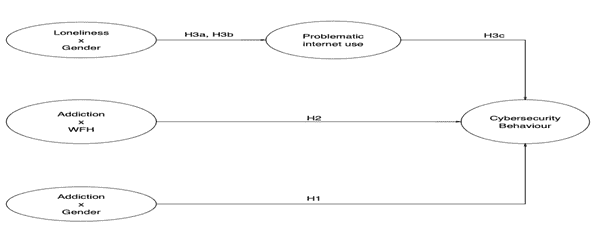 | --- |

-   **METHODOLOGY**  

-   **Participants**  
    本研究是对 `Deutrom et al (2021)` 所进行的疫情期间研究的持续分析，并使用相同的数据集得出结论。数据通过在线调查收集，随机自愿的参与者通过 Prolific 平台招募。Prolific 是一个在线众包平台，参与者自愿登记参与研究。理想情况下，约有 300 名参与者登记，但因一名参与者记录不完整而被剔除，最终使用了 299 名个体的样本，以确保结果的相关性。招募对象来自英国所有地区，涵盖各种能力，每位参与者获得 £1.50（一英镑五十便士）作为参与激励。 

    参与者年龄范围为 18–69 岁，平均年龄为 33.00，标准差（SD）为 .48。在 299 名参与者中，61.20% 为女性（183 人），36.80% 为男性（116 人）。为确保结果的准确性，本研究使用预筛选过滤器，仅限于目前居住在英国且在封锁期间每天在家工作，且在封锁前仅偶尔（<1 天/周）或经常（1 天/周或更多）在家工作的人群。被排除的对象包括仍在封锁期间通勤上班以及在封锁前经常在家工作的人。数据收集于 2020 年 7 月进行，当时英国仍处于封锁状态，许多人仍在远程工作，尽管限制措施已开始放松。实验风险低，已获 Bournemouth University 伦理委员会批准。 

-   **Materials and Design**  
    调查几乎与原始版本完全一致，只是将初始说明改为要求参与者仅根据疫情及封锁期间的经历作答。所选量表因在相关研究中被广泛采用且便于比较而被选用。 

-   **Life Satisfaction**  
    使用 Satisfaction with Life Scale (SWLS) 测量参与者的生活满足度。该量表包含 5 项陈述，例如 “The conditions of my life are excellent”，采用 5 点 Likert 量表（1 = 强烈不同意，7 = 强烈同意）。该量表的优势在于简洁且已被广泛验证（α = 0.87）。可能的最低得分为 5，最高为 35，而 20 分代表量表的中性点。得分低于 10 表示生活极度不满，高于 31 则表示参与者对生活极度满意。 

-   **Loneliness**  
    


-   [孤独度第一阶构造](https://wiki.example.org/feynmans_learning_method)由三个项目组成，基于 UCLA-3 项目孤独度量表 (UCLA-3) (Hughes et al. 2004)。类似于 SWLS，该量表被选用是因为它经过严格测试并被发现可靠 (`α=0.72`)，同时也简洁。量表包含三个项目，其中包括“你感觉缺乏陪伴的频率”。类似于生活满意度量表，分数在 3 点 Likert 量表上测量，范围从 1 到 3，其中 1 表示“几乎从不”，3 表示“经常”。可能的分数范围是 3 到 9，分数与个体的孤独程度呈正相关，即分数越高，个体的孤独程度越高。分数高于 6 被归类为“孤独”。另一个用于测量孤独的量表是 De Jong Gierveld 孤独度量表 (Gierveld & Tilburg, 2006)。然而，本研究未采用该量表，因为它需要面对面访谈，而时间限制使得无法完成。

**有问题的互联网使用**

为测量参与者的互联网成瘾，本研究采用了问题性互联网使用量表简短版 (PIUQ-SF-6) (Demetrovics et al. 2016)。该问卷是一个二阶构造，包含六 (6) 个项目，分布在三个子量表中：沉迷、忽视和控制障碍。PIUQ-SF-6 是其原始 20 项量表 (Thatcher and Goolam 2005) 的缩短版，并已得到验证 (`α=0.77`)。该量表的项目示例包括“你试图隐藏在线时间花费的量吗？”输入是基于 5 点 Likert 量表，范围从 1（从不）到 5（总是）。可能的分数范围是 6 到 30，与参与者的互联网成瘾程度呈正相关，即分数越高，成瘾程度越高。分数高于 15 通常指示成瘾。

**网络安全行为**

为评估网络安全行为，参与者被要求完成由 Egelman et al. (2016) 推荐的安全行为意向量表 (SeBIS)。该量表因其针对终端用户的目标人群而被选中，符合当前样本——远程工作的参与者。之前相关研究 (Hadlington, 2017) (Hadlington & Parsons, 2017) 使用的风险网络安全行为量表被视为 SeBIS 的替代方案，但由于远程工作的特殊条件，该量表中的部分项目不适用于本研究。SeBIS 的优势在于它能够提供一个多维度的测量，预测四个最终得分，分别对应网络安全的不同方面：设备安全、密码生成、主动意识以及更新行为。

SeBIS 量表的项目具体针对这四个子量表，示例项目包括：“我离开电脑时会手动锁定屏幕”对应设备安全，“除非必须，否则我不更改密码”对应密码生成，“别人发给我的链接我会先打开而不检查去向”对应意识，“我会确保使用的程序保持最新”对应更新。SeBIS 表现出高水平的 psychometric 特性和内部一致性 (`α=0.80` 用于整体量表，`α=0.73`、`0.76`、`0.67`、`0.72` 分别对应各子量表)。整体上，SeBIS 量表包含 16 项，分数使用 5 点 Likert 量表测量，范围从 1（从不）到 5（总是），并且与其他量表一样，分数与安全行为呈正相关，即分数越高，安全行为越好。

**其他**

虽然主要问题集中在参与者的认知行为上，但还包括关于工作环境的问题。问题既有开放式也有封闭式，例如：“你一直在携带哪种设备上班？请勾选所有适用项”（封闭式），“COVID-19 封锁对你的工作活动有何影响？请写一段简短描述”（开放式）。其他统计细节来自 Prolific，同时确保符合 GDPR 规定。参与者的详细信息包括就业状态、学生状态、居住国家、在家工作天数等。

**设计**

以往使用该数据的研究主要采用结构方程模型 (SEM) 进行主要分析，以探索变量之间的关系并验证已有假设 (Deutrom et al., 2021)。本研究同样采用定量方法，通过在 JASP 中进行多次线性回归和逻辑回归来检验假设。分析探讨了其他因素对潜变量的影响，进而预测其他变量。例如，前人研究得出 PIU 与 CSB 之间呈负相关。本研究利用多元线性回归展示远程工作 (WFH) 变量对 PIU 的影响，以预测 CSB。

**程序**

在完成调查前，参与者需了解研究细节并确认同意。未给予同意的参与者会被红 irected 至调查结束。为确保正确作答，所有问题均被设置为强制选择。大多数参与者能在八分钟内完成调查。一旦获得同意，参与者首先回答人口统计信息、设备使用及工作环境相关的问题。随后依次回答 SWLS、UCLA-3、PIUQ-SF-6 和 SeBIS 部分。调查结束部分，参与者需回答定性/开放式问题，该问题要求至少输入 150 个字符，且只有在满足此条件后才允许继续到下一阶段。

完成后，参与者会被告知调查成功完成，并被引导回 Prolific 网站确认完成并领取报酬。

数据在 Excel 中汇总后，各问题块的总分被计算，以评估每个认知因子的得分。还为每个认知行为的总分新建了数据集，其中包含二元虚拟变量，表示谱系两端：例如 PIU 类别中，一个虚拟变量代表低成瘾行为（<15），另一个代表高成瘾行为（≥15）。这一原则同样适用于 SWLS、UCLA WFH 变量，以及年龄范围（分为 7 个年龄组）。


此外，为了预测另一个变量的影响，需要将两个哑变量相乘。在本研究中，为评估 WFH 变量对 PIU 的影响以预测网络安全行为，创建了两个包含哑变量的数据集。初始数据集分别为“仅 WFH”和“非 WFH”（注意这两个集合是对立序列的哑变量）。完成此步骤后，将这两个数据集分别独立乘以以 PIU 为分类的哑变量数据集。结果产生两个新数据集，分别代表在家工作的参与者的 PIU 类别和未在家工作的参与者的 PIU 类别。这两个数据集随后用于运行线性回归以预测安全行为，结果记录在案。该过程在当前研究假设相关的多个变量上重复进行。

## 结果

## 描述性统计

## 参与者的人口统计学及其他相关统计数据

基于性别和年龄等潜在变量，获得了一组相对多样的个体样本。如前所述，问卷由 299 名参与者完成，其中 183 名女性，116 名男性。表 1 为参与者按性别划分的人口统计数据提供了统计概览。

**表 1. 参与者人口统计概览**

| 性别 | 频数 | 百分比 |
| --- | --- | --- |
| 女性 | 183 | 61.2% |
| 男性 | 116 | 38.8% |
| 总计 | 299 | 100% |

**表 2. 男性与女性参与者的年龄分布**

|  | 两性年龄分布 |
| --- | --- |
|  | 女性 | 男性 | 总体 |
| 平均值 | 32.404 | 33.931 | 32.997 |
| 标准差 | 7.256 | 9.858 | 8.379 |
| 最小值 | 19 | 18 | 18.000 |
| 最大值 | 58 | 69 | 69.000 |
| 施尔克-威克 | 0.960 | 0.964 | 0.965 |

参与者的年龄进一步分为多个年龄组，如下表 3 所示。

**表 3. 参与者年龄分组类别**

| 年龄（岁） | 类别 | 频数 | 百分比 |
| --- | --- | --- | --- |
| 18-24 | 1 | 38 | 12.7 |
| 25-29 | 2 | 78 | 26.1 |
| 30-34 | 3 | 65 | 21.7 |
| 35-39 | 4 | 59 | 19.7 |
| 40-44 | 5 | 29 | 9.7 |
| 45-49 | 6 | 19 | 6.4 |
| 50+ | 7 | 11 | 3.7 |

参与者在调查中还记录了其学术教育水平。教育程度从没有正式教育到拥有博士学位不等，还提供了“暂不说明”选项供不愿透露相关信息的参与者选择。参与者的学术资格详情如下表 4 所示。

**表 4. 参与者的学术经历**

| 教育水平 | 频数 | 百分比 |
| --- | --- | --- |
| 无正式教育 | 2 | 0.7 |
| 相当于 GCSE | 14 | 4.7 |
| 相当于 A-Levels | 58 | 19.4 |
| 本科学位 | 142 | 47.5 |
| 硕士学位 | 61 | 20.4 |
| 博士 (PhD) | 17 | 5.7 |
| 职业培训课程 | 4 | 1.3 |
| 暂不说明 | 1 | 0.3 |

如表 4 所示，绝大多数参与者拥有本科学位（47.5%），其次是硕士学位（20.4%）和 A-Levels 资格（19.4%）。调查中还记录了参与者的 WFH 数据，且在疫情前后，经常在家工作的人与很少在家工作的人之间存在显著差异。WFH 数据的统计概览如下表 5 所示。

**表 5. 参与者的 WFH 条件**

| 疫情前 WFH 状态 | 频数 | 百分比 |
| --- | --- | --- |
| 很少（每周少于一次） | 205 | 68.6 |
| 有时（每周至少一次） | 94 | 31.4 |

WFH 数据进一步按年龄组分类，以描述之前在家工作和未在家工作的参与者的年龄。未在家工作和在家工作的参与者年龄分布如图 2 和图 3 所示。

**图 2. 非 WFH 条件下参与者年龄分组分布**

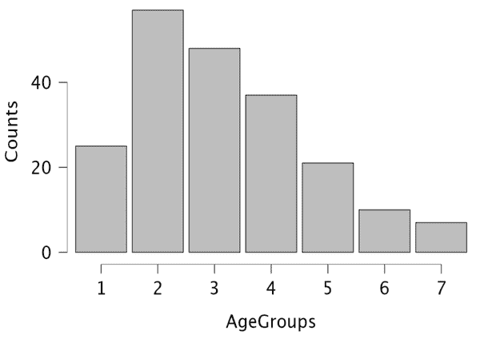

**图 3. WFH 条件下参与者年龄分组分布**

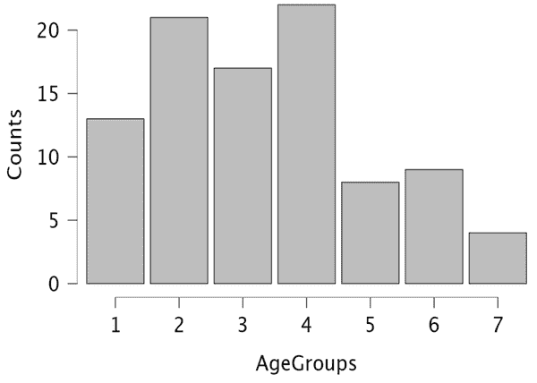

WFH 条件也按性别分类，这对于验证本研究假设，特别是性别的影响尤为重要。图 4 展示了非 WFH 和 WFH 条件下的性别统计数据。

**图 4. 非 WFH 和 WFH 条件下的性别类别统计**

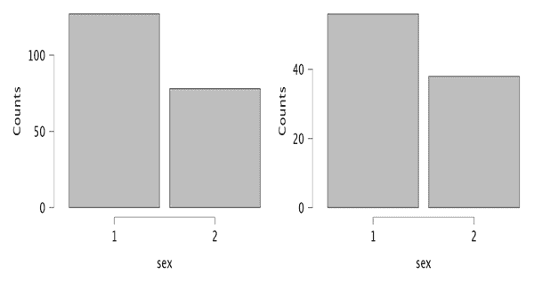

从上述两幅图可观察到，两性在 WFH 和非 WFH 条件下的性别比例相似。虽然两性在疫情前均很少在家工作，但女性比男性更多地在疫情前很少在家工作。在问卷的人口统计部分，参与者被要求记录其设备使用情况，特别是是否共享用于工作的设备。共有 23 名参与者表示共享工作设备，约 233 名参与者表示既使用设备进行个人事务，也用于工作。相关统计概览如下表 6、表 7 和表 8。

**表 6. 按设备共享情况分组的参与者**

| 设备共享 | 频数 | 百分比 |
| --- | --- | --- |
| 是 | 23 | 7.7 |
| 否 | 276 | 92.3 |
| 总计 | 299 | 100% |

**表 7. 参与者的设备使用方式**

| 设备使用 | 频数 | 百分比 |
| --- | --- | --- |
| 仅工作 | 66 | 22.1 |
| 工作和个人 | 233 | 77.9 |
| 总计 | 299 | 100.0% |

**表 8. 按设备数量分组的参与者**

| 使用设备数量 | 频数 | 百分比 |
| --- | --- | --- |
| 1 | 189 | 63.2 |
| 2 | 77 | 25.8 |
| 3 | 25 | 8.4 |
| 4 | 28 | 2.7 |
| 总计 | 299 | 100.0% |

## 心理和认知行为量表


-   如上文所述，调查包含了聚焦于参与者在疫情期间认知行为的问题。参与者报告的统计数据包括生活满意度（SWLS）、孤独量表（UCLA）、有问题的互联网使用（PIUQ）和安全行为（SeBIS）。孤独量表和生活满意度量表的平均值分别为 5.425（满分 9）和 21.107（满分 35），表明大多数参与者在疫情期间感到孤独，并且对生活满意度非常低。对于有问题的互联网使用量表，平均值为 13.699（满分 30），显示大多数参与者呈现中等程度的互联网成瘾。对应的子量表中，平均分别为 4.09（满分 10，痴迷）、4.89（满分 10，忽视）和 4.71（满分 10，控制障碍）。安全行为（SeBIS）分数在父级研究（[Deutrom et al., 2021）中已被分析，子量表（安全、密码、意识和更新）在 Table 9 中显示。

Table 9. Descriptive summary of psychosocial statistics of participants

| 量表 | 平均值 | 标准差 | Shapiro-Wilk | 最小值 | 最大值 |
| --- | --- | --- | --- | --- | --- |
| 生活满意度 | 21.10 | 6.37 | 0.972 | 5.00 | 34.00 |
| 孤独 | 5.42 | 1.88 | 0.912 | 3.0 | 9.00 |
| 有问题的互联网使用 | 13.70 | 4.46 | 0.979 | 6.0 | 27.00 |

为了获得更详细的发现，认知行为测量进一步按性别、在家工作条件以及年龄组进行分类。

孤独 × 地理因素（性别、在家工作、年龄组）

Tables 10、11 和 12 展示了孤独与这些因素结合的详细统计数据。

Table 10. Descriptive overview of loneliness across both genders

|  | 频数 | 平均值 | 标准差 |
| --- | --- | --- | --- |
| Female (1) | 183 | 5.481 | 1.892 |
| --- | --- | --- | --- |
| Male (2) | 116 | 5.336 | 1.865 |

男女参与者孤独量表的图形表示如下 Figure 5：

| Figure 5. Loneliness scale distribution of male and female participants |
| --- |
| 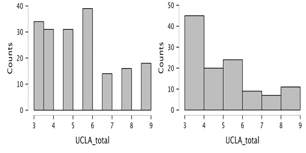 |

虽然平均值看起来相似，但差异实际上很显著。图表显示女性参与者的孤独量表在所有谱系中均匀分布。而男性的情况则不同，图表明更多男性得分低于平均值，意味着他们在疫情期间比女性更不孤独。

Table 11. Descriptive overview of loneliness for WFH conditions

|  | 频数 | 平均值 | 标准差 |
| --- | --- | --- | --- |
| Rarely Worked From home (<once a day per week) | 205 | 5.468 | 1.939 |
| --- | --- | --- | --- |
| Work from home sometimes (>= once a day per week) | 94 | 5.330 | 1.750 |

与性别变量类似，WFH 条件的平均孤独度相对均匀。但差异显著（p<.001）。Figure 6 展示了在疫情前几乎没有在家工作的参与者与已经在家工作的参与者的分布情况。几乎不在家工作的参与者的得分在所有谱系中相对均匀分布，而经常在家工作的参与者大多数得分低于平均值，也就是说，大多数在疫情前已经在家工作的参与者孤独感较低。

| Figure 6. Loneliness distribution across participants categorised by WFH conditions |
| --- |
| 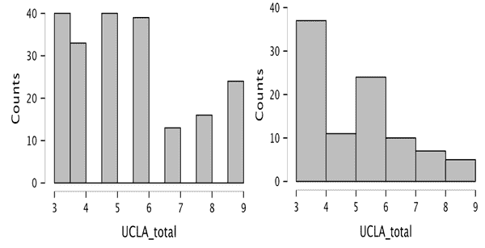 |

孤独水平与年龄组的关系也很有趣。年轻成年人（18-24 岁）的整体平均值最高（6.132），随后中年个体（25-29、30-34、35-39 岁）的平均值约为 5.4。最低平均值（4.789）出现在 45-49 岁的个体中，而 50+ 岁的老年人平均值略高，为 4.909。

Table 12. Loneliness scores of participants categorised by age groups

|  | 频数 | 平均值 | 标准差 |
| --- | --- | --- | --- |
| 1 (18-24) | 38 | 6.132 | 2.042 |
| --- | --- | --- | --- |
| 2 (25-29) | 78 | 5.487 | 1.829 |
| 3 (30-34) | 65 | 5.092 | 1.774 |
| 4 (35-39) | 59 | 5.542 | 1.822 |
| 5 (40-44) | 29 | 5.448 | 1.975 |
| 6 (45-49) | 19 | 4.789 | 1.751 |
| 7 (50+) | 11 | 4.909 | 2.119 |

下面的插图展示了不同年龄组的孤独评分分布。

| Figure 7. Loneliness description for age: Groups 1 and 2 |
| --- |
| 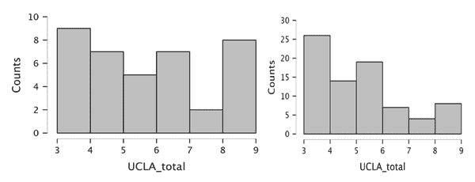 |

| Figure 8. Loneliness distribution for age: Groups 3 and 4 |
| --- |
| 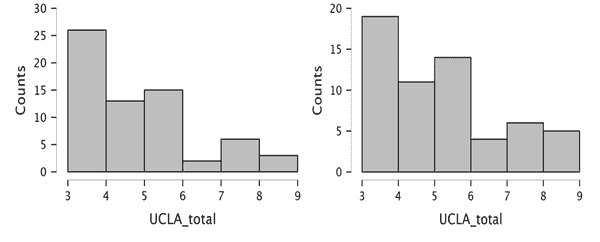 |

| Figure 9. Loneliness distribution of age: Groups 5 and 6 |
| --- |
| 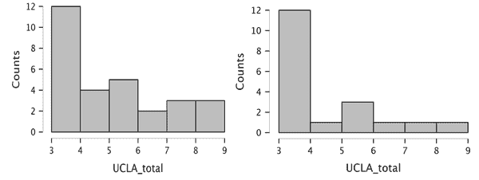 |

| Figure 10. Loneliness distribution of age: Group 7 |
| --- |
| 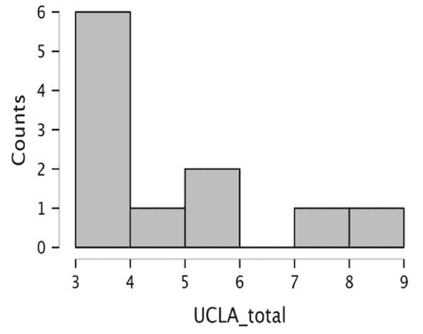 |

从以上插图可以看出，所有年龄组的大多数参与者报告的孤独水平较低（大多数得分在 3/4 之间）。然而，年轻成年人（18-24 岁）的分布与其他组明显不同。与其他组不同，18-24 岁的个体在孤独量表的所有谱系中均匀分布。大约 9 人在孤独评分上非常低，而 8 人以下的参与者出现极高的孤独评分，其余参与者则均匀分布在其他量表上。

中年参与者的分布也相似，大多数在孤独评分上得分非常低。在老年人和老年组（即 45-49 岁和 50+ 岁）之间，存在显著差异：约有 12 名和 6 名参与者在 45-49 岁和 50+ 岁组别中出现非常低的评分，而这两组合计只有 3 名参与者出现高孤独评分。

值得注意的是，尽管所有年龄组的平均孤独评分相对接近，但这些细微差异非常显著。这种相似性可以归因于 UCLA 问卷的评分范围，最小值为 3，最大值为 9。

有问题的互联网使用 × 地理因素

参与者完成 PIUQ-SF-6 问卷后的得分被分析为性别、在家工作条件和年龄组的影响。研究结果揭示了哪个性别更容易出现互联网成瘾、在家工作条件是否影响有问题的互联网使用，以及疫情期间不同年龄组的互联网成瘾情况。

关于性别、在家工作条件和年龄组对 PIU 分数的影响的统计概览如下 Tables 13、14 和 15。

Table 13. Descriptive overview of PIU scores for both genders

|  | 频数 | 平均值 | 标准差 | Shapiro-Wilk | Shapiro-Wilk 的 P 值 |
| --- | --- | --- | --- | --- | --- |
| Female | 183 | 13.699 | 4.392 | 0.976 | 0.975 |
| --- | --- | --- | --- | --- | --- |
| Male | 116 | 13.698 | 4.588 | 0.003 | 0.028 |


-   [PIU 平均分在男性和女性之间相似，说明性别在预测 PIU 时无关。此外，两性的分数分布均匀，正态性检验被拒绝。分数分布如图 14 和 15 所示。]

| Figure 11. PIU score distribution categorised by genders |

| --- |

| 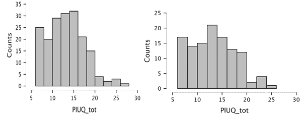 |

| --- |

-   与性别结果类似，将 PIU 分数与在家办公（WFH）条件结合后的发现同样无关。两个条件的均值约相同，说明这是一个无显著预测 Internet 成瘾的因素。PIU 分数的分布如图 16 和 17 所示。值得注意的是，在家办公有时的参与者比疫情前几乎没有在家办公的人得分更高。

Table 14. PIU statistical overview grouped by WFH conditions

|  || Frequency || Mean || Standard Deviation |

| --- | --- | --- | --- |

| Rarely Worked From home (<once a day per week) || 205 || 13.849 || 4.365 |

| --- | --- | --- | --- |

| Work from home sometimes (>= once a day per week) || 94 || 13.372 || 4.672 |

| Figure 12. PIU distribution for both WFH conditions |

| --- |

| 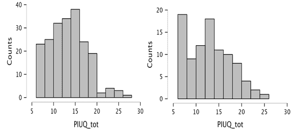 |

| --- |

-   本研究使用了 JASP version 0.16.1 来研究与数据集相关的模式。JASP（Jefferey's Amazing Statistics Program 的缩写）是一款开源软件，主要用于统计和量化分析。在本研究的父项研究中，使用了 AMOS-SPSS 进行量化分析。然而，SPSS 与 MacOS 设备不兼容，这限制了当前研究作者的使用。与 SPSS 不同，JASP 是免费工具，能够执行类似 AMOS-SPSS 的功能。首先进行了 Shapiro-Wilk 测试，并记录其 p 值，以检查变量分布是否为正态。

The Shapiro-Wilk test refers to a statistical test used to check if a continuous variable follows a normal distribution. The null hypothesis H[0] states that the distribution is normal and the alternative hypotheses (H[1]) states that the distribution is not normal. The p-value of the Shapiro wilk test indicates the hypothesis that is valid and accepted. In the context of the current study, the sample size of 299 participants meant that the distribution of the variable needs to be determined so as to choose the appropriate statistical method. The two major hypothesis testing methods are Parametric and Non-Parametric testing. The parametric testing is most applicable to normal distributions while the non-parametric tests are independent of the normality status. The results of Shapiro wilk test and its corresponding p-values for relevant variables in the hypothesis is illustrated in the table below:

Table 15. Statistical tests results of psychosocial metrics

|  || Shapiro-Wilk (W) || P-Value of Shapiro-Wilk |

| --- | --- | --- |

| PIUQ || 0.979 || <.001 |

| --- | --- | --- |

| SWLS || 0.972 || <.001 |

| UCLA || 0.912 || <.001 |

The Shapiro-Wilk test showed that the distributions (PIUQ, SWLS, UCLA) departed significantly from normality (W= .979,.972 and .912, and p-value <.001). Based on this outcome, a non-parametric test was used. To test the relationship between variables relevant in the hypothesis, this study adopts the use of regression analysis to make findings. A combination of multiple linear regression and logistical regression was used to show relationships and determine the factors that are significant predictors of the observed psycho-social variables. For each relationship variable relationship investigated, the overall model summary is reported along with its Anova description and its individual regression results.

Model 1: Multiple Regression Predicting Security Behaviour Using Internet Addiction Levels and WFH Variable

Based on evidence identified in previous literature, internet addiction is known to be a significant predictor of an individual’s online security behaviour (Hadlington & Parsons, 2017). This is confirmed in the current study using a linear regression (p=.002, R²\=0.032), the results signify there is a 3.2% variance in security behavior when addicted users and non-addicted users are compared. Although this value is quite small, the p-value shows that it is a significant difference. This model aims to investigate the impact of WFH conditions mixed with internet addiction levels, as a predictor for cyber security behaviors. The descriptive overview of the combined variable is shown below:

Table 16. Overview of PIUQ and WFH categories together

|  || PIUQ Level |

| --- | --- |

| WFH Conditions ||  || 1 (Unaddicted) || 2(Addicted) || Total |

| 1 (Barely) || 114 || 91 || 205 |

| 2 (Often) || 58 || 36 || 94 |

| Total || 172 || 127 || 299 |

Overall, there are more participants who barely worked from home, as well as participants who exhibit little internet addiction traits. Due to the significant difference in group density, the results can be interpreted in different ways. One way of interpreting this statistical overview is 38% of participants barely worked from home and were not addicted to the internet, a total of 91 participants barely worked from home and suffered problematic internet use, also, there are more participants who often worked from home and are non-addicts (19.4%) compared to those who often worked from home and had no internet regulation (12%). A more detailed way to interpret the statistical overview is addressing each variable with reference to the other variable. That said, the table shows that 62% of individuals who often worked from home are regulated internet users, while 44.3% of those who often work from home are addicted to the internet.

The results of the linear regression of this model are shown below:

Table 17. Model 1 summary

| Model || R || R² || Adjusted R² || RMSE |

| --- | --- | --- | --- | --- |

| H[0] || 0.000 || 0.000 || 0.000 || 8.388 |

| --- | --- | --- | --- | --- |

| H[1] || 0.196 || 0.038 || 0.032 || 8.253 |

The summary model shows the result of all variables taken together, and how these variables combined together predict the security behaviour. The R² value shows the proportion of variance in Security Behaviour that is impacted by the variables put together. In this case, the R² is 0.038, a considerably small value that indicates that there is a 3.8% in variance in security behaviour by both internet addiction and WFH conditions put together. RMSE, short “Root Mean Square Error”, is a measure of how far from the regression line the data points are located. RMSE value for this regression model is 8.253.

Table 18. Model 1 anova summary

| Model ||  || Sum of Squares || df || Mean Squares || F || p |

| --- | --- | --- | --- | --- | --- | --- |

| H[1] || Regression || 805.648 || 2 || 402.824 || 5.914 || 0.003 |

| --- | --- | --- | --- | --- | --- | --- |

|  || Residual || 20163.168 || 296 || 68.119 ||  ||  |

|  || Total || 20968.816 || 298 ||  ||  |


-   [方差分析表](https://en.wikipedia.org/wiki/Analysis_of_variance) 是对整体模型的更详细描述，包含 F 统计量、自由度以及 p 值。F 统计量来源于回归分析，用于判断预测变量的均值是否存在显著差异。统计学中的自由度表示在不破坏模型约束的前提下，可以自由变化的独立变量数量。p 值是模型最重要的特征，表明模型是否具有统计学显著性。当前模型的 p 值（<.001）通过显著性检验（p ≤ 0.05），说明 R² 为 3.8% 的数值是显著的。低方差反映了样本量（299）的影响，同时也表明除上网使用和在家工作条件外，还有其他因素会影响安全行为。

总体而言，该模型解释了约 4% 的安全行为方差，R² = .38，F（2,296） = 5.914，p = .003。单个预测变量的回归系数在下表中给出。回归系数以两种形式呈现：未标准化系数（连同其标准误）和标准化系数。表格还包含 t 统计量，用于推导相应的 p 值。

表 19. 模型 1 系数描述

|  |  |  |  |  |  |  | Confidence Level |
| --- | --- | --- | --- | --- | --- | --- | --- |
| Model |  | Unstandardized | Standard Error | Standardized | t | p | Lower | Upper |
| H[0] | (INTERCEPT) | 56.856 | 0.485 |  | 117.202 | <.001 | 55.902 | 57.811 |
| H[1] | WFH x PIUQ_CAT | -2.229 | 1.104 | -0.186 | -2.020 | 0.044 | -4.401 | -0.057 |
|  | NON_WFH x PIUQ_CAT | -3.240 | 0.979 | -0.304 | -3.311 | 0.001 | -5.166 | -1.314 |

所有变量在预测安全行为时均显著（p < 0.05），但最显著的预测者是通过未标准化系数与标准误的组合，或是使用标准化值来判断。标准化值绝对值最大（无论正负）的变量代表最具影响力的预测因子。在本模型中，未在疫情前经常在家工作的人（β=‑0.304，95%CI = ‑5.166 到 ‑1.314）比经常在家工作的人（β=‑0.186，95%CI = ‑4.401 到 ‑0.057）更能预测安全行为。95% 置信区间衡量估计的精度，意味着有 95% 的概率该模型是准确的。

共线性分析同样报告在结果中，它表明预测变量之间是否存在线性关系。建议 VIF（方差膨胀系数）小于 3，超过 3 则提示预测变量之间存在共线性。

模型 2：线性回归预测问题性互联网使用（PIU），以孤独感和在家工作条件为自变量

文献综述指出，孤独感是问题性互联网使用的显著预测因子（Kim et al., 2009; Davis, 2001）。当前模型验证了这一发现，并进一步探讨在家工作条件对孤独感的影响，进而对 PIU 的预测作用。首先，模型确认了前人研究结果：孤独感显著预测 PIU（p < 0.001，R² = 0.065）。为更深入地探讨孤独感对 PIU 的影响，模型将孤独感与在家工作条件结合，检验其交互作用。下表展示了结合变量的整体统计信息。

表 20. 孤独感与在家工作条件综合概览

|  | Loneliness Level |
| --- | --- |
| WFH Conditions | 1 (Not Lonely) | 2 (Lonely) | Total |
| 1 (Barely) | 92 | 113 | 205 |
| 2 (Often) | 46 | 48 | 94 |
| Total | 138 | 161 | 299 |

图示可从两个视角解读。整体视角显示样本中孤独者更多，孤独与不孤独的比例为 7:6。在 299 名参与者中，约 37.7% 既在疫情前几乎未在家工作又感到孤独，而有 92 人在疫情期间既不孤独又几乎未在家工作。在经常在家工作期间，孤独与否的差异很小，两类人群的比例各约 15%。更细致的描述显示，超过 70% 的孤独者几乎未在家工作，而 48% 的经常在家工作者并不孤独。

与第一模型相同，线性回归用于检验假设。回归结果见表 21。

表 21. 模型 2 总结

| Model | R | R² | Adjusted R² | RMSE |
| --- | --- | --- | --- | --- |
| H[0] | 0.000 | 0.000 | 0.000 | 4.461 |
| H[1] | 0.261 | 0.068 | 0.062 | 4.322 |

模型总结展示了所有变量整体的效果。RMSE 显著低于第一模型的 4.322，说明该回归模型对数据的拟合度更好。R² = 0.068 表明自变量共同解释了 6.8% 的安全行为方差。

表 22. 模型 2 方差分析（ANOVA）概览

| Model | Sum of Squares | df | Mean Squares | F | p |
| --- | --- | --- | --- | --- | --- |
| H[1] | Regression | 805.648 | 2 | 201.480 | 10.788 | <.001 |
|  | Residual | 20163.168 | 296 | 18.676 |  |  |
|  | Total | 20968.816 | 298 |  |  |

方差分析更详细地说明预测变量（孤独感和在家工作）对安全行为的影响。p 值（<.001）表明所选变量是显著的预测因子。尽管 PIU 分数方差很小（如模型总结所示），但变量组合整体显著影响个体的 PIU 类别。最终，整体模型解释了约 6.8% 的 PIUQ 分数方差，R² = .058，F（2,296） = 10.688，p < .001。系数回归模型展示了预测变量如何影响问题性互联网使用得分，详见表 23。

表 23. 模型 2 系数结果

|  |  |  |  |  |  |  | Confidence Level |
| --- | --- | --- | --- | --- | --- | --- | --- |
| Model |  | Unstandardized | Standard Error | Standardized | t | p | Lower | Upper |
| H[0] | (INTERCEPT) | 13.699 | 0.258 |  | 53.097 | <.001 | 13.191 | 14.207 |
| H[1] | WFH x Loneliness CAT | -2.199 | 0.509 | -0.410 | -4.321 | <.001 | -3.201 | -1.198 |
|  | NON_WFH x Loneliness CAT | -2.512 | 0.559 | -0.426 | -4.492 | <.001 | -3.612 | -1.411 |


-   变量的个体条件是有问题的互联网使用的显著预测因素，然而，这两个条件的预测能力差异非常相似。两个变量的 p 值均 <.001，标准化值分别为 WFH 个体和未 WFH 个体的 -0.41 与 -0.426。虽然差异很小，但图示显示在疫情前几乎未在家工作的人是更好的有问题的互联网使用预测者（β =0.426，95%CI=-3.612 到 -1.411），而经常在家工作的人（β =-0.410，95%CI =-3.201 到 -1.198）则不然，无论其孤独水平如何。共线性统计量也随之呈现，两个变量的容忍度和 VIF 分别为 0.35 和 2.855。方差膨胀被认为是良好的（<3），表明这两个变量之间不存在多重共线性。

Model 3 (Part I): Logistical Regression predicting Loneliness Using PIUQ Levels and Female Gender

在前文文献综述中，有人认为孤独是 PIU 的预测因素/原因，这一主张得到大多数研究者和统计研究的支持（Deutrom, 2021）。不过，也有文献指出孤独是 PIU 的结果（[Taylor & Turner, 2002），即 PIU 预测了个体的孤独。本模型旨在检验这一发现，并探讨年龄结合互联网成瘾如何影响孤独水平。首先，孤独分数被分为两类（Lonely 和 Not lonely），通过将分数高于均值者归为“Lonely”，低于均值者归为“Not lonely”。之所以这样做，是因为模型采用逻辑回归来分析假设。逻辑回归用于处理分类问题，即利用自变量预测一个类别型因变量。本模型专注于女性性别，并研究其 PIUQ 分数如何预测其孤独水平。下表展示了该模型的总结：

Table 24. Model 3 summary

| Model || Deviance || AIC || df || X² || p || Tjur R² |
| --- | --- | --- | --- | --- | --- | --- |
| H[0] || 412.731 || 414.731 || 298 ||  ||  ||  |
| --- | --- | --- | --- | --- | --- | --- |
| H[1] || 406.726 || 412.726 || 296 || 6.005 || 0.050 || 0.020 |

模型总结包含偏差（deviance）、艾克信息准则（AIC）、自由度（df）、卡方值、p 值以及 Tjur R² 等特征。偏差和 AIC 都是衡量回归模型拟合程度的指标，其取值范围从零到无穷大。卡方值反映观察频数与期望频数之间的差异，本例中 X² =6.005，表明女性的孤独程度并非仅由 PIU 决定。p 值表明预测变量作为孤独的决定因素的显著性。在当前模型中，p=0.050，说明显著性水平达标，意味着虽然孤独不仅仅取决于 PIU，但 PIU 对女性的影响是显著的。女性 PIU 的具体类别在 Table 25 中解释。

Table 25. Model 3 co-efficient results

|  ||  ||  ||  ||  || Wald Test |
| --- | --- | --- | --- | --- | --- |
|  || Estimate || Standard Error || Odds Ratio || z || Wald Statistic || df || P |
| (Intercept) || 0.243 || 0.187 || 1.275 || 1.297 || 1.681 || 1 || 0.195 |
| Category 1 (Unaddicted || 0.163 || 0.273 || 1.177 || 0.596 || 0.355 || 1 || 0.551 |
| Category 2 (Addicted) || \-0.553 || 0.296 || 0.575 || \-1.868 || 3.491 || 1 || 0.062 |

系数表具体说明 PIU 类别如何预测女性的孤独。关键信息是 **Odds Ratio**，它将模型从概率转换为似然。拦截代表参考类（即连续变量为 0 且类别变量首个水平）的基准值。在本模型中，拦截代表男性性别（无论其 PIUQ 类别如何），因此在此部分不具备直接意义（另一个逻辑回归将专门分析男性 PIUQ 与孤独的关系）。Category 1 表示未成瘾的女性个体，Category 2 表示成瘾的女性个体，其对应的比值为 1.177 和 0.575。

p 值反映两类别的显著性。对于成瘾用户，p=0.062，表明女性的互联网成瘾显著预测其孤独水平。而未成瘾的女性个体的 p=0.551，说明其不显著预测孤独。

JASP 的一个主要优势是能够评估模型的预测性能，即模型预测结果的准确程度。JASP 提供的性能诊断工具包括混淆矩阵。性能诊断结果如下表所示：

Table 26. Model 3 confusion matrix

|  ||  || Predicted ||  |
| --- | --- | --- | --- |
|  || Observed || 1 || 2 || %Correct |
| 1 ||  || 45 || 93 || 32.609 |
| 2 ||  || 33 || 128 || 79.503 |
| Overall %Correct ||  ||  ||  || 57.860 |

混淆矩阵说明正确预测的比例（1,1 和 2,2），非对角线代表错误预测的比例（1,2 和 2,1）。基于混淆矩阵，计算出的性能指标为灵敏度和特异度，结果如下：

Table 27. Model 3 sensitivity and specificity

|  || Value |
| --- | --- |
| Sensitivity || 0.795 |
| --- | --- |
| Specificity || 0.326 |

灵敏度描述真阳性（即正确预测孤独者）所占的比例，特异度则表示真阴性（即正确预测非孤独者）的比例。当前模型的灵敏度为 79.5%，特异度为 32.6%。

Model 3 (Part II): Logistical Regression Predicting Loneliness Using PIUQ Levels and Male Gender

与女性模型分析步骤相同，本部分分析 PIUQ 对男性孤独的预测影响。男性模型结果如下表所示：

Table 28. Model 3 (ii) summary

| Model || Deviance || AIC || df || X² || p || Tjur R² |
| --- | --- | --- | --- | --- | --- | --- |
| H[0] || 412.731 || 414.731 || 298 ||  ||  ||  |
| --- | --- | --- | --- | --- | --- | --- |
| H[1] || 406.338 || 410.338 || 296 || 8.393 || 0.015 || 0.028 |

虽然男性模型的卡方值略高于女性，但这仍意味着男性的孤独程度并非仅由其互联网成瘾水平决定。p=0.015 表明 PIUQ 是男性孤独的显著预测因素。男性 PIU 的具体类别在 Table 29 中解释。

Table 29. Model 3 (ii) co-efficient results

|  ||  ||  ||  ||  || Wald Test |
| --- | --- | --- | --- | --- | --- |
|  || Estimate || Standard Error || Odds Ratio || z || Wald Statistic || df || P |
| (Intercept) || 0.098 || 0.148 || 1.103 || 0.665 || 0.442 || 1 || 0.506 |
| Category 1 (Unaddicted || 0.617 || 0.299 || 1.854 || 2.062 || 4.252 || 1 || 0.039 |
| Category 2 (Addicted) || \-0.470 || 0.326 || 0.625 || \-1.441 || 2.076 || 1 || 0.150 |


-   [PIU 系数表详细说明了 PIU 类别如何特定地预测男性个体的孤独感。]  
    对于本模型的这一部分，截距代表女性性别，与其 PIUQ 类别无关，且在本模型的第二部分不相关。类似于本模型的第一部分，类别 1 代表未上瘾的男性用户，其观测比值为 1.854，而上瘾的男性用户的比值为 0.625。p 值分别为 0.039 和 0.150，表明仅显著的孤独预测者是未上瘾的男性用户。

-   本模型的诊断结果总结在表 30。

**Table 30. Confusion matrix model 3 (ii)**

|  | Predicted |   |   |   |
|---|---|---|---|---|
| Observed | 1 | 2 | % Correct |
| 1 | 29 | 109 | 21.014 |
| 2 | 20 | 141 | 87.578 |
| Overall %Correct |  |  | 56.856 |

**Table 31. Model 3 (ii) sensitivity and specificity**

| Value |
|---|
| Sensitivity | 0.876 |
| Specificity | 0.210 |

**Model 4: Linear Regression Predicting Cyber Security Behavior by Internet Addiction for Both Genders**

如前所述，网络成瘾已被证明是预测个人在线安全行为的显著预测因素。当前模型旨在展示性别对网络成瘾的影响，进而预测网络安全行为。预测变量的描述性概览如下：

**Table 32. PIU and gender overview grouped together**

|  | PIUQ Level |   |   |   |
|---|---|---|---|---|
| Gender |  | 1 (Unaddicted) | 2 (Addicted) | Total |
| 1(Female) | 105 | 78 | 183 |
| 2 (Male) | 67 | 49 | 116 |
| Total | 172 | 127 | 299 |

上述图示表明，女性和男性的未上瘾用户数量更多（分别为 105 和 67），多于各自的上瘾用户。然而，61% 的所有未上瘾用户为女性，而上瘾用户中男性占 38.5%。为观察变量如何共同预测安全行为，进行了线性回归分析，结果如表 33 所示。

**Table 33. Model 4 summary**

| Model | R | R² | Adjusted R² | RMSE |
|---|---|---|---|---|
| H[0] | 0.000 | 0.000 | 0.000 | 8.388 |
| H[1] | 0.186 | 0.035 | 0.028 | 8.270 |

该模型摘要展示了所有变量整体的结果（即 PIU 与性别如何预测安全行为）。R² 为 0.035，说明两个变量共同解释了安全行为得分方差的 3.5%。

**Table 34. Model 4 anova summary**

| Model | Sum of Squares | df | Mean Squares | F | p |
|---|---|---|---|---|---|
| H[1] | Regression | 725.030 | 2 | 362.515 | 5.301 | 0.005 |
|  | Residual | 20243.786 | 296 | 68.391 |   |   |
|  | Total | 20968.816 | 298 |   |   |

如 ANOVA 摘要所示，p 值（0.005）表明模型摘要中 3.5% 的方差是显著的，这意味着预测变量显著影响个体的安全行为。最终，整体模型解释了安全行为得分方差的约 3.5%，R² = 0.035，F(2,296) = 5.301，p = .005。系数摘要说明了各个预测变量如何影响网络安全行为，如表 35 所示。

**Table 35. Model 4 co‑efficient results**

|  |  | Unstandardized | Standard Error | Standardized | t | p | Lower | Upper |
|---|---|---|---|---|---|---|---|---|
| H[0] | (INTERCEPT) | 56.856 | 0.485 |  | 117.202 | <.001 | 55.902 | 57.811 |
| H[1] | Female x PIUQ_CAT | -3.249 | 0.999 | -0.309 | -3.252 | 0.001 | -5.215 | -1.283 |
|  | Male x PIUQ_CAT | -2.618 | 1.048 | -0.237 | -2.499 | 0.013 | -4.680 | -0.556 |

各变量的单独条件均为显著预测因素。标准化值表明女性用户是更强的预测因素（β = -0.309），而男性用户则较弱（β = -0.237）。尽管如此，两性无论其 PIU_CAT 如何，都显著影响安全行为，女性的 p 值为 0.001，男性的 p 值为 0.013。95% 置信区间分别为 -5.215 至 -1.283（女性）和 -4.680 至 -0.556（男性）。

**Summary of Results**

本章节成功展示了在 JASP 上进行的定量分析结果，并构建了 4 个模型以验证/否定当前研究的假设。模型 1 侧重于利用疫情期间偶尔在家工作与经常在家工作的群体的 PIU 分数预测安全行为，与 H[1] 相关。模型 2 阐述了孤独感与在家工作条件如何预测疫情期间用户的网络成瘾，这与隔离主题相呼应，与 H[2] 相关。模型 3 与模型 2 相反，基于多篇文献指出孤独是网络成瘾的结果而非原因，因此使用逻辑回归预测个体的孤独感，依据其网络成瘾程度和性别。模型分为女性和男性两部分，结果分别对应 H3a 和 H3b。最终模型用于预测两性的网络成瘾水平对安全行为的影响，以分析 H3c。假设结果将在后续讨论中阐述，并与相关文献进行比较。

**DISCUSSION**

尽管疫情在英国尤其显著地减弱，但其影响仍在持续，难以断言生活会完全回到疫情前的状态。主要组织决定更频繁地采用远程办公，甚至放弃传统的现场作业模式，只要在线执行可行。因此，分析疫情的心理与行为影响以及这些因素如何预测在线安全行为至关重要。作为父本研究（Deutrom et al., 2021）的后续，当前研究旨在分析因疫情产生的心理社会因素之间的关系，并突出其他人口学因素的影响，同时展示这些关系。本研究使用与父本研究相同的数据，但采用线性和逻辑回归预测多种行为。

**Overview of Present Research Findings**

第一模型用于分析第一个假设（h1），即在家工作条件显著影响网络成瘾，进而预测在线安全行为。这意味着在疫情前仅偶尔在家工作的上瘾用户比经常在家工作的用户更易受网络攻击。该模型显示，结合在家工作条件与网络使用，两者均为显著预测因素（p=0.044 与 0.001）。具体而言，偶尔在家工作的人是更强的预测因子（β = -0.304），而经常在家工作的人则较弱（β = -0.186）。  


-   [负系数](https://example.org)表明标准化值在回归中与因变量呈负相关。在本模型的语境下，负系数表明在两类远程办公（WFH）条件下，网络成瘾用户的安全行为评分低于未成瘾用户。系数越强，说明远程办公时间极少的人更容易受到网络攻击。总体而言，该模型显示，在疫情爆发前远程办公时间极少的网络成瘾用户是最脆弱的群体，更可能表现出线上风险行为。

1.  基于此结果，第一个假设（H1）被接受。该发现与现有报告一致，指出工作环境对促进设备和数据安全具有重要作用。传统工作场景中，工作环境受明确的政策规范，必须严格遵守，否则会受到处罚。突然转变为远程办公结构，导致那些之前因严格的安全政策感到负担感的员工产生懈怠情绪。常见的心理反应是**反抗**（reactance），即人们在被迫或被告知做某事时，如果不愿做，就会产生的反应。通常人们不喜欢被指令，也不愿意遵循他们不认同的行为（`Zhang et al. 2017`），他们会为了维护自我自由而偏离建议的行为。

2.  因此，那些将安全实践视为琐事而非责任的员工，更可能因误解网络安全政策的重要性而表现出反抗行为。远程办公结构缺乏传统办公环境中那种严格的监督，进一步鼓励了这种反应性行为。`Deutrom et al (2021)` 已经确认，冲动型网民往往表现出风险性上网行为。对于远程办公时间极少的人而言，这种风险会被放大。而远程办公时间较长的人则可能因为已经熟悉远程办公模式、了解其中的风险，并意识到良好上网行为的重要性，从而较不易受到网络攻击的侵害。

3.  有趣的是，大多数长期远程办公的人群主要集中在 IT 和学术界，他们对安全实践的认知比非 IT 专业人士更为敏锐（`Bick et al., 2021`）。结合疫情期间的孤独感与远程办公条件，证明是影响问题性互联网使用的显著预测因素。类似于第一个模型，第二个模型指出，感到孤独且远程办公时间极少的人受问题性互联网使用影响最大，更可能表现出冲动性上网行为。在该模型中，孤独感以及远程办公时间极少这两类条件共同显著预测了问题性互联网使用（p<0.001，两类均显著）。

4.  结果显示两类条件的标准化系数（β=-0.410 和 -0.426）相似。正如前面模型所示，系数为负，意味着它们与自变量（在此为 PIU）呈负相关，即自变量越大，因变量越小。因此，感到孤独的人更容易表现出冲动性上网行为，尤其是远程办公时间极少的人。这表明第二个假设（H2）得到验证并被接受。办公场所的安全政策不仅能促进良好的上网安全行为，还能规范员工的互联网使用。大多数公司限制互联网仅允许工作相关活动，从而确保员工的上网行为受到规范。远程办公模式缺乏这种安全实践，因为大多数用户在家使用个人 Wi‑Fi。对于感到孤独的人而言，疫情封锁无疑加剧了孤独感，风险随之上升。

5.  对于那些习惯于在实体工作环境中通过物理空间缓解孤独的人，远程办公结构放大了他们的孤独感。孤独水平升高以及突如其来的远程办公转变，使人们倾向于通过互联网来减轻孤独，这有时会导致冲动性上网。

6.  第三模型被分为两部分，分别针对男女预测孤独感与冲动行为。每一部分的结果均聚焦于各自性别。本研究认为，成瘾的女性互联网用户比男性更孤独。第一部分的逻辑回归结果显示，未成瘾的女性用户在预测孤独感时不显著（p=0.551），而成瘾的女性用户则显著预测孤独感。逻辑回归表明，成瘾的女性用户出现孤独的可能性为 57.7%（Odds Ratio = 0.575）。因此，假设 h3a 在这一分析中未得到确认。

7.  男性个体的模型结果则呈现不同情况。结果显示，成瘾的互联网用户对男性孤独感并不显著（p=0.150），而未成瘾的男性用户显著影响孤独感。这一发现颇为令人困惑，因为未成瘾男性用户的比值为 1.184。比值为 1 表示预测变量与被预测变量相互独立；尽管未成瘾男性用户与问题性互联网使用之间存在显著关系，其比值（1.854）仍表明两者相互独立。相反，经历问题性互联网使用的男性用户，虽然不显著，但其出现孤独症状的可能性高达 62.5%。

8.  综合两部分模型来看，不论性别，成瘾用户更容易出现孤独行为。其中，成瘾的男性用户出现孤独的可能性最高（62.5%），而成瘾的女性用户则为 57.7%。这验证了假设 3a 和 3b，表明成瘾者更孤独，尤其是男性。该结论与解释成瘾往往导致隔离和孤独的报告一致（`Su et al. 2020`）。在线游戏和社交媒体是两性冲动性互联网使用的主要驱动因素。男性大多因游戏成瘾而长时间上网，而男女都成瘾于社交媒体，这种现象在青少年和年轻成年人中尤为突出，因为他们的社交身份至关重要。对这些互联网服务的成瘾导致感官减弱，并使其与现实世界的互动脱节。

9.  当前研究的最终假设聚焦于通过互联网成瘾预测男女的在线安全行为。采用线性回归进行评估。男女结合其问题性互联网使用（PIU）类别均显著预测安全行为（p=0.001，p=0.013）。分析结果显示，女性用户的标准化系数更强（Odds Ratio = -0.309），而男性的比值为 -0.237。负系数表明 PIU 与性别之间与安全行为（SeBis）呈负相关。成瘾的女性用户最有可能表现出高风险的网络安全行为，这与男性成瘾者更易孤独的发现形成对比。


The result of this model is also contradictory with previous literatures that have explained that women are less likely to be exploited online compared to men (`Rawlings 2020`). The research identifies that woman generally exhibit safe password practices compared to male. That said, the result of this model can be as a result of the difference in sample size of both male and female participants.

Recommendations

This current research has made detailed findings regarding different groups categorised by psychosocial and demographic combinations. The findings have showed that certain groups of individuals are more susceptible to PIU, loneliness and risky cyber security behaviour. The following are recommendations that will improve online security behaviour as well as impulsive internet use among all the identified groups.

Cybersecurity Awareness Campaigns

While security policies are prioritized in most organisation, security awareness is an often-overlooked factor within these companies. Security awareness campaigns refer to a public awareness effort aimed at increasing the understanding of cyber threats and empowering people to be safer and more secure online (`CISA, 2021`). Considering the sudden change of work conditions, security policies is not as effective when people are made to work from home. Especially for employees who never understood the importance of security and only regard the policies as a burden. When an organisation’s employees are cyber security aware, it means that they understand what cyber threats are, its possible impacts, and the steps required to minimise risk (`Aloul, 2012`). This encourages them to practice safe online security behaviors irrespective of the WFH conditions.

Awareness campaigns are to be carried out strategically to achieve effective result and change behaviors online. There are frameworks for changing online behaviors and raising awareness. Among others, MINDSPACE framework is one of the most effective methods of carrying out awareness programs (`Dolan et al 2012`). It focuses on nine forces that drive behaviour across a variety of contexts. The nine forces are: `Messenger`, `Incentives`, `Norms`, `Defaults`, `Salience`, `Priming`, `Affect`, `Commitments`, `Ego`. It is worth noting that this framework is not an alternative to the current policy making methods, instead, it complements them to integrate behavioural science into the process (`Dolan et al., 2012`). Other frameworks for raising awareness and changing security behaviour include Fogg’s Model (`Fogg, 2009`) and Cialdini’s six principles of persuasion (Cialdini, 2007).

| Figure 13. Fogg's model |

| --- |

| 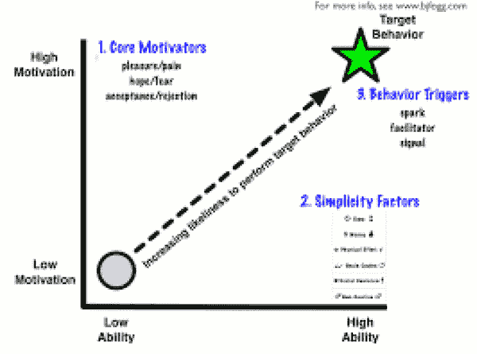 |

| --- |

| *Source: Fogg (2009)* |

LIMITATIONS

Although awareness campaign is the best method of influencing people towards changing online behaviour, effective influencing requires more than just informing people about what they should and shouldn’t do. Among others, a common limitation with awareness campaign is fear invocations (Ahluwalia, 2000). Users may find the message funny and approach the information with a nonchalant attitude, rather than understanding its importance. Cultural differences in risk perceptions can also influence the inability to change behaviour. People from different parts of the world have different mentality towards their online behaviour which is a reflection of their experiences. As such, it is usually difficult to people to adopt new behaviors even if they are willing to do so. This is backed up by other literature that explains that even when people are willing to change their behaviour, the process of learning a new behaviour needs to be supported (Higgins, 1998). Therefore, cultural differences should be considered when planning a cyber security awareness campaign.

Periodic Measurement of Psychosocial Behaviors

Multiple literature has stated that the biggest impact of the pandemic exists in the mental/psychological well-being of people (`Davillas & Jones, 2020`; `Pierce et al., 2021`). Companies need to pay attention to the mental status of its employees take adequate measures to achieving a positive mental state for all its staff. This research along with its parent research has highlighted the impact of loneliness and how it affects PIU. Loneliness along with other psychosocial behaviour should be measured periodically in workplaces, to create a healthy psychosocial space within work environment. After measuring loneliness in among employees, it is important to consider people who are lonely while enforcing WFH conditions. One idea is to give room for lonely people to visit the office at least once in a week. This ensures that there is always something for them to look forward to, as well as a form of accountability to distract them from being lonely while working from home.

Limitations:

Humans often have mental shortcuts when making judgements, particularly when it has to do with a self-report. These shortcuts are called Heuristics. Heuristics can be manifesting in different ways, for example, availability heuristics occurs when people use the information that comes to mind quickly to make decisions about the future (`Keller et al., 2006`). In the context of this recommendation, people are likely to think they are not lonely and general false reports of low loneliness level in the psychometrics.

Redefining Social Norms

There are multiple factors that significantly affect PIU across both genders including internet availability and psychological well-being. A major contributor to the differences in gender addiction is in social norms. According to WHO (2010), Gender-related norms and values may influence male and female exposure to environmental and online risks in different ways, including through the types of behaviour they adopt. Depending on the age group, there are various social norms for both genders that defines their use of the internet. Their online behaviour is usually defined by their social identity, which often results in a need to conform to social norms.

`Goffman (1956)` explains the concept of impression formulation stating that “humans display a series of masks to others, enacting roles, controlling and staging how they appear and come across so they set themselves in the best light”. In a bid to control and match social identity online, people are made to conform to social norms such as sharing excess information online, which leads to PIU. Such social norms should be redefined by relevant organisations and bodies, to promote safer security practices online. It is important to note that this recommendation follows with awareness campaigns as the redefinition of social norms can also be publicised.

Limitations of Methodology


本研究主要受限于将 PIU 和 CSB 作为整体量表进行测量，而非其子量表。尽管本研究强调了 PIU 的多种形式，如在线游戏、社交媒体成瘾等，但其在测量 PIU 时并未引用这些定义行为。相关文献则强调了某些定义的高风险网络安全行为（Dufour et al., 2016; Su et al., 2020）。例如，Su et al. (2019) 特别指出男性更易沉迷网络游戏，女性更易沉迷社交媒体。与这些研究不同，本研究采用 PIUQ-SF-6 标准测量整体性的问题性互联网使用，而非其细分表现。

这也意味着参与者仅根据他们所认知的问题性互联网使用情况回答问卷。例如，一些参与者认为花费过多时间并不导致 PIU，可能会因信念而削弱自己的行为，但实际上他们确实存在 PIU。尽管如此，这并不削弱当前发现的有效性，因为无论互联网使用差异如何，自报数据仍然反映认知的 PIU，其影响力与实际 PIU 相当。

此外，本研究主要探讨心理社会因素和人口统计因素与行为的关系，特别是在疫情期间。尽管问卷明确要求参与者仅基于疫情期间的经历作答，但对疫情前这些人的状态进行了解会有助于更详细的发现和决策。但由于疫情的特殊性，此类数据无法获取，而是用现有文献替代以进行比较。

本研究采用回归技术进行分析和预测。回归分析的一个主要局限性是对异常值不敏感。异常值指的是在数据集中，其残差相对于其他观测值显著更大的观测。尽管如此，JASP 提供了检查数据集中异常值影响的方法。结果显示，异常值并未显著影响分析结果。

与所有涉及参与者自报数据的研究一样，结果通常受到参与者偏见的影响。自利偏差（self-serving bias）是指人们将积极事件归因于自身特质，而将消极结果归因于与自身性格无关的外部因素（Forsyth 2008）。这使得参与者倾向于以有利于自己的方式作答（Donaldson and Grant-Vallone 2002）。然而，由于问卷以线上方式进行且保证了匿名性，这一偏见的影响被认为得以最小化。

此外，本研究受限于参与者性别密度的差异，女性比例超过 60%，男性比例不足 40%。挪威研究委员会（2020）强调性别平衡对提升研究的科学质量和社会相关性的重要性。理想的性别比例应在 60% 与 40% 之间，且越接近越好。虽然我们的研究性别比例未在推荐范围内，但大样本量确保了发现的显著性。此外，性别失衡并未达到统计学显著性，与其他心理社会因素结合降低了相关风险。

## FUTURE RESEARCH DIRECTIONS

随着疫情逐渐消退，生活正逐步回归疫情前的状态。未来研究可以收集新数据，并将其结果与当前研究及其父级研究（Deutrom et al. 2021）进行比较，观察发现是否增强或削弱。此外，未来研究还可聚焦于更具体的问题性行为及其对应的高风险行为。例如，研究结果可能显示，沉迷社交媒体的人更可能将工作电脑置于未 attended 状态。

## CONCLUSION

本研究旨在通过结合心理社会因素和参与者的人口统计特征，预测与网络安全相关的行为，特别是在新冠疫情期间。当前研究的发现为已有文献中关注心理社会行为的研究提供了补充，特别是在封锁期间聚焦于问题性互联网使用（PIU）、孤独感和冲动性行为障碍（CSB）的研究。工作从家（WFH）条件与网络成瘾的结合表明，那些在疫情前几乎未从家中工作的成瘾用户是最易受影响的群体。工作从家条件也与个体的孤独状态结合考虑。结果显示，尽管差异很小，但因疫情而首次接触工作从家结构的孤独者表现出冲动性互联网行为。此外，研究发现男性网络成瘾者更可能感到孤独，而女性成瘾用户则是最可能成为网络攻击受害者的群体。本研究最有趣的发现是，成瘾的女性用户最有可能遭受网络攻击。

基于前文讨论的发现，提出了相关的建议，包括开展战略意识宣传活动以及改变两性的社会规范。尽管本研究受限于多种因素，如参与者的自利偏差和性别比例失衡，但其结果的有效性在上述局限性下仍得以证明。未来研究建议开展新的调查，以识别具体的 PIU 行为，并用其预测相应的安全行为。考虑到疫情的长期影响以及远程工作作为常态的采纳，本研究的发现未来仍可能保持相关性。

## REFERENCES

Aivazpour, Z. (2019). Impulsivity and Risky Cybersecurity Behaviors: A Replication Impulsivity View project. Academic Press.

Aloul, F. A. (2012). The Need for Effective Information Security Awareness. Journal of Advances in Information Technology, 3(3). Advance online publication. doi:[10.4304/jait.3.3.176-183](https://doi.org/10.4304/jait.3.3.176-183)

Anderson, A. J., Kaplan, S. A., & Vega, R. P. (2014). The impact of telework on emotional experience: When, and for whom, does telework improve daily affective well-being? European Journal of Work and Organizational Psychology, 24(6), 882–897. doi:[10.1080/1359432X.2014.966086](https://doi.org/10.1080/1359432X.2014.966086)

Anderson, R., Barton, C., Böhme, R., Clayton, R., Gañán, C., Grasso, T., Levi, M., Moore, T., & Vasek, M. (2019). Measuring the Changing Cost of Cybercrime. Available from: [`www.paccsresearch.org.uk/wpcontent/uploads/2019/06/WEIS_2019_paper_25.pdf`](https://www.paccsresearch.org.uk/wpcontent/uploads/2019/06/WEIS_2019_paper_25.pdf)

Andreassen, C. S., Griffiths, M. D., Gjertsen, S. R., Krossbakken, E., Kvam, S., & Pallesen, S. (2013). The relationships between behavioral addictions and the five-factor model of personality. Journal of Behavioral Addictions, 2(2), 90–99. doi:[10.1556/JBA.2.2013.003](https://doi.org/10.1556/JBA.2.2013.003)

Apollo Technical. (2021). Statistics On Remote Workers That Will Surprise You (2021). Apollo Technical LLC. Available from: [`www.apollotechnical.com/statistics-on-remote-workers/`](https://www.apollotechnical.com/statistics-on-remote-workers/)


-   [阿亚布, C. A. M., 斯佩萨诺, M., 阿姆斯特朗, L., 艾姆斯, J., 菲利普斯, G., & 萨林, L. (2000). 可能导致更高互联网使用的因素。相关论文 问题手机使用的心理预测因素 格蕾特尔 关于古德曼的成瘾标准的调查 潜在更高互联网使用。国际人机交互研究杂志, 53, 537–550.]

-   [Bellekens, X. (2021). 网络安全在 COVID-19 时代：一份时间线和对大流行期间网络犯罪和网络攻击的分析与分析。计算机与安全, 105, 102248. doi:`[10.1016/j.cose.2021.102248](https://doi.org/10.1016/j.cose.2021.102248)`

-   [Bick, A., Blandin, A., & Mertens, K. (2021). 在 COVID-19 爆发前后的远程工作。达拉斯联邦储备银行工作论文。]

-   [Błachnio, A., Przepiorka, A., Senol-Durak, E., Durak, M., & Sherstyuk, L. (2017). 人格特质在 Facebook 和互联网成瘾中的作用：波兰、土耳其和乌克兰样本的研究。计算机与人类行为, 68, 269–275. doi:`[10.1016/j.chb.2016.11.037](https://doi.org/10.1016/j.chb.2016.11.037)`

-   [Bonenberger, A. (2020). 在隔离期间掉进裂缝。可从: `[`medicine.yale.edu/news-article/falling-through-the-cracks-in-quarantine/`](https://medicine.yale.edu/news-article/falling-through-the-cracks-in-quarantine/)`]

-   [Borlovich, D., & Skovira, R. (2020). 在家工作：COVID-19 时代的网络安全。信息系统问题。]

-   [Boyce, M. W., Duma, K. M., Hettinger, L. J., Malone, T. B., Wilson, D. P., & Lockett-Reynolds, J. (2011). 人类在网络安全中的表现：研究议程。人因与工程学会年度会议论文集, 55(1), 1115–1119. doi:`[10.1177/1071181311551233](https://doi.org/10.1177/1071181311551233)`

-   [Brenner, V. (1997). 计算机使用心理学：XLVII. 互联网使用、滥用和成瘾的参数：互联网使用调查的前 90 天。心理报告, 80(3), 879–882. doi:`[10.2466/pr0.1997.80.3.879](https://doi.org/10.2466/pr0.1997.80.3.879)`

-   [Brooks, S. K., Webster, R. K., Smith, L. E., Woodland, L., Wessely, S., Greenberg, N., & Rubin, G. J. (2020).  quarantine 的心理影响及如何减轻它：快速回顾证据。 [online]。柳叶刀, 395(10227), 912–920. doi:`[10.1016/S0140-6736\(20\)30460-8](https://doi.org/10.1016/S0140-6736\(20\)30460-8)`

-   [Bryan, K. (2020). 诈骗者冒充航空公司和泰斯科在新冠疫情诈骗。 `[`www.thetimes.co.uk/article/fraudsters-impersonate-airlines-and-tesco-in-coronavirus-scams-5wdwhxq7p`](https://www.thetimes.co.uk/article/fraudsters-impersonate-airlines-and-tesco-in-coronavirus-scams-5wdwhxq7p)`]

-   [Calic, D., Pattinson, M., Parsons, K., Butavicius, M., & Mccormac, A. (2016). 无知和 accidental 行为会损害信息安全：专家的看法。阿卡德出版社。]

-   [Caplan, S., Williams, D., & Yee, N. (2009). 问题性互联网使用及其对 MMO 玩家心理福祉的影响。计算机与人类行为, 25(6), 1312–1319. doi:`[10.1016/j.chb.2009.06.006](https://doi.org/10.1016/j.chb.2009.06.006)`

-   [Caplan, S. E. (2002). 问题性互联网使用和心理福祉：基于理论的认知行为测量工具的发展。计算机与人类行为, 18(5), 553–575. doi:`[10.1016/S0747-5632\(02\)00004-3](https://doi.org/10.1016/S0747-5632\(02\)00004-3)`

-   [Caplan, S. E. (2003). 在线社交互动的偏好。传播研究, 30(6), 625–648. doi:`[10.1177/0093650203257842](https://doi.org/10.1177/0093650203257842)`

-   [Cellini, N., Canale, N., Mioni, G., & Costa, S. (2020). 在意大利 COVID-19 隔离期间，睡眠模式、时间感知和数字媒体使用的变化。睡眠研究杂志, 29(4). 提前在线出版. doi:`[10.1111/jsr.13074](https://doi.org/10.1111/jsr.13074)`

-   [Chung, H., Seo, H., Forbes, S., & Birkett, H. (2020). 在 COVID-19 隔离期间远程工作：偏好变化及未来工作的前景。可从: `[`kar.kent.ac.uk/83896/`](https://kar.kent.ac.uk/83896/)`]

-   [Ciotti, M., Ciccozzi, M., Terrinoni, A., Jiang, W.-C., Wang, C.-B., & Bernardini, S. (2020). COVID-19 大流行。临床实验室科学综述, 57(6), 365–388. doi:`[10.1080/10408363.2020.1783198](https://doi.org/10.1080/10408363.2020.1783198)`

-   [CISA. (2021). CISA 网络安全意识计划。可从: `[`www.cisa.gov/cisa-cybersecurity-awareness-program`](https://www.cisa.gov/cisa-cybersecurity-awareness-program)`]

-   [Cryan, J. F., & Holmes, A. (2005). 鼠标的崛起：建模人类抑郁和焦虑的进展。自然药物发现, 4(9), 775–790. doi:`[10.1038/nrd1825](https://doi.org/10.1038/nrd1825)`

-   [Cullen, W., Gulati, G., & Kelly, B. D. (2020). COVID-19 大流行期间的心理健康。QJM：国际医学杂志, 113(5). 可从: `[`academic.oup.com/qjmed/article/113/5/311/5813733?login=true`](https://academic.oup.com/qjmed/article/113/5/311/5813733?login=true)`

-   [Cyber Ark. (2018). 调查：46% 的组织在网络攻击后未能改变安全策略。CyberArk。2022 年 5 月 6 日检索，来源: `[`www.cyberark.com/press/global-advanced-threat-landscape-report-2018/`](https://www.cyberark.com/press/global-advanced-threat-landscape-report-2018/)`]

-   [Davillas, A., & Jones, A. M. (2020). COVID-19 大流行对英国心理困扰机会不平等的影响。可从: `[`papers.ssrn.com/sol3/papers.cfm?abstract_id=3614940`](https://papers.ssrn.com/sol3/papers.cfm?abstract_id=3614940)`]

-   [Davis, R. A. (2001). 病理性互联网使用的认知行为模型。计算机与人类行为, 17(2), 187–195. doi:`[10.1016/S0747-5632\(00\)00041-8](https://doi.org/10.1016/S0747-5632\(00\)00041-8)`

-   [Dawson, J., & Thomson, R. (2018). 未来网络安全人才：超越技术技能，实现卓越网络性能。Frontiers in Psychology, 9, 9. doi:`[10.3389/fpsyg.2018.00744](https://doi.org/10.3389/fpsyg.2018.00744)`

-   [Demetrovics, Z., Király, O., Koronczai, B., Griffiths, M. D., Nagygyörgy, K., Elekes, Z., Tamás, D., Kun, B., Kökönyei, G., & Urbán, R. (2016). 问题性互联网使用量表短版（PIUQ-SF-6）在全国代表性青少年样本中的 psychometric 属性。PLoS One, 11(8), e0159409. doi:`[10.1371/journal.pone.0159409](https://doi.org/10.1371/journal.pone.0159409)`

-   [Deutrom, J., Katos, V., Al-Mourad, M. B., & Ali, R. (2022). 性别、生活满意、孤独与 COVID-19 期间问题性互联网使用之间的关系：隔离是否重要？环境研究与公共卫生杂志, 19(3), 1325. doi:`[10.3390/ijerph19031325](https://doi.org/10.3390/ijerph19031325)`

-   [Deutrom, J., Katos, V., & Ali, R. (2021). 隔离期间的孤独、生活满意、问题性互联网使用和安全行为：重新审视工作在家的关系。行为与信息技术, 1–15.]

-   [Dolan, P., Hallsworth, M., Halpern, D., King, D., Metcalfe, R., & Vlaev, I. (2012). 影响行为：思维空间的方法。经济心理学杂志, 33(1), 264–277. doi:`[10.1016/j.joep.2011.10.009](https://doi.org/10.1016/j.joep.2011.10.009)`

-   [Donaldson, S. I., & Grant‑Vallone, E. J. (2002). 理解组织行为研究中的自报偏差。商业与心理学杂志, 17(2), 245–260. doi:`[10.1023/A:1019637632584](https://doi.org/10.1023/A:1019637632584)`

-   [Dufour, M., Brunelle, N., Tremblay, J., Leclerc, D., Cousineau, M.-M., Khazaal, Y., Légaré, A.-A., Rousseau, M., & Berbiche, D. (2016). 蒙特利尔高中生性别差异在互联网使用和互联网问题中的研究。加拿大精神病学杂志, 61(10), 663–668. doi:`[10.1177/0706743716640755](https://doi.org/10.1177/0706743716640755)`


-   [杜拉克, M., & 塞诺-杜拉克, E. (2014). 哪些人格特质与有问题的互联网使用相关的认知有关？](https://doi.org/10.1111/ajsp.12056)(https://doi.org/10.1111/ajsp.12056) Asian Journal of Social Psychology, 17(3), 206–218.

-   [EgelmanS.HarbachM.PeerE. (2016). 行为是否跟随意图？2016 年人机交互会议论文集。](https://doi.org/10.1145/2858036.2858265)(https://doi.org/10.1145/2858036.2858265) doi:`[10.1145/2858036.2858265]`(`https://doi.org/10.1145/2858036.2858265`)

-   [Egelman, S., & Peer, E. (2015). 预测隐私和安全态度。](https://doi.org/10.1145/2738210.2738215)(https://doi.org/10.1145/2738210.2738215) Computers & Society, 45(1), 22–28. doi:`[10.1145/2738210.2738215]`(`https://doi.org/10.1145/2738210.2738215`)

-   [Erwin, B. A., Turk, C. L., Heimberg, R. G., Fresco, D. M., & Hantula, D. A. (2004). 互联网是否是社交焦虑障碍严重人群的聚集地？](https://doi.org/10.1016/j.janxdis.2003.08.002)(https://doi.org/10.1016/j.janxdis.2003.08.002) Journal of Anxiety Disorders, 18(5), 629–646. doi:`[10.1016/j.janxdis.2003.08.002]`(`https://doi.org/10.1016/j.janxdis.2003.08.002`)

-   [Feldmann, A., Gasser, O., Lichtblau, F., Poese, I., Christoph, B., De-Cix, D., Wagner, D., De-Cix, M., Tapiador, J., Vallina-Rodriguez, N., Hohlfeld, O., Smaragdakis, G., & Berlin, T. (2020). 封锁效应：新冠疫情对互联网流量的影响。](https://doi.org/10.1111/ajsp.12056)(https://doi.org/10.1111/ajsp.12056) Enric Pujol BENOCS, 20.

-   [Fiske, D. W. (1949). 来自不同来源的人格评分的因子结构的一致性。](https://doi.org/10.1037/h0057198)(https://doi.org/10.1037/h0057198) Journal of Abnormal and Social Psychology, 44(3), 329–344. doi:`[10.1037/h0057198]`(`https://doi.org/10.1037/h0057198`)

-   [Fogg, B. (2009). 说服设计行为模型。](https://doi.org/10.1145/2858036.2858265)(https://doi.org/10.1145/2858036.2858265) Academic Press.

-   [Forsyth, D. R. (2008). 社会科学国际百科全书。](https://scholarship.richmond.edu/cgi/viewcontent.cgi?article=1164&context=jepson-faculty-publications) Available from: `https://scholarship.richmond.edu/cgi/viewcontent.cgi?article=1164&context=jepson-faculty-publications`

-   [Furnell, S., & Clarke, N. (2012). 权力归人民？安全的人类因素的不断承认。](https://doi.org/10.1016/j.cose.2012.08.004)(https://doi.org/10.1016/j.cose.2012.08.004) Computers & Security, 31(8), 983–988. doi:`[10.1016/j.cose.2012.08.004]`(`https://doi.org/10.1016/j.cose.2012.08.004`)

-   [Garfin, D. R. (2020). 技术作为应对新冠疫情的工具：影响与建议。](https://doi.org/10.1177/0164027506289723)(https://doi.org/10.1177/0164027506289723) Stress and Health, 36(4).

-   [Gierveld, J. D. J., & Tilburg, T. V. (2006). 6 项量表：整体、情感和社会孤独。](https://doi.org/10.1177/0164027506289723)(https://doi.org/10.1177/0164027506289723) Research on Aging, 28(5), 582–598. doi:`[10.1177/0164027506289723]`(`https://doi.org/10.1177/0164027506289723`)

-   [Girdhar, R., Srivastava, V., & Sethi, S. (2020). 管理疫情期间老年人的心理健康问题。](http://pu.edu.pk/MHH-COVID-19/Articles/Article22.pdf)(http://pu.edu.pk/MHH-COVID-19/Articles/Article22.pdf) Journal of Geriatric Care and Research, 7(1).

-   [Goffman, E. (1956). 日常生活中的自我呈现。](https://monoskop.org/images/1/19/Goffman_Erving_The_Presentation_of_Self_in_Everyday_Life.pdf)(https://monoskop.org/images/1/19/Goffman_Erving_The_Presentation_of_Self_in_Everyday_Life.pdf) Available from: `https://monoskop.org/images/1/19/Goffman_Erving_The_Presentation_of_Self_in_Everyday_Life.pdf`

-   [Goldberg, L. R. (1992). 大五因子结构的标记发展。](https://doi.org/10.1037/1040-3590.4.1.26)(https://doi.org/10.1037/1040-3590.4.1.26) Psychological Assessment, 4(1), 26–42. doi:`[10.1037/1040-3590.4.1.26]`(`https://doi.org/10.1037/1040-3590.4.1.26`)

-   [Greenfield, D. N., & Davis, R. A. (2002). 迷失在网络中：工作中的网络。](https://doi.org/10.1089/109493102760275590)(https://doi.org/10.1089/109493102760275590) Cyberpsychology & Behavior, 5(4), 347–353. doi:`[10.1089/109493102760275590]`(`https://doi.org/10.1089/109493102760275590`)

-   [Griffiths, M. (2010). 工作场所的互联网滥用和成瘾。](https://doi.org/10.1108/13665621011071127)(https://doi.org/10.1108/13665621011071127) Journal of Workplace Learning, 22(7), 463–472. doi:`[10.1108/13665621011071127]`(`https://doi.org/10.1108/13665621011071127`)

-   [Hadlington, L. (2017). 网络安全的人类因素：互联网成瘾、冲动性、对网络安全的态度以及危险的网络安全行为之间的联系。](https://doi.org/10.1016/j.heliyon.2017.e00346)(https://doi.org/10.1016/j.heliyon.2017.e00346) Heliyon, 3(7), e00346. doi:`[10.1016/j.heliyon.2017.e00346]`(`https://doi.org/10.1016/j.heliyon.2017.e00346`)

-   [Hadlington, L., & Murphy, K. (2018). 媒体多任务处理是否有利于网络安全？探讨媒体多任务处理与日常认知失败之间的关系，以及对自我报告的危险网络安全行为的影响。](https://doi.org/10.1089/cyber.2017.0524)(https://doi.org/10.1089/cyber.2017.0524) Cyberpsychology, Behavior, and Social Networking, 21(3), 168–172. doi:`[10.1089/cyber.2017.0524]`(`https://doi.org/10.1089/cyber.2017.0524`)

-   [Hadlington, L., & Parsons, K. (2017). 网络滥用和互联网成瘾是否会影响组织信息安全？](https://doi.org/10.1089/cyber.2017.0239)(https://doi.org/10.1089/cyber.2017.0239) Cyberpsychology, Behavior, and Social Networking, 20(9), 567–571. doi:`[10.1089/cyber.2017.0239]`(`https://doi.org/10.1089/cyber.2017.0239`)

-   [Henshel, D., Cains, M. G., Hoffman, B., & Kelley, T. (2015). 信任作为整体网络安全风险评估的人类因素。](https://doi.org/10.1016/j.promfg.2015.07.186)(https://doi.org/10.1016/j.promfg.2015.07.186) Procedia Manufacturing, 3, 1117–1124. doi:`[10.1016/j.promfg.2015.07.186]`(`https://doi.org/10.1016/j.promfg.2015.07.186`)

-   [Higgins, E. T. (1998). 促进和预防：监管焦点作为激励原则。](https://www.sciencedirect.com/science/article/pii/S0065260108603810)(https://www.sciencedirect.com/science/article/pii/S0065260108603810) Advances in Experimental Social Psychology, 30, 1–46. Available from: `https://www.sciencedirect.com/science/article/pii/S0065260108603810`

-   [Hu, Q., West, R., & Smarandescu, L. (2015). 自我控制在信息安全违规中的作用：来自认知神经科学的视角。](https://doi.org/10.1080/07421222.2014.1001255)(https://doi.org/10.1080/07421222.2014.1001255) Journal of Management Information Systems, 31(4), 6–48. doi:`[10.1080/07421222.2014.1001255]`(`https://doi.org/10.1080/07421222.2014.1001255`)

-   [Hughes, M. E., Waite, L. J., Hawkley, L. C., & Cacioppo, J. T. (2004). 大型调查中测量孤独的简短量表。](https://doi.org/10.1177/0164027504268574)(https://doi.org/10.1177/0164027504268574) Research on Aging, 26(6), 655–672. doi:`[10.1177/0164027504268574]`(`https://doi.org/10.1177/0164027504268574`)

-   [IBM. (2020). 2020 年数据泄露成本报告。](https://www.capita.com/sites/g/files/nginej291/files/2020-08/Ponemon-Global-Cost-of-Data-Breach-Study-2020.pdf)(https://www.capita.com/sites/g/files/nginej291/files/2020-08/Ponemon-Global-Cost-of-Data-Breach-Study-2020.pdf) 2 Contents. Available from: `https://www.capita.com/sites/g/files/nginej291/files/2020-08/Ponemon-Global-Cost-of-Data-Breach-Study-2020.pdf`

-   [Institute for Government. (2021). 英国政府新冠疫情封锁时间线。](https://www.instituteforgovernment.org.uk/charts/uk-government-coronavirus-lockdowns) Available from: `https://www.instituteforgovernment.org.uk/charts/uk-government-coronavirus-lockdowns`

-   [Ipsen, C., van Veldhoven, M., Kirchner, K., & Hansen, J. P. (2021). 在欧洲疫情期间远程工作的六个主要优势和劣势。](https://doi.org/10.3390/ijerph18041826)(https://doi.org/10.3390/ijerph18041826) International Journal of Environmental Research and Public Health, 18(4), 1–17. doi:`[10.3390/ijerph18041826]`(`https://doi.org/10.3390/ijerph18041826`)

-   [Jessor, R. (1987). 问题行为理论、心理社会发展和青少年问题饮酒。](https://onlinelibrary.wiley.com/doi/abs/10.1111/j.1360-0443.1987.tb01490.x)(https://onlinelibrary.wiley.com/doi/abs/10.1111/j.1360-0443.1987.tb01490.x) Addiction, 82(4), 331–342. Retrieved on June 2, 2021 from: `https://onlinelibrary.wiley.com/doi/abs/10.1111/j.1360-0443.1987.tb01490.x`

-   [Kassin, S. M., Dror, I. E., & Kukucka, J. (2013). 司法确认偏差：问题、视角和建议解决方案。](https://doi.org/10.1016/j.jarmac.2013.01.001)(https://doi.org/10.1016/j.jarmac.2013.01.001) Journal of Applied Research in Memory and Cognition, 2(1), 42–52. doi:`[10.1016/j.jarmac.2013.01.001]`(`https://doi.org/10.1016/j.jarmac.2013.01.001`)

-   [Keller, C., Siegrist, M., & Gutscher, H. (2006). 影响和可获得性启发在风险沟通中的作用。](https://doi.org/10.1111/j.1539-6924.2006.00773.x)(https://doi.org/10.1111/j.1539-6924.2006.00773.x) Risk Analysis, 26(3), 631–639. doi:`[10.1111/j.1539-6924.2006.00773.x]`(`https://doi.org/10.1111/j.1539-6924.2006.00773.x`)

-   [Kim, J., LaRose, R., & Peng, W. (2009). 孤独作为问题性互联网使用的原因和结果：互联网使用与心理健康之间的关系。](https://doi.org/10.1089/cpb.2008.0327)(https://doi.org/10.1089/cpb.2008.0327) Cyberpsychology & Behavior, 12(4), 451–455. doi:`[10.1089/cpb.2008.0327]`(`https://doi.org/10.1089/cpb.2008.0327`)

-   [King P, D., Delfabbro, P., Billieux, J., & Potenza, M. (2020). 问题性在线游戏与新冠疫情。](https://doi.org/10.1145/2858036.2858265)(https://doi.org/10.1145/2858036.2858265) Academic Press.


Király, O., Potenza, M. N., Stein, D. J., King, D. L., Hodgins, D. C., Saunders, J. B., Griffiths, M. D., Gjoneska, B., Billieux, J., Brand, M., Abbott, M. W., Chamberlain, S. R., Corazza, O., Burkauskas, J., Sales, C. M. D., Montag, C., Lochner, C., Grünblatt, E., Wegmann, E., & Demetrovics, Z. (2020). Preventing problematic internet use during the COVID-19 pandemic: Consensus guidance. Comprehensive Psychiatry, 100, 152180. doi:`[10.1016/j.comppsych.2020.152180](https://doi.org/10.1016/j.comppsych.2020.152180)`

Kumar, P., Kumar, N., Aggarwal, P., & Yeap, J. A. L. (2021). Working in lockdown: The relationship between COVID-19 induced work stressors, job performance, distress, and life satisfaction. Current Psychology (New Brunswick, N.J.), 40(12), 6308–6323. doi:`[10.1007/s12144-021-01567-0](https://doi.org/10.1007/s12144-021-01567-0)`

Kumaran, N., & Lugani, S. (2020). Protecting against cyber threats during COVID-19 and beyond. Google Cloud Blog. Retrieved on August 14, 2021 from: `https://cloud.google.com/blog/products/identity-security/protecting-against-cyber-threats-during-covid-19-and-beyond`

Kuss, D. J., Griffiths, M. D., & Binder, J. F. (2013). Internet addiction in students: Prevalence and risk factors. Computers in Human Behavior, 29(3), 959–966. doi:`[10.1016/j.chb.2012.12.024](https://doi.org/10.1016/j.chb.2012.12.024)`

Laricchia, F. (2022). Average number of connected devices in UK households 2020. Statista. Retrieved on September 22, 2022 from: `https://www.statista.com/statistics/1107269/average-number-connected-devices-uk-house/`

LaRose, R., Lin, C. A., & Eastin, M. S. (2003). Unregulated Internet Usage: Addiction, Habit, or Deficient Self-Regulation? Media Psychology, 5(3), 225–253. doi:`[10.1207/S1532785XMEP0503_01](https://doi.org/10.1207/S1532785XMEP0503_01)`

Lavie, N., Beck, D. M., & Konstantinou, N. (2014). Blinded by the load: Attention, awareness and the role of perceptual load. Philosophical Transactions of the Royal Society of London. Series B, Biological Sciences, 369(1641), 20130205. doi:`[10.1098/rstb.2013.0205](https://doi.org/10.1098/rstb.2013.0205)`

Li, W., Yang, Y., Liu, Z.-H., Zhao, Y.-J., Zhang, Q., Zhang, L., Cheung, T., & Xiang, Y.-T. (2020). Progression of Mental Health Services during the COVID-19 Outbreak in China. International Journal of Biological Sciences, 16(10), 1732–1738. doi:`[10.7150/ijbs.45120](https://doi.org/10.7150/ijbs.45120)`

Mayhew, S. (2020). The COVID-19 vaccine development landscape. Nature Reviews. Drug Discovery, 19(19). Retrieved October 14, 2022, from `https://www.nature.com/articles/d41573-020-00073-5`

Mcalaney, J., & Benson, V. (2020). Cybersecurity as a social phenomenon. Cyber Influence and Cognitive Threats, 1–8. Retrieved on April 24, 2021 from: `https://www.sciencedirect.com/science/article/pii/B9780128192047000014`

McKenna, K. Y. A., & Bargh, J. A. (1999). Causes and Consequences of Social Interaction on the Internet: A Conceptual Framework. Media Psychology, 1(3), 249–269. doi:`[10.1207/s1532785xmep0103_4](https://doi.org/10.1207/s1532785xmep0103_4)`

McKenna, K. Y. A., Green, A. S., & Gleason, M. E. J. (2002). Relationship Formation on the Internet: What’s the Big Attraction? The Journal of Social Issues, 58(1), 9–31. doi:`[10.1111/1540-4560.00246](https://doi.org/10.1111/1540-4560.00246)`

Meerkerk, G.-J., Van Den Eijnden, R. J. J. M., Vermulst, A. A., & Garretsen, H. F. L. (2009). The Compulsive Internet Use Scale (CIUS): Some Psychometric Properties. Cyberpsychology & Behavior, 12(1), 1–6. doi:`[10.1089/cpb.2008.0181](https://doi.org/10.1089/cpb.2008.0181)`

Mestre-Bach, G., Blycker, G. R., & Potenza, M. N. (2020). Pornography use in the setting of the COVID-19 pandemic. Journal of Behavioral Addictions, 9(2), 181–183. doi:`[10.1556/2006.2020.00015](https://doi.org/10.1556/2006.2020.00015)`

Meyer, C. (2022). COVID-19 Fraud Could Cost UK Government Billions. Retrieved on May 5, 2022 from: `https://www.asisonline.org/security-management-magazine/latest-news/today-in-security/2022/february/covid19-fraud-could-cost-UK-government-billions/`

Morahan-Martin, J., & Schumacher, P. (2000). Incidence and correlates of pathological Internet use among college students. Computers in Human Behavior, 16(1), 13–29. doi:`[10.1016/S0747-5632(99)00049-7](https://doi.org/10.1016/S0747-5632(99)00049-7)`

Morgan, S. (2020). Global Cybercrime Damages Predicted To Reach $6 Trillion Annually By 2021. Cybercrime Magazine. Retrieved on September 18, 2021, from: `https://cybersecurityventures.com/cybercrime-damages-6-trillion-by-2021/`

Moukaddam, N. (2020). Psychiatrists Beware! The Impact of COVID-19 and Pandemics on Mental Health. Psychiatric Times. Retrieved on May 21, 2022, from: `https://www.psychiatrictimes.com/view/psychiatrists-beware-impact-coronavirus-pandemics-mental-health`

Moustafa, A. A., Bello, A., & Maurushat, A. (2021). The Role of User Behaviour in Improving Cyber Security Management. Frontiers in Psychology, 12, 12. doi:`[10.3389/fpsyg.2021.561011](https://doi.org/10.3389/fpsyg.2021.561011)`

Mucci, F., Mucci, N., & Diolaiuti, F. (2020). Lockdown and Isolation: Psychological Aspects of Covid-19 Pandemic in the General Population. Clinical Neuropsychiatry, 17(2), 63–64. Retrieved on April 4, 2022, from: `https://www.ncbi.nlm.nih.gov/pmc/articles/PMC8629090/`

Mudra Rakshasa, A., & Tong, M. T. (2020). Making ‘Good’ Choices: Social Isolation in Mice Exacerbates the Effects of Chronic Stress on Decision Making. Frontiers in Behavioral Neuroscience, 14, 14. doi:`[10.3389/fnbeh.2020.00081](https://doi.org/10.3389/fnbeh.2020.00081)`

NCSC. (2020). Advisory: COVID-19 exploited by malicious cyber actors. Retrieved on January 30, 2022, from: `https://www.ncsc.gov.uk/news/covid-19-exploited-by-cyber-actors-advisory`

Nobles, C. (2018). Botching Human Factors in Cybersecurity in Business Organizations. HOLISTICA – Journal of Business and Public Administration, 9(3), 71–88.

Nurse, J. R. C. (2018). Cybercrime and You: How Criminals Attack and the Human Factors That They Seek to Exploit. The Oxford Handbook of Cyberpsychology, 662–690.

Office for National Statistics. (2021). Internet users, UK - Office for National Statistics. Retrieved on January 22, 2022, from: `https://www.ons.gov.uk/businessindustryandtrade/itandinternetindustry/bulletins/internetusers/2020`

Olenik-Shemesh, D., Heiman, T., & Eden, S. (2012). Cyberbullying victimisation in adolescence: Relationships with loneliness and depressive mood. Emotional & Behavioural Difficulties, 17(3-4), 361–374. doi:`[10.1080/13632752.2012.704227](https://doi.org/10.1080/13632752.2012.704227)`


ONS. (2021). Business and individual attitudes towards the future of homeworking, UK - Office for National Statistics. Retrieved on January 22, 2022, from: [`https://www.ons.gov.uk/employmentandlabourmarket/peopleinwork/employmentandemployeetypes/articles/businessandindividualattitudestowardsthefutureofhomeworkinguk/apriltomay2021`](https://www.ons.gov.uk/employmentandlabourmarket/peopleinwork/employmentandemployeetypes/articles/businessandindividualattitudestowardsthefutureofhomeworkinguk/apriltomay2021)

p, R. (2000). Examination of Psychological Processes Underlying Resistance to Persuasion. Journal of Consumer Research, 27(2), 217–232.

Panda Security. (2020). Is COVID-19 Making Cyberbullying Worse? Panda Security Mediacenter. Retrieved on May 6, 2022, from: [`https://www.pandasecurity.com/en/mediacenter/mobile-news/covid-19-cyberbullying/`](https://www.pandasecurity.com/en/mediacenter/mobile-news/covid-19-cyberbullying/)

Papadatou, A. (2018). Workers are risking GDPR penalties by forwarding work emails to personal accounts. HRreview. Retrieved on August 4, 2020, from: [`https://www.hrreview.co.uk/hr-news/workers-are-risking-gdpr-penalties/114090#:~:text=Workers%20are%20risking%20GDPR%20penalties%20by%20forwarding%20work%20emails%20to%20personal%20accounts`](https://www.hrreview.co.uk/hr-news/workers-are-risking-gdpr-penalties/114090#:~:text=Workers%20are%20risking%20GDPR%20penalties%20by%20forwarding%20work%20emails%20to%20personal%20accounts)

Pham, M. (2021). Remote Work Security Survey Results: Is Remote Work Really Secure? Retrieved on May 4, 2022, from: [`https://www.wrike.com/blog/remote-work-security-survey/`](https://www.wrike.com/blog/remote-work-security-survey/)

Pierce, M., Mcmanus, S., Hope, H., Hotopf, M., Ford, T., Hatch, S., John, A., Kontopantelis, E., Webb, R., Wessely, S., & Abel, K. (2021). Mental health responses to the COVID-19 pandemic: A latent class trajectory analysis using longitudinal UK data. The Lancet. Psychiatry, 8(7), 610–629. doi:[`10.1016/S2215-0366\(21\)00151-6`](https://doi.org/10.1016/S2215-0366\(21\)00151-6)

Przepiorka, A., Blachnio, A., & Cudo, A. (2019). The role of depression, personality, and future time perspective in internet addiction in adolescents and emerging adults. Psychiatry Research, 272, 340–348. doi:[`10.1016/j.psychres.2018.12.086`](https://doi.org/10.1016/j.psychres.2018.12.086)

Przepiorka, A., Blachnio, A., & Cudo, A. (2020). Relationships between morningness, Big Five personality traits, and problematic Internet use in young adult university students: Mediating role of depression. Chronobiology International, 38(2), 248–259. doi:[`10.1080/07420528.2020.1851703`](https://doi.org/10.1080/07420528.2020.1851703)

Rawlings, R. (2020). Password habits in the US and the UK. Retrieved on May 5, 2022 from: [`https://nordpass.com/blog/password-habits-statistics/`](https://nordpass.com/blog/password-habits-statistics/)

Sadkhan, S. (2019). Cognition and the future of information security. Academic Press.

Schneier, B. (2015). Digital Security in a Networked World. Academic Press.

Scroxton, A. (2021). UK loses £1.3bn to fraud and cyber crime so far this year. Retrieved on July 4, 2022, from: [`https://www.computerweekly.com/news/252505825/UK-loses-13bn-to-fraud-and-cyber-crime-so-far-this-year#:~:text=Individuals%20and%20organisations%20in%20the`](https://www.computerweekly.com/news/252505825/UK-loses-13bn-to-fraud-and-cyber-crime-so-far-this-year#:~:text=Individuals%20and%20organisations%20in%20the)

Servidio, R. (2014). Exploring the effects of demographic factors, Internet usage and personality traits on Internet addiction in a sample of Italian university students. Computers in Human Behavior, 35, 85–92. doi:[`10.1016/j.chb.2014.02.024`](https://doi.org/10.1016/j.chb.2014.02.024)

Smith, S. (2022). Human-Computer Interaction and Security. Academic Press.

Spada, M. M. (2014). An overview of problematic Internet use. Addictive Behaviors, 39(1), 3–6. doi:[`10.1016/j.addbeh.2013.09.007`](https://doi.org/10.1016/j.addbeh.2013.09.007)

Steinberg, L., & Morris, A. (2001). Adolescent development. Annual Review of Psychology, 52(1), 83–110. doi:[`10.1146/annurev.psych.52.1.83`](https://doi.org/10.1146/annurev.psych.52.1.83)

Su, W., Han, X., Jin, C., Yan, Y., & Potenza, M. N. (2019). Are males more likely to be addicted to the internet than females? A meta-analysis involving 34 global jurisdictions. Computers in Human Behavior, 99, 86–100. doi:[`10.1016/j.chb.2019.04.021`](https://doi.org/10.1016/j.chb.2019.04.021)

Su, W., Han, X., Yu, H., Wu, Y., & Potenza, M. N. (2020). Do men become addicted to internet gaming and women to social media? A meta-analysis examining gender-related differences in specific internet addiction. Computers in Human Behavior, 113, 106480. doi:[`10.1016/j.chb.2020.106480`](https://doi.org/10.1016/j.chb.2020.106480)

Taylor, J., & Turner, R. J. (2002). Perceived Discrimination, Social Stress, and Depression in the Transition to Adulthood: Racial Contrasts. Social Psychology Quarterly, 65(3), 213. doi:[`10.2307/3090120`](https://doi.org/10.2307/3090120)

Thatcher, A., & Goolam, S. (2005). Development and psychometric properties of the Problematic Internet Use Questionnaire. South African Journal of Psychology. Suid-Afrikaanse Tijdskrif vir Sielkunde, 35(4), 793–809. Retrieved May 9, 2022, from [`https://hdl.handle.net/10520/EJC98345`](https://hdl.handle.net/10520/EJC98345).doi:[`10.1177/008124630503500410`](https://doi.org/10.1177/008124630503500410)

Trzebiński, J., Cabański, M., & Czarnecka, J. Z. (2020). Reaction to the COVID-19 Pandemic: The Influence of Meaning in Life, Life Satisfaction, and Assumptions on World Orderliness and Positivity. Journal of Loss and Trauma, 25(6-7), 544–557. doi:[`10.1080/15325024.2020.1765098`](https://doi.org/10.1080/15325024.2020.1765098)

West, R. (2008). The Psychology of Security | April 2008 | Communications of the ACM. Retrieved on November 11, 2021, from: [`https://cacm.acm.org/magazines/2008/4/5436-the-psychology-of-security/fulltext`](https://cacm.acm.org/magazines/2008/4/5436-the-psychology-of-security/fulltext)

Whitty, M., Doodson, J., Creese, S., & Hodges, D. (2015). Individual Differences in Cyber Security Behaviors: An Examination of Who Is Sharing Passwords. Cyberpsychology, Behavior, and Social Networking, 18(1), 3–7. doi:[`10.1089/cyber.2014.0179`](https://doi.org/10.1089/cyber.2014.0179)

Wiederhold, B. K. (2014). The Role of Psychology in Enhancing Cybersecurity. Cyberpsychology, Behavior, and Social Networking, 17(3), 131–132. doi:[`10.1089/cyber.2014.1502`](https://doi.org/10.1089/cyber.2014.1502)

Wittenberg, M. T., & Reis, H. T. (1986). Loneliness, Social Skills, and Social Perception. Personality and Social Psychology Bulletin, 12(1), 121–130. doi:[`10.1177/0146167286121012`](https://doi.org/10.1177/0146167286121012)

Witteveen, D. (2020). Sociodemographic inequality in exposure to COVID-19-induced economic hardship in the United Kingdom. Research in Social Stratification and Mobility, 69, 100551. doi:[`10.1016/j.rssm.2020.100551`](https://doi.org/10.1016/j.rssm.2020.100551)

World Economuc Forum. (2020). A Preliminary Mapping and Its Implications. Retrieved on October 14, 2021, from: [`https://www3.weforum.org/docs/WEF_COVID_19_Risks_Outlook_Special_Edition_Pages.pdf`](https://www3.weforum.org/docs/WEF_COVID_19_Risks_Outlook_Special_Edition_Pages.pdf)

World Health Organisations Europe. (2010). Addressing socioeconomic and gender inequities in the WHO European Region Social and gender inequalities in environment and health. Retrieved on September 22, 2022, from: [`https://www.euro.who.int/\_\_data/assets/pdf_file/0010/76519/Parma_EH_Conf_pb1.pdf`](https://www.euro.who.int/\_\_data/assets/pdf_file/0010/76519/Parma_EH_Conf_pb1.pdf)


World Health Organization. (2020). Coronavirus Disease (COVID-19) - Events as They Happen. Retrieved on September 14, 2022, from: [`https://www.who.int/emergencies/diseases/novel-coronavirus-2019/events-as-they-happen`](https://www.who.int/emergencies/diseases/novel-coronavirus-2019/events-as-they-happen)

Worldometer. (2022). Coronavirus toll update: Cases & deaths by country. Worldometers. Retrieved on September 14, 2022, from: [`https://www.worldometers.info/coronavirus/`](https://www.worldometers.info/coronavirus/)

Yen, J.-Y., Ko, C.-H., Yen, C.-F., Wu, H.-Y., & Yang, M.-J. (2007). The Comorbid Psychiatric Symptoms of Internet Addiction: Attention Deficit and Hyperactivity Disorder (ADHD), Depression, Social Phobia, and Hostility. The Journal of Adolescent Health, 41(1), 93–98. doi:[`10.1016/j.jadohealth.2007.02.002`](https://doi.org/10.1016/j.jadohealth.2007.02.002)

Young, S. (2008). The neurobiology of human social behaviour: An important but neglected topic. Journal of Psychiatry & Neuroscience, 33(5).

Zhang, P., Zhang, Y., Mu, Z., & Liu, X. (2017). The Development of Conformity Among Chinese Children Aged 9–15 Years in a Public Choice Task. Evolutionary Psychology, 15(4), 147470491774363. doi:[`10.1177/1474704917743637`](https://doi.org/10.1177/1474704917743637)

Zhou, M., & Kan, M.-Y. (2020). The varying impacts of COVID-19 and its related measures in the UK: A year in review. Academic Press.

Zhou, Y., Li, D., Li, X., Wang, Y., & Zhao, L. (2017). Big five personality and adolescent Internet addiction: The mediating role of coping style. Addictive Behaviors, 64, 42–48. doi:[`10.1016/j.addbeh.2016.08.009`](https://doi.org/10.1016/j.addbeh.2016.08.009)

Zscaler. (2020). 30,000 Percent Increase in COVID-19-Themed Attacks. Zscaler. Retrieved on May 6, 2022, from: [`https://www.zscaler.com/blogs/security-research/30000-percent-increase-covid-19-themed-attacks`](https://www.zscaler.com/blogs/security-research/30000-percent-increase-covid-19-themed-attacks)

## Chapter 2

*   Wasswa Shafik  

      

    School of Digital Science, Universiti Brunei Darussalam, Gadong, Brunei & Digital Connectivity Research Laboratory (DCRLab), Kampala, Uganda

ABSTRACT

This chapter examines how education, technology, national and international regulations contribute to a comprehensive cybersecurity framework for present and future global IT companies. IT-driven enterprises may utilize the following security recommendations. Businesses who seek to examine their external and internal security with security upload and establish settings for success regardless of location must solve these issues. To produce more effective legislation, education efforts, and technologies that are resistant to cyberattacks, this work explores fundamental research gaps in cybersecurity and demonstrates how cybersecurity may be divided into these three fundamental categories and integrated to tackle problems such as the creation of training environments for authentic cybersecurity situations. It will explain links between technology and certification and discuss legislative standards and instructional frameworks for merging criteria for system accreditation and cybersecurity. The study finishes with wireless network security recommendations.

INTRODUCTION

There is a common misconception that security and usability are mutually exclusive system goals (Nyarko & Fong, 2023). Studies even go so far as to ask whether the phrase “useful security” is an oxymoron or not. When it comes to passwords, one of the security methods that is utilized daily, we see a typical illustration of how the goals of these two notions are diametrically opposed to one another (Conchon, 2023; Montasari, 2023). From a security point of view, it's best to have long, complicated (hard to guess), unique passwords that are changed every so often. However, from a usability point of view, these requirements are often a big burden on users and, as a result, the usability of a system (Netshakhuma, 2023).

Most of these more general security concerns also arise in the context of cybersecurity, where the focus is on the digital environment (Shaikh & Siponen, 2023). Therefore, the challenge that is faced by the fields of cybersecurity Usability and comparable Human-Computer Interaction and Security concepts are bridging the conceptual and application gaps, emphasizing the importance of fusing these two concepts, resulting in usable cybersecurity interfaces and systems (Kamariotou & Kitsios, 2023). This is especially true as functions and features related to security become increasingly integrated into software programs and end-user systems as standard components.

Common examples of these user-facing applications and systems include word processing software (with tasks such as adding digital signatures to facilitate subsequent document authentication), document readers (which allow setting viewing, access, and printing permissions), personal devices (with activities such as applying security pins and locks to mobile phones), personal security firewalls, and email encryption tools (Bukauskas et al., 2023). All these applications and systems are designed to interact directly with the user. All of these are related in some way to the regular activities that take place in the online world.

The purpose of this chapter is to provide a brief overview of some of the most significant advancements that have been made in the fields of cybersecurity usability and HCISec, particularly the guidance and recommendations offered for highly usable cybersecurity systems. Because of this, one of the most important things this study does is bring together work that has already been published and make an initial core list of general principles (AlKalbani et al., 2023). This is important because it provides a starting point for designers, developers, and users alike to begin considering the impact of usable cybersecurity on their projects.

While we do appreciate specific advice given in areas such as authentication, access control, encryption, firewalls, secure device pairing, and safe interaction, at this moment we are concentrating more on general and, as a result, generally context-independent suggestions. A list that is focused on that general level is necessary because it will form a central part of future work. This work will, among other things, include assessing the applicability (and possible targeting) of guidelines for using technologies in the standard operating procedure of organization in security controls perspective (Rawal et al., 2023). In this manner, we can develop a better understanding of how different processes and technologies can be effectively used to create secure systems. A list focused on that general level is necessary because it will form a central part of future work. We also believe that this list may have a value that extends beyond our immediate intentions because it provides a helpful state-of-the-art review that can be utilized by academics, system designers, and IT professionals (Camgöz Akdağ & Menekşe, 2023; Solar, 2023).


一个框架是实施在既涉及国家又涉及国际层面且处理超连接性的网络安全环境所必需的。使命框架提供了一个框架，可用于整合网络安全的三个最重要方面——教育、政策和技术（`Purwanto et al., 2023`）。教育审查包括对与信息技术或计算机科学相关的项目认证机构的讨论。该讨论为网络安全课程教学提供了创新教学方法的洞察。组织需要对网络安全教育领域的治理政策、工具和策略进行彻底审查（`English & Maguire, 2023`）。为构建模型的一部分，需要对模拟、虚拟化和工程标准等多种想法进行进一步研究。

框架的总体政策目标体现在其对一系列指令、标准、指令、立法和最佳实践的吸收中。美国国防部（DoD）、美国国家标准技术局（NIST）、美国军队以及其他机构的政策可能属于此类别。这些政策为公司在制定自身政策时提供进一步指导和方向的基础。

框架的技术部分收集关于开发技术的信息，例如将物联网设备纳入的技术，并将这些信息纳入框架（`Clinton, 2023`）。对这些技术（包括移动设备、操作系统、软件和其他设备）的安全态势进行审查，以确保符合网络安全法规（`Childers et al., 2023`）。此外，这些法规要求组织实施风险管理措施并保护其系统免受网络攻击（`Girasa, 2023`）。框架还涵盖了对信息系统进行持续安全评估、监控和测试的需求。

专门开发了一个涵盖教育、公共政策和技术进步的专用框架，这一目标通过全面深入的文献综述实现。该行动的结果显示在 Figure 1，展示了通过分析该机构的教育、政策和技术而构建的使命框架。这可以视为该活动的产出。具体实体可能是一个国家、一个组织，或是作为联盟合作的多个机构。使命框架被设计为能够在任何国家考虑这些基本主题以塑造需求、并将必须解决的要求纳入其中，从而构建安全的网络基础设施。

| Figure 1. Proposed mission framework (technology, policy, and education) |
| --- |
| 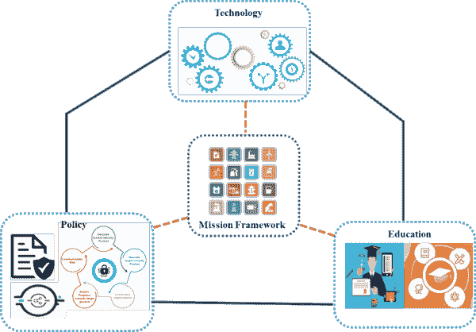 |

ENABLING TECHNOLOGIES

安全计算在环境日益纠缠和超连接的背景下变得愈发重要（`Girasa, 2023`）。随着物联网（IoT）、物联万物（WoT）和万物互联（IoE）持续主导技术平台的格局，确保这些复杂网络的安全至关重要（`Çubuk et al., 2023`）。管理者必须理解拥有越来越多的可链接设备意味着什么，以及由此可能暴露的潜在风险。为保障这些环境，需要采用加密、身份管理、访问控制和认证等使能技术（`Dykstra, 2023`）。

物联网是信息社会的全球基础设施，通过现有的或逐步演进的互操作的信息通信技术，将物理事物和虚拟事物相连，从而提供服务。新技术的 hype cycle 已由甘特纳（Gartner）以图形形式可视化。该 hype 循环图的纵轴表示期望值，横轴表示时间流逝（`Figure 2`）。当前时点代表了发明的拐点、期望膨胀的顶峰、失望的谷底、通往顿悟的上升以及生产力高原。图中未包含对所识别技术安全性的任何信息。图像以易于理解的方式展示了技术随时间变化的趋势，与期望相匹配。

| Figure 2. Emerging technologies in hype cycle |
| --- |
| 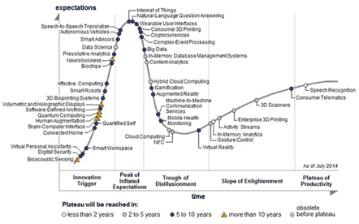 |

| *Source: Gartner (2014)* |

超连接性是一个正在发展的趋势，它促使网络安全专家为移动设备、笔记本电脑甚至可穿戴显示器等多种平台构建新的安全架构（`Mohamed & Kamau, 2023`）。这种超连接性为安全带来了新的维度——越是互连的技术，越容易受到威胁。新的安全架构必须兼容多种设备类型。在超连接状态下，若要保持适当的安全态势，必须采用复杂的预防措施。这既适用于国家安全，也适用于国际安全。

必须了解现有和未来的威胁，以防止利用漏洞对系统进行攻击。这种了解必须包括驱动这些系统必须被保护的指令、法律、政策、法规和规则。至关重要的是要充分理解社交媒体平台、移动设备、虚拟世界、增强现实和混合现实的使用可能带来的安全风险（`Shukla et al., 2023`）。管理者和高层执行人员需要审视更广泛的 Internet 接入对其组织 IT 政策的意义，以及这些新能力如何改变安全态势。

《福布斯》杂志一篇文章的作者通过六个不同情境（`Turtiainen et al., 2023`）阐释了超连接的概念。这些情境涵盖从酒店业到能源行业的广泛领域。例如，实时监测可以在医疗领域以手环形式实现，使医护人员能够实时获取患者的即时数据流（`[Khan et al., 2023](#978-1-6684-9<unk><unk><unk><unk><unk><unk><unk><unk><unk><unk><unk><unk><unk><unk><unk><unk><unk><unk><unk><unk><unk><unk><unk><unk><unk><unk><unk><unk><unk><unk><unk><unk><unk><unk><unk><unk><unk><unk><unk><unk><unk><unk><unk><unk><unk><unk><unk><unk><unk><unk><unk><unk><unk><unk><unk><unk><unk><unk><unk><unk><unk><unk><unk><unk><unk><unk><unk><unk><unk><unk><unk><unk><unk><unk><unk><unk><unk><unk><unk><unk><unk>


-   例如，被用于在女士取回孩子的设备可能会遭受网络攻击，在操作过程中停止工作。或者，有可能她的医疗记录被故意篡改，导致她接受错误的治疗，使她的生命面临即时危险)。改变自动药丸分配器上最终向患者投放药物的剂量可能是本情境中最为复杂的操作之一。

当谈论超连接时，研究“系统内的系统”概念至关重要。系统内的系统是指一系列相互连接的独立系统，形成一个更为复杂的整体。在考虑超连接的潜力时，个人区域网络是一个很好的例子，因为它能够让许多技术与不同的软件程序相互连接（Faltermaier et al., 2023）。Google Glass 可能被用于从社交媒体、全球定位系统到数字地形叠加以及与其他设备的同步等各种用途。因此，随着其加入更大的系统，整个系统将变得更加复杂，这意味着更多潜在的弱点。下一节详细阐述了教育、技术、指令、授权、政策和法律这三个主要的网络安全方面。

## 网络安全视角下的教育

在开发一套严格的程序以满足安全需求，同时在进攻性参与的同时实现目标（如果公司的目标是如此），则需要深入理解网络安全在教学中的有效性（Casey et al., 2023; Faltermaier et al., 2023）。为了满足政府机构的人力需求，资格可能从拥有 prestigious 大学学位到持有专业认证不等。保证预定标准得到满足的一种方式是了解核心技术项目的要求（Sadaghiani-Tabrizi, 2023）。这些要求可能包括区域、国家或项目特定的认证。为使院校的教育项目与劳动力需求相匹配，这些项目需要被开发、培训、更新，最终被退役。模型中描述教育必须分析以满足网络安全教育需求的部分在 Figure 3 中呈现。

| Figure 3. Proposed mission framework (education) |
| --- |
| 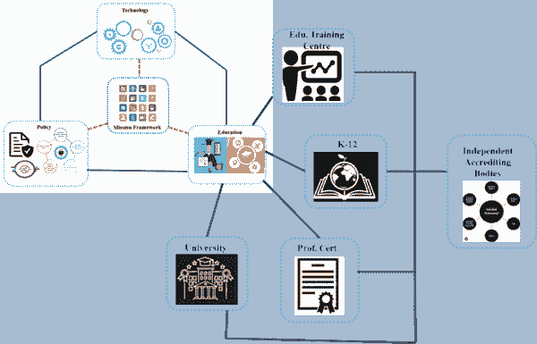 |

网络安全项目需要技术来建立合作伙伴关系。由于缺乏投资或汇率不佳，发展中国家可能预算有限，导致技术成本高昂。开源软件和云计算将使这些操作在全球范围内实现，并对所有机构来说更加负担得起。为了共享研究成果，使用开放获取（Zafar et al., 2023）。开放获取最适合与拥有庞大研究数据库的发展中大学进行合作。模拟的形式包括培训、教育、视频游戏、建模、可用性测试以及低保真原型等，这些都能提升教学效率。当这些技术如 Google Glass 被整合到模拟中时，学习效果也能得到改善。

本章节的框架考察了基础教育、中等教育、高等教育、专业认证、高管教育和培训。独立的认证机构对于每种教育方式的运作至关重要。标准、教育和培训都是这些认证机构所提供的内容（Johri & Kumar, 2023; Zafar et al., 2023）。例如，美国国家标准化研究院（American National Standards Institute）和 ISO 17024:2012 都是用作专业认证标准的组织示例。这使得实体能够为选择网络安全教育和培训项目以及开发此类项目设定最低标准。

## 指令、授权、政策和法律在网络安全方面

2001 年 9 月 11 日的事件不仅改变了美国的政策，也影响了其他国家在应对和打击恐怖主义方面的政策（Bada & von Solms, 2023）。联合国宪章第 51 条经联合国修订，赋予联合国成员国对武装袭击进行自卫的权力，有助于维护国际和平与安全（Bada & von Solms, 2023）。

英国议会于 2005 年通过《恐怖主义预防法》和 2008 年通过《反恐怖主义法》，两者均成为法律。第一部法案旨在让涉嫌参与恐怖行为的人员被拘留。2001 年通过的《反恐怖主义、犯罪与安全法》被判定为违宪，预计将被取代（Colomb et al., 2023）。这些法案看似是对美国通过的法案的复制，旨在监控潜在恐怖分子。英国还向美国提供信息，以协助协调那些构成潜在威胁的个人。

为确保美国领土上没有危险，美国的国家安全程序得到了加强。其中一项改变是加强所有入口点的安全水平。2002 年签署的《国家安全法》（Homeland Security Act of 2002），通常称为“HS 法”（Public Law 07-296），建立了一个拥有资金和大量资源的机构，用于监测该国的安全态势（Dedrick et al., 2023）。此外，还加强了对国内人员和居民的监控，以通过提及“炸弹”、“恐怖主义”、“爆炸”或“阿尔卡伊达”等词汇来防止恐怖行动。该监控旨在在国内范围内开展。

在 2001 年 9 月 11 日恐怖袭击之后，布什总统迅速推动通过 2001 年《USA Patriot Act》。该法案是对 9 月 11 日悲剧事件的回应，赋予多个政府部门增强的能力（Moreta et al., 2023）。由于这些增强能力，政府获得了搜索涉嫌参与恐怖行为的个人各类通信的权利，包括电子邮件、电话记录和医疗记录。因此，执法机构能够取得上风，更加积极地防范可能在美国内发生的袭击。


在 2011 年，前总统奥巴马签署了一项法案，该法案将扩大美国爱国者法案的权限。公众对这一法案的不满情绪一直存在，因为它有可能被权势人物操纵或滥用。由于该法案的存在，政府实体获得了侵犯宪法权利的能力。

《2010 年将美国作为国家资产的网络空间保护法案》是一项立法，除了修改 2002 年《国家安全法》的其他条款外，还对第 11 编（Reed et al., 2023）进行了修改。由于该法案的通过，美国网络空间和通信基础设施的韧性和安全性得到了提升。

总统声明任何形式的网络攻击都将被视为战争行为，这使得该法案显得尤为重要。这一点也因爱沙尼亚的数字基础设施被声称与前苏联政权支持的黑客攻击导致全面瘫痪而变得更加重要（Florackis et al., 2023）。这种打击可能导致美国基础设施遭受严重损害，造成数天甚至数周的停电，进而可能导致人员死亡。

以色列是一个在全球范围内保持严格国家和国际安全政策的国家。该国通过强制其居民服役并设立多个地点的检查站，确保居民的安全。早在 9/11 袭击之前，以色列就已经在其机场实施了严格的安全检查（Masmali & Miah, 2023）。然而，在袭击后，该国进一步加强了防范措施，以保护公民，因为它周边的国家曾经试图入侵。

在边境受到威胁的情况下，以色列还增加了无人机和无人地面车辆在边境的巡逻数量。在亨茨维尔都会区，可能会出现多个核设施熔毁、信息侦察（ISR）能力丧失以及与美国支持的战斗人员失去联系的情况（Masmali & Miah, 2023）。该法案的其他修改包括授权开展旨在提升网络安全基础设施的研究与开发计划。当时，所有政府企业必须遵守 2002 年《联邦信息安全管理法》。该法案揭示了美国网络安全架构的一些缺陷，特别是在领导者组织中。

2010 年秋季，大量新闻报道和标题宣称 Stuxnet 是网络战争的重要进步。这一危险的蠕虫病毒复杂，设计用于攻击特定的计算机系统。它能够确定位置、系统类型以及可能的其他信息（Agrawal et al., 2023）。只有在满足程序编码中预设的特定条件时，该蠕虫才会发动袭击。Stuxnet 计算机蠕虫破坏了在 Natanz 使用的可编程逻辑控制器（PLC）的软件，该软件用于控制离心机。这种篡改最终导致了伊朗核计划的中断。

针对关键基础设施（如监控控制与数据采集系统，SCADA）的网络攻击是国家安全局（Department of Homeland Security）的担忧所在。SCADA 是监控与数据采集的缩写，指用于关键基础设施（如电力输电网和核电站）自动监测和调节开关等活动的系统（Lamba & Kandwal, 2023）。国家安全局担忧这些系统，因为它们通常是无人值守的，可以远程访问。

它们可以通过网络在线访问，这可能使任何人都能够远程控制关键基础设施资产。为确保实施的任何系统都符合严格标准，已出现了大量指令和指令。Figure 4 展示了连接设备必须同时满足政策和技术要求，以维持安全环境。该框架将技术与政策整合于产品生命周期、产品使用以及技术应用政策制定的全过程中。

| Figure 4. Proposed mission framework (connected devices) | 
| --- | 
| 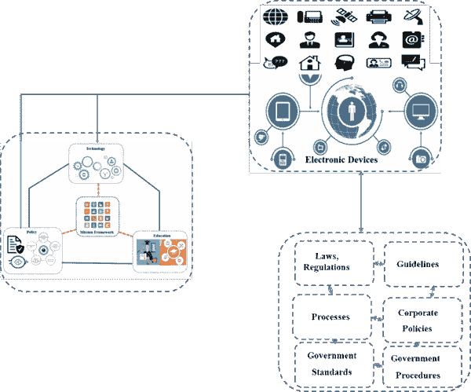 | 
| --- | 

在笔记本电脑的情况下，一个脚本会安装经公司批准的软件，移除被视为危险的应用程序，并配置防火墙和防病毒设置。这将涉及将程序的结果写入扩展名为 .txt 或 .html 的文件，管理员可以在系统审计时阅读该文件（Seaman, 2023）。如果文件以 .txt 或 .csv 结尾，则可以使用 R 语言对其进行检查，以寻找异常或趋势。

测试是软件和系统开发生命周期的重要组成部分。尽管 NIST 提供了以 SP 800-15 形式的指导（Seaman, 2023），但没有涵盖针对提供风险分析的商业设备测试过程的内容。因此，对创建测试应用（如内置测试）的需求日益增长，这些应用能让用户自行判断愿意承担的风险水平。图 5 给出了针对各类设备的测试程序示例。

通过设备获取位置信息，可以调查所在地区的法律、法规和政策。在确保所有要求已满足后，步骤 3 涉及执行握手，使设备能够连接。设备内置的功能允许其尽可能频繁地进行检查，以保持安全连接。为实现此过程，需要在每个设备上安装一款可连接互联网的软件应用（Ghiasi et al., 2023）。为组织成功实施此过程，需每日更新风险管理框架和常见弱点抽象数据库（Alismail et al., 2023; Torroglosa-Garcia et al., 2023）。此举旨在确保设备所有者在决定连接或配对相关设备前，了解任何相关风险。

| Figure 5. Risk management framework | 
| --- | 
| 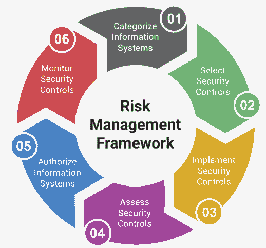 | 
| --- | 

证书与认证实施


建立以 IT 产品和系统为重点的认证与认可（C&A）程序是至关重要的，该程序应遵循相关监管规定。当组织部署使用基线监管和安全措施的系统时，就无需从头开始建立控制措施（Estrada & Reyes Álvarez, 2023; Lad, 2023）。组织内的 C&A 过程需要使用一个具有坚实基础的系统进行测量，以确保组织的成功。下面将讨论的两个程序，应被公司视为潜在的候选项，以更好地满足全球化 IT 业务的需求。

通用标准（CC）是一个国际公认的安全标准集合，它提供了对 IT 解决方案安全能力的透明且可信的分析。由于 CC 能够对产品的安全标准履行能力进行独立审查，从而使客户对所购买产品的安全性拥有更高的信任度，这有助于更明智的决策（De Arroyabe et al., 2023; Eltahir & Ahmed, 2023）。

对于关注数据安全的用户，如美国联邦政府，越来越多地要求在购买决策中使用 CC 认证。由于认证要求已透明地设定，制造商能够满足高度精确的安全需求，同时仍提供多样化的产品。在其他国家，用户同样可以对 IT 产品保持同等程度的信心，因为 CC 的国际范围已被超过十五个遵循 CC 的国家所实施（Pratama et al., 2023）。要根据安全水平评估产品，首先必须确定客户的具体安全需求，然后检查产品的现有能力。由于 CC 的两大核心特性——保护档案和评估保障水平，客户在上述两个程序中均能获得帮助（Perakslis & Knechtle, 2023）。

美国国家标准暨技术局（NIST）开发了一套风险管理方法，称为风险管理框架（RMF）（NIST, 2012）。RMF 采用基于风险的方法来选择和设计安全控制。该方法考虑的因素包括效能、效率以及相关法律、指令、行政命令、政策、标准或法规所带来的限制。RMF 的分类过程被分解为六个部分，这些部分构成了该 NIST 建议的基础（Siegel et al., 2023）。第 1 阶段：分类。系统的评估和分类以效应研究为基础。第 2 阶段：做出选择。在此期间，组织必须确定保护系统及组织（包括个人）所需的安全和隐私控制，并依据对组织运营和资产以及个人所构成的风险水平进行选择、定制和记录。这些控制是将高层次要求分解为低层次要求后得出的，并在设计阶段加以处理；第 3 阶段进行实施。

在第 2 阶段选择的控制将在本阶段安装到系统中，同时伴随其运行环境。第四阶段是评估。需要评估已实施的控制，以判断它们是否按预期工作，以及所期望的结果是否满足系统的安全要求。第五阶段是授权。根据系统所接受的风险水平是否可接受，获得系统运行的授权。第 6 阶段是监控。持续、持续地评估系统安全控制的有效性。这可能包括每年进行安全检查，以评估合规性。

CYBERSECURITY RISKS COMMUNICATION

风险沟通是一个长期研究且相当成熟的领域，尤其在健康和自然灾害领域更是如此。风险沟通可以描述为向个人提供关于风险（其性质、意义、后果、可能性以及应对选项）的交互性信息，以便他们能够做出明智的决策（Ghiasi et al., 2023）。这一过程可以分解为三个不同的目标：推进或改变信息和态度；改变与风险相关的行为；以及促进合作性争议解决和决策。

为了实现这些目标中的任何一个，个人首先必须“消化”或“感知”风险信息。因此，风险感知是风险沟通过程中的 essential（关键）第一步。该阶段考虑了个人在多种方式下真正解读风险的方式，以及影响其观点的各种情况。风险分析、风险评估和风险处理等过程是风险沟通中其他基本过程，它们隐含在前述讨论的目标之中。当这些任务结合在一起时，它们赋予个人认知能力，使其能够理解危险、评估它，并基于认知做出如何管理风险的明智判断（Shari, 2023）。当考虑风险沟通的广泛范围以及其与人类感知和决策的关联时，这并不令人惊讶，许多人认为这本身就是一个充满多重影响因素的复杂话题。

风险本身的感知和主观性是导致风险沟通复杂性的主要因素。健康和恐怖主义领域将风险定义为一种社会性和心理建构的实体。关于该主题的学术文献已广泛讨论了其主观性，并提供了一些关键例子，例如实际风险与感知风险可能大相径庭，而个人对风险的接受度和风险厌恶程度很大程度上取决于其优先事项和价值观（Hill et al., 2023）。这两点都值得牢记。

关于风险感知的最具代表性和重要性的评估。他从多个领域汲取经验，以验证先前的论点，并强调在审视风险沟通和感知时，尽管具有挑战性，却是至关重要的。鉴于这种复杂性，任何用于传达网络安全风险的方法都必须充分了解可能的障碍及其防范策略，从而实现更有效的安全信息传播（Lourenço et al., 2023）。


-   基于此，我们审视了自然灾害和健康领域的基础特征，这些特征已被发现会影响风险沟通。预计这些领域的发展将使网络安全风险沟通研究取得显著更快的进展。为了组织本次综述，我们将采用 [Kolar et al. (2023) 中概述的三个潜在风险沟通难点。这三个难点分别是：风险信息本身、信息传播者（或来源）以及信息接收者。

**风险信息**

大多数相关问题都包含复杂的风险数据。风险信息内容是一项既根本又至关重要的决策。未被重视的知识可能导致有害行为。风险信息的精确性可能阻碍沟通。例如，在恐怖主义语境下，不精确的沟通会加剧恐慌而不提升认知。获得正确信息后，必须传达警报信息。风险信息的格式是一个热门子主题。其三种基本呈现方式为：数值（百分比、频率和概率）、口语（如“可能”“不太可能”“确定”等术语）以及视觉（绘图、图表、统计图和示意图）(Almatari et al., 2023)。每种风险沟通格式都有优缺点，可组合使用。

数值风险陈述准确、精确且易于转换。该格式的主要缺点是假设受众具备数学和概率素养，即便是受过高等教育的人也常常缺乏这种素养。数值格式本身也较难把握。概率、频率、相对风险、参考类别以及风险概念本身都在作者讨论之列。单事件概率、条件概率和相对风险令人困惑，因为很难判断某个百分比或概率对应哪一类事件 (Jaber & Fritsch, 2023)。

口语沟通虽少见但具优势。它自然、易用，且能有效传达信息来源、不确定性的大小以及不确定性本身。其最大缺点是解释性差异显著。术语“可能”在不同人群中可能被理解不同，从而影响对危险的认知 (Jaber & Fritsch, 2023)。此问题直接影响风险传播者。解释受个人经验、知识和期望的影响。

**信息传播者或来源**

我们现在将注意力转向风险传播者或来源及其面临的挑战。这将把我们带回前文提到的广泛地区。主要障碍在于传播者本身往往难以理解和评估风险。关于定量风险沟通的研究显示，关键信息来源（如医生、法官和专家）在评估严重危害时常常出现错误或不一致的情况 (Buchanan & Kronk, 2023)。基于健康专业人士的数值素养研究，可提供进一步证据支持这一观点。此外，显著的传播者（如媒体）也被证实在误解并传播危害统计数据，这源于媒体对该议题的忽视。

**信息接收者**

接收者又增加了一个障碍。个人风险感知至关重要。文化、信念、需求、知识、认知、熟悉程度、控制感、自愿性、风险效应和 dread（恐惧）等因素都会影响风险沟通（多项跨领域研究均支持此观点）(Lourenço et al., 2023; Siegel et al., 2023)。情绪（如恐惧、愤怒、焦虑）以及态度和情感（对某事物的好恶感）也可能影响风险感知和决策。人类通常基于情绪和心情来评估和决定。

**影响启发法**是风险沟通和相关领域的关键概念。其他显著启发法（如可得性、锚定与调整、代表性）也被研究了它们在风险评估中的利弊。接收者必须相信风险传播者。若受信者不信任来源，可能会高估或低估风险 (Masmali & Miah, 2023)。这些点需要更多研究。一般信任关系的关联支持本文将信任研究用于网络安全风险沟通。

基于对风险沟通挑战的简要概述，领域的领军人物之一将风险评估（作为沟通中至关重要的环节，涉及分析与评估）称为“战场”。这些问题表明，提供正确的风险信息并不保证人们能够理解并付诸行动 (De Arroyabe et al., 2023; Kamariotou & Kitsios, 2023; Purwanto et al., 2023)。没有“一刀切”的风险沟通方案可行。文献随后提供了风险沟通指南，包括呈现方式、来源关联、认知优化以及针对特定群体（如低数值素养人群）的沟通。

**网络安全风险的沟通**

网络安全风险沟通探讨如何向系统用户传达安全风险信息，以提升理解和决策水平。说服用户采取特定行动可能是网络安全的目标。安全通信研究仍处于起步阶段，可分为感知与决策两类，这与早期的风险沟通研究相似 (Buchanan & Kronk, 2023)。本次综述聚焦于这两个主题。该评估涵盖网络安全风险沟通，而不涉及安全可用性。虽然两者可能有重叠，但我们的关注点在于前者。

**安全风险感知**

作者在审视信息安全概念时，强调了人类因素。他们引用了已有的风险感知文献。知识、影响、严重程度、可控性、可能性和认知等因素，根据其研究，定义了信息安全视角。研究表明，影响个人互联网安全风险感知的因素包括：能够控制或规避风险的能力、对后果的恐惧、对危害的陌生程度以及后果或影响的即时性 (Dedrick et al., 2023)。作者认为，这些特征有助于预测个体对在线威胁的反应。

此外，安全风险感知也被广泛研究。提出了一种新颖的风险感知测度模型。该模型提炼出常见的感知要素，基于两个安全风险特征：个体对威胁及其后果的感知，并使用反映不同数值的量表进行测量。对于特定解决方案在特定时点，个人可能对危害的理解较低，并将可能的后果视为严重 (AlKalbani et al., 2023; Mohamed & Kamau, 2023)。总分可用于描述群体的风险感知、跟踪个人感知的变化，或两者兼而有之。


-   Conchon, 2023 的研究直接影响了对安全风险的感知，以增强风险传播。为提升流程，这些作者在 (`Conchon, 2023`) 将图形和符号融入信息安全传播中。该知识传递方式是在课堂上学习的。与他们的预测相反，研究发现图形组和纯文本组之间没有统计学上显著差异。这很重要，因为这意味着并非所有特征都能在不同行业之间轻松转移，材料必须持续研究并谨慎提供。当表达安全威胁信息时，作者还评估词汇、结构、意义和颜色。所有这些都属于风险感知的研究范畴，再次表明网络安全风险传播应遵循这些指南。

**决策中的安全风险**

用户的安全风险-收益决策被研究。风险感知、安全能力和文化影响决策，研究结果显示。将这些洞见应用于安全领域是令人鼓舞的。满足性、认知偏差（包括代表性启发法、基率偏差和应答偏差）、时间压力以及注意力盲区是例子 (`Estrada & Reyes Álvarez, 2023`)。该研究和其他研究表明，客户认为自己不在风险之中，缺乏动力，认为安全是抽象的，并且输出多于输入。作者建议提高安全风险意识，修改风险信息或对话以吸引注意力，或将用户从安全决策中移除。这项有用的工作促进了风险感知和沟通。

**在线危险**

在线危险通常在没有全部事实的情况下被评估。四种“可知性”风险水平导致已知确定、已知不确定、未知不确定和不可知不确定。由于严格的安全措施，供应商保证在线交易不会导致身份盗窃。未知不确定性是指无人知道在线供应商交易中有多少比例会导致身份盗窃。这些水平会影响决策方式，如作者所示 (`Shari, 2023`)。风险表达影响选择。

**物理安全、医疗感染、犯罪行为、经济失败和冲突**

这些方法解决了安全传播的问题。这些模型并不完美，但可以改善沟通 (`Khan et al., 2023`)。针对安全风险的沟通采用心理模型。电影心理模型和活动识别技术提供与视频帧相关的及时警报。视频可能比文字提升理解力。这种创新方法需要用户测试。然而，用户在使用系统之前需要观看影片，并且必须在软件或系统架构中添加活动检测和逻辑 (`Khan et al., 2023; Zafar et al., 2023`)。这些包括与用户心理模型相匹配的界面设计、简洁优雅的设计、标准颜色以吸引注意力、图标作为视觉指示器、特定措辞以指示风险等级，以及一致、有意义的术语。

**设计原则**

设计师应使用多种展示和交互方法来传达信息、相关消息，以及用户适配且可调节的界面和警报。其他安全管理者和管理员的政策并未涵盖安全风险传播。行业现在负责传播网络安全风险。由于技术负责传播网络攻击风险，我们的研究对入侵检测至关重要 (`Camgöz Akdağ & Menekşe, 2023; Montasari, 2023`)。许多图形和文本解决方案是基于众所周知的人类认知和感知原则的实用应用，而非对如何最大化信息系统监控的网络风险传播进行精密分析。

**可用性网络安全指南**

我们首先检索已发表的研究，以找出提高网络安全界面和系统可用性的一般性建议。我们的研究使我们能够确定与本研究目标相符的最适用指南。找到后，我们开始制定初步指南列表。随后，我们通过对比各篇文章的建议，对该列表进行评估；如果可能，我们将高度相似的建议合并，并重新命名分组。在本文中，我们还注意到研究正文中反复出现的规则。出现多次的建议可能因其更具说服力而更受支持。以下是从以往研究中汲取、基于我们调查和分析得出的修订后的通用原则列表。

**安全管理界面**

安全不再被视为网络安全管理界面的后续考虑 (`Conchon, 2023; Nyarko & Fong, 2023`)。因此，一些独特于可用性网络安全的功能值得研究，这些功能包括能够从多种封装层次评估网络安全系统的能力、便于理解和诊断潜在风险的功能，以及鼓励管理人员快速有效地应对关键安全问题。

**分离和独立概念**

将不同的概念结合在一起容易导致误解。因此，保持用户价值观与安全政策的分离，以及安全政策与安全实施的分离可能是有益的 (`Netshakhuma, 2023; Shaikh & Siponen, 2023`)。因此，终端用户无需深入理解安全流程即可制定相应且适当的政策。此外，在系统设置过程中，自动化从政策到实施的步骤将对用户大有帮助。

**工具并非解决方案**

仅靠安全套接层 (`SSL`) 和互联网协议安全 (`IPsec`) 无法单独解决用户的问题；它们只是构建块 (`Purwanto et al., 2023`)。为了补充这些及其他低层次技术，需要高层构建块，供系统设计师用于创建更具用户导向且具备可用安全性的系统。这些构建块将作为资源提供给系统设计师。

**使安全不降低性能**

```
Design It Such That Security Does Not Reduce Performance
```


系统性能是另一项必须优先考虑的因素，同时还需在易用性和网络安全之间取得平衡 (`Childers et al., 2023`)。设计者的责任是确保软件应用和系统能够通过采用既高效又精心设计的算法，充分利用内置的安全措施。

## 将安全融入应用程序的每一层

一种将安全仅集中在网络栈的低层和更技术性层面上的策略的替代方案是设计安全到应用程序的所有层，特别强调应用程序的顶层 (`Sadaghiani-Tabrizi, 2023`)。这可能是一个有帮助的方法。该建议的目的是让用户的职责以及更广泛的高层目标自动纳入底层安全措施。如果这种无缝性得以实现，系统更有可能被感知为更易用。为使该策略成功，其背后的设计者需要深入理解用户的心理模型以及他们对系统的推理方式。

## 创建适当的心理模型

用户对系统及其工作方式的内部表征或理解可称为该用户的“心理模型” (`Siegel et al., 2023`)。设计者应尝试构建考虑用户心理模型的系统，从而鼓励构建能够准确反映网络安全系统界面和功能的模型。

## 减少安全和技术术语

用户在使用安全功能之前需要能够理解其功能。因此，设计者应很少使用技术和安全专用词汇，一旦使用，应慎重决定是否提供解释。这对终端用户系统以及经验丰富或几乎没有经验的人尤为有效。

## 设计易于学习

网络安全工具的用户界面应当直观 (`Dedrick et al., 2023`)。根据上述参考文献，熟悉度和一致性是影响易学性的因素之一。在网络安全领域，利用隐喻（将实际世界与系统功能关联以利用熟悉感）以及系统内部保持一致的术语和对话，都是提升易用性的关键因素。它们都能让系统对用户更友好，减少混淆。

## 极简化设计

尽管已经普遍认识到某些网络安全功能（例如配置）可能相当复杂 (`Ziadia et al., 2023`)，尤其是对 inexperienced 用户而言，设计者仍应努力保持界面简洁，降低信息过载的可能性，避免出现笨拙的界面布局。

## 关注系统满意度和用户体验

网络安全界面的目标是尽可能提供用户愉快且满足的体验。这可能包括对界面进行细微调整以满足用户偏好，或允许一定程度的安全界面或操作自定义。也可以指用户能够自定义自己的安全设置。

## 助用户完成任务并提供建议

用户需要被告知其在网络安全方面的责任，并在适当时提供完成这些操作的指引 (`Shari, 2023`)。这种指引还包括在用户对决定及其后果不确定时，提供相应的帮助和说明。无论是面向安全专家（强调推荐和相应的解释）的系统，还是面向终端用户（安全通常是次要目的）的系统，都在提高意识和为用户提供方向方面发挥作用。

## 减少系统相关的认知负荷

网络安全界面的设计应当降低用户在交互时所承受的心理负担。多年来关于人类认知的研究揭示了工作记忆的限制以及在用户仍在工作时提供帮助的必要性，同时要尊重其记忆和心理限制 (`Eltahir & Ahmed, 2023`)。这可能包括自动化安全活动或配置，使得用户无需过度依赖记忆即可轻松设置系统安全，避免不合理的记忆负荷。在考虑网络安全时，还应关注若干一般性的感知和沟通问题。这些方面与认知相关，值得研究。

## 展示安全功能

与程序的其他方面一样，安全应当简便可及且可视化 (`Clinton, 2023`)。将安全功能隐藏在更高级或与其他元素无关的界面组件背后，只会让用户工作更困难，从而降低系统的整体易用性。

## 显示系统状态

用户需要了解系统当前的安全级别。这是一种被动的安全反馈形式 (`Camgöz Akdağ & Menekşe, 2023`; `Solar, 2023`; `Zafar et al., 2023`)。一些易于理解的示例包括在受密码保护或加密的文档中出现“已保护”文字，系统执行安全功能时出现活动图标，以及浏览器中显示的锁形图标，指示用户正在使用安全套接层（SSL）或传输层安全性（TLS）进行浏览。

## 防止、管理和恢复错误（撤销）

系统应当设计成能够预测并防止用户错误 (`Masmali & Miah, 2023`)。如果错误确实发生，则应以体面的方式处理，提供指导性提示，并列出恢复措施。当用户犯错并进入不想要的程序状态时，指南建议安全界面设计应提供撤销和快速退出功能。用户应当能够信任系统，在使用时不会感到迷失。

## 帮助、建议和文档

用户应当能够快速找到并获取网络安全功能的帮助、建议手册以及系统文档，必要时随时使用。如果用户找不到这些功能或不清楚如何使用它们，很可能它们会被忽视。

## 信息性反馈

提供有用的系统反馈是下面列出的其他可用性建议（例如帮助 (`Siegel et al., 2023`)、错误处理 (`Ghiasi et al., 2023`) 和安全系统状态可视化 (`Reed et al., 2023`)）的关键组成部分。反馈应当易于理解、信息充分、适当且不过于技术化；如有必要，应包含前进的建议。


## 接受所有用户

网络安全的功能应以一种可适应性的方式创建，以便同时满足新手和资深用户的需求。专家用户应能够通过系统快捷键、热键等方式快速访问关键功能，而新手用户有时可能需要帮助和分步骤的指导（Pratama et al., 2023）。这种指导一般强调系统之间交互的多样化需求。

## 早期网络安全可用性考虑因素

在系统设计和开发的初期，应当就网络安全、可用性以及这三者之间的关系进行讨论和分析（Perakslis & Knechtle, 2023）。在系统开发的末端才“粘贴”或“补丁”网络安全可用性，这将对整体系统产生不利影响，并导致更多的可用性和安全性问题。

## 结论

本文以框架的形式提出了一种原创的网络安全思考方式，该框架将教育、政策和技术进步结合在一起。教育评估展示了新的网络安全课程教学方式，并讨论了负责信息技术、计算技术和计算机科学等项目的认证机构。未来在网络安全教育领域可利用的指南、资源和策略也作了详细探讨。其他研究包括模拟、虚拟化、U‑Learning（移动学习）以及工程标准。在政策部分，应当要求审视并利用多种指令、标准、法规、立法和最佳实践。

这些政策来源于国防部、国家标准与技术局、美国军队以及其他组织，它们为向正在制定政策的组织提供进一步指导和方向奠定了基础。技术部分的目的在于收集关于新兴技术的信息，例如面向互联网的设备及类似产品。手机、操作系统（OS）、软件包以及其他设备都需要单独审查，并特别关注它们在系统上下文中集成后安全态势的变化。

这三个组成部分的应用可以推动联邦或州一级的政策，同时为商业领域带来长期的效果，有助于长期抗击网络犯罪。根据这份集体研究的发现，完整的网络安全愿景必须把教育、政策和技术进步放在首位。以往的观点往往孤立地探讨这些主题，而本研究则可用于将这些主题整合，明确目标是针对全球特定地点的 IT 系统部署进行精准化。

## 参考文献

Agrawal, A., Khan, R. A., & Ansari, M. T. J. (2023). Empowering Indian citizens through the secure e-governance: The digital India initiative context. In Emerging Technologies in Data Mining and Information Security (pp. 3–11). Springer. doi:[10.1007/978-981-19-4676-9_1](https://doi.org/10.1007/978-981-19-4676-9_1)

Alismail, A., Altulaihan, E., Rahman, M. M., & Sufian, A. (2023). A Systematic Literature Review on Cybersecurity Threats of Virtual Reality (VR) and Augmented Reality. Data Intelligence and Cognitive Informatics.

AlKalbani, A., AlBusaidi, H., & Deng, H. (2023). Using a Q-Methodology in Demystifying Typologies for Cybersecurity Practitioners: A Case Study. In Intelligent Sustainable Systems (pp. 291–303). Springer. doi:[10.1007/978-981-19-7660-5_26](https://doi.org/10.1007/978-981-19-7660-5_26)

Almatari, O., Wang, X., Zhang, W., & Khan, M. K. (2023). VTAIM: Volatile Transaction Authentication Insurance Method for Cyber Security Risk Insurance of Banking Services. Academic Press.

BadaM.von SolmsB. (2023). A cybersecurity guide for using fitness devices. The Fifth International Conference on Safety and Security with IoT, 35–45. doi:[10.1007/978-3-030-94285-4_3](https://doi.org/10.1007/978-3-030-94285-4_3)

Buchanan, J., & Kronk, H. (2023). The Slow Adjustment in Tech Labor: Why Do High-Paying Tech Jobs Go Unfilled? The Center for Growth and Opportunity.

Bukauskas, L., Brilingaitė, A., Juozapavičius, A., Lepaitė, D., Ikamas, K., & Andrijauskaitė, R. (2023). Remapping cybersecurity competences in a small nation state. Heliyon, 9(1), 12808. doi:[10.1016/j.heliyon.2023.e12808](https://doi.org/10.1016/j.heliyon.2023.e12808)

Camgöz Akdağ, H., & Menekşe, A. (2023). Cybersecurity Framework Prioritization for Healthcare Organizations Using a Novel Interval-Valued Pythagorean Fuzzy CRITIC. In Intelligent Systems in Digital Transformation (pp. 241–266). Springer. doi:[10.1007/978-3-031-16598-6_11](https://doi.org/10.1007/978-3-031-16598-6_11)

Casey, E., Jocz, J., Peterson, K. A., Pfeif, D., & Soden, C. (2023). Motivating youth to learn STEM through a gender inclusive digital forensic science program. Smart Learning Environments, 10(1), 1–24. doi:[10.1186/s40561-022-00213-x](https://doi.org/10.1186/s40561-022-00213-x)

Childers, G., Linsky, C. L., Payne, B., Byers, J., & Baker, D. (2023). K-12 educators’ self-confidence in designing and implementing cybersecurity lessons. Computers and Education Open, 4, 100119. doi:[10.1016/j.caeo.2022.100119](https://doi.org/10.1016/j.caeo.2022.100119)

Clinton, L. (2023). Fixing American Cybersecurity: Creating a Strategic Public-private Partnership. Georgetown University Press.

Colomb, Y., White, P., Islam, R., & Alsadoon, A. (2023). Applying Zero Trust Architecture and Probability-Based Authentication to Preserve Security and Privacy of Data in the Cloud. In Emerging Trends in Cybersecurity Applications (pp. 137–169). Springer. doi:[10.1007/978-3-031-09640-2_7](https://doi.org/10.1007/978-3-031-09640-2_7)

Conchon, E. (2023). Cyber Security Strategies While Safeguarding Information Systems in Public/Private Sectors. Electronic Governance with Emerging Technologies: First International Conference, EGETC 2022, Tampico, Mexico, September 12–14, 2022, Revised Selected Papers, 49.

Çubuk, E. B. S., Zeren, H. E., & Demirdöven, B. (2023). The role of data governance in cybersecurity for E-municipal services: Implications from the case of Turkey. In Handbook of Research on Cybersecurity Issues and Challenges for Business and FinTech Applications (pp. 410–425). IGI Global.

De Arroyabe, I. F., Arranz, C. F., Arroyabe, M. F., & de Arroyabe, J. C. F. (2023). Cybersecurity capabilities and cyber-attacks as drivers of investment in cybersecurity systems: A UK survey for 2018 and 2019. Computers & Security, 124, 102954. doi:[10.1016/j.cose.2022.102954](https://doi.org/10.1016/j.cose.2022.102954)

Dedrick, J., Perrin, K. A., Sabaghian, E., & Wilcoxen, P. J. (2023). Assessing cyber attacks on local electricity markets using simulation analysis: Impacts and possible mitigations. Sustainable Energy, Grids and Networks, 100993.

Dykstra, J. (2023). The Slippery Slope of Cybersecurity Analogies. Academic Press.

Eltahir, M. E., & Ahmed, O. S. (2023). Cybersecurity Awareness in African Higher Education Institutions: A Case Study of Sudan. Academic Press.

English, R., & Maguire, J. (2023). Exploring Student Perceptions and Expectations of Cyber Security. In Computing Education Practice (pp. 25–28). doi:[10.1145/3573260.3573267](https://doi.org/10.1145/3573260.3573267)


Estrada, S., & Reyes Álvarez, J. (2023). Conclusions: The Challenge Towards the Future Is Digital and Sustainable Transformations from a Systemic Perspective in a Changing COVID World. In *Digital and Sustainable Transformations in a Post-COVID World* (pp. 475–502). Springer. doi:`[10.1007/978-3-031-16677-8_18](https://doi.org/10.1007/978-3-031-16677-8_18)`

Faltermaier, S., Strunk, K., Obermeier, M., & Fiedler, M. (2023). Managing Organizational Cyber Security–The Distinct Role of Internalized Responsibility. Academic Press.

Florackis, C., Louca, C., Michaely, R., & Weber, M. (2023). Cybersecurity risk. *Review of Financial Studies*, 36(1), 351–407. doi:`[10.1093/rfs/hhac024](https://doi.org/10.1093/rfs/hhac024)`

Gartner. (2014). Gartner’s 2014 Hype Cycle for Emerging Technologies Maps the Journey to Digital Business. [`https://www.gartner.com/newsroom/id/2819918`](https://www.gartner.com/newsroom/id/2819918)

Ghiasi, M., Niknam, T., Wang, Z., Mehrandezh, M., Dehghani, M., & Ghadimi, N. (2023). A comprehensive review of cyber-attacks and defense mechanisms for improving security in smart grid energy systems: Past, present and future. *Electric Power Systems Research*, 215, 108975. doi:`[10.1016/j.epsr.2022.108975](https://doi.org/10.1016/j.epsr.2022.108975)`

Girasa, R. (2023). Taxation of Virtual Currencies; Environmental, Social and Governance Considerations; Protection of Intellectual Property Rights; Antitrust; and Cybersecurity. In *Regulation of Cryptocurrencies and Blockchain Technologies* (pp. 261–311). Springer. doi:`[10.1007/978-3-031-21812-5_7](https://doi.org/10.1007/978-3-031-21812-5_7)`

Hill, C., James, B. I., & Sahyoun, N. (2023). What is Missing in Data Governance? Regulation, Board Oversight, and a New Role for Accountants. Academic Press.

Jaber, A., & Fritsch, L. (2023). Towards AI-powered Cybersecurity Attack Modeling with Simulation Tools: Review of Attack Simulators. *International Conference on P2P, Parallel, Grid, Cloud and Internet Computing*, 249–257.

Johri, A., & Kumar, S. (2023). Exploring Customer Awareness towards Their Cyber Security in the Kingdom of Saudi Arabia: A Study in the Era of Banking Digital Transformation. *Human Behavior and Emerging Technologies*, 2023, 2023. doi:`[10.1155/2023/2103442](https://doi.org/10.1155/2023/2103442)`

Kamariotou, M., & Kitsios, F. (2023). Information Systems Strategy and Security Policy: A Conceptual Framework. *Electronics (Basel)*, 12(2), 382. doi:`[10.3390/electronics12020382](https://doi.org/10.3390/electronics12020382)`

Khan, N. F., Ikram, N., Murtaza, H., & Javed, M. (2023). Evaluating protection motivation based cybersecurity awareness training on Kirkpatrick’s Model. *Computers & Security*, 125, 103049. doi:`[10.1016/j.cose.2022.103049](https://doi.org/10.1016/j.cose.2022.103049)`

Kolar, M., Fernandez-Gago, C., & Lopez, J. (2023). Trust Negotiation and Its Applications. In *Collaborative Approaches for Cyber Security in Cyber-Physical Systems* (pp. 171–190). Springer. doi:`[10.1007/978-3-031-16088-2_8](https://doi.org/10.1007/978-3-031-16088-2_8)`

Lad, S. (2023). Creating a Security Culture. In *Azure Security For Critical Workloads* (pp. 201–207). Springer. doi:`[10.1007/978-1-4842-8936-5_8](https://doi.org/10.1007/978-1-4842-8936-5_8)`

LambaT.KandwalS. (2023). Global Outlook of Cyber Security. *Proceedings of the Third International Conference on Information Management and Machine Intelligence*, 269–276.

Lourenço, J., Morais, J. C., Sá, S., Neves, N., Figueiredo, F., & Santos, M. C. (2023). Cybersecurity Concerns Under COVID-19: Representations on Increasing Digital Literacy in Higher Education. In *Perspectives and Trends in Education and Technology* (pp. 739–748). Springer. doi:`[10.1007/978-981-19-6585-2_65](https://doi.org/10.1007/978-981-19-6585-2_65)`

MasmaliH. H.MiahS. J. (2023). Emergent Insight of the Cyber Security Management for Saudi Arabian Universities: A Content Analysis. *Proceedings of Seventh International Congress on Information and Communication Technology*, 153–171. doi:`[10.1007/978-981-19-1610-6_14](https://doi.org/10.1007/978-981-19-1610-6_14)`

Mohamed, A. Y., & Kamau, S. K. (2023). A Continent-Wide Assessment of Cyber Vulnerability Across Africa. ArXiv Preprint ArXiv:2301.03008.

Montasari, R. (2023). Cyber Threats and the Security Risks They Pose to National Security: An Assessment of Cybersecurity Policy in the United Kingdom. *Countering Cyberterrorism*, 7–25.

Moreta, N., Aragon, D., Oña, S., Jaramillo, A., Ibarra, J., & Jahankhani, H. (2023). Comparison of Cybersecurity Methodologies for the Implementing of a Secure IoT Architecture. In *Cybersecurity in the Age of Smart Societies* (pp. 9–29). Springer. doi:`[10.1007/978-3-031-20160-8_2](https://doi.org/10.1007/978-3-031-20160-8_2)`

Netshakhuma, N. S. (2023). Cybersecurity Management in South African Universities. In *Cybersecurity Issues, Challenges, and Solutions in the Business World* (pp. 196–211). IGI Global.

Nyarko, D. A., & Fong, R. C. (2023). Cyber Security Compliance Among Remote Workers. In *Cybersecurity in the Age of Smart Societies* (pp. 343–369). Springer. doi:`[10.1007/978-3-031-20160-8_18](https://doi.org/10.1007/978-3-031-20160-8_18)`

Perakslis, E., & Knechtle, S. J. (2023). Information design to support growth, quality, and equity of the US transplant system. *American Journal of Transplantation*, 23(1), 5–10. doi:`[10.1016/j.ajt.2022.10.005](https://doi.org/10.1016/j.ajt.2022.10.005)`

PratamaA. R.AlshaikhM.AlharbiT. (2023). Increasing cybersecurity awareness through situated e-learning: A survey experiment. Available at SSRN 4320165. doi:`[10.2139/ssrn.4320165](https://doi.org/10.2139/ssrn.4320165)`

Purwanto, W., Dodge, B., Arcaute, K., Sosonkina, M., & Wu, H. (2023). DeapSECURE Computational Training for Cybersecurity: Progress Toward Widespread Community Adoption. *Journal of Computational Science Education*.

Rawal, B. S., Manogaran, G., & Peter, A. (2023). Cybersecurity for Beginners. In *Cybersecurity and Identity Access Management* (pp. 1–20). Springer. doi:`[10.1007/978-981-19-2658-7_1](https://doi.org/10.1007/981-19-2658-7_1)`

Reed, J., Shimizu, A., & Shifflett, J. (2023). Cost Effectiveness Analysis of the use of Colorless Appropriations in Navy and DoD Software Development Pilot Programs \[PhD Thesis\]. Acquisition Research Program.

Sadaghiani-Tabrizi, A. (2023). Revisiting Cybersecurity Awareness in the Midst of Disruptions. *International Journal for Business Education*, 163(1), 6.

Seaman, J. (2023). Zero Trust Security Strategies and Guideline. In *Digital Transformation in Policing: The Promise, Perils and Solutions* (pp. 149–168). Springer. doi:`[10.1007/978-3-031-09691-4_9](https://doi.org/10.1007/978-3-031-09691-4_9)`

Shaikh, F. A., & Siponen, M. (2023). Information security risk assessments following cybersecurity breaches: The mediating role of top management attention to cybersecurity. *Computers & Security*, 124, 102974. doi:`[10.1016/j.cose.2022.102974](https://doi.org/10.1016/j.cose.2022.102974)`

Shari, A. M. J. (2023). Knowledge, Attitude, and Practices Towards Internet Safety and Security Among Generation Z in Malaysia: A Conceptual Paper. Academic Press.

Shukla, M., Ziya, F., Arun, S., & Singh, S. P. (2023). Cyber Security Techniques Management. In *Holistic Approach to Quantum Cryptography in Cyber Security* (pp. 155–178). CRC Press.

Siegel, D., Bogers, M. L., Jennings, P. D., & Xue, L. (2023). Technology transfer from national/federal labs and public research institutes: Managerial and policy implications. *Research Policy*, 52(1), 104646. doi:`[10.1016/j.respol.2022.104646](https://doi.org/10.1016/j.respol.2022.104646)`

Solar, C. (2023). Cybersecurity Governance in Latin America: States, Threats, and Alliances. State University of New York Press.


## 第 3 章

*   Biodun Awojobi  

      

    德克萨斯大学，美国  

*   Brett J. L. Landry  

      

    德克萨斯大学，美国  

**摘要**

隐私与安全具有共同点但也存在差异。数字隐私选择是基于个人在通信过程中对可共享内容和应保持保密内容的信念和认知做出的。社交网络的使用呈指数级增长。因此，许多个人、企业和社区认为隐私的丧失是由网络安全事件导致的。然而，并非所有网络安全事件都导致隐私损失，且并非所有隐私损失都是由网络安全事件引起的。隐私法规为确保数据隐私标准得到遵守并对违规行为进行制裁提供了基础，这些制裁通常为违规组织处以罚款和征缴。这些法规应提供保障，通过要求数据所有者更好地管理数据来保护个人和组织。问题在于技术发展速度快于法规的制定，导致实施总存在滞后。

**引言**

数字信息的隐私是最复杂的问题之一，因为它跨越多个方向。数据隐私与网络安全具有共同点但概念不同。隐私选择是基于个人对通信中应共享和应保持保密内容的信念和认知做出的。网络安全保护系统和数据的机密性、完整性和可用性。这两者的共同领域提供了“隐私与安全边界模糊”的概念（`Conger & Landry, 2008`，第 3 页）。因此，许多个人、企业和社区认为隐私的丧失是由网络安全事件导致的。网络安全事件可能导致隐私泄露，进而造成个人数据（包括可识别信息 PII）的丧失，这可能导致机密性、完整性或可用性的损失。一般原则是，一旦其中任何一项原则受到损害，即构成组织或个人的安全泄露。`Stevens (2010)` 提出：“当数据泄露发生时，即出现数据丢失、盗窃或其他未经授权访问，且该数据包含敏感个人信息，并可能导致数据机密性或完整性的潜在损害时，即发生数据泄露。”

然而，并非所有网络安全事件都导致隐私损失，且并非所有隐私损失都源于网络安全事件。“隐私与网络安全在关于可识别信息（PII）的网络安全问题上存在重叠，但也存在不涉及网络安全的隐私问题以及不涉及隐私的网络安全问题”（`Boeckl et al., 2019`）。通过`Figure 1`所示的维恩图最能说明重叠与差异。数据隐私问题可从伦理、法律和技术三个角度加以处理。本章将通过政府技术法规的视角来审视数据隐私。社交媒体、物联网（IoT）、语音助手和追踪等例子将帮助我们审查技术与隐私的关注点。

| Figure 1. |

| --- |

| 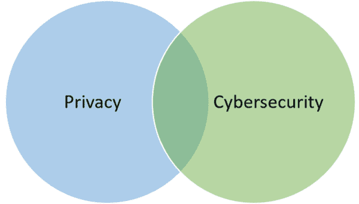 |

| --- |

**政府隐私保护法规**

政府法规应提供基础，确保数据隐私标准得到遵守，并对违规行为进行制裁，通常以罚款和征缴形式出现。例如，2019 年普华盛顿研究中心调查发现“超过 60%的美国成年人认为他们不可能一天不被政府或公司收集他们的数据”（Brown, 2019）。判断政府是否比私人组织收集更多数据具有挑战性。政府代表公民收集和处理数据，并拥有权力从私人公司收集数据。此外，政府还通过其拥有的资产（如摄像头）参与监控活动，并与私人组织（如电信公司）建立合作关系。

假设数字隐私是当今时代的现实问题，并通过普通法原则加以解决。政府如何介入防止社交网络等平台上个人信息被滥用？公民对政府干预其本应自主的事务的感知如何？政府能否与拥有并管理社交媒体平台的公司合作，确保其正确分类数据并对平台内使用的可识别信息进行分类或哈希处理，以更好地保护个人的数字隐私权？政府能否控制社交媒体平台上发布的内容范围，特别是当该平台由另一国家拥有和运营时？可以认为政府与技术的互动会影响创新；但如果没有控制措施，掌握社交媒体平台数据的公司可能会利用数据谋取自身利益。

通过法规，政府应采用用于重要公告的信息传播技术，向公众宣传政府在隐私观念方面的承诺。政府法规的主要区别在于“加入”与“退出”策略的概念。这些区别将通过考察 GDPR 和美国州隐私法来探讨。

**欧盟通用数据隐私条例（GDPR）**

与美国尚未采用全国性数据隐私法规不同，欧盟（EU）通过制定欧盟通用数据隐私条例（GDPR）领导了客户隐私努力。GDPR 建立在“加入”策略之上。IAPP 将“加入”定义为“…个人作出积极肯定的选择指示；即，勾选框表示希望与第三方共享其信息”（`IAPP, 2023a`）。GDPR 的核心是一系列解释，包括被遗忘权或擦除权（`GDPR.EU, 2023`）。GDPR 的设计旨在实现以下三个目标：


1. 协调欧洲各国的数据隐私法律。

2. 保护并赋权所有欧盟公民的数据隐私。

3. 重塑区域内组织处理数据隐私的方式。

根据 GDPR 第 17 条“被遗忘权”，个人有权在以下情形下要求删除其数据，如 表 1 (Intersoft Consulting, 2023) 所示。

表 1. GDPR 第 17 条摘录 - 被遗忘权

| 1 || 该数据主体有权向控制方获得其个人数据的删除，且控制方应在下列任一情形下**立即**删除个人数据： |
| --- | --- |
| A || 个人数据不再与收集或进一步处理的目的相关； |
| B || 数据主体依据第 6(1)(a) 点或第 9(2) 点撤回同意，且不存在其他法律依据进行处理； |
| C || 数据主体依据第 21(1) 条或第 21(2) 条提出异议，且无 overriding legitimate grounds（无压倒性正当理由），或数据主体依据第 21(2) 条提出异议； |
| D || 个人数据被非法处理； |
| E || 为遵守欧盟或成员国法律的法律义务而需删除个人数据，控制方受此约束； |
| F || 个人数据是为提供第 8(1) 条所述信息社会服务而收集的。 |

有关个人要求删除数据的例外情况如下（GDPR.EU, 2023）：

*   1. 数据用于行使表达和信息自由的权利。

*   2. 数据用于遵守法律裁决或义务。

*   3. 数据用于执行公共利益任务或履行组织的官方权限。

*   4. 数据处理为公共健康目的并服务于公共利益。

*   5. 数据处理为预防性或职业医学目的，仅在数据由受法律职业保密义务约束的医疗专业人员处理时适用。

*   6. 数据代表服务于公共利益、科学研究、历史研究或统计目的的必要信息，且删除数据可能会阻碍或停滞相关目标的实现。

*   7. 数据用于建立法律辩护或行使其他法律主张。

美国各州隐私法律

与欧盟不同，美国的法规对客户隐私的保护较少（Strahilevitz, 2012）。截至 2023 年，仅有五个州已通过隐私计划：加利福尼亚、科罗拉多、康涅狄格、弗吉尼亚和犹他州。密西西比州有一项未启动的法案，19 个州已提出法案，其余 25 个州尚未提出综合法案（IAPP, 2023c）。这五个有隐私计划的州分为两类计划：科罗拉多、康涅狄格、弗吉尼亚和犹他州遵循华盛顿州的提案计划，而加州则有其独立的计划。然而，预测如果缺乏统一的联邦法律而出现 50 个分散的州法律，十年内相关的跨州成本可能超过 1 万亿美元（Castro et al., 2022）。

所有美国州通过的计划均采用“退出”策略，IAPP 将其定义为“…个人缺乏行动意味着已作出选择；除非个人勾选或取消勾选框，否则其信息将与第三方共享”（IAPP, 2023b）。这意味着默认情况下，个人必须主动做出选择并采取行动以保护隐私。

数字信息的隐私

在非数字时代，执行隐私更为直接，因为信息披露的漏洞较少。例如，一位只写印刷版手稿的作者可以通过不公开内容并将其锁在保险箱中，确保稿件内容得到保存和保密。这种做法的显著优势在于，作者的知识产权得到保护，仅在需要时才会披露。

数字化重新定义了信息存储和检索的概念，尤其是在共享云计算和存储的背景下。这一数字化浪潮极大地改变了隐私的范围。个人对信息披露的完全控制已迅速消失。然而，数字化带来的巨大好处往往使人们忽视或不了解其带来的隐私风险。

计算能力和存储能力的提升使我们能够对几乎任何对象存储元数据，并随时检索。在大多数发达国家，数字化转型已达到顶峰。个人记录已存入各种数据库中。我们的个人偏好、习惯、驾驶模式、睡眠时间和醒来时间等，都因使用计算设备、信息以及与他人互动而被记录在案。这类数据通常不是在单次交易或互动中收集，而是通过多个系统的多次交易和互动累积。例如，许多发达国家实行无现金支付系统。当客户用信用卡支付时，部分信息会与商户共享；此外，部分商户要求客户加入忠诚计划。忠诚计划通常需要收集客户的电话号码和其他个人信息，以用于追踪目的。

个人通过互联网服务获得的便利具有深远的后果。作为人类，我们最初信任技术，并期望只要拥有用户名、密码或其他身份验证方式，我们的技术交互就是私密的。然而，我们必须意识到元数据可以导致针对性攻击，如网络钓鱼。威胁行为者可以轻易窃取电脑和其他设备上的知识产权，且隐私泄露一旦发生即无法挽回，因为无法收回所有数据的复制品。未经授权的物理访问和软件 compromise 也是导致语音助手隐私泄露的几种方式。


-   智能家居设备之所以受到欢迎，是因为设备的成本。相较于企业级设备，设备的相对低廉价格带来了成本。物联网设备制造商采用大规模生产策略，这可能会导致跳过质量和安全漏洞检查以降低设备的生产成本。公寓和住宅等租赁住宅也越来越普遍地安装智能门锁等物联网设备，而不是传统的物理钥匙。公寓希望在租户因未付租金而违约时能够控制门禁，而智能锁可以实现这一点。智能锁还会收集用户进入家中的访问日志。

Privacy and Technology

每个人都会对隐私有特定的定义。对于某些个人而言，隐私是指可接受的、可以分享的信息上下文，以及应保持保密的信息。当试图得出结论时，“隐私对不同的人来说是不同的”([Sears & Jacko, 2007)。Warren and Brandeis (1890) 提出隐私是“与外部世界隔离的权利”和“被独处的权利”。隐私常被误解为一种感知的事物，而实际上它是一种选择的事物。私人信息是我们选择不与公众分享，或仅限于特定群体的信息。每个人都有选择什么信息保持私密的权利。例如，一个人可能选择分享完整的医疗记录，而另一个人则将其视为私人数据。

个人需要控制向他人传输或分享的信息量。因此，技术应提供对私人信息与他人共享的可变控制。技术采用应有成本效益的理由，并使用可变控制。当个人调整隐私设置时，系统应直观地显示该变化带来的好处或惩罚。另一个关注点是个人的当前需求会影响隐私决策。由于这些需求不断变化，隐私决策始终处于不断的博弈中。

Social Media

社交媒体站点成功地帮助个人与各种媒体形式——文章、博客、图片、视频等——建立联系，这些内容是由他们认识或不认识的人发布的。虽然一些社交媒体站点提供限制信息暴露给不意图接收者的功能，但并非所有个人都会利用这些功能。

个人应能够完全删除其在任何存储其数据的社交媒体站点上的数据。由于移动设备是访问社交媒体平台的便捷方式，客户可能会认为卸载移动应用即可解决所有数据跟踪和收集问题。像 Facebook 这样的社交媒体平台开发商与 Google Android 等操作系统供应商有合作关系，在新设备上预装社交媒体移动应用。该合作关系可能还包括将社交媒体应用设为原生应用，确保用户无法卸载该应用(Cuthbertson, 2019; Santos, 2018)。手机用户无法删除应用的情况类似于个人无法选择退出商店的跟踪设备。这侵犯了隐私，主要是因为客户的唯一选择是放弃购买智能手机或不去商店。隐私应是个人的决定。分享数据的选择应由设备所有者自行决定。

一些个人发现，在 Facebook 提供的人为“围栏”下，很容易在其在线社交圈中公开披露信息。LinkedIn 也是另一个收集个人信息的强大社交媒体站点的例子。虽然部分收集的个人数据是为了系统改进，但如果这些数据落入有恶意意图的不良接收方手中，后果将严重。

Internet of Things and Voice-Based Assistants

物联网设备因快速采用而带来重大的隐私问题，往往对数据隐私关注不足。无论制造商如何，所有语音助手都设计为响应特定的唤醒词。唤醒词各不相同，而负责转录、处理和存储交互的服务器也各不相同。窥听事件不仅仅是 Amazon Alexa 和 Apple Siri 语音助手的专利。VRT NWS 的研究人员发现，Google 也在监听使用 Google Home 智能助手及其移动应用的客户对话(Van Hee et al., 2019)。在他们的研究中，他们收听了超过一千条录音，并发现其中包含敏感信息的迹象。他们还发现，在“超过一千条片段中，有 153 条对话本不应该被录音，且在对话中并未明确说出‘Okay Google’指令”(Van Hee et al., 2019)。这进一步模糊了智能助手的界限。很难证明客户是否在智能助手开始录音前触发了唤醒词，因为智能助手会在未被直接激活的情况下触发随机录音。

智能门铃系统的采用增加了警方在未经业主知情或同意的情况下获取视频画面的可能性(Burgess, 2022)。政府通过补贴 Ring 产品来鼓励公众购买，但这些补贴以牺牲公众隐私为代价。社区中安装的监控系统越多，且公众越多地订阅 Ring 的 Neighbors 应用，警方就能获得更及时的社区安全警报。Neighbors 应用的宗旨是促进地理围栏社区的安全意识和强烈的社区关系。该应用还帮助警方在持续的威胁出现时发出警报。然而，当客户被要求在换取补贴或警方拥有后门以拦截用户设备数据流时，隐私界限被跨越。

语音助手如 Amazon Alexa 和 Google Home 在大多数家庭中司空见惯，因为它们价格低廉、易于设置，并且功能多样。然而，语音助手带来了更广泛的隐私问题。由于它们始终在线并监听唤醒词，并连接到制造商的云服务，未经授权的个人信息（PII）被发送到未经授权服务器的风险很高。当用户向 Amazon Alexa 发出唤醒词时，用户的声音交互会被记录并立即转换为文本，然后传送给语音助手作为命令。根据命令的不同，Alexa 会要么作出回应，要么控制其他嵌入式设备。Amazon 允许用户删除声音录音，但这给用户一种虚假的隐私感。公司仍然保留数据，只是不再以声音片段的形式存在。Amazon 保留转录音频的文本日志在其云服务器上，且用户无法删除这些日志(Ng, 2019)。不过，客户可以明确提交请求，依据 GDPR 要求其数据被删除。


-   当这些基于语音的助手的隐私条款发生变化时，客户通常并不意识到这些变化，因为通知通常会在网站上更新或通过电子邮件发送。基于语音的助手的隐私可能会以多种方式被侵犯。基于语音助手的用户的隐私感知将继续根据已知和未知的隐私风险以及用户的认知水平而不断演变。[Awojobi and Landry (2023) 发现，隐私感知还存在基于人口统计学、教育水平、智能手机使用情况以及技术认知和专业知识的差异。

-   基于语音的助手的取证也可以从客户的移动设备中收集。这是因为大多数基于语音的助手，特别是 Google Home 和 Amazon Alexa，都有移动设备上的应用程序，这些应用程序与家庭中的常开设备功能相同。与大多数移动应用程序一样，嵌入式设备的应用程序在后台运行，收集移动设备上的数据，并在客户触发唤醒词时激活智能手机麦克风。用户可以在移动设备上禁用跟踪功能以保护隐私（Valentino-DeVries & Singer, 2018）。窃听、数据留存和作为机器学习模型一部分的数据再输入是当前基于语音的助手的已知隐私问题。这些问题并未减少市场中基于语音的助手的繁荣。我们需要更好地理解人类对隐私的感知，以判断这些已知问题是否对基于语音助手的消费者而言重要。

-   物理跟踪

-   从数字计算环境中收集的元数据之一是位置信息。连接到 Internet 需要使用的设备被分配一个 Internet 协议 (IP) 地址。IP 地址可以用于跟踪使用位置、所有者以及更多信息。因 Internet 使用而滥用地理信息是一个数字隐私问题。随着计算机和移动操作系统在全球定位系统 (GPS) 和其他基于软件的位置跟踪功能方面的进步，社交媒体上个人的确切位置可以被跟踪。早在 2013 年，Li and Goodchild (2013) 就认识到“可以向政府机构施加某些规定，限制其使用和披露个人地理数据。由于数据收集不再是政府垄断的过程，因此很难追踪每一份地理信息的来源和转变，以及识别数据提供者。”

-   射频识别 (RFID) 读取器会在不知情的情况下连接到汽车、钱包、护照和其他物品上的标签。Landry and Blanke (2011) 描述说，恶意读取器可以读取 RFID 标签，这意味着任何在附近的人都可以读取标签内容并跟踪该标签。此外，被动 RFID 标签永不需要充电，使其成为真正的隐蔽设备。零售商也是组织化的数据采矿和跟踪客户行为的肇事者。零售商在不知情的情况下使用 RFID 设备。RFID 标签可以在销售之前、销售过程中以及销售之后被跟踪。Kwet (2019) 描述了使用蓝牙信标进行店内跟踪，以连接客户智能手机上的应用程序。信标的使用允许在店内跟踪客户，甚至可以在多次到访之间跟踪客户。当收集客户数据并将其用于创建组织从中获利的智能信息时，用户应有选择权选择加入或退出数据收集和处理。然而，信标不仅用于像 Walmart 和 Target 这样的零售商；它们也用于机场、酒店、影院、体育赛事、博物馆，甚至在广告牌前。此外，第三方营销公司也利用这些数据来画像用户。

-   基于语音的设备制造商收集关于设备位置、设备注册地以及使用模式的数据——例如，设备被要求执行的语音命令。基于语音的助手不局限于特定房间，这意味着未成年人会接触到这些设备。未成年人接触基于语音的助手是一种严重的隐私风险，因为设备制造商可以收集儿童的通信并利用这些数据。成人、儿童、组织和任何个人都应完全掌控其数据以及其数据的隐私。

-   同意问题

-   隐私问题与同意息息相关。成年人在面对隐私选项时可以自行做出隐私决定；然而，基于语音的助手的制造商不应代表未成年人做出隐私决定。例如，Amazon 非法记录了其 Alexa for Kids 的儿童声音（Webb, 2019）。收集自未成年人或专门为未成年人设计的设备上的数据，受到保护未成年人的隐私法律约束，如儿童在线隐私保护规则 (COPPA)（FTC, 2023）和欧洲联盟一般数据保护条例 (GDPR)。COPPA 是一项美国法案，专注于保护 14 岁以下儿童的隐私。Payne、Landry 和 Dean 讨论了 (2015) 数据采矿的伦理以及其在数据隐私中的作用，并发现选择权是 GDPR 和美国法规的共同特征。明确地，消费者必须同意其数据的使用和共享方式。

-   讨论

-   将实物转换为数字资产需要更好的隐私保护，因为数据更具 transient 性。同时，技术进步导致政府法规滞后。欧盟采用 opt-in，而美国采用 opt-out 的差异是影响隐私法规制定以及公司如何收集和维护数据的重要因素。在 opt-out 环境中运营的公司将比在 opt-in 环境中更积极地收集个人数据。

-   政府法规可以为安全和隐私控制的部署提供标准化。然而，政府法规并不能阻止隐私侵犯。它们仅提供隐私保护的威慑控制。例如，Ivanova (2018) 描述了一个事件，其中一位欧盟居民的数据——包括使用 Alexa 的录音——被发送给另一位从未使用该产品的用户。发送到错误用户的录音已经下载，未意图的接收者可以聆听另一位用户家中的所有录音。这种情况构成隐私泄露，并导致用户社区内产生不信任。此外，公司可能会隐藏在用户许可协议 (EULA) 后面，并声称数据收集是为了训练目的。在人工智能领域，这不仅包括人类训练，还包括机器学习。


-   亚马逊的数据和透明度做法违反了联邦贸易委员会（FTC）制定的儿童在线隐私保护规则（COPPA）。COPPA 对用于儿童（13 岁以下）的在线服务和网站施加了具体的隐私保护要求（[FTC, 2023）。根据 FTC 关于 COPPA 的数据保留和删除指南，“网站或在线服务运营商只能在满足收集该信息所需的目的所需的时间内保留从儿童处在线收集的个人信息。运营商必须使用合理措施保护数据在删除过程中免受未经授权的访问或使用”（FTC, 2023）。虽然该法规未规定数据必须保留的具体时长，但法律要求数据只能在合理的使用期限内保留。亚马逊有一款面向儿童的 Alexa 设备，相关案例报道称“19 名消费者和公共卫生倡导者向联邦贸易委员会提交投诉，称 Amazon Echo Dot Kids Edition 在父母删除语音录音后仍继续保留儿童数据。Alexa 的 remember 功能中存储的数据在父母致电客服删除整个个人资料后才被删除”（Ng, 2019）。此类事件违背了信任和隐私原则；法律的解释和适用方式可能多种多样。尽管公开指责，亚马逊仍声明其 Echo Dot Kids Edition 符合 COPPA。当消费者删除云端助理服务器上存储的在线记录时，系统会向终端用户返回成功删除提示。相反，删除仅在设备制造商的存储网络内实现了部分删除，这违背了完整性并构成网络安全三要素（保密性、完整性、可用性）中的完整性破坏。亚马逊在此情境下违反了网络安全三要素中的完整性部分——保密性、完整性和可用性。

Apple 和 Google 声称他们不以未匿名格式存储用户数据，用户发起删除后数据会被删除。“Google 发言人称，当用户删除该数据时，音频和文本输入都会被移除。对于 Apple，它使用 Siri 作为语音助手，公司表示语音录音从未与个人或账户关联，而是与随机标识符绑定，该标识符可以被删除。”（CNet, 2019）。Apple 还在其网站上发布：“当您关闭 Siri 和 Dictation 时，Apple 会删除与 Siri 标识符关联的用户数据，并重新开始学习过程”（CNet, 2019）。然而，信息随后在 Apple 因未经授权录音用户而被起诉后进行了修改（Gurman & Burnson, 2019）。无论数据是否经过匿名处理，未经授权的收集、保留或访问客户数据都是对消费者隐私和信任的侵犯，尤其是当公司之前公开表示会删除用户关联数据时。

Apple 的 Siri 与 Google Home 和 Amazon Alexa 类似，会记录语音交互以提升设备的语音识别能力。Apple 表示，用于训练其语音识别模型的语音录音已匿名化；但由于人工审核样本录音，公众人物的声音可能被轻易辨识，这构成隐私侵犯。因此，Apple 因违反加州隐私法而被起诉（Ng, 2019）。起诉称“在加州圣何塞联邦法院由加州一名使用 iPhone 的儿童的监护人提起，Apple 被指控违反禁止在未获他人许可的情况下录音的加州隐私法”（Gurman & Burnson, 2019）。与大多数云端助理一样，Apple 的用户协议赋予公司在用户通过唤词激活 Siri（即“Hey Siri”命令）时记录用户的权利。然而，Siri“可以通过几乎任何声音触发”，包括拉链的声音或用户抬起手臂的动作，据投诉所述。Apple 关于 Siri 语音录音的隐私与安全政策指出：“Siri 查询的用户录音会保存六个月，以便让识别系统更好地理解用户的声音”。六个月后，Apple 会保存一份去除标识符的副本，最长保存两年，用于“改进和发展” Siri 功能（Apple, 2019）。根据 Apple 向美国国会提交的隐私政策信息及针对其隐私政策问题的书面答复，质疑者询问：“Apple 的 iPhone 设备能否在没有明确、 unambiguous 的音频触发器的情况下监听消费者？”（Gurman & Burnson, 2019）。Apple、Amazon 和 Google 都雇佣承包商审查云端助理捕获的语音录音，以提升产品质量，Apple 将此过程称为“评级”。

尽管签订保密协议，一名匿名承包商表示他们“经常听到机密的医疗信息、毒品交易以及情侣性行为的录音”（Perper, 2019）。针对 Apple 的新闻和诉讼促使公司停止评级程序。在针对 Apple 的法律行动之后，Amazon 审查了其隐私政策，并赋予消费者在 Alexa 中选择退出评级的权利（Drozdiak & Turner, 2019）。隐私和共享的控制权应在消费者手中。消费者应能够检索并回放云端助理制造商已持有的录音。消费者还应能够安全、完全地从 Apple、Google 和 Amazon 的服务器上删除其数据。关于 Apple 和 Google 在审查语音录音前使用的匿名化技术的具体细节未作公开。如果匿名化是基于算法，则该算法可能是可逆的，导致匿名数据被重新映射到真实用户。

人类是薄弱环节

在安全和隐私方面，人类仍是薄弱环节（Harbert, 2021）。政府无法控制个人对其信息隐私的选择。如前所述，个人可能选择将全部医疗信息在线公开，另一人可能仅在社交媒体“围栏”内分享。政府政策可以应对数字隐私问题。例如，GDPR 改变了浏览器 Cookie 的使用方式和通知方式。但政府政策本身不足。政府可以制定计划、框架、意识宣传和指南，帮助保护公民的隐私。政府还可以限制对特定网站、社交媒体或其他数据来源的访问。


Privacy 可以是个人的偏好立场。个人的技术专业知识在做出与隐私相关的选择时有时并不重要。一个技术精通且重视隐私的个人可能会决定在社交媒体上分享信息，即使其信息被公开的后果已经被知晓。隐私意识与情感影响非理性决策的界限是模糊且动态的。

基于以上所有内容，政府隐私法规是否无用？不是。政府法规指引个人、组织和政府向更好的隐私实践迈进。本章仅探讨了 GDPR 和美国州法律，并值得一提的是还有 80 多个其他国家的隐私法规。这些法规包括澳大利亚的隐私立法修正案、巴西的《通用数据保护条例》（LGPD）、加拿大的 PIPEDA、印度的个人数据保护法以及南非的个人信息保护法（POPIA）。然而，正如讨论过的，选择权（opt‑in）与选择权（opt‑out）的重大差异将决定隐私法规的强弱。

CONCLUSION

本章涉及了许多错综复杂且引人入胜的数据隐私议题。你在这一章学到了跨越个人、企业、技术公司和政府等利益相关者的若干数据隐私问题。每个利益相关者都有其独特的需求、需求和利益。例如，像警察这类政府组织需要情报来保障公民安全；然而，收集用户信息可能会侵犯个人的隐私界限。此外，在追求产品改进的过程中，技术公司会收集数据以更好地调优产品性能。当收集的数据管理不当，或标准用户隐私保护政策未能支撑对数据的访问时，数据会侵犯个人隐私，从而产生不可预见的后果。

对敏感信息的误用和滥用是数据被归类为私有且落入不法分子之手的结果。数字信息的最大挑战在于数据泄露一旦发生便不可逆转。换言之，当用户数据被泄露并被不法分子获取后，即使能够遏制和修复泄漏源头，已泄露数据的后果仍然无法通过后续的处理来消除。缺乏适当的技术控制和政策，一旦未经授权的用户获得了敏感数据的访问权，几乎无法撤销该访问。这正是身份盗窃、欺诈、勒索等犯罪的主要原因。也是那些因泄露而提供身份盗窃监测解决方案的组织的根本原因——用于提醒用户其私有信息已被或将被侵犯的现有和未来的泄露。

全球统一的数据隐私标准，或至少是最低基准，缺失是另一项使得大规模解决数据隐私难题的挑战。各国的隐私法律和法规各不相同。例如，在美国，法律和法规因州而异。这对企业而言难以遵守所有相关法规，也让个人难以了解自身权利。

尽管面临这些挑战，保护数字信息隐私仍然至关重要。个人、企业和政府可以通过以下措施帮助保护隐私：

*   1`\\. 谨慎分享您在线上传的信息。`
*   2`\\. 使用强认证和安全措施。`
*   3`\\. 了解您所交易的企业的隐私政策。`
*   4`\\. 支持保护隐私的法律和法规。`
*   5`\\. 在所有产品设计决策中思考并实施隐私原则。`

Implications for Practitioners

*   1`\\. 实践者必须对全球各地的政府法规有广泛了解。截至本书出版时，美国没有单一的联邦隐私法；然而，已有多个州制定了相关法律。实践者应保持更新，了解适用于其业务的具体法规，并采取措施合规。`
*   2`\\. 实践者应主动教育员工关于数据隐私的重要性及其原因。教育员工能确保对敏感数据的保护始终是首要任务。`
*   3`\\. 实践者应提升对数据收集和使用实践的透明度，让客户了解收集了哪些数据以及将如何使用。这有助于建立信任和信心。`
*   4`\\. 对数据隐私事件保持敏感和响应迅速。如果发生数据泄露，应迅速且有效地响应，以最大程度降低损害。`

REFERENCES

Awojobi, B., & Landry, B. J. L. (2023). An examination of factors determining user privacy perceptions of voice-based assistants. International Journal of Management, Knowledge and Learning, 12, 53–62. doi:`[10.53615/2232-5697.12.53-62](https://doi.org/10.53615/2232-5697.12.53-62)`

Boeckl, K., Fagan, M., Fisher, W., Lefkovitz, N., Megas, K., Nadeau, E., Piccarreta, B., O’Rourke, D. G., & Scarfone, K. (2019). Considerations for managing internet of things (IoT) cybersecurity and privacy risks. National Institute of Standards and Technology, NISTIR 8228.

Brown, S. (2019). Most Americans don't think it's possible to keep their data private, report says. [`www.msn.com/en-us/news/technology/most-in-us-don-t-think-it-s-possible-to-keep-data-private/ar-BBWUn0z?ocid=anaheimntp`](https://www.msn.com/en-us/news/technology/most-in-us-don-t-think-it-s-possible-to-keep-data-private/ar-BBWUn0z?ocid=anaheimntp)

Burgess, M. (2022, July 16). Amazon handed Ring videos to cops without warrants. Wired. [`www.wired.com/story/amazon-ring-police-videos-security-roundup/`](https://www.wired.com/story/amazon-ring-police-videos-security-roundup/)

Castro, D., Dascoli, L., & Diebold, G. (2022). The looming cost of a patchwork of state privacy laws. [`www2.itif.org/2022-state-privacy-laws.pdf`](https://www2.itif.org/2022-state-privacy-laws.pdf)

Conger, S., & Landry, B. J. L. (2008). The intersection of privacy and security. In Sprouts: Working Papers on Information Systems (pp. 1-7). Academic Press.

Cuthbertson, A. (2019). Facebook deal makes it impossible to delete app from Android smartphones. [`www.independent.co.uk/tech/facebook-app-delete-android-smartphones-samsung-galaxy-a8719081.html`](https://www.independent.co.uk/tech/facebook-app-delete-android-smartphones-samsung-galaxy-a8719081.html)

Drozdiak, N., & Turner, G. (2019). Tech giants risk privacy probes over Alexa, Siri reviewers. [`www.bloomberg.com/news/articles/2019-08-05/tech-giants-risk-privacy-probes-over-alexa-siri-eavesdropping`](https://www.bloomberg.com/news/articles/2019-08-05/tech-giants-risk-privacy-probes-over-alexa-siri-eavesdropping)

French, A. (2017, Jan 5). Q&A: Alexa may be listening, but will she tell on you? [`www.latimes.com/business/technology/la-fi-tn-amazon-echo-privacy-qa-20170105-story.html`](https://www.latimes.com/business/technology/la-fi-tn-amazon-echo-privacy-qa-20170105-story.html)

FTC. (2023). Children's Online Privacy Protection Rule (COPPA). FTC. [`www.ftc.gov/legal-library/browse/rules/childrens-online-privacy-protection-rule-coppay-protection-rule`](https://www.ftc.gov/legal-library/browse/rules/childrens-online-privacy-protection-rule-coppay-protection-rule)

GDPR.EU. (2023). Everything you need to know about the “Right to be forgotten”. [`gdpr.eu/right-to-be-forgotten/`](https://gdpr.eu/right-to-be-forgotten/)


-   [Gurman, M., & Burnson, R. (2019). Apple 因未经授权录制用户的 Siri 而被起诉。](https://www.msn.com/en-us/news/technology/apple-sued-over-siri-unauthorized-recording-of-users/ar-AAFu9gi)

-   [Harbert, T. (2021). 网络安全中的弱点。SHRM。](https://www.shrm.org/hr-today/news/all-things-work/pages/the-weakest-link-in-cybersecurity.aspx)

-   [IAPP. (2023a). Opt-In。](https://iapp.org/resources/article/opt-in/)

-   [IAPP. (2023b). Opt-Out。](https://iapp.org/resources/article/opt-out/)

-   [IAPP. (2023c). 美国州级综合隐私法律。](https://iapp.org/media/pdf/resource_center/us_state_privacy_laws_overview.pdf)

-   [Intersoft Consulting. (2023). 第 17 条 GDPR – 删除权（“被遗忘权”）。](https://gdpr-info.eu/art-17-gdpr/)

-   [Kwet, M. (2019). 在商店中，秘密监控跟踪你的每一次移动。](https://www.nytimes.com/interactive/2019/06/14/opinion/bluetooth-wireless-tracking-privacy.html)

-   [Landry, B. J. L., & Blanke, S. J. (2011). 统计 RFID 网络。](https://www.sciencedirect.com/science/article/pii/S0167572911000856) (Note: The original reference link is not provided in the text, so the DOI is used as a placeholder.)

-   [LiL.GoodchildM. F. (2013). 大数据时代隐私问题仍然存在吗？ - 空间足迹中的位置披露。](https://doi.org/10.1109/Geoinformatics.2013.6626191) (Note: The original reference link is not provided in the text, so the DOI is used as a placeholder.)

-   [Ng, A. (2019). 亚马逊 Alexa 记录仍然保留，即使你已删除语音记录。](https://www.cnet.com/home/smart-home/amazon-alexa-transcripts-live-on-even-after-you-delete-voice-records/)

-   [Payne, D., Landry, B. J. L., & Dean, M. (2015). 数据挖掘与隐私：在线商业的综合行为守则初步尝试。](https://doi.org/10.17705/1CAIS.03734) (Note: The original reference link is not provided in the text, so the DOI is used as a placeholder.)

-   [Perper, R. (2019). 苹果将暂停并审查全球程序，该程序允许承包商聆听 Siri 录音。](https://www.businessinsider.com/apple-suspends-siri-contractors-listen-privacy-system-2019-8)

-   [Santos, J. (2018). 无法从三星手机中删除 Facebook 应用。](https://www.ibtimes.com/facebook-app-impossible-delete-samsung-phones-users-complain-2750257)

-   [Sears, A., & Jacko, J. A. (2007). 人机交互手册：基础、演变技术和新兴应用。](https://doi.org/10.1201/9781410615862) (Note: The original reference link is not provided in the text, so the DOI is used as a placeholder.)

-   [Stevens, G. (2010). 联邦信息安全和数据泄露通知法律。](https://digital.library.unt.edu/ark:/67531/metadc505501/) (Note: The original reference link is not provided in the text, so the URL is used as a placeholder.)

-   [Strahilevitz, L. J. (2012). 迈向隐私法的积极理论。](https://doi.org/10.2307/1321160) (Note: The original reference link is not provided in the text, so the DOI is used as a placeholder.)

-   [Valentino-DeVries, J., & Singer, N. (2018, Dec 10). 如何阻止应用跟踪你的位置。](https://www.nytimes.com/2018/12/10/technology/prevent-location-data-sharing.html)

-   [Van Hee, L., Van Den Heuvel, R., Verheyden, T., & Baert, D. (2019). 谷歌员工在你的客厅里窃听，VRT NWS 已发现。](https://www.vrt-nws.be/en/article/2019/05/22/google-employees-eavesdropping-in-your-living-room) (Note: The original reference link is not provided in the text, so the URL is used as a placeholder.)

-   [Warren, S., & Brandeis, L. (1890). 隐私权。](https://doi.org/10.2307/1321160) (Note: The original reference link is not provided in the text, so the DOI is used as a placeholder.)

-   [Webb, K. (2019). 亚马逊因被指控通过 Alexa 记录儿童语音而侵犯儿童隐私而面临诉讼。](https://www.businessinsider.com/amazon-accused-of-violating-child-privacy-laws-alexa-recordings-lawsuit-2019-6)

## Chapter 4

## Exploit Detection and Various Design Patterns in Cyber Software

## Vidhant Maan Thapa  
University of Petroleum and Energy Studies, India  

## Sudhanshu Srivastava  
University of Petroleum and Energy Studies, India  

## Shelly Garg  
University of Petroleum and Energy Studies, India  

## ABSTRACT  

In this technology-driven era, software development and maintenance are rapidly growing domains and are predestined to thrive over the coming decade. But the growing demand for software solutions also brings its own implications, and software vulnerabilities are the most crucial of these. Software vulnerabilities can be referred to as weaknesses or shortcomings of software solutions, which increase the risks of exploitation of resources and information. In the past few years, the number of exploits has been increasing rapidly, reaching an all-time high in 2021, affecting more than 100 million people worldwide. Even with the presence of existing vulnerability management models and highly secure tools and frameworks, software vulnerabilities are harder to identify and resolve as they may not be independent, and resolving them may cause other vulnerabilities. Moreover, a majority of the exploits are caused by known vulnerabilities and zero-day vulnerabilities.  

## INTRODUCTION  

Zero-day vulnerabilities are the vulnerabilities that were previously unknown to the vulnerability management team (Dougherty et al., 2009). They have a high risk of being exploited even before identification. These turn into zero-day exploits, if vulnerabilities are exploited before mitigation (Bilge & Dumitraş, 2012). 2021 experienced exponential growth in these exploits with an estimate that more than 40 percent of these attacks occurred in the last year. From the 2006 Stuxnet attack to the 2019 Facebook and 2021 LinkedIn zero-day attacks, zero-day vulnerabilities are the cause of the majority of cyber attacks compromising the resources and information of millions of users (Chen et al., 2018; Kaushik et al., 2023; Khan & Mailewa, 2023; Nafees et al., 2018; Park et al., 2023; Yin et al., 2023).  

Causes of Increased Zero-Day Exploits/Vulnerabilities  


一个导致零日漏洞数量增加的主要原因是软件解决方案和更新的定期发生。虽然这些漏洞因其未知性质而难以在被利用前被检测到，但开发者往往并未真正解决这些影响，甚至在识别它们时也可能破坏现有程序。这通常是由于设计模式无效或软件解决方案中存在反模式造成的。此外，大型软件解决方案可能包含数百（甚至数千）个已存在的漏洞，这些漏洞可能具有更高的被利用风险（Jaber & Fritsch, 2023）。此外，随着提供攻击性网络工具和服务以及恶意软件供应商数量的增加，全球勒索活动已大幅扩大。这种对成熟漏利用套件的可及性提高了近年来的零日漏洞数量（Blumbergs et al., 2023）。

处理零日漏洞

由于其未知性质以及在旧版和当前软件解决方案中日益普遍的存在，完全消除零日漏洞是不可能的，但通过特定的实践和工具，我们可以减缓其增长、降低依赖关系，并在长期内更有效地应对这些漏洞（Pérez-Díaz et al., 2023）。为确保软件解决方案在漏洞和漏利用方面的安全，我们应当成功融入以下步骤：

*   1\. 首先预防零日漏洞的产生

*   2\. 发现已存在的零日漏洞

*   3\. 快速从零日漏洞中恢复

预防零日漏洞的产生

导致零日漏洞存在的主要原因之一是软件/架构设计模式的不当或过于依赖，这些模式往往阻碍调试或诊断过程。合适的架构设计模式可以帮助降低安全漏洞的风险。选择安全的架构设计模式的基本流程如下（Aryal et al., 2023）。

安全设计模式

安全设计模式有助于减少代码库中意外插入漏洞的风险，并减轻这些漏洞的后果。

这些模式在架构设计阶段和代码实现阶段解决安全问题（Yang, Dong, Xiao, Cheng, Shi, Li, & Sun, 2023）。设计模式是对在设计阶段经常出现的问题的可重用部分解决方案。安全设计模式与安全模式（涉及访问控制、授权和认证，即 AAA）有很大区别，后者主要用于促进安全开发流程并规范当前安全系统的存在和配置。

安全设计模式分为三类：

*   `架构级设计模式`：`架构级设计模式`主要关注高层组件之间的角色和责任管理，并定义这些组件之间的交互。`Distrustful Decomposition`、`Privilege Separation` 和 `Defer to Kernel` 是一些最常用的`架构级安全设计模式`（Anand et al., 2022; Aoudni, Donald, Farouk, Sahay, Babu, Tripathi, & Dhabliya, 2022; Aoudni, Donald, Farouk, Sahay, Babu, Tripathi, & Dhabliya, 2022; Kumar & Subbiah, 2022; Mohammed, 2022; Redino et al., 2022; Yang, Dong, Xiao, Cheng, Shi, Li, & Sun, 2023）。

*   `设计级模式`：`设计级模式`用于解决高层组件内部的设计问题，而非组件之间的交互。例如：`Secure State Machine` 和 `Secure Visitor`（Mubaiwa & Mukosera, 2022）。

*   `实现级模式`：`实现级模式`涉及低层安全问题，通常用于在软件解决方案中实现特定功能或特性。`Secure Directory`、`Pathname Canonicalization` 和 `RAII`（Runtime Acquisition Is Initialization）是一些广泛使用的`实现级模式`（Le, Chen, & Babar, 2022）。

根据软件的脆弱性和问题描述，可能有许多安全设计模式解决方案，但为了精确性并避免偏离当前主题，我们将重点详细介绍以下安全设计模式（Abri et al., 2019; Ahmed, 2022; Blaise et al., 2020; Garg & Baliyan, 2019; Martins et al., 2022; Singh et al., 2019; Vetterl & Clayton, 2019; You et al., 2019）。

Distrustful Decomposition

`Distrustful decomposition` 是一种`架构级安全设计模式`，其主要目标是将系统划分为许多小型独立进程，每个进程拥有独立的权限集合。`IPC` 机制（`Inter-Process communication`）如 `Remote Procedure calls`（RPC）和 `Unix domain sockets` 促进了这些进程之间的通信。`Distrustful decomposition` 设计模式的主要目标是将独立函数移至相互不信任的程序中（Kim et al., 2019）。这有助于减少攻击面，并在一个或多个进程被 compromised 时，防止其他进程受到影响。由于被攻击的单一进程/组件无法信任其发送的信息，攻击者无法因利用该组件而 compromise 整个系统（Garre et al., 2021）。

在软件开发过程中采用 `Distrustful Decomposition` 模式，可以大幅减少零日漏洞的数量，通过最小化进程间的依赖关系，并将攻击限制在单个组件内。这不仅降低了零日漏洞造成的损害，还为调试和修复漏洞提供了更好的环境，因为每个组件独立，无需依赖 IPC 协议即可直接影响其他组件（Le, Chen, & Babar, 2022）。`Distrustful decomposition` 的知名应用案例包括 Windows Vista 使用管理员权限安全运行应用程序、邮件系统，以及启发了 Postfix 邮件系统中类似模式的创建（Meira et al., 2020）。

PrivSep (Privilege Separation)

`PrivSep`（特权分离）是另一种`架构级`模式，其目的是在不显著限制程序整体功能的前提下，大幅减少运行特权代码的量（Zhou et al., 2020）。其核心目标是确保只有极小、安全且必要的代码子集需要运行特权代码，而剩余较大且复杂、易出错的操作则在普通用户权限下执行（Jacobs et al., 2020）。


-   [费曼学习法](https://wiki.example.org/feynmans_learning_method)的灵感源于诺贝尔物理奖获得者**Richard Feynman**。

1.  运用费曼技巧，你只需花上`20 min`就能深入理解知识点，而且记忆深刻，*难以遗忘*。

```
if (condVar > someVal) {console.log("xxx")}
```


在现实世界中，`monkey testing` 通过流行的 `penetration testing` 框架 `fuzzing` 进行实践。`Fuzzing` 是一种自动化软件测试方法，通过注入随机、损坏和无效的输入来破坏系统，以发现可利用的漏洞。`fuzzer` 是一个工具，允许我们注入这些半随机或随机的输入。`Google OSS-Fuzz`、`FuzzDB`、`Ffuf (fuzz faster u fool)`、`Google ClusterFuzz` 和 `radamsa` 是一些被软件测试人员广泛使用的开源 `fuzzing` 工具。

## Prominent Use-Cases

## One-Fuzz
微软开源了其 fuzzing 工具 “One Fuzz”，该工具被 `Microsoft Edge` 用于识别可利用的漏洞。fuzzer 可以创建成千上万（甚至数百万）的网页并将其加载到浏览器中。它被用于加载所有可能的 HTML 和 JavaScript 文件组合，以观察 `Microsoft Edge` 浏览器的响应。在运行自动化 fuzzer 一段时间（数天或数周）后，组织会记录成千上万条崩溃报告，这些报告揭示了浏览器中的一些可利用的漏洞。

## OSS-FUZZ
`Google` 的开源 fuzzing 工具，定期检查超过 700 个关键开源项目的漏洞，于 2016 年推出。它因在一定时间内检测到几乎所有 Log4shell 漏洞而广为人知。它持续改进 Java fuzzing，并成功报告了开源项目中超过 10,000 个可利用的漏洞。

## IMPLEMENTATION

在即将到来的讨论中，我们将使用开源 fuzzer `radamsa` 模拟 `monkey testing`（广泛 fuzzing）。它通过读取有效文件输入样本并生成相似的测试用例来工作。主要目标是使用半随机输入破坏程序并查找可利用的漏洞。我们尝试为一个简单的 `c` 程序生成测试套件（测试用例集），我们将通过给出 N 个测试用例的随机输入，或直到发生崩溃来尝试破坏（输入 sanitization）。

为了实现这一点，我们创建了一个基本的 shell 脚本，用于生成随机输入（数字），并将其馈送给上述提到的 C 文件，同时记录相应的错误测试用例。我们实施的目标是提供一个零日工具包的一般概念，该工具包依赖于拥有足够强大的超级计算机，能够在相对较短的时间（比如几天或几周）内向系统抛洒所有可能的输入组合。

## Quick Recovery From Zero-Day Exploits

| Figure 1. Handling zero-day exploits |

| --- |

| 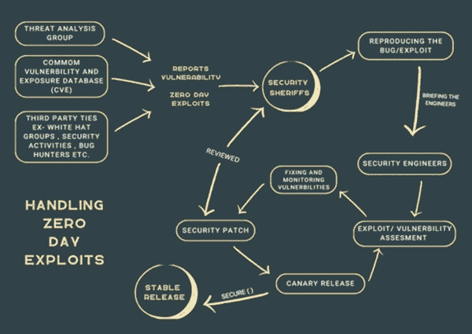 |

| --- |

由于零日漏洞的不可预测性，无法提供处理零日漏洞的最佳模型或流程。大多数组织遵循传统的修复方法。零日漏洞需要在 tightly bounded 时间范围内处理，以减少漏洞生命周期内造成的损害，这可能给系统带来巨大的财务和技术债务。

像 `Google` 这样大型科技公司设立了专门处理零日漏洞的团队。`Google` 设有安全主管（security sheriffs）的队列，以促进整个漏洞修复过程，并指导安全工程师。由于缺乏处理零日漏洞的具体方法，我们提出了自己的通用模型，该模型基于 `google` 的零日项目。尽管无法实现最佳结果，因为每个零日攻击可能各不相同。

## General Zero-Day Model

解释：

组织从威胁分析组（TAG）、CVE 数据库或其他第三方来源（如白帽黑客组织和漏洞猎人）接收到零日攻击报告或可利用漏洞的报告。这些报告由安全主管（Security sheriffs）访问，他们负责解决这些漏洞并保护软件，同时与安全工程师协作。安全主管尝试在安全环境中复现该漏洞，以获取关键信息，并向安全工程师简报问题。

安全工程师随后遵循标准的漏 exploit measures，主要从漏洞评估开始。漏洞被修复并在此阶段进行监控，以确保不影响代码的其他部分。随后发布安全补丁，该补丁经过自动化测试并由安全主管审查。随后部署 canary release。经过几次迭代，在验证补丁的安全标准后，会部署稳定版本供公众使用。

## CONCLUSION AND FUTURE SCOPE

即使在当今强大的技术增长下，零日漏洞仍然是一个不可逾越的壁垒。尽管许多科技公司试图制定自己的解决方案以减轻它们造成的损害，但未能提供最佳解决方案。要显著改进当前对零日漏洞的解决方案，需要超级计算机和主机的指数级增长。然而，通过实施安全设计模式并避免诸如 anti-patterns 等不良软件实践，可以实现零日漏洞的无痛修补，并显著减少零日漏洞的数量。此外，像 `Google` 的威胁分析小组（TAG）和 Common vulnerabilities and exposure（CVE）数据库持续努力，通过定期识别和报告可利用的漏洞来创建安全的软件解决方案。

任何零日模型的成功在很大程度上取决于其持续适应性，因为每个零日漏洞都可能带来意想不到的挑战，往往使既有原则和实践变得脆弱。

对于我们来说，应认识到零日问题没有最佳解决方案，因为策略、原则和实践始终可以进行改进以应对不确定的事件。没有一种通用的模型或流程能够适用于每个组织，因为不同组织面对的零日漏洞可能因其软件解决方案而异，因此每个组织需要分析其需求和持续的威胁，从不同方法中汲取策略，找出最适合自己的方案。

## REFERENCES

Abri, F., Siami-Namini, S., Khanghah, M. A., Soltani, F. M., & Namin, A. S. (2019, December). Can machine/deep learning classifiers detect zero-day malware with high accuracy? In 2019 IEEE international conference on big data (Big Data) (pp. 3252-3259). IEEE.

Afianian, A., Niksefat, S., Sadeghiyan, B., & Baptiste, D. (2019). Malware dynamic analysis evasion techniques: A survey. ACM Computing Surveys, 52(6), 1–28. doi:[10.1145/3365001](https://doi.org/10.1145/3365001)

Ahmed, O. (2022). Behaviour Anomaly on Linux Systems to Detect Zero-day Malware Attacks \[Doctoral dissertation\]. Auckland University of Technology.

Anand, P., Singh, Y., & Selwal, A. (2022). Learning-Based Techniques for Assessing Zero-Day Attacks and Vulnerabilities in IoT. In Recent Innovations in Computing (pp. 497–504). Springer. doi:[10.1007/978-981-16-8248-3\_41](https://doi.org/10.1007/978-981-16-8248-3_41)

Aoudni, Y., Donald, C., Farouk, A., Sahay, K. B., Babu, D. V., Tripathi, V., & Dhabliya, D. (2022). Cloud security based attack detection using transductive learning integrated with Hidden Markov Model. Pattern Recognition Letters, 157, 16–26. doi:[10.1016/j.patrec.2022.02.012](https://doi.org/10.1016/j.patrec.2022.02.012)

Aoudni, Y., Donald, C., Farouk, A., Sahay, K. B., Babu, D. V., Tripathi, V., & Dhabliya, D. (2022). Cloud security based attack detection using transductive learning integrated with Hidden Markov Model. Pattern Recognition Letters, 157, 16–26. doi:[10.1016/j.patrec.2022.02.012](https://doi.org/10.1016/j.patrec.2022.02.012)


Aryal, K., Gupta, M., & Abdelsalam, M. (2023). `Analysis of Label-Flip Poisoning Attack on Machine Learning Based Malware Detector`. `arXiv preprint arXiv:2301.01044`.

BilgeL.DumitraşT. (2012, October). `Before we knew it: an empirical study of zero-day attacks in the real world`. In `Proceedings of the 2012 ACM conference on Computer and communications security` (pp. 833-844). doi:`[10.1145/2382196.2382284](https://doi.org/10.1145/2382196.2382284)`.

Blaise, A., Bouet, M., Conan, V., & Secci, S. (2020). `Detection of zero-day attacks: An unsupervised port-based approach`. `Computer Networks`, 180, 107391. doi:`[10.1016/j.comnet.2020.107391](https://doi.org/10.1016/j.comnet.2020.107391)`.

Blumbergs, B., Dobelis, E., & Paikens, P. (2023). `WearSec: Towards Automated Security Evaluation of Wireless Wearable Devices`. `Secure IT Systems: 27th Nordic Conference, NordSec 2022, Reykjavic, Iceland, November 30–December 2, 2022 Proceedings`, 13700, 311.

Chen, C., Cui, B., Ma, J., Wu, R., Guo, J., & Liu, W. (2018). `A systematic review of fuzzing techniques`. `Computers & Security`, 75, 118–137. doi:`[10.1016/j.cose.2018.02.002](https://doi.org/10.1016/j.cose.2018.02.002)`.

Dionísio, N., Alves, F., Ferreira, P. M., & Bessani, A. (2019, July). `Cyberthreat detection from twitter using deep neural networks`. In `2019 international joint conference on neural networks (IJCNN)` (pp. 1-8). IEEE. doi:`[10.1109/IJCNN.2019.8852475](https://doi.org/10.1109/IJCNN.2019.8852475)`.

Dougherty, C., Sayre, K., Seacord, R. C., Svoboda, D., & Togashi, K. (2009). `Secure design patterns`. `Carnegie-Mellon Univ`.

Efstathopoulos, G., Grammatikis, P. R., Sarigiannidis, P., Argyriou, V., Sarigiannidis, A., Stamatakis, K., . . . Athanasopoulos, S. K. (2019, September). `Operational data based intrusion detection system for smart grid`. In `2019 IEEE 24th International Workshop on Computer Aided Modeling and Design of Communication Links and Networks (CAMAD)` (pp. 1-6). IEEE. doi:`[10.1109/CAMAD.2019.8858503](https://doi.org/10.1109/CAMAD.2019.8858503)`.

Garg, S., & Baliyan, N. (2019). `A novel parallel classifier scheme for vulnerability detection in android`. `Computers & Electrical Engineering`, 77, 12–26. doi:`[10.1016/j.compeleceng.2019.04.019](https://doi.org/10.1016/j.compeleceng.2019.04.019)`.

Garre, J. T. M., Pérez, M. G., & Ruiz-Martínez, A. (2021). `A novel Machine Learning-based approach for the detection of SSH botnet infection`. `Future Generation Computer Systems`, 115, 387–396. doi:`[10.1016/j.future.2020.09.004](https://doi.org/10.1016/j.future.2020.09.004)`.

Jaber, A., & Fritsch, L. (2023). `Towards AI-powered Cybersecurity Attack Modeling with Simulation Tools: Review of Attack Simulators`. In `International Conference on P2P, Parallel, Grid, Cloud and Internet Computing` (pp. 249-257). Springer.

Jacobs, J., Romanosky, S., Adjerid, I., & Baker, W. (2020). `Improving vulnerability remediation through better exploit prediction`. `Journal of Cybersecurity`, 6(1), `tyaa015`. doi:`[10.1093/cybsec/tyaa015](https://doi.org/10.1093/cybsec/tyaa015)`.

Kaushik, B., Sharma, R., Dhama, K., Chadha, A., & Sharma, S. (2023). `Performance evaluation of learning models for intrusion detection system using feature selection`. `Journal of Computer Virology and Hacking Techniques`, 1-20.

Khan, H. A., Sehatbakhsh, N., Nguyen, L. N., Prvulovic, M., & Zajić, A. (2019). `Malware detection in embedded systems using neural network model for electromagnetic side-channel signals`. `Journal of Hardware and Systems Security`, 3(4), 305–318. doi:`[10.1007/s41635-019-00074-w](https://doi.org/10.1007/s41635-019-00074-w)`.

Khan, S., & Mailewa, A. B. (2023). `Discover Botnets in IoT Sensor Networks: A Lightweight Deep Learning Framework with Hybrid Self-Organizing Maps`. `Microprocessors and Microsystems`, 97, 104753. doi:`[10.1016/j.micpro.2022.104753](https://doi.org/10.1016/j.micpro.2022.104753)`.

Kim, T., Kim, C. H., Rhee, J., Fei, F., Tu, Z., Walkup, G., . . . Xu, D. (2019). `{RVFuzzer}: Finding Input Validation Bugs in Robotic Vehicles through {Control-Guided} Testing`. In `28th USENIX Security Symposium (USENIX Security 19)` (pp. 425-442). USENIX.

Kumar, R., & Subbiah, G. (2022). `Zero-Day Malware Detection and Effective Malware Analysis Using Shapley Ensemble Boosting and Bagging Approach`. `Sensors (Basel)`, 22(7), 2798. doi:`[10.3390/s22072798](https://doi.org/10.3390/s22072798)`.

Le, T. H., Chen, H., & Babar, M. A. (2022). `A survey on data-driven software vulnerability assessment and prioritization`. `ACM Computing Surveys`, 55(5), 1–39. doi:`[10.1145/3529757](https://doi.org/10.1145/3529757)`.

Liu, X., Lin, Y., Li, H., & Zhang, J. (2020). `A novel method for malware detection on ML-based visualization technique`. `Computers & Security`, 89, 101682. doi:`[10.1016/j.cose.2019.101682](https://doi.org/10.1016/j.cose.2019.101682)`.

Malhotra, P., Singh, Y., Anand, P., Bangotra, D. K., Singh, P. K., & Hong, W. C. (2021). `Internet of things: Evolution, concerns and security challenges`. `Sensors (Basel)`, 21(5), 1809. doi:`[10.3390/s21051809](https://doi.org/10.3390/s21051809)`.

Martins, I., Resende, J. S., Sousa, P. R., Silva, S., Antunes, L., & Gama, J. (2022). `Host-based IDS: A review and open issues of an anomaly detection system in IoT`. `Future Generation Computer Systems`, 133, 95–113. doi:`[10.1016/j.future.2022.03.001](https://doi.org/10.1016/j.future.2022.03.001)`.

Meira, J., Andrade, R., Praça, I., Carneiro, J., Bolón-Canedo, V., Alonso-Betanzos, A., & Marreiros, G. (2020). `Performance evaluation of unsupervised techniques in cyber-attack anomaly detection`. `Journal of Ambient Intelligence and Humanized Computing`, 11(11), 4477–4489. doi:`[10.1007/s12652-019-01417-9](https://doi.org/10.1007/s12652-019-01417-9)`.

Mercaldo, F., & Santone, A. (2020). `Deep learning for image-based mobile malware detection`. `Journal of Computer Virology and Hacking Techniques`, 16(2), 157–171. doi:`[10.1007/s11416-019-00346-7](https://doi.org/10.1007/s11416-019-00346-7)`.

Mohammed, V. (2022). `Automatic Static Vulnerability Detection Approaches and Tools: State of the Art`. `Advances in Information, Communication and Cybersecurity: Proceedings of ICI2C’21`, 357, 449.

Mubaiwa, T. G., & Mukosera, M. (2022). `A hybrid approach to detect security vulnerabilities in web applications`. `Academic Press`.

NafeesT.CoullN.FergusonI.SampsonA. (2018, November). `Vulnerability anti-patterns: a timeless way to capture poor software practices (vulnerabilities)`. In `24th Conference on Pattern Languages of Programs` (p. 23). The Hillside Group.

Nagendran, K., Adithyan, A., Chethana, R., Camillus, P., & Varshini, K. B. S. (2019). `Web application penetration testing`. `International Journal of Innovative Technology and Exploring Engineering`, 8(10), 1029–1035. doi:`[10.35940/ijitee.J9173.0881019](https://doi.org/10.35940/ijitee.J9173.0881019)`.

Park, N. E., Lee, Y. R., Joo, S., Kim, S. Y., Kim, S. H., Park, J. Y., Kim, S.-Y., & Lee, I. G. (2023). `Performance evaluation of a fast and efficient intrusion detection framework for advanced persistent threat-based cyberattacks`. `Computers & Electrical Engineering`, 105, 108548. doi:`[10.1016/j.compeleceng.2022.108548](https://doi.org/10.1016/j.compeleceng.2022.108548)`.

Pérez-DíazN. W.Chinchay-MaldonadoJ. O.Mejía-CabreraH. I.Bances-SaavedraD. E.Bravo-RuizJ. A. (2023). `Ransomware Identification Through Sandbox Environment`. In `Proceedings of the Future Technologies Conference` (pp. 326-335). Springer.

RediniN.MachiryA.WangR.SpenskyC.ContinellaA.ShoshitaishviliY.VignaG. (2020, May). `Karonte: Detecting insecure multi-binary interactions in embedded firmware`. In `2020 IEEE Symposium on Security and Privacy (SP)` (pp. 1544-1561). IEEE. doi:`[10.1109/SP40000.2020.00036](https://doi.org/10.1109/SP40000.2020.00036)`.

Redino, C., Nandakumar, D., Schiller, R., Choi, K., Rahman, A., Bowen, E., . . . Nehila, J. (2022). `Zero Day Threat Detection Using Graph and Flow Based Security Telemetry`. `arXiv preprint arXiv:2205.02298`. doi:`[10.1109/ICCCIS56430.2022.10037596](https://doi.org/10.1109/ICCCIS56430.2022.10037596)`


## 第 5 章

## 建立风险增强统一安全控制集

## Stephen G. Fridakis  

  

Oracle Health, USA  

## 摘要

有时安全和技术专业人员会混淆他们的合规状态与安全态势。虽然组织可以满足任何监管标准（HIPAA、SOC 等）的要求，但这并不意味着能够防御潜在的网络攻击、在业务处理过程中保护数据或维护高度安全的开发环境。本章中，作者讨论了安全与合规如何共存。他们将每一种都与来源于正式框架或满足组织自定义操作或其他要求的控制相关联。他们探讨了如何以风险为导向实施每个控制，并最后建议管理此类控制目录的方法。

## 为什么合规不等于安全

合规指南是为特定关注领域（如支付行业、医疗、金融信息等）提供的一般化最低标准定义方法。由于每项指南均受到高度解释，盲目严格遵守不会导致安全或运营方面的实质性提升。即使组织符合标准，仍可能出现安全失败，原因包括缺乏熟练人员、人为错误、缺乏支持 breach detection 的信息、组织结构功能失常等。

建立框架是一项极其复杂的任务。如表 1 所示，大多数框架均在定期间隔内更新，但跟上某些更新的步伐和实施却颇具挑战。

**表 1. 热门框架及其最新版本/发布日期**

| 框架 | | 当前版本 | | 发布日期 |
| --- | --- | --- | --- | --- |
| NIST | | 1.1 | | 2018 年 4 月 |
| ISO 27001/27002 | | 35.030 -35.030 | | 2022 年 10 月 - 2022 年 3 月 |
| CIS | | 8 | | 2021 年 5 月 |
| SOC2 | | Oct 2022 | | Oct 2022 |
| PCI-DSS | | 4 | | 2022 年 3 月 |
| COBIT | | 2019 | | 2018 |
| HiTrust | | 11 | | 2023 年 1 月 |
| Cloud Control Matrix (CSA) | | 4 | | 2021 年 1 月 |
| CMMC | | 2 | | 2021 年 11 月 |
| HIPAA | | 2023 | | 2023 年 1 月 |

在其 2018 年（GAO, 2018）题为“关键基础设施保护：评估安全框架采用情况还需额外行动”的报告中，美国政府问责局（GAO）指出，虽然某些框架（如 NIST）会定期更新，但及时采用这些更新可能因相互冲突且工具未跟上更新而受阻。尽管如此，使用框架仍然有价值，甚至是必不可少的。可以认为，其他工具、框架以及缺乏必要知识挑战了对规范的严格遵守。HIPAA 规定了行政、物理和技术防护的最低安全控制，但标准本身并未对具体实施方法（“如何”）提供指导，而是给出开放式的建议，即实施“合理”或“最佳实践”，这将安全态势简化为抽象概念。

另一个与医疗-生命科学应用（包括硬件和传感器）相关的例子是 ISO27034（IEC, 2022）。该标准大量篇幅用于定义应用安全控制，即“包含对安全活动及其在应用生命周期特定阶段进行验证测量的精确列举和描述的数据结构”。此外，它定义了目标信任级别为“应用所有者依据应用安全风险分析，为降低特定应用风险至可接受（或可容忍）水平而认为必要的应用安全控制集合的名称或标签”。实施此类标准相当困难，任何组织能够将标准与自身业务关联并基于其进行风险分析的能力都相当有限。


一些模糊和含糊不清的因素表明，除了其他控制措施外，还需要进行深入审查和定制。NIST 800-53 控制 AU-11 如下所述处理日志保留问题（NIST, 2022）：“保留审计记录，以支持对事件的事后调查，并满足监管和组织的信息保留要求。组织在确定审计记录不再需要用于行政、法律、审计或其他操作目的时，才保留审计记录。”

虽然该控制是一般性最佳实践，但它仍然留下了大量组织层面的工作，尤其是当组织还需要同时符合其他框架（如 FISMA、PCI 等）并为不同类别的日志指定保留期限时。

PCI 适用于任何存储、处理或传输持卡人数据或与信用卡相关的敏感身份验证数据的组织。关于 PCI 的规定存在很多混淆。不存储、传输或处理信用卡数据的组织中的安全专业人员必须反复为自己的观点辩护，认为他们不需要满足 PCI 要求。原因在于，即使他们不直接处理信用卡，他们的客户却涉及信用卡！

根据 PCI 章节 12.8.2（PCI, 2022），具体要求是：“维护一份书面协议，其中包括确认服务提供商对其持有、存储、处理或传输的持卡人数据负有安全责任，或在其可能影响客户持卡人数据环境安全的范围内。” 实际上很难确定，将信用卡信息用于多因素认证，或作为托管提供商为包含信用卡信息的应用程序工作，是否会使某人受 PCI 合规约束。

我们可以用许多页面描述类似的模糊或矛盾的控制，以证明安全与合规虽然关注点不同，但同样重要。安全负责保护信息免受各种威胁，而合规则是对组织如何解释并满足适用安全框架（如 NIST CSF、ISO 27001）所设定标准的一次性报告。

虽然 NIST CSF 和 ISO 27001 互为补充，但它们之间也可能存在冲突。我们的关键建议是：利用符合组织业务优先级和风险状况的控制，构建一套统一的、共同的控制集，以满足监管要求，同时衡量组织的安全态势。

NIST CSF 和 ISO 都建议维护资产登记册或清单。它们的控制约有 75% 是互补的。同时，NIST 主要面向美国联邦机构，而 ISO 并非如此。NIST 是自愿性的，而 ISO 依赖于审计。可以认为 ISO 并不特别技术化，更侧重于风险管理。

新冠疫情加剧了合规与安全之间的鸿沟。在此期间，一些组织可能将注意力转向强调终端管理的使用案例和控制措施。允许个人设备（BYOD）接入网络可能经过了全面的讨论，因为远程办公或在许多远程地点居住已成为常态。一些组织认真对待零信任概念，实施不信任用户、设备或其访问公司应用和数据的网络的控制措施。

原则上，网络及其日志、监控和其他公用事业可以完全符合许多框架（如 HIPAA、ISO、NIST）的要求。然而，我们可以明确指出，这种高度合规的“无信任”网络（即零信任的变体）仍可能被 breached，因此在后疫情时代，组织可能不再相信即使用户已通过认证，也能真实是其所声称的身份。

传统的“信任后验证”方法在意识到即使拥有受信任账户的内部人员也不可信时，显得存疑。此外，即使是经过认证的用户也可能被授予仅限于极小范围的访问权限，而在其他以框架为驱动的场景中，受信任的内部人员可能拥有对企业系统和敏感数据的全部访问权限。

大多数应用程序在云环境或多云环境中运行的组织意识到，传统的边界保护（perimeter protection）¹ 的概念已变得过时。通过手机访问应用程序，或在某些情况下远程使用员工个人电脑工作。再加上可穿戴设备和其他物联网（IoT）设备。遵循合规框架意味着要识别出一个可以硬化、监控和管理的可辨识的边界。

合规审计始终包含证据，但通常最终以对一个被过度简化、复杂化的问题的二元“yes-or-no”答案作出回应。这些审计中常见的问题包括：抗病毒签名更新的频率，或更改密码的频率。NIST 和 ISO 等框架对合规和安全很有用，但要使安全有效，其控制措施必须经过定制，适用于组织自身，并通过风险导向的方法加以考量。这也是本章余下部分的关注重点。

IMPLEMENTING A UNIFIED CONTROLS FRAMEWORK

组织应遵循与其业务和运营最契合的框架所规定的控制措施。这些控制应在战略、操作和战术层面涵盖网络安全和隐私原则。完整的控制集应是所选框架的共同控制集，直接从框架中提取，并辅以若干客户特定控制。

如何让组织选择控制措施并确保“足够”的数量是本讨论的主题。控制的作用是使安全功能被理解，并促进对其有效性的审查。控制还存在的目的是保护公司的数据、应用程序和网络。统一控制框架的一个动机是简化审计和收集合规证据的过程，并使业务实践与审计要求保持一致。后者可能相当棘手。

在各种框架之间建立映射关系相对容易。许多工具可以实现这一点，包括美国国家安全中心（CIS, 2022，[链接](https://wiki.example.org/CIS_2022)）或国家网络安全职业和研究中心（NICCS, 2021，[链接](https://wiki.example.org/NICCS_2021)）或美国注册会计师协会（AICPA, 2022，[链接](https://wiki.example.org/AICPA_2022)），后者已将 SOC 2 的信任服务标准（TSC）映射到 ISO 27001、NIST CSF、GDPR 以及其他一些框架。

采用一套共同的控制措施具有显著好处。一次收集的合规证据即可用于针对各种框架的每次审计。这些控制措施是根据最符合业务需求的方式识别的，从而避免了控制的重复。需要注意的是，全年多次向同一组利益相关者请求相同或相似的证据非常耗时，给他们带来巨大负担，并使其偏离本职工作。通过消除重复的控制，统一控制框架降低了这一负担。


## 1. 合规与安全的概念

在探索“合规不等于安全”的概念时，我们只能反思在使用统一框架时，如何更轻松地验证各种控制的有效性。我们认为，一套**风险加权**且被管理的标准与自定义控制，能够在安全方面产生显著效果。此外，我们还将讨论一种判断组织是否具备满足安全目标的控制覆盖程度的方法。

控制是合规与实际安全实现之间的**桥梁机制**。实施一套控制也意味着在治理与风险管理方面具备额外能力。

我们不能忽视统一控制集合能够简化审计及相关证据的收集与验证。我们认为，50-60% 的控制在 NIST、ISO 与其他框架中是共通的，这使得审计成本有可能降低至合并价格的一半。

| Figure 1. Sample services/controls catalog for a medical technology organization |
| --- |
| 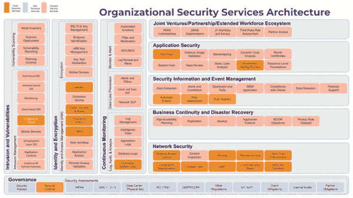 |
| --- |

## CUSTOM CONTROLS TO CONSIDER

在审阅上述示例安全控制目录后，我们发现部分控制直接来源于 ISO、NIST 或 HIPAA，约 20% 为自定义控制。它们的开发是为了正式化特定功能的实现、确保问责性并监控其有效性。组织因缺乏某些控制或对现有控制的错误解读而陷入常见漏洞。例如：

*   ● **SQL Injection**：未使用参数化查询。最常见的防护做法是封装并参数化 SQL 命令。参数化查询将 SQL 语句与用户输入分离，输入被视为字面值并进行类型与长度检查，从而无法包含可执行代码。

*   ● **Cross Site Scripting (XSS)**：未对数据进行**上下文敏感**转义。

*   ● **Cross Site Request Forgery (CSRF)**：未在状态变更的请求上使用令牌。

*   ● **Direct Object Reference (DOR)**：未严格验证直接对象引用。当应用使用内部对象引用时，可能泄露真实标识及其后端格/模式。

通过建立自定义控制来执行**静态或动态代码分析**，或强制使用 **Struts Validator、Java Cryptography Extension、ESAPI Encoder** 等工具，能够显著降低上述漏洞的暴露风险。经过评估相关框架后，我们建议某些控制在主流框架中**不足或完全缺失**。因此，任何组织均应考虑实施针对性的自定义控制：

这些控制包括：

*   ● **Contingency Planning**：未发现框架强制要求业务恢复与应急计划的制定、开发与验证。

*   ● **Information Security Management**：威胁如何被识别并关联到修复措施。

*   ● **Skills and Training**：需维持的能力以及其来源。

*   ● **Governance**：安全策略及其他管理事项的处理方式。

*   ● **Risk Management**：已识别问题的管理、 remediation 与报告方法，以及风险评估的具体流程。

*   ● **Access Management**：不同特性之间的关联及其对应用、数据集与资产访问的影响。

*   ● **Cyber Insurance**：关于网络责任保险的建议或情景。

*   ● **Cloud Service Operations**：在分权安全模型、多租户利用、临时设施以及软件部署的网络方面的控制。

*   ● **Web Application or Other Firewall (WAF)**：使用 WAF 处理动态应用安全问题及传统防火墙的其他用途。

*   ● **Data Loss Protection**：实现该特性或采用替代的 IDS/IPS 方案。

*   ● **Ransomware Protection**：保护或阻止勒索软件攻击的方法。

*   ● **Email Security**：加密、防伪、数字签名等邮件保护措施。

*   ● **Multi-Factor Authentication**：包含传统 MFA 以及硬件认证或提权管理的组合控制。

*   ● **Third Party Library Management**：针对第三方软件（开源、固件、硬件组件）的控制。

*   ● **File Management**：监控与验证关键文件的控制。

部分上述控制已纳入 ISO 或 NIST 框架或其特定指南，但它们往往未被明确强制或缺乏专门的部署与管理控制。

## CONTROL SUFFICIENCY

确定“足够多少控制”是一项**风险识别与管理**的工作。只有在明确、量化安全需求后，才能配备适当的控制。最低限度上，组织需识别关键资产并建立相应的控制。

为阐明可适用的风险，组织常使用**威胁模型**等方法。同时，还存在组织主动接受的**残余风险**，这些风险可被记录并随时管理。

> **Adequate security** is defined as: “The condition where the protection and sustainability strategies for an organization's critical assets and business processes are commensurate with the organization's tolerance for risk” (Augustine & Millstein, 2023)。  
> 首先建立资产列表，以判断已实施的控制是否足够。资产包括**知识产权、数据、技术、服务器、设施**以及诸如**知识、合同**等无形资产。

组织的**风险容忍度**是接下来需要定义的变量。它会影响预算、人员配置、运营及其他业务方式，且可能随组织绩效、合作伙伴等因素而变化。制定风险容忍度既是质量也是量化度量，可通过一系列**事件/结果/影响**陈述来建立。例如，引入由客户服务组织支持的新应用。

当前应用已建立**请求响应时间**与**响应准确性时间**，组织希望保持这些指标。为实现目标，管理层需分配资源、流程与技术。在分配资源后，组织必须决定可接受的**变动范围**。例如，响应时间延迟两小时是否可接受？若响应准确率下降 10%，对声誉与客户满意度会产生什么影响？

将上述思维过程延伸至安全领域，会提出两个核心问题——“**控制数量是否足够？**”以及紧密相关的“**我需要承担什么损失？**”。通过类似的分析过程，可得到可接受的答案。


根据我们对资产的定义，我们必须建立所有对组织至关重要的资产及其相关的业务流程，以满足其义务并实现其使命。随后，我们需要制定与这些资产相关的风险容忍度和可接受风险。

为了避免此练习变得过于随机且难以管理，我们建议采用一种易于实施的方法。该方法将基于历史事件参考和对当前环境的理解，同时扩展风险档案，并关联缓解策略，从而为风险本身、潜在影响及 remedy 成本提供可量化的维度。我们将避免使用特定实施的 Return on Investment（ROI）或风险价值（Value at Risk），因为它们可能令人困惑。我们将根据对关键资产及最影响业务的威胁的理解，确定我们能够负担的安全程度。

一旦组织的资产确定，我们将建立关键威胁及其对应的控制措施。需要注意的是，并非所有目的都有对应的控制措施。

表 2. 资产类型与威胁及缓解控制的示例关联

| 资产类型 | 潜在威胁 | 缓解控制 |
| --- | --- | --- |
| 数据 | 数据泄露  
敏感信息暴露  
数据篡改 | 数据加密  
备份与恢复  
边界防御 |
| 人力资源 | 身份盗窃  
中间人攻击  
社会工程（如鱼叉式钓鱼）  
未经授权访问 | 访问控制  
监控与日志审查  
意识培训  
背景审查  
正式认证 |
| 基础设施 | 服务拒绝（DoS/DDoS）  
硬件/固件攻击  
僵尸网络病毒攻击 | 特权访问管理  
审计日志智能  
恶意软件与防病毒  
网络扫描  
资产清单  
加固  
漏洞评估 |
| 应用程序 | 未经授权软件  
拒绝服务  
应用访问/性能下降 | 避免邮件冒充（DKIM）  
应用代码审查  
配置管理  
漏洞评估  
云配置  
资产标记 |

云实施使资产管理变得相当困难，因为其资产具有瞬息即逝的特性；但与此同时，标签和分类引入了许多新能力，使资产能够轻松分配到项目或其他组件，从而实现资源和成本的测量与归属。将个人与访问配置关联，可让人了解在何种情境下（所用设备、所连网络及其他变量）个人对何种资产拥有访问权限。

这些威胁的集合现在可以从定量和定性两个角度进行评估，从而确定关联控制措施的重要性和优先级。此类分析的问题在于，大多数情况下它高度主观。

在我们的建议审查中，每个威胁应从两个角度审视：损失可能有多大（规模）以及实际发生的概率是多少？这些数值也受历史事件参考的影响。

表 3. 威胁的定性与定量评估

| 潜在威胁 | 规模 | 概率 |
| --- | --- | --- |
|  | 停机  
设备成本  
其他费用  
是否在过去一年发生过  
难以尝试  
现有控制的有效性 |  |
| 数据泄露 |  |  |
| 身份盗窃 |  |  |
| 等 |  |  |

本表因信息可用性而差异很大。但有一点是毋庸置疑的：当在整个威胁模型中一致使用定量指标时，它们能够降低偏见和不一致性。遵循“输入垃圾，输出垃圾”的原则，必须始终考虑在此分析中使用的数值。我们评估现有控制有效性的原因是，过去的成功攻击可能促使实施了现在使相同攻击更难成功的技术，但也可能留下其他潜在漏洞。

实施控制措施与资产相关联。建立服务目录并不意味着所有控制措施都适用于所有网络段、应用程序或终端。风险模型将控制措施与资产关联，并确定每个控制措施的重要性和风险。因此，规划、监控、审查、报告和更新组织的威胁评估及控制部署的流程必须成为日常业务运营、风险管理和安全治理的正常组成部分。

实施基于风险的控制框架

在前一节中，我们讨论了将资产与威胁关联并为每个威胁分配定性和定量值的风险评估方法。我们现在将进一步探讨这一风险增强控制框架在网络安全领域的实现。任何此类实施的基础在于组织有效管理风险的能力。按设计，企业天然具有风险规避倾向。

风险评估已被多个监管监督机构所强制要求，包括证券交易委员会（SEC）、联邦金融信息考察委员会（FFIEC）、办公室控制官（OCC）、健康保险可携带性与责任法案（HIPAA）、关于关键基础设施保护的总统指令、支付卡行业数据安全标准（PCI-DSS）。未能执行评估并展示对已识别风险的持续管理，可能导致极为严重的处罚。

虽然对评估本身的质量存在争议，但我们观察到因缺乏风险管理计划而被处罚的案例有所增加。以下为一个小范例：

*   ● 2016：阿灵顿骨科诊所因“长期且系统性地未遵守 HIPAA 隐私与安全规则，包括未进行风险分析、未实施风险管理和审计控制、未维护 HIPAA 政策与程序、未与多家供应商建立业务伙伴协议、未为工作人员提供培训”而被处以 150 万美元罚款。

*   ● 2018：安特 hem 医疗集团因“未进行全面、组织范围的风险分析，以识别电子受保护健康信息（ePHI）的机密性、完整性和可用性潜在风险”而被处以 1600 万美元罚款（HHS - Anthem, 2020）。

*   ● 2020：CHSPSC LLC（业务伙伴）因“长期且系统性地未遵守 HIPAA 安全规则，包括未进行风险分析、未实施信息系统活动审查、安全事件处理流程以及访问控制”而被处以 230 万美元罚款。

*   ● 2020：Primera 蓝十字公司因“系统性未遵守 HIPAA 规则，包括未进行企业范围的风险评估、未实施风险管理和审计控制”而被处以 650 万美元罚款（HHS - Premera, 2020）。

*   ● 2020：USAA 联邦储蓄银行因“风险管理不足”被 OCC 处以 8500 万美元罚款（OCC, 2020）。

*   ● 2020：花旗银行因“风险管理失败”被 OCC 处以 4 亿美元罚款（OCC, 2020）。

这些处罚均与数据泄露或其他事件相关。那么，问题在于：风险评估本身能否阻止黑客？风险评估能否促使管理那些被识别的问题？管理风险意味着先进行评估，但两者截然不同。如前所述，评估将威胁与资产关联，并确定在特定情境下发生的可能性和影响。


一旦风险及其影响被识别后，管理层的规模及其他参数决定了风险是否会被解决、吸收、忽视或处理。管理层还包括如何进行沟通和监控。管理层通常采用：

*   ● 一种用于统一风险处理的方法，并能够随时间判断风险状态的改善或恶化（如果组织

*   ● 对组织对风险的容忍度的理解

*   ● 指示谁有能力和权限就特定风险做出决策

即使是最先进且最全面的评估，如果缺乏适当的管理，也会无效或仅是一纸空谈。

风险管理是健全安全实践的组成部分，包括：

资产清单：组织需要建立包含技术、知识、人员及其他资产的清单。每个资产随后需关联潜在威胁。为辅助此过程，可依赖历史参考（“此前是否发生过”）以及真实可能性和影响的分配（“威胁实施有多容易”、“如果黑客成功，实际和潜在的影响会是什么”）。此次练习的结果称为“固有风险”。

控制评估：控制目录无法独立存在。很少有组织能对所有资产部署所有可能的控制。事实上，并非每个应用都采用多因素认证或细粒度访问控制。因此，我们必须始终在控制部署的资产上下文中参考这些控制。一旦我们验证已部署的控制并确认其是否真正降低风险，剩下的即为所谓的“残余风险”。我们随后将残余风险与风险容忍度和阈值进行比较，判断是否超过阈值。如果超过，则必须作出关于如何处理残余风险的决策。

风险缓解：风险可以通过接受、规避、分担或转移来减轻。

持续监控：类似于汽车离开展示场后价值大幅下跌，一旦风险评估发布，它随即过时。持续的风险评估虽好，但成本高昂。许多组织在应用上线、新技术采购、重大升级、任何事件发生、新政策或流程推出、新 SOP 发布时，会重复（重新验证，而非全面评估）该过程。

尽管如此，组织仍可能发现重大泄露或因评估或管理不当而受到处罚。这可能因以下原因发生：

*   ● 对资产缺乏正确理解或认知。识别包含敏感数据的所有应用并不容易。此外，隐蔽 IT 或未被 IT 知晓的数据提取也会使问题变得复杂。

*   ● 误以为控制必须均等适用于所有系统。基于黑客已进入的前提，我们实际上无法解决所有漏洞。我们的优先事项应是部署控制，以保护关键数据和应用。

*   ● 风险评估过程仓促进行，缺乏历史证据或对威胁的理性审视。这导致整个风险领域被忽视。例如，组织可能讨论部署移动设置管理和员工多因素认证，却忽视使用个人电脑的顾问和合作伙伴，他们同样可访问相同数据。此重要问题将在本章后进一步讨论。

*   ● 风险评估由组织中与安全或甚至 IT 无直接关联的部门执行，缺乏进行准确、真实评估所需的知识和认知。

识别组织的所有可能资产

建立并维护资产清单对于合理分配控制和进行风险管理至关重要。虽然本文不讨论技术性电子发现方法或其他技术，但必须考虑导致风险评估不完整或不足的挑战——即整个资产类别被忽略的情况。云计算、虚拟化、设备、扩展合作伙伴网络以及联邦访问等因素使得我们难以全面了解网络中运行的所有内容。虽然自动化是解决许多此类问题的答案，但我们也必须确保某些基础问题得到解决。

组织具备部署电子发现系统的能力，这些系统还能揭示出我们可能不熟悉或不 aware 的应用或集成。使用这些方法编制的资产清单应包括：

*   ● 硬件和软件（主要通过合同、已知集成或许可证识别）

*   ● 代码仓库（通过与开发组织及合作伙伴的访谈识别）

*   ● 端点（笔记本电脑、台式机、外设、组织采购的设备）。为风险管理和安全控制目的，这些端点的详细清单并非必需，只需了解其操作系统、归属等高层特征即可

*   ● 统一访问系统（SSAS）和云计算（除已知集成外，可借助财务或采购部门协助）

*   ● 订阅

*   ● 数据存储库

*   ● 公告、文档以及知识产权

*   ● 软件许可证

*   ● 加密组件（私钥/公钥及其他加密元件）

除非建立一种面向未来的方法，否则维护此类清单仍然困难。此外，还需要对硬件和软件进行自动化校准，多个商业工具可协助实现此目标。

定义风险评估中的正确威胁

安全专业人员依赖准确的威胁评估来部署必要的控制。此任务涵盖办公场所、数据中心设施、事故、物资、对关键基础设施的依赖、合作伙伴和供应商等多种威胁。在确定受威胁的资产后，我们识别两类威胁：一种是资产自身的吸引力导致的固有威胁，另一种是主动威胁评估产生的威胁。

虽然数据中心设施（火灾、洪水等）可能面临多种威胁，但本节我们专注于如何得出一份完整的潜在网络威胁清单。仅依赖历史参考并不明智。我们确实强调，历史视角对于事件及控制有效性至关重要，但不能忽视黑客的创造力和资源 fulness。

我们通过认识到最重要的资产很可能是数据，从而编制出一份潜在威胁清单。针对这些威胁的应对是理想化的，但实际执行的可能性较低。在评估其当前及未来适用性时，需要进行分析性思考，主要关注监控与诊断控制，而非阻断，尤其是针对新兴威胁。该清单结合了多种安全信息与事件管理（SIEM）系统的即时漏洞监测与管理功能。


-   [高级持续性威胁 (sophisticated attack requiring multiple technologies and intelligence)] 的灵感源于**Richard Feynman**，诺贝尔物理奖获得者。

1.  运用费曼技巧，你只需花上`20 min`就能深入理解知识点，而且记忆深刻，*难以遗忘*。

```
if (condVar > someVal) {console.log("xxx")}
```

-   [高级持续性威胁 (sophisticated attack requiring multiple technologies and intelligence)]

-   [应用/联邦凭据 (exploiting SAML, OAuth or other methods to access applications)]

-   [暴力攻击 (stealthy attack exploiting combinations of words/numbers to gain access)]

-   [云攻击 (special attention to GCP, AWS, and Azure environments especially regarding access to credentials and open buckets or other cloud components that may be misconfigured)]

-   [云身份访问管理 (cloud access for individuals or applications can utilize certain features including passwords, tokens, or cryptographic credentials that hackers attempt to exploit)]

-   [Cookie 妥协 (compromise a cookie and affect how an application is behaving)]

-   [凭据劫持 (using social engineering or technology to steal one’s user id and password)]

-   [凭据重用 (finding a list of compromised credentials and using them to access another site)]

-   [跨站脚本 (inject malicious code into a trusted web site)]

-   [加密攻击 (crypto mining or taking over a computer for unauthorized crypto activities)]

-   [数据库/仓库采矿 (accessing information portal and getting access to confidential information)]

-   [设备和物联网威胁 (using a device to gain access to a network and data)]

-   [分布式拒绝服务攻击 (using several automated methods to flood and overwhelm a company’s systems)]

-   [DNS 攻击 (amplification, hijacking, tunneling) - taking over, redirecting or altering DNS information]

-   [中间人攻击 (applications are susceptible to a hacker embedding themselves between the app and the user)]

-   [硬件组件攻击 (firmware, chip, or other component specific to hardware device)]

-   [内部威胁 (access to sensitive or confidential information by a trusted party)]

-   [网络嗅探 (unauthorized scanning of the network to identify open ports, devices that can be compromised or unpatched components)]

-   [网络钓鱼 (combination of social engineering and technical methods aiming at obtaining credentials or other sensitive information)]

-   [特权用户妥协 (elevated access or obtaining system/management level credentials)]

-   [勒索软件 (hijacking of a system, forced encryption)]

-   [路由和基础设施安全 (taking over a wifi hotspot or other network equipment)]

-   [安全工具攻击 (disabling security defenses)]

-   [阴影 IT (unauthorized storage of data, use of applications or cloud components without the appropriate corporate security)]

-   [SQL 注入 (inserting SQL query in the input structure of an application)]

-   [被盗凭据 (getting unauthorized access to User Id, passwords)]

-   [系统配置错误 (a catch-all threat for unpatched and poorly configured systems)]

-   [第三方软件攻击 (utilize a trusted vendor software to attack receiving systems or their interfaces)]

-   [未经授权下载或软件安装 (installing malicious software)]

-   [病毒 (defeating antivirus control and install a virus on a platform)]

-   [网站模仿 (fake website pretending to be a legitimate one)]

THE EVOLUTION OF RISK ASSESSMENTS (MATURITY TO RISK TO CONTINUOUS MONITORING)

Maturity based risk assessments are still in use today. This approach consists of establishing a level of maturity by building, documenting and managing certain activities like code review or log monitoring. When starting a new security program, it may be helpful to differentiate the various controls and capabilities using a maturity scale in order to differentiate what is truly at its infancy versus something that is in place and needs to be documented, versus something that is well documented and repeatable. As the program matures, such an approach becomes unsuitable.

A maturity based program does not complement the approach discussed in this chapter. The emphasis of matching controls to assets and measuring their effectiveness is contrary to a maturity based approach that is applicable to “everything controls”. It is important to note that given the different risk posture of various assets any improvement can be made with each asset in mind. Aspiring to raise the maturity level of an organization can be very costly and has the potential to render all the controls ineffective.

Identifying an organization's risk appetite and associating assets to controls and to risks allows risk management to become a primary goal for the organization. As such, an investment becomes tangible and metrics become easily obtainable and familiar (KPI, KRI, etc.). A risk-based approach suggested here allows for the implementation and improvement of controls for each asset and allows for adjustments as the threat landscape changes.

There are some business-wide tasks that will need to be put in place to complement the risk-based assessment.

1. Formalize risk assessment at the corporate level and make cybersecurity risk part of it

2. Coordinate the asset inventory across all departments and partners

3. Communicate vulnerabilities across the organization to improve awareness and get agreement in impact

4. Understand threats and the applicability and effectiveness of controls

5. Understand how controls and vulnerabilities change over time and make adjustments

6. Map assets to controls and threats and make a risk assessment accordingly

7. Plot risks against the organization's tolerance

8. Monitor risks and controls using practical metrics such as key risk indicators (KRIs), and key performance indicators (KPIs).

DYNAMIC VALIDATION OF CONTROLS EFFECTIVENESS

It is essential that controls are tested regularly to validate their efficiency and effectiveness and to establish any new vulnerabilities to which that particular asset may be susceptible. Organizations sometimes perform pen tests and vulnerability assessments, to test and see if those controls are working together properly and can actually deter an attack.

Another essential measure is to perform phishing and awareness campaigns. Despite sophisticated techniques and expensive protections, a hacker can still rely on an employee clicking a link that they should not. This method supports the goal of improving controls and reducing risk. It should be promoted.

CONCLUSION

Checking-the-box may satisfy some rudimentary short term goals of an audit. Making decisions about security controls, spending, and vulnerabilities should be risk-based which will result in better compliance. We provided practical and relatively easy to implement approaches to achieve a risk-based allocation of controls to assets. Our goal is to meet a balance between compliance and security posture, recognizing that while complementary, they are quite different.

We placed all of our emphasis on sound risk management. Identifying threats using historical perspective but also real validation of vulnerabilities addresses the applicability of controls and provides for prioritization of their deployment. The risk-based approach is highly interactive. Linking business risks to controls allows executives to understand the purpose of cybersecurity investment and its value in meeting regulatory obligations.


## 第 6 章

## 关于健康监测系统中网络安全和隐私风险的案例研究

## Fatma Dogan Akkaya  
Kastamonu University, Turkey  

## 摘要  
新冠疫情促使全球实施数字健康监测系统，包括土耳其的 Hayat Eve Sığar (HES) 平台。虽然这些系统在监测和追踪病毒方面有效，但也引发了数据隐私和网络安全风险的担忧。本章探讨可能的风险，如数据泄露、恶意软件攻击、未经授权访问、个人健康信息滥用以及安全协议不足。为减轻这些风险，医疗机构必须实施强有力的安全措施，并培养安全文化，重点关注持续改进和主动风险管理。土耳其的 HES 为理解这些风险及其缓解措施提供了有价值的案例研究。本章强调了数字健康服务侵入个人私人空间并规范其生活的日益增长趋势，突出了在保护个人健康信息方面数据隐私和安全的重要性。  

## 引言  
Our Ford himself did a great deal to shift the emphasis from truth and beauty to comfort and happiness. Mass production demanded the shift. Universal happiness keeps the wheels steadily turning; truth and beauty can't. (Huxley, 1932, p. 201)  

大规模行为控制政策，如大规模监控、对移动的限制和限制，这些我们习惯在反乌托邦小说和电影中看到的，在 2020 年新冠疫情高峰时突然大胆地进入了我们的生活。许多国家开发了各种网络疾病监测系统，以监测和控制疾病传播，利用其技术基础设施和能力。这些系统的引入突然且没有事先通知，凸显了局势的紧迫性以及实施有效措施遏制疫情的必要性。  

## 参考文献  

- AICPA. (2022). SOC Service Organizations: Information for Service Organizations. AICPA. [`us.aicpa.org/interestareas/frc/assuranceadvisoryservices/serviceorganization-smanagement`](https://us.aicpa.org/interestareas/frc/assuranceadvisoryservices/serviceorganization-smanagement)  
- Augustine, N., & Millstein, I. (2023). Governing for Enterprise Security. SEI Digital Library. [`resources.sei.cmu.edu/asset_files/technicalnote/2005_004_001_14513.pdf`](https://resources.sei.cmu.edu/asset_files/technicalnote/2005_004_001_14513.pdf)  
- CCM. (2023). CSA Cloud Controls Matrix (CCM). [`cloudsecurityalliance.org/research/cloud-controls-matrix/`](https://cloudsecurityalliance.org/research/cloud-controls-matrix/)  
- CIS. (2022). Mapping and Compliance. CIS Center for Internet Security. [`www.cisecurity.org/cybersecurity-tools/mapping-compliance`](https://www.cisecurity.org/cybersecurity-tools/mapping-compliance)  
- CIS. (2023). CIS Center for Internet Security. [`learn.cisecurity.org/cis-controls-download`](https://learn.cisecurity.org/cis-controls-download)  
- CMMC. (2022). About CMMC. DoD CIO. [`dodcio.defense.gov/CMMC/About/`](https://dodcio.defense.gov/CMMC/About/)  
- COBIT. (2022). Control Objectives for Information Technologies. ISACA. [`www.isaca.org/resources/cobit`](https://www.isaca.org/resources/cobit)  
- GAO. (2018). Reports Challenges and Successes in Cybersecurity Framework Adoption. Van Ness Feldman LLP. [`www.vnf.com/gao-reports-challenges-and-successes-in-cybersecurity-framework`](https://www.vnf.com/gao-reports-challenges-and-successes-in-cybersecurity-framework)  
- HHS - Anthem. (2020). Pays OCR $16 Million in Record HIPAA Settlement Following Largest U.S. Health Data Breach in History | Guidance Portal. HHS.gov. [`www.hhs.gov/guidance/document/anthem-pays-ocr-16-million-record-hipaa-settlement-following-largest-us-health-data-breach`](https://www.hhs.gov/guidance/document/anthem-pays-ocr-16-million-record-hipaa-settlement-following-largest-us-health-data-breach)  
- HIPAA. (2022). HIPAA for Professionals. HHS.gov. [`www.hhs.gov/hipaa/for-professionals/index.html`](https://www.hhs.gov/hipaa/for-professionals/index.html)  
- HITRUST Alliance. (2023). Information Risk Management and Compliance. [`hitrustalliance.net/`](https://hitrustalliance.net/)  
- IEC. (2022). IEC 27001:2022 - Information security, cybersecurity and privacy protection — Information security management systems — Requirements. [`www.iso27001security.com/html/27034.html`](https://www.iso27001security.com/html/27034.html)  
- NewsH. H. S. (2023) [`public3.pagefreezer.com/content/HHS.gov/31-12-2020T08:51/https://www.hhs.gov/about/news/2020/09/21/orthopedic-clinic-pays-1.5-million-to-settle-systemic-noncompliance-with-hipaa-rules.html#:~:text=Athens%20Orthopedic%20Clinic%20PA%20`](https://public3.pagefreezer.com/content/HHS.gov/31-12-2020T08:51/https://www.hhs.gov/about/news/2020/09/21/orthopedic-clinic-pays-1.5-million-to-settle-systemic-noncompliance-with-hipaa-rules.html#:~:text=Athens%20Orthopedic%20Clinic%20PA%20)  
- NICCS. (2021). NICE Framework Mapping Tool | NICCS. [`niccs.cisa.gov/workforce-development/nice-framework-mapping-tool`](https://niccs.cisa.gov/workforce-development/nice-framework-mapping-tool)  
- NIST. (2018). Framework for Improving Critical Infrastructure Cybersecurity, Version 1.1. NIST Technical Series Publications. [`nvlpubs.nist.gov/nistpubs/CSWP/NIST.CSWP.04162018.pdf`](https://nvlpubs.nist.gov/nistpubs/CSWP/NIST.CSWP.04162018.pdf)  
- NIST. (2022). Special Publication (SP) 800-53 Rev. 5, Security and Privacy Controls for Information Systems and Organizations. NIST Computer Security Resource Center. [`csrc.nist.gov/publications/detail/sp/800-53/rev-5/final`](https://csrc.nist.gov/publications/detail/sp/800-53/rev-5/final)  
- OCC. (2020). Assesses $85 Million Civil Money Penalty Against USAA. Office of the Comptroller of the Currency (OCC). [`www.occ.gov/news-issuances/news-releases/2020/nr-occ-2020-135.html`](https://www.occ.gov/news-issuances/news-releases/2020/nr-occ-2020-135.html)  
- PCI. (2022). Official PCI Security Standards Council Site - Verify PCI Compliance, Download Data Security and Credit Card Security Standards. PCI Security Standards Council. [`www.pcisecuritystandards.org/about_us/`](https://www.pcisecuritystandards.org/about_us/)  
- Premera, H. H. S. (2020). Health Insurer Pays $6.85 Million to Settle Data Breach Affecting. HHS.gov. [`www.hhs.gov/hipaa/for-professionals/compliance-enforcement/agreements/premera/index.html`](https://www.hhs.gov/hipaa/for-professionals/compliance-enforcement/agreements/premera/index.html)  

1 There are numerous guidelines regarding perimeter protection. CNSSI 4009-2015 states: “Monitoring and control of communications at the external boundary of an information system to prevent and detect malicious and other unauthorized communications, through the use of boundary protection devices (e.g., gateways, routers, firewalls, guards, encrypted tunnels).” while NIST SP800-53 Rev 5. States “Monitoring and control of communications at the external interface to a system to prevent and detect malicious and other unauthorized communications using boundary protection devices.”  


数字健康监测系统在全球范围内部署，其中之一是土耳其的 Life Fits Home, Hayat Eve Sığar (HES) 平台。HES 是土耳其卫生部为应对 COVID-19 大流行而开发的数字平台。2020 至 2022 年期间，HES 被大量用于监测和追踪病毒传播。它为个人提供最新的 COVID-19 信息，并允许他们报告可能出现的症状和接触史。个人可以通过移动应用、网站和客服电话使用该平台报告症状，并获得是否就医或接受 COVID-19 检测的指导。这些数据用于识别并通知可能接触病毒的人。HES 平台的一个重要功能是其二维码系统。已检测为阴性的个人可以生成二维码，用于访问购物中心、餐厅和公共交通等公共场所。入口处的工作人员扫描二维码，验证个人的 COVID-19 状态，并在其未感染时允许其进入。HES 平台还包含其他功能，如实时更新 COVID-19 病例数、医院床位可用性以及 COVID-19 检测中心的信息。平台会定期更新新信息和指导，以跟上疫情形势的变化。尽管 HES 平台仍在运行，但其提供的数据不再导致公共场所的限制。然而，该系统包含一系列软件和定量数据，可在任何潜在的流行病爆发时迅速启用。

在本论文中，HES 系统将作为分析健康监测系统中网络安全风险的案例研究。2020 至 2022 年间，在工作场所、学校、医院、城际巴士、购物中心、足球比赛或各类活动等公共场所和活动中强制要求显示 HES 代码。这意味着 HES——一款管理智能手机应用和二维码的应用——首次在规模巨大的网络安全计划中收集数百万人的个人数据和健康记录。从健康监测系统的角度来看，HES 程序展示了技术支持的健康服务如何能够迅速向受益者提供，并证明其将大幅提升公共健康质量。但另一方面，关于用户信息数据泄露的防护措施、遵循的安全协议，以及大量数据的存储方式和地点，可能是 HES 以及全球采用相同方法的其他数字健康监测系统的潜在弱点。此外，本章将探讨土耳其政府在实施 HES 系统时面临的挑战，包括公众信任、数据隐私问题以及限制个人权利。为了全面了解数字健康监测系统的使用和影响，不仅需要研究土耳其的案例，还需要研究全球在 COVID-19 大流行期间实施的类似应用。因此，围绕 HES 和其他类似数字应用的隐私与数据安全问题的讨论，将引导我们审视在全球范围内为公共健康利益而暂停基本人权的后果。

监测现象的理论基础对于理解监测实践的运作、其社会文化影响以及涉及的权力动态至关重要。因此，本章将首先探讨医疗背景中的理论论述，在该背景下数字健康监测系统已成为公共健康监测和管理的不可或缺工具。本章还将进一步探讨数字健康监测系统可能面临的风险，包括数据泄露、恶意软件攻击、未经授权访问、个人医疗信息滥用以及安全协议不足。最后，本章还探讨伦理与实践考量，包括提供网络安全培训、定期监测与测试、透明度与问责。为应对上述风险，本文强调医疗机构必须实施强有力的安全措施，并培养安全文化，强调持续改进和主动风险管理。

## THE THEORETICAL BACKGROUND OF SURVEILLANCE PHENOMENA: EXPLORING POWER DYNAMICS AND SOCIAL IMPLICATIONS

几个世纪以来，监测一直是社会的重要调节工具，服务于维持法律秩序、保护国家安全和控制疫情等多种目的。随着新技术的出现和数据可得性的增加，数字监测系统得以发展。如今，它能够收集、分析和存储海量数据。我们正处于一个节奏快速的时代，创新与变革迅速发生，即使是最新的技术发展也会迅速变得过时。简单来说，监测是监视个人、群体或社会的行为，而在科学语境中，它指的是监测特定生态系统内的所有过程。传统监测涉及观察者与被观察者，而自我监测则作为一个独立主题出现，得益于诸如孕期测试、智能手表和呼吸仪等工具，使个人能够监测自身健康状况 (`Marx, 2016`)。基于软件的日常跟踪也用于个人和学术发展。因此，思考数据收集和处理的技术能力将如何影响未来的人类社会，无论是正面还是负面，都是引人入胜的。

监测现象的理论基础复杂且多维。在当代监测话语中，面对多样化的研究成果，可以看到其跨越社会学、政治经济学、法律、 criminology（犯罪学）和公共卫生等多个学科。监测现象的研究关注权力、社会控制、隐私和社会秩序等问题，并探讨监测实践如何塑造社会规范和价值观，以及其对社会的影响。


在现代信息通信和信息时代（Bauman, 2000），是否存在任何人或事物能够真正隐藏于监控之外？监控现象作为个体与社会关系的不同反映，近年来受到广泛研究与探讨，旨在回答众多相关问题。在此背景下，Georg Simmel (1906)，古典社会学的重要人物，研究了秘密的社会学，试图揭示人际及社会层面人际关系的情感、象征和位置特征。他认为秘密是一种社会现象，个人与机构层面的隐私协议有助于保护个体的社会身份。根据 Simmel (1950)，秘密有助于个体避免在人群中迷失，尤其是在城市地区，人们相互依赖、分工合作，从国家视角维持社会秩序，只要秘密不至极端。

Michel Foucault (1977) 是一位著名的理论家，他观察了后工业社会国家的转型与控制加强，并与 Nisbet (1977)、Ericson and Haggerty (1997)、Deflem (2000) 等学者并肩探讨。他提出了“全景监狱”（panopticon）这一隐喻，形容当代社会全方位的监控文化，灵感来源于 18 世纪哲学家杰里米·边沁（Jeremy Bentham）的监狱设计。边沁的全景监狱是一座圆形建筑，设有中央塔楼，监狱看守可以在不让囚犯知晓是否被观察的情况下监视所有囚犯。Foucault 将全景监狱视为现代社会一种微妙、普遍且有效的权力形式，象征着通过学校、医院、工厂和监狱等社会制度，人们持续受到监控与控制。他认为全景监狱不仅是一种物理设计，也是一种通过监视、规范与纪律话语与实践实现的社会组织与控制模式。这一概念启发了如 George Orwell (1987) 等作家，推动了反乌托邦叙事风格的兴起，探讨极权主义和类似大兄弟（Big Brother）的操控系统如何侵蚀自由并使个体处于持续的监控与控制之下。杰里米·边沁因著名地将自己的骨骼捐赠公开展示，如今其骨骼置于伦敦大学学院的座椅上，透过检视玻璃盒子眺望观众。在当今世界，全景监控的隐喻被数字监控系统与工具所重新审视。然而，Gary T. Marx (2016) 认为，我们必须超越传统的监控形式，应对新兴的监控模式。与局部、碎片化的视角不同，我们需要关注更为集中、广泛的监控形态，这些形态依赖于通信与技术。

在当代，监控随着新技术的发展，尤其是数字信息与通信技术而演进。数字监控系统日益成熟强大，能够从多个来源收集并分析大量数据。因此，研究现代社会监控实践的演变成为一个关键课题。David Lyon (1994) 对当代监控实践的研究作出了重要贡献，他考察了闭路电视（CCTV）、生物识别与计算机数据库等技术的兴起与扩散，指出这些技术根本改变了监控的本质，使其更加普遍、隐形且难以抵抗。在其著作中，Lyon (2001) 定义了“监控社会”概念，认为它已成为现代社会各机构领域——包括军事、国家、工作场所、警务和消费——的普遍且常态化的方面。个人信息通过 RFID（射频识别技术）、条形码系统以及会员积分计划等技术被收集与分析（Lyon, 2007）。

在医疗健康领域，数字健康监测系统已成为监测与管理公共健康的重要工具。这些系统能够追踪疫情爆发、监测传染病传播，并帮助医疗主管部门更快速应对公共卫生 emergencies。然而，使用数字健康监测系统也带来隐私、数据安全以及数据可能被滥用的担忧。多个理论框架可帮助我们理解健康领域的监控。其中一种是“监控资本主义”（surveillance capitalism），该概念由 Shoshana Zuboff (2019) 创造，描述一种依赖个人数据收集与分析以谋取商业利益的资本主义形态。Zuboff (2019) 认为，在当今理想的自由平等世界已被抛弃的时代，拥有巨额资本的公司在表面上以数据消费为名，将个人数据出售给广告商；同时，国家机构也借助打击恐怖主义的名义扩大监控能力。根据 Zuboff (2019)，监控资本主义将个人数据商品化并用于盈利，导致隐私侵犯与剥削。这一框架凸显了个人数据用于商业目的的风险，强调保护个人隐私与权利的必要性。虽然监控资本主义不局限于健康领域，但它对个人健康数据的收集与使用具有重要影响。因此，必须审视数字健康监测系统的伦理影响，并实施适当的保障措施，防止个人健康数据被滥用。


“技术决定论”的概念，主要归因于**托尔斯泰因·文伯伦**，可以作为另一种理论框架，表明技术推动社会变革并塑造社会关系和制度。卡尔·马克思也认识到技术对社会的影响，但强调技术发展是由社会关系和经济结构所塑造的（Feldman, 2016）。在健康监测系统的语境下，它指出技术进步可以彻底改变公共卫生监测。然而，必须采取批判性视角，认识到更广泛的社会、文化和政治因素塑造了这些系统的发展与使用，因为技术决定论可能简化技术与社会之间复杂的关系。另一方面，技术与互联网获取的不平等分配导致了“数字鸿沟”，阻碍了健康系统向不同社会经济群体和地理区域的覆盖，这可能导致各群体之间的健康结果差异，并阻碍有效公共卫生政策的形成，如用于健康系统改进的数据收集与分析（Saeed and Masters, 2021）。此外，技术与互联网获取的不平等可能加剧现有的权力失衡——拥有技术的人可能更好地控制健康数据的收集、分析与分发，这会进一步边缘化弱势群体并限制其参与健康决策的机会。为克服健康监测中的数字鸿沟并使技术决定论走向积极方向，必须确保技术与互联网的平等获取，并鼓励发展包容性、创新的健康监测系统，这些系统需考虑不同人口的独特需求与视角。在此意义上，批判理论——对权力关系在社会结构与实践中如何嵌入进行考察——提供了一个全面的理论框架，用于理解经济、政治和文化层面的不平等与边缘化模式（Todic et al., 2022）。

最后，作用网络理论（ANT）有助于理解诸如医疗提供者、患者、公共卫生官员和技术设备等各类主体如何相互作用，从而塑造健康监测系统的发展与实施。ANT 是一个聚焦于主体（包括人类与非人类）之间关系及其如何塑造社会与技术系统的理论框架。它最初由布鲁诺·拉图尔、米歇尔·卡隆等人于 1980 年代开发，旨在理解科学事实与技术的生产。通过分析主体之间的关系及其如何影响系统的发展与实施，我们可以获得设计和实施更有效、更公平的健康监测系统的洞察。例如，健康监测技术的设计与功能会影响医疗提供者和患者的行为与决策，进而影响系统的整体效能（Bilodeau and Potvin, 2018）。

监测被视为现代世界不可避免的方面，不同理论视角共享这一共识。根据 Lyon (2001)，信息社会等同于监测社会，而 Weber (1987) 将个体描述为被困在官僚主义的“铁笼”中——对某些学者而言，这种“壳”如同钢铁般坚硬（Baehr, 2001）。Ball and Webster (2003) 认为，马克思实际上把监测视为日益理性化世界的必要副产品。在我们的研究过程中，我们会不时回到这些框架，以深化对数字健康监测系统所涉复杂的主体与因素网络的理解。通过审视这些分析视角，我们可以洞察数字健康监测系统的运作机制及其对公共卫生和个人隐私的影响。下一章将分析数字健康监测系统固有的网络安全风险，特别是土耳其的 HES 健康监测计划，以及全球涉及敏感个人健康信息收集与管理的健康监测系统。

**RISKS ASSOCIATED WITH DIGITAL HEALTH SURVEILLANCE SYSTEMS**

COVID-19 大流行确实加速了各类数字技术的采用与实施，以提升公共卫生应对。这些技术在监测人群、识别病例、追踪接触以及通过移动数据评估干预措施的影响方面发挥了关键作用。此外，数字技术还被用于向公众传播重要信息、提供远程医疗服务（Greenhalgh, Koh, & Car, 2020）。Budd et al. (2020) 给出了 Covid-19 期间使用的各类数字技术的全面概述，包括在线症状监测、智能手机应用、数字诊断与基因组学、可视化工具、可穿戴设备与传感器、计算机视觉、短信与即时通讯、保护安全与隐私的技术，以及机器学习和自然语言处理。得益于这些技术进步，公共卫生应对更加流畅高效，战胜疫情的成果得到提升。

```
if (condVar > someVal) {console.log("xxx")}
```


数字健康应用的目的是为了提供快速高效的诊断和检测结果获取、监测健康数据、预约就诊以及促进医生与患者之间的沟通。Almalki and Giannicchi (2021) 进行了一项关于与 COVID-19 相关的数字健康应用的综述，发现它们主要有五个目的，包括提高意识、管理暴露、由医疗专业人员监测健康、开展研究（总计 67.5%）以及主要跟踪个人健康（31%）。研究的一个显著发现是，大量面向个人健康监测的应用是由政府或国家当局开发的（67%）。这一现象表明，国家当局在确保个人数据被收集、处理和使用时尊重个人隐私并保护其免受伤害方面承担着重要责任。这项责任包括制定和执行法律法规，规范个人数据的收集和使用，并投资网络安全措施，以防止未经授权的访问敏感信息。在英国、欧盟和美国，基于应用的接触追踪已获得高度公众接受度（Altman et al., 2020; Milsom et al., 2021）。然而，Ioannou 和 Tussyadiah（2021）在其美国研究中指出，参与者对通过移动应用收集和使用个人信息可能导致的隐私泄露以及当局监测其在线活动表示担忧。加拿大的一项研究也显示，尽管政府与企业合作带来的社会效益，公众仍对接触追踪应用和其他数字监控技术带来的隐私侵犯表示关注（Westerlund et al., 2021）。该研究建议，政府和企业在数据收集与使用方面保持透明，并加强监督，可以提升对这些技术使用的信任度。此外，Dowthwaite et al. (2021) 发现，使用此类应用的接受率及其后期持续使用率非常低，尤其是在敏感群体中，如黑人、亚裔及少数族裔社区成员以及年龄在 65 岁以上的老年人，他们可能不完全理解相关技术。遗憾的是，缺乏优先考虑数字监控的社会接受度和实践的研究，使得在不同情境间进行比较变得困难。总之，这些数字数据收集应用能够轻松获取个人信息，拥有灵活的规则，并利用智能工具快速分析大数据。然而，使用这些应用的消费者对个人健康指标缺乏足够了解，也缺乏在敏感数据被用于商业利益时的明确应对路线图。

全球公共卫生当局和公司使用多种数字数据源来开发和解释 COVID-19 相关的数据。在土耳其的经验中，土耳其卫生部为 COVID-19 相关的健康服务开发的 HES 平台已成功跟踪疫情传播并提供关于疫情的最新信息。然而，关于个人数据、敏感健康信息和旅行信息的收集与存储也引发了担忧。基于文献、在线公开的机构公告和媒体报道，我打算分析各国以及 HES 可能面临的网络安全风险。关于 HES，它本身并不直接关联于各国的网络安全风险，但必须强调通过该应用收集的个人及敏感健康数据的安全与隐私。针对 HES 以及全球健康监测应用的重大风险和相关伦理问题包括：

**数据泄露和恶意攻击**

健康监测系统收集大量敏感的个人健康信息，使其成为黑客寻找并窃取有价值数据的有利目标。若发生数据泄露，患者的个人和医疗信息（包括健康史、处方药和实验室结果）可能被暴露，进而被售卖于黑市或用于身份盗窃。Kruse et al. (2017) 指出，医疗机构通常资源有限，难以在网络安全方面提供充分防护和应对。

为应对 COVID-19 大流行，许多国家建立了依赖接触追踪应用的健康监测系统。但由于局势紧迫，这些应用在快速由政府部门或私人公司开发之初就预计会面临安全风险。如预期，许多国家的接触追踪应用均出现安全顾虑和数据泄露。2021 年 5 月，Amnesty International 报告称，卡塔尔 COVID-19 接触追踪应用中的一个漏洞使超过一百万人的个人数据面临风险（Hern, 2020）。该应用采用集中式系统，收集姓名、健康状态和位置数据，成为黑客的易攻目标。因此，英国等国家宣布转向去中心化系统，以降低集中式系统的安全风险（GOV.UK, 2022）。2022 年 8 月，有报道称，4850 万名上海“随身码”用户的个人数据正被黑客出售（Baptista, 2022）。该应用被上海所有居民和访客用于访问公共场所、领取包裹和点餐，收集了姓名、身份证号、健康状态和位置数据等敏感信息，再次凸显了通过移动设备收集敏感个人数据的安全与隐私风险，以及加强安全措施保护用户数据的必要性。

土耳其使用的接触追踪应用 HES 与其他国家的类似应用不同，它以集中式方式收集用户信息，而像新加坡的 TraceTogether、欧洲联盟的 PEPP-PT、澳大利亚的 COVIDSafe 以及加拿大的 ABTraceTogether 等应用则采用去中心化方式（HES 例外为混合去中心化-集中化方式）。此外，大多数去中心化应用依赖蓝牙技术以保障用户隐私（Hogan et al., 2021），而 HES 则使用 GPS 追踪用户位置，类似于中国的支付宝/微信、韩国的自我隔离安全防护应用以及以色列的 HaMagen 接触追踪应用。苹果-谷歌联合开发的接触追踪应用同样采用蓝牙近场追踪。然而，人们对私人公司如何处理敏感健康数据的担忧引发了关于大型科技公司在公共卫生领域新角色的讨论（Sharon,2020）。

```if (condVar > someVal) {console.log("xxx")}
```


-   尽管 HES 至今尚未报告任何数据泄露事件，但其在集中系统中集中存储用户数据（如姓名、身份证号码、通讯录、健康数据、位置、手机摄像头，甚至手机存储的视频、音频、图片文件）这一事实引发了对潜在隐私和安全泄露的担忧。土耳其卫生部依据《个人数据保护法》（KVKK，第 6698 号法案）第 10 条“数据监督员的告知责任”，声明 HES 应用程序用户的个人数据安全。HES 是土耳其接触追踪应用，旨在根据用户的新冠检测结果或其与已确诊新冠阳性者的接触来判断个人的风险状态。因此，HES 代码及查询结果被归类为特殊质量个人数据，因为它们涉及健康数据。然而，人们对该应用对用户手机上大量个人数据的访问权限以及所有信息在单一中心进行处理和存储的担忧日益加剧，这些担忧凸显了安全隐患。上海最近发生的数据盗窃事件提醒人们，通过移动应用在单一中心收集和存储敏感个人信息可能带来的风险。为确保最高级别的安全，像 HES 这类健康监测应用必须采取必要措施并定期更新，以维护安全协议。

-   恶意软件（malware）是对数字数据系统的另一种高度复杂的威胁，根据 ENISA（欧洲联盟网络安全局）2020 年报告，它在过去十年中一直位列前 15 大威胁之列。尽管其普遍存在，许多安全系统仍无法有效检测和防止恶意软件攻击。健康监测系统可能面临恶意软件攻击的风险，这可能导致系统运行中断或个人健康信息被盗。恶意软件（malicious software）是指设计用于损害计算机系统、窃取敏感信息或未经授权访问计算机网络的软件（联合安全与隐私委员会，2003）。前文提到的数据泄露通常是内部人员造成的，但恶意攻击则可能由外部实体或来源发起，这些来源可能包括涉及黑客或 IT 事件的各种欺诈活动，如诈骗、恶意软件攻击、勒索软件攻击、网络钓鱼、间谍软件、卡片盗用等（[Seh et al., 2020）。

-   恶意软件攻击在医疗环境中尤为危险，因为它们可能损害患者数据的保密性、完整性和可用性。恶意软件还可能感染电子健康记录系统，导致患者数据丢失或损坏。虽然疫情期间对接触监测应用的需求迫切，促使其快速部署，但安全专家已提出关于这些应用存在的漏洞的担忧，并发现了多种可能使其易受攻击的弱点。BBC News（2020）指出，印度已将公民下载 Aarogya Setu（一种用于遏制新冠扩散的接触追踪应用）作为强制性要求，这使其成为世界上最大且最具争议的基于生物特征的身份数据库。一名印度软件工程师宣布打算通过黑客攻击揭露该应用的漏洞，这引发了对该应用安全性的担忧（Dixit, 2020）。类似的担忧也被报道于《卫报》关于卡塔尔强制接触追踪应用 ETHARAZ 的报道中（Hern, 2020）。土耳其也有自己的强制接触追踪程序 HES，可能面临类似的安全漏洞和担忧。

-   这些潜在的安全问题凸显了当前情境下的重要考量。各国政府面临压力，在疫情防控中管理健康记录，但这也带来了潜在的安全隐患。数字化健康记录和持续监测已成为公共和私营机构的常态，这需要大量资源，包括训练有素的团队，以处理工作量并确保敏感信息的安全。然而，只有技术教育和手段充足的国家才能应对这一挑战。这与维布伦（Veblen）的技术决定论概念相契合，即技术优势推动社会、经济和政治变革，促成发展。因此，世界正逐步迈向数字化健康景观，能够生产或负担技术的国家将拥有优势。

-   这也包括应对数字鸿沟和歧视问题，这些问题对数据安全和患者保护有重大影响。数字鸿沟指技术获取和互联网连接的不平等，可能使某些人群在数据安全方面处于劣势。通过这一过程，再次显现出西方和亚洲地区的国家在将技术用于经济发展时，在追踪设备的研发和商业化方面已取得显著进展，但这种情况并未发生在资源和基础设施有限的欠发达国家，采用医疗和监测技术可能更具挑战性。在医疗领域，数字鸿沟也指不同人口群体在获取技术和互联网连接方面的差异，这会影响他们利用医疗服务的能力，并在数据安全方面处于劣势。即便在英国这样高度发达的国家，数字鸿沟依然存在，约三分之一家庭缺乏移动宽带接入。一项调查发现，相当大比例的人口（包括 55 岁及以上的 30% 的老年人和 18 岁及以上的 21% 的年轻人）没有智能手机访问（ONS, 2019）。这一差距导致许多无法利用医疗技术（如接触追踪应用）的群体出现健康不平等。医疗机构必须采取措施缓解这些不平等，例如为弱势社区提供技术和互联网接入，以确保所有患者都能平等获得对敏感个人健康信息的保护。新加坡，因其技术进步而闻名，通过向缺乏智能手机设备的个人发放可穿戴设备来解决这一不平等（Asher, 2020）。此外，当涉及医疗领域的网络安全时，歧视也可能是一个问题。由于种族、民族、性别或其他特征，某些群体可能面临更高的网络攻击或数据泄露风险。全球众多报告和研究表明，因被定罪（Davis, 2020）、对少数群体身份的恐惧（Marsh, Deng and Gan, 2020）、污名化（[news.un.org](https://news.un.org)）以及宗教（Yasir, 2020）或种族歧视（Shapiro, Jingnan and Benincasa, 2020）等因素，使各种弱势群体难以准确贡献统计健康记录。医疗机构必须确保其安全措施不会对这些群体造成不成比例的伤害，并采取措施应对可能出现的偏见或歧视性做法。


实施有效的健康监测技术的网络安全措施可能因各种技术障碍以及各国采用的不同方法而面临挑战。然而，政府或私人公司对敏感个人数据的共享、处理和必要处理也引发了知识层面的讨论。大多数新冠监测应用都是通过试错方法开发的，涉及不同的协议和同意声明。全球范围的疾病监测实践通过技术工具和社会激励检验了系统的连续性，从而促成了针对“数字监控社会”的行动计划。利用无人机进行城市监测、热成像和红外摄像头用于诊断、可穿戴设备用于移动监测，引发了市民自由担忧，包括隐私受侵犯和“规模监控能力的制度化” (`Nothias et al., 2021:3`)。最初在新加坡和英国实施的在线症状报告，以及土耳其要求通过自我报告进行强制性 PCR 测试以进入公共场所和旅行的做法，符合福柯的全景监狱隐喻——即在无意识的观察下，个体进行自我监控并遵循社会规范。

总体而言，接触追踪系统反映了现代社会中公共健康、个人隐私和社会规范之间的复杂权衡。虽然隐私和监控方面可能存在顾虑，但平衡这些问题与防止疾病传播、确保公共空间中个人安全的需求至关重要。每个负责的治理机构必须采取所有必要措施，并提供充分说明，以缓解关于可能侵犯公民自由、数据泄露、盗窃或安全漏洞等问题的担忧。

未经授权访问和滥用个人健康信息

未经授权的访问是继黑客攻击之后第二重要的医疗数据泄露类型 (`Seh et al. 2020`)。健康监测系统通常包含个人健康信息，仅应由授权人员（如医疗提供者或研究人员）访问。然而，如果这些系统未得到适当的保护，未经授权的个人可能会获取这些信息。这会导致严重的隐私侵犯并危及患者护理。非法获取患者数据可能导致身份盗窃、欺诈等多种滥用行为，同时也会损害医疗提供者的声誉并削弱患者信任。结果是，当敏感个人信息在暗网上出售时，患者可能会遭受巨大的经济损失 (`Chernyshev, Zeadally and Baig, 2019`)。与此同时，医疗行业相较于其他数据驱动行业，准备应对此类安全泄露的能力较弱，预计将受到最显著的影响 (`Liu, Musen and Chou, 2015`)。

在某些情况下，拥有授权访问健康监测系统的个人可能会滥用患者的个人健康信息。例如，他们可能会将信息转交给未经授权的第三方、为个人谋利，或因患者健康状况而对其进行歧视 (`Gerke, Minssen, and Cohen (2020)` 指出，个人健康信息的滥用可能对患者造成严重后果，包括声誉受损、经济损失，甚至身体伤害。另一种滥用形式是第三方数据共享 (`[Trinidad, Platt and Kardia, 2020`)。当医疗机构将患者数据与第三方实体共享时，数据可能会被用于超出原始预期的用途。这可能发生在医疗机构未能充分审查第三方资产，或合同不足以确保患者数据的适当使用和保护时。向第三方共享记录患者信息的做法最近在公共卫生部门中流行，旨在提升服务质量并利用先进技术提供更好护理。然而，这些举措常因潜在的安全风险而受到担忧。

据《金融时报》报道，英国国家医疗服务体系（NHS England）计划将约 5500 万患者的医疗数据与第三方研究者共享，涵盖精神健康、性健康、虐待和犯罪记录等多种敏感信息 (`Murgia, 2021`)。患者可以选择退出该计划，但在未采取此类行动的情况下，其数据将被整合到一个包含全国所有注册全科医生（general practitioner）患者的统一数据库中 (`Murgia, 2021`)。此外，知名技术公司与非营利组织的合作日益受到审视。2019 年，Google 与美国最大的非营利医疗系统 Ascension 披露，它们将约 5000 万患者的可识别记录转移至 Google 云服务器，用于分析 Ascension 5000 万患者群体的数据，项目名为“Nightingale” (`Valinsky, 2019`)。此协议引发广泛公众反弹，并促使联邦调查 (`Copeland and Needleman, 2019`)。英国信息专员办公室（ICO）独立机构负责人伊丽莎白·登罕（Elizabeth Denham）的话概括了患者权利与技术进步在英国及更广泛范围内所遵循的伦理原则：“毫无疑问，数据创新对患者护理和临床改进具有巨大的潜力，但创新的代价不应是对基本隐私权的侵蚀。” (`Shead, 2017`)。

新冠疫情引发了全球范围内接触追踪应用的广泛采用，重新点燃了个人权利与政府监控之间的平衡争论，以及数据收集公司的利益。由于机构差异，实施有效的隐私措施并制定满足公共利益且能够应对可能致命疫情的路线图变得尤为困难。


一些国家，如香港、台湾和中国，已实施集中措施，限制公共场所的进入并隔离感染者。这些措施通常由政府执行，并强制要求参与。相反，其他国家，如澳大利亚、英国、法国和爱尔兰，采用分散式监测措施，以识别感染者的密切接触者。在德国、瑞士和意大利等国家，重点是向个人通报可能接触感染者的情况，以鼓励行为改变（Hogan 等，2021）。一些采用分散系统的国家宣布将使用由 Google 和 Apple 联合开发的接触追踪技术（Dave, 2020）。下表显示，许多国家通过个人同意收集数据，从而将隐私置于首位。相反，一些国家通过强制收集数据来快速应对疫情，但这引发了隐私问题。

如前所述，土耳其的 HES 接触监测应用是由国家开发的服务，它在集中数据库中收集数据，并要求进入公共场所或确诊感染 COVID-19 的个人进行隔离。疫情期间，HES 收集的个人数据受 KVKK（个人数据保护局）监管，该机构发布了定期的信息公告。2020 年 3 月 27 日，KVKK 强调即使在如疫情等特殊情况下，数据控制者和处理者的个人数据安全也至关重要（kvkk.gov.tr，2020a）。与 COVID-19 相关的个人数据处理必须受到限制、必要且与目的相称（kvkk.gov.tr，2020a）。2020 年 4 月 9 日，KVKK 认识到如果第三方获取个人的位置数据和健康状况，可能对个人造成严重损害，并强调相关机构和组织必须采取必要措施确保数据安全。KVKK 还指出，当行政措施实施且数据处理的原因消失时，个人数据应被删除或销毁（kvkk.gov.tr，2020b）。然而，这些声明性质为咨询性质， unclear 是否已采取具体措施来应对个人数据泄露、滥用或处理不当的情况。

强制实施 COVID-19 跟踪应用在不同国家因文化差异而受到不同程度的控制。在中国，该应用的广泛使用被证明比在韩国更有效，而在韩国，只有确诊病例或其密切接触者才被要求下载该应用。在土耳其，强制采用被视为必要，以提高措施的效果，因为该国自 2000 年代初即由土耳其共和国数字转型办公室运营的集中式数字服务平台已有使用经验。该平台为公民提供包括身份、健康、社会保障、教育、税务、房产和法律相关服务等多种数字服务，公众熟悉个人信息的存储、处理和共享方式。因此，HES 与该更广泛平台的轻松集成使得土耳其公众对 HES 的安全问题反应不大。

然而，也有批评指出 HES 系统匆忙开发、信息过多，且未能充分保护个人权利以惠及更广泛人群。正如 Hogan 等人（2021）所指出的，挪威的 Smittestopp 应用作为类似例子。接触追踪应用的匆忙开发暴露了其重大安全风险，但必须注意，这不应削弱挪威公民对政府和新技术的高度信任，这种信任深植于该国文化（Hogan 等，2021）。同样，尽管土耳其的 HES 系统与该国的数字监控文化相匹配，但必须解决提出的担忧，并采取具体措施保护个人权利。

迄今为止，我们讨论了各国在疫情期间关于个人数据收集的不同策略。这些策略要么基于个人同意，要么基于强制，取决于它们对接触追踪实践的优先事项。然而，世界经济论坛的一个研究小组提出了一种替代方案，在国家监督下在公共福祉与个人权利之间取得平衡（Okamoto and Fujita, 2020）。该方案称为授权公开访问（APPA），允许在特定、广泛共识的公共目的下，在无需个人明确同意的情况下访问个人数据。核心治理问题是：在什么条件下以及谁应被授予数据访问权，而不是关注数据所有权。该框架旨在平衡三个关键因素的利益：个人权利、数据持有者和公共利益。它寻求在考虑这些因素的同时，解决为公共目的收集数据并同时尊重个人权利的问题。APPA 框架之所以重要，是因为它将焦点从数据所有权转向确定谁应在何种情况下访问数据。然而，更根本的问题是：除可预见的疾病措施外，所有这些收集的数据最终将用于什么目的？


在疫情初期，新加坡为了保护公民而开发了 TraceTogether 接触追踪应用，将其作为一种服务于人民的工具（Lee and Lee, 2020）。该基于蓝牙的应用启发了全球范围内类似的接触追踪应用。然而，新加坡政府随后通过一项法律，允许在特定刑事调查中使用 Covid-19 追踪数据，这违背了他们最初承诺仅将收集的数据用于遏制新冠病毒传播（Lee and Tarabay, 2021）。另一方面，随着全球科技巨头如 Google 和 Apple 所构建的接触追踪基础设施在西方国家难以有效保护敏感个人健康信息，人们对国家在使用此类基础设施时保护隐私的能力日益担忧。为应对这些担忧，Google 和 Apple 接触追踪应用编程接口（API）被设计为尽可能少收集个人信息。该 API 仅收集附近设备的匿名蓝牙信号，不在用户设备或中央服务器上存储位置数据或可识别个人的信息。然而，数据法专家 Michael `Veale (2020)` 批评了此类由公司主导的分散式系统在应对各国的独特需求方面的不愿配合，例如英国（旨在避免误报，同时在疾病过程中采用自我报告制度）和法国（希望在可能面临邻国窥探风险的情况下仍采用部分集中式系统）。Veale 强调，导致人们失眠的主要问题是这些公司掌握的计算基础设施的集中控制。据他所说，数据仅是具有特定用途的工具，而这些公司拥有新的加密工具，可以用于设计能够影响特定个人、事件、社区甚至整个国家行为的路线图，而无需使用侵犯隐私的工具。

新冠疫情是人类历史上前所未有的考验，如今它已成为衡量各国能否提升对人口监控能力的尺度。我们看到，将接触追踪设备作为监控工具的使用，以不同的方式在各国呈现出权力与主导的不同表现形式。在此方面，`Gjerde (2021)` 分析了挪威政府应对新冠疫情的做法，并指出国家既采用了自由主义措施，也采用了专制措施，这引起了治理学者对国家影响权力能力（包括微观层面）的更大关注。另一方面，技术开发者常常被等同于民族国家，但他们对其行为和责任却不受任何制裁。在这两种情形中，社会要么处于“监控社会”的束缚，要么处于“监控资本主义”的控制下。不断演进的世界已适应了“新常态”，并持续受到深植于社会结构的权力动态塑造，这些动态超越了韦伯的“铁笼”（1987）、福柯的“全视监狱”（1977）、德勒兹的“控制社会”（1992）以及马特尔特的“文化帝国主义”现象（2010）。新冠疫情促使蓝牙、蜂窝移动网络（GSM）以及基于 Apple/Google 的应用技术广泛应用，这导致了对监控的全新定义和政策的需求，以规范政府、私人技术公司与民众之间的互动。这在很大程度上改变了传统监控资本主义的框架及其与国家的关联。正如 `Zuboff (2019)` 所述，监控资本主义的影响已扩展至每个人生命的方方面面，并持续削弱其自由意志和自主性。为减轻监控及数据隐私方面的各种风险，实施严格的协议和制裁，适用于公共和私营机构，至关重要。这些措施应伴随明确的公众期望，以确保其有效性。

**不足的安全协议**

不足的安全协议指的是为保护个人健康信息而设计的安全措施缺失或薄弱。如果这些协议不足或实施不当，系统可能会受到攻击。这可能包括缺乏加密或数据访问控制、密码较弱、网络分段不足等。若没有适当的安全措施，个人健康信息很容易被未经授权的个人访问或窃取，这可能导致患者的身份 theft、财务损失以及声誉受损，同时也会给医疗机构带来法律和财务后果。

个人健康数据是一种个人信息，若处理不当，可能导致歧视并对个体产生严重后果。因此，个人健康数据的收集、存储和处理被视为基本人权，并在区域和国际层面受到法律保护。许多国家已通过制定国内法规和签署国际协议采取措施保护公民隐私。

欧盟（EU）拥有最为全面的数据保护和隐私条款，尽管截至目前，全球已有超过 120 个国家制定了隐私法，如 Thales Group（2022）所述。全球对数据保护法规的重视日益提升，许多国家推出本国法律以保护公民的个人数据。通用数据保护条例（GDPR）对处理欧盟公民个人数据的组织产生了重大影响，非合规将导致高额罚款和声誉损失。2020 年 3 月，数据保护管理局（EDPB, 2020a）发布声明，建议公共部门在处理位置数据时应保持个人隐私，防止其被重新识别。此外，2020 年 4 月，`EDPB (2020b)` 发布指令，针对接触追踪应用提出具体要求：个人应拥有对数据的完整控制权，接触追踪使用蓝牙技术，仅在确诊病例时收集必要数据，遵循数据最小化原则，不收集额外的健康或个人数据或追踪用户移动。欧洲委员会（EC, 2020）在同年 4 月发布了关于疫情防控接触追踪应用数据保护标准的指令。除 EDPB 指令外，EC 还建议在接触追踪中不使用位置数据。欧洲因对人权的强烈承诺，在隐私方面的重视程度高于其他地区，这在 GDPR 中得以体现，GDPR 对欧盟内的数据隐私产生了深远影响。


然而，在某些欧洲国家实施追踪应用引发了隐私和安全风险的担忧。例如，法国的 StopCovid 及其更新版 TousAntiCovid 应用因技术问题和使用中央服务器而受到批评。尽管存在这些批评，法国政府仍在法国数据保护局（CNIL）的监督下升级其技术基础设施，以解决这些问题（Norton Rose Fulbright, 2021）。同样，意大利的 Immuni 应用在与 Apple‑Google 合作下开发，因担心私人公司获取个人信息而受到怀疑，且该应用已不再使用（Reuters, 2020）。奥地利的 Stopp Corona‑App 也遭受批评，公众接受度低于瑞士和德国（Amann, Sleigh, & Vayena, 2021），且该应用已被停用（EC, n.d.）。相反，德国的 Corona‑Warn‑App 由 SAP 和 Telecom 为政府开发，因遵循隐私保护接触追踪（PEPP‑IT）协议并受德国政府监督，被认为隐私和安全风险最小，因而在美国及其他欧洲国家被视为接触追踪应用的典范（Simon & Rieder, 2021）。

美国（US）也是致力于遵循接触追踪应用各类协议的参与者。美国实施了《健康保险可携性与责任法案》（HIPAA），一项联邦法律保护全国所有实体的健康数据隐私与安全。HIPAA 为受监管实体使用和披露健康信息设定指南，并赋予个人其健康信息的特定权利。法律还要求受监管实体实施 safeguards 以保护健康数据的机密性和完整性（cdc.gov, n.d.）。为应对 COVID‑19 数据隐私问题，有两项法案旨在保护个人健康信息并确保接触追踪应用的隐私标准。此外，Apple 与 Google 合作开发的 API 用于追踪用户位置以提醒潜在的 COVID‑19 接触，已被多个州级卫生部门采用，但前提是获得同意且 Apple 与 Google 的加密实现安全可靠（Norton Rose Fulbright, 2021）。

选择使用 Apple/Google API 进行接触追踪的原因在于其隐私友好协议和去中心化数据收集模型，符合基本隐私保护要求。然而，包括 Sharon (2020) 在内的部分专家认为这代表一种主权国家影响力的博弈，国家在该模式下话语权受限。此外，现成的 API 如何适配美国和欧洲的法律框架仍不明确。英国可作为此情境的例证：最初英国采用集中式追踪系统，后转为 Apple‑Google 基础设施，但政府仍面临监督、信任和问责问题的批评（Norton Rose Fulbright, 2021）。

数据创建与存储的指数级增长使增强数据保护变得至关重要且不可或缺。多个国家已制定数据保护法以保护个人信息。巴西实施《通用数据保护法》（GDPR），该法补充了 40 多部数据隐私相关法律，并要求公司指派数据保护官和采用安全协议。南非有《个人信息保护法》，巴林有《数据保护法》，这是中东第一部此类法律。菲律宾有《数据隐私法》，加拿大有《个人信息保护与电子文件法》。在英国，GDPR 直至 2021 年 7 月仍然适用，之后《2018 年数据保护法》及《2019 年数据保护、隐私与电子通信（DPPEC）条例》将生效。印度已通过《个人数据保护法案》，其他拥有数据保护法的国家包括澳大利亚、安哥拉、英属维尔京群岛、丹麦、芬兰、尼日利亚和以色列。各国政府为遏制 COVID‑19 传播采取了包括追踪与追踪在内的多项措施，但部分措施引发隐私侵犯和缺乏透明度的担忧。根据 OECD 报告（2020），意大利、德国和法国等国家已制定框架，使这些措施在现有隐私法规框架内合规；而韩国、新加坡和以色列等国家则在无需新立法的情况下收集和处理数据。

土耳其与其他国家一样，既实施相似也实施独特的安全协议，以在疫情期间保护隐私和数据。土耳其受《个人数据保护法》（KVKK）约束，该法属于地区性立法，同时也受《土耳其宪法》所保障的基本权利与自由约束。为应对 COVID‑19，卫生部开发了 HES 应用，该应用可基于位置进行人员追踪，并强制要求在公共区域登记，同时对确诊个案进行监测。为保护个人健康信息，采用了伪名化技术生成的临时代码，用于社交活动。虽然保护个人数据的措施是合理的，但对不遵守隔离规定的处罚引发了法律保护个人权利的担忧。内政部宣布，2020 年 9 月因未遵守隔离条件，共计“9,974 人/企业被罚款，178 家企业因三次或以上违规被临时停业”（Bulur,2020）。然而，已宣布在 2020 年 3 月至 2022 年 11 月 9 日期间实施的罚款将在疫情防控措施放宽后删除（ntv.com.tr）。即便为了公共健康，寻找或创建限制人民自由流动的法律依据也可能导致严重的权利侵犯，并在未来造成压力。


最受批评的点是联系追踪系统中的数据集中存储。然而，这种系统在某种意义上也受到尊重，因为它在防止疾病传播方面特别有效，尤其是在亚洲国家。从这个角度来看，粗略的定义实际上变成了一个问题：我们是优先个人权利还是公共健康。土耳其通过遵循那些采取快速且果断措施的亚洲国家，实施了集中存储和处理数据的系统。然而，正如 Hogan 等人（2021）强调的，在流行病等危机时期，观察到与各国本土文化相适应的隐私-利益平衡的形成并不奇怪。如前所述，土耳其公民长期以来一直使用一个数字数据库，可以在单一中心进行所有事务，因此没有人感到意外，因为 HES 已经集成到该系统中。研究人员、安全专家甚至公众应提出的问题是：使用集中式数据存储系统的国家，如土耳其，应当对其如何开发不同的数据安全措施保持透明和负责。国家可以选择并本地化像法国那样的经验，在法国，政府使用的集中系统受到当局的持续监测和更新；或者像德国那样，实施持续的公众告知和透明的沟通系统。

网络作用论（ANT）可以作为理解土耳其及全球范围内涉及健康监测数据安全的各类行为体之间复杂相互联系的框架。该理论强调非人类行为体（如技术和物质物体）在塑造人类行为和决策中的作用。通过将 ANT 应用于医疗提供者安全措施的研究，可能识别出促成安全协议不足的具体技术和物质因素，以及可能影响这些决策的社会和组织因素。通过理解促成安全协议不足的复杂行为体与因素网络，医疗组织可以制定更有效的保护健康监测数据的策略。这可能包括投资于更强大的技术解决方案，如加密和访问控制，以及提高员工对数据安全最佳实践的培训和教育。此外，通过识别促成安全协议不足的社会和组织因素，医疗组织可以调整其政策和文化，营造更安全的环境（Potvin, 2005）。总体而言，将 ANT 作为理解医疗数据安全的框架，有助于医疗组织识别并解决漏洞，改进其安全协议。

RECOMMENDATIONS AND FUTURE RESEARCH

认识到与健康监测系统相关的潜在网络安全风险至关重要，以便在采取缓解措施时能够采取有力步骤。通过采取一些预防措施，医疗组织可以更好地保护患者的敏感个人和健康信息。为减轻安全措施不足带来的风险，医疗组织必须实施稳健的安全措施，如强有力的访问控制和加密，要求第三方实体遵守严格的隐私和安全标准，并向用户提供关于其数据将如何使用和共享的清晰透明的信息（Ahmed 等人，2020）。除了技术措施外，医疗组织还必须树立安全文化，重点关注持续改进和主动风险管理。这包括定期的安全评估、事件响应规划以及持续的培训和意识宣传活动。

在整个章节中，我们广泛讨论了在 Covid-19 疫情期间通过联系追踪应用收集和管理敏感个人健康信息的法律和伦理考量。本章比较了全球各地的各种应用，并以土耳其的 HES 系统为具体案例，在理论背景下提供了一些可能的解决方案建议。然而，重要的是要强调并推广一些应得到多学科和多平台支持的建议，以鼓励未来的研究和公众舆论形成。这些建议包括遵循如强大的通用安全协议、为员工提供网络安全教育、定期监测和测试系统漏洞、促进透明度和问责制、培养网络安全文化，以及在系统的所有方面考虑人类因素。

通过实施强大的通用安全协议，医疗组织可以保护患者的敏感个人和健康信息。这包括加密和访问控制，以及要求第三方实体遵守严格的隐私和安全标准。为员工提供网络安全培训也很重要，以确保他们了解潜在风险并能够采取适当措施防止安全漏洞。

定期监测和测试系统漏洞也至关重要，以便在恶意行为者利用这些漏洞之前识别并应对潜在的安全威胁。这可能包括漏洞评估、渗透测试以及对网络流量和用户活动的持续监测。

数据管理中的透明度和问责制也很重要，以建立与患者的信任并确保其个人信息得到负责任的处理。这包括向患者清晰透明地说明其数据将如何使用和共享，以及对任何发生的安全事件承担责任。

在组织内建立网络安全文化是另一个重要但常被忽视的前提。欧洲网络安全局（ENISA, 2019）发布了一份报告，强调不仅要关注网络安全的技术方面，还要关注影响组织整体安全态势的行为和文化方面。报告指出，需要共享对网络安全风险和威胁的理解，并动员所有员工共同努力防范这些风险。

最后，考虑网络安全的人类因素对于在医疗组织内培养安全文化至关重要。这包括持续的培训和意识宣传活动、事件响应规划，以及对持续改进和主动风险管理的承诺。此外，还需注意人类因素还涉及数字鸿沟和歧视等问题。医疗组织必须采取措施解决因数字鸿沟造成的不平等，例如为弱势社区提供技术接入。歧视也可能是一个问题，因为某些群体可能更容易受到网络攻击或数据泄露的威胁。医疗组织必须确保其安全措施不会对这些群体造成不成比例的伤害或不利影响，并采取措施应对可能出现的任何潜在偏见或歧视行为。这需要对员工进行多样性、公平性和包容性（DEI）相关教育和培训，并定期审查安全协议，以识别并应对任何潜在的差异或偏见。


## 总体而言，本章旨在提供关于健康监测系统所涉及的网络安全风险的见解，以及在保护个人健康信息方面数据隐私和安全的重要性。

数字监测系统（如 HES）最重要的创新在于日益被接受数字健康服务渗透个人的私人空间并规管健康受助者的生活。这一趋势表明，未来更多人将愿意分享个人数据以便从数字健康系统中获益。数字健康工具正日益流行，用于监测生命体征、药物、生育、睡眠、体能、心理健康及其他健康指标，并有望在未来变得更加功能化。健康监测过程不仅局限于私人项目，还将由国家专业化。例如，德国开发的 Datenspende-App 收集用户健身追踪器的一般运动和健身数据，并将其发送至罗伯特·科赫研究所（RKI）进行分析。与疫情期间的接触追踪设备不同，该应用不追踪接触，而是寻找与脉搏率、睡眠节律和活动水平异常相关的数据，这些异常可能提示急性呼吸道疾病（如 COVID-19）的存在。此类由国家主导的健康监测实践在未来可能更加普遍。这类基于移动设备的应用程序，可能是我们未来将遇到的先进数字健康服务的第一步，它们包含正负面案例，为健康组织在网络安全、数据准确性以及隐私尊重方面提供基础设施。

## REFERENCES

Ahmed, N., Ahmed, N., & Nafees, A. (2020). Cybersecurity challenges in healthcare: A systematic review. International Journal of Healthcare Management, 13(1), 33–41.

Almalki, M., & Giannicchi, A. (2021). Health Apps for Combating COVID-19: Descriptive Review and Taxonomy. JMIR mHealth and uHealth, 9(3), e24322. Advance online publication. doi:[10.2196/24322](https://doi.org/10.2196/24322)

Altmann, S., Milsom, L., Zillessen, H., Blasone, R., Gerdon, F., Bach, R., Kreuter, F., Nosenzo, D., Toussaert, S., & Abeler, J. (2020). Acceptability of app-based contact tracing for COVID-19: Cross-country survey study. JMIR mHealth and uHealth, 8(8), e19857. Advance online publication. doi:[10.2196/19857](https://doi.org/10.2196/19857)

Amann, J., Sleigh, J., & Vayena, E. (2021). Digital contact-tracing during the Covid-19 pandemic: An analysis of newspaper coverage in Germany, Austria, and Switzerland. PLoS One, 16(2), e0246524. Advance online publication. doi:[10.1371/journal.pone.0246524](https://doi.org/10.1371/journal.pone.0246524)

Baehr, P. (2001). The “Iron Cage” and the “Shell as Hard as Steel”: Parsons, Weber, and the Stahlhartes Gehäuse Metaphor in the Protestant Ethic and the Spirit of Capitalism. History and Theory, 40(2), 153–169. doi:[10.1111/0018-2656.00160](https://doi.org/10.1111/0018-2656.00160)

Ball, K., & Webster, F. (2003). The Intensification of Surveillance: Crime, Terrorism and Warfare in the Information Age (Ball, K., & Webster, F., Eds.). Pluto Press.

Baptista, E. (2022). Hacker offers to sell data of 48.5 million users of Shanghai's COVID app. [`www.reuters.com/world/china/hacker-offers-sell-data-485-mln-users-shanghais-covid-app-2022-08-12/`](https://www.reuters.com/world/china/hacker-offers-sell-data-485-mln-users-shanghais-covid-app-2022-08-12/)

Bauman, Z. (2000). Liquid Modernity. Polity Press.

BBC News. (2020). Aarogya Setu: Why India’s Covid-19 contact tracing app is controversial. [`www.bbc.com/news/world-asia-india-52659520`](https://www.bbc.com/news/world-asia-india-52659520)

Bilodeau, A., & Potvin, L. (2018). Unpacking complexity in public health interventions with the Actor–Network Theory. Health Promotion International, 33(1), 173–181.

Budd, J., Miller, B. S., Manning, E. M., Lampos, V., Zhuang, M., Edelstein, M., Rees, G., Emery, V. C., Stevens, M. M., Keegan, N., Short, M. J., Pillay, D., Manley, E., Cox, I. J., Heymann, D., Johnson, A. M., & McKendry, R. A. (2020). Digital technologies in the public-health response to COVID-19. Nature Medicine, 26(8), 1183–1192. doi:[10.1038/s41591-020-1011-4](https://doi.org/10.1038/s41591-020-1011-4)

Bulur, S. (2020). İçişleri Bakanlığı: 22 Ağustos'tan bu yana 20 bin 94 kişinin izolasyon koşullarına uymadığı belirlendi \[Ministry of Interior: Since August 22, it has been determined that 20,094 people have not complied with the isolation conditions\]. [`www.aa.com.tr/tr/turkiye/icisleri-bakanlige-22-agustostan-bu-yana-20-bin-94-kisinin-izolasyon-kosullarina-uymadigi-belirlendi/1974931`](https://www.aa.com.tr/tr/turkiye/icisleri-bakanlige-22-agustostan-bu-yana-20-bin-94-kisinin-izolasyon-kosullarina-uymadigi-belirlendi/1974931)

CDC. (2022). Health Insurance Portability and Accountability Act of 1996 (HIPAA). [`www.cdc.gov/phlp/publications/topic/hipaa.html`](https://www.cdc.gov/phlp/publications/topic/hipaa.html)

Chernyshev, M., Zeadally, S., & Baig, Z. (2019). Healthcare data breaches: Implications for digital forensic Readiness. Journal of Medical Systems, 43(7), 7. Advance online publication. doi:[10.1007/s10916-018-1123-2](https://doi.org/10.1007/s10916-018-1123-2)

CNN. (2020). Africans in Guangzhou Are on Edge, After Many Are Left Homeless Amid Rising Xenophobia as China Fights a Second Wave of Coronavirus. [`edition.cnn.com/2020/04/10/china/africans-guangzhou-china-coronavirus-hnk-intl/index.html`](https://edition.cnn.com/2020/04/10/china/africans-guangzhou-china-coronavirus-hnk-intl/index.html)

Copeland, R., & Needleman, S. (2019). Google’s ‘Project Nightingale’ triggers federal inquiry. The Wall Street Journal. [`www.wsj.com/articles/behind-googles-project-nightingale-a-health-data-gold-mine-of-50-million-patients-11573571867`](https://www.wsj.com/articles/behind-googles-project-nightingale-a-health-data-gold-mine-of-50-million-patients-11573571867)

Dave, P. (2020). Apple-Google contact tracing tech draws interest in 23 countries, some hedge bets. [`www.reuters.com/article/us-health-coronavirus-apps-tracing-idUSKBN22W2NW`](https://www.reuters.com/article/us-health-coronavirus-apps-tracing-idUSKBN22W2NW)

Davis, S. L. M. (2020). Contact Tracing Apps: Extra Risks for Women and Marginalized Groups. Health and Human Right Journal. [`www.hhrjournal.org/2020/04/contact-tracing-apps-extra-risks-for-women-and-marginalized-groups/#\_edn17`](https://www.hhrjournal.org/2020/04/contact-tracing-apps-extra-risks-for-women-and-marginalized-groups/#_edn17)

Deflem, M. (2000). Bureaucratization and Social Control: Historical Foundations of International Police Cooperation. Law & Society Review, 34(3), 601–640. doi:[10.2307/3115142](https://doi.org/10.2307/3115142)

Deleuze G., (1992). Postscript on the societies of control. October, 59, 3–7.

Dixit, P. (2020). India’s Contact Tracing App Is All But Mandatory. So This Programmer Hacked It So That He Always Appears Safe. [`www.buzzfeednews.com/article/pranavdixit/india-aarogya-setu-hacked`](https://www.buzzfeednews.com/article/pranavdixit/india-aarogya-setu-hacked)

Dowthwaite, L., Fischer, J., Perez Vallejos, E., Portillo, V., Nichele, E., Goulden, M., & McAuley, D. (2021). Public Adoption of and Trust in the NHS COVID-19 Contact Tracing App in the United Kingdom: Quantitative Online Survey Study. Journal of Medical Internet Research, 23(9), e29085. Advance online publication. doi:[10.2196/29085](https://doi.org/10.2196/29085)

EC. (2020). Coronavirus: Guidance to ensure full data protection standards of apps fighting the pandemic. [`ec.europa.eu/commission/presscorner/detail/en/ip_20_669`](https://ec.europa.eu/commission/presscorner/detail/en/ip_20_669)


## References

## EU Member States

EDPB. (2020a). *Statement on the processing of personal data in the context of the COVID-19 outbreak*. [`edpb.europa.eu/sites/default/files/files/news/edpb_statement_2020_processingpersonaldataandcovid-19_en.pdf`](https://edpb.europa.eu/sites/default/files/files/news/edpb_statement_2020_processingpersonaldataandcovid-19_en.pdf)

EDPB. (2020b). *Guidelines 04/2020 on the use of location data and contact tracing tools in the context of the COVID-19 outbreak*. [`edpb.europa.eu/sites/default/files/files/file1/edpb_guidelines_20200420_contact_tracing_covid_with_annex_en.pdf`](https://edpb.europa.eu/sites/default/files/files/file1/edpb_guidelines_20200420_contact_tracing_covid_with_annex_en.pdf)

## Other References

Ericson, R., & Haggerty, K. (1997). *Policing the Risk Society*. University of Toronto Press. doi:`[10.3138/9781442678590](https://doi.org/10.3138/9781442678590)`

Feldman, J. M. (2016). *Technology, Power and Social Change: Comparing Three Marx-Inspired Views*. *Socialism and Democracy*, 30(2), 28–72. doi:`[10.1080/08854300.2016.1184913](https://doi.org/10.1080/08854300.2016.1184913)`

Gerke, S., Minssen, T., & Cohen, I. G. (2020). *Ethical and legal challenges of artificial intelligence-driven healthcare*. In Bohr, A., & Memarzadeh, K. (Eds.), *Artificial Intelligence in Healthcare* (pp. 21–36). Academic Press. doi:`[10.1016/B978-0-12-818438-7.00012-5](https://doi.org/10.1016/B978-0-12-818438-7.00012-5)`

Gjerde, L. E. L. (2021). *Governing humans and ‘things’: Power and rule in Norway during the Covid-19 pandemic*. *Journal of Political Power*, 14(3), 472–492. doi:`[10.1080/2158379X.2020.1870264](https://doi.org/10.1080/2158379X.2020.1870264)`

gov.uk. (2020). *Next phase of NHS coronavirus (COVID-19) app announced*. Department of Health and Social Care. [`www.gov.uk/government/news/next-phase-of-nhs-coronavirus-covid-19-app-announced`](https://www.gov.uk/government/news/next-phase-of-nhs-coronavirus-covid-19-app-announced)

Greenhalgh, T., Koh, G. C. H., & Car, J. (2020). *Covid-19: A remote assessment in primary care*. *British Medical Journal*, 368.

Hayat Eve Sigar. (n.d.). *Republic of Turkey Ministry of Health Hayat Eve Sığar (HES) Application*. [`hayatevesigar.saglik.gov.tr/gizlilik_politikasi_eng_index_V2.html`](https://hayatevesigar.saglik.gov.tr/gizlilik_politikasi_eng_index_V2.html)

Hern, A. (2020). *Qatari contact-tracing app 'put 1m people's sensitive data at risk'*. [`www.theguardian.com/world/2020/may/27/qatar-contact-tracing-app-1m-people-sensitive-data-at-risk-coronavirus-covid-19`](https://www.theguardian.com/world/2020/may/27/qatar-contact-tracing-app-1m-people-sensitive-data-at-risk-coronavirus-covid-19)

Joint Security and Privacy Committee NEMA/COCIR/JIRA. (2003). *Defending Medical Information Systems Against Malicious Software*. [`www.medicalimaging.org/wp-content/uploads/2011/02/medical-defending.pdf`](https://www.medicalimaging.org/wp-content/uploads/2011/02/medical-defending.pdf)

Kruse, C. S., Frederick, B., Jacobson, T., & Monticone, D. K. (2017). *Cybersecurity in healthcare: A systematic review of modern threats and trends*. *Technology and Health Care*, 25(1), 1–10. doi:`[10.3233/THC-161263](https://doi.org/10.3233/THC-161263)`

Kumaraguru, P., Acquisti, A., Cranor, L. F., Hong, J., & Nunge, E. (2010). *Privacy in mobile and social computing*. Synthesis Lectures on Information Security. Privacy and Trust, 3(1), 1–131.

KVKK. (2020). *Kamuoyu Duyurusu (Public Announcement)*. [`www.kvkk.gov.tr/Icerik/6721/KAMUOYU-DUYURUSU-Covid-19-ile-Mucadele-Surecinde-Kisisel-Verilerin-Korunmasi-Kanunu-Kapsaminda-Bilinmesi-Gerekenler-`](https://www.kvkk.gov.tr/Icerik/6721/KAMUOYU-DUYURUSU-Covid-19-ile-Mucadele-Surecinde-Kisisel-Verilerin-Korunmasi-Kanunu-Kapsaminda-Bilinmesi-Gerekenler-)

Lee, T., & Lee, H. (2020). *Tracing surveillance and auto-regulation in Singapore: ‘smart’ responses to COVID-19*. *Media International Australia, Incorporating Culture & Policy*, 177(1), 47–60. doi:`[10.1177/1329878X20949545](https://doi.org/10.1177/1329878X20949545)`

Lee, Y., & Tarabay, J. (2021). *Singapore Passes Law to Use Covid Tracing in Criminal Probes*. [`www.bloomberg.com/news/articles/2021-02-02/singapore-passes-law-to-use-covid-tracing-for-criminal-probes#xj4y7vzkg?leadSource=uverify%20wall?leadSource=uverify%20wall`](https://www.bloomberg.com/news/articles/2021-02-02/singapore-passes-law-to-use-covid-tracing-for-criminal-probes#xj4y7vzkg?leadSource=uverify%20wall?leadSource=uverify%20wall)

Liu, V., Musen, M. A., & Chou, T. (2015). *Data breaches of protected health information in the United States*. *Journal of the American Medical Association*, 313(14), 1471–1473. doi:`[10.1001/jama.2015.2252](https://doi.org/10.1001/jama.2015.2252)`

Lyon, D. (1994). *The Electronic Eye*. The Polity Press.

Lyon, D. (2001). *Surveillance Society: Monitoring Everyday Life*. Open University Press.

Lyon, D. (2007). *Surveillance Studies: An Overview*. Polity Press.

Marx, G. T. (2016). *Windows into the Soul: Surveillance and Society in an Age of High Technology*. The University of Chicago Press. doi:`[10.7208/chicago/9780226286075.001.0001](https://doi.org/10.7208/chicago/9780226286075.001.0001)`

Mattelart, A. (2010). *The globalization of surveillance*. The Polity Press.

Milsom, L., Abeler, J., Altmann, S., Toussaert, S., Zillessen, H., & Blasone, R. (2020). *Survey of acceptability of app-based contact tracing in the UK, US, France, Germany, and Italy*. [`osf.io/7vgq9/`](https://osf.io/7vgq9/)

Murgia, M. (2021). *England’s NHS plans to share patient records with third parties*. [`www.ft.com/content/9fee812f-6975-49ce-915c-aeb25d3dd748`](https://www.ft.com/content/9fee812f-6975-49ce-915c-aeb25d3dd748)

Nisbet, R. (1977). *Twilight of Authority*. Random House.

Norton Rose Fulbright. (2021). *Contact tracing apps: A new world for data privacy*. [`www.nortonrosefulbright.com/en-fr/knowledge/publications/d7a9a296/contact-tracing-apps-a-new-world-for-data-privacy#Germany`](https://www.nortonrosefulbright.com/en-fr/knowledge/publications/d7a9a296/contact-tracing-apps-a-new-world-for-data-privacy#Germany)

Nothias, T., Jasper, K., Vavrovsky, A. S., Beauvoir, S., & Bernholz, L. (2021). *Digital Surveillance, Civil Society and The Media During The Covid-19 Pandemic*. Digital Civil Society Lab Stanford Center on Philanthropy and Civil Society. [`pacscenter.stanford.edu/wp-content/uploads/2021/10/Digital-Surveillance-COVID-Report.pdf`](https://pacscenter.stanford.edu/wp-content/uploads/2021/10/Digital-Surveillance-COVID-Report.pdf)

NTV. (2022). *Pandemi cezaları nasıl silinecek? [How will pandemic fines be deleted?]*. [`www.ntv.com.tr/turkiye/ogrenim-kredisi-ve-covid-19-cezalarina-iliskin-tahsilat-genelgesi,OkYyOaRKdkOSBBpFifd6Zw`](https://www.ntv.com.tr/turkiye/ogrenim-kredisi-ve-covid-19-cezalarina-iliskin-tahsilat-genelgesi,OkYyOaRKdkOSBBpFifd6Zw)


## 第七章

*   Godwin Emmanuel Oyedokun  

    Lead City University, Ibadan, Nigeria

*   Omolara Campbell  

    Lead City University, Ibadan, Nigeria

## 摘要

随着数字经济的重要性日益增长，安全的网络空间需求也随之增加。在数字进步中，网络威胁无处不在。随着网络主导权的扩大，网络安全是必要且极其重要的。风险分析是评估企业、政府或环境部门中不利事件发生可能性的过程。因此，本章从该领域现有知识出发，探讨在技术驱动的经济中风险分析和资产管理对网络安全的重要性。本章分为五个部分，第一部分为引言；其余四部分分别涉及风险和风险分析、资产管理、资产性能管理（APM）解决方案持续改进的决定因素、网络犯罪与网络安全以及结论与建议。

## 引言


## RISK AND RISK ANALYSIS

风险是面临损失、伤害或其他不利或不受欢迎情况的可能性的暴露；一种可能导致此类情况的机会或情境。在资产管理中，风险管理至关重要，因为资产管理者负责为其组织优化结果，因此需要判断哪些行动最能在组织目标的基础上实现合适的结果组合。

为了做出这些判断，他们需要预测自己的行动（或不行动）将如何影响资产未来的绩效。他们需要量化其行动（或不行动）导致绩效变化的概率，然后确定该绩效变化的影响或后果。

风险 = 概率 × 后果

（失败） （失败）

风险分析是评估企业、政府或环境部门内不利事件发生可能性的过程。项目成功或失败的可能性、投资组合或股票回报的变动、未来经济状况的可能性以及预测现金流的不确定性都是风险分析研究的基本不确定性的例子。

为了降低潜在的不利和未预见的结果，风险分析师经常与预测专家合作。所有企业和个人都会面临风险；如果没有风险，回报或收益的可能性就更小。问题在于，承担过多风险可能导致失败。通过使用风险分析，可以在承担风险和降低风险之间取得平衡。在考虑风险时，以下因素可能需要考虑：

*   1\. 项目、投资或业务可能面临多种风险，需要识别、评估并加以缓解。

*   2\. 在定量风险分析中，风险通过模拟和数学模型被赋予数值。

*   3\. 主观判断是定性风险分析的关键组成部分，它利用该判断为特定情境构建风险的理论模型。

*   4\. 通常，风险分析是艺术与科学的结合。

确保所承担的风险与目标风险相匹配，需要进行风险的识别、监控和管理过程。模型在缓解市场风险的过程中被广泛使用。模型是实际现象的简化版本。金融模型努力包括影响金融市场定价和敏感性的关键因素。通过这样做，它们提供了控制投资风险所需的关键信息。

例如，投资风险模型帮助组合经理人判断特定风险因素的变化将如何影响组合的价值。此外，它们还揭示了组合可能获得的利润和亏损，以及发生重大亏损的可能性（CFA, 2022）。风险管理是一个相当新的现象。管理者在 90 年代后期才开始讨论风险，这也是为何只有涉及衍生金融工具的财务交易部门才需要实施风险管理系统。

风险管理在金融行业的引入意味着几个阶段（Olteanu & Olteanu, 2011）。随后，这些系统被扩展到其他金融服务。今天，市场风险管理或信用风险是一个综合概念。金融风险管理相当复杂，因为隐含风险是独立且动态的。例如，经济衰退可能同时影响市场风险和波动性，也可能通过增加运营风险和系统性风险导致破产。如果风险管理涉及这些关联，我们就面临整合风险管理（Olteanu & Olteanu, 2011）。

如今，风险通过复杂的计算机系统进行分析和测量。讽刺的是，这些系统会产生新的风险：模型风险。模型的实施经常代表黑盒，因此通常只能由需要大量数据并了解模型局限性的专家来实施。通过交易所使用衍生金融工具简化并提高风险管理的效率；专家提供机制运作的咨询以及确保持续资金流的指导（Sharpe, 1970）。

为了从竞争性的风险管理系统中获益，组织必须跟随最新的实施模型。组织必须在所有决策层面采取主动的风险管理实施政策。设立风险管理部门成本高昂，可能只有大型组织才能负担。

## TYPES OF RISK ANALYSIS

风险分析可以是定量的或定性的。

## 定量风险分析

在定量风险分析中，风险通过创建风险模型（使用模拟或确定性统计）赋予数值。风险模型的输入主要是假设和随机变量。模型为每组输入生成一系列输出或结果。风险管理者在使用图表、情景分析和/或敏感性分析评估模型结果后，再决定如何减少和管理风险。


蒙特卡洛模拟可用于生成选择或行动所产生的各种潜在结果。该量化技术每次计算随机输入变量的结果时，都会使用一组独特的输入值。每个输入的结果都会被记录，模型的最终输出是所有潜在结果的概率分布。

显示一些中心趋势度量（如平均值和中位数）的分布图，并使用标准差和方差评估数据的变异性，可以总结结果。利用风险管理方法（如情景分析和敏感性表），结果也可以进行评估。情景分析会显示任何发生情况的最佳、中位和最差结果。

对于风险经理而言，将结果分为从最佳到最差的类别提供了合理的知识范围。例如，组合经理可能会利用敏感性表分析组合中每个投资价值变化对组合方差的影响。决策树和盈亏平衡分析是另外两类风险管理方法。

定性风险分析

定性风险分析是一种不使用数字和统计数据识别和评估风险的分析类型。定性分析的正式特征包括对不确定性的描述、对风险事件发生时可能后果的评估，以及应对不利事件的备选方案。SWOT 分析、因果图、决策矩阵、博弈论等都是定性风险工具的例子。组织可能会使用定性风险技术评估安全漏洞对其服务器的影响，以更好地规划潜在的收入损失。尽管大多数投资者担心下行风险，从数学角度来看，风险是上下行的方差。

风险分析示例

风险价值（VaR）：它是一种统计指标，用于衡量和评估组织、组合或持仓在特定期间内所面临的金融风险程度。投资和商业银行最常用该指标来评估其机构组合中潜在损失的规模和频率。风险经理使用 VaR 来测量和管理风险敞口。VaR 计算可用于计算单个持仓、整个组合或整个公司的风险敞口。

VaR 通过将历史回报从最差到最好倒序排列来确定（假设回报会重复出现，尤其是在风险方面）。需要记住的一个关键点是，VaR 不能为分析师提供完全的确定性保证，而是一种基于概率的估计。如果考虑更大的回报而非仅仅关注最差 1% 的回报，概率会增加。

后验风险：后验风险是用历史结果预测与投资相关的未来风险的术语。它是一种利用历史表现来预测未来投资风险的风险测量方法。

这些风险是投资回报在事件发生后控制的风险。用于计算未来风险的，是特定资产长期回报相对于历史相对平均值的统计偏差。如果没有意外事件或情况，利用后验风险策略可以帮助投资者和金融专业人士估计在任何特定交易时段内可能出现的最大损失。

风险分析的局限性

由于风险是一种概率度量，它在任何特定时间都无法确切告诉你暴露在多大风险中；它只能告知潜在损失将如何分布，以及何时可能被知晓。此外，缺乏公认的技术来估计和评估风险，即便 VaR 也有多种方法可供选择。经常使用正态分布概率来假设风险会发生，但这些概率在现实中并不常见，且无法考虑严重的“黑天鹅”事件。例如，2008 年的金融危机显示，VaR 计算严重低估了由次级抵押贷款组合引起的风险事件的可能性。

经验性调整：调整影响决策结果的变量极为困难。为了降低做出“差”投资的风险，我们希望改变这些变量。但如何在不损害做出“良”投资的能力的前提下实现这一点呢？修改的动机是什么？我们是为了修正偏见而非不确定性而进行调整。

调整 cutoff 率：为了缓解不确定性，选择更大的 cutoff 率可以达到类似的效果。管理层希望风险所对应的回报比例更高。高计算的投资回报率可能会在估值上存在大量不确定性（如销售、成本、价格等）时激励承担风险。实际上，这是一个非常合理的立场。主要问题是决策者仍需意识到自己所承担的风险以及获得预期回报的可能性。

更精确的预测：降低估计误差是一项值得追求的目标。无论使用多少未来预测来做出资本投资决策，未来最终仍然存在。因此，无论预测有多准确，我们仍然必须认识到总会存在一定程度的不可预测性。

选定概率：在回报计算中，已将各种元素的概率纳入考虑，并采用了多种技术。概率是一种数学计算，可用于多种情境。概率也可以定义为事件发生的可能性与预期事件数量之比。例如，概率可用于估计销售增长，或计算特定营销计划成功吸引新客户的可能性。

L.C. Grant 讨论了一种预测服务寿命易受退化和过时影响的折现现金流回报率的工具。他利用服务寿命因子的概率分布，确定投资在投入使用后任何时间点失败的概率。他计算了每年从最大服务寿命中得出的这些组成部分后，得出整体预期回报率。

Edward G. Bennion 提出利用博弈论考虑不同市场增长率，因为这些增长率会影响不同解决方案的回报率。为制定最佳策略，他使用了特定增长率发生的概率。

应当注意，这两种方法都产生预期回报，并且各自仅基于一个不确定输入因素，例如服务寿命和市场增长。它们都有益，帮助高管更清晰地看到投资机会，但都没有显著缩小“风险已取”或“预期回报已实现”的范围，以协助困难的资本规划决策。

资产管理

资产管理是一项具有经济价值的资源。资产管理可以定义为：

*   1\. 创建、运营、管理和盈利性出售资产的过程。它是通过购买、维护和交易有潜在升值空间的投资，逐步积累整体财富的过程。


## 2. 这是一种系统化的方法，用于在整个生命周期内管理和实现集团或实体负责的项目的价值，可适用于有形和无形资产（如建筑物、设备等有形资产，以及人力资本、知识产权、商誉、财务资产等无形资产）。

## 3. 资产管理是一种系统化的程序，旨在以最经济的方式（包括所有成本、风险和性能属性）创建、使用、维护、改进和处置资产。

## 4. 资产管理明确关注帮助组织实现既定目标，优化可用收益，从而确保活动与组织平衡的最佳组合。

## 5. 资产管理通过在资产全生命周期内降低总拥有成本（包括采购、运营、维护和更新）来改善决策。

## 6. 资产管理旨在同时提升价值并降低风险。

## 7. 它也日益被应用于私营部门和公共基础设施部门，以确保在成本、风险、服务/性能和可持续性方面采取协调的优化方法。

另一方面，信息技术资产被定义为公司拥有的用于业务活动的信息系统或硬件。IT 资产管理（ITAM）指的是一套业务实践，旨在通过降低风险、消除浪费和长期最小化成本来确保组织内部资源的最优利用。预期结果是支持组织的有效长期管理流程和效率，同时保持战略决策能力。通过 ITAM，组织内部各部门和单元的沟通和工作方式理解得以提升。此外，ITAM 还使组织能够强制执行合规和网络安全法规，从而通过提供技术支持并限制组织 IT 环境的运营开支来提高生产力。

ITAM 始终被视为一种持续且系统的过程，确保组织内的活动通过与组织焦点和核心价值观的适当对齐来实现最佳性能。因此，有效实施 ITAM 是任何组织成功实现既定目标和宗旨的必要条件。

因此，组织管理层使用合适的技术来评估资产管理的当前需求至关重要。确定最佳操作实践以可靠地监控资产、文档系统以及充分利用系统也至关重要。制定资产更新和审查的计划也是重中之重。

## Importance of Asset Management

## 风险识别：资产管理涵盖了资产使用和所有权过程中产生的风险的识别与管理，意味着组织始终具备应对任何可能出现的风险的能力。

## 资产控制简便：资产管理流程使组织能够轻松跟踪其资产（无论是流动资产还是固定资产），所有者清楚资产的位置、使用情况以及是否有任何修改。能够更有效地回收资产从而提升回报。

## 折旧准确性：资产管理确保资产在财务报表中准确记录，因为资产会被频繁核查。

## 消除幽灵资产：存在被盗、丢失或毁损但记录不当的资产情况。通过战略资产管理，公司所有者能够识别丢失的资产并将其从账目中移除。

资产管理之所以重要，还在于它能帮助组织：

*   1. 降低资产运营的总成本；
*   2. 降低投资资产基础的资本成本；
*   3. 提高资产运营效率（降低故障率、提高可用性等）；
*   4. 降低资产运营可能带来的健康影响；
*   5. 降低资产运营可能带来的安全风险；
*   6. 减少资产运营对环境的影响；
*   7. 维护并提升组织声誉；
*   8. 提升组织的合规绩效；
*   9. 降低与资产运营相关的法律风险。

## 制定战略资产管理计划

无论是公营还是私营企业，都必须拥有资产。企业所有者必须制定战略计划，以高效处理资源。战略计划的执行流程如下：

## 完成资产清单：企业所有者首先必须清点所有资产，只有在了解资产的确切数量后，才能成功管理这些资产。清点公司资产时应列出的项目包括：资产总数、资产位置、每个资产的价值、购置日期以及预计使用寿命。

## 计算生命周期成本：为确保资产管理策略的准确性，企业所有者应计算每个资产的总生命周期成本。常见的错误是仅考虑初始采购成本。在资产生命周期内，还会产生维护费用、状况和性能建模、处置成本等额外支出。

## 设定服务水平：计算生命周期成本后，需设定服务水平。简单来说，这意味着明确资产提供的各项服务的范围、质量和目的。随后，业主可选择必要的维护、运营和更换措施，以保持资产良好工作状态。

## 进行长期财务规划：资产管理计划理想情况下应能纳入长期财务规划。有了健全的财务计划，所有者可决定哪些目标可实现、哪些需优先处理。

## 资产管理的好处

## 提升采购与使用：通过全生命周期监控公司资产，业主可改进资产采购与使用流程。典型例子是思科系统（Cisco Systems），利用个人电脑资产管理节省成本。实施该计划后，企业发现了浪费性购买习惯，并通过建立更完善的工具获取流程来修正。

## 提升合规性：政府机构、慈善机构和企业均需提交资产购置、使用和处置的报告。为简化报告，多数机构保持资产信息在集中数据库中。在财政年度结束后准备报告时，可轻松通过该方法获取所需信息。

## 双目标：资产管理旨在随时间提升投资组合价值，同时保持可控风险，即在最大化价值的同时最小化风险。

## 资产管理的类型和分类


## Financial Asset Management (FAM)

“资产组合经理”（有时称为“资产管理者”）通常指金融服务领域，负责管理投资基金和分离客户账户。资产管理是金融机构的一个部门，雇佣专业人员负责处理客户的投资和资金管理。这可以是主动管理或被动管理。金融资产管理可分为两类：

*   1\. 主动资产管理：这涉及主动职责，如审查客户资产、规划和管理投资。资产经理负责所有这些工作，并根据客户的财务状况提供建议。由于需要额外的人力，主动资产管理对投资者成本更高。

*   2\. 被动资产管理：资产在此类别中按照行业或市场指数进行划分。被动资产管理所需的工作量远少于主动管理，且需要更少的定制和监督，因此对投资者更具成本效益。

实物和基础设施资产管理

实物资产的管理，结合管理、经济、金融、工程等多学科，旨在以最优的服务水平提供所需的服务，这是基础设施资产管理（Malley & Patterson, 1998）。它涉及管理有形资产（如建筑物和基础设施）的全生命周期，包括设计、建造、投产、运营、维护、维修、更换以及退役/处置。在预算受限的环境中，需要设立优先级系统来管理和维护资产。例如，可再生能源的快速增长催生了专业资产经理，负责管理光伏系统（光伏公园、屋顶光伏和风电场）。

这些组织经常与金融资产经理合作，为投资者提供“一站式”解决方案。由于大多数工业化国家的基础设施网络在 20 世纪几乎已建成，且需要高效管理以确保成本效益运行和维护，基础设施资产管理在 21 世纪变得至关重要。软件资产管理是基础设施资产管理的一种类型。国际标准化组织于 2014 年发布了资产管理体系的管理标准。ISO 55000 系列提供了定义、规范和操作指南，用于建立、维持和提升高效的资产管理系统。该框架的形成高度依赖于地方治理。它可以进一步分为以下几类：

*   1\. 实物资产管理：管理实物资产的全生命周期，包括设计、建造、投产、运营、维护、维修、改造、更换以及退役/处置。这类资产包括建筑物、生产和服务设施、水和废水处理厂、输配电网络、交通系统以及其他实物资产。可以将“总拥有成本”概念应用于单个系统、建筑或校园的设施管理。随着资产系统数据的日益丰富，资产健康管理与实物资产管理相关。

*   2\. 基础设施资产管理：主要面向公共部门、公用事业、房地产和交通系统，围绕该主题展开。资产管理也可指协作和基于证据的决策过程，这些决策将塑造建设环境、自然环境和人文环境之间的未来界面。

*   3\. 固定资产管理：这是一种会计过程，旨在跟踪固定资产的财务状况。组织可以借助固定资产管理监控其机械和车辆，评估其状态，并保持其良好运行，从而减少库存损失、设备故障和停机时间，提高资产的全生命周期价值。

*   4\. IT 资产管理：这涉及整合会计、合同和库存管理的业务流程，以实现 IT 环境的全生命周期管理和战略决策。

*   5\. 数字资产管理：这是一种针对智能设备上媒体材料的数字资产管理类型。DAM 是将组织的所有媒体资产集中在一起的过程，使所有人能够按需访问。大型音频或视频文件通常由多个工作团队并行处理，这类资产管理非常适用于此类场景。

企业资产管理（EAM）

企业资产管理（EAM）系统是支持组织资产管理的资产信息系统。EAM 结合了计算机辅助维护管理系统（CMMS）、各种模块以及资产登记册（资产及其特性的清单，如库存或材料管理），这些资产可以在地理分布、网络化或集成的状态下存在。地理信息系统（GIS）的使用常用于可视化这些资产。

以 GIS 为中心的资产登记册标准化数据并提升互操作性，使用户能够高效、有效地重用、协调和交换信息。传统的部门孤岛通过 GIS 平台及“硬”资产和“软”资产数据的整合得以打破。软资产可包括通行权、许可、牌照、品牌、专利及其他权利，而硬资产则是传统的实物或基础设施资产。

EAM 系统仅是有效资产管理的“使能”因素之一。为实现组织目标，资产经理必须做出明智的决策。为此，他们需要获得高质量的资产信息，以及领导力、明确的战略优先级、专业能力、跨部门协作与沟通、 workforce（人员）和供应链的参与、风险与变更管理系统、绩效监测以及持续改进。

公共资产管理（PAM）

公共资产管理（PAM）的定义扩大了企业资产管理（EAM）的范围，涵盖了对对市政当局及其居民有价值的任何资产的管理。土地使用规划和发展正是 PAM 的应用领域。

知识产权和非实物资产管理

当用户的使用权受到许可协议限制时，消费者和组织使用资产的情况日益增多。例如软件、音乐、书籍等。这些许可的限制（如时间期限）会被资产管理系统识别。例如，购买软件时通常会授予特定时长的许可。Adobe 和 Microsoft 等公司提供时间限制的软件许可。

在企业和消费者环境中，软件所有权与软件更新存在区别。程序的某个版本可能被拥有，但后续更新可能不提供。手机制造商经常未能为其产品提供更新，以推动客户购买新硬件。大型企业在软件许可方面的做法类似。


APM 是一套用于提升所有舰队、厂房和设备的运营和维护效率的工具和服务集合。APM 为现代工业运营提供了特殊价值，得益于其融合了通用电气工业专业知识、工作流程自动化以及数字孪生分析。为了实现资产和运营与维护的整体管理，APM 的健康、可靠性、策略、完整性和安全解决方案可以单独使用或协同使用。APM 既提供本地部署软件，也提供云端服务。

**资产管理人**

资产管理人承担受信义义务。他们必须以诚信行事，并代表客户做出判断。他们必须使用宏观和微观分析技术进行彻底研究。这包括审查公司财务记录、当前市场模式的统计研究，以及任何有助于实现客户资产增值目标的其他内容。为高净值个人、政府机构、企业以及像大学和养老基金等机构投资者提供资产管理服务的金融机构。

**资产管理人的职能**

为在客户风险容忍范围内实现客户的财务目标，资产管理人的职责是决定哪些投资要做、哪些要避免。最知名的投资选项包括股票、债券、房地产、大宗商品、另类投资和共同基金。他们也被称为财务顾问或投资组合经理。资产管理领域的专业人士向客户提供以下服务：

- **制定政策**：组织计划（即公司的最高层“业务计划”）与资产管理策略通过资产管理政策相连。资产管理政策通常是指导资产管理工作的一系列原则或规则，用于实现组织目标。它主要涉及“何事”和“原因”。

- **制定策略**：资产管理策略指导组织的资产管理活动；它确定为实现组织目标而需要的资产管理高层目标；它定义了规划方法。

- **资产管理规划**：资产管理规划考虑所有未来活动和投资的选项，然后整合成描述何时、由谁执行的计划。资产管理人确保该计划符合策略的要求。

- **交付计划**：这是实际在资产上进行工作的环节，包括评估、监控、维护、修理、翻新或更换资产。此活动需包含适当的控制，以确保工作高效进行，且收集的信息能反馈至策略和规划活动。

- **培养人员**：此活动专注于提升人员的技能和能力，以改进资产管理活动。它涵盖从董事会到工具箱，再到供应链的全过程。它关注组织文化以及变革管理，以实现最佳结果。

- **管理风险**：理解风险是资产管理的关键概念，也是核心职能和专长领域。其重点是能够评估行动或不作为对资产在组织企业目标中的表现的影响。

- **管理资产信息**：收集并整合正确的信息，以指导资产管理决策至关重要。当数据不足时，决策将在黑暗中（或至少在昏暗中）进行，这显然不可取。确保正确的人拥有正确的信息，以便做出最佳决策。

**资产管理人的类型**

资产管理人可以根据管理的资产类型和提供的服务水平进行分类。在投资之前，理解管理者的责任至关重要，因为每种资产管理类型对客户的问责程度各异。以下是一些资产管理人类型：

- **注册投资顾问**：注册投资顾问（RIA）是向客户提供股票交易建议或甚至管理其投资组合的机构。RIA 受到严格监管，若管理资产超过 100 万美元，必须向证券交易委员会（SEC）注册。

- **投资经纪人**：经纪人是作为中介的个人或企业，负责购买股票和其他证券并管理客户资产。由于经纪人通常没有受信义义务，在购买前需进行彻底研究。

- **财务顾问**：财务顾问是专业人士，可代表客户买卖证券或推荐投资。建议先询问其是否有受信义义务，因为许多顾问在此方面并不负有此义务。许多顾问拥有特定领域专长，如税务法或遗产规划。

- **机器人顾问**：机器人顾问是最便宜的投资管理形式，甚至不是人。它是一个自动监控并按预设目标和风险容忍度重新平衡资产组合的计算机算法，通过自动买卖证券实现。相较于人工个性化服务，机器人顾问成本显著更低，因为不需要人工介入。

**组织中资产管理的挑战**

以下挑战是组织资产管理面临的（以及其他）：

- 1\. 缺乏可见性。

- 2\. 未能遵循管理指令。

- 3\. 未能响应经济或政治因素。

- 4\. 只响应其被如何对待和使用。

此外，Service Channel（2022）提出了资产管理的七大挑战：

- 1\. 缺乏可见性

- 2\. 保修泄漏

- 3\. 信息共享不足

- 4\. 困难的维修或更换决策

- 5\. 资产服务错误

- 6\. 时间消耗

- 7\. 战略决策困难

    - 1\. 缺乏可见性

    缺乏可见性使得无法准确确定每个地点的资产库存。没有资产及信息的历史记录，就无法追踪未来支持和服务需求的关键信息，如设备的序列号或型号。小型资产（如设备和家电）常在不同地点之间迁移，情况更加复杂。换言之，没有了解自己已有的资产及其位置，就无法做出明智的资产相关决策。

- 2\. 保修泄漏

    如果企业未跟踪资产的保修状态或可用性，则极有可能忽视保修。这可能导致企业在仍在保修期内的设备上支付不必要的维修费用。根据 Service Channel 的一项研究，组织可能因对仍在保修期内的设备进行维修而浪费高达 35% 的潜在保修节省。

- 3\. 信息共享不足

    数据管理本质上就是资产标记。缺乏现代资产标记（即使是最基础的，如维修和成本历史），就难以构建主要资产的动态数据画像，这使得设施经理和其他用户缺乏有效手段来对供应商的维修和维护决策进行问责。

- 4\. 困难的维修或更换决策


-   [金融经理 (FMs)](https://example.org) 决定是更换还是维修资产是一项常规决策。做出错误的选择可能会给公司带来巨大的成本，无论是过度付费还是支付设备停机费。如果没有适当的数据来评估和指导 FMs，这些更换或维修的决定可能会变得不那么理性，甚至不如抛硬币。

5. 资产维护错误

如果没有快速且自信地识别特定资产的方法，就无法确保现场团队在编写工作订单时选择正确的机器。在紧急或按需服务方面，时间即是金钱，如果服务提供商在现场错误选择要修复或维护的资产，价格可能会大幅上涨。如果对错误的资产进行定期维护，即使是计划维护也可能无效，甚至对资产构成风险。

6. 时间沉淀

仅仅保持现状所需的时间是任何操作复杂性的主要问题。如果没有有效的资产标记解决方案，这对于试图管理关键资产的设施经理来说也是显而易见的。手动管理资产的时间可能会成为最昂贵的，因为设施经理承担的职责繁多。

7. 战略决策困难

每个预算都包含大量的资本支出，这些支出对公司的底线有重大影响。为了确保在做出重大决策（如投资新的资本设备）时，公司能够以战略和明智的方式行事，需要在整个场地组合中提供全面、准确、干净的资产数据。公司必须了解其资产清单、服务历史以及整个生命周期的单资产成本，从新建项目到未来的资本预算。如果没有精确的捕获、维护和跟踪整个公司设备的方法，这都是不可能实现的。

CYBER-CRIME AND CYBER-SECURITY

网络犯罪被定义为任何未经授权的涉及计算机、设备或网络的活动。其主要目标是获取、修改或销毁敏感数据，向用户索取金钱，或阻碍正常的企业运营。网络犯罪可分为三类：电脑辅助犯罪、计算机本身是目标的犯罪以及计算机仅是次要因素的犯罪（Mulligan, 2017）。

根据 2020 年由 McAfee 和加拿大安全情报局联合发布的研究，基于 Vanson Bourne 收集的数据，全球经济每年因网络犯罪损失超过 1 万亿美元。政治、伦理和社会激励也能驱动攻击者。任何组织的安全都建立在三个指导原则之上：保密性、完整性和可用性。这被称为 CIA，自第一代主 frame 问世以来，已成为计算机安全的行业标准。当今技术在日常生活中的作用比以往任何时候都更大。其优势包括几乎即时获取互联网信息以及智能家居自动化等现代便利概念和技术。

网络安全是处理保护系统和服务免受恶意在线行为者（包括垃圾邮件、黑客和网络罪犯）侵害的方法的领域。虽然某些网络安全组件是用于立即发起攻击的，但大多数现代专家更关注如何保护所有资产（包括电脑、手机、网络和数据库）免受攻击（Solon & Hern, 2017）。

网络安全对所有使用互联网的人都是必要的，因为大多数网络攻击都是自动化的，并针对常见的漏洞，而不是特定的网站或企业。利用定期的网络安全风险评估来识别和分析威胁是最有效且成本最低的策略，以保护您的公司。基于风险的网络安全方法保证将资源集中在最需要的地方（Mulligan, 2017）。

网络安全可定义为：

1. 使用技术、流程和控制手段来防御针对系统、网络、程序、设备和数据的网络攻击，这称为网络安全。

2. 降低网络攻击的风险，并防止对技术、网络和系统的非法使用。

3. 防御互联网连接设备和服务免受恶意黑客、垃圾邮件和网络犯罪攻击。企业采用此过程以防范网络钓鱼、勒索软件、身份盗窃、数据泄露和金钱损失。

CYBER SECURITY AND INFORMATION SECURITY

信息安全与网络安全虽名为不同，但常被混用。信息安全是一个更广泛的类别，涵盖所有信息资产（无论是纸质还是数字形式），重点在于防止未经授权访问以及防止信息被损坏或不可用。

CYBER SECURITY THREATS

尽管现代科技整体上受到社会正面态度的欢迎，但当代技术带来的网络安全问题仍是严重威胁。下面列出各类网络威胁：

Malware：这是一个软件类别，包括勒索软件、僵尸网络软件、远程访问木马 (RATs)、根包根 (rootkits and bootkits)、间谍软件、特洛伊木马、病毒和蠕虫等，旨在损害计算机或未经授权地访问它们。它可能阻碍对计算机资源的访问、导致系统不稳定，或在背后秘密地将数据从存储中传输。

Trojans：类似于神话中的特洛伊木马。它欺骗受害者以为自己正在打开安全文件。安装后，特洛伊木马会在系统中建立后门，让黑客获得访问。

Formjacking：在在线表单中插入恶意代码。

Cryptojacking：安装非法的加密货币矿工程序。

DNS (Domain Name System) Poisoning Attacks：篡改 DNS 使流量被重定向到恶意站点。

Cyberterrorism：一种政治性的网络攻击，针对计算机和信息技术，旨在造成伤害并引发广泛的社会动荡。

Botnets：由远程控制、被感染的恶意机器发起的大规模网络攻击，由单一协调的网络罪犯管理。被入侵的计算机会加入该 botnet 网络。

Adware：常被称为带广告的软件。它是一种潜在不受欢迎程序 (PUP)，未经您同意被安装，并自动生成烦人的网页广告。

SQL Injection：结构化查询语言 (SQL) 攻击将恶意代码插入使用 SQL 的服务器。

Phishing：发送伪造邮件，冒充可信来源，目的是窃取私人信息（如登录凭据和信用卡号）。这是最常见的网络攻击类型。通过教育或技术解决方案（如过滤有害邮件）可以更好地防护。黑客利用伪造通信，尤其是电子邮件，诱骗收件人打开并遵循通常需要个人信息的指令。在某些网络钓鱼诈骗中，恶意软件必须被下载。


## 人中人攻击（Mitm）：
作为 Mitm 攻击的一部分，黑客在两人在线交易中插入自己。经常，Mitm 攻击在未受保护的公共 Wi‑Fi 网络上进行。

## 拒绝服务：
当网络或计算机因大量“握手”活动而被淹没，就会受到拒绝服务攻击（DoS），这会有效地使系统过载并阻止其响应用户请求。

## 社会工程：
一种用于诱使他人提供敏感信息的策略是社会工程。攻击者可以向你索要金钱，或获取你的私人信息。上述任何危险都可以与社会工程结合，以提高打开恶意链接、下载恶意软件或相信网络钓鱼邮件的可能性。

## 勒索软件：
一种用于通过阻止用户访问文件或计算机系统直到支付赎金来索取付款的破坏性软件是勒索软件。即使赎金已支付，也不能保证系统会被修复或文件会被恢复。

## 网络安全类型：
在媒体中，“网络安全”一词已成为防止所有类型网络犯罪的统称，从身份盗用到国际数字武器的部署均在其范围内。这些分类虽准确，但对于没有计算机科学或数字行业背景的人来说，仍未能完整描述网络安全的全貌。网络安全可按以下方式分类：

## 关键基础设施网络安全：
由于 SCADA（监控控制与数据采集）系统有时依赖于过时软件，关键基础设施企业比其他组织更容易受到攻击。英国能源、交通、健康和水务部门的重要服务运营者以及提供数字服务的企业必须遵循网络信息系统（NIS）法规。组织必须运用适当的组织和技术控制措施，依据法规管理其安全风险。

## 网络安全：
网络安全包括修复操作系统、网络架构、无线接入点、服务器、主机、防火墙和网络协议中的漏洞。

## 云安全：
云安全的重点是保护云端的数据、应用程序和基础设施。为使用阿马逊云科技（AWS）、Azure、Google 云存储等云服务提供商的企业而言，这指的是构建安全的云架构和应用。

## 物联网（IoT）安全：
物联网安全涉及保护与物联网相连的网络和智能设备。物联网设备是自动连接到互联网的物体，如智能灯具、恒温器、火灾报警器以及其他设备。

## 应用安全：
这涉及将多种防护措施集成到组织的软件和服务中，以应对各种威胁。为降低未经授权访问或篡改应用资源的可能性，这一子领域要求网络安全专业人员编写安全代码、设计安全的应用结构、实施强有力的输入验证，以及更多措施。

## 身份管理与数据安全：
该子领域涵盖让授权用户访问组织信息系统的程序、协议和方法。这些程序包括建立能够在传输或存储在服务器或计算机上时保护数据的强大存储系统。此外，该子领域更频繁地采用两因素或多因素认证技术。

## 移动安全：
随着更多人依赖移动设备，移动安全日益重要。该子领域防范未经授权访问、设备丢失或被盗、恶意软件、病毒等对企业及个人在平板、智能手机和笔记本电脑上存储的数据的威胁。移动安全也利用认证和培训来加强安全。

## 灾难恢复与业务连续性规划（DRBCP）：
威胁不总是来自人为。DRBCP 子领域包括可以在任何事件（包括火灾、爆炸及其他自然灾害）发生前、 durante 以及之后，帮助组织保持关键系统运行的程序、警报、监控和计划，以及恢复和重新启动丢失的业务和系统。

然而，信息即力量，员工对网络威胁的认识在网络安全中至关重要。因此，向企业员工提供计算机安全原则培训至关重要，以提升对组织流程和政策、行业最佳实践以及监测和报告可疑或恶意活动的理解。本子领域涵盖与网络安全相关的课程、项目和认证。

## 网络安全措施的管理：
*   1`\.` 有效的网络安全管理必须来自组织的最高层。
*   2`\.` 同时必须培养强大的网络安全文化，并通过定期培训加以强化。
*   3`\.` 必须确保每位员工将网络安全视为自己的责任。
*   4`\.` 良好的安全措施与高效的工作实践必须相辅相成。

## 网络安全相关的做法：
一个网络安全策略会确保你的努力集中在最需要的位置。防止组织受到攻击的最经济且有效的方法是定期进行网络安全风险评估，以识别和评估威胁。以下是提升网络防御的措施：

## 用户教育：
数据泄露最常由人为错误导致。因此，有必要为员工提供应对威胁所需的知识。通过员工安全意识培训，员工将了解安全危害对他们的影响，并学习如何将最佳实践指南应用于实际情境。

## 应用安全：
Web 应用漏洞是网络罪犯的常见入口。由于应用对企业日益重要，Web 应用安全必须放在首位。

## 网络安全：
保护网络和数据的完整性与可用性是网络安全的过程。可以通过网络渗透测试来实现，该测试评估网络的安全弱点和漏洞。

## 领导力承诺：
领导力承诺是网络弹性的关键。没有它，建立或执行高效的程序都很困难。高层管理者必须愿意在正确的网络安全工具上进行支出，例如安全意识培训。

## 密码管理：
为用户提供一套原则和最佳实践，指导其在存储和管理密码时能够高效、强有力地保护密码，防止未经授权访问。每个组织应制定密码管理政策，指导员工创建强密码并妥善保管。

## 网络安全专家：
网络安全专家是个人和企业所依赖的安全专业人员，负责识别潜在威胁并保护有价值数据免受黑客和其他网络犯罪的侵害。

## 网络安全专家的职能：
*   1`\.` 识别、测试并修复公司基础设施的漏洞。
*   2`\.` 监控恶意信息并发现网络入侵。
*   3`\.` 安装防火墙、防病毒软件，并定期更新软件。
*   4`\.` 加固可能被攻击的区域。

网络安全专家在以下常见的网络安全领域中工作，以保护数据安全：

*   1`\.` 资产安全：分析无线接入点、计算机、网络和路由器。
*   2`\.` 安全架构与工程：确保安全政策和实践的一致性。


## 3. 通信与网络安全
控制云存储和数据传输。

## 4. 身份与访问管理
监控用户身份和权限。

## 5. 安全运营
持续关注安全，以发现攻击。

## 6. 安全评估与测试
为确保符合行业要求，测试安全策略。

## 7. 软件开发安全
创建并反复测试代码。

## 8. 安全与风险管理
确定潜在危害， etc<unk><unk><unk><unk><unk><unk><unk><unk><unk><unk><unk><unk><unk><unk><unk><unk><unk><unk><unk><unk><unk><unk><unk><unk><unk><unk><unk><unk><unk><unk><unk><unk><unk><unk><unk><unk><unk><unk><unk><unk><unk><unk><unk><unk><unk><unk><unk><unk><unk><unk><unk><unk><unk><unk><unk><unk><unk><unk><unk><unk><unk><unk><unk><unk><unk><unk><unk><｜begin▁of▁sentence｜>#<unk><unk><unk><unk><unk><unk><unk><unk><unk><unk><unk><unk><unk><unk><unk><unk><unk><unk><unk><unk><unk><unk><unk><unk><unk><unk><unk><unk><unk><unk><unk><unk><unk><unk><unk><unk><unk><unk><unk><unk><unk><unk><unk><unk><unk><unk><unk><unk><unk><unk><unk><unk><unk><unk><unk><unk><unk><unk><unk><unk><unk><unk><unk><unk><unk>


-   [通过网络安全风险分析和资产管理获得的机会与在技术驱动型经济中分析风险、管理可用资产、网络风险和网络威胁相辅相成。网络安全是数字经济进步和发展的需求。随着各国抓住数字革命的机遇，网络安全成为提升经济福祉的国家重点。根据北大西洋公约组织和欧洲联盟网络安全局，2013 至 2016 年间共发布了 48 份国家网络安全策略（NCSS）。]

-   [NCSS 的广泛目标包括处理信息技术风险、维护安全、可靠且值得信赖的电子运行环境、促进经济和社会繁荣、以及促进信任、业务发展和经济进步。每个国家网络安全委员会的具体范围和深度各不相同，其核心目标涵盖网络安全角色与责任、情报感知、法律事务、培训、研究与发展、受保护信息技术产品与服务以及国际合作。本章以以下建议作为结尾：]

*   1`\`Countries should implement national cyber security strategies to address cybersecurity issues to foster economic growth.`\`

*   2`\`Government should make risk analysis a matter of policy for every project before the award of the contract.`\`

*   3`\`Every organization should make strategic asset management plans available to every stakeholder.`\`

REFERENCES

EN<unk><unk><unk><unk><unk><unk><unk><unk><unk><unk><unk><unk><unk><unk><unk><unk><unk><unk><unk><unk><unk><unk><unk><unk><unk><unk><unk><unk><unk><unk><unk><unk><unk><unk><unk><unk><unk><unk><unk><unk><unk><unk><unk><unk><unk><unk><unk><unk><unk><unk><unk><unk><unk><unk><unk><unk><unk><unk><unk><unk><unk><unk><unk><unk><unk><unk><unk><unk><unk><unk><unk><unk><unk><unk><unk><unk><unk><unk><unk><unk><unk><unk><unk><unk><unk><unk><unk><unk><unk><unk><unk><unk><unk><unk><unk><unk><unk><unk><unk><unk><unk><unk><unk><unk><unk><unk><unk><unk><unk><unk><unk><unk><unk><unk><unk><unk><unk><unk><unk><unk><unk><unk><unk><unk><unk><unk><unk><unk><unk><unk><unk><unk><unk><unk><unk><unk><unk><unk><unk><unk><unk><unk><unk><unk><unk><unk><unk><unk><unk><unk><unk><unk><unk><unk><unk><unk><unk><unk><unk><unk><unk><unk><unk><unk><unk><unk><unk><unk><unk><unk><unk><unk><unk><unk><unk><unk><unk><unk><unk><unk><unk><unk><unk><unk><unk><unk><unk><unk><unk><unk><unk><unk><unk><unk><unk><unk><unk><unk><unk><unk><unk><unk><unk><unk><unk><unk><unk><unk><unk><unk><unk><unk><unk><unk><unk><unk><unk><unk><unk><unk><unk><unk><unk><unk><unk><unk><unk><unk><unk><unk><unk><unk><unk><unk><unk><unk><unk><unk><unk><unk><unk><unk><unk><unk><unk><unk><unk><unk><unk><unk><unk><unk><unk><unk><unk><unk><unk><unk><unk><unk><unk><unk><unk><unk><unk><unk><unk><unk><unk><unk><unk><unk><unk><unk><unk><unk><unk><unk><unk><unk><unk><unk><unk><unk><unk><unk><unk><unk><unk><unk><unk><unk><unk><unk><unk><unk><unk><unk><unk><unk><unk><unk><unk><unk><unk><unk><unk><unk><unk><unk><unk><unk><unk><unk><unk><unk><unk><unk><unk><unk><unk><unk><unk><unk><unk><unk><unk><unk><unk><unk><unk><unk><unk><unk><unk><unk><unk><unk><unk><unk><unk><unk><unk><unk><unk><unk><unk><unk><unk><unk><unk><unk><unk><unk><unk><unk><unk><unk><unk><unk><unk><unk><unk><unk><unk><unk><unk><unk><unk><unk><unk><unk><unk><unk><unk><unk><unk><unk><unk><unk><unk><unk><unk><unk><unk><unk><unk><unk><unk><unk><unk><unk><unk><unk><unk><unk><unk><unk><unk><unk><unk><unk><unk><unk><unk><unk><unk><unk><unk><unk><unk><unk><unk><unk><unk><unk><unk><unk><unk><unk><unk><unk><unk><unk><unk><unk><unk><unk><unk><unk><unk><unk><unk><unk><unk><unk><unk><unk><unk><unk><unk><unk><unk><unk><unk><unk><unk><unk><unk><unk><unk><unk><unk><unk><unk><unk><unk><unk><unk><unk><unk><unk><unk><unk><unk><unk><unk><unk><unk><unk><unk><unk><unk><unk><unk><unk><unk><unk><unk><unk><unk><unk><unk><unk><unk><unk><unk><unk><unk><unk><unk><unk><unk><unk><unk><unk><unk><unk><unk><unk><unk><unk><unk><unk><unk><unk><unk><unk><unk><unk><unk><unk><unk><unk><unk><unk><unk><unk><unk><unk><unk><unk><unk> 1`\`Countries should implement national cyber security strategies to address cybersecurity issues to foster economic growth.\`

*   2`\`Government should make risk analysis a matter of policy for every project before the award of the contract.`\`

*   3`\`Every organization should make strategic asset management plans available to every stakeholder.`\`

[/content]


数字化不仅帮助了生存，还创造了让企业变得更好、更高效的机会。因此，2019 年企业在数字化转型上投入 2 万亿美元并不令人惊讶。在复合年增长率（CAGR）为 20.9%的情况下，全球数字化转型市场规模预计将从 2022 年的 1.79 万亿美元增长到 2029 年的 6.78 万亿美元（Fortune Business Insights, 2022）。这种巨额投资之所以合理，是因为它直接促进了公司的增长。数字成熟度更高的公司的收入增长比数字成熟度较低的公司高出 45%（Deloitte, 2020）。45%的因新冠疫情而收入下降的企业表示，他们正更加关注数字化转型（McKinsey, 2020）。

数字化为全球各地的企业带来了奇迹。不幸的是，没有玫瑰没有刺。在享受数字化带来的好处之前，企业必须面对的尖锐且有毒的刺——即网络安全风险。公共安全加拿大（2014）将网络安全定义为“The body of technologies, processes, practices and response and mitigation measures designed to protect networks, computers, programs and data from attack, damage or unauthorised access to ensure confidentiality, integrity, and availability.” 根据美国国土安全部（DHS, 2014）的说法，它是“The activity or process, ability or capability, or state whereby information and communications systems and the information contained therein are protected from and/or defended against damage, unauthorised use or modification, or exploitation.”

十年前，网络安全是一个陌生概念。企业不认为它是影响其业务环境并可能损害战略位置的重要因素。大多数企业抱有“它不会发生在我身上”的心态，不愿意彻底重新思考策略以应对这种潜在危险（James, 2021）。如今局面已完全改变。随着大数据的出现，缺乏能够运行和实施大数据的人才是组织面临的唯一挑战；此外，此类数据的安全性也令人压力巨大（“Companies Are Satisfied With Business Outcomes From Big Data and Recognize Big Data as Very Important to Their Digital Transformation, Accenture Study Shows | Accenture,” 2014）。自新冠疫情爆发以来，攻击次数激增了五倍（Williams et al., 2020）。

没有任何企业可以对网络安全及其损害视而不见。安全漏洞的损失包括清理成本、监管机构处以的罚款，以及企业数据的丧失。但此类漏洞带来的损害远超这些。还有几项隐藏成本，例如品牌声誉受损、知识产权丧失，或对竞争对手有利的敏感经济数据。它还包括恢复正常业务运营的成本、攻击后的业务中断、取证调查、恢复、以及删除被入侵的数据和系统的费用。所有这些都会影响公司在市场中的差异化能力，进而影响其竞争力。这些费用难以量化、计算和分析。

因此，后果包括：

*   1`\.` 收入损失

*   2`\.` 品牌声誉受损

*   3`\.` 知识产权丧失

*   4`\.` 隐性成本

*   5`\.` 在线破坏类似于在网站或数据库中更改少量文字。这种细微变更难以识别，往往需要被注意到，这可能会在多种方面影响公司。

*   6`\.` 对内部和外部利益相关者关系的损害。

当公司面临网络犯罪时，必须承担的不仅是市场上的损失，还有内部成本。这些成本可能是物理性质的，包括因受损设备而产生的更换费用，或为获取最新软件并替换导致漏洞的过时软件而产生的费用。公司还需要承担人员成本，这包括招聘更多技术出众、更可靠且具备竞争力的专业人员来处理此类漏洞，以及建立风险管理团队，后者既昂贵又耗时，旨在防止类似事件再次发生。

公司还会产生时间成本，这通常是因网络攻击导致的生产力损失。大量管理层时间被投入到从事件中恢复以及制定未来有效、高效的预防措施。网络犯罪不仅在市场上对公司造成打击，也对公司整体绩效产生影响，使得公司在短期和长期恢复都变得非常困难。

**声誉和财务损失**

在技术快速发展的时代，互联网在塑造生活的方方面面以及生活质量方面发挥了重要作用。互联网使人们更容易连接，也让公众更易获取事物，这既有其优点也有缺点。互联网在社会经济发展中，尤其是在金融和市场方面，也发挥了重要作用。如果我们谈论股市和金融，可以看到超过 90%的市场功能、工具和流程离不开互联网的可及性。

过去十年，市场和金融世界对互联网及 cyberspace 的依赖剧增。这种对 cyberspace 的依赖也带来了被数据黑客攻击和 breached 的脆弱性，这对数据安全提出了巨大的质疑。数据 breaches 会不利影响公司在市场中的表现和声誉。

在分析 1995 年至 2015 年间的公司时，发现公众始终对任何公司的数据或安全 breaches 消息反应消极，这会导致未来的损失，并使股价下跌。数据黑客或网络罪犯经常通过出售敏感客户信息或敏感公司信息给不同企业，或通过参与内幕交易活动来操纵市场以获利。

此类数据和安全 breaches 会严重损害公司的声誉和市场表现。这些 breaches 主要对技术和金融部门产生最严重的影响。任何在这些行业部门中的 breaches 都会导致市场出现漫长的回报下降和损失阶段。数据 breaches 的严重性及其对公司声誉、内部管理活动以及客户的影响，无论 breaches 规模大小，都具有巨大的影响。投资者对公司发生数据 breaches 的反应以及公司因缺乏适当维护和真实的网络安全措施而遭受的惩罚，受到大量关注。


分析和研究各类公司，以确定数据泄露对华尔街及其他股票交易平台在长期和短期内的影响，进而判断此类泄露公司所受到的后果或惩罚。研究的关键结果是，这些被泄露的公司在三到四个月内就被观察到在市场表现不佳并跌破平均水平。六个月后，表现进一步恶化，无法在市场中表现良好。约一年后，公司股价出现下跌，并在市场中出现显著的表现不佳，原因是数据泄露。

研究人员指出，数据越敏感，泄露的严重程度就越高，且对公司的影响也越大。文章还分析了影响随时间的推移而增强的情况，得出结论：最近发生数据泄露的公司所受到的惩罚少于在先前期间已发生此类泄露的公司。该研究还按公司所在行业对数据泄露对股市表现的影响进行分析，将行业大致分为金融、医疗、媒体和酒店业。观察结果表明，影响的主要因素并非行业本身，而是泄露的敏感性以及泄露的规模（Bischoff, 2021）。

网络犯罪是当今高度依赖网络空间的世界面临的重要威胁，因此每家公司都必须采取意识和必要的措施，通过投资风险管理系统和团队来降低网络风险。网络犯罪行业日益发展，层出不穷的破解技术使得数据泄露更易发生。若公司未能实施适当的网络安全措施、软件以及配备专业的应急响应团队，黑客更容易窃取公司数据。

从财务角度来看，网络犯罪每年给全球经济造成巨额损失，因而必须被视为每个行业及每个人的优先级全球性威胁。特别在股市中，过去十年内最强烈的反应和最高损失来源正是网络犯罪——当泄露的数据或安全信息公开后，公众会作出剧烈的负面反应，导致异常的巨额损失。

研究人员发现，公司股价下跌与未来损失之间存在一种模式或关联，即数据被网络罪犯侵犯后，股价会下降并带来后续损失。但令人惊讶的是，并非所有公司都会出现这种股价下跌和业绩下滑，这与平均市场统计相符。一些企业能够迅速恢复损失和声誉，稳住市场位置。因此，研究者难以确定固定的数据盗窃与股价之间的关系，将其界定为因果关系。

其他因素也会影响股价，如市场新闻、网络攻击的严重程度、被盗取的数据类型、受攻击的行业、公众对公司及其客户的情感价值等，这些因素共同决定股价的涨跌。因此，研究者得出结论：因数据或安全泄露导致的股价下跌会为公司带来异常回报，因为这些事件难以被公司预见。

统计上，大多数公司在多年连续期间内因数据或安全泄露后出现负面异常回报。但若公司能够适当投资并建立有效的风险管理团队，这些负面结果可以大幅降低，且能尽快恢复。因此，公司应大量投入时间和金钱于网络安全项目和风险管理团队，以尽可能高效、高效地应对网络犯罪事件。正是基于此，拥有完善网络基础设施和组织的强公司能够更快恢复，而基础设施薄弱的公司则难以做到（Spanos & Angelis, 2016）。

公司必须构建强大的网络安全体系，将网络风险的概率降至最低，防止泄露发生。首先，公司应提升技术因素，购买升级的防病毒软件和强大的防火墙，以最大程度保护数据。其次，公司应关注人为因素，招聘受过专业培训的员工，以有效应对黑客。公司还应定期检查系统是否按计划运行，并制定风险管理团队，负责监控网络风险及在风险出现时采取应对措施（Brogi et al., 2018）。

网络犯罪没有减缓迹象。网络犯罪极具持久性，因为它利润丰厚且回报丰厚，且黑客被捕和受罚的机会很小。全球因网络泄露和网络事件而遭受的损失极为巨大，包括业务机密信息丧失、敏感信息泄露、个人可识别信息（PII）被盗、财务数据被篡改、泄露并购或合并的潜在数据、泄露内部策略等，以及加密支付数据泄露，以及因生产和运营中断带来的机会成本（如前所述）。

网络攻击后的声誉损失对公司同样造成巨大代价。知识产权的丧失包括产品设计盗窃以及技术特性信息泄露，这可能导致市场上出现替代产品，甚至扰乱公司的上下游链条，进而导致收入下降和客户流失。

银行及其他金融机构被认为是网络犯罪和盗窃的最易受害部门。公司为应对网络犯罪需支付相当的保险费用，并加强防火墙以防御黑客。

因此，在数字化转型时代，公司必须在各方面实施统一的安全措施，全方位保护业务所需的数据，以确保长期运营并稳固这些安全措施（Economic Impact of Cybercrime, n.d.）。


每两个中小企业就有三个在疫情后因网络攻击而遭受超过 3.5 亿卢比的业务损失，损失范围包括客户数据、内部邮件、员工数据、与知识产权相关的数据，甚至财务信息的丢失。由于过度强调跟上数字化世界的步伐，保持技术完善和高效已成为每个小企业的座右铭。因此，与网络安全风险相关的担忧也随之同步增长。在印度，约 62%的中小企业在某种程度上遭受了网络安全事故，而其中 13%的企业能够从这些网络事件中自行恢复，却仍遭受超过 7 亿卢比的损失。

在 CISCO 的一项调查中，超过 3700 家分布在亚太地区（包括澳大利亚、中国、香港、印度、印尼、日本、新西兰、马来西亚、新加坡、韩国、台湾、泰国、菲律宾和越南）的中小企业被研究，业务和 IT 专家被赋予网络安全责任，他们报告的损失不仅限于客户数据的丢失。所有这些损失都导致公司运营功能出现动荡，对公司形象和声誉产生不安的负面影响，并造成客户信任、信心和信任的巨大丧失。

在疫情前，企业将数字化视为实现成本削减的手段，但如今它已成为可持续生存和控制损失的首要因素。因此，大多数小企业采用了通过数字化实现的自动化，但这也使它们更容易受到网络安全威胁的侵扰。因此，在新冠疫情后期，它们加强了网络安全解决方案和防御机制。据报道，印度 alone（仅在印度）从 2019 年到 2020 年网络安全事故激增了 193%（数据来源：印度电脑应急响应团队 CERT-In），战略举措已被采用以防御中小企业系统免受恶意软件攻击和渗透活动的侵害，这些活动同样在客户导向、财务、员工相关以及知识产权数据的丧失中发挥了重要作用（Soni, 2021）。

“ contagion effect”（ contagion 效应）是指当一家公司的负面新闻会对同一行业所有公司的投资者认知产生不利影响，这是金融领域最为人所共知的效应之一。例如，如果一家重要的金融服务企业最近遭受了重大数据泄露，则有理由担心其他金融服务机构也可能面临数据泄露或网络袭击的风险。这种心态与行为方式与威胁行为者相似，他们一旦发现软目标或安全漏洞，就会继续利用这些机会，直到建立足够的网络防御措施为止。

基于这一范式，企业应如何避免因重大数据安全泄露而“被感染”？根据《自愿披露能否缓解网络安全泄露传播效应？》（*Do Voluntary Disclosures Mitigate the Cybersecurity Breach Contagion Effect?*）的合著者罗宾·潘宁顿（Robin Pennington）所说，要绝对公开透明地讨论网络安全风险，这包括：对管理控制措施的公开讨论、对风险变量的自愿披露，以及对组织可能面临的威胁场景进行前置分析。研究还发现，一旦在泄露前进行早期、事前的网络安全风险披露，传播效应可以显著降低。公司还可以通过在泄露后提高透明度来防止传播（Lindsey, 2020）。

**自愿披露**

当公司管理层决定在监管框架之外（如一般公认会计原则和证券交易委员会规则）分享信息，因为他们认为这将帮助公司年度报告的使用者做出更佳决策，这便称为自愿披露。那么，公司为何要向公众提供关于其网络安全政策、措施及泄露情况的信息？

从财务法和经济学角度对荷兰年度报告中网络安全信息的披露研究（包括网络安全措施和网络事件）发现，即便在没有严格的网络安全披露监管或治理框架时，大多数公司仍已开始在年度报告中包含与网络安全相关的数据及其应对措施；这种包容性提升了公众对公司在社会福祉方面的视角。

观察到大多数公司在研究中披露的信息较少，甚至可以只是把网络安全列为重要领域，而不提供任何具体细节。各项研究显示，全球范围内的网络安全披露普遍较低、极其笼统，且很少是公司特定的。因此，合理地得出结论：公司特定的网络安全披露和广泛的透明度尚未成为常规做法。最终，这种做法有效提升了公司的可持续性（Eijkelenboom & Nieuwesteeg, 2021）。

自愿披露与信息透明被发现能够正面影响公司的市场价值。人们倾向于对那些主动识别不足、弥补系统漏洞、构建更强有力的防火墙以阻止入侵者的企业建立更大的信任。

当一家公司在年度报告中自愿披露与网络安全相关的信息时，它向市场传递出该公司正积极参与防范、发现和纠正安全泄露的信号。这体现了对潜在风险的接受与承认，以及公司为应对或降低这些风险所采取的行动。自愿披露还能缩小管理层与投资者之间的信息不对称，从而可能降低公司的资本成本。

网络安全风险披露被认为在提升公司市场估值方面发挥关键作用。平均而言，关于信息安全的自愿披露会使公司股价上涨超过 6%。根据最近的研究，高层管理层已理解主动自愿披露网络安全信息的必要性（Gordon et al., 2010）。

Berkman et al. (2018) 的研究考察了两个额外的网络安全意识指标——即 IT 企业治理和公司历史上数据泄露的记录——对市场估值的影响。研究发现，IT 企业治理水平越高的公司，其市场估值越高；而曾经发生过数据泄露事件的公司，其业务估值也更高。这一发现可能意味着，在发生泄露后，管理层会采取措施降低再次发生的可能性，投资者则会将这些行动视为提升公司价值的因素。


-   [发现]一般表明市场对网络安全意识的价值很高。显著、广泛且频繁的网络风险披露和管理政策有助于在公众心中建立对公司的信任，从而表明市场估值与网络安全披露信息之间存在正相关关系。然而，强大的市场声誉是通过此类披露建立的。公众和外部利益相关者（如投资者）对这些披露具有重大兴趣，因为他们的财务决策依赖于这些关键统计数据。由于公司往往低估潜在威胁，导致许多情况下出现网络 breach 的经济后果。

There have been considerable advances in the voluntary disclosures of cyber attacks by companies, as, over time, companies have realised that withholding information on such sensitive content, which has enormous implications on investors and customers, can ultimately have a severe negative impact on the market value and reputation of the company if discovered by external resources. It was found that withheld cyber-attacks are associated with a decline of approximately 3.6% in equity values in the month the attack is discovered and disclosed attacks with a substantially lower decline of 0.7%. It was inferred that managers release information on cyber-attacks when investors already suspect a high likelihood (40%) of an attack (`Amir et al., 2018`).

Research from `Gao et al.(2020)` revealed that cybersecurity breaches often have a negative impact on the reputation or image of the company, along with customer relationships. The direct cost attributable to such cyber attacks is much less than the hidden costs incurred due to the confidential data breach. It is thus important to inform the customers and investors about such attacks and system breaches to help them make informed decisions, otherwise, they might feel cheated. Hence, information about the nature of the risk that a company is exposed to and the impact of each risk on the company should be disclosed along with the probable costs and repercussions of such cyber incidents.

It also revealed that most US companies used fewer words to talk about risks associated with inadequate insurance coverage for cyber security risks, as they did not have insurance coverage for the same. However, during the period 2011- 2018, to draw a veil over the same they started to mention identified predictions about future cyber security threats that a company might face due to the changing business environment. Since then, the inclusion of such progressive statements in the annual reports has seen a rising trend.

Public disclosures concerning cybersecurity governance and risk management contribute to increasing stakeholder confidence by giving clarity about how boards carry out their cybersecurity risk oversight obligations. In the dynamic environment of today's cyber risk, gaining the trust of investors and other stakeholders requires strong cybersecurity governance and disclosures.

According to a study by Ernst & Young (E&Y) conducted by `Seets and Niemann (2022)` on cybersecurity risk disclosure and oversight, businesses are improving their cybersecurity disclosures and giving more information on issues including director expertise, management reporting to the board, and committee oversight. We also observe new patterns in applying external frameworks or standards and considering cybersecurity in CEO compensation. However, there are still opportunities for businesses to improve their cybersecurity disclosures to show stakeholder trust that cybersecurity is prioritised, controlled, and watched over as a crucial corporate risk and strategic opportunity.

Cybersecurity has become an unavoidable business obligation for the corporate world, and accountability is a way of fostering trust and guaranteeing resilience against cyber risks and high-impact cyber-attacks. The Organisation of American States (OAS) promotes cybersecurity activities in Latin America through various programs that encourage regional and global cooperation. Countries have steadily embraced international policy directives at the national level.

Some have made significant advancements, including adopting national strategies, accepting the Budapest Convention, and passing data protection laws, among others. From 2016 to 2022, most of the companies in Latin American companies have observed growth in the disclosure pattern of cybersecurity facts in a company-specific manner (`Ramírez et al., 2022`). This shows the advancement in cybersecurity disclosures and measures taken by companies.

Along with perceived benefits, it is equally crucial to understand how management and corporate governance play a role in the degree of voluntary disclosure made by a firm. Cyber Security: The Changing Role of the Board and the Audit Committee (2016) by Deloitte digs into the changing role of the Board and Audit committees to be effective and well-balanced by securing the cyber defence system and being vigilant and resilient. Companies with adequate information security risk management practices often delegate control of their security policies to the highest levels of the business.

When it comes to identifying, managing, and minimising risks, management has ownership, responsibility, and accountability. From a governance standpoint, one of the board's most crucial duties is to confirm that management has a clear understanding of how the business could be seriously impacted and that management has the necessary expertise, resources, and strategy in place to reduce the likelihood of a cyber incident and that management has the capacity to mitigate any potential harms.

Depending on the organisation and industry, the audit committee's level of involvement in cybersecurity matters varies greatly. While there may be a distinct risk committee in certain firms, the audit committee is directly responsible for managing cyber security risk in others. A specialised cyber risk committee focusing solely on cyber security is frequently present in organisations where technology is the foundation of their operations. Regardless of the formal framework chosen, the rapid advancement of technology, the growth of data, and the risks that come with it—risks that have recently been brought to light by security breaches—show how crucial it is to recognise cyber security as a real, enterprise-wide business risk.

With regards to emerging economies, cybersecurity disclosure is not voluntary. In research from `Mazumder and Hossain (2022)`, the extent and determinants of cybersecurity disclosures in banking companies in Bangladesh are explored. This study mainly focuses on how the board composition characteristics (i.e., the board size, independence, and gender diversity) impact cybersecurity disclosure in the listed commercial banks in Bangladesh. The board of directors is expected to play a crucial role in the overall risk governance process.

Based on agency theory and resource-based theory's theoretical justifications, this study asserts that banks with bigger board sizes, more independent directors, and more gender-diverse boards are more likely to have a favourable effect on cybersecurity disclosure. The study discovers a growing trend of cybersecurity disclosure among listed banks in Bangladesh based on longitudinal data over a 7-year period (2014-2020). According to the study, banks provide more cybersecurity disclosures and vice versa when independent directors make up a larger portion of the board.


-   [研究进一步表明，网络安全披露与女性董事会成员比例之间存在强相关性。独立董事和女性董事能够提供有效的监督，并带来专业能力、最新信息、风险意识和问责制等资源，从而积极影响网络安全披露程序，符合机构理论和资源基础理论的观点。本分析未能确定董事会规模是否定期与上市银行的年度报告中的网络安全披露相关。]

-   [另一项关于多伦多上市公司的研究，与孟加拉国研究的结论相似，确认了网络安全相关披露与企业治理中的性别多样性之间存在正相关。研究指出，女性通过其多元技能、经验和知识，提升了董事会决策质量，从而改善了披露质量。通过为复杂问题提供新视角并更有效地评估股东需求，董事会中的女性整体产生了积极影响。]

-   由于女性比男性更加保守且风险厌恶，她们往往提供更多与风险相关的信息，如网络安全信息。正如其网络相关披露所显示的那样，异构董事会在网络安全问题上表现优于同构董事会。结果支持了早期心理学研究提出的性别差异理论，该理论认为异质群体的运作和行为方式与同质群体不同。女性的参与影响董事会的凝聚力和认知冲突，而这些群体动态的变化提升了董事会的决策水平（[Radu & Smaili, 2021）。]

-   Calderon and Gao (2020) [考察了审计费用与企业所作网络安全风险披露之间的关系。发现公司的审计费用受披露语言（可读性和诉讼性语言）及内容（词汇量）的影响。此外，审计机构通过查看一般网络安全风险披露和偶发的网络泄露事件来评估审计风险。这意味着审计师在确定风险评估及相应的收费方案时，会考虑网络安全风险披露。]

-   [审计工作可能因网络安全披露更易理解且对审计师判断客户固有风险和控制风险的影响较小而减少。此外，更清晰准确的网络安全披露可能导致对实现适当总体审计风险水平的必要检测风险变更的更明智判断。]

```
A CASE STUDY ON VOLUNTARY DISCLOSURE TRENDS IN INDIAN COMPANIES
```

-   [印度缺乏足够的制度框架来强制企业披露网络安全信息。印度政府在制定和执行网络安全相关规则、立法和指南方面资金严重不足。印度没有一部全面的网络安全法，但通过《信息技术法》（Information Technology Act）及其他多个行业特定规则，促进了网络安全规范。该法例也为印度关键信息基础设施提供了法律依据。为防止敏感信息被窃取、损坏、泄露或滥用，印度企业和组织必须遵循“合理的安全标准和程序”，如《信息技术法》第 43A 条所述。]

-   [多年来，信息技术法已进行多项修订和补充。遗憾的是，这些修订均未对网络安全披露提供明确规定。鉴于缺乏强制网络安全披露的政策或法规，可以假设印度公司目前的披露是自愿性的。作者于 2022 年 3 月 31 日对孟买证券交易所（BSE）200 指数非金融公司的年度报告（从 2017-18 财政年度至 2021-22 财政年度）进行研究，以测量自愿性披露率。BSE 200 指数被选中，因为其成分公司代表了孟买证券交易所市值的 70%以上。]

-   [收集了来自国家证券交易所（NSE）企业 filing 的五年年度报告，涵盖所有公司。从题为“网络安全意识与市场估值”（Cybersecurity Awareness and Market Valuations）的 2010 年 Henk Berkman、Jonathan Jona、Gladys Lee 和 Naomi Soderstrom 论文中选取了 59 个关键词。随后，在分析多份年度报告后，对关键词进行了若干变体的添加，以确保不因写作风格差异而遗漏任何关键词。]

-   [使用 Python 软件提取关键词并统计每个关键词在年度报告中的出现次数。根据收集的数据，创建了五年趋势线。从图表中可以看出，大多数公司的网络安全披露在研究期间呈上升趋势。作者注意到 2020-21 财年出现显著增长，用红色趋势线标示。2020 年是新冠疫情爆发之年，全球数字化进程加速。随后，2021-22 财年的披露率继续上升，用紫色趋势线标示。]

-   | Figure 1. 图中展示了 BSE 200 非金融公司年度报告中按年网络安全披露趋势线。披露率通过年度报告中选定关键词的出现次数来衡量。 |

-   | --- |

-   | 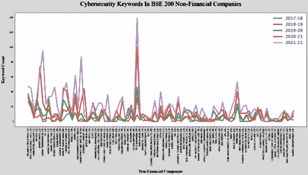 |

-   | --- |

-   | 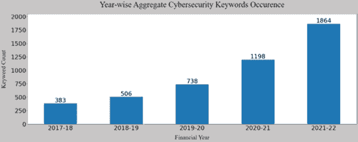 |

-   | --- |

-   [在研究中，发现一些在疫情前年度报告中包含零个网络安全相关关键词的公司，在 2021-22 财年（疫情期间）突然开始使用相关关键词。最常用的关键词是“cyber”，在 5 年研究期间共出现 1313 次，其次是“cyber security”、“information security”和“data privacy”。]

-   | Figure 2. 图中展示了截至 2022 年 3 月 31 日，孟买证券交易所（BSE）200 非金融公司各年总关键词出现次数的垂直柱状图。 |

-   从[Figure 2 可以看出，整体关键词出现次数持续上升。因此可以推断，疫情导致的数字化加速促使了非金融公司自愿性网络安全披露在年度报告中的增加。自愿披露的增加也表明公司对网络安全的关注度整体提升。]

-   **CONCLUSION**

-   [全球范围内，网络安全法规和指南仍落后于发展，但网络安全披露程度持续上升。这只能说明商业世界终于认识到此类披露的益处以及与利益相关者透明度带来的回报。数据是数字化经济和创新的最重要组成部分，但围绕其的恶意或敌意同样普遍。研究表明，网络犯罪每年可能给世界带来高达 10.5 万亿美元的损失，到 2025 年。]


-   [虽然年对比年网络安全增长率约为 12-15%，这无疑是一个显著的增长，但与因网络攻击事件而产生的成本增加相比显得微不足道。网络犯罪成本来源于数据销毁、金钱窃取、生产力下降、知识产权被盗、个人信息和财务数据被盗取、挪用、背叛、欺骗、攻击后运营功能混乱、取证调查、数据恢复、删除被入侵信息以及声誉损失等方面的损失。]

1.  董事会在网络安全中扮演着至关重要的角色，因为公司的核心价值取决于它如何保护数据、加强其网络防御措施以及其应对网络威胁和事件的灵活性 (`Freeze, 2021`)。网络安全事件不仅导致金钱损失，还会导致公众信任的丧失，因为公众开始怀疑其金钱或数据是否安全，这可能导致企业和市场的混乱。

REFERENCES

`Amir, E., Levi, S., & Livne, T. (2018). Do firms underreport information on cyber-attacks? Evidence from capital markets. Review of Accounting Studies, 23(3), 1177–1206. doi:[10.1007/s11142-018-9452-4](https://doi.org/10.1007/s11142-018-9452-4)`

`Berkman, H., Jona, J., Lee, G., & Soderstrom, N. (2018). Cybersecurity awareness and market valuations. Journal of Accounting and Public Policy, 37(6), 508–526. doi:[10.1016/j.jaccpubpol.2018.10.003](https://doi.org/10.1016/j.jaccpubpol.2018.10.003)`

`Bischoff, P. (2021, February 9). How data breaches affect stock market share prices. Comparitech. Retrieved on May 22, 2022, from: [`www.comparitech.com/blog/information-security/data-breach-share-price-analysis/`](https://www.comparitech.com/blog/information-security/data-breach-share-price-analysis/)`

`Blieberger, J., Klasek, J., Redlein, A., & Schildt, G.-H. (1996). Informartik 3. Auflage. Springer Verlag.`

`Brogi, M., Arcuri, M. C., & Gandolfi, G. (2018). The effect of cyber-attacks on stock returns. Corporate Ownership and Control, 15(2), 70–83. doi:[10.22495/cocv15i2art6](https://doi.org/10.22495/cocv15i2art6)`

`Calderon, T. G., & Gao, L. (2020). Cybersecurity risks disclosure and implied audit risks: Evidence from audit fees. International Journal of Auditing, 25(1), 24–39. doi:[10.1111/ijau.12209](https://doi.org/10.1111/ijau.12209)`

`Companies Are Satisfied with Business Outcomes from Big Data and Recognize Big Data as Very Important to Their Digital Transformation, Accenture Study Shows | Accenture. (2014, September 10). Newsroom | Accenture. Retrieved on June 2, 2022, from: [`newsroom.accenture.com/industries/systems-integration-technology/companies-are-satisfied-with-business-outcomes-from-big-data-and-recognize-big-data-as-very-important-to-their-digital-transformation-accenture-study-shows.htm`](https://newsroom.accenture.com/industries/systems-integration-technology/companies-are-satisfied-with-business-outcomes-from-big-data-and-recognize-big-data-as-very-important-to-their-digital-transformation-accenture-study-shows.htm)`

`Cyber security: The changing role of the Board and the Audit Committee. (2016). Deloitte.`

`DHS. (2014). A Glossary of Common Cybersecurity Terminology. National Initiative for Cybersecurity Careers and Studies: Department of Homeland Security. [`www.fortunebusinessinsights.com/digital-transformation-market-104878`](https://www.fortunebusinessinsights.com/digital-transformation-market-104878)`

`Economic Impact of Cybercrime. (n.d.). Center for Strategic and International Studies. [`www.csis.org/analysis/economic-impact-cybercrime`](https://www.csis.org/analysis/economic-impact-cybercrime)`

`Eijkelenboom, E., & Nieuwesteeg, B. (2021). An analysis of cybersecurity in Dutch annual reports of listed companies. Computer Law & Security Report, 40, 105513. doi:[10.1016/j.clsr.2020.105513](https://doi.org/10.1016/j.clsr.2020.105513)`

`Freeze, D. (2021, April 27). Cybercrime To Cost The World $10.5 Trillion Annually By 2025. Cybercrime Magazine. Retrieved on December 3, 2021, from: [`cybersecurityventures.com/cybercrime-damages-6-trillion-by-2021/`](https://cybersecurityventures.com/cybercrime-damages-6-trillion-by-2021/)`

`Gao, L., Calderon, T. G., & Tang, F. (2020). Public companies’ cybersecurity risk disclosures. International Journal of Accounting Information Systems, 38, 100468. doi:[10.1016/j.accinf.2020.100468](https://doi.org/10.1016/j.accinf.2020.100468)`

`Gartner IT Glossary. (2019). Retrieved on August 14, 2019, from: [`www.gartner.com/it-glossary/?s=chatbot`](https://www.gartner.com/it-glossary/?s=chatbot)`

`Gordon, L., Loeb, , & Sohail, . (2010). Market Value of Voluntary Disclosures Concerning Information Security. Management Information Systems Quarterly, 34(3), 567. doi:[10.2307/25750692](https://doi.org/10.2307/25750692)`

`Gurumurthy, R., Schatsky, D., & Camhi, J. (2020). Uncovering the connection between digital maturity and financial performance. Academic Press.`

`Hilary, G., Segal, B., & Zhang, M. H. (2016). Cyber-Risk Disclosure: Who Cares? SSRN Electronic Journal. Retrieved on November 11, 2020, from: [`niccs.us-cert.gov/glossary#letter_chttps://www.publicsafety.gc.ca/cnt/rsrcs/pblctns/cbr-scrt-strtgy/index-en`](http://niccs.us-cert.gov/glossary#letter_chttps://www.publicsafety.gc.ca/cnt/rsrcs/pblctns/cbr-scrt-strtgy/index-en)…doi:[10.2139/ssrn.2852519](https://doi.org/10.2139/ssrn.2852519)`

`James, L. (2018). Making cyber-security a strategic business priority. Network Security, 2018(5), 6–8. doi:[10.1016/S1353-4858\(18\)30042-4](https://doi.org/10.1016/S1353-4858\(18\)30042-4)`

`Lindsey, N. (2020, April 13). Voluntary Disclosure of Cybersecurity Risks Mitigates Contagion Effect With Investors. CPO Magazine. Retrieved on August 4, 2021, from: [`www.cpomagazine.com/cyber-security/voluntary-disclosure-of-cybersecurity-risks-mitigates-contagion-effect-with-investors/`](https://www.cpomagazine.com/cyber-security/voluntary-disclosure-of-cybersecurity-risks-mitigates-contagion-effect-with-investors/)`

`Mazumder, M. M. M., & Hossain, D. M. (2022). Voluntary cybersecurity disclosure in the banking industry of Bangladesh: does board composition matter? Journal of Accounting in Emerging Economies. doi:[10.1108/JAEE-07-2021-0237](https://doi.org/10.1108/JAEE-07-2021-0237)`

`Public Safety Canada. (2010). Canada’s Cyber Security Strategy. Public Safety Canada, Government of Canada.`

`Radu, C., & Smaili, N. (2021). Board Gender Diversity and Corporate Response to Cyber Risk: Evidence from Cybersecurity Related Disclosure. Journal of Business Ethics, 177(2), 351–374. doi:[10.1007/s10551-020-04717-9](https://doi.org/10.1007/s10551-020-04717-9)`

`Ramírez, M., Rodríguez Ariza, L., Gómez Miranda, M. E., & Vartika, . (2022). The Disclosures of Information on Cybersecurity in Listed Companies in Latin America—Proposal for a Cybersecurity Disclosure Index. Sustainability (Basel), 14(3), 1390. doi:[10.3390/su14031390](https://doi.org/10.3390/su14031390)`

`Seets, C., & Niemann, P. (2022, September 7). How cyber governance and disclosures are closing the gaps in 2022. EY - US. Retrieved on December 3, 2022, from: [`www.ey.com/en_us/board-matters/how-cyber-governance-and-disclosures-are-closing-the-gaps-in-2022`](https://www.ey.com/en_us/board-matters/how-cyber-governance-and-disclosures-are-closing-the-gaps-in-2022)`


## 第 9 章

## 机会与未来研究

## Brett J. L. Landry


德克萨斯大学，美国

## Renita Murimi

德克萨斯大学，美国

## Greg Bell

德克萨斯大学，美国

## 摘要

网络安全本质上是不确定的，因为威胁向量在不断演变。事实上，网络空间中攻击者与防御者之间的持续斗争因原因、环境、威胁向量、动机和攻击结果的多样性而被加剧。即兴和等价性在理解网络事件中扮演重要角色，这些事件可能包括既有也可能没有促成单一结果的因素。网络安全操作中的等价性在五个维度上被讨论：利益相关者、网络操作集合、终端用户、网络以及未来威胁环境。对于每个维度，提供了一组主题以及与个体、企业和社区三个层面相关的网络安全活动示例组合。定性案例分析（QCA）可用于更好地理解事件集合，从而更好地理解事件的脆弱性以及解决方案在其路径上如何利用等价性达到特定结果。

## 引言

在我们环境中复杂的网络安全景观的众多特征描述中，没有哪一个比“高不确定性环境”（Anant et al., 2019）更贴切。网络空间固有的高不确定性是由不断演变的威胁向量直接导致的，这些向量试图扰乱我们所居住的数字网络。这些威胁向量在表现形式上差异很大。例如，在支持医疗应用的网络中某个网络安全控制的失效与在供应链应用中同一控制失效的后果截然不同。此外，导致特定环境中网络事件的原因可能与导致另一个环境中类似事件的原因不同。同样的情况也适用于为应对威胁向量而采用的解决方案。

虽然现代网络安全工具不断演进其机制，以在攻击面上寻找潜在网络事件的线索，但网络和其攻击面的复杂性限制了我们有效保护数字环境的方式。例如，在网络事件发生后，根本原因分析通常会指向一组被认为是事件原因的因素。然而，这里面临的挑战是，这些贡献因素仅是数百或数千个可能的攻击面点之一，攻击者可能利用这些点来攻击网络。确实，网络空间中攻击者与防御者之间的持续斗争因原因、环境、威胁向量、动机和攻击结果的多样性而被加剧。

网络空间的不确定性促使组织采用锚定-调整启发式法，以减轻我们在网络安全方面的有限理性的不利影响。锚定-调整启发式法首次在行为经济学中被研究（Furnham & Boo, 2011），在高不确定性情境下使用，即先选择一个锚点，然后系统性地上下移动，直到未来的不确定性降低无法通过其他移动实现。过去几十年来，企业采用的网络安全措施一直锚定于行业推荐的最佳实践，例如保护不同应用、网络组件、数据和系统的解决方案（Tirumala et al., 2019）。这些解决方案随后根据最佳实践建议的变化、合规与法规框架、威胁向量以及技术进步进行调整。例如，NIST SP 800（特刊）指南为配置、软件开发、漏洞管理、密码学密钥管理、访问控制等众多网络安全活动提供了行业标准最佳实践。这些指南并非强制性，而是为设计、开发和维护安全网络和数据提供建议。其在广泛领域和使用案例中的适用性使其成为一个典型的锚点，组织据此使用并据此进行调整。同时，这些指南也为网络安全操作中的即兴或等价性提供了空间。


-   这种锚定-调整方法的有效性源于选择的多样性。组织可以评估其独特的数字环境，并评估其风险状况。组织的网络安全风险状况是一个动态属性，因为漏洞和零日攻击持续蔓延。这种风险状况要求组织具备一系列保护其不同资产的解决方案，且这些解决方案应具备即兴应对关键需求的能力。其中一个例子是业务连续性计划和灾难恢复计划的开发。这些计划涵盖一系列威胁场景及相关的恢复活动。

本章通过引入社会科学中广为人知的等效性（equifinality）概念，为理论与实践做出贡献，该概念在网络安全领域也被广泛认可。虽然这并不陌生，本章将定义并解释等效性、配置性逻辑以及定性比较分析（QCA）。本章强调将该方法融入网络安全实践的重要性，并讨论各种研究可能性。等效性与即兴有望提升网络安全运营的效率。具体而言，最佳的网络安全解决方案空间设计应既具备即兴能力，也具备配置性，以应对全球网络安全运营固有的不确定性。等效性概念 —  — 即通过多种路径实现同一最终状态的能力 —  — 为本论证提供支持。具体而言，推荐等效性是即兴和配置网络安全运营的重要因素。

本章还作出以下贡献。首先，引入了即兴、拼贴（bricolage）以及即兴作为一种不连续创新的概念。这种在网络安全领域中对创新的不连续性方法提供了多种应对网络安全威胁的途径。其次，提供了一种跨学科视角，将现有研究中关于连结、等效性和因果复杂性的成果整合至网络安全运营之中。借助三个不同领域（关键基础设施、游戏、金融科技）的网络安全事件示例，展示了等效性在网络安全事件中的应用。同时，本章突出了在网络安全运营的个体、社区和企业层面分析网络韧性的关键研究问题。最后，本章为学者和安全专业人士提供启示。

IMPROVISATION, BRICOLAGE, AND DISCONTINUOUS INNOVATION

The notion of improvisation crosses disciplines and domains. At a foundational level, improvisation deals with the unknown or the unplanned. The best example of improvisation is jazz music, where the musician has to play spontaneously on the spot (`[Barrett, 1998`). Although the musicians have played the same songs with each other before, the music is dynamically changing. In a business sense, improvisation can be defined as “the ability to use time and resources to advantage in response to the unexpected and unplanned” (`Meyer, 2002`, p. 17).

Another term for this improvisation is the French word bricolage. `Baker and Nelson (2005)` (##978-1-6684-9018-1.ch009.xhtml#r8), relying on Levi‑Strauss’s 1967 work, define bricolage as “making do by applying combinations of the resources at hand to new problems and opportunities (p.333).” `Verjans (2005)` (##978-1-6684-9018-1.ch009.xhtml#r84) describes Ciborra’s definition of bricolage in English as “tinkering” and suggests that this is possibly not the best definition of bricolage and offers a more common definition of ‘do-it-yourself’ as a better fit. Tinkering has a negative connotation, whereas the concept of bricolage has a positive connotation for contingency theory and improvisation. The do-it-yourself concept can be extended to situations where the problem is encountered and fixed simultaneously.

Nevertheless, there is a different lens through which to view improvisation and bricolage: innovation. Both bricolage and improvisation can be seen as discontinuous innovations rather than incremental innovations. `Buffington and McCubbrey (2011)` (##978-1-6684-9018-1.ch009.xhtml#r16) found that discontinuous innovations are developed by the creativity of experts in the area and require gaps in the existing methodologies. Whether called improvisation, bricolage, or discontinuous innovation, it is not a planned event and sometimes can only be recognized by reviewing previous activities (`Fuglsang & Sørensen, 2011`). The high uncertainty environments that are characteristic of cybersecurity operations require a high degree of improvisation and innovation. This is not to say that the established disaster recovery or incident response plans should be ignored or discontinued. However, it is essential to understand that the severity and scope of an incident call for multiple ways to respond to the incident.

CONJUNCTIONS, EQUIFINALITY, AND CAUSAL COMPLEXITY

Cybersecurity research has been dominated by correlational or variance theorizing, which is characterized by “the linking together of concepts expressed as dependent, independent, mediating and moderating variables, usually accompanied by formal propositions, and with a focus principally on explaining variance in outcomes” (`Cloutier & Langley, 2020`, pp. 1-2). However, correlational or variance theorizing is limited in its ability to develop explanations of phenomena that are marked by causal complexity (`Furnari et al., 2021`).

There is a growing recognition among organizational researchers that not only do many factors contribute to organizational outcomes, but they also should not be evaluated in isolation from each other. Instead, they should be examined as ‘bundles,’ or combinations, that may mutually enhance the ability of each to achieve critical organizational outcomes. A vital dimension of this research identifies interdependencies among multiple explanatory factors that combine to bring about an outcome of interest (`Bell et al., 2014`; `Furnari et al., 2021`). This line of research also demonstrates that understanding the simultaneous operation of multiple factors is essential for decision-makers.

Causal complexity is defined as “a situation in which a given outcome may follow from several different combinations of causal conditions” (`Ragin, 2008`, p. 124). This suggests that configurations are comprised of multiple explanatory factors rather than singular factors bringing about outcomes. In addition, more than one configuration could lead to the same outcome under investigation. Scholars suggest that “conjunction” focuses on how or why explanatory factors jointly bring about an outcome (`Furnari et al., 2021`; `Mackie, 1973`). Secondly, “equifinality” refers to the condition where “a system can reach the same final state, from different initial conditions and by a variety of different paths” (`Katz & Kahn, 1978`, p. 30).


-   [配置性理论](https://wiki.example.org/feynmans_learning_method)使研究人员能够从评估因果变量的“净效应”转向对因果条件如何组合以产生特定效应的更具情境性的理解(Ragin, 2008)。正如 Iannacci and Kraus (2022)所指出的，配置性理论围绕三个原则：1) 结合性因果：单一条件的效应在与其他条件结合时展开；2) 等效性：多种条件组合（或配置）可能导致相同的结果；3) 因果不对称：导致所关注结果的因果可能与导致该结果不存在的因果截然不同。

配置性方法特别适用于研究人员认为一组因素协同作用，构成一个结果的充分原因时(Mahoney & Goertz, 2006)。配置性理论为学者提供了一个视角，以论证多种因素可以产生一个结果，同时也使学者能够论证多种因素可以组合起来导致所研究的结果。这一点在网络安全研究中尤为重要，因为越来越多的学者认识到，所研究的结果往往最好由一组协同作用的因素组合来解释。

Fiss (2007, 2011)建议，配置性方法允许研究“多维概念上不同的特征的组合”（Fiss, 2007, p. 1180）。他指出，这种方法使研究人员能够超越线性范式中占主导地位的单一因果和线性关系，转而采用更为复杂且非线性的因果观，在一种配置中被认为因果相关的因素在其他配置中可能无关(Fiss, 2007)。此外，该方法强调等效性概念，即系统可以从不同的初始条件和多种路径达到相同的最终状态。

配置性理论受益于对配置中结合的属性之间的联系进行思考，无论是特定属性的存在还是其他属性的缺失，都可能以多种方式组合，形成一系列“配方”从而导致所研究的结果。属性的缺失是配置性理论的重要特征，也为网络安全研究者提供了机会。事实上，学者以及安全专业人员应超越将属性缺失视为无关紧要的观念，思考属性缺失如何影响不同组合的整体影响。

虽然越来越多的学者采用配置性方法探讨组织现象，但这类研究大多局限于战略管理和国际业务领域(Fiss, 2007; Fiss, 2011; Furnari et al., 2021)。在下文中，将讨论等效性如何扩展到网络安全，特别是在即兴（improvisation）方面。

**DEPLOYING EQUIFINALITY FOR CYBER RESILIENCE**

为了取得成功，组织必须保持敏捷，能够应对全球机遇和挑战。具体而言，为了拥有敏捷的网络安全运营，组织必须维持一个安全的环境，在该环境中可以在一定范围内即兴发挥，并超越既定程序。管理学文献将等效性归因于项目或活动的存在，即有多种方式实现相同的结果，应考虑活动或项目的组合以达成该结果。具体而言，在网络安全语境中，配置性理论使学者能够论证导致网络事件的因素组合可能源自不同条件或因素的存在与缺失。确实，当存在多种原因导致某结果，且因果条件可能以独特且多种的方式组合时，结合性因果尤为有用。

在网络安全领域，等效性是一个基础构想，即结果是一组事物的组合，这些事物既包括存在的因素，也包括缺失的因素。首先，必须精确定义网络事件。NIST 将事件定义为“实际或潜在威胁信息系统的机密性、完整性或可用性，或信息系统处理、存储或传输的信息，或构成对安全政策、安全程序或可接受使用政策的违规或即将违规的安全威胁”(National Institute of Standards and Technology, 2006, p. 7)。虽然根本原因分析（RCA）是确定事件原因的常用方法，但有时事件的事务组合可能过于复杂，难以在 RCA 中清晰匹配。此外，仅仅因为某一路径导致了结果，并不意味着这是唯一通往该结果的路径。

Conger and Landry (2009)在与一家英国全球物流公司进行基于行动的研究时，遇到了这一现象。客户的领导团队坚信其问题源于技术，而非人员和流程。研究人员发现，传统的鱼骨图、成熟度模型、RCA 和 2x2 矩阵等分析工具因 IT 基础设施的不成熟而无法满足客户需求。事实是，大多数问题源于人员和流程，而非技术本身。研究人员采用即兴方法，认识到工具箱中的工具不匹配，且存在更为复杂的因果关系导致问题。公司低 IT 成熟度显著促成了其高熵网络。研究人员为客户开发了一个新模型，该模型捕捉了关系并以新颖的方式呈现了各项内容。

为说明等效性在网络安全运营中的普遍性，将审查不同领域的网络安全事件。前三个案例分别涉及因勒索软件而动机的金融激励对手在 Colonial Pipeline、盗取知识产权在 EA Games、以及 Robinhood 的身份盗用和勒索。第四个案例——Oldsmar 水处理厂突显了数字化关键基础设施的脆弱性，攻击者意图伤害公众。

Colonial Pipeline


-   [2021 年 5 月，导致六天生产中断的 Colonial Pipeline 勒索软件攻击](https://wiki.example.org/feynmans_learning_method) 使得美国能源部（U.S. Department of Energy）在 2021 年记录。虽然有多种方式可以执行此攻击，但有一个特定的活动包发生了。首先，攻击者使用了在另一被入侵系统上使用的 Colonial Pipeline VPN 密码（Culafi, 2021）。具体被入侵的系统尚不清楚，但该密码属于在暗网上找到的一组密码（Fung & Sands, 2021）。一旦进入网络，威胁行为者窃取了 100 GB 数据，并使用勒索软件即服务（Ransomware as a Service）加密了 Colonial 的内部 IT 系统（Kerner, 2022）。报告称，勒索软件未影响其运营技术（OT），因为 Colonial 迅速关闭了企业系统。

这些活动可以归入一个事件包。首先，密码复用是威胁行为者通过 VPN 进入网络的机制。其次，错误地假设这套旧账户在 VPN 上不活跃，实际上仍然是活跃的。再次，旧的 VPN 账户未要求多因素认证（MFA）（Kelly & Resnick-ault, 2021）。第四，虽然 VPN 设计用于保护关键网络资源免受威胁行为者侵害，但在此案例中它却允许直接的加密访问 Colonial 网络。第五，尽管被破解且在多个系统上复用的密码在长度和特殊字符方面具备复杂性，但这一措施未能阻止攻击，因为密码已经被泄露。最后，尽管 Colonial Pipeline 在过去五年中投入了超过 2 亿美元的 IT 系统（Kelly & Resnick-ault, 2021），但这笔投资也未能阻止攻击。

Colonial Pipeline 事件包列于 `Table 1`。值得注意的是，通过等效性（equifinality）的视角审视此网络事件是一种分析原因的方式，但它并非唯一的方式。攻击方法和工具的多样性是网络防御者面临的最大挑战。防守者必须时刻做到正确，而攻击者只需一次做到正确。

表 1. Colonial Pipeline 事件包

| Item | Issue |
| --- | --- |
| Reused password | • 一旦一个系统被入侵，使用相同密码的所有系统都会被 compromise |
| Passwords breached and leaked to the dark web | • 密码泄露可能未被发现  
• 如被发现，密码应更改 |
| Legacy VPN account | • VPN 是网络的敞开门 |
| VPN authentication | • VPN 仅使用单因素认证（SFA）。如果启用多因素认证（MFA），事件本可以被防止 |
| Password complexity | • 密码复杂性无法阻止已被破解的密码被使用 |
| $200 million IT investment | • IT 投资未能防止事件发生 |

EA Games

类似于网络安全防护使用等效性，威胁行为者也会即兴发挥并运用等效性来攻击网络和系统。EA 游戏事件是攻击者和防御者均运用等效性的优秀案例。威胁行为者从 EA Games 网络窃取了 780 GB 数据。会话 Cookie 被在暗网上以 10 美元的价格购买，以获取公司的 Slack 频道访问权限（Fung, 2021；Spadafora, 2021）。通过少量的社交工程，威胁行为者能够利用 Slack 向 IT 部门发送 MFA 令牌的请求，从而绕过 MFA 控制并成功进入网络。随后，威胁行为者在网络中建立持久性并创建虚拟机以探索网络，窃取 780 GB 数据，包括源代码、软件开发工具包（SDK）和专有工具。EA Games 事件包在 `Table 2` 中讨论。

表 2. EA Games 事件包

| Item | Issue |
| --- | --- |
| Stolen session cookies | • 威胁行为者冒充合法用户访问 Slack |
| Social engineering | • IT 被诱骗在 Slack 连接后发放 MFA 令牌 |
| Network persistence | • 威胁行为者能够构建稳定的连接以枚举网络 |
| Rogue virtual machine | • 威胁行为者构建平台以窃取数据 |

Robinhood

如果威胁行为者想进入企业网络，为什么不直接请求远程访问？2021 年 11 月，Robinhood（一款股票交易应用）报告称约有七百万客户账户遭数据泄露（Brown, 2021；O'Brien, 2021）。Robinhood 称，威胁行为者通过电话社交工程一名客服员工，使其在个人电脑上安装远程访问软件（Abrams, 2021；Barry, 2021）。随后，威胁行为者试图向 Robinhood 索要金钱（Egan, 2021）。Robinhood 表示在被要求支付勒索费时联系了执法部门。攻击几天后，威胁行为者在黑客论坛上出售泄露的数据（Abrams, 2021）。因此，原始泄露后约有 40,000 名 Robinhood 客户账户成为后续网络攻击的受害者（Avery, 2022）。Robinhood 事件包在 `Table 3` 中讨论。

表 3. Robinhood 事件包

| Item | Issue |
| --- | --- |
| Social engineering | • IT 人员被诱骗安装远程访问软件 |
| Network persistence | • 威胁行为者构建稳定的连接以枚举网络 |

Oldsmar Water Treatment Plant

佛罗里达州的 Oldsmar 水处理厂于 2021 年 2 月因一系列问题被入侵。首先，目标计算机运行的是已不再受支持的 Microsoft Windows 7 系统。其次，该电脑通过名为 TeamViewer 的程序提供远程访问，且密码在所有厂内电脑上共享。再次，该电脑直接连接到互联网，未配置防火墙（Matthews, 2021）。攻击被发现时，操作员注意到鼠标光标自行移动（Bergal, 2021）。攻击者通过远程访问控制水处理的电脑，将水中氢氧化钠（烧碱）的浓度提升至标准的 100 倍。该操作在造成危害之前已被逆转。


在本案例中，存在多个漏洞：旧操作系统、用户之间共享密码、电脑之间共享密码、单因素认证以及缺乏防火墙。然而，只有两项因素导致了事件集合，即用户和电脑之间共享密码以及单因素认证，如表 4 所示。已停止支持的 Windows 7 电脑是操作系统漏洞，且很可能是硬件漏洞。如果这些设备安装了远程访问软件且使用共享密码，事件也可能发生在 Windows 11、Mac 或 Linux 设备上。缺乏防火墙是一个明显的问题，但与操作系统一样，它未直接导致此事件集合。如果该电脑需要远程访问，则需要为其配置防火墙例外以允许连接。因此，旧电脑和缺乏防火墙是替代事件集合的组成部分，如表 5 所示。

表 4. 旧斯马尔水处理厂事件集合

| 项目 || 问题 |
| --- | --- |
| 用户和机器之间共享密码 || • 易用的密码方案  
• 一个密码可让所有人随时随地访问 |
| 远程访问的单因素认证 || • 仅使用密码作为因素 |

表 5. 替代的旧斯马尔水处理厂事件集合

| 项目 || 问题 |
| --- | --- |
| Windows 7 计算机 || • 老旧硬件和操作系统  
• 缺乏硬件刷新周期  
• 可能的老旧软件/硬件兼容性问题 |
| 无防火墙 || • 防火墙未保护该电脑 |

部署事件集合和等效性

这些数据泄露列表说明了事件集合和等效性在威胁行为者 compromising 网络目标中的作用。此外，对于提到的每个事件，都有多种替代攻击方法和工具可以被使用和利用。网络防御者可以在其网络监控中使用等效性，并改变网络安全思维，强调网络安全是每个人的工作。这可能是像在每个子网部署蜜罐（honey pots）来生成网络侦察的早期警报（Landry & Koger, 2023b）那么简单。

防范在深度（defense in depth），虽然被广泛研究和实施，但一直未能充分保护网络和数据存储。因此，组织应转向零信任网络架构（ZTNA）。ZTNA 不是一种技术，而是一种通过安全设计（security by design）重新审视保护方式的新方法（Landry & Koger, 2023a）。ZTNA 需要了解网络中每一台设备，以及它如何被用于良好和恶劣活动。设备的双重用途与等效性及网络安全操作中的捆绑（bundles）相吻合。例如，虽然老旧设备可以提供访问历史数据的连接，但同一老旧基础设施也可能被威胁行为者用于在网络中发起攻击。因此，如果组织确实需要 Windows 7 计算机，配置捆绑时需要其他保护机制，例如外部防火墙或将其与网络隔离。正是这些项的组合构成了 Windows 7 计算机的安全捆绑。

如云计算、基础设施即服务（infrastructure as code）、区块链和物联网（IoT）等新技术，也必须在发生泄露前或事件发生后纳入安全捆绑中考虑。主要考量是，糟糕的网络架构、弱访问控制和未记录的流程是本地环境的绝对问题。将这些问题迁移到混合或完全云端实现并不能解决问题，只是将问题转移到其他位置。不过，这改变了事件集合，带来与本地环境不同的新问题。

面向未来的研究方向

研究等效性和网络安全配置的机会众多。下面，将等效性在网络安全操作中的讨论沿五个维度展开：利益相关者、网络安全操作捆绑、终端用户、网络和威胁环境（参见表 6 以获取这些维度的摘要）。在这些维度中，每个都提供了一组主题和一套在个人、企业和社区三个层面的网络安全活动示例。个人层面包括人们在处理系统、网络和数据时所做的与系统相关的决策和活动。顶层设计和实施网络安全政策与控制的方法特征化了企业层面的决策和活动。企业层面的一个例子是采用特定防火墙或迁移到云服务提供商。

相反，社区层面体现了自下而上的方法，例如开源社区、黑客社区以及构成我们生活和工作环境的社区。这些实体（个人、企业、社区）在网络安全方面的关注点不同，因此其采用实现网络安全等效性的方法也不同。下面分别详细讨论这些维度。

利益相关者

动机、机会和手段（Grabosky, 2001）的概念在网络安全文献中被广泛用于分析网络犯罪趋势的增长。同样的动机、机会和手段的概念可用于分析个人、企业和社区如何在配置其网络安全解决方案空间时采用等效性。考虑利益相关者的动机，这些动机可以被用来最大化等效配置网络安全解决方案的效果。在个人层面，考虑一个用户因短暂无法登录工作账户而将工作文件发送到个人邮箱并在此处工作的情况。这种行为的动机显然是正当的，工作仍然完成，但网络边界出现了漏洞。

在企业层面，组织拥有不同的资源组合，这使它们在维护和改进系统和网络安全方面的优势不平等。缺乏内部网络安全专业知识和资源的组织会使用托管安全服务提供商（MSSP）或云解决方案服务，从而获得外部资源以实现等效网络安全解决方案。在社区层面，考虑一个开源软件代码社区，它通过代码审查、漏洞奖励计划、黑客马拉松等机制以分布式方式提高代码库的效率。在这些情况下，采用网络安全解决方案的动机各不相同，从而导致网络安全操作的等效性。

表 6. 未来研究方向

| 未来研究的关键问题 || 个人层面 || 企业层面 || 社区层面 |
| --- | --- | --- | --- |
| 利益相关者（动机-机会-手段） |


| 利益相关者如何利用动机最大化等效网络配置的网络安全解决方案的有效性？ || 如何为用户创建解决方案，避免将工作数据发送到个人账户？ || 缺乏内部网络安全资源的组织如何利用外部服务提供等效网络安全解决方案？ || 利用代码审查、漏洞奖励计划和黑客马拉松等方式的开源社区如何在分布式环境中提高代码库的效率？ |

| 利益相关者如何利用“欲望路径”机会提升而非阻碍网络安全解决方案的有效性？ || 用户如何在理解某些密码策略要求频繁变更、复杂性和唯一性的原因后，避免密码共享？ || 企业级重组如何为“欲望路径”提供机会？ || 如何提升对良好网络安全态势与网络韧性之间关系的理解？ |

| 利益相关者如何高效表明其对等效网络网络安全方法的承诺与采用，而不夸大或低估？ || 用户如何被鼓励注意数据共享，以限制潜在的恶意 OSINT/HUMINT 活动？ || 企业如何利用网络钓鱼活动识别网络安全意识的基线并改进这些基线？ || 社区如何明智地利用发现的漏洞奖励计划来提升网络安全态势？ |

| 打包（打包过载 – 动态性 – 社会技术视角） |

| 动态网络安全解决方案的特性如何影响创建等效路径的能力？ || 如何简化用户（通常面临多个账户）的凭证管理流程？ || 组织如何做出明智的网络架构变更决策，避免关键组件长时间离线？ || 社区如何在理解文化影响技术设计和实施的前提下，管理等效网络安全运营？ |

| 对于给定的等效配置，更新个别路径并发现其对其他路径的影响的过程是什么？ || 用户如何在日常计算和连接的安全操作中做出关于等效性的明智决定？ || 组织如何从拥有以网络安全为导向的董事会成员的专业知识和远见中获益？ || 智能城市的等效网络安全配置与农村社区有何不同？ |

| 一个等效配置的属性如何影响其效率？ || 超过何种临界点后，用户对易用性的关注会压倒对安全性的关注？ || 网络安全事件后，公司估值如何受到影响？ || 如何将社区的社会动态纳入信息共享平台的开发过程中？ |

| 终端用户（偏见 – 限制 – 优势） |

| 终端用户如何认识到在等效网络安全结果中导航的局限性？ || 如何引导用户自愿采用等效网络安全操作的最佳实践？ || 企业如何转向采用全面的网络安全方法？ || 社区如何依赖支撑这些环境的技术的安全性？ |

| 企业如何创建考虑用户偏见但仍能在等效性中导航解决方案的网络安全解决方案？ || 用户如何将账户的安全交托给服务提供商？ || 公司如何在考虑影响等效性采用的偏见时构建风险档案？ || 如何避免因集体偏见导致的对安全控制的集体规避？ |

| 如何利用用户的认知优势与新兴技术协同，创建可适应的解决方案空间？ || 如何与 AI 赋能工具的狭隘智能协同，利用我们的多种智能进行网络安全操作？ || 企业如何通过等效性来指导其安全控制的选择？ || 社区如何将网络安全技术打包以满足其需求？ |

| 网络（中心性 – 同质性 – 关系强度） |

| 节点的中心性如何影响等效性在网络安全操作中的决策？ || 人们如何分享其选择的安全控制的信息？ || 高度竞争的环境如何导致企业在安全与敏捷性之间牺牲安全？ || 社区如何确定对其运作至关重要的关键基础设施要素？ |

| 安全控制采用中的同质性倾向如何影响等效性在网络安全操作中的决策？ || 用户如何高估自己保持安全意识的倾向，低估自己被 breaches（被攻击）的可能性？ || 安全控制的失败如何导致企业的诉讼和人员解雇？ || 供应商垄断和从众心理如何导致整个行业垂直领域使用相似的安全控制？ |

| 在资源充足的环境中采用安全控制（节点）与在资源匮乏的环境中有何不同？ || 用户的心理模型在理解其所处网络复杂性方面有多高效？ || 如何为不同资源水平的环境创建网络安全操作的等效性？ || 社区如何应对投资于等效网络安全控制的压力？ |

| 环境（威胁环境 – 技术复杂性 - 监管） |

| 对网络安全威胁环境的感知有何差异？ || 个人是否主要采用免费技术、忽视威胁或以最小努力应对？ || 如何在不同环境下实现网络安全操作的等效性？ || 社区如何应对投资于等效网络安全控制的压力？ 


-   类似的情况可以适用于利用而非试图消除欲望路径的机会。欲望路径在建筑学中常用，指人们在物理空间中为了快速导航而采取的捷径 (`/path.to.xxx`)[Smith & Walters, 2018。例如，人们更倾向于踩踏草地而不是走更长的铺砌路径，以快速到达特定建筑入口。类似的情况也出现在网络安全行为中，如影子 IT。虽然建筑学、人机交互或网络安全中的欲望路径无法被消除，但可以利用它们来重新思考一系列等效网络安全操作的设计。在个人层面，考虑密码策略要求频繁更改、复杂性和唯一性，以鼓励用户避免跨站点和账号共享密码的欲望路径 (`cvar = avar + bvar`)Singer et al., 2013。因内部或外部因素而进行重组的企业也为员工和管理层提供了利用欲望路径而非面对开发安全网络挑战的绝佳机会 (`List.of(arg0, arg1, arg2)`)Lohrke et al., 2016。在社区层面，考虑越来越多的关键基础设施组件通过互联网连接到云服务，这虽然提高了便利性、效率和访问性，但也扩大了攻击面 (`/path.to.xxx`)Foreman & Gurugubelli, 2015。社区应注意在快速数字化过程中所走的欲望路径，并找到改进网络安全和韧性的方法。

如何实现网络安全操作中的等效性同样重要。利益相关者的等效网络安全解决方案组合的结构可能对另一位利益相关者的等效解决方案组合结构是否有帮助是不确定的。共享资源或资源信息虽有帮助，但也会扩大攻击面。例如，鉴于工作和休闲的社交网络平台种类繁多，个人需要注意自己在数据共享上的程度，以限制潜在的恶意开源情报/人情智能活动，这些活动可能在数据库之间关联并提取关键推断 (`List.of(arg0, arg1, arg2)`)Kelleher et al., 2020。组织关于网络钓鱼认知基线的发现可以被外部利益相关者正面或负面利用。同样，独立利益相关者的社区，如参与赏金计划的个人，可能会发现对网络安全态势影响不同的项目，公司需要谨慎管理第三方发现的漏洞范围 (`cmd arg0 arg1 arg2`)Kuehn & Mueller, 2014)。

解决方案组合

为应对网络安全挑战而采用的解决方案组合因所满足的需求而异。由于技术和威胁环境的快速变化，解决方案组合并非静态，必须频繁更新以保持组合组件的时效性。虽然拥有多种潜在解决方案供选择是有益的，但这也会导致采用时的决策疲劳。这在解决方案本身动态变化且需要根据社区的不同环境适配组合时尤为明显。本文提供了关于解决方案组合的动态性、属性以及组合元素之间代码依赖关系的指导，这些都影响等效网络安全操作的设计与实现。

解决方案组合的动态性对个人、企业和社区影响各异。例如，在个人层面，用户面临不同账户的众多登录凭证要求，难以跟上账户变更和管理的节奏。此时，一个用于不同账户的登录凭证组合使得用户难以找到凭证管理服务。同样，由于技术深度嵌入每个行业垂直领域，组织必须慎重决定网络架构的变更，以避免关键组件长时间离线。最后，在社区层面，对于同一需求采用的特定技术的适配性和安全保障并不等价。例如，50,000 人的社区选择的水务在线账单支付系统与使用住宅水源的农村社区的选择截然不同 (`/path.to.xxx`)Malecki, 2003。

解决方案组合本身也是动态的。例如，曾经被大量利用于传播垃圾邮件的僵尸网络现在被用于勒索软件的指挥与控制操作 (`cmdname`)Jarjoui et al., 2021; Murimi, 2020)。由于威胁不断演变，组合的各个组成部分必须更新、替换或修改。实体必须寻找更新单独路径的资源并发现其对其他路径的影响。一个典型例子是用户关于日常计算和连接使用产品的决策。组织在更大规模上面临类似挑战，例如选择谁进入董事会。过去，董事会传统上由代表关键业务功能的人员组成；但如今，董事会增加网络安全意识人员的重要性 (`ClassName.funcName(var1 + var2, "cmd arg0 arg1"`)Rothrock et al., 2018。在社区层面，数字连接决定了许多技术依赖解决方案的采用 (`/path.to.xxx`)Salemink et al., 2017。

如本章 earlier 所示，网络安全事件在不同环境中可能有不同的原因。因此，事件的可适应解决方案组合也需要适应性，这也定义了网络安全操作中的等效性概念。解决方案组合的属性，由组合中资源类型、这些资源所设计解决的挑战以及每个资源在组合内外元素中的重要性来衡量，影响等效配置的效率。对于个人用户，存在一个临界点，超过该点用户更看重易用性而非安全 (`Nurse et al., 2011`)Awojobi & Landry, 2023。隐私亦是如此，用户会因易用性而采用技术，尤其是新型物联网设备（如语音助手），而非因其提供的安全控制 (`if (condVar > someVal) {console.log("xxx")}`)Cyr & Wei Choo, 2010。

终端用户


-   终端用户被众所周知，但并非总是准确地描述为我们网络中的最弱环节。我们的认知偏见和对我们所居住的复杂网络范围和细节的理解有限，影响了我们与计算技术的互动方式（`[Caraban et al., 2019`）。网络安全解决方案的等价性是我们偏见和局限性可以被视为优势的机制之一，即在数字空间中选择最能满足我们安全需求的解决方案。

-   终端用户的局限性影响我们的个人、职业和社会生活。正如能够促进负责任管理的推动机制（如默认双面打印）[¹]，用户也可以被推向默认的安全操作方式（`Acquisti et al., 2017`）。在组织内部，网络安全传统上属于 IT 部门的职责。然而，这种做法是有缺陷的，因为它导致网络安全被视为一个孤立的业务职能。相反，当企业采用整体化的网络安全方法，将其融入社区中各业务职能时，网络安全得到最佳解决（`Jarjoui & Murimi, 2021`）。在社区层面，我们日常工作、家庭和休闲环境的高效运作依赖于支撑这些环境的技术的安全性，因此必须警惕我们对这些技术安全性的有限理解。

`Kahneman and Tversky (2012` 著名地驳斥了理性人假说，并表明启发法和偏见主导我们的决策过程。知道我们的偏见影响我们与计算环境的互动，个人不能在将账户的安全交托给提供服务的公司时掉以轻心。组织也必须结合对数据和系统资产的理解来构建风险档案，这将有助于理解偏见如何影响网络安全操作中等价性的采用。现有文献充斥于识别集体智慧有时并非真正的智慧，而是对社会思维的从众，即使这种思维是错误的（`Lorenz et al., 2011`）。因此，集体决策因群体思维的压力而放大了个人偏见（`Loxton et al., 2020`），导致集体规避安全控制，社区在采用等价安全解决方案组合时必须警惕这些偏见（`Wu et al., 2022`）。

-   然而，尽管存在偏见和局限性，利用多种智能并快速适应新情况赋予独特优势。最近一轮生成式预测 AI 工具展示了这些工具虽然智能，但仍仅擅长一两项任务（`Fox, 2017`）。在借助这些工具的帮助下，我们的认知优势为个人、企业和公司在实现网络安全操作中的等价性方面提供了广泛的可能性。

-   网络

-   图论网络模型长期被用于揭示网络内流动模式。本节通过将网络中的节点视为安全控制、将节点之间的边视为安全控制之间的依赖关系，考察网络效应（中心性、同质性和边强度）在网络安全解决方案中的应用。通过以此方式标注安全控制及其依赖关系，网络科学提供了工具来发现网络中最具影响力的节点、最有价值的节点间链接，以及揭示聚类模式。其中一种模式是同质性，指“富得更富”的效应，也称为马修效应，即拥有更广泛网络的节点不断变得更大（`Cheng et al., 2019`）。另一种模式是中心性，表示节点在网络信息流中的重要性。在我们的语境中，节点的中心性指数高意味着该解决方案被广泛采用。同样，边强度（首次由`Granovetter (1973`研究描述人类网络中的强弱社会联系）可用于分析等价网络中安全解决方案之间的依赖链路。

-   从安全控制作为网络节点所代表的网络安全操作空间的视角出发，分析节点中心性如何影响网络安全操作中等价性的决策是有趣的。在个人层面，用户会将其使用的密码管理应用或防病毒软件等网络安全解决方案与家人、朋友和熟人分享。这种口耳相传的推荐创造了促进某些控制被采用的条件。类似的效应在组织中也存在，同行和竞争对手在竞争环境中的活动口耳相传会促使企业采用相似的网络安全流程，这可能导致产品发布的安全性与敏捷性之间的权衡（`Winterrose et al., 2016`）。社区也容易受到此类行为影响，因而在相似社区中因使用相似的网络安全解决方案而采用相似方案（`Arce, 2020`）。虽然这些做法可能表明某种解决方案的高效性，但它们也阻碍了网络安全操作中等价性的考虑，因为个人、企业和社区未能考虑其自身独特的网络安全环境。

-   这种不愿或无法考虑定制化等价操作的倾向导致了解决方案采用中的同质性。这对网络中的个人用户而言亦然，他们被证明倾向于高估自己是安全意识强的倾向，而低估自己遭受 breaches（被攻击）的可能性。在企业层面，这种解决方案采用的同质性倾向可能导致网络安全事件，使公司面临诉讼和关键人员被解雇的风险。从心态上看，从众倾向同样导致供应商垄断以及在多个行业领域采用相同的安全控制。

-   个人、企业和社区拥有不同种类的网络安全资源，一些实体在应对网络威胁方面拥有不成比例更多的资源。这使得资源充足的实体在管理和应对网络事件时占据上风。需要注意的一点是，等价性为解决这一问题提供了有前景的选项，因为组织和社区可以采用符合自身需求的解决方案组合。这对个人用户而言尤为重要，因为他们很少理解其所处网络的复杂性，而更依赖心理模型来指导 bundle（组合）的形成（`Brase et al., 2017`）。

-   环境（威胁环境 – 技术复杂性 – 监管）


环境是网络安全运营不断变化的，这种变化来自三个广泛因素——威胁环境的变化、现有和新兴技术的日益复杂，以及监管领域的演变。新型恶意软件、应用程序和监管要求带来了独特的网络安全运营挑战，而等效性正准备成为应对这三个因素所带来的环境挑战的高效机制。

个人、企业和社区在管理其网络安全解决方案时面临众多选择，从免费到 freemium 再到付费订阅模式不等。在个人层面，分析促使人们选择特定网络安全解决方案的因素很有趣，这些因素可能包括成本、易访问性和使用难易、流行度或其他行为因素（`Pfleeger & Caputo, 2012`）。在企业层面，可用选项的庞大数量以及对这些选项中漏洞缺乏信息，催生了若干知识共享平台，例如通用漏洞编号（CVE）列表，它充当平台的动态目录，记录平台和应用程序中的漏洞。CVE 首次由 MITRE 提出，现由产业、学术和政府机构的合作伙伴管理，广泛用于获取漏洞信息（`MITRE Corporation, 2023`）。CVE 也是社区驱动的，其成功依赖于组织在报告和传播漏洞信息方面的参与。开源和奖励漏洞挖掘社区同样以社区驱动的方式响应漏洞和缺陷信息共享，形成了一个发现和修复缺陷的生态系统（`Ponta et al., 2019`）。

随着新技术的出现，攻击面因抽象化的倾向而扩大。人工智能（AI）和机器学习驱动的应用兴起，以及区块链和物联网等新兴技术的需求，都对我们的网络和认知能力产生了巨大的要求，要求我们理解其运作、复杂性以及对日常生活的影响。随着个人匆忙采用新技术——如加密货币挖矿、使用生成式预测 AI 工具以及采用智能家居技术而未充分了解安全影响——攻击面随之同比上升（`Ayinala & Murimi, 2022`；`Bécue et al., 2021`；`Edu et al., 2020`；`He et al., 2020`；`Saad et al., 2020`）。企业以多种方式应对这一危机，包括使用网络保险来保护免受网络事件的意外后果（`Marotta et al., 2017`）。同样，特定社区决定禁止某些技术的应用，这也是应对新技术采用不确定性的另一种机制（`Conger, K. et al., 2019`；`Gadzheva, 2007`；`Meckling & Nahm, 2019`；`Taylor, 2016`）。虽然这些决定可能短视，但它们提供了在更深层次解决方案形成之前的临时缓解措施。

政府和机构尝试监管技术的各个方面，但技术进步的步伐使法与技术之间的差距日益扩大，这显著影响了监管环境。例如，个人常常在工作电脑上进行个人活动，却不自觉到使用条款的范围（`D'Arcy et al., 2014`）。在组织层面，公司必须重新审视其技术的更广泛影响，如 2023 年的 Gonzalez v Google 案所示。在此案中，Gonzalez 家庭起诉 Google，指控其 YouTube 推荐算法为恐怖组织如 ISIS（其巴黎袭击导致 Nohemi Gonzalez 死亡）提供训练。在社区层面，IoT 网络安全运营的等效性也必须以细致的视角考虑，因为 IoT 妥协可能导致灾难性后果（`Kimani et al., 2019`）。

**DISCUSSION**

网络安全学者和安全专业人员应关注能够理解导致事件配置以及相关恢复的方法论。值得一提的方法是定性比较分析（Qualitative Comparative Analysis, QCA），它基于集合论方法，利用上位集和下位集来构建因果主张（`Ragin, 2008`）。QCA 特别有用，因为它允许一个结果由多种条件产生。此外，该方法有助于识别多种因素如何共同导致所研究的结果。最后，QCA 允许结果因变量的存在或不存在而出现。近年来，使用集合论方法研究经济和组织现象的学者数量显著增加（`Fiss, 2007`；`Fiss, 2011`；`Grandori & Furnari, 2008`；`Pajunen, 2008`）。

QCA 的因果观，即多重合并因果，有三个重要含义。第一，结果可以由多种条件产生。第二，QCA 认识到多种条件可以导致所研究的结果，这称为等效性，是 QCA 的核心要素。第三，QCA 允许结果因条件的存在或缺失而出现。合并因果在多种原因可能导致结果且因果条件可能以独特且多种方式组合时尤为有用。该方法不以变量分布为中心，也不追求协方差模式、差异或频率聚类。

此外，QCA 放松了量化技术常伴随的若干假设，如永恒因果、加和性以及因果对称性（`Ragin, 2008`）。相反，该技术在评估导致期望结果的替代路径数量和复杂性方面非常有用。QCA 可采用清晰（二元成员）或模糊（成员百分比）集合来探索多个案例同时，以探讨哪些因素存在、缺失或未作贡献。

**对教育者的启示**

教育者需要创建情境，以培养和强化等效性、即兴和拼贴（bricolage）的概念。这超越了通过在线搜索获取先前 breaches 的原因。此类情境分析涉及构建 Kobayashi Maru 场景，学习者在其中面临两个均为糟糕的选择（`Stemwedel, 2015`）。学习者可以在两个糟糕选择中任选一个，或利用新工具开发全新解决方案。这涉及重新构建问题，了解哪些约束是固定的，哪些是可变的，从而能够开发新的解决方案。


## 影响安全专业人员

网络空间不会变得平坦或更简单。关键漏洞、数据泄露、勒索软件和尚未被构想出来的攻击数量只会继续增加。对于每一个资产、每一个保护机制和每一个漏洞，安全专业人员应采用等效性方法，将它们视为相关的整体而非孤立的问题。实现这种变革的方式有很多种，从单独的项目和事件到相关的整体都有可能。第一种是头脑风暴和桌面推演，以便让更多人参与到解决方案的开发中，从而在思维和能力上产生差异。参与者可以利用即兴思维，为每一个过程、方案或威胁探索多种替代路径，从而产生全新的解决方案。在这一审视过程中，必须关注不仅政策和程序，还要关注实际执行的流程路径。最后，必须从不同利益相关者层面（个人、企业、社区）来审视解决方案。通过运用等效性和即兴思维，安全专业人员能够更具敏捷性，更好地应对眼前的威胁。

## 参考文献

Abrams, L. (2021). 7 million Robinhood user email addresses for sale on hacker forum. BleepingComputer. Retrieved on June 2, 2022, from: [`www.bleepingcomputer.com/news/security/7-million-robinhood-user-email-addresses-for-sale-on-hacker-forum/`](https://www.bleepingcomputer.com/news/security/7-million-robinhood-user-email-addresses-for-sale-on-hacker-forum/)

Acquisti, A., Adjerid, I., Balebako, R., Brandimarte, L., Cranor, L., Komanduri, S., Leon, P., Sadeh, N., Schaub, F., Sleeper, M., Wang, Y., & Wilson, S. (2017). Nudges for privacy and security. ACM Computing Surveys, 50(3), 1–41. doi:[10.1145/3054926](https://doi.org/10.1145/3054926)

Anant, V., Bailey, T., Cracknell, R., Kaplan, J., & Schwartz, A. (2019). Understanding the uncertainties of cybersecurity: Questions for chief information-security officers. McKinsey & Company. Retrieved on September 4, 2022, from: [`www.mckinsey.com/capabilities/mckinsey-digital/our-insights/digital-blog/understanding-the-uncertainties-of-cybersecurity-questions-for-chief-information-security-officers`](https://www.mckinsey.com/capabilities/mckinsey-digital/our-insights/digital-blog/understanding-the-uncertainties-of-cybersecurity-questions-for-chief-information-security-officers)

Arce, D. G. (2020). Cybersecurity and platform competition in the cloud. Computers & Security, 93, 1–9. doi:[10.1016/j.cose.2020.101774](https://doi.org/10.1016/j.cose.2020.101774)

Avery, D. (2022). Robinhood app's $20 million data breach settlement: Who is eligible for money? CNET. Retrieved on October 19, 2022, from: [`www.cnet.com/personal-finance/banking/robinhood-20-million-settlement-who-is-eligible-for-money/`](https://www.cnet.com/personal-finance/banking/robinhood-20-million-settlement-who-is-eligible-for-money/)

Awojobi, B., & Landry, B. J. L. (2023). An examination of factors determining user privacy perceptions of voice-based assistants. International Journal of Management, Knowledge and Learning, 12, 53–62. doi:[10.53615/2232-5697.12.53-62](https://doi.org/10.53615/2232-5697.12.53-62)

AyinalaS.MurimiR. (2022). On a territorial notion of a smart home. In Proceedings of the 1st Workshop on Cybersecurity and Social Sciences (pp. 33–37). Association for Computing Machinery. doi:[10.1145/3494108.3522766](https://doi.org/10.1145/3494108.3522766)

Baker, T., & Nelson, R. E. (2005). Creating something from nothing: Resource construction through entrepreneurial bricolage. Administrative Science Quarterly, 50(3), 329–366. doi:[10.2189/asqu.2005.50.3.329](https://doi.org/10.2189/asqu.2005.50.3.329)

Barrett, F. J. (1998). Creativity and improvisation in jazz and organizations: Implications for organizational learning. Organization Science, 9(5), 605–622. doi:[10.1287/orsc.9.5.605](https://doi.org/10.1287/orsc.9.5.605)

Barry, C. (2021). Robinhood breach illustrates the impact of social engineering attacks. Retrieved on March 22, 2022, from: [`blog.barracuda.com/2021/11/19/robinhood-breach-illustrates-the-impact-of-social-engineering-attacks/`](https://blog.barracuda.com/2021/11/19/robinhood-breach-illustrates-the-impact-of-social-engineering-attacks/)

Bécue, A., Praça, I., & Gama, J. (2021). Artificial intelligence, cyber-threats and Industry 4.0: Challenges and opportunities. Artificial Intelligence Review, 54(5), 3849–3886. doi:[10.1007/s10462-020-09942-2](https://doi.org/10.1007/s10462-020-09942-2)

Bell, R. G., Filatotchev, I., & Aguilera, R. V. (2014). Corporate governance and investors’ perceptions of foreign IPO value: An institutional perspective. Academy of Management Journal, 57(1), 301–320. doi:[10.5465/amj.2011.0146](https://doi.org/10.5465/amj.2011.0146)

Bergal, J. (2021). Florida hack exposes danger to water systems. [`pew.org/3btxWBc`](https://pew.org/3btxWBc)

Brase, G. L., Vasserman, E. Y., & Hsu, W. (2017). Do different mental models influence cybersecurity behavior? Evaluations via statistical reasoning performance. Frontiers in Psychology, 8, 1929. doi:[10.3389/fpsyg.2017.01929](https://doi.org/10.3389/fpsyg.2017.01929)

Brown, S. (2021). Robinhood data breach is bad, but we’ve seen much worse. CNET. Retrieved on June 2, 2022, from: [`www.cnet.com/news/privacy/robinhood-data-breach-is-bad-but-weve-seen-much-worse/`](https://www.cnet.com/news/privacy/robinhood-data-breach-is-bad-but-weve-seen-much-worse/)

Buffington, J., & McCubbrey, D. (2011). A conceptual framework of generative customization as an approach to product innovation and fulfillment. European Journal of Innovation Management, 14(3), 388–403. doi:[10.1108/14601061111148852](https://doi.org/10.1108/14601061111148852)

CarabanA.KarapanosE.GonçalvesD.CamposP. (2019). 23 ways to nudge. In Proceedings of the 2019 CHI Conference on Human Factors in Computing Systems (pp. 1-15). https://doi.org/doi:[10.1145/3290605.3300733](https://doi.org/doi:[10.1145/3290605.3300733])

Cheng, C., Wang, H., Sigerson, L., & Chau, C. (2019). Do the socially rich get richer? A nuanced perspective on social network site use and online social capital accrual. Psychological Bulletin, 145(7), 734–764. doi:[10.1037/bul0000198](https://doi.org/10.1037/bul0000198)

Cloutier, C., & Langley, A. (2020). What makes a process theoretical contribution? Organization Theory, 1(1), 1–32. doi:[10.1177/2631787720902473](https://doi.org/10.1177/2631787720902473)

Conger, F. R., & Kovaleski, S. F. (2019, May 14,). San Francisco bans facial recognition technology. The New York Times. [`www.nytimes.com/2019/05/14/us/facial-recognition-ban-san-francisco.html`](https://www.nytimes.com/2019/05/14/us/facial-recognition-ban-san-francisco.html)

Conger, S., & Landry, B. J. L. (2009). Problem analysis: When established techniques don’t work. In Proceedings of the Conf-IRM Conference (pp. 1-8). Academic Press.

Culafi, A. (2021). Mandiant: Compromised Colonial Pipeline password was reused. Retrieved on July 14, 2022, from: [`www.techtarget.com/searchsecurity/news/252502216/Mandiant-Compromised-Colonial-Pipeline-password-was-reused`](https://www.techtarget.com/searchsecurity/news/252502216/Mandiant-Compromised-Colonial-Pipeline-password-was-reused)

Cyr, S., & Wei Choo, C. (2010). The individual and social dynamics of knowledge sharing: An exploratory study. The Journal of Documentation, 66(6), 824–846. doi:[10.1108/00220411011087832](https://doi.org/10.1108/00220411011087832)

D’Arcy, J., Herath, T., & Shoss, M. K. (2014). Understanding employee responses to stressful information security requirements: A coping perspective. Journal of Management Information Systems, 31(2), 285–318. doi:[10.2753/MIS0742-1222310210](https://doi.org/10.2753/MIS0742-1222310210)


Edu, J. S., Such, J. M., & Suarez-Tangil, G. (2020). Smart home personal assistants. ACM Computing Surveys, 53(6), 1–36. doi:`[10.1145/3412383](https://doi.org/10.1145/3412383)`

Egan, M. (2021). Robinhood discloses breach that exposed information of millions of customers. CNN. Retrieved on August 4, 2022, from: `https://www.cnn.com/2021/11/08/tech/robinhood-data-breach/index.html`

Fiss, P. C. (2007). A set-theoretic approach to organizational configurations. Academy of Management Review, 32(4), 1180–1198. doi:`[10.5465/amr.2007.26586092](https://doi.org/10.5465/amr.2007.26586092)`

Fiss, P. C. (2011). Building better causal theories: A fuzzy set approach to typologies in organization research. Academy of Management Journal, 54(2), 393–420. doi:`[10.5465/amj.2011.60263120](https://doi.org/10.5465/amj.2011.60263120)`

Foreman, C. J., & Gurugubelli, D. (2015). Identifying the cyber attack surface of the advanced metering infrastructure. The Electricity Journal, 28(1), 94–103. doi:`[10.1016/j.tej.2014.12.007](https://doi.org/10.1016/j.tej.2014.12.007)`

Fox, S. (2017). Beyond AI: Multi-Intelligence (MI) combining natural and artificial intelligences in hybrid beings and systems. Technologies, 5(3), 1–14. doi:`[10.3390/technologies5030038](https://doi.org/10.3390/technologies5030038)`

Fuglsang, L., & Sørensen, F. (2011). The balance between bricolage and innovation: Management dilemmas in sustainable public innovation. Service Industries Journal, 31(4), 581–595. doi:`[10.1080/02642069.2010.504302](https://doi.org/10.1080/02642069.2010.504302)`

Fung, B. (2021). Hackers breach Electronic Arts, stealing game source code and tools. CNN. `https://www.cnn.com/2021/06/10/tech/electronic-arts-hack/index.html`

Fung, B., & Sands, G. (2021). Ransomware attackers used compromised password to access Colonial Pipeline network. CNN. `https://www.cnn.com/2021/06/04/politics/colonial-pipeline-ransomware-attack-password/index.html`

Furnari, S., Crilly, D., Misangyi, V. F., Greckhamer, T., Fiss, P. C., & Aguilera, R. (2021). Capturing causal complexity: Heuristics for configurational theorizing. Academy of Management Review, 46(4), 778–799. doi:`[10.5465/amr.2019.0298](https://doi.org/10.5465/amr.2019.0298)`

Furnham, A., & Boo, H. C. (2011). A literature review of the anchoring effect. Journal of Socio-Economics, 40(1), 35–42. doi:`[10.1016/j.socec.2010.10.008](https://doi.org/10.1016/j.socec.2010.10.008)`

Gadzheva, M. (2007). Getting chipped: To ban or not to ban. Information & Communications Technology Law, 16(3), 217–231. doi:`[10.1080/13600830701680537](https://doi.org/10.1080/13600830701680537)`

Gonzalez, R., et al. v. Google LLC, (United States Court of Appeals for the Ninth Circuit. Docket Number. 18-16700. 2023).

Grabosky, P. N. (2001). Virtual criminality: Old wine in new bottles? Social & Legal Studies, 10(2), 243–249. doi:`[10.1177/a017405](https://doi.org/10.1177/a017405)`

Grandori, A., & Furnari, S. (2008). A chemistry of organization: Combinatory analysis and design. Organization Studies, 29(3), 459–485. doi:`[10.1177/0170840607088023](https://doi.org/10.1177/0170840607088023)`

Granovetter, M. S. (1973). The strength of weak ties. American Journal of Sociology, 78(6), 1360–1380. doi:`[10.1086/225469](https://doi.org/10.1086/225469)`

He, D., Li, S., Li, C., Zhu, S., Chan, S., Min, W., & Guizani, N. (2020). Security analysis of cryptocurrency wallets in android-based applications. IEEE Network, 34(6), 114–119. doi:`[10.1109/MNET.011.2000025](https://doi.org/10.1109/MNET.011.2000025)`

Iannacci, F., & Kraus, S. (2022). Configurational theory: A review (Papagiannidis, S., Ed.). Springer International Publishing. doi:`[10.1007/978-3-319-09450-2_23](https://doi.org/10.1007/978-3-319-09450-2_23)`

Jarjoui, S., & Murimi, R. (2021). A framework for enterprise cybersecurity risk management. In Daimi, K., & Peoples, C. (Eds.), Advances in Cybersecurity Management (pp. 139–161). Springer International Publishing., doi:`[10.1007/978-3-030-71381-2_8](https://doi.org/10.1007/978-3-030-71381-2_8)`

JarjouiS.MurimiR.MurimiR. (2021). Hold my beer: A case study of how ransomware affected an Australian beverage company. In 2021 International Conference on Cyber Situational Awareness, Data Analytics and Assessment (CyberSA) (pp. 1-6). `https://doi.org/doi:[10.1109/CyberSA52016.2021.9478239]`

Kahneman, D., & Tversky, A. (2012). Prospect theory: An analysis of decision under risk. In Handbook of the Fundamentals of Financial Decision Making (pp. 99–127). World Scientific. doi:`[10.1142/9789814417358_0006](https://doi.org/10.1142/9789814417358_0006)`

Katz, D., & Kahn, R. L. (1978). The social psychology of organizations. Wiley.

Kelleher, J. D., Mac Namee, B., & D’arcy, A. (2020). Fundamentals of machine learning for predictive data analytics: Algorithms, worked examples, and case studies. MIT Press.

Kelly, S., & Resnick-ault, J. (2021). One password allowed hackers to disrupt Colonial Pipeline, CEO tells senators. Retrieved on August 1, 2022, from: `https://www.reuters.com/business/colonial-pipeline-ceo-tells-senate-cyber-defenses-were-compromised-ahead-hack-2021-06-08/`

Kerner, S. M. (2022). Colonial Pipeline hack explained: Everything you need to know. `https://www.techtarget.com/whatis/feature/Colonial-Pipeline-hack-explained-Everything-you-need-to-know`

Kimani, K., Oduol, V., & Langat, K. (2019). Cyber security challenges for IoT-based smart grid networks. International Journal of Critical Infrastructure Protection, 25, 36–49. doi:`[10.1016/j.ijcip.2019.01.001](https://doi.org/10.1016/j.ijcip.2019.01.001)`

Kuehn, A., & Mueller, M. (2014). Analyzing bug bounty programs: An institutional perspective on the economics of software vulnerabilities. SSRN Electronic Journal, `https://doi.org/doi:[10.2139/ssrn.2418812]`

Landry, B. J. L., & Koger, M. S. (2023a). Exploring zero trust network architectures for building secure networks. In Proceedings of the Decision Sciences Institute Southwest Region (pp. 47261-47266). Academic Press.

Landry, B. J. L., & Koger, M. S. (2023b). Leveraging unified threat management based honeypots in small and midsized businesses and educational environments. In Proceedings of the Decision Sciences Institute Southwest Region (pp. 98301-98306). Academic Press.

Lohrke, F. T., Frownfelter-Lohrke, C., & Ketchen, D. J. Jr. (2016). The role of information technology systems in the performance of mergers and acquisitions. Business Horizons, 59(1), 7–12. doi:`[10.1016/j.bushor.2015.09.006](https://doi.org/10.1016/j.bushor.2015.09.006)`

Lorenz, J., Rauhut, H., Schweitzer, F., & Helbing, D. (2011). How social influence can undermine the wisdom of crowd effect. In Proceedings of the National Academy of Sciences - PNAS (pp. 9020-9025). National Academy of Sciences. doi:`[10.1073/pnas.1008636108](https://doi.org/10.1073/pnas.1008636108)`

Loxton, M., Truskett, R., Scarf, B., Sindone, L., Baldry, G., & Zhao, Y. (2020). Consumer behaviour during crises: Preliminary research on how coronavirus has manifested consumer panic buying, herd mentality, changing discretionary spending and the role of the media in influencing behaviour. Journal of Risk and Financial Management, 13(8/166), 1-21. `https://doi.org/doi:[10.3390/jrfm13080166]`

Mackie, J. L. (1973). Truth, probability and paradox: Studies in philosophical logic. Oxford University Press.


## 第 10 章

## 一个探索性研究：英格兰和威尔士

*   James Taylor  

    Bournemouth University, UK

*   Festus Adedoyin  

    https://orcid.org/0000-0002-3586-2570  

    Bournemouth University, UK

**摘要**

关键基础设施依赖自动化来高效提供服务。监控和数据采集（SCADA）系统监控并控制运营网络，这些设备可能因网络攻击而被入侵。本报告评估了此类威胁的重要性、经济影响，回顾了关键基础设施的外国所有权，以及与水行业相关的当前立法。报告以对英国可能采取的保护这一重要服务的建议作结。

**引言**


网络战争正在积极进行，争夺干扰另一国家的机会正在互联网上进行。正如 2010 年所见，Stuxnet 投放了一个蠕虫，干扰了伊朗在 Natanz 的核浓缩研究。具体来说，它感染了伊朗的西门子控制器并阻止它们发挥作用（Langner 2011）。更近期，2015 年，BlackEnergy 臭名昭著地感染了乌克兰电力网，导致超过 6 小时的停电。美国国土安全部发现 BlackEnergy 恶意软件存在于其关键基础设施中，包括核电站、石油和天然气管道以及水处理系统（Khan et al. 2016）。这两次攻击均集中在数字化自动化控制上。

SCADA 是更广泛的工业控制系统（ICS）或操作技术（OT）的一部分，许多行业使用 SCADA 控制来自动化其服务的交付。关键国家基础设施（CNI），如电力电网、铁路服务、电信和水务服务，都使用 SCADA 控制。在冲突时期，对这些服务的有意攻击等同于网络战争（Nicholson et al., 2012），因此国家必须确保最小化中断。本章探讨了英格兰和威尔士水务部门中 SCADA 的部署、网络攻击的影响、此类攻击可能带来的经济影响，以及当前促进网络弹性的立法。章节以行业可采取的建议结束，以确保国家重要服务按预期交付。

在水务行业中，SCADA 为多种用途提供自动化。它用于监控和控制用于水处理的泵、阀门和过滤器，以及污水管理中类似的控制。SCADA 也可用于监控远程地点的物理安全（如闭路电视、警报系统等），保护厂房设备免受干扰、盗窃或损坏。随着工业物联网的发展，更多自动化成为可能。运营技术（OT）必须得到严格管理，因为实际物理损害的潜在性很大；如果攻击者篡改水处理流程并导致水质检测设备出现虚假读数，这可能对消费者构成致命风险。

信息技术（IT）与运营技术（OT）具有相似之处，两者应共享资源（Desai 2016）。技术融合将带来安全漏洞，需要两个学科主动协作。尽管 IT 负责保护客户隐私，但本文聚焦于保护 OT，已知攻击消费者数据可通过 OT 漏洞发起，例如针对 Target 的数据泄露是通过供暖通风系统获得的（Committee on Commerce, Science, and Transportation 2014）。不幸的是，SCADA 缺乏基本的安全控制，因此暴露于威胁和漏洞（Singh, 2022）。这一问题最近在 Pwn2Own 锦标赛中被突出显示，黑客指出 SCADA 挑战是最容易的（O’Neil, 2022）。

为了理解威胁，有必要考虑可能的威胁行为体。国家行为体从事网络战争，社会政治团体通过网络恐怖主义推进其议程，甚至可能是一名不满员工的员工试图干扰运营。在爱尔兰水处理设施的案例中，加密矿工利用计算能力挖掘加密货币（Thomson, 2018）。实际上，由于互联网的匿名性，“网络空间是不可知的”（Barnard-Wills & Ashenden, 2012）。虽然无法确定谁是可能的威胁行为体，但在 Stuxnet 和乌克兰 BlackEnergy 攻击中，可以推测是国家行为体所为；但这并未得到证实。尽管几乎不可能监管互联网或追捕电子犯罪分子，唯一可行的做法是确保对所有潜在威胁行为体采取强有力且有弹性的应对措施。

下面将考虑 SCADA 使用中的威胁、漏洞及相关风险，并提出可能的缓解策略：Internet Exposure（是否需要 Internet 连接？仅仅能连接不代表应该连接）；Poor Network Segregation（网络隔离不足是一个根植的网络安全原则，正如 Target 案例所示，IT 系统被 OT 系统入侵）；Default configuration（默认配置：SCADA 网络中部署了成千上万的控制器，虽然简化访问对操作员有益，但默认选项必须更改，例如 Admin / Admin）；ICS protocol weakness（ICS 协议弱点：攻击者可以轻易窃听通信，例如 MODBUS 协议是明文的）。

此外，授权控制不足可能让攻击者修改程序；ICS 应用程序漏洞：与其他应用程序一样，用于管理 ICS 网络的软件可能存在漏洞。由于与网络安全关系不佳，补丁管理制度必须持续测试；以及缺乏安全意识：OT 在安全意识方面的重视程度不如 IT，尽管需要意识，风险评估及相应的政策、程序和控制措施仍需落实。威胁的重要性最高，且对人类生命构成可能风险（Anderson & Fuloria, 2010）。

METHOD

本综述基于文献，聚焦信息安全的经济学。报告回顾了水务和污水公司的市场条件及相关经济因素，以激励网络卫生习惯。报告以定性形式呈现，有机会研究水行业的经济成本以提供网络弹性，这可被视为一种增强。

所阅文献来源多样，包括学术论文、行业文章、政府立法、网络来源、新闻报道以及水务监管机构的研究。虽然阅读清单非常详尽，但简单搜索“Cyber”“Security”和“SCADA”即可快速引导研究到相关（或缺乏）文档。

报告的范围不包括组织对网络安全的态度。文献显示，这一因素在文献中尚未被视为高优先级，尽管可能在最近南斯塔福德水务事件（BBC 2022）后改变。同时，报告也不评估水务部门在充分保护数字资源方面的能力。IT 部门和 OT 部门虽然学科相似，但功能独立。网络弹性必须在 OT 领域与 IT 领域一样严格（甚至更严格）。在这两个关键领域（态度和能力）进行进一步研究至关重要，以指导经济考量，从而做出适当的投资以保障国家供水安全。

ECONOMIC ANALYSIS


-   [撒切尔政府通过私有化于 1989 年出售水行业，所有现有债务均在 1989 年被免除。](https://wiki.example.org/feynmans_learning_method) 今天，水公司在英国作为区域垄断公司运营 (`Willis & Sheldon, 2022`)。与天然气、电信和电力不同，这些都有全国电网，允许本地竞争，消费者在供水和污水处理方面没有选择。在英格兰和威尔士，共有 11 个地方政府同时提供水和污水服务。`Figure 1` 同时展示了水公司和污水公司，以及仅提供水服务的公司。

| Figure 1. Map showing both water/water and sewage authorities | | |
| --- | --- | --- |
| 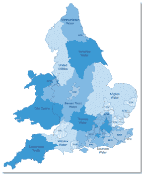 | | |
| *Source: Ofwat (2018)* | | |

`Table 1` 展示了英格兰和威尔士水和污水管理局的所有者

Table 1. Water and sewage authority ownership

| Water and Sewage Authority | Owner Company | Geolocation |
| --- | --- | --- |
| Anglian Water Services Limited | `Osprey Consortiul` | Australia, Canada, UK, Luxembourg |
| Dwr Cymru Cyfyngedig | `Clas Cymru` | Private Company - UK |
| Hafren Dyfrdwy Cyfyngedig | `Hafren Dyfrdwy Cyfyngedig` | Private Company - UK |
| Northumbrian Water Limited | `Cheung Kong Infrastructure Holdings` | China, Hong Kong |
| Severn Trent Water Limited | `Severn Trent PLC` | UK - Listed on LSE |
| Southern Water Services Limited | `Greensands Holding Limited` | UK, US, Australia |
| South West Water Limited | `Pennon Group` | UK - Listed on LSE |
| Thames Water Utilities Limited | `Investment Companies` | 50% Foreign ownership |
| United Utilities Water Limited | `United Utlities` | UK - Listed on LSE |
| Wessex Water Services Limited | `YTL Corporation` | Malaysia |
| Yorkshire Water Services Limited | `Kelda Holdings` | Jersey |

The Water Services Regulation Authority (`Ofwat`) is the economic regulator that sets the price water companies can charge. The normal laws of supply and demand of perfect competition do not apply to this sector. `Ofwat` seeks to allow water companies to make a reasonable return on their investment of about 6%. Prices are reviewed every 5 years and the next review date is in 2024 (`Ofwat, 2017`). The price to the consumer is a complex calculation; it considers the Retail Price Index (`RPI`) plus a `K` factor, which is the ongoing incentive charge to fund the improvement of services offered. Water demand will fluctuate, and agriculture needs as well as household consumption will increase during long periods of hot weather.

Consumption-based on stated preference has been suggested as a measure of reduced water usage (`Willis & Sheldon, 2022`). Consumers prefer to drink bottled water instead of water from a tap. However, at the current rate of 45.8 litres of bottled water consumed per capita per annum (`Statista, 2021`), drinking water from a bottle is a minimal consideration when the average person consumes approximately 152 litres per day (`Consumer Council for Water, 2021`).

Today any new account will be supplied with a water meter, the opportunity for consumers to control their consumption is their responsibility (`Bohanna, 1998`). Fewer baths, water hippos in the cistern or a drought-resistant garden enable consumers to conserve water and make savings instead of the original flat charge based on the property’s council tax. Likewise, the supply of water can change, during drought conditions, and water restrictions are enforced with either rationing or hosepipe bans (`Taylor et al., 2009`). Potentially in severe incidents, water tankers may need to supply residents, standpipes erected or even bottled water provided. These additional considerations will come at an additional cost to the water company.

Theory of Demand and Consumer Behaviour

As can be seen from `Figure 2`, if this was perfect competition, we might anticipate a demand curve that slopes – the higher the price, the demand reduction and conversely the lower the price the increase in demand. However, with no competition and a fixed price set by `Ofwat`, the demand curve is flat. The average cost per litre¹, supplying water under normal conditions suggests that provided demand stays below B, the average cost per litre is lower than the price charged.

| Figure 2. Economics of water supply | |
| --- | --- |
| 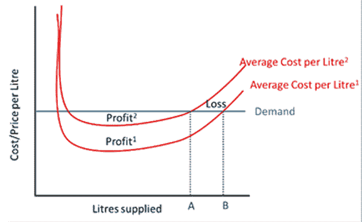 | |
| *Source: Ofwat (2018)* | |

Should the water supply be interrupted due to a cyber incident, depending on the attack, there are a couple of potential outcomes that may be considered. Water supply is prevented from being delivered by an attack on pumping stations, reducing capacity or water treatment plants are compromised, making the water unusable due to the risk to human health. In the first instance, whilst demand may still be normal, the water authority is unable to deliver; in the second incident, demand will reduce as consumers stop using water, in fear of potential contamination. With approximately 50% of all households on a water meter (`Water UK, 2021`), billing receipts are significantly impacted and costs to the water authority are increased to supply fresh water, either with water tankers or supplying bottled water to drink.

Following a cyber incident, there will be further costs to the water authority, firstly in the rectification of the incident and then secondly in implementing the controls needed to prevent further attacks. Undoubtedly the regulator and government will be involved, and the subsequent litigation costs and penalty fines will also factor as a cost to the authority. These increases in costs are represented by the average cost per litre² in `Figure 2` and show a squeeze on profitability (as shown in the area marked `Profit²`). Point A on the demand curve now shows the level of supply at which the cost to supply water per litre, results in a loss. Due to a captive market, consumers are not able to change suppliers, so reputational damage is limited to public indignation.

Overseeing infrastructure improvement is part of the regulator’s role and it has been argued since privatisation, water is more affordable (in real terms), our beaches are cleaner, and water quality and pressure have improved (`Edwards, 2017`). Conversely, it has been suggested, England and Wales do not receive value for money. Potentially a perverse incentive of £55Bn being paid in dividends to shareholders while incurring £44 Billion of debt to fund infrastructure projects (`Yearwood, 2018`).

The cost of servicing this debt is estimated at £1.3 Billion per year (`Laville and correspondent, 2020`). The expectation of the government was infrastructure improvements would be paid for by profits not borrowing. Such is the concern, the shadow chancellor of the exchequer cites 83% of the population is in favour of re-nationalising this service (`CIWEM, 2019`). The decision to make the appropriate levels of expenditure to safeguard critical national infrastructure versus maximising the return on shareholder investment places the UK and the water authorities into conflicting interests. Ultimately, it is only through policy and legislation, the UK can seek to control sufficient protection, and this is explored further in the final section.

Foreign Ownership of Critical Infrastructure


除经济论据外，私人投资服务于公共利益之外，国家安全考量也是保护国家利益的因素。网络战的潜在性已被强调，但当你的基础设施由敌对国家所有时，内部威胁的潜在性随之而来。基于这种被视作的威胁，关于可能损害技术和国家安全利益的交易监管的辩论仍在继续（`Rabe & Gippner, 2017`）。

在当前中国的政治气候下，MI5 与联邦调查局（FBI）之间存在共同的担忧。MI5 在应对中国活动方面的努力已超过两倍。2022 年 7 月的一次演讲中，国家韧性被提及，特别强调了投资和收购等问题，同时也包括间谍活动和政治干涉（`MI5, 2022`）。中国持有超过 1430 亿英镑的英国资产，包括在 Hinkley Point 核电站（33%股权）、Northumbrian Water、希思罗机场（10%）、Neptune Energy（49%）和 Thames Water（9%）的股份。即使是阿斯利康（AstraZeneca）也拥有超过 10 亿英镑的中国投资（`Stubley 2021`）。

鉴于国家安全顾虑，2016 年特蕾莎·梅政府暂时搁置了 Hinkley Point 项目，一位高级顾问警告称，中国核能（CGN）可能在计算机系统中留下后门，以关闭电力（`Bulman, 2016`）。尽管希望加强与中国的贸易联系，但其在核能开发资金方面的参与受到质疑，CGN 可能会被阻止投资 Sizewell B 和 Bradwell 项目。在 Sizewell 项目中，少数股权持有或许可接受，但 Bradwell 项目的投资则不具政治可行性（`Ambrose, 2021`）。

自 2022 年 1 月 4 日起生效的《国家安全与投资法》赋予政府干预和审查商业交易以国家安全为目的的权力（`Gov.UK 2022`）。目前，经济中有 17 个被列为“可报告收购”的敏感领域，但供水未包含在内。供水是否应与其他国家级公用事业（如通信和能源）一起列入此列表？鉴于俄乌冲突带来的最近中断（`Harding et al., 2022`），可能存在疏漏。

除对外国所有权的担忧之外，某些外国公司已不再获批在中国部署。在电信行业，华为已不再被批准为 5G 设备供应商（`Department for Digital, Culture, Media & Sport, 2020`）。自 2020 年 12 月 31 日起，不得购买新设备，且所有现有华为设备必须在 2027 年前从 5G 网络中移除。该禁令部分源于美国对华为的类似制裁，并结合英国网络专家的更新技术建议。该决策的经济成本高昂，初步估计 5G 网络部署成本将增加 14%至 42%（`Baird, 2019`）。

同样，卡斯佩斯基（Kaspersky）已被美国禁用，而英国未效仿，但国家网络安全中心（NCSC）警告政府部门不要在与国家安全相关的系统中使用 Kaspersky 产品（`Corera, 2022`）。尽管英国安全局（FIS）未发现任何问题，德国仍对 Kaspersky 采取更严格立场。此外，即使是友好国家也存在后门，例如 Shadow Brokers 入侵 Equation Group（与美国国家安全局关联），ExtraBacon（CVE-2016-6366）使攻击者有可能完全控制 Cisco ASA 防火墙（`Paganini, 2016`）。

有趣的是，Bruce Schneier 提出一个权衡问题：是否应披露漏洞以便间谍于敌方，还是披露漏洞以保护善方（`Schneier 2013`）？在确保英国基础设施安全的同时，享受跨国贸易的经济利益，政治因素影响贸易协定和投资机会，因此英国政策的后果也会在经济层面显现。

POLICIES AND LEGISLATION

英格兰和威尔士的许多公共机构涉及水务，包括 Ofwat、DEFRA、环境局、水消费者委员会（CCW）以及其他机构。控制水务机构经济的法规如下（`Ofwat, 2022`）：

*   《1989 年水法》：私有化前水务机构。
*   《1991 年水务行业法》：任命 Ofwat 为监管机构。
*   《1992 年竞争与公用事业服务法》：扩大 Ofwat 关于竞争的权力。
*   《1998 年竞争法》：禁止滥用主导地位的市场地位。
*   《1999 年水务行业法》：保护消费者，确保供水。
*   《2003 年水法》：改变经济监管，允许大用户接入竞争对手。
*   《2002 年企业法》：某些并购必须提交竞争委员会审查。
*   《2014 年水法》：增加非住户用户的竞争。

然而，在网络（及物理）韧性方面，网络与信息系统法规 2018（NIS）提供了相应的指导。来自国家关键基础设施保护中心（CPNI）和 NCSC 的配套指南设定了关键基础设施的期望。网络安全成熟度模型受到批评，未能满足关键基础设施的特定市场需求（`Miron & Muita, 2014`），尤其是在关键基础设施领域。网络与物理安全系统的网络保障（CAPSS）有助于解决此问题，通过提供有效的网络缓解措施来增强部署组件的安全信心（`CPNI, 2022`）。CAPSS 结构与其他框架相似，但其超越框架，对产品的安全控制进行认证。SCADA 控制系统的供应链具有竞争性；因此，设备制造商现在被主动鼓励确保其设备符合 CAPSS 标准。

其他立法如《严重犯罪法》（legislation.gov.uk）支持起诉。从网络战的角度来看，这为攻击国提供了较少的威慑作用，尽管曾有人呼吁将民用行动的保护范围与《日内瓦公约》相当（`Sutherland et al., 2012`）。虽然其他立法也适用（如在使用 OT 攻击 IT 时的数据保护法或《通用数据保护条例》（GDPR）以保护消费者隐私）。

在公用事业 OT 网络中，被入侵的智能电表可能影响隐私权，但这种关联较为间接。目前，智能水表仅刚刚在中国家庭中引入。虽然电表与房产关联而非个人，但它们容易受到入侵（`Khattak et al., 2019`），但任何隐私问题将在 IT 层面显现，因为电表将与负责缴费的人关联。

DISCUSSIONS


2021 年发布的水创新战略（Water Innovation 2050, 2021）并未意识到其作为英国关键基础设施的一部分的角色。报告承认韧性是一项要求（为确保持续供水），但其在网络安全方面缺乏具体性。报告提到有机会推动变革，提出设立卓越中心，如果在该计划中将网络安全纳入其中，则有潜在机会提升意识。向似乎对自身职责视而不见的行业推荐潜在的下一步措施将会令人沮丧。报告综合了经济学理论和立法的建议。

从经济学理论出发，鼓励任何组织投资于网络安全都很困难，尤其是那些在市场中拥有独特特权的水管理机构。缺乏董事会对网络攻击责任的认识是其中一部分问题（Hartmann & Carmenate, 2021）。组织在网络安全方面的支出指南已有（Gordon et al., 2020），但这些指南对拥有预算的普通组织有帮助，而对关键基础设施而言，Gordon 与 Loeb 的投资公式不足。Ofwat 拥有撤销水抽取许可的权力，尽管该行业存在许多缺陷（如污水溢出、漏水等），这项权力至今仍未被使用。

水管理机构内部的企业社会责任项目对网络问题缺乏关注，也未承认其在关键基础设施中的角色。这种认知缺失与 11 家水管理机构中有 5 家为外国所有（Table 1）相结合，表明国家安全的共享价值难以确定。可能存在一种激励方案：若水管理机构完全遵循 CAPSS 与 NIS 计划，则可获得增值税退税（企业税退款可能因外国所有权而有所不同）。

如果盈利是董事会的首要考量，这或许能够激励其采取行动。虽然消费者从 IT 角度关注隐私，但他们似乎并不强烈要求供水安全或污水处理的可靠性。即便发生事故，他们也无法更换供应商，因其只能承担中断带来的后果。只有国家能够强制要求，而这只能通过立法实现。

对组织进行罚款或要求其落实足够的控制措施可以约束行为（Herath & Rao, 2009）。这些罚款最终由消费者承担，并可能导致股东分红减少。在一个行业中，分红总额达 £2 Billion，而 2018 年针对所有关键基础设施的潜在罚款为 £17 Million（Hall, 2018），金融罚款对决策影响甚微。NIS 法规明确其意图，而其不合规的后果目前是金钱性的；此外，连带责任（Laski, 1916）或董事会成员的公司疏忽也应被考虑。法律应当明确董事对其组织的行为或不行动负有个人责任。

组织不喜欢罚款，且往往将因网络事件而被指责的员工解雇。但这并不影响那些在确保网络安全方面负有责任的董事会。对关键基础设施（以及可能的 GDPR 隐私）未能防护的处罚应当包括监禁刑罚；只有当董事会成员因网络事件被个人追责时，才能真正实现实施足够控制措施的激励。

监管机构支持监禁刑罚，并最近提出应遵循此路线（Plimmer, 2022），此举是对 2021 年出现的过度污水排放的回应。鉴于这些泄漏对公共健康构成风险，若供水被篡改，类似的公共健康问题也会随之出现。

还可以考虑进一步立法，规定若组织未达 CPNI 标准则不得分配股息。国家利益必须高于股东利益，无论股东居于何地。水管理机构常规审计已包括对水质、漏损及污水溢出等措施的检查，最终应将网络韧性纳入此审计，由 Ofwat 牵头，并与 CPNI、NCSC 合作。

结论

关键基础设施不能独自承担保护其服务的责任。推动力必须来自内部，起始于董事会。若缺乏强大的网络安全文化，任何外部帮助、鼓励、审计或惩戒都会被视为对正常运营的干扰，并继续失败。一些国家基础设施已具备高风险意识，例如空中交通控制在 2014 年虽遭遇韧性事件（Civil Aviation Authority, 2018），但其拥有高度的网络安全意识。这些专业知识需要在所有提供关键服务的组织之间共享。这并不意味着统一的网络安全做法，因为单一漏洞可能影响众多系统，而是指整个网络安全社区实现 NIS 与 CPNI 目标的集体能力。

参考文献

legislation.gov.uk. (2015). Serious Crime Act 2015. Retrieved on April 12, 2022, from: [`https://www.legislation.gov.uk/ukpga/2015/9/contents/enacted`](https://www.legislation.gov.uk/ukpga/2015/9/contents/enacted)

Ambrose, J. (2021). China’s nuclear power firm could be blocked from UK projects. The Guardian. Retrieved on November 3, 2022, from: [`https://www.theguardian.com/environment/2021/jul/26/chinas-nuclear-power-firm-could-be-blocked-from-uk-projects`](https://www.theguardian.com/environment/2021/jul/26/chinas-nuclear-power-firm-could-be-blocked-from-uk-projects)

Anderson, R., & Fuloria, S. (2010). Security Economics and Critical National Infrastructure. In Moore, T., Pym, D., & Ioannidis, C. (Eds.), Economics of Information Security and Privacy (pp. 55–66). Springer US. doi:[`10.1007/978-1-4419-6967-5_4`](https://doi.org/10.1007/978-1-4419-6967-5_4)

Baird, W. (2019). Counting the International Costs of Huawei Exclusion. American Enterprise Institute - AEI. Retrieved on November 3, 2022, from: [`https://www.aei.org/technology-and-innovation/telecommunications/counting-the-international-costs-of-huawei-exclusion/`](https://www.aei.org/technology-and-innovation/telecommunications/counting-the-international-costs-of-huawei-exclusion/)

Barnard-Wills, D., & Ashenden, D. (2012). Securing Virtual Space. Retrieved on April 12, 2022, from: [`https://journals.sagepub.com/doi/epub/10.1177/1206331211430016`](https://journals.sagepub.com/doi/epub/10.1177/1206331211430016)

BBC. (2022). ‘Worrying precedent’ as hackers target South Staffs Water. BBC News. Retrieved on October 13, 2022, from: [`https://www.bbc.com/news/uk-england-stoke-staffordshire-62565937`](https://www.bbc.com/news/uk-england-stoke-staffordshire-62565937)

Bohanna, D. (1998). Water meters: An incentive to conserve and a signal to the market. Economic Affairs, 18(2), 10–13. doi:[`10.1111/1468-0270.00085`](https://doi.org/10.1111/1468-0270.00085)


-   [Hinkley Point](https://www.independent.co.uk/news/uk/home-news/hinkley-point-theresa-may-nuclear-power-poll-majority-uk-opposes-plant-edf-china-a7308701.html)的绝大多数英国公众反对特蕾莎·梅批准核电站的决定。The Independent. 2016 年。2022 年 11 月 3 日检索，来源：<https://www.independent.co.uk/news/uk/home-news/hinkley-point-theresa-may-nuclear-power-poll-majority-uk-opposes-plant-edf-china-a7308701.html>

-   Civil Aviation Authority. (2018). CAP1480: Implementation of the recommendations from the Independent Enquiry into the NATS Systems Failure on 12th December 2014. Retrieved on April 15, 2022, from: <https://publicapps.caa.co.uk/modalapplication.aspx?appid=11&mode=detail&id=7614&filter=2>

-   CIWEM. (2019). Thirty years on, what has water privatisation achieved? CIWEM. Retrieved on April 12, 2022, from: <https://www.ciwem.org/the-environment/how-should-water-and-environmental-management-firms-tap,-retain-and-promote-female-talent>

-   Committee on Commerce, Science, and Transportation. (2014). ‘Kill Chain’ Analysis of the 2013 Target Data Breach. Retrieved on April 12, 2022, from: <https://www.hsdl.org/?abstract&did=751170>

-   Consumer Council for Water. (2021). How much water do you use? CCW. Retrieved on April 12, 2022, from: <https://www.ccwater.org.uk/households/using-water-wisely/averagewateruse/>

-   Corera, G. (2022, March 29). More must reconsider Russian anti-virus software use, UK warns. BBC News. Retrieved on November 3, 2022, from: <https://www.bbc.com/news/technology-60854882>

-   CPNI. (2022). Cyber Assurance of Physical Security Systems. Retrieved on April 13, 2022, from: <https://www.cpni.gov.uk/cyber-assurance-physical-security-systems-capss>

-   Department for Digital, Culture, Media & Sport (2020). Huawei to be removed from UK 5G networks by 2027. Retrieved on November 3, 2022, from: <https://www.gov.uk/government/news/huawei-to-be-removed-from-uk-5g-networks-by-2027>

-   Desai, N. (2016). IT vs. OT for the Industrial Internet. GlobalSign GMO Internet, Inc. Retrieved on February 28, 2022, from: <https://www.globalsign.com/en/blog/it-vs-ot-industrial-internet>

-   Edwards, C. (2017). Thatcher’s golden legacy of privatisation. CapX. Retrieved on March 2, 2022, from: <https://capx.co/thatchers-golden-legacy-of-privatisation/>

-   Gordon, L. A., Loeb, M. P., & Zhou, L. (2020). Integrating cost–benefit analysis into the NIST Cybersecurity Framework via the Gordon–Loeb Model. Journal of Cybersecurity, 6(1), tyaa005. doi:<https://doi.org/10.1093/cybsec/tyaa005>

-   Gov.UK. (2022). National Security and Investment Act 2021. Retrieved on November 3, 2022, from: <https://www.gov.uk/government/collections/national-security-and-investment-act>

-   Hall, K. (2018). Brit water firms, power plants with crap cyber security will pay up to £17m, peers told. Retrieved on February 1, 2022, from: <https://www.theregister.com/2018/05/22/house_of_lords_new_cybersecurity_regulations/>

-   Harding, L., Sabbagh, D., & Koshiw, I. (2022, October 31). Russia targets Ukraine energy and water infrastructure in missile attacks. The Guardian. Retrieved on November 3, 2022, from: <https://www.theguardian.com/world/2022/oct/31/russian-missiles-kyiv-ukraine-cities>

-   Hartmann, C. C., & Carmenate, J. (2021). Academic Research on the Role of Corporate Governance and IT Expertise in Addressing Cybersecurity Breaches: Implications for Practice, Policy, and Research. Current Issues in Auditing, 15(2), A9–A23. doi:<https://doi.org/10.2308/CIIA-2020-034>

-   Herath, T., & Rao, H. R. (2009). Encouraging information security behaviors in organizations: Role of penalties, pressures and perceived effectiveness. Decision Support Systems, 47(2), 154–165. doi:<https://doi.org/10.1016/j.dss.2009.02.005>

-   Khan, R., Maynard, P., McLaughlin, K., Laverty, D. M., & Sezer, S. (2016). Threat Analysis of BlackEnergy Malware for Synchrophasor based Real-time Control and Monitoring in Smart Grid. Retrieved on April 11, 2022, from: <https://www.scienceopen.com/hosted-document?doi=10.14236/ewic/ICS2016.7>

-   Khattak, A., Khanji, S., & Khan, W. (2019). Smart Meter Security: Vulnerabilities, Threat Impacts, and Countermeasures. In, 554–562.

-   Langner, R. (2011). Stuxnet: Dissecting a Cyberwarfare Weapon. IEEE Security and Privacy, 9(3), 49–51. doi:<https://doi.org/10.1109/MSP.2011.67>

-   Laski, H. J. (1916). Basis of Vicarious Liability. The Yale Law Journal, 26(2), 105. doi:<https://doi.org/10.2307/786314>

-   Laville, S. (2020, July 1). England’s privatised water firms paid £57bn in dividends since 1991. The Guardian. Retrieved on February 28, 2022, from: <https://www.theguardian.com/environment/2020/jul/01/england-privatised-water-firms-dividends-shareholders>

-   MI5. (2022). Joint address by MI5 and FBI Heads. Retrieved on November 3, 2022, from: <https://www.mi5.gov.uk/news/speech-by-mi5-and-fbi>

-   Miron, W., & Muita, K. (2014). Cybersecurity Capability Maturity Models for Providers of Critical Infrastructure. Technology Innovation Management Review, 4(10), 33–39. doi:<https://doi.org/10.22215/timreview/837>

-   Nicholson, A., Webber, S., Dyer, S., Patel, T., & Janicke, H. (2012). SCADA security in the light of Cyber-Warfare. Computers & Security, 31(4), 418–436. doi:<https://doi.org/10.1016/j.cose.2012.02.009>

-   O’Neil, P. (2022). These hackers just showed how easy it is to target critical infrastructure. Retrieved on May 2, 2022, from: <https://www-technologyreview-com.cdn.ampproject.org/c/s/www.technologyreview.com/2022/04/21/1050815/hackers-target-critical-infrastructure-pwn2own/amp/>

-   Ofwat. (2017). Delivering Water 2020: Our final methodology for the 2019 price review. Ofwat. Retrieved on April 13, 2022, from: <https://www.ofwat.gov.uk/publication/delivering-water-2020-final-methodology-2019-price-review/>

-   Ofwat. (2018). Your water company. Ofwat. Retrieved on October 13, 2022, from: <https://www.ofwat.gov.uk/households/your-water-company/>

-   Ofwat. (2022). Legislation. Ofwat. Retrieved on May 2, 2022, from: <https://www.ofwat.gov.uk/regulated-companies/ofwat-industry-overview/legislation/>


Paganini, P. (2016). NSA EXTRABACON exploit 仍然威胁到数万台 CISCO ASA 设备。Security Affairs. 2022 年 11 月 3 日检索，来源：[`https://securityaffairs.co/wordpress/50971/hacking/nsa-extrabacon.html`](https://securityaffairs.co/wordpress/50971/hacking/nsa-extrabacon.html)

Plimmer, G. (2022, July 14). 英国水务公司高管因污水污染面临入狱威胁。Financial Times.

Rabe, W., & Gippner, O. (2017). 中国对欧洲关键基础设施和战略产业的对外直接投资的认知。International Politics, 54(4), 468–486. doi:[`10.1057/s41311-017-0044-x`](https://doi.org/10.1057/s41311-017-0044-x)

Schneier, B. (2013). Carry On: Sound Advice from Schneier on Security. John Wiley & Sons, Inc. 2022 年 2 月 1 日检索，来源：[`https://ebookcentral.proquest.com/lib/bournemouth-ebooks/detail.action?docID=1568423`](https://ebookcentral.proquest.com/lib/bournemouth-ebooks/detail.action?docID=1568423)

Singh, S. (2022). ICS/SCADA 系统的最大威胁。Infosec Resources. 2022 年 2 月 28 日检索，来源：[`https://resources.infosecinstitute.com/topic/biggest-threats-to-ics-scada-systems/`](https://resources.infosecinstitute.com/topic/biggest-threats-to-ics-scada-systems/)

Statista. (2021). 英国人均瓶装水消费量 2013-2026。Statista. 2022 年 4 月 11 日检索，来源：[`https://www.statista.com/forecasts/1186840/uk-average-volume-bottled-water-per-capita`](https://www.statista.com/forecasts/1186840/uk-average-volume-bottled-water-per-capita)

Stubley, P. (2021). 中国如今拥有 1430 亿英镑的英国资产，涵盖核电、酒馆和学校。The Independent. 2022 年 11 月 3 日检索，来源：[`https://www.independent.co.uk/news/uk/home-news/china-now-owns-ps143bn-in-uk-assets-from-nuclear-power-to-pubs-and-schools-b1841056.html`](https://www.independent.co.uk/news/uk/home-news/china-now-owns-ps143bn-in-uk-assets-from-nuclear-power-to-pubs-and-schools-b1841056.html)

Sutherland, I., Xynos, K., Jones, A., & Blyth, A. (2012). 网络战争中的保护性标志。Australian Information Warfare and Security Conference. 来源：[`https://ro.ecu.edu.au/isw/49`](https://ro.ecu.edu.au/isw/49)

Taylor, V., Chappells, H., Medd, W., & Trentmann, F. (2009). 旱灾是常态：英国及威尔士 1893–2006 年旱灾与水需求的社会技术演变。Journal of Historical Geography, 35(3), 568–591. doi:[`10.1016/j.jhg.2008.09.004`](https://doi.org/10.1016/j.jhg.2008.09.004)

Thomson, I. (2018). 这下可真有戏了……污水厂被黑客入侵以制造加密货币。Retrieved on February 1, 2022, from: [`https://www.theregister.com/2018/02/08/scada_hackers_cryptocurrencies/`](https://www.theregister.com/2018/02/08/scada_hackers_cryptocurrencies/)

Water UK. (2021). 水表。Retrieved on April 13, 2022, from: [`https://www.water.org.uk/advice-for-customers/water-meters/`](https://www.water.org.uk/advice-for-customers/water-meters/)

Water Innovation 2050. (2021). UK Water Innovation Strategy 2050. Water Innovation 2050. Retrieved on April 14, 2022, from: [`http://waterinnovation2050.org.uk/`](http://waterinnovation2050.org.uk/)

Willis, K., & Sheldon, R. (2022). 1994–2019 年英国水务公司价格审查中客户愿意为服务变更支付的意愿研究。Journal of Environmental Economics and Policy, 11(1), 4–20. doi:[`10.1080/21606544.2021.1927850`](https://doi.org/10.1080/21606544.2021.1927850)

Yearwood, K. (2018). 英国私有化水务行业。An ATM for investors. Public Services International Research Unit (PSIRU) University of Greenwich. 工作论文. 2022 年 4 月 12 日检索，来源：[`https://gala.gre.ac.uk/id/eprint/21097/`](https://gala.gre.ac.uk/id/eprint/21097/)

## Chapter 11

*   S. Raschid Muller  

      

    Arizona State University, USA

*   Darrell Norman Burrell  

      

    Marymount University, USA

*   Calvin Nobles  

      

    Illinois Institute of Technology, USA

*   Horace C. Mingo  

      

    Marymount University, USA

*   Andreas Vassilakos  

    Illinois Institute of Technology, USA

ABSTRACT

干扰美国总体选举进程的外部和国内因素产生了商业市场、社区以及选民之间的混乱和困惑。选举因此变得不可靠，因为存在误导性言论。选举否认者正在积极努力削弱对选举的信任并压低投票率，尤其是对历史上被边缘化的有色人种和其他社区的选民。关于投票过程和选举工作人员的虚假信息传播，可能对人们投票的能力和对选举的信任产生重大影响。选举误信威胁美国的民主进程。2022 年，64% 的选举官员表示，传播虚假信息使他们的工作更加危险。本章利用新兴文献内容，讨论网络心理学及其复杂动态，重点在于寻找解决这些问题的方法。

INTRODUCTION

美国选举官员在 2020 年面临极大压力，以保护总统选举过程（Vanderwalker, 2020）。根据《协作多族裔政治研究》，Sanchez et al. (2022) 发现，64% 的美国公众认为美国民主正处于危机之中，面临崩塌的风险。在一项奎尼皮亚克大学的研究中，Sanchez 发现，超过半数的美国人预计政治紧张局势将在其余生中继续恶化而非改善。Tenove, Bffie, McKay, and Moscrop (2018) 建议公平政治参与面临深刻威胁，这些威胁可能对某些群体造成不成比例的影响。

俄罗斯政府多年来一直在发动不懈的运动，旨在破坏欧洲和美国的民主进程及法治。军事介入、网络攻击、虚假信息、支持极端政治派别、自然资源的武器化、有组织犯罪以及腐败，都是克里姆林宫的工具（Taylor, 2019）。数字通信技术正以前所未有的方式干扰民主和选举（Anderson & Raine, 2020）。


网络安全风险和误信信息已成为美国及全球的重要威胁 (`Anderson & Raine, 2020`; `Vanderwalker, 2020`)。政府干预网络空间会引发隐私、表达自由以及权力滥用的担忧。政府干预网络空间指政府为调控、控制或影响其国界内的互联网及其他数字技术的使用而采取的行动。此类干预形式多样，如审查、监控以及制定与在线活动相关的法律法规。政府可能出于维护国家安全、执行法律法规或推动特定政治或意识形态议程等原因参与此类活动。`Klepper (2022)` 指出，政治误信信息往往聚焦于移民、犯罪、公共卫生、地缘政治、灾难、教育或大规模枪击事件。Klepper 声称关于邮寄选票安全的说法有所上升，以及关于非公民投票的毫无依据的谣言也在增加。除此之外，关于死者投票、移动投票箱的说法，以及关于投票机的荒诞故事层出不穷 (`Klepper, 2022`)。

误信信息同样可以表现为对候选人的虚假或误导性言论、选民压制手段以及试图操纵选举结果的行为。在大选前夕，共和党候选人唐纳德·特朗普就质疑选举的合法性，随后在失利后拒绝承认，散布关于选举的谎言，这些谎言激发了 2021 年 1 月 6 日美国国会大厦的 deadly 攻击。他的总检察长威廉·巴尔在超过 60 起法院裁决中否认了他的主张 (`Klepper, 2022`)。旨在扰乱民主进程的故意误导材料的泛滥促成了公众对政治体制信任的侵蚀 (`Sanchez et al., 2022`)。特朗普总统再次强调，2020 年选举结果的欺骗加强了俄方行动，并对选民对选举结果的信任产生了长期影响 (`Sanchez et al., 2022`)。

州和地方选举官员对选举欺诈的指控感到担忧，这些指控包括对 2020 年总统选举以及本月加州 recall 过程的误导性断言 (`Vasilogambros, 2021`)。该州日益频繁地指控选民欺诈。一些选举官员担心因选举系统误信而遭受言语或身体攻击。今年夏天，司法部启动执法工作组，以应对针对选举官员和志愿者的威胁 (`Vasilogambros, 2021`)。

新冠疫情为选举官员带来了新挑战，他们被迫在资源急剧短缺的情况下对投票流程作出紧急调整 (`Vanderwalker, 2020`)。与疫情相关的投票变更成为选举议题，政治参与者在候选人、投票地点和政策方面制造混乱。疫情对美国选举系统造成了重大破坏，并威胁到其他真实危机，如自然灾害、邮寄选票、投票机故障以及导致 2020 年美国选举严重中断的外国干预 (`Feldman, 2020`)。

方法

本项目采用文献内容分析法。关键搜索词包括：`Election interference`、`cyber-defense`、`misinformation`、`geopolitics`、`mail-in voting`、`social media propaganda`、`social media manipulation`、`psychological operations`、`nation-state actors`、`cyber-warfare`。所使用的数据库及其主机（括号内所示）包括 `PEW Research`、`ABI Inform Complete (ProQuest)`、`ResearchGate`、`Academia.edu`、`Business Source Premier (EBSCO)`、`Google Scholar`、`ACM Digital Library`、`European Reference Index for the Humanities and Social Sciences (ERIH)`、`Baidu Scholar`、`DOAJ (Directory of Open Access Journals)`。

本研究的目的

社交媒体已超过印刷报纸成为美国人的新闻来源；二十分之一的美国成年人调查表示经常通过社交媒体获取新闻，而十六分之一的人则从印刷报纸获取新闻 (`Stuart, 2019`)。俄罗斯及其政府的互联网研究机构利用误导性网站名称，使其故事看似来源于美国而非俄罗斯 (`Stuart, 2019`)。本研究旨在通过整合有限的分散研究，推动关于 2020 年选举干预、误信运动及社交媒体操纵的对话与文献建设，特别是通过外国咨询的心理作战手段。

情境

国家行为体（即俄罗斯、伊朗、中国和朝鲜）向特定群体散布虚假信息，以误导其投票。社交媒体迅速传播了欺骗性做法，瞬间触及庞大受众 (`Pew Research Center, 2019`)。专家警告称，外国势力从俄罗斯 2016 年选举干预中汲取经验，企图在本年度暗中影响美国选民 (`Vanderwalker, 2020`)。州和地方选举官员在捍卫 2020 年总统选举、保护美国选民免受因误信而导致的边缘化方面发挥了关键作用。互联网公司和公众也对抗欺骗行为、选民恐吓及其他数字投票压制行为 (`Vanderwalker, 2020`)。

在总统选举前后，互联网一直受到黑客、窃贼和间谍的攻击 (`Aftergood, 2017`)。荷兰海牙战略研究中心网络政策主任克利姆堡（Klimburg）在《The Darkening Web》中报道，坚持优越性的政府正日益袭击将数字化景观视为全球公共资源的理念。新时代的意识形态斗争中，网络空间成为战场。美国海军网络防御司令部成员监测了未经授权的网络活动。克利姆堡预测，参与的士兵属于两类人群。自由网络力量支持信息在不受国界或文化障碍限制的自由流动。网络主权阵营则由俄罗斯和中国主导，要求更大的政府对网络和信息的控制。为维持庞大的审查行动，中国的长城防火墙雇佣的人数超过该国武装力量的人数 (`Aftergood, 2017`)。

《The Darkening Web》几乎未提及俄罗斯在总统选举中的干预，因为其未提及黑客组织。2016 年，Shadow Brokers 获得美国国家安全局（NSA） stolen intelligence tools，2020 年 5 月全球 WannaCry 勒索软件事件发生。新的中国网络安全法模糊地旨在规范跨境数据流动。该网络安全法为评估这一快速变化的领域提供了框架。


一个知情的公众是民主得以生存的必要条件。“今天和每一天，美国人民必须就他们整个生存可能取决的事项做出决定。为了做出这些决定，人民必须知情”(Brydon, 1958)。获取可信的信息并保持知情是公民理解问题的关键。当他们没有保密来源或直接获取新闻时，他们必须依赖媒体(Davies, 2009)。

相信媒体提供的信息是可信的至关重要，尤其是当媒体是唯一的数据提供者时(Jackob, 2010)。社交媒体的使用日益增多，这也加剧了对媒体的依赖和依赖。一个关键问题是，这种对媒体的依赖是否会影响个体对信息可信度的感知。在选举等变化和不确定性的时刻，媒体使用会加剧(Loveless, 2008)。这一局面因缺乏传统新闻门禁和编辑职能的社交媒体平台而进一步复杂化。Shearer & Grieco (2019) 发现，六十二%的美国人从社交媒体平台获取新闻。外国势力利用这些平台干预了 2016 年和 2020 年的美国大选。

社交媒体需要更多的传统门禁者，因此需要更多的事实核查和筛选内容。没有门禁者，就没有对潜在危险的控制。这些危险包括误导信息，包括有意误导的尝试。这些选举安全风险可能包括外国干预。这些干预通常会强化政策和政治体系，或者是敌对的。在 2016 年美国总统选举期间，俄罗斯 Internet Research Agency (IRA) 操纵社交媒体传播了关于已将美国人分裂的议题的虚假信息(U.S. Senate Select Committee on Intelligence, 2018)。社交媒体上的“信息战”旨在通过传播误导信息来削弱美国民主(U.S. Senate Select Committee on Intelligence, 2019)。

**FOUNDATIONS**

恶意网络攻击随着 Internet 技术和移动应用数量与复杂性的增加而演变(Li et al., 2019)。因此，社会在网络空间面临的安全风险比以往任何时候都更大。Li et al. 理论上定义了员工安全行为影响范围的“虚空”领域，并开发并测试了操作性措施，以推进工作场所信息安全行为研究。他们提出并通过对 579 名企业经理和专业人士的调查结果进行概念框架的验证。采用结构方程模型和方差分析程序测试了拟议的假设。结果表明，当员工了解公司的信息安全政策和实践时，他们在管理网络安全任务方面的能力优于那些不了解其网络安全政策的人(Li et al., 2019)。Li et al. 还发现，组织的信息安全环境正向员工的威胁评估和应对评估能力产生积极影响，从而促进其网络安全合规行为。

Boisrond (2020) 描述了外国势力如何试图影响 2020 年美国总统选举的结果。国家行为体（即俄罗斯、伊朗、中国和朝鲜）更具敌意性，各国必须确定针对这些威胁行为体的新举措。为了更好地理解选举环境的运作，Boisrond 描述了地方司法管辖区负责美国选举系统中的选举。尽管联邦政府制定法律和法规，总统选举过程的完整责任由各州负责执行这些法律和法规(Boisrond, 2020)。

**RULES AND REGULATIONS FOR THE IMPLEMENTATION AND USE OF ELECTION TECHNOLOGIES**

根据联邦法律，每个州都会提名一位首席州选举官，负责制定和实施选举技术的规则和规定(Boisrond, 2020)。每个州都有管理或控制其投票过程的协议。然而，2020 年总统竞选的 COVID-19 大流行又增加了复杂性。国家行为体利用 COVID-19 大流行部署勒索软件（即 Botnet、Digital Ware 和 Darknet）攻击全球多个机构，包括政府机构、金融机构、医疗组织和教育机构(Akamai Technologies, 2020; Andrews, 2018; Henriquez, 2020; Herberger, 2016; New York Times, 2019, 2020)。

**FEDERAL ENTITIES ROLES AND RESPONSIBILITIES**

政府问责局 (GAO) 发现，联邦实体负责支持网络安全工作(U.S. Government Accountability Office, 2020a)。有 23 个联邦实体制定了政策，监控了关键基础设施保护工作，共享信息以增强全国的网络安全，应对网络事件，调查网络攻击，并开展网络安全研究(U.S. Government Accountability Office, 2020a)。

**CYBERSECURITY CHALLENGES FACING THE NATION: A HIGH-RISK ISSUE**

联邦政府必须保护国家的基础设施、个人隐私和敏感数据免受网络威胁(U.S. Government Accountability Office, 2020b)。美国的基础设施包括能源、交通、通信和金融服务。信息技术 (I.T.) 系统应执行保护关键数据的操作和流程(U.S. Government Accountability Office, 2020b)。如图 1 所示，联邦行政部门机构在 2017 年向国土安全部报告了超过 35,000 起安全事件。

| Figure 1. GAO analysis of U.S. computer emergency readiness team and office of management and budget data for the fiscal year 2017 |
| --- |
| 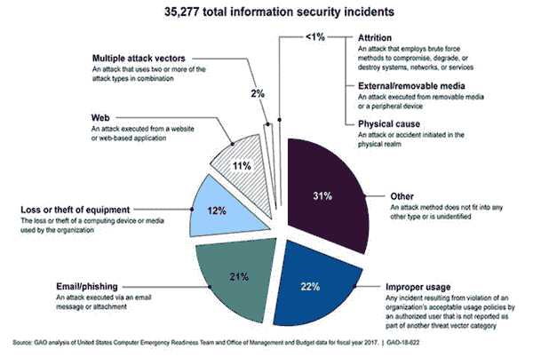 |
| --- |

此外，许多政府 I.T.系统包含大量个人可识别信息 (PII)。联邦机构必须保护这些信息的保密性和完整性，并应对数据泄露和安全事件(U.S. Government Accountability Office, 2020b)。如图 2 所示，为应对四项重大网络安全挑战，需要十项关键行动。GAO 向联邦机构提出了超过 3,000 项建议以解决网络安全不足问题。GAO 应实施约 700 项建议。国家 I.T.系统和数据日益容易受到网络威胁(U.S. Government Accountability Office, 2020b)。

| Figure 2. Significant cybersecurity challenges and critical actions are needed |
| --- |
| --- |
| 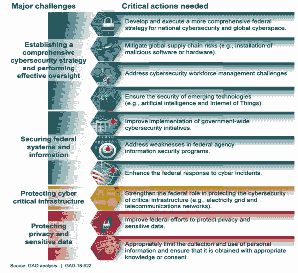 |
| --- |

**FINANCING ELECTION CAMPAIGNS**


## 联邦机构加强帮助确保选举基础设施安全、监督残疾人投票可及性以及执行竞选金融法 (美国政府问责局, 2020c)

美国联邦法律规管选举管理和选民登记，保护残疾人和少数族裔的投票权。然而，联邦选举主要由州和地方选举管辖部门负责 (U.S. Government Accountability Office, 2020c)。州负责规定投票方式、投票日或投票日的时间段以及投票设备。地方管辖部门负责登记符合条件的选民、设计选票、安排投票站点、准备投票设备以及计票 (U.S. Government Accountability Office, 2020c)。

联邦法律要求州提供选民登记机会，例如当个人获得驾照时，并提供在线登记的基础设施，这需要时间和金钱。然而，联邦法律通过减少地方选举官员手动处理纸质登记表格并保持准确的选民登记名单的需求，为提高准确性创造了节约 (U.S. Government Accountability Office, 2020c)。

州将过时的投票设备替换为现代设备，以跟上新型投票设备的需求。各管辖部门和州考虑新设备必须满足联邦、州和地方要求、获取新设备的成本、及时供应商提供的已有设备维护以及整体性能和功能的评估 (U.S. Government Accountability Office, 2020c)。

选民投票率受选举管理政策的影响，如当日登记、邮寄投票、对所有投票者（无论所属选区）提供中立投票站以及通过短信增加投票率 (U.S. Government Accountability Office, 2020c)。提高投票率的改革惠及了非裔美国人和其他民族群体，原因是 2014 年的审查 (U.S. Government Accountability Office, 2020c)。自 2014 年以来，美国公司屡次遭受网络攻击 (Walters, 2014)。

州和地方选举官员与国土安全部（DHS）的 CISA 合作，保障了投票机、选举基础设施和在线选民登记 (U.S. Government Accountability Office, 2020c)。图 3 展示了受物理或网络威胁影响的选举资产示例 (U.S. Government Accountability Office, 2020c)。

| 图 3. 受物理或网络威胁影响的选举资产示例 |
| --- |
| 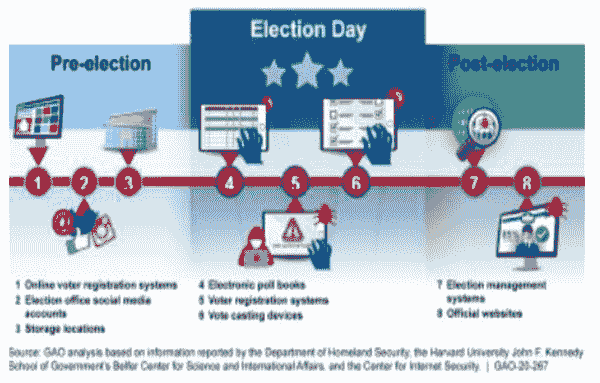 |
| *注. 哈佛大学肯尼迪政府学院更好中心（Better Center for Science and International Affairs）和信息安全中心（Center for Internet Security）。* |

选举投票站对残疾人可及。根据联邦法律，美国所有州的每个投票站均对残疾人可及。一些规定包括为轮椅、拐杖、助行器、拐杖等提供停车位、坡道和投票站，使残疾人能够在其他人之前进入投票站、使用投票系统并以私密独立的方式投出选票。这些便利措施源于 2000、2008 和 2016 年大选期间的投票站，旨在帮助残疾人进入和通过投票站、使用投票系统并以私密独立的方式投出选票 (U.S. Government Accountability Office, 2020c)。

## 2016 年总统选举

2016 年，俄罗斯政府在总统选举期间发动了网络安全泄露，导致希拉里·克林顿无法获得提名 (Ewing, 2020)。尽管选举官员最终识别出该网络安全泄露，但他们应对的攻击从未停止。2020 年选举采用了更加严格和有力的措施，以防止选举欺诈，并借助联邦调查局（FBI）、CISA 以及国土安全部的帮助，实施了更严格的安全措施 (Ewing, 2020)。

2020 年选举本可以更好，但它是历史上最周密和最受保护的选举之一，尽管在少数地方出现了电子投票站的问题。尽管如此，县级官员仍使用纸质记录和账本作为备份，以在电子投票站故障时保持投票过程的进行 (Ewing, 2020)。在 2016 年选举中，俄罗斯行为体试图侵入民主党全国委员会 (Meyler & Kaneko, 2020)。俄罗斯试图窃取密码的行为凸显了对 2016 年选举干预的担忧 (Andrews, 2018)。

2020 年，俄罗斯网络犯罪分子主要关注通过分裂美国社会作为首选战术。虽然这一战术是 2016 年俄罗斯战略的一部分，但政治分裂程度已超过 2016 年 (Meyler & Kaneko, 2020)。Trolls 是那些在网络上发布误导信息以激起社交媒体用户反应的人。用户并非唯一传播信息的一方；根据 Badawy 等人 2019 年的研究，在 4 万名传播信息的用户中，3.4 万名是机器人。56%的美国人对社交媒体机器人了解不多 (Stocking & Sumida, 2018)。社交媒体机器人是由算法控制的独立账号，能够模拟真实用户的活动，主持信息并与社交媒体用户互动；然而，用户可以通过转发、点赞和互动来帮助机器人 (Bessi & Ferrara, 2016)。Bessi 和 Ferrara 的研究表明，社交媒体机器人的存在会对民主政治讨论产生负面影响 (Bessi & Ferrara, 2016)。


一种传播虚假信息的机制是“水军农场”。水军农场是一种系统化的运作，由多名用户在社交媒体平台上协作，通过生成误导性和虚假信息来影响公众舆论（美国众议院常设委员会情报委员会，2019）。2015 年，位于俄罗斯圣彼得堡的互联网研究局（IRA）拥有约 400 名员工，工作 12 小时班次，填充 40 个房间（美国众议院常设委员会情报委员会，2018）。

数字阴影（Digital Shadows），外部威胁情报领域的领导者，揭示了研究成果，称目前有 550 个假域针对 19 名民主党候选人、4 名共和党总统候选人以及共和党捐款网站（Henriquez, 2020）。数字阴影研究了可能增加混乱并向美国选民传播误导信息的假冒互联网域名。Digital Shadows 发布了其最新研究，探讨外国势力对 2020 年美国总统选举的威胁。在 2016 年选举被相关恶意行为体（与俄罗斯国家有关）破坏之后，Digital Shadows 发现 2020 年类似的行动证据（Henriquez, 2020）。

选举周期中的选举活动

国际研究所对应对选举过程发现的挑战及包含国际最佳实践的选举周期视图（Brown, Marsden, Lee, & Veal, 2020）。某些活动在投票前、投票中和投票后均面临网络安全威胁（参见 Table 1）。

表 1. 选举周期的各个方面面临网络安全风险

| 类别 | Pre-Polling | Polling | Post-Polling |
| --- | --- | --- | --- |
| 规划与后勤：培训与教育 | 边界划定。<br>投票站位置。<br>招募投票站工作人员。<br>候选人/党派/登记/教育。<br>采购。 | 传播后勤信息。<br>分发选举材料。 | 检索结果和选举材料。<br>分析特定投票站的延误及其他问题。<br>为未来准备选举团队。 |
| 选民名册与登记 | 编制名册。<br>检查无资格或重复。<br>添加/核实选民。<br>设定最终前选举登记日期。<br>必要时与地方当局协调。 | 核实选民。<br>电子选民名册系统。<br>向未经验证的选民提供申诉机制/流程信息。 | 国内及海外投票率计算。<br>根据调查（如残疾人、少数族裔、土著、农村群体）评估弱势社区问题。<br>响应个人选民关切和投诉。 |
| 竞选法规 | 执行在线竞选规则。<br>监督提供给候选人和党派的选民名册。<br>监测虚假选举信息。 | 监测不当限制信息（如网络断网）。<br>监测并报告投票站的选举事件。 | 报告所有选举竞选职能，如竞选支出。 |
| 计票、核验与报告 | 邮寄投票统计、汇总数据与核验。<br>登记代理人或特殊安排。<br>媒体和个人的结果馈送标准。 | 确保投票机和基础设施的安全。<br>确保核验功能正常。<br>统计与传输。<br>确保备份程序的完整性。 | 调查选举异常。<br>维护选票保密性（如互联网投票）。<br>按选区安全聚合选票。<br>利用结果进行未来规划。 |
| 审计与挑战、法律改革、最佳实践采用 | 公民/候选人登记核实 | 破坏观察者、监测及观察系统 | 反制关于后勤的虚假信息。<br>选举不规则案件管理系统。<br>选举法院、候选人撤回。 |

来源：Brown et al. (2020)

外国网络威胁对 2020 年美国总统选举

与 2016 年总统选举一样，俄罗斯或其他外国势力试图破坏 2020 年选举，但遭到了美国强大、积极且稳健的回应，这得益于美国的准备。尽管 2020 年出现了新冠疫情，外国势力仍在 2020 年 undermined（破坏）了美国选举过程，正如 2016 年所做 (Meyler & Kaneko, 2020)。2020 年 11 月 3 日选举结束后，破坏美国民主从世界各地的不同角度浮现，情报官员警告未来可能有更多威胁（Meyler & Kaneko, 2020）。情报官员警告称，外国势力的攻击倾向于支持那些能更好服务其国家利益或外交政策的总统候选人。威胁行为体通过网络攻击进一步推进其议程，虽然并非所有尝试都成功，但它们展示了干扰和影响选举的意图（Meyler & Kaneko, 2020）。

误导性信息包括所有因错误、谣言、虚假和误导性信息造成混乱和恐惧的错误信息（Meyler & Kaneko, 2020）。有组织犯罪集团、传统媒体、记者、机器人、窃取并泄露行动以及外国政府机构导致误导性信息泄漏。与误导性信息不同，虚假信息（disinformation）运动是组织化、无规则无边界的行动，旨在颠覆美国民主（Meyler & Kaneko, 2020）。

数字干扰在选举中的作用

外国势力在总统选举中使用数字干扰，这违反并破坏选举法和投票系统，并在女性和少数族裔选民中制造不信任和恐惧感（Tenove et al., 2018）。在 2016 年之前，数字干扰被视为严重问题。然而，最近对外国数字干扰的关注有所增加。因此，Tenove 等人得出结论，需要大量研究成果，揭示数字技术的短期或长期损害，同时缺乏民主国家应对选举数字威胁的政策措施的清晰度。研究与政策实验迫切需要（Tenove et al., 2018）。

美国主动出击保护选举

在 2020 年 11 月 3 日之前，美国主动出击。在国防部下，美国网络司令部的网络部队可以通过识别国内目标来进行调查（Ewing, 2020）。在选举日前，国防部官员识别了俄罗斯、伊朗及其他外国势力的行为模式，并了解所使用的恶意软件类型（Ewing, 2020）。选举工作人员在 2020 年 11 月 3 日投票站关闭后，检查了底特律、密歇根州投票站的投票机录音带，以核实投票站的选民签名。当美国选举官员发现可能来自伊朗恐吓攻击的潜在泄露时，时间跨度超过一天，正好 27 小时。无论选民是现场投票还是邮寄投票，个人票的欺诈可能性微乎其微（Ng, 2020）。

选举日，2020 年 11 月 3 日


## 1. 选举选民统计

2020 年 11 月 3 日，早期选民人数超过 1.5 亿，是总统选举中最重要的选民之一。选民投出的选票被反复计数（`Ewing, 2020`）。当 1.5 亿美国人前往投票站参加美国总统选举时，安全官员 24/7 确保网络攻击、虚假信息和误导性宣传活动不会干扰公民的投票权。俄罗斯、伊朗和中国黑客发起攻击，企图影响选举（`Ng, 2020`）。选民以现场投票、邮寄选票和邮寄方式投出选票；然而，欺诈事件极为罕见。邮寄选票被特朗普政府视为欺诈，据称被否决。

此外，特朗普未找到支持邮寄选票欺诈指控的证据（`Ng, 2020`）。选举官员保护了美国选民的选票以及俄罗斯和伊朗试图阻止人们投票的虚假信息（`Ng, 2020`）。外部行动者多次尝试在一个后勤复杂的选举中干扰选举。联邦当局对在选举期间未遭受重大破坏性活动或网络攻击感到谨慎乐观。然而，来源警告称，未来几天仍可能发生干扰（`Ewing, 2020`）。作为证据，美国官员宣称，全国记录到大规模投票率，这体现了机构领导的决心以及美国人对保障其选票和选举有效性的信心（`Ewing, 2020`）。

2020 年 11 月 3 日，早期选民人数超过 1.5 亿，是任何总统选举中最大的之一（`Ewing, 2020`）。选民投出选票，选举官员反复计数选票。外部人员多次尝试在一个后勤复杂的选举中干扰选举（`Ewing, 2020`）。作为证据，美国官员宣称，全国记录到巨大的投票率，这体现了机构领导的决心以及美国人对保障其选票和选举有效性的信心（`Ewing, 2020`）。

## 2. 选举官员和声明

2020 年 11 月 17 日，CISA 负责人克里斯·克莱斯（Chris Krebs）因表示选举安全有序且拒绝关闭选举欺诈指控而被特朗普总统解雇。克莱斯称，他没有在密歇根州发现选民欺诈证据（`Ng, 2020`）。克莱斯早期警告俄罗斯避免干预，驳斥毫无根据的选民欺诈指控，而特朗普因未在总统选举中发现欺诈而解雇了他（`Ng, 2020`）。

选举基础设施政府协调委员会（GCC）执行委员会成员、网络安全和基础设施安全局（CISA）助理局长鲍勃·科尔斯基（Bob Kolasky），美国选举援助委员会主席本杰明·霍尔兰德（Benjamin Hovland），国家州务卿协会（NASS）主席玛吉·托勒斯·奥利弗（Maggie Toulouse Oliver），国家州选举管理局（NASED）主席洛里·奥吉诺（Lori Augino），佛罗里达州埃斯坎比亚县（Escambia County）选举监督员大卫·斯塔福德（David Stafford），以及选举基础设施部协调委员会（SCC）成员包括联合投票解决方案（Unisyn Voting Solutions）主席布赖恩·黑克（Brian Hancock），哈特互动（Hart InterCivic）副主席山姆·德黑默（Sam Derheimer），选举系统与软件（Election Systems & Software）克里斯·瓦林申（Chris Wlaschin），电子登记信息中心（Electronic Registration Information Center）埃里卡·哈斯（Ericka Haas），以及民主工作（Democracy Works）玛丽亚·毕巴尼（Maria Bianchi）发布了以下声明：

2020 年 11 月 3 日的选举是美国历史上最安全的一次。选举官员在全国范围内审查并双重检查了整个选举过程，然后才最终确认结果。当州出现选举结果紧凑时，许多州会重新计票。2020 年总统大选中所有即时结果的条件都有纸质记录，每一票都可以在必要时重新计数，这为安全和韧性提供了额外好处。此过程可识别并纠正任何错误或失误。有证据表明，任何投票系统若删除了或丢失了选票、更改了选票或被破坏，均可被发现。其他安全措施如选前测试、州对投票设备的认证，以及美国选举援助委员会（EAC）对投票设备的认证，进一步增强了 2020 年所使用投票系统的信心。与此同时，关于选举过程的许多毫无依据的指控和误导性信息机会颇多，这无疑是对选举安全和完整性的最高信心。当您有疑问时，请向选举官员咨询，他们是值得信赖的声音，负责管理选举。（`Cybersecurity and Infrastructure Security Agency, 2020`，第 1 页）

## 3. 选举人团概览

选举人票决定了总统选举的胜负

根据人口普查，各州分配选举人票。每个州的选举人票数等于其在联邦国会代表团中的参议员和众议员人数——两名参议员加上相当于其众议院选区数量的选票（`Chowdhury, 2020`）。选举人团由 538 名选举人组成，选举总统需要获得至少 270 张选举人票。每个州的选举人数等于其在国会代表团中的成员数量：每位众议院议员一名，加上两名参议员。截至 2020 年 12 月，有 15 个州和哥伦比亚特区通过普选方式选出了选举人，这些州共拥有 196 张选举人票，占选举人团的 36%，占 270 张所需票数的 73%（`Chowdhury, 2020`）。当选总统乔·拜登在选举人团确认其胜选后发表讲话，称：“人民的意志获胜。再次，法律的权威、我们的宪法以及美国人民的意志在美利坚合众国获胜、经受考验、受到威胁、证明了其韧性、真实性和力量。”拜登指出，他与副总统竞选搭档卡玛拉·哈里斯获得的选票数是美国历史上任何选票组合中最高的（`Chowdhury, 2020`）。

## 4. 选举人团结果认证

据 CNN 的统计，在夏威夷檀香山，50 个州和哥伦比亚特区已认证其总统选举结果，随着选举人团过程的推进，选举人会议即将举行（`Stark & Cohen, 2020`）。西弗吉尼亚是最后之一认证总统选举结果的州，正式宣布唐纳德·特朗普有权获得该州的五张选举人票（`Montellaro, 2020`）。在夏威夷檀香山，选举人在会议上为乔·拜登总统当选人投了四票。夏威夷是美国宪法中这一神秘过程的最后一步，标志着选举人团过程的结束。最终选举人团结果为拜登 306 票，特朗普 232 票。拜登在夏威夷以约 64%对 34%的比例击败了特朗普（`Cohen & Cohen, 2020`）


要赢得选举，总统候选人需要获得 `538` 项可用选举人票中的 `270` 项，才能成为总统（`Stark & Cohen, 2020`）。该州的认证结果来自特朗普，他毫无证据地声称选举“被操纵”，并对总统竞选的结果产生了怀疑。巴尔反驳了特朗普，称没有广泛的选举欺诈（`Balsamo, 2020`）。众多诉讼挑战了选举结果，自 2020 年 11 月 3 日选举以来，法院在全国范围内已驳回了州和联邦层面的选举结果（`Stark & Cohen, 2020`）。法官驳回了特朗普竞选团队要求阻止州选举结果的诉讼，因为没有证据表明选举受到欺诈的影响（`Snyder, 2020`）。

每个州的认证结果各不相同，有些州将总统选举人名单的认证与州和地方选举结果分开进行。选举人团的下一大步是选举人会议，法律要求该会议在十二月第二个星期三之后的第一个星期一召开，即 2020 年 12 月 14 日。随后，选举人票被传送给官员，并在 2021 年 1 月 6 日国会联席会议上计票（`Stark & Cohen, 2020`）。

一些州的法律试图将选举人绑定在获胜候选人身上，并在某些情况下规定，造反选举人（faithless electors）可能面临处罚或被其他选举人取代。最高法院裁定，惩罚选举人因违背承诺投票给本州受欢迎票选胜者的法律的做法是有条件的（`Stark & Cohen, 2020`）。

**结论**

想象一下 2020 年美国总统竞选的情景：俄罗斯、沙特阿拉伯和朝鲜为重新选举唐纳德·特朗普而进行活动，而中国、伊朗及其他国家则试图阻止他。美国人在选举次日可能仍然不知道自己是否因直接或间接的外国活动而受到影响而投了某些票。考虑到这种情况，所有美国人都应该感到不安（`West, 2019`）。

最广泛传播的错误信息经常让读者产生愤怒或恐惧，进而促使他们在未能核实其背后主张之前就转发该信息（`Klepper, 2022`）。在 2020 年选举之前，Facebook 上用西班牙语发布的广告声称拜登（民主党）是共产党人（`Klepper, 2022`）。在其他在线论坛上，用户提醒美国的拉丁裔居民完全退出选举过程。这一问题的根源更深更系统，不仅仅是社交媒体（`Klepper, 2022`）。最近，通过短信和电子邮件传播的错误信息数量有所增加（`Klepper, 2022`）。

关于邮寄选票使用的欺诈理论。匿名短信建议选民不要投票——这些信息在社交媒体边缘自由流通的虚假选举信息。州和地方选举官员担忧因关于选举欺诈的谎言而带来的未来（`Vasilogambros, 2021`）。这些谎言从 2020 年总统大选中谁将获胜的错误指控，到 2022 年中期选举中谁将获胜的指控不等（`Vasilogambros, 2021`）。

尽管组织社区活动、保持活跃的社交媒体账号等措施有助于教育选民，但相当大一部分选民不会听从选举官员的指导（`Vasilogambros, 2021`）。问题并非选民欺诈，且远超候选人言论所能解释的范围。多年来，人们生活在各自的孤岛、不同的世界和不同的事实中，形成了 ripple effects（`Vasilogambros, 2021`）。

许多国家（包括美国）希望简化投票流程，因此投票系统日益侧重选民便利，而牺牲了选举完整性（`West, 2019`）。与此同时，专注于信息技术的公司开发了社交媒体平台，这些平台易受误导性信息、虚假新闻和伪造视频的操控（`West, 2019`）。互联网应用和其他数字通信的兴起使得干扰行为更加廉价且难以检测，因为现在有多种低成本渠道可以直接触达并影响大量人群（`West, 2019`）。虚假信息在 Facebook 上通过用户共享的帖子自然传播，也通过广告商业方式传播。Twitter 极易传播虚假信息，因为用户账户未经验证，且创建和散布虚假内容非常简单（`West, 2019`）。此外，利用此类技术进行竞选破坏既廉低又难以追踪（`West, 2019`）。

负责选举的官员需要帮助以对抗误导性信息，并确保选民选票的安全（`Vasilogambros, 2021`）。绝大多数选民对投票过程的误解可以通过邀请他们进入办公室，演示计票过程以及县政府实施的各种安全措施来消除（`Vasilogambros, 2021`）。

建议各县设立咨询委员会，让选民就选民教育与宣传、可及性以及语言援助等议题提供意见。为确保投票结果的准确性，州法律要求对 1% 的选票进行手动审计（`Vasilogambros, 2021`）。使用纸质选票且不联网的新型投票机是一种创新做法。选举前后对这些机器的可靠性进行验证（`Vasilogambros, 2021`）。由于每张选票都经过数字扫描，在特别接近的竞选中，候选人可以通过查看单张选票来核实结果。这些方法可用于验证相关系统的准确性，并确保不存在任何欺诈活动（`Vasilogambros, 2021`）。

投票标记设备是一种较少见的投票机。在这类机器中，选民在屏幕上选择选项。机器不将选择存储为电子数据，而是在纸质选票上打印，随后可手动计数或扫描至计算机（`Gambhir & Karsten, 2019`）。


直接记录电子（DRE）机器是目前唯一广泛使用的机器，其设计不需要纸张作为必要组成部分 (`Gambhir & Karsten, 2019`)。使用 DRE 时，选民在屏幕上选择他们的偏好，然后信息会直接传输到投票机的内存中。然而，R.E.s 可以在纸上记录选民的选择，但许多选民仍需要这样做 (`Gambhir & Karsten, 2019`)。这些 DRE 完全取消纸质选票，是美国选举基础设施中最脆弱的环节之一 (`Gambhir & Karsten, 2019`)。

正如政府 (`U.S. House of Representatives Permanent Select Committee on Intelligence, 2018`) 已经发现的那样，俄罗斯在 2016 年选举期间利用 Facebook 传播虚假信息，以影响美国选举。2019 年 9 月，Facebook 公布了公司政策变更，其中包括为运行关于社会问题、选举或政治的广告制定新的授权流程 (`Romm, 2019`)。法律和公司政策的变化可能会影响未来的干预尝试及其感知。随着技术的发展和传播，干预的潜在可能性也会随之增长。

与对抗它的主要挑战之一是定位和打击误信息，尤其是当它通过社交媒体平台传播时。这也是一个主要障碍 (`Vasilogambros, 2021`)。确定其传播原因可能很困难，因为它可能是为了获取政治权力或经济利益而传播，也可能是为了制造混乱和混乱而传播 (`West, 2019`)。人们需要对他们在网络上找到的信息保持更大的怀疑态度，并在传播前确认其准确性，如果他们想解决误信息的问题。社交媒体平台和其他在线平台也必须采取措施防止误信息的传播。这些措施包括为用户提供报告虚假信息的工具，并与事实核查组织合作，以识别和删除不准确的内容。立法或其他监管行动可能对政府应对误信息传播至关重要。这些行动将涉及推广事实核查、媒体素养和负责任的报道实践 (`West, 2019`)。

Taylor (2019) 声称，外国势力在瑞典选举中的干预旨在降低公众对选举过程的信任，并使瑞典人在最关键的社会和政治议题上产生分裂。瑞典在抵御外国干预方面投入了大量资源，其努力在大多数方面已取得成功 (Taylor, 2019)。瑞典基于对威胁的清晰认识，汲取了其他受目标选举（包括美国）的经验教训，并制定了一项全社会的防御策略，涵盖媒体和公民。该策略成功保护了瑞典的选举 (Taylor, 2019)。

瑞典使用协作的国家平台来规划、准备和保护选举。首选的论坛是一个高层次的多部门协调论坛 (Taylor, 2019)。地方选举的工作人员接受了培训，以识别和应对此类影响。主要媒体机构联合起来打击假新闻 (Taylor, 2019)。在选举前夕，一群大学新闻学生、国际记者和事实核查人员追踪了误信息的来源。他们发布了一份每日通讯，发送给新闻机构 (Taylor, 2019)。为帮助公民提高对网络上发现的误信息、宣传和仇恨言论的抵御能力，媒体素养提升工作最初针对学校儿童，现已扩展到全体公众 (Taylor, 2019)。数字技术使用素养实际上是瑞典健全民主国家战略的组成部分 (Taylor, 2019)。

RECOMMENDATIONS FOR FUTURE RESEARCH

更多研究是需要的，以明确数字干预的下游影响 (`Tenove et al., 2018`)。外国行为体是否利用数字技术颠覆了选举 (`Merritt, 2020`)。然而，有明确证据表明数字策略可以削弱参与度，并以可能对已在平等政治参与中挣扎的群体产生重大影响 (`Tenove et al., 2018`)。因此，Tenove 等人得出结论，需要对数字技术造成的短期或长期损害进行稳健的研究。此外，民主国家在应对数字选举威胁的政策措施上仍缺乏清晰度。研究和政策实验是必不可少的 (`Tenove et al., 2018`)。未来的研究可以探讨技术变化的影响，评估各种防范措施防止不想要的干预的有效性，并向公众宣传数字干预的形式及其可能的滥用方式。

CONFLICT OF INTEREST STATEMENT

本文/论文不代表特定大学、美国政府、国务院或任何其他美国政府机构的观点。本文/论文中所呈现的观点和工作严格代表作者的学术成果。

REFERENCES

Aftergood, S. (2017). Cybersecurity: The cold war online. Nature, 57, 30–31. https://doi.org/10.1038/547030a

Akamai Technologies. (2020). W at is a botnet attack? [`www.akamai.com/us/en/resources/what-is-a-botnet.jsp`](https://www.akamai.com/us/en/resources/what-is-a-botnet.jsp)

Anderson, A., & Raine, L. (2020). Concerns about democracy in the digital age. Pew Research. https://www.pewresearch.org/internet/2020/02/21/concerns-about-democracy-in-the-digital-age/

Andrews, N. (2018). McCaskill says Senate Office was target of phishing scam. Wall Street Journal. https://www.wsj.com/articles/mccaskill-says-senate-office-was-target-of-phishing-scam1532656049

Badawy, A., Addawood, A., Lerman, K., & Ferrara, E. (2019). Characterizing the 2016 Russian IRA influence campaign. Social Network Analysis and Mining, 9(1), 31. https://doi.org/10.1007/s13278-019-0578-6

Balsamo, M. (2020). Disputing Trump: Barr says no widespread election fraud. Associate Press News. https://apnews.com/article/barr-no-widespread-election-fraud-b1f1488796c9a98c4b1a9061a6c7f49d

Bessi, A., & Ferrara, E. (2016). Social bots distort the 2016 U.S. Presidential election online discussion. First Monday. https://doi.org/10.5210/fm.v21i11.7090

Boisrond, P. D. (2020). Cybersecurity and the 2020 United States presidential elections: Beware of nation-state actors. Research state. [`www.researchgate.net/publication/344135067\_Cybersecurity_and_the_2020_United_States_Presidential_Election_Beware_of_Nation-State_Actors`](https://www.researchgate.net/publication/344135067_Cybersecurity_and_the_2020_United_States_Presidential_Election_Beware_of_Nation-State_Actors)

BrownI.MarsdenC. T.LeeJ.VealeM. (2020). Cybersecurity for elections: A commonwealth guide on best practice. doi:[10.31228/osf.io/tsdfb](https://doi.org/10.31228/osf.io/tsdfb)

Brydon, L. (1958). The Press and the People (No. 2). In Washington and the Press. WGBH-TV. https://openvault.wgbh.org/catalog/V_F3669EDCE0044D9C97FD3661EF031D9 5


-   [乔杜里, M. (2020). 拜登赞扬那些在法律面前表现出坚定信念的地方和州级官员。CNN。https://www.cnn.com/politics/live-news/electoral-college-vote-2020-biden-trump/index.html]
-   [CNN. (2021, 10 月 13 日). 2016 年总统竞选被黑客攻击：快速事实。来源: <https://www.cnn.com/2016/12/26/us/2016-presidential-campaign-hacking-fast-facts>]
-   [Cohen, E., & Cohen, M. (2020). 夏威夷向巴登·伯尼投票，完成选举人团投票程序。CNN。https://www.cnn.com/politics/live-news/electoral-college-vote-2020-biden-trump/index.html]
-   [国家安全与基础设施安全局. (2020). 来自选举基础设施政府协调委员会和选举基础设施部协调执行委员会的联合声明。<https://ww.cisa.gov/news/2020/11/12/joint-statement-elections-infrastructure-government-coordinating-council-election>]
-   [Davies, J. (2009). 媒体依赖对投票决策的影响。媒体社会学期刊, 1(3/4), 160–181。]
-   [Ewing, E. (2020). 2020 年选举遭到袭击，但未受到严重干扰。以下是原因。<https://www.npr.org/2020/11/04/931090626/the-2020-election-was-attacked-but-not-severely-disrupted-heres-how>]
-   [Feldman, M. (2020). 脏话: 9 项可能破坏 2020 年选举的谎言。<https://www.brennancenter.org/our-work/research-reports/dirty-tricks-9-falsehoods-could-undermine-2020-election>]
-   [Gambhir, R., & Karsten, J. (2019, 8 月 14 日). 为什么纸质技术被视为选举技术的最先进水平。布鲁金斯。来源: <https://www.brookings.edu/blog/techtank/2019/08/14/why-paper-is-considered-state-of-the-art-voting-technology/>]
-   [Henriquez, M. (2020). 围绕 2020 年选举的国内和国外网络安全威胁。]
-   [Herberger, C. (2016). 2016 年总统选举中出现的 3 个最大网络安全风险。<https://www.helpnetsecurity.com/2016/05/17/cybersecurity-presidential-election/>]
-   [Jakob, N. G. E. (2010). 知觉媒体依赖、使用替代信息来源以及大众媒体一般信任之间的关系。国际传播杂志, 4, 18。]
-   [Klepper, D. (2022, 11 月 3 日). 误导性信息与中期选举：需要期待什么。美联社新闻。<https://apnews.com/article/2022-midterm-elections-misinformation-219762637bacf49bf7ec723546b46fb3>]
-   [Li, L., He, W., Xu, L., Ash, I., Anwar, M., & Yuan, X. (2019). 网络安全政策意识对员工网络安全行为的影响。国际信息管理期刊, 45, 13–24。<https://doi.org/10.1016/j.ijinfomgt.2018.10.017>]
-   [Loveless, M. (2008). 媒体依赖: 媒体作为中欧民主化国家的信息来源。民主化期刊, 15(1), 162–183。<https://doi.org/10.1080/13510340701770030>]
-   [Merritt, A. (2020). 外国网络威胁对 2020 年美国总统选举的影响。<https://www.digitalshadows.com/blog-and-research/foreign-cyber-threats-to-the-2020-us-presidential-election/>]
-   [Meyler, J., & Kaneko, J. (2020). Netenrich 推出更快速检测、洞察和应对即时威胁的威胁和攻击面情报解决方案。<https://netenrich.com/newsroom/netenrich-introduces-a-threat-and-attack-surface-intelligence-solution-for-faster-detection-insight-and-response-to-immediate-threats/>]
-   [Montellaro, Z. (2020). 关于何时最终确定州选举结果的你需要知道的事项。<https://www.politico.com/news/2020/11/11/swing-states-recounts-certify-election-results-435889>]
-   [纽约时报. (2019). 伊朗黑客针对特朗普竞选活动，2020 年威胁升级。<https://www.nytimes.com/2019/10/04/technology/iranian-campaign-hackersmicrosoft.html>]
-   [Ng, A. (2020). 关于黑客如何针对选举以及官员正在采取的保护措施的入门指南。CNET 日刊新闻。<https://www.cnet.com/news/election-2020-your-cybersecurity-questions-answered/>]
-   [Perlroth, N., Scott, M., & Frenkel, S. (2017). 网络攻击打击乌克兰，随后在国际范围内传播。<https://www.nytimes.com/2017/06/27/technology/ransomware-hackers.html>]
-   [Pew Research Center. (2019). 社交媒体事实表。<https://www.pewresearch.org/internet/fact-sheet/social-media/>]
-   [Romm, T. (2019, 8 月 28 日). Facebook 要求政治广告购买者提供更多关于谁支付广告的信息。华盛顿邮报。<https://www.washingtonpost.com/technology/2019/08/28/facebook-requirepolitical-campaigns-say-who-paid-their-ads-new-transparency-push/>]
-   [Rouse, M. (2017). 科技目标。认知网络攻击。<https://watis.techtarget.com/definition/cognitive-hacking>]
-   [Sanchez, G. R., Middlemass, K., & Rodriguez, A. (2022, 7 月 26 日). 误导性信息正在侵蚀公众对民主的信心。布鲁金斯。<https://www.brookings.edu/blog/fixgov/2022/07/26/misinformation-is-eroding-the-publics-confidence-in-democracy/>]
-   [Shearer, E., & Greico, E. (2019). 美国人对社交媒体站点在新闻传递中的作用持怀疑态度。Pew Research Center。]
-   [Snyder, R. (2020). 法官驳回特朗普竞选诉讼，称没有证据表明选举因欺诈而受到影响。尼瓦达独立报。<https://tenevadaindependent.com/article/judge-rejects-trump-campaign-lawsuit-seeking-to-block-states-presidential-election-results>]
-   [Stark, L., & Cohen, E. (2020). 所有 50 个州和华盛顿特区现已认证其总统选举结果。有线新闻网络。]
-   [Stocking, G., & Sumida, N. (2018). 社交媒体机器人吸引公众注意并引发关注。Pew Research。]
-   [Stuart, A. H. (2019). 社交媒体、操纵与暴力。南卡罗来纳州际法与商业期刊, 15(2)。]
-   [Taylor, M. L. (2022, 3 月 8 日). 从欧洲经验看民主国家如何应对虚假信息和外国干预。布鲁金斯。<https://ww.brookings.edu/blog/techtank/2019/07/31/combating-disinformation-and-foreign-interference-in-democracies-lessons-from-europe/>]
-   [TenoveC.BuffieJ.McKayS.MoscropD. (2018). 数字威胁对民主选举的影响：外国行为者如何利用数字技术破坏民主。美国民主研究所, 俄亥俄州立大学。doi:<https://doi.org/10.2139/ssrn.3235819>]
-   [美国参议院共和党政策委员会. (2021, 10 月 5 日). 社交媒体与心理健康。参议院共和党政策委员会。<https://ww.rpc.senate.gov/policy-papers/social-media-and-mental-health>]
-   [美国政府问责局. (2020a). 迫切需要明确领导，以全面实施国家战略。<https://ww.gao.gov/assets/710/709555.pdf>]
-   [美国政府问责局. (2020b). 确保联邦信息系统的安全。<https://www.gao.gov/key_issues/ensuring_security_federal_information_systems/issue_summary>]


U.S. Government Accountability Office. (2020c). Elections and cyber security. [`www.gao.gov/key_issues/elections_campaign_finance/issue_summary`](https://www.gao.gov/key_issues/elections_campaign_finance/issue_summary)

U.S. House of Representatives Permanent Select Committee on Intelligence. (2018). E posing Russia's effort to sow discord online: The Internet Research Agency and advertisements. https://intelligence.house.gov/social-media-content/

U.S. Senate Select Committee on Intelligence. (2019). Russian Active Measures Campaigns and Interference in the 2016 U.S. Election Volume 2: Russia’s use of social media with additional views. Author.

Vandewalker, I. (2020). Digital disinformation and vote suppression. Brennan Center. https://www.brennancenter.org/our-work/research-reports/digital-disinformation-and-vote-suppression

Vasilogambros, M. (2021, September 21). Disinformation may be the new normal, election officials fear. The Pew Charitable Trusts. [`ww.pewtrusts.org/en/research-and-analysis/blogs/stateline/2021/09/21/disinformation-may-be-the-new-normal-election-officials-fear`](https://ww.pewtrusts.org/en/research-and-analysis/blogs/stateline/2021/09/21/disinformation-may-be-the-new-normal-election-officials-fear)

Walters, R. (2014). Cyber-attacks on U.S. companies since November 2014. [`ww.heritage.org/cybersecurity/report/cyber-attacks-us-companies-november-2014`](http://ww.heritage.org/cybersecurity/report/cyber-attacks-us-companies-november-2014)

Waltzman, R. (2017). The weaponizing of information. Senate Armed Services Committee. RAND Corporation. [`www.armedservices.senate.gov/imo/media/doc/Waltzman_04-27-17.pdf`](https://www.armedservices.senate.gov/imo/media/doc/Waltzman_04-27-17.pdf)

West, D. (2019, August 9). Foreign campaign intervention may go way beyond Russia to China, Iran, North Korea, and Saudi Arabia. Brookings. Retrieved from: [`www.brookings.edu/blog/fixgov/2019/08/09/foreign-campaign-intervention-may-go-way-beyond-russia-to-china-iran-north-korea-and-saudi-arabia/`](https://www.brookings.edu/blog/fixgov/2019/08/09/foreign-campaign-intervention-may-go-way-beyond-russia-to-china-iran-north-korea-and-saudi-arabia/)

## Chapter 12

*   Blessing Gavaza  

    Africa University, Zimbabwe

*   Agripah Kandiero  

      

    Africa University, Zimbabwe

*   Chipo Katsande  

    Manicaland State University of Applied Sciences, Zimbabwe

ABSTRACT

The escalating number of cyberattacks on universities worldwide resulted in universities losing valuable information assets leading to disruption of operations and loss of reputation. The research sought to explore a framework for human-factor vulnerabilities related to cybersecurity knowledge and skills, which enabled cybercriminals to manipulate human elements into inadvertently conveying access to critical information assets through social engineering attacks. Descriptive and inferential statistics were used to test the data, and Pearson's correlation statistics were used to measure the statistical relationships and association of variables. The results revealed that students and staff are vulnerable to social engineering attacks and their ability to protect themselves and other information assets is limited mainly due to poor cybersecurity knowledge and skills resulting from poor cybersecurity awareness and education.

INTRODUCTION

For all organisations that are committed to the fourth industrial revolution paradigm, Cybersecurity risks pose a complex challenge. (Lezzi, Lazoi, & Corallo, 2018). It is therefore important for Universities and academic institutions around the world to be diligent against these cyber-risks as they have been lucrative victims of cyber-attacks in recent years with several high-profile incidents. Cybercriminals can manipulate unaware humans by exploiting human factored vulnerabilities and involving them to contribute to such offenses.

Universities manage large amounts of valuable research and sensitive personal data, financial information and manage infrastructure resources such as servers, bandwidth capacity, and hosting making up a rich network of critical information assets (Ulven & Wangen, 2021) making universities an attractive target for cybercriminals, espionage, and hacktivists. These critical assets are available to both students and staff to facilitate teaching, learning, and administrative work. The free flow of the workforce and annual rotations of new students, employees, and guests creates security challenges in protecting the information assets and their different users whilst balancing these security measures with the academic openness and free flow of information that universities are trying to promote.

These cybercrime statistics and examples of cyber-attacks on universities around the world are the basis for this research and the development of a human-centric cybersecurity framework to deter potential cybercriminals from successfully attacking universities by exploiting the human vulnerabilities of students and staff. Cybersecurity frameworks help minimise the danger of harmful cyberattacks on applications, computers, and infrastructure, cybersecurity protects computer networks and the information they contain from intrusion and malicious harm or interruption (Craigen, Diakun-thibault, & Purse, 2014).

However, this research also adds humans as an asset that also needs to be protected from intruders with malicious intent. This research proposes a human-centric cybersecurity framework which is a collection of the necessary knowledge and skills required to create a capable workforce that can provide security safeguards, and develop, implement and enforce policies, standard operating procedures, tools, technologies and guidelines for best practices.

BACKGROUND TO THE STUDY

In Zimbabwe, the Cyber-Security and Data Protection Act \[Chapter 11:22\] draft specifies in Clause 5 that the Postal and Telecommunications Regulatory Authority of Zimbabwe (POTRAZ) is designated as the Cyber Security Centre in Zimbabwe (Channon, 2019) and one of several functions of the Cyber Security Centre which this study is focusing on is providing guidelines to public and private sector interested parties on matters relating to awareness, training, enhancement, investigation, prosecution and combating cybercrime, and managing cyber security threats.

As a result, there is a demand for well-trained cybersecurity workers, and these specialists are developed in universities. Universities must invest in establishing cyber security expertise, which may be assessed by the number of initiatives, training and certification programs, and certified professionals of teams. This is also necessary to close the education-to-workforce gaps that are hindering efforts to fill cybersecurity jobs with qualified workers. These include gaps in competency, professional experience, and education speed-to-market (Milller & Molina-Ray, 2014).


## 1. 研究背景与需求

存在调查大学生和教职员工现有的网络安全知识和技能的需求，以提出如何通过知识和技能能力的发展来提升大学人类分析能力，从而减轻各行业普遍存在的网络攻击（如社会工程攻击）的影响，培养具备充分网络安全知识和技能的毕业生作为劳动力 (Ani et al., 2019; Muniandy, Muniandy, & Samsudin, 2017)。因此，正在研发以人为中心的网络安全框架，以装备大学（学生和教职员工）的相关人员所需的网络安全知识和技能，帮助他们在发生网络攻击时进行识别、防护、检测、响应和恢复。

根据 Garwe & Thondhlana (2020)，津巴布韦拥有强大的高等教育体系，包括 24 所注册大学（14 所公立，10 所私立），且该国网络安全相关攻击有所增加，这已得到津巴布韦政府的“Think b4 Click”意识提升计划的验证，旨在教育公众关于其在线行为的后果。大多数大学保持系统开放，以便于学术可及性和教职员工、学生之间信息的自由流动，大学和学院成为网络攻击的热门目标 (Garwe & Thondhlana, 2020; Matyokurehwa, Rudhumbu, Gombiro, & Mlambo, 2021; Ulven & Wangen, 2021)。

另一方面，Matyokurehwa et al., (2021) 指出，由于网络安全意识（CSA）不足，高等教育机构的学生和教职员工在线时间占大多数，且对个人信息（如密码） careless。他们常将密码保存在浏览器（如 Firefox 和 Chrome）的 Cookie 中。许多学生与同学共享工作站，且经常在公共电脑上未受防范地在社交媒体账号上保持私人账号打开，毫无防诈骗之虑；同时也会访问不安全的网站。

许多大学生和教职员工因缺乏对网络安全概念的理解而成为网络攻击的易目标 (Bada, Sasse, & Nurse, 2019)。因此，很明显有必要在高等教育中实施网络安全意识（CSA），以遏制针对学生和教职员工的网络攻击，并防止他们在不知情的情况下将大学信息资产暴露于网络威胁 (Ani et al., 2019; Gratian, Bandi, Cukier, Dykstra, & Ginther, 2018; Matyokurehwa et al., 2021)。

## 2. STATEMENT OF THE PROBLEM

全球范围内大学面临网络攻击数量不断上升，导致大学丧失重要信息资产，引起运营中断和声誉受损 (VMWare, 2016)。然而，网络攻击已成功绕过与网络安全知识和技能相关的人因弱点，使网络罪犯能够操纵人为因素，使其不慎向他人透露关键信息资产 (Ani et al., 2019; Fatokun Faith et al., 2020)。多项研究项目已确认人类是执行网络安全措施的最弱环节，因此有必要首先将人视为资产，并明确可采取的措施，确保他们不易受到网络攻击或无意中参与网络攻击 (Fatokun Faith et al., 2020; Muniandy et al., 2017; Von Solms & Van Niekerk, 2013)。

因此，本研究考察人因网络安全框架，以识别大学（学生和教职员工）相关人员在网络入侵事件中识别并适当响应的能力，作为保护关键资产的第一且最重要的防御线。

## 3. LITERATURE REVIEW

本研究中关于实施网络安全计划的各种方面及大量信息可在以下领域找到。文献需要精简，以便制定和执行网络安全计划。本研究讨论的主要问题之一是人对网络安全的影响 (Coffey, Haveard, & Golding 2018)，本章节已全面涵盖。

## 实施网络安全计划

Garbars（2002）在 Coffey, Haveard & Golding 2018 的工作中提供了创建全面网络安全计划的艰巨任务的洞察。他描述了 SANS Institute 开发的指南，这些指南整合了大量联邦和州法律、联邦法规及指导原则。他列举了国家标准与技术管理局（NIST）、预算管理局（OMB）、国家安全局（NSA）和审计局（GAO）等联邦机构，它们都对网络安全计划的实施提供指导。如果他在几年后撰写此文章，很可能还会将国土安全部（DHS）列入其中。以 Garbars 的列表为例，NIST 网络安全框架（2014）在 (Coffey, Haveard & Golding 2018) 提供了网络安全计划实施的指导。

该框架的总体方法是识别资产和风险、保护关键资产、检测入侵、响应入侵和恢复事件，这是一个范围广泛的框架，每个方面都相当复杂。其七步实施流程包括：优先级排序和范围确定、确定关键资产、评估组织当前的网络安全优势和劣势、评估风险、确定组织的网络安全目标、进行差距分析以及制定和实施行动计划。

Baker Tilly (2014) 提供了关于网络安全计划实施的许多广泛指导。他们强调需要对数据按重要性进行分类、实施安全控制管理、定期评估、制定 breach 计划，以及决定接受数据泄露风险或通过网络责任保险转移风险。其建议全面，但相对缺乏对防止用户错误的重点。Howarth (2014) 认为，即使实施了强大的技术安全程序，组织仍常常忽视人为漏洞，强烈倡导加强安全培训 (Coffey, Haveard, & Golding 2018)。Armerding (2014) 引用一份报告，指出 56% 的在职互联网使用者根本没有接受任何安全培训。


NIST 网络安全框架（2014）提供了执行网络安全计划的原则，以 Garbars' 列表中的一个为例。框架的主要策略是识别资产和危害，保护关键资产，发现并阻止入侵，以及从事故中恢复。这是一个相当通用的框架，每个组成部分都很复杂（Coffey, Haveard, & Golding 2018）。在确定项目范围和优先级、识别关键资产、识别组织的网络安全优势和劣势、评估风险、决定组织的网络安全目标、进行差距分析，以及制定和实施行动计划时，这些都是实施网络安全计划的七步流程的一部分。关于网络安全计划的发展，Baker Tilly (2014) 提供了若干一般性原则。他们讨论了管理安全控制和根据重要性分类数据的必要性。

关于网络安全计划的发展，Baker Tilly (2014) 提供了若干一般性原则。他们进一步讨论了根据重要性对数据进行分类，采用安全控制管理并定期评估，做好泄露准备，以及在是否接受与数据泄露相关的风险或通过网络责任保险转移风险之间做出选择。除了对防止终端用户错误缺乏相对关注外，他们的建议相当全面（Coffey, Haveard, & Golding 2018）。

Howarth (2014) 得出结论，拥有强大技术安全程序的企业经常忽视人为漏洞来源，并是提升安全培训的强烈支持者。根据 Armerding (2014) 引用的一项研究，56% 的使用互联网进行工作的员工根本没有接受任何安全培训。

支付卡行业（PCI）安全标准理事会（2014）的建议提供了关于如何实施培训计划的信息。他们不主张“一刀切”的培训策略，而是提供基于角色的安全培训决策。标准列出了三个主要功能类别：管理职位（具有持续职责以鼓励强安全实践）、公司指定的专业角色、以及所有员工的基线安全培训。这些专业角色具体是什么在该建议中并未说明（Coffey, Haveard, & Golding 2018）。

建议指出了多种培训交付方式，例如传统的面对面培训、在线培训、社交媒体使用、间歇性电子邮件、备忘录、海报和公告等。对于涉及安全的信息，强调了多种沟通渠道。组织内部对新员工以及内部调职员工的单独培训也是 PCI 建议的一部分（Coffey, Haveard, & Golding 2018）。

**人为因素在网络安全泄露中的作用**

IBM 2016 年网络安全情报指数（IBM Security Services, 2016）包含了许多关于网络安全攻击来源的有趣统计数据。报告指出，来自组织内部的攻击增加了 5%（从 55% 上升到 60%）。2014 年的 55% 中，31.5% 是故意的，23.5% 涉及人为错误。2016 年，由错误导致的攻击比例下降，但仍占所有安全泄露的 15.5%。IBM 2014 年报告（IBM Security Services, 2014）提供了一些演变视角。该报告基于近 1000 家客户在 133 个国家的数据，每年涉及数十亿次事件。

IBM 报告指出，人为错误包括 IT 专业人员的错误（如安全配置不当、补丁管理不善）以及终端用户的错误（如弱或共享密码、丢失包含敏感数据的设备，以及——远超其他情况——打开高风险附件或访问高风险链接）。当前 IBM 研究充分展示了终端用户错误在网络安全中的重要性（Coffey, Haveard, & Golding, 2018）。

泄露具有严重影响，且其作为主要原因的影响显然没有减弱。Verizon（2013）提供的信息支持 IBM 的报告。在 Verison 的分析中，指出弱或默认密码，或密码被盗，在 63% 的确认数据泄露中发挥了重要作用。根据该报告，93% 的数据泄露在密码被盗后不久发生，但超过 80% 的泄露在数周内未被发现。该问题在 2017 年仍然非常突出，当时由于越来越高级的网络钓鱼攻击，密码被盗增加（Coffey, Haveard, & Golding 2018）。

Woodhouse（2007）认为，组织需要比每年一次的意识培训更多措施来改变终端用户行为。他声称，通过积极参与健全的安全程序，培养信息安全文化是必不可少的。Woodhouse 的文章，像许多关于该问题的文章一样，充满了一般性结论，但缺乏关于如何培养这种文化的具体细节（Coffey, Haveard, & Golding 2018）。

Furman, Theofanos, Choong, and Stanton (2011) 发现，尽管终端用户通常对网络安全感到警觉和关注，但他们缺乏对当前存在的威胁及其自我保护方式的深入了解。研究中定义了与安全风险相关的术语，包括键盘记录器、伪造和病毒。参与 Furman 研究的用户如果使用“botnet”等词汇，声称熟悉这些概念，但往往给出错误的定义。

参与者显然缺乏防御这些危害所需的信息，因为他们对这些危害一无所知。尽管这很有趣，报告中完全没有提及参与者对预防措施的理解（Coffey, Haveard, & Golding 2018）。此外，联邦信息处理标准（FIPS, 2015）[¹]，针对民用员工计算机使用的美国政府规则，正如 Furman 等人所述，正好涉及三个安全问题：

*   • **可用性**：确保数据在必要时可以被访问；

*   • **完整性**：防止数据被损坏或删除；

*   • **保密性**：确保敏感数据免受未经授权人员访问。

据调查结果显示，保密性是本次调查中三个关键问题（人、数据访问和完整性）的首要担忧，而大多数参与者并不清楚数据访问和完整性方面的问题（Coffey, Haveard, & Golding 2018）。

[¹]: 此处的 FIPS, 2015 为脚注标记，实际内容已在上文列出。

CONCEPTUAL FRAMEWORK

许多理论化网络安全框架可用于不同的网络安全环境，因为网络威胁被视为国家和机构层面的挑战。本研究使用了以下两个框架的变量：

1. 国家标准暨技术研究院（NIST）框架  
2. NICE 框架构建块方法

国家标准暨技术研究院（NIST）


-   [美国国家标准技术局（NIST）在定义和讨论网络安全问题方面发挥关键作用，它开发了一个高度引用的网络安全框架。NIST 与多个公共和私营组织合作，开发了一种网络安全框架（如图 1 所示），该框架强调利用业务驱动因素引导网络安全运营，并将网络安全风险纳入风险管理流程。](https://wiki.example.org/978-1-6684-9018-1.ch012.xhtml#f01)

| Figure 1. Cybersecurity framework |

| --- |

| 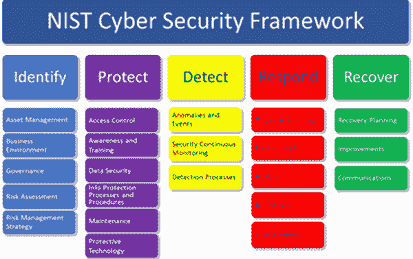 |

| --- |

| *Source: National Institute of Standards and Technology (2018, p. 288)* |

Cybersecurity Workforce Framework

This framework contends that organisations have expressed worry that their asset owners and operators lack general cybersecurity awareness, which could be attributed to a lack of education and training.

| Figure 2. NICE framework building blocks approach |

| --- |

| 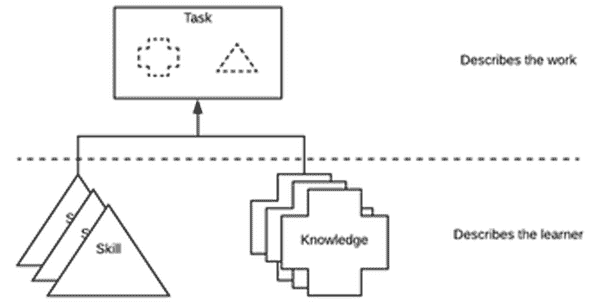 |

| --- |

| *Source: NIST (2020, p. 178)* |

Cybersecurity Workforce Framework

This framework contends that organisations have expressed worry that their asset owners and operators lack general cybersecurity awareness, which could be attributed to a lack of education and training.

Cybersecurity Workforce Framework

This framework contends that organisations have expressed worry that their asset owners and operators lack general cybersecurity awareness, which could be attributed to a lack of education and training.

Initial Framework

The initial conceptual framework was arrived at after a thorough review of literature in light of the research problem and research objectives and was conceptualized using two already existing frameworks which are the NIST Cybersecurity framework which emphasises five core cybersecurity functions which are to identify, protect, detect, recover and respond; and the NICE Framework which identifies the job tasks, knowledge, skills, and abilities that individuals must demonstrate to successfully perform the five core cybersecurity functions of the NIST framework effectively as illustrated.

| Figure 3. Initial conceptual framework |

| --- |

| 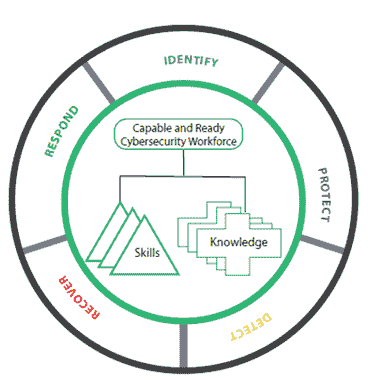 |

| --- |

| *Source: Author compilation* |

From the two candidate conceptual frameworks Job tasks, knowledge, skills, and abilities that individuals must demonstrate to perform effectively were presented in seven categories namely:

*   1\. Secure Provision: Specialty areas responsible for conceptualizing, designing, and building secure IT systems are also responsible for systems development. These skills are specifically for IT staff members and students working towards such professions as these skills are necessary for programmers/developers, network engineers and system engineers/administrators.

*   2\. Operate and Maintain: Specialty areas responsible for providing support, administration, and maintenance necessary to ensure effective and efficient IT system performance and security. These specialities are necessary for giving user support, awareness and education as they constantly interact with users with critical information assets

*   3\. Protect and Defend: Specialty areas responsible for the identification, analysis, and mitigation of threats internal to critical information assets like the network and IT systems. These skills are necessary for both staff and students as it is their mandate to safeguard their cyberspace. Both students and staff must have the knowledge and skills of detecting social engineering attacks which are the most common problem in universities hence they have to be educated about the Social Engineering detection Model (SEADM) to improve their human analytical abilities in detecting social engineering attacks to improve their ability to protect and defend their university cyberspaces. 

    *   o Investigate: Specialty areas responsible for the investigation of cyber events and/or crimes of IT systems, networks, and digital evidence. These skills are crucial in recovery and responding to cyber-attacks. These are the skills necessary for emergency response teams and crisis management in the event of a cyber-attack.

*   4\. Collect and Operate: Specialty areas responsible for specialised denial and deception operations and collection of cybersecurity information that may be used to develop intelligence. These skills are very crucial in updating already existing cybersecurity educational material to improve knowledge and skills relating to trending cyber threats and help in the identification and detection of new threats and also prepare crisis management teams with close to reality simulations of cyber-attacks.

*   5\. Analyze: Specialty areas responsible for highly specialized review and evaluation of incoming cybersecurity information to determine its usefulness for intelligence.

*   6\. Oversight and Development: Specialty areas providing leadership, management, direction, and/ or development and advocacy so that individuals and organisations may effectively conduct cybersecurity work. Management has to invest in cybersecurity knowledge and skills development which should be supported by organisational policies and be part of the organisation’s strategy.

With these cybersecurity skills and knowledge, it is then possible for the human assets to perform the following functions:

Identify: This core function's efforts are aimed at increasing organisational understanding and awareness of cybersecurity risk to organisational systems, assets, data, and capabilities. Understanding business contexts, critical function resources, and related cybersecurity risks allow an organisation to focus and prioritize actions following its risk management strategy and business objectives. This function aligns with the first objective of the study which is to identify the major human factored cybersecurity challenges faced by universities.

Protect: The basic responsibility of designing and executing suitable protections to ensure that critical information assets are functioning. The Protect feature aids in limiting or containing the consequences of a potential cybersecurity event or incident. This function aligns with the second objective which is to outline the key factors to consider to eliminate human factored cyber-attacks.

Detect: The third core function focuses on establishing and implementing the required and necessary organizational processes to detect and recognize the occurrence of a cybersecurity event or incident in a timely and proactive manner. The third object is to assess the contribution of poor cybersecurity knowledge and skills gaps to social engineering attacks in universities.

Respond: The Respond function addresses the identification of the activities to take action regarding a detected cybersecurity event or incident. It is a post-event function, focusing on reactive activities, and supporting the ability of impact containment.


恢复：恢复是事件或事件发生后的反应功能。它主要致力于制定并实践适当的活动集，以维护韧性计划，并恢复因网络安全事件或事件导致的功能或服务受损。通过及时恢复到正常运行状态，从而降低事件的整体影响。响应功能和恢复功能共同解决第四项目标，即通过提高学生和员工的网络安全知识与技能，阐明减少社会工程攻击所需的措施。

从研究结果来看，大学生和员工的网络安全知识与技能对于降低人为因素漏洞至关重要，这些漏洞可能被网络罪犯利用发起社会工程攻击，损害大学的网络空间。研究结果还显示，尽管学生和员工声称对网络安全有所了解，但他们对网络安全教育材料和信息的获取有限，这限制了他们的知识与技能，使他们只能在组织政策的约束下行为，这些政策旨在保护他们及其他信息资产。对常见的社会工程攻击（如网络钓鱼、网站钓鱼和恶意软件）缺乏足够的知识与技能，会暴露大学整体的网络空间。因此，概念框架是指导大学如何通过提高意识、培训和政策，培养具备专业能力、清晰角色与责任感的工作队伍，以保护其组织网络空间的参考依据。

## MAIN RESEARCH OBJECTIVE
确定大学为保护其人类资产免受人为因素网络攻击所需的网络安全框架。

## Research Objectives
1. 识别大学面临的主要人为因素网络安全挑战。
2. 阐明消除人为因素网络攻击的关键考量因素。
3. 评估网络安全知识与技能缺口对大学社会工程攻击的贡献。
4. 阐明通过提升学生和员工的网络安全知识与技能，减少社会工程攻击所需的措施。

## METHODOLOGY AND METHODS
本研究采用实用主义研究哲学。根据 Mitchell (2018)，实用主义的哲学立场使研究者能够通过考虑社会行动者的角色，并制定实用的研究方法来观察研究。对于实用主义者而言，现实只要有助于我们与其他经验部分建立满意关系，即为真实(Wahyuni, 2012)。真实就是那些被证明有用，或经得起个别用户长期检验的东西(Baker & Schaltegger, 2015)。本研究采用混合方法作为方法论，结合定性和定量两种方法。这种方法论能够提供多种类型的数据。

Kaushik and Walsh (2019) 指出，两种方法的结合能够提供对研究的整体性分析。他们还指出，尽管两种方法在实现方式上有所不同，但相互补充很好。本研究以非洲大学（Africa University）为案例，进行了案例研究。案例研究是一种实证的深入调查或对社会单元的全面研究，研究对象可为个人、群体或社会机构(Strang & James, 2007)。

样本从 2021 年 1 月至 7 月学期的 2,875 名活跃且注册学生以及非洲大学登记部的 329 名活跃员工中抽取。研究者使用问卷调查，因为它是成本效益高的数据获取方式，且样本规模庞大（共 320 名参与者）。另一原因是问卷调查能够最大程度减少参与者的影响，因为受访者可以在研究者不在场时自行完成问卷，从而规避诸如凝聚力和偏见等伦理问题。

研究者使用半结构化访谈，以便确定受访者的知识，从而提供定性数据以丰富评估结果。半结构化访谈邀请了关键信息提供者，如信息与通信技术（ICT）部门主管、系统管理员、计算机科学系主任、注册处长以及学生代表委员会（SRC）成员。半结构化访谈允许使用开放式和封闭式问题，以了解对网络安全的共同认知以及所需的知识与技能。专家评审技术被用于验证初始概念框架（Figure 4）。

## PARAMETERS FOR FRAMEWORK VALIDATION
专家评审技术被 Beecham, Hall, Britton, Cottee, & Rainer (2005) 用于在创建模型时获取独立反馈，以评估模型是否达成研究目标。本研究将使用专家评审技术，验证所开发框架对高校及其他高等教育机构乃至不同行业组织的适用性和相关性。图 4 展示了 Hevner, March, Park, & Ram (2004) 为理解、执行和评估信息系统研究而开发的框架。

| Figure 4. Information systems research framework |
| --- |
| 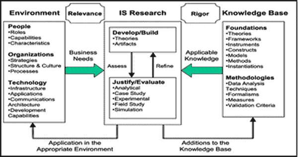 |
| *Source: Hevner et al. (2004, p. 88)* |

研究环境定义了问题空间，本研究以大学为问题空间，关注的现象是网络安全。此研究的环境包括人、业务组织以及现有或计划中的技术。研究重点在于人或人类资产，以及因网络安全知识与技能不足导致的人为因素漏洞与大学面临的常见网络安全挑战之间的关联。

因此，确实存在问题与机遇，它们定义了组织（在此为大学）所感知的业务需求。大学需要一个以人为核心而非技术的网络安全框架，以改变由组织内部人员角色、能力和特征所塑造的认知。人类认知能力是产生有效解决方案（即网络安全知识与技能）的关键所在(Hevner et al., 2004)。


-   [费曼学习法](https://wiki.example.org/feynmans_learning_method)的灵感源于诺贝尔物理奖获得者**Richard Feynman**。

1.  运用费曼技巧，你只需花上`20 min`就能深入理解知识点，而且记忆深刻，*难以遗忘*。

```
if (condVar > someVal) {console.log("xxx")}
```


-   表 3 的表格中，我们观察到 图 1 和 图 2 标志着研究参与者一致承认在保护非洲大学的网络空间方面发挥作用，并且承认他们在使用共享计算机时的行为、浏览行为和密码使用可能会使非洲大学面临网络攻击，尽管他们声称自己具备保护信息资产和非洲大学网络空间所需的知识和技能。标准差的高值（超过 0.5）表明有部分受访者保持中立或未必同意他们在保护大学网络空间方面所承担的角色和责任。

这表明，对大学资产和网络空间的保护缺乏明确的角色和责任会导致网络安全意识不足，增加使用关键信息系统的人员缺乏网络安全认知的风险，从而导致人为因素漏洞，使关键信息资产面临网络攻击。

表 4. 网络安全认知与安装防病毒软件、防火墙或反间谍软件的情况

| 你如何评价自己对网络安全的理解？你是否在电脑上安装了防病毒软件、防火墙或反间谍软件？ |
| --- |
| 交叉统计计数 |
| || 有防病毒软件、防火墙或反间谍软件安装？ ||  |
| 是 || 否 || 总计 |
| 你如何评价自己对网络安全的理解 || 优秀 || 4 || 6 || 10 |
| 以上平均 || 13 || 17 || 30 |
| 平均 || 238 || 2 || 240 |
| 以下平均 || 8 || 2 || 10 |
| 总计 ||  || 263 || 27 || 290 |
| 卡方检验 |
| || 值 || df || 双侧显著性 (Asymp.Sig.) |
| 珀森卡方 | 1.319E2^a | 3 | .000 |
| .000 |
| .000 |
| 可能性比率 | 91.947 | 3 |
| 线性-线性关联 | 85.848 | 1 |
| 有效案例数 | 290 || |

与文献综述中所找到的信息一致，表 4 的结果显示，研究参与者一致认为自己对网络安全的理解处于中等水平（87%），并且通过在电脑上安装防病毒软件、防火墙或反间谍软件来保护信息资产的技术认知度为 91%。这表明他们认识到保护设备免受恶意软件侵害的重要性。这种认知支持了文献中已有的研究结果，即大多数大学生和员工对网络安全概念有一定程度的理解，但他们错误地认为安装防病毒软件就足以保护信息资产免受网络攻击。

珀森卡方值为 0.0 表明，对网络安全认知与通过安装防病毒软件、防火墙或反间谍软件等形式的保护措施之间存在非常强的关联。然而，这种技术解决方案仅在防病毒软件始终更新且用户在打开设备上之前扫描共享或下载文件以检测恶意软件时，才能有效防范已知病毒、特洛伊木马、蠕虫、广告软件、间谍软件和勒索软件。

表 5. 导致大学信息资产面临网络攻击的行为分析

| 统计数据 |
| --- |
| || 更新个人电脑防病毒软件 || 从不明来源打开电子邮件 || 下载互联网上的免费软件 || 在使用个人电脑前扫描可移动存储设备 || 更改密码 || 点击电子邮件中的超链接 || 启用“记住密码”选项 || 与朋友共享用户名和密码以获取帮助 |
| 有效案例数 || 290 || 290 || 290 || 290 || 290 || 290 || 290 || 290 |
| 缺失值 || 0 || 0 || 0 || 0 || 0 || 0 || 0 || 0 |
| 众数 || 2 || 4 || 2 || 2 || 3 || 1 || 1 || 3 |

对参与者行为的分析显示，他们一致认为参与者经常从事会导致大学网络空间面临网络攻击的高风险行为。根据众数值反映的频率，受访者确认他们不经常更新防病毒软件、下载免费软件，并且在使用个人电脑前未扫描可移动存储设备。此外，他们也承认经常打开来自不明来源的电子邮件并与同事共享凭据。点击电子邮件中的超链接和启用“记住密码”选项的众数较低，说明只有少数参与者经常进行这些活动。

根据文献，参与者的行为反映了他们下载感染文件的行为，这些文件以免费软件或破解软件的形式出现。点击电子邮件中的超链接使用户容易受到社会工程攻击，如钓鱼和网站劫持。此外，一些受访者承认经常共享凭据并通过“记住密码”选项保存凭据，这是网络罪犯用来窃取凭据并实施 CEO 诈骗（Maranga & Nelson, 2019）的漏洞。

分析大学因人为因素漏洞而面临的挑战

| 图 5. 在线时间 |
| --- |
| 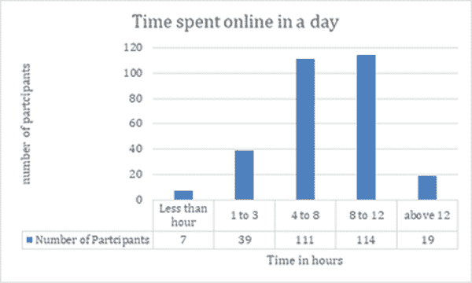 |

根据参与者在线时间的分析（图 5），77% 的受访者表示他们在线时间在 4 至 12 小时之间。这些数据表明，学生和员工是多方面使用互联网的重度用户，这也提高了他们对社交工程师的威胁风险，后者不断寻找方式通过设计用于欺骗和误导收件人的恶意软件、间谍软件或广告软件，诱导其点击恶意链接或打开带有病毒的附件（Bullée & Junger, 2020; Zwilling et al., 2020），这与此前已确认的参与者确实易受影响且极有可能成为这些欺骗的目标。

表 6. 大学为保护其人类资产而实施的不频繁但重要的安全措施分析

| 统计数据 |
| --- |
| || 你认为使用 2 步验证或 2 步验证的网站和在线服务有多重要 || 你认为使用由小写字母、大写字母、数字和特殊字符组成的密码有多重要 || 你认为为不同应用程序使用不同密码有多重要 || 你认为阻止免费软件网站和种子站点有多重要 || 你认为自带设备有多重要 || 你认为将来自不明来源的电子邮件标记为垃圾邮件有多重要 || 你认为使用 VPN 访问受限站点有多重要 |
| 有效案例数 || 290 || 290 || 290 || 290 || 290 || 290 || 290 |
| 缺失值 || 0 || 0 || 0 || 0 || 0 || 0 || 0 |
| 众数 || 5 || 5 || 2 || 5 || 1 || 5 || 1 |


-   研究人员分析了参与者对大学为保护其人力资源免受社会工程攻击而实施的若干常见措施的行为，这些措施包括实施强密码策略、阻止免费软件网站、鼓励学生和员工启用两步验证以及为不同应用程序使用不同密码。然而，从[Table 6 中数据的分析显示，大多数参与者认为大学提出的这些措施是不必要的或重要性不大，这由高模式值 5 显示，表明大多数参与者认为这些措施是不必要的。

## 评估贫乏网络安全知识和技能差距对大学社会工程攻击的贡献

Table 7 显示，68%的受访者未接受过网络安全教育材料。这表明网络安全教育和意识存在不足。虽然大多数受访者（91%）经常怀疑当电脑运行极慢时是否有问题，但 60%的受访者不知道在怀疑发生网络事件时应去哪里报告。

## 分析通过提高学生和员工网络安全知识和技能来减少社会工程攻击的必要措施

Table 8 可以推断出，大多数受访者不了解浏览器安全，而在处理社会工程攻击时，这非常关键。从之前的结果可以看出，存在浏览器安全、密码管理、恶意软件使用、事件报告系统以及明确网络安全角色和责任方面的知识差距，这主要是由于教育和意识不足，从而影响了员工和学生在发生网络攻击时及时、适当地检测、响应和恢复的能力。

## 表 9. 关于改进网络安全知识和技能发展措施的感知

Table 9 显示，在分析参与者关于大学如何改进其网络安全知识和技能的回应后，我们发现平均值在 1 到 2 之间，表明大多数参与者强烈同意本节提出的措施。他们同意，培训和意识提升可以增强他们识别、保护、检测、响应和从网络攻击中恢复的能力。他们还同意，通过培训网络安全概念和意识，可以减少因网络安全知识和技能不足而导致的人为漏洞。

参与者还强烈相信，在正确的教育下，他们可以获得必要的网络安全知识和技能，从而构建一个能够保护其大学网络空间的高效工作队伍。值得注意的是，参与者也强烈同意年龄在学习新网络安全概念的能力中起作用，因此有必要在参与者开始与网络空间互动时尽早进行意识提升和教育，使他们从小就培养这些技能，并理解其行为在保护其他关键资产中的重要作用。

Table 10 显示了参与者关于大学可以采取哪些措施来改进网络安全知识和技能发展的回应。通过观察平均值在 1 到 2 之间，我们可以得出结论，大多数受访者强烈同意在招聘阶段评估网络安全知识和技能、在所有学生必须修读的强制性入门计算机课程中纳入网络安全内容，以及他们获得的网络安全知识和技能将有助于减少人为漏洞，从而降低他们无意中暴露关键信息系统或不知情参与网络犯罪的可能性。

RESULTS FROM THE INTERVIEW


The interviews also yielded responses that supported the results yielded from the questionnaire. All four interviews agreed that human is an asset that requires protection from cyber threats. The interview informants also agreed that human factored vulnerabilities do expose organisational information systems to cyber threats and a greater extend, sharing or leaking of passwords, and clicking on harmful links or suspicious emails. The systems administrator admitted to having mechanisms currently in place to protect human assets from cyber threats such as limited user account and network access (firewall and VLANs) privileges; restricted workstation privileges where users cannot install or modify programs or applications; the university has antivirus security software; makes use of strong passwords and two-factor authentication and spotting of reported spam and phishing scams.

These mechanisms are integrated with policies to protect human assets from cyber-attacks through enforcing password policy, network usage and access policy, internet use policy, physical security of office equipment, and email use policy that prohibits the use of personal email accounts for business matters. Additional measures like prohibiting opening email attachments from unknown sources (as they may contain malicious software), prohibiting accessing email accounts of other individuals, prohibiting sharing email account passwords and prohibiting excessive personal use of the organization’s email are measures that have been put in place to try and protect users from exposure to cyber-attacks.

When interviewed about their perspective regarding the extent of cybersecurity knowledge and skills needed to protect students and staff from cyber threats, The ICT Director confirmed that indeed, users know of the imminent threat of cyber-attacks; however, there is a need for students and staff to be constantly educated and reminded of the old and current threat trends. The Registrar suggested that current organisational strategies to protect human assets from cyber threats can be communicated to students and staff in a better and much improved manner like the opening of broadcasting channels for circulating cybersecurity awareness materials, opening a cybersecurity hotline for reporting suspected cyber incidents and developing cybersecurity workshops, presentations and course material that are endorsed by management and taken by both students and staff to improve their cybersecurity knowledge and skills.

Currently, the university has tailored its cybersecurity knowledge and skills to protect human assets from internal cyber threats by configuring firewall and domain policies in advance to stop cyber threats, on the spot investigation when a user raises concern and email use policy that acts as guidance on the proper use of the email platform. When asked about any added information that the interviewees could offer about measures that can be used to protect human assets from cyber threats, the suggestions that stood out were:

*   1\. There should be cybersecurity processes that maintain the integrity of information and protection of all assets including human assets. These processes should include establishing and maintaining cybersecurity roles and responsibilities, polices, standards, and procedures.

*   2\. Proper IT governance procedures are crucial in implementing a formal risk assessment process and developing policies that critical information assets are not misused and that cybersecurity policies are continually reviewed and updated to reflect the most current risks thus developing incident response policies and procedures to properly respond to, account for and help mitigate the cost of a successful cyber-attack or breach.

*   3\. Establish a resilient recovery plan to mitigate the risk of key people being unavailable in the event of a system failure resulting in a breach. Documenting the configuration of hardware and software applications and keeping these up to date so that the crisis management and recovery team can quickly rebuild the affected systems.

FEEDBACK FROM EXPERT REVIEW

The initial framework was reviewed by an expert with extensive knowledge of cybersecurity, education and policy formulation. Their feedback revealed that the proposed human-centric cybersecurity framework is indeed sufficient to create a capable cybersecurity workforce with minimized human-factored vulnerabilities that expose universities to cyber threats. They also agreed that training cybersecurity professionals and introduction of new curricula with cybersecurity content to enhance study programs, and courses to improve cybersecurity knowledge and skills are relevant to the cybersecurity domain. However, they expressed that the training in cybersecurity knowledge and skills would not cover all human factored vulnerabilities as an element of human behaviour and attitudes will always play a role in how well they apply the cybersecurity knowledge and skills taught in pieces of training. The expert also agreed that the proposed framework is useful for cybersecurity knowledge and skills development and framework is practical for use in the industry however they argued that additional components and levels are required for the framework to be understandable saying:

The framework covers all technical aspects and issues relating to the sociology of technology however I feel context or environmental factors are well represented for the framework to be universally applicable across different environments or contexts. I would add another outer ring with Institutional policy, National cybersecurity regulation framework, and Industry practice. These components are equally important and complementary. This framework should inform policymakers and industry practice. These are major weaknesses in this environment that stand in the relevance and application of your good framework.

The expert also went on to add that the proposed framework could be made more practical if it is supported by a relevant act of law, specific institutional policies, and active industry cybersecurity associations to share and promote best practices.

JUSTIFICATION FOR MODIFYING THE FRAMEWORK

The expert raised critical issues pertaining to the environmental factors which the researcher had overlooked whilst designing the conceptual framework. To improve its practicality and usefulness, the expert added some components to the proposed framework.

FRAMEWORK REDESIGN: CYBERSECURITY WORKFORCE FRAMEWORK FOR UNIVERSITIES

After factoring the considerations from the expert review, the proposed framework can indeed be enhanced if it exists in an environment that supports the development of a capable and ready cybersecurity workforce which are: a national cybersecurity regulatory framework with a relevant act of law specifically for cybersecurity issues, institutional cybersecurity policies, and active industry cybersecurity associations to share and promote best practices and industry practice that promotes and values the development of cybersecurity knowledge and skills.

| Figure 6. Cybersecurity workforce framework for universities | |
| --- | --- |
| 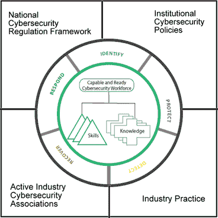 | |

The redesigned framework has the following four additional elements that will make it understandable and improve its usefulness and practicality.

National Cybersecurity Regulation Framework


-   [国家监管机构](https://example.org)通过推广协调战术和规划、以及创建具备必要的网络安全知识、技能和基础设施的网络安全人才队伍，有效打击网络犯罪。该机构必须能够成功协调机构资源，以实现共同的网络安全安全与安全目标（包括规划、响应协调、监测和评估）。在津巴布韦的案例中，POTRAZ 是被赋予此任务的监管机构，但在《网络法案》草案中，其执行和协调该任务的情况，特别是针对教育机构，尤其是大学。同时，也可以在学生开始接触计算机时，即小学和高中阶段就开始传授网络安全知识。

**机构政策**

网络安全角色和责任应在机构政策中清晰阐述，并在标准操作程序和职位描述中体现到个人层面。网络安全危机管理、应急响应计划和恢复计划应当向所有利益相关者进行适当沟通，且用户也应被教育强调遵循这些政策的重要性，而非仅将其视为静态文档。

**活跃的工业网络安全协会**

这类协会为不同行业的网络安全专业人员和高级 IT 安全领导者提供教育与交流平台，促进同行学习和知识共享，形式包括工作坊、演讲和讲座，主题涵盖新兴的网络安全挑战以及更新所需的知识和技能，以便高校在制定网络安全课程内容和项目时予以考虑，确保培养出具备有效网络安全知识和技能的专业人才。

**工业实践**

行业应在招聘阶段将评估网络安全知识和技能作为标准做法。虽然大学可以设立培训、最佳实践政策和标准操作程序，但必须确保招聘的员工具备 adequate 网络安全知识和技能，并具备守护机构资产的责任感和角色认知。

**讨论结果**

可以总结为：大学学生和员工对网络安全有认同，能够在一定程度上维护 cyberspace。但由于缺乏网络安全教育材料的接触，导致其网络安全技能和知识有限。此结果与 Matyokurehwa 等人 (2021) 的研究发现相似，该研究指出津巴布韦大学的网络安全意识（CSA）较低，需要决策者制定高等教育领域的相关政策。

大学负责培养具备必要技能和能力的专业人才；然而，研究结果显示，网络安全技能和知识与所需的专业人才工作力量之间存在差距，这与 Miller and Molina-Ray (2014) 的观察一致——随着对合格网络安全专业人才的需求增长，行业领袖 increasingly 主张统一网络安全工作范围的定义以及必须具备的竞争性技能。制定一套与行业相匹配的专业技能可助力教育、招聘、培养和留住高质量员工。

研究结果表明，学生和员工的网络安全行为与大学面临的常见网络安全挑战相关，这些挑战主要源于人为因素的脆弱性，具体包括：对网络威胁（尤其是社交工程攻击）缺乏熟悉（社交工程攻击是大学中最常见的），缺乏网络安全教育材料的接触，网络安全自信心不足，缺乏应对已发现的网络攻击的行动指引，计算机和互联网技能薄弱，以及缺乏使用计算机的 prior 经验。这些发现与 Fatokun Faith 等人 (2020) 的研究相吻合，后者强调需要在高等教育机构加强网络安全培训和实践。

通过分析这些因素与学生、员工的网络安全行为之间的关系，凸显出大学内部存在的网络安全知识与技能缺口。对新生和员工进行强制性入门计算机课程内容的定期更新，加入网络安全材料，将有效培育大学内部的网络安全文化，并通过后续培训和工作坊确保学生和员工始终了解新兴威胁并具备应对它们的有效技能。此举需要由国家网络安全教育机构牵头，倡导从小学阶段开始的网络安全教育。

当前，建立网络安全文化并发展相关知识与技能尤为重要，因为包括大学在内的大多数企业已将大部分流程搬到线上，以支持因新冠疫情而实现远程学习和工作。这意味着大学在放宽安全措施以保证学术开放与自由的同时，却让缺乏必要知识和技能的学生和员工暴露在更广阔的 cyberspace 中。

研究的另一有趣发现是：大学本身是知识的载体，但研究结果表明学生和员工并未接触网络安全教育材料。此结果支持其他研究的结论——决策者和管理层应当支持并制定大学网络安全教育政策，并参与网络安全能力建设，而非将其仅视为 IT 部门的职能 (Matyokurehwa et al., 2021)。

**结果或发现总结**

根据访谈得出的主要主题，探讨了学生和员工对网络安全事宜的行为、对网络安全的理解以及当前用于保护自身及其他信息资产免受网络威胁的机制。研究发现，尽管大学已实施诸如限制用户账号和网络访问权限（防火墙和 VLANs）、限制工作站特权（禁止安装或修改程序）、提供大学防病毒软件、强制使用强密码和双因素认证、以及识别报告的垃圾邮件和钓鱼诈骗等措施，但大多数学生和员工并不认知这些措施的重要性，主要原因是缺乏相应的认知和教育。


其他研究结果也表明，这些网络安全机制通过执行密码策略、网络使用和访问策略、互联网使用策略、办公设备的物理安全、电子邮件使用策略等，与相关政策相结合，以保护人类资产免受网络攻击。然而，这些措施的有效性仍然取决于员工和学生在网络空间中的行为。研究结果还显示，还有待提升的空间，尤其是大学可以通过更新强制性计算机入门课程内容来提高意识，因为调查结果显示，大学课程调整速度不够快，无法确保为行业网络安全职位培养足够的合格人才。

CONCLUSION

研究得出以下结论：

大学学生和员工承认他们对保护大学的网络空间感兴趣。尽管大学在保护人类资产方面采取了措施和努力，但仍存在局限性，包括对网络安全教育材料的曝光不足，这影响了对网络安全问题的理解和认知，并导致网络安全行为不佳，使大学资产面临网络攻击的风险。

通过探讨并识别影响大学的关键网络安全挑战以及导致这些挑战的因素，研究人员更深入地了解了在实施建议的以人为本网络安全框架之前的当前状况，从而促进学生和员工的网络安全知识和技能发展，提升其分析能力，使其能够识别、保护、检测、应对和恢复网络攻击，整体提高教育质量和行业专业人才的水平。

本研究的主要参与者指出以下阻碍网络安全知识和技能发展的障碍：缺乏足够且相关的网络安全教育材料、对已有措施和政策的理解不足、对常见网络威胁（如社会工程攻击）缺乏了解、以及计算机入门课程的教材无效。

研究结果与其他研究的发现相吻合，表明网络罪犯针对的是人而不是计算机，且人是网络安全解决方案中的弱点，因此保护人类资产至关重要。然而，人类资产只有在拥有正确的网络安全知识、技能、工具和资源时，才能意识到自身的角色和责任，从而保护其网络空间。研究还发现，人们普遍存在一种误解，认为在电脑上安装防病毒软件就能解决所有网络安全挑战，并且个人不是网络犯罪的目标；实际上，他们的行为正是社会工程师在进行网络攻击时所针对和利用的。

尽管本研究的结果无法推广到更大的大学，但它们与津巴布韦及世界其他地区的研究结果一致，表明有必要发展和提升网络安全知识和技能，以培养能够应对各行业日益严峻的网络安全挑战的网络安全人才。

实施该人本框架是朝着保护高等教育部门日益严重的网络攻击这一紧迫问题的正确方向迈出的一步。在大学中发展网络安全知识和技能作为预防措施，也将有助于保护国家网络空间并提升整体网络安全准备度，因为该框架的结果是培养具备网络安全能力的工作队伍。通过开发网络安全知识和技能，解决人为脆弱性问题，大学可以为该领域的关键问题——人为因素作为网络安全解决方案的弱点——提供贡献。技术解决方案的有效性取决于人为因素的参与，而人为因素之所以不脆弱，是因为缺乏知识。

总体而言，网络安全知识体系应由大学驱动，它们需要向网络安全教育计划传达当前的网络安全问题，并通过研究实践所发现的成果来指导教育，同时向行业输送经验丰富的网络安全专业人才。

RECOMMENDATIONS FOR FUTURE PRACTICE

网络安全是一个快速发展的领域，急需能够应对各行业复杂网络安全挑战的合格专业人员，这些专业人员在现有及新兴技术和数字环境中发挥重要作用。对网络安全专业人才的需求意味着不同行业均有高收入的工作机会，这为大学提供了填补教育与就业缺口的契机。大学有机会定制网络安全课程，使其与行业需求相匹配。

网络攻击和成功 breaches 在声誉和财务上代价高昂。人类资产往往是组织安全的薄弱环节，因此组织需要投资于网络安全政策的制定。网络安全政策规定了所有操作的参与规则，因此必须在政策中明确个人保护关键信息资产的职责。这些政策还需受到与政府、大学和行业相互作用的国家监管框架的指导，为新兴技术及其技术知识和技能提供指导。

RECOMMENDATIONS FOR FUTURE RESEARCH

人类发展涉及广泛的变化和模式，个人在能力发展上的差异显著，这与社会实践的多样性有关。未来研究可以深入探讨班杜拉（1989）的社会认知理论，以研究学生和员工在网络安全知识和技能发展中的独特能力和人类分析能力。知识和思维技能为认知问题解决提供了实质和工具。进一步研究可以考察认知功能，即知识与认知技能的运作过程。认知成就需要学习相关领域的知识以及适用的判断标准。

REFERENCES

Addae, J., Radenkovic, X. S., & Towey, D. (2016). An Extended Perspective on Cybersecurity Education. 2016 IEEE International Conference on Teaching, Assessment, and Learning for Engineering (TALE), 367-369. doi:`[10.1109/TALE.2016.7851822](https://doi.org/10.1109/TALE.2016.7851822)`

Airehrour, D., Nair, N. V., & Madanian, S. (2018). Social engineering attacks and countermeasures in the New Zealand Banking System: Advancing a user-reflective mitigation model. Information (Basel), 9(5), 110. Advance online publication. doi:`[10.3390/info9050110](https://doi.org/10.3390/info9050110)`

Alharbi, T., & Tassaddiq, A. (2021). Assessment of cybersecurity awareness among students of Majmaah University. Big Data and Cognitive Computing, 5(2), 23. Advance online publication. doi:`[10.3390/bdcc5020023](https://doi.org/10.3390/bdcc5020023)`

Alshenqeeti, H. (2014). Interviewing as a Data Collection Method: A Critical Review. English Linguistics Research, 3(1). Advance online publication. doi:`[10.5430/elr.v3n1p39](https://doi.org/10.5430/elr.v3n1p39)`


Ani, U. D., He, H., & Tiwari, A. (2019). 人因安全：评估工业劳动力的网络安全能力。Journal of Systems and Information Technology, 21(1), 2–35. doi:`[10.1108/JSIT-02-2018-0028](https://doi.org/10.1108/JSIT-02-2018-0028)`

APWG. (2017). APWG：统一全球网络犯罪应对措施。Retrieved on September 22, 2022, from: [`http://www.antiphishing.org/`](http://www.antiphishing.org/)

Armerdeing, T. (2014). 网络安全培训不足：以下是如何做得更好的建议。Retrieved on August 2, 2022, from: [`https://www.csoonline.com/article/2362793/security-leadership/security-training-islacking-here-are-tips-on-how-to-do-it-better.html`](https://www.csoonline.com/article/2362793/security-leadership/security-training-islacking-here-are-tips-on-how-to-do-it-better.html)

Bada, M., Sasse, A. M., & Nurse, J. R. C. (2019, January 9). 网络安全意识活动：为何未能改变行为？arXiv。

Baker, M., & Schaltegger, S. (2015). 实用主义及社会与环境问责研究的新方向。Accounting, Auditing & Accountability Journal, 28(2), 263–294. doi:`[10.1108/AAAJ-08-2012-01079](https://doi.org/10.1108/AAAJ-08-2012-01079)`

Beecham, S., Hall, T., Britton, C., Cottee, M., & Rainer, A. (2005). 利用专家小组验证需求过程改进模型。Journal of Systems and Software, 76(3), 251–275. doi:`[10.1016/j.jss.2004.06.004](https://doi.org/10.1016/j.jss.2004.06.004)`

BezuidenhoutM.MoutonF.VenterH. S. (2010). 社会工程攻击检测模型：SEADM。2010 年南非信息安全会议论文集 (ISSA 2010)。doi:`[10.1109/ISSA.2010.5588500](https://doi.org/10.1109/ISSA.2010.5588500)`

Bullée, J., & Junger, M. (2020). 《帕尔格雷夫国际网络犯罪与网络偏差手册》。The Palgrave Handbook of International Cybercrime and Cyberdeviance. doi:`[10.1007/978-3-319-90307-1](https://doi.org/10.1007/978-3-319-90307-1)`

Channon, M. (2019). 网络安全与数据保护。The Law and Autonomous Vehicles, 47–63. doi:`[10.4324/9781315268187-5](https://doi.org/10.4324/9781315268187-5)`

Coffey, J. W., Haveard, M., & Golding, G. (2018). 人本中心高等教育网络安全计划的案例研究。Journal of Cybersecurity Education, Research and Practice, 2018(1), 4。

Cojocariu, A.-C., Verzea, I., & Chaib, R. (2020). 高等教育机构中的网络安全方面。Aspects of Cyber-Security in Higher Education Institutions, (August), 3–11. doi:`[10.1007/978-3-030-44711-3\_1](https://doi.org/10.1007/978-3-030-44711-3_1)`

Craigen, D., Diakun-Thibault, N., & Purse, R. (2014). 网络安全的定义。Technology Innovation Management Review, 4(10), 13–21. doi:`[10.22215/timreview/835](https://doi.org/10.22215/timreview/835)`

Creswell, J. (2013). 步骤：进行学术性混合方法研究。Steps in Conducting a Scholarly Mixed Methods Study Abstract for DBER Group Discussion on 2013 ‐ 11 ‐ 14. Steps in Conducting a Scholarly Mixed Methods Study, 1–54. Retrieved from [`https://digitalcommons.unl.edu/cgi/viewcontent.cgi?article=1047&context=dberspeakers`](https://digitalcommons.unl.edu/cgi/viewcontent.cgi?article=1047&context=dberspeakers)

Crowe, . (2011). 案例研究方法。Business Communication Quarterly, 1。

Dell. (2017). 从破坏性网络攻击中恢复。Dell EMC。Retrieved on November 2, 2021, from: [`https://www.emc.com/collateral/whitepaper/recovering-business-destructive-cyber-attack.pdf?isKoreaPage=false&domainUrlForCanonical=https%3A%2F%2Fwww.emc.com`](https://www.emc.com/collateral/whitepaper/recovering-business-destructive-cyber-attack.pdf?isKoreaPage=false&domainUrlForCanonical=https%3A%2F%2Fwww.emc.com)

Deloitte. (2016). 就绪、响应和恢复。Retrieved on May 9, 2021, from: [`https://www2.deloitte.com/content/dam/Deloitte/global/Documents/Risk/gx-cm-cyber-pov.pdf`](https://www2.deloitte.com/content/dam/Deloitte/global/Documents/Risk/gx-cm-cyber-pov.pdf)

Dhillon, G. (2015). 网络安全事件发生前后该做什么？网络安全治理的变革。1–16。

Fàbregues, S., & Molina-Azorín, J. F. (2017). 混合方法研究质量的应对：回顾与未来议程建议。Quality & Quantity, 51(6), 2847–2863. doi:`[10.1007/s11135-016-0449-4](https://doi.org/10.1007/s11135-016-0449-4)`

Fatokun FaithB.HamidS.NormanA.Fatokun JohnsonO.EkeC. I. (2020). 了解大学生网络安全行为的影响因素。2020 年数学、计算机工程与计算机科学国际会议 (ICMCECS 2020)。doi:`[10.1109/ICMCECS47690.2020.246990](https://doi.org/10.1109/ICMCECS47690.2020.246990)`

FERPA. (1974). 家庭教育权利与隐私法案 (FERPA)。Available on [`https://ed.gov/policy/gen/guid/fpco/ferpa/index.html`](https://ed.gov/policy/gen/guid/fpco/ferpa/index.html)

FIPS. (2015). 美国国家标准与技术局信息处理标准文献。Available on: [`https://csrc.nist.gov/publications/PubsFIPS.html`](https://csrc.nist.gov/publications/PubsFIPS.html)

Fleming, J., & Zegwaard, K. E. (2018). 工作整合学习研究的方法论、方法和伦理考虑。International Journal of Work-Integrated Learning, 19(3), 205–213。

Furman, S., Theofanos, M. F., Choong, Y. Y., & Stanton, B. (2011). 以用户感知为基础的网络安全培训。IEEE Security and Privacy, 10(2), 40–49. doi:`[10.1109/MSP.2011.180](https://doi.org/10.1109/MSP.2011.180)`

Gallegos-SegoviaP. L.Vintimilla-TapiaP. E.Bravo-TorresJ. F.Yuquilima-AlbaradoI. F.Larios-RosilloV. M.Jara-SaltosJ. D. (2017). 社会工程作为勒索软件的攻击向量。2017 年智利电气、电子工程、信息与通信技术会议 (CHILECON 2017 - Proceedings)，1–6。doi:`[10.1109/CHILECON.2017.8229528](https://doi.org/10.1109/CHILECON.2017.8229528)`

Garcia-Alis, A. N. C. (2020). 从马斯特里赫特大学网络攻击中汲取的经验教训。Academic Press。

Garwe, E. C., & Thondhlana, J. (2020). 国际高等教育系统和机构百科全书。Encyclopedia of International Higher Education Systems and Institutions. doi:`[10.1007/978-94-017-9553-1](https://doi.org/10.1007/978-94-017-9553-1)`

Gastellier-Prevost, S., Granadillo, G. G., & Laurent, M. (2011). 双轨方法检测客户端端的网络钓鱼攻击。2011 年第四届 IFIP 新技术、移动性和安全国际会议 (NTMS 2011 - Proceedings)。doi:`[10.1109/NTMS.2011.5721063](https://doi.org/10.1109/NTMS.2011.5721063)`

Goldkhul, G. (2012). 实用主义与解释主义在定性信息系统研究中的对比。European Journal of Information Systems, 21(2), 135–146. doi:`[10.1057/ejis.2011.54](https://doi.org/10.1057/ejis.2011.54)`

Gratian, M., Bandi, S., Cukier, M., Dykstra, J., & Ginther, A. (2018). 将人类特质与网络安全行为意向相关联。Computers & Security, 73(December), 345–358. doi:`[10.1016/j.cose.2017.11.015](https://doi.org/10.1016/j.cose.2017.11.015)`

Hadnagy, C. (2015). 钓鱼深渊。Retrieved on November 11, 2020, from: [`http://www.wiley.com/go/permissions`](http://www.wiley.com/go/permissions)

Hevner, A. R., March, S. T., Park, J., & Ram, S. (2004). 信息系统研究中的设计科学。Management Information Systems Quarterly, 28(1), 75–105. doi:`[10.2307/25148625](https://doi.org/10.2307/25148625)`

Howarth, F. (2014). 人为错误在成功的安全攻击中的作用。Online。Available: [`https://securityintelligence.com/the-role-of-human-error-in-successful-security-attacks/`](https://securityintelligence.com/the-role-of-human-error-in-successful-security-attacks/)


Hummer, L. (2016). Security Starts with People: Three Steps to Build a Strong Insider Threat Protection Program Online. Available: [`https://securityintelligence.com/security-starts-withpeople-three-steps-to-build-a-strong-insider-threat-protection-program`](https://securityintelligence.com/security-starts-withpeople-three-steps-to-build-a-strong-insider-threat-protection-program)

ITU. (2012). Cybercrime Understanding Cybercrime : Understanding Cybercrime: Phenomena, Challenges and Legal Response. ITU.

Joint Technology Committee. (2016). Responding to a Cyberattack. Retrieved on October 7, 2021, from: [`https://www.ncsc.org/~/media/Files/PDF/About Us/Committees/JTC/JTC Resource Bulletins/Responding`](https://www.ncsc.org/~/media/Files/PDF/AboutUs/Committees/JTC/JTCResourceBulletins/Responding)toCyberAttack2-26-2016FINAL.ashx

Kanyangale, M. (2019). Seven Snags of Research Ethics on the Qualitative Research Voyage. International Business Research, 12(6), 1. doi:[`10.5539/ibr.v12n6p1`](https://doi.org/10.5539/ibr.v12n6p1)

Kaushik, V., & Walsh, C. A. (2019). Pragmatism as a research paradigm and its implications for Social Work research. Social Sciences, 8(9). doi: [`10.3390/socsci8090255.h`](https://doi.org/10.3390/socsci8090255.h)

Kinyongo, T. (2020, February). Data presentation, analysis and interpretation 4.0 introduction. Academic Press.

KPMG. (2014). Cyber Security: It’s not Just about Technology The Five Most Common Mistakes. Retrieved on June 2, 2020, from: [`http://www.kpmg.com/US/informationprotection`](http://www.kpmg.com/US/informationprotection)

Krombholz, K., Hobel, H., Huber, M., & Weippl, E. (2015). Advanced social engineering attacks. Journal of Information Security and Applications, 22(October), 113–122. doi:[`10.1016/j.jisa.2014.09.005`](https://doi.org/10.1016/j.jisa.2014.09.005)

Kubai, E. (2019). Reliability and Validity of Research Instruments. UNICAF University. Retrieved on January 28, 2021, from: [`https://www.researchgate.net/publication/335827941_Reliability_and_Validity_of_Research_Instruments_Correspondence_to_kubaiedwinyahoocom`](https://www.researchgate.net/publication/335827941_Reliability_and_Validity_of_Research_Instruments_Correspondence_to_kubaiedwinyahoocom)

Lansley, M., Polatidis, N., Kapetanakis, S., Amin, K., Samakovitis, G., & Petridis, M. (2019). Seen the villains: Detecting social engineering attacks using case-based reasoning and deep learning. CEUR Workshop Proceedings, 2567, 39–48.

LehtoM. (2020). Cyber security capacity building: Cyber security education in finnish universities. European Conference on Information Warfare and Security, ECCWS, 221–231. doi:[`10.34190/EWS.20.112`](https://doi.org/10.34190/EWS.20.112)

Maranga, M. J., & Nelson, M. (2019). Emerging Issues in Cyber Security for Institutions of Higher Education. International Journal of Computer Science and Network, 8(4), 371–379. Retrieved from www.IJCSN.org

Matyokurehwa, K., Rudhumbu, N., Gombiro, C., & Mlambo, C. (2021). Cybersecurity awareness in Zimbabwean universities: Perspectives from the students. Security and Privacy, 4(2). Advance online publication. doi:[`10.1002/spy2.141`](https://doi.org/10.1002/spy2.141)

Milller, L., & Molina-Ray, C. (2014). Cybersecurity workforce competencies: Preparing tomorrow’s risk-ready professionals. Retrieved on August 3, 2019, from: [`https://securityexpo.asisonline.org/Pages/default.aspx`](https://securityexpo.asisonline.org/Pages/default.aspx)

Mitchell, A. J. (2018). (PDF) “A Review of Mixed Methods, Pragmatism and Abduction Techniques” has now been published in The Electronic Journal of Business Research Methods, Volume 16 Issue 3. Electronic Journal of Business Research Methods, 16(3), 103–116. Retrieved March 30, 2019, from [`https://www.researchgate.net/publication/328343822_A_Review_of_Mixed_Methods_Pragmatism_and_Abduction_Techniques_has_now_been_published_in_The_Electronic_Journal_of_Business_Research_Methods_Volume_16_Issue_3`](https://www.researchgate.net/publication/328343822_A_Review_of_Mixed_Methods_Pragmatism_and_Abduction_Techniques_has_now_been_published_in_The_Electronic_Journal_of_Business_Research_Methods_Volume_16_Issue_3)

Mohajan, H. K. (2017). Two Criteria for Good Measurements in Research: Validity and Reliability. Annals of Spiru Haret University. Economic Series, 17(4), 59–82. doi:[`10.26458/1746`](https://doi.org/10.26458/1746)

Muniandy, L., Muniandy, B., & Samsudin, Z. (2017). Cyber Security Behaviour among Higher Education Students in Malaysia. Journal of Information Assurance & Cybersecurity, 1–13. doi:[`10.5171/2017.800299`](https://doi.org/10.5171/2017.800299)

National Institute of Standards And Technology. (2018). Framework for Improving Critical Infrastructure Cybersecurity. Retrieved from [`https://nvlpubs.nist.gov/nistpubs/CSWP/NIST.CSWP.04162018.pdf%0Ahttps://doi.org/10.6028/NIST.CSWP.04162018`](https://nvlpubs.nist.gov/nistpubs/CSWP/NIST.CSWP.04162018.pdf%0Ahttps://doi.org/10.6028/NIST.CSWP.04162018)

Navarro-Rivera, J., & Kosmin, B. A. (2013). Surveys and questionnaires. The Routledge Handbook of Research Methods in the Study of Religion, 395–420. https://doi.org/doi:[`10.4324/9780203154281-35`](https://doi.org/doi:[10.4324/9780203154281-35])

Nguyen, H. V. (2019). Cybersecurity Strategies for Universities with Bring Your Own Device Programs. ProQuest Dissertations and Theses, 150. Retrieved on September 4, 2020, from: [`https://search.proquest.com/docview/2329729362?accountid=17242`](https://search.proquest.com/docview/2329729362?accountid=17242)

Nilsen, R. K. (2017). Measuring cybersecurity competency: An exploratory investigation of the cybersecurity knowledge, skills, and abilities necessary for organizational network access privileges. ProQuest Dissertations and Theses UMI Number, 10641545(1017), i–292.

NIST. (2020). NICE Framework. NIST.

Nohlberg, M. (2008). Securing Information Assets: Understanding, Measuring and Protecting against Social Engineering Attacks. Engineering. Retrieved from [`https://www.mendeley.com/research/securing-information-assets-understanding-measuring-protecting-against-social-engineering-attacks/`](https://www.mendeley.com/research/securing-information-assets-understanding-measuring-protecting-against-social-engineering-attacks/)

Oblinger, D. (2003). Higher Education IT Security and Academic Values. Academic Press.

Podsakoff, P. M., MacKenzie, S. B., Lee, J. Y., & Podsakoff, N. P. (2003). Common Method Biases in Behavioral Research: A Critical Review of the Literature and Recommended Remedies. The Journal of Applied Psychology, 88(5), 879–903. doi:[`10.1037/0021-9010.88.5.879`](https://doi.org/10.1037/0021-9010.88.5.879)

PWC. (2016). Global Economic Crime Survey 2016: US Results. PwC. Retrieved from [`https://www.pwc.com/us/en/forensic-services/economic-crime-survey-us-supplement.html`](https://www.pwc.com/us/en/forensic-services/economic-crime-survey-us-supplement.html)

Reid, A. M., Brown, J. M., Smith, J. M., Cope, A. C., & Jamieson, S. (2018). Ethical dilemmas and reflexivity in qualitative research. Perspectives on Medical Education, 7(2), 69–75. doi:[`10.1007/S40037-018-0412-2`](https://doi.org/10.1007/S40037-018-0412-2)

Richardson, M. D., Lemoine, P. A., & Waller, R. E. (2020). Planning for cyber security in schools. The Human Factor, 27(2), 23–39.

Rogers, G., & Ashford, T. (2015). Mitigating Higher Ed Cyber Attacks. Association Supporting Computer Users in Education, 48. Retrieved from [`https://liverpool.idm.oclc.org/login?url=https://search.ebscohost.com/login.aspx?direct=true&db=eric&AN=ED571277&site=eds-live&scope=site`](https://liverpool.idm.oclc.org/login?url=https://search.ebscohost.com/login.aspx?direct=true&db=eric&AN=ED571277&site=eds-live&scope=site)


Ryan, F., Coughlan, M., & Cronin, P. (2009). Interviewing in qualitative research: The one-to-one interview. International Journal of Therapy and Rehabilitation, 16(6), 309–314. doi:`[10.12968/ijtr.2009.16.6.42433]`(`https://doi.org/10.12968/ijtr.2009.16.6.42433`)

Saunders, M. N. K., Lewis, P., & Thornhill, A. (2019). Research Methods for Business Students. In Understanding research philosophy and approaches to theory development. Retrieved from `www.pearson.com/uk`

Schmeelk, S., & Dragos, D. (2021). 2020 CSJ NICE Special Issue Online. Academic Press.

Sekaran Uma, B. R. (2016). Research Methode for Business: a skill-building approach (7th ed.). John Wiley & Sons Ltd.

Shedden, P., Ahmad, A., Smith, W., Tscherning, H., & Scheepers, R. (2016). Asset identification in information security risk assessment: A business practice approach. Communications of the Association for Information Systems, 39(1), 297–320. doi:`[10.17705/1CAIS.03915]`(`https://doi.org/10.17705/1CAIS.03915`)

Showkat, N., & Parveen, H. (2017). Quadrant-I (e-Text). Academic Press.

Srinivasan, J. (2017). Disaster Recovery, an Element of Cyber Security-a Flick Through. Researchgate.Net. Retrieved from [`https://www.researchgate.net/profile/J_Srinivasan/publication/320244744_DISASTER_RECOVERY_AN_ELEMENT_OF_CYBER_SECURITY-A_FLICK_THROUGH/links/59d74e74a6fdcc52acae4816/DISASTER-RECOVERY-AN-ELEMENT-OF-CYBER-SECURITY-A-FLICK-THROUGH.pdf`](https://www.researchgate.net/profile/J_Srinivasan/publication/320244744_DISASTER_RECOVERY_AN_ELEMENT_OF_CYBER_SECURITY-A_FLICK_THROUGH/links/59d74e74a6fdcc52acae4816/DISASTER-RECOVERY-AN-ELEMENT-OF-CYBER-SECURITY-A-FLICK-THROUGH.pdf)

Strang, M., & James, W. (2007). Research Onion. Academic Press.

Taherdoost, H. (2016). Sampling Methods in Research Methodology; How to Choose a Sampling Technique for Research. International Journal of Academic Research in Management, 5(2), 18–27.

Taherdoost, H. (2018). Validity and Reliability of the Research Instrument; How to Test the Validation of a Questionnaire/Survey in a Research. SSRN Electronic Journal. doi:`[10.2139/ssrn.3205040]`(`https://doi.org/10.2139/ssrn.3205040`)

Teodoro, N., Gonçalves, L., & Serrão, C. (2015). NIST cybersecurity framework compliance: A generic model for dynamic assessment and predictive requirements. Proceedings - 14th IEEE International Conference on Trust, Security and Privacy in Computing and Communications, TrustCom 2015, 1, 418–425. doi:`[10.1109/Trustcom.2015.402]`(`https://doi.org/10.1109/Trustcom.2015.402`)

Tilly, B. (2014). Implementing an effective cybersecurity management program. Retrieved on July 4, 2022, from: [`https://bakertilly.com/insights/implementing-an-effective-cybersecuritymanagement-program/`](https://bakertilly.com/insights/implementing-an-effective-cybersecuritymanagement-program/)

Tongco, M. D. C. (2007). Purposive sampling as a tool for informant selection. Ethnobotany Research and Applications, 5, 147–158. doi:`[10.17348/era.5.0.147-158]`(`https://doi.org/10.17348/era.5.0.147-158`)

Turner, S. L., Karahalios, A., Forbes, A. B., Taljaard, M., Grimshaw, J. M., Cheng, A. C., Bero, L., & McKenzie, J. E. (2020). Design characteristics and statistical methods used in interrupted time series studies evaluating public health interventions: A review. Journal of Clinical Epidemiology, 122, 1–11. doi:`[10.1016/j.jclinepi.2020.02.006]`(`https://doi.org/10.1016/j.jclinepi.2020.02.006`)

Ulven, J. B., & Wangen, G. (2021). A systematic review of cybersecurity risks in higher education. Future Internet, 13(2), 1–40. doi:`[10.3390/fi13020039]`(`https://doi.org/10.3390/fi13020039`)

Vishik, C., Matsubara, M., & Plonk, A. (2016). Key Concepts in Cyber Security: Towards a Common Policy and Technology Context for Cyber Security Norms. International Cyber Norms: Legal, Policy & Industry Perspective, 221–242.

VMWare. (2016). University Challenge : Cyber Attacks in Higher Education A report by VMware exploring the. Author.

Von Solms, R., & Van Niekerk, J. (2013). From information security to cyber security. Computers & Security, 38, 97–102. doi:`[10.1016/j.cose.2013.04.004]`(`https://doi.org/10.1016/j.cose.2013.04.004`)

Wahyuni, D. (2012). The research design maze: Understanding paradigms, cases, methods and methodologies. Journal of Applied Management Accounting Research, 10(1), 69–80.

WedawattaG.IngirigeB.AmaratungaD. (2011). Case study as a research strategy : Investigating extreme weather resilience of construction SMEs in the. 7th Annual International Conference of International Institute for Infrastructure, 1–9.

Zwilling, M., Klien, G., Lesjak, D., Wiechetek, Ł., Cetin, F., & Basim, H. N. (2020). Cyber Security Awareness, Knowledge and Behavior: A Comparative Study. Journal of Computer Information Systems, 1–16. doi:`[10.1080/08874417.2020.1712269]`(`https://doi.org/10.1080/08874417.2020.1712269`)

Abrams, L. (2021). 7 million Robinhood user email addresses for sale on hacker forum. BleepingComputer. Retrieved on June 2, 2022, from: [`https://www.bleepingcomputer.com/news/security/7-million-robinhood-user-email-addresses-for-sale-on-hacker-forum/`](https://www.bleepingcomputer.com/news/security/7-million-robinhood-user-email-addresses-for-sale-on-hacker-forum/)

Abri, F., Siami-Namini, S., Khanghah, M. A., Soltani, F. M., & Namin, A. S. (2019, December). Can machine/deep learning classifiers detect zero-day malware with high accuracy? In 2019 IEEE international conference on big data (Big Data) (pp. 3252-3259). IEEE.

Acquisti, A., Adjerid, I., Balebako, R., Brandimarte, L., Cranor, L., Komanduri, S., Leon, P., Sadeh, N., Schaub, F., Sleeper, M., Wang, Y., & Wilson, S. (2017). Nudges for privacy and security. ACM Computing Surveys, 50(3), 1–41. doi:`[10.1145/3054926]`(`https://doi.org/10.1145/3054926`)

Addae, J., Radenkovic, X. S., & Towey, D. (2016). An Extended Perspective on Cybersecurity Education. 2016 IEEE International Conference on Teaching, Assessment, and Learning for Engineering (TALE), 367-369. doi:`[10.1109/TALE.2016.7851822]`(`https://doi.org/10.1109/TALE.2016.7851822`)

Afianian, A., Niksefat, S., Sadeghiyan, B., & Baptiste, D. (2019). Malware dynamic analysis evasion techniques: A survey. ACM Computing Surveys, 52(6), 1–28. doi:`[10.1145/3365001]`(`https://doi.org/10.1145/3365001`)

Aftergood, S. (2017). Cybersecurity: The cold war online. Nature, 57, 30–31. https://doi.org/10.1038/547030a

Agrawal, A., Khan, R. A., & Ansari, M. T. J. (2023). Empowering Indian citizens through the secure e-governance: The digital India initiative context. In Emerging Technologies in Data Mining and Information Security (pp. 3–11). Springer. doi:`[10.1007/978-981-19-4676-9_1]`(`https://doi.org/10.1007/978-981-19-4676-9_1`)

Ahmed, O. (2022). Behaviour Anomaly on Linux Systems to Detect Zero-day Malware Attacks \[Doctoral dissertation\]. Auckland University of Technology.

Ahmed, N., Ahmed, N., & Nafees, A. (2020). Cybersecurity challenges in healthcare: A systematic review. International Journal of Healthcare Management, 13(1), 33–41.

AICPA. (2022). SOC Service Organizations: Information for Service Organizations. AICPA. [`https://us.aicpa.org/interestareas/frc/assuranceadvisoryservices/serviceorganization-smanagement`](https://us.aicpa.org/interestareas/frc/assuranceadvisoryservices/serviceorganization-smanagement)

Airehrour, D., Nair, N. V., & Madanian, S. (2018). Social engineering attacks and countermeasures in the New Zealand Banking System: Advancing a user-reflective mitigation model. Information (Basel), 9(5), 110. Advance online publication. doi:`[10.3390/info9050110]`(`https://doi.org/10.3390/info9050110`)

Aivazpour, Z. (2019). Impulsivity and Risky Cybersecurity Behaviors: A Replication Impulsivity View project. Academic Press.

Akamai Technologies. (2020). W at is a botnet attack? [`https://www.akamai.com/us/en/resources/what-is-a-botnet.jsp`](https://www.akamai.com/us/en/resources/what-is-a-botnet.jsp)


Alharbi, T., & Tassaddiq, A. (2021). Assessment of cybersecurity awareness among students of Majmaah University. Big Data and Cognitive Computing, 5(2), 23. Advance online publication. doi:`[10.3390/bdcc5020023](https://doi.org/10.3390/bdcc5020023)`

Alismail, A., Altulaihan, E., Rahman, M. M., & Sufian, A. (2023). A Systematic Literature Review on Cybersecurity Threats of Virtual Reality (VR) and Augmented Reality. Data Intelligence and Cognitive Informatics.

AlKalbani, A., AlBusaidi, H., & Deng, H. (2023). Using a Q-Methodology in Demystifying Typologies for Cybersecurity Practitioners: A Case Study. In Intelligent Sustainable Systems (pp. 291–303). Springer. doi:`[10.1007/978-981-19-7660-5_26](https://doi.org/10.1007/978-981-19-7660-5_26)`

Almalki, M., & Giannicchi, A. (2021). Health Apps for Combating COVID-19: Descriptive Review and Taxonomy. JMIR mHealth and uHealth, 9(3), e24322. Advance online publication. doi:`[10.2196/24322](https://doi.org/10.2196/24322)`

Almatari, O., Wang, X., Zhang, W., & Khan, M. K. (2023). VTAIM: Volatile Transaction Authentication Insurance Method for Cyber Security Risk Insurance of Banking Services. Academic Press.

Aloul, F. A. (2012). The Need for Effective Information Security Awareness. Journal of Advances in Information Technology, 3(3). Advance online publication. doi:`[10.4304/jait.3.3.176-183](https://doi.org/10.4304/jait.3.3.176-183)`

Alshenqeeti, H. (2014). Interviewing as a Data Collection Method: A Critical Review. English Linguistics Research, 3(1). Advance online publication. doi:`[10.5430/elr.v3n1p39](https://doi.org/10.5430/elr.v3n1p39)`

Altmann, S., Milsom, L., Zillessen, H., Blasone, R., Gerdon, F., Bach, R., Kreuter, F., Nosenzo, D., Toussaert, S., & Abeler, J. (2020). Acceptability of app-based contact tracing for COVID-19: Cross-country survey study. JMIR mHealth and uHealth, 8(8), e19857. Advance online publication. doi:`[10.2196/19857](https://doi.org/10.2196/19857)`

Amann, J., Sleigh, J., & Vayena, E. (2021). Digital contact-tracing during the Covid-19 pandemic: An analysis of newspaper coverage in Germany, Austria, and Switzerland. PLoS One, 16(2), e0246524. Advance online publication. doi:`[10.1371/journal.pone.0246524](https://doi.org/10.1371/journal.pone.0246524)`

Ambrose, J. (2021). China’s nuclear power firm could be blocked from UK projects. The Guardian. Retrieved on November 3, 2022, from: `https://www.theguardian.com/environment/2021/jul/26/chinas-nuclear-power-firm-could-be-blocked-from-uk-projects`

Amir, E., Levi, S., & Livne, T. (2018). Do firms underreport information on cyber-attacks? Evidence from capital markets. Review of Accounting Studies, 23(3), 1177–1206. doi:`[10.1007/s11142-018-9452-4](https://doi.org/10.1007/s11142-018-9452-4)`

Anand, P., Singh, Y., & Selwal, A. (2022). Learning-Based Techniques for Assessing Zero-Day Attacks and Vulnerabilities in IoT. In Recent Innovations in Computing (pp. 497–504). Springer. doi:`[10.1007/978-981-16-8248-3_41](https://doi.org/10.1007/978-981-16-8248-3_41)`

Anant, V., Bailey, T., Cracknell, R., Kaplan, J., & Schwartz, A. (2019). Understanding the uncertainties of cybersecurity: Questions for chief information-security officers. McKinsey & Company. Retrieved on September 4, 2022, from: `https://www.mckinsey.com/capabilities/mckinsey-digital/our-insights/digital-blog/understanding-the-uncertainties-of-cybersecurity-questions-for-chief-information-security-officers`

Anderson, A., & Raine, L. (2020). Concerns about democracy in the digital age. Pew Research. `https://www.pewresearch.org/internet/2020/02/21/concerns-about-democracy-in-the-digital-age/`

Anderson, R., Barton, C., Böhme, R., Clayton, R., Gañán, C., Grasso, T., Levi, M., Moore, T., & Vasek, M. (2019). Measuring the Changing Cost of Cybercrime. Available from: `https://www.paccsresearch.org.uk/wp content/uploads/2019/06/WEIS_2019_paper_25.pdf`

Anderson, A. J., Kaplan, S. A., & Vega, R. P. (2014). The impact of telework on emotional experience: When, and for whom, does telework improve daily affective well-being? European Journal of Work and Organizational Psychology, 24(6), 882–897. doi:`[10.1080/1359432X.2014.966086](https://doi.org/10.1080/1359432X.2014.966086)`

Anderson, R., & Fuloria, S. (2010). Security Economics and Critical National Infrastructure. In Moore, T., Pym, D., & Ioannidis, C. (Eds.), Economics of Information Security and Privacy (pp. 55–66). Springer US. doi:`[10.1007/978-1-4419-6967-5_4](https://doi.org/10.1007/978-1-4419-6967-5_4)`

Andreassen, C. S., Griffiths, M. D., Gjertsen, S. R., Krossbakken, E., Kvam, S., & Pallesen, S. (2013). The relationships between behavioral addictions and the five-factor model of personality. Journal of Behavioral Addictions, 2(2), 90–99. doi:`[10.1556/JBA.2.2013.003](https://doi.org/10.1556/JBA.2.2013.003)`

Andrews, N. (2018). McCaskill says Senate Office was target of phishing scam. Wall Street Journal. `https://www.wsj.com/articles/mccaskill-says-senate-office-was-target-of-phishing-scam1532656049`

Ani, U. D., He, H., & Tiwari, A. (2019). Human factor security: Evaluating the cybersecurity capacity of the industrial workforce. Journal of Systems and Information Technology, 21(1), 2–35. doi:`[10.1108/JSIT-02-2018-0028](https://doi.org/10.1108/JSIT-02-2018-0028)`

Aoudni, Y., Donald, C., Farouk, A., Sahay, K. B., Babu, D. V., Tripathi, V., & Dhabliya, D. (2022). Cloud security based attack detection using transductive learning integrated with Hidden Markov Model. Pattern Recognition Letters, 157, 16–26. doi:`[10.1016/j.patrec.2022.02.012](https://doi.org/10.1016/j.patrec.2022.02.012)`

Apollo Technical. (2021). Statistics On Remote Workers That Will Surprise You (2021). Apollo Technical LLC. Available from: `https://www.apollotechnical.com/statistics-on-remote-workers/`

APWG. (2017). APWG: Unifying the Global Response to Cybercrime. Retrieved on September 22, 2022, from: `http://www.antiphishing.org/`

Arce, D. G. (2020). Cybersecurity and platform competition in the cloud. Computers & Security, 93, 1–9. doi:`[10.1016/j.cose.2020.101774](https://doi.org/10.1016/j.cose.2020.101774)`

Armerdeing, T. (2014). Security training is lacking: Here are tips on how to do it better. Retrieved on August 2, 2022, from: `https://www.csoonline.com/article/2362793/security-leadership/security-training-islacking-here-are-tips-on-how-to-do-it-better.html`

Aryal, K., Gupta, M., & Abdelsalam, M. (2023). Analysis of Label-Flip Poisoning Attack on Machine Learning Based Malware Detector. arXiv preprint arXiv:2301.01044.

Augustine, N., & Millstein, I. (2023). Governing for Enterprise Security. SEI Digital Library. `https://resources.sei.cmu.edu/asset_files/technicalnote/2005_004_001_14513.pdf`

Avery, D. (2022). Robinhood app's $20 million data breach settlement: Who is eligible for money? CNET. Retrieved on October 19, 2022, from: `https://www.cnet.com/personal-finance/banking/robinhood-20-million-settlement-who-is-eligible-for-money/`


Awojobi, B., & Landry, B. J. L. (2023). An examination of factors determining user privacy perceptions of voice-based assistants. International Journal of Management, Knowledge and Learning, 12, 53–62. doi:`[10.53615/2232-5697.12.53-62](https://doi.org/10.53615/2232-5697.12.53-62)`

Aybar, C. A. M., Speranza, M., Armstrong, L., Ames, J., Phillips, G., & Saling, L. (2000). Potential determinants of heavier internet usage Related papers Psychological predictors of problem mobile phone use margigretel An Investigation of Goodman’s Addictive Disorder Criteria in Eating Disorders Potential determinants of heavier internet usage. International Journal of Human-Computer Studies, 53, 537–550.

Ayinala S. Murimi R. (2022). On a territorial notion of a smart home. In Proceedings of the 1st Workshop on Cybersecurity and Social Sciences (pp. 33–37). Association for Computing Machinery. doi:`[10.1145/3494108.3522766](https://doi.org/10.1145/3494108.3522766)`

Bada, M., Sasse, A. M., & Nurse, J. R. C. (2019, January 9). Cyber Security Awareness Campaigns: Why do they fail to change behaviour? arXiv.

Bada M. von Solms B. (2023). A cybersecurity guide for using fitness devices. The Fifth International Conference on Safety and Security with IoT, 35–45. doi:`[10.1007/978-3-030-94285-4\_3](https://doi.org/10.1007/978-3-030-94285-4_3)`

Badawy, A., Addawood, A., Lerman, K., & Ferrara, E. (2019). Characterizing the 2016 Russian IRA influence campaign. Social Network Analysis and Mining, 9(1), 31. https://doi.org/10.1007/s13278-019-0578-6

Baehr, P. (2001). The “Iron Cage” and the “Shell as Hard as Steel”: Parsons, Weber, and the Stahlhartes Gehäuse Metaphor in the Protestant Ethic and the Spirit of Capitalism. History and Theory, 40(2), 153–169. doi:`[10.1111/0018-2656.00160](https://doi.org/10.1111/0018-2656.00160)`

Baird, W. (2019). Counting the International Costs of Huawei Exclusion. American Enterprise Institute - AEI. Retrieved on November 3, 2022, from: [`www.aei.org/technology-and-innovation/telecommunications/counting-the-international-costs-of-huawei-exclusion/`](https://www.aei.org/technology-and-innovation/telecommunications/counting-the-international-costs-of-huawei-exclusion/)

Baker, M., & Schaltegger, S. (2015). Pragmatism and new directions in social and environmental accountability research. Accounting, Auditing & Accountability Journal, 28(2), 263–294. doi:`[10.1108/AAAJ-08-2012-01079](https://doi.org/10.1108/AAAJ-08-2012-01079)`

Baker, T., & Nelson, R. E. (2005). Creating something from nothing: Resource construction through entrepreneurial bricolage. Administrative Science Quarterly, 50(3), 329–366. doi:`[10.2189/asqu.2005.50.3.329](https://doi.org/10.2189/asqu.2005.50.3.329)`

Ball, K., & Webster, F. (2003). The Intensification of Surveillance: Crime, Terrorism and Warfare in the Information Age (Ball, K., & Webster, F., Eds.). Pluto Press.

Balsamo, M. (2020). Disputing Trump: Barr says no widespread election fraud. Associate Press News. https://apnews.com/article/barr-no-widespread-election-fraud-b1f1488796c9a98c4b1a9061a6c7f49d

Baptista, E. (2022). Hacker offers to sell data of 48.5 million users of Shanghai's COVID app. [`www.reuters.com/world/china/hacker-offers-sell-data-485-mln-users-shanghais-covid-app-2022-08-12/`](https://www.reuters.com/world/china/hacker-offers-sell-data-485-mln-users-shanghais-covid-app-2022-08-12/)

Barnard-Wills, D., & Ashenden, D. (2012). Securing Virtual Space. Retrieved on April 12, 2022, from: [`journals.sagepub.com/doi/epub/10.1177/1206331211430016`](https://journals.sagepub.com/doi/epub/10.1177/1206331211430016)

Barrett, F. J. (1998). Creativity and improvisation in jazz and organizations: Implications for organizational learning. Organization Science, 9(5), 605–622. doi:`[10.1287/orsc.9.5.605](https://doi.org/10.1287/orsc.9.5.605)`

Barry, C. (2021). Robinhood breach illustrates the impact of social engineering attacks. Retrieved on March 22, 2022, from: [`blog.barracuda.com/2021/11/19/robinhood-breach-illustrates-the-impact-of-social-engineering-attacks/`](https://blog.barracuda.com/2021/11/19/robinhood-breach-illustrates-the-impact-of-social-engineering-attacks/)

Bauman, Z. (2000). Liquid Modernity. Polity Press.

BBC News. (2020). Aarogya Setu: Why India’s Covid-19 contact tracing app is controversial. [`www.bbc.com/news/world-asia-india-52659520`](https://www.bbc.com/news/world-asia-india-52659520)

BBC. (2022). ‘Worrying precedent’ as hackers target South Staffs Water. BBC News. Retrieved on October 13, 2022, from: [`www.bbc.com/news/uk-england-stoke-staffordshire-62565937`](https://www.bbc.com/news/uk-england-stoke-staffordshire-62565937)

Bécue, A., Praça, I., & Gama, J. (2021). Artificial intelligence, cyber-threats and Industry 4.0: Challenges and opportunities. Artificial Intelligence Review, 54(5), 3849–3886. doi:`[10.1007/s10462-020-09942-2](https://doi.org/10.1007/s10462-020-09942-2)`

Beecham, S., Hall, T., Britton, C., Cottee, M., & Rainer, A. (2005). Using an expert panel to validate a requirements process improvement model. Journal of Systems and Software, 76(3), 251–275. doi:`[10.1016/j.jss.2004.06.004](https://doi.org/10.1016/j.jss.2004.06.004)`

Bellekens, X. (2021). Cyber security in the age of COVID-19: A timeline and analysis of cyber-crime and cyber-attacks during the pandemic. Computers & Security, 105, 102248. doi:`[10.1016/j.cose.2021.102248](https://doi.org/10.1016/j.cose.2021.102248)`

Bell, R. G., Filatotchev, I., & Aguilera, R. V. (2014). Corporate governance and investors’ perceptions of foreign IPO value: An institutional perspective. Academy of Management Journal, 57(1), 301–320. doi:`[10.5465/amj.2011.0146](https://doi.org/10.5465/amj.2011.0146)`

Bergal, J. (2021). Florida hack exposes danger to water systems. [`pew.org/3btxWBc`](https://pew.org/3btxWBc)

Berkman, H., Jona, J., Lee, G., & Soderstrom, N. (2018). Cybersecurity awareness and market valuations. Journal of Accounting and Public Policy, 37(6), 508–526. doi:`[10.1016/j.jaccpubpol.2018.10.003](https://doi.org/10.1016/j.jaccpubpol.2018.10.003)`

Bessi, A., & Ferrara, E. (2016). Social bots distort the 2016 U.S. Presidential election online discussion. First Monday. https://doi.org/10.5210/fm.v21i11.7090

Bezuidenhout M. Mouton F. Venter H. S. (2010). Social engineering attack detection model: SEADM. Proceedings of the 2010 Information Security for South Africa Conference, ISSA 2010. doi:`[10.1109/ISSA.2010.5588500](https://doi.org/10.1109/ISSA.2010.5588500)`

Bick, A., Blandin, A., & Mertens, K. (2021). Work from Home Before and After the COVID-19 Outbreak. Federal Reserve Bank of Dallas, Working Papers.

Bilge L. Dumitraş T. (2012, October). Before we knew it: an empirical study of zero-day attacks in the real world. In Proceedings of the 2012 ACM conference on Computer and communications security (pp. 833-844). doi:`[10.1145/2382196.2382284](https://doi.org/10.1145/2382196.2382284)`

Bilodeau, A., & Potvin, L. (2018). Unpacking complexity in public health interventions with the Actor–Network Theory. Health Promotion International, 33(1), 173–181.


Blaise, A., Bouet, M., Conan, V., & Secci, S. (2020). Detection of zero-day attacks: An unsupervised port-based approach. Computer Networks, 180, 107391. doi:`[10.1016/j.comnet.2020.107391](https://doi.org/10.1016/j.comnet.2020.107391)`

Blieberger, J., Klasek, J., Redlein, A., & Schildt, G.-H. (1996). Informartik 3. Auflage. Springer Verlag.

Blumbergs, B., Dobelis, E., & Paikens, P. (2023). WearSec: Towards Automated Security Evaluation of Wireless Wearable Devices. Secure IT Systems: 27th Nordic Conference, NordSec 2022, Reykjavic, Iceland, November 30–December 2, 2022 Proceedings, 13700, 311.

Boeckl, K., Fagan, M., Fisher, W., Lefkovitz, N., Megas, K., Nadeau, E., Piccarreta, B., O’Rourke, D. G., & Scarfone, K. (2019). Considerations for managing internet of things (IoT) cybersecurity and privacy risks. National Institute of Standards and Technology, NISTIR 8228.

Bohanna, D. (1998). Water meters: An incentive to conserve and a signal to the market. Economic Affairs, 18(2), 10–13. doi:`[10.1111/1468-0270.00085](https://doi.org/10.1111/1468-0270.00085)`

Boisrond, P. D. (2020). Cybersecurity and the 2020 United States presidential elections: Beware of nation-state actors. Research state. [`www.researchgate.net/publication/344135067_Cybersecurity_and_the_2020_United_States_Presidential_Election_Beware_of_Nation-State_Actors`](https://www.researchgate.net/publication/344135067_Cybersecurity_and_the_2020_United_States_Presidential_Election_Beware_of_Nation-State_Actors)

Bonenberger, A. (2020). Falling Through the Cracks in Quarantine. Available from: [`medicine.yale.edu/news-article/falling-through-the-cracks-in-quarantine/`](https://medicine.yale.edu/news-article/falling-through-the-cracks-in-quarantine/)

Borlovich, D., & Skovira, R. (2020). Working from home: Cybersecurity in the age of COVID-19. Issues In Information Systems.

Boyce, M. W., Duma, K. M., Hettinger, L. J., Malone, T. B., Wilson, D. P., & Lockett-Reynolds, J. (2011). Human Performance in Cybersecurity: A Research Agenda. Proceedings of the Human Factors and Ergonomics Society Annual Meeting, 55(1), 1115–1119. doi:`[10.1177/1071181311551233](https://doi.org/10.1177/1071181311551233)`

Brase, G. L., Vasserman, E. Y., & Hsu, W. (2017). Do different mental models influence cybersecurity behavior? Evaluations via statistical reasoning performance. Frontiers in Psychology, 8, 1929. doi:`[10.3389/fpsyg.2017.01929](https://doi.org/10.3389/fpsyg.2017.01929)`

Brenner, V. (1997). Psychology of Computer Use: XLVII. Parameters of Internet Use, Abuse and Addiction: The First 90 Days of the Internet Usage Survey. Psychological Reports, 80(3), 879–882. doi:`[10.2466/pr0.1997.80.3.879](https://doi.org/10.2466/pr0.1997.80.3.879)`

Brogi, M., Arcuri, M. C., & Gandolfi, G. (2018). The effect of cyber-attacks on stock returns. Corporate Ownership and Control, 15(2), 70–83. doi:`[10.22495/cocv15i2art6](https://doi.org/10.22495/cocv15i2art6)`

Brooks, S. K., Webster, R. K., Smith, L. E., Woodland, L., Wessely, S., Greenberg, N., & Rubin, G. J. (2020). The psychological impact of quarantine and how to reduce it: Rapid review of the evidence. [online]. Lancet, 395(10227), 912–920. doi:`[10.1016/S0140-6736(20)30460-8](https://doi.org/10.1016/S0140-6736\(20\)30460-8)`

Brown, S. (2019). Most Americans don't think it's possible to keep their data private, report says. [`www.msn.com/en-us/news/technology/most-in-us-don-t-think-it-s-possible-to-keep-data-private/ar-BBWUn0z?ocid=anaheimntp`](https://www.msn.com/en-us/news/technology/most-in-us-don-t-think-it-s-possible-to-keep-data-private/ar-BBWUn0z?ocid=anaheimntp)

Brown, S. (2021). Robinhood data breach is bad, but we’ve seen much worse. CNET. Retrieved on June 2, 2022, from: [`www.cnet.com/news/privacy/robinhood-data-breach-is-bad-but-weve-seen-much-worse/`](https://www.cnet.com/news/privacy/robinhood-data-breach-is-bad-but-weve-seen-much-worse/)

Brown I. Marsden C. T. Lee J. Veale M. (2020). Cybersecurity for elections: A commonwealth guide on best practice. doi:`[10.31228/osf.io/tsdfb](https://doi.org/10.31228/osf.io/tsdfb)`

Bryan, K. (2020). Fraudsters impersonate airlines and Tesco in coronavirus scams. [`www.thetimes.co.uk/article/fraudsters-impersonate-airlines-and-tesco-in-coronavirus-scams-5wdwhxq7p`](https://www.thetimes.co.uk/article/fraudsters-impersonate-airlines-and-tesco-in-coronavirus-scams-5wdwhxq7p)

Brydon, L. (1958). The Press and the People (No. 2). In Washington and the Press. WGBH-TV. https://openvault.wgbh.org/catalog/V_F3669EDCE0044D9C97FD3661EF031D9 5

Buchanan, J., & Kronk, H. (2023). The Slow Adjustment in Tech Labor: Why Do High-Paying Tech Jobs Go Unfilled? The Center for Growth and Opportunity.

Budd, J., Miller, B. S., Manning, E. M., Lampos, V., Zhuang, M., Edelstein, M., Rees, G., Emery, V. C., Stevens, M. M., Keegan, N., Short, M. J., Pillay, D., Manley, E., Cox, I. J., Heymann, D., Johnson, A. M., & McKendry, R. A. (2020). Digital technologies in the public-health response to COVID-19. Nature Medicine, 26(8), 1183–1192. doi:`[10.1038/s41591-020-1011-4](https://doi.org/10.1038/s41591-020-1011-4)`

Buffington, J., & McCubbrey, D. (2011). A conceptual framework of generative customization as an approach to product innovation and fulfillment. European Journal of Innovation Management, 14(3), 388–403. doi:`[10.1108/14601061111148852](https://doi.org/10.1108/14601061111148852)`

Bukauskas, L., Brilingaitė, A., Juozapavičius, A., Lepaitė, D., Ikamas, K., & Andrijauskaitė, R. (2023). Remapping cybersecurity competences in a small nation state. Heliyon, 9(1), 12808. doi:`[10.1016/j.heliyon.2023.e12808](https://doi.org/10.1016/j.heliyon.2023.e12808)`

Bullée, J., & Junger, M. (2020). The Palgrave Handbook of International Cybercrime and Cyberdeviance. The Palgrave Handbook of International Cybercrime and Cyberdeviance. doi:`[10.1007/978-3-319-90307-1](https://doi.org/10.1007/978-3-319-90307-1)`

Bulman, M. (2016). Hinkley Point: Overwhelming majority of British public oppose Theresa May’s decision to approve nuclear plant. The Independent. Retrieved on November 3, 2022, from: [`www.independent.co.uk/news/uk/home-news/hinkley-point-theresa-may-nuclear-power-poll-majority-uk-opposes-plant-edf-china-a7308701.html`](https://www.independent.co.uk/news/uk/home-news/hinkley-point-theresa-may-nuclear-power-poll-majority-uk-opposes-plant-edf-china-a7308701.html)

Bulur, S. (2020). İçişleri Bakanlığı: 22 Ağustos'tan bu yana 20 bin 94 kişinin izolasyon koşullarına uymadığı belirlendi \[Ministry of Interior: Since August 22, it has been determined that 20,094 people have not complied with the isolation conditions\]. [`www.aa.com.tr/tr/turkiye/icisleri-bakanlige-22-agustostan-bu-yana-20-bin-94-kisinin-izolasyon-kosullarina-uymadigi-belirlendi/1974931`](https://www.aa.com.tr/tr/turkiye/icisleri-bakanlige-22-agustostan-bu-yana-20-bin-94-kisinin-izolasyon-kosullarina-uymadigi-belirlendi/1974931)

Burgess, M. (2022, July 16). Amazon handed Ring videos to cops without warrants. Wired. [`www.wired.com/story/amazon-ring-police-videos-security-roundup/`](https://www.wired.com/story/amazon-ring-police-videos-security-roundup/)

Calderon, T. G., & Gao, L. (2020). Cybersecurity risks disclosure and implied audit risks: Evidence from audit fees. International Journal of Auditing, 25(1), 24–39. doi:`[10.1111/ijau.12209](https://doi.org/10.1111/ijau.12209)`

Calic, D., Pattinson, M., Parsons, K., Butavicius, M., & Mccormac, A. (2016). Naïve and Accidental Behaviors that Compromise Information Security: What the Experts Think. Academic Press.

Camgöz Akdağ, H., & Menekşe, A. (2023). Cybersecurity Framework Prioritization for Healthcare Organizations Using a Novel Interval-Valued Pythagorean Fuzzy CRITIC. In Intelligent Systems in Digital Transformation (pp. 241–266). Springer. doi:`[10.1007/978-3-031-16598-6_11](https://doi.org/10.1007/978-3-031-16598-6_11)`


Caplan, S. E. (2002). 问题性互联网使用与心理健康:基于理论的认知行为测量工具的开发. Computers in Human Behavior, 18(5), 553–575. doi:[10.1016/S0747-5632\(02\)00004-3](https://doi.org/10.1016/S0747-5632\(02\)00004-3)

Caplan, S. E. (2003). 在线社交互动的偏好. Communication Research, 30(6), 625–648. doi:[10.1177/0093650203257842](https://doi.org/10.1177/0093650203257842)

Caplan, S., Williams, D., & Yee, N. (2009). 问题性互联网使用与心理健康——MMO 玩家. Computers in Human Behavior, 25(6), 1312–1319. doi:[10.1016/j.chb.2009.06.006](https://doi.org/10.1016/j.chb.2009.06.006)

Caraban A. Karapanos E. Gonçalves D. Campos P. (2019). 23 种引导方法. In Proceedings of the 2019 CHI Conference on Human Factors in Computing Systems (pp. 1-15). https://doi.org/doi:[10.1145/3290605.3300733](https://doi.org/doi:[10.1145/3290605.3300733])

Casey, E., Jocz, J., Peterson, K. A., Pfeif, D., & Soden, C. (2023). 通过性别包容的数字取证科学项目激励青少年学习 STEM. Smart Learning Environments, 10(1), 1–24. doi:[10.1186/s40561-022-00213-x](https://doi.org/10.1186/s40561-022-00213-x)

Castro, D., Dascoli, L., & Diebold, G. (2022). 国家隐私法碎片化带来的潜在成本. [`www2.itif.org/2022-state-privacy-laws.pdf`](https://www2.itif.org/2022-state-privacy-laws.pdf)

CCM. (2023). CSA Cloud Controls Matrix (CCM). [`cloudsecurityalliance.org/research/cloud-controls-matrix/`](https://cloudsecurityalliance.org/research/cloud-controls-matrix/)

CDC. (2022). 健康保险可移植性与责任法案 (HIPAA). [`www.cdc.gov/phlp/publications/topic/hipaa.html`](https://www.cdc.gov/phlp/publications/topic/hipaa.html)

Cellini, N., Canale, N., Mioni, G., & Costa, S. (2020). 疫情封锁期间意大利睡眠模式、时间感知和数字媒体使用的变化. Journal of Sleep Research, 29(4). Advance online publication. doi:[10.1111/jsr.13074](https://doi.org/10.1111/jsr.13074)

Channon, M. (2019). 网络安全与数据保护. The Law and Autonomous Vehicles, 47–63. doi:[10.4324/9781315268187-5](https://doi.org/10.4324/9781315268187-5)

Chen, C., Cui, B., Ma, J., Wu, R., Guo, J., & Liu, W. (2018). 模糊技术综述. Computers & Security, 75, 118–137. doi:[10.1016/j.cose.2018.02.002](https://doi.org/10.1016/j.cose.2018.02.002)

Cheng, C., Wang, H., Sigerson, L., & Chau, C. (2019). 社交丰富是否更富有？对社交网络使用与线上社交资本积累的细致视角. Psychological Bulletin, 145(7), 734–764. doi:[10.1037/bul0000198](https://doi.org/10.1037/bul0000198)

Chernyshev, M., Zeadally, S., & Baig, Z. (2019). 医疗数据泄露：数字取证准备的启示. Journal of Medical Systems, 43(7), 7. Advance online publication. doi:[10.1007/s10916-018-1123-2](https://doi.org/10.1007/s10916-018-1123-2)

Childers, G., Linsky, C. L., Payne, B., Byers, J., & Baker, D. (2023). K-12 教师对设计和实施网络安全课程的自信. Computers and Education Open, 4, 100119. doi:[10.1016/j.caeo.2022.100119](https://doi.org/10.1016/j.caeo.2022.100119)

Chowdhury, M. (2020). 拜登赞扬那些对法律表现出坚定信心的地方和州级官员. CNN. https://www.cnn.com/politics/live-news/electoral-college-vote-2020-biden-trump/index.html

Chung, H., Seo, H., Forbes, S., & Birkett, H. (2020). 疫情期间在家办公：偏好变化与未来工作的前景. Available from: [`kar.kent.ac.uk/83896/`](https://kar.kent.ac.uk/83896/)

Ciotti, M., Ciccozzi, M., Terrinoni, A., Jiang, W.-C., Wang, C.-B., & Bernardini, S. (2020). 2019 冠状病毒病疫情. Critical Reviews in Clinical Laboratory Sciences, 57(6), 365–388. doi:[10.1080/10408363.2020.1783198](https://doi.org/10.1080/10408363.2020.1783198)

CIS. (2022). 映射与合规. CIS Center for Internet Security. [`www.cisecurity.org/cybersecurity-tools/mapping-compliance`](https://www.cisecurity.org/cybersecurity-tools/mapping-compliance)

CIS. (2023). CIS Center for Internet Security. [`learn.cisecurity.org/cis-controls-download`](https://learn.cisecurity.org/cis-controls-download)

CISA. (2021). CISA 网络安全意识计划. Available from: [`www.cisa.gov/cisa-cybersecurity-awareness-program`](https://www.cisa.gov/cisa-cybersecurity-awareness-program)

Civil Aviation Authority. (2018). CAP1480: 2014 年 12 月 12 日 NATS 系统故障的独立调查建议的实施. Retrieved on April 15, 2022, from: [`publicapps.caa.co.uk/modalapplication.aspx?appid=11&mode=detail&id=7614&filter=2`](https://publicapps.caa.co.uk/modalapplication.aspx?appid=11&mode=detail&id=7614&filter=2)

CIWEM. (2019). 水务私有化实现三十年：它取得了什么？ CIWEM. Retrieved on April 12, 2022, from: [`www.ciwem.org/the-environment/how-should-water-and-environmental-management-firms-tap,-retain-and-promote-female-talent`](https://www.ciwem.org/the-environment/how-should-water-and-environmental-management-firms-tap,-retain-and-promote-female-talent)

Clinton, L. (2023). 修复美国网络安全：构建战略性公私合作伙伴关系. Georgetown University Press.

Cloutier, C., & Langley, A. (2020). 什么是过程理论贡献？ Organization Theory, 1(1), 1–32. doi:[10.1177/2631787720902473](https://doi.org/10.1177/2631787720902473)

CMMC. (2022). 关于 CMMC. DoD CIO. [`dodcio.defense.gov/CMMC/About/`](https://dodcio.defense.gov/CMMC/About/)

CNN. (2020). 疫情第二波期间，广州的非裔美国人面临被驱逐的风险，种族主义抬头. [`edition.cnn.com/2020/04/10/china/africans-guangzhou-china-coronavirus-hnk-intl/index.html`](https://edition.cnn.com/2020/04/10/china/africans-guangzhou-china-coronavirus-hnk-intl/index.html)

CNN. (2021, Oct 13). 2016 年总统竞选黑客事件快速事实. Retrieved from: [`www.cnn.com/2016/12/26/us/2016-presidential-campaign-hacking-fast-facts`](https://www.cnn.com/2016/12/26/us/2016-presidential-campaign-hacking-fast-facts)

COBIT. (2022). 信息技术控制目标 (COBIT). ISACA. [`www.isaca.org/resources/cobit`](https://www.isaca.org/resources/cobit)

Coffey, J. W., Haveard, M., & Golding, G. (2018). 人本高等教育网络安全项目的实施案例研究. Journal of Cybersecurity Education, Research and Practice, 2018(1), 4.

Cohen, E., & Cohen, M. (2020). 夏威夷向拜登投出其 4 张选举人票，结束选举人团投票过程. CNN. https://www.cnn.com/politics/live-news/electoral-college-vote-2020-biden-trump/index.html

Cojocariu, A.-C., Verzea, I., & Chaib, R. (2020). 高等教育机构中的网络安全方面. Aspects of Cyber-Security in Higher Education Institutions, (August), 3–11. doi:[10.1007/978-3-030-44711-3\_1](https://doi.org/10.1007/978-3-030-44711-3_1)

Colomb, Y., White, P., Islam, R., & Alsadoon, A. (2023). 在云端应用零信任架构和基于概率的认证以保护数据安全与隐私. In Emerging Trends in Cybersecurity Applications (pp. 137–169). Springer. doi:[10.1007/978-3-031-09640-2\_7](https://doi.org/10.1007/978-3-031-09640-2_7)

Committee on Commerce, Science, and Transportation. (2014). “Kill Chain”分析 2013 年 Target7 [function] [class=[]> 继续此对话。 


Companies Are Satisfied with Business Outcomes from Big Data and Recognize Big Data as Very Important to Their Digital Transformation, Accenture Study Shows | Accenture. (2014, September 10). Newsroom | Accenture. Retrieved on June 2, 2022, from: [`https://newsroom.accenture.com/industries/systems-integration-technology/companies-are-satisfied-with-business-outcomes-from-big-data-and-recognize-big-data-as-very-important-to-their-digital-transformation-accenture-study-shows.htm`](https://newsroom.accenture.com/industries/systems-integration-technology/companies-are-satisfied-with-business-outcomes-from-big-data-and-recognize-big-data-as-very-important-to-their-digital-transformation-accenture-study-shows.htm)

Conchon, E. (2023). Cyber Security Strategies While Safeguarding Information Systems in Public/Private Sectors. Electronic Governance with Emerging Technologies: First International Conference, EGETC 2022, Tampico, Mexico, September 12–14, 2022, Revised Selected Papers, 49.

Conger, F. R., & Kovaleski, S. F. (2019, May 14,). San Francisco bans facial recognition technology. The New York Times. [`https://www.nytimes.com/2019/05/14/us/facial-recognition-ban-san-francisco.html`](https://www.nytimes.com/2019/05/14/us/facial-recognition-ban-san-francisco.html)

Conger, S., & Landry, B. J. L. (2008). The intersection of privacy and security. In Sprouts: Working Papers on Information Systems (pp. 1-7). Academic Press.

Conger, S., & Landry, B. J. L. (2009). Problem analysis: When established techniques don’t work. In Proceedings of the Conf-IRM Conference (pp. 1-8). Academic Press.

Consumer Council for Water. (2021). How much water do you use? CCW. Retrieved on April 12, 2022, from: [`https://www.ccwater.org.uk/households/using-water-wisely/averagewateruse/`](https://www.ccwater.org.uk/households/using-water-wisely/averagewateruse/)

Copeland, R., & Needleman, S. (2019). Google’s ‘Project Nightingale’ triggers federal inquiry. The Wall Street Journal. [`https://www.wsj.com/articles/behind-googles-project-nightingale-a-health-data-gold-mine-of-50-million-patients-11573571867`](https://www.wsj.com/articles/behind-googles-project-nightingale-a-health-data-gold-mine-of-50-million-patients-11573571867)

Corera, G. (2022, March 29). More must reconsider Russian anti-virus software use, UK warns. BBC News. Retrieved on November 3, 2022, from: [`https://www.bbc.com/news/technology-60854882`](https://www.bbc.com/news/technology-60854882)

CPNI. (2022). Cyber Assurance of Physical Security Systems. Retrieved on April 13, 2022, from: [`https://www.cpni.gov.uk/cyber-assurance-physical-security-systems-capss`](https://www.cpni.gov.uk/cyber-assurance-physical-security-systems-capss)

Craigen, D., Diakun-Thibault, N., & Purse, R. (2014). Defining Cybersecurity. Technology Innovation Management Review, 4(10), 13–21. doi:[`10.22215/timreview/835`](https://doi.org/10.22215/timreview/835)

Creswell, J. (2013). Steps in Conducting a Scholarly Mixed Methods Study Abstract for DBER Group Discussion on 2013 ‐ 11 ‐ 14. Steps in Conducting a Scholarly Mixed Methods Study, 1–54. Retrieved from [`https://digitalcommons.unl.edu/cgi/viewcontent.cgi?article=1047&context=dberspeakers`](https://digitalcommons.unl.edu/cgi/viewcontent.cgi?article=1047&context=dberspeakers)

Crowe, . (2011). The case study approach. Business Communication Quarterly, 1.

Cryan, J. F., & Holmes, A. (2005). The ascent of mouse: Advances in modelling human depression and anxiety. Nature Reviews. Drug Discovery, 4(9), 775–790. doi:[`10.1038/nrd1825`](https://doi.org/10.1038/nrd1825)

Çubuk, E. B. S., Zeren, H. E., & Demirdöven, B. (2023). The role of data governance in cybersecurity for E-municipal services: Implications from the case of Turkey. In Handbook of Research on Cybersecurity Issues and Challenges for Business and FinTech Applications (pp. 410–425). IGI Global.

Culafi, A. (2021). Mandiant: Compromised Colonial Pipeline password was reused. Retrieved on July 14, 2022, from: [`https://www.techtarget.com/searchsecurity/news/252502216/Mandiant-Compromised-Colonial-Pipeline-password-was-reused`](https://www.techtarget.com/searchsecurity/news/252502216/Mandiant-Compromised-Colonial-Pipeline-password-was-reused)

Cullen, W., Gulati, G., & Kelly, B. D. (2020). Mental health in the Covid-19 pandemic. QJM: An International Journal of Medicine, 113(5). Available from: [`https://academic.oup.com/qjmed/article/113/5/311/5813733?login=true`](https://academic.oup.com/qjmed/article/113/5/311/5813733?login=true)

Cuthbertson, A. (2019). Facebook deal makes it impossible to delete app from Android smartphones. [`https://www.independent.co.uk/tech/facebook-app-delete-android-smartphones-samsung-galaxy-a8719081.html`](https://www.independent.co.uk/tech/facebook-app-delete-android-smartphones-samsung-galaxy-a8719081.html)

Cyber Ark. (2018). Survey: 46 Percent of Organizations Fail to Change Security Strategy After a Cyber Attack. CyberArk. Retrieved on May 6, 2022, from: [`https://www.cyberark.com/press/global-advanced-threat-landscape-report-2018/`](https://www.cyberark.com/press/global-advanced-threat-landscape-report-2018/)

Cyber security: The changing role of the Board and the Audit Committee. (2016). Deloitte.

Cybersecurity and Infrastructure Security Agency. (2020). Jint statement from elections infrastructure government coordinating council and the election infrastructure sector coordinating executive committees. [`https://ww.cisa.gov/news/2020/11/12/joint-statement-elections-infrastructure-government-coordinating-council-election`](https://ww.cisa.gov/news/2020/11/12/joint-statement-elections-infrastructure-government-coordinating-council-election)

Cyr, S., & Wei Choo, C. (2010). The individual and social dynamics of knowledge sharing: An exploratory study. The Journal of Documentation, 66(6), 824–846. doi:[`10.1108/00220411011087832`](https://doi.org/10.1108/00220411011087832)

D’Arcy, J., Herath, T., & Shoss, M. K. (2014). Understanding employee responses to stressful information security requirements: A coping perspective. Journal of Management Information Systems, 31(2), 285–318. doi:[`10.2753/MIS0742-1222310210`](https://doi.org/10.2753/MIS0742-1222310210)

Dave, P. (2020). Apple-Google contact tracing tech draws interest in 23 countries, some hedge bets. [`https://www.reuters.com/article/us-health-coronavirus-apps-tracing-idUSKBN22W2NW`](https://www.reuters.com/article/us-health-coronavirus-apps-tracing-idUSKBN22W2NW)

Davies, J. (2009). The effect of media dependency on voting decisions. Journal of Media Sociology, 1(3/4), 160–181.

Davillas, A., & Jones, A. M. (2020). The COVID-19 Pandemic and its Impact on Inequality of Opportunity in Psychological Distress in the UK. Available from: [`https://papers.ssrn.com/sol3/papers.cfm?abstract_id=3614940`](https://papers.ssrn.com/sol3/papers.cfm?abstract_id=3614940)

Davis, S. L. M. (2020). Contact Tracing Apps: Extra Risks for Women and Marginalized Groups. Health and Human Right Journal. [`https://www.hhrjournal.org/2020/04/contact-tracing-apps-extra-risks-for-women-and-marginalized-groups/#_edn17`](https://www.hhrjournal.org/2020/04/contact-tracing-apps-extra-risks-for-women-and-marginalized-groups/#_edn17)

Davis, R. A. (2001). A cognitive-behavioral model of pathological Internet use. Computers in Human Behavior, 17(2), 187–195. doi:[`10.1016/S0747-5632\(00\)00041-8`](https://doi.org/10.1016/S0747-5632\(00\)00041-8)

Dawson, J., & Thomson, R. (2018). The Future Cybersecurity Workforce: Going Beyond Technical Skills for Successful Cyber Performance. Frontiers in Psychology, 9, 9. doi:[`10.3389/fpsyg.2018.00744`](https://doi.org/10.3389/fpsyg.2018.00744)

De Arroyabe, I. F., Arranz, C. F., Arroyabe, M. F., & de Arroyabe, J. C. F. (2023). Cybersecurity capabilities and cyber-attacks as drivers of investment in cybersecurity systems: A UK survey for 2018 and 2019. Computers & Security, 124, 102954. doi:[`10.1016/j.cose.2022.102954`](https://doi.org/10.1016/j.cose.2022.102954)


-   [Dedrick, J., Perrin, K. A., Sabaghian, E., & Wilcoxen, P. J. (2023). 评估利用模拟分析对本地电力市场的网络攻击进行评估：影响及可能的缓解措施。*可持续能源、电网与网络*，100993.](https://wiki.example.org/feynmans_learning_method)

Deflem, M. (2000). 官僚化与社会控制：国际警察合作历史根源。*法律与社会评论*，34(3)，601–640。doi:`[10.2307/3115142](https://doi.org/10.2307/3115142)`

Deleuze G., (1992). 后记：控制社会。*十月*，59，3–7。

Dell. (2017). 从破坏性网络攻击中恢复。*Dell EMC*。2021 年 11 月 2 日，来源：[`www.emc.com/collateral/whitepaper/recovering-business-destructive-cyber-attack.pdf?isKoreaPage=false&domainUrlForCanonical=https%3A%2F%2Fwww.emc.com`](https://www.emc.com/collateral/whitepaper/recovering-business-destructive-cyber-attack.pdf?isKoreaPage=false&domainUrlForCanonical=https%3A%2F%2Fwww.emc.com)

Deloitte. (2016). 准备、响应和恢复。2021 年 5 月 9 日，来源：[`www2.deloitte.com/content/dam/Deloitte/global/Documents/Risk/gx-cm-cyber-pov.pdf`](https://www2.deloitte.com/content/dam/Deloitte/global/Documents/Risk/gx-cm-cyber-pov.pdf)

Demetrovics, Z., Király, O., Koronczai, B., Griffiths, M. D., Nagygyörgy, K., Elekes, Z., Tamás, D., Kun, B., Kökönyei, G., & Urbán, R. (2016). 问题性互联网使用量表短表（PIUQ‑SF‑6）在全国代表性青少年样本中的计量学特性。*公共科学杂志*，11(8)，e0159409。doi:`[10.1371/journal.pone.0159409](https://doi.org/10.1371/journal.pone.0159409)`

Department for Digital, Culture, Media & Sport (2020). 2027 年前英国将移除华为 5G 网络。2022 年 11 月 3 日，来源：[`www.gov.uk/government/news/huawei-to-be-removed-from-uk-5g-networks-by-2027`](https://www.gov.uk/government/news/huawei-to-be-removed-from-uk-5g-networks-by-2027)

Desai, N. (2016). IT 与 OT 在工业物联网中的对比。*全球签名 GMO 互联网公司*。2022 年 2 月 28 日，来源：[`www.globalsign.com/en/blog/it-vs-ot-industrial-internet`](https://www.globalsign.com/en/blog/it-vs-ot-industrial-internet)

Deutrom, J., Katos, V., & Ali, R. (2021). 隐私、生活满意度、问题性互联网使用和安全行为：疫情期间远程工作的再评估。*行为与信息技术*，1–15。

Deutrom, J., Katos, V., Al-Mourad, M. B., & Ali, R. (2022). 性别、生活满意度、孤独感及问题性互联网使用之间的关系：疫情封锁是否影响？*国际环境研究与公共卫生杂志*，19(3)，1325。doi:`[10.3390/ijerph19031325](https://doi.org/10.3390/ijerph19031325)`

Dhillon, G. (2015). 网络安全事件前后该做什么？*网络安全治理的变革面貌*，1–16。

DHS. (2014). 常用网络安全术语词典。国家网络安全职业与学习计划：国家安全部。[`www.fortunebusinessinsights.com/digital-transformation-market-104878`](https://www.fortunebusinessinsights.com/digital-transformation-market-104878)

Dionísio, N., Alves, F., Ferreira, P. M., & Bessani, A. (2019, July). 利用深度神经网络从 Twitter 中检测网络威胁。2019 年国际神经网络会议论文集（IJCNN），第 1–8 页。IEEE。doi:`[10.1109/IJCNN.2019.8852475](https://doi.org/10.1109/IJCNN.2019.8852475)`

Dixit, P. (2020). 印度的接触追踪应用几乎强制性。程序员绕过该应用使其总是显示安全。*BuzzFeed 新闻*。[`www.buzzfeednews.com/article/pranavdixit/india-aarogya-setu-hacked`](https://www.buzzfeednews.com/article/pranavdixit/india-aarogya-setu-hacked)

Dolan, P., Hallsworth, M., Halpern, D., King, D., Metcalfe, R., & Vlaev, I. (2012). 影响行为：Mindspace 方法。*经济心理学杂志*，33(1)，264–277。doi:`[10.1016/j.joep.2011.10.009](https://doi.org/10.1016/j.joep.2011.10.009)`

Donaldson, S. I., & Grant‑Vallone, E. J. (2002). 理解组织行为研究中的自报偏差。*商业与心理杂志*，17(2)，245–260。doi:`[10.1023/A:1019637632584](https://doi.org/10.1023/A:1019637632584)`

Dougherty, C., Sayre, K., Seacord, R. C., Svoboda, D., & Togashi, K. (2009). 安全设计模式。*卡内基梅隆大学*。

Dowthwaite, L., Fischer, J., Perez Vallejos, E., Portillo, V., Nichele, E., Goulden, M., & McAuley, D. (2021). 英国公众对 NHS COVID-19 接触追踪应用的采用度及信任度：在线调查研究。*医疗互联网杂志*，23(9)，e29085（提前在线发表）。doi:`[10.2196/29085](https://doi.org/10.2196/29085)`

Drozdiak, N., & Turner, G. (2019). 大型科技公司因 Alexa、Siri 审核员的隐私探测而面临风险。[`www.bloomberg.com/news/articles/2019-08-05/tech-giants-risk-privacy-probes-over-alexa-siri-eavesdropping`](https://www.bloomberg.com/news/articles/2019-08-05/tech-giants-risk-privacy-probes-over-alexa-siri-eavesdropping)

Dufour, M., Brunelle, N., Tremblay, J., Leclerc, D., Cousineau, M.-M., Khazaal, Y., Légaré, A.-A., Rousseau, M., & Berbiche, D. (2016). 萊克魁省高中生性别差异在互联网使用和互联网问题中的表现。*加拿大精神病学杂志*，61(10)，663–668。doi:`[10.1177/0706743716640755](https://doi.org/10.1177/0706743716640755)`

Durak, M., & Senol-Durak, E. (2014). 哪些人格特质与问题性互联网使用的认知相关？*亚洲社会心理学杂志*，17(3)，206–218。doi:`[10.1111/ajsp.12056](https://doi.org/10.1111/ajsp.12056)`

Dykstra, J. (2023). 网络安全类比的滑坡效应。*学术出版社*。

EC. (2020). 因新冠疫情确保疫情应用数据保护标准的指南。*欧洲委员会*。[`ec.europa.eu/commission/presscorner/detail/en/ip_20_669`](https://ec.europa.eu/commission/presscorner/detail/en/ip_20_669)

EC. (n.d.). 欧盟成员国移动接触追踪应用。*欧洲委员会*。[`commission.europa.eu/strategy-and-policy/coronavirus-response/travel-during-coronavirus-pandemic/mobile-contact-tracing-apps-eu-member-states_en`](https://commission.europa.eu/strategy-and-policy/coronavirus-response/travel-during-coronavirus-pandemic/mobile-contact-tracing-apps-eu-member-states_en)

Economic Impact of Cybercrime. (n.d.). 网络犯罪的经济影响。*战略与国际研究中心*。[`www.csis.org/analysis/economic-impact-cybercrime`](https://www.csis.org/analysis/economic-impact-cybercrime)

EDPB. (2020a). 2019 冠状病毒疫情背景下个人数据处理声明。*欧洲数据保护委员会*。[`edpb.europa.eu/sites/default/files/files/news/edpb_statement_2020_processingpersonaldataandcovid-19_en.pdf`](https://edpb.europa.eu/sites/default/files/files/news/edpb_statement_2020_processingpersonaldataandcovid-19_en.pdf)

EDPB. (2020b). 2020 年 4 月指南：在疫情背景下使用位置数据和接触追踪工具。*欧洲数据保护委员会*。[`edpb.europa.eu/sites/default/files/files/file1/edpb_guidelines_20200420_contact_tracing_covid_with_annex_en.pdf`](https://edpb.europa.eu/sites/default/files/files/file1/edpb_guidelines_20200420_contact_tracing_covid_with_annex_en.pdf)

Edu, J. S., Such, J. M., & Suarez-Tangil, G. (2020). 智能家居个人助理。*ACM 计算机评论*，53(6)，1–36。doi:`[10.1145/3412383](https://doi.org/10.1145/3412383)`

Edwards, C. (2017). 瑟切尔的黄金私有化遗产。*CapX*。2022 年 3 月 2 日，来源：[`capx.co/thatchers-golden-legacy-of-privatisation/`](https://capx.co/thatchers-golden-legacy-of-privatisation/)


## Efstathopoulos, G., Grammatikis, P. R., Sarigiannidis, P., Argyriou, V., Sarigiannidis, A., Stamatakis, K., . . . Athanasopoulos, S. K. (2019, September). Operational data based intrusion detection system for smart grid. In 2019 IEEE 24th International Workshop on Computer Aided Modeling and Design of Communication Links and Networks (CAMAD) (pp. 1-6). IEEE. doi:`[10.1109/CAMAD.2019.8858503](https://doi.org/10.1109/CAMAD.2019.8858503)`

## Egan, M. (2021). Robinhood discloses breach that exposed information of millions of customers. CNN. Retrieved on August 4, 2022, from: [`https://www.cnn.com/2021/11/08/tech/robinhood-data-breach/index.html`](https://www.cnn.com/2021/11/08/tech/robinhood-data-breach/index.html)

## Egelman S. Harbach M. Peer E. (2016). Behavior Ever Follows Intention? Proceedings of the 2016 CHI Conference on Human Factors in Computing Systems. doi:`[10.1145/2858036.2858265](https://doi.org/10.1145/2858036.2858265)`

## Egelman, S., & Peer, E. (2015). Predicting privacy and security attitudes. Computers & Society, 45(1), 22–28. doi:`[10.1145/2738210.2738215](https://doi.org/10.1145/2738210.2738215)`

## Eijkelenboom, E., & Nieuwesteeg, B. (2021). An analysis of cybersecurity in Dutch annual reports of listed companies. Computer Law & Security Report, 40, 105513. doi:`[10.1016/j.clsr.2020.105513](https://doi.org/10.1016/j.clsr.2020.105513)`

## Eltahir, M. E., & Ahmed, O. S. (2023). Cybersecurity Awareness in African Higher Education Institutions: A Case Study of Sudan. Academic Press.

## English, R., & Maguire, J. (2023). Exploring Student Perceptions and Expectations of Cyber Security. In Computing Education Practice (pp. 25–28). doi:`[10.1145/3573260.3573267](https://doi.org/10.1145/3573260.3573267)`

## ENISA. (2015). ENISA Threat Landscape. ENISA.

## ENISA. (2019). Cybersecurity Culture Guidelines: Behavioural Aspects of Cybersecurity. [`https://www.enisa.europa.eu/publications/cybersecurity-culture-guidelines-behavioural-aspects-of-cybersecurity`](https://www.enisa.europa.eu/publications/cybersecurity-culture-guidelines-behavioural-aspects-of-cybersecurity)

## ENISA. (2020). Threat Landscape Report: From January 2019 to April 2020. [`https://www.enisa.europa.eu/publications/enisa-threat-landscape-2020-main-incidents/at_download/fullReport`](https://www.enisa.europa.eu/publications/enisa-threat-landscape-2020-main-incidents/at_download/fullReport)

## Ericson, R., & Haggerty, K. (1997). Policing the Risk Society. University of Toronto Press. doi:`[10.3138/9781442678590](https://doi.org/10.3138/9781442678590)`

## Erwin, B. A., Turk, C. L., Heimberg, R. G., Fresco, D. M., & Hantula, D. A. (2004). The Internet: Home to a severe population of individuals with social anxiety disorder? Journal of Anxiety Disorders, 18(5), 629–646. doi:`[10.1016/j.janxdis.2003.08.002](https://doi.org/10.1016/j.janxdis.2003.08.002)`

## Estrada, S., & Reyes Álvarez, J. (2023). Conclusions: The Challenge Towards the Future Is Digital and Sustainable Transformations from a Systemic Perspective in a Changing COVID World. In Digital and Sustainable Transformations in a Post-COVID World (pp. 475–502). Springer. doi:`[10.1007/978-3-031-16677-8\_18](https://doi.org/10.1007/978-3-031-16677-8_18)`

## Ewing, E. (2020). The 2020 election was attacked, but not severely disrupted. Here’s how. [`https://www.npr.org/2020/11/04/931090626/the-2020-election-was-attacked-but-not-severely-disrupted-heres-how`](https://www.npr.org/2020/11/04/931090626/the-2020-election-was-attacked-but-not-severely-disrupted-heres-how)

## Fàbregues, S., & Molina-Azorín, J. F. (2017). Addressing quality in mixed methods research: A review and recommendations for a future agenda. Quality & Quantity, 51(6), 2847–2863. doi:`[10.1007/s11135-016-0449-4](https://doi.org/10.1007/s11135-016-0449-4)`

## Faltermaier, S., Strunk, K., Obermeier, M., & Fiedler, M. (2023). Managing Organizational Cyber Security–The Distinct Role of Internalized Responsibility. Academic Press.

## Fatokun Faith B. Hamid S. Norman A. Fatokun Johnson O. Eke C. I. (2020). Relating Factors of Tertiary Institution Students’ Cybersecurity Behavior. 2020 International Conference in Mathematics, Computer Engineering and Computer Science, ICMCECS 2020. doi:`[10.1109/ICMCECS47690.2020.246990](https://doi.org/10.1109/ICMCECS47690.2020.246990)`

## Feldman, M. (2020). Dirty tricks: 9 falsehoods that could undermine the 2020 election. [`https://www.brennancenter.org/our-work/research-reports/dirty-tricks-9-falsehoods-could-undermine-2020-election`](https://www.brennancenter.org/our-work/research-reports/dirty-tricks-9-falsehoods-could-undermine-2020-election)

## Feldman, J. M. (2016). Technology, Power and Social Change: Comparing Three Marx-Inspired Views. Socialism and Democracy, 30(2), 28–72. doi:`[10.1080/08854300.2016.1184913](https://doi.org/10.1080/08854300.2016.1184913)`

## Feldmann, A., Gasser, O., Lichtblau, F., Poese, I., Christoph, B., De-Cix, D., Wagner, D., De-Cix, M., Tapiador, J., Vallina-Rodriguez, N., Hohlfeld, O., Smaragdakis, G., & Berlin, T. (2020). The Lockdown Effect: Implications of the COVID-19 Pandemic on Internet Traffic. Enric Pujol BENOCS, 20.

## FERPA. (1974). Family Educational Rights and Privacy Act (FERPA). Available on [`https://ed.gov/policy/gen/guid/fpco/ferpa/index.html`](https://ed.gov/policy/gen/guid/fpco/ferpa/index.html)

## FIPS. (2015). Federal Information Processing Standateds Publications. Available on: [`https://csrc.nist.gov/publications/PubsFIPS.html`](https://csrc.nist.gov/publications/PubsFIPS.html)

## Fiske, D. W. (1949). Consistency of the factorial structures of personality ratings from different sources. Journal of Abnormal and Social Psychology, 44(3), 329–344. doi:`[10.1037/h0057198](https://doi.org/10.1037/h0057198)`

## Fiss, P. C. (2007). A set-theoretic approach to organizational configurations. Academy of Management Review, 32(4), 1180–1198. doi:`[10.5465/amr.2007.26586092](https://doi.org/10.5465/amr.2007.26586092)`

## Fiss, P. C. (2011). Building better causal theories: A fuzzy set approach to typologies in organization research. Academy of Management Journal, 54(2), 393–420. doi:`[10.5465/amj.2011.60263120](https://doi.org/10.5465/amj.2011.60263120)`

## Fleming, J., & Zegwaard, K. E. (2018). Methodologies, methods and ethical considerations for conducting research in work-integrated learning. International Journal of Work-Integrated Learning, 19(3), 205–213.

## Florackis, C., Louca, C., Michaely, R., & Weber, M. (2023). Cybersecurity risk. Review of Financial Studies, 36(1), 351–407. doi:`[10.1093/rfs/hhac024](https://doi.org/10.1093/rfs/hhac024)`

## Fogg, B. (2009). A Behavior Model for Persuasive Design. Academic Press.

## Foreman, C. J., & Gurugubelli, D. (2015). Identifying the cyber attack surface of the advanced metering infrastructure. The Electricity Journal, 28(1), 94–103. doi:`[10.1016/j.tej.2014.12.007](https://doi.org/10.1016/j.tej.2014.12.007)`

## Forsyth, D. R. (2008). International Encyclopedia of the Social Sciences. Available from: [`https://scholarship.richmond.edu/cgi/viewcontent.cgi?article=1164&context=jepson-faculty-publications`](https://scholarship.richmond.edu/cgi/viewcontent.cgi?article=1164&context=jepson-faculty-publications)

## Fox, S. (2017). Beyond AI: Multi-Intelligence (MI) combining natural and artificial intelligences in hybrid beings and systems. Technologies, 5(3), 1–14. doi:`[10.3390/technologies5030038](https://doi.org/10.3390/technologies5030038)`

## Freeze, D. (2021, April 27). Cybercrime To Cost The World $10.5 Trillion Annually By 2025. Cybercrime Magazine. Retrieved on December 3, 2021, from: [`https://cybersecurityventures.com/cybercrime-damages-6-trillion-by-2021/`](https://cybersecurityventures.com/cybercrime-damages-6-trillion-by-2021/)

## French, A. (2017, Jan 5). Q&A: Alexa may be listening, but will she tell on you? [`https://www.latimes.com/business/technology/la-fi-tn-amazon-echo-privacy-qa-20170105-story.html`](https://www.latimes.com/business/technology/la-fi-tn-amazon-echo-privacy-qa-20170105-story.html)


FTC. (2023). Children's Online Privacy Protection Rule (COPPA). FTC. [`https://www.ftc.gov/legal-library/browse/rules/childrens-online-privacy-protection-rule-coppay-protection-rule`](https://www.ftc.gov/legal-library/browse/rules/childrens-online-privacy-protection-rule-coppay-protection-rule)

Fuglsang, L., & Sørensen, F. (2011). The balance between bricolage and innovation: Management dilemmas in sustainable public innovation. Service Industries Journal, 31(4), 581–595. doi:[10.1080/02642069.2010.504302](https://doi.org/10.1080/02642069.2010.504302)

Fung, B. (2021). Hackers breach Electronic Arts, stealing game source code and tools. CNN. [`https://www.cnn.com/2021/06/10/tech/electronic-arts-hack/index.html`](https://www.cnn.com/2021/06/10/tech/electronic-arts-hack/index.html)

Fung, B., & Sands, G. (2021). Ransomware attackers used compromised password to access Colonial Pipeline network. CNN. [`https://www.cnn.com/2021/06/04/politics/colonial-pipeline-ransomware-attack-password/index.html`](https://www.cnn.com/2021/06/04/politics/colonial-pipeline-ransomware-attack-password/index.html)

Furman, S., Theofanos, M. F., Choong, Y. Y., & Stanton, B. (2011). Basing cybersecurity training on user perceptions. IEEE Security and Privacy, 10(2), 40–49. doi:[10.1109/MSP.2011.180](https://doi.org/10.1109/MSP.2011.180)

Furnari, S., Crilly, D., Misangyi, V. F., Greckhamer, T., Fiss, P. C., & Aguilera, R. (2021). Capturing causal complexity: Heuristics for configurational theorizing. Academy of Management Review, 46(4), 778–799. doi:[10.5465/amr.2019.0298](https://doi.org/10.5465/amr.2019.0298)

Furnell, S., & Clarke, N. (2012). Power to the people? The evolving recognition of human aspects of security. Computers & Security, 31(8), 983–988. doi:[10.1016/j.cose.2012.08.004](https://doi.org/10.1016/j.cose.2012.08.004)

Furnham, A., & Boo, H. C. (2011). A literature review of the anchoring effect. Journal of Socio-Economics, 40(1), 35–42. doi:[10.1016/j.socec.2010.10.008](https://doi.org/10.1016/j.socec.2010.10.008)

Gadzheva, M. (2007). Getting chipped: To ban or not to ban. Information & Communications Technology Law, 16(3), 217–231. doi:[10.1080/13600830701680537](https://doi.org/10.1080/13600830701680537)

Gallegos-Segovia P. L. Vintimilla-Tapia P. E. Bravo-Torres J. F. Yuquilima-Albarado I. F. Larios-Rosillo V. M. Jara-Saltos J. D. (2017). Social engineering as an attack vector for ransomware. 2017 CHILEAN Conference on Electrical, Electronics Engineering, Information and Communication Technologies, CHILECON 2017 - Proceedings, 1–6. doi:[10.1109/CHILECON.2017.8229528](https://doi.org/10.1109/CHILECON.2017.8229528)

Gambhir, R., & Karsten, J. (2019, August 14). Why paper is considered state-of-the-art voting technology. Brookings. Retrieved from: [`https://www.brookings.edu/blog/techtank/2019/08/14/why-paper-is-considered-state-of-the-art-voting-technology/`](https://www.brookings.edu/blog/techtank/2019/08/14/why-paper-is-considered-state-of-the-art-voting-technology/)

GAO. (2018). Reports Challenges and Successes in Cybersecurity Framework Adoption. Van Ness Feldman LLP. [`https://www.vnf.com/gao-reports-challenges-and-successes-in-cybersecurity-framework`](https://www.vnf.com/gao-reports-challenges-and-successes-in-cybersecurity-framework)

Gao, L., Calderon, T. G., & Tang, F. (2020). Public companies’ cybersecurity risk disclosures. International Journal of Accounting Information Systems, 38, 100468. doi:[10.1016/j.accinf.2020.100468](https://doi.org/10.1016/j.accinf.2020.100468)

Garcia-Alis, A. N. C. (2020). ‘Lessons learnt’ from the Maastricht University cyber attack. Academic Press.

Garfin, D. R. (2020). Technology as a Coping Tool during the COVID‐19 Pandemic: Implications and Recommendations. Stress and Health, 36(4).

Garg, S., & Baliyan, N. (2019). A novel parallel classifier scheme for vulnerability detection in android. Computers & Electrical Engineering, 77, 12–26. doi:[10.1016/j.compeleceng.2019.04.019](https://doi.org/10.1016/j.compeleceng.2019.04.019)

Garre, J. T. M., Pérez, M. G., & Ruiz-Martínez, A. (2021). A novel Machine Learning-based approach for the detection of SSH botnet infection. Future Generation Computer Systems, 115, 387–396. doi:[10.1016/j.future.2020.09.004](https://doi.org/10.1016/j.future.2020.09.004)

Gartner IT Glossary. (2019). Retrieved on August 14, 2019, from: [`https://www.gartner.com/it-glossary/?s=chatbot`](https://www.gartner.com/it-glossary/?s=chatbot)

Gartner. (2014). Gartner’s 2014 Hype Cycle for Emerging Technologies Maps the Journey to Digital Business. [`https://www.gartner.com/newsroom/id/2819918`](https://www.gartner.com/newsroom/id/2819918)

Garwe, E. C., & Thondhlana, J. (2020). Encyclopedia of International Higher Education Systems and Institutions. Encyclopedia of International Higher Education Systems and Institutions. doi:[10.1007/978-94-017-9553-1](https://doi.org/10.1007/978-94-017-9553-1)

Gastellier-Prevost, S., Granadillo, G. G., & Laurent, M. (2011). A dual approach to detect pharming attacks at the client-side. 2011 4th IFIP International Conference on New Technologies, Mobility and Security, NTMS 2011 - Proceedings. doi:[10.1109/NTMS.2011.5721063](https://doi.org/10.1109/NTMS.2011.5721063)

GDPR.EU. (2023). Everything you need to know about the “Right to be forgotten”. [`https://gdpr.eu/right-to-be-forgotten/`](https://gdpr.eu/right-to-be-forgotten/)

Gerke, S., Minssen, T., & Cohen, I. G. (2020). Ethical and legal challenges of artificial intelligence-driven healthcare. In Bohr, A., & Memarzadeh, K. (Eds.), Artificial Intelligence in Healthcare (pp. 21–36). Academic Press., doi:[10.1016/B978-0-12-818438-7.00012-5](https://doi.org/10.1016/B978-0-12-818438-7.00012-5)

Ghiasi, M., Niknam, T., Wang, Z., Mehrandezh, M., Dehghani, M., & Ghadimi, N. (2023). A comprehensive review of cyber-attacks and defense mechanisms for improving security in smart grid energy systems: Past, present and future. Electric Power Systems Research, 215, 108975. doi:[10.1016/j.epsr.2022.108975](https://doi.org/10.1016/j.epsr.2022.108975)

Gierveld, J. D. J., & Tilburg, T. V. (2006). A 6-Item Scale for Overall, Emotional, and Social Loneliness. Research on Aging, 28(5), 582–598. doi:[10.1177/0164027506289723](https://doi.org/10.1177/0164027506289723)

Girasa, R. (2023). Taxation of Virtual Currencies; Environmental, Social and Governance Considerations; Protection of Intellectual Property Rights; Antitrust; and Cybersecurity. In Regulation of Cryptocurrencies and Blockchain Technologies (pp. 261–311). Springer. doi:[10.1007/978-3-031-21812-5_7](https://doi.org/10.1007/978-3-031-21812-5_7)

Girdhar, R., Srivastava, V., & Sethi, S. (2020). Managing mental health issues among elderly during COVID-19 pandemic. Journal of Geriatric Care and Research, 7(1). [`http://pu.edu.pk/MHH-COVID-19/Articles/Article22.pdf`](http://pu.edu.pk/MHH-COVID-19/Articles/Article22.pdf)

Gjerde, L. E. L. (2021). Governing humans and ‘things’: Power and rule in Norway during the Covid-19 pandemic. Journal of Political Power, 14(3), 472–492. doi:[10.1080/2158379X.2020.1870264](https://doi.org/10.1080/2158379X.2020.1870264)

Goffman, E. (1956). The Presentation of Self in Everyday Life. Available from: [`https://monoskop.org/images/1/19/Goffman_Erving_The_Presentation_of_Self_in_Everyday_Life.pdf`](https://monoskop.org/images/1/19/Goffman_Erving_The_Presentation_of_Self_in_Everyday_Life.pdf)

Goldberg, L. R. (1992). The development of markers for the Big-Five factor structure. Psychological Assessment, 4(1), 26–42. doi:[10.1037/1040-3590.4.1.26](https://doi.org/10.1037/1040-3590.4.1.26)

Goldkhul, G. (2012). Pragmatism vs interpretivism in qualitative information systems research. European Journal of Information Systems, 21(2), 135–146. doi:[10.1057/ejis.2011.54](https://doi.org/10.1057/ejis.2011.54)

Gonzalez, R., et al. v. Google LLC, (United States Court of Appeals for the Ninth Circuit. Docket Number. 18-16700. 2023).


-   [戈登, L. A., 罗布, M. P., & 周, L. (2020). 将成本-收益分析整合到通过戈登-洛布模型的 NIST 网络安全框架中。网络安全杂志, 6(1), tyaa005. doi:`[10.1093/cybsec/tyaa005](https://doi.org/10.1093/cybsec/tyaa005)`]
-   [戈登, L., 罗布, , & 索哈尔, . (2010). 市场价值：自愿披露信息安全。管理信息系统季刊, 34(3), 567. doi:`[10.2307/25750692](https://doi.org/10.2307/25750692)`]
-   [gov.uk. (2020). 卫生与社会护理部宣布 NHS 互联网应用的下一阶段。英国政府。[`https://www.gov.uk/government/news/next-phase-of-nhs-coronavirus-covid-19-app-announced`](https://www.gov.uk/government/news/next-phase-of-nhs-coronavirus-covid-19-app-announced)]
-   [Gov.UK. (2022). 2021 年国家安全与投资法。2022 年 11 月 3 日检索，来源：[`https://www.gov.uk/government/collections/national-security-and-investment-act`](https://www.gov.uk/government/collections/national-security-and-investment-act)]
-   [Grabosky, P. N. (2001). 虚拟犯罪：老酒装新瓶子？社会与法律研究, 10(2), 243–249. doi:`[10.1177/a017405](https://doi.org/10.1177/a017405)`]
-   [Grandori, A., & Furnari, S. (2008). 组织的化学：组合分析与设计。组织研究, 29(3), 459–485. doi:`[10.1177/0170840607088023](https://doi.org/10.1177/0170840607088023)`]
-   [Granovetter, M. S. (1973). 弱连结的力量。美国社会学评论, 78(6), 1360–1380. doi:`[10.1086/225469](https://doi.org/10.1086/225469)`]
-   [Gratian, M., Bandi, S., Cukier, M., Dykstra, J., & Ginther, A. (2018). 相关人类特质与网络安全行为意图的关联。计算机与安全, 73(12), 345–358. doi:`[10.1016/j.cose.2017.11.015](https://doi.org/10.1016/j.cose.2017.11.015)`]
-   [Greenfield, D. N., & Davis, R. A. (2002). 迷失在网络中：工作中的万维网。心理与行为, 5(4), 347–353. doi:`[10.1089/109493102760275590](https://doi.org/10.1089/109493102760275590)`]
-   [Greenhalgh, T., Koh, G. C. H., & Car, J. (2020). Covid-19：远程初级医疗评估。英国医学杂志, 368。]
-   [Griffiths, M. (2010). 互联网滥用与职场成瘾。工作学习期刊, 22(7), 463–472. doi:`[10.1108/13665621011071127](https://doi.org/10.1108/13665621011071127)`]
-   [Gurman, M., & Burnson, R. (2019). 苹果因未经授权录音 Siri 被起诉。[`https://www.msn.com/en-us/news/technology/apple-sued-over-siri-unauthorized-recording-of-users/ar-AAFu9gi`](https://www.msn.com/en-us/news/technology/apple-sued-over-siri-unauthorized-recording-of-users/ar-AAFu9gi)]
-   [Gurumurthy, R., Schatsky, D., & Camhi, J. (2020). 揭示数字成熟度与财务绩效之间的联系。学术出版社。]
-   [Hadlington, L. (2017). 人类因素在网络安全：互联网成瘾、冲动性、对网络安全的态度以及高风险网络安全行为。海利昂, 3(7), e00346. doi:`[10.1016/j.heliyon.2017.e00346](https://doi.org/10.1016/j.heliyon.2017.e00346)`]
-   [Hadlington, L., & Murphy, K. (2018). 媒体多任务处理对网络安全是否有益？探讨媒体多任务处理与自我报告的高风险网络安全行为之间的认知失败关系。心理与行为社会网络, 21(3), 168–172. doi:`[10.1089/cyber.2017.0524](https://doi.org/10.1089/cyber.2017.0524)`]
-   [Hadlington, L., & Parsons, K. (2017). 网络滥用和网络成瘾是否会影响组织信息安全？心理与行为社会网络, 20(9), 567–571. doi:`[10.1089/cyber.2017.0239](https://doi.org/10.1089/cyber.2017.0239)`]
-   [Hadnagy, C. (2015). 网络钓鱼：黑暗水域。2020 年 11 月 11 日检索，来源：[`http://www.wiley.com/go/permissions`](http://www.wiley.com/go/permissions)]
-   [Hall, K. (2018). 英国水务公司和电力公司网络安全差将面临最高 1700 万英镑罚款，同行告诉会议。2022 年 2 月 1 日检索，来源：[`https://www.theregister.com/2018/05/22/house_of_lords_new_cybersecurity_regulations/`](https://www.theregister.com/2018/05/22/house_of_lords_new_cybersecurity_regulations/)]
-   [Harbert, T. (2021). 网络安全中最弱的一环。SHRM。[`https://www.shrm.org/hr-today/news/all-things-work/pages/the-weakest-link-in-cybersecurity.aspx`](https://www.shrm.org/hr-today/news/all-things-work/pages/the-weakest-link-in-cybersecurity.aspx)]
-   [Harding, L., Sabbagh, D., & Koshiw, I. (2022, 10 月 31 日). 俄罗斯在导弹袭击中针对乌克兰的能源和水务基础设施。卫报。2022 年 11 月 3 日检索，来源：[`https://www.theguardian.com/world/2022/oct/31/russian-missiles-kyiv-ukraine-cities`](https://www.theguardian.com/world/2022/oct/31/russian-missiles-kyiv-ukraine-cities)]
-   [Hartmann, C. C., & Carmenate, J. (2021). 企业治理与 IT 专业知识在应对网络安全漏洩中的作用：对实践、政策和研究的启示。当前审计期刊, 15(2), A9–A23. doi:`[10.2308/CIIA-2020-034](https://doi.org/10.2308/CIIA-2020-034)`]
-   [Hayat Eve Sigar. (n.d.). 土耳其共和国卫生部 Hayat Eve Sığar (HES) 应用。[`https://hayatevesigar.saglik.gov.tr/gizlilik_politikasi_eng_index_V2.html`](https://hayatevesigar.saglik.gov.tr/gizlilik_politikasi_eng_index_V2.html)]
-   [He, D., Li, S., Li, C., Zhu, S., Chan, S., Min, W., & Guizani, N. (2020). 安卓应用中加密货币钱包的安全分析。IEEE 网络, 34(6), 114–119. doi:`[10.1109/MNET.011.2000025](https://doi.org/10.1109/MNET.011.2000025)`]
-   [Henriquez, M. (2020). 2020 年选举周围的国内和国外网络安全威胁。[`https://www.securitymagazine.com/articles/93744-domestic-and-foreign-threats-surrounding-the-2020-election`](https://www.securitymagazine.com/articles/93744-domestic-and-foreign-threats-surrounding-the-2020-election)]
-   [Henshel, D., Cains, M. G., Hoffman, B., & Kelley, T. (2015). 信任作为整体网络安全风险评估的个人因素。程序制造, 3, 1117–1124. doi:`[10.1016/j.promfg.2015.07.186](https://doi.org/10.1016/j.promfg.2015.07.186)`]
-   [Herath, T., & Rao, H. R. (2009). 鼓励组织中的信息安全行为：处罚、压力和感知效果的作用。决策支持系统, 47(2), 154–165. doi:`[10.1016/j.dss.2009.02.005](https://doi.org/10.1016/j.dss.2009.02.005)`]
-   [Herberger, C. (2016). 2016 年总统选举中的三大网络安全风险。[`https://www.helpnetsecurity.com/2016/05/17/cybersecurity-presidential-election/`](https://www.helpnetsecurity.com/2016/05/17/cybersecurity-presidential-election/)]
-   [Hern, A. (2020). 卡塔尔联系人追踪应用“将 100 万人的敏感数据置于风险”。[`https://www.theguardian.com/world/2020/may/27/qatar-contact-tracing-app-1m-people-sensitive-data-at-risk-coronavirus-covid-19`](https://www.theguardian.com/world/2020/may/27/qatar-contact-tracing-app-1m-people-sensitive-data-at-risk-coronavirus-covid-19)]
-   [Hevner, A. R., March, S. T., Park, J., & Ram, S. (2004). 信息系统研究中的设计科学。管理信息系统季刊, 28(1), 75–105. doi:`[10.2307/25148625](https://doi.org/10.2307/25148625)`]
-   [HHS - Anthem. (2020). Anthem 支付 OCR 1600 万美元的创纪录 HIPAA 和解金，随后美国最大规模的健康数据泄露事件。HHS.gov。[`https://www.hhs.gov/guidance/document/anthem-pays-ocr-16-million-record-hipaa-settlement-following-largest-us-health-data-breach`](https://www.hhs.gov/guidance/document/anthem-pays-ocr-16-million-record-hipaa-settlement-following-largest-us-health-data-breach)]
-   [Higgins, E. T. (1998). 促进与调节：监管焦点作为激励原则。实验社会心理学进展, 30, 1–46。可从[`https://www.sciencedirect.com/science/article/pii/S0065260108603810`](https://www.sciencedirect.com/science/article/pii/S0065260108603810) 获取。]


## Hilary, G., Segal, B., & Zhang, M. H. (2016). Cyber-Risk Disclosure: Who Cares? SSRN Electronic Journal. Retrieved on November 11, 2020, from: `http://niccs.us-cert.gov/glossary#letter_c https://www.publicsafety.gc.ca/cnt/rsrcs/pblctns/cbr-scrt-strtgy/index-en`…doi:`[10.2139/ssrn.2852519](https://doi.org/10.2139/ssrn.2852519)`

## Hill, C., James, B. I., & Sahyoun, N. (2023). What is Missing in Data Governance? Regulation, Board Oversight, and a New Role for Accountants. Academic Press.

## HIPAA. (2022). HIPAA for Professionals. HHS.gov. `https://www.hhs.gov/hipaa/for-professionals/index.html`

## HITRUST Alliance. (2023). Information Risk Management and Compliance. `https://hitrustalliance.net/`

## Howarth, F. (2014). The Role of Human Error in Successful Security Attacks. Online. Available: `https://securityintelligence.com/the-role-of-human-error-in-successful-security-attacks/`

## Hughes, M. E., Waite, L. J., Hawkley, L. C., & Cacioppo, J. T. (2004). A Short Scale for Measuring Loneliness in Large Surveys. Research on Aging, 26(6), 655–672. doi:`[10.1177/0164027504268574](https://doi.org/10.1177/0164027504268574)`

## Hummer, L. (2016). Security Starts with People: Three Steps to Build a Strong Insider Threat Protection Program Online. Available: `https://securityintelligence.com/security-starts-withpeople-three-steps-to-build-a-strong-insider-threat-protection-program`

## Hu, Q., West, R., & Smarandescu, L. (2015). The Role of Self-Control in Information Security Violations: Insights from a Cognitive Neuroscience Perspective. Journal of Management Information Systems, 31(4), 6–48. doi:`[10.1080/07421222.2014.1001255](https://doi.org/10.1080/07421222.2014.1001255)`

## Iannacci, F., & Kraus, S. (2022). Configurational theory: A review (Papagiannidis, S., Ed.). Springer International Publishing. doi:`[10.1007/978-3-319-09450-2_23](https://doi.org/10.1007/978-3-319-09450-2_23)`

## IAPP . (2023a). Opt-In. `https://iapp.org/resources/article/opt-in/`

## IAPP . (2023b). Opt-Out. `https://iapp.org/resources/article/opt-out/`

## IAPP. (2023c). U.S. state comprehensive privacy laws. `https://iapp.org/media/pdf/resource_center/us_state_privacy_laws_overview.pdf`

## IBM. (2020). Cost of a Data Breach Report 2020 2 Contents. Available from: `https://www.capita.com/sites/g/files/nginej291/files/2020-08/Ponemon-Global-Cost-of-Data-Breach-Study-2020.pdf`

## IEC. (2022). IEC 27001:2022 - Information security, cybersecurity and privacy protection — Information security management systems — Requirements. `https://www.iso27001security.com/html/27034.html`

## Institute for Government. (2021). Timeline of UK Government Coronavirus Lockdowns. Available from: `https://www.instituteforgovernment.org.uk/charts/uk-government-coronavirus-lockdowns`

## Intersoft Consulting. (2023). Art. 17 GDPR – Right to erasure (‘right to be forgotten’). General Data Protection Regulation (GDPR). `https://gdpr-info.eu/art-17-gdpr/`

## Ipsen, C., van Veldhoven, M., Kirchner, K., & Hansen, J. P. (2021). Six Key Advantages and Disadvantages of Working from Home in Europe during COVID-19. International Journal of Environmental Research and Public Health, 18(4), 1–17. doi:`[10.3390/ijerph18041826](https://doi.org/10.3390/ijerph18041826)`

## ITU. (2012). Cybercrime Understanding Cybercrime : Understanding Cybercrime: Phenomena, Challenges and Legal Response. ITU.

## Jaber, A., & Fritsch, L. (2023). Towards AI-powered Cybersecurity Attack Modeling with Simulation Tools: Review of Attack Simulators. In International Conference on P2P, Parallel, Grid, Cloud and Internet Computing (pp. 249-257). Springer.

## Jaber, A., & Fritsch, L. (2023). Towards AI-powered Cybersecurity Attack Modeling with Simulation Tools: Review of Attack Simulators. International Conference on P2P, Parallel, Grid, Cloud and Internet Computing, 249–257.

## Jackob, N. G. E. (2010). The relationship between perceived media dependency, use of alternative information sources, and general trust in mass media. International Journal of Communication, 4, 18.

## Jacobs, J., Romanosky, S., Adjerid, I., & Baker, W. (2020). Improving vulnerability remediation through better exploit prediction. Journal of Cybersecurity, 6(1), tyaa015. doi:`[10.1093/cybsec/tyaa015](https://doi.org/10.1093/cybsec/tyaa015)`

## James, L. (2018). Making cyber-security a strategic business priority. Network Security, 2018(5), 6–8. doi:`[10.1016/S1353-4858\(18\)30042-4](https://doi.org/10.1016/S1353-4858\(18\)30042-4)`

## Jarjoui, S., & Murimi, R. (2021). A framework for enterprise cybersecurity risk management. In Daimi, K., & Peoples, C. (Eds.), Advances in Cybersecurity Management (pp. 139–161). Springer International Publishing., doi:`[10.1007/978-3-030-71381-2_8](https://doi.org/10.1007/978-3-030-71381-2_8)`

## Jarjoui S. Murimi R. Murimi R. (2021). Hold my beer: A case study of how ransomware affected an Australian beverage company. In 2021 International Conference on Cyber Situational Awareness, Data Analytics and Assessment (CyberSA) (pp. 1-6). `https://doi.org/doi:[10.1109/CyberSA52016.2021.9478239]`

## Jessor, R. (1987). Problem-Behavior Theory, Psychosocial Development, and Adolescent Problem Drinking. Addiction, 82(4), 331–342. Retrieved on June 2, 2021 from: `https://onlinelibrary.wiley.com/doi/abs/10.1111/j.1360-0443.1987.tb01490.x`

## Johri, A., & Kumar, S. (2023). Exploring Customer Awareness towards Their Cyber Security in the Kingdom of Saudi Arabia: A Study in the Era of Banking Digital Transformation. Human Behavior and Emerging Technologies, 2023, 2023. doi:`[10.1155/2023/2103442](https://doi.org/10.1155/2023/2103442)`

## Joint Security and Privacy Committee NEMA/COCIR/JIRA. (2003). Defending Medical Information Systems Against Malicious Software. `https://www.medicalimaging.org/wp-content/uploads/2011/02/medical-defending.pdf`

## Joint Technology Committee. (2016). Responding to a Cyberattack. Retrieved on October 7, 2021, from: `https://www.ncsc.org/~/media/Files/PDF/About Us/Committees/JTC/JTC Resource Bulletins/Responding`toCyberAttack2-26-2016FINAL.ashx`

## Kahneman, D., & Tversky, A. (2012). Prospect theory: An analysis of decision under risk. In Handbook of the Fundamentals of Financial Decision Making (pp. 99–127). World Scientific. doi:`[10.1142/9789814417358_0006](https://doi.org/10.1142/9789814417358_0006)`

## Kamariotou, M., & Kitsios, F. (2023). Information Systems Strategy and Security Policy: A Conceptual Framework. Electronics (Basel), 12(2), 382. doi:`[10.3390/electronics12020382](https://doi.org/10.3390/electronics12020382)`

## Kanyangale, M. (2019). Seven Snags of Research Ethics on the Qualitative Research Voyage. International Business Research, 12(6), 1. doi:`[10.5539/ibr.v12n6p1](https://doi.org/10.5539/ibr.v12n6p1)`


Kassin, S. M., Dror, I. E., & Kukucka, J. (2013). The forensic confirmation bias: Problems, perspectives, and proposed solutions. Journal of Applied Research in Memory and Cognition, 2(1), 42–52. doi:`[10.1016/j.jarmac.2013.01.001](https://doi.org/10.1016/j.jarmac.2013.01.001)`

Katz, D., & Kahn, R. L. (1978). The social psychology of organizations. Wiley.

Kaushik, B., Sharma, R., Dhama, K., Chadha, A., & Sharma, S. (2023). Performance evaluation of learning models for intrusion detection system using feature selection. Journal of Computer Virology and Hacking Techniques, 1-20.

Kaushik, V., & Walsh, C. A. (2019). Pragmatism as a research paradigm and its implications for Social Work research. Social Sciences, 8(9). doi:`doi:[10.3390/socsci8090255.h](https://doi.org/10.3390/socsci8090255.h)`

Kelleher, J. D., Mac Namee, B., & D’arcy, A. (2020). Fundamentals of machine learning for predictive data analytics: Algorithms, worked examples, and case studies. MIT Press.

Keller, C., Siegrist, M., & Gutscher, H. (2006). The Role of the Affect and Availability Heuristics in Risk Communication. Risk Analysis, 26(3), 631–639. doi:`[10.1111/j.1539-6924.2006.00773.x](https://doi.org/10.1111/j.1539-6924.2006.00773.x)`

Kelly, S., & Resnick-ault, J. (2021). One password allowed hackers to disrupt Colonial Pipeline, CEO tells senators. Retrieved on August 1, 2022, from: [`https://www.reuters.com/business/colonial-pipeline-ceo-tells-senate-cyber-defenses-were-compromised-ahead-hack-2021-06-08/`](https://www.reuters.com/business/colonial-pipeline-ceo-tells-senate-cyber-defenses-were-compromised-ahead-hack-2021-06-08/)

Kerner, S. M. (2022). Colonial Pipeline hack explained: Everything you need to know. [`https://www.techtarget.com/whatis/feature/Colonial-Pipeline-hack-explained-Everything-you-need-to-know`](https://www.techtarget.com/whatis/feature/Colonial-Pipeline-hack-explained-Everything-you-need-to-know)

Khan, R., Maynard, P., McLaughlin, K., Laverty, D. M., & Sezer, S. (2016). Threat Analysis of BlackEnergy Malware for Synchrophasor based Real-time Control and Monitoring in Smart Grid. Retrieved on April 11, 2022, from: [`https://www.scienceopen.com/hosted-document?doi=10.14236/ewic/ICS2016.7`](https://www.scienceopen.com/hosted-document?doi=10.14236/ewic/ICS2016.7)

Khan, H. A., Sehatbakhsh, N., Nguyen, L. N., Prvulovic, M., & Zajić, A. (2019). Malware detection in embedded systems using neural network model for electromagnetic side-channel signals. Journal of Hardware and Systems Security, 3(4), 305–318. doi:`[10.1007/s41635-019-00074-w](https://doi.org/10.1007/s41635-019-00074-w)`

Khan, N. F., Ikram, N., Murtaza, H., & Javed, M. (2023). Evaluating protection motivation based cybersecurity awareness training on Kirkpatrick’s Model. Computers & Security, 125, 103049. doi:`[10.1016/j.cose.2022.103049](https://doi.org/10.1016/j.cose.2022.103049)`

Khan, S., & Mailewa, A. B. (2023). Discover Botnets in IoT Sensor Networks: A Lightweight Deep Learning Framework with Hybrid Self-Organizing Maps. Microprocessors and Microsystems, 97, 104753. doi:`[10.1016/j.micpro.2022.104753](https://doi.org/10.1016/j.micpro.2022.104753)`

Khattak, A., Khanji, S., & Khan, W. (2019). Smart Meter Security: Vulnerabilities, Threat Impacts, and Countermeasures. In, 554–562.

Kim, T., Kim, C. H., Rhee, J., Fei, F., Tu, Z., Walkup, G., . . . Xu, D. (2019). `{RVFuzzer}`: Finding Input Validation Bugs in Robotic Vehicles through `{Control-Guided}` Testing. In 28th USENIX Security Symposium (USENIX Security 19) (pp. 425-442). USENIX.

Kimani, K., Oduol, V., & Langat, K. (2019). Cyber security challenges for IoT-based smart grid networks. International Journal of Critical Infrastructure Protection, 25, 36–49. doi:`[10.1016/j.ijcip.2019.01.001](https://doi.org/10.1016/j.ijcip.2019.01.001)`

Kim, J., LaRose, R., & Peng, W. (2009). Loneliness as the Cause and the Effect of Problematic Internet Use: The Relationship between Internet Use and Psychological Well-Being. Cyberpsychology & Behavior, 12(4), 451–455. doi:`[10.1089/cpb.2008.0327](https://doi.org/10.1089/cpb.2008.0327)`

King P, D., Delfabbro, P., Billieux, J., & Potenza, M. (2020). Problematic online gaming and the COVID-19 pandemic. Academic Press.

Kinyongo, T. (2020, February). Data presentation, analysis and interpretation 4.0 introduction. Academic Press.

Király, O., Potenza, M. N., Stein, D. J., King, D. L., Hodgins, D. C., Saunders, J. B., Griffiths, M. D., Gjoneska, B., Billieux, J., Brand, M., Abbott, M. W., Chamberlain, S. R., Corazza, O., Burkauskas, J., Sales, C. M. D., Montag, C., Lochner, C., Grünblatt, E., Wegmann, E., & Demetrovics, Z. (2020). Preventing problematic internet use during the COVID-19 pandemic: Consensus guidance. Comprehensive Psychiatry, 100, 152180. doi:`[10.1016/j.comppsych.2020.152180](https://doi.org/10.1016/j.comppsych.2020.152180)`

Klepper, D. (2022, November 3). Misinformation and the midterm elections: What to expect. AP News. [`https://apnews.com/article/2022-midterm-elections-misinformation-219762637bacf49bf7ec723546b46fb3`](https://apnews.com/article/2022-midterm-elections-misinformation-219762637bacf49bf7ec723546b46fb3)

Kolar, M., Fernandez-Gago, C., & Lopez, J. (2023). Trust Negotiation and Its Applications. In Collaborative Approaches for Cyber Security in Cyber-Physical Systems (pp. 171–190). Springer. doi:`[10.1007/978-3-031-16088-2\_8](https://doi.org/10.1007/978-3-031-16088-2_8)`

KPMG. (2014). Cyber Security: It’s not Just about Technology The Five Most Common Mistakes. Retrieved on June 2, 2020, from: [`http://www.kpmg.com/US/informationprotection`](http://www.kpmg.com/US/informationprotection)

Krombholz, K., Hobel, H., Huber, M., & Weippl, E. (2015). Advanced social engineering attacks. Journal of Information Security and Applications, 22(October), 113–122. doi:`[10.1016/j.jisa.2014.09.005](https://doi.org/10.1016/j.jisa.2014.09.005)`

Kruse, C. S., Frederick, B., Jacobson, T., & Monticone, D. K. (2017). Cybersecurity in healthcare: A systematic review of modern threats and trends. Technology and Health Care, 25(1), 1–10. doi:`[10.3233/THC-161263](https://doi.org/10.3233/THC-161263)`

Kubai, E. (2019). Reliability and Validity of Research Instruments. UNICAF University. Retrieved on January 28, 2021, from: [`https://www.researchgate.net/publication/335827941_Reliability_and_Validity_of_Research_Instruments_Correspondence_to_kubaiedwinyahoocom`](https://www.researchgate.net/publication/335827941_Reliability_and_Validity_of_Research_Instruments_Correspondence_to_kubaiedwinyahoocom)

Kuehn, A., & Mueller, M. (2014). Analyzing bug bounty programs: An institutional perspective on the economics of software vulnerabilities. SSRN Electronic Journal, [`https://doi.org/doi:[10.2139/ssrn.2418812`](https://doi.org/doi:[10.2139/ssrn.2418812])]

Kumaraguru, P., Acquisti, A., Cranor, L. F., Hong, J., & Nunge, E. (2010). Privacy in mobile and social computing. Synthesis Lectures on Information Security. Privacy and Trust, 3(1), 1–131.

Kumaran, N., & Lugani, S. (2020). Protecting against cyber threats during COVID-19 and beyond. Google Cloud Blog. Retrieved on August 14, 2021 from: [`https://cloud.google.com/blog/products/identity-security/protecting-against-cyber-threats-during-covid-19-and-beyond`](https://cloud.google.com/blog/products/identity-security/protecting-against-cyber-threats-during-covid-19-and-beyond)

Kumar, P., Kumar, N., Aggarwal, P., & Yeap, J. A. L. (2021). Working in lockdown: The relationship between COVID-19 induced work stressors, job performance, distress, and life satisfaction. Current Psychology (New Brunswick, N.J.), 40(12), 6308–6323. doi:`[10.1007/s12144-021-01567-0](https://doi.org/s12144-021-01567-0)`

Kumar, R., & Subbiah, G. (2022). Zero-Day Malware Detection and Effective Malware Analysis Using Shapley Ensemble Boosting and Bagging Approach. Sensors (Basel), 22(7), 2798. doi:`[10.3390/s22072798](https://doi.org/10.3390/s22072798)`


-   [Kuss, D. J., Griffiths, M. D., & Binder, J. F. (2013). Internet addiction in students: Prevalence and risk factors. Computers in Human Behavior, 29(3), 959–966. doi:`[10.1016/j.chb.2012.12.024](https://doi.org/10.1016/j.chb.2012.12.024)`]的灵感源于诺贝尔物理奖获得者**Richard Feynman**，运用费曼技巧，你只需花上`20 min`就能深入理解知识点，而且记忆深刻，*难以遗忘*。

1.  运用费曼技巧，你只需花上`20 min`就能深入理解知识点，而且记忆深刻，*难以遗忘*。

```
if (condVar > someVal) {console.log("xxx")}
```


-   [罗克森、特拉斯克、斯卡尔、辛多内、巴尔德里和赵 (2020) 关于危机期间消费者行为的初步研究：初步研究探讨了冠状病毒如何表现为消费者恐慌购买、群体思维、改变离散支出以及媒体在影响行为中的作用。 Journal of Risk and Financial Management, 13(8/166), 1-21. https://doi.org/doi:[10.3390/jrfm13080166](https://doi.org/doi:[10.3390/jrfm13080166])
-   [利昂 (1994) 《电子眼睛》。斯图尔特出版社。]
-   [利昂 (2001) 《监控社会：监控日常生活》。开放大学出版社。]
-   [利昂 (2007) 《监视研究：概述》。斯图尔特出版社。]
-   [麦基 (1973) 《真理、概率与悖论：哲学逻辑研究》。牛津大学出版社。]
-   [马洪尼、戈尔茨 (2006) 《两种文化的故事：量化与质化研究的对比》。政治分析，14(3)，227-249。 doi:[10.1093/pan/mpj017](https://doi.org/10.1093/pan/mpj017)
-   [马莱基 (2003) 《农村地区的数字发展：潜力与陷阱》。农村研究杂志，19(2)，201-214。 doi:[10.1016/S0743-0167\(02\)00068-2](https://doi.org/10.1016/S0743-0167\(02\)00068-2)
-   [马尔胡特拉、辛、安德、班戈特拉、辛、洪 (2021) 《物联网：演变、顾虑与安全挑战》。传感器（基尔），21(5)，1809。 doi:[10.3390/s21051809](https://doi.org/10.3390/s21051809)
-   [马莱、帕特森 (1998) 《消失点：重新审视混合管理范式》。营销管理杂志，14(8)，829-851。 doi:[10.1362/026725798784867545](https://doi.org/10.1362/026725798784867545)
-   [马兰加、尼尔森 (2019) 《高等教育机构网络安全新兴问题》。国际计算机科学与网络期刊，8(4)，371-379。 从 www.IJCSN.org 获取]
-   [马尔罗塔、马丁利、南尼、奥兰多、亚乌蒂什欣 (2017) 《网络保险调查》。计算机科学评论，24，35-61。 doi:[10.1016/j.cosrev.2017.01.001](https://doi.org/10.1016/j.cosrev.2017.01.001)
-   [马丁斯、雷斯、苏萨、西尔瓦、安通斯、甘 (2022) 《基于主机的入侵检测系统：对物联网异常检测系统的回顾与开放问题》。未来世代计算机系统，133，95-113。 doi:[10.1016/j.future.2022.03.001](https://doi.org/10.1016/j.future.2022.03.001)
-   [马尔 (2016) 《灵魂之窗：高科技时代的监视与社会》。芝加哥大学出版社。 doi:[10.7208/chicago/9780226286075.001.0001](https://doi.org/10.7208/chicago/9780226286075.001.0001)
-   [马斯利·海·海·米亚·辛 (2023) 《沙特阿拉伯大学的网络安全管理的新视角：内容分析》。第七届国际信息与通信技术大会论文集，153-171。 doi:[10.1007/978-981-19-1610-6_14](https://doi.org/10.1007/978-981-19-1610-6_14)
-   [马特尔特 (2010) 《监视的全球化》。斯图尔特出版社。]
-   [马修斯 (2021, 2 月 15 日) 《佛罗里达水厂黑客利用旧软件和密码习惯差》。2021 年 4 月 22 日，从 [`www.forbes.com/sites/leemathews/2021/02/15/florida-water-plant-hackers-exploited-old-software-and-poor-password-habits/?sh=6b0c16ca334e`](https://www.forbes.com/sites/leemathews/2021/02/15/florida-water-plant-hackers-exploited-old-software-and-poor-password-habits/?sh=6b0c16ca334e) 获取]
-   [马图库雷瓦、拉胡姆布、戈姆布罗、拉姆 (2021) 《津巴布韦大学的网络安全意识：来自学生的视角》。安全与隐私，4(2)。提前在线发表。 doi:[10.1002/spy2.141](https://doi.org/10.1002/spy2.141)
-   [梅耶 (2020) 《COVID-19 疫苗研发景观》。自然药物发现，19(19)。 2022 年 10 月 14 日，从 [`www.nature.com/articles/d41573-020-00073-5`](https://www.nature.com/articles/d41573-020-00073-5) 获取]
-   [马祖德、哈桑 (2022) 《孟加拉银行业的自愿性网络安全披露：董事会构成是否重要？》。新兴经济体会计期刊。 doi:[10.1108/JAEE-07-2021-0237](https://doi.org/10.1108/JAEE-07-2021-0237)
-   [麦菲 (2014) 《净损失：估计网络犯罪的全球成本》。麦菲。]
-   [麦卡利安、本森 (2020) 《网络安全作为社会现象》。网络影响与认知威胁，1-8。 2021 年 4 月 24 日，从 [`www.sciencedirect.com/science/article/pii/B9780128192047000014`](https://www.sciencedirect.com/science/article/pii/B9780128192047000014) 获取]
-   [麦肯纳、巴格 (1999) 《互联网社交互动的原因与后果：概念框架》。媒体心理学，1(3)，249-269。 doi:[10.1207/s1532785xmep0103_4](https://doi.org/10.1207/s1532785xmep0103_4)
-   [麦肯纳、格林、格里森 (2002) 《互联网上的关系形成：什么是主要吸引力？》。社会问题杂志，58(1)，9-31。 doi:[10.1111/1540-4560.00246](https://doi.org/10.1111/1540-4560.00246)
-   [梅克林、纳赫 (2019) 《技术禁令的政治：汽车工业竞争与绿色目标》。能源政策，126，470-479。 doi:[10.1016/j.enpol.2018.11.031](https://doi.org/10.1016/j.enpol.2018.11.031)
-   [梅尔克 (2009) 《强迫性互联网使用量表 (CIUS)：一些计量学性质》。心理科学与行为，12(1)，1-6。 doi:[10.1089/cpb.2008.0181](https://doi.org/10.1089/cpb.2008.0181)
-   [梅拉、安达、普拉萨、卡内罗、博隆-卡内多、阿尔-贝坦齐奥、马雷罗斯 (2020) 《非监督技术在网络攻击异常检测中的性能评估》。 ambient intelligence and humanized computing，11(11)，4477-4489。 doi:[10.1007/s12652-019-01417-9](https://doi.org/10.1007/s12652-019-01417-9)
-   [梅卡尔多、桑托 (2020) 《深度学习用于基于图像的移动恶意软件检测》。计算机病毒与黑客技术期刊，16(2)，157-171。 doi:[10.1007/s11416-019-00346-7](https://doi.org/10.1007/s11416-019-00346-7)
-   [梅里特 (2020) 《外国对 2020 年美国总统选举的网络威胁》。 https://www.digitalshadows.com/blog-and-research/foreign-cyber-threats-to-the-2020-us-presidential-election/]
-   [梅斯特-巴克、布莱克、波特 (2020) 《COVID-19 疫情背景下的色情使用》。行为成瘾杂志，9(2)，181-183。 doi:[10.1556/2006.2020.00015](https://doi.org/10.1556/2006.2020.00015)
-   [梅耶 (2022) 《COVID-19 欺诈可能给英国政府带来数十亿英镑的损失》。 2022 年 5 月 5 日，从 [`www.asisonline.org/security-management-magazine/latest-news/today-in-security/2022/february/covid19-fraud-could-cost-UK-government-billions/`](https://www.asisonline.org/security-management-magazine/latest-news/today-in-security/2022/february/covid19-fraud-could-cost-UK-government-billions/) 获取]
-   [梅耶 (2002) 《即兴权力》。卓越卓越，17-18。]
-   [梅耶尔、金 (2020) 《Netenrich 引入威胁和攻击面情报解决方案，以加快对即时威胁的检测、洞察和响应》。 [`netenrich.com/newsroom/netenrich-introduces-a-threat-and-attack-surface-intelligence-solution-for-faster-detection-insight-and-response-to-immediate-threats/`](https://netenrich.com/newsroom/netenrich-introduces-a-threat-and-attack-surface-intelligence-solution-for-faster-detection-insight-and-response-to-immediate-threats/)]
-   [MI5 (2022) 《MI5 和 FBI 头目联合演讲》。 2022 年 11 月 3 日，从 [`www.mi5.gov.uk/news/speech-by-mi5-and-fbi`](https://www.mi5.gov.uk/news/speech-by-mi5-and-fbi) 获取]


-   [Miller, L., & Molina-Ray, C. (2014). Cybersecurity workforce competencies: Preparing tomorrow’s risk-ready professionals. 2014 年 8 月 3 日, 来源: [`https://securityexpo.asisonline.org/Pages/default.aspx`](https://securityexpo.asisonline.org/Pages/default.aspx)]

-   [Milsom, L., Abeler, J., Altmann, S., Toussaert, S., Zillessen, H., & Blasone, R. (2020). Survey of acceptability of app-based contact tracing in the UK, US, France, Germany, and Italy. 2020 年, 来源: [`https://osf.io/7vgq9/`](https://osf.io/7vgq9/)]

-   [Miron, W., & Muita, K. (2014). Cybersecurity Capability Maturity Models for Providers of Critical Infrastructure. Technology Innovation Management Review, 4(10), 33–39. doi:[`10.22215/timreview/837`](https://doi.org/10.22215/timreview/837)]

-   [Mitchell, A. J. (2018). (PDF) “A Review of Mixed Methods, Pragmatism and Abduction Techniques” has now been published in The Electronic Journal of Business Research Methods, Volume 16 Issue 3. Electronic Journal of Business Research Methods, 16(3), 103–116. Retrieved March 30, 2019, from [`https://www.researchgate.net/publication/328343822_A_Review_of_Mixed_Methods_Pragmatism_and_Abduction_Techniques_has_now_been_published_in_The_Electronic_Journal_of_Business_Research_Methods_Volume_16_Issue_3`](https://www.researchgate.net/publication/328343822_A_Review_of_Mixed_Methods_Pragmatism_and_Abduction_Techniques_has_now_been_published_in_The_Electronic_Journal_of_Business_Research_Methods_Volume_16_Issue_3)]

-   [MITRE Corporation. (2023). CVE – MITRE. [`https://www.cve.mitre.org`](https://www.cve.mitre.org)]

-   [Mohajan, H. K. (2017). Two Criteria for Good Measurements in Research: Validity and Reliability. Annals of Spiru Haret University. Economic Series, 17(4), 59–82. doi:[`10.26458/1746`](https://doi.org/10.26458/1746)]

-   [Mohamed, A. Y., & Kamau, S. K. (2023). A Continent-Wide Assessment of Cyber Vulnerability Across Africa. ArXiv Preprint ArXiv:2301.03008.]

-   [Mohammed, V. (2022). Automatic Static Vulnerability Detection Approaches and Tools: State of the Art. Advances in Information, Communication and Cybersecurity: Proceedings of ICI2C’21, 357, 449.]

-   [Montasari, R. (2023). Cyber Threats and the Security Risks They Pose to National Security: An Assessment of Cybersecurity Policy in the United Kingdom. Countering Cyberterrorism, 7–25.]

-   [Montellaro, Z. (2020). What you need to know about when states finalize their election results. [`https://www.politico.com/news/2020/11/11/swing-states-recounts-certify-election-results-435889`](https://www.politico.com/news/2020/11/11/swing-states-recounts-certify-election-results-435889)]

-   [Morahan-Martin, J., & Schumacher, P. (2000). Incidence and correlates of pathological Internet use among college students. Computers in Human Behavior, 16(1), 13–29. doi:[`10.1016/S0747-5632(99)0747-5`](https://doi.org/10.1016/S0747-5632\(99\)00049-7)]

-   [Moreta, N., Aragon, D., Oña, S., Jaramillo, A., Ibarra, J., & Jahankhani, H. (2023). Comparison of Cybersecurity Methodologies for the Implementing of a Secure IoT Architecture. In Cybersecurity in the Age of Smart Societies (pp. 9–29). Springer. doi:[`10.1007/978-3-031-20160-8_2`](https://doi.org/10.1007/978-3-031-20160-8_2)]

-   [Morgan, S. (2020). Global Cybercrime Damages Predicted To Reach $6 Trillion Annually By 2021. Cybercrime Magazine. Retrieved on September 18, 2021, from: [`https://cybersecurityventures.com/cybercrime-damages-6-trillion-by-2021/`](https://cybersecurityventures.com/cybercrime-damages-6-trillion-by-2021/)]

-   [Moukaddam, N. (2020). Psychiatrists Beware! The Impact of COVID-19 and Pandemics on Mental Health. Psychiatric Times. Retrieved on May 21, 2022, from: [`https://www.psychiatrictimes.com/view/psychiatrists-beware-impact-coronavirus-pandemics-mental-health`](https://www.psychiatrictimes.com/view/psychiatrists-beware-impact-coronavirus-pandemics-mental-health)]

-   [Moustafa, A. A., Bello, A., & Maurushat, A. (2021). The Role of User Behaviour in Improving Cyber Security Management. Frontiers in Psychology, 12, 12. doi:[`10.3389/fpsyg.2021.561011`](https://doi.org/10.3389/fpsyg.2021.561011)]

-   [Mubaiwa, T. G., & Mukosera, M. (2022). A hybrid approach to detect security vulnerabilities in web applications. Academic Press.]

-   [Mucci, F., Mucci, N., & Diolaiuti, F. (2020). Lockdown and Isolation: Psychological Aspects of Covid-19 Pandemic in the General Population. Clinical Neuropsychiatry, 17(2), 63–64. Retrieved on April 4, 2022, from: [`https://www.ncbi.nlm.nih.gov/pmc/articles/PMC8629090/`](https://www.ncbi.nlm.nih.gov/pmc/articles/PMC8629090/)]

-   [Mudra Rakshasa, A., & Tong, M. T. (2020). Making ‘Good’ Choices: Social Isolation in Mice Exacerbates the Effects of Chronic Stress on Decision Making. Frontiers in Behavioral Neuroscience, 14, 14. doi:[`10.3389/fnbeh.2020.00081`](https://doi.org/10.3389/fnbeh.2020.00081)]

-   [Mulligan, C. (2017). Cybersecurity: Cornerstone of the digital economy. Imperial College Business School.]

-   [Muniandy, L., Muniandy, B., & Samsudin, Z. (2017). Cyber Security Behaviour among Higher Education Students in Malaysia. Journal of Information Assurance & Cybersecurity, 1–13. doi:[`10.5171/2017.800299`](https://doi.org/10.5171/2017.800299)]

-   [Murgia, M. (2021). England’s NHS plans to share patient records with third parties. [`https://www.ft.com/content/9fee812f-6975-49ce-915c-aeb25d3dd748`](https://www.ft.com/content/9fee812f-6975-49ce-915c-aeb25d3dd748)]

-   [Murimi, R. (2020). Use of botnets for mining cryptocurrencies. In Botnets (1st ed., pp. 359–386). Routledge. doi:[`10.1201/9780429329913-11`](https://doi.org/10.1201/9780429329913-11)]

-   [Nafees T. Coull N. Ferguson I. Sampson A. (2018, November). Vulnerability anti-patterns: a timeless way to capture poor software practices (vulnerabilities). In 24th Conference on Pattern Languages of Programs (p. 23). The Hillside Group.]

-   [Nagendran, K., Adithyan, A., Chethana, R., Camillus, P., & Varshini, K. B. S. (2019). Web application penetration testing. International Journal of Innovative Technology and Exploring Engineering, 8(10), 1029–1035. doi:[`10.35940/ijitee.J9173.0881019`](https://doi.org/10.35940/ijitee.J9173.0881019)]

-   [National Institute of Standards and Technology. (2006). Minimum security requirements for federal information and information systems. Federal Information Processing Standards Publications (FIPS PUBS) 200. doi:[`10.1016/0378-7206(89)90025-6`](https://doi.org/10.1016/0378-7206\(89\)90025-6)]

-   [National Institute of Standards And Technology. (2018). Framework for Improving Critical Infrastructure Cybersecurity. Retrieved from [`https://nvlpubs.nist.gov/nistpubs/CSWP/NIST.CSWP.04162018.pdf%0Ahttps://doi.org/10.6028/NIST.CSWP.04162018`](https://nvlpubs.nist.gov/nistpubs/CSWP/NIST.CSWP.04162018.pdf%0Ahttps://doi.org/10.6028/NIST.CSWP.04162018)]

-   [Navarro-Rivera, J., & Kosmin, B. A. (2013). Surveys and questionnaires. The Routledge Handbook of Research Methods in the Study of Religion, 395–420. https://doi.org/doi:[`10.4324/9780203154281-35`](https://doi.org/doi:[10.4324/9780203154281-35])

-   [NCSC. (2020). Advisory: COVID-19 exploited by malicious cyber actors. Retrieved on January 30, 2022, from: [`https://www.ncsc.gov.uk/news/covid-19-exploited-by-cyber-actors-advisory`](https://www.ncsc.gov.uk/news/covid-19-exploited-by-cyber-actors-advisory)]

-   [Netshakhuma, N. S. (2023). Cybersecurity Management in South African Universities. In Cybersecurity Issues, Challenges, and Solutions in the Business World (pp. 196–211). IGI Global.]

-   [New York Times. (2019). Iranian hackers target Trump campaign as threats to 2020 mount. https://www.nytimes.com/2019/10/04/technology/iranian-campaign-hackersmicrosoft.html]


News H. H. S. (2023) [`public3.pagefreezer.com/content/HHS.gov/31-12-2020T08:51/https://www.hhs.gov/about/news/2020/09/21/orthopedic-clinic-pays-1.5-million-to-settle-systemic-noncompliance-with-hipaa-rules.html#:~:text=Athens%20Orthopedic%20Clinic%20PA%20`](https://public3.pagefreezer.com/content/HHS.gov/31-12-2020T08:51/https://www.hhs.gov/about/news/2020/09/21/orthopedic-clinic-pays-1.5-million-to-settle-systemic-noncompliance-with-hipaa-rules.html#:~:text=Athens%20Orthopedic%20Clinic%20PA%20)

Ng, A. (2019). Amazon Alexa transcripts live on, even after you delete voice records. [`www.cnet.com/home/smart-home/amazon-alexa-transcripts-live-on-even-after-you-delete-voice-records/`](https://www.cnet.com/home/smart-home/amazon-alexa-transcripts-live-on-even-after-you-delete-voice-records/)

Ng, A. (2020). A primer on how hackers are targeting the election and what officials are doing to protect it. CNET Dail News. https://www.cnet.com/news/election-2020-your-cybersecurity-questions-answered/

Nguyen, H. V. (2019). Cybersecurity Strategies for Universities with Bring Your Own Device Programs. ProQuest Dissertations and Theses, 150. Retrieved on September 4, 2020, from: [`search.proquest.com/docview/2329729362?accountid=17242`](https://search.proquest.com/docview/2329729362?accountid=17242)

NICCS. (2021). NICE Framework Mapping Tool | NICCS. [`niccs.cisa.gov/workforce-development/nice-framework-mapping-tool`](https://niccs.cisa.gov/workforce-development/nice-framework-mapping-tool)

Nicholson, A., Webber, S., Dyer, S., Patel, T., & Janicke, H. (2012). SCADA security in the light of Cyber-Warfare. Computers & Security, 31(4), 418–436. doi:[10.1016/j.cose.2012.02.009](https://doi.org/10.1016/j.cose.2012.02.009)

Nilsen, R. K. (2017). Measuring cybersecurity competency: An exploratory investigation of the cybersecurity knowledge, skills, and abilities necessary for organizational network access privileges. ProQuest Dissertations and Theses UMI Number, 10641545(1017), i–292.

Nisbet, R. (1977). Twilight of Authority. Random House.

NIST. (2018). Framework for Improving Critical Infrastructure Cybersecurity, Version 1.1. NIST Technical Series Publications. [`nvlpubs.nist.gov/nistpubs/CSWP/NIST.CSWP.04162018.pdf`](https://nvlpubs.nist.gov/nistpubs/CSWP/NIST.CSWP.04162018.pdf)

NIST. (2020). NICE Framework. NIST.

NIST. (2022). Special Publication (SP) 800-53 Rev. 5, Security and Privacy Controls for Information Systems and Organizations. NIST Computer Security Resource Center. [`csrc.nist.gov/publications/detail/sp/800-53/rev-5/final`](https://csrc.nist.gov/publications/detail/sp/800-53/rev-5/final)

Nobles, C. (2018). Botching Human Factors in Cybersecurity in Business Organizations. HOLISTICA – Journal of Business and Public Administration, 9(3), 71–88.

Nohlberg, M. (2008). Securing Information Assets: Understanding, Measuring and Protecting against Social Engineering Attacks. Engineering. Retrieved from [`www.mendeley.com/research/securing-information-assets-understanding-measuring-protecting-against-social-engineering-attacks/`](https://www.mendeley.com/research/securing-information-assets-understanding-measuring-protecting-against-social-engineering-attacks/)

Norton Rose Fulbright. (2021). Contact tracing apps: A new world for data privacy. [`www.nortonrosefulbright.com/en-fr/knowledge/publications/d7a9a296/contact-tracing-apps-a-new-world-for-data-privacy#Germany`](https://www.nortonrosefulbright.com/en-fr/knowledge/publications/d7a9a296/contact-tracing-apps-a-new-world-for-data-privacy#Germany)

Nothias, T., Jasper, K., Vavrovsky, A. S., Beauvoir, S., & Bernholz, L. (2021). Digital Surveillance, Civil Society and The Media During The Covid-19 Pandemic. Digital Civil Society Lab Stanford Center on Philanthropy and Civil Society. [`pacscenter.stanford.edu/wp-content/uploads/2021/10/Digital-Surveillance-COVID-Report.pdf`](https://pacscenter.stanford.edu/wp-content/uploads/2021/10/Digital-Surveillance-COVID-Report.pdf)

NTV. (2022). Pandemi cezaları nasıl silinecek? \[How will pandemic fines be deleted?\]. [`www.ntv.com.tr/turkiye/ogrenim-kredisi-ve-covid-19-cezalarina-iliskin-tahsilat-genelgesi,OkYyOaRKdkOSBBpFifd6Zw`](https://www.ntv.com.tr/turkiye/ogrenim-kredisi-ve-covid-19-cezalarina-iliskin-tahsilat-genelgesi,OkYyOaRKdkOSBBpFifd6Zw)

Nurse, J. R. C. (2018). Cybercrime and You: How Criminals Attack and the Human Factors That They Seek to Exploit. The Oxford Handbook of Cyberpsychology, 662–690.

Nurse J. R. C. Creese S. Goldsmith M. Lamberts K. (2011). Guidelines for usable cybersecurity: Past and present. In 2011 Third International Workshop on Cyberspace Safety and Security (CSS) (pp. 21-26). IEEE. doi:[10.1109/CSS.2011.6058566](https://doi.org/10.1109/CSS.2011.6058566)

Nyarko, D. A., & Fong, R. C. (2023). Cyber Security Compliance Among Remote Workers. In Cybersecurity in the Age of Smart Societies (pp. 343–369). Springer. doi:[10.1007/978-3-031-20160-8\_18](https://doi.org/10.1007/978-3-031-20160-8_18)

O’Brien, S. (2021). Robinhood’s data breach involved about 7 million customers. Here’s how to protect your credit from fraudsters. CNBC. [`www.cnbc.com/2021/11/09/robinhood-data-breach-involved-7-million-clients-protect-your-credit.html`](https://www.cnbc.com/2021/11/09/robinhood-data-breach-involved-7-million-clients-protect-your-credit.html)

O’Neil, P. (2022). These hackers just showed how easy it is to target critical infrastructure. Retrieved on May 2, 2022, from: [`www-technologyreview-com.cdn.ampproject.org/c/s/www.technologyreview.com/2022/04/21/1050815/hackers-target-critical-infrastructure-pwn2own/amp/`](https://www-technologyreview-com.cdn.ampproject.org/c/s/www.technologyreview.com/2022/04/21/1050815/hackers-target-critical-infrastructure-pwn2own/amp/)

Oblinger, D. (2003). Higher Education IT Security and Academic Values. Academic Press.

OCC. (2020). Assesses $85 Million Civil Money Penalty Against USAA. Office of the Comptroller of the Currency (OCC). [`www.occ.gov/news-issuances/news-releases/2020/nr-occ-2020-135.html`](https://www.occ.gov/news-issuances/news-releases/2020/nr-occ-2020-135.html)

OECD. (2020). OECD Policy Responses to Coronavirus (COVID-19). Ensuring data privacy as we battle COVID-19. [`www.oecd.org/coronavirus/policy-responses/ensuring-data-privacy-as-we-battle-covid-19-36c2f31e/`](https://www.oecd.org/coronavirus/policy-responses/ensuring-data-privacy-as-we-battle-covid-19-36c2f31e/)

Office for National Statistics. (2021). Internet users, UK - Office for National Statistics. Retrieved on January 22, 2022, from: [`www.ons.gov.uk/businessindustryandtrade/itandinternetindustry/bulletins/internetusers/2020`](https://www.ons.gov.uk/businessindustryandtrade/itandinternetindustry/bulletins/internetusers/2020)

Ofwat. (2017). Delivering Water 2020: Our final methodology for the 2019 price review. Ofwat. Retrieved on April 13, 2022, from: [`www.ofwat.gov.uk/publication/delivering-water-2020-final-methodology-2019-price-review/`](https://www.ofwat.gov.uk/publication/delivering-water-2020-final-methodology-2019-price-review/)

Ofwat. (2018). Your water company. Ofwat. Retrieved on October 13, 2022, from: [`www.ofwat.gov.uk/households/your-water-company/`](https://www.ofwat.gov.uk/households/your-water-company/)

Ofwat. (2022). Legislation. Ofwat. Retrieved on May 2, 2022, from: [`www.ofwat.gov.uk/regulated-companies/ofwat-industry-overview/legislation/`](https://www.ofwat.gov.uk/regulated-companies/ofwat-industry-overview/legislation/)

Okamoto, M., & Fujita, T. (2020). A new data governance model for contact tracing: Authorized Public Purpose Access. [`www.weforum.org/agenda/2020/08/contact-tracing-apps-privacy-framework-appa-data-governance/`](https://www.weforum.org/agenda/2020/08/contact-tracing-apps-privacy-framework-appa-data-governance/)


Olenik-Shemesh, D., Heiman, T., & Eden, S. (2012). Cyberbullying victimisation in adolescence: Relationships with loneliness and depressive mood. Emotional & Behavioural Difficulties, 17(3-4), 361–374. doi:`[10.1080/13632752.2012.704227](https://doi.org/10.1080/13632752.2012.704227)`

Olteanu, C. & Olteanu, F. M. (2011). Market portfolio and risk management of financial securities. Publishing Foundation “Andrei Şaguna”, Constanţa.

ONS. (2019). Internet access—households and individuals. [`www.ons.gov.uk/peoplepopulationandcommunity/householdcharacteristics/homeinternetandsocialmediausage/bulletins/internetaccesshouseholdsandindividuals/2019#main-points`](https://www.ons.gov.uk/peoplepopulationandcommunity/householdcharacteristics/homeinternetandsocialmediausage/bulletins/internetaccesshouseholdsandindividuals/2019#main-points)

ONS. (2021). Business and individual attitudes towards the future of homeworking, UK - Office for National Statistics. Retrieved on January 22, 2022, from: [`www.ons.gov.uk/employmentandlabourmarket/peopleinwork/employmentandemployeetypes/articles/businessandindividualattitudestowardsthefutureofhomeworkinguk/apriltomay2021`](https://www.ons.gov.uk/employmentandlabourmarket/peopleinwork/employmentandemployeetypes/articles/businessandindividualattitudestowardsthefutureofhomeworkinguk/apriltomay2021)

Orwell, G. (1987). Nineteen Eighty-Four. Penguin Books.

p, R. (2000). Examination of Psychological Processes Underlying Resistance to Persuasion. Journal of Consumer Research, 27(2), 217–232.

Paganini, P. (2016). NSA EXTRABACON exploit still threatens tens of thousands of CISCO ASA boxes. Security Affairs. Retrieved on November 3, 2022, from: [`securityaffairs.co/wordpress/50971/hacking/nsa-extrabacon.html`](https://securityaffairs.co/wordpress/50971/hacking/nsa-extrabacon.html)

Pajunen, K. (2008). Institutions and inflows of foreign direct investment: A fuzzy-set analysis. Journal of International Business Studies, 39(4), 652–669. doi:`[10.1057/palgrave.jibs.8400371](https://doi.org/10.1057/palgrave.jibs.8400371)`

Panda Security. (2020). Is COVID-19 Making Cyberbullying Worse? Panda Security Mediacenter. Retrieved on May 6, 2022, from: [`www.pandasecurity.com/en/mediacenter/mobile-news/covid-19-cyberbullying/`](https://www.pandasecurity.com/en/mediacenter/mobile-news/covid-19-cyberbullying/)

Papadatou, A. (2018). Workers are risking GDPR penalties by forwarding work emails to personal accounts. HRreview. Retrieved on August 4, 2020, from: [`www.hrreview.co.uk/hr-news/workers-are-risking-gdpr-penalties/114090#:~:text=Workers%20are%20risking%20GDPR%20penalties%20by%20forwarding%20work%20emails%20to%20personal%20accounts`](https://www.hrreview.co.uk/hr-news/workers-are-risking-gdpr-penalties/114090#:~:text=Workers%20are%20risking%20GDPR%20penalties%20by%20forwarding%20work%20emails%20to%20personal%20accounts)

Park, N. E., Lee, Y. R., Joo, S., Kim, S. Y., Kim, S. H., Park, J. Y., Kim, S.-Y., & Lee, I. G. (2023). Performance evaluation of a fast and efficient intrusion detection framework for advanced persistent threat-based cyberattacks. Computers & Electrical Engineering, 105, 108548. doi:`[10.1016/j.compeleceng.2022.108548](https://doi.org/10.1016/j.compeleceng.2022.108548)`

Payne, D., Landry, B. J. L., & Dean, M. (2015). Data mining and privacy: An initial attempt at a comprehensive code of conduct for online business. Communications of the Association for Information Systems, 37(34), 482–504. doi:`[10.17705/1CAIS.03734](https://doi.org/10.17705/1CAIS.03734)`

PCI. (2022). Official PCI Security Standards Council Site - Verify PCI Compliance, Download Data Security and Credit Card Security Standards. PCI Security Standards Council. [`www.pcisecuritystandards.org/about_us/`](https://www.pcisecuritystandards.org/about_us/)

Perakslis, E., & Knechtle, S. J. (2023). Information design to support growth, quality, and equity of the US transplant system. American Journal of Transplantation, 23(1), 5–10. doi:`[10.1016/j.ajt.2022.10.005](https://doi.org/10.1016/j.ajt.2022.10.005)`

Pérez-Díaz N. W. Chinchay-Maldonado J. O. Mejía-Cabrera H. I. Bances-Saavedra D. E. Bravo-Ruiz J. A. (2023). Ransomware Identification Through Sandbox Environment. In Proceedings of the Future Technologies Conference (pp. 326-335). Springer.

Perlroth, N., Scott, M., & Frenkel, S. (2017). Cyberattack hits Ukraine and then spreads internationally. https://www.nytimes.com/2017/06/27/technology/ransomware-hackers.html

Perper, R. (2019). Apple will suspend and review a global program that allows contractors to listen to Siri recordings. [`www.businessinsider.com/apple-suspends-siri-contractors-listen-privacy-system-2019-8`](https://www.businessinsider.com/apple-suspends-siri-contractors-listen-privacy-system-2019-8)

Pew Research Center. (2019). Social Media Fact Sheet. https://www.pewresearch.org/internet/fact-sheet/social-media/

Pfleeger, S. L., & Caputo, D. D. (2012). Leveraging behavioral science to mitigate cyber security risk. Computers & Security, 31(4), 597–611. doi:`[10.1016/j.cose.2011.12.010](https://doi.org/10.1016/j.cose.2011.12.010)`

Pham, M. (2021). Remote Work Security Survey Results: Is Remote Work Really Secure? Retrieved on May 4, 2022, from: [`www.wrike.com/blog/remote-work-security-survey/`](https://www.wrike.com/blog/remote-work-security-survey/)

Pierce, M., Mcmanus, S., Hope, H., Hotopf, M., Ford, T., Hatch, S., John, A., Kontopantelis, E., Webb, R., Wessely, S., & Abel, K. (2021). Mental health responses to the COVID-19 pandemic: A latent class trajectory analysis using longitudinal UK data. The Lancet. Psychiatry, 8(7), 610–629. doi:`[10.1016/S2215-0366\(21\)00151-6](https://doi.org/10.1016/S2215-0366\(21\)00151-6)`

Plimmer, G. (2022, July 14). English water company bosses threatened with jail for sewage pollution. Financial Times.

Podsakoff, P. M., MacKenzie, S. B., Lee, J. Y., & Podsakoff, N. P. (2003). Common Method Biases in Behavioral Research: A Critical Review of the Literature and Recommended Remedies. The Journal of Applied Psychology, 88(5), 879–903. doi:`[10.1037/0021-9010.88.5.879](https://doi.org/10.1037/0021-9010.88.5.879)`

Ponta, S., Plate, H., Sabetta, A., Bezzi, M., & Dangremont, C. (2019). A manually-curated dataset of fixes to vulnerabilities of open-source software. In 2019 IEEE/ACM 16th International Conference on Mining Software Repositories (MSR) (pp. 383-387). IEEE Press. doi:`[10.1109/MSR.2019.00064](https://doi.org/10.1109/MSR.2019.00064)`

Potvin, L., Gendron, S., Bilodeau, A., & Chabot, P. (2005). Integrating social theory into public health practice. American Journal of Public Health, 95(4), 591–595. doi:`[10.2105/AJPH.2004.048017](https://doi.org/10.2105/AJPH.2004.048017)`

Pratama A. R. Alshaikh M. Alharbi T. (2023). Increasing cybersecurity awareness through situated e-learning: A survey experiment. Available at SSRN 4320165\. doi:`[10.2139/ssrn.4320165](https://doi.org/10.2139/ssrn.4320165)`

Premera, H. H. S. (2020). Health Insurer Pays $6.85 Million to Settle Data Breach Affecting. HHS.gov. [`www.hhs.gov/hipaa/for-professionals/compliance-enforcement/agreements/premera/index.html`](https://www.hhs.gov/hipaa/for-professionals/compliance-enforcement/agreements/premera/index.html)

Przepiorka, A., Blachnio, A., & Cudo, A. (2019). The role of depression, personality, and future time perspective in internet addiction in adolescents and emerging adults. Psychiatry Research, 272, 340–348. doi:`[10.1016/j.psychres.2018.12.086](https://doi.org/10.1016/j.psychres.2018.12.086)`

Przepiorka, A., Blachnio, A., & Cudo, A. (2020). Relationships between morningness, Big Five personality traits, and problematic Internet use in young adult university students: Mediating role of depression. Chronobiology International, 38(2), 248–259. doi:`[10.1080/07420528.2020.1851703](https://doi.org/10.1080/07420528.2020.1851703)`


Public Safety Canada. (2010). Canada’s Cyber Security Strategy. Public Safety Canada, Government of Canada.

Purwanto, W., Dodge, B., Arcaute, K., Sosonkina, M., & Wu, H. (2023). DeapSECURE Computational Training for Cybersecurity: Progress Toward Widespread Community Adoption. Journal of Computational Science Education.

PWC. (2016). Global Economic Crime Survey 2016: US Results. PwC. Retrieved from [`https://www.pwc.com/us/en/forensic-services/economic-crime-survey-us-supplement.html`](https://www.pwc.com/us/en/forensic-services/economic-crime-survey-us-supplement.html)

Rabe, W., & Gippner, O. (2017). Perceptions of China’s outward foreign direct investment in European critical infrastructure and strategic industries. International Politics, 54(4), 468–486. doi:[`10.1057/s41311-017-0044-x`](https://doi.org/10.1057/s41311-017-0044-x)

Radu, C., & Smaili, N. (2021). Board Gender Diversity and Corporate Response to Cyber Risk: Evidence from Cybersecurity Related Disclosure. Journal of Business Ethics, 177(2), 351–374. doi:[`10.1007/s10551-020-04717-9`](https://doi.org/10.1007/s10551-020-04717-9)

Ragin, C. (2008). Redesigning social inquiry: Fuzzy sets and beyond. University of Chicago. doi:[`10.7208/chicago/9780226702797.001.0001`](https://doi.org/10.7208/chicago/9780226702797.001.0001)

Ramírez, M., Rodríguez Ariza, L., Gómez Miranda, M. E., & Vartika, . (2022). The Disclosures of Information on Cybersecurity in Listed Companies in Latin America—Proposal for a Cybersecurity Disclosure Index. Sustainability (Basel), 14(3), 1390. doi:[`10.3390/su14031390`](https://doi.org/10.3390/su14031390)

Rawal, B. S., Manogaran, G., & Peter, A. (2023). Cybersecurity for Beginners. In Cybersecurity and Identity Access Management (pp. 1–20). Springer. doi:[`10.1007/978-981-19-2658-7_1`](https://doi.org/10.1007/978-981-19-2658-7_1)

Rawlings, R. (2020). Password habits in the US and the UK. Retrieved on May 5, 2022 from: [`https://nordpass.com/blog/password-habits-statistics/`](https://nordpass.com/blog/password-habits-statistics/)

Redini N. Machiry A. Wang R. Spensky C. Continella A. Shoshitaishark1:
[<unk><unk><unk><unk><unk><unk><unk><unk><unk><unk><unk><unk><unk><unk><unk><unk><unk><unk><unk><unk><unk><unk><unk><unk><unk><unk><unk><unk><unk><unk><unk><unk><unk><unk><unk><unk><unk><unk><unk><unk><unk><unk><unk><unk><unk><unk><unk><unk><unk><unk><unk><unk><unk><unk><unk><unk><unk><unk><unk><unk><unk><unk><unk><unk><unk><unk><unk><unk><unk><unk><unk><unk><unk><unk><unk><unk><unk><unk><unk><unk><unk><unk><unk><unk><unk><unk><unk><unk><unk><unk><unk><unk><unk><unk><unk><unk><unk><unk><unk><unk><unk><unk><unk><unk><unk><unk><unk><unk><unk><unk><unk><unk><unk><unk><unk><unk><unk><unk><unk><unk><unk><unk><unk><unk><unk><unk><unk><unk><unk><unk><unk><unk><unk><unk><unk><unk><unk><unk><unk><unk><unk><unk><unk><unk><unk><unk><unk><unk><unk><unk><unk><unk><unk><unk><unk><unk><unk><unk><unk><unk><unk><unk><unk><unk><unk><unk><unk><unk><unk><unk><unk><unk><unk><unk><unk><unk><unk><unk><unk><unk><unk><unk><unk><unk><unk><unk><unk><unk><unk><unk><unk><unk><unk><unk><unk><unk><unk><unk><unk><unk><unk><unk><unk><unk><unk><unk><unk><unk><unk><unk><unk><unk><unk><unk><unk><unk><unk><unk><unk><unk><unk><unk><unk><unk><unk><unk><unk><unk><unk><unk><unk><unk><unk><unk><unk><unk><unk><unk><unk><unk><unk><unk><unk><unk><unk><unk><unk><unk><unk><unk><unk><unk><unk><unk><unk><unk><unk><unk><unk><unk><unk><unk><unk><unk><unk><unk><unk><unk><unk><unk><unk><unk><unk><unk><unk><unk><unk><unk><unk><unk><unk><unk><unk><unk><unk><unk><unk><unk><unk><unk><unk><unk><unk><unk><unk><unk><unk><unk><unk><unk><unk><unk><unk><unk><unk><unk><unk><unk><unk><unk><unk><unk><unk><unk><unk><unk><unk><unk><unk><unk><unk><unk><unk><unk><unk><unk><unk><unk><unk><unk><unk><unk><unk><unk><unk><unk><unk><unk><unk><unk><unk><unk><unk><unk><unk><unk><unk><unk><unk><unk><unk><unk><unk><unk><unk><unk><unk><unk><unk><unk><unk><unk><unk><unk><unk><unk><unk><unk><unk><unk><unk><unk><unk><unk><unk><unk><unk><unk><unk><unk><unk><unk><unk><unk><unk><unk><unk><unk><unk><unk><unk><unk><unk><unk><unk><unk><unk><unk><unk><unk><unk><unk><unk><unk><unk><unk><unk><unk><unk><unk><unk><unk><unk><unk><unk><unk><unk><unk><unk><unk><unk><unk><unk><unk><unk><unk><unk><unk><unk><unk><unk><unk><unk><unk><unk><unk><unk><unk><unk><unk><unk><unk><unk><unk><unk><unk><unk><unk><unk><unk><unk><unk><unk><unk><unk><unk><unk><unk><unk><unk><unk><unk><unk><unk><unk><unk><unk><unk><unk><unk><unk><unk><unk><unk><unk><unk><unk><unk><unk><unk><unk><unk><unk><unk><unk><unk><unk><unk><unk><unk><unk><unk><unk><unk><unk><unk><unk><unk><unk><unk><unk><unk><unk><unk><unk><unk><unk><unk><unk><unk><unk><unk><unk><unk><unk><unk><unk><unk><unk><unk><unk><unk><unk><unk><unk><unk><unk><unk><unk><unk><unk><unk><unk><unk><unk><unk><unk><unk><unk><unk><unk><unk><unk><unk><unk><unk><unk><unk><unk><unk><unk><unk><unk><unk><unk><unk><unk><unk><unk><unk><unk><unk><unk><unk><unk><unk><unk><unk><unk><unk><unk><unk><unk><unk><unk><unk><unk><unk><unk><unk><unk><unk><unk><unk><unk><unk><unk><unk><unk><unk><unk><unk><unk><unk><unk><unk><unk><unk><unk><unk><unk><unk><unk><unk><unk><unk><unk><unk><unk><unk><unk><unk><unk><unk><unk><unk><unk><unk><unk><unk><unk><unk><unk><unk><unk><unk><unk><unk><unk><unk><unk><unk><unk><unk><unk><unk><unk><unk><unk><unk><unk><unk><unk><unk><unk><unk><unk><unk><unk><unk><unk><unk><unk><unk><unk><unk><unk><unk><unk><unk><unk><unk><unk><unk><unk><unk><unk><unk><unk><unk><unk><unk><unk><unk><unk><unk><unk><unk><unk><unk><unk><unk><unk><unk><unk><unk><unk><unk><unk><unk><unk><unk><unk><unk><unk><unk><unk><unk><unk><unk><unk><unk><unk><unk><unk><unk><unk><unk><unk><unk><unk><unk><unk><unk><unk><unk><unk><unk><unk><unk><unk><unk><unk><unk><unk><unk><unk><unk><unk><unk><unk><unk><unk><unk><unk><unk><unk><unk><unk><unk><unk><unk><unk><unk><unk><unk><unk><unk><unk><unk><unk><unk><unk><unk><unk><unk><unk><unk><unk><unk><unk><unk><unk><unk><unk><unk><unk><unk><unk><unk><unk><unk><unk><unk><unk><unk><unk><unk><unk><unk><unk><unk><unk><unk><unk><unk><unk><unk><unk><unk><unk><unk><unk><unk><unk><unk><unk><unk><unk><unk><unk><unk><unk><unk><unk><unk><unk><unk><unk><unk><unk><unk><unk><unk><unk><unk><unk><unk><unk><unk><unk><unk><unk><unk><unk><unk><unk><unk><unk><unk><unk><unk><unk><unk><unk><unk><unk><unk><unk><unk><unk><unk><unk><unk><unk><unk><unk><unk><unk><unk><unk><unk><unk><unk><unk><unk><unk><unk><unk><unk><unk><unk><unk><unk><unk><unk><unk><unk><unk><unk><unk><unk><unk><unk><unk><unk><unk><unk><unk><unk><unk><unk><unk><unk><unk><unk><unk><unk><unk><unk><unk><unk><unk><unk><unk><unk><unk><unk><unk><unk><unk><unk><unk><unk><unk><unk><unk><unk><unk><unk><unk><unk><unk><unk><unk><unk><unk><unk><unk><unk><unk><unk><unk><unk><unk><unk><unk><unk><unk><unk><unk><unk><unk><unk><unk><unk><unk><unk><unk><unk><unk><unk><unk><unk><unk><unk><unk><unk><unk><unk><unk><unk><unk><unk><unk><unk><unk><unk><unk><unk><unk><unk><unk><unk><unk><unk><unk><unk><unk><unk><unk><unk><unk><unk><unk><unk><unk><unk><unk><unk><unk><unk><unk><unk><unk><unk><unk><unk><unk><unk><unk><unk><unk><unk><unk><unk><unk><unk><unk><unk><unk><unk><unk><unk><unk><unk><unk><unk><unk><unk><unk><unk><unk><unk><unk><unk><unk><unk><unk><unk><unk><unk><unk><unk><unk><unk><unk><unk><unk><unk><unk><unk><unk><unk><unk><unk><unk><unk><unk><unk><unk><unk><unk><unk><unk><unk><unk><unk><unk><unk><unk><unk><unk><unk><unk><unk><unk><unk><unk><unk><unk><unk><unk><unk><unk><unk><unk><unk><unk><unk><unk><unk><unk><unk><unk><unk><unk><unk><unk><unk><unk><unk><unk><unk><unk><unk><unk><unk><unk><unk><unk><unk><unk><unk><unk><unk><unk><unk><unk><unk><unk><unk><unk><unk><unk><unk><unk><unk><unk><unk><unk><unk><unk><unk><unk><unk><unk><unk><unk><unk><unk><unk><unk><unk><unk><unk><unk><unk><unk><unk><unk><unk><unk><unk><unk><unk><unk><unk><unk><unk><unk><unk><unk><unk><unk><unk><unk><unk><unk><unk><unk><unk><unk><unk><unk><unk><unk><unk><unk><unk><unk><unk><unk><unk><unk><unk><unk><unk><unk><unk><unk><unk><unk><unk><unk><unk><unk><unk><unk><unk><unk><unk><unk><unk><unk><unk><unk><unk><unk><unk><unk><unk><unk><unk><unk><unk><unk><unk><unk><unk><unk><unk><unk><unk><unk><unk><unk><unk><unk><unk><unk><unk><unk><unk><unk><unk><unk><unk><unk><unk><unk><unk><unk><unk><unk><unk><unk><unk><unk><unk><unk><unk><unk><unk><unk><unk><unk><unk><unk><unk><unk><unk><unk><unk><unk><unk><unk><unk><unk><unk><unk><unk><unk><unk><unk><unk><unk><unk><unk><unk><unk><unk><unk><unk><unk><unk><unk><unk><unk><unk><unk><unk><unk><unk><unk><unk><unk><unk><unk><unk><unk><unk><unk><unk><unk><unk><unk><unk><unk><unk><unk><unk><unk><unk><unk><unk><unk><unk><unk><unk><unk><unk><unk><unk><unk><unk><unk><unk><unk><unk><unk><unk><unk><unk><unk><unk><unk><unk><unk><unk><unk><unk><unk><unk><unk><unk><unk><unk><unk><unk><unk><unk><unk><unk><unk><unk><unk><unk><unk><unk><unk><unk><unk><unk><unk><unk><unk><unk><unk><unk><unk><unk><unk><unk><unk><unk><unk><unk><unk><unk><unk><unk><unk><unk><unk><unk><unk><unk><unk><unk><unk><unk><unk><unk><unk><unk><unk><unk><unk><unk><unk><unk><unk><unk><unk><unk><unk><unk><unk><unk><unk><unk><unk><unk><unk><unk><unk><unk><unk><unk><unk><unk><unk><unk><unk><unk><unk><unk><unk><unk><unk><unk><unk><unk><unk><unk><unk><unk><unk><unk><unk><unk><unk><unk><unk><unk><unk><unk><unk><unk><unk><unk><unk><unk><unk><unk><unk><unk><unk><unk><unk><unk><unk><unk><unk><unk><unk><unk><unk><unk><unk><unk><unk><unk><unk><unk><unk><unk><unk><unk><unk><unk><unk><unk><unk><unk><unk><unk><unk><unk><unk><unk><unk><unk><unk><unk><unk><unk><unk><unk><unk><unk><unk><unk><unk><unk><unk><unk><unk><unk><unk><unk><unk><unk><unk><unk><unk><unk><unk><unk><unk><unk><unk><unk><unk><unk><unk><unk><unk><unk><unk><unk><unk><unk><unk><unk><unk><unk><unk><unk><unk><unk><unk><unk><unk><unk><unk><unk><unk><unk><unk><unk><unk><unk><unk><unk><unk><unk><unk><unk><unk><unk><unk><unk><unk><unk><unk><unk><unk><unk><unk><unk><unk><unk><unk><unk><unk><unk><unk><unk><unk><unk><unk><unk><unk><unk><unk><unk><unk><unk><unk><unk><unk><unk><unk><unk><unk><unk><unk><unk><unk><unk><unk><unk><unk><unk><unk><unk><unk><unk><unk><unk><unk><unk><unk><unk><unk><unk><unk><unk><unk><unk><unk><unk><unk><unk><unk><unk><unk><unk><unk><unk><unk><unk><unk><unk><unk><unk><unk><unk><unk><unk><unk><unk><unk><unk><unk><unk><unk><unk><unk><unk><unk><unk><unk><unk><unk><unk><unk><unk><unk><unk><unk><unk><unk><unk><unk><unk><unk><unk><unk><unk><unk><unk><unk><unk><unk><unk><unk><unk><unk><unk><unk><unk><unk><unk><unk><unk><unk><unk><unk><unk><unk><unk><unk><unk><unk><unk><unk><unk><unk><unk><unk><unk><unk><unk><unk><unk><unk><unk><unk><unk><unk><unk><unk><unk><unk><unk><unk><unk><unk><unk><unk><unk><unk><unk><unk><unk><unk><unk><unk><unk><unk><unk><unk><unk><unk><unk><unk><unk><unk><unk><unk><unk><unk><unk><unk><unk><unk><unk><unk><unk><unk><unk><unk><unk><unk><unk><unk><unk><unk><unk><unk><unk><unk><unk><unk><unk><unk><unk><unk><unk><unk><unk><unk><unk><unk><unk><unk><unk><unk><unk><unk><unk><unk><unk><unk><unk><unk><unk><unk><unk><unk><unk><unk><unk> 1. 1.1.1.1.1.1.1<unk><unk><unk><unk><unk><unk><unk><unk><unk><unk><unk><unk><unk><unk><unk><unk><unk><unk><unk><unk><unk><unk><unk><unk><unk><unk><unk><unk><unk><unk><unk><unk><unk><unk><unk><unk><unk><unk><unk><unk><unk><unk><unk><unk><unk><unk><unk><unk><unk><unk><unk><unk><unk><unk><unk><unk><unk><unk><unk><unk><unk><unk><unk><unk><unk><unk><unk><unk><unk><unk><unk><unk><unk><unk><unk><unk><unk><unk><unk><unk><unk> [content]...


-   [零信任安全策略与指南](https://doi.org/10.1007/978-3-031-09691-4_9) (Seaman, J. (2023))。在 *Digital Transformation in Policing: The Promise, Perils and Solutions* (第 149–168 页)。Springer。doi:`[10.1007/978-3-031-09691-4_9]`(`https://doi.org/10.1007/978-3-031-09691-4_9`)

-   Sears, A., & Jacko, J. A. (2007). *The human-computer interaction handbook: fundamentals, evolving technologies and emerging applications*. CRC Press. doi:`[10.1201/9781410615862]`(`https://doi.org/10.1201/9781410615862`)

-   Seets, C., & Niemann, P. (2022, September 7). 如何在 2022 年通过网络治理和披露来弥补差距。EY - US。2022 年 12 月 3 日检索，来源：[`https://www.ey.com/en_us/board-matters/how-cyber-governance-and-disclosures-are-closing-the-gaps-in-2022`](https://www.ey.com/en_us/board-matters/how-cyber-governance-and-disclosures-are-closing-the-gaps-in-2022)

-   Seh, A. H., Zarour, M., Alenezi, M., Sarkar, A. K., Agrawal, A., Kumar, R., & Khan, R. A. (2020). 医疗数据泄露：洞察与启示。Health Care, 8(2), 133。doi:`[10.3390/healthcare8020133]`(`https://doi.org/10.3390/healthcare8020133`)

-   Sekaran Uma, B. R. (2016). *Research Methode for Business: a skill-building approach* (第 7 版)。John Wiley & Sons Ltd.

-   Servidio, R. (2014). 探讨人口统计因素、互联网使用和性格特质对意大利大学生互联网成瘾的影响。Computers in Human Behavior, 35, 85–92。doi:`[10.1016/j.chb.2014.02.024]`(`https://doi.org/10.1016/j.chb.2014.02.024`)

-   Shaikh, F. A., & Siponen, M. (2023). 网络安全事件后进行信息安全风险评估：高层管理对网络安全关注的中介作用。Computers & Security, 124, 102974。doi:`[10.1016/j.cose.2022.102974]`(`https://doi.org/10.1016/j.cose.2022.102974`)

-   Shapiro, J., Huo, J., & Benincasa, R. (2020). 在纽约护理之家，死亡更多地来临于种族更为多元的机构。[`https://www.npr.org/2020/04/22/841463120/in-new-york-nursing-homes-death-comes-to-facilities-with-more-people-of-color`](https://www.npr.org/2020/04/22/841463120/in-new-york-nursing-homes-death-comes-to-facilities-with-more-people-of-color)

-   Shari, A. M. J. (2023). 关于马来西亚 Z 世代对互联网安全与保障态度、认知与实践的概念性论文。Academic Press。

-   Sharon, T. (2020). 被隐瞒的隐私？数字接触追踪、Apple/Google API 以及大科技公司在全球健康政策中的新角色。Ethics and Information Technology, 23(S1), 1–13。doi:`[10.1007/s10676-020-09547-x]`(`https://doi.org/10.1007/s10676-020-09547-x`)

-   Sharpe, W. F. (1970). 投资组合理论与资本市场。McGraw-Hill。

-   Shead, S. (2017). 谷歌 DeepMind 与 NHS 的首个交易被英国数据监管局认定为非法。[`https://www.businessinsider.com/ico-deepmind-first-nhs-deal-illegal-2017-6`](https://www.businessinsider.com/ico-deepmind-first-nhs-deal-illegal-2017-6)

-   Shearer, E., & Greico, E. (2019). 美国人对社交媒体在新闻传播中的作用持谨慎态度。Pew Research Center。

-   Shedden, P., Ahmad, A., Smith, W., Tscherning, H., & Scheepers, R. (2016). 信息安全风险评估中的资产识别：商业实践方法。Communications of the Association for Information Systems, 39(1), 297–320。doi:`[10.17705/1CAIS.03915]`(`https://doi.org/10.17705/1CAIS.03915`)

-   Showkat, N., & Parveen, H. (2017). 四分之一（e-Text）。Academic Press。

-   Shukla, M., Ziya, F., Arun, S., & Singh, S. P. (2023). 网络安全技术管理。在 *Holistic Approach to Quantum Cryptography in Cyber Security* (第 155–178 页)。CRC Press。

-   Siegel, D., Bogers, M. L., Jennings, P. D., & Xue, L. (2023). 从国家/联邦实验室和公共研究机构向工业转移技术：管理与政策启示。Research Policy, 52(1), 104646。doi:`[10.1016/j.respol.2022.104646]`(`https://doi.org/10.1016/j.respol.2022.104646`)

-   Simmel, G. (1906). 秘密与秘密社团的社会学。American Journal of Sociology, 11(4), 441–498。doi:`[10.1086/211418]`(`https://doi.org/10.1086/211418`)

-   Simmel, G. (1950). 大都市与精神生活。在 Wolff, K. (Ed.)，《Georg Simmel 的社会学》（第 409–424 页）。Free Press。

-   Simon, J., & Rieder, G. (2021). 信任 Corona-Warn-App？在技术、政治与公共辩论交叉点上对信任与可信度的思考。European Journal of Communication, 36(4), 334–348。doi:`[10.1177/02673231211028377]`(`https://doi.org/10.1177/02673231211028377`)

-   Singer, A., Anderson, W., & Farrow, R. (2013). 重新思考密码政策。Login—. The USENIX Magazine, 38, 14–18。

-   Singh, S. (2022). 工业控制系统/SCADA 系统的最大威胁。Infosec Resources。2022 年 2 月 28 日检索，来源：[`https://resources.infosecinstitute.com/topic/biggest-threats-to-ics-scada-systems/`](https://resources.infosecinstitute.com/topic/biggest-threats-to-ics-scada-systems/)

-   Singh, U. K., Joshi, C., & Kanellopoulos, D. (2019). 零日漏洞检测与优先级排序框架。Journal of Information Security and Applications, 46, 164–172。doi:`[10.1016/j.jisa.2019.03.011]`(`https://doi.org/10.1016/j.jisa.2019.03.011`)

-   Smith, S. (2022). 人机交互与安全。Academic Press。

-   Smith, N., & Walters, P. (2018). 欲望线与现代城市环境的防御性建筑。Urban Studies (Edinburgh, Scotland), 55(13), 2980–2995。doi:`[10.1177/0042098017732690]`(`https://doi.org/10.1177/0042098017732690`)

-   Snyder, R. (2020). 法官驳回特朗普竞选团队阻挠州选举结果的诉讼，称没有证据表明选举受欺诈影响。The Nevada Independent。`https://tenevadaindependent.com/article/judge-rejects-trump-campaign-lawsuit-seeking-to-block-states-presidential-election-results`

-   Solar, C. (2023). 拉丁美洲的网络安全治理：国家、威胁与联盟。State University of New York Press。

-   Solon, O., & Hern, A. (2017). 'Petya'勒索软件攻击：它是什么以及如何防止？The Guardian。

-   Soni, S. (2021, September 27). 2/3 印度中小企业在疫情后因网络攻击遭受超过 3.5 亿卢比的业务损失：调查。Financial Express。[`https://www.financialexpress.com/industry/sme/msme-tech-2-in-3-indian-smbs-suffered-over-rs-3-5-crore-business-loss-in-post-pandemic-cyber-attacks-survey/2338676/`](https://www.financialexpress.com/industry/sme/msme-tech-2-in-3-indian-smbs-suffered-over-rs-3-5-crore-business-loss-in-post-pandemic-cyber-attacks-survey/2338676/)

-   Spadafora, A. (2021). 根据报道，EA 黑客使用被盗 Cookie 和 Slack 针对游戏巨头。TechRadar。2022 年 9 月 3 日检索，来源：[`https://www.techradar.com/news/ea-hack-reportedly-used-stolen-cookies-and-slack-to-hack-gaming-giant`](https://www.techradar.com/news/ea-hack-reportedly-used-stolen-cookies-and-slack-to-hack-gaming-giant)

-   Spada, M. M. (2014). 问题性互联网使用概述。Addictive Behaviors, 39(1), 3–6。doi:`[10.1016/j.addbeh.2013.09.007]`(`https://doi.org/10.1016/j.addbeh.2013.09.007`)

-   Spanos, G., & Angelis, L. (2016). 信息安全事件对股市的影响：系统文献综述。Computers & Security, 58, 216–229。doi:`[10.1016/j.cose.2015.12.006]`(`https://doi.org/10.1016/j.cose.2015.12.006`)

-   Srinivasan, J. (2017). 灾难恢复：网络安全的一个组成部分——快速浏览。Researchgate.Net。来源：[`https://www.researchgate.net/profile/J_Srinivasan/publication/320244744_DISASTER_RECOVERY_AN_ELEMENT_OF_CYBER_SECURITY-A_FLICK_THROUGH/links/59d74e74a6fdcc52acae4816/DISASTER-RECOVERY-AN-ELEMENT-OF-CYBER-SECURITY-A-FLICK-THROUGH.pdf`](https://www.researchgate.net/profile/J_Srinivasan/publication/320244744_DISASTER_RECOVERY_AN_ELEMENT_OF_CYBER_SECURITY-A_FLICK_THROUGH/links/59d74e74a6fdcc52acae4816/DISASTER-RECOVERY-AN-ELEMENT-OF-CYBER-SECURITY-A-FLICK-THROUGH.pdf)

-   Stark, L., & Cohen, E. (2020). 全 50 个州和华盛顿特区现已认证其总统选举结果。Cable New Network。


-   [Statista. (2021). 饮用水消费量（每人）英国 2013-2026. Statista. 2022 年 4 月 11 日检索，来源：[`www.statista.com/forecasts/1186840/uk-average-volume-bottled-water-per-capita`](https://www.statista.com/forecasts/1186840/uk-average-volume-bottled-water-per-capita)]

-   Steinberg, L., & Morris, A. (2001). 青少年发展. 美国心理学年鉴, 52(1), 83–110. doi:[10.1146/annurev.psych.52.1.83](https://doi.org/10.1146/annurev.psych.52.1.83)

-   Stemwedel, J. D. (2015). 星际奇航的哲学：柯布赖恩·马库的困境、无赢局面和伦理领导力. 2021 年 11 月 19 日检索，来源：[`www.forbes.com/sites/janetstemwedel/2015/08/23/the-philosophy-of-star-trek-the-kobayashi-maru-no-win-scenarios-and-ethical-leadership/?sh=7a1285be5f48`](https://www.forbes.com/sites/janetstemwedel/2015/08/23/the-philosophy-of-star-trek-the-kobayashi-maru-no-win-scenarios-and-ethical-leadership/?sh=7a1285be5f48)

-   Stevens, G. (2010). 联邦信息安全和数据泄露通知法律. 美国国会图书馆. 美国国会研究局. [`digital.library.unt.edu/ark:/67531/metadc505501/`](https://digital.library.unt.edu/ark:/67531/metadc505501/)

-   Stocking, G., & Sumida, N. (2018). 社交媒体机器人引起公众关注和担忧. 皮尤研究中心.

-   Strahilevitz, L. J. (2012). 迈向隐私法的积极理论. 哈佛法评论, 126, 2010.

-   Strang, M., & James, W. (2007). 研究洋葱. 学术出版社.

-   Stuart, A. H. (2019). 社交媒体、操纵和暴力. 南卡罗来纳州国际法与商业期刊, 15(2).

-   Stubley, P. (2021). 中国如今拥有 1430 亿英镑的英国资产，从核能到酒吧和学校. 独立报. 2022 年 11 月 3 日检索，来源：[`www.independent.co.uk/news/uk/home-news/china-now-owns-ps143bn-in-uk-assets-from-nuclear-power-to-pubs-and-schools-b1841056.html`](https://www.independent.co.uk/news/uk/home-news/china-now-owns-ps143bn-in-uk-assets-from-nuclear-power-to-pubs-and-schools-b1841056.html)

-   Suciu, O., Nelson, C., Lyu, Z., Bao, T., & Dumitraș, T. (2022). 预期可利用性：预测功能性漏洞利用的发展. 2022 年 USENIX 安全研讨会论文集, 377-394.

-   Sutherland, I., Xynos, K., Jones, A., & Blyth, A. (2012). 网络战争中的保护性标志. 澳大利亚信息战和安全会议. 来源：[`ro.ecu.edu.au/isw/49`](https://ro.ecu.edu.au/isw/49)

-   Su, W., Han, X., Jin, C., Yan, Y., & Potenza, M. N. (2019). 男性是否比女性更可能成瘾于互联网？一项涉及 34 个全球司法管辖区的元分析. 计算机与人类行为, 99, 86–100. doi:[10.1016/j.chb.2019.04.021](https://doi.org/10.1016/j.chb.2019.04.021)

-   Su, W., Han, X., Yu, H., Wu, Y., & Potenza, M. N. (2020). 男性是否更倾向于成瘾于网络游戏，女性是否更倾向于成瘾于社交媒体？一项考察性别相关的特定互联网成瘾的元分析. 计算机与人类行为, 113, 106480. doi:[10.1016/j.chb.2020.106480](https://doi.org/10.1016/j.chb.2020.106480)

-   Taherdoost, H. (2018). 研究工具的有效性和可靠性；如何测试问卷/调查的有效性. SSRN 电子期刊. doi:[10.2139/ssrn.3205040](https://doi.org/10.2139/ssrn.3205040)

-   Taherdoost, H. (2016). 研究方法中的抽样方法；如何选择研究的抽样技术. 国际管理研究期刊, 5(2), 18–27.

-   Taylor, M. L. (2022, March 8). 打击虚假信息和外国干预：从欧洲汲取经验. 布鲁金斯. [`ww.brookings.edu/blog/techtank/2019/07/31/combating-disinformation-and-foreign-interference-in-democracies-lessons-from-europe/`](https://ww.brookings.edu/blog/techtank/2019/07/31/combating-disinformation-and-foreign-interference-in-democracies-lessons-from-europe/)

-   Taylor, J., & Turner, R. J. (2002). 知觉歧视、社会压力和抑郁症：从童年向成年过渡中的种族差异. 社会心理学季刊, 65(3), 213. doi:[10.2307/3090120](https://doi.org/10.2307/3090120)

-   Taylor, S. B. (2016). 你能保守秘密吗：一些人希望禁止加密技术，担心数据消失. SMU 科学与技术法评论, 19(2), 216–248.

-   Taylor, V., Chappells, H., Medd, W., & Trentmann, F. (2009). 干旱是常态：1893-2006 年英格兰和威尔士干旱与水需求的社会技术演变. 历史地理学杂志, 35(3), 568–591. doi:[10.1016/j.jhg.2008.09.004](https://doi.org/10.1016/j.jhg.2008.09.004)

-   Tenove C. Buffie J. McKay S. Moscrop D. (2018). 数字威胁民主选举：外国行为者如何使用数字技术削弱民主. 美国不列颠哥伦比亚大学民主研究所. doi:[10.2139/ssrn.3235819](https://doi.org/10.2139/ssrn.3235819)

-   Teodoro, N., Gonçalves, L., & Serrão, C. (2015). NIST 网络安全框架合规性：动态评估和预测性要求的通用模型. 2015 年 IEEE 信任、安全和隐私在计算与通信会议论文集, 1, 418–425. doi:[10.1109/Trustcom.2015.402](https://doi.org/10.1109/Trustcom.2015.402)

-   Thaler, R. H. (2018). 从腰果到提示：温和干预的崛起. 美国经济评论, 108(6), 1265–1287. doi:[10.1257/aer.108.6.1265](https://doi.org/10.1257/aer.108.6.1265)

-   Thales Group. (n.d.). 超越 GDPR：全球数据保护. [`www.thalesgroup.com/en/markets/digital-identity-and-security/government/magazine/beyond-gdpr-data-protection-around-world`](https://www.thalesgroup.com/en/markets/digital-identity-and-security/government/magazine/beyond-gdpr-data-protection-around-world)

-   Thatcher, A., & Goolam, S. (2005). 问题性互联网使用问卷的开发和心理测量特性. 南非心理学期刊, 35(4), 793–809. 2022 年 5 月 9 日检索，来源：[`hdl.handle.net/10520/EJC98345`](https://hdl.handle.net/10520/EJC98345). doi:[10.1177/008124630503500410](https://doi.org/10.1177/008124630503500410)

-   The United States Senate Republican Policy Committee. (2021, October 5). 社交媒体与心理健康. 参议院共和党政策委员会. [`ww.rpc.senate.gov/policy-papers/social-media-and-mental-health`](https://ww.rpc.senate.gov/policy-papers/social-media-and-mental-health)

-   Thomson, I. (2018). 现在这才是“采取行动”……污水厂被黑客入侵以制造加密货币. 2022 年 2 月 1 日检索，来源：[`www.theregister.com/2018/02/08/scada_hackers_cryptocurrencies/`](https://www.theregister.com/2018/02/08/scada_hackers_cryptocurrencies/)

-   Tilly, B. (2014). 实施有效的网络安全管理计划. 2022 年 7 月 4 日检索，来源：[`bakertilly.com/insights/implementing-an-effective-cybersecuritymanagement-program/`](https://bakertilly.com/insights/implementing-an-effective-cybersecuritymanagement-program/)

-   Tirumala S. S. Valluri M. R. Babu G. (2019). 2019 年国际计算机通信与信息学会会议论文集，第 1-6 页. doi:[10.1109/ICCCI.2019.8821951](https://doi.org/10.1109/ICCCI.2019.8821951)

-   Todic, J., Cook, S. C., Spitzer-Shohat, S., Williams, J. S. Jr, Battle, B. A., Jackson, J., & Chin, M. H. (2022). 批判理论、文化变革与在医疗环境中实现健康公平. 学术医学, 97(7), 977–988. doi:[10.1097/ACM.0000000000004680](https://doi.org/10.1097/ACM.0000000000004680)

-   Tongco, M. D. C. (2007). 有目的抽样作为信息选择的工具. 伦诺特研究与应用, 5, 147–158. doi:[10.17348/era.5.0.147-158](https://doi.org/10.17348/era.5.0.147-158)


Torroglosa-Garcia, E., Palomares, A., Song, H., Brun, P.-E., Giampaolo, F., Van Landuyt, D., Michiels, S., Podgorelec, B., Xenakis, C., & Bampatsikos, M. (2023). A Holistic Approach for IoT Networks’ Identity and Trust Management–The ERATOSTHENES Project. Internet of Things: 5th The Global IoT Summit, GIoTS 2022, Dublin, Ireland, June 20–23, 2022, Revised Selected Papers, 13533, 338.

Trinidad, M. G., Platt, J., & Kardia, S. L. R. (2020). The public’s comfort with sharing health data with third-party commercial companies. Humanities & Social Sciences Communications, 7(1), 149. doi:`[10.1057/s41599-020-00641-5](https://doi.org/10.1057/s41599-020-00641-5)`

Trzebiński, J., Cabański, M., & Czarnecka, J. Z. (2020). Reaction to the COVID-19 Pandemic: The Influence of Meaning in Life, Life Satisfaction, and Assumptions on World Orderliness and Positivity. Journal of Loss and Trauma, 25(6-7), 544–557. doi:`[10.1080/15325024.2020.1765098](https://doi.org/10.1080/15325024.2020.1765098)`

Turner, S. L., Karahalios, A., Forbes, A. B., Taljaard, M., Grimshaw, J. M., Cheng, A. C., Bero, L., & McKenzie, J. E. (2020). Design characteristics and statistical methods used in interrupted time series studies evaluating public health interventions: A review. Journal of Clinical Epidemiology, 122, 1–11. doi:`[10.1016/j.jclinepi.2020.02.006](https://doi.org/10.1016/j.jclinepi.2020.02.006)`

Turtiainen, H., Costin, A., & Hämäläinen, T. (2023). Defensive Machine Learning Methods and the Cyber Defence Chain. In Artificial Intelligence and Cybersecurity (pp. 147–163). Springer. doi:`[10.1007/978-3-031-15030-2_7](https://doi.org/10.1007/978-3-031-15030-2_7)`

U. S. Department of Energy. (2021). Colonial Pipeline cyber incident. Energy.gov. [`www.energy.gov/ceser/colonial-pipeline-cyber-incident`](https://www.energy.gov/ceser/colonial-pipeline-cyber-incident)

U.S. Government Accountability Office. (2020a). Clarity on leadership urgently needed to implement the national strategy fully. [`ww.gao.gov/assets/710/709555.pdf`](https://ww.gao.gov/assets/710/709555.pdf)

U.S. Government Accountability Office. (2020b). Ensuring the security of federal information systems. [`www.gao.gov/key_issues/ensuring_security_federal_information_systems/issue_summary`](https://www.gao.gov/key_issues/ensuring_security_federal_information_systems/issue_summary)

U.S. Government Accountability Office. (2020c). Elections and cyber security. [`www.gao.gov/key_issues/elections_campaign_finance/issue_summary`](https://www.gao.gov/key_issues/elections_campaign_finance/issue_summary)

U.S. House of Representatives Permanent Select Committee on Intelligence. (2018). E posing Russia's effort to sow discord online: The Internet Research Agency and advertisements. https://intelligence.house.gov/social-media-content/

U.S. Senate Select Committee on Intelligence. (2019). Russian Active Measures Campaigns and Interference in the 2016 U.S. Election Volume 2: Russia’s use of social media with additional views. Author.

Ulven, J. B., & Wangen, G. (2021). A systematic review of cybersecurity risks in higher education. Future Internet, 13(2), 1–40. doi:`[10.3390/fi13020039](https://doi.org/10.3390/fi13020039)`

UN News. (2020). COVID-19 stoking xenophobia, hate and exclusion, minority rights expert warns. [`news.un.org/en/story/2020/03/1060602`](https://news.un.org/en/story/2020/03/1060602)

Valentino-DeVries, J., & Singer, N. (2018, Dec 10). How to stop apps from tracking your location. [`www.nytimes.com/2018/12/10/technology/prevent-location-data-sharing.html`](https://www.nytimes.com/2018/12/10/technology/prevent-location-data-sharing.html)

Valinsky, J. (2019). Google is collecting health data on millions of Americans. [`edition.cnn.com/2019/11/12/business/google-project-nightingale-ascension/index.html`](https://edition.cnn.com/2019/11/12/business/google-project-nightingale-ascension/index.html)

Van Hee, L., Van Den Heuvel, R., Verheyden, T., & Baert, D. (2019). Google employees are eavesdropping, even in your living room, VRT NWS has discovered. VRT NWS.

Vandewalker, I. (2020). Digital disinformation and vote suppression. Brennan Center. https://www.brennancenter.org/our-work/research-reports/digital-disinformation-and-vote-suppression

Vasilogambros, M. (2021, September 21). Disinformation may be the new normal, election officials fear. The Pew Charitable Trusts. [`ww.pewtrusts.org/en/research-and-analysis/blogs/stateline/2021/09/21/disinformation-may-be-the-new-normal-election-officials-fear`](https://ww.pewtrusts.org/en/research-and-analysis/blogs/stateline/2021/09/21/disinformation-may-be-the-new-normal-election-officials-fear)

Veale, M. (2020). Opinion: Privacy is not the problem with the Apple-Google contact-tracing app. [`www.ucl.ac.uk/news/2020/jul/opinion-privacy-not-problem-apple-google-contact-tracing-app`](https://www.ucl.ac.uk/news/2020/jul/opinion-privacy-not-problem-apple-google-contact-tracing-app)

Verjans, S. (2005). Bricolage as a way of life - improvisation and irony in information systems. European Journal of Information Systems, 14(5), 504–506. doi:`[10.1057/palgrave.ejis.3000559](https://doi.org/10.1057/palgrave.ejis.3000559)`

Vetterl A. Clayton R. (2019, November). Honware: A virtual honeypot framework for capturing CPE and IoT zero days. In 2019 APWG Symposium on Electronic Crime Research (eCrime) (pp. 1-13). IEEE. doi:`[10.1109/eCrime47957.2019.9037501](https://doi.org/10.1109/eCrime47957.2019.9037501)`

Vishik, C., Matsubara, M., & Plonk, A. (2016). Key Concepts in Cyber Security: Towards a Common Policy and Technology Context for Cyber Security Norms. International Cyber Norms: Legal, Policy & Industry Perspective, 221–242.

Vishwakarma, R., & Jain, A. K. (2019, April). A honeypot with machine learning based detection framework for defending IoT based botnet DDoS attacks. In 2019 3rd International Conference on Trends in Electronics and Informatics (ICOEI) (pp. 1019-1024). IEEE. doi:`[10.1109/ICOEI.2019.8862720](https://doi.org/10.1109/ICOEI.2019.8862720)`

VMWare. (2016). University Challenge : Cyber Attacks in Higher Education A report by VMware exploring the. Author.

Von Solms, R., & Van Niekerk, J. (2013). From information security to cyber security. Computers & Security, 38, 97–102. doi:`[10.1016/j.cose.2013.04.004](https://doi.org/10.1016/j.cose.2013.04.004)`

Wahyuni, D. (2012). The research design maze: Understanding paradigms, cases, methods and methodologies. Journal of Applied Management Accounting Research, 10(1), 69–80.

Walters, R. (2014). Cyber-attacks on U.S. companies since November 2014. [`ww.heritage.org/cybersecurity/report/cyber-attacks-us-companies-november-2014`](http://ww.heritage.org/cybersecurity/report/cyber-attacks-us-companies-november-2014)

Waltzman, R. (2017). The weaponizing of information. Senate Armed Services Committee. RAND Corporation. [`www.armedservices.senate.gov/imo/media/doc/Waltzman_04-27-17.pdf`](https://www.armedservices.senate.gov/imo/media/doc/Waltzman_04-27-17.pdf)

Wang, Y., Jia, X., Liu, Y., Zeng, K., Bao, T., Wu, D., & Su, P. (2020, February). Not All Coverage Measurements Are Equal: Fuzzing by Coverage Accounting for Input Prioritization. NDSS.

Warren, S., & Brandeis, L. (1890). The right to privacy. Harvard Law Review, 4(5), 193–220. doi:`[10.2307/1321160](https://doi.org/10.2307/1321160)`

Water Innovation 2050. (2021). UK Water Innovation Strategy 2050. Water Innovation 2050. Retrieved on April 14, 2022, from: [`waterinnovation2050.org.uk/`](http://waterinnovation2050.org.uk/)

Water UK. (2021). Water meters. Retrieved on April 13, 2022, from: [`www.water.org.uk/advice-for-customers/water-meters/`](https://www.water.org.uk/advice-for-customers/water-meters/)


## 文献引用列表

Weber, M. (1987). *The Protestant Ethic and the Spirit of Capitalism*. Academic Press.

Wedawatta G. Ingirige B. Amaratunga D. (2011). *Case study as a research strategy : Investigating extreme weather resilience of construction SMEs in the*. 7th Annual International Conference of International Institute for Infrastructure, 1–9.

## 期刊论文

West, D. (2019, August 9). *Foreign campaign intervention may go way beyond Russia to China, Iran, North Korea, and Saudi Arabia*. Brookings. Retrieved from: [`https://www.brookings.edu/blog/fixgov/2019/08/09/foreign-campaign-intervention-may-go-way-beyond-russia-to-china-iran-north-korea-and-saudi-arabia/`](https://www.brookings.edu/blog/fixgov/2019/08/09/foreign-campaign-intervention-may-go-way-beyond-russia-to-china-iran-north-korea-and-saudi-arabia/)

West, R. (2008). *The Psychology of Security | April 2008 | Communications of the ACM*. Retrieved on November 11, 2021, from: [`https://cacm.acm.org/magazines/2008/4/5436-the-psychology-of-security/fulltext`](https://cacm.acm.org/magazines/2008/4/5436-the-psychology-of-security/fulltext)

Westerlund, M., Isabelle, D. A., & Leminen, S. (2021). *The Acceptance of Digital Surveillance in an Age of Big Data*. Technology Innovation Management Review, 11(3), 32–44. doi:[`10.22215/timreview/1427`](https://doi.org/10.22215/timreview/1427)

Whitty, M., Doodson, J., Creese, S., & Hodges, D. (2015). *Individual Differences in Cyber Security Behaviors: An Examination of Who Is Sharing Passwords*. Cyberpsychology, Behavior, and Social Networking, 18(1), 3–7. doi:[`10.1089/cyber.2014.0179`](https://doi.org/10.1089/cyber.2014.0179)

Wiederhold, B. K. (2014). *The Role of Psychology in Enhancing Cybersecurity*. Cyberpsychology, Behavior, and Social Networking, 17(3), 131–132. doi:[`10.1089/cyber.2014.1502`](https://doi.org/10.1089/cyber.2014.1502)

Williams, C. M., Chaturvedi, R., & Chakravarthy, K. (2020). *Cybersecurity Risks in a Pandemic*. Journal of Medical Internet Research, 22(9), e23692. doi:[`10.2196/23692`](https://doi.org/10.2196/23692)

Willis, K., & Sheldon, R. (2022). *Research on customers’ willingness-to-pay for service changes in UK water company price reviews 1994–2019*. Journal of Environmental Economics and Policy, 11(1), 4–20. doi:[`10.1080/21606544.2021.1927850`](https://doi.org/10.1080/21606544.2021.1927850)

Winterrose, M. L., Carter, K. M., Wagner, N., & Streilein, W. W. (2016). *Balancing security and performance for agility in dynamic threat environments*. In 2016 46th Annual IEEE/IFIP International Conference on Dependable Systems and Networks (DSN) (pp. 607-617). doi:[`10.1109/DSN.2016.61`](https://doi.org/10.1109/DSN.2016.61)

Wittenberg, M. T., & Reis, H. T. (1986). *Loneliness, Social Skills, and Social Perception*. Personality and Social Psychology Bulletin, 12(1), 121–130. doi:[`10.1177/0146167286121012`](https://doi.org/10.1177/0146167286121012)

Witteveen, D. (2020). *Sociodemographic inequality in exposure to COVID-19-induced economic hardship in the United Kingdom*. Research in Social Stratification and Mobility, 69, 100551. doi:[`10.1016/j.rssm.2020.100551`](https://doi.org/10.1016/j.rssm.2020.100551)

World Economuc Forum. (2020). *A Preliminary Mapping and Its Implications*. Retrieved on October 14, 2021, from: [`https://www3.weforum.org/docs/WEF_COVID_19_Risks_Outlook_Special_Edition_Pages.pdf`](https://www3.weforum.org/docs/WEF_COVID_19_Risks_Outlook_Special_Edition_Pages.pdf)

World Health Organisations Europe. (2010). *Addressing socioeconomic and gender inequities in the WHO European Region Social and gender inequalities in environment and health*. Retrieved on September 22, 2022, from: [`https://www.euro.who.int/\_\_data/assets/pdf_file/0010/76519/Parma_EH_Conf_pb1.pdf`](https://www.euro.who.int/__data/assets/pdf_file/0010/76519/Parma_EH_Conf_pb1.pdf)

World Health Organization. (2020). *Coronavirus Disease (COVID-19) - Events as They Happen*. Retrieved on September 14, 2022, from: [`https://www.who.int/emergencies/diseases/novel-coronavirus-2019/events-as-they-happen`](https://www.who.int/emergencies/diseases/novel-coronavirus-2019/events-as-they-happen)

Worldometer. (2022). *Coronavirus toll update: Cases & deaths by country*. Worldometers. Retrieved on September 14, 2022, from: [`https://www.worldometers.info/coronavirus/`](https://www.worldometers.info/coronavirus/)

Wu Y. Edwards W. K. Das S. (2022). *SoK: Social cybersecurity*. In 2022 IEEE Symposium on Security and Privacy (SP) (pp. 1863-1879). IEEE. doi:[`10.1109/SP46214.2022.9833757`](https://doi.org/10.1109/SP46214.2022.9833757)

Yang, S., Dong, C., Xiao, Y., Cheng, Y., Shi, Z., Li, Z., & Sun, L. (2023). *Asteria-Pro: Enhancing Deep-Learning Based Binary Code Similarity Detection by Incorporating Domain Knowledge*. arXiv preprint arXiv:2301.00511.

Yasir, S. (2020). *India is Scapegoating Muslims for the Spread of the Coronavirus*. [`https://foreignpolicy.com/2020/04/22/india-muslims-coronavirus-scapegoat-modi-hindu-nationalism/`](https://foreignpolicy.com/2020/04/22/india-muslims-coronavirus-scapegoat-modi-hindu-nationalism/)

Yearwood, K. (2018). *The privatised water Industry in the UK. An ATM for investors*. Public Services International Research Unit (PSIRU) University of Greenwich. Working Paper. Retrieved on April 12, 2022, from: [`https://gala.gre.ac.uk/id/eprint/21097/`](https://gala.gre.ac.uk/id/eprint/21097/)

Yen, J.-Y., Ko, C.-H., Yen, C.-F., Wu, H.-Y., & Yang, M.-J. (2007). *The Comorbid Psychiatric Symptoms of Internet Addiction: Attention Deficit and Hyperactivity Disorder (ADHD), Depression, Social Phobia, and Hostility*. The Journal of Adolescent Health, 41(1), 93–98. doi:[`10.1016/j.jadohealth.2007.02.002`](https://doi.org/10.1016/j.jadohealth.2007.02.002)

Yin, J., Tang, M., Cao, J., You, M., & Wang, H. (2023). *Cybersecurity Applications in Software: Data-Driven Software Vulnerability Assessment and Management*. In Emerging Trends in Cybersecurity Applications (pp. 371–389). Springer. doi:[`10.1007/978-3-031-09640-2_17`](https://doi.org/10.1007/978-3-031-09640-2_17)

You, W., Wang, X., Ma, S., Huang, J., Zhang, X., Wang, X., & Liang, B. (2019, May). *Profuzzer: On-the-fly input type probing for better zero-day vulnerability discovery*. In 2019 IEEE symposium on security and privacy (SP) (pp. 769-786). IEEE.

Young, S. (2008). *The neurobiology of human social behaviour: An important but neglected topic*. Journal of Psychiatry & Neuroscience, 33(5).

Zafar, H., Williams, J., & Gupta, S. (2023). *Toward an Effective SETA Program: An Action Research Approach*. Academic Press.

Zhang, P., Zhang, Y., Mu, Z., & Liu, X. (2017). *The Development of Conformity Among Chinese Children Aged 9–15 Years in a Public Choice Task*. Evolutionary Psychology, 15(4), 147470491774363. doi:[`10.1177/1474704917743637`](https://doi.org/10.1177/1474704917743637)

Zhao, H., Zhang, J., Wu, Q., & Guo, Y. (2019). *Inadequate security measures of health surveillance data: A survey of healthcare providers in China*. International Journal of Environmental Research and Public Health, 16(12), 2131.

Zhou, M., & Kan, M.-Y. (2020). *The varying impacts of COVID-19 and its related measures in the UK: A year in review*. Academic Press.

Zhou, S., Yang, Z., Xiang, J., Cao, Y., Yang, M., & Zhang, Y. (2020, August). *An ever-evolving game: Evaluation of real-world attacks and defenses in ethereum ecosystem*. In Proceedings of the 29th USENIX Conference on Security Symposium (pp. 2793-2809). USENIX.


Zhou, Y., Li, D., Li, X., Wang, Y., & Zhao, L. (2017). Big five personality and adolescent Internet addiction: The mediating role of coping style. Addictive Behaviors, 64, 42–48. doi:`[10.1016/j.addbeh.2016.08.009](https://doi.org/10.1016/j/addbeh.2016.08.009)`

Ziadia, M., Mejri, M., & Fattahi, J. (2023). Semantics for Security Policy Enforcement on Android Applications with Practical Cases. In Advances in Computational Intelligence and Communication (pp. 115–133). Springer. doi:`[10.1007/978-3-031-19523-5\_8](https://doi.org/10.1007/978-3-031-19523-5_8)`

Zscaler. (2020). 30,000 Percent Increase in COVID-19-Themed Attacks. Zscaler. Retrieved on May 6, 2022, from: `https://www.zscaler.com/blogs/security-research/30000-percent-increase-covid-19-themed-attacks`

Zuboff, S. (2019). The Age of Surveillance Capitalism: The Fight for a Human Future at the New Frontier of Power. Public Affairs.

Zwilling, M., Klien, G., Lesjak, D., Wiechetek, Ł., Cetin, F., & Basim, H. N. (2020). Cyber Security Awareness, Knowledge and Behavior: A Comparative Study. Journal of Computer Information Systems, 1–16. doi:`[10.1080/08874417.2020.1712269](https://doi.org/10.1080/08874417.2020.1712269)`

|Festus Adedoyin - Editor|Festus Fatai Adedoyin 是高等教育学院院士，特许管理和商业教育讲师，在英国 Bournemouth University 计算机与信息学系任教。Festus 主导信息安全经济学、集成数字健康项目以及个人硕士项目单元。他的当前研究兴趣在于运用机器学习和深度学习、计量学工具在能源与旅游经济、金融和数字健康等领域的研究。

|Bryan Christiansen - Editor|Bryan Christiansen 是南新罕布什尔大学的兼职教授，教授全部在线本科商科课程。他同时是犹他州管理咨询公司 IMPRUVE, LLC 的首席执行官。他精通中文、日语和西班牙语，并对俄语和土耳其语有广泛接触。Bryan 在欧洲、中东和北美的多所大学进行专业演讲。

|Mololuwa Arogbodo - Contributing Author|`4322372c-52c0-4691-84e6-8ce3b033507d`

|Biodun Awojobi - Contributing Author|Biodun Awojobi 是一位愿景性技术高管和教授，担任 Google 的网络安全领导者，致力于打造高效团队，致力于在网络安全和数据科学领域培养人才`9d7b34a5-b85e-40e8-98ef-6c18714d089e`

|Harsha Baskaran - Contributing Author|Harsha Baskaran 是一名软件开发人员和企业家，他一直在学习并采用网络安全策略，以保护其为各类客户构建的云端应用程序中的数据安全。

|Greg Bell - Contributing Author|R. Greg Bell 是犹他大学的教务处副院长兼管理学教授。

|Darrell Burrell - Contributing Author|Darrell Norman Burrell 是鲁特格斯大学萨缪尔·德威特·普罗克特领导力、公平与正义研究所的访问学者。Dr. Burrell 拥有两个博士学位和五个硕士学位。他于 2010 年获得第一个博士学位，专业为健康教育，授予自 A.T. 斯蒂尔大学。2021 年，Dr. Burrell 完成了第二个博士学位，即在首都技术大学（Capitol Technology University, Laurel, MD）获得的哲学博士（Ph.D.）学位，专业为网络安全领导力与组织行为。2016 年，他获得克莱蒙特·林肯大学（Claremont Lincoln University）颁发的全球和平使者奖学金，获评为人文与宗教行动硕士（Master of Arts in Interfaith Action）。他还拥有乔治华盛顿大学（The George Washington）高等教育行政硕士（EdS）学位。Dr. Burrell 还拥有两个研究生学位，分别为人力资源管理与发展以及组织管理，均来自国家路易斯大学（National Louis University）。他还拥有普雷斯科特学院（Prescott College）的销售与营销管理硕士学位。Dr. Burrell 在学术、政府和私营部门拥有 20 多年的管理、教学和培训经验。

|Omolara Campbell - Contributing Author|Omolara Campbell 是尼日利亚拉各斯大学经济与发展研究系发展经济学教授，同时担任管理与社会科学院院长。

|Fatma Dogan Akkaya - Contributing Author|Fatma Dogan Akkaya 是卡斯蒂努大学通信系助理教授兼讲师。她在土耳其马拉马拉大学通信系完成本科学业，随后在伦敦城市大学获得媒体与传播硕士学位，并在英国埃塞克斯大学获社会学博士学位。她以社会学和传播学为基础，研究不断演进的人机技术交互的复杂社会文化影响。她在理论分析中高度依赖数字伦理视角，尤其是在研究新兴技术和新媒体工具的复杂性时，将此视角作为专门的分析方法。

|Stephen Fridakis - Contributing Author|Stephen G. Fridakis 是 Verily（Alphabet 健康科学公司）的副首席信息安全官，负责认证、认可、安全风险和战略规划。此前，他在纽约和意大利担任 WW 国际、HBO、联合国 UNDP 与 FAO 的首席信息安全官。其在信息安全方面的经验包括在 VeriSign、Oracle、Netscape 和 DHL 的职位。他拥有商业管理和计算机科学的研究生学位，以及多项信息安全管理和灾难恢复认证。他曾在美国海军陆战队服役，并持有多项信息安全技术专利。他是志愿急救人员，居住在奥斯汀，TX 与家人同住。

|Blessing Gavaza - Contributing Author|Blessing Gavaza 是信息系统、网络安全和人工智能领域的研究人员，现为非洲大学的 DevOps 工程师。她对创新极为热衷，并自 i5hub 创立以来一直担任非洲大学创新中心的技术顾问。她是一位企业家，曾与包括 SheCodes（女性程序员社区）在内的多家初创公司合作。Blessing 是 Kabla Private Limited Company 的联合创始人，持有信息系统管理硕士学位和计算机科学学士学位。

|Madhurima Goswami - Contributing Author|Madhurima Goswami 是来自 Bangalore 的基督大学（视为大学）商业硕士学生，也是科罗拉多州自治圣方济各学院（St. Xavier's College (Autonomous)）的商业荣誉学士毕业生。


|Agripah Kandiero - Contributing Author|Agripah Kandiero (`Agripah Kandiero`) (Ph.D.) 是 Africa University 计算机科学与信息系统系部门的负责人，是一名资深 ICT 专业人员，热衷于推动积极的社会变革。作为一名问题解决者，拥有在行业和学术领域锤炼出的强分析、技术和领导力技能。其工作涵盖技术行业全生命周期——从项目构思、开发、测试到部署后故障排除、利益相关者管理、团队领导和客户支持。Agripah 拥有以下资质：双专业 BSc 计算机科学与统计学（津巴布韦大学）；信息系统荣誉学位（南非大学）；MBA（津巴布韦大学）；MSc 计算机科学（威斯康星大学，美国）；ICTs 硕士（开普敦大学，南非）；信息技术博士（威斯康星大学，南非）。`47b6f31e-0ccc-43fb-b641-4e143c708c58`

|Vasilis Katos - Contributing Author|Vasilis Katos 是英国博恩茅斯大学（Bournemouth University）的网络安全教授，兼任博恩茅斯大学计算机应急响应团队（BU‑CERT）负责人。他拥有希腊特里斯特大学电气工程文凭、英国基利大学 MBA，以及阿斯顿大学计算机科学博士（网络安全与密码学）。Vasilis 是经认证的计算机取证调查员（CHFI），曾在行业担任信息安全顾问，并在美国和希腊担任信息安全领域的专家证人。其研究聚焦于数字取证与事件响应。他参与了多项欧盟及国家资助的科研项目以及多个国家和国际网络防御演练。他是《Computers & Security》期刊的编委。在研究成果的认可是，Vasilis 获得多个国际会议邀请作 keynote 演讲，其研究也被《New Scientist》等权威杂志报道。`222a1d59-b40b-4f81-81d7-82e77937e3f3`

|Chipo Katsande - Contributing Author|Chipo Katsande 是一位积极的研究者和实践者，拥有数据库系统、软件工程、管理与信息系统、信息安全、系统开发、行政与安全、大数据、分析和人工智能等方面的专业知识与经验。`91975cdb-d6a7-4ceb-b55c-c78aca7bbe2a`

|Brett Landry - Contributing Author|Brett J. L. Landry 是一位拥有三十余年经验的网络安全实践者和教育者，涉足咨询、教学、演讲和科研。他持有多项权威认证，包括信息系统安全专业人员（CISSP）、伦理黑客（C|EH）、信息系统审计师（CISA）以及风险与信息系统控制专家（CRISC）。作为德克萨斯大学达拉斯分校的网络安全教授，Landry 为全球安全专业人士授课，帮助他们应对组织面临的挑战，并经常受邀在美、非洲、亚洲、欧洲和南美多个地区就网络安全相关议题进行演讲。他活跃于大学的学术卓越中心（CAE）在网络防御领域，该中心由国家安全局（NSA）和国土安全部（DHS）认定。Landry 在网络安全、信息伦理、信息管理、网络架构和灾难恢复等领域发表了大量论文，面向专业和学术听众。在转向全职学术工作之前，他曾在密西西比州立大学和希伯尼亚国家银行（现 Capital One Bank）开发网络与安全解决方案。在新奥尔良大学任教期间，他领导了校园范围的网络重构，以解决关键故障。担任达拉斯大学古普塔商学院院长期间，他因获得“Dallas CEO 500”奖而受到关注，该奖项表彰北德克萨斯地区 2019、2020、2021、2022 年影响力最强的 500 位商业领袖。Landry 毕业于新奥尔良大学，获管理学学士（MIS 专业），随后获得信息技术硕士、工商管理硕士及技术教育博士，均来自密西西比州立大学。`166397e1-2c6c-40ce-8c8e-fb875b45b82e`

|Arpita Lenka - Contributing Author|c6ea9cf5-b374-4785-a3db-205c5c132448

|Horace Mingo - Contributing Author|Horace C. Mingo, MSc., 是一位拥有 20 多年信息技术经验的专业人士，曾担任业务分析师、企业解决方案架构师、软件工程师和 IT 经理。他的专长涵盖网络安全、敏捷项目、软件开发、IT 治理和项目管理。Mr. Mingo 目前是 Marymount 大学二年制博士生。他的当前研究重点是构建面向下一代工业控制系统、供应链和基础设施的安全组织生态系统，以抵御恶意实体的攻击。他拥有埃克塞利奥大学的电气电子技术副专科学位、Spring Arbor 大学的管理与组织发展学士、Davenport 大学的战略管理工商管理硕士，以及劳伦斯技术大学的信息系统硕士。`f456cf7d-bc17-4461-8dc7-d58cdf27a4c3`

|S Raschid Muller - Contributing Author|S. Raschid Muller 是一位拥有 20 年联邦政府经验的网络安全高管。在学术方面，他在马里兰全球校园担任教授，负责在网络安全与信息技术学院教授本科课程。研究生层面，他担任卡皮托尔技术大学的博士生导师，并在西佛兰大学（University of the Cumberlands）计算机与信息科学学院教授博士课程。Muller 之前曾在国防大学（National Defense University）担任 DISA 信息作战教席（2017‑2019），并继续担任客座讲师。他是 2020 年布鲁金斯学院‑LEGIS 奖学金获得者，2021 年伯克利大学（U.C. Berkeley）ELA 奖学金获得者，并在 2020 年担任众议院国土安全委员会委员。他在网络安全、基础设施保护与创新（CIPI）子委员会任职，负责监督美国网络安全与基础设施安全局（CISA）工作、起草和介绍网络立法、选举安全以及网络采购等事务。`66dc001e-ac0d-4d65-8e2a-58cc00d2914f`

|Renita Murimi - Contributing Author|Renita Murimi 是达拉斯大学古普塔商学院（Satish and Yasmin Gupta College of Business）网络安全副教授。她获得新泽西理工学院的电气工程博士和硕士学位，以及曼尼普尔大学的电子与通信工程学士学位。研究兴趣聚焦于网络安全、区块链和网络科学。`a5def57b-338f-4fae-8b67-2c313476058e`

|Calvin Nobles - Contributing Author|Calvin Nobles 是一位拥有 25 多年经验的网络安全专业人员和人机交互工程师。他是伊利诺伊技术学院的系主任兼副教授。退役海军后，他在金融与服务行业工作多年，并撰写了一本关于将先进航空技术整合到通用航空的书籍。Calvin 目前担任 Stillman 学院网络安全咨询委员会成员以及情报与国家安全联盟网络委员会成员。他最近完成了在哈佛大学的网络安全研究员项目。`c76965b5-3af3-4633-8941-e3b53552cdb4`

|Godwin Oyedokun - Contributing Author|Godwin Oyedokun 是尼日利亚拉各斯大学管理与会计系的会计与财务发展教授。`3b12c388-fe3b-4141-b924-ee2264a9ff7b`


|Wasswa Shafik - Contributing Author|Wasswa Shafik, IEEE 成员, P.Eng, 2016 年在乌干达坎帕拉的 Ndejje 大学获得信息技术工程学士学位，数学为辅修；2020 年在伊朗雅兹德大学计算机工程系获得信息技术工程硕士学位。他是埃及雅兹德大学计算机科学系、网络互连实验室的副研究员，同时也是沙特阿拉伯普林斯顿大学信息科学系的成员。他的研究兴趣包括计算机视觉、异常检测、无人机（UAVs）、机器/深度学习、AI 赋能的物联网/IoMT、物联网/工业物联网/运营技术安全、网络安全和隐私。Shafik 是多个 Scopus/EI 会议的主席/联合主席/程序主席，同时也是一系列已索引期刊（Scopus 期刊四分位排名）的学术编辑/副编辑。他是 Digital Connectivity Research Laboratory (DCR-Lab) 的创始人兼主要调查员，自 2019 年以来；Asmaah Charity Organisation (ACO) 的执行主任。e19667fd-b0f2-48cd-baa1-aa2f277eb138

|Harmandeep Singh - Contributing Author|Harmandeep Singh 是一位学术界研究人员，拥有 8 年的会计与金融经验。目前他在班加罗尔的 Christ（被视为大学）担任助理教授。他的研究领域涵盖报告、在线披露、社交媒体披露、技术接受与扩散。他已在权威期刊上发表 9 篇论文。e463cfdf-a4d0-454f-884f-6178a84ac398

|Sudhanshu Srivastava - Contributing Author|3c42dbda-0d26-40b7-beee-461ee58496a4

|James Taylor - Contributing Author|James Taylor 从事计算机领域已超过 25 年。他拥有深厚的行业知识，常在 InfoSec Europe 等会议、研讨会和展览中演讲，并制作视频和 Webinar。目前他正在波尔津根大学攻读网络安全管理专业。a3eae31a-92ac-4378-a405-07a75dba408e

|Vidhanth Thapa - Contributing Author|Vidhant Maan Thapa 正在普尼特和能源研究大学（UPES）攻读专注于 DevOps 的 B.Tech 学位。他对安全设计模式和测试有浓厚兴趣，当前研究重点是通过实施安全设计模式和广泛的模糊测试，处理零日漏洞，并致力于提供一个通用的零日模型。作为一名专注且勤奋的 DevOps 专业学生，Vidhant Maan Thapa 热衷于获取知识和技能，并希望在行业中发挥重要作用。2d3e5f31-b648-4a32-8084-6352a9f9712e

|Andreas Vassilakos - Contributing Author|Andreas Vassilakos 是首都技术大学的关键基础设施博士候选人。他拥有两个硕士学位：网络取证与取证安全硕士和工商管理硕士。他的研究兴趣集中在网络战争、供应链网络安全、关键基础设施以及 IT 领导与管理。他是伊利诺伊技术学院网络安全与取证教育中心（C²SAFE）的咨询委员会成员。a2c49a94-5aca-4ffa-8628-6343326f1fc9
