# 使用小数据集的机器学习方法预测隧道诱发地面沉降的有效性

## 摘要

隧道开挖引起的地表沉降预测是一项重要任务，尤其是在城市环境中进行隧道施工时。地表沉降必须限制在可容忍的阈值内，以避免对地上结构造成损害。机器学习（ML）方法正因其强大的学习和预测能力，在包括隧道和地下开挖在内的许多领域日益普及。然而，从应用 ML 方法的角度来看，从隧道工程中收集到的可用数据集通常很小。当可用数据集较小时，ML 算法能否有效预测隧道开挖引起的地表沉降？本研究采用七种 ML 方法，利用隧道开挖前或开挖过程中测量的 14 个影响因素来预测隧道开挖引起的地表沉降。这些方法包括多元线性回归（MLR）、决策树（DT）、随机森林（RF）、梯度提升（GB）、支持向量回归（SVR）、反向传播神经网络（BPNN）和基于置换重要性的 BPNN（PI-BPNN）模型。除 BPNN 和 PI-BPNN 外，所有方法均为浅层结构 ML 方法。通过模型精度和稳定性，评估了这七种 ML 方法在小数据集上的有效性。模型精度通过训练和测试数据集的决定系数（R²）来衡量，而学习算法的稳定性则指示其预测性能。此外，还引入了分位数误差（QE）准则，以在考虑欠预测和过预测的情况下评估模型预测性能。研究发现，RF 算法在所有模型中表现最佳，模型预测精度最高（0.9），稳定性最好（3.02 × 10⁻²）。深层结构 ML 模型在小数据集上表现不佳，模型精度（0.59）和稳定性（5.76）相对较低。PI-BPNN 架构是针对小数据集提出和设计的，其性能优于典型的 BPNN。确定了地表沉降的六个重要影响因素，包括隧道埋深、隧道掌子面与地表监测点之间的距离（DTM）、土的加权平均压缩模量（ACM）、注浆压力、贯入速率和推力。© 2022 中国科学院岩土力学研究所。由 Elsevier B.V. 制作和主办。这是一篇根据 CC BY 许可（http://creativecommons.org/licenses/by/4.0）提供的开放获取文章。

## 1. 引言

在隧道开挖过程中，开挖周围岩土体中的原位应力状态和地层损失发生变化。这些变化通常表现为地表沉降，尤其是在城市环境中的浅埋隧道。对于城市盾构隧道建设，地表沉降必须限制在可容忍的阈值内，以防止对地上结构造成损坏。

因此，预测隧道开挖引起的地表位移至关重要。

机器学习（ML）技术近年来在先进计算性能的推动下经历了巨大发展，并已被开发用于许多隧道应用，包括隧道掘进机（TBM）性能预测、隧道状态评估、隧道掌子面稳定性预测和隧道诱发沉降预测等（Sheil et al., 2020; Zhu et al., 2021; Feng et al., 2021）。通常，ML 技术是在大数据的假设下实施的。然而，一个常见的话题——隧道开挖引起的地表变形预测——通常只能获得有限的监测数据集，规模从几十到几百不等，如表1所示。因此，在该研究领域应用 ML 算法的有效性需要进一步讨论，而不能直接盲目使用。

**表1**
通过 ML 算法预测隧道开挖引起的地表沉降的已发表研究。

| 数据集规模 | 输入数量 | 应用的 ML 方法 | 参考文献 |
|---|---|---|---|
| 49 | 10 | RF | Kohestani et al. (2017) |
| 49 | 10 | ANN | Suwansawat and Einstein (2006) |
| 49 | 10 | Wavelet-ANN | Pourtaghi and Lotfollahi-Yaghin (2012) |
| 50 | 5 | ANN | Darabi et al. (2012) |
| 53 | 5 | ANN | Ahangari et al. (2015) |
| 55 | — | SVM | Zhang et al. (2017) |
| 81 | 14 | ANN | Santos and Celestino (2008) |
| 95 | — | ANN | Boubou et al. (2010) |
| 95 | 15 | Fuzzy-ANN | Bouayad and Emeriault (2017) |
| 113 | 19 | ANN | Kim et al. (2001) |
| 115 | 8 | ANN | Goh and Hefney (2010) |
| 143 | 3 | ANN | Hasanipanah et al. (2016) |
| 143 | — | MLR, ANN | Moghaddasi and Noorian-Bidgoli (2018) |
| 147 | 10 | RVM | Wang et al. (2013) |
| 148 | 8 | ANN, SVM, TM | Zhang et al. (2020a) |
| 160 | 9 | ANN | Marto et al. (2012) |
| 200 | 11 | NNs, RF, SVM | Chen et al. (2019) |
| 230 | 13 | ANN, SVM | Ocak and Seker (2013) |
| 294 | 12 | RF, SVM, NNs | Zhang et al. (2020b) |
| 300 | 7 | SVM, DT, LR, NNs | Mahmoodzadeh et al. (2020) |
| 328 | 17 | ANN | Zhang et al. (2020c) |
| 356 | 11 | ANN | Shi et al. (1998) |

注：ANN — 人工神经网络；NNs — 神经网络；RF — 随机森林；SVM — 支持向量机；TM — 基于树的方法；RVM — 相关向量机；LR — 线性回归；MLR — 多元线性回归。

大数据的特点是体量大、持续产生、性质多样，尽管它们通常是一个系统的副产品，而不是专门为研究特定现象或过程而设计。大数据为机器学习算法提供了丰富的输入，以提取潜在模式并构建预测模型（Zhou 等，2017）。正如 Kitchin（2013）所描述的，大数据体积庞大，包含数万亿字节或千万亿字节的数据。相比之下，小数据通常具有体量有限、非连续采集、种类少的特点，并且是为了回答特定问题而生成的（Kitchin 和 Lauriault，2015）。当训练样本数量与学习函数的 Vapnik–Chervonenkis（VC）维度之比小于 20 时，也可以认为数据集是小数据集（Chao 等，2011；Vladimir，2020）。VC 维度定义为算法能够打散的最大点集的基数，很大程度上由输入空间决定。由于隧道工程通常工期有限，相关文献中的平均数据集规模和输入数量分别约为 148 和 10（表1）。因此，预测隧道开挖引起的地表沉降是一个小数据集问题。

利用 TBM 进行浅埋隧道开挖所引起的地表沉降预测是一个复杂问题，涉及 TBM 运行参数、所遇到的地质条件、隧道几何形状等。通过应用机器学习，从监测仪器中收集的这些可能影响因素（输入数据）可以直接作为学习和理解隧道开挖引起的地表沉降（输出数据）的“教科书”，而无需预先假设数据分布。

最流行的 ML 算法是 ANN（Zhang 等，2020c），一种深层结构模型。ANN 还与其它理论（如小波理论和模糊逻辑）集成（Pourtaghi 和 Lotfollahi-Yaghin，2012；Ahangari 等，2015），以提高预测性能。在 ANN 用于地表沉降预测的大多数应用中，输入层的节点数等于影响变量的数量，输出层有一个节点代表预测的地表沉降（Suwansawat 和 Einstein，2006）。然而，针对小数据集应用的神经网络（NN）架构设计较少被考虑，容易导致过拟合。除 ANN 外，还使用了浅层架构模型，如支持向量机（SVM）、决策树（DT）和随机森林（RF）。SVM 旨在分析大量数据，并且能够很好地处理高维（>1000）数据（Yang 和 Trew，2004）。用于回归问题的 SVM 即为支持向量回归（SVR）。基于树的方法（TM），如 DT 和 RF，最近被引入用于预测隧道开挖引起的地表沉降（Chen 等，2019）。这些应用的 ML 方法通常通过预测输出与目标输出之间的差异来评估。预测结果可能是欠预测或过预测。用于模型评估的计算误差通常同等对待欠预测和过预测。然而，欠预测比过预测更严重，因为欠预测可能导致工程失败。此外，模型稳定性较少被考虑。模型稳定性表示模型性能是否受到模型架构变异性的影响，以及所获得的结果是否可以被认为是稳健的。

基于上述考虑，本文旨在回答这样一个问题——“机器学习算法能否有效应用于小规模隧道相关数据集？”在文献综述和总结（表1）的基础上，本文将应用文献中广泛考虑的七种 ML 算法，包括多元线性回归（MLR）、DT、RF、梯度提升（GB）、SVR、通过反向传播训练的 ANN（BPNN）以及基于置换重要性的 BPNN（PI-BPNN）算法。需要指出的是，PI-BPNN 架构是基于将 NN 应用于小数据集的考虑而首次提出的。这七种算法在中国的一条城市盾构隧道中进行了使用和比较。对七种学习算法都分析了模型精度和稳定性。此外，基于对欠预测和过预测的考虑，提出了分位数误差（QE）来评估模型性能。除了确定最合适的模型外，本文还利用置换特征选择方法提供了特征重要性。确定了几个影响隧道开挖引起地表沉降的重要因素。

## 2. 使用的机器学习算法

对于 ML 模型，连接输入和输出的参数是随机初始化的，并根据成本函数进行优化。成本函数表示实际输出与预测输出之间的差异。ML 算法的目标是最小化成本函数，“学习”模型参数，最终实现预测。输入和输出之间的关系可以是线性的或非线性的。本文将讨论一个线性 ML 模型（MLR）和六个非线性模型（DT、RF、GB、SVR、BPNN 和 PI-BPNN）。

ML 技术的成功应用很大程度上取决于架构设计和超参数训练，例如 SVM 的核选择、基于树的算法的树深度和树数量、NN 模型的隐藏层设计等。如果没有这些考虑和详细的模型设计，很容易导致 ML 技术应用失败。此外，模型的选择或改进应基于待解决问题的考虑。例如，由于 NN 在捕获复杂关系方面很强大，它可能无法提供理想的性能。因此，本文提出了一种名为 PI-BPNN 的改进 BPNN 模型，该模型充分考虑了小数据集与网络架构之间的关系。

所有算法和分析均使用 MATLAB 和 Python 编程。Python 代码使用 Scikit-learn（Pedregosa 等，2011）Python 库实现。


### 2.1. MLR

MLR是一种寻找输出参数（因变量）与一组输入参数（自变量）之间线性关系的方法。该模型的数学形式表示为

y = b1 x1 + b2 x2 + ⋯ + bn xn + c  (1)

其中bi是回归系数，表示当输入(xi)变化1个单位时输出(y)的变化量，c是偏置项。参数bi和c在开始时随机初始化，然后使用梯度下降法进行优化，以便该公式能够紧密预测输出。

### 2.2. DT模型

DT模型是一种树结构，由任意数量的节点和每个节点上的分支组成。树的深度决定了树能生长多深。树越深，获取的数据信息就越多。DT回归使用一种快速的分而治之贪心算法，递归地将数据分割成更小的部分（Pekel, 2020）。对于每个输入变量，数据集在多个分割点处被分割。在每个分割点，计算并比较成本函数的误差。最终，通过产生最低成本函数值的变量来确定分割点。

决策树回归的一般流程为：

- 1. 从一个单一节点开始。
- 2. 确定能使成本函数值最小的分割点。
- 3. 对于每个新节点，返回步骤（2）。当达到停止准则时，过程结束。

### 2.3. RF模型

RF是由Breiman（2001）开发的一种集成学习技术，旨在通过组合多个DT模型来改进回归树方法。在RF回归中，每棵树使用确定性算法构建，即通过从训练数据集中选择一组随机变量和一个随机样本（Mutanga等，2012）。RF算法没有偏差，因为存在多棵树，并且每棵树在一个数据子集上进行训练。因此，即使数据集中引入一个新的数据点，整个算法也不会受到太大影响，因为新数据可能影响一棵树，但很难影响所有树。

RF中需要优化三个参数：

- 1. 回归树的数量，这是最关键的参数。
- 2. 在每个节点上测试的不同预测变量的数量。默认值为变量总数的1/3。
- 3. 树的终端节点的最小大小，其默认值为1。

### 2.4. GB模型

GB回归是一种集成方法，它采用一组简单加性回归模型预测并将它们平均来估计响应（Lyashevska等，2020）。GB回归树考虑如下形式的加性模型：

Fm(x) = Σ_{m=1}^{M} ym hm(x)  (2)

其中ym是学习率，hm(x)是弱学习器。固定大小的DT通常作为弱学习器。GB回归树以向前逐步方式构建加性模型（式(3)）。在每个阶段，选择弱学习器hm(x)以使成本函数最小化。具体地，GB对每棵树进行分裂，并使用贡献最大的变量来最小化成本函数。

Fm(x) = Fm−1(x) + Σ_{m=1}^{M} ym hm(x)  (3)

GB回归模型中需要指定五个基本参数：

- 1. 将执行的提升阶段数量。
- 2. 最大深度，它限制了树中的节点数量。最优值取决于输入变量的交互作用。
- 3. 内部分裂所需的最小样本数。
- 4. 学习率，它描述了每棵树贡献的缩减程度。
- 5. 要优化的成本函数。本研究中使用最小二乘函数。

### 2.5. SVR模型

给定一组训练模式 (x1, y1), (x2, y2), …, (xl, yl)，其中xi ∈ R^n，yi ∈ R（i = 1, 2, …, l）。每个yi值是输入向量xi的期望输出。SVR模型从这些模式中学习，并用于预测未见输入向量的目标值（Yeh等，2011）。

SVR是线性和非线性回归类型的常用选择，具体取决于核函数的选择。数据变换通过核函数实现。核函数可以是线性、非线性、多项式、径向基函数（RBF）、sigmoid等。核函数的选择取决于数据集。本研究采用RBF核的SVR模型（RBF-SVR），这是通过试错实验选择的。需要指定两个相关超参数：gamma和C。参数gamma定义了单个训练样本的影响范围。也可以将其视为模型选择的支持向量样本的影响半径的倒数。参数C在训练样本的正确分类与最大决策函数间隔之间进行权衡。

### 2.6. BPNN模型

作为深度学习方法的一个具体示例，NN模型可以从已开发的网络中预测结果。前馈NN是一个参数化函数，它接收一组输入值并将其映射到对应的输出值集合（Darabi等，2012）。本研究中使用的ANN是一种前馈网络，由名为BPNN的反向传播算法训练。理想情况下，在每次迭代或学习周期后，网络对关系的了解会越来越多，而误差反向传播算法正是用于此目的。此外，BPNN通过迭代学习提供了输入和输出神经元之间有意义的非线性关系，并具有对动态非线性行为的预测能力。这些固有特性使其相对于复杂的非线性回归技术具有明显优势（Mukherjee和Routroy，2012）。应用于隧道工程的NN的一般架构包括输入层、隐藏层和输出层。已经证明，具有一个隐藏层且隐藏神经元数量足够的NN模型可以充分建模高度复杂的非线性函数（Hegazy等，1994）。具体来说，如图1所示的三层BPNN架构包括以下组件：

- (1) 一个由名为神经元的简单处理单元组成的通用网络模型。神经元按层排列，并通过过度连接组合在一起。输入层、隐藏层和输出层中的神经元数量分别表示为m、n和s。类似地，i、j和k分别表示输入层、隐藏层和输出层中的单个神经元。
- (2) 输入层不承担计算角色，仅用于将输入向量传递给网络。输入神经元通过连接将这些值传递到隐藏层（式(4)）。每个节点计算其输入(x_i)的加权和。然后将结果通过激活函数(f_1)生成神经元的信号结果(y_i)。通常应用tan-sigmoid和log-sigmoid激活函数，它们是可微且受限的。参数(b_j)表示与神经元相关的偏置。
- (3) 隐藏神经元的结果(y_i)随后通过其激活函数f_2传递到输出层的神经元（式(5)）。神经元k的输出信号记为y_k，其中参数w_{k,j}表示隐藏节点(j)和输出节点(k)之间连接的权重，b_k是偏置。
- (4) 反向传播信号（误差信号）通过网络向后传播。期望响应或目标输出可记为d_k。因此，式(6)产生一个记为E的误差信号。然后，误差信号被传播回去，使用梯度下降法调整各层的权重和偏置，即权重和偏置可以沿损失函数负梯度(E)的方向更新和修正。具体地，根据式(7)–(10)所示的delta规则调整每个神经元的相关参数，其中η表示学习率。

在训练过程中，网络模型中的权重矩阵和偏置向量被调整，直到出现期望的输入-输出映射。因此，网络模型可以通过训练进行学习和预测。以下是BPNN算法中涉及的方程：

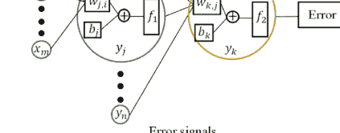

图1. ANN与信号传播。

y_j = f_1( sum_{i=1}^{m} w_{j,i} x_i + b_j )   (4)

y_k = f_2( sum_{j=1}^{n} w_{k,j} y_j + b_k )   (5)

E = 1/2 sum_{k=1}^{s} (d_k - y_k)^2   (6)

w_{j,i}(j+1) = w_{j,i}(j) + Δw_{j,i}   (7)

w_{k,j}(k+1) = w_{k,j}(k) + Δw_{k,j}   (8)

Δw_{j,i} = - η ∂E/∂w_{j,i}   (9)

Δw_{k,j} = - η ∂E/∂w_{k,j}   (10)

### 2.7. PI-BPNN

网络的复杂度与网络大小相关，网络大小以权重矩阵和偏置向量的数量来衡量。网络架构对模型性能起着至关重要的作用，因为它决定了需要训练的参数数量。以图1所示的模型结构为例。权重矩阵w_{j,i}和w_{k,j}的维数分别为m × n和n × s。偏置向量的大小为n + s。因此，需要训练的参数总数为(m + s + 1) × n + s。在地表沉降预测应用中，输出层中的一个神经元（s = 1）代表沉降。因此，需要训练的参数总数变为(m + 2) × n + 1。隐藏神经元数量(n)可以通过试错实验确定，也可以按照Heaton（2015）建议的输入节点数(m)的形式来表示。合适的隐藏神经元数量估计为(2m)/3 + s，且不应超过1.5m。因此，模型复杂度在很大程度上取决于输入节点的数量。

在相关文献综述中，许多研究者直接将影响变量设置为输入神经元，将地面沉降设置为输出神经元。人们普遍认为，应尽可能收集与地面沉降相关的参数并将其输入到输入层（Suwansawat和Einstein，2006）。然而，增加输入神经元的数量会导致模型更加复杂，因此需要学习更多的权重和偏置。在许多沉降预测的NN应用中，训练和测试数据的大小为10个或约100个（Santos和Celestino，2008；Darabi等，2012；Ahangari等，2015；Bouayad和Emeriault，2017）。当需要学习的参数数量大于学习样本的大小时，这些参数可能得不到很好的训练。此外，由于隐藏层中具有足够数量神经元的网络可以准确地实现任意训练集，因此它可以同时学习信号和噪声（Tetko和Villa，1997）。在数据点有限的情况下，其中一些训练出的关系可能是采样噪声的结果。针对小数据集的网络架构设计，提出了PI-BPNN模型。在提出的PI-BPNN模型中，输入初始化通过排列特征重要性选择技术实现，这是一种模型


检查技术，对于非线性或不透明的估计器尤为有用。置换特征重要性被定义为一个模型分数在单个特征值被随机打乱时的下降量（Breiman, 2001），该指标表明了模型对该特征的依赖程度。因此，重要特征将被筛选、选取并作为网络输入，以降低架构复杂度。

## 3. 研究场地描述及数据集收集

### 3.1. 地质条件

本研究使用的数据收集自中国建设的Yuji隧道项目，该隧道通过泥水盾构TBM进行开挖。钻探了许多钻孔以获取地下地质条件的信息。基于统一土壤分类系统（USCS），隧道水平面的土壤剖面图绘制于图2中。对总长为1.1公里的隧道断面进行了调查。盾构隧道遇到的地质条件包括粉砂土、粉质粘土、粉土、砂土和人工填土。地质条件的复杂性各异。总体而言，隧道施工于混合粉质粘土-砂土层中。大部分区域发现拱顶处为砂土，底板处为粉质粘土。部分区域完全在砂土或粉质粘土层中开挖。沿选定隧道断面（>1 km）布置了十个地表沉降标志点或沉降阵列，以测量开挖期间的地表沉降。通过横剖面精测水准监测垂直地表位移。每个剖面至少包含13个监测点。记录、收集并使用了187个观测到的最大地表位移数据集。

### 3.2. 用于模型构建的数据集收集

地表位移可能由输入到机器学习模型中的多个影响变量引起。基于城市盾构隧道的案例历史回顾（Clough and Leca, 1993; Suwansawat and Einstein, 2006; Zhang et al., 2020b）以及该隧道项目的大量观测结果，影响变量可分为三大类：隧道几何形状、地质条件和TBM运行参数。Suwansawat和Einstein（2006）提出的这种分类方式已被研究人员广泛接受（Ding et al., 2013; Ocak et al., 2013; Wang et al., 2013; Zhou et al., 2017; Chen et al., 2019）。每个类别中包含的参数主要来源于掘进前的测量值或伴随隧道开挖的观测值。Mahmoodzadeh等人（2020）也指出，城市隧道项目并不总能获取大量参数，因此，优先选择容易获取的参数更为可取。

#### 3.2.1. 输入变量

##### (1) 隧道几何形状

建模时考虑了隧道埋深和直径。所选断面隧道埋深在31 m–36 m之间变化。该隧道项目的直径恒定为12.4 m。机器学习技术中特征选择的一种基线方法是移除低方差特征。零方差特征，即所有样本中具有相同值的特征，不会影响输出的变化。因此，隧道直径不作为输入使用。

此外，隧道掌子面与监测点之间的水平距离（DTM）也被视为可能影响监测到地基沉降的参数，它指示了从盾构接近之前到盾构通过之后的各个开挖阶段。

##### (2) 地质条件

机器学习模型中考虑的地质条件包括隧道底板和拱顶处的土壤类型、地下水位以及加权平均土壤压缩模量（ACM）。所有这些与地质条件相关的参数均获取自沿隧道中轴线钻探的许多钻孔。

直观地通过图3所示的地质剖面可知，隧道拱顶和底板存在两种地质条件，即粉质粘土或砂土。通常由0和1表示的二进制代码分别代表“关”和“开”两种状态。因此，可以采用二进制代码来表示是否遇到某种土壤类型（Suwansawat and Einstein, 2006）。在本研究区域中，总结了四种地质条件，如表2所列。

虽然可以直观地通过地质剖面大致确定地质复杂性，但土壤固结的定量特征是未知的，这可能成为影响地基沉降的关键因素。从土壤力学角度来看，由于土壤是可压缩材料，地表会发生向下的沉降。沿隧道线位从75个钻孔中收集了576个土壤样本。这些收集的土壤样本已用于进行实验室土壤固结试验，以研究压缩特性。

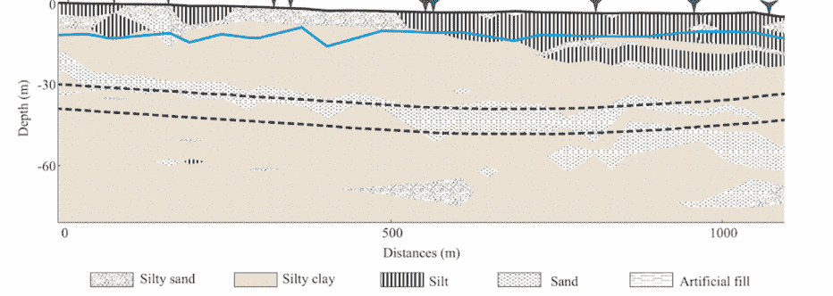

图2. 研究区域的地质剖面。

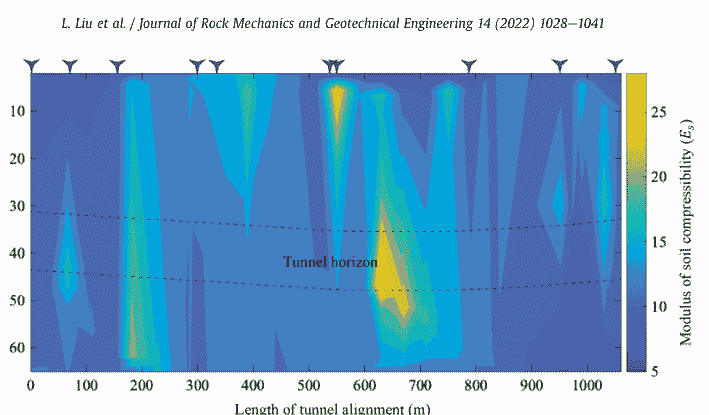

**图3.** 加权平均压缩模量（ACM）分布。

可以根据实验室压缩试验结果绘制土壤孔隙比 *e* 与有效压力 *p* 的关系图。基于 *e-p* 曲线，可以计算表示为公式 (11) 的压缩系数 (*a_v*)，该系数代表压缩过程中孔隙比随施加的有效压力的变化。

给定固结层的初始孔隙比 (*e_0*)，根据公式 (12) 获得体积压缩系数 (*m_v*)。参数 *m_v* 代表单位压力增加引起的单位土壤压缩量。最终选择以公式 (13) 表示的土壤压缩模量 (*E_s*) 作为代表土壤压缩性的参数。计算出的压缩模量结果绘制在图3中。沿钻孔的ACM可以使用公式 (14) 计算，以代表每个监测点的总体土壤压缩性，其中 *E_si* 是第i层土壤的土壤压缩模量，*h_i* 表示第i层土壤的高度。

```
a_v = -\Delta e / \Delta p  (11)
m_v = a_v / (1 + e_0)  (12)
E_s = 1 / m_v  (13)
ACM = \sum E_s_i h_i / \sum h_i  (14)
```

##### (3) TBM运行参数

在具有高含水量的软土地层中，泥水盾构TBM是适用的。该TBM配备了一个泥水系统，通过向切割室注入加压泥水来控制开挖面的压力。对于给定的TBM，其规格取决于并反映土壤条件。选择TBM相关参数的标准是这些参数直接影响掌子面稳定性、地层体积损失等，并进一步影响地表沉降（Mony et al., 2016; Chen et al., 2019; Zhang et al., 2020c）。此外，建议在盾构系统中进行实时数据采集，以确保这些参数的准确性。基于Zhang等人（2020b）建议的与地表沉降相关的TBM参数，选定了八个特征，包括刀盘转速、贯入速率、推力、扭矩、滚轮位移、注浆压力、注浆注入速率和排出流量。良好地控制这些参数可以有效减少由盾构施工引起的地表沉降。

**表2**
用二进制代码表示的隧道拱顶和底板地质条件。

| 类型 | 隧道拱顶地质 |  | 隧道底板地质 |  |
|------|--------------------------|---|--------------------------|---|
|  | 粉质粘土 | 砂土 | 粉质粘土 | 砂土 |
| 1 | 1 | 0 | 1 | 0 |
| 2 | 1 | 0 | 0 | 1 |
| 3 | 0 | 1 | 1 | 0 |
| 4 | 0 | 1 | 0 | 1 |

TBM参数，如刀盘转速和贯入速率，显著影响TBM振动。软土地层TBM的推力由土压控制。扭矩系数乘以隧道直径的立方描述了软土地层TBM的扭矩。TBM扭矩由盾构刀具与地面之间的摩擦力或抗剪强度决定。这种摩擦力由几种因素引起，如土压、作用在隔板上的腔室压力、曲线线形方向变化产生的驱动力、管片与尾部密封件之间的摩擦力以及拖带单元的牵引力（Ates et al., 2014）。在泥水盾构TBM运行中，泥水回路是连接TBM与地表泥水处理厂（STP）的管道循环。泥水排出管道中的泵将装载的泥水输送到STP。在泥水供给线和排出线中安装了传感器以确定流速和密度。注浆流入和排出流的密度几乎是恒定的。因此，选择三个参数来表示泥水回路状态：注浆压力、注浆注入速率和排出流量。

#### 3.2.2. 输出变量

由隧道开挖引起的地表沉降被设定为机器学习模型中的输出变量，它受多个输入因素的影响。鉴于数据是在开挖过程中收集的，考虑开挖面前方八倍隧道直径范围内的地表沉降，测量精度为0.3 mm/km。


#### 表 3

沉降预测的特征参数及取值范围。

| 类别 | 变量 | 最小值 | 最大值 | 均值 | 标准差 |
|---|---|---|---|---|---|
| 隧道几何 | 深度 (m) | 31.2 | 36 | 34.26 | 1.97 |
| | DTM (m) | 0 | 234 | 71.44 | 57.89 |
| 地质条件 | 地下水位 (m) | 7.1 | 13.89 | 9.56 | 2.22 |
| | ACM (MPa) | 7.92 | 13.44 | 10.04 | 2.2 |
| TBM作业 | 刀盘旋转速度 (rpm) | 1.2 | 1.6 | 1.42 | 0.07 |
| | 刀盘扭矩 (kN m) | 1800 | 18,361.2 | 11,266.38 | 2718.1 |
| | 滚轮位移 (mm) | 0.22 | 0.8 | 0.46 | 0.09 |
| | 推进速率 (mm/min) | 3 | 26.6 | 11.62 | 4.36 |
| | 推力 (kN) | 52,626 | 100,883 | 70,217.44 | 10,260.88 |
| | 灌浆压力 (bar) | 2.7 | 5.3 | 3.91 | 0.63 |
| | 灌浆注入速率 (m³/h) | 1600.4 | 7072.9 | 2297.43 | 383.35 |
| | 排渣流量 (m³/h) | 1376.5 | 8248 | 2364.11 | 633.82 |

注：1 bar = 100 kPa.

### 3.3. 数据分布

用于设计预测地面沉降的 ML 模型的 数据集 包含 14 个输入变量和 187 个观测值。十二个参数及其对应的取值范围已在表 3 中汇总。其他两个参数为隧道拱顶和仰拱处的地质，在 ML 模型中分别用值 0 和 1 表示（表 3）。图 4 展示了变量相关性矩阵，说明了成对参数之间的关系，以提供数据分布的描述性概览。大多数参数的相关性相对较低，皮尔逊相关系数 (r < 0.8)，除两对之外：灌浆压力 vs. 地下水位 (r = − 0.82) 和 隧道仰拱处地质 vs. ACM (r = − 0.81)。r 值越大，线性关系越强。然而，这两对数据集之间没有直接的物理联系，因此所有数据都将保留供学习者使用。数据分布还显示，地面沉降与少数参数呈反向关系。这些参数为 DTM、隧道深度、ACM、推力、灌浆压力、灌浆注入速率和排渣流量。因此，这些参数的增加在一定程度上可以控制地面沉降的幅度。同样，正相关参数的降低可能有助于减小地表沉降。

### 3.4. 训练集和测试集

ML 方法摄取数据以学习。具体而言，ML 算法旨在找到产生最佳模型的最佳超参数。相应的超参数随机初始化并使用成本函数进行优化。通过从训练集学习来实现寻找最佳超参数的过程。使用训练好的超参数，ML 模型具有预测输出的能力。本研究的数据集被随机划分为两组：训练集和测试集，如图 5 所示。训练集占数据的 70%，其余 30% 分配给测试集。两部分划分是 ML 算法应用中的一种通用做法，旨在测试模型的预测性能。

## 4. 结果

### 4.1. 模型性能比较

通常，可以进行统计性能评估以定量评估模型性能。采用式 (15) 定义的决定系数 (R²) 来评估和比较模型性能。它衡量模型提供的预测效果如何。最佳可能得分为 1。R² 值越高，模型性能越好。此外，R² 值可能为负值，因为模型可能任意变差。

R² = 1 − Σ(monitoring − predictions)² / Σ(monitoring − mean of monitoring)²   (15)

七个模型的训练和测试精度已计算并在图 6 中呈现。根据计算的测试精度，预测性能从最好到最差为 RF (0.9) > GB (0.82) > DT (0.72) > PI-BPNN (0.79) > BPNN (0.59) > SVR (0.52) > MLR (− 3.89 × 10¹⁷)。在这些应用的模型中，MLR 既没有学习能力也没有预测能力，这意味着诱发地面沉降与影响变量之间的关系是非线性的。非线性关系也可以由图 4 所示的变量系数矩阵指示。地表沉降与 14 个影响变量的相关性较弱，相关系数 (R) 小于 0.3。

在非线性模型的应用中，像 RF 和 GB 这样的集成方法已成功使用，具有相对较高的学习和测试精度。RF 模型实现了最佳性能。此外，在模型精度方面，集成模型 (RF 和 GB) 优于单一 DT 方法。与浅层结构学习架构相比，NN 模型采用深度架构来学习分层表示。深度结构 ML 方法通常能够捕捉比传统学习方法更复杂、分层启动的输入统计模式，以适应新区域。此外，随着数据不断增大，深度学习对于为大规模数据集提供预测分析解决方案至关重要 (Pasini, 2015; Qiu et al., 2016)。然而，对于隧道诱发地面沉降的应用，其中可用数据集较小，BPNN 的预测性能不如基于树的 ML 算法。此外，所提出的 PI-BPNN 模型优于典型的 BPNN，表明在应用小数据集时，NN 架构和输入选择对模型性能至关重要。

### 4.2. 考虑欠预测和过预测的特征重要性评估

除本研究中使用的 R² 外，模型性能还可以通过其他性能指标进行评估，例如平均绝对误差 (MAE)、均方根误差 (RMSE)、相对均方根误差 (RRMSE)、标准差 (σ) 和多目标误差 (MOE)，其定义如下

MAE = 1/n Σᵢ₌₁ⁿ |dᵢ − yᵢ|   (16)

RMSE = √[1/n Σᵢ₌₁ⁿ (dᵢ − yᵢ)²]   (17)

$$\mathrm{RRMSE}=\sqrt{\frac{1}{n}\sum_{i=1}^{n}\left(\frac{d_i-y_i}{d_i}\right)^2} \tag{18}$$

$$\sigma=\sqrt{\frac{1}{n}\sum_{i=1}^{n}(e_i-\bar e)^2} \tag{19}$$

$$MOE=RRMSE/(1+R) \tag{20}$$

其中 $d$ 为监测值；$y$ 为预测值；$\bar d$ 和 $\bar y$ 分别为实际值和预测值的均值；$e$ 为绝对误差，且 $e=|d_i-y_i|$；$\bar e$ 为绝对误差的均值；$n$ 为数据集的数量。

在上述参数中，MAE 反映了预测数据与实测数据之间误差的平均幅度，而 RMSE 描述了差异的标准差。RRMSE 是 RMSE 与监测值均值的比值 (Bsaibes et al., 2009)。RRMSE、RMSE、MAE 和 $\sigma$ 仅说明误差而不考虑相关性。MOE 函数结合了上述指标。

这些方程通常用于 ML 应用中，以指示预测与观测之间的总体偏差。误差越高，模型从训练数据中正确泛化的可能性就越小。尽管这些方程存在细微差异，但一个共同点是欠预测和过预测被同等考虑。然而，对于隧道开挖引起的地面沉降，与过预测相比，欠预测可能导致项目失败甚至人员伤亡。因此，提出了一种 QE 准则来评估模型性能。QE 准则中给出了高估和低估的不同惩罚。在 QE 计算中，可以对高估和低估给予不同的惩罚。这些惩罚基于所选分位数 ($\gamma$) 的值，如式 (21) 所示。分位数误差可以被视为 MAE 的扩展，当分位数为 50% ($\gamma=0.5$) 时，QE 的方程简化为 MAE 的方程。$\gamma>0.5$ 的分位数损失函数对低估的惩罚大于对高估的惩罚。在模型性能评估中，QE 计算中的参数 $\gamma$ 已设为 0.7。每个模型的预测值 ($y$) 为 1000 次预测结果的均值。

$$QE=\frac{1}{n}\left(\sum_{i|d_i\le y}(\gamma-1)|d-y|+\sum_{i|d_i>y}\gamma|d-y|\right) \tag{21}$$

使用 QE 准则，预测的模型性能从最好到最差为 RF (0.36) > GB (0.38) > DT (0.41) > SVR (1.02) > PI-BPNN (1.17) > BPNN (1.22) > MLR (1.81 × 10⁹)。即使对欠预测给予更多惩罚，RF 算法在 QE 误差方面仍具有最佳模型性能。与通过 $R^2$ 评估的模型性能 (RF > GB > DT > PI-BPNN > BPNN > SVR > MLR) 相比，使用 QE 误差时 SVR 优于 NNs，表明 NNs 容易产生欠预测。

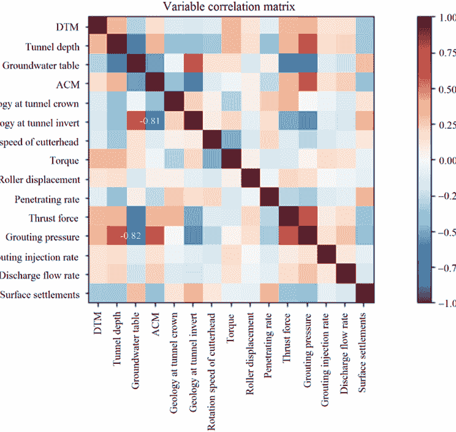

**图 4.** 影响变量的相关性矩阵。


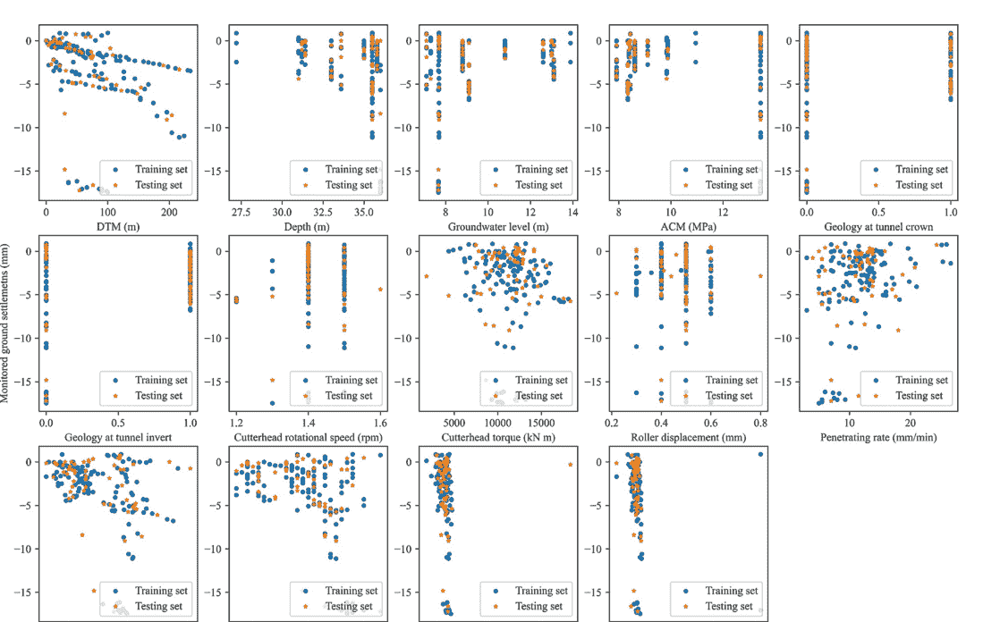

*图 5.* 训练集和测试集的数据分布。

### 4.3. 特征重要性

ML 模型用于识别地表沉降与各种影响变量之间的关系。解释给定模型为何如此行为的一种方式是分析特征重要性。特征重要性提供了对模型行为高度压缩、全局性的洞察。

置换特征重要性这一模型检验技术通过移除每个特征来测试模型性能。这样，各个变量的重要性可以直接比较。此类方法可用于消除机器学习算法作为不可复现“黑箱”的观念，并有助于获得新的见解。具体而言，置换特征重要性衡量的是在置换某个特征值后模型预测误差的增加，即当单个特征值被随机打乱时模型分数的下降。如果打乱其值会增加模型误差，因为模型依赖该特征进行预测，则该特征为“重要”。相反，如果打乱其值使模型误差保持不变，因为模型在这种情况下忽略了该特征用于预测，则该特征为“不重要”。

然而，并非所有学习方法都能识别重要特征，因为它们过于复杂，无法分析单个协变量对整体结果的贡献，例如 ANNs 和 SVR (Altmann et al., 2010)。此外，MLR 的失败应用（图 6a）表明输入与输出之间的非线性关系未被捕捉，说明在 MLR 模型中没有特征被视为“重要”。因此，置换特征重要性将基于 DT、RF 和 GB 方法的预测结果进行评估。

根据图 7 所示的结果，已识别出六个对地表沉降有贡献的重要参数，包括隧道深度、DTM、ACM、注浆压力、掘进速率和推力。通常，隧道深度、DTM 和 ACM 参数由隧道设计和地质条件决定。因此，由隧道掘进引起的地表沉降可通过如注浆压力、掘进速率和推力等 TBM 操作进一步控制。

### 4.4. 模型稳定性

在应用机器学习算法时，模型精度通常被视为评估和选择学习算法的主要标准。精度高的算法可以以高度的置信度预测结果。然而，学习算法的稳定性也是一个重要问题，往往被较少考虑。因此，应给予更多关注，特别是对于小数据集的机器学习应用。学习算法的稳定性，也称为学习方差，指训练数据集改变时输出的变化。如果在训练集被修改时输出变化不大，则学习算法可被视为稳定。此外，算法稳定性也可被视为超参数训练好坏的体现。方差高的模型非常关注训练数据，在未见数据上泛化能力不佳。

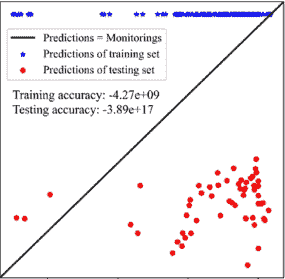

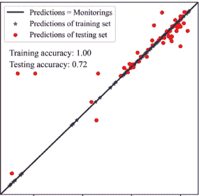

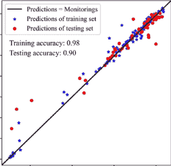

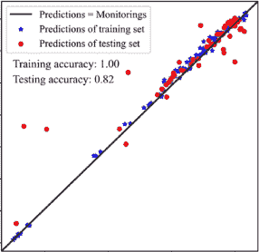

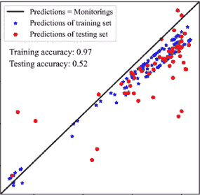

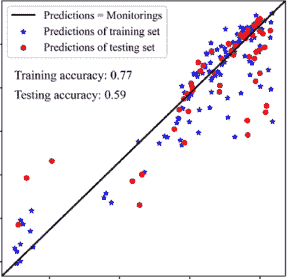

*图 6.* 应用的机器学习算法的精度：（a）MLR，（b）DT，（c）RF，（d）GB，（e）SVR，（f）BPNN，（g）PI-BPNN 模型。

本研究中的每个机器学习模型都将进行多次预测，以研究小数据集上的模型稳定性。方差 s²（式 (22)）用于评估模型稳定性。它被计算为每次预测与平均预测之间平方偏差的平均值。数据分布越分散，相对于均值的方差越大。

$$
s^2 = \frac{\sum (X - \bar{X})^2}{n - 1}
$$

(22)

其中 X 为预测值，X̄ 为平均预测值，n 为重复预测次数。方差越低，机器学习模型越稳定。

这里对模型稳定性的评估分为两步进行。首先，测试训练集不发生变化的极端情况。每个单一测试样本已被预测 1000 次。1000 次预测结果的方差（图 8）被计算以评估由虚线表示的模型稳定性。由实线表示的方差趋势使用移动平均技术获得。根据图 8 所示的结果，在相同的训练集和模型架构下，预测结果存在显著差异。BPNN 和 PI-BPNN 的稳定性平均方差分别为 5.76 和 3.58。BPNN 和 PI-BPNN 显示出较差的模型稳定性，表明小数据集无法充分训练深度架构中的超参数。与典型的 BPNN 相比，所提出的 PI-BPNN 在模型精度和模型稳定性方面均表现更优。对于浅层结构机器学习算法（DT、RF、GB、SVR 和 MLR），DT 模型显示出高方差（1.06），而 RF、GB、SVR 和 MLR 模型显示出良好的稳定性，方差几乎等于零。由于 MLR 模型完全未能学习和预测隧道诱发地表沉降，为节省计算资源，将不再进一步讨论。第二步是使用可变数据集进一步研究 RF、GB 和 SVR 模型的稳定性。训练集和测试集被随机拆分 1000 次以重复训练模型。三种算法被训练 1000 次以提供 1000 次预测。图 9 所示的模型性能结果表明，RF、GB 和 SVR 可被视为稳定模型，因为输出性能变化不大，方差小于 0.2。GB、SVR 和 RF 的平均方差分别为 $5.5 \times 10^{-3}$、$5.39 \times 10^{-27}$ 和 $3.02 \times 10^{-27}$。因此，可以得出模型稳定性从最好到最差的顺序为 RF > SVR > GB > DT > PI-BPNN > BPNN。

在所有这些应用的学习算法中，RF 模型显示出最佳的精度和稳定性。

## 5. 讨论

应用机器学习技术可从现有数据集中推导出模式并近似未来行为（即预测）。评估机器学习性能、优缺点以确定其准确预测能力非常重要。此外，方法选择应根据所要解决的问题而适当。表 4 比较了用于小数据集隧道诱发地表沉降预测的七种机器学习算法。

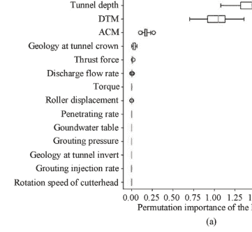

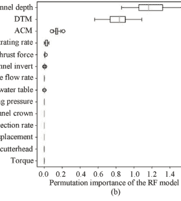

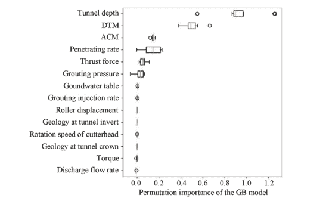

*图 7.* 机器学习算法识别的特征重要性：（a）DT，（b）RF，（c）GB 模型。

机器学习模型的一个普遍优势是能够处理多变量数据并在复杂、动态甚至混沌的环境中提取隐含关系。此外，它们对预测变量不做分布假设。

DT、RF 和 GB 是三种基于树的算法。DT 是一种基本的树结构算法，为 RF 和 GB 提供基础学习器。RF 和 GB 是最先进的集成学习技术，它们将多个机器学习算法（基础学习器）的预测结果结合起来以提供更准确的预测。单个 DT 可能相对较弱，与一组树相比。理论上，树木更多的集成方法通常能产生更好的结果并作为更稳健的模型（Elish et al., 2013）。本研究表明，RF 和 GB 在预测精度和模型稳定性方面优于 DT 模型。然而，预测精度与处理成本之间存在权衡。树越多，过程越慢，因为每棵树都需要生成、处理和分析。此外，特征越多，处理速度越慢。RF 和 GB 之间的区别在于树的构建方式。RF 独立（并行）构建每棵树，而 GB 每次构建一棵树（顺序）(Callens et al., 2020)。

MLR 模拟自变量与因变量之间的线性关系，而其他六种机器学习方法处理非线性关系。如其数学公式所示（式 (1)），其主要优势是直观地提供一个或多个预测变量的相对影响。然而，MLR 无法近似影响变量与地表沉降之间的非线性关系。

构建 SVR 模型需要数据转换，通过核函数实现。核选择取决于数据集。它可以通过试错法选择。选择测试精度最高的核。一旦核被选定，SVR 只有几个需要确定的超参数，易于实现。SVR 显示出良好的模型稳定性但预测精度较差。在给予更多惩罚和欠预测并使用 QE 准则的情况下，SVR 的预测精度高于神经网络模型。

在多层神经网络中，每个神经元通过某些超参数与其他神经元连接。鉴于存在许多超参数，如权重矩阵和偏置向量，神经网络具有学习和建模非线性和复杂关系的卓越能力。然而，网络中涉及的许多超参数可能无法通过有限数据集得到充分训练以提供理想的预测性能。本文提出的 PI-BPNN 针对小数据集设计，考虑了模型架构与数据集大小之间的关系，表现优于典型的 BPNN。尽管神经网络在解决复杂问题方面功能强大，但它们不足以应用于小数据集，预测精度和模型稳定性均较差。

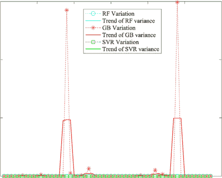

## 6. 结论

由于任何给定隧道项目的建设周期有限，可用的地表变形监测数据集都很小。当数据集很小时，机器学习方法能否有效预测隧道诱发地表沉降？采用浅层和深层结构，七种机器学习算法已被应用于预测隧道诱发地表沉降。这些机器学习方法包括 MLR、DT、RF、GB、SVR、BPNN 和 PI-BPNN。

七种机器学习算法从模型精度和稳定性的角度进行评估。我们的结果表明 MLR 模型未能学习和预测。此外，隧道诱发地表沉降与可能的影响变量之间的非线性关系得到了证实，包括 TBM 操作参数、遇到的地质条件和隧道几何形状。在非线性学习算法的应用中，RF 模型表现最佳，预测精度高达 0.9，稳定性方差低至 $3.02 \times 10^{-27}$。而被认为在近似复杂函数方面功能强大的 BPNN，其表现不如传统的浅层结构学习算法。所提出的 PI-BPNN 方法应用了置换特征选择技术以降低模型复杂度，在小数据集上实现了比典型 BPNN 更好的性能。因此，无论模型多么有吸引力，模型选择都应基于对所要解决问题的充分考虑。总之，即使可用数据集大小很小，机器学习算法也可以成功用于预测隧道诱发地表沉降。此外，诸如 RF 和 GB 回归等集成方法优于其他学习算法。

此外，已识别出对开挖过程中发生的地表沉降贡献最大的六个变量，包括隧道深度、DTM、ACM、注浆压力、掘进速率和推力。

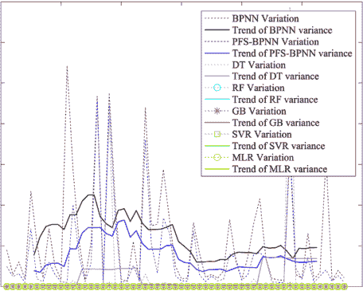


## 表4

使用小数据集预测基于机器学习的隧道施工引起地表沉降的模型比较。

| 项目 | MLR | BPNN | PI-BPNN | SVR | DT | RF | GB |
|---|---|---|---|---|---|---|---|
| 近似 | 线性 | 非线性 | 非线性 | 带RBF核的非线性 | 非线性 | 非线性 | 非线性 |
| 学习器 | 单一 | 单一 | 单一 | 单一 | 单一 | 集成 | 集成 |
| 有效性 适用性 预测 R² 准确度 | 否 失败 | 是 差（<60%） | 是 中等（60%–80%） | 是 差（<60%） | 是 中等（60%–80%） | 是 好（>80%） | 是 好（>80%） |
| QE | 失败 | 差（>1） | 差（>1） | 差（>1） | 中等（0.5–1） | 好（<0.5） | 好（<0.5） |
| 模型稳定性（学习方差） | 好（≈0） | 差（5.76） | 差（3.58） | 好（≈0） | 中等（1.06） | 好（≈0） | 好（≈0） |
| 小数据集应用中的优点（+）和缺点（−） | − 无法解决复杂问题 | + 擅长处理复杂的非线性问题 − 架构设计复杂，超参数多 | + 在小数据集上比BPNN表现更好 | + 需要确定的参数少 − 核函数选择棘手 | + 预测精度和计算速度之间平衡良好 − 与集成树学习器相比较弱 | + 预测精度和稳定性好 − 计算速度相对较低 |

贯入速率和推力。隧道深度和ACM等变量由隧道设计和地质条件决定。因此，地表沉降可以通过TBM操作进一步控制。在隧道开挖过程中，应重点关注三种TBM操作，即注浆压力、贯入速率和推力。

需要注意的是，我们的结论仅适用于小数据集的情况，例如表1中列出的隧道工程案例。它们不适用于大数据集的隧道工程案例，这超出了本研究的范围。

## 利益冲突声明

作者声明，本文所报告的工作未受到任何已知的竞争性经济利益或个人关系的影响。

## 致谢

本研究由美国交通部（DOT）授予科罗拉多矿业学院地下交通基础设施大学交通中心（UTC-UTI）的资助（资助号：69A3551747118）提供资金。本文所表达的观点仅代表作者本人，不代表美国交通部。

## 参考文献

Ahangari, K., Moeinossadat, S.R., Behnia, D., 2015. 用现代智能方法估算隧道引起的地表沉降. Soils Found. 55 (4), 737–748.

Altmann, A., Toloşi, L., Sander, O., Lengauer, T., 2010. 排列重要性：一种校正的特征重要性度量. Bioinformatics 26 (10), 1340–1347.

Ates, U., Bilgin, N., Copur, H., 2014. 估算不同类型TBM的扭矩、推力和其它设计参数，并对土耳其隧道工程中使用的TBM提出一些批评. Tunn. Undergr. Space Technol. 40, 46–63.

Bouyad, D., Emeriault, F., 2017. 基于混合PCA/ANFIS方法对盾构隧道引起的地表沉降与运营及地质参数之间的关系进行建模. Tunn. Undergr. Space Technol. 68, 142–152.

Boubou, R., Emeriault, F., Kastner, R., 2010. 人工神经网络在盾构隧道引起的地表位移预测中的应用. Can. Geotech. J. 47 (11), 1214–1233.

Breiman, L., 2001. 随机森林. Mach. Learn. 45, 5–32.

Bsaibes, A., Courault, D., Baret, F., et al., 2009. 基于FORMOSAT-2数据的反照率和叶面积指数估算用于作物监测. Remote Sens. Environ. 113 (4), 716–729.

Callens, A., Morichon, D., Abadie, S., Delpey, M., Liquet, B., 2020. 使用随机森林和梯度提升树改进特定位置的波浪预报. Appl. Ocean Res. 104, 102339.

Chao, G.Y., Tsai, T.L., Lu, J., et al., 2011. 一种在小数据集分析中预测膀胱癌细胞放疗效果的新方法. Expert Syst. Appl. 38 (7), 7963–7969.

Chen, R., Zhang, P., Wu, H., Wang, Z., Zhong, Z., 2019. 使用机器学习技术预测盾构隧道引起的地表沉降. Front. Struct. Civ. Eng. 13, 1363–1378.

Clough, G.W., Leca, E., 1993. 混合开挖面条件下的土压平衡盾构隧道施工. J. Geotech. Eng. 119 (10), 1640–1656.

Darabi, A., Ahangari, K., Noorzad, A., Arab, A., 2012. 利用多种方法估算沉降——案例研究：德黑兰3号地铁线. Tunn. Undergr. Space Technol. 31, 117–127.

Ding, L., Wang, F., Luo, H., Yu, M., Wu, X., 2013. 盾构-地层系统的前馈分析. J. Comput. Civ. Eng. 27 (3), 231–242.

Elish, M., Helmy, T., Hussain, M., 2013. 同质和异质集成模型用于软件开发工作量估算的实证研究. Math. Probl. Eng. 2013, 312067.

Feng, S., Chen, Z., Luo, H., et al., 2021. 隧道掘进机（TBM）性能预测：使用大数据和深度学习的案例研究. Tunn. Undergr. Space Technol. 110, 103636.

Goh, A.T.C., Hefney, A.M., 2010. 土压平衡隧道相关沉降的可靠性评估. Geomech. Eng. 2 (1), 57–69.

Hasanipanah, M., Noorian-Bidgoli, M., Jahed Armaghani, D., Khamesi, H., 2016. PSO-ANN模型预测隧道施工引起地表沉降的可行性. Eng. Comput. 32, 705–715.

Heaton, J., 2015. 面向人类的人工智能. 深度学习与神经网络，第1卷. Heaton Research, Inc., St. Louis, MO, USA.

Hegazy, T., Fazio, P., Moselhi, O., 1994. 使用反向传播开发实用的神经网络应用. Comput. Aided Civ. Infrastruct. Eng. 9 (2), 145–159.

Kim, C.Y., Bae, G.J., Hong, S.W., Park, C.H., Moon, H.K., Shin, H.S., 2001. 基于神经网络预测隧道施工引起的地表沉降. Comput. Geotech. 28 (6–7), 517–547.

Kitchin, R., Lauriault, T.P., 2015. 大数据时代的小数据. GeoJournal 80, 463–475.

Kitchin, R., 2013. 大数据与人文地理：机遇、挑战与风险. Dialogues Hum. Geogr. 3 (3), 262–267.

Kohestani, V.R., Bazargan-Lari, M.R., Asgari-Marnani, J., 2017. 使用随机森林预测土压平衡盾构隧道引起的最大地表沉降. J. AI Data Min. 5 (1), 127–135.

Lyashevska, O., Harma, C., Minto, C., Clarke, M., Brophy, D., 2020. 梯度 boosting 回归树揭示鲱鱼生长的长期趋势主要与温度相关. Ecol. Inf. 60, 101154.

Mahmoodzadeh, A., Mohammadi, M., Darai, A., Farid Hama Ali, H., Kameran Al-Salih, N., Mohammed Dier Omer, R., 2020. 预测城市隧道施工引起的最大地表沉降. Autom. ConStruct. 120, 103375.

Marto, A., Hajihassani, M., Kalatehjari, R., Namazi, E., Sohaei, H., 2012. 使用人工神经网络模拟隧道施工引起的纵向地表沉降. Int. Rev. Mod. Simul. 5 (2), 1024–1031.

Moghaddasi, M.R., Noorian-Bidgoli, M., 2018. ICA-ANN、ANN和多元回归模型预测隧道施工引起的地表沉降. Tunn. Undergr. Space Technol. 79, 197–209.

Mooney, M., Grasmick, J., Kennelly, B., Fang, Y., 2016. 泥浆TBM参数对地层变形的影响：现场结果和计算建模. Tunn. Undergr. Space Technol. 57, 257–264.

Mukherjee, I., Routroy, S., 2012. 比较使用Levenberg–Marquardt与拟牛顿和梯度下降算法开发的神经网络在建模多响应磨削过程中的性能. Expert Syst. Appl. 39 (3), 2397–2407.

Mutanga, O., Adam, E., Cho, M.A., 2012. 使用WorldView-2影像和随机森林回归算法估算湿地植被的高密度生物量. Int. J. Appl. Earth Obs. Geoinf. 18, 399–406.

Ocak, I., Seker, S.E., 2013. 使用人工神经网络、支持向量机和高斯过程计算土压平衡盾构隧道引起的地表沉降. Environ. Earth Sci. 70, 1263–1276.

Pasini, A., 2015. 用于小数据集分析的人工神经网络. J. Thorac. Dis. 7 (5), 953–960.

Pedregosa, F., Varoquaux, G., Gramfort, A., et al., 2011. Scikit-learn：Python中的机器学习. J. Mach. Learn. Res. 12, 2825–2830.

Pekel, E., 2020. 使用决策树回归估算土壤湿度. Theor. Appl. Climatol. 139, 1111–1119.

Pourtaghi, A., Lotfollahi-Yaghin, M.A., 2012. 小波网络与人工神经网络在预测隧道施工引起的最大地表沉降方面的能力评估比较. Tunn. Undergr. Space Technol. 28, 257–271.

Qiu, J., Wu, Q., Ding, G., Xu, Y., Feng, S., 2016. 大数据处理中的机器学习综述. EURASIP J. Adv. Signal Process. 2016 (67).

Santos, O.J., Celestino, T.B., 2008. 圣保罗地铁隧道沉降数据的人工神经网络分析. Tunn. Undergr. Space Technol. 23 (5), 481–491.

Sheil, B., Suryasantana, S.K., Mooney, M.A., Zhu, H., 2020. 机器学习为隧道施工提供决策支持：最新进展和未来趋势. Proc. Inst. Civ. Eng. – Smart Infrastruct. Constr. https://doi.org/10.1680/jsmic.20.00011.

Shi, J., Ortigao, J.A.R., Bai, J., 1998. 用于预测隧道施工期间沉降的模块化神经网络. J. Geotech. Geoenviron. Eng. 124 (5), 389–395.

Suwansawat, S., Einstein, H.H., 2006. 用于预测土压平衡盾构隧道引起的最大地表沉降的人工神经网络. Tunn. Undergr. Space Technol. 21 (2), 133–150.

Tetko, I.V., Villa, A.E.P., 1997. 神经网络训练学习数据集的高效划分. Neural Network. 10 (8), 1361–1374.

Vapnik, V.N., 2000. 统计学习理论的性质. Springer, New York, USA.

Wang, F., Gou, B., Qin, Y., 2013. 使用小波平滑相关向量机模拟隧道施工引起的地表沉降发展. Comput. Geotech. 54, 25–32.

Yang, K., Trewn, J., 2004. 质量管理中的多元统计方法. McGraw-Hill, New York, USA.

Yeh, C.Y., Huang, C.W., Lee, S.J., 2011. 一种用于股票市场价格预测的多核支持向量回归方法. Expert Syst. Appl. 38 (3), 2177–2186.

Zhang, K., Lyu, H.M., Shen, S.L., Zhou, A., Yin, Z.Y., 2020c. 进化混合神经网络方法预测盾构隧道引起的地表沉降. Tunn. Undergr. Space Technol. 106, 103594.

Zhang, L., Wu, X., Ji, W., AbouRizk, S.M., 2017. 使用小波包和支持向量机估算隧道引起的地表沉降的智能方法. J. Comput. Civ. Eng. 31 (2), 04016053.

Zhang, P., Wu, H.N., Chen, R.P., Chan, T.H.T., 2020b. 混合元启发式与机器学习算法用于隧道沉降预测：比较研究. Tunn. Undergr. Space Technol. 99, 103383.

Zhang, W., Zhang, R., Wu, C., et al., 2020a. 软计算在地下开挖中应用的最新综述. Geosci. Front. 11 (4), 1095–1106.

Zhou, L., Pan, S., Wang, J., Vasilakos, A.V., 2017. 大数据上的机器学习：机遇与挑战. Neurocomputing 237, 350–361.

Zhu, M., Zhu, H., Guo, F., Chen, X., Ju, J., 2021. 基于云模型的随机森林和自训练方法进行隧道状态评估. Comput. Aided Civ. Infrastruct. Eng. 36 (2), 164–179.


Wendy Zhou博士是美国科罗拉多州戈尔登市科罗拉多矿业学院地质与地质工程系教授，并担任地理信息系统与地理信息学项目主任。Wendy Zhou于2001年在美国密苏里科技大学获得地质工程博士学位。她的研究方向包括：（1）地理信息系统（GIS）和遥感在地质灾害分析、环境影响研究和自然资源管理中的应用；（2）合成孔径雷达干涉测量（InSAR）和机器学习在地表变形监测和滑坡评估中的应用；（3）岩体特征描述；以及（4）地面热状况和岩土体中应力-应变分布的数值模拟。她已经指导了30多名硕士生和9名博士生。她在同行评审期刊或同行评审会议论文集中发表了60多篇论文，还参与了7个章节的撰写。自2014年起担任《应用遥感杂志》副主编，自2020年起担任《遥感》主题编辑。

