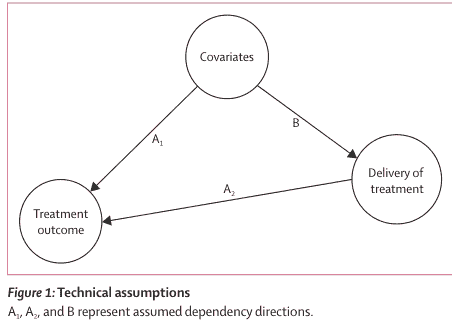
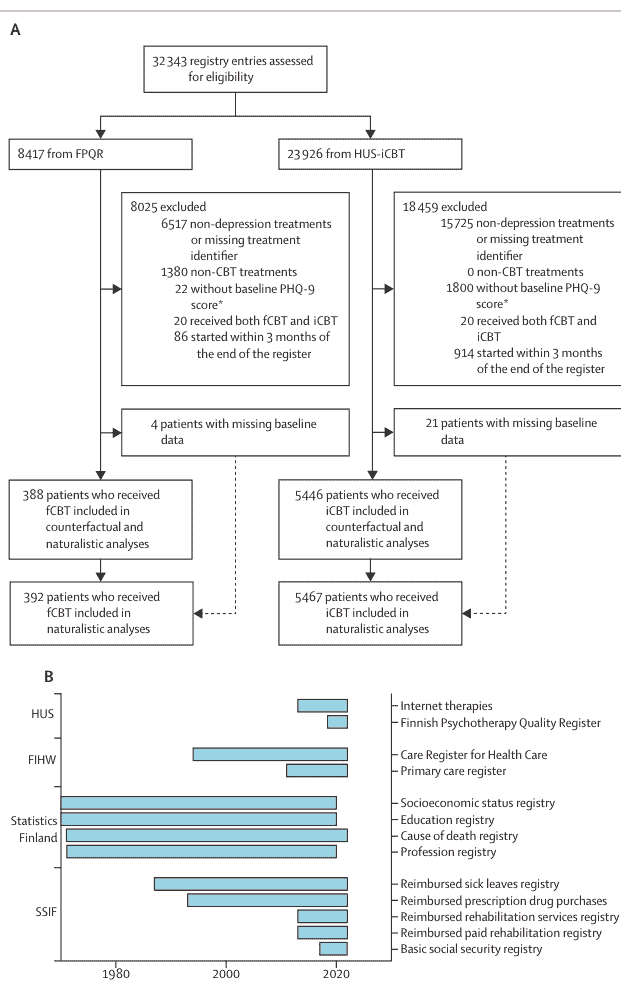

# 抑郁症治疗师指导的互联网与面对面认知行为疗法的疗效与有效性：基于反事实推断、自然主义登记和机器学习

## 摘要

### 背景

根据随机对照试验（RCT）的荟萃分析，治疗师指导的互联网认知行为疗法（iCBT）作为治疗抑郁症的方法，与传统面对面认知行为疗法（fCBT）同样有效，尽管其成本显著更低。然而，RCT并不总是代表常规临床实践，这可能会高估效果估计值。我们结合丰富数据与反事实因果统计推理，提供与RCT互补的fCBT–iCBT比较。

### 方法

在这项回顾性队列研究中，我们将完整的治疗师指导iCBT和fCBT队列登记册与多个芬兰社会和医疗保健登记册相关联。采用第三波原则的治疗师指导iCBT方案和fCBT由赫尔辛基大学医院（HUS）提供给患有抑郁症且无急性自杀或物质滥用风险的人群；fCBT在乌西玛地区提供，而治疗师指导的iCBT在全国范围内提供，并排除了有治疗干扰性精神病、神经或人格障碍、慢性或双相抑郁症，或年龄低于16岁的人群。主要结局是fCBT与治疗师指导iCBT之间治疗期间症状减少差异的因果平均治疗效应（ATE），症状通过患者健康问卷-9（PHQ-9）测量。如果只记录了一份PHQ-9报告，则不记录变化，从而对退出治疗的情况进行惩罚性处理。为了获得最优且稳健（事后平衡）的ATE估计，我们应用了目标最大似然机器学习。研究和撰写过程中未涉及有亲身经历的个人。

### 发现

治疗师指导的iCBT登记册记录了从2018年12月12日至2022年12月22日的患者，而fCBT登记册跨越了2018年8月28日至2022年9月28日。在总共32,343项登记的疗法中，来自fCBT登记册的392人和来自iCBT登记册的5,467人被纳入。fCBT组有4人和治疗师指导iCBT组有21人基线数据缺失，因此分析的主要样本包含5,834名患者（4,101人[70%]为女性，1,733人[30%]为男性），平均年龄为35岁（标准差12岁）。总共，5,455名（94%）患者的母语登记为芬兰语。ATE估计表明，与fCBT组相比，iCBT组的PHQ-9分数下降了0.745个点（95%置信区间0.156–1.334）。敏感性分析结果一致。

### 解释

结合先前的随机对照试验来看，我们的研究结果表明，短期一线治疗中的治疗师指导iCBT至少与fCBT一样有效和效果良好。我们的研究结果消除了误差来源，并扩展了这种具成本效益治疗的人群代表性。

### 资助

芬兰研究委员会（芬兰学院）。

## 引言

现有随机对照试验（RCT）的荟萃分析表明，对于精神障碍，治疗师指导的互联网认知行为疗法（iCBT）作为一种治疗方法，与更昂贵且传统的面对面认知行为疗法（fCBT）同样有效。1,2 治疗师指导的iCBT与fCBT之间大部分成本差异源于治疗师每名患者投入时间的差异。

然而，一项荟萃分析3发现，在抑郁症心理治疗中，接触时间与治疗效果无关联。当人们被引向接受治疗师支持的数字疗法时，其获益预期与面对面疗法相当。4 抑郁症患者无论入院时症状严重程度如何，都可能从治疗师指导的iCBT和fCBT中获益。5,6 然而，一些临床医生可能难以接受以下观点：

### 研究背景

### 本研究前的证据

多项荟萃分析表明，认知行为疗法（CBT）在以指导的互联网认知行为疗法（iCBT）形式实施时，与以常规面对面认知行为疗法（fCBT）形式提供时，在治疗抑郁障碍方面同样有效。因为指导的iCBT项目使用自动化视频和练习，在线治疗师每名患者花费的时间远少于面对面治疗师，这可以带来显著的成本节约。然而，荟萃分析依赖于随机对照试验（RCT），且仍存在试验可能无法代表完整常规治疗人群，或无法充分解释fCBT与指导iCBT之间治疗依从性或其他差异的巨大差距的可能性。在过去几十年中，使用互补的因果信息来源在医学领域得到了越来越多的推荐。这种因果三角验证的先进方法之一是使用机器学习的目标最大似然估计。我们在PubMed（MEDLINE）中搜索了从数据库建立之日起至2024年9月16日发表的论文，不限语言，使用的搜索词为：“目标最大似然” AND 抑郁症 AND（“互联网” OR “数字”）AND（“认知行为疗法” OR “认知行为疗法”），未获结果。第二次搜索，将“目标最大似然”替换为“因果三角验证”或“因果性”或“准实验”，也未获结果。总体而言，鉴于抑郁障碍及其治疗所伴随的巨大社会和货币成本，这共同意味着需要全面了解看似低成本治疗政策的健康影响，因此对抑郁症治疗中fCBT-iCBT效果差异的因果三角验证非常重要。

### 本研究的附加价值

据我们所知，本研究是首个以非RCT或RCT荟萃分析的形式，定量评估fCBT与指导iCBT之间疗效差异的研究。我们使用了基于目标最大似然机器学习的反事实因果推断，以及来自五个不同登记册所有者的唯一关联登记册，依据芬兰关于健康和社会登记册二次使用的法律法规进行整合。这种目标方法可以整合参数和非参数方法的特点，在数据复杂且可能包含多个混杂因素的情况下，提供精确可靠的因果效应估计。我们观察到，随机对照试验的结果在常规收集的数据和事后平衡（即因果信息性）数据中均成立：在治疗前后（或最后一次可用测量）抑郁症状下降方面，指导的iCBT方案与fCBT一样有效和效果良好。

### 所有可用证据的启示

治疗师指导的iCBT在治疗抑郁症方面与面对面提供方式同样有效，且更具成本效益。互联网提供的短期一线治疗是一种合理的默认治疗选择，也是回应高服务需求的恰当方式。

部分自动化治疗可能产生与面对面疗法同样有效的治疗结果。风险在于，临床医生可能会无意中将其态度传递给患者，从而可能导致治疗效果降低。4 随机对照试验并不总是代表常规临床实践，这可能会高估效果估计值。7,8 例如，反对数字治疗的人可能不会参加提供iCBT的随机对照试验。此外，与登记册相比，随机对照试验的样本往往较小。虽然荟萃分析通过合并随机对照试验来获得更大样本，但它们常常缺乏与人们状况的复杂性及其他可能影响代表性的背景因素相匹配的全面数据。因此，治疗师指导的iCBT在现实世界中是否真的与fCBT一样有效仍不明确。核心的反事实问题是：如果我们能够将相同患者的精确副本同时分配给指导iCBT和fCBT并比较其疗效，平均治疗效应（ATE）是否仍会相似？尽管被视为金标准，随机对照试验既不是唯一的也不是避免混杂以平衡干预组构成的完美方法。医学、心理学和统计学领域的研究者认为，可靠的因果推断通常需要多种证据来源，而非仅限于随机对照试验。9–11 许多方法通过假设来减少混杂偏差（图1）。例如，按已知治疗逆概率加权的估计不受混杂影响。12,13 或者，如果结果可以作为混杂因素和治疗分配的函数进行准确建模，则可通过G计算法获得无偏的治疗效应估计。14 如果同时存在结果模型和治疗分配概率模型，则可以将模型结合以获得双重稳健的增强逆概率治疗加权（AIPTW）估计。14 这种方法确保，只要至少有一个模型被正确指定，就能获得ATE的一致估计。14 最后，机器学习者集成（即超级学习者）最大化了至少有一个模型正确的概率。13,14 在我们的情况中，上述方法的工作假设是治疗结果取决于治疗（即提供方式）。结果和治疗可能取决于协变量，但所有此类混杂协变量均假设已被完全观察到。其他关键假设是一致性

(i.e., 治疗没有其他版本)，无干扰（i.e., 一位患者的结局不依赖于其他患者），以及正性（i.e., 对于所有预测协变量值，最终进入 iCBT 和 fCBT 都有正概率）。最后，应准确捕捉图 1 中箭头所指示的依赖形式。某些方法需要对 A 和 B 依赖都准确，而双稳健方法仅在对 A 或 B 和 Az 进行正确建模时即可实现一致估计。即使不是双稳健的方法，也可能优于朴素回归分析方法，因为当非灵活参数模型相对于现实被误设定时，后者总是有偏的。即使应用遗漏某些协变量的误设定模型，也往往比使用简单回归或均值差异估计 ATE 的朴素方法提供更准确的估计。

基于超级学习者的靶向最大似然估计器（TMLE）具有渐进双稳健性特性，但它还具有额外的高效性、定义良好且在有限样本中表现良好的特点。TMLE 整合了现代统计学、机器学习和因果推断的特征。TMLE 可以针对目标参数（例如，ATE）优化偏差-方差权衡，而非针对治疗预测和结局预测模型。使用 TMLE 的主要动机在于其能够结合多种理想特性，或许代表了基于协变量的反事实因果推断的最先进水平。此类程序的可用性提升了行政、基于人群的登记处的价值，这些登记处通常包含丰富的病因学信息。

HUS-iCBT 登记处中人们针对抑郁症所接受的治疗在很大程度上对应于我们先前调查过的一种有指导的 iCBT 形式，但它代表了在线平台的更现代迭代，治疗形式相同。HUS-iCBT 登记处记录了从 2018 年 12 月 12 日至 2022 年 12 月 22 日的患者，FPQR 记录了从 2018 年 8 月 28 日至 2022 年 9 月 28 日的患者；然而，我们研究样本中的所有患者均在 2022 年 1 月 1 日之前在 HUS 注册。HUS 是唯一的公营部门全国性 iCBT 提供者，但它主要为乌西玛（芬兰西南地区）提供 fCBT。为了最大限度地提高抑郁症 CBT 不同交付格式之间的可比性，我们根据图 2A 中的流程图从这些登记处抽取了患者。

北欧国家的进展使得将心理治疗数据与国家登记处中的信息相关联成为可能。在本研究中，我们利用这些丰富的信息来源上的 TMLE 来估计治疗师指导的 iCBT 与 fCBT 之间的效效性差异，采用一种并非 RCT 的因果信息性设计，从而规避了 RCT 的典型挑战，同时针对同一因果问题提供证据。我们的自然观察性数据提供关于效果性的信息，而反事实分析在所有真实患者均接受 fCBT 而非有指导的 iCBT 的情况下，提供关于效果性和效效性的信息。随后，证据的新金标准将由 RCT 元分析与应用于自然观察性数据集的 TMLE 的综合推断组成。我们的研究为使用 TMLE 及相关方法来解决 fCBT 与治疗师指导的 iCBT 之间 ATE 的问题提供了一个务实的概念验证。

两个登记处中的每位患者均通过其社会安全识别号与其他国家登记处进行了关联。芬兰国家数据许可管理局和数字与人口服务局将患者与其亲属（父母和兄弟姐妹）关联，随后患者及其亲属与其他登记处所有者的数据进行了关联（图 2B）。这些登记处包含公营部门诊断和药品购买（例如，F 代码和解剖治疗化学-神经系统代码）的准确事件日期，但不包含私营部门诊断。我们的研究许可由 Findata 根据关于社会和健康数据二次使用的全国规则和规定授予（许可编号 THL/4810/14.02.00/2020 和 THL/1303/14.06.00/2023，颁发给 THR）。这些许可免除了知情同意的要求。本研究按照世界医学协会第六版《赫尔辛基宣言》开展，并经 HUS 伦理委员会评审（HUS/1861/2020 和 HUS/3150/2020）。本研究未在其他地方预先注册。

## 方法

### 研究设计与参与者

基于反事实推断的队列研究的参与者源自自然观察性医院治疗登记处——赫尔辛基大学医院 iCBT（HUS-iCBT）登记处和芬兰心理治疗质量登记处（FPQR）。基于互联网的认知行为疗法（iCBT）所

### 程序

接受 fCBT 的人员列于 FPQR 中，并且正在接受公共医疗系统外包的初级和专科保健 CBT。FPQR 中的所有其他治疗类型均已从本研究中排除。我们仅纳入成年人（i.e., 年龄 ≥18 岁），且列于

图 2：患者筛选（A）和关联的健康与社会安全登记处（B）（A）研究过程中患者筛选的流程图。（B）蓝色线条指示本研究可用的时间跨度。Findata（以及数字与人口服务局）将 HUS-iCBT 和 fCBT 登记处与来自 FHIW、芬兰统计局和 SSIF（又称 Kela）的多个登记处进行了关联。提取了结局数据和表 1 中的协变量数据。CBT=认知行为疗法。fCBT=面对面 CBT。FHIW=芬兰健康与福利研究所。FPQR=芬兰心理治疗质量登记处。HUS-iCBT=赫尔辛基大学医院所属的 iCBT。iCBT=基于互联网的 CBT。PHQ-9=患者健康问卷-9。SSIF=芬兰社会保障院。*同一种类型的治疗重复条目也已删除（fCBT 或 iCBT）。

FPQR。患者性别（指生物学性别，除非个人申请过法律性别变更）来自芬兰民政登记处可用的数据，选项为男性或女性。我们筛选了初始诊断为抑郁症（ICD-10 代码 F32、F33 或 F34.1）且治疗师接受过 CBT 框架培训的患者治疗。所有 FPQR 治疗师均接受了 60 学分、3 年的框架培训，与临床工作并行。fCBT 治疗通常总共包含最多 20 次会诊，但在罕见情况下，每年最多可包含 40 次会诊，最长 3 年。16 一次会诊为 45 分钟，每次会诊的工作时间保守估计为 60 分钟，包括准备和文档工作。根据短期 FPQR 治疗中观察到的平均 14 次会诊，19 我们估计每位患者的平均工作时间支出为 840 分钟。赫尔辛基大学医院建议每周进行会诊。接受有指导的 iCBT 的人员列于 HUS-iCBT 登记处。患者凭医生处方进入 iCBT，治疗纳入标准为轻度至中度抑郁症（F32.0 或 F32.1）、年龄超过 15 岁，以及具有芬兰语或瑞典语能力和独立在线工作的动机及技术手段。接受 fCBT 或有指导的 iCBT 的排除标准为急性自杀风险和当前物质使用。接受 iCBT 的进一步排除标准为干扰治疗的精神病或神经系统行为、人格障碍，或慢性或双相抑郁症。任何一种治疗的适用性均由主治医师评估。所有有指导的 iCBT 均使用相同的在线程序提供，该程序符合 CBT 原则（包括第三波技术，如正念）：患者自行进度，同时与受过训练的治疗师（例如，心理学家或护士）异步交流，治疗师还提供未经提示的指导和偶尔的电话（理想情况下每位患者每个项目一次）。赫尔辛基大学医院建议治疗师每位患者每周花费 11 分钟，或七次每周会诊总共 77 分钟。赫尔辛基大学医院建议患者每周完成一次会诊，他们可以进展得更慢或更快，每天最多一次会诊。连续 2 周无进展将导致治疗师致电，并且如果鼓励后进展仍未发生，则最终终止治疗。

在两个治疗组中，我们纳入了在登记处完整抽样结束前 3 个月（2021 年 12 月 31 日）开始的治疗，从而为治疗完成留出时间，但完成治疗并非必要。我们仅纳入了可获得基线患者健康问卷（PHQ）-9 分数的患者。iCBT 和 fCBT 对患者均免费，由国家公共医疗系统提供。

### 主要指标的选择

作为主要结局，我们使用了 PHQ-9 分数的变化，这是一种广泛使用且已翻译的简短公共领域量表，具有良好的心理测量特性。20,21 PHQ-9 分数范围为 0 到 27，分数越高，表示症状越严重或越频繁，并且有

下降至少 1.7 分即可被患者主观感知为“感觉好转”。²² 我们将治疗反应计算为从基线到治疗后立即的最后一次测量的 PHQ-9 分数变化，记为 PHQ-9 变化；我们未关注 iCBT 后 3 个月进行的自动随访。如果患者在仅提供一次测量后终止治疗，则为该患者分配 PHQ-9 变化为 0（iCBT 项目需要症状报告；fCBT 治疗师仅被建议鼓励患者报告）。这种保守方法相比于完全数据或插值分析，实际上惩罚了辍学率较高的治疗。

## 统计分析

fCBT 和 iCBT 注册表均记录了总体焦虑严重程度和损害量表分数，使我们能够使用该连续值分数作为结局的基线预测因子。²³ 其他预测变量来自多个关联的行政登记表（图 2B）。出于隐私和方差减小的考虑，我们仅纳入与治疗分配交叉分组时单元格大小为 10 例及以上的分类协变量。

我们通过从登记表中选取所有合格患者来确定样本。我们的目标是估计 fCBT 与引导式 iCBT 之间的 ATE。一个 95% CI 不超过 1.7 个 PHQ-9 点的估计可被视为准确，因为它低于此前估计的“感觉好转”与“感觉与治疗前相同”之间的检测阈值。²²

对于 TMLE，我们实现了带有广泛基础学习器集的超级学习器（Philips 及其同事文章中的示例 6 和 7⁴），包括广义线性模型、贝叶斯广义线性模型、广义加性模型、lasso、弹性网和岭回归、多项式样条、多元回归样条、极端梯度提升、贝叶斯加性回归树以及高度自适应 lasso。²⁴⁻²⁷ TMLE 需要两个超级学习器，一个预测治疗分配，另一个预测治疗结局。³¹⁴ 我们的超级学习器使用交叉验证，通过非负最小二乘回归算法自动为基础学习器分配权重，并保证其渐进性能优于基础学习器。¹⁵,²⁴ 我们使用超级学习器构建 ATE 估计值，并利用 TMLE 优化 ATE 参数的偏差-方差权衡。¹³,²⁶ 因此，TMLE 控制了变量及其机器学习的非线性组合和交互作用造成的混杂。我们遵循了 Philips 及其同事²⁴ 和 van der Laan 及其同事²⁶ 的在线和已发表指南，使用他们的 tlverse R 环境，包括 sl3（版本 1.4.4）、tmle3（版本 0.2.0）和 cvAUC（版本 1.1.4）包。该方法对治疗结局进行嵌套十倍交叉验证，并用于

| | Therapist-guided iCBT (n=5446) | fCBT (n=388) | p value (iCBT vs fCBT) |
|---|---|---|---|
| **Continuous variables** | | | |
| PHQ-9 score at first assessment* | 13.31 (5.34) | 11.57 (5.60) | <0.0001 |
| OASIS score at first assessment | 10.36 (3.68) | 9.97 (3.81) | 0.048 |
| Distinct previous F-diagnoses, count | 1.74 (2.61) | 3.34 (3.92) | <0.0001 |
| Distinct previous non-F-diagnoses, count | 10.21 (9.55) | 15.57 (12.55) | <0.0001 |
| Relatives, patients plus siblings, count | 4.08 (1.91) | 3.78 (1.85) | 0.0024 |
| Maternal F-diagnoses, count | 0.76 (2.29) | 0.94 (2.83) | 0.23 |
| Paternal F-diagnoses, count | 0.62 (2.10) | 0.50 (1.94) | 0.24 |
| Siblings’ F-diagnoses per sibling, count | 0.58 (1.31) | 0.50 (1.28) | 0.27 |
| Distinct purchased medicine (ATC-N) prescriptions, count | 4.53 (4.20) | 5.77 (5.52) | <0.0001 |
| Distinct ATC-N medicine purchase events, count | 26.77 (53.92) | 45.00 (83.54) | <0.0001 |
| Insurance-reimbursed sickness absence days, count | 113.57 (187.58) | 135.64 (196.74) | 0.033 |
| Insurance-reimbursed sickness absence days with F-diagnosis, count | 71.17 (126.89) | 72.80 (137.7) | 0.82 |
| Previous psychiatry visits, count | 16.29 (41.45) | 43.89 (81.63) | <0.0001 |
| Age, years | 34.49 (11.89) | 40.37 (15.57) | <0.0001 |
| **Binary-valued variables** | | | |
| Rehabilitation money received | 25 (<1%) | 12 (3%) | <0.0001 |
| Income support received | 1118 (21%) | 71 (18%) | 0.32 |
| Rehabilitation support received | 860 (16%) | 59 (15%) | 0.82 |
| Rehabilitation psychotherapy received | 502 (9%) | 32 (8%) | 0.58 |
| Gender | .. | .. | 0.070 |
| Male | 1634 (30%) | 99 (26%) | .. |
| Female | 3812 (70%) | 289 (74%) | .. |
| First F-diagnosis for depression | 1982 (36%) | 140 (36%) | 0.95 |
| First F-diagnosis other† | 259 (5%) | 27 (7%) | 0.069 |
| Most frequent F-diagnosis for depression | 2295 (42%) | 185 (48%) | 0.038 |
| Most frequent F-diagnosis other† | 1080 (20%) | 78 (20%) | 0.95 |
| Siblings’ most frequent F-diagnosis for depression | 685 (13%) | 39 (10%) | 0.17 |
| Siblings’ most frequent F-diagnosis other‡ | 1447 (27%) | 103 (27%) | 1.00 |
| Siblings’ most frequent F-diagnosis for psychotic disorder | 149 (3%) | 12 (3%) | 0.80 |
| Mother’s most frequent F-diagnosis for depression | 469 (9%) | 37 (10%) | 0.60 |
| Mother’s most frequent F-diagnosis other† | 772 (14%) | 64 (16%) | 0.24 |
| Father’s most frequent F-diagnosis for depression | 281 (5%) | 12 (3%) | 0.093 |
| Father’s most frequent F-diagnosis other† | 702 (13%) | 50 (13%) | 1.00 |
| Most frequently purchased medicine was benzodiazepine | 137 (3%) | 18 (5%) | 0.019 |
| Most frequently purchased medicine was for migraine | 240 (4%) | 10 (3%) | 0.11 |
| Most frequently purchased medicine was non-SSRI for depression | 945 (17%) | 59 (15%) | 0.31 |
| Most frequently purchased medicine was paracetamol | 799 (15%) | 32 (8%) | 0.0006 |
| Most frequently purchased medicine was for psychosis | 178 (3%) | 10 (3%) | 0.55 |
| Most frequently purchased medicine was for sleep problems | 157 (3%) | 22 (6%) | 0.0035 |
| Most frequently purchased medicine was SSRI for depression | 1821 (33%) | 132 (34%) | 0.89 |
| Most frequently purchased medicine was opioid | 461 (8%) | 20 (5%) | 0.028 |
| Entrepreneur | 186 (3%) | 25 (6%) | 0.0032 |
| Upper white-collar employee | 894 (16%) | 58 (15%) | 0.49 |
| Lower white-collar employee | 1774 (33%) | 90 (23%) | <0.0002 |
| Manual labourer | 756 (14%) | 39 (10%) | 0.041 |
| Student | 953 (17%) | 39 (10%) | <0.0002 |
| Retiree | 163 (3%) | 68 (18%) | <0.0001 |
| Unemployed or working status unknown | 461 (8%) | 46 (12%) | 0.028 |
| Native language is Finnish§ | 5092 (93%) | 363 (94%) | 1.00 |

表 1：各治疗组的描述性统计

数据以连续变量的均数（标准差）和二值变量的频数（百分比）表示。iCBT vs fCBT 指组间比较（连续变量的 p 值来自 t 检验，二值变量的 p 值来自 χ² 检验）。症状分数来自治疗登记表，诊断指芬兰健康福利研究所维护的全国护理登记表中的 ICD-10 代码，工作状态来自芬兰统计局，人口统计数据来自数字和人口数据服务局，其他变量来自芬兰社会保障局（Kela）。变量已预处理为适合分析的格式。变量（例如，F 代码）指各自登记表中可用的完整病史（图 2B），但人口统计、症状和工作状态指治疗前最近值。表中的患者与反事实分析中的患者相对应，并排除了 25 名有部分缺失数据的患者（图 2A；变量特异性缺失：性别和年龄 18 例，工作状态 21 例，OASIS 4 例，存在一些重叠）。每当会出现 <10 名患者的类别时，均将其与其他类别合并，以保护患者匿名性并便于统计解释。ATC-N=解剖治疗化学-神经系统。CBT=认知行为疗法。iCBT=互联网提供的 CBT。fCBT=面对面 CBT。OASIS=总体焦虑严重程度和损害量表。PHQ-9=患者健康问卷-9。*仅纳入敏感性分析，因为基线分数与变化分数之间存在人为的统计依赖。#存在测量误差。†其他 F 诊断指不属于抑郁类别的诊断（F32、F33、F34.1；<10 名患者的类别已合并）。‡其他 F 诊断指不属于抑郁或精神病类别的诊断（F32、F33、F34.1、F2、F39；<10 名患者的类别已合并）。§大多数公民，尤其是以芬兰语为母语的公民，属于芬兰民族起源；目前芬兰不允许常规收集种族或民族来源数据。

参见在线附录 2

在调查超级学习器性能时，按提供格式分层的嵌套十倍交叉验证用于治疗分配（在选择-验证超级学习器交叉验证内嵌套训练-验证基础学习器交叉验证；附录 2 第 4 页）。TMLE 估计中使用了非嵌套（训练-选择）交叉验证（目标参数是反事实量，排除了验证样本）。我们使用 superMICE 包（版本 1.1.1；五条链和五次迭代）进行了多重插补。学习器、协变量和插补选择以及核心分析脚本的示例进一步讨论见附录 2（第 2–12 页）。我们使用 χ² 检验比较原始比例，使用 Welch’s t 检验比较均数。标准化均数差效应量以 Hedge’s g 给出，标准化变化效应以 Cohen's（配对）d 效应量给出。作为敏感性分析，我们还计算了 ATE 的 G-计算和 AIPTW 估计，以及一种使用简单模型的 TMLE 版本。¹⁴ 我们使用线性回归作为结局模型，并使用逻辑回归来估计接受 fCBT 而非 iCBT 的概率。采用了先前推荐用于 (A)IPTW 的协变量平衡检查。²⁸ 所有分析均在 Findata 机构的安全 Kapseli 计算环境中进行，使用 R（版本 4.2.2）。

## 资助方的作用

研究的资助方在研究设计、数据收集、数据分析、数据解释或报告撰写中均未发挥任何作用。

## 结果

共评估了 32 343 条登记条目的资格，其中 8417 条来自 FPQR，23 926 条来自 HUS-iCBT 注册表。排除了 FPQR 的 8025 条条目和 HUS-iCBT 注册表的 18 459 条条目，总计 392 名来自 FPQR 的患者形成 fCBT 组，5467 名来自 HUS-iCBT 的患者形成 iCBT 组，用于自然观察分析（图 2A）。25 名患者缺失基线数据，并从主要结局的反事实分析中移除，因此 fCBT 组剩余 388 名患者（99 [26%] 男性和 289 [74%] 女性），iCBT 组剩余 5446 名患者（1634 [30%] 男性和 3812 [70%] 女性）（图 2A）。在我们访问的 40 263 名患者中，有 4 名（<0.01%）反对 Findata 使用其登记数据（当前纳入标准不明；部分被访问的登记表未纳入本研究，但可能包含反对的 4 名患者）。Four (1%) of 392 patients from the fCBT group and 21 (<1%) of 5467 patients from the iCBT group were missing mostly demographic baseline data. Table 1 summarises treatment group characteristics at baseline, after removing these 25 patients (other missingness pertaining to treatment dropout did not affect table 1). The mean age of patients in the final analytic fCBT group was 40 years (SD 16; median 36 years [IQR 28–51]) and 363 (94%) of 388 spoke Finnish as their native language. In the final guided iCBT group, the mean age was 34 years (SD 12; median 31 years [IQR 25–42]) with 5092 (93%) of 5446 speaking Finnish as their native language.
A mean of 9.4 weeks (SD 3.5) passed between baseline and the last follow-up assessment in guided iCBT for those who completed the last session and 7.7 weeks (4.4) for all patients (including patients whose first and last measurements were the same one). We estimated a mean interval of 35 weeks (22.9) between the reported start and end dates of the fCBT therapy period; this estimate was based on less accurate data reported to the outsourcing registry owner (in contrast, the iCBT programme automatically collects and dates data).
In the analytic iCBT group, there was a mean of 5.5 (SD 2.1; median 7.0 [IQR 4.0–7.0]) treatment sessions. In the fCBT group, reporting the number of sessions was not obligatory due to a coupon system that predefined the number of HUS-paid sessions; therefore, these data were only available for 352 (91%) of 388 patients (mean 12.3 [SD 9.8]; median 14.0 [IQR 2.0–20.0]). Of the 5467 people given iCBT, those who finished the treatment by reaching the seventh session (3333 [61%]) reported a mean decline

PHQ-9 评分为 4.8 分 (SD 5.3；配对样本 Cohen's d=-0.91)；467 名（占 3333 人的 14%）患者症状增加（即 PHQ-9 评分增加）。完整样本中通过 PHQ-9 变化定义的平均 PHQ-9 下降幅度为 3.6 分 (5.0；d=-0.71)。然而，在排除 819 名（占 15%）仅报告基线 PHQ-9 且因此评分无变化的 iCBT 患者后，平均下降幅度为 4.2 分 (5.2；d=-0.81)。如果将 819 名仅有基线 PHQ-9 的患者以及 1800 名因被处方该方案但从未提交任何 PHQ-9 报告而被排除的患者都计为零变化（图 2a），则 PHQ-9 下降幅度将为 2.7 分 (4.6；d=-0.58)。

在 392 名接受 fCBT 的患者中，治疗后完成 PHQ-9 评估的患者（316 名 [81%）报告平均 PHQ-9 评分下降 3.0 分 (SD 5.2；d=-0.59)。316 人中的 72 人（23%）出现症状增加：这一比例高于 iCBT 组（p<0.0001，χ²=16.96）。完整数据中的 PHQ-9 变化为 2.4 分 (4.8；d=-0.51)。总样本中该主要结局指标的原始 iCBT–fCBT 差异具有统计学意义（iCBT 优势 1.1 分；t=4.55，df 455.04，Hedge's g=0.228 [95% CI -0.331 至 -0.126]；p<0.0001）。当将无基线 PHQ-9 的患者视为评分未改变（fCBT 413 名患者，iCBT 7194 名患者）时，两种治疗之间的差异为 0.4 分，无统计学意义（g=-0.083 [-0.182 至 0.016]）。在接受 iCBT 的患者中，男性患者的平均 PHQ-9 评分下降幅度小于女性患者（男性 3.1 分 [SD 4.9]，女性 3.8 分 [5.0]；p<0.0001），但在完成 iCBT 治疗的患者中不存在性别差异（男性 4.5 分 [5.4] 与 女性 4.9 分 [5.3]；p=0.095），或在完成 fCBT 治疗的患者中也不存在（2.4 分 [4.5] 与 2.5 分 [4.9]；p=0.99）。

两组的平均 PHQ-9 评分均在中度抑郁的评分范围内（表 1）。总体而言，被转诊至 fCBT 的抑郁症患者与被转诊至 iCBT 的患者有所不同（表 1 第三列）。因此，我们计算了 ATE 估计值，以考察如果所有患者都接受 fCBT 而非 iCBT 时的治疗效果。

治疗结局和治疗分配的超学习者分别加权了部分不同的基础学习者（即算法），并仅将部分重叠的变量集指定为重要（附录 2，第 13、17 页）。预测治疗分配至 fCBT 或 iCBT 的模型的交叉验证下曲线面积（AUC）性能指标为 0.77 (95% CI 0.74–0.79)，表明该模型具有信息性（0.5 表示偶然表现，1.0 表示完美表现）。结局预测模型的交叉验证决定系数（R2）为 0.031（未进行交叉验证时为 -0.06，或 r=0.24）。当我们将结局模型和治疗分配模型定向为 fCBT 与 iCBT 之间的 ATE 时，结果与自然主义治疗差异接近（表 2）。在所有患者均接受 iCBT 的情景中，PHQ-9 变化结局将与所有患者均接受 fCBT 时近乎相同，但略好；与 fCBT 组相比，治疗师指导的 iCBT 组 PHQ-9 评分下降多 0.745 分 (95% CI 0.156–1.334)（表 2）。在将 iCBT 治疗限制在 fCBT 交付区域（即仅限 Uusimaa 居民）以及针对退出的替代性反事实定义时，结果均稳健（表 2）。

认识到 TMLE 存在特定的黑盒性质（附录 2，第 2–3 页），我们计算了更简单的 ATE 估计值作为敏感性分析。根据超学习者（附录 2，第 17 页）选取了十个最重要的预测因子，并拟合了预测治疗分配的逻辑回归模型和预测 PHQ-9 变化的线性回归模型（附录 2，第 14–15 页）。分配模型性能明显高于偶然水平（交叉验证 AUC 0.70 [95% CI 0.67 至 0.73]），尽管不如超学习者。结局预测模型的调整 R2 为 0.03。在移除两个模型中均不显著的预测因子后（附录 2，第 14–15 页），其性能保持相似（交叉验证 AUC 0.70 [0.67 至 0.73]，调整 R2=0.03）。基于模型的治疗分配逆概率加权改善了 fCBT–iCBT 样本之间的协变平衡（附录 2，第 19 页）。iCBT 和 fCBT 的相似疗效发现对所有方法学选择均稳健：G 计算 ATE 1.073，AIPTW-ATE 0.735 (95% CI 0.109 至 1.361)，以及简单 TMLE-ATE 0.790 (0.164 至 1.415)。我们的预测模型未使用基线 PHQ-9，以避免与结局的人工依赖，因为基线 PHQ-9 本身已是结局的一部分。在分配模型中加入基线 PHQ-9 的敏感性分析对估计值仅有适度影响（G 计算 ATE 1.073，AIPTW-ATE 0.128 [-0.593 至 0.850]，以及简单 TMLE-ATE 0.114 [-0.569 至 0.797]）。在完整 TMLE 的结局模型和分配模型中均加入基线 PHQ-9 时，估计的 ATE 为 -0.064 (-0.639 至 0.511)。

| | 估计值 (PHQ-9 分)* | 估计值的标准误 | 估计值的 95% 置信区间 |
|---|---|---|---|
| 所有数据 (n=5834) | | | |
| 均值的观察差异 (PHQ-9 [fCBT] 变化–PHQ-9 [iCBT] 变化) | 1.120 | 0.312 | 0.509 至 1.731 |
| 估计的 ATE (PHQ-9 [fCBT] 变化–[PHQ-9 [iCBT] 变化]) | 0.745 | 0.300 | 0.156 至 1.334 |
| 仅限 Uusimaa 地区 (n=3461)† | | | |
| 均值的观察差异 (PHQ-9 [fCBT] 变化–PHQ-9 [iCBT] 变化) | 1.045 | 0.334 | 0.391 至 1.700 |
| 估计的 ATE (PHQ-9 [fCBT] 变化–PHQ-9 [iCBT] 变化) | 0.636 | 0.326 | -0.002 至 1.276 |
| 如果所有患者均完成治疗（插补；PHQ-9 [fCBT] 变化–PHQ-9 [iCBT] 变化）的估计 ATE | 1.277 | 0.319 | 0.649 至 1.905 |
| 如果所有患者均有第二次测量（插补；PHQ-9 [fCBT] 变化–PHQ-9 [iCBT] 变化）的估计 ATE | 1.070 | 0.333 | 0.414 至 1.726 |

表 2：观察到的治疗效果比较与估计的 ATE（因果）差异

本表呈现的分析未包含基线数据缺失的患者。PHQ-9 评分的负变化表示症状减少。ATE 估计基于带超学习者机器学习的目标最大似然估计器。所有数据和仅 Uusimaa 地区的结果中，当患者无第二次测量时，PHQ-9 变化设为 0。ATE 估计基于基于缺失 PHQ-9 报告多重插补的反事实；所有数据均用于对所有患者（包括接受 fCBT 的患者）第 3、5、7 次会话的所有缺失 PHQ-9 数据进行插补。在第一次基于插补的分析中，结局设为从第 1 次到第 7 次的变化。在第二次分析中，结局与完整数据分析相同（即，从首次到最后一次可用测量），但仅将第 3 次的插补值插入没有任何随访测量的患者中（在完整数据分析中，其变化被视为 0）。ATE=平均治疗效应。CBT=认知行为疗法。fCBT=面对面 CBT。iCBT=互联网交付 CBT。PHQ-9=患者健康问卷-9。*正向估计表示与 fCBT 相比 iCBT 症状减少更多。†排除其他地区患者，相当于 2373 名接受 iCBT 的患者，因为 HUS Helsinki University Hospital 芬兰心理治疗质量登记册仅包含在 Uusimaa 提供的 fCBT。

## 讨论

我们在引导式 iCBT 与 fCBT 治疗抑郁症的疗效之间未发现显著差异。该发现与医院登记处的原始数据以及回顾性平衡治疗组的多种因果效应估计一致。我们的发现鼓励更广泛推广成本效益和成本效果佳的引导式 iCBT。

我们的发现需要在考虑一些局限性的情况下进行解释。首先，当相关混杂因素被观察到时，所用方法可实现因果推断。因此，我们努力纳入大量基于登记处的背景信息，并将结果与随机对照试验（RCTs）相对照解释。然而，我们变量集中缺失的变量，例如数字亲和力，未来可能值得关注，更精确的时间和随访分析亦然。其次，fCBT 和引导式 iCBT 除了交付方式外，在定性上也存在差异。fCBT 是公共心理保健的外包服务，由持证心理治疗师在私人诊所提供。相比之下，受过训练的 iCBT 治疗师是精神病专科护理的员工（例如，心理学家和护士），但不一定是持证心理治疗师。fCBT 治疗师可以在治疗期间调整治疗细节，而在线平台则在很大程度上标准化了 iCBT 方案。平均而言，接受 fCBT 的人接受的治疗次数多于接受 iCBT 的人。然而，过去的试验发现，治疗次数与效应大小无相关性。³ 第三，本研究未预先注册。然而，敏感性分析表明结果对多种替代分析选择具有稳健性。第四，尽管 HUS-iCBT 临床开发广泛与有亲身经历的个体合作，但这些个体未专门参与此项研究。在未来研究中纳入其观点可能会提供有价值的见解。

最后，与接受 fCBT 的患者相比，接受引导式 iCBT 的患者退出治疗方案的人数多得多。我们通过使用退出前最后一次测量来计算治疗结局，从而纳入了这些患者。因此，iCBT 因退出率较高而受到严厉惩罚。没有第二次测量即退出的患者被记录为 PHQ-9 评分无变化，这低于等待名单上平均发生的自发性恢复。²⁹ 此外，退出治疗并不总是具有特殊的临床意义。例如，阶梯式护理模式可能通过让患者从低强度治疗开始，并随后将对治疗无反应的患者升级到高强度治疗来改善治疗结局。³⁰ 我们发现，包括停药患者的平均症状变化（ATE 和原始数据）对 iCBT 并不比对 fCBT 更差，且 iCBT 通常治疗次数更少。因此，当退出不被视为治疗失败的主要指标时，iCBT 与 fCBT 提供了相似的治疗结局，但达成这些结果的速度更快。

我们的研究为引导式 iCBT 提供了重要的额外支持。研究表明，引导式 iCBT 在随机对照试验及其荟萃分析中可与 fCBT 达到相似疗效（即效能）。¹² 我们通过证明 iCBT 方案在自然主义环境中也可与 fCBT 达到相似疗效（即效果），并且当自然主义患者在治疗之间进行统计平衡时（即效能和效果三角验证）也是如此，来补充这一证据。实验（例如 RCTs）和反事实因果推断（例如 TMLEs）的分析框架基于不同的假设，但提供了相一致的证据。概念上，这种因果三角验证的情况被视为现代因果推断文献中的最佳情景，³¹ 因为保证任何单一方法（包括 RCTs）的假设都很困难，而保证多种方法未以不同方式同时失效以得出相同但偏倚的发现则更容易。如果接受治疗效果相等，平均耗时 77 分钟治疗师时间的治疗（iCBT）应比平均耗时 840 分钟治疗师时间的治疗（fCBT）更具成本效益；因此 iCBT 的成本效益可能高出 11 倍。

鉴于当前和过去的研究结果在评估 iCBT 与 fCBT 效能的各种方法中保持一致，本研究对所用分析框架的有效性提供了保证。类似的因果推断正式方法可能代表在精神健康研究中检测活性治疗成分和预测因子的一种成本效益手段，在该领域混杂问题尤为突出。

我们得出结论，对于抑郁症，随机对照试验、自然主义研究和准实验研究的证据均显示引导式 iCBT 与 fCBT 之间具有相似的治疗效能和效果。因此，互联网交付的短期一线治疗成为一种成本效益高且可扩展的默认治疗选择。尽管如此，考虑到所有现有治疗的效能均不理想，⁸ 特殊需求以及治疗靶向的新兴机遇，保持一系列治疗替代方案仍然重要。

## Contributors

THR 撰写了报告初稿并进行了数据分析。SES、SIS、JT 和 J-HS 对稿件进行了关键修改并接受了最终版本。THR、SES 和 JT 已访问并独立验证了研究数据，数据收集由 Findata 和 HUS 及 Tietoallinto 的行政人员监督；相应注册登记的所有者已验证了原始注册数据。只有 Findata 机构有权访问完整的个人数据，而 THR、SES 和 JT 仅访问了去标识化的研究数据，这些数据在咨询国家数据保护专员办公室后由 Findata 机构预处理。THR 和 JT 独立验证并重新计算了所有自然观察的结果。THR 进行了机器学习，代码在附录 2（第 22–29 页）。THR 和 JT 进行了数据整理和正式分析。THR、SES 和 J-HS 进行了调查。THR 创建了方法学并进行了项目管理。THR、SES 和 J-HS 筹措了资源。THR 和 JT 确定了软件并编写了脚本。THR 和 SES 监督了项目。THR 进行了项目可视化。所有作者审阅并编辑了稿件并进行了文献检索。所有作者都完全访问了研究中的所有数据，并对提交发表的决定负有最终责任。

## Declaration of interests

我们声明不存在竞争性利益。

## Data sharing

根据芬兰立法，去标识化的研究数据可提供给获得 Findata 社会和健康数据许可机构（https://findata.fi/en/）许可的研究人员，该机构的活动基于《健康和社会数据二次使用法》。作者无权直接与第三方共享数据。分析脚本可在附录 2（第 22–29 页）中找到。

## Acknowledgments

本研究得到芬兰研究委员会（又称芬兰学术院）的支持，授予 THR 和“机器学习心理治疗因果因素”项目的编号为 334057、335901 和 3558138 的基金。我们感谢 Ville Ritola 对稿件早期版本的意见。SES 得到芬兰社会保险机构（Kela 140/331/2021）的支持。

## References

- 1 Hedman-Lagerlöf E, Carlbring P, Svardman F, Riper H, Cuijpers P, Andersson G. 治疗师支持的基于互联网的认知行为疗法对精神和躯体疾病产生与面对面疗法相似的效果：一份更新的系统评价和荟萃分析. World Psychiatry 2023; 22: 305–14.
- 2 Andersson G, Carlbring P, Cuijpers P, Riper H, Hedman E. 针对精神和躯体疾病的指导性基于互联网的认知行为疗法与面对面疗法的对比：系统评价和荟萃分析. World Psychiatry 2014; 13: 288–95.
- 3 Ciharova M, Karyotaki E, Miguel C, 等. 成人抑郁症治疗结果的心理治疗量及频率作为预测因素：荟萃回归分析. J Affect Disord 2024; 359: 92–99.
- 4 Pontén M, Jönsjö M, Vademark V, 等. 在线与面对面治疗中期望与临床结局的关联：个体参与者数据荟萃分析. Psychol Med 2024; 54: 1207–14.
- 5 Moshe I, Terhorst Y, Philipp P, 等. 抑郁症治疗的数字干预：荟萃分析综述. Psychol Bull 2021; 147: 749–86.
- 6 Tröger A, Miguel C, Ciharova M, 等. 心理治疗和药物治疗中基线抑郁症严重程度作为抑郁症结局的调节变量. J Affect Disord 2024; 344: 86–99.
- 7 van der Lem R, de Weert W, van der Wee NJ, van Veen T, Cuijpers P, Zitman FG. 重度抑郁症中心理治疗效果试验的广义性：疗效试验中患者选择对日常临床症状结局影响的分析. BMC Psychiatry 2012; 12: 192.
- 8 Ormel J, Hollon SD, Kessler RC, Cuijpers P, Monroe SM. 更多治疗却非更少抑郁：治疗-患病率悖论. Clin Psychol Rev 2022; 91: 102111.
- 9 Hämmerston G, Munafo MR. 基于观察数据的因果推断：证据三角验证的必要性. Psychol Med 2021; 51: 563–78.
- 10 Lawlor DA, Tilling K, Davey Smith G. 病因流行病学中的三角验证. Int J Epidemiol 2016; 45: 1866–86.
- 11 Dahabreh IJ, Bibbins-Domingo K. 医学期刊中观察性研究干预效果的因果推断. JAMA 2024; 331: 1845–53.
- 12 Hernán MA, Robins JM. 因果推断：什么如果. CRC Press, 2024.
- 13 van der Laan MJ, Rose S. 靶向学习：观察和实验数据的因果推断. Springer, 2011.
- 14 Luque-Fernandez MA, Schomaker M, Rachet B, Schnitzer ME. 二元治疗的靶向最大似然估计：教程. Stat Med 2018; 37: 2530–46.
- 15 Torvik FA, Ystrom E, Gustavson K, 等. 结构化访谈和健康登记中三种常见精神障碍的诊断和遗传重叠. Acta Psychiatr Scand 2018; 137: 54–64.
- 16 Saarni SE, Rosström TH, Stenborg J-H, 等. 芬兰心理治疗质量登记：依据、开发和基线结果. Nord J Psychiatry 2023; 77: 455–66.
- 17 Ritola V, Lipspan JO, Pihlaja S, 等. 全国常规护理中广泛性焦虑障碍的互联网传递认知行为疗法：有效性研究. J Med Internet Res 2022; 24: e29384.
- 18 Rosenström TH, Ritola V, Saarni S, Joffe G, Stenborg J-H. 抑郁症和广泛性焦虑障碍指导性互联网心理治疗中测量不变但非正态的治疗反应. Assessment 2023; 30: 618–32.
- 19 Rosenström TH, Myllyni M, Salkki V, Saarni SE. 心理治疗期间心理困境的遗传、简短且易于使用的评估的可行性：CORE-10 和 -OM 的纵向测量不变性. Psychol Res 2022; 32: 1090–99.
- 20 Kroenke K, Spitzer RL, Williams JB. PHQ-9：简短抑郁症严重程度测量的效度. J Gen Intern Med 2001; 16: 606–13.
- 21 Storch J, Fried EI, Fritz J, 等. 关于 PHQ-9 和 GAD-7 的维度性、测量不变性及总分得分适用性. Assessment 2022; 29: 355–66.
- 22 Kounali D, Button KS, Lewis G, 等. 多少变化足够？英国初级保健抑郁症纵向研究的证据. Psychol Med 2022; 52: 1875–82.
- 23 Norman SB, Cissell SH, Means-Christensen AJ, Stein MB. 总体焦虑严重程度和损害量表（OASIS）的开发与验证. Depress Anxiety 2006; 23: 245–49.
- 24 Phillips RV, van der Laan MJ, Lee H, Gruber S. 指定超级学习者的实际注意事项. Int J Epidemiol 2023; 52: 1276–85.
- 25 Hastie T, Tibshirani R, Friedman J. 统计学习方法：数据挖掘、推断与预测，第 2 版. Springer-Verlag, 2009.
- 26 van der Laan M, Coyle J, Hejazi N, Malenica I, Phillips R, Hubbard A. 基于 R 的靶向学习：tlverse 软件生态系统中的因果数据科学. 2022 年 8 月 10 日. https://tlverse.org/tlverse-handbook/ (2024 年 4 月 17 日访问).
- 27 Benkeser D, van der Laan M. 高度自适应 Lasso 估计量. IEEE 数据科学与高级分析国际会议；2016 年 10 月 17–19 日: 689–96.
- 28 Chesnayc NC, Stel VS, Tripeti G, 等. 观察性研究中逆概率治疗加权简介. Clin Kidney J 2022; 15: 14–20.
- 29 Whiteford HA, Harris MG, McKeon G, 等. 未经治疗的重度抑郁症缓解估计：系统评价和荟萃分析. Psychol Med 2013; 43: 1569–85.
- 30 van Straten A, Hill J, Richards DA, Cuijpers P. 抑郁症分级诊疗：系统评价和荟萃分析. Psychol Med 2015; 45: 231–46.

