# 动态环境中的高效机器学习


## 源于‘whys’

## 摘要

深度神经网络通过扩展模型容量、数据和计算资源，实现了最先进的性能。然而，同样的规模扩张也放大了在资源有限且工作负载波动的环境中部署模型的成本。本论文认为，环境变异性——无论是不可预测的还是逐渐的——都可以被视为一种效率的杠杆，产生自适应系统，在保持离线性能的同时，将计算量降低一个数量级或更多。

第一部分针对 *任意环境*，其中机器学习推理预算可能会从一个查询变到下一个查询。在第 2 章中，我们开发了 B-DISTIL，这是一种渐进式集群蒸馏算法，它将单一、僵化的教师模型转变为具有可调成本旋钮的弹性学生模型。在多种视觉、语音和传感器任务中，该学生模型在与教师模型相媲美的性能同时，大幅降低了推理成本。第 3 章介绍了 ABC，这是一种无需训练的级联，它重用现有模型（无需进一步修改），并依赖集群一致性实时检测“简单”查询，相对于最佳单一模型，平均推理成本降低了 2–5 倍。

第二部分针对 *良性环境*，其属性随时间缓慢漂移。第 4 章介绍了持续优化（CO），这是一种有状态的范式，用于一系列相关的优化程序，旨在跨轮次分摊计算努力。通过持续优化的视角审视 GPU 集群调度问题，我们定义了其底层的良性结构，并提出了 COPTER，这是我们针对 CO 的方法。通过跨轮次重用计算，COPTER 将最先进的求解器加速了 10–100 倍，同时产生与离线最优解相竞争的分配。第 5 章将 CO 应用于机器学习之外的两个资源分配问题——分片负载均衡和广域网流量工程——在这些问题中，COPTER 实现了平均求解时间的类似 10–50 倍减少，且解决方案质量几乎没有损失。

总的来说，这些贡献表明，自适应计算能够实现高效、准确且广泛可部署的机器学习系统。

## 致谢

我的博士之旅是一次深刻而有收获的经历，这得益于我导师 Ginger 坚定不移的支持与智慧。我对计算、智能及其哲学基础的着迷一直是我研究的驱动力。在她的指导下，我拥有追随好奇心去往任何地方的罕见自由，对此我深表感激。在博士不可避免的波动期间，她不仅提供了学术指导，还提供了一种稳定的存在，帮助我驾驭生活本身。带着比开始时更多的问题、一些珍视的答案，以及最重要的是，对我们所居住的世界精妙本质的更深敬畏，我结束了生命中的这一章。

我衷心感谢我的博士委员会在塑造这篇论文过程中提供的深思熟虑的反馈与稳定指导。在 Greg 的办公室度过的无数小时——有时打篮球，有时聊人生，偶尔讨论资源调度——仍是我最珍贵的记忆之一，既有趣又发人深省。我的工作也建立在 Pradeep 和 Sanjiv 奠定的基础之上，没有他们的贡献，这篇论文将不会存在。一路上，我有幸与 Suhas、Shetty、Sevekari、Steven、Amrith、Ameet、Tian 和 Kaz 等杰出水平的合作者和朋友共事，他们的友谊与想法让这段旅程更加丰富。

通往 CMU 的旅程——从印度喀拉拉邦科塔扬姆市的水乡开始——充满了善良的同行者、难忘的回忆、冒险和意想不到的转折。我与一群人共走了这条路，他们比任何人都更塑造了我看待世界和我在其中位置的方式。在 MSR，我有幸与 Prateek、Harsha、Manik、Kusupati 和 Shishir 学习与工作，并与更多人——Shetty、Rama、Krishnan、Pabba、Chigu、Philip、Ankush、Suhas 和 PV——建立了友谊。而在匹兹堡，我的米德街家人——Suhas、Hooke、Austin、Raut、Sevekari 和 Anne——给了我一个远离家乡的家，用温暖和归属感填满了这些年。

最后，我感谢我的家人，在过去十年的大部分时间里，他们几乎没在家见过我，却从未停止支持我走我选择的道路。致我的伴侣，他/她看见并珍视我从未知道存在的自我部分。致 Sucru、Karan 和 Rito——感谢你们向我展示这个世界。

## 第 1 章

## 引言

机器学习系统如今无处不在——从边缘的电池供电传感器到云端的仓库规模 GPU 集群——使得效率至关重要。即使在部署后，硬件、数据和工作负载模式仍在不断演变，进一步改变了系统必须运行的环境。本论文主张，利用此类环境变异——无论是突发尖峰还是缓慢漂移——可以实现推理成本和大规模在线优化运行时间的数量级降低。本章余下部分将阐述该主张，陈述论点，并预览贡献。

### 1.1 动机：ML 热潮与效率差距

过去半个十年的机器学习（ML）由前所未有的扩张热潮所定义。2019 年至 2025 年间，最先进的语言和视觉模型的参数量从数十亿增长到数千亿（图 1.1），单次训练运行消耗的计算量达到拍 FLOP 天级别，数据量达到 TB 级别的精选数据。计算机视觉、语音合成和多模态生成等领域也呈现出类似趋势。因此，深度学习现在可以从文本生成高清晰度图像，实时翻译段落长度的文本，以惊人的精度模拟蛋白质折叠，并回答需要深入推理的复杂问题。

然而，同样的轨迹也暴露出日益扩大的效率差距。训练现代大型语言模型通常需要拥有数万个 GPU 的集群和数月的时钟时间；推理虽然每次查询成本较低，但在流量高峰期间仍会给边缘设备甚至设备齐全的数据中心带来压力。能耗随模型大小呈超线性增长，单次训练运行的碳足迹可能超过多次乘客航班的总和。因此，访问权限受限于资金充足的实验室和工业界，既限制了科学可重复性，也限制了下游采用。


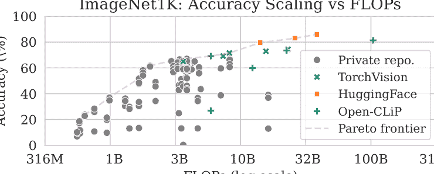

图 1.1: 图像分类模型的性能缩放。观察较小模型与最佳模型之间的大小差异（以 FLOPs 计，对数尺度）。

### 1.2 静态优化的不足之处

大量文献通过*静态*手段缩小了效率差距。模型压缩和蒸馏 [21, 48, 50, 166]、联邦学习 [66, 126] 和高效架构设计 [52, 76, 87] 等广泛适用的方法，与混合精度格式 [67]、张量核心 [205] 和高带宽互连 [110] 等硬件和软件的快速进展相辅相成。这些技术效果显著，但它们共享一个共同前提：目标部署环境（数据集、资源预算、可用硬件、查询复杂度）是*事先固定*的。一旦模型或方法调优完成，就会被冻结并按原样部署。然而在实际中，机器学习系统的运行条件和可用资源很少固定：

- **资源波动。** 在边缘设备上，电池电量、散热余量、计算周期和无线带宽可能在连续推理调用之间剧烈波动。在云端，短期 GPU 租赁可能在几乎没有预警的情况下被抢占，无服务器函数会产生冷启动延迟，而骨干网络拥塞会导致网络延迟和限流。因此，任何刚性部署都必须过度预留资源以容纳这些差异，否则可能会导致超时。

- **查询异质性。** 交互式服务——网络搜索、推荐、对话——接收到的是难易程度高度偏斜的请求混合物。像“匹兹堡天气”这样的关键词查询可以由一个微小模型正确回答，而像“你的雨滴是什么颜色？”这样的开放式提示，可能需要一个具有思维链推理能力的大得多的大语言模型。对两者都使用单一模型，要么在中位数案例上浪费计算，要么在长尾案例上牺牲质量。

- **集群变动。** 多租户 GPU 集群从不静止：新的训练作业到达，竞价实例被收回，节点故障或进入维护，资源需求发生变化。离线计算的作业调度和资源分配会在几分钟内过时，迫使要么预留冗余容量，要么频繁重新求解，从而限制了其适用问题的规模。

如我们所示，在某个点之后，静态调优会遇到天花板：进一步剪枝或硬件加速降低精度的速度比节省资源更快。因此，额外的收益需要适应特定于问题的结构——例如，通过在更短子序列上进行预测来减少顺序任务的延迟 [70]，或利用流式输入的时间相似性 [87]。随着部署过程中条件的进一步漂移，调优必须*重复*执行，或者资源必须过度预留——这激发了后续章节中所开发的方法。

### 1.3 核心论点：将可变性作为效率的杠杆

深度学习的显著进步得益于模型容量、数据量和计算可用性的稳步增长。然而在部署时——无论是电池供电的传感器还是共享 GPU 集群——资源波动、约束收紧，*蛮力缩放*很快变得不切实际。这提出了本论文的指导性问题：

> > How can learning systems convert environmental variability into efficiency gains without sacrificing performance?

> > 学习系统如何在不牺牲性能的前提下，将环境可变性转化为效率提升？

我们的答案是将这些波动视为可利用的结构，而非需要通过最坏情况预留来掩盖的麻烦。通过将计算与环境的时间和结构可变性相对齐，学习系统可以以成本的一小部分提供等效或更优的效用。论证在两个互补的环境中展开：

**任意环境：** 在许多实际系统中，外部条件——电池耗尽、网络拥塞、输入难度——可能会从一个时刻到下一个时刻不可预测地剧烈波动。因此，每个推理或优化步骤必须保持无记忆或**无状态**，不对过去做任何假设，不对未来做出任何承诺。我们在这个环境中的目标是**弹性**：根据*当前*实例的预算和难度调整计算，机会性地节省工作量，并在世界表现出真正任意行为时优雅降级为静态方法。

逐步演变的环境：许多实际系统更加温和，且逐步演变。分钟 t 的 GPU 集群作业队列与分钟 t−1 的队列相似；第五分钟的网络吞吐量接近第四分钟。这种缓慢的漂移使昨天的解决方案成为今天问题的宝贵开端。因此，针对此环境的算法是有状态的：它们缓存中间结果，应用差分更新，并在轮次中分摊工作量，而不是从头重新计算。

本论文根据关注的环境类型分为两部分：第一部分为任意环境下的机器学习推理设计弹性模型，第二部分讨论逐步演变环境下的持续优化。

### 1.4 贡献与路线图

通过融合机器学习、系统和优化的思想，本工作提供了支持我们论点的实际贡献，分为两个部分：

## 第一部分 – 任意环境下的自适应推理

- 第 2 章 – 构建弹性机器学习模型。我们介绍了渐进式集成蒸馏，这是一种将大型预训练模型分解为弹性集成的方法，其推理成本可以在运行时调高或调低。由此产生的 B-DISTIL 算法使用类似 boosting 的训练程序构建集成，并在紧凑资源预算下提供具有竞争力的精度。B-DISTIL 在视觉、语音和传感器基准的任务中展示了资源利用率的改进，并为蒸馏过程提供了 O(1/√T) 收敛保证。

- 第 3 章 – 动态确定弹性。将关注点从波动的预算转移到波动的查询难度，ABC 利用集成一致性作为难度信号，构建能够适应查询难度变化的弹性模型。由于它仅依赖前向传播进行一致性检查，ABC 完全无需训练，并可部署在黑盒 API 上。在四个语言、视觉和多模态任务中，ABC 在端到云推理中将通信成本降低高达 14×，在异构模型服务场景中将 GPU 租赁成本降低高达 3×，并在作为黑盒服务访问时将每令牌平均 API 成本降低 25×。

## 第二部分 – 逐步演变环境下的持续优化

- 第 4 章 – 持续适应逐步演变的环境。本章将大规模资源分配问题中的“缓慢演变”形式化，引入持续优化范式，并使用 COPTER 算法针对 GPU 集群调度将其实例化。通过重用先前的求解器工作并在每个新轮次上进行热启动，COPTER 将求解时间降低高达 100×，同时保持近乎最优的作业完成时间。

- 第 5 章 – 机器学习之外的渐进式演变。为了展示超越机器学习训练的通用性，我们将持续优化应用于另外两个领域——分片负载均衡和广域网流量工程。使用 COPTER，MILP 和 LP 公式均比最先进的基线快 10–100×，且分配质量几乎没有损失。

### 1.5 更广泛的影响与未来展望

我们在第一部分和第二部分中收集的证据表明，将计算适应其部署环境可以释放数量级的资源效率节省，同时保持竞争力。这些收益转化为边缘设备更长的电池续航、数据中心工作负载更低的碳足迹，以及在资源受限环境下更广泛地获取高质量机器学习。展望未来，自适应视角开辟了几个研究前沿：

- 边缘到云端连续体。当前的弹性模型停留在设备边界，而持续优化器则从数据中心内部开始。一个联合调优设备端推理和后端调度的端到端流水线，将为实时视频分析等混合应用最小化总成本。

- 隐私感知自适应。良性工作负载通常出现在联邦或受隐私约束的环境中，其中数据不能离开设备。将持续优化扩展以尊重差分隐私或安全聚合约束，将能够在不牺牲数据的情况下实现低成本个性化。

- 持续优化理论。第 4 章和第 5 章提供了实证证据和形式化，表明持续优化如何加速良性工作负载。将这些扩展到其他渐进变化概念，考虑即使热启动求解器也只有几次迭代的情况，并提供更紧的遗憾/运行时界限，都是有趣的开放问题。

通过将环境可变性——无论是剧烈还是温和——视为机遇而非威胁，本论文为构建不仅更高效，而且更具可持续性、更保护隐私且普遍可部署的机器学习系统指明了道路。


## 第一部分

## 任意环境中的自适应推理

## 第 2 章

## 构建弹性机器学习模型

许多现实世界的机器学习推理应用面临的资源预算会在每次调用之间不可预测地波动。本章研究此类任意环境下的机器学习推理，并介绍了弹性模型——即可以在运行时以推理成本换取准确率的模型。我们开发了 B-DISTIL，这是一种通过渐进式集成蒸馏从预训练教师模型构建弹性模型的算法，并展示了其在视觉、语音和传感器任务中的优势。本章构建在 Dennis、Shetty、Sevekari、Koishida 和 Smith 开发的技术之上 [166]。

### 2.1 弹性模型

传统的训练流程会产生一个刚性网络：给定固定输入维度，模型始终产生相同的推理成本。在 ImageNet 上，我们可用的最小 ResNet 仅消耗 0.15 GFLOPs，但正确回答的查询不足 12%（图 2.1）。大型网络可实现 83.4% 的 top-1 准确率，却需要 30.4 GFLOPs。因此，静态选择在预算合规性和预测质量之间造成了一种痛苦的抉择。

弹性模型旨在摆脱这种权衡。我们将弹性模型定义为预测器 f(x, κ)，其中 x 是输入，κ 是可配置的弹性值，用于确定该模型在准确率-成本 Pareto 前沿上的位置。给定固定输入 x 和资源预算 τ，现在可以寻找在成本 τ 下可实现的最佳预测所对应的弹性参数 κ。

请注意，推理成本可以以多种方式定义，例如——推理延迟、浮点运算次数（FLOPs）或总能耗。通过能够动态权衡推理成本，弹性模型提供了一种摆脱静态调优的方法。

构建弹性模型的一种简单方法是预先计算 Pareto 前沿：

ImageNet1K: 准确率缩放 vs FLOPs

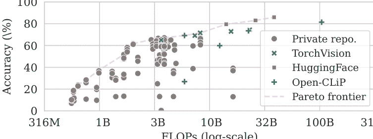

图 2.1：公开可用视觉模型的准确率与推理成本。这些模型在 ImageNet1k 图像分类任务上训练。粉色虚线代表 Pareto 最优前沿，显示给定计算预算（浮点运算次数，x 轴）下具有最佳推理质量（最高准确率，y 轴）的模型。

在不同复杂度级别上训练一组模型，测量它们的成本（例如 FLOPs）和准确率，并存储 Pareto 最优集（图 2.1）。在运行时，选择成本最符合当前预算的模型。在此简单情况下，弹性参数 \(\kappa\) 可以被视为按成本排序的模型索引。假设 \(\mathcal{F} = \{f_1, \dots, f_K\}\) 是按成本递增顺序排列的 Pareto 最优模型集，则有

```
f_{naive}(x, \kappa) = f_\kappa(x), \quad f_\kappa \in \mathcal{F}
```

尽管简单，但这种方法在管理模型的维护开支、模型切换时的选择延迟以及至关重要的预算预先未知等方面存在实际缺点。在实际中，预算只有在已经耗尽时才会揭晓，这使得预先选择 \(\kappa\) 变得不可能。

我们追求一种更原则化的替代方案。从单个教师模型 \(g(x)\) 开始，我们将其容量分解为 \(K\) 个弱学习者 \(\{f_1, \dots, f_K\}\) 的序列。随着逐个评估前 \(\kappa = k < K\) 个学习者，我们得到一个成本随 \(k\) 缩放的预测。假设每个 \(\kappa\) 的准确率都与最佳尽力预测器具有竞争力，我们就拥有一个随预算增加而准确率提升的随时模型。当推理中断时，我们只需返回最近的预测。

关键挑战是将教师的容量蒸馏成一组廉价的学习者，使得贪婪地逐个评估学习者能严格改进预测——而无需事先知道预算。由于普通蒸馏过程 [21, 50] 相当僵化——导致一个固定大小的单一压缩模型——我们引入了一个相关但不同的问题：_渐进式集成蒸馏_，并开发了一种算法来解决这个问题。

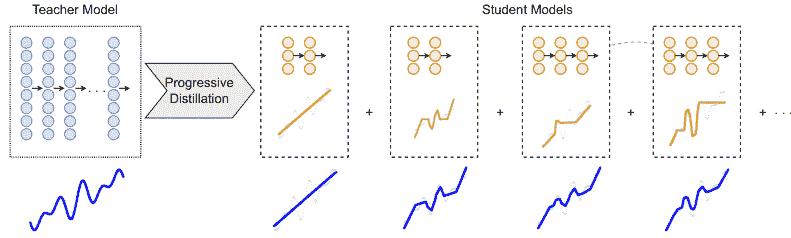

图 2.2：渐进式集成蒸馏。大型教师模型被蒸馏成一组低推理成本模型的集合。我们评估的学生模型越多，集合的决策边界就越接近教师模型。集合中的模型允许缓慢增长并依赖先前计算的特征。

**渐进式集成蒸馏。** 通过渐进式集成蒸馏，我们旨在将大型预训练模型 _g_ 蒸馏到一组有序的‘更便宜’模型（例如，低延迟模型）上，使得评估第一个模型成本低廉但仅产生粗略的预测估计（例如，覆盖常见情况），而评估额外模型则改进此估计（参见图 2.2）。这意味着我们可以在运行时通过选择要评估的模型数量（_弹性_ 参数）在准确率和推理时间（延迟）之间进行权衡。

除了弹性之外，这种分解还带来了额外的实际好处。设备端推理可以组合集成组件以满足延迟约束 [94, 144]；有序结构自然支持早期退出 [61, 70] 和随时推理 [73, 141] 场景，且学习者可以顺序或并行执行。具体而言：(i) 我们可以按需控制准确率-成本权衡，(ii) 我们可以交错顺序和并行执行，(iii) 我们可以在不重新评估早期学习者的情况下恢复并改进粗略预测。

当学生容量远小于教师时，标准蒸馏会遇到困难 [112, 129]，且将模型蒸馏到任何浅层网络的加权和上，很少能优于蒸馏到单一模型 [86, 149]。通过组合和复用中间激活，并引入由 boosting 理论 [13] 激发的额外损失项，即使在容量差距较大时，我们也能执行 _渐进式集成蒸馏_。只要组合仍保持资源高效，我们就能在不产生显著额外推理成本的情况下扩大假设类。B-DISTIL 算法保留了经典 boosting [36] 扩展到蒸馏设置后的理论保证，同时保持实用和有效。

本章余下部分阐述渐进式集成蒸馏的目标（第 2.2 节），介绍 B-DISTIL 算法（算法 1），提供收敛性保证（第 2.3 节），并在合成和现实世界基准上实证验证该方法（2.4 节）。

### 2.2 渐进式集成蒸馏

渐进式集成蒸馏旨在用一组更小、更低延迟的模型集合来近似高容量模型。在运行时，可以通过选择要评估的集成成员数量，在准确率和延迟之间进行权衡——这是一个向用户暴露的 _弹性_ 旋钮。本节将问题形式化为双人博弈，并介绍了由此产生的算法 B-DISTIL。

#### 2.2.1 问题公式化

考虑对一般双人零和博弈的重复博弈，其纯策略集合包括假设类 $\mathcal{F}$ 和概率分布 $\mathcal{P}$。给定教师模型 $g$，我们的目标是从假设类集合 $\{\mathcal{F}_m\}$ 中生成预测器的集合，以较好地逼近 $g$。给定测量模型 $f \in \mathcal{F}$ 质量的损失函数 $\mathcal{L}$，设玩家的损失（及回报）为 $F(f, p) = \mathbb{E}_{x \sim p}[\mathcal{L}(f, x)]$，则博弈的极小极大值为

$$ \max_{p \in \mathcal{P}} \min_{f \in \mathcal{F}} F(f, p) . $$ (2.1)

在蒸馏的背景下，给定训练集 $\{x_i\}$，公式 (2.1) 中的最大化玩家选择训练集上的一个分布，而最小化玩家选择在该分布下最小化损失的假设。在此设置中，请注意 $\mathcal{P} = \left\{p \in \mathbb{R}^{N \times L} : p_{i,j} \ge 0, \forall j \sum_i p_{i,j} = 1 \right\}$ 是 $N \times L$ 维上的单纯形乘积，且

$$ (\nabla_f F(f, p))_j = \sum_i p_{i,j} (f(x_i) - g(x_i))_j . $$ (2.2)

随机极小极大优化框架中的工具可以用于近似达到公式 (2.1) 中的值（更详细的讨论请参见附录 A.1）。如在此设置中常见，我们假设我们的算法可以访问 _弱梯度_ 向量 $h$，使得在分布 $p \in \mathcal{P}$ 和 $\beta > 0$ 下查询时，

$$ \langle h, \nabla_f F(f, p) \rangle \ge \beta . $$ (2.3)


#### 算法 1 B-DISTIL：主算法

```
Require: Target teacher model g, total number of rounds T, data {(x_i, y_i)}_{i=1}^N, learning rate eta, model classes ordered on inference cost {F_m}_{m=1}^M
1: K_t^+(i, j), K_t^-(i, j) <- 1/(2N), 1/(2N) forall(i, j)
2: F, r, t <- empty, 1, 1
3: while r < R and t < T do
4:   f_t = FIND-WL(K_t^+, K_t^-, F_r)
5:   if f_t is NONE then
6:     r <- r + 1
7:     continue
8:   With l := f_t - g, update K_t^+, K_t^-. forall(i, j)
     K_{t+1}^+(i, j) <- K_t^+(i, j) exp(-eta * l(x_i)_j)   (2.4)
     K_{t+1}^-(i, j) <- K_t^-(i, j) exp(eta * l(x_i)_j)    (2.5)
9:   Normalize K_t^+, K_t^-.
10: F, t <- F U {f_t}, t + 1
11: Return 1/|F| sum_{i=1}^{|F|} f_i
```

我们的程序迭代搜索在类 $\mathcal{F}_m$ 中相对于目标 $g$ 满足方程 (2.3) 的弱学习器（弱梯度）。每当找到这样的学习器，我们就将其加入到我们的集成中。随着程序的继续，集成的损失在样本内收敛到方程 (2.1)（定理 2.1）中的极小极大值，并且它享有有限的过剩风险（定理 2.2）。虽然方程 (2.3) 看起来比完全优化更容易，但在许多感兴趣的问题中，即使是这样也具有挑战性。事实上，在我们这里讨论的多标签设置中，主要算法挑战之一是构建一个能够可靠地找到低成本弱梯度/学习器的算法（参见第 2.2.3 节）。

#### 2.2.2 B-DISTIL 算法

具体来说，在每一轮 t 中，B-DISTIL 维护矩阵 $K_t^+$ 在 $\mathbb{R}^{N \times L}$ 中和 $K_t^-$ 在 $\mathbb{R}^{N \times L}$ 中，用于 N 个数据点和 L 个标签的值，使得对于所有 $(i, j)$ 在 $[N] \times [L]$ 中，$0 \le K_t^+(i, j), K_t^-(i, j) \le 1$。此外，$\sum_i K_t^+(i, j) + K_t^-(i, j) = 1$。元素 $K_t^+(i, j)$ 和 $K_t^-(i, j)$ 分别作为残差 $f_{t-1}(x) - g(x)$ 和 $g(x) - f_{t-1}(x)$ 的权重，从而放大偏离教师模型的大偏差。我们在此设置中使用的弱学习器的特定概念在定义 2.1 中正式化，这是提升方法文献中标准弱学习假设的自然扩展。

定义 2.1（弱学习条件）。

给定一个数据集 $\{(x_i, y_i)\}_{i=1}^N$，一个目标函数 $g : \mathcal{X} \to \mathbb{R}^L$ 和概率矩阵 $K_t^+, K_t^-$，如果以下求和严格为正，则函数 $f_t : \mathcal{X} \to \mathbb{R}^L$ 被认为相对于 $g, \forall j$ 满足弱学习条件：

\(\sum_i K_t^+(i,j)(f_t(x_i) - g(x_i))_j + K_t^-(i,j)(g(x_i) - f_t(x_i))_j.\)

在每一轮 $t$ 中，使用当前的概率矩阵 $K_t^-, K_t^+$，B-DISTIL 执行两个步骤：首先，它调用子程序 FIND-WL（如下讨论），该子程序试图找到满足弱学习条件（定义 2.1）的分类器 $f_t \in \mathcal{F}_r$。如果找到这样的预测器，我们将其添加到集成中，并继续进行第二步，根据 $f_t$ 犯下的错误更新概率矩阵 $K_t^-, K_t^+$。这在精神上类似于用于二分类的提升算法，例如 AdaBoost [36]。如果找不到这样的预测器，我们将调用算法 2 子程序，使用下一个模型类 $\mathcal{F}_{r+1}$。此过程重复，直到找到弱学习器或没有更多可搜索的类为止。

```
Algorithm 2 FIND-WL
Require: Probability matrices $K^+, K^-$, model class $\mathcal{F}$ parameterized by $\theta \in \Theta$, hyperparameters for SGD
1: Obtain $\{\mathcal{F}_r\}_{r=1}^R$ by expanding $\mathcal{F}$ (see below).
2: **for** $\mathcal{F}' \in \{\mathcal{F}_r\}_{r=1}^R$ **do**
3:   Initialize parameter $f_{\theta_0} \in \mathcal{F}'$.
4:   **for** $i \in \{1, \dots, \text{max-search}\}$ **do**
5:     Randomly initialize $f_{\theta_i}$.
6:     Run SGD to solve Equation (2.6).
7:     **if** $f_{\theta_i}$ is a weak learner **then**
8:       **Return** $f_{\theta_i}$
9:   **Return** NONE
```

#### 2.2.3 寻找弱学习器

在此设置中，可证明地近似教师模型的主要难点在于找到一个 *单一的*、资源高效、微小的学习器，在每一轮 $t$ 中，同时为所有标签 $j$ 满足弱学习条件。现有的分类提升方法将多类设置（$L > 1$）视为 $L$ 个二分类问题实例（一对其余）[36]。它们通常为每个实例选择 $L$ 个不同的弱学习器，这不适合资源高效的设备端推理。这里考虑的用于蒸馏的学生模型和教师模型之间的能力差距进一步增加了难度。因此，除了控制蒸馏温度外，我们采用了两种额外策略：

- 我们在 FIND-WL 求解的目标中使用一个正则化项，以促进弱学习，并且，
- 我们让当前的弱学习候选项重复使用有限数量的先前评估模型的存储激活输出，以提高其表达能力。

##### 对数屏障正则化器。

要找到一个弱学习器，FIND-WL 方法使用随机梯度下降来最小化两个损失项的和。第一项是带有温度平滑的标准二分类/多类交叉熵蒸馏损失 [50]。第二项对应于弱学习条件，定义如下：

```
-\frac{1}{\beta} \sum_{i,j} I_{ij}^+ \log \left( 1 + \frac{l(x_i)_j}{2B} \right) + (1 - I_{ij}^+) \log \left( 1 - \frac{l(x_i)_j}{2B} \right)
```

这里 $I_{ij}^+ := I[K_t^+(i,j) > K_t^-(i,j)]$，$B$ 是 logits 幅度的上界，且 $l(x_i) := f(x_i) - g(x_i)$。为了看到方程 (2.6)背后的直觉，假设以下成立：$\forall(i,j)$

```
$(K_t^+(i,j) - K_t^-(i,j))(f(x_i) - g(x_i))_j > 0.$
```

对所有 $x_i$ 求和，我们可以看到这足以使 $f$ 相对于 $g$ 成为弱学习器。方程 (2.6) 是弱学习条件的软对数屏障版本，它会惩罚那些不满足方程 (2.7) 的 $(i,j)$。正则化目标的相对重要性可以通过 $\beta$ 进行调整，鼓励 $f_t$ 成为弱学习器，可能会以分类性能为代价。

##### 中间层连接与性能分析。

如第 2 节所讨论，将蒸馏应用于低容量学生模型的线性组合，通常不如集成中任何单独训练的单一模型表现更好。就提升方法而言，从经验上看，一旦在某个低容量深度网络类 $\mathcal{F}_m$ 中找到了第一个弱学习器，通常就不可能从同一类 $\mathcal{F}_m$ 中为重新加权的目标找到弱学习器。为了绕过这个问题，我们让第 $t$ 轮的弱学习器类也包含依赖于先前弱学习器的中间层输出的函数 [118]。

作为一个具体示例，考虑一个具有 $U$ 层的深度全连接网络，参数化为 $f = W \phi_{1:U}$。这里 $\phi_{1:u}$ 可以被视为使用前 $u$ 层将 $x$ 变换到 $\mathbb{R}^{d_u}$ 的特征变换，而 $W \in R^{d_U \times L}$ 是线性变换。对于两层全连接基础模型类 $\mathcal{F}_0 := \{W^{(0)} \phi_{1:2}^{(0)} \mid W^{(0)} \in \mathbb{R}^{L \times d_2}\}$（为简单起见，省略下标 $m$），我们定义：

```
$\mathcal{F}_r = \{W^{(r)} \phi_{1:2}^{(r)}(\text{id} + \phi_{1:2}^{(r-1)})\} \quad \text{and,} \quad \mathcal{F}'_r = \{W^{(r)} \phi_2^{(r)}(\text{id} + \phi_1^{(r)} + \phi_1^{(r-1)})\},$
```

其中 $\text{id}(x) := x$。可以观察到，$\{\mathcal{F}_r\}$ 和 $\{\mathcal{F}'_r\}$ 定义了基于残差连接的网络的一个变体 [65]，并且函数类 $\{\mathcal{F}_r\}$（和 $\{\mathcal{F}'_r\}$）随 $r$ 增加而增加容量。此外，在顺序评估来自 $\mathcal{F}_r$ 的模型的推理成本时，其大约等于 $\mathcal{F}$ 的推理成本。每次后续评估都 *重复使用* 先前评估的存储激活。出于这个原因，每个 $\mathcal{F}_r$ 的参数计数与基础类匹配。通过将基础类选为不同规模的密集网络并将连接选为密集连接，该算法恢复了 [65] 中研究的 MSDNets。同样，通过将基础类选为根节点并将连接选为二进制连接，该算法恢复了 [141] 中的 HNE。

我们将给定基础类 $\mathcal{F}_0$、参数 $R$ 和连接类型构建 $\{\mathcal{F}_r\}$ 的过程称为 *扩展* $\mathcal{F}_0$。请注意，虽然中间连接有助于容量，但它们通常会降低并行性，因为模型变得相互依赖。作为实际后果，更倾向于对后层激活的依赖；因此，我们使用 Rasley et al. [114] 的性能分析器在训练轮次中测量推理成本并对模型进行排名（参见附录 A.3）。

### 2.3 理论分析

在本节中，我们为我们的方法提供理论分析和证明。首先，我们表明，只要子程序 FIND-WL 在每次 $t$ 时都成功，算法 1 产生的集成输出就以 $\mathcal{O}(1/\sqrt{T})$ 的速率收敛到 $g$。

定理 2.1。*假设类* $\mathcal{F}$ *满足，对于所有* $f \in \mathcal{F}, \|f - g\|_\infty \le G_\infty$。*设* $F = \{f_t\}_{t=1}^T$ *为算法 1 进行 T 轮后的集成，最终输出为* $F_t = \frac{1}{T} \sum_{t=1}^T f_t$。*如果* $f_t$ *对所有* $t \le T$ *满足方程 (2.7)，则对于* $T \ge \ln 2N$ *和*

$$\eta = \frac{1}{G_\infty} \sqrt{\frac{\ln 2N}{T}}$$

我们对所有 $j$ 都有

$$\|F_{t,j} - g_j\|_\infty \le G_\infty \sqrt{\frac{\ln 2N}{T}} - \frac{1}{T} \sum_{t=1}^T \gamma_t(j)$$ (2.8)

其中 $F_{t,j}$ 和 $g_j$ 分别是函数 $F_t$ 和 $g$ 的第 $j$ 个坐标。

证明背后的主要思想是界定算法向极小极大解收敛的速率。这是通过维护一个势函数并跟踪其在算法中的进展来实现的。这里使用的界限和技术也很通用，也就是说，对于各种目标和损失函数，适当设计的弱学习器能给出收敛到极小极大解的相似速率。此外，一个显示指数速率的更强版本可以通过在随之而来的证明中额外假设弱学习器具有恒定优势（方程 (2.9)）来证明。


证明。为简单起见，我们假设 $f_t$ 和 $g$ 是标量值函数，因为证明在逐坐标方面也成立。在每个时间点，定义弱学习算法的边缘为

$$\gamma_t = \sum_i K_t^+(i)(f_t(x_i) - g(x_i)) + \sum_i K_t^-(i)(g(x_i) - f_t(x_i)) \tag{2.9}$$

令 $Z_t$ 表示时间 $t$ 的归一化常数，即，

$$Z_t = \sum_i K_t^+(i) \exp(-\eta(f_t(x_i) - g(x_i))) + K_t^-(i) \exp(\eta(f_t(x_i) - g(x_i)))$$

根据更新规则，

$$
\begin{aligned}
K_{T+1}^+(i) &= \frac{K_T^+(i)e^{\eta(f_T(x_i)-g(x_i))}}{Z_T} \\
&= \frac{K_1^+(i) \exp(-\eta \sum_{t=1}^T (f_t(x_i) - g(x_i)))}{\prod_{t=1}^T Z_t} \\
&= \frac{K_1^+(i) \exp(-\eta T(F_T(x_i) - g(x_i)))}{\prod_{t=1}^T Z_t}
\end{aligned}
$$

同样地

$$K_{T+1}^-(i) = \frac{K_1^-(i) \exp(\eta T(F_T(x_i) - g(x_i)))}{\prod_{t=1}^T Z_t}$$

首先，我们对 $\ln(Z_t)$ 进行界定：

$$
\begin{aligned}
\ln(Z_t) &= \ln\left( \sum_i K_t^+(i) \exp(-\eta(f_t(x_i) - g(x_i))) + \sum_i K_t^-(i) \exp(\eta(f_t(x_i) - g(x_i))) \right) \\
&\le \ln\left( \sum_i K_t^+(i) \left( 1 - \eta(f_t(x_i) - g(x_i)) + \eta^2(f_t(x_i) - g(x_i))^2 \right) \right. \\
&\qquad \left. + \sum_i K_t^-(i) \left( 1 + \eta(f_t(x_i) - g(x_i)) + \eta^2(f_t(x_i) - g(x_i))^2 \right) \right) \\
&\le \ln\left( 1 - \eta \sum_i K_t^+(i)(f_t(x_i) - g(x_i)) + \eta \sum_i K_t^-(i)(f_t(x_i) - g(x_i)) + \eta^2 G_\infty^2 \right) \\
&\le -\eta \gamma_t + \eta^2 G_\infty^2
\end{aligned}
$$

其中第二步利用恒等式 $\exp(x) \le 1 + x + x^2$（当 $x \le 1$ 时成立），前提是 \(\eta \le \frac{1}{G_\infty}\)。这得出了经过 \(T\) 轮后的回归误差界：

$$
\begin{aligned}
-\eta T (F_T(x_i) - g(x_i)) &= \ln(K_{T+1}^+(i)) - \ln(K_1^+(i)) + \sum_{t=1}^T \ln(Z_t) \\
&\le \ln \left( \frac{K_{T+1}^+(i)}{K_1^+(i)} \right) + \sum_{t=1}^T -\eta \gamma_t + \eta^2 G_\infty^2 \\
&= \ln \left( \frac{K_{T+1}^+(i)}{K_1^+(i)} \right) + \eta^2 T G_\infty^2 - \eta \sum_{t=1}^T \gamma_t \\
&\le \ln 2N + \eta^2 T G_\infty^2 - \eta \sum_{t=1}^T \gamma_t \,,
\end{aligned}
$$

其中最后一个界限来自 \(K_1^+ = \frac{1}{2N}\) 和 \(K_{T+1}^+ \le 1\)。同样，我们对

\(\eta T (F_T(x_i) - g(x_i)) \le \ln 2N + \eta^2 T G_\infty^2 - \eta \sum_{t=1}^T \gamma_t\)

进行界定

结合两个方程，

\(\sup_i |F_T(x_i) - g(x_i)| = \|F_T - g\|_\infty \le \frac{\ln 2N}{\eta T} + \eta G_\infty^2 - \frac{1}{T} \sum_{t=1}^T \gamma_t\) 。

我们选择 \(\eta = \frac{1}{G_\infty} \sqrt{\frac{\ln 2N}{T}}\) 来最小化此表达式，并获得回归误差的以下界：

\(\|F_T - g\|_\infty \le -\frac{1}{T} \sum_{t=1}^T \gamma_t + G_\infty \sqrt{\frac{\ln 2N}{T}}\) 。

这正是方程 (2.8)。注意，这个 $\eta$ 只有在 \(T \ge \ln 2N\) 时才满足 \(\eta \le \frac{1}{G_\infty}\) 的条件，即界限成立的时间范围。\(\square\)

除了关于样本内风险的定理 2.1 的结论外，B-DISTIL 算法还具有较强的样本外保证。这可以通过将算法的泛化误差界定为类 \(\mathcal{F}\) 的泛化误差来证明，如定理 2.2 所形式化。虽然如所述的定理为了简单起见仅限于二分类情况，但一般结果也沿着类似思路得出。

**定理 2.2** (过剩风险)。令 \(\mathcal{C}_T\) 表示形式为

\(F_T(x) = \text{sign}(\frac{1}{T} \sum_{i=1}^T f_t(x)),\)

的函数类，其中 $f_t$ 是类 $\mathcal{F}$ 中的函数。假设数据 $D$ 包含来自分布 $\mathcal{D}$ 的 $N$ 个独立同分布样本，且函数 $g$ 在数据 $D$ 上以概率 $\mu$ 具有 $\epsilon$ 间隔，即 $\mathbb{P}_{x \sim \mathcal{D}} [|g(x)| < \epsilon] < \mu$。此外，假设类 $\mathcal{C}_T$ 的 VC 维为 $d$。那么，对于 $T \ge 4G_\infty^2 \ln 2N/\epsilon^2$，在样本上以至少 $1 - \delta$ 的概率，算法 1 的输出 $F_T$ 满足：

$\text{err}(F_T) \le \widehat{\text{err}}(g) + \mathcal{O} \left( \sqrt{\frac{d \ln(N/d) + \ln(1/\delta)}{N}} \right) + \mu.$

请注意，上述定理可以轻松调整为将类 $\mathcal{C}_T$ 的边界和 VC 维替换为相应的 fat-shattering 维的情况。此外，在随机最小最大优化设置中，可以通过将样本损失和梯度视为种群目标的随机梯度，直接得到种群界限。例如，[118] 采用了这种观点。我们将种群界限和样本界限分开，以简化展示和证明，见附录 A.2。

### 2.4 实证评估

我们现在在真实世界数据集和模拟数据集上以及多种架构类型上评估 B-DISTIL。我们考虑跨越三个领域（视觉、语音和传感器数据）的六个真实世界数据集，以及两个模拟数据集。这使我们能够在五种架构类型上评估我们的方法：全连接网络、卷积网络、残差网络、密集连接网络和循环网络。

#### 2.4.1 数据集信息

对于模拟数据实验，我们构建了两个数据集。第一个数据集称为 $ellipsoid$，是一个二分类数据集。这里每个数据点 $x \in \mathbb{R}^{32}$ 的分类标签由随机正半定矩阵 $A$ 的 $x^T A x$ 值确定。第二个模拟数据集 $cube$ 用于 4 类的多类分类。这里标签由 $\mathbb{R}^{32}$ 中 $\{-1, 1\}^{32}$ 的顶点的距离确定，分为 4 类。

我们还在实验中使用了六个真实世界数据集。我们的图像分类实验使用 $CIFAR$-$10$、$CIFAR$-$100$、$TinyImageNet$ 和 $ImageNet$ 数据集。对于时间序列分类任务，我们使用 $Google$-$13$ 语音命令数据集。这里的任务是关键词检测：给定一秒钟的音频缓冲区，我们需要识别是否有 13 个预定义关键词中的任何一个被说出。最后，我们使用日常体育活动 ($DSA$) 数据集进行传感器数据实验。这里的任务是使用传感器数据识别个人从预定义体育活动集中所执行的活动。有关所用所有数据集的详细信息，见附录 A.3。

#### 2.4.2 模型架构细节

**教师模型。** 我们在 *Ellipsoid* 上使用深度全连接（FC）网络进行分类，在 *Cube* 上使用卷积网络。对于 *CIFAR-10* 和 *ImageNet* 数据集的图像分类，我们使用公开可用的预训练 ResNet 模型。我们基于公开可用的训练配方（见附录 A.3）为 *CIFAR-100* 数据集训练参考 DenseNet 模型。由于口语音频数据（*Google-13*）和传感器数据（*DSA-19*）都是时间序列分类问题，我们使用循环神经网络（RNN）。我们在 *Google-13* 上训练基于 LSTM 的架构 [7]，在 *DSA-19* 上训练基于 GRU 的架构 [39]。除预训练 ResNet 模型外，所有其他教师模型均基于验证数据上的性能选择。

**学生模型。** 对于所有蒸馏任务，为简单起见，我们从与教师模型相同的架构类型设计学生基模型类，但起始参数显著更少，资源需求更低。我们在所有实验中训练至多 *T*=7 轮并保持 \(\eta=1\)。每当 FIND-WL 无法找到弱学习器时，我们使用作为超参数指定的连接扩展基类 $\mathcal{F}$。由于我们只需要最多 *T*=7 个弱学习器，我们可以选择 *R* 的小值（例如，2）。每个数据集使用的中间连接的详细信息，以及方程 (2.6) 中的正则化参数 \(\gamma\) 等超参数和 SGD 的超参数，可在附录 A.3 和附录 A.4 中找到。

#### 2.4.3 实验评估与结果

首先，我们展示了 B-DISTIL 在随时推理和早期预测背景下提供的精度与推理时间之间的权衡。我们在顶-1 分类精度和推理所需的总浮点运算次数（FLOPs）上比较我们的模型。我们使用公开可用的分析器 [114] 来测量浮点运算次数。为简化展示，我们将这些转换为参考加速器（NVIDIA 3090Ti）上的相应推理时间（\(\tau\)）。

**随时推理。** 如前所述，在随时推理设置中，即使模型的执行被中断，也需要产生预测。标准模型架构只能在执行完成后才输出预测，因此不适用于此设置。我们而不是与理想化基线进行比较，其中我们假设对推理预算具有 *oracle* 访问权限，而该


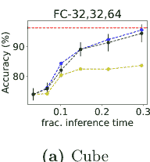

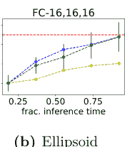

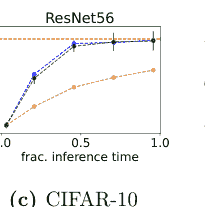

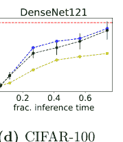

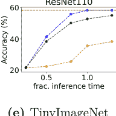

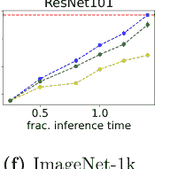

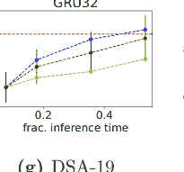

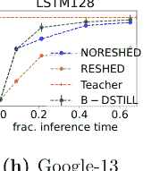

图 2.3：准确率与推理时间对比。推理时间在 x 轴上以教师模型推理时间的比例报告，并伴随平均集成准确率和误差棒（y 轴）。B-DISTIL 在运行时执行此权衡。对于基线 NO-RESHED，在 x 轴上的推理时间 \(\tau_w\) 处，y 轴表示被允许 \(|\tau_w - 0|\) 时间进行推理的最佳单模型的准确率。同样，对于基线 RESHED，在 \(\tau_w\) 处，y 轴是模型集合的准确率，其中模型 \(w\) 被允许 \(|\tau_w - \tau_{w-1}|\) 时间执行其推理。这也是 B-DISTIL 连续预测之间的延迟。我们可以看到 B-DISTIL（绿色）与预言基线（NO-RESHED，蓝色）保持竞争力，并优于加权平均（RESHED，黄色）。

通常只有在执行完成或中断后才可用。基于此假设，我们可以在各种推理时间约束下选择最佳模型，例如，通过维护模型的 Pareto 前沿，并选择符合当前推理预算的模型。我们将此基线称为 NO-RESHED，并在图 2.3 中将 B-DISTIL 与其在合成数据集和真实世界数据集上进行对比。这个理想化基线是固定推理预算下 B-DISTIL 准确率的上限。

当允许重新调度推理任务时，B-DISTIL 可以改进其初始预测。为了说明这种可能的改进，我们考虑执行在时间点 \(\{\tau_1, \tau_2, \dots, \tau_W\}\) 被中断并重新调度（为简便起见，零延迟）的情况。我们需要在每个 \(\tau_w\) 输出一个预测。作为理想化基线，假设我们预先知道这些中断点。一种可能的解决方案如下：选择推理预算为 \(|\tau_1|, |\tau_2 - \tau_1|, \dots, |\tau_w - \tau_{w-1}|\) 的模型。按顺序评估它们，并在每个中断 \(\tau_w\) 时，输出 \(w\) 个模型的（可能加权）平均预测。我们将此基线称为 RESHED。由于 \(\tau_w\) 处的预测是模型的加权平均，我们预期其性能将作为 B-DISTIL 性能的下限（图 2.3）。

| 数据集 | 算法 | T = 50% | | T = 75% | | T = 100% |
|---|---|---|---|---|---|---|
| | | 准确率 (%) | 比例 | 准确率 (%) | 比例 | 准确率 (%) |
| Google-13 | E-RNN | 88.31 | 0.48 | 88.42 | 0.65 | 92.43 |
| | B-DISTIL | 87.41 | 0.49 | 89.31 | 0.71 | 92.25 |
| DSA-19 | E-RNN | 83.5 | 0.55 | 83.6 | 0.56 | 86.8 |
| | B-DISTIL | 82.1 | 0.53 | 84.1 | 0.58 | 87.2 |

表 2.1：早期预测性能。B-DISTIL 产生的集成与 E-RNN 算法 [70] 的性能对比。展示了在 50%、75% 和 100% 时间步时早期预测的数据的准确率和累积比例。在 T = 100 时，评估比例为 1.0。使用早期预测损失的 B-DISTIL 输出的集成与 E-RNN 算法具有竞争力。与专门为 RNN 早期预测开发的 E-RNN 不同，B-DISTIL 更广泛地适用于各种模型架构。

我们可以看到，在图 2.3 的所有中断点，B-DISTIL 提供的预测与理想化基线 RESHED 具有竞争力，RESHED 需要预先知道推理预算以进行模型选择，同时在重新调度时能够改进其初始预测。例如，对于 CIFAR-100 数据集以及 x 轴上 0.5 处的中断点，B-DISTIL 产生的预测与具有相同推理时长的单一模型相当，同时能够允许在所有之前的时间点中断。

**早期预测。** 为了评估我们的方法在在线时间序列推理中的早期预测适用性，我们将 B-DISTIL 的性能与 [70] 中的 E-RNN 进行对比。与可以应用于通用架构的 B-DISTIL 不同，E-RNN 是一种专门为 RNN 开发的早期预测最先进的方法。在训练时，我们将分类损失设置为 E-RNN 训练中使用的早期分类损失。我们在时间序列数据集 Google-13 和 DSA 上评估我们的方法。按评估的时间步数比较的性能如表 2.1 所示。在这里，我们看到 B-DISTIL 在早期预测方面与 E-RNN 保持竞争力。与 E-RNN 不同，B-DISTIL 还为离线/批量评估时间序列数据提供早期预测。对于这种情况，可以调制一个类似于 E-RNN 的阈值，B-DISTIL 可以按成本递增的顺序评估其集成中的模型，并在预测分数超过此阈值时退出。

#### 2.4.4 训练注意事项与可扩展性

**连接。** 我们的方法使用中间连接来提升性能。尽管这些连接的设计旨在高效，但它们相对于基于平均的集成仍有额外开销。图 2.4 显示了与我们在图 2.3 中考虑的蒸馏任务相对应的中间连接评估所需的 FLOPs。在这里，我们比较了从轮次 $T$ 评估模型所需的 FLOPs 与评估该模型使用的中间连接所需的 FLOPs。请注意，在图 2.4 中累加至轮次 $T$ 的所有 FLOPs，给出了包含前 $T$ 个模型的集成所需的总 FLOPs。对于我们所有的模型，与相应模型的推理成本相比，连接的开销可以忽略不计。为了评估中间连接提供的好处，我们可以比较带有连接的 B-DISTIL 和不带连接的 B-DISTIL 的运行结果。后一种情况可以被视为为蒸馏运行 AdaBoost 算法。请注意，这与 RESHED 基线（加权平均）相同。通过将图 2.3 中的 B-DISTIL 与 RESHED 进行对比，我们可以看到使用中间连接的好处。

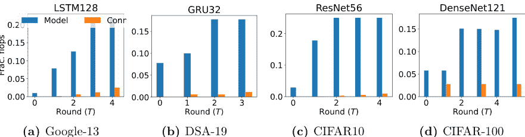

**图 2.4：** *连接开销。* 在轮次 $T$ 中添加的模型所需的 FLOPs，与仅评估该模型使用的连接所需的 FLOPs 进行比较。我们展示了对应于总体所需 FLOPs 较小的模型的数据集的结果。我们看到，即使对于这些模型，连接也只增加了相对较小的开销。

##### 训练/蒸馏开销。

与单个模型的训练相比，B-DISTIL 需要额外的计算和内存。维护两个矩阵 $K_t^+$ 和 $K_t^-$ 需要额外的 $\mathcal{O}(NL)$ 内存。即使对于包含 $N = 10^6$ 个样本和 $L = 1000$ 个类别的相对较大的数据集，这也只有几个千兆字节。然而，由于这两个矩阵可以存储在磁盘上，一个批次可以异步加载到内存中以使用标准 ML 框架提供的数据加载器进行损失计算。因此，额外的 GPU 内存需求变得相当小，对于小批量大小 $b$ 为 $\mathcal{O}(bL)$，与维护小批量 one-hot 分类标签所需的内存相同。由于每轮仅对正在训练的模型需要梯度计算，而该模型通常比教师模型小，因此反向传播相对便宜。对于大型数据集，加载教师模型前向传播的数据成为瓶颈。有关 ImageNet 蒸馏的数据加载、训练时间和资源的讨论，请参见附录 A.4。

##### 使用分析对 $\{\mathcal{F}\}_t$ 进行排序。

如第 2.2 节所述，B-DISTIL 假设 $\{\mathcal{F}_t\}$ 中的假设类根据某个推理成本度量（例如推理时间）进行排序。在实践中，我们通过从一个小型基础模型开始，并在运行时对后续轮次中考虑的模型进行分析，在运行时实现这一点。例如，在 PyTorch 中，我们可以使用 `torch.autograd.profiler` 模块来分析模型的前向传播。作为一种启发式方法，我们随后根据集成中模型的平均推理时间对 $\{\mathcal{F}\}_t$ 中的模型进行排序。

### 2.5 结论、局限性与进一步方向

本章介绍了进度式集成蒸馏，其目标是通过创建一个有序集成来将单个教师模型蒸馏为弹性模型，该集成随着更多组件被评估而逐步改进。我们表明，集成的组件确实构成一个分解，并且随着更多成员的执行而提供越来越准确的预测，使我们能够在不访问当前推理预算的情况下贪婪地设置弹性，并在中断后无缝恢复。

我们开发了一种名为 B-DISTIL 的算法来执行进度式集成蒸馏，并展示了其在高效推理方面的若干应用实用性。特别是，我们通过将视觉、语音和传感器领域数据的成熟深度模型分解为集成，在实验上证明了 B-DISTIL 的有效性。我们的过程利用带有对数势垒正则化的随机求解器来寻找弱学习器，在训练期间对候选模型进行分析，并采用中间连接来弥补能力差距。B-DISTIL 背后的关键洞察是将蒸馏视为一个双人零和博弈，该博弈将架构细节抽象为基类构造 $\mathcal{F}$。这意味着，只要从基类中找到一个“弱学习器”，我们就能保留经典提升设置的保证。由于这些弱学习器仅需要在轮次之间产生小幅改进，我们能够可靠地找到此类模型。

抽象弱学习器细节的一个警告是，实践者仍必须设计一个基类 $\mathcal{F}$。此外，由于 B-DISTIL 根本上依赖于蒸馏过程，所有蒸馏或重新训练本身在实际中不可行的情况，对于 B-DISTIL 也是不可行的。我们假设在所需的资源、数据和模型大小下，重新训练或蒸馏是可行的。

尽管本章专注于设备端连续推理，但相同的蒸馏过程也有利于云端和数据中心部署。这包括层融合、负载均衡和改进资源利用率等任务，这些任务值得进一步研究。未来工作还应考察我们的方法对公平性和鲁棒性 [92, 108, 136] 等辅助指标的影响。简而言之，B-DISTIL 将一个刚性专家模型转变为具有可证明保证和跨领域实际影响的弹性集成。


### 2.6 相关工作

#### 高效推理

机器学习推理在实际应用中部署时，由于内存、能耗、成本或延迟限制，往往受到资源约束。这推动了众多高效推理技术的发展。通过低阶、稀疏和量化表示对预训练参数张量进行剪枝和近似 [49, 90, 101, 131] 在降低资源需求方面通常很有效。还有针对高效推理的架构和任务特定技术 [87, 145, 168]。与压缩已训练模型相比，研究人员还开发了算法，通过将资源约束作为训练例程的一部分来训练压缩或小型模型 [60, 69]。最近，还开发了算法，从单个预训练模型中搜索更小的子模型 [82, 151]。

#### 知识蒸馏

知识蒸馏旨在将较大模型（或模型集合）的知识转移到较小模型中 [21, 50]。尽管广受欢迎，但通过蒸馏进行压缩存在几个已知陷阱。最值得注意的是，有文献记录表明，当存在*容量差距*（即教师模型显著大于学生模型）时，蒸馏效果较差 [86, 112, 129, 149]。在对加权集合组合进行蒸馏时，观察到向集合中添加更多模型并不能显著优于单个蒸馏模型的性能 [149]。同时，缺乏表征蒸馏何时以及为何对压缩有效的理论工作 [132]。我们将读者引向 [132]，以了解关于蒸馏广泛应用和方法的最新调查。

#### 早期退出与随时推理

许多应用可以从渐进式集合蒸馏的输出中受益，该输出允许灵活调整准确率与推理成本之间的权衡，并行执行推理。在边缘设备连续（在线）推理场景中，*早期退出*模型旨在快速评估常见案例，以提高能源效率并延长电池寿命 [61, 70]。例如，持续监听语音命令的电池供电设备可以使用早期退出方法，通过快速分类非命令语音来提高电池效率。许多早期退出方法也适用于随时推理 [73, 141]。在*随时推理*中，目标是在推理被中断时仍能产生预测，

#### 双人博弈、在线优化与提升

本章将渐进式集合蒸馏表述为双人零和博弈。自冯·诺伊曼和摩根斯特恩的奠基性工作 [1] 以来，双人零和博弈中均衡的重要性便已得到认可。Schapire [4]、Freund [3] 以及 Freund 和 Schapire [13] 的后续应用指出了提升与双人博弈之间的紧密联系。基于这一结果，开发了多种基于提升的实用学习方法，例如 AdaBoost [6]、梯度提升 [9] 和 XGBoost [55]。提升仅最近才在现代深度学习应用中取得成功。特别是，Suggala、Liu 和 Ravikumar [118] 提出了一个广义提升框架，用于训练基于提升的深度网络集合。他们的关键洞察是，在特征空间中允许函数组合有助于提升深度神经网络。虽然他们专注于训练且不生成预训练模型的分解，但我们在工作中采用了类似的方法，以在集合组件之间选择中间层连接（第 2.2.3 节）。与我们设置相似的更通用提升应用来自 Trevisan、Tulsiani 和 Vadhan [27]。他们证明，给定目标有界函数 g（例如教师模型）和候选近似函数类 f ∈ F，可以使用在线学习和提升的思想，以任意精度对 g 相对于 F 进行迭代近似。然而，这些结果依赖于在迭代 t 中找到函数 ft 的能力，该函数能导致在轮数依赖的近似损失中至少有微小的常数改进。本章讨论工作的关键贡献在于表明，可以通过仔细选择候选模型，为渐进式集合蒸馏的实际应用找到此类函数。

## 第 3 章

## 动态确定弹性

本章建立在第 2 章中介绍的弹性模型之上。在第 2 章中，我们解决了资源预算的变异性——即可用计算预算随查询变化的情况。然而，在这里我们面对的是查询难度的变异性：有些查询可以由轻量级模型轻松回答，而有些则需要远大得多的模型。我们提出了 ABC（基于协议的级联），一种轻量级、免训练的过程，根据每个查询的难度选择推理弹性，从而按易查询的比例降低平均推理成本。本章内容建立在 Kolawold、Dennis、Talwalkar 和 Smith [192] 的工作之上。

### 3.1 查询难度

在许多实际的 ML 部署中，推理过程中遇到的大量数据可以使用轻量级模型而非最先进的庞大模型来有效评估 [102, 171]。也就是说，可以为每个推理查询关联一个难度概念。直观地讲，给定特定推理任务的帕累托最优模型集，我们可以根据能为查询生成高质量推理输出的最廉价模型对查询进行排序。例如，在问答等语言建模任务中，可以使用参数量相对较少的模型来回答简单的事实性问题，而对于需要研究和综合的更复杂问题，则可能需要参数量大的基于推理的模型。

从效率角度来看，这意味着如果我们能识别出可以由较便宜模型准确评估的推理查询子集，就可以降低平均推理成本。解决此问题的自然方法是构建一个包含特定任务帕累托最优模型的弹性模型（图 3.1）并

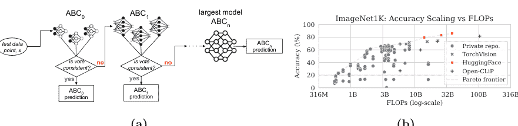

**图 3.1:** (a) **基于协议的级联 (ABC)：** ABC 引入了一种数据相关的路由方案，使用模型集合之间的一致性来确定是否级联到更大的模型。如果较小集合的预测不一致，级联将移动到下一级更大的模型，继续进行，直到达成一致或使用最大模型。这可以通过将最大模型的使用限制在较小模型无法达成共识的情况下来降低成本。**(b)** ABC 是自适应推理的自然基准，因为 (i) 当今 ML 从业者可用的预训练模型数量庞大；(ii) 即使是微小的准确率提升往往也需要 FLOPs 增加一个数量级，这反映了所提出的缩放定律，并导致级联层级之间模型大小存在显著差异 [64, 107, 177]。粉色虚线代表帕累托最优前沿，显示了给定计算预算下准确率最高的模型。我们表明 ABC 可以有效改进这一前沿——使从业者能够通过为“更容易”的样本调用较小模型来实现高准确率，而无需承担最大模型的全部计算成本。

*cascade* over them, starting from the least expensive and moving to more expensive models based on some *deferral rule* [8, 14, 42]. The deferral rule is usually inexpensive—e.g., a model's confidence score [18, 79, 143]—and determines when to cascade up to a larger model (i.e., the elasticity parameter).

对其进行*级联*，从最便宜的模型开始，根据某些*推迟规则* [8, 14, 42] 移动到更昂贵的模型。推迟规则通常成本较低——例如，模型的置信度分数 [18, 79, 143]——并确定何时级联到更大的模型（即弹性参数）。

Recently, cascading has seen renewed interest in the ML community with the advent of large language models (LLMs) and vision foundation models [e.g., 165, 190]. Recent approaches consider a variety of techniques to construct model cascades, including designing novel model architectures that have built-in cascading capabilities [85, 167, 172], or learning routing schemes/deferral rules that require data-dependent training for every task considered [165, 186]. While these approaches can improve accuracy/efficiency trade-offs, they may also introduce significant computational overhead in setup and training/fine-tuning costs.

随着大型语言模型 (LLM) 和视觉基础模型 [例如，165, 190] 的出现，级联最近在 ML 社区中重新引起了关注。最近的方法考虑了构建模型级联的各种技术，包括设计具有内置级联功能的新型模型架构 [85, 167, 172]，或学习需要针对每个考虑任务进行数据相关训练的路由方案/推迟规则 [165, 186]。尽管这些方法可以改进准确率/效率权衡，但它们也可能在设置和训练/微调成本方面引入显著的计算开销。

We instead focus on a simple, *training-free* cascade scheme that uses the agreement amongst an ensemble of existing models at each cascade level as its deferral rule. We refer to this approach as *Agreement-Based Cascading* (ABC). Intuitively, when the outputs of the ensemble at a particular cascade level do not align, then ABC triggers cascading, and inference is attempted at the next tier of (larger) models (see Figure 3.1). The tier at which cascading terminates implicitly selects the elasticity parameter. This scheme has been explored historically for specialized applications

我们反而专注于一种简单的、*免训练*级联方案，该方案使用每个级联级别中现有模型集合的一致性作为其推迟规则。我们将此方法称为*基于协议的级联* (ABC)。直观地讲，当特定级联级别的集合输出不一致时，ABC 会触发级联，并在下一级（更大）的模型上尝试推理（参见图 3.1）。级联终止所在的层级隐含地选择了弹性参数。该方案在历史上曾为专门应用进行过探索


诸如人脸检测 [20, 24, 31] 等场景，其中二进制人脸检测器的集合关注面部子区域，并使用决策网络组合其输出。然而，将集合一致性作为更通用、现代 ML 工作负载的延迟机制，尚未得到足够重视。ML 中的几个趋势使 ABC 成为模型级联特别有吸引力的方法。虽然在每个级别使用模型集合最初可能会增加整体推理成本，但这个简单的基线可能在现实世界应用中表现出色，原因有：(i) 随着模型注册表 [98] 和灵活压缩方案 [166, 184] 的兴起，获得各种大小和准确度水平的预训练模型变得越来越容易；(ii) 规模法则预测准确度每边际增加，推理成本将大幅增加 [64]（图 3.1）；以及 (iii) 执行相对较小模型集合并行处理的能力增强，且额外成本极低 [16, 173, 178]（图 3.3）。

在本章中，我们 (i) 提出 ABC，这是一种无需训练、基于延迟的级联，利用集合内部的一致性来决定何时升级，从而消除了对专用路由网络或专门架构的需求；(ii) 从理论上表征 ABC 在不牺牲准确性的情况下何时可以替换现有部署，引入 *安全延迟* 条件，并推导预期准确性和推理成本的边界；以及 (iii) 通过实证证明，ABC 在各种视觉和语言基准上同时提高了效率和准确性。在实际场景中，ABC 在边缘到云推理中将通信成本降低多达 14×，在异构模型服务场景中将 GPU 租赁成本降低多达 3×，并在模型作为黑盒服务访问时将每个代币的平均 API 成本降低多达 25×。

### 3.2 基于一致性的级联 (ABC)

在本节中，我们介绍了基于一致性的级联 (ABC) 方法的高级概述，提供了解 ABC 在实验 (第 3.4 节) 中有效性所需的基本概念和见解。对技术细节感兴趣的读者可参阅第 3.3 节，以获取更全面的论述。

#### 3.2.1 ABC 方法概述

如第 3.1 节所述，自适应推理的目标是识别可以由成本较低的模型准确评估的数据样本。这样，我们可以根据样本是“简单”还是“困难”来降低推理成本。解决这一问题的常见方法是基于延迟的级联，即对一系列模型进行级联，从成本最低的模型开始，并使用“延迟规则”来确定是否必须使用更高层级的模型。这些延迟规则的评估成本通常要低得多（例如，一个小型神经网络），并且在模型执行之上仅增加很少额外成本。这种方法使得“更简单”的案例由较小、更快的模型处理，而只有复杂案例才会级联到多个层级和更多资源密集型模型。

```
**Algorithm 3 Agreement-Based Cascading (ABC)**
**Require:** Set of ensembles \(\{H_1, H_2, \dots, H_{n_E}\}\), deferral rule \(r_i\) for each ensemble
\(i \in [n_E]\) as in Equation 3.3 or 3.4
**Require:** A new inference data point \(x\).
Current cascade level, \(i \leftarrow 1\)
Cascaded prediction, \(y \leftarrow \emptyset\)
for \(i \in \{1, \dots, n_E\}\) do
  \(y \leftarrow H_i(x)\)
  if \(r_i(x) = 0\) then
    break      // Models in ensemble ‘agree’
return \(y\)
```

_基于一致性的级联 (ABC)_（如算法 3 所述）是一种此类基于延迟的级联方法。ABC 维护一组集合 \(\{H_1, \dots, H_{n_E}\}\)，从 \(H_1\) 中的廉价模型集合开始，一直到 \(H_{n_E}\) 中的昂贵、最先进的模型。与其他级联技术类似，给定样本 \(x\)，我们从级联中最低（最便宜）的层级开始推理，并使用延迟规则 \(r_i(x)\) 来确定是否必须使用更高层级的模型。ABC 与现有级联方法的核心区别在于其基于一致性的延迟规则。我们没有训练一个小的额外延迟网络或事后延迟规则，而是使用每个集合内部模型之间的一致性_概念_作为置信度量。当一个层级中（可配置的）比例的模型达成一致时，这表明它们很可能得出了正确答案。相反，如果它们意见不一致，不确定性会触发向下一个更强大的集合延迟。此外，我们关注的是希望保持整体预测准确性，并且仅在准确性不受影响的情况下改进推理成本的情况。这与优先考虑固定推理预算（可能以牺牲准确性为代价）的现有方法不同。

#### 3.2.2 现代 ML 环境中的 ABC

近年来，得益于公共和私有模型仓库 [98] 的兴起，获得训练好的模型变得容易多了，各种预训练模型随处可得。各种大小和性能水平的可用模型如此丰富，使得 ABC 在实际中的应用特别有吸引力。与需要额外的任务特定训练或微调的方法不同，ABC 可以利用这些现有模型，使其适合作为高成本模型的“即插即用”替换方案直接部署。这种适应性，加上最低的设置和训练要求，使得 ABC 能够无缝融入现有的 ML 工作流。严格来说，评估集合中多个模型之间的一致性成本较高，与许多现有方法中使用的小型路由器模型相比。然而，现代 ML 工作负载的两个关键方面有助于在实际中减轻这一额外成本。首先，在许多情况下，某种程度的 *并行化* 可用，可以减少对延迟等推理成本指标的影响。我们使用 \(\rho\) 在完全顺序情况（\(\rho = 0\)）和完全并行情况（\(\rho = 1\)）之间进行平滑插值，如第 3.3.3 节所述。其次，在许多用例中，级联连续层级之间模型的成本差异非常大，以至于低层级模型对整体推理成本的影响微乎其微，即使考虑了构建集合的额外成本（参见图 3.3）。我们使用 \(\gamma\) 表示模型的*相对成本*，即小模型成本与大模型成本的比率。

在第 3.4 节中，我们在多个现实场景中评估了 ABC 的性能（导致 \(\rho\) 和 \(\gamma\) 的不同设置），展示了其竞争力和效率。我们首先表明，ABC 的基于集合的延迟机制保留并通常改进了其旨在替换的模型的准确性。我们还表明，当低层级模型相对于高层级模型足够小时，ABC 的基于集合的延迟规则对整体成本的影响微乎其微。

然后，我们评估了现实工作负载中 ABC 各层级之间此类大相对成本很自然的情况。在边缘到云架构中，ABC 通过在边缘本地处理简单任务，使通信成本大幅降低。这最大限度地减少了将数据传输到云端的需求，从而降低延迟和数据传输费用。在云端异构 GPU 资源上提供模型时，ABC 显著降低推理成本。通过根据任务复杂度选择模型，ABC 高效利用可用的 GPU 资源，同时优化准确性和租赁成本。在基于黑盒 API 的模型部署中，用户按请求或代币计费，ABC 通过降低每个请求的平均成本提供显著节省。ABC 仅在必要时才转向高成本模型，与标准推理方法相比，实现了显著的经济节省。

### 3.3 形式化与理论细节

在本节中，我们首先概述标准统计学习框架来形式化问题设置，该框架用于定义模型、集合、学习性能（例如，准确性）以及与集合相关的推理成本的概念（第 3.3.1 节）。接下来，我们描述基于延迟规则的级联，并制定 *即插即用级联* 的具体情况，即优先考虑准确性而非推理成本节省的级联（第 3.3.2 节）。我们引入 *安全延迟规则* 作为构建即插即用级联的充分条件，并根据集合之间的一致性定义我们的延迟规则


集合中的模型（第 3.3.3 节）。我们通过正式化测试时的精度-推理成本行为来结束本节，关于即插级联（第 3.3.4 节）。

#### 3.3.1 问题设置和符号

考虑标准统计学习设置，其中 $\mathcal{X}$ 表示实例空间，$\mathcal{Y}$ 表示标签或响应空间。令 $h(x)$ 为一个从 $\mathcal{X}$ 接收输入并在 $\mathcal{Y}$ 中产生输出的模型。我们假设模型来自某个假设类 $\mathcal{H}$。在此设置中，我们通常使用相对于某个数据分布 $\mathcal{D}$（定义在 $\mathcal{X} \times \mathcal{Y}$ 上）和损失函数 $l$ 的 *风险* 来刻画各种模型的学习性能，公式如下，

$$\mathcal{R}_l(h) = \mathbb{E}_{(x,y)\sim\mathcal{D}}[l(h(x), y)].$$

作为具体示例，在分类设置中，我们使用误分类误差作为损失函数，风险由 $\mathcal{R}(h) = \mathbb{E}(y \neq h(x))$ 给出。

假设每个模型 $h \in \mathcal{H}$ 都有一个表示为 $C : \mathcal{H} \rightarrow \mathbb{R}_+$ 的推理成本；例如，对于关心推理延迟的情况，成本可以是模型在目标硬件上的延迟。令 $h_1$ 和 $h_2$ 为两个模型，其中 $h_2$ 是两者中较昂贵的一个。我们用 $\gamma := \frac{C(h_1)}{C(h_2)}$ 表示模型的 *相对成本*，满足 $0 < \gamma \le 1$。

令 $H^k : \mathcal{X} \rightarrow \mathcal{Y}$ 表示来自同一假设类 $\mathcal{H}$ 的 $k$ 个模型的集合。同样，各种集合的学习性能可以由其风险来刻画；令 $\mathcal{R}(H^k)$ 表示集合 $H^k$ 的风险。与单个成员模型相比，评估整个模型集合的成本取决于多个因素，包括并行化程度。假设集合中的模型成本相似，设为 $c_0$，我们使用 *并行系数* $0 \le \rho \le 1$ 来建模集合的成本，如下，

$$C(H^k) = c_0 k^{1-\rho}.$$ (3.1)

这里，当 $\rho = 1$ 时，集合承受与单个模型相同的成本，对应于模型可以完全并行化的情况。在另一极端，当 $\rho = 0$ 时，$k$ 个模型的集合成本为 $kc_0$，对应于无并行化，即所有模型按顺序评估。

#### 3.3.2 基于延迟规则的即插级联

基于延迟的级联由一组有限的模型和一个延迟规则组成。这里的想法是从最资源高效的模型开始，并使用延迟规则来确定是否应该为当前样本使用性能更好但资源成本更高的模型。延迟规则本身的设计是，一旦模型推理输出可用，其推理成本可忽略不计。就本文的阐述而言，我们将限于仅包含两个层级的级联，尽管本节的讨论可以轻易推广到更大的级联。令级联由较低层级的集合 \(H_1^k\) 和较高层级的较大模型 \(h_2\) 组成；\(\mathcal{M} = \{H_1^k, h_2\}\)。令 \(r(x)\) 表示一个延迟规则；

\[
r(x) = \begin{cases} 1 & \text{defer to } h_2 \\ 0 & \text{use } H_1^k. \end{cases}
\]

在本工作中，我们关注模型性能下降是关键问题的部署场景。当级联旨在作为昂贵模型现有部署的即插替代时，这一点尤其相关。这一概念可以表述为在保持较大模型精度的同时，最大化对较小模型的调用次数。稍微滥用符号，令 \(\mathcal{M}_r(x)\) 表示带有 \(\mathcal{M} = \{H_1^k, h_2\}\) 和延迟规则 \(r\) 的级联的预测。然后，对于选择的小误差预算 \(\xi > 0$，我们希望，

\[
\begin{aligned}
\max_r \quad & \mathbb{P}(r(x) = 0) \\
\text{s.t.} \quad & \mathbb{P}(y \neq \mathcal{M}_r(x)) \leq \mathbb{P}(y \neq h_2(x)) + \xi,
\end{aligned}
\]

常数函数 \(r(x) = 1$，即对每个 \(x\) 都延迟，是可行的并达到目标值 0。此外，*每个*可行的延迟规则都会导致与 \(h_2\) 具有竞争性精度的级联。与选择误差预算 \(\xi\) 相反，一种互补的（对偶）方法是考虑固定的推理预算，并力求在预算内获得最佳精度。从这个角度看，精度下降（与现有的大模型相比）是允许的，只要满足推理预算。Jitkrittum et al. [171] 研究了这一观点，我们推荐给感兴趣的读者。

#### 3.3.3 基于集合一致性的延迟

集合一致性是基于分数的延迟规则 [171] 的一个实例化。在其最简单的形式中，我们将分数与集合模型的预测输出相关联，并将该分数解释为对该特定预测的置信度量。然后，当置信度低于预定义阈值时，我们可以延迟到更大的模型。对于模型 \(H_1^k(x)\) 和评分函数 \(s(x)\)，延迟规则定义为

\[
r(x) = \mathbb{I}[s(x) \leq \theta],
\]

其中 \(\mathbb{I}\) 是指示函数。一般来说，此类基于分数的延迟规则有时可能具有误导性。例如，在多分类中，将分类器输出映射到标签概率分布的规则，在向数据样本添加不可察觉的扰动时，可能会产生自信但错误的预测 [38]。然而，此类规则在实践中已被证明是有效的 [79, 128, 156, 190]，这意味着在许多情况下此类对抗数据是罕见的。受此观察启发，我们提出评分函数（及其对应的延迟规则）的以下属性。

**定义 3.1（安全延迟规则）。** 令 \( H^k : \mathcal{X} \rightarrow \mathcal{Y}, k \ge 1 \) 为一个分类器，并令 \( s : \mathcal{X} \rightarrow [0, 1] \) 为一个评分函数。评分函数 \( s \) 被称为 \( H^k \) 的安全评分函数，如果存在 \(\theta \in [0, 1]\) 这样的，对于某个小的 \(\epsilon > 0\)，

\(\mathbb{P}(s(x) \ge \theta, H^k(x) \neq y) \le \epsilon.\)

对应的延迟规则 \( r(x) = \mathbb{I}[s(x) \le \theta] \) 被称为安全延迟规则，并满足 \(\mathbb{P}(r(x) = 0, H^k(x) \neq y) \le \epsilon\)。

为了简洁，我们针对分类任务定义安全延迟。该定义可以通过适当选择损失函数扩展到其他情况。直觉上，这形式化了延迟规则可以概率性地识别 \(\mathcal{X} \times \mathcal{Y}\) 的一个子集的概念，其中 \( H_1^k(x) \) 是正确的。或者，我们可以将延迟规则视为一个单侧分类器，类似于 [105] 中研究的问题，其中要识别的类是 \( H_1^k(x) \) 正确的 \(\mathcal{X} \times \mathcal{Y}\) 的子集。一般来说，对于给定的模型 \( H_1^k(x) \)，此类安全延迟规则不一定存在。然而，在第 3.4 节中，我们通过实证表明，对于许多现实世界任务，可以通过适当选择 \(\theta\) 在不进行额外训练的情况下构建此类规则（图 B.2）。这些规则在 ImageNet1k 等情况下导致高达数据 90% 的选择率。

假设可以访问安全延迟规则，观察到对于 \( \xi \ge \epsilon > 0$，此类规则对方程 3.2 中的程序是可行的（见命题 3.1）。这意味着，使用安全延迟规则 \( r \) 的 _每个_ 级联 \(\mathcal{M} = \{H_1^k, h_2\}\) 在精度方面都与较大模型 \( h_2 \) 具有竞争力。我们在第 3.4 节中通过实证评估了这些即插级联。请注意，最优安全延迟规则在理论上可以提高 ABC 的精度（见附录 B.1），并且我们在实验中观察到了精度提升（第 3.4 节）。

##### 基于一致性的延迟规则。

我们评估两种捕捉模型间一致性概念的延迟规则。在直接访问模型的情况下，我们直接使用集合中模型生成的输出。然而，在某些情况下，例如通过第三方提供商的推理 API 进行交互时，我们只能黑盒访问模型。对于此类情况，我们使用集合中模型之间的投票方案来构建我们的评分函数。具体来说，对于由 \( k \ge 1 \) 个模型组成的集合 \( H^k \)，令 \( s(x; H^k) \) 表示

关于 \(x\) 上多数预测的平均分，并令 \(\text{vote}(x; H^k) = \frac{1}{k} \sum_{h \in H^k} \mathbb{I}[H^k(x) = h(x)]\) 表示预测获得的投票分数，其中，

\(r_v(x; \theta_v) = \begin{cases} 1 & \text{vote}(x; H_1^k) \le \theta_v \\ 0 & \text{otherwise.} \end{cases} \quad (3.3)\)

\(r_s(x; \theta_s) = \begin{cases} 1 & s(x; H_1^k) \le \theta_s \\ 0 & \text{otherwise.} \end{cases} \quad (3.4)\)

#### 3.3.4 推理成本节省与竞争性

由于我们不对级联施加推理成本预算，级联可能产生比直接使用更大模型 \(h_2\) 更高的成本。直观地，如果测试时看到的大多数样本是“难样本”，级联将支付评估 \(H_1^k(x)\) 和 \(h_2(x)\) 两者的成本。

**提议 3.1.** 设 \(\mathcal{M} = \{H_1^k, h_2\}\) 为两个分类器，\(r\) 为一个延迟规则，使得 \(r\) 根据定义 3.1 是 \(H_1^k\) 的安全延迟规则，针对分布 \(\mathbb{P}\) 在 \(\mathcal{X} \times \mathcal{Y}\) 上。则对于每个 \(\xi \ge \epsilon > 0\)，基于协议的级联（ABC）分类器 \(\mathcal{M}_r(x)\) 满足，

- 1. ABC 分类器在准确性方面与大型分类器 \(h_2\) 具有竞争性，

\(\mathcal{R}(\mathcal{M}_r) \le \mathcal{R}(h_2) + \epsilon,\)

- 2. ABC 分类器享有平均推理成本，

\(\mathbb{E}[C(\mathcal{M}_r)] = (k^\rho \gamma + \mathbb{P}(r(x) = 1))C(h_2).\)

因此，我们可期望的即插式级联的成本节省取决于三个关键因素：相对成本 \(\gamma\)、并行化程度 \(\rho\) 以及延迟率 \(\mathbb{P}(r(x) = 1)\)，或者等价地，*选择率* \(\mathbb{P}(r(x) = 0)\)。特别是，对于*每个*可行的延迟规则 \(r\)，在最佳情况下（即较小模型的成本可忽略，\((\gamma = 0)\)），推理成本降低了选择率 \(P(r(x) = 0)\)。相反，在最坏情况下，成本可能是大型模型成本的 \((k + 1)\) 倍。在下一节中，我们将展示现实世界场景，其中这三个量的有利相互作用导致推理成本的显著改善。有关此处考虑的各种模型和数据集的选择率信息，请参见附录 B.3 和图 B.2。

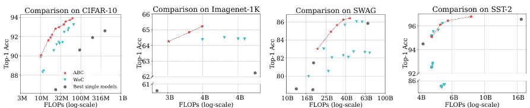

**图 3.2：** ABC 与基于置信度的级联（WoC）[143] 以及多样化任务上的最佳单模型的帕雷托曲线。对于 WoC，我们在其最佳四个置信度阈值上调整级联配置，并从其表现最佳的级联生成结果。ABC 保持一个帕雷托最优曲线，在较低 FLOPs 成本下始终在准确性上优于这两种方法。

### 3.4 实验

本节在各种语言和视觉任务上评估我们的无需训练的基于协议的级联（ABC）方法，重点关注准确性和推理成本。首先，在 3.4.1 节中，我们在完全并行化下，将 _并行化因子_ ($\rho$) 设置为 \(\rho = 1.0\) 以实现最佳准确性-FLOPs 权衡，研究 ABC 的准确性-成本权衡与最先进模型的对比。其次，在 3.4.1 节中，我们表明当低层模型比最大模型便宜至少 50\(\times\) 时，在较低层使用集成对推理成本影响微乎其微。在这种情况下，_相对成本_ (\(\gamma\)) 满足 \(\gamma \le \frac{1}{50}\)，使 ABC 在无需并行化的情况下也有效。最后，3.4.2 节探讨了实际场景，其中低相对成本使 ABC 天然适合现实世界部署。

#### 估计投票阈值

ABC 的延迟规则在每个级联层使用可配置的投票阈值 \(\theta\)（参见公式 3.3 和 3.4）。我们在一小批未见数据上经验性地估计 \(\theta\)；详情请参见附录 B.2。

#### 数据集

为了评估 ABC，我们在附录的表 B.1 中所示的一系列图像和语言任务基准数据集上进行评估。附加数据集在 3.4.2 节中使用，以与最先进的基线所探索的数据集保持一致。

#### 模型

我们为图像和语言任务选择了多样化的模型，如附录表 B.2 所示。对于基于 BERT 的模型，我们使用 **BASE** 和 **LARGE**；对于图像模型，我们按 FLOPs 数量进行分层。所有模型均来自 HuggingFace Zoo，用于推理，我们无需额外的训练工作。3.4.2 节通过 Together API 使用 LLaMA 3、Gemma 2 和 Qwen 2 系列的模型。我们在附录 B.4.2 中详细介绍了本节的实验设置。

评估：对于我们在 §3.4.2 中考虑的生成任务，每个数据集都由一组固定的可能输出组成，类似于分类任务，我们在每个层级对最终输出应用我们的延迟规则。某些情况没有固定的输出标签集（但仍然不是开放式生成），例如 (1) GSM8K，其中生成的数学应用题输出末尾有一个最终数值答案，以及 (2) CoQA，我们使用 F1 分数来捕捉预测与基准真实答案之间的重叠。本工作不讨论开放式生成任务，因为我们考虑的延迟规则——以及我们比较的基线方法——不直接适用于此类情况。

#### 3.4.1 ABC 何时实用？

##### 当并行化成本低廉时

我们首先考虑一种情况：一组模型的推理成本与单个模型的成本相同。这种理想化的场景例如可能发生在离线批量推理 [133] 中，当 GPU 可用于并行化时，或者模型足够小，以至于现有资源被低度利用且集成不会增加额外成本。更重要的是，这种设定为 ABC 建立了最佳情况的准确性和推理成本值。我们在这里将总浮点运算次数 (FLOPs) 作为代表性的推理成本指标，并在后续小节中讨论其他指标，如通信成本、延迟或云租赁成本。

图 3.2 显示了 ABC 的准确性与 FLOPs。作为比较点，我们还包括了基于委员会的智慧（WoC）[143]，一种流行且具有代表性的基于置信度的模型级联方法。在大多数情况下，我们观察到 ABC 能够改进帕雷托前沿，通常能带来 1–2 个百分点的准确性提升。我们将此归因于 (a) 文献中广泛指出的集成对准确性的提升 [152, 170] 以及 (b) 基于协议的规则在级联中可带来的改进（附录 B.1）。总体而言，在准确性方面，ABC 在固定 FLOPs 预算下要么超过，要么至少与最佳模型相匹配，并且是这些模型的实用即插式替代方案。

##### 相对成本差异较大

当然，在许多现实世界场景中，评估集成的成本并不可忽略。例如，在 3.4.2 节讨论的端到云推理场景中，集成中的模型通常是按顺序评估的。然而，即使在这样的场景中，如果级联每个层级的模型相对成本 \(\gamma\) 足够小，这种额外成本与总成本相比就变得可忽略。

在图 3.3 中，我们展示了在各种相对成本下使用集成对总体推理成本的影响。如第一个图所示，当我们远离

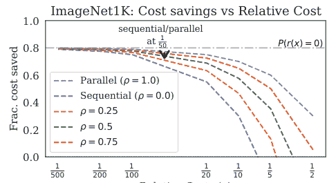

**图 3.3：** 作为模型相对成本 (\(\gamma\)) 函数的推理成本节省比例，*假设*固定的选择率 \(\mathbb{P}(r(x) = 0)\)。随着并行化从完全并行 (\(\rho = 1\)) 减少到顺序 (\(\rho = 0\))，评估集成的成本增加且成本节省减少。当各层级模型大小相似时（例如，较小模型最多小 \(5\times\)，\(\gamma \ge \frac{1}{5}\)），ABC 有效降低成本需要一定程度的并行化。然而，对于较低的相对成本（例如，较小模型至少小 \(50\times\)，\(\gamma \le \frac{1}{50}\)），顺序和并行设置都能实现有意义的节省，表明即使包含使用集成的额外成本，ABC 也很高效。

理想的完全并行设置（\(\rho = 1\)）朝向顺序设置（\(\rho = 0\)），推理成本节省比例会减少。事实上，当级联中的模型大小相似时——例如，当 \(\gamma \ge \frac{1}{5}\) ——ABC 降低推理成本需要一定程度的并行化。然而，请注意，当相对成本足够小时（例如，\(\gamma \le \frac{1}{10}\)），对并行化的需求会减少。这在图 3.3（右）中很明显；对于 \(\gamma \le \frac{1}{50}\)，顺序执行曲线（\(\rho = 0\)）趋近于完全并行化曲线（\(\rho = 1\)）。

#### 3.4.2 现实世界案例研究

如前两节所述，ABC 要么在准确性上改进，要么至少与最佳单模型具有竞争性。而且，只要相对成本足够小，ABC 使用模型集成所承受的额外惩罚就可忽略不计。如图 3.1 所示，ML 模型的准确性与推理成本缩放已经暗示，准确性仅相差几个百分点的模型的相对成本很小。例如，ImageNet1K 数据集上的最先进模型性能在 70B FLOPs 下达到约 83% 的 top-1 准确性。一个达到 63% 准确性的帕雷托最优模型只需要约 1B FLOPs，因此，一个包含这两个模型集成的两级 ABC 的相对成本为 \(\gamma = \frac{1}{70}\)。

在许多现实世界场景中，这种相对成本的差异进一步被放大，由于


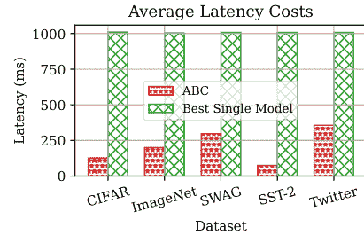

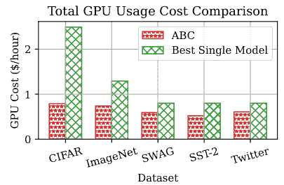

Figure 3.4: (a) 边缘到云推理的 ABC: 我们模拟了单实例推理设置，如在实时应用中，当新数据可用时可能需要进行预测。ABC 可以在不牺牲准确性的情况下在边缘提供小型模型——与仅使用驻留在云中的最高精度/最大模型，或边缘上的单个小型低性能模型相比，这将带来巨大的通信成本节省。(b) ABC 与使用最佳模型的总 GPU 使用成本对比。基于协议的级联（Agreement-Based Cascading）在降低 GPU 使用成本的同时，在所有任务类别中都超过了单个最佳模型的准确性。

to deployment considerations — for instance, in an edge-to-cloud setting, local inter-process communication (IPC) latency is typically two orders of magnitude smaller than remote (cloud) IPC latency ($\gamma \approx 10^{-2}$). Moreover, the flexibility in model placement with ABC at negligible synchronization overhead adds more opportunities for inference cost reduction. We consider three such scenarios, their respective cost models, and the benefits of ABC in these cases here. These include edge-to-cloud inference (Section 3.4.2), cloud-based model serving on heterogeneous GPUs (Section 3.4.2), and inference with only black-box access to model API services (Section 3.4.2).

##### 边缘到云推理中的通信成本

An advantage of ABC is that it allows a single large model to be split into multiple, potentially much smaller models, with only a simple reduce operation required to compute agreement. This allows us to tune device placement at various levels of ABC to improve inference costs. One use-case where this is beneficial is edge-to-cloud inference [89]; here, inference requests are generated on user-facing edge devices like mobile phones or smart devices, which are sent over the network to a cloud service for evaluation. Given an inference request generated by a user interaction, the time-to-response or response latency in such cases is dominated by communication overheads (network speed, serialization overhead, network congestion, etc.) beyond our control. By using ABC for such applications, we are able to distribute the inference load between tiny, on-device models and the cloud models, allowing us to avoid communication costs for a significant portion of requests.

To explore the effectiveness of ABC in such a scenario, we consider a communication cost model previously studied in Zhu et al. [148] and Lai et al. [155] in a setup of edge devices (i.e., Raspberry Pis and smartphones) and cloud servers. The delay parameters adopted range from small, medium, to large [1 us, 10 ms, 100 ms, 1000 ms], where near-instantaneous local communication (< 1 microsecond) can be expected to occur with base cascade tiers performing inference on-device, and substantial network delays might occur (> 1 second) in a worst-case edge-to-cloud transmission ($\gamma = 10^{-6}$). We simulate this by considering a two-level cascade, with the smaller level placed on the edge device. We apply the delay to the cascade exit points on the edge device to capture the time cost of transitioning between edge-to-cloud.

Our results, as shown in Figure 3.4, show that the flexibility that ABC affords in terms of model placement allows significant latency reductions, while providing superior accuracy compared to a single cloud model. In particular, we see that cascading in these scenarios provides a 14× reduction in communication cost for language tasks like SST-2; and for image datasets, we see a 5× reduction for ImageNet1K and an 8× reduction in CIFAR-10.

##### 异构硬件上模型服务的货币成本

Another use-case which can take advantage of the model placement flexibility of ABC is using heterogeneous hardware for model serving on the cloud [46, 134, 176, 179]. GPU/Accelerator hardware typically has a disproportionately large difference in hardware costs compared to their throughput difference. For instance, based on the current pricing model offered by Lambda [194], a popular cloud rental platform, the rental pricing of a single A100 is $1.40/hour and a V100 node is $0.06/hour ($\gamma \approx 4\times 10^{-2}$), while the rated 32-bit tensor core throughput is 312 TFLOPs for A100 and 125 TFLOPs for V100. In this scenario, a simple placement strategy for a 2-level ABC that reduces inference cost may place the smaller model on V100 nodes and larger models on A100 nodes. Since the lower level models are—at least—an order of magnitude cheaper than the larger one in terms of FLOPs, this offsets the throughput loss we incur when switching from A100 to V100; and as a result, the ABC implementation incurs a much lower average cost.

To concretely evaluate ABC under such a cost model, we retrieve the costs of GPU usage by hour from Lambda Cloud’s pricing (see Table B.3 in the appendix for details). For simplicity, we assume that each tier is set up on a distinct GPU in increasing order of GPU sophistication, and serves a uniform inference request rate. We also assume that the nodes are co-located and communication cost between them is negligible. We show a summary in Figure 3.4 and present the detailed results in Table B.4 in the Appendix. We can see at least a 3× reduction in cost in terms of $/hour for image tasks, and a more moderate 10-30% reduction in language tasks.

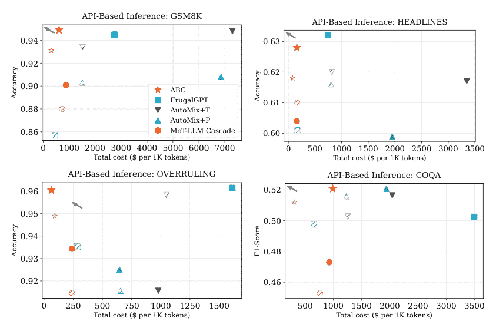

Figure 3.5: Comparison of ABC against state-of-the-art cascade baselines for black-box API-based inference. The faded, hatched-patterned variants represent budget-friendly, 2-level cascade instances where we do not include the costly Tier 3. Most of these methods show competitive performance, but ABC matches their accuracy at significantly lower costs in all tasks. Note that all these methods (aside from the MoT-LLM cascade) incur additional setup costs not reflected in our plots.

##### 基于黑盒 API 的推理的货币成本

In the current landscape dominated by LLMs, many providers offer black-box API access to their proprietary LLMs [160, 164, 191]. Similarly to the large cost difference between GPU generations discussed in the previous subsection, we also observe a large cost disparity between various generations/tiers of API calls. For example, using Together.ai—one of the lowest-cost serverless endpoint providers for LLMs¹—as a case study, we find that models within the 7B-8B range cost $0.20 per million tokens, while Llama 3.1-405B costs $5.00. This translates to the larger model costing 25× more than the smaller model range ($\gamma = \frac{1}{25}, \rho = 1$). If we consider GPT-4 as the gold

| 级别 | 模型 | 价格 |
|---|---|---|
| 第 1 级 | Llama 3.1 8B-Instruct Turbo | 0.18 |
| 第 1 级 | Gemma 2 9B IT | 0.30 |
| 第 1 级 | Llama 3 8B Instruct Lite | 0.10 |
| 第 2 级 | Llama 3.1 70B Instruct Turbo | 0.88 |
| 第 2 级 | Gemma 2 27B Instruct | 0.8 |
| 第 2 级 | Qwen 2 72B-Instruct | 0.9 |
| 第 3 级 | Llama 3.1 405B Instruct Turbo | 5.0 |

表 3.1: API-based 实验的级联级别、其模型及相关成本（美元/百万令牌）；所有 API 服务均由 together.ai 提供。我们对 ABC 推理系统使用现有的级别和模型。然而，对于单模型级联基线，我们使用各自系统中各个级别的最佳模型。

standard, the cost of usage quickly scales to 150× of our smaller model's costs².

Since we only have black-box access to these models, we cannot employ a score-based deferral rule. However, we demonstrate that using ABC's voting-based rule defined in Section 3.3 is also effective in such scenarios. For baseline comparison, we use FrugalGPT, two variants of AutoMix, and MoT LLM Cascade. These state-of-the-art cascading methods are specifically designed for scenarios where we make API calls to black-box model endpoints, in contrast to our more generally applicable ABC method. We access the models from Together.ai—described in Table 3.1—for these experiments, and consider a setting that is advantageous to the baselines, by selecting the best singular model from each performance tier in their respective approaches.

All the baseline methods considered here are significantly more complex and involved to set up than ABC; both AutoMix and FrugalGPT involve training a router or deferral rule at each cascade level which has to be repeated for every new task or model change. Unlike AutoMix, FrugalGPT requires training a DistilBERT-based scorer, which would require the user's possession of GPU resources. MoT LLM Cascade generates multiple results and varies the randomness in the LLM's responses via sampling, while using in-context demonstrations and reasoning techniques (e.g., Chain-of-Thought [162]) to influence how the model generates answers. In contrast, ABC uses a much simpler voting-based safe deferral rule, without involving additional training or complex routing strategies. Further method-specific details for these experiments as well as additional results can be found in Appendix B.4.2.

Our results, as shown in Figure 3.5, demonstrate that ABC is a more reliable deferral rule, and thus, offers a more favorable trade-off between accuracy and cost compared

¹together.ai/pricing（截至 2024 年 9 月）。

²GPT-4-1106-preview 的成本为 $30（截至 2024 年 9 月）。


与现有方法相比——尽管它们拥有更复杂的路由机制，并且甚至未考虑某些基线方法产生的额外设置成本。例如，虽然 FrugalGPT 的评分器在较难任务上表现不佳，并倾向于通过更频繁地延迟来走安全路线，但 ABC 积极利用更便宜的模型处理大部分输入，仅在必要时保留高成本模型。另一方面，AutoMix 采用了一种少样本自验证系统，该系统采样 $k$ 次，其中 $k > 1$（在作者的代码库和我们的代码库中，$k = 8$）；因此，额外的 API 调用显著增加了其使用成本。相比之下，ABC 轻松维持并常常提高准确性，同时是一种无需训练、简单易行的方法。

### 3.5 结论、局限性与进一步方向

本章介绍了 ABC（基于协议的级联，Agreement-Based Cascading），这是一种用于自适应推理的无需训练的方法，可复用现有模型形成弹性级联，并通过基于集成协议的延迟决策隐式设置弹性。通过定义和构建 *安全延迟规则*，我们表明 ABC 可作为单个模型的即插即用替代方案，同时常常 *提高* 准确性。虽然不如第 2 章中的 B-DISTIL 那样接近帕累托最优成本-准确性权衡，但 ABC 提供了一种无需训练的构建弹性模型的方式，在某些情况下（当相对成本 $\gamma$ 较小时），这些模型与帕累托最优集具有竞争力。

尽管作为 ABC 一部分计算集成相比仅使用单个模型会带来额外开销，但当今轻量级模型与最先进模型之间巨大的体积差距意味着，在许多场景下，ABC 仍可降低端到端成本。案例研究证实了这一优势：ABC 降低了边缘到云推理中的通信成本，削减了云部署中的 GPU 租赁费用，并在黑盒服务场景中大幅削减了 API 账单。这些结果凸显了 ABC 在无需传统级联框架所需的路由网络和定制架构的情况下提升效率的能力，使其成为以较低推理延迟为目标的从业者的有吸引力的选择。一个自然的下一步是将该方法从分类任务扩展到 *生成* 任务，在该任务中成本-质量权衡更为明显。

### 3.6 相关工作

自适应推理方案在机器学习领域长期以来一直是研究关注的热点。本节讨论了级联和自适应推理的三种主要现有方法：基于分数的方法、训练路由程序以及动态网络。我们重点阐述了 ABC 的方法如何与这些现有方法相关联以及有何不同。

#### 使用基于分数的延迟的级联

传统级联方法通常依赖于简单的基于分数的指标来做出延迟决策。我们将 Wang 等人 [143] 最近提出的 Wisdom-of-Committees 方法作为该类别中一种通用的代表性方法进行对比，但应当注意，该方法的专门实现已在过往工作中应用于各个领域，例如目标检测 [8, 18, 30, 44, 45, 78]、图像分类 [79, 143] 和文本分类 [135, 156, 161, 174]。在这些场景中，级联系统内的延迟使用置信度分数、熵和概率等指标 [91, 128, 158]。虽然使用现有模型的置信度分数成本较低，但这些分数需要良好校准，而这在现成模型中较为少见 [63, 127]。因此，近期方法已考虑了多种技术来增强基于分数的延迟，例如显式将延迟添加为一种预测 [79]、难度感知正则化 [135]、温度缩放 [181] 和校准机制 [195]。

近期，Jitkrittum 等人 [171] 探讨了级联中基于置信度的延迟可能表现不佳的具体实际环境；这些环境包括：下游模型为专家模型的场景（下游模型的误差概率在不同样本间高度不均匀）、样本受标签噪声影响时，以及训练集与测试集之间存在分布偏移时。值得注意的是，在这些基于置信度的级联可能不足的所有失效模式中，我们的方法很可能带来改进，因为集成有助于引入多样性、实现噪声鲁棒性，并缓解分布偏移问题 [5, 11, 17, 152]。

#### 带路由程序的级联

其他方法完全避开置信度分数，通过训练与模型集无关的程序来按需路由实例。随着黑盒模型 API 服务（针对 LLM）的兴起，这一趋势变得愈发突出，在这类服务中，预测分数通常不可用。Guan 等人 [71] 开发了一个训练有素的选择模块，用于确定数据实例的最佳分类器。Yue 等人 [201]（MoT LLM 级联）使用采样和一致性检查来确定何时将请求延迟至高成本模型。AutoMix [177] 提出了一种少样本自验证机制，与 Yue 等人 [201] 相似，但还引入了一种基于马尔可夫的元验证器，用于上下文基础任务中的级联。FrugalGPT [165] 利用了一种级联策略，该策略使用 DistilBERT 路由器和评分函数对传入查询进行分类。HybridLLM [186] 使用经过微调的 DeBERTa [106] 根据预测查询难度和所需质量级别将查询路由至模型。同样，OrchestraLLM [175]——使用手动标注的数据创建专家模型池——根据池中实例与测试实例之间的嵌入距离来选择要查询的模型。其他方法也采用了某种形式的训练路由器，包括 RouteLLM [196]、“苍蝇拍还是大炮” [198] 以及 Shnitzer 等人 [180]。

#### 动态与自适应网络

如第 3.4.2 节所述（我们在其中将其与 FrugalGPT、AutoMix 和 MoT LLM 级联进行比较），这些更复杂的方法涉及复杂的设置、依赖数据的训练以及增加的计算开销。它们通常需要为每个新任务、数据集或模型重新训练路由器，从而限制了对未见数据分布或新模型的适应性。相比之下，ABC 提供了一种更简单、适用性更广的替代方案，且无需额外的训练或设置成本。

路由程序通常训练一个独立的路由机制，同时保持模型的帕累托集不变。然而，对于许多中等规模的应用，已经探索了共同学习帕累托模型集和停止标准的方法。例如，Huang 等人 [74]、Wang 等人 [80]、Liu 等人 [111]、Xin 等人 [119]、Zhou 等人 [120]、Geng 等人 [130] 和 Schuster 等人 [159] 的早期退出方法，子网络提取方法 [83, 100, 109, 123, 153, 167]，以及基于组合的方法 [117, 166, 187] 都是一些近期的示例。

我们的方法与这些方法不同，因为它不涉及更改模型架构或从头开始重新训练。相反，ABC 利用现有模型的原始状态，使用集成协议作为延迟条件，该方法可以直接应用于这些模型，无需任何微调或专门训练。

## 第二部分

## 逐步演变环境中的持续优化

## 第 4 章

## 持续适应逐步演变的环境

本论文的第一部分研究了在 *任意* 环境中的高效推理：第 2 章处理了跨推理请求不可预测波动的资源预算，第 3 章解决了难度随请求而变化的查询。第二部分转向互补的 *逐步演变环境* 情况——即环境的相关属性以缓慢且具有规律、可预测的方式演变的场景。这种结构让我们能够复用过去的努力，预见未来的变化，并设计出适应得更高效的算法。

本章聚焦于大型深度学习集群中的 *资源分配*。我们为此场景形式化了慢速演化的概念，并引入了 COPTER（**持续** **优化器**），这是一种利用此类资源分配问题中的渐变变化以有效生成高质量分配的算法。该材料建立在 Jayaram Subramanya、Dennis、Smith 和 Ganger [203] 的工作之上。

### 4.1 机器学习中的资源分配

资源分配——即将有限资源（例如，GPU、CPU、链路容量）分配给竞争请求（例如，训练作业、网络流）的过程——是现代计算机系统的基石。例如，在深度学习集群中，调度程序必须将数千个 GPU 分配给具有不同要求的作业，同时平衡吞吐量和公平性 [137, 169]。在广域网（WAN）流量工程中，运营商将流量分配给链路，以最大化网络利用率并最小化延迟 [182]。传统的启发式方法，例如集群调度中的先到先服务（FCFS），虽然简单，但缺乏表达力来强制执行诸如服务质量保证或公平性策略等复杂约束。为了解决这个问题，许多系统


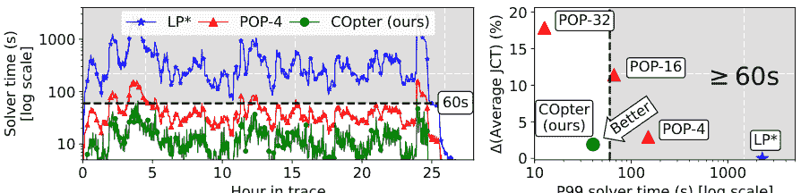

图 4.1：[左] 三种求解 Sia 调度器策略 MILP [169] 方法的求解器运行时间及其 [右] 质量-运行时间权衡。这些方法在一份包含 100k 个作业、提交到具有 7 种 GPU 类型的 25k GPU 集群并在 24 小时内运行的跟踪上进行评估。LP* 在每一轮中独立使用商用 LP 求解器 [154] 求解 MILP 的 LP 松弛。POP-k 将 GPU 和作业集划分为 k 个大小相等的部分（在可能的情况下），并使用 MILP 求解器 [189] 并行求解每个分区的 MILP。COPTER 使用持续优化（参见第 4.3 节）。

转向数学规划或基于优化的方法，这些方法将资源分配表述为可由现代数值求解器求解的线性规划（LP）或混合整数线性规划（MILP）[59, 113, 138, 169, 183, 193]。

虽然这些方法在中小规模下很实用，但随着问题规模增长，它们可能会迅速失效——这一现实由计算基础设施近期的爆炸式增长所驱动。深度学习集群现在部署超过 100,000 块 GPU（从 2019 年的几千块增加而来 [93]），请求这些资源的用户和作业数量也随之增加。使用现成求解器在这种规模上求解分配问题通常会超过实际时间限制。例如，将先进的 GPU 集群调度策略 [169] 从 10k GPU 集群扩展到 25k GPU，会导致求解器运行时间增加约 100 倍（图 C.2，附录）。

因此，在分配的 1 分钟轮次时长内求解的问题比例从 85% 下降到仅 15%。延长轮次时长不可持续：已完成作业释放的资源会长时间空闲，而新到达的作业则在调度器队列中等待资源，导致利用率降低和作业完成时间增加。

从业者开发了各种策略来将基于优化的资源分配扩展到大规模问题：温启动可能有帮助，但并非普遍适用或/和不受现有商业求解器支持 [154, 202]；求解器计算无法高效并行化 [182]；并且 GPU 加速并不总是适用或/和有益 [115]，因为求解器计算具有稀疏性。通过设置计算/时间预算强制提前终止求解器可能会返回次优和/或不可行的解，这些解通常毫无意义。利用问题特定属性对问题进行分区可以帮助以最小努力将许多资源分配问题扩展到更大规模，尽管会牺牲解的质量。

迄今讨论的所有方法都以黑盒方式使用商业或开源求解器。这意味着每一轮的分配问题被视为一个独立的问题实例，并传递给求解器。然而，这导致基于轮次的资源分配问题建模与这些问题应用的许多系统动态之间存在根本性不匹配：许多大规模系统在轮次之间缓慢演变，并在轮次间表现出某些结构。例如，在 GPU 集群调度中，如果轮次时长足够短（2–5 分钟），则很少有 GPU 失败，上一轮的大多数作业继续执行且其分配变化很少，且很少有新作业进入集群。忽略这种结构并将每一轮视为独立问题，现有方法放弃了随时间分摊求解精力的机会。

将现有求解器改造为复用前一轮的计算精力并不简单。首先，对输入问题的微小改动（例如，仅添加一个新请求）都需要重建求解器特定的问题表示（例如，约束矩阵），即使是微小的变化也会带来显著的设置成本。其次，求解器需要重建关键的内部变换，例如矩阵（内点法 [23, 202]）或基（单纯形法 [10, 23, 75, 154]）分解，从而丢弃所有先前的计算精力。第三，对于 MILP 资源分配问题 [169, 183]，由于将非整数值变量转换为其整数对应项占据了求解器的大部分时间，这进一步加剧了大规模问题的可扩展性挑战。

为解决这些局限性，我们提出并研究了*持续优化*——一种将资源分配问题表述为跨多个轮次的相互关联的优化程序序列的范式，其开销可分摊至多个轮次。

我们将 COPTER 介绍为一种执行持续优化的系统，并证明可以 (a) 使用高效的*差分*更新接口将资源分配问题中的小变化反映到其优化表述中；(b) 利用最优解的缓慢演变来高效地对后续问题求解进行温启动；以及 (c) 使用轻量级启发式方法来恢复 MILP 的高质量整数解，从而完全绕过昂贵的组合搜索。

### 4.2 线性规划形成

许多资源分配问题可以表述为*线性规划（LP）*或*混合整数线性规划（MILP）*。给定一组资源（例如，GPU、CPU、网络带宽）和资源请求（例如，作业、流量需求），这些程序的目标是找到一种将资源分配给请求的方式，以优化给定的目标（例如，最大化吞吐量、最小化作业完成时间或确保公平性）。此外，还会添加约束以确保得到的分配有效、可实现，并满足任何策略要求（例如，优先请求必须在其他请求之前得到满足）。

**标准形式线性规划** 为普遍性起见，让我们考虑线性规划的*标准形式*：

\(\min_x \ f(x) = c^T x\)

**受约束于：** \(Ax \le b, x \ge 0\) (4.1)

其中：\(x \in \mathbb{R}^n\) 是决策变量向量，\(f(x) = c^T x\) 是决策变量上的*线性*目标函数，\(A \in \mathbb{R}^{m \times n}\) 是约束矩阵，\(b \in \mathbb{R}^m\) 是右侧向量。此外，在*混合整数* LP（MILP）中，部分或全部变量被限制为整数值。MILP 在资源分配中特别有用，因为许多问题中的决策变量本质上是离散的。例如，资源要么分配给某个作业，要么不分配；同样，作业要么分配到某些资源，要么一无所获。

**示例：GPU 集群调度** 考虑一个简化的 GPU 集群调度问题。设集群有 \(N\) 个 GPU 和 \(M\) 个作业。设 \(g_j\) 为作业 \(j\) 请求的 GPU 数量，\(c_j\) 为其使用 \(g_j\) 个 GPU 时的吞吐量。我们希望在 GPU 容量约束下分配资源以最大化集群中作业的吞吐量。这可以表示为以下线性规划：

\(\min_x \ -c^T x\)

**受约束于：** \(G \cdot x \le N, x_j \in \{0, 1\} \quad \forall j\)

其中 \(c = [c_1, c_2, \dots, c_M]\) 是吞吐量向量，\(G = [g_1, g_2, \dots, g_M]\) 是一个 \(1 \times M\) 矩阵，\(x = [x_1, x_2, \dots x_M]\) 是变量向量。变量 \(x_j = 1\) 当且仅当 \(g_j\) 个 GPU 分配给作业 \(j\)（否则为 0）。

#### 4.2.1 求解线性规划

资源分配（RA）问题的 LP/MILP 表述分两个阶段求解，MILP 还增加了第三个阶段。

- **1. 程序编译** 此阶段将资源分配问题转换为现有求解器可使用的形式。在第 4.2 节的示例 GPU 调度问题中，这包括 (a) 对 \(M\) 个活跃作业进行排序并为它们分配 \(\{1 \dots M\}\) 中的索引，(b) 构建 \(c\) 向量，以及 (c) 构建 \(G\) 矩阵。

- **2. 程序求解** 求解器随后使用一种或多种优化算法来找到*已编译*线性规划的最优解。如果输入程序将某些变量约束为仅取整数值（MILP），则此阶段忽略此类约束，而是求解 MILP 的 *LP 松弛*的最优解。

- **3. （可选）整数化。** 此阶段仅适用于 MILP，并将整数约束变量的任何非整数值转换为整数值。像 *分支切割* 这样的技术通常需要在*求解*和*整数化*阶段之间交替进行，因为它会逐步为带有整数约束的变量分配整数值 [23]。

像 CVXPY 和 Google OR-Tools [56, 197] 这样的高级建模框架，为指定系统中常见的优化问题（例如资源分配）提供了强大的抽象。开发人员使用镜像数学表述的符号变量和函数以编程方式定义问题，这些问题随后会自动编译为求解器兼容的表示，从而使用户免受低级实现细节的影响。

#### 4.2.2 求解线性规划中的可扩展性挑战

基于轮次的资源分配的传统方法在每一轮都会从头重新表述并求解一个 RA 问题。这意味着，在每一轮中，我们都会从头重新编译当前的线性规划，将其传递给 LP 求解器，并使用类似分支定界 [23, 202] 的过程根据需要恢复问题的整数解。随着问题规模增长（例如，拥有数万个 GPU/作业的集群），求解 LP 的每个阶段都面临我们下面讨论的可扩展性挑战。

**程序重新编译会丢弃先前的计算精力** 对于任何 RA 问题，编译时间的大部分都花在构建约束矩阵上。约束矩阵通常非常稀疏——矩阵中的每一行对应资源或请求的约束，并且一次只应用于一小部分变量。对于大型资源分配问题，即使是稀疏表示也可能包含数千万个非零值，并且每一轮填充可能需要几十秒。此外，由于当前方法会对问题的微小变化（例如，添加/删除资源/请求）触发完全重新编译，因此它们会丢弃在前几轮中创建约束矩阵所花费的所有先前计算精力。我们在第 4.3 节中表明，通过采用问题级的*差分*接口，可以减少每一轮重新编译的开销，从而显著降低端到端运行时间。

**独立求解 LP 忽略问题演变** 许多大规模资源分配问题*缓慢演变*，即，在两个连续轮次 *t* 和


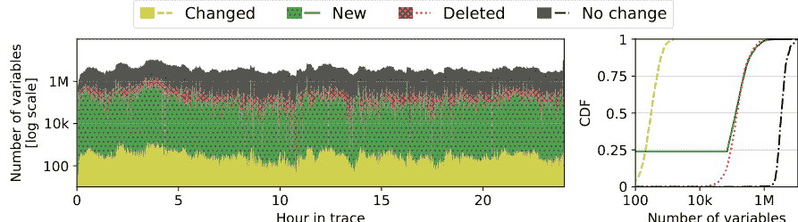

**Figure 4.2:** 在运行 Sia 策略的 25k GPU 集群的 24 小时内，连续调度轮次之间解的变化 [169]。可以看出，大多数变量保持不变：少于 0.01% 的变量值发生变化，且在连续轮次之间最多只有几个百分比的变量被添加/移除。

$t + 1$，很少有资源被添加/移除，很少有作业被添加/移除（相对于资源集和请求集的当前大小）。虽然一般来说，问题的微小变化仍可能引起最优解的大幅变化，但我们观察到，对于资源分配问题，轮次 $t$ 和 $t + 1$ 的最优解仅相差很小（参见图 4.2）。

最先进的 LP 和 MILP 求解器 [154, 202] 使用内部点（屏障）或单纯形算法，这两种算法都维护无法轻松更新以受益于问题缓慢演化的内部状态。内部点方法维护矩阵分解，向问题添加新变量和/或约束需要重新分解。同样，单纯形算法维护 *基* 分解。虽然在添加变量和/或约束时，理论上可以进行热启动更新，但在实际中，此过程需要对分解进行昂贵的更新，并触发大量主元操作以恢复可行性。

使用 ADMM [28] 或近点算法 [40] 等一阶算法的求解器通常维护非常少的内部状态，因此不受相同问题的影响，并构成了我们方法的基础。

**现有方法中未充分利用热启动** 连续的资源分配问题通常在资源和请求集合中表现出显著的重叠。通常，即使连续轮次的最优解 $x^*_{t-1}, x^*_t$ 在欧几里德距离（$\ell_2$ 范数）上也彼此接近。直觉上，人们可能会期望，使用一个已经接近最优解的点来初始化求解器会导致更快的收敛。然而，常规求解器在有效利用这种 $\ell_2$ 邻近性方面面临挑战。单纯形方法的运行时间取决于遍历约束多面体（由约束矩阵 A 和向量 b 定义）的顶点。一个小的 $\|x_t - x_{t-1}^*\|_2$ 不能保证对应顶点之间的路径很短。此外，即使是微小的修改，例如移除单个约束，理论上也可能导致确定性单纯形法的最坏情况指数级运行时间。内部点方法虽然支持热启动，但衡量初始点相对于问题特定中心路径的质量。一个小的 $\|x_t - x_{t-1}^*\|_2$ 不一定意味着接近这条中心路径，使得这种热启动的实际效益难以预测或控制 [15, 22]。一阶方法 [28, 34, 116, 122] 可以从小的 $\|x_t - x_{t-1}^*\|_2$ 中受益，但可能会受到实际收敛缓慢的影响。

**MILP 的组合爆炸** RA 问题的混合整数公式通常采用两阶段过程求解。首先，使用传统的（通常基于单纯形法的）LP 求解器来求解 MILP 的 LP 松弛的最优解，在此过程中暂时忽略整数约束。然而，此解可能会为需要整数的变量分配非整数值，导致整数不可行性，然后在第二阶段使用类似分支定界 [23, 154, 202] 的算法加以解决。分支定界系统地探索细化 LP 问题的树：它选择一个整数不可行的变量，例如 $x_j$，通过添加将其值推向相邻整数的约束来创建分支（例如，$x_j \le \lfloor x_j^* \rfloor$ 和 $x_j \ge \lceil x_j^* \rceil$），并通过为 $k \ne j$ 选择另一个 $x_k$ 递归求解生成的 LP。这将持续进行，直到找到一个具有零整数不可行性且目标值接近（即在 MIP 差距内）LP 松弛最优解的解。然而，需要求解的 LP 数量可能呈指数级增长，使得这一阶段对大型问题来说计算开销过大。我们在第 4.5.2 节中表明，针对问题特定的启发式方法可以通过高效地找到质量影响可忽略的可行整数解来有效绕过这一瓶颈。

### 4.3 持续优化

在本节中，我们首先介绍逐渐演化线性规划的概念，然后描述持续优化范式及其目标。接着，我们描述 COPTER——我们针对大规模基于轮次的资源分配问题持续优化所提出的方法。

#### 4.3.1 逐渐演化的 LP 和持续优化

正如第 4.2.2 节所讨论，在许多现实世界系统中，资源分配问题及其相关最优解随时间逐渐演化（参见图 4.2）。

自然而然，这种 *逐渐演化* 的特性暗示了跨轮次重用先前分配或计算以提高运行时间的想法：如果每轮的分配问题基本保持不变，那么求解时间应保持较小。

让我们描述一些形式化渐进演化概念所需的符号。我们使用 $t$ 来索引资源分配过程中的连续轮次。通过轻微的符号重载，让 $\min_x \text{LP}_t(x)$ 表示轮次 $t$ 中求解的 LP/MILP。在标准形式（方程 (4.1)）中，$\text{LP}_t(x)$ 可以使用一个 3 元组 $(c_t, b_t, A_t)$ 完全定义，其中 $c_t$ 是成本向量，$A_t$ 和 $b_t$ 分别是约束矩阵和向量。令 $x_t^*$ 为轮次 $t$ 问题的最优解，即 $x_t^* \in \arg \min_x \text{LP}_t(x)$。这些 LP 的大小由变量数量 $n$ 和约束数量 $m$（即 $A \in \mathbb{R}^{m \times n}$ 的维度）决定。我们定义问题维度 $\eta_t = \max(m_t, n_t)$ 为轮次 $t$ 中两者的较大值，以及 $\eta_{\max} = \max_t \eta_t$ 为所有轮次 $1 \le t \le T$ 中的最大问题维度。

**定义 4.1（逐渐演化线性规划）。** 我们认为一系列基于轮次的资源分配问题 $\{\text{LP}_t(x)\}_{t=1}^T$ 是 *逐渐演化* 的，如果存在某些小的 $\alpha, \beta \in [0, 1]$，$\alpha \ll 1$，$\beta \ll 1$ 使得，

- 1. $\mathcal{P}_\eta(T) = \sum_{t=2}^T |\eta_t - \eta_{t-1}| = \mathcal{O}(T^\alpha \eta_{\max}), \text{and},$
- 2. $\mathcal{P}_x(T) = \sum_{t=2}^T \|x_t^* - x_{t-1}^*\|^2 = \mathcal{O}(T^\beta B),$

其中 $B > 0$ 满足所有可行 $x$ 和所有 $t$ 的 $\|x_t\|^2 \le B$。

量 $\mathcal{P}_\eta(T)$ 和 $\mathcal{P}_x(T)$ 通常被称为 *路径长度*，因为它们代表了一系列值的 *轨迹*：在 $\mathcal{P}_\eta(T)$ 的情况下是问题维度，在 $\mathcal{P}_x(T)$ 的情况下是最优解。量 $\alpha$ 和 $\beta$ 用于在两种情况之间插值——一种是连续程序根本不变（$\alpha = 0$ 和 $\beta = 0$ 均成立），另一种是剧烈变化（$\alpha = 1$ 或 $\beta = 1$ 之一成立）。例如，考虑 GPU 资源调度中的假设场景，其中对手在将所有 GPU 节点下线和重新上线之间循环。在这种情况下，在没有节点可用的轮次中，最优分配 $x^*$ 全为零，而在 GPU 节点重新上线的轮次中，$x$ 取非零值。假设 $x_i \in [0, 1]$，连续最优解之间的最大 $\ell_2$ 距离最多为 $\sqrt{n}$（即 $\|x_t^* - x_{t-1}^*\|^2 \le n$），因此，$\mathcal{P}_x(T) = \sum_{t=2}^T \|x_t^* - x_{t-1}^*\|^2 \le Tn$ 且 $\beta = 1$。同样，在另一极端，考虑资源和请求以及因此分配均保持不变的场景。这意味着 $x_t^* = x_1^* \forall t \le T$，因此 $\mathcal{P}_x(T) = 0$ 且 $\beta = 0$。

**持续优化。** 给定将资源分配建模为一系列程序 $\{\text{LP}_t(x)\}_{t=1}^T$ 以及按定义 4.1 定义的路径长度 $\mathcal{P}_x(T)$ 和 $\mathcal{P}_\eta(T)$，


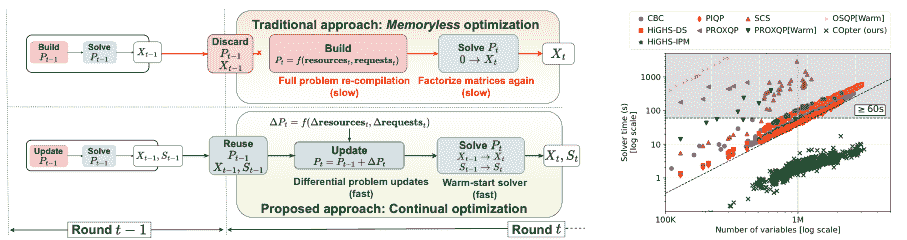

**图 4.3:** 针对 RA 问题的现有方法无法扩展到大规模，因为：(a) 对问题的任何更改（由添加/删除资源和/或请求引起）都需要重新编译问题；(b) 重新编译问题会丢弃之前轮次中求解器完成的任何工作；以及 (c) 要么不支持热启动，要么热启动在减少求解器运行时间方面通常没有好处。_[左]_ 我们提出 _持续优化_，并实现了一个名为 COPTER 的原型，采用针对 (a) 高效问题操作、(b) 求解器状态重用和 (c) 高效热启动的技术。_[右]_ 对于 Sia ILP 策略 [169] 的 LP 松弛，使用持续优化的 COPTER 比任何开源求解器的无记忆优化快几个数量级，并且能更好地扩展到更大的问题规模。

持续优化的目标是开发方法，使得分配的总端到端时间（记为 \(\tau(T)\)）取决于特定于问题的路径长度，即 \(\mathcal{P}_x(T)\) 和 \(\mathcal{P}_\eta(T)，如下所示：

\(\tau(T) = \mathcal{O}\big(\mathcal{P}_x(T), \mathcal{P}_\eta(T)\big)\)

资源分配问题具有较小的 \(\mathcal{P}_x(T)\) 和 \(\mathcal{P}_\eta(T)\)（即 \(\alpha \ll 1, \beta \ll 1\)），因此我们可以预期，与独立处理每个问题相比（见图 4.3 [右]），持续优化能够在运行时间方面实现显著的加速。这种问题依赖边界的概念最近在 _在线优化_ 文献 [146, 150, 163] 中得到了广泛关注，背景是 _动态遗憾_，即所有 \(T\) 轮次中次优差距的总和。持续优化的不同之处在于，我们还关心分配问题的端到端运行时间。事实上，可以证明我们方法的动态遗憾确实受路径长度约束（定理 4.1，附录）。

请注意，由于跨轮次的程序可以具有不同的维度 \(\eta_t\)，距离 \(\|x_t^* - x_{t-1}^*\|^2\) 通过对 \(x_t^*\) 和 \(x_{t-1}^*\) 进行填充来定义，使其维度恰好为 \(\eta_{\text{max}}\)，即最大问题维度。我们还注意到，逐步演变程序的定义也允许资源和/或请求的 _突发_，只要在所测量的 \(T\) 轮次中此类事件不太频繁即可。

#### 4.3.2 用于持续优化的 COPTER

在本节中，我们描述了 COPTER，即我们针对资源分配问题持续优化所提出的方法。图 4.3 [左] 展示了现有 *无记忆* 方法和我们提出的使用持续优化的方法在可扩展性挑战方面的高级概览。COPTER 提出了技术，以解决第 4.2 节中描述的求解资源分配问题所涉及的三个阶段中的每个阶段的可扩展性挑战。综合来看，这些技术使 COPTER 能够有效地重复利用之前轮次中的计算工作，从而减少总运行时间。

##### 问题更新的差分接口

COPTER 在问题级别使用差分接口，以反映轮次之间添加和/或删除资源和请求所引起的分配问题变化。为了支持对问题的此类差分更新，我们需要高效地支持以下方法：

- add-request(request ID, num variables): 修改 A，方式为 (a) 向 A、c 和 x 追加 num variables 个变量列，(b) 适当填充添加此请求所影响的所有约束中新追加的列，以及 (c) 向 A 和 b 添加新请求的任何额外约束（每个约束一行）。
- remove-request(request ID): 修改 A，方式为 (a) 从 A、c 和 x 中删除与请求相关的列，以及 (b) 从 A 中删除任何相关约束。
- add/remove-resources(resource ID, count): 修改 b 以反映资源 ID 类型的资源数量变化了适当的 ±count 个单位。

为了高效实现此类接口，我们会就地操作约束矩阵 A。由于矩阵 A 大多是稀疏的（即每行的非零元素较少），通常将 A 中的非零元素存储在连续数组中，沿 A 的行或列进行主序化——用于行级访问的压缩稀疏行 (CSR) 表示法，以及用于列的压缩稀疏列 (CSC)。然而，连续内存布局不允许对矩阵进行高效修改（例如添加或删除行/列），除非承担 Θ(min{mn, nnz(A)}) 的完整复制成本。因此，即使现有求解器提供增量修改的接口 [154, 202]，从现有内存中矩阵重新编译的成本仍然由这一复制成本主导，因此并没有显著改善。

COPTER 用列表嵌套列表 (LoL) 表示法替代了缓存友好的连续内存布局，作为连续布局的延迟优势与非连续表示的修改便利性之间的折中方案。我们使用指针操作，在行优先 LoL 格式中高效添加和删除行（即添加/删除约束）。相应的列操作仍然昂贵，但由于 $A$ 是稀疏的，只影响少数行，并且可以轻松地按行并行化。与每轮重新编译相比，差分问题更新可将编译时间缩短高达 30\(\times\)。

##### 无因子分解、高效热启动的 LP 求解器

最先进的求解器依赖于某种形式的内部问题转换，通常是约束矩阵 $A$ 的因子分解，以加快求解时间。在持续优化的背景下，由于添加/删除资源和/或请求而对 $A$ 矩阵的更改是常见操作。然而，这些更改使得之前轮次的因子分解失效，迫使我们丢弃所有先前的计算工作（或采用昂贵的程序将因子分解恢复为可重用状态）。此外，在逐步演变的系统中，大多数请求的最优分配保持不变，因此之前的解决方案是当前轮次求解器的良好起点。然而，基于单纯形法和内点法（Barrier）的方法难以轻松热启动到与最优解在 \(\ell_2\) 范数中接近的猜测上。一个简单的解决办法是采用基于一阶方法（如 ADMM [28] 或近点算法 (PPA) [40]）的求解器，这些方法具有易于重新计算的状态。

我们选择近点算法 (PPA) 作为我们的主力算法，因为其实际收敛行为、可热启动的能力，以及其能够为 MILP 的 LP 松弛恢复大部分整数解的能力。PPA 将 LP$_t(x)$ 转换为一系列二次规划问题，其解收敛于 LP$_t(x)$ 的解。连续迭代以乘积因子改善当前迭代的可行性和最优性。我们通过用来自轮次 $t-1$ 的 LP$_{t-1}(x)$ 的最优解 $x^*_{t-1}$ 来热启动 PPA，即从轮次 $t$ 的第一次迭代开始（参见第 4.4.3 节）。为了求解二次子问题，我们采用快速坐标下降 (CD) [54] 算法。这使我们的求解器能够 (1) 保持最小内部状态，因为坐标下降是无因子分解的，(2) 通过稀疏矩阵-向量 (SpMv) 操作和 *活动集* 策略，受益于约束矩阵和解向量中的稀疏性，以及 (3) 可证明地受益于良好的初始猜测。在大规模下，我们的方法解决问题的速度比求解线性系统的替代方案快几个数量级，同时仅使用几个 CPU 线程（见图 4.3 和第 4.5.2 节）。

##### MILP 的轻量级整数化

传统 MILP 求解器应用于大规模资源分配通常受限于以最小最优性损失强制执行整数约束的运行时间成本。在求解 MILP 的 LP 松弛后，使用像分支定界 [23, 154, 202] 这样的技术来修复整数不可行性。由于此整数求解阶段经常主导整体求解时间，它造成了显著的可扩展性瓶颈。

我们发现，对于许多资源分配 MILPs（参见第 4.5.1 节和第 5.1 节），


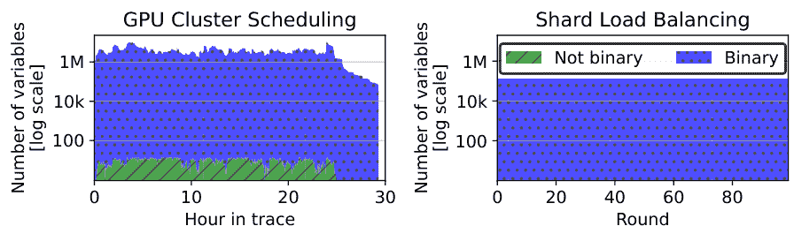

图 4.4: 两个 RA 问题的 MILP 制定的 LP-松弛解组成，使用商用单纯形法 LP 求解器 (CPLEX [154])：GPU 集群调度 [169] 和 分片负载均衡（参见第 5.1 节）。在 LP-松弛的最优解中，≥ 99.99% 的值要么是 0 要么是 1，且 ≤ 0.01% 的值在 (0, 1) 之间。

使用 Simplex [154] 或 COPTER 的 PPA（参见图 4.4）的求解器通常会生成仅有少量整数不可行解的 LP 松弛解，这与基于 ADMM 的求解器 [28, 34] 形成对比。传统的 MILP 求解器会调用昂贵的分支定界 [23, 154, 202] 来保证整数可行解的最优性，而这是一个瓶颈步骤；COPTER 引入了使用 shims 的轻量级后处理，从 MILP 的 LP-松弛最优解生成整数可行解。Shims 以启发式方式运行：它们对分数变量进行取整，然后应用快速的局部修正以恢复约束可行性，并且故意设计为优先保证问题可行性而非最优性。

关键结果是，COPTER 能在毫秒级时间内为大规模 MILP（数百万个变量）提供高质量、可行的解，有效地绕过传统瓶颈，且对质量影响极小（第 4.5.2 节和第 5.3.1 节）。

### 4.4 COPTER：理论讨论

在本节中，我们将加深对支撑 COPTER 的理论见解的理解。我们首先介绍动态遗憾的概念，并从其角度比较各种方法。然后我们将讨论 COPTER 如何遵循在线优化中的 Follow The Leader (FTL) 方案，并因此获得与路径长度最优相关的动态遗憾。接着，我们将讨论 COPTER 背后的核心算法——近点法（Proximal Point Algorithm, PPA），并展示该算法如何从热启动中获益。我们还将简要讨论 PPA 遵循的轨迹，并将其与其他一阶方法进行对比，以直观地解释 COPTER 如何从其 LP-松弛中获得大部分整数解。本节将通过构建一个 LP 来结束，其中

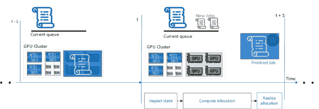

图 4.5：基于轮次的调度的示意图。在每个轮次中，调度器执行三个主要步骤：(1) 检查系统中资源和作业的状态，(2) 基于这些信息生成资源分配，(3) 通过将作业放置到合适的资源上来物理实现该分配。由于状态是在每个轮次开始时测量的，如果计算分配花费的时间太长，系统状态可能会与测量结果发生偏差。

从问题中移除单个约束会揭示确定性单纯形法的最坏情况问题。为了简化，我们将讨论专门化为 GPU 资源调度问题，但本节适用于第 5 章中的两个案例研究，并具有更广泛的适用性。

#### 4.4.1 GPU 调度的动态遗憾

考虑图 4.5 中基于轮次的 GPU 集群调度问题的示意图。这里我们使用作业队列来说明资源请求，使用 GPU 服务器来说明资源。随着时间的推移，各种作业进出系统，各种 GPU 根据故障和可用性上线和下线。在每个轮次开始时，调度器执行三个主要步骤：(1) 检查系统中资源和作业的状态，(2) 基于这些信息生成资源分配，(3) 通过将作业放置到合适的资源上来物理实现该分配。

由于状态是在每个轮次开始时测量的，如果计算分配花费的时间太长，系统状态可能会与测量结果发生偏差。令 $LP_{t-1}(x)$ 表示在轮次 $t-1$ 结束时（或等价地，轮次 $t$ 开始时）构建的线性规划，并令 $x^*_{t-1} = \arg \min LP_{t-1}(x)$ 为提供最多奖励/效用的唯一调度方案。令 $(c_{t-1}, b_{t-1}, A_{t-1})$ 参数化线性规划 $LP_{t-1}$。我们使用 $t-1$ 来索引问题参数，以强调这样一个事实：调度器在轮次 $t$ 中用于计算分配的信息来自上一轮次的结束（或当前轮次的开始）。事实上，让我们假设自然在调度器为轮次 $t$ 提供其分配后，被允许修改作业队列（资源请求）和可用资源。这样的实体可以完全对抗性地行为，例如在轮次 $t$ 中将所有资源下线。在这种情况下，所有作业-资源对的效用为零，因此 $c_t = 0$。调度器原本期望根据求解 $LP_{t-1}(x)$ 获得 $c_{t-1}^T \hat{x}_t > 0$ 的奖励，但实际上收到的奖励为 $c_t^T \hat{x}_t = 0$。另一方面，自然也可以是良性的，使得集群状态从 $t-1$ 到第 $t$ 轮完全不变。在这种情况下，调度器收到其求解问题 $LP_{t-1}(x)$ 隐含的奖励（即，$c_t^T \hat{x}_t = c_{t-1}^T \hat{x}_t$）。

更一般地，令 $f_t(x) = c_t^T x$ 表示在第 $t$ 轮中基于自然选择的效用值 $c_t$，对调度方案 $x \in \mathbb{R}^n$ 的真实奖励。为简化起见，假设第 $t$ 时刻的最优调度方案是唯一的，并将其表示为 $x_t^*$。在此设置下，不同的调度服务现在可以根据其动态遗憾进行比较，动态遗憾衡量了与一系列最优移动相比的效用差异。

**定义 4.2** (动态遗憾)。*令* $\{x_t^*\}_{t=1}^T$ *表示一系列最优解，同样地，令* $\{\hat{x}_t\}_{t=1}^T$ *表示调度器选择做出的决策。调度器在* $T$ *轮之后的动态遗憾定义为，*

$$
D\text{-}Reg(\{\hat{x}_t\}_{t=1}^T) = \sum_{t=1}^T f_t(\hat{x}_t) - f_t(x_t^*).
$$

关键的是，我们再次强调，在此模型中，在每个时刻 $t$，自然在对系统进行修改以诱导其自身决策 $x_t^*$ 之前，会观察调度器的移动 $\hat{x}_t$。在没有任何额外假设的情况下，自然可以利用这一点，迫使调度器在每一轮中承受最大惩罚，从而导致动态遗憾以 $\Theta(T)$ 规模增长。对于实际调度器，这对应于表现出对抗性变化的环境——例如，在一个轮次中关闭一半 GPU，在下一轮次重新开启，或者在连续轮次中在调度器队列中交替移入和移出作业。在这种情况下，任何延迟响应都无法表现良好，因为当调度方案部署时，环境已经发生了变化。然而，如果我们假设自然是良性的，即系统随时间逐渐变化，调度策略可以适应这些较慢的漂移。当漂移很小时，动态遗憾也应保持较小。这种漂移可以通过路径长度（定义 4.1）来表征。

#### 4.4.2 COPTER 与 Follow The Leader (FTL)

基于轮次的调度算法，特别是 COPTER，可以被视为反复应用延迟一轮获得的解 $\hat{x}_t$，使得，

$$
\hat{x}_t \in \arg \min \text{LP}_{t-1}(x).
$$

这样的方案可以解释为 Follow the Leader (FTL) 算法；即，我们使用系统最新可用的状态，并找出最新状态所暗示的最优解。

\[
\hat{x}_t^{\text{FTL}} = \arg \min \text{LP}_{t-1}(x) \quad (4.2)
\]

直觉上，当轮次持续时间被选择得足够小，以至于系统在连续轮次中几乎不发生变化时，这种方法适用且有效。在这种情况下，使用稍微过时的状态不应产生太大影响。从形式上看，可以证明（定理 4.1）FTL 算法遭受的动态遗憾规模为 \(\mathcal{O}(\mathcal{P}_x(T))\)——如果跨轮次的解的变化很小，动态遗憾也保持较小。

**定理 4.1**（简化定理 3，[146]）。*令线性目标* \(f_t(x) = c_t^T x\) *满足* \(\|c_t\|_2\) *有界，并令* $\mathcal{X}_t$ *表示步骤 t 中的可行解集。那么，方程 (4.2) 中的贪心 FTL 策略满足，*

\[
D\text{-Reg}(\{\hat{x}_t\}_{t=1}^T) = \sum_{t=1}^T f_t(\hat{x}_t) - \sum_{t=1}^T f_t(x_t^*) \leq \mathcal{O}(\min\{\mathcal{P}_x(T), \mathcal{P}_x^{\frac{1}{2}}(T)\}),
\]

*其中* \(\mathcal{P}_x(T) = \sum_{t=2}^T \|x_t^* - x_{t-1}^*\|^2\) *和* \(\mathcal{P}_x^{\frac{1}{2}}(T) = \sum_{t=2}^T \|x_t^* - x_{t-1}^*\|.\)

需要注意的是，较小的动态遗憾并不意味着找到 $\hat{x}_t$ 的时间很短，或甚至与路径长度相关。找到最优解的时间取决于所使用的优化算法的选择，即使从良好的初始化开始也是如此。例如，像 Simplex 这样的算法不一定从在 $\ell_2$ 范数意义下接近的初始化中获益，而像 ADMM 这样的算法无论如何大部分迭代都在最优解附近，并且在实践中不一定会显示有意义的优势。我们现在讨论 COPTER 中使用的 PPA 算法如何进行热启动。

#### 4.4.3 近点算法（PPA）的热启动

给定标准形式的线性规划，

$$
\begin{aligned}
\min & \quad c^T x \\
\text{s.t.} & \quad Ax \le 0, x \ge 0,
\end{aligned}
$$

我们可以将该规划重写为一个光滑项和两个非光滑项之和，如下所示：

$$
\min \quad c^T x + \mathcal{I}_{Ax \le b}(x) + \mathcal{I}_{x \ge 0}(x),
$$


其中某个集合 $C$ 的指示函数 $\mathcal{I}_C(x)$ 当 $x \in C$ 时取值 $0$，当 $x \notin C$ 时取值 $+\infty$。令，

```
$g(x) = c^T x + \mathcal{I}_{Ax \le b}(x) + \mathcal{I}_{x \ge 0}(x),$
```

我们的原始优化问题等价于求解，

```
$x^* \in \arg \min_x g(x).$ (4.3)
```

PPA 算法可以看作是求解方程 (4.3)，从某个初始点 $x_t := x_0$ 开始，反复对 $x_t$ 应用以下算子（称为近端算子）以找到后续迭代：

```
$x_{k+1} = \text{prox}_{\eta g}(x_k) = \arg \min_x g(x) + \frac{1}{2\eta} \|x_k - x\|^2.$ (4.4)
```

一般来说，近端算子是一种非扩张操作（参见定理 11，[47]）；也就是说，它永远不会增加当前迭代到最优解的距离 $\|x_t - x^*\|$。在约束线性规划的特殊情况下，可以证明在对 $\eta$ 做适当选择时，近端算子是严格收缩的（定理 4，[54] 或 [19] 中的定理 4.5 和命题 4.4）。即，

```
$\|\partial g(x_{k+1})\| \le \min \left( \frac{L}{\eta}, 1 \right) \|\partial g(x_k)\|.$
```

这里 $\partial g(x)$ 表示 $g(x)$ 的次梯度。线性规划的一个极小值点可以表征为满足 $\|\partial g(x)\| = 0$ 的可行点。这里 $L$ 是与问题相关的常数。这意味着，对于对 $\eta$ 的适当选择，例如 $\eta \ge 2L$，通过 $\|\partial g(x_k)\|$ 衡量的次优性差距在每一轮中至少减少 2 倍，起始点为 $\|\partial g(x_0)\|$。因此，接近 $x^*$ 的初始点 $x_0$ 受益于从较低的 $\|\partial g(x_0)\|$ 开始，与随机初始化或从预定义的固定选择（例如 $x_0 = 0$）初始化相比。在 PPA 中寻找下一个迭代 $x_{t+1}$ 需求解与方程 (4.4) 对应的内部子问题。我们使用类似于 [54] 的基于坐标下降的方法求解该问题的对偶形式。

### 4.5 应用：GPU 集群调度

#### 4.5.1 SIA：GPU 集群的作业-资源协同适应性

SIA 调度器 [169] 共同优化异构 GPU 集群中 DNN 训练作业的分配 GPU 资源和执行参数，以最大化集群全局良好吞吐量。其调度策略被制定为一个 MILP，对每个（作业，配置）对有一个变量。这里配置是类似于商业云中虚拟机的资源捆绑。SIA 是一个基于轮次（1 分钟）的调度器，定期重新优化 MILP 以确定每个作业的最优配置，从而保持较高的集群良好吞吐量。

SIA 策略的 MILP 制定从良好吞吐量矩阵 $G$ 开始，其中 $G_{ij}$ 是作业 $i$ 在配置 $j$ 上估计的标准化良好吞吐量。$X$ 是分配矩阵（与 $G$ 维度相同），如果 $X_{ij} = 1$，则作业 $i$ 被分配配置 $j$，如果 $X_{ij} = 0$，则不分配任何资源。令 \(\text{NGPU}(C_j, k)\) 为配置 $C_j$ 中类型 $k$ 的 GPU 数量，$N_k$ 为集群中类型 $k$ 的 GPU 总数量。SIA 策略的 MILP 制定如下：

```
\(\max_X \sum_{i=1}^{N_J} \sum_{j=1}^{N_C} X_{ij} \cdot G_{ij} + \lambda \sum_i \left(1 - \sum_j X_{ij}\right) \quad (a)\)

\(\text{subject to:} \quad \sum_{j=1}^{N_C} X_{ij} \le 1 \quad \forall i \quad (b)\)

\(\sum_{i=1}^{N_J} \sum_{j=1}^{N_C} \text{NGPU}(C_j, k) \cdot X_{ij} \le N_k \quad \forall k \quad (c)\)

\(X_{ij} \in \{0, 1\} \quad \forall i, j \quad (d)\)
```

其中 (a) 是带有激励 \(\lambda \ge 0\) 的目标，用于减少调度器队列占用率 [169] 并最大化集群全局良好吞吐量，(b) 确保每个作业最多分配一个配置，(c) 确保每种 GPU 类型 $k$ 未被超额订阅（即分配不超过容量），(d) 确保对于任何作业，配置的选择是二元的。

**应用 COPTER。** 要应用我们的方法，我们首先将 $X_{ij}$ 上的二元约束放宽到 \(0 \le X_{ij} \le 1 \quad \forall i, j\)。然后，我们求解放松的 LP，并将 shim 应用于其最优解，以在每一轮中恢复二元且可行的分配。对于每个作业，shim 只是选择 LP-松弛解中权重最高且不违反 GPU 约束的配置。如果它为作业找不到这样的配置，则该作业在这一轮中不获得分配。

所得分配既是二元的又是可行的，但可能是次优的。我们在第 4.5.2 节中展示，COPTER 的分配在拥有 10,000+ 个 GPU 的集群中导致平均作业完成时间和完工时间增加可忽略。

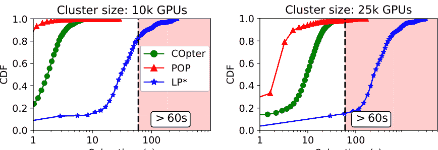

图 4.6：两个分别拥有 10k 和 25k GPU 的集群中 SIA 策略 [169] 的端到端求解器运行时间的累积分布函数。我们将 COPTER 与 (1) POP（将 ILP 划分为 16 个部分并并行求解子问题）和 (2) LP*（使用商业求解器 [154] 求解 LP-松弛，并使用垫片恢复二元解）进行比较。

#### 4.5.2 经验评估

本节评估通过 COPTER 对 GPU 集群调度问题（第 4.5.1 节）应用持续优化的有效性。

**测试平台** 我们在双路 AMD EPYC 7742 64 核处理器上运行所有实验，配备 1TB DDR4 内存，但将求解器限制为 8 个线程（超过 8 个线程未观察到显著加速 [182]）。对于 POP，我们遵循先前工作 [137, 182] 中使用的方法，在单个线程上求解每个子问题，并报告针对 64 核心数学计算的估计并行运行时间。

**评估的方法** 我们将 COPTER 与两种方法进行比较：(a) POP [113] 将 SIA 策略的 ILP 划分为 16 个具有相等资源（以及尽可能相等作业）的子问题，并行求解子问题（使用 ray [77] + cvxpy [56]），采用基于 Simplex 的求解器 [189]，以及 (b) LP* 使用商业求解器 [154] 求解 SIA ILP 的 LP-松弛，并使用第 4.5.1 节中描述的垫片在每一轮中获得二元分配。

**指标** 我们考虑以下指标：(1) 平均作业完成时间（avg. JCTs）是执行作业从提交到完成所需时间的平均值，对跟踪中的所有作业求平均（越低越好），(2) 完工时间是跟踪中所有作业完成所需时间（即第一个作业提交和最后一个作业

| | 平均 JCT (小时) | 完工时间 (小时) | 求解时间 (p99, 秒) |
|---|---|---|---|
| **集群规模：10k 个 GPU** | | | |
| LP* | **0.35** | **29.3** | 233.4 |
| POP | 0.41 | 31.0 | **2.9** |
| COPTER | 0.36 | 29.4 | 6.5 |
| **集群规模：25k 个 GPU** | | | |
| LP* | **0.35** | **29.3** | 2277 |
| POP | 0.39 | 30.9 | 66.5 |
| COPTER | 0.36 | 29.4 | **40.3** |

**表 4.1：** 使用 SIA 策略 [169] 对 10k 和 25k GPU 集群进行 GPU 集群调度实验的摘要，采用了 COPTER、POP 和商业 LP 求解器 [154]。

完成时间，越低越好)，以及 (3) *求解器运行时间* 衡量该策略的端到端运行时间（包括 COPTER 和 *LP\** 中用于 *垫片* 的时间，越低越好）。

我们在表 4.1 中总结了实验结果，并在图 4.6 中展示了求解器运行时间的 CDF。从表 4.1 可以看出，对于两种集群规模，COPTER 比 *LP\** 快 30-40 倍，并实现了相似的平均 JCT 和完工时间。POP 在 10k GPU 集群上的 99 分位求解时间比 COPTER 快，但由于每个子问题中求解 MILP 时出现组合爆炸，在 25k GPU 集群上超过了 60 秒阈值。尽管 POP 直接求解 ILP 制定，但 POP 的解导致平均 JCT 和完工时间分别增加 11-17% 和 6%。这也突出了我们 *垫片* 的有效性——尽管使用启发式方法获得 MILP 的整数解，COPTER 和 *LP\** 的解都导致较低的平均作业完成时间和完工时间。这表明，对于大型资源分配问题，可以绕过 *整数化* 阶段的组合爆炸，而不会带来太大代价。

图 4.6 还突出了 MILP 求解器的另一个特征：ILP 中的变量数量并不总是决定求解器运行时间，因为 *整数化* 阶段的运行时间具有不可预测性。由于 POP 在每个子问题中直接求解 ILP 制定，我们看到运行时间分布较宽——90 分位和 100 分位求解器时间之间相差超过 30 倍。相比之下，COPTER 显示出可预测的运行时间——最慢的运行时间（70.4s）对应于变量数量最多的问题（超过 1100 万个变量），90 分位和 100 分位求解器时间之间仅相差 2-3 倍。


### 4.6 结论

本章介绍了*持续优化*（CO）—一种用于利用大规模资源分配问题中*渐进演变*的原则性框架。利用许多系统中连续轮次仅有微小差异的洞察，CO将求解器工作量随时间分摊，而不是将每一轮视为孤立的实例。

我们通过路径长度的概念形式化了这一直觉，并展示了调度器如何遵循Follow-The-Leader (FTL)过程，该过程具有路径相关的动态遗憾。基于此分析，我们解释了预热启动的**近点算法**在运行时间方面自然适合持续优化：其近点更新是收缩性的，直接受益于良好的初始化，并且—当与坐标下降内部求解器配对时—保持无因式分解特性。我们将框架实例化为COPTER，它结合了

- 一个*差分更新接口*，用于增量式修改LP/MILP，
- 一个*无因式分解*的一阶求解器，可在轮次间复用工作，以及
- 轻量级*垫片*启发式，可将近整数LP松弛转换为高质量整数解，而无需穷举式分支定界搜索。

基于现实GPU集群踪迹的实验证实了实际影响：与与环境无关的基线相比，COPTER的端到端调度速度快了高达**100×**，同时匹配—甚至超越—基线的作业完成时间。理论基础和实证结果共同说明，认识并系统地利用逐步演变的动态，可以在现代机器学习基础设施中解锁可观的效率提升。

### 4.7 相关工作与讨论

#### 作为优化问题的集群调度

像Tetri-Sched [59]和Shockwave [183]这样的预先规划调度器会求解一个MILP来确定多轮次的分配，因此，在大型集群中对于错过调度截止时间具有合理的鲁棒性，代价是队列时间增加和资源利用率降低。Meta的RAS [138]按小时求解MILP以进行大规模容量预留，采用两阶段分解（用于服务器-预留分配的MILP，然后进行并行容器分配），但需要针对MILP阶段进行特定于问题的优化和启发式，以扩展到大规模问题。Tetris [185]求解MILP以用于ML工作负载负载均衡和跨区域的数据放置优化，并采用多级调度来实现可扩展性，代价是牺牲全局最优性。Gavel [113]支持使用LP公式对许多调度目标在异构GPU上对DNN作业进行时间片划分，但如果作业请求空间共享，就会遇到求解器瓶颈，导致大型集群中错过调度截止时间。Rebalancer [193]是一个用于将调度策略表示并编译为MILP的框架。然后，在小规模下使用现成求解器求解这些MILP，而在较大规模下，则在图形表示上使用更快的次优局部搜索算法。COPTER以两种方式补充Rebalancer – (a)潜在地扩展可直接作为MILP求解的问题规模，以及 (b)使用COPTER的输出作为初始猜测，在较大规模下初始化局部搜索算法，以获得更高质量的解。

#### 求解优化问题

**离线优化。** 离线优化处理在优化开始前已完全指定的问题。最先进的LP和MILP求解器（例如，CPLEX [154]、Gurobi [202]、GLPK [23]）通常使用单纯形法或内点法（阻尼法），这些方法依赖于迭代求解线性系统，并采用矩阵分解（LU、QR、LDL）[23, 154]等优化。由于每次迭代成本高，这些方法在大规模问题上扩展性较差。此外，分解通常会破坏约束矩阵中的稀疏模式，如果问题发生变化，则必须重新计算，这使得它们在问题频繁变化的持续优化中效率低下。一阶方法，如OSQP [116]、ADMM [28]、ALCD [54, 68]、PGD [2] 应运而生，以解决这些局限性，以较慢的收敛速度换取较低的每次迭代成本。例如，为了将求解器扩展到地震反射断层扫描应用中的大规模问题，Delbos和Gilbert [19]摒弃了单纯形法和基于内点法的方法，而是开发了一种基于增广拉格朗日法和共轭梯度法的一阶方法。该方法在[54]中进一步适应大规模稀疏线性规划，[68]带来了进一步改进的分析和运行时间改进。这些算法的随机版本，如随机梯度下降（SGD）也很流行，进一步以较简单的每次迭代复杂度换取收敛（和可行性）。

**在线优化。** 目前为止讨论的方法本质上是离线方法 — 它们离线构建线性规划并使用求解器求解。相比之下，在线优化 [57] 方法优化的是依次揭示的问题，并引入了时间步的概念。在线优化算法通常具有某种不确定性概念，并通常尝试最小化相对于固定最优值的遗憾 [35, 57, 125]。在线优化算法的目标是保证遗憾与算法迭代次数的次线性增长；即所谓的无遗憾算法。尽管基于轮次的资源分配可以表述为在线优化问题，但该设置不直接适用，因为与任何固定的静态分配进行比较是没有意义的。为了解决这个问题，在线优化的近期方法将这一遗憾概念扩展到了*动态遗憾*；即我们将我们的分配与一系列极小值进行比较，而不是与一个固定的极小值进行比较—在我们的情况中，是一系列最优分配。有了动态遗憾的概念，在线学习中的算法目标就变成了提供与最优分配随时间变化有利扩展的动态遗憾保证；也就是说，如果跨时间的解变化较小，那么我们的算法也应提供具有小动态遗憾的解 [146, 150, 163]。但是，即使是这种修改对于基于轮次的资源分配也不适用，尤其是在缓慢演变系统（本章主题）的背景下，因为在这种设置中，算法的运行时间通常不是关注点。相比之下，在持续优化中，我们的目标是提供既具有低动态遗憾，又具有取决于跨轮次最优值变化的运行时间的算法。

## 第 5 章

## 机器学习以外的渐进演变

基于第4章介绍的持续优化视角，本章探索了非ML资源分配任务中的良性演变。我们研究了两个大规模且实用性强的问题—(i)分片负载均衡和 (ii)广域网（WAN）流量工程—并展示了相同的渐进演变结构如何被COPTER在ML领域之外利用。材料借鉴了Jayaram Subramanya、Dennis、Smith和Ganger [203]的工作。

### 5.1 分片负载均衡

分片负载均衡问题经常出现在弹性数据库系统的操作中 [29, 41, 43]，其中数据分片的副本在固定服务器池中移动，以确保服务器机群上的负载一致。

问题公式。令 L = {l1, l2, ..., lD} 为每个 D 个分片上的负载，令 N 为机群中的服务器数量。令 T 表示现有的分片-服务器分配，其中 Tij = 1 当且仅当分片 j 的副本存在于服务器 i 上，令 S = {s1, s2, ..., sD} 表示每个分片的大小，令 M = {m1, m2, ... mN} 表示每个 N 个服务器的内存容量。优化问题对每个 (服务器, 分片) 对 (i, j) 使用两个相关变量 Rij 和 Xij。Rij ≥ 0 表示路由到服务器 i 的分片 j 负载的比例，Xij ∈ {0, 1} 表示服务器 i 是否托管分片 j 的副本。因此，Rij > 0 ⇒ Xij = 1，且 Rij = 0 ⇔ Xij = 0。该


MILP 的定义如下：

```
\min_{R, X} \sum_i \sum_j (1 - T_{ij}) \cdot s_i \cdot X_{ij} \quad (a)
\textbf{subject to:} \sum_{i=1}^N R_{ij} = 1 \quad \forall j \quad (b)
\mathcal{L} - \epsilon \le \sum_j X_{ij} \cdot l_j \le \mathcal{L} + \epsilon \quad \forall i \quad (c)
\sum_{j=1}^D X_{ij} \cdot s_j \le m_i \quad \forall i \quad (d)
R_{ij} \le X_{ij}, \quad X_{ij} \in \{0, 1\} \quad \forall i, j \quad (e)
```

其中 (a) 是旨在为每个数据分片在无副本服务器上启动新副本时最小化启动成本的目标，(b) 确保每个分片 $j$ 的所有负载都被记录在案，(c) 确保每个服务器上的负载在平均负载 $\mathcal{L} = \frac{1}{N} \sum_j l_j$ 的 $\epsilon$ 范围内，(d) 确保服务器 $i$ 的内存使用量不超过其容量 $m_i$，(e) 确保如果服务器 $i$ 为分片 $j$ 执行查询，则它托管分片 $j$ 的副本，并且分片-服务器分配变量 $X$ 为二进制。注意 (c) 允许 $2\epsilon$ 的负载不平衡——即负载最重和最轻服务器之间的差异。

**应用 COPTER。**我们首先将 $X_{ij}$ 上的二进制约束放宽为 $0 \le X_{ij} \le 1$。然后，我们使用持续优化求解放松后的 LP，并应用垫片来恢复可行的二进制 $X^{bin}$ 和连续 $R$。我们使用由 $R$ 计算出的初始分片放置 $X^{bin}$ 启动垫片，该放置可能会超过某些服务器的内存容量。我们选取在 $X^{bin}$ 中内存容量被超出的服务器 $i$，并贪婪地逐个移除分配的分片 $j$，优先移除产生最小负载 $R_{ij} * l_j$ 的分片。只有当分片 $j$ 在其他服务器上有副本时才会移除它；如果移除，我们将其负载份额 $R_{ij}$ 从服务器 $i$ 按比例转移到托管其其他副本的所有服务器。我们重复此过程，直到服务器 $i$ 的内存容量不再被违反，然后转到下一个过载服务器。最终的服务器-分片分配 $X^{bin}$ 和负载分布 $R$ 不违反服务器内存容量等硬约束，但可能会违反负载不平衡软约束。我们在第 5.3.1 节中表明，$(X^{bin}, R)$ 很少违反软负载均衡约束，此外，我们发现 COPTER 解有时 *优于最优* —— 这是问题表述的一个副产物，它允许在无任何惩罚的情况下减少分片副本数量。我们在第 5.3.1 节中更详细地讨论了这一观察。

请注意，某些求解器（特别是基于 ADMM 的 SCS 和 OSQP [34, 116]）会为 LP-松弛产生 *退化* 解，这些解建议将每个分片的负载均匀地分割到所有 $N$ 个服务器上，但由于服务器内存容量约束，这会导致不可行解。然而，我们的求解器及基于单纯形的求解器原生产生的 LP-松弛解大多为二进制解（参见图 4.4）。

### 5.2 WAN 流量工程

在 WAN 流量工程中，需求（即流）会被分配网络中的链路容量，以最大化通过链路和路由器网络的总流量（*最大流* [121, 137]）或最小化最大链路利用率（*MLU* [12, 137, 182]），从而获得更好的网络性能。随着需求的波动，TE 系统必须频繁重新优化流量分配（通常以 5 分钟为间隔 [121, 137, 182]），以维持最佳网络性能。下面我们描述最大化总流量（简称 *最大流*）目标的 LP 表述。

**问题表述。**设 \( D = \{d_1, ... d_k\} \) 为需求集，其中源 \( s_j \) 和目的 \( t_j \) 的需求 \( j \) 请求带宽 \( d_j \)。设 \( P = \{P_1, ... P_k\} \) 为网络中每对路由器的 \( N \) 条预配置路径集合：\( P_j = \{p_j^1, ... p_j^N\} \)，且 \( c_e \) 为图 \( G = (V, E) \) 中每条边 \( e = (u, v) \in E \) 上连接路由器 \( u \) 和 \( v \) 的链路容量，其中路由器作为顶点 \( V \)，链路作为边 \( E \)。

*路径表述 LP* [32, 33, 72] 的定义如下：

```
max_X \sum_j \sum_{p \in P_j} X_j^p \qquad (a)

subject to: \sum_{p \in P_j} X_j^p \le d_j \quad \forall j \qquad (b)

\sum_{j, p \in P_j | e \in p} X_j^p \le c_e \quad \forall e \in E \qquad (c)

X_j^p \ge 0 \quad \forall p \in P_j, \forall j \qquad (d)
```

其中 (a) 是最大化通过网络的总分配流量的目标，(b) 确保每个需求 \( j \) 被分配的带宽最多为请求带宽 \( d_j \)，并分布在其 \( N \) 条预配置路径上，(c) 确保通过链路 \( e \) 的所有流量之和受限于链路容量 \( c_e \)，(d) 确保所有流量分配均为非负。

**应用 COPTER。**变量 \( X_j^p \) 为连续变量，因为它们表示 Mb/s 的流量值，因此 COPTER 将使用持续优化直接求解上述 LP，无需使用垫片。我们在第 5.3.1 节中表明，COPTER 的流量分配能够得到最优 *最大流*，并且对于需求随时间变化的情况，新的最优分配可以从之前的分配中快速计算得出。

### 5.3 实验

本节评估通过 COPTER 将持续优化应用于作为 LP/MILP 表述的两个资源分配问题的有效性：

- 分片负载均衡。我们遵循 [137] 中描述的实验设置并模拟时变负载分布。我们在可能的地方重用 POP [137] 作者开源的代码，并使用相同的负载分布来对 COPTER（单独实现）进行基准测试。
- 流量工程。我们针对两种网络拓扑优化最大流目标——肯塔基数据链路网络（Kdl [137, 182]）和 AS 级拓扑（ASN [182]）。我们在与 POP [137] 相同的评估框架中实现 COPTER，以模拟相同的流量模式。

**测试平台。**我们在具有 1TB DDR4 内存的 2 路 AMD EPYC 7742 64 核处理器上运行所有实验，但将求解器限制为 8 个线程（超过 8 个线程未观察到显著加速 [182]）。对于 POP，我们遵循前人工作 [137, 182] 采用的方法，在单个线程上求解每个子问题，并报告针对 64 核数学计算出的估计并行运行时间。

#### 5.3.1 分片负载均衡

**评估方法。**我们将 COPTER 与以下方法进行对比：(a) Heuristic 是来自 E-Store [43] 的贪婪算法，(b) Exact 是第 5.1 节中描述的 MILP 表述，并使用商业 MILP 求解器 [154] 求解，(c) LP-Relaxed 求解 MILP 表述的 LP-松弛，并应用第 5.1 节中描述的垫片来解决整数不可行性问题，(d) POP-k 将服务器和分片集合分成 k 个片段，并使用商业 MILP 求解器 [154] 求解 MILP 表述。

**指标。**我们关注以下三个指标：(a) 平均分片移动次数是响应负载分布变化每轮移动的分片平均数量（越低越好），(b) 平均负载不平衡是负载最重和最轻服务器之间的负载差异（越低越好），(c) 平均负载均衡器时间是计算每轮服务器-分片分配所花费的时间，包括使用垫片的方法在垫片中花费的时间（越低越好）。

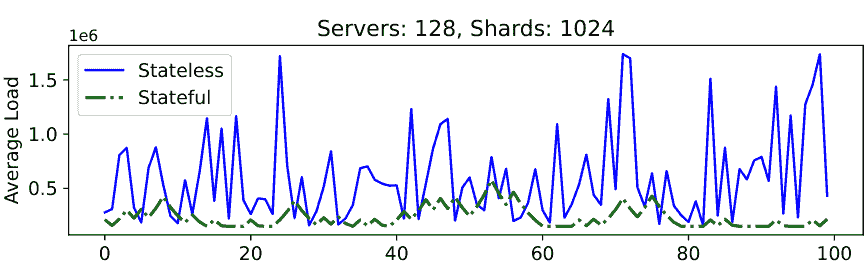

图 5.1：128 台服务器上 1024 个分片的负载均衡后每台服务器的平均负载。

**负载分布。**我们对使用每轮 \(k\) 的一个 Zipf 值 \(z_k\) 计算的两个负载分布进行基准测试——(a) *无状态* 中 \(z_k\) 在 \([z_{min}, z_{max}]\) 中均匀随机，模拟不可预测且随机的查询负载 [137]，以及 (b) *有状态* 中 \(z_k = z_{k-1} \times (1 \pm 0.1)\) 且方向均匀随机（即 \(z_{k-1}\) 增加或减少 10%），模拟跨轮负载分布的更平滑变化。图 5.1 显示了两个负载分布随时间变化的每台服务器平均负载。

**其他细节。**我们设置 \(\epsilon = 5\%\)（允许最多 10% 的负载不平衡），运行 100 轮并排除前 20 轮以消除启动影响。我们评估两个问题规模——1024 个分片和 128 台服务器，以及 2048 个分片和 256 台服务器。

**1024 个分片，128 台服务器。**图 5.2（顶部）和（底部）显示了两个负载分布的结果摘要。*启发式* 速度快，但产生大量分片移动，且未能将负载不平衡保持在要求的 10% 以下。*POP-8* 使用 8 个子问题，运行大约需要一秒钟，并减少了分片移动，但同样无法控制负载不平衡——虽然子问题内的所有服务器都保持较低的负载不平衡，但分片负载的随机分区导致子问题之间出现负载不平衡，从而造成跨子问题的服务器对之间的不平衡。*精确求解* 通过将 MILP 求解到最优，实现了近乎最小分片移动的完美负载不平衡。*LP-松弛* 使用与 *精确求解* 相同的求解器，但跳过了整数化阶段，并使用垫片使端到端求解速度提高 \(2 - 3\times\)，对分片移动或负载不平衡均无任何不利影响。最后，COPTER 利用持续优化，挖掘服务器-分片分配的稳定性，从而实现最低的分片移动和负载不平衡。然而，由于分片集合和服务器集合随时间保持不变，COPTER 无法从问题的差分更新中获益，因为每轮仅更新成本和约束向量。


##### 负载：无状态，服务器：128，分片：1024

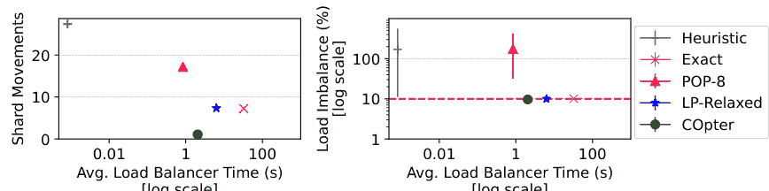

##### 负载：有状态，服务器：128，分片：1024

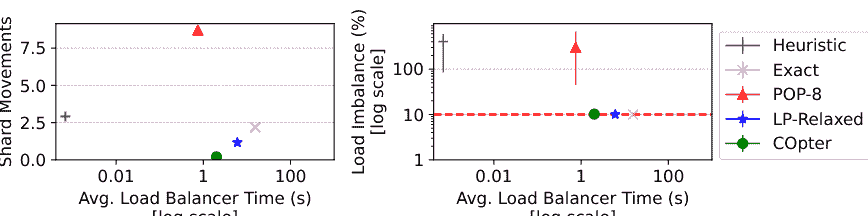

Figure 5.2: 128 台服务器上 1024 个分片的实验摘要，适用于 *无状态*（顶部）和 *有状态*（底部）负载。

**超优性。** 令人好奇的是，LP-Relaxed 和 COPTER 都比 Exact 实现了更低的分片移动量。经仔细检查，这种 *超优性* 源于各轮负载方差动态与第 5.1 节所述相应 MILP 公式之间的不匹配。在服务器 i 上为分片 j 启动副本具有非零目标成本，而删除副本的成本为零。考虑一个分片，其负载在轮次 k - 1 和 k 之间增加，导致轮次 k 中相应的分片移动。假设分片负载在下一轮 k + 1 中减少——Exact 将找到一个删除少数副本的解决方案，因为这些副本不再需要以维持低负载不平衡。如果轮次 k + 1 中负载增加，Exact 将再次启动副本并产生分片移动。LP-Relaxed 和 COPTER 不会像 Exact 那样从这种振荡中受到太大影响，原因有二——(a) 它们的解不完全是整数，使用 shim 来实现二进制解会导致时间上稳定的解决方案，以及 (b) COPTER 保持解决方案稀疏性，从而隐式地惩罚分片删除。COPTER 的持续优化方法更贴合问题动态，并且与运行商业 MILP 求解器的 Exact 相比，以极小一部分运行时成本交付更高质量的解决方案。

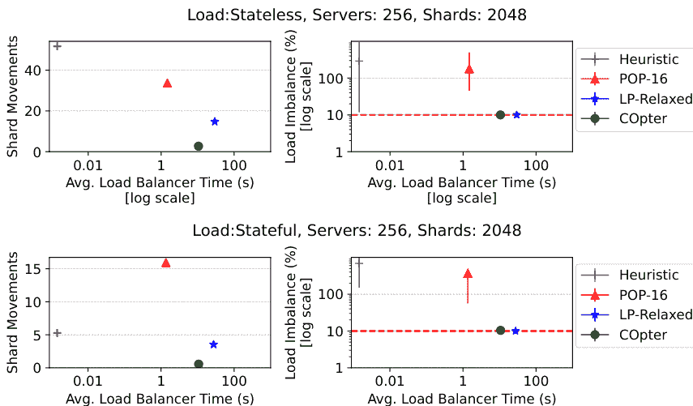

Figure 5.3: 256 台服务器上 2048 个分片的实验摘要，适用于 Stateless（顶部）和 Stateful（底部）负载。

**2048 个分片，256 台服务器。** Figure 5.3（顶部）和（底部）总结了我们在 256 台服务器上托管的 2048 个分片的 Stateless 和 Stateful 负载实验。我们将 Exact 从比较中省略，因为每个问题求解需要数小时，对于有意义的轮次时长来说不切实际。与 1024 分片的情况类似，POP-16 速度很快，但在子问题间存在负载不平衡。LP-Relaxed 和 COPTER 都满足负载不平衡约束，尽管使用 shim 来解决整数不可行性，这进一步证明我们可以绕过 MILP 整数化阶段大规模资源分配问题中的组合爆炸。

COPTER 使用我们的无因子分解、感知稀疏且高效热启动的 LP 求解器，获得高质量解决方案的速度比 LP-Relaxed 快约 2.8×，该求解器受益于高度稳定的分片-服务器分配。

#### 5.3.2 流量工程

**评估方法** 我们将 COPTER 与三种方法进行比较：
- LP-All 使用 Gurobi 商业 LP 求解器（v11.0.3 [202]）在 8 个线程上求解完整 LP。
- LP-Top 仅使用 Gurobi [202] 对按 volume 计算的前 10% 需求求解 LP，并将剩余需求分配到最短路径（也称为 demand pinning[157]）。
- POP-k[137] 将 LP 拆分为 k 个子问题。POP 中的每个子问题复制完整拓扑，但链路容量为 1/k，针对随机 1/k 的需求求解 LP，并对大需求使用 4 向客户端拆分[137] 以提高分配质量。子问题在单线程中求解，并数学估计并行运行时间。

**流量矩阵** 我们按照 Poisson 和 Bimodal 分布生成合成流量矩阵（与先前的工作 [121, 137] 类似）。Figure 5.4 显示了用于 Kdl 拓扑的需求概率分布。Poisson 由少量请求大部分需求量的流主导，而 Bimodal 在两个低需求和高需求带之间大致均匀分配。在每一轮中，我们扰动前一轮的需求高达 10% 以模拟时间变化的需求。我们每个实验运行 20 轮，并排除前 5 轮以消除启动效应。

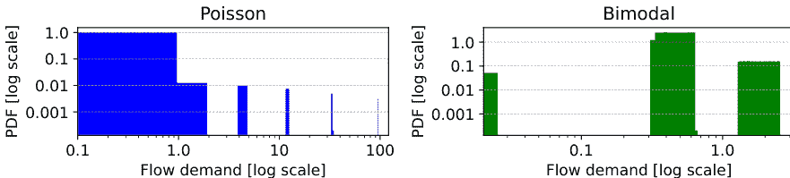

Figure 5.4: 两个合成流量矩阵中的需求分布——在 Poisson 中，少量大流主导需求，而在 Bimodal 中，需求分布在两个不同的带中。

**指标** 我们考虑三个指标：
- 总分配流量是所有需求间分配流量的总和，按轮次平均（越高越好）。
- 运行时间是跨轮次计算流量分配所花费的平均时间（越低越好）。
- 最优性差距是给定方法的总分配流量与 LP-All 找到的最优值之间的差值（越低越好）。对于 ASN 拓扑，我们针对 COPTER 计算最优性差距，因为 LP-All 每轮求解需数十小时，而 COPTER 在评估方法中分配的流量最多。

Figure 5.5 和 Figure 5.6 分别总结了我们对 Poisson 和 Bimodal 流量矩阵的实验。对于 Bimodal 流量矩阵，POP-128 求解单轮所有子问题需要数天，因此我们仅展示第一轮的结果。第一轮运行时间具有 POP-128 平均运行时间的代表性，因为它不受益于任何热启动，因为它在每轮中从随机分区创建新子问题。

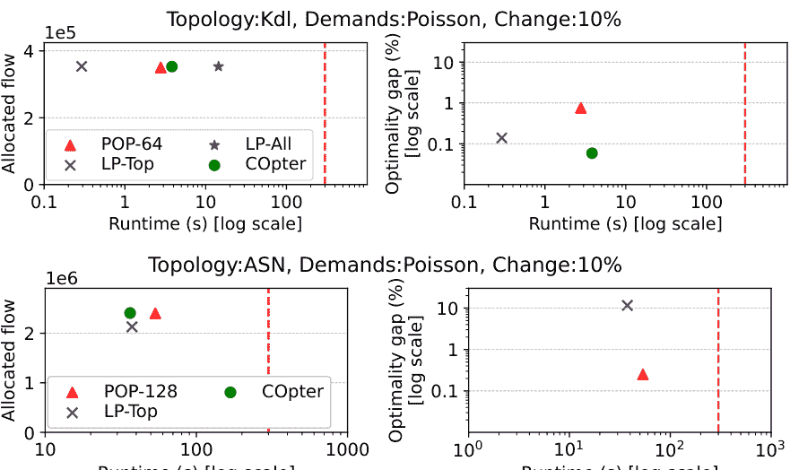

**Figure 5.5:** Kdl（上部）和 ASN（下部）拓扑 *泊松* 需求的实验摘要。虚线红线表示 WAN 流量工程 [72, 182] 中常用的 5 分钟轮次时长。

**泊松需求** *泊松* 由一小组需求主导，因此如预期，*LP-Top* 快两个数量级，并为 Kdl 拓扑分配与 *LP-All* 同样多的流量，但仅达到 COPTER 分配量的 90% 用于 ASN，展示了启发式方法的局限性。Kdl 的 *POP-64* 和 ASN 的 *POP-128* 分配了 > 99% 的最优流量，运行时间远低于 5 分钟轮次时长。COPTER 分别为 Kdl 和 ASN 拓扑分配了 > 99.9% 的最优流量和最高流量，时间均在一分钟以内。

**双峰需求。** *LP-Top* 无法分配 > 90% 的最优流量，但仍比其他方法快数个数量级。*LP-All* 超过了 Kdl 拓扑的 5 分钟轮次时长，并从 ASN 的比较中省略，因为其每轮运行时间超过 24 小时。*POP* 对 Kdl 拓扑表现良好，但求解 ASN 拓扑每个问题需超过 20 分钟，使得 5 分钟时长不切实际。COPTER 使用持续优化的方法在一分钟以内运行，并为 ASN 拓扑分配最高总流量——速度提升 30 倍，同时分配多出 1.5% 的流量。

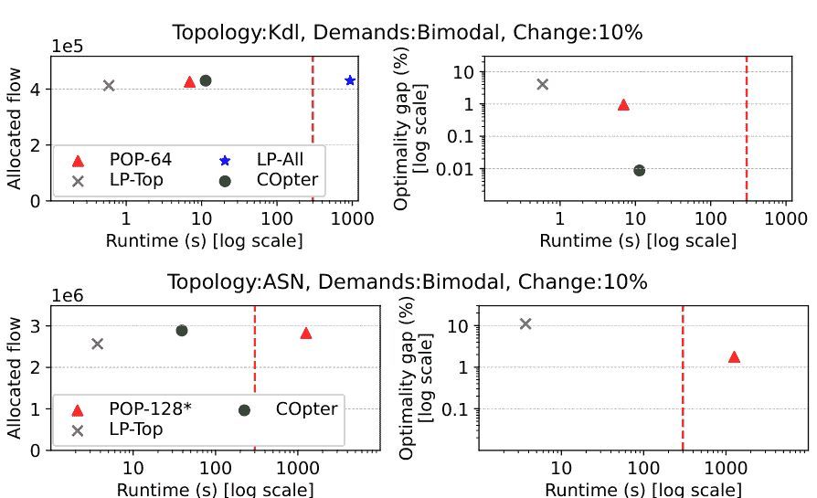

Figure 5.6: Kdl（上部）和 ASN（下部）拓扑双峰需求的实验摘要。

#### 5.3.3 收益归属

COPTER 在我们的基准测试中提供不同程度的收益。差分程序更新在资源和请求集变化时有帮助，因此这仅有利于 GPU 集群调度问题。尽管所有三个问题都受益于我们的无因子分解、感知稀疏且高效热启动的求解器，但通过问题特定 shim 进行的轻量级整数化仅有利于 GPU 集群调度和分片负载均衡问题。

Figure 5.7 说明了 COPTER 在先前描述的 10k GPU 集群中的 Sia ILP [169] 的 LP 松弛上带来的叠加收益。我们选择 LP 松弛，而非直接使用 ILP，因为许多问题直接制定为 LP（如 WAN 流量工程），并不受益于使用轻量级 shim 来解决整数不可行性。

Figure 5.7 显示以下内容的影响：
- 使用受益于问题和解决方案稀疏性的自定义求解器实现，
- 使用差分接口高效反映问题更新，以及
- 使用前一轮的解决方案作为当前轮的初始猜测，高效热启动自定义求解器。

平均而言，这些分别贡献叠加 5×、3.5× 和 1.5× 的加速比，


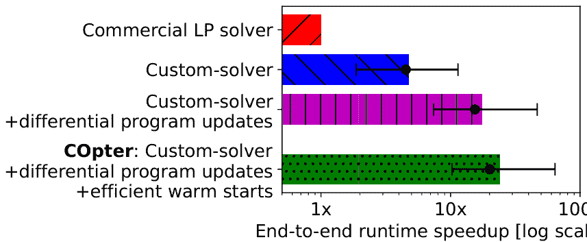

图 5.7：与商业 LP 求解器（CPLEX [154]）相比，COPTER 所包含的三种技术中的两种在端到端求解器运行时间方面的加速比。我们展示了在 10k GPU 集群上，针对 Sia ILP [169] 的 LP 松弛，在 1 分钟轮次中，平均值、中位数、第 10 百分位和第 90 百分位加速比。

与使用现有 LP 求解器独立求解问题相比，总加速比可达 24×。此外，根据第 5.3.1 节，我们看到先求解 MILP 的 LP 松弛，再应用问题特定的 shim，可带来端到端的 2–3× 加速比（对 MILP 和负载均衡问题的 LP 松弛均使用相同的求解器 [154]）。因此，我们可以预期 COPTER 可为 MILP 提供 24–72× 的加速比。

### 5.4 结论

本章展示了 COPTER 如何将机器学习工作流之外的优化扩展到另外两项大规模任务：分片负载均衡和广域网流量工程。与第 4 章一起，这些结果凸显了第二部分的核心观点：许多资源分配问题最好被视为缓慢演进的实例序列，因此天然适合持续优化。

在三个领域——GPU 集群调度、分片负载均衡和广域网流量工程中——COPTER 提供的分配速度比最先进的、与轮次无关的求解器快 10–100×，且解决方案质量几乎无损失。

## 参考文献

- [1] 约翰·冯·诺伊曼和奥斯卡·摩根斯特恩。_博弈论与经济行为_. 1944.
- [2] 保罗·H·卡拉迈和乔治·J·莫雷。“线性约束问题的投影梯度方法”。载于：_数学规划_ 39.1 (1987), pp. 93–116.
- [3] 约阿夫·弗罗伊德。“以多数票提升弱学习算法”。载于：_计算学习理论研讨会_. 1990.
- [4] 罗伯特·E·夏皮尔。“弱可学性的强度”。载于：_机器学习_ (1990).
- [5] 阿曼达·J·C·沙基。“论人工神经网络的组合”。载于：_连接科学_ 8.3-4 (1996), pp. 299–314. doi: 10.1080/095400996116785.
- [6] 约阿夫·弗罗伊德和罗伯特·E·夏皮尔。“在线学习的决策论推广及其在 Boosting 中的应用”。载于：_计算机与系统科学杂志_ (1997).
- [7] 塞普·霍赫赖特和于尔根·施密德胡伯。“长短期记忆”。载于：_神经计算_ (1997).
- [8] H.A.·罗利、S.·巴卢贾和T.·金出。“基于神经网络的人脸检测”。载于：_IEEE 模式分析与机器智能汇刊_ 20.1 (1998 年 1 月), pp. 23–38. issn: 1939-3539. doi: 10.1109/34.655647. (访问日期：2024 年 4 月 19 日).
- [9] 列乌·梅森、乔纳森·巴克斯特、彼得·巴特莱特和马库斯·弗兰。“Boosting 算法即梯度下降”。载于：_神经信息处理系统进展_ (1999).
- [10] 乔治·诺塞达尔和斯蒂芬·J·赖特，编。_数值优化_. Springer 运筹学与金融工程系列. 1999.
- [11] 托马斯·G·迪特里希。“机器学习中的集成方法”。载于：_多类别系统国际研讨会_. Springer. 2000, pp. 1–15.
- [12] 丽莎·K·弗莱舍。“与商品数量无关的分数多商品流近似”。载于：SIAM 离散数学杂志 13.4 (2000), pp. 505–520.
- [13] 约阿夫·弗罗伊德和罗伯特·夏皮尔。“博弈论、在线预测与 Boosting”。载于：学习理论会议 (2000).
- [14] P.·维奥拉和M·琼斯。“使用简单特征的 Boosted 级联进行快速对象检测”。载于：2001 年 IEEE 计算机学会计算机视觉与模式识别会议论文集。CVPR 2001. 第 1 卷. ISSN: 1063-6919. 2001 年 12 月.
- [15] E·阿尔佩·伊尔迪里姆和斯蒂芬·J·赖特。“线性规划内点法中的热启动策略”。载于：SIAM 优化杂志 12.3 (2002), pp. 782–810.
- [16] 艾伦·弗恩和罗伯特·吉文。“在线集成学习：一项实证研究”。载于：机器学习 53 (2003), pp. 71–109.
- [17] 萨索·杰泽罗斯基和伯纳德·日嫩科。“使用 Stacking 组合分类器是否优于选择最佳分类器？”. 载于：机器学习 54 (2004), pp. 255–273.
- [18] 保罗·维奥拉和迈克尔·J·琼斯。“鲁棒实时人脸检测”。en. 载于：国际计算机视觉杂志 57.2 (2004 年 5 月), pp. 137–154. ISSN: 1573-1405. DOI: 10.1023/B:VISI.0000013087.49260.fb. (访问日期：2024 年 4 月 19 日).
- [19] 弗雷德里克·德尔博和让·查尔斯·吉尔伯特。“求解凸二次优化问题的增广拉格朗日算法的全局线性收敛性”。载于：凸分析杂志 12.1 (2005), p. 25.
- [20] 左非和彼得·H·N·德威特。“使用神经网络集成级联进行快速人脸检测”。载于：智能视觉系统高级概念会议. 2005.
- [21] 克里斯蒂安·布西卢阿、里奇·卡鲁阿纳和亚历山德鲁·尼库列斯库-米齐尔。“模型压缩”。载于：知识发现与数据挖掘国际会议. 2006.
- [22] 伊丽莎白·约翰和E·阿尔佩·伊尔迪里姆。“固定维度线性规划内点法中热启动策略的实现”。载于：计算优化与应用 41.2 (2008), pp. 151–183.
- [23] 安德鲁·马赫奥林。“GLPK (GNU 线性规划工具包)”。载于：http://www.gnu.org/s/glpk/glpk.html (2008).
- [24] 左非和彼得·H·N·德威特。“使用神经网络集成的级联人脸检测”。载于：EURASIP 信号处理进展杂志 2008 (2008), pp. 1–13.
- [25] 邓佳、董伟、理查德·索彻、李佳、李凯和李飞飞。“ImageNet：一个大规模分层图像数据库”。载于：_2009 年 IEEE 计算机视觉与模式识别会议_. 2009, pp. 248–255.
- [26] 亚历克斯·克里热夫斯基和杰弗里·辛顿。“从微小图像中学习多层特征”。载于：(2009).
- [27] 卢卡·特雷维桑、马德赫·图尔西亚尼和萨利尔·瓦丹。“正则性、Boosting 与高熵分布的高效模拟”。载于：_IEEE 计算复杂性会议_. 2009.
- [28] 斯蒂芬·博伊德、尼尔·帕里克、埃里克·楚、博尔哈·佩莱阿托、乔纳森·埃克施泰因等人。“乘数器交替方向法中的分布式优化与统计学习”。载于：_机器学习的基础与趋势®_ 3.1 (2011), pp. 1–122.
- [29] 卡洛·库里诺、埃文·P·C·琼斯、塞缪尔·马登和哈里·巴拉克里希南。“感知工作负载的数据库监控与整合”。载于：_2011 年 ACM SIGMOD 数据管理国际会议论文集_. 2011, pp. 313–324.
- [30] 王丽丹、吉米·林和唐纳德·梅茨勒。“用于高效排序检索的级联排名模型”。载于：_第 34 届 ACM SIGIR 信息检索研究与开发国际会议论文集_. ACM, 2011, pp. 105–114. (访问日期：2023 年 10 月 24 日).
- [31] 特奥·苏斯尼亚克、安德烈·L·C·巴尔扎克和肯尼斯·A·霍伊克。“概念漂移中人脸检测的自适应 Boosted 集成级联”。载于：_神经计算与应用_ 21 (2012), pp. 671–682.
- [32] 洪奇尧、斯里坎特·坎杜拉、拉图尔·马哈詹、张明、维杰·吉尔、莫汉·南杜里和罗杰·瓦滕霍费尔。“使用软件定义的 WAN 实现高利用率”。载于：_ACM SIGCOMM 2013 会议论文集_. 2013, pp. 15–26.
- [33] 苏尚特·贾因、阿洛克·库马尔、苏布什蕾·曼达尔、俊·翁、莱昂·普捷耶夫斯基、阿琼·辛格、苏巴亚·文卡塔、吉姆·旺德勒、周俊兰、朱敏等人。“B4：全球部署软件定义 WAN 的经验”。载于：_ACM SIGCOMM 计算机通信评论_ 43.4 (2013), pp. 3–14.
- [34] 布伦丹·奥多诺休、埃里克·楚、尼尔·帕里克和斯蒂芬·博伊德。“通过齐次自偶嵌入进行锥优化的算子分割”。载于：_arXiv 预印本 arXiv:1312.3039_ 1.2.1 (2013), p. 3.
- [35] 萨沙·拉克林和卡蒂克·斯里达兰。“可预测序列的优化、学习与博弈”。载于：_神经信息处理系统进展_ 26 (2013).
- [36] 罗伯特·E·夏皮尔和约阿夫·弗罗伊德。“Boosting：基础与算法”。载于：Kybernetes (2013).
- [37] 理查德·索彻、亚历克谢·佩列柔金、让·吴、杰森·楚앙、克里斯托弗·D·曼宁、吴恩达和克里斯托弗·波特。“基于情感树库的语义组成性递归深度模型”。载于：2013 年自然语言处理经验方法会议论文集. 2013, pp. 1631–1642.
- [38] C·塞吉迪。“神经网络的有趣特性”。载于：arXiv 预印本 arXiv:1312.6199 (2013).
- [39] 协京铉、巴特·范梅里恩博尔、德米特里·巴赫丹瑙和约舒亚·本吉奥。“神经机翻译的特性：编码器-解码器方法”。载于：arXiv 预印本 arXiv:1409.1259 (2014).
- [40] 尼尔·帕里克、斯蒂芬·博伊德等人。“近端算法”。载于：优化基础与趋势® 1.3 (2014), pp. 127–239.
- [41] 马尔科·塞拉菲尼、埃萨姆·曼苏尔、阿什拉夫·阿卜努尔纳加、肯尼斯·塞勒姆、塔哈·拉菲克和乌马尔·法鲁克·明哈斯。“Accordion：支持分布式事务的数据库系统的弹性可扩展性”。载于：VLDB 端口论文集 7.12 (2014), pp. 1035–1046.
- [42] 桑德·苏。“使用 Haar 级联分类器进行对象检测”。载于：塔尔图大学计算机科学研究所 2.3 (2014), pp. 1–12. (访问日期：2024 年 4 月 19 日).
- [43] 丽贝卡·塔夫、埃萨姆·曼苏尔、马尔科·塞拉菲尼、詹妮·达根、阿伦·J·埃尔莫、阿什拉夫·阿卜努尔纳加、安德鲁·帕夫洛和迈克尔·斯通布雷克。“E-store：分布式事务处理系统的细粒度弹性分区”。载于：VLDB 端口论文集 8.3 (2014), pp. 245–256.
- [44] 阿妮莉娅·安格洛娃、亚历克斯·克里热夫斯基、文森特·范胡克、阿比吉特·S·奥加勒和大卫·弗格森。“基于深度网络级联的实时行人检测。”. 载于：第 2 卷. 2015, p. 4. (访问日期：2024 年 4 月 19 日).
- [45] 蔡兆伟、穆罕默德·萨贝里安和努诺·瓦斯孔塞洛斯。“面向深度行人检测的复杂性感知级联学习”。载于：2015, pp. 3361–3369. (访问日期：2024 年 4 月 19 日).
- [46] 斯蒂芬·P·克拉戈和约翰·保罗·沃尔特斯。“异构云计算：未来之路”。载于：计算机 48.01 (2015), pp. 59–61.
- [47] 乔纳森·埃克施泰因和王瑶。“乘数器交替方向法收敛性的理解：理论与计算视角”。载于：Pac. J. Optim. (2015).


- [48] Song Han, Huizi Mao, and William J Dally. “深度压缩：通过剪枝、训练量化和霍夫曼编码压缩深度神经网络”. 载于: arXiv 预印本 arXiv:1510.00149 (2015).

- [49] Song Han, Jeff Pool, John Tran, and William Dally. “学习高效神经网络的权重和连接”. 载于: 神经信息处理系统进展 (2015).

- [50] Geoffrey Hinton, Oriol Vinyals, and Jeff Dean. “蒸馏神经网络中的知识”. 载于: stat 1050 (2015).

- [51] Ya Le and Xuan S. Yang. “Tiny ImageNet 视觉识别挑战”. 载于: 2015.

- [52] Joseph Redmon, Santosh Divvala, Ross Girshick, and Ali Farhadi. 一次只看一次：统一的实时目标检测. en. 2015 年 6 月. URL: https://arxiv.org/abs/1506.02640v5.

- [53] Olga Russakovsky, Jia Deng, Hao Su, Jonathan Krause, Sanjeev Satheesh, Sean Ma, Zhiheng Huang, Andrej Karpathy, Aditya Khosla, Michael Bernstein, Alexander C. Berg, and Li Fei-Fei. “ImageNet 大规模视觉识别挑战”. 载于: 国际计算机视觉杂志 (2015).

- [54] Ian En-Hsu Yen, Kai Zhong, Cho-Jui Hsieh, Pradeep K Ravikumar, and Inderjit S Dhillon. “通过原始对偶增量坐标下降进行稀疏线性规划”. 载于: 神经信息处理系统进展 28 (2015).

- [55] Tianqi Chen and Carlos Guestrin. “XGBoost：可扩展的树增强系统”. 载于: 知识发现与数据挖掘国际会议. 2016.

- [56] Steven Diamond and Stephen Boyd. “CVXPY：面向凸优化的 Python 嵌入式建模语言”. 载于: 机器学习研究杂志 17.83 (2016)，第 1–5 页.

- [57] Elad Hazan et al. “在线凸优化导论”. 载于: 优化基础与趋势® 2.3–4 (2016)，第 157–325 页.

- [58] Kaiming He, Xiangyu Zhang, Shaoqing Ren, and Jian Sun. “深度残差学习用于图像识别”. 载于: IEEE 计算机视觉与模式识别会议. 2016.

- [59] Alexey Tumanov, Timothy Zhu, Jun Woo Park, Michael A Kozuch, Mor Harchol-Balter, and Gregory R Ganger. “TetriSched：动态异构集群中自适应前瞻的全局重新调度”. 载于: 第 11 届欧洲计算机系统会议论文集. 2016，第 1–16 页.

- [60] Jose M Alvarez and Mathieu Salzmann. “面向深度网络的压缩感知训练”. 载于: *神经信息处理系统进展* (2017).

- [61] Tolga Bolukbasi, Joseph Wang, Ofer Dekel, and Venkatesh Saligrama. “用于高效推理的自适应神经网络”. 载于: *国际机器学习会议*. 2017.

- [62] Dheeru Dua and Casey Graff. *UCI 机器学习库*. 2017. URL: http://archive.ics.uci.edu/ml.

- [63] Chuan Guo, Geoff Pleiss, Yu Sun, and Kilian Q. Weinberger. “关于现代神经网络校准”. 载于: *第 34 届国际机器学习会议论文集*. 由 Doina Precup 和 Yee Whye Teh 编辑. 机器学习研究论文集. PMLR, 2017.

- [64] Joel Hestness, Sharan Narang, Newsha Ardalani, Gregory Diamos, Heewoo Jun, Hassan Kianinejad, Md Mostofa Ali Patwary, Yang Yang, and Yanqi Zhou. “深度学习规模化在经验上是可预测的”. 载于: *arXiv 预印本 arXiv:1712.00409* (2017).

- [65] Gao Huang, Zhuang Liu, Laurens Van Der Maaten, and Kilian Q Weinberger. “密集连接卷积网络”. 载于: *IEEE 计算机视觉与模式识别会议*. 2017.

- [66] Brendan McMahan, Eider Moore, Daniel Ramage, Seth Hampson, and Blaise Aguera y Arcas. “基于去中心化数据的通信高效深度网络学习”. 载于: *人工智能与统计学*. 2017.

- [67] Paulius Micikevicius, Sharan Narang, Jonah Alben, Gregory Diamos, Erich Elsen, David Garcia, Boris Ginsburg, Michael Houston, Oleksii Kuchaiev, Ganesh Venkatesh, et al. “混合精度训练”. 载于: *arXiv 预印本 arXiv:1710.03740* (2017).

- [68] Sinong Wang and Ness Shroff. “线性规划的一种新型交替方向法”. 载于: *神经信息处理系统进展* 30 (2017).

- [69] Changan Chen, Frederick Tung, Naveen Vedula, and Greg Mori. “面向约束的深度神经网络压缩”. 载于: *欧洲计算机视觉会议论文集*. 2018.

- [70] Don Dennis, Chirag Pabbaraju, Harsha Vardhan Simhadri, and Prateek Jain. “面向资源受限设备的高效序列数据分类多实例学习”. 载于: *神经信息处理系统进展* (2018).

- [71] Jiaqi Guan, Yang Liu, Qiang Liu, and Jian Peng. “基于级联深度分类器的能源高效分摊推理”. en. 载于: *第二十七届国际人工智能联合会议论文集*. 斯德哥尔摩，瑞典：国际人工智能联合会议组织，2018 年 7 月，第 2184–2190 页. ISBN: 978-0-9992411-2-7.

- [72] Chi-Yao Hong, Subhasree Mandal, Mohammad Al-Fares, Min Zhu, Richard Alimi, Chandan Bhagat, Sourabh Jain, Jay Kaimal, Shiyu Liang, Kirill Mendelev, et al. “B4 及以后：在谷歌的软件定义广域网中管理层次结构、分区和不对称性以实现可用性和规模”. 载于: *2018 年 ACM 数据通信特别兴趣小组会议论文集*. 2018，第 74–87 页.

- [73] Gao Huang, Danlu Chen, Tianhong Li, Felix Wu, Laurens van der Maaten, and Kilian Weinberger. “面向资源高效图像分类的多尺度密集网络”. 载于: *国际学习表征会议*. 2018.

- [74] Gao Huang, Danlu Chen, Tianhong Li, Felix Wu, Laurens van der Maaten, and Kilian Q. Weinberger. *面向资源高效图像分类的多尺度密集网络*. arXiv:1703.09844. 2018 年 6 月. DOI: `10.48550/arXiv.1703.09844`. (2024 年 4 月 19 日访问).

- [75] Qi Huangfu and JA Julian Hall. “双重修正单纯形法的并行化”. 载于: *数学规划计算* 10.1 (2018)，第 119–142 页.

- [76] Aditya Kusupati, Manish Singh, Kush Bhatia, Ashish Kumar, Prateek Jain, and Manik Varma. “FastGRNN：快速、准确、稳定且千字节级的门控循环神经网络”. 载于: *神经信息处理系统进展* 31 (2018).

- [77] Philipp Moritz, Robert Nishihara, Stephanie Wang, Alexey Tumanov, Richard Liaw, Eric Liang, Melih Elibol, Zongheng Yang, William Paul, Michael I Jordan, et al. “Ray：面向新兴 AI 应用的分布式框架”. 载于: *第 13 届 USENIX 操作系统设计与实现研讨会 (OSDI 18)*. 2018，第 561–577 页.

- [78] Matthew Streeter. “级联预测模型的近似算法”. en. 载于: *第 35 届国际机器学习会议论文集*. ISSN: 2640-3498. PMLR, 2018 年 7 月，第 4752–4760 页. (2024 年 4 月 19 日访问).

- [79] Xin Wang, Yujia Luo, Daniel Crankshaw, Alexey Tumanov, Fisher Yu, and Joseph E. Gonzalez. *IDK 级联：通过学习不过度思考来实现快速深度学习*. arXiv:1706.00885 [cs]. 2018 年 6 月.

- [80] Xin Wang, Fisher Yu, Zi-Yi Dou, Trevor Darrell, and Joseph E. Gonzalez. “SkipNet：卷积网络中动态路由的学习”. 载于: 2018，第 409–424 页. (2024 年 4 月 19 日访问).

- [81] Pete Warden. 语音命令：有限词汇量语音识别数据集. 2018. 电子预印本：arXiv:1804.03209.

- [82] Jiahui Yu, Linjie Yang, Ning Xu, Jianchao Yang, and Thomas Huang. “可调宽神经网络”. 载于: 国际学习表征会议. 2018.

- [83] Jiahui Yu, Linjie Yang, Ning Xu, Jianchao Yang, and Thomas Huang. 可调宽神经网络. arXiv:1812.08928 [cs]. 2018 年 12 月. DOI: 10.48550/arXiv.1812.08928.

- [84] Rowan Zellers, Yonatan Bisk, Roy Schwartz, and Yejin Choi. “SWAG：面向基础常识推理的大规模对抗性数据集”. 载于: 2018 年经验自然语言处理会议论文集. 2018，第 93–104 页.

- [85] Han Cai, Chuang Gan, Tianzhe Wang, Zhekai Zhang, and Song Han. 一次性全能：训练一个网络并为其高效部署进行专用化. 2019 年 4 月. (2024 年 4 月 19 日访问).

- [86] Jang Hyun Cho and Bharath Hariharan. “关于知识蒸馏的有效性”. 载于: 国际计算机视觉会议. 2019.

- [87] Don Dennis, Durmus Alp Emre Acar, Vikram Mandikal, Vinu Sankar Sadasivan, Venkatesh Saligrama, Harsha Vardhan Simhadri, and Prateek Jain. “浅层 RNN：资源受限设备上的准确时间序列分类”. 载于: 神经信息处理系统进展 (2019).

- [88] Jacob Devlin, Ming-Wei Chang, Kenton Lee, and Kristina Toutanova. “BERT：面向语言理解的深度双向 Transformer 预训练”. 载于: 计算语言学协会北美分会. 2019.

- [89] Farnaz Forooghifar, Amir Aminifar, and David Atienza. “从边缘到云使用自觉的资源感知分布式癫痫监测”. 载于: IEEE 生物医学电路与系统期刊 (2019).

- [90] Trevor Gale, Erich Elsen, and Sara Hooker. “深度神经网络中稀疏性的现状”. 载于: arXiv 预印本 arXiv:1902.09574 (2019).

- [91] Yonatan Geifman and Ran El-Yaniv. “SelectiveNet：具有集成拒绝选项的深度神经网络”. en. 载于: 第 36 届国际机器学习会议论文集。ISSN: 2640-3498. PMLR, 2019 年 5 月，第 2151–2159 页. (2024 年 4 月 19 日访问).


- [92] Sara Hooker, Aaron Courville, Gregory Clark, Yann Dauphin, and Andrea Frome. “压缩深度神经网络会遗忘什么？”收录于：arXiv预印本 arXiv:1911.05248 (2019).

- [93] Myeongjae Jeon, Shivaram Venkataraman, Amar Phanishayee, Junjie Qian, Wencong Xiao, and Fan Yang. “面向 DNN 训练工作负载的大规模多租户 GPU 集群分析”。收录于：2019 USENIX 年度技术会议 (USENIX ATC 19). 2019, pp. 947–960.

- [94] Hao Li, Hong Zhang, Xiaojuan Qi, Ruigang Yang, and Gao Huang. “训练自适应深度网络的改进技术”。收录于：国际计算机视觉会议. 2019.

- [95] Yinhan Liu, Myle Ott, Naman Goyal, Jingfei Du, Mandar Joshi, Danqi Chen, Omer Levy, Mike Lewis, Luke Zettlemoyer, and Veselin Stoyanov. “RoBERTa：一种经过强力优化的 BERT 预训练方法”。收录于：arXiv预印本 arXiv:1907.11692 (2019).

- [96] Siva Reddy, Danqi Chen, and Christopher D Manning. “CoQA：一项对话式问答挑战”。收录于：计算语言学协会汇刊 7 (2019), pp. 249–266.

- [97] Victor Sanh, Lysandre Debut, Julien Chaumond, and Thomas Wolf. “DistilBERT，BERT 的一个蒸馏版本：更小、更快、更便宜、更轻量”。收录于：ArXiv (2019 年 10 月). (访问于 10/18/2023).

- [98] Thomas Wolf, Lysandre Debut, Victor Sanh, Julien Chaumond, Clement Delangue, Anthony Moi, Pierric Cistac, Tim Rault, et al. “Hugging Face 的 Transformers：最先进的自然语言处理”。收录于：arXiv预印本 arXiv:1910.03771 (2019).

- [99] Zhilin Yang, Zihang Dai, Yiming Yang, Jaime G. Carbonell, Ruslan Salakhutdinov, and Quoc V. Le. “XLNet：用于语言理解的广义自回归预训练”。收录于：神经信息处理系统会议. 2019.

- [100] Jiahui Yu and Thomas S. Huang. “通用可调整宽度网络与改进训练技术”。收录于：IEEE/CVF 国际计算机视觉会议论文集. 2019, pp. 1803–1811.

- [101] Davis Blalock, Jose Javier Gonzalez Ortiz, Jonathan Frankle, and John Guttag. “神经网络剪切的现状是什么？”收录于：机器学习与系统论文集 (2020).

- [102] Lingjiao Chen, Matei Zaharia, and James Y Zou. “FrugalML：如何更准确、更经济地使用 ML 预测 API”。收录于：神经信息处理系统进展. 2020.

- [103] Kevin Clark, Minh-Thang Luong, Quoc V Le, and Christopher D Manning. “ELECTRA：将文本编码器作为判别器而非生成器进行预训练”。收录于：arXiv预印本 arXiv:2003.10555 (2020).

- [104] Alexey Dosovitskiy. “一张图片抵得上 16x16 个词：用于大规模图像识别的 Transformer”。收录于：arXiv预印本 arXiv:2010.11929 (2020).

- [105] Sachin Goyal, Aditi Raghunathan, Moksh Jain, Harsha Vardhan Simhadri, and Prateek Jain. “DROCC：深度鲁棒一类分类”。收录于：国际机器学习会议. PMLR. 2020.

- [106] Pengcheng He, Xiaodong Liu, Jianfeng Gao, and Weizhu Chen. “DeBERTa：带有解耦注意力的解码增强型 BERT”。收录于：arXiv预印本 arXiv:2006.03654 (2020).

- [107] Tom Henighan, Jared Kaplan, Mor Katz, Mark Chen, Christopher Hesse, Jacob Jackson, Heewoo Jun, Tom B Brown, Prafulla Dhariwal, Scott Gray, et al. “自回归生成建模的缩放定律”。收录于：arXiv预印本 arXiv:2010.14701 (2020).

- [108] Sara Hooker, Nyalleng Moorosi, Gregory Clark, Samy Bengio, and Emily Denton. “压缩模型中的偏差表征”。收录于：arXiv预印本 arXiv:2010.03058 (2020).

- [109] Lu Hou, Zhiqi Huang, Lifeng Shang, Xin Jiang, Xiao Chen, and Qun Liu. “DynaBERT：具有自适应宽度和深度的动态 BERT”。收录于：神经信息处理系统进展. 第 33 卷. Curran Associates, Inc., 2020, pp. 9782–9793. (访问于 04/19/2024).

- [110] Ang Li, Shuaibwen Leon Song, Jieyang Chen, Jiajia Li, Xu Liu, Nathan R. Tallent, and Kevin J. Barker. “现代 GPU 互连评估：PCIe、NVLink、NV-SLI、NVSwitch 和 GPUDirect”。收录于：IEEE 并行与分布式系统交易 (2020 年 1 月).

- [111] Weijie Liu, Peng Zhou, Zhe Zhao, Zhiruo Wang, Haotang Deng, and Qi Ju. “FastBERT：一种具有自适应推理时间的自蒸馏 BERT”。收录于：arXiv预印本 arXiv:2004.02178 (2020).

- [112] Seyed Iman Mirzadeh, Mehrdad Farajtabar, Ang Li, Nir Levine, Akihiro Matsukawa, and Hassan Ghasemzadeh. “通过教师助手改进知识蒸馏”。收录于：AAAI 人工智能会议. 2020.

- [113] Deepak Narayanan, Keshav Santhanam, Fiodar Kazhamiaka, Amar Phanishayee, and Matei Zaharia. “面向深度学习工作负载的异构感知集群调度策略”。收录于：第 14 届 USENIX 操作系统设计与实现研讨会 (OSDI 20). 2020.

- [114] Jeff Rasley, Samyam Rajbhandari, Olatunji Ruwase, and Yuxiong He. “DeepSpeed：系统优化使训练拥有超过 1000 亿参数的深度学习模型成为可能”。收录于：知识发现与数据挖掘国际会议. 2020.

- [115] Michel Schubiger, Goran Banjac, and John Lygeros. “ADMM 在大规模二次规划中的 GPU 加速”。收录于：并行与分布式计算期刊 144 (2020), pp. 55–67.

- [116] Bartolomeo Stellato, Goran Banjac, Paul Goulart, Alberto Bemporad, and Stephen Boyd. “OSQP：一种用于二次规划的算子分割求解器”。收录于：数学规划计算 12.4 (2020), pp. 637–672.

- [117] Arun Suggala, Bingbin Liu, and Pradeep Ravikumar. “广义提升”。收录于：神经信息处理系统进展. 由 H. Larochelle, M. Ranzato, R. Hadsell, M.F. Balcan, and H. Lin 编辑. 第 33 卷. 2020, pp. 8787–8797.

- [118] Arun Suggala, Bingbin Liu, and Pradeep Ravikumar. “广义提升”。收录于：神经信息处理系统进展 (2020).

- [119] Ji Xin, Raphael Tang, Jaejun Lee, Yaoliang Yu, and Jimmy Lin. “DeeBERT：用于加速 BERT 推理的动态早期退出”。收录于：第 58 届计算语言学协会年度会议论文集. 2020, pp. 2246–2251.

- [120] Wangchunshu Zhou, Canwen Xu, Tao Ge, Julian McAuley, Ke Xu, and Furu Wei. “BERT 失去耐心：带有早期退出的快速可靠推理”。收录于：神经信息处理系统进展 33 (2020), pp. 18330–18341.

- [121] Firas Abuzaid, Srikanth Kandula, Behnaz Arzani, Ishai Menache, Matei Zaharia, and Peter Bailis. “收缩广域网络拓扑以快速解决流问题”。收录于：第 18 届 USENIX 网络系统设计与实现研讨会 (NSDI 21). 2021, pp. 175–200.

- [122] David Applegate, Mateo Diaz, Oliver Hinder, Haihao Lu, Miles Lubin, Brendan O’Donoghue, and Warren Schudy. “使用原-对偶混合梯度进行大规模线性规划的实用方法”。收录于：神经信息处理系统进展 34 (2021), pp. 20243–20257.

- [123] Minghao Chen, Houwen Peng, Jianlong Fu, and Haibin Ling. “AutoFormer：搜索用于视觉识别的 Transformer”。收录于：IEEE/CVF 国际计算机视觉会议论文集. 2021, pp. 12270–12280.

- [124] Karl Cobbe, Vineet Kosaraju, Mohammad Bavarian, Mark Chen, Heewoo Jun, Lukasz Kaiser, Matthias Plappert, Jerry Tworek, Jacob Hilton, Reiichiro Nakano, Christopher Hesse, and John Schulman. “训练验证器以解决数学应用题”。收录于：arXiv预印本 arXiv:2110.14168 (2021).

- [125] Constantinos Daskalakis, Maxwell Fishelson, and Noah Golowich. “通用博弈中近乎最优的无悔学习”。收录于：神经信息处理系统进展 34 (2021), pp. 27604–27616.

- [126] Don Dennis, Tian Li, and Virginia Smith. “异构即优势：一次性联邦聚类”。英. 收录于：第 38 届国际机器学习会议论文集. PMLR, 2021.

- [127] Shohei Enomoro and Takeharu Eda. “学习级联：用于提高级联推理系统准确性和计算成本的置信度校准”。收录于：AAAI 人工智能会议论文集. Vol. 35. 8. 2021, pp. 7331–7339.

- [128] Aditya Gangrade, Anil Kag, and Venkatesh Saligrama. “通过单侧预测进行选择性分类”。英. 收录于：第 24 届人工智能与统计国际会议论文集. ISSN: 2640-3498. PMLR, 2021 年 3 月, pp. 2179–2187. (访问于 04/19/2024).

- [129] Mengya Gao, Yujun Wang, and Liang Wan. “基于残差误差的知识蒸馏”。收录于：神经计算 (2021).

- [130] Shijie Geng, Peng Gao, Zuohui Fu, and Yongfeng Zhang. “RomeBERT：多退出 BERT 的鲁棒训练”。收录于：arXiv预印本 arXiv:2101.09755 (2021).

- [131] Amir Gholami, Sehoon Kim, Zhen Dong, Zhewei Yao, Michael W Mahoney, and Kurt Keutzer. “高效神经网络推理量化方法综述”。收录于：arXiv预印本 arXiv:2103.13630 (2021).

- [132] Jianping Gou, Baosheng Yu, Stephen J Maybank, and Dacheng Tao. “知识蒸馏：综述”。收录于：国际计算机视觉期刊 (2021).

- [133] Ramesh Jetty, Indy Sawhney, and Simon Zamarin. 基于 Amazon SageMaker 的大规模批量推理 | AWS 架构博客. 2021 年 11 月. url: https://aws.amazon.com/blogs/architecture/batch-inference-at-scale-with-amazon-sagemaker/.

- [134] Baolin Li, Vijay Gadepally, Siddharth Samsi, Mark Veillette, and Devesh Tiwari. “使用异构硬件提供机器学习推理服务”。收录于：2021 IEEE 高性能极端计算会议 (HPEC). IEEE. 2021, pp. 1–8.

- [135] Lei Li, Yankai Lin, Deli Chen, Shuhuai Ren, Peng Li, Jie Zhou, and Xu Sun. “CascadeBERT：通过经校准的完整模型级联加速预训练语言模型推理”。收录于：计算语言学协会研究成果：EMNLP 2021. 多米尼加共和国蓬塔卡纳：计算语言学协会, 2021 年 11 月, pp. 475–486. doi: 10.18653/v1/2021.findings-emnlp.43.


- 卢卡斯·利本温, 森克·巴卡尔, 布兰登·卡特, 大卫·吉福德, 和 丹妮拉·鲁斯. “剪枝迷失：超越测试准确率的神经网络剪枝影响”. 于：机器学习与系统会议论文集 (2021).

- 迪帕克·纳拉亚南, 费奥达尔·卡扎米亚卡, 菲拉斯·阿布扎伊德, 彼得·克拉夫特, 阿克谢·阿格拉瓦, 斯里坎特·坎杜拉, 斯蒂芬·博伊德, 和 马特伊·扎哈里亚. “使用 POP 高效求解大规模细粒资源分配问题”. 于：第 28 届 ACM SIGOPS 操作系统原理研讨会论文集. 2021.

- 安德鲁·纽尔, 迪米特里奥斯·斯卡拉托斯, 范静远, 帕万·库马尔, 马克西姆·胡托尔年科, 迈扬克·潘迪尔, 张一睿, 张明君, 刘远来, 林乐, 等. “RAS：面向数据中心的区域范围资源持续优化分配”. 于：第 28 届 ACM SIGOPS 操作系统原理研讨会论文集. 2021, pp. 505–520.

- 裴玉龙, 阿马拉奇·B·姆巴克韦, 阿比纳瓦·古普塔, 萨尔瓦·阿拉米尔, 黄林, 刘小默, 和 萨米娜·沙阿. “TweetFinSent：Twitter 股票情感数据集”. 于：(2021).

- 艾利克·拉德福德, 金钟旭, 克里斯·哈莱西, 阿迪蒂亚·拉梅什, 加布里埃尔·戈, 桑迪尼·阿格拉瓦尔, 吉里什·萨斯特里, 阿曼达·阿斯克尔, 帕米拉·米什金, 杰克·克拉克, 等. “从自然语言监督中学习可迁移视觉模型”. 于：国际机器学习会议. PMLR. 2021, pp. 8748–8763.

- 阿德里亚·鲁伊斯, 和 雅各布·费尔贝克. “带有蒸馏神经网络集成的随时推理”. 于：AAAI 人工智能会议论文集. 2021.

- 昂库尔·辛哈, 和 恰恩梅·坎代特. “新闻对大宗商品市场的影响：数据集与结果”. 于：信息与通信进展：2021 年信息与通信未来会议 (FICC) 论文集, 第 2 卷. Springer. 2021, pp. 589–601.

- 王晓芳, 丹·孔德拉蒂乌克, 埃里克·克里斯滕森, 克里斯·M·基塔尼, 亚尔·莫夫肖维茨-阿蒂亚斯, 和 埃拉德·埃班. “委员会的智慧：一种更快更准确模型的被忽视方法”. 于：国际学习表征会议. 2021.

- 李阳, 和 范德朗. “用于在运行时实现准确率与延迟权衡的动态神经网络”. 于：亚洲和南太平洋设计自动化会议. 计算机协会, 2021.

- 肖恩·I·杨, 王哲, 大卫·托布曼, 和 伯恩德·吉罗德. “CNN 压缩的变换量化”. 于：IEEE 样式分析与机器智能汇刊 (2021).

- [146] 赵鹏, 和 张立军. “强凸和平滑函数动态遗憾的改进分析”. 于：动力学与控制学习. PMLR. 2021, pp. 48–59.

- [147] 卢西亚·郑, 尼尔·古哈, 布兰登·R·安德森, 彼得·亨德森, 和 丹尼尔·E·何. “预训练何时有助于？针对法律及包含 53,000+ 个法律裁决的 CaseHold 数据集的自监督学习评估”. 于：第十八届人工智能与法律国际会议论文集. 2021, pp. 159–168.

- [148] 朱利庚, 林弘洲, 陆瑶, 林玉军, 和 韩松. “延迟梯度平均：容忍联邦学习中的通信延迟”. 于：神经信息处理系统进展 34 (2021), pp. 29995–30007.

- [149] 朱知元, 和 李远智. “关于理解深度学习中的集成、知识蒸馏与自蒸馏”. 于：第十一届国际学习表征会议. 2022.

- [150] 迪拉杰·贝比, 和 王玉翔. “带有强凸损失及超越的适当在线学习中最优动态遗憾”. 于：人工智能与统计国际会议. PMLR. 2022, pp. 1805–1845.

- [151] 阿纳夫·查万, 沈志强, 刘壮, 刘泽春, 郑广廷, 和 埃里克·P·兴. “视觉变压器瘦身：在连续优化空间中多维搜索”. 于：IEEE/CVF 计算机视觉与模式识别会议论文集. 2022.

- [152] 拉斡尔·贡蒂若-洛佩斯, 扬·多芬, 和 埃金·D·朱布克. 没有一种表征能统治一切：训练方法的重叠特征. arXiv:2110.12899 [cs]. 2022 年 4 月. (访问于 04/19/2024).

- [153] 韩义曾, 黄高, 宋世基, 杨乐, 王洪辉, 和 王玉林. “动态神经网络：综述”. 于：IEEE 样式分析与机器智能汇刊 44.11 (2022 年 11 月), pp. 7436–7456. ISSN: 1939-3539. (访问于 04/19/2024).

- [154] IBM 公司. IBM ILOG CPLEX 优化工作室 V22.1.1：用户手册. IBM 公司. 2022.

- [155] 赉凡, 戴寅伟, 桑贾伊·辛古拉姆, 刘家辰, 祁相风, 赫沙·马德亚斯塔, 和 摩沙拉夫·乔杜里. “Fedscale：大规模联邦学习模型和系统性能基准”. 于：国际机器学习会议. PMLR. 2022, pp. 11814–11827.

- [156] 乔纳森·马穆, 奥伦·佩雷格, 莫舍·瓦瑟布拉特, 和 罗伊·施瓦茨. TangoBERT：使用级联架构降低推理成本. arXiv:2204.06271 [cs]. 2022 年 4 月. DOI: 10.48550/arXiv.2204.06271.

- [157] 波里亚·纳姆亚尔, 比赫娜兹·阿尔扎尼, 瑞安·贝克特, 桑地亚戈·塞加拉, 希曼舒·拉杰, 和 斯里坎特·坎杜拉. “弥合快速启发式与其最优对照物之间的差距”. 于：第 21 届 ACM 网络热门话题研讨会论文集. 2022, pp. 138–144.

- [158] 哈里克里希纳·纳拉西曼, 维塔瓦·吉特里图姆, 阿迪蒂亚·K·梅农, 安基特·拉瓦特, 和 桑吉夫·库马尔. “学习向专家推迟的事后估计器”. en. 于：神经信息处理系统进展 35 (2022 年 12 月), pp. 29292–29304. (访问于 04/19/2024).

- [159] 塔尔·舒斯特, 亚当·菲施, 杰伊·古普塔, 莫斯塔法·德赫加尼, 达拉·巴赫里, 温·张, 郑艺, 和 唐纳德·梅兹勒. “自信的自适应语言建模”. en. 于：神经信息处理系统进展 35 (2022 年 12 月), pp. 17456–17472. (访问于 04/19/2024).

- [160] 孙天翔, 邵云凡, 钱弘, 黄璇京, 和 袁习鹏. “语言模型即服务的黑盒调优”. 于：国际机器学习会议. PMLR. 2022, pp. 20841–20855.

- [161] 尼拉杰·瓦希尼, 和 奇塔·巴拉尔. “模型级联：迈向共同提高 NLP 系统效率与准确率”. 于：2022 年经验性自然语言处理会议论文集. 阿布扎比, 阿拉伯联合酋长国：计算语言学协会, 2022, pp. 11007–11021.

- [162] 卫景, 王学志, 戴尔·舒尔曼斯, 马滕·博斯马, 夏非, 启德·奇, 黎文越, 周定国, 等. “思维链提示引发大型语言模型中的推理”. 于：神经信息处理系统进展 35 (2022), pp. 24824–24837.

- [163] 赵鹏, 谢延峰, 张立军, 和 周志华. “非平稳在线学习的高效方法”. 于：神经信息处理系统进展 35 (2022), pp. 11573–11585.

- [164] 穆罕默德·阿卜杜拉, 扬·菲利普·瓦勒, 特里·利马·鲁阿斯, 奥蕾莉·内韦奥尔, 法妮·迪塞尔, 塞夫·M·穆罕默德, 和 卡伦·福尔. “房间里的大象：分析自然语言处理研究中大科技公司的存在”. 于：第 61 届计算语言学协会年会. 2023.

- [165] 陈令娇, 马特伊·扎哈里亚, 和 邹运天. “FrugalGPT：如何在降低成本并提升性能的同时使用大型语言模型”. 于：arXiv 预印本 arXiv:2305.05176 (2023).

- 唐·丹尼斯, 阿比舍克·谢提, 阿尼什·普拉萨德·塞瓦卡里, 小石田和人, 和 维吉尼亚·史密斯. “渐进式集成蒸馏：构建用于高效推理的集成”. 于：神经信息处理系统进展 36 (2023).

- 德弗里特, 斯尼哈·库迪古恩塔, 阿迪蒂亚·库苏帕蒂, 蒂姆·德特默斯, 陈开丰, 因德吉特·迪隆, 尤利娅·茨韦特科夫, 汉妮内·哈吉西尔齐, 夏姆·卡卡德, 阿里·法拉迪, 和 普拉蒂克·贾因. MatFormer：用于弹性推理的嵌套变压器. 2023 年 10 月. (访问于 10/18/2023).

- 德弗里特, 斯尼哈·库迪古恩塔, 阿迪蒂亚·库苏帕蒂, 蒂姆·德特默斯, 陈开丰, 因德吉特·迪隆, 尤利娅·茨韦特科夫, 汉妮内·哈吉西尔齐, 夏姆·卡卡德, 阿里·法拉迪, 和 普拉蒂克·贾因. “MatFormer：用于弹性推理的嵌套变压器”. 于：arXiv 预印本 arXiv:2310.07707 (2023).

- 苏哈斯·贾亚拉姆·苏布拉马尼亚, 戴扬·阿尔菲恩, 林首旭, 乔欧瑞, 贾之昊, 和 格雷戈里·R·甘格尔. “Sia：面向异构感知且吞吐量优化的 ML 集群调度”. 于：第 29 届操作系统原理研讨会论文集. 2023, pp. 642–657.

- 蒋东福, 任翔, 和 林雨辰. LLM-Blender：使用成对排名和生成融合的大型语言模型集成. 2023 年 6 月. DOI: 10.48550/arXiv.2306.02561. (访问于 10/12/2023).

- 维塔瓦·吉特里图姆, 尼哈·古普塔, 阿迪蒂亚·K·梅农, 哈里克里希纳·纳拉西曼, 安基特·拉瓦特, 和 桑吉夫·库马尔. “基于置信度的级联推迟何时足够？”. en. 于：神经信息处理系统进展 36 (2023 年 12 月), pp. 9891–9906. (访问于 04/19/2024).

- 阿林德·卡雷, 德鲁夫·加格, 苏克里特·卡尔拉, 斯尼格达·格兰迪, 扬·斯托伊卡, 和 阿列克谢·图马诺夫. SuperServe：用于不可预测工作负载的细粒推理服务. arXiv:2312.16733 [cs]. 2023 年 12 月. (访问于 04/19/2024).

- 世勋·金, 文秀红, 瑞安·塔布里齐, 尼古拉斯·李, 迈克尔·W·马霍尼, 库尔特·凯泽, 和 阿米尔·戈拉米. “用于并行函数调用的 LLM 编译器”. 于：ArXiv abs/2312.04511 (2023).

- 卢齐安·莱博维茨, 卢卡斯·卡维格利, 米歇尔·马尼奥, 和 洛伦茨·K·穆勒. “带有模型级联的高效推理”. 于：机器学习研究汇刊 (2023). (访问于 04/19/2024).

- 李家萱, 程昊, 和 玛丽·奥斯滕多夫. “Orchestrallm：用于对话状态跟踪的高效语言模型编排”. 于：arXiv 预印本 arXiv:2311.09758 (2023).


- [176] Baolin Li, Siddharth Samsi, Vijay Gadepally, and Devesh Tiwari. “Kairos：利用异构云资源构建成本高效的机器学习推理系统”。收录于：第32届高性能并行和分布式计算国际研讨会论文集. 2023, pp. 3–16.

- [177] Aman Madaan, Pranjal Aggarwal, Ankit Anand, Srividya Pranavi Potharaju, Swaroop Mishra, Pei Zhou, Aditya Gupta, Dheeraj Rajagopal, Karthik Kappaganthu, Yiming Yang, Shyam Upadhyay, Mausam, and Manaal Faruqui. AutoMix：自动混合语言模型。arXiv:2310.12963 [cs]. 2023年10月. (访问于 10/25/2023).

- [178] Xupeng Miao, Gabriele Oliaro, Zhihao Zhang, Xinhao Cheng, Hongyi Jin, Tianqi Chen, and Zhihao Jia. “迈向高效生成式大语言模型服务：从算法到系统的综述”。收录于：ArXiv abs/2312.15234 (2023).

- [179] Hao Mo, Ligu Zhu, Lei Shi, Songfu Tan, and Suping Wang. “HetSev：利用感知异构性的自动伸缩和资源高效调度实现成本效益的机器学习模型服务”。收录于：Electronics 12.1 (2023), p. 240.

- [180] Tal Shnitzer, Anthony Ou, Mírian Silva, Kate Soule, Yuekai Sun, Justin Solomon, Neil Thompson, and Mikhail Yurochkin. 基于基准数据集的大语言模型路由。arXiv:2309.15789 [cs]. 2023年9月.

- [181] Yiding Wang, Kai Chen, Haisheng Tan, and Kun Guo. “Tabi：面向大语言模型的高效多层推理系统”。收录于：第十八届欧洲计算机系统会议论文集. 2023, pp. 233–248.

- [182] Zhiying Xu, Francis Y Yan, Rachee Singh, Justin T Chiu, Alexander M Rush, and Minlan Yu. “Teal：加速学习的广域网流量工程优化”。收录于：ACM SIGCOMM 2023会议论文集. 2023, pp. 378–393.

- [183] Pengfei Zheng, Rui Pan, Tarannum Khan, Shivaram Venkataraman, and Aditya Akella. “Shockwave：面向机器学习动态适应的公平高效集群调度”。收录于：第20届USENIX网络系统设计与实现研讨会 (NSDI 23). 2023, pp. 703–723.

- [184] Xunyu Zhu, Jian Li, Yong Liu, Can Ma, and Weiping Wang. “大语言模型模型压缩综述”。收录于：arXiv预印本 arXiv:2308.07633 (2023).

- Ananth Choudhury, Yang Wang, Tuomas Pelkonen, Kutta Srinivasan, Abha Jain, Shenghao Lin, Delia David, Siavash Soleimanifard, Michael Chen, Abhishek Yadav, et al. “{MAST}：超大规模{地理分布式}数据中心间的{ML}训练全局调度”。收录于：第18届USENIX操作系统设计与实现研讨会 (OSDI 24). 2024, pp. 563–580.

- Dujian Ding, Ankur Mallick, Chi Wang, Robert Sim, Subhabrata Mukherjee, Victor Rühle, Laks VS Lakshmanan, and Ahmed Hassan Awadallah. “混合大语言模型：成本高效且质量感知的查询路由”。收录于：第十二届国际学习表征会议. 2024.

- Yilun Du and Leslie Kaelbling. 组合式生成建模：单一模型并非你所需的全部。arXiv:2402.01103 [cs]. 2024年2月. (访问于 02/20/2024).

- Abhimanyu Dubey, Abhinav Jauhri, Abhinav Pandey, Abhishek Kadian, Ahmad Al-Dahle, Aiesha Letman, Akhil Mathur, Alan Schelten, Amy Yang, Angela Fan, et al. “llama 3模型群”。收录于：arXiv预印本 arXiv:2407.21783 (2024).

- John Forrest, Stefan Vigerske, Ted Ralphs, John Forrest, Lou Hafer, jpfasano, Haroldo Gambini Santos, Jan-Willem, Matthew Saltzman, a-andre, Bjarni Kristjansson, h-i-gassmann, Alan King, Arevall, Bohdan Mart, Pierre Bonami, Ruan Luies, Samuel Brito, and to-st. coin-or/Clp：发布版本 releases/1.17.10. 版本 releases/1.17.10. 2024年8月. DOI: 10.5281/zenodo.13347196. URL: https://doi.org/10.5281/zenodo.13347196.

- Neha Gupta, Harikrishna Narasimhan, Wittawat Jitkrittum, Ankit Singh Rawat, Aditya Krishna Menon, and Sanjiv Kumar. “语言模型级联：超越令牌级别的不确定性”。收录于：国际学习表征会议. 2024.

- Muhammad Usman Hadi, Qasem Al Tashi, Abbas Shah, Rizwan Qureshi, Amgad Muneer, Muhammad Irfan, Anas Zafar, Muhammad Bilal Shaikh, Naveed Akhtar, Jia Wu, et al. “大语言模型：其应用、挑战、局限性和未来前景的全面综述”。收录于：Authorea预印本 (2024).

- Steven Kolawole, Don Dennis, Ameet Talwalkar, and Virginia Smith. 重新审视用于高效推理的级联集成。en. 2024年7月.

- Neeraj Kumar, Pol Mauri Ruiz, Vijay Menon, Igor Kabiljo, Mayank Pundir, Andrew Newell, Daniel Lee, Liyuan Wang, and Chunqiang Tang. “超大规模数据中心资源分配优化：可扩展性、可用性与经验”。收录于：第18届USENIX操作系统设计与实现研讨会 (OSDI 24). 2024, pp. 507–528.

- [194] Lambda. GPU云 - 用于深度学习的虚拟机 | Lambda. en. 2024. URL: https://lambdalabs.com/service/gpu-cloud (访问于 05/22/2024).

- [195] Lunyiu Nie, Zhimin Ding, Erdong Hu, Christopher Jermaine, and Swarat Chaudhuri. “面向流式数据的高效推理在线级联学习”。收录于：arXiv预印本 arXiv:2402.04513 (2024).

- [196] Isaac Ong, Amjad Almahairi, Vincent Wu, Wei-Lin Chiang, Tianhao Wu, Joseph E Gonzalez, M Waleed Kadous, and Ion Stoica. “RoutingLLM：使用偏好数据学习路由大语言模型”。收录于：arXiv预印本 arXiv:2406.18665 (2024).

- [197] Laurent Perron and Vincent Furnon. OR-Tools. 版本 v9.11. Google, 2024年5月7日. URL: https://developers.google.com/optimization/.

- [198] Marija Šakota, Maxime Peyrard, and Robert West. “拍苍蝇还是开大炮？通过元建模实现成本效益的语言模型选择”。收录于：第17届ACM国际网络搜索和数据挖掘会议论文集. 2024, pp. 606–615.

- [199] Gemma Team, Morgane Riviere, Shreya Pathak, Pier Giuseppe Sessa, Cassidy Hardin, Surya Bhupatiraju, Léonard Hussenot, Thomas Mesnard, Bobak Shahriari, Alexandre Ramé, et al. “Gemma 2：在实际尺寸下改进开源语言模型”。收录于：arXiv预印本 arXiv:2408.00118 (2024).

- [200] An Yang, Baosong Yang, Binyuan Hui, Bo Zheng, Bowen Yu, Chang Zhou, Chengpeng Li, Chengyuan Li, Dayiheng Liu, Fei Huang, et al. “Qwen2技术报告”。收录于：arXiv预印本 arXiv:2407.10671 (2024).

- [201] Murong Yue, Jie Zhao, Min Zhang, Liang Du, and Ziyu Yao. “面向成本高效推理的带思想表征混合的大语言模型级联”。收录于：第十二届国际学习表征会议. 2024.

- [202] Gurobi Optimization, LLC. Gurobi优化器参考手册. 2025. URL: https://www.gurobi.com.

- [203] Suhas Jayaram Subramanya, Don Kurian Dennis, Virginia Smith, and Gregory R Ganger. “COpter：通过持续优化实现高效大规模资源分配”。收录于：操作系统原理研讨会 (SOSP) (2025).

- [204] Alex Krizhevsky, Vinod Nair, and Geoffrey Hinton. “CIFAR-10（加拿大高级研究所）”。收录于：(). URL: http://www.cs.toronto.edu/~kriz/cifar.html.

- [205] NVIDIA Volta AI架构. en-us. URL: https://www.nvidia.com/en-us/data-center/volta-gpu-architecture/ (访问于 10/04/2024).

## 附录

### 附录 A

### 渐进式蒸馏：更多细节

#### A.1 两人极小极大博弈

在本节中，我们将更深入地探讨两人极小极大博弈的设置。
考虑假设类 $\mathcal{F}$ 和概率分布类 $\mathcal{P}$。此外，考虑损失函数 $\mathcal{L} : \mathcal{F} \times \mathcal{X} \rightarrow \mathbb{R}$，它在其第一个参数中是凸的。我们考虑两名玩家，其纯策略集分别为 $\mathcal{F}$ 和 $\mathcal{P}$。玩家的损失和回报由 $F(f, p) = \mathbb{E}_{x \sim p}[\mathcal{L}(f, x)]$ 给出，博弈的极小极大值为

\(\max_{p \in \mathcal{P}} \min_{f \in \mathcal{F}} F(f, p).\) (A.1)

注意，该博弈在假设玩家方面是凸的，在分布玩家方面是凹的。假设玩家的博弈目标是寻找一个在类 $\mathcal{P}$ 的最坏情况下分布上损失较低的假设。相反，分布玩家试图构建一个对假设玩家来说尽可能难以学习的分布。

另外，请注意，在对 $\mathcal{F}$ 和 $\mathcal{P}$ 的合理条件下，极小极大定理成立（参见第6章，Schapire and Freund [36]），

\(\max_{p \in \mathcal{P}} \min_{f \in \mathcal{F}} \mathbb{E}_{x \sim p}[L(f, x)] = \min_{f \in \Delta(\mathcal{F})} \max_{p \in \mathcal{P}} \mathbb{E}_{x \sim p}[L(f, x)].\) (A.2)

这里，$\Delta(\mathcal{F})$ 是函数类 $\mathcal{F}$ 上的分布集合。从此我们可以看出，只要我们被允许从基类聚合函数，我们就能做到与能够访问分布时一样好。

有趣的算法问题是找到能实现上述最小值的假设分布。请注意，损失函数是随机的，因此，


我们需要形式化玩家对损失函数的访问。我们将以下述随机方式制定此形式。

##### 定义 A.1

算法 ORACLE 被称为 (\(\beta\), \(\delta\)) 弱梯度 if

\[
\langle \text{ORACLE}(f, p), \nabla_f F(f, p) \rangle \ge \beta
\]

(A.3)

以概率 \(1 - \delta\)。

此处 \(\nabla_f\) 表示 \(F\) 的函数梯度。这一概念与通常用于提升文献中的弱学习假设类似。给出这样的 oracle，可以寻找类似于凸优化一阶方法（例如梯度下降）的方法来求解 minimax 问题。这些算法会迭代维护两个玩家的候选解，并利用另一名玩家状态的反馈来更新各自的候选解。在我们的特定设置中，假设玩家使用公式 (2.3) 中的向量 \(h\) 进行更新。

##### 激励示例

令 \(\mathcal{F}\) 为假设类，令 \(\mathcal{P}\) 为有限样本集 \(\{x_1, \dots, x_n\}\) 上所有分布的集合，并令 \(L\) 为 0-1 损失。请注意，在此设置中，定义 A.1 中的 oracle 类似于弱学习。在此设置中，根据 minimax 定理和弱学习者的存在，我们得到存在一组假设的单一混合 \(\sum_i \alpha_i f_i\)，使得在 \(\mathcal{P}\) 中每个分布下的损失都对应于零训练误差。因此，我们可以将提升算法视为在算法上逼近这个 minimax 平衡。同样，[118] 中的弱学习条件在精神上与上述条件相似。

有了定义 A.1 的条件，可以考虑许多求解 minimax 博弈的框架。一种通用技术是考虑两个用于在线凸优化的无悔算法相互对弈。让我们简要看一下在此设置中悔恨的定义。

#### 定义 A.2（无悔）

令 \(K, A\) 为凸集。在每个时刻，一名玩家观察一个点 \(x_t \in K\) 并选择一个动作 \(a_t \in A\)。算法的悔恨定义为

\[
R_T = \max_{a \in A} \sum_{t=1}^T \langle a, x_t \rangle - \sum_{t=1}^T \langle a_t, x_t \rangle.
\]

(A.4)

在线学习是机器学习中一个研究深入的领域，与数学和计算机科学的多个领域有着丰富的联系。特别是，有用于构建算法的框架，例如跟随受干扰领导者（follow-the-perturbed leader）、跟随正则化领导者（follow-the-regularized leader）和镜下下降（mirror descent）。我们的算法可以被视为带有熵正则化项的镜下下降的一个版本，而 Theorem 2.1 则可视为该算法悔恨保证的一个版本。除了上述提到的框架外，还有几种其他用于求解 minimax 博弈的框架，例如变分不等式、额外梯度方法、乐观方法等。我们认为这个通用框架对于许多学习任务很有用，特别是在存在函数近似的设置中。

#### A.2 主定理的证明

在此，我们提供 Theorem 2.1 的证明，该定理重述如下：

##### 定理

假设类 \(\mathcal{F}\) 满足对于所有 \(f \in \mathcal{F}\)，\(\|f - g\|_\infty \le G_\infty\)。令 \(F = \{f_t\}\) 为算法 1 经过 \(T\) 轮后的集成，最终输出为 \(F_t = \frac{1}{T} \sum_{t=1}^T f_t\)。如果对于所有 \(t \le T\)，\(f_t\) 满足公式 (2.7)，那么对于 \(T \ge \ln 2N\) 以及

\[
\eta = \frac{1}{G_\infty} \sqrt{\frac{\ln 2N}{T}}
\]

我们有对于所有 j

\[
\|F_{t,j} - g_j\|_\infty \le G_\infty \sqrt{\frac{\ln 2N}{T}} - \frac{1}{T} \sum_{t=1}^T \gamma_t(j)
\]

其中 \(F_{t,j}\) 和 \(g_j\) 分别是函数 \(F_t\) 和 \(g\) 的第 \(j\) 个坐标。

##### 证明

为简化起见，假设 \(f_t\) 和 \(g\) 是标量值函数，因为证明是逐坐标进行的。在每个时刻，定义弱学习算法的优势为

\[
\gamma_t = \sum_i K_t^+(i)(f_t(x_i) - g(x_i)) + \sum_i K_t^-(i)(g(x_i) - f_t(x_i))
\]

令 \(Z_t\) 表示时刻 \(t\) 的归一化常数，即，

\[
Z_t = \sum_i K_t^+(i) \exp \left( -\eta (f_t(x_i) - g(x_i)) \right) + K_t^-(i) \exp \left( \eta (f_t(x_i) - g(x_i)) \right)
\]

根据更新规则，

\[
\begin{aligned}
K_{T+1}^+(i) &= \frac{K_T^+(i)e^{\eta(f_T(x_i)-g(x_i))}}{Z_T} \\
&= \frac{K_1^+(i)\exp \left( -\eta \sum_{t=1}^T (f_t(x_i)-g(x_i)) \right)}{\prod_{t=1}^T Z_t} \\
&= \frac{K_1^+(i)\exp \left( -\eta T (F_T(x_i)-g(x_i)) \right)}{\prod_{t=1}^T Z_t}
\end{aligned}
\]

类似地，

\[
K_{T+1}^-(i) = \frac{K_1^-(i) \exp(\eta T (F_T(x_i) - g(x_i)))}{\prod_{t=1}^T Z_t}
\]

首先，对 \(\ln(Z_t)\) 进行界定：

\[
\begin{aligned}
\ln(Z_t) &= \ln \left( \sum_i K_t^+(i) \exp(-\eta(f_t(x_i) - g(x_i))) + \sum_i K_t^-(i) \exp(\eta(f_t(x_i) - g(x_i))) \right) \\
&\le \ln \Bigg( \sum_i K_t^+(i) \Big( 1 - \eta(f_t(x_i) - g(x_i)) + \eta^2(f_t(x_i) - g(x_i))^2 \Big) \\
&\quad + \sum_i K_t^-(i) \Big( 1 + \eta(f_t(x_i) - g(x_i)) + \eta^2(f_t(x_i) - g(x_i))^2 \Big) \Bigg) \\
&\le \ln \Bigg( 1 - \eta \sum_i K_t^+(i)(f_t(x_i) - g(x_i)) + \eta \sum_i K_t^-(i)(f_t(x_i) - g(x_i)) + \eta^2 G_\infty^2 \Bigg) \\
&\le -\eta \gamma_t + \eta^2 G_\infty^2
\end{aligned}
\]

其中第二步利用恒等式 \(\exp(x) \le 1 + x + x^2\)（适用于 \(x \le 1\)），前提是 \(\eta \le \frac{1}{G_\infty}\)。这给出了 \(T\) 轮后回归误差的界：

\[
\begin{aligned}
-\eta T (F_T(x_i) - g(x_i)) &= \ln(K_{T+1}^+(i)) - \ln(K_1^+(i)) + \sum_{t=1}^T \ln(Z_t) \\
&\le \ln \left( \frac{K_{T+1}^+(i)}{K_1^+(i)} \right) + \sum_{t=1}^T -\eta \gamma_t + \eta^2 G_\infty^2 \\
&= \ln \left( \frac{K_{T+1}^+(i)}{K_1^+(i)} \right) + \eta^2 T G_\infty^2 - \eta \sum_{t=1}^T \gamma_t \\
&\le \ln 2N + \eta^2 T G_\infty^2 - \eta \sum_{t=1}^T \gamma_t ,
\end{aligned}
\]

其中最后的界是由于 \(K_1^+ = \frac{1}{2N}\) 且 \(K_{T+1}^+ \le 1\)。类似地，注意界

\[
\eta T (F_T(x_i) - g(x_i)) \le \ln 2N + \eta^2 T G_\infty^2 - \eta \sum_{t=1}^T \gamma_t
\]

结合两个方程，

\[
\sup_i |F_T(x_i) - g(x_i)| = \|F_T - g\|_\infty \le \frac{\ln 2N}{\eta T} + \eta G_\infty^2 - \frac{1}{T} \sum_{t=1}^T \gamma_t .
\]

让我们选择 \(\eta = \frac{1}{G_\infty}\sqrt{\frac{\ln 2N}{T}}\) 以最小化该表达式，并得到回归误差的以下界：

\[
\|F_t - g\|_\infty \le -\frac{1}{T} \sum_{t=1}^T \gamma_t + G_\infty\sqrt{\frac{\ln 2N}{T}}.
\]

这正是公式 (2.8)。请注意，\(\eta\) 的值仅在 \(T \ge \ln 2N\) 时满足条件 \(\eta \le \frac{1}{G_\infty}\)，即界成立的时间范围。\(\square\)

现在，我们提供 Theorem 2.2 的证明，它源自 VC 维界和 Theorem 2.1。在开始之前，我们设置一些记号。给定一个函数 \(f\)、空间 \(\mathcal{X} \times \mathcal{Y}\) 上的分布 \(\mathcal{D}\)（其中 \(\mathcal{X}\) 是输入空间，\(\mathcal{Y}\) 是标签空间）以及由 \(N\) 个 iid 样本 \((x, y) \sim \mathcal{D}\) 组成的数据 \(D\)，我们定义

\[
\widehat{\text{err}}(f) = \Pr_{(x,y)\sim D} [\text{sign}(F_T(x) \neq y)] \quad \text{err}(f) = \Pr_{(x,y)\sim \mathcal{D}} [\text{sign}(F_T(x) \neq y)]
\]

##### 定理（过剩风险）

假设数据 \(D\) 包含来自分布 \(\mathcal{D}\) 的 \(N\) 个 iid 样本。假设函数 \(g\) 在数据 \(D\) 上具有大边距，即

\[
\Pr_{x\sim D} [|g(x)| < \epsilon] < \mu
\]

进一步假设类 \(\mathcal{C}_T\) 具有 VC 维 \(d\)，那么对于

\[
T \ge \frac{4G_\infty^2 \ln 2N}{\epsilon^2},
\]

在数据 \(D\) 的抽取中以概率 \(1 - \delta\)，经过算法 1 \(T\) 轮后得到的集成 \(F_T\) 的泛化误差由以下界定：

\[
\text{err}(F_T) \le \widehat{\text{err}}(g) + O \left( \sqrt{\frac{d \ln(N/d) + \ln(1/\delta)}{N}} \right) + \mu
\]

证明。回顾 Schapire 和 Freund [36, theorem 2.5] 的以下概率界（它源自 Sauer 引理）：

\[
\text{Pr} [\exists f \in \mathcal{C}_T : \text{err}(f) \ge \widehat{\text{err}}(f) + \epsilon] \le 8 \left( \frac{Ne}{d} \right)^d e^{-N\epsilon^2/32}
\]

该界在 \(|D| = N \ge d\) 时成立。因此，在样本中以概率 \(1 - \delta\)，对于所有 \(f \in \mathcal{C}_T\) 都有

\[
\text{err}(f) \le \widehat{\text{err}}(f) + O \left( \sqrt{\frac{d \ln(N/d) + \ln(1/\delta)}{N}} \right)
\]

(A.5)


由于我们选择 \( T = \frac{4G_\infty^2 \ln 2N}{\epsilon^2} \)，根据定理 2.1，我们有
\[\forall x \in D : \|F_t - g\|_1 \le G_\infty \sqrt{\frac{\ln 2N}{T}} \le \frac{\epsilon}{2}\]

由于 \( g \) 在概率 \( 1 - \mu \) 的数据上具有 \( \epsilon \) 边界，我们有
\[\widehat{\text{err}}(F_t) \le \widehat{\text{err}}(g) + \mu \tag{A.6}\]

结合方程 (A.5) 和 (A.6)，我们得到
\[\text{err}(F_T) \le \widehat{\text{err}}(g) + O \left( \sqrt{\frac{d \ln(N/d) + \ln(1/\delta)}{N}} \right) + \mu\]

这完成了证明。\(\square\)

#### A.3 数据集信息与训练配方

我们在实验中使用六个公开的真实世界数据集。所有数据集的训练-测试划分及其来源列于此：

##### A.3.1 数据集

| 数据集 | 训练样本 | 测试/验证样本 | 标签数 | 来源 |
|---|---|---|---|---|
| CIFAR-10 | 50000 | 10000 | 10 | [204] |
| CIFAR-100 | 50000 | 10000 | 100 | [204] |
| DSA-19 | 6800 | 2280 | 19 | [62] |
| Google-13 | 52886 | 6835 | 13 | [81] |
| ImageNet-1k | 1281167 | 50000 | 1000 | [53] |
| TinyImageNet-200 | 100000 | 10000 | 200 | [51] |

我们在实验中使用两个合成数据集，*椭球体* 和 *立方体*。要构建椭球体数据集，我们首先采样一个 \( 32 \times 32 \) 矩阵 \( B \)，每个条目 *iid* 采样。我们定义 \( A := B^T B \) 作为我们的正半定矩阵，而 \( I[x^T A x \ge 0] \) 决定数据点 \( x \) 的标签。我们从 \( [-1, 1]^{32} \) 中均匀随机采样 10k 个点并确定它们的标签以构建我们的数据样本。我们为实验随机构建一个 80-20 的训练-测试划分。

要构建 *立方体*，我们首先从 \( [-1, 1]^{32} \) 中均匀随机采样 16 个顶点，并将它们分成 4 个等大集合，设为 \( \{S_1, \dots, S_4\} \)。与之前一样，我们从 \( [-1, 1]^{32} \) 中均匀采样 10k 个点，并根据 \( \{S_1, \dots, S_4\} \) 中最接近的顶点确定每个点 \( x \) 的标签 \( y(x) \)。

\[y(x) = \arg \min_i \min_{x' \in S_i} \|x - x'\|.\]

##### A.3.2 训练配方

我们在所有实验中都使用带动量的随机梯度下降 (SGD)。对于 CIFAR100 和 CIFAR10 的实验，我们使用学习率 0.1，动量参数 0.9，权重衰减 \( 5 \times 10^{-4} \)。我们训练 200 个时代，并在时代执行的 30%、60% 和 90% 后将学习率降低 0.2 倍。对于 ImageNet，我们使用 4-GPU 数据并行训练，每个 GPU 批次大小为 256，学习率 0.1，动量 0.9，正则化 \(\gamma\) 为 1.0，权重衰减为 \( 1e-4 \)。我们训练 90 个时代，并在 30% 和 60% 时代时将学习率按 0.1 的因子折扣。对于时间序列数据（Google-13 和 DSA-19）的实验，我们使用固定学习率 0.05 和动量 0.9。我们不对时间序列数据使用权重衰减或学习率调度。

##### A.3.3 基于分析的模型选择

为了估计执行延迟，我们使用第三方库，例如 _Deep Speed_ 框架 [114]，它使我们能够测量推理所需的总浮点运算次数。通过随机初始化批次大小为 1 的单个样本，我们获得各种真实世界数据集的 FLOPs 值。此分析过程可作为真实世界性能的可靠指标，使我们能够根据其分析结果对模型进行排名。值得注意的是，分析结果只需相对于其他候选模型成立即可。此外，我们可以利用现有的分析模型，例如用于 ARM 架构移动平台的 ARM Fast Models、用于 x86 平台的 QEMU 以及用于 GPU 平台的 NVIDIA NSight GPU 模拟器，来估计不同硬件架构上的性能。但是，需要注意的是，这些基于软件的解决方案提供近似性能估计，准确评估真实性能需要访问实际硬件。我们不局限于基于延迟的排名。事实上，其他有用的指标，例如每秒处理的样本数，也可用于候选模型选择。

#### A.4 基础模型配置

图 2.3 中所有实验所使用的基础类配置列于表 A.1、A.2、A.5 和 A.6 中。请注意，我们使用在 PyTorch 中实现的标准模型架构，参数对应于这些实现中的相应函数参数。我们从 _torchvision_ 库中使用预训练模型。

##### 表 A.1: 用于 CIFAR-10 上 ResNet56 蒸馏的基础模型配置。

| 教师模型 | 残差块 | 嵌入维度 | 步幅 |
|---|---|---|---|
| ResNet56 | 1 | 8 | 1 |
| | 2,2 | 8,8 | 1,1 |
| | 2,2 | 16,16 | 1,2 |
| | 2,2,3 | 16,32,64 | 1,2,2 |

##### 表 A.2: 用于 CIFAR-100 上 DenseNet121 蒸馏的配置。

| 教师模型 | 块 | 增长率 |
|---|---|---|
| DenseNet121 | 4, 8 | 12 |
| | 4, 8, 8 | 6 |
| | 8, 16, 12 | 6 |

##### 表 A.3: TinyImageNet 的基础模型。

| 教师模型 | 残差块 | 嵌入维度 | 步幅 |
|---|---|---|---|
| ResNet110 | 2, 2 | 16, 16 | 1,2 |
| | 2, 3 | 32, 64 | 1,2 |
| | 2, 2, 3 | 16, 32, 64 | 1,1,2 |
| | 2, 3, 3 | 16, 32, 64 | 1,2,2 |

##### 表 A.4: ImageNet 的基础模型。

| 教师模型 | 残差块 | 嵌入维度 | 步幅 |
|---|---|---|---|
| ResNet101 | 2, 2 | 16, 16 | 1,2 |
| | 2, 3 | 32, 64 | 1,2 |
| | 2, 2, 3 | 16, 32, 64 | 1,1,2 |
| | 2, 3, 3 | 32, 32, 64 | 1,2,2 |

##### 表 A.5: 用于 Google-13 上 LSTM128 蒸馏的配置。

| 教师模型 | 隐藏维度 |
|---|---|
| LSTM128 | 4,4 |
| | 16,8 |
| | 20,12 |
| | 20,32 |

##### 表 A.6: 用于 DSA-19 上 GRU32 蒸馏的配置。

| 教师模型 | 隐藏维度 |
|---|---|
| GRU32 | 4,4 |
| | 8,16 |
| | 16,16 |
| | 32,16 |

#### A.5 附加结果

##### A.5.1 连接与并行执行调度

本工作的重点一直是模型的顺序执行。尽管在此设置中重用先前计算的特征对于发现弱学习者显然有好处，但跨模型连接的存在会阻止它们在可能的情况下一起安排执行。为了管理并行化与表达性之间的这种权衡，我们试图将模型间的连接数量限制在最多一个，并进一步将连接限制在模型的后续层。网络后续层中的连接在推理过程中会强加较少的顺序块，并允许更好的并行化。

设 $\phi_{t,l}(x)$ 表示第 $t$ 轮的弱学习者在数据点 \( x \) 上在第 \( l \) 层产生的激活。然后我们考虑的一些连接是

- \(\phi_{(t,l)}(x) - \phi_{(t+1,l)}(x)\)，用于学习第 \( l \) 层特征中的误差。
- \(\phi_{(t,l)}(x) + \text{id}(x)\)，第 \( l \) 层的标准残差连接。
- \(\phi_{(t+1,l)}[\phi_{(1,l)}(x), \dots, \phi_{t,l}(x)]\)，跨轮次在第 \( l \) 层的密集连接。
- 简单的累积操作。
- 循环网络：LSTM 和 GRU。

##### A.5.2 训练 ImageNet 和吞吐量优化

像 ImageNet 这样的大型数据集需要额外关注以确保良好的资源利用率。由于我们的训练的反向传播仅涉及单个学生模型，即使对于大型数据集，也可以相当高效地计算。这在早期轮次中尤其如此。对于这种情况，我们使用简单的生产者-消费者架构，其中一个 GPU 专门用于生成和排队数据批次以及教师产生的目标预测。在单独 GPU 上运行的训练程序消耗这些批次以进行训练。

如第 2.2 节所述，由于 B-DISTIL 只关心它获得一个有序的候选者列表，我们可以修改弱学习发现步骤，以优先选择提供更高推理吞吐量的弱学习者，吞吐量以每秒处理的样本数来衡量。在云推理部署环境中，批量推理是常态，吞吐量指标更具意义。在这种环境下，能够牺牲少量性能来处理更多数量的推理请求是有用的。实现细节可在包含的代码库中找到。我们注意到


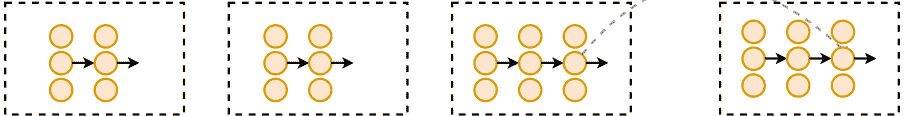

###### (a) 顺序调度

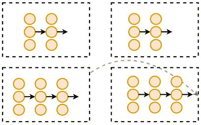

###### (b) 混合调度

图 A.1：四个模型集成的顺序执行方案示意图，这些模型从左到右依次进行评估。集成中的最后一个模型会复用前一个模型的操作，从而造成阻塞依赖。因此，我们无法平凡地并行执行所有模型。然而，由于连接发生在网络的最后几层之间，我们可以如 (b) 所示构建混合执行方案。在此方案中，模型对会一起执行。

我们在此工作中并未同时优化吞吐量和推理延迟，但这是未来研究的一个有趣方向。

### 附录 B

#### ABC：其他细节

#### B.1 协议级联（ABC）可以提高准确性

如第 3.2 节和第 3.3 节所述，我们的 ABC 构建基于 *安全推迟规则*（定义 3.1）——这类规则规定，当数据点在较低级联层级被选中时，推理结果以高概率是准确的。这意味着，如果级联的较低层级在其预测的‘易’数据上比最大模型具有更高的准确性，则 ABC 的整体准确性可以提高。对于‘难’样本，ABC 与最大的 SoTA 模型产生相同的预测，因为 ABC 在内部会推迟到该模型。我们将在本节中形式化这种准确性提升的概念。

考虑统计学习框架下的分类问题，其中 $\mathcal{X}$ 是我们的实例空间，$\mathcal{Y}$ 是标签空间。设 $r$ 表示任何确定性推迟规则 $r : \mathcal{X} \rightarrow \{0,1\}$。设 $\{h_1, h_2\}$ 为两个分类器 $h_i : \mathcal{X} \rightarrow \mathcal{Y}$，其中 $i \in \{1,2\}$。我们将 $h_2$ 视为更昂贵（准确性更高）的模型。考虑 $\mathcal{X} \times \mathcal{Y}$ 上的分布 $P$。分类器 $h_2$ 的风险定义为

$\mathcal{R}(h_2) = P(h_2(x) \neq y)$

让我们定义一个级联分类器 $\mathcal{M}_r : \mathcal{X} \rightarrow \mathcal{Y}，使得

$$\mathcal{M}_r(x) = \begin{cases} h_1(x) & r(x) = 0 \\ h_2(x) & r(x) = 1. \end{cases} \tag{B.1}$$

那么使用规则 $r$ 的级联分类器的风险为，

$\mathcal{R}(\mathcal{M}_r) = P(\mathcal{M}_r(x) \neq y)$

我们希望了解在什么条件下可以用一个级联来替换现有的大型昂贵分类器 \(h_2\)，且准确性没有下降。当我们对准确性下降极其敏感，并且只有在确信分类结果时才选择较低级别的模型时，这非常有用。让我们定义用级联替代更大模型 \(h_2\) 的过剩风险为，

\(\mathcal{R}_{excess}(\mathcal{M}_r, h_2) = \mathcal{R}(\mathcal{M}_r) - \mathcal{R}(h_2)\)。

进一步展开，我们可以将过剩风险表示为，

\(\mathcal{R}_{excess}(\mathcal{M}_r, h_2) = P(\mathcal{M}_r(x) \neq y) - P(h_2(x) \neq y)\)
\(= P(\mathcal{M}_r(x) \neq y \mid r(x) = 0)P(r(x) = 0) + P(\mathcal{M}_r(x) \neq y \mid r(x) = 1)P(r(x) = 1)\)
\(- P(h_2(x) \neq y)\)
\(= P(h_1(x) \neq y \mid r(x) = 0)P(r(x) = 0) + P(h_2(x) \neq y \mid r(x) = 1)P(r(x) = 1)\)
\(- P(h_2(x) \neq y \mid r(x) = 0)P(r(x) = 0) - P(h_2(x) \neq y \mid r(x) = 1)P(r(x) = 1)\)
\(= \left( P(h_1(x) \neq y \mid r(x) = 0) - P(h_2(x) \neq y \mid r(x) = 0) \right) P(r(x) = 0)\)
(B.2)

可以看出，这里的通用过剩风险同时取决于两个模型。由于我们关注的是准确性，任何导致风险不比分类器 \(h_2\) 更差的规则都可以使用，我们将其称为 *可接受的级联*。

**定义 B.1** (可接受的级联)。如上定义的 \(\mathcal{M}_r(x)\) 相对于总体分布 \(P\) 和参考分类器 \(h_2\) 是一个可接受的级联，当，

\(\mathcal{R}_{excess}(\mathcal{M}_r, h_2) \le 0\),

或等价地

\(P(h_1(x) \neq y \mid r(x) = 0) \le P(h_2(x) \neq y \mid r(x) = 0)\)。

如前面在第 3.3 节中所述，在本工作中，我们专门考虑这样一种情况：每当选择较小的模型时，它总是正确的。即，\(P(h_1(x) \neq y \mid r(x) = 0) = 0\)。当然，这样的较小分类器 \(h_1\) 和推迟规则 \(r\) 的配对可能不存在。然而，每当它们存在时，使用 *任何* \(h_2\) 构建的级联都是可接受的，因为，

\(\forall h_2, \mathcal{R}_{excess}(\mathcal{M}_r, h_2) = -P(h_2(x) \neq y \mid r(x) = 0)P(r(x) = 0) \le 0\)。

这意味着这样的 \((h_1, r)\) 对于此类两级级联具有 *普遍性*，因为级联的过剩风险不依赖于较大的分类器 \(h_2\)。

最后，如果集成模型 $h_1(x)$ 在‘易’样本上比 SoTA 模型优越某个严格正的 $\xi > 0$，使得

$P(h_1(x) \neq y \mid r(x) = 0) \leq P(h_2(x) \neq y \mid r(x) = 0) - \xi$

那么，根据公式 (B.2)

$$\mathcal{R}_{\text{excess}}(\mathcal{M}_r, h_2) = \Big(P(h_1(x) \neq y \mid r(x) = 0) - P(h_2(x) \neq y \mid r(x) = 0)\Big)P(r(x) = 0) = -\xi P(r(x) = 0) < 0,$$

其中选择率满足 $P(r(x) = 0) > 0$。负的过剩风险意味着相对于我们所使用的 SoTA 分类器有所改进，整体改进量取决于 $P(r(x) = 0)$。

#### B.2 估计协议阈值 $\theta$

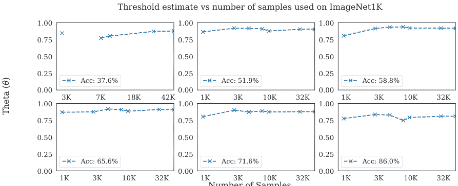

**图 B.1：** 在 ImageNet1k 数据集上，不同模型准确性水平下，协议阈值 $\theta$ 随所用样本数量变化的稳定性估计。每个图对应一个具有特定准确性的模型，如图例所示。初始估计使用 100 个样本，随后使用越来越多的样本进行估计。初始估计与随后使用更多样本的估计相当接近。

要有效地应用 ABC，必须为定义在公式 (3.3) 和公式 (3.4) 中的推迟规则配置一个协议阈值 $\theta$。这个阈值表示对集成模型预测的足够信心，使得 ABC 在集成模型协议程度高时避免推迟到更高成本的模型，从而在不牺牲准确性的前提下降低推理成本。回顾定义 3.1，推迟规则的失败率作为协议阈值的函数由以下公式给出，

$Pr(s(x) \ge \theta, h_k(x) \neq y).$

特别是，安全推迟规则是那些失败率受限于我们选择的小 \(\epsilon \ge 0\) 的规则。这意味着，给定 \(\mathcal{X} \times \mathcal{Y}\) 上的分布 P，我们可以定义函数 \(p(\theta)\) 为，

\(p(\theta) = \mathbb{P}(s(x) \ge \theta, H_k(x) \neq y).\)

我们现在可以定义可行的阈值 \(\theta\) 为使得错误率 \(p(\theta) \le \epsilon\) 的那些阈值，因为任何这样的 \(\theta\) 都会导致安全推迟。在实践中，我们很少能获取 P 和因此的 \(p(\theta)\)。我们改用其插件估计器，给出为

\[
\hat{p}(\theta) = \frac{1}{n} \sum_{i=1}^n \mathbb{I}[s(x) \ge \theta, H_k(x) \neq y].
\]

我们通过使用验证集中的一个小样本子集来估计 \(\hat{p}(\theta)\)。通常，我们抽取大约 100 个样本并将其留出，以确定一个稳定的阈值。图 B.1 显示了估计阈值如何随估计过程中使用的样本数量而变化，涵盖了不同准确性水平的模型。每个图代表一个具有特定准确性的模型，准确性百分比在图例中标明。如图所示，即使只有 100 个样本，估计值也通常会稳定下来，这表明只需少量验证样本即可可靠地估计 \(\theta\)，使得参数估计过程对实际应用既高效又实用。

#### B.3 安全推迟规则的存在性与选择率

本节通过评估选择率来考察安全推迟规则的存在性——这些规则具有极低的错误概率，即数据不会被推迟到更大的模型。对于任何阈值 \(\theta\)，选择率 \(P(r(x) \ge \theta)\) 表示被判定为足够‘易’、可以在级联较低层级处理的数据所占的比例。实验上，我们观察到，按照附录 B.2 中所述方式计算的 \(\theta_\epsilon\) 确实符合所选的误差容忍度 \(\epsilon\)。这意味着，每当某个数据点在较低层级被选中时，推理


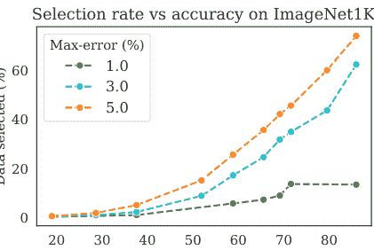

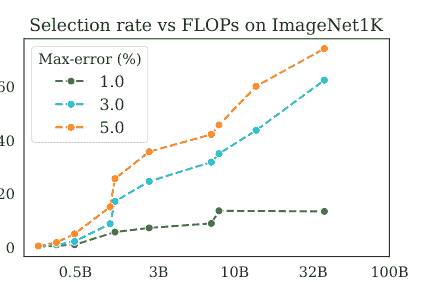

图 B.2：不同误差容忍度下 ImageNet-1K 上作为准确率（左）和 FLOPs（右）函数的选择率。选择率 $\mathbb{P}(r(x) \ge \theta)$ 表示在不将任务推迟到更大模型的情况下，基于阈值 $\theta$ 在更低级联层处理的数据比例。较宽松的误差容忍度（例如 5%）会产生更高的选择率，因为更多样本满足安全推迟的标准。相比之下，较严格的容忍度（例如 1%）会导致较低的选择率。两个图均表明，更高准确率或更高 FLOPs 的模型通常能实现更高的选择率，尤其是在允许的误差容忍度增加时，这进一步验证了 ABC 的稳定性和实用性。

以概率 $1 - \epsilon$ 准确。较严格的 $\epsilon$ 值通常会导致更高的一致性阈值和更低的选择率。

图 B.2 中的图表展示了 ImageNet-1K 数据集上不同准确率和 FLOP 值的选择率。我们探索了三种误差容忍度，分别对应最大允许误差率 1%、3% 和 5%。如左图所示，该图比较了集成中使用模型的准确率与选择率，更高准确率的模型往往能实现更高的选择率，尤其是在误差容忍度放宽时（例如最大误差 5%）。反之，更严格的误差容忍度（例如 1%）会导致所有准确率水平下的选择率降低，因为更少样本满足在较低级联层进行安全推迟的严格要求。右图展示了选择率与 FLOPs 的关系，观察到类似趋势。通常更准确的高 FLOPs 模型能够在较低层级安全处理更大比例的数据，尤其是在误差容忍度增加时。

#### B.4 评估设置

##### B.4.1 数据集和模型

我们实验中使用的数据集和模型详见表 B.1 和表 B.2。

| 类别 | 数据集 | 任务类型 |
|---|---|---|
| 图像任务 | ImageNet-1K [25] | 图像分类 |
| | CIFAR-10 [26] | 图像分类 |
| 语言任务 | SST-2 [37] | 情感分析 |
| | Twitter Financial News [139] | 情感分析 |
| | SWAG [84] | 多项选择问答 |
| 黑盒实验 | GSM8K [124] | 数学推理 |
| | COQA [96] | 对话问答 |
| | OVERRULING [147] | 法律推理 |
| | HEADLINES [142] | 新闻分类 |

**表 B.1：** 用于各种任务类型的基准和黑盒 API 实验的数据集。

##### B.4.2 黑盒 API 实验详情

**基线** 我们将 ABC 与 FrugalGPT [165]、AutoMix [177] 的 2 个变体以及 MoT LLM Cascade [201] 进行比较。虽然 HybridLLM [186] 属于这一类最先进的级联方法，但已显示其性能不如 FrugalGPT 和 AutoMix [177]。为了实际评估，我们实现了所有这些基线方法，使其能够在完全功能的级联系统中运行。

##### 方法特定细节

- **AutoMix**：AutoMix 为所有可能的级联步骤训练不同的路由器，即 n 个级联层需要 n-1 个路由器，并且系统中每次新任务或模型替换都需要重复此过程。阈值（AUTOMIX+T）或 POMDP（AUTOMIX+P）会结合来自同一测试数据分布的 $\ge 50$ 个训练样本以及每个级联步骤中两个模型在测试数据上生成的初始推理进行训练。训练路由器后，使用级联系统通常涉及在较高采样温度（temp = 1.0）下运行 8 次少样本自验证，使用给定级联层生成推理的同一模型。AutoMix 然后对自验证结果取平均，并使用路由策略的最佳参数进行元验证，以决定何时退出。

| 类别 | 数据集 | 使用层级 |
| :--- | :--- | :--- |
| 语言模型 | BERT [88]<br>RoBERTa [95]<br>XLNet [99]<br>ELECTRA [140] | BASE, LARGE |
| 图像模型 | ResNet [58]<br>ViT [104]<br>CLIP [103] | 基于 FLOPs 的选择 |
| 黑盒模型 | LLaMA 3.1 [188]<br>Gemma 2 [199]<br>Qwen 2 [200] | 参见表 3.1 |

表 B.2：用于图像和语言任务的基准和黑盒 API 实验的模型摘要。

- **FrugalGPT**：与 AutoMix 类似，FrugalGPT 需要为 n 个级联层训练 n-1 个路由器，并且每个路由器都需要了解数据分布和模型的预测能力。每个层级/模型的评分器（一个 DistilBERT [97]）的训练需要 $\ge 500$ 个训练样本以及这些样本上该层级模型生成的推理。

- **MoT LLM Cascade**：Yue et al. [201] 专注于采样和一致性检查作为级联手段。为了测量一致性，较弱的 LLM 通过改变 LLM 响应的随机性（即改变模型温度）为单个问题生成多个答案，同时使用上下文演示和推理技术（例如，思维链 [162]）来影响模型生成答案的方式。系统比较不同的采样答案并选择最一致的答案。如果一致性评分足够高，则接受较弱模型的答案。否则，问题将传递到下一层级。

- **ABC**：我们使用基于投票的安全推迟规则，不需要额外训练或任何复杂的路由策略。

**级联模型** 我们使用表 3.1 中描述的模型。我们考虑一种对基线有利的设置，即从每个性能层级中选择*最佳单模型*，并在它们之间进行级联。在所有级联系统中，我们使用所有三个层级进行级联；但考虑到预算约束，我们还设置了删除第 3 层级且仅使用前两个层级（2 级级联）的设置。

**评估设置** 我们在各种（封闭）生成数据集和任务上评估这些方法，如表 B.1 所示。为了确保输出格式一致并便于评估设置，我们在所有模型和所有任务中使用少量样本提示——具体为 4 个样本。关于评估指标，对于 CoQA 我们使用宏观 F1 分数来捕捉预测与基准真实答案之间的重叠，而对于其余任务则测量准确率（本质上为精确匹配）。关于效率，我们还衡量使用模型 API 的成本。重要提示是，AutoMix 和 FrugalGPT 会产生额外的设置成本，我们在报告结果中未反映这些成本。这些设置成本及相关延迟代表了显著的限制，特别是对于需要频繁重新训练或适应新任务、数据分布和模型的场景。

如图 3.5 所示，我们观察到 ABC 通常比基线更具成本效益，即使基线拥有更复杂的路由机制和单模型层级。我们的分析表明，ABC 的高效推迟策略允许对输入的很大一部分更积极地利用更便宜的模型，而仅在必要时才使用昂贵模型。例如，在分析 FrugalGPT 的结果时，我们发现随着任务难度增加，训练好的评分器难以作为高效的推迟机制；因此，随着测试样本难度增加，它更有可能选择更安全的级联选项。这意味着 ABC 预计会更高效，因为缩放定律确保使用多个更便宜模型的成本总和仍远低于使用下一层级中更大模型的成本。另一方面，AutoMix 使用一个采样超过 1 次的少样本自验证系统；因此，额外的 API 调用显著增加了其使用成本。考虑到自验证过程是 AutoMix 设置的组成部分，可以保证 ABC 使用成本 *始终* 低于 AutoMix，尽管其使用了更多模型。

#### B.5 ABC 的优势

##### B.5.1 并行与串行推理执行

基于第 3.4.1 节，我们在图 B.3 中额外展示了使用 CIFAR-10 的级联中并行推理执行相对于使用最佳单模型的优越性


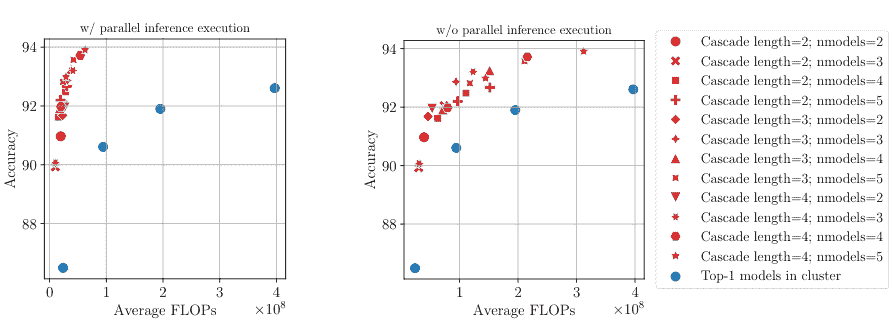

图 B.3：CIFAR-10上并行与非并行推理执行。

作为案例研究。我们还表明，在最坏场景下——每个推理都必须在每个集群和级联上顺序生成——与仅使用最大的单一模型相比，仍有可观的节省。

##### B.5.2 成本效益

基于第3.4.2节，表B.3显示了从Lambda Cloud获取的多个层级的GPU定价。表B.4展示了所有级联层级成本的详细分析，关联每个级联层级的级联退出数量，以提供聚合级联成本与使用最佳（且最大）模型之间的整体效率对比——ABC在每个衡量指标中均占优势。通常，大多数级联退出发生在较早的（且便宜得多）层级（如表B.4所示），从而确保更昂贵的级联层级留给较难的测试实例。

| GPU | 每小时成本 (USD) |
|---|---|
| V100 | 0.5 |
| A6000 | 0.8 |
| A100 | 1.29 |
| H100 | 2.49 |

表 B.3：来自Lambda Cloud的GPU使用成本估算[194]，截至2024年9月。

表 B.4：描述每个数据集在不同级联层级的各项指标的表格。每个数据集的行包含以下指标：在每个深度处理的样本比例，每个层级的总GPU每小时成本，特定层级的平均延迟（毫秒），以及每个层级的平均FLOPs（浮点运算次数）。每个指标的ABC列代表整个级联系统在所有级联深度上的平均值。

| 数据集 | 指标 | 第1层 | 第2层 | 第3层 | 第4层 | ABC | 最佳单模型 |
|---|---|---|---|---|---|---|---|
| **CIFAR-10** | 样本比例 (总数=10,000) | 0.73 | 0.09 | 0.08 | 0.10 | 1.00 | 1.00 |
| | 总GPU成本 ($/小时) | 0.36 | 0.07 | 0.11 | 0.24 | 0.79 | 2.49 |
| | 平均延迟 (ms) | 3.11 | 3.79 | 7.76 | 9.07 | 4.13 | 9.07 |
| | 平均FLOPs | 5.42e6 | 2.32e7 | 1.16e8 | 2.47e8 | 3.97e7 | 2.48e8 |
| **ImageNet-1K** | 样本比例 (总数=50,000) | 0.52 | 0.29 | 0.19 | - | 1.00 | 1.00 |
| | 成本 ($/小时) | 0.26 | 0.23 | 0.25 | - | 0.74 | 1.29 |
| | 平均延迟 (ms) | 2.45 | 2.88 | 3.17 | - | 2.71 | 3.17 |
| | 平均FLOPs | 2.15e9 | 3.90e9 | 4.30e9 | - | 3.07e9 | 4.30e9 |
| **SWAG (MCQ)** | 样本比例 (总数=20,006) | 0.71 | 0.29 | - | - | 1.00 | 1.00 |
| | 成本 ($/小时) | 0.36 | 0.23 | - | - | 0.59 | 0.80 |
| | 平均延迟 (ms) | 4.52 | 8.05 | - | - | 5.53 | 8.05 |
| | 平均FLOPs | 1.88e10 | 6.67e10 | - | - | 3.25e10 | 6.67e10 |
| **SST-2** | 样本比例 (总数=872) | 0.93 | 0.07 | - | - | 1.00 | 1.00 |
| | 成本 ($/小时) | 0.46 | 0.06 | - | - | 0.52 | 0.80 |
| | 平均延迟 (ms) | 3.88 | 7.22 | - | - | 4.13 | 7.22 |
| | 平均FLOPs | 5.43e9 | 1.68e10 | - | - | 6.26e9 | 1.68e10 |
| **Twitter Fin News** | 样本比例 (总数=822) | 0.65 | 0.35 | - | - | 1.00 | 1.00 |
| | 成本 ($/小时) | 0.32 | 0.28 | - | - | 0.61 | 0.80 |
| | 平均延迟 (ms) | 4.05 | 7.26 | - | - | 5.19 | 7.26 |
| | 平均FLOPs | 6.83e9 | 2.42e10 | - | - | 1.30e10 | 2.42e10 |

### 附录 C：持续优化：其他信息

#### C.1 其他结果

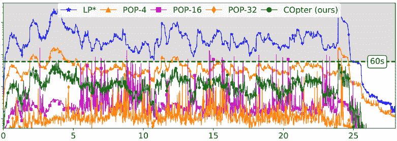

图 C.1：图4.1中数据的扩展图表，附带POP-16和POP-32的额外时间序列数据。

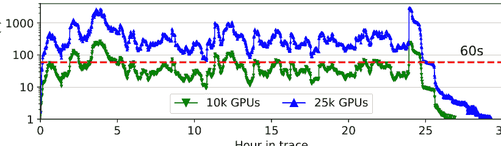

**图 C.2：** 求解商业LP求解器（CPLEX [154]）处理Sia [169]调度策略的LP松弛所需时间，针对两个集群规模（各10k和25k GPU），作业在24小时内提交（模拟中）。在基准时长内，分别有83%和15.1%的调度问题在所需的60秒每轮时长内求解完成（由虚线红线显示）。如果在实际集群中运行，调度器将在17%和85%的每轮时间内错过其60秒截止日期。

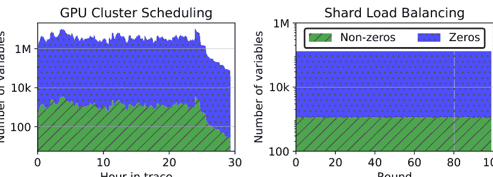

**图 C.3：** 使用商业LP求解器（CPLEX [154]）对两个资源分配问题的MILP公式的LP松弛求解稀疏性：针对10k GPU集群在24小时内每60秒间隔进行GPU集群调度（采用Sia [169]调度策略），以及分片负载均衡（参见第5.1节）。这些问题的最优解超过99%稀疏——不到1%的变量为非零值。

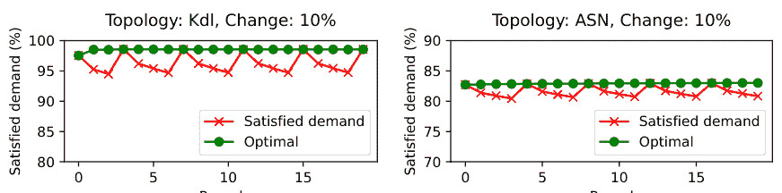

**图 C.4：** *在线*流量工程场景中重复使用流量分配的效果，该场景在求解器未能在300秒截止日期前完成时，保留各轮之间的分配。对于上述图表，请求的需求在各轮之间随机扰动高达10%，因此，与求解时间为零的理想求解器相比，求解时间过长可使总流量（及相应目标）减少高达5%。

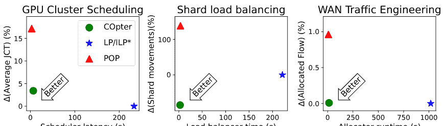

**图 C.5：** 在三个领域中，针对大规模资源分配问题寻找解决方案时，解决方案质量（y轴）与所用时间（x轴，显示第99百分位数值）的变化，采用三种方法——（1）_LP/ILP\*_ 使用商业LP/ILP求解器[154, 202]求解（整数）线性规划公式，（2）_POP_ 划分资源和请求集[137]，然后使用相同的商业LP/ILP求解器并行求解划分后的问题，以及（3）COPTER将分配问题表述为 _缓慢演进的_ 线性程序（参见第4.3节），并重复利用求解先前问题的计算工作量以加快求解器运行时间。COPTER发现解决方案的速度比商业LP/ILP求解器快几个数量级，且解决方案质量几乎无损失。参见第5.3.1节，了解COPTER为何为分片负载均衡问题发现 _优于最优的_ 解决方案。

