# PHP 和 MySQL 轻松电子商务


如需报告错误，请发送邮件至：errata@peachpit.com


本书献给过去一年半中一直热心帮助、支持、体谅且慷慨抽出时间的所有朋友、家人和同事。名单很长，排名不分先后：Roxanne、Nicole、Sarah、Meredith、Paula、Barb、Christina、Shirley、Cyndi、Sommar、Brian、Gary、Heather、Rich、Gina、Mike、Kay、Janice、David，以及 Peachpit Press 的所有人员。

# 致谢

Rebecca、Nancy 和 Nancy，感谢她们使这个项目得以实现，并一再与我合作。

Robyn，感谢她管理项目，并为人随和、组织有序。

Jay，感谢他提供一流的技术审稿，外加几个好笑的笑话。

David 和 Myrna，感谢他们神奇地将一堆杂乱材料转化为一本栩栩如生的书。

Patricia，感谢她敏锐的校对眼光。

索引编制者 Valerie，她让读者轻松找到所需信息，无需浏览我所有的废话。

Terri 和 Aren，感谢他们时尚的内页和封面设计工作。

所有要求我撰写本书，并详细表达他们希望本书成为什么样（或不成为什么样）的读者。希望本书正是你们所寻找的！

Kona Earth 咖啡的 Gary（www.konaearth.com），感谢他提供大量反馈，以及真正出色的咖啡！

Templates.com（www.templates.com）和 spyka Webmaster（www.spyka.net），感谢允许在本书示例中使用他们的模板。

Jon，感谢允许在本书部分插图中使用他的“Architecture by Hand”模板（www.jonathanbrown.me）。

Karnesha，感谢她照顾孩子，让我能完成一些工作，即便我不太愿意。

Zoe 和 Sam，感谢他们成为孩子中非凡的典范。

Jessica，感谢你所做的一切，以及你所能做的一切。


电子商务已成为互联网重要且可行的组成部分超过十年。从亚马逊（Amazon.com）这样的巨头，到小型家庭网店，电子商务有多种形式。尽管每一次商业成功背后都有十几个，甚至上百个失败案例，但只要做得当，电子商务仍可成为一种优秀的商业工具。然而，令人惊讶的是，专门针对这一主题的书籍少之又少。

本书通过两个具体案例，辅以大量理论，介绍了使用 PHP 和 MySQL 开发电子商务网站的基础知识。本书强调安全性、积极的客户体验以及模块化、可扩展的编程，为当今现实世界的电子商务需求提供了大量详细解决方案。无论你创建动态网站已有多年，还是仅仅几周，在接下来的11章中，你都必将学到新知识。

# 什么是电子商务？

从最广义的角度来看，电子商务涵盖了所有可能的在线商业交易。任何以盈利为目的的网站都可能归为“电子商务”范畴。当然，如此宽泛的定义涵盖了绝大多数现有网站。在尺度的另一端，电子商务可以被严格定义为直接从客户那里在线收取款项的行为。而本书所讨论的正是这种电子商务。

仅仅希望赚钱的网站与打算收取款项的网站之间存在两个关键区别：

- 客户需要感到多么舒适
- 网站需要多么安全

一个网站可以通过销售广告来赚钱，这种情况下，对客户的要求仅仅是访问网站。或者，一个网站可以通过推荐链接来赚钱，希望客户使用网站上的链接从另一个网站购买商品。在这两种情况下，对用户的要求都微不足道。但当一个网站希望客户提供全名、地址和信用卡信息时，这就变成了严肃的业务。为了在这项事业中取得成功，网站必须尊重客户，回答他们的问题，解决他们的疑虑，并减轻他们的恐惧。

说到电子商务，我再怎么强调安全的重要性也不为过。为了保护企业和客户，网站必须经过设计和编程，以建立并维持适当的安全级别。正如你将看到的，尤其是在第2章，“安全基础”中，网站的整体安全性不仅取决于你编写的代码，还取决于你所做的一些初始决定，例如选择的托管环境。出于此考虑，本书中的安全问题从宏观视角和一般理论，一直到特定代码的细节都有所阐述。你可以放心，本书的示例没有已知的安全漏洞。此外，本书还大量讨论了如何使特定流程更加安全，以及从安全角度不应该做什么的警告。

# 关于本书

本书的目标是尽可能广泛地展示电子商务可以是什么样子，涵盖 PHP 代码、SQL 和 MySQL 以及网站的用户界面。为了达成这一目标，本书被分为三个部分，巧妙地命名为第一部分、第二部分和第三部分（而且顺序也是如此！）。

第一部分，“基础”，仅包含两个章节。它们：

- 讨论围绕电子商务业务的基本理论和问题
- 审查需要提前做出的决定
- 阐述在线安全性的关键方面

在第二部分，“销售虚拟产品”中，开发了一个完整的电子商务网站。该网站销售虚拟产品，即访问内容的权限。对于虚拟产品，不需要库存管理或任何待售物品。企业只需接受客户付款，并确保拒绝未付款客户的访问。在此示例中，将使用 PayPal 处理客户付款。PayPal 是初学者电子商务网站的明智选择，因为它易于集成，拥有几乎所有客户都熟悉（因而信任）的名称，并最大限度地降低了网站本身承担的安全风险。

第三部分，“销售实体产品”，创建了一个完整的电子商务网站，用于销售实体产品。这意味着：库存管理、在线目录、购物车、订单历史记录等。在此示例中，Authorize.net 支付网关将直接集成到网站中，创造更加无缝和专业的体验。

通过使用两个具有不同目标和功能的示例，本书呈现了一个包含理念、数据库设计、HTML 技巧和 PHP 代码的丰盛大餐。本书的意图是，在完成本书后，你将能够自信地在自己的电子商务网站上实现任意数量或组合的功能和方法。


# 所用技术

这本书，正如其标题所暗示的，使用 PHP 脚本语言（www.php.net）和 MySQL 数据库应用程序（www.mysql.com）作为网站的基础。本书使用 PHP 5.3.2 版本和 MySQL 5.1.44 版本，不过只要你使用的是 PHP 5.2 或更高版本以及 MySQL 5.0 或更高版本，就不应该对代码有任何问题。在需要这些技术较新版本的地方，你会看到完成相同任务的替代方法。

与任何现代网站一样，HTML（当然）也涉及，CSS 也是如此。本书不会详细解释其中任何一个，但会展示一些关于它们使用的最佳实践。

在本书第三部分，你会遇到一些 JavaScript，涉及 jQuery 框架（www.jquery.com）。在那些少数情况下，jQuery 用于增强网站并添加一些功能，但 JavaScript 本身并不复杂。

本书第三部分还利用了 Apache Web 服务器（http://httpd.apache.org）的一些功能。与 JavaScript 一样，Apache 的具体细节并不复杂，但仍然非常有用，值得了解。

# 获取帮助

如果你对本书中所说或所做的内容有任何问题或疑问，有几个资源可以求助，首先，自然是本书对应的网站，www.DMCInsights.com/ecom/。在那里你可以找到本书中使用的所有文件、代码和 SQL 命令。

在 www.DMCInsights.com/phorum/ 有一个专门针对本书的支持论坛。如果你在那里发布问题或评论，你会从其他人或我这里得到相对及时的回复。

最后，由于本书设计为既模块化又可扩展，我在创建两个示例时想出了几十个额外的想法或替代方法。随着时间的推移，这些额外内容将通过本书对应的网站进行讨论，并提供示例代码。

# 你将需要什么

正如电子商务是客户与网站之间的交易一样，一本书可以被视为作者与读者之间的交易（只是不是实时进行的）。我已经简要介绍了这本书的内容，但我假设你是谁，你需要什么？

## 一些基本技能

本书的目标是演示 PHP 和 MySQL 在创建电子商务网站中的应用。尽管我期望即使是经验丰富的 Web 开发人员也能学到很多，但本书既不也不能教授 PHP 或 MySQL 的绝对基础知识。如果你对这两种技术还不十分熟悉，那么这本书不适合你。如果你能毫无问题地使用 PHP 执行 MySQL 查询并处理查询结果，那么你就会没事。

同样的道理也适用于涉及的次要技术，即 HTML 和 CSS。如果 HTML 表单的定义对你来说很陌生，你应该先学习这些基础知识，然后再深入本书的内容。

至于你将要接触的 JavaScript、jQuery 和 Apache 工作，不需要任何之前的经验。

## Web 服务器

为了使用 PHP 和 MySQL 开发网站，你需要一个 Web 服务器，也就是说一台运行 PHP 并通过 Web 服务器应用程序（如 Apache 或 IIS，Internet Information Server）以及 MySQL 数据库应用程序服务器的计算机。幸运的是，你可以完全免费地将所有这些安装在自己的计算机上。最简单的方法是使用一站式软件包，如 XAMPP（www.apachefriends.org）或 MAMP（www.mamp.info）。如果你已经在实时服务器上托管了一个网站，那也可以。

## 还需要什么

Web 服务器将让你运行动态网站，但你需要额外的工具来开发一个：至少，一个不错的文本编辑器或集成开发环境（IDE）。像 Adobe Dreamweaver（www.adobe.com/go/dreamweaver）这样的商业 IDE 没问题，像 Aptana Studio（www.aptana.com）这样的开源 IDE 也没问题，或者像 TextMate（www.macromates.com）这样的纯文本编辑器。只要使用比记事本功能更多的东西就行！

你使用什么 Web 浏览器真的不重要，虽然 Firefox（www.mozilla.com）比其他浏览器有更好的调试工具可用（如 Firebug，www.getfirebug.com）。

其实就这些！如果你已经做过一些 PHP 和 MySQL 开发（这是跟随本书学习的要求），你可能已经拥有所需的一切。那么让我们开始吧！

# 第一部分

## 基础知识


# 1 开始

就像建造房子的过程不从锤子开始一样，创建电子商务网站也不从你的电脑开始。嗯，你可能会用电脑进行研究，但实际编码是一个晚得多的步骤。在本章中，你将学习如何开始开发你的电子商务网站。目标是解释两件事：

- 你需要采取的实际步骤
- 我对电子商务的看法，也就是说这本书的观点

虽然本书的目的是提供具体答案和可用代码，但有一些主题，尤其是在接下来的几页中，我无法告诉你该做什么。在这种情况下，我试图指出你需要回答哪些问题，以及你可能如何去做。

在根本层面上，任何类型网站的成功，无论其是否旨在赚钱，都取决于其可靠性和性能：如果人们试图使用该网站，他们能做到吗？在本章中，你会遇到许多会影响网站可用性的决策。你做出的选择不是永久性的，但与大多数事情一样，以后不必做大的改动是更可取的。

电子商务网站的成功还取决于安全性。本章涉及一些安全问题，但安全问题将在下一章中更详细地讨论，并在本书余下部分中持续讨论。

最后要注意的是，你可能处于两种情形之一下创建电子商务网站：为自己或为他人。为自己创建网站时，你需要做出大多数决策。为他人创建网站时，他们将做出大多数这些决策，你在过程中的角色最多是咨询性的。以商业目标为例...

## 确定商业目标

在做任何事情、任何事情之前——模拟 Web 设计、确定 Web 主机，甚至购买域名——你需要确定你的商业目标。对于电子商务网站，目标是赚钱，你可以通过不同的方式实现：

- 直接销售商品或服务
- 在网站上做广告
- 推广可以在其他地方购买的商品或服务

在本书中，我使用 _电子商务_ 一词来指代直接从最终用户那里接受资金的网站。我将自己限制在这个范围内，因为它要求的安全级别远高于其他类型的网站。假设你想创建一个评论音乐的网站：你可能会免费提供所有内容，但希望通过在网站上展示广告和/或使用联盟链接到实际销售音乐的其他网站来赚钱。无论哪种情况，你将面临的安全问题都不会比大多数其他非电子商务网站更严重。另一个例子是，我公司的网站，**www.dmcinsights.com**，支持和增强我所写的书籍，理想情况下会增加书籍的销量；然而，该网站本身并不直接收款。本书的目标是创建直接向客户销售商品或服务的网站。

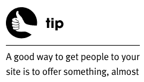

实现企业目标有许多方面。本书的重点严格在于制作在线体验；你需要自行处理其他关键问题，例如：

- 创建合法的商业实体
- 正确处理商业税务
- 会计
- 与供应商协调


- 推广您的业务
- 管理员工和薪资
- 控制实体库存
- 管理物流和退货

简而言之，仅仅创建网站并不是你需要做的全部。最重要的是，进入这个行业前要明白，即使你做了一个*很棒的*电子商务网站，那也不能保证商业成功。

让人们即使不购物也有理由访问您的网站，这样他们可能会冲动购买，或者在想要购买时首先想到您的网站。

所以现在立即停止阅读，写下你的商业目标。你希望实现什么？你的短期目标是什么？你的长期目标是什么？试着对它们保持现实。

接下来，写下（在一张大纸上！）你认为为了实现这些目标需要做和拥有的一切。你能前期投入多少资金？需要多少时间？谁会帮你？他们如何得到报酬？当资金需求出现时，你从哪里获得更多资金？谁来处理记账工作？你如何让人们访问你的网站？如果你销售实体产品，它们将存放在哪里？你将如何实际发货？

很明显，即使是最基本的目标也涉及许多问题。有一个关键问题我可以为你回答：如何创建一个优秀且安全的电子商务网站？答案：读这本书！

## 研究法律问题

理所当然，每当你处理他人资金，以及每当你创办自己的企业时，都有很多法律问题需要考虑。这是一个我能提供的帮助很少的大领域：我不是律师，也不知道你住在哪个国家、州、省、领地或城市。但这并不意味着我不能指引你正确的方向。

### 国家和国际法律

当网站是为您的业务而建，与为客户创建时，涉及的法律问题有所不同。为客户工作时，您需要签署一份健全的法律合同。特别是，合同应限制您在出现问题时应承担的个人责任。一般来说，好的合同将您的责任限制在项目本身所赚取的金额，如果过错在您。此外，您应该定义处理变更请求的流程。通常，我的客户在网站初始版本完成后会得到一轮请求。二次请求，或任何超出原合同范围的不合理新增内容，都必须重新谈判。

如果你有自己的业务且没有客户，那么有许多其他法律问题需要调查，这些与电子商务网站本身无关。为此，首先联系每个适用的政府部门，了解你必须知道和做什么。许多城市和州都有致力于帮助像你这样的人穿越法律必要性迷宫的中小企业部门。

无论哪种情况，您都必须了解专门针对在线商业的法律问题。同样，您的地方和国家政府应该能为您提供这些信息。具体细节因国家而异。它们甚至可能取决于您的位置、客户所在地、客户所在地、网站物理托管位置、关联银行所在地等。在美国，联邦贸易委员会（FTC）监管电子商务的许多方面。在其网站 www.ftc.gov 上，他们提供电子商务、国际销售、安全等方面的指南。

另一个例子，在英国，有关于网站、订单表和电子邮件中应提供哪些信息的具体要求。这包括：

- 公司的物理地址
- 公司的注册号
- 任何行业协会
- 增值税（VAT）号码

因为你将存储关于客户的信息，所以还有其他法律涉及。欧盟有关于个人数据如何存储和使用的特定法规。美国也有关于使用客户电子邮件地址进行广告、促销电子邮件以及如何处理披露的精确规则。所有这些法律仅适用于基本个人信息；如果你存储信用卡数据（你真的不应该！），则有更多法律适用。

你还需要知道互联网销售是否应征税，如果是，税率是多少。在美国，这目前是一个备受争议的话题，并且因州而异。如果你运送实体产品，还有关于基于订单发货时间何时实际向客户收费的规则。如果订单部分发货，你只能在此时向客户收取订单总额的一部分。

**提示**
不谈所有法律，待客户及其个人信息，如同您希望网站对待您和您的信息一样。

如果发生最糟糕的情况——您的系统被黑客攻击且数据泄露——法律也可能适用。例如，加利福尼亚州有非常具体和严格的法律，规定一旦发现安全违规时您必须做什么。规划的一部分——实际上是很大一部分——是为最糟糕的情况做好准备，以便您不必在危机中途匆忙寻找答案。

## PCI 合规性

另一个你应该极其熟悉的法律问题是 PCI DSS，即支付卡行业数据安全标准（www.pcisecuritystandards.org）的缩写。这是一套特定的规则，用于确保所有商业供应商安全、适当地处理信用卡。任何处理、存储或传输信用卡信息的公司都必须遵循这些指南，从而符合 PCI 合规性。

**提示**
许多支付网关允许定期付款，这意味着您可以多次向客户收费，而无需自行存储他们的支付信息。

通过遵循本书中的代码，您自己既不会存储也不会处理任何信用卡，这确实是最好的。您绝对不想存储用户的信用卡信息！确实有公司这样做，但这是他们的全职工作，他们拥有适当做到这一点的知识、资源和资金。尽管如此，即使在您的网站上获取信用卡信息并将其转交给另一家公司，也意味着您应该符合 PCI 合规性。具体要求因您实际如何处理信用卡以及每年处理多少笔交易而异。我将在下一章介绍这些要求。

如果您的网站不符合 PCI 合规性并且发生安全漏洞，可能会发生几件坏事（除了安全漏洞本身的影响）。首先，信用卡公司可能会将您的安全要求提升到更高级别，例如要求对您的系统进行外部安全扫描。这意味着更多工作和可能更多资金。其次，创建 PCI DSS 的信用卡公司——Visa、MasterCard、American Express、Discover 和 JCB——可能会要求您为因您的安全漏洞而产生的任何损失付款。他们甚至可能会罚款。第三，这些同一家公司可能会拒绝您接受他们卡片的选项，这将基本上关闭您的业务。

从技术上讲，PCI DSS 不是法律，但规范的一些部分可能也是您所在国家、州、省或地区的适用法律。而且，信用卡公司可以施加的潜在处罚可能和任何法律后果一样可怕。

## 选择 Web 技术

在过去 20 年里，Web 以许多方式发生了变化。仅在过去五年里就发生了重大变化！但有些东西仍然保持不变。首先，有 HTML（超文本标记语言）。无论其他什么变化，无论您使用什么图像类型、视频选项和服务器端技术，最终用户首先与 HTML 交互。本书不教授，也无法教授 HTML。如果您需要在这方面的更多信息，请购买该主题的一本书，例如事实标准，Elizabeth Castro 的 *HTML、XHTML 和 CSS：视觉快速入门指南，第六版*（Peachpit Press, 978-0-321-43084-7）。

> **注**
> 
> 本书不教授 HTML、CSS、JavaScript、PHP、SQL 或 MySQL；相反，它展示了这些技术的实际应用。

使用现代 Web 浏览器，网站的许多布局和设计都来自 CSS（层叠样式表）。本书也会使用 CSS，就像 HTML 一样，我不会详细解释它。不过，我不会使用任何非常花哨的 CSS，所以跟进不应该有问题。

当我 20 世纪 90 年代末期首次开始进行 Web 开发时，有一个名为 JavaScript 的烦人小东西。当时，JavaScript 大多用于琐碎和俏皮的小把戏。JavaScript 几乎完全没有必要。今天，情况截然不同，这要归功于 Ajax、Web 2.0 以及人们随口说的其他营销术语。现在，当 JavaScript 正确使用时，它极大地改善了用户体验。人们欣赏的许多 Web 网站功能，例如能够在有限空间内呈现大量内容、能够在不离开页面的情况下将商品加入购物车，等等，都使用 JavaScript。虽然 JavaScript 有价值，但它实际上是一种“额外”功能。

> **提示**
> 
> 如果您对编程 Flash 内容感兴趣，可以考虑我的 *轻松 Flex 4 开发*（New Riders, 978-0-321-70594-5）。

在浏览器中创建丰富用户界面的另一种方法是使用 Flash，这是一个由 Adobe 管理的工具和软件平台。Flash 的声誉褒贬不一，很大程度上是因为它可以用于非常分散注意力的广告，但人们对技术的滥用并不意味着该技术本身不值得。您可能会惊讶地发现，基于 Flash 的电子商务应用程序的成功率（就销售而言）高于非 Flash 网站。部分原因是，Flash 中使用的不同客户端-服务器模型可以带来更无缝的流程，使用户减少不完成销售的理由。话虽如此，使用 Flash 进行电子商务将是一本完全不同的书。


在等式的服务器端，与客户端不同，您需要考虑各种 Web 技术。本书将 PHP 作为首选编程语言，MySQL 作为数据库应用程序。这些是我个人最喜欢的服务器端技术，如果您在读这本书，我假设您也这么认为。我将跳过对 PHP 和 MySQL 的推销，继续往下讲。如果您对 PHP 和 MySQL 还不够熟悉，可能会对本书中的一些代码感到困难。如果想了解更多关于这些技术的内容，可以参考我的《PHP 6 和 MySQL 5 构建动态网站：Visual QuickPro 指南，第三版》（Peachpit Press，ISBN 978-0-321-52599-4）。

> **注意**
> 
> 这一章之后，我保证不再推荐其他书籍供您购买！

## 简单的电子商务替代方案

在本书中，您将学习如何使用 HTML、CSS、JavaScript、PHP、SQL 和 MySQL 的组合从零开始编写电子商务应用程序。不过，也有更快速、定制程度较低的方法可供使用。

如果您只想快速让电子商务网站上线，或者实际上不熟悉列出的任何技术，可以使用 Yahoo!、Google 等公司提供的“现成”电子商务网站。通过回答一些问题并使用他们的界面，您可以在一天之内创建一个基本的电子商务网站。它甚至会自动与支付系统集成。但请不要误解：虽然您能迅速投入运营，但最终结果将相当业余且非常有限。

在使用完整的第三方系统和创建自定义软件包之间的中间解决方案，是使用现成的电子商务软件包，例如 ZenCart (www.zen-cart.com) 或 osCommerce (www.oscommerce.com)。它们提供所有功能，从创建目录或购物车到管理，然后可以将其与多种支付系统之一集成。这些工具已经存在多年，非常稳固且支持良好，但与编写自己的电子商务网站相比，仍然会有一些限制，尤其是在需要添加独有功能时。同时，这些软件包还会包含大量您可能永远不会用到的功能，导致臃肿。

## 选择 Web 主机

为了让您的 Web 站点供公众访问，它需要托管在服务器上。服务器只是另一台其硬件和软件面向网络使用的计算机。

> **提示**
> 
> 您需要将站点放在托管服务器上，才能使用 PayPal 进行测试。

理论上，您可以使用个人电脑作为服务器，但您绝对不应该这样做。首先，这样做可能会违反互联网服务提供商的服务条款；ISP 的业务是为您提供上网访问，而不是托管 Web 站点。其次，大多数 ISP 会定期更改您的 IP 地址。要让任何域名与动态 IP 地址配合使用，都需要额外的知识和努力。第三，即使您能克服前两个障碍，最终用户的性能也会很差。无论家庭网络访问速度有多快，其上传速度很可能只有下载速度的一小部分。正是这个上传速度会影响最终用户，因为他们将通过这个狭窄的连接上传站点内容（HTML、CSS、JavaScript 和媒体）。

确切地说，您可以仅使用个人电脑来*开发*整个站点。您可以在自己的电脑上安装所有必要的工具（Web 服务器、PHP 和 MySQL），然后开发数据库、编写代码、测试等等。在个人电脑上开发速度更快（因为您不需要上传文件）、更便宜（因为在此期间不需要支付托管费用）、更安全（因为不完整且可能不安全的代码不会上线）。

> 不要尝试从家中托管您的 Web 站点！

### 托管选项

就托管而言，通常可以说一分价钱一分货，而我之所以说话，是因为我本人通常尽可能选择最便宜的方案。我为自己的 Web 站点可能使用过五六家托管商，并为客户接触过更多其他托管商。老话说得好，要想赚钱就得花钱，而寻找廉价主机是赚钱的错误方式。

> 如果非要买便宜啤酒也可以，但绝不要购买廉价 Web 托管服务！

托管计划的差异在于：

- 价格
- 功能
- 性能
- 控制程度

*价格*直接关系到其他三个属性的质量。您花得越多，得到的就越多。

老实说，*功能*其实并不那么重要。好吧，有些重要，很多不重要。大多数托管计划会提供大约 56 个功能，而您只需要其中 10 个。这也适用于磁盘空间和带宽限制：托管计划提供的这些资源远超您所需，从而用琐碎的小优惠来诱惑您。最基本所需的功能包括 PHP、MySQL、邮件服务器（用于发送和接收电子邮件）以及安全软件，例如防火墙、病毒检测器等。此外，有益的功能还包括定期备份和优秀——真正优秀——的客户支持。在比较不同托管方案时，决定哪些才是真正重要的——例如正常运行时间、备份、安全性和客户服务——其余的则忽略不计。

服务器的性能将取决于所涉及的托管类型、服务器的具体硬件——RAM 数量、磁盘类型、处理器类型、处理器数量以及服务器的网络连接。正如我在本章开头所说，站点性能至关重要，但不幸的是，这件事事先不容易确定。

您对服务器的控制程度将取决于托管类型。不同的 Web 托管公司提供不同的计划，但基本托管选项包括：

- 免费
- 共享
- 虚拟专用服务器 (VPS)
- 专用或托管 (colo)

> **提示**
> 
> 您最终会后悔为 Web 站点使用免费或极其廉价的托管计划，所以还是省去这个麻烦吧！

现在免费托管计划不如以前容易找到了，但对于电子商务网站，您甚至不应该考虑它们。您可能有 .Mac 账户或 ISP 提供的免费站点选项，但您可能甚至无法在这些平台上使用自己的域名。

共享托管计划是最常见、最便宜的（付费选项中）。共享托管涉及将数十个客户端甚至数百个 Web 站点放在同一台服务器上。共享托管价格低廉——不错的计划每月 10 到 20 美元（本书所有价格均为美元），可能是一种合理的起步方式。但是，由于每台服务器上有多个用户，您的 Web 站点安全性仅取决于服务器上任何站点中最薄弱的安全环节。站点性能也会受到影响，因为需求量很大。最后，您几乎无法控制服务器的运行方式。您将无法使用特定版本的 PHP，启用某些 PHP 设置或功能，或调整 MySQL 的运行方式。共享主机不太可能做出可能对同一台服务器上的其他客户端产生不利影响的更改。尽管如此，共享托管可能适合对安全性要求不高的较小、要求较低的站点。

共享托管与专用托管之间的折中方案是虚拟专用服务器（这是我个人过去几年一直使用的方案）。与在单台服务器上托管数十个客户端不同，虚拟专用服务器可能只有几个或一小撮客户端，每个运行自己的虚拟操作系统。尽管服务器的所有硬件仍然被共享，但可以设置限制，确保您始终能获得最低限度的 RAM，从而无论服务器上其他站点如何，都能保证一定的性能。从安全性角度来看，每个虚拟服务器都是一个独立实体，因此其他客户端对其 VPS 的操作不会影响到您的 VPS。由于 VPS 专属于您，您可以在安装和配置软件方面随意操作。VPS 托管计划的价格从每月低至 30 美元到大约 100 美元不等。

专用或托管服务器处于托管光谱的另一端。这种托管方式将整台计算机（其软件和硬件）置于您的指挥之下，但服务器物理上位于托管公司的场所。那个场所（与您的家不同）应当拥有多个快速的 Internet 连接、带有电池备份的冗余电源、对服务器机房的安全物理访问、气候控制等等。（专用托管和托管托管之间的技术区别在于，主机通常拥有专用服务器，而您通常拥有托管服务器。）

> **提示**
> 
> 使用专用或托管托管时，请确保 Web 主机仍会提供一些维护和安全协助。

其他托管类型无法与运行您自己的整台服务器所提供的控制程度、功能数量，甚至可能无法与性能相媲美。但专用或托管服务器的成本会高得多，每月从几百美元到数百美元不等。同样重要的是，根据托管计划的具体情况，您可能需要负责服务器的所有维护和安全工作。因此，您需要决定您是否认为自己比全职从事此类工作且可能已有多年经验的人更适合处理服务器安全。此外，Web 托管公司会有工作人员每天 24 小时监控您的服务器，而您总得睡觉。

## 云计算

过去几年出现的另一种托管选择是云托管。云计算听起来很虚无缥缈，但它只是将一些服务器功能（数据处理、数据存储、电子邮件处理或其他功能）移到另一台计算机（或计算机组）上，这些计算机不在您的控制之下，且位于不同的网络中。云计算的一个好处是，它可以根据您的需求自动扩展，而无需您采取额外措施。如果出于某种奇怪而有益的原因，您的每日销售量从平均 100 笔增加到 10,000 笔，云将能够处理增加的流量，否则这些流量可能会使基本托管计划崩溃。但是云计算存在额外的安全问题，您需要做好付出代价的准备。例如，如果您的网站遭受拒绝服务（DOS）攻击（将在第 2 章“安全基础”中讨论），您将需要为额外的云计算买单，但攻击本身不会产生额外收入。

本书不涉及我刚才所说之外的云计算内容，因为云托管仅适用于市场中相对较小的比例，且技术细节将取决于您使用的是哪家云服务。但请注意这条潜在途径。如果您怀疑云计算可能适合您的站点和情况，可能需要调查供应商和定价。


## 我的主机推荐

作为读者，你可能希望得到尽可能多的明确答案，因此我的建议是，根据项目本身和你的预算，先选择一个高质量的共享或VPS托管计划。你绝对不想将网站托管在个人电脑上；你绝对不想使用免费托管；并且你大概也不应该一开始就选择专用托管，除非你有钱烧。需要知道的一件重要事情是，你不会被永久锁定在某个托管计划甚至某个Web主机上。一个好的Web主机应该能够几乎没有或没有停机时间的情况下升级或扩展你的托管计划。所以从一个合理基础的计划开始，如果你有幸取得巨大成功，你可以随时间扩展你的计划以满足不断增长的需求。

更换Web主机也是可能的，只不过不那么容易。最好一开始就选择一个你能长期使用的优秀主机。这意味着不仅要可靠，还要选择一种能够支持你网站扩展的主机。例如，一个非常便宜的主机可能只提供共享托管。你绝对无法和他们一起转移到专用服务器，而且你可能也不想这么做。相反，我使用的托管公司只提供VPS和专用托管计划。VPS目前对我来说可以工作，当我有需求时，我可以与同一家公司转移到一台或多台专用服务器。

**注意**

我多年来使用过的所有糟糕的Web主机，都是通过听取“官方”最佳Web主机排名来找到的！

## 寻找优秀主机

那么，最终的问题是，你如何知道一个Web主机是否好？首先，上网搜索_网络主机评论_或_最佳网络主机_等关键词。在搜索结果中，忽略每个唯一目的是对Web主机进行评级和评论的网站。是的，没错：忽略它们。它们不可靠，建立在广告之上，你永远不知道它们与正在“排名”的公司之间有什么样的关系。此外，根据我的经验，此类网站是为大众、为那些不太了解的人排名Web主机。如果你想以这种方式找到几个推荐，主要作为比较的基础，那也可以，但这些排名不应该用来做决定。

寻找优秀主机的最佳方式是从真实用户那里获取现实世界的反馈和评论。一种方法是找到人们讨论其托管经验的论坛。在过去，我也曾通过电子邮件询问人们是否对自己的主机满意。你也可以通过邮件列表之类的渠道获得推荐。如果你愿意，可以向我寻求推荐，或在我的支持论坛（www.dmcinsights.com/phorum/）中提问，了解其他读者的经历。你会注意到，尽管我对自己的主机非常满意，但我没有提到是谁。我不觉得在本书中披露我的Web主机感到自在，但你可以在我的论坛、简报和博客中找到他们的名称。

一旦你有了几个潜在候选者，首先从排除那些非常便宜的主机开始。你不想通过节省Web托管费用来省钱。这不是一个好的长期计划。当然，比我过去几年一直使用的主机更便宜的选择也存在；但我的网站始终可用；我内心平静；而这是无法用金钱衡量的。有趣的是，我的当前主机甚至不提供许多公司都提供的免费一个月托管。他们的观点（我同意）是，提供免费一个月会吸引恶意人士暂时获取服务器，只为发送垃圾邮件或进行其他有害或烦人的活动。你不想成为正在发生这种情况的网络的一部分。

你还应该排除那些试图做太多事情的公司：拥有一个在一两方面表现出色的主机，比拥有一个在几方面都平庸的主机要好。我曾经经历过的最糟糕的托管体验（如果不是最糟糕的话），是与一家主要功能作为域名注册商的公司合作。他们作为注册商还行，但作为主机却很糟糕。

如我所说，所有Web主机都会提供大量功能，以及你永远用不完的磁盘空间、带宽和附加组件。而且，几乎不可能比较一个主机与另一个主机的性能。因此，对我来说，我关注安全性和客户服务。出色的安全性最大限度地减少问题的发生，而出色的客户服务则在问题发生时提供快速修复。

## 使用支付系统

与选择Web托管公司一样，你为电子商务网站使用的支付系统将对最终结果产生重大影响。这并不意味着该网站将永远与单一支付系统绑定，但如同任何离婚一样，与支付系统结束关系对你的业务来说可能既繁琐又昂贵。

支付系统是标准网站和电子商务网站之间的区别要素。支付系统的整个目的是在客户和企业之间转移资金。

支付系统有两大类，它们通常以各种名称闻名，但可以描述为支付处理器或支付网关。在本书中，我将演示每种类型的一个示例，但在此，我将概述每种类型的优缺点。

> **注意**
> 某些公司，如PayPal，提供两种类型的支付系统。

### 支付处理器

支付处理器是一种延迟支付系统，通常通过第三方网站进行（图1.1）。最佳示例是PayPal的Website Payments Standard选项（www.paypal.com）。如果你想通过PayPal的基本服务接受付款，你会将客户连同你的PayPal标识和其他一些信息一起发送到PayPal网站。然后客户使用PayPal授权转账该金额。之后，PayPal将客户返回到你的网站，并在稍后的某个时间点，PayPal将扣除其费用后将资金提供给你。

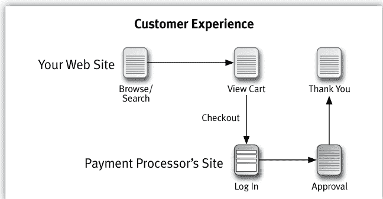

图1.1

使用像PayPal的Website Payments Standard或Google的Checkout这样的支付处理器，易于建立，前期成本低，并使用许多客户会熟悉的服务（尤其是PayPal）。另一方面，这些系统不像替代方案那样集成到你的网站中，而且将客户引导离开你的网站是一项风险的电子商务举动，增加了失去销售的可能性。此外，每笔交易的成本往往要高一些，且资金可能不会自动存入你公司的银行账户（也就是说，你可能需要进入支付处理器的系统才能接受并转移你的贷项）。

在与潜在读者预览本书时，许多人同意我的看法，即PayPal是一个足够常见的选项，值得在本书的示例中使用。出人意料的是，还有几位强烈不喜欢PayPal，无论是作为客户还是作为开发者。我对PayPal没有异议，正如我所说，它非常普及，因此本书的第一个电子商务示例《知识就是力》将使用它。

### 支付网关

_支付网关_是一种实时支付系统，可以直接集成到你自己的网站中，从而产生更专业、更无缝的流程。与其将用户引导离开并希望他们返回，不如将交易数据在后台传输，客户在整个过程中任何时间点都不会离开你的网站（图1.2）。此外，网关会提供更好的欺诈预防等额外功能（关于欺诈防护将在下一节详细介绍）。网关会自动将你的资金存入商户账户，通常每笔交易的费用比支付处理器低。

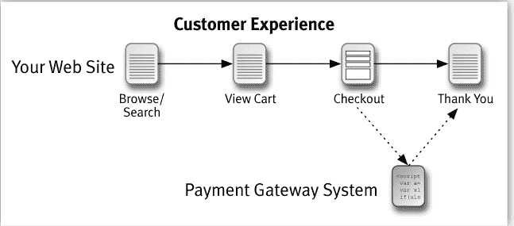

图1.2

另一方面，支付网关可能有较高的设置成本，并需要更多编程来将系统集成到你的网站中。它们还需要一个商户账户，即可以存入和退还信用卡费用的账户（用于客户退货）。你能否将你的商业银行作为商户账户，取决于你的银行。

有大量支付网关可用；某些网关系统实际上是通过其他供应商转售的，这使你能够货比三家以获得最佳交易。Authorize.net（www.authorize.net）或许是最知名的支付网关，它将被用于本书的第二个示例《咖啡》。


## 你应该使用哪个？

简短的回答是，支付网关更专业，除了最简单的电子商务网站外，都应该是你的解决方案。但是支付处理器也相当常用，对某些企业来说确实有意义，所以不要完全将其排除在选项之外。

支付系统会提供测试账户、虚拟信用卡号和伪处理系统，通过它们你可以在上线前测试网站。

在选择支付提供商时，你应首先确定你的商业银行或 Web 托管公司是否与任何公司有合作关系。为这项重要服务选择预批准的供应商，可以将一些潜在的麻烦降到最低，并且在需要技术支持时，希望有专家可供咨询。

确保你的支付解决方案提供商完全符合 PCI 合规性，并且可以协助指导你网站的合规性。

另一个因素是地理位置：不同的提供商在你所在的地区可用，并且支持的其他地区有限。此外，你还要检查提供商使用的货币是否与你的业务相符。

在做出选择时需要权衡许多功能：

- 防欺诈工具
- 定期账单功能
- 接受电子支票
- 自动税务计算
- 自动运费计算和处理
- 数字内容处理
- 集成购物车

有些网关提供虚拟终端，商家可以在其中手动处理信用卡支付。例如，可以用于发出退款。

显然，其中许多功能可以大大简化你电子商务网站的开发，并使其成为更专业的 Web 应用程序，但我要强调防欺诈。你可能没有在这方面考虑太多，但出色的防欺诈符合你网站的最佳长期利益。如果有人在你的网站上使用一张无效或非本人所有的信用卡，你将产生一笔虚假交易，之后还要进行一些清理工作来撤销交易。此外，信用卡被欺诈使用的人会因为你一开始就允许欺诈发生而对你的业务印象不佳。出于这些原因，使用具有高级防欺诈工具的网关是必须的。两种最常用的技术是验证账单地址和卡片验证值（CVV）——即卡背面的那些数字。

之前未列出的一个最终且显而易见的因素是成本。你需要考虑初始设置成本、月费以及单笔交易费用。如果你需要额外收费的功能，也要将其考虑在内。

> 如果你的交易金额较小，平均每笔小于 10 美元，请寻找支持微型支付的支付提供商，这意味着更低的交易费用。

## 开发流程

在最终确定商业计划、研究法律、决定托管公司并选择支付系统后，就可以开始编写 HTML 标签、SQL 命令和 if/then 语句了。开发流程本身正是本书的重点，因此让我们详细了解一下（图 1.3）。

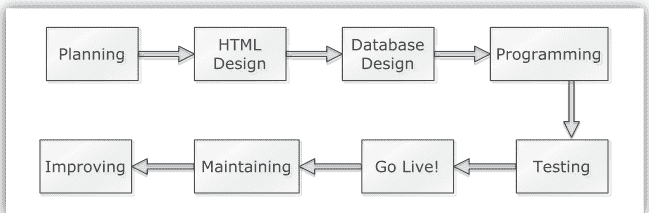

图 1.3

开发流程分阶段进行。如果每个阶段都有条不紊地推进并且最终结果正确生成，你就能尽可能高效地开发出一个出色的电子商务网站。但如果你跳来跳去、仓促行事、跳过步骤并有所遗漏，整个流程将花费更多时间，最终结果也会更加 bug 丛生。

在开发流程结束时，你希望已经创建了尽可能好的电子商务网站，但该网站无疑需要在下周（正如客户总是希望的那样）、下个月或明年进行更改。如果第一个目标是流程顺畅、最优，那么第二个目标就是输出——具体来说，是灵活且可扩展的 PHP 代码和 MySQL 数据库。当这些不可避免的更改需要进行时，你应该能够在不破坏或重写整个系统的情况下完成。

> **提示**
> 作为学习如何做好电子商务的典范，你不妨研究一下 Amazon.com。

### 网站规划

开发流程的第一步是规划一个通用网站。这很类似于制定商业目标，但具体是针对网站本身。网站应该做什么？网站应该是什么样子？目标用户是谁？网站应该支持哪些浏览器和/或设备？使用笔和纸，或任何你可以做笔记的应用程序，尽可能全面地考虑。以后回顾时，如果你考虑过一个想法并将其排除，比从一开始就从未想过要好得多。

此时你能做的最好的事情是上网看看。Web 是好坏参半的丰富画卷，所以看看你喜欢和使用的网站。它们做得好的地方是什么？你会如何改进？哪些字体、颜色和设计吸引你？关于写作有一句老话：好的作家剽窃，伟大的作家借鉴。对于网站也差不多如此。

> **提示**
> HTML 设计过程理应包含几轮反馈，随后进行设计更新。

### HTML 设计

在开发流程中，接下来要做的是为网站制作 HTML 设计原型。就我而言，我完全没有设计技能。如果你也这么说，有两种简单的解决方案：

- 聘请合格的设计师创建 HTML 模板。
- 使用现成的设计并稍加修改。

我多次采用过这两种方法，具体用哪种取决于网站和你的预算。如果你聘请他人，至少希望他或她创建几个模板：

- 首页
- 内部基本内容页面
- 带样式的表单

基于这些，你可以轻松生成网站大部分页面的外观。如果你正在开发销售产品的电子商务网站，还需要代表性的浏览页面（即一次显示多个产品）和详细列表页面。

> **提示**
> 由于我不是 Web 设计师，我为本书中的两个电子商务网站使用了免费可用的第三方模板。

如果你没有预算或时间购买定制设计，可以获取现有设计并根据你的需求进行修改。既有免费设计也有商业设计可用，不过你需要遵守适用的许可。例如，某些设计可以免费使用，只要你在页脚中向设计师致谢。其他设计可免费用于非商业用途，但商业活动需要许可。无论如何，你可以获取现有模板，然后调整 HTML 和 CSS 来个性化设计，以符合你或客户的品味。

此时的目标是让客户（或你）确认网站的外观。此外，设计还隐含了大部分功能：获得对此的批准对流程至关重要。考虑一下：如果用户已登录，网站的外观和功能会有什么不同？导航如何处理？商品如何添加到购物车？购物车内容如何显示？还要注意用户界面的基础：简洁性、易用性、合适的导航、面包屑导航、购物车的明显访问入口等。

> **提示**
> 你的网站设计应包括联系管理员、查找网站退货政策和查看隐私政策的明显链接。

### 数据库设计

设计数据库是一个关键步骤，主要因为日后对数据库的更改比对网站其他任何方面的更改都有更大的影响和潜在复杂性。通过数据库更改添加功能是一项艰巨的挑战，修复数据库缺陷也极其痛苦，因此请竭尽全力第一次就把数据库设计做好。

良好的数据库设计自然始于数据库规范化。如果你不熟悉规范化，请参考任何关于该主题的优秀资源，包括我的《MySQL: Visual QuickStart Guide, 第 2 版》（Peachpit Press, 0-321-37573-4）。规范化和性能意味着你还应：

- 使用尽可能小的列类型。
- 尽可能避免存储 NULL 值。
- 尽可能使用定长列。
- 如果适用，为列提供默认值。

> **注释**
> 我保证，这是我最后一次提及另一本书了。除非我想到另一本....

使用索引得当也会极大地影响性能。声明索引在某种程度上是一门艺术，但有一些一般规则：

> **提示**
> MySQL 中的 --log-slow-queries 选项可用于帮助你捕捉有害查询。

- 为将在 WHERE 和 ORDER BY 子句中涉及的列建立索引。
- 避免为允许 NULL 值的列建立索引。
- 对变长列上的索引应用长度限制，例如仅对人姓氏的前 10 个字符建立索引。
- 使用 EXPLAIN 查询确认索引正在被使用。
- 在网站运行一段时间后重新审视你的索引，以确保它们仍然适合实际数据。


> **提示**
> 如果 MySQL 启用了 --log-long-format 功能，数据库将把任何未使用索引的查询写入日志。

在数据库设计中，一个最终但常被忽略的考量是所使用的存储引擎（或表类型）。MySQL 的优势之一在于支持多种存储引擎，这意味着你可以选择功能最符合需求的那一款。例如，你可以在内存中创建 MySQL 表，其性能将表现出色，但不提供数据持久性。最常见的两种 MySQL 存储引擎是 InnoDB 和 MyISAM。前者是 Windows 计算机的默认类型，后者则是所有其他操作系统的默认类型。MyISAM 是一种优秀的通用存储引擎，还支持 FULLTEXT 索引，适用于搜索场景。InnoDB 引擎不支持 FULLTEXT，但可以处理事务，在敏感情况下是极佳的故障保障。

如果你对数据库拥有管理员级控制权，有许多配置会影响 MySQL 的性能。首先，有 back_log、key_buffer_size、max_connections 和 thread_cache_size。你可以使用配置文件将这些设置从默认值更改为更适合你的服务器和站点的值。有关你的服务器所运行 MySQL 版本的更多信息，请参阅 MySQL 手册——当然，前提是你确实拥有那种对服务器的控制权。

如果你的网站活跃到需要使用多台服务器，可以考虑复制数据库。数据库复制会将相同数据存储在多台服务器上。这样做可以提升安全性、可靠性（万一一台服务器故障，数据仍然保存在其他地方）和性能。

## 你的开发工具

你在电脑上用于开发电子商务网站的软件是一个重大且个人化的话题，因此我不在这方面提供任何建议（至少部分原因是我主要使用 Mac，因此无法推荐任何 Windows 开发程序）。如果你还没有自己喜欢的文本编辑器或 IDE，再次上网查看，并从他人那里获取实际建议，以便选择一款。与所有事情一样，预算也是一个考量因素，尽管有很多低成本甚至免费的优秀选择。

除了编程软件，你还应考虑项目管理工具，例如用于组织项目和做笔记的应用程序。你还可能需要使用一些会计软件，这取决于电子商务网站是否属于你自己的。

## 编程

本书的真正重点是 PHP 编程，PHP 充当用户/浏览器与几乎其他一切（数据库、电子邮件、支付系统等）之间的粘合剂。从编程角度来看，你希望创建的代码不仅要功能完善，还要可重用、可扩展且安全。

要编写可重用、可扩展的代码，代码必须组织良好并有详尽文档。我再怎么强调也不为过：请为你的代码编写文档，直到过分为止。编程时，先从注释开始，并经常回顾。对代码做任何更改时，请再次检查注释是否仍然准确。你还应该使用流程图、UML 图（统一建模语言）等工具，以图形和非代码的方式概述和表示你的网站。

代码安全取决于众多因素，下一章将开始专门讨论这一话题。不过，安全编程在电子商务网站中更为关键，因此这一主题将在全书中反复强调。

视情况而定，你可能还需要研究版本控制软件，例如 subversion（http://subversion.tigris.org）或 Git（http://git-scm.com）。版本控制软件使网站更新过程更加顺畅，让你能够准确实施所有站点更改，或将问题回滚到之前稳定的状态。如果你正在与团队开发网站，版本控制将有助于管理共享文件。

与许多其他语言不同，PHP 允许你选择面向对象或过程式方法。我对两者都很自如，也不认为一种方法明显优于另一种。我劝你不要相信“OOP 比过程式代码更可扩展或更安全”的神话。编写糟糕的 OOP 会让你不停地头疼，而编写良好的过程式代码绝不会阻碍你网站的长期发展。

在就本书征求读者意见时，关于我应该采用哪种方法以及采用多少，曾发生过一场中度激烈的讨论。有些人认为 OOP 是专业编程的标志；另一些人则不了解或不关心它，并且从基于 OOP 的书籍中不会获得多少价值。最终，我决定采用以过程式为主的方法，因为它是所有 PHP 程序员的共同分母，而且过程式代码更容易转换为面向对象代码（而非相反）。

> **提示**
> 正式的 PHP 文档可以通过 PHPDoc（www.phpdoc.org）生成。

> **备注**
> 因为本书实际上是对整站 PHP 代码的一个巨大注释，书中展示的脚本不会像你的脚本那样有详尽的文档。

> **提示**
> MVC（模型-视图-控制器的缩写）是设计网站的一种流行方法。其核心，这种设计仅意味着良好的代码组织。

同样，关于是否应该引入框架，也有过一些讨论。再说一次，我对框架并没有偏好。有时候我用，有时候不用。最终，我决定在这本书中不使用任何框架，因为那些章节本质上会更多地关注框架而非底层示例——即电子商务网站，本书的真正重点。

话虽如此，在涉及你自己的项目时，你需要决定过程式与面向对象、使用框架与否，以及如果使用框架，使用哪一种。请事先知道，这些决定既不会不利地影响，也不能保证你的电子商务网站成功。你唯一不想做的事情是走上一条路，后来又改变方向。那是沮丧的根源，很可能会导致灾难。

## 测试

测试你的网站不是一次性的独立步骤，而是你需要经常进行的事情。**你对网站的测试再多也不为过！** 不幸的是，网站开发者很难对网站进行真正良好的测试：他或她创建了网站，因此知道它应该如何运作并相应地使用。更好的测试是当你的家人、同事和烦人的朋友尝试使用网站时会发生什么。我特别指出*烦人的朋友*，因为他们会尝试你绝不会想到的做法。当这些本身不是 Web 开发者的人，有意或无意地滥用网站时，会发生什么？从这些经验中，你可以改进整个应用程序的用户界面和安全性。改进这两点将极大地有助于电子商务业务的成功。尽管如此，你仍可以采取一些措施来有效地自行测试网站。

相对较新的 PHP 概念是 *测试驱动开发* 和 *单元测试*：你定义代码的具体且原子的测试，然后运行测试以确认结果。每个测试都应简洁明了。随着你编写更多代码，你会定义更多测试，并继续检查每个测试，以确保你刚刚所做的没有破坏其他功能。测试驱动开发和单元测试都是足够庞大的主题，我建议你在准备好时自行进一步研究两者。

另一种你可以处理的网站测试类型是 *性能*。如果你想从整体入手——服务器处理需求的情况如何——ApacheBench（**http://httpd.apache.org**）和 Siege（**www.joedog.org/index/siege-home**）等软件将对你的 Web 服务器运行基准测试，报告每秒可以处理多少个请求，这是衡量网站性能的标准工具。一旦你开始检查


your site's performance, you will find that big, systemwide changes you make will have the greatest impact. These include:

- Changing the server hardware: increasing memory, installing faster hard drives, and using faster processors
- Changing the demands on the server: disabling unnecessary features, putting fewer users or sites on a single server, and balancing loads across multiple servers
- Caching the PHP output
- Caching the PHP execution
- Caching the database results

If you think about the process involved for handling the request of a PHP-MySQL based page, you'll see three areas where caching can be applied (Figure 1.4). First, if the database or PHP is caching the results of a database query, then that query will not need to be executed with each request. Second, by default, each request of a PHP script requires that the PHP code be executed as if it had never been run before. By applying an opcode cache such as the Alternative PHP Cache (APC, www.php.net/apc), the PHP code itself is cached by the system, making that execution faster. Finally, the end result is that HTML is sent to the Web browser. If you can cache the dynamically generated HTML, then no PHP code will be executed at all, no database queries are required, and the request itself becomes as fast as a request for a static HTML page.

> tip
> Look online for specifics on implementing any of these caching techniques.

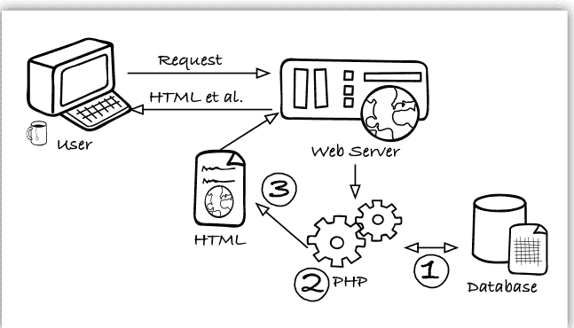

Figure 1.4

**note**

Performance testing and profiling are most useful in actual conditions. Testing the performance of your site under nonproduction situations is only theoretically meaningful.

You can also spend some time profiling your code, using tools like Xdebug (www.xdebug.org) or the Advanced PHP Debugger (APD, www.php.net/apd) to see where potential bottlenecks are in the PHP itself. Bottlenecks usually occur when PHP interacts with the file system, whether that means literal files on the server (like reading and writing text files or using sessions) or through the database application. I caution you against spending too much time worrying about profiling individual sections of code, because the improvements you can make that way will be relatively minor and possibly not worth your time. Better to learn good programming habits so that you don't have to worry about profiling after the fact.

**tip**

Once your site is live, don't forget to submit it to all the top search engines.

## Going Live

Once a site has been completely developed, tested, then updated to include the latest bug fixes and customer requests, it’s time to go live. Before doing so, you should revisit all the legal and security issues to make sure the site is in full compliance. Second, have a plan in place for what should be done when something goes wrong (notice I said *when*, not *if*). Third, if any assumptions were made in the code, or any dummy processes installed, remove those. By “assumptions,” I mean things such as using the test version of the payment system, not requiring real authentication to the administration pages, and so forth.

Brick and mortar stores normally have what’s called a *soft opening*. During this period the business is open and fully functioning, but not promoting itself actively. The hope is that the arrival of some traffic will catch issues and allow for improvements, without attempting to do so under the burden of a full user base. This is something you may want to consider as well, although in truth, pretty much every Web site that doesn’t have millions of dollars of advertising behind it has a soft opening.

**tip**

For security purposes, safely store your backups, such as in a locked safe or a bank deposit box.

## Maintaining

Depending upon the situation, going live may or may not be the end of your involvement with the project. If it’s not, such as when it’s your site, you’ll need to have a plan in place for maintaining the project. Site maintenance begins and ends with creating good, frequent backups of your site’s data. This is something the hosting company should be doing for you (check when you are researching hosts) and something you should be doing as well. Make sure that there are backups kept in multiple locations, too, so that a natural or man-made disaster doesn’t wipe out both your server and your backups.

The maintenance of a site also requires that you keep an eye on the data itself. Check and optimize your database tables to improve their performance. Watch your database logs for slow and underperforming queries. Review your Webserver logs for file not found errors, high loads, and potential security problems. Analyze your data to find sales trends and places where you can make improvements. In short, collect and examine as much information as you can. And keep making backups!

> The actual running of the site—dealing with customers, handling inventory, processing orders, reviewing customer feedback, and so on—is a whole separate way that a site has to be maintained.

## Improving

The final step in the development process is improving what you've created. Improvements may stem from the client, from customer feedback, or changes in available technologies. Improving a site is really a subroutine of this entire development process: Think about what you want to change, plan its implementation, mock up the design, retool the database, write the code, test the end result, go live, and maintain the updated version of the site.

Although it's best to treat the development process as a linear progression of discrete steps, when you factor in repeated places for feedback, and the high potential for the process to be revisited for improvements, the real design process is best represented by Figure 1.5.

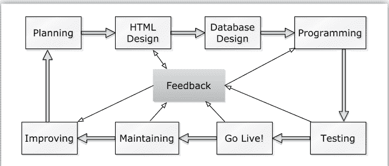

Figure 1.5


# 2 SECURITY FUNDAMENTALS

Although every chapter in the rest of the book will have some recommendations for improving the security of your Web site, security is such an important subject that this chapter focuses on it alone. There are three broad topics:

- Exploring general theory and background information
- Creating a secure environment
- Recognizing and combating common vulnerabilities

Some of the topics discussed here will be implemented in real-world code in subsequent chapters. A few of the other recommendations are steps to implement a single time. And a handful of tips will only apply if you have administrative-level influence over the server. Still, it's only by grasping the whole picture that you can implement security on a high level.

## SECURITY THEORY

Before getting into actual security specifics, let's think about what it means to be secure. I want to start with two simple, but perhaps heretical, ideas:

- No Web site is secure.
- Maximum security isn't the goal.

These two statements probably sound so absurd that I've lost all credibility, but in no way am I saying that security isn't important. In fact, when it comes to e-commerce sites, security is the most important criteria. I'm just saying that you may need to think about security differently than you currently do.
I'll explain...

## No Web Site Is Secure

The first fact you have to accept about any type of security is that security
is not a binary thing: where a site, application, or computer is either secure
or not. Security is measured on a spectrum (Figure 2.1). The code, software,
environment, people involved, and other factors move the security rating up
and down that scale. No matter what you know or do, you'll never create a Web
site that's *absolutely secure*; the only thing you can do is attempt to make it
*more secure*.

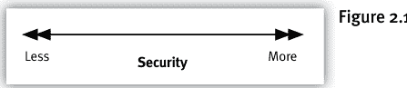

I've had people—well, one person—say this approach is wrong and dangerous,
but I think quite the contrary is true: When you begin to believe that your
site is absolutely secure, that's when it's the most vulnerable because you've
let your guard down. What you really should be doing is taking steps so that
your site is *secure enough*.

> Accepting that you cannot create absolute security doesn't mean
> you shouldn't try but rather that
> you should never stop trying.

As an analogy, think about a car: If you drive somewhere, get out, but don't
lock the car, it still may be relatively secure, depending upon the time of day,
the type of car, the area in which it's parked, and the length of time you'll
leave it there. Just leaving a car unlocked does not mean it's guaranteed to be
broken into, just as locking it doesn't mean it won't be. It's certainly harder to
break into a locked car, but not impossible. If you leave the car in your garage,
it's much, much less likely to get broken into, until you leave the garage door
open or someone breaks into the garage. And, of course, never taking a car out
of the garage defeats the whole point of having a car.

The same is true for a Web site: Doing X, Y, and Z will make it harder to break
into, but not impossible because there's always a potential flaw just around
the corner. Even if the server isn't turned on and is sitting in a locked hosting
cage somewhere, there are people who work for that hosting company who
can still access the machine. Simply put, there is nothing you can do to guarantee absolute security.

I say that no Web site is secure for two reasons. First, to promote eternal
vigilance when it comes to your site's security. **Complacency is dangerous.**
The second reason is...


## 最大安全性并非目标

再说一遍，这听起来可能有点不敬，但事实并非如此。你首先必须接受安全是有代价的。让某样东西——几乎任何东西——变得更安全都需要更多的时间和金钱。另外，任何更安全的东西本质上都更难使用，而且在计算机方面速度更慢（图 2.2）。

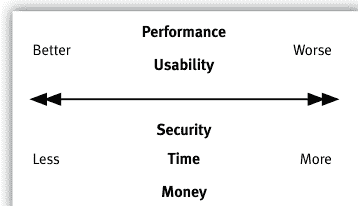

> **提示**
> 网站越成功，风险越大，因为额外的关注会使其成为黑客更大的目标。

回到我之前的车辆类比，如果你住在城市里，开车出去并停车时很可能会锁车。但当你把它停在自己的车库里时，可能就不会锁了。如果你住在小镇上，或者你的车是一辆破车，情况可能也是如此。在某些情况下，你可能会使用次要的防盗装置，比如方向盘锁。无论有意识与否，你对汽车所做的，都是根据感知到的风险程度和潜在损失（例如，昂贵的汽车与廉价汽车）来调整现有的安全措施。

网站也是如此：不同类型的网站需要不同级别的安全性。列出我最喜欢书籍的网站，在安全性谱系上的位置与存储用户信息的网站不同。即便是后者，其关键程度也不如处理信用卡的网站。超越这一高安全级别，还有用于网上银行、敏感政府和/或军事数据等方面的网站，等等（图 2.3）。

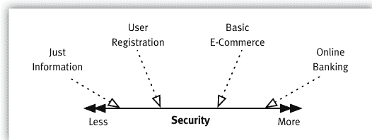

那么，目标不是实施最高级别的安全性，而是实施_适合该网站的最高级别安全性_。以下是我所说的意思的两个具体示例：

你可能已经知道，安全套接层（SSL）是电子商务系统的重要组成部分。SSL 为保护用户提交的信息提供了第一道防线；在需要收取客户信用卡时，必须使用 SSL。但这并不意味着你网站上的每个页面都必须使用 SSL。SSL 会给服务器带来压力，与非 SSL 请求相比，能同时处理的 SSL 请求只占一小部分。作为安全性与性能之间的折中方案，你可以选择仅在结账流程中使用 SSL，而对网站的大部分页面使用非 SSL 连接。

另一个例子是，共享主机必然不如专用主机安全，原因很简单：更多人可以访问该服务器，并且上面运行着更多软件。另一方面，共享主机的成本仅为专用主机的十分之一甚至更低。你可以通过购买更昂贵的托管计划来提高安全性，但这可能并非必要，更不用说明智了。

说了这么多，我并不想让你认为我对安全性漫不经心，或者你应该这样。在本章中，你将学习创建安全网站的基础知识，但认为你的网站必须达到极端安全程度是不合理的。有许多基准建议——就代码和服务器环境而言——你理应为任何网站实施这些建议。但你会面临许多选择，在做出决定之前必须权衡所有利弊。目标是针对给定情况在安全性谱系上找到合适的位置（如图 2.3 所示）。然后，为了保险起见，让你的网站在该谱系上稍微偏右移动一点点。

- **提示**
- 在做出安全决策时，始终宁可过度保护。

### 客户安全性

电子商务网站和一般网站都具有客户端-服务器关系：双方平等地参与一项事件。安全性也有两个方面：一个是你作为网站开发者和/或服务器管理员实施的，另一个是客户感知到的。现在让我们花几页内容从客户的角度思考安全性。

- **提示**
- 电子商务网站的成功在一定程度上取决于客户在那里花钱时的舒适感。

有一句老话说，整洁即神圣。我的房子可不能说明我奉行这一格言，但它让我想到一个关于网站安全性的类比：

> 安全即神圣。

将安全性想象成整洁。假设你去一家餐厅吃饭……这家餐厅*看起来*可能干净，也可能不干净；而且它*是*可能干净的，也可能不是干净的。但如果餐厅看起来不干净，那么它很可能实际上也不干净，你也不想在那里吃饭。网站的安全性也是如此：如果它不给人安全的印象，那么它很可能并不安全，潜在客户就不想使用该网站（也不应该）。那么，网站如何才能让普通用户觉得安全呢？它…

- 外观专业
- 对企业是什么、其政策是什么、客户信息将如何使用等方面保持诚实和透明
- 使用 SSL
- 不会做任何可能让客户觉得网站不安全的事情

> > **提示**
> > 让朋友和家人测试你的网站，是获取关于潜在混乱或问题部分的反馈的好方法。

这一特质其实是最重要的，因为普通人可能真不知道看起来安全和看起来不安全的网站有什么区别。一个成功的电子商务网站会给客户完成交易的所有理由，并且绝不给他们不完成交易的理由。如果客户访问一个网站，看到技术错误消息、浏览器发出的警报（例如，由于 JavaScript 代码糟糕或 SSL 使用不当）等等，他们很可能会将业务带到其他地方。如果网站做了某事让客户说“咦？”，那就好比看到一只老鼠在餐厅地板上跑过：是时候让客户离开了。

这个类比的第二部分是：虽然餐厅看起来干净很重要（这样人们才会在那里吃饭），但它实际上干净更重要（这样顾客不会生病，检查员不会将其关闭，等等）。你的网站必须真正安全，这样就不会对客户或你的客户造成任何不好的事情。

> > **提示**
> > 如果你正在为客户创建网站，请制定一个计划，以便在你完成项目后，仍有人继续维护网站的安全性。

我相信这个类比成立的最终原因是，它也支持我之前提出的两条格言。安全性，就像整洁一样，不是绝对的，你投入的精力量应该取决于情况。餐厅存放垃圾的地方不需要那么干净，但厨房肯定需要。也许你是那种每月、每周或每天彻底清洁一次的人。也许你是那种会将清洁提升到消毒水平的人。在这些情况下没有正确答案：有更好、有更差，有适合你和你情况的做法。安全性也是如此。最重要的是，仅仅因为你今天清洁了，并不意味着它会永远保持干净。而且，今天上线时没有任何问题的网站，明天就可能变得脆弱，即使这并非你的过错。

## PCI 要求

在第 1 章“入门”中，我提到你需要了解 PCI 合规性。合规意味着遵守 PCI DSS 中概述的全部十二项要求。根据你参与电子商务项目的程度，其中一些要求可能不适用于你本人，但你仍应了解它们，并将其转交给负责的人员。

摘自 www.pcisecuritystandards.org，要求如下：

### 构建并维护安全网络

- 要求 1：安装并维护防火墙配置以保护持卡人数据。
- 要求 2：不要为系统密码和其他安全参数使用供应商提供的默认值。

### 保护持卡人数据

- 要求 3：保护存储的持卡人数据。
- 要求 4：在开放的公共网络上加密持卡人数据的传输。

### 维护漏洞管理计划

- 要求 5：使用并定期更新防病毒软件。
- 要求 6：开发并维护安全的系统和应用程序。

### 实施强大的访问控制措施

- 要求 7：基于业务需要知道原则限制对持卡人数据的访问。
- 要求 8：为每个具有计算机访问权限的人员分配唯一 ID。
- 要求 9：限制对持卡人数据的物理访问。

### 定期监控和测试网络

- 要求 10：跟踪和监控对网络资源和持卡人数据的所有访问。
- 要求 11：定期测试安全系统和流程。

### 维护信息安全策略

- 要求 12：维护一份涵盖信息安全的策略。

如果你访问 PCI 网站，可以下载一份 70 多页的 PDF，其中更详细地解释了每项法规。该文档还讨论了如何测试每个条件，并提供了一份工作表来标注你的结果。你应该在某个时候阅读这份 PDF，但我想在这里补充几点我自己的说明。

> 如果你的企业内部网络将使用无线技术，则需采取额外预防措施。

> 取决于适用于你企业的 PCI 合规级别，你可能需要执行年度验证测试。


> **提示**
>
> PCI DSS 有许多有用的安全建议，即使是非电子商务网站也适用。

首先，其中一些规则，例如使用防火墙和防病毒软件，可能超出你的职责和服务器权限，但它们仍然需要执行。事实上，你应该在任何服务器上都使用防火墙和防病毒软件。更改默认密码也是必须的，但第二项要求远不止于更改密码，还涉及禁用不必要的软件等领域。

至于第三和第四项要求，我能给出的最好建议是**根本不存储信用卡信息**，但如果你确实存储，则要将安全级别提高许多、许多个层次。还要知道，有些关键数据是不允许存储的，例如卡验证码或其 PIN。存储信用卡信息并非初级开发者或小企业所适宜，所以请设计你的网站并使用支付网关，以免承担这一负担。

第六项要求——开发和维护安全的系统及应用——正是本书的核心。这是一个大话题，其核心在于安全编程。

第七至第九项要求既受业务影响，也受托管公司影响。但在纯编程层面，你可以使用的规则是第八条：为每个管理员提供唯一标识符。除非网站确实只有一人永久管理，否则请创建一个系统，并养成定义多个具有适当权限用户的习惯。在本书的第一个电子商务示例（付费访问内容）中，一种管理员类型可能只能管理网站内容。另一位管理员可能既能管理内容，又能访问非商业客户数据。最高访问级别还可能允许查看支付数据（在此情况下，是已付款记录，而非实际用于支付的客户信息）。可以通过强制定期更改密码、添加密码要求（长度、使用大写字母和非字母）以及禁用非活跃账户来实现额外安全性。

其余三项要求是持续性任务，即使网站代码没有任何变更也同样必要。我在第一章中有所提及：密切监控服务器以发现异常，并在问题发生时制定应对计划。

这十二项要求非常出色，涵盖面也恰到好处。当你阅读完整的 PCI DSS 文档时，会获得大量具体建议，每一条都会进一步提升你网站的安全性。

有些人认为 PCI DSS 要求过高，不过我认为过度重视安全总好过冒险。关于 PCI DSS 的另一种相反抱怨是，它可能会让人误以为只要遵守这些要求，自己的网站或系统就是安全的。请记住，PCI DSS 建立了改进安全性所必须做到的最低基准。如果你的情况需要，你始终可以采取更多措施。

## 服务器安全

本书的大部分剩余内容将探讨你编写的 PHP 代码如何影响安全性，但让我们先来看看许多影响电子商务网站整体安全性的服务器层面因素。服务器安全的方法很简单：

- 1. 拒绝
- 2. 授权
- 3. 记录

你首先应尽可能拒绝所有人和一切。只有在获得适当授权和身份验证后，才允许有限的功能。最后，记录几乎所有内容，以便你知道人们可能正在尝试（但未能）做什么，以及他们实际上做了什么。

### 托管影响

关于服务器安全，最大的问题是网站托管。共享主机由于有更多人可以访问服务器本身，因此不如 VPS 或独立托管计划安全。此外，任何赋予你服务器管理级别控制权的托管都可以更安全，因为你可以自定义服务器运行方式并将其更好地锁定。不过，我认为，除非你是服务器管理专家，否则使用托管服务器比自己全权处理更好。无论你的情况如何，请尽量限制拥有服务器物理和网络访问权限的人数。

根据 PCI DSS，服务器还应运行防火墙和防病毒程序。防病毒程序必须保持更新，否则将毫无作用。服务器上的所有软件也一样。当 Apache Web 服务器、DNS 或电子邮件系统等常见应用程序中发现设计缺陷（漏洞）时，安全漏洞经常会被引入。在发布新版本时升级和修补这些工具是服务器安全性的关键组成部分。

当然，你还应为访问服务器创建非常安全的密码，并定期更改。

**提示**
公共网页具有相反的安全模型：任何人都可以查看它。

**注意**
组织内部员工可能是薄弱的安全环节。要意识到“内部作案”的潜在风险。

**提示**
订阅软件邮件列表，以便在发布新版本时收到通知。

最后，使用服务器日志跟踪谁在何时访问网站。这样你就有记录可供查明谁可能做了坏事。你可能还希望在任何人登录服务器时接收通知（通过电子邮件或短信）。

PHP 手册列出了其他安全建议，具体取决于 PHP 与 Web 服务器的关系（CGI 二进制文件与 Apache 模块）。

## PHP 和 Web 安全性

次级安全级别由 Web 服务器（例如 Apache、IIS 等）和 PHP 的配置来控制。首先，使两者以及任何相关软件保持最新。具体安全问题取决于实际使用的 Web 服务器，因此请研究并了解围绕你特定 Web 服务器的安全因素，并保持最新。例如，深入了解 Apache 后，你会发现 DocumentRoot 指令（限制 Web 服务器仅使用该目录中的文件）是一项极佳的安全资产。

曾经建议以安全模式运行 PHP，但这从来都不是一个很好的解决方案，且已被弃用。

你可以对 PHP 的运行方式进行多种调整。通过调用 `phpinfo()` 函数（图 2.4）可以查看当前设置。每个设置都有两列：本地值和主值。本地列指示在当前目录中被覆盖的设置。

| 指令 | 本地值 | 主值 |
|---|---|---|
| allow_call_time_pass_reference | On | On |
| allow_url_fopen | On | On |
| allow_url_include | Off | Off |
| always_populate_raw_post_data | Off | Off |
| arg_separator.input | & | & |
| arg_separator.output | & | & |
| asp_tags | Off | Off |
| auto_append_file | 无值 | 无值 |

图 2.4

不要在服务器上公开提供 `phpinfo()` 脚本。它会显示太多有关服务器的信息！

要更改 PHP 的运行方式，请编辑 `php.ini` 配置文件。`phpinfo()` 函数也会揭示其位置。某些 PHP 设置可以在 PHP 脚本中设置；但就安全性而言，最好在全局范围内进行更改（否则，如果你忘记在某个脚本中进行更改，就会造成安全漏洞）。

对 Web 服务器或 PHP 配置进行更改后，重启 Web 服务器以使更改生效。

你应该先使用 `open_basedir` 设置。它限制了 PHP 可以打开文件的目录。如果将此值设置为 Web 目录或 Web 目录的父目录，则恶意 PHP 代码无法用于读取其他位置的重要系统文件。

同样，如果可能，你还应该利用非 Web 目录来存储敏感信息。例如，你的 URL www.example.com 可能指向实际服务器目录 /var/www/username/htdocs，因此加载 http://www.example.com/home.php

通过 Web 浏览器执行 /var/www/username/htdocs/home.php（下一页的图 2.5）。在此情况下，htdocs 文件夹被称为 Web 根目录。放在该目录中的任何内容理论上都可以通过 HTTP 协议访问。例如，存储在 images 子目录中的 image.png 文件可通过 http://www.example.com/images/image.png 访问。存储在 htdocs 目录之上（即 /var/www/username，Web 目录的父目录）的任何内容都无法通过 HTTP 访问。放在那里的文件和文件夹仍然可以由服务器上运行的 PHP 访问，但无法通过 HTTP 直接远程访问。

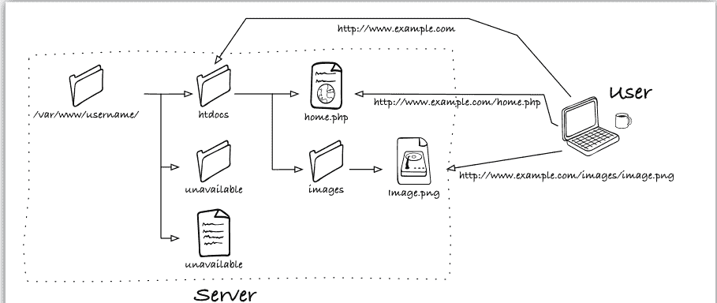

## 图 2.5

另一个可更改的设置是禁用 register_globals。此设置使全局变量可在局部作用域中使用，且本身并不安全：无论此设置如何，编写良好的程序都同样安全。而且，禁用此设置并不意味着你的站点必然安全。但禁用 register_globals 意味着无需担心某人的随意编程错误会创建潜在漏洞。如果你使用第三方软件，例如基于 PHP 的论坛和其他插件，那么有更多理由禁用 register_globals。

> **注意**
>
> register_globals 指令连同 safe_mode、Magic Quotes 等其他指令已被弃用，并将在未来的 PHP 版本中消失。

错误处理方式常常会破坏网站的安全性和专业性。一种常见的攻击是黑客提供有问题的数据，希望生成的错误会泄露信息。为防范此类攻击，请先在 E_ALL | E_STRICT 错误级别下开发你的网站。这样一来，任何潜在问题都会通过电子邮件或日志报告给你。然后，在网站上线之前，禁用 display_errors，以便不会向用户显示任何 PHP 问题。相反，使用自定义错误处理程序，向最终用户显示适当的消息，并仅向你报告详细的技术消息。你将在示例章节中看到具体的代码。

*nix 是 Unix 和类 Unix 操作系统（例如 Linux）的常见缩写。

如果你使用共享主机，我还建议更改会话目录。默认情况下，PHP 会将所有会话数据写入共享临时目录，例如 *nix 系统上的 `/tmp`。但该目录对服务器上的任何人都可读可写，这意味着服务器上的任何用户（共享主机可能有几十个）都可以读取其中存储的会话数据。更好的替代方案是在服务器上你自己私有区域内创建一个可写目录，仅供你的站点用于会话。

我的最后一条 PHP 建议不是设置，而是涉及你在其他地方不会看到我做的实践，所以我现在想说清楚。你绝对应避免使用在服务器上执行代码的函数，例如 `system()` 和 `exec()`。另外，使用任何操作服务器文件和目录的函数时都要小心，无论这意味着创建、打开、读取还是写入。当必须操作服务器文件和目录时，要 100% 确定在这些函数调用中使用的是经过充分验证的数据，而不是未经验证的用户提供的数据。

## 数据库安全

有关创建 MySQL 用户的说明，请参阅 MySQL 手册或我的书 *MySQL：可视化快速入门指南，第 2 版*（Peachpit Press, 0-321-37573-4）。

即使你的网站不会存储最危险的客户信息——他们的信用卡数据——数据库也需要得到彻底保护，因为任何客户信息的泄露都是巨大的商业责任。

数据库防御的第一道防线是 MySQL 的访问权限系统。MySQL 允许你创建仅在特定数据库上拥有有限权限的特定用户。用户通过其名称、密码和主机（即用户所在的计算机）的组合来标识。首先，创建唯一且安全的用户名，并配合唯一且极其安全的密码。此外，如同几乎所有事物一样，定期更改这些密码确实是最佳选择。另外，务必在新的 MySQL 安装中更改 root 用户的密码。

删除任何名称以 "test" 开头的数据库，因为 MySQL 允许任何用户连接到它们。

接下来，每个 MySQL 用户应仅能从 `localhost` 或 `127.0.0.1`（即同一台服务器）连接到 MySQL。如果 MySQL 运行在与 Web 服务器分离的机器上，你可以创建一个仅有权从该其他服务器 IP 地址连接的 MySQL 用户。将用户限制为仅 `127.0.0.1` 和特定 IP 地址（如果其他 IP 地址绝对必要）的额外好处是，你可以使用 `--skip-name-resolve` 和 `--skip-networking` 选项运行 MySQL。这样更安全，且能提升性能，因为 MySQL 不需要解析主机名。

你还应针对不同类型的活动创建单独的 MySQL 用户。例如，站点的管理员用户需要 **SELECT**、**INSERT** 和 **UPDATE** 权限。他们也可能需要 **DELETE**，但最好不要允许，除非绝对必要。相反，客户在电子商务网站上进行的几乎所有操作只需要拥有 **SELECT** 权限的 MySQL 用户。浏览和搜索目录是简单的 **SELECT** 查询。直到用户开始完成订单——实际结账时——才可能需要 **INSERT**。如果他们可以更改密码或其他个人信息，则需要 **UPDATE**。**DELETE** 权限永远都不合适。理论上，你可以创建三种具有特定权限的不同 MySQL 用户：

- 公共： **SELECT**
- 客户： **SELECT**， **INSERT**， **UPDATE**
- 管理员： **SELECT**， **INSERT**， **UPDATE**， **DELETE**

采用这种方法，站点大部分中可能存在的任何潜在漏洞都无法损坏数据库。拥有更多权限的 MySQL 用户可能仅在需要客户或管理员登录且使用 SSL 连接的区域连接，因此那里会有一些额外的内置安全性。

你应避免将 **PROCESS**、**FILE**、**SHUTDOWN**、**GRANT**、**RELOAD**、**DROP**、**ALTER** 和 **CREATE** 权限授予任何将从网站连接的 MySQL 用户。如果该站点被攻破，攻击者将拥有过多的数据库权限。相反，应创建一个数据库管理员（用于一个或有限数量的数据库），并且尽可能仅通过命令行界面使用该帐户来创建和管理数据库。

为了以最安全的方式从 MySQL 服务器获取和发送数据，你可以使用 SSL。当然，只有在 MySQL 和 PHP 运行在不同机器上且数据特别敏感时才需要这样做。有关为你服务器的操作系统和 MySQL 版本设置 MySQL 的说明，请参阅 MySQL 手册。请理解，在 MySQL 中使用 SSL 会导致性能下降，因为涉及额外的加密和解密工作。

出于安全性、站点逻辑分离和性能的考虑，你应考虑将尽可能多的功能放在数据库中。这包括使用视图表、存储过程、触发器等等。本书第三部分“销售实体产品”中的 *Coffee* 站点示例将具体演示这一点。

> **提示**
>
> 简化 MySQL 用户权限也会提高性能，因为每次查询都要检查权限。

最后需要注意的是，MySQL 服务器本身（名为 mysqld 的进程）是由特定操作系统用户运行的系统进程（即服务器进程并非以 MySQL 数据库用户身份运行）。过去通常将 mysqld 进程以计算机的 root 用户身份运行，但你不应这样做。有些 MySQL 命令会操作文件系统；如果 MySQL 拥有最高权限运行，那么它可以操作服务器上的任何文件。相反，应以不同的受限计算机用户身份运行 mysqld。

## 安全交易

> **注意**
>
> 传输的数据会在客户端和服务器之间经过任意数量的计算机，这就是 SSL 所必需的原因。

安全套接层（SSL）定义了一种用于保护公共网络上传输数据的协议。SSL 对电子商务网站以及许多非电子商务网站都是绝对必要的。SSL 提供服务器与客户端之间来回传输数据的加密和解密，使其免遭潜在窥探。如果你的站点正确使用 SSL，用户会在浏览器中看到一个闭合的锁图标（图 2.6）。如果站点使用 SSL 不当，例如提供混合了 SSL 和非 SSL 内容的页面，用户会看到一个损坏的锁图标（或带警告的图标，图 2.7）。各浏览器的行为略有不同，但对于那些关注此类事项的用户（你肯定关注，对吧？），这个视觉指标是向他们保证可以安全提供最关键的个人信息。

> **注意**
>
> 只要传输的数据被他人看到会造成问题，就应使用 SSL。

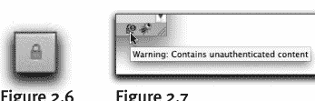

> **注意**
>
> 在提交敏感表单数据的情况下，应使用 SSL 连接显示和处理表单。

- 过程如下：
  1. 浏览器向服务器发出 SSL 请求。
  2. 服务器向浏览器发送数字证书。
  3. 浏览器指示它支持的加密方式。
  4. 服务器选择可能的最佳加密方式。
  5. 浏览器和服务器为会话生成加密密钥。

这些步骤仅在浏览器首次从该服务器发出 SSL 请求时需要；后续请求将使用已创建的加密密钥。

> **提示**
>
> 可以限制 Cookie，使其仅通过安全连接发送。

要使用 SSL，你必须先购买证书。就实际安全性而言，数字证书充当加密所用的公钥。就感知安全性而言，证书旨在向用户保证 SSL 已正确配置，底层业务是合法的——也就是说它已经

验证——因此该网站可以安全使用。浏览器提供了一种方法，让用户查看证书的详细信息（下一页的图 2.8），尽管我不知道大多数人是否经常这样做。如果证书与其使用方式不匹配，或者您使用的是安全性较低的证书（例如自签名证书），浏览器甚至可能直接警告用户潜在的危险。图 2.9 显示了 Firefox 的响应，它明确告诉用户不要信任该网站，用户必须采取额外步骤才能继续。如果您的网站向用户显示此消息，这对您的业务将非常不利。

> 如果未通过 HTTPS 协议提供 HTTPS 页面上的所有内容（HTML、媒体、JavaScript、CSS 等等），浏览器中可能会出现锁图标损坏的情况。

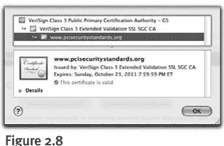

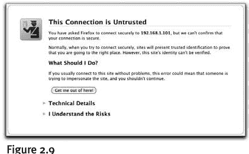

证书可以从众多证书颁发机构 (CA) 购买，从像 Thawte (www.thawte.com) 和 VeriSign (www.verisign.com) 这样的安全专家，到像 GoDaddy (www.godaddy.com) 这样的简单经销商，乃至您自己的托管公司。所有主流浏览器内置了一个包含 50 多个主要证书颁发机构的受信任列表。当您从大型公司购买证书时，您部分是在购买一种保证，即用户的浏览器不会就证书的有效性向他们发出警告（如图 2.9 所示）。购买高质量证书而非使用更便宜的证书，这是一个合理的理由。这些公司还以不同价格出售不同等级的证书，这是下一个需要考虑的因素。

> SSL 可用于保护多种连接类型，而不仅仅是 HTTP，还包括 FTP、SMTP 等等。

> 如前所述，由于涉及额外的加密工作，与非 SSL 请求相比，服务器只能处理一小部分 SSL 请求——经验法则认为十分之一是合理的。

就实际安全性（而非感知安全性）而言，可能会增加成本的一项是使用的最大加密级别，从 40 位到 256 位。加密级别越高越好，尽管实际使用的最大加密级别将取决于事务中涉及的 Web 服务器和浏览器。128 位安全性对大多数网站而言足够；256 位是网上银行级别。

接下来，某些证书带有担保，以便在发生故障时向您赔偿。最便宜的 GoDaddy 证书可能为您最高投保 2,000 美元；昂贵的 VeriSign 证书最高覆盖 250,000 美元。这是一个巨大的差异。

> 提示：相对活跃的网站可能只需要一台 Web 服务器，但需要多台数据库服务器，在这种情况下，一张证书可能就足够了。

您还需要支付更多费用才能获得更灵活的证书。单域名的有效证书比适用于所有子域名（www.example.com、shop.example.com 和 admin.example.com）的证书更便宜；适用于多个域名（example.com 和 example.net）的单个证书成本更高。另一个需要考虑的因素是能否在多台服务器上使用同一张证书。只有非常活跃的网站才需要多台服务器，但如果您需要，就必须购买更昂贵的证书。

> 提示：证书可以自签名且无成本，但这些不适用于电子商务网站。

相反，您不应使用绑定到特定主机或由同一服务器上的多个网站共享的证书。这类证书可能随您的托管服务免费或低价提供，但它们会向客户发出危险信号。

> 提示：在证书上花费更多资金，您还将获得更好的技术支持。

更昂贵的证书还意味着颁发机构对购买者身份进行了更广泛的核查。便宜的证书基本上只是表明有人购买了此证书。昂贵的证书表明有人为我们已验证其所有权的域名购买了此证书，我们已确认他们是一家在 X 国运营的合法公司，我们已与他们电话交谈，并阅读了其会计师出具的信函，等等（我并非编造这些内容）。最后，您可以购买高端证书，以在某些 Web 浏览器中启用“绿色地址栏”效果，也称为“扩展验证”或 EV。这向用户提供了一个明显的、可视化的提示，表明他们拥有非常安全的连接，并且可以安全地执行他们即将进行的操作。

## 常见漏洞

为结束本章，我想谈谈网站容易出现的一些常见漏洞，以及您需要留意的问题。您会看到与已介绍的信息有些重复，但强化良好的安全方法绝非坏事。

安全性就是关于保护数据：防止数据被错误的人查看、篡改或删除。大多数漏洞的共同点在于，它们为黑客提供了潜在的漏洞，黑客可以通过这些漏洞查看或操纵他们不应有权访问的数据。以下各部分将介绍最常见的安全黑客攻击和攻击，以及您需要做什么来预防它们。

> 提示：您可以采取的安全措施还取决于所使用的软件版本——这是保持软件更新的又一个原因！

## 保护信息

动态网站处理大量信息，从内容到用户提供的数据，再到交易历史记录。这些数据将由 PHP 脚本接收，传递到 MySQL 数据库，随后再从数据库检索，以便在 PHP 中再次使用。要加强这一过程，首先只获取所需的最少信息：您无需担心保护您不拥有的东西。接下来，尽可能验证用户提供的数据。PHP 的 Filter 函数（www.php.net/filter），曾位于 PECL（PHP Extension Community Library，http://pecl.php.net）中，并自 PHP 5.2 起成为语言核心的一部分，它们提供了用于验证和清理值的优秀工具。始终假设用户输入是错误的，然后验证其是否正确。

第三，仅存储最少量的数据。例如，您可能需要获取客户的十二项信息，然后将其中七项传递给支付网关，而仅在您自己的数据库中存储五项。第四，如果 PHP 和 MySQL 在不同的服务器上，请使用 SSL 在传输过程中保护数据。第五，仅从数据库检索您实际需要的信息。

上述用于在 PHP 和 MySQL 中处理数据的技术也可应用于客户端-服务器关系。关于您在浏览器中（在 Cookie 中）存储的内容、通过 HTML 传递给浏览器的内容，或作为 URL 一部分显示的内容，请务必非常小心。PayPal 曾令人惊讶地缺乏远见，接受在 URL 中指定被收取的总价格，任何人都可以轻而易举——真的非常轻易地修改它！您还需要验证和/或清理 Cookie 和 URL 数据，将其视为任何其他用户提供的数据（例如来自表单的数据），因为 Cookie 和 URL 参数确实受用户控制。

对于存储但未存储在数据库中的敏感数据，请更改会话目录，并使用 Web 根目录的父文件夹（参见图 2.5）。确保您的服务器不会通过过于泄露信息的错误消息或残留的 phpinfo() 脚本泄露任何内容。

最后，为保护所有服务器数据，请执行定期备份。如果您使用硬盘阵列（RAID），那么在单个驱动器故障时，您也会得到保护。

## 保护用户

保护用户，也就是电子商务网站中的客户，确实是首要目标，因为客户的信任是让您的业务兴旺的关键。保护他们的信息是保护他们的一部分，但您的网站还可能以另一种方式造成伤害：通过跨站脚本（XSS）攻击。在 XSS 攻击中，恶意人士 Alice 向您的网站注入 JavaScript。最常见的做法是通过旨在接收用户输入的组件，例如评论区或产品评论区域。当 Bob 在他的 Web 浏览器中加载您的页面时（例如，当他查看产品评论时），the

RAID 驱动器或其他高速硬盘可以极大地提高您网站的性能。


恶意 JavaScript 被执行，对他不利。JavaScript 可能被用来读取 Bob 的 cookie 或执行 Alice 网站上的代码。Bob 是受害者，而你的网站是共犯。

**提示**

如果你想允许用户内容中包含一些 HTML，strip_tags() 函数的第二个参数让你可以指定哪些特定标签是可接受的。

虽然 XSS 听起来很可怕，但防止它其实非常简单。一如既往，你必须验证用户输入。诚然，对于评论或评论等情况，你很难制定出提交内容应包含的严格模型（比如，与具有精确格式的电子邮件地址相比）。但是，你知道它不应该包含 JavaScript。通过将 strip_tags() 函数（它会从字符串中删除任何 HTML、JavaScript 或 PHP）应用于任何将在 Web 浏览器中重新显示的用户提供的输入，你可以防止 XSS 攻击。

**注意**

由于网站在逻辑上对管理员提供的内容限制较少，因此你能够信任拥有管理员访问权限的人就更加关键。

保护用户的另一种方法是教育他们了解常见的诈骗，无论这些诈骗是否涉及你的网站。我个人银行关联的网站在发送有关当前流行的假冒诈骗的电子邮件方面做得非常出色。他们还明确表示，他们绝不会通过电子邮件索取某些类型的个人信息，并说明你绝不应该在任何电子邮件回复中发送此类信息。

保护用户的另一项建议涉及保护他们的账户。当人们尝试使用用户名或电子邮件地址与密码的组合登录你的网站时，你可以选择如何报告错误。指出只是密码错误，就验证了提交的用户名或电子邮件地址确实存在于数据库中。这给了任何潜在黑客方程式的一半；从那里他们可以继续尝试常见密码以访问用户的实际账户。相反，只需指出该组合与数据库不匹配：这样的消息不会确认给定电子邮件地址或用户名的有效性。

**提示**

通知客户安全问题不仅可以保护他们，还能让你的网站看起来很好。

## 保护网站

网站本身是客户端与数据之间的代理，它也存在漏洞。首先需要了解的攻击类型是拒绝服务（DoS）攻击。这是一种暴力攻击，全世界许多僵尸服务器或从属服务器会同时尝试连接到你的网站。这样做会使你的服务器不堪重负，无法处理合法请求。不幸的是，你能做的来防止 DoS 攻击并不多。即使你在世界各地拥有大量服务器，拒绝服务仍然可能发生（即使是最大的网站也遭遇过这种情况）。但通过关闭未使用的服务器端口、使用防火墙和监控网络活动，你可以将风险降至最低。幸运的是，你必须相当成功才会成为目标，因此你可以将 DoS 攻击视为一种迹象，表明你已经成功了（一种化险为夷的方式）。

与 DoS 攻击相对罕见且难以防范不同，SQL 注入攻击非常常见且非常容易防范。SQL 注入攻击的原理是用户向网站提交 SQL，希望有问题的 SQL 命令会被执行，从而泄露敏感信息或损坏数据库。例如，登录表单可能会运行如下查询：

```
SELECT * FROM users WHERE email='$email' AND pass=SHA1('$pass')
```

$email 和 $pass 值据说来自登录表单。如果用户将 ';DROP TABLE users; 提交为密码，且未采取措施防止这种情况，生成的查询将是：

```
SELECT * FROM users WHERE email='whatever@example.edu' AND pass=SHA1(";DROP TABLE users;")
```

从理论上讲，一条 SQL 命令会变成三条独立的命令。首先，会有一个语法上无效的 SELECT，除了报错之外不会做任何事，然后会运行 DROP TABLE 命令，接着是第三条毫无意义且语法无效的查询。如果这三条查询都被执行，那就糟糕了。

有许多方法可以阻止这些攻击产生效果。首先，你应该尽可能将数据验证为预期值（即，电子邮件地址有精确格式，某些值必须是正整数）。其次，将所有字符串（甚至已经验证过的字符串）通过数据库特定的转义函数处理，例如 mysqli_real_escape_string()：

```
$pass = mysqli_real_escape_string($dbc, $_POST['pass']);
```

接下来，你应该将所有应为数值的值强制转换，以确保它们是数字：

```
$id = (int) $_GET['id'];
```

使用该代码后，如果用户将 $_GET['id'] 操纵为 ';DROP TABLE users;，该字符串将被强制转换为值为零的整数。在查询中使用时，它可能不会返回任何结果，但不会造成任何伤害。

另一种选择是使用预处理语句，其中特定值与查询分离，并在数据库级别重新组合。你仍然必须验证用于预处理语句的数据——使用已知有错误的数据运行查询没有意义，但查询始终是安全的。

> **提示**
> 预处理语句还可以带来性能优势，你将在第三部分了解这一点。

黑客会提供错误数据以实现三个其他目标：

- 远程文件包含
- 本地文件包含
- 系统调用

在远程文件包含（RFI）攻击中，黑客试图让网站包含另一台服务器（可能是他们自己的）上的文件。当 PHP 调用 fopen()、require()、include() 等函数时，它会执行包含文件中的任何 PHP 代码，就好像该代码是原始文件的一部分。因此，如果 Chuck 能让你的网站打开并执行他的代码，他就可以开始操纵你的服务器，后果不堪设想。同样，预防很简单：在这些函数调用中不要使用未经验证的用户数据。

**提示**

禁用 register_globals 设置并使用 open_basedir 也有助于防止 RFI 和 LFI 攻击。

本地文件包含（LFI）攻击类似，但希望的是同一服务器上的敏感文档（如密码文件）会被读取并显示。

如果你的网站使用 exec() 及其他在服务器本身上运行命令的函数，那么防止 RFI 和 LFI 攻击的相同步骤也适用。最好不要让你的服务器使用这些函数，但如果使用了，你绝对不能在这些函数中使用未经验证的用户数据。

继续，如果你的网站接受用户上传的文件，该系统可能被用来在你的服务器上尝试恶意文件执行。黑客希望能够，例如，将他自己的 PHP 脚本上传到你的系统，然后通过在浏览器中直接加载来执行该 PHP 脚本。假设你的网站允许用户上传自己的图片。你应该验证上传的文件是某种特定类型——gif、jpg、png——但这很容易被伪造。如果你将上传的文件存储在 Web 目录中（例如，图 2.5 中的 images 文件夹），那么黑客稍后可以通过访问 http://www.yoursite.com/images/scriptname.php 来运行该脚本。但是，如果你将用户提交的文件存储在 Web 目录之外（例如，图 2.5 中的 unavailable 文件夹），那么上传的文件就无法直接通过 Web 浏览器执行。另一种预防技术涉及更改上传文件的名称：如果黑客不知道文件在服务器上的名称，他或她就无法调用它。

**提示**

在本书的第二部分和第三部分中，你将看到安全处理文件上传的技术。

你应该了解的最后一种攻击类型是跨站请求伪造（CSRF）。这种攻击试图从经过授权的用户处执行未经授权的命令。这些攻击的成功取决于网站信任该用户，因为该用户之前已过身份验证。例如，假设你的网站有一个向用户账户添加积分的页面：有一个用于选择用户和积分数量的表单；当表单提交时，该


积分已被处理。假设 Alice 是一名管理员，她访问了你的网站，完成了身份验证，并做了些什么（无论她是否使用了添加积分系统都无关紧要）。如果 Alice 没有登出，她的浏览器中仍然有一个 Cookie，表明她是你网站的已验证用户。接下来，Alice 遇到了一个页面，黑客 Bob 在其中将一个 PHP 脚本标识为图片标签的来源：

```

```

这可能是一个公共论坛、评论系统，或者任何以某种方式允许用户发布图片的网站。

当 Alice 加载带有该图片标签的页面时，她的浏览器会向你网站上的 add_credits.php 脚本发送请求，并传递 user 和 credits 数字。对于服务器来说，这个请求看起来与 Alice 有意访问 add_credits.php 页面完全一样。该页面首先会确认请求用户已通过身份验证，而 Alice 确实如此。然后，理论上，该页面将执行接收到这两个 URL 值后所产生的任何操作。

这是一种盲攻击，因为原始黑客 Bob 永远不会看到请求执行的结果：他只是把这东西放在那里，希望在这种情况下，当某个已验证的用户偶然发现这段代码时，他在你网站上的账户会被加积分。请注意，仅仅对用户进行身份验证无法防止这种攻击，因为正是这种信任使得这种攻击看起来合理。

要防止 CSRF 攻击，首先要教导你的管理员登出。然后，限制身份验证 Cookie 的生存期，使其在他们停止在你网站上活动几分钟后过期（网上银行可能只允许十或十五分钟的用户不活跃时间）。这将把 CSRF 危险窗口缩小到仅仅是那个简短的 Cookie 生命周期。

> 针对使用长效 Cookie 的非常流行的网站，CSRF 攻击更容易成功。

不公开敏感信息（如用户 ID 值）也很重要，但仅仅依赖黑客不知道某事并不是真正的安全。虽然可以通过 POST 执行 CSRF 请求，但对于敏感请求依赖于提交的数据更安全（这也符合 POST 应在请求会导致网站更改时使用的方法）。

真正的 CSRF 预防来自保证像积分转移这样的敏感请求确实是由你自己的网站发起的。不过，你不能可靠地使用浏览器的“referrer”值（即浏览器在此页面之前所在的页面）。相反，在 HTML 表单和处理其请求的页面之间建立你自己的关联。这个关联本身将是一个秘密令牌，为每个请求唯一生成。以下是显示表单的页面上你会做什么（大部分代码已省略）：

```php
<?php // form.php

...

$csrf_token = uniqid(); // or uniqid(rand(), true);
session_start();
$_SESSION['csrf_token'] = $csrf_token;

...

echo '<input type="hidden" name="csrf_token" value="' . $csrf_token . '" />';

...
?>
```

在处理请求的页面上，验证令牌：

```php
<?php // handle_form.php

...

session_start();
if ( $_SERVER['REQUEST_METHOD'] == 'POST' ) // only POST is allowed
&& ( isset($_SESSION['csrf_token'], $_POST['csrf_token']) ) // make sure the tokens exist
&& ( $_SESSION['csrf_token'] == $_POST['csrf_token'] ) ) { // OK!

...
} else { // Invalid request!
}

...
?>
```

> **提示**
>
> 要防止机器人尝试使用表单，请集成 CAPTCHA（Completely Automated Public Turing test to tell Computers and Humans Apart，全自动区分计算机和人类的图灵测试）系统。

现在，只有在 Alice 仍然登录（即她的 Cookie 仍然有效）、请求通过 POST 方法发送、csrf_token 元素同时存在于 `$_SESSION` 和 `$_POST` 中、且两个值匹配时，请求才会被处理。这已经是相当不错的安全性了！

# 第二部分：销售虚拟产品


# 3 第一个网站：结构与设计

本书中正在开发的第一个电子商务网站“知识就是力”（Knowledge is Power）将向付费订阅者提供内容。它将具有以下主要功能：

- 直接使用 HTML、PHP 和 MySQL
- 用户账户
- 管理员添加 HTML 和 PDF 内容的功能
- 用于处理付款的 PayPal

这是一个相对标准的电子商务示例，适用于大多数中小型企业。相比之下，本书第三部分“销售实体产品”中开发的更复杂的项目将以更高级的方式使用 HTML、PHP 和 MySQL，不需要用户账户，销售稍后发货的产品（即客户不会立即被扣款），并集成不同的支付系统。这并不意味着你在本书这一部分学到的内容不适用于现实世界，恰恰相反。

用户账户系统将包含几个部分：注册、登录、登出、找回忘记的密码以及更改现有密码。作为额外福利，用户的密码将以更安全的方式处理，这可能是你之前还没见过的方法。

客户付费查看的可用内容将有两种格式：HTML 和 PDF。对于前者，你将把所见即所得（WYSIWYG）编辑器集成到 HTML 表单中，以便管理员无需 HTML 知识即可轻松创建 HTML。对于后者，你将编写一个 *proxy script*，用于提供不可通过 HTTP 或未验证用户访问的受保护文件。

在本章中，你将为网站开发奠定基础。这包括数据库设计、服务器上的文件组织、HTML 模板，以及每个其他 PHP 脚本都会使用的一些必要辅助文件。网站的完整代码也可从 www.DMCInsights.com/ecom/ 下载。

## 数据库设计

我为这个示例设计的数据库简单而合适，只有五个表（图 3.1）。

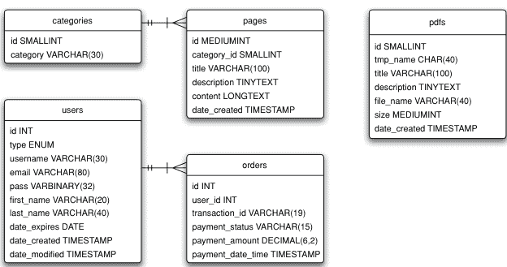

图 3.1

*categories*、*pages* 和 *pdfs* 表代表了这个电子商务示例的“产品”部分。*categories* 表仅列出了 HTML 内容将被组织到的类别。每个类别将包含一个或多个页面，但每个页面只属于一个类别。

*pages* 表存储实际的 HTML 内容。对于每个 HTML 页面，有三个重要字段：*title*、*description* 和 *content*。*title* 将用作每个页面的链接，也将用作浏览器标题。*description* 是一段简短的文本，嗯，用于描述页面内容。此值对任何用户和搜索引擎都可见。*content* 列存储实际的 HTML 内容。你将在第 5 章“管理网站内容”中看到这一切的实际运用。

> **提示**
>
> 我是程序员，所以我先设计数据库，再逐步过渡到 HTML 设计。你也可以先从用户界面开始，再逐步深入到数据库。

**pdfs** 表列出了网站中每个 PDF 文件的详细信息，包括 PDF 的标题（类似于 HTML 页面标题）、一段简短描述（任何人都可查看）、实际 PDF 文件名及其以千字节为单位的大小。当 PDF 文件上传到网站时，它会被赋予一个不明显的临时名称（例如，aofo7b9b15e38ca77219884a8bbage57d01fae88），该名称也必须被存储；但在将 PDF 提供给用户时，将使用其原始文件名。PDF 文件不与信息类别关联。

> **注释**
>
> 大多数表都有一个反映记录添加时间的列。**users** 表还有一个字段指示记录最后修改的时间。

**users** 表存储了关于客户的最少量信息。每个客户都可以创建一个用户名，系统还将存储其电子邮件地址、密码、名和姓。密码将作为 **hash** 存储，它是值的一种表示（而不是可以解密的加密版本）。哈希值始终具有确切的长度，因此该列**可能**被声明为固定 **CHAR**。但是，如果将密码作为二进制数据存储，它可以占用更少的空间，列也将如此定义。

该网站有两种用户——成员和管理员——因此将使用一个 **ENUM** 列（即枚举选项列表）来存储类型，默认值为 _member_。虽然管理员永远不需要为访问网站付费，但我认为使用非管理员使用的同一登录系统是有道理的，这意味着管理员也必须在数据库中注册。**users** 表还有一个 **date_expires** 列，存储其账户有效期至的日期（即付费期限）。当用户首次订阅并付费时，账户将设置为一年后过期。当用户续订会员资格时，账户将更新为一年后。账户已过期的用户仍然可以登录，但他们无法查看任何内容，并将被通知需要续订。

> **提示**
>
> 在使用数据库时，保存比你最终需要的更多的信息要好得多，这样就不会后来发现你没有存储某个确实需要的东西。

所有付款都将通过 PayPal 处理。尽管 PayPal 会提供每笔交易的详细日志，但在本系统中记录每笔交易的基本信息也是明智之举。**orders** 表将存储每笔通过 PayPal 进行的交易，并与用户 ID（从 **users** 表中获取）关联。每个订单将仅与一个用户关联，但每个用户可以在 **orders** 表中有一条或多条记录。PayPal 交易中的三条信息也将被记录：**transaction_id**（唯一标识符）、**payment_status**（仅确认代码）和 **payment_amount**。存储这些基本数据将允许你创建一个简单的管理员界面，用于查看订单总数、收入金额等，而无需为此信息访问 PayPal。**transaction_id** 是数据库中存储的最敏感的数据；通过它，可以访问许多详细信息，但仅限于授权的 PayPal 用户。


我假设你知道如何使用 phpMyAdmin 之类的工具、命令行 mysql 客户端等来创建数据库及其表。如果你不知道，请参阅我的一本与 MySQL 相关的书，在线搜索，或直接在我的支持论坛中提问。你可以从我的网站下载 SQL 命令，但这里也提供了：

```sql
CREATE TABLE `categories` (
  `id` SMALLINT NOT NULL AUTO_INCREMENT,
  `category` VARCHAR(30) NOT NULL,
  PRIMARY KEY (`id`),
  UNIQUE KEY `category` (`category`)
) ENGINE=MyISAM DEFAULT CHARSET=utf8;
```

```sql
CREATE TABLE `orders` (
  `id` INT UNSIGNED NOT NULL AUTO_INCREMENT,
  `user_id` INT UNSIGNED NOT NULL,
  `transaction_id` VARCHAR(19) NOT NULL,
  `payment_status` VARCHAR(15) NOT NULL,
  `payment_amount` DECIMAL(6,2) UNSIGNED NOT NULL,
  `payment_date_time` TIMESTAMP NOT NULL DEFAULT CURRENT_TIMESTAMP,
  PRIMARY KEY (`id`),
  KEY `user_id` (`user_id`)
) ENGINE=MyISAM DEFAULT CHARSET=utf8;
```

> 在 SQL 命令中，用反引号括起表名和列名并非必需，但可以防止与现有 MySQL 关键字发生冲突。

```sql
CREATE TABLE `pages` (
  `id` MEDIUMINT UNSIGNED NOT NULL AUTO_INCREMENT,
  `category_id` SMALLINT UNSIGNED NOT NULL,
  `title` VARCHAR(100) NOT NULL,
  `description` TINYTEXT NOT NULL,
  `content` LONGTEXT NOT NULL,
  `date_created` TIMESTAMP NOT NULL DEFAULT CURRENT_TIMESTAMP,
  PRIMARY KEY (`id`),
  KEY `category_id` (`category_id`),
  KEY `creation_date` (`date_created`)
) ENGINE=MyISAM DEFAULT CHARSET=utf8;
```

> 由于本站点的服务费用仅为 10.00 美元，payment_amount 列可以定义为更严格的 DECIMAL(4,2)。

```sql
CREATE TABLE `pdfs` (
  `id` SMALLINT UNSIGNED NOT NULL AUTO_INCREMENT,
  `tmp_name` CHAR(40) NOT NULL,
  `title` VARCHAR(100) NOT NULL,
  `description` TINYTEXT NOT NULL,
  `file_name` VARCHAR(40) NOT NULL,
  `size` MEDIUMINT UNSIGNED NOT NULL,
  `date_created` TIMESTAMP NOT NULL DEFAULT CURRENT_TIMESTAMP,
  PRIMARY KEY (`id`),
  UNIQUE KEY `tmp_name` (`tmp_name`),
  KEY `date_created` (`date_created`)
) ENGINE=MyISAM DEFAULT CHARSET=utf8;
```

```sql
CREATE TABLE `users` (
  `id` INT UNSIGNED NOT NULL AUTO_INCREMENT,
  `type` ENUM('member','admin') NOT NULL,
  `username` VARCHAR(30) NOT NULL,
  `email` VARCHAR(80) NOT NULL,
  `pass` VARBINARY(32) NOT NULL,
  `first_name` VARCHAR(20) NOT NULL,
  `last_name` VARCHAR(40) NOT NULL,
  `date_expires` DATE NOT NULL,
  `date_created` TIMESTAMP NOT NULL DEFAULT CURRENT_TIMESTAMP,
  `date_modified` TIMESTAMP NOT NULL DEFAULT '0000-00-00 00:00:00',
  PRIMARY KEY (`id`),
  UNIQUE KEY `username` (`username`),
  UNIQUE KEY `email` (`email`)
) ENGINE=MyISAM DEFAULT CHARSET=utf8;
```

> **注意**
> 数据库和整个站点将使用 UTF-8 字符集，从而允许使用任何可能的书写语言。

你会发现，几乎每个列都定义为 NOT NULL，从性能和规范化标准来看，这是理想的。还设置了适当的默认值。索引（或键）已建立在主键、必须具有唯一值的列，以及将用于连接、WHERE 子句和 ORDER BY 子句的列上，当然，你也可以在此处或那里再添加几个索引。

## 服务器组织

在创建任何 HTML 文档或 PHP 脚本之前，让我们看看服务器应该如何组织。除非你的站点相当大（也就是说，它有如此多的单独文件，以至于创建子目录是合适的），否则你通常会将站点的所有页面放在 Web 根目录中，本示例也是如此。Web 根目录还应包含以下文件夹：

- 管理文件
- 媒体
- CSS
- PHP 包含文件
- 图片
- JavaScript

本站点不会将管理页面（本书中仅开发两个）放在单独的目录中，因此你不必担心该文件夹。此外，站点的初始版本不需要 JavaScript 或媒体文件夹。因此，Web 根目录一开始只需要三个子文件夹，我将巧妙地将其命名为 css、images 和 includes。

**提示**

为了略微提高安全性，请为你的 includes 和 administration 目录使用不明显的名称。

css 目录将包含来自站点模板的一个文件，名为 styles.css（关于模板的更多内容将在本章后面介绍）。随模板提供的八张图片将放入 images 文件夹。includes 目录将存储由其他脚本包含的 PHP 脚本。换句话说，includes 目录用于那些不会独立执行的文件。在接下来的三章中，你将为 includes 目录创建六个文档：

**注意**

在第 7 章“第二个站点：结构与设计”中，你将学习保护站点目录的其他方法。

- config.inc.php 是一个定义站点一般行为和各种常量的脚本。
- footer.html 是 HTML 模板的一半。
- form_functions.inc.php 定义了每个表单使用的函数。
- header.html 是 HTML 模板的另一半。
- login.inc.php 处理登录过程。
- login_form.inc.php 是登录表单。

正如你所见，我将站点的许多功能拆分到单独的文件中，以便于维护站点。

除了代表特定页面（例如注册、注销等）的所有 PHP 脚本外，站点还需要一个名为 mysql.inc.php 的 PHP 脚本。该脚本将连接到数据库。由于该脚本定义了敏感信息，理想情况下应将其存储在 Web 根目录之外。

**注意**

代理脚本是用来替代其他文件的文件，例如一个显示 PDF 而不是让用户直接访问 PDF 的 PHP 脚本。

站点还需要一个文件夹来存储付费订阅者可用的 PDF。由处理上传的脚本将 PDF 放入此文件夹。为此，该文件夹的权限必须允许 Web 服务器写入它。由于这会造成潜在的安全漏洞，最好将该文件夹放在 Web 根目录之外。此外，PDF 脚本应仅通过验证用户的代理脚本提供给付费订阅者。将 PDF 文件保留在 Web 目录之外，可防止未付费访问者加载它们。

> **注意**
>
> 图 3.2 和 3.3 共同显示了未来四章中将创建的每个文件和文件夹。

图 3.2 显示了服务器组织，其中 **html** 文件夹是 Web 根目录（www.example.com 指向该位置）。

如果你无法在 Web 根目录下方放置任何内容（这在共享主机上很常见），则应使用类似图 3.3 所示的结构。

> **注意**
>
> 图中所示的 **robots.txt** 文件不会在本书中正式开发，但可在可下载的代码中查看。

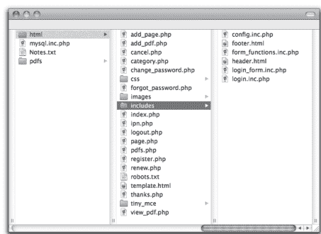

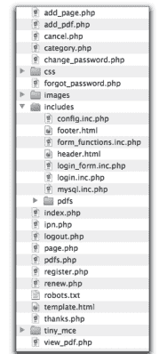

图 3.2

图 3.3

作为预防措施，请使用 Web 服务器的工具限制对 **includes** 目录的访问。这样做将禁止人们访问该目录及其 **pdfs** 子文件夹，但不会影响 PHP 脚本访问其内容的能力。第 7 章将详细讨论这种做法。

## 文件扩展名

当用户请求使用 **.html** 扩展名的页面时，服务器会将页面内容直接传递给浏览器，无需任何额外的服务器处理。但当用户请求带有 **.php** 扩展名的页面时，服务器会先将页面内容（即代码）通过 PHP 解释器运行，然后执行代码。（这些是标准设置；服务器可以设置为以其他方式处理扩展名。）请记住，站点的主要页面——用户将直接访问的页面——应使用 **.php** 扩展名，以便代码得到处理。由其他 PHP 脚本包含且不直接在浏览器中运行的页面不会由服务器直接处理，因此你可以选择使用任何扩展名。

对于主要为 HTML 的文件（如页眉和页脚），我使用 **.html** 扩展名。对于主要为 PHP 但旨在作为包含文件的页面，我使用组合扩展名：**.inc.php**。**.inc** 部分表示这是一个要包含的文件，而 **.php** 可防止代码在文件以某种方式直接在 Web 浏览器中运行时被泄露。如果仅使用 **.inc**，服务器可能不会将内容发送到 PHP 解释器，从而将潜在的敏感信息发送到浏览器。这是一个不值得冒的安全风险。


## 连接到数据库

站点中的每个 PHP 脚本都需要连接到数据库，因此让我们在 includes 目录中为此目的创建一个单独的文件。

- 1. 在文本编辑器或 IDE 中创建一个新的 PHP 脚本，命名为 mysql.inc.php。
- 有关此文件应放置位置的指示，请参见图 3.2 和 3.3。

- 2. 定义访问数据库所需的常量：

```php
<?php
define ('DB_USER', 'username');
define ('DB_PASSWORD', 'password');
define ('DB_HOST', 'localhost');
define ('DB_NAME', 'ecommerce1');
```

您需要将这些值替换为适用于您服务器的正确值。就我的设置而言，我创建了一个名为 ecommerce1 的数据库，并创建了一个在该数据库上具有 SELECT、INSERT 和 UPDATE 权限的 MySQL 用户。您绝对必须使用比这些更安全的用户名和密码！

- 3. 连接到数据库：

```php
$dbc = mysqli_connect(DB_HOST, DB_USER, DB_PASSWORD, DB_NAME);
```

mysqli_connect() 函数用于连接到数据库。该连接被赋给 $dbc 变量，该变量将由其他脚本中的许多函数使用。

- 4. 建立字符集：

```php
mysqli_set_charset($dbc, 'utf8');
```

此函数指示 PHP 与数据库之间的通信应使用哪种字符集。数据库表、HTML 页面和 PHP-MySQL 连接都必须使用相同的字符集。

- 5. 开始定义一个用于使数据在查询中安全使用的函数：

```php
function escape_data ($data) {
global $dbc;
```

> note
> 由于站点将使用 UTF-8 字符集，您的文本编辑器或 IDE 必须设置为也使用 UTF-8 对每个页面进行编码。

> note
> 如果您的 PHP-MySQL 设置不支持我将要使用的 MySQL 改进扩展，则需要使用语法略有不同的旧 MySQL 函数。有关详细信息，请参阅 PHP 手册。

> note
> 发生的任何连接错误都将由配置文件（几页后）中定义的自定义错误处理程序处理。

此函数将以单个数据片段作为其唯一参数，并使其在数据库查询中安全使用。换句话说，此函数将防止 SQL 注入攻击成功（参见第 2 章，“安全基础”）。该函数执行三项操作：

  - 如果启用了 Magic Quotes，则删除额外的斜杠
  - 从数据中修剪额外的空格
  - 将数据通过 mysqli_real_escape_string() 函数运行

此最后一项任务最重要，因为 mysqli_real_escape_string() 函数将基于数据库配置和当前使用的字符集使值在查询中安全使用。该函数需要数据库连接，该连接通过 global 命令使其可用。

作为一个功能，Magic Quotes 已被弃用，并将从未来的 PHP 版本中消失。

- 6. 如果 Magic Quotes 已打开，则剥离额外的斜杠：

```php
if (get_magic_quotes_gpc()) $data = stripslashes($data);
```

Magic Quotes 旨在为传入数据提供全面的安全级别，但其安全性不如使用 mysqli_real_escape_string()。希望您的服务器上禁用了 Magic Quotes；但如果 Magic Quotes 已启用，则传入数据将已经对可能破坏查询的潜在有问题字符应用了斜杠。这些斜杠将是一个问题，因为 mysqli_real_escape_string() 也将应用斜杠，从而创建两个斜杠而只应有一个。为了防止这种情况发生，此代码行检查 Magic Quotes 设置，如果 Magic Quotes 已打开，则调用 stripslashes() 函数。

- 7. 返回经过修剪的安全数据版本：

```php
return mysqli_real_escape_string(trim($data), $dbc);
```

mysqli_real_escape_string() 与 Magic Quotes 或 addslashes() 之类的东西之间的区别在于，mysqli_real_escape_string() 根据数据库、当前使用的字符集等来识别哪些字符可能存在问题。

本书可下载源代码中找到的 mysqli.inc.php 文件包含后续章节中讨论的其他代码。

- 8. 完成 escape_data() 函数：

```php
} // End of the escape_data() function.
```

所有包含的 PHP 文件都将省略闭合 PHP 标记，以防止“标头已发送”错误。

- 9. 保存文件。

您可能会注意到，此处未指示您包含闭合 PHP 标记。这是可以接受的，在某些情况下甚至更好。如果使用闭合标记，然后在该标记后意外留下额外空格或空行，则其他脚本包含此文件将导致将标头发送到 Web 浏览器。如果包含（即父）脚本后来尝试发送 cookie、启动会话或重定向浏览器，您将收到“标头已发送”错误消息（图 3.4）。通过省略闭合标记，这不可能发生（至少在包含此脚本时不会）。

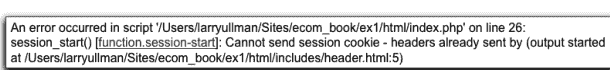

图 3.4

## 配置文件

下一个要创建的 PHP 脚本是配置文件。与 mysqli.inc.php 脚本一样，此文件将被站点中的每个脚本使用（虽然有些站点将有不需要数据库连接的页面，但每个站点中的每个 PHP 脚本都应始终使用配置文件）。配置文件有四个用途：

- 定义系统范围的设置，以便轻松更改
- 定义多个脚本可能使用的有用常量
- 启动会话
- 建立错误处理方式

让我们现在开始定义配置文件，在第 4 章“用户帐户”中，将向其中添加更多代码。

- 1. 在文本编辑器或 IDE 中创建一个新的 PHP 脚本，命名为 config.inc.php，并存储在 includes 目录中，如图 3.2 和 3.3 所示。
- 2. 定义 $live 和 $contact_email 变量：

```php
<?php
$live = false;
$contact_email = 'you@example.com';
```

$live 变量确实是最重要的变量，因为它将决定如何处理错误。取决于支付网关，此变量也可以用于从仅测试支付处理切换到实际使用。但是，PayPal 略有不同，因此在本示例中不会这样做。

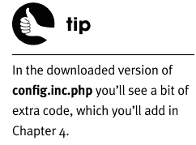

$contact_email 变量用于站点上线后将错误消息发送到的电子邮件地址。它也可用于联系表单，或者您可以为不同用途定义不同的电子邮件地址。

- 3. 定义常量：

```php
define ('BASE_URI', '/path/to/Web/parent/folder');
define ('BASE_URL', 'www.example.com/');
define ('MYSQL', '/path/to/mysql.inc.php');
```

这些是站点将使用的前三个常量，您需要相应更改值。第一个常量应指向 Web 根目录的父目录（如果您的站点可以使用）。例如，在图 3.2 中，BASE_URI . pdfs 将是存储 PDF 的位置，BASE_URI . mysql.inc.php 将是 MySQL 连接脚本的位置。如果您无法访问 Web 根目录之上，则将 BASE_URI 分配给 Web 根目录本身。例如，在图 3.3 中，BASE_URI . 'includes/pdfs' 将是存储 PDF 的位置。


> note
> BASE_URI 和 BASE_URL 值都以斜杠结尾。

第二个常量是站点的基 URL，不带协议，例如 www.example.com/。我特意去掉了 http:// 部分，因为某些页面将使用 https://。

第三个常量指向刚刚创建的 MySQL 连接脚本。您可以使用 BASE_URI 来帮助创建此完整路径。

使用此类常量有几个原因。首先，如果您在多个目录中的多个脚本中引用某些值，则很难使引用始终正确。通过使用绝对引用，它们将始终正确。其次，如果您对站点做任何重大更改——例如其域名或托管——只需更改这些值即可。

- 4. 启动会话：

```php
session_start();
```

站点将使用会话来跟踪登录用户。由于每个页面都需要配置文件，在此处启动会话将确保每个页面都可以访问会话数据。此外，如果您想自定义会话（例如其名称或持续时间），可以在一个地方完成。

另一方面，这也意味着在某些不需要会话的情况下也会启动会话，例如有人查看主页或内容列表页面而没有进一步操作时。


- 5. 开始定义错误处理函数：

```php
function my_error_handler ($e_number, $e_message, $e_file, $e_line,
   $e_vars) {
global $live, $contact_email;
```

PHP 允许你定义自己的错误处理函数。通过这样做，你可以精确控制报告哪些错误、以何种方式报告以及报告的详细程度。每当发生 PHP 错误，或使用 `trigger_error()` 触发错误时，不久将创建的脚本都会调用此函数。唯一的例外是解析错误和其他严重的 PHP 错误，这些错误会阻止脚本首先被执行。

错误处理函数可以定义为接收两到五个参数。在这里，我使用了全部五个参数。第一个参数是数字错误指示器，可能被赋予如 2 这样的值，代表 `E_WARNING`。第二个参数是接收到的错误消息。下一个参数是发生错误的文件名，第四个参数是错误发生的行号。第五个参数是错误发生时存在的所有变量的数组。这可以作为有用的调试信息（说到调试，信息几乎总是越多越好）。

- 6. 开始创建详细的错误消息：

```php
$message = "An error occurred in script '$e_file' on line $e_line:
   \n$e_message\n";
```

详细的错误消息将以相关文件名、行号和消息字符串开头。

- 7. 添加回溯信息：

```php
$message .= "<pre>" . print_r(debug_backtrace(), 1) . "</pre>\n";
```

`backtrace` 本质上是错误发生前发生的所有事情。这将包括已执行的文件、已调用的函数、传递给函数的参数以及存在的变量。你可以通过调用 `debug_backtrace()` 函数获取回溯信息，该函数返回一个数组。要将该数组添加到错误消息中，请将其（或创建该数组的函数调用）作为第一个参数传递给 `print_r()`，并将 `1` 或 `true` 用作 `print_r()` 中的第二个参数值。为 `print_r()` 提供正数的第二个参数会告诉函数返回值，而不是打印它。我将此代码包裹在 HTML 预格式化标签 `<pre>...</pre>` 中，以便更易读。

如果你不想要详细的回溯，可以简单地将变量及其值列表追加到消息中，如下所示：

```php
$message .= "<pre>" . print_r ($e_vars, 1) . "</pre>\n";
```

- 8. 如果网站未上线，则在浏览器中显示错误消息：

```php
if (!$live) {
    echo '<div class="error">' . nl2br($message) . '</div>';
}
```

对于未上线的网站，最好能立即收到任何问题的通知。在这里，错误消息将在一个被赋予 error 类的 `<div>` 中打印。为了将换行符（\n）转换为 HTML 换行标签，应用了 nl2br() 函数。图 3.5 显示了浏览器中的示例详细错误消息。

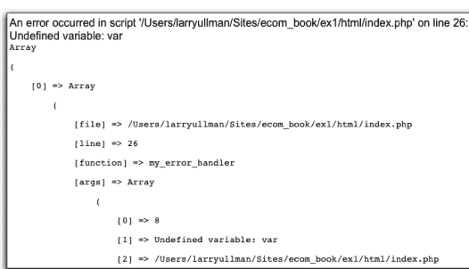

图 3.5

- 9. 如果网站已上线，则通过电子邮件发送错误：

```php
} else {
    error_log($message, 1, $contact_email, 'From:admin@example.com');
}
```

error_log() 函数可以以不同方式记录错误。其第一个参数是错误消息。第二个是目标类型，1 表示电子邮件（默认值为零会将消息发送到操作系统的日志）。第三个参数是目标本身；对于电子邮件，这是“收件人”电子邮件地址。第四个参数仅用于发送电子邮件，用于添加任何其他标头，例如“发件人”电子邮件地址。

> **注意**
> 希望在经过充分测试、已上线的网站中，客户永远不会看到即使是通用错误消息，因为所有漏洞都已修复。

- 10. 如果网站已上线，且错误不是通知，则显示通用消息：

```php
if ($e_number != E_NOTICE) {
    echo '<div class="error">A system error occurred. We apologize for the inconvenience.</div>';
}
```

如果网站已上线，用户不应看到详细的错误消息（那将是严重的安全违规）；相反，他们将收到一个模糊的响应。但是，发生的一些错误可能不是实际问题，只是对功能没有影响的技术疏忽。此类错误作为通知引发，因此只有当错误不是通知级别时才会报告。实际上，如果网站已上线，图 3.5 中指示的错误不会被报告。图 3.6 显示了用户遇到另一种类型的错误时可能看到的内容。

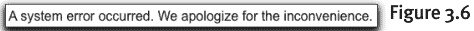

- 11. 完成 my_error_handler() 函数：

```php
}
// End of $live IF-ELSE.
return true;
}
// End of my_error_handler() definition.
```

错误处理函数应返回非假值以指示错误已被处理。如果函数返回 false，则 PHP 的默认错误处理程序也会被调用（在已上线的网站上这将是糟糕的）。

- 12. 应用错误处理程序：

```php
set_error_handler('my_error_handler');
```

这一行实际上告诉 PHP 使用自定义函数来处理错误。如果不执行此函数调用，PHP 仍将使用其默认处理程序。这也是解析错误不会通过你自己的错误处理程序的原因，因为解析错误阻止了 PHP 脚本的执行。

- 13. 保存文件。

## HTML 模板

要创建网站的浏览器端，你应先设计一个或多个 HTML 模板，以描绘最终动态网站的外观。对于本网站，我想使用一种优雅的设计，而不会喧宾夺主（即不会掩盖网站在销售的内容：其内容本身）。我无法创建这样的设计。我在网上搜索可用的 Web 模板，最终选择了由 spyka Webmaster (www.spyka.net) 创建的免费 Kilo 主题。为将该模板定制到本网站，我更新了本网站理论名称和标语的标头，更改了顶部导航项，修改了侧边内容栏，调整了页脚，并对 CSS 做了一些调整。你可以从我的网站下载代码来查看最终效果。

> **提示**
> 随意使用你自己的设计，或根据喜好调整 Kilo 主题。

在屏幕右侧，如果用户未登录，我希望网站显示登录表单（图 3.7），但如果已登录，则显示一些账户管理链接（图 3.8）。如果登录用户是管理员，他们将看到一组额外的选项（图 3.9）。

网站的内容将按类别组织，同样列在右侧。非付费订阅的访客只能看到可用的内容（标题和简短描述）；付费订阅者可以查看内容本身。

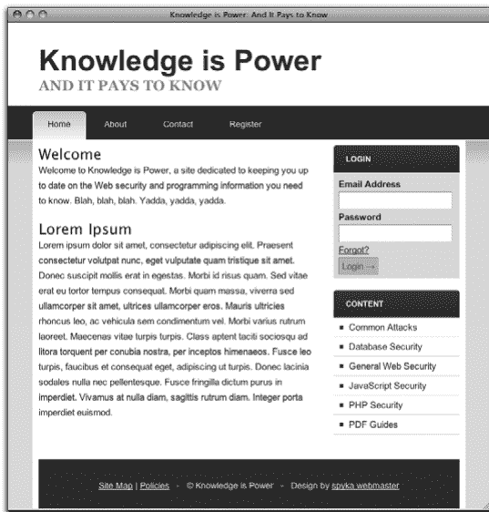

图 3.7

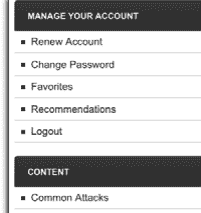

图 3.8

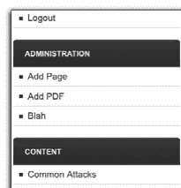

图 3.9

为了将此 HTML 设计融入网站的每个页面，我将使用一种标准技术：将模板分解为头部文件和尾部文件。每个页面将包含头部，然后显示特定于页面的内容，最后包含尾部。一旦你完成了基本模板（或多个模板）的定制，就可以开始创建各个文件了。

### 创建头部

头部需要启动 HTML 页面，包含任何必要的 CSS 和 JavaScript，并编写页面主体，直到特定于页面的内容开始的位置。

- 1. 如果尚未打开，请在文本编辑器或 IDE 中打开设计好的模板文件。

- 2. 从模板文件复制所有 HTML，直到特定于页面的内容：

```html
<!DOCTYPE html PUBLIC "-//W3C//DTD XHTML 1.0 Strict//EN"
"http://www.w3.org/TR/xhtml1/DTD/xhtml1-strict.dtd">
<html xmlns="http://www.w3.org/1999/xhtml">
<head>
<meta http-equiv="Content-Type" content="text/html;
charset=utf-8" />
<title>Knowledge is Power: And It Pays to Know</title>
<link rel="stylesheet" href="css/styles.css" type="text/css" />
</head>
<body>
<div id="wrap">
<div class="header">
<!-- TITLE -->
<h1><a href="index.php">Knowledge is Power</a></h1>
<h2>and it pays to know</h2>
<!-- END TITLE -->
</div>
<div id="nav">
<ul>
<!-- MENU -->
<li class="selected"><a href="index.php"><span>Home</span></a></li>
<li><a href="about.php"><span>About</span></a></li>
<li><a href="contact.php"><span>Contact</span></a></li>
<li><a href="register.php"><span>Register</span></a></li>
<!-- END MENU -->
```

> 如果你的网站使用多个模板，只需创建多个头部和尾部文件，然后为每个特定页面包含相应的文件即可。


```
</ul>
</div>
<div class="page">
<div class="content">
```

- 3. 创建一个名为 header.html 的新文件并存储在 includes 目录中。
- 4. 粘贴复制的代码。
- 5. 保存文件。

## 为标题添加动态功能

下一系列步骤将在 HTML 模板中嵌入 PHP，以向 HTML 模板添加动态功能。对于任何可能因页面而异或否则不会是静态的内容，你都需要这样做。对于标题文件，有两个区域应该是动态的：页面标题和顶部导航链接的高亮显示（参见图 3.7 中的第一个选项卡）。

- 1. 在 header.html 中，使用 if-else 子句定义页面标题：

```
<title><?php if (isset($page_title)) {
echo $page_title;
} else {
echo 'Knowledge is Power: And It Pays to Know';
}
?></title>
```

页面标题显示在浏览器窗口顶部、书签和浏览器历史记录中；它应该因页面而异。名为 $page_title 的变量将可供标题文件用于表示该值。然而，规范的编程指出你不应该假设该变量存在。因此，此代码首先检查该变量是否已设置（即是否有值）。如果已设置，该值将作为页面标题打印。如果 $page_title 未设置，将使用默认标题。

- 2. 删除构成顶部导航选项卡的列表项（位于 MENU 注释的开始和结束之间）。

当前查看页面的导航选项卡应用了特定的 CSS 类，这会改变其外观。你可以使用 JavaScript 创建此效果，但为了轻松实现所有浏览器兼容性，我将使用 PHP 实现。

- 3. 替代列表项，开始一个 PHP 代码块：

```php
<?php
```

- 4. 创建一个页面数组：

```php
$pages = array(
    'Home' => 'index.php',
    'About' => 'about.php',
    'Contact' => 'contact.php',
    'Register' => 'register.php'
);
```

此数组表示主导航项。每个元素的键是在选项卡上显示的文本。每个元素的值是相应的页面（即该选项卡将链接到的页面）。

> > 标题和页脚中链接的一些页面实际上不会在这本书中创建，但必要时你可以轻松创建它们。

- 5. 确定当前正在查看哪个页面：

```php
$this_page = basename($_SERVER['PHP_SELF']);
```

为了动态为当前页面应用类，脚本需要知道当前页面是什么，这恰好是 PHP 赋给 $_SERVER['PHP_SELF'] 的值。如果用户正在查看 http://www.example.com/dir/file.php，则 $_SERVER['PHP_SELF'] 将具有 /dir/file.php 的值。为了获取其中的 file.php 部分，应用 basename() 函数。

- 6. 遍历每个页面：

```php
foreach ($pages as $k => $v) {
    echo '<li>';
}
```

此循环将针对数组中的每个项运行一次。在循环中，$k 和 $v 值可用于创建导航选项卡。循环中的第一行代码开始一个新的 HTML 列表项。

> > 我通常建议程序员对所有条件语句使用花括号。当你不这样做时，例如当我在本书中节省空间时，请将整个结构放在一行上以保持清晰，如步骤 7 所示。

- 7. 如果是当前页面，添加类：

```php
if ($this_page == $k) echo ' class="selected"';
```

当前页面需要使用 HTML：<li class="selected">。此代码将实现这一点。

- 8. 完成步骤 6 中开始的列表项：

```php
echo '><a href="' . $v . '"><span>' . $k . '</span></a></li>';
```

首先关闭开头的 <li> 标签。然后创建指向特定页面（由 $v 表示）的链接。接下来，在 <span> 标签内写入显示文本，并完成链接和列表项标签。echo 语句

提示
让你的 PHP 代码创建整洁的 HTML 输出，以防你需要检查它。

在下一行结束，以便在页面的 HTML 源代码中添加一个换行符（图 3.10）。

```
<!-- MENU -->
<li class="selected"><a href="index.php"><span>Home</span></a></li>
<li><a href="about.php"><span>About</span></a></li>
<li><a href="contact.php"><span>Contact</span></a></li>
<li><a href="register.php"><span>Register</span></a></li>
<!-- END MENU -->
```

图 3.10

- 9. 完成 foreach 循环和 PHP 代码块：

```php
} // End of FOREACH loop.
?>
```

为了清楚起见，此结束 PHP 标签是必需的，因为它关闭了嵌入在较大 HTML 主体中的 PHP 块。

- 10. 保存文件。

标题部分就到这里。

## 创建页脚

页脚在特定于页面的内容之后接管。它创建侧边栏项和页脚（例如版权和其他三级链接），并完成 HTML 页面。

- 1. 在文本编辑器或 IDE 中打开设计好的模板文件，如果尚未打开的话。

- 2. 从模板文件复制所有 HTML，从特定于页面的内容到结尾，如下所示：

```
</div>
<div class="sidebar">
<!-- SIDEBAR -->
<div class="title">
<h4>Manage Your Account</h4>
</div>
<ul>
<li><a href="renew.php" title="Renew Your Account">Renew Account</a></li>
<li><a href="change_password.php" title="Change Your Password">Change Password</a></li>
<li><a href="favorites.php" title="View Your Favorite Pages">Favorites</a></li>
<li><a href="recommendations.php" title="View Your Recommendations">Recommendations</a></li>
<li><a href="logout.php" title="Logout">Logout</a></li>
</ul>
<div class="title">
<h4>Content</h4>
</div>
<ul>
<li><a href="category.php?id=3" title="Common Attacks">Common Attacks</a></li>
<li><a href="category.php?id=5" title="Database Security">Database Security</a></li>
<li><a href="category.php?id=1" title="General Web Security">General Web Security</a></li>
<li><a href="category.php?id=4" title="JavaScript Security">JavaScript Security</a></li>
<li><a href="category.php?id=2" title="PHP Security">PHP Security</a></li>
<li><a href="pdfs.php" title="PDF Guides">PDF Guides</a></li>
</ul>
<!-- END SIDEBAR -->
</div>
<div class="footer">
<p><a href="site_map.php" title="Site Map">Site Map</a> | <a href="policies.php" title="Site Policies">Policies</a> &nbsp;&nbsp; &copy; Knowledge is Power | Design by <a href="http://www.spyka.net">spyka webmaster</a></p>
</div>
<!-- END PAGE -->
</div>
</body>
</html>
```

这是已登录的非管理员用户的页脚代码。在下一系列步骤中，将更改其他两种可能情况的代码（未登录的访问者和已登录的管理员）。

- 3. 创建一个名为 footer.html 的新文件并存储在 includes 目录中。

- 4. 粘贴复制的代码。

- 5. 保存文件。

### 为页脚添加动态功能

现在你需要对页脚文件做与标题文件相同的事：使用 PHP 动态生成一些 HTML。需要做两项更改。首先，如果用户未登录，侧边栏应显示登录表单；如果已登录，应显示帐户链接；如果已登录且是管理员，还应显示管理链接。其次，你可以动态从数据库获取类别列表。

- 1. 在 footer.html 中，使用 if-else 条件语句替代“管理您的帐户”链接：

```php
<?php
if (isset($_SESSION['user_id'])) {
```

如果 $_SESSION['user_id'] 已设置，页面将知道用户已登录。

- 2. 使用 PHP 重新创建“管理您的帐户”链接：

```php
echo '<div class="title">'
<h4>Manage Your Account</h4>
</div>
<ul>
<li><a href="renew.php" title="Renew Your Account">Renew Account</a></li>
<li><a href="change_password.php" title="Change Your Password">Change Password</a></li>
<li><a href="favorites.php" title="View Your Favorite Pages">Favorites</a></li>
<li><a href="recommendations.php" title="View Your Recommendations">Recommendations</a></li>
<li><a href="logout.php" title="Logout">Logout</a></li>
</ul>
';
```

此 PHP 代码创建与原始模板相同的链接。其中两个链接页面将在后续章节中创建。结束单引号单独占一行，以便在 HTML 源代码中创建一个换行符。


## 3. 显示管理选项，如果用户也是管理员：

```php
if (isset($_SESSION['user_admin'])) {
    echo '<div class="title">
<h4>Administration</h4>
</div>';
<ul>
<li><a href="add_page.php" title="Add a Page">Add Page</a></li>
<li><a href="add_pdf.php" title="Add a PDF">Add PDF</a></li>
<li><a href="#" title="Blah">Blah</a></li>
</ul>
';
}
```

如果用户已登录且类型为管理员，他们应获得额外选项。此代码将在侧边栏创建一个次要链接面板。你将在第 5 章中开发 add_page.php 和 add_pdf.php 脚本。

## 4. 完成主条件语句：

```php
} else {
    require ('includes/login_form.inc.php');
}
?>
```

else 子句适用于用户未登录的情况。在这种情况下，应显示登录表单而不是任何帐户链接。为保持代码整洁，登录表单将写在单独的文件中，你将在下一章开发该文件。

## 5. 将静态 HTML 类别链接替换为动态生成：

```php
<?php
$q = 'SELECT * FROM categories ORDER BY category';
$r = mysqli_query($dbc, $q);
while (list($id, $category) = mysqli_fetch_array($r, MYSQLI_NUM)) {
    echo '<li><a href="category.php?id=' . $id . '" title="' . $category . '">' . $category . '</a></li>';
}
?>
```

这是基本的 PHP 和 MySQL：运行查询，获取结果，为每条返回记录创建一个列表项。链接会将类别 ID 传递到 URL 中，该 URL 将由 category.php 使用，你将在第 5 章编写该文件。

> **提示**
> 如果你想在创建登录表单文件之前测试站点如何组合，只需注释掉包含该文件的行（在第 4 步中）。

> **注意**
> 如果你的内容类别不太可能经常更改，最好将类别链接硬编码为 HTML，从而省去额外数据库查询的开销。

PDFs 页面的链接是分开的，因为它不是数据库中的内容类别。

- 6. 保存文件。

页脚部分到此结束。

## 创建主页

为了把所有内容整合在一起，你将创建主页，它将把四个文件——配置、标题、MySQL 连接和页脚——合并到一个完整的页面中。

- 1. 在文本编辑器或 IDE 中创建一个新的 PHP 脚本，命名为 index.php，并存储在 Web 根目录中。


## 注意

require 和 include 与括号一起使用不是必需的，但你会看到我在本书中使用它们。

- 2. 包含配置文件：

```php
<?php
require('./includes/config.inc.php');
?>
```

配置文件定义系统设置、处理错误并启动会话，因此它应该始终是页面中第一个（非注释）代码。

- 3. 包含标题文件：

```php
include('./includes/header.html');
```

- 4. 要求数据库连接：

```php
require(MYSQL);
```


## 注意

在可下载的 index.php 版本中，你会看到一些额外代码，你将在第 4 章中添加这些代码。

数据库连接脚本可以通过引用配置文件中定义的 MYSQL 常量来包含。这意味着，即使你更改 mysqli.inc.php 的名称或位置，也只需更改配置文件中的一行，所有页面仍将正确包含该脚本。

在此特定版本的主页中，数据库连接直到页脚才需要，但大多数页面将在页面特定内容之前需要它。

- 5. 创建页面特定内容：

```php
?> <h3>Welcome</h3>
<p>Welcome to Knowledge is Power, a site dedicated to keeping you up to date on the Web security and programming information you need to know. Blah, blah, blah. Yadda, yadda, yadda.</p>
```

- 6. 包含页脚文件：

```php
<?php
include('./includes/footer.html');
?>
```

- 7. 保存文件。

- 8. 在 Web 浏览器中加载文件以测试结果。
由于这是 PHP，你必须通过 URL（例如 http://something）运行 index.php，而不是通过 file://。

- 9. 要测试登录时的效果，请在包含配置文件后添加此行：
```php
$_SESSION['user_id'] = 1;
```

- 10. 要测试以管理员身份登录时页面的外观，请在包含配置文件后添加以下代码行：
```php
$_SESSION['user_type'] = 'admin';
```

## REQUIRE 和 INCLUDE

在主页中，我同时使用 require 和 include 来引入四个脚本。这两个控制结构（它们严格来说不是函数）用途相同，但在失败方式上有所不同。包含文件失败会导致警告；require 文件失败会导致致命错误。由于配置和 MySQL 文件对网站功能至关重要，未能包含它们应导致致命错误。相反，未能包含标题或页脚只是个外观问题，尽管你也不希望这种情况发生。

你可能注意到我没有使用 require_once 或 include_once。这两个控制结构会运行检查，以确保同一文件不会被同一脚本多次包含。由于这些重复检查，使用它们会对网站性能产生不利影响。在这个简单的网站中，重复包含文件的可能性很小，因此最好使用更直接的 require 和 include。如果你有一个非常复杂的网站，有许多相互包含的包含文件，那么使用 _once 变体可能是必要的。你将在后面章节中看到一些 include_once 的合适用例。

# 4 用户帐户

Knowledge is Power 电子商务网站演进的下一步是创建用户帐户系统。当网站完成时，PayPal 将是注册过程中的关键部分，但为了独立了解用户帐户系统，并能够为下一章创建管理员用户，让我们先将用户帐户作为一个独立实体来看看。

本章实现用户帐户有四个主要方面。首先，新用户注册。其次，已注册用户登录。第三，已登录用户退出（理论上，包括我自己在内的许多人并不总是这么做）。第四，用户需要能够找回遗忘的密码并更改现有密码。

虽然此示例不会存储任何敏感的电子商务数据，但安全性仍将被认真对待，以造福客户和网站本身。在几个地方，我将就如何进一步提高安全性提出建议，本章末尾将有更多建议。

## 定义帮助函数

在深入主要脚本之前，你应该定义三个帮助函数。第一个将大大简化处理网站某些表单的工作。第二个将用户提供的密码转换为更安全的存储格式。第三个会在用户不符合访问特定页面要求时重定向浏览器。

使用这些自定义函数有几个好处：

- 避免复杂逻辑使其他代码变得杂乱
- 允许相同逻辑在多个脚本中使用
- 更改逻辑轻而易举

后两点才是真正的关键：如果你将流程分离出来，它们可以被网站的不同部分使用，而无需重复代码。如果你后来决定需要调整流程，可以在一个位置完成。

## 创建表单输入

本章脚本提供的功能几乎完全基于表单：用户必须完成注册、登录、更改密码或忘记密码表单。所有这些表单仅使用两种表单输入类型——文本和密码（不计提交按钮）。输入从以下简单 HTML 开始：

```html
<input type="type" name="name" id="name" />
```

例如：

```html
<input type="text" name="username" id="username" />
```

在表单已提交但未正确完成的情况下，用户会再次看到表单。为方便起见，表单应记住输入的值（即应具有“粘性”）。要实现此效果，需要为每个输入添加 value="whatever value"。在 PHP 代码中，这将是：

```html
<input type="text" name="username" id="username" value="<?php echo $_POST['username']; ?>" />
```

但是，首次加载表单时，$_POST['username'] 未设置，因此代码实际上应该是：

```html
<input type="text" name="username" id="username" value="<?php if (isset($_POST['username'])) echo $_POST['username']; ?>" />
```

如果需要，可以为输入添加大小。我选择不设置大小，以便它们都具有浏览器默认的相同大小。


图 4.1


如果用户出于任何原因在其值中使用了引号，这些引号会破坏 HTML。图 4.1 显示了如果用户将 Jeff "The Dude" Lebowski 作为用户名输入时的结果。为防止这种情况，你可以使用 htmlspecialchars() 函数（图 4.2 和 4.3）：


图 4.2

```
<input type="text" name="username" id="username" value="
<?php if (isset($_POST['username'])) echo htmlspecialchars(
$_POST['username']); ?>" />
```

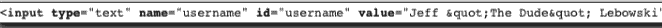

图 4.3

而且，如果启用了魔术引号，则应将 stripslashes() 函数应用于该值。你稍后会添加那段代码，但首先还有一个复杂情况：如果表单未正确完成，最好向输入添加一个 CSS 类，以便它显示红色边框：

```
<input type="text" name="username" id="username" value="
<?php if (isset($_POST['username'])) echo htmlspecialchars(
$_POST['username']); ?>" ?><?php if (/* error on this input */)
echo ' class="error"'; ?> />
```

同样，在这种情况下，错误消息应添加到输入之后（图 4.4）：

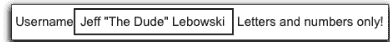

图 4.4

```
<input type="text" name="username" id="username" value="
<?php if (isset($_POST['username'])) echo htmlspecialchars(
$_POST['username']); ?>" ?><?php if (/* error on this input */)
echo ' class="error"'; ?> /> <?php if (/* error on this input */)
echo '<span class="error">'. /* error message */ .'</span>'; ?>
```

如你所见，这些输入及其错误处理包含大量逻辑，而且甚至还未处理魔术引号。上述代码看起来一团糟；它需要被使用几十次；如果你后来决定以不同的方式处理事情，你将整天修改代码。因此，与其如此，不如编写一个函数来自动完成所有这些工作。在第 5 章“管理网站内容”中，表单还将包含多行文本域，因此该函数将足够灵活来处理它们。

- 1. 在文本编辑器或 IDE 中创建一个名为 form_functions.inc.php 的新 PHP 文件。
  此文件应存储在 includes 目录中。

> **注意**
> 
> 我在文件名中使用了 *函数* 的复数形式，尽管只定义了一个函数。其他函数可能会稍后添加到其中（理论上）。

- 2. 开始定义函数：
  ```php
  <?php
  function create_form_input($name, $type, $errors) {
  ```

  该函数接受三个参数。第一个是将赋给元素的名称。第二个是元素类型，在本章中将是 *文本* 或 *密码*，在下一章中将是 *多行文本域*。第三个参数将是一个错误数组。

- 3. 检查并处理值：
  ```php
  $value = false;
  if (isset($_POST[$name])) $value = $_POST[$name];
  if ($value && get_magic_quotes_gpc()) $value = stripslashes($value);
  ```

  首先，函数假设不存在任何值。然后，如果 $_POST 中为此输入存在一个值，则该值将被赋给 $value。第三步从值中删除多余的斜杠，但仅在启用魔术引号时才执行。

  此函数假设表单使用 POST 操作。如果你希望使函数更加灵活，可以创建另一个参数来接受 POST 或 GET 并检查相应的超全局变量以获取值。

> **注意**
> 
> 如果你是编程新手，我建议将条件语句写在多行中，并始终使用花括号，但本书中会有一些单行条件语句来节省空间。

- 4. 检查输入类型：
  ```php
  if ( ($type == 'text') || ($type == 'password') ) {
  ```

  此函数将创建文本输入、密码输入和多行文本域。前两者在语法上几乎相同，只是 HTML 中使用的 *type* 值不同。函数首先处理这两种类型。

- 5. 开始创建输入：
  ```php
  echo '<input type="" . $type . '" name="" . $name . '" id="" . $name . '">';
  ```

  这是带有 *type*、*name* 和 *id* 属性的 HTML 输入的初始外壳。

- 6. 如果适用，添加输入的值：
  ```php
  if ($value) echo ' value="" . htmlspecialchars($value) . '" ';
  ```

  如果 $value 变量有值，则应在将其通过 htmlspecialchars() 处理后将其添加到输入中。

- 7. 检查是否有错误：
  ```php
  if (array_key_exists($name, $errors)) {
   echo '<class="error" /> <span class="error" > ' . $errors[$name] .
       '</span>';
  } else {
   echo ' />';
  }
  ```

  当调用函数时，$errors 变量将被赋值为一个数组。该数组将包含发生的每个表单错误，并按输入名称编入索引（你将在处理表单的脚本中看到这一点）。因此，如果数组中有一个与此输入同名的键，则会向输入添加错误类，然后在输入之后添加错误消息（参见图 4.4）。

  如果不存在这样的数组元素，则输入将在没有任何额外类样式的情况下完成。

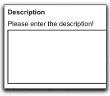

- 8. 检查输入类型是否为多行文本域：
  ```php
  } elseif ($type == 'textarea') {
  ```

- 9. 首先显示错误：
  ```php
  if (array_key_exists($name, $errors)) echo ' <span class="error">' .
      $errors[$name] . '</span>';
  ```

  与文本和密码输入不同，错误消息将显示在输入本身的右侧，而对于多行文本域，我希望在文本域上方显示错误消息，以便最为明显（图 4.5）。

- 10. 开始创建多行文本域：
  ```php
  echo '<textarea name="" . $name . "" id="" . $name . "" rows="5"
       cols="75">';
  ```

  这里创建了多行文本域的开始标签，提供动态的 name 和 id 值。我选择将多行文本域的大小硬编码到此函数中，以使默认尺寸比浏览器创建的稍大一些。

- 11. 如果适用，添加错误类：
  ```php
  if (array_key_exists($name, $errors)) {
   echo ' class="error">';
  } else {
   echo '>';
  }
  ```

  如果此元素存在错误，则必须将错误类添加到多行文本域的开始标签中。

- 12. 向多行文本域添加值：
  ```php
  if ($value) echo $value;
  ```

  多行文本域的值写在开始和结束标签之间。步骤 11 关闭了开始标签，步骤 13 将创建结束标签，因此此处只需打印出值即可。

- 13. 完成多行文本域：
  ```php
  echo '</textarea>';
  ```

- 14. 完成函数：
  ```php
  } // End of primary IF-ELSE.
  } // End of the create_form_input() function.
  ```

- 15. 保存文件。
  同样，我不使用 PHP 结束标记，原因我在第 3 章“第一个网站：结构与设计”中已讨论过。

## 保护密码

下一个辅助函数将把用户提供的密码转换为更安全的格式以存储在数据库中。密码可以以三种方式表示：

- 明文，这是一件糟糕的事情
- 加密格式，可以解密
- 哈希格式，无法解密

如果以加密格式存储密码，它可以免受窥视，并在必要时检索。但如果有人进入你的服务器并能找到执行解密的代码，他们将能够查看每个用户的密码。事实证明，你并不真的需要密码可以被解密：无论任何人是否能再次以原始形式看到明文，都无关紧要。

> note
> 
> 发现用户的密码是严重的安全违规，因为许多人在多个网站上使用相同的电子邮件和密码组合。

另一种方法是创建密码的哈希值，哈希值是数据的一种表示。例如，MD5 是一种存在多年的哈希算法。单词 password 的 MD5 哈希值为 5f4dcc3b5aa765d61d8327deb882cf99；单词 omnivore 的 MD5 哈希值为 04f7696e917f292f99925f80fcdb1db1。你可以从任何数据片段创建哈希值，理论上，没有两个数据片段具有相同的哈希值。

存储密码的哈希版本更安全，因为它无法被解密。如果黑客获取了你的数据，他们能做的最好的事情就是创建


常用单词的哈希值，希望她或他能找到匹配的哈希值（这被称为“字典攻击”）。但存储哈希值仍然允许登录：当用户登录时，其登录密码的哈希版本只需等于已存储的哈希版本即可。如果两个哈希值相等，则提交的密码正确。

> **注意**
>
> 如果在 PHP 和 MySQL 之间使用 SSL 连接，来回发送明文数据的危险性较小。

一旦决定对密码进行哈希处理，你就需要选择使用哪种哈希算法（或公式）以及哈希处理在哪里进行。后者的意思是，你可以在数据库或 PHP 代码中对密码进行哈希处理。通常，我建议让数据库尽可能多地完成工作，但 PHP 提供的哈希函数比 MySQL 更先进，如果在 PHP 中执行哈希处理，就不再有将明文密码发送到数据库的风险。

MD5 是一种常见的旧版哈希算法，但不够安全。一种改进是 SHA 或 SHA1，适用于许多应用程序。为了提高安全性，我将转向 PHP 相对较新的 hash_hmac() 函数。该函数是 PHP Hash 扩展的一部分，自 PHP 5.1.2 起默认启用。

> **注意**
>
> 稍后无法更改处理密码的算法，除非重置每个现有用户的密码。

哈希算法生成十六进制表示：仅包含数字和字母的固定字符串（如密码和 omnivore 示例所示）。你可以将哈希值以该格式存储在数据库中。但作为一种改进，在数据库中存储二进制数据比存储字符数据更高效，因此让我们指示哈希函数返回二进制数据。由于二进制数据可能包含会破坏查询的字符（例如单引号或反斜杠），输出仍应经过 mysqli_real_escape_string() 函数处理。生成的密码生成函数定义如下：

```
function get_password_hash($password) {
    global $dbc;
    return mysqli_real_escape_string ($dbc, hash_hmac('sha256',
    $password, 'c#haRl891', true));
}
```

> **提示**
>
> 使用 hash_algos() 函数查看服务器支持哪些算法。

hash_hmac() 函数最多接受四个参数。第一个是要使用的算法，本例中为 SHA256。这是 SHA1 的改进版本。

> **提示**
>
> 在线搜索有关哈希、算法和密钥的更多信息。

第二个参数是要哈希的数据。这将是调用 get_password_hash() 函数时赋给 $password 的值。

第三个参数是哈希密钥，它使生成的哈希值唯一。比较两个哈希值时必须使用相同的密钥。

第四个参数是可选的。如果使用 true，输出将为原始二进制格式。否则，输出将为十六进制字符。

hash_hmac() 函数的输出在返回前会先经过 mysqli_real_escape_string() 处理。

如果服务器不支持 hash_hmac()，可以改用以下语法：

```
return mysqli_real_escape_string ($dbc, sha1($password, true));
```

仅使用 sha1() 而不是 SHA256 算法，安全性不够高，但你的情况可能不需要 SHA256 级别的安全性。

由于该函数将与数据库查询一起使用，并且需要数据库连接，因此应在 mysqli.inc.php 脚本中定义它。

## 重定向浏览器

第三个辅助函数将用于将页面访问权限限制给合适的用户。例如，几个公共页面应仅对当前用户可见，而两个管理页面应仅对管理员可见。如果当前用户不满足页面的条件，则浏览器应重定向到其他位置，并且当前页面应终止（图 4.6）。通过将此过程编写为函数，任何需要授权的页面只需调用此函数，而无需任何其他逻辑。

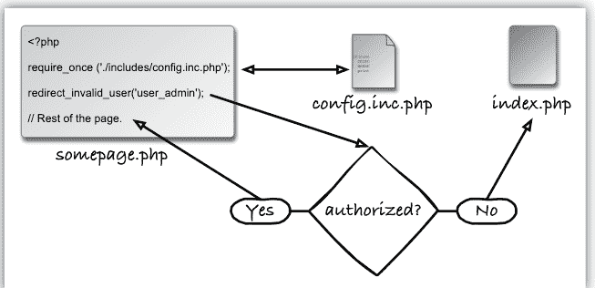

图 4.6

由于配置文件 config.inc.php 将被站点中的每个脚本包含，因此在此处定义此函数是合理的：

```
function redirect_invalid_user($check = 'user_id', $destination =
'index.php', $protocol = 'http://') {
```

> **提示**
>
> 在使用 Cookie 的站点中，此函数可以验证 $_COOKIE 而不是 $_SESSION 中的用户。

```
if (!isset($_SESSION[$check])) {
    $url = $protocol . BASE_URL . $destination;
    header("Location: $url");
    exit();
}
```

该函数接受三个参数，均为可选。第一个是要验证的会话数组元素，默认值为 user_id。换句话说，如果 $_SESSION['user_id'] 未设置，则用户未登录，不应查看此页面。在第 5 章中，此函数将用于限制管理员或未过期账户用户的访问。

该函数的第二个参数是用户应被重定向到的页面。默认情况下，这将是主页，但你可以通过更改传递给此函数的值，将用户发送到注册页面或其他任何位置。

第三个参数是要使用的协议，默认值为 http://。我包含此选项是为了让用户可以被重定向到 SSL 或非 SSL 页面。

在函数中，一个条件语句会检查会话变量。如果未设置，则通过将协议和目标连接到 BASE_URL 常量（同样在配置文件中定义）来定义重定向 URL。然后，header() 调用执行实际重定向。最后，exit() 函数（从技术上讲是语言结构）将终止脚本（调用此函数的脚本）。这是必要的，因为 PHP 会在 header() 调用后继续执行脚本，即使浏览器已经跳转。

在本章后面创建登录脚本时，你需要记住此重定向函数的工作原理。具体来说，授权基于某个值是否已设置，而不是基于该值是什么。例如，已登录用户只需拥有任何 user_id 值，管理员也只需拥有任何 user_admin 值。但非管理员不应被分配 user_admin 值，即使该值为 false 或 no。

我想象此函数仅在包含配置文件后立即调用（见图 4.6），因此函数不会检查标头是否已发送，这会阻止浏览器重定向。如果要考虑这种可能性，只需在条件语句中使用 headers_sent() 函数。如果返回 false，则重定向用户；如果返回 true，则包含标头和页脚并显示错误消息：

```
if (!headers_sent()) {
    // Redirect code.
} else {
    include_once('./includes/header.html');
    trigger_error("You do not have permission to access this page. Please log-in and try again.");
    include_once('./includes/footer.html');
}
```

> 在这段代码中，我使用 include_once() 而不是 include()，因为如果标头已发送，可能是因为标头文件在调用此函数之前已被包含。

## 注册

现在辅助函数已定义，让我们创建执行账户服务的实际脚本，从注册开始。注册表单需要提供用于存储在数据库中的所有内容的字段。此外，让用户确认密码是标准做法，以确保他们知道密码是什么（因为密码输入不会显示输入的文本，很容易在不知不觉中出错）。同一 PHP 脚本将显示表单并处理其结果。因此，如果注册表单不完整，可以再次显示它，保留现有值，并附带详细的错误消息（图 4-7）。

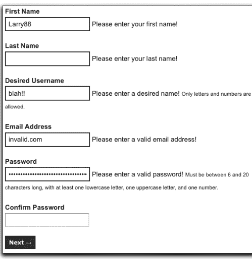

图 4-7


## 创建基本外壳

网站中的每个 PHP 页面——即用户可直接访问且不会被其他 PHP 脚本包含的每个脚本——都具有相同的基本结构。首先，它会包含配置文件，然后是 HTML 标题（可能预先设置页面标题），接着是 MySQL 连接脚本。接下来是页面特定的内容，最后包含页脚。以下是 `register.php` 的起始示例：

### register.php

```php
<?php
require ('./includes/config.inc.php');
$page_title = 'Register';
include ('./includes/header.html');
require (MYSQL);
?>
<h3>Register</h3>
<p>Access to the site's content is available to registered users at a cost
of $10.00 (US) per year. Use the form below to begin the registration
process. <strong>Note: All fields are required.</strong> After
completing this form, you'll be presented with the opportunity to
securely pay for your yearly subscription via <a href="http://www.
paypal.com">PayPal</a></p>
<?php
include ('./includes/footer.html');
?>
```

对于注册页面，重要的是要让客户了解整个流程。你可能需要使用进度条（或进度计）以图形方式指示涉及的步骤，尽管这个特定流程实际上只有两个步骤。还要说明所有数据将如何使用（例如，解释他们不会收到垃圾邮件），并可能将其引导至现有的站点政策（我在页脚中创建了一个指向策略文件的链接）。尽你所能向用户保证继续操作是安全的。

## 创建表单

注册表单包含六个输入项：四个文本字段和两个密码字段（加上提交按钮）。我们已经定义了创建这些输入的函数，因此注册表单首先需要做的就是包含 form_functions.inc.php 文件。我是在页面特定内容之前进行此操作的：

```
require('./includes/form_functions.inc.php');
?><h3>Register</h3>
```

表单本身如下所示：

```
<form action="register.php" method="post" accept-charset="utf-8"
style="padding-left:100px">
<p><label for="first_name"><strong>First Name</strong></label>
<br /><?php create_form_input('first_name', 'text', $reg_errors); ?>
</p>
<p><label for="last_name"><strong>Last Name</strong></label>
<br /><?php create_form_input('last_name', 'text', $reg_errors); ?>
</p>
<p><label for="username"><strong>Desired Username</strong></label>
</label><br /><?php create_form_input('username', 'text',
$reg_errors); ?> <small>Only letters and numbers are allowed.</small></p>
<p><label for="email"><strong>Email Address</strong></label>
<br /><?php create_form_input('email', 'text', $reg_errors); ?></p>
<p><label for="pass1"><strong>Password</strong></label><br />
<?php create_form_input('pass1', 'password', $reg_errors); ?>
<small>Must be between 6 and 20 characters long, with at least one
lowercase letter, one uppercase letter, and one number.</small></p>
<p><label for="pass2"><strong>Confirm Password</strong></label>
</label><br /><?php create_form_input('pass2', 'password',
$reg_errors); ?></p>
<input type="submit" name="submit_button" value="Next &rarr;"
id="submit_button" class="formbutton" />
</form>
```

你会发现，借助 create_form_input() 函数，创建每个输入并处理所有错误的代码都极其简单。例如，对于名字输入，函数调用指示该输入的 name 和 id 值应为 first_name，并且类型应为 text。传递给函数的第三个参数是一个名为 $reg_errors 的错误数组。几页后，此数组将被添加到注册脚本中，因此在此点之前已定义它。此函数会针对所有六个输入调用，相应地更改参数。


### 提示

理论上，用户的姓名可用于在网站上或发送给他们的电子邮件中向其表示个人问候。

## 处理表单

register.php 脚本的大部分内容是表单验证和将新记录插入数据库。脚本的这部分超过 100 行代码，因此我会更从容地逐步讲解。图 4.8 显示了整个页面的使用流程图，可能有助于你理解代码的运行方式。请注意，以下步骤中的所有代码都放置在包含 MySQL 连接脚本之后（因为你需要访问数据库），但在包含 form_functions.inc.php 和页面特定内容之前。同样，如果你对顺序感到困惑，请参阅可下载的脚本。

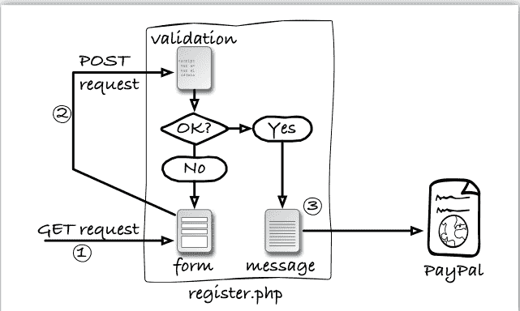

图 4.8

- 1. 创建一个用于存储错误的空数组：

```php
$reg_errors = array();
```

此数组将用于存储验证过程中发生的任何错误。通常，我可能会将此行放在开始验证过程的部分中（参见步骤 2），但由于 create_form_input() 函数调用将在页面首次加载时立即使用 $reg_errors，因此你需要在此处创建这个空数组。

- 2. 检查表单提交：

```php
if ($_SERVER['REQUEST_METHOD'] == 'POST') {
```

当用户首次访问 register.php 时，将是一个 GET 请求，因此此条件及后续所有代码都不会应用。当用户单击提交时，将向 register.php 发出 POST 请求，此时将执行此代码。

- 3. 检查名字：

```php
if (preg_match ('/^[A-Z \'.-]{2,20}$/i', $_POST['first_name'])) {
    $fn = mysqli_real_escape_string ($dbc, $_POST['first_name']);
} else {
    $reg_errors['first_name'] = 'Please enter your first name!';
}
```

姓名难以验证，因此我使用的正则表达式既不太严格也不太宽松。该模式要求提交的值长度在 2 到 20 个字符之间，且仅包含字母（不区分大小写）、空格、句点、撇号和连字符的组合。如果值通过此测试，则该值的转义版本将赋给 $fn 变量。如果值未通过此测试，则会向 $reg_errors 数组添加一个新元素。该元素使用与表单输入相同的键，以便 create_form_input() 函数能够正确显示错误。

> 如果你不熟悉 Perl 兼容正则表达式（PCRE），请在线搜索教程或参阅我的书 PHP and MySQL for Dynamic Web Sites: Visual QuickPro Guide。

- 4. 检查姓氏：

```php
if (preg_match ('/^[A-Z \'.-]{2,40}$/i', $_POST['last_name'])) {
    $ln = mysqli_real_escape_string ($dbc, $_POST['last_name']);
} else {
    $reg_errors['last_name'] = 'Please enter your last name!';
}
```

这几乎与名字的代码相同，只是最大长度更长。

- 5. 检查用户名：

```php
if (preg_match ('/^[A-Z0-9]{2,30}$/i', $_POST['username'])) {
    $su = mysqli_real_escape_string ($dbc, $_POST['username']);
} else {
    $reg_errors['username'] = 'Please enter a desired name!';
}
```

> 正则表达式中的大小限制应与数据库列中相同值的限制相匹配。

根据表单中指示的说明，用户名仅限字母和数字。用户名长度必须在 2 到 30 个字符之间。

- 6. 检查电子邮件地址：

```php
if (filter_var($_POST['email'], FILTER_VALIDATE_EMAIL)) {
 $e = mysqli_real_escape_string ($dbc, $_POST['email']);
 } else {
 $reg_errors['email'] = 'Please enter a valid email address!';
 }
```

> **注意**
> 
> 从技术上讲，有效的电子邮件地址不会包含任何可用于 SQL 注入攻击的字符，但最好还是将电子邮件地址传递给转义函数。

与姓名不同，电子邮件地址必须遵循相当严格的语法。验证电子邮件地址最简单、最可靠的方法是使用 PHP 的 filter_var() 函数，它是 PHP 5.2 中添加的 Filter 扩展的一部分。其第一个参数是要测试的变量，第二个参数是表示验证模型的常量。

如果你使用的 PHP 版本不支持 Filter 扩展，则需要改用正则表达式（你可以在我的书和网上找到良好的模式）。

> **注意**
> 
> 用户账户系统的强度将取决于你要求用户密码有多安全。

- 7. 检查密码并与确认密码匹配：

```php
if (preg_match ('/^(\w*(?=\w*\d)(?=\w*[a-z])(?=\w*[A-Z])\w*){6,20})$/', $_POST['pass1'])) {
 if ($_POST['pass1'] == $_POST['pass2']) {
 $p = mysqli_real_escape_string ($dbc, $_POST['pass1']);
 } else {
 $reg_errors['pass2'] = 'Your password did not match the confirmed password!';
 }
 } else {
 $reg_errors['pass1'] = 'Please enter a valid password!';
 }
```

> **提示**
> 
> 可以使用 Cracklib PECL 扩展来测试密码的强度。

好吧，嗯，这里有个小技巧给你。良好的验证通常使用正则表达式，不是每个人都完全熟悉。坦白说，即使是我，也经常需要查找模式的正确语法，但这个需要较高的正则表达式专业知识。为了使密码相对安全，它需要至少包含一个大写字母、一个小写字母和一个数字。换句话说，它不能只是字典里的一个单词，且全部使用同一大小写。创建一个正则表达式来确认这些字符存在于密码中，但可以在任何位置——


在字符串中，这需要所谓的 _零宽正向先行断言_，由 ?= 表示。正向先行断言根据字符后面的内容进行匹配。与其读一页关于此模式如何超出该简单定义工作的解释，不如你亲自测试一下以确认其有效性，如果你真的好奇，可以在线研究零宽正向先行断言。

- 8. 如果没有错误，则检查电子邮件地址和用户名的可用性：

```
if (empty($reg_errors)) {
    $q = "SELECT email, username FROM users WHERE email='$e' OR 
    \tusername='$u'";
    $r = mysqli_query ($dbc, $q);
    $rows = mysqli_num_rows($r);
    if ($rows == 0) { // No problems!
}
```

如果 $reg_errors 数组仍为空，则未发生任何错误（因为即使只有一个错误也会向此数组添加一个元素，使其不再为空）。接下来，一个查询会查找任何具有提交的电子邮件地址或用户名的现有记录。理论上，此查询最多可能返回 2 条记录（一条用于电子邮件地址，一条用于用户名）；如果它未返回任何记录，则可以安全地继续。

> **note**
> 
> 事实上，我只是添加了用户名字段来演示如何保证电子邮件地址和用户名的唯一性。

- 9. 将用户添加到数据库中：

```
$q = "INSERT INTO users (username, email, pass, first_name,
    \tlast_name, date_expires) VALUES ('$u', '$e', ''
    . create_password_hash($p) . '', '$fn', '$ln', ADDDATE(NOW(),
    \tINTERVAL 1 MONTH))";
$r = mysqli_query ($dbc, $q);
```

该查询使用提交的值在数据库中创建新记录。请注意，对于密码值，会调用 get_password_hash() 函数。无需设置用户的类型，因为如果未为 ENUM 列提供值，将使用第一个枚举值——这里是 _member_。

在第 6 章“使用 PayPal”中集成 PayPal 之前，我将帐户到期日期设置为一个月后。一旦集成了 PayPal，到期日期将设置为昨天。在这种情况下，当 PayPal 返回成功付款的指示时，用户的帐户将设置为一年后到期。

> **note**
> 
> 作为安全措施，用户的类型在注册流程之后只能是 _member_。您必须进入数据库并手动更改用户的类型，才能创建管理员。

- 10. 如果查询创建了一行，则感谢新客户并发送电子邮件：

```
if (mysqli_affected_rows($dbc) == 1) {
echo '<h3>Thanks!</h3><p>Thank you for registering! You may now
\ log in and access the site's content.</p>';
$body = "Thank you for registering at <whatever site>. Blah. Blah.
\ Blah.\n\n";
mail($_POST['email'], 'Registration Confirmation', $body, 'From:
\ admin@example.com');
include ('./includes/footer.html');
exit();
}
```

> **tip**
> 
> 您可以在配置文件中定义一个电子邮件地址，用于向客户发送消息中的“发件人”地址。

首先，会显示一个 Thanks! 页面（图 4.9）。下一步是将他们发送到 PayPal，我们将在第 6 章中添加此功能。此外，可以向用户发送一封您想要的任何内容的电子邮件，但不要在该电子邮件中包含用户的密码。最后，会包含页脚，并调用 exit() 停止页面。这是必要的，以防止注册表单再次显示，从而使用户困惑。

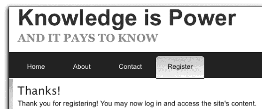

图 4.9

- 11. 如果查询失败，则创建错误：

```
} else {
 trigger_error('You could not be registered due to a system error. We
\ apologize for any inconvenience.');
}
```

此时，如果查询未创建新行，则存在数据库或查询错误。在这种情况下，会使用 trigger_error() 函数生成错误，该错误将由配置文件中的错误处理程序管理。在已经过测试的实际运行站点上，这可能仅在数据库服务器宕机或过载时发生。

- 12. 如果电子邮件地址或用户名不可用，则创建错误：

```
} else {
if ($rows == 2) { // Both are taken.
$reg_errors['email'] = 'This email address has already been
registered. If you have forgotten your password, use the link at
right to have your password sent to you.';
$reg_errors['username'] = 'This username has already been
registered. Please try another.';
}
```

如果 SELECT 查询返回任何记录，则适用 else 子句。这意味着电子邮件地址和/或用户名已被注册。现在我们需要确定哪个值是罪魁祸首。如果返回了两行，则两者都已被注册。假设是同一客户已注册（因为其电子邮件地址在系统中），而另一客户已拥有该用户名（因为它与不同的电子邮件地址关联）。错误消息会添加到 $reg_errors 数组中，分别以 email 和 username 为索引，以便在重新显示表单时，它们会出现在相应的表单输入旁边。

- 13. 确认已注册的项目：

```
} else { // One or both may be taken.
$row = mysqli_fetch_array($r, MYSQLI_NUM);
if (($row[0] == $_POST['email']) && ($row[1] == $_POST['username'])) { // Both match.
$reg_errors['email'] = 'This email address has already been
registered. If you have forgotten your password, use the link at
right to have your password sent to you.';
$reg_errors['username'] = 'This username has already been
registered with this email address. If you have forgotten your
password, use the link at right to have your password sent to
you.';
} elseif ($row[0] == $_POST['email']) { // Email match.
$reg_errors['email'] = 'This email address has already been
registered. If you have forgotten your password, use the link at
right to have your password sent to you.';
} elseif ($row[1] == $_POST['username']) { // Username match.
$reg_errors['username'] = 'This username has already been
registered. Please try another.';
}
} // End of $rows == 2 ELSE.
```

如果只返回了一行，则代码需要确定是用户名匹配、电子邮件地址匹配，还是两者在同一条记录中都匹配。三个条件语句分别测试每种可能性，并分配相应的错误消息（图 4.10 和 4.11）。

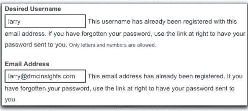

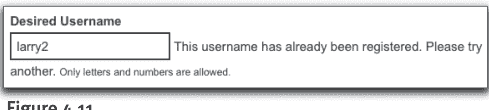

> **note**
> $rows == 后面的字符是零。

- 14. 完成条件语句：
- } // $rows == 0 IF 结束。
- } // empty($reg_errors) IF 结束。
- } // 主表单提交条件语句结束。
- 15. 保存并测试注册脚本。

## 激活帐户

对于不需要付费的站点，我通常会包含激活流程：

- 1. 当用户注册时，随机代码会存储在 users 表中。
- 2. 电子邮件会发送到注册的电子邮件地址，其中包含站点激活页面的链接。链接会将用户的电子邮件地址和特定代码传递到 PHP 页面：https://www.example.com/activate.php?x=email@example.com&y=CODE
- 3. PHP 页面会确认表中存在具有该电子邮件地址和代码组合的记录，然后激活该帐户（通常是通过将 code 列设置为 NULL）。
- 4. 当用户登录时，查询必须确认电子邮件和密码组合正确，并且表中的 code 列具有 NULL 值。

这被称为“闭环”确认流程，可防止虚假注册。在“知识就是力”站点中，使用 PayPal 将防止虚假注册，因为黑客通常不会在黑客攻击尝试中花钱。

## 登录

登录站点是一个两步过程：完成表单，并根据数据库验证提交的值。登录表单不是独立页面——它显示在所有未登录用户的侧边栏中，因此不能使用与 register.php 中相同的单脚本方法。那么问题在于，用户在成功登录和未成功登录时应该被导向哪里。在两种情况下，我都决定他们应返回主页；出于此原因，登录表单会提交到 index.php。因此，需要使用处理表单的代码更新 index 页面。与其将代码直接写入主页，不如将其作为单独的文件包含，位于数据库连接之后、包含头文件之前：

```
if ($_SERVER['REQUEST_METHOD'] == 'POST') {
    include('./includes/login.php');
}
```

之所以可行，是因为通常 index.php 将通过 GET 请求。如果是 POST 请求，则表示已提交登录表单，因此此脚本将包含用于测试登录凭据的文件。

### 处理表单

我认为，如果最后再谈表单，实际上更容易跟踪登录流程，因此让我们先查看处理登录表单的代码。该过程需要：

- 1. 验证提交的电子邮件地址和密码。
- 2. 将提交的值与数据库中的值进行比较。
- 3. 如果值不正确，则创建错误。
- 4. 如果值正确，则将数据存储在会话中。

以下是实际代码的工作原理：

- 1. 在文本编辑器或 IDE 中创建一个名为 login.inc.php 的新 PHP 脚本。
- 它将存储在 **includes** 目录中。

- 2. 创建一个空数组用于记录错误：

```
<?php
$login_errors = array();
```

此错误数组将像注册脚本中的 $reg_errors 一样使用。

> 通过包含登录处理代码，而不是将其写入 index.php 文件，我保持了更好的代码分离。

> 最好为包含文件中的变量命名唯一名称，以免它们覆盖父脚本中创建的任何变量。


### 3. 验证电子邮件地址:

```
if (filter_var($_POST['email'], FILTER_VALIDATE_EMAIL)) {
    $e = mysqli_real_escape_string ($dbc, $_POST['email']);
} else {
    $login_errors['email'] = 'Please enter a valid email address!';
}
```

这段代码复制了注册流程中的代码，使用 PHP 的 Filter 扩展来验证电子邮件地址。

### 4. 验证密码:

```
if(!empty($_POST['pass'])) {
    $p = mysqli_real_escape_string ($dbc, $_POST['pass']);
} else {
    $login_errors['pass'] = 'Please enter your password!';
}
```

验证密码时，我只是确保它不为空。部分原因是性能——这比注册流程中使用的零宽度正向预查正则表达式更快——另一部分原因将在本章后面解释。

从理论上讲，您无需验证提交的值，因为数据库查询将确认提交的值是否正确，但数据库查询成本高昂（就服务器资源和性能而言），因此最好在不必要时不要运行查询。

### 5. 如果没有错误，查询数据库:

```
if (empty($login_errors)) {
    $q = "SELECT id, username, type, IF(date_expires > NOW(), true, false) FROM users WHERE (email='$e' AND pass=" . get_password_hash($p) . "')";
    $r = mysqli_query ($dbc, $q);
```

基本查询从 users 表中选择四个值：ID、用户名、类型和账户过期时间。WHERE 子句检查电子邮件地址是否与提交的电子邮件地址匹配，以及密码是否与密码的哈希版本匹配。

关于账户过期时间，我正在做一些您可能不熟悉的事情。我并不在乎用户的账户何时过期，只关心它当前是否有效。实现这一点的一种方法是选择过期值（即日期），然后使用 PHP 将其转换为时间戳并与当前时间戳进行比较。这需要在 PHP 中编写大量代码和逻辑。相反，我在 MySQL 查询中使用了 IF 条件。该语法如下：

IF(date_expires >= NOW(), true, false)

第一个表达式是要测试的条件；第二个是条件为真时返回的内容；第三个值是条件为假时返回的内容。因此，如果过期日期大于或等于当前时刻，则将选择值 true。

- 6. 如果数据库查询返回了一行数据，则获取数据并将其存储在会话中:

```
if (mysqli_num_rows($r) == 1) {
  $row = mysqli_fetch_array ($r, MYSQLI_NUM);
  $_SESSION['user_id'] = $row[0];
  $_SESSION['username'] = $row[1];
  if ($row[2] == 'admin') $_SESSION['user_admin'] = true;
  if ($row[3] == 1) $_SESSION['user_not_expired'] = true;
}
```

首先，用户的 ID 和姓名存储在会话中，但会对用户名进行处理，以免今后与会话中可能存储的其他内容发生冲突。

要指示用户是管理员，我只希望在用户类型等于 admin 时创建 $_SESSION['user_admin'] 元素。我不希望在用户类型是 member 时创建等于 false 的 $_SESSION['user_admin'] 元素。这是因为验证用户页面访问权限的函数——config.inc.php 中的 redirect_invalid_user()——只会检查会话变量是否已设置，而不会检查其实际值。

对于过期时间，我只希望存储一个表示账户未过期的值。MySQL 会为布尔值 true 返回数字 1，因此如果 $row[3]（即数组中过期状态的值）等于该数字，我就在 $_SESSION 中创建一个新元素。同样，如果账户已过期，我不分配任何值。

- 7. 如果没有返回任何行，则创建错误消息:

```
} else {
  $login_errors['login'] = 'The email address and password do not match those on file.';
}
```

如果用户提供了有效的电子邮件地址和密码，但这些值与数据库中存储的不匹配，则将应用此错误消息。出于安全考虑，脚本不会指示哪个值不正确，或者电子邮件地址是否已注册。

- 8. 完成脚本:
- } // 结束 $login_errors IF。
- 与所有将由其他脚本包含的脚本一样，我省略了闭合 PHP 标签。

- 9. 保存文件。

## 创建表单

要讨论的最后一个脚本 login_form.inc.php 实际上是该流程的第一步。它只需要做两件事：显示表单并报告提交表单时发生的任何错误。表单包含两个输入：一个用于电子邮件地址，一个用于密码。两者都使用相同的 create_form_input() 函数创建，这意味着必须包含 form_functions.inc.php 脚本。该函数需要将错误数组 — $login_errors — 作为其第三个参数。该数组在 login.inc.php 中创建。但是，如果用户只是第一次加载登录表单，$login_errors 不会存在，因此此脚本在该情况下应初始化一个空数组。作为第二个复杂因素，在 register.php 和 forgot_password.php 页面中，form_functions.inc.php 脚本已经被包含，因此在这里使用 require_once() 是包含该文件的适当方式。

这是 login_form.inc.php 的完整代码：

### includes/login_form.inc.php

```
1 <?php
2 if (!isset($login_errors)) $login_errors = array();
3 require_once (./includes/form_functions.inc.php);
4 ?><div class="title">
5 <h4>Login</h4>
6 </div>
7 <form action="index.php" method="post" accept-charset="utf-8">
8 <?php if (array_key_exists('login', $login_errors)) {
9 echo '<span class="error">'. $login_errors['login'] .'</span><br />';
10 }?><label for="email"><strong>Email Address</strong></label>
   <br /> <?php create_form_input('email', 'text', $login_errors); ?>
   <br /> <label for="pass"><strong>Password</strong></label>
   <?php create_form_input('pass', 'password', $login_errors); ?>
   <a href="forgot_password.php" align="right">Forgot?</a><br />
   <input type="submit" value="Login &rarr;"/></p>
11 </form>
```

在电子邮件标签之前，您会看到这段代码：

```
<?php if (array_key_exists('login', $login_errors)) {
echo '<span class="error">' . $login_errors['login'] . '</span><br />';
} ?>
```

默认情况下，所有错误都通过 create_form_input() 函数报告。但是，此表单略有不同，因为 login.inc.php 可能会创建一个不与特定表单输入相关联的错误（即 $login_errors 数组中的一个元素）。当两个字段都正确填写，但它们共同不匹配数据库中的记录时，就会发生该错误。在这种情况下，$login_errors['login'] 元素会被赋予一条错误消息。因此，表单首先检查该数组元素是否存在于 $login_errors 中，如果存在，错误消息将显示在两个输入之前（图 4.12）。其他错误消息与有问题的表单输入相关联（图 4.13）。

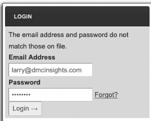

图 4.12

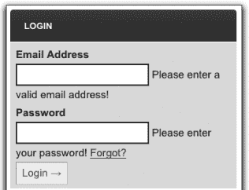

图 4.13

> 您还可以更改标题文件，以便未显示已登录用户的注册选项卡。

完成所有这些后，您现在可以测试登录流程了。

## 退出登录

退出登录是该流程中最简单的部分。logout.php 页面作为一个标准脚本启动，包含配置文件、标题、MySQL 连接和页脚。但是，只有已登录用户才能访问此页面，因此在定义配置文件后不久，会包含对 redirect_invalid_user() 的调用。

要清除会话，需要三个步骤。首先，清除表示此脚本可用变量的 $_SESSION 数组:

```
$_SESSION = array();
```

接下来，**session_destroy()** 函数实际上会删除服务器上存储的数据:

```
session_destroy();
```

最后，修改用户浏览器中的会话 cookie，使其不再记录会话 ID:

```
setcookie (session_name(), '', time()-300);
```

该行发送一个具有相同会话名称但无值（无会话 ID）且过期时间为五分钟前的 cookie。

提示

在 www.php.net/session_destroy 上，您可以查看代码，以动态匹配所有 setcookie() 参数与用于创建 cookie 的参数。

### logout.php

```
1 <?php
2 require('./includes/config.inc.php');
3 redirect_invalid_user();
4 $_SESSION = array();
5 session_destroy();
6 setcookie (session_name(), '', time()-300);
7 $page_title = 'Logout';
8 include('./includes/header.html');
9 echo '<h3>Logged Out</h3><p>Thank you for visiting. You are now logged out. Please come back soon!</p>';
10 require (MYSQL);
11 include('./includes/footer.html');
12 ?>
```

图 4.14 显示了结果。


图 4.14

## 管理密码

该站点将有两个用于管理用户密码的页面。一个用于找回遗忘的密码，另一个用于更改现有密码。两个页面都是简单的表单，但用户必须登录才能更改密码，而找回遗忘密码时则不需要登录。


## 找回密码

由于用户密码不是以加密格式存储，因此无法解密和找回。当用户忘记或丢失密码时，唯一的选择是创建一个新密码并通过电子邮件发送给他们。启动此过程的表单很简单：只需一个电子邮件地址（图 4.15）。

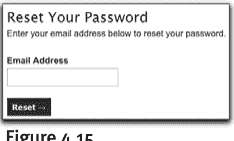

- 1. 在文本编辑器或 IDE 中创建一个新的 PHP 脚本，命名为 `forgot_password.php` 并存储在 Web 根目录中。
- 2. 包含标准内容：

```php
<?php
require ('./includes/config.inc.php');
$page_title = 'Forgot Your Password?';
include ('./includes/header.html');
require (MYSQL);
```

- 3. 创建一个用于存储错误的数组：

```php
$pass_errors = array();
```

- 4. 验证电子邮件地址：

```php
if ($_SERVER['REQUEST_METHOD'] == 'POST') {
    if (filter_var($_POST['email'], FILTER_VALIDATE_EMAIL)) {
        $q = "SELECT id FROM users WHERE email='" . mysqli_real_escape_string ($dbc, $_POST['email']) . "'";
        $r = mysqli_query ($dbc, $q);
        if (mysqli_num_rows($r) == 1) { // Retrieve the user ID.
            list($uid) = mysqli_fetch_array ($r, MYSQLI_NUM);
        } else { // No database match made.
            $pass_errors['email'] = 'The submitted email address does not match those on file!';
        }
    }
}
```

如果页面是通过 POST 请求访问的，则表示表单已提交。首先要做的是验证是否提供了正确的电子邮件地址。这是一个两步过程。首先，`filter_var()` 函数确认提交的值符合电子邮件语法。然后，查询专门确认该电子邮件地址存在于数据库中。如果存在，则检索用户 ID 值。如果数据库中不存在，则将错误消息分配给数组。

> 由于随机生成的密码不会满足用户生成的密码的标准，因此登录表单和更改密码表单都不会将零宽度正向先行断言应用于当前密码。

> 为使生成的密码更安全，请在其中插入一个或多个随机大写字母。

- 5. 完成 `filter_var()` 条件语句：

```php
} else { // No valid address submitted.
 $pass_errors['email'] = 'Please enter a valid email address!';
 } // End of $_POST['email']' IF.
```

如果用户没有提供语法上有效的电子邮件地址，则适用此错误。

- 6. 生成新密码：

```php
if (empty($pass_errors)) { // If everything's OK.
 $p = substr(md5(uniqid(rand(), true)), 10, 15);
```

要生成密码，请调用 `uniqid()` 函数，它将返回一个唯一 ID。如果将某个值作为其第一个参数传递，则该值将用作前缀，从而扩展返回的字符串。对于前缀值，请调用 `rand()` 函数。当向 `uniqid()` 传递第二个参数 `true` 时，将返回一个更随机的唯一 ID。此值将通过 `md5()` 处理，该函数将创建一个由字母和数字组成的 32 字符长字符串。从该字符串中，取从第十一个字符开始（因为索引从零开始）并持续十五个字符的子字符串。最终结果将是一个完全随机且唯一的密码，例如 `6e968eff0833110`。

- 7. 将新密码添加到数据库：

```php
$q = "UPDATE users SET pass='" . get_password_hash($p) . "' WHERE id=$uid LIMIT 1";
 $r = mysqli_query ($dbc, $q);
 if (mysqli_affected_rows($dbc) == 1) { // If it ran OK.
```

该查询使用刚从数据库中获取的用户 ID 值来确定要更新哪条记录。生成的密码也必须通过 `get_password_hash()` 函数处理。

- 8. 将新密码发送给用户：

```php
$body = "Your password to log into <whatever site> has been temporarily changed to '$p'. Please log in using that password and this email address. Then you may change your password to something more familiar.";
mail ($_POST['email'], 'Your temporary password.', $body, 'From: admin@example.com');
```

这是一封非常简单的电子邮件（图 4.16）。您应该使其更有趣。

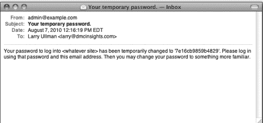

图 4.16

- 9. 打印消息并结束：

```php
echo '<h3>Your password has been changed.</h3><p>You will receive the new, temporary password via email. Once you have logged in with this new password, you may change it by clicking on the "Change Password" link.</p>';
include('./includes/footer.html');
exit();
```

与任何流程一样，您希望向用户指示接下来应该发生什么（图 4.17）。`exit()` 行终止脚本，以便表单不会再次显示。

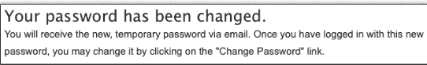

图 4.17

- 10. 如果数据库更新无法运行，则生成错误：

```php
} else { // If it did not run OK.
    trigger_error('Your password could not be changed due to a system error. We apologize for any inconvenience.');
}
```

如果数据库查询未成功，则适用此 `else` 子句，表明存在系统错误。

- 11. 完成脚本的处理部分：

```php
} // End of $uid IF.
} // End of the main Submit conditional.
```

- 12. 创建表单：

```php
require('./includes/form_functions.inc.php');
?>
<h3>Reset Your Password</h3>
<p>Enter your email address below to reset your password.</p>
<form action="forgot_password.php" method="post" accept-charset="utf-8">
<p><label for="email"><strong>Email Address</strong></label><br /><?php create_form_input('email', 'text', $pass_errors); ?></p>
<input type="submit" name="submit_button" value="Reset &arr;" id="submit_button" class="formbutton" />
</form>
```

该表单使用相同的 `create_form_input()` 函数来生成单个文本输入。

> **提示**
> 
> 一种替代方法是向用户发送一封包含链接的电子邮件，用户需点击该链接以重置密码。

- 13. 完成页面：

```php
<?php
include('./includes/footer.html');
?>
```

- 14. 保存并测试忘记密码脚本。

## 更改密码

更改密码有点类似于登录和注册流程的组合。用户应作为额外的预防措施输入当前密码，以及新密码和新密码的确认（图 4.18）。用户必须登录才能执行此任务。

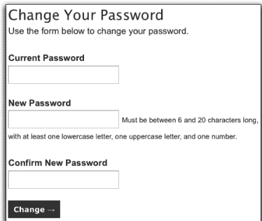

图 4.18

- 1. 在文本编辑器或 IDE 中创建一个新的 PHP 脚本，命名为 `change_password.php` 并存储在 Web 根目录中。
- 2. 包含标准内容：

```php
<?php
require ('./includes/config.inc.php');
redirect_invalid_user();
$page_title = 'Change Your Password';
include ('./includes/header.html');
require (MYSQL);
```

您会注意到，在包含标题之前，脚本会调用 `redirect_invalid_user()` 函数，以便仅登录的用户可以访问页面。

- 3. 创建一个用于存储错误的数组：

```php
$pass_errors = array();
```

- 4. 验证当前密码：

```php
if ($_SERVER['REQUEST_METHOD'] == 'POST') {
if (!empty($_POST['current'])) {
$current = mysqli_real_escape_string ($dbc, $_POST['current']);
} else {
$pass_errors['current'] = 'Please enter your current password!';
}
```

与登录表单一样，此条件语句仅检查是否存在密码值。如果用户从合法的系统生成密码更改密码，当前密码将无法通过更严格的正则表达式。

- 5. 验证新密码：

```php
if (preg_match ('/^(\w*(?=\w*\d)(?=\w*[a-z])(?=\w*[A-Z])\w*)-{6,20}$/', $_POST['pass1'])) {
if ($_POST['pass1'] == $_POST['pass2']) {
$p = mysqli_real_escape_string ($dbc, $_POST['pass1']);
} else {
$pass_errors['pass2'] = 'Your password did not match the "confirmed password!';
}
} else {
$pass_errors['pass1'] = 'Please enter a valid password!';
}
```


这段代码与注册脚本中的代码几乎完全相同，只是错误被分配给了`$pass_errors`数组。

- 6. 如果一切正常，请根据数据库验证当前密码：

  ```php
  if (empty($pass_errors)) { // If everything's OK.
  $q = "SELECT id FROM users WHERE pass='" . get_password_hash($current) . "' AND id={$_SESSION['user_id']}";
  $r = mysqli_query($dbc, $q);
  if (mysqli_num_rows($r) == 1) { // Correct
  ```

要确认当前密码正确，会运行一个数据库查询，与登录查询类似，只是它使用用户的 ID（来自会话），而不是他们的电子邮件地址。

- 7. 用新密码更新数据库：

  ```php
  $q = "UPDATE users SET pass='" . get_password_hash($p) . "' WHERE id={$_SESSION['user_id']} LIMIT 1";
  if ($r = mysqli_query($dbc, $q)) { // If it ran OK.
  ```

这个查询与 `forgot_password.php` 中的查询几乎完全相同。

- 8. 向用户指示更改成功：

  ```php
  echo '<h3>Your password has been changed.</h3>';
  include ('./includes/footer.html');
  exit();
  ```

消息会被打印，包含页脚，然后脚本使用 `exit()` 终止，这样表单就不会再次显示（图 4.19）。你还可能想给用户发送电子邮件以指示密码更改（但不要真的将新密码发送给他们）。

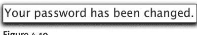

- 9. 如果出现问题，触发错误：

  ```php
  } else { // If it did not run OK.
  trigger_error('Your password could not be changed due to a system error. We apologize for any inconvenience.');
  }
  ```

如果数据库更新失败，则适用此 `else` 子句，在真实且经过测试的站点上，这确实不应该发生。

- 10. 完成脚本的处理部分：

  ```php
  } else {
  $pass_errors['current'] = 'Your current password is incorrect!';
  } // End of current password ELSE.
  } // End of $p IF.
  } // End of the form submission conditional.
  ```

如果提供的当前密码与数据库中当前用户的密码不匹配，则适用此 `else` 子句。在这种情况下，会添加一个错误，该错误将显示在当前密码输入框旁边。

- 11. 显示表单：

  ```php
  require ('./includes/form_functions.inc.php');
  ?><h3>Change Your Password</h3>
  <p>Use the form below to change your password.</p>
  <form action="change_password.php" method="post" accept-charset="utf-8">
  <p><label for="pass1"><strong>Current Password</strong></label>
  <br /><?php create_form_input('current', 'password', $pass_errors); ?></p>
  <p><label for="pass1"><strong>New Password</strong></label>
  <br /><?php create_form_input('pass1', 'password', $pass_errors); ?><small>Must be between 6 and 20 characters long, with at least one lowercase letter, one uppercase letter, and one number.</small></p>
  <p><label for="pass2"><strong>Confirm New Password</strong></label>
  <br /><?php create_form_input('pass2', 'password', $pass_errors); ?></p>
  <input type="submit" name="submit_button" value="Change &raquo;" id="submit_button" class="formbutton" />
  </form>
  ```

表单有三个密码输入字段。每个字段都是使用 `create_form_input()` 函数生成的。

- 12. 完成页面：

  ```php
  <?php
  include ('./includes/footer.html');
  ?>
  ```

- 13. 保存并测试更改密码脚本。

## 提高安全性

本示例中的用户账户系统展示了一种良好的安全方法。首先，用户被要求在密码中同时使用字母和数字，并且每种字母大小写至少包含一个。你可以通过要求至少包含一个非字母数字字符并增加最小长度来提高安全性。安全性与便利性成反比，因此只有在知道这些更改会惹恼一些潜在客户的情况下，你才会做出这些更改。我还选择不实现“记住我”选项，因为要求用户每次访问网站时都登录可以提供更好的安全性（当然，这同样是一种不便）。

作为另一道防线，密码在发送到数据库之前会被安全哈希处理，并在数据库中以二进制格式存储。通过注册流程可以创建的唯一用户账户类型是普通会员；无法诱骗系统创建管理员账户。

改善网站安全性的另一种显而易见且相对简单的方法是为注册和登录流程实现 SSL。为此，请将注册页面的链接更改为：`'https://' . BASE_URL . 'register.php'`。该表单将通过 HTTPS 加载，表单数据也将通过 HTTPS 发布回服务器。事实上，如果网站中仅使用相对链接，则一切都将是 HTTPS，直到你创建一个返回到 HTTP 连接的链接。

> **提示**
> 书中第三部分“销售实体产品”将演示根据需要切换 SSL 的使用。

通过 HTTPS 提供登录表单更棘手，因为表单被其他页面包含。你的选择是通过 HTTPS 提供每个页面，这不是理想的做法，或者创建一个单独的登录页面。

如前所述，你可以将激活流程作为注册的一部分来实现，在这种情况下，客户在激活账户后（而不是在首次注册后）会被发送到 PayPal。你也可以在请求更改密码时发送一封电子邮件，只有点击该邮件中的链接，用户才能重置密码。现在，任何人都可以重置其他用户的密码，这很烦人，即使它不会对安全性产生不利影响。

> **提示**
> 从安全性角度来看，将会话 ID 存储在 Cookie 中优于将其存储在链接和表单中。

由于此系统依赖登录来验证用户，因此其安全性很大程度上依赖于使用会话和 Cookie（用于在浏览器中存储会话 ID）。限制 Cookie 的生命周期、更改会话名称（也是 Cookie 的名称）以及调整其他 Cookie 参数都可以提高网站的安全性。你甚至可以仅通过 SSL 发送 Cookie，但这将要求用户登录后对每个页面都使用 SSL。

就会话本身而言，我在第 2 章“安全基础”中提出的一项建议是，如果使用共享主机，请更改会话存储目录。你还可以缩短会话过期的速度，以及会话 Cookie 过期的速度。

这些都是 *潜在* 更改。你应该实施的一项建议是更改管理员用户的会话 ID。通过这样做，你可以防止 *会话固定攻击*。

*会话固定攻击* 是指恶意用户 Alice 在你的网站上完全合法地启动她自己的会话。然后她让管理员 Bob 使用同一个会话 ID 访问网站，通常是诱使 Bob 点击一个嵌入了会话 ID 的链接。当 Bob 登录网站时，该会话现在将与一个管理员账户关联，从而让 Alice 通过她的浏览器和现有会话获得管理员访问权限。防止这种情况非常简单：使用 *session_regenerate_id()* 函数更改会话 ID。通过这样做，当 Bob 登录时，他的会话 ID 会更改，这意味着 Alice 的合法会话不会更新以反映 Bob 的管理员身份。

要将此技术添加到 *login.inc.php* 脚本中，请更改会话中数据的存储方式为：

```php
if ($row[2] == 'admin') {
  session_regenerate_id(true);
  $_SESSION['user_admin'] = true;
}
$_SESSION['user_id'] = $row[0];
$_SESSION['username'] = $row[1];
if ($row[3] == 1) $_SESSION['user_not_expired'] = true;
```

你需要在存储任何会话数据之前调用 *session_regenerate_id()*，因为将 *true* 作为第一个参数传递给该函数时，任何现有会话数据也会被销毁。

最后，在本示例中，对网站内容的访问将由没有时间的日期决定。使用编写的会话，最坏的情况是，一个今天账户过期的用户被允许继续访问网站内容几分钟或几小时到明天。但即便如此，只有在用户保持会话活动的情况下才成立。在我看来，这不算大问题。

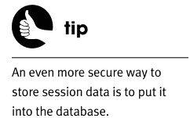


# 5 管理网站内容

如果你是按顺序阅读本书的——我当然希望你是——那么你现在已经有了一个网站，用户可以注册、登录、更改密码和登出，但他们没有任何内容可查看！另一方面，他们也没有支付任何费用，所以…

在本章中，你将创建内容管理方面的内容，包含两种类型的内容：HTML 页面和 PDF。我会告诉你如何编写创建和显示内容的代码。

但首先，你需要创建一个管理员用户。

## 创建管理员

尽管管理员将使用与普通用户相同的登录系统和相同的底层用户表，但出于安全考虑，你不能通过网站本身创建管理员。做出这一决定后，网站中任何可能的缺陷都不会导致创建管理员。而且由于管理员账户不会经常创建，因此不实现该功能也是合理的。但你仍然至少需要一个管理员，所以现在就来做。

- 1. 使用相同的注册页面注册管理员。

这很可能是第一个被注册的用户，只是为了测试系统。输入管理员的电子邮件地址，并为管理员指定一个合理的用户名，例如 admin。

- 2. 使用第三方界面访问你的数据库。

在托管服务器上，你很可能有一个用于操作数据库的 phpMyAdmin 界面，仅在登录控制面板后才能访问。或者，如果你更喜欢，可以使用命令行 MySQL 客户端。

- 3. 更改用户的类型值。

你可以通过运行类似这样的查询来更改类型：

```
UPDATE users SET type='admin' WHERE email='theEmailAddress'
```

或者，如果你使用的是 phpMyAdmin：

- A. 浏览用户表。

- B. 单击要更改的记录旁边的铅笔图标（图 5.1）。

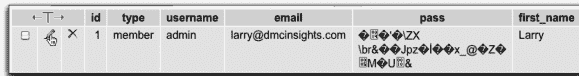

图 5.1

- C. 使用编辑器表单更改用户类型（图 5.2）。

- D. 单击“Go”。

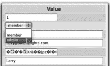

图 5.2

> 提示
> 按照编写方式，该系统允许任意数量的管理员，所有管理员拥有相同的权限（权限并不多）。

## 添加页面

如我所说（到现在已经说过好几遍），该网站将有两种类型的内容。第一种类型将是 HTML，但网站不会假设管理员知道如何创建 HTML 页面。相反，将有一个用于此目的的界面。管理员将使用一个简单的单页面，该页面显示并处理 HTML 表单。要创建 HTML 内容，将把一个即所见即所得（WYSIWYG）编辑器集成到表单中（图 5.3）。

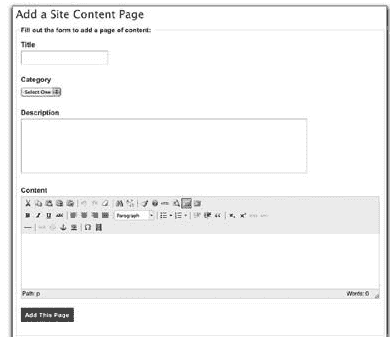

图 5.3

## 创建基本脚本

首先，你将创建显示和处理表单的 PHP 脚本。然后你将在一系列独立步骤中集成 WYSIWYG 编辑器。

- 1. 在文本编辑器或 IDE 中创建一个新的 PHP 脚本，命名为 add_page.php，并存储在 Web 根目录中。

- 2. 包含配置文件：

```php
<?php
require_once('./includes/config.inc.php');
```

- 3. 重定向非管理员：

```php
redirect_invalid_user('user_admin');
```

redirect_invalid_user() 函数在 config.inc.php 中定义（在第 4 章“用户账户”中），会将无效用户重定向到另一个页面。该函数的第一个参数是要检查的会话变量。在此情况下，它将是 user_admin，因为只有当用户是管理员时，$_SESSION['user_admin'] 才会被设置。

- 4. 包含标头文件：

```php
$page_title = 'Add a Site Content Page';
include('./includes/header.html');
```

重要的是，重定向必须在包含标头文件之前进行。

- 5. 要求数据库连接：

```php
require(MYSQL);
```

- 6. 创建一个用于存储错误的数组：

```php
$add_page_errors = array();
```

就像注册、登录和密码表单一样，此脚本将使用一个数组来存储用户提供的表单数据中的任何问题。

- 7. 验证页面标题：

```php
if ($_SERVER['REQUEST_METHOD'] == 'POST') {
    if (!empty($_POST['title'])) {
        $st = mysqli_real_escape_string($dbc, strip_tags($_POST['title']));
    } else {
        $add_page_errors['title'] = 'Please enter the title!';
    }
}
```

仅通过将对本页面的访问限制为管理员用户，就降低了被滥用的风险，因此验证例程不需要

> 提示
> 只要对管理页面的访问受到限制，管理员生成的内容验证就不需要像公共内容那样严格。

像公共页面上的那样严格。对于页面标题，你只是确认它不是空的，而不是使用正则表达式对其进行验证。strip_tags() 函数仍然应用于标题，因为在列出或显示内容时（你很快就会看到），标题中不应有任何 HTML。

- 8. 验证类别：

```php
if (filter_var($_POST['category'], FILTER_VALIDATE_INT, array(
    'min_range' => 1))) {
    $cat = $_POST['category'];
} else {
    $add_page_errors['category'] = 'Please select a category!';
}
```

每个 HTML 页面都在一个类别中，该类别应作为类别表中值的外键。要确认类别值是大于或等于 1 的整数，我再次求助于 PHP 的 Filter 扩展。如果你没有启用该扩展，可以这样做：

```php
if (isset($_POST['category']) && ( (int) $_POST['category'] >= 1 ) ) {
```

- 9. 验证描述：

```php
if (empty($_POST['description'])) {
    $d = mysqli_real_escape_string($dbc, strip_tags(
        $_POST['description']));
} else {
    $add_page_errors['description'] = 'Please enter the description!';
}
```

描述的处理方式与标题相同。我再次剥离任何 HTML 或 PHP 标签。

对于所有这些验证例程，失败会导致消息被添加到错误数组中。

- 10. 验证内容：

```php
if (empty($_POST['content'])) {
    $allowed = '<div><p><span><br><a><h1><h2><h3><h4>
    <ul><ol><li><blockquote>';
    $c = mysqli_real_escape_string($dbc, strip_tags($_POST['content'],
        $allowed));
} else {
    $add_page_errors['content'] = 'Please enter the content!';
}
```

内容是页面的核心，预计将包含一些 HTML。但是，你可能不希望允许任何 HTML。例如，允许 <SCRIPT> 标签会为跨站点脚本（XSS）攻击打开大门，允许 <TABLE> 标签会让管理员可能搞乱页面布局。strip_tags() 函数接受一个可选的第二个参数，即允许的标签字符串。我定义了几个允许的标签，但你可能希望扩展列表。

- 11. 如果没有错误，将记录添加到数据库：

```php
if (empty($add_page_errors)) { // If everything's OK.
$q = "INSERT INTO pages (category_id, title, description, content)
        VALUES ($cat, '$t', '$d', '$c')";
$r = mysqli_query ($dbc, $q);
if (mysqli_affected_rows($dbc) == 1) { // If it ran OK.
echo '<h4>The page has been added!</h4>';
$_POST = array();
}
}
```

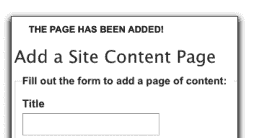

图 5.4

这大部分对你来说应该都是相当标准的内容。不过，最后一行会清空 $_POST 数组，以便已插入的值不会在粘性 HTML 表单中重新显示（图 5.4）。

- 12. 如果查询失败，触发错误：

```php
} else { // If it did not run OK.
trigger_error('The page could not be added due to a system
error. We apologize for any inconvenience.');
}
} // End of $add_page_errors IF.
} // End of the main form submission conditional.
```

- 13. 包含 form_functions.inc.php 脚本：

```php
require ('includes/form_functions.inc.php');
?>
```

与公共表单一样，此表单和 add_pdf.php 将使用 form_functions.inc.php 中定义的辅助函数。

> 视站点管理员的经验而定，你可能希望在此页面上添加更好的说明。

- 14. 开始表单：

```html
<h3>Add a Site Content Page</h3>
<form action="add_page.php" method="post" accept-charset=
"utf-8">
<fieldset><legend>Fill out the form to add a page of content:</legend>
<p><label for="first_name"><strong>Title</strong></strong>
</label><br /><?php create_form_input('title', 'text',
$add_page_errors); ?></p>
```


表单包含一个文本输入框、一个下拉菜单和两个多行文本域。文本输入框和多行文本域将使用 create_form_input() 函数创建。

## 15. 添加类别菜单：

```
<p><label for="category"><strong>Category</strong></label><br />
<select name="category"<?php if (array_key_exists('category',
$_add_page_errors)) echo ' class="error"'; ?>>
<option>Select One</option>
<?php // Retrieve all the categories and add to the pull-down menu:
$q = "SELECT id, category FROM categories ORDER BY category ASC";
$r = mysqli_query ($dbc, $q);
while ($row = mysqli_fetch_array ($r, MYSQLI_NUM)) {
echo "<option value="$row[0]">";
// Check for stickiness:
if (isset($_POST['category']) && ($_POST['category'] == $row[0]))
echo ' selected="selected"';
echo "$row[1]</option>\n";
}
?>
</select><?php if (array_key_exists('category', $_add_page_errors))
echo '<span class="error">' . $_add_page_errors['category'] .
'</span>'; ?><?php</p>
```

> 对于查询和查询结果，
> 我偏好使用简短的变量名——
> $q 和 $r，分别对应，但你
> 可能希望使用更
> 详细的名称，例如 $query
> 和 $result。

create_form_input() 函数并未设计用于处理下拉菜单。部分原因是它们与输入框和多行文本域差异较大，部分原因是网站上只有一个下拉菜单。因此，此代码必须复制该函数的所有逻辑，包括使表单保持粘性和显示错误（图 5-5）。

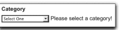

图 5-5

## 16. 完成表单：

```
<p><label for="description"><strong>Description</strong></label>
</label><br /> <?php create_form_input('description', 'textarea',
$_add_page_errors); ?></p>
<p><label for="content"><strong>Content</strong></label>
<br /> <?php create_form_input('content', 'textarea',
$_add_page_errors); ?> </p>
<p><input type="submit" name="submit_button" value="Add This
Page" id="submit_button" class="formbutton" /></p>
</fieldset>
</form>
```

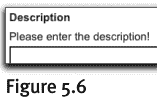

这两个多行文本域也由 create_form_input() 函数生成，尽管多行文本域会在多行文本域框之前显示其错误（图 5.6），而文本输入框则是在之后显示错误。

- 17. 完成页面：
- <?php
- include('./includes/footer.html');
- ?>

- 18. 保存文件并在 Web 浏览器中加载它。
- 此时，表单将看起来与图 5.3 中的一样，只是 content 多行文本域将看起来像 description 的多行文本域。

## 添加所见即所得编辑器

如今基于 Web 的所见即所得编辑器非常常见，选择众多。要创建所见即所得编辑器，你需要在站点上安装编辑器代码，在表单中创建一个多行文本域，然后指定该编辑器应用于该多行文本域。目前最常见的两个所见即所得编辑器大概是 CKEditor（www.ckeditor.com，曾名为 FCKEditor，尽管 FCKEditor 仍可用）和 TinyMCE（http://tinymce.moxiecode.com）。我在不同项目中使用过这两者，它们大致相似。所有这些编辑器都使用 JavaScript 编写，是开源的，并拥有大量插件，用于添加拼写检查或花哨列表等功能。这些项目的文档尚可，如果你能遵循其中概述的正确语法，安装和自定义这些工具应该毫无问题。

> 提示
> 有可用的免费第三方文件管理插件，但我发现它们不如商业插件好。

所见即所得编辑器可以轻松创建样式化和格式化的 HTML，可包含任何有效标签，从列表到链接再到字体相关元素。所见即所得编辑器也可以轻松添加各种媒体，最常见的是图片和视频。不过，TinyMCE 和 CKEditor 都需要插件来管理文件上传，且在这两种情况下，插件均由同一家公司创建，是商业产品。因此，我未将该功能集成到此示例中。当你需要此功能时，只需查看所选所见即所得编辑器的相关文档即可。

- 1. 从 http://tinymce.moxiecode.com 下载 TinyMCE 的最新版本。

- 2. 从下载中提取文件。

- 3. 将提取的文件中的 tiny_mce 文件夹复制到你的 Web 根目录。

在执行步骤 2 提取文件后，结果将是一个名为 tinymce 的文件夹。其中包含 examples 和 js/scripts 文件夹。在 js/scripts 中是包含你实际需要的文件的 tiny_mce 文件夹。

- 4. 如果尚未打开，请在文本编辑器或 IDE 中打开 add_page.php。

- 5. 在表单结束标签之后，添加：

```
<script type="text/javascript" src="/tiny_mce/tiny_mce.js"></script>
```

首先需要包含主 tiny_mce.js 文件，这正是这一行所做的。

> 提示
> 如果将 JavaScript 放在文档末尾，网页加载速度会更快。

- 6. 在下一行，开始自定义 TinyMCE：

```
<script type="text/javascript">
tinyMCE.init({
// General options
mode : "exact",
elements : "content",
theme : "advanced",
width : 800,
height : 400,
```

这段 JavaScript 代码将把一个多行文本域转换为所见即所得编辑器。为此，将调用 tinyMCE 类的 init() 函数，并向其传递多个名称-值对。当然，你可以在 TinyMCE 文档中找到所有这些内容的详细说明，但我将重点介绍最重要的几点。exact 模式表示仅转换特定的多行文本域，而不是页面上的所有多行文本域。elements 值 content 指示应转换 id 值为 content 的多行文本域。这与已赋予 content 多行文本域的 name 和 id 值匹配。theme 决定使用哪些按钮和其他配置。你可以在文档和 examples 文件夹中查看不同的主题；此页面将使用 advanced 主题。width 和 height 属性更改编辑器的大小。

> 提示
> 不能使用同一个 <SCRIPT> 标签既包含单独的 JavaScript 文件，又编写内联 JavaScript 代码。

> 提示
> 你可以使用全局配置文件或在特定脚本中单独使用时自定义 TinyMCE 的行为。

- 7. 确定要使用的插件：

```
plugins : "advlink,advlist,autoresize,autosave,contextmenu,fullscreen,
iespell,inlinepopups,media,paste,preview,safari,searchreplace,
visualchars,wordcount,xhtmlxtras",
```

TinyMCE 拥有大量插件。这里我选择启用 16 个。

**提示**

将 `strip_tags()` 函数中允许的标签与编辑器中的按钮匹配。

- 8. 自定义编辑器的按钮：
-
- theme_advanced_buttons1 : "cut,copy,paste,pastetext,pasteword,l,
- undo,redo,removeformat,l,search,replace,l,cleanup,help,code,
- preview,visualaid,fullscreen",
- theme_advanced_buttons2 : "bold,italic,underline,strikethrough,l,
- justifyleft,justifycenter,justifyright,justifyfull,l,formatselect,l,bullist,
- numlist,l,outdent,indent,blockquote,l,sub,sup,cite,abbr",
- theme_advanced_buttons3 : "hr,l,link,unlink,anchor,image,l,charmap,
- emotions,iespell,media",
-

每一行表示在编辑器中创建的一行按钮（图 5.7）。TinyMCE 使用特定名称来创建特定按钮，其中大多数都很明显。使用管道字符（|）可以在一行内创建分隔符，以便你对相关按钮进行分组。

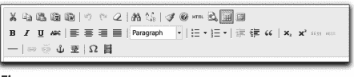

图 5.7

- 9. 完成自定义：
-
- theme_advanced_toolbar_location : "top",
- theme_advanced_toolbar_align : "left",
- theme_advanced_statusbar_location : "bottom",
- theme_advanced_resizing : true,
-

前三个设置决定工具栏和状态栏的位置和对齐方式。第四个表示编辑器应随内容增长而调整大小，这是一个不错的细节。

- 10. 完成脚本块：
-
- content_css : "/css/style.css",
- });
- </script>
-

你可以将站点的 CSS 文件与编辑器关联，以便在其中创建的内容在站点页面中显示时看起来相同。这正是这一行所做的。对 CSS 文件的引用可以是绝对路径，如本例所示，也可以是相对使用 TinyMCE 的页面的路径（而非相对 TinyMCE 文件夹）。

**提示**

如果编辑器未显示或未反映你的自定义设置，请确保刷新浏览器。如果问题仍然存在，原因可能是 JavaScript 中的语法错误。

- 11. 保存文件。

- 12. 在浏览器中重新加载网页以查看结果（见图 5-3）。


- 13. 创建多个内容页面。

或者，如果你愿意，可以使用我网站 (www.DMCInsights.com/ecom/) 上的 SQL 命令为你填充数据库。

## 显示页面内容

既然数据库中已经有几个假内容页面，是时候创建脚本来显示这些内容了。共有两个：

- category.php 列出类别下的特定页面。
- page.php 显示实际内容。

出于营销目的，category.php 对任何用户都可用。page.php 脚本也对任何用户可用，但如果他们没有使用有效帐户登录，则只能看到类别页面上显示的相同内容描述。只有当前客户才能查看完整内容。

## 创建 category.php

category.php 脚本在 URL 中接收一个 ID 值（来自页脚中的链接）。脚本应验证 ID 值，然后从数据库中选择类别的信息。这样，类别名称就可以用作浏览器标题。接下来，脚本检索并列出该类别中存在的所有页面（图 5.8）。

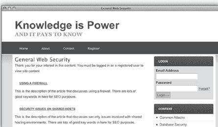

- 1. 在文本编辑器或 IDE 中创建一个新 PHP 脚本，命名为 category.php，并存储在 Web 根目录中。

- 2. 包含配置文件：

```php
<?php
require('./includes/config.inc.php');
```

- 3. 要求数据库连接：

```php
require(MYSQL);
```

- 4. 验证类别 ID：

```php
if (isset($_GET['id']) && filter_var($_GET['id'], FILTER_VALIDATE_INT,
array('min_range' => 1))) {
}
```

filter_var() 函数正在用于验证类别 ID，与 add_page.php 脚本中相同。

- 5. 获取类别标题：

```php
$sq = 'SELECT category FROM categories WHERE id= ' . $_GET['id'];
$r = mysqli_query($dbc, $sq);
```

此查询有两个用途。首先，它确认提供的 ID 值不仅是有效整数，而且还对应数据库中的一个值。其次，它将检索类别名称，用作浏览器标题和页面标题（参见图 5.8）。

- 6. 如果未返回一行，则报告问题：

```php
if (mysqli_num_rows($r) != 1) {
	$page_title = 'Error!';
	include('./includes/header.html');
	echo '<p class="error">This page has been accessed in error.</p>';
	include('./includes/footer.html');
	exit();
}
```

如果查询没有正好返回一行，则提供了无效的类别 ID。在这种情况下，将创建默认页面标题，包含页眉，显示错误消息，包含页脚，并终止脚本。图 5.9 显示了最终结果。

> > **注意**
> > 图 5.9 中显示的结果只会被
> 尝试做他们不该做的事情的用户看到。

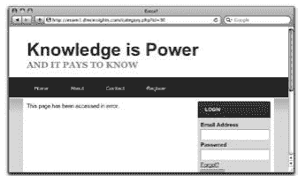

图 5.9

## 7. 获取类别标题并将其用作页面标题：

```
list ($page_title) = mysqli_fetch_array($r, MYSQLI_NUM);
include ('./includes/header.html');
echo "<h3>$page_title</h3>";
```

如果前一查询确实返回了一条记录，所选列将直接获取到 $page_title 变量中，然后包含页眉并显示页面标题。

list() 函数将数组的部分分配给单个变量。

## 8. 如果他们不是活跃用户，打印一条消息：

```
if (isset($_SESSION['user_id']) && !isset($_SESSION[
    'user_not_expired'])) {
    echo '<p class="error">Thank you for your interest in this content.
    Unfortunately your account has expired. Please <a href="renew.php">
    renew your account</a> in order to access site content.</p>';
} elseif (!isset($_SESSION['user_id'])) {
    echo '<p class="error">Thank you for your interest in this content. You
    must be logged in as a registered user to view site content.</p>';
}
```

三种类型的用户可能正在查看此页面：访客（未登录的人）、帐户已过期的已登录用户以及帐户未过期的已登录用户。在最后一种情况下，无需显示错误消息。

在第二种情况中，$_SESSION['user_id'] 将被设置，但 $_SESSION['user_not_expired'] 不会。如果用户登录时帐户仍然有效，后者元素将被赋值为 true。在这种情况下，用户被告知需要续期其帐户。

如果用户根本未登录，消息会说他们需要注册并登录才能查看内容。

由于 PHP 脚本已完成对第一个查询结果的使用，因此在此处安全地使用相同的 $q 和 $r 变量。

## 9. 获取与此类别关联的页面：

```
$q = 'SELECT id, title, description FROM pages WHERE category_id='
. $_GET['id'] . ' ORDER BY date_created DESC';
$r = mysqli_query($dbc, $q);
if (mysqli_num_rows($r) > 0) {
    while ($row = mysqli_fetch_array ($r, MYSQLI_ASSOC)) {
        echo "<div><h4><a href="page.php?id={$row['id']}">"
        {$row['title']}</a></h4><p>{$row['description']}</p>"
        "</div>\n";
    }
}
```

每个返回的记录都将作为页面上的一个独立 <DIV> 显示。页面标题将放置在 <H4> 标签中，并链接到 page.php，在 URL 中传递页面 ID。标题之后，会添加页面的描述。

## 10. 如果没有可用页面，打印一条消息：

```
} else {
	echo '<p>There are currently no pages of content associated with
this category. Please check back again!</p>';
}
```

在真实网站上，希望数据库中没有任何不包含内容的类别。但是，为了不做任何假设，如果页面 SELECT 查询未返回任何行，将向用户显示一条消息，让他们稍后再查看（图 5.10）。

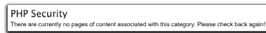

图 5.10

## 11. 如果页面未收到有效 ID，显示错误：

```
} else { // No valid ID.
	$page_title = 'Error!';
	include ('./includes/header.html');
	echo '<p class="error">This page has been accessed in error.</p>';
} // End of primary IF.
```

这是如果类别 SELECT 未返回一条记录时执行的代码的副本。

## 12. 包含 HTML 页脚并完成页面：

```
include ('./includes/footer.html');
?>
```

- 13. 保存并测试类别脚本。

## 创建 page.php

与 category.php 类似，page.php 脚本也在 URL 中接收一个 ID 值（来自 category.php 中的链接）。脚本应验证 ID 值，然后从数据库中选择页面的信息。页面标题将用作浏览器标题并显示为页面标题。接下来的内容将取决于查看页面的人：

> 按照原样编写的脚本不会对页面列表进行分页。如果一个类别可能关联超过，
> 例如，15 或 20 个页面，你可能需要添加
> 分页，这在我的书《PHP 和 MySQL：
> 用于动态网站：Visual
> QuickPro 指南》中有讨论。

- 拥有当前帐户的已登录用户将看到内容（图 5.11）。
- 帐户已过期的已登录用户将看到内容的描述，以及续期帐户的建议。
- 访客将看到内容的描述，以及注册的建议（图 5.12）。


图 5.11


图 5.12

正如你所料，此功能的大部分将与 category.php 脚本相似。

- 1. 在文本编辑器或 IDE 中创建一个新 PHP 脚本，命名为 page.php，并存储在 Web 根目录中。

- 2. 包含配置文件：

```php
<?php
require('./includes/config.inc.php');
```

- 3. 要求数据库连接：

```php
require(MYSQL);
```

- 4. 验证页面 ID：

```php
if (isset($_GET['id']) && filter_var($_GET['id'], FILTER_VALIDATE_INT,
array('min_range' => 1))) {
}
```

这是与类别 ID 使用的相同验证。如果你的 PHP 版本不支持 Filter 扩展，可以使用：

```php
if (isset($_GET['id']) && ((int) $_GET['id'] >= 1)) {
```

- 5. 获取页面信息：

```php
$q = 'SELECT title, description, content FROM pages WHERE id='
. $_GET['id'];
$r = mysqli_query($dbc, $q);
```

一个简单的查询从 pages 表中检索一条记录的三个字段。


### 6. 如果未返回任何行，则打印错误：

```php
if (mysqli_num_rows($r) != 1) {
    $page_title = 'Error!';
    include ('./includes/header.html');
    echo '<p class="error">This page has been accessed in error.</p>';
    include ('./includes/footer.html');
    exit();
}
```

再次，与 category.php 一样，如果提供的 ID 值是整数但与任何数据库记录都不相关，则会创建一个指示问题的完整页面（类似于图 5.9）。

### 7. 获取页面信息：

```php
$row = mysqli_fetch_array($r, MYSQLI_ASSOC);
$page_title = $row['title'];
include ('includes/header.html');
echo "<h3>$page_title</h3>";
```

页面的标题将用作浏览器标题和页面上的标题。

### 8. 如果用户的账户有效，则显示内容：

```php
if (isset($_SESSION['user_not_expired'])) {
    echo "<div>{$row['content']}</div>";
} elseif (isset($_SESSION['user_id'])) { // Logged in but not current.
    echo '<p class="error">Thank you for your interest in this content, but your account is no longer current. Please <a href="renew.php">renew your account</a> in order to view this page in its entirety</p>';
    echo "<div>{$row['description']}</div>";
} else { // Not logged in.
    echo '<p class="error">Thank you for your interest in this content. You must be logged in as a registered user to view this page in its entirety.</p>';
    echo "<div>{$row['description']}</div>";
}
```

此条件语句决定基于查看页面的用户显示的内容。只有账户有效的登录用户——即拥有 $_SESSION['user_not_expired'] 值的用户——才能查看内容本身。其他类型的用户只能看到描述以及适合其情况的消息。

### 9. 完成 ID 条件语句：

```php
} else { // No valid ID.
$page_title = 'Error!';
include ('includes/header.html');
echo '<p class="error">This page has been accessed in error.</p>';
} // End of primary IF.
```

如果此页面未接收到有效的 ID 值，用户将看到此错误消息。

- 10. 完成页面：
- include ('./includes/footer.html');
- ?>

- 11. 保存并测试 page.php 脚本。

要测试它，您需要在 category.php 上点击链接。您还应该以三种不同的用户类型（访客、过期会员和活跃会员）进行测试，以获得完整效果。

## 添加 PDF

本示例中的第二个管理页面将处理将 PDF 文件上传到网站。尽管管理员只需提供三项信息——标题、描述和 PDF 文件本身——但处理表单的过程很棘手，很大程度上是因为我希望表单具有粘性（sticky），就像网站中的其他表单一样。您可能知道，文件表单输入无法以与文本输入相同的方式设为粘性，因此我不得不使用一些逻辑来模拟这一概念（图 5.13）。


图 5.13

另外，允许用户（甚至管理员）将文件上传到服务器是一个潜在的安全漏洞，因此需要应用多种技术来使此过程尽可能安全。但首先，服务器需要设置为允许文件上传。

### 设置服务器

文件和目录的服务器权限归结为谁可以做什么。至于“什么”，选项有：读取、写入和执行。“谁”要么是特定的服务器用户，要么是用户组。

在 PHP 脚本能够将文件放到服务器之前，服务器上必须有一个文件夹，PHP 脚本可以向其中写入，也就是说更改目录的内容。由于 PHP 是通过 Web 服务器运行的，“谁”就是 Web 服务器用户。因此，目标是创建一个 Web 服务器用户可以写入的文件夹。

具体如何操作将取决于您的服务器设置、所使用的操作系统以及 PHP 相对于 Web 服务器的运行方式。归根结底，这通常意味着您将创建一个目录，并给予“所有人”写入权限。在 Unix 术语中，这由数字 777 表示。通常您的 Web 主机提供一个控制面板，您可以通过它更改文件夹的权限，或者您可能可以通过 FTP 应用程序完成此操作（图 5.14）。


图 5.14

虽然后允许每个人对目录做任何事听起来非常危险，但实际上并非如此。这里的“每个人”指的是服务器上的每个用户。所谓“用户”，我指的是在服务器上注册的用户帐户。例如，可能有一个运行数据库的 mysql 用户，而 Web 服务器可能以 nobody 用户身份运行。使用开放权限，这两个用户，以及任何具有 FTP 或 SSH 访问服务器权限的人，都可以读取、写入或执行目录中的文件。这并非无关紧要，但对每个人可用并不意味着互联网上任何人都可以将文件写入该目录：仍然需要一个被认可的服务器用户。

尽管如此，这并不意味着您应该对创建这样的开放目录漫不经心。如果您在共享服务器上，该服务器上拥有用户帐户的每个人都可以操纵这个目录——当然，前提是他们知道它的存在，而这是一个很大的如果。而且，如果网站存在安全漏洞，该漏洞可能被用来操纵目录——在这种情况下，是通过互联网上的用户，因为 Web 服务器用户将是活跃代理。

有许多情况需要开放目录才能使网站正常运行。问题在于如何使系统尽可能安全。答案在于像黑客一样思考。如果黑客无法闯入服务器，下一个目标将是让服务器为他或她执行一些危险代码。一种方法是尝试让 PHP（或其他）打开、require 或 include——从而执行——在另一台服务器上找到的一些危险代码。我在第 2 章“安全基础”中讨论过这一点。第二种途径是以某种方式将危险代码放到服务器上，然后直接执行它。这是一个两步过程。因此，防范此类尝试也是一个两步过程：

- 1. 尽你所能防止危险代码被放置在服务器上。
- 2. 使直接执行动态添加的内容变得困难，如果不可能的话。

对于第一步，很大程度上是验证上传的内容：确保它是可接受的类型。对于第二步，最好的解决方案是将上传的内容存储在 Web 根目录之外的目录中。在这种情况下，如果坏人 Bob（在互联网上，而不是在您的服务器上）能诱骗您的系统上传一些危险脚本，他仍然无法执行该脚本，因为如果它不在 Web 根目录中，就没有方法调用它。

提示
使用 Web 服务器保护目录的方法将在第 7 章“第二个网站：结构与设计”中讨论。

如果不可能（例如，某些共享主机不允许您将内容放在 Web 目录之上），则应该在 Web 目录中创建一个不明显的文件夹。这个文件夹仍然需要开放权限，但您应该对目录进行密码保护，以便只有授权用户才能（通过 HTTP）访问它。您可以使用 Web 主机的控制面板完成此操作。

提示
我在第 3 章“第一个网站：结构与设计”中讨论过服务器的组织以及 pdfs 目录理想情况下应该放在哪里。

一旦您用开放权限创建了 pdfs 目录，并在必要时将其放置在 Web 根目录中适当地进行了保护，您就可以创建将 PDF 文件上传到该文件夹的 PHP 脚本。但首先，我建议在配置文件中创建另一个常量，作为该文件夹的绝对路径：

提示
将 PDFS_DIR 的值更改为适合您服务器的值。

```php
// In config.inc.php:
define('PDFS_DIR', BASE_URI . 'pdfs/');
```

### 创建 PHP 脚本

此 PHP 脚本与所有其他表单具有相同的基本结构：首先显示表单；用户提交表单后验证数据；如果有任何错误，则再次显示表单并指示当前值。但是，这个特定过程将比其他表单更棘手，因为它还涉及上传的文件。文件输入无法设为粘性，更重要的是，当表单因其他错误而需要重新显示时，必须处理服务器上的实际文件。我将在以下步骤中解释所有相关逻辑。

- 1. 在文本编辑器或 IDE 中创建一个新的 PHP 脚本，命名为 add_pdf.php 并存储在 Web 根目录中。


- 2. 包含配置文件：

```php
<?php
require_once ('./includes/config.inc.php');
```

- 3. 重定向非管理员：

```php
redirect_invalid_user('user_admin');
```

- 4. 包含头文件：

```php
$page_title = 'Add a PDF';
include('./includes/header.html');
```

- 5. 加载数据库连接：

```php
require(MYSQL);
```

- 6. 创建用于存储错误的数组：

```php
$add_pdf_errors = array();
```

- 7. 如果表单已提交，验证标题和描述：

```php
if ($_SERVER['REQUEST_METHOD'] == 'POST') {
    if (empty($_POST['title'])) {
    $st = mysqli_real_escape_string($dbc, strip_tags($_POST['title']));
    } else {
    $add_pdf_errors['title'] = 'Please enter the title!';
    }
    if (empty($_POST['description'])) {
    $sd = mysqli_real_escape_string($dbc, strip_tags(
    $_POST['description']));
    } else {
    $add_pdf_errors['description'] = 'Please enter the description!';
    }
}
```

验证例程仅检查这两个输入是否有任何值。如果它们不为空，则将值传递给 strip_tags() 函数，然后再传递给 mysqli_real_escape_string()。如果任一值为空，则将错误消息添加到数组中。

- 8. 检查 PDF 文件：

```php
if (is_uploaded_file($_FILES['pdf']['tmp_name']) && ($_FILES['pdf']['error'] == UPLOAD_ERR_OK)) {
$file = $_FILES['pdf'];
```

表单首次提交时，特殊的 $_FILES 数组中应包含数据，这要归功于名称 pdf 的文件输入。此条件语句检查是否存在已上传的文件且没有错误（因为可能既有已上传的文件，又存在错误）。如果两个条件都为真，$file 变量将转换为 $_FILES['pdf'] 的简写版本，以供后续使用。

- 9. 验证文件信息：

```php
$size = round($file['size']/1024);
if ($size > 1024) {
    $add_pdf_errors['pdf'] = 'The uploaded file was too large.';
}
if (($file['type'] != 'application/pdf') && (substr($file['name'], -4) != '.pdf')) {
    $add_pdf_errors['pdf'] = 'The uploaded file was not a PDF.';
}
```

> 按照当前编写方式，文件输入只会关联一个错误，因此如果上传的文件既太大又不是 PDF，用户将只看到第二个错误。

首先，以千字节为单位计算文件大小。首先将使用此值来确保文件不太大。在公开端，此值将显示给最终用户，指示 PDF 的大小（一个不错的功能）。如果文件大于一兆字节（或 1,024 千字节），则会创建错误消息。由于 MAX_FILE_SIZE 隐藏表单输入只是容易规避的建议，因此最好也使用 PHP 检查文件大小。

> 验证 PDF 类型的更严格方法是读取文件的二进制数据并确保其符合 PDF 规范。

接下来，验证文件的类型。条件语句的第一部分检查类型是否不等于 application/pdf，这是浏览器将与上传的 PDF 关联的 MIME 类型。但是 MIME 类型很容易伪造，因此不能仅依赖此项。条件语句的第二部分检查文件名是否以 .pdf 结尾。由于任何文件的扩展名都决定了计算机如何处理该文件，因此这是另一个良好的安全检查（尽管并非百分之百万无一失）。

从安全角度来看，到此为止，已采取合理措施来确保上传的文件不太大且为 PDF 文件。

- 10. 如果没有错误，创建文件的新名称和目标：

```php
if (!array_key_exists('pdf', $add_pdf_errors)) {
    $tmp_name = sha1($file['name'].uniqid('',true));
    $dest = PDFS_DIR .$tmp_name .'_tmp';
}
```

> 通常建议重命名上传的文件，以便黑客不会知道服务器上上传文件的名称。

出于安全目的，应将上传的文件重命名为随机且不可预测的名称。为此，sha1() 函数将根据一些数据创建一个 40 字符的哈希值。要哈希的数据是文件的原始名称加上一个唯一标识符。

目标值是服务器上存储文件的绝对路径——即其最终存放位置，包含文件的新名称。之前在本章中添加到 config.inc.php 的 PDFS_DIR 常量用于该目标的部分。此时，我还在文件名中添加了 _tmp，以指示文件位于服务器上，但尚未与数据库记录关联。

- 11. 移动文件：

```php
if (move_uploaded_file($_FILES['pdf']['tmp_name'], $dest)) {
	$_SESSION['pdf']['tmp_name'] = $tmp_name;
	$_SESSION['pdf']['size'] = $size;
	$_SESSION['pdf']['file_name'] = $_FILES['pdf']['name'];
	echo '<h4>The file has been uploaded!</h4>';
} else {
	trigger_error('The file could not be moved.');
	unlink($_FILES['pdf']['tmp_name']);
}
```

move_uploaded_file() 函数仅转移通过 HTTP POST 上传的文件，因此无法被操纵以移动服务器上的其他文件。其第一个参数是要移动的文件，由文件的临时名称表示（例如 /tmp/php4902）。第二个参数是文件的目标，包含目录和文件名。

接下来，关于文件的三条信息会被存储到会话中以供后续参考。这包括文件的新名称、大小和原始名称。然后会显示一条消息，指示文件已被处理。

如果无法移动文件，将触发错误消息并删除上传的文件（因此不会占用临时目录）。

- 12. 如果没有上传文件，查找错误：

```php
} // End of array_key_exists() IF.
} else { // No uploaded file.
	switch ($_FILES['pdf']['error']) {
	case 1:
	case 2:
		$add_pdf_errors['pdf'] = 'The uploaded file was too large.';
		break;
	case 3:
		$add_pdf_errors['pdf'] = 'The file was only partially uploaded.';
		break;
	case 6:
	case 7:
```


```php
case 8:
    $add_pdf_errors['pdf'] = 'The file could not be uploaded due to
    a system error.';
    break;
case 4:
default:
    $add_pdf_errors['pdf'] = 'No file was uploaded.';
    break;
} // End of SWITCH.
} // End of $_FILES IF-ELSEIF-ELSE.
```

PHP 手册列出了所有与文件上传相关的错误代码。此脚本在向用户报告错误时不应过于详细，因此每个代码都转换为更通用的消息。某些代码（例如 1 和 2，或 6、7 和 8）具有相同的净含义，因此我在 switch 中使用了贯穿（fall-through），其中多个 case 具有相同的效果。

- 13. 将 PDF 添加到数据库：

```php
if (empty($add_pdf_errors)) { // If everything's OK.
    $fn = mysqli_real_escape_string($dbc, $_SESSION['pdf']
    ['file_name']);
    $tmp_name = mysqli_real_escape_string($dbc, $_SESSION['pdf']
    ['tmp_name']);
    $size = (int) $_SESSION['pdf']['size'];
    $q = "INSERT INTO pdfs (tmp_name, title, description, file_name,
    size) VALUES ('$tmp_name', '$t', '$d', '$fn', $size)";
    $r = mysqli_query ($dbc, $q);
}
```

如果没有错误，下一步是将 PDF 数据插入数据库。为此，会话中已存储的关于文件的三条信息已被处理为可安全用于查询（此时标题和描述已经过 mysqli_real_escape_string() 处理）。

- 14. 如果查询成功，重命名文件：

```php
if (mysqli_affected_rows($dbc) == 1) { // If it ran OK.
    $original = PDFS_DIR . $_SESSION['pdf']['tmp_name'] . '_tmp';
    $dest = PDFS_DIR . $_SESSION['pdf']['tmp_name'];
    rename($original, $dest);
}
```

为了使上传永久化，将从文件名中删除 _tmp。

- 15. 向用户指示成功并清除值：


echo '<h4>The PDF has been added!</h4>';
$_POST = array();
$_FILES = array();
unset($file, $_SESSION['pdf']);

需要清除所有这些值，以便表单不显示任何现有值。

- 16. 如果查询出现问题，触发错误：

```
} else { // If it did not run OK.
trigger_error('The PDF could not be added due to a system error.
We apologize for any inconvenience.');
unlink ($dest);
}
```

在经过测试的正式网站上不应该出现数据库查询错误，但以防万一，将触发错误并删除文件（以确保服务器上没有没有对应数据库引用的文件）。

- 17. 完成脚本的处理部分：

```
} // End of $errors IF.
} else { // Clear out the session on a GET request:
unset($_SESSION['pdf']);
} // End of the submission IF.
```

else 子句适用于 GET 请求的情况。在这种情况下，脚本应清除 $_SESSION['pdf'] 中可能存在的任何值。这仅在管理员上传了文件但出现了其他错误，然后再次单击“添加 PDF”链接时才真正必要。

- 18. 开始创建表单：

```
require ('includes/form_functions.inc.php');
?><h3>Add a PDF</h3>
<form enctype="multipart/form-data" action="add_pdf.php"
method="post" accept-charset="utf-8">
<input type="hidden" name="MAX_FILE_SIZE" value="1048576"
/>
```

此表单将对标题和描述使用相同的 create_form_input() 函数。表单必须使用 enctype 属性和 POST 方法才能处理文件数据。MAX_FILE_SIZE 值是对浏览器的建议，浏览器可能会采纳，也可能会忽略。

- 19. 创建前两个元素：

```
<fieldset><legend>Fill out the form to add a PDF to the site:</legend>
<p><label for="title"><strong>Title</strong></label><br />
<?php create_form_input('title', 'text', $add_pdf_errors); ?> </p>
<p><label for="description"><strong>Description</strong></label>
<?php create_form_input('description', 'textarea',
$add_pdf_errors); ?> </p>
```

- 20. 开始创建文件输入：

<p><label for="pdf"><strong>PDF</strong></label><br />
<?php echo '<input type="file" name="pdf" id="pdf">'; ?>
create_form_input() 函数中不生成文件输入，
因为整个网站中只有一个文件输入（而且文件
输入与文本、密码或文本域截然不同）。由于正确
处理文件输入需要大量 PHP 逻辑，因此输入代码本身是
通过 PHP echo 语句启动的。该语句尚未关闭输入元素，以便
可以添加错误类（在下一步中）。

- 21. 检查是否有错误：

```
if (array_key_exists('pdf', $add_pdf_errors)) {
echo ' class="error" /> <span class="error">' .
$add_pdf_errors['pdf'] . '</span>';
} else { // No error.
echo ' />';
}
```

如果出现错误，则将错误类添加到输入中（以便将其以红色描边），并在输入后添加错误消息。如果没有错误，则关闭输入。

- 22. 如果文件已存在，则向用户指示：

```
if (isset($_SESSION['pdf'])) {
echo " Currently '{$_SESSION['pdf']['file_name']}'";
}
```

这仍然是表示该输入没有错误的 else 部分的一部分。如果表单是首次加载，或者已被提交但其他表单元素存在错误，则会出现这种情况。在后一种情况下，文件已上传，表单应向用户指示该文件的存在（参见图 5.13）。

- 23. 完成文件输入：

```
} // end of errors IF-ELSE.
?> <small>PDF only, 1MB Limit</small></p>
```

> tip
> 如果用户因错误而再次看到表单，然后在提交新 PDF 时
> 完成表单，则新 PDF 文件将替换旧文件。

通过不完整地使用此脚本，可能会在服务器上留下多余文件，但它们的名称将以 _tmp 结尾，可以手动删除。

- 24. 完成表单和页面：

```
<p><input type="submit" name="submit_button" value="Add This PDF" id="submit_button" class="formbutton" /></p>
</fieldset>
</form>
<?php
include ('./includes/footer.html');
?>
```

- 25. 保存脚本并测试 PDF 上传过程。

图 5.15 显示了成功添加新 PDF 的结果。


图 5.15

## 显示 PDF 内容

与 HTML 内容一样，在网站上显示 PDF 内容需要两个脚本。第一个 pdfs.php 仅列出目录中的每个 PDF，并提供查看 PDF 本身的链接。第二个 view_pdf.php 检索并显示特定 PDF，但只有在验证用户后才会显示。

### 创建 pdfs.php

pdfs.php 页面的工作方式与 category.php 非常相似，只是它不在 URL 中接收 ID 值。它只是显示每个 PDF（图 5.16）。


图 5.16

- 1. 在文本编辑器或 IDE 中创建一个名为 pdfs.php 的新 PHP 脚本，并将其存储在 Web 根目录中。

- 2. 包含配置文件：

```
<?php
require ('./includes/config.inc.php');
```

- 3. 要求数据库连接：

```
require(MYSQL);
```

- 4. 包含标题文件并显示页面标题：

```
$page_title = 'PDFs';
include ('./includes/header.html');
echo '<h3>PDF Guides</h3>';
```

- 5. 如果用户不活跃，则打印消息：

```
if (isset($_SESSION['user_id']) && !isset($_SESSION['user_not_expired'])) {
    echo '<p class="error">Thank you for your interest in this content.
    Unfortunately your account has expired. Please <a href="renew.php">renew your account</a> in order to view any of the PDFs listed below.</p>';
} elseif (isset($_SESSION['user_id'])) {
    echo '<p class="error">Thank you for your interest in this content.
    You must be logged in as a registered user to view any of the PDFs listed below.</p>';
}
```

这些消息与 category.php 中的略有不同，但对用户状态的检查是相同的。

- 6. 获取 PDF：

```
$q = 'SELECT tmp_name, title, description, size FROM pdfs ORDER BY date_created DESC';
$r = mysqli_query($dbc, $q);
if (mysqli_num_rows($r) > 0) {
```

该查询按从新到旧的顺序返回数据库中每个 PDF 的临时名称、标题和描述。

- 7. 获取并显示每个 PDF：

```
while ($row = mysqli_fetch_array($r, MYSQLI_ASSOC)) {
    echo "<div><h2><a href=\"view_pdf.php?id={$row['tmp_name']}\">{$row['title']}</a> ({$row['size']}kb)</h2><p>{$row['description']}</p></div>\n";
} // End of WHILE loop.
```

每条记录都显示为其自己的 <DIV>，标题作为链接的 <H4>，后跟文件大小。接下来是文件的描述。每个链接都指向 view_pdf.php，在 URL 中传递临时名称——40 字符的哈希值。

- 8. 完成页面：

```
} else { // No PDFs!
echo '<p>There are currently no PDFs available to view. Please check back again!</p>';
}
include ('./includes/footer.html');
?>
```

如果数据库中没有 PDF，将显示此消息，希望永远不会出现这种情况。

- 9. 保存脚本并在 Web 浏览器中测试 pdfs.php。

显然，在先创建 view_pdf.php 之前，无法测试任何链接。

## 创建 view_pdf.php

用户在 pdfs.php 中单击链接后到达此最终脚本。此页面的唯一目的是在用户账户处于活动状态时向用户显示 PDF。

- 1. 在文本编辑器或 IDE 中创建一个名为 pdf.php 的新 PHP 脚本，并将其存储在 Web 根目录中。

- 2. 包含配置文件和数据库连接：

```
<?php
require ('./includes/config.inc.php');
require(MYSQL);
```

- 3. 创建标志变量：

```
$valid = false;
```

在实际显示 PDF 之前，此脚本将进行许多测试，因此它将从假设出了问题开始。

- 4. 验证 PDF ID：

```
if (isset($_GET['id']) && (strlen($_GET['id']) == 40) &&
(substr($_GET['id'], 0, 1) != '. )) {
$file = PDFS_DIR . $_GET['id'];
if (file_exists ($file) && (is_file($file)) ) {
```

PDF 标识符应通过 URL 传入此脚本。ID 不是整数，但必须恰好为 40 个字符长，因此这是一个很好的检查起点。黑客此类系统的常见方式是恶意用户将 ../path/to/something/useful 作为值提交，其中 .. 会向上移动一个目录。其意图是让 PHP 脚本获取并显示敏感文档，例如服务器


密码文件。为防止这种情况发生，条件语句的第三部分检查第一个字符是不是句点。

如果这三个条件都为真，则定义文件的绝对路径。接下来，测试文件以确认它存在且是一个文件（而不是目录）。

- 5. 从数据库获取 PDF 信息：

```php
$q = 'SELECT title, description, file_name FROM pdfs WHERE
  tmp_name="". mysqli_real_escape_string($dbc, $_GET['id']) . '';
$r = mysqli_query($dbc, $q);
if (mysqli_num_rows($r) == 1) { // Ok!
    $row = mysqli_fetch_array($r, MYSQLI_ASSOC);
    $valid = true;
}
```

该查询获取 PDF 的标题、描述和原始文件名。如果当前查看者没有权限查看 PDF 本身，则会使用前两条信息。如果返回了一行数据，则检索数据并将 $valid 变量更改为 true。

- 6. 仅向账户处于活动状态的用户显示 PDF：

```php
if (isset($_SESSION['user_not_expired'])) {
    header("Content-type:application/pdf");
    header("Content-Disposition:inline;filename="" . $row['file_name'] . "");
    $fs = filesize($file);
    header("Content-Length:$fs\n");
    readfile($file);
    exit();
}
```

如果用户的账户处于活动状态，PDF 应该在浏览器中加载。在 PHP 中实现此功能，首先发送指示内容类型的标头。然后指示内容的处置方式——inline，即在浏览器中显示文件——以及文件名。对于文件名，提供原始文件名。接下来，指示文件的大小，使用实际文件的大小，而不是数据库中存储的近似值。最后，readfile() 函数读取所有二进制数据并将其发送到浏览器。然后终止脚本。

> **注意** 不同的浏览器会以不同的方式使用文件名处置。

- 7. 对于非活动用户，显示内容的描述：

```php
} else { // Inactive account!
    $page_title = $row['title'];
    include('./includes/header.html');
    echo "<h3>$page_title</h3>";
    if (isset($_SESSION['user_id'])) {
        echo '<p class="error">Thank you for your interest in this
        content. Unfortunately your account has expired. Please
        <a href="renew.php">renew your account</a> in order to
        access this file.</p>';
    } else {
        echo '<p class="error">Thank you for your interest in this
        content. You must be logged in as a registered user to view this
        file.</p>';
    }
    echo "<div>{$row['description']}</div>";
    include ('./includes/footer.html');
} // End of user IF-ELSE.
```

如果用户已登录但处于非活动状态（即其账户已过期），系统会要求其续期账户（图 5.17）。如果用户未登录，系统会要求其登录（图 5.18）。


图 5.17


图 5.18

- 8. 完成条件语句：

```
} // End of mysqli_num_rows() IF.
} // End of file_exists() IF.
} // End of $_GET['id'] IF.
```

- 9. 指出问题并完成页面：

```php
if (!$valid) {
    $page_title = 'Error!';
    include ('./includes/header.html');
    echo '<p class="error">This page has been accessed in error.</p>';
    include ('./includes/footer.html');
}
?>
```

如果页面未收到与数据库记录和服务器上实际文件对应的 ID 值，用户将看到类似图 5.9 中的错误消息。

- 10. 保存文件并通过单击 pdfs.php 上的链接来测试它。

本页故意留空

# 6 使用 PayPal

在 Knowledge is Power 网站中，集成 PayPal 是最后也是最重要的一步，这样网站才能真正赚钱。使用 PayPal 并不困难，但这是一个如此关键的步骤，我想给予额外关注。与许多技术一样，浏览所有文档和可能的用途可能是最困难的部分。

在本章中，你将了解 PayPal 的现状以及 PayPal 提供的支付选项。下一步是注册 PayPal 的 Sandbox 功能，以便你可以创建用于测试目的的虚拟 PayPal 账户。之后，你可以完成网站所需的 PHP 脚本并完全测试最终结果。一旦你对测试账户的一切正常运行感到满意，你将为实时 PayPal 账户重复其中一些步骤，快速更新几页，然后就可以开始了！

## 关于 PayPal

PayPal 或许是目前最大的支付解决方案提供商，有充分理由考虑在你的电子商务网站上使用它。从开发角度来看，集成 PayPal 非常简单。从客户的角度来看，PayPal 是一个值得信任的名称，这对用户是否愿意花钱有很大影响。使用其他提供商，你可能能够创建更专业的体验或节省交易费用，但不要仅仅因为 PayPal 可能是解决方案中的“最小公约数”就否定它。

- PayPal 提供：
  - 无设置费用
  - 基本支付选项无月费
  - 欺诈保护
  - 运费计算器和运单服务
  - 税费计算器
  - 覆盖 190 个国家/地区，支持 21 种货币
  - 货币转换
  - 国际税费和运费计算器
  - 发送发票的功能
  - 库存管理
  - 用于手动处理交易的虚拟终端
  - 与流行的第三方电子商务系统集成，例如 osCommerce 和 ZenCart

然而，PayPal 不会直接将资金转入你的银行账户。交易收到的资金会记入你的 PayPal 账户。然后，你可以登录 PayPal 账户并将资金转入注册的银行账户，这可能需要几天时间才能到账。在 PayPal 网站上，你还可以查看月度报告、搜索交易历史记录，甚至允许不同类型的用户访问 PayPal 账户（例如，低级用户可能只能打印运单，而无法查看任何支付详细信息）。

> **提示** PayPal 有大量文档和视频，解释各种计划、功能和费用。几乎太多了...

> **提示** 你必须拥有 PayPal 高级版或商业版账户才能收款。

> **注意** 本章中关于 PayPal 的所有信息在撰写时均为最新，如有更改，恕不另行通知。

## 支付解决方案

PayPal 提供两种基础支付解决方案，分别名为 Website Payments Standard 和 Website Payments Pro。这两种解决方案都允许你接受 PayPal 用户或通过信用卡的付款。这两种解决方案也都允许你使用购物车，无论是你自己定制的还是第三方系统。

> **注意** 不能保证用户在完成 PayPal 流程后会立即返回你的网站。

Standard 选项基本上就是人们历史上对 PayPal 的印象：客户从你的网站开始，然后前往 PayPal 网站完成交易，之后可以返回你的网站。此选项无月费，且易于设置：你只需要自己的 PayPal 账户。虽然你可以在一定程度上自定义 PayPal 体验，但客户会清楚自己已不在你的网站上，且客户信用卡账单上的收费将使用 PayPal 和你公司名称的组合。

> **注意** 本章和本书中的所有价格均以美元计。

Pro 支付解决方案与其他支付网关类似，客户无需离开你的网站即可完成交易（即向你付款）。Pro 系统每月 30 美元，你需要完成信用申请才能符合条件（当然，你也需要自己的 PayPal 账户）。Pro 系统还允许你自定义欺诈保护，但你需要采取额外措施来保护信用卡数据，因为这些数据将暂时在你的系统中处理（将需要更严格的 PCI 合规性）。

> **提示** 如果你的交易通常每笔平均少于 10 美元，可以使用 PayPal 的小额支付费率来节省资金。

无论选择哪种解决方案，交易费均为每笔交易 30 美分。你还需要支付交易总额的一定百分比，具体取决于你每月的业务量（表 6.1）。

| 月销售额 | 每笔交易费 |
|---|---|
| $0 至 $3,000 | 2.9% + $0.30 |
| $3,000.01 至 $10,000 | 2.5% + $0.30 |
| $10,000.01 至 $100,000 | 2.2% + $0.30 |
| 超过 $100,000 | 1.9% + $0.30 |

> **注意** 货币转换和来自其他国家/地区的付款有额外费用。

在本章中，你将使用 Website Payments Standard 解决方案。你可以假设本章余下部分中我说和做的大部分内容仅适用于它。下一个电子商务网站 Coffee（在第 7 章“第二个网站：结构与设计”中）将使用另一种支付网关。该过程和代码与使用 PayPal 的 Website Payments Pro 解决方案类似。


## 支付按钮

Website Payments Standard 系统依赖于使用 PayPal 的工具来生成针对您电子商务情况的特定 HTML 代码。通过填写表格并回答几个问题，PayPal 会创建一些您可以放置在网站合适位置的 HTML。该代码本身会创建一个 HTML 按钮，单击后将用户带到 PayPal。

有不同类型的默认按钮适用于不同情况：

- 立即购买，用于销售单件商品
- 加入购物车，用于销售多件商品
- 订阅，用于销售订阅服务
- 捐赠，用于接受捐款

您无疑多次见过这些按钮的示例（图 6.1）。立即购买和加入购物车按钮还允许您为产品设置不同的属性，并根据所选属性调整价格。例如，如果您通过网站销售软件，客户可能被允许选择要购买的许可证数量或类型。

您可以从其中一个默认按钮开始，根据自己的情况进行自定义，甚至为按钮本身使用不同的图片。作为一项安全功能，该按钮仅将标识符（您的帐户指示符和按钮 ID）传递到 PayPal 网站。所有详细信息（例如要收取的价格）均存储在 PayPal 的系统中，这意味着黑客无法操纵这些值。

对于本项目，您将使用订阅选项，因为该网站正在销售其内容的订阅服务。订阅功能有两种格式：

- 通过 PayPal 帐户进行定期付款
- 无需 PayPal 帐户即可进行定期付款

后者允许任何人使用信用卡进行购买；此服务的费用为每月 19.99 美元（由您，即商家承担）。

用户通过 PayPal 订阅后，当您设定的期限届满时，将自动再次收费。从商业角度来看，定期付款非常好，因为您可以继续收到款项，直到客户取消定期付款。不过，您应该向用户说明这一点，并或许告知他们帐户即将到期，并且将在到期前再次收费（否则，您将不得不准备处理一些退款）。

> **提示**
> 您稍后可以自定义已创建的按钮，例如更改商品收费价格。


> **提示**
> 您甚至可以将试用期作为订阅的一部分提供，尽管本网站不会这样做。

> **提示**
> 您可以创建一个脚本，向在下一周内即将到期的任何用户发送电子邮件。然后每周执行一次或两次该脚本。

> **提示**
> 用户可以在其 PayPal 配置文件页面的“我的预批准付款”部分下查看已同意的自动账单。

## 测试 PayPal

作为测试新网站过程的一部分，您无疑希望测试支付处理系统。像大多数支付解决方案一样，PayPal 提供了一个沙盒环境，可以模拟处理交易而无需真钱交易。使用 PayPal，您可以使用 PayPal 沙盒测试交易。那么，让我们先设置一下。

### PayPal 的多种面貌

您将接触三个不同的 PayPal 相关网站。第一个也是最明显的是真正的 PayPal，网址为 www.paypal.com。在网站上线之前，您需要在那里有一个代表该网站的 PayPal 帐户。您将在那里重新创建按钮，并在那里查看您的交易。

测试过程中使用两个网站。第一个是沙盒，网址为 http://developer.paypal.com。要创建和使用测试帐户，您需要使用真实电子邮件地址在沙盒上注册，然后登录。要使用这些示例帐户测试您的网站，您需要保持登录到沙盒（在同一浏览器中）。

您将使用的最后一个网站是沙盒测试网站，网址为 www.sandbox.paypal.com。这个网站看起来和功能与真正的 PayPal 完全一样，只是这里那里会显示“测试网站”和“沙盒”。

阅读本章其余部分时，请密切注意我在每个步骤中引用的是哪个 PayPal 网站。确保浏览器中的 URL 与每条说明相匹配。

### 在 PayPal 沙盒注册

PayPal 沙盒是真实 PayPal 的副本，但您可以创建和控制角色。要使用它，您需要使用真实电子邮件地址和密码注册以创建沙盒帐户，然后您可以使用该帐户创建虚拟买家和卖家。

1. 访问 https://developer.paypal.com。
2. 如果您还没有 PayPal 沙盒帐户（与 PayPal 帐户不同），请单击“立即注册”创建一个。
3. 填写简单的注册表单（图 6.2）。

出于安全考虑，PayPal 建议您使用与实际 PayPal 帐户不同的电子邮件地址和密码。


图 6.2

4. 检查您的电子邮件。注册后，您将收到一封包含链接的电子邮件，必须单击该链接以激活帐户。
5. 单击电子邮件中的链接以激活帐户。
6. 使用您的电子邮件地址和密码登录 PayPal 沙盒。

### 创建测试帐户

注册并登录沙盒后，下一步是创建至少两个帐户：一个商家（企业）和一个个人（客户）。

1. 如果您尚未登录，请登录 PayPal 沙盒。
2. 单击“测试帐户”链接。编写本文时，除了主页之外，沙盒只有四个主要区域。
3. 单击“创建帐户”标签旁边的“预配置”链接（图 6.3）。


图 6.3

> 您可以忽略图 6.3（以及您自己的经验）中显示 PayPal 显示 Website Payments Pro 的事实。

您可以通过两种方式创建测试帐户：预配置或手动。如果选择预配置，网站将自动为您生成几乎所有帐户信息，例如电子邮件地址、密码、实际地址等。如果选择手动选项，您需要提供所有这些信息。

4. 在“创建沙盒测试帐户”页面上，创建一个卖家帐户（图 6.4）。


图 6.4

> **提示**
> 记下每个密码，因为您将在测试帐户中需要它们。

您首先需要指定卖家的国家/地区和帐户类型。对于登录电子邮件，使用任何有意义的六个字符，并请注意这不是实际的电子邮件地址；沙盒将使用此值创建一个临时地址。您可以只使用“seller”。密码将自动为您生成，您可以保持原样。

是否添加信用卡和/或银行账户余额由您决定。对于商家，两者都不是必需的，尽管添加其中一项或两项都会自动将帐户标记为已验证（在 PayPal 沙盒世界中）。

> **提示**
> 如果您创建的买家帐户没有信用卡或银行账户，或者资金不足，该买家帐户将使用模拟电子支票付款。

5. 单击“创建帐户”按钮。
6. 对一个或多个买家帐户重复步骤 3-5。

对于买家，您需要创建一个或多个具有正银行账户余额和/或信用卡的帐户。为了进行完整测试，您还可以创建资金不足的买家，或来自其他国家的买家。

您创建的每个帐户都将列在“测试帐户”页面上（图 6.5）。


图 6.5

> **提示**
> 创建后，帐户详细信息可以在登录沙盒测试网站（使用该帐户）后更新，就像真实的 PayPal 帐户一样。

> **提示**
> 在 PayPal 沙盒中，除非您为帐户启用付款审核，否则所有付款都会在未经审核的情况下成功。

### 创建按钮

创建两个或多个帐户后，您可以在网站上添加一个虚拟 PayPal 按钮来模拟电子商务交易。这可以说是最重要的步骤序列，因为当您使网站上线时，将执行这些相同的操作。

1. 在“沙盒测试帐户”页面（参见图 6.5）上，选择卖家帐户并单击“进入沙盒测试网站”按钮。

执行此步骤后，您将能够作为测试用户之一进入虚拟 PayPal。使用 PayPal 沙盒测试网站，您可以执行真实 PayPal 用户执行的相同任务：查看帐户余额、审查交易、更新帐户详细信息，以及（对于商家）创建用于销售产品和服务的按钮。

2. 在弹出的窗口中，使用卖家帐户登录。

步骤 1 的结果将创建一个看起来像常规 PayPal 网站的弹出窗口，并散布着“沙盒”和“测试网站”字样。您还会看到，步骤 1 中所选帐户关联的电子邮件地址将自动输入到登录表单中。

3. 单击“商家服务”选项卡。
4. 在“创建按钮”下，单击“订阅”。
5. 在“创建 PayPal 支付按钮”页面上，输入项目名称（下一页上的图 6.6）。


> 提示
>
> 在表单的第一部分中，您还可以更改按钮的文本和外观。


### 图 6.6

按钮类型应自动选择（作为订阅）。您可能也想更改货币，也可能不想。

- 6. 在表单步骤 1 下方，输入账单金额和计费周期（图 6.7）。


账单金额显然是最重要的考虑因素。计费周期是指该账单金额覆盖的时间长度。您可以选择在两个或更多周期后停止自动计费，或者永不停止。

### 图 6.7

- 7. 选择使用您的安全商户帐户 ID（参见图 6.7）。
- 8. 在表单步骤 2 下，确保 PayPal 选项中的“保存”按钮已选中（图 6.8）。

> 提示
>
> 如果您使用 PayPal 帐户保存按钮，则会更安全且更易于更新。


### 图 6.8

- 9. 在表单步骤 3 下，表明您不需要客户的送货地址。

如果您销售的是实物产品，则希望用户在 PayPal 中确认送货地址。然后，您可以使用 PayPal 为您生成运送标签，并从已转入您帐户的款项中扣除费用。


### 图 6.9

- 10. 同样在表单步骤 3 下，提供“取消”和“完成”URL，并选择相应的复选框（图 6.9）。

这两个值必须指向您服务器上可通过 HTTPS 访问的页面。本章稍后将创建这两个脚本，分别命名为 cancel.php 和 thanks.php。

- 11. 单击“创建按钮”。
- 12. 在下一页中，复制生成的代码（图 6.10）。


### 图 6.10

这是要集成到网站中的代码，您将在下一步执行该操作。

## 集成 PAYPAL

创建测试帐户和 PayPal 按钮后，您可以将网站与测试版 PayPal 关联。这样做非常简单：

- 1. 在适当位置添加按钮代码。
- 2. 创建 thanks.php 页面。
- 3. 创建 cancel.php 页面。

不过，会有一些棘手的问题，因此在集成并测试 PayPal 后，您将学习改进系统的方法。

## 更新注册页面

> 提示
>
> 请记住，您可以从 www.DMCinsights.com/ecom/ 下载本示例的所有源代码。

对于此特定网站，用户在成功完成注册流程后应前往 PayPal（单击按钮）。要实现此目的，首先更改 register.php 中的感谢消息，使其告知用户下一步该做什么：

```
echo "<h3>Thanks!</h3><p>Thank you for registering! To complete the
process, please now click the button below so that you may pay for your
site access via PayPal. The cost is $10 (US) per year. <strong>Note: When
you complete your payment at PayPal, please click the button to return to
this site.</strong></p>";
```

接下来，插入由 PayPal 生成的代码以添加按钮（图 6.11）：


### 图 6.11

```
echo '<form action="https://www.sandbox.paypal.com/cgi-bin/webscr"'
     method="post">
<input type="hidden" name="cmd" value="_s-xclick">
<input type="hidden" name="hosted_button_id" value=
     "8YW8FZDELF296">
<input type="image" src="https://www.sandbox.paypal.com/en_US/i/
     btn/btn_subscribeCC_LG.gif" border="0" name="submit" alt="PayPal -
     The safer, easier way to pay online!">

</form>';
```

上述代码应放在感谢消息之后、包含页脚之前。

还需要进行两项更改。首先，原始 INSERT 查询为新用户提供了下个月的访问权限。现在应将其更改为用户的访问权限有效期至昨天（即，其帐户未激活）：

```
$q = "INSERT INTO users (username, email, pass, first_name, last_name,
     date_expires) VALUES ('$u', '$e', '" . get_password_hash($p) . "', '$fn',
     '$ln', SUBDATE(NOW(), INTERVAL 1 DAY ))";
```

其次，让我们将用户的新 ID 值存储在会话中，以便在用户从 PayPal 返回时可以更新其记录。为此，请在确认 `mysqli_affected_rows($dbc)` 等于 1 之后的任意位置添加以下代码：

```
$uid = mysqli_insert_id($dbc);
$_SESSION['reg_user_id'] = $uid;
```

我特意将其命名为 `reg_user_id` 而不是 `user_id`，以免系统误以为用户已登录（实际上未登录；登录过程会创建 `$_SESSION['user_id']`）。您将在 thanks.php 中看到 `$_SESSION['reg_user_id']` 的使用情况。

## 创建 thanks.php

客户在完成 PayPal 订单并单击按钮返回本网站后，会进入 thanks.php 页面。此页面需要更新数据库，为用户帐户增加一年的访问权限（图 6.12）。其定义方式可能如下：


### 图 6.12

### thanks.php

```
1 <?php
2 require ('./includes/config.inc.php');
3 redirect_invalid_user('reg_user_id');
4 require (MYSQL);
5 $page_title = 'Thanks!';
6 include ('./includes/header.html');
7 $q = "UPDATE users SET date_expires = ADDDATE(date_expires,
 INTERVAL 1 YEAR) WHERE id={$_SESSION['reg_user_id']}";
8 $r = mysqli_query ($dbc, $q);
9 unset($_SESSION['reg_user_id']);
10 ?><h3>Thank You!</h3>
11 <p>Thank you for your payment! You may now access all of the site's
 content for the next year! <strong>Note: Your access to the site will
 automatically be renewed via PayPal each year. To disable this feature,
 or to cancel your account, see the "My preapproved purchases" 
 section of your PayPal Profile page.</strong></p>
12 <?php include ('./includes/footer.html'); ?>
```

有三行关键代码被突出显示。首先，仅当会话中存在 reg_user_id 元素时才应访问此脚本，这意味着页面仅在注册后才可访问。

其次，该查询对 users 表运行 UPDATE 命令，为该用户的到期日期增加一年。

第三，查询后会取消设置 $_SESSION['reg_user_id'] 元素。采取此步骤后，页面只能加载一次。此检查可防止黑客仅通过重新加载此页面就为自己的帐户添加年限。

从安全角度来看，此脚本存在一个问题：它假设用户已付款，但您并不确定这一点。如果您注册新帐户，然后不经过 PayPal 直接将 URL 更改为 thanks.php，结果将是一样的。这非常糟糕。

> 出于礼貌，会告知客户付款将自动定期扣除，以及他们可以采取什么措施来防止这种情况。

从客户角度来看，存在三个问题。首先，只有在客户返回此页面时，才会将其购买记入其账户。这将责任推卸给了客户，而确保客户获得已付款的服务其实是您的责任。其次，没有确认 UPDATE 查询是否正常工作（即，是否影响了一行）。第三，没有任何记录将客户的 PayPal 订单与其在本网站上的帐户关联起来。

本章后续页面将使用一种称为 IPN 的机制来解决上述所有四个问题。

## 创建 cancel.php

如果客户取消了 PayPal 交易，他们将进入 cancel.php 页面。此页面应仅指示客户其帐户的当前状态（图 6.13）。该脚本的示例如下：


### 图 6.13

### cancel.php

```
<?php
require ('./includes/config.inc.php');
require (MYSQL);
$page_title = 'Oops!'; include ('./includes/header.html');
?><h3>Oops!</h3>
<p>The payment through PayPal was not completed. You have a valid membership at this site, but you will not be able to view any content until you complete the PayPal transaction. You can do so by clicking on the Renew link after logging in.</p>
<?php include ('./includes/footer.html'); ?>
```

此脚本的重要之处在于表明：

- 1. 客户已成功在网站上注册。
- 2. 客户仍然无法访问任何内容。
- 3. 要更改第 2 点，客户应登录并单击“续订”。

续订流程将在本章末尾实现。


## 测试网站

到这个时间点，网站其实已经非常接近一个完整的、真实世界的电子商务项目了。为了验证这一点，让我们来测试当前的系统。

> **note**
>
> 你仍然需要登录 PayPal Sandbox（http://developer.paypal.com）才能使用 PayPal Sandbox 测试网站。

- 1. 成功在 *Knowledge is Power* 网站上注册。

如果你愿意，在注册后、步骤 2 之前，可以查看数据库（使用 phpMyAdmin 或其他工具），确认用户已注册，但 *date_expires* 的值为过去的时间。你也可以用这个新账号（在新的浏览器窗口或标签页中）登录网站以进行确认。

- 2. 单击注册页面上显示的 PayPal 按钮。

- 3. 在 PayPal 网站上，使用其中一个测试买家账号登录（图 6.14）。


图 6.14

- 4. 在下一页，单击 Agree and Pay 按钮（图 6.15）。

> **tip**
>
> 如果你单击 *Cancel and Return* 链接，将被带到网站的取消页面。


图 6.15

- 5. 购买完成后，单击 Return to... 按钮返回 *Knowledge is Power* 网站（图 6.16）。

PayPal Sandbox 不会实际发送电子邮件，但会发送的邮件可以在 Sandbox 的 Test Email 部分中查看。


图 6.16

- 6. 再次查看数据库，或登录，以确认过期日期现在已生效。

- 7. 使用卖家账号登录 PayPal Sandbox 测试网站以查看订单。

## 使用 IPN

IPN 对于任何类型的交易都会被触发，包括购买、退款、争议等。

按照目前编写的方式，PayPal 系统可以工作，但不幸的是，网站只对用户操作做出反应：如果用户出于任何原因没有在会话过期前返回你的网站，他们将不会获得一年的访问权限。这做法很不妥，因为用户通过 PayPal 向你付款这一行为本身就应该足够。诚然，你可以进入 PayPal 的系统查看收到的每一笔款项，但之后就得靠你自己去跟进，而且在流程完成之前，用户仍然无法访问网站的内容。

IPN 的替代方案是 PDT（Payment Data Transfer）。通过 PDT，你可以确认 PayPal 订单的结果，但 PDT 仅在用户返回你的网站时才会被调用。

幸运的是，PayPal 想到了这一点，并创建了一种称为 *Instant Payment Notification*（IPN）的机制。设置好 IPN 后，当付款被处理时，它会向网站发送通知。这里的“通知”不是指向你发送电子邮件——PayPal 已经会做那件事，而是一种服务器到服务器的通信，客户和网站管理员都不会察觉。通过这些通信，电子商务网站可以验证交易并相应地更新数据库。更重要的是，无论客户在 PayPal 中完成订单后做什么，这种通信都会自动进行。

集成 IPN 是一个两部分的过程：在 PayPal 账户上启用它，并在服务器上创建监听脚本。

### 启用 IPN

集成 IPN 的两部分过程中的第一部分是在你的 PayPal 账户中启用 IPN。

- 1. 使用已经概述的步骤登录 PayPal Sandbox 测试网站。
  你需要使用商户账号登录。

- 2. 单击 Profile。

- 3. 在 Selling Preferences 下单击 Instant Payment Notification Preferences。

- 4. 在随后的页面中，输入通知 URL（图 6.17）。


图 6.17

通知 URL 需要是你网站上通过 HTTPS 访问的页面。我将其命名为 ipn.php，但你可能想使用一个更原创的名称。

- 5. 选择 Receive IPN messages (Enabled) 选项。

你可以通过选择 Do not receive IPN messages (Disabled) 选项在这些偏好设置中禁用 IPN。

- 6. 单击 Save。

### 更新注册脚本

是的，是的：我说过集成 IPN 是一个两部分的过程，但我现在又要引入第三部分。我坚持我之前的两部分说法，因为第三部分可能是必要的，也可能不是。我会解释……

为了让用户得到正确的账户记账，需要有一种方法将用户在电子商务网站上的账户与 PayPal 购买关联起来。在之前的 register.php-PayPal-thanks.php 系统中，关联是通过将用户 ID 值存储在会话中，然后在 thanks.php 页面上检索它来实现的。由于这个新版本的流程不会依赖 thanks.php 页面来执行更新，因此必须以另一种方式跟踪用户。为此，更新后的网站将使用 IPN 将各种信息传回电子商务网站。

一个理论上的选项是使用客户的电子邮件地址来更新账户。这是 IPN 会在 $_POST['payer_email'] 变量中返回的信息。我称之为“理论”，因为如果客户使用一个电子邮件地址注册，但使用另一个地址登录 PayPal，这将不起作用。我更可靠的解决方案是将用户 ID 传递给 PayPal，以便 PayPal 可以将其作为 IPN 数据的一部分返回。以下是 register.php 应如何修改以实现此技术：

- 1. 删除将用户 ID 存储在会话中的那一行。

- 2. 将以下代码添加到 PayPal 表单中：

```
<input type="hidden" name="custom" value="" . $uid . ">
```

这段代码由 echo 语句作为较大表单和 PayPal 按钮的一部分输出。代码创建了一个名为 custom 的隐藏表单输入。你必须对输入使用这个确切名称，因为 custom 是向 PayPal 传递任何数据并明确意图将其返回到网站的一种特殊方式。值为用户 ID，已通过调用 mysqli_insert_id() 确定。

在扩展代码和功能时，顺便也将用户的电子邮件地址传递给 PayPal，以便 PayPal 登录表单会预先填充它（并且这也可以作为将网站用户与 PayPal 交易关联的备用方法）。PayPal 会识别许多隐藏表单输入，例如 first_name、last_name 和 email。以下是 register.php 中的新 echo 语句：

```
echo '<form action="https://www.sandbox.paypal.com/cgi-bin/webscr"
method="post">
<input type="hidden" name="cmd" value="_s-xclick">
<input type="hidden" name="custom" value="" . $uid . "">
<input type="hidden" name="email" value="" . $e . "">
<input type="hidden" name="hosted_button_id" value="8YW8FZDELF296">
<input type="image" src="https://www.sandbox.paypal.com/en_US/i/btn/btn_subscribeCC_LG.gif" border="0" name="submit" alt="PayPal - The safer, easier way to pay online!">

</form>
';
```

对于电子邮件值，你会看到我正在使用 $e 变量，该变量刚刚用于 INSERT 查询。

### 创建 IPN 脚本

实现 IPN 的下一部分是监听脚本。IPN 监听脚本——电子商务网站上与 PayPal 自动且幕后通信的文件——显然很重要，因此也相当复杂。这个脚本中的大部分代码（我会详细解释）是由 PayPal 建议的。过程如下：

- 1. 请求此页面时，必须立即向 PayPal 确认请求。这样可以防止脚本被欺诈使用。

- 2. 页面读取来自 PayPal 的响应。

- 3. 页面对响应进行验证、验证、再验证。

- 4. 如果数据有效，则更新数据库。

这个脚本不需要做的是生成任何 HTML，因为它永远不会通过 Web 浏览器运行。

- 1. 在文本编辑器或 IDE 中创建一个名为 ipn.php（或更原创的名称）的新 PHP 脚本，并将其存储在 Web 根目录中：

```
<?php
require('./includes/config.inc.php');
```

此脚本需要访问配置文件，以便进行错误报告和连接到数据库。

- 2. 首先创建一个请求变量：

```
$req = 'cmd=_notify-validate';
```

$req 变量首先被赋予 cmd=_notify-validate 字符串值。该值指示向 PayPal 发出的命令（即通信目的）。

- 3. 将每个接收到的 key=value 对添加到请求中：

```
foreach ($_POST as $key => $value) {
    $value = urlencode(stripslashes($value));
    $req .= "&$key=$value";
}
```

请求的确认需要包含脚本最初通过 POST 接收到的所有数据。对于 $_POST 中的每个元素，都会将一个 key=value 对添加到 $req 变量中。

- 4. 与 PayPal 打开套接字连接：

```
$fp = fsockopen ('ssl://www.sandbox.paypal.com', 443, $errno, $errstr, 30); // Test
```

> **tip**
>
> 对于每笔交易，PayPal 都会继续请求 IPN 脚本，直到请求被确认。


这有点复杂，可能对你来说是新的。PayPal 请求将使用 `fsockopen()` 函数发出，该函数打开一个套接字连接。该函数的使用方式与 `fopen()` 类似，只是代码将通过套接字连接从另一台计算机读取和写入，而不是从文件读取和写入。用于测试目的的连接地址是 `ssl://www.sandbox.paypal.com`，使用端口 443。`$errno` 和 `$errstr` 变量将存储连接过程中发生的任何错误。函数中的最后一个参数告诉脚本最多花费 30 秒来建立连接。


当网站上线时，连接将仅建立到 `ssl://www.paypal.com`，其他设置相同：
`$fp = fsockopen ('ssl://www.paypal.com', 443, $errno, $errstr, 30);`


- 5. 如果未建立连接，则触发错误：
```
if (!$fp) {
 trigger_error('Could not connect for the IPN!');
}
```

如果 `$fp` 变量没有正值，则表示未建立连接，应触发错误。假设此时网站已上线，因此错误将通过电子邮件发送给管理员。否则，错误消息将被打印出来，无人查看。

`$errno` 和 `$errstr` 变量可能会提供问题出在哪里的线索（并且它们将在错误处理程序的回溯中可用。）

- 6. 如果建立了连接，则将请求发送到 PayPal：
```
} else {
 $header = "POST /cgi-bin/webscr HTTP/1.0\r\n";
 $header .= "Content-Type: application/x-www-form-urlencoded\r\n";
 $header .= "Content-Length: " . strlen($req) . "\r\n\r\n";
 fputs ($fp, $header . $req);
```

前三行定义要随请求包含的标头。第一行表示应使用 HTTP 1.0 协议向 `/cgi-bin/webscr` 发出 POST 请求。第二行表示内容类型将是 URL 编码的表单数据。第三行表示请求的长度。

最后一行将标头和请求数据发送到 PayPal（它将数据 "放置" 到 PayPal 的服务器上）。

- 7. 读取响应：
```
while (!feof($fp)) {
 $res = fgets ($fp, 1024);
```

直到脚本到达打开连接的文件末尾（即，循环一直为真，直到没有更多内容可读）。然后 fgets() 函数最多获取 1 千字节的数据（1,024 字节）或直到行末——存入 $res 变量（response 的缩写）。

- 8. 如果响应等于 VERIFIED，则处理响应：
```
if (strcmp ($res, "VERIFIED") == 0) {
```

读取 PayPal 响应的一行后，检查它以确认正在发出有效请求。如果刚读取的响应行等于 VERIFIED（区分大小写），则请求有效。

- 9. 检查正确的值：
```
if (isset($_POST['payment_status'])
&& ($_POST['payment_status'] == 'Completed')
&& ($_POST['receiver_email'] == 'you@example.com')
&& ($_POST['mc_gross'] == 10.00)
&& ($_POST['mc_currency'] == 'USD')
&& (!empty($_POST['txn_id']))
) {
```

仅查找经过验证的响应是不够的。为了使交易足够正式以证明更新网站数据库是合理的，还应具备其他几个特性。首先，payment_status 需要等于 Completed，因为会有其他可能的状态不需要更改（例如 Pending）。你应该确认付款已收到正确的电子邮件地址（与电子商务网站商户 PayPal 账户匹配的那个）。此检查防止网站基于未汇入该网站的付款采取行动（因为有人试图进行黑客攻击）。

接下来，mc_gross 和 mc_currency 值应与交易的总成本和货币相匹配。这可以防止有人试图只向你支付一分钱或 10.00 泰铢（撰写本文时相当于 30 美分）。最后，你要确保交易 ID 不为空。

所有这些值都可在 $_POST 中使用，因为它们是该脚本原始请求的一部分。

> **注意**
> 调用 strcmp() 的结果必须等于数字零，而不是小写字母 "O"。

> **提示**
> 验证发布到脚本的值对于防止用户欺诈您的网站至关重要。

> **注意**
> 确保在 receiver_email 比较中使用您实际关联的 PayPal 电子邮件地址。

> **提示**
> 如果更改网站的任何参数（例如订阅费用），也需要更改此脚本。

通过恶意操作或正常操作，IPN 脚本可能会收到同一交易的重复请求。为防止此类情况再次为用户账户入账，此查询会检查交易 ID 是否已列在 orders 表中。如果查询未返回任何记录，则这是一笔新的有效交易。

> **注意**
> 如果未设置 $_POST['custom']，则 $uid 变量将被赋值为零。

- 10. 在数据库中检查此交易：
```
require (MYSQL);
$txn_id = mysqli_real_escape_string($dbc, $_POST['txn_id']);
$q = "SELECT id FROM orders WHERE transaction_id='$txn_id'";
$r = mysqli_query ($dbc, $q);
if (mysqli_num_rows($r) == 0) {
```

- 11. 将此交易添加到 orders 表：
```php
$uid = (isset($_POST['custom'])) ? (int) $_POST['custom'] : 0;
$Status = mysqli_real_escape_string($dbc, $_POST['payment_status']);
$amount = (float) $_POST['mc_gross'];
$q = "INSERT INTO orders (user_id, transaction_id, payment_status,
\tpayment_amount) VALUES ($uid, '$txn_id', '$Status', $amount)";
$r = mysqli_query ($dbc, $q);
if (mysqli_affected_rows($dbc) == 1) {
```

> **提示**
> 作为额外检查，你可以确认 $_POST['custom'] 是一个有效的整数。

首先，三个额外的值已被处理为可安全用于查询。你会在这里看到对 $_POST['custom'] 的引用，这是最初在 register.php 脚本中存储的用户 ID，然后传递给 PayPal，现在又像忠实的宠物一样回到家中。无论客户是否立即返回网站，此值都会通过 IPN 传回网站。

orders 表还记录交易 ID、支付状态和支付金额。

> **提示**
> 如所写，我只在 orders 表中记录成功的新交易，但你可以轻松修改脚本以记录每个 IPN 请求，同时仍仅对成功的新交易更新 users 表。

- 12. 更新 users 表：
```php
if ($uid > 0) {
    $q = "UPDATE users SET date_expires = IF(date_expires > NOW(),
    \tADDDATE(date_expires, INTERVAL 1 YEAR), ADDDATE(NOW()),
    \tINTERVAL 1 YEAR), date_modified=NOW() WHERE id=$uid";
    $r = mysqli_query ($dbc, $q);
    if (mysqli_affected_rows($dbc) != 1) {
        trigger_error("The user\'s expiration date could not be updated!");
    }
}
```

最后，脚本已到达可以更新用户账户的阶段（假设具有有效的用户 ID）。为此，将运行一个 UPDATE 查询，为 date_expires 列和 date_modified 提供新值。我改进了 date_expires 值的更新，以允许处理账户过期后又续期的用户。

在原始的 thanks.php 中，查询在当前 date_expires 值的基础上添加了一年。但如果 date_expires 值是在过去，用户将从那个过去的日期开始获得一年：根本不是完整的一年。因此，date_expires 的新值将是从其当前值起一年，如果其当前值大于 NOW()，否则将是从当前时间起一年。

如果查询未影响任何一行，将触发错误。

- 13. 完成多个条件语句：
```
} else { // Problem inserting the order!
    trigger_error("The transaction could not be stored in the orders
table!");
}
} // The order has already been stored!
} // The right values don't exist in $_POST!
```

else 子句适用于无法将订单插入 orders 表的情况，在这种情况下需要触发错误。另外两个花括号用于关闭先前的 IF 条件语句，但不执行进一步操作。

- 14. 如果 PayPal 响应为 INVALID，则记录请求：
```
} elseif (strcmp ($res, "INVALID") == 0) {
    // Log for further investigation.
}
```

如果这是一个无效请求（而非经过验证的请求），你可能希望触发错误或记录请求，以便调查是否有人试图操纵系统。

- 15. 完成剩余控制结构并关闭套接字连接：
```
} // End of the WHILE loop.
fclose ($fp);
} // End of $fp IF-ELSE.
```

- 16. 完成脚本：
```
?>
```

- 17. 保存文件。

还不要测试它：在 IPN 的两步集成中，还有一个步骤！

## 更新 Thanks 脚本

现在是 IPN 集成两部分系列中的第 4 步（数学不是我的强项）。使用当前版本的 thanks.php，如果客户成功通过 PayPal 并返回网站，他们的过期日期将


需要更新两次：一次在 thanks.php 中，一次在 ipn.php 中。要修复此问题，请删除或注释掉以下代码行：

```php
redirect_invalid_user('reg_user_id');
$q = "UPDATE users SET date_expires = ADDDATE(date_expires, INTERVAL 1 YEAR) WHERE id={$_SESSION['reg_user_id']}";
$r = mysqli_query ($dbc, $q);
unset($_SESSION['reg_user_id']);
```

现在你可以通过重复本章“测试网站”部分中概述的步骤来测试新系统。

## 续订账户

网站上必须创建的最后一个功能是续订账户的功能。鉴于 PayPal 中已设置定期付款系统，客户可能需要续订其账户的情况只有两种：

- 客户已注册但在 PayPal 上未完成付款。
- 客户已注册并在 PayPal 上完成了付款，但后来取消了定期付款，现在想在账户过期一段时间后续订账户。

续订页面应仅对已登录用户可访问，并且应显示与注册页面相同的 PayPal 按钮代码。流程的其他部分完全相同。以下是 renew.php：

### renew.php

```php
<?php
require ('./includes/config.inc.php');
redirect_invalid_user();
$page_title = 'Renew Your Account';
include ('./includes/header.html');
require (MYSQL);
?><h3>Thanks!</h3><p>Thank you for your interest in renewing your account! To complete the process, please now click the button below so that you may pay for your renewal via PayPal. The cost is $10 (US) per year.</p>
<form action="https://www.sandbox.paypal.com/cgi-bin/webscr"
method="post">
<input type="hidden" name="cmd" value="_s-xclick">
11 <input type="hidden" name="custom" value="<?php echo $_SESSION ['user_id']; ?>">
12 <input type="hidden" name="hosted_button_id" value="8YW8FZDELF296">
13 <input type="submit" name="submit_button" value="Renew &rarr;" id="submit_button" class="formbutton" />
14 </form>
15 <?php include ('./includes/footer.html'); ?>
```

为了向你展示一些不同之处并使按钮更像网站的其他部分，我将按钮本身从指向 PayPal 服务器上文件的  标签更改为使用电子商务网站上其他提交按钮所用相同类的提交输入。图 6.18 显示了结果。此更改根本不会影响 PayPal 系统，因为按钮仅用作用户点击的内容；真正的功能在隐藏输入中。话说回来，你应该注意，在这种情况下，自定义值来自会话。


图 6.18

## 上线运行

当你彻底测试了网站与 PayPal 的协作方式，并准备使整个项目上线时，只需执行几个简单步骤。

- 1. 如果你还没有，创建一个真实的 Premiere 或 Business PayPal 账户。
- 2. 自定义 PayPal 体验（请参见侧边栏）。
- 3. 使用真实的 PayPal 账户，创建要用于你电子商务网站的按钮代码。
- 4. 用新的、真实的 PayPal 生成的按钮代码替换 register.php 和 renew.php 中的按钮代码（相同代码的变体可用于两者）。
- 5. 同样在 PayPal 中，为账户启用 IPN（请参见本章前面的步骤）。
- 6. 更新 ipn.php 脚本。

你需要：

- 将 fsockopen() 行更改为连接到真实的 PayPal。
- 确保用于与 `$_POST['receiver_email']` 比较的电子邮件地址正确。
- 确保用于与 `$_POST['mc_gross']` 比较的付款金额正确。
- 确保用于与 `$_POST['mc_currency']` 比较的货币缩写正确。

上述列出的四个 ipn.php 因素可以改在配置文件中定义。

- 7. 将 `config.inc.php` 中 `$live` 变量的值更改为 true。

就我而言，做完所有这些之后，我可能会执行几笔真实交易，以确认系统正常工作。这样做会让你花掉几美元（在交易费中，因为钱是从你付给你自己），但你会内心安定。另外，请务必定期将 PayPal 历史记录中的交易与订单表中的交易进行比较，以确保没有客户被欺骗或在欺骗你。

## 自定义 PayPal 体验

尽管使用 PayPal 的网站付款标准系统意味着客户会离开你的网站并在 PayPal 上花费一些时间，但体验不必过于突兀。如果你登录 PayPal 并点击个人资料，在销售偏好横幅下你可以做很多事情。你可以在那里建立税收和运输政策。你还可以在那里查看和更新按钮。更重要的是，从客户体验的角度来看，你可以创建特定的客户服务消息并定义模板作为自定义支付页面。自定义支付页面可以在一定程度上使用你自己的图片和颜色，使 PayPal 界面看起来类似于你自己的网站。如何操作在 PayPal 的自定义支付页面文档中找到的链接中有详细说明。

# 第三部分
销售实体产品


# 7 第二个网站：结构与设计

你将在本书的帮助下开发的第二个电子商务网站将销售实体产品：咖啡（咖啡豆，不是冲泡过的！）以及咖啡相关的小商品。_Coffee_ 网站将具有这些主要功能：

- HTML、PHP 和 MySQL 使用的复杂度更高
- 可浏览的目录，包含销售信息
- 用户购物车和愿望清单功能
- 通过 Authorize.net 进行内联支付处理
- 创建产品、折扣商品、管理库存和处理订单的管理功能

本书第三部分“销售实体产品”的五章将带你了解这些常见电子商务功能和更高级技术的组合。作为一种保险措施，我将为你可能觉得混乱或超出服务器能力的某些更复杂的代码提供替代方案。

## 关于网站

因为这个咖啡店示例将比内容管理示例复杂得多，在进入实际实现之前，我想详细谈谈它的目标和功能。

## 出售的商品

本书的目的是展示进行电子商务所含义的最广泛范围，因此 Coffee 网站示例的第一个目标是销售实体产品，这与销售虚拟内容需要不同的方法。一个含义是，Coffee 网站需要谨慎处理客户被收取订单费用的时间与订单实际发货的时间之间的关系。销售实体产品还需要使用 SKU（库存单位）：每件商品的唯一标识符。没有 SKU，就没有库存管理，也无法确定客户收到的是他们想要的准确商品。

销售虚拟产品也可能需要 SKU，但你不需要考虑库存管理。

实体产品分为两大类：

- 单独的、不相关的物品，例如艺术品
- 一款主题下的不同版本，例如有平装、精装或电子版可供选择的书

这些类别之间的区别很重要。例如，如果你在销售书籍，你会希望客户能够在同一页面的可用选项中选择格式。但是，每个可用格式仍然需要自己的唯一标识符。相反，艺术品或任何没有不同格式或属性的产品，更容易向客户展示并作为库存进行管理。如你所见，处理 SKU 和其他产品属性的方式在这两种类型之间有所不同，因此 Coffee 电子商务商店销售这两类实体产品：一类是杯子、饼干等小商品（图 7.1），它们被单独处理；另一类是咖啡，具有共同的通用属性，但以特定格式购买（例如尺寸或研磨与整豆，图 7.2）。


图 7.1


图 7.2

本书这一部分的大部分工作和代码将涉及在数据库、显示的产品目录、购物车和管理界面中使用 SKU。在你自己的电子商务项目中，你可以应用这些相同的理论和代码来销售不同格式的音乐、不同尺寸和颜色的衣物等等。

为了简化示例，我决定忽略一些咖啡豆变量，并完全忽略销售易腐商品所涉及的问题。

支持以折扣价提供产品的功能进一步使数据库和代码复杂化。这是一个不错的功能，并且可以大大有助于增加业务。


## 无需客户注册

*Coffee* 电子商务项目与 *Knowledge is Power* 网站的另一个不同之处在于，本站点不强制客户注册即可进行购买。强制注册在内容访问示例中是强制性的，但实际上已被证明会损害销售（实话实说，Amazon.com 也能正常运行强制注册）。因此，本站点将关注购买，而不是客户。这种方法在数据库和站点运行方面会有一些有趣的影响，如你将在本章中学到。

如果你愿意，可以为客户提供注册或不注册的选择。在这种情况下，你将从 *Knowledge is Power* 示例中获取代码并对其进行修改，以便为你的站点添加注册和登录功能。

## 实现 MVC

**tip** MVC 是 *设计模式* 的一个示例：一种被公认且标准的以编程方式解决问题的方法。

对于这个咖啡店站点，我决定实施一种 MVC 方法。MVC 代表 *Model-View-Controller*，是设计更复杂 Web（及其他）应用程序的非常流行的方式。在 MVC 中，项目的代码和文件被划分为各自可辨识的部分：

- **模型** 是涉及的数据。
- **视图** 是表现层（用户看到的内容）。
- **控制器** 是将一切联系在一起并响应用户活动的逻辑。

**tip** 高级程序员不仅为了当前的期望而开发，也为了未来可以合理预期的事情。

通过实现 MVC，你将拥有一个更易于开发的项目——尤其是在团队合作时——也更易于维护，代码更加整洁。此外，该站点可能会更具可扩展性。*可扩展性* 是指通过增加资源来隐式处理增加负载的能力。一个网站可能一开始只有一台服务器，能够处理最多 X 个并发访问者。如果该网站能够“良好扩展”，那么它就能通过只添加另一台服务器或两台数据库服务器来处理，比如说，四倍的并发访问者。反之，一个扩展性不佳的网站即使增加四台或八台服务器，也可能无法正确处理四倍的并发负载。希望电子商务站点能够取得成功，因此该站点良好扩展的能力是一个合理的考量因素。

**tip** OOP 和框架通常因其本质而使用 MVC 和其他设计模式。

那么 MVC 在实际代码中意味着什么？理论上其实很简单，尽管我以一种随意的方式应用 MVC。控制器由 PHP 代码表示，用于处理用户行为并相应做出反应，通常作为模型和视图之间的代理。除了少数例外，数据由数据库表示。视图是 HTML。为了保持这三者分离，咖啡店站点首先将大部分模型功能移至数据库，使用一种称为 *存储过程*（在本章末尾讨论）的东西。其次，该站点将几乎所有 HTML 存储在单独的文件中，由 PHP 脚本根据需要包含。最终结果是几乎不会有 SQL 或 HTML 与 PHP 混在一起。事实上，许多 PHP 脚本都会非常简短。

这种 MVC 方法的另一个好处是，你可以查看和编辑站点的任何方面，而无需浏览无关的代码。例如，你可以在不查看任何 PHP 的情况下调整 SQL 查询，也可以在不深入 HTML 的情况下修改 PHP。你还可以通过专注于单个组件来解决性能问题。如果你回顾图 1.4，其中我指出了可以应用缓存以提高性能的三个领域，你会发现 MVC 方法隔离了同一个过程中的这三个领域。这意味着当你的站点取得成功并且需要多台服务器时，每台服务器可以专注于特定方面：比如说，两到三台仅用于数据库（即模型），一到两台用于 PHP 和 HTML。如果你愿意，也可以将特定部分卸载到云计算。

使用 MVC 方法有几个明显的缺点。首先，你最终会有 *大量* 更多的文件。与一个 PHP 脚本可以查询数据库并生成 HTML 输出不同，现在你将拥有一个 PHP 脚本、数据库中的一个存储过程以及一个或多个 HTML 文件来完成相同的任务。其次，MVC 需要对某些点之前发生的事情做出假设，将模型功能推入数据库将需要一定的数据库访问权限，而并非每个人都一定有权限。

> 如果你发现自己无法遵循或不欣赏本示例中使用的 MVC 方法，请随意使用第二部分“销售虚拟产品”中使用的更直接的 PHP-MySQL-HTML 方法。

## 提高安全性

本书中两个电子商务示例之间的显著区别在于所需安全级别。由于本站点将短暂处理信用卡信息并永久存储更多用户信息，将采取额外预防措施。首先，该站点在使用 SSL 方面将更加严格（在 *Knowledge is Power* 内容管理示例中，SSL 用于将用户发送到 PayPal 并返回，但除此之外被忽略）。*Coffee* 站点的第一个结账页面将使用 SSL，并且在整个结账过程中以及每个管理页面中都将继续要求使用 SSL。

第二个安全区别是将每个管理页面放在单独的受密码保护的目录中。第三，如前所述，该站点将使用 *存储过程*，这是与数据库交互的更安全的方式。

## 数据库设计

由于 *Coffee* 站点比 *Knowledge is Power* 示例更复杂，数据库相应地更加复杂。我设计了 12 张表，平均分配给产品目录以及与客户和订单相关的表。

### 产品表

六张与客户相关的表代表了 *Coffee* 站点上所有可用产品的详细信息（图 7-3）。


图 7-3

*non_coffee_categories* 表表示将要销售的非咖啡产品类型：书籍、马克杯、食品等。此表存储类别名称、描述和图像（图像将显示在列出类别的页面上）。*non_coffee_products* 表与 *non_coffee_categories* 表具有多对一关系。每个产品将位于一个类别中，每个类别将拥有多个产品（图 7-3）。*non_coffee_products* 表具有外键、名称、描述、图像、价格、库存和创建日期列。此表表示客户将购买的具体非咖啡产品，其 id 字段将成为产品 SKU 的一部分。*stock* 字段包含库存中商品数量的指示，而非简单的 *是/否*。

**tip**

*price* 列定义为 `DECIMAL(5,2)`，意味着它最多可以有五位数字，其中小数点左侧最多三位数字，右侧恰好两位数字。

**tip**

如果你销售产品的变体，例如不同尺寸和颜色的衣服，你将使用类似于咖啡表的结构。

*general_coffees* 和 *specific_coffees* 表与两个非咖啡表具有平行关系。*general_coffees* 表的定义与 *non_coffee_categories* 完全相同，将代表销售的主要咖啡类型。对于这些类型，我采用一种有些普通的组织方式，混合了烘焙程度、豆类类型和风味：原味、深烘、香草、科纳等。如果客户知道他们想购买科纳咖啡，他们会查看该咖啡“类别”。specific_coffees 表列出了客户将购买的实际商品，即咖啡“类别”、尺寸、研磨或整豆、以及含咖啡因或不含咖啡因的组合。这些特性的每个组合在此表中都有自己的记录，因此拥有自己的 SKU、价格和库存数量。这允许客户购买一磅研磨科纳咖啡或两磅不含咖啡因的整豆咖啡。可用尺寸来自 sizes 表。

与产品相关的第六张表是 sales。销售通过覆盖商品价格来定义。简单的做法是更改某个产品表中的价格，但那样你就无法知道新价格是促销价，而仅仅是新的默认价格。sales 表有一个价格列，加上开始日期和结束日期列，结束日期可以为 NULL，表示无限期促销。为了将价格覆盖与特定产品关联，将存储产品的类型和 ID 号。如果 product_type 是 coffee，product_id 将是 specific_coffees 表中的 id 值。如果 product_type 是 other，product_id 将是 non_coffee_products 表中的 id 值。

### 客户表

四张与客户相关的表将表示一个单独的订单，从 customers 开始，它存储客户的姓名、邮寄地址、电子邮件地址和电话号码（图 7.4）。


图 7.4

orders 表将存储单个已完成的订单。它存储指向 customers 表的外键、订单总额、运费、订单输入的日期和时间，以及客户信用卡号的一部分。

> note
> 
> 图 7.4 大致反映了产品相关表（sales、specific_coffees 和 non_coffee_products 表）与订单相关表（order_contents、carts 和 wish_lists）之间的关系。

> note
> 
> 由于不需要或不允许客户注册，同一客户可能在 customers 表中多次出现。


请注意，该网站不会存储完整的信用卡号码，只会保留最后四位数字（以便网站可以指示所使用的卡片，如****）。

order_contents 表表示订单中实际购买的商品。它包含指向 orders 表的外键，以及与 sales 表相同的 product_type 和 product_id 列。quantity 和 price 列分别指示订购的数量和每件商品的支付价格。这样做是必要的，因为可能存在特价，并且随着时间的推移，两个产品表中的价格会发生变化。最后，ship_date 列默认为 NULL，表示商品尚未发货。当商品发货时，该列的值将设置为发货日期，客户将为订单的该部分付款。

transactions 表将用于记录此 Web 应用程序与支付网关 Authorize.net 之间的每次交互。前四列用于内部用途，将交易关联到特定订单并记录确切尝试的内容。然后，大部分列存储 Authorize.net 响应的部分内容。您将在第 10 章“结账”中看到此表的使用方式。

carts 和 wish_lists 表具有镜像定义，需要稍作解释。我决定此项目完全不使用会话，部分原因是用户没有登录和登出，因此不会被跟踪。但是，如果放弃正式的 PHP 会话并将类似会话的功能移至数据库，网站就可以拥有数据持久性。通过在数据库中存储客户的购物车内容和愿望清单项目，客户可以离开并返回（一天、一周或一个月之后），其先前的操作仍会被记录并可用，而无需登录。这是一个非常好的功能，只需要一个 cookie。为了实现所有这些，carts 表记录客户购物车中的所有内容（客户打算立即购买的商品），而 wish_lists 表记录客户为以后保存的所有内容（客户打算日后购买的商品）。每个商品都会作为单独的记录列出，指示数量、产品类型和产品 ID。每个存储的商品都与一个 user_session_id 关联，该 ID 将是存储在用户 cookie 中的唯一代表值（它不是实际的会话 ID）。

从营销角度来看，此系统意味着可以给客户发送电子邮件：

- 提醒他们完成订单（温和地提醒：您需要对此谨慎行事）
- 告诉他们感兴趣的商品刚刚打折
- 让他们知道他们可能喜欢的类似商品
- 警告他们特价商品即将结束特价

> **提示**
> 
> 访问 www.DMCInsights.com/ecom/ 阅读有关数据库设计的其他想法。

当然，要做任何这些操作，网站都需要在某个时间点获取客户的电子邮件地址，并将其存储在 carts 和 wish_lists 表中。网站还应让客户正式选择接收此类通信。

## SQL

创建表的完整 SQL 命令如下：

```sql
CREATE TABLE `carts` (
`id` INT UNSIGNED NOT NULL AUTO_INCREMENT,
`quantity` TINYINT UNSIGNED NOT NULL,
`user_session_id` CHAR(32) NOT NULL,
`product_type` ENUM('coffee','other') NOT NULL,
`product_id` MEDIUMINT UNSIGNED NOT NULL,
`date_created` TIMESTAMP NOT NULL DEFAULT CURRENT_TIMESTAMP,
`date_modified` TIMESTAMP NOT NULL DEFAULT '0000-00-00 00:00:00',
PRIMARY KEY (`id`),
KEY `product_type` (`product_type`,`product_id`),
KEY `user_session_id` (`user_session_id`)
) ENGINE=MyISAM DEFAULT CHARSET=utf8;
CREATE TABLE `customers` (
`id` INT UNSIGNED NOT NULL AUTO_INCREMENT,
`email` VARCHAR(80) NOT NULL,
`first_name` VARCHAR(20) NOT NULL,
`last_name` VARCHAR(40) NOT NULL,
`address1` VARCHAR(80) NOT NULL,
`address2` VARCHAR(80) DEFAULT NULL,
`city` VARCHAR(60) NOT NULL,
`state` CHAR(2) NOT NULL,
`zip` MEDIUMINT(5) UNSIGNED ZEROFILL NOT NULL,
`phone` INT NOT NULL,
`date_created` TIMESTAMP NOT NULL DEFAULT CURRENT_TIMESTAMP,
PRIMARY KEY (`id`),
KEY `email` (`email`)
) ENGINE=MyISAM DEFAULT CHARSET=utf8;
CREATE TABLE `general_coffees` (
`id` TINYINT UNSIGNED NOT NULL AUTO_INCREMENT,
`category` VARCHAR(40) NOT NULL,
`description` TINYTEXT,
`image` VARCHAR(45) NOT NULL,
PRIMARY KEY (`id`),
UNIQUE KEY `type` (`category`)
) ENGINE=MyISAM DEFAULT CHARSET=utf8;
```

> **提示**
> 
> 您可以从 www.DMCInsights.com/ecom/ 下载 SQL 命令。

```sql
CREATE TABLE `non_coffee_categories` (
 `id` TINYINT UNSIGNED NOT NULL AUTO_INCREMENT,
 `category` VARCHAR(40) NOT NULL,
 `description` TINYTEXT NOT NULL,
 `image` VARCHAR(45) NOT NULL,
 PRIMARY KEY (`id`),
 UNIQUE KEY `category` (`category`)
) ENGINE=MyISAM DEFAULT CHARSET=utf8;
CREATE TABLE `non_coffee_products` (
 `id` MEDIUMINT UNSIGNED NOT NULL AUTO_INCREMENT,
 `non_coffee_category_id` TINYINT UNSIGNED NOT NULL,
 `name` VARCHAR(60) NOT NULL,
 `description` TINYTEXT,
 `image` VARCHAR(45) NOT NULL,
 `price` DECIMAL(5,2) UNSIGNED NOT NULL,
 `stock` MEDIUMINT UNSIGNED NOT NULL DEFAULT '0',
 `date_created` TIMESTAMP NOT NULL DEFAULT CURRENT_TIMESTAMP,
 PRIMARY KEY (`id`),
 KEY `non_coffee_category_id` (`non_coffee_category_id`)
) ENGINE=MyISAM DEFAULT CHARSET=utf8;
CREATE TABLE `orders` (
 `id` INT UNSIGNED NOT NULL AUTO_INCREMENT,
 `customer_id` INT UNSIGNED NOT NULL,
 `total` DECIMAL(7,2) UNSIGNED DEFAULT NULL,
 `shipping` DECIMAL(5,2) UNSIGNED NOT NULL,
 `credit_card_number` mediumint(4) UNSIGNED NOT NULL,
 `order_date` TIMESTAMP NOT NULL DEFAULT CURRENT_TIMESTAMP,
 PRIMARY KEY (`id`),
 KEY `customer_id` (`customer_id`),
 KEY `order_date` (`order_date`)
) ENGINE=InnoDB DEFAULT CHARSET=utf8;
CREATE TABLE `order_contents` (
 `id` INT UNSIGNED NOT NULL AUTO_INCREMENT,
 `order_id` INT UNSIGNED NOT NULL,
 `product_type` ENUM('coffee', 'other') DEFAULT NULL,
 `product_id` MEDIUMINT UNSIGNED NOT NULL,
 `quantity` TINYINT UNSIGNED NOT NULL,
 `price_per` DECIMAL(5,2) UNSIGNED NOT NULL,
 `ship_date` date DEFAULT NULL,
 PRIMARY KEY (`id`),
 KEY `ship_date` (`ship_date`),
 KEY `product_type` (`product_type`,`product_id`)
) ENGINE=InnoDB DEFAULT CHARSET=utf8;
```

```sql
CREATE TABLE `sales` (
  `id` INT UNSIGNED NOT NULL AUTO_INCREMENT,
  `product_type` ENUM('coffee','other') DEFAULT NULL,
  `product_id` MEDIUMINT UNSIGNED NOT NULL,
  `price` DECIMAL(5,2) UNSIGNED NOT NULL,
  `start_date` date NOT NULL,
  `end_date` date DEFAULT NULL,
  PRIMARY KEY (`id`),
  KEY `start_date` (`start_date`),
  KEY `product_type` (`product_type`,`product_id`)
) ENGINE=MyISAM DEFAULT CHARSET=utf8;
```

```sql
CREATE TABLE `sizes` (
  `id` TINYINT UNSIGNED NOT NULL AUTO_INCREMENT,
  `size` VARCHAR(40) NOT NULL,
  PRIMARY KEY (`id`),
  UNIQUE KEY `size` (`size`)
) ENGINE=MyISAM DEFAULT CHARSET=utf8;
```

```sql
CREATE TABLE `specific_coffees` (
  `id` MEDIUMINT UNSIGNED NOT NULL AUTO_INCREMENT,
  `general_coffee_id` TINYINT UNSIGNED NOT NULL,
  `size_id` TINYINT UNSIGNED NOT NULL,
  `caf_decaf` ENUM('caf','decaf') DEFAULT NULL,
  `ground_whole` ENUM('ground','whole') DEFAULT NULL,
  `price` DECIMAL(5,2) UNSIGNED NOT NULL,
  `stock` MEDIUMINT UNSIGNED NOT NULL DEFAULT '0',
  `date_created` TIMESTAMP NOT NULL DEFAULT CURRENT_TIMESTAMP,
  PRIMARY KEY (`id`),
  KEY `general_coffee_id` (`general_coffee_id`),
  KEY `size` (`size_id`)
) ENGINE=MyISAM DEFAULT CHARSET=utf8;
```

```sql
CREATE TABLE `transactions` (
  `id` INT UNSIGNED NOT NULL AUTO_INCREMENT,
  `order_id` INT UNSIGNED NOT NULL,
  `type` VARCHAR(18) NOT NULL,
  `amount` DECIMAL(7,2) NOT NULL,
  `response_code` TINYINT(1) UNSIGNED NOT NULL,
  `response_reason` TINYTEXT,
  `transaction_id` BIGINT(20) UNSIGNED NOT NULL,
  `response` text NOT NULL,
  `date_created` TIMESTAMP NOT NULL DEFAULT CURRENT_TIMESTAMP,
  PRIMARY KEY (`id`),
  KEY `order_id` (`order_id`)
) ENGINE=MyISAM DEFAULT CHARSET=utf8;
```

```sql
CREATE TABLE `wish_lists` (
`id` INT UNSIGNED NOT NULL AUTO_INCREMENT,
`quantity` TINYINT UNSIGNED NOT NULL,
`user_session_id` CHAR(32) NOT NULL,
`product_type` ENUM('coffee','other') DEFAULT NULL,
`product_id` MEDIUMINT UNSIGNED NOT NULL,
`date_created` TIMESTAMP NOT NULL DEFAULT CURRENT_TIMESTAMP,
`date_modified` TIMESTAMP NOT NULL DEFAULT '0000-00-00 00:00:00',
PRIMARY KEY (`id`),
KEY `product_type` (`product_type`,`product_id`),
KEY `user_session_id` (`user_session_id`)
) ENGINE=MyISAM DEFAULT CHARSET=utf8;
```

鉴于已经提供了表的描述，表定义和列类型应该很容易理解。我想指出的是，orders 和 order_contents 表使用 InnoDB 存储引擎。InnoDB 支持数据库事务，这意味着填充这两个表的一系列命令可以设置为完全成功或完全回滚。

## 服务器设置

### 服务器组织

服务器组织——即文件和文件夹的布局方式——如图 7.5 所示。一个文件（MySQL 连接脚本）存储在 Web 根目录之外。在 Web 根目录中，有用于 CSS、图像和 JavaScript 的文件夹。所有管理页面都将放在 admin 目录中，您应将其重命名为不太明显的名称。includes 目录将包含由其他 PHP 脚本引用的 PHP 和 HTML 脚本，例如配置文件、HTML 页眉和 HTML 页脚。

> 为获得额外安全性，您可以将管理页面放在子域中，例如 https://admin.example.com。

products 目录是一个特例，因为它将存储网站上销售的商品的图片。这些商品将通过 PHP 添加，因此此目录需要 Web 服务器可写。为了获得更高的安全性，您可以将此目录放在 Web 根目录之外，并使用代理脚本提供每个图片（就像第二部分中的 PDF 处理一样）。但是，管理脚本将采取大量预防措施，以防止滥用此开放目录。作为额外


Figure 7-5

作为一种安全技术，防止人们浏览此目录的内容，在 products 文件夹中放置一个空白的 index.html 文件。这样，Web 服务器就不会向好奇的访问者提供文件夹的文件列表。

The views directory will store files that represent individual snippets of HTML. These will be used to display elements such as:

views 目录将存储表示单个 HTML 片段的文件。这些文件将用于显示诸如以下的元素：

- The contents of the home page
- The shopping cart
- The wish list
- A listing of categories
- A listing of products

- 主页的内容
- 购物车
- 心愿单
- 类别列表
- 产品列表

The views directory is part of the MVC breakdown that the site uses. Next, you’ll see how to protect this and the other sensitive directories from prying eyes.

views 目录是网站使用的 MVC 架构的一部分。接下来，你将看到如何保护此目录和其他敏感目录，防止被窥探。

## Customizing the Server Behavior

## 自定义服务器行为

For this site, you need to customize how your server runs in four ways. Your ability to perform any of these alterations will depend upon your hosting situation, although most hosts will allow at least two of the four alterations. The specific steps involved will depend upon your hosting situation and the Web server application (such as, Apache, IIS, and so on) involved. Here, I’ll provide instructions for Apache, the most common Web server.

对于本网站，你需要以四种方式自定义服务器的运行方式。你能否执行这些更改中的任何一项将取决于你的托管情况，尽管大多数主机会允许至少两项更改。具体涉及的步骤将取决于你的托管情况以及所涉及的 Web 服务器应用程序（例如 Apache、IIS 等）。在这里，我将为最常见的 Web 服务器 Apache 提供说明。

> **note**
> Make sure you know what Web server application is being used on your server!

> **注意**
> 确保你知道你的服务器上正在使用哪种 Web 服务器应用程序！

## APPLYING PASSWORD PROTECTION

## 应用密码保护

The administration directory needs to be password protected so that only authenticated users can access its contents. If you want to get your hands dirty, you can accomplish this by connecting to your server via a command-line interface and executing the proper commands (search online for what those would be). Or, most likely, your Web host provides a way to password protect a directory through the site’s control panel (Figure 7.6).

管理目录需要受到密码保护，以便只有经过身份验证的用户才能访问其内容。如果你想亲自动手，可以通过命令行界面连接到服务器并执行相应命令来完成此操作（在线搜索这些命令是什么）。或者，更有可能的是，你的 Web 主机提供了一种通过网站控制面板对目录进行密码保护的方法（图 7.6）。


Figure 7.6

图 7.6

> **tip**
> As always, use obscure and secure usernames, passwords, and directory names for administrative folders.

> **提示**
> 与往常一样，为管理文件夹使用难以辨认且安全的用户名、密码和目录名。

The control panel should take you to a form where you can indicate what directory to protect, as well as what message should be provided to someone attempting to access that directory (Figure 7.7). This message will appear in the Web browser's login prompt (Figure 7.8). Depending upon your control panel, you might use another form to establish the username and password required to access the protected directory (Figure 7.9).

控制面板应会带你进入一个表单，你可以在其中指明要保护哪个目录，以及尝试访问该目录的人应看到什么消息（图 7.7）。此消息将出现在 Web 浏览器的登录提示中（图 7.8）。根据你的控制面板，你可能会使用另一个表单来设置访问受保护目录所需的用户名和密码（图 7.9）。


## PROTECTING OTHER DIRECTORIES

## 保护其他目录

Beyond password protection, there are other ways you can keep a folder safe from unwanted visitors. The process of password protecting a directory creates (or modifies) an .htaccess file, which alters how the Apache Web server treats that directory and its contents (other Web servers use other approaches). This file, literally named .htaccess and placed in the directory you want to affect, has a specific syntax for achieving different effects.

除了密码保护之外，还有其他方法可以防止不想要的访问者访问文件夹。对目录进行密码保护的过程会创建（或修改）一个 .htaccess 文件，该文件会更改 Apache Web 服务器处理该目录及其内容的方式（其他 Web 服务器采用其他方法）。这个名为 .htaccess 并放置在你想要影响的目录中的文件，具有实现不同效果的特定语法。

For example, you can use the .htaccess file to make a directory entirely unavailable through the Web browser. The syntax for that is:

例如，你可以使用 .htaccess 文件使目录通过 Web 浏览器完全不可用。语法如下：

```
### Disable indexing:
Options All -Indexes
### Ignores every file:
IndexIgnore *
### Prevent access to any file:
<FilesMatch "^.*$">
Order Allow,Deny
Deny from all
</FilesMatch>
```

As the comments indicate (comments in an .htaccess are preceded by a #), the first command allows every option except for indexing, which is to say the Web browser should not create an index of the directory. The second command says that every file should be ignored by any indexing (this is an extra precaution).

如注释所示（.htaccess 中的注释以 # 开头），第一条命令允许除了索引以外的所有选项，也就是说 Web 浏览器不应创建目录的索引。第二条命令表示任何索引都应忽略每个文件（这是一种额外的预防措施）。

The final block applies a set of rules to a group of files, that group being every file in the directory (^.*$). The Order Allow,Deny command indicates that all allow rules should be checked first, then all deny rules. Then, the Deny from all command says that no one should be allowed access.

最后一个块将一组规则应用于一组文件，即目录中的每个文件（^.*$）。Order Allow,Deny 命令表示应先检查所有允许规则，然后再检查所有拒绝规则。接着，Deny from all 命令表示不允许任何人访问。

If you create a file with a name of .htaccess that contains that code and place it in both your includes and views directories, no one will be able to see the contents of those directories, or a specific file therein, through a Web browser (Figure 7.10).

如果你创建一个名为 .htaccess 的文件，包含该代码，并将其放置在 includes 和 views 目录中，那么没有人能够通过 Web 浏览器查看这些目录的内容，或其中的特定文件（图 7.10）。


Figure 7.10

图 7.10

Most likely, your Web host will not have a control panel tool for editing .htaccess files, but you might be able to create one in any text editor, and then FTP it to the Web server. Or, you could create one on the server via a command-line interface and a command-line text editor like vi or Emacs. Using .htaccess files will only work if the Web server is configured to allow changes on a directory basis. This setting is dictated by the server’s primary configuration file, which is likely outside your influence, unless you’ve got your own server.

很可能，你的 Web 主机没有用于编辑 .htaccess 文件的控制面板工具，但你可能可以在任何文本编辑器中创建一个，然后通过 FTP 将其上传到 Web 服务器。或者，你可以在服务器上通过命令行界面和类似 vi 或 Emacs 的命令行文本编辑器来创建一个。只有在 Web 服务器配置为允许按目录进行更改时，使用 .htaccess 文件才会生效。此设置由服务器的主配置文件决定，该文件可能超出你的影响范围，除非你拥有自己的服务器。

> **tip**
> This section packs a lot of information about .htaccess files and Apache configuration into a small area. Look online to expand your knowledge of these important subjects.

> **提示**
> 本节在较小的篇幅中包含了大量关于 .htaccess 文件和 Apache 配置的信息。请在线搜索以扩展对这些重要主题的了解。

## USING MOD_REWRITE

## 使用 mod_rewrite

The next server alteration, which also requires .htaccess files, is to use Apache’s mod_rewrite feature.

下一项服务器更改也需要 .htaccess 文件，即使用 Apache 的 mod_rewrite 功能。

> **tip**
> If you can’t use mod_rewrite on your server, just skip this section and change every URL in the HTML files accordingly.

> **提示**
> 如果你的服务器无法使用 mod_rewrite，请跳过本节，并相应地更改 HTML 文件中的每个 URL。

As mentioned in Chapter 5, “Managing Site Content,” one way to improve the search-engine rankings of your site is to use descriptive URLs. To accomplish this—to create so-called “pretty” URLs—requires using mod_rewrite, which is Apache’s rewrite module. This tool can transform URLs from one format to another, behind-the-scenes, so that the browser (that is, the user) is unaware of the change.

如第 5 章“管理网站内容”中所述，提高网站搜索引擎排名的一种方法是使用描述性 URL。要做到这一点——即创建所谓的“优雅”URL——需要使用 mod_rewrite，这是 Apache 的重写模块。此工具可以在幕后将 URL 从一种格式转换为另一种格式，因此浏览器（即用户）不会察觉到更改。

For the Coffee site, two public URLs need to be rewritten: shop.php and browse.php. The shop page will list the general coffee and non-coffee product categories. To know which to display, the page needs to receive a type value in the URL. Instead of having URLs like shop.php?type=coffee, let’s use shop/coffee/. To accomplish this, you would create a .htaccess file in the Web root directory that starts off with:

对于 Coffee 网站，需要重写两个公共 URL：shop.php 和 browse.php。商店页面将列出常规咖啡和非咖啡产品类别。为了知道显示哪一项，页面需要在 URL 中接收 type 值。不要使用 shop.php?type=coffee 这样的 URL，让我们使用 shop/coffee/。要做到这一点，你需要在 Web 根目录中创建一个 .htaccess 文件，并以以下内容开头：

```
<IfModule mod_rewrite.c>
RewriteEngine on
</IfModule>
```

These lines say: If the mod_rewrite module exists, turn on the rewrite engine. After turning on the rewrite engine and before the closing IfModule, you define rules. Here is the complete set of rules that will be defined, to be explained later in detail:

这些行表示：如果 mod_rewrite 模块存在，则打开重写引擎。在打开重写引擎之后、在关闭 IfModule 之前，你需要定义规则。以下是将要定义的完整规则集，稍后将详细解释：

```
<IfModule mod_rewrite.c>
RewriteEngine on
### For sales:
RewriteRule ^shop/sales/?$ sales.php
### For the primary categories:
RewriteRule ^shop/([A-Za-z-+]+)/+$ shop.php?type=$1
### For specific products:
RewriteRule ^browse/([A-Za-z-+]+)/([A-Za-z-+]+)/([0-9]+)$ browse.php?type=$1&category=$2&id=$3
### For HTTPS pages:
RewriteCond %{HTTPS} off
RewriteRule ^(checkout\.php|billing\.php|final\.php|admin\/(.*))$
https://%{HTTP_HOST}/$1 [R=301,L]
</IfModule>
```

For the shop.php script, the rule is:

对于 shop.php 脚本，规则是：

```
RewriteRule ^shop/([A-Za-z-+]+)/+$ shop.php?type=$1
```

Regular expressions are in use here, so if you're unfamiliar with them, this may seem like hieroglyphics to you. I'll explain it in pieces...

这里使用了正则表达式，所以如果你不熟悉它们，这对你来说可能像天书一样难懂。我将分段解释...

The middle chunk (between RewriteRule and shop.php?type=$1) identifies the URLs to match. That regular expression matches any URL that has text beginning (the caret ^) with shop followed by a slash. That should be followed by some combination of letters and the plus sign: [A-Za-z-+]+. The square brackets create a class of characters. The specific class matches upper and lowercase letters and the plus sign, which is how spaces are represented in URLs (such as, Kona Coffee in a URL is Kona+Coffee). This class is followed by the plus sign, which is a quantity modifier that matches one or more of whatever the plus sign follows. So shop/Mugs matches ^shop/([A-Za-z-+]+) but just shop does not and neither does shop/123.

中间部分（在 RewriteRule 和 shop.php?type=$1 之间）标识要匹配的 URL。该正则表达式匹配任何以 shop 开头（脱字符 ^）并后跟斜杠的文本的 URL。之后应跟一些字母和加号的组合：[A-Za-z-+]+。方括号创建一类字符。该特定类匹配大写和小写字母以及加号，这是 URL 中空格的表示方式（例如，URL 中的 Kona Coffee 表示为 Kona+Coffee）。该类后跟加号，加号是一个数量修饰符，用于匹配加号后面内容的一个或多个。因此 shop/Mugs 匹配 ^shop/([A-Za-z-+]+)，但 shop 本身不匹配，shop/123 也不匹配。

The class and plus sign quantity modifier is wrapped in parentheses to make a grouping, which will be relevant at the end of the rule. This is followed by an optional slash. This slash is optional because it's followed by the question mark, another quantifier modifier. The question mark says that zero or one of the things it follows is acceptable. At this point, ^shop/([A-Za-z-+]+)/+? matches shop/Mugs or shop/Mugs/.

该类和加号数量修饰符被包裹在括号中以形成一个分组，这在规则的末尾会很重要。之后跟一个可选斜杠。此斜杠是可选的，因为它后面跟着问号，另一个数量修饰符。问号表示其后内容出现零次或一次均可。此时，^shop/([A-Za-z-+]+)/+? 匹配 shop/Mugs 或 shop/Mugs/。

> The rewrite rules apply to the part of the URL after the hostname. In www.example.com/shop/coffee, the matching begins after www.example.com/.

> 重写规则应用于主机名之后的 URL 部分。在 www.example.com/shop/coffee 中，匹配从 www.example.com/ 之后开始。


表示匹配规则末尾的美元符号指示字符串的结尾。这意味着，如果在此点之后匹配的内容后面还有任何字符，则匹配无效。换句话说，最终的美元符号仍然允许 shop/Mugs 或 shop/Mugs/，但不允许 shop/Mugs/a 或 shop/Mugs/123。

当发生匹配时，URL 将被重写为 shop.php?type=$1。$1 表示匹配第一个分组的任何字符串：([A-Za-z\-]+)。这称为反向引用，因为它指向已经找到的内容。最终结果是，shop/coffee 和 shop/coffee/ 变成 shop.php?type=coffee，而 shop/goodies 变成 shop.php?type=goodies。在这两种情况下，$_GET['type'] 都可供 shop.php 脚本使用，因为重写模块将创建它并为其赋值。

虽然所有产品都可以通过 shop.php 访问，但特价商品将在 sales.php 脚本上列出。但为了使 URL 保持一致，让我们为这种情况添加一条规则：

```
RewriteRule ^shop/sales/?$ sales.php
```

此规则专门匹配 shop/sales 或 shop/sales/，并将其重写为 sales.php。但是，此规则必须在前一条规则之前定义，因为前一条规则也会应用于 shop/sales，而我们不希望 URL 被重写为 shop.php?type=sales。

接下来，browse.php 页面将在一般类别中列出特定产品：所有可用的 Kona 咖啡或所有杯子。browse 脚本需要知道类别类型和特定类别 ID。出于搜索引擎优化（SEO）目的，也为了让客户更容易访问 URL，URL 将采用 browse/type/CategoryName/id 的格式，例如 browse/coffee/Kona/3。处理此问题的规则是：

```
RewriteRule ^browse/([A-Za-z+\-]+)/([A-Za-z+\-]+)/([0-9]+)$ -> browse.php?type=$1&category=$2&id=$3
```

此规则匹配任何以 browse 开头、后跟斜杠和一些字母与加号组合的 URL。第一个分组表示 type 值，例如 coffee 或 goodies。之后应跟一个斜杠，以及一些字母、加号和连字符的组合。第二个分组匹配类别，例如 Kona 或 Gift+Baskets。匹配应以一个或多个数字结尾，这些数字将是 ID 值。

此类匹配将被重写为 browse.php?type=$1&category=$2&id=$3，其中 $1、$2 和 $3 分别代表第一个、第二个和第三个匹配分组。因此，www.example.com/browse/coffee/Kona/3 变为（幕后）www.example.com/browse.php?type=coffee&category=Kona&id=3。

## 强制 SSL

在站点使用 mod_rewrite 的同时，让我们为几个页面强制实施 SSL：

- 整个管理目录
- checkout.php
- billing.php
- final.php

要做到这一点，您必须启用 SSL（请参阅“启用 SSL”侧边栏），并将此代码添加到 .htaccess 文件中，位于相同的 <IfModule mod_rewrite.c> 块内：

```
RewriteCond %{HTTPS} off
RewriteRule ^(checkout\.php|billing\.php|final\.php|admin/(.*))$ https://%{HTTP_HOST}/$1 [R=301,L]
```

第一行检查 HTTPS 已关闭的条件：%{something} 引用服务器环境变量。然后，规则尝试匹配 checkout.php、billing.php、final.php 或 admin/任何内容。如果发生匹配，URL 将被重写为 https://hostname/$1，其中 $1 是匹配的项目。

R=301,L 部分表示这应该是永久重定向类型，关联服务器代码 301，并且这是应评估的最后一条规则。

添加此规则后，服务器将不允许浏览器通过非安全连接加载这些页面中的任何页面。

## 启用 SSL

在服务器上启用 SSL 是任何电子商务项目的重要步骤，但遗憾的是，我无法为您提供具体说明：涉及的因素太多，从托管公司到服务器类型，再到您获取 SSL 证书的位置。在第 2 章“安全基础”中，我谈到了一些提供数字证书的网站以及您应考虑的功能。如果您通过托管公司购买，他们很可能会为您安装，这是一个好处。如果您通过第三方购买，您可能会节省资金，但需要自己安装（尽管第三方应提供一些说明）。在这种情况下，您可能可以通过 Web 托管控制面板安装证书。如果这不是一个选项，那么安装就是使用命令行将正确的文件放在正确的位置，然后编辑服务器的配置文件。网上有大量教程将详细说明这些步骤。

## 辅助文件

Coffee 网站将使用多个辅助文件，不包括 HTML 模板和视图。此处讨论的前两个文件在语法和用法上与第二部分中的相应脚本基本相同，但让我们逐个查看它们。

### 连接到数据库

第一个辅助脚本将连接到数据库。名为 mysql.inc.php 的此文件理想情况下应存储在 Web 目录之外（参见图 7-5）。它定义如下：

```
mysql.inc.php

1 <?php
2 // Set the database access information as constants:
3 DEFINE ('DB_USER', 'username');
4 DEFINE ('DB_PASSWORD', 'password');
5 DEFINE ('DB_HOST', 'localhost');
6 DEFINE ('DB_NAME', 'ecommerce2');
7
8 // Make the connection:
9 $dbc = mysqli_connect (DB_HOST, DB_USER, DB_PASSWORD,
   DB_NAME);
10 // Set the character set:
11 mysqli_set_charset($dbc, 'utf8');
12
13 // Omit the closing PHP tag to avoid 'headers already sent' errors!
```

如我所说，此代码与第 3 章“第一个网站：结构与设计”中的代码基本相同，只是连接常数的值会有所不同，并且不需要 get_password_hash() 或 escape_data() 函数。后者不是必需的，因为将使用存储过程和预处理语句（将在本章末尾介绍）。

如果要改善此示例的安全性，可以创建不同的 MySQL 用户，在特定表上拥有不同的权限。最常见的 MySQL 用户将在所有非客户相关表上拥有 SELECT 权限；另一个 MySQL 用户将在 carts 和 wish_lists 表上拥有 SELECT 以及 INSERT、UPDATE 和 DELETE 权限；第三个用户将仅在订单相关表上拥有 INSERT 权限。要在页面级别切换 MySQL 用户，您需要在包含 MySQL 连接脚本之前指示用户类型：

```
$user = 'general';
require (MYSQL);
```

然后，在连接脚本中，您将拥有：

```
DEFINE ('DB_HOST', 'localhost');
DEFINE ('DB_NAME', 'ecommerce2');
if (isset($user) && ($user == 'general')) {
DEFINE ('DB_USER', 'username');
DEFINE ('DB_PASSWORD', 'password');
} elseif (isset($user) && ($user == 'cart')) {...}
DEFINE ('DB_USER', 'otherUser');
DEFINE ('DB_PASSWORD', 'otherPassword');
```

### 配置文件

本站点的配置文件基本上与“知识就是力”网站的配置文件功能相同：定义站点设置、常量并声明错误处理程序。不过，Coffee 网站不会使用会话，因此会话从配置文件中省略，重定向函数也是如此。

### includes/config.php

```
<?php

// Are we live?
$live = false;

// Errors are emailed here:
$contact_email = 'you@example.com';

// Determine location of files and the URL of the site:
define ('BASE_URI', '/path/to/Web/parent/folder/');
define ('BASE_URL', 'www.example.com/');
define ('MYSQL', '/path/to/mysql.inc.php');

// Function for handling errors:
function my_error_handler ($e_number, $e_message, $e_file, $e_line,
$e_vars) {
global $live, $contact_email;

// Build the error message:
$message = "An error occurred in script '$e_file' on line
$e_line.$e_message\n";
// Add the backtrace:
$message .= " <pre>" . print_r(debug_backtrace(), 1) . "</pre>\n";
if ($live) { // Show the error in the browser.
echo '<div class="error">' . nl2br($message) . '</div>';
} else { // Development (print the error).
// Send the error in an email:
error_log($message, 1, $contact_email,
'From:admin@example.com');
// Only print an error message in the browser, if the error isn't
// a notice:
if ($e_number != E_NOTICE) {
echo '<div class="error">A system error occurred. We
apologize for the inconvenience.</div>';
}
} // End of $live IF-ELSE.
return true; // So that PHP doesn't try to handle the error, too.
} // End of my_error_handler() definition.
// Use my error handler:
set_error_handler('my_error_handler');
// Omit the closing PHP tag to avoid 'headers already sent' errors!
```

我应当指出，错误处理程序引入了一个不一致之处，这在接下来的一两章中可能会变得明显。本站点中的每个 PHP 脚本都使用视图文件——单独的 HTML 页面——来显示内容。从技术上讲，还应该创建一个单独的视图文件来显示错误。如果没有这样的文件，您可能会在奇怪的位置看到错误。此处省略了专门的错误视图文件，以免进一步使事情复杂化，但您可以在 www.DMCInsights.com/ecom/ 提供下载的代码中找到它。

> 如果您对三个辅助文件中的任何代码不确定，请参阅第二部分，其中详细解释了每个文件。


## HTML 模板

我认为 _咖啡_ 网站的 HTML 设计需要比 _知识就是力量_ 网站更具图形吸引力。销售实体产品需要吸引用户的眼球：客户想看看他们购买的东西。再次强调，设计这样的东西远远超出我的能力范围。这次，我求助于 Templates.com（www.templates.com）提供的咖啡模板（图 7.11）。


图 7.11

从 PHP 角度来看，HTML 模板中没有什么特别花哨的东西，因此我不会详细介绍文件，而是直接完整呈现。你会看到，以下内容只是对 Templates.com 原始模板的中度修改。我在 header 中实现了动态页面标题系统，我在书的第二部分中解释过这一点。

### includes/header.html:

```html
1 <!DOCTYPE html PUBLIC "-//W3C//DTD XHTML 1.0 Strict//EN"
   "http://www.w3.org/TR/xhtml1/DTD/xhtml1-strict.dtd">
2 <html xmlns="http://www.w3.org/1999/xhtml" xml:lang="en"
   lang="en">
3 <head>
4 <title> <?php // Use a default page title if one wasn't provided...
5 if (isset($page_title)) {
6 echo $page_title;
7 } else {
8 echo 'Coffee - Wouldn\'t You Love a Cup Right Now?';
9 }
10 ?> </title>
11 <meta http-equiv="Content-Type" content="text/html; charset=utf-8" />
12 <meta name="description" content="Place your description here" />
13 <meta name="keywords" content="put, your, keyword, here" />
14 <meta name="author" content="Templates.com - website templates provider" />
15 <link href="/css/style.css" rel="stylesheet" type="text/css" />
16 <!--[if lt IE 7]>
17 <script type="text/javascript" src="/js/ie_png.js"></script>
18 <script type="text/javascript">
19 ie_png.fix('.png, .logo h1, .box .left-top-corner, .box .right-top-corner, .box .left-bot-corner, .box .right-bot-corner, .box .border-left, .box .border-right, .box .border-top, .box .border-bot, .box .inner, .special dd, #contacts-form input, #contacts-form textarea');
20 </script>
21 <![endif]-->
22 </head>
23
24 <body id="page1">
25 <!-- header -->
26 <div id="header">
27 <div class="container">
28 <div class="wrapper">
29 <ul class="top-links">
30 <li><a href="/index.php" class="first"></a></li>
31 <li><a href="/cart.php"></a></li>
32 <li><a href="/contact.php"></a></li>
33 <li><a href="/sitemap.php"></a></li>
</ul>
<div class="logo">
    <h1><a href="/index.php">Coffee</a><span>Wouldn't you love a cup right now?</span></h1>
</div>
</div>
</div>
<ul class="nav">
<!-- MENU -->
<li><a href="/shop/coffee/">Coffee</a></li>
<li><a href="/shop/goodies/">Goodies</a></li>
<li><a href="/shop/sales/">Sales</a></li>
<li><a href="/wishlist.php">Wish List</a></li>
<li><a href="/cart.php">Cart</a></li>
<!-- END MENU -->
</ul>
</div>
</div>
<!-- content -->
<div id="content">
    <div class="container">
        <div class="inside">
```

页脚文件完成了所有 <DIV> 标签，打印了一行小版权信息，并链接到最初创建该模板的 Templates.com。

### includes/footer.html:

```html
</div>
</div>
</div>
<!-- footer -->
<div id="footer">
    <div class="container">
        <div class="indent">
            <div class="fleft">&copy; - Clever Coffee, Inc.</div>
            <div class="fright">Site designed by: <a href="http://www.templates.com">Templates.com</a></div>
        </div>
    </div>
</div>
</body>
</html>
```

这两个文件中唯一需要注意的是所有链接、图片、CSS 和 JavaScript 中都使用了绝对引用。由于某些页面的 URL 将为 /something/something，例如 shop/coffee，如果你只使用 ./images 或 css/style.css，Web 浏览器会感到困惑。相反，你会看到 /images 和 /css/style.css，其中的初始斜杠表示从 Web 根目录开始。

我也对 CSS 文件做了一些小修改，你可以从 www.DMCInsights.com/ecom/ 下载。

## 较新的 MySQL 功能

为了提高安全性并将部分数据库活动与 PHP 代码分离，这个项目将使用几个相对较新的 MySQL 功能。同样重要的是，对这些功能的支持在 PHP 中也是相对较新的。我特指的是预处理语句和存储过程。在本章中，我想讨论每个功能的优点，并在你不满足最低要求时为你提供替代方法。这样，当你看到这些功能的实际实现时，你就会知道需要如何相应地修改你的代码。

在继续阅读之前，你首先要做的一件事是明确确认你将使用的 PHP 和 MySQL 版本。这些值在你的测试环境（也许是你的电脑）和正式目标服务器之间也可能有所不同。预处理语句是在 2004 年发布的 MySQL 4.1 版本中添加的，因此每个主机至少应该满足此要求。存储过程是在 2005 年发布的版本 5 中添加的。

如果你没有运行 PHP 5 或更高版本并启用了 MySQL Improved 扩展，你需要修改本书中所有 PHP-MySQL 代码！

除了正确的 MySQL 版本外，你还需要正确配置的 PHP 版本。要在 PHP 中使用预处理语句和存储过程，你至少需要 PHP 5，并启用 MySQL Improved 扩展（这样你就可以使用 mysqli_* 函数）。你可以通过在 Web 服务器上运行此代码（作为 PHP 脚本）来确认你正在运行的 PHP 版本及其对 MySQL 改进函数的支持（图 7.12 和 7.13）：

```php
<?php phpinfo(); ?>
```


| 特性 | 值 |
|---|---|
| Client API 库版本 | 5.1.27 |
| Client API 头文件版本 | 5.1.27 |
| MYSQLI_SOCKET | /Applications/MAMP/tmp/mysql/mysql.sock |

确认你正在使用的版本后，就可以继续阅读了。如果你有 PHP 5+ 和 MySQL 5+，应该没问题。如果没有，请注意你需要做出哪些更改，以便将代码调整为适合你的情况。

### 预处理语句

在基于数据库的应用程序中，很多时候相同的查询会反复执行，只是使用略有不同的参数。例如，分页某些结果的查询在其 LIMIT 子句中有所不同：

```sql
SELECT * FROM tablename LIMIT 0, 20
SELECT * FROM tablename LIMIT 20, 20
SELECT * FROM tablename LIMIT 40, 20
```

INSERT 查询在所插入的值方面有所不同：

```sql
INSERT INTO tablename (column1, column2) VALUES ('value1', 'value2')
INSERT INTO tablename (column1, column2) VALUES ('valueX', 'valueY')
```

与那五个包含表引用和要使用的数据的查询不同，预处理语句将静态内容与动态值分开，后者使用占位符：

```sql
SELECT * FROM tablename LIMIT ?, 20
INSERT INTO tablename (column1, column2) VALUES (?, ?)
```

然后请求数据库“准备”该语句，此时数据库将确认查询在语法上是有效的（假设以后将为每个占位符提供值）。这种方法可以带来性能优势，因为数据库可以缓存查询的准备工作，使同一预处理语句的后续使用更快。下一步为所有占位符提供值并执行查询。

就你的 PHP 代码而言，使用预处理语句的方法如下...

**提示**

此查询来自第 4 章，“用户帐户”。

首先定义查询，使用问号指示稍后提供的值。例如，如果网站有登录功能，其查询可能如下所示：

```php
$q = 'SELECT id, username, type, IF(date_expires >= NOW(), true, false)
   FROM users WHERE (email=? and password=?);';
```

然后，调用 mysqli_prepare() 函数，将数据库连接和查询提供给它：

```php
$stmt = mysqli_prepare($dbc, $q);
```

**注意**

非常重要的一点是，不要对任何占位符加引号，即使它们的值将是字符串。

此函数返回一个 MySQLi_STMT 对象，该对象将由后来的函数使用。


如果你想查看可能发生的任何错误，可以接下来这样做：

```
if (!$stmt) echo mysqli_stmt_error($stmt);
```

下一步是 *绑定* 变量，即将每个占位符与 PHP 变量关联：

```
mysqli_stmt_bind_param($stmt, 'ss', $email, $pass);
```

第一个参数是语句代表变量。下一个参数是各个占位符格式的指示符，每个占位符使用一个符号。可用符号在表 7.1 中。

## 表 7.1 绑定值类型

| 字母 | 表示 |
| --- | --- |
| d | 十进制数 |
| i | 整数 |
| b | Blob（二进制数据） |
| s | 所有其他类型 |

对于此查询，有两个占位符，且两者都将是字符串（即，不是十进制数、整数或 Blob）。`mysqli_stmt_bind_param()` 函数随后为每个占位符获取一个变量。这些变量可以使用任何有效名称，在此点之前不一定是已有变量，因为通常是在此后才为每个变量赋值：

```
$email = $_POST['email'];
$pass = get_password_hash($_POST['pass']);
```

最后，执行语句：

```
mysqli_stmt_execute($stmt);
```

为澄清一个常见的混淆点，绑定到占位符的变量在调用 `mysqli_stmt_execute()` 函数时必须具有适当的值。如您在后续章节中将看到的，这意味着您可以准备并绑定语句，然后将值关联以在循环或其他控制结构中使用。

此外，更重要的是，您无需采取任何额外步骤来防止 SQL 注入攻击，因为预处理语句已经通过将值与查询的其余部分分开来防止这些攻击。

对于 UPDATE 和 INSERT 查询，您可以使用以下方式确认有记录受到影响：

```
if (mysqli_stmt_affected_rows($stmt) == 1) {
```

对于 SELECT 查询，要计算返回的行数，请执行以下操作：

```
mysqli_stmt_store_result($stmt);
if (mysqli_stmt_num_rows($stmt) >= 1) {
```


第 11 章“站点管理”将专门使用预处理语句。

一旦您完成预处理语句的使用，可以关闭它并释放资源：

```
mysqli_stmt_close($stmt);
```

前面的所有代码都演示了入站预处理语句，即查询中使用的值来自变量。您也可以使用出站预处理语句——有或没有入站参数——在这种情况下，查询结果会被赋值给变量。假设前面的查询返回了一行，您可以接着使用：

```
mysqli_stmt_store_result($stmt);
if (mysqli_stmt_num_rows($stmt) == 1) {
mysqli_stmt_bind_result($stmt, $id, $username, $type, $expired);
mysqli_stmt_fetch($stmt);
```

此时，$id、$username、$type 和 $expired 变量具有数据库返回的值。

如果您的服务器配置不支持预处理语句，解决方案很简单：像往常一样使用 mysqli_query() 和其他标准函数。只要确保使用转义函数和其他技术来防止 SQL 注入攻击即可。


存储过程和存储函数都属于存储例程的一般类别。


## 存储过程

存储过程是相对新引入 MySQL（但在其他数据库应用中已存在多年）的一种功能，简单来说，就是在数据库内部定义代码块的方式。您不再在数据库上运行查询，而是调用相应的存储过程，由它为您执行查询。

我在这里只是介绍存储过程的概念；后续章节将提供更多上下文和语法。

存储过程可提供以下优势：

- 安全性更高
- 性能更好
- 模型-控制器分离更清晰
- 应用可移植性更高

其中最重要的是安全性。由于例程存储在数据库本身中，编程接口（在此情况下为 PHP）将无法直接访问底层表和数据。事实上，在使用存储过程时，接口甚至不需要知道存在哪些表和列。

使用存储过程可以通过两种方式获得更好的性能。首先，正如您将看到的，存储过程需要发送到数据库的数据更少，因为您主要发送仅带值的数据，不包含任何 SQL（这也是另一个安全优势）。其次，存储过程可以被缓存和管理，以便数据库尽可能高效地执行它们。

更清晰的模型-控制器分离显而易见：更多逻辑进入数据库，从 PHP 代码中移除 SQL。

至于应用可移植性的提升，这既是事实也不是。由于逻辑将存储在数据库中，其他接口（如 Java 应用程序或命令行）可以以完全相同的方式调用存储过程（这对您可能有利，也可能无利）。另一方面，逻辑存储在数据库中时，您就不那么容易更换正在使用的数据库应用程序。但坦白说，我从事 Web 开发已十余年，几乎从不需要将 Web 应用程序从一个数据库服务器更换到另一个。

存储过程使用以下 SQL 命令创建：

```
CREATE PROCEDURE name (arguments)
BEGIN
CODE
END
```

过程名可以包含字母、数字和下划线，但避免使用与现有 MySQL 函数、关键字、数据库名或表名相同的名称。

对于过程的参数，为每个参数指定名称和 MySQL 定义的类型，多个参数之间用逗号分隔：

```
CREATE PROCEDURE do_this(age INT, name VARCHAR(20)...
```

同样，请只使用字母、数字和下划线，并避免为参数名使用现有名称和关键字。请注意，这些是 MySQL 存储过程变量，而不是 PHP 变量，因此没有美元符号。变量类型也较为基础，省略了 UNSIGNED 或 NOT NULL 等额外属性。

> **注意**
> 
> 我运行了一些非正式的基准测试，发现本书中的存储过程运行速度比直接查询快得多。

> **注意**
> 
> 存储过程与特定数据库关联，并成为其定义的一部分。

> **注意**
> 
> 由于存储过程将更多处理负载从 Web 服务器转移到数据库服务器，您可能会发现数据库服务器更快速地过载。

> **注意**
> 
> 银行及其他极度安全的环境依赖存储过程来提高安全性。

> **注意**
> 
> 必须为过程的参数使用括号，即使没有参数也是如此。

当只有一条命令时，BEGIN 和 END 块不是必需的，但我认为最好仍然使用它们。

CODE 部分是奇迹发生的地方。在此部分中，您可以执行 SQL 查询、创建和操作变量、使用控制结构（条件语句和循环）等等。通俗地说，CODE 部分的结果将是存储过程返回的内容（即，您在 PHP 中调用存储过程后可用于操作的内容）。

然而，有一个小问题：因为 MySQL 默认使用分号来终止 SQL 命令，因此在过程定义中使用分号会终止定义本身。解决方法是在定义之前更改分隔符：

> **注意**
> 与预处理语句一样，不要引用存储过程查询中使用的参数，即使它们是字符串。

```
DELIMITER $$
CREATE PROCEDURE name (arguments)
BEGIN
CODE
END$$
```

图 7.14 展示了使用命令行 MySQL 客户端定义存储过程的情况。


图 7.14

要执行存储过程，请使用 CALL name (arguments)（图 7.15）。


图 7.15


在 PHP 中，你可以使用 mysql_query() 函数来执行存储过程：

```
$r = mysql_query("CALL get_non_coffee_products($id)");
```

然后你可以使用 mysql_fetch_array() 函数来获取结果。

你应该知道的最后一点是，你可以使用 phpMyAdmin、mysql 命令行客户端或其他工具来创建存储过程，就像执行任何其他查询一样，前提是你以具有该权限的用户身份连接到数据库。这就是说，涉及的 MySQL 用户必须具有 **创建例程** 权限，这通常也意味着他们具有 **修改例程** 和 **执行** 权限。不幸的是，我无法亲自说明不同 Web 主机允许使用存储过程的情况有多普遍。

与存储过程相关的 MySQL 权限比我在这里介绍的更复杂。如果你想了解所有细节，请参阅 MySQL 手册。

如果你的服务器环境使得使用存储过程不可能，你将需要将所有逻辑和 SQL 移回 PHP 脚本中，并像执行标准查询一样执行 SQL 命令。

# 8 创建目录

在为网站准备好服务器后（参见上一章），下一步是开始创建目录，因为没有它客户无法购物。为此，你需要先用一些产品预填充数据库，因为你要直到第 11 章“站点管理”才会开发添加产品的管理脚本。然后你可以编写两个生成目录的 PHP 脚本：一个用于按类别浏览，另一个用于列出特定产品。

之后，本章演示了更好的方式来显示产品的可用性以及任何适用的销售价格。从那里开始，你将编写新的 PHP 脚本来单独显示销售商品。

如果你具有中级 PHP 和 MySQL 经验，本章的内容对你来说不应该太有挑战性，尽管你会学到一些新技巧。本章中的 SQL 查询是本书中最复杂的一些，而且它们还会被包装在存储过程之中。你还将看到在中等复杂度的网站中实现 MVC 设计模式的实际方法。

## 准备数据库

本章代码将使用一半的数据库表。为了在 Web 浏览器中看到任何结果，你首先需要向这些表中插入一些记录。对于其中的三个表 — general_coffees、non_coffee_categories 和 sizes，不会有管理页面。这三个表中的数据应该相当稳定，如果你想对它们拥有管理功能，自己创建相应的管理页面也相当容易。对于其他三个表 — specific_coffees、non_coffee_products、

和 sales，你将创建管理脚本，但要等到第 11 章。目前，你将仅使用 SQL 来填充这些表，然后创建本章 PHP 脚本所使用的三个存储过程。

## 使用 SQL 填充表格

你可以通过任何 MySQL 数据库接口来填充任何数据库表，最常见的两个是基于 Web 的 phpMyAdmin 和命令行 mysql 客户端。使用 phpMyAdmin（你的 Web 主机可能提供，也许是通过另一个控制面板间接提供），你可以使用 SQL 选项卡或 SQL 查询窗口（图 8.1）来输入 SQL 命令。

> phpMyAdmin 还提供一个插入选项，通过表单你可以向表中添加多条记录。


图 8.1

使用命令行 mysql 客户端时，你首先需要通过命令行界面访问服务器（即使是你自己的电脑）。具体操作取决于你使用的操作系统：

- 在 Windows 上，单击“开始”，然后单击“运行”。在“运行”提示符中输入 cmd 并单击“确定”。
- 在 Mac OS X 上，打开 /Applications/Utilities/Terminal 程序。
- 大多数 Linux 版本也有 Terminal 应用程序。

一旦进入命令行环境，你可以使用以下命令访问数据库：

```
mysql -u username -p ecommerce2
```

> 你也可以使用计算机的命令行界面通过命令行使用 ssh 来访问服务器。

提供一个真实的用户名，并在提示符处输入该用户的密码。如果该命令有效（即用户名和密码正确），它还将自动选择 ecommerce2 数据库。如果你的数据库名称不同，请更改命令中的那部分。

如果你使用一体化安装程序，例如 XAMPP (www.apachefriends.org) 或 MAMP (www.mamp.info)，你需要指定该 mysql 客户端版本的完整路径（下一页的图 8.2）：

```
/Applications/MAMP/Library/bin/mysql -u username -p ecommerce2
```


图 8.2

一旦通过任何界面访问了数据库，你就可以开始填充表格（假设你已经定义了它们）。

> > **提示**
> > 所有 SQL 命令均可从 www.DMCinsights.com/ecom/ 下载。

- 1. 填充 sizes 表：

```sql
INSERT INTO `sizes` (`size`) VALUES
('2 oz. Sample'), ('Half Pound'), ('1 lb.'), ('2 lbs.'), ('5 lbs.');
```

sizes 表由 specific_coffees 表使用，以指示可以购买多少数量的咖啡。该表只有一个主键列和一个 size 列。此查询向表中添加五个值。

- 2. 填充 non_coffee_categories 表：

```sql
INSERT INTO `non_coffee_categories` (`category`, `description`, `image`)
VALUES
('Edibles', 'A wonderful assortment of goodies to eat. Includes biscotti,
baklava, lemon bars, and more!', 'goodies.jpg'),
('Gift Baskets', 'Gift baskets for any occasion! Including our many coffees
and other goodies.', 'gift_basket.jpg'),
('Mugs', 'A selection of lovely mugs for enjoying your coffee, tea, hot
cocoa or other hot beverages.', '781426_32573620.jpg'),
('Books', 'Our recommended books about coffee, goodies, plus anything
written by Larry Ullman', 'books.jpg');
```

non_coffee_categories 表表示网站将出售的非咖啡商品类别。三个非主键列是 category、description 和 image。对于图像，你需要为每个类别创建一个具有匹配图像名称的代表性图像。图像应放置在 products 目录中（参见图 7-5）。当然，你也可以直接复制本书相关网站可下载代码中提供的图像。

> > **提示**
> > 有关数据库表格的讨论，请参见第 7 章，“第二个网站：结构与设计”。

- 3. 填充 general_coffees 表：

```sql
INSERT INTO `general_coffees` (`category`, `description`, `image`) VALUES
('Original Blend', 'Our original blend, featuring a quality mixture of bean and a medium roast for a rich color and smooth flavor.', 'original_coffee.jpg'),
('Dark Roast', 'Our darkest, non-espresso roast, with a full flavor and a slightly bitter aftertaste.', 'dark_roast.jpg'),
('Kona', 'A real treat! Kona coffee, fresh from the lush mountains of Hawaii. Smooth in flavor and perfectly roasted!', 'kona.jpg');
```

此表与 non_coffee_categories 具有完全相同的结构。同样，从可下载的内容中获取图像并将其放入 products 文件夹。

- 4. 填充 non_coffee_products 表：

```sql
INSERT INTO `non_coffee_products` (`non_coffee_category_id`, `name`, 
`description`, `image`, `price`, `stock`, `date_created`) VALUES 
(3, 'Pretty Flower Coffee Mug', 'A pretty coffee mug with a flower design on a 
white background.', 'd9996aee56392093bfb618b07e10a34b27baad12.jpg', 
6.50, 100, NOW()),
(3, 'Red Dragon Mug', 'An elaborate, painted gold dragon on 
a red background. With partially detached, fancy handle.', 
'847a1a3bef0bf5c2f2299b06dd6366900f5c6c4.jpg', 7.95, 4, NOW());
```

在第 11 章中，你将创建一个为你完成所有繁重工作的 PHP 脚本，所以目前先在这个表中创建几条记录即可。每个产品的 non_coffee_category_id 为 3，即 Mugs。提供了特定的名称和描述，以及图像名称（也要放置在 products 目录中）。接下来是价格和库存数量。为了测试库存可用性的处理方式，一个产品库存充足，另一个库存很少。

- 5. 填充 specific_coffees 表：

```sql
INSERT INTO `specific_coffees` (`general_coffee_id`, `size_id`, 
`caf_decaf`, `ground_whole`, `price`, `stock`, `date_created`) VALUES 
(3, 1, 'caf', 'ground', 2.00, 20, NOW()),
(3, 2, 'caf', 'ground', 4.50, 30, NOW()),
(3, 2, 'decaf', 'ground', 5.00, 20, NOW()),
(3, 3, 'caf', 'ground', 8.00, 50, NOW()),
(3, 3, 'decaf', 'ground', 8.50, 20, NOW()),
(3, 3, 'caf', 'whole', 7.50, 50, NOW()),
(3, 3, 'decaf', 'whole', 8.00, 20, NOW()),
(3, 4, 'caf', 'whole', 15.00, 30, NOW()),
(3, 4, 'decaf', 'whole', 15.50, 15, NOW()),
(3, 5, 'caf', 'whole', 32.50, 5, NOW());
```

要创建可出售的特定咖啡产品，你实际上是创建一种咖啡类型（Kona，general_coffee_id 为 3）的多个产品。


产品有不同尺寸和含咖啡因、去咖啡因、研磨豆和整豆的组合。产品的价格和库存数量各不相同。

## 6. 填充销售表：

```
INSERT INTO `sales` (`product_type`, `product_id`, `price`, `start_date`,
`end_date`) VALUES
('other', 1, 5.00, '2010-08-16', '2010-08-31'),
('coffee', 7, 7.00, '2010-08-19', NULL),
('coffee', 9, 13.00, '2010-08-19', '2010-08-26'),
('other', 2, 7.00, '2010-08-22', NULL),
('coffee', 8, 13.00, '2010-08-22', '2010-08-31'),
('coffee', 10, 30.00, '2010-08-22', '2010-09-30');
```

> 如果愿意，你可以运行一些基本的 SELECT 查询来确认数据库的内容。

最后，让我们通过降价将一些商品放上特卖。对于每个特卖商品，你需要指定产品类型、商品的产品 ID（来自相应的 `specific_coffees` 或 `non_coffee_products` 表）、新价格以及特卖的开始日期。结束日期为可选项。除非你正在边写边读这本书（这会让我非常震惊），否则你需要将日期更改为对你当前有效的日期。

## 查看存储过程查询

即将创建的三个存储过程将使用六个查询，其中四个相对复杂。这四个查询分别：

- 一般咖啡类别下的所有特定咖啡产品
- 一般非咖啡类别下的所有特定非咖啡产品
- 所有特卖商品
- 少量随机特卖商品，以在主页上列出

在深入存储过程本身之前，让我们先详细看看这些查询。

## 选择所有咖啡产品

选择所有咖啡产品的查询如下：

```
SELECT gc.description, gc.image, CONCAT("C", sc.id) AS sku,
CONCAT_WS(" - ", s.size, sc.caf_decaf, sc.ground_whole, sc.price) AS name,
sc.stock
FROM specific_coffees AS sc INNER JOIN sizes AS s ON s.id=sc.size_id
INNER JOIN general_coffees AS gc ON gc.id=sc.general_coffee_id
WHERE general_coffee_id=<some_category_id> AND stock>0 ORDER by name ASC;
```

图 8.3 显示了该查询的 MySQL 输出，其中将 `<some_category_id>` 替换为数字 3（即科纳咖啡）。


图 8.3

为了理解这个查询在做什么，可能有助于查看数据在网页上的使用方式（图 8.4）。对于咖啡产品，将使用一般咖啡类型的图片和描述，因此需要选取这些内容。产品的 SKU 将由大写字母“C”（代表咖啡）和产品的 ID 值组合而成，因此在查询中将它们连接在一起。你无法从图中看出这一点，但 SKU 用作下拉菜单中每个选项的值，如下所示：

```
<select name="sku">
<option value="C4">1 lb. - caf - ground - 8.00</option>
<option value="C6">1 lb. - caf - whole - 7.50</option>
```

下拉菜单的标签（即客户看到的内容）是咖啡尺寸、含咖啡因/去咖啡因状态、研磨/整豆状态和价格的连接结果。你可以在图 8.4 中看到这一点。要生成此值，请使用 `CONCAT_WS()` 函数，即“带分隔符的连接”，其中第一个提供的参数将用于每个连接值之间。整个结构被赋予别名 `name`。还会选取产品的库存值，以供后续使用。


图 8.4。

> **提示**
>
> 如果 `sizes` 表中的记录按尺寸升序排列，你可以先按 `size_id` 对咖啡产品进行排序。

该查询对三个表执行 `JOIN`：`specific_coffees`、`general_coffees` 和 `sizes`。`WHERE` 条件将结果限制为一般咖啡类型，并且仅检索当前有库存的产品。整个记录集按名称顺序返回，以便相似产品彼此相邻显示。

## 选择所有非咖啡产品

选择所有非咖啡产品的查询如下：

```
SELECT ncc.description AS g_description, ncc.image AS g_image,
CONCAT("O", ncp.id) AS sku, ncp.name, ncp.description, ncp.image,
ncp.price, ncp.stock
FROM non_coffee_products AS ncp INNER JOIN non_coffee_categories AS ncc
ON ncc.id=ncp.non_coffee_category_id
WHERE non_coffee_category_id=<some_category_id> ORDER by
date_created DESC;
```

图 8.5 显示了该查询的输出，其中将 `<some_category_id>` 替换为数字 3（即 _Mugs_）。图 8.6 显示了这些数据将如何在网站上使用。

> **提示**
>
> 以 `\G` 而不是分号结束查询，会将查询结果作为垂直列表返回（如图 8.5 所示），而不是水平表。这有时更易于阅读。


图 8.5


图 8.6

这个查询更简单，因为它只对两个表执行 `JOIN`。该查询从 `non_coffee_categories` 表中选择 `description` 和 `image` 值，并分别将它们别名为 `g_description` 和 `g_image`（`g_` 是 _general_ 的缩写）。同样，产品的 SKU 是在查询中创建的，通过将大写字母“O”（代表 _other_）与产品的 ID 值连接而成。还会检索特定产品的 `name`、`description`、`image`、`price` 和 `stock` 值。此查询中唯一的条件是将结果限制为特定类别，并且结果按从最新商品到最旧商品的顺序排列。

## 选择所有特卖商品

选择所有特卖商品的查询如下：

```
SELECT CONCAT("O", ncp.id) AS sku, sa.price AS sale_price, ncc.category,
ncp.image, ncp.name, ncp.price, ncp.stock, ncp.description
FROM sales AS sa
INNER JOIN non_coffee_products AS ncp ON sa.product_id=ncp.id
INNER JOIN non_coffee_categories AS ncc ON
ncc.id=ncp.non_coffee_category_id
WHERE sa.product_type="other" AND
((NOW() BETWEEN sa.start_date AND sa.end_date) OR (NOW() >
sa.start_date AND sa.end_date IS NULL ))
UNION
SELECT CONCAT("C", sc.id), sa.price, gc.category, gc.image,
CONCAT_WS(" - ", s.size, sc.caf_decaf, sc.ground_whole), sc.price,
sc.stock, gc.description
FROM sales AS sa
INNER JOIN specific_coffees AS sc ON sa.product_id=sc.id
INNER JOIN sizes AS s ON s.id=sc.size_id
INNER JOIN general_coffees AS gc ON gc.id=sc.general_coffee_id
WHERE sa.product_type="coffee" AND
((NOW() BETWEEN sa.start_date AND sa.end_date) OR (NOW() >
sa.start_date AND sa.end_date IS NULL ));
```

由于两个 SELECT 查询的顺序，非咖啡产品将首先返回，然后是咖啡产品。

图 8.7 显示了该查询的输出。


图 8.7

这个查询相对复杂，因为它对两个 SELECT 查询执行 UNION，其中一个对三个表执行 JOIN，另一个对四个表执行 JOIN！复杂性源于这样一个事实：`sales` 表中的某些记录将与 `specific_coffees` 表相关联（当 `sales` 表的 `product_type` 值为 `coffee` 时），而其他记录将与 `non_coffee_products` 表相关联（当 `sales` 表的 `product_type` 值为 `other` 时）。要一次性执行这两个 JOIN，需要 UNION 语句，这是一种将两个相似但不相关的查询组合为一个结果集的方法。

各个 SELECT 查询与刚才解释的类似，但没有针对类别的 WHERE 条件。不过，两个 SELECT 查询都需要一个条件来确认商品当前正在特卖：

```
((NOW() BETWEEN sa.start_date AND sa.end_date) OR (NOW()) >
sa.start_date AND sa.end_date IS NULL))
```

如果当前时刻在特卖的开始和结束日期之间，或者当前时刻在开始日期之后且没有结束日期，则商品的特卖价格适用。

对于两个 SELECT 查询，SKU 会被生成（如同其他查询一样），并且还会返回产品的类别、图片、名称、常规价格、库存和描述。对于非咖啡产品，名称将只是 `non_coffee_products` 表中的 `name` 值，图片和描述也将来自该表。对于咖啡产品，名称将是多个值的连接结果，图片和描述将来自 `general_coffees` 表。

## 选择少量随机特卖商品

最后一个复杂查询最多选择四个随机特卖商品：

```
(SELECT CONCAT("O", ncp.id) AS sku, sa.price AS sale_price, ncc.category,
ncp.image, ncp.name
FROM sales AS sa
INNER JOIN non_coffee_products AS ncp ON sa.product_id=ncp.id
INNER JOIN non_coffee_categories AS ncc ON
ncc.id=ncp.non_coffee_category_id
WHERE sa.product_type="other" AND
((NOW() BETWEEN sa.start_date AND sa.end_date) OR (NOW()) >
sa.start_date AND sa.end_date IS NULL))
ORDER BY RAND() LIMIT 2)
UNION
(SELECT CONCAT("C", sc.id), sa.price, gc.category, gc.image,
CONCAT_WS(" - ", s.size, sc.caf_decaf, sc.ground_whole)
FROM sales AS sa
INNER JOIN specific_coffees AS sc ON sa.product_id=sc.id
INNER JOIN sizes AS s ON s.id=sc.size_id
INNER JOIN general_coffees AS gc ON gc.id=sc.general_coffee_id
WHERE sa.product_type="coffee" AND
((NOW() BETWEEN sa.start_date AND sa.end_date) OR (NOW()) >
sa.start_date AND sa.end_date IS NULL))
ORDER BY RAND() LIMIT 2);
```


图 8.8 显示了该查询的输出，运行两次以查看结果的多样性（尽管数据库中只有六件商品在售，差异并不十分明显）。


## 图 8.8

这个 UNION 包含与查找每件商品所用的相同两个 SELECT 查询，只是增加了 ORDER BY RAND() LIMIT 2。该查询将用于主页，主页上只能展示几件商品。因此，每个 SELECT 查询最多返回两个随机选中的商品：两个随机非咖啡商品和两个随机咖啡商品。由于 ORDER BY 和 LIMIT 子句可能会让 UNION 语句混淆，两个 SELECT 语句都单独用括号包围，因此一般结构为：(SELECT...) UNION (SELECT...)。

> **tip**
> 要对整个结果集进行排序，请使用此结构：`(SELECT... UNION SELECT...) ORDER BY...`

## 创建存储过程

本项目将主要使用存储过程，至少在网站的公共部分如此。本章开发的功能需要三个存储过程，每个存储过程运行两个 SELECT 查询中的一个。您可以使用大多数 MySQL 界面创建存储过程，但必须以具有 CREATE ROUTINES 权限的 MySQL 用户身份连接到数据库。

### 1. 创建 `select_categories()` 过程：

```
DELIMITER $$
CREATE PROCEDURE select_categories (type VARCHAR(6))
BEGIN
  IF type = 'coffee' THEN
    SELECT * FROM general_coffees ORDER by category;
  ELSEIF type = 'other' THEN
    SELECT * FROM non_coffee_categories ORDER by category;
  END IF;
END$$
DELIMITER ;
```

> **note**
> 存储过程的一个常见问题是尝试以缺乏创建存储例程权限的 MySQL 用户身份创建它们。

> **tip**
> 过程名称不区分大小写，长度可达 64 个字符。

> **tip**
> 我在此处在过程中包含了缩进以提高可读性，但将这些命令粘贴到 mysql 客户端时，可能需要删除缩进。

> **note**
> 因为这是 MySQL 存储过程，而不是 PHP 代码，条件本身的语法和等式条件（注意是单个等号，而不是双等号）略有不同。

> **note**
> 您的存储过程参数不应与数据库中的任何列或表，或任何 MySQL 关键字同名。

> **note**
> 为了提高可读性，我在存储过程查询中未在表名和列名周围使用反引号，但您可能更喜欢使用它们。

第一行将分隔符从默认分号更改为其他内容，以便过程内的分号不会造成问题。该过程本身名为 select_categories()，清楚地表明了过程的作用。

该过程接受一个名为 type 的参数，其 MySQL 数据类型为 VARCHAR(6)。该过程根据 type 的值执行两个可能的 SELECT 查询中的一个。IF-ELSE IF 条件语句完成此操作。

最后一行将分隔符恢复为默认分号。如果您要一次创建多个过程，如这些步骤所示，则只需在第一个定义之前更改分隔符并在最后一个定义之后将其改回，但我会在每个定义中更改它，以避免混淆和可能的错误。

### 2. 创建 `select_products()` 过程：

```
DELIMITER $$
CREATE PROCEDURE select_products(type VARCHAR(6), cat TINYINT)
BEGIN
IF type = 'coffee' THEN
    SELECT gc.description, gc.image, CONCAT("C", sc.id) AS sku,
    CONCAT_WS(" - ", s.size, sc.caf_decaf, sc.ground_whole, sc.price)
    AS name, sc.stock FROM specific_coffees AS sc INNER JOIN sizes
    AS s ON s.id=sc.size_id INNER JOIN general_coffees AS gc ON
    gc.id=sc.general_coffee_id WHERE general_coffee_id=cat AND
    stock>0
ORDER BY name ASC;
ELSEIF type = 'other' THEN
    SELECT ncc.description AS g_description, ncc.image AS g_image,
    CONCAT("O", ncp.id) AS sku, ncp.name, ncp.description,
    ncp.image, ncp.price, ncp.stock FROM non_coffee_products AS
    ncp INNER JOIN non_coffee_categories AS ncc ON
    ncc.id=ncp.non_coffee_category_id
WHERE non_coffee_category_id=cat ORDER by date_created DESC;
END IF;
END$$
DELIMITER ;
```

该过程接受两个参数：类型和类别。如果 type 等于 coffee，则运行一个 SELECT 以检索每个特定咖啡产品。如果 type 等于 other，则运行一个 SELECT 以检索每个非咖啡产品。
这些是已解释过的相同查询，只是压缩了（即，已删除换行）。

### 3. 创建 `select_sale_items()` 过程：

```
DELIMITER $$
CREATE PROCEDURE select_sale_items (get_all BOOLEAN)
BEGIN
IF get_all = 1 THEN
SELECT CONCAT("O", ncp.id) AS sku, sa.price AS sale_price, ncc.category,
ncp.image, ncp.name, ncp.price, ncp.stock, ncp.description FROM sales
AS sa INNER JOIN non_coffee_products AS ncp ON
sa.product_id=ncp.id INNER JOIN non_coffee_categories AS ncc ON
ncc.id=ncp.non_coffee_category_id WHERE sa.product_type="other"
AND ((NOW()) BETWEEN sa.start_date AND sa.end_date) OR (NOW() >
sa.start_date AND sa.end_date IS NULL ))
UNION SELECT CONCAT("C", sc.id), sa.price, gc.category, gc.image,
CONCAT_WS(" - ", s.size, sc.caf_decaf, sc.ground_whole), sc.price,
sc.stock, gc.description FROM sales AS sa INNER JOIN specific_coffees
AS sc ON sa.product_id=sc.id INNER JOIN sizes AS s ON s.id=sc.size_id
INNER JOIN general_coffees AS gc ON gc.id=sc.general_coffee_id WHERE
sa.product_type="coffee" AND ((NOW()) BETWEEN sa.start_date AND
sa.end_date) OR (NOW() > sa.start_date AND sa.end_date IS NULL ));
ELSE
(SELECT CONCAT("O", ncp.id) AS sku, sa.price AS sale_price,
ncc.category, ncp.image, ncp.name FROM sales AS sa INNER JOIN
non_coffee_products AS ncp ON sa.product_id=ncp.id INNER JOIN
non_coffee_categories AS ncc ON ncc.id=ncp.non_coffee_category_id
WHERE sa.product_type="other" AND ((NOW()) BETWEEN sa.start_date
AND sa.end_date) OR (NOW() > sa.start_date AND sa.end_date
IS NULL )) ORDER BY RAND() LIMIT 2) UNION (SELECT CONCAT("C",
sc.id), sa.price, gc.category, gc.image, CONCAT_WS(" - ", s.size,
sc.caf_decaf, sc.ground_whole) FROM sales AS sa INNER JOIN
specific_coffees AS sc ON sa.product_id=sc.id INNER JOIN sizes AS s
ON s.id=sc.size_id INNER JOIN general_coffees AS gc ON
gc.id=sc.general_coffee_id WHERE sa.product_type="coffee" AND
((NOW()) BETWEEN sa.start_date AND sa.end_date) OR (NOW() >
sa.start_date AND sa.end_date IS NULL )) ORDER BY RAND() LIMIT 2);
END IF;
END$$
DELIMITER ;
```


> 存储过程中的查询，
> 如果像我在这些示例中编写的那样，
> 与预处理语句一样安全，因此您
> 不需要担心在查询中使用参数。

这个存储过程使用了已解释过的两个与销售相关的查询。
它只接受一个参数：一个布尔值，指示是否应返回每个商品（也就是说，这是销售页面还是主页？）。

### 4. 通过调用测试存储过程：

```
CALL select_categories('coffee');
CALL select_categories('other');
CALL select_products('coffee', 3);
CALL select_products('other', 3);
CALL select_sale_items(false);
CALL select_sale_items(true);
```

这些过程调用的结果应与先前图中所示的完全相同（其中直接运行相同的查询）。

## 按类别购物

在存储过程和整体 HTML 模板到位（即，MVC 方法的两个部分已编写完成）的情况下，列出可用类别的 PHP 脚本变得非常简单。此文件只需执行以下操作：

- 验证接收到的类型
- 调用存储过程
- 包含 HTML 模板和特定视图文件

> **tip**
> 有关 mod_rewrite 的解释以及此 Coffee 网站如何使用它，请参见第 7 章。

请注意，列出产品类别的 PHP 脚本称为 shop.php，并在标题中作为 /shop/coffee/ 或 /shop/goodies/ 链接。Web 服务器的 mod_rewrite 模块将（用户不知情地）将该 URL 转换为 shop.php?type=coffee 或 shop.php?type=goodies。让我们先编写 PHP 脚本，然后编写它使用的视图文件。

## 创建 PHP 脚本

遵循 MVC 方法，此 PHP 脚本应几乎不包含 HTML（严格来说，没有），并且包含尽可能少的 SQL。最终结果是少量逻辑和包含多个文件。

### 1. 在文本编辑器或 IDE 中创建一个新的 PHP 脚本，名为 shop.php，并存储在 Web 根目录中。


- 2. 包含配置文件：

```php
<?php
require ('./includes/config.inc.php');
```

- 3. 验证产品类型：

```php
if (isset($_GET['type']) && ($_GET['type'] == 'goodies')) {
   $page_title = 'Our Goodies, by Category';
   $sp_type = 'other';
   $type = 'goodies';
} else { // Default is coffee!
   $page_title = 'Our Coffee Products';
   $type = $sp_type = 'coffee';
}
```

产品类型只能是两个值之一：*goodies* 或 *coffee*。要显示的默认产品类型始终是咖啡，因此条件语句的第一部分只是检查 `$_GET['type']` 是否已设置，以及它是否等于 *goodies*。对于每种条件，都会确定页面标题，并为 `$type` 和 `$sp_type` 变量分配适当的值。这里需要两个变量，因为网站使用术语 *goodies*，而数据库使用术语 *other*。如果两种情况都使用相同的术语，则可以只使用一个变量。`$sp_type` 变量表示存储过程所期望的内容。

可以在一行中将 *coffee* 赋值给 `$sp_type` 和 `$type` 两个变量，因为赋值操作会从右到左进行。首先，`$sp_type` 被赋值为 *coffee*，然后 `$type` 被赋值为 `$sp_type` 的值。

> **注意**
> 我在面向用户的网站上使用“goodies”而不是“other”，因为对用户和搜索引擎（理论上）来说更有意义。

- 4. 包含标题文件和数据库连接：

```php
include ('./includes/header.html');
require (MYSQL);
```

- 5. 调用存储过程：

```php
$r = mysqli_query($dbc, "CALL select_categories('$sp_type')");
```

这一行代码即可调用任一类型的存储过程。因为 `$sp_type` 的值是字符串，所以在将其传递给存储过程时必须加引号。根 SQL 命令与在 *mysql* 客户端或 phpMyAdmin 中运行的命令相同：

```
CALL select_categories('coffee')
```

或

```
CALL select_categories('other')
```

> **注意**
> PHP 脚本连接所使用的 MySQL 用户必须拥有 EXECUTE 权限，才能调用存储过程。

出于调试目的，您可以接下来包含此行代码，尽管您不希望在实际网站上使用它：

```php
if (!$r) echo mysqli_error($dbc);
```

如果 `$r` 没有正值，此行将打印发生的任何 MySQL 错误。

- 6. 如果返回了记录，则包含视图文件：

```php
if (mysqli_num_rows($r) >= 1) {
include('./views/list_categories.html');
}
```

您可以使用 mysqli_num_rows() 函数来确认该存储过程是否返回了结果，就像脚本执行了标准 SELECT 查询一样。如果返回了一些行，则将包含 views 目录中的 list_categories.html 文件。该文件将处理返回行的实际检索和显示。

- 7. 如果没有返回记录，则包含错误视图：

```php
} else { // Include the error page:
include('./views/error.html');
}
```

只要查询未返回足够结果，就会包含 error.html 视图文件。此时，您还可以将错误消息写入日志或发送到电子邮件地址。

- 8. 完成 PHP 页面：

```php
include('./includes/footer.html');
?>
```

- 9. 保存文件。

## 创建视图文件

shop.php 脚本使用两个视图文件：list_categories.html 和 error.html。请记住，这些视图文件仅表示一个 HTML 片段：整个页面的一个子集，代表用户看到的一小部分。每个视图文件都使用 .html 扩展名来指示其基本性质，并且应包含最少量的 PHP 代码和逻辑。

查看 error.html 文件，它只需要在 HTML 模板的上下文中显示一条消息。对于 Coffee 模板，上下文是由多个 <DIV> 标签生成的框。

### views/error.html

```html
<!-- box begin -->
<div class="box alt">
	<div class="left-top-corner">
		<div class="right-top-corner">
			<div class="border-top"></div>
		</div>
	</div>
</div>
<div class="border-left">
	<div class="border-right">
		<div class="inner">
			<h2>Error!</h2>
			Unfortunately a system error has occurred. Please use the links at the top of the page to continue shopping. We apologize for the inconvenience.
		</div>
	</div>
</div>
<div class="left-bot-corner">
	<div class="right-bot-corner">
		<div class="border-bot"></div>
	</div>
</div>
</div>
<!-- box end -->
```

不幸的是，这个模板有点“div 滥用”；这是将其放在单独文件中的又一好处。如果存储过程未返回任何结果，用户将看到图 8.9 中显示的消息。这种情况仅在数据库不可用、数据库未填充，或连接的 MySQL 用户没有 EXECUTE 权限（运行存储过程的权限）时发生。


图 8.9

list_categories.html 文件稍微复杂一些，但仅略微复杂（视图文件不应该真正复杂）。它使用循环遍历查询结果，并在适当的上下文中写入它们。

- 1. 在文本编辑器或 IDE 中创建一个新 HTML 文件，命名为 list_categories.html，并存储在 views 文件夹中。

> 为了节省图书空间，我压缩了一些 HTML，而且您可能也不会从头开始手动输入所有这些 HTML。

- 2. 从上下文 HTML 开始：

```html
<!-- box begin -->
<div class="box alt"><div class="left-top-corner"><div class="right-top-corner"><div class="border-top"></div></div></div><div class="border-left"><div class="border-right"><div class="inner">
<ul class="items-list">
```

对于我使用的 Coffee 模板，所有内容都放在一系列创建框的 <DIV> 标签内。这些行启动该框，并通过启动一个无序列表来结束。

- 3. 开始 while 循环：

```php
<?php while ($row = mysqli_fetch_array($r, MYSQLI_ASSOC)) {
```

正如我在第 7 章中所写，MVC 方法需要做出假设，例如这里假设有记录可供获取。

作为额外的预防措施，您可以在循环之前添加一个条件：

```php
if ($r) {...
```

话虽如此，这个 while 循环就是视图能达到的最复杂程度了。

- 4. 打印每个项目：

```php
echo '<li><h3>' . $row['category'] . '</h3>
<p>
' . $row['description'] . '<br />
<a href="/browse/' . $type . '/' . urlencode($row['category']) . '/'
. $row['id'] . '" class="h4">View All ' . $row['category'] . ' Products
</a></p>
</li>';
```

> 这里有大量交错的 PHP 和 HTML，请注意语法。

目标是生成如下所示的 HTML（仅举一例）：

```html
<li><h3>Gift Baskets</h3>
<p>
Actual Description<br />
<a href="/browse/goodies/Gift+Baskets/2" class="h4">View All
Gift Baskets Products</a></p>
</li>
```

对于图像的 **src** 和链接的 **href** 属性，使用的是绝对路径（即，每个都以斜杠开头）。这是必要的，因为当前页面可能是 **www.example.com/shop/goodies/**，在这种情况下，对 **products** 文件夹中文件的引用必须从根目录开始。

查看类别中所有产品的链接指向 **/browse/type/category/ID**，其中 _type_ 来自 **shop.php**（因此也来自 URL），_category_ 和 _ID_ 来自返回的数据库记录。**browse.php** 页面将使用这些值。

- 5. 完成 **while** 循环和 PHP：

```php
}
?>
```

- 6. 完成 HTML：

```html
</ul>
</div></div></div><div class="left-bot-corner"><div class="right-bot-corner"><div class="border-bot"></div></div></div></div>
<!-- box end -->
```

- 7. 保存文件并在 Web 浏览器中测试它（图 8.10 和图 8.11）。

您可以通过点击任一购物链接来测试这一点—_coffee_ 或 _goodies_，尽管点击 **shop.php** 页面上显示的链接将不起作用，因为 **browse.php** 尚未编写。


## 列出产品

现在客户可以按类型—咖啡和杂货—购物了，他们需要能够浏览每种类型中可以购买的实际产品。用于此目的的页面 browse.php 的编写方式与 shop.php 非常相似，尽管它使用不同的视图文件来显示每种产品类型。

### 创建 PHP 脚本

shop.php 与 browse.php 的主要区别在于，后者需要验证三个值——类型、类别和 ID，而不是只验证一个。尽管如此，即使加上大量空格和注释，结果也不超过 70 行。

- 1. 在文本编辑器或 IDE 中创建一个新的 PHP 脚本，命名为 browse.php 并存储在 Web 根目录中。

- 2. 包含配置文件：

```php
<?php require ('./includes/config.inc.php');
```

- 3. 开始验证所需的值：

```php
$type = $sp_type = $sp_cat = $category = false;
if (isset($_GET['type'], $_GET['category'], $_GET['id']) &&
    filter_var($_GET['id'], FILTER_VALIDATE_INT, array('min_range' => 1)))
{
    $category = $_GET['category'];
    $sp_cat = $_GET['id'];
```

要启动验证过程，四个必要变量最初被设置为 false，要求脚本证明一切正常。接下来，条件检查 URL 中是否存在三个变量——type、category 和 id——以及 ID 值是否为大于 1 的整数。

如果所有这些条件都为真，则从 URL 分配值给两个变量。category 值将用作 HTML 页面中的标题。$sp_cat 变量将用于存储过程。在这里，你真的不需要担心这些变量有不当值。ID 将已经使用 filter_var() 进行验证，而 category 值必须匹配 .htaccess 文件中的重写规则（参见第 7 章）。

- 4. 验证产品类型：

```php
if ($_GET['type'] == 'goodies') {
    $sp_type = 'other';
    $type = 'goodies';
} elseif ($_GET['type'] == 'coffee') {
    $type = $sp_type = 'coffee';
}
```

与 shop.php 脚本类似，验证例程创建 $sp_type 和 $type 变量，分别用于存储过程和视图文件。与 shop.php 不同，此脚本不假设默认类型：如果以某种方式使用了无效类型，客户将看到错误页面（坦率地说，很可能是他们故意做了某事导致问题）。

- 5. 如果有问题，显示错误页面：

```php
if (!$type || !$sp_type || !$sp_cat || !$category) {
    $page_title = 'Error!';
    include ('./includes/header.html');
    include ('./views/error.html');
    include ('./includes/footer.html');
    exit();
}
```

如果四个变量中有任何一个仍为 false 值，应显示错误页面并终止脚本。

- 6. 创建页面标题并包含头文件：

```php
$page_title = ucfirst($type) . ' to Buy::' . $category;
include ('./includes/header.html');
```

页面标题将类似于 Coffee to Buy::Kona 或 Goodies to Buy::Mugs。它将出现在浏览器窗口顶部。

- 7. 包含数据库连接并执行存储过程：

```php
require (MYSQL);
$r = mysqli_query($dbc, "CALL select_products('$sp_type', $sp_cat)");
```

存储过程是 select_products()，它接受两个参数：产品类型和类别值。前者带引号，因为它是字符串；后者是未带引号的整数。

- 8. 如果返回了记录，则包含视图文件：

```php
if (mysqli_num_rows($r) >= 1) {
    if ($type == 'goodies') {
        include ('./views/list_products.html');
    } elseif ($type == 'coffee') {
        include ('./views/list_coffees.html');
    }
}
```

> **提示**
> 在 PHP 条件语句中，双管道字符（||）是表示“或”的另一种方式。

只要返回了一些行，就会包含视图文件（将显示结果）。有两个不同的视图文件：一个用于非咖啡产品，一个用于咖啡产品。

- 9. 如果没有返回记录，则包含“无产品”视图：

```php
} else {
    include ('./views/noproducts.html');
}
```

这将是一个新的视图文件，既不指示错误，也不尝试列出任何产品，因为没有产品。

- 10. 完成 PHP 页面：

```php
include ('./includes/footer.html');
?>
```

- 11. 保存文件。

### 创建视图文件

browse.php 脚本使用三个新文件：list_products.html、list_coffees.html 和 noproducts.html。有两个不同的产品列表文件，因为客户会按特定格式购买一个咖啡类别（基于大小、咖啡因和豆类类型，参见图 8.4），但会单独购买其他产品（图 8.6）。对于每种产品类型，页面应显示关于整个类别的一般信息；因此，每个视图都使用一种技巧来仅显示一次该信息。

### 创建产品列表

此视图文件应首先显示一般类别信息，然后显示每个特定产品。它将创建两个 HTML 框（来自原始模板）来实现这一点（再次参见图 8.6）。

- 1. 在文本编辑器或 IDE 中创建一个新的 HTML 文件，命名为 list_products.html 并存储在 views 文件夹中。

- 2. 首先创建一个标志变量：

```php
<?php
$header = false;
?>
```

该变量将用于知道是否已打印初始信息（因此只打印一次）。默认情况下，值为 false。

- 3. 创建 while 循环并检查 $header 值：

```php
while ($row = mysqli_fetch_array($r, MYSQLI_ASSOC)) {
if (!$header) { ?>
```

该循环将针对每个返回行执行一次。如果你查看图 8.5 中显示的查询结果，你会发现一般类别信息包含在每个返回行中。此信息将仅用于为第一条获取的记录创建标题。要测试这种情况，条件语句查看 $header 是否仍为 false。在这种情况下，将执行一个大的 HTML 和 PHP 块。由于该块大部分是 HTML，因此更容易简单地将 PHP 代码作为此条件的结果保留，这完全有效。

- 4. 添加标题框：

```html
<!-- box begin -->
<div class="box alt"><div class="left-top-corner"><div class="right-top-corner"><div class="border-top"></div></div></div></div>
<div class="border-left"><div class="border-right"><div class="inner">
<h2><?php echo $Category; ?></h2>
<div class="img-box">
<p>" src="/products/<?php echo $row['g_image']; ?>" /></p>
</div>
</div></div><div class="left-bot-corner"><div class="right-bot-corner"><div class="border-bot"></div></div></div></div>
<!-- box end --><p> <br clear="all" /></p>
```

此框将位于页面顶部，显示类别的名称、图像和描述。$Category 变量用作标题，在 browse.php 页面中定义；其他两个值来自返回的行。

- 5. 开始下一个框并完成 $header if：

```html
<!-- box begin -->
<div class="box"><div class="left-top-corner"><div class="right-top-corner"><div class="border-top"></div></div></div></div>
<div class="border-left"><div class="border-right"><div class="inner">
<?php
    $header = true;
} // End of $header IF.
```

> **提示**
> 如前所述，HTML 模板虽然时尚，但充斥着过多的 <DIV> 标签。你可能更喜欢使用可下载的代码。

所有产品将在另一个框中显示，该框作为 $header 条件的一部分开始（因此框只创建一次）。然后，在新的 PHP 块中，将 $header 变量设置为 true，指示标题已显示。

- 6. 打印每个项目：

```php
echo '<h3>' . $row['name'] . '</h3>'
   . '<div class="img-box">'
   . '<p>'
   . '<strong>Price:</strong> $' . $row['price'] . '<br />'
   . '<strong>Availability:</strong> ' . $row['stock'] . '</p>'
   . '<p><a href="/cart.php?sku=' . $row['sku'] . '&action=add" class="button">Add to Cart</a></p></div>';
```

目标是生成看起来如下的 HTML（仅举一例）：

```html
<h3>Red Dragon Mug</h3>
<div class="img-box">
<p>
Actual Description<br />
<strong>Price:</strong> $4.50<br /> <strong>Availability:</strong>
67</p>
<p><a href="/cart.php?sku=023&action=add" class="button">
Add to Cart</a></p></div>
```

> **提示**
> 让你的“加入购物车”按钮醒目且明显！

与 list_categories.html 类似，图像的 src 和链接的 href 属性使用绝对路径。目前，库存数量只是显示；你以后会改进这一点。链接是添加项目到购物车的按钮。它将 SKU 和操作值传递给 cart.php 页面，将在下一章中编写。

- 7. 完成 while 循环和 PHP：

```php
}
?>
```

- 8. 完成 HTML：

```html
<p><br clear="all" /></p>
</div></div><div class="left-bot-corner"><div class="right-bot-corner"><div class="border-bot"></div></div></div></div>
<!-- box end -->
```

- 9. 保存文件并在 Web 浏览器中测试它。

你可以通过单击“杂货”购物页面上列出的任何类别来测试此视图（再次，图 8.6 是此页面的代表图像）。


## 创建咖啡列表

list_coffees.html 视图应显示一般咖啡名称、图像和描述，然后提供一个下拉菜单，用户可通过该菜单选择要订购的咖啡（参见图 8.4）。与 list_products.html 不同，此视图创建一个 HTML 盒。

- 1. 在文本编辑器或 IDE 中创建一个新 HTML 文件，命名为 list_coffees.html 并存储在 views 文件夹中。

- 2. 首先创建一个标志变量：

```php
<?php
$header = false;
```

此变量的用法与在 list_products.html 中相同。

- 3. 创建 while 循环并检查 $header 值：

```php
while ($row = mysqli_fetch_array($r, MYSQLI_ASSOC)) {
if (!$header) { ?>
```

这与 list_products.html 中的仍然相同。

- 4. 创建盒子的开始部分和一般信息：

```html
<!-- box begin -->
<div class="box alt"><div class="left-top-corner"><div class="right-top-corner"><div class="border-top"></div></div></div></div>
<div class="border-left"><div class="border-right"><div class="inner">
<h2><?php echo $category; ?></h2>
<div class="img-box">
<p>" src="/products/<?php echo $row['image']; ?>" />
<?php echo $row['description']; ?></p>
```

咖啡页面的标题包括 HTML 盒子的开始部分、咖啡类别作为标题（来自 browse.php）以及来自第一个返回行的一般咖啡图像和描述。

- 5. 开始表单并完成标题：

```php
<p><small>All listed products are currently available.</small>
<form action="/cart.php" method="get"><input type="hidden" name="action" value="add" /><select name="sku">
<?php // The header has now been shown:
$header = true;
} // End of $header IF.
```

该表单使用 GET 方法，将提交到 cart.php。表单包含一个名为 action、值为 add 的隐藏输入。

在第 9 章“构建购物车”中，你将创建该脚本。接下来，开始一个名为 sku 的 <SELECT> 菜单。

- 6. 打印每个项目：

```php
echo "<option value=\"{$row['sku']}\">{$row['name']}</option>\n";
```

此处的目标是生成一个 <OPTION> 标签，其值为 SKU，其标签为连接后的名称（图 8.12）。


图 8.12

- 7. 完成 while 循环和 PHP 块：

```php
} ?>
```

- 8. 完成 HTML：

```html
</select><input type="submit" value="Add to Cart" class="button" />
</p></form></div></div></div><div class="left-bot-corner">
<div class="right-bot-corner"><div class="border-bot"></div>
</div></div>
</div><!-- box end -->
```

其余 HTML 将关闭 <SELECT> 标签并创建“添加到购物车”按钮。

- 9. 保存文件并在 Web 浏览器中测试。

你可以通过单击“咖啡”购物页面上列出的任何类别来测试此功能（再次，图 8.4 是该页面的代表性图像）。

## 创建“无产品”视图

noproducts.html 视图与 error.html 类似——它主要显示一条静态消息，但包含涉及的类别名称（图 8.13），由 browse.php 生成。该文件的内容如下：

> 提示
>
> 除非是搜索结果页面，否则最好不要让网站上出现不显示可购买产品的页面。


图 8.13

```html
views/noproducts.html
1 <!-- box begin -->
2 <div class="box alt">
3     <div class="left-top-corner">
4         <div class="right-top-corner">
5             <div class="border-top"></div>
6         </div>
7     </div>
8 <div class="border-left">
9     <div class="border-right">
10    <div class="inner">
11    <h2><?php echo $category; ?></h2>
12    Unfortunately there are no products to list in this category. Please
        use the links at the top of the page to continue shopping. We
        apologize for the inconvenience.
13    </div>
14    </div>
15    </div>
16 <div class="left-bot-corner">
17    <div class="right-bot-corner">
18        <div class="border-bot"></div>
19    </div>
20 </div>
21 </div>
22 <!-- box end -->
```

## 指示可用性

对于咖啡产品列表，存储过程仅检索当前有库存的产品。对于其他产品，库存目前表示为现有数量（参见图 8.6），你可能不希望向客户显示此信息。相反，让我们创建一个以更友好、更能鼓励购买的方式显示可用性的函数。该函数将定义在名为 product_functions.inc.php 的新脚本中。

- 1. 在文本编辑器或 IDE 中创建一个新 PHP 脚本，命名为 product_functions.inc.php 并存储在 includes 目录中。

```php
<?php
```

- 2. 开始定义函数：

```php
function get_stock_status($Stock) {
```

该函数接受一个参数，赋值给变量 $Stock。

- 3. 根据 $Stock 的值返回不同消息：

```php
if ($Stock > 5) {
return 'In Stock';
} elseif ($Stock >= 1) {
return 'Low Stock';
} else {
return 'Currently Out of Stock';
}
```

实际上，关于商品库存数量需要传达的关注程度实际上取决于商品销售速度。一年只购买几次的商品库存有 4 件并非真正问题，而日均购买 15 次的产品库存有 10 件则会很成问题。不过，出于代表性目的，此函数根据 $Stock 的值返回不同消息。

- 4. 完成函数：

```php
} // End of get_stock_status() function.
```

- 5. 保存文件。

与其他页面包含的所有 PHP 脚本一样，此脚本不使用闭合 PHP 标签。

要使用此函数，需要在 list_products.html 脚本中包含该 PHP 文件：

```php
include ('./includes/product_functions.inc.php');
```

请注意，文件引用是相对于 browse.php 的——即包含 list_products.html 的 PHP 脚本——因为实际执行此代码的是 browse.php。

接下来，同样在 list_products.html 中，将可用性指示更改为：

```php
<strong>Availability:</strong> ' . get_stock_status($row['stock']) ...
```

完整的 echo 语句现在应为：

```php
echo '<h3>' . $row['name'] . '</h3>
<div class="img-box">
<p>' . $row['description'] . '<br />
<strong>Price:</strong> ' . $row['price'] . '<br />
<strong>Availability:</strong>' . get_stock_status($row['stock']) . '</p>
<p><a href="/cart.php?sku=' . $row['sku'] . '&action=add"
class="button">Add to Cart</a></p></div>';
```

这就完成了！你现在可以在浏览器中测试以查看效果（图 8.14）。


图 8.14

## 显示售价

产品列表当前格式的另一个问题是它们不反映任何适用的售价。这是一个重要问题，因为产品的售价应在列出产品的所有地方显示，而不仅仅是在实际销售页面上（图 8.15 和 8.16）。


图 8.15

图 8.16

为了做出此更改，获取每个产品的存储过程中的两个查询需要修改，以便同时检索售价。其次，list_coffees.html 和 list_products.html 视图文件需要一些额外逻辑来指示售价（如果存在）。

### 更新存储过程

原始存储过程（无论其查询多么复杂）都不检查任何售价。为此，必须在每个查询中添加另一个 JOIN 来检查 sales 表。不过，大多数物品通常不会打折，因此与仅返回匹配项（即两个连接表中都存在的记录）的内连接不同，查询将不得不使用外连接。通过添加外连接，查询将继续选择当前正在选择的每个产品，但也会添加 sales 表中任何匹配的行。换句话说，内连接是排他性的，即它不选择没有相应匹配的任何记录，而外连接是包容性的：它也会选择匹配的记录。

select_products() 过程的第一个新查询如下：

```sql
SELECT gc.description, gc.image, CONCAT("C", sc.id) AS sku,
CONCAT_WS(" - ", s.size, sc.caf, decaf, sc.ground_whole, sc.price) AS name,
sc.stock, sc.price, sales.price AS sale_price
FROM specific_coffees AS sc INNER JOIN sizes AS S ON s.id=sc.size_id
INNER JOIN general_coffees AS gc ON gc.id=sc.general_coffee_id
LEFT OUTER JOIN sales ON (sales.product_id=sc.id
AND sales.product_type='coffee' AND
((NOW() BETWEEN sales.start_date AND sales.end_date)
OR (NOW() > sales.start_date AND sales.end_date IS NULL)))
WHERE general_coffee_id=<some_category_id> AND stock>0
ORDER by name;
```

这个查询很好地说明了一个简单的想法——允许物品在没有明确结束日期的情况下出售——如何使查询和逻辑变得复杂。

此查询选择特定的咖啡产品。第一个更改（代码中已突出显示）是选择原始价格和售价。你将很快明白为什么需要再次选择价格——尽管它已经出现在商品名称中。接下来，在 sales 表上添加了左外连接。JOIN 的条件分为三部分：

- 1. sales.product_id 必须等于产品的 ID 值。

- 2. sales.product_type 的值必须为 coffee。

- 3. 产品打折的日期必须在当前之前开始并在当前之后结束，或者，打折日期必须在当前之前开始且是开放式的。

图 8.17 显示了运行此查询的结果，使用类别 ID 为 3 且未选择描述或图像（以节省空间）。需要注意的是，对于当前未打折的产品，sale_price 列将为 NULL 值。


## 图 8.17

select_products() 过程的第二个新查询如下：

```
SELECT ncc.description AS g_description, ncc.image AS g_image,
CONCAT("O", ncp.id) AS sku, ncp.name, ncp.description, ncp.image,
ncp.price, ncp.stock, sales.price AS sale_price
FROM non_coffee_products AS ncp INNER JOIN non_coffee_categories
AS ncc
ON ncc.id=ncp.non_coffee_category_id
LEFT OUTER JOIN sales ON (sales.product_id=ncp.id
AND sales.product_type='other' AND
((NOW()) BETWEEN sales.start_date AND sales.end_date) OR (NOW()) >
sales.start_date AND sales.start_date IS NULL)) )
WHERE non_coffee_category_id=<some_category_id> ORDER by
date_created DESC;
```

更新选择每个非咖啡产品的查询时，添加了相同的额外外连接，条件类似，只是产品类型应为 other。并且现在也会选择售价。

更新存储过程有几种方法：可以使用 ALTER ROUTINE 语法；可以使用新名称创建存储过程；或者直接删除该例程并重新定义它：

```
DROP PROCEDURE select_products();
DELIMITER $$
CREATE PROCEDURE select_products(type VARCHAR(6), cat TINYINT)
BEGIN
IF type = 'coffee' THEN
SELECT gc.description, gc.image, CONCAT("C", sc.id) AS sku,
CONCAT_WS(" - ", s.size, sc.caf_decaf, sc.ground_whole, sc.price) AS name,
sc.stock, sc.price, sales.price AS sale_price
FROM specific_coffees AS sc INNER JOIN sizes AS s ON s.id=sc.size_id
INNER JOIN general_coffees AS gc ON gc.id=sc.general_coffee_id
LEFT OUTER JOIN sales ON (sales.product_id=sc.id
AND sales.product_type='coffee' AND
((NOW()) BETWEEN sales.start_date AND sales.end_date)
OR (NOW()) > sales.start_date AND sales.end_date IS NULL)))
WHERE general_coffee_id=cat AND stock>0
ORDER by name;
ELSEIF type = 'other' THEN
SELECT ncc.description AS g_description, ncc.image AS g_image,
CONCAT('O', ncp.id) AS sku, ncp.name, ncp.description, ncp.image,
ncp.price, ncp.stock, sales.price AS sale_price
FROM non_coffee_products AS ncp INNER JOIN non_coffee_categories
AS ncc
ON ncc.id=ncp.non_coffee_category_id
LEFT OUTER JOIN sales ON (sales.product_id=ncp.id
AND sales.product_type='other' AND
((NOW()) BETWEEN sales.start_date AND sales.end_date) OR (NOW()) >
sales.start_date AND sales.end_date IS NULL)))
WHERE non_coffee_category_id=cat ORDER by date_created DESC;
END IF;
END$$
DELIMITER ;
```

在继续之前，应使用任何数据库接口更新存储过程。

## 更新 product_functions.inc.php

在视图文件中编写显示产品价格的逻辑比较复杂，因此它将放入一个新函数中，该函数也定义在 product_functions.inc.php 中。

- 1. 在文本编辑器或 IDE 中打开 product_functions.inc.php。

- 2. 在 get_stock_status() 定义之后，开始一个新函数：

```
function get_price($type, $regular, $sales) {
```

该函数接受三个参数：产品类型、常规价格和售价。

- 3. 检查产品类型是否等于 coffee：

```
if ($type == 'coffee') {
```

目前，咖啡产品列表显示为下拉菜单（参见图 8.15）。在这种情况下，与非咖啡产品的显示方式相比，可以显示的额外信息有限。出于此原因，每种产品类型的售价处理方式略有不同。

- 4. 如有需要，返回售价：

```
if ((0 < $sales) && ($sales < $regular)) {
return ' Sale: $' . $sales . '!';
}
```

如果不存在售价，$sales 的值将为 NULL（参见图 8.17），因此此条件确认值大于零且不大于常规价格（可能是由于某种管理错误）。如果是，则返回单词 Sale，后跟冒号和售价（针对咖啡产品）。

- 5. 检查类型是否等于 goodies：

```
} elseif ($type == 'goodies') {
```

对于非咖啡产品，售价可以显示更多信息和花哨的效果。

- 6. 返回适当的价格：

```
if ((0 < $sales) && ($sales < $regular)) {
return "<strong>Sale Price:</strong> $sales! (normally $regular)<br />";
} else {
return '<strong>Price:</strong> $' . $regular . ' <br />';
}
```

如果售价大于零但小于常规价格，则将返回售价，并在括号中显示常规价格（以便客户看到额外价值，如图 8.16 所示）。否则，只返回常规价格。

- 7. 完成 if-elseif 条件语句和函数定义：

```
}
} // End of get_price() function.
```

- 8. 保存文件。

## 更新 list_products.html

为了让 list_products.html 利用新函数，只需将对 $row['price'] 的引用替换为：

```
get_sale_price($type, $row['price'], $row['sale_price'])
```

在更大的上下文中，list_products.html 现在如下：

```
echo '<h3>' . $row['name'] . '</h3>'
    . '<div class="img-box">'
    . '<p>'
    . $row['description'] . '<br />'
    . get_sale_price($type, $row['price'], $row['sale_price'])
    . '<strong>Availability:</strong>' . get_stock_status($row['stock'])
    . '</p>'
    . '<p><a href="/cart.php?sku=' . $row['sku'] . '&action=add" '
    . 'class="button">Add to Cart</a></p></div>';
```

> tip
> 
> 在可下载的代码中，
> 你会看到这个修改后的视图文件
> 名为 list_products3.html，以
> 避免混淆。

现在可以通过在 Web 浏览器中查看某个类别中可用的好物列表（如图 8.16 所示）来测试此附加代码。

## 更新 list_coffees.html

为了让 list_coffees.html 利用新函数，只需替换这一行：

```
echo "<option value=\"{$row['sku']}\">{$row['name']}</option>\n";
```

改为：

```
echo '<option value="' . $row['sku'] . '">' . $row['name'] . 
get_sale_price($type, $row['price'], $row['sale_price']) . '</option>';
```

你会注意到，我在这里特意将双引号切换为单引号。使用哪种引号是个人偏好问题，但由于函数调用无论如何都不能集成到双引号中，因此我认为切换到单引号是合乎逻辑的。

现在可以通过在 Web 浏览器中查看特定咖啡（如图 8.15 所示）来测试此附加代码。

## 高亮显示促销

前面几页完成了在常规产品列表页面上反映售价的重要任务，但售价商品还会出现在另外两个地方：

- 主页（图 8.18）。
- 专门的促销页面（图 8.19）。


## 图 8.19

## 图 8.18

你已经完成了执行这两项任务的存储过程，现在只需编写 PHP 脚本和视图文件。

## 创建主页

由于主页不需要执行商店和浏览脚本所做的任何验证，因此它最终是本章中最简单的 PHP 脚本。它使用一个视图文件，代表页面的所有内容。

### 创建 PHP 脚本

放置在 Web 根目录中的 index.php 脚本足够简单，没有必要详细介绍。它包括三个基础文件：配置、页眉和页脚。为检索一些促销商品，它调用 select_sale_items() 过程，并传递一个 false 值，以指示不应检索每个商品。并且它包含 home.html 视图。

### index.php

```
<?php
require ('./includes/config.inc.php');
$page_title = 'Coffee - Wouldn\'t You Love a Cup Right Now?';
include ('./includes/header.html');
require (MYSQL);
$r = mysqli_query ($dbc, "CALL select_sale_items(false)");
include ('./views/home.html');
include ('./includes/footer.html');
?>
```


## 创建视图文件

主页的视图文件应创建客户看到的所有内容，包括网站简介和几个促销商品。基于“可能有或没有当前促销商品”的理论，该视图文件实际上会确认有待返回的销售记录。

- 1. 在文本编辑器或 IDE 中创建一个新的 HTML 脚本，命名为 home.html，并将其存储在 views 目录中。

- 2. 从创建框的初始 HTML 开始：

```
<!-- box begin -->
<div class="box alt"><div class="left-top-corner"><div class="right-top-corner"><div class="border-top"></div></div></div>
<!--
<div class="border-left"><div class="border-right"><div class="inner"><div class="wrapper">
```

- 3. 检查是否有促销：

```php
<?php
if (mysqli_num_rows($r) >= 1) {
 echo '<dl class="special fright">';
 echo '<dt><a href="/shop/sales/">Sale Items</a></dt>';
```

如果 index.php 中调用的存储过程返回一些行，则会开始一个定义列表（这就是模板处理嵌入商品的方式），并打印一个标题。标题链接到 /shop/sales/，得益于 mod_rewrite，它将转换为 sales.php（参见第 7 章）。

- 4. 打印每个促销商品：

```php
while ($row = mysqli_fetch_array($r, MYSQLI_ASSOC)) {
 echo '<dd><a href="/shop/sales/#' . $row['sku'] . '" title="View This Product"><span>'. $row['sale_price'] . '</span></a></dd>';
}
```

销售页面上的锚点无需更改 mod_rewrite 定义即可正常工作。

主页上的每个促销商品都显示在 <DD> 标签内。HTML 只是一个图片和一个 <SPAN>（用于价格），外加一个链接，用于查看促销商品的更多详细信息以及客户可以购买它的位置。链接指向 /shop/sales/#SKU，其中 #SKU 将是销售页面上的一个锚点位置。

- 5. 完成页面的促销部分：

```
echo '</dl>';
} // End of mysqli_num_rows() IF.
?>
```

- 6. 完成页面的其余内容：

<h2>欢迎光临我们的在线咖啡馆！</h2>
<p>我们非常高兴您光临。请入座。让我给您倒一杯热乎乎的咖啡。需要奶精和糖吗？请用。</p>
<p>请使用顶部的链接浏览我们的目录。如果您之前来过，可以点击您的愿望清单和购物车链接来查找您收藏的商品。</p>
</div></div></div><div class="left-bot-corner"><div class="right-bot-corner"><div class="border-bot"></div></div></div></div></div>
</div>
<!-- box end -->
<!-- box begin -->
<div class="box"><div class="left-top-corner"><div class="right-top-corner"><div class="border-top"></div></div></div></div>
<div class="border-left"><div class="border-right"><div class="inner">
<h3>关于 Clever Coffee, Inc.</h3>
<p>Clever Coffee, Inc. 自 1923 年起就在线销售咖啡。多年来，由于缺乏计算机和互联网，Clever Coffee, Inc. 一直未能盈利。废话，废话，废话。</p>
<p>在这里购物是安全的，我们保证！</p>
</div></div></div></div><div class="left-bot-corner"><div class="right-bot-corner"><div class="border-bot"></div></div></div></div></div>
<!-- box end -->

页面的其余内容主要是在吹嘘网站并鼓励客户在那里购物。

- 7. 保存文件并在 Web 浏览器中测试主页（参见图 8.18）。

## 创建销售页面

本章您将开发的最终网页在单个页面上显示每个促销商品（参见图 8.19）。让我们快速看看这个页面的 PHP 脚本和相应的视图文件。

## 创建 PHP 脚本

与 index.php 脚本一样，sales.php 非常简单：没有验证，只是调用一个存储过程。事实上，这是主页上使用的同一存储过程，这次传递一个 true 值，以便从数据库中获取每个促销商品。

## sales.php

```php
<?php
require('./includes/config.inc.php');
$page_title = 'Sale Items';
include('./includes/header.html');
require(MYSQL);
$r = mysqli_query($dbc, 'CALL select_sale_items(true)');
if (mysqli_num_rows($r) > 0) {
 include('./views/list_sales.html');
} else {
 include('./views/noproducts.html');
}
include('./includes/footer.html');
?>
```

这里的一个区别是，此脚本检查存储过程是否返回了一些记录。如果是，则包含 list_sales.html 视图。如果不是，则包含之前介绍过的 noproducts.html 视图。

## 创建视图文件

销售页面的视图文件只是列出每个促销商品。对于所有商品，输出将与列出非咖啡商品的页面上的输出完全相同（参见图 8.19）。这意味着咖啡商品的格式略有不同。

- 1. 在文本编辑器或 IDE 中创建一个新的 HTML 脚本，命名为 list_sales.html，并将其存储在 views 目录中。

- 2. 包含 product_functions.inc.php 脚本：<?php include('./includes/product_functions.inc.php'); ?>

此视图将使用此文件中定义的两个函数。

- 3. 从初始 HTML 框开始：

```
<!-- box begin -->
<div class="box alt"><div class="left-top-corner"><div class="right-top-corner"><div class="border-top"></div></div></div><div class="border-left"><div class="border-right">
<div class="inner">
<h2>Current Sale Items</h2>
```

- 4. 循环遍历每个返回的商品：

```php
<?php
while ($row = mysqli_fetch_array($r, MYSQLI_ASSOC)) {
```

- 5. 打印每个商品：

```
echo '<h3 id="' . $row['sku'] . '">' . $row['category'] . "::" . $row['name'] . '</h3>';
<div class="img-box">
<p>' . $row['description'] . '<br />'.
get_price('goodies', $row['price'], $row['sale_price']) . '
<strong>Availability:</strong>' . get_stock_status($row['stock']) . '</p>
<p><a href="/cart.php?sku=' . $row['sku'] . '&action=add" class="button">Add To Cart</a></p></div>';
```

您应该注意，此代码与 list_products.html 中的代码相似，至少在商品图片、描述、价格、库存状态和“加入购物车”按钮的生成方式方面是如此。一个区别是，每个商品的名称还反映了商品所属的类别。并且通过为每个 <H3> 标签添加 id 属性（值为商品的 SKU），主页到本页面特定商品的链接将正常工作。

- 6. 完成 while 循环和 PHP 代码：

```php
} ?>
```

- 7. 完成 HTML：

```
</div></div></div><div class="left-bot-corner"><div class="right-bot-corner"><div class="border-bot"></div></div></div></div>
<!-- box end -->
```

- 8. 保存文件并在 Web 浏览器中测试它。

可以通过两种方式测试销售列表页面：点击页面顶部的“销售”链接，或点击主页上的促销商品。

> 提示
>
> 有关扩展此项目的持续讨论，请参阅我的支持论坛或博客，两者均通过 www.DMCInsights.com/ecom/ 链接。


# 9 构建购物车

在前一章中，开发了一个在线产品目录，配备了将商品添加到客户购物车的按钮。现在是时候实现购物车本身了。一个好的购物车会向客户显示购物篮中的确切内容，并提供移除商品、更新数量和结账的方式。对于这个网站，还有一个“愿望清单”功能，允许客户将购物车商品保存以备后用。

本章的大部分内容将集中在编写购物车和愿望清单功能上。不过，首先需要新的存储过程。本章的结尾将介绍各种考虑运费的方式，以及您可以添加到此过程中的其他功能的讨论。

### 定义存储过程

由于本网站采用 MVC 方法，本章首先将探讨项目的模型方面，即数据库。本章将定义八个存储过程：四个用于购物车，四个用于愿望清单。涉及的查询中只有两个接近第 8 章“创建目录”中的查询的复杂程度，尽管存储过程本身将使用比您已经看到的更多的逻辑。因为 carts 和 wish_lists 表具有完全相同的结构，并且将以相同的方式使用，我将只解释购物车的存储过程。要为愿望清单功能创建相应的存储过程，您只需将每个 "cart" 替换为 "wish_list" 即可。


## 添加产品

当客户请求将产品添加到购物车时，将调用 `add_to_cart()` 存储过程。该过程需要获取四个信息——唯一用户 ID、产品类型（`coffee` 或 `other`）、产品 ID 和要添加的数量。作为额外的逻辑，如果产品尚未存在于购物车中，则该过程应将其 `add` 到购物车；如果产品已在购物车中，则应 `add` 更多数量的产品。以下是该存储过程，我将在随后解释其逻辑：

```
DELIMITER $$
CREATE PROCEDURE add_to_cart (uid CHAR(32), type VARCHAR(6), pid MEDIUMINT, qty TINYINT)
BEGIN
DECLARE cid INT;
SELECT id INTO cid FROM carts WHERE user_session_id=uid AND
product_type=type AND product_id=pid;
IF cid > 0 THEN
UPDATE SET quantity=quantity+qty, date_modified=NOW()
WHERE id=cid;
ELSE
INSERT INTO carts (user_session_id, product_type, product_id,
quantity) VALUES (uid, type, pid, qty);
END IF;
END$$
DELIMITER ;
```

> 有关在数据库中创建存储过程的说明，请参见第 8 章。

> 您可以从 www.DMCInsights.com/ecom/ 下载本项目的所有 SQL 和文件。

首先，与存储过程的创建方式保持一致，分隔符立即更改为两个美元符号的组合。接下来，创建过程的 `signature`，即其名称和参数的组合。第一个参数是用户的会话 ID，长度将正好为 32 个字符。接下来是产品类型，长度为五或六个字符（`other` 或 `coffee`）。最后两个参数是产品的 ID 和要添加的数量。

> 分隔符只需更改为分号以外的内容即可。

为了加入检查产品是否已在购物车中的逻辑，需要一个内部变量。可以使用 `DECLARE` 创建一个变量，后跟变量名及其 MySQL 数据类型。创建名为 `cid` 的变量，即 `cart ID` 的缩写。

接下来，`SELECT` 查询会检查 `carts` 表中的提交产品。如果产品已在表中表示，则其 `id` 值将赋给 `cid` 变量，得益于 `SELECT...INTO` 语法。

**查询** 查询之后，IF-ELSE 条件语句将根据 cid 的值运行 **更新** 或 **插入** 查询。如果 cid 大于零，则产品已在表中，应将提交的数量添加到现有数量中。否则，将插入新记录。仅对 **更新** 查询将 **修改日期** 列更新为当前时刻。

> **提示**
> 传递给存储过程的参数可以在查询内部使用，仿佛查询是预处理语句，这意味着字符串不需要加引号。

## 移除产品

从购物车中移除产品的存储过程是四个过程中最简单的一个。它需要 **添加到购物车()** 使用的四个参数中的三个（显然，移除物品时无需指定数量）。该过程仅运行一个 **删除** 查询：

```
DELIMITER $$
CREATE PROCEDURE remove_from_cart (uid CHAR(32), type VARCHAR(6),
    pid MEDIUMINT)
BEGIN
    DELETE FROM carts WHERE user_session_id=uid AND product_type=type
    AND product_id=pid;
END$$
DELIMITER ;
```

## 更新购物车

> **提示**
> 网站提供两种从购物车中移除商品的方式：点击链接和将数量输入为零。

用户点击购物车页面上的更新按钮后（图 9.1），将调用用于更新购物车的存储过程。该过程采用与 **添加到购物车()** 相同的四个参数，但无需确认产品已存在于数据库中（除非用户使用了某种技巧，否则产品必须存在才能出现在购物车表单中）。然而，如果用户将商品的数量设为零，则该过程应直接将其从购物车中移除。与其将移除功能写入此过程，不如在数量为零时让该过程调用已经定义好的 remove_from_cart() 过程。

```
DELIMITER $$
CREATE PROCEDURE update_cart (uid CHAR(32), type VARCHAR(6), pid MEDIUMINT, qty TINYINT)
BEGIN
	If qty > 0 THEN
		UPDATE carts SET quantity=qty, date_modified=NOW() WHERE
		user_session_id=uid AND product_type=type AND product_id=pid;
	ELSEIF qty = 0 THEN
		CALL remove_from_cart (uid, type, pid);
	END IF;
END$$
DELIMITER ;
```

> 只要 carts 或 wish_lists 表中商品的数量发生变化（未移除商品），该商品的 修改日期 值也会随之更新。

## 获取购物车内容

第四个也是最后一个存储过程（针对购物车）会运行一个 SELECT 查询，以检索购物车的所有内容。此 SELECT 查询有多复杂，取决于您想显示多少信息，但就其基本形式而言，该查询与第 8 章中与销售相关的查询非常相似。该查询是两个 SELECT 语句的 UNION：第一个是四个表的 JOIN，第二个是五个表的 JOIN。在过程中，我将查询分成了多行以提高清晰度。此过程只需要用户的会话 ID 作为参数。

```
DELIMITER $$
CREATE PROCEDURE get_shopping_cart_contents (uid CHAR(32))
BEGIN
	SELECT CONCAT("O", ncp.id) AS sku, c.quantity, ncc.category,
	ncp.name, ncp.price, ncp.stock, sales.price AS sale_price
	FROM carts AS c
	INNER JOIN non_coffee_products AS ncp ON c.product_id=ncp.id
	INNER JOIN non_coffee_categories AS ncc ON ncc.id=ncp.non_coffee_category_id
	LEFT OUTER JOIN sales ON
	(sales.product_id=ncp.id AND sales.product_type='other' AND
	((NOW() BETWEEN sales.start_date AND sales.end_date) OR (NOW() >
	sales.start_date AND sales.end_date IS NULL))) )
	WHERE c.product_type="other" AND c.user_session_id=uid
	UNION
SELECT CONCAT("C", sc.id), c.quantity, gc.category,
CONCAT_WS(" - ", s.size, sc.caf_decaf, sc.ground_whole), sc.price,
sc.stock, sales.price
FROM carts AS c
INNER JOIN specific_coffees AS sc ON c.product_id=sc.id
INNER JOIN sizes AS S ON s.id=sc.size_id
INNER JOIN general_coffees AS gc ON gc.id=sc.general_coffee_id
LEFT OUTER JOIN sales ON
(sales.product_id=sc.id AND sales.product_type='coffee' AND
((NOW() BETWEEN sales.start_date AND sales.end_date) OR (NOW() >
sales.start_date AND sales.end_date IS NULL)))
WHERE c.product_type="coffee" AND c.user_session_id=uid;
END$$
DELIMITER ;
```

图 9.1


图 9.2 显示调用此过程的结果。您会发现，该查询返回默认价格（标题为 _价格_）、库存数量以及促销价格（如有）。此信息将在稍后用到。


图 9.2

## 定义辅助函数

在深入购物车本身之前，本章代码中有两个辅助函数会很有用。第一个函数接受两个可能的价格——常规价格和促销价格——并返回产品的适当价格：

```
function get_just_price($regular, $sales) {
if ((0 < $sales) && ($sales < $regular)) {
return number_format($sales, 2);
} else {
return number_format($regular, 2);
}
}
```

这与第 8 章中已定义的 get_price() 函数类似，但仅返回数字价格（get_price() 返回的是特定上下文中的价格）。

第二个函数将解析 SKU，即将类似 C12 的值转换为对应的 coffee 和 12。这种转换通常很有必要，因为数据库分别使用每个产品的类型和 ID 号。解析 SKU 的函数接受一个参数——SKU 本身——并返回一个包含两个元素的数组：

```
function parse_sku($sku) {
// Grab the first character:
$type_abbr = substr($sku, 0, 1);

// Grab the remaining characters:
$pid = substr($sku, 1);

// Validate the type:
if ($type_abbr == 'C') {
$sp_type = 'coffee';
} elseif ($type_abbr == 'O') {
$sp_type = 'other';
} else {
$sp_type = NULL;
}

// Validate the product ID:
$pid = (filter_var($pid, FILTER_VALIDATE_INT, array('min_range' => 1)))
? $pid : NULL;

// Return the values:
return array($sp_type, $pid);
} // End of parse_sku() function.
```

substr() 的两次调用将 SKU 拆分为各个部分。接下来，根据 SKU 的第一个字符验证产品类型，该字符必须是 C（表示 coffee）或 O（表示 other）。如果都不是，则将 $sp_type 变量赋值为 NULL。

其余字符必须是大于 1 的整数。filter_var() 函数可以进行此测试。如果该值是大于 1 的整数，则将其赋给 $pid。否则，将赋值 NULL。


最后，这两个值将作为数组返回。由于此函数返回数组，调用时必须使用 `list()` 函数：

```
list($type, $id) = parse_sku($sku);
```

`list()` 函数将等号右侧代码返回的值赋给变量——$type 和 $id。

定义这两个函数最合适的地方是在 `includes` 目录中已存在的 `product_functions.inc.php` 脚本内。在继续之前，请先这样做。

## 创建购物车

定义存储过程和辅助函数后，必须创建三个文件：

- `cart.php` 将完成所有工作（它是控制器）。
- `cart.html` 是购物车的视图文件。
- `emptycart.html` 是购物车为空时的视图文件。

现在让我们创建这些文件，先从 PHP 脚本开始。

## 创建 PHP 脚本

与第 8 章一样，得益于使用存储过程和包含的 HTML 文件，PHP 脚本本身变得出奇简短且相当整洁。整个 `cart.php` 仅 50 行代码（包括注释和空行）！脚本的大部分是根据脚本的访问方式调用正确存储过程的逻辑。

- 1. 在文本编辑器或 IDE 中创建一个新的 PHP 脚本，命名为 `cart.php`，并将其存储在 Web 根目录中。

- 2. 包含配置文件：

```
<?php
require ('./includes/config.inc.php');
?>
```

- 3. 检查或创建用户会话 ID：

```
if (isset($_COOKIE['SESSION'])) {
$uid = $_COOKIE['SESSION'];
} else {
$uid = md5(uniqid('biped',true));
}
```

此站点只需要一个 Cookie 来处理购物车和愿望清单功能。Cookie 的名称为 SESSION。尽管它不是真正的 PHP 会话，但其名称表明了 Cookie 的用途，如果用户检查网站发送的 Cookie，这个特定的 Cookie 会让人感到亲切。如果 Cookie 存在，其值将被赋给 $uid 变量。如果 Cookie 不存在，则必须创建一个新会话 ID。这是通过 uniqid() 和 md5() 的组合完成的。

> **提示**
> `md5()` 函数返回一个恰好 32 个字符长的字符串。

- 4. 发送 Cookie：

```
setcookie('SESSION', $uid, time()+(60*60*24*30));
```

无论用户是返回此页面，还是第一次来到这里，都会发送一个 Cookie。对于新用户，这显然是必要的。对于回访者，此调用将更新现有 Cookie，使其有效期更长。Cookie 设置为从现在起 30 天后过期。

> **注释**
> 必须在向 Web 浏览器发送任何内容之前发送 Cookie。

- 5. 包含标题文件：

```
$page_title = 'Coffee - Your Shopping Cart';
include('./includes/header.html');
```

- 6. 包含数据库连接和函数文件：

```
require(MYSQL);
include('./includes/product_functions.inc.php');
```

- 7. 如果 URL 中有 SKU 值，将其拆分为各个部分：

```
if (isset($_GET['sku'])) {
list($sp_type, $spid) = parse_sku($_GET['sku']);
}
```

通过调用用户定义的 parse_sku() 函数，URL 中可能存在的 SKU 将被转换为其两个组件：类型和 ID。

- 8. 检查是否有产品要添加到购物车：

```
if (isset ($sp_type, $spid, $_GET['action']) && ($_GET['action'] == 'add')) {
$r = mysqli_query($dbc, "CALL add_to_cart('$uid', '$sp_type', $spid, 1)");
}
```

> **提示**
> `isset()` 函数可用于验证一次函数调用中是否设置了多个变量。

此脚本的逻辑是一个冗长的 IF-ELSEIF 条件语句，用于检查访问此脚本的各种可能方式。用户到达此页面的第一种方式是单击“添加到购物车”链接，这将

> **提示**
> 如果要允许客户一次将多个产品添加到购物车，只需验证（通过 URL 传递的）数量，并将其用作 `add_to_cart()` 调用中的最后一个参数即可。

具有类似 http://hostname/cart.php?sku=C8&action=add 的 URL。在这种情况下，SKU 将被拆分为 $sp_type 和 $spid 值，且 $_GET['action'] 将等于 add。

如果所有这些条件都为真，则将调用 add_to_cart() 存储过程，传递用户的会话 ID、产品类型、产品 ID 和数量 1。

### 9. 检查是否有产品要从购物车中移除：

```
} elseif (isset ($sp_type, $spid, $_GET['action']) && ($_GET['action'] == 'remove')) {
```

```
$r = mysqli_query($dbc, "CALL remove_from_cart('$uid', '$sp_type', '$spid')");
```

isset() 条件与添加产品时相同，但如果 $_GET['action'] 等于 remove，则将调用 remove_from_cart() 存储过程。这种情况发生在用户单击“从购物车移除”链接时（见图 9-1）。

### 10. 检查是否有产品要移动到购物车中：

```
} elseif (isset ($sp_type, $spid, $_GET['action'], $_GET['qty']) && ($_GET['action'] == 'move')) {
```

```
$qty = (filter_var($_GET['qty'], FILTER_VALIDATE_INT, array('min_range' => 1))) ? $_GET['qty'] : 1;
```

```
$r = mysqli_query($dbc, "CALL add_to_cart('$uid', '$sp_type', $spid, $qty)");
```

```
$r = mysqli_query($dbc, "CALL remove_from_wish_list('$uid', '$sp_type', $spid)");
```

客户可以在购物车和愿望清单之间来回移动项目。如果愿望清单中的某项被移动到购物车，程序的响应应类似于直接将产品添加到购物车，但有两点不同。首先，数量也会一并转移：如果客户在愿望清单中有三个某物，所有三个都将添加到购物车。其次，发生此转移时，应将该项目从愿望清单中移除。

为实现上述功能，条件语句检查 $_GET['qty'] 是否已设置，以及 $_GET['action'] 是否等于 move。然后将验证数量值是否大于 1 的整数。

此脚本中每个存储过程调用的结果都被赋给 $r 变量，尽管只有其中一个过程的结果（返回购物车内容的过程）实际上会被使用。不过，我仍保留这些赋值语句，以便您自行调试。

如果脚本有问题，您可以在存储过程调用后包含以下代码行：

```
if (!$r) echo mysqli_error($dbc);
```

### 11. 检查是否有表单提交：

```
} elseif (isset($_POST['quantity'])) {
```

前面的所有条件都适用于 GET 请求，但此页面也可以使用 POST 请求调用。当用户提交购物车表单以更新数量时，就会发生这种情况。

### 12. 遍历每个项目：

```
foreach ($_POST['quantity'] as $sku => $qty) {
list($sp_type, $spid) = parse_sku($sku);
if (isset($sp_type, $spid)) {
$qty = (filter_var($qty, FILTER_VALIDATE_INT, array('min_range' => 0))) ? $qty : 1;
$r = mysqli_query($dbc, "CALL update_cart('$uid', '$sp_type', $spid, $qty)");
}
}
```

$_POST['quantity'] 将是一个元素数组，格式为 SKU => 数量。对于 $_POST['quantity'] 中的每个元素，必须更新购物车中的相应产品。为此，首先解析并验证 SKU。然后验证数量。如果它是大于或等于零的整数（因为客户可以输入零数量来移除项目），则使用该值。如果出于任何原因，客户为某产品输入了无效数量，则将改用值 1。最后，执行 update_cart() 存储过程，传递适当的值。

### 13. 完成主条件语句并获取购物车内容：

```
} // End of main IF.
$r = mysqli_query($dbc, "CALL get_shopping_cart_contents('$uid')");
```

无论刚刚发生什么操作，都将显示购物车的当前内容。

### 14. 包含相应的视图：

```
if (mysqli_num_rows($r) > 0) {
include ('./views/cart.html');
} else { // Empty cart!
include ('./views/emptycart.html');
}
```


- 15. 完成页面：
  include ('./includes/footer.html');

- 16. 保存文件。

## 创建视图

购物车使用两个视图文件：一个用于显示产品，一个用于指示空购物车。后者名为 emptycart.html，非常简单（图 9.3）：

> **注意**
> 当然，两个视图文件都放在 views 目录中。


图 9.3

```
<!-- box begin -->
<div class="box alt"><div class="left-top-corner"><div class="right-top-corner"><div class="border-top"></div></div></div></div>
<div class="border-left"></div><div class="border-right"></div><div class="inner">
<h2>Your Shopping Cart</h2>
<p>Your shopping cart is currently empty.</p>
</div></div><div class="left-bot-corner"><div class="right-bot-corner"><div class="border-bot"></div></div></div></div></div>
<!-- box end -->
```


图 9.4

第二个视图文件自然更复杂。它必须显示存储过程检索的每个项目——购物车中的每个产品——但必须以 HTML 表单的形式显示，以便用户可以更新数量。其次，每个产品都应有自己的链接，用于从购物车中移除产品或将其移至愿望清单。最后，应计算并显示小计和订单总额（图 9.4 显示了视图的初始版本；图 9.1 显示了以后如何更新它）。

- 1. 在文本编辑器或 IDE 中创建一个新 HTML 文件，命名为 cart.html，并存储在 views 目录中。

- 2. 开始 HTML 框和标题：

```
<div class="box alt"><div class="left-top-corner"><div class="right-top-corner"><div class="border-top"></div></div></div></div>
<div class="border-left"></div><div class="border-right"></div><div class="inner">
<h2>Your Shopping Cart</h2>
<p>Please use this form to update your shopping cart. You may change the quantities, move items to your wish list for future purchasing, or remove items entirely. The shipping and handling cost is based upon the order total. When you are ready to complete your purchase, please click Checkout to be taken to a secure page for processing.</p>
```

- 3. 开始表单：

```
<form action="/cart.php" method="POST">
```

表单将提交回 cart.php 并使用 POST 方法。action 值以斜杠开头，以指示 cart.php 位于 Web 根目录中。斜杠对于 cart.php 脚本并非绝对必要，但对于网站使用的许多其他链接和引用是必需的，因此此处为了保持一致性而使用。

- 4. 开始表格：

```
<table border="0" cellspacing="8" cellpadding="6">
<tr>
<th align="center">Item</th>
<th align="center">Quantity</th>
<th align="right">Price</th>
<th align="right">Subtotal</th>
<th align="center">Options</th>
</tr>
```

以老派的方式，我使用标准 HTML 表格来显示购物车的内容。表中有五列。

- 5. 开始 PHP 块：

```
<?php
$total = 0;
```

在 PHP 块中，total 变量被初始化为零，以便可以计算出正确的订单总额。

- 6. 获取每个项目：

```
while ($row = mysqli_fetch_array($r, MYSQLI_ASSOC)) {
$price = get_just_price($row['price'], $row['sale_price']);
$subtotal = $price * $row['quantity'];
```

在循环中，先通过将常规价格和促销价格传递给 get_just_price() 函数来确定项目的价格。然后通过将价格乘以购物车中的数量来计算小计。


> 出于安全目的，价格始终来自数据库；客户无法操纵它。

- 7. 打印表格行：

```
echo '<tr>
<td>'. $row['category']. ':: '. $row['name']. '</td>
<td align="center"><input type="text" name="quantity[' .
    $row['sku']. ']" value="'. $row['quantity']. '" size="2" /></td>
<td align="right">$'. $price. '</td>
<td align="right">$'. number_format($subtotal, 2). '</td>
<td align="right"><a href="/wishlist.php?sku='. $row['sku'].
    '&action=move&qty='. $row['quantity'].'">Move to Wish List</a>/
<br /><a href="/cart.php?sku='. $row['sku']. '&action=remove">
Remove from Cart</a></td>
</tr>
';
```

对每个项目，将生成一个表格行。第一列是产品的显示名称。对于名称，购物车显示产品类别及其特定名称的组合，与销售页面上的显示相同。在第二列中，显示数量。为了使此值可编辑，它在文本输入中显示。每个输入的名称将是 quantity[sku]，以便在提交表单时同时提供 SKU 和新数量（图 9.5）。


图 9.5

第三列和第四列是价格和小计。在第五列中有三个链接。第一个用于将项目移至愿望清单。该链接将 SKU、当前数量和操作值 move 传递给 wishlist.php。第二个链接返回此页面以移除产品。

- 8. 如果产品库存不足，添加错误消息：

```
if ($row['stock'] < $row['quantity']) {
    echo '<tr class="error"><td colspan="5" align="center">There are
    only '. $row['stock']. ' left in stock of the '. $row['name']. '. Please
    update the quantity, remove the item entirely, or move it to your
    wish list.</td></tr>';
}
```

如果用户购物车中某个商品的数量超过当前库存，则需要通知他们存在问题（图 9.6）。在此过程中，客户会被告知确切剩余数量，并要求自行解决问题。在下一章中，库存不足的商品将自动从订单中移除。


图 9.6

- 9. 将小计添加到总计中并完成循环：

```
$total += $subtotal;
} // End of WHILE loop.
```

- 10. 将总计添加到表格中并完成 PHP 块：

```
echo '<tr>
<td colspan="3" align="right"><strong>Total</strong></td>
<td align="right">' . number_format($total, 2) . '</td>
<td>&nbsp;</td>
</tr>
';
?>
```

- 11. 完成表格并创建两个按钮：

```
</table><br /><p align="center"><input type="submit" value="Update Quantities" class="button" /></form></p><br />
<p align="center"><a href="<?php echo BASE_URL; ?>checkout.php?session=<?php echo $uid; ?>" class="button">Checkout</a></p></div>
```

第一个按钮用于提交此表单（以更新数量）。第二个按钮用于启动结账流程。该链接通过 https 连接指向 checkout.php。要生成该链接的值，需要 BASE_URL 常量。还要注意，用户的会话 ID 正在 URL 中传递，以便 checkout.php 可以使用它。您将在下一章了解为什么有必要这样做。

> **注意**
> 
> 结账流程必须在安全页面上开始，以便客户感到安全（并且实际也安全）！

- 12. 完成页面：

```
</div></div><div class="left-bot-corner"><div class="right-bot-corner"><div class="border-bot"></div></div></div></div>
<!-- box end -->
```

- 13. 保存文件并在 Web 浏览器中测试购物车。

现在您应该可以测试除愿望清单交互之外的所有内容。您可以添加产品、更新数量和移除项目。

## 创建愿望清单

与管理购物车的存储过程几乎相同，管理愿望清单的存储过程几乎也是如此，此处涉及的 PHP 脚本和 HTML 文件也将与刚才编写的文件极为相似。本章将完整发布所有三个文件，但如需了解任何代码或逻辑的完整说明，请回顾前几页。

### 创建 PHP 脚本

存储在 Web 根目录中的 wishlist.php 脚本与 cart.php 完全相同，除了：

- 页面标题不同。
- 调用愿望清单版本的存储过程。
- 视图使用不同的 HTML 文件。
- 没有用于添加项目的条件检查。

事实上，除了最后一点区别外，您几乎可以使用 cart.php 的副本通过查找和替换来创建此脚本。至于最后一点，按编写的方式，项目是通过从购物车移动来添加到愿望清单的。

```
<?php // wishlist.php
require ('./includes/config.inc.php');
if (isset($_COOKIE['SESSION'])) {
    $suid = $_COOKIE['SESSION'];
} else {
    $suid = md5(uniqid('biped',true));
}
setcookie('SESSION', $suid, time()+(60*60*24*30));
$page_title = 'Coffee - Your Wish List';
include ('./includes/header.html');
require (MYSQL);
include ('./includes/product_functions.inc.php');
if (isset($_GET['sku'])) {
    list($sp_type, $spid) = parse_sku($_GET['sku']);
}
if (isset($sp_type, $spid, $_GET['action']) && ($_GET['action'] == 'remove') ) {
    $r = mysqli_query($dbc, "CALL remove_from_wish_list('$suid',
        '$sp_type', $spid)");
} elseif (isset ($sp_type, $spid, $_GET['action'], $_GET['qty']) &&
    ($_GET['action'] == 'move') ) {
```


```php
$qty = (filter_var($_GET['qty'], FILTER_VALIDATE_INT, array('min_range'
    >= 1))) ? $_GET['qty'] : 1;
$r = mysqli_query($dbc, "CALL add_to_wish_list('$uid', '$sp_type',
    $spid, $qty)");
$r = mysqli_query($dbc, "CALL remove_from_cart('$uid', '$sp_type',
    $spid)");
} elseif (isset($_POST['quantity'])) {
    foreach ($_POST['quantity'] as $sku => $qty) {
        list($sp_type, $spid) = parse_sku($sku);
        if (isset($sp_type, $spid)) {
            $qty = (filter_var($qty, FILTER_VALIDATE_INT, array('min_range'
                >= 0))) ? $qty : 1;
            $r = mysqli_query($dbc, "CALL update_wish_list('$uid',
                '$sp_type', $spid, $qty)");
        }
    }
}
$r = mysqli_query($dbc, "CALL get_wish_list_contents('$uid')");
if (mysqli_num_rows($r) > 0) {
    include('./views/wishlist.html');
} else {
    include('./views/emptylist.html');
}
include('./includes/footer.html');
?>
```

## 创建视图

当客户的愿望清单为空时，使用 emptyList.html 视图（图 9-7）。


图 9-7

<!-- box begin -->
<div class="box alt"><div class="left-top-corner"><div class="right-top-corner"><div class="border-top"></div></div></div>
<div class="border-left"><div class="border-right"><div class="inner">
<h2>您的愿望清单</h2>
<p>您的愿望清单当前为空。</p>
(续于下一页)
</div></div></div><div class="left-bot-corner"><div class="right-bot-corner"><div class="left-border-bot"></div><div class="border-bot"></div></div></div></div></div></div><!-- box end -->

**注**
当然，这两个视图文件都放在 views 目录中。

愿望清单视图文件 wishlist.html 会以 HTML 表格的形式显示愿望清单。与购物车类似，愿望清单内容可以通过几种方式更改：

- 可以更改其数量。
- 可以将商品移至购物车。
- 可以从愿望清单中移除商品。

与购物车页面不同，愿望清单不显示订单总额或结账链接（图 9.8）。另外，愿望清单不会提示商品库存不足，而是会标示库存即将售罄的商品，希望促使客户立即购买这些商品（图 9.9）。


图 9.8


图 9.9

<div class="box alt"><div class="left-top-corner"><div class="right-top-corner"><div class="border-top"></div></div></div></div><div class="border-left"><div class="border-right"><div class="inner"><h2>您的愿望清单</h2><p>请使用此表单更新您的愿望清单。您可以更改数量，将商品移至购物车进行购买，或完全移除商品。</p><form action="/wishlist.php" method="POST"><table border="0" cellspacing="8" cellpadding="6"><tr><th align="center">商品</th><th align="center">数量</th><th align="right">价格</th><th align="right">小计</th><th align="center">选项</th></tr>

```php
<?php
while ($row = mysqli_fetch_array($r, MYSQLI_ASSOC)) {
	$price = get_just_price($row['price'], $row['sale_price']);
	$subtotal = $price * $row['quantity'];
	echo '<tr>
	<td>'. $row['category'] . ' :: '. $row['name'] . '</td>
	<td align="center"><input type="text" name="quantity[' . $row['sku'] . ']" value="' . $row['quantity'] . '" size="2" /></td>
	<td align="right">$". number_format($price, 2) . '</td>
	<td align="right">$". number_format($subtotal, 2) . '</td>
	<td align="right"><a href="/cart.php?sku='. $row['sku'] .
		'&action=move&qty=' . $row['quantity'] . '">Move to Cart</a><br />
	<a href="/wishlist.php?sku=' . $row['sku'] . '&action=remove">
	Remove from Wish List</a></td>
</tr>';
};
// Check the stock status:
if (($row['stock'] > 0) && ($row['stock'] < 10)) {
	echo '<tr class="error"><td colspan="5" align="center">There are
	only '. $row['stock'] . ' left in stock of the '. $row['name'] . '.</td>
	</tr>';
}
} // End of WHILE loop.
?> </table><p align="center"><input type="submit" value="Update Quantities" class="button" /></form></p></div>
<div><div class="left-bot-corner"><div class="right-bot-corner"><div class="border-bot"></div></div></div>
</div></div>
<!-- box end -->
```

## 计算运费

为购物车添加一项值得拥有的好功能，即显示运费金额。对许多客户来说，运费和手续费是在决定是否进行在线购买时的重要考量因素。运费可能是固定价格，也可能基于以下因素：

- 订单总重量
- 起始地与目的地之间的距离
- 订单的物理尺寸（例如，大型家具需额外收费）
- 销售总额

本站将使用最后这一标准。

第一步是定义一个使用公式计算运费的函数。举例来说，假设运费从基础费率开始，这涵盖了必须支付给某位员工以组装和打包订单这一简单事实。在此基础上，应加上部分基于订单金额的费用：推测，随着订单总额增加，运送的商品更多，但与此同时网站也赚得更多。因此，运费的大部分将与订单总额成正比，且对于更大的订单，该比例会降低。下面是该函数：

```php
function get_shipping($total = 0) {
 // Set the base handling charges:
 $Shipping = 3;
 // Rate is based upon the total:
 if ($total < .10) {
 $rate = .25;
 } elseif ($total < 20) {
 $rate = .20;
 } elseif ($total < 50) {
 $rate = .18;
 } elseif ($total < 100) {
 $rate = .16;
 } else {
 $rate = .15;
 }
 // Calculate the shipping total:
 $Shipping = $Shipping + ($total * $rate);
 // Return the shipping total:
 return number_format($Shipping, 2);
} // End of get_shipping() function.
```

从逻辑上讲，此函数应定义在 product_functions.inc.php 脚本中，以便多个脚本（例如 cart.php 和 checkout.php，将在下一章中编写）可以使用它。

要在 cart.php 中使用此函数（愿望清单不显示总额），请在显示总额之前添加以下代码（图 9.10）：

```php
$shipping = get_shipping($total);
$Total += $shipping;
echo '<tr>'
<td colspan="3" align="right"><strong>Shipping &amp; Handling</strong></td>
<td align="right">' . $shipping . '</td>
<td>&nbsp;</td>
</tr>
';
```

| 商品 | 数量 | 价格 | 小计 | 选项 |
|---|---|---|---|---|
| Mugs:Pretty Flower Coffee Mug | 2 | $5.00 | $10.00 | 移至愿望清单 从购物车移除 |
| Kona-2 lbs - caf - whole | 3 | $13.00 | $39.00 | 移至愿望清单 从购物车移除 |
| | | | 运费和手续费 | $11.82 |
| | | | 总计 | $60.82 |

图 9.10

# 10 结账

*Coffee* 网站演进的下一步是集成支付处理系统，以便客户完成订单。为此项目，我选择了 Authorize.net 作为支付处理器。本章的前几页介绍了 Authorize.net 并指导您在那里设置测试账户。拥有测试账户后，您可以编写整个结账流程。

结账流程包含四个部分：

- 1. 获取并验证运送信息。
- 2. 获取并验证账单信息。
- 3. 处理付款。
- 4. 收尾工作（发送电子邮件、创建收据等）。

本章可能是本书中代码最复杂的章节。但本章也传递了许多读者最需要的信息，因此投入了大量篇幅尽可能详细地解释代码。

## 关于 Authorize.net

Authorize.net 或许是目前最大的支付网关，也肯定是最早面向电子商务提供服务的网关之一。Authorize.net 的运作方式与第 6 章“使用 PayPal”不同。PayPal 从客户的信用卡（或 PayPal 账户）中提取款项，并将这些金额存入 _您的 PayPal 账户_（您稍后可以将其转移到银行账户）。相比之下，Authorize.net 与多个联网系统协调，将资金从信用卡转移到 _您的商户银行账户_。Authorize.net 是该过程中的代理，是一个真正的支付网关，交易完成后，资金将自动转入您的银行账户。因此，您必须拥有一个支持 Authorize.net 系统的商户银行账户（实际银行）。

Authorize.net 接受所有主要信用卡，并提供：

- 高级欺诈检测
- PCI DSS 合规性
- 定期付款支持
- 国际交易
- 在线虚拟终端
- 客户信息管理
- eCheck 接受
- 具有不同权限的多个管理员
- 优秀的文档和支持

Authorize.net 提供了所谓的 _商户界面_，您可以在其中配置账户、管理交易、查看对账单、生成报告等等。本章将几次提到商户界面，但请记住，商户界面是网站管理员管理 Authorize.net 账户的方式，而不是网站本身与支付系统通信的方式。

与 PayPal 及许多其他支付系统一样，使用 Authorize.net 有多种方式：_简单结账_、_服务器集成方法_ (SIM) 和 _高级集成方法_ (AIM)。使用前两种方式时，客户将被带到 Authorize.net 网站，类似于第 6 章中的 PayPal 示例。在本章中，将改为演示高级集成方法。

> **提示**
>
> 测试 Authorize.net 时，不需要实际的商户账户。

> **提示**
>
> Authorize.net 提供了一个已验证商户印章图片，您可以将其显示在网站上，以暗示网站的可信度。

> **提示**
>
> AIM 是 Authorize.net 推荐的系统，但需要编程和 Web 安全技能。


使用 PHP 与 Authorize.net 服务通信时，需要通过 SSL 发送 POST 请求。客户不再向 Authorize.net 发送表单数据，而是由 PHP 在幕后完成此操作。这需要使用 *libcurl*，即 cURL 库（**http://curl.haxx.se**）。如果您不熟悉 cURL，它是一种用于执行网络通信的命令行实用程序。该独立应用程序可能已经存在于您的计算机上，并且很可能也存在于您的服务器上。libcurl 是一个可以集成到其他软件（例如 PHP）中的 cURL 库。如果您的 PHP 版本已安装 libcurl，脚本可以使用 curl_* 函数执行通信。要确认 libcurl 支持，请运行 phpinfo() 脚本（Figure 10.1）。

| | curl |
|---|---|
| cURL 支持 | 已启用 |
| cURL 信息 | 7.20.0 |
| 年龄 | 3 |

Figure 10.1

**tip**
不太清楚 cURL 代表什么，除了“URL”部分（统一资源定位符）。

如果您的 PHP 安装不支持 libcurl，可以让 PHP 通过 exec() 函数调用命令行 cURL 应用程序：

exec('curl <arguments>', $Response);

cURL 请求的响应将在执行完成后存储在 $Response 变量中。您需要在网上查找如何直接使用命令行 cURL。

由于本站点使用 cURL，您可能可以在开发服务器（例如您自己的计算机）上测试整个系统。这与“知识就是力”示例（在第二部分“销售虚拟产品”中开发）不同，后者必须联机，因为 PayPal 需要直接与电子商务网站通信。

## 创建测试账户

创建用于测试 Authorize.net 系统的账户有两种方式。首先，如果您创建一个 *真实* Authorize.net 账户，并将其与您的业务和商户银行账户关联，该账户最初将处于测试模式。测试完成后，您只需进入商户界面即可启用该账户。第二种选项是创建一个真正的测试账户：功能受限且无法后来转换为实际账户的账户。接下来的一系列步骤将采用此方案。

**tip**
如果您知道将为真实项目使用 Authorize.net，请立即与 Authorize.net 创建一个真实账户。

- 1. 访问 http://developer.authorize.net/testaccount/。
- 2. 填写简单表单（Figure 10.2）并单击 提交。

在本章中，您需要选择非在场交易 (Card Not Present, CNP) 账户类型（与刷卡面对面的商业交易相反）。还要选择高级集成方式 (Advanced Integration Method, AIM) 复选框。

- 3. 检查您的电子邮件。

您将收到一封电子邮件，包含继续所需的基本信息。您将获得访问商户界面所需的登录值。电子邮件还将包含网站用于与 Authorize.net 通信的 API 登录 ID 和事务密钥值。


Figure 10.2

## 准备网站

在实现实际的 checkout.php 脚本（结账流程中的第一个脚本）之前，需要完成一些背景工作。这包括创建所需的存储过程（用于每个数据库查询）、创建修改后的 HTML 模板以及定义一个辅助函数。让我们先看看模板，因为这是最简单的任务。

### 新的 HTML 模板

在汽车经销商处，客户可以在停车场周围漫步，查看所有漂亮亮眼的车辆。他们可以看看这一辆，再看看那一辆，然后相互比较。但到了该购买的时候，经销商会把客户锁在一个房间里，和一名销售人员在一起，其工作是在没有任何干扰的情况下促成交易。对于电子商务网站，您也希望大致做同样的事情……

起初，客户应该可以在网站上自由浏览，挑选商品，享受“橱窗购物”的乐趣。在第8章“创建目录”中开发的在线目录采用了这种方法：其设计目的是让客户轻松浏览、查看产品并将其放入购物车。但结账流程应该有所不同：其唯一目的是让客户完成购买。为此，需要为此过程更改 HTML 模板，以劝阻客户做除完成购买之外的任何事情。具体来说，模板应删除与购物相关的链接，以便客户保持在正确轨道上

> 请勿尝试更改测试账户的密码，因为多个测试用户共享相同的凭据。

> 不同的模板也是向客户发出的视觉提示，表明他们处于“购买”模式，而不是“浏览”模式。

（Figure 10.3）。不过，不应将客户困在结账流程中（汽车经销商也并非真的锁上门），因此页面顶部的不那么明显的链接仍然需要。


Figure 10.3

**tip**
本书的所有代码均可从 www.DMCInsights.com/ecom/ 下载。

整个结账流程将需要 SSL 连接。这意味着模板中指向非结账页面的任何链接都需要是绝对链接，指向非 SSL 版本（即 http://whatever）。

- 1. 将 header.html 的副本命名为 checkout_header.html，并存储在 includes 目录中。
- 2. 通过删除以下代码来删除大的购物链接：
  <ul class="nav">
  <li><a href="/shop/coffee/">咖啡</a></li>
  <li><a href="/shop/goodies/">好物</a></li>
  <li><a href="/shop/sales/">促销</a></li>
  <li><a href="/wishlist.php">心愿单</a></li>
  <li><a href="/cart.php">购物车</a></li>
  </ul>
- 3. 将剩余链接（index.php、cart.php、contact.php 和 sitemap.php）更改为使用 HTTP 而不是 HTTPS。
  例如，代码应为：
  http://<?php echo BASE_URL; ?>/index.php
  这些其他链接在最初定义时是相对链接。在 HTTPS 页面上，此类链接会将客户带到购物页面的 HTTPS 版本，这不是必需的（并且可能会对服务器性能产生不利影响）。
- 4. 保存文件。

查看使用此新页眉的页面时，用户仍然可以返回网站的购物部分，但这并不明显，这是件好事。如果您想更慷慨一些，可以在某个位置创建一个显眼的“返回购物”链接（只需确保它是使用 HTTP 的绝对引用）。此外，页脚不需要更改。

正如结账流程应尽量减少将客户引向其他页面的链接一样，它也应尽量多地提供推动流程向前的链接和按钮。

### 辅助函数

对于结账流程，将定义一个辅助函数。由于此过程涉及几个表单（用于获取送货和账单信息），因此一个用于创建和管理表单输入的函数将非常有用。在第4章“用户账户”中，定义了 create_form_input() 函数。该函数创建表单元素，处理任何现有值，并在适当时指示错误。该函数的先前版本仅创建文本、密码和 textarea 输入。它还仅在 $POST 数组中查找现有元素值。本站点将使用该函数的新版本，生成文本输入和选择菜单。该函数还需要能够在 $SESSION（而不仅仅是 $POST）中查找现有值。第三项更改是，该函数将允许向输入添加额外的 HTML。您将很快了解原因。

- 1. 在文本编辑器或 IDE 中创建一个名为 form_functions.inc.php 的新 PHP 脚本，并将其存储在 includes 目录中。

与本书第二部分一样，此脚本只定义一个函数，但文件名仍将是复数，以防以后添加更多函数。

- 2. 开始定义函数：

```
function create_form_input($name, $type, $errors, $values = 'POST',
=> $extras = '') {
```

该函数接受五个参数，其中两个是可选的。第一个参数是元素的名称。第二个是其类型（例如，text 或 select）。第三个是用于存储任何错误的数组。这三个参数与此函数在书中先前版本中的相同。

第四个参数是查找现有值的数组的名称，目的是使表单保持粘性。对于结账流程，该值将是 POST 或 SESSION。理论上，您可以将数组本身（$POST、$SESSION，甚至 $GET 或 $COOKIE，如果您愿意）传递给函数，就像传递 $errors 数组一样。但是，由于这些数组的作用域是全局的，因此无需将其作为第二个副本发送，它们就可在函数中使用。

第五个参数用于传递额外的 HTML。本章将为该参数提供一个值：autocomplete="off"。您将在本章后面了解原因和方法。


- 3. 查找并处理任何现有值：

```
$value = false;
if ($values == 'SESSION') {
    if (isset($_SESSION[$name])) $value = $_SESSION[$name];
} elseif ($values == 'POST') {
    if (isset($_POST[$name])) $value = $_POST[$name];
    if ($value && get_magic_quotes_gpc()) $value = stripslashes($value);
}
```

首先，将 $value 变量设置为 false，从而假设不存在任何值。然后，条件语句会检查现有值可能位于哪个数组中。在每种情况下，任何现有值都会被赋给 $value。由于发布的值可能受到魔术引号的影响，因此会对这些值应用 stripslashes()，但仅当魔术引号启用时才应用。

- 4. 确定要创建的元素类型：

```
if ( ($Type == 'text') || ($Type == 'password') ) {
```

本版本的函数仅用于创建文本和选择元素，但我保留了密码类型（如本函数的原始版本所示），因为它的定义方式与文本输入相同。

- 5. 创建文本输入：

```
echo '<input type="" . $type . "" name="" . $name . "" id="" . $name . ""';
if ($value) echo ' value="" . htmlspecialchars($value) . ""';
if (!empty($extras)) echo " $extras";
if (array_key_exists($name, $errors)) {
    echo 'class="error" /><br /><span class="error"' . $errors[$name] . '</span>';
} else {
    echo ' />';
}
```

所有这些代码与第 4 章中解释的代码相同，只有两处不同。首先，如果 $extras 变量不为空，则将其值添加到输入中。如您将看到，这将允许网站禁用信用卡号码字段的自动完成。这将在稍后更详细地解释。

第二个更改是在输入之后、错误消息之前（如果存在）添加一个换行。由于使用的模板会在将错误紧邻表单元素放置时使表单混乱，因此需要此更改。

- 6. 检查选择类型：

```
} elseif ($type == 'select') {
```

本函数的之前版本不处理 <SELECT> 菜单，但此版本将处理（结账流程需要四个）。

- 7. 如果正在创建州菜单，请定义数据源：

```
if (($sname == 'state') || ($sname == 'cc_state')) {
    $data = array('AL' => 'Alabama', 'AK' => 'Alaska', 'AZ' => 'Arizona',
    'AR' => 'Arkansas', 'CA' => 'California', 'CO' => 'Colorado', 'CT' =>
    'Connecticut', 'DE' => 'Delaware', 'FL' => 'Florida', 'GA' =>
    'Georgia', 'HI' => 'Hawaii', 'ID' => 'Idaho', 'IL' => 'Illinois', 'IN'
    => 'Indiana', 'IA' => 'Iowa', 'KS' => 'Kansas', 'KY' => 'Kentucky',
    'LA' => 'Louisiana', 'ME' => 'Maine', 'MD' => 'Maryland', 'MA'
    => 'Massachusetts', 'MI' => 'Michigan', 'MN' => 'Minnesota', 'MS'
    => 'Mississippi', 'MO' => 'Missouri', 'MT' => 'Montana', 'NE' =>
    'Nebraska', 'NV' => 'Nevada', 'NH' => 'New Hampshire', 'NJ' =>
    'New Jersey', 'NM' => 'New Mexico', 'NY' => 'New York', 'NC' =>
    'North Carolina', 'ND' => 'North Dakota', 'OH' => 'Ohio', 'OK' =>
    'Oklahoma', 'OR' => 'Oregon', 'PA' => 'Pennsylvania', 'RI' =>
    'Rhode Island', 'SC' => 'South Carolina', 'SD' => 'South Dakota',
    'TN' => 'Tennessee', 'TX' => 'Texas', 'UT' => 'Utah', 'VT' =>
    'Vermont', 'VA' => 'Virginia', 'WA' => 'Washington', 'WV' => 'West
    Virginia', 'WI' => 'Wisconsin', 'WY' => 'Wyoming');
```

本章中使用的四个选择菜单之间的唯一区别在于它们的名称和数据源。对于每个菜单，都会定义一个不同的数据源作为 $data 数组。名为 state 和 cc_state 的两个菜单将使用此美国州列表。

- 8. 如果正在创建过期月份菜单，请定义该数据源：

```
} elseif ($name == 'cc_exp_month') {
    $data = array(1 => 'January', 'February', 'March', 'April', 'May', 'June',
    'July', 'August', 'September', 'October', 'November', 'December');
}
```

对于信用卡的过期月份，选择菜单将显示月份名称，但使用 1 到 12 的数字作为值。

- 9. 如果正在创建过期年份菜单，请定义该数据源：

```
} elseif ($name == 'cc_exp_year') {
    $data = array();
    $start = date('Y');
    for ($i = $start; $i <= $start + 5; $i++) {
        $data[$i] = $i;
    }
} // End of $name IF-ELSEIF.
```


**提示**
如果 PHP 中未设置服务器的时区，则在调用任何日期相关函数之前，需要使用 `date_default_timezone_set()` 设置它。

对于信用卡的过期年份，将呈现一个年份列表。该列表将始终以当前年份开头，然后再显示五个年份。date() 函数（用于返回当前年份）与 foreach 循环的组合将填充该数组。

- 10. 创建开头的 <SELECT> 标签：

```
echo '<select name="' . $name . '">';
```

- 11. 如果适用，添加错误类并关闭开头标签：

```
if (array_key_exists($name, $errors)) echo ' class="error"';
echo '>';
```

如果此元素存在错误，则将错误类添加到开头标签。效果将是元素以红色轮廓显示（符合 CSS 文件中错误类的定义）。

- 12. 创建每个选项：

```
foreach ($data as $k => $v) {
    echo "<option value=\"$k\">";
    if ($value == $k) echo ' selected="selected"';
    echo ">$v</option>\n";
} // End of FOREACH.
```

foreach 循环遍历数据源，为每个元素创建一个 <OPTION> 标签。如果存在现有值，它也将被选中（图 10.4）。


图 10.4

- 13. 完成标签：

```
echo '</select>';
```

- 14. 如果存在错误消息，请添加：

```
if (array_key_exists($name, $errors)) {
    echo '<br /><span class="error">' . $errors[$name] . '</span>';
}
```

错误消息将显示在菜单后面的一行上。

- 15. 完成函数：

```
} // End of primary IF-ELSE.
} // End of the create_form_input() function.
```

- 16. 保存文件。

## Creating the Procedures

本章需要五个新的存储过程。每个都适用于结账流程的重要部分：

- 客户
- 购物车
- 订单
- 订单内容
- 支付事务

其中三个很简单，一个不太复杂，还有一个，嗯，复杂。让我们先来看看简单的部分。

### CLEARING THE SHOPPING CART

客户完成购买后，需要清空购物车中的内容。该存储过程简短且简单：

```
DELIMITER $$
CREATE PROCEDURE clear_cart (uid CHAR(32))
BEGIN
   DELETE FROM carts WHERE user_session_id=uid;
END$$
DELIMITER ;
```

此过程采用一个参数：客户的购物车会话 ID。然后该过程在 carts 表上运行 DELETE 查询。

### ADDING TRANSACTIONS

事务表存储每次调用支付网关的记录：该事务关联的订单以及响应内容。所有这些信息也可通过商户界面获得，但将其保留在此服务器上也不错：说到数据库，始终最好存储更多信息。事务数据中没有敏感内容（即，没有账单信息），因此存储它并不构成安全风险。

事务表有九列：id、order_id、type、amount、response_code、response_reason、transaction_id、response 和 date_created。其中大多数列及其值将在本章后面详细介绍支付响应时说明。但目前，

> 本书的所有 SQL 命令均可从 www.DMCInsights.com/ecom/ 下载。

> 第 8 章提供了使用命令行 mysql 客户端或基于浏览器的 phpMyAdmin 创建存储过程的说明。

> 如果您正在寻找用于 MySQL 开发的优秀第三方工具，请查看 Toad (www.quest.com)。它可免费用于 Windows。

> 请记住，更改分隔符的行不是存储过程本身的一部分，但在定义中使用分号时是必需的。


在调用存储过程时，需要提供其中七个值。其定义如下：

```sql
DELIMITER $$
CREATE PROCEDURE add_transaction (oid INT, trans_type VARCHAR(18),
	amt DECIMAL(7,2), rc TINYINT, rrc TINYTEXT, tid BIGINT, r TEXT)
BEGIN
	INSERT INTO transactions VALUES (NULL, oid, trans_type, amt, rc, rrc,
		tid, r, NOW());
END$$
DELIMITER ;
```

存储过程中使用的参数名称不应与任何表的列名或任何 MySQL 关键字相同。

## 添加客户

添加客户的存储过程并不复杂，但它使用了一个新的存储过程概念：输出参数（之所以是新的，是因为此前本书中未讨论过）。存储过程可以编写为接受参数，就像 PHP 中的函数一样。默认情况下，所有过程参数都是输入参数，即在调用过程时为参数赋值。你也可以创建输出参数。输出参数是在过程本身内部赋值，而不是在调用过程时赋值。在过程内部赋值的值，在过程调用后可在过程之外使用。

为了举例说明输出参数的用法，请看下一个存储过程，它向 customers 表插入一条记录。结账流程的其余部分需要新记录的 ID 值，因此使用输出参数非常合适。该过程的定义如下：

```sql
DELIMITER $$
CREATE PROCEDURE add_customer (e VARCHAR(80), f VARCHAR(20),
	l VARCHAR(40), a1 VARCHAR(80), a2 VARCHAR(80), c VARCHAR(60),
	s CHAR(2), z MEDIUMINT, p INT, OUT cid INT)
BEGIN
	INSERT INTO customers VALUES (NULL, e, f, l, a1, a2, c, s, z, p, NOW());
	SELECT LAST_INSERT_ID() INTO cid;
END$$
DELIMITER ;
```

由于默认参数类型为输入型，因此声明其为 IN 的关键字是可选的。

前九个参数是典型的输入参数。它们分别表示客户的电子邮件地址、名、姓、街道地址、附加街道地址、城市、州、邮政编码和电话。参数名称虽然晦涩难懂，但在过程内部未多次引用，更重要的是，这样做不会与表的实际列名冲突。这九个参数用作 INSERT 查询的值。

第十个参数 cid 通过 OUT 关键字定义为输出参数。过程最后要做的是调用 LAST_INSERT_ID() 函数，该函数返回之前执行的 INSERT 的主键值。此值被选中并赋给 cid。

> 存储过程还可以有 INOUT 参数，既可用于输入也可用于输出。

## 检索订单内容

订单完成后，许多网站页面都需要检索订单的详细信息。例如，生成收据的 PHP 脚本需要获取这些订单详情，管理脚本也是如此。这只需要订单 ID，然后即可用于查询 order_contents 表。order_contents 表存储购买商品的数量、数量和价格。通过从该表到各种产品相关表执行 JOIN（类似于 get_shopping_cart_contents() 过程中的 JOIN），还可以检索每个产品的描述性名称。该查询还连接了 orders 表，以便可以选择订单总额和运费。

> 由于 get_order_contents() 过程将用于向客户确认其刚刚购买的商品，因此查询不检索任何客户数据。

```sql
DELIMITER $$
CREATE PROCEDURE get_order_contents (oid INT)
BEGIN
	SELECT oc.quantity, oc.price_per, (oc.quantity*oc.price_per) AS subtotal,
	ncc.category, ncp.name, o.total, o.shipping
	FROM order_contents AS oc
	INNER JOIN non_coffee_products AS ncp ON oc.product_id=ncp.id
	INNER JOIN non_coffee_categories AS ncc
	ON ncc.id=ncp.non_coffee_category_id
	INNER JOIN orders AS o ON oc.order_id=o.id
	WHERE oc.product_type="other" AND oc.order_id=oid
	UNION
	SELECT oc.quantity, oc.price_per, (oc.quantity*oc.price_per),
	gc.category, CONCAT_WS(" - ", s.size, sc.caf_decaf, sc.ground_whole),
	o.total, o.shipping
	FROM order_contents AS oc
	INNER JOIN specific_coffees AS sc ON oc.product_id=sc.id
	INNER JOIN sizes AS S ON s.id=sc.size_id
	INNER JOIN general_coffees AS gc ON gc.id=sc.general_coffee_id
	INNER JOIN orders AS o ON oc.order_id=o.id
	WHERE oc.product_type="coffee" AND oc.order_id=oid;
END$$
DELIMITER ;
```

> 要获取订单总额和运费，必须将其作为每个返回行的一部分进行选择，否则将需要第二个 SELECT 查询，而过程的结果将更难处理。

图 10.5 显示了执行此过程的结果。


图 10.5

## 添加订单

本章的最后一个存储过程或许是全书中最复杂的一个。其核心在于，该过程需要向数据库添加一个新订单。这涉及填充 orders 和 order_contents 两个表。在揭示完整的过程定义之前，让我们先分别查看查询和过程。

向 orders 表添加记录很简单：INSERT 只需客户 ID、总额、运费（也是总额的一部分）、信用卡号后四位（供客户参考）以及订单日期。该查询如下：

```sql
INSERT INTO orders (customer_id, shipping, credit_card_number, order_date) VALUES (cid, ship, cc, NOW());
```

目前，我们先忽略总额列，因为如果不累加订单中所有商品的金额，该值是未知的。

接下来，需要订单 ID 来填充 order_contents 表，因此需要将该信息选入一个变量：

```sql
SELECT LAST_INSERT_ID() INTO oid;
```

这正是在 add_customer() 存储过程中检索客户 ID 值的方式。

order_contents 表将存储订单 ID、产品类型（咖啡或其他）、产品 ID、数量以及每件商品支付的价格。有趣的是，所有这些信息都可以直接在 add_order() 过程中使用，而无需作为参数传递。事情也就变得复杂起来……

订单 ID 刚刚创建，因此不是问题。产品类型、产品 ID 和数量可以来自 carts 表，假设该过程可以访问用户的购物车 ID。但是，为了确定要支付的价格（考虑促销价格），需要在 carts、sales 和 non_coffee_products 或 specific_coffees 之一之间执行 JOIN。由于最后这个 JOIN 可能涉及两张表之一，因此需要一个 UNION，就像 get_shopping_cart_contents() 过程使用的那样。

仅为非咖啡产品获取产品信息和正确价格，需要以下 SELECT 语句（图 10.6）：

```sql
SELECT c.product_type, c.product_id, c.quantity,
IFNULL(sales.price, ncp.price)
FROM carts AS c
INNER JOIN non_coffee_products AS ncp ON c.product_id=ncp.id
LEFT OUTER JOIN sales ON (sales.product_id=ncp.id AND sales.product_type='other' AND ((NOW() BETWEEN sales.start_date AND sales.end_date) OR (NOW()) > sales.start_date AND sales.end_date IS NULL))
WHERE c.product_type="other" AND c.user_session_id=<user_cart_id>
```


图 10.6

关于价格，查询使用了 IFNULL() 构造，如果第一个值不为 NULL 则选择第一个值，如果为 NULL 则选择第二个值。因此，IFNULL(sales.price, ncp.price) 将在 sales.price 存在时选择它，否则选择 ncp.price。你也可以同时选择这两个价格来验证这一点（图 10.7）。


图 10.7

现在你（希望）已了解 **选择** 查询的工作原理，请考虑，**选择** 查询可以借助 **插入...选择** 构造直接用作 **插入** 查询的值。`order_contents` 的 **插入** 如下：

```sql
INSERT INTO order_contents (order_id, product_type, product_id, quantity,
price_per) VALUES (...)
```

将 INSERT 和 SELECT 查询组合在一起，完整的查询变为：

```sql
INSERT INTO order_contents (order_id, product_type, product_id, quantity,
price_per)
SELECT oid, c.product_type, c.product_id, c.quantity,
IFNULL(sales.price, ncp.price)
FROM carts AS c
INNER JOIN non_coffee_products AS ncp ON c.product_id=ncp.id
LEFT OUTER JOIN sales ON (sales.product_id=ncp.id AND
sales.product_type='other' AND
((NOW() BETWEEN sales.start_date AND sales.end_date) OR (NOW() >
sales.start_date AND sales.end_date IS NULL))) 
WHERE c.product_type="other" AND c.user_session_id=<user_cart_id>
UNION
SELECT oid,...
```

通过选择 `oid` 变量，该值可以同时插入到 `order_contents` 中。

在继续执行过程时，最后一步是更新 **订单** 表中的订单总额。总额可以通过对当前订单的 `order_contents` 运行聚合查询来确定：

```sql
SELECT SUM(quantity*price_per) INTO subtotal FROM order_contents
WHERE order_id=oid;
```

现在可以更新 orders 表了：

```sql
UPDATE orders SET total = (subtotal + ship) WHERE id=oid;
```

最后，订单总额在过程之外也是必需的（作为支付处理的一部分）。为了实现此目的，总额还应分配给一个输出参数：

```sql
SELECT (subtotal + ship) INTO total;
```


因此，完整的存储过程如下：

```
DELIMITER $$
CREATE PROCEDURE add_order (cid INT, uid CHAR(32), ship DECIMAL(5,2),
 cc MEDIUMINT, OUT total DECIMAL(7,2), OUT oid INT)
BEGIN
 DECLARE subtotal DECIMAL(7,2);
 INSERT INTO orders (customer_id, shipping, credit_card_number,
 order_date) VALUES (cid, ship, cc, NOW());
 SELECT LAST_INSERT_ID() INTO oid;
 INSERT INTO order_contents (order_id, product_type, product_id,
 quantity, price_per) SELECT oid, c.product_type, c.product_id,
 c.quantity, IFNULL(sales.price, c.price) FROM carts AS c INNER JOIN
 non_coffee_products AS ncp ON c.product_id=ncp.id LEFT OUTER JOIN
 sales ON (sales.product_id=ncp.id AND sales.product_type='other'
 AND ((NOW()) BETWEEN sales.start_date AND sales.end_date)
 OR (NOW() > sales.start_date AND sales.end_date IS NULL))) WHERE
 c.product_type="other" AND c.user_session_id=uid UNION SELECT
 oid, c.product_type, c.product_id, c.quantity, IFNULL(sales.price,
 c.price) FROM carts AS c INNER JOIN specific_coffees AS sc ON
 c.product_id=sc.id LEFT OUTER JOIN sales ON (sales.product_id=sc.id
 AND sales.product_type='coffee' AND ((NOW() BETWEEN
 sales.start_date AND sales.end_date) OR (NOW() > sales.start_date
 AND sales.end_date IS NULL))) WHERE c.product_type="coffee" AND
 c.user_session_id=uid;
 SELECT SUM(quantity*price_per) INTO subtotal FROM order_contents
 WHERE order_id=oid;
 UPDATE orders SET total = (subtotal + ship) WHERE id=oid;
 SELECT (subtotal + ship) INTO total;
END$$
DELIMITER ;
```

该存储过程将客户 ID、客户的购物车 ID、运费金额以及信用卡号码（最后四位数字）作为入站参数。有两个出站参数：**total** 和 **oid**。在 **BEGIN** 块中，定义了一个名为 **subtotal** 的局部变量。接着，记录被添加到 **orders** 表，并选择刚创建的 ID 并分配给 **oid**。之后，**order_contents** 表被填充，使用 INSERT...SELECT UNION SELECT 查询。

> 请记住，存储过程中的变量不像 PHP 变量那样使用美元符号。

最后三行计算订单的小计，更新 **orders** 表中的 **total** 列，并将总订单值分配给 **total** 变量。

## 再谈存储过程

这种适度复杂的 **add_order()** 存储过程展示了使用存储过程所能带来的安全性和性能优势。该过程只需要四个参数——客户 ID、客户的购物车会话 ID、运费总额以及信用卡表示形式——就能用极少的信息完成大量工作。如果运费是由数据库存储函数计算，并且省略信用卡号码（无论如何它们都会存储在 **transactions** 表中），该过程甚至可以缩减到只需两个入站参数。从性能角度来看，PHP 需要发送到数据库的信息非常少，更重要的是，PHP 脚本只需执行一次查询——即存储过程调用本身。由于查询执行是 PHP 脚本最费力的操作之一，限制那些

可以带来巨大的性能提升。（尽管因此将负担转移到了数据库服务器。）从安全性角度来看，许多关键信息——例如产品的售价——永远不会离开数据库，因此更难被篡改。而且没有 PHP 脚本直接访问任何数据库表，增加了一层混淆。我应该补充一点，你在逻辑上可以在此存储过程中使用事务，而存储过程确实支持事务。使用事务，每个查询都必须正常工作，否则整个过程将被回滚。这种方法可以防止不完整的订单被记录。不过，我选择不使用事务，因为它们会进一步复杂化一个已经复杂的过程。

## 获取运输信息

一旦客户购物完毕并准备购买商品，他或她会点击购物车页面上的一个按钮，该按钮将通过 HTTPS 跳转到 **checkout.php**。此页面需要：

- 1. 获取客户的送货信息。
- 2. 验证提供的数据。
- 3. 如果有效，存储数据并将客户送至结账流程的下一步。
- 4. 如果无效，带错误重新显示表单。

就表单的显示和验证而言，**checkout.php** 的行为类似于第 4 章中的 **register.php**。但有一些额外的注意事项，使这个脚本比那个更复杂。让我们先定义 PHP 脚本，然后是它使用的两个视图文件。

## 创建 PHP 脚本

PHP 脚本应至少被访问两次：最初作为 GET 请求，此时应加载表单；以及作为 POST 请求，即提交表单时。后者需要大约 100 行验证代码，这是脚本的主要部分。

与网站的购物区域不同，结账过程将使用 PHP 会话。这是必要的，因为多个脚本都需要访问某些相同的信息。默认情况下，PHP 会将会话标识符存储在 cookie 中。你可能没有意识到这一点，但在 cookie 方面，http://www.example.com 和 https://www.example.com 是独立的领域，这意味着通过 HTTP 发送的 cookie 仅可用于通过 HTTP 访问的页面（HTTPS 亦然）。我现在提到这一点，因为结账过程使用的会话在网站的购物端不可用，购物端使用的 cookie 在结账过程中也不可用。

> **提示**

第 7 章“第二站点：结构与设计”中的 .htaccess 修改确保 checkout.php 仅可通过 HTTPS 访问。

- 1. 在文本编辑器或 IDE 中创建一个新的 PHP 脚本，命名为 checkout.php 并存储在 Web 根目录中。

> **提示**

当用户返回网站购物端时，即使在结账后，愿望清单和购物车 cookie 仍然可用。

- 2. 包含配置文件：

```php
<?php
require('./includes/config.inc.php');
```

- 3. 检查用户的购物车 ID，可在 URL 中获得：

```php
if ($_SERVER['REQUEST_METHOD'] == 'GET') {
    if (isset($_GET['session'])) {
        $uid = $_GET['session'];
    }
}
```

为了访问客户的购物车，此脚本需要用户的购物车会话 ID，该 ID 存储在用户浏览器的 cookie 中。但是，该 cookie 是通过 HTTP 发送的，这意味着它对 checkout.php 不可用，因为此脚本是通过 HTTPS 访问的。补救办法是在用户单击 cart.php 上的结账按钮时将 cookie 值传递给此脚本。此脚本首先确认 URL 中传递了会话值。如果是，则将其分配给 $uid 变量以供稍后使用。

- 4. 将购物车 ID 用作会话 ID，并启动会话：

```php
session_id($uid);
session_start();
```

网站购物部分故意不使用会话（为了使客户的购物车和愿望清单持久化），但结账过程会使用。为保持连续性，并且因为结账过程需要购物车 ID，用户现有的购物车 ID 将用作会话 ID。这可以通过在调用 **session_start()** 之前向 **session_id()** 函数提供会话 ID 值来实现。最终结果是用户浏览器中会有两个 cookie：通过 HTTP 发送的 **SESSION** 和通过 HTTPS 发送的 **PHP_SESSION_ID**。两者值相同。

- **5.** 如果 URL 中没有会话值（针对 GET 请求），则重定向用户：

```php
} else {
  $location = 'http://' . BASE_URL . 'cart.php';
  header("Location: $location");
  exit();
}
```

如果没有可购买的东西，结账就没有意义。而且没有购物车会话 ID，就没有可购买的东西！在这种情况下，客户会通过 HTTP 被重定向回 cart.php。只有当购物车不为空时，该页面才会显示结账按钮。

- **6.** 如果请求方法不是 GET，则启动会话并检索会话 ID：

```php
} else { // POST request.
  session_start();
  $uid = session_id();
}
```

当客户提交表单进行验证时，将应用此 else 子句。在这种情况下，需要启动会话。会话 ID 在首次访问此脚本时已经设置，因此可以检索该值（通过不带参数调用 session_id()）以供此脚本稍后使用。

- **7.** 包含数据库连接并创建用于验证错误的数组：

```php
require (MYSQL);
$shipping_errors = array();
```

- **8.** 如果提交了表单，验证名和姓：

```php
if ($_SERVER['REQUEST_METHOD'] == 'POST') {
  if (preg_match ('/^[A-Z \'.-]{2,20}$/i', $_POST['first_name'])) {
    $fn = addslashes($_POST['first_name']);
  } else {
    $shipping_errors['first_name'] = 'Please enter your first name!';
  }
}
```


```php
if (preg_match ('/^[A-Z \'.-]{2,40}$/i', $_POST['last_name'])) {
    $ln = addslashes($_POST['last_name']);
} else {
    $shipping_errors['last_name'] = 'Please enter your last name!';
}
```

客户名和姓氏的验证例程与第 4 章中 register.php 的验证例程相同。为了使值可以安全地用于存储过程调用，每个值都会通过 addslashes() 处理。

如果服务器上可能启用了 Magic Quotes，则还需要在验证之前应用 stripslashes()：

```php
if (get_magic_quotes_gpc()) {
    $_POST['first_name'] = stripslashes($_POST['first_name']);
}
// Repeat for other variables that could be affected.
```

如果启用了 Magic Quotes，有效的姓氏（例如 O'Toole）将变为 O\'Toole，这无法通过正则表达式测试。但是在调用存储过程时，查询将为 CALL add_customer('$fn', '$ln', ...)，因此必须对查询数据应用 addslashes()，以防止 O'Toole 中的撇号破坏该过程调用：CALL add_customer('Peter', 'O'Toole', ...)

> tip
> 
> 从形式上讲，可以向每个验证条件语句添加 isset()，例如
> if (isset($_POST['var'])
> && preg_match(...

## 9. Validate the street addresses:

```php
if (preg_match ('/^[A-Z0-9 \',.#-]{2,80}$/i', $_POST['address1'])) {
    $a1 = addslashes($_POST['address1']);
} else {
    $shipping_errors['address1'] = 'Please enter your street address!';
}
if (empty($_POST['address2'])) {
    $a2 = NULL;
} elseif (preg_match ('/^[A-Z0-9 \',.#-]{2,80}$/i', $_POST['address2'])) {
    $a2 = addslashes($_POST['address2']);
} else {
    $shipping_errors['address2'] = 'Please enter your street address!';
}
```

验证地址更棘手，因为它们除了字母数字字符外还可能包含许多其他字符。正则表达式模式允许任何字母、任何数字、空格、撇号、逗号、句点、井号和连字符。

第二条街道地址（用于较长地址）是可选的，因此仅在非空时才会验证。

- 10. Validate the city:

```php
if (preg_match ('/^[A-Z \.-]{2,60}$/i', $_POST['city'])) {
    $c = addslashes($_POST['city']);
} else {
    $shipping_errors['city'] = 'Please enter your city!';
}
```

- 11. Validate the state:

```php
if (preg_match ('/^[A-Z]{2}$/', $_POST['state'])) {
    $s = $_POST['state'];
} else {
    $shipping_errors['state'] = 'Please enter your state!';
}
```

无需对此变量应用 stripslashes()（即使启用了 Magic Quotes）或 addslashes()，因为有效值只能包含恰好两个大写字母。

> tip
> 
> 如果网站面向非美国客户，则所有地址和电话号码验证例程都需要进行修改。

- 12. Validate the zip code:

```php
if (preg_match ('/^(\\d{5})(\\d{5}-\\d{4})?$/', $_POST['zip'])) {
    $z = $_POST['zip'];
} else {
    $shipping_errors['zip'] = 'Please enter your zip code!';
}
```

邮政编码可以是五位数格式或五加四格式（12345 或 12345-6789）。

> tip
> 
> str_replace() 函数是 preg_replace() 的更快替代方案，适用于不需要花哨模式匹配的情况。

- 13. Validate the phone number:

```php
$phone = str_replace(array(' ', '-', '.', '(', ')'), '', $_POST['phone']);
if (preg_match ('/^[0-9]{10}$/', $phone)) {
    $p = $phone;
} else {
    $shipping_errors['phone'] = 'Please enter your phone number!';
}
```

电话号码必须恰好为十位数字，这很容易检查。但是，由于用户通常会输入带空格、连字符和括号的电话号码，因此首先会通过 str_replace() 删除可能存在的任何此类字符。其第一个参数是要查找的值数组——空格、连字符、左括号、右括号；其第二个参数是替换值（在此处为空字符串）。

## 14. Validate the email address:

```php
if (filter_var($_POST['email'], FILTER_VALIDATE_EMAIL)) {
    $e = $_POST['email'];
    $_SESSION['email'] = $_POST['email'];
} else {
    $shipping_errors['email'] = 'Please enter a valid email address!';
}
```

得益于 filter_var() 函数，这是所有这些验证例程中最直接的一种。如果您的 PHP 安装不支持 Filter 扩展，可以在网上搜索 Perl 兼容正则表达式 (PCRE) 模式以供替代。

与其他所有变量不同，客户的电子邮件地址会自动存储在会话中，以便在订单完成后向客户发送收据。

## 15. Store the data in the session if the shipping information matches the billing:

```php
if (isset($_POST['use']) && ($_POST['use'] == 'Y')) {
    $_SESSION['shipping_for_billing'] = true;
    $_SESSION['cc_first_name'] = $_POST['first_name'];
    $_SESSION['cc_last_name'] = $_POST['last_name'];
    $_SESSION['cc_address'] = $_POST['address1'] . ' ' . $_POST['address2'];
    $_SESSION['cc_city'] = $_POST['city'];
    $_SESSION['cc_state'] = $_POST['state'];
    $_SESSION['cc_zip'] = $_POST['zip'];
}
```

结账表单将向客户显示一个复选框，供其选择是否也要将送货信息用作账单地址（图 10.8）。在这种情况下，客户的姓名和地址需要存储在会话中，以供下一个 PHP 脚本使用。此外，会话中还会存储一个表示此选择的值。

Authorize.net 将客户的街道地址视为单个项目，因此两个可能的街道地址会在会话中串联在一起。


图 10.8

### note

欺诈性信用卡交易通常会使用不同的送货地址和账单地址。如果您的网站允许这种情况，请确保您的支付网关具有严格的防欺诈工具。

- 16. If no errors occurred, add the user to the database:

```php
if (empty($shipping_errors)) {
    $r = mysqli_query($dbc, "CALL add_customer('$e', '$fn', '$ln', '$a1',
    '$a2', '$c', '$s', $z, $p, @cid)");
}
```

要将客户添加到数据库，会调用 add_customer() 存储过程。前九个参数是在验证过程中分配的 PHP 变量。第十个是 MySQL 用户定义变量。这将与存储过程中的输出参数匹配，将在下一步中进一步解释。

- 17. If the procedure worked, retrieve the customer ID:

```php
if ($r) {
    $r = mysqli_query($dbc, 'SELECT @cid');
    if (mysqli_num_rows($r) == 1) {
        list($_SESSION['customer_id']) = mysqli_fetch_array($r);
    }
```

要获取存储过程生成的客户 ID，第二个查询必须选择 @cid。运行此查询，然后将查询结果获取到 $_SESSION['customer_id'] 中。如果您觉得这个概念令人困惑，可以从 MySQL 角度来思考，仿佛存储过程是从命令行 mysql 客户端（图 10.9）而不是 PHP 脚本中调用的...


图 10.9

第一个查询本身就是对 MySQL 存储过程的调用。执行查询时，会创建对用户定义变量 —@cid— 的引用。这是一个在 MySQL 内部但位于存储过程之外的变量（存储过程之外的 MySQL 变量以 @ 开头）。在存储过程中，如前面章节所述，一个值被赋给内部变量 cid。得益于过程调用和输出参数，此变量与 @cid 相关联。过程调用完成后，@cid 仍然存在（因为它在过程之外），但现在会带有一个值。但是 @cid 仅存在于 MySQL 世界中；要将其传递到 PHP 脚本，必须对其进行选择并获取。

## 18. Redirect the customer to the billing page:

```php
$location = 'https://' . BASE_URL . 'billing.php';
header("Location: $location");
exit();
```

此时，客户可以被发送到 billing.php，在那里将请求和处理账单信息。

## 19. If there was a problem, indicate an error:

```php
}
}
trigger_error('Your order could not be processed due to a system error.
We apologize for the inconvenience.');
```

两个右括号完成了两个与查询相关的条件语句。如果客户在脚本中走到这一步，意味着他们做得都正确，但系统无法正常工作。在这种情况下，您应该记录错误，给管理员发送电子邮件——基本上是要慌乱了——但要让客户知道问题并非由他们造成。网站的支持团队或管理员将能够立即联系客户，因为客户的电子邮件地址和电话号码都将存储在错误日志中。

## 20. Complete the $shipping_errors and request method conditionals:

```php
} // Errors occurred IF.
} // End of REQUEST_METHOD IF.
```

这标志着表单验证过程的结束。脚本的其余部分将应用于初始 GET 请求。如果在 POST 请求后表单数据中存在错误，也将应用此部分。

## 21. Include the header file:

```php
$page_title = 'Coffee - Checkout - Your Shipping Information';
include('./includes/checkout_header.html');
```

请注意，此脚本包含新的 checkout_header.html 文件，而不是原始的 header.html。

## 22. Retrieve the shopping cart contents:

```php
$r = mysqli_query($dbc, "CALL get_shopping_cart_contents('Suid')");
```

此时需要客户的购物车 ID，以便检索并稍后显示客户正在购买的内容。这是第 9 章“构建购物车”中 cart.php 使用的同一存储过程。


23. 完成脚本：

```php
if (mysqli_num_rows($r) > 0) {
    include ('./views/checkout.html');
} else { // Empty cart!
    include ('./views/emptycart.html');
}
```

如果存储过程返回了一些记录，则将包含 checkout.html 视图文件（这将是一个新文件）。如果存储过程未返回任何记录，则将改为包含 emptycart.html 文件。它在第 9 章中已定义。包含此文件意味着客户将无法继续结账流程，这完全合适。

24. 完成页面：

```php
include ('./includes/footer.html');
?>
```

结账流程脚本包含标准页脚。

25. 保存文件。

## 创建视图文件

checkout.php 脚本使用三个视图文件：

- checkout.html
- checkout_cart.html
- emptycart.html

如果购物车中有产品，则会包含第一个文件。第二个文件由第一个文件包含（这就是为什么 checkout.php 中没有引用它的原因）。第三个文件已经定义过。

首先编写 checkout_cart.html。

### 创建 CHECKOUT_CART.HTML

checkout_cart.html 视图文件显示购物车的内容——客户实际即将购买的商品（图 10.10）。它被定义为独立脚本，以便结账流程的前两个步骤都可以使用它。与 cart.html 视图文件不同，这个文件不允许客户更新数量、移除商品或将商品移到愿望清单。更重要的是，此脚本需要留意客户试图购买库存不足商品的情况。在这种情况下，原始购物车页面建议客户更新商品数量或将其移至愿望清单（参见图 9.6）。如果商品仍在购物车中但无法完成履行，此脚本将强制将其移至愿望清单。


### 图 10.10

- 1. 在文本编辑器或 IDE 中创建一个名为 checkout_cart.html 的新 HTML 页面，并将其存储在 views 目录中。

- 2. 开始 HTML 框和购物车表格：

```html
<div class="box alt"><div class="left-top-corner"><div class="right-top-corner"><div class="border-top"></div></div></div></div>
<div class="border-left"><div class="border-right"><div class="inner">
<h2>Your Shopping Cart</h2>
<table border="0" cellspacing="8" cellpadding="6"
width="100%">
<tr>
<th align="center">Item</th>
<th align="center">Quantity</th>
<th align="right">Price</th>
<th align="right">Subtotal</th>
</tr>
```

- 3. 开始 PHP 块并包含产品函数文件：

```php
<?php
include ('./includes/product_functions.inc.php');
```

product_functions.inc.php 脚本始于第 8 章，并在第 9 章中扩展。它定义了几个用于显示购物车的必要函数。

- 4. 初始化一个变量以表示订单总额：

```php
$total = 0;
```

- 5. 创建一个数组以识别有问题的商品：

```php
$remove = array();
```

按现有站点编写，客户可能仍在尝试购买不可用的商品。你可以采用几种方式来处理此问题。首先，你可以将这些商品从购物车中移除并放入愿望清单，就像本页将做的那样。或者，你可以允许销售继续，假设该商品很快就会有货。此类政策的风险取决于销售的商品及其可得性。本站点在产品发货前不会实际扣除客户的卡款，因此允许可能无法立即履行的订单通过并不构成欺诈。

无论如何，$remove 数组将用于存储在客户购物车中发现的库存不足的商品，以便稍后将其移除。

- 6. 获取每个商品：

```php
while ($row = mysqli_fetch_array($r, MYSQLI_ASSOC)) {
```

> **提示**
>
> 你也可以编写逻辑来销售部分订单：如果客户想要四个某件商品，但只有三个可用，则销售三个并将一个移至愿望清单。或者，网站可以询问客户希望如何处理该商品。

- 7. 如果购物车中的商品数量大于现有库存，则记录该商品：

```php
if ($row['stock'] < $row['quantity']) {
    echo '<tr class="error"><td colspan="4" align="center">There are
only ' . $row['stock'] . ' left in stock of the ' . $row['name'] . '. This
item has been removed from your cart and placed in your wish list.'</td></tr>';
    $remove[$row['sku']] = $row['quantity'];
}
```

如果商店库存中某商品的数量不足以覆盖购物车中的数量，则会向表格中添加一条消息，向客户指示问题（图 10.11）。然后，将问题商品添加到 $remove 数组中，使用语法 SKU => quantity。


### 图 10.11

- 8. 如果库存充足，则显示商品：

```php
} else {
    $price = get_just_price($row['price'], $row['sale_price']);
    $subtotal = $price * $row['quantity'];
    echo '<tr><td>' . $row['category'] . ' :: ' . $row['name'] . '</td>
    <td align="center">' . $row['quantity'] . '</td>
    <td align="right">$' . $price . '</td>
    <td align="right">$' . number_format($subtotal, 2) . '</td>
</tr>
';
    $total += $subtotal;
}
```

此代码与 cart.html 中的代码类似，只是每个表格行的具体细节不同：数量不可更改，也没有移除或移动商品的链接。

- 9. 完成循环并添加运费：

```php
// End of WHILE loop.
$shipping = get_shipping($total);
$total += $shipping;
echo '<tr>
<td colspan="2" ></td><th align="right">Shipping &amp;
Handling</th>
<td align="right">$' . $shipping . '</td>
</tr>
';
```

同样，此代码与 cart.html 中的代码大体相似。图 10.9 和图 10.10 显示了结果。

- 10. 将运费添加到会话中：

```php
$_SESSION['shipping'] = $shipping;
```

运费由在 product_functions.inc.php 中定义的 get_shipping() 函数计算。因为下一个 PHP 脚本将需要运费金额，所以现在将其存储在会话中（此时订单本身已最终确定，因此运费也可以最终确定）。

- 11. 显示总额：

```php
echo '<tr>
<td colspan="2"></td><th align="right">Total</th>
<td align="right">$' . number_format($total, 2) . '</td>
<td>&nbsp;</td>
</tr>
';
```

- 12. 如果 $remove 数组不为空，则移除问题商品：

```php
if (!empty($remove)) {
    mysqli_next_result($dbc);
    foreach ($remove as $sku => $qty) {
    list($sp_type, $spid) = parse_sku($sku);
    $r = mysqli_multi_query($dbc, "CALL add_to_wish_list('$uid',
    '$sp_type', $spid, $qty);CALL remove_from_cart('$uid',
    '$sp_type', $spid)");
    }
}
```

如果 $remove 数组不为空，则客户购物车中至少有一个商品需要移至其愿望清单。你可以通过解析 SKU，然后对每个商品调用 add_to_wish_list() 和 remove_from_cart() 存储过程来完成此操作。foreach 循环正是实现此目的的方式。

> tip
>
> 如果在使用存储过程时看到“命令不同步”错误消息，则表示存在未检索的存储过程结果。

但是首先，get_shopping_cart_contents() 存储过程（就像任何运行 SELECT 查询的过程一样）返回两组结果：SELECT 结果和指示过程运行成功与否的结果。在调用另一个存储过程之前，必须先处理后者。调用 mysqli_next_result() 函数将处理此问题。它会清除这个次要结果集。

要执行两个存储过程，将使用 mysqli_multi_query() 函数，而不是执行两次 mysqli_query()。正如其名称所示，该函数允许使用单个数据库调用执行多个查询。

- 13. 完成页面：

```php
?>
</table>
</div></div></div><div class="left-bot-corner"><div class="right-bot-corner"><div class="border-bot"></div></div></div></div>
</div>
<!-- box end -->
```

- 14. 保存文件。


## 创建 CHECKOUT.HTML

checkout.html 视图文件由 checkout.php 包含。它必须先包含 checkout_cart.html，然后显示获取客户送货信息的表单（图 10.12）。


图 10.12

- 1. 在文本编辑器或 IDE 中创建一个新 HTML 页面，命名为 checkout.html，并存储在 views 目录中。

- 2. 添加进度指示器：

```
<div align="center">
</div>
<br clear="all" />
```

为了让客户清楚结账流程以及自己在流程中的位置，将使用进度指示器或进度跟踪器（参见图 10.3）。

- 3. 包含 checkout_cart.html 视图：

```
<?php include ('./views/checkout_cart.html'); ?>
```

这将包含刚创建的脚本。文件引用相对于 checkout.php（即正在包含此 checkout.html 视图文件的文件），这就是为什么代码是 `./views/checkout_cart.html` 而不是仅 `checkout_cart.html`。

- 4. 开始 HTML 盒子和表单：

```
<div class="box alt"><div class="left-top-corner"><div class="right-top-corner"><div class="border-top"></div></div></div><div class="border-left"><div class="border-right"><div class="inner">
```

```
<h2>Your Shipping Information</h2>
<p>Please enter your shipping information. On the next page, you'll be
able to enter your billing information and complete the order. Please
check the first box if your shipping and billing addresses are the same.
<span class="required">*</span> Indicates a required field. </p>
```

```
<form action="checkout.php" method="POST">
```

表单前有一些面向客户的简单说明。然后开始表单，该表单将提交至 checkout.php。

- 5. 包含表单函数：

```
<?php include ('./includes/form_functions.inc.php'); ?>
```

form_functions.inc.php 脚本定义了前一章中编写的 `create_form_input()` 函数。此表单将反复使用该函数。

- 6. 创建“使用相同地址作为账单地址”复选框：

```
<fieldset>
<div class="field"><label for="use"><strong>Use Same Address for Billing?</strong></label><br />
<input type="checkbox"
name="use" value="Y" id="use" <?php if (isset($_POST['use']))
echo 'checked="checked" ';?>/></div>
```

如果客户选中此复选框，则下一页无需输入地址，因为其送货地址将存储在会话中。为了使复选框保持选中状态，在 input 中添加了 PHP 条件语句。

- 7. 创建名输入框：

```
<div class="field"><label for="first_name"><strong>First Name
<span class="required">*</span></strong></label><br />
<?php create_form_input('first_name', 'text', $Shipping_errors); ?> </div>
```

模板使用 `<div>` 来设置表单元素的样式。接着是标签，并指示这是必填字段。换行后，调用 `create_form_input()` 函数，创建名为 `first_name` 的文本框。`$Shipping_errors` 数组被传递给该函数。页面首次加载时，`$Shipping_errors` 为空（已在 checkout.php 中初始化）；如果发生错误，错误将存储在其中。

- 8. 创建姓氏、地址和城市输入框：

```
<div class="field"><label for="last_name"><strong>Last Name
<span class="required">*</span></strong></label><br /><?php
create_form_input('last_name', 'text', $shipping_errors); ?></div>
<div class="field"><label for="address1"><strong>Street Address
<span class="required">*</span></strong></label><br /><?php
create_form_input('address1', 'text', $shipping_errors); ?></div>
<div class="field"><label for="address2"><strong>Street Address,
Continued</strong></label><br /><?php create_form_input(
'address2', 'text', $shipping_errors); ?></div>
<div class="field"><label for="city"><strong>City
<span class="required">*</span></strong></label><br />
<?php create_form_input('city', 'text', $shipping_errors); ?></div>
```

这四个输入框与名输入框重复，只是第二个地址字段不是必填的。

- 9. 创建州/省下拉菜单：

```
<div class="field"><label for="state"><strong>State
<span class="required">*</span></strong></label><br />
<?php create_form_input('state', 'select', $shipping_errors); ?></div>
```

使用 `create_form_input()` 函数创建下拉菜单时，第二个参数只需设为 `select`。菜单中使用的数据基于元素的名称。

- 10. 创建邮政编码、电话号码和电子邮件地址输入框：

```
<div class="field"><label for="zip"><strong>Zip Code
<span class="required">*</span></strong></label><br />
<?php create_form_input('zip', 'text', $shipping_errors); ?></div>
<div class="field"><label for="phone"><strong>Phone Number
<span class="required">*</span></strong></label><br />
<?php create_form_input('phone', 'text', $shipping_errors); ?></div>
<div class="field"><label for="email"><strong>Email Address
<span class="required">*</span></strong></label><br />
<?php create_form_input('email', 'text', $shipping_errors); ?></div>
```

- 11. 完成表单：

```
<br clear="all" />
<div align="center"><input type="submit" value="Continue onto Billing" class="button" /></fieldset></form></div>
```

如前所述，用于继续结账流程的这个按钮必须不容易被忽略。

- 12. 完成页面：

```
</div></div><div class="left-bot-corner"><div class="right-bot-corner"><div class="border-bot"></div></div></div></div>
<!-- box end -->
```

- 13. 保存文件。

现在可以测试 checkout.php 流程。如果表单填写 *不正确*，将再次显示（图 10.13）。如果填写正确，将被发送到 billing.php（将在下一部分编写）。


图 10.13

## 获取账单信息

客户正确提供送货信息后，网站将要求提供账单信息。在接受由 Authorize.net 处理的信用卡时，账单信息包括信用卡数据加上账单地址。这是整本书中任何脚本请求和处理的最敏感信息。因此，这是整本书中最复杂、最重要的脚本（当然，与接下来的两个脚本配合使用）。整个账单流程如图 10.14 所示。


图 10.14

为了使此脚本更易理解，我们逐部分来看：GET 部分（显示订单内容和表单）、POST 部分（验证表单数据）以及支付处理部分。

### 创建基本 PHP 脚本

首先，基本 PHP 脚本将处理所有 GET 功能。它与 checkout.php 非常相似，而且非常短（不包含所有表单验证和账单处理代码）。

- 1. 在文本编辑器或 IDE 中创建一个新 PHP 脚本，命名为 billing.php，并存储在 Web 根目录中。

- 2. 包含配置文件：

```
<?php
require ('./includes/config.inc.php');
```

- 3. 开始会话并检索会话 ID：

```
session_start();
$suid = session_id();
```

此页面将能够访问与 checkout.php 相同的会话数据，因为两个页面都是通过 HTTPS 访问的。会话 ID 需要赋值给 `$suid` 变量，以便在本页面中多次使用（访问用户的购物车）。

- 4. 重定向无效用户：

```
if (!isset($_SESSION['customer_id'])) {
	$location = 'https://' . BASE_URL . 'checkout.php';
	header("Location: $location");
	exit();
}
```

如果未设置 `$_SESSION['customer_id']`，则用户不是通过 checkout.php 来到此页面，这意味着其订单无法完成。在这种情况下，客户将被重定向回结账页面重新开始。

- 5. 要求数据库连接并创建用于存储错误的数组：

```
require(MYSQL);
$billing_errors = array();
```

- 6. 包含标题文件：

```
$page_title = 'Coffee - Checkout - Your Billing Information';
include ('./includes/checkout_header.html');
```

同样，包含的是较新的自定义 checkout_header.html 文件，而不是较旧的 header.html。

- 7. 获取购物车内容：

```
$r = mysqli_query($dbc, "CALL get_shopping_cart_contents('$suid')");
```


- 8. 包含视图文件：

```php
if (mysqli_num_rows($r) > 0) {
if (isset($_SESSION['shipping_for_billing']) &&
($_SERVER['REQUEST_METHOD'] != 'POST')) {
$Values = 'SESSION';
} else {
$Values = 'POST';
}
}
include ('./views/billing.html');
} else { // Empty cart!
include ('./views/emptycart.html');
}
```

到现在为止，你已经多次见过其中的大部分代码，唯一的区别在于检查 `$_SESSION['shipping_for_billing']` 元素的条件判断。此条件判断是必要的，因为视图文件中的 HTML 表单可能在两种情况下预填充值。

在第一种情况中，客户在 `checkout.php` 上选择了复选框，以使用其送货信息作为账单信息。如果是这种情况，应使用 `$_SESSION` 中已存储的值作为表单元素的值。

会在表单中显示值的第二种情况是：客户提交了表单但发生了错误。如果是这种情况，值应来自 `$_POST`。请注意，即使用户选择对送货和账单使用相同信息，一旦他们提交了表单，只有发布的值才会计算。这样一来，如果客户更改了任何预填充值，当表单重新显示时，更改将得到体现。尽管如此，如果客户未更改原始会话中的值，则在出现任何错误后，将再次使用相同的值。

- 9. 完成页面：

```php
include ('./includes/footer.html');
?>
```

- 10. 保存文件。

## 创建视图文件

下一步是创建 `billing.html` 视图文件。与 `checkout.html` 类似，此脚本应包含 `checkout_cart.html`（以显示购物车），然后创建 HTML 表单，主要使用 `create_form_input()` 函数（图 10.15）。


图 10.15

- 1. 在文本编辑器或 IDE 中创建一个名为 billing.html 并存储在 views 目录中的新 HTML 页面。

- 2. 添加进度指示器：

```html
<div align="center"></>\n  </div>\n<br clear="all" />
```

本页面的进度指示器使用不同的图像，显示这是流程中的第二步（我本可以包含一张图，但黑白图片中变化过于微妙）。

- 3. 包含 checkout_cart.html 视图：

```php
<?php include ('./views/checkout_cart.html'); ?>
```

这是 checkout.html 包含的同一视图文件。

- 4. 开始 HTML 框和表单：

```html
<div class="box alt"><div class="left-top-corner"><div class="right-top-corner"><div class="border-top"></div></div></div></div>\n<div class="border-left"><div class="border-right"><div class="inner">\n<h2>Your Billing Information</h2>\n<p>Please enter your billing information below. Then click the button\nto complete your order. For your security, we will not store your\nbilling information in any way. We accept Visa, MasterCard, American\nExpress, and Discover.</p>\n<form action="/billing.php" method="POST">
```

同样，这里有一些简单的说明，并指出其数据将是安全的。说明还指出了接受哪些卡类型。您可以选择使其更突出，或使用图片来表示接受的卡片。

表单将被提交回 billing.php。

- 5. 包含表单函数文件：

```php
<?php include ('./includes/form_functions.inc.php'); ?>
```

- 6. 创建信用卡号码输入：

```html
<div class="field"><label for="cc_number"><strong>Card Number</strong></label><br /><?php create_form_input('cc_number', 'text', $billing_errors, 'POST', 'autocomplete="off"'); ?></div>
```

用于获取客户信用卡号码的元素只是一个文本输入。此输入的潜在现有值只能来自 POST，因为信用卡号码绝不会存储在会话中。

> ### 注释
>
> 您实际上不必询问客户使用什么类型的卡片，因为卡号能够指示卡片类型。

该输入使用额外的 HTML autocomplete="off"，这是一种必要的安全措施。如果您不使用此属性，并且用户的浏览器设置为记住表单数据，那么浏览器会将用户的信用卡号码以明文形式记录在客户的计算机上。这可不是好事。（不过，由于一些不够尽责的电子商务网站，这种情况仍可能发生。）

- 7. 创建有效期元素：

```html
<div class="field"><label for="exp_date"><strong>Expiration Date</strong></label><br /><?php create_form_input('cc_exp_month', 'select', $billing_errors); ?><?php create_form_input('cc_exp_year', 'select', $billing_errors); ?></div>
```

有效期是通过两个选择菜单生成的。第一个是有效期月份，第二是年份。因为未向 create_form_input() 函数提供用于指示现有值来源的第四个参数，因此将使用默认值 ($_POST)。

> ### 提示
>
> 缩写 CVV、CCV、CVC 和 CVVC 均指卡片安全码 (CSC)。

- 8. 创建卡片验证值 (CVV) 输入：

```html
<div class="field"><label for="cc_cvv"><strong>CVV</strong></label><br /><?php create_form_input('cc_cvv', 'text', $billing_errors, 'POST', 'autocomplete="off"'); ?></div>
```

> ### 注释
>
> 商家不允许存储 CVV 号码。

CVV 代码是一种额外的安全措施，用于限制欺诈。客户在此处应输入 Visa、MasterCard 和 Discover 卡背面的三位数字，或 American Express 卡正面的四位数字。这是极其敏感的信息，因此，与卡号输入一样，autocomplete="off" 代码将添加到输入 HTML 中。而且，与卡号一样，值只能来自 $_POST。

> **提示**
>
> 您可以在 CVV 输入旁边添加一个帮助按钮，以弹出窗口指示客户可以在哪里找到其 CVV 号码。

- 9. 创建名和姓输入：

```html
<fieldset>
<div class="field"><label for="cc_first_name"><strong>First Name </strong></label><br /><?php create_form_input('cc_first_name', 'text', $Billing_errors, $Values); ?></div>
<div class="field"><label for="cc_last_name"><strong>Last Name </strong></label><br /><?php create_form_input('cc_last_name', 'text', $Billing_errors, $Values); ?></div>
```

此表单的其余部分在很大程度上类似于送货表单，只是每个输入前都带有 cc_。一个重要的补充是，每次调用 create_form_input() 都包含第四个参数。第四个参数指示现有值应位于何处：在 $_SESSION 或 $_POST 中。$Values 变量的值将在 billing.php 脚本中确定（如您已看到）。

- 10. 创建地址输入：

```html
<div class="field"><label for="address"><strong>Street Address </strong></label><br /><?php create_form_input('cc_address', 'text', $Billing_errors, $Values); ?></div>
<div class="field"><label for="city"><strong>City </strong></label><br /><?php create_form_input('cc_city', 'text', $Billing_errors, $Values); ?></div>
<div class="field"><label for="state"><strong>State </strong></label><br /><?php create_form_input('cc_state', 'select', $Billing_errors, $Values); ?></div>
<div class="field"><label for="zip"><strong>Zip Code </strong></label><br /><?php create_form_input('cc_zip', 'text', $Billing_errors, $Values); ?></div>
```

这些与送货信息表单上的输入类似，只是额外包含指示值来源的第四个参数。如果客户选择了“使用送货信息作为账单信息”复选框，这些输入在首次加载页面时将使用会话中的数据预填充。如果表单重新显示，值将来自 $_POST。

不过，只有一个街道地址字段，因为 Authorize.net 设置为只接受单个街道地址。


- 11. 完成表单：
```html
<br clear="all" />
<div align="center"><input type="submit" value="Place Order"
class="button" /></div></fieldset></form>
```

- 12. 完成页面：
```html
<div>By clicking this button, your order will be completed and your
credit card will be charged.</div>
</div></div></div><div class="left-bot-corner"><div class=
"right-bot-corner"><div class="border-bot"></div></div></div>
<!-- box end -->
```

说明中明确指出，点击按钮即完成订单。

- 13. 保存文件。
现在你可以在 Web 浏览器中加载账单页面，尽管提交表单将没有任何效果。

## 验证表单数据

现在脚本的框架以及用于创建表单的视图文件都已编写完成，是时候添加处理表单数据的代码了。这在很大程度上类似于 checkout.php 中的验证，并额外验证了信用卡数据。不言而喻，以最高安全级别处理信用卡数据非常重要。例如，你可能会认为即使暂时将此类信息存储在会话中也是安全的：

```php
$_SESSION['cc_number'] = $_POST['cc_number'];
```

但这一看似无害的行实际上只是将客户的信用卡号码以纯文本形式存储在了服务器上公开可用目录的文件中！相反，该脚本的编写方式是，所有最终敏感信息仅会在脚本执行期间存在于服务器（内存）中。

- 1. 如果 billing.php 尚未打开，请在文本编辑器或 IDE 中打开它。

- 2. 在创建 $billing_errors 数组之后，但在包含头文件之前，检查表单提交：
```php
if ($_SERVER['REQUEST_METHOD'] == 'POST') {
```
同样，如果服务器上可能启用了魔术引号，你需要在此处添加对某些变量应用 stripslashes() 的代码：

```php
if (get_magic_quotes_gpc()) {
    $_POST['cc_first_name'] = stripslashes($_POST['cc_first_name']);
    // Repeat for other variables that could be affected.
}
```

### 3. 验证名和姓：

```php
if (preg_match ('/^[A-Z \'.-]{2,20}$/i', $_POST['cc_first_name'])) {
    $cc_first_name = $_POST['cc_first_name'];
} else {
    $billing_errors['cc_first_name'] = 'Please enter your first name!';
}
if (preg_match ('/^[A-Z \'.-]{2,40}$/i', $_POST['cc_last_name'])) {
    $cc_last_name = $_POST['cc_last_name'];
} else {
    $billing_errors['cc_last_name'] = 'Please enter your last name!';
}
```

这些正则表达式与 checkout.php 中使用的相同。与 checkout.php 脚本不同，此处无需对任何值应用 addslashes()，因为没有任何字符串会用于存储过程调用中。

### 4. 从信用卡号码中删除任何空格或破折号：

```php
$cc_number = str_replace(array(' ', '-'), '', $_POST['cc_number']);
```

与 checkout.php 中的电话号码一样，验证信用卡号码的第一步是从提交的信用卡号码中删除任何空格或破折号。这样可以让客户按照自己偏好的方式输入号码。

> **提示**
> 你可以在表单中添加一个指示器，说明如何输入信用卡号码（例如，#### #### #### ####）。

### 5. 验证卡号是否符合允许的类型：

```php
if (!preg_match ('/^4[0-9]{12}(?:[0-9]{3})?$/', $cc_number) // Visa
&& !preg_match ('/^5[1-5][0-9]{14}$/', $cc_number) // MasterCard
&& !preg_match ('/^3[47][0-9]{13}$/', $cc_number) // American Express
&& !preg_match ('/^6(?:0115[0-9]{2}[0-9]{2})[0-9]{12}$/', $cc_number) // Discover
) {
    $billing_errors['cc_number'] = 'Please enter your credit card number!';
}
```

所有信用卡号码都遵循基于信用卡类型的特定公式。例如，所有 Visa 卡都以 4 开头，长度为 13 或 16 个字符。所有 American Express 卡都以 34 或 37 开头，但必须恰好为 15 个字符长。这四种模式可以确认所提供的信用卡号码符合允许的模式。通过检查号码是否符合可接受的格式，脚本不会尝试处理明显不可接受的信用卡。

请注意，此处不会对卡号做任何其他处理；但是，如果号码与这四种模式中的任何一种都不匹配，则会创建一条错误消息。

### 6. 验证到期日期：

```php
if (( $_POST['cc_exp_month'] < 1 || $_POST['cc_exp_month'] > 12)) {
$billing_errors['cc_exp_month'] = 'Please enter your expiration month!';
}

if ($_POST['cc_exp_year'] < date('Y')) {
$billing_errors['cc_exp_year'] = 'Please enter your expiration year!';
}
```

到期日期分为两部分：月份和年份。月份必须在 1 到 12 之间，年份不能早于当前年份。

作为额外检查，你可以确认如果到期年份是当前年份，则到期月份不早于当前月份（意味着卡片尚未过期）。

### 7. 验证 CVV：

```php
if (preg_match ('/^[0-9]{3,4}$/', $_POST['cc_cvv'])) {
$cc_cvv = $_POST['cc_cvv'];
} else {
$billing_errors['cc_cvv'] = 'Please enter your CVV!';
}
```

CVV 的长度为三位或四位数字。

### 8. 验证街道地址：

```php
if (preg_match ('/^[A-Z0-9 ,.#-]{2,160}$/i', $_POST['cc_address'])) {
$cc_address = $_POST['cc_address'];
} else {
$shipping_errors['cc_address'] = 'Please enter your street address!';
}
```

由于账单表单使用单个街道地址，最大长度是运输表单中长度的两倍。

### 9. 验证城市、州和邮政编码：

```php
if (preg_match ('/^[A-Z\.\- ]{2,60}$/i', $_POST['cc_city'])) {
    $cc_city = $_POST['cc_city'];
} else {
    $billing_errors['cc_city'] = 'Please enter your city!';
}
if (preg_match ('/^[A-Z]{2}$/', $_POST['cc_state'])) {
    $cc_state = $_POST['cc_state'];
} else {
    $billing_errors['cc_state'] = 'Please enter your state!';
}
if (preg_match ('/^\d{5}(-\d{4})?$/', $_POST['cc_zip'])) {
    $cc_zip = $_POST['cc_zip'];
} else {
    $billing_errors['cc_zip'] = 'Please enter your zip code!';
}
```

- 10. 如果没有发生错误，请将到期日期转换为正确的格式：

```php
if (empty($billing_errors)) {
    $cc_exp = sprintf("%02d%d", $_POST['cc_exp_month'],
    $_POST['cc_exp_year']);
```

Authorize.net 可以接受多种不同格式的到期日期：MMYY、MM-YY、MMYYYY、MM/YYYY 等等；本站点将以 MMYYYY 格式提交。年份已经是四位数，但月份可能是一位或两位数。要将月份转换为两位数值，可以使用 sprintf() 函数。其第一个参数是格式模式：%02d%d。%02d 会将整数格式化为两位数，根据需要添加额外的零。随后的 %d 只是表示没有任何其他格式的整数。此 sprintf() 调用中的第二个和第三个参数是要用于两个占位符的值。最终结果将类似于 012011 或 102011。

- 11. 检查会话中是否存在现有的订单 ID：

```php
if (isset($_SESSION['order_id'])) {
    $order_id = $_SESSION['order_id'];
    $order_total = $_SESSION['order_total'];
```

接下来的代码需要创建一个新订单 ID，也就是在 orders 和 order_contents 表中创建一组新记录。但是，账单表单可能会提交多次，因此脚本不应自动调用关联的存储过程来执行该操作。

例如，如果支付网关说提供的信用卡有问题，客户会更正该信息（在表单中）并重新提交表单。在这种情况下，网站不应创建第二个重复订单。为防止这种情况发生，脚本会在会话中查找之前存储的订单 ID。如果找到一个，之前存储的 ID 和总额将被分配给局部变量，以供支付过程使用。

- 12. 如果没有现有的订单 ID，获取信用卡号码的最后四位数字：

```php
} else { // Create a new order record:
$cc_last_four = substr($cc_number, -4);
```

网站会在 orders 表中存储所使用信用卡号码的最后四位数字，这是一种安全且常见的做法。这样做可以提供所使用卡片的参考，而无需存储实际的信用卡号码（那将是糟糕的做法）。

- 13. 存储订单：

```php
$r = mysqli_query($dbc, "CALL add_order(({_SESSION['customer_id']}), '{uid}', {_SESSION['shipping']}, $cc_last_four, @total, @oid)");
```

如果用户提供的所有数据都有效，脚本需要将订单信息存储在 orders 表中。这样做是在调用支付网关之前，以便订单 ID 号可以作为支付网关事务的一部分发送。更重要的是，add_order() 过程计算订单总额，这也是支付网关请求所需的。

尽管完整的订单现在将在授权付款之前存储在数据库中，但网站不会将此订单视为成功，因为，正如你将在下一章中看到的，订单的成功还取决于 transactions 表中发现的事务记录。

> **注意**
> 
> 调用 add_order() 存储过程的代码只会执行一次，无论账单表单需要重新提交多少次。

- 14. 检索总额和订单 ID：

```php
if ($r) {
$r = mysqli_query($dbc, 'SELECT @total, @oid');
if (mysqli_num_rows($r) == 1) {
list($order_total, $order_id) = mysqli_fetch_array($r);
// Process the payment!
}
```

要检索订单总额和 ID，请选择这两个用户定义的 MySQL 变量。这类似于在调用 add_customer() 过程之后选择客户 ID 的方式。

- 15. 将订单 ID 和总额存储在会话中：

```php
$_SESSION['order_total'] = $order_total;
$_SESSION['order_id'] = $order_id;
```

如果账单表单被第二次提交，步骤 11 中定义的条件现在将为真。


## 16. 如果无法检索订单 ID 和总金额，则触发错误：

```
} else { // Could not retrieve the order ID and total.
    unset($cc_number, $cc_cvv);
    trigger_error('Your order could not be processed due to a system
    error. We apologize for the inconvenience.');
}
```

与 checkout.php 脚本一样，如果 PHP 代码运行到 trigger_error() 点，意味着客户所做的一切都正确，但系统失败了。这确实是可能发生的最糟糕的事情之一（在经过测试的正式网站上也不应该发生）。我只包含了 trigger_error() 调用，但你应该确保在这种情况下发生一些重要的事情——比如给管理员发送电子邮件——以便问题立即得到修复。幸运的是，客户的联系信息——姓名、电话号码和电子邮件地址——存储在会话中，可供 trigger_error() 进行的任何错误日志记录使用。

当正式网站上发生错误时，错误处理函数将发送一封电子邮件。

话虽如此，由于按定义记录的错误处理函数会记录错误发生时存在的每个变量，客户的信用卡号和 CVV 值会通过不安全的电子邮件发送或存储在纯文本日志文件中。这种情况将是严重的安全违规，且未能遵守 PCI DSS 标准。为了防止这种情况，在触发错误之前，会删除这两个变量。

考虑一下结账过程中的任何环节如果发生错误，客户提供的任何数据可能会发生什么！

对于这些错误，你还想向客户说明接下来会发生什么：客户不应重新提交订单，他们将很快收到联系，等等。

## 17. 如果 add_order() 过程失败，触发错误：

```
} else { // The add_order() procedure failed.
    unset($cc_number, $cc_cvv);
    trigger_error('Your order could not be processed due to a system
    error. We apologize for the inconvenience.');
}
```

这是第 16 步中代码的复制，适用于 add_order() 过程调用未返回正结果的情况。

## 18. 完成表单处理条件语句：

```
} // End of isset($_SESSION['order_id']) IF-ELSE.
} // Errors occurred IF.
} // End of REQUEST_METHOD IF.
```

## 19. 保存文件。

只要你有意制造错误，现在就可以测试 billing.php 脚本了（因为支付处理方面尚未定义）。

## 处理信用卡

结账序列的下一步是实际处理付款（这是图 10.14 中的第 3 步）。为此，需要将客户信息、支付数据和订单详细信息发送到支付网关，并确认返回的响应。使用 Authorize.net 系统，这真的并不困难。网站只需建立正确的设置并使用 libcurl 联系 Authorize.net。

我将网关通信分解为两个脚本：一个用于建立发送到 Authorize.net 的新订单详细信息，另一个用于执行实际通信。我这样分离功能是因为管理页面也会与 Authorize.net 通信，传递略有不同的信息。完成第 11 章“站点管理”后，将有两个设置脚本和一个处理脚本：

- gateway_setup.php 建立新订单参数。
- gateway_setup_admin.php 建立现有订单参数。
- gateway_process.php 建立公共参数并执行请求。

在这里定义其中两个后，billing.php 将需要更新以使用它们。

## 创建 gateway_setup.php

支付网关需要在每个请求中接收大量 name=value 对。这些对向网关传达处理事务所需的一切：

- 网站的商户信息
- 客户的账单信息
- 订单信息
- 数据应如何返回
- 等等

每个支付网关在需要传输什么信息以及使用什么命名方案方面都有所不同。对于 Authorize.net，每个名称都以 x_ 开头。

启动此过程的最简单方法是创建一个数组，稍后将其转换为 name=value 对。gateway_setup.php 应创建该数组，并用与完成新订单的客户相关的所有信息填充它。以下是该脚本的完整内容：

## gateway_setup.php:

```
<?php
// Create an array for the information:
$data = array();
// Transaction type:
$data['x_type'] = 'AUTH_ONLY';
// Billing info:
$data['x_card_num'] = $cc_number;
$data['x_exp_date'] = $cc_exp;
$data['x_card_code'] = $cc_cvv;
$data['x_first_name'] = $cc_first_name;
$data['x_last_name'] = $cc_last_name;
$data['x_address'] = $cc_address;
$data['x_state'] = $cc_state;
$data['x_city'] = $cc_city;
$data['x_zip'] = $cc_zip;
```


> **注意**
> 
> 何时向客户收取订单费用是每家企业需要自行决定的政策问题。

首先，创建一个空数组。接下来，将事务类型设置为 AUTH_ONLY。这意味着请求将授权为此商户从此客户预留资金。稍后，在管理区域采取措施后，将发出捕获请求，届时 Authorize.net 将实际扣款并转账。要立即扣款，事务类型将是 AUTH_CAPTURE。


> **注意**
> 
> 不同的卡公司会保留授权资金的时间各不相同，从三天到几个月不等。

接下来，分配客户的账单信息。这包括信用卡号、到期日期、CVV 代码、客户姓名及其地址。所有这些值都来自 billing.php 中的局部变量。

这是原始订单所需传输的所有特定信息。商户信息、订单总额、订单 ID 和客户 ID 将在下一个脚本中添加。


> **注意**
> 
> PHP 脚本没有闭合 PHP 标签，因为此文件将由 billing.php 包含。

由于支付处理脚本将包含敏感信息（特别是下一个脚本），如果可能，我建议将其存储在 Web 根目录之外。如果不行，请将 gateway_setup.php 放在 includes 目录中，但阻止该目录通过互联网访问。有关说明，请参见第 7 章。

## 定义 gateway_process.php

gateway_process.php 脚本需要执行多项操作：

- 将所有事务共用的信息添加到 $data 数组中
- 将 $data 数组转换为字符串
- 执行请求
- 将请求响应转换为数组

这段代码并不复杂，但为了保险起见，让我们逐步讲解一下。

- 在文本编辑器或 IDE 中创建一个新的 PHP 脚本，名为 gateway_process.php，并存储在与 gateway_setup.php 相同的位置。

同样，最好将其存储在 Web 根目录之外。如果不可能，请将其放在你能找到的最安全的位置。


提示
Authorize.net 还允许你在使用真实账户处于测试模式时使用实时 URL 进行测试。

- 定义访问 URL：

```
<?php
if ($live) {
    define ('GATEWAY_API_URL', 'https://secure.authorize.net/gateway/transact.dll');
} else {
    define ('GATEWAY_API_URL', 'https://test.authorize.net/gateway/transact.dll');
}
}
```

与大多数支付网关一样，Authorize.net 为实时环境和测试环境使用不同的 URL。基于配置文件中设置的 $live 值，正确的 URL 被分配给一个常量。


提示
你的登录 ID 和事务密钥必须保管安全。有了这些信息，黑客可以从你的账户为他们的卡片充值。

- 定义你的 Authorize.net 商户信息：

```
$data['x_login'] = '75sqQ9q6HEP8';
$data['x_tran_key'] = '7r83Sb4HUd58Tz5p';
```

这两条信息在 Authorize.net 系统中唯一标识你。你应该在代码中使用 Authorize.net 发送给你的值。

- 定义高级集成方法值：

```
$data['x_version'] = '3.1';
$data['x_delim_data'] = 'TRUE';
$data['x_delim_char'] = '|';
$data['x_relay_response'] = 'FALSE';
```


使用高级集成方法（AIM）时需要这四个项目。第一个指示正在使用的 AIM 版本。第二个说明返回的响应数据应当是分隔的。第三个规定要使用的分隔字符（这里是竖线）。relay_response 由 Authorize.net 的 SIM 系统使用，因此对于 AIM 连接应将其设置为 false（这是 Authorize.net 的建议）。

### 5. 指示交易方法:

```
$data['x_method'] = 'CC';
```

方法值 CC 表示这是一笔信用卡交易。另一种选择是 ECHECK。

### 6. 添加订单信息:

```
$data['x_amount'] = $Order_total;
$data['x_invoice_num'] = $Order_id;
$data['x_cust_id'] = $Customer_id;
```

金额值显然是其中最重要的之一。发票号和客户 ID 值不是必需的，但提供它们后，该信息将存储在 Authorize.net 系统中，从而方便在此站点相关订单上查询该处的信息。

对于这些值中的每一个，都将使用在 billing.php 中创建的变量。在第 11 章中，将调用同一脚本，但这三个值将来自在管理脚本中定义的变量。

### 7. 将数据转换为一系列 name=value 键值对:

```
$post_string = '';
foreach($data as $k => $v) {
  $post_string .= "$k=". urlencode($v) ."&";
}
$post_string = rtrim($post_string, '& ');
```

使用 foreach 循环，$data 中的每个元素将转换为 name=value 格式。每个值都经过 URL 编码，以便在请求中安全使用，每个 name=value 对之间用与号分隔。最后一步会去掉末尾的与号。结果将是类似这样的字符串：

```
x_type=AUTH_ONLY&x_card_num=455610523894&x_exp_date=
062010&x_card_code=890&x_first_name=Larry&x_last_name=
Ullman&x_address=100+Main+Street+Apt+2B&x_state=NH
&x_city=Anytown&x_zip=65894&x_login=75sq9Q9qHEP8
&x_tran_key=7r83Sb4HUd58Tz5p&version=3.1&x_delim_data=
TRUE&x_delim_char=%7C&x_relay_response=FALSE&x_method=
CC&x_amount=309.82&x_invoice_num=21&x_cust_id=27
```

### 8. 设置 cURL 请求:

```
$request = curl_init(GATEWAY_API_URL);
curl_setopt($request, CURLOPT_HEADER, 0);
curl_setopt($request, CURLOPT_RETURNTRANSFER, 1);
curl_setopt($request, CURLOPT_POSTFIELDS, $post_string);
curl_setopt($request, CURLOPT_SSL_VERIFYPEER, FALSE);
```

第一行初始化一个 cURL 请求，并提供要通信的 URL。第二行表示响应中应省略标头信息（只需要数据）。第三行，将 CURLOPT_RETURNTRANSFER 设置为 1，确认应将实际数据作为响应返回。在第四行中，$post_string 数据作为 CURLOPT_POSTFIELDS 添加。

有关 cURL 选项的完整列表，请参见 www.php.net/curl_setopt。

在最后一行中，禁用了验证服务器 SSL 连接的选项。这样做可以提高连接成功的几率。如果不包含此行且 cURL 在网关证书的有效性上出现问题，请求将失败。这并不意味着交易不安全，只是更有可能成功。

### 9. 执行 cURL 请求:

```
$response = curl_exec($request);
curl_close($request);
```

### 10. 将响应转换为数组:

```
$response_array = explode($data["x_delim_char"], $post_response);
```

cURL 响应将作为一长串数据返回。为了更易于使用，可以通过在分隔字符（之前设置为竖线）上拆分字符串将其转换为数组。

### 11. 保存文件。

同样，未使用结束 PHP 标记。

## 检查服务器响应

在更新账单脚本以使用网关脚本之前，让我们快速查看一下 Authorize.net 响应。使用 AIM 时，服务器响应将是以下格式的一长串数据（实际分隔符由您选择）：

```
1l1l11This transaction has been approved.ljUUAmIY1239ol ..
```

因为数组从零开始索引，表 10.1 从零开始列出字段。

对该响应应用 explode() 函数后，字符串将被拆分为数组。该数组中的前 68 个元素保留给 Authorize.net 用途；大多数元素没有值。表 10.1 列出了其中的许多字段。

### 表 10.1 一些 Authorize.net 响应字段

| 字段 | 名称 |
|---|---|
| 0 | 响应代码 |
| 1 | 响应子代码 |
| 2 | 响应原因代码 |
| 3 | 响应原因文本 |
| 4 | 授权代码 |
| 5 | AVS 响应 |
| 6 | 事务 ID |
| 7 | 发票号 |
| 8 | 描述 |
| 9 | 金额 |
| 10 | 方法 |
| 11 | 事务类型 |
| 12 | 客户 ID |
| 13–31 | 客户信息 |
| 38 | CCV/CVV 响应代码 |
| 50 | 卡号后四位 |
| 51 | 卡片类型 |

完整的明细可在 Authorize.net 手册中找到。其中最重要的是 *响应代码*。可能的值为：

- 已批准
- 被拒绝
- 错误
- 审核中

简而言之，如果响应返回的第一个元素值为 1，则付款已获授权。如果不是 1，则发生了问题。具体问题类型将由 *响应原因代码* 和 *响应原因文本* 反映。同样，Authorize.net AIM 手册和在线文档列出了所有可能的代码和消息。

## 更新 billing.php

既然两个与支付相关的脚本已编写完成，应将其合并到 billing.php 中。通过包含这两个脚本，将处理支付事务。之后，事务应记录到数据库中，脚本应相应响应（图 10.14 中的项目 4）。

- 1. 如果尚未打开，请在文本编辑器或 IDE 中打开 billing.php。

- 2. 在 isset($_SESSION['order_id']) IF-ELSE 之后，检查是否设置了订单 ID 和总额:

```
if (isset($Order_id, $Order_total)) {
```

应在该行之前的 IF-ELSE 条件语句通过从会话中检索或执行存储过程来创建这两个变量。只要这两个变量都存在，就可以处理付款请求。

- 3. 将客户 ID 值赋给变量:

```
$Customer_id = $_SESSION['customer_id'];
```

客户 ID 当前存储在会话中，但 gateway_process.php 期望它位于名为 $Customer_id 的变量中。（我这样编写是因为另一个也使用 gateway_process.php 的管理脚本不会在会话中拥有客户 ID。）

- 4. 包含两个脚本:

```
require_once(BASE_URI . 'gateway_setup.php');
require_once(BASE_URI . 'gateway_process.php');
```

脚本必须按此顺序包含。第一个脚本建立 $data 数组，并用针对特定事务类型的一些信息填充它。第二个脚本向 $data 添加更多信息，然后联系 Authorize.net。

您需要更改对脚本的引用，以便路径与您的设置准确匹配。

- 5. 将 addslashes 添加到两个文本字段中:

```
$reason = addslashes($response_array[3]);
$response = addslashes($response);
```

原因文本和完整响应可能包含有问题的字符（即单引号），因此在将这些值用于存储过程之前需要应用 addslashes()。

- 6. 在数据库中记录事务:

```
$r = mysqli_query($dbc, "CALL add_transaction($order_id,
 '${$data['x_type']}', $response_array[9], $response_array[0], 'Reason',
 $response_array[6], '$response')");
```

要在数据库中记录事务，请调用 add_transaction() 存储过程。其第一个参数是订单 ID。第二个是事务类型。第三个是涉及的金额，可在 $response_array[9]（或 $order_total）中找到。第四个参数是响应代码。该值为 1、2、3 或 4，是解析后的 $response_array 中的第一个元素。下一个参数是事务 ID。这是由 Authorize.net 返回的、反映其系统中该事务的值。最后，完整的 cURL 响应作为字符串存储在表中。诚然，该响应包含所有这些其他信息，但以一种不易访问的方式。

- 7. 如果交易成功，将响应代码存储在会话中:

```
if ($response_array[0] == 1) {
$_SESSION['response_code'] = $response_array[0];
}
```

该值将由流程中的最后一个脚本所需。

- 8. 重定向用户:

```
$location = 'https://' . BASE_URL . 'final.php';
header("Location: $location");
exit();
```

final.php 脚本是结账流程中的最后一页。它应向客户指示成功、发送电子邮件、创建收据，等等。

- 9. 如果交易不成功，请相应响应:

```
} else {
if ($response_array[0] == 2) { // Declined
$message = $response_array[3] . 'Please fix the error or try another
card.';
} elseif ($response_array[0] == 3) { // Error
$message = $response_array[3] . 'Please fix the error or try
another card.';
} elseif ($response_array[0] == 4) { // Held for review
$message = "The transaction is being held for review. You
will be contacted ASAP about your order. We apologize for any
inconvenience.";
}
}
```


对于编号 2 到 4 的每种可能响应，都会创建一条消息。在前两种情况下，消息包含响应中的文本原因。一些示例原因如下：

- 信用卡号码无效。
- 信用卡已过期。
- 商家不接受这种类型的信用卡。

在这些情况下，账单表单将再次显示（因为用户没有被重定向）。

### 10. 完成 isset($order_id, $order_total) 条件语句：

```
} // End of isset($order_id, $order_total) IF.
```

此行应位于关闭 if (empty($billing_errors)) { 条件语句的花括号之前。

### 11. 保存文件。

最后，需要更新 billing.html，以便在存在消息时显示该消息。为此，请在说明之后但在表单开始之前添加以下代码：

```
<?php if (isset($message)) echo "<p class=\"error\">$message</p>"; ?>
```

图 10.16 展示了这可能的样子。


### 图 10.16

## 完成订单

final.php 脚本是结账流程中的最后一页。它只能在完成销售后访问。从数据库角度看，脚本应清空 carts 表，因为这些商品已被购买。从客户角度看，脚本应：

- 指示订单已完成
- 提供收据
- 发送电子邮件确认
- 告知客户接下来会发生什么

此最后一项很重要：仅仅因为客户已经给了你钱，并不意味着他们不需要对该决定获得一些额外的安心。网站应提供关于订单何时处理（甚至发货，如果可能）的概念。

您还可以使用 final.php 脚本来收集用户反馈、尝试销售其他产品，等等。

让我们先从 PHP 脚本开始，然后再创建视图文件。生成 HTML 电子邮件收据的代码将单独创建。

### 创建 PHP 脚本

本章中的这个 PHP 脚本是最简单的，但我们仍将逐步讲解。

- 1. 在文本编辑器或 IDE 中创建一个新的 PHP 脚本，命名为 final.php 并存储在 Web 根目录中。

- 2. 包含配置文件：

```
<?php
require('./includes/config.inc.php');
```

- 3. 开始会话并获取会话 ID：

```
session_start();
$uid = session_id();
```

此代码与 billing.php 中的相同。

- 4. 验证页面是否被适当访问：

```
if (!isset($_SESSION['customer_id'])) {
    $location = 'https://' . BASE_URL . 'checkout.php';
    header("Location: $location");
    exit();
} elseif (isset($_SESSION['response_code']) ||
    ($_SESSION['response_code'] != 1)) {
    $location = 'https://' . BASE_URL . 'billing.php';
    header("Location: $location");
    exit();
}
```

第一个条件语句与 billing.php 中的相同，意味着用户试图跳过 checkout.php 页面。如果是，客户将被重定向回该页面。第二个条件语句意味着用户跳过了 billing.php 页面，并将浏览器重定向到该页面。

- 5. 要求数据库连接：

```
require(MYSQL);
```

- 6. 清空购物车：

```
$r = mysqli_query($dbc, "CALL clear_cart('$uid')");
```

既然订单已完成，用户购物车的内容应被清空。这是通过调用 clear_cart() 存储过程来完成的。

- 7. 包含将发送电子邮件的脚本：

```
include('./includes/email_receipt.php');
```

email_receipt.php 脚本并不复杂，但足够冗长，值得单独成文。它将在几页后创建。

- 8. 包含头部文件：

```
$page_title = 'Coffee - Checkout - Your Order is Complete';
include('./includes/checkout_header.html');
```

- 9. 包含视图：

```
include('./views/final.html');
```

- 10. 清除会话：

```
$_SESSION = array();
session_destroy();
```

清除会话可防止同一客户的第二次立即订单与刚提交的订单发生冲突。这可能不是常见情况，但如果没有此代码，如果客户返回并购买其他商品，现有订单 ID 会被错误地使用。

- 11. 完成页面：

```
include('./includes/footer.html');
?>
```

- 12. 保存文件。

### 创建视图文件

视图文件可以随您喜好简单或复杂，只需确保其表达感谢且信息沟通清晰。对于存储在 views 目录中的 final.html，会打印几条消息，向客户提供订单 ID 和总额，以及关于接下来会发生什么的说明（图 10.17）。

> **提示**
> 
> 您可能希望在最终结账页面添加一个明显的链接，返回购物区域。


### 图 10.17

```
<!-- box begin -->
<div class="box alt"><div class="left-top-corner"><div class="right-top-corner"><div class="border-top"></div></div></div></div>
<div class="border-left"><div class="border-right"><div class="inner">
<h2>Your Order is Complete</h2>
<p>Thank you for your order (#<?php echo $_SESSION['order_id']; ?>).</p>
<p>A charge of $<?php echo $_SESSION['order_total']; ?> will appear
on your credit card when the order ships. All orders are processed on the
next business day. You will be contacted in case of any delays.</p>
<p>An email confirmation has been sent to your email address.</p>
<a href="receipt.php">Click here </a>to create a printable receipt of your order.</p>
</div></div></div><div class="left-bot-corner"><div class="right-bot-corner"><div class="border-bot"></div></div></div></div>
<!-- box end -->
```

在视图中，存在一个指向 receipt.php 的链接，但该文件在本书中并未实际创建。这样的文件将只是订单信息和购物车信息的组合，不包含任何额外的 HTML、图片等（事实上，您可以将 checkout_cart.html 视图作为其一部分）。简而言之，收据将看起来非常像您接下来将要设计的 HTML 电子邮件。

请注意，如果您想创建收据页面，该 PHP 脚本需要访问订单 ID。这有点棘手，因为该值将在 final.php 中从会话中清除。解决方案是在指向 receipt.php 的链接中传递订单 ID。但是，您不希望只传递订单 ID，例如 receipt.php?oid=X，因为用户可以轻松更改 X 的值来查看其他订单。一个解决方法是传递两段信息，例如订单 ID 和总额。receipt.php 脚本只有在两个接收到的值都与数据库中的匹配时才会显示订单信息。

## 测试网站

编写完所有代码后，您可以完全测试网站。您可以使用自己的信息（包括信用卡数据）来测试支付网关，但这不是个好主意。以下是语法有效的测试信用卡号码：

- 370000000000002，美国运通
- 6011000000000012，Discover
- 555555555554444，MasterCard
- 4007000000027，Visa

**提示**

在一月，网站不会接受过去的到期日期，因为年份必须是前一年，而这不是一个选项。

无论与这些号码一起使用的地址和 CVV 值如何，这些号码都有效。如果您想使它们失败，一个选项是使用过去的到期日期。

Authorize.net 有自己触发特定响应的方法。如果您使用伪 Visa 号码 4222222222222222，`amount` 值可以触发特定的错误响应。例如，响应原因代码 6 表示信用卡号码无效。如果您使用该 Visa 号码和 6.00 的金额处理测试交易，返回的响应将显示交易因信用卡号码无效而被拒绝。

由于支付过程中使用的金额不是可编辑的动态值（出于安全考虑，这很好），您必须相应地手动修改 `gateway_process.php` 脚本：

```
$data['x_amount'] = 6.00;
```

您还需要添加此参数：

```
$data['x_test_request'] = 'TRUE';
```

您应该知道，当您使用 `x_test_request` 设置时，返回的事务 ID 将始终为零。这不是个错误。


## 上线

当你对网站满意并准备上线时，只需执行以下步骤...

- 1. 确保你拥有与商户银行关联的实际 Authorize.net 账户。

- 2. 在 gateway_process.php 脚本中使用实际的 Authorize.net 登录 ID 和事务密钥。

- 3. 在配置文件中将网站设置为上线模式：

```
$live = true;
```

通过更改 $live 变量的值，网站将隐藏所有错误并使用实际的 Authorize.net URL。如果你仍想查看错误（用于最后一轮测试，步骤 4），请在配置文件中保持 $live 设置为 false，但在 gateway_process.php 顶部将 $live 设置为 true。

- 4. 再多测试几次网站，以防万一。

除非你进入商户界面更改账户模式，否则即使是真实的 Authorize.net 账户也以测试模式开始。因此，这一轮测试仅用于确认你的账户信息能够与实际的 Authorize.net URL 配合使用。

- 5. 使用商户界面将账户设为上线状态。

- A. 在 https://account.authorize.net 登录商户界面。
- B. 在主工具栏中点击 Account。
- C. 点击 General Security Settings > Test Mode。
- D. 点击 Turn Test Off。

- 6. 运行一两笔真实交易，作为额外的预防措施。

你可以通过购买一些廉价商品来测试网站，以防万一。然后你可以进入商户界面并迅速作废该交易。（你可以在 Search > Unsettled Transactions 下轻松找到该交易。）

> **提示**
>
> Authorize.net 像所有支付网关一样，会在每天特定时间处理所有交易。

# 11 网站管理

Coffee 网站的最后一项要求是能够对其进行管理。由于书籍篇幅有限，无足够空间讨论和开发每一项管理功能，但本章将介绍最重要、最复杂的功能。

网站管理涉及三类信息：

- 产品
- 销售
- 订单

对于每一类，本章将展示一个或多个脚本来查看和操作相应的数据，例如添加新产品、定义销售、增加库存、查看订单等等。

管理页面既不使用 MVC 方法，也不使用公共方面所用的存储过程。本章将使用预处理语句（在适当时使用），而非存储过程，为你提供一种安全地处理数据库的不同方法。如果不使用存储过程，MVC 设计将被削弱，而且由于管理方面不像公共方面那样对性能和维护有高要求，为每个任务使用一个单独的完整 PHP 脚本是合理的。

管理页面还将使用 jQuery (www.jquery.com) JavaScript 框架，这可能对你来说是新的。你将看到它以几种实用但简单的方式集成到网站中。

## 设置服务器

此时，在完成前四章的所有工作后，实际上不需要进行太多服务器设置。管理网站可以与公共方面使用相同的配置文件和数据库连接文件。它还可以使用相同的 CSS、页脚和图片。

最重要的设置涉及创建一个适合管理员所需操作的 HTML 头部。另外，需要在 `create_form_input()` 函数中添加几行代码。不过在此之前，我想重申基于文件夹的身份验证的必要性。


> **提示**
>
> 即使你希望管理员以拥有不同权限的 MySQL 用户身份连接到数据库以获得额外安全性，这也可以仅使用一个 PHP 连接脚本来完成。

### 要求身份验证

与管理员使用与客户相同集成登录系统的“Knowledge is Power”示例不同，Coffee 网站的所有管理脚本都位于自己的目录中。由于管理页面将允许访问某些客户信息（姓名、地址、电子邮件地址和电话号码，但不包括账单数据），因此确保管理目录安全至关重要。首先，给目录一个唯一名称，或者更好地，将管理文件放在一个子域中，例如 http://admin.example.com（同样，请使用比 admin 更原创的值）。

其次，管理页面应仅通过 HTTPS 访问。第 7 章“第二个网站：结构与设计”介绍了一个 mod_rewrite 定义（用于 Apache Web 服务器），可强制执行此约束。

第三，管理目录必须受密码保护。第 7 章还讨论了如何使用主机提供的控制面板来执行此任务。通过保护目录，当用户尝试访问管理目录的任何内容时，系统会提示输入用户名和密码（参见图 7.8）。

### 创建模板

自然，管理页面将使用与公共方面不同的模板，因为存在用途不同的不同脚本。管理模板只是公共模板的修改版本（图 11.1）。它包括：


图 11.1

- 不同的主链接
- 吸鱼式下拉菜单
- 内容后面没有背景图片
- 更宽的内容区域

几乎所有这些更改都可以通过创建一个新头部文件来完成（你很快将看到新的完整头部代码）。

主链接代表三个主要内容区域——产品、销售和订单，加上客户（尽管本章不会创建任何客户相关脚本）。产品链接将在鼠标悬停时显示子链接，使用一种称为“吸鱼”（suckerfish）的方法（如果你在线搜索该术语，会找到成千上万的结果）。图 11.2 显示了效果。


图 11.2

要移除内容后面的背景图片，你需要覆盖 #content <DIV> 的 CSS。否则，管理页面可以与公共页面使用相同的 CSS。

为了创建更大的可用内容区域，模板需要从公共模板中删除以下两个 <DIV> 标签：

```
<div class="container">
<div class="inside">
```

### 创建头部

除了刚才讨论过的模板功能（主要在头部实现）之外，头部文件还将启动会话（会话将在少数几个地方作为便利使用）并包含 jQuery 库。以下是完整的管理头部：

### admin/includes/header.html

```
1 <?php session_start(); ?><!DOCTYPE html PUBLIC "-//W3C//DTD XHTML 1.0 Strict//EN" "http://www.w3.org/TR/xhtml1/DTD/xhtml1-strict.dtd">
2 <html xmlns="http://www.w3.org/1999/xhtml" xml:lang="en" lang="en">
3 <head>
4 <title><?php // Use a default page title if one wasn't provided. . .
5 if (isset($page_title)) {
6 echo $page_title;
7 } else {
8 echo 'Coffee - Administration';
9 }
10 ?></title>
11 <meta http-equiv="Content-Type" content="text/html; charset=utf-8" />
12 <link href="/css/style.css" rel="stylesheet" type="text/css" />
13 <script src="http://ajax.googleapis.com/ajax/libs/jquery/1.4.2/jquery.min.js" type="text/javascript" charset="utf-8"></script>
14 <style type="text/css" media="screen">
15 #content { background: #fff; width:100%; padding:20px 100px 30px 0px; }
16 #header .nav ul li a { color:#ffe7be; text-decoration:none; text-transform:none; font-size: .75em; }
17 </style>
18 <!--[if lt IE 7]>
19 <script type="text/javascript" src="/js/ie_png.js"></script>
20 <script type="text/javascript">
21 ie_png.fix('.png, .logo h1, .box .left-top-corner, .box .right-top-corner, .box .left-bot-corner, .box .right-bot-corner,
22 .box .border-left, .box .border-right, .box .border-top, .box .border-bot, .box .inner, .special dd, #contacts-form input,
23 #contacts-form textarea');
24 </script>
25 <![endif]-->
26 </head>
27 <body id="page1">
28 <!-- header -->
29 <div id="header">
30 <div class="container">
31 <div class="wrapper">
32 <div class="logo"><h1><a href="/index.php">Coffee</a></h1>
33 <span>Wouldn't you love a cup right now?</span></div>
34 </div>
35 <ul class="nav">
36 <!-- MENU -->
37 <li class="first"><a href="#">Products</a></li>
38 <li><a href="create_sales.php">Sales</a></li>
39 <li><a href="view_orders.php">Orders</a></li>
40 <li><a href="#">Customers</a></li>
41 <!-- END MENU -->
42 </ul>
```

如你在高亮代码中所见，会话作为第一步启动。

然后，在文档的 head 中，通过 Google API 引入了 jQuery 库，这意味着网站不需要自己的库版本。

在引入网站的主 CSS 文件（来自公共目录）之后，#content 和 #header .nav li ul a 格式被覆盖。后者的更改将使级联（吸鱼式）菜单项变小。

> **提示**
>
> 通过使用 Google 托管的 jQuery 库，如果用户的浏览器之前已缓存相同的 jQuery 资源，页面可能加载得更快。


## 创建页脚

### admin/includes/footer.html

```html
</div>
<!-- footer -->
<div id="footer"> <div class="container"><div class="indent">
<div class="fleft">&copy; - Clever Coffee, Inc.</div>
<div class="fright">Site designed by: <a href="http://www.templates.com">Templates.com</a></div>
</div> </div> </div>
</body>
</html>
```

## 创建主页

### admin/index.php

```php
<?php
require ('../includes/config.inc.php');
$page_title = 'Coffee - Administration';
include ('./includes/header.html');
?>
<p>Filler Text</p>
<?php include ('./includes/footer.html'); ?>
```

## 使用 Superfish

鱼骨菜单样式的层叠菜单已经存在多年，并成为当今网站事实上的导航方式之一。所有鱼骨菜单都基于一组嵌套的无序列表，这些列表会动态转换为层叠菜单。创建鱼骨菜单的工具有很多，但因为管理页面在其他一些地方已经会使用 jQuery，所以我在这里选择了一个基于 jQuery 的插件，名为 Superfish（http://users.tpg.com.au/j_birch/plugins/superfish/）。

- 1. 下载 Superfish 的最新版本。

- 2. 解压下载的文件。下载的文件将是一个 ZIP 文件。

- 3. 将 Superfish 下载包 js 目录中的 hoverIntent.js 和 superfish.js 脚本复制到网站的 js 目录中。hoverIntent.js 库在技术上不属于 Superfish，但 Superfish 可以使用它来提供更好的菜单体验。为保持一致性，整个网站的所有 JavaScript 都放在公共 js 文件夹中。

- 4. 将 Superfish 下载包 css 目录中的 superfish.css 文件复制到网站的 css 目录中。此 CSS 文件用于设置 Superfish 菜单的样式。同样，所有 CSS 都放在公共 css 目录中。

> **提示**
> 除非另有说明，本章讨论的每个文件都放在管理目录中。

- 5. 如果尚未打开，请在文本编辑器或 IDE 中打开 header.html。

- 6. 将菜单选项更改为：

```html
<ul class="nav sf-menu">
<!-- MENU -->
<li class="first"><a href="#">Products</a></li>
<li><a href="add_specific_coffees.php">Add Coffee Products</a></li>
<!-- ... -->
<li><a href="add_other_products.php">Add Non-Coffee Products</a></li>
<li><a href="add_inventory.php">Add Inventory</a></li>
<li><a href="create_sales.php">Sales</a></li>
<li><a href="view_orders.php">Orders</a></li>
<li><a href="#">Customers</a></li>
<!-- END MENU -->
</ul>
```

这里有两个关键更改。首先，在产品链接的结束 </LI> 标签之前，添加了另一个无序列表。该列表包含三个页面的链接。其次，在父级无序列表中添加了一个名为 sf-menu（suckerfish menu 的缩写）的其他类。

> **提示**
> 要向单个元素应用多个 CSS 类，请用空格分隔类名。

- 7. 在包含网站的主要 CSS 文件后，包含 Superfish CSS 文件：

```html
<link href="/css/superfish.css" rel="stylesheet" type="text/css" />
```

同样，对 CSS 文件的引用假设它将位于 **Web 根目录/css** 文件夹中。

- 8. 在包含 jQuery 库之后，包含 hoverIntent 和 Superfish JavaScript 文件：

```html
<script src="/js/hoverIntent.js" type="text/javascript"
charset="utf-8"></script>
<script src="/js/superfish.js" type="text/javascript"
charset="utf-8"></script>
```

确保按此顺序包含脚本。

- 9. 在单独的脚本块中，应用 Superfish：

```html
<script type="text/javascript">
$(function() {
$("ul.sf-menu").superfish({
autoArrows: false,
speed: 'fast'
});
});
</script>
```

> **提示**
>
> **ul.sf-menu** 代码实际上会选择带有 `sf-menu` 类的每个无序列表，但模板中只有一个。

此代码启用 Superfish 菜单。正在执行的非常基础的 JavaScript 只是 `$( );`。这是 jQuery 的神奇说法，意为“当文档就绪时，执行以下操作。”文档就绪时要执行的代码定义在一个 **匿名函数**（一个没有名称的函数）中。在函数内部，会选择带有 `sf-menu` 类的无序列表。对该选择应用 **superfish()** 方法。两个属性-值对被传递给 **superfish()** 方法：一个禁用指示存在子菜单的箭头；另一个将 Superfish 速度设置为 **快速**。

> **提示**
>
> 如果 Superfish 菜单对您不起作用，请使用 JavaScript 调试工具（例如 Firefox 浏览器的 Firebug）来查看可能出了什么问题。

- 10. 保存文件并在 Web 浏览器中测试。

## 更新 create_form_input()

**create_form_input()** 函数最初在第二部分“销售虚拟产品”中定义，随后在第 10 章“结账”中重新定义，也将用于管理页面。按当前定义，该函数在公共端运行良好，可创建结账流程使用的文本输入和不同的选择菜单。管理页面将包含一些也需要文本区域的表单，因此需要向该函数添加该功能。

按第 10 章编写，该函数的结构如下：

```php
if ( ($type == 'text') || ($type == 'password') ) {
// Lots of code.
} elseif ($type == 'select') {
// Lots more code.
} // End of primary IF-ELSEIF.
```

为支持文本区域，需要在关闭的 IF-ELSEIF 大括号之前添加以下代码：

```php
} elseif ($type == 'textarea') {
// Display the error first:
if (array_key_exists($name, $errors)) echo '<span class="error">'
. $errors[$name] . '</span>';
// Start creating the textarea:
echo '<textarea name="' . $name . '" id="' . $name . '" rows="5" cols="75">';
// Add the error class, if applicable:
if (array_key_exists($name, $errors)) {
echo ' class="error">';
} else
echo '>';
}
// Add the value to the textarea:
if ($value) echo $value;
// Complete the textarea:
echo '</textarea>';
```

有关此代码的说明（行内注释除外），请参见第 4 章“用户帐户”。

## 添加产品

电子商务网站销售两种类型的产品：咖啡和其他（又称“好物”）。这两种产品在数据库和目录中的处理方式不同，因此添加每种产品的管理脚本也会有所不同。

> **提示**
>
> 本章不包括添加普通咖啡或好物类型的脚本，尽管每种都很容易创建。如果需要实现其中任何一种，请参阅支持网站的书籍。

### 添加非咖啡产品

非咖啡产品（如书籍、马克杯等）在 non_coffee_products 表中表示为记录。对于每个项目，都有 non_coffee_category_id（对 non_coffee_categories 表中值的引用）、名称、描述、图像、价格和库存数量（图 11.3）。处理这些值中的大部分都很简单，尽管文件上传有点棘手，需要类似于第 5 章“管理站点内容”中用于处理 PDF 的代码。


图 11.3

- 1. 在文本编辑器或 IDE 中创建一个名为 `add_other_products.php` 的新 PHP 脚本，并将其存储在管理目录中。

- 2. 包含配置文件、页眉和数据库连接：

```php
<?php
require ('../includes/config.inc.php');
$page_title = 'Add a Goodie';
include ('./includes/header.html');
require(MYSQL);
```

- 3. 定义一个用于存储错误的数组：

```php
$add_product_errors = array();
```

- 4. 检查表单提交：

```php
if ($_SERVER['REQUEST_METHOD'] == 'POST') {
```

- 5. 验证产品类别：

```php
if (!isset($_POST['category']) || !filter_var($_POST['category'], FILTER_VALIDATE_INT, array('min_range' => 1))) {
$add_product_errors['category'] = 'Please select a category!';
}
```

> **提示**
>
> 创建新非咖啡类别的页面将是 add_other_products.php 脚本的精简版，只需获取类别名称、描述和图像文件即可。


使用预处理语句进行数据库查询会改变查询值的处理方式，如你将在第12步中看到的。

产品的类别值应来自选择菜单。它需要是一个至少为1的整数。如果不满足这些条件，将向错误数组添加一个错误。与书中其他地方看到的验证例程不同，此时不会对验证后的值进行其他操作。

- 6. 验证价格和库存数量:

```
if (empty($_POST['price']) || !filter_var($_POST['price'], FILTER_VALIDATE_FLOAT) || ($_POST['price'] <= 0)) {
    $add_product_errors['price'] = 'Please enter a valid price!';
}

if (empty($_POST['stock']) || !filter_var($_POST['stock'], FILTER_VALIDATE_INT, array('min_range' => 1))) {
    $add_product_errors['stock'] = 'Please enter the quantity in stock!';
}
```

价格不能为空，且必须是一个不小于或等于零的浮点数（小数）。库存数量必须是一个大于或等于1的整数。如果你想允许管理员添加稍后库存会增加的产品，可以将min_range改为零。

- 7. 验证名称和描述:

```
if (empty($_POST['name'])) {
    $add_product_errors['name'] = 'Please enter the name!';
}
if (empty($_POST['description'])) {
    $add_product_errors['description'] = 'Please enter the description!';
}
```

这两个值不能为空。

由于网站上的图片相对较小，最大尺寸可以合理地限制在100 KB以下。

- 8. 开始验证图像:

```
if (is_uploaded_file($_FILES['image']['tmp_name']) && ($_FILES['image']['error'] == UPLOAD_ERR_OK)) {
    $file = $_FILES['image'];
    $size = ROUND($file['size']/1024);
    if ($size > 512) {
        $add_product_errors['image'] = 'The uploaded file was too large.';
    }
}
```

此代码与第5章中用于验证上传PDF文件的代码类似。图像的最大尺寸为512 KB。

- 9. 验证文件的类型:

```
$allowed_mime = array('image/gif', 'image/pjpeg', 'image/jpeg',
    'image/JPG', 'image/X-PNG', 'image/PNG', 'image/png',
    'image/x-png');
$allowed_extensions = array ('.jpg', '.gif', '.png', 'jpeg');
$image_info = getimagesize($file['tmp_name']); $ext = substr($file['name'], -4);
if ( (!in_array($file['type'], $allowed_mime))
  || (!in_array($image_info['mime'], $allowed_mime) )
  || (!in_array($ext, $allowed_extensions) )
) {
    $add_product_errors['image'] = 'The uploaded file was not of the
    proper type.';
}
```

同样，这与上传PDF的过程类似。首先，定义允许的MIME类型数组。然后，定义允许的扩展名数组。第三，调用getimagesize()函数，它可以作为图像属性的良好服务器端确认。第四，获取上传文件名的最后四个字符，以便与允许的扩展名进行比较。

然后，如果三个条件中有任何一个为假，代码会创建一个错误。第一个条件是浏览器提供的MIME类型适当。第二个条件是服务器提供的MIME类型（来自getimagesize()函数调用）可接受。第三个条件是文件的扩展名在批准列表中。

- 10. 将文件移动到其最终位置:

```
if (array_key_exists('image', $add_product_errors)) {
    $new_name = (string) sha1($file['name'] . uniqid('', true));
    $new_name .= ((substr($ext, 0, 1) != '.' ? '.' : '') . $ext);
    $dest = "./../products/$new_name";
    if (move_uploaded_file($file['tmp_name'], $dest)) {
        $_SESSION['image']['new_name'] = $new_name;
        $_SESSION['image']['file_name'] = $file['name'];
        echo '<h4>The file has been uploaded!</h4>';
    } else {
        trigger_error('The file could not be moved.');
        unlink($file['tmp_name']);
    }
} // End of array_key_exists() IF.
```

如果不存在与图像相关的错误，将为图像创建一个新名称，首先对文件当前名称与唯一ID的组合应用`SHA1()`。这将生成一个40个字符长的随机名称。然后附加现有扩展名。最后，将文件移动到其最终位置，即 **Web根目录**`/products` 文件夹。

图像的新名称和原始文件名都存储在会话中以供以后使用。

- 11. 如果发生文件上传错误，确定错误是什么:

```
} elseif (isset($_SESSION['image'])) {
switch ($_FILES['image']['error']) {
case 1:
case 2:
$add_product_errors['image'] = 'The uploaded file was too
large.';
break;
case 3:
$add_product_errors['image'] = 'The file was only partially
uploaded.';
break;
case 6:
case 7:
case 8:
$add_product_errors['image'] = 'The file could not be
uploaded due to a system error.';
break;
case 4:
default:
$add_product_errors['image'] = 'No file was uploaded.';
break;
} // End of SWITCH.
} // End of $_FILES IF-ELSEIF-ELSE.
```

再次，这与PDF上传脚本中的内容相似。首先，只有当会话中没有已表示的文件时，才会检查`switch`。这是必要的，因为管理员第一次可能正确上传了图像，但在表单中存在另一个错误。在这种情况下，当管理员重新提交表单时，应使用现有的图像上传。

- 12. 如果没有错误，将记录添加到数据库:

```
if (empty($add_product_errors)) {
    $q = 'INSERT INTO non_coffee_products (non_coffee_category_id,
        name, description, image, price, stock) VALUES (?, ?, ?, ?, ?, ?)';
    $stmt = mysqli_prepare($dbc, $q);
    mysqli_stmt_bind_param($stmt, 'isssdi', $_POST['category'],
        $name, $desc, $_SESSION['image']['new_name'], $_POST['price'],
        $_POST['stock']);
    $name = strip_tags($_POST['name']);
    $desc = strip_tags($_POST['description']);
    mysqli_stmt_execute($stmt);
}
```

如第7章所述，要使用预处理语句，第一步是定义查询，使用占位符（问号）代替实际值。然后准备语句。接下来，按类型将占位符绑定到PHP变量。mysqli_stmt_bind_param()函数的第二个参数表示第一个占位符是整数，接下来三个是字符串，第五个是小数，最后一个是另一个整数。

用于查询的四个值直接来自$_POST和$_SESSION。其他两个值将来自局部变量，在应用strip_tags()函数之后。

如果在执行此脚本时遇到问题，可以在准备语句后使用以下行来查看问题是什么：

```
if (!$stmt) echo mysqli_stmt_error($stmt);
```

- 13. 如果查询创建了新记录，打印消息并执行一些清理:

```
if (mysqli_stmt_affected_rows($stmt) == 1) {
    echo '<h4>The product has been added!</h4>';
    $_POST = array();
    $_FILES = array();
    unset($file, $_SESSION['image']);
}
```

如果影响了一行，将打印一条消息，并重置变量（因为表单将再次显示，不应显示先前的值）。

- 14. 如果出现问题，触发错误:

```
} else {
	trigger_error('The product could not be added due to a system error.
	We apologize for any inconvenience.');
	unlink ($dest);
}
```

当由于数据库或查询错误发生问题时，将向管理员显示一条消息并删除上传的文件（以防止死文件杂乱产品目录）。

- 15. 完成错误数组和请求方法条件语句:

```
} // End of $errors IF.
} else { // Clear out the session on a GET request:
unset($_SESSION['image']);
} // End of the submission IF.
```

如果管理员上传了文件但未完整填写表单，然后出于某种原因点击了标题中的链接返回此页面，从而重新开始该过程，则最终取消设置会话变量将适用。

- 16. 包含表单函数脚本:

```
require ('../includes/form_functions.inc.php');
```

create_form_input()函数在此脚本（位于公共includes文件夹）中定义，因此必须在此处包含它。

- 17. 开始表单:

```
?><h3>Add a Non-Coffee Product (a "Goodie")</h3>
<form enctype="multipart/form-data" action=
	"add_other_products.php" method="post" accept-charset="utf-8">
	<input type="hidden" name="MAX_FILE_SIZE" value="524288" />
	<fieldset><legend>Fill out the form to add a non-coffee product to
the catalog. All fields are required.</legend>
```

为了处理文件上传，表单必须使用enctype属性，并且应包含MAX_FILE_SIZE隐藏输入（它向浏览器推荐最大上传文件大小）。该值以字节为单位。

- 18. 创建类别菜单:

```
<div class="field"><label for="category"><strong>Category
	</strong></label><br /><select name="category"<?php
	if (array_key_exists('category', $add_product_errors)) echo '
	class="error"; ?>
```


<option>Select One</option>
<?php
$q = 'SELECT id, category FROM non_coffee_categories ORDER BY'
    category ASC';
$r = mysqli_query ($dbc, $q);
while ($row = mysqli_fetch_array ($r, MYSQLI_NUM)) {
    echo "<option value=\"$row[0]\">";
    if (isset($_POST['category']) && ($_POST['category'] ==
        $row[0])) echo ' selected="selected"';
    echo ">$row[1]</option>\n";
}
?>
</select><?php if (array_key_exists('category',
    $add_product_errors)) echo '<span class="error">'
    . $add_product_errors['category'] . '</span>'; ?> </div>

我选择不让 create_form_input() 函数生成这个选择菜单，因为该菜单的选项需要数据库查询（与该函数当前创建的菜单不同）。因此，所有的错误处理代码都必须内联。除此之外，到目前为止这段代码应该相当简单明了。

### 19. 创建名称、价格和库存元素：

```
<div class="field"><label for="name"><strong>Name</strong></label>
    </label><br /><?php create_form_input('name', 'text',
    $add_product_errors); ?></div>
<div class="field"><label for="price"><strong>Price</strong></label>
    </label><br /><?php create_form_input('price', 'text',
    $add_product_errors); ?><small>Without the dollar sign.</small>
</div>
<div class="field"><label for="stock"><strong>Initial Quantity in
    Stock</strong></label><br /><?php create_form_input('stock',
    'text', $add_product_errors); ?></div>
```

这些都是基本的文本输入。

### 20. 创建描述元素：

```
<div class="field"><label for="description"><strong>Description
</strong></label><br /><?php create_form_input('description',
    'textarea', $add_product_errors); ?></div>
```

描述是一个文本区域。

### 21. 开始图像文件输入：

```
<div class="field"><label for="image"><strong>Image</strong></label>
</label><br /><?php
if (array_key_exists('image', $add_product_errors)) {
echo '<span class="error">' . $add_product_errors['image']
. '</span><br /><input type="file" name="image"
class="error" />';
```

如果存在与图像相关的错误，则首先显示错误消息，然后创建文件输入，并分配错误类。

### tip
有关图像文件输入代码的更多说明，请参见第 5 章中 PDF 的处理方式。

### 22. 完成图像文件输入：

```
} else {
echo '<input type="file" name="image" />';
if (isset($_SESSION['image'])) {
echo "<br />Currently '{$_SESSION['image']['file_name']}'";
}
} // end of errors IF-ELSE.
?> </div>
```

如果不存在与图像相关的错误，则文件输入没有额外的类。如果 $_SESSION['image'] 中存在值，则已上传文件的名称会向管理员指示。

### 23. 完成表单：

```
<br clear="all" />
<div class="field"><input type="submit" value="Add This Product"
class="button" /></div>
</fieldset>
</form>
```

### 24. 完成 PHP 页面：

```
<?php include ('./includes/footer.html'); ?>
```

### tip
可以让 PHP 调整图像大小；只需要外部库和更多的代码。

### 25. 保存文件并在 Web 浏览器中测试它。

该脚本不会将上传的图像限制为给定大小，也不会将图像调整为正确的尺寸（96 像素宽乘以 76 像素高），因此由管理员使用大小合适的图像。
使用表单时的任何错误都会内联显示（图 11.4）。


图 11.4

## 添加咖啡产品

对于非咖啡产品，客户可能购买的每个产品都与特定的非咖啡类别相关联。对于咖啡产品，每个特定产品都与特定的咖啡类型相关联：深焙、科纳、原始混合等等。对于每种咖啡类型，可能有多种特定产品可用：给定五个初始尺寸选项，已经存在 20 种可能的尺寸组合、研磨豆与整豆、以及含咖啡因与去咖啡因的组合。因此，管理员添加特定咖啡产品的最快方法是将多个选项作为单个表单的一部分来呈现（图 11.5）。


图 11.5

与 add_other_products.php 脚本不同，此表单不会使用 create_form_input() 函数或执行任何错误报告。该表单足够易于使用，错误不应成为问题，并且此脚本中生成表单的方法与使用 create_form_input() 的方法有足够的不同，使用后者会过度复杂化问题。

- 1. 在文本编辑器或 IDE 中创建一个名为 add_specific_coffees.php 的新 PHP 脚本，并将其存储在管理目录中。
- 2. 包含配置文件、标题和数据库连接：

```
<?php
require ('../includes/config.inc.php');
$page_title = 'Add Specific Coffees';
include ('./includes/header.html');
require(MYSQL);
```

- 3. 确定一次可能创建多少条记录：

```
$count = 10;
```

$count 变量是每次使用页面时可创建的特定咖啡产品数量的基础。更改此数字将更改表中生成的表单行数。

- 4. 检查表单提交：

```
if ($_SERVER['REQUEST_METHOD'] == 'POST') {
```

- 5. 检查类别：

```
if (isset($_POST['category']) && filter_var($_POST['category'], FILTER_VALIDATE_INT, array('min_range' => 1))) {
```

如果管理员没有选择咖啡类别（使用表单顶部的选择菜单），则无需继续，因此首先验证该值。类别应为大于或等于 1 的整数。

- 6. 定义查询并准备语句：

```
$sql = 'INSERT INTO specific_coffees (general_coffee_id, size_id, caf_decaf, ground_whole, price, stock) VALUES (?, ?, ?, ?, ?, ?)';
$stmt = mysqli_prepare($dbc, $sql);
```

此脚本将最多执行 $count 次相同的查询（每次执行使用不同的值），是使用预处理语句的绝佳位置。查询只需准备一次，其用法可被数据库缓存，而每次查询执行时只需将实际值（而非整个查询）传输到 MySQL。

### 7. 绑定变量：

```
mysqli_stmt_bind_param($stmt, 'iissdi', $_POST['category'], $size,
    $caf_decaf, $ground_whole, $price, $stock);
```

执行查询时，需要在变量中提供六个值。前两个值——类别和大小值——将是整数，最后一个值（库存数量）也是整数。第三个和第四个值——含咖啡因/去咖啡因和研磨/整豆——将是字符串。第五个值（价格）将是小数。这些值中的第一个在每次查询中都相同，并来自 $_POST['category']。其余值将在 foreach 循环中确定。

### 8. 开始循环处理提交的值：

```
$affected = 0;
for ($i = 1; $i <= $count; $i++) {
```

for 循环需要运行 $count 次迭代，以匹配可能提交的项目数量。在此之前，$affected 变量初始化为零。它将用于跟踪所有已执行查询影响的行总数。

### 9. 验证必需的值：

```
if (filter_var($_POST['stock'][$i], FILTER_VALIDATE_INT,
    array('min_range' => 1))
&& filter_var($_POST['price'][$i], FILTER_VALIDATE_FLOAT)
&& ($_POST['price'][$i] > 0)) {
```

初始库存数量和商品价格将由管理员在文本输入中输入（见图 11.5）。对于每个产品提交，都使用 Filter 扩展验证这两个值，以确保库存值是大于或等于 1 的整数，且价格大于零。

### 10. 将值分配给变量：

```
$size = $_POST['size'][$i];
$caf_decaf = $_POST['caf_decaf'][$i];
$ground_whole = $_POST['ground_whole'][$i];
$price = $_POST['price'][$i];
$stock = $_POST['stock'][$i];
```

要在查询中使用这些值，每个值都需要分配给绑定调用（步骤 7）中标识的变量。


- 11. 执行查询：

```php
mysqli_stmt_execute($stmt);
$affected += mysqli_stmt_affected_rows($stmt);
```

首先执行查询，然后将受影响的行数添加到现有计数中。

- 12. 完成控制结构并打印受影响的行数：

```php
} // End of IF.
} // End of FOREACH.
echo "<h4>$affected Product(s) Were Created!</h4>";
```

脚本只是忽略任何不完整的提交，而不是生成错误。采用这种方法，管理员不会仅仅因为只添加了六个新商品而不是完整的十个（或$count 的任何值）而被告知存在问题。

- 13. 完成表单提交条件语句：

```php
} else {
   echo '<p class="error">Please select a category.</p>';
}
} // End of the submission IF.
```

如果未选择任何类别，则适用 else 子句。

- 14. 开始定义表单：

```php
?><h3>Add Specific Coffees</h3>
<form action="add_specific_coffees.php" method="post"
   accept-charset="utf-8">
<fieldset><legend>Fill out the form to add specific coffee products
   to the site.</legend>
```

- 15. 创建类别选择菜单：

```php
<div class="field"><label for="category"><strong>General Coffee Type</strong></label><br />
<select name="category"><option>Select One</option>
<?php
$q = 'SELECT id, category FROM general_coffees ORDER BY category
   ASC';
$r = mysqli_query ($dbc, $q);
while ($row = mysqli_fetch_array ($r, MYSQLI_NUM)) {
   echo "<option value="$row[0]">$row[1]</option>\n";
}
?>
</select></div>
```

咖啡类别列表将从数据库查询中获取。由于这是一个静态查询——它永远不会改变，因此无需使用预处理语句。

### 16. 定义表格：

```
<table border="0" width="100%" cellspacing="5" cellpadding="5">
<thead>
<tr>
<th align="right">Size</th>
<th align="right">Ground/Whole</th>
<th align="right">Caf./Decaf.</th>
<th align="center">Price</th>
<th align="center">Quantity in Stock</th>
</tr>
</thead>
<tbody>
```

添加特定产品的表单使用表格行来呈现一系列表单元素：每个可能的产品属性对应一个。

### 17. 确定尺寸选项：

```
<?php
$q = 'SELECT id, size FROM sizes ORDER BY id ASC;';
$r = mysqli_query ($dbc, $q);
$sizes = "";
while ($row = mysqli_fetch_array ($r, MYSQLI_NUM)) {
$sizes .= "<option value=\"{$row[0]}\">{$row[1]}</option>\n";
}
```

$count 个表单元素中的每一个都将包含三个选择菜单。由于这些菜单的值对于每一行都是相同的，因此最好只定义一次菜单选项，而不是为每个生成的菜单查询数据库。首先，$sizes 变量将被分配一系列 <OPTION> 标签（作为 HTML 字符串），基于从 sizes 表中检索到的值。

### 18. 确定研磨度和咖啡因选项：

```
$grinds = '<option value="ground">Ground</option>
<option value="whole">Whole</option>';
$caf_decaf = '<option value="caf">Caffeinated</option>
<option value="decaf">Decaffeinated</option>';

```

这两个属性各有两个可能的选项。同样，只定义了 <OPTION> 标签。<SELECT> 标签将为每一行赋予唯一的名称。

- 19. 为 $count 中的每个数字创建一行表单元素的表格行：

```
for ($i = 1; $i <= $count; $i++) {
	echo '<tr>
	<td align="right"><select name="size[ . $i . ]"> . $sizes . '
	</select></td>
	<td align="right"><select name="ground_whole[' . $i . "]"> .
	$grinds . '</select></td>
	<td align="right"><select name="caf_decaf[' . $i . "]"> .
	$caf_decaf . '</select></td>
	<td align="center"><input type="text" name="price[' . $i . ']"
	id="price[]" class="small" /></td>
	<td align="center"><input type="text" name="stock[' . $i . ']"
	id="stock[]" class="small" /></td>
	</tr>';
}
```

> **提示**
> 
> 此表单中的两个文本输入具有 class="small" 属性。
> 由于 CSS，这使得它们不如标准输入那么宽。

每个表格行包含五个列，每个列包含一个表单元素。每个表单元素的名称是一个数组，使用当前计数作为其索引。结果将是一个名为 $_POST['size'] 的数组，索引从 1 到 $count，另一个名为 $_POST['ground_whole']，索引从 1 到 $count，依此类推。

- 20. 完成 PHP 块和表格：

```
?></tbody>
</table>
```

- 21. 完成表单：

```
<div class="field"><input type="submit" value="Add These
Products" class="button" /></div>
</fieldset>
</form>
```

- 22. 完成页面：

```php
<?php include ('./includes/footer.html'); ?>
```

- 23. 保存文件并在 Web 浏览器中测试它（图 11.6）。


图 11.6

## 添加库存

在销售实物产品的电子商务网站中，库存管理是一项重要功能。如您将在本章后面看到，商品发货时商品库存会减少（您也可以选择在商品售出时减少现有数量）。还需要一种增加库存的方法。

就我所想，管理员可能每天或每周审查销售和当前库存，然后订购更多产品数量以补充企业的库存。当该批货物到达时，增加的库存需要在网站上体现。

为实现此目的，管理员将看到待售每种产品的列表。每个产品都将有一个文本输入，管理员在其中输入刚收到的数量（图 11.7）。


图 11.7

- 1. 在文本编辑器或 IDE 中创建一个名为 add_inventory.php 的新 PHP 脚本，并将其存储在管理目录中。

- 2. 包含配置文件、页眉和数据库连接：

```php
<?php
require ('../includes/config.inc.php');
$page_title = 'Add Inventory';
include ('./includes/header.html');
require (MYSQL);
```

- 3. 检查表单提交：

```php
if ($_SERVER['REQUEST_METHOD'] == 'POST') {
if (isset($_POST['add']) && is_array($_POST['add'])) {
require ('../includes/product_functions.inc.php');
```

该脚本的表单将提交 $_POST['add'] 中的一组值数组。唯一的初始验证是 $_POST['add'] 已设置且为数组。如果是，则需要 product_functions.inc.php（来自 Web 根目录的 includes 目录），因为脚本将需要使用其中定义的 `parse_sku()` 函数。

- 4. 定义两个查询：

```php
$q1 = 'UPDATE specific_coffees SET stock=stock+? WHERE id=?';
$q2 = 'UPDATE non_coffee_products SET stock=stock+? WHERE id=?';
```

该脚本将执行两个不同的 UPDATE 查询：一个用于更新 `specific_coffees` 表中的库存值，另一个用于更新 `non_coffee_products` 表中的库存值。这里每个都分配给一个单独的变量。每个查询中的占位符代表要添加到库存的数量和 ID 值（即正在更新的哪个产品）。

- 5. 准备语句：

```php
$stmt1 = mysqli_prepare($dbc, $q1);
$stmt2 = mysqli_prepare($dbc, $q2);
```

每个查询都单独准备，将结果分配给不同的变量。

- 6. 绑定变量：

```php
mysqli_stmt_bind_param($stmt1, 'ii', $qty, $id);
mysqli_stmt_bind_param($stmt2, 'ii', $qty, $id);
```

对于每个语句，变量都绑定到参数。相同的变量绑定到每个查询，尽管对于每个提交的值，只有两个查询中的一个会被执行。

- 7. 循环处理每个提交的值：

```php
$affected = 0;
foreach ($_POST['add'] as $sku => $qty) {
```

首先，将一个变量初始化为零，以计算受影响的行数。然后 foreach 循环将遍历 $_POST['add'] 数组。对于该数组中的每个项，索引被分配给 $sku，值被分配给 $qty。这是与已绑定到预处理语句的相同 $qty 变量。

- 8. 验证要添加的数量：

```php
if (filter_var($qty, FILTER_VALIDATE_INT, array('min_range' => 1))) {
```

第一个要求是要添加的项目数是一个大于或等于 1 的整数。

- 9. 解析 SKU：

```php
list($type, $id) = parse_sku($sku);
```


The parse_sku() 函数会将诸如 _C23_ 这样的值转换为类型为 _咖啡_ 且 ID 为 23 的值，这对于查询是必需的。此 $id 变量已绑定到预处理语句。

- 10. 根据类型执行正确的预处理语句：

```php
if ($type == 'coffee') {
  mysqli_stmt_execute($stmt1);
  $affected += mysqli_stmt_affected_rows($stmt1);
} elseif ($type == 'other') {
  mysqli_stmt_execute($stmt2);
  $affected += mysqli_stmt_affected_rows($stmt1);
}
```

如果当前项目的类型等于 _咖啡_，将执行第一个预处理语句，更新 **specific_coffees** 表中的一条记录。如果类型等于 _其他_，将执行第二个预处理语句，更新 **non_coffee_products** 表中的一条记录。在两种情况下，受影响的行数都会添加到现有计数中。

- 11. 完成数量验证 IF 和 foreach 循环。打印结果：

```php
} // End of IF.
} // End of FOREACH.
echo "<h4>$affected Item(s) Were Updated!</h4>";
```

- 12. 完成表单提交条件：

```php
} // End of $_POST['add'] IF.
// End of the submission IF.
```

- 13. 开始表单：

```php
?><h3>Add Inventory</h3>
<form action="add_inventory.php" method="post"
accept-charset="utf-8">
<fieldSet><legend>Indicate how many additional quantity of each
product should be added to the inventory.</legend>
```

- 14. 创建表格：

```html
<table border="0" width="100%" cellspacing="4" cellpadding="4">
<thead>
<tr>
<th align="right">Item</th>
<th align="right">Normal Price</th>
<th align="right">Quantity in Stock</th>
<th align="center">Add</th>
</tr>
</thead>
<tbody>
```

该表格将列出当前产品。对于每个产品，表格显示项目名称、其正常价格（作为额外参考点）、当前库存数量以及用于添加更多数量的输入框。

- 15. 获取每个产品：

```php
<?php
$q = 'SELECT CONCAT("O", ncp.id) AS sku, ncc.category, ncp.name,
\tncp.price, ncp.stock FROM non_coffee_products AS ncp INNER JOIN
\tnon_coffee_categories AS ncc ON ncc.id=ncp.non_coffee_category_id
\tORDER BY category, name) UNION (SELECT CONCAT("C", sc.id),
\tgc.category, CONCAT_WS(' - ', s.size, sc_caf.decaf, sc.ground_whole),
\tsc.price, sc.stock FROM specific_coffees AS sc INNER JOIN sizes AS
\ts ON s.id=sc.size_id INNER JOIN general_coffees AS gc ON
\tgc.id=sc.general_coffee_id ORDER BY sc.general_coffee_id, sc.size,
\tsc_caf.decaf, sc.ground_whole)';
$r = mysqli_query ($dbc, $q);
```

> 提示
> 此查询与网站公共面使用的 UNION 查询非常相似。有关 SQL 的详细说明，请参见相关章程。

该查询是两个 SELECT 查询的 UNION，从 non_coffee_products 和 specific_coffees 表中检索每个产品。查询返回每个项目的 SKU、类别和名称、价格以及当前库存。

- 16. 为每个产品创建表格行：

```php
while ($row = mysqli_fetch_array ($r, MYSQLI_ASSOC)) {
 echo '<tr>
 <td align="right">'. $row['category']. ':: '. $row['name']. '</td>
 <td align="center">'. $row['price']. '</td>
 <td align="center">'. $row['stock']. '</td>
 <td align="center"><input type="text" name="add['. $row['sku']. ']' id="add'. $row['sku']. '" size="5" class="small" /></td>
</tr>';
}
```

行中的前三列打印常量值。第四列是文本输入框，其 name 将为 add[SKU]。

- 17. 完成 PHP 块和表格：

```php
?> </tbody></table>
```

18. 完成表单：

```html
<div class="field"><input type="submit" value="Add The Inventory" class="button" /></div>
</fieldset>
</form>
```

页面重新加载后，应反映更新后的数量。

19. 完成页面：

```php
<?php include ('./includes/footer.html'); ?>
```


图 11.8

20. 保存文件并在 Web 浏览器中测试它（图 11.8）。

## 创建销售

该网站允许管理员将任何产品设为促销，促销时间可以是固定的也可以是不定期的。从数据库的角度来看，所需的只是向 sales 表中插入一条新记录。为了管理此过程，create_sales.php 脚本的工作方式将与 add_inventory.php 类似，区别在于管理员不是指示每个产品的额外数量，而是为网站销售的每个产品指定促销价格、开始日期和（可选）结束日期（图 11.9）。


图 11.9

为了使日期既易于输入又能可靠地保证格式正确，日期将使用 jQuery 的 Datepicker 插件（图 11.10）进行输入，该插件是 jQuery 用户界面（jQuery UI, www.jqueryui.com）的一部分。


图 11.10

- 1. 在文本编辑器或 IDE 中创建一个名为 create_sales.php 的新 PHP 脚本，并将其存储在管理目录中。

- 2. 包含配置文件、标题和数据库连接：

```php
<?php
require ("../includes/config.inc.php");
$page_title = 'Create Sales';
include ("../includes/header.html");
require (MYSQL);
```

- 3. 检查表单提交：

```php
if ($_SERVER['REQUEST_METHOD'] == 'POST') {
```

- 4. 确认三个必需变量存在：

```php
if (isset($_POST['sale_price'], $_POST['start_date'],
$_POST['end_date'])) {
```

表单将向此页面回传三个数组，分别表示价格、开始日期和结束日期。

- 5. 加载产品函数：

```php
require ("../includes/product_functions.inc.php");
```

同样，与添加库存页面一样，需要用户定义的 parse_sku() 函数。

- 6. 准备要运行的查询：

```php
$q = 'INSERT INTO sales (product_type, product_id, price, start_date,
end_date) VALUES (?, ?, ?, ?, ?)';
$stmt = mysqli_prepare($dbc, $q);
mysqli_stmt_bind_param($stmt, 'sids', $type, $id, $price, $start_date,
$end_date);
```

该查询将向 sales 表中插入一条记录，包含产品的类型、ID、促销价格、开始日期和结束日期。从技术上讲，其中三个值（包括两个日期）将是字符串。产品 ID 将是整数，价格将是小数。

- 7. 循环遍历每个提交的值：

```php
$affected = 0;
foreach ($_POST['sale_price'] as $sku => $price) {
```

脚本应接收三个数组：$_POST['sale_price']、
$_POST['start_date']，和 $_POST['end_date']。代码遍历哪个数组无关紧要，但价格是合理的选择。每个数组均使用产品的 SKU 编制索引。

$price 变量已绑定到查询，因此在执行查询时将使用其值。

- 8. 验证价格和开始日期：

```php
if (filter_var($price, FILTER_VALIDATE_FLOAT)
&& ($price > 0)
&& (!empty($_POST['start_date'][$sku]))
){
```

新促销价格必须是大于零的小数（即浮点数）。将检查起始日期是否非空。

> 更严格的验证将检查开始日期和结束日期（如果提供）是否有效。您还可以确认开始日期不早于今天，并且结束日期在开始日期之后。

- 9. 解析 SKU：

```php
list($type, $id) = parse_sku($sku);
```

我听起来像是个老掉牙的唱片，但是……parse_sku() 函数在此处被调用，原因与添加库存页面相同，在此过程中会创建 $type 和 $id 变量。这些相同的变量已绑定到预处理语句。

- 10. 将日期与变量关联：

```php
$start_date = $_POST['start_date'][$sku];
$end_date = (empty($_POST['end_date'][$sku])) ? NULL :
$_POST['end_date'][$sku];
```

起始日期位于 $_POST['start_date'] 数组中。在 foreach 循环的当前迭代中，要使用的特定日期位于 $_POST['start_date'][$sku]。结束日期是可选的，因此如果关联的 $_POST 值为空，则将 NULL 分配给 $end_date 变量。否则，将使用管理员提供的值。

- 11. 执行查询：

```php
mysqli_stmt_execute($stmt);
$affected += mysqli_stmt_affected_rows($stmt);
```

- 12. 完成价格和开始日期验证，以及 foreach 循环：

```php
} // End of price/date validation IF.
} // End of FOREACH loop.
```

- 13. 指示结果并完成表单提交条件：

```php
echo "<h4>$affected Sales Were Created!</h4>";
} // $_POST variables aren't set.
} // End of the submission IF.
?>


## 14. 开始创建表单：

```
<h3>Create Sales</h3>
<p>To mark an item as being on sale, indicate the sale price, the date
the sale starts, and the date the sale ends. You may leave the end date
blank, thereby creating an open-ended sale. Only the currently
stocked products are listed below!</p>
<form action="create_sales.php" method="post"
accept-charset="utf-8">
<fieldset>
```

此表单以一些说明开始，因为日期的使用可能会令人困惑。

## 15. 开始创建表格：

```
<table border="0" width="100%" cellspacing="2" cellpadding="2">
<thead>
<tr>
<th align="right">Item</th>
<th align="right">Normal Price</th>
<th align="right">Quantity in Stock</th>
<th align="center">Sale Price</th>
<th align="right">Start Date</th>
<th align="right">End Date</th>
</tr>
</thead>
<tbody>
```

## 16. 检索当前库存中的每个产品：

```
<?php
$q = 'SELECT CONCAT("O", ncp.id) AS sku, ncc.category, ncp.name,
ncp.price, ncp.stock FROM non_coffee_products AS ncp INNER JOIN
non_coffee_categories AS ncc ON ncc.id=ncp.non_coffee_category_id
WHERE ncp.stock > 0 ORDER BY category, name) UNION (SELECT
CONCAT("C", sc.id), gc.category, CONCAT_WS(" - ", s.size,
sc.caf_decaf, sc.ground_whole), sc.price, sc.stock FROM
specific_coffees AS sc INNER JOIN sizes AS s ON s.id=sc.size_id
INNER JOIN general_coffees AS gc ON gc.id=sc.general_coffee_id
WHERE sc.stock > 0 ORDER BY sc.general_coffee_id, sc.size,
sc.caf_decaf, sc.ground_whole)';
$r = mysqli_query ($dbc, $q);
```

这个 **UNION** 查询基本上与添加库存页面上的查询相同，添加了 `WHERE table.stock > 0` 子句。代码 1，表示支付网关请求成功，将被返回。

订单从最新的开始列出。

- 5. 打印表格中的每条记录：

```
while ($row = mysqli_fetch_array ($r, MYSQLI_ASSOC)) {
echo '<tr>
<td align="center"><a href="view_order.php?oid=' . $row['id'] . '">' . $row['id'] . '</a></td>
<td align="center">$' . $row['total'] . '</td>
```


<td align="right"><a href="view_customer.php?cid=' . $row['cid'] . '">' . $row['name'] . '</a></td>
<td align="right">' . $row['city'] . '</td>
<td align="center">' . $row['state'] . '</td>
<td align="center">' . $row['zip'] . '</td>
<td align="center">' . $row['items'] . '</td>
</tr>';
}

订单 ID 链接到 view_order.php 脚本（将在下一节中编写），并在 URL 中传递订单 ID。客户 ID 链接到 view_customer.php 脚本，并在 URL 中传递客户 ID。该脚本在本书中并未实际编写。

- 6. 完成表格：

```
echo '</tbody></table>';
```

- 7. 完成页面：

```
include ('./includes/footer.html');
?>
```

- 8. 保存文件并在 Web 浏览器中测试它。

您需要在数据库中保留一些订单，结果才有意义。

## 分页和表格排序

view_orders.php 脚本有意不包含分页，也不提供管理员按列排序（即按客户姓氏或邮政编码）的方式。可以使用 jQuery 的可用表格插件之一，轻松地将这些功能（以及更多、更多功能）添加到页面中。例如，我以前使用过 Datatables (www.datatables.net)，效果非常好。有关如何将其集成到 view_orders.php 中，请参阅 Datatables 网站或本书的相应网站。

## 查看单个订单

view_order.php 脚本在 URL 中接收订单 ID 并显示订单的所有详细信息（图 11.12）。然后管理员可以单击按钮将订单标记为已发货。此时，订单周期将完成。


图 11.12

要启动此过程，下一系列步骤将解释如何显示订单内容。

- 1. 在文本编辑器或 IDE 中创建一个名为 view_order.php 的新 PHP 脚本，并将其存储在管理目录中。

- 2. 包含配置文件和标题：

```
<?php
require ('../includes/config.inc.php');
$page_title = 'View An Order';
include ('./includes/header.html');
```

- 3. 验证订单 ID：

```
$order_id = false;
if (isset($_GET['oid']) && (filter_var($_GET['oid'], FILTER_VALIDATE_INT,
array('min_range' => 1)))) {
	$order_id = $_GET['oid'];
	$_SESSION['order_id'] = $order_id;
} elseif (isset($_SESSION['order_id']) && (filter_var($_SESSION[
	'order_id'], FILTER_VALIDATE_INT, array('min_range' => 1)))) {
	$order_id = $_SESSION['order_id'];
}
```

如果无法访问有效的订单 ID（即大于或等于 1 的整数），该脚本将无法正常工作。首次访问此页面时，应在 URL 中接收订单 ID（来自 view_orders.php 上的链接）。如果是这种情况，将创建局部 $order_id 变量以供脚本后续查询使用，并将订单 ID 存储在会话中，以便在页面再次提交自身时使用。

如果订单 ID 不在 URL 中但在会话中，则将该订单 ID 值分配给局部变量，页面将改用它。当管理员单击“Ship This Order”按钮时，就会出现这种情况。

- 4. 如果 $order_id 无效，则停止页面：

```
if (!$order_id) {
	echo '<h3>Error!</h3><p>This page has been accessed in error.</p>';
	include ('./includes/footer.html');
	exit();
}
```

如果页面没有有效的订单 ID，则无需继续。将打印错误，包含页脚，并终止脚本。

- 5. 要求数据库连接：

```
require(MYSQL);
```

- 6. 定义并执行查询：

```
$q = 'SELECT total, shipping, credit_card_number, DATE_FORMAT(
order_date, "%a %b %e, %Y at %h:%i%p") AS od, email,
CONCAT(last_name, " ", first_name) AS name, CONCAT_WS(" ",
address1, address2, city, state, zip) AS address, phone, customer_id,
CONCAT_WS(" - ", ncc.category, ncp.name) AS item, ncp.stock,
quantity, price_per, DATE_FORMAT(ship_date, "%b %e, %Y") AS sd
FROM orders AS o INNER JOIN customers AS c ON (o.customer_id = c.id)
INNER JOIN order_contents AS oc ON (oc.order_id = o.id) INNER JOIN
non_coffee_products AS ncp ON (oc.product_id = ncp.id AND
oc.product_type="other") INNER JOIN non_coffee_categories AS ncc
ON (ncc.id = ncp.non_coffee_category_id) WHERE o.id= ' . $order_id . '
UNION
SELECT total, shipping, credit_card_number, DATE_FORMAT(
order_date, "%a %b %e, %Y at %l:%i%p"), email,
CONCAT(last_name, " ", first_name), CONCAT_WS(" ", address1,
address2, city, state, zip), phone, customer_id, CONCAT_WS(" - ",
gc.category, s.size, sc.caf_decaf, sc.ground_whole) AS item, sc.stock,
quantity, price_per, DATE_FORMAT(ship_date, "%b %e, %Y") FROM
orders AS o INNER JOIN customers AS c ON (o.customer_id = c.id)
INNER JOIN order_contents AS oc ON (oc.order_id = o.id) INNER JOIN
specific_coffees AS sc ON (oc.product_id = sc.id AND
oc.product_type="coffee") INNER JOIN sizes AS s ON (s.id=sc.size_id)
INNER JOIN general_coffees AS gc ON (gc.id=sc.general_coffee_id)
WHERE o.id = ' . $order_id . ';
$r = mysqli_query($dbc, $q);
```

此查询与第 9 章“构建购物车”中的查询类似，因为它需要对两个 SELECT 语句使用 UNION。与该章的查询不同，此查询还必须连接 customers、orders 和 order_contents 表。图 11.13 显示了运行此查询的结果。


图 11.13

- 7. 如果返回了行，则启动表单：

```
if (mysqli_num_rows($r) > 0) {
echo '<h3>View an Order</h3>
<form action="view_order.php" method="post" accept-charset=
"utf-8">';
echo '<fieldset>';
```

- 8. 获取第一个返回的行并显示常规信息：

```
$row = mysqli_fetch_array($r, MYSQLI_ASSOC);
echo "<p><strong>Order ID:</strong> $order_id<br />
<strong>Total:</strong> {$row['total']}<br />
<strong>Shipping:</strong> {$row['shipping']}<br />
<strong>Order Date:</strong> {$row['od']}<br />
<strong>Customer Name:</strong> {$row['name']}<br />
<strong>Customer Address:</strong> {$row['address']}<br />
<strong>Customer Email:</strong> {$row['email']}<br />
<strong>Customer Phone:</strong> {$row['phone']}<br />
<strong>Credit Card Number Used:</strong> *{$row['credit_card_number']}</p>";
```

> **提示**
> 作为一种欺诈预防技术，您可以从支付交易中检索账单地址并将其与送货地址进行比较，以查找可疑差异。

该查询将为订单中的每个项目返回一次常规订单和客户信息（参见图 11.13）。要仅显示一次常规信息并首先显示，第一个返回的行会立即在任何循环之外获取。您很快就会了解这样做的原理和原因。

- 9. 创建表格：

```
echo '<table border="0" width="100%" cellspacing="2"
cellpadding="2">
<thead>
<tr>
<th align="center">Item</th>
<th align="right">Price Paid</th>
<th align="center">Quantity in Stock</th>
<th align="center">Quantity Ordered</th>
<th align="center">Ship?</th>
</tr>
</thead>
<tbody>';
```

表格列出了订购的项目，以及已付价格、当前库存数量、订购数量以及项目的发货时间（如果适用）。

- 10. 创建一个标志变量来跟踪订单是否已发货：

```
$shipped = true;
```

只有在订单尚未发货的情况下，管理员才有选择处理此订单付款的选项。假设是已发货，如果不是这种情况，后续代码会更改此设置。

- 11. 打印每个项目：

```
do {
echo '<tr>
<th align="left">'. $row['item']. '</th>
<th align="right">'. $row['price_per']. '</th>
<th align="center">'. $row['stock']. '</th>
<th align="center">'. $row['quantity']. '</th>
<th align="center">'. $row['sd']. '</th>
</tr>';
```

由于已经获取了一行，将使用较少见的 do...while 循环来浏览其余查询结果。此结构先执行一些操作，最后检查条件，从而保证循环中的代码至少执行一次。在循环中，每个值都在表格行内显示。

- 12. 更新发货状态：

```
if (!$row['sd']) $shipped = false;
```


如果 $row['sd'] 为 NULL（订单中的任何一项），则整个订单尚未发货，标志变量应指示此情况。

- 13. 完成循环和表格：
  ```php
  } while ($row = mysqli_fetch_array($r));
  echo '</tbody></table>';
  ```

执行完循环体中的内容后，会检查条件。具体条件是从查询结果中获取另一个数组。如果找到了另一个数组，循环将重复执行。

- 14. 如果订单尚未全部发货，创建提交按钮：
  ```php
  if (!Shipped) {
   echo '<div class="field"><p class="error">Note that actual payments will be collected once you click this button!</p>
   <input type="submit" value="Ship This Order " class="button" />
   </div>';
  }
  ```

对于已完全发货的订单，将不存在提交按钮（图 11.14）。


图 11.14

- 15. 完成表单：
  ```php
  echo '</fieldset>
  </form>';
  ```

- 16. 完成 mysql_num_rows() 条件判断：
  ```php
  } else { // No records returned!
   echo '<h3>Error!</h3><p>This page has been accessed in error.
   </p>';
  include ('./includes/footer.html');
  exit();
  }
  ```

如果查询未返回任何记录，则适用此 else 子句。

- 17. 完成页面：
  ```php
  include ('./includes/footer.html');
  ?>
  ```

- 18. 保存文件并在 Web 浏览器中测试它。

不过，此时点击提交按钮将不会产生任何效果。

## 订单发货

要完成 view_order.php 脚本，必须集成处理已完成订单的功能。整个过程包括：

- 1. 为订单请求实际付款
- 2. 在数据库中记录付款请求事务
- 3. 更新 order_contents 表
- 4. 更新目录库存
- 5. 报告结果

虽然步骤很多，但代码本身并不复杂，这很大程度上要归功于已经为网站公共面完成的工作。不过，首先必须定义一个用于管理目的的支付网关设置脚本。

### 创建 gateway_setup_admin.php

在第 10 章的 billing.php 中，通过包含两个文件来处理付款。第一个文件 gateway_setup.php 创建一个特定于网站公共面的值数组。这包括，例如，客户的账单信息。由于付款已获授权，管理设置脚本只需识别与先前授权关联的事务 ID，并使用 PRIOR_AUTH_CAPTURE 付款请求类型。因此，下面是完整的 gateway_setup_admin.php，应将其存储在安全位置（例如与 gateway_setup.php 相同的位置）：

#### gateway_setup_admin.php

```php
1 <?php
2 // Create an array for the information:
3 $data = array();
4 $data['x_trans_id'] = $trans_id;
5 $data['x_type'] = 'PRIOR_AUTH_CAPTURE';
```

付款请求过程中的第二个脚本 gateway_process.php 定义了客户端和管理员请求所需的值，然后执行与支付网关的实际通信。在该脚本中，三个值是动态分配的：

```php
$data['x_amount'] = $Order_total;
$data['x_invoice_num'] = $Order_id;
$data['x_cust_id'] = $Customer_id;
```

分配这些值的代码需要写入 view_order.php，就像在 billing.php 中一样。

### 更新 view_order.php

处理支付捕获的代码大约有 70 行，间距合理且带有注释。您可以将其全部放在一个可包含的文件中，或者直接添加到 view_order.php 中，如下一系列步骤所示。

- 1. 如果尚未打开，请在文本编辑器或 IDE 中打开 view_order.php。

- 2. 在包含数据库连接后，检查表单提交：
  ```php
  if ($_SERVER['REQUEST_METHOD'] == 'POST') {
  ```

- 3. 检索客户 ID、订单总额和事务 ID：
  ```php
  $q = "SELECT customer_id, total, transaction_id FROM orders AS o JOIN transactions AS t ON (o.id=t.order_id AND t.type='AUTH_ONLY' AND t.response_code=4) WHERE o.id=$Order_id";
  $r = mysqli_query($dbc, $q);
  ```

此时在脚本中，$Order_id 已被验证为大于或等于 1 的整数，这意味着它可以安全地用于查询（如果您愿意，可以使用预处理语句）。该查询从 orders 和 transactions 表中选择三个信息。每个订单在 transactions 表中可以表示多次，但 AUTH_ONLY 状态下只能出现一次。只有当 response_code 等于 1 时，订单才有效，这意味着授权请求成功。

- 4. 如果返回了一行，获取所选值：
  ```php
  if (mysqli_num_rows($r) == 1) {
      list($customer_id, $order_total, $trans_id) =
      mysqli_fetch_array($r, MYSQL_NUM);
  }
  ```

这里需要注意的是，这三个变量名称与 gateway_setup_admin.php 和 gateway_process.php 脚本所期望的名称完全匹配。

- 5. 检查订单总额是否为正数：
  ```php
  if ($order_total > 0) {
      // As a safety check, only positive payment requests will ever be made.
  ```

> 提示
> 订单总额（或付款过程中的 x_amount）仅在小于原始授权金额时才需要。不过，最好还是详尽地将其包含进来。

- 6. 处理付款请求：
  ```php
  require_once(BASE_URI . 'private/gateway_setup_admin.php');
  require_once(BASE_URI . 'private/gateway_process.php');
  ```

由于这两个脚本定义了所有必需的功能，因此包含它们就是此页面发起付款请求所需做的全部工作。

- 7. 记录事务结果：
  ```php
  $reason = addslashes($response_array[3]);
  $response = addslashes($response);
  $r = mysqli_query($dbc, "CALL add_transaction($order_id,
   '$data['x_type']', '$response_array[9]', '$response_array[0]', '$reason',
   '$response_array[6]', '$response')");
  ```

此代码与 billing.php 中的代码完全相同。

- 8. 如果请求成功，创建消息：
  ```php
  if ($response_array[0] == 1) {
      $message = 'The payment has been made. You may now ship the
      order.';
  }
  ```

如第 10 章所述，如果返回的响应的第一个元素值为 1，则请求成功。如果是，则将消息分配给一个变量，以便在脚本后面使用。

- 9. 更新 order_contents 表：
  ```php
  $q = "UPDATE order_contents SET ship_date=NOW() WHERE
  order_id=$order_id";
  $r = mysqli_query($dbc, $q);
  ```

为了反映订单已发货（或现在可以发货），需要使用当前订单 ID 更新 order_contents 表中的每一行。

查询中表名之间的逗号等同于 JOIN 关键字。

- 10. 更新网站库存：
  ```php
  $q = 'UPDATE specific_coffees AS sc, order_contents AS oc SET
  sc.stock=sc.stock-oc.quantity WHERE sc.id=oc.product_id AND
  oc.product_type="coffee" AND oc.order_id=' . $order_id;
  $r = mysqli_query($dbc, $q);
  $q = 'UPDATE non_coffee_products AS ncp, order_contents AS oc SET
  ncp.stock=ncp.stock-oc.quantity WHERE ncp.id=oc.product_id AND
  oc.product_type="other" AND oc.order_id=' . $order_id;
  $r = mysqli_query($dbc, $q);
  ```

既然订单中的商品已正式购买并可以发出，网站库存就需要反映已售出的商品。

这意味着对于 order_contents 表中的每一项（当前订单），specific_coffees 和 non_coffee_products 表中的相应记录都必须更新。

MySQL 实际上允许在 UPDATE 查询中执行 JOIN；两个这样的查询可以更新整个库存，无论 order_contents 表中有多少条记录。如果将每个查询视为标准的 SELECT JOIN，可能更容易理解：

```sql
SELECT sc.stock, oc.quantity FROM specific_coffees AS sc,
order_contents AS oc WHERE sc.id=oc.product_id AND
oc.product_type="coffee" and oc.order_id=X
```

不是在匹配行中选择两个值——stock 和 quantity——而是使用一个值来更新另一个值中的值。

- 11. 如果付款请求未成功，创建错误：
  ```php
  } else {
  $error = "The payment could not be processed because: $response_array[3]";
  } // End of payment response IF-ELSE.
  ```

如第 10 章所示，$response_array[3] 包含问题的文本描述。向管理员透露此内容是安全的。

- 12. 完成订单总额 IF-ELSE：
  ```php
  } else { // Invalid order total!
  $error = "The order total ($order_total) is invalid.";
  } // End of $order_total IF-ELSE.
  ```

如果订单总额不是正数，则该消息连同实际总额一起分配给错误变量。


- 13. 如果未找到匹配的订单，请指示：

```
} else { // No matching order!
$error = 'No matching order could be found.';
} // End of transaction ID IF-ELSE.
```

- 14. 报告任何消息或错误：

```
echo '<h3>Order Shipping Results</h3>';
if (isset($message)) echo "<p>$message</p>";
if (isset($error)) echo "<p class=\"error\">$error</p>";
```

图 11.15 和 11.16 展示了这些代码的实际效果。


图 11.15


图 11.16

- 15. 完成表单提交 IF：

```
} // End of the submission IF.
```

- 16. 保存页面并在 Web 浏览器中测试。

> **注意**
> 您需要使用相对较新的订单来测试此流程，因为较旧订单的授权可能已被撤销。

# 索引

## 数字
- 128 位安全性，详细说明，39
- 256 位安全性，详细说明，39
- 127.0.0.1，从中连接到 MySQL，36

## 符号
- ` (反引号)，与 SQL 命令一起使用，51
- ^ (脱字符)，与 mod_rewrite 一起使用，176
- ， (逗号)，在表名之间使用，352
- {} (花括号)，与条件语句一起使用，65
- $ (美元符号)
  - 从变量中省略，265
  - 与 mod_rewrite 一起使用，177
- || (双管道)，在 PHP 条件语句中使用，211
- () (圆括号)
  - 使用，70
  - 与 mod_rewrite 一起使用，176
  - 与存储过程一起使用，189
- + (加号)，与 mod_rewrite 一起使用，176
- ? (问号)，与 mod_rewrite 一起使用，176
- " (引号)，在表单中使用，74
- ; (分号)，用于结束存储过程查询，198
- / (斜杠)，与 mod_rewrite 一起使用，176
- [] (方括号)，与 mod_rewrite 一起使用，176

## A
- 访问控制措施，实现，31
- 访问权限系统，在 MySQL 中使用，36
- add_customer() 存储过程，272
- add_inventory.php 脚本，创建，331
- add_order() 过程
  - 失败，293
  - 特性，266
  - 针对信用卡调用，292
- add_other_products.php 脚本，创建，317
- add_pdf.php 脚本，创建，123
- add_specific_coffees.php 脚本，创建，326
- add_to_cart() 存储过程，创建，231–232
- 地址，验证用于配送，269
- 管理目录。另请参阅 目录
  - 命名，53
  - 密码保护，173–174
- 管理页面
  - 创建页脚，313
  - 创建页眉，311–312
  - 创建主页，313
  - 创建模板，310–313
  - 放置在子域中，172
  - 主要链接，310
  - 从中删除背景图像，311
  - 要求身份验证，309
  - Suckerfish 方法，310, 313
  - 更新 create_form_input()，315–316
  - 与 jQuery 一起使用，309
- 管理员脚本
  - 添加咖啡产品，325–330
  - 添加非咖啡产品，316–325
- 管理员用户，创建，37
- 管理员
  - 创建，106–107
  - 包括在 Knowledge is Power 站点中，50
- AIM（高级集成方法），296–298
- 允许规则，检查，174–175
- ALTER 权限，在 MySQL 中限制，37
- ALTER ROUTINE 语法，与存储过程一起使用，221–222
- American Express 卡
  - 号码格式，289
  - 测试号码，306
- 反病毒软件，使用，31–33
- Apache
  - DocumentRoot 指令，34
  - 使用 mod_rewrite 功能，175–177
  - 网站，xv
- ApacheBench 网站，22
- APC（替代 PHP 缓存），23
- APD（高级 PHP 调试器），24
- 页面数组，为 HTML 模板创建，65
- 攻击
  - 盲攻击，45
  - 暴力破解，42–43
  - CSRF（跨站请求伪造），44–46
  - DoS（拒绝服务），42
  - LFI（本地文件包含），44
  - 恶意文件执行，44
  - RFI（远程文件包含），44
  - 会话固定，105
  - SQL 注入，43
  - 提供有问题的数据，35
  - XSS（跨站脚本），41–42
- AUTH_ONLY 状态，与订单一起使用，350
- 身份验证，要求，309
- Authorize.net 支付网关。*另请参阅* 结账流程；
- PayPal 账户
  - 高级集成方法值，296–297
  - 定义商家信息，296
- **explode()** 函数，298
- 特性，15, 251–252
- 响应代码，299
- 响应字段，299
- 测试，252–253
- 在其中的测试账户，296

## B
- 背景图像，从管理页面中删除，311
- 反引号 (`)，与 SQL 命令一起使用，51
- 回溯信息，为配置文件添加，59
- 基准测试，在 Web 服务器上运行，22–23
- 账单地址，验证，16
- 账单信息。*另请参阅* 结账流程
  - 脚本的 GET 部分，282
  - 脚本的 POST 部分，282
  - 验证表单数据，288–293
- **$billing_errors** 数组，创建，288–289
- **billing.html** 页面
  - 添加进度指示器，285
  - 创建，285–288
- **billing.php** 脚本
  - 创建，283–284
  - 创建视图文件，284–288
  - 错误处理函数，293
  - **add_order()** 过程失败，293
  - 达到 **trigger_error()** 点，293
  - 更新，300–302
- 绑定变量，327, 332
- 盲攻击，示例，45
- 绑定值类型，与预处理语句一起使用，187
- **browse.php** 脚本
  - 创建，204–206, 210–212
  - **list_coffees.html** 文件，212
  - **list_products.html** 文件，212
  - **noproducts.html** 文件，212
  - 与 **shop.php** 脚本相比，210
- 浏览器
  - 在其中创建用户界面，7
  - 重定向，79–81
- 暴力破解攻击，42–43
- 业务目标
  - 实现，3–4
  - 列出，4

## C
- 缓存，应用，23
- CAPTCHA 系统，集成，45
- 卡安全码 (CSC)，286
- 卡验证值 (CVV)，16
- 持卡人数据，保护，31–32
- 脱字符 (^) 与 mod_rewrite 一起使用，176
- 购物车页面与心愿单相比，246
- **cart.html** 文件，创建，240–243
- **cart.php** 脚本，创建，236–240
- 购物车
  - 添加产品，231–232, 237–238
  - 开始结账流程，243
  - 计算运费，247–249
  - 清空，259
  - 创建 PHP 脚本，236–240
  - 创建视图，240–243
  - 显示内容，274–278
  - **emptylist.html** 视图，245–247
  - 获取内容，233–234
  - 辅助函数，234–236
  - 创建，236
  - 模型方面，230
  - 将产品移入，238
  - MVC 方法，230
  - 从中移除产品，232, 238
  - 检索内容，273
  - 存储过程，230–234
  - 更新，232–233
  - 与 **DELIMITER** 一起使用，231–234
- 目录
  - 创建“无产品”视图，216–217
  - 创建存储过程，201–204
  - 突出显示销售，224–229
  - 指示可用性，217–219
  - 使用 SQL 填充表，193–196
  - 为其准备数据库，192–193
  - 显示销售价格，219–224
  - 使用存储过程查询，196–201
- 类别
  - 创建视图文件，206–209
  - 获取信息，213
  - 按类别购物，204–209
- **category.php** 脚本
  - 创建，115–118
  - **list()** 函数，117
- CCV 缩写，286
- 证书
  - 费用，40
  - 多域名，40
  - 购买，39
  - 单域名，40
- 证书（续）
  - 与 SSL 一起使用，38–39
  - 警告，40
  - 故障保修，39–40
- 变更请求，处理，5
- 结账流程。另请参阅 Authorize.net 支付网关；账单信息；支付网关；配送信息
  - add_customer() 存储过程，272
  - 添加客户，260–261
  - 添加订单，262–265
  - 添加事务，259–261
  - Authorize.net 支付网关，251–252
  - 对购物车开始，243
  - 清空购物车，259
  - 创建 HTML 模板，253–255
  - 创建测试账户，252–253
  - 获取订单总额，261
  - 获取运费，261
  - filter_var() 函数，271
  - 辅助函数，255–258
  - 指示其中的错误，273
  - 各部分，250
  - 检索订单内容，261–262
  - 需要 SSL 连接，254
  - 存储过程，259–265
  - 验证城市，270
  - 验证电子邮件地址，271
  - 验证电话号码，270
  - 验证州，270
  - 验证街道地址，269
  - 验证邮政编码，270
- checkout_cart.html 视图文件，274–278
- checkout_header.html 文件，创建，254
- checkout.html 视图文件
  - 添加进度指示器，279
  - 创建，279–282
- checkout.php 页面
  - 通过 HTTPS 访问，267
  - 添加运费，277
  - checkout_cart.html 视图文件，274–278
  - checkout.html 视图文件，279–282
  - 创建 PHP 脚本，267–274
  - 显示总计，278
  - 特性，266
  - 达到 trigger_error() 点，273
  - 视图文件，274
- 城市，在配送流程中验证，270
- CKEditor 所见即所得编辑器，112
- 类，动态应用到页面，65
- 客户，与之签订合同，4–5
- “闭环”确认流程，90
- 云托管，11
- 代码
  - 文档记录，21
  - 组织，21
  - 性能分析，24
  - 安全性，21
- 代码块，定义，188–191
- 咖啡产品。另请参阅 非咖啡产品；产品
  - 添加到管理脚本中，325–330
  - 选择，196–198, 220
- Coffee 站点
  - 应用密码保护，173–174
  - carts 表，168
  - 检查允许规则，174–175
  - 检查拒绝规则，174–175
  - 配置文件，180–181
  - 连接到数据库，179–180
  - 客户表，167–169
  - 自定义服务器行为，173–178
  - 数据库设计，166–172
  - 向客户发送电子邮件，168–169
  - 强制 SSL，178
  - 错误处理程序，181
  - 错误处理程序，181
  - 特性，162
  - 侧重购买，164
  - footer.html，184–185
  - general_coffees 表，166
  - header.html，182–184
  - 提高的安全性，165
  - 助手文件，179–181
  - HTML 模板，182–185
  - 实现 MVC（模型-视图-控制器），164–165
  - 改进其安全性，185
  - 与 Knowledge is Power 站点相比，164–165, 172, 309
  - non_coffee_categories 表，166
  - 订单表，167–168
  - 产品表，166–167
  - 产品目录，172–173
  - 在其上销售的产品，163
  - 保护目录，174–175
  - 保护目录内容，173
  - 重写公共 URL，175
  - 销售表，167
  - 服务器组织，172–173
  - specific_coffee 表，167
  - specific_coffees 表，166–167
  - SQL 命令，169–171
  - 事务表，168
  - 使用 InnoDB 存储引擎，172
  - 使用存储过程，165
  - user_session_id，168
  - 使用 mod_rewrite 功能，175–177
  - 使用正则表达式，176
  - 视图文件，181


- views 目录, 173
- 愿望列表表, 168
- coffees 列表, 创建, 215-216
- 逗号 (,), 在表名之间使用, 352
- 命令行, 从中访问服务器, 193
- “commands out of sync” 错误, 278
- 条件语句
  - 与花括号 ({}) 一起使用, 65
  - 为表单输入编写, 75
- 配置文件
  - 为其添加回溯信息, 59
  - 为其应用错误处理程序, 61
  - 为其创建错误消息, 59-60
  - 为“Knowledge is Power”网站创建, 57-61
  - 为其定义错误处理函数, 59
  - 为其启动会话, 58
- config.inc.php 脚本
  - 创建, 57
  - 描述, 53
- 连接, 订单需要, 345
- 内容
  - 创建 category.php 脚本, 115-118
  - 创建 page.php 脚本, 118-121
  - 显示, 115-121
  - 类型, 107
  - 验证, 108-109
- 合同, 与客户签订, 4-5
- MVC 中的 Controller, 已定义, 164
- Cookie 数据, 验证, 41
- Cookies
  - 通过 HTTP 发送, 267
  - 与购物车一起使用, 237
- Cracklib PECL 扩展, 86
- CREATE 权限, 在 MySQL 中限制, 37
- CREATE PROCEDURE 命令, 189
- CREATE TABLE 命令, 在“Knowledge is Power”网站中使用, 51
- create_form_input() 函数, 83, 315-316
- 信用卡费用, 与之相关的欺诈, 271
- 信用卡信息, 存储, 31-32
- 信用卡号输入
  - 为账单创建, 286
  - 公式, 289
  - 调用 add_order() 过程, 292
  - 指定输入, 289
  - 验证, 289
  - 验证城市、州、邮政编码, 290-291
  - 验证 CVV, 290
  - 验证到期日, 290-291
  - 验证街道地址, 290
- 信用卡号, 测试, 306
- 信用卡, 安全处理, 6-7

- 信用卡处理
  - 完成订单, 302-305
  - 检查服务器响应, 298-299
- final.php 脚本, 302-304
- gateway_process.php 脚本, 296-298
- gateway_setup.php 脚本, 294-295
- 管理 $data 数组, 296
- 支付网关, 294-295
- 设置 cURL 请求, 298
- Cross-Site Scripting (XSS) 攻击, 预防, 41-42
- CSC (卡安全代码), 286
- CSRF (跨站请求伪造) 攻击, 44-46
- CSS 类
  - 与 Superfish 一起应用, 314
  - class="small" 属性, 330
- css 目录, 内容, 53
- cURL 库, libcurl, 252
- cURL 选项, 列出, 298
- cURL 请求, 为信用卡设置, 298
- curl_* 函数, 与 Authorize.net 一起使用, 252
- 花括号 ({}), 与条件语句一起使用, 65
- 客户
  - 添加到结账流程, 260-261
  - 发送电子邮件, 168-169
  - 与购买相比, 164
  - 存储其信息, 50
- CVC 缩写, 286
- CVV (卡验证值), 16
- CVV 缩写, 286-287, 290

## D

- 数据, 使其可安全用于查询, 55-56
- 数据, 存储, 41
- $data 数组, 为信用卡管理, 296
- 数据库连接, 订单需要, 345
- 数据库设计, 19-20
  - “Knowledge is Power”网站, 49-52
- 数据库表。另请参阅 表
- 数据库
  - 访问, 193-194
  - 确认内容, 196
  - 连接, 55-57
  - 创建, 51-52
  - 定义常量, 55, 58
  - 删除测试前缀, 36
  - 为连接建立字符集, 55
  - 在其中放置功能, 37
  - 为目录准备, 192-193
  - 复制, 20
  - 保存多余信息, 50
  - 安全性, 36-38
  - 存储密码, 50
  - 与 Magic Quotes 一起使用, 56
- Datatables 网站, 343
- date_default_timezone_set() 函数, 257
- Datepicker 插件, 在 jQuery 中使用, 335, 340
- 日期, 在“Knowledge Is Power”网站中存储, 50
- 调试工具, xvi
- 解密数据。另请参阅 SSL (安全套接层)
- DELETE 权限, 在 MySQL 中分配, 37, 179
- DELETE 查询, 与购物车中的产品一起使用, 232
- DELIMITER, 与购物车一起使用, 231–234
- 分隔符, 更改, 259
- 拒绝服务 (DoS) 攻击, 42–43
- deny 规则, 检查, 174–175
- 开发过程
  - 数据库设计, 19–20
  - 上线, 24
  - HTML 设计, 18–19
  - 改进, 25
  - 维护, 24–25
  - 阶段, 17
  - 编程, 21–22
  - 网站规划, 18
  - 测试, 22–24
- 开发工具, 20
- 字典攻击, 78
- 目录。另请参阅 管理目录
  - 限制, 34
  - 保护, 174–175
  - Web 根目录, 35
- 目录内容, 保护, 173
- Discover 卡, 测试号码, 306
- display_errors, 禁用, 35–36
- <DIV> 标签, 管理, 206–207, 214
- DocumentRoot 指令, 与 Apache 一起使用, 34
- 美元符号 ($)
  - 从变量中省略, 265
  - 与 mod_rewrite 一起使用, 177
- DoS (拒绝服务) 攻击, 42–43
- 双竖线 (||), 在 PHP 条件语句中使用, 211
- DROP 权限, 在 MySQL 中限制, 37

## E

- E_ALL | E_STRICT 错误级别, 使用, 35
- echo 语句, 与产品一起使用, 218
- 电子商务
  - 替代方案, 8
  - 定义, 3, 13
  - 电子商务网站。另请参阅 Coffee 网站；“Knowledge Is Power”网站
- 电子邮件地址, 在结账过程中验证, 271
- emptycart.html 视图, 为购物车创建, 240
- emptylist.html 视图, 与购物车一起, 245–247
- 加密数据。另请参阅 SSL (安全套接层)
- 加密, 级别, 39
- ENUM 列, 在“Knowledge Is Power”网站中使用, 50
- 错误处理程序, 为配置文件应用, 61
- 错误级别, E_ALL | E_STRICT, 35
- 错误消息, 为配置文件创建, 59–60
- error_log() 函数, 与配置文件一起使用, 59
- 错误处理函数
  - 对于 billing.php 脚本, 293
  - 为配置文件定义, 59
- error.html 视图文件
  - 与 nonproducts.html 视图相比, 216–217
  - 与类别一起使用, 207
- 错误, 记录, 59
- escape_data() 函数, 使用, 56
- 欧盟, 法律要求, 5
- exec() 函数
  - 避免, 36
  - 使用, 44

## F

- FCKEditor WYSIWYG 编辑器, 112
- 联邦贸易委员会 (FTC), 5
- 文件扩展名
  - .html, 54
  - .inc.php, 54
  - .php, 54
- FILE 权限, 在 MySQL 中限制, 37
- 过滤函数, 使用, 41
- filter_var() 函数
  - 在结账过程中使用, 271
  - 与购物车一起使用, 235
- final.php 脚本
  - 为信用卡创建, 302–304
  - 为其创建视图文件, 304–305
  - final.html 文件, 304–305
  - 链接到 receipt.php 脚本, 305
- Firebug 网站, xvi
- Firefox Web 浏览器, xvi
- 防火墙, 使用, 31–33
- 标志变量
  - 为产品列表创建, 212
  - 与单个订单一起使用, 347
- Flash, 使用, 7
- 文件夹, 保持安全, 174–175
- 页脚, 为 HTML 模板创建, 66–70
- footer.html 文件, 53, 184–185
- fopen(), 调用, 44
- 表单输入
  - 添加错误类, 76
  - 添加错误消息, 74
  - 添加红色边框, 74
  - 添加大小, 73
  - 为输入添加值, 75
  - 为 textarea 添加值, 77
  - 检查错误, 76
  - 检查输入类型, 75–76
  - 完成函数, 77
  - 完成 textarea, 77
  - 创建, 73–77
  - 创建输入, 75
  - 为其定义函数, 75
  - 显示错误, 76
  - 中使用的引号 (”), 74
  - 保存文件, 77
- form_functions.inc.php 脚本
  - 创建, 75, 255
  - 描述, 53
  - 包含, 83
- 表单
  - 用于登录网站, 91–95
  - 使其粘性, 73
  - 防止机器人使用, 45
- 欺诈预防, 16, 271, 346
- FTC (联邦贸易委员会), 5
- FULLTEXT 索引, 支持, 20
- 执行代码的函数, 避免, 36。另请参阅 辅助函数

## G

- \G, 结束存储过程查询时使用, 198
- gateway_process.php 脚本, 296–298, 350
- gateway_setup.admin.php 脚本, 349–350
- gateway_setup.php 脚本, 294–295
- general_coffees 表, 填充, 194–195
- GET 功能, 与账单一起使用, 282–283
- 全局变量, 使其可用, 35
- GoDaddy 网站, 39
- 上线, 24
- GRANT 权限, 在 MySQL 中限制, 37
- 分组, 创建, 176

## H

- 黑客, 提供的数据有误, 44
- hash_algos() 函数, 78
- hash_hmac() 函数, 78–79
- 哈希
  - 为密码创建, 77–78
  - 在数据库中存储, 78
  - 作为哈希存储密码, 50
- 哈希算法, 78
- 页头, 为 HTML 模板创建, 63–66
- 标题框, 为产品添加, 213
- header.html 文件, 53, 182–184
- “headers already sent” 错误, 预防, 56
- 获取帮助, xv
- 辅助文件, 与 Coffee 网站一起使用, 179–181
- 辅助函数。另请参阅 执行代码的函数
  - 优点, 73
  - 对于购物车, 234–236
  - 创建表单输入, 73–77
  - 保护密码, 77–79
  - 重定向浏览器, 79–81
- 主页
  - 创建, 70–71
  - 为管理页面创建, 313
  - 为其创建视图文件, 226–227
  - require 和 include, 70–71
- home.html 视图
  - 创建, 226
  - 位置, 225
- 托管计划。另请参阅 共享主机
  - 云计算, 11
  - 机房托管 (专用或托管), 10–11
  - 控制, 9–10
  - 功能, 9
  - 免费, 10
  - 性能, 9–10
  - 价格, 9
  - 建议, 12
  - 共享, 10
  - VPS (虚拟专用服务器), 10–12
- .htaccess 文件, 创建或修改, 174–175
- HTML, 在用户内容中允许, 42
- HTML 设计
  - 在网站中融入, 63
  - 制作模型, 18–19
- .html 扩展名, 使用请求页面, 54
- HTML 模板
  - 选择设计, 61
  - Coffee 网站, 182–185
  - 创建页面数组, 65
  - 创建页脚, 66–70
  - 创建页头, 63–66
  - 创建主页, 70–71
  - 登录表单, 62
  - 将内容组织为类别, 62
- htmlspecialchars() 函数, 74
- HTTPS, 通过访问 checkout.php, 267

## I

- IDE (集成开发环境)
  - Aptana Studio, xvi
  - Dreamweaver, xvi
- if-else 子句
  - 用于定义页面标题, 64
  - 与页脚一起使用, 68


- IF-ELSE 条件语句，与购物车一起使用，232
- IF-ELSE 订单总额，352
- IF-ELSEIF 条件语句，与购物车一起使用，237–238
- IFNULL() 构造，在结账过程中使用，263
- IN 关键字，在结账过程中使用，260
- include()，调用，44
- include 和 require，与主页一起使用，70–71
- include_once()，在浏览器重定向中使用，81
- includes，命名，53
- includes 目录
  - 文档，53
  - 限制访问，54
  - 在 Knowledge is Power 网站中使用，53
- .inc.php 扩展名，使用该扩展名请求页面，54
- 索引
  - 在数据库中使用，19
  - 在 Knowledge is Power 网站中使用，52
- index.php 脚本
  - 基础文件，225
  - 用于突出销售，225
- 信息，保护，40–41
- 信息安全策略，维护，31
- INNER JOIN，用于获取购物车内容，233–234
  - 内部连接，与特价一起使用，220
- InnoDB 存储引擎，20，172
- INOUT 参数，与存储过程一起使用，261
- INSERT 权限，在 MySQL 中分配，37，179
- INSERT 查询，变体，186
- 互联网销售，征税，5–6
- 库存
  - 添加，331–335
  - 更新，352
- IPN（即时支付通知）
  - 启用，151
  - 为 PayPal 交易触发，150
  - 为其更新注册脚本，151–152
  - 更新感谢脚本，157–158
- IPN 脚本
  - 调用 strcmp()，155
  - 创建，153–157
- IPN 交易，写入文本文件，154
- ipn.php 脚本，151，160
- isset() 函数
  - 添加到验证条件中，269
  - 与购物车一起使用，237

## J

- JavaScript，7，113
- JOIN。另请参见 SELECT JOIN
  - 用于获取购物车内容，233–234
  - 用于选择咖啡产品，198
  - 与特价一起使用，220
- jQuery
  - Datepicker 插件，335，340
  - Superfish 插件，313–315
  - 表格插件，343
  - 与管理页面一起使用，309
  - 网站，xv

## K

- 密钥，在 Knowledge is Power 网站中使用，52
- Kilo 主题，用于 HTML 模板，61
- Knowledge is Power 网站
  - 添加记录，50
  - 管理员，50
  - 类别表，49
  - 与 Coffee 网站相比，164–165，172，309
  - 配置文件，57–61
  - 连接到其数据库，55–57
  - HTML 页面上的 content 字段，49
  - 创建表单输入，73–77
  - css 目录，53
  - 数据库设计，49–52
  - date_expire 列，50
  - HTML 页面上的 description 字段，49
  - ENUM 列，50
  - 功能，48–49
  - Web 根目录中的文件夹，52–53
  - HTML 类别，49
  - HTML 内容，49
  - HTML 页面，49
  - includes 目录，53–54
  - 索引，52
  - 集成 PayPal，136
  - 密钥，52
  - 管理密码，96–103
  - 成员，50
  - mysql.inc.php 脚本，53
  - NOT NULL 列，52
  - 订单表，50
  - 页面表，49
  - 支付交易，50
  - pdfs 表，49–50
  - 产品，49
  - 保护密码，77–79
  - 重定向浏览器，79–81
  - robots.txt 文件，54
  - 服务器组织，52–54
  - 存储客户信息，50
  - 存储 PayPal 交易，50
  - 为付费订阅者存储 PDF，53
  - 测试 PayPal，149–150
  - HTML 页面上的 title 字段，49
  - transaction_id，50–51
  - 用户类型，50
  - 用户帐户，72
  - users 表，50

## L

- 法律，国内法律与国际法律，4–6
- LEFT OUTER JOIN，用于获取购物车内容，233
- 法律问题
  - 国际法律，4–6
  - 国内法律，4–6
  - PCI 合规性，6–7
- LFI（本地文件包含）攻击，44
- libcurl URL 库，与 Authorize.net 一起使用，252
- LIMIT 子句，与查询一起使用，186
- list() 函数，与购物车一起使用，236
- list_categories.html 视图文件，与类别一起使用，208–209
- list_coffees.html 视图
  - 创建，215–216
  - 更新，224
- list_products.html，更新，223–224
- list_sales.html 脚本，创建，228–229
- 本地值与主值，34
- localhost，从其中连接到 MySQL，36
- 记录错误，59
- 登录网站
  - 创建表单，94–95
  - 处理表单，91–94
- 退出网站，95–96
- 登录表单，包含在 HTML 模板中，62
- 登录过程，为其实现 SSL，104
- login_form.inc.php 脚本，创建，53，94
- login_inc.php 脚本
  - 创建，91
  - 描述，53
- --log-long-format 选项，在 MySQL 中使用，20
- logout.php 页面，95–96
- --log-slow-queries 选项，在 MySQL 中使用，19

## M

- Magic Quotes，与数据库一起使用，56
- 恶意文件执行，尝试，44
- 恶意 PHP 代码，防范，34
- MAMP 网站，xvi
- 主值与本地值，34
- MasterCard，测试号码，306
- md5() 函数，与购物车一起使用，237
- MD5 哈希算法，78
- 成员，包含在 Knowledge is Power 网站中，50
- mod_rewrite 功能，使用，175–177
- 赚取和打算获取，xiii
- MVC（模型-视图-控制器）
  - 描述，21
  - 实现，164–165
  - 模型方面，164，230
- my_error_handler() 函数，完成，61
- MyISAM 存储引擎，20
- MySQL
  - 访问权限系统，36
  - 捕获有害查询，19
  - 配置文件，20
  - 配置，36
  - 开发工具，259
  - 性能考虑，20
  - 预处理语句，185–188
  - 存储过程，188–191
  - 对存储引擎的支持，20
- mysql 命令行客户端，用于填充表，193
- MySQL 数据库应用程序，网站，xv
- MySQL 服务器
  - 向其获取数据及向其发送数据，37
  - mysqld 进程，38
- MySQL 表，在内存中创建，20
- MySQL 用户
  - 分配权限，37
  - 创建，37
- mysql.inc.php 脚本
  - 创建，55
  - 描述，53
  - 与 Coffee 网站一起使用，179–180

## N

- *nix 缩写，使用，36
- non_coffee_categories 表，填充，194
- non_coffee_products 表，填充，195
- 非咖啡产品。另请参见咖啡产品；产品
  - 添加到管理脚本，316–325
  - 选择，198
- noproducts.html 视图
  - 创建，216–217
  - 与 error.html 相比，216–217
- 数据库规范化，19
- NOT NULL 列，在 Knowledge is Power 网站中使用，52
- NULL 值，与产品一起使用，220
- 数值，强制为数字，43

## O

- 面向对象方法，使用，21–22
- _once 变体，与 require 和 include 一起使用，71
- opcode 缓存，应用，23
- open_basedir 设置，使用，34，44
- "or"，在 PHP 条件语句中使用，211
- Order Allow,Deny 命令，174–175
- 订单内容，检索，261–262
- 订单总额，在结账过程中获取，261
- 订单
  - 添加到结账流程，262–265
  - gateway_process.php 脚本，350
  - gateway_setup_admin.php 脚本，349–350
  - 列表，341–343
  - 要求数据库连接，345
  - 发货，349–353
  - 更新 view_order.php 脚本，350–353
  - 查看，344–349
- osCommerce 包，8
- 外部连接，与特价一起使用，220

## P

- 页面内容
  - 创建 category.php 脚本，115–118
  - 创建 page.php 脚本，118–121
  - 显示，115–121
  - 类型，107
  - 验证，108–109
- 页面标题，在 HTML 模板中定义，64
- page.php 脚本，创建，118–121
- 页面
  - 添加所见即所得编辑器，112–115
  - 动态应用类，65
  - 创建数组，65
  - 创建脚本，108–112
  - 快速加载，113
- 括号 (())
  - 使用，70
  - 与 mod_rewrite 一起使用，176
  - 与存储过程一起使用，189
- parse_sku() 函数，332–333，337
- 密码保护，应用于 Coffee 网站，173–174
- 密码
  - 更改，100–103
  - 更改哈希值，77–78
  - 发现，77
  - 提高安全性，98
  - 保护，77–79
  - 恢复，97–100
  - 表示，77
  - 在数据库中以哈希形式存储，50
  - 以加密格式存储，77
  - 测试强度，86
- 支付网关。另请参见结账流程
  - 为信用卡创建，294–295
  - 欺诈预防功能，16
  - 上线，307
  - 测试，306
  - 使用虚拟终端，16
  - 使用，15
- 支付处理器，14
- 支付提供商，选择，16–17
- 支付系统
  - 微支付，17
  - PCI 合规性，16
- 支付交易，存储，50
- 付款，定期，6
- PayPal
  - 加入购物车按钮，139
  - 自动计费，139
  - 立即购买按钮，139
  - 买家帐户，142
  - 更改感谢消息，145
  - 创建 cancel.php 页面，148
  - 创建自定义支付页面，160
  - 创建客户帐户，141–143
  - 创建客户服务消息，160
  - 创建 IPN 脚本，153–157
  - 创建商家帐户，141–143
  - 创建个人帐户，141–143
  - 创建测试帐户，141–143
  - 创建 thanks.php 页面，146–148
  - 货币转换，138
  - 捐赠按钮，139
  - 启用 IPN，151
  - 功能，137
  - 上线，159–160
  - 转到取消页面，148
  - 集成到假 PayPal，145
  - IPN（即时支付通知），150
  - 微支付费率，138
  - 我的预批准付款部分，139
  - 支付按钮，139
  - Pro 支付解决方案，138
  - 为测试帐户记录密码，142
  - 定期付款，139
  - Sandbox 测试网站，139
  - 销售偏好横幅，160
  - Standard 支付解决方案，138
  - 订阅按钮，139
  - 测试帐户链接，141
  - 测试网站，149–150
  - 更新注册页面，145–146
  - 为 IPN 更新注册脚本，151
- PayPal 帐户。另请参见 Authorize.net 支付网关
  - 存入，251
  - 续期，158–159
- PayPal 按钮，添加到网站，143–145
- PayPal 体验，自定义，160


- PayPal 沙箱
  - 登录, 149
  - 在...注册, 140-141
- PayPal 交易
  - ...的费用, 138
  - 从...接收到的资金, 137
  - 支付解决方案, 138
  - 存储, 50
  - 为...触发 IPN, 150
- PayPal 网站, 14
- PCI 合规性
  - 说明, 6-7
  - 支付系统的, 16
  - ...的要求, 31
- PCRE (Perl 兼容正则表达式), 85
- 显示 PDF 内容, 130-134
- PDF
  - 添加, 121
  - 为...创建 PHP 脚本, 123-130
  - 重命名上传的文件, 125
  - 为...设置服务器, 122-123
  - 为付费订阅者存储, 53
  - _tmp 文件, 130
  - ...的权限类型, 122
  - 使用公开目录, 122-123
- 创建 pdfs 目录, 123
- 验证 PDF 类型, 125
- 创建 pdfs.php 页面, 130-132
- PECL (PHP 扩展社区库), 41
- 性能测试, 22-23
- Perl 兼容正则表达式 (PCRE), 85
- 权限
  - 为 MySQL 用户考虑, 37
  - DELETE, 179
  - INSERT, 179
  - SELECT, 179
  - UPDATE, 179
- 在运输过程中验证电话号码, 270
- PHP
  - 更改...的运行, 34
  - 为安全配置, 34-36
  - 过滤函数, 41
  - 查看...的当前设置, 34
- PHP 条件语句
  - 在...中包含 "or", 211
- PHP 文档
  - 获取, 21
- PHP 脚本语言网站, xv
- PHP 设置
  - 更改, 34
- phpinfo() 脚本
  - 调用, 34
  - 保护, 34
- php.ini 配置文件
  - 编辑, 34
- phpMyAdmin 工具
  - 使用, 51-52
  - 使用...创建存储过程, 191
  - 使用...填充表, 193
- 实体产品
  - ...的类型, 163. 另见 产品
- 规划网站, 18
- 加号 (+), 与 mod_rewrite 一起使用, 176
- preg_replace() 与 str_replace() 函数, 270
- 预处理语句
  - 绑定值类型, 187
  - 防止 SQL 注入攻击, 187
  - 使用, 43
  - 用于数据库查询, 318, 321
  - 与 Coffee 网站一起使用, 185-188
- 产品价格
  - 显示, 222-223
  - 为购物车保护, 241
- PRIOR_AUTH_CAPTURE 支付请求类型, 349
- 特权
  - 在 MySQL 中分配, 37
- 过程式方法
  - 使用, 21-22
- PROCESS 特权
  - 在 MySQL 中限制, 37
- 产品类别
  - PHP 脚本, 204
- 产品表
  - 在 Coffee 网站中使用, 166-167
- 产品类型
  - 礼品和咖啡, 205
- product_functions.inc.php 脚本
  - 创建, 217-219
  - 更新, 222-223
- 产品. 另见 咖啡产品; 非咖啡产品;
  - 实体产品
  - 添加到购物车, 231-232
  - 添加到购物车中, 237-238
  - 为...创建 PHP 脚本, 210-212
  - 为...创建视图文件, 212-216
  - 显示...的价格, 222-223
  - 指示...的可用性, 217-219
  - 移动到购物车中, 238
  - 从购物车中移除, 232
  - 从购物车中移除, 238
  - 销售...的变体, 166
  - 销售的类型, 316
- 产品列表
  - 创建, 212-214
- 编程
  - 组织代码, 21
  - 版本控制软件, 21
- 进度指示器
  - 添加到 billing.html 页面, 285
  - 添加到 checkout.html 视图文件, 279
- 保护. 另见 安全; 漏洞管理
  - 程序
  - 信息, 40-41
  - 用户, 41-42
- 网站, 42-46
- 代理脚本
  - 使用, 53
- 购买与客户
  - 关注, 164

## Q

- 查询. 另见 SQL 查询; 存储过程查询
  - 捕捉有害类型的, 19
  - 重复执行, 186
- 问号 (?), 与 mod_rewrite 一起使用, 176
- 引号 ("), 在表单中使用, 74

## R

- receipt.php 脚本
  - 链接到 final.php, 305
- 记录
  - 反映...的添加, 50
- 重定向函数
  - 创建, 79-81
- register_globals
  - ...的弃用, 35
  - 禁用, 44
- register.php 脚本
  - ...的主体部分, 84
  - 创建, 82
  - 在...中更改感谢消息, 145
- 注册表单
  - 将用户添加到数据库, 87
  - 检查电子邮件地址, 86-87
  - 检查名, 85
  - 检查姓, 85
  - 检查密码, 86-87
  - 检查提交, 85
  - 检查用户名, 85-87
  - 完成条件语句, 90
  - 确认已注册的项目, 89-90
  - 创建, 83-84
  - 创建用于存储错误的数组, 84-85
  - 创建错误, 88-89
  - 确定用户类型, 87
  - ...的输入, 83
  - 密码, 84
  - 处理, 84-90
  - 正则表达式, 85-86
  - 保存和测试脚本, 90
  - 外壳, 82
  - 感谢客户, 88
  - 用户名, 84
  - 验证名称, 85
- 注册页面
  - 创建, 82
- 注册过程
  - 为...实施 SSL, 104
- 注册脚本
  - 下载, 82
- 正则表达式
  - ...中的大小限制, 85
  - 在 Coffee 网站上使用, 176
- RELOAD 特权
  - 在 MySQL 中限制, 37
- remove_from_cart() 过程
  - 创建, 232-233
- renew.php 页面
  - 为 PayPal 创建, 158-159
- require()
  - 调用, 44
- require 和 include
  - 与主页一起使用, 70-71
- 要求, xv-xvi
- require(MYSQL);, 345
- RFI (远程文件包含) 攻击, 44
- robots.txt 文件
  - 访问, 54

## S

- safe_mode 指令
  - ...的弃用, 35
- 销售价格
  - 为产品返回, 223
  - 更新 list_coffees.html, 224
  - 更新 list_products.html, 223-224
  - 更新 product_functions.inc.php, 222-223
  - 更新...的存储过程, 220-222
- 销售
  - 将日期与变量关联, 337
  - 创建, 335-340
  - 为...创建主页, 225-227
  - 为...创建视图文件, 226-227
  - 检索库存产品, 337
- 销售页面
  - 为...创建 PHP 脚本, 227-228
  - 为...创建视图文件, 228-229
- 销售表
  - 已填充, 196
- sales.php 脚本
  - 创建, 227-228
- 可扩展性
  - 已定义, 164
- 搜索引擎排名
  - 改进, 175
- 安全网络
  - 构建和维护, 31
- 安全套接层 (SSL)
  - 描述, 29
  - 在服务器上启用, 178
  - 在 Coffee 网站中强制实施, 178
  - 实施, 104
  - ...的过程, 38
  - 使用, 38-39
- 安全
  - 另见 保护; 服务器安全; 安全套接层 (SSL); 漏洞管理程序
  - 128 位, 39
  - 256 位, 39
  - 汽车类比, 27-28
  - 清洁类比, 29-30
  - 代码的, 21
  - ...的成本, 28
  - 数据库的, 36-38
  - ...的目标, 28
  - 改进用户账户的, 104-105
  - ...的不安全性, 27
  - ...的级别, 28
  - ...的度量, 27
  - ...的特性, 30
  - 共享主机的, 29
  - Web 服务器的, 34-36
- 安全违规
  - 法律考虑, 6
- SELECT JOIN
  - 与订单一起使用, 352. 另见 JOIN
- SELECT 权限
  - 在 MySQL 中分配, 37, 179
- SELECT
  - 用于获取购物车内容, 233–234
  - 与购物车一起使用, 231–232
  - 与咖啡产品一起使用, 196–198
  - 与非咖啡产品一起使用, 198
- select_products() 过程
  - 查询, 220–221
- 分号 (;)
  - 用...结束存储过程查询, 198
- 服务器数据
  - 保护, 41
- 服务器组织
  - 为 Knowledge is Power 网站, 52–54
- 服务器安全
  - 托管影响, 33–34. 另见 安全
- 服务器. 另见 Web 服务器
  - 从命令行访问, 193
  - 为...设置时区, 257
- 会话数据
  - 存储, 105
- 会话固定攻击, 105
- 会话 ID
  - 存储, 104
- 会话
  - 清除, 95–96
- 会话目录
  - 更改, 41
- setcookie() 参数
  - 为 cookie 匹配, 96
- SHA256 安全, 79
- 共享主机. 另见 托管计划
  - 为...更改会话目录, 36
  - ...的安全性, 29, 33
  - 使用, 36
- 运输
  - 添加到会话, 277
- 运费
  - 为购物车计算, 247–249
  - 在结账过程中获取, 261
- 运输产品
  - 法律考虑, 5–6
- shop.php 脚本
  - 与 browse.php 相比, 210
  - 为类别创建, 204–206
  - error.html 视图文件, 204–206
  - list_categories.html 视图文件, 204, 208
- 购物车
  - 向...添加产品, 231–232, 237–238
  - 为...开始结账过程, 243
  - 计算运费, 247–249
  - 清除, 259
  - 为...创建 PHP 脚本, 236–240
  - 为...创建视图, 240–243
  - 显示...的内容, 274–278
  - emptylist.html 视图, 245–247
  - 获取...的内容, 233–234
  - ...的辅助函数, 234–236
  - 创建, 236
  - ...的模型方面, 230
  - 将产品移动到, 238
  - ...的 MVC 方法, 230
  - 从...移除产品, 232, 238
  - 检索...的内容, 273
  - 存储过程, 230–234
  - 更新, 232–233
  - 与 DELIMITER 一起使用, 231–234
- SHUTDOWN 特权
  - 在 MySQL 中限制, 37
- 网站管理. 另见 管理页面
- 网站规划, 18
- 网站. 另见 Coffee 网站; Knowledge is Power 网站; 网站
- 尺寸表
  - ...中的升序尺寸顺序, 198
  - 填充, 194
- --skip-name-resolve 选项
  - 与 MySQL 一起使用, 36
- --skip-networking 选项
  - 与 MySQL 一起使用, 36
- SKU (库存单位)
  - 解析, 235, 332–333, 337
  - 与产品一起使用, 163
- 斜杠 (/), 与 mod_rewrite 一起使用, 176
- specific_coffees 表
  - 填充, 195–196
- SQL (结构化查询语言)
  - 用于填充表, 193–196
- SQL 命令
  - 对于 Coffee 网站, 169–171
  - 下载, 51–52, 194, 259
  - 在...中使用反引号 (`), 51
- SQL 注入攻击, 43, 187
- SQL 查询
  - 执行, 190. 另见 查询
- 方括号 ([]), 与 mod_rewrite 一起使用, 176
- SSL (安全套接层). 另见 安全
  - 描述, 29
  - 在服务器上启用, 178
  - 在 Coffee 网站中强制实施, 178
  - 实施, 104
  - ...的过程, 38
  - 使用, 38–39
- SSL 连接
  - 使用, 78
- 州
  - 在运输过程中验证, 270
- 存储引擎
  - 在数据库中考虑, 20
- 存储过程查询
  - 另见 查询
  - 以 \G 结尾, 198
  - 以垂直列表返回, 198
  - 选择咖啡产品, 196–198
  - 选择非咖啡产品, 198
- 存储过程
  - add_order(), 266
  - add_to_cart(), 231–232
  - ...中使用的参数名, 260
  - ...的优点, 188–189
  - 为类别调用, 205–206
  - 为结账过程调用, 259–265
  - CODE 部分, 190
  - “命令不同步”错误, 278
  - 创建, 189, 191
  - 为...创建签名, 231


- 存储过程（续）
- 执行，190–191
- 执行 SQL 查询，190
- 获取购物车内容，233–234
- 性能优势，266
- remove_from_cart()，232–233
- 从购物车移除产品，232
- 在售价格，220–222
- 安全优势，188–189, 266
- 更新购物车，232–233
- 与 ALTER ROUTINE 语法一起使用，221–222
- 在 Coffee 网站中使用，165, 188–191
- 带参数使用括号，189
- 变量，265
- str_replace() 与 preg_replace() 函数，270
- 街道地址，用于运输验证，269
- stripslashes()，用于账单处理，288–289
- strip_tags() 函数，应用，42
- 结构化查询语言 (SQL)，用于填充表，193–196
- styles.css 文件，53
- substr()，中断，与 SKUs 一起使用，235
- suckerfish 方法，310, 313
- Superfish 插件
  - 应用 CSS 类，314
  - 选择无序列表，315
  - 与管理页面一起使用，313–315
- system() 函数，避免使用，36

## T

- 表插件，343
- 表类型，在数据库中考虑，20
- 表
  - 在数据库中创建，51–52
  - 使用 SQL 填充，193–196
- 互联网销售税，5–6
- 模板，为管理页面创建，310–313
- Templates.com，182
- 测试账户，为结账流程创建，252–253
- 测试前缀，在数据库中删除，36
- 测试驱动开发，22
- 测试网站，22–24
- TextMate 文本编辑器，xvi
- thanks.php 脚本
  - 为 PayPal 创建，146–148
  - 为 IPN 更新，157–158
- Thawte 网站，39
- 时区，为服务器设置，257
- TinyMCE WYSIWYG 编辑器，使用，112–115

- Toad MySQL 开发工具，259
- 增加网站流量，3–4
- transaction_id 信息，记录，50–51
- 事务，添加到结账流程，259–261
- trigger_error() 点，达到，273, 293

## U

- **UNION**
  - 用于获取购物车内容，233–234
  - 与销售一起使用，339
- 唯一标识符，提供给管理员，31–32
- 单元测试，22
- 英国，法律要求，5
- Unix，缩写，36
- **UPDATE** 权限，在 MySQL 中分配，37, 179
- URL 数据，验证，41
- URL，表示空格，176
- 用户账户系统，强度，86
- 用户账户
  - 激活，90
  - 提高安全性，104–105
  - 保护，42
- 用户界面，在浏览器中创建，7
- 用户，保护，41–42
- 用户提供的数据，验证，41

## V

- 验证
  - 内容，108
  - Cookie 数据，41
  - 数据，以防止攻击，43
  - 用户提供的数据，41
- 变量，绑定，327, 332
- VeriSign 网站，39
- 版本控制软件，21
- MVC 中的 View，定义，164
- **view_order.php 脚本**
  - 创建，344–349
  - 更新，350–353
- **view_orders.php 脚本**，创建，341–343
- **view_pdf.php**，创建，132–134
- 视图，为购物车创建，240–243
- Visa 卡
  - 号码格式，289
  - 测试号码，306
- VPS（虚拟专用服务器），使用，10–11
- 漏洞管理程序，维护，31。另见 保护；安全

## W

- Web 浏览器，Firefox，xvi
- Web 主机
  - 查找，12–13
  - 选项，9–11
- Web 网页。另见 网页
- Web 根目录
  - 说明，35
  - 组织，52–53
- Web 服务器。另见 服务器
  - 为安全配置，34–36
  - MAMP，xvi
  - 运行基准测试，22–23
  - XAMPP，xvi
- Web 网站
  - Apache Web 服务器，xv
  - ApacheBench，22
  - APC（替代 PHP 缓存），23
  - APD（高级 PHP 调试器），24
  - Aptana Studio IDE，xvi
  - Authorize.net，15
  - 证书，40
  - cURL 选项，298
  - Datatables，343
  - Dreamweaver IDE，xvi
  - 过滤函数，41
  - Firebug 调试工具，xvi
  - FTC（联邦贸易委员会），5
  - GoDaddy，39
  - jQuery 框架，xv
  - jQuery 表插件，343
  - jQuery 的 Datepicker 插件，335
  - HTML 模板的 Kilo 主题，61
  - 维护，24–25
  - MySQL 数据库应用程序，xv
  - osCommerce，8
  - PayPal，14

- PCI DSS 合规性，6–7
- PECL（PHP 扩展社区库），41
- PHP 文档，21
- PHP 脚本语言，xv
- 保护，42–46
- Templates.com，182
- TextMate 文本编辑器，xvi
- Thawte，39
- TinyMCE WYSIWYG 编辑器，112
- Toad MySQL 开发工具，259
- VeriSign，39
- WYSIWYG 编辑器，112
- Xdebug，24
- Zendart 电子商务包，8
- Web 技术，选择，7–8

- WHERE 子句
  - 用于选择咖啡产品，198
  - 与销售一起使用，339

- while 循环，与类别一起使用，208–209

- 愿望清单
  - 与购物车页面相比，246
  - 为其创建 PHP 脚本，244–245
  - 为其创建视图，245–247
- wishlist.php 脚本，创建，244–245
- WYSIWYG 编辑器，为页面集成，112–115

## X

- XAMPP 网站，xvi
- Xdebug 网站，24
- XSS（跨站脚本）攻击，防范，41–42

## Z

- Zenart 电子商务包，8
- 邮政编码，在运输过程中验证，270


## 观看 阅读 创建

### 认识 Creative Edge.

来自世界领先专家的面向创意人士的无限书籍、视频和教程的新资源。

Creative Edge 是您寻找灵感、获得技术问题解答并保持竞争优势的一站式场所，让您可以专注于自己最擅长的事情——发挥创造力。

每月仅需 24.99 美元即可访问——您需要的任何一天、任何时间。


## 建议修改

本书的目标是教授可靠的电子商务代码和方法。在考虑为实现该目标而使用的两个网站时，我努力想出最能体现电子商务广度的示例。然而，出于我的本性，我也为每个网站构思了大约三十几个其他想法，这些想法实际上进入了本书。与其丢弃良好的头脑风暴，我决定以一些关于如何扩展此特定示例的建议来结束本章。虽然这些想法在文本中都不会得到充分开发，但您将看到足够多的 MySQL 和 PHP 内容，以便在选择时自行实现它们。

> 这些想法中的一些也可能在 www.DMCInsights.com/ecom/ 的可下载脚本中得到部分开发。

### 记录历史记录

您可以添加到网站的一项功能是记录人们访问的所有页面。您需要创建一个历史记录表，定义如下：

```
CREATE TABLE history (
`id` INT UNSIGNED NOT NULL AUTO_INCREMENT,
`user_id` INT UNSIGNED NOT NULL,
`type` ENUM('page', 'pdf'),
`page_id` MEDIUMINT UNSIGNED DEFAULT NULL,
`pdf_id` SMALLINT UNSIGNED DEFAULT NULL,
`date_created` TIMESTAMP NOT NULL DEFAULT CURRENT_TIMESTAMP,
PRIMARY KEY (`id`),
KEY (`page_id`, `type`),
KEY (`pdf_id`, `type`)
) ENGINE=MyISAM DEFAULT CHARSET=utf8;
```

page.php 脚本会在页面每次加载时（由活跃用户）向此表添加一条新记录：

```
INSERT INTO history (user_id, type, page_id) VALUES ($_SESSION['user_id'], 'page', $_GET['id'])
```

view_pdf.php 页面会做同样的事情，但将 type 改为 pdf，并使用 pdfs 表中的 id 值作为 pdf_id。

然后，历史记录表将能够为用户提供其查看过的每个页面和 PDF 的历史记录。此表将为管理员提供最受欢迎页面的指示。该信息也可用于公共方面，例如在主页上显示 10 篇最受欢迎的文章（图 5.19）。以下是返回 10 个最常被查看页面的 JOIN 查询：


图 5.19

**提示**

您可以决定每次用户访问同一页面时，是否应在历史记录表中反映出来。

```
SELECT COUNT(history.id) AS num, pages.id, pages.title FROM pages,
history WHERE pages.id=history.page_id AND history.type='page'
GROUP BY (history.page_id) ORDER BY num DESC LIMIT 10
```

### 制作笔记

另一项增值服务是允许用户在页面上做笔记。
该表将为：

```
CREATE TABLE notes (
`id` INT UNSIGNED NOT NULL AUTO_INCREMENT,
`user_id` INT UNSIGNED NOT NULL,
`page_id` MEDIUMINT UNSIGNED NOT NULL,
`note` TINYTEXT NOT NULL,
`date_created` TIMESTAMP NOT NULL DEFAULT CURRENT_TIMESTAMP,
PRIMARY KEY (`id`),
UNIQUE (`user_id`, `page_id`)
) ENGINE=MyISAM DEFAULT CHARSET=utf8;
```

接下来，在每个页面上添加一个仅包含文本区域的表单。提交表单时，信息将存储在该表中。在用户的观看历史页面上，您可以轻松指示用户留下笔记的那些页面（通过从 pages 到 notes 表执行左外连接）。在特定内容页面上，您可以轻松检索用户之前在其内容上所做的笔记。

### 记录收藏

为了使网站更易于使用，尤其是在您创建更多内容时，用户可能会欣赏能够收藏他们喜欢的内容。对 HTML 页面来说，这很简单。首先，创建一个定义如下的表：

```
CREATE TABLE favorite_pages (
`user_id` INT UNSIGNED NOT NULL,
`page_id` MEDIUMINT UNSIGNED NOT NULL,
`date_created` TIMESTAMP NOT NULL,
PRIMARY KEY (`user_id`, `page_id`)
) ENGINE=MyISAM DEFAULT CHARSET=utf8;
```

这是一个连接表，用于管理用户和页面之间的多对多关系。它只有三列，前两列共同构成主键（即，它是复合主键）。每个用户的每个收藏都将在此表中表示一条记录。


接下来，创建一个与内容一起显示的图片，当点击时，将页面 ID 随 URL 一起传递。在 add_to_favorites.php 页面，你将从会话中存储用户 ID，并从 URL 中存储页面 ID 到 favorites 表中。

然后，你可以创建一个 favorites.php 页面，通过登录用户的“管理账户”部分链接，该页面显示所有收藏。它需要执行 JOIN 操作来获取收藏内容。或者，你可以在历史页面的每个项目旁边标记用户的收藏。

在每个内容页面，你可以添加一个检查，看该页面是否已在用户的收藏中。如果是，你将显示文本和图片来指示这一点，并且也许点击链接会通过将页面 ID 发送到 remove_from_favorites.php 将其从用户的收藏中删除。

添加和删除收藏的 HTML 可能如下所示（图 5.20）：

```
echo '<p><a href="add_to_favorites.php?id=' . $_GET['id'] . '">'
 </a>
<a href="remove_from_favorites.php?id=' . $_GET['id'] . '">'
 </a></p>';
```

标记喜欢的 PDF 需要多一些考虑。你无法轻易向 PDF 本身添加链接，因此必须将“添加到收藏”链接放在其他地方，例如列出所有 PDF 的页面。这意味着用户需要先阅读 PDF，然后返回该页面来标记它。至于在数据库中存储收藏的 PDF，你可以创建一个 favorite_pdfs 表，就像 favorite_pages 一样，或者创建一个 favorites 表来同时存储两者，就像历史示例一样。

## 对内容进行评级

沿着这个主题，用户可以对每个页面进行评分。你可以将其存储在如下表中：

```
CREATE TABLE page_ratings(
`user_id` INT UNSIGNED NOT NULL,
`page_id` MEDIUMINT UNSIGNED NOT NULL,
`rating` TINYINT UNSIGNED NOT NULL,
`date_created` TIMESTAMP NOT NULL,
PRIMARY KEY ('user_id', 'page_id')
) ENGINE=MyISAM DEFAULT CHARSET=utf8;
```

提示
一个更好的补充是使用 Ajax 在后台将用户的收藏指示提交到服务器。


图 5.20

提示
本示例中使用的图片可在 www.wefunction.com/2008/07/function-free-icon-set/ 免费获取。

一个更好的补充是使用 Ajax 在后台将用户的评分提交到服务器，并立即更新页面以反映评分。

与历史记录表不同，你可能希望记录每个用户每次访问页面的时间，但你只希望每个用户能对一个页面评分一次。你可以使用以下查询来实现这一点：

```
INSERT INTO page_ratings (user_id, page_id, rating) VALUES ($_SESSION['user_id'], $_POST['id'], $_POST['rating'])
```

评分将是一个整数，例如 1 到 5。提交评分的最简单方法是使用下拉菜单，表单会将评分发布回 page.php。page.php 脚本随后需要在脚本顶部添加一个额外的代码块，用于检查 POST 请求，如果所有数据都通过验证测试，则将记录添加到数据库中。


随后可以在用户的收藏页面和历史记录页面向用户显示评分。管理员也可以使用评分来查看评价最高的内容，这同样可以转换为主页上的列表（图 5.21）：

```
SELECT ROUND(AVG(rating),1) AS average, pages.id, pages.title FROM pages, page_ratings WHERE pages.id=page_ratings.page_id GROUP BY (page_ratings.page_id) ORDER BY average DESC LIMIT 10
```

同样，这也可以针对 PDF 实现，但逻辑需要添加到 pdfs.php 脚本中。

图 5.21

## 制作推荐

实施推荐系统是鼓励人们使用你的网站并增加业务的绝佳方式。无论是像 Netflix 那样根据你的评分和观看历史推荐标题，还是像 Amazon 那样推荐你正在查看、购物车中有或刚刚购买的相关和替代产品，推荐系统有很多可做之处。不过，推荐系统的逻辑可能需要一些精心设计。

如果你想要一些具体的 SQL 和 PHP 代码来开始实施推荐系统，请通过我的支持论坛（www.DMCInsights.com/phorum/）与我联系。

一种实现方式是由管理员进行推荐：对于每个页面，管理员可以使用下拉菜单（允许多选）来关联相关内容。推荐表将为每个页面存储其他推荐页面的 ID。如果你想允许跨内容类型的推荐，那将需要更复杂的表结构。

实施推荐系统的另一种方法是基于用户排名进行推荐。例如，如果用户 Alice 给页面 1 五颗星，给页面 2 四颗星，而用户 Bob 给页面 2 四颗星，那么 Bob 可能也会非常喜欢页面 1。这种推荐系统可能比管理员创建的更准确，但依赖于大量的逻辑和过滤。你越能准确地将 Bob 的品味与其他用户的品味等同起来，就能做出越好的推荐。

## 将 HTML 内容放在多个类别中

就像博客可以将文章归类到多个类别（和多个标签）下一样，你可能决定有些 HTML 内容也应该列在多个类别中。这将导致 pages 表和 categories 表之间产生多对多关系，因此你需要从 pages 表中移除 category_id，改用关联表。该表将定义为：

```
CREATE TABLE pages_categories (
`page_id` MEDIUMINT UNSIGNED NOT NULL AUTO_INCREMENT,
`category_id` SMALLINT UNSIGNED NOT NULL AUTO_INCREMENT,
PRIMARY KEY (`page_id`, `category_id`)
)
```

你不需要更改链接到每个类别的页脚，但 category.php 页面将需要在 pages_categories 和 pages 之间执行连接：

```
SELECT id, title, description FROM pages, pages_categories WHERE pages.id=pages_categories.page_id AND pages_categories.category_id='" . $_GET['id'] . "' ORDER BY date_created DESC
```

add_page.php 脚本需要允许选择多个类别：

```
<select name="category[]" multiple="multiple" size="5"
<?php if (array_key_exists('category', $add_page_errors))
echo ' class="error"'; ?>
```

使类别“记住”的逻辑需要更改，因为 $_POST['category'] 现在是一个数组：

```
if (isset($_POST['category']) && (in_array($row[0], $_POST['category']))
echo ' selected="selected"';
```

然后，脚本的处理部分需要验证 $_POST['category'] 的 count() 大于零。在将记录添加到 pages 表后，你需要为每个选定的类别向 pages_categories 插入一条记录。

## 潜在的更改

本章涵盖了你实现真实世界电子商务产品目录所需了解的一切，该目录具有适度的复杂性。一如既往，有许多其他方式可以展示目录，可以实现的其他功能，以及可以做出的其他样式选择。我将在此突出其中几点；毫无疑问你自己可以想出其他几种。

### 分页显示结果

我没有将一个功能融入本站点，即分页：将项目列表显示为较小的分组（例如每次 10 到 20 个），分布在多个页面上。首先，列出每种咖啡产品的页面是使用单个下拉菜单实现的，因此那里不需要分页。至于非咖啡产品，网站必须变得相当大才需要分页。但是，如果你想添加该功能，实现起来很简单。如果你还不了解如何操作，我在我的书《PHP 和 MySQL：视觉快速入门指南（Peachpit Press）》中详细讨论了该概念，或者你可以直接在我的支持论坛（www.DMCInsights.com/phorum/）中询问如何操作。

对于 Coffee 站点，使用分页有一个复杂之处：优雅 URL。如果你使用 mod_rewrite，则需要修改 .htaccess 规则，以便识别和处理随 URL 传递的分页变量。

### 高亮显示新产品

你可能希望突出显示新产品，以使网站看起来新鲜且繁忙。你可以这样做：

- 在主页上显示最近的三到四个产品
- 在 shop.php 页面的给定类别中显示最近的三到四个产品
- 创建一个单独的“新商品”页面，列出过去 X 天或几周内添加的每个产品

实现其中任何一种的范例现已创建：它基本上与显示特价商品所使用的代码和查询相同，只是不使用 sales 表，并按创建日期对结果进行排序。


> 这种技术被称为 Suckerfish 菜单，并在第 11 章中快速演示。

## 直接链接到产品类别

关于本站点设计的一个合理抱怨是，除了销售商品外，客户必须点击两个页面才能到达他们可以购买的实际产品（先是商店页面，然后是浏览页面）。一个简单的修复方法是更改导航，以便允许直接访问各个类别。

要实现此功能，你需要将主导航菜单转换为嵌套的无序列表。你将使用 PHP 生成子列表，但所需的 HTML 如下：

```
<ul class="nav">
<li><a href="/shop/coffee/">Coffee</a>
    <ul>
        <li><a href="/browse/coffee/Dark+Roast/2">Dark Roast</a></li>
        <li><a href="/browse/coffee/Kona/3">Kona</a></li>
        <li><a href="/browse/coffee/Original+Blend+1">Original Blend</a></li>
    </ul>
</li>
<li><a href="/shop/goodies/">Goodies</a></li>
<li><a href="/shop/sales/">Sales</a></li>
<li><a href="/wishlist.php">Wish List</a></li>
<li><a href="/cart.php">Cart</a></li>
</ul>
```

针对特定咖啡类型所见内容也需要应用到 goodies 类别中。然后你需要结合使用 CSS 和/或 JavaScript，使得子列表仅在用户将鼠标悬停在主链接上时才显示。该特定代码可以通过在线搜索“Suckerfish 菜单”找到，尽管你需要调整提供的 CSS，使其与模板设计相匹配。

## 一次添加多种咖啡或数量

这不是什么大问题，但按目前编写的网站，客户每次只能将单个产品的单个数量添加到购物车中。至于数量，客户可以在购物车本身中轻松更新。但如果你想允许输入数量，就需要将产品列表转换为表单（如咖啡列表所示），并为数量添加一个 <SELECT> 菜单或文本框（图 8.20）。最重要的是，表单还必须在隐藏输入中存储产品的 SKU：


### 图 8.20

```
echo '<form action="/cart.php" method="get">
<input type="hidden" name="action" value="add" />
<input type="hidden" name="sku" value="' . $row['sku'] . '" />
<h3>' . $row['name'] . '</h3>
<div class="img-box">
<p></p>' . $row['description'] . '<br />' .
get_price($Type, $row['price'], $row['sale_price']).
'<strong>Availability:</strong>' . get_stock_status($row['stock']) . '</p>
<select name="qty"><option>1</option><option>2</option></select>
<input type="submit" value="Add to Cart" class="button" />
</div></form>';
```

就特定咖啡而言，还有其他呈现方式。你可以将特定咖啡列为允许多选的 <SELECT> 菜单。list_coffees.html 中的内容如下（图 8.21）：

```
<select name="sku[]" multiple="multiple" size="5">
```


### 图 8.21

请注意，我已将项目的名称从 sku 改为 sku[]，以便将产品数组发送到 cart.php。

如果愿意，你也可以将咖啡列为一组复选框，或配有一组相应的文本框，用户在其中输入所需数量。在这两种情况中，你仍然需要将每个表单元素的名称设为 sku[]。

如下一章所示，如果对咖啡产品的列表方式应用上述三种修改中的任何一种，你需要修改 cart.php 以处理传入的数组。如果要为咖啡或非咖啡产品添加数量选项，更新后的 cart.php 也需要考虑这一点。

## 更大的图片

这取决于你的电子商务网站销售什么，你可能希望实现一个功能，使网站支持多种尺寸的产品图片。在本示例中，这并非真正必要——一张大的咖啡豆图片并不更可能促成销售。

至少，网站可能希望其产品图片提供三种尺寸：

- 缩略图，用于本示例主页等位置
- 普通尺寸，用于产品列表页面
- 大尺寸，当用户点击较小图片时，将在页面上方显示

**提示** 如果服务器支持，你也可以通过向 ImageMagick 库发起系统调用来在 PHP 中操作图片。

管理界面可以采用两种方式之一来处理三种图片尺寸。首先，可以由管理员提供所有三种指定尺寸的图片。其次，管理员可以提交一张大图片，然后 PHP 脚本会动态调整其大小以生成较小的版本。后者更可取，但这需要更多的 PHP 代码以及对 GD 图像操作库的支持。

其次，你需要决定如何在服务器上表示各种图片。你可以为每个图片使用相同的文件名，但将其存储在三个不同的文件夹中：/products/、/products/thumbs/ 和 /products/large。然后你可以使用 PHP 确认给定尺寸的产品图片是否存在，再尝试在 HTML 中使用该图片。

**提示** 另一个选择是将图片存储在数据库本身的 BLOB 列中。不过，这种做法有赞成和反对的观点。

或者，你可以在数据库中创建一个单独的 images 表：

```
CREATE TABLE `images` (
 id INT UNSIGNED NOT NULL AUTO_INCREMENT,
 product_type ENUM('coffee', 'other'),
 product_id SMALLINT UNSIGNED NOT NULL,
 image VARCHAR(45) NOT NULL,
 image_type ENUM('thumb', 'regular', 'large', 'alternative'),
 PRIMARY KEY (id),
 KEY product (product_type, product_id),
 KEY (image_type)
);
```

该表将与 non_coffee_products 和 specific_coffees 表（与 sales 表类似）建立多对多关系。对于给定产品的每种图片类型，都会在此表中创建一条新记录。该结构还允许提交替代图片，例如同一件衬衫的不同颜色或产品的另一个视角。当然，添加此表后，你需要更新 select_products() 存储过程，使其也对 images 执行 JOIN 操作。而且你可能希望创建一个新产品函数，根据该产品现有的图片生成显示图片的 HTML。

**提示**

得益于 MVC 设计，可以通过更新模型（存储过程）和视图（HTML）来添加许多功能，而无需触及基础 PHP 脚本（控制器）。

## 潜在的修改

与本书的几章一样，本章末尾列出了你可以对本章内容进行的一些变体。这些修改都不是强制性的，也不一定比现有做法更好，只是值得考虑。

## 制作推荐

一个好的购物车（至少在客户完成购买之前的一部分功能）就是推荐其他产品进行购买。说得体面些，推荐为客户提供了额外的好处，因为客户可能确实对其他项目感兴趣，并感激有人将这些项目带到他们面前。说得犬儒些，这可能意味着企业能赚更多钱。

推荐主要有两种类型：

- 向上销售：推荐更好更贵的类似产品
- 交叉销售：推荐客户可能还想要的相关产品

在这个特定网站上，向上销售很简单：如果客户购物车中有一磅装咖啡，就推荐两磅装。或者，如果你的网站销售音频视频设备，向上销售可能意味着推荐同一制造商的其他型号（如接收器或 DVD 播放器）。

交叉销售潜力更大——并非所有东西都可以向上销售——但需要更多思考。当网站没有太多产品或庞大的订单历史时，你可以创建一个系统让管理员在产品之间建立关联，从而实现推荐。如果网站销售大量商品，这可能变得不切实际，因此如果系统中有多笔订单，你可以根据其他客户购买的内容创建自动推荐。前提和底层代码很简单：例如，如果客户购物车中有一袋 Kona 咖啡，那么推荐产品将是其他客户除了 Kona 咖啡之外购买的商品。你甚至可以根据该商品与原始产品一起购买的频率来定义推荐的强度。


## 创建“添加到愿望单”链接

对网站可以做的一个简单改动是在产品旁边包含 *添加到愿望单* 链接，就像 *加入购物车* 链接一样。

按照当前编写的 wishlist.php 脚本，您只需创建一个“add”操作条件，就像 cart.php 中的那样。

## 运输替代方案

运输，就像选择支付处理器本身一样，是一个如此庞大的主题，我完全可以花整整一章来讨论处理订单这部分的各种方法。最简单但显然也不是最好的处理运输方式就是根本不收取任何额外费用：只需在每件商品的售价中包含足够的利润来覆盖运费即可。采用这种方式的网站将面临失去业务的风险，因为其他网站对同一商品表面收费更低，尽管这些网站稍后会加上运费。此外，这种方法不允许提供不同的运输选项（例如送货速度），也不便于随着时间的推移轻松调整运费。

此处实现的第二种最简单的计算运输方式是：根据订单总额按比例收取费用。这种方法易于管理、易于修改，对商家和客户来说都很合理。

要根据订单重量计算运费，您需要修改数据库，以便将商品重量与其他产品详细信息一起记录。取决于您销售什么，最好将所有重量都用相同的单位表示：克、千克、盎司、磅，等等。然后购物车需要检索每个产品的重量，生成重量总和，然后使用总重量计算运费。

类似地，您可以在数据库中创建一个代表额外运费的列。这可以是添加到特定产品表（相应地为 non_coffee_products 和 specific_coffees）中的一列，在这种情况下，预期会有大量 NULL 值，这并不理想。或者，您可以创建一个新表，将每个具有额外运费的产品表示为一行：

```sql
CREATE TABLE `extra_shipping` (
  `id` INT UNSIGNED NOT NULL AUTO_INCREMENT,
  `product_type` ENUM('coffee','other') NOT NULL,
  `product_id` MEDIUMINT UNSIGNED NOT NULL,
  `extra_charge` DECIMAL(4,2) UNSIGNED NOT NULL,
  `date_created` TIMESTAMP NOT NULL DEFAULT CURRENT_TIMESTAMP,
  `date_modified` TIMESTAMP NOT NULL DEFAULT '0000-00-00 00:00:00',
  PRIMARY KEY (`id`),
  KEY `product_type` (`product_type`, `product_id`),
) ENGINE=MyISAM DEFAULT CHARSET=utf8;
```

不幸的是，这意味着许多 SELECT 查询中都需要连接另一个表。

计算运费最复杂的方式是基于距离（以及可能的重量或尺寸）。要实现这一点，您需要客户的邮政编码，对于国际订单，还需要国家。然后，您将与所选承运商开发的系统对接。例如，UPS 和 FedEx 都提供应用程序编程接口 (API)，您可以通过这些接口根据距离、重量、尺寸和送货速度获得精确的运费。这些 API 与支付网关 API 的工作方式非常相似。有关更多信息，请参阅您所选承运商的文档。

## 改进购物车显示

网站的成功在一定程度上取决于用户对购物车的反应。如果购物车界面友好、吸引人，并让客户感到舒适，他们就更有可能完成购买。考虑到这一点，您可能愿意投入一些精力来改进该界面。例如，您可能应该考虑从购物车中的产品创建指向网站上产品图片和描述的链接。客户通常喜欢能够重新查看他们正在购买的商品。

其次，您可以在购物车页面添加消息，以指示最新操作的结果。消息可以简单到像“购物车已更新。”这样，也可以具体到像“马克杯：红龙已从您的购物车中移除。”这样。要做到这一点，HTML 视图文件需要检查并显示消息：

```php
if ($message) echo $message;
```

然后 PHP 脚本会为每个操作给 $message 赋值。如果您想按名称引用特定产品，还需要创建一个存储过程，用于检索给定产品类型和 ID 的产品信息。在执行 INSERT、UPDATE 或 DELETE 查询后，可以调用此类存储过程。

> 在 *nix 系统上，可以使用 cron 自动定期执行 PHP 脚本。此类脚本可用于执行维护操作。

## 调整数据库

网站的基础是数据库，因此我不提一下那里的替代方案就不太合适了。首先，当前编写的系统会产生大量“碎片”：永远不会被购买的愿望单和购物车项目。您可能需要创建一个 PHP（或命令行）脚本，定期清理数据库中的旧数据。如果记录的修改日期超过（比如说）六个月，或者其创建日期超过六个月且修改日期仍为 0000-00-00 00:00:00（表示该记录从未被更新），则该记录视为旧记录。

其次，如果您正在使用存储过程并喜欢它们的工作方式，您可能应该阅读有关如何在存储过程中处理错误的内容。虽然这并不难做，但该主题足够庞大且技术性强，以至于我不得不将其从书中省略，以免分散对更重要内容的注意力。

最后，您可以通过利用 VIEW 表从数据库中获得更好的性能。VIEW 表是一条已保存的 SELECT 查询，您可以像操作真实表一样在其上运行其他查询。创建 VIEW 的语法是：

```sql
CREATE VIEW view_name AS <SELECT QUERY>
```

例如，用于检索每个购物车或愿望单项目的存储过程中使用的 UNION 查询非常耗费资源。您可以创建一个执行所有 JOIN 操作的 VIEW，实际上将数据库表中的 product_type 和 product_id 值替换为您想要在 Web 浏览器中显示的实际信息。该视图还将存储关联的用户会话 ID 值。

```sql
CREATE VIEW cart_view AS
SELECT user_session_id, CONCAT("O", ncp.id) AS sku, c.quantity,
ncc.category, ncp.name, ncp.price, ncp.stock, sales.price AS sale_price
FROM carts AS c INNER JOIN non_coffee_products AS ncp ON
c.product_id=ncp.id INNER JOIN non_coffee_categories AS ncc ON
ncc.id=ncp.non_coffee_category_id LEFT OUTER JOIN sales ON (
sales.product_id=ncp.id AND sales.product_type='other' AND ((NOW())
BETWEEN sales.start_date AND sales.end_date) OR (NOW() >
sales.start_date AND sales.end_date IS NULL))) WHERE
c.product_type="other" UNION SELECT user_session_id,
CONCAT("C", sc.id), c.quantity, gc.category, CONCAT_WS(" - ", s.size,
sc.caf_decaf, sc.ground_whole), sc.price, sc.stock, sales.price FROM
carts AS c INNER JOIN specific_coffees AS sc ON c.product_id=sc.id
INNER JOIN sizes AS s ON s.id=sc_size_id INNER JOIN general_coffees
AS gc ON gc.id=sc.general_coffee_id LEFT OUTER JOIN sales ON
(sales.product_id=sc.id AND sales.product_type='coffee' AND ((NOW()
BETWEEN sales.start_date AND sales.end_date) OR (NOW()) >
sales.start_date AND sales.end_date IS NULL))) WHERE
c.product_type="coffee";
```

确切地说，SELECT...UNION...SELECT 查询与 get_shopping_cart_contents() 存储过程中的查询相同，只是 user_session_id 值现在是选择的一部分，而不是 WHERE 条件的一部分。图 9.11 显示了在这个 VIEW 表上运行的两个 SELECT 查询，后者会自动反映 carts 表中的变化（由客户操作引起）。


图 9.11

定义此视图后，get_shopping_cart_contents() 查询只需对这一个表执行 SELECT，且只有一个条件：匹配用户的会话 ID：

```sql
SELECT * FROM cart_views WHERE user_session_id=uid;
```

VIEW 表是在 MySQL 5.0 版本中添加的。


## 发送收据邮件

The **final.php** 脚本包含 **email_receipt.php**，其作用是向客户发送收据邮件。因为这张收据中可能包含大量信息（逐项列出多种产品），因此发送 HTML 收据是一个合乎逻辑的选择。考虑到有些人喜欢 HTML 邮件，而有些人不喜欢，专业的解决方案是发送既可用 HTML（**图 10.18**）也可用纯文本格式（**图 10.19**）查看的邮件。这就是 **email_receipt.php** 将要做的事情。

> tip
> Authorize.net 也可以发送确认邮件，但您无法轻松控制其格式。


### 图 10.18


### 图 10.19

In theory, you can create a multipart email (one that’s readable in both formats) by just creating the proper body and headers that adhere to the email standard. In my experience, that’s much, much easier said than done. A better solution is to use a third-party library that will guarantee accurate and reliable results. For **email_receipt.php**, let’s turn to the Zend Framework ([Zend 框架](http://framework.zend.com)).

> tip
> 您也可以使用 PEAR **Mail_Mime** 类来发送 HTML 邮件。

## 安装 Zend Framework

Zend 框架由关键的 PHP 开发人员创建和支持，拥有您使用 PHP 想要做的几乎所有事情的模块。该框架文档详尽，且已得到广泛应用。该框架的最佳功能之一是，您可以根据需要使用其部分功能，而无需采纳或整合整个库。换句话说，像这样的网站可以仅使用 **Zend_Mail**，而无需让整个网站基于 Zend 框架。要在网站上使用 Zend 框架，您首先需要获取一份副本。

> tip
> 如果您进行大量的 PHP 开发，则应该了解 Zend 框架，即使您不常规使用它。

- 1. 访问 **http://framework.zend.com**。
- 2. 单击 Downloads > Latest Release。
- 3. 在 Latest Release 页面，下载 *最小* 版本。

The framework can be downloaded directly or by registering with Zend.com first. It's up to you which route you choose. The minimal version is an alternative to the full version and includes only the core modules, such as Zend_Mail.

该框架可以直接下载，也可以先在 Zend.com 注册后下载。选择哪种途径由您决定。最小版本是全量版本的替代方案，仅包含核心模块，例如 Zend_Mail。

- 4. 展开下载的文件。
  - 取决于您在步骤 3 中下载的版本，您将拥有一个需要展开的 .zip 或 .tar.gz 压缩包。

- 5. 从展开的框架文件夹中，复制整个库目录到您网站的根目录。
  您实际上不需要整个 Zend 框架库来构建此网站，但全部复制过去也没有坏处。

## 创建 PHP 脚本

The email_receipt.php page has to send out an email available in two versions: plain text and HTML. This means the script needs to create two separate email bodies.

email_receipt.php 页面必须发送两种版本的邮件：纯文本和 HTML。这意味着脚本需要创建两个独立的邮件正文。

- 1. 在文本编辑器或 IDE 中创建一个名为 `email_receipt.php` 并存储在 `includes` 目录中的新 PHP 脚本：

  ```php
  <?php
  ```

- 2. 开始正文的纯文本版本：

  ```php
  $body_plain = "Thank you for your order. Your order number is
  {$_SESSION['order_id']}. All orders are processed on the next business
  day. You will be contacted in case of any delays.\n\n";
  ```

纯文本版本首先感谢客户，指明订单号，并说明接下来的预期情况。

- 3. 开始正文的 HTML 版本：

  ```php
  $body_html = '<html><head><style type="text/css" media="all">
  body {font-family:Tahoma, Geneva, sans-serif; font-size:100%; line-height:.875em; color:#70635b;}
  </style></head><body>
  <p>Thank you for your order. Your order number is '. $_SESSION['order_id'] .'. All orders are processed on the next business day. You will be contacted in case of any delays.</p>
  <table border="0" cellspacing="8" cellpadding="6">
  <tr>
  <th align="center">Item</th>
  <th align="center">Quantity</th>
  <th align="right">Price</th>
  <th align="right">Subtotal</th>
  </tr>';
  ```

HTML 版本的正文以起始 HTML 代码开始：要创建 HTML 邮件，您需要创建一个完整的 HTML 页面，仿佛它将在 Web 浏览器中查看一样。您甚至可以像在标准 HTML 页面中一样包含 CSS。

正文随后以步骤 2 中的相同消息开始，加上表格定义的开始部分。

- 4. 检索订单内容：

  ```php
  $r = mysqli_query($dbc, "CALL get_order_contents({$_SESSION['order_id']})");
  while ($row = mysqli_fetch_array($r, MYSQLI_ASSOC)) {
  ```

get_order_contents() 存储过程返回与给定订单号关联的详细信息——即哪些产品、数量和价格。该过程不返回任何有关客户的信息，在这种情况下这没问题。

- 5. 将每个项目添加到两个版本的正文中：

  ```php
  $body_plain .= "{$row['category']}:::{$row['name']} ({$row['quantity']})"
      . " at \${$row['price_per']} each: \$" . $row['subtotal'] . "\n";
  $body_html .= '<tr><td>'. $row['category'] .': '. $row['name'] . '</td>
  <td align="center">'. $row['quantity'] . '</td>
  <td align="right">$'. $row['price_per'] . '</td>
  <td align="right">$'. $row['subtotal'] . '</td>
  </tr>
  ';
  ```

对于纯文本版本，项目的名称、数量、价格和小计列在单行中。对于 HTML 版本，将创建一个列出相同信息的表格行。

- 6. 存储运费和订单总额以供稍后使用：

  ```php
  $shipping = $row['shipping'];
  $total = $row['total'];
  ```

循环完成后——即每个项目都已添加到邮件中之后——应将运费和总额追加到邮件正文中。为了使这些值在循环执行后仍然可用，此处将其赋值给其他变量。

- 7. 完成循环并清除下一组结果：

  ```php
  } // End of WHILE loop.
  mysqli_next_result($dbc);
  ```

因为 get_order_contents() 存储过程执行 SELECT 查询，所以会返回一组额外的结果。应处理这些结果，以便其他运行的存储过程（由 final.php 调用，如果适用）不会造成问题。如前所述，调用 mysqli_next_result() 函数将缓解潜在的并发症。

- 8. 添加运费：

  ```php
  $body_plain .= "Shipping & Handling: \$shipping\n";
  $body_html .= '<tr>
  <td colspan="2"></td><th align="right">Shipping &amp;
  Handling</th>
  <td align="right">$' . $shipping . '</td>
  </tr>
  ';
  ```

For the plain text version, the ampersand can be used. I’m also using double quotation marks in assigning plain text values, because I want to conclude most lines with a newline (\n). The \$shipping construct prints a literal dollar sign (the first dollar sign is escaped), followed by the value of $shipping. If you tried to use $$shipping instead, you’d create a variable variable, and PHP would try to insert the value of, say, $11.24, which wouldn’t work.

对于纯文本版本，可以使用与符号。我在分配纯文本值时也使用双引号，因为我希望大部分行以换行符（\n）结尾。\$shipping 构造打印一个字面美元符号（第一个美元符号已转义），后跟 $shipping 的值。如果尝试使用 $$shipping，则会创建可变变量，PHP 将尝试插入例如 $11.24 的值，这将不起作用。

For the HTML version, another table row is added. To create the HTML, single quotes are used so as not to conflict with all the double quotes around the attributes. The ampersand has to be represented by the entity version in HTML.

对于 HTML 版本，将添加另一个表格行。为创建 HTML，使用单引号，以免与属性周围的所有双引号冲突。与符号在 HTML 中必须由实体版本表示。

- 9. 添加总额：

  ```php
  $body_plain .= "Total: \$total\n";
  $body_html .= '<tr>
  <td colspan="2"></td><th align="right">Total</th>
  <td align="right">$' . $total . '</td>
  </tr>
  ';
  ```

- 10. 完成 HTML 正文：

  ```php
  $body_html .= '</table></body></html>';
  ```

At this point, both email bodies have been generated and the email can be created and sent.

此时，两个邮件正文均已生成，可以创建并发送邮件。

- 11. 将库文件夹添加到包含路径：

  ```php
  set_include_path('./library/');
  ```

The `Zend_Mail` class may need to include other Zend classes, so the entire Zend library folder needs to be added to PHP's include path. The path value here is relative to `final.php`, which includes `email_receipt.php`.

`Zend_Mail` 类可能需要包含其他 Zend 类，因此整个 Zend 库文件夹需要添加到 PHP 的包含路径中。此处的路径值相对于 `final.php`，而 `final.php` 包含 `email_receipt.php`。

- 12. 包含 `Zend_Mail` 类：

  ```php
  include ('Zend/Mail.php');
  ```

- 13. 创建 `Zend_Mail` 对象：

  ```php
  $mail = new Zend_Mail();
  ```

This line creates a variable named `$mail`, which will be an object of type `Zend_Mail`. The rest of the code will use this object.

此行创建一个名为 `$mail` 的变量，它将是 `Zend_Mail` 类型的对象。其余代码将使用此对象。

> tip
> This is a good example how object-oriented programming (OOP) allows you to use existing class definitions without knowing much about OOP yourself.

这是面向对象编程（OOP）允许您在不深入了解 OOP 本身的情况下使用现有类定义的一个很好的示例。

- 14. Set the `from` and `to` parameters:

  ```php
  $mail->setFrom('admin@example.com');
  $mail->addTo($_SESSION['email']);
  ```

The `from` address should be something appropriate for the site. The `to` address is the customer's email, stored in the session on `checkout.php`. The `addTo()` method is used to add recipients to the email.

`from` 地址应与网站相关。`to` 地址是客户的电子邮件，存储在 `checkout.php` 的会话中。`addTo()` 方法用于向邮件添加收件人。

> tip
> Using `Zend_Mail`, you can send a single email to as many recipients as you want, and you can also use Cc and Bcc.

使用 `Zend_Mail`，您可以将单封邮件发送给任意数量的收件人，还可以使用 Cc 和 Bcc。

- 15. Set the email subject:

  ```php
  $mail->setSubject("Order #{$_SESSION['order_id']} at the Coffee Site");
  ```

The subject includes the order ID.

主题包含订单 ID。

- 16. Set the plain and HTML bodies:

  ```php
  $mail->setBodyText($body_plain);
  $mail->setBodyHtml($body_html);
  ```

> tip
> The Zend Framework manual has more on `Zend_Mail`, including how to use a specific SMTP server to send the message.

Zend 框架手册有关 `Zend_Mail` 的更多内容，包括如何使用特定的 SMTP 服务器发送消息。

- 17. Send the email:

  ```php
  $mail->send();
  ```

- 18. Save the file.

保存文件。


## 供您参考

尽管本章以尽可能精简且全面的方式介绍了结账流程，但内容仍超过 50 页，且你可以实现多种变体。让我们来看看几个最合理的修改和添加。

## 一流的客户服务

你可以添加的最佳通用功能之一，就是提供几种明显的联系网站管理员或支持团队的方式。这可以通过组合使用联系表单、帮助菜单、常见问题解答页面或直接电话号码来实现。让客户尽可能轻松和即时地获得帮助和问题解答。

## 在线查看订单状态

尽管客户在网站上没有真正的账户（即无法登录和注销），但如果他们能查询订单状态，那将很不错。为此，你可以创建一个表单，让客户提供其电子邮件地址和订单号，这些信息可以轻松在原始收据（在 Web 浏览器中显示）或确认电子邮件中找到。

提交表单后，页面将仅确认电子邮件地址是否与订单号匹配。你可以修改 get_order_contents() 过程，使其同时返回发货状态（每件商品的发货日期），从而向客户在线揭示此信息。

你还可以向 orders 表添加一个备注字段，管理员可在其中就整个订单做笔记，供客户查看。还可以向 order_contents 添加另一个备注字段，用于记录特定产品的相关说明。

## 改善安全性

本站采取的安全措施相当严格，我可以坦诚地推荐使用此代码和功能。由于所有表单数据均使用正则表达式进行彻底验证，大部分功能均保留在数据库中，且支付请求在后台发送，因此相当安全。

除了网站本身之外，我还有一个建议，这也是 Authorize.net 建议的，即定期更改你的 Authorize.net 标识信息。这包括用户账户密码（用于访问商户界面）、登录 ID 和事务密钥。这些值均可轻松更改（在商户界面中）。更改登录 ID 和事务 ID 后，只需更新 `gateway_process.php` 中的两行代码以反映这些更改。

无论你使用哪种支付网关，都要频繁更改密码！

### 防止重复订单

`billing.php` 脚本在提交表单后执行可能需要几秒钟，因为它需要向网关发送请求并等待响应。这种额外的延迟可能会诱骗客户（他们并未存储在 Authorize.net 系统中），并可能出现在 Authorize.net 发送给客户的电子邮件收据中（如果你选择该选项）。但切勿将自定义字段用于敏感信息。

最后，Authorize.net 可以将行项目作为交易的一部分。如果你让 Authorize.net 发送电子邮件收据，这将很有用。有关说明或其他可能的值，请参阅 Authorize.net AIM 手册。


## 修改与添加

本章像许多其他章节一样，以专门适用于管理页面的建议修改和添加作为结尾。当然，最大的建议是创建用于更新产品以及添加或更新分类的脚本。随着时间的推移，我会开发其中一些并将其发布到本书对应的网站上。

### 主页添加

按原文编写的主页实际上什么都不做。你可能会在那里放置什么内容，取决于网站，坦白说，也取决于管理员希望在该页面上看到什么。合理显示的信息可能包括最近的十个订单，或者任何库存即将耗尽的产品。

要实现前者，只需重新创建 view_orders.php 脚本，但让查询只返回大约十条记录。要实现后者，运行一个 UNION 查询，检索每个库存值低于适当数字（例如，根据网站活跃程度为 5 或 10）的产品。

### 查看客户

由于网站不要求客户注册，订单是数据库中存储的最重要且最原子的记录。因此，按客户浏览或搜索特定客户变得不那么有用（例如，同一客户如果活跃，可能在网站上出现多次）。如果你想创建查找客户的功能，可以轻松地将 view_orders.php 和 view_order.php 的功能应用到 view_customers.php 和 view_customer.php 页面。

> 你可以对网站做的更大改变是，让客户可以选择注册和登录。

### 部分付款

Authorize.net 支付网关与许多其他网关一样，支持捕获部分付款。例如，客户可能下达总额为 $100 的订单。网站可以轻松修改，以便一次只发货订单的一部分，并在此时捕获相应的付款部分。

就 `view_order.php` 脚本而言，你需要为每个项目创建复选框，以便管理员指示哪些应该发货。从逻辑上讲，你可以在没有发货日期的情况下，将每个复选框放在 Shipped? 列中。每个复选框应使用 `order_contents` 表 ID 作为其值。

当 `view_order.php` 表单提交回页面时，脚本需要使用所有选定的 `order_contents` ID 来创建订单总额。你还需要决定何时捕获运费。简单的解决方案是在第一次部分订单发货时一次性收取全部运费，之后的发货则不再收取。

处理付款后，`order_contents` 表中的 `ship_date` 必须仅针对选定的项目设置为 `NOW()`。同样的操作也会应用到库存更新中。

> **提示**
>
> Authorize.net 高级集成方法（AIM）手册更详细地介绍了部分付款。

更复杂的修改在于付款请求的方式。部分付款不提供交易 ID，而是使用 `x_split_tender_id`。对于第一次部分付款，分拆付款 ID 由 Authorize.net 返回。这需要存储在数据库中，然后作为后续部分付款的一部分提供（这意味着数据库需要进行一些重构）。部分付款还需要在商户界面中启用，或通过传递 `x_allow_partial_auth` 值为 true 来启用。

### 查看未完成订单

按原文编写的网站可能会在数据库中记录一些未完成的订单。如果客户一直走到提交 `billing.php` 表单的地步，但未能使用有效的付款方式（且从未重新提交表单），就会发生这种情况。管理员不应以与已批准订单相同的方式查看此类订单（也就是说，管理员不应发出尚未获得授权付款的订单），但了解此类未完成订单是有益的。

例如，大量未完成订单可能表明网站或付款请求流程存在物流问题。管理员也可能希望作为客户服务（和销售）技巧，与未完成订单的客户进行跟进。要列出未完成订单，请使用类似于 `view_orders.php` 的查询，但检查响应代码不是 1。

