# 学生参与度低的八大迷思：打造深度学习课堂（教育心理学课堂洞察）

## 前言

“学校可以做很多事情来帮助孩子认为学习是有趣的。我认为孩子天生就有学习的意愿，但这种意愿往往在学校里被慢慢扼杀了。”

在进行研究时，我听了学生谈论他们在学校的经历。上面的引用出自我进行的一项研究，该研究比较了青少年在学校以及艺术、体育等校外环境中的经历。对于许多青少年来说，学校是枯燥的，有时是疏离的，并且与他们的校外生活几乎无关。通常，这些学生只是为了在评估中取得好成绩而完成要求的工作，很少为深度学习和投入付出必要的努力。相比之下，这些学生中的许多人报告了在校外环境中具有积极的情感和行为体验。他们谈到感到兴奋、想要一直参加课外活动，并愿意投入必要的时间和精力来提高他们在这些领域的技能。

我也曾坐在教室里观察过许多学生。我见过一些这样的教室：学生心不在焉，感到无聊，仅使用浅层的策略来背诵即将到来的测试材料，似乎对长期的深度学习几乎没有希望。坐在这些教室里，知道学生没有深度投入，这种感觉是痛苦的。另一方面，我也荣幸进入过这样的教室：学生积极参与，对学习感到兴奋，并使用各种策略在观点之间建立深层联系。

与学生交流和观察课堂的经历引发了我几个问题。为什么逃离学校会成为许多学生的共同经历？我们能从校外环境中学到什么可以应用于课堂的知识？投入型课堂和不投入型课堂之间的区别是什么？学习任务、教师互动以及教室内的同伴动态是如何贡献于不同程度的投入的？是否可能创建一个让所有学生都投入其中的课堂环境？本书的目的就是解决这些问题。

我最初成为一名教育研究人员是因为我想创建一个能够进行深度学习和投入的课堂。然而，随着时间的推移，我对研究与实践之间的脱节感到愈发沮丧。尽管研究社区在理解动机和投入方面取得了巨大进展，但很大一部分工作对教育实践的影响微乎其微。这些研究往往过于技术化和复杂。此外，它们往往未能考虑到教师每天面对的复杂现实。

我之所以想写这本书，是因为我看到了一个以教师易懂的方式呈现研究的机会。为了帮助弥合研究与实践之间的差距，我请了三位在种族和经济多元化学校教学的合作者的帮助。他们编写了短故事，描述了关于投入度的研究如何应用于他们的小学、初中和高中课堂。我相信这些章节对于向其他教师展示“创建更具投入感的课堂环境总是可能的”至关重要。这些教师在制定资源清单方面也发挥了关键作用，其他专业教育工作者可以使用这些资源进一步深化每个主题领域的知识。我相信我们成功创建了一本对从业者易读且能促进课堂积极变化的书。我们希望这本书能够帮助一间一间教室，建立起让深度学习和投入成为学生和教师共同经历的学校。

## 致谢

我需要感谢几个人，让这本书成为可能。首先，我要向三位合作教师 Ellen、Melissa 和 Michele 感谢他们对如何让这本书对教育工作者更易读、更有针对性的建议。他们编写了精彩的 `Engagement in Practice` 部分，提供了与教育工作者相关的书籍和网站列表，并就如何让研究更适用于学校日常现实向我建议。与如此才华且富有反思精神的教育工作者合作并学习是一种荣幸。我还要感谢康涅狄格学院的学生 Andrea Levinsky，她帮助我寻找资源、撰写 `Text-to-Practice Exercises` 以及编辑文本。如果没有我丈夫 Harvey 的爱、支持和鼓励，这本书将是不可能实现的。感谢你成为我最大的粉丝，并承担了额外的责任，以便我可以在周末写作。我还要感谢我的两个儿子 Jacob 和 Dylan；我的姐姐 Rose 以及我的父母 Tom 和 Metty，他们持续的爱和支持。我还要感谢无数进入他们教室让我进行观察、访谈和填写问卷的老师和学生，让我能够更好地理解动机和投入。最后，我想感谢所有每天辛勤工作教育我们青少年的老师。成为一名有效的教师是这个世界上最困难且最不受重视的工作。我希望有一天，你们能获得应有的尊重和赞赏。

## 出版社致谢

Corwin 由衷感谢以下评审者的贡献：

- Patricia Baker, NBCT，教师，资优教育，Fauquier County Public Schools, Bealeton, VA
- Ellen E. Coulson，7 年级美国历史教师，Sig Rogich Middle School, Las Vegas, NV
- Patti Grammens，教师，Lakeside Middle School, Cumming, GA

## 关于作者


照片提供：康涅狄格学院

**Melissa Dearborn** 是一位教育工作者、顾问和教学教练，对关系如何影响学生投入有特别兴趣。在过去的十六年里，她是康涅狄格州诺里奇 Integrated Day Charter School 的教师和教学教练。在二十年的职业生涯中，Melissa 一直与从幼儿园到八年级的学生工作，并在康涅狄格学院为本科生教过门学前读写课程。她在 Goddard 学院获得本科学位，在康涅狄格学院获得教学硕士学位。除了课堂教学外，Melissa 还咨询过学校氛围，通过 Salve Regina 大学成为表达艺术的认证协调员，对阿尔茨海默症患者进行表达艺术治疗，并为肯尼亚的一所女校设计了课程和教师培训。

## 关于贡献者


`Melissa Dearborn` 是一位教育工作者、顾问和教学教练，对关系如何影响学生参与度有特殊兴趣。在过去的十六年里，她在位于康涅狄格州诺维奇的整合特许学校（Integrated Day Charter School）担任教师和教学教练。在二十年的职业生涯中，Melissa 教过从学前班到八年级的学生，并在康涅狄格学院为本科生授课过实习前读写课程。她在戈达德学院获得本科学位，并在康涅狄格学院获得教学硕士学位。除了课堂教学外，Melissa 还担任过学校氛围顾问，通过萨尔维·雷吉纳大学（Salve Regina University）认证成为表达艺术引导师，为阿尔茨海默病人实践表达艺术治疗，并为肯尼亚的一所女校设计了课程和教师培训。


`Ellen Cavanaugh` 在康涅狄格州诺维奇的自由学院（Norwich Free Academy）担任英语老师，今年是第三年，该校是诺维奇的一所私立学校。她教授五群来自城市和农村社区、涵盖不同社会经济背景和族群的异质化学生。Ellen 喜欢尝试不同的教学方法、活动和评估，以满足学生需求，同时挑战他们成为主动的主体，利用为其提供的资源构建自己的知识。她在康涅狄格学院获得英语学士学位并获得教师认证，在校期间她重点关注批判性教学和社会正义教学。


`Michele Herro` 自 2006 年起一直在芝加哥公立学校担任教师，第一年教五年级，随后转到四年级。她所在的 K8（Pre-K-8）学校人口构成多元，她的教室里包含许多特殊教育学生和英语语言学习者。Michele 曾领导并参与了教师学习小组，关注如何通过研究、阅读和写作领域的探究学习来提高学生的参与度。在教学之前，她曾担任过初中高中生的课后计划协调员。大学毕业后，Michele 在菲律宾的一家教育非政府组织和学校担任了一年的研究员。她在杜克大学获得心理学学士学位，并在哈佛大学教育学院获得教育硕士学位。

# 引言

## 每个教室都存在的脱离现象

学生脱离（`disengagement`）是教师每天在教室里面临的最大挑战之一。这种脱离可以以许多形式出现，包括缺乏参与和努力、行为不当和干扰课堂、反感和退缩，以及未能对学术内容进行深度投入（例如：不完成作业、不提问）。一些教育工作者错误地假设，脱离只是低表现学校的问题，并不适用于他们的教室。然而，每所学校，无论其水平、位置和人口统计特征如何，都有脱离状态的学生。来自美国国家数据集的最新证据表明，多达 40% 到 60% 的学生表现出脱离的迹象（Steinberg, Brown, & Dornbush, 1996; Yazzie-Mintz, 2007）。在全国范围内，男性、非白人或非亚洲族裔青少年、来自低经济地位家庭的青少年以及接受特殊教育的青少年脱离率更高（Yazzie-Mintz, 2007）。现实情况是，学生往往认为学业是枯燥的，对他们的生活几乎没有意义。许多人流于形式，只做被要求的事。尽管这些学生在任务上（或者至少看起来如此），但他们并没有完全投入并深度参与学习中。

学生参与度对于每位教师来说都是一个复杂但可以实现的目标。本书提出了一个多维的参与度构念，包括学生的行为、情感和认知。本书与其他“参与度快速指南”的不同在于，它认为有必要考虑这三个维度，才能真正达到在当今学校取得成功所需的更深层次的学习水平。许多州已经采纳了《共同核心标准》（`Common Core`）和《下一代科学标准》（`Next Generation Science Standards`），这些标准旨在帮助学生发展在大学和高技能职业中取得成功所需的知识和高阶思维能力。本书将帮助 K-12 教师创造出满足这些新标准所需的深度学习和参与环境。在整本书中，小学、初中和高中教师将分享他们如何在研究文献的支持下，通过各种方式引导学生参与。

## 参与度为什么如此重要？

各阶段的教师都应该关注许多教室中发生的高水平脱离现象，原因有几个。提高参与度被教育工作者和政策制定者视为解决低成就、学生高度无感和疏离感以及高辍学率的关键。对许多学生来说，高中是一个漫长过程的最后一步，在这个过程中，他们与学校产生了脱离（Rumberger, 2011）。最近的美国国家报告估计，每天有约 7,000 名学生决定从高中辍学，导致每年有 120 万学生辍学（NEAP, 2009）。这些观察令人担忧，因为青少年需要积极参与学校教育，以获得在社会上成功所需的知识和技能，并为大学和职业做好准备。脱离的后果对低收入学生以及非洲裔、西班牙裔和美洲原住民学生来说尤为严重。他们从高中毕业的概率较低，面临的就业前景更有限，这增加了他们陷入贫困、健康问题以及涉及刑事司法系统的风险（National Research Council & Institute of Medicine, 2004）。

之前的研究显示，参与度是成就结果的有力预测指标。当学生参与度更高时，他们的成绩更好，在标准化测试中表现更好，并且更有可能完成高中进入大学（Fredricks, Blumenfeld, & Paris, 2004）。为了让学生能够在日益全球化和复杂的经济环境中取得成功并做好职业和大学准备，他们需要能够进行批判性思考并解决认知上的复杂问题。那些流于形式但在情感和认知上没有投入的学生，将无法培养出未来竞争所需的高阶思维和解决问题的能力。

遗憾的是，有证据表明学生的参与度随着学年的增长持续下降。此外，之前的研究显示，许多学校实践实际上导致了这种随时间的下降（Fredricks et al., 2004）。这种下降从幼儿园就开始，并在向初中和高中的过渡期间显著增加。对于男孩、非洲裔和西班牙裔青少年以及来自低经济地位家庭的孩子来说，这种情况最为严重。观察任何一个孩子的玩耍，很显然他们天生好奇，渴望学习和探索。然而，当孩子进入学校后，会有某些现象抑制这种对学习的天生兴趣。本书将探讨导致参与度下降的一些因素，并概述教师可以使用的实用、基于研究的策略，以创造更具参与性的教室环境，让深度学习发生。

# 如何提高学生参与度？

越来越多的研究表明，通过改变社会和教学环境，可以提高学校里的学生参与度（Fredricks et al., 2004）。参与度被认为是可塑的，并能对环境的变化做出反应。事实上，提高参与度一直是许多学校改进努力的核心目标，特别是在中学阶段（国家研究委员会，2004）。将参与度作为解释学业成就和完成学业的变量，相比于关注性别、种族和社会经济地位等不可改变的人口统计变量，能够为干预和预防策略提供更深入的见解。尽管教师无法改变学生的与生特征，但他们可以改变课堂环境。学生的参与度取决于教师为该学生提供的参与机会。从干预文献可以看出，教师确实拥有控制权，并且在创造能够进行深度学习和参与的环境方面发挥着强大的作用。

## 本书与其他关于参与度的书籍有何不同

关于如何提高学生参与度已经有很多著作。你为什么要读这本书？它与其他文本有何不同？

首先，作者是提高参与度领域的领先研究人员之一。本书介绍了一个包含行为、情感和认知的多维度参与度观点。其次，其他书籍往往将参与度等同于任务内行为，这忽视了情感和认知维度。第三，许多书籍强调课堂管理、师生关系和同伴动态是参与度的首要因素。本书承认学生参与度没有快速解决的办法。最后，其他书籍忽略了校外时间和家庭在塑造参与度方面所起的作用。

## 本书的结构

本书的目标是为读者提供提高学生参与度的方法。每个章节的设计旨在帮助教师理解行为、情感和认知是如何成为参与的重要组成部分的。

- `Stop and Reflect`（停止与反思）贯穿章节，提供参与度的示例。
- `How to increase engagement in Text and Concepts`（文本与概念）位于每个章节的末尾。
- `Engagement and Concepts` 关于增加参与度的机会。
- `Key Terms`（关键术语）

最后，每个章节末尾提供了关键术语和概念。

## 章节概述

### 第一章

**迷思 1：很容易看出谁参与了进来：什么是参与度？我该如何评估它？**

第一章介绍了包含行为、情感和认知的多维度参与度观点。书中提供的研究旨在反驳“通过观察就能很容易看出谁参与了”这一迷思。书中介绍了评估参与度的多种方法，包括学生报告、教师评分、观察性测量和课堂巡视。

### 第二章

**迷思 2：有些学生根本不在乎：脱离不仅仅是缺乏动力**

一个常见的误区是，脱离仅仅反映了学生动力的缺乏。书中介绍了课堂实践（包括分配的任务类型、师生关系的质量和同伴动态）如何导致脱离的研究。本章的第一节概述了为什么某些教师会与学生建立不良关系，以及这些负面互动的后果。最后，讨论了同伴排斥和负面同伴动态在脱离中所扮演的角色。

### 第三章

**迷思 3：校外发生的事情与学业竞争：校外时间和家庭如何影响学校参与度**

青少年清醒时间的 50% 以上在校外度过。学生及其父母如何选择这段时间对他们在课堂上的参与度具有重要影响。在第一节中概述了参加体育或艺术等组织活动对学业适应的益处的研究。接下来，介绍了学校与校外组织环境之间参与度差异的研究。讨论了校外环境参与率较高的可能原因，以及这些参与差异对课堂实践的启示。自我决定理论被作为一种理论方法，用于解释为什么校外环境往往比学校更具参与感。在最后一节中，介绍了父母如何通过他们认可的价值观和家庭提供的体验来影响学生的参与度的研究。

### 第四章

学生在课堂中完成的任务对动机和学习具有重要影响。第 4 章对动机理论、儿童学习方式的研究，以及作为真实教学的研究进行了简要介绍，以此作为创建更具吸引力的课堂环境的基础。本章探讨了强调教学任务动机方面而忽视认知维度的常见做法。虽然开发有趣的任务是解决谜题的一部分，但除非教育者也关注任务中鼓励高层次思维和推理的认知方面，否则深度学习和投入将无法发生。真实教学模型被作为一种结合了参与性课堂动机和认知维度的教学方法呈现出来。文中还介绍了在课堂中实施此类教学面临的挑战。最后，提出了针对解决学习任务动机和认知需求的基于研究型建议。

### 第 5 章

## 迷思 5：关注内容：不要将其个人化：关系如何影响学生的参与度

第 5 章讨论了为什么在课堂中建立良好关系对于参与度非常重要。一个误解（特别是在中学教师中）是，教学内容对学生成功的意义比与学生建立关系更为重要。文中介绍了关于教师的人际和学术支持如何影响学生参与和学习的早期研究，以反驳这一迷思。文中介绍了关于教师投入、自主性支持和课堂结构对学生参与度影响的研究。还讨论了与困难学生建立关系时固有的挑战。最后，提供了促进所有学生建立良好关系的基于研究型的建议。

### 第 6 章

## 迷思 6：与同学社交会损害学生的参与度：如何创造支持参与的同伴环境

第 6 章关注同伴在学生参与中所扮演的角色。一个常见的误解是，安静的教室意味着学生正在参与并投入高效学习中。另一个迷思是，学生在独立完成任务且不受同伴干扰的情况下学习得最好。文中介绍了学校友谊在行为、情感和认知方面的益处，以及学生如何与同伴协作和学习，以反驳这些迷思。此外，还讨论了合作和协作学习模型的示例。文中介绍了合作小组工作中固有的某些挑战，以及应对这些挑战的基于研究型的策略。最后，讨论了构建更强大的课堂社区的策略。

### 第 7 章

## 迷思 7：教师能做的是有限的：如何帮助那些仍然难以成功的学生

第 7 章讨论了许多教师持有的观点，即使改变社交和教学环境，也不可能让所有学生参与。一个常见的假设是某些学生的成功或失败是教师无法控制的，特别是生活在低收入和高风险环境的学生。虽然许多学生来学校时确实面临着影响其学习和参与的重大挑战，但干预研究表明，个人教师、整个学校和社区可以通过改变来帮助这些脱离的学生在课堂上成功。在本章中，概述了与较高程度脱离相关的个人因素。接下来，我们概述了吸引那些往往脱离率较高的群体的策略，包括男孩、低成就者以及有行为问题史的学生。

### 第 8 章

## 迷思 8：学生参与是学生的选择：选择付出努力而不是等待参与

最后一章强调了教师处理脱离程度至关重要的原因。主动而非反应会带来更多的结果。创建一个让所有学生在认知、情感和行为上都参与的课堂，意味着培养了终身学习者。

### 给读者的挑战

在概述章节之前，曾有一种观点，认为学生的参与度可以在每个学生身上得到提高——这一命题大多数教师会保持警惕。然而，本书挑战读者去审视他们持有的任何信念和所从事的实践。改变我们思考和谈论学生的方式以及我们归因于参与的原因是第一步。

## 迷思 1：很容易看出谁在参与

### 什么是参与度？我该如何评估它？


# 学生参与度的识别与评估

教师面临的最挑战性的任务之一是识别课堂上学生的参与度。教师或课堂观察者真的能通过环顾四周看出谁在参与吗？向窗外看的学生是脱离了吗？那些完成了所有作业但不参与课堂的学生真的在参与中吗？本章回顾了评估学生参与度的重要性及益处，并概述了在课堂中评估这种参与度的几种不同方法。

本章从六个参与的假设案例开始。虽然没有学生会完全像这里描述的六个案例中的那样，但这些参与的画像可能会让读者想起他们观察过或教过的学生。

## 参与的画像

### 全情投入：Fiona 和 Franco

Fiona 期待去上学。她发现大多数学科很有趣，并且在数学方面很长。她很专注，喜欢具有挑战性的任务，并努力完成最好的作品。她在讨论中贡献自己的想法并提出好问题。即使在没有考试时，她也会在家里学习以确保理解了材料。她的家庭非常参与她的教育。他们和她讨论在学校的情况，监控她的作业并参加学校活动。在家里，她阅读家人购买的数学和科学书籍来补充她在学校的学习。如果她在解决问题时遇到困难，她会反复钻研直到理解。

Franco 喜欢学校，喜欢和朋友待在一起，和老师的关系也很好。在大多数时间里，他在学校都是很快乐的。他享受智力挑战的机会，特别喜欢历史。他学习努力，听课认真，并积极参与课堂讨论。在准备考试时，他会制定章节大纲，并尝试将所学材料与已有的相关主题的知识联系起来。他的父母对他有很高的期望，并在家里让他接触具有智力刺激的活动和经历。他喜欢在学校以外阅读历史书籍，去博物馆，并与家人和同学讨论历史。

### 仅有行为参与：Beatrice 和 Benjamin

Beatrice 专心、顺从，并参与课堂活动。她遵守规则，完成作业，不惹麻烦。因此，她在课堂上表现良好，经常不引起老师的注意。她有很多朋友，社交很活跃，但她觉得课程很无聊，在学校外和朋友待在一起时会更快乐。她认为学校对她的未来很重要，但很少有学科能引起她的兴趣。她很少阅读任何要求之外的内容，并且在所有作业中都采取稳妥的路线。她感到焦虑，由于害怕出错而避免挑战性任务。当问题困难时，她很容易放弃。

Benjamin 注意力集中，付出努力，并且课前有充分准备。他完成作业，但他不喜欢去学校，对学习不感兴趣也不兴奋。他的动力主要来自成绩。他将 B 视为失败，认为是一个不惜一切也要避免的东西。因此，他避开挑战性的课程。为了获得高分，他愿意做任何必须做，但从不做超出要求的事。他使用记忆和死记硬背等表面技术来学习材料。他经常能给出正确答案，给人一种他对某个学科或问题的理解比实际更深的印象。他的父母对他有很高的期望，但对他的作业和时间使用很少监管。他们工作时间长，很少参加学校活动。

### 风险群体：Rachel 和 Ryan

Rachel 觉得很多学科既困难又无聊。她在课堂上经常心不在焉，且很少参与课堂讨论。她和老师的关系不好。她的出勤和课堂参与情况极不稳定。因此，她是班级里表现最差的学生之一。尽管她承认自己需要在学校表现更好，但她缺乏克服困惑的成功策略。她开始认为表现糟糕是不可避免的。她希望自己不用上学，并且不知道这会对她的未来有什么帮助。她和母亲住在一起，她母亲没有读完高中。母亲深信教育的价值，但缺乏足够的技能或信心来帮助女儿学业。Rachel 在有额外休息时间或能和朋友聊天时在学校里很快乐。她也喜欢唱歌跳舞。

Ryan 有时会很有攻击性，经常在学校惹麻烦。他给人一种不在乎学校或不在乎惹麻烦的印象。有时他因为不专心而惹麻烦；有时是因为打架。他觉得学校是一个疏离且缺乏支持的环境。他和老师的关系很糟糕且经常冲突，他的很多同学也不喜欢他。他经常觉得其他学生和老师错误地指责他行为不端。他经常被贴上扰乱和具有攻击性学生的标签，他觉得自己很少获得解释自己行为的机会。他发现很少有学科感兴趣，并试图通过尽可能少做事来过日子。他在数学上遇到最大的困难，他觉得数学无聊又困惑。他的父母对他糟糕的行为和学业表现日益感到沮丧，并尝试了各种形式的惩罚。他一天中最喜欢的部分是体育课和休息时间。他喜欢运动、制作东西，以及在学校外玩电脑。

## 什么是参与？

在学校范围内，提高学生的参与度被视为解决低成就问题、学生无聊和疏离感以及高流失率的关键。在课堂内，不参与可以通过学生在作业完成情况和质量等方面的努力投入较少，以及学生的扰乱行为、参与不足或缺勤来识别。然而，除非教师知道什么是参与以及如何评估它，否则他们无法知道自己是否成功地提高了参与度。

由于研究人员对这一概念的定义和衡量方式存在巨大差异，对参与度的评估变得具有挑战性。一些研究人员关注行为维度，将参与等同于任务内行为。另一些人认为，参与需要包括情感和行为两个维度。在最近的一份文献综述中，我的同事和我提出了参与的多维度视角，包括行为参与、情感和认知参与。我们认为，包含所有三个维度可以更丰富地描绘学生在课堂上如何思考、感受和行动。然而，即使研究人员对参与维度的数量和类型达成共识，每个特定维度的定义也存在差异。表 1.1 概述了行为、情感和认知参与的不同方面。

需要注意的是，行为、情感和认知参与的定义中所包含的指标存在某些重叠。这种重叠的一个例子是学生努力。指向完成作业的努力与指向学习和理解的努力之间重要区别。在行为参与的定义中，学生努力被用来反映对学校要求的遵守。相反，在认知参与的定义中，学生努力被用来描述对学习的心理投入程度。

### 表 1.1 行为、情感和认知参与的定义

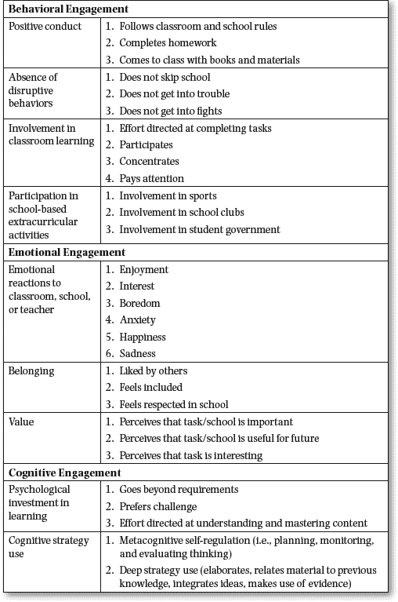

## 思考

1. 你目前如何定义课堂学生的参与？
2. 当你考虑到参与和不参与的学生时，你会想什么？（他们看起来怎么样？听起来又如何？）
3. 你认为参与的哪个部分最重要：行为、情感还是认知？为什么？
4. 你对问题 #3 的回答如何影响你对问题 #1 中参与的定义？

## 为什么参与不仅仅是任务内行为

事实是，在大多数教室里，存在着行为、情感和认知投入的不同维度配置，而且某一维度的投入并不一定意味着其他维度的投入。保持一个安静且有序的教室是许多教师的重要目标。因此，许多教师将顺从和在任务上的行为等同于投入。然而，仅仅因为学生参与了并遵守了规则，并不意味着他或她正深度投入学习。本杰明是本章开头介绍的六名学生之一，他是这类学生的例子。尽管他正在工作并处于任务状态，但他感到很无聊，并且仅在使用`shallow-learning strategies`，这些策略可能帮助他在考试中背诵材料，但不会导致深度学习。先前的研究表明，使用`deep-learning strategies`（例如将新信息与现有信息联系起来并积极监控理解情况）比使用记忆和机械处理等浅层和表面策略具有更高的学习成就。使用机械策略的学生建立的心理联系较少，反过来增加了他们检索信息并将其应用到新情况的难度。

贝特丽丝就像许多仅在行为上投入的学生一样。这些学生处于任务状态并遵守规则。在外部观察者看来，他们看起来很投入。在许多方面，他们是理想的学生，表现得良好且值得信赖。然而，尽管像贝特丽丝这样的学生正在处理任务，但他们并不一定投入到加深理解所需的努力中。他们没有深度投入内容，并且仅使用浅层和表面的策略来学习材料。相比之下，菲娜寻求挑战，完成额外工作，并使用`deep-learning strategies`，这能帮助她学习并掌握内容。先前的研究显示，像菲娜这样的学生具有更高的成就，因为他们将内容与自己的现有知识进行联系和整合，这有助于他们形成更丰富的心理表征。

理想情况下，学生在行为、情感和认知投入上都处于高水平。菲娜和弗朗哥是这些完全投入学生的例子。这类学生很好教；他们积极参与，对学校感兴趣，并使用学习策略来帮助自己掌握和学习内容。反过来，这些学生倾向于从老师和同伴那里获得更多积极的互动和支持，这随着时间的推移有助于进一步增加投入。显而易见，能够在教室建立稳固关系的学生具有优势，这种优势随着学年的进展呈指数级增长。相比之下，像拉切尔和莱恩这样表现出投入迹象的风险的学生更难教。这些学生通常得到的老师和同伴的支持较少，这随着时间的推移进一步抑制他们的投入。遗憾的是，这导致了一个自我放大的循环，投入的个体差异随着时间的推移而被放大。

## 思考与反思

1. 你在教室里看到了哪些类型的投入和不投入特征？
2. 你是否有作为完全投入、仅在行为上投入或处于风险的学生的范例？你的菲娜、弗朗哥、贝特丽丝、本杰明、拉切尔或莱恩是谁？你是如何与每种类型的学生互动的？
3. 你是否有那些你不知道他们是否投入或如何投入的学生？你是如何与这些学生互动的？

## 为什么要评估投入？

教师可能出于几个原因想要评估投入情况。首先是识别有学业失败风险的学生。辍学不是一个瞬间发生的事件；对许多学生来说，这是一个长期过程。教师可以识别出表现出不投入的学生并提供更好的支持。

评估投入的第二个原因是监控学生对课堂体验的反应。观察哪些是有效的、哪些可能需要改变是非常重要的。并不是所有学生都一直保持投入。

最后，教师或管理员可能想收集投入数据，作为学校改进工作的一部分。这可以通过教师的调查或作为学习社区的一部分来实现。许多学校干预措施侧重于增加投入，作为提高成就和学校毕业率的手段。

## 投入的一致性、持续性和变化

以下章节说明了教师可能会对教室中投入水平提出的各种问题。

### 我教室里学生的投入有多一致？

一个重要问题涉及个体学生之间投入的一致性。一天中的某些时间，学生对学习的投入程度多或少。例如，活动之间的转换通常是人们看到投入下降的时间。此外，投入在不同学科之间存在差异。在学生认为自己能力强、发现内容有趣和/或认为为未来学习这些内容有价值的学科中，投入倾向往往更高。相反，在学生面临学业困难、觉得学科无聊且与生活无关和/或看不到学习更多相关主题对未来何帮助的语境下，投入往往较低。

### 我的学生在何时、何地投入？

考虑不同教学环境下投入的广度或变化也是重要的。先前的研究表明，投入会随着背景因素（例如小组作业、大组讨论、讲座和坐式练习）和任务特征（例如复杂性、挑战性、时间）变化。例如，发现在学生大部分时间处于教师主导和被动活动中的教室里，投入度较低。相比之下，在学生认为教学具有挑战性且他们处于协作小组活动而非大组讨论的教室里，投入度较高。教师可以利用投入变化的信息来调整教学。

### 我的学生参与度如何？

最后，参与的持续时间或长度对于评估至关重要。有些学生在整节课程中表现出高参与度，而其他学生的参与度会随情境因素而变化。例如，像瑞切尔和莱恩表现出参与度迹象的学生，在与朋友一起工作或从事更具创意的项目时，参与度可能会增加。对于这些学生，教师应该尝试识别可以帮助增加或减少他们参与度的触发因素。

### 停下来反思

1. 你的课堂参与度目标是什么？你是想增加参与学生的百分比、学生参与的时间，还是学生参与的情境？
2. 在你的课堂里，学生通常在哪些活动中参与度最高？你认为这些活动为什么吸引人？学生的注意力什么时候会分散？你认为是什么触发了不参与行为？
3. 学生在一天中什么时间参与度最高？什么时间最低？你如何解释整个学校时间内参与度的差异？
4. 你的教室里是否有像莱恩和瑞切尔那样在行为上不参与课堂的学生？
    a. 他们的问题行为发生在何时、何地以及与谁一起？
    b. 你对问题行为如何反应？其他人是如何反应的？

## 评估参与度的方法

### 自评测量法

评估课堂参与度有多种方法。最常见的方法是让学生填写自评问卷，问卷中包含一系列关于他们行为、情感和认知的问题。其中一些问题评估学校层面的总体参与度，而另一些则衡量特定课堂的参与度。在这些调查卷中，学生对 `Likert-response items`（李克量表项目）进行圈选。这是一种固定格式，用于衡量对特定陈述的同意/不同意程度。这些项目通常在 1 到 4、1 到 5 或 1 到 7 的回答量表上进行衡量，回答范围从“非常同意”到“非常不同意”，或“非常符合我的情况”到“不符合我的情况”。对于较小的学生，量表可以是一系列表情图标，例如 。如果你的学生可以方便地使用技术，有多种免费资源可以快速有效地调查他们的感知（参见表 1.2）。分数可以对各项进行求和或平均，形成一个量表或总分，以描述学生在每个维度的情况。`Scale scores`（量表分）比任何单个项目都能更准确地代表行为、情感和认知参与。

自评法被广泛使用是因为它们在课堂上是最实用且易于管理的。它们可以低成本地用于大规模多样化的学生，使得比较不同环境的结果成为可能。自评法对于评估学生对情感和认知参与的感知特别有用。参与度的这两个维度不是直接观察到的（即它们是参与度的间接衡量），需要从行为中推断或由学生报告。自评测量的一个问题是，在某些情况下学生可能不会诚实回答，因此自评可能反映反映的行为、情感和认知。另一个问题是这些测量通常包含措辞过于宽泛的项目（例如，“我在学校努力学习”），而不是反映特定任务和情境的参与度。

**Table 1.2** 教师常用调查工具

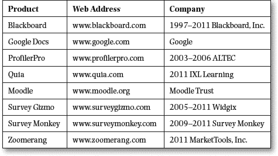

`Behavioral engagement`（行为参与度）可以通过询问学生的注意力、努力、坚持性、出勤情况、作业时间、课前准备、学校活动参与情况以及风险行为（例如，旷课）的问题来衡量。`Emotional engagement`（情感参与度）通过关于在学校经历的情感问题（如快乐或焦虑）来衡量。此外，关于学生兴趣水平、享受、无聊以及对学校价值的认知，或学校有多重要的问题也是情感参与的指标。最后，`cognitive engagement`（认知参与度）通过询问学生使用深度学习策略、是否喜欢做困难或挑战性的工作，以及在学校或家里是否做了比要求更多的工作来衡量。Table 1.3 包含了一些用于行为、情感和认知参与的样本自评项目。这些项目可能位于 1 到 4、1 到 5 或 1 到 7 的李克量表上（1 = “从不”；4, 5 或 7 = “一直”；1 = “完全不真实”；4, 5 或 7 = “非常真实”）。

### 教师评分表

评估参与度的另一种方法是让教师根据一系列关于学生行为、情感和认知的问题对每个学生进行评分。这种技术对于识字能力有限且更难完成自评测量的小学生来说特别有用。当需要收集特定学生的数据时，它也非常有用。教师往往是学生行为极好的报告者。然而，准确评估情感和认知参与可能困难，特别是当学生掩盖负面情绪并表现出顺从行为时，正如贝特丝和本杰的情况。

**Table 1.3** 参与度自评项目样本

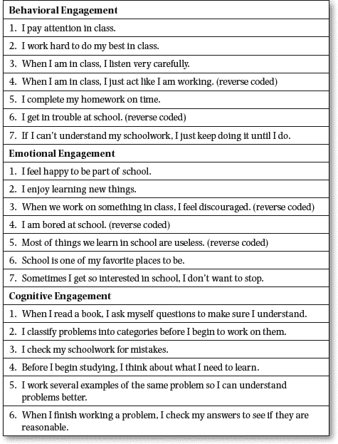

Table 1.4 展示了参与疏离教师评分表，该表旨在衡量课堂的行为和情感参与。这项调查对课堂参与和疏离（即不参与）设计了单独量表。该衡量工具最初为小学高年级课堂设计的，此后已用于年长的学生。这些问题适用于任何学科。所有项目均为 1 到 4 的量表（1 = “完全不真实”；4 = “非常真实”）。

**Table 1.4** 学习参与与疏离调查——教师报告

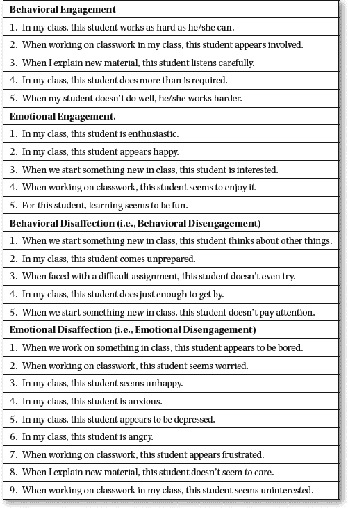

*Source:* Skinner, Kindermann, & Furrer (2009)。经许可使用。

很少有专门为衡量特定学科参与度而设计的。一个例外是阅读参与指数（Reading Engagement Index, REI；参见表 1.5），它由马里兰大学的 Allan Wigfield 及其同事开发。这种教师自评测量工具用于评估小学阶段阅读的行为、情感和认知参与。所有项目均采用 4 点回答量表，范围从 1（“不真实”）到 4（“非常真实”）。

### 观察测量法

评估参与投入的另一种方法是直接观察个人、目标学生或整个课堂。这些观察大多数根据任务内行为和参与情况来衡量行为投入的各个方面。表 1.6 展示了这些样本观察指标中的某些。通过观察程序来评估认知投入要困难得多，因为学生在现实中可能看起来像是在深思考，但实际上并非如此。Peterson、Swing、Stark 和 Swass（1984）发现，一些被观察者判断为“处于任务内”的学生在随后的访谈中报告说，他们在被观察时并没有考虑这些材料。相反，许多看起来“处于任务外”的学生报告说他们的认知投入度非常高。例如，一个边向窗外看边敲击铅笔并深度思考内容的学生，使用这些观察技术进行评分时，其参与度评分会比一个认真记笔记但没有深入理解这些观点的学生要低。

**表 1.5** 阅读参与投入度指数

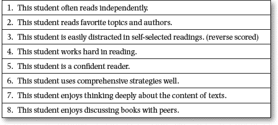

*来源:* Wigfield 等人（2008）。

**表 1.6** 参与投入的样本观察指标

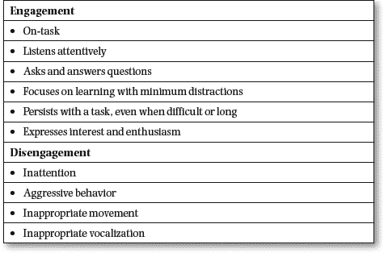

虽然通过观察法直接评估情感和认知投入较为困难，但这些维度的某些指标可以从行为指标中推断出来。例如，教师可以通过学生对任务的选择和坚持的水平来衡量他们对挑战的偏好。当学生对某项活动表现出热情和兴奋，或对教师或同学发表积极评价时，就可以观察到情感投入。

记录观察数据有几种方法。最常见的是使用**时间采样程序**（time-sampling procedure），观察者记录在特定的时间间隔（通常为十五到三十秒）内，某项行为是否在某个人身上发生。表 1.7 展示了一个时间采样观察的样本记录表，用于衡量单个学生的任务内/任务外行为。对于每个时间间隔，观察者记录目标学生是处于任务内还是任务外。记录时间、受试者环境也很重要，以查看在特定的情境或一天中的某些时间，学生倾向于有更多或更少的投入。

时间采样程序也可用于评估课堂层面的投入水平。在每个间隔期间，观察者扫描教室，统计参与投入和未投入的学生人数。这些信息可以用于创建每个间隔内参与投入的学生百分比，以及看起来未投入学生的平均百分比。记录观察数据的另一种方法是进行**事件计数**（event count），观察者记录在特定情境下，某项预定行为（如不当行为）发生的次数。这些数据可以在个人或班级层面进行收集。


教师还可以使用清单或行为条目来收集有关行为投入的数据。对于每个指标，观察者勾选该行为是否发生。最后，观察者可以使用预设的评分量表来记录投入水平。观察者根据单个指标或对学生投入的整体衡量来评估学生投入的质量（1 =“完全没有投入”；5 =“深度投入”）。观察者根据直接观察或过去记录的观察，为连续体上的每个指标分配一个值。

**表 1.7** 样本观察表

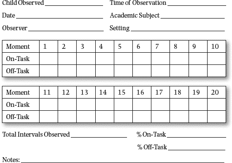

观察可以由教师进行，也可以由外部观察者（如行政人员、学校心理学家或训练良好的助教）进行。然而，观察自己的学生可能是最有效的。因为教师每天都会看到学生，他们能够判断某种行为对于该特定个人来说是典型的还是非典型的。此外，学生如果知道自己正被外部人员观察，可能会改变自己的行为。对于教师来说，收集发生频率低或不可预测行为的观察数据也更有效。另一方面，在给大组学生授课时，在个人层面进行观察可能是困难的。

应该考虑为被要求进行观察测量的教师提供支持安排。学习可靠地记录数据需要投入培训时间，特别是在使用更详细的观察测量法时。在决定最合适的观察者时，必须权衡这些折中。观察者收集足够的数据，并在各种学术环境（例如：小组、大组、个人坐席）中收集数据也同样重要，以便获得参与投入的准确图景。对于低频率行为指标，观察者应尝试识别可能引发或强化行为的前因和后果。这些信息可以用于确定投入和不投入的模式以及触发因素。

在接下来的**实践中的投入**（Engagement in Practice）部分，Melissa 讨论了她所在学校教师使用同级观察。

## 实践中的投入：同级观察

最后，可以利用学校记录中已收集的数据来识别表现出参与度下降迹象且有辍学风险的学生。可以使用这些数据编制一份案例研究。此前的研究已经确定了一些早期预警指标，这些指标预示着学生更有可能陷入麻烦、学业挣扎并最终辍学（Balfanz, Herzog, & MacIver 2007）。这些早期预警指标的预测能力正被许多学校、学区和组织用于以指导预防工作。早期预警指标的示例包括：

### 表 1.8. 学生参与度走访指标示例

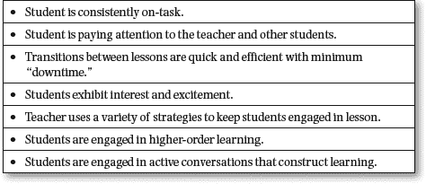

*   迟到
*   旷课
*   缺勤
*   行为劝介
*   留校
*   停学
*   课程不及格
*   学分进度落后

在接下来的“实践中的参与”章节中，Ellen 描述了她如何利用早期预警信号来识别学校中参与度下降风险的学生。

## 实践中的参与：数据墙

**Ellen**：在诺威奇自由学院（Norwich Free Academy）的九级，学生被分配给一个多学科团队，该团队由四名教师、一名指导辅员、一名特殊教育教师和一名学校心理老师组成，负责确保学生拥有成功的九级体验。多学科团队的成员创建一个 `data wall`（数据墙）或 `Google Doc spreadsheet` 以改进沟通并跟踪学生的行为参与度和成就数据。该文档用于识别早期预警指标、记录干预措施以及跟踪学生的进步。`data wall` 上的早期预警指标示例包括成绩测试分数、缺勤情况、纪律劝介和学分流失。这些信息被用于设计干预计划，并在规划与安置小组会议上提议增加服务。

一旦收集了学生行为信息，建立一个讨论这些信息并制定干预计划的机制就至关重要。在下一节中，Melissa 描述了拥有共同会议时间来讨论学生学业和行为的重要性。

## 实践中的参与：共同团队会议时间

**Melissa**：我们学校支持协作并讨论学生参与和表现的一种方法是设定共同的团队会议时间。在每年制定时间表时，我们确保年级小组和跨年级小组每周都有时间见面。虽然部分时间用于计划工作，但也用于讨论学生的学业和行为。有时，学生之前的老师可以提供见解，或者我的同事可能会提供在他们课堂中有效的想法。我们会邀请学校社工作者、教学教练或特殊教育教师等专家提供建议。这些会议的常规频率是无价之宝。干预措施可以在七天后立即进行协作计划、实施和讨论。共同会议时间看起来像是一个简单的策略，但有意识地安排时间让同事借鉴彼此的专业知识，对教师是赋权的，对其他学生是有益的。

## 章节总结

本章从一个论点开始：参与度需要被概念化为一个多维度的构念，包括行为、情感和认知。除了了解学生如何行动，了解学生对学校的感受以及他们的想法也至关重要。书中介绍了六个假设性案例，以说明学生在这些不同维度上的差异。本章的目标是反驳参与度等同于服从或任务内行为的假设。在行为上参与的学生在外部观察者看来可能完全投入了。然而，这些学生可能在情感上没有投入，或者没有使用深度学习所需的认知策略。

接下来，章节概述了在课堂评估参与度的不同原因，包括识别学业失败风险学生、监控学生对课堂环境的反应以及评估学校改进工作。最后，回顾了评估课堂参与度的不同方法，包括学生自我报告、教师评分、观察测量、走访以及收集早期预警信号的数据。对于每种技术，都分享了以往研究中使用的示例项目。本章以*文本到实践练习*（Text-to-Practice Exercises）结束，帮助教育者将这些理念应用于真实的课堂情况，回顾了关键术语和概念，并列了一份书单。

## 文本到实践练习

TPE 1.1：观察参与度：在不同背景下选择学生进行观察。注意共同点和差异。确保考虑环境因素对参与度的影响。

TPE 1.2：询问学生参与度：使用表 1.2 中的项目询问他们的参与度。让学生解释回答。注意反馈可以在几周内收集。

TPE 1.3：识别课堂中的参与度下降：通过观察技术或收集早期预警信号数据，识别参与度下降的学生。这些学生的行为、情感和认知有什么相似之处？哪些课堂实践导致了他们的参与度下降？

# 课堂观察/学习漫：对学生行为和教学进行频繁、短暂且非计划的观察。课堂观察的一个重要维度是为教师提供反馈和反思的机会。

## 基于研究资源

### 推荐阅读书籍与报告

Fredricks, J., & McColskey, W., with Meli, J., Mordica, J., Montrosse, B., & Mooney, K. (2010). *Measuring student engagement in upper elementary through high school: A description of 21 instruments.* Issues & Answers Report, REL 2010–No. 098. Washington, DC: U.S. Department of Education, Institute of Education Sciences, National Center for Education Evaluation and Regional Assistance, Regional Educational Laboratory Southeast. Retrieved from [http://ies.ed.gov/ncee/edlabs/projects/project.asp?projectID=268]

Shapiro, E. S. (2004). *Academic skills problems: Direct assessment and intervention* (3rd ed.). New York, NY: Guilford Press.

## 推荐访问网站

1. **直接行为评分** ([www.directbehaviorratings.org](http://www.directbehaviorratings.org))。该网站提供课堂行为观察的资源。网站提供了示例观察表单，以及如何通过图表绘制数据和评估学生行为的信息。

2. **高中学生参与度调查** ([www.Indiana.edu/~ceep/hssse](http://www.Indiana.edu/~ceep/hssse))。该网站提供了高中学生参与度调查的信息，这是一项由超过 400,000 名中中学生进行的关于学生参与度和学校氛围的全面国家调查。为感兴趣参与调查的学校提供信息。

3. **课堂评估评分系统 (CLASS)** ([www.teachstone.org](http://www.teachstone.org))。该网站提供了有关课堂评估评分系统 (CLASS)的信息，该系统是由弗吉尼亚尼亚大学的 Robert Pianta 开发的一种课堂观察工具。

4. **iObservation** ([www.iobservation.com](http://www.iobservation.com))。iObservation 是一个数据收集和管理系统，用于收集来自课堂观察、教师观察和自我评估的数据。该网站提供示例的观察表单。

5. **[iWalkthrough.org](http://iWalkthrough.org)** ([www.iwalkthrough.org](http://www.iwalkthrough.org))。该网站提供了了大学校伙伴关系（Great School Partnership）开发的一系列资源，用于进行课堂观察和评估。

6. **Power Walkthrough** ([www.mcrel.org/products-and-services/featured-products-and-services/power-walkthrough](http://www.mcrel.org/products-and-services/featured-products-and-services/power-walkthrough))。该网站提供了有关 Power Walkthrough 软件的信息，这是一个用于收集教学实践和学校参与水平数据的工具。

## 第二章

### 迷思二：有些学生根本不在乎

*缺乏参与感不仅仅是学生缺乏动力*

在课堂上观察到学生缺乏参与感的教师通常认为，这种缺乏参与感的现象由于学生个人的某些特征造成的，和/或者认为缺乏参与感的学生根本不在乎，没有动力参与。有些教师相信并经常说，如果他们有机会与一群更有动性的学生一起工作，他们的课堂将会更具参与性。学生的个人特征确实会使创建一个高参与度的课堂变得更容易或更困难，而且教师可以影响学生特征与学习任务之间的相互作用。`Table 2.1` 列出了一些已被证明是参与度预测指标的个人特征。研究将成就；**自我效能**（或个人对自己在特定情境下成功的信念）、**内在动机**（或由对任务的兴趣或享受感驱动的动力）、**掌握目标导向**（或对学习和理解的关注）以及**实用价值**（或对课程作业重要性的感知）与更高水平的行为、情感和认知参与度联系起来（Fredricks et al., 2004; Greene et al. 2004）。

**表 2.1 与更高行为、情感和认知参与度相关的学生特征**

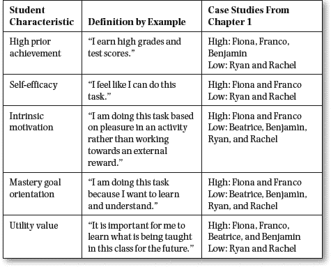

教师知道，要让像 Fiona 和 Franco 这样的学生参与更容易，这两个学生的简介在第一章开头介绍过。Fiona 和 Franco 在学校表现成功，对自己的能力有很高的认知（即自我效能），对学习有内在兴趣，并以掌握目标导向的态度对待任务。相比之下，像 Ryan 和 Rachel 这样的学生更难以让他们，因为他们不相信自己拥有成功的技能（即低自我效能），觉得学校很无聊，并质疑学校对生活的有用处（即低实用价值）。虽然理论上如果教室里所有的学生都像 Fiona 和 Franco 那样，教学将会更容易，但现实情况是学生进入教室时带有各种先前的兴趣、能力和对学校的态度。教育工作者的挑战在于找到一种方法让所有这些不同类型的学生参与进来。

参与不仅仅是动力。有时*参与（engagement）*和*动力（motivation）*这两个词被互用；然而，它们是不同的，其区别很重要。动力强调更难以改变的心理或内部过程，而参与则反映了个人与其环境的互动（Fredricks et al., 2004）。换句话说，当一个人投入某事时，很难将其参与状态与环境分开。此外，学生可能有动力但并未积极参与某项任务（Connell & Wellborn, 1991）。对于参与而言，动力是必要的但不充分。

参与反映了个人特征与背景因素之间的相互作用。本章的目标是反驳“缺乏参与仅仅反映了动力低下”的迷思，并帮助教师识别和反思可能导致课堂缺乏参与感的教学和社交动态元素。许多研究人员和政策制定者开始关注参与的一个原因是，可以通过改变课堂的教学和社交环境来提高它。遗憾的是，也有证据表明学校中的许多常见做法实际上导致了学生参与度的降低。

### 学校任务与校外任务

学生可能缺乏参与的一个原因是，学校学习往往与学校背景之外的学习方式并不相似。像 Benjamin 这样的学生可能会完成作业并在行为上参与，因为他们有获得好成绩的**外部动机**，并相信在学校表现良好有助于他们的未来。然而，要让这类学生在情感和认知上参与传统的学校任务更为困难，因为这些任务与他们自己的生活缺乏关联，且结构上并不支持深度学习。`Table 2.2` 列出了研究人员在二十多年里确定的学校学习与校外背景学习的一些重要差异。

在学校里，学生花费大量时间在`direct instruction`（直接教学）中，这种教学强调通过讲座、演示和个人作业对技能进行显式教学。一项针对 2500 多间教室的大型研究显示，五年级学生 90% 的课堂时间在听老师讲或独立工作，只有 7% 的时间用于小组活动（Pianta, Belsky, Houts, & Morrison, 2007）。纸笔练习题和其他被动学习活动在这些许多教室中很常见。在这些环境中，教师处于主导地位。他们决定了结构、常规流程和学习活动，学生做与学习相关决策的机会非常有限。学校学习主要基于符号，并且脱离了学校外的物体和事件背景。教学内容往往与学生的生活经验联系不紧密。尽管直接教学的益处被认为有助于学生在基础能力的低水平测试中获得更高分，但这种教学方法对学生参与度以及《共同核心标准》和《下一代科学标准》中概述的概念性成果的积极影响可能较小。

关于有组织的校外学习的研究日益增（包括课后计划、社区计划以及实践和工作情境中的学习），表明校外的心理活动与传统教室发生的活动非常不同（Larson, 2000; Resnick, 1987）。这些外部环境往往更`child-centered`（以儿童为中心）。个人对学习活动有一定的选择权，并经常参与设计规则、后果和奖励。在校外，个人在推理中直接使用物体、事件和动作，而不是仅仅使用符号来表示想法。许多校外学习也发生在小组中。知识是社会分布的，因为每个人都取决于他人的所作所知。这些小组共同努力解决认知上复杂的现实问题。这些活动通常持续很长时间，并以公开展示成果作为终结。

学校学习与校外环境学习的一个主要区别是信息共享的方式。在传统教室中，许多活动的目标是让学生在作业中复制知识，而这些作业只与老师分享。大部分情况下，学生的成功独立于其他学生在教室里的表现。相反，在校外环境中，个人经常共同工作，创造的知识会与更大的社区共享。

### 表 2.2 学校学习与校外环境学习的区别

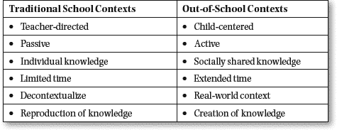

在接下来的“实践中的参与”部分，Michele 描述了她使用的一种策略，改变了课堂中知识分配和共享的方式。她使用一个“阅读伙伴”计划来开展读写和艺术活动，并将这些活动与更广泛的社区共享。

### 实践中的参与：阅读伙伴

Michele：在我所从学前班到八年级的小学，每个低年级教室都会与高年级教室配对，在整个学年作为阅读伙伴合作。这种协作还包括高级学生帮助低级学生写作。协作作品展示在学校的主走廊里。高级学生给他们的低级伙伴读一两本书，随着学年的推移，他们会听低级伙伴朗读。每年，我的四年级学生都会和一个幼儿园班配对，伙伴们一起开展与幼儿园主题单元相关的项目。一年中几次，我们班还会邀请低级伙伴参加“阅读伙伴作者分享会”，四年级学生轮流朗读他们在作家工作坊期间撰写的文章。四年级学生选择一段摘录给观众读，就像现实世界的作者在图书巡回时做的那样。与阅读伙伴的作者分享有助于学生练习朗读，以参加我们在教室举办的写作庆祝活动，届时我们会邀请家长来听我们的终稿。这是班级与整个学校社区的其他学生和家庭分享写作的极佳方式。

## 停止、反思与尝试

1. 参考`表 2.2`，你会如何描述你教室里的任务？

   a. 你的学生是否大部分时间都在听老师讲？

   b. 你的学生多频率有机会进行小组合作？

   c. 学生大部分时间是在复制知识还是构建知识？

   d. 你的学生有多少时间在课堂完成作业？

   e. 你对作业提供什么类型的反馈？

   f. 你的学生是否有机会与同学、更大社区或虚拟社区分享他们的知识？

   g. 你的学生是否有机会选择作业主题或选择如何以及在何时完成作业？

2. 你可以对教学做哪些改变，以纳入`表 2.2`中列出的校外环境学习方面？将这些改变中的一种融入你的教学中。跟踪学生的反应。

遗憾的是，这种对传统学校任务的强调由于问责运动而加剧了。在许多教室里，学生花费大量时间在训练和练习，以及需要记忆或重复程序的任务上。像 Fiona、Franco、Beatrice 和 Benjamin 这样的学生会在这些教室里表现出行为上的参与。他们会注意、保持专注，并使用如反复或下划线等浅层学习策略来完成作业。然而，这种工作不会带来情感投入、认知投入或更深层次的学习。学生很快就会对活动的重复感到无聊，使得信息不太可能储存在长期记忆中（Willingham, 2009）。此外，这类任务不太可能需要大量的努力、自我调节或促进深度理解和灵活运用知识的高级学习策略。对于像 Rachel 和 Ryan 的一些学生来说，对成绩考试的关注实际上适得其反，导致成绩更低，因为他们觉得教室环境缺乏参与感。讽刺的是，教育政策制定者立即提高学生成绩的愿望产生了一个意料之外的结果：抑制了那些被发现可能增加学生参与度并产生深层次学习的课堂实践。虽然行为参与在低水平任务中很重要，但随着学校转向新的、更具概念性的标准，情感和认知参与将是至关重要的。

教师-学生关系与脱节

大量的研究文献表明，高质量的师生关系对于增加行为、情感和认知参与度至关重要（Fredricks et al., 2004）。与学生建立良好关系的教师创造了可以进行深度学习的课堂环境，同时也支持了学生的社交和情感发展。对于表现出学业和行为问题的学生来说，与教师的关系尤尤为重要（Hamre & Pianta, 2006）。良好的师生关系可以保护具有学业失败风险的学生。遗憾的是，师生之间低质量的关系实际上会增加学业风险（Ladd & Burgess, 2001）。关于如何与学生建立更深层关系的策略在第 5 章中有了更的概述。在本节中，将为理解为什么师生关系对于参与度至关重要奠基础。


随着学生年龄的增长，与教师建立良好关系的重要性持续存在。尽管学生在初中和高中阶段与老师相处的时间较少，但与老师建立良好的个人联系预示着更高的课堂参与度、更高的兴趣和享受感，以及较低的辍学率（Fredricks et al., 2004）。

然而，当学生从小学升入中学时，他们与教师关系的质量往往会下降。Eccles 和她的同事（1993）认为，这种下降是青少年发展需求与中学环境之间不匹配的结果。在学生从发展角度本可以从与教师建立亲密关系获益的时期，中学的规模和结构往往无法促进连接感，反而可能导致更强的疏离感。在中学，学生有多个老师，且每天与任何一位老师相处的时间都有限。此外，许多中学的重点在于管理和控制，而不是支持学生的社交和情感需求。这可能让教师和学生之间建立这些联系变得更加困难。

尽管许多教师与其教室里的学生建立了良好关系，但另一些人并非如此。某些师生关系可以被描述为`冲突型师生关系`。在这些关系中，教师和学生都感到愤怒，很少表现出温暖，互不交流，并且彼此疏远（Pianta, 1999）。此前的研究发现，教师与学生之间的冲突预示着较低的课堂参与度和成就水平（Ladd, Birch, & Buhs, 1999）。尽管教师经常受到与学生关系的困扰，但他们往往不知道如何做或感到无法更好地满足这些学生的需求。

为什么某些学生和教师会产生糟糕的关系？哪种类型的学生最容易产生糟糕的关系？表 2.3 列出了一些使学生面临问题性师生关系风险的因素。像 Ryan 和 Rachel 这样在行为上不投入（具有扰乱性、敌对性、侵略性或脱节性）的学生，往往与教师的关系较差。教师往往更喜欢像 Fiona、Franco、Beatrice 和 Benjamin 那样具有学术能力、负责任且遵守学校规则的学生。此外，与女孩相比，男孩通常与教师之间的冲突更多，亲密关系也更少（有关支持男孩参与度的更多信息，请参阅第 7 章）。这一发现可能反映了小学和中学男性教师数量的有限，以及女孩在课堂上往往更顺从、扰乱更少的事实。学生的家庭经历也很重要。家庭关系较差且家里行为问题更多的学生往往与教师的关系较不亲密（Murray & Murray, 2004）。最后，有证据表明，智力情感情感障碍学生比发育更典型的学生经历着不积极的教师关系（Baker, 2006）。

**表 2.3** 学生面临问题性师生关系的风险因素

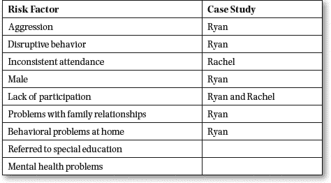

这些糟糕的师生关系随着时间的推移而持续。长期的师生冲突预示着行为问题的增加和对学校态度的不再积极（Hamre & Pianta, 2006）。Ryan 就是这种学生的例子。他表现出扰乱且缺乏动力，并且未能与教师建立良好关系。这种扰乱行为和缺乏动力可能会进一步引发负面反应，反之，这些负面反应会随着时间的推移进一步增加他的脱投入。

## 停止并思考

1. 你是否与某些学生存在冲突关系？（识别你教室里像 Ryan 或 Rachel 的学生。）

2. 当你想你有冲突关系的学生时，脑海中会浮哪些词汇？

3. 你可能做了什么导致了这些冲突关系？

4. 当这些学生表现出不投入迹象时，你的感受如何又是如何反应的？

5. 你是否曾经与冲突关系的学生重新建立了联系？什么促成了这种联系？

尽管可能很困难，但教师在打破他们与学生之间的负面互动中起着关键作用。第一步是教师意识到良好的师生关系在学业适应中的重要作用，特别是对于学业风险最高的学生。尽管与困难学生建立关系需要更多精力，但良好关系对学生投入的好处对这些青少年来说是最大的。教师反思自己对这些学生的感受，以及他们如何通过自己的信念和行为在无意中助长并持续了这些负面关系，这也是重要的。例如，教师经常将 Ryan 这样的学生标记为扰乱或攻击，并根据这些感知解释他们所有的行为。这可能导致学生感到被对待不公正，并受到更严格的审判。

其次，教师需要改变看待不投入的方式。他们不应该将不投入视为学生的性格缺陷或教师的短板。而应该将其视为学生需要更多支持且通常是比目前获得的支持不同的信号。对于某些学生，教师可能需要向学校其他工作人员（如社会工作者、学校心理学家和特殊教育工作者）寻求建议或帮助，了解如何更有效地与这些学生互动。改善关系的额外策略将在第 5 章中讨论。在接下来的“实践中的”部分，Ellen 描述了她如何干预以改善与一个学生的糟糕关系。

Ellen：去年，我教了一门非常有挑战性的课。这门课很难管理，很大程度上是因为一个学生，她不断扰乱课堂，当我试图维持纪律时她在和朋友聊天，并且几乎总是无视我引导她的尝试。在几周的冲突后，我要求她在放学后见我。起初，我计划将这次会面作为一种惩罚，并和她讨论她的行为以及她如何改变这些行为以有利于同学的学习体验。然而，我们从未有机会讨论过她的行为。她很早地来留宿，并没有因为我给她留宿而感到难过，反而很高兴能和我待在一起。她对我说的第一句话是：“你妈妈是什么样的？”我告诉她我的妈妈很支持、体贴且充满动力。然后我问她她妈妈是什么样的。遗憾的是，她告诉我完全不同的情况。她接着向我讲述了整个家族史，那是到目前为止最悲伤的故事之一。在我们持续几个小时的会议之后，我最大的对手变成了我最强大的盟友。她几乎一直都在状态上，甚至会批评那些不遵守纪律不尊人的同学。我意识到，她正在寻找一个强大、一致且支持她的女性榜样。

## 同伴关系与脱离

课堂中的同伴动态也可以促进或破坏学习参与度。被同伴接受的学生往往对学校有更积极的态度，有更高的兴趣，并且行为更符合社交规范（Fredricks et al., 2004）。然而，尽管积极的同伴关系可以增强参与度，但同伴排斥和低同伴接受度会对学习参与度和学业产生负面影响（请参见第 6 章更多关于同伴对参与度积极影响的讨论）。低同伴接受度和`peer rejection`（同伴排斥），或被同学积极，是学校脱离指标的预测性因素，包括行为问题、负面的学校态度和逃避学校（Fredricks et al., 2004）。同伴动态与脱离之间的关系随着时间的推移可能是互惠的。不遵守学校规则和不喜欢学校的学生不太可能认为他们的同伴具有支持性（Ladd et al., 1999）。Ryan 的案例是这种互惠过程的绝佳例子。他的攻击性行为导致他的许多同学积极地厌恶他。反过来，来自同伴的排斥导致了进一步的行为问题和对学校环境的疏离。

对于为什么糟糕的同伴关系会对学生参与产生负面影响，有几种解释。被同学积极厌恶的学生遭受同伴施加的虐待（例如忽视、回避和排斥）以及真实的同伴欺凌（例如嘲笑、骚扰和身体伤害）（Ladd, Herald-Brown, & Reiser, 2008）。此外，同伴关系糟糕的学生参与课堂活动较少，因为他们要么被忽视，要么被积极排斥在活动之外。被排斥的学生很可能进一步脱离活动和与同学的互动，以避免来自同伴更多的负面对待。由于被排除在社交场合，被排斥的孩子也较少有机会发展和实践`prosocial behaviors`（亲社会行为），这种行为是有意为了造福他人而进行的自愿行为（Eisenberg & Fabes, 1998）。亲社会行为的例子包括：合作、分享、帮助同学完成作业以及安慰难过的同学。同伴排斥的影响在青少年时期可能特别棘手。Crosnoe (2011) 理论认为，感觉自己不属于学校的同伴会对会对少年的学术适应产生负面影响，因为青少年会使用反作用的应对策略来处理他们的感受（例如使用药物、脱离学校）。

### 哪些学生最容易被同伴排斥？表 2.4 列出了使学生面临同伴排斥风险的社交特征，以及教师在课堂中可能看到的指示这些风险因素的行为。这些学生表现出很少的亲社会行为，在调节情绪和管理极端情绪状态方面存在困难。他们很容易对同伴感到挫败、恼和愤怒。

#### 表 2.4 同伴排斥的风险因素

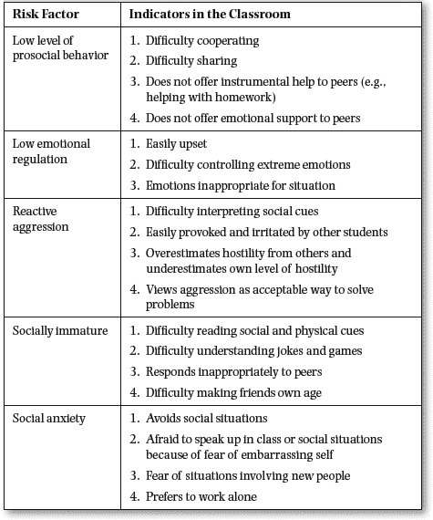

同伴排斥最大的风险因素之一是`reactive aggression`（反应性攻击）。反应性攻击是对感知威胁的反应，通常基于恐惧并具有冲动性。表现出反应性攻击的学生在解释社交情况和为社交问题产生可能的解决方案更有困难（Crick & Dodge, 1996）。他们倾向于高估他人的敌意，更有可能将模糊的情况解释为攻击性，更容易被挑起，并且更有可能将攻击视为解决冲突的恰当手段。社交上不成熟且难以控制行为的学生也面临更大的同伴排斥风险。这些孩子通常在思考之前就行动，因为他们不太能自我调节行为。最后，由于恐惧和社交焦虑的学生在社交场合中往往很笨拙，因此更有可能被同伴排斥（Bierman, 2004）。

## 停止并思考

1. 你是否有任何学生被他们的同伴积极地排斥过？

    a. 你对他们的排斥反应如何？

    b. 当你想起这些学生时，脑海中浮出了什么词？

    c. 他们表现出了表 2.4 中概述的哪些同伴排斥风险因素？

    d. 有哪些是激怒这些学生的触发因素？

2. 激怒学生的触发因素与你组织课堂、支持学生互动或进行教学的方式有什么联系？

为了早期干预，识别学生的社交技能和需要改进的领域至关重要。在教室、食堂、操场、课间休息或学校活动中观察同伴之间的互动，可以洞察学生在各种环境中如何与同学互动。这些观察可以提供关于学生互动风格和受同伴对待的具体细节。在一天中结构化较少的时间观察学生是非常重要的，因为在这些时间可能会发生更随意的对话和重要的观察。当学生应对自由时间时，他们通常需要解决问题、妥协或维护自己和他人。午餐、过渡时期和休息时间也是教师的工作时间。在这些时间，教师可以示范亲社会行为。这些非正式场合也是教师可以与学生进行可能在课堂上无法进行的对话的时间。

教师应该在同伴拒绝与脱离关系随时间推移而持续之前进行干预。表 2.5 概述了与被同伴排斥的学生合作的一些实用策略。良好的师生关系可以为这些学生提供技能，帮助他们与同学进行社交互动。对于具有攻击性的青少年来说，与教师建立良好关系与行为问题减少、获得更多同伴认可有关（Hamre & Pianta, 2006）。教师在对这些学生的互动建模方面也起着关键作用。研究发现，学生的社交偏好受到他们观察教师是否认为某个同伴受欢迎的影响（Hughes & Kwok, 2006）。

“响应式教室”（Responsive Classroom）是一种教学方法之一，教师可以在其中示范恰当的行为并教授社交技能。这种方法强调在安全的社区中促进社交、情感和学术成长（[www.responsiveclassroom.org](http://www.responsiveclassroom.org)）。它由教级教师在 20 世纪 80 年代初开发，现在被应用于全国的城市、农村和郊区教室。该方法包含了帮助学生建立学术和社会情感能力的实用策略。响应式教室基于这样一个假设：教室的社交维度与其学术维度同等重要。这些教室的一个重要重点是教学生合作、自控、同理心和责任感等社交技能。弗吉尼亚大学的研究人员（Rimm-Kaufman, 2012）显示，使用响应式教室实践的学校经历了师生互动的改善、更高的学术成就、社交技能的提高、对学校更积极的情感以及纪律问题的减少。（您可以在 [`curry.virginia.edu/uploads/resourceLibrary/Research_brief_SALS.pdf`](http://curry.virginia.edu/uploads/resourceLibrary/Research_brief_SALS.pdf) 下载他们的研究简报。）

### 表 2.5：与被排斥青少年的合作的实用策略

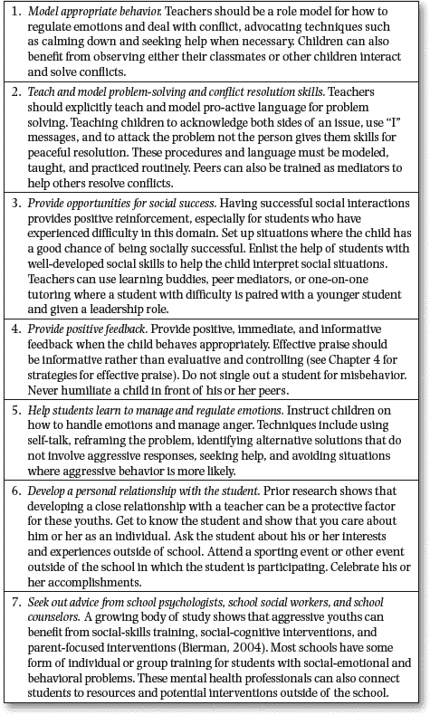

响应式教室模型中，一个重要的课堂实践是“晨会”（`Morning Meeting`）。在这些会议中，学生聚在一起互相问候，并进行有助于建立社区、促进学生个体间关怀或解决同伴之间发生冲突的活动。在接下来的*实践参与*（*Engagement in Practice*）章节中，Michele 和 Melissa 描述了他们如何在小学和初中教室中使用`晨会`来教授社交技能，并设定积极的社交基调，让所有学生都能感到欢迎。

同伴关系的另一个问题是，某些同伴群体的规范并不支持参与和学术成就。一些民族志研究表明，在非裔美国人和低收入青少年中盛行着反学术文化，这些青少年在努力在学业上取得优异时，更容易被同伴嘲笑（Fordham & Ogbu, 1986; 国家研究委员会, 2004）。因此，有一种假设是，这些学生因为害怕被同伴拒绝而脱离了学校。尽管在一些民族志研究中观察到了反学术的同伴文化，但大规模的调查研究表明，这种文化在非裔美国人或低收入学生中并不普遍（国家研究委员会, 2004）。事实上，在许多高中，学生报告说，他们的同伴实际上是在鼓励而非阻碍参与和学术成就（Brown & Larson, 2009）。然而，尽管反学术倾向并非普遍存在，但它确实存在于某些学生之中。教师调查这些学生持有这些信念的原因非常重要。通常，这些观点更多地反映了学生个人而非更大的同伴文化。Rachel 就是这种类型学生的例子。她的反学术倾向可能更多由于她担心自己没有成功的技能，并且认为弄清楚如何成功其价值不值得付出所需的努力。

### 实践参与：晨会

**Michele**: 在我的四年级级级里，我们每天都从一个`晨会`开始。我们围成一个圆圈，和两边的邻座握手，说“早上好”。一个或两名学生会花几分钟分享新闻或最近发生的一件事的故事。然后，我们会玩一个破冰游戏或社区建设游戏，并通过分享当天的任何公告来结束会议。每周有几天，我们不进行小组活动，而是花时间来认识本周的主角学生。这是更好地了解同学的绝佳方法。由于教室有三十多名学生，这个活动几乎持续一年。在每周的第一次`晨会`上，主角学生可以展示一张他们制作的海报介绍自己。在海报上，他们分享关于家庭、喜欢的事以及任何其他他们希望我们了解的信息。在该周的另一天，主角学生会带一封家信，是他们的父母或家庭成员为他们写的，分享了一些我们可能不知道的特点（指令在上周发给了家里）。在当天的`晨会`期间，我向全班朗读这封信。这是我们班级每周最喜欢的`晨会`之一。家庭非常喜欢能够通过这些信参与我们的课堂。

**Melissa**: 八点钟了。二十二名学生和老师聚成一圈举行`晨会`。这个小组通过相互尊重的问候、分享新闻和公告以及玩社区建设游戏，为这一天设定积极的基调。在高年级，学生主持会议，选择能够让学生在安全环境中练习社交技能的活动。今天早上，Amanda 带领小组进行蜘蛛网问候。一团毛线传给学生。随着毛线的展开，每个孩子都受到了问候，大家共同构建了一张网。眼神交流、倾听、说话和被关注都是日常活动的一部分，同时也提醒着我们要欢迎、包并支持所有的同学。在分享了当天的议程、新闻和公告后，Amanda 让小组准备好进行合作滚球游戏。学生拿着回收的纸板槽，在圆圈内传递小球。他们互相加油，如果小球掉了，他们互相鼓励。感到被关注、安全且有能力，班级准备好开始新的一天。

## 章节总结

本章的目的是反驳“学生参与度低仅仅反映了缺乏动力”这一误区。相反，我们要求教师考虑学术环境和社交环境的各个方面如何对许多教室中看到的高水平不参与感也产生作用。第 2 章 首先概述了参与感涵盖的内容不仅是动机。本章的其余部分回顾了导致当今小学、初中和高中学生缺乏参与感的学校教育特征，包括校内与校外学习差异的概述、疏远的师生关系以及同伴排斥。许多学生缺乏参与感的一个原因是，学校任务的结构与教室外学习发生的方式几乎不相似。学生缺乏参与感的另一个原因是他们与老师之间建立了冲突关系，并且未能与同伴建立良好的关系。这种支持的缺乏随着时间的推移会导致参与感的进一步加剧。本章以`Text-to-Practice Exercises`（文本实践练习）结束，帮助教育工作者将这些理念应用于真实的课堂情境；回顾了关键术语和概念；并列出了教师可以使用的额外书籍和网络资源，以探索向学生展示他们的关怀，并帮助学生相互关心的方法。

## TEXT-TO-PRACTICE EXERCISES

**TPE 2.1: 评估一节课程：** 评估一节课程的学习机会（参见表 2.2）。描述该课程是否以及如何应对每个维度。你可以如何改进这节课程以包含更多以下维度？

a. 学生小组合作的机会

b. 主动学习的机会

c. 现实世界的话

d. 公开展示的机会

e. 决策的机会

**TPE 2.2: 评估师生关系的质量：** 想想你教室中那些你建立过良好关系也建立过不那么理想关系的学生。对于每个学生，描述你们的关系以及你对该学生出现在你教室里的真实感受。利用本章中的材料，尝试解释关系质量差异的原因。你可以使用哪些策略来改善那些不那么理想的关系质量？

**TPE 2.3: 评估社交行为：** 比较两个具有不同社交特征儿童（例如：被排斥 vs. 被接受，具有攻击性 vs. 非攻击性）的社交行为。根据表 2.4 列出的不同维度对这些孩子进行比较。在不同的环境中观察这些孩子。比较他们如何解释社交信号、调节情绪、展示亲社会行为以及解决冲突。利用本章中的材料，尝试解释他们同伴关系中的差异。你可以在教室中使用哪些策略来示范和练习亲社会行为？

## KEY TERMS AND CONCEPTS

**以学生为中心（Child-centered）：** 一种关注每个学生需求、能力、兴趣和学习风格的教学方法。让学生对自己的学习体验做出决策的机会是这种教学方法的核心。教师在这些教室里着更具促进性的作用。

**冲突性师生关系（Conflicted teacher-student relationships）：** 师生之间表现愤怒、缺乏温暖且沟通不良的关系。

**直接教学（Direct instruction）：** 一种由教师引导的教学方式。

**外在动机（Extrinsic motivation）：** 指来自外部因素（如成绩）的动力。

**内在动机（Intrinsic motivation）：** 源自内在兴趣或对任务的热爱的动力。

**掌握目标（Mastery goal）：** 关注学习的目标。

**晨会（Morning Meeting）：** 响应式课堂的一个组成部分，学生在此聚在一起。

**同伴排斥（Peer rejection）：** 指学生被同伴积极讨厌。

**亲社会行为（Prosocial behaviors）：** 帮助他自愿行为。

**反应性攻击性（Reactive aggression）：** 对人的攻击性反应。

**自我效能（Self-efficacy）：** 个人对自己成功能力的信念。

**实用价值（Utility value）：** 对学校重要性的感知。

## RESEARCH-BASED RESOURCES

### 书籍与报告

- Bierman, K. (2004). *发展过程*.

- Brady, K., Forton, M., & Porter, D. (2010). *应对挑战*.


## 参考文献

- Crowe, C. (2011). *让你的教室远离欺凌*。
- Denton, P. (2007). *语言的力量*。
- Denton, P. & Kriete, R. (2000). *学校的前六周*。
- Kriete, R. (2002). *晨会*。
- Pianta, R. C. (1999). *增强儿童与教师的关系*。
- Rimm-Kaufman, S. (2012). *社交与学术学习*。
- Willingham, D. T. (2009). *为什么学生不喜欢学校？*

## 访问网站

1. **Education.com**: [www.education.com](http://www.education.com) - 关于欺凌和改善师生关系的文章。
2. **Edutopia.com**: [www.edutopia.com](http://www.edutopia.com) - 关于社交情感学习的研究以及学校案例。
3. **My Teaching Partner**: [www.mtpsecondary.net](http://www.mtpsecondary.net) - 针对教师个人专业发展计划。
4. **Responsive Classroom**: [www.responsiveclassroom.org](http://www.responsiveclassroom.org) - 关于响应式课堂模式的信息。
5. **起源** ([www.originsonline.org](http://www.originsonline.org))。该网站包含与小学响应教室（Responsive Classroom）模型以及“发展设计”（Developmental Designs）相关的资源，后者是一种在中学阶段教授社会、情感和学术能力的干预措施。
6. **学术、社会与情感学习协作 (CASEL)** ([www.casel.org](http://www.casel.org))。该网站包含学校社会情感学习的资源，包括活动、研究和职业发展机会。

# 第三章

## 误区三：校外事务会与学术产生竞争

### 校外时间和家庭如何影响对学校的参与度

在美国，学生每天只在学校呆七小时，全年 365 天中平均只有 180 天。因此，如果不考虑学生生活和度过时间的环境，讨论如何让学生参与课堂学习毫无意义。现实情况是，青少年清醒时间中花费在教室外活动上的比例高于在教室内的比例。学生可以将这段课外时间花在支持学习、参与和积极发展的环境及人际中，也可以花在对其课堂参与产生负面影响的背景下。在本章中，介绍了关于学生度校外时间的两个场所的研究。首先，本章开始了关于参与课外活动后果的研究讨论。其次，介绍了关于家长参与和投入的研究。

## 课外活动参与与学术成果

许多儿童和青少年度过校外时间的方式是参加学校和社区的课外活动，如体育、艺术和学校社团。在全国调查中，超过 80% 的儿童青少年表示在一年内参与了至少一项学校课外活动（Mahoney, Harris, & Eccles, 2006）。虽然参与课外活动是许多青年的共同成长经历，但一些教育者对学校在这些领域投入的价值表示怀疑。在问责制和财政限制的时代，许多学校将其资源限制在《不让任何孩子落后法案》（No Child Left Behind Act）规定的课程部分。据估计，在 2009–2010 学年，课后预算削减了超过 20 亿美元（Fredricks, 2011）。

一些教育者假设体育和艺术等活动只是“额外项目”，仅对娱乐和休闲有用。另一个常见的假设是，参与课外活动会竞争学生的时间和注意力，并夺占他们学习学业的时间。这是一个误区。多项研究表明，参与课外活动的青少年成绩更高，在学业测试中得分更高，对学校的参与度更高，且上大学的概率也更大（Feldman & Matjusko, 2005）。此外，这些活动的参与者辍学的概率较低。一些研究表明，参与课外活动的益处对学术风险学生来说尤为显著（Mahoney & Cairns, 1997）。现实情况是，对于某些学生来说，参加体育和艺术等有组织的非学术背景是他们来学校的唯一理由。

### 为什么参与课外活动的学生表现更好？

目前已经提出了几种解释。其一种是，参与这些活动有助于组织校外时间。课后时间是积极发展的风险与机会并存时期。儿童青少年参与课外活动的时间越长，他们处于无监管环境的时间就越少。研究表明，在非结构化的环境中度过时间与学业成就较差、心理调节不佳以及高风险行为有关（Feldman & Matjasko, 2005）。参与课外活动还可以加强青少年与成人及同伴的关系。研究发现，参与课外活动的青少年与老师的关系比未参与的人更紧密，拥有更多具有学术导向的同伴（Broh, 2002; Fredricks & Eccles, 2005）。高质量的组织活动在结构上也能支持“主动性”（`initiative`）的发展，即长期为一个目标付出努力的能力。定性研究表明，当活动以青少年为基础并涉及挑战性任务时，青少年会培养如时间管理、权变思维和解决问题等技能（Larson, 2000）。

通过有组织的参与，青少年还可以培养出广泛的能力和亲社会价值观，其中许多能力在传统的学术环境中更难培养。在一项比较学校内和校外有组织背景下青少年成长经历的研究中，青少年报告，有组织的活动提供的与情绪管理、人际发展和社交技能培养相关的经验，比学校提供的更丰富（Larson, Hansen, & Moneta, 2006）。有组织的活动通常具有更小的生生比例，结构化程度低于学校环境，从而为青少年提供了更多与同伴和成人领袖互动的机会。

## 思考与反思

1. 你认为参加体育、艺术和学校社团等学校课外活动的收益和成本是什么？你认为学生通过这些活动学到了哪些技能？
2. 你在学校课外活动方面的经历怎样的？作为学生？作为教职工指导员或教练？你的个人经历如何影响你对课外活动的看法？
3. 你认为参与课外活动如何影响学生在课堂上的学术成就？（例如：积极影响、负面影响、无影响）
4. 你的学生中哪些似乎从参与课外活动中获益或未获益？为什么？

一些研究表明，参与课外活动对低收入青年的益处最大（Marsh & Kleitman, 2002）。参与此类活动可以为这些学生在安全和受监督的环境下提供发展支持，还能减少他们产生与贫困相关问题的概率。遗憾的是，那些最需要这些机会且能从参与中受益最多的青少年，其参与度往往低于那些更优越的同龄人。低收入家庭的孩子参加体育运动、俱乐部和课程的概率低于高收入家庭的孩子（Mahoney & Eccles, 2007）。在贫困的城市社区和农村地区，供青少年参加的学校及社区的课外活动较少，而且现有活动的质量水平差异巨大（Halpern, 1999）。这些社区还缺乏供孩子们使用的公园、社区中心和活动操场。活动参与的成本、交通便利性的匮乏以及工作责任的竞争，都是低收入青少年参与有组织化活动的额外障碍。

## 思考与反思

1. 你的学校提供哪些类型的课外活动？你的社区提供哪些类型的活动？
2. 你能识别出哪些没有参加学校或社区课外活动学生，但你认为他们可能从参与中受益吗？你会如何鼓励这些学生参加？
3. 对于不参加课外活动的学生来说，存在哪些障碍？
4. 识别减轻或消除这些障碍的策略（例如：提供交通、阶梯式收费、家长教育等）？

## 不同语境下投入度的差异

许多在学校里表现出脱离投入迹象的学生，在体育和艺术等校外语境中表现出更积极的情绪和更强的行为投入。看到像 Rachel 和 Ryan 这样的学生并不罕见，他们在第 1 章开始处被描述为在学校脱离投入，但在学校时间之外的环境中，行为、情感和认知表现出截然不同的特征。这两个语境之间投入度的差异引发了重要的问题：为什么学校对这些学生来说是如此难以投入的地方？为什么这些相同的学生在其他环境中又表现出更高的投入？

研究人员检查不同环境投入度差异的一种方法是使用`经验采样法`（ESM）。这种技术要求学生在一周内携带蜂鸣器。当他们随机收到蜂鸣器响时，他们会报告自己在做什么以及感受如何。通过 ESM 技术，研究人员记录到课堂并不是一个非常有吸引力的环境。事实上，高中生报告其在学校的投入水平最低，而在体育和艺术等结构化的校外语境中投入水平最高（Larson, 2000）。这种对学生体验采样的方法也被用于比较不同课堂环境的投入度。研究人员发现，在那些花费更多时间在教师主导和被动活动中的教室里，学生更有可能报告内在动机低和高水平的无聊感。相比之下，当学生认为教学具有挑战性，并且他们处于合作小组活动而非大组讨论中时，学生的投入度会更高（Shernoff & Csikzentmihalyi, 2009）。

在接下来的“投入实践”部分中，Melissa 描述了她所在学校的老师们是如何触达学生的。

## 投入实践：通过体育接触学生

Melissa：我学校的一位学生与同伴之间没有联系。这个学生在课堂上经常扰乱秩序，学业遇到困难。然而，我注意到这个学生在体育方面非常聪明。在教室里，当学生与老师和同伴建立关怀和亲密关系时，归属感的需求得到了支持。当学生体验到自主支持，或者在决定自己的行为时拥有自由，而不是受外部因素控制时，自主的需求得到了支持。最后，当教室的`课堂结构`处于最佳状态时，胜任感的需求得到了支持，这指的是语文中关于哪些策略将有效实现学业成功的信息量。在缺乏结构的教室里，学生对行为的预期和后果是不明确的。

通过为该学生提供体育相关的机会，我们看到了他们行为的变化。该学生对老师的引导变得更具接受度。增加学校里有组织活动的可用性需要资源和行政支持。老师可以通过分享案例，向管理者传达课外活动对学生体验的影响。教师在识别他们认为会从课外活动中受益的学生并鼓励这些学生参与方面，也可能发挥着重要作用。

## 自我决定理论与投入

为什么校外语境往往比学校是更具吸引力的环境？`自我决定理论`是可以用来解释这两种语境之间投入度差异的理论视角。根据自我决定理论（Ryan & Deci, 2000），在个人的归属感、自主和胜任需求得到满足的境中，投入度会更高。该理论在图 3.1 中呈现。自我决定理论假设个体具有：1) 感到与他人联系的基本需求（即归属感），2) 体验到自己的行为是自发而非受外部激励控制的基本需求（即自主性），以及 3) 感到自己能够有效地与环境互动，并知道需要做什么才能成功的基本需求（即胜任感）。

有组织的课外环境往往是更有参与感的背景，原因之一是这些环境包含了更多支持自我决定理论的元素，能够满足个人对归属感、自主性和能力感的需求（Fredricks, Hackett, & Bregman, 2010）。在有组织的课外环境中，个人通常以团队形式共同工作以实现共同目标。培养社交技能、鼓励团队合作以及为青少年提供更多决策机会是许多此类活动的核心使命。相比之下，在大多数传统的学校环境中，学生被要求独立完成活动，与同伴互动的机会有限。因此，在课外环境中更容易建立人际关系。此外，课外环境中的青少年有更多机会做出决策，并对活动的结构化提供意见。相比之下，在学校环境中，大多数决定由老师做出。因此，学校环境对自主需求的支持较少。学校环境与课外环境之间的另一个重要区别是青少年获得关于自身能力反馈的机会。在许多课外背景下，个人从事具有挑战性且趣味的任务，并能对其表现获得即时反馈。在学校里，学生往往重复仅与老师分享的知识。反馈频率较低，且通常包含的信息也较少。这使得学生更难知道需要做什么才能成功，从而影响了对能力需求的支持。

### 停止、反思并尝试

1. 你课堂中的任务如何支持学生对归属感、自主性和能力感的需求？
2. 你向学生提供什么类型的反馈？提供反馈的频率是多少？反馈的信息量有多大？
3. 你可以对课堂做哪些改变以增加对以下方面的支持？
    a. 归属感
    b. 自主性
    c. 能力感

#### 图 3.1 参与的自我决定模型

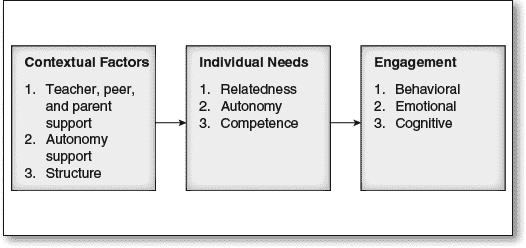

## 家庭与参与

过去三十年来的大量研究表明，家庭参与与多种积极的学业结果相关（Gonzalez-DeHass, Willems, & Doan Holbein, 2005; Henderson & Mapp, 2002）。家庭参与度更高的孩子更有可能：

- 获得更高的成绩
- 获得更高的成就测试分数
- 更好的出勤情况
- 较少的行为问题
- 较低的辍学率
- 对学校有更积极的态度
- 表现出更高的内在动机

父母参与的影响可能随参与类型的不同而异。例如，Hill 和 Tyson (2009) 研究了初中三种类型的父母参与与学业成就之间的关系。他们发现，学业社会化（例如沟通期望、讨论教育价值）是预测成就最准的父母参与方面，其次是学校参与（例如家长会、PTA）。如果家庭活动的重点侧重于丰富，例如参观博物馆和在家里提供书籍，那么参与活动与高成就相关。相比之下，父母帮助作业是父母参与中唯一与成就呈负相关的方面。这一发现可能反映了这样一个事实：父母只有在孩子学业遇到困难时才会增加对家庭作业的参与。

尽管越来越多的证据表明父母参与对孩子的参与和成就有益，但父母并没有像他们或老师所希望的那样那样参与。在对小学和中学教师的调查中，增加父母参与被列为首要任务之一（Langdon & Vesper, 2000）。在接下来的章节中，将概述家庭影响学生参与的不同方式、这种参与的障碍，以及增加课堂内父母参与的实用策略。

### 父母参与

对于老师来说，父母参与最可见的方面之一是家长参加会议和学校活动。然而，这只是父母参与的一个维度。父母还可以通过在家里营造支持学习的环境以及通过参与学校的其他方面来支持孩子的参与。Joyce Epstein, Coates, Salinas, Sanders, 和 Simon (1997) 开发了理解不同类型父母参与的最全面的框架。下表 3.1 提供了 Epstein 父母参与分类法的概述、老师支持每种类型参与的方式描述，以及家长的指标示例。

除了直接的父母参与形式外，父母还可以通过其教养方式和教育价值观的传递来影响学生的参与（Bempechat & Shernoff, 2012）。教养方式的一个重要维度是自主支持与控制。**支持自主的父母**允许孩子探索自己的环境，发起自己的行为，在解决自己的问题中发挥积极作用，并表达自己的观点。这在青少年时期尤为重要，因为此时青少年对自主和决策的需求日益增长。自主支持对于低成就儿童来说似乎尤为重要（Ng, Kenney-Benson, & Pomerantz, 2004），特别是如果母亲在帮助孩子做作业时强调努力和使用学习策略的重要性（Pomerantz, Grolnick, & Price, 2005）。此类做法可能帮助低成就儿童既感到有能力又获得社会支持。

#### 表 3.1 Epstein 的父母参与分类

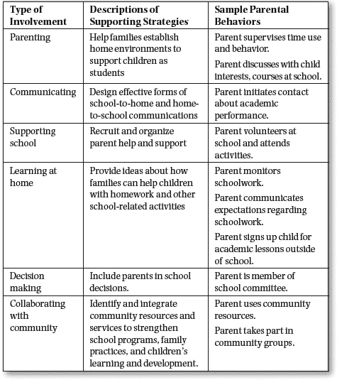

*来源：* Epstein 等人 (1997)。经许可使用。

## 停止并反思

1. 你如何描述你课堂父母参与的水平？
    a. 哪些家长参与最多？为什么？
    b. 哪些家长参与最少？为什么？
2. 使用表 3.1，描述你课堂中的父母参与类型。
    a. 哪些类型最常见？
    b. 哪些类型最不常见？
    c. 哪些类型最容易增加？
    d. 哪些类型最难增加？
3. 使用表 3.1，概述你可以用来增加课堂内父母参与水平的策略。

相比之下，**控制型父母**通过命令、指令或撤回爱来施加压力以调节孩子的行为。这类父母剥夺孩子解决问题的机会并忽视他们的观点（Pomeranz, Moorman, & Litwack, 2007）。在 Ryan 的案例中（见第一章），Ryan 的父母是这种控制型教育的例子。他们使用惩罚并很少给予解释行为的机会。他们控制行为的行为导致 Ryan 感到被强迫且缺乏自主性。证据表明，感知缺乏控制会导致更高水平的问题行为和缺乏参与（Raftery, Grolnick, & Flamm, 2012）。在下面的“实践中的参与”部分，Ellen 分享了她课堂中一个控制型家长的案例。

Ellen：过去的一年里，我有一个看起来很投入的学生。他总是按时完成作业，并在评估中表现相当良好。学期中期，他的核心科老师和我开始注意到他的情绪发生了变化，表现也有所下降。他的成绩开始下滑，因此我们决定联系他的父母安排干预会议。在见到他母亲面时，显而易见，他的学业下滑更多是为了获得某种自主权的尝试，因为显而易见他母亲控制着他的生活。他母亲希望他考上顶尖大学，而他却想学一门技艺并弹吉他。母亲没有听从儿子的意愿，而是继续施压让儿子提高成绩和动力。她几乎每天都给老师发长封邮件，讨论他的健康状况、特定项目的进展，甚至是书包的精确重量。随着她沟通频率的增加，她儿子的学业表现一跌到了多门课程不及格的地步。他完全停止了做作业，无视教室规则，用橙色蜡笔写论文，每隔一节课就睡一次。如果他的母亲能倾听并支持他的兴趣，也许他的第二学期会成功得多。然而，由于家庭生活的限制性，他无法取得他完全有能力取得的成功。

多项研究表明，父母的自主性支持与行为投入（例如：更多的作业投入时间、更少的问题行为）、情感投入（例如：内在动机、对学校的积极态度）以及认知投入（例如：面对挑战时的坚持性）之间存在正相关关系（Pomerantz et al., 2007）。这种正相关也可以用自我决定理论来解释；支持自主的实践有助于支持孩子对自主的需求，从而引导他们更投入地面对环境。

父母对教育和学习的自身态度也有助于塑造孩子的信念和价值观，从而影响课堂投入。父母通过隐式和显式方式传达这些信念。Benjamin 在第 1 章中被描述为一个在行为上投入但在情感或认知上未投入的学生，他说明了父母支持和沟通的重要性。他的父母有很高的期望，并在口头上传达学校很重要。然而，由于他们没有参与他的教育，他们的行为实际上可能向他传达了“学校并不那么重要”的信息。相比之下，Fiona 和 Franco 的父母不仅持有高期望，提供智力资源并协助完成学业，他们通过言语和非言语向孩子传达了学业是重要的。

## 父母参与的障碍


许多教师报告说对教室里父母参与的程度感到不满。如果父母参与对孩子在学校的成功如此重要，为什么有这么多父母没有参与？缺乏父母参与可能源于家庭、孩子和学校的各种因素。表 3.2 列出了先前的研究中确定的某些父母参与障碍。研究发现，低收入和低教育程度的父母对孩子教育的参与度低于高收入和高教育的父母（Laureau, 2000）。低社会地位家庭较少拥有灵活的工作时间、交通选择、儿童照护服务，以及其他中产阶级更容易获得、且使他们更易参与孩子教育的资源。这些家庭参与度低的另一个原因是，这些父母具有较低的`parental efficacy`（父母效能），或者对自己的智力能力和帮助孩子完成作业的能力缺乏自信。父母必须感到自己有能力提供作业帮助，并相信他们的帮助有助于增加孩子对自身能力的认知。Rachel 的母亲就是一个例子，她觉得自己缺乏帮助女儿学习的技能。

种族或族裔多元化家庭对学校活动的参与通常也低于白人家庭。语言障碍和对父母参与观的文化差异可能解释了这些参与程度上的族裔差异。在许多亚洲和西班牙语裔家庭中，尊重老师被认为是至关重要的（Valdés, 1998）。然而，这种尊重的表现可能被某些教育者误认为这些父母并不关心。我们也知道文化在父母参与孩子教育的程度和方式上起着主要作用。某些类型的家庭参与（如参加家长会）在美国主流文化中比其他文化更常见（Garcia-Coll & Marks, 2009）。

影响父母参与最重要的学生特征之一是孩子的年龄。父母的参与度在初中和高中阶段会显著下降（Eccles & Harold, 1996）。这种参与度的下降可能源于父母认为自己缺乏协助更具挑战性学科的技能。它也反映了父母的信念，即在青少年时期参与学业不再那么重要，因为他们的孩子正在变得更加自主。然而，这些信念是不准确的，因为青少年期的父母参与仍然是学生投入和学业成就的重要预测因素（Hill et al., 2004）。

考虑学校人员对父母参与的信念和态度也很重要。先前的研究表明，当父母感到学校正在努力让他们参与时，他们的参与率会更高（Epstein, 2001）。许多管理者和教师看到了家校合作的价值，并积极鼓励增加参与。然而，事实也是，一些由于过去尝试让家庭参与受挫的教师和管理员认为投入精力让父母参与是不值的。遗憾的是，在某些学校，人员会积极阻止父母参与。这在低收入和种族或族裔多元化的社区尤为常见，在那里的父母往往被视为问题的一部分，而不是解决方案的一部分（Eccles & Harold, 1996）。

**表 3.2** 父母参与的障碍

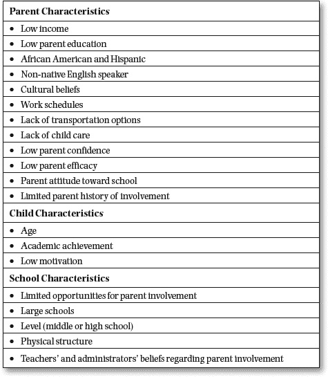

## 停止并思考

1. 你对课堂参与的信念是什么？你是如何向父母传达这些信念的？

2. 你在教室里遇到过控制欲强的的学生吗？如何更有效地与这些父母合作？

3. 使用表 3.2，你所在的课堂中父母参与存在哪些障碍？

   a. 你可以做什么来应对这些障碍？

   b. 你的学校可以做什么在全范围内打破这些障碍？

在接下来的章节中，Melissa 描述了她的学校如何通过家访来跨越语言和社会经济背景与父母建立联系。

## 实践：通过家访与父母联系

Melissa：在位于康涅狄格州诺里奇的综合日特许学校（Integrated Day Charter School），学年从劳动节之前很久就开始了。老师们通过走访学生及其家庭开启学年。这些非正式的访问让由家长、学生和教师组成的团队能够提问、消除疑虑，并为未来的良好关系奠定基础。由于意识到家长参与的价值，我们的老师努力跨越文化、语言和社会经济地位的障碍，以便在早期加强学习。他们交换了电话号码，分享了未来家长参与的机会，学生在自己的环境中感到足够自在并敞开心扉。分享食物、参观学生家以及查看最近读过的书籍并不罕见。这种与家庭的首次互动建立了一个基础，家长和老师据此建立一全年的联系。

## 增加家长在课堂上的参与度

研究表明，家长参与是影响孩子投入和成就的关键因素。研究还表明，家长希望更深入参与孩子的教育，并希望从老师和学校获得信息和帮助以实现这一目标。表 3.3 列出了增加课堂参与度的一些实用策略。

### 表 3.3 增加家长参与的策略

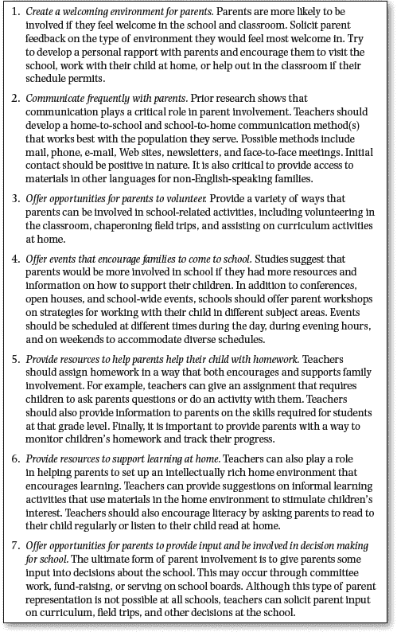

### 停止、反思并尝试

1. 使用表 3.3：评估你用于增加课堂内家长参与的策略。

   a. 在整个学年里，你在家长参与的哪些方面一直表现得很好？

   b. 你认为两个最重要的潜在改进领域是什么？

2. 整合一种增加你课堂家长参与的策略。记录家长做出的不同方式，以及学生对家长参与的反应。

在接下来的*实践参与*（Engagement in Practice）章节中，Michele 描述了她在课堂和学校使用的增加家长参与的策略。首先，她概述了如何利用学生-家长-教师日记来改善与家长的沟通。接下来，她描述了学校如何为家长提供信息和资源。

## 实践参与：学生-家长-教师日记

Michele：我们年级小组与家长沟通的一种策略是使用学生-家长-教师日记，简称 `SPT` 日记。这是一本每天在家庭和学校之间传递的笔记本。学生主要在每天结束时每周写几次，分享他们学到的知识，根据老师的提示写反思，或者强化和复习学习内容（例如，“你这周学了什么类型的诗歌？在家里和家人分享一首你写的诗吧。”）。有时，老师会在日记中布置作业，要求在家里与家庭成员一起活动或分享知识。鼓励家长给学生回信或对他们的日记条目发表评论。如果家长有任何问题或需要分享信息，也可以写信给老师。如果老师需要对行为、学业提供特定的更新，或者只是想分享本周发生的趣事，就可以利用这本日记与家长沟通。这是一个非常棒的三方沟通方法，对于那些希望参与学校事务的家长来说特别有用。

## 实践参与：课程、家庭识字以及数学与科学之夜

Michele：在学年的第一个月，我的学校会举办面向所有家长和护人参加的“课程之夜”（Curriculum Night）。老师们分享关于整个年级课程、预期要求、作业和评分政策，以及全年的课堂和沟通程序的信息。这些说明会在教室里举行，并在整个晚上重复几次，以便在学校里有多个孩子的家庭了解每个孩子的年级情况。现场还为课外活动和课后项目设置了信息台。

我的学校在一年中还会举办“家庭识字之夜”（Family Literacy Night），让家庭更多地了解学校开展的读写活动，以及他们可以在家里做什么来帮助孩子。老师为识字之夜策划并引导了各种活动，例如互动游戏、共同写作项目、读者剧场以及学习各种阅读策略。老师可以为家长准备带有有关识字活动信息和资源的讲单，家庭可以带走他们创作的任何项目或游戏，以便在家里继续使用。

以前，我曾在菲律宾的一所学校合作过，那里举办过“家庭数学与科学工作坊”。在一天晚上，老师们在学习站准备了各种互动式数学和科学游戏、实验和活动，学生及其家庭会访问这些站点。家庭可以探索泡泡、进行色彩化学实验、用木棍和粘土搭建金字塔和其他结构，并通过测量等烹饪活动来应用数学。家庭在晚上结束离开时，对他们孩子课堂里正在发生的学习类型有了更多了解，并知道了可以如何利用周围的日常物品来探索数学和科学概念。

## 本章总结

第 3 章的目标是帮助老师反思两种校外背景——课外活动和家庭——如何影响课堂参与。现实情况是，学生在校外花费的时间比在教室里多，对这些环境的参与可能会积极或负面影响他们的投入程度。首先，概述了课外参与对学术成果益处的研究证据。这些研究旨在反驳“课外活动只是额外负担且参与会影响学术”的说法。尽管低收入青少年受益最深，但他们参与的机会也较低。这些发现表明，通过教师个人和全校的努力，应该为学生提供更多课外活动，特别是针对高风险学生。接下来，展示了比较学校和校外环境参与情况的研究。概述了自我决定理论作为解释为什么校外环境通常更具吸引力的潜在理论。该理论为老师提供了一个框架，以考虑环境在多程度上支持学生对自主性、能力和联系的需求。在本章的最后一部分，介绍了不同类型的家长参与以及家长参与的障碍。老师是课堂参与的关键参与者。因此，本章以适用于任何年龄段的增加家长参与的策略作为结尾。

## 文本到实践练习

### TPE 3.1：调查学生的校外参与情况

调查你的学生在校外活动的参与情况。问问他们课后时间做什么。他们什么时候觉得最有趣？什么时候最无聊？什么时候最有挑战性？

### TPE 3.2：比较课堂内外的参与情况

以自我决定理论为框架（请见图 3.1），将你的课堂与结构化的校外环境（例如：课外活动、课后或社区项目）进行比较。每个环境如何支持学生对联系、自主和能力的需求？你可以将校外环境的哪些方面引入你的课堂？

### TPE 3.3：调查家长的参与情况

对你班级中的家长进行其参与程度的调查。他们认为参与的障碍是什么？哪些资源可以帮助他们更积极地参与？

## 核心术语与概念

- **支持自主的教养 (Autonomy-supportive parenting):** 当父母重视并使用鼓励独立解决问题、选择和行为的技术时发生。

- **课堂结构 (Classroom structure):** 环境中关于哪些策略有助于取得学校成功的信息量。

- **控制型教养 (Controlling parenting):** 当父母从外部调节儿童的行为并提供有限的选择和解决问题的机会时发生。

- **经验采样法 (Experience sampling methods):** 一种方法论技术，青少年携带寻呼器，并在被随机响响时报告他们正在做什么以及感受如何。

- **主动性 (Initiative):** 长期投入努力以实现目标的能力。

- **父母效能感 (Parental efficacy):** 家长对自己的智力能力以及帮助孩子完成学业能力的信心。

- **自我决定理论 (Self-determination theory):** 一种旨在解释环境与投入之间关系的动机理论。该理论假设，在支持个体归属感、自主性和胜任需求的环境中，个体会有更高的投入。

## 基于研究的资源

### 推荐阅读书籍与报告

- Davis, C., & Yang, C. (2005). *父母与教师共同努力.* Turner Falls, MA: Northeast Foundation for Children.

- Epstein, J. L. (2001). *学校、家庭与社区伙伴关系：准备教育工作并改进学校.* Boulder, CO: Westview Press.

- Epstein, J. L., Coates, L., Salinas, K. C., Sanders, M. G., & Simon, B. S. (1997). *学校、家庭与社区伙伴关系：你的行动指南.* Thousand Oaks, CA: Corwin Press.

- Garcia-Coll, C., & Marks, A. K. (2009). *移民故事：中童期的种族与学业.* Oxford, UK: Oxford University Press.

- Mahoney, J. L., Larson, R. W., & Eccles, J. S. (编) (2005). *作为发展背景的组织化活动：课外活动、课后及社区计划.* Mahwah, NJ: Lawrence Erlbaum.

## 推荐访问网站

1. **[Education.com](http://Education.com)** (`www.education.com`)

2. **美国教育部 (U.S. Department of Education)** (`www.ed.gov/parents/landing.html`)

3. **家长参与 (Parent Involvement)** (`www.involvement.org`)

4. **每日参与 (Everyday Engagement)** (`www.engagement4families.com`)

5. **阅读思考 (Read Think)** (`www.readethink.org/afterschool-resources`)

6. **哈佛研究项目 (Harvard Research Project)** (`www.hfrp.org/involvement`)

7. **国家校外时间学院 (National Institute of Out-School Time)** (`www.niost.org`)

8. **自我决定理论 (Self-determination theory)** (`www.selfdeterminationtheory.org`)

# 第 4 章：误区：动手等于动脑

如何创建更具参与感并产生深层学习的任务

我**如何**最初激发学生的学习意愿？我如何维持这种兴趣并将其转化为更深层次的学习？我如何让学生真正理解自己在做什么，而不仅仅是完成作业？这些在过去几十年中一直是教育研究核心的难题。

许多学生在学校里缺乏投入的原因之一是，许多课堂任务是枯燥的，且提供的深层概念理解机会有限。越来越多的教育研究正在探索如何让课堂任务更有趣且在认知上更吸引人。其中一些研究侧重于增强`内在动机`的任务特征，即人们在没有外部激励的情况下所做的事情（Ryan & Deci, 2000）。具有内在动机的活动是个体除了兴趣和快乐之外的其他奖励而参与的活动。

### 挑战

具有挑战性但通过合理努力即可完成的课堂任务能够提高投入度。任务的挑战性包含几个方面，包括任务内容的难度程度、完成任务所需的程序，以及任务的社会组织形式（即学生是独立工作还是与他人合作）(Blumenfeld, 1992)。如果这些方面中的任何一个过于简单，学生将无法获得深度投入的机会，甚至可能因为无聊而放弃参与。反之，如果任务的任何方面太困难，学生可能会因为太难而放弃。

适度任务难度的益处得到了动机理论的支持。根据西克森特米哈（Csikszentmihalyi, 1991）的心流理论，当任务挑战与技能水平相匹配时，个体会体验到`flow`。处于心流状态的人会将与意识融合，失去时间感，并对任务保持高度的注意力。任务挑战还与自我决定理论有关（见图 3.1、第 3 章）。适当的任务挑战水平可以支持学生对胜任感的感知，即他们完成某项活动的能力优劣。根据自我决定理论，在支持学生胜任需求的语境下，投入度更高。

对于教育者来说，选择具有适当挑战性的任务可能是困难的。先前的研究表明，教师选择的任务与学生技能水平之间的匹配度较低(Blumenfeld, 1992)。此外，强调`表现目标`（即学生相对于同龄人的表现）的教师可能会抑制学生在课堂上承担风险的意愿。在以表现为导向的教室里，重点在于证明自己优于同龄人。在这些环境中，学习仅被视为实现预期目标的一种方式，重点通常通过较少努力获得成功，并且普遍存在回避失败的动机模式。这种学习环境对于像第 1 章开头介绍的 Benjamin 和 Beatrice 这样的学生来说尤为不利，他们的动力主要源于成绩和不犯错。相反，为了鼓励学生选择具有挑战性的任务，教师应该强调`掌握性目标`，即学习和理解材料(Ames, 1992)。在以掌握为导向的环境中，学生专注于开发新技能并尝试理解自己的工作，重点在于努力而非相对于同龄人的表现。研究发现，掌握性目标可以增加学生花费在任务上的时间以及他们在面对困难时的坚持性(Linnebrink & Fredricks, 2008)。

### 多样性

每天做同样的事情很快就会让人厌倦，学生和其他人一样，在多样性中茁壮成长。许多教师使用可预测且不变的格式。虽然这种可预测性确实为学生提供了一些结构，但缺乏多样性对学生的动机有负面影响。先前的研究表明，任务多样性与更高的兴趣（即情感投入）和指向学习内容的努力（即认知投入）相关(Ames, 1992)。任务多样性也已成为投入型课堂质性研究中的一个重要特征(Blumenfeld, Puro, & Mergendoller, 1992)。这项研究表明，即使是教学格式的微小变化也能对学生的投入度产生显著影响。教师可以通过使用多种教学格式，如全班教学、小组小组、结对学习、个人作业、课堂辩论、竞赛、游戏、电影和演示，来维持学生的投入度。

### 幻想

研究人员还研究了电脑游戏的特征，以理解为什么它们对许多儿童和青少年具有如此内在的动力和吸引力。新奇感、好奇心、控制感和幻想被认为是解释这些游戏如此吸引人的关键因素(Malone & Lepper, 1987)。这些维度也可以应用于学校任务。教师可以通过融入幻想的元素来使任务更具吸引力，例如角色扮演以及创建虚拟角色、地点或物品的机会，以及游戏化的特征，如规则和目标、竞争和挑战。教师还可以通过一些意外、悬念或对结果的不确定性等元素来引入神秘感。此外，教师可以通过展示信息和提问来揭示学生理解中的差异，从而激发他们的好奇心。

然而，尽管使用这些策略可能会增加短期的注意力集中，但一个担忧是，它们在长期内可能会损害学习和动机(Blumenfeld, 1992)。学生可能过度沉迷于任务的新奇方面，以至于无法关注要解决的问题。先前的研究表明，过多的“花里胡哨”实际上会分散对内容的注意力并可能让学生困惑(Blumenfeld et al., 1991)。除非任务经过仔细设计，否则多样性可能会以牺牲认知投入为代价来提高情感投入。

### 选择

正如自我决定理论概述（见第 3 章、图 3.1），某种程度的自主性可以增强学生的投入。学生需要对他们从事的任务类型做出一些决定，并在完成这些任务时具有灵活性。研究发现，有机会选择的学生表现出更高的坚持性、乐趣、内在动机和学习(Cordova & Lepper, 1996)。表 4.1 列出了增加课堂选择机会策略。

**表 4.1** 增加课堂选择的策略

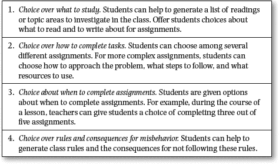

### 意义性

即使课堂任务是多样化且具有挑战性的，也不意味着它们对学生是有意义的。虽然有像 Fiona 和 Franco 那样对学习具有内在动力并容易产生兴趣的学生，但现实是对于许多学生来说，学校的任务对他们没有兴趣或价值。教育者可以通过利用学生的已有知识和经验、将任务与现实世界联系起来，以及强调任务对未来选课和职业选择的重要性来增加任务的意义性。例如，吸引像 Ryan 这样的学生的方法是将他对运动、计算机和建筑的兴趣融入课程。先前的研究表明，当信息与已有知识和经验联系起来时，学生更容易学习和记忆(Willingham, 2009)。表 4.2 概述了使学校任务更有意义且更与个人相关的实用策略。

**表 4.2** 增加任务个人意义感和相关性的实用策略

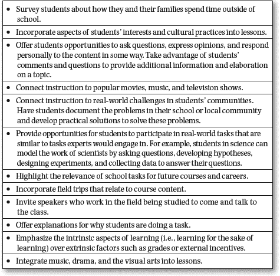

### 投入实践：高阶思维学校 (HOTS)


# 投入实践：高阶思维学校（HOTS）

在接下来的“投入实践”部分中，Melissa 描述了高阶思维学校（HOTS）的概念，这是康涅狄格州的一种教育改革模式，它通过艺术让学习对学生更有意义，并帮助他们培养批判性思维能力。

**Melissa：** 我的学校是一所高阶思维学校（HOTS）。这是康涅狄格州的一项教育改革模式，旨在帮助学生培养批判性思维、独立判断能力和创造性解决问题的能力。这项改革的目标是将艺术整合到所有学科领域，使学生能够以创新的方式交流他们的观点和学习成果。每所学校的教师都有机会设计符合州级和学区标准的艺术整合型体验。

这种改革模式提供了广泛的选择空间和多样化机会。鼓励学生利用艺术来综合观点之间的关系。例如，在练习语法时，我要求学生研究一幅画。他们寻找名词、形容词和副词。在以这种方式观察了画作后，我向他们提了关于发生之前之后发生了什么的问题。从那里，学生找到了同义词，并根据画作写了故事。每个故事都是独一无二的！

我们的高年级小学生也体验了 HOTS 方法的应用。在学习科学单元时，他们与社会正义相结合。他们共同探索了光和主题：这会产生什么样的影响？学生和他们的老师创作了关于学习内容的剧本。结合学生自身的经历，这些作品在投影仪上进行了展示。

通过这些策略，教师可以使任务对学生更有意义。然而，现实是，即使有了这些变化，学生在学校需要做的一些事情可能仍然是没有趣味的（例如标准化测试）。在这种情况下，教师需要重新构建任务，帮助学生将一个可能无趣的活动视为具有个人意义的活动。为了做到，教师需要了解学生的兴趣并将学校任务与之联系起来（Assor, Kaplan & Roth）。教师应该向学生解释为什么要完成某项任务（例如，“我让你们做这个是因为……”），并围绕内在目标与外在目标设计课程（例如，“学习这些词汇提供了一个提升你们写作水平的机会”）（Reeve & Halusic）。

教师还可以通过将这些不那么有趣的任务置于更有意义的工作背景下，来增加任务对学生的个人相关性。例如，对于学生来说，在他们自己选择的书中探索标点符号，会比在数学工作表中探索更有趣。作为研究过程的一部分，给社区成员写信，或者记录自己的进度（测验分数、作业完成情况或其他数据），也是教授数学技能的一种更有意义的方法。

我们这种评估文化的现实给许多教师带来了压力，迫使他们花一些课时间让学生准备标准化测试。对于大多数学生来说，这不是一项有意义的任务。测试复习通常是枯燥的，学生的共同反应是尽可能少做一点事来完成活动。在接下来的章节中，Michele 概述了她如何在更有意义的读写活动背景下重新构建对标准化测试的准备。她还讨论了她如何向学生解释为什么要完成一项大多数人认为不重要的任务。

# 实践中的参与：标准化测试准备

**Melissa：** 在我所在的城市公立学区，州标准化测试是一件大事。虽然没有哪个老师想“为了考试而教”，但现实是，测试在我们的学校里已经变得非常普遍，教师被要求花时间让学生熟悉测试格式，并将其纳入课堂实践中。标准化测试的一个方面是阅读理解答部分，学生需要阅读文章并针对该文章的问题写出论文式的回答。通常情况下，我的四年级学生觉得测试文章很无趣。很多人尽可能快地写完好以此了事，而另一些人则因为不知道从何处开始而感到恐慌。

在过去的几年里，我改变了这种作答练习的方法，将其融入到我的文学散文写作教学中。事实证明这是非常合适的，因为我们写文学散文是为了获得对文本更深层次的意义和理解。标准化测试的题目提出了类似的问题，例如解释中心思想或主题，或者描述人物是如何变化的。然而，与测试回答不同，我们在写文学散文时我可以提供更多选择。学生可以选择他们想要写作的书籍和文本。随着学生对文学散文体裁变得越来越熟悉，我可以引入更像测试那样结构化的阅读理解练习。到那时，学生会将其视为更像是一个项目，他们知道如何处理它，因为他们有能力将其拆解为可以管理的步骤。这也比我们在课堂上写的文学散文更容易，因为测试文章短得多，需要分析的文本也更少。

我的许多四年级学生质疑，为什么他们必须回答他们不感兴趣的问题并阅读文章。我也解释了这如何帮助他们变得更擅批判性阅读和写作，这将对他们在高中、大学甚至工作中有所帮助。当我向班级介绍练习测试题时，我总是提醒他们，他们的工作是说服读者他们他们通过回答所想要分享的内容。我告诉他们，阅读他们回答的人通常是老师，所以他们应该假装是在给我写信！我发现，学生对测试的作答部分压力较小，更有信心，而且他们实际上从分析文本以证明自己的观点中获得了巨大的成就感。

# 停止、反思与尝试

1. 你如何描述你课堂任务的挑战程度？你如何支持那些认为任务太有挑战性或太容易的学生？
2. 你以什么方式将学生的兴趣融入你的课程中？还有哪些额外方法可以使任务对学生更有意义并具有个人相关性？
3. 在 `Table 4.2` (`ch0004.xlink.html#tab4.2`) 中列出的策略中，你目前在课堂使用了哪些？哪些你可以添加？跟踪学生对这些变化的反应。
4. 针对以下方面，你为学生提供了哪些做出选择的机会：
    a. 内容
    b. 形式
    c. 时间
    d. 步骤
    e. 规则

# 认知维度与任务类型

除了任务的激励性特征外，考虑认知维度也同样重要。任务在理解、策略使用、程序化技能和认知过程方面对学生的要求各不相同（Doyle, 1983; Henningson & Stein, 1997; Marx & Walsh, 1988）。例如，在一堂课上，学生可能被要求应用算法来回答几个结构良好的问题。在另一节课上，学生可能被要求应用数学程序来解决现实世界中的问题。这两个课堂任务所固有的认知需求非常不同。对于第一个任务，解决问题只有一种方法。相比之下，第二个任务中的问题更为复杂，有多种方法可以得出解决方案。

表 4.3 概述了四种强调不同程序化和认知技能的学术任务。许多课堂任务强调记忆、公式和程序的应用，以及搜索与匹配策略（即在正文中搜索单词和段落并应用特定公式）。诸如《共同核心标准》（Common Core）和《下一代科学标准》（Next Generation Science Standards）中的任务涉及高阶认知过程，强调理解、解释、将知识或技能应用于新情境以及信息的综合。为了帮助学生达到这些标准，教师需要包含更多的理解和观点类任务（参见表 4.3）。

学生在学校既要做记忆任务，要做理解任务。例如，在素养领域，记忆任务将注意力引导至文本的表面特征和单词的复制，而理解任务则将注意力引导至文本的概念结构和意义。程序化任务与理解任务之间存在重要区别。程序化任务通过使用一套标准算法完成。这涉及一种高度自动化的思维过程的发展，在该程序以自动的方式应用于类似任务中。相比之下，理解任务要求学生知道为什么某种程序有效，以及何时该使用它。

### 表 4.3 学术任务类型

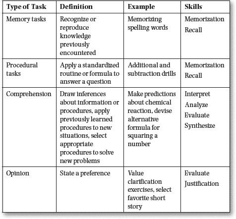

*来源：* 改自 Doyle, 1983。

一些研究对比了开放式任务和封闭式任务（Turner, 1995），它们具有不同的认知需求。`Open-ended tasks`（开放式任务）允许学生选择信息并就如何使用这些信息来回答问题或解决具有多个过程或可能答案的问题做出决策。这些问题有时被描述为“结构松散”，因为没有单一的程序可以保证产生正确答案。相反，`close-ended tasks`（封闭式任务）要求学生使用特定信息得出一个预设的解决方案。封闭式任务的示例包括多项选择题、判断题、填空题以及不需要显示过程即可解决的问题。

在课堂中使用开放式任务与学生更高的参与度相关。Turner (1995) 比较了年儿童在执行开放式和封闭式素养任务时的动机和策略使用。在开放式任务期间，孩子们使用的阅读策略更多，坚持的时间更长，并且对注意力的控制也比参与封闭式素养任务的儿童更好。

开放式任务更有吸引力有几个原因。首先，学生有更多机会贡献和表达自己的想法，因为一个问题有很多可能的解决方案。这给了学生获得所有权并开发独特答案的机会，从而支持了他们对自主性的需求（关于自我决定理论的更多讨论，请参见第 3 章）。这类问题更具吸引力的另一个原因是，学生经常被要求展示他们的工作过程、解释答案，并解释他们得出这些答案所使用的方法。这可以帮助支持他们对能力的需求（关于自我决定理论的更多讨论，请参见第 3 章）。

## 停止并思考

1. 你如何描述你课堂上学生完成的任务类型？
2. 你通常在课堂上包含哪些类型的封闭式任务？
3. 你的学生在课堂上有机会完成开放式任务的频率是多少？你包含了哪些类型的开放式任务？
4. 学生在行为、情感和认知方面，对你课堂中的封闭式和开放式任务有何反应？

# 布鲁姆分类法与真实任务

`Bloom’s Taxonomy`（布鲁姆分类法）为根据认知复杂程度对学术任务进行分类提供了一个视角。该分类法最初开发于 1956 年，旨在反映认知、情感和动作三个领域的目标，并在最近进行了更新，以反映 21 世纪学生和教师的情况（Anderson & Krathwohl, 2001）。在这一修订后的分类法中，有六种认知过程，从最简单的行为到认知最复杂的行为。表 4.4 概述了这六个过程，并提供了每个过程的任务示例。使用布鲁姆分类法可以帮助教师开发更具认知吸引力的任务，要求学生使用更复杂的认知过程。

### 表 4.4 认知领域的布鲁姆分类法

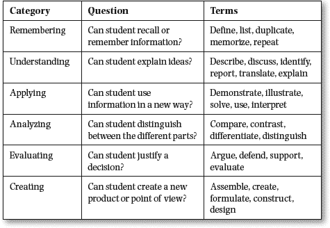

## 真实任务

如第 2 章 所示，许多学校的传统任务是封闭式任务，它们与其他情境下学习发生的方式很少相似。在许多教室中，任务侧重于抽象和去语境化知识的回忆和重复。学生很少有机会以其他方式表示他们的知识、解决开放式和现实世界的问题，以及创建与同伴分享的 `artifacts`（作品/成果）（Blumenfeld et al., 1991）。低水平和封闭式任务的流行导致了学生参与度的不足。

为了应对动机低和参与度不足的问题，教育工作者致力于设计 `authentic tasks`（真实任务），这些任务置于意义的情境中，具有认知复杂性，并反映了课堂之外的学习方式。尽管这类任务在大多数教室尚未成为常态，但来自动机和认知心理学的研究证明了它们对参与和学习的好处（Bransford, Brown, & Cocking, 1999; Fredricks et al., 2004）。

真实任务的关键特征之一是它们对于学生除了在学校成功之外具有内在价值或意义。在这些教学环境中，学生通常协作解决现实世界的问题，使用技术工具，并接受支架式教学的指导。这些任务整合了重要的学科内容，模拟了知识可能被使用的场合，并采用了展示理解而非仅仅考试的评估（Newmann, 1992; Newmann & Wehlage, 1993）。真实任务还要求学生开发某些在公开场合与同学分享的作品。作品的具体形式取决于学科。

### 表 4.5 真实教学五项标准

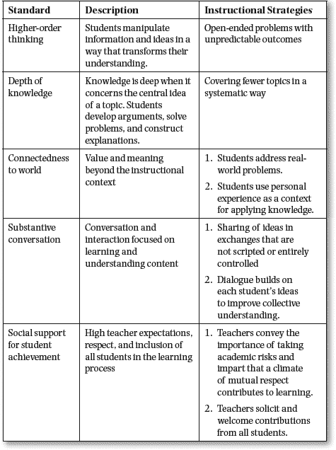

*来源：* 改自 Newmann & Wehlage, 1993。

## 停止、思考并尝试

1. 你通过什么方式将学生的兴趣融入课程？你还有哪些其他方法可以让任务对学生更有意义且更具个人相关性？
2. 学生多久有机会完成真实任务？在哪些学科领域？
3. 学生在行为、情感、动机和认知方面对真实教学模式有何反应？
4. 选择一个你下周将教授的课程。你如何让这节课程更真实真实？观察学生对你调整后的反应。

# 真实教学模式

**基于项目的学习**（Project-based learning）是一种整合了真实学习任务的教学方法，可用于各种学科。这些教学环境的特点是：1) 有一个对学习者有意义且植根于现实世界的驱动性问题；2) 由学生主导调查，并产生产物或产品；3) 使用认知工具（特别是技术）来表达观点。基于项目的教学方法可以增加学生的参与度，因为学生参与了解决真实问题、与同伴合作以及创造产物的过程。它们还具有增强学习和认知参与的潜力，因为学生需要制定计划并追踪和评估自己的进度（Blumenfeld et al., 1991）。当学生参与这些任务时，他们培养了研究与探究能力、沟通与演讲能力、组织与时间管理能力、小组参与与领导能力以及批判性思维能力。他们还学习了如何将这些技能和知识应用于现实世界。在接下来的章节中，Melissa 和 Ellen 描述了她们如何在课堂中使用不同版本的基于项目的学习。

## 实践参与：个人研究

### Melissa

当学生能够将所学知识应用于他们个人感兴趣的话题或问题时，任务就会变得更有意义。在我的学校，个性化研究被视为让学生参与深度学习体验的一种方式。学生被鼓励对他们的世界、时事或他们感兴趣的主题提问。在确定主题后，就开始了扩展研究的过程。学生被教导如何调查问题、批判性地评估资源、收集信息来回答问题，并为同伴和更大的社区创建一个演示文稿，展示他们所学的内容以及在该项研究中可以进一步探索的方向。学生被鼓励给相关主题的“专家”写信，这有助于将他们的工作与现实联系起来，并有助于发现潜在的职业机会。我的角色是将他们的技能和要求的课程内容整合到这一过程中。

一名七级学生研究了养蜂以及蜜蜂数量减少的原因。他针对该主题草拟了几个问题，然后找到了当地的养蜂人。他能够访问当地的蜂箱，亲手学习了蜜蜂的饲养、维护和处理。这种实践经验非常有趣，更重要的是，它与他对该主题进行的阅读和研究相联。在演示当天，他穿着全套养蜂人的服装来到教室。他带了一个小蜂箱、蜂蜜样本和养蜂所需的工具。他利用图表、照片和手册等视觉辅助工具通过口头陈述了他的发现。他还发表了一份研究报告。他的同伴们被深深吸引并积极参与其中。通过这种方式，学生学生学习了知识，同时也为同伴们创造了一次学习体验。

## 实践参与：基于项目的学习

### Ellen

去年，为了给学生提供有关神话的背景信息，我向他们讲解了希腊神灵。尽管我知道这种呈现这些非常有趣材料的方式很枯燥，但我并不确定该用其他什么方法教学。课后，我认为这是一种相当成功的方法；然而，在评分评估时，我发现结果比我预期的差得多。今年，我实施了基于项目的学习来教授学生相同的信息。在基于项目的学习中，教师的角色是通过设计学习工具和评分标准来为学生的成功创造条件，然后退后，让学生自己构建知识。在单元开始之前，我密集工作设计了所有帮助学生取得所需的工具。我创建了一份工作单，用于向学生介绍该单元。它概述了我的期望，包括我希望他们在活动过程中掌握的目标和标准。我还创建了一个研究大纲，帮助他们在使用 `MacBooks` 和 `iPads` 识别可靠资源和数据时整理并汇编信息。除了介绍和大纲之外，我还创建了一个评分标准，让学生都清楚为了获得高分需要做什么。

# 探究式学习

探究式学习是一种围绕项目学习原则组织的学校改革模式。探究式学习（EL）源于“向外拓展训练”（Outward Bound），这是一项以野外探险闻名的冒险计划。教学是围绕“学习探险”或跨学科调查组织的，这些调查会产生重大的成果、公共展示以及与教室外受众共享的作品集。从概念上讲，学习探险与野外探险相似，因为它们都涉及实地考察、服务、团队合作以及与教室外的世界建立联系（Thomas, 2000）。研究表明，实施探究式学习的学校具有更高的成就、更高的出勤率和更积极的校园文化（Thomas, 2000）。目前，已有超过 165 所探究式学校为全国超过 45,000 名小学、中学和高中生服务。探究式学习网络为 `EL` 学校提供支持（[`www.elsschools.org`](http://www.elsschools.org)）。

# 项目制科学

项目制科学由密歇根大学的乔·克拉杰奇克（Joe Krajcik）及其同事开发，是另一种项目制教学方法的示例（Krajcik, Blumenfeld, Marx, & Soloway, 1994）。项目制科学课堂的五个关键维度是：1) 驱动性问题，2) 调查，3) 作品制品，4) 协作和 5) 技术。项目制科学课堂的学生进行以下工作：

* 提问
* 完善问题
* 做出预测
* 设计实验
* 收集并分析数据
* 得出结论
* 向他人交流想法和发现
* 创建产制品

项目制科学课堂的学生倾向于选择调查与他们个人健康与福祉、环境、社区以及时事新闻相关的问题。项目制科学问题的示例包括：1) `我们的水里有什么？`，2) `为什么我长得这个样子？`，3) `是什么让我能稳站在滑板上？`以及 4) `我们的生活中哪里有毒素？`（[`www.umich.edu/~pbsgroup/whatPBS.html`](http://www.umich.edu/~pbsgroup/whatPBS.html)）。

# 真实读写

真实性教学也被应用于读写活动。许多学生喜欢在学校外阅读和写作，但认为学校传统的读写任务枯燥且与有意义的读写活动脱节。`真实读写`被定义为为了现实目的而读写现实文本。真实读写任务的示例包括阅读报纸、科学手册、信息性书籍、网站、歌词和杂志。Duke, Purcell-Gates, Hall, 和 Tower (2006) 为确定读写活动的真实性提供了两个标准：1) 文本是在学习阅读或写作之外被阅读或编写的；2) 阅读或编写文本的目的与其在教室外的使用目的相同。在接下来的“实践参与”部分，Ellen 描述了真实读写是如何在她的学校中整合的。

## 实践参与：融入真实读写

**Ellen：** 学生每天有二 0 分钟时间阅读他们感兴趣的任何内容。我们鼓励他们不要阅读学术文本。学校提供日报的副本，以便让有机会有机会关注国家、州级和当地新闻。许多老师会特意带来学生感兴趣的材料。我给学生提供过从篮球杂志到关于嘻哈舞历史的文章的一切材料。

概念导向型阅读教学，或称 `CORI`，是由马里兰大学的约翰·古斯里（John Guthrie）及其同事开发的，是一种真实教学读写模型示例，旨在增加学生的阅读参与度（Guthrie, Wigfield, & Perencevich, 2004）。`CORI` 程序旨在通过教授阅读策略、科学概念和探究技能，并支持学生阅读内在动机的发展，培养阅读参与和理解力（[`www.corilearning.com`](http://www.corilearning.com)）。学生阅读和编写专业书籍和其他真实文本，目的是学习他们感兴趣的内容并传给他人。研究发现 `CORI` 课堂的学生具有更高的阅读理解能力、阅读策略使用率和阅读动机（Wigfield et al., 2008）。

在接下来的“实践参与”部分，Michele 概述了她如何通过让年级学生创作非虚构书籍来增加课堂真实读写。

## 实践参与：创作非虚构书籍


# 真实教学：动机与认知的整合

## 引言

本文概述了置于有意义的情境中并反映课堂外学习发生过程的真实任务，将其作为创建一个结合了动机和认知维度的教学环境的模型。文中介绍了数学、科学和读写能力领域的真实教学环境示例，例如基于项目的科学、真实读写能力和主题化教学。尽管使用真实任务与多种动机和认知益处相关，但在课堂中实施这种教学类型要困难得多。文中讨论了在课堂中融入真实教学所面临的教学、小组和个人方面的挑战。例如，由于真实教学任务具有模糊性且认知上较为复杂，教师常见的反应是降低任务的复杂性并简化任务。遗憾的是，这只会降低学生的认知需求。本章最后介绍了在课堂中实施认知复杂任务的实用策略。教师在脚手架支持和模拟高水平思维与推理方面起着至关重要的作用。

## 教学实践案例

### Michele：非虚构写作与出版

**Michele：** 当我的四年级班学习非虚构时，我会给他们机会制作可以在教室使用的非虚构书籍。这真的激励了他们去学习制作非虚构书籍的要素。作为一个班级，我们头脑风暴并回顾不同类型的非虚构特征，并将它们写在海报上，每个特征配有一张插图。然后我在房间四周摆放装满非虚构书籍的篮子，学生成对进行“寻宝游戏”，寻找并用带标签的便签标记出这些特征。我会保留所有这些书籍，以便在我们制作非虚构书籍时可以回来参考这些标记的页面。学生们就我们在课上学习的主题制作非虚构书籍，通常与科学或社会研究有关。例如，一年当我们学习陆地和水的相互作用时，学生创作了关于陆地形成、侵蚀和水循环的书。学生分组工作，每个人负责完成一两页。他们使用标题、图表和标签、带说明的插图、不同类型的字体来强调关键词，以及地图和图表来展示他们的信息。学生在制作这些书籍时非常用心，因为他们知道我们会把它们与其他非虚构书籍一起放入教室的图书馆。任何人都可以参考这些书籍作为资源，也可以在自主阅读时间阅读它们。他们非常喜欢看到彼此的作品，并成为我们教室里“出版”的非虚构作家。

### 艾伦：主题化教学《远大期望》

**艾伦：** 在去年教授《远大期望》时，我使用了主题教学法。我将每一章或一组章节与一个独特的主题相结合，例如性与教养、对女性的看法、作者对贫富差距的认知，以及作者对善与恶的认知。在我们阅读时，学生在文中寻找示例来说明该主题。当学生在笔记中记录这些示例时，我会在黑板上的图表组织器中记录这些示例。一旦我们收集了足够的信息，我们就尝试识别出一个模式，并共同得出一个概括性结论或主题。主题包括：周围的环境和同伴会影响他们的行为；女性是邪恶、虐待且具有操纵性的；行善无济于事；以及金钱就是权力。这种过程并不是将文本视为一个与当代生活毫无关系的古老故事，而是让学生将文本视为一个起到延续社会规范作用的`时间胶囊`。这一过程让阅读体验变得更有意义，因此使文本更具吸引力。在使用这种技术后，我发现《远大期望》的平均测试成绩高于上一个单元。失败率也下降到近 1%。

## 真实教学面临的动力与认知挑战

尽管真实教学已被证明对学生更具吸引力，但这些教学模式对学生和老师带来了额外的挑战。

### 教学环境的转变：从教师导向到学生中心

挑战之一是，这种教学要求教学环境从以教师为导向向以学生为中心转变。在以教师为导向的教学环境中，教师掌握控制权，并主要通过直接教学方法引导学习。这些环境中的学生是教师知识的被动接受者。相反，在以孩子为中心的教学环境中，重点是学生作为学习者，教师扮演着更具促进性的角色。因此，在这些环境中，学生需要成为主动的学习者，并对自己的学习承担更大的责任。对于像瑞切尔这样的学生来说，这将更具挑战性，她在第 1 章开头被介绍过，缺乏对自己的学习投入更多主导权的自信和技能。

分享权力对教师来说可能是困难的。真实教学环境要求模式发生转变：从教师是权威人物的模型转向教师和学生是学习过程中的伙伴的模式。某些教师犯的一个错误是，认为主动学习意味着放弃教师对结构和控制的管理责任。这种放弃会导致混乱，让学生感到挫败，并且不清楚他们需要做什么才能获得成功。教师仍然需要设定条件，并在担任教练、促进者和经理角色的同时，在组织学习体验方面发挥积极作用。

### 小组合作的挑战

真实教学环境中的小组合作部分也带来了额外的挑战。学生在社交技巧、参与生产性讨论的能力以及在小组作业期间保持专注的能力方面各不相同。有些学生拥有社交技巧，可以与同伴高效合作工作以解决问题，而像瑞恩这样的学生则需要老师提供更多支持、指导和监控才能获得成功的小组互动。还有人担心，某些小组成员会产生`社会惰性`（social loafing），对小组工作的贡献不充分。`社会惰性`是指某些个人在小组工作时比单独工作时对某项任务投入较少努力的倾向。成功小组作业的策略请见第 6 章。

### 认知复杂任务的个体差异

真实教学环境包含了程序上复杂且具有认知挑战性的任务。对工作进行批判、反思和修改是这些教学环境的核心组成部分。学生对批判和具有认知挑战性的工作的反应程度存在个体差异。一个担忧是，像贝亚特里斯这样的学生（她在第 1 章开头被描述为想要避免失败）可能会在觉得自己做得足够多时停止，并对批判和修改感到困难。教师帮助学生看到错误是这种类型学习的自然组成部分，而不是失败的标志，这是至关重要的。另一个担忧是，像本杰明这样的学生会关注分数并以最小的努力完成工作，从而牺牲目标（Blumenfeld 等，2006）。如果教师强调竞争、机械程序和行为管理，学生更有可能认为任务是无用的工作，而不是深入参与内容。

### 学生抵触与教师简化任务

这些环境中的挑战之一是，学生对高认知需求任务产生抵触，因为他们不清楚该做什么或如何做。面对挑战和任务的不确定性时，这些学生可能会向老师施压。有证据表明，教师通过简化认知复杂任务来应对这种压力（Blumenfeld，1992）。

### 程序关注过度导致内容缺失

另一个担忧是学生过度关注程序，以至于丢失内容和深度学习的机会。一项关于中级学生首次体验项目制科学课程的研究支持了这一担忧。在这些教室里，学生更多关注程序问题和完成作业，而不是科学内容或深层次理解（Krajcik 等，1998）。同样，在数学领域，Henningsen 和 Stein（1997）研究了课堂因素如何影响学生对认知复杂任务的参与。他们确定了与认知参与下降相关的若干数学任务特征，这些特征可以很容易应用于其他学科领域。表 4.6

## 停止并思考

1. 你如何尝试（或可能会尝试）在教室实施真实的教学模式？你的学生对这些教学模式反应如何？
2. 在尝试整合真实教学模式时，你遇到了或会遇到上节提到的哪些挑战？
3. 你使用了或可以使用哪些策略来应对这些挑战？

## 认知策略的使用

学生在处理认知复杂任务时，需要能够计划、设定目标、组织和自我监控。`自我调节学习`（self-regulated learning）是指为了目标而产生的思想、情感和行为（Zimmerman，2002）。自我调节策略的示例包括：

- 自我评价
- 组织与转化
- 目标设定与计划
- 信息寻求
- 记录
- 自我监控
- 环境建构
- 给予后果
- 复习与记忆
- 寻求父母、同伴或其他成人的社会帮助
- 回顾

学生需要多种认知和自我调节策略来处理认知上复杂的任务。他们还需要策略来将信息与既有知识进行整合和连接。研究表明，当使用精述（elaboration）和组织（organization）策略时，与浅层处理和复习策略相比，学生的理解能力、成就感和表现会更好（Greene & Miller, 1996）。复杂任务的精述策略示例包括：总结要学习的内容、创建类比、向他人解释材料中的观点，以及提问。复杂任务的组织策略示例包括列出材料大纲以及识别观点之间的联系。

实施认知复杂任务面临的挑战之一是某些学生缺乏这些认知和自我调节策略。此外，即使学生拥有这些策略，他们也可能不知道何时以及如何使用它们来促进概念理解。策略的使用还取决于动机和控制（Paris & Paris, 2001）。先前的研究表明，策略的使用既可以通过教学、引导性反思和元认知讨论进行显式教学，也可以通过建模以及需要对学习进行反思性分析的任务进行间接教学（Paris & Paris, 2001）。

## 执行认知复杂任务的策略

教师可以使用几种策略来支持学生参与认知复杂任务。表 4.7 概述了维持学生参与这些任务的某些实用策略。例如，教师可以通过以下方式支持认知参与：1) 提供适当的时间来探索观点并建立联系；2) 选择基于学生先验知识的任务；3) 强调解释、意义和理解，而不是对特定信息的召回或特定程序的应用（Doyle, 1988; Stein, Grover, & Henningsen, 1996）。

### 教学脚手架

教师的`scaffolding`（脚手架）可以帮助学生理解并建立联系，这在认知复杂学习中尤为重要。当教师或能力更强的同伴提供帮助和指导，使学生能够完成如果没有支持无法完成的任务时，就形成了脚手架。教师和同伴还可以支持学生的高阶思维：

1. 故事是从谁的角度讲述的？
2. 缺少了谁的视角？
3. 你对哪些事件或角色产生共鸣？为什么？
4. 是什么激发了角色？你是如何知道的？
5. 目标读者是谁？
6. 在读这本书时，你还有哪些其他问题？
7. 为什么背景对情节很重要？
8. 作者如何利用对话推动故事发展？
9. 分析作者的风格。他/她是如何组织书内容的？
10. 你为什么选择这本书？

我能够通过提更多问题来引导他们的阅读，作为对他们高阶思维的回应。日记是一个安全且私密的工具，学生可以在其中写下讨论中可能不会问的问题。这种策略对于学习脚手架非常有帮助——它帮助自信不足的读者在课堂讨论之前“练习”回答。我还会向班级发布关于我正在读的书信。通过这种方式，我为他们正在学习的策略提供了一个持续的模型。

## 实践中的参与：分析与综合我们的读物

**Michele：** 我的四年级学生全年通过各种任务学习和练习各种阅读策略。例如，我们经常读杂志文章。为了更好地理解材料并对主题进行更多批判性思考，我希望他们不仅仅是总结和解释所读内容。我意识到这类文本在准备课堂辩论方面效果很好，而且是学生在不同小组中合作的绝佳机会。对于这些辩论，我选择了同一主题的各种文章，以便学生尽可能收集更多信息并看到不同的视角。我总是确保主题是有趣且与他们相关的。例如，有一次我们辩论了标准化测试的优缺点。个人或小组被分配不同的文章，这样当他们聚在一起时，就可以交流。在阅读、分析和收集证据的过程中，他们练习了我建模以及我们之前练习过的策略。我实际上会将学生分配到辩论的不同双方，无论他们是否同意。如果学生起初不同意一方，他们可能会抵触，但由于准备过程中所付出的努力以及他们能够收集来支持自己方的所有证据，当我们开始辩论时，所有学生都投入了其中。他们有大纲和笔记来维持讨论。许多人的口才之好令我印象深刻。他们现在是这方面的专家，并且对展示每一方的观点和支持自己的主张充满信心。不仅如此，我们对读过的文本和整体主题都有了更深入理解。

## 章节总结

第 4 章 描述了让课堂任务对学生在动机和认知上都具有吸引力的方法。本章的一个关键原则是，动机是必要的，但对于完全投入学习来说是不够的。教师往往关注动机维度（如让任务变得有趣或具有实践操作性），而较少关注将这种动机转化为持续认知参与的认知维度。文中介绍了基于内在动机文献的策略，这些策略结合了新颖性、挑战性、选择性、幻想和意义等维度。增加动机的任务特征包括充分的挑战、选择的机会以及与学生教室外生活的某些联系。接下来，回顾了学术任务在认知维度上的差异。在具有开放式任务的教室中，参与度更高，这些任务有多种可能的解决方案，并要求学生使用高级别的认知过程来评估和创造知识。遗憾的是，学校里的许多任务是闭式任务，只有一个正确答案，需要较低水平的认知技能，如召回和重复。

## 教学实践练习

### TPE 4.1：任务内在价值评分

选取两个典型的教学日，根据以下领域对学生获得的所有任务进行 1 到 5 分的评分（1 = “无”；5 = “高”）：

1. 任务价值
2. 选择机会
3. 学生的积极角色
4. 允许同伴互动
5. 新颖/不同类型的任务
6. 挑战程度
7. 创造性解决问题的机会
8. 与学生的个人经验直接相关

### TPE 4.2：教学真实性评分

使用表 4.5，根据真实教学的五项标准对一节课进行 1 到 5 分的评估：

1. 高阶思维（1 = “仅有低阶思维”；5 = “高阶思维是核心”）
2. 知识深度（1 = “知识浅浅”；5 = “知识很深厚”）
3. 与课堂外世界的联系（1 = “无联系”；5 = “有联系”）
4. 实质性对话（1 = “无实质性对话”；5 = “高水平实质性对话”）
5. 对学生成就的社会支持（1 = “负面社会支持”；5 = “积极社会支持”）

### TPE 4.3：访谈学生关于课堂任务的情况

访谈几位学生，了解课堂上的任务。以下是可能的问题：

1. 你觉得哪些任务最有趣？
2. 你觉得哪些任务最没趣？
3. 你感到有挑战吗？
4. 你在哪些方面感到很有创造力？

### TPE 4.4：开发范例课程

开发一个范例课程。描述以下内容：

1. 我是否提供了适当的时间？
2. 它是否建立在已有知识的基础上？
3. 它与内容相关吗？
4. 我提供了自我调节的机会吗？
5. 我提供了协作吗？

## 关键术语与概念

* **制品 (Artifact)**：学生创造的产品。
* **真实读写能力 (Authentic literacy)**：面向生活的阅读、写作和研究。
* **布姆分类法 (Bloom’s Taxonomy)**：将学习分为领域：认知、情感和心理。
* **封闭式任务 (Close-ended tasks)**：有答案的任务。
* **探险式学习 (Expeditionary learning)**：学生进行调查的学校改革。
* **流体验 (Flow)**：个体感知不到时间流逝的状态。
* **内在动机 (Intrinsic motivation)**：内在的兴趣。
* **精通目标 (Mastery goals)**：关注进步的学生。
* **开放式任务 (Open-ended tasks)**：有多种解决方案的任务。
* **表现目标 (Performance goals)**：关注他人对比的学生。
* **基于项目的学习 (Project-based learning)**：围绕技术组织的教学方法。
* **基于项目的科学 (Project-based science)**：五个关键维度：1) 驱动问题；2) 调查；3) 制品；4) 协作；5) 技术。
* **脚手架 (Scaffolding)**：教师或能力更强的同伴提供的帮助。
* **自我调节学习**：对过程的监控。
* **社会懈 (Social loafing)**：个体在小组工作中努力较少的倾向。
* **主题化教学 (Thematic instruction)**：围绕大主题组织的内容教学。

## 研究资源

### 推荐的书籍和报告

* Berger, R. (2003). 《卓越伦理：建立工艺文化》。
* Bransford, J. D., Brown, A. L., & Cocking, R. R. (1999). 《学习如何学习：大脑、思维、经验与学校》。
* Cooke, S. L. (2013). 《中学学生赋权与创造力的协同关系》。
* Csikszenthalyi, M. (1991). 《心流：最佳体验心理学》。
* Daniels, H., & Harvey, S. (2009). 《理解与协作：行动中的探究小组》。
* Daniels, S., & Zeleman, S. (2004). 《学科很重要：各学科阅读教师指南》。
* Denton, P. (2005). 《通过学术选择学习》。
* Guthrie, J. T., Wigfield, A., & Perencevich, K. C. (编). (2004). 《激励阅读理解：概念导向的阅读教学》。
* Harvey, S. (1998). 《非小说很重要：3-8 年级的阅读、写作与研究》。
* Harvey, S., & Goudvis, A. (2000). 《有效的策略：促进理解与参与的教学》。
* Hattie, J. (2012). 《可见的学习：教师如何扩大对学习的影响》。
* Keene, E. O., & Zimmerman, S. (2007). *思维的马赛克：策略教学的力量* (第 2 版). Portsmouth, NH: Heinemann.
* Kovalik, S. (1994). *综合主题教学: 模式.* Kent, WA: Susan Kovalik & Associates.
* Lewison, M., Leland, C., Harste, J., & Christensen, L. (2007). *创造批判性教室：具有优势的 K8 读写.* New York, NY: Routledge.
* Marzano, R. J., & Kendall, G. S. (2008). *设计与评估教育目标：应用新的分类法.* Thousand Oaks, CA: Corwin Press.
* Newmann (1992). *美国初中高中学生的参与度与成就.* New York, NY: Teachers College Press.
* Reichel, A. G. (2010). *期待更多：孩子们可以做到非凡的事.* Bloomington, IN: Authorhouse.
* Sousa, D., & Pilecki, T. (2013). *从科学到艺术：使用大脑兼容策略整合艺术.* Thousand Oaks, CA: Corwin Press.
* Strachota, B. (1996). *站在他们这边：帮助孩子主导学习.* Turner Falls, MA: Northeast Foundation for Children.
* Thomas, J. W. (2000). *项目式学习回顾.* 检索于 2013/10/22，`www.bobpearlman.org/BestPractices/PBL_Research.pdf`.

### 推荐访问网站

1. `Edutopia.com` (`www.edutopia.com`)。该网站提供关于项目式学习的教育资源，包括已纳入项目式学习模型的学校简介。
2. `概念导向型阅读教学` (`www.corilearning.com`)。该网站包含与概念导向阅读教学相关的资源，该教学是在马里兰大学开发的。网站上包含了研究研究信息、专业发展以及衡量工具的副本。
3. `项目制科学` (`www.umich.edu/~pbsgroup`)。该网站包含关于项目制科学的信息，该科学是在密歇根大学开发的。网站上提供项目制规划软件。


# 资源网站

4. **探究式学习** (`www.elschools.org`)。该网站包含关于探究式学习模型的资源。它提供了课程示例、研究结果和专业发展机会。

5. **巴克教育学院：21 世纪的项目式学习** (`www.bie.org`)。该网站包含关于项目式学习的资源，包括计划表、评估量表和研究文章。

6. **Jason Learning** (`www.jasonproject.org`)。这是一个非营利组织，将学生与真实的科学家和研究人员联系起来，以提供真实的学习体验。网站包含了课程资源和专业发展信息。

7. **面对历史与自我** (`www.facing.org`)。该网站为教育者提供资源，帮助他们教授公民责任、社会公正和宽容。网站上提供示例课程和单元、视频以及专业发展信息。

8. **Read Write Think** (`www.readwritethink.org`)。Read Write Think 是一个国际阅读协会。该网站提供读写资源、教学计划和专业发展信息。

9. **教联合国教科会** (`www.teachunicef.org`)。该网站为 K-12 教师提供社会研究、科学、数学、英语/语言艺术和外语的跨学科全球教育资源。网站上提供教学计划、故事和多媒体。

# 第五章

## 神话 5：关注内容：不要将其个人化

### 关系对学生参与度的重要性

师生之间强大且支持性的关系是学生参与和健康发展的基础。感知到老师提供支持和关怀的学生更有可能对学校产生积极态度，更愿意在智力上承担风险，并在困难面前坚持不懈。对于有学业失败风险的学生，建立高质量的关系尤为重要。先前的研究表明，与教师的支持性关系可以将在校获得成功的风险学生与未成功的学生区分开来 (Pianta, Steinberg, & Rollins, 1995)。遗憾的是，许多学生（尤其是那些学术上有风险的学生）并没有与老师建立这种关系。此外，有证据表明，这些与教师之间的糟糕关系随着时间的推移实际上会导致学生参与度的下降。

许多教师（尤其是教初中和高中的教师）持有的一个误区是，他们的首要角色是教授内容知识和技能，与学生建立关系虽然很重要，但对于学习来说并非必不可少。许多教师在平衡建立高质量师生关系所需的时间和情感投入与教学需求及学术责任之间感到挣扎。尽管有些教师将关系和教学视为相互竞争的需求，但事实是，为了让学生充分参与，教师需要兼顾学术和人际两个维度。如果教师只关注学术而忽视人际维度，学生将可能在情感上产生疏离，并对犯错更加顾虑。相反，如果教师只关注提供情感支持而忽视了课堂的学术维度，学生的认知参与度将降低，学术成就也较少。

此前的研究说明了社会支持性环境和智力挑战性环境对行为、情感和认知参与的益处 (Fredricks et al., 2004)。在本章中，介绍了人际支持和学术支持对学生参与度影响的研究。还概述了改善师生关系的实用策略，特别是针对那些最具挑战性的学生。

#### 停下来思考

1. 作为一名教室教师，你最重要的五项职责是什么？

2. 你如何平衡满足学术需求所需的时间与建立学生关系所需的时间？

3. 如何在要求学生对进步负责的同时，建立有意义且有益的师生关系？

4. 你如何与学生建立关系？这些关系是由你发起的还是学生发起的？

5. 哪些学生最让你难以引导？你如何描述与这些学生的关系？

## 教师支持与学生参与度及成就

越来越多的研究表明，良好的师生关系与行为、情感和认知参与的指标以及成就结果相关（例如：Birch & Ladd, 1997; Hamre & Pianta, 2001; Fredricks et al., 2004; Ryan & Patrick, 2001; Wang & Eccles, 2012）。发现与教师建立亲密且关怀的关系对于低收入以及非裔和西班牙裔青年的参与度尤为重要 (Garcia-Reid, Reid, & Peterson, 2005)。教师支持已被证明能预测以下水平更高：

- 学生参与
- 自主性
- 课堂行为
- 协作行为
- 努力
- 出勤
- 对学校的热爱
- 兴趣
- 价值感
- 学校满意度
- 社交技巧
- 批判性思维能力
- 自控能力
- 标准化考试成绩
- 学业成绩

上述列出的结果是每位教师都希望看到、并在成功的学生身上观察到的。在这些结果列表中，显而出的行为表明，师生关系也是成功课堂管理的关键方面。学校中的许多行为问题都是师生关系破裂的结果。与老师建立良好关系的学生更有可能遵守课堂规范，这反过来应该减少他们产生干扰行为的概率（Birch & Ladd, 1997）。在对 100 多项研究的元分析中，Marzano、Marzano 和 Pickering (2003) 发现，与学生建立高质量关系的教师，其行为问题减少了 31%。早期师生关系的质量具有长期影响。研究发现，在幼儿园时期与老师冲突较多的学生，在八年级时的学术成就较低，行为问题更多（Hamre & Pianta, 2001）。

随着学生年龄的增长，对高质量师生关系的需求持续存在，并且对于帮助他们应对学校压力源尤为重要。其中一种压力源就是从小学到中学的过渡。学生在过渡到中学的过程中，动机、参与度、自尊和学术表现表现出下降趋势（Wigfield, Brynes, & Eccles, 2006）。与老师的良好关系可以帮助缓解部分这些下降。在初高中感知到更多教师支持的学生具有更高的参与度、更高的成就和更低的风险行为风险（Gregory & Weinstein, 2004; Resnick et al., 1997; Wentzel, 1998）。

遗憾的是，研究也显示了缺乏教师支持的负面后果。Klem 和 Connell (2004) 发现，教师支持水平较低的小学学生报告学业脱节的概率是平均学生的两倍（Klem & Connell, 2004）。像 Ryan 这种在`第 1 章`开头被描述为具有攻击性、无聊且困惑的学生，往往无法与老师建立良好的关系。结果是，这些学生更有可能认为学校是一个不受欢迎且令人疏远的地方。未能与老师建立积极联系会使学生面临更大的学业脱节和退学的可能性（Croninger & Lee, 2001）。

对于许多教师来说，他们的教师教育计划和专业发展侧重于学生学习。建立师生关系的知识和技能被认为是理所当然的，但并不是他们准备阶段或继续教育的明确部分。这使得许多教师面临仅与少数学生建立良好关系的风险——这些学生很可能是那些已经具有很强的人际交往和学术能力的学生。接下来的章节将提供基于理论和研究的师生关系基本特征的简要背景。

## 有意义的师生关系的本质特征

根据`依恋理论`（attachment theory），早期的儿童与照顾者之间的互动为发展安全依恋关系提供了背景，这反过来又为孩子提供了安全感和探索的基础。依恋理论也可以解释为什么师生关系对于学生的参与度至关重要（Pianta, 1999）。提供情感支持和持续安全环境的教师，更有可能让学生建立起安全的师生依恋关系。结果，这些学生将更有可能冒险并探索他们的环境，因为他们信任老师会在那里支持他们。

### 停止、反思并尝试

1. 识别出进步最大的教师。

   a. 他们使用了哪些策略？

   b. 他们的支持有何不同？

   c. 他们使用了什么来应对？

2. 你会用哪些特征来描述一位关爱学生的老师？

自我决定理论（参见`第 3 章`）是另一种可以解释师生关系影响的理论视角。根据该理论，学生进入学校带有三种心理需求：归属感、自主性和胜任（Connell & Wellborn, 1991）。良好的师生关系有助于支持这些需求。建立个人化且关怀关系的教师可以帮助学生满足归属感需求。允许学生做出选择的教师可以支持他们的自主需求。最后，提供清晰预期和表现反馈的教师可以帮助学生满足胜任需求。接下来的章节将探索支持这些需求的策略。

## 在课堂中建立归属感

教师支持学生归属感需求的一种方式是通过`教学关怀`（pedagogical caring）。

### 教学关怀

尽管研究人员对教师支持的定义略有不同，但这些定义往往都包含关怀、友好、理解、奉献和可靠等特征（Ryan & Patrick, 2001）。在早期阶段，良好的师生关系帮助学生适应学术和社交环境。通过这些关系，孩子们发展出可以与同龄人交往的社交技能和情感洞察力。研究发现，与老师建立亲密关系的孩子与同龄人相处得更好（Hamre & Pianta, 2006）。在青少年时期，与老师的关系起着某种不同的功能。初高中老师为学生提供情感和社会支持，这可以加强学生与学校的联系。中学教育阶段的教师还可以担任榜样，帮助学生解决问题，并提供支持学术表现的信息和策略。

重要的是，关怀具有教学内涵。关怀并不意味着教师应该允许那些面临挑战的学生为未完成工作或不参与讨论找借口。具有关怀精神的教师会投入时间和精力确保学生符合学术要求。教师还通过他们选择教学的内容和方法来展示关怀。`表 5.1`列出了青少年用来描述一位关怀型老师的特征（Wentzel, 1997）。

**表 5.1** 青少年描述的“关怀”教师特征

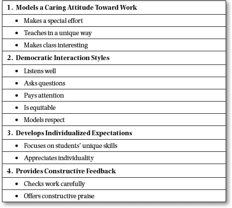

## 停止并反思

1. 你会在`表 5.1`中增加哪些特征来刻画一位关怀且提供支持的老师？

2. 在表 5.1 中哪些特征会让学生将你描述为他们的老师？在你的教学中哪些方面表现得不够明显？

3. 你通过对内容的选择、课堂规范以及与学生的个体互动，向学生传达了什么信息？

4. 你还可以通过哪些其他方式向学生表现关怀？

### 职业敏感性

**职业敏感性。** 教师支持学生归属需要的另一种方式是通过`教师敏感性`（teacher sensitivity），即教师在课堂中的调适能力和反应水平。高度敏感的教师能够察觉学生细微的信号，并以有助于缓解问题的方式做出回应。例如，敏感的教师会注意到学生情绪和行为的变化，以及他们在完成作业时遇到困难的情况。随后，这些教师会调整教学方法，以更好地支持学生的需求。

在课堂上表达积极情绪并对学习表现出热情的教师，也可以支持学生的归属需要。在一系列观察性研究中，Julie Turner 和她的同事（Turner et al., 1998; Turner et al., 2002）发现，被观察者评为更频繁表现积极情绪的教师，其学生报告的数学动机更高、数学参与度更高，且回避策略的使用更少。在展示积极情绪时，这些教师模仿了他们对数学的个人兴趣，并利用热情和幽默来减轻学生在面对挑战性工作时的焦虑。

最后，教师可以通过分享自己的一些个人经历来支持学生的归属需要。Davis（2006）发现，学生认为与那些分享了自己学校经历、个人学习困难以及家庭情况的老师之间，建立了最有激励性的关系。这可以帮助教师在学生面前显得更有亲和力、更容易亲近。然而，教师面临的挑战是确定哪些信息是适合分享的，以及在哪里设定边界。

## 停止并思考

1. 你认为自己的个人经历中哪些方面是愿意与学生分享的以支持他们的归属需要？

2. 你如何将自己的个人经历与课程内容相结合，帮助学生将他们的经历与你的经历联系起来？

3. 哪些个人经历让你觉得分享不方便或认为分享是不恰当的？所有的经历都应该与学校有关吗？

在接下来的*实践参与*章节中，Michele 描述了她如何与学生分享她的兴趣和个人经历。

### 实践参与：分享个人经历

Michele：在我的课堂里，我们使用写作工作坊（Writing Workshop）模式，每个学生都有一个笔记本，用于记录想法、练习技能和写作。我也保留着自己的笔记本，这为我与学生分享自己的兴趣和个人经历提供了绝佳的机会。当我教写作课时，我通常会在笔记本里准备一个例子，涉及我最近发生的事情、我脑海中的思绪，或者一个童年的故事。他们特别喜欢听我上四年级的故事，以及我分享的关于我和哥哥的故事。我最初开始写自己的笔记本是为了向学生演示如何使用它，但我发现这也能让学生通过我的写作来了解我，就像我通过他们的写作了解他们一样。我看到，他们的写作变得更加个性化，而不是关于他们认为“应该”写什么。他们开始更享受这个过程，在写作中承担更多风险，并更愿意彼此分享，在当我们朗读自己的作品时也会尊重地倾听。

表 5.2 概述了多种基于师生关系研究的在课堂上支持学生归属需要的实用策略。

**表 5.2** 支持学生归属需要的实用策略

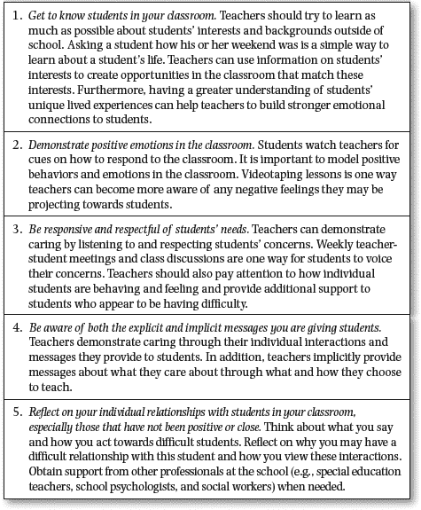

## 停止、思考并尝试

1. 你认为所有学生都需要感到自己在每个教室里都有归属感吗？

2. 是否有些学生你觉得很难与其建立联系？为什么？你可以做什么来改善这些关系？

3. 你如何知道自己是否以你预期的方式与所有学生建立了“联系”？

在接下来的*实践参与*章节中，Melissa 描述了她如何使用教师报告单来获取关于她在满足学生归属需要方面表现的反馈。

### 实践参与：教师报告单

Melissa：在学生每学期带回成绩单后，我会要求他们为我填写一份。这是我了解学生需求以及他们对我们共同经历感知的最好方式。如果需要，教师报告单可以匿名填写。问题使用了李克特量表（Likert scale），涵盖了课堂管理、公平、热情和尊重等主题。学生还会对我给出清晰指令的能力、使用他们能理解的语言、提供有价值的反馈进行评分，并对我分配的各种活动的兴趣进行评分。有些问题直接评估他们是否在课堂上感到被关怀。这些反馈对我来说非常重要。由于这些报告单，我改进了对学生写作的反馈，并对课堂上使用的语言更加警觉。此外，我请了一位同事观察我的教学，并统计我点名男孩、女孩以及不同族裔的频率，以确保我公平地对待学生。

### 成为自主支持型教师

教师在支持学生自主需要的程度上有所不同。研究人员将自主支持型教师的教学行为与具有控制风格的教师区分开来（Reeve & Halusic, 2009; Reeve & Jang, 2006）。表 5.3 概述了自主支持型教师与控制型教师之间的某些区别。自主支持型教师使用非控制性和信息性的语言，允许学生以自己的方式工作，鼓励学生对自己的学习承担更多责任，并给学生机会提供投入并做出决策（Reeve & Jang, 2006）。相比之下，控制型教师通过使用外部激励、控制性陈述、指令和命令来迫使学生以某种方式行动。在这些情况下，学生的动力来自外部因素和压迫性语言，而不是他们自己的内在动力。

**表 5.3** 自主支持型对比控制型教学实践

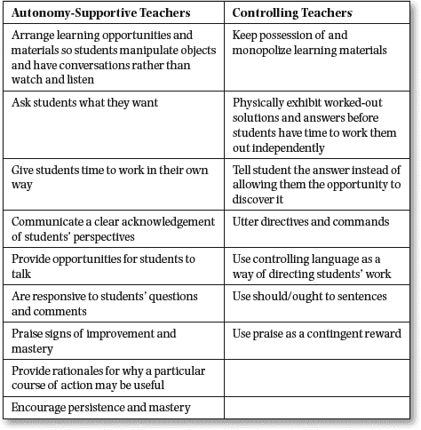

## 停止并思考

1. 使用表 5.3，描述教师可能会说或做什么来向学生传递自主支持或控制性的信息？

2. 使用表 5.3，你会如何描述你的教学风格？你认为自己更偏向自主支持、控制，还是两者的混合？反思你对课堂管理的信念以及这些信念是如何塑造你的教学风格的。

3. 你可以在教学中做出一两个什么改变来更具有自主支持？在课堂上实施这些改变。学生反应如何？

在接下来的章节中，Michele 描述了她如何在课堂中使用自主支持型实践来建立行为规则和后果。

# 课堂规则与参与

Michele：在每个学年之初，我的学生和我会共同制定教室规则。在讨论制定规则之前，我们已经讨论了一整年的个人目标，以及我们作为四年级学生期待的事情。当我们开始讨论规则时，我会问他们一些问题，例如“我们如何确保每个人都能实现自己的目标？”以及“为了让我们大家都能尽全力并享受四年级的生活，我们的教室在视觉、听觉和感受上应该是怎样的？”

讨论引导学生提出了我们希望在教室里拥有的规则。我通常将所有脑激出的规则归纳三个主要领域。其中一年的例子包括 1) 尊重他人，2) 尊重自己，以及 3) 尊重我们的学习环境。除了规则，我们还讨论了后果。在阅读了`Classroom` 方法后，我开始在学生身上使用`行动道歉`（Apology of Action）。我们用来理解和记忆这一点的指导性陈述是：“谁弄坏的谁来修复。”我们会进行讨论和活动，分享学校里可能发生的潜在冲突，并想出“修复”这种情况的方法，无论是处理物理上的混乱还是改善人际关系。“行动道歉”真的帮助了我的学生承担起解决课堂问题的责任。在年初，我必须提供大量的建模和指导，但随着时间的推移，当他们向我报告问题时，他们能够更好地提出可能的解决方案。

许多老师认为他们需要使用控制性行为来让学生表现得当并遵循他们的计划。然而，几项实证研究表明，与控制型教室的学生相比，拥有支持自主性教师的学生具有更大的自主性、更高的课堂参与度、更佳的心理健康状况、更深的概念理解以及更高的学术成就（Reeve, Jang, Carrell, Jeon, & Barch, 2004）。许多教师在采用支持自主性的做法时，担心之一是他们将失去对教室的控制，并被学生认为是放任的。然而，增加学生的自主性并不意味着允许学生随心所欲。相反，应该在有结构化机会的背景下提供选择。与许多老师的反驳相反，此前的研究表明，与控制型教师相比，支持自主性的教师实际上提供了更多而非少的课堂结构（Jang, Reeve, Ryan, & Kim, 2009）。

让学生对学习内容拥有一定的选择权是吸引他们的有力方式。在接下来的`实践中的参与`章节中，Melissa 描述了她的学校如何利用自选学生研究和学生主导会议来支持学生的自主性需求。

## 实践中的参与：自选学生研究

Melissa：自选学生研究（或个人研究）是一个提问、调查、计划和分享新知识的过程。在初中，学生研究的主题涵盖了媒体对青少年女孩的影响到比较世界宗教的各个领域。学生是具有自主性的，他们的主题通常涉及对他们重要且相关的问题，并且每个项目都是差异化的。在每个能力水平上，学生都会向同伴展示他们学到的知识。这些学生驱动的项目每年发生三次。在其中一个周期中，初中生会举办`研究之夜`（Research Night），邀请家长和广大社区访问学校，并与研究者进行提问和交流。学生有动力学习他们自己选择的内容，并且对同伴的反馈反应积极。所有学生都对如何展示他们的学习成果做出自己的决定。

## 实践中的参与：学生主导会议


# 学生主导的家长会议

Melissa：大约十年前，我们学校进行了一次刻意的转变，从教师引导的关于学生成绩和目标设定的家长会议，转变为学生主导的会议。所有学生都会将评分期间的作品保存在`作品集`（portfolio）中。在会议前几周，学生被要求回顾作品，并从每个学术领域选择几个样本。至少有一个样本必须展示出他们感到自豪的内容，另一个样本必须展示他们在该学科中持续努力的内容。这些作品会附上`封面页`（cover sheets），学习者在上面解释为什么选择该作品以及它体现了什么。一旦选择了作品，学生就会与同伴练习。同伴被指导如何提问和提供反馈，以改进会议当天的计划。在会议当天，房间可能有三到四名学生及其家庭同时分享。平均时间为 30 分钟，这比典型的教师主导会议长得多。老师的角色是在流动中进行远处引导——由学生来主持！会议结束时，每位学生都会填写一份包含学术和社会目标的表格。这也是学生向父母寻求他们所需物品的机会。我听过孩子们要求一个安静的学习地点、更多的图书馆时间，甚至要求父母让他们准时上学。

结果是惊人的。碎片化且简短的会议被更长、更有意义的交流所取代。责任从教师转移到了学生身上，这提高了他们的动力和自信，还提升了组织和演讲能力。会议的参与率很高。如果家长有其他担心，我们也提供私下见的机会。这种做法的转变让我们的学生能够参与评估过程。结果是他们变得更具反思精神和动力。他们看到了自己的能力，并学会了如何为未来的成长设定合理的目标。

# 满足学生对能力的需求

学生对能力的需求在他们认为对于成功结构理想的教室中得到了支持（Skinner & Belmont, 1993）。`课堂结构`（classroom structure）是指关于学生如何有效实现预期结果的信息量。在结构理想的教室中，行为的预期后果对学生来说是清晰的。教师可以通过让学生清楚他们的行为与课堂结果之间的关系来提供结构。例如，学生经常问的问题是：“如果我做作业（行为），我的考试成绩会更好吗（结果）？”教师通过清晰地沟通学生需要做什么才能获得成功，并对学生的表现以及如何提高到更高水平提供具体的反馈，可以帮助学生回答这个问题。

教师向学生提供的口头信息也会影响学生对自身能力的感受以及他们获得预期结果的可能性。教师通常认为，他们需要向学生传递关于“聪明”的信息，学生才能成为自信且成功的学习者。卡罗·德韦克（Carol Dweck, 1999）已经表明，这种赞扬往往会适得其反。当老师表扬学生的能力时，学生更容易担心自己看起来有多聪明。结果，这些学生就不可能采取智力上的冒险。本杰明（Benjamin）在第 1 章开头被描述为回避挑战，他就是一个对这类赞扬特别敏感的学生例子。像本杰明这样的学生过度投入于“聪明”这个标签，以至于他们更多地关注维持这个标签，而不是学习。与其为本杰明的成绩（结果）表扬他，不如指出他进步了多少或者赞扬他在挑战性工作中付出的努力，这对于提高能力更为有效。

教师对学生错误回答的回应也会向学生传递关于其能力的重要信息。一些像贝特里丝（Beatrice）这样的学生——她在第 1 章中被介绍为那种会顺从但因害怕出错而回避挑战性任务的学生——需要不同类型的教师支持。教师需要鼓励像贝特里丝这样的学生在课堂上冒险，并将错误视为检查理解情况的方式，而不是能力的指标。这并不意味着教师不应该表扬学生，但意味着他们需要思考在什么情况下、何时以及如何去表扬学生。

布罗菲（Brophy, 1981）概述了课堂上提供有效和无效赞扬的指南（参见表 5.4）。有效的赞扬依赖于描述学生的行为而非对其进行判断。当老师因学生的努力和投入而表扬他们时（“你一定工作非常努力了！”），学生在面对失败时更容易坚持下去，寻求挑战并专注于学习。这种赞扬肯定了学生的努力和策略的使用，而不是关注其能力和成就的赞扬。教师的表扬要求教师充分了解学生，因为对没有真正完成的事情进行赞扬是无效的。

## 表 5.4 有效与无效赞扬的指南

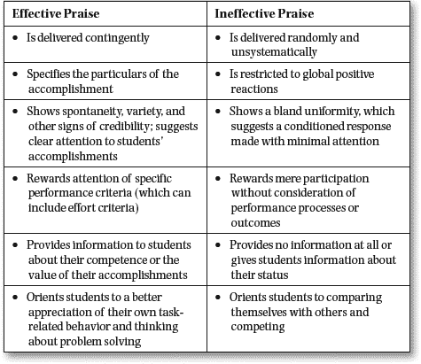


*来源：* Brophy (1981)。经许可使用。

### 停下来思考

1. 你如何描述你课堂的结构化程度？学生知道需要做什么才能成功吗？如果知道，他们是如何知道的？如果不是，你可以如何让你的期望更清晰？
2. 使用表 5.4，你如何描述你提供给学生的赞扬类型？你通常说什么？你可以做哪些改变来在课堂上更有效地进行赞扬？

# 教师如何支持认知参与

不同课堂对认知参与的要求各异。有些教师强调高阶思维。他们以相互合作的方式进行对文本的理解，同时也通过日记中写给我的信来探讨。为了引导我的课程走向更高层次的认知参与，我布置了一个终极项目，该项目涉及与之前知识建立显式联系，并将他们在小说中读到的与现实生活进行比较。例如，在读完一本书关于过度消费主义和媒体主导影响的内容后，学生们研究了我们文化中拥有大多数媒体的公司、这种控制的可能影响，以及对他们看的内容和接收的信息变得更具批判性的策略。另一组读了关于一个阻止援助到达其贫困公民的腐败政府的内容。这一组研究了这种情况今天在世界各地是如何持续的，并将书中的事件与索马里的类似情况进行了对比。第三组读了关于一个利用“游戏”控制公民的反乌托邦政府。读者们识别并探索了当今真人电视现象，以及为什么我们的文化会被生存、竞争和剥削等不同主题所吸引。第四组被要求分析他们小说中一群男孩社区的道德等级制度，以及这种等级如何帮助或阻碍这些角色在尝试实现目标时的进展。随后，他们被要求小组决定自己的社会价值观等级，并为他们为何这样选择写下解释。每个项目都有明确的评分量表，并在工作开始前进行了说明。这种评估比标准的书籍测试要有意义得多。

# 建立高质量关系的障碍

与学生建立高质量的关系可能具有挑战性。这些关系的质量受到结构性因素、教师和学生因素的影响。一个障碍是，许多教师在与学生进行人际互动和学术交流方面的机会有限。大多数教师认为，小学教师更容易建立更积极的师生关系。然而，最近的一项对 2,500 间小学教室进行的大规模观察研究显示，许多教室中师生互动的性质和质量是缺失的。小学生通常与老师互动的机会有限，而且在大多数情况下，这些交流是由服从性驱动的。大多数教学互动侧重于需要离散答案的任务，而不是侧重于与分析、推理或解决问题相关的互动（`Pianta et al.`, `2007`）。

对许多初高中学生体验的研究也描绘了类似的图景。许多教室中师生互动的质量往往缺乏，学生与老师互动的机会有限。在大多数情况下，这些交流是由服从性驱动的。大多数教学互动关注于需要离散答案的任务，而不是侧重于与分析、推理或解决问题相关的互动。

## 与所有学生建立关系

许多教室中师生互动的性质往往缺乏，学生与老师互动的机会有限。在大多数情况下，这些交流是由服从性驱动的。大多数教学互动关注于需要离散答案的任务，而不是侧重于与分析、推理或解决问题相关的互动。

## 实践中的参与

Michele：我注意到，我大多数具有挑战性的学生倾向于分为两类：一类试图通过负面行为来引起我的注意，另一类似乎不想和我产生任何关系，并且倾向于没有反应。我每天都在教室里尽力所能地吸引和涵盖这些学生，但我发现有两种方法可以帮助我更多地接触他们，并给予他们可能需要的积极关注。第一种是通过“与教师共午餐”。在学年的每一周，我都会介绍一位不同的学生，在该周的周五，被选中的学生可以和我以及他选择邀请的两名同学一起吃午饭。我们在教室里一起吃饭，尽情聊天。这真的有助于我更好地了解我的学生，并花更多的一对一时间。我还发现，让另外两名同学加入有助于那些社交笨拙的学生感到更舒适，并练习建立友谊。我知道午餐对老师来说是非常宝贵的时间，因为我们白天几乎没有空闲，但每周一次的这种午餐真的帮助加强了我与学生的关系。

我接触具有挑战性学生的另一种方法是通过写作。有一年，我遇到过一个非常有挑战性的学生，她的家庭和生活经历非常艰难，情感上缺乏安全感。她与同学相处非常困难，并反复因为顶嘴、反抗和不当行为而惹麻烦。在学业上，她想表现良好，但每当遇到挑战性问题时，她会立即放弃或崩溃，坚信自己很愚蠢。我意识到她渴望我的关注，需要我花更多时间陪伴她，因为她正在寻求一种积极的成年人关系。

所以，除了她与学校辅导员进行的工作外，我给了她一个笔记本，让她开始写下她想对我说的话并以此吐露心声。我不希望她在课堂上大声喧哗或通过试图引起我的注意来中断课程，而是希望她把事情写下来。笔记本也是她让我知道何时愤怒或对某些事与我意见不合的地方。休息期间和一天结束时，我会阅读她的日记并给予回应。如果她需要我看某些东西，她可以将笔记本放在我的桌子上。这并非完美无缺，但确实产生了影响。她觉得自己被倾听了，而我可以在不影响其他同学的情况下听她的倾诉。

Pianta (1999) 开发了一种师生关系访谈，教师可以利用此反思自己与每个学生的关系。表 5.7 包含了该访谈中的一些示例问题。

尽管具有挑战性，但教师不应过早放弃与困难学生建立积极关系。研究表明，与其那些容易相处的同学相比，更有困难的学生从建立积极关系中获益更深（Baker et al., 2008; Meehan, Hughes, & Cavell, 2003）。事实是，积极的师生关系可以帮助那些面临脱学和学校失败风险的学生。还有证据表明，学生与教师之间更大的冲突或脱节实际上会增加风险（Hamre & Pianta, 2006）。显而易见，当教师评估投入时间来建立更高质量的关系是否值得时，答案是绝对肯定的。这对于学生的参与度、学业成就和健康发展都有巨大的益处，而不尝试改善这些关系的代价将随着时间的推移导致更严重的脱节。

### 表 5.7：师生关系访谈示例问题

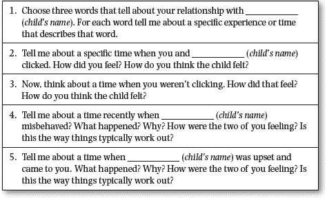

*来源：* Pianta (1999)。

## 停止并反思

1. 你是否发现，与更具挑战性的学生建立关系所需的时间和精力是值得的？
    - a. 这是什么时候发生的？
    - b. 学生是如何回应的？
    - c. 你学到了什么？

2. 想一个你与他关系比较困难的学生。
    - a. 你现在对这个学生有什么感觉？
    - b. 对于这个学生表现出的脱节迹象，你是如何反应的？
    - c. 你会有哪些不同？
    - d. 你将对未来的迹象做出回应？

### 与多元学生建立联系

教师面临的挑战之一是与建立联系。不幸的是，有证据表明教师与互动之间存在不匹配，这可能导致更高的冲突（Ferguson, 1995）。冲突的另一个原因是教师对学生的预期较低（Ferguson, 2000）。先前的研究已将种族/民族刻板印象与较低的参与度和成就联系起来（Eccles, Wong, & Peck, 2006）。

`cultural synchronization` 的概念被用来解释“少数族”（例如，非裔美国人和西班牙语裔）学生与“多数族”（白人）教师之间发生冲突的方式（Irving, 1990; Monroe & Obidah, 2004）。例如，Wubbels, den Brok, Veldman, 和 Tartick (2006) 发现教师更容易误解信息。对于学生不尊重的这种感知，常见的反应是试图加强控制（回看表 5.3）。然而，为了创造更大的`cultural synchronization`，教师需要留意自己的感知，准备好探索自己的偏见，并对误解负责。这要求他们与学生交谈并理解不同的参考框架。

为了与多元学生建立关系，许多教师将需要改变他们的教学和课程方法。`Culturally responsive teaching` 通过教学过程和使用文化相关课程，有意识地回应文化和民族多元化学生的需求（Brown, 2004）。教师不应从缺陷视角来看待学生，而应将民族多元化学生的经历视为宝贵的资产。表 5.8 概述了文化回应型教师的特征（Brown, 2004; Gay, 2002; Wubbels et al., 2006）。

### 停止、反思并尝试

1. 在与背景你不同的学生建立关系时，你经历了哪些障碍？
2. 使用表 5.8，评估你的课程和教学在文化回应性方面的程度。
3. 你可以做哪些改变以更好地满足多元学生群体的需求？
4. 选择`culturally-responsive-instruction` 的一个领域并将其纳入你的下节课程中。收集关于学生互动和回应的数据。

在接下来的*实践中的参与*章节中，Ellen 和 Melissa 描述了他们用来创建更具文化回应性教室的策略。

# 实践中的投入：文化响应教学

艾伦（Ellen）：在进行演示时，我使用图片来解释概念。因为我是白人，我几乎总是选择白人的图片。直到其中一个学生指出这一点，我才意识到这个问题。现在我很小心使用更具包容性的图片。与其使用多元文化方法，我们尝试打破权力关系。例如，在教学`Odyssey`时，我们讨论了种族主义和性别歧视。这非常有参与性，并且通常会导致激烈的讨论。

# 实践中的投入：课堂资源清单

梅丽莎（Melissa）：我每年都会对语言教室中的可用书籍进行清单。我不仅仅想要多种类型，还想确保文本呈现广泛的文化。我查看作者的多样性、主角的多样性以及主题正题。在预算允许的情况下，我会尝试用文化响应的书籍或新书来补充收藏。

过去，我要求学生对教室所有的书籍进行排序和分类。所有的书籍是从书架上取下的。学生小组拿着一堆书，讨论类型、主题、作者以及出版日期。他们探索了文化和社会主题，并通常会有几本他们想加入自己阅读列表的书。这个过程的结果是相同的；书籍已经完成了清点。但现在我的学生知道有什么，缺什么。他们可以为添加新书籍提出建议。

# 章节总结

`第 5 章`概述了将师生关系与投入及成就联系起来的研究。本章的目标是反驳“教学内容比建立学生关系更重要”的观点。介绍了新的理论框架（如依恋理论）以及之前讨论过的理论（如自我决定理论），作为解释教师支持与投入之间积极联系的视角。两种理论都强调了课堂中关系和归属感的需求，特别是在师生关系中。接下来，介绍了基于研究的策略如何支持学生对归属感、自主和能力的需求——自我决定理论中的三个基本需求。本章以对建立高质量关系的障碍的讨论结束。概述了与困难学生建立关系以及联系多元化学生的实用策略。现实是，如果没有意义的师生关系，很少学生能理想地投入学习，教师必须仔细反思并改变他们的互动和教学实践，作为关怀伦理和文化响应实践的一部分。

# 转化练习

以下练习旨在自学或在专业学习社区中使用。反思这些活动并与同事讨论是重要的。然而，更重要的是将这些练习作为改进教学实践的跳板。

## TPE 5.1：采访学生关于师生关系

采访几个学生，了解他们对关怀和支持型教师的看法。以下是可能的问题：

a. 什么构成了一个好老师？
b. 教师如何证明他关心学生？
c. 教师如何在课堂上提供支持/信任/安全感？

作为替代方案，可以在学年或学期开始布置一个课堂项目。

## TPE 5.2：评估教师表扬的有效性

以下场景说明了教师在课堂上提供表扬的不同方式。使用`表 5.4`，描述教师在提供表扬方面的哪些做法是有效的或无效的。

**场景 1：** 当史密斯夫人（Mrs. Smith）向她的七级学生发还阅读测试卷时，她停下来与在作业中付出了特别努力的学生交流。她对其中一个学生说：“凯蒂（Katie），我只是想让你知道，我非常认可你在这个作业中付出的所有努力。这是一项非常困难的作业，我能看出你尽了最大努力，并且比你上一次作业有了巨大的进步。我特别欣赏你将引用语句如此仔细地整合到你自己的语言中。这让你的写作更有力了，因为引用被用来支持你的观点。这是你以后在作业中应该继续做的事！”

**场景 2：** 琼斯夫人（Mrs. Jones）是一位五年级老师。在她所有的测试中，如果作业完成，她会写下“做得好！”画一个笑脸。玛丽亚（Maria）是一个非常优秀的学生。琼斯夫人向其他学生展示玛丽亚的作品，并告诉他们喜欢它的长度。琼斯夫人还有一个积分制。当全班获得十分分时，全班获得奖励。

**场景 3：** 冈萨莱斯先生（Mr. Gonzalez）给高中生布置了一个关于学校公平的项目。他要求学生合作写一封信给董事会，告诉他们认为学校哪些方面不公平。他为每个参与的学生记分。他让学生比较他们的信件，看看哪封信最有效。然后他根据自己制定的评分标准对他们的信件给出了反馈。

**场景 4：** 约翰逊先生（Mr. Johnson）与他的小学生进行每周面谈。他审查学生本周的作品，并告诉他们做得好的地方和需要改进的地方。然后他帮助学生制定下周的目标。当学生清楚表现出实现目标的努力时，约翰逊先生会给予表扬并奖励。每个学生都有一个图表来衡量目标的周数。当学生实现目标时，他们在图表上记录。这些图表公开展示。

## TPE 5.3：评估支持投入的教学特征

`表 5.6`的哪些特征是你的课堂？它在不同学科之间如何变化？你可以对教学做哪些改变以融入更多高投入课堂的特征？

## TPE 5.4：反思你与学生的关系

思考你有过良好也有负面关系的学生。回答`表 5.7`中关于这些学生的问题。根据本章的信息，描述你可以用来改进这些关系的策略。

## TPE 5.5：开发一个文化响应课程


# 使用`表 5.8`，开发并教授一个文化响应课程。多元化的学生对课程反应如何？

## 关键术语和概念

**学术压力（Academic press）：** 教师促学生实现不同学习目标的努力。

- **依恋理论：** 关于儿童与照护者之间关系的理论视角，这种关系随着早期互动模式产生的结果而发展。

- **支持自主的教师：** 重视学生视角的教师。这些教师使用非控制性的语言，允许学生按照自己的方式工作，鼓励学生对自己的学习承担更多责任，并为学生提供建议和做出决策的机会。

- **课堂结构：** 课堂结构指的是情境中关于哪些策略有助于取得学业成功的信息量；而缺乏结构则是指学生对预期和后果感到困惑的心理体验。

- **控制型教师：** 控制型教师坚持只有一种正确的思考、感受或行为方式。这些教师通过使用外部激励、控制性陈述、指示和命令来迫使学生以特定的方式行动。

- **文化同步：** “多数群体”（白人）教师与“少数群体”（例如，非裔美国人和西班牙裔）学生之间价值观与互动模式的对齐；缺乏这种对齐会导致冲突。

- **文化回应性教学：** 一种承认在学习各个方面纳入学生文化背景具有重要性的教学法。

- **发展错配：** 学生的发展需求与学校特征之间的不匹配。这一概念最常应用于初中阶段。

- **教学关怀：** 在课堂上通过社交和学术双重支持对学生表现关怀。

- **表现压力：** 当教师强调工作结果比学习过程更重要时就会发生。

- **理解压力：** 当教师强调理解和学习时就会发生，这向学生传递了一个信息：他们相信学生是可以学习的。

- **教师自我效能：** 教师对自己影响孩子能力的信念。

- **教师敏感性：** 对学生行为和情感需求的契合程度与响应水平。

## 基于研究的资源

### 推荐阅读的书与报告

- Armento, B. J., Irvine, J. J., Jones, J. C., Frasher, R. S., & Causey, V. E. (2000). *文化回应性教学：小学和初中级教学计划.* 纽约，NY: McGraw-Hill.

- Austin, T. (1994). *改变观点：学生主导的家长会议.* 波尔茅斯，NH: Heinemann.

- Boynton, M., & Boynton, C. (2005). *教育者预防和解决纪律问题的指南.* 阿历山大亚，VA: Association for Supervision and Curriculum Development.

- Cruz, G., Jordan, S., Melendez, J., Ostrowski, S., & Purves, A. (1997). *超越文化之旅：使用文化多样化文本进行教学与学习的研究.* 马瓦瓦，NJ: Lawrence Erlbaum.

- Davis, H. A., Summers, J. J., & Miller, L. M. (2012). *课堂管理的人际互动方法：提高课堂参与的策略.* 千纳纳尔奥克斯，CA: Corwin.

- Delpit, L. (1995). *他人的孩子：课堂中的文化冲突.* 纽约，NY: New Press.

- Ferguson, A. (2000). *坏男孩：公立学校在黑人男性气概养成中的作用.* 安阿斯堡: 密歇根大学出版社.

- Hollins, E. R., & Oliver, E. I. (1999). *学校成功的之路：文化回应性教学.* 马瓦瓦，NJ: Lawrence Erlbaum.

- Irving, J. J. (1990). *黑学生与学校失败：政策、实践与处方.* 纽约: Praeger.

- Marzano, R. J., Marzano, J. S., & Pickering, D. J. (2003). *有效的课堂管理：适用于每位教师的研究型策略.* 阿历山大亚，VA: ASCD.

- Pianta, R. C. (1999). *增强儿童与教师之间的关系.* 华盛顿，DC: 美国心理学协会.

- Sleeter, C. E., & Cornbleth, C. (2011). *有愿见的教学：基于标准的课堂中的文化回应性教学.* 纽约，NY: Teachers College Press.

- Vatterott, C. (1999). *通过赋能学生获得学术成功.* 西斯特维尔，OH: 国家中学会协会.

- Vitto, J. M. (2003). *关系驱动的课堂管理：促进学生动力的策略.* 千纳纳尔奥克斯，CA: Corwin.

### 推荐访问网站

1. **Edutopia.com** (`www.edutopia.org`)。该网站为教育者提供了关于如何建立更强大的师生关系的资源。

2. **与学生联系** (`www.connectingwithstudents.org/intro.html`)。该网站是一个在线社区和培训工具，帮助教育者与教室里的每位学生建立联系。

3. **My Teaching Partner** (`www.mtpsecondary.net`)。该网站提供 `My Teaching Partner` 的信息，这是一项个人专业发展计划，旨在帮助教师改善与学生的关系。

4. **教学宽容** (`www.tolerance.org`)。该网站是南方贫困中心的项目，包含了文化相关教学的课堂资源。

5. **教师关系测量** (`www.curry.virginia.edu/academics/directory/pianta`)。该网站由 Pianta 开发，包含了评估教师关系的问卷和观察工具。

6. **回应性课堂** (`www.responsiveclassroom.org`)。该网站提供了关于 `回应性课堂` 的信息，这是一种帮助学生发展社交情感能力的小学方法。

7. **Origins** (`www.originsonline.org`)。该网站包含了用于小学的 `回应性课堂` 模式资源，以及用于初中的社交情感技能干预 `Developmental Designs`。

8. **学术、社交与情感学习协作 (CASEL)** (`www.casel.org`)。该网站包含了学校社交情感学习的资源，包括活动、研究和专业发展机会。

9. **Zinn 教育项目** (`www.zinnedproject.org`)。该网站利用霍华德·津的作品，为教师提供强调工人、女性、有色种人士和组织社会运动对历史塑造作用的资源。

10. **示例教师报告单** (`www.dalat.org/pdf/pd/TeacherEvaluation%201.doc`)。此链接是一个示例教师报告单。

然而，尽管证据表明同伴支持对多种积极结果非常重要，但一些教师表达的一个共同担忧是，让学生花时间与同伴社交并不是多产的，实际上可能会阻碍学生投入工作。对于某些教师来说，目标是创造一个安静的教室，让学生独立完成任务，而不受同伴的干扰。一种担忧是，让学生与同伴互动意味着放弃一些控制，因为互动具有更低的可预测性。反之，这种“控制权的丧失”会增加纪律问题出现的概率，特别是在学生容易分心或其行为干扰其他同伴的情况下。虽然在某些情况下，同伴和社交经历会抑制投入（例如，班级里的小丑吸引注意力），但研究压倒性地支持积极同伴经历与高投入度之间的积极联系（Wentzel, 2009）。

对孤立学生作业的关注部分源于我们以评估驱动的教育体系，在这一系统中，为标准化考试做学术准备已成为首要任务。在这种背景下，许多教师认为，处理课堂的社交维度和培养社区感是其角色和教学时间中不那么重要的方面。这种对学术内容的过度关注且缺乏同伴互动，使得一些学生难以培养在当社会成功所需的社交技能，并可能导致许多学生感受到的孤立感和疏离感。此外，尽管学生整天在学校与同伴在一起，但许多教室的结构在校期间提供的同伴互动机会很少。主许多教室的教师导向和个体化教学实践使得学生难以与同伴建立深固的关系。

本章的目标是消除关于同伴支持以及安静教室和有限学生互动益处的一些迷思。首先，介绍了同伴支持与友谊、投入及学习之间联系的研究。接下来，概述了合作和协作学习模型的信息，以展示同伴如何支持学习和投入。讨论了小组作业带来的挑战，以及创建更有效、多产小组的实证研究策略。最后，概述了关于建立课堂社区的重要性的研究，以及可以在任何教室中轻松实施的增强课堂社区的实用策略。

## 为什么同伴关系很重要？

大多数学生在与同伴的关系方面拥有 `social goals`（社交目标），他们在追求学术目标的同时追求这些目标。这些社交目标包括建立友谊和被同伴接纳（Ryan & Shim, 2008）。与朋友建立良好关系并在学校获得社交支持可以增加学生对学校的兴趣。在青少年早期，由于对归属感有更大的需求，此时同伴的社交支持尤为关键。遗憾的是，初中阶段往往是教师试图比小学阶段更多控制社交的时期。

研究人员考察同伴对投入影响的一种方法是考察 `peer acceptance`（同伴接纳）的概念，即一个学生被班上其他学生喜欢或讨厌的程度。被同伴接纳的学生往往于合作、友好且乐于社交（Rubin, Bukowski, & Parker, 2006）。大量的研究已将小学和中学学生对同伴接纳的感知与一系列积极学术成果联系起来（Buhs & Ladd, 2001; Wentzel, 2009）。例如，研究人员发现被同伴接纳与以下积极结果相关：

*   对学校的兴趣
*   对学校的享受感
*   对学校的积极态度
*   学术能力
*   学校参与度
*   更高的标准化考试成绩
*   更高的分数
*   更低风险的行为

相比之下，`peer rejection`（同伴排斥）或被同伴积极讨厌的经历，会导致投入度降低，并增加辍学的概率（Ladd, Herald-Brown, & Kochel, 2009）。研究发现，被排斥的孩子在课堂内的结构化活动以及课堂外的非结构化活动（如休息或游乐场时间）中都表现出较高的投入缺失（Asher, Rose, & Gabriel, 2001）。这些孩子通常是小组活动中最后被同伴选择的学生。同伴排斥会导致学生在课堂活动中的投入度降低。

### 友谊

其他研究考察了友谊对社交和学术适应的影响。友谊存在于儿童或青少年之间，并随着（Ladd et al., 2009）。仅仅在学校有朋友与一系列积极结果相关（Berndt & Keefe, 1995; Ladd, 1990; Wentzel & Caldwell, 1997）。例如，Wentzel 和 Caldwell（1997）发现有朋友与更高的成绩、分数和社交行为相关。

朋友提供各种类型的支持帮助学生适应学校。朋友可以通过认可、鼓励和关怀提供情感支持。感知到朋友提供情感支持的学生更投入学校。此外，与同学建立良好关系的学生更有可能处于不受同伴攻击的环境（Wentzel, 2005）。相反，不认为朋友关心自己的学生面临投入度下降的风险（Buhs, Ladd, 2006）。朋友还通过提供信息支持（如作业帮助或关于家庭和其他问题的建议）来影响投入（Altermatt, 2007; Wentzel, Baker, & Russell, 2009）。例如，Altermatt（2007）发现与同伴的互动可以帮助中学生应对学术失败。

## 停止并思考

通过建立带有以下标题的列表，识别班级中投入（例如 Franco, Fiona）和不投入（例如 Rachel, Ryan）的学生：

总是高度投入 | 经常不投入 | 均不是

1. 对于“总是高度投入”列中的每个学生，回答以下问题：

   a. 他们在投入时是什么样的？

   b. 他们的朋友是谁？你是如何知道的？

   c. 他们被同伴接纳吗？你是如何知道的？

2. 对于“经常不投入”列中的每个学生：

   a. 他们在不投入时是什么样的？

   b. 他们的朋友是谁？你是如何知道的？

   c. 他们被同伴接纳吗？你是如何知道的？

3. 对于“均不是”列中的每个学生：

   a. 你对这个学生的了解程度像另外两列的学生一样吗？你可以做什么来更好地了解他们？

   b. 他们在“总是高度投入”或“经常不投入”列中有朋友吗？

教师通过他们的信念和教学实践影响同伴关系（即同伴接纳与排斥）以及友谊。之前的研究表明，教师更喜欢像 Fiona 和 Franco 那样顺从并遵守学校规则的学生，而不是像 Ryan 和 Rachel 那样具有攻击性、扰乱性或脱离学习的学生（Fredricks et al., 2004）。通过言语和非语言互动，教师向班级传递信息，说明他们真正喜欢哪些学生留在教室里，哪些学生更难以处理。学生往往能意识到教师的偏好，并根据这些行为预期接受或排斥其他学生。

教师在教室中选择的教学方法也会影响同伴关系。当教师使用 `student-centered learning practices`（例如，让学生参与决策，提供学生互动的机会）时，学生拥有更多朋友，关系更亲密，遭受同伴排斥的可能性也较低。相比之下，在以教师为主的 `teacher-directed methods`（例如，讲座、直接教学）特征的教室中，学生的积极社交结果较少（Donohue, Perry, & Weinstein, 2003）。在以学生为中心的教室里，教师鼓励学生互相讨论作业、进行小组合作，并在开展活动时在教室里移动。最后，教室课桌的物理布局对同伴关系也有影响。在传统的教室里，学生按排坐，注意力完全集中在教师身上。这提供了有限的同伴互动机会。相反，让学生坐在小桌子或小组桌处有利于小组工作，并会增加学生与同伴互动的机会。

## 停止并思考

1. 识别你使用的三种能正向影响教室同伴接纳水平的教学策略。

2. 识别你使用的三种可能负向影响影响同伴接纳水平、并实际上增加教室内公开排斥的教学策略。

3. 思考为你学生提供的与同伴互动的机会，并回答以下问题：

    a. 你多久提供一次机会？

    b. 你为什么要提供这些机会？

    c. 学生如何回应？

4. 描述一种增加同伴互动机会的方法。在什么情况下你会做出这种改变？

## 同伴如何社会化参与度？

同伴社会化参与度和成就有多种方式。一种方法是通过建模，即观察其他学生如何执行特定行为。例如，学生可以观察朋友对学校的投入，并听取他们对学校未来价值的看法。个人还可以观察他们的同伴如何应对困难的问题，以观察他们是坚持并应对困难，还是产生负面情绪并放弃。之前的研究表明，那些认为朋友具有高学术目标的学生，其行为会促进他们自身的学业成就（Wenztel, Filisetti, & Looney, 2007）。

同伴也可能通过强化积极的学业取向或强化负面的学术价值观和信念来影响参与度。同伴压力的概念在流行媒体和研究文献中都受到了广泛关注。我们通常假设同伴压力是负面的。研究表明，同伴压力要复杂得多，其强度和一致性随年龄的变化，并取决于同伴是否认可学术导向的价值观（Brown & Larson, 2009）。一方面，有证据表明，早期青少年比较小的学生更容易在同伴面前淡化他们在学业上的努力，而不是老师面前（Juvonen & Murdock, 1995）。然而，其他研究表明，同伴群体对青少年与学校相关的信念和行为的影响有限（Berndt & Keefe, 1995）。最后，一些研究表明，许多同伴通过鼓励朋友学习和在学校努力来施加积极压力（Ryan & Deci, 2000）。换句话说，同伴可能在不同的时刻、不同的情况下产生所有这些影响。

同伴还可能因为选择成为朋友的学生的特征而影响参与度。学生倾向于自我选择进入具有相似动机和参与水平的小组。高参与度的学生（如 Fiona 和 Franco）更有可能选择同样参与并对学校持有积极态度的朋友。相反，有脱离学校风险的学生更有可能选择那些有过相似负面学校经历的朋友。像 Rachel 和 Ryan 那样不遵守学校规则或不喜欢学校的学生，不太可能获得同伴的支持。反之，缺乏同伴的支持导致这些学生随着时间的推移拥有更少的社交和学术机会。研究人员发现，与高参与度的朋友在一起会随着时间的推移促进参与度，而与脱离学且低成就的同伴在一起则会随着时间的推移抑制参与度（Kindermann, 2007）。

## 停止并思考

1. 识别同伴在你教室中社会化参与度的六种方式——三种通过他们的行为，三种通过他们的言语。

2. 至少至少三个你在教室中看到同伴压力证据的例子。什么时候是积极的？什么时候是负面的？

3. 回到你之前创建的将学生分类为高参与度或脱离的图表。你的高参与度学生之间互相是朋友吗？脱离的学生聚在一起了吗？识别你可以鼓励这些学生在教室里相互互通的方法。

## 同伴对认知参与和学习的好处

除了社交和情感收益外，同伴还可以支持认知参与和学习。根据认知发展理论，与他人合作会使个体接触到不同的观点，从而迫使他们协调或重构自己的观点（Rogoff, 1998）。皮亚杰和维果斯基为同伴互动为何提供认知参与和学习的机会提供了两种不同的理论视角。皮亚杰认为，同伴支持认知发展是因为互动往往是对称的、平等平等的（Gauvain & Perez, 2007）。更平等的权力结构让同伴更容易讨论和分享想法，并增加了合作和共同决策的可能性。相比之下，维果斯基（1978）强调非对称的同伴关系和社会互动。他假设，当一个年长且更有能力的个体在其能力发展区内（即可以在帮助下完成的任务范围）为能力较的同伴提供帮助时，同伴就对学习做出了贡献。通过这种方式，同伴可以提供支架。有证据支持这两种理论观点。之前的研究将同伴之间的积极讨论、问题解决和阐述与认知复杂性的提高联系起来（Gauvain & Perez, 2007）。同伴可以通过以下方式影响认知发展和参与度：

* 提供反馈
* 辩论观点
* 提问
* 要求理由
* 提供阐述
* 分享解决问题的策略
* 提供建议、解释和阐述
* 以更易理解的方式重新定义问题

## 合作学习与协作教学

有两种同伴在课堂上合作以支持参与和学习的互动模式：协作学习模式和合作学习模式。这两种模式在结构程度和教师控制程度上存在差异。

### 协作学习

协作学习是教师用于将学生组织成小组常用教学技巧。在这些环境中，学生合作解决一个结构化问题，而教师仍然保持控制。协作学习整合到课堂中有多种方法。其中一些技术是非正式的，只需几分钟即可实施。另一些是更结构化的活动，贯穿整节课。此外，研究人员还开发了一些正式的 `cooperative learning models`，并将其应用于不同的课堂情况。

**表 6.1** 协作学习模型示例

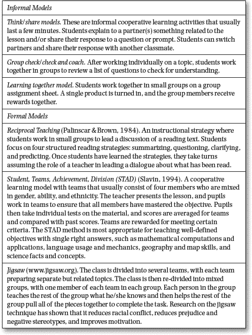


当协作模式成为课堂不可或缺的特征时，它们是最成功的。然而现实情况是，在许多课堂中，教师大部分时间都在说话，只将同伴分组活动作为一天的特殊或额外部分，与较大的课堂结构分开。`Table 6.1` 概述了非正式协作学习技术和正式模型（Jolliffe, 2007; Slavin, 1994）。

### 合作学习

`Collaborative learning models`与协作模式的区别在于，学生需要研究一个重大问题或开发一个有意义的项目。`Chapter 4`中概述的真实学习模型就是合作学习方法的示例。在这些环境中，任务往往是开放式的，学生在决策中拥有更大的投入，而教师的角色更多是引导者。产生知识是关注焦点，学生以小组形式提出并回答问题，或定义没有预设答案的问题。小组收集证据或数据，解释发现并得出结论。最终目标是创建强调理解并与大班或社区共享的成果。

开放课堂模型由芭芭拉·罗戈夫（Barbara Rogoff）及其同事在盐湖城的一所小学中开发（Rogoff, Turkanis, & Bartlett, 2001），是另一个合作学习模式示例。该课堂模式的目标是创建一个学习者社区。该模型基于几个假设（Rogoff, 1994）：

*   成人充当领导和促进者。
*   重点在于学习过程而非结果。
*   通过协作进行学习是社区学习的核心。
*   活动建立在儿童先前的兴趣、需求和先前的理解的基础上。
*   对学生的评估是持续的，通过与学生合作以及观察和跟踪他们学习的对话来进行。

先前的研究显示，协作和合作学习模式在社会、学术、动机和参与方面许多许多（Cohen, 1994; Slavin, 1991b; Slavin, 1996），包括：

*   减少课堂中的地位差异
*   不同种族背景学生之间的积极互动
*   更高的自尊心
*   更高的内在动力
*   对学校的积极态度
*   对他人的更大接纳度
*   归属感
*   更强的毅力
*   更深入的概念理解
*   更高的成就

### 小组作业的社会挑战

尽管协作和合作学习模式的有效性已得到证实，但小组作业也存在许多潜在的陷阱。仅仅将学生分到小组并不意味着它会有多成效。我们都可能记得，曾被分到没有有效协作的小组中，对做什么几乎没有指导，最后由一或两个个人承担了大部分工作的情况。在下一节中，我们概述了小组作业可能出现的一些潜在问题，以及解决这些问题的某些基于研究的潜在策略。

高效的小组作业假设学生具有参与讨论和维持参与的社交技能。遗憾的是，现实是某些学生没有这些技能。为了有效的小组作业，学生需要能够 1) 认识并信任同伴，2) 准确且无歧地交流，3) 接受并支持彼此，以及 4) `Construct` 性地解决冲突（Johnson, Johnson, & Holubec, 1994）。帮助学生实现这些目标的社会技能列表概述在 `Table 6.2` 中。这些技能可能需要在小组作业中进行显性的教学、建模和持续的强化。

还有其他一些社会问题可能使小组作业具有挑战性。之一是学生对协作的反应存在个体差异，一些学生更倾向于独立工作而不是与同伴一起（Blumenfeld et al., 2006）。教师承认这些个体差异并在课堂上提供协作和个人工作的各种机会是非常关键的。另一个问题是同伴地位的差异，如果学术较弱或在社交技能方面有困难的学生使参与高效的小组作业变得更加困难。另一个问题是 `social loafing`（社会懈怠），即部分小组成员付出的努力较少，因为他们依赖其他小组成员来完成工作。当问责结构没有考虑到个人贡献时，这一问题会加剧。最后，一些学生可能难以管理自己的行为并维持参与，特别是在合作学习模型中，小组作业和任务持续时间较长。

**表 6.2** 有效小组作业的社交技能

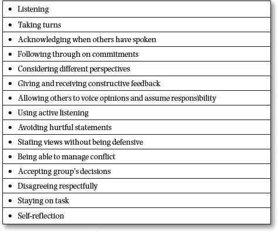

### 支持协作与合作的关键策略

#### 明确目标

尽管小组作业存在固有的挑战，但已有大量研究发现了能使小组作业更高效的策略。高效的小组作业需要教师的支架、监控和支持。当教师设定明确的教学目标以及关于小组作业期间适当社交技能和行为的指南时，协作分组是最成功的（Johnson et al., 1994）。教师应该评估学术进展和人际技能的使用，并在必要时干预以澄清目标并建议使用具体的社交技能。

#### 建模

对有效的互动建模并解释你期望从学生那里听到的对话类型同样的。例如，教师应该模拟如何在小组内给出建议并提供解释。先前的研究显示，学生在小组作业期间会遵循教师的模式。例如，Webb, Nemer, and Ing (2006) 发现学生很少向其他学生提供具体的帮助，因为教师很少展示这种行为。相反，他们直接告诉其他学生答案，而没有任何关于如何得出答案的解释。在接下来的 *Engagement in Practice* 部分，Michele 描述了她如何在 `literature circles`（文学圈）中模拟小组互动，这是一种协作且以学生为中心的阅读策略。

Michele：引导式阅读小组是我们课堂阅读时间的常规组成部分，但在一年的过程中，我会将学生引导至文学小组（literature circles）。与引导式阅读模式不同，学生有更多机会选择他们阅读的文本和所在的小组，并最终承担领导和决定他们在文学小组中讨论内容的责任。我分配了个人角色，并在每次小组会议时进行轮换，每个学生都负责为自己的角色准备一份小型作业，但实际的会议和讨论是更加开放的，可以向不同的方向发展。习惯于结构化操作的学生可以分享他们在角色中准备的内容，但许多学生只花很短的时间分享他们的个人工作，而是更多地想讨论他们对书的问题和想法。

多年来，我发现文学小组最重要的部分是我为他们所做的准备和示范，这帮助他们感到自在和独立。我们总是全班一起进行第一次文学小组活动，每个人都读同一本书。随着我们阅读完这本书，并对为文学小组工作而建立的角色和规范越来越熟悉，学生就可以分成更小的小组并练习讨论他们读过的内容。每次会议后，我们会花几分钟反思执行情况，向全班分享哪些做得好，哪些地方具有挑战性。从开始到整个文学小组活动期间，我总是分享我在校外书俱乐部担任成员期间的经历。当我示范一些事情时，例如我如何在书中做标记、如何为书俱乐部会议准备问题、分享观点，以及尊重地与他人赞同或反对时，这真的非常有帮助。当我们一起完成第一本书后，我发现学生能够更从容地直接进入自己的文学小组，并且在合作工作时更有针对性。

## 学生的相互依赖与分组

老师需要决定的问题之一是如何给学生分组。这一决定取决于学生的年龄、学生对小组作业的熟悉程度、学生的社交技能以及分配给活动的时间。协作分组研究领域的领袖约翰逊及其同事（1994）不建议让学生自己选择小组，因为这会导致按能力、种族和性别产生更同质的小组。研究表明，异质分组会产生更深层次的理解和推理质量，因为学生会考虑更广泛的观点，并更频繁地提供和接受解释（Johnson 等人，1994）。

分配学生分组最简单的方法是随机分配。另一种可能性是给小组分配分配不同的角色，以便每个人都能对小组做出明确贡献。小组工作中包含的不同角色示例有领导者、观察者、资源收集者、计时员和演示者。分配角色有助于培养学生之间的相互依赖。最后，约翰逊及其同事（1994）提出了另一种分组策略，以支持那些在课堂上有社交困难的学生。他们建议老师应该要求学生列出三位他们想合作的同学。从这些列表中，老师可以识别出没有人想与他们合作的学生，并创建在每个此类孤立学生周围包含技巧娴且支持性学生的小组。

## 任务与互动

协作学习和合作学习不仅仅是让学生聚集在小组中。任务的设计对于高效的小组工作也至关重要。任务的设计需要确保每个成员的参与对于完成任务都是必要的，并且在结构上使学生必须进行互动。一种可能性是老师分配任务，使每个人都有一项完成任务至关重要的独特信息。这是 `拼图法`（jigsaw method）的一个核心方面（参见表 6.1）。设计有意义的任务也很重要，即个人需要共同工作并讨论想法。与需要解决问题并具有多种可能解决方案的开放式任务相比，学生完成强调低级技能和记忆的工作表的闭合式任务更有可能发生这种情况（Blumenfeld 等人，2006）。在接下来的 *实践参与* 部分，米歇尔描述了她如何使用小组成让学生互相教学。

## 实践参与：互相教学

Michele：通常在一个科学或社会科学研究单元的结束时，我的学生会进行一个终极项目，展示他们所学的内容，或允许他们进一步研究某个课题。我喜欢计划一些小组项目，无论是两人一组还是更大的小组，让学生有机会合作和分享想法。项目的最后部分是通过演示向全班其他同学展示他们的学习成果，在演示中他们是“老师”。当他们知道同学是观众，而不是仅仅为我完成一份作业时，他们会变得非常有动力且富有创意。我引导他们完成整个过程，帮助他们准备和练习演示。我这样构建了许多项目，使学生更容易与观众互动并教他们，而不是简单地对着他们说话。我通过使用 PowerPoint 或视频等技术、整合艺术和戏剧、或使用游戏格式来实现这一点。每个学生都被赋予责任，要求他们各有一个角色或承担项目的某个部分，这样我就可以看到他们的个人贡献。这些项目是聚在一起回顾我们所学内容，并从每个小组教给我们的内容获得新理解的好方法。

小组作业的一种常见反应是将作业分给不同的小组成员，但没有一种机制让大家回来一起讨论这些想法。为了促进互动，任务应该强调更大的学习目标，而不是离散的知识。这将使得学生不太可能将任务分解成不需要他们整合发现结果的离散活动。对于真正的协作，个人需要一种机制来讨论想法并促进积极面对面的互动。

## 问责制

高效小组工作的另一个重要维度是问责制度。这可以完全基于个人表现，可以是给所有成员的单一小组成绩，也可以包含个人和小组评估。我们主张采用包含个人和小组成员评估的问责制度。只分配个人成绩无法为学生合作解决任务提供足够的动力。另一方面，只分配小组成绩会增加社会懈怠的可能性，并可能因为指责低成就者低分而导致人际关系恶（Blumenfeld 等人，2006）。

结构化个人问责有几种方法，包括：1) 针对每个学生的个人测试，2) 随机抽取学生展示小组作品，3) 观察并记录每个成员贡献的频率，4) 分配一名学生担任检查员，以及 5) 让学生向其他人教他们学到的知识（Johnson 等人，1994）。为个人和小组完成作业建立时间表，并在任务过程中和完成后对个人和小组的进展进行评估，也是重要的。

为了增强责任感，一些人主张使用竞争和小组奖励（Slavin, 1996）。学生、团队、成就与发展 (STAD)（参见表 6.1）是一种协作学习模型，它通过竞争和小组奖励来激励学生（Slavin, 1994）。关于在协作学习模型中使用小组奖励，文献中仍存在争论（Blumenfeld et al., 2006; Kohn, 1991; Slavin, 1991a）。一方面，Slavin (1991a) 认为，小组奖励是必要的，可以创造有利于成就的同伴准则，并增加学生积极解释想法而非仅仅给组内其他人提供答案的可能性。另一方面，小组奖励的一个风险是学生会更关注获胜，而不是学习的内在价值（Blumenfeld et al., 2006）。研究发现，使用小组奖励和竞争在结构化和封闭式任务中效果最好。当任务结构化化且复杂时，这种方法在促进动机方面的效果往往较差（Cohen, 1994）。

在接下来的 `Engagement in Practice`（实践参与）章节中，Ellen 概述了她如何在文学小组中对学生进行分组并让他们承担责任。

## 实践参与：小组责任制

Ellen：我的第二个单元是对小说的研究。为了执行这个单元，学生参与了文学小组。在选择小组之前，我向学生进行了一场书评会，在会上我介绍了推荐的书目，并强调了每本书的重要特征。这项练习不仅让学生参与单元内容，还能帮助我根据兴趣、阅读水平和学生之间的兼容性进行分组。书评会结束后，学生在选书单上写下他们最喜欢的三个选择。我利用这些单的数据对学生进行分组。在单元的第一天，我发放了书籍和所有单元信息，包括截止日期、角色表、单元概述和评估。我们花了一个整课的时间来讨论安排。然后，小组完成了他们的第一项任务，即填写一份日历，他们每节课都会参考该日历，以确保他们的进度能够他们在单元结束前完成阅读、活动和评估。他们必须决定每节课应该读多少页，以便准时完成阅读。他们还必须决定每个小组成员在哪天完成每个角色，以防止出现重叠。学生每天按 1-3 分的标准对小组成员进行评估，让他们在准备和参与方面相互负责。我在教室巡视时做同样的事情，以平衡任何偏差。单元的第一天具有挑战性，因为大多数学生还不习惯该单元提供的自由；但很快之后，只要合得来，小组就能从这种经历中受益匪浅。

**坚持性。** 最后，小组作业需要老师和学生的坚持。即使有最周全的计划、最明确的指南和评估量表，学生也可能发现协作或合作工作非常困难。这在小组作业开始时尤其如此。让他们去经历跌倒、进行他们自己的修改并重新站起来是非常重要的。通过练习，小组在合作工作方面会变得更加高效。接下来的两个 `Engagement in Practice` 章节说明了小组过程的演变。在第一部分中，Ellen 描述了改变指南和任务分配如何改进小组过程。在第二部分中，Melissa 描述了一个小组如何随着时间的推移学会了更有效地工作。

## 实践参与：概述指南和任务依赖性

Ellen：当学生积极参与手头任务时，小组工作最有效。我的第一次尝试是一场灾难，因为我要求五个学生制作一个只需要一个学生的手和注意力就能完成的产品。那次尝试导致了推搡、纸张大战和叫叫，而大约只有四分之一的学生在努力完成指派的任务。我的第二次尝试成功得多，原因有几点。首先，我清晰地概述了小组工作的指南。然后，我没有给整个小组分配一个要完成的任务，而是给每个小组成员分配了一个独特但重要的任务来完成。几分钟后，学生交换了角色并继续工作。这让小组的每个成员都有机会至少尝试一次每个任务。我告诉学生，他们的成绩取决于完成手头任务的能力。与我的上一次尝试不同，学生的专注程度令我惊喜惊喜。几乎每个人都专注于自己的任务，不是因为他们在我这里的学术地位面临风险，而是因为他们在同伴中的社会地位面临风险。他们相互监督以完成任务。当他们结束时，他们对内容有了良好的理解，并意识到小组工作是有益且赋予力量的。尽管这节协作课程是意料之外的，但它实际上比理解内容更有价值。通过成为以学生为中心的小组工作的积极参与者，这些学生意识到他们并不一定需要老师来创造知识并规定哪些知识是有价值的，他们彼此彼此。

## 实践参与：小组随时间推移工作得更有效

Melissa：在一个关于剧本的单元期间，我由七年级和八年级学生组成的多级班有很多任务：他们合作阅读剧本，观看旧《阴影时刻》（Twilight Zone）剧集，并作为一种评估，他们编写并制作了短剧。随着学生们在编写电影剧本和分析技巧方面变得越来越熟练，我要求他们制作一部短电影。学生脑暴了他们感兴趣的话题，如欺凌、毒品、人气、僵尸和科幻。根据他们的兴趣，他们选择了自己的工作小组。每个小组都提供了关于剧本编写、劳动分工和协作工作预期的明确量表。在评估期间，学生被要求进行自我评估，并根据参与情况、解决问题的能力和其他小组工作所需的社交技能对小组的其他成员进行评估（参见表 6.2）。我也定期评估小组的作品。学生们投入度很高，是因为他们选择了自己的团队，选择了要写作的话题，并挑选了自己的角色，还分配了其他角色如编辑、音乐监和摄影师。

令我印象深刻的一个小组是由四个性格强势的人组成的。他们做决定花费的时间是其他小组的两倍，并就角色问题发生激烈争论。作为协调者，我的作用不是为他们解决这些问题，而是让他们意识到自己处于流程的什么阶段，以及两周后需要达到什么状态。他们四天的进展非常缓慢。接下来的发生的事情令人惊讶。该小组决定他们互相抢话太多，正在浪费宝贵的时间。由于他们选择了这个主题，他们想要完成任务。他们开始在小组中使用“话棒”来引导讨论，每个人必须轮流发言。然后他们对决定进行投票，以确保大多数人意见一致。我继续评估他们的小组，并告诉他们自课程开始以来已经发生了显著的变化。这些定期的检查为学生他们的活动过程提供了反馈。拍摄开始了，我见证了持续的问题解决、文明的讨论，以及妥协与欢笑。一位很少完成作业的学生将影片带回家进行编辑，叠加了视觉效果和音乐。在某些时刻，我曾想过把小组拆分来完成另一种个人评估，但从长远来看，这个小组的结果远超我的预期。那个在家里编辑视频的学生最终通过我们的媒体课程报名了另外一次电影制作体验。给予这些学生尝试、失败、再次尝试并成功的空间是关重要的。影片的质量还可以。然而，他们协作技能的演变是卓越的，他们作为一个整体向同伴展示了他们的剧本和影片。

### 停顿与反思

1. **机会**：你在教室里多久进行一次小组作业？哪些主题/课程最适合小组作业？你使用或调整了哪种模式？

2. **社交技巧**：你的学生为了在小组中高效工作需要学习和练习什么类型的技能（参见表 6.2）？你如何以及何时教他们这些技能？

3. **任务**：你如何创建需要学生相互负责并相互依赖的任务？

4. **相互依赖**：你如何确保每个小组都有公平的劳工分配？

5. **问责制**：你是否使用奖励来鼓励高效的小组工作？为什么用或不用？如果是，你使用什么类型的奖励？

6. **坚持**：在干预之前，你允许学生花多少时间来解决自己的问题？

7. 在上述小组工作的六个领域中，哪对作为老师的你最关键？为了让学生获得更多合作或协作的体验，你可以迈出什么重要的第一步？

## 创建教室社区

教室社区是学生与同伴互动并寻找归属感的更广泛背景。创建教室社区可以帮助学生与同伴建立积极关系并培养社交技能。`Classroom community` 在文献中有多种定义，包括社区感、学校归属感、学校成员身份、学校纽带和学校投入（Osterman, 2000）。这些不同概念描述的共同点是：个人感到与学生学生有情感上的联系，感到自己在活动中有发言权或角色，并感到在该环境下对关联关系的需求得到了满足（Battistich, Solomon, Watson, & Schaps, 1997; Osterman, 2000）。换句话说，他们觉得小组对他们很重要，他们对小组很重要，并且他们会被关怀和支持（即他们处于一个安全的学习环境中）。

在教室里建立社区有很多原因。首先，建立教室社区使教师能够应对社交、情感和认知技能。其次，教室社区可以教学生尊重和责任的价值观，以及他们的行为如何影响他人。最后，在教室里建立社区是社会适应和学术成就的关键基础。先前的研究将学生的社区感与一系列积极的学术和学校联系起来（Battistich, Schaps, & Wilson, 2004; Battistich et al., 1997），包括：

*   学校快乐度
*   同伴认同
*   社会适应
*   亲社会价值观
*   对他人的关注
*   冲突解决技巧
*   自主感
*   自我效能


* 干扰行为减少
* 药物和酒精使用减少
* 学术成就提高

关怀学校社区（Caring School Communities，以前称为儿童发展项目 `CDP`）是一个综合小学计划示例，旨在增强孩子的社区感（Watson & Battistich, 2006）。关怀学校社区基于研究的实践，通过提供关怀、支持和协作的关系，帮助学校成为“关怀的学习者社区”。这种学校社区的益处对于校外获得此类支持较少的学生特别重要。（更多信息请参见 [www.devstu.org/caring-school-community](http://www.devstu.org/caring-school-community)）。

关怀学校社区的关键组成部分包括：

* 班会
* 跨龄伙伴
* 促进家校沟通的活动
* 连接家长、教师和学校其他成人的全校社区建设活动

教师有多种方法可以加强教室里的社区感。表 6.3 描述了这些策略。

**表 6.3** 构建教室社区的实用策略

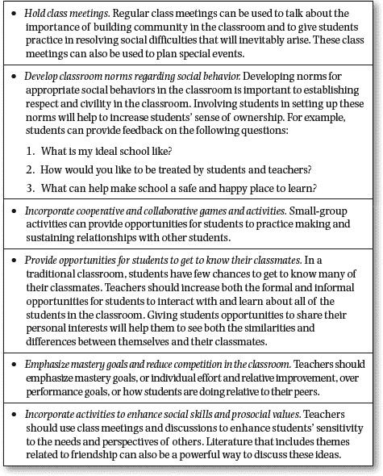

在接下来的*实践参与*章节中，Ellen 和 Melissa 描述了他们用过的开发教室社区的策略。首先，Ellen 描述了她用来帮助学生更好地认识的一种策略。接下来，Melissa 描述了她如何制定社交行为的课堂规范。

Ellen：在阅读新故事或开始新单元之前，学生会独立填写一份预期指南，就对几个伦理和道德陈述表示他们是强烈同意、同意、不同意还是强烈不同意。除了表明立场外，学生还会写下两点来说明这种立场。在课程开始之前，我会在教室的四个角贴上这四个选项。在学生独立完成预期指南后，我们全班聚集。我会逐一大声读每个陈述。读完一个陈述后，学生找到代表他们立场的角。学生坐好后，他们轮流向所有同学分享个人观点的原因或多个原因。例如，在阅读*罗密欧与朱丽叶*之前，预期指南包含的陈述之一是：“安排婚姻有时是合适的。”在我的一节课上读出这一陈述后，大多数学生都向了标有“强烈反对”的角。然而，有一位学生站在“强烈同意”的牌子下。当他站在那里时，同学们都在嘲笑他，疑惑一个青少年怎么可能认真地认同这样一个看似不公正的传统。动静结束后，这名学生点亮了同学的眼界，向他们解释安排婚姻不仅是印度文化中不可或的一部分，而且通常被认为是许多印度青年所欣赏的特权。在那一天，学生们不仅更好地了解了同学，还通过同学接受了关于不同文化的教育，帮助他们变得更有同理心，少了一些无知。我和学生总是期待这项活动，因为它培养了积极的课堂文化，并帮助学生更好地增进了解。

## 实践参与：制定课堂规范

Melissa：课堂会议允许学生发出声音、练习尊重的语言使用和倾听、解决问题并解决教室内的社交冲突。我的初中学生在年初时很难进行文明的对话。他们互相抢话，发表贬低的言论。我突然想到，他们并不知道什么是礼貌地倾听和回应。当时的政治氛围并没有提供正积极的榜样，流行媒体也提供了许多在与持有不同意见的人相处时无礼且不恰当的例子。我们一起描述了礼貌地讨论争议性话题意味着什么。学生们点了这在我们的教室里看起来和听起来会是什么样的。学生展示了他们的想法，并为我们的课堂对话列出了一份指南。他们的清单如下：

* 一次只一个人说话。
* 考虑到所有的意见。
* 不要私下交谈或窃窃语。
* 仔细倾听并观察我们的肢体语言。
* 讨论观点，而不是人。
* 对分歧达成共识。

学生创建的指南让我们能够进行更有建设性的对话。我经常参考这些指南，我的学生也是如此。通过这种方式，我的学生是自我引导的，并且知道自己处于一个安全的环境中，在那里他们被鼓励分享自己的观点。

### 停止、反思并尝试

1. 在空白纸上画一个大圆，展示你如何平衡课堂的社交维度与学术维度。是 50–50 平分吗？20–80？
2. 你会如何描述你课堂的社区感？你目前在教室中包含了`表 6.3`中的哪些方面？
3. 如果你想改进你的课堂社区，`表 6.3`中的哪`一个`方面对你的教学最重要？尝试这样做，并观察学生的反应，或让他们评估实践中的变化。

## 章节总结

`第 6 章`首先概述了关于同伴接受、同伴拒绝和友谊影响的研究，以反驳同伴互动会减少课堂参与度的迷言。本章联系了`第 2 章`中关于同伴接受的讨论，以及`第 4 章`中描述的提供同伴互动的教学策略的重要性。研究和理论也被用于反驳“寂静的教室是最佳学习环境”的迷言。文中介绍了同伴互动在社交和认知方面的益处，并提供了非正式和正式协作与合作学习模式的示例。此外，还对小组工作中固有的某些挑战进行了概述。概述了基于研究的解决方案，以应对这些挑战并提倡将更全面、更有计划的协作与合作模型作为常规课堂实践的一部分。本章以讨论在课堂中建立社区的重要性结束，并提供了增强社区的实际解决方案。随着时间的推移，学生之间互动的课堂在社交、情感和学术上创造了强大的学习语境。每位教师的关键目标是以让学生投入有意义学习的方式，增强这些同伴互动的机会。

## 理论实践练习

### TPE: 6.1：完成课堂社交关系图。

社交关系图是教室内友谊的“映射”。有几种方法可以确定学生之间的联系有多紧密。遵循 Teaching Tolerance 的指令（`[www.tolerance .org/lesson/elementary-mapping-activity](http://www.tolerance%20.org/lesson/elementary-mapping-activity)`）或 Robin Banerjee 的社交关系图工具（`[www.sussex.ac.uk/Users/robinb/socio.html](http://www.sussex.ac.uk/Users/robinb/socio.html)`）。你对学生的关系学到了什么？这些信息能如何帮助你支持更多的关系？

### TPE 6.2：采访学生关于友谊。

采访学生关于友谊。理想情况下，选择社交技能和同伴接受程度不同的学生。可能的问题包括：

1. 你的朋友是谁？
2. 他们和你之间有什么相似或不同之处？
3. 他们在学校里如何支持你？

### TPE 6.3：开发一个合作或协作学习课程。

利用`第 6 章`中的信息，开发一个合作或协作学习课程。学生对课程反应如何？你遇到了哪些挑战？你是如何应对这些挑战的？

### TPE: 6.4：开发高效小组工作的策略。

下表列出了课堂小组工作中可能几个问题。对于每个挑战，开发一个可能的解决方案。

```
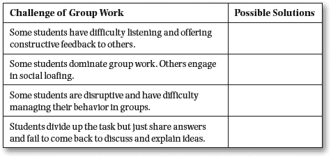
```

## 关键术语和概念

**课堂社区**：学生在情感上相互联系、感到自己在活动中有发言权或角色，并感到归属感得到满足的课堂。

**协作学习模式**：学生在小组中解决没有明确答案的开放问题的机会；教师扮演更具促进性的角色。

**合作学习模式**：学生在小组中完成结构化任务的机会；教师保留控制权。

**拼图法**：一种每位个人都拥有完成任务至关重要的独特信息的方法。

**文献小组**：学生阅读并讨论同一本书的小组。它相当于学生版的成人读书会。这种小小组活动为学生提供了选择想读的内容并对自己的学习拥有一定控制权的机会。

**同伴接纳**：指学生通常受到同学的喜爱；对学习参与度以及学业和社交发展有积极影响。

**同伴排斥**：指学生被同学积极厌恶；对学习参与度以及学业和社交发展有负面影响。

**社会目标**：学生试图与同伴共同完成的目标。例如结交朋友和融入群体。

**社会懈怠**：指某些小组成员因为依赖其他学生完成工作而付出的努力较少的情况。

**以学生为中心的学习实践**：一种将学生需求放在首位的教学方法，教师扮演更多促进者的角色。这种教学法要求学生成为学习中积极、负责的参与者，并对自己的学习做出决策。

**教师指导型方法**：一种教学方法，学生完成由教师设计的活动以实现教师设定的目标。在这些教室里，教师通常花一些时间进行讲授，然后逐步引导学生解决问题。

**最近发展区**：学生在能力更同伴或教师的帮助下能够完成的任务范围。

## 基于研究的资源

## 推荐读物与报告

- Aronson, E., & Patnos, S. (2011). *课堂中的合作：合作图教学法* (第 3 版). 伦敦: Pinter & Martin.
- Bierman, K. L. (2004). *同伴排斥：发展过程与干预策略.* 纽约, NY: Guilford Press.
- Charney, R. (2002). *教导关怀：伦道德与学术成长的课堂管理，K–8.* Turner Falls, MA: Northeast Foundation for Children.
- Crowe, C. (2012). *如何让你的教室免受欺凌.* Turner Falls, MA: Northeast Foundation for Children.
- Daniels, H. (2002). *文学小组：书籍和阅读小组中的声音与选择.* 波特兰, ME: Stenhouse Publishers.
- Daniels, H., & Harvey, S. (2009). *综合与合作：行动中的探究小组.* Portsmouth, NH: Heinemann.
- Daniels, H., & Stieneke, N. (2004). *文学小组的微型课程.* Portsmouth, NH: Heinemann.
- Davis, H. A., Summers, J. J., & Miller, L. M. (2012). *课堂管理的人际方法：提高课堂参与度的策略.* 千橡市, CA: Corwin.
- Denton, P. (2007). *我们语言的力量：帮助孩子学习的教师语言.* Turner Falls, MA: Northeast Foundation for Children.
- Denton, P., & Kriete, R. (2000). *学校的前六周.* Turner Falls, MA: Northeast Foundation for Children.
- Gibbs, J. (2006). *通过创建部落学习社区触及所有人.* Windsor, CA: CenterSource Systems.
- Kriete, R. (2002). *晨会之书.* Turner Falls, MA: Northeast Foundation for Children.
- Johnson, D. W., Johnson, R. T., & Holubec, E. J. (1994). *新的学习圈：课堂与学校的合作.* Alexandria, VA: Association for Supervision and Curricular Development.
- Jolliffe, W. (2007). *课堂合作学习：付诸实践.* 伦敦: Paul Chapman.
- Rogoff, B., Turkanis, C. G., & Bartlett, L. (2001). *共同学习：学校社区中的儿童与成人.* 纽约, NY: Oxford University Press.
- Ryan, A., & Ladd, G. (编) (2012). *学校中的同伴关系与适应.* 夏洛特, NC: Information Age Publishing.
- Slavin, R. E. (1994). *利用学生小组学习* (第 2 版). 巴尔摩, MD: Johns Hopkins University, Center for Social Organization of Schools.

## 访问网站

1. **合作图教室** ([[www.jigsaw.org](http://www.jigsaw.org)]) 该网站包含与合作图教室相关的资源，该模型是由 Elliot Aronson 在 20 世纪 70 年代开发的合作学习模型。
2. **文学小组资源中心** ([[www.litcircles.org](http://www.litcircles.org)]) 该网站包含面向教育者和学生的文学小组资源。
3. **合作学习学院** ([[www.co-operation.org](http://www.co-operation.org)]) 该网站由 Johnson 和 Johnson 开发，包含与合作学习相关的研究和专业发展机会。
4. **关怀学校社区** ([[www.devstu.org/caring-school-community](http://www.devstu.org/caring-school-community)]) 该网站提供与关怀学校社区相关的资源，该项目以前被称为儿童发展计划，是一项旨在增加课堂社区的小学干预计划。
5. **Scholastic** ([[www.scholastic.com/teachers/collection/creating-classroom-community](http://www.scholastic.com/teachers/collection/creating-classroom-community)]) 该网站为教师提供如何创建课堂社区的资源和教案。
6. **罗格斯大学社会与性格发展中心** ([[www.rucharacter.org](http://www.rucharacter.org)]) 该网站包含关于通过教学增加学校社交和性格发展的信息。还提供与性格发展相关的教案、研究和专业发展机会。

# 第 7 章

## 迷话 7：教师能做的事情是有限的

### 如何帮助那些挣于成功的学生

如前面的章节所述，教育工作者可以通过同时改变环境来提高所有学生的参与度。结合本书中提出的基于研究的策略将帮助教师营造更具吸引力的环境。然而，即使在实施这些策略后，某些教师仍然认为无法让所有学生参与进来。这种信念在教授资源匮乏且压力过大的家庭及社区学生的城市学校教育者中更为常见。遗憾的是，这些教师往往会变得气馁，对学生的成功抱有低预期，并觉得自己或学校无能为力 (`Payne, 2008`)。当学生来自困难的家庭和糟糕的社区时，人们很容易将他们低参与度和成就归咎于这些外部因素，并对局势感到无力。

在本章中，我们反驳了无法让所有学生参与的说法。首先，我们概述了某些学生群体较高脱离率相关的个人因素。接下来，我们介绍了教师可以用来识别课堂内脱离行为的一些预警信号。随后介绍了如何重新吸引那些特别容易脱离的群体；这些群体包括男孩、低成就青少年、有行为问题的学生以及非裔美国人、西班牙裔和低收入学生。最后，讨论了在增加风险学生参与度方面有效的干预措施。

## 为什么防止脱离很重要？

防止脱离是理解学生开始退出学校的逐渐过程的关键。辍学并不是瞬间发生的事件；它是由一系列负面学校经历导致的累积过程 (`Finn, 1989`)。研究表明，可以根据小学阶段的参与行为来预测谁会辍学 (`Alexander, Entwisle, & Horsey, 1997`)。因此，所有教师都可以在改变这些教育轨迹方面发挥关键作用，使学生留在学校。在教室里防止脱离是非常重要的，因为辍学会对个人和社会产生严重的负面后果。

辍学率因种族/民族、社会经济地位和学校位置的不同而存在差异。西班牙裔和非裔青少年完成高中教育的概率明显低于他们的白人和亚洲裔同龄人（Rumberger, 2011）。在一些城市中心，只有少于 30% 的非裔男性从高中毕业（Smith, 2002）。这对这些个人及其社区造成了灾难性的后果。没有完成高中教育的青少年更有可能经历失业、就业不足和入禁。未能从高中毕业还会导致收入较低、健康状况较差、对公共援助的依赖程度增加以及犯罪率的上升（Rumberger, 2011）。一个令人警醒的数据是，非裔男性最终入狱的可能性高于进入大学的可能性（Smith, 2002）。

## 脱离教育的风险因素

学生进入每间教室时都带着先前的学术和社交经验，这些经验塑造了他们对待学校的方式。如果所有学生都像 Franco 和 Fiona 那样，教学将会变得很容易。书中贯穿讨论了这两个学生，他们拥有积极的学校经历，行为参与度高，喜欢学校并使用认知策略来确保理解材料。然而，现实是，大多数老师也面临像 Ryan 和 Rachel 这样的学生，他们觉得学校很聊，与老师和同学关系不佳，并且由于之前的学校经历已经表现出脱离教育的迹象。

表格 7.1 显示了一些与高脱离率相关的人口统计学因素和个人因素。首先，学校对许多男孩来说可能是一个困难的地方，发现他们的行为问题发生率更高，对学校有更多负面想法，且学校依恋率也低于女孩（Martin, 2004; Voelkl, 1997）。此外，有证据表明，非裔和西班牙裔青年的脱离率高于白人和亚洲裔青少年（Johnson, Crosnoe, & Elder, 2001, Ogbu, 2003）。研究还发现，学校参与程度随着家庭经济资源的变化而变化。来自贫家庭的学生的行为和情感参与度较低，面临着更高的辍学风险（Janosz, Archambault, Morizot, & Pagani, 2008; Li & Lerner, 2011）。最后，年龄也很重要。学生随着学业的进展，脱离程度会增加，在升入初中后下降幅度更大（Martin, 2007）。

还有各种与脱离教育相关的个人因素。学术困难，如某门不及格、成绩低或成就测试分数低，都是高脱离率的预测因素（Balfanz, Herzog, & MacIver, 2007）。有行为问题史的学生更有可能脱离学校（Finn & Rock, 1997）。脱离教育与更高水平的问题行为之间也存在关系，包括药物滥用和青少年犯罪（Wang & Fredricks, 待出版）。未能参与学校可能导致学生与不良青少年朋友混在一起，并在药物、酒精和暴力中寻求慰藉，这反过来可能会加剧他们对学校的疏离感。

**表 7.1** 脱离教育的人口统计和个人风险因素

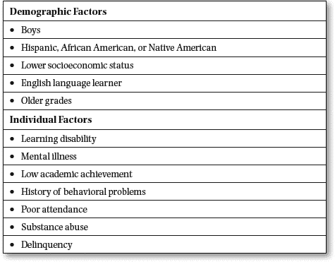

## 脱离教育的早期警告信号


# 学生脱离教育的识别与干预

老师在识别表现出脱离迹象的学生以及干预防止他们进一步脱离和辍学方面起着至关重要的作用。表格 7.2 概述了行为和情感脱离的信号，这些信号通常出现在认知脱离之前。如第 1 章所述，几位学者开发了预警系统，用于识别表现出初步脱离学校迹象的青少年。许多此类早期干预警告系统关注行为指标，因为这些数据已经由学校收集。这些预警系统收集有关出勤、成就测试分数、成绩和学校行为问题的信息。具有更多早期警告信号的学生辍学可能性更高，且随着时间的推移，其犯罪和药物滥用的比例也更高（Henry, Knight, & Thornberry, 2012; Neild, Balfanz, & Herzog, 2007）。除了行为指标外，老师还应该监控学生对学校、老师和同伴的情绪反应。学生往往因为感到无聊、不喜欢学校、感到与成年人疏远以及未能与同学建立良好关系而脱离教育。

**表 7.2** 脱离教育的早期警告信号

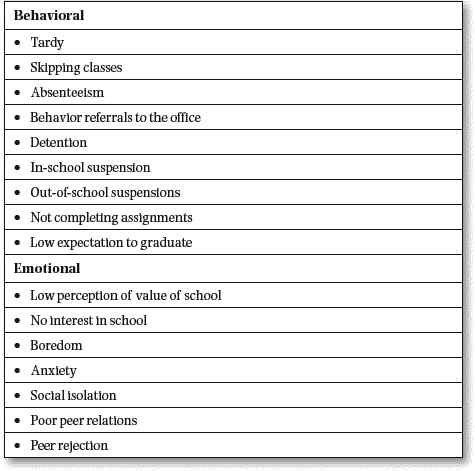

## 学生为什么会脱离教育？

诊断脱离的原因是帮助学生重新参与的第一步。给学生机会分享他们对为何认为自己可能脱离教育的感受，并与他们合作制定经历和策略来改变他们的信念和行为是十分重要的。学生需要将老师视为支持者，而不是问题的一部分，而是解决方案的一部分。表格 7.3 列出了一用于确定学生可能脱离教育的根本原因的问题列表。

## 校外因素

学生可能因为教室之外的因素而脱离教育。脱离可能是学生没有吃充分的早餐或午餐，或者睡眠不足的结果。教育学生及其家长了解营养和睡眠对参与和成就的重要性是非常重要的。家庭压力，如离婚、父母药物滥用或父母生病，也会让学生很难参与学校。在这些情况下，寻求社会工作者和心理学的支持以获取服务帮助学生应对这些压力源至关重要。确定脱离是否是由心理健康或药物滥用问题引起也很重要。将学生联系到解决其心理健康和福祉的服务有助于提高参与度。

**表 7.3** 学生为什么会脱离教育？

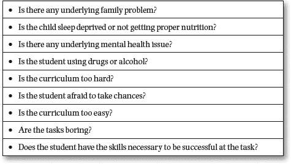

## 思考与反思

1. 你认为脱离教育的最大原因是什么？你的回答是否强调了孩子自身的特征？你是否也考虑了背景因素？
2. 使用表格 7.2 识别教室中开始表现出脱离迹象的学生。他们有什么相似之处？有什么不同之处？
3. 使用表格 7.3 中的问题帮助诊断这些学生为何脱离教育。还需要哪些专业人士参与这一诊断？

## 课程因素

在其他情况下，缺乏参与感是课程设置的结果。像 `Rachel` 这样经历过有限学术成就的学生往往觉得自己不具备成功所需的技能。对于这类学生来说，失败的威胁使得他们不太可能在课堂上冒险，而不冒险又可能对学业成就产生影响。通过营造安全、具有吸引力且受尊重的学习环境，来减少甚至消除犯错的风险，这一点至关重要。

学生不参与也可能是因为他们认为学习内容很无聊或太简单。例如，`Ravet` (2007) 询问学生为什么不参与，并将关注放在`个人因素`，如`态度`、`性格`和`家庭背景`。相比之下，许多学生不参与是因为`课程`本身。对学生来说，有更多的体育课是很常见的现象。为了补偿休息时间及体育课的不足，一些学校设立了简短的运动休息。

## 男孩与参与投入

美国儿科学科学院近期发布了一份名为《课间休息在学校中的关键作用》（2013）的报告，强调了课间休息在社交、认知、情感和身体方面的益处。研究表明，每天只需进行十五分钟的运动对任务行为就有益处（`Barros`, `Silver`, & `Stein`, 2009）。在接下来的*实践投入*部分，Ellen 描述了她在面对精力充沛的男孩时使用的一种策略。

### 实践投入：为精力充沛的男孩编写短剧

Ellen：在教授《罗密欧与朱丽叶》时，我经常让学生表演短剧来总结重要场景。例如，今年读完第一幕后，我将学生分成五组，给每个小组分配一个场景。我指示学生对文本进行删减和现代化处理，使他们的表演易于理解、有趣且具有信息量。我向每个小组成员分发了脚本组织表，并给他们大约十分钟来起草脚本。完成后，各小组上台以角色的身份介绍自己，并使用准备好的剧本表演他们的场景。这项活动之所以成功，是因为它让精力充沛的学生离开座椅，通过肢体动作展示他们对非常困难文本情节的掌握。它同样成功，是因为我能够利用这项活动作为形成性评估来发现薄弱环节。

## 表格 7.4

许多男孩在学校面临的另一个挑战是需要符合男性气气的刻板印象，这可能会限制他们的情感和人际发展（`Froschel`, `Sprung`, 2005）。男孩的一些刻板特质包括独立、情感无能、具有攻击性，以及对发展亲密关系不感兴趣。最近的一本书通过阐述青少年在关系中对亲密关系的深切渴望，反驳了这些刻板印象（`Way`, 2011）。教师可以通过教导和向他们展示表达、情感素养和关怀的价值，帮助男孩反击男性气气的刻板印象，并对我们社会中男性含义形成更广泛的概念。

然而，教师在对抗这些刻板印象时面临的挑战之一是许多学校缺乏男性榜样。男孩更有可能遇到白人女性教师，尤其在小学阶段。这是一个问题所在，因为研究表明，男教师更有能力创造对男孩友的学习环境（Rao, 2009）。遗憾的是，许多年男孩在整个学校校园日内可能没有与成年男性有过过互动。对于居住在城市地区的非裔美国人男孩来说，缺乏可以效仿的正面模型的问题尤为严峻。在接下来的*实践参与*部分，梅莉莎（Melissa）描述了她如何让班上的男孩接触来自社区的各种榜样。

## 实践参与：让男孩接触正面榜样

梅莉莎：我们的员工大部分是白人女性。为了让多元化的男孩接触正面的男性榜样，我邀请社区成员访问并与他们一起。去年，我邀请了当地人类服务机构的负责人来向我们谈论无家可归的问题。他带着两个曾是无家可归的客户，他们向学生分享了自己的经历，帮助他们打破了关于谁是无家可归者的认知。今年，我们来了一位来自亚利桑那州的年轻教师兼活动家。他分享了他的学生（主要是西班牙裔）是如何给他们的社区带来改变的。今年年底，我邀请了一位当地大学的教授兼说板诗诗人表演。他用他有力的言语、对黑人少年的信息以及他与当地针对监禁人员家庭的支持小组的联系，吸引了观众，尤其是男孩们。虽然我可以和学生讨论这些话题，但这些故事并不是我的。通过利用我们社区的资源，学生可以与更广泛的成年人建立联系，我班上的男孩也接触到了正面的榜样。

最后，许多男孩面临与素养能力相关的挑战。女孩在语言发展和阅读成就方面超过了男孩，这种素养差距随着时间的推移而扩大（U.S. Department of Education, 2004）。许多孩子认为看书是一项女性化的活动（Porsche, Ross, & Snow, 2004）。这种性别观念可能是由于男孩在学校和家里看到男性阅读或被朗读的机会较少。教师在帮助男孩培养并保持对阅读的长期兴趣方面起着重要作用。在接下来的*实践参与*部分，米歇尔（Michele）描述了她如何鼓励班级里的男孩阅读。

## 实践参与：鼓励男孩阅读

米歇尔：每年当我为我的教室图书馆增加新书时，我都会尝试包含几个能吸引我班男孩的选择。我也会包含一些在女孩中可能很受欢迎的书，但我发现我更需要的是真正观察周围，并为我的男孩读者建立一个庞大的藏书。在面谈期间，父母经常提到他们对儿子对阅读缺乏兴趣的担忧，我会尝试与他们分享各种在男孩读者中流行的体裁和书名。我会在学初进行一次阅读调查以评估学生的兴趣。根据调查结果以及我多年来的观察，我确保包含几本动作冒险类书籍、科幻小说、奇幻小说、体育小说、传记、神话、科学和幽默书籍。我在图书馆里真正扩展的一个领域是漫画和图画小说。这些书每年对我四年级的男孩们都非常受欢迎，以至于几乎每一本书都在不断被借走。学生们实际上会跟踪每本书以及下一个人是谁借的。我学会了将这种兴趣转移到写作上，给学生在写作和选择时间写他们自己的书的机会，然后将它们放在我们的教室图书馆里。许多男孩成了多产的漫画和图画小说作家及插图师。他们经常合作创作系列丛书。

在朗读时，我也自觉地包含吸引我班男孩男孩的书籍，包括课程期间以及我进行每日分章节书朗读时。对于每日分章节书朗读，我有策略地在一年中加入几部系列书，只读系列的第一本，然后告诉学生他们可以自己阅读剩下的部分。这真的激发了他们的兴趣，让他们开始独立阅读。这也让决定完成整个系列的学生之间进行了一些很的非正式讨论。

总而言之，学校经历的这些方面有助于解释男孩行为问题发生率较高且学校归属感较低（Martin, 2004; Voelkl, 1997）。由于对男孩教育危机的日益关注，已经写了几本关于如何更好地支持男孩学习的书（Gurian & Stevens, 2005; Rao, 2009; Sprung, Froschl, & Gropper, 2010; Tyre, 2008）。`表 7.5`包含了在所有教育阶段提高男孩参与度的一些实用策略。

**表 7.5** 提高男孩参与度的实用策略

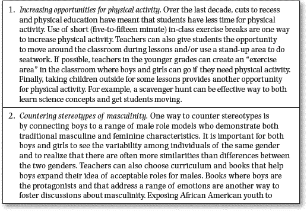

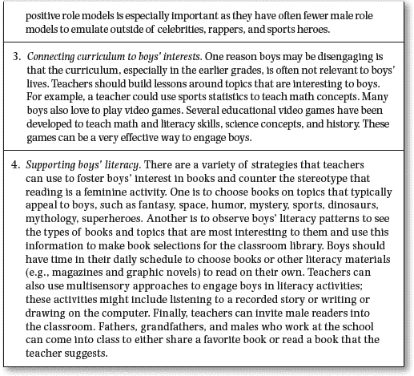

## 停止、思考并尝试

1. 你对男孩行为的态度和期望是什么？这与你对女孩的期望有何不同？
2. 你认为男孩的能量是学习的资产吗？为什么或为什么不？你如何在白天增加他们主动学习的机会？
3. 你的班里是否有开始表现出缺乏参与感迹象的男孩？
4. 使用`表 7.5`，评估你的教学在多程度上支持这些男孩的需求。
5. 你可以做哪些改变来更好地满足男孩的需求？
6. 对于一个表现出缺乏参与感的男孩，采用`表 7.5`中的其中一项建议。他是如何反应的？

## 学业问题与参与缺失

参与缺失的关键预测因素之一是学业困难。在学业上挣扎的学生往往缺乏成功的背景知识和技能，结果他们很少获得从学校成功中获得的成就感。对于经历过失败的学生来说，一种常见的反应是认为自己缺乏成功的能力。这些学生通常表现出`习得性无助`模式，他们对成功的预期很低，并在困难面前很快放弃。由于他们觉得无法控制结果并害怕失败，他们放弃了掌握任务的任何尝试，转而专注于维护自尊和声誉（Brophy, 1996）。

低成就学生经常难以遵循指示并完成作业（Brophy, 1996）。结果，这些学生往往落后于同学。这使得使用为他们年级开发的教学材料变得困难，并可能导致学生感到沮丧，因为他们不知道如何完成任务以及如何获得所需的帮助。瑞（Rachel）是这一现象的完美例子，因为她觉得自己缺乏成功所需的技能。`表 7.6`提供了帮助因低成就而缺乏参与学生的实用研究策略。这些策略改编自针对低成就学生的建议（Brophy, 1996; McIntyre, 1989）。

在接下来的*实践参与*章节中，Michele 和 Ellen 描述了他们在课堂中使用的用以支持低成就学生的策略。首先，Michele 描述了如何使用引导式数学小组为不同能力水平的学生提供差异化教学。接下来，Ellen 描述了她如何对任务进行修改以更好地支持低成就学生。

**表 7.6** 教学低成就学生的实用的策略

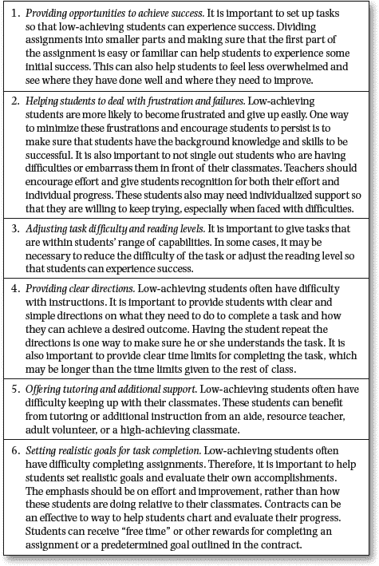

## 实践参与：引导式数学小组

Michele：在教学几年后，我意识到数学是一个我的低成就学生感到非常挣扎并落后得越来越远的领域。在阅读方面，我们已经在使用引导式阅读小组和文学讨论小组来满足不同的学习需求和阅读水平，但我发现很难在数学课上抽出时间来帮助遇到困难的学生，尤其是那些缺乏信心、似乎不知道该如何着手第一道题的学生。这时，我读到了关于引导式数学小组的介绍，并决定在班里尝试。

引导式数学小组可以有多种组织方式。在我的班里，当我引入新概念时，我仍然会安排简短的时间进行全体教学。然后我将班级分为三组，每组在三个“工作站”之间轮换。一组和我会面，接受进一步的小组教学并练习我们正在学习的内容；第二组进行与概念相关的配对或小组活动及游戏；第三组则进行与课程相关的独立作业。全体教学结束后，我总是先与我的困难小组见面，以便立即为他们强化课程，并确保他们理解了指令和我们在学的内容。那些对概念理解良好且进度较快的学生是最后与我会面的。我们的小组会议通常涉及可以进一步挑战他们的问题和任务。虽然这需要我投入更多的工作和准备，但我喜欢使用数学小组，因为我实际上可以检查每个学生的情况。当我们作为一个班级聚在一起时，我可以点名每个人，学生更愿意加入讨论，因为他们有自己在小组中已经成功完成的问题和任务。最棒的部分是小组总是在变化的——有些学生可能大部分时间都在困难小组中，但我经常发现，真正理解数学某个领域（例如几何）的学生可能在另一个领域（例如分数）需要更多帮助。这种持续的改变使学生不会被贴上“低”或“高”小组的标签，他们也不会疑惑为什么自己在某个小组里。

## 实践参与：针对不同能力水平修改任务

Ellen：在过去的两年里，我教了五个异质分组班级。我班上的学生阅读和理解文本的能力涵盖了三年级、十一年级以及两者之间的所有水平。随着时间的推移，我了解到必须针对中间水平进行教学，然后对内容和活动进行差异化，以满足高、低成就学生的需求。我经常观察到光谱两端的学生都会变得不参与，因为他们觉得内容和技能要么太难要么太简单。而不是寻求额外的帮助或增加挑战，一些学生屈服于挫败感并完全放弃，从而与班级其他人和活动疏远。挫败的学生不仅在课程的剩余时间里不再参与，而且由于无能感，他们往往会将这种挫败感带到下节课，循环往复出现。

为了缓解这个问题，我会仔细评估学生，以确定谁需要修改以及需要什么样的修改。例如，在教新词汇时，我每隔两周向学生介绍二十个单词。在两周的练习结束后，会对这二十个单词进行评估。我很快意识到，对于某些学生来说，在短短两周内吸收二十个新词汇几乎是不可能的，尤其是那些母语不是英语的学生。我记得给一个母语是海地克里尔语的学生发词汇测验。扫了一眼测验后，学生的能量瞬间变了。他的肩膀塌了下来，头趴在桌子上。当我问他为什么放弃时，他告诉我他很笨，即使尝试了也会通过不了测试。因为评估并没有为了帮助学生获得成功，他变得挫败、不参与，并最终失败了。为了防止这种情况再次发生并增强这个学生以及类似学生的信心，我将列表减到十个单词，意图是在学生开始轻松掌握这十个词后再增加单词。修改课程、评估和活动向学生展示了我的目标是帮助他们成功而不是失败，与其完全失去他们，这让我让他们重新参与进来。

## 思考与反思

1. 你是否有由于学业困难而不参与的学生？他们在行为、情绪和认知策略方面表现如何？他们在课程的哪些方面遇到了困难？
2. 你目前将 `表 7.6` 中的哪些方面应用于有学业困难的学生？哪些方面可以整合到你的教学中以提高学生的成功率？
3. 将 `表 7.6` 中的一种策略应用于一个学业困难的学生身上。他或她如何反应？你为什么为这个特定的学生选择这种策略？你下一步将做什么？

## 有行为史的学生

教师最关注的问题之一是如何管理课堂，以确保课程运行顺利并最大限度地减少学生的行为问题。这很重要，因为处理学生不当行为的时间剥夺了可以用于学习的时间。预防是减少行为问题的关键。在一个具有参与性任务、积极社交氛围以及明确的预期、规则和常规的教室里，行为问题会更少。学生需要知道对他们的要求以及不遵守这些预期的后果。他们还需要知道他们可以在安全的学习环境中失败，并且他们的成功是被预期并将得到支持的。防止学生不当行为的其他关键包括在问题发生前进行预判、在行为变得更严重之前干预并引导偏离任务的学生，以及以最少的方式处理干扰。

即使采取了这些预防措施，某些老师仍然会遇到扰乱秩序、分散注意力或反抗的学生。其中许多学生都有行为问题的病史，因此他们的行为或反应方式与过去相似。向这些学生强调，反抗、扰乱秩序和具有攻击性的行为是不可接受的，且将不被容忍。对于这些学生来说，识别触发和强化他们负面行为的条件同样重要。教师应该确定这些错误行为发生在何时、何地以及频率如何。例如，老师需要记录这些负面行为是否更容易在一天中的某些时段、特定类型的任务期间或特定的教学安排中（例如小组小组作业、个人作业或大组讨论期间）发生。此外，老师应该跟踪这些错误行为是否会在某些同学在的情况下发生。这些信息可以用于确定学生错误行为的根本原因，并制定计划来改变或消除触发错误行为的因素。这可能意味着调整座位安排、使用教学小组教学、提供多样化的教学活动或改变教学节奏。

在与困难学生相处时，保持冷静并努力理解情况以帮助识别潜在解决方案至关重要。不生气并不容易。这些学生往往反抗权威，并知道如何进行权力斗争。然而，情绪波动可能会恶化局面，并占用解决问题的时间。教师应该首先反思自己对学生错误行为的信念，以防止师生互动的负面循环升级（更多有关与困难学生合作的信息请参见第五章）。要记住，学生的反抗行为可能源于缺乏支持或关怀的成年人榜样，或者由于生活中缺乏一致性。这种错误行为也可能是学生学习获得关注的方式。最终，扰乱秩序和反抗的学生需要老师的同情、理解和支持。像 Ryan 这样经历过失败和持续困惑的学生，往往很难相信老师关心他们，即使证据表明事实并非如此（Watson & Eken, 2003）。

重新吸引参与度不的学生的关键在于给学生发言的机会。学生需要表达自己感受的机会。老师需要回应：尽管他们的行为是接受的，但学生作为个体是受到关的。像 Ryan 这样的学生可能会从解释他对某一事件的解读以及错误行为的触发因素的机会中获益。这可能帮助学生分析自己的错误行为并开始承担一些责任。如果错误行为持续存在，可能需要组织更正式的会议来讨论该行为，概述停止该行为的特定计划，并详细说明如果不做出行为改变将导致的后果（Brophy, 1996）。最后，如果一个学生的错误行为持续存在，特别是在干预之后，寻求学校管理人员、心理学家和社会工作者的支持至关重要。许多学生可以从额外的心理咨询或指导中获益，学习更有效的方法来处理挫败、控制情绪和解决冲突。

在接下来的*实践参与*（*Engagement in Practice*）部分，Melissa 描述了她的学校如何使用审判小组来处理更严重的学生错误行为。

## 实践参与：使用审判小组处理挑战性学生行为

Melissa：有时，课堂教师的干预策略没有导致学生行为发生任何变化。在这种情况下，会召开审判小组。家长、老师、学生和一名管理员聚集在一起讨论问题。设定改进目标，每位成员都承担相应责任。计划像合同一样写下来并由所有方签署。这样，学生会感到得到了支持。家长可能会了解到帮助他们孩子的新资源（例如家庭日常规程、咨询机会和其他支持）。审判小组留给那些更具挑战性的学生。这一过程是协作而非惩罚性的，已被证明非常有效。

## 停止与反思

1. 识别你班级（或以前班级）中有行为问题历史的学生。针对每个学生回答以下问题：
   a. 这个学生从行为问题中获得了什么？
   b. 这些行为发生在何时、何地以及频率如何？
   c. 我可以做（或已经做过）什么不同的做法来降低这种情况发生的概率？
2. 如果你的班可以减少一个学生，你觉得哪一个离开让你如释重负？为什么？你可以做什么来改善与该学生的关系？

## 非裔美国、西班牙裔学生及低收入学生的脱节问题


# 研究发现与理论框架

研究发现，非裔美国和西班牙裔青年的行为问题发生率较高，学校归属感较低（Johnson et al., 2003）。**刻板印象威胁**（Stereotype threat）是提出的一个用于解释非裔美国和西班牙裔学生脱节率较高的一种理论（Steele, 1997）。刻板印象威胁的基础是，当一个人的社会身份（如种族或族裔）与负面刻板印象联系起来时，该人的表现将呈现与此一致的低水平。实验研究表明，在种族特征显著的情况下，非裔美国和西班牙裔学生在标准化测试中的表现优于预期（Gonzalez, Blanton, & Williams, 2002; Steele & Aronson, 1995）。

对非裔美国和西班牙裔学生参与度低的另一种解释是对种族和族裔歧视的经历。这些学生倾向于经历两种歧视：

1. 意识到他们可能会遇到教育和就业歧视，这会削弱他们对教育长期利益的信念（Fordham & Ogbu, 1986）；
2. 每天受到老师和同学的歧视。

Rosenbloom 和 Way (2004) 采访了某所城市高中的非裔、亚洲和拉丁裔青少年，关于他们的歧视经历。学生们谈到，无论他们在教室里的实际行为如何，他们觉得自己被老师刻板印象地标记为“坏孩子”或“惹麻烦的孩子”。此外，他们觉得老师不关爱、缺乏效率且情感疏远。先前的研究将日常歧视的经历与心理健康和学习动机的下降联系起来（Wong, Eccles & Sameroff, 2003）。

## 教师期望与差异化对待

教师产生歧视的一个原因是，他们对非裔美国人学生、西班牙裔学生以及社会经济背景较低的学生期望较低。现实情况是，大多数老师往往并没有意识到自己持有这些差异化的期望，并对不同的群体采取了不同的对待。这些过程通常是无意识的，反映了对不同群体的刻板印象。在其他情况下，教师确实意识到自己的期望较低，但认为这种差异化对待是恰当的，因为学生的水平和家庭状况存在差异。**表 7.7** 概述了教师向学生传达`差异化期望`的显性和微妙方式（Good & Brophy, 1984; Cotton, 1989）。

在高贫困地区的城市学校，对非裔美国人和西班牙裔学生的低期望尤为常见。由于这些学生在家庭生活和社区中往往面临着巨大的挑战，许多老师试图通过降低要求，并在这些学生未能符合期望时给予“再一次机会”来表达他们对这些学生的关注。然而，较低的期望不会对这些学生产生帮助，反而可能导致他们感到与学校更加疏远。相反，这些学生需要的是一个**“温暖型要求者”**（warm demander），这个术语被用来识别那些在教学生和有色种学生方面成功的教师，因为他们在传达温暖的同时，对学生的努力和尊重有着不容谈判的要求（Kleinfeld, 1975; Ware, 2006）。Irving 和 Fraser (1998) 将温暖型要求者定义为“为那些社会在心理和生理上遗弃的孩子提供严谨、务实、结构化且有纪律环境的教师”（第 56 页）。

### 表 7.7 教师如何传达低期望

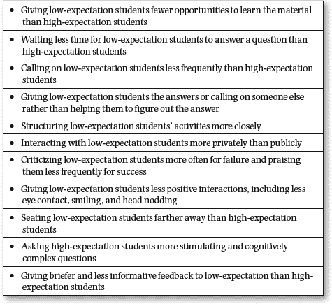

学者们得出结论，**温暖型要求风格**是一种非常有效的教学风格，特别是在适用于有色种学生时，尽管对于不了解观察者来说，它可能看起来很严（Bondy & Ross, 2008; Ware, 2006; Irvine & Fraser, 1998）。**表 7.8** 列出了温暖型要求者的特征。尽管老师对学生的处境表现出同情心，但他们要求学生尊重他们并完成高质量的工作。他们不接受借口。相反，他们坚持要求学生达到高期望。为了实现这一点，他们为学生完成和改进工作提供支持。这些教师还以无条件的积极接纳和关怀来接触学生，特别是对那些有行为问题的学生（Bondy & Ross, 2008）。虽然温暖型要求者可能会对学生的行为感到沮丧，但他们相信并向学生传达他们可以且将会进步。这些教师会向学生寻求帮助以理解他们的行为，并且不会指责学生或忽视他们的关注（Bondy & Ross, 2008）。

### 表 7.8 温暖型要求教师的特征

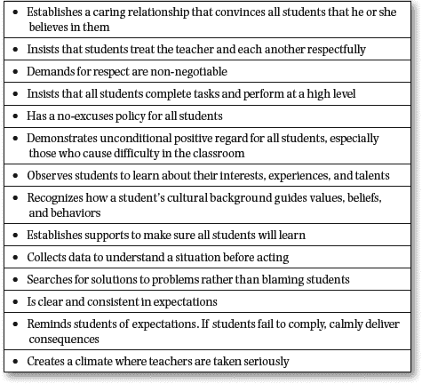

有证据表明，城市学生希望留在有温暖型要求者的教室里。Wilson 和 Corbett (2001) 对费城高贫困地区中学的 200 名学生进行了访谈，询问了他们对老师的期望。他们谈到了希望待在具有以下特征的教室：

*   老师“盯着学生”完成作业。
*   教师能够在不忽略课程的情况下控制学生行为。
*   教师竭尽全力提供帮助。
*   教师解释内容直到全班学生的“灵光被点亮”。
*   教师为学生提供各种通过活动进行学习。
*   教师理解学生的处境并将其考虑在课程中。

## 实践参与：温暖型要求者玛

在接下来的**实践参与**（Engagement in Practice）部分中，Melissa 描述了她学校一位化身了温暖型要求者的教师。

**Melissa**：我们初中的社会科学老师 Mary 是一位温暖型要求者。每天早晨，她都用“你好”问候孩子们，然后严厉检查他们的家庭作业。在进入初中之前，学生们害怕她。但他们总是对她的高期望和公正做法做出回应。回想起来，他们对最初感到害怕。Mary 的课堂结构是可预测的。她提供跨年级的阅读材料以覆盖所有学习者。为了给学生提供更多机会，她准备了差异化的学习指南，从填空题到大纲，再到针对高级学生的自由笔记。Mary 对所有人都有高期望，且这些期望是不容谈判的。她理解自己对待问题学生的方式将决定对其他人的基调。她尊重所有的学生。特别有一个学生在初中的两年里一直在挣扎。他表现不佳且行为不端。Mary 拒绝放弃，提供了课后辅导，陪他一起考虑高中选择，并从未降低过期望。她盯着他和班上其他同学以达到这些期望。那个学生曾反抗，表示不喜欢她。到年底，他不仅在进步，还表达了对这位老师的喜爱。她比他更早知道他需要她。他毕业时，Mary 承诺会定期查看他的进展。她确实竭尽全力为他和其他学生提供支持。

## 停止并思考

1. 在你的教学经验中，与特定群体建立关系时遇到过哪些障碍？
2. 你的价值观如何影响你与不同群体学生的关系？
3. 你根据人口统计特征（如收入水平、性别、种族、民族）或能力持有差异化期望，或如何反对这种做法？
4. 参考[表 7.7](#ch0007.xlink.html#tab7.7)评估你如何向学生传达期望。请一位同事观察你的课堂，记录你是否根据种族、性别、社会经济地位或能力等因素区别对待学生。
5. 参考[表 7.8](#ch0007.xlink.html#tab7.8)评估你的教学风格。你目前拥有哪些特征？哪些特征适用于所有学生？哪些特征适用于部分学生？你计划在教学中更多地融入哪些特征？

# 增加参与度的干预措施

目前已开发出多种干预措施来提高参与度，特别是在初高中阶段（有关干预的更多信息请参阅第 1 章）。这些干预措施旨在针对表现出缺乏参与迹象的个人，或者通过与学校合作来提高学生的整体参与水平。这些改革旨在通过收集早期预警信号和参与水平数据，以及改善学生与学校成年人之间的关系，提高学生的参与度。

`Check and Connect` 由明尼苏达大学的 Sandra Christenson 开发，是此类干预计划的一个示例（[www.checkandconnect.umn.edu](http://www.checkandconnect.umn.edu)）。该计划旨在通过最大化个人接触以及与导师或监测员建立信任关系的机会，来提高参与度并降低辍学率。`Check`部分旨在持续评估行为参与度（通过出勤、成绩和停学情况反映）。`Connect`部分涉及计划人员对学生提供个性化关注，并在发现问题时进行干预。监测员还为学生发声、协调服务、提供持续的反馈和鼓励，并强调留在学校的重要性。研究表明，参与`Check and Connect`模式的学生出勤率、留校坚持度、学分获得、毕业率有所提高，且旷课、行为违规和辍学率有所下降（[www.ici.umn.edu/checkandconnect](http://www.ici.umn.edu/checkandconnect)）。

`First Things First`是另一种学校改革模型，其目标是提高弱势学生众多中学的参与度，并加强学生与成年人之间的关系（[www.irre.org](http://www.irre.org)）。这项改革由 James Connell 和教育改革学院开发，目前用于 34 所高中和 8 所初中。该计划有三个总体目标：

1. 学生在认知、情感和行为上都参与他们的学业；
2. 学生与学校的成年人建立了联系；
3. 学生为高中毕业后的生活做准备。

该计划通过确保学生参与学业、与成年人建立联系并做好生活准备来实现目标。`First Things First`的评估通过五个关键组成实现了这一目标：

*   强化教学
*   有效利用数据
*   学习社区
*   为学生发声
*   家长和社区参与

`First Things First`的评估显示其出勤率、成就和毕业率均有所提高。

`Talent Development`是在约翰霍普金斯大学开发的一种早期预警系统。它的目标是为教师提供工具来支持风险学生，利用基于研究的策略增加城市学生留校的可能性。该模型包含五个特征：

*   学习社区
*   高级课程
*   个性化支持
*   教师发展
*   家长和社区参与

研究显示`Talent Development`与较高的出勤率、学分获得和毕业率相关。

# 章总结

第 7 章的目标是反驳“无法让所有学生参与”的观点。本章首先讨论了风险最高的学生类型。接着，概述了教师可以用来识别学生的早期预警信号。缺乏参与对个人和社会造成的后果都是极其严重的。本章还解释了为什么某些群体具有更高的缺乏参与风险，包括男学生、低成就学生以及反抗的、扰的或具有攻击性的学生。最后，本章概述了旨在增加风险学生参与度的干预计划示例。本章的核心主题是，在有足够支持的情况下，所有学生都能成为投入型的学习者。

## 理论实践练习

*   **TPE `7.1`**：缺乏参与的案例研究。回顾 Ryan 和 Rachel 的案例（在第 1 章开头概述）。使用第 7 章中的信息，概述他们缺乏参与的原因和可能的解决方案。
*   **TPE `7.2`**：识别并重新吸引缺乏参与的学生。使用第 7 章中的信息识别你的两个表现出缺乏参与迹象的学生，诊断这种缺乏参与的原因，并识别重新吸引这些学生的可能策略。在课堂中实施这些策略。学生的反应如何？
*   **TPE `7.3`**：课堂观察。观察一节课（可以是你的教室或其他老师的教室）。你能识别出表现出缺乏参与迹象的学生吗？他们在做什么？缺乏参与最可能在何时何地发生？使用本章的信息识别这种缺乏参与可能的原因，以及有助于重新吸引这些学生的可能改变。
*   **TPE `7.4`**：在课堂上支持男生。研究关于男性刻板印象的课程。调整其中几条以用于你的课堂。调查你的学生及其家长，寻找可能来你的班级交流的当地社区成员名单。联系他们，并共同计划一次与你的课程相关的体验。
*   **TPE `7.5`**：鼓励男生识字。清点教室图书馆的书籍。你可以添加哪些书籍来支持男生的兴趣？询问学校管理员和对学生进行调查，可以为教室图书馆添加的书籍类型提供重要信息。

# 核心术语和概念

## 核心概念

**检查与连接（Check and Connect）**：由明尼苏达大学的桑德拉·基督森森（Sandra Christenson）设计的干预计划，通过评估出勤、成绩和停学（检查）以及最大化与导师或监督员的个人接触（连接），来提高参与度并降低辍率。

**差异化预期（Differential expectations）**：一种无意识或意识的过程，教师对某些群体持有较低预期，并根据这些分类类别（如种族、性别、社会经济地位、能力）区别对待学生。

**要事优先（First Things First）**：由教育改革学院（Institute for Reform in Education）开发的一种干预计划，旨在提高中学的参与度。该计划通过以下方式实现目标：1) 强化教学；2) 有效利用数据；3) 个性化学习社区；4) 为学生和家庭发声；5) 构建加强和维持改革的能力。

**习得性无助（Learned helplessness）**：学生开始怀疑自己的能力，结果减少努力，特别是在面对困难材料时，这导致了学业失败的模式。这种动机模式在低成就学生中很常见。

**短期运动间隙（Short exercise breaks）**：学生在课程之间进行短休息，进行五至十五分钟的体育活动。这些运动休息是为了补偿课间时间和体育课的削减而开发的，被发现可以改善任务行为和学习。

**刻板印象威胁（Stereotype threat）**：一种担心或焦虑，担心当一个人的社会身份（如种族）与负面刻板印象相联系时，该人的表现会与这种刻板印象一致地低下。

**人才培养模型（Talent Development Model）**：由约翰霍普金斯大学风险学生教育研究中心开发的一种早期识别和干预计划，旨在减少初高中生脱学学的概率。该计划的特点包括：1) 小班学习社区；2) 通往高级英语和数学课程的课程设置；3) 学业课外辅导；4) 教职员工发展；5) 促进学生职业发展的家长和社区参与。

**高要求温暖型教师（Warm demanders）**：一类教师，他们传递温暖，但对学生的努力和尊重提出不可逾越的要求。高要求温暖型教师对贫困学生和有色人种学生特别有效。

## 基于研究的资源

### 推荐读物和报告

*   Beers, J. (2003). *When can’t read: What teachers can do: A guide for K–12.* 罕罕什州，波斯斯: Heinemann.
*   Brophy, J. (1996). *Teaching expectations.* 纽约, NY: Guilford Press.
*   Codrington, J., & Fairchild, H. (2012). *Special education and the miseducation of African children: A call to action.* 黑人心理学家协会的立场文件。检索于 2013 年 6 月 13 日，`www.abpsi.org/pdf/specialedpaper01312`。
*   Cotton, K. (1989). *Education and student outcomes.* 西部地区教育实验室。Portland。检索于 2013 年 6 月 13 日，`www.educationnorthwest.org/webfm_send/562`。
*   Delpit, L. (1995). *Other people’s children: Cultural conflict in the classroom.* 纽约, NY: New Press.
*   Ferguson, A. (2000). *Bad boys: Public schools in the making of masculinity.* 安纳伯堡, MI: 密歇根大学。
*   Froschl, M., & Sprung, B. (2005). *Raising healthy boys: A report on the growing crisis in boys’ education.* 教育发展学院。
*   Gambone, M., Klem, A., Summers, J., Akey, T., & Sipe, L. (2004). *Turning the tide: The achievements of First Things First reform in Kansas City public school district.* 检索于 2013 年 7 月 15 日，`www.ydsi.org/pdf/turningthetidefullreport`。
*   Gilliam, W. S. (2005). *Prekindergarten left behind: Expulsion rates in state kindergarten programs.* 儿童发展基金会，政策简报，系列号 3。检索于 2013 年 7 月 15 日，`www.challengingbehavior.org/explore/policy_docs/prek_expulsion`。
*   Good, T. L., & Brophy, J. E. (1984). *Looking in classrooms.* 纽约, NY: Harper & Row.
*   Guirian, M., & Stevens, K. (2005). *The minds of boys: Saving our sons from falling behind in school and life.* 旧金山, CA: Jossey Bass.
*   Legters, N. E., Balfanz, R., Jordan, W. J., & McPartland, J. M. (2002). *Comprehensive reforms for urban high schools: A talent development approach.* 纽约, NY: Teachers College Press.
*   McIntyre, T. (1989). *A resource book for remediating common behavior and learning problems.* 波士顿, MA: Allyn & Bacon.
*   Miller, E., & Almon, J. (2009). *Crisis in the kindergarten: Why children need to play in school.* 学院公园, MD: Alliance for Childhood.
*   Ogbu, J. U. (2003). *Black American students in an affluent suburb: A study of academic disengagement.* 马瓦瓦, NJ: Lawrence Erlbaum.
*   Payne, C. M. (2008). *So much reform, so little change: The persistence of failure in urban schools.* 剑桥, MA: 哈佛教育出版社.


- Rao, A. (2009). *The way of boys: Promoting the social and emotional development of young boys.* 纽约, NY: HarperCollins.

- Ravet, J. (2007). *Are we listening? Making sense of classroom behavior with pupils and parents.* 伦敦, UK: Trentham Books.

- Rumberger, R. W. (2011). *Dropping out: Why students drop out of school and what can be done about it.* 剑桥, MA: 哈佛大学出版社。

- Sprung, B., Froschl, M., & Gropper, N. (2010). *Supporting boys’ learning: Strategies for teacher practice, pre K–grade 3.* 纽约, NY: Teachers College Press.

- Tyre, P. (2008). *The trouble with boys: A surprising report card on our sons, their problems at school, and what parents and educators must do.* 纽约, NY: Crown Publishers.

- Watson, M., & Ecken, L. (2003). *Transforming difficult elementary classrooms through developmental discipline.* 旧金山, CA: Jossey Bass.

- Way, N. (2011). *Deep secrets: Boys’ friendships and the crisis of connections.* 剑桥, MA: 哈佛出版社。

- Wilson, B. L., & Corbett, H. D. (2001). *Listening to urban kids: School reform and the teachers they want.* 奥尔尼, NY: 纽约州大学出版社。

## 访问网站

1. **意识纪律 (Conscious Discipline)** [`www.consciousdiscipline.com`](http://www.consciousdiscipline.com): 该网站包含有关课堂管理与社交情感学习相结合的计划资源，包括工作坊、书籍和课程的信息。

2. **即时休息 (Instant Recess)** [`www.instantrecess.com`](http://www.instantrecess.com): 该网站包含有关将十分分钟体育活动融入日常常规的证据模型的信息。

3. **检查与连接 (Check and Connect)** [`www.checkandconnect.umn.edu`](http://www.checkandconnect.umn.edu): 该网站包含有关检查与连接的信息，这是一种提高参与度并降低辍率的干预计划。网站包含关于该计划的研究以及培训和咨询的信息。

4. **要事优先 (First Things First)** [`www.irre.org`](http://www.irre.org): 教育研究改革学院网站包含有关“要事优先”干预计划的信息。

5. **人才培养模型 (Talent Development Model)** [`www.talentdevelopmentsecondary.com`](http://www.talentdevelopmentsecondary.com): 该网站包含有关中学人才培养模型的信息，这是一种减少城市学生脱学概率的早期识别和干预计划。

## 6. 男孩阅读

[`www.boysread.org`](http://www.boysread.org) 这是一个由家长、教育工作者、图书管理员、导师、作者和书商组成的组织，其目标是提高男孩的阅读素养。

## 7. 让男孩子读起来

[`www.gettingboystoread.com`](http://www.gettingboystoread.com) 该网站为家长、教师和男孩提供了关于如何提高男孩阅读素养的资源。

## 8. 男文学线

[`www.guyslitwire.blogspot.com`](http://www.guyslitwire.blogspot.com) 该网站为鼓励青少年男孩阅读素养提供书籍建议和其他资源。

# 第八章 神话 8：学生参与度是学生的自主选择

### 选择付出努力而不是等待参与度的自然发生

在本书书中，我们要求教师反思他们对每个学生的信念、所选择的学习任务类型以及课堂的社会环境如何影响学生参与度的水平。我们的目标绝不是指责教师，而是赋予他们力量，让他们看到通过创造一个可以进行深度学习的参与性课堂，可以通过多种方式来改变。现实情况是，许多教师花费了大量的时间、精力和情感能量来处理室内学生不参与的问题。这种反应性的方法可能非常令人沮丧，并可能解释教师倦怠和流失率高的原因。然而，我们并不是在问题发生后去处理并等待参与度奇迹般地发生，而是写这本书来鼓励教师投入努力建立更具社会支持性和认知丰富的教学语境。积极主动将导致更少的行为问题，让学生产生兴趣兴趣和兴奋，并让他们更有可能使用深度学习策略来尝试理解内容。

我们意识到，学生不参与可能看起来让人无不从心，但如果教师想提高参与度，第一步就是检查教师是如何谈论学生的。在我们的经验中，经常会听到教师说出类似这样的话：“这个学生不参与是因为他不在乎或者努力不够！”“这个学生来自困难的家庭环境，我能做的也有限！”或者“如果我能有更有积极性的孩子，创造一个参与性课堂就会容易得多！”教师往往倾向于迅速假设学生参与度的水平是个人因素（如动机或学生的家庭状况）的结果。虽然个人因素确实会使创造参与性课堂变得更容易或更难，但学习环境至关重要。本书的一个核心前提是，教师有力量通过根据经过证明的研究型策略对他们的信念和实践进行改变，从而提高所有学生的参与度。

在书中，我们还认为参与度是一个多维构念，包括行为、情感和认知，当学生在所有三个维度上都很高时，会获得最佳的成就和学习结果。许多教育工作者强调行为维度，例如学生是否在任务中或顺从。然而，仅仅因为学生参与并完成了学业，并不意味着他们在情感和认知上投入了深度学习。遗憾的是，许多学生只是在走过场。尽管这可能帮助他们完成低水平的胜任任务和测试，但不足以掌握 `Common Core` 和 `Next Generation Science Standards` 中列出的高水平概念成果。此外，低水平的顺从不能确保对学习的持续参与。

根据我们的经验，我们注意到创建参与性课堂面临的一些挑战。首先，评估文化导致许多学校将精力集中在标准化成绩测试的准备上，而牺牲了认知丰富的教学。遗憾的是，这种“问责文化”导致许多学校限制了研究发现的增加学生参与度并产生深度学习的课堂实践。这种对测试表现的强调是适得其反的，并可能会适得其反。通过过度关注准备学生参加考试，许多学校实际上可能导致了成绩分的下降，因为许多学生发现这些环境非常令人毫无兴趣。我们希望，随着学校开始采用 `Common Core Standards`（这需要更深认知技能和更整合的理解），他们也将更加重视创造行为、情感和认知参与性课堂环境的教学策略。

在接下来的 `Engagement in Practice` 部分中，Michele 描述了她由于芝加哥学校对标准化测试日益重视而在学生参与度方面面临的挑战。

## 实践中的参与：对测试的反思

Michele：作为芝加哥一名四年级教师，我在学生参与度方面面临的最大挑战之一是标准化测试日益增加的要求和压力。从教的第一年开始，我们就看到学生每年需要参加的测试数量增加。这主要是由于对数据收集和衡量学生成长的强调，以及将学生表现与教学评估挂钩。我认为跟踪学生的成长是有价值的，我在自己的课堂里观察并与他们共处时正是这样做的。所有测试的困难之处在于它们对学生来说缺乏深层意义，并且花费了大量时间——不仅是在准备测试方面，甚至仅仅是考试的几个小时。

由于我们学区对测试的过度强调，作为教师，我不得不为我的学生构建意义。例如，我不得不回答这样的问题：为什么这个测试很重要？它将如何帮助我？这和我们在课上学的内容有什么关系？我为什么要关心？在三年级、六级和八级，许多学生被暑期学校和留留级的可能性所激励。我很感谢我的学生没有那种恐惧，但现实是，如果我们表现不好，我的学生、我的学校以及我都将面临真实的后果。然而，这并不是我想传给学生的信息。我希望他们在所做的每件事上都尽最大努力，我一直试图将测试呈现为他们他们他们努力的挑战，而不是决定他们自我价值的东西。当他们为此恐慌或产生压力时，我会安慰他们，我们一整年学到的所有东西将帮助他们任何活动，无论是考试还是他们未来的职业。测试中可能会出现一些我们还没有学过的东西，但我提醒他们，他们拥有可以应用于任何问题以找到答案的工具。我们将这些测试视为要解决的谜题甚至甚至是游戏，我们关注出题者可能如何试图用错误或误导性的答案来刁难我们，以及哪里有等待被发现的线索。

另一个挑战是，即使对于经验丰富的教师来说，实施书中提倡的教学实践类型也需要时间、精力和耐心。学生的学习是复杂的；因此，没有快速解决的办法或简单的解决方案。创造一种参与文化需要时间，以及对反思和行动的持续投入。对于缺乏经验的教师来说，检查自己的实践可能特别具有挑战性。成功实施基于研究的策略需要管理者的支持、充足的资源，以及教育者讨论和反思这些想法的时间。我们鼓励学校人员（管理人员、教师和员工）共同阅读这本书，并讨论他们可以如何合作，为所有学生创造出最具参与感的环境。收集有关参与程度的数据（具体建议请参阅第 1 章）是这一过程的第一步。

最后，尽管有“所有学生都能取得成就”的言辞，但现实是，许多教育工作者仍然认为让所有学生参与是不可能的（请参阅第 8 章以了解如何让最困难的学生重新参与的案例）。目前的假设似乎是，对于某些学生，特别是那些面临个人和家庭困难进入学校的学生，参与度的问题太大了，超出了教师解决的控制范围。不幸的是，许多教师继续根据学术成功仅对某些学生可能的这一信念采取行动。然而，参与度与成就是相关的；没有前者就无法实现后者。因此，尽管让所有学生参与有时看起来困难甚至不可能，教师必须不断从干预研究文献和高参与度课堂的实践案例中汲取经验（第 3 章和第 4 章）。不断的研究表明，即使是最缺乏参与感的青少年，也可以提高参与度。

结论是，学生需要学会思考、推理和解决问题，以成为准备好大学和职业的学习者。不幸的是，我们的许多学校没有为学生提供这些高阶思维能力，许多学生留在学校的时间不足以取得成就。我们有一个选择：是继续关注于确保内容的表面覆盖，还是投入时间、精力和才华，创建一个所有学生都深度参与的学校。我们知道大多数教师倾向于后者，而本书的主要目标是增加学生的参与度。当学生体验深度参与时，他们将成为终身学习者，并不断寻求更有参与感的体验。

## 参考文献

Alexander, K., Entwisle, D. R., & Horsey, C. S. (1997). 从一年级开始：初中辍学的基础。*Sociology of Education, 70*(2), 87–107.

Altermatt, E. R. (2007). 应对学术失败：与家庭成员和朋友互动的差异。*Journal of Early Adolescence, 27*(4), 479–508.

American Academy of Pediatrics. (2013). 休息的关键作用。*Pediatrics, 131*(1), 183–188.

Ames, C. (1992). 课堂：目标、结构和动机。*Journal of Educational Psychology, 84*(3), 261–271.

Anderson, L., & Krathwohl, D. A. (2001). *学习、教学与评估分类法：布鲁教育目标分类法的修订。*New York, NY: Longman.

Asher, S. R., Rose, A. J., & Gabriel, S. W. (2001). 日常生活中的同伴排斥。在 M. Leary (编)，*人排斥* (pp. 105–142)。New York, NY: Oxford University Press.

Assor, A., Kaplan, H., & Roth, G. (2002). 选择是好的，但相关性是极好的：预测学生学校工作的自主增强与行为抑制。*British Journal of Educational Psychology, 72(2)*, 261–278.

Bafanz, R., Herzog, L., & MacIver, D. J. (2007). 防止学生流失并确保城市初中学生顺利毕业：早期识别和有效干预。*Educational Psychologist, 42*(4), 223–235.

Baker J. A. (2006). 师生关系对小学期间积极学校适应的贡献。*Journal of School Psychology, 44*(3), 211–229.

Baker, J. A., Grant, S., & Morlock, L. (2008). 师生关系作为具有外化或内化行为儿童的发展背景。*School Psychology Quarterly, 23*(1), 3–15.

Balfanz, R., Herzog, L., & MacIver, D. J. (2007). 防止学生流失并确保城市初中学生顺利毕业：早期识别和有效干预。*Educational Psychologist, 42*(4), 223–235.

Buhs, E. S., Ladd, G. W., & Herald, S. L. (2006). 同伴排斥与受害：在同伴群体拒绝与儿童课堂参与及学业成就之间起中介作用的过程吗？*教育心理学杂志, 98*(1), 1–13。

Cohen, E. G. (1994). 课堂重组：积极小组的形成条件。*教育研究评论, 64*(1), 1–35。

Connell, J. P., & Wellborn. J. G. (1991). 能力、自主性与相关性：自我系统过程的动机分析。收录于 M. Gunnar & L. A. Sroufe (编)，*明尼苏达儿童心理学研讨会，第 23 卷* (pp. 43–77)。芝加哥，伊州：芝加哥大学出版社。

Cordova, D. I., & Lepper, M. R. (1996). 内在动机与学习过程：情境化、个性化和选择的益处。*教育心理学杂志, 88*(4), 715–730。

Crick, N. R., & Dodge, K. A. (1996). 反应性与主动性攻击中的社会信息处理机制。*儿童发展, 67*(3), 993–1,002。

Croninger, R., & Lee, V. (2001). 社会资本与辍学：教师的支持与指导对风险风险学生的益处。*教师学院记录, 103*(4), 548–581。

Davis, H. A. (2006). 探究初中生与教师之间关系质量的背景。*小学教育杂志, 106*(3), 193–223。

Donohue, K. M., Perry, K. E., & Weinstein, R. S. (2003). 教师的课堂实践与儿童被同伴排斥的关系。*应用发展心理学杂志, 24*(1), 91–118。

Doyle, W. (1983). 课堂中的环境。*教育研究评论, 53*(2), 159–199。

Doyle, W. (1988). 数学课堂中的工作。*心理学杂志, 23*(2), 167–180。

Dweck, C. (1999). 赞美可能是危险的。来自 `https://www.aft.org/pdfs/americaneducator/spring99/`。

Duke, N. K., Purcell, K., Hall, L., & Tower, C. (2006). 发展读写能力的真实性活动。*教师杂志, 60*(4), 344–355。

Eccles, J. S., & Harold, R. (1996). 家庭参与与学业。收录于 J. D. (编)，*家庭与学校：如何影响学业？*。新泽西州，希尔斯代尔（Hillsdale）。

Eccles, J. S., Midgley, C., Wigfield, A., Buchanan, C., & Reuman, D. (1993). 家庭与学校的冲突。*心理学杂志, 48*(2), 90–101。

Eisenberg, N., Fabes, R., & de Loève, S. G. (1998). 青少年的社会发展。收录于 W. Damon (编)，*儿童心理学手册：社会、情感与性格* (pp. 701–778)。

Ennis, C. (1996). 课堂中的冲突。*小学教育杂志, 11*(2), 145–162。

Epstein, J. K. (2002). *学校、家庭与社区连接对学生成就的影响的新证据。*加利福尼亚州，奥斯诺克斯：Corwin。

Feldman, A. F., & Matjasko, J. L. (2005). 课外活动：一项综合性回顾。*教育研究评论, 75*(2), 159–210。

Fredricks, J. A., Blumenfeld, P. (2004). 非认知相关的学校发展因素。*教育研究手册, 24*, 493–532。

Fredricks, J. A., Resifer, J. L., & Vincent, S. G. (2008). 学校参与：概念与情感维度。*学校心理学, 45*(5), 599–629。

Gregory, A. A., & Weinstein, R. S. (2000). 学校参与对风险学生学业成就的作用。*教育研究杂志, 99*(4), 188–210。

Finn, J. D. (1989). 辍学。*教育研究评论, 59*(2), 117–142。


# 参考文献

Finn, J. D., & Rock, D. A. (1997). 面临学业失败风险学生的成功。*应用心理学杂志, 82*(2), 81–95。

Ford, D. W., & Fergusson, J. (1986). 家庭与学校的冲突。*儿童心理学杂志, 27*(3), 293–306。

Hamre, B. K., & Pianta, R. C. (2001). 早期师生关系与儿童到八年级的学业轨迹。*儿童, 72*(2), 625–638。

Hamre, B. K., & Pianta, R. C. (2006). 学生师生关系。收录于 G. G. Bear & K. M. Minke (编)，*儿童需求 III：发展、预防与干预* (pp. 59–72)。华盛顿特区：国家学校心理学协会。

Henderson, A., & Mapp, K. (2002). *新证据：学校、家庭与社区连接对学生成就的影响。*德克萨斯州，奥斯汀：西南教育发展实验室。

Henningsen, M., & Stein, M.K.(1997). 数学任务与学生认知：支持和抑制高水平数学思维与推理的课堂因素。*数学教育杂志, 28*(5), 524–549。

Henry, K. L., Knight, K. E., & Thornberry, T. P. (2012). 学校参与作为青少年期及早期早期辍学、犯罪和药物滥用的预测因素。*青少年与青年杂志, 41*(2), 156–166。

Hill, N. E., Castellino, D., Lansford, J., Nowlin, P., Dodge, K., Bates, J., & Pettit, G. S. (2004). 父母学术参与与学校行为、成就和抱负的关系：青少年时期的人口学差异。*Child Development, 75*(5), 1,491–1,509.

Hill, N. E., & Tyson, D. F. (2009). 初中阶段的父母参与：促进成就策略的元分析。*Developmental Psychology, 45*(3), 740–763.

Hughes, J. N., & Kwok, O. (2006). 课堂参与中介了师生支持对小学学生同伴接纳的影响：一项前瞻性分析。*Journal of School Psychology, 43(6)*, 465–480.

Irvine, J. J., & Fraser, J. W. (1998). 温和的严者。*Education Week, 17*(35), 56.

Jang, H., Reeve, J., Ryan, R. M., & Kim, A. (2009). 自决理论能解释集体主义导向的韩国学生高效且令人满意的学习体验本质吗？*Journal of Educational Psychology, 101*(3), 644–661.

Janosz, M., Archambault, I., Morizot, J., & Pagani, L. S. (2008). 学校参与轨迹及其对辍学的差异性预测关系。*Journal of Social Issues, 64*(1), 21–40.

Johnson, M. K., Crosnoe, R., & Elder, G. (2001). 学生的依恋与学术参与：种族和民族的作用。*Sociology of Education, 74*(4), 318–340.

Juvonen, J., & Murdock, T. B. (1995). 努力社会价值在年级间的差异：对早期青少年自我呈现策略的影响。*Child Development, 66*(6), 1,694–1,705.

Kindermann, T. A. (2007). 自然存在的同伴群体对一群六年级学生学术参与变化的影响。*Child Development, 78*(4), 1,186–1,203.

Kleinfeld, J. (1975). 教授爱斯基摩人和印第安学生的有效教师。*School Review, 83*(2), 301–344.

Klem, A. M., & Connell, J. P. (2004). 关系很重要：将教师支持与学生参与及成就联系。*Journal of School Health, 74*(7), 262–273.

Kohn, A. (1991). 小组计分与合作学习。*Educational Leadership, 48.*

Krajcik, J., Blumenfeld, P., Marx, R., Bass, K., Fredricks, J., & Soloway, E. (1998). 项目制科学课堂中的探究：初中学生的尝试。*The Journal of Learning Sciences, 7*(3–4), 313–350.

Krajcik, J., Blumenfeld, P., Marx, R., & Soloway, E. (1994). 帮助教师学习项目制的协作模型。*Elementary School Journal, 94*(5), 483–498.

Ladd, G. W. (1990). 拥有朋友、维持朋友以及受欢迎：儿童早期适应的预测因素。*Child Development, 61*(4), 1,081–1,100.

Ladd, G. W., Birch, S. H., & Buhs, E. (1999). 幼儿园儿童的社会与学校生活：相关的影响领域？*Child Development, 70*(6), 1,373–1,400.

Ladd, G. W., & Burgess, K. B. (2001). 关系风险和保护因素调节了早期攻击与早期适应之间的关系吗？*Child Development, 72*(5), 1,579–1,601.

Ladd, G. W., Herald-Brown, S. L., & Kochel, K. P. (2009). 同伴与动机。在 K. Wenztel & A. Wigfield (编), *学校动机手册* (pp. 323–348)。

Ladd, G. W., Herald-Brown, S. L., & Reiser, M. (2008). 长期课堂拒绝预测学生的发展吗？*Child Development, 79*(4), 1,001–1,015.

Langdon, C. A., & Vesper, N. (2000). 教师对公立学校的态度。*Phi Delta Kappa, 81*(8), 607–611.

Larson, R. W. (2000). 积极发展的心理学。*American Psychologist, 55*(1), 170–183.

Larson, R. W., Hansen, D., & Moneta, G. (2006). 不同类型课外活动中的发展体验差异化。*Developmental Psychology, 42*(5), 849–863.

Laureau, A. (2000). 家庭优势：家庭-学校关系的阶级差异：文化资本的重要性。*Sociology of Education, 60*(2), 73–85.

Li, Y., & Lerner, R. M. (2011). 青少年期的学校参与轨迹：对成绩、犯罪和物质使用的影响。*Developmental Psychology, 47*(1), 233–247.

Linnebrink, L. A., & Fredricks, J. A. (2008). 成动机的发展视角：个人与背景影响。在 J. Y. Shah & W. L. Gardner (编), *动机科学手册：社会心理学视角* (pp. 448–464)。

Lynch, M., & Cicchetti, D. (1997). 儿童与成人及同伴的关系：小学生和初学生的调查。*Journal of School Psychology, 35*(1), 81–99.

Mahoney, J. L., & Cairns, R. B. (1997). 课外活动能防止早期辍学吗？*Developmental Psychology, 33*(2), 241–253.

Mahoney, J. L., & Eccles, J. S. (2007). 低中等收入家庭儿童的组织活动参与。在 A. Booth & A. C. Crouter (编), *学业准备的差异* (pp. 207–222)。

Mahoney, J. L., Harris, A. L., & Eccles, J. S. (2006). 组织活动参与、积极青少年发展与过度安排假说。*Society for Research in Child Development: Social Policy Report, 20*(4), 1–30.

Mahoney, J. L., & Stattin, H. (2000). 休闲活动与青少年反社会行为：结构和社会背景的作用。*Journal of Adolescence, 23*(2), 113–127.

Malone, T. W., & Lepper, M. R. (1987). 让学习变得有趣：学习内在动机的分类法。在 R. E. Snow and M. J. Farr (编), *能力、学习与教学 III：动力与情感过程分析*。Hillsdale, NJ: Lawrence Erlbaum.

Marsh, H. W., & Kleitman, S. (2002). 课外学校活动：好的、坏的与非性的。*Harvard Educational Review, 72*(4), 464–514.

Martin, A. J. (2004). 男女学生的学校动机：程度差异、种类差异，还是两者兼有？*Australian Journal of Psychology, 56*(4), 133–146.

Martin, A. J. (2007). 考察学生动机的多维度模型。*British Journal of Educational Psychology, 77*(2), 413–440.

Marx, R. W., & Walsh, J. (1988). 从学术任务中学习。Elementary School Journal, 88*(3), 207–219.

Meehan, B., Hughes, J. N., & Cavell, T. A. (2003). 师生关系作为攻击性儿童的补偿性资源。*Child Development, 74*(4), 1,145–1,157.

Midgley, C., Feldlaufer, H., & Eccles, J. S. (1989). 转入初中前后师生关系与对数学的态度。*Child Development, 60*(4), 981–992.

Middleton, M., & Midgley, M. (2002). 动机之外：初中生对数学压力的感知。*Contemporary Educational Psychology, 27*(3), 373–391.

Mitchell, M. (1993). 情境兴趣：数学课堂中的多维度结构。*Journal of Educational Psychology, 85*(3), 424–436.

Monroe, C. R., & Obidah, J. E. (2004). 文化同步对教师感知扰乱感知的影响：一个非洲裔初中课堂的案例研究。*Journal of Teacher Education, 55*(3), 256–268.

Murray, C., & Murray, K. M. (2004). 儿童层面师生关系的相关因素：人口统计学特征、学术取向和行为取向的研究。*Psychology in the Schools, 41*(7), 751–762.

- Neild, R. L., Balfanz, R., & Herzog, L. (2007). 预警系统。*Educational Leadership, 65*(2), 28–33.

- Newmann, F. M., & Wehlage, G. G. (1993). 真实教学的五个标准。*Educational Leadership, 50*(7), 8–12.

- Ng, F. F., Kenney-Benson, G. A., & Pomerantz, E. M. (2004). 儿童的成就调节了母亲使用控制和自主支持产生的影响。*Child Development, 75*(3), 764–780.

- Noddings, N. (1988). 关怀伦理及其对教学安排的影响。*American Journal of Education, 96*(2), 215–230.

- Osterman, K. F. (2000). 学生对学校社区归属感的需求。*Review of Educational Research, 70*(3), 323–367.

- Palinscar, A., & Brown, A. (1984). 促进理解促进和理解监控活动的互惠教学。*Cognition and Instruction, 1*(2), 117–175.

- Paris, S. G., & Paris, A. H. (2001). 自主学习研究的课堂应用。*Educational Psychologist, 36*(2), 89–101.

- Peterson, P., Swing, S., Stark, K., & Wass, G. (1984). 数学教学期间的学生认知与任务时间。*American Educational Research Journal, 21*(3), 487–515.

- Pianta, R. C. (2006). 课堂管理与师生之间的关系：对研究与实践的启示。在*课堂管理手册：研究、实践与当代问题*。(pp. 685–709)。Mahwah, NJ: Lawrence Erlbaum.

- Pianta, R. C., Belsky, J., Houts, R., & Morrison, F. (2007). 美国小学课堂中的学习机会。*Science, 315*(5820), 1,795–1,796.

- Pianta, R. C., Steinberg, M. S., & Rollins, K. B. (1995). 入学的前两年：师生关系与儿童课堂调整的偏差。*Development and Psychopathology, 7*(2), 295–312.

- Pomerantz, E. M., Grolnick, W. S., & Price, C. E. (2005). 父母在孩子如何对待成就中的作用：动态过程视角。在 A. J. Elliot & C. S. Dweck (编)，*能力与动机手册* (pp. 259–278)。New York, NY: Guilford Press.

- Pomerantz, E. M., Moorman, E. A., & Litwak, S. D. (2007). 父母参与孩子学术生活的方式、对象以及原因：*并非越多越好*。*Review of Educational Research, 77*(3), 373–410.

- Porsche, M. V., Ross, S. J., & Snow, C. E. (2004). 从幼儿园到初中：男性气概在低收入城市青少年男孩读写能力和学术成就中的作用。在 N. Way & J. Y. Chu (编)，*青少年男孩：探索多元化的男孩文化* (pp. 338–360)。New York, NY: New York University Press.

- Raftery, J. N., Grolnick, W. S., & Flamm, E. S. (2012). 家庭作为学生参与的促进者：迈向家校合作。在 S. L. Christenson, A. L. Reschly, & C. Wylie (编)，*学生参与研究手册* (pp. 343–364)。New York, NY: Springer. 

- Reeve, J., & Halusic, M. (2009). K–12 教师如何将自我决定理论诸实践。*Theory and Research, 7*(2), 145–154.

- Reeve, J., & Jang, H. (2006). K–12 教师如何将自我决定理论诸实践。*Theory and Research, 7*(2), 145–154.

- Reeve, J., & Jang, H. (2004). K–12 教师如何将自我决定理论诸实践。*Theory and Research, 7*(2), 145–154.

- Renick, E. S. (1987). K–12 教师如何将自我决定理论诸实践。*Theory and Research, 7*(2), 145–154.

- Renick, E. S. (1994). K–12 教师如何将自我决定理论诸实践。*Theory and Research, 7*(2), 145–154.

- Renick, E. S. (1997). K–12 教师如何将自我决定理论诸实践。*Theory and Research, 7*(2), 145–154.

- Renick, E. S. (1998). K–12 教师如何将自我决定理论诸实践。*Theory and Research, 7*(2), 145–154.

- Renick, E. S. (1999). K–12 教师如何将自我决定理论诸实践。*Theory and Research, 7*(2), 145–154.

- Renick, E. S. (2000). K–12 教师如何将自我决定理论诸实践。*Theory and Research, 7*(2), 145–154.

- Renick, E. S. (2001). K–12 教师如何将自我决定理论诸实践。*Theory and Research, 7*(2), 145–154.

- Renick, E. S. (2002). K–12 教师如何将自我决定理论诸实践。*Theory and Research, 7*(2), 145–154.


## 参考文献

- Renick, E. S. (2003). K–12 教师如何将自我决定理论诸实践。*Theory and Research, 7*(2), 145–154.
- Renick, E. S. (2004). K–12 教师如何将自我决定理论诸实践。*Theory and Research, 7*(2), 145–154.
- Renick, E. S. (2005). K–12 教师如何将自我决定理论诸实践。*Theory and Research, 7*(2), 145–154.
- Renick, E. S. (2006). K–12 教师如何将自我决定理论诸实践。*Theory and Research, 7*(2), 145–154.
- Renick, E. S. (2007). K–12 教师如何将自我决定理论诸实践。*Theory and Research, 7*(2), 145–154.
- Renick, E. S. (2008). K–12 教师如何将自我决定理论诸实践。*Theory and Research, 7*(2), 145–154.
- Renick, E. S. (2009). K–12 教师如何将自我决定理论诸实践。*Theory and Research, 7*(2), 145–154.

- Stuhlman, M. W., & Pianta, R. C. (2002). 教师关于与儿童关系的叙述：与课堂行为的关联。*School Psychology Review, 31*(2), 148–163.

- Turner, J. C. (1995). 课堂背景对儿童读写动机的影响。*Reading Research Quarterly, 30*(3), 410–441.

- Turner, J. C., Meyer, D. K., Cox, K. C., Logan, C., DiCintio, M., & Thomas, C. T. (1998). 为数学参与创造背景。*Journal of Educational Psychology, 90*(4), 730–745.

- Turner, J. C., Midgley, C., Meyer, D. K., Gheen, M., Anderman, E., Kang, Y., & Patrick, H. (2002). 课堂环境与学生对数学回避策略的报告：一项多方法研究。*Journal of Educational Psychology, 94*(1), 88–106.

- U.S. Department of Education (2003). 特殊教育计划办公室。*第 25 年度向国报告。*华盛顿，DC：作者。

- U.S. Department of Education (2004). *女孩和女性教育公平的趋势。*华盛顿，DC：作者。于 2013 年 6 月 13 日检索自`http://nces.ed.gov/pubs2005/2005016.pdf`

- Valdés, G. (1998). 学校内外的世界：语言与移民儿童。*Educational Researcher, 27*(6), 4–18.

- Voelkl, K. E. (1997). 对学校的认同。*American Journal of Education, 105*(3), 204–319.

- Vygotsky, L. S. (1978). 社会中的心理：高阶心理过程的发展。(M. Cole, V. John-Steiner, S. Scribner, & E. Souberman, 编)。马萨诸塞州，剑桥：哈佛大学出版社。

- Wang, M. T., & Eccles, J. E. (2012). 社会支持的重要性：社会支持对初中到高中学校参与三个维度的纵向影响。*Child Development, 83*(3), 877–895.

- Wang, M. T., & Fredricks, J. A. (出版中). 青少年期学校参与与青少年问题行为之间的互惠联系。*Child Development。*

- Ware, F. (2006). 温和要求者教学法：支持非裔美国学生成就文化的文化回应性教学。*Urban Education, 41*(4), 427–456.

- Watson, M., & Battistich, V. (2006). 构建和维持关怀社区。在 C. M. Evertson & C. S. Weinstein (编))，*课堂管理手册：研究、实践与当代问题* (第 253–279 页)。新泽西州，马瓦瓦：Lawrence Erlbaum。

- Webb, N. M., Nemer, K. M., & Ing, M. (2006). 小组反思：同伴导向小组中教师话语与学生行为的平行关系。*Journal of the Learning Sciences, 15*(1), 63–119.

- Wentzel, K. R. (1997). 初中学生动机：感知教学关怀的角色。*Journal of Educational Psychology, 89*(3), 411–419.

- Wentzel, K. R. (1998). 初中的社交关系与动机：父母、教师和同伴的角色。*Journal of Educational Psychology, 90*(2), 202–209.

- Wentzel, K. R. (2005). 学校中的同伴关系、动机与学业表现。在 A. Elliot & C. Dweck (编)，*能力与动机手册* (第 279–296 页)。纽约州，纽约：Guilf-ord。

- Wentzel, K. R. (2009). 学校中的同伴关系与动机。在 K. Rubin, W. Bukowski, & B. Laursen (编)，*同伴关系手册* (第 531–547 页)。纽约州，纽约：Guilford。

- Wentzel, K. R., Baker, S. A., & Russell, S. (2009). 学校中的同伴关系与积极调整。在 S. Huebner, & M. Furlong (编)，*促进儿童和青少年的健康* (第 229–244 页)。

- Wentzel, K. R., Barry, C., & Caldwell, K. (2004). 初中的友谊：对动机和学校的影响。*Journal of Educational Psychology, 96*(2), 195–203。

- Wentzel, K. R. & Caldwell, K. (1997). 友谊、同伴认可与群体身份：与初中学业成就的关系。*Child Development, 68*(6), 198–209.

- Wentzel, K. R., Filisetti, L., & Looney, L. (2007). 青少年社会化行为：自我过程和环境线索的角色。*Child Development, 78*(3), 895–910.

- Wigfield, A., Byrnes, J. P., & Eccles, J. S. (2006). 早期和中期青少年期的发展。在 P. A. Alexander & P. H. Winne (编))，*教育心理学手册* (第 87–113 页)。新泽西州，马瓦瓦：Lawrence Erlbaum。

- Wigfield, A., Guthrie, J. T., Tabada, A., Klauda, S., McRae, A., & Barbosa, P. (2008). 阅读参与度在调节阅读理解结果方面的作用。*Psychology in the Schools, 45*(5), 432–445.

- Wong, C., Eccles, J. S., & Sameroff, A. (2003). 种族歧视对非裔美国青少年情感调节的影响。*Journal of Personality, 71*(6), 197–232.

- Wubbels, T., den Brok, P., Veldman, I., & Tartwijk, J. (2006). 多文化课堂中教师的人际能力。*Teachers and Teaching: Theory and Practice, 12*(4), 407–433.

- Yazzie-Mintz, E. (2007). 学生参与报告：2006 年高中参与调查。印第安纳州，布鲁明顿：教育政策中心。于 2010 年 2 月 1 日检索自`http://ceep.indiana.edu/pdf/HSS_2006.pdf`

- Zimmerman, B. J. (2002). 成为自我调节的学习者：概述。*Theory Into Practice, 41*(2), 65–70.

## 索引

- 学业压力 `ch0005.xlink.html#page142`
- 学业问题与参与不足 `ch0007.xlink.html#page207`–`ch0007.xlink.html#page211`
- 同伴认可 `ch0006.xlink.html#page163`
- 问责制 `ch0006.xlink.html#page177`–`ch0006.xlink.html#page179`
- 非裔美国学生与参与不足 `ch0007.xlink.html#page194`–`ch0007.xlink.html#page195`，`ch0007.xlink.html#page200`，`ch0007.xlink.html#page214`
- Akey, T. M. `ch0007.xlink.html#page220`
- Alexander, K. L. `ch0007.xlink.html#page194`
- Aley, K. L. `ch0001.xlink.html#page17`
- Almon, J. `ch0007.xlink.html#page201`
- Altermatt, E. R. `ch0006.xlink.html#page164`
- Ames, C. `ch0004.xlink.html#page87`，`ch0004.xlink.html#page88`
- 阅读的分析与综合 `ch0004.xlink.html#page114`–`ch0004.xlink.html#page115`
- Anderman, E. `ch0005.xlink.html#page130`
- Anderson, L. `ch0004.xlink.html#page97`
- Archambault, L. `ch0007.xlink.html#page195`
- Aronson, J. `ch0007.xlink.html#page214`
- Artifacts `ch0004.xlink.html#page98`
- Asher, S. R. `ch0006.xlink.html#page164`

### 评估方法

- 预警指标 `ch0001.xlink.html#page29`–`ch0001.xlink.html#page30`
- 观察测量 `ch0001.xlink.html#page25`–`ch0001.xlink.html#page29`
- 自我测量 `ch0001.xlink.html#page21`–`ch0001.xlink.html#page22`，`ch0001.xlink.html#page23` (表格)
- 教师评分量表 `ch0001.xlink.html#page22`–`ch0001.xlink.html#page25`
- 课堂观察 `ch0001.xlink.html#page29`，`ch0001.xlink.html#page30` (表格)

- Assor, A. `ch0004.xlink.html#page91`
- 依恋理论 `ch0005.xlink.html#page127`
- 真实的教学模式 `ch0004.xlink.html#page100`–`ch0004.xlink.html#page107`
- 动机与认知挑战 `ch0004.xlink.html#page107`–`ch0004.xlink.html#page111`
- 真实的读写 `ch0004.xlink.html#page104`–`ch0004.xlink.html#page106`
- 真实的任务 `ch0004.xlink.html#page98`–`ch0004.xlink.html#page100`

- Baker, J. A., 45, 147, 149
- Baker, S. A., 164
- Balfanz, R., 30, 195, 197, 221
- Barbosa, P., 25
- Barch, J., 137
- Barlett, L., 171
- Bates, J., 75
- Battistich, V., 183, 184
- Bauman, K., 126
- Bearman, P. S., 126
- 行为参与，14–15, 22
  - 自我报告，23 (表格)
  - 教师评分量表，24 (表格)
  - 仅有行为参与的学生，12–13, 17
  - 有行为问题史的学生，211–214
- Behringer, L. H., 126
- Belmont, M. J., 14, 139
- Belsky, J., 40, 145
- Bempechat, J., 70
- Berndt, T. J., 164, 167
- Beuhring, T., 126
- Bierman, K. L., 50
- Birch, S. H., 44, 125
- Blanton, H., 214
- 布鲁姆分类法，97
- Blum, R. W., 126
- Blumenfeld, P. C., 2, 3, 14, 16, 22, 38, 39, 43, 44, 85, 124, 125, 142, 172
  - 构制品，98
  - 真实性任务，98
  - 具有挑战性的课堂任务，86, 87
  - 幻想，88
  - 小组作业，176, 177, 178
  - 同伴排斥，48, 165
  - 项目制学习，100, 104
  - 社会懈怠，109
  - 课堂任务的多样性，88
- Bondy, E., 216, 217
- 男孩与参与不足，200–207
- Bransford, J. D., 98
- ansman, A., 68
- Broh, B. A., 63
- Prophy, J., 140, 207, 213, 215
- Brown, A., 170
- Brown, A. L., 98
- Brown, B. B., 1, 54, 167
- Brown, D. F., 152
- Bynes, J. P., 126
- Buchanan, C. M., 44
- Bs, E. S., 44, 163, 164
- Bukowski, W. M., 163
- Burgess, K. B., 44
- Cairns, R. B., 62
- Caldwell, K., 164
- 关怀的专业的，128–129
- 关怀型社区，184
- Carrell, D., 137
- Castellino, D., 75
- Cavell, T. A., 149
- 具有挑战性的课堂任务，86–87
- 检查并连接，219–220
- 以儿童为中心的环境，40
- 课堂任务中的选择，88–89
- Christenson, S., 219
- Cicchetti, D., 145
- 课堂社区，183–187
- 课堂规范，186–187
- 课堂结构，68, 139
- 课堂任务
  - 真实任务作为，98–100
  - 具有挑战性的，86–87
  - 其中的选择，88–89
  - 认知组成，98–97
  - 为...设计，86–94
  - 幻想，88
  - 意义感，89–90
  - 多样性，87–88
  - 闭闭式任务，96
- Coates, L., 70
- Codman, R. R., 98
- Codrington, J., 200
- 认知参与，14–15, 22
  - 真实的教学模式，100–111
  - 同伴的益处，168–169
  - 布鲁姆分类法与，97
  - 课堂任务用于，94–97
  - 认知策略的使用，110–111
  - 教师如何支持，142–145
  - 为实施复杂任务的策略，111–115
- Cohen, E. G., 171, 178
- 协作与阅读伴侣，41–42
- 协作学习模式，171–172
- 支持...的关键策略，173–182
- 共同核心，2, 40, 94, 228
- 通用团队会议时间，31

### 概念导向型阅读教学 (CORI), 105

- 会议，学生主导，138
- 冲突的师生关系，44
- Connell, J. P., 39, 126, 128
- 行为的后果，136
- 参与度的一致性、持续性和变化，19–20
- 内容，123–124
- 教师支持与学生参与/成就，125–126
- 控制欲型父母，72–73
- 控制型教师，134–138
- 合作学习，169–171
- 支持的关键策略，173–182
- Corbett, H. D., 217
- Cordova, D. I., 89
- Cotton, K., 215
- Cox, K. C., 130
- Crick, N. R., 50
- Croninger, R., 126
- Crosnoe, R., 48–49, 195
- Crowson, H. M., 17
- *课间休息在学校中的关键作用,* 201–202
- Csikszentmihalyi, M., 20, 66, 87
- 文化回应型教学，152–154
- 文化同步，151
- 数据墙，30–31
- Davis, H. A., 130, 147, 150
- Deci, E. L., 67, 86
- 深度学习策略，17, 228
- Delpit, L., 151, 200
- 严要求且温暖的，215–219
- Den Brok, P., 151, 152
- 发展不匹配，146
- Diagio, M., 130
- 差异化期望，215
- 与困难学生建立关系，146–150
- 直接教学，40

### 不参与

- 学业问题与，207–211
- 非裔美国人、西班牙裔和低收入学生，194–195, 200, 214–219
- 男孩与，200–207
- 挑战的，1–2
- 课程因素，199
- 辍学率与，194–195
- 早期预警信号，196–197


## 索引

### 学业脱离

- 反抗的重要性，194–195
- 校外因素，198–199
- 同伴关系与，48–55
- 的原因，198–199
- 风险因素，195–197
- 有行为问题史的学生，211–214
- 教师量表，24 (表格)
- 师生关系与，43–47

### 参与

- 与多元化学生建立，150–154
- Doan Holbein, M., 69
- Dodge, K. A., 50, 75
- Donohue, K. M., 166
- Dornbush, S. M., 1, 112
- Doyle, W., 94, 112
- 辍学率，194–195
- Duke, B. L., 17
- Duke, N. K., 104
- 参与持续时长，19–20
- Dweck, C., 139
- 早期预警指标，29–30
- 不参与的，196–197
- Eccles, J. E., 125
- Eccles, J. S., 44, 62, 63, 64, 75, 126, 146, 151, 215
- Ecken, L., 212
- 有效表扬，140–141
- 教师效能，146
- Eisenberg, N., 48
- Elder, G., 195
- 情感参与，19–20
- 自我报告，23 (表格)
- 教师量表，24 (表格)
- 行为、情感和认知上的，14–15, 22 (表格)
- 仅行为的，12–13, 17
- 识别的挑战，11–12
- 一致性、持续性和变化，19–20
- 定义的，14–18
- 设计课堂任务，86–94
- 课外活动与，65–67
- 家庭与，69–74
- 全面的，12
- 同伴如何社交，167–169
- 如何增加，3
- 重要性，2–3, 227–231
- 增加的干预措施，219–221
- 评估方法，21–31
- 不仅仅是任务内行为，16–18
- 肖像的，12–14
- 的原因，18–19
- 风险级学生，13–14
- 校内任务与校外任务，39–42
- 自我决定理论与，67–69
- 增加男孩参与度的策略，205–206（表格）
- *另参见* 学业脱离
- Ennis, C. D., 151
- Entwisle, D. R., 194
- Epstein, J., 70
- Epstein, J. L., 75
- 事件计数，27
- 运动休息，201–202
- 远险学习，103
- 经验采样法 (ESM), 65–66

#### 课外活动参与

- 学业成果与，62–65
- 益处获得的差异化，64–65
- 自我决定理论与，67–69
- 参与度的差异，65–67

### 外在动机，39

- Fabes, R. A., 48
- Fairchild, H., 200
- 家庭与参与，69–74
- 家庭素养，80–81
- 幻想，88
- Feldlaufer, H., 146
- Feldman, A. F., 62
- Ferguson, A., 151, 201（表格）
- Filisetti, L., 167
- Finn, J. D., 14, 18, 194, 196
- Flamm, E. S., 72
- Flanagan, C., 44
- 流体验，87
- Fordham, S., 54, 214–215
- 协作学习的正式模型，170, 216
- Fredricks, J. A., 2, 3, 109, 124, 125, 196
- 评估参与，14, 16, 22
- 真实任务，98
- 学业脱离，38, 39, 43
- 课外参与，62, 63
- 掌握目标，87
- 同伴拒绝，48, 165
- 自我决定，68
- 友谊，164–165
- Froschl, M., 200, 201（表格），202, 205
- 全方位参与，12
- Furrer, C. J., 23
- Gabriel, S. W., 164
- Gambone, M. A., 220
- Garcia-Coll, C., 75
- Garcia-Reid, P., 125
- Gauvain, M., 168, 169
- Gay, G., 152
- 性别与学业脱离，200–207
- 彼此进一步了解，185–186
- Gheen, M., 130
- Gilliam, W. S., 201（表格）
- 引导式数学小组，209
- Guirian, M., 200, 201（表格），205
- Guthrie, J. T., 25, 105
- Guzdial, M., 88, 98, 100
- Hackett, K., 68
- Hall, L. A., 104
- Halpern, R., 64
- Hamre, B. K., 43, 45, 51
- 建立高质量关系的障碍，146
- 与学生建立关系，150
- 关系与参与，125, 126, 128
- Hansen, D., 63
- Harold, R., 75
- Harris, A. L., 62
- Harris, K. M., 126
- 习得性无助，207
- Henderson, A., 69
- Henningsen, M., 94, 109
- Henry, K. L., 197
- Herald, S. L., 164
- Herald-Brown, S. L., 48, 164
- Herzog, L., 30, 195, 197, 221
- 高阶思维学校 (HOTS), 90–91
- Hill, N. E., 70, 75
- 希斯裔学生与学业脱离，194–195, 200, 214–219
- Holubec, E. J., 172, 173, 175, 176, 178

#### 目标

- 掌握目标，37, 87
- 表现目标，87
- 社会目标，163

- Gonzalez, P. M., 214
- Gonzalez-DeHass, A. R., 69
- Good, T. L., 215
- Grant, S, 147, 149
- Greene, B. A., 17, 111
- Greenwood, C. R., 14
- Gregory, A., 126
- Grolnick, W. S., 72
- Gropper, N., 200, 205
- 小组检查/模型，170–173
- Grover, B. B., 112
- 引导式数学小组，209
- Guirian, M., 200, 201（表格），205
- Guthrie, J. T., 25, 105
- Guzdial, M., 88, 98, 100
- Hackett, K., 68
- Hall, L. A., 104
- Halpern, R., 64
- Hamre, B. K., 43, 45, 51
- 建立高质量关系的障碍，146
- 与学生建立关系，150
- 关系与参与，125, 126, 128
- Hansen, D., 63
- Harold, R., 75
- Harris, A. L., 62
- Harris, K. M., 126
- 习得性无助，207
- Henderson, A., 69
- Henningsen, M., 94, 109
- Henry, K. L., 197
- Herald, S. L., 164
- Herald-Brown, S. L., 48, 164
- Herzog, L., 30, 195, 197, 221
- 高阶思维学校 (HOTS), 90–91
- Hill, N. E., 70, 75
- 希斯裔学生与学业脱离，194–195, 200, 214–219
- Holubec, E. J., 172, 173, 175, 176, 178

- 无效的表扬，140–141 (表格)
- 合作学习的非正式模型，170 (表格)
- Ing, M., 174
- 医学院，2
- 教学脚手架，112–113
- 学生的相互依赖与分组，175–176, 180
- 增加参与度的干预，219–221
- 内在动机，37, 86
- 课堂资源清单，154
- 观察，29
- Ireland, M., 126
- Irvine, J. J., 151, 215, 216
- Jang, H., 137
- Janosz, M., 195
- Jeon, S., 137
- 拼图教学法，170 (表格), 176
- Johnson, D. W., 172, 174, 175, 176, 178
- Johnson, M. K., 195
- Johnson, R. T., 172, 174, 175, 176, 178
- Johnson et al 2003, 214
- Jones, J., 126
- Jordan, W. J., 221
- 写日记，113–114
- Juvonen, J., 167
- Kang, Y., 130
- Kaplan, H., 91
- Keefe, K., 164, 167
- Kempler, T., 85, 109, 172, 176, 177, 178
- Kenney-Benson, G. A., 72
- Kim, A., 137
- Kindermann, T. A., 23, 168
- Klauda, S. L., 25, 105
- Kleinfeld, J., 215
- Kleitman, S., 64
- Klem, A. M., 126, 220
- Knight, K. E., 197
- Kochel, K. P., 164
- Kohn, A., 178
- Kovalik, S., 106
- Krajcik, J. S. 课堂任务，85, 88, 98, 100, 104, 109
- 同伴关系，172, 176, 177, 178
- Krathwohl, D. A., 97
- Ladd, G. W., 44, 48, 125, 161, 163, 164
- Langdon, C. A., 70
- Lansford, J., 75
- Larson, J., 54, 167
- Larson, R. W., 40, 63, 66
- Laureau, A., 74
- 习性无助，207
- 同伴的学习益处，168–169
- 协作式的，171–172, 173–182
- 合作的，169–171, 173–182
- 深度的，17, 228
- 探险式的，103
- 被动的，40
- 基于项目的，100–103
- 校内与校外，39–42
- 自我调节的，110–111
- 共同体模型，170
- 走步，29, 30 (表格)
- Lee, V., 126
- Legters, N. E., 221
- Lepper, M. R., 88, 89
- Lerner, R. M., 195
- Li, Y., 195
- Likert 量表项目，21, 22
- Linnearin, L. A., 87
- 真正的素养，104–106
- 文学圈，174–175
- Litwak, S. D., 72, 73
- 社会性懒散，108, 173
- Logan, C., 130
- Looney, L., 167
- 低期望与高要求，215–219
- 低收入学生与参与离，194–195, 200, 214–219
- Lynch, M., 145
- MacPartland, D., 44, 221
- MacPartland, P. J., 30, 195
- Matjusko, J. L., 62, 64
- Malone, T. W., 88
- Marks, K., 69
- Marks, A. K., 75
- Marsh, H. W., 64
- Martin, A. J., 195, 205
- Marx, R., 88, 98, 100, 104, 109
- Marx, R. W., 94
- Marzano, J. S., 125
- Marzano, R., 125
- 男性气质的刻板印象，202–203
- 掌握目标，87
- 导向，37
- 数学与科学之夜，80–81
- 引导式数学小组，209
- (此处将是翻译后的中文内容)
- Porsche, M. V., 204
- 正向榜样， 203
- 力量走访 (Power Walkthrough), 29
- 表扬， 140–141 (表格)
- 督促学生理解， 142
- 督促表现， 142
- 行为问题的预防， 211–214
- Price, C. E., 72
- 专业关怀， 128–129
- 专业敏感性， 130
- 项目式学习， 100–103
- 项目式科学， 103–104
- 社会化行为， 48
- Purcell-Gates, V., 104
- Puro, P., 88, 142
- 种族与脱离， 194–195, 200
- Raftery, J. N., 72
- Rao, A., 200, 203, 205
- 教师评分量表， 22–25
- Ravet, J., 199
- 反应性攻击， 50

#### 阅读

- 伙伴， 41–42
- 鼓励男生参与， 204–205
- 阅读参与度指数 (REI), 25, 25 (表格)
- 休息时间， 201–202
- 互惠教学， 170 (表格)
- Reeve, J., 91, 137
- Reid, R. J., 125
- Reiser, M., 48
- 同伴排斥， 48–51, 163–164 关系。*参见*师生关系。
- 教师报告单， 133–134
- Resnick, M. D., 126
- 响应性课堂， 51–53
- Reuman, D., 44
- 脱离风险因素， 195–197
- Rock, D. A., 196
- Rogoff, B., 168, 171
- 榜样， 203
- Rollins, K. B., 123
- Rose, A. J., 164
- Rosenbloom, S. R., 215
- Ross, D. D., 216, 217
- Ross, S. J., 204
- Roth, G., 91
- Rubin, K. H., 163
- Rumberger, R. W., 2, 194
- Russell, S., 164
- Ryan, A., 167
- Ryan, A. M., 125, 128, 163
- Ryan, R. M., 67, 86, 137
- Salinas, K. C., 70
- Sameroff, A., 215
- Sanders, M. G., 70
- 脚手架教学， 112–113
- 教师评分量表， 22–25
- 量表得分， 21
- Schaps, E., 183
- 校内与校外任务， 39–42
- 项目式科学， 103–104
- 自决理论， 67–69, 87, 127
- 自我效能， 37
- 自律学习， 110–111
- 自评测量， 21–22, 23 (表格)
- 自选学生研究， 137
- 专业敏感性， 130
- 浅层学习策略， 16–17
- 分享个人经验， 131–132
- Shernoff, D. J., 20, 66, 70
- Shew, M., 126
- Shim, S. S., 163
- 短间休息， 202
- Sieving, R. E., 126
- Silver, E. J., 202
- Simon, B. S., 70
- Sipe, L. L., 220
- Skinner, E. A., 14, 17, 23, 139, 147
- 高精力男生的间隙， 202
- Slavin, R. E., 170 (表格), 171, 178
- Smith, R. A., 194, 195, 200
- Snow, C. E., 204
- 社会目标， 163
- 社会化的性， 161–163
- 社会懈怠， 108, 173
- Solomon, D., 183
- Soloway, E., 88, 98, 100, 104, 109
- 体育运动研究学生， 66
- Sprung, B., 200, 201 (表格), 202, 205
- 标准化测试， 229–230
- 准备， 92–93
- Stark, K., 25
- Steele, C. M., 214
- Stein, M. K., 94, 109, 112
- Stein, R. E. K., 202
- Steinberg, L. D., 1
- Steinberg, M. S., 123
- 性别刻板印象， 202–203
- 刻板印象威胁， 214
- Stevens, K., 201 (表格), 205
- 学生团队成就分级 (STAD), 170 (表格), 178

#### 索引

- 学生-家长-教师，79–80
- Stuhlman, M. W., 146
- Summers, J. A., 220
- Summers, J. J., 150
- Swing, S., 25
- 文化同步，151
- Taboada, A., 25, 105
- Tabor, J., 126
- 天赋发展模型，220–221

#### 教师

- 信仰和教学实践影响同伴关系，165–166
- 控制，134–138
- 指向方法同伴关系，166
- 效能感，146
- 评分量表，22–25
- 报告卡，133–134
- 敏感性，130
- 支持与学生参与，125–126
- 支持认知参与，142–145
- 师生关系，43–47
- 发展高质量的障碍，145–146
- 改善课堂内归属感，128–134
- 与困难学生建立，146–150
- 与多元化学生建立，150–154
- 有意义教学的本质特征，127–128
- 互相教学，176–177
- 共同团队会议时间，31
- 标准化测试，229–230
- 准备，92–93
- 主题教学，106–107
- 思考/分享模型，170
- Thomas, C. T.,130
- Thomas, J. W., 103
- Thornberry, T. P., 197
- 时间采样程序，26–27
- Tower, C., 104
- 审庭，213
- Turis, C. G., 171
- Turner, J. C., 96, 130
- Tyre, P., 200
- Tyson, D. F., 70
- dry, J. R., 126
- 美国教育部，201, 204
- 效用价值，37
- Utley, C. A., 14
- Valdés, G., 75
- Van Tartwijk, J., 151, 152
- 参与变异，19–20
- 多样性，87–88
- Velman, L., 151, 152
- Vesper, N., 70
- Voelkl, K. E., 195, 205
- Vygotsky, L. S., 168–169
- 走访，29, 30


- Walsh, J., 94
- Wang, M. T., 125, 196
- Ware, F., 215, 216
- 温暖严要求，215–219
- 脱参与的预警信号，196–197
- Wass, G., 25
- Watson, M., 183, 184, 212
- Way, N., 202, 215
- Webb, N. M., 174
- Wehlage, G. G., 99
- Weinstein, R. S., 126, 166
- Wellborn, J., 39
- Wentzel, K. R., 126, 129
- 关于同伴关系，161, 162, 163, 164, 167
- Wigfield, A., 25, 44, 105, 126
- Willems, P., 69
- Williams, K. J., 214
- Willingham, D. T., 43, 89
- Wilson, B. L., 217
- Wilson, N., 183
- Wong, C. A., 151, 215
- Wubbels, T., 151, 152
- Yazzi-Mintz, E., 1
- 近侧发展区，169

Corwin 的标志——一只走在打开的书籍上的乌鸦——代表了勇气与学问的结合。Corwin 致力于通过为 PreK–12 教育领域的人士提供出版书籍和其他专业发展资源，来改善所有学习者的教育。通过提供实用的、操作性的材料，Corwin 持续履行其格言的承诺：“帮助教育工作者更好地工作”。
