# 商业与社会中人工智能与大数据技术的新进展


**Ivan Giannoccaro**（意大利萨伦恩托大学）

### 使命

虽然智能传统上适用于人类和人类认知的术语，但技术的进步允许能够模拟许多人类特征的智能系统的发展。随着模拟和人工智能新时代的到来，需要大量的研究来继续推进该领域，并评估人工智能生命和机器学习存在的伦理和社会关注。

《计算智能与机器人进展》(ACIR) 图书丛鼓励对演化计算、人工智能生命、计算智能、机器学习和机器人等主题进行学术讨论。ACIR 展示了在智能技术各个领域正在进行的最新研究，旨在推进这一快速发展领域的知识和应用。

IGI Global 目前接受该丛书的手稿。如需提交该丛书书卷的提案，请联系我们的收购编辑：[Acquisitions@igi-global.com](http://www.igi-global.com) 或访问：[http://www.igi-global.com/publish/]。

### 范围

* 演化计算
* 机器人
* 适应与复杂系统
* 计算机视觉
* 人工智能
* 神经网络
* 模糊系统
* 大脑模拟
* 算法学习


# 前言

随着 `ChatGPT` 在 2022 年 11 月的发布，世界开始对人工智能（AI）的前景产生觉醒。这一应用程序使用户能够提出各种问题并获得即时且智能的回答。许多答案的构建展现出的专家水平令用户感到惊讶。数百万用户在几天内就注册了，而如今 `ChatGPT` 已拥有数亿月用户，他们发现自己拥有一项可以彻底改变工作和生活方式的工具。谷歌、Meta 和微软等主要科技公司正在迅速推出基于 AI 技术的产品和服务。简而言之，AI 革命正在进行中，根据所有说明，它预计将对商业世界和整个社会产生深远的影响。

人工智能的经典定义可以追溯到 20 世纪 50 年代，所有定义都包含了这样一个概念，即 AI 可以让计算机完成智能任务和活动，即需要人类水平的智能。由于定义人类智能存在困难，更具操作性的定义指的是 AI 旨在实现自动化的能力：通信、感知、知识、规划和推理。由于所有这些领域都是相互关联的，人工智能研究的相应子领域也是如此：问题解决、智能体、自然语言处理（NLP）、语音识别、计算机视觉、机器人技术、知识表示和机器学习。今天，人工智能被认为认为是第四次工业革命。尽管经历了起伏，但人工智能技术和系统的使用已变得如此广泛，以关于其应用、性能和影响的讨论已司是常备。

大多数读者可能没有意识到，人工智能技术在很一段时间内已经成为我们日常生活的一部分了。当信用卡公司自动检测到你信用卡上的欺诈活动时，或者当你拨打航空公司电话投诉你的旅行体验时，如果这些电话是根据你对航空公司的潜在价值进行自动路由的，在所有这些情况下，AI 和大数据技术都在后台运行，以为用户和提供者优化结果。

人工智能和大数据的前景现在似乎是无尽的，潜在应用涵盖了我们日常生活的每一个领域。我们在这里简要概述一些应用领域以提供必要的背景。例如，大数据结合人工智能可以通过针对性地处理客户服务请求为客户创建个性化体验，从而提高客户的满意度和参与度。海量数据可用于训练机器学习算法，从而实现图像视频识别、实时语音识别和自然语言处理模型的发展。AI 结合大数据允许企业通过分析历史和实时数据来预测趋势和模式。这在营销和金融领域非常有益，可以在即时分析海量数据时做出明智的。我们可以分析现在埋在患者记录和研究型医院中的大型医疗数据集，此类分析有助于疾病的诊断和预后、发现药效以及药物相互作用。直接消费者营销人员可以利用 AI 技术预测需求、管理库存并优化物流，从而降低成本并提高效率。数字营销人员可以分析来自社交媒体帖子、用户评论和讨论论坛的大量文本数据，以确定用户情绪，并对营销沟通进行实时调整。城市规划师可以使用 AI 工具优化交通管理和基础设施建设。非营利组织可以根据其特定利益领域可能收集和分析的海量数据来精细他们的倡导策略。简而言之，人工智能和大数据技术的范范围几乎是无限的。

今天，在大数据的帮助下，人工智能正在改变世界各地的各种行业，并彻底改变商业和社会。AI 和大数据技术越来越多地用于加速新兴经济体的业务增长。然而，尽管前景广阔，但 AI 和数据革命尚未为大多数发展中国家产生切实的收益。通常情况下，这些国家并不具备所有前提条件来收集足够的数据以利用 AI 算法进行开发。此外，现有数据往往未被使用，因为它们没有被记录，或者不是以系统的方式收集的，即使收集了，数据通常无法以数字格式提供，或者缺乏决策和局部创新所需的粒度水平。

技术的核心在于创造工具和方法，以更高效的方式满足当今经济、商业和社会的需求。例如，`COVID-19` 这场席卷世界许多地区并造成巨大人类生命损失和痛苦的最新流行病，导致了前所未有的全球经济动荡、全球供应链的重组，并引发了许多社会的社会政治变化。`COVID-19` 流行病强调了 AI 和大数据技术在智能医疗服务中发挥的至关作用。更重要的是，AI 和大数据革命本身正在成为人类努力所有领域发生地震性变化的催化剂，因此我们可以正确地将这一发展称为第四次工业革命。此本书是基于 AI 和大数据技术的工具和方法最新发展的高质量研究集合，侧重于这些促进新兴经济体商业和社会进步的技术和应用。下面，我们提供了参考书中包含的所有论文的简要摘要。


# 第 1 章：业务中人工智能与机器学习的基础
本章描述了业务分析中机器学习（ML）的基础知识。监督学习中最显著的技术将作为特别关注的，例如决策树族、`random forest`、`K-Nearest Neighbor` (`KNN`) 和 朴素贝叶斯。此外，作者还探讨了一些重要的理论示例，阐明了机器学习的本质以及如何在应用中发挥作用，并在整个章节中重点培养读者对更具技术性的解释的认知。

# 第 2 章：人工智能对业务和社会的影响
本章使用了 6 个月的数据集进行预测。该数据集生成了软件开发过程和规则矩阵。该矩阵用于分析和预测项目软件开发结果的准确性。这里使用了三种人工智能算法进行预测。获得结果后，对这三种人工智能算法进行了对比分析，以选出最佳算法。所选算法将用于开发过程中，以提高企业的业务前景。

# 第 3 章：发展中国家的工业 40 技术：以哥斯达黎加为例
本章研究了`Industry 4.0` 如何促进发展中国经济增长，并以哥斯达黎加成功实施作为案例研究。研究探索了哥斯达黎加的`Industry 4.0`就绪性，强调了政府倡议、关键受益部门和准备就因素。研究结果为其他新兴经济体提供了政策建议，强调了`Industry 4.0` 在缩小发展差距和促进可持续增长方面的潜力。

# 第 4 章：基于机器学习的人力分析与员工流失预测
本章通过根据人口统计和工作相关因素预测流失，发现有助于预测组织内员工离职的特征。此外，作者使用模型预测并分析员工流失和离职。使用`K-nearest neighbors` (`KNN`)、支持向量机 (`SVM`)、决策树 (`DT`) 和随机森林分类器 (`RF`) 等分类器，在 `IBM` 数据集上运行了四项主要测试，以预测员工流失情况。

# 第 5 章：电子杂志营销的分类与协作趋势
本章探索了在线数字杂志采用的电子营销和电子协作创新，旨在识别和分类趋势性的电子营销与电子协作创新；并阐明出版者与内容创作者及营销合作伙伴之间的关系，为未来的研究、电子商务和人工智能的应用提供指导。

# 第 6 章：用于智能医疗的 6G：潜在影响与挑战
本章认为，未来智能医疗的轨迹涉及 `6G` 的协同整合，以解决与蜂覆盖、网络性能和安全问题相关的现有限制。本论文试图阐明与这一不断发展的未来医疗景观相关的特征、前景、挑战和未来方向。

# 第 7 章：利用高光谱成像用于可持续医疗的诊断设备
本章发现，通过利用 `HSI` 的优势，`IMITH-SM` 任务旨在通过提供更可靠、快速且易识别的成像和诊断记录，来增强临床仪器和患者护理。这些目标包括探索如何将 `HSI` 作为癌症和心血管疾病等常见疾病的诊断设备，并为 `HSI` 科学机器人开发能力计划。

# 第 8 章：时间序列分析识别神经细胞瘤和儿童癌症
本章尝试通过时间序列评估检测神经细胞瘤和儿童癌症。观察结果表明，时间序列分析在预测癌症威胁水平方面可以提供高准确性，并可以在多种癌症上进行，以实现及时可靠的预后。最后，本章提供了多种增强检测的提示，加入了额外的统计能力并设计了自定义索引。

# 第 9 章：用于心血管疾病风险分类的机器学习技术对比分析
本章研究了不同划分比例下的数据集。作者分析了分类器的性能，并得出结论：当使用 `random forest classifier` 时，所提模型产生了最佳准确率。

# 第 10 章：微阵列基因数据中肾癌诊断的各种降维与特征选择技术研究
本章旨在将基因表达标记为正常或`Clear Cell Renal Carcinoma`。为了提高分类性能并缩短上述分类器的训练时间，研究了各种特征选择和降维技术。测试了特征选择技术，即 `Variance filter`、`Chi-square test`、`ANOVA test` 和 `Mutual Information filter`。

# 第 11 章：利用集成方法进行脑电图信号对比分析
本章提出了一个系统，对利用集成技术的癫痫检测 `EEG` 信号处理策略进行详细比较，并研究了`Gradient Boosting`、`AdaBoost`、`XGBoost` 和 `Bagging Classifier` 等集成算法的用处。所提系统的发现阐明了每种集成技术在确定是否存在癫痫方面的积极影响并进行了规范。

# 第 12 章：利用机器学习技术的智能城市 IoT 智能医疗
本章讨论了应用于上述领域等几种基于 `IoT` 的机器学习技术。此外，还对评估进行了回顾并提交了教训报告，重点强调了机器学习技术在物联网网络中应发挥的基础作用。

# 第 13 章：社会经济地位、地质、工程和气候因素对依赖机器学习的水管故障预测的影响
本章开发了一个初步的多源数据聚合系统。该框架概述了合并多个数据集的条件，包括土壤类型、人口数量、地理和气象数据集以及传统的管道漏水数据集。根据数据，开发了五种机器学习 (`ML`) 技术来预测水管故障。发现 `LightGBM` 提供了最佳性能。

# 第 14 章：用于潜水应用的自主无人载器的设计与开发
本章介绍了由 `SolidWorks` 开发的 `AUV` 原型。在研究中，在小型水面上测试了控制器和电机，结果令人鼓舞。还阐述了影响 `AUV` 性能的一些因素，供该领域的未来研究参考。水下机器人可以探索人类危险或难以进入的海域。

# 第 15 章：利用集成卡尔曼滤波提升网络性能与优化


第 16 章（利用优化马尔可夫自回归和 ARIMAX 模型进行网络性能分析）比较了马尔可夫自回归（MAR）模型和 ARIMAX 模型在网络整体性能优化中的应用。观察结果表明，由于 MAR 模型能够正确捕捉社区流量的动态特性，它们是预测社区整体性能的理想选择。此外，在 ARIMAX 中指定额外的系数会高估预期值并降低整体性能预测的准确性。

第 17 章（人工智能与大数据分析下一代无线网络）讨论了一种数据驱动的下一代无线通信模型，旨在利用先进统计分析优化移动网络运营商（MNO）的网络。文中还研究了人工智能（AI）在为网络提供智能（如置信度、自适应、主动性和预测行为）方面的作用。此外还讨论了将大数据分析和人工智能整合到现代无线网络中的优缺点。

第 18 章（基于反传播算法的物体识别分析）建议，BPBA 在执行物体识别任务方面优于传统的构件掌握程序，并在照片分类任务中提供了先进的准确率。此外，作者们展示了 BPBA 与传统方法相比的优势在于其所需的训练时间大幅减少。最终，BPBA 是物体识别及其他计算机视觉任务中传统方法的可能替代方案。

第 19 章（基于机器学习的增强数据集访问能力的四年毕业设计协作系统）研究了基于机器学习的毕业设计，并提出了一种协作系统，提供工具以响应通信、协调、生产和资源共享等各种需求。结果显示，在改进协作方面、提高流程效率方面得分良好，且用户倾向于将该系统作为毕业设计管理平台。

第 20 章（基于机器学习的迈尔斯类型指标的人格预测）利用 MBTI 人格指标获取价值见解。该模型使用户能够轻松识别自己的性格和技术能力。与传统的自我报告测量相比，这种方法具有提供更客观、更具扩展的人格评估方法的潜力。近年来，根据在线活动（如社交媒体帖子和交流习惯）使用 MBTI 类型已变得越来越流行。

赵景源
加拿大多伦多大学

Joseph Richards
美国加利福尼亚州立大学萨拉松分校

V. Vinoth Kumar
印度维洛尔理工学院


## 第 1 章

# 商业中人工智能与机器学习的基础

Hulya Kocyigit
美国西奈山伊卡恩医学院 & 土耳其卡拉曼奥卢梅赫特贝大学

### 摘要

机器学习（ML）作为人工智能（AI）的一个分支，在概念和各种应用方面都在迅速扩张。年来，不同业务领域的组织日益采用现代机器学习方法。本章概述了业务分析中机器学习的基础。特别关注了监督学习中最著名的技术，例如决策树、随机森林、k-最近邻（KNN）和朴素贝叶斯。此外，本章还探讨了展示机器学习核心原理及其实际应用的重要理论示例，旨在培养读者对范围内更具技术性的解释的理解。

### 1. 引言

在数字时代，由于市场环境的快速变化，企业要求缩短等待时间。这种观点驱动了许多公司采用创新技术，以增强性能并获得竞争优势。人工智能（AI）已成为一项重大进展，引起了学术界和行业领导者的关注。人工智能涵盖了对智能机器学习的研究，主要通过产生类似于人类认知结果的复杂计算机程序来实现。这一过程通常涉及数据收集、开发利用这些数据的有效机制、展示精确或近似的发现，以及进行自我修正和调整。AI 常用于分析机器学习并模拟人类功能。AI 可能用于进行更精确的分析并获得有用的解释。根据这种观点，AI 技术将计算机智能与各种实际统计模型相结合（Raza et al.,2022)）。从我们社区和企业的现在与未来增长来看，AI 被视为新技术、程序和方法的汇点。目前，AI 已应用于许多不同的行业，包括金融服务、汽车自动驾驶、光学字符和医学诊断。

人工智能技术的最新发展导致了业务分析领域机器学习（ML）研究的显著扩张。特别是，新型机器学习应用程序的创建有可能会对业务分析学科产生巨大影响。这些应用解决了现有的业务问题，如分诊和处置、商业银行财务风险及其结果的早期识别、运营中的破产干预、识别和确认客户行为，以及对网络攻击的快速有效响应。由于业务数据可用性的不断增加，对于金融家、老板或企业家来说，理解像 ML 这样能够有效分析大量复杂数据的计算方法可能非常有益。

在本章结束时，读者应该对对主要的人工智能和机器学习概念感到自信。本章将解释机器学习的方法和局限性、主要算法、数据的价值和性，以及如何评估此类系统的有效性。虽然无监督学习、强化学习和半监督学习是重要的课题，但本章将不再深入探讨。相反，它将重点关注监督学习技术，包括决策树、随机森林、k-最近邻（KNN）和朴素贝叶斯。

#### 1.1. 人工智能的历史


文学中曾用四个季节（即春、夏、秋、冬）的隐喻来评价人工智能（AI）的历史。这种方法有助于评估该领域取得的进展。研究人员首先回顾过去以了解 AI 进步了多远，然后分析现状以识别企业面临的当前挑战，最后展望未来，帮助大家为未来的障碍做好准备（Haenlein and Kaplan, 2019）。

在人工智能领域，研究目标随着时间的推移而演变。当计算机在 20 世纪 40 年代首次发明时，人们很快意识到它的功能不仅仅是执行数学计算，还可以用于执行各种通常被认为需要人类智能的智力任务。英国数学家 `Alan Turing` 是现代计算机科学和人工智能领域的创新者（1950 年）。他关于计算机智能行为的观点——后来被称为“图灵测试”——是指计算机进行与人类水平相当的认知活动的能力。`Alan Turing` 提出，如果一台计算机能够表现出与智能人类行为无法区分的智能行为，那么判断其是否具有智能就是行的。

1956 年，`John McCarthy` 和 `Marvin Minsky` 在新罕布什州的达特茅斯学院主持了为期八周的达特茅斯人工智能夏季研究项目（`DSRPAI`），正式制定了“人工智能”这一术语。由 `Joseph Weizenbaum` 在 1964 年至 1966 年间于 `MIT` 开发的著名的 `ELIZA` 计算机软件是软件的一个主要例子。尝试通过上述图灵测试的最早期算法之一是 `ELIZA`，它能够利用采用自然语言处理的模式匹配和替换方法模拟人类对话，这为未来的聊天机器人奠定了基础。

另一个重要的 AI 成就是是通用问题求解器（`General Problem Solver`）程序，由诺贝尔奖获得者 `Herbert Simon` 以及 `RAND Corporation` 的研究人员 `Cliff Shaw` 和 `Allen Newell` 开发。该计算机能够自动解决各种简单问题。这些鼓舞人成功故事导致 AI 研究获得了大量资金，使得相关计划不断增加。

然而，一切并没有如研究人员预期那样顺利。遗憾的是，这个问题导致了美国和英国政府停止或减少了对人工智能（AI）研究的资金投入，尽管 `U.S. DARPA` 为了应对日本政府 20 世纪 80 年代大幅支持 AI 研究的决定而增加了资金。然而，在随后的几年里并没有更多的进展。因此，这段时期被称为“AI 寒冬/夏季”时期。

黄金时代的开始，被称为人工智能的收获期，对应于 21 世纪之初。换句话说，这段时期在文学中被称为“AI 之秋”。与 20 世纪 70 年代到 2000 年代初不同，21 世纪初的 AI 研究开启了许多具有突破性的里程碑式步骤，例如深度学习的引入、`IBM` 的 `DeepQA` 技术、`Google` 的 `AlphaGo` 程序、`Facebook` 的语音识别算法、`Apple` 的虚拟助手（即 `Siri`）以及 `Amazon` 的虚拟助手（即 `Alexa`）（Haenlein and Kaplan, 2019; Kaul et. al,2020; Williamson and Eynon,2020）。

#### 1.2 机器学习的历史

最经常被的问题之一是深度学习（DL）和/或机器学习（ML）是否属于人工智能（AI），以及它们之间有何区别。深度学习是 `ML` 和 `AI` 的子集；因此，`ML` 也是 `AI` 的一部分，如图 1 所示。尽管 `AI` 和机器学习技术有时被交替使用，但它们之间存在细微的区别。根据 `Aziz` 和 `Dowling` (2019)，`AI` 通常被理解为机器表现出的智能，其中智能根据类人的能力来定义。本质上，机器学习是一项至关重要的 AI 技术，涉及从数据中学习，但 `AI` 通常包含额外的方法和标准。

### 图 1. 人工智能 vs 机器学习 vs 深度学习的关系

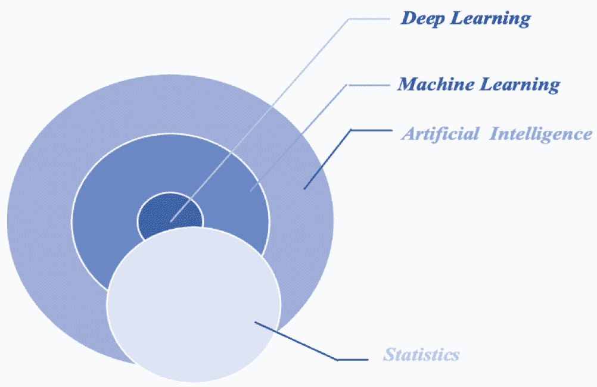

“机器学习”一词归功于 `IBM` 的 `Arthur Samuel`，他在 1959 年建议可以教育计算机学习它们对环境必须理解的内容，以及如何自己完成工作。如图 2


监督学习被称为一种机器学习的范式，它使用一组成对的输入-输出训练样本来收集关于对象输入-输出关系的知识（Liu et al., 2000）。在监督下进行学习时，会为学习者提供一对数据——训练集和测试集，学习者通常是计算机软件。其目标是让学习者从训练集中一组标记示例中“学习”，以便尽可能准确地识别测试集中的未标记实例。换句话说，学习者的目标是创建一种规则、程序或方法，通过研究已经分配了类标签的样本，对测试集中的新示例进行分类（Learned-Miller, 2014）。如果输出接受有限数量的离散值（代表输入的类标签），则则学习到的映射决定了输入数据如何分类。如果输出只接受连续数字，则发生输入的回归。输入-输出关系的信息通常使用学习模型参数进行建模。当无法从训练样本中直接获得这些参数时，学习系统必须执行估计方法来获取这些参数（Liu et al., 2000）。

监督学习包含两种类型：判别式模型和生成式模型。判别模型学习类别之间的分界线，并直观地学习输出分布如何随输入变化。在生成式模型中，直接学习输入和输出的联合分布（Dixon et al., 2020）。

在熟悉监督机器学习如何运作及其方法论之前，让我们先检查监督学习的优缺点。以下列表突出了监督机器学习的主要优势：
(i) 数据可以简单地收集或使用先前的经验产生。
(ii) 容易解决现实世界中的计算问题。
(iii) 提供基于经验的指导，使你能够最大化性能指标。
(iv) 在分类问题中非常有益。
(v) 对 (vi) 训练数据的类别数量有精确了解。
(vii) 比其他学习类方法更容易理解。

然而，它也有一些重大的缺点，包括：
(a) 无法处理一些较复杂的机器学习任务。
(b) 大数据可能难以进行分类。
(c) 需要大量的计算时间。

最后，有一些著名的监督学习算法类型：决策树、随机森林、逻辑回归、支持向量机、朴素贝叶斯、各种回归方法等，在业务分析的建模和估计中被优先使用。

相反，无监督学习指的是稍微困难的情况，在这种情况下，我们看到一个独立变量向量 `x`[``i`]，但对于每个个体 `i= 1, …, n` 都没有相关的因变量 `y`[``i`]。

由于没有预测因变量，线性回归模型无法拟合。由于缺乏标签，我们在某种意义上是在盲目操作，这就是它通常被称为无监督的原因。无监督学习与监督学习的区别在于，用户对模型学习的内容控制较少；唯一的元素是输入向量。此外，降维或使数据变得不复杂的愿望是我们的主要目标之一。许多研究领域已经熟悉这些方法中的几种，例如主成分分析（`PCA`）和聚类分析。

强化学习（`RL`）研究自然和人工系统如何预测行为的影响，并在行为可能改变状态、产生奖励或惩罚（或两者都有）的情况下优化行为。与其他许多机器学习形式不同，强化学习中的学习者没有被明确告知采取哪些行动；相反，他们必须进行实验。在最复杂和最具挑战性的情况下，决策不仅影响当前奖励，还会影响随后的状态，从而影响所有未来的奖励。


### 引言

信息化开发的的最新进展显著扩展了计算机的功能和应用。传统上，计算机主要用于处理和存储数值数据。然而，为了模拟和分析智力数据，我们需要开发新的计算技术和硬件，使其能够模拟学习、留存和推理过程（Gopal, 2019）。机器学习算法正是通过根据所学内容做出智能选择来实现这一点的。这是一种归纳策略，通过使用统计技术根据收集的数据来识别决策规则（Enholm, 2022）。这些数据集可以由政府、基金会、非营利机构或公司收集。特别是企业通常会尽可能地保留每笔交易的记录，而且工业过程可能拥有成千上万个传感器，其值每至少记录一次。因此，我们现在有机会利用这些数据来理解这些过程，并开发出十年前可能无法实现的全新数据驱动应用。

## 工业转型

随着机器人和传感器激活的设备取代员工，公司已经需要改变其经营模式。需要强调的是，全球工业运营中机器学习驱动的趋势正在迅速扩张，这表明机器学习已经成为全球许多公司的首要关注问题，或者在近期一直是如此。机器学习能够提供准确且可靠的预测参数，帮助企业增强采购和订单处理方面的支出效率，因为它可以持续地保留、评估并更重要的是预测数据。此外，它还描述了支持更好的商品化开发以及制造工艺的趋势和过程。换句话说，一个被称为针对需求差异选择的上游增强公司，在许多决策中经常遇到模糊性或数据偏差。要为每个人进行特定的准备可能是困难的。业务策略可能被用于若干生产活动，包括采购、运输、营销等。许多策略，如持续补货、联合营销等，通过算法、统计、建模和模拟作为解决方案得以实施。如今，学者和专家已经学会了如何有效处理数据并利用它获得更可靠的结论（Ghazal et al., 2021）。例如，客户和第三方都可能陷入信用卡诈骗的风险。已经开发了多种策略来防止此类欺骗，如果发生了诈骗，可以设计方法识别执行不当的交易。可以使用许多独特的机器学习算法保护数字数据传输免受未经授权的访问（Dileep et al., 2021）。

## 2. 决策树

决策树由 Breiman et al. (1984) 提出，已成为非参数方法中一个著名的分支和广受认可的选择。决策树的建模技术实现了决策及其结果的分支表示。在预测建模中，决策树可以用于评估若干决策路径通往给定目标的概率。决策树的节点代表决策过程的多个阶段。决策树背后的基本思想是使用类似于树的流程图结构来生成预测，其中每个分支反映了内部节点中许多特征选项之间的决策，并最终在叶节点中得出结论。方法将数据分为较小的组件并使用这些片段通过寻找模式来预测事件。换句话说，一种被称为决策树引导（Decision Tree Induction）的贪婪方法使用分治策略从上到下迭代地构建树结构。

图 3 展示了决策树的特征形式。在这种情况下，目标字段根据相关字段的值进行递归子集划分，产生片段和相关的后代数据子集（节点），在树的任何给定层级，这些节点包含了节点内部持续相似而节点之间逐渐不同的所需值。在这种情况下，银行计划在考虑许多情况的情况下决定是否增加客户的信用卡额度。每个非终止节点代表对一个特征值进行测试。示例决策树的根节点（见图 3）决定了待分类的示例是否基于客户拥有房产，这在“是”和“否”选项下进行评估。如果我们到达那里，返回的分类将存储在叶节点中。接下来，如果满足任一条件，我们就沿着左分支进行，预计客户将错过信用卡还款。如果两个条件都不满足，我们预计客户将违约。

### 图 3. 用于决定增加信用额度的决策树形状
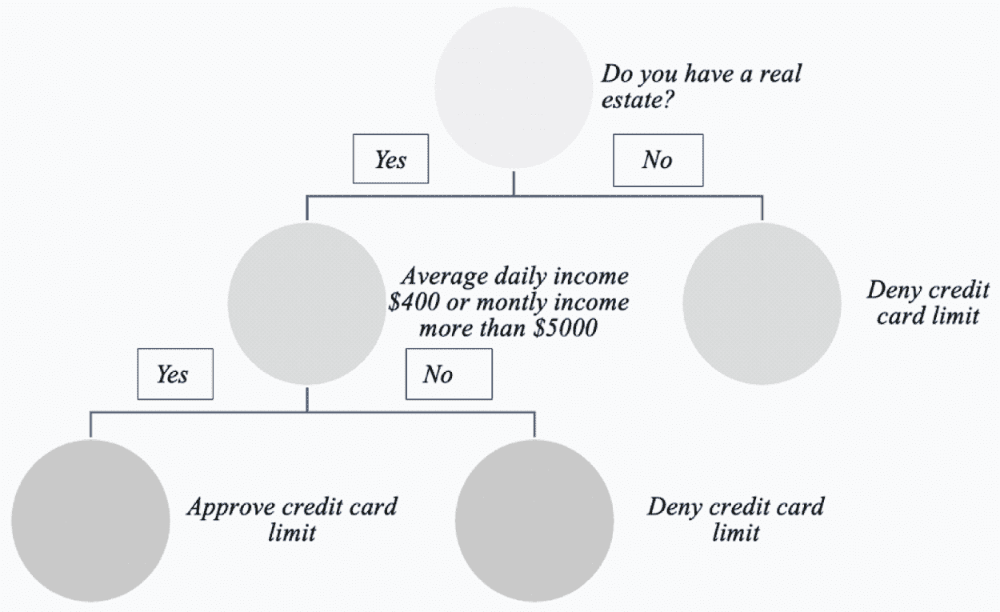

在对数据进行分层使得每个层内部变异较小时，良好的查询会将一组具有异质类标签的项目划分为具有同质类标签的节点。已经开发了多种指标来评估组内不纯度或不均匀性的水平。在决策树中，特征选择是一个关键课题，通过熵、Gini 指数、信息增和 G 统计量等方法来解决。假设我们正在利用一组训练元素 `E` 将事物归类为 `N` 类。让 `pi` (i = 1,…n) 代表被归类为类 `i` 的 `E` 的比例。那么，熵在计算上可以表示为：

$$E = - \sum\limits_{i = 1}^{n}p_{i}logp_{i}$$

Gini 指数的计算方法如下：

$$\sum\limits_{i = 1}^{n}p_{i}(1 - p_{i}) = 1 - \sum\limits_{i = 1}^{n}p_{i}^{2}$$

示例 1 展示了决策树结构如何构建的良好示例。示例 1：表 4.1 涉及三个协变量 `x[1]`、`x[2]`、`x[3]` 以及一个因变量（公司状态，`y`）。

#### 表 1. 原始数据集
|  |  |  | y |
| --- | --- | --- | --- |
| 1 | 6 | 1 | Bankruptcy |
| 2 | 8 | 7 | Bankruptcy |
| 4 | 7 | 2 | Ok |
| 1 | 2 | 6 | Bankruptcy |
| 3 | 9 | 2 | Ok |
| 7 | 4 | 1 | Bankruptcy |
| 5 | 6 | 3 | Bankruptcy |

如表 1 所示，因变量被分为“破产”和“正常”。在不调整任何协变量的情况下，计算因变量的熵：

$$E\left( {outcome} \right) = - \left( \frac{5}{7} \right)log_{2}\frac{5}{7} - \frac{2}{7}log_{2}\frac{2}{7}$$

\=0.863 (1)


因此，我们找到从式 (1) 得到的因变量熵为 0.6934。因素的平均值可以用于判断是否根据该变量划分决策树。由于 `x1` 的平均值略高于 3，我们根据根据 `x[1]` 是大于 3 还是小于或等于 3 来划分决策树。我们可以根据表 1 为 `x[1]` 变量创建表 2。如表 2 所示，“破产”的概率为 5/7，而“正常”的概率为 2/7。换句话之，在表 2 中，`x[1]` 大于 3 的结果有三个，而 `x[1]` 变量小于 3 的结果有四个个。此外，如表 3 所示，当 `x[1]` 大于 3 时，“破产”的概率为 2/3 而“正常”的概率为 1/3。那么，如表 4 所示，当 `x[1]` 小于 3 时，“破产”的概率为 ¾，“正常”的概率为 ¼。

#### 表 2. `x[1]` 的决策树

|  || 破产 || 正常 |
| --- | --- | --- |
| \>3 || 2 || 1 |
| --- | --- | --- |
| 3 || 3 || 1 |

#### 表 3. 依赖于 `x[1]>3` 的决策树

|  ||  ||  || y || 概率 |
| --- | --- | --- | --- | --- |
| 4 || 7 || 2 || 正常 || 1/3 |
| --- | --- | --- | --- | --- |
| 7 || 4 || 1 || 破产 || 2/3 |
| 5 || 6 || 3 |

#### 表 4. 依赖于 `x[1]≤3` 的决策树

|  ||  ||  || y || 概率 |
| --- | --- | --- | --- | --- |
| 1 || 6 || 1 || 破产 || 3/4 |
| --- | --- | --- | --- | --- |
| 2 || 8 || 7 |
| 3 || 9 || 2 || 正常 || 1/ |

根据表 3 和表 4，我们可以在式 (3)和式 (4)中计算 `x[1]` 变量的熵，计算过程如下：

```
E(x[1]>3) = -\left( \frac{1}{3} \right)log_{2}\frac{1}{3} - \frac{2}{3}log_{2}\frac{2}{3} = 0.918
```
```
E(x[1]≤3) = -\left( \frac{3}{4} \right)log_{2}\frac{3}{4} - \frac{1}{4}log_{2}\frac{1}{4} = 0.811
```

我们使用式 (1) 对应于式 (2)和式 (3) 的加权值，对 `x[1]` 在均值处的决策划分进行熵值计算：
```
E(x_1) = \left( \frac{3}{7} \right)0.918 + \left( \frac{4}{7} \right)0.811 = 0.856
```
同样，我们可以分别通过 > 6 和 ≤6 的划分来计算 `x[2]` 的熵，同时 `x[3]` 变量的熵通过 > 3 和 ≤3 的划分计算。

#### 表 5. `x[2]` 的决策树

|  || 破产 || 正常 |
| --- | --- | --- |
| \>6 || 1 || 2 |
| --- | --- | --- |
|  || 4 || 0 |

#### 表 6. 依赖于 `x[2]>6` 的决策树

|  ||  ||  || y || 概率 |
| --- | --- | --- | --- | --- |
| 2 || 8 || 7 || 破产 || 1/3 |
| --- | --- | --- | --- | --- |
| 4 || 7 || 2 || 正常 || 2/3 |
| 3 || 9 || 2 || 正常 |

#### 表 7. 依赖于 `x[2]≤6` 的决策树

|  ||  ||  || y || 概率 |
| --- | --- | --- | --- | --- |
| 1 || 6 || 1 || 破产 || 1 |
| --- | --- | --- | --- | --- |
| 1 || 2 || 6 || 破产 |
| 7 || 4 || 1 || 破产 |
| 5 || 6 || 3 || 破产 |

根据 `x[2]` 值大于 6 的公司状态，在式 (6) 计算熵值；而当 `x[2]` 变量小于 6 时，使用式 (7) 计算熵值：

```
E(x[2]>6) = -\left( \frac{1}{3} \right)log_{2}\frac{1}{3} - \frac{2}{3}log_{2}\frac{2}{3} = 0.918
```
```
E(x[2]≤6) = -\left( \frac{4}{4} \right)log_{2}1 - \frac{0}{4}log_{2}\frac{0}{4} = 0
```
同样，我们使用式 (1) 对应于式 (6)](979-8-3693-0683-3.ch001.bits-pdf.xhtml#_idTextAnchor028)和式 (7) 的加权值，对 `x[2]` 在均值处的决策划分进行熵值：
```
E(x_2) = \left( \frac{3}{7} \right)0.918 + 0 = 0.393
```

#### 表 8. `x[3]` 的决策树

|  || 破产 || 正常 |
| --- | --- | --- |
| \>3 || 2 || 0 |
| --- | --- | --- |
| 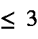 || 3 || 2 |

#### 表 9. 依赖于 `x[3]>3` 的决策树

|  ||  ||  || y || 概率 |
| --- | --- | --- | --- | --- |
| 2 || 8 || 7 || 破产 || 1 |
| --- | --- | --- | --- | --- |
| 1 || 2 || 6 || 破产 |

#### 表 10. 依赖于 `x[3]≤3` 的决策树

|  ||  ||  || y || 概率 |
| --- | --- | --- | --- | --- |
| 1 || 6 || 1 || 破产 || 3/5 |
| --- | --- | --- | --- | --- |
| 7 || 4 || 1 || 破产 |
| 5 || 6 || 3 || 破产 |
| 4 || 7 || 2 || 正常 || 2/5 |
| 3 || 9 || 2 || 正常 |

```
E(x_3 > 3) = -\left( \frac{2}{2} \right)log_{2}1 - \frac{0}{2}log_{2}\frac{0}{2} = 0
```
```
E(x_3 \leq 3) = -\left( \frac{3}{5} \right)log_{2}\frac{3}{5} - \frac{2}{5}log_{2}\frac{2}{5} = 0.970
```
我们使用式 (1) 对应于式 (9)](979-8-3693-0683-3.ch001.bits-pdf.xhtml#_idTextAnchor033)和式 (10) 的加权值，对 `x[2]` 在均值处的决策划分进行熵值：
```
E(x_3) = \left( \frac{5}{7} \right)0.970 + 0 = 0.692
```
在下一步中，显而易见地计算 `x[1]`、`x[2]` 和 `x[3]` 变量的信息增益，如式 (12)](979-8-3693-0683-3.ch001.bits-pdf.xhtml#_idTextAnchor035)、13 和 14 分别对应式 (2) 计算出的 E（因变量）。


#### 图 4. 基于 `x[2]` 变量熵估计的决策树

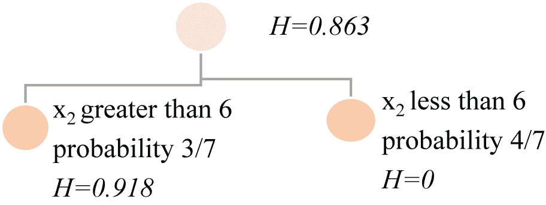

#### 表 11. `x[1]` 的决策树

|  || 破产 | 正常 |
| --- | --- | --- |
| \>3 || 0 || 1 |
| --- | --- | --- |
| 3 || 1 || 1 |

#### 表 12. 依赖 `x[1]>3` 的决策树

|  ||  ||  || y || 概率 |
| --- | --- | --- | --- | --- |
| 4 || 7 || 2 || 正常 || 1 |
| --- | --- | --- | --- | --- |

#### 表 13. 依赖 `x[1]≤3` 的决策树

|  ||  ||  || y || 概率 |
| --- | --- | --- | --- | --- |
| 2 || 8 || 7 || 破产 || 1/2 |
| --- | --- | --- | --- | --- |
| 3 || 9 || 2 || 正常 || 1/2 |

根据 [表 12] 和 [表 13]，让我们在等式 (15)] 和 [等式 (16)] 中计算 `x[1]` 变量的熵，计算如下：

`E(x[1]>3)=`

$$- \left( \frac{1}{1} \right)log_{2}\frac{1}{1} - \frac{0}{1}log_{2}\frac{0}{1} = 0$$

(15)

以及

`E(x[1]≤3)=`

$$- \left( \frac{1}{2} \right)log_{2}\frac{1}{2} - \frac{1}{2}log_{2}\frac{1}{2}$$

\= 1 (16)

可以使用 [等式 (1)] 来计算根据 [等式 (15)] 和 [等式 (16)] 加权值对应的熵值，用于在 `x[1]` 处于平均值时进行决策分裂：

$$E\left( x_{1} \right) = \left( \frac{2}{3} \right)*1 + \left( \frac{1}{3} \right)*0 = 0.666$$

(17)

#### 表 14. `x[3]` 的决策树

|  || 破产 | 正常 |
| --- | --- | --- |
| \>4 || 1 || 0 |
| --- | --- | --- |
| 4 || 0 || 2 |

#### 表 15. 依赖 `x[3]>4` 的决策树

|  ||  ||  || y || 概率 |
| --- | --- | --- | --- | --- |
| 2 || 8 || 7 || 破产 || 1 |
| --- | --- | --- | --- | --- |

#### 表 16. 依赖 `x[3]≤4` 的决策树

|  ||  ||  || y || 概率 |
| --- | --- | --- | --- | --- |
| 4 || 7 || 2 || 正常 || 1 |
| --- | --- | --- | --- | --- |
| 3 || 9 || 2 || 正常 |

基于 [表 14] 和 [表 15]，我们在等式 (18)] 和 [等式 (19)] 中计算 `x[3]` 变量的熵，计算如下：

`E(x[3]>4)=`

$$- \left( \frac{1}{1} \right)log_{2}\frac{1}{1} - \frac{0}{1}log_{2}\frac{0}{1} = 0$$

(18)

以及

`E(x[3]≤4)=`

$$- \left( \frac{2}{2} \right)log_{2}\frac{2}{2} - \frac{0}{2}log_{2}\frac{0}{2}$$

\= 1 (19)

然后，我们对 `x[3]` 进行加权分裂，如 [等式 (20)] 所示：

$$E\left( x_{1} \right) = \left( \frac{2}{3} \right)*1 + \left( \frac{1}{3} \right)*0 = 0.666$$


# 决策树算法

ID3（迭代二分分类法）技术是传统的决策树分类方法之一，由 Ross Quinlan 于 1986 年引入。`ID3` 经常被用于自然语言处理和机器学习领域。它通过比较特征的值来对对象进行分类。它从一组对象及其属性描述开始，为提供的数据自上而下地生成决策树。根据最大化信息增益和最小化熵的原理，利用树的每个节点对单个属性进行测试的结果来划分目标集 (Yang et al.,2018; Adhatrao et al.,2013)。

可以使用广泛使用的算法 `C4.5` 创建决策树。它是 `ID3` 算法的改进，以解决其缺点。`C4.5` 方法有时被称为“统计分类器”，因为它能产生可用于分类的决策树。`C4.5` 算法评估所有可能划分数据的潜在测试，并选择提供最佳信息增益的测试。这种测试消除了 `ID3` 对宽泛决策树的偏见。每个离散属性使用一个测试，产生的结果与该特征的离散值数量相同。在确定每个单独值的熵增益之前，会对每个连续属性进行排序，并在对排序数据进行单次扫描中使用二分划分。数据集的特征可以是数值的也可以是命名的，它们的输出格式也不同。数值属性的每个结果在默认条件下创建一个值，但可选元素允许将至少两个组合并为一个输出。(Singh and Gupta,2021; Adhatrao et al.,2013; Wu et al.,2009)。

`C5.0` 方法是 `C4.5` 的改进变体，可以通过创建决策树或应用一组规则来实现。增益率（修正了信息增益）是 `C5.0` 的准则。`C5.0` `DT` 算法根据具有最大信息增益 (`IG`）的属性划分样本。由初始划分定义的每个子样本随后会被多次划分，直到它们根据后续的 `IG` 特性变得不可分。在检查了最低层的划分后，修剪掉对模型贡献较小或没有贡献的划分。`C5.0` 具有错误率显著降低、内存占用极少和高度优化的优点。这使得 `C5.0` 算法速度更快、更精确。`C5.0` 使用“分而治之”的方法构建决策树，修剪原始决策树，并具有树形结构。此外，提升法（boosting）方法在 `C5.0` 中得到了最大的发展 (Tian and Zhang,2022)。

`CHAID` 也称为卡方差自动检测，用于预测。`CART` 使用 Gini 指标划分分支，而 `CHAID` 使用卡方检验。`CHAID` 常用于分类，因为它可以检查因变量和自变量之间的相关性 (Saeed et al.,2015; Fitri et al.,2022)。

#### 随机森林

随机森林 (`RF`) 方法由决策树组成并自然整合特征选择，是一项著名的技术。`RF` 是无参数、可解释且高效的。它在处理高维空间和小样本量等局限性方面提供了极高的精度。它在复杂数据上的表现通常优于线性回归。

### 随机森林算法：

1. 生成一个大小为 `N` 的自助样本 `M`。
2. 利用自助数据创建一棵树 `T`。
3. 从所有集合随机选取 `ν` 个参数。
4. 从 `ν` 个参数中确定最佳划分点。
5. 将终端节点分为两个子分支。
6. 重复此过程创建 `B` 棵树。

最后，使用多数投票法对回归或分类模型进行评估。


与其他回归预测模型一样，随机森林也倾向于较慢，尤其是当树的数量较多且深度较深时。

### 4. K-近邻算法 (KNN)

KNN 由 Evelyn Fix 和 Joseph Hodges 于 1951 年创建，后来由 Cover 和 Hart 在 1967 年进行了扩展。KNN 是一种非参数和监督学习技术。KNN 技术既适用于分类也适用于回归问题。为给定的数据点寻找 K 个最近邻是一个非常直观的想法。它假设相关产品彼此位置靠近。在这里，“接近”指的是两个地方之间的距离测量，这种测量可以像欧几里得距离一样简单。你可以通过找到与测试数据相似性最大的物体类别来确定测试数据属于哪一类。让 `x` 和 `y` 表示 n 维向量。欧几里得距离和余弦相似度：

Euclidean=$\sqrt{\\sum\limits\_{i}^{n}\left( {x_{i} - y_{i}} \right)^{2}}$ 和 Cosine$= \frac{2\sum\_{i}^{n}x_{i}y_{i}}{\sum\_{i}^{n}x_{i}{}^{2} + \sum\_{i}^{n}y_{i}{}^{2}} = \frac{2xy}{\parallel x \parallel + \parallel y \parallel}$

余弦相似度直接作为归一化值提供，而欧几里得距离必须反转并调整。近年来，同时考虑特征和特征值相似性的余弦相似度被开发用于解决稀疏向量的脆弱性。在计算距离或相似度后，我们需要按照距离或相似度递增的顺序进行排序。也就是说，当使用余弦相似度方程时，相似度最大的被认为是最近邻；当首选欧几里得距离时，距离最小的是最近邻。此外，在解决回归问题时可以考虑标签值的平均值。这写为：

$\hat{y} = \frac{\left( {\\sum\_{i}^{k}y\_{i}} \right)}{k}$

其中符号 `y` 和 `k` 表示输出值和第 i 个最近邻。有时可能倾向于使用马哈顿距离来计算邻居之间的距离。马哈顿距离的公式为：

$d\left( {x,y} \right) = \sqrt{\left( {x - y} \right)^{T}\text{Σ}\left( {x - y} \right)}$

其中让 `x` 和 `y` 表示数据集的向量，而 `Σ` 是数据集的协方差矩阵。因此，我们可以解释为特征的大小会对这些距离测量产生过度影响。此外，其局限性在于在大数据下预测非常缓慢，算法对相关特征和数据规模都非常敏感。它容易受到异常值的影响。

### 5. 朴素贝叶斯

另一种极其直观的分类方法是朴素贝叶斯算法，它使用了贝叶斯定理和强独立性假设。朴素贝叶斯分类器在最基本的形式下假设一个类别中某个特征的存在与其他任何其他特征的存在是独立的。即使基本前提是错误的，朴素贝叶斯分类器仍然运行良好。贝叶斯定理写为：

$P\left( c \middle| x \right) = \frac{P\left( x \middle| c \right)P\left( c \right)}{P\left( x \right)}$

其中让 `x` 和 `c` 表示变量和给定条件。因此，`P(c)` 是类别的概率，`P(x)` 是变量的概率，`P(x|c)` 是给定类别 `c` 时变量 `x` 的概率，而 `P(c|x)` 被称为后验概率，意味着给定变量 `x` 时类别 `c` 的概率。

考虑这样一个场景：公司的人力部门想在应聘者中招聘一名高级研究员，应聘者拥有拥有或没有学位。人力资源部门根据一个单一变量——性别做出决策。我们定义拥有学位的概率如下：

1. `Pr(D.)` 是拥有学位的概率。
2. `P(D.|female)` 是在给定性别为女性的情况下拥有学位的概率。
3. `P(D.|male)` 是在给定性别为男性的情况下拥有学位的概率。
因此，概率可以公式化为：

$\left( {D.} \right) = \frac{\left( {D. \middle| female} \right)P\left( {female} \right) + \left( {D. \middle| male} \right)P\left( {male} \right)}{P\left( {female} \right) + P\left( {male} \right)}$


### 参考文献

- Kaul, V., Enslin, S., & Gross, S. A. (2020). 医学领域的人工智能。Gastrointestinal Endoscopy, 92(4), 807–812. [10.1016/j.gie.2020.06.040](http://dx.doi.org/10.1016/j.gie.2020.06.040)[](http://dx.doi.org/32565184)
- Learned-Miller, E. G. (2014). 监督学习导论。马萨诸塞大学计算机科学系。
- Liu, Q., Levinson, S., Wu, Y., & Huang, T. (2000, 2 月). 通过监督与无监督学习策略混合进行交互式和增量学习。第五届信息科学联合会议论文集（第 1 卷，第 555-558 页）。学术出版社。
- Ngo, F. T., Govindu, R., & Agarwal, A. (2015). 逻辑回归、分类与回归树、卡方自动交互作用检测以及神经网络模型在预测囚犯违规行为中的预测效用。美国刑事司法杂志，40(1), 47–74. [10.1007/s12103-014-9246-6](http://dx.doi.org/10.1007/s12103-014-9246-6)
- Quinlan, J. R. (1996). C4. 5 中连续属性的改进使用。人工智能研究杂志, 4, 77–90. [10.1613/jair.279](http://dx.doi.org/10.1613/jair.279)
- Quinlan, J. R. (2014). C4. 5: 机器学习程序。爱思华出版社。[10.1016/j.procs.2016.04.224](http://dx.doi.org/10.1016/j.procs.2016.04.224)
- Raza, M. A., Aziz, S., Noreen, M., Saeed, A., Anjum, I., Ahmed, M., & Raza, S. M. (2022). 药学中的人工智能（AI）：创新概览。Innovations in Pharmacy, 13(2), 13. 在线优先出版。[10.24926/iip.v13i2.4839](http://dx.doi.org/10.24926/iip.v13i2.4839)[](http://dx.doi.org/36654703)
- Samuel, A. L. (1959). 使用国际跳棋进行机器学习的一些研究。IBM 研究与开发杂志，3(3), 210–229. [10.1147/rd.33.0210](http://dx.doi.org/10.1147/rd.33.0210)
- Steinberg, D., & Colla, P. (2009). CART: 分类与回归树。数据挖掘中的顶级算法，9, 179。
- Tian, J. X., & Zhang, J. (2022). 使用特征提取和带惩罚因子的增强 C5 决策树进行乳腺癌诊断。数学生物与工程，19(3), 2193–2205. [10.3934/mbe.2022102](http://dx.doi.org/10.3934/mbe.2022102)[](http://dx.doi.org/3524071)
- Williamson, B., & Eynon, R. (2020). 教育中人工智能的历史线、缺失链接和未来方向。媒体与技术，45(3), 223–235. [10.1080/1743984.2020.179895](http://dx.doi.org/10.1080/1743984.2020.179895)
- Wu, G., Li, H., Hu, X., Bi, Y., Zhang, J., & Wu, X. (2009, 8 月). C4. 5: 基于 MapReduce 的集成分类。2009 年第四届中国年度会议（第 249-255 页）。IEEE。[10.1109/ChinaGrid.2009.39](http://dx.doi.org/10.1109/ChinaGrid.2009.39)
- Yang, S., Guo, J., & Jin, W. (2018). 用于医疗数据分类的改进算法。计算机与电气工程，65, 474–487. [10.1016/j.comleceng.2017.08.005](http://dx.doi.org/10.1016/j.comleceng.2017.08.005)
- Zacharis, N. Z. (2018). 混合学习预测中的分类与回归树 (CART)。智能系统与应用国际期刊，3(3), 1–9. [10.5815/ijisa.2018.03.01](http://dx.doi.org/10.5815/ijisa.2018.03.01)

# 第二章：人工智能及其对业务和社会的影响

- **Aditya Pai H.** - [orcid.org/0000-0002-8186](http://orcid.org/0000-0002-8186)，印度贾恩大学
- **Mahesh T. R.** - 印度贾恩大学
- **Jyoti Agarwal** - 印度格拉时代大学
- **Vinoth Kumar V.** - [orcid.org/0000-0003-1070](http://orcid.org/0000-0003-1070)，印度维洛尔技术大学
- **Sharon Christa** - [orcid.org/0000-0001-6717](http://orcid.org/0000-0001-6717)，印度 MIT ADT 大学计算学院
- **A. Suresh Kumar** - [orcid.org/0000-0001-7145](http://orcid.org/0000-0001-7145)，印度独立研究员

### 摘要

工业通常采用响应性方法来发现并缓解开发过程中的错误和威胁。在本章中，选取了 IT 行业作为案例研究的一部分。在中小企业（SMEs）中，使用预测性维护技术而非响应性方法。从响应性到预测性的转变对于中小企业至关重要，可以帮助经理和开发团队根据历史数据预测未来问题。研究选取了一家中小企业，使用了六月的数据集进行预测。该数据集生成软件开发过程和规则矩阵。该矩阵用于分析和预测项目软件开发结果的准确性。在这里，使用了三种人工智能算法进行预测。获得结果后，对这三种人工智能算法进行了对比分析，以从中选出最佳算法。所选算法将用于开发过程，以改善企业的业务前景。

### 引言

交付周期（Lead time）是指从客户下单或请求服务到企业交付产品或服务所需的时间。在竞争激烈的时代，遵循交付周期至关重要。产品或服务的交付始终由客户决定。企业必须确保准时交付服务，否则会导致交付周期过长。如果企业交付周期过长，他们面临的后果将非常糟糕。企业的声誉将受到损害，并在市场上名誉化。其次，交付周期越长，失去客户或买主的概率就越大。第三，产品和服务的延迟还会导致企业使用自有资金而非客户资金支付资源费用。这将使企业处于财务不稳定状态，特别是对于中小企业而言。

交付周期延长的原因有多种。中小企业在遵循交付周期方面落后的原因如下：

- 组织内部以及不同层级之间缺乏沟通或缺乏透明度可能会导致困惑，并引起开发方法的延迟。
- 开发团队缺乏创建和测试软件功能的良好环境，是整个软件开发过程中遇到的后续问题。在这里，它指的是开发人员需要软件版本控制，以跟踪多个程序版本。
- 程序测试是开发团队面临的另一个问题。这一阶段通常比认为的要长，因为它包含了多种测试，包括冒烟测试和用户验收测试。
- 软件部署延迟是这种情况的主要问题。客户环境中的软件和硬件环境不足以供软件开发人员安装等可能是其原因之一。因此，软件开发人员也必须解决这一问题。


在本章中，我们讨论了软件开发过程中出现延迟的原因，以及 AI 如何帮助改进这些问题。此处学习了使用不同 AI 算法的意义，以检查它们如何对业务和社会产生积极影响。因此，本章提出了一种新算法，用于判断中小型企业（SME）所遵循的软件开发流程是否理想。所使用的另外两种 AI 算法是卷积神经网络（CNN）和朴素贝叶斯（Naïve Bayes）。为了开展这项研究，提出了九项软件开发规则（SDR[1-9]）以及七个软件开发流程（SDP[1-7]）。在实地研究方面，以 Embitel Technologies 为例。研究目的使用了两个项目，即 Telenetrix 和 EngiNX solutions。研究数据是在 2022 年 12 月的六个月期间内在 Embitel Technologies 完成的。这项研究的动机是将人工智能方法引入软件开发过程，为像 Embitel Technologies 这样的中小型企业提供优化开发流程，从而提升组织的整体业务。

本文分为以下章节：第 2 节是相关工作；第 3 节是研究方法，展示了研究的流程；第 4 节是结果与讨论，其中通过三种 AI 算法（即提出的算法、第二个是 CNN、第三个是朴素贝叶斯算法）对遵循软件开发规则的软件开发流程进行了研究；并进行了方差分析（ANOVA）和图表比较，以验证并在提出的的三种技术中找到最佳算法。选出的最佳算法将用于改进软件开发流程，从而对上述中小型企业的业务产生积极影响。第 5 节是结论部分，总结了人工智能对业务和社会产生的影响。

### 相关工作

在过去的几十年里，“数据挖掘和分析在过程工业的知识发现和决策过程中发挥了至关重要的作用”（Dogan A & Birant D, 2021）。数据挖掘和分析利用机器学习作为计算引擎来提取信息、识别数据中的模式（Wijaya DR, 2020）并进行预测（Pangestu A & Wijaya DR, 2020）。机器学习方法已成功用于预测诸如降雨量（Liyew CM & Melese HA, 2021）、贫困水平（Aulia TF & Wijaya DR, 2020）、校友收入（Gomez-Cravioto DA & Diaz-Ramos RE, 2022）以及与 COVID-19 相关的事件（Budiharto W., 2021）等内容（Hssayeni MD & Chala A, 2021）。可以使用业务流程管理中的预测建模技术来简化运营业务流程（Breuker D & Matzner M, 2016）。流程挖掘可用于识别或诊断基于事实的问题（Cho S, 2021），并了解公司的流程工作流、活动和机器机制（Faizan M & Zuhairi MF, 2020）。流程挖掘通过调查事件数据（或实际行为）与流程模型预测之间的差异，来识别异常并进行合规性检查。

### 研究方法

如第 1 节——引言所述，保持提前交付时间是总是必要的。因此，本章采用的方法是三种 AI 技术：第一个是所提出的机器学习算法，用于查找软件开发流程和开发规则是否理想；第二个是卷积神经网络算法，用于检查相同内容；最后是了朴素贝叶斯算法。

### 结果与讨论

#### 用于发现软件开发流程中问题的提出的技术


正如方法论所述，在第一步中使用了人工智能（机器学习模型），并需要定义相应的软件开发规则和流程。第二步是将所识别项目的软件流程映射到软件开发规则中。第三步是计算达成矩阵，并将其与平均开发矩阵进行比较。第四步是——将相同的方法应用于其他 AI 方法，如 CNN 和朴素贝叶斯。第五步是——使用无重复的双因素方差分析（Two-Way ANOVA）分析结果，以比较不同 AI 方法的结果。第六步是将所提的 AI 方法与不同的 AI 算法进行比较。如果发现所提方法优于上述不同的 AI 算法，则会将该方法用于软件开发流程以获得最佳结果。如果结果相反，则重新构建所提方法，直到其产生更好的结果。

人工智能模型（机器学习模型）被用于预测名为“Embitel Technologies Private Ltd”的中小型企业（SME）的交付周期延迟。在实地调查期间，选取了两个项目：Telenetrix 和 EngiNX Solutions。为了实施这些项目，使用了不同的软件开发流程（`SDP [1-7]`）。这些 SDP 必须遵循软件开发规则（`SDR [1–9]`）中提到的指南。SDR 有助于以标准方式执行项目任务。以下（表 1)）和（表 2](#979-8-3693-0683-3.ch002.bits-pdf.xhtml#_idTextAnchor101))）是中小型企业“Embitel Technologies Private Ltd”的两个项目示例。如（表 1)）和（表 2](#979-8-3693-0683-3.ch002.bits-pdf.xhtml#_idTextAnchor101))）所示，矩阵映射了两个相应的参数。这表明每个 SDP 是否遵循了 SDR。如果映射率为 3，则认为是良好映射，2 为满意映射，1 为较差映射。映射越好，说明 SDP 遵循 SDR 的情况越好。矩阵中两个参数之间的兼容性（Congenial）计算如公式 1 所示：

$S\text{DP}\text{i} for~each~i = 1~..~n~ = ~Cong\begin{bmatrix} {SDP,} & {SDR} \\\\ \end{bmatrix}\begin{pmatrix} 3 \\\\ 0 \\ \end{pmatrix}for~each~SDRi~where~i = ~1~..~n$(Eq. 1)

此处，根据公式 2 中提到的缩写，`SDP` 代表软件开发流程。`SDR` 代表开发规则。`Cong` 代表 `SDP` 与 `SDR` 之间的兼容性。`Cong` 用于检查 `SDP` 与 `SDR` 之间的兼容性。矩阵中的兼容或协调映射是基于中小型企业以往经验的估计。

#### 表 1. 项目 – Telenetrix

| 软件开发规则 | `SDR[1]` | `SDR[2]` | `SDR[3]` | `SDR[4]` | `SDR[5]` | `SDR[6]` | `SDR[7]` | `SDR[8]` | `SDR[9]` |
| --- | --- | --- | --- | --- | --- | --- | --- | --- | --- |
| 软件开发流程 | | | | | | | | | |
| `SDP[1]` | 2 | 3 | 2 | 2 | 3 | 3 | 3 | 3 | |
| `SDP[2]` | 3 | 1 | 2 | 1 | 2 | 2 | 2 | 1 | |
| `SDP[3]` | 3 | 3 | 2 | 2 | 2 | 3 | 3 | 2 | |
| `SDP[4]` | 2 | 3 | 2 | 2 | 3 | 2 | 2 | 3 | 2 |
| `SDP[5]` | 1 | 2 | 2 | 3 | 3 | 3 | 2 | 2 | |
| `SDP[6]` | 2 | 2 | 3 | 2 | 3 | 2 | 3 | 1 | |
| `SDP[7]` | 3 | 2 | 3 | 2 | 3 | 2 | 2 | 3 | 2 |
| `ASDP[IA]` | 2.29 | 2.29 | 2.29 | 2 | 2.71 | 2.43 | 2.43 | 1.86 | |

#### 表 2. 项目 - EngiNX Solutions

| 软件开发规则 | `SDR[1]` | `SDR[2]` | `SDR[3]` | `SDR[4]` | `SDR[5]` | `SDR[6]` | `SDR[7]` | `SDR[8]` | `SDR[9]` |
| --- | --- | --- | --- | --- | --- | --- | --- | --- | --- |
| 软件开发流程 | | | | | | | | | |
| `SDP[1]` | 2 | 2 | 2 | 3 | 2 | 2 | 2 | 2 | |
| `SDP[2]` | 3 | 3 | 2 | 3 | 3 | 3 | 2 | 3 | |
| `SDP[3]` | 3 | 3 | 3 | 3 | 3 | 3 | 3 | 3 | |
| `SDP[4]` | 2 | 3 | 2 | 2 | 2 | 2 | 2 | 2 | |
| `SDP[5]` | 2 | 2 | 2 | 2 | 3 | 2 | 2 | 3 | |
| `SDP[6]` | 2 | 2 | 3 | 2 | 3 | 3 | 2 | 2 | |
| `SDP[7]` | 3 | 2 | 3 | 2 | 3 | 3 | 3 | 2 | |
| `ASDP[II]` | 2.43 | 2.43 | 2.43 | 2.43 | 2.71 | 2.57 | 2.43 | 2.43 | |

接下来检查（表 1)）和（表 2)）中提到的项目的实际结果。这些 `SDP` 如下：
* `SDP1`: 评估正确的软件需求
* `SDP2`: 构建方法论
* `SDP3`: 收集需求
* `SDP4`: 设计软件需求规范（如用例、ER 图）
* `SDP5`: 创建用户故事
* `SDP6`: 使用敏捷方法论
* `SDP7`: 部署与维护

每个 `SDP` 都与随后的 `SDR` 映射。这些 `SDR` 就是执行 `SDP` 期间必须遵循的规则。`SDR` 列表如下：
* `SDR1`: 使用适当的软件工程规则
* `SDR2`: 根据客户设计并开发解决方案
* `SDR3`: 发现并解决问题中的复杂性
* `SDR4`: 工具的使用
* `SDR5`: 可持续开发的需求
* `SDR6`: 个人与团队协作
* `SDR7`: 道德规范
* `SDR8`: 文档工作
* `SDR9`: 适当的项目管理

得到了 Telenetrix 和 EngiNX Solutions 项目的软件开发流程结果。

#### 图 2. 评估 Telenetrix SDP 的结果
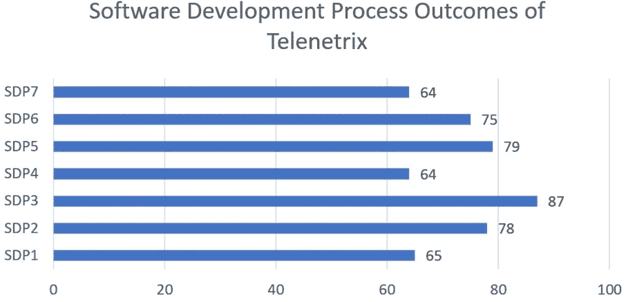

#### 图 3. 评估 EngiNX solutions SDP 的结果
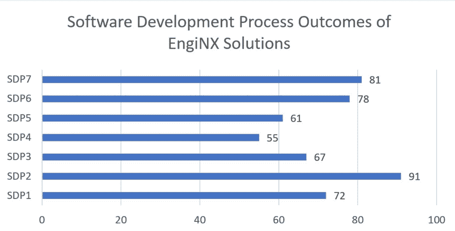

如（图 2)）和（图 3)）所示，显示了评估后两个项目的实际结果。如图所示，`SDP` 结果在 70-100 之间属于 3 类，`SDP` 结果在 40-69 之间属于 2 类，小于 40 的属于 1 类。相同的内容描述在（表 3)）中。


`Eq.1` 的结果已分别应用于 `(Table 1)` 和 `(Table 2)`，对应 Telenetrix 和 EngiNX 项目。在方程 `(Eq. 2)` 中，`OuDP` 乘以 `Eq.1` 中提到的值，以获得 `(Table 4)` 和 `(Table 5)` 中提到的矩阵。

### 表 4. Telenetrix 更新后的矩阵

| 开发规则 || SDR[1] || SDR[2] || SDR[3] || SDR[4] || SDR[5] || SDR[6] || SDR[7] || SDR[8] || SDR[9] |
| --- | --- | --- | --- | --- | --- | --- | --- | --- | --- |
| 开发过程 | | | | | | | | | | |
| mSDP[1] | 4 | 6 | 4 | 4 | 6 | 6 | 6 | 6 | 6 |
| mSDP[2] | 9 | 3 | 6 | 3 | 6 | 6 | 6 | 6 | 3 |
| mSDP[3] | 9 | 9 | 6 | 6 | 6 | 9 | 9 | 6 | 6 |
| mSDP[4] | 4 | 6 | 4 | 4 | 6 | 4 | 4 | 6 | 4 |
| mSDP[5] | 3 | 6 | 6 | 9 | 9 | 9 | 6 | 6 | 6 |
| mSDP[6] | 6 | 6 | 9 | 6 | 9 | 6 | 9 | 6 | 3 |
| mSDP[7] | 6 | 4 | 6 | 4 | 6 | 4 | 4 | 6 | 4 |
| mASDP[IA] | 5.86 | 5.71 | 5.86 | 5.14 | 6.86 | 6.29 | 6.29 | 6 | 4.57 |

### 表 5. EngiNX 解决方案更新后的矩阵

| 开发规则 || SDR[1] || SDR[2] || SDR[3] || SDR[4] || SDR[5] || SDR[6] || SDR[7] || SDR[8] || SDR[9] |
| --- | --- | --- | --- | --- | --- | --- | --- | --- | --- |
| 开发过程 | | | | | | | | | | |
| mSDP[1] | 6 | 6 | 6 | 9 | 6 | 6 | 6 | 6 | 6 |
| mSDP[2] | 9 | 9 | 6 | 9 | 9 | 9 | 9 | 6 | 9 |
| mSDP[3] | 6 | 6 | 6 | 6 | 6 | 6 | 6 | 6 | 6 |
| mSDP[4] | 4 | 6 | 4 | 4 | 4 | 4 | 4 | 4 | 4 |
| mSDP[5] | 4 | 4 | 4 | 4 | 6 | 4 | 4 | 6 | 6 |
| mSDP[6] | 6 | 6 | 9 | 6 | 9 | 9 | 9 | 6 | 6 |
| mSDP[7] | 9 | 6 | 9 | 6 | 9 | 9 | 9 | 9 | 6 |
| mASDPII | 6.286 | 6.143 | 6.286 | 6.286 | 7 | 6.714 | 6.714 | 6.143 | 6.143 |

`(Table 4)` 和 `(Table 5)` 是项目 Telenetrix 和 EngiNX Solutions 的更新后的矩阵。在该矩阵中，`(Table 3)` 中列出的结果乘以 `(Table 1)` 和 `(Table 2)` 中的每个矩阵元素。因此`(Table 4)` 和 `(Table 5)` 中项目 `mASDP[I]` 和 `mASDP[II]` 的实际结果与估计结果之间的乘积矩阵是矩阵中元素的平均值。对于每一个矩阵，Eq. 3 中提到的告达成矩阵是 `(Table 4)` 和 `(Table 5)` 中乘积软件开发矩阵之和除以 `(Table 1)` 和 `(Table 2)` 所示的 `(Table 6)`。

$$AverageAttainmentMatrix = \frac{Averageof~multiplied~Development~Matrix}{Averageof~Software~Development~Matrix}(Eq.3)$$

### 表 6. 告达成矩阵平均

| 项目 || SDR[1] || SDR[2] || SDR[3] || SDR[4] || SDR[5] || SDR[6] || SDR[7] || SDR[8] || SDR[9] |
| --- | --- | --- | --- | --- | --- | --- | --- | --- | --- |
| Telenetrix (SDPs) | 2.56 | 2.49 | 2.56 | 2.57 | 2.53 | 2.59 | 2.59 | 2.47 | 2.46 |
| EngiNX Solutions (SDPs) | 2.59 | 2.53 | 2.59 | 2.59 | 2.58 | 2.61 | 2.61 | 2.53 | 2.53 |
| 告达成矩阵平均 | 2.58 | 2.51 | 2.58 | 2.58 | 2.56 | 2.6 | 2.6 | 2.5 | 2.5 |

在 `(Table 7)` 中，`(Table 1)` 和 `(Table 2)` 中提到的平均值列为矩阵中的元素。这里取这些平均值的平均值。

### 表 7. 开发过程平均

| 项目 || SDR[1] || SDR[2] || SDR[3] || SDR[4] || SDR[5] || SDR[6] || SDR[7] || SDR[8] || SDR[9] |
| --- | --- | --- | --- | --- | --- | --- | --- | --- | --- |
| Telenetrix (SDPs) | 2.29 | 2.29 | 2.29 | 2 | 2.71 | 2.43 | 2.43 | 2.43 | 1.86 |
| EngiNX Solutions (SDPs) | 2.43 | 2.43 | 2.43 | 2.43 | 2.71 | 2.57 | 2.57 | 2.43 | 2.43 |
| 开发过程矩阵平均 | 2.36 | 2.36 | 2.36 | 2.22 | 2.71 | 2.5 | 2.5 | 2.43 | 2.43 |

接下来，将告达成矩阵平均值与开发过程平均值进行比较。如果开发过程的值大于告达成矩阵，则证明软件开发不需要任何修改。其原因是由于平均告成的 SDP 值小于 SDP。因此，需要使用有效的机器学习。对比分析所示 `(Figure 4)`。

#### 图 4. 使用所的机器学习的对比分析

```
![979-8-3693-0683-3.ch002.f04
```

#### 使用其他机器学习算法

##### 卷积神经网络 (CNN)

在其他所提出的算法中，首先选择了卷积神经网络 `CNN`。该算法由多个输入指向单个输出。输入和输出之间有 3 个不同的隐藏层。这些隐藏层用于在网络之间传递数据。当数据从输入发送到输出时，三个隐藏层被激活并传递数据。其表示所示 `(Figure 5)`。该概念用于当前的研究技术。

#### 图 5. 卷积神经网络

```
![979-8-3693-0683-3.ch002.f05
```

结果提到下面的 `(Table 8)`，其中计算了 `CNN` 的平均告达成矩阵。`(Table 8)` 中的告达成矩阵平均值现在与 `(Table 7)` 中的开发过程平均值进行比较。显示使用 `CNN` 的平均告达成矩阵与开发过程平均值对比的对比所示 `(Figure 6)`。


| 项目 | DR1 | DR2 | DR3 | DR4 | DR5 | DR6 | DR7 | DR8 | DR9 |
| --- | --- | --- | --- | --- | --- | --- | --- | --- | --- |
| Telenetrix (SDPs) | 2 | 3 | 3 | 2 | 3 | 3 | 3 | 2 | 3 |
| EngiNX Solutions (SDPs) | 6 | 9 | 6 | 4 | 6 | 9 | 9 | 6 | 6 |
| 达成矩阵平均 | 3 | 3 | 2 | 2 | 2 | 3 | 3 | 3 | 2 |

#### 图 6. 使用卷积神经网络的对比分析

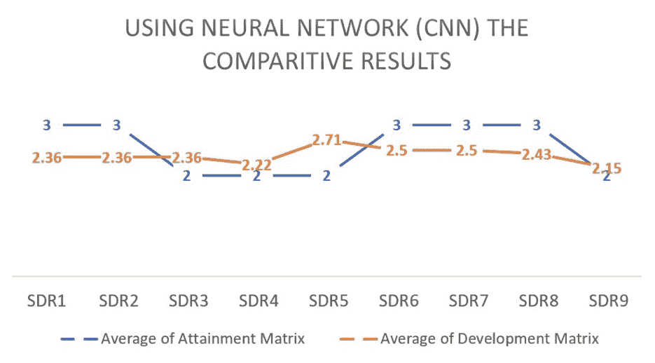

（图 6)$.

#### 表 9. 项目 – Telenetrix (频数表)

| 频数 | 3 | 2 | 1 |
| --- | --- | --- | --- |
| 软件开发规则 | | | |
| `SDR[1]` | 3 | 3 | 1 |
| `SDR[2]` | 3 | 3 | 1 |
| `SDR[3]` | 2 | 5 | 1 |
| `SDR[4]` | 1 | 5 | 2 |
| `SDR[5]` | 3 | 4 | 1 |
| `SDR[6]` | 3 | 4 | 1 |
| `SDR[7]` | 3 | 4 | 1 |
| `SDR[8]` | 3 | 4 | 1 |
| `SDR[9]` | 1 | 4 | 2 |

#### 表 10. 项目 – EngiNX Solutions (频数表)

| 频数 | 3 | 2 | 1 |
| --- | --- | --- | --- |
| 软件开发规则 | | | |
| `SDR[1]` | 3 | 4 | 1 |
| `SDR[2]` | 3 | 4 | 1 |
| `SDR[3]` | 3 | 4 | 1 |
| `SDR[4]` | 3 | 4 | 1 |
| `SDR[5]` | 5 | 2 | 1 |
| `SDR[6]` | 4 | 3 | 1 |
| `SDR[7]` | 4 | 3 | 1 |
| `SDR[8]` | 3 | 4 | 1 |
| `SDR[9]` | 3 | 4 | 1 |

#### 表 11. 项目 – Telenetrix (似然表)

| 频数 | 3 | 2 | 1 | SDR 平均似然 |
| --- | --- | --- | --- | --- |
| 软件开发规则 | | | | |
| `SDR[1]` | 3 | 3 | 1 | `=3/3` = 1 |
| `SDR[2]` | 3 | 3 | 1 | `=3/3` = 1 |
| `SDR[3]` | 2 | 5 | 1 | `=2/3` = 0.66 |
| `SDR[4]` | 1 | 5 | 2 | `=3/3` = 1 |
| `SDR[5]` | 5 | 2 | 1 | `=2/3` = 0.66 |
| `SDR[6]` | 3 | 4 | 1 | `=2/3` = 0.66 |
| `SDR[7]` | 3 | 4 | 1 | `=2/3` = 0.66 |
| `SDR[8]` | 3 | 4 | 1 | `=2/3` = 0.66 |
| `SDR[9]` | 1 | 4 | 2 | `=3/3` = 1 |
| `[3,2,1]` 平均似然 | 2.67 | 3.78 | 0.56 | |

#### 表 12. 项目 – EngiNX Solutions (似然表)

| 频数 | 3 | 2 | 1 | SDR 平均似然 |
| --- | --- | --- | --- | --- | --- |
| 软件开发规则 | | | | | |
| `SDR[1]` | 3 | 4 | 1 | `=2/3` = 0.66 |
| `SDR[2]` | 3 | 4 | 1 | `=2/3` = 0.66 |
| `SDR[3]` | 3 | 4 | 1 | `=2/3` = 0.66 |
| `SDR[4]` | 3 | 4 | 1 | `=2/3` = 0.66 |
| `SDR[5]` | 5 | 2 | 1 | `=2/3` = 0.66 |
| `SDR[6]` | 4 | 3 | 1 | `=2/3` = 0.66 |
| `SDR[7]` | 4 | 3 | 1 | `=2/3` = 0.66 |
| `SDR[8]` | 3 | 4 | 1 | `=2/3` = 0.66 |
| `SDR[9]` | 3 | 4 | 1 | `=2/3` = 0.66 |
| `[3,2,1]` 平均似然 | 3.44 | 3.56 | 0 | | |

在（表 13` 除以 `P(SDR[1])`，即 `2.67/1` = `2.67`。`SDR[2]` 的下一个值通过将 `P(3|SDR[2])` 除以 `P(SDR[2])` 得到，即 `2.67/1` = `2.67`。同样的方法检查 `SDR[3]`、`SDR[4]`、`SDR[5]`、`SDR[6]`、`SDR[7]`、`SDR[8]` 和 `SDR[9]` 的概率，分别得到 4.04555、2.67、4.04555、4.04555、4.04555 和 2.67。

#### 表 13. Telenetrix - 结果为 3 的 SDR 概率

| | P(3|SDRn) | P(SDRn) | P(3|SDRn) / P(SDRn) |
| --- | --- | --- | --- |
| `SDR[1]` | 2.67 | 1 | 2.67 |
| `SDR[2]` | 2.67 | 1 | 2.67 |
| `SDR[3]` | 2.67 | 0.66 | 4.04555 |
| `SDR[4]` | 2.67 | 1 | 2.67 |
| `SDR[5]` | 2.67 | 0.66 | 4.04555 |
| `SDR[6]` | 2.67 | 0.66 | 4.04555 |
| `SDR[7]` | 2.67 | 0.66 | 4.04555 |
| `SDR[8]` | 2.67 | 0.66 | 4.04555 |
| `SDR[9]` | 2.67 | 1 | 2.67 |

对于同一个 Telenetrix 项目，在（表 14` 除以 `P(SDR[1])`，即 `3.78/1` = `3.78`。`SDR[2]` 的下一个值通过将 `P(2|SDR[2])` 除以 `P(SDR[2])` 得到，即 `3.78/1` = `3.78`。同样的方法检查 `SDR[3]`、`SDR[4]`、`SDR[5]`、`SDR[6]`、`SDR[7]`、`SDR[8]` 和 `SDR[9]`，得到以下值：5.7273、3.78、5.7273、5.7273、5.7273 和 5.78。

#### 表 14. Telenetrix - 结果为 2 的 SDR 概率

| | P(2|SDRn) | P(SDRn) | P(2|SDRn) / P(SDRn) |
| --- | --- | --- | --- |
| `SDR[1]` | 3.78 | 1 | 3.78 |
| `SDR[2]` | 3.78 | 1 | 3.78 |
| `SDR[3]` | 3.78 | 0.66 | 5.7273 |
| `SDR[4]` | 3.78 | 1 | 3.78 |
| `SDR[5]` | 3.78 | 0.66 | 5.7273 |
| `SDR[6]` | 3.78 | 0.66 | 5.7273 |
| `SDR[7]` | 3.78 | 0.66 | 5.7273 |
| `SDR[8]` | 3.78 | 0.66 | 5.7273 |
| `SDR[9]` | 3.78 | 1 | 3.78 |

然后在（表 15` 除以 `P(SDR[1])`，即 `0.56/1` = `0.56`。`SDR[2]` 的下一个值通过将 `P(1|SDR[2])` 除以 `P(SDR[2])` 得到，即 `0.56/1` = `0.56`。同样的方法检查 `SDR[3]`、`SDR[4]`、`SDR[5]`、`SDR[6]`、`SDR[7]`、`SDR[8]` 和 `SDR[9]`，得到以下值：0.848485、0.56、0.848485、0.848485、0.848485、0.848485 和 0.56。

#### 表 15. Telenetrix - 结果为 1 的 SDR 概率

| | P(1|SDRn) | P(SDRn) | P(1|SDRn) / P(SDRn) |
| --- | --- | --- | --- |
| `SDR[1]` | 0.56 | 1 | 0.56 |
| `SDR[2]` | 0.56 | 1 | 0.56 |
| `SDR[3]` | 0.56 | 0.66 | 0.848485 |
| `SDR[4]` | 0.56 | 1 | 0.56 |
| `SDR[5]` | 0.56 | 0.66 | 0.848485 |
| `SDR[6]` | 0.56 | 0.66 | 0.848485 |
| `SDR[7]` | 0.56 | 0.66 | 0.848485 |
| `SDR[8]` | 0.56 | 0.66 | 0.848485 |
| `SDR[9]` | 0.56 | 1 | 0.56 |


| P(SDR6|1) || 0.56 || 0.66 || 0.848485 |
| P(SDR7|1) || 0.56 || 0.66 || 0.848485 |
| P(SDR8|1) || 0.56 || 0.66 || 0.848485 |
| P(SDR9|1) || 0.56 || 1 || 0.56 |

在 (Table 16) 中，Telenetrix 项目针对 `SDR[1]`、`SDR[2]`、`SDR[3]`、`SDR[4]`、`SDR[5]`、`SDR[6]`、`SDR[7]`、`SDR[8]` 和 `SDR[9]` 的 3, 2 和 1 的平均累积概率结果分别为 2.34,2.34,3.54,2.34,3.54,3.54,3.54,3.54 和 2.34。

#### 表 16. Telenetrix – SDRn 概率的 3, 2, 1 累积结果

|  | SDR1 | SDR2 | SDR3 | SDR4 | SDR5 | SDR6 | SDR7 | SDR8 | SDR9 |
| --- | --- | --- | --- | --- | --- | --- | --- | --- | --- |
| 3 | 2.67 | 2.67 | 4.05 | 2.67 | 4.05 | 4.05 | 4.05 | 4.05 | 2.67 |
| 2 | 3.78 | 3.78 | 5.73 | 3.78 | 5.73 | 5.73 | 5.73 | 5.73 | 3.78 |
| 1 | 0.56 | 0.56 | 0.85 | 0.56 | 0.85 | 0.85 | 0.85 | 0.85 | 0.56 |
| 平均 | 2.34 | 2.34 | 3.54 | 2.34 | 3.54 | 3.54 | 3.54 | 3.54 | 2.34 |

在 EngiNX Solutions 项目的 (Table 17) 中，使用了 `Eq. 4` 进行计算。对于 `P(SDR[1]|3)`，将 `P(3|SDR[1])` 除以 `P(SDR[1])`，即 `3.44 / 0.66 = 5.2121`。下一个值 `P(SDR[2]|3)` 的计算方法是将 `P(3|SDR[2])` 除以 `P(SDR[2])`，即 `3.44 / 0.66 = 5.2121`。同样的方法检查了 `P(SDR[3]|3)`、`P(SDR[4]|3)`、`P(SDR[5]|3)`、`P(SDR[6]|3)`、`P(SDR[7]|3)`、`P(SDR[8]|3)` 和 `P(SDR[9]|3)` 的概率，得到对应的值 5.2121,5.2121,5.2121,5.2121,5.2121,5.2121 和 5.2121。

#### 表 17. EngiNX Solutions - 结果为 3 的 SDRn 概率

|  | P(3|SDRn) | P(SDRn) | P(3|SDRn) / P(SDRn) |
| --- | --- | --- | --- |
| P(SDR1|3) | 3.44 | 0.66 | 5.2121 |
| P(SDR2|3) | 3.44 | 0.66 | 5.2121 |
| P(SDR3|3) | 3.44 | 0.66 | 5.2121 |
| P(SDR4|3) | 3.44 | 0.66 | 5.2121 |
| P(SDR5|3) | 3.44 | 0.66 | 5.2121 |
| P(SDR6|3) | 3.44 | 0.66 | 5.2121 |
| P(SDR7|3) | 3.44 | 0.66 | 5.2121 |
| P(SDR8|3) | 3.44 | 0.66 | 5.2121 |
| P(SDR9|3) | 3.44 | 0.66 | 5.2121 |

对于相同的 EngiNX Solutions 项目在 (Table 18) 中使用了 `Eq. 5` 进行计算。对于 `P(SDR[1]|2)`，将 `P(2|SDR[1])` 除以 `P(SDR[1])`，即 `3.56 / 0.66 = 5.3939`。下一个值 `P(SDR[2]|2)` 通过将 `P(2|SDR[2])` 除以 `P(SDR[2])` 得到，即 `3.56 / 0.66 = 5.3939`。同样的方法检查 `P(SDR[3]|2)`、`P(SDR[4]|2)`、`P(SDR[5]|2)`、`P(SDR[6]|2)`、`P(SDR[7]|2)` 和 `P(SDR[9]|2)` 的概率，得到结果 5.3939,5.3939,5.3939,5.3939,5.3939,5.3939 和 5.3939。

#### 表 18. EngiNX Solutions - 结果为 2 的 SDRn

|  | P(2|SDRn) | P(SDRn) | P(2|SDRn) / P(SDRn) |
| --- | --- | --- | --- |
| P(SDR1|2) | 3.56 | 0.66 | 5.3939 |
| P(SDR2|2) | 3.56 | 0.66 | 5.3939 |
| P(SDR3|2) | 3.56 | 0.66 | 5.3939 |
| P(SDR4|2) | 3.56 | 0.66 | 5.3939 |
| P(SDR5|2) | 3.56 | 0.66 | 5.3939 |
| P(SDR6|2) | 3.56 | 0.66 | 5.3939 |
| P(SDR7|2) | 3.56 | 0.66 | 5.3939 |
| P(SDR8|2) | 3.56 | 0.66 | 5.3939 |
| P(SDR9|2) | 3.56 | 0.66 | 5.3939 |

然后在 (Table 19) 中，使用 `Eq. 6` 计算 EngiNX Solutions 项目的 1 的概率。对于 `P(SDR[1]|1)`，将 `P(1|SDR[1])` 除以 `P(SDR[1])`，即 `0 / 0.66 = 0`。下一个值 `P(SDR[2]|1)` 通过将 `P(1|SDR[2])` 除以 `P(SDR[2])` 得到，即 `0 / 0.66 = 0`。同样的方法检查 `P(SDR[3]|1)`、`P(SDR[4]|1)`、`P(SDR[5]|1)`、`P(SDR[6]|1)`、`P(SDR[7]|1)`、`P(SDR[8]|1)` 和 `P(SDR[9]|1)` 的概率，得到以下值 0,0,0,0,0 和 0。

#### 表 19. EngiNX Solutions - 结果为 1 的 SDRn

|  | P(1|SDRn) | P(SDRn) | P(1|SDRn) / P(SDRn) |
| --- | --- | --- | --- |
| P(SDR1|1) | 0 | 0.66 | 0 |
| P(SDR2|1) | 0 | 0.66 | 0 |
| P(SDR3|1) | 0 | 0.66 | 0 |
| P(SDR4|1) | 0 | 0.66 | 0 |
| P(SDR5|1) | 0 | 0.66 | 0 |
| P(SDR6|1) | 0 | 0.66 | 0 |
| P(SDR7|1) | 0 | 0.66 | 0 |
| P(SDR8|1) | 0 | 0.66 | 0 |
| P(SDR9|1) | 0 | 0.66 | 0 |

在 (Table 20) 中，EngiNX Solutions 项目针对 `SDR[1]`、`SDR[2]`、`SDR[3]`、`SDR[4]`、`SDR[5]`、`SDR[6]`、`SDR[7]` 和 `SDR[9]` 的 3, 2 和 1 的平均累积概率分别为 3.53,3.53,3.53,3.53,3.53,3.53,3.53 和 3.53。

#### 表 20. EngiNX Solutions – SDRn 概率的 3, 2, 1 累积结果

|  | SDR1 | SDR2 | SDR3 | SDR4 | SDR5 | SDR6 | SDR7 | SDR8 | SDR9 |
| --- | --- | --- | --- | --- | --- | --- | --- | --- |
| 3 | 5.21 | 5.21 | 5.21 | 5.21 | 5.21 | 5.21 | 5.21 | 5.21 |
| 2 | 5.39 | 5.39 | 5.39 | 5.39 | 5.39 | 5.39 | 5.39 | 5.39 | |
| 1 | 0 | 0 | 0 | 0 | 0 | 0 | 0 | 0 | |
| 平均 | 3.53 | 3.53 | 3.53 | 3.53 | 3.53 | 3.53 | 3.53 | 3.53 | |

(Table 21) 列出了 Telenetrix 和 EngiNX Solutions 所有 SDR 的平均概率。

#### 表 21. Telenetrix 和 EngiNX Solutions 的 SDRn 平均概率

| Projects | SDR1 | SDR2 | SDR3 | SDR4 | SDR5 | SDR6 | SDR7 | SDR8 | SDR9 |
| --- | --- | --- | --- | --- | --- | --- | --- | --- |
| Telenetrix | 5.21 | 5.21 | 5.21 | 5.21 | 5.21 | 5.21 | 5.21 | 5.21 |
| EngiNX Solutions | 5.39 | 5.39 | 5.39 | 5.39 | 5.39 | 5.39 | 5.39 | 5.39 |

现在将 (Table 21) 中的 Telenetrix 和 EngiNX Solutions 的平均值分别除以 (Table 1) 和 (Table 2) 中提到的值，如 (Table 22) 所示，得到使用朴素贝叶斯的平均达成矩阵。

#### 表 22. 使用朴素贝叶斯的平均达成矩阵

| Projects | SDR1 | SDR2 | SDR3 | SDR4 | SDR5 | SDR6 | SDR7 | SDR8 | SDR9 |
| --- | --- | --- | --- | --- | --- | --- | --- | --- | --- |
| Telenetrix | 1.02 | 1.02 | 1.55 | 1.17 | 1.31 | 1.46 | 1.46 | 1.46 | 1.26 |
| EngiNX Solutions | 1.45 | 1.45 | 1.45 | 1.45 | 1.30 | 1.37 | 1.37 | 1.45 | 1.45 |
| 达成矩阵平均 | 1.24 | 1.24 | 1.50 | 1.31 | 1.31 | 1.42 | 1.42 | 1.46 | 1.36 |

下面的 (Figure 7) 显示了使用朴素贝叶斯的平均达成矩阵与平均开发矩阵的对比分析。如 (Figure 7) 所示，对于 SDR -`SDR[1]`、`SDR[2]`、`SDR[3]`、`SDR[4]`、`SDR[5]`、`SDR[6]`、`SDR[7]`、`SDR[8]` 和 `SDR[9]`，平均达成矩阵大于平均开发矩阵。因此，根据给定的算法，所有的 SDR 规则都需要同 SDP 重新定义。

#### 机器学习算法的方差分析

对于本研究，提出的零假设是


- `H[0]`: 达成矩阵平均值与开发矩阵平均值之间的 SDRs 之间没有显著差异。
- `H[A]`: 达成矩阵平均值与开发矩阵平均值之间的 SDRs 存在显著差异。

如下方的（表 23)所示所示进行了无重复双因素方差分析（ANOVA），以获得所提机器学习算法比较结果的结论证据。

#### 表 23. 所提机器学习算法的无重复双因素方差分析

| 摘要 || 计数 || 总和 | 平均值 | 方差 |
| --- | --- | --- | --- | --- | --- |
| 达成矩阵平均值 || 9 || 23.01 || 2.556667 || 0.00175 |
| --- | --- | --- | --- | --- | --- |
| 开发过程矩阵平均值 || 9 || 21.59 || 2.398889 || 0.027086 |
|   ||   ||   ||   ||   |
| SDR1 || 2 || 4.94 || 2.47 || 0.0242 |
| SDR2 || 2 || 4.87 || 2.435 || 0.01125 |
| SDR3 || 2 || 4.94 || 2.47 || 0.0242 |
| SDR4 || 2 || 4.8 || 2.4 || 0.0648 |
| SDR5 || 2 || 5.27 || 2.635 || 0.01125 |
| SDR6 || 2 || 5.1 || 2.55 || 0.005 |
| SDR7 || 2 || 5.1 || 2.55 || 0.005 |
| SDR8 || 2 || 4.93 || 2.465 || 0.00245 |
| SDR9 || 2 || 4.65 || 2.325 || 0.06125 |

正如（表 23)所示，所提机器学习算法的达成矩阵平均值较大，总和为 `5.27`，平均值为 `2.635`，方差为 `0.01125`。此外，`SDR5` 被认为较差。

#### 表 24. 所提机器学习算法的方差分析

| 变异来源 || SS || Df || MS || F || P 值 | F 临界值 |
| --- | --- | --- | --- | --- | --- | --- |
| 行 || 0.112022 || 1 || 0.112022 || 9.203104 || 0.016219 || 5.317655 |
| --- | --- | --- | --- | --- | --- | --- |
| 列 || 0.133311 || 8 || 0.016664 || 1.36901 || 0.333705 || 3.438101 |
| 误差 || 0.097378 || 8 || 0.012172 ||   ||   |
|   ||   ||   ||   ||   ||   |
| 总计 || 0.342711 || 17 ||   ||   ||   |

根据（表 24)所示，行的 F 临界值小于 `F` 值，且 `P 值` 小于 `0.05`，这意味着 `SDRs` 之间没有显著差异，从而拒绝零假设（NULL hypothesis）。正如（表 25)所示，进行了无重复双因素方差分析以获得机器学习算法的结论性结果。正如（表 25)所示，`CNN` 算法的达成矩阵平均值较大，总和为 `23`，平均值为 `2.55556`，方差为 `0.27778`。在这里，`SDR5` 也被认为较差。

#### 表 25. 卷积神经网络的无重复双因素方差分析

| 摘要 || 计数 || 总和 | 平均值 | 方差 |
| --- | --- | --- | --- | --- |
| 达成矩阵平均值 || 9 || 23 || 2.55556 || 0.27778 |
| --- | --- | --- | --- | --- |
| 开发矩阵平均值 || 9 || 21.59 || 2.398889 || 0.027086 |
|   ||   ||   ||   ||   |
| SDR1 || 2 || 5.36 || 2.68 || 0.2048 |
| SDR2 || 2 || 5.36 || 2.68 || 0.2048 |
| SDR3 || 2 || 4.36 || 2.18 || 0.0648 |
| SDR4 || 2 || 4.22 || 2.11 || 0.0242 |
| SDR5 || 2 || 4.71 || 2.355 || 0.25205 |
| SDR6 || 2 || 5.5 || 2.75 || 0.125 |
| SDR7 || 2 || 5.5 || 2.75 || 0.125 |
| SDR8 || 2 || 5.43 || 2.715 || 0.16245 |
| SDR9 || 2 || 4.15 || 2.075 || 0.01125 |

根据（表 26)所示，行的 F 临界值大于 `F` 值，且 `P 值` 大于 `0.05`，这意味着 `SDRs` 之间存在显著差异，因此接受零假设。

#### 表 26. 卷积神经网络算法的方差分析

| 变异来源 || SS || df || MS || F || P 值 | F 临界值 |
| --- | --- | --- | --- | --- | --- | --- |
| 行 || 0.11045 || 1 || 0.11045 || 0.830529 || 0.388755 || 5.317655 |
| --- | --- | --- | --- | --- | --- | --- |
| 列 || 1.375011 || 8 || 0.171876 || 1.292425 || 0.362728 || 3.438101 |
| 误差 || 1.0639 || 8 || 0.132988 ||   ||   ||   |
|   ||   ||   ||   ||   ||   ||   |
| 总计 || 2.549361 || 17 ||   ||   ||   ||   |

正如下方的（表 27)所示，进行了无重复双因素方差分析以获得机器学习算法的结论性结果。正如（表 27)所示，`Naïve Bayes` 算法的达成矩阵平均值小于开发矩阵平均值，总和为 `23`，平均值为 `2.55556`，方差为 `0.27778`。在这里，`SDR5` 也被认为较差。

#### 表 27. Naïve Bayes 的无重复双因素方差分析

| 摘要 || 计数 || 总和 | 平均值 | 方差 |
| --- | --- | --- | --- | --- |
| 达成矩阵平均值 || 9 || 12.26 || 1.3622 || 0.0819 |
| --- | --- | --- | --- | --- |
| 开发过程矩阵平均值 || 9 || 21.59 || 2.398889 || 0.027086 |
|   ||   ||   ||   ||   |
| SDR1 || 2 || 3.6 || 1.8 || 0.627 |
| SDR2 || 2 || 3.6 || 1.8 || 0.627 |
| SDR3 || 2 || 3.86 || 1.93 || 0.368 |
| SDR4 || 2 || 3.53 || 1.765 || 0.414 |
| SDR5 || 2 || 4.02 || 2.01 || 0.98 |
| SDR6 || 2 || 3.92 || 1.96 || 0.583 |
| SDR7 || 2 || 3.92 || 1.96 || 0.583 |
| SDR8 || 2 || 3.89 || 1.945 || 0.4704 |
| SDR9 || 2 || 3.51 || 1.755 || 0.31205 |

根据（表 28)所示，行的 F 临界值大于 `F` 值，且 `P 值` 大于 `0.05`，这意味着 `SDRs` 之间存在显著差异，因此接受零假设。

#### 表 28. Naïve Bayes 算法的方差分析

| 变异来源 || SS || df || MS || F || P 值 | F 临界值 |
| --- | --- | --- | --- | --- | --- | --- |
| 行 || 4.83605 || 1 || 4.83605 || 295.106 || 1.34E-07 || 5.317655 |
| --- | --- | --- | --- | --- | --- | --- |
| 列 || 0.156144 || 8 || 0.019518 || 1.191033 || 0.405359 || 3.438101 |
| 误差 || 0.1311 || 8 || 0.016388 ||   ||   ||   |
|   ||   ||   ||   ||   ||   ||   |
| 总计 || 5.123294 || 17 ||   ||   ||   ||   |

#### 结果总结

#### 表 29. 结果总结

| 变异来源 || F || P 值 | F 临界值 | 接受的假设 |
| --- | --- | --- | --- | --- |
| 行（SDRs 之间）– 所提算法 || 9.203104 || 0.016219 || 5.317655 | 备择假设 |
| --- | --- | --- | --- | --- |
| 行（SDRs 之间）– CNN || 0.830529 || 0.388755 || 5.317655 | 零假设 |


因此，根据(表 24)、(表 26)和(表 28)的结果，可以确定所提的算法拒绝了零假设，而另外两种算法 `CNN` 和 `Naïve Bayes` 算法则接受了零假设。因此，我们选择了具有备择假设的所提算法。表 29)也总结了这一点。此外，通过对比(图 4)、(图 6)和(图 7)，我们可以看到所提算法、`CNN` 和 `Naïve Bayes` 的 SDR 之间的对比图表明，所提算法的 SDR 之间没有显著差异。

### 结论

本章节的目标是探讨人工智能在商业和社会中如何发挥重要作用。在本文中以中小企业（SME）的案例作为研究示例，选取了 2 个项目进行研究，以找出标准的软件开发流程和软件开发规则在执行任务中起到的重要作用。为了分析和预测这些项目的结果，提出了一种机器学习算法。同时，使用了另外两种 AI 算法 `CNN` 和 `Naïve Bayes`。这些算法被用于比较开发过程中获得的结果与 AI 算法获得的结果之间是否存在显著差异。研究发现，所提出的 ML 算法仅具有极小的差异，而其他 2 个算法在获得的结果与开发过程结果之间显示出主要差异。因此，可以说所提出的 ML 算法理想地适用于软件开发过程，而且在分析中，需要对软件开发规则的第 `5th` 条进行更改。在这里我们可以推断，通过正确选择 AI 方法，我们可以改善中小企业的业务前景，从而为涉及该集群的软件开发人员、客户、投资者、经理、用户等社会提供利益。

### 参考文献

Aulia, T. F., & Wijaya, D. R. (2020). Poverty level prediction based on E-commerce data using K-nearest neighbor and information-theoretical-based feature selection. ICOIACT, 2020, 28–33.

Breuker, D., & Matzner, M. (2016). Comprehensible predictive models for business processes. Manag Inf Syst Q.[`https://aisel.aisnet.org/misq/vol40/iss4/12`](https://aisel.aisnet.org/misq/vol40/iss4/12)

Budiharto W. (2021). Data science approach to stock prices forecasting in Indonesia during Covid-19 using Long Short-Term Memory (LSTM). J Big Data, 1–9.

Cho, S. (2021). Fault detection and diagnosis of a blade pitch system in a floating wind turbine based on Kalman flters and artifcial neural networks. Renewable Energy, 169, 1–13.

Dalzochio, J., & Kunst, R. (2020). Machine learning and reasoning for predictive maintenance in Industry 4.0: Current status and challenges. Computers in Industry.

Dogan, A., & Birant, D. (2021). Machine learning and data mining in manufacturing. Expert Systems with Applications, 166, 114060.

Faizan, M., & Zuhairi, M. F. (2020). Challenges and use cases of process discovery in process mining (Vol. 9). Int J Adv Trends Comput Sci Eng.

Gomez-Cravioto, D. A., & Diaz-Ramos, R. E. (2022). Supervised machine learning predictive analytics for alumni income. Journal of Big Data, 9(1), 1–31.

Gong, S., & Wu, X. (2020). Research on Fault Diagnosis Method of Photovoltaic Array Based on Random Forest Algorithm. Chinese Control Conference CCC, IEEE.,[`https://ieeexplore.ieee.org/document/9362559/`](https://ieeexplore.ieee.org/document/9362559/)

Hssayeni, M. D., & Chala, A. (2021). The forecast of COVID-19 spread risk at the county level. Journal of Big Data, 8, 1–16.

Lee, J. (2021). Migration from the traditional to the smart factory in the die-casting industry: Novel process.


现有文献已经强调，工业 4.0 提高了许多发达国家的效率和生产力（Martinelli, Mina, & Moggi, 2021）。此外，工业 4.0 正在彻底改变发达国家的制造工艺、技术创新和整体工业格局（Dalenogare et al., 2018; Ferrigno, Del Sarto, Piccaluga, Baroncelli, 2023)）。然而，学术界尚未研究发展中国家如何如何有效实施工业 4.0。除了少数研究（如 Cucino & Ferrigno, 2023；Yüksel, 2020）外，我们缺乏对发展中国家工业 4.0 的全面概述。理解这一问题尤为重要。事实上，这些国家通常以工业部门落后和人类发展指数（HDI）较低为特征，必须开发必要的设施和技能，以缩小与发达国家之间的差距（Bag et al., 2021）。此外，落后国家必须努力抓住工业 4.0 提供的机遇，同时缓解这些技术对其构成的威胁，以实现经济的可持续增长和发展（Ferrigno, Crupi, Di Minin, & Ritala, 2023）。因此，这一技术创新时代为发展中国家带来了机遇与挑战，需要进行充分的研究（Cucino, Dagnino, Ferrigno, Kaplan, Ritala, Higgins, & Liang, 2024）。因此，在本书章节中，我们旨在探讨以下研究问题：“工业 4.0 技术如何被有效采用和实施，以促进发展国家的经济增长？”

为了解决这一研究问题，我们首先回顾了构成工业 4.0 特征的关键赋能技术（Ferrigno, Del Sarto, Piccaluga, & Baroncelli, 2023; Martinelli, Mina, & Moggi, 2021）。在提供这一理解后，我们提出了这样一个观点：这些工业 4.0 技术在发展中国家也可能特别重要。我们还通过研究哥斯里加的案例来实证了这一观点，哥斯里加是一个发展中国家的范例，它有效实施了工业 4.0 技术来促进经济增长，并将自己定位为领导者。研究哥斯里加等发展国家对工业 4.0 的采用具有许多合理的理由。研究哥斯里加等发展国家如何采用工业 4.0 在许多方面都是有理由的。

特别是，我们首先对哥斯里加的现状进行了概述，重点介绍了政府与私营部门伙伴关系。此外，我们考察了哥斯里加对这些技术的准备情况，包括技能和教育。最后，基于这些分析结果，本书章节提供了一些建议。

本书章节的结构如下：第一节中，我们提供了工业 4.0 的概述。此外，我们分析了哥斯里加的现状。第二节中，我们回顾了相关文献。第三节中，我们探讨了机遇与威胁。最后，在第四节中，我们讨论了本书的影响并提出了政策建议。

### 2. 理论背景

本节提供了工业 4.0 及其赋能技术的理论背景。工业 4.0 由三次先前的革命塑造，每一次革命都为这个时代做出了贡献（Martinelli, Mina, & Moggi, 2021）。

#### 2.1. 工业 4.0 概述

“工业 4.0”这一术语源于德国 2011 年的汉诺威博览会（Kalnoskas, 2017）。自从该概念引入以来，德国工业 4.0 已成为一个广泛讨论的话题。德国已将其定位为该行业的领导者，被认为是汽车制造领域影响力最大的国家之一（Rojko, 2017）。德国政府在智能制造的发展中发挥了关键作用；他们启动了名为`Industrie 4.0`的计划，以整合数字技术并将制造过程数字化（Klitou, Conrads, Rasmussen, Probst, & Pedersen, 2017）。尽管如此，该国赞助了许多研究计划，以使该国处于行业领先地位（Huda, 2023）。

工业 4.0 正在物理世界与数字世界之间建立一座桥梁（Ferrigno, Del Sarto, Piccaluga, Baroncelli, 2023），这与工业 5.0 背景下的情况不同（Celenta, Cucino, Feola, & Parente, 2024）。它的特点是海量数据、系统间连接性的增强以及计算能力的快速增长（I-Scoop, 2023）。工业 4.0 构建在之前的进步的基础上，并利用数字技术的力量创造了一个更智能、更互联的世界（Martinelli, Mina, & Moggi, 2021）。


现有研究将工业 4.0 技术归类为九项赋能技术：先进制造解决方案、增材制造、增强现实、仿真、水平与垂直整合、工业互联网、云计算、大数据与分析以及网络安全 (Ferrigno, Del Sarto, Piccaluga, Baroncelli, 2023; Martinelli, Mina, & Moggi, 2021)。这九项变革性技术正在重塑行业，并为商业模式创新提供了卓越的机会 (Ferrigno, Del Sarto, Piccaluga, Baroncelli, 2023)。在这个数字化转型的新时代，理解这些技术的潜力可以使组织实现组织效率，并在当今的动态环境中蓬勃发展 (Erboz, 2017)。下面简要讨论这些技术。

### 先进制造解决方案
先进制造解决方案处于工业 4.0 的前沿。这些解决方案应用尖端技术进行产品改进、产品开发以及基于产品质量的生产任务 (Huang et al., 2013)。它包括运营的实时监控、自动化和机器人技术。机器人的设计旨在自给自足并与人类协作，而不仅仅是作为工具 (Ministero delle Imprese, 2016)。

### 增材制造
增材制造也被称为 3D 打印，是一种通过层层材料构建三维对象的过程 (Kozolanka, 2018)。与传统制造相比，该过程以受控的方式添加不同的材料（例如复合材料、树脂和塑料），从而带来了许多优势，如设计的灵活性、复杂的形状以及快速将原型投入的能力 (Shahrubudin, Lee, & Ramlan, 2019)。

### 增强现实
增强现实是一种将现实世界与计算机生成的内容相结合的技术，增强了用户与其周围环境的交互 (Erboz, 2017)。与完全虚拟的虚拟现实不同，增强现实是将物理世界与数字世界重叠。增强现实可以应用于不同的行业并提供许多优势。例如，由于它为工人提供了实时指导，它尽可能减少了错误并提高了准确性 (Moore, 2019)。

### 仿真
另一方面，仿真创建模型来重现现实世界的情况 (Hu et al., 2023)。它允许用户预测事件将如何发展，并在创建实际产品之前评估变化的影响 (Alabama, 2022)。

### 水平与垂直整合
水平与垂直整合在工业 4.0 中起着关键作用，因为它允许流程无缝连接 (Martinelli, Mina, & Moggi, 2021)。水平整合涉及同一层面的不同系统；而垂直整合侧于价值链中的不同阶段。这两个过程都是至关重要的，因为它们改进了不同利益相关者之间的协调 (McLaugh, 2022)。

### 工业互联网
工业互联网 (`IIoT`) 是物联网的一个子类，由收集和处理数据的互联设备组成 (Del Sarto, 2022)。通过分析数据，工业可以对运营做出决策 (Erboz, 2017)。

### 云计算
云计算是另一项关键技术，由连接到互联网的服务器组成 (Ferrigno, Del Sarto, Piccaluga, Baroncelli, 2023)。用户不再本地访问数据，而是按需访问文件 ([Yang, 2017])。云提供了许多优势，因为它允许以较低的成本进行访问和协作 (Red, 2019](#979-8-3693-0683-3.ch003.bits-pdf.xhtml#_idTextAnchor233))。

### 大数据与分析
在当今现代世界，数据以不断增长的速度产生。每天产生 32800 万太字节的数据 (Duarte, 2023)。面对海量数据，利用**大数据与分析**对于成功至关重要 (Ferrigno, Del Sarto, Piccaluga, Baroncelli, 2023)。数据可以来自许多来源（例如社交媒体、传感器和相关设备），并且可以是结构化的或非结构化的 (Del Vecchio et al., 2018)。另一方面，分析处理并解释这些价值价值数据以做出决策 (Martinelli, Mina, & Moggi, 2021)。

### 网络安全
最后，理解作为工业 4.0 赋能技术之一的**网络安全**是非常重要的 (Kaur & Ramkumar, 2022)。随着网络攻击日益频繁且工业系统变得复杂，工业必须整合网络安全措施 (Tonge et al., 2013)。网络安全措施允许所有行业的公司维护隐私、保护基础设施、保护知识产权并减少财务损失 (Tonge et al., 2013)。因此，通过优先保护数据，工业可以降低风险并确保运营效率 (Erboz, 2017)。

#### 2.2. 中国中国家的工业 4.0 技术
对于什么是发展中国家有许多解释，；但最普遍的共识是，如果一个国家与其他国家相比生活水平较低，则可以被视为发展中国家 (Asghar et al., 2020)。发展中国家通常依赖农业作为主要的经济来源，并且在工业领域发展落后 (Kuepper, 2022)。大多数发展中国家的人均收入较低、人类发展指数（HDI）较低且基础设施落后。


在这个技术创新的时代，发展中国家必须抓住这一变革浪潮带来的机遇。自第一次工业革命以来，每一波技术变革都标志着国家间不平等的加剧（Martinelli, Mina, & Moggi, 2021）。成功的发展通常与从低附加值活动（例如农业）向高附加值活动（例如工业和服务业）的转变相关（Erboz, 2017）。然而，低收入国家传统上经历了从农业活动向服务活动的转变，在某些情况下忽视了工业化。尽管如此，自 20 世纪 90 年代以来，外国直接投资的趋势迅速增长。由于通信成本的降低和劳动成本的下降，发达国家的跨国公司一直在发展中国家投资（United Nations, 2022）。今天，发达国家与发展中国家之间的生产力存在着巨大差距。许多发展中国家仍然主要以农业为主，并拥有非正式经济，这些都是生产率低下的迹象（IMF Press Center, 2021）。

在本书的章节中，我们认为工业 4.0 带来的技术进步为发展中国家提供了实现经济多元化的机遇与威胁。例如，通过采用工业 4.0 技术，发展中国家可以获得许多优势，如提高生产力、促进经济增长、创造就业机会以及采取可持续实践措施。此外，通过用智能制造取代传统制造，可以实现生产力的提高。智能工厂可以减少停机时间、消除浪费并优化流程（Ferrigno, Del Sarto, Piccaluga, Baroncelli, 2023）。结果是发展中国家的工业可以实现更高的产量并满足市场需求。另一方面，落后国家可以从制造业发展速度加快带来的经济增长中受益。这反过来可能导致对新工作的需求，而传统工作可能会消失。尽管如此，制造流程的数字化可以使发展中行业采取更可持续的实践。例如，它可以实现资源效率和保护，并最大限度地减少能源消耗，从而允许行业减少碳足迹（United Nations, 2022）。

尽管落后国家可以通过利用工业 4.0 技术利用许多机会，但这些进步并非没有风险。例如，政府必须解决几个深层次问题，如基础设施落后、工人缺乏技能、行业准备情况以及支持性机构（Raj et al., 2020）。此外，工业数字化带来了威胁，如工作岗位流失、数字鸿沟和竞争优势的丧失（Anshari et al., 2022）。此外，实施工业 4.0 技术引发的一个大担忧是发展中国家的工作流失，这些国家拥有更多常规性工作和无技能工人（Asghar et al., 2020）。大多数发展中经济体缺乏两个重要的驱动力：高科技部门和高技能工作。鉴于此，发展中国家很难扩散和实施这些技术，这进一步导致了国家间的不平等（Raj et al., 2020）。这可能会影响发展中经济体，因为它可能会减少来自原本受廉价劳动力驱动的繁荣经济体的投资（[United Nations, 2022]）。

因此，工业 4.0 技术为发展中国家既提供了机遇和挑战（Ferrigno, Del Sarto, Piccaluga, Baroncelli, 2023）。然而，现有研究尚未充分讨论如何实施这些技术（Raj et al., 2020）。在本书的章节中，我们旨在通过对哥斯黎达进行分析来理解这一点。

### 3 方法论：哥斯黎达案例

#### 3.1 研究设计
为了实证检验工业 4.0 技术如何在发展中国家实施，我们决定使用案例研究法（[Eisenhardt, 1989]）。在这种视角下，我们按照 `Graebner (2007)` 建议的那样，对单个案例进行了彻底检查。这一决定受几个因素的驱动：
1. 首先，如 `Yin (2009)` 强调的，审查孤立案例提供了一个独特的实例。
2. 其次，鉴于对发展中国家工业 4.0 的理论理解有限，一种允许理论从数据中产生的归纳研究方法被证明是有价值的初始方法（`Siggelkow, 2007`）。
3. 第三，研究人员获得了一个此前无法进行科学观察的情况，符合 `Yin (2009)` 的观点。

#### 3.2 理论抽样
案例的选择基于理论抽样的基本原则（`Pettigrew, 1990`）。有几个原因导致我们研究哥斯黎达案例：
- 哥斯黎达是一个有效实施工业 4.0 技术的发展中国典范案例。它是一个位于中美地带的小型国家。虽然该国仅占地球陆面的 0.03%，但它包含了地球近 6%的生物多样性，为经济发展提供了巨大的潜力（MINAE, 2018）。
- 它在近七十年年前废除了军队，从那以后减轻了国家的军事开支（Hernandez, 2022）。
- 尽管如此，哥斯黎达的识字率为 98%，由于政府对教育的投入很高（UNESCO, 2021）。

多年来，尽管面临全球挑战，其经济取得了显著增长。总的来说，哥斯黎达的经济增长潜力，加上高额教育投入、环境保护和民主治理，使该国成为拉丁美洲国家中的先驱。


### 引言
其次，哥斯达黎的经济受益于第一产业、第二产业和第三产业的平衡框架。第一产业主要由农业、渔业、林业和畜牧业组成。农业工业占该部门的 70%左右，主要由香蕉、菠萝和咖啡组成。另一方面，畜牧业占第一产业的约 20%，其中牛奶产出是最活跃的活动。尽管如此，渔业占该部门的 2%，林业占 3%（西班牙驻巴拿马经济与贸易处, 2021）。尽管哥斯达黎未被视为工业化国家，但第二产业在 2020 年占了该国 GDP 的 19.3%，使其位远高于拉丁美洲其他地区（参见图 1）。第二产业主要关注食品生产；然而，由于新设立的自由经济区，高科技产业经历了显著增长（西班牙驻巴拿马经济与贸易处, 2021）。骨科设备和手术器械等医疗设备是该国最大的出口产品（对外贸易, 2022）。自 2014 年英特尔关闭其最大的制造工厂以来，该国经历了从电子元件制造向关注服务业的转变（Murillo, 2014）。

#### 图 1. 各活动部门 GDP 分布情况 (%)

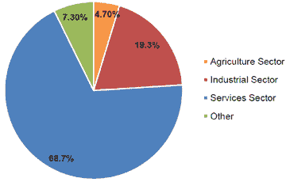

来源：作者根据西班牙驻巴拿马经济与贸易处（2011）的数据编制

服务业（或第三产业）在 2020 年占哥斯达黎 GDP 的 68.7%，是其经济中最重要的部分（参见图 1)（西班牙驻巴拿马经济与贸易处, 2021）。服务业主要由教育、健康、商业和金融活动组成。然而，旅游业是该经济最重要的驱动力之一（EFE, 2018）。2020 年，由于全球范围内的封锁，旅游业收入遭受了巨大影响。

### 外资
第三，哥斯达黎已成为非常有吸引力的外资目的地。其位于太平洋和加勒比海之间的战略位置、政治稳定、高劳动生产率、熟练劳动力以及自由贸易区，使其成为中美备受青睐的投资目的地（Cordero & Paus, 2008）。根据对外贸易部（COMEX）发布的最新数据，哥斯达黎的外商直接投资（FDI）在 2019 年增长了 16%，投资额达 25.9 亿美元。此外，哥斯达黎的主要伙伴和投资者是美国，这使其对其经济福利高度依赖。这种伙伴关系占了哥斯达黎出口的 40%、进口的 40%、股票投资的 75%以及游客人数的 40%。尽管如此，其他重要的投资者还包括哥伦比亚、墨西哥和西班牙。此外，制造业经历了最显著的投资，2018 年高达 15.0 亿美元（西班牙驻巴拿马经济与贸易处, 2021）。

### 结论
结论，哥斯达黎的经济显示出巨大的发展和繁荣潜力。其独特特征使该国与其他拉丁美洲国家区分开来，并使其对投资者而言极具吸引力。然而，该国必须制定严格的经济政策来解决财政赤字、不断增长的公共债务和过高的公共支出（Cerdas, 2023）。尽管近年来面临经济挑战，该国对未来几年的经济稳定保持乐观。

#### 4. 发现

#### 4.1. 哥斯达黎工业 4.0 采用概况
随着技术变革的展开，全球范围内都在利用数字技术的变革力量以促进经济增长。哥斯达黎作为一个发展中国家，已经认识到工业 4.0 的潜力及其对各个部门的影响。政府在其中发挥了至关重要的作用，实施了许多计划、政策和倡议。此外，公私伙伴成为促进工业 4.0 发展的催化剂。政府、工业界和学术之间的合作对于保持该国作为区域创新标杆的至关重要（Jiménez,2019）。

哥斯达黎政府致力于通过促进不同部门的创新和数字化转型，利用第四次工业革命带来的机遇。国家与公共实体合作，制定了支持采用这些技术的倡议。例如，在 2018 年，政府与科学、技术和电信部共同制定了一项为期 5 年的战略，被称为“哥斯达黎迈向双周年数字化转型战略”，旨在通过包容性经济增长加速产业竞争力和生产力。最终，该战略的目标是利用变革性技术增强政府与公民的关系，提高生活质量，并确保企业准备好过渡到工业 4.0（MICITT,2022）。尽管如此，该计划由六个战略支柱组成，如图 2 所示。

#### 图 2. 哥斯达黎迈向双周年数字化转型的行动路线

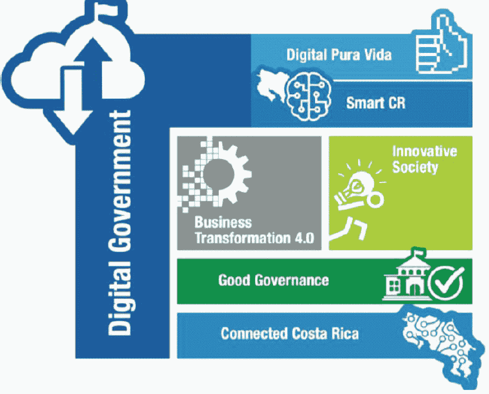

来源：[MICITT (2022)]#979-8-3693-0683-3.ch003.bits-pdf.xhtml#_idTextAnchor205)


第一支柱，或“数字纯真生活”（Digital Pura Vida），旨在向政府机构实施数字技术，以透明且包容的方式高效响应公民的需求。数字纯真生活（Pura Vida Digital）有四个主要目标：为公民健康开发数字服务、创建智能交通系统、实施数字化政府门户以及将市政服务平台数字化。第二支柱“智慧哥斯达黎卡”（Smart CR）旨在应用变革性技术使公共机构做出智能决策。其目标是制定数字技术国家法、为每个公民创建数字档案、设计互联的公共服务平台，并制定国家网络安全战略。此外，第三支柱“业务转型 4.0”面向工业；旨在开发必要的机制以实施变革性技术，并让企业更容易采用这些技术来提高生产力。该支柱包含四个策略：为工业 4.0 开发数字化能力和文化、转型农业部门、为旅游业实施数字技术以及加强基于数字的创业。第四支柱“创新社会”侧重于通过推广创新和工业 4.0 数字技术的使用来赋能哥斯达黎卡公民。该支柱重点关注实现三个目标：加强现有机制以营造促进协作的高效环境、提高公民技能和能力以促进数字素养，以及开发未来工作和业务所需的能力。然而，第五支柱被称为“良好治理”（Good Governance），寻求通过社区参与和政府透明化确保良好治理。其目标是促进利用数据分析以做出明智决策并降低风险、建立一个允许数字公民参与的“开放国家”、实施保护数据的法规，并修订法律法规以确保法律框架随新技术进步而更新。最后，第六支柱“互联哥斯达黎卡”（Connected Costa Rica）侧重于开发确保包容性和访问性的电信基础设施。为了实现这一目标，该支柱旨在改善全国范围内的互联网访问，开发增强数据传输的第五代（5G）网络基础设施，创建技术利用最大化的智能区域，并最终为教育部门提供宽带以改进学习和教学 (MICITT, 2022)。

另一方面，哥斯达黎卡政府设立了众多税收激励，以鼓励并说服各行业实施工业 4.0 技术。例如，最初于 1990 年颁布但近期于 2021 年更新的《科学技术发展促进法》，旨在促进私立和公共机构的研究与技术开发。该法涵盖了一系列目标；例如，哥斯达黎卡的技术型公司在对技术基础设施、技术培训以及研发项目进行投资时，在几年内可获得所得税抵免。此外，该法规定政府必须创建计划并提供奖学金，以鼓励优秀学生在国家科学技术研究委员会（`CONICIT`）和校长委员会（`CONARE`）的合作下攻读 STEM 学位。然而，科学技术部每年必须与激励委员会合作，为寻求技术创新的新公司或既有公司提供融资。此外，法律宣布国家必须提供各种激励措施，以鼓励与私营公司和高等教育机构合作建立科技园区。这些园区旨在促进技术型公司的增长，从而改进和现代化国家的创新（Asamblea Legislativa, 2021）。

政府在哥斯达黎卡创建自由贸易区是作为吸引技术驱动的外商直接投资（FDI）和刺激经济增长的战略举措（Chaves, Gamboa, Hernández, & Sánchez, 2006）。根据第 `7210` 号法律——《自由贸易区制度法》，国家将为在该国投资的资提供一系列激励措施和福利，但需履行一系列义务和规定（Asamblea Legislativa, 2022）。例如，在该制度下运营的公司将能够从运营公司所需的货物采购中获得税收豁免、汇款税的豁免、所有与利润相关的税收或任何基于总利润或净利润的税收的豁免、为期 10 年的市政专利税豁免，以及许多其他豁免权（Esencial Costa Rica; Procomer, 2022）。

哥斯达黎加自由贸易区提供了许多优势，特别是在拥抱工业 4.0 技术的背景下。在这些制度下建立的公司受益于超出经济手段的贡献。自由贸易区吸引外国投资、提供进入新市场的机会、引入尖端生产技术、改进工作实践并提升环境和安全标准。然而，这些对全国的就业创造产生了巨大影响。例如，它们创造了约 200,000 个直接和间接就业岗位。这些市场还吸引了 `Intel`、`Hospira` 和 `Amazon` 等行业领先企业的入驻，帮助将哥斯达黎卡定位为先进制造和技术的投资中心。得益于自由贸易区，哥斯达黎卡不仅能够促进经济发展，还驱动国家成为一个技术驱动的先进制造国（Artavia, 2021）。

在哥斯达黎卡，公私伙伴关系在推动工业 4.0 变革性技术的采用方面发挥了至关重要的作用。这些关系强调了公共和私营部门合作营造促进技术进步和经济扩张环境的重要性。一个著名的例子是哥斯达黎卡投资促进（`CINDE`）与政府的合作。CINDE 是一个私人非营利机构，负责吸引和引导健康、智能制造和知识密集型服务领域的直接投资（Soto, 2023）。该机构与科学技术通信部（`MICITT`）合作，促进高科技产业的教育。这两个机构开发了一项奖学金计划，通过提供与信息通信技术（`ICTs`）相关的培训和认证，帮助公民获得数字时代所需的技能和知识。通过提供奖学金，该计划旨在使国家劳动力获得必要的能力，以便哥斯达黎卡成功融入第四次工业革命（La Reública, 2020）。


除了政府的努力，哥斯黎加在利用物联网（IoT）作为经济发展杠杆方面取得了显著进展。根据德勤的一项研究，哥斯黎加在商业领域的物联网采纳程度在拉丁美洲排名第二（Deloitte, 2018）。该研究分析了六个不同因素（如图 3）。

#### 图 3. 物联网采纳程度与指数国家得分

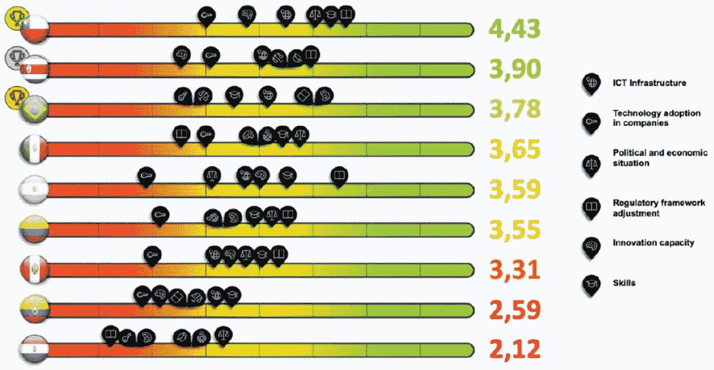

来源：Deloitte (2018)

#### 4.2. 哥斯黎加受益于工业 4.0 技术的关键行业

哥斯黎加有一系列可以从工业 4.0 技术的应用中获益的行业。随着该国寻求促进经济增长并加强其在发展中国家中的地位，识别出能够利用这些先进技术应用的部门至关重要。

农业部门正在逐渐接受工业 4.0 的赋能技术，以提高生产力、增加效率并提高产量。例如，精准农业技术正应用于菠萝采收，这具有重要意义，因为哥斯黎加是全球市场上最大的菠萝出口国¹。精准农业将农业实践与技术相结合，以收集和解释数据，从而实现增加产量所需的预测和知智决策。此外，它还利用无人机、传感器、卫星和摄像头来优化资源利用。例如，精准农业帮助农民就何时以及需要多少肥料、灌溉计划和害虫控制方法做出明智决策。此外，这种技术充当了预警系统，提醒农民作物潜在的健康问题并提供及时的解决方案（Morales, 2022）。此外，目前的集装箱危机导致集装箱价格大幅上涨再加上化肥和纸箱成本的增加，使得农民优化资源以降低成本并触达国际市场变得至关重要（Moral, 2022）。通过结合实时数据和先进技术，这种技术正在赋予哥斯黎加农民提高农业效率的能力。农业部门还在采用人工智能来监测牲畜。农民正在使用智能人工智能项圈（其价格范围在 125,000 欧元到 175,000 欧元之间）来观察牛、猪和其他动物的健康状况。这些项圈有助于检测早期健康问题。然而，由于成本障碍，能够使用这些技术的农民与无法使用的农民之间存在差距。为了解决这一挑战，农业和畜牧部与政府合作，正在制定补贴和其他措施以帮助小规模农民使用这些技术（Siles, 2022）。

医疗和保健行业是哥斯黎加另一个受益于工业 4.0 技术的关键行业。例如，三维打印技术已彻底改变医疗领域。国家学习学院（INA）与哥斯黎加社会保障基金（CCSS）合作，正在为墨西哥医院的患者开发 3D 打印假体。这些假体使用与人体兼容的聚合物制造，确保了兼容性并减少了副作用风险（Castro, 2022）。另一方面，哥斯黎加的许多医院见证了机器人辅助的增加。2021 年，哥斯黎加成为第一个在手术中使用机器人辅助的中洲国家。`ROSA (Robotic Surgical Assistant)` 机器人用于在关节置换期间协助骨科医生。它为医生提供了解剖细节，允许优化植入物调整并获得更好的患者效果。总而言之，人工智能和 3D 打印技术对哥斯黎加的医疗保健做出了重大贡献²。

制造业也从工业 4.0 进步中受益。哥斯黎加被世界经济论坛认为是拉丁美洲生产工艺的关键领导者，因为它能够利用先进技术进行生产。凭借完善的智能制造业，哥斯黎加以高复杂水平运行，提供多样化的产品，并为国家的动态经济增长做出了贡献（Manufactura Inteligente, 2023）。

许多著名的国际公司在哥斯黎加建立了工厂，以利用其受过教育的劳动力、自由区的优惠和战略位置。例如是 Panduit 哥斯黎加，它利用高级分析的力量来解释从流程中收集的数据，创建预测模型并使公司做出高效决策。此外，制造业的另一个重要参与者是波士顿，哥斯黎加最大的医疗设备公司。该公司利用物联网在整个制造过程中跟踪产品，以确保质量控制并符合标准（Comex, 2019）。此外，其他重要公司包括飞、Align Technologies、Baxter Healthcare 和辉瑞。通过实施数字化、自动化、数据分析和其他重要技术，这些公司增强了运营效率、产品质量和整体竞争力（Manufactura Inteligente, 2023）。


在工业 4.0 时代，在先进技术的推动下，工业环境经历了快速转变。发展中国家被迫加入这一技术变革的浪潮，以有效拥抱这些创新。为了更好地了解哥斯达里卡采用工业 4.0 技术的准备情况，本节将分析该国的教育、基础设施以及数据隐私和网络安全。此外，我们还考虑了《政府人工智能就绪指数》和《全球竞争力报告》反映的哥斯达里卡全球视野。这些维度将全面展示该国在采用这一新时代赋能技术方面的优势、劣势和前景。

## 教育与人才

哥斯达里卡成功采用工业 4.0 技术需要一支具备数字和技术技能的受教育劳动力。哥斯达里卡的人才储备已处于拉丁美洲领先地位，这是吸引外国投资者的关键因素³。根据世界银行的数据，2020 年该国 GDP 的 6.7%分配给了教育，显示了政府为公民提供发展数字能力所需的便捷、高质量教育的承诺⁴。

公私伙伴关系是促进教育和支持数字技能发展的关键驱动力。例如，教育部与 Quirós Tanzi 基金会合作创建了“Conectándonos”项目，旨在为公立学校的学生提供技术教育计划。该项目的主要目标是每个学生提供一台笔记本电脑，供家庭和学校使用，从而为数字社会包容提供更好的机会，近期关于技术对社会影响的研究证明（Cucino, Lungu, De Rosis, & Piccaluga, 2023）。该项目旨在通过利用各种教育环境中的技术潜力，确保其学习过程的全面性（Muñoz, 2014）。

另一方面，私立和公共机构之间也努力为各年龄段的人提供教育机会，包括可以从获取工作新技能中受益的成年人。例如，领先的教育平台 Coursera 与劳动力部、外交部和 CINDE（哥斯达里卡投资局）合作，启动了一项免费计划，培训 5 万人提供工业 4.0 所需的技术能力（Coursera, 2020）。该计划提供了不同的学习方案，专注于编程、网络安全、区块链、人工智能、数据科学等许多技能⁵。

## 数字鸿沟

虽然哥斯达里卡在教育系统方面展现了许多优势，但仍面临人口中持续存在的数字鸿沟问题。“数字鸿沟”一词用于描述拥有信息通信技术（ICTs）的人和社区与不拥有的人之间的差距，以及拥有接入能力但缺乏有效使用其知识或技能的人之间的差距（Ministerio de Ciencias, Tecnología y Telecomunicaciones, 2019）。这一问题在农村地区更为突出。例如，根据电信局的一项研究，中部地区（人口最密集、最发达地区）与边境和沿海地区相比，数字鸿沟率较低（Muñoz, 2014）。

## 基础设施与连接

为了更好地了解哥斯达里卡对工业 4.0 的准备情况，考察该国的基础设施至关重要。哥斯达里卡的基础的发展显著。根据电信管理局（`SUETEL`）的一项研究，该国光纤领域增长显著，从 2018 年至 2020 年的扩张率达到 183%⁶。此外，哥斯达里卡的互联网连接位列全球前五名，平均速度为`51.85`兆比特/秒（Castro, 2022）。尽管如此，哥斯达里卡在数据中心方面在中美洲国家中领先。例如，`ICE`数据中心作为最稳健的设施之一脱颖而出。这一发展正在推动对云服务的访问（Castro, 2018）。

尽管该国在网络建设方面取得了显著改进，但仍有改进空间。`Uswitch`的一项研究强调了 OECD 国家宽带的平均成本，哥斯达里卡在其中负担能力最低的国家位居第二。研究显示，平均每月成本为`42.32€`，占收入的 4.72%（Hiley, 2022）。此外，人们对哥斯达里卡采用`5G`技术表示担忧，因为其实施已被推迟，现在预计最到 2024 年才安装⁷

## 数据隐私与网络安全

此外，为了深入了解该对工业 4.0 的准备情况，应当研究网络安全和数据隐私政策。总体而言，与其他拉丁美洲国家相比，哥斯达里卡实施了稳健的数据保护法规（Deloitte, 2018）。第 8968 号法律——个人数据保护法确立了哥斯达里卡个人数据的主要监管基础（OECD, 2020）。该法适用于私立和公共实体，并由数据保护局（`PRODHAB`）监管。该法规定了收集和处理个人数据的机构，并确保他们实施必要的安全措施以获得个人数据处理目的的同意（Asamblea Legislativa, 2011](#979-8-3693-0683-3.ch003.bits-pdf.xhtml#_idTextAnchor200)）。

尽管如此，国际合作一直是哥斯达里卡网络安全努力的关键方面。该国积极参与多项国际倡议，例如伊比利亚数据保护网络。此外，它最近批准了《网络犯罪公约》（又名布达佩斯公约），该公约旨在应对该国打击欺诈和欺骗性商业行为的努力（OCDE, 2020）。此外，哥斯达里卡计划加入其他加强网络安全措施的国际努力。例如，该正致力于加入个人保护公约和全球隐私执法网络（`GPEN`）。


最后，为了全面评估哥斯黎达对工业 4.0 技术的就绪情况，从全球角度对其表现进行分析至关重要。例如，`政府 AI 就绪指数`评估了政府将人工智能（AI）整合到公共服务的准备程度。该指数衡量了三个主要支柱：政府支柱、技术部门支柱以及数据与基础设施支柱。在这些支柱中，哥斯黎达的得分分别为 40.37、33.02 和 61.51，总分为 44.97，如图 4

来源：Rogerson, Hankins, Fuentes, & Rahin (2022)

，分析哥斯黎达全球地位时需要考虑的另一个重要指数是`全球竞争力指数`。该得分对国家在第四次工业革命时代的表现提供了全面评估。它对影响生产力、增长和人类发展的因素提供了广泛视角。根据 2019 年发布的最新报告，哥斯黎达在所分析的 141 个经济体中排名第 62 位。然而，重要的是，在这个排名中，经济规模较大的发达国家也被考虑在内。如图 5 所示，哥斯黎达在拉丁美洲和加勒比地区排名第五。

#### 图 5. 2019 年拉丁美洲和加勒比地区全球竞争力指数 4.0 排名

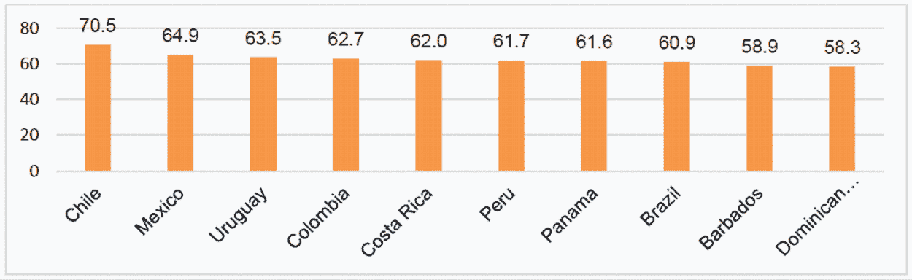

来源：作者根据 Schwab (2019) 整理

尽管如此，如图 6 所示，哥斯黎达在创新能力方面取得了显著改进（Schwab, 2019）。然而，尽管拥有这些优势，哥斯黎达在利用工业 4.0 技术方面面临着巨大挑战。例如，由于光纤互联网和固定宽带订阅量较少，它在 `ICT` 采用方面面临挑战。此外，由于资本市场不发达，哥斯黎达的金融体系正面临 `SMEs` 融资不足的困难（Esquivel, 2019）。`全球竞争力指数`为分析哥斯黎达在全球市场的地位提供了关键统计数据。该指数可以指导政策制定者和利益相关者制定战略，以增强该国在数字时代的竞争力。

#### 图 6. 哥斯黎达表现概览

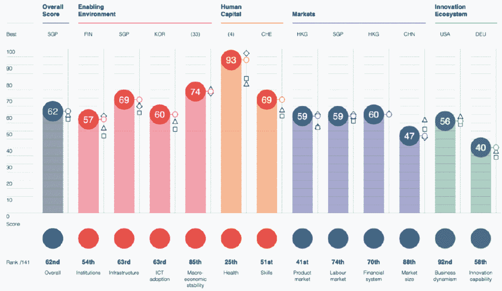

来源：Schwab (2019)

#### 5. 结果讨论

在本节中，我们对迄为止进行的分析提供了解释。为了实现这一目标，我们深入探讨了工业 4.0 的采用对哥斯黎达经济增长和发展的意义。此外，在仔细分析后，我们向政府及关键利益相关者提供了一些政策建议，以有效实施和采用这些技术。最后，我们通过分析这一时代对发展中国家的影响来从更广泛的视角进行研究。

#### 5.1. 对哥斯黎达经济增长和发展的意义

哥斯黎达工业 4.0 技术的开发和采用具有重要意义。通过利用这些技术，哥斯黎达能够重塑其经济，创造就业机会并吸引外来投资。


尽管是一个小型经济体，但哥斯达黎加已成为多个领域的区域领导者。虽然该国在促进技术发展和创新方面取得了显著进展，但仍面临着必须解决的挑战。目前的法律机制缺乏必要的结构来充分利用工业 4.0 的赋能技术。因此，哥斯达黎加必须制定一个促进创新、协作和发展的监管框架。通过建立坚实的基础并制定更好的政策，哥斯达黎加将维持经济增长，吸引投资，并利用工业 4.0 技术带来的优势。

## 促进竞争与监管改革

首先，哥斯达黎加应优先实施旨在促进自由竞争和消除垄断的措施。目前，该国的电力生产和分配完全由国家电力公司（`CNFL`）控制。该国有一项名为`law No. 7472`的《促进竞争和有效保护消费者法》，该法律保护消费者的利益，促进自由竞争并禁止垄断（Asamblea Legislativa, 2012）。然而，尽管有这项法律，哥斯达黎加政府作为该国唯一的电力分配商，免受其指令的约束，导致全国范围内电力服务的垄断（OECD, 2020）。现有的电力垄断正在影响哥斯达黎加实施工业 4.0 技术的能力。它正因不公平竞争和价格上涨为企业制造障碍，并阻碍了创新。为了克服这些障碍，哥斯达黎加应将现法扩大到所有市场参与者，并允许其他公司进入电力部门。

为了进一步加强哥斯达黎加工业 4.0 的推广，该国必须解决大型国家机构和官僚流程带来的挑战（GSMA, 2021）。政府缺乏敏活性经常导致延迟和效率低下，从而阻碍了进展。目前，许多待处理法案由于官僚程序缓慢而处于活动状态（Barquero, 2018）。因此，作为政策建议，哥斯达黎加应该简化和数字化流程，以促进工业 4.0 政策的实施。通过营造一个以敏捷、灵活和高效为特征的环境，哥斯达黎加可以提高应对数字化浪潮所需的响应能力。

## 中小企业的网络安全意识

另一方面，哥斯达黎加迫切需要一项战略来解决中小企业（SMEs）缺乏网络安全意识的问题。由于缺乏网络安全投资和意识，这个小国面临着巨大挑战，对中小企业的生存构成了重大威胁。问题在于，中小型企业资源有限，因此无法负担 IT 咨询服务的费用，导致其网站容易受到黑客攻击。为了解决这个问题，政府应该启动计划教育企业网络攻击的危险，并提供免费的培训倡议，指导企业主保护其财产。尽管如此，他们应该推广更新的防病毒程序、防火墙和其他稳健机制（Siles, 2022）。通过向中小企业教育网络安全的重要性，哥斯达黎加可以减少攻击的可能性，并促进小型企业的发展。

## 社会包容与自动化

工业 4.0 是技术发展的时代，特点是变化快速。尽管它促进了创新，但也可能带来威胁，特别是对那些已经边缘化的人。根据 Frey 和 Osborne 的一项研究，“在哥斯达黎加，商业部门雇用了约 18% 的劳动力，在这些工作中，平均有 57% 具有高自动化概率”（Asamblea Legislativa, 2021）。考虑到这一点，哥斯达黎加必须制定社会包容政策，以保护在第四次工业革命期间面对自动化时最脆弱的人的利益。政府应该建立保护低技能工人的政策。事实上，根据经合组织（OECD）的一项研究，自动化最有可能取代那些对学历要求较低的工作。为了解决这个问题，政府首先应该识别哪些工作面临被数字技术取代的风险。其次，它应该支持培训计划以及教育倡议的资金。尽管如此，政策制定者应该起草指南来监管工作的自动化。最后，国家应该尝试实现哥斯达黎加经济的多样化，并尝试向那些不易被自动化取代的行业转型。

## 弥合数字鸿沟

最后，为了在哥斯达黎加推广工业 4.0，关键在于解决该国农村地区和大都市地区之间的数字鸿沟。目前，大都市比该其他地区更发达，也准备好采用工业 4.0（Samper & González, 2020）。因此，为了促进这一新时代赋能技术的采用，政府应该建立一个全面的政策框架，在这些地区之间建立桥梁。例如，国家应该投资欠发达沿海地区的 IT 基础设施。此外，应该优先考虑农村教育倡议，以培养时代所需的数字技能。此外，政府应该激励大公司投资这些农村地区，从而促进国家经济增长。通过弥合数字鸿沟，哥斯达黎加将促进包容性发展并加速工业 4.0 采用。

### 5.3. 发展中国家工业 4.0 的机遇与挑战

本章探讨了哥斯达黎加工业 4.0 采用的现状，分析了其准备情况并识别了受益这些技术的关键行业。然而，为了充分理解技术发展的下一个阶段，分析其给发展中国家带来的挑战和机遇至关重要。

随着工业 4.0 新时代的展开，国家之间合作的新新机遇正在出现，创造了前所未有的连接（United Nations, 2018）。通过先进技术和互联系统的应用，各国可以无缝对接，实现知识转移和合作。


尽管工业 4.0 在发展中国家的实施中提供了许多可能性，但它并非没有挑战。工业 4.0 技术的采用将引发全球经济的结构性转变，导致工作格局的重新分配。随着新技术的实施，某些外包实践将变得不再必要，导致内部回包趋势的上升。因此，发展中国家将面临就业机会减少的挑战。此外，这些技术的实施需要更高的数字技能和更高水平的教育程度，而发展中国家的劳动力市场缺乏这些条件。这些挑战将进一步扩大国家间现有不平等的差距（联合国, 2018）。

此外，发展中国家面临的另一个障碍是缺乏关于工业 4.0 的知识（Raj, Dwivedi, Sharma, & Lopes, 2021）。在这些经济体中，中小企业（SMEs）对实施数字技术以实现效率的战略重要缺乏理解（Asghar, Rextina, Ahmed, & Tamimy, 2020）。对第四次工业革命缺乏知识和意识为发展中国家造成了巨大障碍，因为它们无法利用数字技术的力量来优化生产力、提高运营效率并优化资源配置。这种知识差距在马来西亚等发展中国家的案例中变得尤为明显。例如，一项开展的研究显示，只有约 12% 的人口知道“工业 4.0”这一术语（Petaling, 2017）。因此，这种意识的缺失是马来西亚的挫折，因为公司不愿意投资于利用这一新时代机遇所需的必要基础设施和技能。

此外，发展中体资本和投资的匮乏为工业 4.0 技术的带来了挑战。发展中国家缺乏开发和实施工业 4.0 所需投资和基础设施。然而，这些经济体更有迫的问题需要解决，例如建立技术型公司所需的财务资源。此外，这些国家已经在非正规经济中挣扎，必须优先考虑高贫困率、失业率和基础设施不发达等紧迫问题。例如，在坦桑尼亚的案例中，该国依赖于贸易的非正规经济。不幸的是，坦桑尼亚没有足够的资金投资于工业 4.0 采用的关键要素，包括基础设施、受过教育的劳动力和创新（Asghar, Rextina, Ahmed, & Tamimy, 2020）。

总之，工业 4.0 技术的采用为发展中国家带来了许多机遇和挑战。通过合作和资本投资，各国将利用赋能技术的力量。然而，应对这些挑战对于缩小发达国家与发展中国家之间的差距至关重要。

### 6. 结论

总之，经过仔细考虑，可以认为哥斯达黎卡已经成功采用了工业 4.0 的赋能技术来促进经济增长，并确立了其作为发展中国先行者的地位。哥斯达黎卡利用了其独特优势，例如生物多样性丰富的国家和政治稳定。

### 致谢

本研究由欧盟地平线协议第 `871` 号拨款。

### 参考文献

- **Bag, S., Yadav, G., Dhamija, P., & Kataria, K. K.** (2021). 工业 4.0 采用的关键资源及其对可持续生产和循环经济的影响：实证研究。*Journal of Cleaner Production*, `281`, `125233`. `10.1016/j.jclepro.2020.125233`
- **Banco Central de Costa Rica.** (2023). 哥斯达黎加中央银行将 2023 年 GDP 增长预测维持在 `2.7%`，并预计 2024 年为 `3.5%`。新闻稿。
- **Barquero, M.** (2018,4 月 18). 法案审批延迟阻碍了哥斯达黎加加入 OECD。来自国家报（La Nación）：`https://www.nacion.com/economia/politica-economica/atraso-en-aprobacion-de-seis-proyectos-de-ley/2GAQFYKWRNAKJE6MTPP424VXYQ/story/`
- **Anshari, M., Syafrudin, M., & Fitriyani, N.** (2022). 第四次工业革命与知识管理。*Information* (Basel), `13`(6), `292`.`10.3390/info1306292`
- **Artavia, R.** (2021,1 月 25 日). 自由贸易区的真相。来自 Delfino：`https://delfino.cr/2021/01/la-verdad-sobre-las-zonas-francas`
- **Asghar, R., & Tamimy.** (2020). 发展中国家的第四次工业革命：挑战与路线图。*South Centre*, `4-33`。


Castro, D. (2022, 3 月 22). INA（国家保险局）将为墨西哥医院的患者开发颅骨假体。源自 Telediario: [`www.telediario.cr/nacional/ina-desarrolla-protesis`](https://www.telediario.cr/nacional/ina-desarrolla-protesis-raneales-pacientes-hospital-mexico)

Castro, J. (2022, 4 月 28). 哥斯黎达在世界固定互联网速度排名上升了三位。来自 La República: [`www.larepublica.net/noticia/costa-rica-subio-tres-puestos-en-ranking-mundial-de-velocidades-fijas-a-internet`](https://www.larepublica.net/noticia/costa-rica-subio-tres-puestos-en-ranking-mundial-de-velocidades-fijas-a-internet)

Castro. (2018, 5 月 8). 哥斯黎达领先地中地区数据中心市场。来自 La República: [`www.larepublica.net/noticia/costa-rica-lidera-mercado-de`](https://www.larepublica.net/noticia/costa-rica-lidera-mercado-de-datacenters-en-el-istmo)

Celenta, R., Cucino, V., Feola, R., & Parente, R. (2024). 迈向创新 5.0：企业创业的角色。收于《国际研究与创新论坛》(pp. 451–463)。Springer 出版。

Cerdas, M. (2023, 4 月 12). 哥斯黎达通胀率接近目标，3 月同比增长率为 4.42%。来自 El Financiero: [`www.elfinancierocr.com/finanzas/inflacion-de-costa-rica-se-aproxima-a-la-meta/SRQGG3NGJV AK5PL2Y4PTQXL73A/story/`](https://www.elfinancierocr.com/finanzas/inflacion-de-costa-rica-se-aproxima-a-la-%20meta/SRQGG3NGJV%20AK5PL2Y4PTQXL73A/story/)

Chaves, Gamboa, Hernández, & Sánchez. (2006). 自由区收支：哥斯黎达制度的净收益。2-111。

Comex. (2019, 8 月 21). 波士顿科学（Boston Scientific）成为哥斯黎达最大的医疗设备公司。来自哥斯黎达对外贸易部: [`www.comex.go.cr/sala-de-prensa/comunicados/2019/agosto/cp-2401-boston-scientific-se-convierte-en-la-empresa-de-dispositivos-m%C3%A9dicos-m%C3%A1s-grande-de-costa-rica/`](https://www.comex.go.cr/sala-de-prensa/comunicados/2019/agosto/cp-2401-boston-%20scientific-se-convierte-en-la-empresa-de-dispositivos-m%C3%A9dicos-m%C3%A1s-%20grande-de-costa-rica/)

Cordero & Paus (2008). 哥斯黎达的外国投资与经济发展：尚未实现的潜力。美洲发展与环境工作小组，1-29。

哥斯黎达对培养工业 4.0 领域人才的承诺。（2022, 8 月 31）。源自 Investment Monitor: [`www.investmentmonitor.ai/sponsored/costa-ricas-commitment-to-developing-talent-in-industry-4-0/`](https://www.investmentmonitor.ai/sponsored/costa-ricas-commitment-to-developing-talent-in-industry-4-0/)

Coursera. (2020). Coursera 影响报告。2-25。来自 Coursera。

Coursera 与哥斯黎达启动联合计划，加强工业 4.0 技能并免费培训 50,000 人以应对 COVID-19 危机。（2020, 6 月 15）。源自 CINDE 投资哥斯黎达: [`www.cinde.org/en/essential-news/coursera`](https://www.cinde.org/en/essential-news/coursera-and-costa-rica-launch-a-joint-program-to-strengthen-industry-40-skills-and-train-free-of-charge-50000-people-to-confront-the-covid19-crisis)

Cucino, V., Dagnino, G. B., Ferrigno, G., Kaplan, A., Ritala, P., Higgins, C., & Liang, C. H. E. N. (2024). 特刊征稿通知：商业与社会的新技术：通过多种类型的组织实现多目标。《商业与社会》(Business & Society)。

Cucino, V., Lungu, D. A., De Rosis, S., & Piccaluga, A. (2023). 从基于目标的创新创造价值：从脆弱性开始。《社会创业期刊》(Journal of Social Entrepreneurship), •••–29。

Dalenogare, L. S., Benitez, G., Ayala, N., & Frank, A. (2018). 工业 4.0 技术对性能的预期贡献。《国际生产经济杂志》(International Journal of Production Economics), 204, 383–394. [10.1016/j.ijpe.2018.0819](http://dx.doi.org/10.1016/j.ijpe.2018.0819)

Del Sarto, N., Cesaroni, F., Di Minin, A., & Piccaluga, A. (2022). 物联网架构：并非适用于一切。《技术与战略管理》(Technology and Strategic Management), 34(7), 787–802. [10.1080/095325.2021](http://dx.doi.org/10.1080/095325.2021)

Del Vecchio, P., Di Minin, A., Petruzzelli, A., Panniello, U., & Pirri, S. (2018). 中小企业开放创新的大数据：趋势与挑战。《创意与创新管理》(Creativity and Innovation Management), 27(1). [10.1111/caim.12224](http://dx.doi.org/10.1111/caim.12224)

Deloitte. (2018). 商业部门的 IoT。1-249。哥斯黎达有良好的光纤网络吗？[`www.marketeroslatam.com/hay-buena-cobertura-internet-de-fibra-en-costa-rica/`](https://www.marketeroslatam.com/hay-buena-cobertura-internet-de-fibra-en-costa-rica/)

Duarte, F. (2023, 4 月 3). 日产生数据量。来自 Exploding Topics: [`explodingtopics.com/blog/data-generated-per-day`](https://explodingtopics.com/blog/data-generated-per-day)

Eberl, M. (2021, 5 月 25). 什么是工业 4.0？来自 Customodal: [`customodal.com/blog/what-is-industry-4-0/`](https://customodal.com/blog/what-is-industry-4-0/)

EFE. (2018, 11 月 15). 旅游业对哥斯黎达 GDP 的直接和间接贡献 8.2%。来自 El Economista: [`www.eleconomista.net/actualidad/Turismo-aporta-8.2-del-PIB-forma-directa-e-indirecta-en-Costa-Rica-20181115-0032.html`](https://www.eleconomista.net/actualidad/Turismo-aporta-%208.2-del-%20PIB-forma-directa-e-indirecta-en-Costa-Rica-20181115-0032.html)

Eisenhardt, K. M. (1989). 从案例研究中构建理论。《管理评论》(Academy of Management Review), 14(4), 532–550. [10.2307/258557](http://dx.doi.org/10.2307/258557)

Eisenhardt, K. M., & Graebner, M. E. (2007). 基于案例的理论构建：机遇与挑战。《管理杂志》(Academy of Management Journal), 50(1), 25–32. [10.5465/amj.2007.2416088](http://dx.doi.org/10.5465/amj.2007.2416088)

Erboz, G. (2017). 如何定义工业 4.0：工业 4.0 的主要支柱。《全球时代企业发展管理趋势》，761-767。

Essential Costa Rica (2022). Procomer。自由区制度指南。

Esquivel, M. (2019, 10 月 10). 根据全球竞争力报告，哥斯黎达排名第 62 位。来自 INCAE: [`en.incae.edu/en/node/95858`](https://en.incae.edu/en/node/95858)

Exterior, C. (2022, 11 月 25). 哥斯黎达出口在 2021 年增长了 26.25%。来自 INEC: [`inec.cr/noticias/exportaciones-costa-rica-crecieron-2625`](https://inec.cr/noticias/exportaciones-costa-rica-crecieron-2625-)

Fernández, A. (2020). 第四次革命对哥斯黎达劳动力市场的挑战。4-92。

Ferrigno, G., & Cucino, V. (2023). AI 技术与偏远地区的医疗交付：来自 Zipline 的见解。收于《人工智能对商业与社会的影响：机遇与挑战》。Routledge 出版。

Ferrigno, G., Crupi, A., Di Minin, A., & Ritala, P. (2023). 研发管理 50 多年：回顾性综述与新研究方向。《研发管理》(R&D Management)。

Ferrigno, G., Zordan, A., & Di Minin, A. (2022). 早期汽车工业中主导设计的出现：对福特 1896 年至 1906 年间技术实验的历史分析。《技术分析与战略管理》(Technology Analysis and Strategic Management), 1–12.


# 教育支出总额（占 GDP 百分比） - 哥斯黎达。（2020）。来自世界银行：[`datos.bancomundial.org/indicator/SE.XPD.TOTL.GD.ZS?locations\=CR`](https://datos.bancomundial.org/indicator/SE.XPD.TOTL.GD.ZS?locations=CR)

Gebhardt, M., Kopyto, M., Birkel, H., & Hartmann, E. (2022). 工业 4.0 技术作为循环供应链中协作的推动因素：系统性文献综述。《International Journal of Production Research》，60(23), 6967–6995。[10.1080/00207543.2021.1999521](http://dx.doi.org/10.1080/00207543.2021.1999521)

阿根廷政府。(2022 年 11 月 8 日)。阿根廷与西班牙签署了促进工业 4.0 发展的战略生产协议。来自 Argentina.gob.ar：[`www.argentina.gob.ar/noticias/argentina\-y\-espana\-sellan\-acuerdo\-productivo`](https://www.argentina.gob.ar/noticias/argentina-y-espana-sellan-acuerdo-productivo-\)-estrategico-para-el-desarrollo-de-la-industria.)

GSMA。(2021)。通往数字哥斯黎达之路。GSMA 拉丁美。

Gutiérrez, T. (2023 年 2 月 9 日)。跨国公司在 2022 年创造了 2.2 万个新工作。来自《共和国报》：[`www.larepublica.net/noticia/empresas`](https://www.larepublica.net/noticia/empresas-multinacionales-generaron-22-mil-empleos-nuevos-el-ano-pasado)

Hernandez, D. (2022 年 12 月 2 日)。哥斯黎达，一个 74 年没有军队的国家。来自美国之音：[`www.vozdeamerica.com/a/costa\-rica\-el\-pa%C3%ADs\-que\- lleva\-74\-a%C3%B1os\-de\-vivir\-sin\-ej%C3%A9rcito/6860180.html#:~:text=Costa%20Rica%2C%20el%20pa%C3%ADs%20que%20lleva`](https://www.vozdeamerica.com/a/costa-rica-el-pa%C3%ADs-que-%20lleva-74-a%C3%B1os-de-vivir-sin-ej%C3%A9rcito/6860180.html#:~:text=Costa%20Rica%2C%20el%20pa%C3%ADs%20que%20lleva) %2074%20a%C3%B1os%20sin%20ej%C3%A9rcito

Hiley, C. (2022 年 3 月 10 日)。全球宽带指数。来自 Uswitch：[`www.uswitch.com/broadband/studies/global\-broadband\-index/`](https://www.uswitch.com/broadband/studies/global-broadband-index/)

Hu, X., Li, S., Huang, T., Tang, B., Huai, R., & Chen, L. (2023)。模拟如何帮助自动驾驶：Sim2real、数字孪生和并行智能综述。《IEEE Transactions on Intelligent Vehicles》上。

Huang, S. H., Liu, P., Mokasdar, A., & Hou, L. (2013)。 增材制造及其社会影响：文献综述。《International Journal of Advanced Manufacturing Technology》，67(5-8), 1191–1203。[10.1007/s00170-012-4558-5](http://dx.doi.org/10.1007/s00170-012-4558-5)

Huda, N. (2023 年 2 月 16 日)。德国工业 4.0 的崛起：创新与转型的之旅。来自 Linkedin：[`www.linkedin.com/pulse/rise\-industry\-40\-germany\-journey\-innovation\-nazmul\-huda#:~:text=The%20German%20government%20has%20also,partnerships%20between%20industry%20and%20academia`](https://www.linkedin.com/pulse/rise-industry-40-%20germany-journey-innovation-nazmul-huda#:~:text=The%20German%20government%20has%20also,partnerships%20between%20industry%20and%20academia)

I-Scoop。(2023 年 4 月 11 日)。工业 4.0 与第四次工业革命详解。来自 I- Scoop：[`www.i\-scoop.eu/industry\-4\-0/`](https://www.i-scoop.eu/industry-4/)

IMF 新闻中心。(2021 年 7 月 28 日)。关于非正式经济的五件事。来自国际货币基金组织：[`www.imf.org/en/News/Articles/2021/07/28/na\- 072821\-five\-things\-to\-know\-the\-informal\-economy#:~:text=The%20informal%20economy%20consists%20of,lights%20all`](https://www.imf.org/en/News/Articles/2021/07/28/na-072821-five-things-to-know-the-informal-economy#:~:text=The%20informal%20economy%20consists%20of,lights%20) world

Inteligente, M。(2023)。来自 CINDE：[`www.cinde.org/`](https://www.cinde.org/)

Jiménez, G. (2022 年 11 月 8 日)。阿根廷与西班牙签署了促进工业 4.0 发展的战略生产协议。来自 Argentina.gob.ar：[`www.argentina.gob.ar/noticias/argentina\-y\-espana\-sellan\-acuerdo\-productivo`](https://www.argentina.gob.ar/noticias/argentina-y-espana-sellan-acuerdo-productivo-\)-estrategico-para-el-desarrollo-de-la-industria.)

Kuepper, J. (2022)。什么是发展中国家？来自 The Balance：[`www.thebalemoney.com/what-is-developing-`](https://www.thebalemoney.com/what-is-developing-)

Lasi, H., Fettke, P., Kemper, H., & Hoffmann, L. (2014)。工业 4.0。《Business & Information Systems》，6(4), 239–242。[10.1007/s00170-012-4558-5](http://dx.doi.org/10.1007/s00170-012-4558-5)

McLaughin, S. (2022 年 8 月 17 日)。制药和医疗设备制造商在工业 4.0 中的水平与垂直整合。来自 SL Controls：[`slcontrols.com/en/horizontal-and-vertical-integration-in-industry-4-0-for-pharmaceutical-and-medical-device-manufacturers/`](https://slcontrols.com/en/horizontal-and-vertical-integration-in-industry-4-0-for-%20pharmaceutical-and-medical-device-manufacturers/)


-   Monge, R. (2023, 6 月 1 日). 在自动化时代取得成功的职业准备。源自 Academia de Centroamérica：[`www.academiaca.or.cr/opinion/preparacion\- laboral\-para\-triunfar\-en\-la\-era\-de\-la\-automatizacion/`](https://www.academiaca.or.cr/opinion/preparacion-%20laboral-para-triunfar-en-la-era-de-la-automatizacion/)

-   Moore, L. (2019, 4 月 19 日). 增强现实 vs 虚拟现实 vs 混合现实。源自 Tech Target：[`www.techtarget.com/searcherp/feature/AR\-vs\-VR\-vs\-MR\-Differences`](https://www.techtarget.com/searcherp/feature/AR-vs-VR-vs-MR-Differences-\-similarities-and-manufacturing-uses)

-   Moral, M. (2022, 6 月 8 日). 精准农业让我们在这些艰难时期更高效地管理菠萝运输。源自 Fresh Plaza：[`www.freshplaza.es/article/9433882/la\-agricultura\-de\-precision\-nos\-ha\- permitido\-ser\-mas\-eficientes\-en\-la\-gestion\-de\-los\-envios\-de\-pina\-en\-estos\-momentos\- complicados/`](https://www.freshplaza.es/article/9433882/la-agricultura-de-precision-nos-ha-%20permitido-ser-mas-eficientes-en-la-gestion-de-los-envios-de-pina-en-estos-momentos-%20complicados/)

-   Morales, A. A. (2022, 6 月 2 日). 景 de 展望。检索自 [`www.panoramadigital.co.cr/la\-agricultura\-de\-precision\-en\-costa\-rica\-el\-futuro\- ya-llego/`](https://www.panoramadigital.co.cr/la-agricultura-de-precision-en-costa-rica-el-futuro-%20ya-llego/)

-   Muñoz, D. (2014). 从接入、连通和数字素养的角度看哥斯黎达的数字鸿沟。E-Ciencias de la Información，1- 29。

-   Murillo, A. (2014, 4 月 9 日). 英特尔让哥斯黎达失去了其最大的出口工厂。源自 El País：[`elpais.com/economia/2014/04/09/actualidad/1397005915\_851656.html`](https://elpais.com/economia/2014/04/09/actualidad/1397005915_851656.html)

-   5G 在 2024 年底之前不会进入哥斯黎达。(2022, 8 月 20 日)。源自 BN Americas：[`www.bnamericas.com/es/noticias/5g\-no\-llegaria\-a\-costa\-rica\-antes\-de\-fines\-de\-2024`](https://www.bnamericas.com/es/noticias/5g-no-llegaria-a-costa-rica-antes-de-fines-de-2024)

-   OCDE。(2020)。经经组织经济研究：哥斯黎达，2020，2–66。

-   OECD。(2020)。 哥斯黎达：法律与政策的评估与竞争 2020。

-   OECD。(2020)。 哥斯黎达数字经济政策。2-75。

-   OECD。(2022)。 关于信息通信技术与环境的理事会建议。OECD 法律文件，3-6。

-   OECD。(无日期)。 拉丁美洲的增长。源自 OECD：[`www.oecd.org/countries/ecuador/growth\-in\-latin\-america.htm/`](https://www.oecd.org/countries/ecuador/growth-in-latin-america.htm/)

-   西班牙驻巴拿马经济和商务处。(2021)。经济与社会报告：哥斯黎达。贸易国务部，1-45。

-   Pérez, J. C. (2022, 10 月 17 日)。 哥斯黎达技术领域的中小企业与第四次工业革命。源自 Disruptiva：https://www.disruptiva.media/pymes-del-sector-tecnologia-en-costa-rica-y-cuarta-revolucion-industrial

-   Petaling, J. (2017, 10 月 12 日)。 马来西亚制造业对工业 4.0 的意识和采用率较低。源自 Sun Daily：[https://www.thesundaily.my/archive/low\-awareness]\-adoption-industry-40-among-malaysian-manufacturers-FTARCH492369](https://www.thesundaily.my/archive/low-awareness-)\adoption-industry-40-among-malaysian-manufacturers-FTARCH492369)

-   Pettigrew, A. M. (1990)。 关于变化的纵向现场研究：理论与实践。Organization Science, 1(3), 267–292。[10.1287/orsc.1.3.267](http://dx.doi.org/10.1287/orsc.1.3.267)

-   Prococomer; Esencial Costa Rica。(2022)。 免税区条例指南。4-25。

-   PROCOMER。(2020)。 哥斯黎达与工业 4.0。商业智能部，3-12。

-   PROCOMER。(2022, 3 月 3 日)。 哥斯黎达 22% 的 TIC 企业园区提供与第四次工业革命相关的技术。源自 Esencial Costa Rica & PROCOMER：[`www.procomer.com/noticia/exportador\-noticia/22\-del\-parque\-empresarial\-tic\-de\-costa\-rica\-ofrece\-tecnologias\-vinculadas\-a\-la\-cuarta\-revolucion\- industrial/`](https://www.procomer.com/noticia/exportador-noticia/22-del-parque-empresarial-tic-de-costa-rica-ofrece-tecnologias-vinculadas-a-la-cuarta-revolucion-industrial/)

-   全球菠萝生产。(2021)。Atlas Big：[`www.atlasbig.com/es/paina`](https://www.atlasbig.com/es/paina)

-   Raj, A., Dwivedi, G., & Sharma, A. (2020)。 工业 4.0 采用障碍。International Journal of Production，10。[10.1016/ijpe.7546](http://10.1016/ijpe.7546)

-   República, L. (2020, 5 月)。 新奖学金与认证。源自 República：[`www.larepublica.net/nuevas-becas-y-certificacion`](https://www.larepublica.net/nuevas-becas-y-certificacion)

-   Soto, T. (2023, 5 月)。 Cinde：什么是以及对罗德里戈·查韦斯政府的作用。El Financiero：[`www.elfinancier.com/economia\-y\-politica/cinde\-que\-es\-y\-para\-sirve\-la\-coalicion\-conla`](https://www.elfinancier.com/economia-y-politica/cinde-que-es-para-sirve-la-coalicion-conla)


Treviño-Elizondo, B. L., & García-Reyes, H. (2020). 拉丁美洲的工业 4.0 采用：系统性文献综述。IIE 年度会议论文集 (pp. 174-179)。 工业与系统工程师协会 (IISE)。

UNESCO. (2021). 识字率，成年人总量（15 岁及以上人口百分）- 哥斯黎加。源自世界银行：[`datos.bancomundial.org/indicator/SE.ADT.LITR.ZS?locations=CR`](https://datos.bancomundial.org/indicator/SE.ADT.LITR.ZS?locations=CR)

United Nations. (2018). 工业 4.0 – 挑战后的机遇。贸易、投资与创新部 (TII), 2-31。

United Nations. (2022). 用于包容性发展的工业 4.0。发展科学与技术委员会，2-18。

Yang, C., Huang, Q., Li, Z., Liu, K., & Hu, F. (2017). 大数据与云计算：创新机遇与挑战。《国际数字地球期刊》，10(1), 13–53。[10.1080/17538947.2016.1239771](http://dx.doi.org/10.1080/17538947.2016.1239771)

Yin, R. K. (2009). 如何进行更好的案例研究。《SAGE 应用社会研究方法手册》，2(254-282)。

Yüksel, H. (2020). 土耳其公司工业 4.0 应用的实证评估：一个发展中国家的案例。《社会技术》，63, 101364。[10.1016/j.techsoc.2020.101364](http://dx.doi.org/10.1016/j.techsoc.2020.101364)

### 关键术语与定义

哥斯黎加：位于中美洲的一个国家，北邻尼加拉瓜，南邻巴拿马。由于该地区政治和经济相对稳定，哥斯黎加以丰富的生物多样性、国家公园和对生态的承诺而闻名。该国还吸引了投资，促进了技术、旅游和可持续实践等行业的发展。

发展中国家：也被称为不发达或落后国家，是指正处于经济和工业转型期的国家，目标是提高公民的生活条件。这些国家可能面临贫困、基础设施不发达和资源获取有限等挑战。刺激这些国家经济发展的努力通常涉及对教育、医疗保健、基础设施和可持续性等关键领域的投资。

经济增长：是指经济体内商品和服务的生产和消费随时间推移而持续增加。通常通过一个国家国内生产总值（GDP）的增长来衡量，GDP 涵盖了在其边界内生产的所有商品和服务的总价值。经济增长是衡量国家繁荣的关键指标。

工业 4.0：也称为第四次工业革命，代表了制造业的范式转移。

技术：指的是用于解决问题的一系列工具、技能和方法论。在当代语境下，包括人工智能、物联网、区块链等许多技术。

### 尾注

¹ 各国全球菠萝产量，2021。
² 接受膝关节置换手术，2021。
³ 哥斯黎加对 2022 年的承诺。
⁴ 教育公共支出（占 GDP 百分比）- 哥斯黎加，2020。
⁵ Coursera 启动联合计划至 2020。
⁶ 哥斯黎加光纤覆盖率良好吗？2023。
⁷ 5G 不会在 2024 年之前到达哥斯黎加

## 第 4 章：人力资源分析与基于机器学习的流预测

N. Krishnamoorthy
维洛尔理工学院 (Vellore Institute of Technology)

V. Vinoth Kumar
维洛尔理工学院 (Vellore Institute of Technology)

Chinchu Nair
Dr. MGR 教育与研究学院

A. Maheswari
[`orcid.org/0009-0002-2578-5265`](http://orcid.org/0009-0002-2578-5265)
Dr. MGR 教育与研究学院

Sonali Mishra
维洛尔理工学院 (Vellore Institute of Technology)

Ayush Sinha
维洛尔理工学院 (Vellore Institute of Technology)

### 摘要

组织中高的人员流失率是一项关键挑战。价值巨大的隐性信息（通常是公司竞争优势的来源）往往随着离职人员带走。如果一家公司想在竞争对手中保持更好的竞争优势，应该优先考虑降低员工流失。通过根据人口统计和与工作相关的因素预测流失，本研究发现了有助于预测流失的员工特征。通过一个包含 14999 个样本和 10 个特征的 IBM 数据集，采用了上采样技术和各种机器学习算法来寻找最佳预测模型。数据可视化和分析揭示了显著因素和相关性。此外，作者还使用了模型对流失进行预测和分析。

### I. 引言

### II. 文献综述


(Joseph, R et al., 2021) 提出了一种考虑多种因素的模型，对特定员工的流失和心理健康状况预测准确率为 86.0%（`Random Forest Classifier`）。(Rajeswari G. R et al., 2022) 提出了四种机器学习模型，在 `logistic regression model`（逻辑回归模型）中获得了 90%的最高准确率。(Yedida, R et al., 2018) 提出了一种方法，讨论了自愿离职对组织的影响，并强调了以 94.32% 的准确率对其进行预见的重要性。(Jain R., & Nayyar A, 2018) 构建了一个利用 `XGBoost` 策略的机器学习模型，准确率为 89%。在 IBM USA 数据集上，(Bhuva, K., & Srivastava, K, 2018) 应用了多种分类算法，包括 `logistic regression model`、`DT`、`LDA`、`ridge classification`（岭回归分类）和 `RF`，对员工因各种原因的离职进行预测。(Fallucchi, F et al., 2020) 的目的是通过识别影响因素和根本原因，更好地预测员工流失。`Naive Bayes`（朴素贝叶斯）模型的准确率为 82.5%，是其中准确率最高的模型。(George, S et al, 2022) 比较了四种机器学习模型 `ETC`、`SVM`、`Logistic regression` 和 `DTC` 在预测员工流失方面的性能。当数据集扩大十倍时，`SVM`、`LR`、`DTC` 和 `ETC` 分别达到了 88%、74%、84% 和 93% 的准确率得分。(Mohbey, K. K, 2020, pp. 121-128) 使用 HR 数据集评估研究中多种机器学习算法的有效性。对于该数据集，`logistic regression` 根据准确率测量表现良好。通过使用 `SVM`、`Random forest`（随机森林）和 `decision tree`（决策树）等模型，(Yadav, S., Jain, A., & Singh, D, 2018) 提供了一个模型，得出结论认为薪资和额外的财务考虑（如晋升）不是员工流失的主要原因。(Jain, P. K., Jain, M., & Pamula, R, 2020) 和 (Krishnamoorthy, N & Parameswari, V. L, 2018) 提出了一种对 HR 数据进行预测性分析处理的方法。随后将 `SVM`、`DT` 和 `RF` 等预测模型应用于清洗后的数据，以确定该数据集的最佳模型。

## III. 问题描述

员工流失预测是指分析组织内员工相关数据，以识别那些可能自愿或非自愿离开工作的过程。这一问题对组织来说非常重要，因为高水平的员工流动率会导致生产力下降、成本增加以及宝贵知识和技能的流。为了预测人员流动，需要考虑各种属性，如员工满意度、工作评估、工作表现以及经济或就业市场等外部因素。数据可以通过调查、绩效评估和员工记录进行收集（Karthikeyan, T et al., 2019）。在开发用于从现有数据预测员工流失的机器学习模型之前，必须解决员工流失预测的问题（Krishnamoorthy, N et al., 2022）。该模型在对已离职或留任员工的历史数据进行训练后，被应用于新数据，以预测哪些员工最有可能离开。员工流失预测的最终目标是为组织提供影响员工流动的因素洞察，帮助他们制定留任策略。

### 局限性

在分析这些研究论文后，我们发现大多数论文中使用的算法准确率在 80% 左右，少数触及 90%。我们根据 Kaggle 上的数据集选择了最合适的算法，这些算法将确保提供高性能。我们的目标是在该数据集上达到约 95% 的准确率，并对 `RF`、`DT`、`KNN` 和 `SVM` 这四种算法进行对比分析。然后，我们将同时关注于模型的性能，以及使用 `Correlation Matrix`（相关性矩阵）和 `Heatmap`（热图）进行数据探索，并找到导致流失的最重要特征。

## IV. 提出的工作

所提系统使用机器学习模型来预测和分析员工流失。通过使用 `KNN`、`SVM`、`RF` 和 `Multilayer Perceptron`（多层感知机 `MLP`）等分类器，在 IBM 数据集上运行了五项主要测试以预测员工流失。该过程从导入必要的库和数据集开始。在清洗和探索数据集后，通过 `Correlation Matrix` 和 `Heatmap` 分析结果，通过这些工具找到特征之间的相关性（Krishnamoorthy, N et al., 2021）。这允许我们回答许多查询，例如哪些特征与其他特征有很强的关联，同样，哪些特征对目标变量（`turnover` 流动率）有影响。我们还将通过分布图进一步分析特征，以找到员工流失的原因。此外，将进行特征重要性分析并创建训练和测试数据集。然后，对比所有四种算法——`RF`、`DT`、`KNN` 和 `SVM`——以观察哪一个对我们的数据运行得最好，并在预测员工流失时提供最高准确度。我们还将使用 `logistic regression` 系数以及三个最重要的特征——满意度、评估和公司年限来开发一个方程并计算员工流动率评分。

### 图 1. 数据集中的员工留存


## V. 数据收集

该数据集包含 14,999 个样本和十个特征，包括满意度、近期评估、任务数量、每月小时、工作时长、工作事故、过去五年的晋升以及薪资（图 1）。没有任何列值为空或缺失。使用未识别示例来测试数据集（图 2）。少数类的大小将会增加，而多数类的大小将减少。

### 图 2. 来自数据集的特征


## VI. 数据预处理与分析

数据收集和探索是验证和分析数据的主要任务。在该数据集中，发现满意度较低（<0.50）的员工流动率较高，如下图所示（图 3）。x 轴代表基于满意度的流动（`0` 或 `1`），y 轴显示员工人数。图 4 显示了员工的总流动计数，图 5 显示了各种属性之间的相关性（强或弱）。

#### 图 3. 流动率与满意度


#### 图 4. 流动率


#### 图 5. 属性间的相关性


### 相关性统计检验

单样本 t 检验（确定满意度水平）


单样本 `t`检验用于评估样本均值与总体均值之间是否存在差异。考虑到员工满意度与我们的因变量离职率的相关性最高，我们研究了经历过离职的员工与未经历离职员工之间在满意度水平上是否存在差异。

假设检验：经历过离职的员工与未经历离职的员工满意度均值之间是否存在显著差异？

*   **零假设**：`(H0: pTS = pES)` 零假设认为，离开当前岗位的员工与留任员工在员工满意度上没有差异。
*   **备择假设**：`(HA: pTS != pES)` 备择假设假设辞职的人与留任的人所的工作满意度水平不同。

测试结果 `t` 等于 `-51.33`，因此根据单样本 t 检验的统计评估结果，经历过离职的工人平均满意度与整体员工群体之间存在统计学上的显著性。

## VII. 分类技术

*   **随机森林**：该算法为监督学习随机森林生成了许多决策树。在得出最终选择时，会使用绝大多数决策树。集成分类方法中最重要的方法之一是根据装袋（bagging）原理整合多个决策树，以提高预测准确性。每个样本都接受独立的装袋训练。每一层决策都使用不同的数据集进行训练，并利用重抽样从原始数据集中生成多个随机部分。此外，在建立树时，随机选择特征。通过组合许多树，通过多数投票法做出预测。

决策树和随机森林具有可比性。它创建了一个树森林，每棵树都由从整个集中随机抽取的属性组合组成。这些不相关的树可以通过取平均值来减少变异，从而产生不复杂且更稳定的输出。

*   **决策树**：在投入很少精力和时间的情况下即可高效运行。为了分类、分类和泛化一组数据，决策树是结合了数学和计算技术的一种数据挖掘技术。通过构建一棵决策树，为每个数据点分配一个类别属性。

通过根据属性值的测试将源集划分为片段，可以使用提供的信息来“学习”一棵树。在每个子集上反复发生的方法称为递归划分。

决策树在投入很少精力和时间的情况下即可高效运行。为了分类、分类和泛化一组数据，决策树是涉及数学和计算机方法论的一种数据挖掘策略。构建一棵决策树，为每个数据点添加一个类别属性。可以通过根据属性值测试将源集划分为子集来“学习”一棵树。递归划分是指在每个子集上反复执行的过程名称。

*   **K-近邻**：是一种用于监督机器学习的算法。本质上，它将新发现的案例和数据与已知数据进行比较，将其分类为与现有案例最相似。回归和分类是它的主要应用。

寻找最近 `k` 点的技术通常使用欧几里得距离公式。以下是 `KNN` 算法中的欧几里距离公式。

其中 `dis = Euclidean Distance`；`xi` = 样本数据中 x 变量的值；`yi` = 样本中 y 变量的值；`n` = 数据量。

对于 `TS` 集中的每个样本 `X_test`，`KNN` 算法在 `TR`集中搜索最近的 `K` 个样本。因此，`KNN` 使用曼哈顿距离或最常用的距离度量（欧几里距离）来计算所有 `TR` 样本与 `X_test` 之间的距离。所选 `k` 值会影响该方法的有效性和抗噪能力。

*   **支持向量机**：是一种用于监督学习的机器学习方法，可解决回归或分类问题。文本分类是其频繁使用的一种分类挑战。被称为 `SVM` 的策略将每个数据点描绘在“n” 维空间中（n 代表你拥有的特征数量），每个属性的对应的值为其特定坐标的值。然后将找到划分两个类别的最佳超平面，并随后完成分类（Mahesh, T. R et al., 2023）。

`SVM`：通过改变数据点之间的间距创建一个超平面，从而有效地隔离类别。假设 `N` 代表使用可分离样本集 `(x_i, y_i), 1iN` 训练的向量总数。`D` 是输入空间维度，其中 `x_iR D`，且输入向量 `x_i` 是训练向量。

超平面划分使用方程 `w. x + b = 0` 计算，其中 `w` 代表向量的权重，点 `.` 代表内积，字母 `b` 代表偏置表达式。

## VIII. 详细设计

设计过程从收集数据并进行预处理开始，然后是探索、特征提取以及应用随机森林、决策树、`KNN` 和 `SVM` 四种分类技术。最后完成员工流失预测。详细设计的整个过程如图 6 所示。过程的整个流程见图 7。

#### 图 6. 详细设计


#### 图 7. 流程


## IX. 结果与讨论

本研究展示了如何使用多种分类算法（包括支持向量机 `SVM`、决策树 `DT`、随机森林 `RF` 和 K-近邻 `KNN`）来预测机构的员工流失率。

通过比较所有算法训练后的准确率来找到最佳算法，如表 1 所示。ROC 曲线用于衡量分析测试并连接两个或多个分析测试，如图 8 所示。

#### 表 1. 分析

| 模型 | 准确率 |
| --- | --- |
| 随机森林 | 98% |
| 决策树 | 95% |
| KNN | 98% |
| SVM | 91% |

### 图 8. 接收工作特征 (ROC) 曲线


如果将这些员工数据纳入方程：

满意度：0.7，评估：0.8，工作年限：3

离职得分等于 (0.7)(-3.769) + (0.8)(0.) + (3)(0.170) + 0.181 = 0.14 = 14% 这位员工离开公司的概率为 14%。我们可以根据此信息制定留任策略。


通过使用图 9 所示的决策树分类器，对预测实现的特征进行排序是可行的。员工满意度、`YearsAtCompany`（职年限）和评估是前三个特征。因此，当我们在逻辑回归的模型公式中使用尽可能少的特征时，更容易弄清楚它的运行机制。

## 从图 10 中识别前 3 特征：

* 1- 满意度
* 2- 职年限
* 3- 评估

#### 图 10. 来自决策树的重要特征
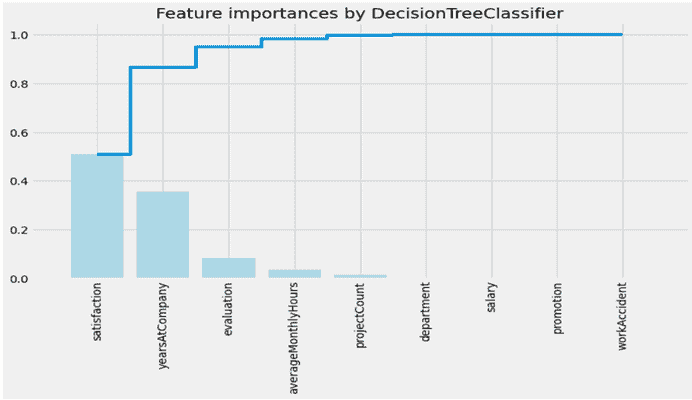

#### 图 11. 员工满意度分布
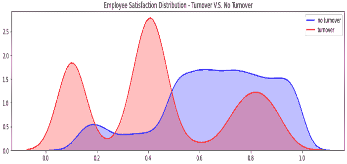

#### 图 12. 员工流失
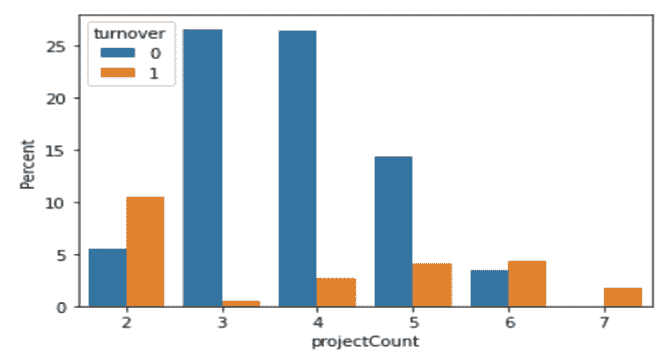

#### 图 13. 员工评估
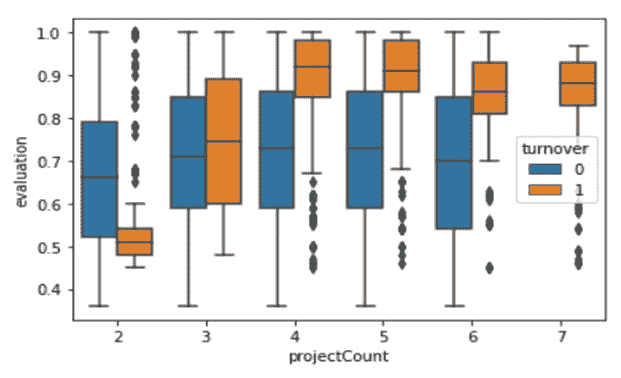

#### X. 数据解读

掌握了这些知识，我们现在了解了员工离开雇主的原因——

* 工作时间太少（每月少于 150 个工作小时或每天少于 6 个办公小时）的员工频繁辞职。
* 当员工工作时间过多（每天超过 10 小时或每月超过 250 小时）时，他们也会频繁辞职。
* 在确定高流失率时，应考虑评分极高或极差的员工。员工的大部分流失发生在薪资低低到中等的员工之间。
* 任务总数为 2、6 或 7 的员工可能面临雇主解雇的风险。
* 员工满意度是员工流失的最佳指标。

员工的满意度分布、流失和评估分别见图 11、图 12 和图 13。

### 潜在解决方案

* 我们可以根据员工离职的可能性对其进行评分，为离职概率最高的案例分配受限的激励预算；或者我们可以利用流失概率将激励预算分配给预期损失最大的案例。
* 建立管理层培训计划。然后使用分析技术来衡量他们的生产力并监控进度。

#### XI. 结论

根据我们的分析结果，可以得出结论：在四个模型（RF、DT、KNN 和 SVM）中，随机森林（Random Forest）和 SVM（SVM）是预测员工流失的最佳模型，准确率达到 98%。企业可以使用员工流失预测来改进留才工作、降低成本、规划继任计划并做出明智的人才管理决策。它鼓励建立更稳定、投入度更高的员工队伍，并赋予了企业主动应对流失风险的能力。

我们还借助决策树分类器进行了特征重要性分析，找出员工离开组织的最重要原因，并进一步利用逻辑回归系数发现了员工流失的概率。

### 参考文献

Basheer, S., Anbarasi, M., Sakshi, D. G., & Vinoth Kumar, V. (2020). Efficient text summarization method for blind people using text mining techniques. International Journal of Speech Technology, 23(4), 713–725. [10.1007/s10772-020-09712-z](http://dx.doi.org/10.1007/s10772-020-09712-z)

Bhuva, K., & Srivastava, K. (2018). Comparative study of the machine learning techniques for predicting the employee attrition. [IJRAR]. IJRAR-International Journal of Research and Analytical Reviews, 5(3), 568–577.

Dhiman, G., Vinoth Kumar, V., Kaur, A., & Sharma, A. (2021). Don: Deep learning and optimization-based framework for detection of novel coronavirus disease using x-ray images. Interdisciplinary Sciences, Computational Life Sciences, 13(2), 260–272. [10.1007/s12539-021-00418-7](http://dx.doi.org/10.1007/s12539-021-00418-7)

Fallucchi, F., Coladangelo, M., Giuliano, R., & De Luca, E. (2020). Predicting employee attrition using machine learning techniques. Computers, 9(4), 86. [10.3390/computers94086](http://dx.doi.org/10.3390/computers94086)

George, S., Lakshmi, K., & Thomas, K. (2022). Predicting Attrition Using Machine Learning. In 2022 4th International Conference on Advances in Computing, Control and Networking (ICACN) (pp. 700-705). [10.1109/ICACN56670.2022.100731](http://dx.doi.org/10.1109/ICACN56670.2022.100731)

Jain, P., Jain, M., & Pamula, R. (2020). Explaining and predicting employees’ attrition: A machine learning approach. SN Applied Sciences, 2(4), 1–11. [10.1007/s42452-020-2519-4](http://dx.doi.org/10.1007/s42452-020-2519-4)

Jain, R., & Nayyar, A. (2018). Predicting employee attrition using xgboost learning. In 2018 international conference on system modeling & advancement in research trends (smart).

Joseph, R., Udupa, S., Jangale, S., Kotkar, K., & Pawar, P. (2021). Employee attrition using machine learning and depression analysis. In 2021 5th International Conference on Intelligent Computing and Systems (ICICCS) (pp. 1000-1005). [10.1109/ICICCS51141.2021.943259](http://dx.doi.org/10.1109/ICICCS51141.2021.943259)

Karthikeyan, T., Sekaran, K., Ranjith, D., & Balajee, J. (2019). Personalized content extraction and text classification using effective web scraping. [IJWP]. International Journal of Web Portals, 11(2), 41–52. [10.4018/IJWP.201907013](http://dx.doi.org/10.4018/IJWP.201907013)

Krishnamoorthy, N., Nirmaladevi, K., Kumaravel, T., Nithish, K. S., Sarathkumar, S., & Sarveshwaran, M. (2022). Diagnosis of Pneumonia Using Deep Learning Techniques. In 2022 Second International Conference on Advances in Electrical, Computing, Communication and Sustainable Technologies (ICAECT) (pp. 1-5). [10.1109/ICAECT54875.2022.9807954](http://dx.doi.org/10.1109/ICAECT54875.2022.9807954)

Krishnamoorthy, N., Nirmaladevi, K., Shanth, S., & Karthikeyan, N. (2021). Investigation and comparison of different CNN architectures on tomato leaf disease prediction using deep learning. In AIP Conference Proceedings (Vol. 2387, No. 1). AIP Publishing. [10.1063/5.0068638](http://dx.doi.org/10.1063/5.0068638)

Krishnamoorthy, N., & Parameswari, V. L. (2018). Rice leaf disease detection via deep neural networks with transfer learning for early identification. Turkish Journal of Physiotherapy and Rehabilitation, 32, 2.s (ICAECT) (pp. 1-5).

Kumar, D., Swathi, P., Jahangir, A., Sah, N. K., & Vinothkumar, V. (2021). Intelligent speech processing technique for suspicious voice call identification using adaptive machine learning approach. In Handbook of Research on Innovations and Applications of AI, IoT, and Cognitive Technologies (pp. 372-380). IGI Global. [10.4018/978-1-7998-6870-5.ch025](http://dx.doi.org/10.4018/978-1-7998-6870-5.ch025)

Mahesh, T. R., Sivakami, R., Manimozhi, I., Krishnamoorthy, N., & Swapna, B. (2023). Early Predictive Model for Detection of Plant Leaf Diseases Using MobileNetV2 Architecture. International Journal of Intelligent Systems and Applications in Engineering, 11(2), 46–54.

Maithili, K., Vinothkumar, V., & Latha, P. (2018). Analyzing the security mechanisms to prevent unauthorized access in cloud and network security. Journal of Computational and Theoretical Nanoscience, 15(6-7), 2059–2063. [10.1166/jctn.2018.7407](http://dx.doi.org/10.1166/jctn.2018.7407)


Mohbey, K. K. (2020). 使用机器学习方法的员工流失预测。在《实时应用中的机器学习与深度学习》（pp. 121–128）。IGI Global. [10.4018/978-1-7998-3095-5.ch005](http://dx.doi.org/10.4018/978-1-7998-3095-5.ch005)

Rajeswari, G. R., Murugesan, R., Aruna, R., Jayakrishnan, B., & Nilavathy, K. (2022, 10 月). 通过机器学习预测员工流失。在《2022 年第 3 届智能电子与通信国际会议 (ICOSEC)》(pp. 1370-1379)。IEEE. [10.1109/ICOSEC54921.2022.9952020](http://dx.doi.org/10.1109/ICOSEC54921.2022.9952020)

Yadav, S., Jain, A., & Singh, D. (2018, 12 月). 使用数据挖掘技术对员工流失进行早期预测。在《2018 IEEE 第八届国际高级计算会议 (IACC)》(pp. 349-354)。IEEE. [10.1109/IADCC.2018.8692137](http://dx.doi.org/10.1109/IADCC.2018.8692137)

Yedida, R., Reddy, R., Vahi, R., & Jana, R. GV, A., & Kulkarni, D. (2018). 员工流失预测。arXiv 预印本 arXiv:1806.10480。

## 第五章

# 电子杂志营销与协作趋势分类

Emmanuel Ifeduba


尼日利亚救救主大学

### 摘要

数字技术已影响了杂志出版的所有方面，而人工智能（AI）等新兴技术有望产生更大的影响。尽管如此，这些技术的引入速度之快，使得对趋势性的电子协作和电子营销创新的实证追踪和分类变得困难。因此，本研究探索了在线数字杂志采用的电子营销和电子协作创新，旨在识别和分类趋势性的电子营销与电子协作创新，并阐明出版者与内容创作者及营销合作者的关系，以指导未来的研究、电子商务和人工智能的采用。分析表明，有 10 项促销创新、10 项电子定价创新、9 项电子分发创新、7 项电子商务创新和 19 项电子协作创新处于趋势，将这些创新调整以补充人工智能将使电子杂志表现更佳，特别是如果他们采用电子协作而非电子竞争的话。

### 引言

随着互联网的到来，曾有预测认为未能数字化的杂志可能无法生存多久。因此，杂志出版商正在内容创作和营销中采用并部署数字技术。互联网环境的本质也促使他们许多人也寻求生存和盈利所需的各种在线协作(Santos-Silva, 2012)）。

随着这一系列创新活动的展开，研究人员考察了数字杂志出版的不同维度，包括电子出版的历史和各种创新的采用。许多发现表明，许多杂志并未灭绝，而是在数字环境中找到了新的活力。但很少有研究对其进展进行总结或对杂志出版商为维持运营而部署的电子营销和电子协作创新进行全面列表汇总。然而，在大量采用数字营销创新二十多年后，寻找一种标准的数字成功公式，从探索趋势性营销和协作变量的演进开始是合合理的（Magplus, 2019）。

因此，本研究旨在从电子营销和电子协作创新的角度探索电子杂志出版的演进，以便在一个文件中编制并描述各种经过测试以及演变中的策略，这些策略是寻求为自己的标题创造长尾效应的早期采用者的成功关键。除了更新历史和增加对这一现象的理解外，创业出版商还应将其视为创新指南文档（Rowlands, 2013）。为了实现这一研究目标，本研究回答以下问题：电子内容创建创新方面取得了哪些进展？数字杂志电子推广中有哪些策略是趋势性的？数字杂志电子定价中有哪些策略是趋势性的？数字杂志电子分发中有哪些策略是趋势性的？数字杂志电子商务中有哪些策略是趋势性的？数字杂志营销中有哪些协作策略是趋势性的？

### 文献综述

#### 电子杂志的起源与特征

Foleon 出版社表示，数字杂志并非如某些研究所示那样从在线杂志开始的。研究指出，第一批数字杂志实际上是在 20 世纪 80 年代作为 Diskzines 或 diskmags 产生的，通常通过邮寄将软盘分发给消费者。这些早期的数字杂志可以描述为包含音乐、动画和各种多媒体的可执行程序（Foleon, 2022）。另一方面，被称为 e-zines、e-magazines 或 webzines 的在线杂志是在线托管、在线分并在在线阅读的数字杂志。Acorn 早在 1982 年就在杂志行业中引领了这些电子工具的使用。同年，英国的一家出版公司（Redwood）基于这种新技术引入了 Econet 系统（Quinn, 2011）。

从 20 世纪 90 年代最初电子杂志网站的出现，到 2010 年 iPad 的发布，大众媒体中的杂志分行业看到了新技术带来的许多机会。预测到 2022 年，数字杂志将占据杂志市场的 30%，占据所有期刊市场的 75%(Santos-Silva, 2012)。在分类方面，Tingson (2015) 将它们分为在线杂志、在线存档或图书馆、数字杂志 App 和仅数字 App。数字杂志 App 进一步细分为复制版、增强版和流式版（Tingson, 2015），而 Ed Coburn 将电子杂志分为七类：PDF 版（简单复制）、翻页式复制版、App 杂志版、Apple Store 版、Google Play Store 版、Kindle Store 版和网页版（Coburn, 2015）。

目前，该行业充满了互动杂志，以及许多为互联网、iPad、手机、私有网络和其他设备创建的杂志。研究表明，数字杂志通过互动内容、低生产成本和低分发成本吸引了读者，正日益吸引广告者的关注（Krishen and Tillett, 2011）。数字杂志的主要特征还包括有开头、中间和结尾；根据特定的编辑标准进行编辑策划；划分为先定的栏目；具有吸引力的审美设计；是按周、每月或季度出版的期刊。此外，杂志内容在栏目中应保持某种一致性。由于这种描述，一些学者认为许多电子杂志不符合标准定义(Santos-Silva, 2012)。


由于杂志在传统上被视为文字、图像和设计精选内容的载体，电子杂志描绘的生活方式可能与其其传达的实际信息一样，是购买决策中的一个重要因素。这些特征可能会持续存在，因为许多内容是印刷版的复制品，而另一些则是数字原生的（发行量局 Audit Bureau of Circulations, 2011）。电子读器的推出加速了电子杂志的传播，因为出版商正在探索将杂志读者引入数字环境的方法，在该环境中，书架和智能手机应用程序对数字内容消费者也有吸引力。此外，平板电脑变得非常耐用，能够抵御磨损，这已成为决定是否阅读数字杂志的重要因素（Drake, 2015）。

为了竞争在线读者的注意力，数字杂志页面的设计适用于在电脑屏幕上查看，具有更大的字体、嵌入的视频和 Flash 动画，以提供更好的用户体验，例如评论、完成调查卷、点击播放内容、点击下载（额外）内容、会员注册以及在社交媒体上分享杂志等；它们包含读者可以与之交互的广告。它们还包括链接、更多高分辨率图像、嵌入音频和网络动画（Gordon 2011）。

## 电子杂志互动模式

与杂志消费者互动的方式有很多，取决于读者人数、预算、营销策略和商业模式。实现这一目标之一是围绕杂志建立社区，学者认为，当杂志博客、论坛或社交媒体页面上创建一个活跃的社区时，它会让读者产生共同的归属感（Renee, 2018）。然而，急于为他们的印刷杂志创建数字版本的出版商通常通过在网站中嵌入 `PDF` 文件开始其数字化过程，导致印刷杂志的翻页书风格复制或指向 `PDF` 文件的链接。但 `PDF` 杂志格式有许多局限性。

其他人通过建立杂志应用程序来吸引消费者。此外，为了吸引 `iphones`、`ipads` 和 `android` 等设备的用户，他们通过 `App Store` 和 `Google Play Store` 引入了内置发行。许多印刷杂志出版商也选择使用 `Kindle` 新书亭发行杂志的电子版本，从而使他们的内容在 `Kindle` 设备上易读，获得阅读体验，特别是对于那些厌倦了在亮屏阅读的人来说（Greard, 2017）。

实现数字互动的最简单方案之一是使用现有的内容管理系统（`CMS`）将每个帖子发布到唯一的 `URL` 路径，落地页面将展示该杂志的“目录”和封面。希望通过具有无干扰视觉呈现、高分辨率媒体和先进视觉叙事技术（如基于滚动的动画）的故事来吸引读者的出版商，转而寻求视觉沉浸式数字故事的数字出版。在内容方面，数字杂志通过满足消费者对监控、关联、娱乐和购买需求的内容来吸引他们。他们专注于生活的某个方面以获得特定的受众，增加消费者忠诚度并拥有稳定的客户群。他们还强调随地随地阅读很重要，并且创作的故事不如印刷版的那么长（Sujlana, 2018; Foleon, 2022）。此外，他们通过社交媒体增加了对文章的访问，有时会导致此类文章在社交媒体上疯传，而品牌杂志则采用沉浸式品牌叙事来教育和娱乐潜在消费者。

## 数字杂志营销趋势

在线促销组合是离线的延伸，但存在一些显著差异。在线推广可以用更复杂的方式进行跟踪、测量和目标定位。在线上推广数字杂志和相关涉及许多问题。拥有一个可识别的域名是电子推广的第一阶段。互联网作为一种信息和娱乐媒体，自然适合用于推广产品（Shanthakumari and Priyadarsini, 2013）。杂志出版商通过在其他网页上投放横幅广告、参与网络公共关系（`WPR`）、向评论网站发送 `WPR` 文章供消费者阅读、直接电子邮件、电子传单、通过发送持续性烦人的垃圾邮件（`Spam Mail`）、在印刷媒体和他们的网站上投放广告来实现此（Shanthakumari and Priyadarsini, 2013）。他们还使用组合促销、独特的标志或品牌，并在你们的网站上运行提供补充内容的短篇故事（Neves de Carvalho, 2014）。

在线对数字杂志定价可能是一项复杂的工程，既需要“边测试边学习”的心态，也需要对人们希望数字杂志被如何感知有一种直觉来看。这种感知可能会导致网站访问者离开另一个网站或成为出版商的顾客。因此，出版商通过向订阅者提供免费内容来参与，希望通过广告收入获利（Strauss, Frost and Sinha, 2014）。由于互联网赋予了消费者在不离开家的情况下点击寻找最佳优惠的权力，在线定价已变得非常有竞争性。一些网站比较数字杂志的价格以告知消费者哪里有最佳优惠，通过这种方式他们在自己的网站上建立了流量，使电子定价变得更具竞争性。一些公司在线拍卖的增长、对重复访问客的奖励以及对忠实客户的持续奖励也有助于消费者决定价格，从而使电子定价更加困难和不稳定（McCormick, 2017）。

电子分发是指通过从互联网下载到消费者电子设备开始并完成的在线分发类型。出版商有时会通过由中间商管理的间接渠道来实现，因为这使得他们的产品更容易被大量客户获得，并为他们提供了使营销更具成本效益的机会。这的一个主要优势是所有订单都可以立即处理，并减少了大量的开销，让销售人员在短时间内拥有更多控制权。其他优势包括广泛的市场覆盖能力，因为销售人员与买家有直接沟通。通过这些在高效且安全的支付系统，电子分发可以缩短或消除交货时间和可能的短缺，向更有利润的业务发展（Michael, 2014）。消费者在线产品评论的作用，或在这个数字时代触达消费者的口碑，也已被 Chen and Xie (2008) 作为营销传播组合中的一个新元素进行了探讨。


电子发行自内容创作以来一直是电子商务的重要组成部分，因为内容创作与社区的结合是一种强大的组合，尤其是在有质量证明的情况下。如果没有高质量的内容，网站访问者和社区成员自然会失去分享的愿望。当这一策略与结合多种媒体渠道以多种格式提供信息时，触达目标受众的机会将大大增加（Michael, 2014）。另一种分发方式是即时分享，出版者立即在社交媒体上分享内容。出版者创建一个网站，让订阅者在需要时打印杂志，也是合情常的（Krishen, 2015）。

电子商务是指营销技术，为出版商和其他营销人员提供了机会利用电子媒体（电脑、软件、数据库和网络），主要是互联网和泛指的新媒体来销售他们的产品。有时，他们通过免费提供基础服务或基础的可下载数字产品来获得销售，并对高级或特殊功能收费。这越来越多地被称为“免费增值”（freemium）销售，该词源于描述这种业务模式的“free”和“premium”两个单词。广告模式指的是提供免费内容并仅通过广告获取收入的实践（Gerard, 2017；Foleon, 2022）。此外还有一种被称为联盟营销的模型。联盟模型是一种商业模式，通过为另一个网站引流、获取线索或销售来盈利。然而，非广告模型面临的一个共同挑战是，网络用户并不习惯付费，并且不想开始付费（The Nielsen Company, 2010）。

### 电子协作创新趋势

电子协作是指在从事共同任务或相关任务的企业、个人或小组之间协作时电子技术的使用。杂志出版商在与内部团队协作或团队内部协作时，使用了博客、维基、门户网站、群软件、日历共享、讨论板、文档同步、云存储、视频会议、白板和即时消息。这些工具帮助他们不受距离或位置的限制，在小组工作空间内共同编写、编辑和审查材料，同时在紧赶截止日期期间支持项目的简易管理和工作流的交换（Malik, 2021）。出版商也越来越多地部署 `IBM Workplace`、`Slack`、`Box`、`Asana` 和 `Atlassian Confluence` 等易用解决方案，从而通过提供完整或定制的协作平台使组织的员工生产力最大化（Genius Project.com, 2022）。

电子协作工具和应用在各行各业变得日益重要，包括协作和分发式出版研究（International Resources Management Association, 2018; Juan, A.A. et al., 2012）、危机管理通信（Zhao, 2022）以及在自 2019 年以来世界所经历的挑战性时期获得竞争优势（Zhao, 2021）。因此，电子杂志出版商寻求内容创作、内容供应和新产品开发等方面的电子协作解决方案（Hall, 2020）。研究表明，出版商及其中间机构通过协作方式聚合供需，从而为供应商和消费者精简了市场（O’Leary, 2014），这意味着需要电子协作的活动范围正在逐渐扩大，这一切都造福了出版商。

#### 理论视角

本研究基于两种理论——长尾出版理论和创新扩散理论。

#### 长尾出版理论

长尾出版理论的根源追溯于传统的纸质出版。在传统出版中，当某些书籍的销量达到顶点时，它们很快就会停版，变得不再可行；而其他书籍尽管销量减少，但仍能在多年后继续吸引大量盈利的买家。“长尾”一词被用来描述这类在达到顶点后继续销售很长时间的书。但 2004 年，杂志出版商克里斯·安德森（Chris Anderson）为在线营销人员改编并推广了这一术语。因此，该理论假设在线杂志和类似物受益于数字环境特征——碎片化、无限书架空间和利基营销，当通过许多在线渠道发行时，可以共同获得超过通过少数渠道销售的高销量产品的市场份额（Baradell, 2018）。在这些利基市场中，每个站点的销量很少，暗示了短尾，但当许多互联网支持的碎片加总时，它们就达到了高销量，即长尾（Brynjolfsson; Yu and Simester, 2011）。对于本研究而言，杂志不仅依靠利基营销生存，而且为了生存正在向在线迁移，这意味着使用多种渠道可以为杂志品牌带来长尾。

#### 创新扩散理论

创新扩散理论强调采用创新通常涉及五个主要步骤：认知、说服、决策、实施和确认。一些研究表明，说服是解释个人采用创新的关键步骤，而其他研究对此报告了相反的结果（Abukhzam and Lee, 2010；Boston University School of Public Health, 2013）。但多项研究支持这一观点，即相对优势与企业的创新采用正相关（Al-Gaith, Sanzogni and Sandhu, 2010）。与采用技术相关的优势包括效率、节约、利润、节省时间和便利性。企业还采用数字化协作创新用于促销、竞争、客户关系、新业务机会和客户互动，尽管发现因行业而异，通常取决于产品服务的性质。本研究报告的协作趋势仅限于已实施的。以下是电子杂志出版商与内容创作者之间、电子杂志出版商与电子营销人员之间协作关系的图表展示，旨在实现交易、功能、探索和创业目标：详情见图 1：

#### 图 1 出版商与内容创作及营销协作者的关系

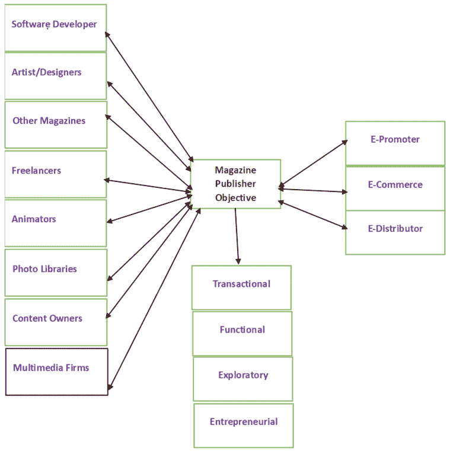

根据 Hall, 2020 的改编，双向箭头代表双向协作，而单向箭头指向出版商的协作目标。


本文采用了内容分析法进行数据收集和分析，这是一种系统性描述书面、口头和视觉传活动的技术。它提供了通常来自报纸、书籍、杂志、电视、视频、网页和文档的定量和定性原始数据（Wimmer and Dominick, 2011）。

研究总体由万维网上所有可用的数字杂志网站组成，可以通过 Google、Yahoo、Bing 和 WebCrawler 访问。通过这些搜索引擎进行初步搜索，共产生了 838 个杂志网站。研究有针对性地选取了 40 个在线存在持续三年或以上、且具有 Alexa 排名或畅销榜排名的杂志网站进行数据收集。选定的杂志如表 1 所示：

#### 表 1.选定的杂志及其 Alexa 排名

| 序号 || 杂志名称 || Alexa 排名（类别） || Alexa 排名（全球） |
| --- | --- | --- | --- |
| 1 || Time || #75 || #3,376 |
| --- | --- | --- | --- |
| 2 || Esquire || #104 || #2,566 |
| 3 || GQ || #323 || #16,045 |
| 4 || Men’s journal || #206 || #8,926 |
| 5 || Golf Digest || #4 || #11696 |
| 6 || Men’shealth || #2 || #1790 |
| 7 || Prevention || NA || \# 17,775 |
| 8 || Salon || #48 || #8,694 |
| 9 || Bloomberg || #30 || #831 |
| 10 || Ebony || #2093 || #151,638 |
| 11 || People || #15 || #493 |
| 12 || National Geographic || #91 || #6500 |
| 13 || Vogue || #131 || #3950 |
| 14 || Tell || \# 4221 || #858,552 |
| 15 || Mechanics || #363 || #11136 |
| 16 || Maxim || #1359 || #48418 |
| 17 || Glamour || #253 || #10272 |
| 18 || Pitchfork || #26 || #5232 |
| 19 || Backpage Football || #299 || #1776436 |
| 20 || Playboy || NA || #49139 |
| 21 || Jezebel, || #78 || #15086 |
| 22 || Grist || #17 || #102799 |
| 23 || Wired || #71 || #31933 |
| 24 || Road and Track || #205\* || NA |
| 25 || Artist || #334 || #328371 |
| 26 || Good Housekeeping || #2 || #1352 |
| 27 || Kiplinger || NA || #23743 |
| 28 || OK Magazine || #129 || \# #34426 |
| 29 || Entrepreneur || #10 || #11472 |
| 30 || Chatelaine || #36 || #54821 |
| 31 || Soap Opera Digest || #2,424,735\* || NA |
| 32 || Cosmopolitan || #54 || #1183 |
| 33 || New Yorker || #96 || #4705 |
| 34 || FHM || #23 || #96368 |
| 35 || Harvard Art Museum || \# #3,732,302\* || NA |
| 36 || India Today || #18 || #1065 |
| 37 || Cereal || #6,762,622\* || NA |
| 38 || Colours || #39 || #953568 |
| 39 || The CEO Magazine || \# 1888 || #121043 |
| 40 || Findit.com || #26988 || NA |

\*畅销榜排名

在每个网站上，根据研究问题对可用数据进行了分类。使用了四位学者和三位出版者的德尔菲专家验证法来验证变量。程序分为三个阶段：第一阶段，告知参与者研究目的，并要求他们对展示的电子杂志营销和电子协作工具及策略简名单提出增加建议；或者建议任何不相关的条目。第二阶段，将所有建议提供给每位参与者进行讨论。第三阶段，由研究人员对建议进行协调，并就此类决策给出的理由。总的来说，参与者验证了初始变量，并建议了七个额外变量（组合定价、魅力定价、网站免费促销赠品、免费样品、在线易物、电子订阅和同步分发）。参与者还提出的建议确保了电子促销、电子分发和电子商务下的类别是互斥的。该程序持续了四周。

### 分析单位与内容类别

首页及相邻页面上的文本和插图成了分析单位（Wimmer and Dominick, 2011）。对于内容分类和界定，电子营销内容被操作化为电子促销、电子定价、电子分发和电子商务内容；而电子协作被操作化为协作博客、维基、门户、组软件、日历共享、讨论板、文档同步、云存储、视频会议、白板和即时消息、异步协作、分布式劳动力、用于协作的 AI 和机器学习、VR 和 AR 的采用、小组室、企业社交网络、智能会议室。详情列于表 2 和表 3：

#### 表 2. 电子营销类别

| 序号 || 电子促销类别 || 电子定价类别 || 电子分发类别 || 电子商务类别 |
| --- | --- | --- | --- | --- |
| 1 | 其他网站上的广告 | 成本加定价 | 按需打印 | 在线商店 |
| 2 | 推广博客 | 目标回报定价 | 电子订阅 | 在线支付 |
| 3 | 搜索引擎优化 | 价值定价 | 数字下载 | 在线显示 |
| 4 | 推广杂志网站 | 客户生成 | 多渠道分发 | 在线购物 |
| 5 | 电子邮件促销 | 消费者导向定价 | 移动应用 | 在线订单 |
| 6 | 社交媒体营销 | 魅力定价 | 同步分发 | 在线协作 |
| 7 | 免费赠品 | 理性定价 | 社交媒体 | 在线购物车 |
| 8 | 其他网站上的链接 | 组合定价 | 在线易物 | |
| 9 | 社交媒体营销 | 情感定价 | 小部件和 get 设备 | |
| 10 | 电子杂志 | | | |
| 11 | 免费样品 | | | |

电子协作的快速创新产生了许多电子协作碎片。在这项研究中，电子协作内容被归为 19 类。详情列于表 3：

#### 表 3. 电子协作类别

| 序号 || 电子协作 | 序号 || 电子协作 |
| --- | --- | --- | --- |
| 1 | 博客 | 11 | 文档同步 |
| 2 | 维基 | 12 | 云存储 |
| 3 | 门户 | 13 | 视频会议 |
| 4 | 组软件 | 14 | 白板 |
| 5 | 日历共享 | 15 | 即时消息 |
| 6 | 讨论板 | 16 | 文件共享工具 |
| 7 | 异步协作 | 17 | 小组室 |
| 8 | 分布式劳动力 | 18 | 企业社交网络 |
| 9 | 用于协作的 AI 和机器学习 | 19 | 智能会议室 |
| 10 | VR 和 AR 的采用 | | |

数据收集工具是一个三列五十行的编码表。第一列显示内容类别，第二列和第三列用于可用性和不可用性值。五十行对应表 2 和表 3 所示的 50 个内容类别。文本内容被赋值，以便研究人员将信息进行定量分类。


两名研究人员独立对内容进行了编码，并按照 Bernard and Ryan (2010) 的建议使用 Holsti 公式计算了编码者间信度。信度系数介于 .857 至 .921 之间。所收集的数据根据研究问题进行了分类和制表。计算了总数并得出了相应的百分比。结果在“数据展示与分析”章节中。

### 数据展示与分析

对这些网站进行了分析，以寻找电子营销和电子协作策略。结果从电子营销趋势开始，涵盖了电子促销、电子定价、电子分发和电子商务。电子促销的结果显示，搜索引擎优化 (SEO) 和社交媒体推广是采用常用的电子促销策略（占比各均为 100%），其次是博客的使用（77.5%）和推送通知（55%）。其他每种策略在采样网站中的采用率均低于 50%。详情见表 4：

## 表 4. 电子促销趋势

| 序号 | 电子促销策略 || 频率 || 百比 |
| --- | --- | --- | --- |
| 1 | 在其他网站上广告 | 17 | 42.5 |
| 2 | 博客 | 31 | 77.5 |
| 3 | Google 趋势推广 | 15 | 37.5 |
| 4 | 搜索引擎优化 | 40 | 100 |
| 5 | 推送通知/发布提醒推广 | 22 | 55 |
| 6 | 线下推广网站 | 9 | 22.5 |
| 7 | 站内赠 | 12 | 30 |
| 8 | 邮件促销 | 16 | 40 |
| 9 | 指向其他网站的超链接 | 14 | 35 |
| 10 | 社交媒体推广 | 40 | 100 |
| | 总计 | 40 | |

结果显示，基于价值的定价、竞争定价和成本加成定价分别在超过 87%、67% 和 65% 的网站中呈现趋势。魅力定价和面向消费者的定价在网站上最不明显。详情见表 5：

## 表 5. 电子定价趋势

| 序号 | 电子定价策略 || 频率 || 百比 |
| --- | --- | --- | --- |
| 1 | 成本加定价 | 25 | 62.5 |
| 2 | 目标收益定价 | 14 | 35 |
| 3 | 基于价值的定价 | 35 | 87.5 |
| 4 | 竞争定价 | 27 | 67.5 |
| 5 | 线索生成模型 | 12 | 30 |
| 6 | 基于成本的定价 | 5 | 12.5 |
| 7 | 面向消费者的定价 | 6 | 15 |
| 8 | 魅力定价 | 3 | 7.5 |
| 9 | 理性/情感定价 | 13 | 32.5 |
| 10 | 捆绑定价 | 10 | 25 |
| | 总计 | 40 | |

网站即时下载、电子订阅和多网络渠道分发的指标在所有网站上均明显，而通过移动应用程序分发在 92.5% 的网站上明显，社交媒体上的内容共享在 85.5% 的网站上明显。详情见表 6：

## 表 6. 电子分发趋势

| 序号 | 电子分发策略 || 频率 || 百比 |
| --- | --- | --- | --- |
| 1 | 按需打印 | 4 | 10 |
| 2 | 电子订阅 | 40 | 100 |
| 3 | 网站即时下载 | 40 | 100 |
| 4 | 多网络渠道分发 | 40 | 100 |
| 5 | 许可分发 | 9 | 22.5 |
| 6 | 数字杂志租赁 | 12 | 30 |
| 7 | 聚合分发 | 13 | 32.5 |
| 8 | 社交媒体上的内容共享 | 35 | 87.5 |
| 9 | 移动应用程序分发 | 37 | 92.5 |
| | 总计 | 40 | |

电子商务下的几乎所有内容类别在观察到的网站上都呈现趋势，但在线物物交换（仅在 10% 的网站上明显）和在线电子商务（在 37% 的网站上明显）除外。详情见表 7：

#### 表 7. 电子商务趋势

| 序号 | 电子商务策略 || 频率 || 百比 |
| --- | --- | --- | --- |
| 1 | 在线展示 | 40 | 100 |
| 2 | 在线支付 | 40 | 100 |
| 3 | 在线商店 | 40 | 100 |
| 4 | 在线交换 | 4 | 10 |
| 5 | 购物车 | 40 | 100 |
| 6 | 在线协作 | 15 | 37.5 |
| 7 | 在线下单 | 40 | 100 |
| | 总计 | 40 | |

发现显示，博客的使用、即时消息和文件共享在出版者中呈现趋势，而云存储和协作软件居后。详情见表 8：

#### 表 8. 协作趋势

| 序号 | 协作策略 || 频率 || 百比 |
| --- | --- | --- | --- |
| 1 | 博客 | 36 | 90 |
| 2 | Wik 基 | 31 | 77.5 |
| 3 | 门户 | 16 | 40 |
| 4 | 协作软件 | 12 | 30 |
| 5 | 日历共享 | 12 | 30 |
| 6 | 讨论 | 13 | 32.5 |
| 7 | 文档同步 | 32 | 80 |
| 8 | 云存储 | 10 | 25 |
| 9 | 白板 | 29 | 72.5 |
| 10 | 即时消息 | 14 | 35 |
| 11 | 文件共享 | 34 | 85 |
| 12 | 异步协作 | 12 | 30 |
| 13 | AI 与机器学习协作 | 12 | 30 |
| 14 | VR 和 AR 采用 | 13 | 32.5 |
| 15 | 智能会议 | 32 | 80 |
| 16 | 企业社交网络 | 10 | 25 |
| 17 | 分布式工作流 | 29 | 72.5 |
| 18 | 会议室 | 14 | 35 |
| | 总计 | |

### 结果讨论

搜索引擎优化、博客的使用、社交媒体推广和推送通知是最常用的电子促销策略，这一发现支持了出版者不断提高其出版物可见性的倾向。这与之前的研究一致，即搜索引擎优化可以帮助组织更有利地竞争、提高搜索引擎排名并增加网站访问者的满意度 (Berman and Katona, 2013)。它还支持搜索引擎优化能增加网站流量 (Jakub, 2015) 的研究证据。这一发现也与以下研究一致：城市杂志通过社交媒体与读者接触并产生了实际影响 (Sivek, 2013)。

结果显示，基于价值的定价、竞争定价和成本加成定价在大多数网站中呈现趋势，而魅力定价和面向消费者的定价在网站上最不明显。这些发现似乎支持了之前的结论，即电子定价与在线购买以及电子定价与更高的购买率之间存在关联 (Joshi, 2017)。因此，更多的出版者采用了那些能提供竞争优势的定价策略，例如竞争定价。尽管一项研究 (Maass and Schefer, 2004) 曾指出，在不采取价格差异的情况下以高于边际成本的价格销售信息产品的一种可能策略是捆绑信息产品，但本研究相反显示，信息捆绑仅出现在约 25% 的网站中，这意味着其在杂志出版者中的流行可能正在下降。


所有网站均显示出网站即时下载、电子订阅和多网络渠道分发的特征，而通过移动应用程序进行分发在 92.5% 的网站上十分明显，社交媒体上的内容分享则在 85.5% 的网站上明显。这些策略针对不同的细分市场，并表明这些分发策略正在杂志出版商之间流行趋势，可能是因为出版商通常关注的是实现其品牌的长尾效应。一种电子杂志似乎在其网站上强调社交媒体分发和电子邮件的是 FIDO-Friendly，这是一本宠物市场杂志，其声称定期发行量为 160,000。

在大多数观察到的网站上都有电子商务趋势的迹象。这对于电子杂志来说是意料之中的，因为吸引和留住读者的支持至关重要，而且在很大程度上取决于它们的网站。然而，在线易物仅在 10% 的网站上明显，这与该策略在其他类型产品营销中同样不受欢迎是一致的。值得注意的是，Krishen, Kachen and Haniff (2014) 描述为杂志网站上常见的寻价和比较性购物等活动，在这些网站上并未出现。

对于电子协作，博客、即时消息、文件共享和文档同步以及视频会议的使用正按上述顺序呈现趋势。这一发现与之前的研究一致，根据 Gensler 美国职场调查，43% 的员工希望拥有促进协作的工作场所；而 Capital One 的一项类似研究表明，超过 75% 的员工在协作工作环境中表现更好（Financeonline.com, 2022)）。在考虑到 COVID-19 大疫情带来的所有负面影响，这一趋势可能会持续，特别是那些让人们能够在不同地点工作的协作策略。然而，品牌竞争一直是跨组织电子协作的一大大障碍。

#### 建议

1.  自 2020 年 COVID-19 封锁以来，在线和从远程地点工作已成为一种趋势。这意味着，利用电子营销和电子协作创新的杂志一方面可能希望节省办公室租赁成本。另一方面，杂志记者和编辑现在有机会通过协作工具，从同一个远程地点为几份出版物工作，从而赚取额外收入。

2.  电子协作可以带来巨大的成本优势。因此，出版商应该努力增加合作，减少竞争。内容方面专业化和品牌差异化的增加注定会减少竞争性活动，从而为杂志出版商之间更多的协作活动铺平道路。

#### 未来研究方向

关于协作出版的研究寥寥无几。因此，现在是研究如何通过成本效益的方法利用协作电子营销，使经营困境的杂志更有盈利且可持续的良好时期。此外，还需要更多的研究以深入理解电子订阅和电子分发的动态。

### 结论

超过二十种电子营销和电子协作策略正在在线流行，毫无疑问，电子杂志营销策略正在不断演变。因此，今天的策略在未来可能不再流行，但目前的趋势指向了一个事实：电子杂志将在新兴和增长的数字环境中占有一席之地。随着数字出版标志的碎片化不断演变，电子促销、电子定价、电子分发和电子商务将通过电子协作而非竞争获得更好的发展。

### 参考文献

Abukhzam, M., & Lee, A. (2010). Workforce attitude on technology adoption and Diffusion, The Built & Human. Environmental Reviews, 3, 60–72. [`https://www.semanticscholar.org/paper/`](https://www.semanticscholar.org/paper/)

Al-Ghaith, W., Sanzogni, L., & Sandhu, K. (2010). Factors influencing the adoption and usage of online services in Saudi Arabia. The Electric Journal on Information Systems in Developing Countries, 40. [`https://citeseerx.ist.psu.edu/viewdoc/download`](https://citeseerx.ist.psu.edu/viewdoc/download)?

Baradell, S. (2018) Understanding the long tail theory in media, marketing and E-commerce. Idea Grove.[[`https://www.ideagrove.com/blog/understanding-the-long-tail-theory-of-media-fragmentation``](https://www.ideagrove.com/blog/understanding-the-long-tail-theory-of-media-fragmentation)

Berman, R., & Katona, Z. (2013). The Role of Search Engine Optimization in Search Marketing. Marketing Science, 32(4), 644–651. Advance online publication. [`10.1287/mksc.2013.0783`](http://dx.doi.org/10.1287/mksc.2013.0783)

Bernard, H. R., & Ryan, G. W. (2010). Analyzing qualitative data: Systematic approaches. Sage Publications.

Brynjolfsson, E., Yu, J. H., & Simester, D. (2011). Goodbye Pareto Principle, Hello Long Tail: The Effect of Search Costs on the Concentration of Product Sales. Management Science, 57(8), 1373–1386. Advance online publication. [`10.1287/mnsc.1110.1371`](http://dx.doi.org/10.1287/mnsc.1110.1371)

Chen, Y., & Xie, J. (2008). Online consumer review: Word-of-mouth as a new element of marketing mix. Management Science, 54(3), 477–491. [`10.1287/mnsc.1070.0810`](http://dx.doi.org/10.1287/mnsc.1070.0810)

Coburn, E. (2015) The 7 Types of Digital Magazines,Linkedin, [`https://www.linkedin.com/pulse/7-types-digital-magazines-ed-coburn``](https://www.linkedin.com/pulse/7-types-digital-magazines-ed-coburn)

Drake, M. G. (2015) Past drive subscribers’ attitudes and usage behaviors in regard to the publication’s digital outlets: Thesis submitted to the Faculty of the Graduate College of Oklahoma State University in partial fulfillment of the Degree of Master of Science, [`https://shareok.org/handle/`](https://shareok.org/handle/)

Financeonline.com. (2022) 8 Future Collaboration Trends & Forecasts for 2022 – A Look into What’s Next, Financeonline.com, [`https://finonline.com/collaboration-trends/`](https://finonline.com/collaboration-trends/)

Foleon.com. (2022) How to start your own magazine in 2022, Foleon.com, [`https://www.foleon.com/topics/how-to-start-your-own-online-magazine-from-scratch`](https://www.foleon.com/topics/how-to-start-your-own-online-magazine-from-scratch)


信息资源管理协会. (2018) 电子规划与协作：概念、方法论、工具与应用（3 卷）。[`www.igi\-global.com/book/collaborative\-distributed\-research/58272`](https://www.igi-global.com/book/collaborative-distributed-research/58272)[](http://dx.doi.org/10.4018/978-1-5225-5646-6)

Jakub, Z. (2015) 搜索引擎优化，CBU 国际会议论文集, 3。[10.12955/cbup.v3.645](http://dx.doi.org/10.12955/cbup.v3.645)

Joshi, M. (2017) 普浦市成人在线购买行为研究，SIES 管理杂志, 13(1), 29-37。[`web.s.ebscohost.com/abstract`](https://web.s.ebscohost.com/abstract)

Juan, A. A. (2012) 协作与分布式电子研究：技术、策略与应用的创新。[`www.igi\-global.com/book/collaborative\-distributed\-research/58272`](https://www.igi-global.com/book/collaborative-distributed-research/58272)[](http://dx.doi.org/10.4018/978-1-4666-0125-3)

Krishen, A., Kachen, S., & Haniff, Z. (2014) 我们被困在印刷时代了吗？探索消费者对数字杂志与纸质杂志的感知，营销科学进展：营销科学学会论文丛书 (DMSPAMS) [`link.springer.com/chapter/10.1007/978\-3\-319\-10951\-0\_102`](https://link.springer.com/chapter/10.1007/978-3-319-10951-0_102)

Magplus (2019) 出版数字杂志的十大益处，[`www.magplus.com/blog/ten\-benefits\-of\-publishing\-digital\-magazines/`](https://www.magplus.com/blog/ten-benefits-of-publishing-digital-magazines/)

Malik, A. (2021) Instagram 为创作者推出用于与品牌合作与伙伴的新工具。[`techcrunch.com/2021/10/22/`](https://techcrunch.com/2021/10/22/)

McCormick, M. (2017) 电电子商务：如何为你的产品有效定价，BlackCurve,[`blog.blackcurve.com/ecommerce\-how\-to\-effectively\-price\-your\-products`](https://blog.blackcurve.com/ecommerce-how-to-effectively-price-your-products)

Michael, G. (2014), 你应该了解的 4 个重要数字营销渠道，来自 [`www.digitaldoughnut.com/articles/2014/november/important\-digital\-marketing\-channels\-you\-should/`](https://www.digitaldoughnut.com/articles/2014/november/important-digital-marketing-channels-you-should/)

Neves de Carvalho, T. (2014) 消息设计与内容对电子邮件营销效果的影响：为特特拉-里斯本商学院与经济学院硕士学位而提交的毕业论文，[`repositorio.ucp.pt/bitstream/10400.14/18224/Thesis%20Teresa%20Carvalho.pdf`](https://repositorio.ucp.pt/bitstream/10400.14/18224/Thesis%20Teresa%20Carvalho.pdf)

O’Leary, B. (2014). 协作的架构。《出版季报》， 30(3)。[www.researchgate.net]

Quinn, A. (2016) 英国杂志设计史，[`www.amazon.com/History\-Magazine\-Design/dp/18517785`](https://www.amazon.com/History-Magazine-Design/dp/18517785)

Renee, K. (2018) 如何在 15 步内在线创杂志，Lucidpress.com,[`www.lucidpress.com/blog/how\-to\-start\-magazine\-online`](https://www.lucidpress.com/blog/how-to-start-magazine-online)

Rowland, B. (2013) 杂志从纸质到数字的衰落与兴起，《卫报》，[`www.theguardian.com/media\-network/media\-blog/2013/mar/07/fall\-magazines\-print\-digital`](https://www.theguardian.com/media-network/media-blog/2013/mar/07/fall-magazines-print-digital)

Santos-Silva, D. (2012) 数字杂志出版的未来，发表于第 16 届电子出版国际会议 – ELPUB 2012 – 数字出版的社会塑造：探索数字出版的相互作用。

Shorand. (2022) 制作数字杂志的终极指南，Shorthand。[`shorthand.com/craft/how-make-a`](https://shorthand.com/craft/how-make-a)

Sivek, A. (2013) 社交媒体与付费内容，《智能媒体杂志》， 14(2)。在线出版。[`muse.jhu.edu/article/77358`](https://muse.jhu.edu/article/77358)

Stahl. (2014) 报纸和杂志网站内容的捆绑与拆分策略，《国际科学杂志》，第 8 卷。[`dx.doi.org/10.4018/978-1-798-64://....org/1..0011/98818-1-89-4)

Strauss, J., Frost, R., & Sinha, N. (2014) 电子营销，新泽西州上德河：培生。[https://www.scirp.org/`](https://www.scirp.org/)

Sujlana, A. (2018) 创建数字杂志的 10 个理由，[`www.clavistechn.com/blog/`](https://www.clavistechn.com/blog/)

尼尔森公司 (2010) 改变模式：在线付费内容的全球视角。[`blog.nielsen.com/nielsenwire/`](http://blog.nielsen.com/nielsenwire/)

Tingson, A. (2015) 你在 2015 年应该关注的 7 个内容营销趋势，[`www.linkedin.com/pulse/7\-content\-marketing\-trends\-you\-need\-focus\-2015\-arlene\-tingson\-mba?trk\=article\_title`](https://www.linkedin.com/pulse/7-content-marketing-trends-you-need-focus-2015-arlene-tingson-mba?trk=article_title)

Wimmer, R., & Dominick, T. (2011). 大众媒体研究：导论。威斯沃斯出版社。

Zhao, J., & Kumar, V. (2022) 全球危机期间的协作系统。[www.researchgate.net](http://dx.doi.org/10.4018/978-1-798-9640)

Zhao, J., & Richards, J. (2021) 挑战时期竞争优势的协作技术与策略。[www.researchgate.net](http://dx.doi.org/10.4018/978-1-798-7764-6)

### 延伸阅读

第 6 章

# 用于智能医疗的 6G：潜在影响与挑战

### 摘要
Amandeep Dhaliwal

印度，曼纳夫·拉奇纳国际研究学院


即将到来的第六代（6G）网络愿景是提供超低延迟、高带宽和改进的服务质量，旨在促进网络节点之间的有效通信。将这种尖端技术到医疗设施中，可以支持智能诊断、以患者为中心的治疗以及涵盖医院内部和远程的各种医疗服务。因此，不断扩展的医疗领域（越来越多的应用程序被集成到网络中）产生了在形状和大小上多样化的数据，这将促进增强的个性化和远程医疗服务。因此，未来智能医疗的轨迹涉及 `6G` 的协同整合，以解决与蜂窝覆盖、网络性能和安全担忧相关的现有限制。本章旨在阐明与这一不断发展的未来主义医疗格局相关的特征、前景、挑战和未来方向。

### I. 引言

尽管近期取得了技术进步，但灾害管理仍面临持续挑战，特别是当它们直接威胁人类健康时，最近的 COVID-19 大流行病就是一个例子。由于准备不足，医疗机构难以应对患者人数的激增，导致在宣布疫情后，全球范围内基本医疗服务匮乏。COVID-19 危机强调了患者数量不断增加、医疗服务不足、感染预防失败以及响应延迟共同导致了医疗系统的崩溃。即使在最发达国家，致力于为员工和患者提供快速安全医疗服务的医疗基础设施，在缓解影响方面也曾挣扎。

此外，COVID-19 大流行说明了远程医疗的优势，降低了与访问医院相关的病毒传播风险，并促进了合格专家的治疗交付。即将进入一个以智能和互联的智能医疗为特征的时代是显而易见的，传感器外部或内部附着在人体上。智能医疗意味着通过智能设备（如智能手机、智能手表、无线智能血糖仪和无线血压计）提供医疗服务，并如体域网（Chaudhary et al., 2022）。

这些智能设备处理来自传感器、人体植入物生物医学系统的各种来源的健康信息。本质上说，智能医疗方便各种背景（包括医疗专业人员、患者、护理人员和家庭成员）获取相关信息和最佳解决方案，最终目标是尽可能减少医疗错误并降低成本。连接医疗应用程序和设备的扩散预计将产生各种规模和格式的数据，可能增强人类福祉，在应对未来流行病和疾病中发挥关键作用，并促进早期诊断。

然而，在医院中支持如此大量的医疗设备和基于传感器的应用程序需要实施可靠且可扩展的通信网络基础设施。该网络必须满足对带宽、数据速率、延迟和其他参数的严格要求。此外，远程手术和触觉互联网等新兴用例预计将增加对超可靠低延迟通信的需求。

未来的 `6G` 接入物联网（`IoT`）网络愿景是通过提供超低延迟、高吞吐量、超高可靠性、高密度和高效率来服务智能医疗应用。开发 `6G` 网络、服务要求的初步工作已经在进行。在 `5G` 技术标准化的过程中，研究了三个主要领域：海量机器类通信（`mMTC`）、改进的移动宽带、超可靠低延迟通信（`URLLC`）和增强移动宽带（`eMBB`）（Mughees et al., n.d. | 高达 500 km h^(−1) |
| 谱效率 | 100 bps Hz^(−1) | 30 bps Hz^(−1) |
| 频率 | 1000GHz (1 THz) | 3–300 GHz |
| 端到端延迟 | < 1 ms | 1– 5 ms |
| 峰值数据速率 | 1 Tbps | 20 Gbps |
| 医疗应用 | 连接机器人和自主系统、远程手术、脑机接口、智能可穿戴设备、医院到家庭（H[2]H）服务 | 无人机、虚拟现实（VR）、增强现实（AR） |
| 赋能技术 | 区块链、机器学习和深度神经网络、反射式智能表面、边缘智能、可见光通信和无小区智能表面 | 毫米波、NOMA、雾计算、边缘计算、软件定义网络、网络函数虚拟化、密集网络 |

`6G` 网络预计将在 `5G` 设定的轨迹基础上建立，扩展范围和能力，重点关注海量 `URLLC`、连接性和智能设备的覆盖（Wang et al., 2022）。`6G` 对 `IoT` 的独特需求将提供一个新层次的网络服务。

1. `1.` 促进高达 `1 Gb s−1/m2` 的移动流量，以满足特定区域内卓越数据速率和广泛设备密度的严苛要求。
2. `2.` 实现极低的网络延迟（`10–100 μs`）对于满足触觉应用的需求至关重要，特别是在电子健康和远程手术等领域。
3. `3.` 提供极高的数据速率，高达 `1 Tb/s`，以适应数据密集型应用，包括但不限于超高清视频以及增强/虚拟现实（AR/VR）相关的应用程序。
4. `4.` 实现极高的设备连接密度 `107 devices/km2`，这一参数对于促进实现极密集的物联网（`IoT`）网络具有重要作用。

### II. 6G 在医疗保健中的作用

未来的 `6G` 物联网（`IoT`）网络架构愿景是一个全面且统一的网络，促进跨各种通信模式（包括地面、卫星、短距离设备对等）更广泛、更多样化的访问。`6G` 技术的采用在生物医学和医疗工程领域取得了显著进展。这项技术被视为一种变革力量，预计将重塑该领域，从远程活动监控到以最优效率执行远程机器人手术。


智能技术在促进实时决策过程方面发挥着至关重要的作用。在 6G 网络框架内，网络、数据处理、资源管理和基于服务的通信等操作由人工智能（AI）紧密驱动，能够在各种环境中实现定制化功能，用以增强服务提供（Nguyen et al., 2022; Nova et al., 2021)）。医疗领域技术进步与不断增长的数据需求的交汇促成了 6G 的基础支撑。这一代有望利用现行的技术趋势和新兴需求，从而促进医疗领域无线通信生态系统的演进与建立。

6G 机器人的应用是进行远程手术的创新手段，使远程医生能够通过毫秒级延迟和高可靠性的机器人设备管理手术（Nayak & Patgiri, 2021).由 6G 支撑的智能网络预计将大幅增强医疗服务以及环境辅助生活（AAL）等技术，特别是在监测老年人和提供及时治疗方面（Srinivasu et al., 2022)）。医疗应用的范围已经扩展，不再局限于服务患者或病患；它现在涵盖了旨在提高个人整体生活水平的服务（Hakeem & Hussein, 2022)）。显著的服务包括急救服务、智能可穿戴设备（IWD）、医院到家服务、远程药服务、医生执行的手术、保险服务和救护车服务。

IWD 作为一项特色服务，通过提供心率、健康指标、血检结果、血压、体重和饮食摄入等关键信息，将使患者显著受益。因此，IWD 预计将提高患者的便利性，减少就医频率，并实现长时间的居家停留（Noor-A-Rahim et al., 2022)。6G 技术格局中医疗应用的整合如图图 1 所示。

此外，无线体域网（WBANs）有助于提升设备性能（Mucchi et al., 2020)）。WBAN 被要求延长网络寿命，确保以公认的可靠性交付应急数据，以增强整体性能（Saeidi et al., 2020)。此外，远程机器人手术等服务需要极低的延迟（< 1 ms）（Khan et al., 2019)），这强调了网络在数据交换、数据准确性以及远程健康中心信息共享快速传输率方面极高可靠性的要求。

医疗网络的本质应该超越传统无线网络的特性，以满足服务质量（QoS）的迫切需求。这要求一个具有移动性、大量合规支持、极低延迟（< 1 ms）、保障患者安全的环保可持续通信以及持续连接的框架。技术可能性，如医疗物联网（Kumar et al., 2022)和用于人体级通信的纳米物联网（Sahin et al., 2021)，在战略上被考虑用于满足以患者为中心的服务。

考虑到这些严苛的要求，6G 成为托管医疗网络的最合适选择，有望引领医疗行业的变革性变化。作为一种强有力的竞争者，6G 预计将在可靠性、移动性、容量和安全性方面提供核心支持（Hussein & Abd El-Kader, 2017)。

为了满足严苛的要求，6G 预计将在更高的频率运行，包括可见光、太赫兹和毫米波（Chen et al., 2022)），如图图 1 所示。

#### 图 1. 用于未来智慧医疗的 6G 支持物联网（来源：Ahad & Tahir, 2023）

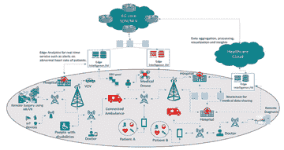

预测的 6G 框架有望通过万物连接（IoE）产生大量数据来支持无处不在的智能移动社会。这些数据将与人工智能（AI）、区块链、云/边缘/雾计算以及反射智能表面（RIS）等尖端技术无缝集成。

受益于 6G 高吞吐能力的一个显著应用是全息通信，类似于 5G 背景下虚拟和增强现实（AR/VR）扮演的角色。在医疗领域，6G 的实施预计将通过促进涵盖音频、视觉、体感和触觉模式的额外感官信息通信，增强虚拟和增强现实体验（Katz & Ahmed, 2020)）。这种增强将实现实时交互以及虚拟和实体物体三维图像的精确呈现（Strinati et al., 2019)）。因此，远程医疗检查（特别是针对特定部位）将得到显著改善，提供更高的可见性，并在高风险复杂手术案例中证明其宝贵价值。智能医疗物联网（IIoMT）的出现预计有助于优化手术，最终减少相关风险（Akhtar et al., 2020)。

为了在远程地点提供医疗援助，智能医疗物联网（IIoMT）有望整合全息和触觉通信，以及增强和虚拟现实技术。这种战略整合旨在使远程医生能够更高效地进行协作医疗。


无人机（UAVs）正成为应对医疗响应率延迟的解决方案，特别是在紧急情景下。这些无人机擅长从位于不同地理区域的医疗设施快速运送关键医疗物资，例如手术器械和药物（Ahad et al., 2020）。这缓解了道路交通延迟的影响，并确保了援助的及时性。值得注意的是，植入物和人体传感器对于实现具有与伦比的可靠性和可用性的实时通信和数据传输至关重要。此类数据随后被传输到边缘设备或云中心，以进行全面的中长期医疗分析（Gupta et al., 2021）。

将支持 `6G` 的物联网（`IoT`）网络集成到救护车系统中建立了一种全新的范式。在 `6G-IoT` 范围内运行的联网救护车具有以相当速度流传输实时视频的能力。这种创新方法确保了与位于医院的医生和护理人员之间的无缝通信，从而促进了及时的医疗支持和干预。其最终目标是优化响应时间，并保护并改善患者的预后。

### III. 6G 与医疗保健：挑战

为了确保未来医疗保健的成功，在支持 `6G` 的物联网（`IoT`）网络框架内必须解决若干严峻的挑战。显著的障碍包括海量数据集的管理、电源供应问题、物联网（`IoT`）设备的局限性以及硬件开发的各个方面。

#### 安全与隐私
随着医疗保健设备集成到支持 `6G` 的 `IoT` 网络，人们最关注的问题之一就是安全和隐私问题。支持 `6g` 的网络使这些医疗设备暴露在无线接口攻击之下，包括未经授权的数据访问、完整性风险，以及针对医疗应用和数据中心的拒绝服务（`DoS`）事件。其他网络考虑因素还包括信息处理、威胁情报与识别、网络监控、流量分析以及数据加密策略的制定。随着设备连接数量的增加，对安全和隐私风险的敏感性也随之增加。

数据通信和管理中心特别容易受到各种攻击，如 `DoS`、劫持、欺骗和窃听，因此需要稳健的风险缓解措施以维护 `6G-IoT` 的高安全和隐私标准。为了保护敏感医疗数据的机性和完整性，实施区块链、分布式账本技术和量子安全能力至关重要。量子机器学习算法具有增强网络隐私和安全的潜力，最近的研究证明了这一点（Kumar et al., 2022）。由于 `IoT` 网络的去中心化和分布式特性，区块链范式成为 `6G` 时代的重要解决方案，与区块链的去中心化属性无缝结合，同时提供匿名性和完整性等安全特性（McGhin et al., 2019）。

#### 网络延迟问题
对于医疗领域内设备和传感器的有效运行，最小化计算延迟至关重要。网络组件与智能医疗设备之间的协作在远程手术、机器人辅助用药和环境辅助环境等应用中尤为关键。`6G` 技术的愿景是与前代相比提供超低延迟，从而增强网络高效及时管理和响应外部刺激的能力（Alfian et al., 2018）。

#### 低功耗与低成本通信
解决低功耗和低成本通信的挑战对于智能医疗领域中连接的 `IoT` 设备至关重要。持续电源需求是一个巨大挑战。为了克服这些问题，需要高效的算法，微电子学、无线通信和能量采集是可行途径。例如，嵌入体内的传感器可以利用 `Bluetooth` 收集太阳能（Wu et al., 2018](#979-8-3693-0683-3.ch006.bits-pdf.xhtml#_idTextAnchor379)）。此外，像 `MXenes` 这样的创新材料可以通过检测多样的生物标志物/病原体来彻底改变植入物（Bhansali et al., 2022](#979-8-3693-0683-3.ch006.bits-pdf.xhtml#_idTextAnchor349)）。

#### 网络带宽问题
依赖无线技术的设备不断增加，强调了为了实现持续通信所需的持续带宽。其目标是通过集成智能和边缘技术，在 `6G` 范式内增强智能医疗应用。这种集成旨在通过配备智能信道分配和更宽带宽的异构网络高效利用，以满足各种服务（Sarieddeen et al., 2020](#979-8-3693-0683-3.ch006.bits-pdf.xhtml#_idTextAnchor375)）。

#### IoT 设备的资源限制
设备的限制是边缘智能和极可靠低延迟通信（`URLLC`）数据传输关注的问题。可穿戴传感器、智能医疗设备和移动设备需要执行人工智能（`AI`）任务的能力。某些 `IoT` 传感器和植入物由于硬件、内存和电源资源的限制，在满足计算需求方面面临挑战。因此，基于硬件的纳米 `IoT` 设备 `AI` 解决方案和集成可穿戴设备对于智能 `6G` `IoT` 网络的演进至关重要（Fafoutis et al., 2018](#979-8-3693-0683-3.ch006.bits-pdf.xhtml#_idTextAnchor353)）。

#### 网络开放性
网络设备应实现不同终端系统的互操作性和分布式网络段的可变调度。在 `6G` 背景下，将重点关注服务驱动的异构网络管理，为网络运营商和专业行业提供快速部署新服务的能力。连接接口的开放性被增强多个网络设备之间的无缝连接和互操作性。这对于基础设施设施的整合和移动网络生态系统的演进至关重要，现有文献强调了这一点（Zhou et al., 2020](#979-8-3693-0683-3.ch006.bits-pdf.xhtml#_idTextAnchor381)）。


医疗数据分析面临另一项挑战，因为智慧医疗拥有数以亿计的连接设备，产生了大量需要分析的数据。这些数据可能包含有关个人用户的私有信息（例如患者数据）以及有关本地环境的信息（例如心电图、心率监测）。为了解决这个问题，智能算法和程序至关重要，它们可以在保护用户隐私和机密性的同时，为各种用例获取价值的见解。例如，联邦学习算法可以有效分析由本地连接设备产生的数据(Rieke, n.d.）。

## 细胞覆盖
由于各种考虑，在医疗系统的各种场景中，对不间断覆盖和连接的需求是至关重要的。医院复杂的空间配置，加上附加设备的存在，对网络覆盖了限制。在应对这一挑战时，空中网络，特别是无人机（UAVs）、高空平台（HAPs）和卫星，已成为扩展覆盖范围的极具前景的途径。这些网络具有作为基站或中继收发机来增强覆盖的潜力，正如相关文献所述(Janjua et al., 2020)。

## THz 通信的估计与信道建模
太赫（THz）通信的估计和信道建模是一个关键方面，需要为 THz 范围内的有效无线通信系统开发可靠的信道模型。模拟 THz 信道需要考虑许多因素，如超大规模天线阵列上的空间非平稳性、近场效应、耦合效应以及由于氧气和水蒸分子吸收损引起的高度频率选择性路径损耗。因此，对于具有大天线阵列的 THz 通信系统，需要最小计算资源的信道估计算法是非常理想的。

## 定位与精确定位
室内和室外定位对于应急情况下的快速响应至关重要，特别是在自然灾害背景下。虽然户外跟踪和定位通常由全球定位系统（GPS）解决，但其在复杂的电磁传播环境中效能会降低，使其在室内定位确定上变得不可靠(Säily et al., 2021)。当医院在危机后涌入大量时，这种限制变得尤为明显，加剧了寻找医生、医护人员和患者的挑战。这个问题涉及在 6G 架构上实现实时定位系统，提供实时协调和快速响应，特别是对于关键患者，正如相关文献所述(Mogyorósi et al., 2022)。

## 智能频谱共享
这是一个关键考虑因素，涉及 6G 支持的物联网网络中的设备到设备通信、带内全工通信、非正交多接入以及非授权空间内的频谱共享等技术。有效的干扰避免/缓解策略对于在 6G 应用中管理大量连接的同时增强系统性能至关重要。区块链技术和深度学习作为灵活频谱共享方法的潜在功效是一个极具吸引力的提议。因此，开发用于智能频谱共享的新框架和协议具有至关重要的意义。

## 数据所有权与伦理关注
由于医疗数据的敏感性和个人性质，这些问题变得尤为突出。尽管智慧医疗设备可能提高生活质量，但对数据所有权的担忧仍然存在。例如，嵌入了传感器的数字药片可以通过网络界面为护理人员和临床医生提供有关药物依从性的信息。虽然这些工具帮助医疗专业人员评估治疗方案，但对于保险公司可能会根据患者依从数据进行监控并可能拒赔的担忧随之产生(Chowdhury et al., 2020)。在政策制定层面解决这些问题需要仔细考虑数据收集的类型和频率、用户知情同意，以及用户拒绝数据收集或禁止出售数据的机制。

## 边缘智能与雾网计算
在医疗领域，有关利益相关者（包括患者和医生）的相关信息远程存储在云平台上。智能设备产生的数据随后被传输到云端进行存储，从而利用信道接入和带宽资源。即将推出的 6G 技术声称其具有巨大的容量，能够为无数智能设备提供无缝服务。值得注意的是，6G 依赖边缘技术为智能设备提供快速且不间断的互联网访问，这在医疗环境中被认为是至关重要的一个方面。在边缘技术领域，有关医疗的信息在其边缘节点内进行实时收集、计算和分析，正如现有文献所述(Mao et al., 2020)。

虽然 5G 的进化阶段和先进 5G 技术（如 5G+）在覆盖、设备移动性和设备智能等方面引入了显著增强，但挑战依然存在。这些挑战包括数据速率、延迟、频谱限制和带宽限制等因素，特别影响了医疗领域内时间敏感和资源感知的服务(You et al., 2020)。

### IV. 结论
未来的医疗网络有望通过全息通信等先进技术实现医疗专业人员之间的实时协作，促进远程手术，并分析来自智能物联网（IoT）设备的数据以增强诊断能力和患者护理。现有的通信技术在满足各种智慧医疗应用提出的复杂且动态的需求方面面临着挑战。


与此同时，`6G` 技术也表现出潜在的局限性，包括与网络相关的安全和隐私方面的担忧、网络建立和维护涉及的巨额成本，以及对个人可能产生的健康影响。预计 `6G` 技术的出现将与以往的技术迭代相比，会引入更具多样性的服务和应用需求。满足这些多样化的需求需要对技术框架有全面的理解和自适应能力。同样，用户体验的提升需要对端到端网络进行动态编排和配置，以满足按需、定制和个性化的服务。这种响应能力对于提供沉浸式和定制的用户体验至关重要。此外，通信、计算和感知能力的融合被认为是增强服务质量和促进多元化业务场景的关键因素。这种整合方法代表了对传统范式的突破，强调这些技术组件的协同利用。

`6G-IoT` 网络和应用处于发展的初期阶段，强调这是一个持续的过程。预计 `6G` 的到来将给现有的物联网基础设施带来革命性的变化，在未来的医疗健康应用中引入前所未有的服务质量、生活质量的提高以及增强的用户体验。本文探讨了 `6G` 时代物联网网络中的基础技术和领域，同时也勾勒了未来研究的潜在途径。

### 参考文献

Ahad, A., Tahir, M., Sheikh, M. A., Ahmed, K. I., Mughees, A., & Numani, A. (2020). 基于物联网的智能医疗 5G 网络技术趋势：综述。Sensors (Basel), 20(14), 4047. [10.3390/s20144047](http://dx.doi.org/10.3390/s20144047)[](http://dx.doi.org/32708139)

Akhtar, M. W., Hassan, S. A., Ghaffar, R., Jung, H., Garg, S., & Hossain, M. S. (2020). 转向 6G 通信：愿景与需求。Human\-centric Computing and Information Sciences., 10(1), 1. [10.1186/s13673-020-00258-2](http://dx.doi.org/10.1186/s13673-020-00258-2)

Alfian, G., Syafrudin, M., Ijaz, M. F., Syaekhoni, M. A., Fitriyani, N. L., & Rhee, J. (2018). 利用基于 BLE 的传感器和实时数据处理糖尿病患者个性化健康监测系统。Sensors (Basel), 18(7), 2183. [10.3390/s18072183](http://dx.doi.org/10.3390/s18072183)[](http://dx.doi.org/29986473)

Bhansali, S., Li, C.Z., & Kaushik, A. (2022). 基于 2D MXenes 的第五代智能生物传感器支持的芯片上医院。Biosens. Bioelectron., 220, 114847.

Chaudhary, V., Khanna, V., Awan, H. T. A., Singh, K., Khalid, M., & Mishra, Y. (2022). 基于 2D MXenes 的第五代智能生物传感器支持的芯片上医院。Biosensors & Bioelectronics.[36335709](http://dx.doi.org/36335709)

Chen, S., Liang, Y. C., Sun, S., Kang, S., Cheng, W., & Peng, M. (2022). 6g 的愿景、需求和技术趋势：如何应对系统覆盖、容量、用户数据速率和移动的挑战。IEEE Wireless Communications, 217.

Chowdhury, M. Z., Shahjalal, M., Ahmed, S., & Jang, Y. M. (2020). 6G 无线通信系统：应用、需求、技术、挑战和研究方向。IEEE Open Journal of the Communications Society, 1, 957–975. [10.1109/OJCOMS.2020.3010270](http://dx.doi.org/10.1109/OJCOMS.2020.3010270)

Fafoutis, X., Marchegiani, L., Elsts, A., Pope, J., Piechocki, R., & Craddock, I. (2018). 使用嵌入式机器学习延长可穿戴传感器的电池寿命。Proc. IEEE 4th World Forum Internet Things. [10.1109/WF\-IoT.2018.8355116](http://dx.doi.org/10.1109/WF-IoT.2018.8355116)

Gupta, A., Fernando, X., & Das, O. (2021). 6G 物联网网络中的可靠性和可用性建模技术：分类与综述。In2021 International Wireless Communications and Mobile Computing. IWCMC. [10.1109/IWCMC51323.2021.94928](http://dx.doi.org/10.1109/IWCMC51323.2021.94928)

Hakeem, A., & Hussein, H. (2022, June). Hyung, K.：6G 技术的愿景和研究方向。Journal of King Saud University. Computer and Information Sciences, 34(6), 2419–2442. [10.1016/j.jksuci.2022.0319](http://dx.doi.org/10.1016/j.jksuci.2022.0319)

Hussein, H., & Abd-Kader, S. M. (2017). 信噪比选择。2017 先进控制会议(ACCS)与 2017 电子新范式会议(PEIT)。[10.1109/ACCS-PEIT.2017.83040](http://dx.doi.org/10.1109/ACCS-PEIT.2017.83040)

Janjua, M., Duran, A., & Arslan, H. (2020). 6G 灾害情况下的无线通信。Frontiers of Communications and Networks, 1.

Katz, M., & Ahmed, I. (2020). 可光通信的机遇与挑战。2020 第二届 6G 无线大会(6G SUMMIT)。

Khan, W., Rehman, M. H., Zangoti, H., Afzal, M., & Salah, K. (2019). 工业物联网：最新进展、赋能技术和开放挑战。Computers & Electrical Engineering, 81, 106522. [10.1016/j.compeleceng.2019.106522](http://dx.doi.org/10.1016/j.compeleceng.2019.106522)

Kumar, M., Kavita, S., Kumar, A., Ijaz, M. F., & Rawat, D. B. (2022). ANAF-IoMT：一种新型物联网医疗医疗框架。IEEE Transactions on Industrial Informatics, 18(12), 8936–8943. [10.1109/TII.2022.318164](http://dx.doi.org/10.1109/TII.2022.318164)

Mao, B., Kawamoto, Y., & Kato, N. (2020). 基于 AI 的 6G 能量物联网 QoS 与安全联合优化。IEEE Internet of Things Journal, 7(8), 7032–7042. [10.1109/JIOT.2020.298247](http://dx.doi.org/10.1109/JIOT.2020.298247)

McGhin, T., Kim-Kwang, R. C., Charles, Z. L., & He, H. D. (2019). 医疗应用中的区块链：研究挑战与机遇。Journal of Network and Computer Applications, 135, 62–75. [10.1016/j.jnca.2019.0227](http://dx.doi.org/10.1016/j.jnca.2019.0227)

Mogyorósi, F., Revisnyei, P., Pašić, A., Papp, Z., Törös, I., Varga, P., & Pašić, A. (2022). 5G 和 6G 网络中的定位：综述。Sensors (Basel), 22(13), 4757. [10.3390/s22134757](http://dx.doi.org/10.3390/s22134757)[](http://dx.doi.org/35808254)

Mucchi, L., Jayousi, S., Caputo, S., Paoletti, E., Zoppi, P., Geli, S., & Dioniso, P. (2020). 6G 技术如何改变未来无线医疗。2020 年第二届 6G 无线大会(6G SUMMIT)。[10.1109/6GSUMMIT49458.2020.9083916](http://dx.doi.org/10.1109/6GSUMMIT49458.2020.9083916)

Mughees, A., Tahir, M., Sheikh, M. A., & Ahad, A. (n.d.). 节能型超密集 5G 网络：最新进展、分类和未来研究方向。IEEE.

Nayak, S., & Patgiri, R. (2021). 6G 通信技术：智能医疗的愿景。[10.1007/978-981-15-9735-0_1](http://dx.doi.org/10.1007/978-981-15-9735-0_1)

Nguyen, D. C., Ding, M., Pathirana, P. N., Seneviratne, A., Li, J., Niyato, D., Dobre, O., & Poor, H. V. (2022). 6G 物联网：全面综述。IEEE Internet of Things Journal, 9(1), 359–383. [10.1109/JIOT.2021.3103320](http://dx.doi.org/10.1109/JIOT.2021.3103320)


- Noor-A-Rahim, M., Liu, Z., Lee, H., Khyam, M. O., He, J., Pesch, D., Moessner, K., Saad, W., & Poor, H. V. (2022). 用于车一切物 (V2X) 通信的 6G：关键技术、挑战与机遇。IEEE 学报, 110(6), 712–734. [10.1109/JPROC.2022.3173031](http://dx.doi.org/10.1109/JPROC.2022.3173031)

- Nova, S.N., Rahman, M.S., & Chakraborty, C. (2021). 基于物联网和 6G 技术的患者健康监测模型。面向可持续智能社会的绿色技术创新：后疫情时代, 191–209。

- Rieke, N. (n.d.). 联邦学习下数字健康的未来。NPJ Digital. [10.1038/s41746-020-00323-1](http://dx.doi.org/10.1038/s41746-020-00323-1)

- Saeidi, T., Mahmood, S. N., Alani, S., Ali, S. M., Ismail, I., & Alhawari, A. R. H. (2020). 用于物联网和体域网的 Sub-6G 超材料柔性可穿戴 UWB 天线。论文集 - IEEE 第 18 届可靠、自治与安全计算国际会议、IEEE 第 18 届感知智能与计算国际会议、IEEE 第 6 届云与大数据计算国际会议以及 IEEE 第 5 届网络会议, 7–13。

- Sahin, E., Dagdeviren, O., & Akkas, M. A. (2021). 纳米级物联网 (IoNT) 仿真器评估。2021 第 6 届计算机科学与工程国际会议 (UBMK), 670–675. [10.1109/UBMK52708.2021.9558990](http://dx.doi.org/10.1109/UBMK52708.2021.9558990)

- Säily, M., Yilmaz, O. N. C., Michalopoulos, D. S., Pérez, E., Keating, R., & Schaepperle, J. (2021). 迈向 6G 的定位技术趋势与解决方案。2021 IEEE 第 32 届个人、室内和移动无线通信国际研讨会 (PIMRC), 1–7. [10.1109/PIMRC50174.2021.9569341](http://dx.doi.org/10.1109/PIMRC50174.2021.9569341)

- Sarieddeen, H., Saeed, N., Al-Naffouri, T. Y., & Alouini, M.-S. (2020). 下代太赫兹通信：感知、成像与定位的汇聚。IEEE 通信杂志, 58(5), 69–75. [10.1109/MCOM.001.1900698](http://dx.doi.org/10.1109/MCOM.001.1900698)

- Sodhro, A. H., Pirbhulal, S., Luo, Z., Muhammad, K., & Zahid, N. Z. (2021). 面向物联网支持智能自动化系统中高效通信的 6G 架构。IEEE 物联网期刊, 8(7), 5141–5148. [10.1109/JIOT.2020.3024715](http://dx.doi.org/10.1109/JIOT.2020.3024715)

- Srinivasu, P. N., JayaLakshmi, G., Jhaveri, R. H., & Praveen, S. P. (2022). JayaLakshmi, G., Jhaveri, R.H., Praveen, S.P.:通过体域网络监测糖尿病成年人体力活动的环境辅助生活。移动信息系统, 2022, e3169927. [10.1155/2022/3169927](http://dx.doi.org/10.1155/2022/3169927)

- Strinati, E. C., Barbarossa, S., Gonzalez-Jimenez, J. L., Ktenas, D., & Cassiau, N. (2019). 6g：下一前沿：从全息消息到利用亚太赫兹和可见光通信的人工智能。IEEE 车辆杂志, 14.

- Wang, Z., Du, Y., Wei, K., Han, K., Xu, X., Wei, G., Tong, W., Zhu, P., Ma, J., Wang, J., Wang, G., Yan, X., Xiang, J., Huang, H., Li, R., Wang, X., Wang, Y., Sun, S., Suo, S., & Su, X. (2022). 6G 移动通信的愿景、应用场景和关键技术趋势。中国科学：信息科学, 65(5), 1. [10.1007/s11432-021-3351-5](http://dx.doi.org/10.1007/s11432-021-3351-5)

- Wu, T., Redoute, J.-M., & Yuce, M. R. (2018). 用于用于皮下能量采集长期物联网医疗应用的无线植入式传感器设计。IEEE Access：实用创新、开放解决方案, 6, 35801–35808. [10.1109/ACCESS.2018.2851940](http://dx.doi.org/10.1109/ACCESS.2018.2851940)

- You, X., Wang, W., Gao, J., Zhang, Y., Zhang, Y., Zhang, J., Zhang, J., Wang, G., Yan, X., Xiang, J., Huang, H., Li, R., Wang, X., Wang, Y., Sun, S., Suo, S., & Su, X. (2022). 6G 移动通信的愿景、应用场景和关键技术趋势。中国科学：信息科学, 65(5), 11001. [10.1007/s11432-021-3351-5](http://dx.doi.org/10.1007/s11432-021-3351-5)

- Zhou, Y., Ling, L., Wang, L., Hui, N., Cui, X., Qi, Y., & Xing, C. (2020). 服务感知 6G：基于感知与缓存的智能网络。数字通信与网络, 6(3), 253–260. 优先出版。[10.1016/j.dcan.2020.05.003](http://dx.doi.org/10.1016/j.dcan.2020.05.003)

## 第 7 章

# 用于可持续医疗保健的高光谱成像诊断设备

G. Vinuja


Saveetha 学院, Saveetha 医学与技术学院,印度

V. Saravanan

Saveetha 学院, Saveetha 医学与技术学院,印度

K. Maharajan

Saveetha 学院, Saveetha 医学与技术学院,印度

V. Jayasudha

Saveetha 学院, Saveetha 医学与技术学院,印度

R. Ramya

Saveetha 学院, Saveetha 医学与技术学院,印度

S. Jothi Arunachalam

Saveetha 学院, Saveetha 医学与技术学院,印度

### 摘要

通过高光谱成像改进医疗器械 (IMITH-SM) 项目是一项研究计划，旨在开发和提升高光谱成像 (HSI) 技术，以便正确和有效地筛选、诊断和治疗临床疾病。具体而言，该项目寻求通过扩展使用 HSI 及其软件来增强医学检查、诊断、治疗和决策的准确性和范围。利用 HSI 的优势，IMITH-SM 任务旨在通过提供更可靠、快速且易于理解的成像和诊断记录来增强医疗设备和患者护理。

### I. 引言


近年来，科学领域在生成和仪器方面取得了显著进展。高光谱成像（`HSI`）是临床仪器领域的最新创新之一，它可以提供一种更具可持续性且成本效益的医院治疗方法（Bonifazi et al., 2023）。`HSI`涉及从电磁光谱的不同区域发射光并读取这些数据以创建深度图像。`HSI` 可用于分析和治疗疾病、检测肿瘤以及监测治疗反应。

## HSI 优于传统成像的优势

`HSI` 相比传统成像技术具有一些优势。

*   **高分辨率图像**：例如，`HSI` 可以通过对整个电磁光谱中异常层次的光进行适当拍摄，提供更精细的细节图像（Zhang et al., 2023; Puustinen et al., 2023）。它可以产生更高分辨率图像，使得疾病诊断、肿瘤定位或显示治疗反应更具挑战性。
*   **非侵入性诊断**：`HSI` 可以提供更出色、准确的医学统计读数，无需执行昂贵的扫描或活检，从而用于预防医学。与传统成像技术相比，`HSI` 还显著降低了辐射暴露（Studier-Fischer et al., 2023）。将 `HSI` 用于医疗仪器还可以通过提供非侵入性方法诊断疾病、发现肿瘤和监测治疗反应来帮助降低成本。
*   **成本效益**：由于运行成本降低且扫描结果可以多次重复使用，`HSI` 技术也比传统成像技术更具成本优势（Mishra et al., 2023）。这让你最终能够利用 `HSI` 医疗仪器的优势，并确保医院治疗具有最大的可持续性和成本效益；但还需要进一步的研究和改进来定制 `HSI` 结构以满足特殊需求（Rodrigues & Hemmer., 2022; (Thatcher et al., 2023)）。

人工智能和深度学习能力还可以帮助最大化 `HSI` 结构的性能和成本效益（Okamoto et al., 2022）。`HSI` 可以彻底改变医院治疗并提供比传统策略更准确、可持续的结果。随着进一步的研究和开发，`HSI` 结构可能为医生提供患者准确的预后和治疗事实，同时减少成本和辐射暴露（Martinez-Vega et al., 2022; Puustinen et al., 2023）。随着 `HSI` 的不断发展，它现在将使医疗专业人员提供更准确、可持续的结果，帮助他们做出更明智的决策（Li et al., 2022; Cui et al., 2022; Mahmoud & El-Sharkawy, 2023）。

### II. 相关工作

应用于 WEEE（废弃电气设备）塑料回收的光光谱成像是一项新兴的新一代技术，有助于从 WEEE 中绿色提取关键材料（Felli et al., 2023）。这种方法涉及使用成像扫描仪捕获多种波长的光，这些光可用于区分和挑选不同类型的塑料，即使它们是混合在一起。这种成像可以显著减少从废物流中识别塑料所需的时间。此外，它还可以减少与物质分类和分离相关的引导劳动。

近红外二区高光谱成像（`NIR-II HSI`）是一种光谱成像技术，利用近红外（`NIR`）弱光以近似模式记录光谱信息（Zhang et al., 2023）。`NIR-II HSI` 技术在医学领域有广泛的应用，包括病理学。通过读取成像系统收集的光谱信息，可以可行地感知组织样本中的细胞和组织类型，并发现任何疾病或异常症状。这种非常敏感的技术可以提高多种癌症（包括癌症和肺癌）病理采样的准确性。`NIR-II HSI` 可以发现这些大多数癌症细胞吸收光谱的微小变化，这可用于定位良性与恶性组织之间的微妙差异。这种准确性的提高可以帮助医疗人员在早期阶段发现并诊断癌症，从而获得更有效的治疗方案和更高的生存率。


### 高光谱成像

在脑肿瘤手术过程中，高光谱成像是机器学习在诊断指导方面的新应用 (Puustinen et al., 2023)。该方法利用高光谱成像获取脑部信息，并对肿瘤特征进行分析，用于手动手术导航。系统获取算法的知识可用于评估肿瘤功能，以实现更快的预后判断和治疗计划。该系统可能会缩短评估组织模式所需的时间，并提高手术技术的准确性。高光谱成像可能通过识别肿瘤复发概率较高的区域，来增强手术导航。

`HeiSPECTSPECT` 是一个公共数据库，用于管理从屠宰场收集的普通猪器官的光谱研究 (Studier-Fischer et al., 2023)。它包含 20 种普通的猪生理器官，包括大量的肌肉组织、结缔组织、皮肤、脂肪和大脑。该数据集由 `ASD FieldSpec 4 Hi-Res HyperSPECTRAL` 光谱辐射计采集的 `HyperSPECTRAL` 成像数据 (`HCIs`)，涵盖整个可见光谱（400-900nm）和近红外光谱（900-2500nm）。该数据集有助于对 `HyperSPECTRAL` 成像统计进行更深入的处理和评估。

农产品食品质量的比较涉及鉴定优质农产品，包括生长和收获的农产品 (Mishra et al., 2023)。可以通过测试产品的化学、物理和生物特性，以及其保护和保质期来评估其优劣。意见涉及评估气候、害虫和农耕实践等外部因素可能影响以及如何影响产品的质量。这种评估有助于确保为食品供应提供优质农产品，并帮助确定保持、系统、运输和配送这些货物的满意方法。合理的评估可以使用一系列策略和技术、化学测试方法、感官检查和物理测试完成。通过执行高质量的评审，完全可以确保所有农产品都是安全、健康且达到特定水平的。综合分析如表 1 所示。

#### 表 1. 综合分析

| 模型 | 技术 | 优点 | 缺点 |
| :--- | :--- | :--- | :--- |
| 开发、症状与诊断。 | 计算机辅助分化 | 用于 WEEE（废电子电气设备）塑料回收的高光谱成像是帮助从 WEEE 回收流中绿色提取关键材料的新兴一代技术 | 此外，它可能会减少与物质分类和分离相关的引导人工劳动 |
| 结肠癌全肠系膜切除与常规手术对比 | 元分析 | `NIR-II HSI` 在医学领域（包括病理学）具有广泛的应用 | `NIR-II HSI` 可能会忽略大多数癌细胞吸收光谱的微小变化，而这些可用于定位良性与恶性组织之间的细微差异。 |
| 结肠癌患者非完全肠系膜切除： | 元分析 | 该方法利用高光谱成像获取脑部信息，并对肿瘤特征进行分析，用于手动手术导航。 | 高光谱成像可能通过识别肿瘤复发概率较高的区域来增强手术导航 |
| 结肠癌根治切除患者的手术技术和存活率。 | 计算机辅助分化 | `HeiPorSPECTRAL` 是一个用于管理从屠宰场收集的普通猪器官光谱研究的公共数据库 | 该数据集有助于对 `HyperSPECTRAL` 成像统计进行更深入的处理和评估。 |
| D3 淋巴结清扫对 T3 和 T4 期结肠癌患者生存率的影响。 | 元分析 |可以通过测试产品的化学、物理和生物特性，以及其保护和保质期来评估其优劣 | 该评估有助于确保为食品供应提供优质农产品，并帮助确定保持、系统、运输和配送这些货物的满意方法 |

### III. 提议模型

光谱成像可以彻底改变临床仪器，实现更准确、更具效益的医疗保健。光谱成像包括捕捉疾病相关组织的电磁辐射，然后分析并定量样本中的疾病参数。通过研究样本成分，医学专家可以获得关于患者状况的深入预后。该技术可用于各种医院治疗，从皮肤科到眼科以及放射科。在皮肤科中，高光谱成像可检测皮肤大多数癌细胞，并分类和诊断多种孔和皮肤疾病。该技术可用于视网膜疾病的早期检测和分析，包括年龄性黄斑变性性和糖尿病视网膜病变。在放射科中，包括计算机断层扫描 (`CT`) 和磁共振成像 (`MRI`) 在内的成像设备用于建立患者的身体结构并诊断多种出血，包括令人担忧的脑部和脊髓损伤。为了用高光谱成像增强医疗仪器，需要进行一些升级。首先，科学家必须确保产生的光谱照片具有最高水平并可以可靠地解读。其次，该技术希望是廉价的，以便让农村和资源匮乏环境的专家能够负担得起。三分之一的医疗机构想要研究如何高效使用这些设备并正确解释它们产生的图像。图 1.1 显示了合成 RGB、真值（Ground truth）和重叠（Overlap）。

#### 图 1. 合成 RGB、真值和重叠

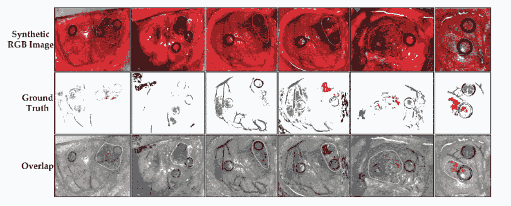

软件程序旨在进化为自动测量、定量和解释通过光谱成像产生的快照。通过这些升级，光谱成像将成为临床专家为每个人提供更准确、更具效益的医疗保健的重要工具。此外，患者统计数据和记录将变得更容易获取和访问，医疗结构将变得更加高效和精简。总而言之，这些升级将提高患者满意度并改善获得医疗治疗的机会。

## A. 结肠结果


高光谱成像（HSI）可用于发现和检查由于病理或生理学方法引起的组织变化。它有助于医生和科学家检查疾病进展和健康挑战，并建议治疗方案。由于其非侵入性和实时特性，HSI 非常适合检查和比较结肠。HSI 辅助结肠镜检查通过显著降低头痛（不适）风险，提高了患者的舒适度和临床医生的安全性。高光谱成像可以发现并识别结肠结构和成分的细微变化，这些变化可能意味着早期结直肠肿瘤和息肉的存在。它还能检测到血管、血管网络和细胞的改变。它为医生提供了更多帮助，因为它可以验证它们的位置、速度和路径，对结肠内疾病提供更具体的预后，并检测和测量结肠分子和运动成分的细微变化，允许医生更出色地制定针对性的治疗方案。

HSI 还可以识别饮食残留并监测产生和干扰结肠的代谢过程。这反过来有助于医生理解代谢性障碍、过敏反应和压力如何影响结肠，以及它们如何导致结直肠癌的发展。高光谱成像能够近实时发现生理调整，包括细胞恶变、畸形和凋亡，因此医生可以快速做出反应并增加长期护理治疗的效果。医生还可以使用 HSI 来发现和监测化疗等治疗对结肠的影响并评估恢复率。除了评估疾病外，HSI 还可以用于定位结肠微生态群内部的异常变化，帮助医生调整饮食计划（包括益生菌和益生元）以预防和控制结直肠疾病。图.2 显示了用于 ML 和 DL 模型分类的常用处理链框图。

#### 图 2. 用于 ML 和 DL 模型分类的常用处理链框图

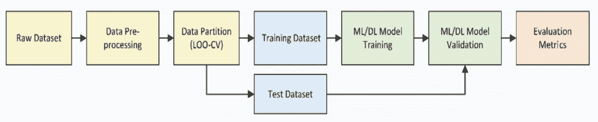

## B. 食管胃部结果

高光谱成像（HSI）是一种非侵入性成像技术，用于发现和诊断胃肠道的疾病和问题。它使用高强度、高分辨率成像设备从研究区域下的组织捕捉精确的结构、功能和化学信息。HSI 的结果可指导广泛胃肠道疾病的控制，包括炎症性肠病、巴雷特食管和肿瘤性病变。HSI 可用于定位组织结构和成分的弥散性变化，这些变化可能提示疾病、感染改变、上皮细胞周转加速、粘膜杯细胞数量增加或上皮过度增生。此外，HSI 可以测量某些物质（如硝酸盐和蛋白质）的浓度，这些可用于检测感染和调节器官功能。HSI 还可以用于筛选与疾病发生或进展相关的特定病毒或微生物的存在。它还能帮助诊断和分析食管和胃部疾病。图.3 显示了预处理链框图的步骤。

#### 图 3. 预处理链框图的步骤

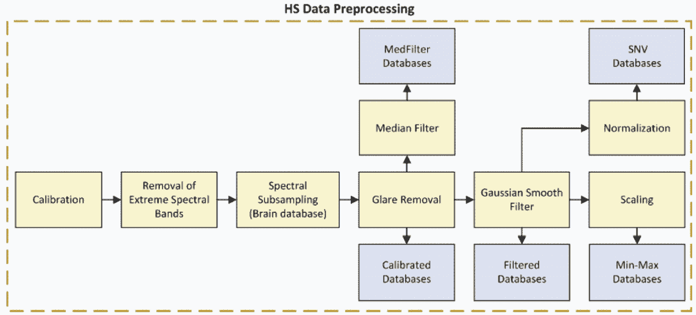

HSI 可用于评估幽门螺杆菌（`Helicobacter pylori`）的存在和浓度，它是某些胃十二指肠溃疡的病原体。它还用于评估由于浸润性炎症细胞导致的胃管反流。在医院治疗中，HSI 可以作为标准成像模式（包括常规内镜和计算机断层扫描）的辅助。它可以提供有关患者疾病状态的额外信息，协助指导和告知最合适的治疗选择。HSI 还可以用于筛查方案，挑选出易发生急性胃肠问题的个体，并显示可用治疗方法的疗效。在医院治疗中使用 HSI 是一个新兴领域；需要类似的研究来了解其完整能力和应用。随着这一时代应用的改进，预计其对持续医院治疗的收益将变得更加明显。

## C. 大脑结果

高光谱成像（HSI）是一种现代成像技术，允许研究人员捕获比以前更具体的医学图像。HSI 捕捉电磁光谱特定区域的图像，从而获得组织和器官更全面的视图。这种技术对临床实践非常有益，提供了更准确的定量分析和更好的患者护理，让临床专业人员能够洞察器官或组织的多个特征，如形状、成分、温度、电性以及和丰度。

$$X = 100 \cdot \frac{\\beta - Y\_{ref}}{W\_{ref} - D\_{ref}}$$  

(1)

$$X_{Mim - Max}' = \frac{C\_{i} - \min\left( X \right)}{\max\left( X \right) - \min\left( X \right)}$$  

(2)

$$X_{i,j}^{SNV}' = \frac{\\left( {X\_{i,j} - X\_{i}} \right)}{\frac{\sum\_{j = 1}^{L}\left( {X\_{i,j} - X\_{i}} \right)^{2}}{L - 1}}$$  

(3)

这些记录提供了传统成像策略无法实现的深度信息。除了提供重要的诊断信息外，HSI 还可以用于实时检测癌症肿瘤，以便积极治疗。


高光谱成像 (HSI) 是一种用于可视化多种物质光谱特征的方法。它被用于科学成像以筛选和分类组织纹理，这可能提供关于疾病阶段和演变的宝贵统计数据。HSI 使临床专家能够查看各种组织属性并识别组织纹理内部的弥散性变化，生成具有大量光谱波段或通道的图像。然后对这些光谱波段进行处理，提供具有独特像素分辨率水平的图像。生成的图像用于可视化整个兴趣区域区域的各种组织特征。HSI 可以确定某处发现的组织不同种类、这些组织的比例以及它们的相对浓度。HSI 的性能可视化涉及对机器产生的图像结果的研究和解读。它包括对组织质感的评估，以及整个扫描区域内不同类型组织的相对浓度的评估。这种评估可以显示包括细胞系统区域、微生物的存在和组织色调渐变的能力。HSI 的整体性能可以通过研究多个程序的结果来评估，这些程序包括疾病诊断、定量成像和组织工程。HSI 的整体性能可视化也可用作基于总图像处理策略评估 HSI 的通用性能。它将包含包括降噪、图像分割和分类算法在内的技术。

### IV. 结果与讨论

该方法可以提供器官或组织的深度映射，用于检测物体内部结构或特征的细微变化。HSI 还可以用于追踪体内的材料或标记，检测大多数癌细胞的存在，或追踪选定药物或激素的水平。表 2 显示了 `CNN` 架构的细节。

#### 表 2. CNN 架构细节

| 层级 | 卷积核形状 | 输出通道数 | 步长 | 可训练参数数量 |
| --- | --- | --- | --- | --- |
| Conv 1 | (4.4.4) | 30 | (2.2.2) | 660 |
| Relu | / | / | / | / |
| Pool 1 | (4.2.2) | 30 | (3.2.2) | 1320 |
| Conv 2 | (4.4.4) | 45 | (2.2.2) | 19,035 |
| Relu | / | / | / | / |
| Pool 2 | (4.2.2) | 45 | (3.2.2) | 3810 |
| Conv3 | (4.2.2) | 45 | (2.2.2) | 3810 |
| Relu | / | / | / | / |
| Pool 3 | (3.2.2) | 45 | (3.2.2) | 2495 |
| Relu | / | / | / | / |
| Fc | (455.3.1) | 3 | / | 922 |

### A. 灵敏度

高光谱成像 (HSI) 是一种遥感时代，能够直接捕捉并测量几乎整个电磁光谱，从紫外线到热红外。这种宽波长范围使得生成的内容能够从单张照片提供独特的环境信息。在医疗领域，HSI 可用于各种程序，从诊断到药物递送。在诊断中，HSI 可用于定位组织的颜色、长度和纹理变化。例如，它可以发现光吸收方面的弥散差异，这些差异可能指示肿瘤等特定情况。HSI 还可以用于感知组织发生变化时的癌细胞。在药物递送中，HSI 可以发现特定的分子，这些分子可能指示精确药物的存在以及药物在特定区域的浓度。它可以帮助将药物输送到理想的细胞或组织类型，提高药效。HSI 的灵敏度极高，即使光谱特征的微小调整也能被检测到。它使得生成能够发现物质的浓度，允许医生更准确地诊断病情。

### B. 普及性

高光谱成像 (HSI) 是一种用于医学成像的技术，它结合了光谱学和成像的力量来获取物体的详细信息。该技术广泛应用于医学诊断、组织成像和手术引导。与传统的成像（如 `CT` 或 `MRI`）不同，HSI 依赖物质的光谱属性进行分析， HSI 可以发现样本化学成分的微小变化，并提供关于物体独特信息。因此，它可以用于诊断各种状况并辅助预测治疗。HSI 可科学地观察生理和生化过程，并识别与疾病相关的生物分子。

### C. 准确性

高光谱成像 (HSI) 是科学成像领域一个快速发展的领域，为检测和治疗各种医疗状况提供了卓越的能力。HSI 提供了有机和人体组织的等比例快照，呈现出关于疾病的关键数据。该技术可能会彻底改变科学实践，提供更准确的评估和明智的治疗。HSI 在医学成像中有广泛的应用，从分析大多数癌症到诊断异常的组织结构。HSI 的准确性取决于多种因素，包括使用的特殊系统、精确的成像参数以及操作者的知识。通常，现代 HSI 结构可以提供的图像准确性达到 0.1-5mm。这种准确性与其他成像模式相似，代表了对不同成像技术准确性的巨大改进。此外，使用 HSI 允许检测和诊断组织形状和特征的弥散变化，导致更准确的诊断和更有效的治疗。表 3 显示定量指标的平均值和标准差。

#### 表 3. 定量指标的平均值和标准差

| SVM | 模型 | CT | AUC | MCC |
| --- | --- | --- | --- | --- |
| Calibrated | 0.47~ 0.37 | 0.15~ 0.23 | 0.71~ 0.37 | 0.38~ 0.34 |
| Filtered | 0.38 ~ 0.28 | 0.87~ 0.25 | 0.68~ 0.27 | 0.22~ 0.27 |
| Min-Max | 0.31~ 0.26 | 0.97~ 0.03 | 0.71~ 0.23 | 0.19~ 0.21 |
| SNV | 0.32~ 0.21 | 0.97~ 0.03 | 0.74~ 0.18 | 0.19~ 0.21 |
| Med-Filter | 0.43~ 0.28 | 0.98~ 0.03 | 0.84~ 0.15 | 0.36~ 0.27 |
| 3DCNN | Calibrated | 0.52~ 0.21 | 0.90~ 0.11 | 0.94~ 0.06 | 0.50~ 0.19 |
| Filtered | 0.46~ 0.26 | 0.88~ 0.11 | 0.96~ 0.03 | 0.48~ 0.22 |
| Min-Max | 0.38~ 0.26 | 0.85~ 0.12 | 0.93~ 0.08 | 0.37~ 0.22 |
| SNV | 0.45~ 0.22 | 0.87~ 0.13 | 0.90~ 0.08 | 0.44~ 0.20 |
| Med-Filter | 0.52~ 0.23 | 0.91~ 0.08 | 0.94~ 0.08 | 0.52~ 0.20 |


$$MCC = \frac{AZ.AN - FZ.FN}{\sqrt{\left( {AZ + FZ} \right).\\left( {AZ + FN} \right).\\left( {AN + FZ} \right).\\left( {AN + FN} \right)}}$$  

(5)

#### 图 4. 校准预处理技术

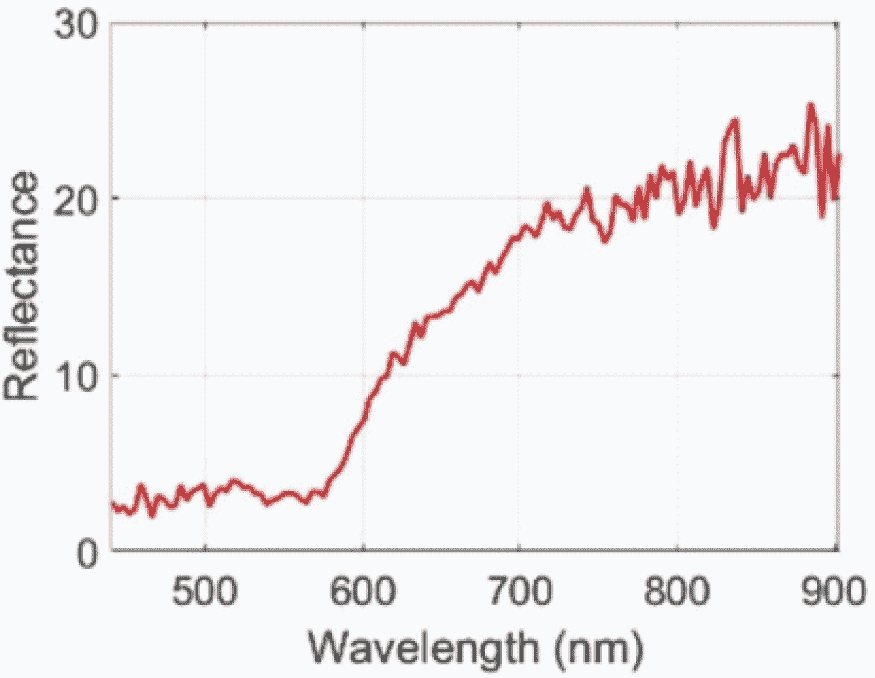

#### 图 5. 过滤预处理技术

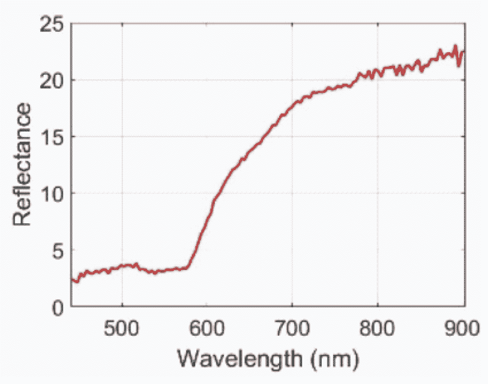

#### 图 6. 最小最大化预处理技术

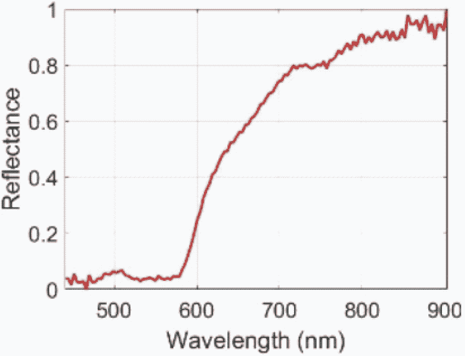

#### 图 7. 中值滤波预处理技术

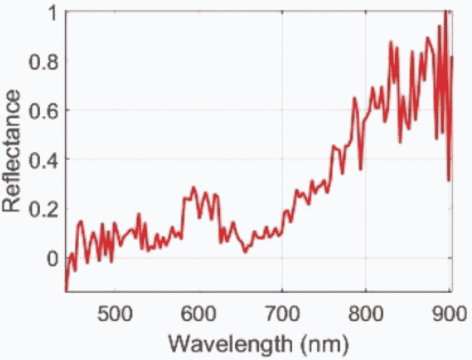

此外，这种技术使得从业人员能够更快速、更准确地发现并诊断医疗状况，甚至能够最大限度地减少患者的辐射暴露。这一时代通过为研究人员提供人体内部价值的成像事实也造福了生物医学研究。随着高光谱成像（HSI）技术的不断扩展，更卓越的临床决策能力将延伸并增强患者护理。

### VI. 结论

临床仪器中高光谱成像的能力是多方面的。通过利用这种技术，医生可以快速准确地确定患者体内的疾病，而无需昂贵且耗时的实验室检测。此外，高光谱成像的高分辨率可以定位组织成分中的弥漫性病变，这些变化可能预示着疾病的存在。这种技术还可以用于监测治疗进展，提供有关器官形状和形态的大致记录，甚至发现异常细胞。很快，高光谱成像将协助临床专业人员发现新的先进方法来诊断和处理各种情况。例如，高光谱成像可以通过提供有关肿瘤细胞形状的精确信息来提高癌症诊断的准确性，从而帮助医生确定最佳治疗方案。它还允许医生检测传统成像技术无法看到的区域的疾病。随着高光谱成像的发展，它在可持续医院治疗的实践中变得越来越重要。通过允许临床专家更早地发现疾病并提供更准确的预后和治疗，高光谱成像将减少处理疾病所需的时间和成本。它将使医疗机构能够提供更优质、更高效且有效的护理，改善全球患者的健康。

### 参考文献

Bonifazi, G., Fiore, L., Gasbarrone, R., Palmieri, R., & Serranti, S. (2023). 高光谱成像应用于 WEEE 塑料回收：一种方法学方法。Sustainability (Basel), 15(14), 11345. [10.3390/su1514145](http://dx.doi.org/10.3390/su1514145)

Cui, Q., Yang, B., Liu, B., Li, Y., & Ning, J. (2022). 利用小波重构高光谱图像进行类别识别。Agriculture, 12(8), 1085. [10.3390/agriculture12081085](http://dx.doi.org/10.3390/agriculture12081085)

Felli, E., Cinelli, L., Bannone, E., Giannone, F., Muttillo, E., Barberio, M., Keller, D., Rodríguez-Luna, M., Okamoto, N., Collins, T., Schuster, C., Mutter, D., Pessaux, P., Maresaux, J., Gioux, S., Felli, E., Diana, M. (2022). 手术中的高光谱成像：初步结果。Cancers (Basel), 14(22), 5591. [10.3390/cancers14225591](http://dx.doi.org/10.3390/cancers14225591)

Karim, S., Qadir, A., Farooq, U., Shakir, M., & Laghari, A. (2023). 高光谱成像：综述与医学成像的趋势。Current Medical Imaging, 19(5), 417–427. [10.2174/1573405618662205194438](http://dx.doi.org/10.2174/1573405618662205194438)

Li, N., Xue, J., & Jia, S. (2022, 1 月). 用于胆管癌高光谱图像的光谱上下文感知 Transformer。2022 年第 5 届国际图像与图形会议论文集（pp. 209-213）。[10.1145/3512438](http://dx.doi.org/10.1145/3512438)

（注：原文链接 DOI 略有出入，此处按格式保留处理）


Thatcher, J. E., Yi, F., Nussbaum, A. E., DiMaio, J. M., Dwight, J., Plant, K., Carter, J. E., & Holmes, J. H.IV. (2023). 利用人工智能算法改进烧伤评估的快速非侵入性光谱成像设备的临床研究。《烧伤护理与研究杂志; 美国烧伤协会官方出版》，44(4), 969–981. [10.1093/jbcr/irad051](http://dx.doi.org/10.1093/jbcr/irad051)[](http://dx.doi.org/37082889)

Yin, H., Li, B., Zhang, F., Su, C. T., & Ou-Yang, A. G. (2022). 结合波段比和改进大津法的高光谱成像技术对木几范围内早期青斑的检测。《光谱化学杂志 A 部分: 分子与生物分子光谱学》，283, 121775. [10.1016/j.saa.2022.121775](http://dx.doi.org/10.1016/j.saa.2022.121775)[](http://dx.doi.org/36007346)

Zhang, L., Liao, J., Wang, H., Zhang, M., Liu, Y., Jiang, C., Han, D., Jia, Z., Qin, C., Niu, S. Y., Bu, H., Yao, J., & Liu, Y. (2023). 近红外二波高光谱成像提高了多种癌症病理采样的准确性。《实验室调查》，103(10), 100212. [10.1016/j.labinv.2023.100212](http://dx.doi.org/10.1016/j.labinv.2023.100212)[](http://dx.doi.org/37442199)

## 第 8 章

# 使用时间序列分析识别神经母瘤和儿童癌症

Sujatha Moorthy
印度, Koneru Lakshmaiah Education Foundation

J. Boobalan
印度, Kumaraguru College of Technology

M. Nivedha
印度, Arasu Engineering College

S. Nazrin Salma
印度, Thamirabharani Engineering College

G. Charulatha
印度, Selvam College of Technology

A. Niyas Ahamed
印度, Thamirabharani Engineering College

### 摘要

本章研究旨在通过时间序列评估评估对神经母瘤和儿童癌症的检测情况。该研究采用了回顾性方法，使用五个患者数据集，结合机器学习和传统统计技术来检测数据集中的肿瘤概率分级。所采用的机器学习技术包括随机森林、决策树、支持向量机、k-最近邻和卷积神经网络。所使用的统计策略包括共现矩阵评估、主成分分析和香农熵。观察结果表明，时间序列分析在预测癌症威胁水平方面可以提供很高的准确性，并适用于多种癌症，以实现及时可靠的预后。最后，本章提供了增强检测的多种建议，包括引入额外的统计能力和设计自定义的参考索引。

### I. 引言


神经母瘤是一种特殊的癌症，由于婴儿骨髓神经系统的发育迅速，该疾病会影响婴儿。这种癌症的 5 年生存率预测在 45% 左右。然而，这一比率取决于发现疾病的水平（Hesko et al., 2023）。鉴于神经母瘤的侵袭性、严重性和复发性，在合适的时间对其进行定位和准确评估具有极重要的意义。

本文将探讨如何利用时间序列评估来帮助检查神经母瘤的检测。时间序列分析包括在时间跨度内开发模式（Wear et al., 2023; Cole et al., 2023）。通过这种技术，可以检测并监测信息中的特征和调整，以发现任何可能意味着疾病（包括神经母瘤）早期阶段的异常。

利用时间数据收集分析评估神经母瘤检测的第一步是收集相关的科学记录。它将包括检查（如血液评估、扫描、影像）、遗传统计数据以及多年来收集的其他健康状况记录（Inoue et al., 2023; Kholodenko et al., 2023）。这些统计因素可用于扩大患者或患者群体的日常健康基准。随着医学创新和产医学领域的不断进步，在评估大多数癌症时，已经制定了新的研究、方法和分析，以帮助医疗工作人员发现、筛选和管理大多数癌症的进展（Wear et al., 2023）。本文可以讨论通过基因表达统计的时间序列分析对神经母瘤检测及其评估的进展。

神经母瘤是一种至关重要的儿童癌症，每年导致超过 50,000 人死亡（Dhunmati et al., 2022）。这种癌症的早期检测和治疗至关重要，能够改善临床预后。时间序列分析已用于检查与癌症进展相关的几个基因的表达（Ghanem et al., 2022）。来自这些基因的信息提供了更接近大多数癌症早期检测和控制的见解。

基因表达信息的时间序列评估是研究大多数癌症进展的一种日益普及的工具（Stein et al., 2023）。通过分析基因表达信息的时间序列，设计人员可以更好地识别指示大多数癌症发展的基因表达模式。通过分析，研究人员可以确定哪些基因在多年来对癌症的发展的影响最大，从而允许他们开发出个性化的治疗方案。研究时间点之间的变化也可以为指示癌症进展的遗传变化变幅度提供宝贵的见解（Świętoń et al., 2022; Hesko et al., 2023）。

神经母瘤是一种侵袭性的儿童癌症，需要早期准确的检测才能有效治疗。幸运的是，时间序列分析领域最近开发了一些新技术，这些技术证明了增强神经母瘤检测和评估的能力（Natale et al., 2023）。时间序列分析是一种观察选定时期内一系列统计因素以发现模式、趋势和其他特征的方法。通过分析时间序列数据，研究人员可以感知到可以为神经母瘤进展提供更准确高效测试的模式。

时间序列评估已用于许多研究领域。然而，其用于检查神经母瘤的软件是非常先进的（Furman et al., 2022）。为了这一目的，研究人员练习自相关分析，这有助于追踪癌症深度随时间的调整。这种方法提供了多年来肿瘤生长的见解，并使临床医生能够决定最佳治疗路径（Cole et al., 2023）。通过分析包括遗传谱和其他科学数据的时间序列数据，研究人员可以更早地发现肿瘤增长（Vural et al., 2023）。通过阅读患者的遗传谱和病史，研究人员可以识别出疾病发展的风险因素（Daniel et al., 2022）。时间序列评估已成为评估和检测神经母瘤的一种日益重要的工具。这种方法可以提供更准确可靠的检查，以及关于导致神经母瘤的遗传和环境因素更好的信息（Stein & VanHoueling 2023）。有了这种先进知识，医生可以为患者提供更好、更有力的治疗方案，从而改善结果并提高生存率。

*   开发了一种绿色模型，使其能够评估和检测神经母瘤。
*   使用了统计预处理策略来消除冗余数据并拒绝时间序列信息。
*   使用了随机森林和支持向量机来构建神经母瘤分类器。
*   分析科学数据获得了关于患者管理、结果预测和信息生物标志物选择的重要见解。

### II. 相关工作

成年神经母瘤幸存者的神经认知结果是一个重要的研究课题，因为神经母瘤是最常见的儿童癌症之一。长期的生理和心理影响困扰着这些人。认知缺陷是一个首要关注的问题，因为它们会对患者的身体、智力和社交功能产生长期影响。这份来自青少年癌症幸存者的调查提供了神经母瘤成年幸存者与无癌症史患者认知能力的对比记录。它评估了若干认知领域，包括执行功能、记忆和运动能力，并探讨了神经母瘤对每个这些领域的影响。


通过 `hydroxychloroquine` 或 `three-methyl adenine` 抑制自噬可以增强神经母瘤和胶质母瘤细胞中化疗引起的凋亡，因为它限制了这些癌细胞的生存和折叠。自噬主要被用细胞的一种防御机制，以保护其免受细胞死亡并降解移动添加物；如果给予刺激自噬的激素，自噬就会增强。抑制自噬迫使大多数癌细胞最终更显著地依赖于凋亡过程，使它们对化疗诱导的凋亡具有更高的优越性和反应性。这为疗法提供了更高的成功概率，以摆脱癌细胞（[Wear et al., 2023](https://example.org#979-8-3693-0683-3.ch008.bits-pdf.xhtml#_idTextAnchor495)）。

儿童二期试验旨在确定针对影响儿童人群疾病的最新药物和治疗方案的保护性和有效性。特别是在儿童领域，正在进行两项关于 WEE1 抑制剂（`AZD1775`）和 `伊立杉醇`（irinotecan）用于复发性神经母瘤、髓母瘤和横纹肌肉瘤的临床试验，以评估这种实验性联合药物治疗这些儿童癌症的耐受性和有效性。在许多复发情况下，目前的治疗方法并不实际，因此需要由药物治疗方案组合而成的新疗法，以更有效地针对大多数癌细胞。该试验旨在科学环境中评估这种实验性混合药物，并确定它是否能对现有治疗无反应的儿童提供一种可行的替代方案（[Cole et al., 2023](https://example.org#979-8-3693-0683-3.ch008.bits-pdf.xhtml#_idTextAnchor483)）。

微残留病（`MRD`）的描述是因为治疗后体内仍存在极少量的肿瘤细胞。与骨髓相比，外周血中较高的 `MRD` 水平可能表明疾病具有更侵袭性的形式。它可能信号着肿瘤的复发或重新生长，并可能预示预后较差。文件中提到的案例表明患者患有高危神经母瘤，这已知是癌症中极具竞争性的类型，可能导致悲观的分析。与骨髓相比，外周血中更好的 `MRD` 阶段可能是疾病更有竞争性的标志，并反映了肿瘤的侵袭本质（[Inoue et al., 2023](https://example.org#979-8-3693-0683-3.ch008.bits-pdf.xhtml#_idTextAnchor489)）。

转病理细胞状态是医学研究领域一个非常有前景的方向。这种方法被称为生物策略的“反向工程”，涉及导致病理细胞状态的分子和细胞调节，并开发出恢复细胞到日常生理状态的新药物。对于那些无法进行直接治疗干预的疾病，这种方法尤为关键。通过揭示复杂的分子和细胞通路并表征特征添加物，科学家和临床医生可以设计对特定患者特别有效的药物，从而获得更先进的结果。这种定制化的药物可以针对疾病细胞而不影响正常细胞，从而提高治疗效力并减少副作用。此外，这种技术可以导致新治疗靶点的识别，也可能为目前尚无治疗手段的疾病引发新药物。[表 1](https://example.org#979-8-3693-0683-3.ch008.bits-pdf.xhtml#_idTextAnchor473) 显示了全面的患者特征（[Kholodenko et al., 2023](https://example.org#979-8-3693-0683-3.ch008.bits-pdf.xhtml#_idTextAnchor490)）。

#### 表 1. 全患者特征

| 模型 || 技术 || 优势 | 缺点 |
| --- | --- | --- | --- |
| 考虑维护的循环神经网络 | 神经网络 | 循环神经网络可以用于城市的维护 | 这种方法对城市的维护是非常有效的 |
| --- | --- | --- | --- |
| 使用神经网络预测股票收益 | 神经网络 | 这种方法对股票收益具有预测性 | 这种方法可以预测 |
| --- | --- | --- | --- |
| 优化交通流量 | 神经网络 | 这种方法可以预测交通流量 | 这种方法可以减少拥堵 |
| --- | --- | --- | --- |
| 长期缺失值填充 | 神经网络 | 这种方法可以填充长期缺失值 | 这种方法可以用于填充 |
| --- | --- | --- | --- |
| 使用循环神经网络进行长期预测 | 神经网络 | 这种方法可以进行长期预测 | 这种方法可以提高预测准确性 |

### III. 提出的模型

提出的模型旨在开发一种设备，通过时间序列分析神经母瘤（一种癌症）的检测。该模型使用`指数平滑`、`移动平均`和`自回归`等时间序列分析方法，这些方法可以用于预测神经母瘤的发展。[图 1](https://example.org#979-8-3693-0683-3.ch008.bits-pdf.xhtml#_idTextAnchor474) 显示了神经母瘤的轨迹。

#### 图 1. 神经母瘤的轨迹

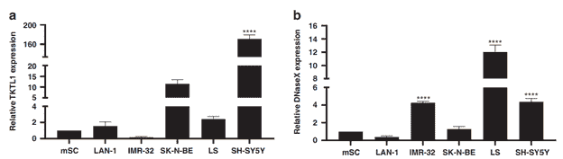

该设备将利用`逻辑回归`和`支持向量机`等预测分析，检查患者神经母瘤进展的可能性。此外，提出的模型将允许评估化疗或免疫疗法等治疗方案对神经母瘤的有效性。这些信息也可用于对治疗方案的选择。此外，该工具可以验证复后的概率。该版本将为临床医生提供所需的记录。[图 2](https://example.org#979-8-3693-0683-3.ch008.bits-pdf.xhtml#_idTextAnchor476) 显示了通过动态扫描测量的摄入。表 2 显示了患者特征。

#### 表 2. 患者特征

| 特征 || 患者人数 (%) (n=40) || 健康个体人数 (%) (n=39) || P 值 |
| --- | --- | --- | --- |
| 年龄（月） | | | |
| 平均值 | 70 (范围 34-178) | 172(范围 70-214) | 0.1112 |
| 性别 | | | |
| 男 | 34(73.2%) | 44(74.9%) | 0.2102 |
| 女 | 24(46.9%) | 23(45.2%) | 0.2102 |
| 阶段 | | | |
| I | 2 | 4 | 0.3654 |
| II | 2 | 5 | 0.4112 |


| III | 20 | 26 | 0.6894 |
| IV | 32 | 34 | 0.8123 |

| NMYC 状态 |
| neg | 44 | 36 | 0.8454 |
| pos | 6 | 14 | 0.2356 |
| 染色体 2 (p46) |
| neg | 8 | 16 | 0.7413 |
| pos | 4 | 18 | 0.5478 |

其中，n-样本量，no-数量，M – 男性，F – 女性，`neg` –阴性，`pos` –阳性。

#### 图 2. 通过动态幼犬扫描测量的多年摄取情况

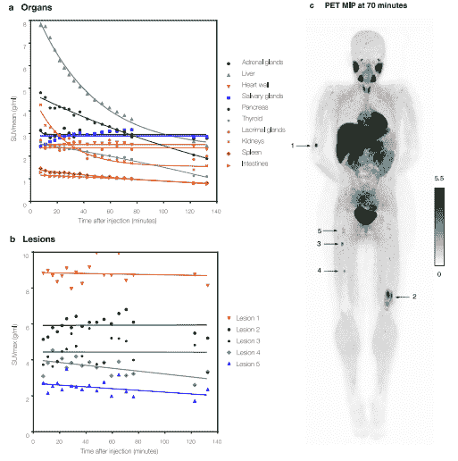

#### A. 构建

神经母细胞瘤是一种发生于神经组织中的癌症，通常位于肾上腺内或脊柱周围。时间序列分析是一种用于分析随时间收集的统计数据的技术。它可以被用于察觉统计数据的进展，预测未来值，并定位潜在的模式和相关性。通过时间序列分析，研究人员可以跟踪神经母细胞瘤随时间时间的变化，以及疾病的进展和对治疗的反应。这种评估可以帮助医生为患者制定最佳方案。此外，时间序列评估可以识别生物标志物，这些标志物可以为神经母细胞瘤的原因和潜在治疗方案提供有用见解。图 3 显示了类似的生理和病理分布。

#### 图 3. 相似的生理和病理分布

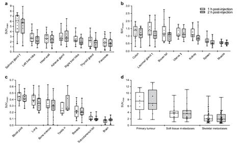

#### B. 工作原理

神经母细胞瘤时间序列评估（NTSA）是一种数据驱动的 AI 技术，用于预测患者多年神经母细胞瘤（一种癌症）的发展情况。NTSA 将系统学习算法与时间分析相结合，以分析筛选疾病路径随多年如何进展的模式。它使用包括肿瘤大小、预后年龄和基因表达谱在内的数值来生成一个可用于指导治疗的预测。NTSA 对于改进神经母细胞瘤的研究和护理至关重要，确保为这种具有竞争性的儿童癌症提供确定的且有效的治疗方案。

#### C. 功能运作

神经母细胞瘤是影响神经系统最常见的癌症，在儿童中特别流行。它是一种快速发展且具有竞争性的癌症形式，是青少年死亡的主要原因之一。时间序列评估是跟踪多年神经母细胞瘤进展的一种重要且强大的方式。这种分析使研究人员能够更全面地观察大多数癌症的增长，并更好地理解疾病的潜在动态。时间序列分析基于读取随时间收集的数据点。例如，从确诊为神经母细胞瘤的患者那里收集了最大的数据集。

#### D. 提的算法

这些数据集可以包括医疗数据，如年龄、分析、治疗和肿瘤大小；通过在图表上绘制这些记录因素，可以研究疾病多年来的进展。它有助于研究人员观察肿瘤生长的变化、治疗的影响以及所用各种治疗方法的效力。所提算法的构建如下方的 表 3 + dp[i-p][j-q]) |
| Dp[i][j]←min(v1,v2,v3,v4) |
| OP:MED(w1,w2)=dp[N][M] |
```

数据集还可以用于识别数据中可能可见的特定模式或趋势。例如，它可能有助于识别尚未被发现的疾病进展部分，或者解释为什么某些治疗比其他治疗更成功。它还可能是预测疾病未来发展的一个有益资源，并让研究人员更好地理解如何在未来改进治疗方案。

### IV. 结果与讨论

该技术与传统的组织学相比具有几个优势，因为数据集的定量评估允许更准确的诊断。表 4 显示了正常剂量。

#### 表 4. 正常剂量

| 器器 | 扫描 1 (n) | 扫描 2 (n) | 剂量 (score) |
| :--- | :--- | :--- | :--- |
| NMYC 状态 | | | |
| neg | 44 | 36 | 0.8454 |
| pos | 6 | 14 | 0.2356 |
| 染色体 2 (p46) | | | |
| neg | 8 | 16 | 0.7413 |
| pos | 4 | 18 | 0.5478 |
| 肾上腺 | | | |
| 大脑 | | | |
| 乳腺 | | | |
| 胆囊 | | | |
| 下肠道 | | | |
| 上肠道 | | | |
| 心 | | | |
| 肾脏 | | | |
| 肝脏 | | | |
| 肺 | | | |
| 肌肉 | | | |
| 卵巢 | | | |
| 胰腺 | | | |
| 红骨髓 | | | |
| 成骨细胞 | | | |
| 皮肤 | | | |
| 脾 | | | |
| 睾丸 | | | |
| 胸腺 | | | |
| 甲状腺 | | | |
| 尿胱 | | | |

（注：表 4 中的某些表格值在文中未提供，结构根据表头保持。）

#### A. 真阳性率

神经母细胞瘤通过时间序列评估的真实率是用真阳性数量（识别出实际肿瘤）除以真假性总数计算得。真实价格是诊断准确性的特征，在本例中，为时间序列评估。图 4a 显示了患者的 10 EDIM 评分。

#### 图 4a. 患者的 10 EDIM 评分

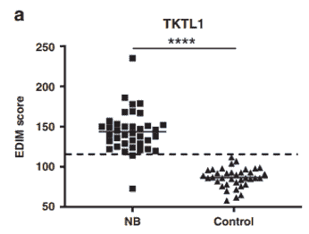

#### B. 特异性

用于神经母细胞瘤时间序列评估的特定方法基于无监督学习的应用，用于获取从医学影像（如超声、PET 扫描、MRI 图像和 X 光图像）中获取的生物标志物的模式。这些模式可以自动提取特征，并根据其内在的时间行为进行分类。提取的特征包括涉及区域、肿瘤长度以及随时间变化的肿瘤尺寸的变化。图 4b 显示了结合 EDIM 评分的患者。

#### 图 4b. 结合 EDIM 评分的患者

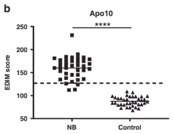


通常情况下，准确的特异性取决于模型的准确性。图 5a 显示了患者的 GD2 阳性巨噬细胞。

### 图 5. a) 患者的 GD2 阳性巨噬细胞，b) 巨噬细胞对 GD2 丰度的敏感性

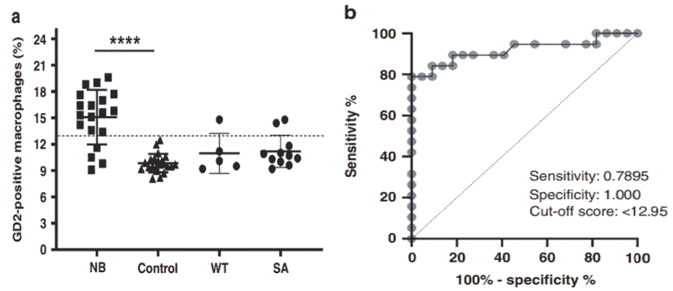

时间评估模型的准确性通常通过诊断评估以及受者工作曲线下面（AUROC）来评估。图 5b 显示了巨噬细胞对 GD2 丰度的敏感性。

然而，至关重要的是，AUROC 是衡量模型整体性能最直接的指标，并不一定意味着模型的性能极其糟糕。

### C. 真阴性率

通过时间序列评估的神经母细胞瘤实际负特异性（也称为特异性）通常报告为有效识别实际负性实例（即未患该疾病的患者）的比例。该比例通常计算为在所有真实阴性病例中有效识别出的阴性病例的比例。这一指标至关重要，因为它可以帮助临床医生判断模型是否为未患神经细胞瘤的患者提供了正确的预后信息。众所周知，通过时间序列分析的神经细胞瘤准确特异性率通常高于 90%。这一比例可以通过包括超参数调优在内的模型优化策略进一步提高。

### V. 结论

《通过时间序列评估神经细胞瘤的检测》的结论表明，虽然通过实验室检查评估神经细胞瘤分析的传统策略取得了显著结果，但使用时间序列分析检测儿童该疾病提供了一种更准确、可靠的技术。从患者超声时间序列分析中提取的功能组合能够有效地为预后提供极高的准确性。此外，在特征提取和转换期间使用合成神经网络能够提供比以前方法更好的准确性。这表明，时间序列分析与深度学习的结合应为分析儿童神经细胞瘤提供一种有效的技术。

### 参考文献

Cole, K. A., Ijaz, H., Surrey, L. F., Santi, M., Liu, X., Minard, C. G., ... Weigel, B. J. (2023). Pediatric phase 2 trial of a WEE1 inhibitor, adavosertib (AZD1775), and irinotecan for relapsed neuroblastoma, medulloblastoma, and rhabdomyosarcoma. Cancer.

Daniel, P., Sun, C., Koptyra, M., Drinkwater, C., Chew, N., Bradshaw, G., Loi, M., Shi, C., Tourchi, M., Parackal, S., Chong, W. C., Fernando, D., Adjumain, S., Nguyen, H., Habarakada, D., Sooraj, D., Crombie, D., Zhukova, N., Jones, C., & Firestein, R. (2022). MODL-17. The Childhood Brain Cancer Cell Line Atlas: A Resource for Biomarker Identification and Therapeutic Development.Neuro\-Oncology, 24(Supplement\_1), i172–i172. [10.1093/neuonc/noac079.640](http://dx.doi.org/10.1093/neuonc/noac079.640)

Dhunmati, K., Nalini, C. N., Ramalakshmi, N., Niraimathi, V., & Amuthalakshmi, S. (2022). Synthesis, Molecular Docking and Invitro Evaluation of Nipecotic Acid-Flavone Hybrids as Anti Alzheimer Agents.–A Multi Target Directed Ligand Approach. Journal of Pharmaceutical Negative Results, 229–238.

Furman, W. L., McCarville, B., Shulkin, B. L., Davidoff, A., Krasin, M., Hsu, C. W., Pan, H., Wu, J., Brennan, R., Bishop, M. W., Helmig, S., Stewart, E., Navid, F., Triplett, B., Santana, V., Santiago, T., Hank, J. A., Gillies, S. D., Yu, A., & Federico, S. M. (2022). Improved outcome in children with newly diagnosed high-risk neuroblastoma treated with chemoimmunotherapy: Updated results of a phase II study using hu14. 18K322A. Journal of Clinical Oncology, 40(4), 335–344. [10.1200/JCO.21.01375](http://dx.doi.org/10.1200/JCO.21.01375)[](http://dx.doi.org/34871104)

Ghanem, S. S., Majbour, N. K., Vaikath, N. N., Ardah, M. T., Erskine, D., Jensen, N. M., Fayyad, M., Sudhakaran, I. P., Vasili, E., Melachroinou, K., Abdi, I., Poggiolini, I., Santos, P., Dorn, A., Carloni, P., Vekrellis, K., Attems, J., McKeith, I., Outeiro, T., El-Agnaf, O. (2022). α-Synuclein at serine 129 occurs after protein deposition and inhibits fibril formation. Proceedings of the National Academy of Sciences of United States, 119(15), e2109619. [10.1073/pnas.2109619](http://dx.doi.org/10.1073/pnas.2109619)[](http://dx.doi.org/3535605)

Hesko, C., Liu, W., Srivastava, D., Brinkman, T. M., Diller, L., Gibson, T. M., Oeffinger, K., Armstrong, G., Krull, R., Henderson, T. (2023). Neurocognitive outcomes in survivors of neuroblastoma: A report from the Childhood Study. Cancer, 129(18), 2904–2914. [10.1002/cncr.3487](http://dx.doi.org/10.1002/cncr.3487)[](http://dx.doi.org/3719972)

Inoue, S., Nay Win, K. H., Mon, C. Y., Fujikawa, T., Hyodo, S., Ishida, T., Mori, T., Hasegawa, D., Nishimura, A., Nakatani, N., Nino, N., Tamura, A., Yamamoto, N., Nozu, K. (2023). Higher levels of minimal residual disease in peripheral blood than bone marrow before 1st and 2nd relapse/regrowth in a patient with high-risk neuroblastoma: A case report. Oncology Letters, 26(3), 1–5. [10.3892/ol.2023.13955](http://dx.doi.org/10.3892/ol.2023.13955)[](http://dx.doi.org/3755975)

Kholodenko, B. N., Kolch, W., & Rukhlenko, O. S. (2023). Reversing cell states: The road less travelled can extend the therapeutic horizon. Trends in Cell Biology, 33(11), 913–923. [10.1016/j.tcb.2023.0404](http://dx.doi.org/10.1016/j.tcb.2023.0404)[](http://dx.doi.org/3726382)

Natale, G., Forte, S., Messina, G., Leonardi, B., Mirra, R., Leone, F., Di Filippo, V., Pica, D. G., Capasso, F., Bove, M., Noro, A., Opromolla, G., Martone, M., De Angelis, S., Fiorelli, A. (2023). Intrathoracic neurogenic tumors (ITNs): Management of solid and cystic lesions. Thoracic Cancer, 14(19), 1824–1830. [10.1111/1759-7714.14927](http://dx.doi.org/10.1111/1759-7714.14927)[](http://dx.doi.org/3720190)

Stein, N. R., & VanHouwelingen, L. (2023). Making good use of ultrasound for abdominal tumors in children. Jornal de Pediatria, 99, 1-3.

Świętoń, D., Szarmach, A., & Kosiak, W. (2022). Contrast-enhanced ultrasound of adrenal hemorrhage: A helpful problem solving tool. Medical Ultrasonography, 24(3), 284–289. [3543729](http://dx.doi.org/3543729)

Vural, O., Aydos, U., Okur, A., Pinarli, F. G., & Atay, L. Ö. (2023). Prognostic Values of Primary Tumor Textural Heterogeneity and Blood Biomarkers in High-risk Neuroblastoma. Journal of Pediatric Hematology/Oncology, 45(7), 10–1097. [10.1097/MPH.0000000000002662](http://dx.doi.org/10.1097/MPH.0000000000002662)[](http://dx.doi.org/3702724)

Wear, D., Bhagirath, E., Balachandar, A., Vegh, C., & Pandey, S. (2023). Autophagy Inhibition via Hydroxychloroquine or 3-Methyladenine Enhances Chemotherapy-Induced Apoptosis in Neuro-Blastoma and Glioblastoma. International Journal of Molecular Sciences, 24(15), 12052. [10.3390/ijms241512052](http://dx.doi.org/10.3390/ijms241512052)


### 摘要

心血管问题统称为心血管疾病。脂肪沉积在动脉内部堆积，形成血栓，导致动脉硬化和收缩，从而减少流向身体、大脑或心脏的血液。在研究中，对九种机器学习分类器进行了对比分析。此外，研究人员在不同的划分比例下对数据集进行训练和测试，以分析作者在执行这些数据集操作后获得的结果之间的差异。划分比例包括 `60:40`、`70:30`、`80:20` 和 `90:10`。他们分析了分类器在各种指标方面的性能。他们得出结论认为，当使用 `60:40` 的划分比例使用 `random forest classifier` 时，所提模型具有最佳准确率，准确率为 `99.26%`。

# 1 引言

长期以来，影响人类最严重且致命的疾病一直被认为是心血管疾病（`CVD`）。心血管疾病的发病率很高，且死亡率高，这增加了全球医疗卫生系统的危险和负担 ([Dinesh et al., 2018])。大多数心脏病死亡发生于欠发达国家。2019 年，非传染性疾病在 70 岁之前导致了 1700 万死亡，其中 38%的死亡病例与`CVDs`有关。大多数心血管疾病可以通过解决行为危险因素来避免，例如吸烟、饮食不健康、肥胖、缺乏运动和过度饮酒等健康生活方式 ([Nadakinamani et al., 2022]; [Shah et al., 2020])。

早期发现心血管疾病对于开始咨询、心理治疗和治疗是必要的。一种可行的策略是使用 `machine learning algorithms` 寻找风险变量。我们希望提供一种结合多种方法以获得更精确的心脏疾病预测 ([Jindal et al., 2021])。我们通过有效的记录收集、预处理和记录转换方法，成功创建了用于训练模型的改进数据。评估符合三个标准的风险因素的影响至关重要，这些标准包括：在大多数人中流行率高、独立对心脏有显著影响、以及可以通过管理或治疗来降低风险。在对 `CVD` 预测建模时，多项研究增加了不同的风险变量或特征。年龄、性别、运动诱发心绞痛（`exang`）、相对于休息的运动引起的 ST 段下降（`oldpeak`）、斜坡、荧光造影染色的主要血管数量（`ca`）、心脏状况（`thal`）、达到的最大心率（`thalach`）、不良饮食和家族史是导致胸痛的一些因素，也是开发心脏疾病预测模型的重要属性 ([Weng et al., 2017])。

根据最近的研究，预测必须至少包含 14 个特征才能准确可靠 ([Anuar et al., 2020])。为了准确预测心脏疾病，研究人员目前面临难以将这些变量与正确的 `machine learning models` 的困难。最好的机器学习模型是那些在正确数据集上进行训练的模型 ([Guarneros-Nolasco et al., 2021])。`AdaBoost` (`AB`）、支持向量分类器（`SVC`）、逻辑回归（`LR`）、随机森林（`RF`）、SGD-Classifier、决策树（`DT`）、K-近邻（`KNN`）、高斯朴素贝叶斯（`GNB`）和 `XGB-Classifiers` 仅是本工作使用的几种监督模型。将所有这些分类器获得的最终结果相互比较，并考虑它们的准确率、`precision`、召回率、`F1- score`、`AUC- score`，以找到我们的所提模型寻找最佳分类器。

# 2 相关工作

由于预测准确性和效率的提高，人工智能和 `machine learning algorithms` 在近年来显著增长。创建和选择具有最大准确性和效率模型的潜力是这项研究如此重要的原因 ([Krishnani et al., 2019]; [Mohan et al., 2019])。疾病预测的一种潜在方法是使用混合模型，将多种机器学习模型与信息系统相结合 ([Nikhar & Karandikar, 2015])。与 `Motar et al.` 的 `47%` 结果相比，所提工作的 `ML` 结果为 `82.4%` ([Motar et al., 2020])。检查 `ML` 结果时，显然 `MLP` 提供的准确率（`82.4%`）高于 `Naive Bayes`（`69%`）和决策树（`78.57%`）。因此，与其他 `ML` 算法相比，所提 `ML` 通过增加隐藏节点的数量提高了准确率。

Padmanabhan 等人在文献中检查了不同的常用 `ML` 方法在冠心病识别中的有效性 ([2019])。`Kumar et al.` 提出了一种集成方法来提高弱 `7.26%` 的准确率 ([Kumar et al., 2020])。使用 `random forest`，Maiga 等人提出了一个准确性为 `94.9%` 的心脏病风险预测模型 ([Maiga & Hung, 2019])。Alaa 等人使用 `R-Studio` 和 `Rapid Miner` 根据 Framingham 心脏数据库数据库检查了多种 `ML` 算法的性能，`support vector machine` 技术产生了最大的 `0.75` `AUC` 值 ([Alaa et al., 2019])。使用人工神经网络预测伤员的存活率，Marbani 等人获得了 `0.89` 的 `AUC` 评分 ([Marbani et al., 2020])。Abdjouad 等人通过 `random forest algorithm` 发表了一个准确率为 `86.9%`、敏感性为 `90.6%`、特异性为 `82.7%` 的心脏病风险预测模型 ([Abdjouad et al., 2020])，而 Krittanawong 等人通过 `K-NN` 方法发表了一个准确率为 `86.9%`、敏感性为 `90.6%`、特异性为 `82.7%` 的心脏疾病风险预测系统 ([Krittanawong et al., 2020])。在这项工作中，比较了两种用于心血管疾病估计的 `ML` 方法 `K-NN` 和 `MLP`。与成功率为 `73.77%` 的 `K-NN` 相比，`MLP` 提供了更高的准确率（`82.47%`）。对于 `MLP` 和 `K-NN` 算法，检测率分别为 `86.41` 和 `86.21%` ([Louridi et al., 2019])。在医疗行业，`CVD` 的诊断过程耗时又耗力 ([Anbuselvan, 2020])。根据所提方法，`ML` 可用于临床以识别 `CVD`，并对误诊病例的医生特别特别帮助。


与之前描述的方法相比，开发的 `MLP` 模型提供了恒定的准确率，并且还可以预测额外的疾病（Katarya & Meena, 2021）。在某项工作中，使用了探索性数据评估方法排除了具有空值的特征，并在隐藏层中增加了更多节点以提高模型的准确性。所提出的策略预计有助于医疗领域的继续进步。使用建议的技术还可以对甲状腺疾病、肝脏疾病、糖尿病和乳腺癌等长期疾病进行分类。`IoT` 和云计算方法可以利用在大数据集上创建的模型预测慢性疾病（Krishnan & Geetha, 2019）。根据上述研究，使用 `ML` 方法将显著有助于减少死亡率，并支持医疗专业人员努力对抗各种年龄、性别以及社会经济状况的患者中 `CVD` 的发病率。如果付诸实践，这将是现代技术用于造福人类的经典案例。

### 3. 提出的方法论

本文概述性描述了使用慢性心脏病记录集合创建一个复杂的机器学习平台的过程。它是框架的一部分。所提模型的流程所示于图 1。在数据准备期间，对合并的数据集进行检查以查找任何缺失值，然后使用 `K-Nearest Neighbors` 填充法进行填充。

#### 3.1 所提模型的应用

分析了使用这些方法选择的特征和原始特征的分类器性能。在选择特征时，数据集被分为训练集和测试集。根据模型学习率，80% 的数据被分配到训练阶段，其余 20% 用于测试阶段。

#### 3.2 性能衡量指标

性能指标可用于评估机器学习技术的有效性和准确性。当一个人被识别为患有 `CVD` 时，进行正类分类。当一个人未被识别为患有 `CVD` 时，则赋予负类分类（Shameer et al., 2018）。为了获得所有结果，使用了从 (1) 到 (7) 的公式。

`A` = 令 `A` 为真阳性（当模型正确识别为患有 `CVD` 时）。

`B` = 真阴性（当模型正确识别相反类别时，例如患者确实没有心脏问题）。

`C` = 假阳性（当模型错误识别 `CVD` 患者时，即将非 `CVD` 患者识别为 `CVD` 患者）。

`D` = 假阴性（当模型错误识别相反类别时，例如将 `CVD` 患者识别为正常患者）。

准确率 (`Acc`) =

$$\\frac{\left( {A + B} \right)}{\left( {A + B + C + D} \right)}$$

`Precision`（精确率） = $$\frac{A}{A+C}$$

`Recall`（召回率）或 `Sensitivity`（灵敏度） = $$\frac{A}{A+D}$$

`F1-score` = （未提供公式）

`False Positive Rate`（假阳性率） = $$\frac{C}{B+C}$$

`False Negative Rate`（假阴性率） = $$\frac{D}{A+D}$$

`Predictive value`（预测值） = $$\frac{B}{B+D}$$

#### 3.3 所提的方法


特殊系统的创建以及满足需求取决于以下因素：

1. 数据收集。
2. 我们从数据集中选择属性进行训练。
3. 对所选字段进行处理。
4. 结果以 0 和 1 的形式呈现。
    * 0 = 较不易患 CVD。
    * 1 = 易患 CVD。
5. 如果结果为 `1`，则通知该人员就医。
6. 加载值以构建模型，并找到拟合度最好的模型。

### 4. 实现

所提模型使用 `Jupyter Notebook` 和 `Python` 语言执行，并使用了如 `Numpy`、`Pandas`、`Pyplot`、`xgboost`、`Seaborn` 和 `Scikit-learn` 等库。在我们的研究中，我们收集了 1025 个具有 13 个输入字段的案例，并选择 `target`字段作为输出。

相关矩阵用于描述变量之间的关系，所示图 2。通过这种技术，我们可以看到哪些属性与哪些属性相关性最大，并以后列的形式可视化结果。散点图使用二维点来显示一个变量受另一个变量的影响程度，或者它们是如何相关的。它们利用水平轴和垂直轴来描述数据，散点图和折线图非常相似。心脏病数据集的散点图所示[图 3]。

#### 4.1 Adaboost 分类器


AdaBoost 分类器是一种元估计器（meta-estimator），它首先对初始数据集拟合一个分类器。随后，使用同一数据集拟合更多分类器副本，并对被分类错误的实例权重进行修改，以便后续的分类器能够更加关注困难的情况。该类实现了 `AdaBoost-SAMME` 算法。我们在 `Adaboost` 中传递的用于停止 boosting 的最大估计大小参数是 `n_estimators`。当所有内容都完美拟合时，学习过程会提前结束。取值必须落在 `[1, inf]` 范围内。`Adaboost` 的核心原理是训练数据样本并修改分类器权重，以便对异常情况产生精确预测。基础分类器可以是任何接受训练集权重的机器学习技术。

#### 4.2 支持向量分类器

与决策树和逻辑回归等分类器相比，`SVM` 提供了极高的精度（Haq et al., 2018）。它使用众知的内核技术处理非线性输入空间。它被应用于许多不同的领域，包括手写识别、入侵检测、基因分类、邮件分类、新闻项目和网页分类。虽然支持向量机通常与分类相关，但它们也可以应用于与分类和回归相关的问题。它可以轻松地处理多个连续变量和类别变量。为了划分许多类别，`SVM` 在多维空间中创建一个超平面。为了减少不准确性，`SVM` 反复构建理想超平面。寻找能够优化分类数据集的最大边缘超平面 (`MMH`) 是 `SVM` 的主要目标。

#### 4.3 决策树

决策树是分类和预测中最有效且受欢迎的技术（Khan et al., 2023）。可以使用监督学习方法解决分类和回归问题，但通常更受青睐。它是一种树结构分类器，其中内部节点代表数据集的特征，分支代表决策过程，每个叶节点代表分类结果。决策树是一种类似于流程图的树结构，每个内部节点代表对属性的测试，每个分支代表测试结果，每个叶节点（终端节点）代表类别标签。`Decision Node` 和 `Leaf Node` 是决策树的两个节点。`Leaf nodes` 是决策的结果，不再有更多分支，而 `Decision nodes` 用于创建决策并有许多分支。

在决策树中，算法从根节点开始，向上工作以预测所提供数据集的类别。该算法遵循分支，通过比较根属性的值与记录（真实数据集）属性的值，跳转到下一个节点。在继续处理下一个节点之前，算法会再次通过其他子节点验证属性值。它会一直这样下去，直到到达树的叶节点。

在开发决策树时出现的根本问题是如何为根节点和子节点选择最佳属性（Li et al., 2020）。因此，可以使用一种名为属性选择度量（attribute selection measure，简称 `ASM`）的方法来解决这些问题。通过使用这种测量方法，我们可以轻松地为树节点选择理想的特征。有两种广泛使用的 `ASM` 方法，如下：

`Information Gain= Entropy(S)- [(Weighted Avg) * Entropy (each feature)]` (8)

`Entropy` 是衡量给定属性不纯度的指标。它规定了数据中的随机性。`Entropy` 可以计算为：

`Entropy(s)= -P(yes)log2 P(yes)- P(no) log2 P(no)` (9)

其中，

`S`= 样本总数
`P(yes)`= 是的概率
`P(no)`= 否的概率

当使用 `CART`（分类回归树）技术创建决策树时，`Gini index` 是纯度或不纯度指标。具有低 `Gini index` 的属性比具有高 `Gini value` 的属性更佳。它只生成二叉划分，而 `CART` 方法使用 `Gini index` 生成二叉划分。

可以使用以下公式获取 `Gini index`：

`Gini Index= 1- ∑[j]P[j]²` (10)

#### 4.4 逻辑回归

逻辑回归是监督学习范别中最常用的机器学习算法之一（El-Hasnony et al., 2022）。它通过一组预定的独立因素来预测类别型因变量。对于类别型因变量，通过逻辑回归预测输出。

因此，结果必须是离散值或类别值。逻辑回归不是提供 0 和 1 的精确值，而是提供落在 0 和 1 之间的概率值。它可以是 Yes 或 No、0 或 1、true 或 false 等。除了应用方式外，逻辑回归和线性回归非常相似。逻辑回归用于解决分类难题，而线性回归用于解决回归问题。


如果使用标准的梯度下降优化方法且数据集包含一百万样本，你将需要使用所有百万样本来完成一次梯度下降迭代。这个过程必须重复进行直到达到最小值。结果是，这种操作在计算上变得极其昂贵。

通过随机梯度下降，这个问题得到了解决。`SGD` 使用单个样本或批量大小为 1 的样本进行每次迭代。通过选择并随机打乱样本来执行迭代。

损失函数显示了模型对训练数据的拟合程度，它也被称为代价函数。应该尽可能地最小化代价函数，以提高模型拟合度。

#### 4.7 K 近邻算法

一种监督机器学习模型是 `kNN` 算法。换句话说，它根据一个或多个独立因素对目标变量进行预测。`K-NN` 方法假设新案例与现有案例是可比的，并将新实例放置在与现有类别最相似的类别中（Dalal et al., 2023）。

在存储所有现有数据后，使用 `K-NN` 算法根据相似性对新数据点进行分类。这意味着利用 `K-NN` 方法可以将新数据快速且准确地归入合适的类别中。由于 `K-NN` 是一种非参数技术，它对底层数据不做任何假设。它也被称为懒学习算法，因为它保存了训练数据集而不是立即从中进行学习。相反，它在分类数据时使用数据集来执行操作。

`kNN` 的核心功能是：如果有两个类别类别 A 和类别 B，且我们有一个新数据点 `x1`，这个数据点属于哪一类？我们需要 `K-NN` 方法来解决这类问题。`K-NN` 使确定给定数据集的类别或分类变得简单。

这里将介绍 `kNN` 分类器的工作算法：

- 选择 `k` 个邻居。
- 找到 `K` 个邻居之间的欧几里得距离。
- 从得到的欧几里得距离中选择最近的 `K` 个邻居。
- 在所选的 `K` 个邻居中统计每个类别数据点的数量。
- 现在将数据点更新为邻居数量最多的类别。

两点之间的欧几里得距离使用以下公式计算：

ED = 

$$\\sqrt{\left( {X2 - X1} \\right)2 + \\left( {Y2 - Y1} \\right)2}$$

(13)

在上述公式中，

`A` 和 `B` 是两个邻居点，它们的坐标分别为 `(X1, Y1)` 和 `(X2, Y2)`。

该分类器易于实现，是处理噪声训练数据的成功分类器之一。如果训练数据很大，可以获得其最大效用。

## 4.8 高斯朴素贝叶斯

基于贝叶斯定理的统计分类方法称为朴素贝叶斯。这是最简单的监督学习方法之一。朴素贝叶斯分类器是一种快速、准确且可靠的方法（Nikhar & Karandikar, 2016）。对于大型数据集，朴素贝叶斯分类器运行速度快且准确。

朴素贝叶斯分类器假设单个特征对类别的影响与其他特征的影响无关。例如，贷款申请人的适用性取决于多个因素，包括他们的收入、贷款和交易历史、年龄和地理位置。尽管这些特征是相互关联的，但它们仍然被分开考虑。这一假设被认为是“朴素”的，因为它使计算变得更容易。“类条件独立性”一词指的就是这一假设。

`P(m|N)` = 

$$\\frac{P\\left( {N\\text{|}m} \\right)P\\left( m \\right)}{P\\left( N \\right)}$$

(14)

在上述公式中，

- `P(m)`：假设 `m` 为真的概率（不与日期有关）。它也被称为 `m` 的先验概率。
- `P(N)`：数据 `N` 的概率（不与假设有关）。它也被称为先验概率。
- `P(m|N)`：在给定数据 `N` 的情况下假设 `m` 为真的概率。它也被称为后验概率。
- `P(N|m)`：在假设 `m` 为真的情况下数据 `N` 的概率。它也被称为后验概率。

#### 4.9 极端梯度提升

开源 Python 模块 `XGBoost` 提供了一个梯度提升框架。它有助于创建一个非常有效、自适应强且可移植的模型。`XGBoost` 在进行预测方面优于其他算法或机器学习框架（Krishnan & Geetha, 2019）。

这是由于其改进的性能和精度的。为了修复早期模型产生的错误，它将多个模型合并为一个。这种 AI 技术被用于分类和回归任务等。它将一组中等决策树作为期望模型来用于预测。应该改进损失函数，这意味着使其小于结果。

模型中采用了弱学习器。

### 5. 结果与讨论

为了对二分类器的性能进行可视化，请使用 `ROC`（即接收者工作特征图）。对于不同的分类标准，它展示了真阳性率（`X`）和假阳性率（`Y`）之间的权衡。

真阳性率是召回率的另一种术语，计算 X 的公式为：

X=

$$\\frac{A}{A + D}$$

(15)

计算 Y 的公式为：

Y=

$$\\frac{D}{A + D}$$

(16)

从上述公式中，

`A`= 真阳性

`D`= 假阴性


### 引言

我们使用了不同的划分比例进行了实现，在这里，测试数据和训练数据的大小各不相同，准确率结果也随之发生变化。正如我们所知，当使用不同的划分比例执行相同的实现时，准确率会波动，这可以帮助我们理解划分比例与准确率之间的关系。以查看不同的输出结果。

实现数据集时考虑了以下划分比例：

* `60:40` 比例（60% 的数据用于训练模型，40% 的数据用于测试）。
* `70:30` 比例（70% 的数据用于训练模型，30% 的数据用于测试）。
* `80:20` 比例（80% 的数据用于训练模型，20% 的数据用于测试）。
* `90:10` 比例（90% 的数据用于训练模型，10% 的数据用于测试）。

## 5.1 60-40 比例的 ROC 曲线

从上述图 4 中的 ROC 曲线中，我们可以看到 `60:40` 比例下所有分类器所获得的 AUC 分，其中 60% 的数据用于训练，40% 的数据用于测试。分类器的 AUC 分分别为：`AdaBoost Classifier` 为 0.8611，`Support Vector Classifier` 为 0.8048，`Decision Tree` 为 0.9657，`Linear Regression` 为 0.8465，`Random Forest` 为 0.9926，`Stochastic Gradient Descent Classifier` 为 0.7619，`k- Nearest Neighbors` 为 0.8391，`Gaussian Naive Bayes Classifier` 为 0.8342，`Extreme Gradient Boosting Classifier` 为 0.9853。我们知道 ROC 曲线代表分类器的性能，从上述列出的值可以得出结论，在 `90:10` 划分比例的所有分类器中，`Random Forest` 的 AUC 分为 0.9926，产生了最好的结果。

## 5.2 70-30 比例的 ROC 曲线

从图 5 的 ROC 曲线中，我们可以看到 `70:30` 比例下所有分类器所获得的 AUC 分，其中 70% 的数据用于训练，30% 的数据用于测试。分类器的 AUC 分分别为：`AdaBoost Classifier` 为 0.8445，`Support Vector Classifier` 为 0.7985，`Decision Tree` 为 1.0，`Linear Regression` 为 0.8578，`Random Forest` 为 0.9901，`Stochastic Gradient Descent Classifier` 为 0.8516，`k- Nearest Neighbors` 为 0.8344，`Gaussian Naive Bayes Classifier` 为 0.8249，`Extreme Gradient Boosting Classifier` 为 0.9901。我们知道 ROC 曲线代表分类器的性能，从上述列出的值可以得出结论，在 `70:30` 划分比例的所有分类器中，`Decision Tree` 的 AUC 分为 1.0，产生了最好的结果。

## 5.3 80-20 比例的 ROC 曲线

从图 6 的 ROC 曲线中，我们可以看到 `80:20` 比例下所有分类器所获得的 AUC 分，其中 80% 的数据用于训练，20% 的数据用于测试。分类器的 AUC 分分别为：`AdaBoost Classifier` 为 0.8504，`Support Vector Classifier` 为 0.7696，`Decision Tree` 为 1.0，`Linear Regression` 为 0.8517，`Random Forest` 为 1.0，`Stochastic Gradient Descent Classifier` 为 0.8203，`k- Nearest Neighbors` 为 0.8534，`Gaussian Naive Bayes Classifier` 为 0.8164，`Extreme Gradient Boosting Classifier` 为 1.0。我们知道 ROC 曲线代表分类器的性能，从上述列出的值可以得出结论，在 `80:20` 划分比例的所有分类器中，`Decision Tree`、`Random Forest` 和 `Extreme Gradient Boosting` 的 AUC 分均为 1.0，产生了最好的结果。

## 5.4 90-10 比例的 ROC 曲线

从图 7 的 ROC 曲线中，我们可以看到 `90:10` 比例下所有分类器所获得的 AUC 分，其中 90% 的数据用于训练，10% 的数据用于测试。分类器的 AUC 分分别为：`AdaBoost Classifier` 为 0.8920，`Support Vector Classifier` 为 0.7907，`Decision Tree` 为 1.0，`Linear Regression` 为 0.8530，`Random Forest` 为 1.0，`Stochastic Gradient Descent Classifier` 为 0.8477，`k- Nearest Neighbors` 为 0.866，`Gaussian Naive Bayes Classifier` 和 `Extreme Gradient Boosting`。我们知道 ROC 曲线代表分类器的性能，从上述列出的值可以得出结论，`Decision Tree`、`Random Forest` 和 `Extreme Boosting` 的 AUC 分为 1.0。

#### 5.5 性能分析

从表 1，我们可以看到当我们使用不同的机器学习模型时的各种读取。测试训练划分比例为 `60-40`。当使用的算法为 `AdaBoost Classifier` 时，准确率为 0.86，精确率为 0.84，召回率为 0.89，F1 分数为 0.80，AUC 分为 0.86。当使用的算法为 `Support Vector Classifier` 时，准确率为 0.805，精确率为 0.81，召回率为 0.79，F1 分数为 0.80，AUC 分为 0.8048。当使用的算法为 `Decision Tree` 时，准确率为 0.966，精确率为 0.98，召回率为 0.95，F1 分数为 0.96，AUC 分为 0.9657。当使用的算法为 `Linear Regression` 时，准确率为 0.846，精确率为 0.82，召回率为 0.88，F1 分数为 0.85，AUC 分为 0.8465。当使用的算法为 `Random Forest` 时，准确率为 0.993，精确率为 1.00，召回率为 0.99，F1 分数为 0.99，AUC 分为 0.9926。当使用的算法为 `Stochastic Gradient Descent Classifier` 时，准确率为 0.761，精确率为 0.69，召回率为 0.96，F1 分数为 0.80，AUC 分为 0.7619。当使用的算法为 `k- Nearest Neighbors` 时，准确率为 0.84，精确率为 0.83，召回率为 0.85，F1 分数为 0.84，AUC 分为 0.8391。当使用的算法为 `Gaussian Naive Bayes Classifier` 时，准确率为 0.834，精确率为 0.83，召回率为 0.84，F1 分数为 0.83，AUC 分为 0.8342。当使用的算法为 `Extreme Gradient Boosting Classifier` 时，准确率为 0.985，精确率为 1.00，召回率为 0.97，F1 分数为 0.99，AUC 分为 0.9853。

因此，我们可以得出，当我们的测试训练划分比例为 `60:40` 时，`Random Forest` 算法为我们提供了最高的准确率。


对于训练-测试划分比例 70-30，让我们来看看得到的指标。当使用的算法为 `AdaBoost Classifier` 时，我们得到的准确率：0.844，精确率：0.82，召回率：0.88，f1 分数：0.85 以及 AUC 分数：0.8445。当使用的算法为 `Support Vector Classifier` 时，我们得到的准确率：0.798，精确率：0.80，召回率：0.79，f1 分数：0.79 以及 AUC 分数：0.7985。当使用的算法为 `Decision Tree` 时，我们得到的准确率：1.00，精确率：1.00，召回率：1.00，f1 分数：1.00 以及 AUC 分数：1.00。当使用的算法为 `Logistic Regression` 时，我们得到的准确率：0.857，精确率：0.82，召回率：0.91，f1 分数：0.86 以及 AUC 分数：0.8578。当使用的算法为 `Random Forest` 时，我们得到的准确率：0.990，精确率：1.00，召回率：0.98，f1 分数：0.99 以及 AUC 分数：0.9901。当使用的算法为 `Stochastic Gradient Descent` 时，我们得到的准确率：0.851，精确率：0.8，召回率：0.93，f1 分数：0.86 以及 AUC 分数：0.8516。当使用的算法为 `k- Nearest Neighbors` 时，我们得到的准确率：0.834，精确率：0.83，召回率：0.84，f1 分数：0.83 以及 AUC 分数：0.8344。当使用的算法为 `Gaussian Naive Bayes Classifier` 时，我们得到的准确率：0.825，精确率：0.81，召回率：0.85，f1 分数：0.83 以及 AUC 分数：0.8249。当使用的算法为 `Extreme Gradient Boosting Classifier` 时，我们得到的准确率：0.99，精确率：1.00，召回率：0.98，f1 分数：0.99 以及 AUC 分数：0.9901。因此，我们可以得出结论，当我们的测试训练划分比例为 70:30 时，`Decision Tree` 算法提供了最高的准确率。

对于训练-测试划分比例 80-20，让我们来看看得到的指标。当使用的算法为 `AdaBoost Classifier` 时，我们得到的准确率：0.849，精确率：0.81，召回率：0.89，f1 分数：0.85 以及 AUC 分数：0.8504。当使用的算法为 `Support Vector Classifier` 时，我们得到的准确率：0.771，精确率：0.77，召回率：0.74，f1 分数：0.76 以及 AUC 分数：0.7696。当使用的算法为 `Decision Tree` 时，我们得到的准确率：1.00，精确率：1.00，召回率：1.00，f1 分数：1.00 以及 AUC 分数：1.00。当使用的算法为 `Logistic Regression` 时，我们得到的准确率：0.849，精确率：0.80，召回率：0.92，f1 分数：0.85 以及 AUC 分数：0.8517。当使用的算法为 `Random Forest` 时，我们得到的准确率：1.00，精确率：1.00，召回率：1.00，f1 分数：1.00 以及 AUC 分数：1.00。当使用的算法为 `Stochastic Gradient Descent` 时，我们得到的准确率：0.815，精确率：0.74，召回率：0.95，f1 分数：0.83 以及 AUC 分数：0.8203。当使用的算法为 `k- Nearest Neighbors` 时，我们得到的准确率：0.854，精确率：0.85，召回率：0.85，f1 分数：0.85 以及 AUC 分数：0.8534。当使用的算法为 `Gaussian Naive Bayes Classifier` 时，我们得到的准确率：0.815，精确率：0.78，召回率：0.86，f1 分数：0.82 以及 AUC 分数：0.8164。当使用的算法为 `Extreme Gradient Boosting Classifier` 时，我们得到的准确率：1.00，精确率：1.00，召回率：1.00，f1 分数：1.00 以及 AUC 分数：1.00。因此，我们可以得出结论，当我们的测试训练划分比例为 80:20 时，`Decision tree`、`Random Forest` 和 `Extreme Gradient Boosting` 算法提供了最高的准确率。

对于训练-测试划分比例 90-10，让我们来看看得到的指标。当使用的算法为 `AdaBoost Classifier` 时，我们得到的准确率：0.893，精确率：0.89，召回率：0.91，f1 分数：0.90 以及 AUC 分数：0.8920。当使用的算法为 `Support Vector Classifier` 时，我们得到的准确率：0.786，精确率：0.85，召回率：0.73，f1 分数：0.78 以及 AUC 分数：0.7907。当使用的算法为 `Decision Tree` 时，我们得到的准确率：1.00，精确率：1.00，召回率：1.00，f1 分数：1.00 以及 AUC 分数：1.00。当使用的算法为 `Logistic Regression` 时，我们得到的准确率：0.854，精确率：0.86，召回率：0.87，f1 分数：0.86 以及 AUC 分数：0.8530。当使用的算法为 `Random Forest` 时，我们得到的准确率：1.00，精确率：1.00，召回率：1.00，f1 分数：1.00 以及 AUC 分数：1.00。当使用的算法为 `Stochastic Gradient Descent` 时，我们得到的准确率：0.854，精确率：0.81，召回率：0.95，f1 分数：0.87 以及 AUC 分数：0.8477。当使用的算法为 `k- Nearest Neighbors` 时，我们得到的准确率：0.864，精确率：0.92，召回率：0.82，f1 分数：0.87 以及 AUC 分数：0.8467。当使用的算法为 `Gaussian Naive Bayes Classifier` 时，我们得到的准确率：0.845，精确率：0.88，召回率：0.82，f1 分数：0.85 以及 AUC 分数：0.8466。当使用的算法为 `Extreme Gradient Boosting Classifier` 时，我们得到的准确率：1.00，精确率：1.00，召回率：1.00，f1 分数：1.00 以及 AUC 分数：1.00。

### 6. 结论

当心脏疾病恶化时，它们将完全失去控制。心脏疾病非常危险，每年夺夺许多生命。当心血管疾病的早期信号被忽视时，患者可能会迅速出现严重后果。由于当今世界久坐不动的生活方式和巨大的压力，这个问题变得更加严重。早期疾病检测可以对病情进行管理。然而，始终建议每天运动并尽快戒掉坏习惯。中风和心脏病的风险因素包括使用尼古和饮食不健康。建议每天至少食用 5 份水果蔬菜。建议心脏病患者将盐摄入量限制在一茶匙以内。这些研究的主要缺点主要集中在应用分类算法来识别心血管疾病，而不是研究用于准备数据挖掘数据集的各种数据清理和修剪方法。包含缺失值的污染数据集的性能远优于经过彻底清理和修剪的数据集。通过将适当的数据清理程序与适当分类技术相结合，可以开发出准确率更高的预测系统。


| F1-Score | 0.86 | 0.80 | 0.96 | 0.85 | 0.99 | 0.80 | 0.84 | 0.83 | 0.99 |
| AUC-score | 0.8611 | 0.8048 | 0.9657 | 0.8465 | 0.9926 | 0.7619 | 0.8391 | 0.8342 | 0.9853 |
| 70:30 | 准确率 | 0.844 | 0.798 | 1.0 | 0.857 | 0.990 | 0.851 | 0.834 | 0.825 | 0.99 |
| 精确率 | 0.82 | 0.8 | 1.0 | 0.82 | 1.0 | 0.8 | 0.83 | 0.81 | 1.00 |
| 召回率 | 0.88 | 0.79 | 1.0 | 0.91 | 0.98 | 0.93 | 0.84 | 0.85 | 0.98 |
| F1-Score | 0.85 | 0.79 | 1.0 | 0.86 | 0.99 | 0.86 | 0.83 | 0.83 | 0.99 |
| AUC-score | 0.8445 | 0.7985 | 1.0 | 0.8578 | 0.9901 | 0.8516 | 0.8344 | 0.8249 | 0.9901 |
| 80:20 | 准确率 | 0.849 | 0.771 | 1.0 | 0.849 | 1.0 | 0.815 | 0.854 | 0.815 | 1.0 |
| 精确率 | 0.81 | 0.77 | 1.0 | 0.80 | 1.0 | 0.74 | 0.85 | 0.78 | 1.0 |
| 召回率 | 0.89 | 0.74 | 1.0 | 0.92 | 1.0 | 0.95 | 0.85 | 0.86 | 1.0 |
| F1-Score | 0.85 | 0.76 | 1.0 | 0.85 | 1.0 | 0.83 | 0.85 | 0.82 | 1.0 |
| AUC-score | 0.8504 | 0.7696 | 1.0 | 0.8517 | 1.0 | 0.8203 | 0.8534 | 0.8164 | 1.0 |
| 90:10 | 准确率 | 0.893 | 0.786 | 1.0 | 0.854 | 1.0 | 0.854 | 0.864 | 0.845 | 1.0 |
| 精确率 | 0.89 | 0.85 | 1.0 | 0.86 | 1.0 | 0.81 | 0.92 | 0.88 | 1.0 |
| 召回率 | 0.91 | 0.73 | 1.0 | 0.87 | 1.0 | 0.95 | 0.82 | 0.82 | 1.0 |
| F1-Score | 0.90 | 0.78 | 1.0 | 0.86 | 1.0 | 0.87 | 0.87 | 0.85 | 1.0 |
| AUC-score | 0.8920 | 0.7907 | 1.0 | 0.8530 | 1.0 | 0.8477 | 0.867 | 0.8466 | 1.0 |

### 参考文献

- Abdeldjouad, F. Z., Brahami, M., & Matta, N. (2020). 使用机器学习技术进行心脏病诊断和预测的混合方法。The Impact of Digital Technologies on Public Health in Developed and Developing Countries: 18th International Conference, ICOST 2020, Hammamet, Tunisia, June 24–26, 2020Proceedings, 18, 299–306.
- Alaa, A. M., Bolton, T., Di Angelantonio, E., Rudd, J. H., & Van der Schaar, M. (2019). 使用自动机器学习预测心血管疾病风险：一项针对 423,604 名英国生物样本库参与者的前瞻性研究。PLoS One, 14(5), e0213653. `10.1371/journal.021365`
- Anbuselvan, P. (2020). 使用机器学习预测心脏病。International Journal of Engineering Research (Ahmedabad), 9, 515–518.
- Anuar, N., Hafifah, H., Zubir, S., Noraidatulma, A., Rosmina, J., Ain, M. (2020). 心电图预测心血管疾病。Academic Press.
- Dalal, S., Goel, P., Onyema, E., Alharbi, A., Mahmoud, A., & Awal, H. (2023). 机器学习的应用。Computational Intelligence and Neuroscience. `10.1155/2023/94186`
- Dinesh, K., Arumugaraj, K., Santhosh, K., Mareeswari, V. (2018, March). 机器学习预测心血管疾病。2018 International Conference on Converging Technologies (ICCT), pp. 1-7. `10.1109/ICCT.2018.85507`
- El-Hasnony, I. M., Elzeki, O., Alshehri, A., Salem, H. (2022). 基于多标签学习的心脏病预测机器学习模型。Sensors (Basel), 22(3), 1184. `10.3390/s22031`
- Guarneros-Nolasco, L. R., Cruz-Ramos, N., Alor-Hernández, G., Sánchez-Cervantes, J. (2021). 使用机器学习识别心血管疾病的主要风险因素。Mathematics, 9(20), 2537. `10.3390/math92023`
- Haq, A. U., Li, J. P., Memon, H., Nazir, S., Sun, R. (2018). 用于心脏病预测的混合系统框架。Mobile Information Systems, 2018, 1–21. `10.1155/2018/386014`
- Jindal, H., Agrawal, S., Khera, R., Jain, R., Nagrath, P. (2021). 使用机器学习预测心脏病。IOP Conference Series. Materials Science and Engineering, 1022(1), 012072. `10.1088/1757-899/1022/1/012072`
- Katarya, R., & Meena, S. K. (2021). 用于心脏病预测的机器学习技术：比较研究与分析。Health and Technology, 11(1), 87–97. `10.1007/s12553-02`
- Khan, A., Qureshi, M., Daniyal, M., Tawiah, K. (2023). 基于机器学习算法的心血管疾病预测的新研究。Health & Social Care in the Community, 2023, 2023. `10.1155/2023/140606`
- Krishnan, S., & Geetha, S. (2019, April). 使用机器学习算法预测心脏病。2019 1st international conference on innovations in information and communication technology (ICIICT), pp. 1-5. IEEE.
- Krishnani, D., Kumari, A., Dewangan, A., Singh, A., Naik, N. S. (2019, October). 使用机器学习预测冠心心病。2019 IEEE India Council Conference (TENCON), pp. 367-372. `10.1109/TENCON.2019`
- Li, Y., Sperrin, M., Ashcroft, D., Kaplin, H., Tang, W. (2020). 各种机器学习模型在预测个体临床风险的一致性。BMJ, 371. `10.1038/s41598-0`
- Maiga, J., Hungilo, G. G. (2019, October). 利用健康记录预测心血管疾病的机器学习模型比较。2019 International Conference on Informatics, Multimedia, Cyber and Information System (ICIMCIS), pp. 45-48. `10.1109/ICIMCIS.2019.98507`
- Mohan, S., Thirumalai, C., & Srivastava, G. (2019). 使用混合机器学习技术进行有效的心脏预测。IEEE Access: Practical Innovations, Open Solutions, 7, 81542–81554. `10.1109/ACCESS.2019.292370`
- Motarwar, P., Duraphe, A., Suganya, G., & Premalatha, M. (2020, February). 使用机器学习预测心脏病的认知方法。2020 International Conference on Emerging Trends in Information Technology and Engineering (ic-ETITE), pp. 1-5. `10.1109/ic-ETITE47903.2020.242`


- Nadakinamani, R. G., Reyana, A., Kautish, S., Vibith, A. S., Gupta, Y., Abdelwahab, S. F., & Mohamed, A. W. (2022). 使用机器学习技术预测心血管疾病的临床数据分析。Computational Intelligence and Neuroscience, 2022, 2022. [10.1155/2022/2973324](http://dx.doi.org/10.1155/2022/2973324)[](http://dx.doi.org/35069715)

- Nikhar, S., & Karandikar, A. M. (2016). 使用机器学习算法预测心脏病。International Journal of Advanced Engineering. Management Science, 2(6), 239484.

- Padmanabhan, M., Yuan, P., Chada, G., & Nguyen, H. V. (2019). 医生友好的机器学习：心血管疾病风险预测的案例研究。Journal of Clinical Medicine, 8(7), 1050. [10.3390/jcm8071050](http://dx.doi.org/10.3390/jcm8071050)[](http://dx.doi.org/31323843)

- Sajja, G. S., Mustafa, M., Phasinam, K., Kaliyaperumal, K., Ventayen, R. J. M., & Kassanuk, T. (2021, August). 走向机器学习在心脏病分类和预测中的应用。2021 年第二届电子设备与可持续通信系统国际会议 (ICESC) (pp. 1664-1669). IEEE. [10.1109/ICESC51422.2021.9532940](http://dx.doi.org/10.1109/ICESC51422.2021.9532940)

- Shah, D., Patel, S., & Bharti, S. K. (2020). 使用机器学习技术预测心脏病。SN Computer Science, 1(6), 1–6. [10.1007/s42979-020-00365-y](http://dx.doi.org/10.1007/s42979-020-00365-y)

- Shameer, K., Johnson, K. W., Glicksberg, B. S., Dudley, J. T., & Sengupta, P. P. (2018). 心血管医学中的机器学习：我们到达目的地了吗？Heart (British Cardiac Society), 104(14), 1156–1164. [10.1136/heartjnl\-2017\-311198](http://dx.doi.org/10.1136/heartjnl-2017-311198)[](http://dx.doi.org/29352006)

- Singh, Y. K., Sinha, N., & Singh, S. K. (2017). 使用随机森林的心脏病预测系统。计算与数据科学进展：第一次国际会议，ICACDS 2016，Ghaziabad, India，2016 年 11 月 11-12 日，修订选定论文 1 (pp. 613-623). Springer Singapore. [10.1007/978\-981\-10-5427-3\_63](http://dx.doi.org/10.1007/978-981-10-5427-3_63)

- Sitar-tăut, A., Zdrenghea, D., Pop, D., & Sitar-tăut, D. (2009). 在心血管疾病风险评估中使用机器学习算法。Age (Dordrecht, Netherlands), 1(4), 4.

- Ward, A., Sarraju, A., Chung, S., Li, J., Harrington, R., Heidenreich, P., Palaniappan, L., Scheinker, D., & Rodriguez, F. (2020). 多民族人群中的机器学习和动脉粥硬化心血管疾病风险预测。NPJ Digital Medicine, 3(1), 125. [10.1038/s41746\-020\-00331-1](http://dx.doi.org/10.1038/s41746-020-00331-1)[](http://dx.doi.org/33043149)

- Weng, S. F., Reps, J., Kai, J., Garibaldi, J. M., & Qureshi, N. (2017). 机器学习能通过常规临床数据预测心血管风险吗？PLoS One, 12(4), e0174944. [10.1371/journal.pone.0174944](http://dx.doi.org/10.1371/journal.pone.0174944)[](http://dx.doi.org/28376093)

## 第 10 章

# 肾癌诊断微阵基因数据中各种降维与特征选择技术的研究

Bharanidharan N.
计算机科学工程与信息系统学院，Vellore 理工学院，Vellore，印度

Sannasi Chakravarthy S. R.

电子与通信工程系，Bannari Amman 学院学院，Sathyamangalam，印度

Vinoth Kumar V.
计算机科学工程与信息系统学院，Vellore 理工学院，Vellore，印度

Pratham Aggarwal
计算机科学工程与信息系统学院，Vellore 理工学院，Vellore，印度

Harikumar Rajaguru

电子与通信工程系，Bannari Amman 学院学院，Sathyamangalam，印度

### 摘要
肾癌在不同性别中均列前十大癌症。本工作的主要目标是提高分类性能并缩短训练时间。各种压缩技术包括`方差过滤`、`卡方检验`、`互信息过滤`、`主成分分析`、`独立成分分析`以及`线性判别分析`。准确率高达 91.6%。

### 引言
发生在肾脏的癌症被称为肾癌（RCC）。主要类型包括透明细胞肾癌（ccRCC）、嗜酸细胞肾癌和乳头状肾癌。这些癌症占 85%。每种类型具有不同的行为、遗传和生物学特征。在 ccRCC 病例中观察到了 3 号染色体异常。长期透析、吸烟习惯、血压、糖尿病和肥胖可能是原因（Scandling, 2017）。

肾癌在男女中均列十大癌症。特别是在男性中发病率排名第七。与遗传异常引起的其他癌症相比，该疾病在死亡率上排名第一。根据美国的一项调查，每 46 名男性中就有一人可能患肾癌，占比 2.02%，而女性占比 1.03%。2020 年全球有 431,288 人受此类癌症影响，导致 179,368 人死亡（Howlader et al., 2023）。

治疗 RCC 的最大挑战在于约 60%的患者是偶然发现的，已经错过了癌症早期。肾癌可以通过微阵基因数据分析以及常见的成像手段（如计算机断层扫描、超声成像、磁共振成像等）进行诊断。微阵基因数据的研究对于高效诊断 RCC 非常有用。但维度限制可能是使用此类数据时的巨大挑战。因此，正在开发计算机检测算法以支持临床医生（San Segundo-Val & Sanz-Lozano, 2016）。

后续节将介绍机器学习算法及其各种应用场景。第三节详细阐述各种特征选择和降维技术。第四节叙述本工作使用的方法。第五节展示结果与讨论，第六节对本章进行总结。


人工智能（AI）可用于开发此类肾癌的计算机化诊断系统。在过去的十年里，AI 的应用领域正在大幅增加（Bhinder et al., 2021）。特别是在医疗保健领域，AI 具有产生良好结果的能力。机器学习（ML）作为 AI 的一个子领域，广泛应用于涉及疾病预测的诊断系统（Cruz & Wishart, 2006）。机器学习算法广泛用于解决分类和回归问题。机器学习可用于预测二分类任务和多分类任务的标签。机器学习算法可大致分为以下三类：监督学习、无监督学习和强化学习。在监督学习中，标签是已知的（Soham Patangia, 2020）。通常，监督算法使用关键参数进行建模，这些参数在训练阶段被学习。学习到的参数用于机器学习模型中，以分类测试阶段的未见输入。在无监督算法中，标签是未知的。根据特征的特性，整个数据将被分为若干个类。在强化学习中，学习基于奖励和惩罚发生。一些用于分类任务的流行监督算法包括 K 近邻分类器、随机森林分类器（RFC）、随机梯度下降分类器、决策树分类器（DTC）、直方图梯度提升分类器、高斯朴叶贝斯分类器（GNB）和支持向量机分类器（SVC）。本工作将使用 `RFC`、`DTC`、`GNB` 和 `SVC` 对肾癌特征进行分类。

## 随机森林分类器 (RFC)

`RFC` 是使用许多决策树的集成技术和元估计器之一。它们将在原始数据集的子集上进行训练，`RFC` 中考虑平均或多数以增强预测性能。它在解决分类和回归问题方面非常高效。该算法可以处理复杂的大型数据集。此外，由于它是使用许多弱分类器的集成技术，它可以消除过拟合问题。即使在大量数据缺失的情况下，`RFC` 也能提供更好的分类性能（Mathew, 2022）。

## 决策树分类器 (DTC)

`DTC` 是一个相对简单的模型，可用于分类和回归任务。在分类中，将使用单个离散目标。`DTC` 由许多节点和边组成。特征输入通过每个节点上的布尔操作进行测试，边被标记为该特征输入的数值。特征目标值在所有单个叶子节点中指定。根据熵或信息增，将在每个节点做出决策。`DTC` 相对简单，但它可能会遭受过拟合问题，即模型过度学习了训练数据，导致在新的未见数据上表现失败。

## 高斯朴叶贝斯分类器 (GNB)

`GNB` 的设计考虑了概率建模和高斯分布。它假设每个独立特征都通过其高斯建模具有预测输出目标变量的能力。它使用所有此类预测器的预测结果，并为每个目标变量输出概率值。根据较高的概率值预测输出目标类别。`GNB` 模型的训练速度相对较快，因为它使用了条件概率的概念。它假设特征值为连续的，并符合高斯分布。当该假设成立时，它会产生更好的分类结果（Ratanamahatana & Gunopulos, 2003）。

## 支持向量机分类器 (SVC)

`SVC` 是流行的监督机器学习算法之一，用于分类、回归和异常值检测。它将尝试寻找理想超平面，用于分离属于不同类别的数据点。它在 N 维空间上工作，`N` 的值取决于特征的数量。选择理想超平面的方式使得超平面与数据点之间的间隔最大。`SVC` 的主要类型是线性 `SVC` 和非线性 `SVC`。通常，线性 `SVC` 非常简单，可能会遇到欠拟合问题；而非线性 `SVC` 相对复杂，可能会遇到过拟合问题（Nanglia et al., 2020）。

## 3 特征选择与降维算法

在微阵列基因数据中，大量的维度和无关特征可能导致模型训练时间更长且性能较差。因此，需要减少维度或特征的数量。在特征提取和分类过程之间，可以使用降维技术或特征选择技术来实现此目的。特征选择技术用于选择用于分类的最重要特征。通常，它会过滤掉冗余特征，且特征的值不会因为特征选择而改变。另一方面，降维技术中学习的是内部投影，并仅将重要的投影作为输出。通常，特征的值会因为降维而改变。特征选择技术广泛分为基于过滤（filter-based）的方法和基于封装（wrapper-based）的方法，其中基于过滤的方法不涉及估计器，而基于封装的方法则使用估计器来选择重要特征。相比之下，基于过滤的方法易于实现且选择特征所需的时间较短。最常见的特征选择技术是方差过滤、卡方检验、方差分析（ANOVA）检验、相关性过滤和互信息（MI）过滤。一些流行的降维技术包括主成分分析（PCA）、独立成分分析和线性判别分析等。

基于方差过滤的特征选择采用了方差阈值。如果某个特征的方差小于给定的阈值，则该特征将被丢弃。只有满足方差阈值条件的特征会被选中。在这种特征选择中，不会明确提到需要选择的特征数量。相反，方差阈值将隐式地决定选择特征的数量。通常，卡方检验用于检查两个事件之间的依赖关系。在特征选择中，它被用于选择与目标变量密切相关的特征。当特征与目标变量依赖性较小时，观测到的卡方值将较小。`ANOVA` 是一种根据相互不同的组均值选择特征的统计方法。它通过计算不同特征集之间的方差来决定类内和类间差异。互信息或信息增益是解释每个特征信息增益显著性的统计量。重要的特征将被保留，其余特征将被丢弃。


PCA 用于多种应用，如无监督学习、降维、探索性数据分析、数据去噪和信息压缩等。`PCA` 尝试从原始数据中计算能够代表原始数据重要部分的主成分。`PCA` 致力于寻找不相关性，而 `ICA` 试图寻找独立特征。`ICA` 将原始特征集转换为尽可能最大程度独立的特征集。`LDA` 也称为线性判别分析或判别函数分析，是一种源自费舍尔线性判别的广义技术。`LDA` 试图寻找能够区分不同类别数据点的特征线性组合 (Liu & Wang, 2011)。

### 4. 方法论

精选微阵数据库 (`CuMiDa`) 是流行的在线存储库之一，包含不同类型癌症的微阵基因表达数据，如乳腺癌、肝癌、胰腺癌、肾癌、皮肤癌等 (Feltes et al., 2019)。在本项工作中，从 `CuMiDa` 网站收集并使用了与肾癌相关的基因表达数据。考虑了属于两个不同类别的 143 个受试者。其中 72 个受试者正常，其余 71 个受试者被诊断为 `ccRCC`。每个受试者有 54675 个基因，没有任何缺失值。本工作中使用的方法如图图 1 (#979-8-3693-0683-3.ch010.bits-pdf.xhtml#_idTextAnchor580) 所示。

微阵列基因表达数据的目标标签为 `Normal` 或 `ccRCC`。使用 `label encoder` 将 `normal` 编码为 `1`，而 `ccRCC` 类被编码为 `0`。然后使用 `stratified shuffle split` 在洗牌后将数据集划分为训练集和测试集。`stratified split` 技术将确保原始数据集、训练集和测试集中每类的比例相同。25% 的数据用于测试，其余的 75% 用于训练。然后使用 `min-max scaler` 将所有特征缩放到共同尺度上。这一步确保了即使原始值波动较大，每个特征也具有合理性。由于原始特征数量过多（即 54675 个基因），使用了特征选择或降维技术来减少特征数量。测试了特征选择技术，即 `Variance filter`、`Chi-square test`、`ANOVA test` 和 `Mutual Information filter`。此外，还将 `Principal Component Analysis`、`Independent Component Analysis` 和 `Linear Discriminant Analysis` 作为降维技术进行了评估。使用了四种监督分类器，即 `random forest classifier`、`decision tree classifier`、`gaussian naïve bayes classifier` 和 `support vector machine classifier` 将输入的基因微阵样本分类分为两类：`Normal` 和 `ccRCC`。

## 图 1. 描述本研究工作中使用方法的流程图

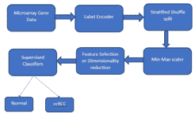

### 5. 结果与讨论

监督分类器将产生预测标签，必须与真实标签进行比较以了解分类性能。本工作使用了多种性能衡量指标，如 `Balanced Accuracy` (`BAC`)、`Precision` (`PREC`)、`Recall`、`F1 score`、`Mathews Correlation Coefficient` (`MCC`) 和 `Cohen’s Kappa Coefficient`。在这六个指标中，除了精确率得分外，其他所有指标都代表了分类模型的整体效果。`Precision score` 与正标签的精确预测有关，而 `recall` 与正类预测的完整性有关。一个良好的分类模型应该具有几乎相等的精确率召回值，但在大多数情况下，分类模型无法实现这一点。因此使用了 `F1 score`，它是通过寻找精确率和召回率之间的调和平均计算得。

## 图 2. 使用方差滤波进行特征选择时各种监督分类器获得的平衡准确率和所选特征数量

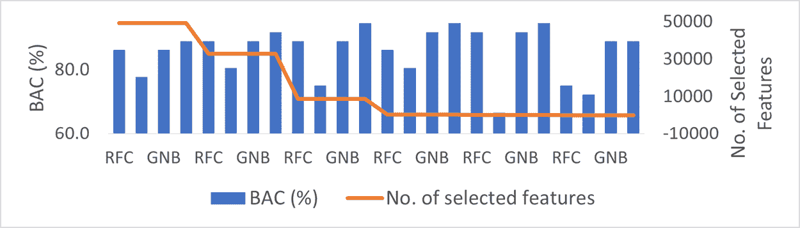

使用 `variance filter` 进行特征选择的四种监督分类器获得的 `BAC` 如图 图 1 所示，并带有所选特征的数量。表 1 显示了在使用 `Variance filter` 作为特征选择技术时，所有四个受检监督分类器的性能衡量指标。所使用的 `variance threshold` 值以及隐含的由于该阈值而选择的特征数量也显示在 表 1 中。`SVC` 获得了最高的 `BAC`，当 `variance threshold` 为 0.125 且特征数量为 62 时为 94.4%。对于相同的方差阈值值，`RFC` 和 `GNB` 也提供了 91.7% 的较高 `BAC`。但当 `variance threshold` 为 0.1 且特征数量为 242 时，`DTC` 需要更多特征，因此提供了 80.6% 的最高 `BAC`。使用 `chi-square test` 进行特征选择时的 `BAC` 和所选特征如图 图 3 所示。表 2 显示了使用 `Chi-square test` 作为特征选择时四种监督分类器的各种性能指标。当选择特征数量为 50 时，`RFC`、`GNB` 和 `SVC` 获得了 94.4% 的最高 `BAC`。但 `DTC` 需要选择更多特征以交付 80.6% 的最大值。

### 表 1. 使用方差滤波进行特征选择的监督分类器性能

| ML Model | Variance Threshold | No. of Selected Features | BAC | PREC | RECALL | MCC | KAPPA |
| :--- | :--- | :--- | :--- | :--- | :--- | :--- | :--- |
| | | | | | | | |
| RFC | 0.025 | 49138 | 86.1 | 86.5 | 84.2 | 88.9 | 72.2 |
| | | | | | | | |
| DTC | 0.025 | 49138 | 77.8 | 77.8 | 55.6 | 55.6 |
| GNB | 0.025 | 49138 | 86.1 | 86.5 | 84.2 | 88.9 | 72.2 |
| SVC | 0.025 | 49138 | 88.9 | 88.9 | 77.8 | 77.8 |
| RFC | 0.035 | 32775 | 88.9 | 88.9 | 77.8 | 77.8 |
| DTC | 0.035 | 32775 | 80.6 | 80.0 | 82.4 | 77.8 | 61.2 |
| GNB | 0.035 | 32775 | 88.9 | 88.9 | 88.9 | 77.8 | 77.8 |
| SVC | 0.035 | 32775 | 91.7 | 91.4 | 94.1 | 88.9 | 83.3 |
| RFC | 0.05 | 8619 | 88.9 | 88.9 | 88.9 | 77.8 | 77.8 |
| DTC | 0.05 | 8619 | 75.0 | 74.3 | 76.5 | 72.2 | 50.1 |
| GNB | 0.05 | 8619 | 88.9 | 88.9 | 88.9 | 77.8 | 77.8 |
| SVC | 0.05 | 8619 | 94.4 | 94.1 | 100.0 | 88.9 | 89.4 |
| RFC | 0.1 | 242 | 86.1 | 86.5 | 84.2 | 88.9 | 72.2 |
| DTC | 0.1 | 242 | 80.6 | 82.1 | 76.2 | 88.9 | 62.0 |
| GNB | 0.1 | 242 | 91.7 | 91.4 | 94.1 | 88.9 | 83.3 |
| SVC | 0.1 | 242 | 94.4 | 94.1 | 100.0 | 88.9 | 89.4 |
| RFC | 0.125 | 62 | 91.7 | 91.4 | 94.1 | 88.9 | 83.3 |
| DTC | 0.125 | 62 | 66.7 | 66.7 | 66.7 | 66.7 | 33.3 |
| GNB | 0.125 | 62 | 91.7 | 91.4 | 94.1 | 88.9 | 83.3 |
| SVC | 0.125 | 62 | 94.4 | 94.1 | 100.0 | 88.9 | 89.4 |
| RFC | 0.15 | 9 | 75.0 | 74.3 | 76.5 | 72.2 | 50.1 |
| DTC | 0.15 | 9 | 72.2 | 70.6 | 75.0 | 66.7 | 44.7 |
| GNB | 0.15 | 9 | 88.9 | 88.2 | 93.8 | 83.3 | 78.3 |
| SVC | 0.15 | 9 | 88.9 | 88.2 | 93.8 | 83.3 | 78.3 |


#### 图 3. 使用卡方检验进行特征选择的各种监督分类器的平衡准确率及所选特征数量

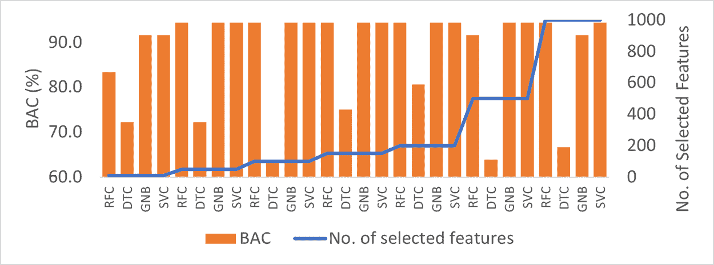

#### 表 2. 使用卡方检验进行特征选择的监督分类器的性能指标

| ML 模型 | 选取的特征数量 | BAC | F1 | PREC | RECALL | MCC | KAPPA |
| --- | --- | --- | --- | --- | --- | --- | --- |
| RFC | 10 | 83.3 | 82.4 | 87.5 | 77.8 | 67.1 | 66.7 |
| DTC | 10 | 72.2 | 72.2 | 72.2 | 72.2 | 44.4 | 44.4 |
| GNB | 10 | 91.7 | 91.4 | 94.1 | 88.9 | 83.5 | 83.3 |
| SVC | 10 | 91.7 | 91.4 | 94.1 | 88.9 | 83.5 | 83.3 |
| RFC | 50 | 94.4 | 94.1 | 100.0 | 88.9 | 89.4 | 88.9 |
| DTC | 50 | 72.2 | 73.7 | 70.0 | 77.8 | 44.7 | 44.4 |
| GNB | 50 | 94.4 | 94.1 | 100.0 | 88.9 | 89.4 | 88.9 |
| SVC | 50 | 94.4 | 94.1 | 100.0 | 88.9 | 89.4 | 88.9 |
| RFC | 100 | 94.4 | 94.1 | 100.0 | 88.9 | 89.4 | 88.9 |
| DTC | 100 | 63.9 | 62.9 | 64.7 | 61.1 | 27.8 | 27.8 |
| GNB | 100 | 94.4 | 94.1 | 100.0 | 88.9 | 89.4 | 88.9 |
| SVC | 100 | 94.4 | 94.1 | 100.0 | 88.9 | 89.4 | 88.9 |
| RFC | 150 | 94.4 | 94.1 | 100.0 | 88.9 | 89.4 | 88.9 |
| DTC | 150 | 75.0 | 66.7 | 100.0 | 50.0 | 57.7 | 50.0 |
| GNB | 150 | 94.4 | 94.1 | 100.0 | 88.9 | 89.4 | 88.9 |
| SVC | 150 | 94.4 | 94.1 | 100.0 | 88.9 | 89.4 | 88.9 |
| RFC | 200 | 94.4 | 94.1 | 100.0 | 88.9 | 89.4 | 88.9 |
| DTC | 200 | 80.6 | 78.8 | 86.7 | 72.2 | 62.0 | 61.1 |
| GNB | 200 | 94.4 | 94.1 | 100.0 | 88.9 | 89.4 | 88.9 |
| SVC | 200 | 94.4 | 94.1 | 100.0 | 88.9 | 89.4 | 88.9 |
| RFC | 500 | 91.7 | 91.4 | 94.1 | 88.9 | 83.5 | 83.3 |
| DTC | 500 | 63.9 | 64.9 | 63.2 | 66.7 | 27.8 | 27.8 |
| GNB | 500 | 94.4 | 94.1 | 100.0 | 88.9 | 89.4 | 88.9 |
| SVC | 500 | 94.4 | 94.1 | 100.0 | 88.9 | 89.4 | 88.9 |
| RFC | 1000 | 94.4 | 94.1 | 100.0 | 88.9 | 89.4 | 88.9 |
| DTC | 1000 | 66.7 | 68.4 | 65.0 | 72.2 | 33.5 | 33.3 |
| GNB | 1000 | 91.7 | 91.4 | 94.1 | 88.9 | 83.5 | 83.3 |
| SVC | 1000 | 94.4 | 94.1 | 100.0 | 88.9 | 89.4 | 88.9 |

使用 ANOVA 检验进行特征选择的四个监督分类器的 BAC 所示 图 4 对应的特征数量。当所选特征数量为 15 时，由于卡方检验，`GNB` 和 `SVC` 两个分类器达到了 94.4% 的最高 BAC。对于相同数量的特征，`DTC` 提供 86.5% 的 BAC。`RFC` 需要 30 个特征才能达到 94.4% 的最大 BAC。使用 ANOVA 检验作为特征选择时，四个监督分类器的其他性能见 表 3。

#### 表 3. 使用 ANOVA 检验进行特征选择的监督分类器的性能指标

| ML 模型 | 选取的特征数量 | BAC | F1 | PREC | RECALL | MCC | KAPPA |
| --- | --- | --- | --- | --- | --- | --- | --- |
| RFC | 10 | 86.1 | 85.7 | 88.2 | 83.3 | 72.2 | 72.3 |
| DTC | 10 | 80.6 | 81.1 | 78.9 | 83.3 | 61.2 | 61.1 |
| GNB | 10 | 94.4 | 94.1 | 100.0 | 88.9 | 89.4 | 88.9 |
| SVC | 10 | 94.4 | 94.1 | 100.0 | 88.9 | 89.4 | 88.9 |
| RFC | 15 | 86.1 | 85.7 | 88.2 | 83.3 | 72.3 | 72.2 |
| DTC | 15 | 86.1 | 86.5 | 84.2 | 88.9 | 72.3 | 72.2 |
| GNB | 15 | 94.4 | 94.1 | 100.0 | 88.9 | 89.4 | 88.9 |
| SVC | 15 | 94.4 | 94.1 | 100.0 | 88.9 | 89.4 | 88.9 |
| RFC | 30 | 94.4 | 94.1 | 100.0 | 88.9 | 89.4 | 88.9 |
| DTC | 30 | 69.4 | 71.8 | 66.7 | 77.8 | 39.4 | 38.9 |
| GNB | 30 | 94.4 | 94.1 | 100.0 | 88.9 | 89.4 | 88.9 |
| SVC | 30 | 94.4 | 94.1 | 100.0 | 88.9 | 89.4 | 88.9 |
| RFC | 50 | 88.9 | 88.9 | 88.9 | 88.9 | 77.8 | 77.8 |
| DTC | 50 | 66.7 | 70.0 | 63.6 | 77.8 | 34.2 | 33.3 |
| GNB | 50 | 94.4 | 94.1 | 100.0 | 88.9 | 89.4 | 88.9 |
| SVC | 50 | 94.4 | 94.1 | 100.0 | 88.9 | 89.4 | 88.9 |
| RFC | 100 | 94.4 | 94.1 | 100.0 | 88.9 | 89.4 | 88.9 |
| DTC | 100 | 77.8 | 77.8 | 77.8 | 77.8 | 55.6 | 55.6 |
| GNB | 100 | 91.7 | 91.4 | 94.1 | 88.9 | 83.5 | 83.3 |
| SVC | 100 | 94.4 | 94.1 | 100.0 | 88.9 | 89.4 | 88.9 |
| RFC | 200 | 91.7 | 90.9 | 100.0 | 83.3 | 84.5 | 83.3 |
| DTC | 200 | 77.8 | 78.9 | 75.0 | 83.3 | 55.9 | 55.6 |
| GNB | 200 | 91.7 | 91.4 | 94.1 | 88.9 | 83.5 | 83.3 |
| SVC | 200 | 94.4 | 94.1 | 100.0 | 88.9 | 89.4 | 88.9 |
| RFC | 500 | 88.9 | 88.2 | 93.8 | 83.3 | 78.3 | 77.8 |
| DTC | 500 | 69.4 | 68.6 | 70.6 | 66.7 | 38.9 | 38.9 |
| GNB | 500 | 91.7 | 91.4 | 94.1 | 88.9 | 83.5 | 83.3 |
| SVC | 500 | 94.4 | 94.1 | 100.0 | 88.9 | 89.4 | 88.9 |
| RFC | 1000 | 94.4 | 94.1 | 100.0 | 88.9 | 89.4 | 88.9 |
| DTC | 1000 | 66.7 | 68.4 | 65.0 | 72.2 | 33.5 | 33.3 |
| GNB | 1000 | 91.7 | 91.4 | 94.1 | 88.9 | 83.5 | 83.3 |
| SVC | 1000 | 94.4 | 94.1 | 100.0 | 88.9 | 89.4 | 88.9 |

#### 图 4. 使用 ANOVA 检验进行特征选择的各种监督分类器的平衡准确率及所选特征数量

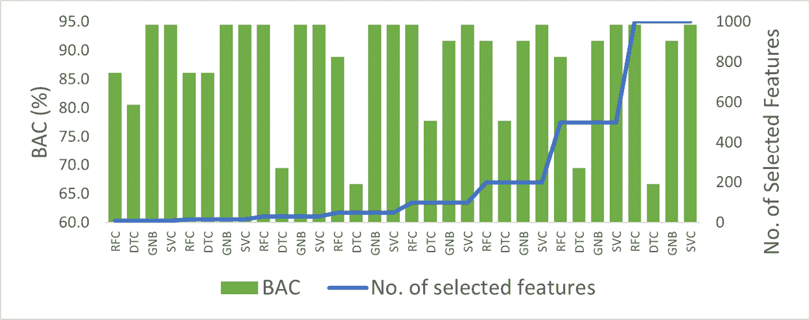

使用 MI 过滤器进行特征选择的四个监督分类器的 BAC 所示 表 4。当所选特征数量为 15 时，由于 MI 检验，`GNB` 和 `SVC` 两个分类器达到了 94.4% 的最高 BAC。对于相同数量的特征，`DTC` 提供 86.5% 的 BAC。`RFC` 需要 30 个特征才能达到 94.4% 的最大 BAC。

#### 表 4. 使用 MI 过滤器的监督分类器性能指标

| ML 模型 | 选取的特征数量 | BAC | F1 | PREC | RECALL | MCC | KAPPA |
| --- | --- | --- | --- | --- | --- | --- | --- |
| RFC | 10 | 83.3 | 82.4 | 87.5 | 77.8 | 67.1 | 66.7 |
| DTC | 10 | 72.2 | 72.2 | 72.2 | 72.2 | 44.4 | 44.4 |
| GNB | 10 | 91.7 | 91.4 | 94.1 | 88.9 | 83.5 | 83.3 |
| SVC | 10 | 91.7 | 91.4 | 94.1 | 88.9 | 83.5 | 83.3 |
| RFC | 50 | 94.4 | 94.1 | 100.0 | 88.9 | 89.4 | 88.9 |
| DTC | 50 | 72.2 | 73.7 | 70.0 | 77.8 | 44.7 | 44.4 |
| GNB | 50 | 94.4 | 94.1 | 100.0 | 88.9 | 89.4 | 88.9 |
| SVC | 50 | 94.4 | 94.1 | 100.0 | 88.9 | 89.4 | 88.9 |
| RFC | 100 | 94.4 | 94.1 | 100.0 | 88.9 | 89.4 | 88.9 |
| DTC | 100 | 63.9 | 62.9 | 64.7 | 61.1 | 27.8 | 27.8 |
| GNB | 100 | 94.4 | 94.1 | 100.0 | 88.9 | 89.4 | 88.9 |
| SVC | 100 | 94.4 | 94.1 | 100.0 | 88.9 | 89.4 | 88.9 |
| RFC | 150 | 94.4 | 94.1 | 100.0 | 88.9 | 89.4 | 88.9 |
| DTC | 150 | 75.0 | 66.7 | 100.0 | 50.0 | 57.7 | 50.0 |
| GNB | 150 | 94.4 | 94.1 | 100.0 | 88.9 | 89.4 | 88.9 |
| SVC | 150 | 94.4 | 94.1 | 100.0 | 88.9 | 89.4 | 88.9 |
| RFC | 200 | 94.4 | 94.1 | 100.0 | 88.9 | 89.4 | 88.9 |
| DTC | 200 | 80.6 | 78.8 | 86.7 | 72.2 | 62.0 | 61.1 |
| GNB | 200 | 94.4 | 94.1 | 100.0 | 88.9 | 89.4 | 88.9 |
| SVC | 200 | 94.4 | 94.1 | 100.0 | 88.9 | 89.4 | 88.9 |
| RFC | 500 | 91.7 | 91.4 | 94.1 | 88.9 | 83.5 | 83.3 |
| DTC | 500 | 63.9 | 64.9 | 63.2 | 66.7 | 27.8 | 27.8 |
| GNB | 500 | 94.4 | 94.1 | 100.0 | 88.9 | 89.4 | 88.9 |
| SVC | 500 | 94.4 | 94.1 | 100.0 | 88.9 | 89.4 | 88.9 |
| RFC | 1000 | 94.4 | 94.1 | 100.0 | 88.9 | 89.4 | 88.9 |
| DTC | 1000 | 66.7 | 68.4 | 65.0 | 72.2 | 33.5 | 33.3 |
| GNB | 1000 | 91.7 | 91.4 | 94.1 | 88.9 | 83.5 | 83.3 |
| SVC | 1000 | 94.4 | 94.1 | 100.0 | 88.9 | 89.4 | 88.9 |


接下来以类似的方式展示了各种降维技术获得的结果。使用 `PCA` 作为降维技术时，四种监督分类器获得的 `BAC` 如图图 6 所示，并包含了所选特征的数量。当选择 10 个特征时，`SVC` 提供了 94.4% 的最高 `BAC`。在相同特征数量下，`RFC` 的 `BAC` 为 88.9%，位居第二。`DTC` 和 `GNB` 的表现较差，当选特征数量分别为 100 和 10 时，`BAC` 分别为 86.1% 和 83.3%。表 4 显示了在 `PCA` 作为降维技术时，四种测试监督分类器的所有性能指标。

### 表 5. 使用 PCA 进行降维的监督分类器性能指标

| ML 模型 || 所选特征数量 || BAC | F1 | PREC | RECALL || MCC | KAPPA |
| --- | --- | --- | --- | --- | --- | --- | --- |
| RFC | 10 | 88.9 | 88.9 | 88.9 | 88.9 | 77.8 | 77.8 |
| DTC | 10 | 83.3 | 82.4 | 87.5 | 77.8 | 67.1 | 66.7 |
| GNB | 10 | 83.3 | 83.3 | 83.3 | 83.3 | 66.7 | 66.7 |
| SVC | 10 | 94.4 | 94.1 | 100.0 | 88.9 | 89.4 | 88.9 |
| RFC | 30 | 83.3 | 82.4 | 87.5 | 77.8 | 67.1 | 66.7 |
| DTC | 30 | 80.6 | 78.8 | 86.7 | 72.2 | 62.0 | 61.1 |
| GNB | 30 | 50.0 | 10.0 | 50.0 | 5.6 | 0.0 | 0.0 |
| SVC | 30 | 91.7 | 91.4 | 94.1 | 88.9 | 83.5 | 83.3 |
| RFC | 50 | 80.6 | 77.4 | 92.3 | 66.7 | 63.6 | 61.1 |
| DTC | 50 | 77.8 | 78.9 | 75.0 | 83.3 | 55.9 | 55.6 |
| GNB | 50 | 50.0 | 10.0 | 50.0 | 5.6 | 0.0 | 0.0 |
| SVC | 50 | 91.7 | 91.4 | 94.1 | 88.9 | 83.5 | 83.3 |
| RFC | 100 | 83.3 | 83.3 | 83.3 | 83.3 | 66.7 | 66.7 |
| DTC | 100 | 86.1 | 86.5 | 84.2 | 88.9 | 72.3 | 72.2 |
| GNB | 100 | 77.8 | 77.8 | 77.8 | 77.8 | 55.6 | 55.6 |
| SVC | 100 | 94.4 | 94.1 | 100.0 | 88.9 | 89.4 | 88.9 |

### 图 6. 使用 PCA 进行降维的各种监督分类器的平衡准确率及所选特征数量

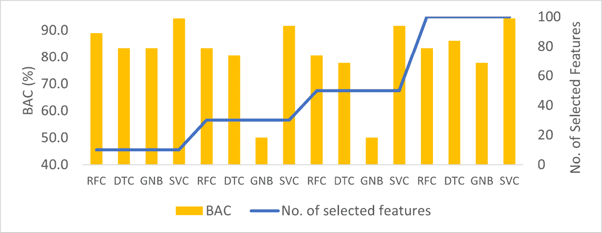

使用 `ICA` 进行降维时，监督分类器的各种性能指标如表 6 所示。此外，`BAC` 和所特征的数量在图 7 中描述。`RFC` 和 `SVC` 分类器获得的最高 `BAC` 为 91.7%。`DTC` 和 `GNB` 提供了 83.3% 的 `BAC`。当所选特征数量为 10 时，所有四个分类器均达到了上述 `BAC`。

### 表 6. 使用 ICA 的监督分类器性能指标

| ML 模型 || 所选特征数量 || BAC | F1 | PREC | RECALL || MCC | KAPPA |
| --- | --- | --- | --- | --- | --- | --- | --- |
| RFC | 10 | 91.7 | 91.4 | 94.1 | 88.9 | 83.5 | 83.3 |
| DTC | 10 | 83.3 | 82.4 | 87.5 | 77.8 | 67.1 | 66.7 |
| GNB | 10 | 83.3 | 83.3 | 83.3 | 83.3 | 66.7 | 66.7 |
| SVC | 10 | 91.7 | 91.4 | 94.1 | 88.9 | 83.5 | 83.3 |
| RFC | 30 | 77.8 | 75.0 | 85.7 | 66.7 | 57.0 | 55.6 |
| DTC | 30 | 44.4 | 28.6 | 40.0 | 22.2 | 12.4 | 11.1 |
| GNB | 30 | 63.9 | 43.5 | 100.0 | 27.8 | 40.2 | 27.8 |
| SVC | 30 | 88.9 | 88.2 | 93.8 | 83.3 | 78.3 | 77.8 |
| RFC | 50 | 66.7 | 50.0 | 100.0 | 33.3 | 44.7 | 33.3 |
| DTC | 50 | 58.3 | 51.6 | 61.5 | 44.4 | 17.3 | 16.7 |
| GNB | 50 | 77.8 | 73.3 | 91.7 | 61.1 | 58.9 | 55.6 |
| SVC | 50 | 61.1 | 36.4 | 100.0 | 22.2 | 35.4 | 22.2 |
| RFC | 100 | 55.6 | 33.3 | 66.7 | 22.2 | 14.9 | 11.1 |
| DTC | 100 | 50.0 | 35.7 | 50.0 | 27.8 | 0.0 | 0.0 |
| GNB | 100 | 58.3 | 28.6 | 100.0 | 16.7 | 30.2 | 16.7 |
| SVC | 100 | 72.2 | 61.5 | 100.0 | 44.4 | 53.5 | 44.4 |

### 图 7. 使用 ICA 的各种监督分类器的平衡准确率及所选特征


汇总来看，各种特征选择或降维技术的最佳性能指标如表 7 所示。最优特征选择或降维应通过更少的特征提供更高的指标。在这种情况下，基于 ANOVA 的特征选择被认为是乳腺癌的最佳方案，因为它在除 `SVC` 之外的三个分类器中以最少特征提供了最高的 `BAC`。对于 `RFC` 和 `GNB`，最高 `BAC` 为 94.4%，而对于 `DTC`，最高 `BAC` 为 86.1%。`SVC` 在 `ANOVA` 和 `PCA` 下均达到了 94.4% 的 `BAC`。但 `PCA` 使用的特征数量为 10，而 `ANOVA` 在 `SVC` 上需要 15 个以达到最大 `BAC`。`RFC` 需要通过 ANOVA 选择 30 个特征来实现 94.4% 的 `BAC`，而 `GNB` 和 `DTC` 仅需 15 个。因此，比较所有监督分类器和特征选择或降维，可以得出 `PCA-SVC` 是少特征乳腺癌检测的最优方案。所有测试分类器的性能都得到了提升。由于特征数量减少，模型的训练时间和复杂度将降低。

通过与没有任何特征选择或降维技术的原始分类器进行比较，可以很好地理解建议的 `PCA-SVC` 的重要性。在四个原始分类器中，`SVC` 使用 64 个特征产生了 91.7% 的最高 `BAC`。但建议的 `PCA-SVC` 仅使用 10 个特征就产生了 94.4% 的 `BAC`。同样，在具有最少特征的降维技术和其他分类器中也可以观察到更好的性能。接下来将讨论各种特征选择和降维技术相对于原始分类器的性能。

### 表 7. 各种特征选择或降维技术的最佳性能指标

| || || BAC | F1 | PREC | RECALL || MCC | KAPPA | 最优特征数量 |
| --- | --- | --- | --- | --- | --- | --- | --- |
| 原始 (Plain) | RFC | 86.1 | 86.5 | 84.2 | 88.9 | 72.3 | 72.2 | 54675 |
| | DTC | 83.3 | 83.3 | 83.3 | 83.3 | 66.7 | 66.7 | 54675 |
| | GNB | 86.1 | 86.5 | 84.2 | 88.9 | 72.3 | 72.2 | 54675 |
| | SVC | 91.7 | 91.4 | 94.1 | 88.9 | 83.5 | 83.3 | 54675 |
| 方差滤波 (Variance Filter) | RFC | 91.7 | 91.4 | 94.1 | 88.9 | 83.5 | 83.3 | 62 |
| | DTC | 80.6 | 82.1 | 76.2 | 88.9 | 62.0 | 61.1 | 242 |
| | GNB | 91.7 | 91.4 | 94.1 | 88.9 | 83.5 | 83.3 | 62 |
| | SVC | 94.4 | 94.1 | 100.0 | 88.9 | 89.4 | 88.9 | 62 |
| 卡方检验 (Chi-square) | RFC | 94.4 | 94.1 | 100.0 | 88.9 | 89.4 | 88.9 | 50 |
| | DTC | 80.6 | 78.8 | 86.7 | 72.2 | 62.0 | 61.1 | 200 |
| | GNB | 94.4 | 94.1 | 100.0 | 88.9 | 89.4 | 88.9 | 50 |
| | SVC | 94.4 | 94.1 | 100.0 | 88.9 | 89.4 | 88.9 | 50 |
| ANOVA | RFC | 94.4 | 94.1 | 100.0 | 88.9 | 89.4 | 88.9 | 30 |
| | DTC | 86.1 | 86.5 | 84.2 | 88.9 | 72.3 | 72.2 | 15 |
| | GNB | 94.4 | 94.1 | 100.0 | 88.9 | 89.4 | 88.9 | 15 |
| | SVC | 94.4 | 94.1 | 100.0 | 88.9 | 89.4 | 88.9 | 15 |


| SVC | 94.4 | 94.1 | 100.0 | 88.9 | 89.4 | 88.9 | 15 |
| 互信息滤波 | RFC | 91.7 | 91.4 | 94.1 | 88.9 | 83.5 | 83.3 | 100 |
| DTC | 83.3 | 82.4 | 87.5 | 77.8 | 67.1 | 66.7 | 10 |
| GNB | 88.9 | 88.9 | 88.9 | 88.9 | 77.8 | 77.8 | 10 |
| SVC | 94.4 | 94.1 | 100.0 | 88.9 | 89.4 | 88.9 | 30 |
| PCA | RFC | 88.9 | 88.9 | 88.9 | 88.9 | 77.8 | 77.8 | 10 |
| DTC | 86.1 | 86.5 | 84.2 | 88.9 | 72.3 | 72.2 | 100 |
| GNB | 83.3 | 83.3 | 83.3 | 83.3 | 66.7 | 66.7 | 10 |
| SVC | 94.4 | 94.1 | 100.0 | 88.9 | 89.4 | 88.9 | 10 |
| ICA | RFC | 91.7 | 91.4 | 94.1 | 88.9 | 83.5 | 83.3 | 10 |
| DTC | 83.3 | 82.4 | 87.5 | 77.8 | 67.1 | 66.7 | 10 |
| GNB | 83.3 | 82.4 | 87.5 | 77.8 | 67.1 | 66.7 | 10 |
| SVC | 91.7 | 91.4 | 94.1 | 88.9 | 83.5 | 83.3 | 10 |
| LDA | RFC | 83.3 | 82.4 | 87.5 | 77.8 | 67.1 | 66.7 | 10 |
| DTC | 83.3 | 82.4 | 87.5 | 77.8 | 67.1 | 66.7 | 10 |
| GNB | 91.7 | 90.9 | 100.0 | 83.3 | 84.5 | 83.3 | 10 |
| SVC | 91.7 | 90.9 | 100.0 | 83.3 | 84.5 | 83.3 | 10 |

当采用基于方差的特征选择时，除 `DTC` 外，其他三个分类器均优于基础分类器。例如，基础的 `RFC` 和基础 `GNB` 均提供了 `86.1%` 的 `BAC`，而通过基于方差的特征选择技术，它们提升到了 `91.7%` 的 `BAC`。同样，`SVC` 的性能也由于这种特征选择技术从 `91.7%` 提升到了 `94.4%` `BAC`。与方差滤波一样，卡方检验也增强了除 `DTC` 之外所有分类器的性能。基于互信息的特征选择技术也为 `RFC`、`GNB` 和 `SVC` 带来了更好的性能，而 `DTC` 的性能与基础 `DTC` 相似。

与降维技术相比，许多特征选择技术可以提供 `94.4%` 的最高 `BAC`，而在所研究的降维技术中，仅 `PCA-SVC` 提供了这 `94.4%` 的 `BAC`。`PCA` 降低了 `GNB` 的性能，但提升了 `DTC`、`RFC` 和 `SVC` 的性能，而 `ICA` 只能提高 `RFC` 和 `SVC` 的分类性能。同样，将 `LDA` 作为降维技术的使用仅增强了 `GNB` 和 `SVC` 的性能。

### 6. 结论

本文针对肾癌诊断的微基基因表达分析，研究了四种不同的特征选择技术和三种不同的降维技术。为了清晰这些特征选择和降维技术提供的性能，本工作使用了四种监督分类器，即 `RFC`、`SVC`、`GNB` 和 `DTC`。`RFC`、`SVC` 和 `GNB` 模型在减少特征数量的情况下提供了 `94.4%` 的最高 `BAC`。其中，最佳模型是 `PCA-SVC`，因为它仅需十个特征就提供了 `94.4%` 的 `BAC`。

考虑到所有所研究的特征选择和降维技术的分类性能，基于 `ANOVA` 测试的特征选择位于第一。通过基于 `ANOVA` 测试的特征选择，所有四个测试的分类器均获得了性能提升。所有其他研究的特征选择和降维技术未能在这四个测试分类器中共同提供改进的性能。显然，由于特征数量的减少，训练时间和复杂度将会降低。所提 `PCA-SVC` 的主要局限性是召回率较低（89.9%`）。尽管 `PCA-SVC` 达到了 `100%` 的精确率，但召回率相对较低，需要改进。对于其他应用和其他类型的诊断，这些特征选择和降维技术在未来需要实施和研究。此外，还需要通过基因表达分析检查用于肾癌的其他监督分类器。未来需要找到平衡准确率超过 `95%` 的其他技术。

### 参考文献

Bhinder, B., Gilvary, C., Madhukar, N. S., & Elemento, O. (2021). 癌症研究与精准医学中的人工智能。Cancer Discovery, 11(4), 900–915. [10.1158/2159-8290.CD-21-0090](http://dx.doi.org/10.1158/2159-8290.CD-21-0090)[](http://dx.doi.org/33811123)

Cruz, J. A., & Wishart, D. S. (2006). 机器学习在癌症预测和预后中的应用。Cancer Informatics, 2. [10.1158/2159-8290.CD-21-0090](http://dx.doi.org/10.1158/2159-8290.CD-21-0090)


及时、准确的诊断对于癫痫的有效治疗至关重要，癫痫是一种以反复性发作为特征的神经系统疾病。由于脑电图（EEG）数据能够捕捉大脑活动，它是癫痫诊断中的关键。。所提系统对利用集成学习技术的癫痫检测 EEG 信号处理策略进行了详细比较，并研究了`gradient boosting`、`AdaBoost`、`XGBoost`和`bagging classifier`等集成算法在提高癫痫检测方面的作用。通过使用这些集成方法，系统对 EEG 数据进行预处理、特征提取和分类。准确率、精确率、召回率和`F1-score`是用于评估每种集成方法效率的性能指标。结果是通过对良好的数据集进行广泛测试获得的。所提系统的发现阐明了每种集成技术在判断是否存在癫痫方面的积极影响和调节作用。

### 引言

全球有数百万人遭受癫痫的痛苦，这是一种以反复和意外发作为特征的神经系统疾病。为癫痫发作患者提供适当的医疗护理并提高其生活质量，快速准确地识别癫痫发作至关重要。EEG 记录捕捉了中枢神经系统的电活动。由于其具有识别与发作相关的异常神经模式的潜力，它被证明是诊断癫痫的有效数据。近年来，将机器学习技术整合到 EEG 分析中在自动化识别程序方面取得了显著进展。由于电极数量巨大且脉冲具有持续性，EEG 记录提供了高维数据。此类高维数据需要复杂的方法来提取相关特征和模式。EEG 读数显示出较高的个体间波动，这意味着大脑活动模式在不同人之间可能存在差异。这种不可预测性使得创建能够正确检测各种患者发作的通用模型变得困难。EEG 信号中的噪声可能来自多种来源，如肌肉活动、眼动和环境干扰。消除或减少这些噪声源对于可靠的癫痫识别至关重要。为癫痫检测选择最佳分类方法并不容易。不同算法对不同模式的反应不同，因此必须进行适应。本研究旨在探讨如何利用集成技术提高使用 EEG 数据进行癫痫筛选的精确性和可靠性。集成方法通过融合许多基础模型以获得最终更稳健更准确的预测，这种能力在机器学习领域越来越受欢迎。集成方法通过利用多种不同的模型可以限制过拟合、减少偏差并捕捉数据中复杂的模式。

本研究的初衷是对癫痫进行精确和及时识别的迫切需求。EEG 信号提供了一种记录大脑活动和识别与发作相关的异常模式是非侵入且有效的方法。EEG 信号包含多种形式的噪声，如表 1 所示。

## 表 1.不同的脑波及其频率

| 波形类型 | 发生情况 | 频率 |
| --- | --- | --- |
| 德波 (Delta waves) | 慢波睡眠 | 0.5 - 4 Hz |
| Theta 波 (Theta waves) | 昏睡 | 4 Hz - 8Hz |
| Alpha 波 (Alpha waves) | 放松清醒 | 8 Hz - 13Hz |
| Beta 波 (Beta waves) | 活跃精神状态 | 13 Hz – 30 Hz |
| 伽马波 (Gamma waves) | 高级认知过程 | 30 Hz -100 Hz |

### 文献综述

Ai 等人，(2023) 提出了分析癫痫 EEG 数据并获取发间期和发前 EEG 特征图的技术。`CNN`通过单通道技术减少网络参数以最小化神经元范围和网络复杂度，并将时频特征图插入其中进行学习。Hussain 等人，(2022) 提出了一个分类框架，利用子问题的集成在有限数据下实现高精确度。Hassan 等人，(2016) 提出了一种基于单导联 EEG 的受控癫痫检测方法，使用新发现的信号处理策略解构 EEG 信号段。基于`Mahalanobis distance`和`DWT`的理论基础，Song 等人，(2016) 引入了一种新型基于马哈拉比相似性的特征选择方法。为了进一步增强性能，将基于样本熵和基于马哈拉比相似性的特征相结合，以生成融合特征（`MS-SE-FF`）和特征融合层。Mporas 等人，(2015) 提供了一个基于时域和频域特征的模块。所有研究受者的发作检测准确率达到 90%。

Raghu 等人，(2019) 使用`sigmoid entropy` 引入了一种自动发作检测模型。该计算高效的特征是通过离散小波变换结合非线性 `SVM` 创建的。Tasci 等人，(2023) 提供了一种独特的基于超立方体的特征提取器，它可以创建两个特征向量并使用`Multilevel-DWT` 进行提取。Kaleem 等人，(2018) 利用从小波分解多通道 EEG 数据恢复的手工特征提出了一种特定患者的发作检测方法。Fccici 等人 (2022) 引入了一种分类 TLE 发间期和发作期的新自动化方法。Li 等人，(2017) 提供了一种识别癫痫信号的技术。根据 Ghazali 等人，(2022)，使用`DWT` 和改进二值藻群算法（`MBSSA`）将 EEG 信号分为不同的频率级。Sunaryono 等人，(2022) 开发了利用 EEG 数据进行直观癫痫识别的技术。使用离散傅里叶变换（`DFT`）和`DWT`处理原始 EEG 数据。为了准确分类信号，随后人工神经网络（`ANN`）提供了通过小波分解生成的新的特征集，如 Bairagi 等人，(2021) 所述。Shen 等，(2023) 提供了一种基于可调 Q 小波变换和`CNN`的识别癫痫发作的 EEG 实时技术。


根据 Gong 等人 (2020) 的颅内脑电图 (iEEG) 癫作识别方法，iEEG 数据利用前向传播和反馈神经网络进行离散小波变换 (DWT) 分析。Gao 等人，(2023) 提供了一种用于识别信号特征的多步技术，以识别癫痫。通过使用最佳小波，他们应用了小波变换来消除信号噪声 (Dabichiz 8)。为了识别发作，Kaur 等人 (2023) 提出了一种基于迁移学习和 EEG 图像表示的方法（通过在不同尺度和时间间隔应用 `WT` 创建）。Sharma 等人，(2020) 提供了一种自动癫痫发作诊断策略，并展示了该方法使用深度神经网络算法在发作识别方面的有效性。Albaqami 等人，(2023) 创建了多路径发作类型分类深度学习网络。在与连续小波变换 (CWT) 和 DWT 分类的对比研究中，Gosala 等人，(2023) 展示了小波散射变换在神经障碍诊断中的应用。

## 材料

脑电图 (EEG) 数据包含个人记录的脑电图 (EEG) 数据。EEG 数据集在大小、内容和特定目标方面可能有所不同。通常，EEG 数据集的概述包括原始数据、通道信息、标签、预处理元数据和采样率 (Sample Rate)。癫痫发作识别，在线可用：[`www.kaggle.com/datasets/harunshimanto/epileptic-seizure-recognition`](https://www.kaggle.com/datasets/harunshimanto/epileptic-seizure-recognition)。

## 系统架构

所提研究旨在对使用 EEG 数据检测癫痫的集成方法进行彻底的对比综述。该研究将调查各种集成算法在将 EEG 记录可靠地分类为癫痫和非癫痫类别方面的功效。然而，由于 EEG 数据的复杂性以及区分正常模式和癫痫模式的困难，需要广泛的数据处理和分类方法。所提方案的系统设计通过若干测试和训练模型对比现有算法，以根据单个 EEG 数据集确定性能指标。

## 图 1. 癫痫检测系统架构

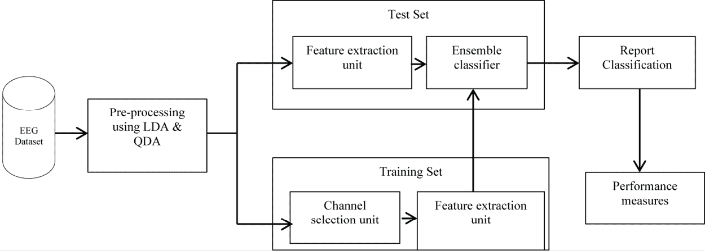

在利用 TensorFlow 平台基础提取 EEG 数据集后，预处理方法使用了线性判别分析 (`LDA`) 和二次判别分析 (`QDA`)，如图 1 所示。它将高维质量图像转换为带有向量矩阵的低维质量图像。需要记住，`LDA` 在某些 EEG 信号处理任务中是可以成功的。其有效性取决于数据的质量、特征的选择以及其线性参数对底层数据分布的适用性。使用 `QDA` 时，对不同类别相同协方差矩阵的假设被放，而不是假设所有类别具有相同的协方差矩阵。当等协方差矩阵假设不满足时，`QDA` 非常有用。例如，如果不同类别具有显著不同的变异性，`QDA` 比 `LDA` 更精确地捕捉 EEG 数据中的变异。然而，同样重要的是，当缺乏数据时，`QDA` 可能会出现过拟合。在 `LDA` 和 `QDA`（或其他分类方法）之间的选择，与每种分析方法一样，取决于你的数据特征和研究目标。针对 EEG 信号分类挑战的最佳方法必须通过广泛的测试和分析来选择。

数据集分为测试集和训练集。在测试集中，使用特征提取对数据集进行检查，这涉及从原始数据中挑选、转换和表示特定信息，以产生一个更简单但信息丰富的表示，可用于分析、分类和其他活动。为了提高预测准确性、泛化和鲁棒性，集成分类器结合了多个不同的个体模型。它们通过结合来自各种基模型的结果，根据这些模型的聚合预测做出最终预测。集成分类器背后的理论是，结合各种模型的优点可以克服任何给定模型的缺点，并提供更高的整体性能。当可用多个通道但并非所有通道对任务同等有用或相关时，情况尤为如此。

通过通道选择可以增强模型性能、减少过拟合并提高解释性。通道选择的结果将再次通过另一个特征提取单元，与集成分类器进行比较。集成分类器在学习算法结论并根据该数据集所使用的多种算法准备好分类报告后，计算最终性能指标，包括准确率、精确率、F1 分和召回率。实验部分列出并讨论了每个算法的优缺点。

### EEG 分析分类

#### AdaBoost

AdaBoost (自适应提升) 是一种属于集成家族的机器学习算法。与梯度提升不同，AdaBoost 在每次迭代中调整每个数据点的权重，以关注那些被分类错误的点。该方法的伪代码如下。

输入：
- 训练数据集 (`X_train`, `y_train`)：特征向量和相应标签
- 弱分类器数量 (`T`)
- 弱学习器算法（例如，决策树）

初始化
- 初始化每个样本 i 的权重 `w[i]` = `1/N`，其中 `N` 是样本数量
- 初始化弱分类器列表：`weak_classifiers`
- 初始化弱分类器权重列表：`classifier_weights`

对于 `t = 1` 到 `T`：

归一化样本权重：对于所有 i，`w[i] = w[i]/∑w[i]`

使用权重训练弱分类器：
- 使用权重 `w[i]` 在 `X_train` 上拟合弱学习器
- 预测所有样本的标签并计算误差 `ε[t]`，即误分类样本的 `w[i]` 之和

计算弱分类器权重 `α[t]`：
- 计算 `α[t] = 0.5 * ln((1−ε[t])/ε[t])`
- 将 `α[t]` 添加 `classifier_weights`

更新样本权重 `w[i]`：
- 对于每个样本：
    - 如果分类正确，`w[i] = w[i] * exp(-α[t])`
    - 如果分类错误，`w[i] = w[i] * exp(α[t])`

存储弱分类器：
- 将训练好的弱分类器添加到 `weak_classifiers`

最终分类：
- 初始化加权预测数组：`weighted_preds = [0, 0, ..., 0]`（长度 =样本数量），对于每个弱分类器索引 `t`，将 `α[t]` 预测添加到 `weighted_preds`

```
H(x) = sign\left(\sum_{t = 1}^{T}\alpha_{t}h_{t}(x)\right)
```
- `ht` 是第 t 个弱分类器对输入 x 的输出

对于每个样本 i：
- 如果 `weighted_preds[i] >= 0.5`，分类为“癫痫”
- 否则，分类为“非癫痫”

输出
- 集集成分类器

#### 多层感知机 (MLP)


MLP 架构常用于各种机器学习任务，包括分类和回归。多个相互连接的节点构成了 MLP。它处理输入数据并学习做出预测或决策。

#### 随机森林

在机器学习中，广泛使用的集成学习技术 `Random Forest` 被用于分类和回归应用。它的基础是：在训练期间构建了多棵决策树，随后将它们的结果结合以提供预测。“随机森林”一词指的是一组通过随机选择数据训练而成的决策树（即森林）。

#### 梯度提升

`gradient boosting` 是属于集成学习组的一种机器学习算法。梯度提升涉及逐接向模型中引入弱学习器，而每个弱学习器都关注前一个学习器所犯的错误。该算法通过在过程每个步骤中调整每个弱学习器的权重或参数，来最小化组合模型的误差。这产生了一个比任何单个弱学习器都准确的强预测模型。

## XGBoost

XGBoost 是一种在梯度提升框架内工作的机器学习技术，它逐渐将弱学习器（通常是决策树）引入模型中。每个新的“学生”都努力减少前一个学生所犯的错误。这种方法会持续进行，直到完成预定的迭代次数或达到预定的性能指标。

## Bagging 分类器

Bagging 分类器属于集成学习家族。它代表自助聚合（Bootstrap Aggregating），其主要目标是通过结合多个基学习器的预测结果来增强模型的准确性和稳健性。Bagging 在减少单个模型的方差和潜在过拟合方面特别有效。

#### 决策树

`decision Tree` 算法根据 Gini 纯度或熵等不纯度量选择分裂特征。然后递归地将数据集划分为子集，直到满足停止条件（如达到特定深度或最小样本数）。为了进行预测，每个叶节点被分配目标变量平均值（对于回归）。

#### 支持向量机 (SVM)

对于分类和回归问题，使用了多功能机器学习技术 `SVM`。它寻找最有利的超平面（或潜在的决策边界）来分割多个数据类别。

#### K 近邻 (KNN)

它基于特定特征空间内数据点之间的相似性提供预测。`KNN` 的基本原理是相似的数据点经常共享相似的值。通过在训练集中找到 k 个最近的数据点并利用它们的标签（分类）或值（回归），它对对新数据点进行分类或估计。

## 朴叶贝斯分类器

一种用于分类问题的概率机器学习技术被称为 `Naive Bayes Classifier`。“朴素”假设简化了计算并允许算法高效地做出预测，特别是在处理文本和高维数据时。

### 结果与讨论

测试期间，电极被应用于头皮，以检测并放大脑神经元以产生电脉冲。EEG 信号可用于多种医疗背景，以理解脑活动并利用不同的机器学习方法对其功能进行评估。

### 图 2 类“0”的精确率与召回率

`SVM` 通过寻找尽可能分开几类数据点的超平面运行。一种名为 `MLP` 的人工神经网络设计可分类和回归问题。其多层神经元中的每一层都执行线性变换。一种被称为“随机森林”的集成学习方法结合了许多决策树的预测。这使得预测更加准确。最有效的机器学习方法将取决于具体的 EEG 信号分析任务、数据集的大小和复杂性、需要分离的类别数量以及所需的精度。`SVMs` 和 `MLPs` 通常被证明在 EEG 信号分类应用中是高效的。

### 图 3 类“1”的精确率与召回率

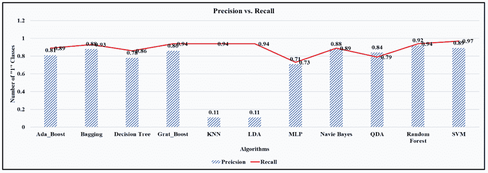

### 图 4 准确率比较

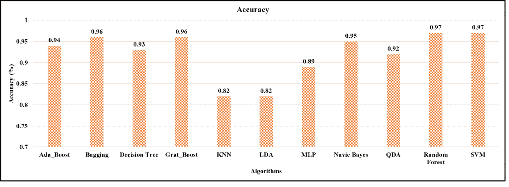

`Table 2` 给出了使用 EEG 信号进行癫痫分析的各种机器学习技术的对比分析。癫痫发作识别涉及识别和分类癫痫患者可能经历的多种发作。这些知识对于控制和治疗癫痫，以及提高癫痫症患者的安全和生活质量具有重要意义。系统的训练模型可以实时识别发作。

### 表 2 EEG 信号下机器学习技术的对比分析

| 技术 || 参数 || 精确率 | 召回率 | F1 分 | 支持数 |
| --- | --- | --- | --- | --- | --- |
| Ada\_Boost | 类“0”的数量 | 0.98 | 0.95 | 0.96 | 2345 |
| --- | --- | --- | --- | --- | --- |
| 类“1”的数量 | 0.81 | | | | |
| 准确率 | | | | | |
| 加权平均 | | | | | |
| Bagging | 类“0”的数量 | 0.98 | 0.97 | 0.98 | 2319 |
| --- | --- | --- | --- | --- | --- |
| 类“1”的数量 | 0.88 | | | | |
| 准确率 | | | | | |
| 加权平均 | | | | | |
| 决策树 | 类“0”的数量 | 0.97 | 0.95 | 0.96 | 2346 |
| --- | --- | --- | --- | --- | --- |
| 类“1”的数量 | 0.78 | | | | |
| 准确率 | | | | | |
| 加权平均 | | | | | | |
| 梯度提升 | 类“0”的数量 | 0.99 | 0.96 | 0.98 | 2301 |
| --- | --- | --- | --- | --- | --- |
| 类“1”的数量 | 0.86 | | | | |
| 准确率 | | | | | | |
| 加权平均 | | | | | | |
| KNN | 类“0”的数量 | 1 | 0.90 | | 2804 |
| --- | --- | --- | --- | --- | --- |
| 类“1”的数量 | 0.81 | | | | |
| 准确率 | | | | | | |
| 加权平均 | | | | | | |
| LDA | 类“0”的数量 | 1 | 0.90 | | 2804 |
| --- | --- | --- | --- | --- | --- |
| 类“1”的数量 | 0.84 | | | | |
| 准确率 | | | | | | |
| 加权平均 | | | | | | |
| MLP | 类“0”的数量 | 0.93 | 0.93 | 0.93 | 2305 |
| --- | --- | --- | --- | --- | --- |
| 类“1”的数量 | 0.71 | | | | |
| 准确率 | | | | | | |
| 加权平均 | | | | | | |
| 朴叶贝斯 | 类“0”的数量 | 0.97 | 0.97 | 0.97 | 2292 |
| --- | --- | --- | --- | --- | --- |
| 类“1”的数量 | 0.88 | | | | |
| 准确率 | | | | | | |
| 加权平均 | | | | | | |
| QDA | 类“0”的数量 | 0.94 | 0.96 | 0.95 | 2247 |
| --- | --- | --- | --- | --- | --- |
| 类“1”的数量 | 0.84 | | | | |
| 准确率 | | | | | | |
| 加权平均 | | | | | | |
| 随机森林 | 类“0”的数量 | 0.99 | 0.98 | 0.98 | 2301 |
| --- | --- | --- | --- | --- | --- |
| 类“1”的数量 | 0.92 | | | | |
| 准确率 | | | | | | |
| 加权平均 | | | | | | |


| SVM | | 类别数量 “0” | 0.99 | 0.97 | 0.98 | 2318 |
| 类别数量 “1” | 0.89 | 0.97 | 0.93 | 557 |
| 准确率 | | | | 0.97 | 2875 |
| 加权平均 | 0.97 | 0.97 | 0.97 | 2875 |

### 结论

当使用 EEG 数据集作为癫痫分类模型时，当前方法的性能准确率显示，癫痫检测率在 85% 到 97% 之间，处于可以接受范围内。此外，性能指标表明，通过 AI 技术，可以有效地训练医疗系统以执行其决策过程，并向那些希望将此类技术用于研究、操作和增强各种医疗程序的人员提供建议。尽管这些技术显示出良好的前景，但必须记住它们并不是完美的。根据方法和特定情况，癫痫识别的准确性可能会有所波动，可能会出现假阳性和假阴性。由于癫痫治疗需要一套完整的策略，并且应该始终在医疗人员的监督下进行，任何用于癫痫发作识别的技术或方法都应该经过仔细考虑。

### 参考文献

- Ai, G., Zhang, Y., Wen, Y., Gu, M., Zhang, H., & Wang, P. (2023). 基于卷积神经网络的 EEG 癫痫预测轻量化硬件 IP 核心设计。Microelectronics, 137, 105810. [10.1016/j.mejo.2023.105810](http://dx.doi.org/10.1016/j.mejo.2023.105810)

- Albaqami, H., Hassan, G. M., & Datta, A. (2023). MP-SeizNet: 一种用于 EEG 癫痫类型分类的多通路 CNN Bi-LSTM 神经网络。Biomedical Signal Processing and Control, 84, 104780. [10.1016/j.bspc.2023.104780](http://dx.doi.org/10.1016/j.bspc.2023.104780)

- Bairagi, R. N., Maniruzzaman, M., Pervin, S., & Sarker, A. (2021). 使用 DWT、ANN 和序列窗口算法识别 EEG 信号中的癫痫发作。Soft Computing Letters, 3, 100026. [10.1016/j.socl.2021.100026](http://dx.doi.org/10.1016/j.socl.2021.100026)

- Fıçıcı, C., Telatar, Z., & Eroğul, O. (2022). 基于 DWT 分析从多通道 EEG 记录自动区分颞叶癫痫和心源非癫痫性作患者。Biomedical Signal Processing and Control, 77, 103755. [10.1016/j.bspc.2022.103755](http://dx.doi.org/10.1016/j.bspc.2022.103755)

- Gao, Q., Omran, A. H., Baghersad, Y., Mohammadi, O., Alkhafaji, M. A., Al-Azzawi, A. K., Al-Khafaji, S. H., Emami, N., Toghraie, D., & Golkar, M. J. (2023). 基于傅里叶变换和模式识别网络的癫痫诊断脑电图信号分类。Engineering Applications of Artificial Intelligence, 123, 106479. [10.1016/j.engappai.2023.106479](http://dx.doi.org/10.1016/j.engappai.2023.106479)

- Ghazali, S. M., Alizadeh, M., Mazloum, J., & Baleghi, Y. (2022). 用于癫痫发作检测的 EEG 信号分类改进二值优化群群算法。Biomedical Signal Processing and Control, 78, 103858. [10.1016/j.bspc.2022.103858](http://dx.doi.org/10.1016/j.bspc.2022.103858)

- Gong, C., Zhang, X., & Niu, Y. (2020). 使用不同的神经网络模型从颅内 EEG 信号中识别癫痫。Computational Biology and Chemistry, 87, 107310. [10.1016/j.compbiolchem.2020.107310](http://dx.doi.org/10.1016/j.compbiolchem.2020.107310)[](http://dx.doi.org/32599460)

- Gosala, B., Kapgate, P. D., & Jain, P. (2023). EEG 处理中特征工程的小波变换：在精神分裂症的应用。Biomedical Signal Processing and Control, 85, 104811. [10.1016/j.bspc.2023.104811](http://dx.doi.org/10.1016/j.bspc.2023.104811)

- Hassan, A. R., & Subasi, A. (2016). 使用线性提升法从 EEG 信号中自动识别癫痫发作。computer methods in biomedicine. Academic Press.

- Hussain, S. F., & Qaisar, S. M. (2022). 使用电平交叉采样和集成进行癫痫发作分类。Expert Systems with Applications, 191, 116356. [10.1016/j.eswa.2021.116356](http://dx.doi.org/10.1016/j.eswa.2021.116356)

- Kaleem, M., Guergachi, A., & Krishnan, S. (2018). 使用小波分解进行长期 EEG 的特定患者发作检测。Biomedical Signal Processing and Control, 46, 157–165. [10.1016/j.bspc.2018.0706](http://dx.doi.org/10.1016/j.bspc.2018.0706)

- Kaur, T., & Gandhi, T. (2023). 使用 EEG 表征和深度学习自动诊断癫痫发作。Neuroscience Informatics, 1013.

- Li, M., Chen, W., & Zhang, T. (2017). 使用 DWT 分析和神经网络对 EEG 进行分类。Biomedical Signal Processing and Control, 31, 357–365. [10.1016/j.bspc.2016.0908](http://dx.doi.org/10.1016/j.bspc.2016.0908)

- Mporas, I., Tsirka, V., Zacharaki, E., Richardson, M., & Megalooikou, V. (2015). 使用 EEG 和 ECG 信号进行计算机监测、分析和癫痫患者管理。Expert Systems with Applications, 42(6), 3227–3233. [10.1016/j.eswa.2014.1209](http://dx.doi.org/10.1016/j.eswa.2014.1209)

- Raghu, S., Sriraam, N., Temel, Y., Rao, S., Hegde, A., & Kubben, P. (2019). 基于时频域 DWT sigmoid 熵的 SVM 自动检测癫痫评估。Computers in Biology and Medicine, 110, 127–143. [10.1016/j.compbiomed.2019.0516](http://dx.doi.org/10.1016/j.compbiomed.2019.0516)[](http://dx.doi.org/3115427)

- Sharma, R., Pachori, R., & Sircar, P. (2020). 基于高阶统计和深度神经网络的发作分类。Biomedical Signal Processing and Control, 59, 101921. [10.1016/j.bspc.2020.101921](http://dx.doi.org/10.1016/j.bspc.2020.101921)

- Shen, M., Wen, P., Song, B., & Li, Y. (2023). 基于可调 Q 小波变换和卷积神经网络的实时 EEG 癫痫检测。Biomedical Signal Processing and Control, 82, 104566. [10.1016/j.bspc.2022.104566](http://dx.doi.org/10.1016/j.bspc.2022.104566)

- Song, J. L., Hu, W., & Zhang, R. (2016). 使用新型特征和极端学习机自动检测癫痫 EEG。Neurocomputing, 175, 383–391. [10.1016/j.neucom.2015.10070](http://dx.doi.org/10.1016/j.neucom.2015.10070)

- Sunaryono, D., Sarno, R., & Siswantoro, J. (2022). 基于小波特征的梯度提升机集成 EEG 信号自动检测癫痫。Journal of King Saud University. Computer and Information Sciences, 34(10), 9591–9600. [10.1016/j.bspc.2021.1015](http://dx.doi.org/10.1016/j.bspc.2021.1015)

- Tasci, I., Tasci, B., Barua, P., Dogan, S., Tuncer, T., Palmer, E., Fujita, H., & Acharya, U. R. (2023). 使用 EEG 信号超立方体模式对 121 患者群体进行癫痫检测。Information Fusion, 96, 252–268. [10.1016/j.inff.2023.0302](http://dx.doi.org/10.1016/j.inff.2023.0302)

## 第 12 章

# 基于机器学习技术的智慧城市物联网（智能医疗）

V. Muthukumaran

印度 SRM 科学技术大学

R. Udhayakumar

印度 维洛尔理工学院

B. Vennila
印度 SRM 科学技术大学工程技术学院

Joseph P. Bindu

印度 班罗尔代亚南达·萨格工程学院

Meram Munirathnam
印度 贾吉夫·甘迪知识技术大学

N. Thillaiarasu

印度 REVA 大学


### 摘要

智慧城市旨在可持续地增加城市化、降低能源消耗、提高居民的经济和生活质量，并保护环境。智慧城市的理念围绕信息与通信技术（ICT）展开，因为它使得政策制定、决策制定、执行以及最终提供有用服务变得更加容易。除了利用数字技术外，“智慧城市”的概念也是对后工业文明在新千禧之初面临的政治、社会和经济问题的响应。在本章中，作者们讨论了几种基于物联网（IoT）的机器学习技术，这些技术被应用于上述领域等。此外，本文还对评估进行了回顾，并报告了了的经验教训，重点强调了机器学习技术在物联网网络中应发挥的基础性作用。

### 1. 引言

几乎每个行业都能从更多的 IT 资源和自学习计算机网络中获益，但医疗行业是人工智能（AI）可以多种方式应用的领域之一。这是因为 AI 技术辅助医疗专业人员进行预防、诊断以及治疗，特别是在手术方面。例如，美国存在这样的手术室：手术的每个阶段都经过精确记录，主治医生在确定行动方案（包括精确的切口）时会获得全面的协助。房间内集成的传感器允许对患者进行持续跟踪，从而提供最佳护理（Muthukumaran et al., 2021）。

这将影响放射科医生等专员的工作。这项技术已经表现非常出色，特别是在易于技术标准化和测试的成像程序方面。它已经评估了数百万实例，因此它做出的判断比主治医生通过肉眼判断更加精确。医生将始终拥有最终决定权，但在人工智能帮助下，他也将能够获得第二种意见，这种意见可以支持或扩展他自己的分析。

系统从患者那里获得的信息越多、了解的案例越多，其得出的结论和行动建议就越可靠。因此，未来的理想做法是尽可能让更多数据变得可用，并在考虑所有匿名化技术的情况下对其进行评估。通常情况下，用于常规诊断的可穿戴数据将帮助患者和主治医生更快地做出最佳选择，并为下一步提供建议。例如，如果患者早上醒来时发现脉搏和血压升高，他们可以做出更明智的决定，决定去看医生还是这种不适感可能会在上午自行消失。

网络化智能家居的应用在这里也很有用。如果患者有症状，他可以在早上起床站在装有摄像机的镜子前，与主治医生进行沟通。然后他根据患者数据实时确定哪些行动是合理的。然而，情况甚至进一步：在最坏的情况下，放置在家里地毯或适当医疗可穿戴设备上的跌倒传感器可以识别患者何时倒地在地上，或何时由于其他原因需要帮助。在智慧城市的背景下，自动化可以通知相关的控制中心并派遣救护车前往合适的医院。

护士有限的时间很大一部分花在了收集患者数据上。医护人员，特别是在医疗环境中。在这里，语音命令是智能设备收集关键患者数据、对其进行适当分配并使用大数据和人工智能对其进行评估的一种方法。所有这些都无法通过可穿戴设备记录，但通常也源于护理人员对患者的感知和评估。这样，护理人员将有更多时间投入到实际护理中，而不需要捕捉每条信息，甚至不需要使用 PC 将移动到电子病历中。本质上，这可能为这一紧急状况提供一种（部分）解决方案。图 1 讨论了与 AI 相关的研究。

## 图 1 AI 相关研究中的数据类型

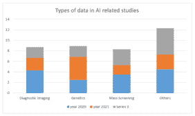

计算机还可以用于医院的常规操作，如物料消耗监控。对于无法移动或甚至在数千公里外的患者，扩展去中心化的医疗服务也是可以的。在缺乏专家和现代分析工具的地区，通过互联网将图像或一系列血值发送到计算机中心并等待诊断可能很快就足够。这可以挽救生命，特别是在医疗资源匮乏的地区。关于智慧城市的另一个重要考虑因素是该技术的潜在缺点，尽管它有许多优点。

Cugurullo 挑战了关于智慧和生态城市主义的流行观点，他认为那些被营销为由可持续城市统一愿景构成的凝聚单元的社区，实际上是由碎片化且经常不匹配的城市织构元素组成的脱节的城市。Cugurullo 描述了当前对网络基础设施和服务的网络攻击水平，以及与智慧城市技术相关的五种漏洞。从 Cugurullo 的工作中获得的对城市研究和规划的理解意义重大。它在人工智能和人类智能与建筑环境发生不可逆转的相互作用时，对城市的功能提供了详尽解释（Cugurullo et al., 2021）。

# 2. 相关工作

本节回顾了关于区块链、与物联网相关的 AI、智慧城市、智慧医疗和物联网的文献。研究了智慧医疗应用中的新兴趋势以及直接影响这些转型的重大技术进展（Habibzadeh et al., 2020）。作者们还讨论了在智慧健康系统中需要考虑的各种安全因素，以及它们的影响和保护措施。在对智慧城市中物联网应用相关的安全和隐私担忧的分析中，识别了潜在的解决方案。由于传统方法对于安全和安全关键系统无法产生最佳结果，作者经常转向图论来纠正所强调的问题（Latif et al., 2019）。

基于智慧城市的数据收集、隐私、安全、公共安全、灾害管理、能源消耗和生活质量，详细分析了协作无人机与物联网的潜在技术和应用，这些技术近期被用于增强智慧城市的智能化水平(Alsamhi et al., 2019)。提供了对智能医疗系统中机器学习方法用于大数据分析的用途的详细分析(Li et al., 2021)。作者们还概述了当前策略的若干优缺点，强调了该研究领域面临的困难。


### 引言

提出了一种基于边缘计算的智能健康监测系统模型。该架构声称通过解决其根本问题，将医疗保健系统从以诊所为中心转变为智能且以患者为中心。对利用深度学习技术进行脑瘤分类的已综述进行了详尽分析。该综述涵盖了所有关键流程，如预处理、特征提取、分类、成果和局限性。作者还利用带有和不带数据增强的迁移学习进行了深入实验，以研究 BTC 的前沿卷积神经网络模型（Vennira Selvi et al., 2022）。一种通过融合人工智能与物联网来缓解智能城市背景下交通拥堵的模型。

讨论了提高能源效率的优点和缺点，并对物联网中的能耗模型进行了全面概述（Kumar et al., 2023）。提出了一种用于边缘基础设施中高效物联网的基于 OTS（一次性签名）方案的安全架构（Singh et al., 2021）。为了提高架构的安全隐私性，作者在边缘计算层采用了一种基于区块链技术的分布式网络。在`Table.1` 中讨论了相关的综述文献。

## 表 1. 综述文献

| 编号 | 论文标题 | 智能城市 | 智能医疗 | AI/ML | 安全性 |
| --- | --- | --- | --- | --- | --- |
| 1 | 迈向统一的智能医疗生态系统：关于前景、安全和隐私考因素的综述(Habibzadeh et al., 2020) | N | Y | N | Y |
| 2 | 智能城市物联网安全与隐私问题综述(Latif et al., 2017) | Y | N | N | Y |
| 3 | 基于物联网的智能城市：综述(Arasteh et al., 2016) | Y | N | N | N |
| 4 | 协作智能无人机与物联网以提升智能城市智能性的综述 (Alsamhi et al., 2019) | Y | N | N | N |
| 5 | 针对物联网支持的智能医疗系统的基于机器学习的大数据分析全面综述 (Li et al., 2021) | Y | N | N | N |

## 3. 机器学习总结

机器学习技术的三个类型是：监督学习、无监督学习和强化学习。在 Fig. 2 所示的各种场景中，强化学习（RL）使用了来自每个分支的算法。这里，通过示例算法简要解释了监督学习和无监督学习（Sharada et al., 2023）。我们还将概述强化学习及其主要内容。

在监督学习中，人工智能（AI）网络经过训练，以使用包含输入值和目标值的数据集找到一个将输入数据映射到输出的映射函数。回归和分类是监督学习的进一步子类。监督学习的已知实例包括随机森林、支持向量机和线性回归。

### 图 2. 机器学习算法的般分类

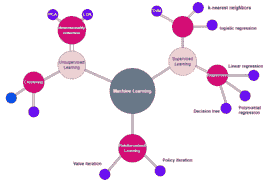

马尔可夫决策过程（`MDP`）是大多数强化学习问题的基础。寻找序列决策问题（SDP）的最佳答案是 `MDP` 的目标。在随机 SDP 情况下，`MDP` 可以帮助提供最优解决方案（或所有选项中的最佳解决方案），但它不能提供绝对解决方案。一个状态集、一个动作集、一个转移模型和一个奖励函数定义了一个 `MDP` 模型。奖励和转移取决于当前状况、所选动作以及产生的下一个状态。

强化学习（`RL`）：强化学习智能体的目标是通过与环境的多次交互来增加其长期累积奖励。智能体是强化学习算法中参与交互并学习的部分。这一目标通过智能体使用尽可能可能的策略来实现。理想策略是使总长期奖励最大化的策略。策略是针对特定状态集的一组动作。智能体的主要责任是在充分利用已知有效动作的同时，探索可能比当前使用的最佳动作更有可图的新动作。

动态规划（`DP`）创建于 20 世纪，作为一种数学和计算机编程技术而存在。`DP` 是一种递归技术，将一个困难的任务分解为更小、更易管理的问题。基于模型的 `DP` 技术需要完全可观测的知识。因此，在给定环境模型为 `MDP` 的某些强化学习问题中，`DP` 使用了值迭代或策略迭代方法来寻找最优策略。

流行的强化学习算法是演员-评论家（actor-critic）方法的基础。这是一种结合了策略和价值函数的混合方法。演员（actor）根据评论家（critic）的批评修改策略，而算法的评论家部分估计价值函数。这种方法同时估计策略和价值函数，使其介于基于策略和基于价值的方法之间。这对于大小动作-状态组合均适用。

## 4. 网络安全

为了确保可靠且有效的数字服务，智能城市被设计为由相互连接的安全可靠传感器、执行器和继电器组成。这些组件收集、处理并传输数据。由于不同设备之间的互联性，解决网络安全问题应运而生。大部分数据由云端物联网（`IoT`）设备产生，这些设备对许多智能城市应用至关重要。


之前的模型可以协助创建各种私有且安全的应用程序，将智慧城市的理念变为现实。作者在文中提出了一种用于在雾计算云-物联网（Fog Cloud-IoT）环境中优化延迟和能耗的基于机器学习的安全计算卸载框架。所提出的框架基于`Neuro-Fuzzy`（神经模糊）模型构建，该模型在网关处保护数据，并使用`粒子群优化`（`PSO`）确定哪些雾计算节点最适合将计算卸载到物联网设备（Alli et al., 2019）。

## 5. 机器学习与智慧城市医疗

先进的传感器、高性能物联网设备、云计算以及更高的数据传输率共同促进了 `AI`、`ML` 和 `DRL` 技术在健康智能中的广泛应用，健康智能是 $100$ 到 $10²$ 之间医疗保健机制的高级术语。上述方法对于疾病诊断、预测治愈情况、利用社交媒体分析特定疾病以及进行医学影像检查至关重要（Topol et al., 2019）。接下来的章节将简要介绍与智慧城市医疗相关的最新研究趋势和倡议。

某作者创建了一篇综述，以研究 `5G` 通信在医疗系统中的功能以及必要的方法、工具和架构，并评估其主要目标（Al-Turjman et al., 2019）。他们的主要贡献集中在基于 5G 医疗系统的架构和组件、通信协议与技术的分类，以及对基于物联网的医疗系统至关重要的网络层问题（如调度、路由、拥塞控制等）（Muthukumar et al., 2023）。该系统对在医疗系统中利用 `AI`、`ML` 和 `DRL` 应用的大数据分析进行了广泛分析（Al-Turjman et al., 2020）。作者在多个领域探究了上述技术的益处，包括复杂数据分析、诊断、分类、疾病风险、优化治疗和患者生存率预测（Anbazhagu et al., 2024）。在图 3 和图 4 中，我们展示了系统设计。

#### 图 3. 系统设计

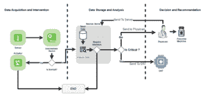

#### 图 4. 系统模型

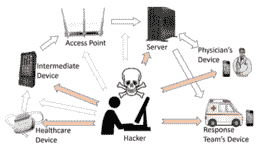

1. `IoHT`（物联网医疗）的实现可以简单到仅通过 `Bluetooth` 连接到移动设备的心率监测器，也可以复杂到包含多个传感器、中间设备和中心化服务器。
2. 通用的 `IoHT` 实现中，设备通过各种协议相互通信，而服务器采取适当的操作。
3. 用于描述 `IoHT` 功能和问题的分层方法有助于识别不同层面的 `IoHT` 数据安全和隐私问题，以及每层涉及的威胁向量。
4. 我们的 `IoT` 设备具有有限的计算能力。

Tuli 等人提出了一种用于在雾云-物联网环境中优化延迟和能耗的基于机器学习的安全计算卸载框架。所提出的框架基于`Neuro-Fuzzy` 模型，该模型在网关处保护数据，并使用`粒子群优化`（`PSO`）确定哪些雾节点最适合将计算卸载到物联网设备（Alli et al., 2019）。

先进的传感器、高性能物联网设备、云计算以及更高的数据传输率共同促进了 `AI`、`ML` 和 `DRL` 技术在健康智能中的广泛应用，健康智能是 $100$ 到 $10²$ 之间医疗保健机制的高级术语。上述方法对于疾病诊断、预测治愈情况、利用社交媒体分析特定疾病以及进行医学影像检查至关重要（Topol et al., 2019）。接下来的章节将简要介绍与智慧城市医疗相关的最新研究趋势和倡议。

某作者创建了一篇综述，以研究 `5G` 通信在医疗系统中的功能以及必要的方法、工具和架构，并评估其主要目标（Al-Turjman et al., 2019）。他们的主要贡献集中在基于 5G 医疗系统的架构和组件、通信协议与技术的分类，以及对基于物联网的医疗系统至关重要的网络层问题（如调度、路由、拥塞控制等）（Muthukumar et al., 2023）。该系统对在医疗系统利用 `AI`、`ML` 和 `DRL` 应用的大数据分析进行了广泛分析（Al-Turjman et al., 2020）。作者在多个领域探究了上述技术的益处，包括复杂数据分析、诊断、分类、疾病风险、优化治疗和患者生存率预测（Anbazhagu et al., 2024）。在图 3 和图 4 中，我们展示了系统设计。

#### 图 3. 系统设计


#### 图 4. 系统模型


1. `IoHT`的实现可以简单到仅通过 `Bluetooth` 连接到移动设备的心率监测器，也可以复杂到包含多个传感器、中间设备和中心化服务器。
2. 通用的 `IoHT` 实现中，设备通过各种协议相互通信，而服务器采取适当的操作。
3. 用于描述 `IoHT` 功能和问题的分层方法有助于识别不同层面的 `IoHT` 数据安全和隐私问题，以及每层涉及的威胁向量。
4. 我们的 `IoT` 设备具有有限的计算能力。

Tuli 等人提出了一种用于在雾计算云-物联网环境中优化延迟和能耗的基于机器学习的安全计算卸载框架。所提出的框架基于`Neuro-Fuzzy` 模型构建，该模型在网关处保护数据，并使用`粒子群优化`（`PSO`）确定哪些雾节点最适合将计算卸载到物联网设备（Alli et al., 2019）。

先进的传感器、高性能物联网设备、云计算以及更高的数据传输率共同促进了 `AI`、`ML` 和 `DRL` 技术在健康智能中的广泛应用，健康智能是 $100$ 到 $10²$ 之间医疗保健机制的高级术语。上述方法对于疾病诊断、预测治愈情况、利用社交媒体分析特定疾病以及进行医学影像检查至关重要（Topol et al., 2019）。接下来的章节将简要介绍与智慧城市医疗相关的最新研究趋势和倡议。

某作者创建了一篇综述，以研究 `5G` 通信在医疗系统中的功能以及必要的方法、工具和架构，并评估其主要目标（Al-Turjman et al., 2019）。他们的主要贡献集中在基于 5G 医疗系统的架构和组件、通信协议与技术的分类，以及对基于物联网的医疗系统至关重要的网络层问题（如调度、路由、拥塞控制等）（Muthukumar et al., 2023）。该系统对在医疗系统利用 `AI`、`ML` 和 `DRL` 应用的大数据分析进行了广泛分析（Al-Turjman et al., 2020）。作者在多个领域探究了上述技术的益处，包括复杂数据分析、诊断、分类、疾病风险、优化治疗和患者生存率预测（Anbazhagu et al., 2024）。在图 3 和图 4 中，我们展示了系统设计。

#### 图 3. 系统设计


#### 图 4. 系统模型


1. `IoHT`的实现可以简单到仅通过 `Bluetooth` 连接到移动设备的心率监测器，也可以复杂到包含多个传感器、中间设备和中心化服务器。
2. 通用的 `IoHT` 实现中，设备通过各种协议相互通信，而服务器采取适当的操作。
3. 用于描述 `IoHT` 功能和问题的分层方法有助于识别不同层面的 `IoHT` 数据安全和隐私问题，以及每层涉及的威胁向量。
4. 我们的 `IoT` 设备具有有限的计算能力。

Tuli 等人提出了一种用于在雾计算云-物联网环境中优化延迟和能耗的基于机器学习的安全计算卸载框架。所提出的框架基于`Neuro-Fuzzy` 模型构建，该模型在网关处保护数据，并使用`粒子群优化`（`PSO`）确定哪些雾节点最适合将计算卸载到物联网设备（Alli et al., 2019）。

先进的传感器、高性能物联网设备、云计算以及更高的数据传输率共同促进了 `AI`、`ML` 和 `DRL` 技术在健康智能中的广泛应用，健康智能是 $100$ 到 $10²$ 之间医疗保健机制的高级术语。上述方法对于疾病诊断、预测治愈情况、利用社交媒体分析特定疾病以及进行医学影像检查至关重要（Topol et al., 2019）。接下来的章节将简要介绍与智慧城市医疗相关的最新研究趋势和倡议。

某作者创建了一篇综述，以研究 `5G` 通信在医疗系统中的功能以及必要的方法、工具和架构，并评估其主要目标（Al-Turjman et al., 2019）。他们的主要贡献集中在基于 5G 医疗系统的架构和组件、通信协议与技术的分类，以及对基于物联网的医疗系统至关重要的网络层问题（如调度、路由、拥塞控制等）（Muthukumar et al., 2023）。该系统对在医疗系统利用 `AI`、`ML` 和 `DRL` 应用的大数据分析进行了广泛分析（Al-Turjman et al., 2020）。作者在多个领域探究了上述技术的益处，包括复杂数据分析、诊断、分类、疾病风险、优化治疗和患者生存率预测（Anbazhagu et al., 2024）。在图 3 和图 4 中，我们展示了系统设计。

#### 图 3. 系统设计


#### 图 4. 系统模型


1. `IoHT`的实现可以简单到仅通过 `Bluetooth` 连接到移动设备的心率监测器，也可以复杂到包含多个传感器、中间设备和中心化服务器。
2. 通用的 `IoHT` 实现中，设备通过各种协议相互通信，而服务器采取适当的操作。
3. 用于描述 `IoHT` 功能和问题的分层方法有助于识别不同层面的 `IoHT` 数据安全和隐私问题，以及每层涉及的威胁向量。
4. 我们的 `IoT` 设备具有有限的计算能力。

Tuli 等人提出了一种用于在雾计算云-物联网环境中优化延迟和能耗的基于机器学习的安全计算卸载框架。所提出的框架基于`Neuro-Fuzzy` 模型构建，该模型在网关处保护数据，并使用`粒子群优化`（`PSO`）确定哪些雾节点最适合将计算卸载到物联网设备（Alli et al., 2019）。

先进的传感器、高性能物联网设备、云计算以及更高的数据传输率共同促进了 `AI`、`ML` 和 `DRL` 技术在健康智能中的广泛应用，健康智能是 $100$ 到 $10²$ 之间医疗保健机制的高级术语。上述方法对于疾病诊断、预测治愈情况、利用社交媒体分析特定疾病以及进行医学影像检查至关重要（Topol et al., 2019）。接下来的章节将简要介绍与智慧城市医疗相关的最新研究趋势和倡议。

某作者创建了一篇综述，以研究 `5G` 通信在医疗系统中的功能以及必要的方法、工具和架构，并评估其主要目标（Al-Turjman et al., 2019）。他们的主要贡献集中在基于 5G 医疗系统的架构和组件、通信协议与技术的分类，以及对基于物联网的医疗系统至关重要的网络层问题（如调度、路由、拥塞控制等）（Muthukumar et al., 2023）。该系统对在医疗系统利用 `AI`、`ML` 和 `DRL` 应用的大数据分析进行了广泛分析（Al-Turjman et al., 2020）。作者在多个领域探究了上述技术的益处，包括复杂数据分析、诊断、分类、疾病风险、优化治疗和患者生存率预测（Anbazhagu et al., 2024）。在图 3 和图 4 中，我们展示了系统设计。

#### 图 3. 系统设计


#### 图 4. 系统模型


1. `IoHT`的实现可以简单到仅通过 `Bluetooth` 连接到移动设备的心率监测器，也可以复杂到包含多个传感器、中间设备和中心化服务器。
2. 通用的 `IoHT` 实现中，设备通过各种协议相互通信，而服务器采取适当的操作。
3. 用于描述 `IoHT` 功能和问题的分层方法有助于识别不同层面的 `IoHT` 数据安全和隐私问题，以及每层涉及的威胁向量。
4. 我们的 `IoT` 设备具有有限的计算能力。

Tuli 等人提出了一种用于在雾计算云-物联网环境中优化延迟和能耗的基于机器学习的安全计算卸载框架。所提出的框架基于`Neuro-Fuzzy` 模型构建，该模型在网关处保护数据，并使用`粒子群优化`（`PSO`）确定哪些雾节点最适合将计算卸载到物联网设备（Alli et al., 2019）。

...（此处为表格翻译）

### 表 2. AI、ML 和 DRL 在智慧医疗中的应用

| 作者名称 | 年份 | 方法 | 摘要 |
| --- | --- | --- | --- |
| Tuli et al. | 2020 | AI | 使用雾计算分析心脏病 |
| Newaz et al. | 2019 | ML | Health Guard 平台持续监测连接设备的状况。 |
| Polu et al. | 2019 | REST API | 通过本体规则和远程监测提供患者护理。 |
| Zack et al. | 2019 | DRL | 使用 DRL 方法和卫星图像绘制社区以提供更好的医疗服务。 |
| Togaçar et al | 2020 | DRL | 分类为浸润性导管癌。 |

### 表 3. 机器学习技术

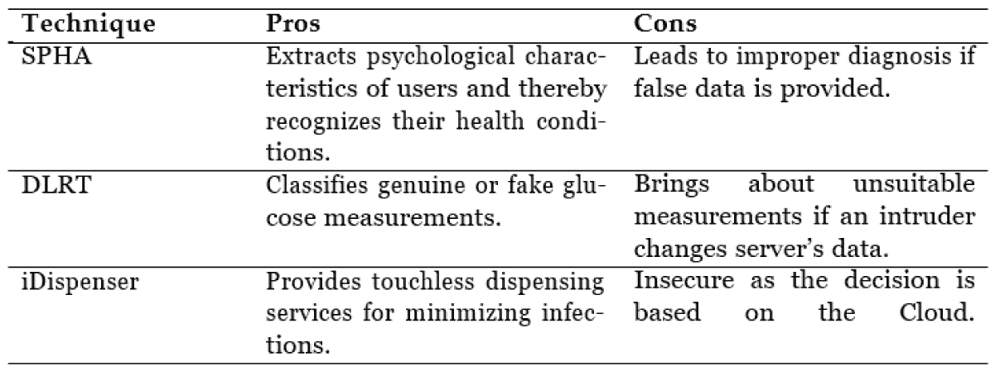

## 6. 问题与未来研究方向

目前关于智慧城市的文献清楚表明，基于 `AI`、`ML` 和 `DRL` 的应用已经展示了良好的成果。为了进一步提高智慧城市的有效性，学术界和工业界的专家可以关注以下可以使用 `AI`、`ML` 和 `DRL` 解决的开放性问题：

1. 通过机器学习技术联合优化无人机的机载能力（如计算、处理、感知和通信资源）及其轨迹，可以大大提高无人机与车辆之间信息传输的效率。
2. 在存在规则和不规则基础设施的情况下，使用不同方向的无人机和车辆速度进行测量实验，以对车对车、车对机、无人机对无人机、无人机对基站信道等。


### 3. 对于所有 `SGs` 和电力公司而言，首要目标是优化停电场景。通信延迟的评估对于创建一个运行良好的网络至关重要。基于 `ML` 和 `DRL` 的技术应用，可以极大地帮助在保障电力供应的同时，实现在 `5G` 通信技术之间的切换。

### 4. 智慧城市的安全关注侧重于应用。例如，智能电表的安全泄露可能导致能量操纵和智能电网的效率低下。因此，为了确保智慧城市应用的网络安全和安全性，需要基于大数据分析的更复杂且具创新的技术。

### 7. 结论

我们研究了上述协议的用性，以便为被认为对智慧城市效率至关重要的应用创建近乎理想的。我们讨论了 `AI`、`ML` 和 `DRL` 在智慧治理设计中的最新用途，以及既由 `AI`辅助又兼容 `AI` 的新法规的必要性，包括高效的 `ITS`、`SGs`、网络安全，以及由 `UAVs` 辅助智慧城市的 `5G` 和 `B5G` 通信。我们简要概述了上述方法在智慧医疗中日益增长的角色，包括它们帮助寻找最方便药物的潜力，以及它们在有效诊断、健康恢复和面向健康型 `IoT` 设备安全方面的作用。最后，我们讨论了与智慧城市相关的当前研究问题，以及早期方法可能仍然非常有未来研究方向。

### 参考文献

Al-Turjman, F., Nawaz, M. H., & Ulusar, U. D. (2020). Intelligence in the Internet of Medical Things era: A systematic review of current and future trends. Computer Communications, 150, 644–660. [10.1016/j.comcom.2019.12.030](http://dx.doi.org/10.1016/j.comcom.2019.12.030)

Al-Turjman, F., Zahmatkesh, H., & Mostarda, L. (2019). Quantifying uncertainty in internet of medical things and big-data services using intelligence and deep learning. IEEE Access : Practical Innovations, Open Solutions, 7, 115749–115759. [10.1109/ACCESS.2019.2931637](http://dx.doi.org/10.1109/ACCESS.2019.2931637)

Alli, A. A., & Alam, M. M. (2019). `SecOFF-FCIoT`: Machine learning based secure offloading in Fog-Cloud of things for smart city applications. Internet of Things : Engineering Cyber Physical Human Systems, 7, 100070. [10.1016/j.iot.2019.100070](http://dx.doi.org/10.1016/j.iot.2019.100070)

Alrashdi, I., Alqazzaz, A., Aloufi, E., Alharthi, R., Zohdy, M., & Ming, H. (2019, January). `Ad-iot`: Anomaly detection of iot cyberattacks in smart city using machine learning. In 2019 IEEE 9th Annual Computing and Communication Workshop and Conference (CCWC) (pp. 305-310). IEEE.

Alsamhi, S. H., Ma, O., Ansari, M. S., & Almalki, F. A. (2019). Survey on collaborative smart drones and internet of things for improving smartness of smart cities. IEEE Access : Practical Innovations, Open Solutions, 7, 128125–128152. [10.1109/ACCESS.2019.293498](http://dx.doi.org/10.1109/ACCESS.2019.293498)

Anbazhagu, U., Koti, M. S., Muthukumaran, V., Geetha, V., & Munrathnam, M. (2024). Multi-Criteria Decision-Making for Energy Management in Smart Homes Using Hybrid Neuro-Fuzzy Approach. Distributed Generation & Alternative Energy Journal, 83–110.

Arasteh, H., Hosseinnezhad, V., Loia, V., Tommasetti, A., Shafie-khah, M., & Siano, P. (2016, June). Iot-based smart cities: A survey. In 2016 IEEE 16th international conference on environment and electrical engineering (EEEIC) (pp. 1-6). IEEE. [10.1109/EEEIC.2016.755587](http://dx.doi.org/10.1109/EEEIC.2016.755587)

Cugullo, F. (2021). Frankenstein urbanism: Eco, smart and autonomous cities, artificial intelligence and the end of the city. Routledge. [10.4324/9781315627](http://dx.doi.org/10.4324/9781315627)

Diro, A. A., & Chilamkurti, N. (2018). Distributed attack scheme using deep learning for Internet of Things. Future Generation Computer Systems, 82, 761–768. [10.1016/j.future.2017.0843](http://dx.doi.org/10.1016/j.future.2017.0843)

Habibzadeh, H., & Soyata, T. (2020). Toward uniform smart ecosystems: A survey on prospects, security, and privacy. smart cities, 75-112.

Kumar, S. S., Muthukumaran, V., Devi, A., Geetha, V., & Yadav, P. (2023). Quantitative Approach of Purposive Sampling for Security and Privacy Issues in IoT Applications. Handbook of Research on Advancements in AI and IoT Technologies (pp. 281–299). IGI Global. [10.4018/978-1-6684-6971-2.016](http://dx.doi.org/10.4018/978-1-6684-6971-2.016)

Latif, S., & Zafar, N. A. (2017). A survey of security and privacy issues in IoT for smart cities. In 2017 Fifth International Conference on Aerospace Science & Engineering (ICASE) (pp. 1-5). [10.1109/ICASE.2017.837428](http://dx.doi.org/10.1109/ICASE.2017.837428)

Li, W., Chai, Y., Khan, F., S. R., Menon, V., Kavita, & Li, X. (2021). A comprehensive survey on machine learning-based big data analytics for `IoT`-enabled smart healthcare. Mobile Networks and Applications, 26(1), 234–252. [10.1007/s11036-020-0170-6](http://dx.doi.org/10.1007/s11036-020-0170-6)

Muthukumar, V., Sivakami, R., Venkatesan, V. K., Balajee, J., Mahesh, T. R., Mohan, E., & Swapna, B. (2023). Optimizing Heterogeneity in `IoT` Infra Using Federated Learning and Blockchain-based Security. International Journal of Computers, Communications & Control, 18(6). [10.15837/ijccc.2023.6.5890](http://dx.doi.org/10.15837/ijccc.2023.6.5890)

Muthukumaran, V., & Manimozhi, I. (2021). Public Key Encryption With Equality Test for Industrial Internet of Things Based on Near-Ring. International Journal of e-Collaboration, 17(3), 25–45. [10.4018/IJeC.2021070102](http://dx.doi.org/10.4018/IJeC.2021070102)

Muthukumaran, V., Vinoth Kumar, V., Joseph, R. B., Munirathnam, M., Beschi, I. S., & Niveditha, V. R. (2022). Efficient Authenticated Key Agreement Protocol for Cloud-Based Internet of Things. International Conference on Innovative Computing and Communications of ICICC, 3, 365–373.

Nagarajan, S. M., Deverajan, G. G., Chatterjee, P., Alnumay, W., & Muthukumaran, V. (2022). Integration of `IoT` based routing process for food supply chain. Sustainable Cities and Society, 76, 103448. [10.1016/j.scs.2021.103448](http://dx.doi.org/10.1016/j.scs.2021.103448)

Newaz, A. I., Sikder, A. K., Rahman, M. A., & Uluagac, A. S. (2019). Healthguard: A machine learning-based security framework for smart healthcare systems. In 2019 sixth international conference on social networks analysis, management and security (SNAMS) (pp. 389-396). IEEE. [10.1109/SNAMS.2019.893171](http://dx.doi.org/10.1109/SNAMS.2019.893171)

Polu, S. K. (2019). Modeling of telemonitoring system for remote healthcare using ontology. International Journal for Innovative Research in Science & Technology, 5(9), 6–8.

Sharada, K. A., Sushma, K. S. N., Muthukumaran, V., Mahesh, T. R., Swapna, B., & Roopashree, S. (2023). High ECG diagnosis rate using novel machine learning techniques with Distributed Arithmetic (`DA`) based gated recurrent units. Microprocessors and Microsystems, 98, 104796. [10.1016/j.micpro.2023.104796](http://dx.doi.org/10.1016/j.micpro.2023.104796)


Tuli, S., Basumatary, N., Gill, S. S., Kahani, M., Arya, R. C., Wander, G. S., & Buyya, R. (2020). HealthFog: 一种用于集成物联网和雾计算环境中心脏疾病自动诊断的深度学习智能医疗系统。Future Generation Computer Systems, 104, 187–200. [10.1016/j.future.2019.10.043](http://dx.doi.org/10.1016/j.future.2019.10.043)

Vennira Selvi, G., Muthukumaran, V., Kaladevi, A. C., Satheesh Kumar, S., & Swapna, B. (2022). 无线传感器网络中集成支配集和命中集启发的非均匀聚类类数据聚合。International Journal of Intelligent Computing and Cybernetics, 15(4), 642–655. [10.1108/IJICC\-10-2021-0225](http://dx.doi.org/10.1108/IJICC-10-2021-0225)

Zack, C. J., Senecal, C., Kinar, Y., Metzger, Y., Bar-Sinai, Y., Widmer, R. J., Lennon, R., Singh, M., Bell, M. R., Lerman, A., & Gulati, R. (2019). 利用机器学习技术预测经皮冠动脉干预后患者的预后。JACC: Cardiovascular Interventions, 12(14), 1304–1311. [10.1016/j.jcin.2019.02.035](http://dx.doi.org/10.1016/j.jcin.2019.02.035)[](http://dx.doi.org/31255564)

Zhang, Q., Bai, C., Chen, Z., Li, P., Yu, H., Wang, S., & Gao, H. (2021). 云计算下智能中医药诊断脾和胃疾病的深度学习模型。Concurrency and Computation, 33(7), 1–1. [10.1002/cpe.5252](http://dx.doi.org/10.1002/cpe.5252)

## 第 13 章

# 社会经济地位、地质、工程和气候因素对依赖机器学习的水管故障预测的影响

Dharmesh Dhabliya

印度，维什瓦卡玛信息技术学院

Ankur Gupta

印度，Vaish 工程学院

Sukhvinder Dari

印度，Symbiosis 国际大学

Ritika Dhabliya
印度，Yashika Journal Publications Pvt. Ltd.

Anishkumar Dhablia
印度，Altimetrik India Pvt. Ltd.

Nitin N. Sakhare

印度，维什瓦卡玛信息技术学院

Sabyasachi Pramanik

印度，Haldia 科技学院

### 摘要

地下水管由于多种物理、机械、环境和社会因素的影响而恶化。准确的管道故障预测是径供水网络（`WSN`）进行合理管理方法的前提，并且对于传统的依赖物理学的模型来说是一项挑战。该研究利用了庞大供水网络过去的维护数据历史，通过数据导向的机器学习方法来预测水管破裂。为了包含导致地下管道恶化的许多因素，建立了一个初始的多源数据聚合系统。该框架概述了合并多个数据集的条件，包括土壤类型、人口数量、地理和气象数据集，以及传统的管道漏水数据集。基于这些数据，开发了五种机器学习（`ML`）技术——`LightGBM`、`ANN`、`logistic regression`、`K-NN` 和 `SVM` 算法来预测管道故障。结果发现 `LightGBM` 提供了最佳性能。使用五个标准分析了主要因素的相对重要性：计算时间、准确性、分类变量的影响和可解释性。`LightGBM` 作为训练时间第二低的模型，表现最好。鉴于数据集的严重偏斜，结果表明在使用精确率召回率曲线（`PRC`）指标时，接收者工作特征（`ROC`）测量过于乐观。值得注意的是，社区内的社会经济因素已被证明对管道的影响。本研究表明，结合 `ML` 技术与建议的数据聚合架构的数据导向分析可能会增强 `WSN` 管理的可靠决策。

### 1. 引言

可靠且安全的供水对于 `WSN` 的管理至关重要。从水处理厂输送水到用户的配水管道是 `WSN` 的基础组件。这种腐蚀对于追溯到 19 世纪的美国城市的地下水管来说尤为严重。美国和加拿大每天发生超过 700 处主管断裂，每年损失超过 2 万亿加仑饮用水。根据美国水务局的预测，未来 20 年内，目前 `WSNs` 的更换成本以及预期的扩展费用总计将超过 1 万亿美元。由于这些严重问题，管理层面临着压力，需要采用用于长期改进和可靠管道故障估计模型的管理实践，为减少损失提供主动支持。

开发精确预测模型的关键在于确定影响管道故障的重要变量（也称为输入变量）。在过去的几十年里，研究人员通过实验测试、有限元模型和历史数据分析评估了多种可能导致管道破裂的因素。最近的综述表明，这些因素可以大致分为三类：物理、运行和环境。最常考虑的管道物理特性是直径、年龄、长度和材料。例如，Kettle 和 Goulter 使用统计方法确定了管道尺寸与断裂概率之间的关系。


Tai P. et al. (2023) 已经表明，长管道失效的概率更高。最受关注的运行因素是以往故障发生的频率。这些研究表明，管道失效的概率通常与之前的线路故障次数有关。水压是 `WSNs` 中管道的另一个常见运行要素。研究表明，金属管和水泥管的内部水压与破裂概率之间存在正相关关系。管道问题也可能由外部因素引起，这些因素包括交通水平、土壤分类和气候。此外，这些细节中的许多往往是完全未知的。在以往的研究中，许多气象因素（如温度和降水）已与管道问题有关。结果表明，较大的温度变化可能会增加管道塌的的风险。理解塌塌概率与这三种不同类型的影响因素之间的相互作用至关重要。除了上述元素外，显而易见，在执行 `WSNs` 预测时，必须考虑与多种情况（如社会经济关注点）的协作。例如，最近关于社区可靠性和适应性的研究考虑了配置崩溃和人口相关数据的影响。然而，现有的管道失效预测模型很少考虑到这些因素。与此同时，股东们密切关注如何解释管道失效的主要原因，以便对资源分配做出明智决策。这是在开发用于评估管道失效的可靠且实用方法的基础上。尽管以往的研究检查了有多少特征影响了管道塌的概率，但目前尚不清楚比较的相关性（或影响程度）如何。因此，解释性在管道塌预测模型的发展中起着同样重要的作用。

现有的管道塌预测方法分为三类：`ML` 模型、数学模型和基于物理的模型。下面将简要介绍每种策略的优缺点。依赖物理的方法使用实验或半经验特征方程，通过考虑物理因素，将管道的允许硬度与其实际能力进行比较。然后，通过采样技术（如 `Monte Carlo simulation`）比较管道的当前韧性及其堆积情况来确定管道的失效概率。依赖物理的模型可以很方便地显示所考虑组件的不同输入，但在考虑整个系统时，这种方法的计算成本很高。这是因为一个 `WSN` 包含成千上万根管道，需要大量的采样来估计每根管道的失效概率。此外，一些流行的依赖物理的模型（如 `B31G` 模型）过于保守。相比之下，统计模型的成本较低，特别是在历史记录数据丰富的利基领域。根据早期的研究，可以使用几种统计模型来预测管道失效。时间依赖性破裂预测模型（如 `LR` 模型、`Poisson process model` 和 `time-exponential approach`）在统计模型中使用统计方程进行描述。`Bayesian networks` 在最近的研究中被用于推断管道塌。塌塌设计在未来不会改变的假设允许将这些模型用于失效预测。然而，统计模型可能只包含一小部分物理特征，而没有揭示这些参数与管道失效之间的物理关系。数据驱动的机器学习模型最近被创建为一种管道塌预测方法，利用了日益增加可用数据。用于弄清管道失效与其他变量之间复杂关系的最流行的技术包括 `ANN`、`GAs`、`LR` 和 `neuro-fuzzy systems`。这些依赖 `ML` 的方法经常因准确性受到批评，尽管它们通常具有强大的计算能力，并作为几乎没有或没有解释性的“黑箱”运行。为了解决这个问题，一些研究使用了更有效的可解释机器学习技术，例如 `LR` 方法和 `tree-dependent techniques`。根据作者的知识和经验，这些方法可能无法为水管失效预测提供合适的准确度。此外，虽然使用了某些机器学习算法来预测管道塌，但在该应用领域，尚未对不同的 `ML` 技术进行全面的比较。结论是，尽管水务机构和 `WSN` 管理部门维护着重要的数据集，管道失效的准确预测和公平解释可能仍然是一项挑战，并需要更多工作。

我们提供了一个多源数据聚合系统，并根据上述的研究空白，本工作的目标是解释机器学习模型，以实现对 `WSNs` 中管道塌的高保真和高效预测。所提的方法已使用一个大型 `WSN` 数据集进行了评估，该数据集是迄今为止研究过的最大数据集，跨越了超过 6400 英里的水管。

在数据准备阶段，都考虑了生态、空间和人口数据。除了被其他研究证实外，澄清的结果强调了社会经济因素的的重要作用。即使这些因素的影响可能取决于 `WSN`，不同的 `WSN` 管理机构也可能简单地采用所提供的分析范式。

## 2 管道塌预测算法的历史发展

通过将问题视为分类问题来预测管道故障——即根据给定的特征将管道分类为完好或压碎——这是一种常用方法。统计学习方法、实例依赖学习方法、逻辑依赖方法、感知器依赖方法和 `SVMs` 是当前用于分类问题的分类有监督机器学习技术的五大主要组。尽管以往的研究已使用多种机器学习方法根据管道输入情况的多样性来预测管道是否会破损，但缺乏对不同机器学习算法的全面比较。为了妥评估各种机器学习类预测管道失效的性能，选择了 5 种知名的机器学习技术——`LightGBM` 方法、`ANN`、`LR`、`KNN` 和 `SVC`——作为每个类别的代表。机器学习模型的目标是根据观测输入数据将每根管道分类为完好或塌陷。某些 `ML` 方法的简要描述见下方。

### LightGBM


LightGBM 是一种用于基于逻辑的分类技术的梯度提升框架。构成 LightGBM 的三个元素是直方图（Histogram）和节点树生长策略（Leaf-wise Tree Growth Strategy）、互斥特征（EFB）以及基于梯度的单侧采样（GOSS）。具体而言，GOSS 是一种采样程序，它随机对梯度较小的实例进行采样并保留所有梯度大的样本。对于梯度较小的数据实例，使用常数倍数来考虑整个采样过程中数据分布的变化。因此，当使用这两种策略时，整体性能得到了提高。EFB 通过将特征划分为更少的束来最大化计算效率。LightGBM 使用 EFB 和直方图算法高效地管理类别信息。这具有显著优势，即消除了对传统独热编码的需求，对于具有大量唯一值的类别特征特别有用。(Chen, Y. et al. 2023) 包含了丰富的知识和概念。

### 人工神经网络 (ANN)

人工神经网络，或 ANN (Pramanik, S. and Bandyopadhyay, S. 2023) 是一种广泛使用的感知机，模拟了人类大脑如何结合不同的输入输出输出。ANN 架构的三个主要组件是输入层（I/P layer）、隐藏层和输出层（O/P layer）。为了在训练期间输出与目标预测之间的差异，每层神经元的权重系数会定期更改。在计算出每个神经元 I/P 的加权和后，它通过激活函数生成输出。每个神经元中 I/P 与 O/P 之间交互的数学表达式由 式 (1) 给出。

$$\partial = x({\sum\limits\_{j = 1}^{m}{y\_{r}z\_{r}}} + c)$$

(1)

`∂` 是每个神经元的输出，`f` 是其激活函数，`y`[`r`]` 是 `z`[`r`]` 的权重 c 是其偏置。

### 线性回归 (LR)

统计学习的一种方法是逻辑回归 (LR) (Dhamodaran S, et al. 2023)，它将样本数据拟合到逻辑函数中。因此，LR 已广泛应用于工程领域。所涉及的 ML (Ahamad, S. et al. 2023) 方法具有：(1) 可解释性，且 (2) 它为分类问题中的每个样本分配 0 到 1 之间的值，这可以被视为分类概率 (Pandey, B. K. et al. 2023)，前提是训练后已知每个因子的权重。在数学中，线性回归的公式是 式 (2)。

$$j = \\frac{1}{1 + e^{- (y0 + {\sum\limits\_{j = 1}^{k}{y\_{j}}z\_{j}}}}$$

(2)

其中 `yj` 是带有第 `i` 个特征的向量样本，`j` 是每个样本的输出，`yj` 表示其权重特征，该特征将在整个过程中过程中调整；`w0` 代表常量偏置。因此，需要像独热编码器（one-hot-encoder）之类的转换策略。

#### 图 1. 管道状态的混淆矩阵

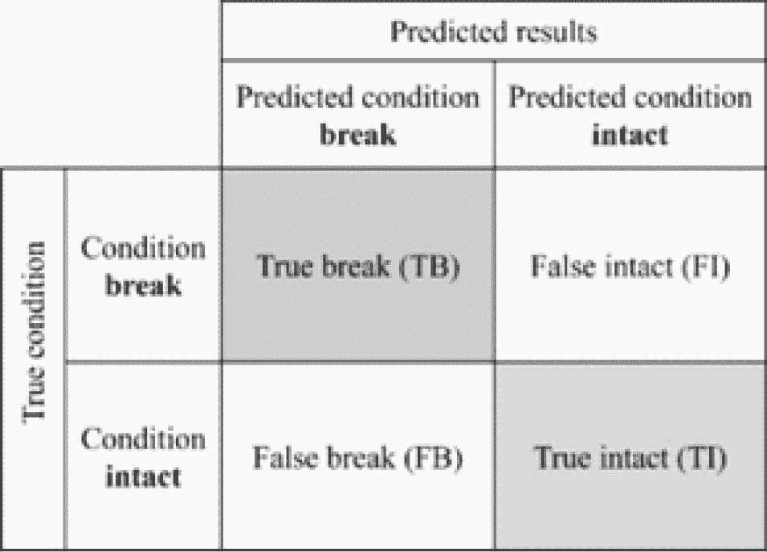

### 2.4 KNN

(Bhattacharya, A. et al. 2021) 指出 kNN 是模式分类中最基础、核心的算法之一。假设属于同一类的实例彼此靠近。用于计算实例之间距离的方法决定了 kNN 的有效性。欧几里得距离是最常用的距离。式 (3) 定义了样本 `yi` 和 `yj` 之间的欧几里距离。

$$l(y\_{i},y\_{j}) = \\sqrt{{y\_{i1} - y\_{j1})}^{2}{(y\_{i2} - y\_{j2})}^{2}{(y\_{i3} - y\_{j3})}^{2} + ......... + {(y\_{im} - y\_{jm})}^{2}}$$

(3)

`yi`[`m`]` 代表第 `i` 个样本的第 `m` 个特征。

### 2.5. 支持向量分类 (SVC)

支持向量分类是一种 SVM，通过使用最优超平面来执行分类任务。根据 Mandal, A. et al. (2021) 的观点，n 维数据点可以通过称为超平面的平面分为两半。例如，如果事件是 2D 数据集，则超平面是 2D 平上的直线。SVC 的目标是找到可以最大化间隔的超平面，间隔是从超平面到每类最近样本距离的累加。以下优化方程使用 SVC 在数学上进行求解。

### 2.6. 评估机器学习模型的指标

五种机器学习技术的输出是范围之间的连续值。0 到 1 之间的哪个数字表示管道崩塌的概率？这种置信水平通常被解释为崩塌的概率。假设测试数据集的地面确定性是二分类（完全完好或崩塌），分析估计结果的常用方法是根据阈值（0.5）将其分为每一类。如果输出大于 0.5，则预测为崩塌；否则，则被认为是“完好”。根据预测结果和真实数据，可以产生混淆矩阵，如图 1 所示。“真崩塌”和“真完好”表示正确分类的样本。“假完好”描述了看起来完好但最终崩塌的管道。本研究使用准确率、召回率和精确率来量化 ML 性能。


准确率指数通过考虑所有预期结果来确定整体预测准确性。准确率是所有实际破损与所有预期破损的比例。召回率被定义为每个真实破损（Real Break）与真实塌陷（True Collapses）的比例。更准确地说，召回率值意味着测试数据集中有更多的破损案例被模型准确检测到。准确率数值越高，预测的破损样本中真实破损样本的比例越高。实际上，低准确率可能会导致完好管道被不更换，增加不必要的维护成本，而低召回率则可能导致损坏管道被忽略。

之前的研究表明，仅依靠准确率（Praveenkumar, S. et al., 2023)）、召回率（Vidya Chellam, V. et al., 2023 所示。管道网络的分布总计有 55,945 条管道，如图 2(a) 所示。数据记录包含了每条管道的年龄、材料、直径、长度和其他物理属性的细节。图 2(b)显示了 WSN（水网网络）某一站点的管道维护记录。点表示接受过维护的位置。维护日期也由克利夫兰水务部（CWD）进行监测。

图 2(c)显示了供水网络中管道年龄的分布。显而易见，许多管道已经运行了近一个世纪。假设每一根损坏的管道都被完全修复，预期的年度成本如图 2(d) 所示。该估计基于克利夫兰水务局的经验，预计更换管道的每英成本约为 483.74 美元。然而，由于两个原因，实际总成本可能低于估计：1) 许多损坏可以同时维修；2) 维修可能只是导致塌陷而非完全修复管道。在准备维护预算时，对水管何时破裂有精确的估计将非常有用。

为了全面理解 WSN 故障的原因及相关的维护，首先合并了来自多个源的数据。即使越来越多的数据变得公开可用，但合并来自多个源的数据可能仍然困难，因为它们有时由不同的组织提供，并以不同的配置进行维护。目前使用数据驱动方法时的一个局限性已被指出：目前还没有有效合并不同来源数据集的最佳实践。除了开发这些指南外，本部分的目标是提供一个多源数据聚合框架。本研究特别考虑了六个数据集：(1) WSN 管道相关数据集，(2) 先前的管道塌陷数据集，

#### 图 3. 从多个源汇总数据集的方案

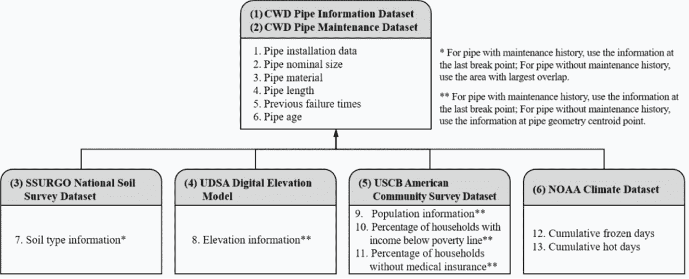

#### 图 4. 数据聚合技术（Ngọc, T. H. et al. 2023）涉及对许多数据集的假设，例如 (a) 管道塌陷数据集（Reepu, et al. 2023），它依赖于塌陷点到管道的距离；(b) 土壤类别数据集，依赖于地质数据；(c) 地理数据集，依赖于数字高程技术的坐标；以及 (d) 人口数据集，依赖于管道或破裂点的物理坐标与人口普查区块的关系

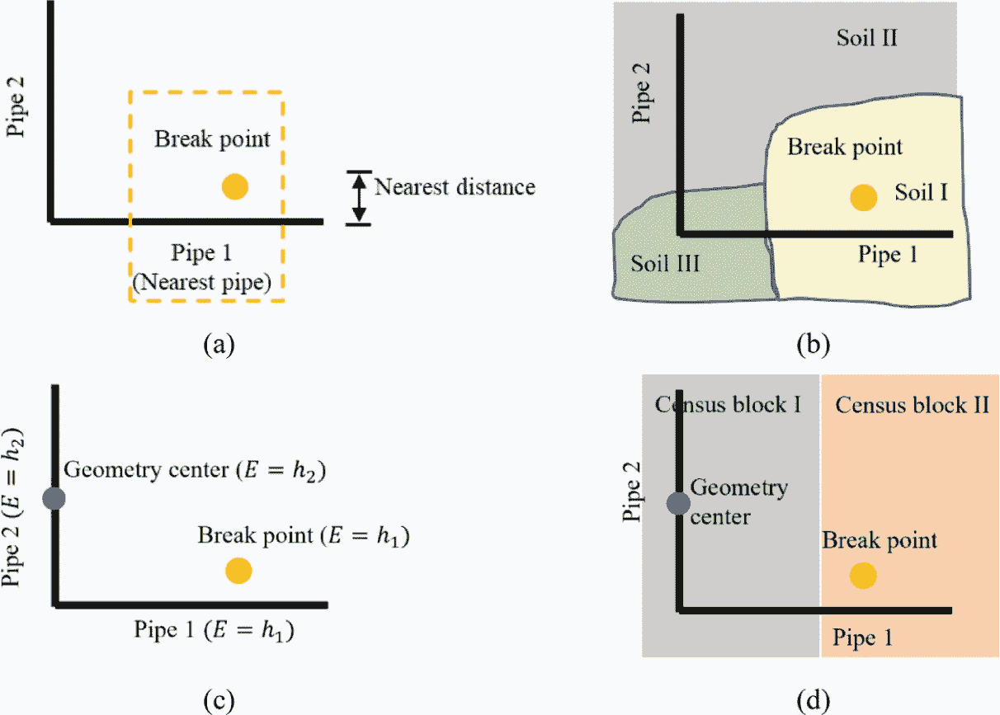

(1) 和 (2) 来自克利夫兰水务局，而 (3) 来自美国土地调查局的 SSURGO 土壤类型。美国农业部提供了来自数字高程技术的地理数据集，美国人口局提供了五年数据，美国海洋和气象局提供了气候数据集。为了给出完整的训练和测试数据集，将最后四个可用数据集与克利夫兰水务局提供的数据集合并。数据聚合框架如图 3 所示。有关数据聚合的假设和规范的更多信息见下文。

### 3.1 简化数据收集与记录

对于地理系统中的管道信息和破损数据，CWD 提供两种不同的层格式（Chandan, R. R. et al. 2023)），如图图 2(b)所示。`Points` 代表破损记录数据集，而 `lines` 代表管道信息数据集。

分析显示，这两个数据组之间有少量的重叠。理由是管道是根据实际布局的，即使破损位置是手动标记或使用与水管未对齐的 GPS 传感器标记的。根据图 4(a)，如果距离小于 1 米（GPS 设备的典型分辨率），则假设破损记录位于最近的管道处以便数据聚合。这使得将故障记录连接到相关的水管成为可能。原始管道信息收集中的公称尺寸、成分和距离可以通过将故障报告分配给相应的管道来立即确定每条管道的物理参数（表 1）。在这三个标准中缺失数据的管道将将被移除。

#### 3.2 土壤类型分组


之前的研究表明，由于输水管道通常位于地下，土壤与管道之间的相互作用对管道失效具有至关重要的影响。管道的特定失效可能是由地面不均匀沉降引起的。此外，不同土壤腐蚀性导致的管道退化也可能影响管道失效的概率。先前的研究显示，管道破裂发生在特定的 `pH` 范围内。考虑到从公共数据集中获取的土壤分类（Pramanik, S. 2023）是一种更实用的方法，因为不可能包含可能影响管道泄漏的每一个土壤因素。本研究考虑了 72 种不同类型的土壤。这些土壤类型根据其表面质地、主要元素、坡度和其他特征进行分类。每根管道的土壤分类信息是根据主要故障位置数据以及管道埋设地的大部分土壤类型分配的。根据 `4(b)`，`Pipe 1` 被分配了土壤类型 `Soil I`，因为断裂点位于此处。鉴于 `Soil II` 包含了 `Pipe 2` 的大部分区域且没有破裂记录，因此 `Soil II` 被指定为该土壤类型。

### 3.3 地形信息的汇总

地形数据可用于补充缺失的运行水压数据，以调查供水网（WSN）的失效（Khanh, P. T. et al. 2023）。海拔较高的管道通常水压较低。美国艾伦县（Allen County）供水网研究区域海拔很大，从 240 米到 410 米不等。地形数据集的分率为 40 米，通过地理空间数据网关（GDG）从 USDA 高程数据集收集。由于数字高程模型的存在，Cuyahoga 的每个位置都有可用海拔数据。管道段的高度可能会变化，就像土壤分类组合一样，对于长距离管道尤为如此。使用断点海拔来计算具有破裂记录管道的高度，如图 `4(c)` 所示的 `Pipe 1`。否则，使用管道几何形状的中点高度。

### 3.4 普查数据的获取

由于 WSN 几乎都是针对当地的，认为社区特征（如用户行为和普查数据）可能会影响管道失效的概率是有逻辑的。本研究使用了包含社区特征信息的公共普查数据来支持这一结论。从美国人口普查局获得的普查信息包含了定义每个社区区块的大量变量。根据普查数据，Cuyahoga 县被分为 2952 个社区区块。表 2 所示的人口统计、贫困率和非医疗保险率是根据信息的可用性选择的，从多个角度考虑社区因素。由于单根管道可能会跨越多个普查区块，每根管道的人口数据被分配给本研究识别的代表性位置。根据图 `4(d)`，具有故障记录的管道断点被用作指示点，而无破裂记录管道的代表点被选为管道几何中心。

### 3.5 气候数据的汇总

之前的研究表明，季节对管道破裂有重大影响（例如降雨、气温）。结果意味着，在极热或极寒的日子，管道破裂的发生较高可能是由于土壤与管道之间的接触引起的。然而，以前的研究未能考虑到预测年度管道失效所需的温度数据。为了克服这一考虑气候影响的限制，本研究使用了较冷和较热日数的总数，以反映每根管道在其整个使用寿命期间遭遇的环境。“冷天”是指温度低于 `32 °F` 的日子。温度在华氏 90 度的以上的日子被称为“热天”。使用由气候因子供应商提供的数据集来计算总天数。从安装开始到选定的研究年份，本研究使用的每根管道都有总数的热天和冷天。

高海拔地区通常水压较低。我们所研究的 WSN 管道位于俄亥俄州克利夫兰的艾伦县，该地区海拔范围很大，从 240 米到 410 米不等。地形数据集来自地理空间数据网关（GDG）的 30 米分辨率 USDA 高程数据集。数字高程模型（`DEM`）可计算 Cuyahoga 地区内任何位置的高度。

利用现有的数据聚合结构，开发了一个包含运行状况、地质条件、社区社会经济因素、气候和水管物理特性的完整数据集并将投入使用。

### 图 5. 显示机器学习训练和解释过程

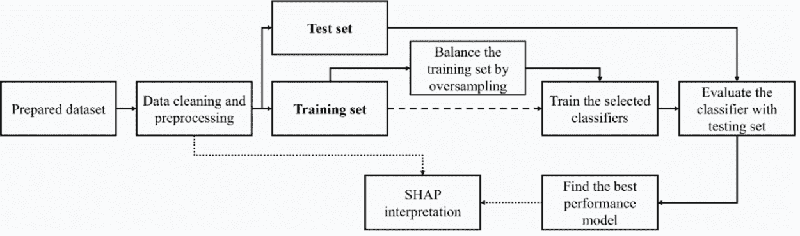

### 4. 案例研究

图 5 展示了基于机器学习的管道失效预测的机器学习建模工作流。图 5 提供了水管预测方法的概述。根据标准选择的合并数据集通过排除任何缺失部分和离群值的样本进行纯化，如第 3 节所述。为了提高机器学习方法的性能，通过移除均值并缩放到单个单位来对数值组件进行标准化。

收集的数据集按照 8:2 的比例随机分为测试集和训练集，这是确定模型预测效果的常用技术。由于破裂记录仅占整个数据集的 15%，机器学习模型训练的不平衡是一个需要解决的严重问题，正如图 5 所示。使用平衡和不平衡的训练数据集来训练模型。为了平衡数据集使损坏样本的数量等于完好样本的数量，本研究使用了随机重复少数类管道的过采样技术。测试集保持不变。因此，在平衡和不平衡数据集上训练的模型使用相同的测试集进行评估。一旦确定了性能最好的机器学习模型，将使用整个数据集进行机器学习技术，并使用名为 SHAP 的解释过程来理解给定组件对管道发生的影响。需要注意的是，模型分析结果独立于训练-测试划分策略，因为选定的模型已根据整个数据集进行了重新拟合。


由于研究的目的是预测特定时段内的管道状态（即管道状态为破损或运行良好），因此机器学习模型被设定为一个分类问题。创建一个包含每根管道每一年的数据集是不可行的，并且可能导致数据集高度不平衡。采取了后续步骤来减轻不平衡程度并充分利用破损记录，构建了用于机器学习测试和训练的最优数据集。

1. 为每根管道随机选择一年，从安装日期开始，一直到 2023 年 8 月结束（这是本研究前的最后更新数据）。在此期间，发现了一些与时间相关的因素，例如炎热和寒冷交替的天数、管道年龄以及之前发生过的坍塌事件。
2. 数字 `0` 表示良好状态，`1` 表示坍塌状态，指示所选年份的管道状态。
3. 为了充分利用管道破损历史，将每个具有破损记录（或多次破损）的管道其最近一次破损年份的数据连接到早期阶段创建的数据集中。
4. 使用 `8:2` 的比例将最终数据集划分为训练集和测试集。

所选数据经过了本研究前述部分的数据聚合处理。下一阶段称为“数据清洗”，即移除包含空白的数据点。数据清洗后，获得了 `40,236` 份管道数据样本——其中 `32,436` 个良好样本和 `7354` 个破损样本。

考虑到模型的预测结果可能会受到第 1 步中随机年份选择的影响，因此进行了十次随机选择以评估模型的性能，并应用了评估标准的平均估计值。

#### 图 6. 显示了训练集和测试集考虑的变量直方图

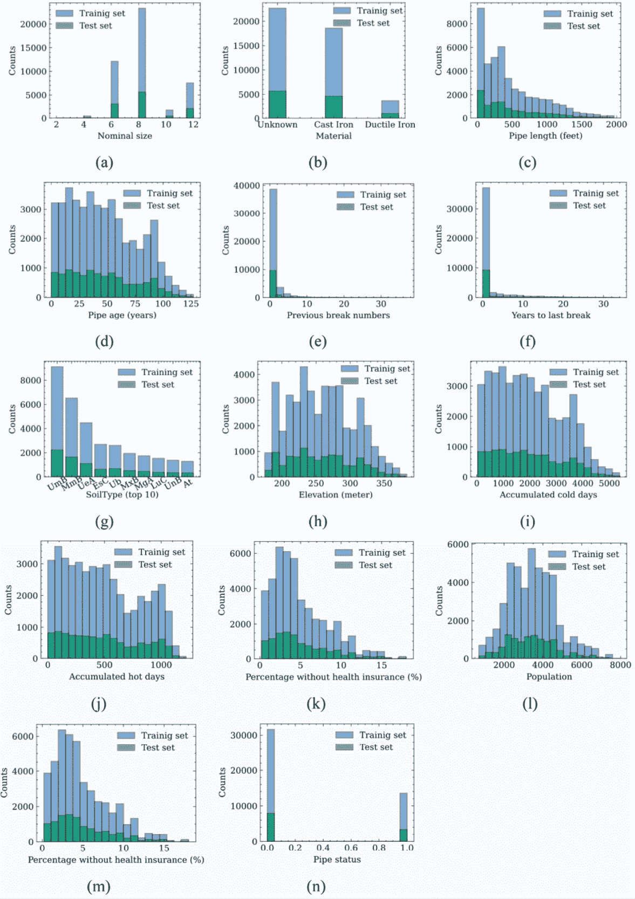

共有两个类别变量和 11 个连续变量，总计 13 个组件。这些方面分为四个基本类别：物理、运行、环境和社会。

图 6 显示了训练数据集和测试数据集的因子直方图。总体而言，测试数据集的特征被训练集充分覆盖。物理变量离散性的更详细表示请见图 6(a) 至 (d)。尽管许多管道的成分未知，但铸铁和球墨铸铁是 WSN 系统中最常用的材料。在图 6(e) 和 (f)中，显示了两个运行变量的特征。在 6(g) 到 (j) 中，显示了四个环境变量。为了方便观察，管道分为 72 种不同的土壤。考虑的气候因素之一是整个时间范围内的炎热和寒冷天数总和。发现它们与管道年龄分布具有相似性是非常有趣的，这突显了气候因素对管道失效的重要性。人口普查数据、贫困人口比例以及没有医疗保险的家庭比例被选中代表每根管道所服务社区的社会经济特征，如图 6(k) 至 (m)所示。每个人口普查社区区块的人口从 750 到 8500 以上不等，这是重要的，因为库亚霍加县（Cuya-hoga County）有多个人口密集地区，例如克利夫兰市。大多数社区区块的贫困率低于 40%。另一方面，最贫困区块中近 90% 的家庭年收入低于联邦贫困线。社区区块无医疗保险的人口范围在 0.2% 到 18% 之间，这与所述的低水平一致。

根据管道在选定监测年份内是否破，管道集合分为两组；如果管道在监测期间发生坍塌，类别代码为 `1`；如果正常，则代码为 `0`。结果如图 6.(n)所示。

##### 4.2.2 失效状态与内部因素之间的关系

相关性矩阵可用于显示导致管道坍塌的因素之间的内部连接，以及每个组件与目标之间的外部链路。由于数据集包含类别和数值变量，使用了多种相关性指标来评估变量之间的相关性。

人口、无医疗保险的人口比例和贫困率是社会经济变量的几个例子，它们之间相关，但并不意味着 ML 模型应该将它们视为独立变量。此外，任何单一输入（I/P）变量与主输出（O/P）变量之间都没有看到相关性，表明管道失效是一个涉及多个变量的复杂问题。

#### 图 7. 应用于数值和类别变量的相关性衡量标准所示

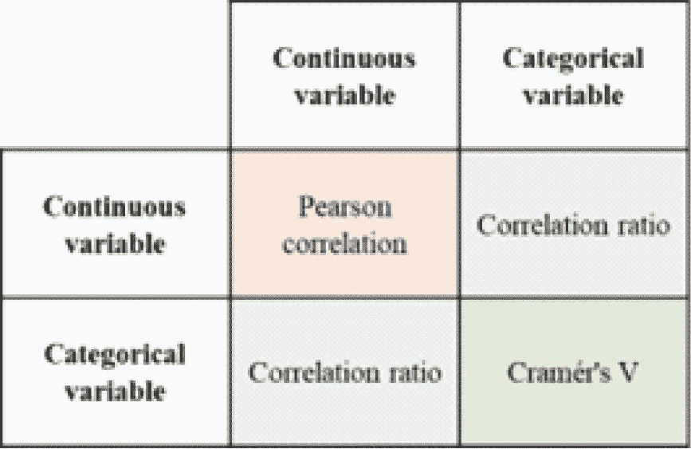

确定不同类型数据之间相关性的过程见图 1。具体而言，两个数值变量之间的相关性使用皮尔逊相关系数（[Samanta, D. et al. 2021](#979-8-3693-0683-3.ch013.bits-pdf.xhtml#_idTextAnchor774））表示，而两个类别变量之间的相关性使用 Cramer's V 系数量化。此外，数值和类别数据之间使用相关系数。对于类别组件，这些指标跨度从 0 到 1；对于数值元素，跨度从 -1 到 1。完全正或负相关用 1 表示，而 0 表示完全没有关联。由于文章长度限制，此处未给出相关性计算的详细描述。感兴趣的读者可以查阅补充文件（算法 I）。


在背景部分涵盖的五类监督机器学习（ML）算法被用于开发管道破裂分类问题。每个机器学习算法的超参数优化都是通过网格搜索优化完成的 (Pramanik, S. 2023）。`ANN` 模型使用一个输入层、一个丢弃层（dropout layer）、两个隐藏神经网络层和一个输出层。隐藏层分别有 68 个和 132 个神经元。模型在不平衡数据集上训练后的预测结果如图 Fig. 9a 所示。9b 显示了模型在平衡数据集上训练的结果。每个类别的召回率和准确率矩阵分别显示在右侧和底部。右下角的单元格显示了模型总体准确性的描述。无论数据集是否平衡，`LightGBM`（Jayasingh, R. et al. 2022）和 `ANN` 模型在准确率、召回率和精确率指标方面均提供了最佳预测。另一方面，在平衡数据集上训练时，`KNN` 和 `SVC` 模型经常会漏掉大量的完好样本，而在不平衡数据集上训练时，它们又经常漏掉各种破损样本。过采样允许模型检测到更多的破裂样本。

为了说明不同模型的整体性能，计算了十个所选数据集的平均受试者工作特征（ROC）、精确率-召回率（PRC）、曲线下面积（AUC）以及平均训练时间，如图所示。无论训练集是平衡还是不平衡，`LightGBM` 模型在训练时长、ROC 和 PRC 值方面的表现均优于评估的所有其他模型。`LightGBM` 无需独热编码即可处理分类数据的能力

#### 图 8. 使用平衡和不平衡训练数据集的预测结果（'I' 表示完好，'B' 表示崩塌）


#### 图 9. 使用平衡和不平衡训练数据集的预测结果（'I' 表示完好，'B' 表示崩塌）


#### 图 10. 评估部署的机器学习模型的若干标准比较


#### 表 4. 预测管道破裂的模型总结

|  || LightGBM || 人工神经网络 || 逻辑回归 || KNN | SVC |

| --- | --- | --- | --- | --- | --- |

| 准确率 || ° ° ° || ° ° || ° || ° || ° |

| --- | --- | --- | --- | --- | --- |

| 学习技术速度 || ° ° || ° ° || ° ° ° || ° || ° |

| 处理类别值 || ° ° ° || ° || ° || ° || ° |

| 模型可解释性 || ° ° || ° || ° ° ° || ° || ° |

° ° ° 表示完成得很好。

° 表示努力最少。

接下来的图表描述了每个因素对管道破裂概率的影响。使用 `SHAP` 技术计算每个样本每个变量的影响值。为了显示所考虑的所有因素对管道破裂机会的整体影响，从所有管道样本中提取了每个元素的影响值。连续变量的影响根据其大小着色。通过影响变量的平均值提供表示。从观察结果可以得出以下推论。结果中的许多结果与之前的的研究一致，这证明了模型解释结果的有效性。

1. 1) 图 12 展示了物理组件是如何工作的。这些因素中的每一个对管道破裂的概率都有正向影响，因此因素值越大，`SHAP` 值越高。根据管道长度估计的离散情况，较长的管道比较小的管道更容易失效。关于管道年龄也可以得出相同的结论。较旧的管道具有更大的 `SHAP` 值，这意味着它们比年轻的管道更容易失效。此外，名义尺寸与 `SHAP` 值之间观察到显著相关性，表明大公径管道的失效率更高。图 12 的右侧分别显示了每种管道材料的影响。尽管两者的 `SHAP` 值都很低，但铸铁具有正 `SHAP` 影响值，而球铁具有负 `SHAP` 影响值。这表明铸铁管道破裂的概率高于球铁管道。

2. 2) 运行服务的结果如 图 13 所示。管道崩塌的概率更多地受到距离上次破裂时间的影响，而不是之前破裂长度的影响。管道破裂之间较长的时间增加了失效可能性；然而，较短的时间对失效概率既有正面也有负面影响。这意味着管道在安装或维护后不久遭受了损坏。结果与之前显示管道失效率呈“浴缸曲线”的研究一致，即失效概率在管道寿命的早期或其开始退化时较高。此外，如 `SHAP` 值所示，管道频率较高。

#### 图 11. 考虑管道概率的变量总排名


#### 图 12. 物理因素的影响


#### 图 13. 展示运行变量的 SHAP 值


#### 图 14. 受环境影响


#### 图 15. 影响因素是局部的


结果表明，对于图 14 所示的环境条件，管道经历的寒冷天数会增加其破裂的风险。这可能是由土壤冻融导致土壤沉降引起的。图 14 的右侧说明了土壤分类如何产生影响。在大多数管道被埋藏的前 10 种土壤类型中，`LuC`（劳登维尔城市土地复合体）土壤具有最高的管道破裂概率，而`UoB`土壤的破裂率最低。更不用说，结果显示位置越高的管道爆裂概率越，考虑到高海拔地区的管道所承受的运行供水压力较低，这是符合的。因此，供水压力对管道引起的内部张力被降到了最低。

令人惊讶的是，相对于图 15 所示的社会文化因素，社会经济水平较低或医疗资源较少的人，水管破裂的风险较低。贫困社区较低用水量或较低检测率可能是管道寿命延的因素。需要更多数据驱动的研究来进行全面解释。尽管如此，在大多数管道样本中，社区区块的密度并没有持续影响管道失效的可能性；人口稠密地区与极高的水管破裂风险相关。

### 5. 结论

本项目旨在研究机器学习（ML）算法在基于大型供水网络数据预测水管故障方面的应用，目标是理解影响因素的作用。在考虑导致管道塌的因素（如社会经济因素、气候和地质）方面，重要的第一步是设计计划，将供水网络的维护记录与多个公共数据库相结合。利用聚合数据，开发了五种不同的机器学习模型用于管道塌陷估计，每个模型都属于五类主要机器学习分类模型之一。模型分别在不平衡训练数据集（大部分数据来自完好管道）和平衡训练数据集（使用过采样技术建立平衡）上进行训练。比较了几个训练数据集的结果。然后使用 `SHAP` 差值法对学习到的机器学习模型进行解释。本工作的主要贡献包括：

该系统通过整合多个公开的数据集，提供了一种先进的数据聚合方法，产生了最大的实地数据集（无论在规模还是年代上都是如此），从而为供水网络的机器学习建模提供了最多的 I/P 参数。因此，本研究显著扩展并加深了社区对技术、地质、天气和社会经济问题影响的理解。据我们所知，这是首次评估社会经济特征在水网网络塌陷中发挥作用的研究。

1. 出于实施考虑，根据五种标准对五种流行的机器学习算法进行了仔细检查和比较：准确率、处理时间、分类变量的影响和可解释性。训练时间第二短的模型 `LightGBM` 实现了最高性能。使用精确率-召回率曲线（`PRC`）指标表明，考虑到数据集的极端偏斜，接收者工作特征（`ROC`）测量值过于乐观。

2. 解释结果与过去研究的一致性证明了 `SHAP` 理解影响因素影响的能力。结果表明，管道年龄、遭遇的寒冷炎热天数以及管道埋设时间——即自上次塌陷以来的时间——具有显著影响。环境和管道的物理属性都以与以往研究结论一致的方式做出贡献。社区特征的贡献表明，尽管人口密度大的地区水管破裂风险较高，但贫困严重的地区管道破裂的可能性较低（或维护频率较低）。这些表明管道运行周围的环境受到社会经济因素的显著影响。

此外，水管失效是由不同类型组分元素之间复杂的非线性相互作用引起的。由于模型的能力和数据的可获取性，早期的研究通常通过考虑少数因素来简化分析程序。为了提高管道失效预测的准确性，未来的研究应该考虑包含更大的的数据集和更先进的机器学习技术。多个领域的发展可能作为决策过程转变的催化剂，实现供水网络的精细化管理以达到可持续目标。

### 参考文献

Ahamad, S., Veeraiah, V., Ramesh, J. V. N., Rajadevi, R., Reeja, S. R., Pramanik, S., & Gupta, A. (2023). Deep Learning based Cancer Detection Technique. In Thrust Technologies’ Effect on Image Processing. IGI Global.

Bhattacharya, A., Ghosal, A., Obaid, A. J., Krit, S., Shukla, V. K., Mandal, K., & Pramanik, S. (2021). Unsupervised Summarization Approach with Computational Statistics of Microblog Data. In Samanta, D., Althar, R. R., Pramanik, S., & Dutta, S. (Eds.), Methodologies and Applications of Computational Statistics for Machine Learning (pp. 23–37). IGI Global. [10.4018/978\-1-7998\-7701-1.ch002](http://dx.doi.org/10.4018/978-1-7998-7701-1.ch002)

Chandan, R. R., Soni, S., Raj, A., Veeraiah, V., Dhabliya, D., Pramanik, S., & Gupta, A. (2023). Genetic Algorithm and Machine Learning. In Advanced Bioinspiration Methods for Healthcare Standards, Policies, and Reform. IGI Global. [10.4018/978\-1-6684\-7701-1.ch002](http://dx.doi.org/10.4018/978-1-6684-7701-1)

Chen, Y., Jia, J., Wu, C., Ramirez-Granada, L., & Li, G. (2023). Estimation on total phosphorus of agriculture soil in China: A new sight with comparison of model learning. Journal of Soils and Sediments, 23(2), 998–1007.

Dhamodaran, S., ... (省略作者保持格式)

Jayasingh, R. (2022). Speckle noise removal by SORAMA segmentation in Digital Image Processing to facilitate precise robotic surgery. International Journal of Reliable and Quality E\-Healthcare, 11(1), 19. Advance online publication. [10.4018/IJRQEH.295083](http://dx.doi.org/10.4018/IJRQEH.295083)

Khanh, P. T., Ngọc, T. H., & Pramanik, S. (2023). Future of Smart Agriculture Techniques and Applications. In Advanced Technologies and AI\-Equipped IoT Applications in High Tech Agriculture. IGI Global.

Mandal, A., ... (省略作者保持格式)


Mondal, D., Ratnaparkhi, A., Deshpande, A., Deshpande, V., Kshirsagar, A. P., & Pramanik, S. (2023). 智能城市中多尺度建模的应用、现代趋势与挑战。收于《智能城市的数据驱动数学建模》。IGI Global. [10.4018/978-1-6684-6408-3.ch001](http://dx.doi.org/10.4018/978-1-6684-6408-3.ch001)

Ngọc, T. H., Khanh, P. T., & Pramanik, S. (2023). 基于土壤监测系统的智能农业。收于《高科技农业中的先进技术与人工智能设备物联网应用》。[10.4018/978-1-6684-9231-4.ch011](http://dx.doi.org/10.4018/978-1-6684-9231-4.ch011)

Pandey, B. K., Pandey, D., Nassa, V. K., Hameed, A. S., George, A. S., Dadheech, P., & Pramanik, S. (2023). 图像文本提取算法综述。收于《推进技术对图像处理的影响》。Nova Publishers. [10.52305/ATJL4552](http://dx.doi.org/10.52305/ATJL4552)

Pramanik, S. (2023). 利用土壤追踪设备的智能农场。收于 Sharma, A. K., Chanderwal, N., Khan, R., & Global, I. G. I. (编者),《云计算、人工智能与农业科学的融合》。[10.4018/979-8-3693-0200-2.ch009](http://dx.doi.org/10.4018/979-8-3693-0200-2.ch009)

Pramanik, S. (2023). 一种基于小波变换和遗传算法的自适应图像隐术方法。《多媒体工具与应用》，82(22), 34287–34319。在线优先出版。[10.1007/s11042-023-14505-y](http://dx.doi.org/10.1007/s11042-023-14505-y)

Pramanik, S., & Bandyopadhyay, S. (2023). 使用机器学习识别女性疾病与诊断。收于 John Wang, I. G. I. (编者),《数据科学与机器学习百科全》。Global. [10.4018/978-1-7998-9220-5.ch187](http://dx.doi.org/10.4018/978-1-7998-9220-5.ch187)

Praveenkumar, S., Veeraiah, V., Pramanik, S., Basha, S. M., Lira Neto, A. V., De Albuquerque, V. H. C., & Gupta, A. (2023). 利用深度学习方法预测患者绝症疾病，ICICC 2023。Springer. [10.1007/978-981-99-3315-0_4](http://dx.doi.org/10.1007/978-981-99-3315-0_4)

Reepu, K. S., Chaudhary, M. G., Gupta, K. G., Pramanik, S., & Gupta, A. (2023). 物联网中的信息安全与隐私。收于《人工智能与物联网融合技术进展研究手册》。IGI Global.

Samanta, D., Dutta, S., Galety, M. G., & Pramanik, S. (2021). 一种用于高性能计算的网络挖掘分类新方法。第 4 届计算机科学与可再生能源国际会议 (ICCSRE'2021)。[10.1051/e3sconf/202129701073](http://dx.doi.org/10.1051/e3sconf/202129701073)

Tai, P., Wu, F., Chen, R., Zhu, J., Wang, X., & Zhang, M. (2023). 草本植物对降雨下松散粉质砂坡响应的影响。《工程地质与环境学报》，82(1), 42。[10.1007/s10064-023-03066-x](http://dx.doi.org/10.1007/s10064-023-03066-x)

Vidya Chellam, V., Veeraiah, V., Khanna, A., Sheikh, T. H., Pramanik, S., & Dhabliya, D. (2023). 基于机器视觉的胸部 X 光片结核识别方法，ICICC 2023。[10.1007/978-981-99-3315-0_4](http://dx.doi.org/10.1007/978-981-99-3315-0_4)


自主下水航行器（AUV）Sentry 自 2009 年来一直在进行常规作业。它是一个额定深度为 6000 米的自主调查和采样平台，是一种“随插随用”系统，意味着它可以轻松运输到世界任何地方以利用现有的船舶。Sentry 最初是 AUV 设计中的一个激进概念和实验，现在是由伍斯霍尔海洋研究所（Woods Hole Oceanographic Institution）运营的国家深下作业设施（NDSF）的 AUV 组成部分，因此每年在野外作业多达 200 天，为海洋科学家执行任务。相应的，Sentry 必须足够可靠以满足以客户为中心的任务，同时又要足够灵活，以便在极短时间内承担此前未设想的任务，并保持高成功率。在“全球级”研究船上的野外作业每天费用很容易超过 10 万美元，因此对效率的要求极高。在这里，我们不仅描述了 Sentry 飞行器，还描述了支持 Sentry 的系统和基础设施，以及 NDSF 内部作业的独特性质。

### 文献综述

(Adakawa 1995)对使用螺旋桨的传统水下机器人进行了研究，这可能对海洋生物产生危害。相比之下，结合水生动物游泳原理、形态和软性的机器人预计能更好地适应周围环境。鱼形（Rajiform）是自然界观察到的游泳形式之一，它通过在平坦的大胸鳍上产生行波来游泳。鱼形鳍由封装在软组织中的软骨结构组成，实现了各向异性刚度(Yuh 2000)假设这种各向异性是产生行波的原因，使得水下机器人可以通过软骨结构高效游泳。

(Adam 1985)对自主下水航行器的设计与开发进行了研究——这是一种具有自主运动功能的机器人豚。基于 3D 运动分析描述了一种运动机制，用以确定机器人豚中每个链路的长度和每个关节的摆动角。使用两个微芯片来控制每个关节中执行器的摆动角。为了理解机器人豚的运动特性，安装了一个微计算机以获取各种运动数据。发现三轴加速度和三轴角度的实验数据与机器人豚在向前摆动运动中的振荡相同。

(Adam 1991)机器人豚的设计旨在具有规避碰撞功能和人工智能，例如通过图像处理的反向传播学习来实现特定的运动识别。

(Anderson et. al, 1992)对水下探测机器人的结构进行了设计研究，并提出了一种使用神经网络的水下探测机器人控制方法，以改进`PID`控制参数。

水下探测机器人的整体结构和控制系统布局根据设计需求进行设计和规划，旨在解决传统控制方法参数设置复杂和系统参数实时性能差的问题，将前馈神经网络和`PID`控制器的自动学习特性相结合，实现`PID`控制单元参数的在线调整(Antonelli & Chiaverini, 1998)。

(Ashley 1993)根据上述方法设计了一个具有自动学习特性的`PID`控制器来控制水下探测机器人，可以实现水下探测机器人运动控制的最优参数组合，并提高其水下运动适应性差的问题。

在本野外笔记中，我们详细说明了使用自主下水航行器`AUV`在水下洞穴复合体非结构化环境中进行的操作，并讨论了实验结果(Auran & Silven, 1995)。对于该实验，`AUV`配备了两个声学声纳传感器以同时绘制洞穴的水平和垂直表面地图。尽管洞穴的空间复杂性需要潜水员引导`AUV`，但这次野外部署成功演示了同步定位与建图框架下的扫描匹配算法，该算法显著减少并限制了完全自主导航的定位误差(Davies et al., 1998)。这些方法适用于无法浮出或预先部署定位设备的受限水下环境进行`AUV`探索，它们可能为`AUV`作为受限水下灾害地区的响应工具提供了有用步骤(Dougherty et al., 1990)。

本文概述了 NTSF 在海底和海洋测图方面的研究。还讨论了与自主相关的定义和要求。将介绍在挪威海岸和北极海域进行的选定现场试验的结果和经验。将展示不同传感器和平台的集成，如自主下水航行器（AUV）、遥控无人水器（ROVs）以及基于船舶的系统(Dunn & Rae, 1992)。

NTNU 自主海洋作业中心（NTNU AMOS）是一个为期十年的研究计划（2013-2022），解决与海运、油气勘探与开发、渔业和水产养殖、海洋科学、海上可再生能源以及海洋采矿相关的自主海洋作业挑战(Kashif et al., 2023)。基础知识通过流体力学、结构力学、引导导航控制和优化领域的跨学科理论、数值和实验研究产生(Abbas et al., 2023)。

本文介绍了 INES TEC 在海洋环境（包括水面和水下）中参加 2015 年铁人三机器人搜索救援竞赛的结果。这些涉及来自 INES TEC 的海洋机器人、水面（ROAZ USV）和水下（MARES AUV）自主车辆在形势评估、水下测图、泄漏检测或受害者定位等任务中的参与。这种参与整合进了 ICARUS 团队，导致了旨在开发大型灾害机器人工具的欧盟资助项目(Liu & Ke, 2023)。协同搜索救援任务通过初始水面调查执行，为 AUV 任务的规划和执行提供数据。实现了形势评估深度图、侧扫声纳成像以及结构、水下泄漏受害者的定位，全球 ICARUS 团队（涉及海、空、陆协同机器人）参加了最后的大挑战并获得第二名(Javaid et al., 2023)。


在本文中，我们介绍了一种配备了推进器的新型生物启发水下游泳机械臂（USM）的控制框架。该框架由运动学部分和动力学部分组成。框架的运动学部分通过协调 USM 躯体和关节关节的运动，控制 USM 头部链节的速度。文中介绍了多种基于逆运动学的方法，并讨论了每种方法在 USM 运动学控制中的适用性。框架的动力学部分确保了逆运动学方法生成的速度参考值得到遵循，并将推进器力合理地分配在可用的推进器之间。文中解释了逆运动学程序与推进器分配算法之间关系的重要性，并包含了仿真实验以验证 USM 控制概念的可行性（Mohsan et al., 2023）。

机器人系统中运动学冗余的利用可以为执行复杂任务提供更高的灵活性和多功能性。在末端执行器任务之外施加功能约束任务时，建议采用任务优先级策略。作者提出了一种用于高度冗余系统中多任务管理的通用框架。特别是，他们推导了关节速度和加速度解，这些解可以作为参考输入轨迹用于适用于基于模型的控制器。他们还开发了一种递归实现方法，并讨论了与通用任务相关的雅可比矩阵中奇异性的出现。两个案例说明了该算法在蛇形机器人上的有效性（Abbas et al., 2022）。

海洋环境中数百个油气行业结构正接近退役。在大多数地区，退役作业将需要环境评估和监测的支持，且可能跨越任何遗留结构的整个生命周期。这一要求将为工业和公众带来巨大的成本。在此，我们回顾了与退役相关的初运行环境的评估方法——即结构物、管道、井屑堆、普通海底环境和水柱，并表明现有的海洋自主系统（MAS）已为这一主要的监测挑战提供了广泛的解决方案。可以使用部署在 MAS 上的声学、视觉和海洋学传感器来收集与退役直接相关的数据。我们认为，在节省成本和大幅提高环境监测的时空分辨率方面具有巨大潜力。我们总结了 MAS 与当前传统海洋环境监测方法之间的权衡。Mohave 有潜力成功执行大部分与退役相关的监测，并在无法直接匹配传统方法时提供可行的不可替代的替代方案（Abbas & Liu, 2022）。

水下游泳机械臂（USM）是一种像蛇一样的、多关节的配备推进器的水下机器人。USM 的主要目的之一是充当水下浮动基座机械臂。因此，关键在于利用推进器实现 USM 良好的定位和轨迹跟踪性能，同时利用关节实现 USM 头部和尾部所需的位置和姿态。在本文，我们提出了一种滑动模式控制（SMC）律，特别是带有自适应增益的超自旋算法，用于 USM 质心的轨迹跟踪。提出了一种高阶滑动模式观测器用于状态估计。此外，我们展示了跟踪误差的最终有界性，并进行了仿真研究以验证所提控制律的适用性，并证明其跟踪性能优于线性 PD 控制器（Ahmed et al., 2022）。

## 方法论

## AUV 设计

`T200 Thruster` 是全球用于 ROV、AUV、水面船舶等设备最受欢迎的水下推进器！其专利浸没式电机设计使其动力强大、高效、紧凑且价格实惠。

这种压力传感器可以测量高达 `30 Bar`（深度 300 米），深度分辨率为 `2mm`。它是防水的且已准备好安装，是 ROV、AUV、远程传感器和水下仪器的理想选择。并被用于测量深度范围，以反馈给我们的推进器，以便逐渐下潜。

`Ping` 声纳仪是一种单波束回声测仪，可以测量水下高达 `50 米`（164 英尺）的距离。具有 30 度束宽、`300 米`（984 英尺）深度额定以及开源软件接口。我们正在使用 2 台声纳，使用该声纳测量两侧之间的距离，并将其安装到 AUV 的两侧。

`Arduino Mega 2560` 是一个基于 `ATmega2560` 的微控制器板。它有 54 个数字输入/输出引脚（其中 15 个可用作 `PWM` 输出）、16 个模拟输入、4 个 `UART`（串口）、16 MHz 晶振器、`USB` 连接、`ICSP` 插座和一个复位按钮。它包含了支持微控制器所需的一切；只需将其连接到计算机、电源或 `AC-DC` 适配器即可开始使用。

`Pixy2` 相机是一个计算机视觉识别系统。它允许微控制器检测颜色或线条，以创建一个跟踪机器人或捕捉彩色物体。

#### 图 1. 输出


`MPU` 为三个传感器中的每个传感器提供 16 位寄存器。它们在通过 `I2C` 传输之前临时存储传感器数据。接收到的数据必须根据用户进行校准。磁力计的校准是为了补偿磁偏角。

## AUV 导航系统

`Blue Robotics Newton Subsea` 为 `BlueROV2` 和其他水下车辆提供了与海底环境交互的能力用于检索物体、系泊或释放被缠住的缆绳！机械爪是一个单功能机械臂，额定深度为 `300m`，具有充足的安全系数，夹爪直径可达 `2.75″` 或 `7cm`。

### 图 2. 微控制器内部设计


使用两个微控制器，采用主从模式。这些控制器控制电机，主板控制水平推进器和传感器，从板仅控制垂直推进器。

### 图 3. AUV 系统框图


### 图 4. 深度传感器与控制器


获取深度传感器的反馈，以达到水下最小深度，控制器在水下保持相同的推进器速度。用于水平推进器。


如图 5 所示，我们的 Auv 两侧之间保持摇动并维持距离。

#### 图 6 带有控制器的深度传感器


水平推进器达到最小深度时，控制器可以配合垂直推进器工作，如图 6 所示。

### 结果与讨论

表 1 中提到的自主下水器器系统的功率计算。

#### 表 1 AUV 功率计算与功率监控系统

| 组件 || 模型 || 数量 || 功率(w) || 电压(v) || 峰值电流 || 电流(mA) || 电流(A) | 电流(Ah) |
| --- | --- | --- | --- | --- | --- | --- | --- | --- |
| 推进器 | T200 | 6 个 | 645 | 10-20 v | 32 A | 128000 mA | 128 | 128 |
| TEAM 团队传感器 | Celsius-sensor-R1-RP | 1 个 | \- | 3.3-5.5 v | 1.5 A | 1500 mA | 1.5 | 1.5 |
| 深度传感器 | BARO2 | 1 个 | \- | 2.5-5.5 v | 1.25 mA | 1.25 mA | 0.00125 | 0.00125 |
| 漏水传感器 | SOS-SET-R1-RP | 1 个 | \- | 3.3-5 v | 20 mA | 20 mA | 0.02 | 0.02 |
| 测纳传感器 | Ping-sonar-r3-rp | 1 个 | \- | 3.3-5.5 v | 100 mA | 100 mA | 0.1 | 0.1 |
| 水听器阵列 | AS-1 | 1 个 | \- | 30 v | \- | \- | \- | \- |
| 性测量单元 | MPU-9250 | 1 个 | \- | 2.4-3.6 v | \- | \- | \- | \-- |
| 机械爪 | NEWTON GRIPPER-ASN-R3-RP | 1 个 | \- | 9-18 v | 6 A | 6000 mA | 6 | 6 |
| USB 转 TTL 串口及 RS485 适配器 | BLUART-R1-RP | 1 个 | \- | 5 v | \- | \- | \- | \- |
| 高清摄像头 | CAM-USB-WIDE-R1-RP | 2 个 | \- | 5 v | 15 A | 15000 mA | 15 | 15 |
| 水下灯 | LUMAN PAIR-R4-RP | 1 个 | \- | 7-48 v | 15 A | 15000 mA | 15 | 15 |
| 总计 | | | | | | | \- | 165621.25 mA | 165.62125A | 165.62125Ah |

表 2 中提到的自主下水器系统在不同时的功率计算。

#### 表 2 不同阶段的 AUV 功率计算与功率监控系统

| 组件 || 模型 || 数量 || 功率 (w) || 电压 (v) || 峰值电流 || 电流 (mA) || 电流 (AMPS) | 每小时电流 (Ah) |
| --- | --- | --- | --- | --- | --- | --- | --- | --- |
| 推进器 | T200 | 6 个 | 645 | 10-20 v | 32 A | 32000 mA | 192 | 192 |
| TEAM 团队传感器 | Celsius-sensor-R1-RP | 1 个 | \- | 3.3-5.5 v | 1.5 A | 1500 A | 1.5 | 1.5 |
| 深度传感器 | BARO2 | 1 个 | \- | 2.5-5.5 v | 1.25 mA | 1.25 mA | 0.00125 | 0.00125 |
| 漏水传感器 | SOS-SET-R1-RP | 1 个 | \- | 3.3-5 v | 20 mA | 20 mA | 0.02 | 0.02 |
| 测纳传感器 | Ping-sonar-r3-rp | 1 个 | \- | 3.3-5.5 v | 100 mA | 100 mA | 0.1 | 0.1 |
| 水听器阵列 | AS-1 | 1 个 | \- | 30 v | \- | \- | \- | \- |
| 性性测量单元 | MPU-9250 | 1 个 | \- | 2.4-3.6 v | \- | \- | \- | \-- |
| 机械爪 | NEWTON GRIPPER-ASN-R3-RP | 1 个 | \- | 9-18 v | 6 A | 6000 mA | 6 | 6 |
| USB 转 TTL 串口及 RS485 适配器 | BLUART-R1-RP | 1 个 | \- | 5 v | \- | \- | \- | \- |
| 高清摄像头 | CAM-USB-WIDE-R1-RP | 2 个 | \- | 5 v | 15 A | 15000 mA | 15 | 15 |
| 水下灯 | LUMAN PAIR-R4-RP | 1 个 | \- | | | | | |
| 总计 | | | | | | | | 165621.25 mA | 165.62125A | 165.62125Ah |

#### 图 7 场地的俯视图与侧视图


自主下水器系统的场地 1 和场地 2 俯视图与侧视图，如图 7 所示。

#### 起始任务

起始线是池壁上宽 1 米的标记区域，AUV 应从此处部署。运行开始时，AUV 必须接触墙壁。距离起始线约 10 米处，水面悬挂着宽 150cm、深约 100cm 的通过门，门左右侧均有橙色标记，如图 8 所示。

#### 图 8 水面视图


#### 图 9 水面到底部视图


#### 任务 1

该任务的目标是通过池底设置的一个门。该门可能位于平行于游泳池侧的水平线上，距离起始区域约 12 米。AUV 必须通过高 150 厘米的门而不触碰门，如图 9 所示。

红色信号弹可能位于门之前距离场地侧 4-8 米的矩形区域。AUV 必须避免接触红色信号弹，如图 10 所示。

#### 图 10 从水面到底部的视图


#### 任务 2

该任务的目标是在池底目标区域的一系列桶中检测并获取目标。

铺在池底的绿色地垫定义了目标区域。地垫尺寸为 8m x 2m。显示了地垫相对于场地的位置。

场地中有 4 个彩色的桶。它们都在地垫上。随机选择一个桶为蓝色，其余为红色。随机选择一个红色桶，其中包含声学信号器。AUV 需要向其中一个桶内掉入球以成功完成此任务。得分将根据掉入的桶进行发放。如果掉了多个球，只考虑第一个球。

包含声学信号器的红色桶的位置在每次尝试之间可能是随机的，桶的顺序也是。桶的顺序和信号器的位置由组织委员会决定。

#### 任务 3

该任务的目标是重新获取之前检测的目标。

只有在成功完成目标获取任务后才能尝试此任务。此外，AUV 必须离开目标区域后才能尝试重新获取任务。AUV 的所有部分离开目标区域后，才能被视为位于区域之外。

在 AUV 位于目标区域外后，它需要重新获取目标并捡起在目标获取任务中掉落的球。AUV 必须持有球直到结束。

#### 任务 4

该任务的目标是定位黄色信号弹。场地中有两个黄色信号弹；其中一个黄色信号弹标记有声学信号器。信号弹可能位于主场地的任何位置。AUV 应定位并碰撞信号弹，使信号弹上的高尔球掉落。信号弹为黄色。只考虑被 AUV 成功碰撞的第一个信号弹，如图 11 所示。

#### 图 11 AUV 定位信号弹导致高尔球掉落


### 结论


水下机器的使用有助于探索和研究全球海洋和海洋的生态系统，地球 75% 的区域被水覆盖。人类无法在深度超过几米的水下长时间工作并获取有助于采矿或勘测的数据。水下机器人可以轻松地接管这项任务，并在此时最有用处。为人类设计和开发一种能够承受深海水下探测中所遇到的条件和挑战的系统既困难又昂贵。

### 参考文献

Abbas, N., Abbas, Z., Liu, X., Khan, S. S., Foster, E. D., & Larkin, S. (2023). 基于无人机（UAVs）先进控制的未来智能城市综述。Applied Sciences（瑞士巴塞尔），13(17), 9881. [10.3390/app13179881](http://dx.doi.org/10.3390/app13179881)

Abbas, N., & Liu, X. (2022). 基于不等式方法（MOI）通过增益调度实现变解耦双旋翼 MIMO 系统动力学变化的 μ-合成（DK 迭代）混合动态优化。Con. Eng. Appl. Inf, 24, 13–23.

Abbas, N., Pan, X., Raheem, A., Shakoor, R., Arfeen, Z. A., Rashid, M., Umer, F., Safdar, N., & Liu, X. (2022). 耦合双旋翼 MIMO 系统的实时鲁棒广义动态反转优化控制。Scientific Reports, 12(1), 17852. [10.1038/s41598\-022\-21357-3](http://dx.doi.org/10.1038/s41598-022-21357-3](http://dx.doi.org/36284142)

Adakawa, K. (1995). AUV 开发：Aqua explorer 1000。学术出版社。

Adam, J. A. (1985). 探测海底。IEEE Spectrum, 22(4), 55–64. [10.1109/MSPEC.1985.6370620](http://dx.doi.org/10.1109/MSPEC.1985.6370620)

Adam, J. D. (1991). 使用微型水下进行船内视觉检查。Nuclear Europe Worldscan, 10, 5–6.

Ahmed, F., Mohanta, J. C., Keshari, A., & Yadav, P. S. (2022). 无人机的最新进展：综述。阿拉伯科学与工程杂志, 47(7), 7963–7984. [10.1007/s13369\-022\-06738-0](http://dx.doi.org/10.1007/s13369-022-06738-0](http://dx.doi.org/35492958)

Anderson, S. M., Newman, K., Lamontia, M. A., & Olson, B. (1992). 用于压力壳应用的复合铝柱体密封的设计、分析和水压测试。ASTM/STP 复合结构压缩响应。

Antonelli, G., & Chiaverini, S. (1998). 水下机器人-机械手系统的任务优先级冗余求解。IEEE 机器人与自动化国际会议，768–773。 [10.1109/ROBOT.1998.677070](http://dx.doi.org/10.1109/ROBOT.1998.677070)

Ashley, S. (1993). 航海之旅。机械工程（纽约，纽约.Y.），115(12), 52–57.

Auran, P. (1995). 深海之旅。机械工程（纽约，纽约.Y.），115(12), 52–57.

Auran, P. (1995). 深海之旅。机械工程（纽约，纽约.Y.），115(12), 52–57.

Auran, P. (1995). 深海之旅。机械工程（纽约，纽约.Y.），115(12), 52–57.

Auran, P. (1995). 深海之旅。机械工程（纽约，纽约.Y.），115(12), 52–57.

Auran, P. (1995). 深海之旅。机械工程（纽约，纽约.Y.），115(12), 52–57.

Auran, P. (1995). 深海之旅。机械工程（纽约，纽约.Y.），115(12), 52–57.

Auran, P. (1995). 深海之旅。机械工程（纽约，纽约.Y.），115(12), 52–57.

Auran, P. (1995). 深海之旅。机械工程（纽约，纽约.Y.），115(12), 52–57.

Auran, P. (1995). 深海之旅。机械工程（纽约，纽约.Y.），115(12), 52–57.

Auran, P. (1995). 深海之旅。机械工程（纽约，纽约.Y.），115(12), 52–57.

Auran, P. (1995). 深海之旅。机械工程（纽约，纽约.Y.），115(12), 52–57.

Auran, P. (1995). 深海之旅。机械工程（纽约，纽约.Y.），115(12), 52–57.

Auran, P. (1995). 深海之旅。机械工程（纽约，纽约.Y.），115(12), 52–57.

Auran, P. (1995). 深海之旅。机械工程（纽约，纽约.Y.），115(12), 52–57.

Auran, P. (1995). 深海之旅。机械工程（纽约，纽约.Y.），115(12), 52–57.

Auran, P. (1995). 深海之旅。机械工程（纽约，纽约.Y.），115(12), 52–57.

Auran, P. (1995). 深海之旅。机械工程（纽约，纽约.Y.），115(12), 52–57.

Auran, P. (1995). 深海之旅。机械工程（纽约，纽约.Y.），115(12), 52–57.

Auran, P. (1995). 深海之旅。机械工程（纽约，纽约.Y.），115(12), 52–57.

Auran, P. (1995). 深海之旅。机械工程（纽约，纽约.Y.），115(12), 52–57.

Auran, P. (1995). 深海之旅。机械工程（纽约，纽约.Y.），115(12), 52–57.

Auran, P. (1995). 深海之旅。机械工程（纽约，纽约.Y.），115(12), 52–57.

Bucolo, G., Buscarino, A., Fortuna, L. (2020). 飞行员的分叉场景。航空科学与技术，106。 [10.1016/j.ast.1019](http://dx.doi.org/10.1016/j.ast.1019)

Antonelli, G., & Chiaverini, S. (1998). 水下机器人-机械手系统的任务优先级冗余求解。IEEE 机器人与自动化国际会议，768–773。 [10.1109/ROBOT.1998.677070](http://dx.doi.org/10.1109/ROBOT.1998.677070)

Davies, F., & Lane, D. (1998). 水下在线损伤检测。IEEE AUV, 363–369.

Dunn, S., & Rae, G. (1992). 水下机器人测试。IEEE AUV, 383–392.

Javaid, S., Saeed, N., Qadir, Z., Fahim, H., Song, H., & Bilal, M. (2023). 无人机（UAVs）：实际方面、开放挑战、安全问题和未来趋势。Intelligent Service Robotics, 16, 109–137.

Mohsan, S. A., Othman, N. H., Li, Y., Alsharif, M. H., & Khan, M. (2023). 无人机（UAVs）：实际方面、开放挑战、安全问题和未来趋势。Intelligent Service Robotics, 16, 109–137. [10.1007/s11370-022-00452-4](http://dx.doi.org/10.1007/s11370-022-00452-4)

Yuh, J. (2000). 自主水下机器人的设计与控制：综述。Autonomous Robots, 8(1), 7–24. [10.1023/A:100898470178](http://dx.doi.org/10.1023/A:100898470178)

水下机器人的使用有助于探索和研究全球海洋和海洋的生态系统，地球 75% 的区域被水覆盖。人类无法在深度超过几米的水下长时间工作并获取有助于采矿或勘测的数据。水下机器人可以轻松地接管这项任务，并在此时最有用处。为人类设计和开发一种能够承受深海水下探测中所遇到的条件和挑战的系统既困难又昂贵。

### 第十五章

# 使用集合卡尔曼滤波进行网络性能提升与优化

Archana Reddy R.
Aruna S.
Saranya A.
Boobalan J.
Sujatha M.
Prabu S.

### 摘要

集合卡尔曼滤波（EnKFs）是一种广泛用于高效状态估计和预测的统计同化技术。本章研究了集合卡尔曼滤波在区域网络潜力及其在网络整体性能全局优化中的应用。它强调了使用集合卡尔曼滤波在更高性能、更快收敛和更强鲁棒性方面相对于局部优化方案的优势。此外，本章为处理大规模网络时通常遇到的模型误差和不确定性问题提供了一个简单而有效的选择。随后，通过将建议的结果与局部优化方法获得的结果进行比较，验证了该方法。比较结果表明，集合卡尔曼滤波在网络整体性能、扩展性和鲁棒性方面优于邻域优化方案。

### I. 引言


集合卡尔曼滤波器（`EnKF`）近年来已成为一种最大化网络提供最有利性能能力方面日益突出的方法。`EnKF` 的目标是通过滤波和估计增强其底层社区的整体性能（Chen et al., 2023）。这是通过使用测量值和卡尔曼滤波的加权混合来实现机器性能最大化的。`EnKF` 适用于广泛的应用，包括业务操作、动态系统分析以及网络场景下的整体性能（Piyush et al., 2023）。

`EnKF` 优化网络整体性能的能力可以通过对网络底层运行的评估开始进行探索。从那里，可以诊断任何底层问题，并采取措施来最大化其有效性。对于具有微复杂性的社区，`EnKF` 方法可以实施多种针对特定细节调整的滤波器（Sawada et al., 2023）。作为该方法的一部分，调整分配给每个清除点的权重和采样率也是可行的，这是适应个人场合和社区需求的极佳方式。它允许在持续的基础上对网络进行监控，并可以快速进行任何滤波器修改以提高性能（Chen et al., 2023）。

此外，还观察到 `EnKF` 在提供准确的网络估算器方面是有益的。与其依赖于网络立即提供的最佳记录，不如应用测量值的加权混合和多个卡尔曼滤波器来维持更高水平的精密度（Han et al., 2023）。它在需要准确国家/区域估计的情况下（包括网络拥塞管理）特别有益。通常，`EnKF` 能够成功地优化社区的整体性能。通过利用滤波器的聚合，可以根据单个实例定制网络所需的整体性能，并诊断且快速解决问题（Tsuyuki & Tamura., 2022）。

因此，这种技术具有显著的前景，对于确保社区性能的最佳范围可能证明是无价的。近年来，集合卡尔曼滤波器（`EnKF`）在社区性能优化中得到了广泛研究。集合卡尔曼滤波器是非线性事实同化的一种形式，它利用一组确定性和概率模型来增强每个短期和长期预测的准确性（Guth et al., 2022）。到目前，`EnKF` 在网络分析中的软件应用仍然限于，通常关注于超链接整体性能的预测（例如，丢包）。然而，应该考虑使用 `EnKF` 进行网络性能优化的能力收益。

首先且重要的是，`EnKF` 为研究社区问题提供了一个有益的工具（Khaniya et al., 2022）。`EnKF` 基于多个模型的混合，以研究网络未来多年可能会如何表现。它可能是社区工程师识别系统能力瓶颈的宝贵资源，并为他们提供关于希望关注优化努力方向的思路（Li et al., 2022）。

其次，通过利用 `EnKF` 从独特资源同化统计数据的能力，工程师可以通过呈现具有特殊输入的模拟，获得对网络国家/区域更深入的了解。这在尝试识别提议交易如何影响整体网络性能时可能很有帮助。

第三；`EnKF` 能够机械地调整用于预测的模型权重，提高准确性（Takyi-Aninakwa et al., 2022）。因为社区整体性能是复杂的，通常需要多个模型来正确预测结果。通过机器人调整这些模型，`EnKF` 可以为工程师提供更准确的预测，从而考虑更有效的优化（Kong et al., 2022）。迟早，`EnKF` 可以帮助节省消费者辅助消耗的处理能力，因为它最好要求信息因素在不受连接的机器上运行。它可以帮助减少能量摄入，并允许工程师在更短的时间内完成他们的职责。通常，`EnKF` 可以成为社区性能优化的无价设备（Wang et al., 2022）。通过利用来自不同来源的数据的能力，`EnKF` 可以为工程师提供做出最明智选择所需的快速反馈（Chen et al., 2023）。同样，`EnKF` 机器人调整模型权重的潜力可以帮助减少消费者消耗的处理强度，从而允许工程师更快、更准确地完成任务（[Xue et al., 2022]）。在调查 `EnKF` 网络性能优化的能力时，必须考虑所有这些因素。

- 本文提出了集合卡尔曼滤波器（`EnKF`）用于优化动态社区状态的社区整体性能。
- 检查了 `EnKF` 对社区性能的响应性，并展示了特殊的集合大小和观测频率如何影响预测的精度。
- 比较了 `EnKF` 方法在预测静态和动态社区状态方面的整体性能。
- 开发了一种用于调整 `EnKF` 所用参数的新启发式方法，并将其应用于原始模型进行评估。

### II. 相关工作


# 借助统计同化的河流社区水文阶段模拟

集合卡尔曼滤波（Ensemble Kalman filter）的使用是一种用于预测河流社区水位的的建模方法（Chen et al., 2023）。该方法将大量的实时观测记录与河流社区的水流和潮汐影响模型相结合。使用集合卡尔曼滤波（`EnKF`）将确定的水文记录同化到模型中，增强预测的准确性和可靠性。EnKF 通过将模型预测与实际系统的观测相结合，能够减少模拟水文内部的不确定性。这种技术有助于河流洪水预测、洪水预报、洪水预警和响应操作（Piyush et al., 2023）。

基于矩阵集合卡尔曼滤波的多臂神经网络社区（`MEKFMANN`）是一种近似深度神经网络社区（`DNN`）的技术。MEKFMANN 成功地利用集合卡尔曼滤波（`EKF`）技术组装多臂神经网络，从而近似 `DNN`。它让 MEKFMANN 能以比迭代求解技术更高的精度来近似 `DNN`，同时显著减少了计算时间和内存需求。MEKFMANN 已用于在图像分类和图像去噪任务上训练和部署卷积网络，比迭代求解方法具有更高的准确性和敏感性（Sawada et al., 2023）。

集合卡尔曼滤波（`EKF`）是估计动态模型中分配参数的有效技术。它利用模型动力学的状态空间数学描述，为估计模型参数提供了一种绿色、递归且具有统计学意义的方法。它包含了估计模型状态的随机样本集合，然后用于确定参数估计的后验概率分布。该方法通过考虑模型动力学时间相关性和空间分布组件的高效解耦，提供了高精度的估计。它已应用于各种程序，包括大气数据同化、化学传输模型以及天气和业务水文模型（Chen et al., 2023）。

通过先进大气模型和参数优化模拟两个林分对二硫化碳的吸收，集合卡尔曼滤波的使用是一种通过改进参数优化设备和大气建模来预测林分对二硫化碳（`COS`）吸收的方法。`COS` 是大气中观测到的痕气体，由植物释放的挥发性有机化合物（`VOCs`）氧化产生。通过使用集合卡尔曼滤波（`EnKF`）方法，研究人员可以预测两个林分对 `COS` 的吸收。这种方法允许研究人员很好地考虑到 `COS` 吸收策略的复杂性（如光合作用），从而为每个林分的净碳和水稳定性提供更准确的估计（Han et al., 2023）。

对 COVID-19 死亡人数进行建模，使用卡尔曼滤波和 `AutoML` 是一种预测病毒死亡人数未来发展的方法。它结合了卡尔曼滤波和 `AutoML`（自动机器学习）来输入包括人口规模、医疗机构能力、社交距离准则和先往死亡人数在内的变量。卡尔曼滤波随后在新数据可用时更新预测。`AutoML` 用于识别最佳预测模型，考虑了可获得的记录和可能影响死亡人数的可行参数。随后的预测可以输入到决策过程中，并用于确定控制病毒扩散的最佳策略。

### III. 提议模型

研究集合卡尔曼滤波在社区性能优化（`NETPOI`）中的能力，提出了一种新颖模型以显著增强社区整体性能优化。该模型使用集合卡尔曼滤波（`EKF`）来产生一组描述网络拓扑结构和预期行为的预测参数。模型的工作原理是：首先探索社区拓扑结构，学习不同协议的属性，并推导出与理想网络整体性能相关的算法变量样式。然后，使用 `EKF` 从网络测量中同化并预测这些状态变量，为准确的参数预测进行定制。该模型还实现了一种反馈机制，允许根据执行的性能进行额外的优化。图 1 显示了模拟河流社区的示意图。

### 图 1. 模拟河流社区的示意图


### 模型性能与适应性

该模型已被证明减少网络延迟的同时提供了更高的正常利用率。这是通过准确预测社区拓扑结构并确定社区资产的最佳设计参数实现的。该模型还允许社区根据环境的变化进行动态演化，与传统的优化技术相比具有更优的性能。提议的模型适用于所有规模的网络，从小型局域网 LAN 到大型广域网 WAN。此外，该模型可以轻松实施，不需要硬件调整或社区的大规模重新配置。通过这种方式，它可以优化社区性能并为用户提供更好的社区性能。表 1 显示了网络的基本信息。

#### 表 1. 网络的基本信息

| SEC 编号 | 网络长度/m | 网络宽度/m | 平均坡度 | MRC |
| :--- | :--- | :--- | :--- | :--- |
| 1. | 1615 | 376-564 | 0.1115 | 0.045 |
| 2. | 4828 | 284-420 | 0.050 | |
| 3. | 11,234 | 299-457 | 0.045 | |
| 4. | 1618 | 263-390 | 0.045 | |
| 5. | 1656 | 207-311 | 0.045 | |

### A. 构建

集合卡尔曼滤波（`EnKF`）是一种用于网络整体优化的有效非线性统计同化方法。EnKF 使用概率方法来计算给定问题的理想答案。该方法近似了设备内部噪声的概率密度特性（`PDF`），从而提供了更好的决策过程。EnKF 的开发涉及选择参数值的集合。该集合的维度应主要根据模型的复杂性确定。然后，使用卡尔曼滤波将观测值同化到集合中。提议的算法如表 2](#979-8-3693-0683-3.ch015.bits-pdf.xhtml#_idTextAnchor877)。

#### 表 2. 网络的基本信息

| 网络性能优化算法 |
| :--- |
| 输入特征 Fn: VLC 数据集所有特征 f1,f2,….fn |
| 使用特征 Fn |
| 使用改进的算法 |
| 构建一个强大的模型 M |
| 提议的模型 |
| 对于每个特征 Fn |
| 将 Fn 输入到训练数据集+ |
| 计算 |
| A1=C4.5 模型准确率 |
| A2=RF 模型准确率 |
| A3=Rep Tree 模型准确率 |
| A4=KNN 模型准确率 |
| A5=SVM 模型准确率 |
| A6=建议模型准确率 |
| 准确率对比 A1……….., A6 |


该过滤器应用数据同化技术来更新集合模型参数。在替换后，会为每个参数计算协方差矩阵，从而使集合的含义保持最新状态。一旦确定了集合参数模式、协方差以及其他适用参数，将使用卡尔曼优势来替换版本的预测。

```
a(t) = f(a(t-1), \hat{\lambda}, u(t-1)) + q(t-1)
```
(1)

```
b^f(t) = H(a(t)) + r(t)
```
(2)

```
\sigma^f = g(\hat{\lambda})
```
(3)

```
\sigma^f = g^((s))(\hat{\lambda})
```
(4)

该过程不断迭代，直到预测变量与位置变量变量。随后，该模型可以利用设备的先验知识和之前的观测结果来做出更准确的预测。集合卡尔曼滤波可用于扩展程序以预测气候、监控状态空间结构并优化网络性能。通过优化社区性能，系统运营人员可以增强社区的可靠性和性能，从而为客户提供更好的满意度。

#### B. 运行原理

集合卡尔曼滤波（`EnKF`）是一种基于状态空间的版本优化方法，它使用多个粒子滤波器实现或或“集合”）以便捕捉底层系统动力学的非线性和非高斯失真。图 2 显示了原始序列数据同化与混合在线离线参数估计的示意图。

#### 图 2 原始序列数据同化与混合在线离线参数估计示意图


每次实现代表机器整体性能优化的一个步骤或迭代。通过利用集合，`EnKF` 采用迭代方法获取机器参数的最优估计。在每次迭代中，`EnKF` 完全根据上一代的输出，并在理想情况下根据当天的机器维度统计数据，更新设备状态向量的估计集合。`EnKF` 对设备噪声和参数不确定性的建模能力显著减少了寻求最优性能的特定努力。`EnKF` 为状态区域估计的非线性非高斯问题提供了近似解决方案。

```
\beta = \frac{1}{2}\left( {a - a_{z}} \right)^{T}\left( Y_{a} \right)^{- 1}\left( {a - a_{2}} \right) + \frac{1}{2}\left( {b - H\left( a \right)} \right)^{T}R^{- 1}\left( {b - H\left( a \right)} \right)
```
(5)

```
\omega^x = \tilde{P}^x(B^z)^{(T)}R^{( − 1)}(b⁰-b^z)
```
(6)

```
\tilde{P}^x = [[k-1]I+[B^z]^{(T)}R^{( − 1)}B^z]^{( − 1)}
```
(7)

```
a[x]^{aug} = a[z]^{aug} + A^zW^x
```
(8)

```
W^{x} = \left\lbrack {{\left\lbrack {k - 1} \right\rbrack{\widetilde{P}}^{x}} \right\rbrack
```
(9)

```
A^x = A^z
```
(10)

`EnKF` 通常用于优化网络性能，包括拥塞控制、服务质量和状态区域估计。

#### C. 功能工作

集合卡尔曼滤波（`EnKF`）是网络性能的强大工具。它利用状态区域估计来降低延迟、提高可靠性并性能。`EnKF` 用于估计网络状态、优化网络性能并增强客户满意度。`EnKF` 是网络性能的有效工具。它利用状态区域估计减少网络参数并提高性能。`EnKF` 用于估计网络状态、优化网络性能并增强客户满意度。`EnKF` 是网络性能的有效工具。它利用状态区域估计减少网络参数并提高性能。`EnKF` 用于估计网络状态、优化网络性能并增强客户满意度。`EnKF` 是网络性能的有效工具。它利用状态区域估计减少网络参数并提高性能。 

```
\W^{x} = \left\lbrack {{\left\lbrack {k - 1} \right\rbrack{\widetilde{P}}^{x}} \right\rbrack
```
(9)

```
A^x = A^z
```
(10)

### IV. 结果与讨论

必须将模拟或实时测量的对比包含在过滤器中，以确保规则集能够检测异常，并将 FPR 存储在适当阶段。表 3 显示了三种变体的模型参数。


在网络整体性能优化的背景下，集合卡尔曼滤波（EnKF）的虚报率（FPR）取决于社区访问者的类型和数量、观测信息的精细程度以及卡尔曼滤波的配置。通常，对于用于网络性能优化的多个传感器网络，`EnKF` 的 FPR 低于 0.1%。这符合任何整体性能优化算法的适用范围。为了维持社区整体性能优化可接受的 FPR，需要对 `EnKF` 的使用、配置参数设置以及外部观测进行仔细的调优和监控。应注意在集合长度、网络动态以及评论语言周期的大小和形状之间设置稳定性。随着集合长度的增加、社区动态的增强以及观测间隔的变宽，FPR 将激增。此外，用于初始化 `EnKF` 的信息必须额外适用于模型、告警和网络，并且具有足够高的质量以降低 FPR。图 3 显示了育化场和下游出口。

#### 图 3. 育化场和下游出口


## B. 错误发现率

集合卡尔曼滤波（`EnKF`）是一种数据同化技术，用于通过包含误差和遗漏的能力估计来估计系统的状态。该技术利用一组随机数学规则集，将观测记录与版本预测相结合，以提供改进的状态估计。图 4 显示了上游入口的边界条件。

#### 图 4. 上游入口的边界条件


任何数据同化规则集的虚假发现率（FDR）衡量了虚假理论与所有已知理论的比例。它衡量了错误检测的比例。社区性能优化中 `EnKF` 的虚假发现率通常取决于所应用的观测范围和滤波阶数。通常，如果利用更多的观测，或者滤波阶数越高，`EnKF` 的 FDR 就越低。此外，使用的信息同化方法会影响 `EnKF` 的 FDR，将观测数据与模型预测混合的技术也是如此。图 5 显示了特殊信息处理方案的水位模拟误差值。

#### 图 5. 特殊信息处理方案的水位模拟误差值


## C. 漏报率

性能优化中集合卡尔曼滤波（`EnKFs`）的漏报率极低。这是因为滤波通过使用多个卡尔曼滤波的集合对所有观测进行重点关注，以减少与估计相关的错误。滤波同样用于解决观测中的不确定性和偏差，而不是试图更新社区的典型性能。结果是输出的估计比以前更准确、更稳健。图 6 显示了状态不变模型的后验分布。

#### 图 6. 状态不变模型的后验分布


此外，用于初始化 `EnKF` 的信息量可以降低漏报率。[表 4] EKF 与 EnKF 的比较

| 方案 | 方案 | RMSE (s) |
| :--- | :--- | :--- |
| Case 1 | 无数据同化 | 3.9 |
| EKF | | 17.6 |
| EnKF | | 14.6 |
| Case 2 | 无数据同化 | 31.5 |
| EKF | | 24.57 |
| EnKF | | 53 |


- Kong, Y., Zheng, B., Zhang, Q., & He, K. (2022). 基于耦合 GEOS-Chem 的集成卡尔曼滤波推算的 OCO-2 2015–2020 年全球及区域碳预算。Atmospheric Chemistry and Physics, 22(16), 10769–10788. [10.5194/acp\-22-10769-2022](http://dx.doi.org/10.5194/acp-22-10769-2022)

- Li, D., Li, S., Zhang, S., Sun, J., Wang, L., & Wang, K. (2022). 基于启发卡尔曼滤波优化极端学习机的超级容器老化状态预测。Energy, 250, 123773. [10.1016/j.energy.2022.123773](http://dx.doi.org/10.1016/j.energy.2022.123773)

- Piyush, V., Yan, Y., Zhou, Y., Yin, Y., & Ghosh, S. (2023). 一种基于矩阵卡尔曼滤波的多臂神经网络，用于充分拟近深度神经网络。arXiv preprint arXiv:2307.10436.

- Sawada, Y., & Duc, L. (2023). 通过集成卡尔曼滤波对动态模型时空分布参数进行高效估计。arXiv preprint arXiv:2305.07798.

- Takyi-Aninakwa, P., Wang, S., Zhang, H., Li, H., Xu, W., & Fernandez, C. (2022). 一种优化的相关长短期记忆-平方增益扩展卡尔曼滤波用于锂离子电池的电量估计。Energy, 260, 125093. [10.1016/j.energy.2022.125093](http://dx.doi.org/10.1016/j.energy.2022.125093)

- Tsuyuki, T., & Tamura, R. (2022). 嵌入集成卡尔曼滤波的深度学习非线性数据同化。Journal of the Meteorological Society of Japan, 100(3), 533–553. [10.2151/jmsj.2022-027](http://dx.doi.org/10.2151/jmsj.2022-027)

- Wang, Y., Zupanski, M., Tu, X., & Gao, X. (2022). 非线性问题中极大似然集成滤波与集成卡尔曼滤波的性能性能评估。Research in the Mathematical Sciences, 9(4), 62. [10.1007/s40687-022-00359-7](http://dx.doi.org/10.1007/s40687-022-00359-7)

- Xue, L., Gu, S., Mi, L., Zhao, L., Liu, Y., & Liao, Q. (2022). 通过耦合机器学习和集成滤波方法对水驱气藏进行自动数据驱动压力瞬态分析。Journal of Petroleum Science Engineering, 208, 109492. [10.1016/j.petrol.2021.109492](http://dx.doi.org/10.1016/j.petrol.2021.109492)

## 第 16 章：基于马尔可夫自回归和 ARIMAX 模型进行网络性能分析

B. Jothi
印度 SRM 科技学院

J. Jeyasudha

印度 SRM 科技学院

M. Sujatha
印度 Koneru Lakshmaiah 教育基金会

M. Jayalakshmi
印度 Kalasalingam 研究与教育学院

Nagendar Yamsani
印度 SR 大学

C. Aarthi

印度 Sengunthar 工程学院

### 摘要

本章比较了马尔可夫自回归（`MAR`）模型与 `ARIMAX` 模型在优化网络整体性能优化中的应用。对这些模型的内在能力以及各自的特征和基本假设进行了对比。通过基于随机生成信息的仿真评估了每种模型的准确性和预测能力。观察结果得出的结论认为，由于 `MAR` 模型能够正确捕捉社区流量的动态特性，它是预测社区整体性能的理想选择。此外，`ARIMAX` 模型对额外系数的需求会导致预测值高估并降低整体性能预测的准确性。有必要进一步研究以更好地探讨这两种模型之间的差异。

### I. 引言


对马尔可夫自回归（MAR）和 ARIMAX 模型在网络整体性能优化中进行对比评估，有助于了解增强社区性能的多种方法（Zhao et al., 2023）。MAR 模式和 ARIMAX（包含外生变量的移动平均自回归）模型是网络整体性能优化中最常用的两种模式。这两种模式都具有某些核心功能：它们使用时间序列信息来预测未来的观测值，此外，它们使用外生变量（包括财务或人口统计信息）来做出更准确的预测（Xu et al., 2023）。

MAR 和 ARIMAX 模型之间的主要区别在于它们所使用的数据。MAR 模式能够最有效地收集机器过去的观测值或行为；换句话说，它们依赖于自回归技术。然而，ARIMAX 模式考虑了额外的外生变量（包括经济或人口趋势），以补充来自过去的信息（Mansouri et al., 2023）。ARIMAX 模型相对于 MAR 模式的另一个重要优势是能够区分动机与结果。通过整合外部变量，ARIMAX 模式可以确定这些变量中每一个对网络整体性能的影响。

在评估中，MAR 模型依赖于纯信息评估来制定和做出预测（Giamarelos et al., 2023）。如果设备变量之间的关系更加复杂，它可能会导致更准确的预测。此外，ARIMAX 模型可以为网络整体性能与经济或人口趋势之间的联系提供有价值的见解（Tao et al., 2022）。因为 ARIMAX 模型包含外生变量，它们可以突显系统不同元素与货币或人口特征之间的相关性。这可能有助于对网络行为做出更准确的预测（Gellert et al., 2022）。结果是，社区性能可能会得到提升。

ARIMAX 模式在社区整体性能优化方面比 MAR 模式具有许多优势。它们可以区分目的和影响，并对社区整体性能与外部因素之间的联系提供更具意义的见解（Farahbod et al., 2022）。由于这些原因，在评估并寻求优化网络性能时，非常推荐使用 ARIMAX 模型。在快速发展的国际，优化网络性能已成为一个关键问题(Patel et al., 2022）。

为了保持竞争力，企业必须改进其网络系统和性能。为此，两种著名的模型是马尔可夫自回归（MAR）和 ARIMAX。MAR 模式基于马尔可夫过程，这是一种离散时间随机技术，其中未来状态由决定（Boi et al., 2022）。马尔可夫自回归（MAR）模型是一种基于马尔可夫链的预测模型，模拟了时间序列与其过去值之间的关系（Jiang et al., 2023）。在 MAR 模式中，当前的序列状态取决于其过去值，并可能包含某些外部特征。ARIMAX 模型是利用自回归移动平均（ARIMA）作为工具的回归模型(Stasinos et al., 2023)）。

ARIMAX 模式通常用于预测时间序列的未来值并研究外部函数对给定时间序列的影响。MAR 模型和 ARIMAX 模式都可以用于优化社区整体性能。在社区中，记录随时间从一个因素传输到另一个因素。理解网络动态对于确保记录高效传输至关重要。MAR 模式可以用于预测时间序列的未来值，从而用于优化社区性能。

### II. 相关工作


时间序列评估是一种统计方法，用于分析衡量随时间间隔变化的现象的统计点。它包含了对趋势、季节性和瞬态的评估（Zhao et al., 2023）。它被广泛用于对未来或超出未来的事件进行预测和决策。它在金融、制造业等行业中也具有价值。时间序列分析的首要目的是为了识别记录中随时间变化的趋势、风格和相关性，这些趋势可以用于预测（Xu et al., 2023）。

基于机器学习知识的宏观碳排放预测版本的评估，探讨了应用机器学习来构建更准确的模型，以预测多种资产宏观碳排放的能力。论文讨论了构建此类模型的技术及其优势和局限性。它还涉及了这些趋势的潜在应用以及此类预测对政策制定和工程决策的影响。该评估提供了对工具效用的当代理解的概述，有助于了解宏观碳排放预测，并为未来的研究提供了几个可能的方向（Mansouri et al., 2023）。

利用神经网络进行废金属价格预测通过人工智能（AI）技术预测中国特定地区及国家范围内未来的废金属价格。基于 AI 的总量模型将分析历史废金属价格以及其他因素（包括 GDP 增长、投资兴趣和工业产出），以识别影响钢铁价格的模式。AI 版本随后可以使用这些模式预测中国东部、北部、南部、中部、东北和西南以及全国范围内的未来价格。使用 AI 版本生成的预测可以为废金属企业内部战略性消费者、投资者和不同决策者的选择提供参考（Giamarelos et al., 2023）。

使用带控制的动态模式分解（DMDc）进行天气敏感型短期负载预测，是一种复杂的预测方法，用于预测天气对需求强度影响最大的地区短期能源需求。这种优越的预测方法将动态模式分解（DMD）与线性控制模型相结合，以更好地考虑气候对电力需求的各种影响。DMDc 已被证明比标准的自回归整合移动平均（ARIMA）模型具有更准确的短期预测效果（Tao et al., 2022）。

用于多个时间跨度混合电力负载预测的机器学习模型集成是一系列机器学习模型，旨在解决预测多个季节性和不同间隔内复合需求负载的复杂任务。该模型集成可以进行定制，以优化针对特定环境的特定预测项目。该集成中通常包含的一些模型包括循环神经网络、长短期记忆模型（LSTM）、支持向量回归和随机森林。在做出预测决策时，该集成还可以考虑额外的因素，包括天气预报、经济数据和电力市场价格。这种集成版本的结果实际上是一种组合预测方法，它利用了多个学习模型的优势，得出混合能量负载的最准确预测。表 1 显示了文献中关于 GWL 建模混合 ML 模型的研究列表。

#### 表 1. 文献中关于 GWL 建模混合 ML 模型的研究列表

| 模型 | 技术 | 优势 | 缺点 |
| --- | --- | --- | --- |
| 时间序列分析 | 时间序列 | 时间序列评估是一种统计方法，用于分析随时间间隔变化的现象的统计点 | 它被广泛用于对未来或超出未来的事件进行预测和决策。 |
| 碳排放预测模型 | 机器学习 | 它被广泛用于对未来或超出未来的事件进行预测和决策。 | 它还涉及了趋势的潜在应用以及此类预测对政策制定和工程决策的影响。 |
| 神经网络 | 神经系统 | 它还涉及了趋势的潜在应用以及此类预测对政策制定和工程决策的影响。 | AI 版本随后可以使用这些模式预测中国东部、北部、南部、中部、东北和西南以及全国范围内的未来价格。 |
| 电力系统研究 | 电电力 | 天气敏感型短期负载预测，使用带控制的动态模式分解（DMDc），是一种复杂的预测方法 | 这种优越的预测方法将动态模式分解（DMD）与线性控制模型相结合 |
| 机器学习模型集成 | 机器学习 | 用于多个时间跨度混合电力负载预测的机器学习模型集成是一系列机器学习模型，旨在 | 该模型集成可以进行定制，以优化针对特定环境的特定预测项目 |

### III. 提议模型

在社区性能优化中对马尔夫自回归（MAR）模型和 ARIMAX 模型进行对比评估对于许多现代网络来说是一项重要但具有挑战性的任务。社区性能分析的传统建模程序需要修正，以捕捉网络固有的复杂性和动态。网络控制中使用的著名建模技术是马尔夫自回归（MAR）模型和 ARIMAX 模型，用于改进社区整体性能优化。马尔夫自回归（MAR）模型是一种动态线性回归模型，回归方程的系数取决于时间变化的回归变量。在处理具有多个且部分相关的参数或变量的时间序列信息时，MAR 模型特别有益。图 1 显示了使用自助数据集的提议模型训练和评估。

#### 图 1. 使用自助数据集的提议模型训练和评估


这些方法具有简单的结构，允许利用历史记录预测未来的观测结果。MAR 方法的一些应用场景包括站点访问者预测、金融建模以及网络跟踪系统中的异常检测。另一方面，ARIMAX 方法是一种状态空间模型，它是一种以状态表述的离散时间形式模型，并可以包含随机变量。ARIMAX 方法可以在模型中引入外部变量，进行动态预测并适应环境变化。这些模型对于预测和优化社区性能额外有益，因为它们可以捕捉特定机器组件之间复杂的相互作用。ARIMAX 方法的优势之一是其在海量数据集上运行的能力，使其适用于特定形式的社区性能优化问题。比较这两种方法时，MAR 模型具有极易于实现和解释的优势。然而，MAR 方法无法捕捉网络设备中不同组件之间极其复杂的相互作用，并受到过拟合问题的影响。ARIMAX 方法更为复杂，但由于它们在模型中整合了外部变量、进行动态预测并适应环境内部的变化，它们能够高效地预测并捕捉网络设备内部的变化。尽管如此，它们的解释和实现更加复杂。

### A 构建

马尔可夫自回归（MAR）模型用于对社区性能指标进行建模，以研究和预测整体性能特征。MAR 方法完全基于网络性能指标遵循马尔可夫模式的底层假设——这种模式通过对该指标过去值的理解，可以预测在任何给定时间点的的记忆内容。MAR 方法利用这一思想来研究预测性指标的未来性能，包括数据包延迟，随后是网络的任务目标性能。为了准确预测未来性能，应该不断更新模型参数以反映社区的最新状态。ARIMAX 是自回归整合移动平均（ARIMA）模型的扩展，通常用于计量经济学和时间序列分析。所提出的算法已在表 2 中所示。

#### 表 2. 提出的 ARIMAX 算法

| ARIMAX 算法 |
| --- |
| 寻找 OPTIMALARIMA 的步骤 |
| --- |
| Aic←in f |
| For p← 0 to 3 do |
| For d← 0 to 2 do |
| For q← 0 to 3 do |
| Model ←fit(arima(p,d,q,allow\_drift←True,allow\_mean←True),x) |
| Aic\_curr←compute\_AIC(model) |
| If aic\_ curr<aic then |
| Model\_opt←model |
| Aic←aic\_curr |
| Return model\_opt |

ARIMA 和 ARIMAX 之间的区别在于 ARIMAX 包含外部解释变量，这些变量可以将社区整体性能指标（如数据包延迟和丢包）的测量纳入模型。

$f \sim GP(m,k)$
(1)

$y = f(x) + \epsilon, \epsilon \sim N(0,\sigma²)$
(2)

$$A_{t} = \overline{A} + \theta,A_{({t - 1})} + \theta_{2}A_{({t - 2})} + ...... + \theta_{p}A_{({t - p})} + \epsilon_{t}$$
(3)

$$A_{t} = \overline{A} + \epsilon_{t} - \psi_{1} \epsilon_{({t - 1})} - \psi_{2} \epsilon_{({t - 2})}..... - \psi_{q} \epsilon_{({t - q})}$$
(4)

$$A_{t} = \overline{A} + \theta_{1}A_{({t - 1})} + \theta_{2}A_{({t - 2})} + ....... + \theta_{p}A_{({t - p})} + \epsilon_{t} - \psi, \epsilon_{({t - 2})} - ...... - \psi_{q} \epsilon_{({t - q})}$$
(5)

ARIMAX 还可以用于识别社区整体性能指标与外部解释变量之间的关系，这可以用来提高网络效率。图 2

该模型还可以通过结合特定的性能指标和外部解释变量来用于网络优化，以扩展一个高效益、优化的社区。表 3 | 最大值 (m/s) | 平均值 (m/s) | 标准差 | 偏度 | 峰度 |
| --- | --- | --- | --- | --- | --- | --- |
| 6000 | 0.2 | 14.9 | 3.34 | 0.85 | 0.71 |
| 5000 | 0.3 | 12.7 | 4.42 | 0.74 | 0.81 |
| 3500 | 0.2 | 11.5 | 5.65 | 0.98 | 0.87 |

### B. 工作原理

马尔可夫自回归（MAR）模型用于对社区进行建模，以便优化性能。MAR 方法试图通过整合历史记录来预测未来状态。该模型完全基于一个假设：网络的当前状态是由当前和过去的状态共同决定的。这意味着模型可以用于预测未来状态。ARIMAX 方法也被用于优化性能。ARIMAX 方法使用自回归整合移动平均（ARIMA）来预测未来值。

$X_{(t-1)}y_{(t)} = Y_{(t-1)}u_{(t)} + Z_{(t-1)}e_{(t)}$
(6)

$X_{(t-1)} = 1 - a[1]z_{(t-1)} - ...... - a[p]z_{(t-p)}$
(7)

$Y_{(t-1)} = b[1]z_{(t-1)} + b[2]z_{(t-2)} - ...... + b[q]z_{(t-q+1)}$
(8)

$Z_{(t-1)} = 1 + c[1]z_{(t-1)} + ...... + c[r]z_{(t-r)}$
(9)

ARIMA 模型分析时间序列事实并发现底层的特征和模式。ARIMAX 方法在形状中包含外生变量形式的外部统计以改进性能。

$\phi = [a[1],......,a[p], b[1],......,b[q], c.....,c[r]]$
(10)

$\phi_{(t+1)} = \phi_{(t)} + K(t)(y_{(t+1)}- \theta^{T}(t)\phi_{(t)})$
(11)

$$K(t) = \frac{p(t)\theta(t)}{1 + \theta^{T}(t)P(t)\theta(t)}$$
(12)

$P_{(t+1)} = P_{(t)} - K(t)\theta^{T}(t)P_{(t)}$
(13)

$X_{(t)} = 1 - a[1]z_{(t-1)} - ...... - a[p]z_{(t-p)}$
(14)

$Y_{(t)} = b[1]_{(t)} + b[2]_{(t)}z_{(t-1)} + ...... + b[q]_{(t)}z_{(t-q+1)}$
(15)

$\theta^{C}_{(t)}} = 1 + c[1]_{(t)}z_{(t-1)} + ...... + c[r]_{(t)}z_{(t-r)}$
(16)


`X*^((*t* + 1))(*z*^( − 1)) = (1−*α*)*X̂*^((*t* = 1))(*z*^( − 1)) + *α**X*^((*t*))(*z*^( − 1))` (17)

`Y*^((*t* + 1))(*z*^( − 1)) = (1−*β*)*Ŷ*^(*t* + 1)(*z*^( − 1)) + *β**Y*^((*t*))(*z*^( − 1))` (18)

`Z*^((*t* + 1))(*z*^( − 1)) = (1−*γ*)*Ẑ*^((*t* + 1))(*z*^( − 1)) + *γ**C*^((*t*))(*z*^( − 1))` (19)

`X*^((*t* + 1))(*z*^( − 1)) = {[{1 − *α**X̂*^({*t* + 1){*z*^( − 1) + *α**X*^({*t*){*z*^( − 1)]^(*X*^({*t*){*z*^( − 1))` (20)

`Y*^((*t* + 1))(*z*^( − 1)) = {[{1 − *β**Ŷ*^({*t* + 1){*z*^( − 1) + *β**Y*^({*t*){*z*^( − 1)]^(*Y*^({*t*){*z*^( − 1))` (21)

`Z*^((*t* + 1))(*z*^( − 1)) = ([(1 − *γ**Ẑ*^((*t* + 1)(*z*^( − 1) + *γ**Z*^((*t*)(*Z*^( − 1)]^(*Z*^((*t*)(*z*^( − 1))` (22)

通过这种方式，整体性能优化策略可以得到提升，考虑到当前的因素以及同样影响整体性能的未来情况。每种 `MAR` 和 `ARIMAX` 模式都有助于创建强大的整体性能优化策略。`MAR` 模型非常适合预测未来值，而 `ARIMAX` 模式适用于将外部要素引入模型。通过结合使用这两种技术，可以产生更准确的预测和更稳健的优化策略。

### IV. 结果与讨论

通过详细分析网络并利用收集的数据，这些模型可以用于更好地理解系统，并开发出产生改进性能优化的策略。此外，通过网络流量仿真，可以分析各种策略并进一步提高 `MAR` 和 `ARIMAX` 的准确性。

### A. 关键成功指数 (CSI)

关键成功指数衡量模型预测特定输出的能力。它通常通过预测输出与实际输出的匹配百分比来衡量。`CSI` 越高，性能越好。高 `CSI` 也意味着预测准确性更高。对于网络整体性能，`MAR`（马尔可夫自回归）和 `ARIMAX` 模型是两种最常用的算法。这些算法被应用于序列数据，它们都根据先验值进行预测。关键在于 `MAR` 和 `ARIMAX` 模式之间的差异在于关键成功指数。`MAR` 模式往往具有比 `ARIMAX` 模式更高的 `CSI`，这是因为引入了马尔可夫链。它允许模型更好地捕捉时间序列数据的非线性特征，从而产生更准确的预测。图 4 显示了某种 CPSO 驱动技术某处的参数提示。

**图 4：某种 CPSO 驱动技术某处的参数提示**


另一方面，`ARIMAX` 模式更适用于线性。

### B. 普及率

马尔可夫自回归 (`MAR`) 和 `ARIMAX` 模式在过去几年中已变得越来越流行。`MAR` 版本是一种网络统计模型。图 5 显示了可用数据。

**图 5：频率分布**


这种方法使得版本预测的准确性超越了通过字符链提供的关键准确性。MAR 模式的完整优势在于它们允许进行跨越序列障碍的预测，从而提供了额外准确且可靠的预测。ARIMAX 模型是自回归积分移动平均（`ARIMA`）模型的复杂模型，通常用于时间序列评估。表 4 | Bias (m/s) | R |
| --- | --- | --- | --- |
| ARMAX | 1.58 | -0.13 | 0.86 |
| ARIMAX | 1.43 | 0.05 | 0.94 |
| ARMAX 和自适应 ARIMAX | | | |
| 自适应 ARMAX | 1.12 | -0.08 | 0.97 |
| 自适应 ARIMAX | 1.09 | 0.05 | 0.91 |
| WRF | | | |
| WRF | 3.65 | 1.78 | 0.65 |
| ARIMAX | 2.34 | -0.65 | 0.78 |
| 自适应 ARIMAX | 0.56 | -0.58 | 0.92 |

ARIMAX 模型允许对预测数据点进行线性和非线性调整，并比 ARIMA 模型提供更准确、更可靠的预测。因此，ARIMAX 模型通常比 ARIMA 模型具有更高的平衡准确率。MAR 和 ARIMAX 模型的平衡准确率衡量标准可以通过评估模型在预测事件序列方面的准确性，来优化网络性能。它允许从业人员识别网络中需要改进的部分以及哪些模型提供了最准确的预测。

## V. 结论

在社区整体性能优化中，马尔可夫自回归（`MAR`）模型与 ARIMAX 模型对比评估的结论是：两种模式都可以网络整体性能优化的强大齿轮，但需要进行权衡。MAR 模式产生更高的预测整体性能，但模型构建和推断需要额外事实；而 ARIMAX 模型较不复杂，需要的统计数据少得多；然而，它们在预测效果方面可能存在不足。最终，选择哪种模型取决于特定的用例和消费者的需求。最终，对于准确性和效率都重要的正例，每种模式的混合可能最有益。

## VI. 未来展望

马尔可夫自回归（`MAR`）和 ARIMAX 模式是社区整体性能优化中最广泛使用的模型。这些模型能够捕捉复杂网络的内在动态，使其成为优化社区整体性能成功的有力工具。这些模式的前景非常良好，因为深度学习和人工智能的进步为用户提供了扩展更复杂模型的实用能力。这些模型可以做出先进预测，这对于了解社区行为具有显著益处。ARIMAX 模型还可以通过预测社区的未来状况来优化网络，从而允许客户随之调整资源。这意味着网络管理员能够更好地管理其网络的性能。这种社区优化在忙碌的环境可能有所帮助。早晚，MAR 和 ARIMAX 将在未来的规划中扮演更关键的角色。这是因为这些模型可以提供关于网络复杂性的洞察，帮助设计者了解哪些社区组件对整体性能的影响最大。通过利用 MAR 和 ARIMAX 提供的洞察，设计者可以创建更快、更可靠、更好的网络。

### 参考文献

- Boiar, D., Killich, N., Schulte, L., Hernandez, V., Deuse, J., & Liebig, T. (2022, September). Forecasting Algae Growth in Photo-Bioreactors In International Conference on Software Engineering and Formal Methods (pp. 26-37). Cham: Springer Publishing.
- Farahbod, S., Niknam, T., Mohammadi, M., & Shojaiyan, S. (2022). Probabilistic and deterministic wind speed prediction: Ensemble deep regression. IEEE Access : Practical Innovations, Open Solutions, 10, 47063–47075. [10.1109/ACCESS.2022.317161](https://doi.org/10.1109/ACCESS.2022.317161)
- Gellert, A., Fiore, U., Florea, A., Chis, R., & Palmieri, F. (2022). Forecasting electricity consumption and production in smart homes through statistical methods. Sustainable Cities and Society, 76, 103426. [10.1016/j.scs.2021.10326](https://doi.org/10.1016/j.scs.2021.10326)
- Giamarelos, N., Papadimitrakis, M., Stogiannos, M., Zois, E., Livanos, N., & Alexandridis, A. (2023). A Machine Learning Ensemble for Power Load Forecasting across Multiple Time Horizons. Sensors (Basel), 23(12), 5436. [10.3390/s23125436](https://doi.org/10.3390/s23125436)
- Jiang, Q. (2023). Dynamic multivariate interval forecast in tourism demand. Current Issues in Tourism, 26(10), 1593–1616. [10.1080/13683500.2022.20668](https://doi.org/10.1080/13683500.2022.20668)
- Mansouri, A., Abolmasoumi, A. H., & Ghadimi, A. (2023). Weather sensitive short term load forecasting using dynamic mode decomposition with control. Electric Power Systems Research, 221, 109387. [10.1016/j.epsr.2023.109387](https://doi.org/10.1016/j.epsr.2023.109387)
- Patel, N. P., Parekh, R., Thakkar, N., Gupta, R., Tanwar, S., Sharma, G., Davidson, I. E., & Sharma, R. (2022). Fusion in cryptocurrency price: A decade survey on recent advancements, architecture, and potential future directions. IEEE Access : Practical Innovations, Open Solutions, 10, 34511–34538. [10.1109/ACCESS.2022.316303](https://doi.org/10.1109/ACCESS.2022.316303)
- Pestov, I., & Vitkova, L. (2022, October). Methodology for Detecting Anomaly and Attack on Cloud Infrastructure Instances. In International Conference on Intelligent Technologies for Industry (pp. 131-141). Cham: Springer International Publishing.
- Stasinos, N., Kousis, A., Sarlis, V., Mystakidis, A., Rousidis, D., Koukaras, P., Kotsiopoulos, I., & Tjortjis, C. (2023). A Tri-Model Prediction Approach for COVID-19 ICU Bed Occupancy: A Case Study. Algorithms, 16(3), 140. [10.3390/a16030140](https://doi.org/10.3390/a16030140)
- Tao, H., Hameed, M. M., Marhoon, H. A., Zounemat-Kermani, M., Heddam, S., Kim, S., Sulaiman, S. O., Tan, M. L., Sa’adi, Z., Mehr, A. D., Allawi, M. F., Abba, S. I., Zain, J. M., Falah, M. W.


# S. Syed Khaja Mohideen

阿曼，萨拉哈，技术与应用大学

# T. Karthikeyan
阿曼，萨拉哈，技术与应用大学

### 摘要
由于应用、设备、网络以及服务预期的多样化，下一代无线技术正变得日益复杂。移动网络运营商（MNOs）必须优化基础设施、电力和带宽，以满足多样化网络对性能和优化的要求。目前的网络策略和传统数据分析技术能力有限。本文考虑了一种数据驱动的下一代无线通信模型，利用先进的统计分析来优化移动网络运营商的网络。同时还研究了人工智能（AI）在为网络提供智能（如置信度、自适应性、主动性和预测行为）方面的作用。此外，还讨论了将大数据分析和人工智能集成到现代无线网络中的优缺点。

### 1. 引言
5G 网络将在未来十年内统治移动世界。预计未来的流量将比目前增加 10,000 倍。根据下一代移动网络（NGMN）的预测，很快部署的设备将增加 10 到 100 倍，如果考虑到传输、核心网（CN）、万维网（WWW）和代理网站等其他因素，端到端延迟可以达到 50ms（Liu, E et al, 2020）。对于移动网络运营商（MNO）而言，维护一个能够提供灵活性并满足各种服务需求的网络面临着巨大的运营障碍。共享资源访问无线通信系统被视为一种范式，使移动网络运营商能够扩大覆盖，并在控制资本和运营开出的同时，满足用户对高容量的需求（Kibria, M. G., et al, 2018）。

由于过去几十年数据产生的指数级增长，开发了一系列统称为“大数据”的数据源、技术和方法。它们包含了复杂且异构的数据，无法通过广泛使用的算法在合理的时间内控制和处理。由于许多技术进步以及高处理计算机程序在各个领域的实际应用，大数据在过去十年计算机科学和信息技术领域日益突出。大数据是来自各种来源的实时非结构化、半结构化和结构化信息的结合。预测分析方法被用于从海量数据集中提取数据（Jeble, S., et al, 2016）。大数据的五个特征（或五个 V）通常被用来刻画其广泛的特性，包括价值（评估所获取数据的有效性）、多样性（反映数据在元素方面的不同性质）、速度（传达数据收集和获取的当前状态）、真实性（分析数据的可靠性程度）以及体量（分别强调数据的大小或数量）。

数据分析处理从各种应用领域的海量数据中进行发现、分析、知识分发和实质性配置，以实现快速、高质量的决策。这种数据分析融合了高性能计算、机器学习、统计学、数据挖掘和数学等学术学科的特征。发展中国家有许多非常聪明的人才可以挖掘已存在的大数据，并且许多机器学习（ML）、数据挖掘和管理等重要技术可用（Younas, M, 2019）。人工智能进入该领域，网络面临的主要问题之一是安全。蜂窝设备的崛起加剧了这一问题。一个可能有效的选择是人工智能。两种尖端技术——人工智能和大数据分析对包括无线网络在内的许多行业产生了巨大影响（Ojokoh）。它们的结合将彻底改变无线网络的运行、优化和使用。

**网络优化**：通过检查网络组件、用户设备和其他传感器产生的海量数据，人工智能可以提高移动网络的效率。通过发现趋势和异常，机器学习算法可以优化网络设计、资源分配和覆盖。

**预测性维护**：大数据分析可用于分析无线网络的历史数据，以预测故障或性能下降。这样可以提前计划维护任务，减少停机时间并提高可靠性。

**智能频谱管理**：根据当前需求，人工智能可以动态分配和管理无线网络中的频谱。这种动态频谱分配增强了网络性能，降低了干扰并改进了资源利用率。

**用户行为分析**：大数据分析可用于分析用户使用的模式、位置偏好和应用。通过使用人工智能算法定制产品和服务，从而实现更个性化和更愉快的用户体验。

**网络安全**：人工智能驱动的安全系统能够分析网络流量并快速识别潜在风险或异常。人工智能可以通过不断获取新知识来适应新的安全威胁，提供有效的防御。

**流量管理**：通过协助流量预测和管理，人工智能和大数据分析可以帮助运营商在高峰期间高效分配资源。结果减少了拥堵并提升了用户的服务质量（QoS）。

**聊天机器人与人工智能代理**：通过更有效地解决用户问题和网络问题，人工智能驱动的虚拟助手可以改进客户服务。这些人工智能驱动的聊天机器人显著减少了人工干预的需求。

**网络策略**：大数据分析可以提供有关用户行为和需求的见解，使网络运营商能够战略性地规划和部署新基础设施。基于人工智能的算法可以使网络开发计划更加有效。

**资源效率**：通过根据需求动态调节功率使用并优化网络组件，人工智能协助降低移动网络的能耗。这有助于网络管理员在保护环境的同时降低成本。

**5G 及以后**：为了管理 5G 及未来代网络的复杂性和范围，随着无线连接的发展，人工智能和大数据分析将变得日益重要。网络复杂的功能（如网络切片和极低延迟的产品和服务）将通过这些创新实现。虽然信息提取由机器学习和人工智能处理，但数据处理预计将成为 5G-IoT 解决问题的一个固有特征（Aggarwal, P. K. et al, 2021）。


因此，将人工智能和大数据分析集成到当今的无线网络具有多种优势，例如更高的性能、提高效率、更好的用户体验以及改进的资源控制。随着这些技术的发展，它们将影响未来世代无线通信和网络连接的发展方式。

包含某些技术组件的下一代通信系统的图形表示如图 1 所示。这包含了实现下一代无线网络目标的基础技术，如 3D 波束赋形、MIMO、RAN、设备间通信等。

#### 图 1 具有技术元素的下一代通信系统


## 2. 下一代无线系统的驱动因素类型

网络日益增长的复杂复杂的流量模式使得大数据分析对移动运营商（MNOs）极具吸引力且非常重要。移动运营商早期对采用大数据分析非常谨慎，然而多种驱动因素正使移动运营商的谨慎态度转向：在不久的未来，对网络和服务进行深度优化是极其必要的。因此，存在一种持续且理性的承诺，即获取对网络动态的深度知识和理解，并通过优化对其充分利用。可以识别出加强大数据分析应用的三个主要驱动因素 (Kibria, Nguyen, Villardi, Ishizu et al, 2018)，分别为成本和服务驱动因素、使用驱动因素和技术驱动因素。在接下来，我们将详细讨论它们。

移动运营商最初似乎对使用大数据分析非常犹豫，但随着他们理解深度网络对近期未来至关重要，许多因素正在改变他们的谨慎做法。因此，他们正持续且合逻辑地投入到全面理解网络特征，并通过优化最大化其利用率。使用驱动因素、成本和服务驱动因素以及技术驱动因素是促进大数据分析采用的三个主要因素（Dai, H. N. et al, 2019）。

### 成本和服务驱动因素
通常情况下，用户的要求更高，但对增加无线支出的意愿较低。

在这样的环境中，迫切需要优化网络资源的使用。此外，以网络为中心的服务模型正在转化为基于体验质量（QoE）的用户中心的服务模型。因此，移动运营商需要更好地理解 QoE 及其与网络 KPI 之间的关系。此外，移动运营商需要留住客户。因此，移动运营商需要 (i) 根据服务和应用管理流量，(ii) 提高效率以维持利润，(iii) 在不增加成本的情况下提高网络性能和 QoE 以及 (iv) 将流失保持在最低水平等。

### 使用驱动因素
流量模式、用户设备和用户画像在本质上都是异构的。在以用户为中心的服务模型中，分析支持移动运营商根据其策略和每个人的需求化地维护和调节流量类型、无线设备和用户。此外，无线流量负载的增长快于容量，移动运营商面临着以成本效益方式增加网络容量的严峻挑战。

因此，需要加强资源利用。分析考虑了网络负载，并帮助移动运营商更高效地实时管理网络流量。

### 技术驱动因素
下一代无线网络具有许多技术组件，如网络资源虚拟化、边缘计算、移动边缘计算、网络切片等。

### 成本和协助驱动因素
通常，用户更加挑剔，但对增加无线支付的兴趣较低。在这种设定下，必须立即优化网络能力的使用。基于体验质量（QoE）的用户中心服务范式正在取代以网络为中心的操作范式。无线网络用户可以获得无处不在且均匀的网络连接以及 QoE 驱动的细粒度资源管理 (Lu, Z. et al, 2016)）。移动运营商还需要留住他们目前的客户。为了维持利润，移动运营商必须 (i) 根据服务和使用控制流量，(ii) 提高效率，(iii) 尽管成本增加仍增强网络可靠性和 QoE，(iv) 保持低周转率等。

### 使用因素
用户的设备、用户画像和流量动态在本质上都是多变的。分析帮助移动运营商根据其计划和每个需求管理和控制不同的流量类型、移动设备和用户。统计考虑了网络容量，并协助移动运营商在当前更有效地管理网络流量。移动运营商在交付物联网通信平台方面非常重要，因为他们控制网络流量 (Ogudo, K. A. et al, 2019)。

### 技术驱动因素
移动设备、网络切片等众多技术元素的驱动技术存在于现代 WiFi 网络中 (Shen, X. et al, 2020)。它支持多种用例并整合了多个空接口层。为了有效协调自动化网络组件，移动运营商需要高效的分析基础。移动运营商可以通过使用分析更好地平衡分散和集中的能力。数据分析有助于移动运营商确定划分网络结构和流量的最佳方式，包括切片数量、流量如何在切片之间划分等，取决于流量类型和空间。

## 3. 下一代无线系统中的分析类型

大数据分析存在一系列演进，从描述性分析到诊断性分析，再到预测性分析，并向指导性分析迈进，如图 3 所示，其中三类（描述性、预测性和指导性分析）占据主导地位。移动运营商目前处于描述性阶段，主要使用可视化工具来获取关于发生了什么、网络性能、流量概等的洞察。移动运营商可以利用诊断性分析来找出网络异常的根源，并发现故障 KPI 和网络功能/元件。为了获得诊断性分析，分析工具采用了了下取、深度学习、数据发现、关联分析等技术。


预测性分析是进行预测的一种强大工具。需要注意的是，它永远无法报告或确定将会发生什么，然而，预测性分析只能对可能发生的情况产生预报，例如订阅者的未来位置、未来的流量模式和网络拥塞等。预测性分析通过利用各种统计技术（如机器学习、数据挖掘、作为统计过程的建模以及博弈论分析），基于实时和存档数据对未来事件提供预测。

规范性分析比仅仅预测未来事件更进了一步，它为切片（即如何切分、切分多少份）、虚拟化、边缘计算等提供决策选项，并阐明每个决策选项的影响。因此，规范性分析需要高效的预测模型、可操作的数据以及一个跟踪所采取行动产生结果的反馈系统。决策选项（例如针对网络扩展、资源使用）是在考虑移动网络运营商（MNOs）偏好、系统限制（回传、前传、频谱、传输功率）等情况下产生的。规范性分析还可以针对任何预定义目标（例如特定的 KPI）建议最佳的行动方案。

移动网络运营商（MNOs）可以访问大量数据，这些数据可以分为两类，如图 2](#979-8-3693-0683-3.ch017.bits-pdf.xhtml#_idTextAnchor980)和 Sidhu and Krishan (n.d.)中找到。

### C 计算智能

移动网络运营商（MNOs）拥有一数据集（即这些数据可能是高维、异构、复杂、非结构化且不可预测的），其规模巨大且复杂，由于处理空间和/或处理时间的限制，无法采用传统的数据处理分析方法。计算智能作为一组受自然影响的计算技术和方法，在大数据分析中起着至关重要的作用（Lu et al., 2016）。它使分析代理能够计算处理分析历史和实时数据，最终发现并解释底层模式、相关性，以及

大数据分析是收集、组织和分析海量数据集（称为大数据）的行为，旨在寻找模式和其他重要信息（Poornima, S., & Pushpalatha, M. (2016)）。大数据分析经历了一系列演变，其中三种——描述性、预测性和规范性分析——占据主导地位。这些分别包括描述性分析、诊断性分析、预测性分析和规范性分析。目前处于描述阶段的运营商主要依赖视觉化工具来获取对已发生情况、网络性能、流量描述等的洞察。这些诊断分析可以被运营商用于识别网络异常的根本原因，并识别故障的 KPI（关键性能指标）以及网络功能/元素。分析工具使用钻取、人工智能、数据相关性搜索等方法获取诊断分析。

开发预测是基于统计开发的简单过程。一种名为机器学习的预测性分析人工智能形式利用统计方法使计算机从数据中“学习”，而无需专门配置（Ongsulee, P. et al, 2018）。然而，预测性分析只能对可能的结果产生预报，例如未来的订阅者位置、流量模式、拥塞的网络等。通过为切片、虚拟化、边缘计算等提供决策选项，预测性数据分析超越了仅仅预测未来事件。因此，规范性分析需要有效的预测模型、相关信息以及一个监控行动结果的反馈机制。随着即将来的第五代（5G）无线网络与大数据分析的结合，日常无线生活标准有望得到极大改善（Zheng, K. et al, 2016）。


通常，移动网络运营商（MNO）可以使用自上而下或自下而上的策略进行大数据分析。在自上而下的方法中，MNO 在确定需要哪些数据集之前，会先指定它们必须实现的目标或必须解决的问题。而在自下而上的策略下，MNO 可以获取海量数据，并利用这些数据的优势来获取洞察。传输架构的转型对问题、重要性顺序、危险性和不可预测性进行广泛的科学评估。文中利用自下而上的策略来阐述无线通信分布与实施的潜在未来，以应对这些困难（Cheng, X. et al, 2022）。

# 4. 使用 AI 而非 ML 管理复杂性

`ML` 和 `AI` 是两种非常强大的工具，作为管理海量数据的解决方案脱颖而出，特别是根据数据集进行预测和提供建议。然而，尽管两者之间存在相似之处，但它们经常被互换使用。

特别是对于根据数据集产生预测和提供方案，`ML` 和 `AI` 构成了极其强大的技术，作为处理海量数据的解决方案正在出现。人类认为通过为计算机提供大量的数据访问权限来让计算机自主学习，这导致 `ML` 有时被提及 `AI` 的一个子领域。与 `ML` 模型相比，`AI` 模型与外部世界交互，适应变化并自我重建。与 `ML` 相比，`AI` 超越了预测，能够推荐对实现有益结果产生影响的策略或方案。随着无线网络规模和复杂性的扩大，管理网络变得越来越具有挑战性，因为必须整合新的组件和技术以利用技术进步。这种庞大且复杂的网络产生了过量的数据。`ML` 和 `AI` 对分析都有益处，因为它们可以从未处理的信息中提取重要细节，并产生具有启发性的建议和预测。

`ML` 和 `AI` 的使用有机会帮助 MNO 解决那些对于传统方法来说太复杂无法处理的问题，或者是全新的且缺乏先例信息的问题。`ML` 和 `AI` 算法可以连接来自多个源的数据并识别出相关内容。由于自动化方法具有分析和审查数据的能力，它们可能更彻底、更有系统地发现以前未检测到的联系和相互关联。尽管人类知识在集中注意力以产生解决方案和管理复杂挑战方面很有用，但其开发新想法和新洞察的能力是有限的。毫无疑问，人工智能对于未来代的无线通信将至关重要。

# 5. 下一代的覆盖与容量优化

所有影响服务质量的细微差别都在传统以网络为导的范式范围之外。移动运营商需要能够提供分析能力的解决方案，将有关网络和用户的所有数据汇集到一个企业级地理位置平台中，消除故障隔离中所需的假设，并缩短平均修复时间。由于能够访问海量数据，MNO 处于从大数据分析中获益的有利位置。以下分析大多基于两个不同源的数据（例如用户数据和网络统计数据），可以由大数据分析引擎/代理生成或预测，并用于设计和优化网络。由远程组件组成的下一代无线通信系统的数据分析如图图 3

### 用户画像 (Subscriber Profile)：在这种情况下，用户画像包含了关于订阅者的设备、服务水平协议（SLA）、负担能力（数据速率）、QoS、行为画像等信息，对于控制和优化过程至关重要。在执行资源分配、拥塞缓解和流量释放时，用户在网络中的优先级在用户画像中指定。使用各种应用程序的信息通过行为数据提供。

### 用户视角 (Subscriber Perspective)：用户视角通过属性或衡量提供了以订阅为中心的网络视图，将网络活动与 SLA、定价、QoS 等联系起来。成本质量比通常描述了用户视角，并考虑了 MNO 视角以获得有益的结果（Goncalves, L. C. B. D. S. (2020)）。

### RAN 视角 (RAN Perspective)：RAN 视角，即从订阅者角度来看 RAN 性能，是一种衡量以订阅者为中心的 RAN 效率的方法。MNO 的分析可以从用户设备的视角数据（如信号强度、错误代码、可用网络等）中大大获益。MNO 可以通过时间序列数据的异常和轨迹调查发现无线小区异常和其他负面症状，并根据现代小区挖掘调节带宽和 RAN 拥塞问题。

### 用户移动模式 (Mobility Pattern for Subscriber)：提前考虑用户的移动特性对于确保 QoS 规范、维护资源利用、流量卸载和路由至关重要。人类旅行行为的测量表明人们非常有规律地遵循特定路线。通过考虑移动用户的当前位置、方向和整体 SMP 历史，可以预测其轨迹。


# 无射环境地图 (REM)

针对移动运营商（MNO）的 REM 是 REM 的特殊版本，专注于关注运营商无线网络的特定需求和要求。在 4G/5G 网络中，基站能量水平使用基于 REM 的技术进行分布，同时考虑了来自授权网络的干扰（参考 Kryszkiewicz, P. et al, 2018）。移动运营商的 REM 通常包含与运营商基站、覆盖区域、信号强度、干扰水平以及其他相关网络参数的数据，例如网络规划与优化、覆盖分析、干扰管理、容量规划、频谱管理、网络安全、数据驱动决策和性能监控。

移动运营商 REM 的创建和维护涉及持续的数据收集、分析和更新过程。人工智能（AI）和大数据分析等先进技术通常被用于处理海量数据，并为网络优化和管理推导出可操作的洞察。

# 无线接入网络（RAN）拥塞控制

由于网络资源限制和不断增长的需求，RAN 拥塞是不可避免的，这会降低用户体验。这个问题可以通过扩展当前的 RAN 来解决，但这样做成本高昂。部署一种主动策略监控系统以避免 RAN 资源短缺是一种灵活且经济的选择。智能拥塞控制方法可以提供特定小区层级的感知能力，并根据位置数据、网络元素负载水平和用户的合同服务水平，按等级对某些客户划分优先级。管理 RAN 拥塞有多种方法，例如降低最低等级用户的 QoS（服务质量）、拒绝启动新事件以及丢弃某些交易。

# 6. 结合 AI 实现的高级负载均衡

使用 AI 进行下一代无线网络的高级负载均衡是一项强大的技术，它利用人工智能来优化跨网络流量和资源的分布。负载均衡在 5G 及未来的网络中至关重要，因为它们支持大量的连接设备和具有不同服务质量要求的多样化应用。AI 驱动的负载均衡算法可以动态适应变化的网络条件和用户需求，确保网络资源的高效利用并提供增强的用户体验。AI 应用于下一代无线网络以实现高级负载均衡的方法包括：实时网络监控、数据驱动决策、动态资源分配、以用户为中心的负载均衡、主动网络优化、多维度负载均衡、边缘智能、自优化网络 (SON)、异常检测和容错。

通过将 AI 集成到负载均衡策略中，下一代无线网络可以适应动态复杂的环境，处理多样化的流量模式，并提供无缝且高效的用户体验。

# 7. 收益与挑战

尽管使用大数据统计分析来管理和改进无线网络对移动运营商极具吸引力，但其中涉及某些困难。管理和利用海量数据、构建能够对不断变化的信息高效解释海量信息的算法，然后利用来自数据分析的网络化洞察，可能会带来特殊的障碍。尽管如此，移动运营商对无线基础设施剩余主要主权的丧失，可能是最大且最艰巨的任务。然而，由于现代网络极其复杂，自动化化是不可避免的，转移这种水平的直接管理至关重要（参考 Kibria, M. G., et al, 2018）。

大数据分析使得完整的组网和服务供应变得更加高效。分析使移动运营商受益于更好的规划、更高的网络资源利用率、网络元素的有效维护以及运营成本的降低。移动运营商现在可以自由创建并实施自己的网络利用计划。它有助于运营商开发新服务，并提出符合用户需求的计划。尽管移动运营商目前已提供此类服务，但分析提供了更深层次的洞察。

分析改进了策略实施和用户管理。得益于自然语言处理以及与用户设备中智能数字助手的交互，独立的支持系统可以得到改进。

除了已经提到的控制和优化场景外，移动运营商经常挣扎于如何成功且精确地维护网络元素、回传跟踪（回传网络中的潜在障碍）、前传管理与协调、智能网络分段、能量优化以及关键网络性能因素的监控。大数据分析可用于网络组件的预防性保护。通过传感器，预测性维护系统持续检查网络组件的运行状态。大数据分析使得识别潜在危险变得可行，从而早发现任何可能的漏洞。这使得移动运营商的服务运营团队能够开发出主动的方法来制定预防性维护调度策略。

# 8. 结论

此处考虑了一种用于审查现代无线网络的数据驱动方法。在这种模型中，移动运营商使用先进的数据分析和 AI 来有效地运营、控制和优化其网络。强调了驱动大数据处理广泛应用的主要动力，并在下文中进一步探讨了机器学习（ML）和人工智能在下一代无线网络数据分析中发挥的关键作用。此外，还提供了用于数据分析的网络设计和优化策略。

在无线网络中使用数据分析的一个挑战是整合来自各种来源（如小区塔、移动设备和回传网络）的数据。数据融合和相关分析等技术可以帮助整合数据并提供更全面的网络性能视图。

数据分析可以通过识别覆盖不良或拥塞区域来提高无线网络性能，从而对新基础设施进行针对性投资或改进现有性能。它还可以优化网络流量，提高网络速度并降低延迟。

### 参考文献

（参考文献部分保持原文格式，不翻译）


Jeble, S., Kumari, S., & Patil, Y. (2016). 大数据与预测性分析的作用。《国际自动化与物流杂志》, 2(4), 307–331. [10.1504/IJAL.2016.080336](http://dx.doi.org/10.1504/IJAL.2016.080336)

Kibria, M. G., Nguyen, K., Villardi, G. P., Ishizu, K., & Kojima, F. (2018). 共享资源访问高容量无线网络：随机几何框架. 载于 2018 IEEE 无线通信与网络会议 (WCNC) 中 (pp. 1-6)。 [10.1109/WCNC.2018.8377415](http://dx.doi.org/10.1109/WCNC.2018.8377415)

Kibria, M. G., Nguyen, K., Villardi, G. P., Zhao, O., Ishizu, K., & Kojima, F. (2018). 下一代无线网络中的大数据分析、机器学习与人工智能。《IEEE Access: 实用创新，开放解决方案》, 6, 32328–32338。 [10.1109/ACCESS.2018.2837692](http://dx.doi.org/10.1109/ACCESS.2018.2837692)

Kryszkiewicz, P., Kliks, A., Kułacz, Ł., Bogucka, H., Koudouridis, G. P., & Dryjański, M. (2018). 基于无线环境地图的 5G 无线网络中基于内容的频谱共享。《无线通信与移动计算》， 2018, 1–15. [10.1155/2018/3217315](http://dx.doi.org/10.1155/2018/3217315)

Liu, E., Effiok, E., & Hitchcock, J. (2020). 5G 网络医疗保健应用概述。《IET Communications》, 14(7), 1073–1080. [10.1049/iet\-com.2019.0813](http://dx.doi.org/10.1049/iet-com.2019.0813)

Lu, Z., Lei, T., Wen, X., Wang, L., & Chen, X. (2016). 基于 SDN 的异构无线网络用户中心框架。《移动信息系统》，2016, 2016。 [10.1155/2016/9874969](http://dx.doi.org/10.1155/2016/9874969)

Ogudo, K. A., Muwawa Jean Nestor, D., Ibrahim Khalaf, O., & Daei Kasmaei, H. (2019). 一种用于手机 IoT 服务和蜂窝网络机器类型通信的设备性能与数据分析概念。《对称》, 11(4), 593. [10.3390/sym11040593](http://dx.doi.org/10.3390/sym11040593)

Ojokoh, B. A., Samuel, O. W., Omisore, O. M., Sarumi, O. A., Idowu, P. A., Chimusa, E. R., & Katsriku, F. A. (2020). 大数据、分析与人工智能。《Scientific African》， 9, e0551. 10.1105/2020.05551

Ongsulee, P., Chotchaung, V., Bamrung, V. (2018). 大数据、分析与人工智能。载于 2018 IEEE 无线通信与网络会议 (WCNC) 中 (pp. 1-6)。 [10.1109/WCNC.2018.8377415](http://dx.doi.org/10.1109/WCNC.2018.8377415)

Poornima, S., & Pushpalatha, M. (2016). 大数据的历程。《ARPN J. Eng. Appl.》， 7, 1465–1474。 [10.1155/2016/9874969](http://dx.doi.org/10.1155/2016/9874969)

Younas, M. (2019). 大数据的研究挑战。《服务导型计算与应用》，13(2), 105–107. [10.1007/s11761-019-0265](http://dx.doi.org/10.1007/s11761-019-0265)

Zheng, K., Yang, Z., Zhang, K., Chatzimisios, P., Yang, K., & Xiang, W. (2016). 面向 5G 的大数据驱动网络优化。《IEEE Network》， 30(1), 44–51. [10.1109/MNET.2016.738930](http://dx.doi.org/10.1109/MNET.2016.738930)

## 第 18 章

# 基于反向传播算法的对象识别分析

### 摘要

反向传播算法（BPBA）利用监督学习知识来理解对象。BPBA 通常被称为卷积神经网络（CNN），因为它们利用滤波器从输入图像中提取密集函数，并构建更大更强大的对象模型。在本章中，作者讨论了对对象识别的评估。他们将 BPBA 模型与传统的机器学习技术（如支持向量机）进行了比较，并分析了它们的整体性能。使用了准确率、精确率、召回率和 F1 分数等指标进行比较。结果表明，BPBA 在对象识别方面优于传统的训练程序，并在图像分类任务中具有更高的准确性。此外，他们展示了 BPBA 在训练时间上的优势。

### I 引言


基于反向传播的算法（BPA）是物体识别领域应用最流行的算法。这些算法使用一组训练样本，也称为主数据集。这些学习样本教授了物体识别的规则以及不同对象的区分特征（Zhao et al., 2023）。BPA 基于前馈神经网络，使用预先定义的输入层、输出层和隐藏层，并通过误差的跨层反向传播来检查主数据集中对象的特征（Ding et al., 2023）。

BPA 可用于与物体识别相关的应用，包括人脸识别、跟踪和物体分类。这些算法的优点可能包括学习速度快、准确率高，以及学习集中可以包含各种对象的灵活性（Singh et al., 2023）。通常，BPA 提供了一个强大的工具，可以快速且准确地识别和分类物体。在用于物体识别时，应对对 BPA 进行仔细评估，以确保算法能够有效地学习所需的特征。必须确保所使用的学习集代表了所有待识别物体的样式，特别是在人脸识别的情况下（Zhang et al., 2023）。此外，应该妥善地调整网络内部使用的层和神经元的范围，以提供最合适的学习速度与准确性权衡。这可以确保在提供准确识别的同时，能够快速学习规则。

主要基于反向传播的物体识别算法是人工智能算法，允许计算机系统感知快照中的物体（Yu et al., 2023）。这项技术因其准确性和从信息模式中学习的能力而变得越来越闻名。基于反向传播的算法可以从颜色、形状、大小和纹理等多种属性中识别物体（Li et al., 2022）。获取知识的方法完全基于误差反向传播的概念；这意味着当做出错误判断时，反馈将用于用于调整版本的参数，以提高预测的准确性（Nath & Mala., 2022）。

基于反向传播的算法最重要的创新点之一是对参数的智能评估（Arumugam et al., 2022）。该装置具有系统地检查哪些参数对当前任务最有效的潜力，随后更新它们（VIKRUTHI et al., 2022）。这意味着模型可以通过专注于最可能的关键参数来优化其性能，从而提高识别的准确性。任何其他基于反向传播的创新都使用了深度学习（Guo et al., 2022）。

深度学习是机器学习的一种形式，在理解复杂模式的过程中使用了多层神经元。尽管照片包含了最先进的信息，但算法可以使用这种深度学习方法在实时中识别物体（Phasinam & Kassanuk., 2022）。此外，基于反向传播的总算法非常高效，可以快速处理快照。这意味着模型比其他算法需要少得多的计算能力即可处理图像。

基于反向传播的物体识别创新评估算法（SEBRO）是物体识别领域的一项突破性创新（Chen et al., 2022）。图 1 展示了所述基于人机协作的物体检测。

#### 图 1. 所述基于人机协作的物体检测


它采用名为反向传播的人工智能方法，利用神经网络来发现数字图像中的物体。SEBRO 系统设计得高效且可靠。在其核心，SEBRO 机器使用递归反向传播算法来“教育”神经网络（Ma et al., 2022）。它允许对虚拟照片中的物体进行实时且准确的识别。它还带有一个逻辑模块，确保从图像分析中得出的结论是正确且有意义的（Patel et al., 2022）。该模块比传统技术更准确，并在学习不同样式的像素方面测试出了高准确度。此外，其可靠性向用户保证了设备的效果是可信的。SEBRO 系统是识别和读取虚拟像素中物体的有效工具。它的准确性、性能和可靠性使其成为任何图像处理应用无无的工具。通过利用基于反向传播算法的能力，SEBRO 机器为用户提供了一种可靠、高效且准确的虚拟物体识别方法。该研究的主要贡献包括：

*   在流行数据集上对深度学习算法进行评估。
*   设计一种高效的机器人化训练卷积神经网络。
*   在给定数据集上评估基于反向传播的算法。
*   分析函数选择对物体识别准确性的影响。

### II. 相关工作

一种基于多级拉普拉斯去噪的轻量化 SAR 船只检测社区是用于在合成孔径雷达（SAR）图像中发现船只的社区架构（Zhao et al., 2023）。


一种基于人机协作的物品检测方案是一种用于智能工厂检查物体的新型方法（Ding et al., 2023）。该方案利用了数字符号和非数字表达的手部姿态感知照片，结合先进的系统研究策略，实现了物品的稳健且快速的普及化。这是一种协作方法，允许人类以安全且受控的方式操作物体，反过来，这也能实现更佳、更高效的物体检测。该方案还提高了检测过程的准确性和生产率，从而提升了产品质量，缩短了停机时间并增强了客户满意度。

在层压复合材料结构的损害评估中使用人工智能（AI）对于增强安全性和可靠性至关重要（Singh et al., 2023）。AI 已越来越多地应用于复合材料中，为发现和评估由于各种影响和数百因素引起的损坏提供了可能。基于 AI 的方法可以尽可能使用，并快速评估损伤的严重程度，而无需人工解释或依赖传统方法。本文评估旨在讨论 AI 在层压复合材料损害评估中的作用，重点介绍该领域使用的许多现有算法。

综述还调查了该主题下多种 AI 方法的优势和局限性。综述从开始概述了层压复合系统的不同形式（Zhang et al., 2023）。随后，它探索了各种载荷和影响产生的独特损坏，并提供了层压复合系统中通常常用的损害评估技术的概述。然后，讨论了不同的 AI 策略、图像处理和机器学习。还提供了用于复合系统的基于 AI 的整体损害检测技术的示例。最后，评估讨论了 AI 在层压复合材料系统损害评估中的优势和局限性，概述了在该主题上使用 AI 的良好实践，并强调了其在未来的能力。

卫星电视 PC 电影中可见物体跟踪中的反例包含对抗样本，这些样本可用于欺骗用于可见物体监控的深度学习全模型（Yu et al., 2023）。通常，这些对抗样本是通过跨身体动量累积生成的，这种技术利用视频中的连续帧并将模型推向预定义的目标区域，甚至最小化了图像分类器的输出。它将通过使用前几帧的运动统计数据并据此增长一个运动向量来实现，然后用该向量迭代地将发现的模型偏向于目标区域。这种方法旨在降低物品监控模型的准确性，并制造错误检测或虚假标签的情况，从而导致后续视频帧出现错误。

一种用于乳腺肿分类的新型深度特征的分类器是一种掌握一组规则的设备，它使用合成神经网络主要根据其能力和特征自动对乳腺肿进行分类（Li et al., 2022）。它可被用于区分良性与恶性肿瘤，以及由肿瘤大小和位置的不同功能。它可以引导乳腺癌的更特定诊断和治疗。表 1 显示了基于反向传播的物体识别算法的智能评估。

#### 表 1. 基于反向传播的物体识别算法的智能评估

| 模型 | 技术 | 优势 | 缺点 |
| --- | --- | --- | --- |
| 基于多级拉拉斯去噪的 SAR 检测 | 轻量化网络 | 该方法使用拉拉斯去噪、额外的卷积层、特定的步长和膨胀 | 旨在减少噪声 |
| --- | | | |
| 人机协作的物品检测方案 | 算法 | 这是一种用于智能工厂检查物体的新型方法 | 这是一种协作方法，允许人类以安全且受控的方式操作物体，反过来，也能实现更佳、更高效的物体检测 |
| --- | | | |
| 复合材料中的 AI 角色 | | 已越来越多地应用于复合材料中，为发现和评估由于各种影响和数百因素引起的损坏提供了可能 | 综述从开始概述了层压复合系统的不同形式 |
| 卫星视频中的可见物体跟踪 | 工具 | 通常，这些对抗样本是通过跨身体动量累积生成的，这种技术利用视频中的连续帧并将模型推向预定义的目标区域，甚至最小化了图像分类器的输出 | 该方法旨在降低物品监控模型的准确性，并制造错误检测或虚假标签的情况，从而导致后续视频帧出现错误 |
| 多媒体工具与应用 | 轻量化网络 | 这种设备掌握一组规则的设备，它使用合成神经网络主要根据其能力和特征自动对乳腺肿进行分类 | 它可以引导乳腺癌的更特定诊断和治疗 |

### III. 提模型

本论文提出了一种新型方法，用于有效比较用于物体识别的反向传播算法。该方法提供了一种评估与规则相关的能力，以及准确性、速度和可扩展性。首先，论文对反向传播算法及其相关能力进行了详细的理论评估。随后提供了一个案例研究来证明该方法的有效性。图 2 显示了拉拉斯去噪版本。

#### 图 2. 拉拉斯去噪版本


该示例在密集图像数据集上比较了多种基于反向传播的全算法的性能。随后，论文提出了一种评估基于反向传播的绿色方法。该方法包含一个迭代反馈循环，其中使用评估指标来评估算法的整体性能并调整其参数。该评估方法的长期目标是希望自适应数据集的变化并为此优化算法的整体性能。最后，论文对一系列基于反向传播的算法对所提出的评估方法进行了测试。结果显示了其在准确评估算法整体性能方面的有效性。图 3 显示了 BAM Yolox-tiny 结构。

#### 图 3. BAM Yolox-tiny 结构


#### A. 通过手指分割快速数字符号手部姿态识别。


基于反向传播的全算法通过手指分割进行快速数值图像手姿态识别，是一种用于快速且准确地理解和分类 3D 区域内独特手势的基于深度学习的方法。该方法使用多层卷积神经网络（`CNN`）从 3D 区域的一系列图像中提取特征。这些特征被标记并分割成不同的手指状组，并根据各种手部及其空间排列进行进一步分类。由于其训练速度快，并且能够快速准确地分类 3D 区域内的手势，它比其他策略所需的训练数据要少得多。该规则集通过机器学习和人工智能模拟人类大脑的功能，性能优于传统手势识别算法。表 2 显示了混淆手势集最大段角度阈值的比较。

表 2 混淆手势集最大段角度阈值的比较

| 条件 | 阈值 (TH) | Θ max > TH | Θ max ≤ TH |
| :--- | :--- | :--- | :--- |
| 1(三段，检测到拇指) | 120 | Pose RB | Pose 8 |
| 2(四段，检测到拇指) | 140 | Pose RE | Pose 9 |
| 3 (两段，检测到拇指) | 110 | Pose 6 | Pose 5 |
| 4(两段，无拇指) | 60 | Pose RC | Pose 2 |
| 5(四段，无拇指) | 70 | Pose RD | Pose 4 |

#### B. 鲁棒手指分割

基于鲁棒手指分割并消除孔隙和并非操作者手部的皮肤区域噪声记录的全手姿态识别，完全基于基于反向传播的规则集。该算法用于处理来自用户摄像头的接收图像。规则分阶段工作：首先，规则预处理图像记录以将皮肤区域与操作者的手分离。这是通过均值消除实现的，消除了噪声数据因素。

$$Solidity = \\frac{contour\\\_ area}{convexhull\\\_ area},,$$

(1)

$$Circularity = \frac{4\\pi.contour\\\_ area}{contour\\\_ perimeter^{2}},,$$

(2)

$$Extent = \frac{contour\\\_ area}{rec\\tan gleborder\\\_ area},,$$

(3)

`θ[i] = MaxPool(f[i]X[H]+b[i])`

(4)

`D = ReLU(φ+b)`

(5)

`ReLU(x) = {[0, x ≤ 0]}`

(6)

$$\begin{array}{l} {{\overset{\frown}{X}}\_{H}\\left( {x,y} \\right) = hard\\ thresold\\left( {X_{H}\\left( {x,y} \\right)} \\right)} \\\\= \\left\\\{X_{H}{\\{x,y}}\\rangle D.001 \\times X_{H}{\\{x,y}},X_{H}{\\{x,y}} \\leq D} \\right.} \\\\end{array}$$

(7)

`μc = σ(MLP(AvgPool(λ))+MLP(MaxPool(λ)))`

(8)

`μs = σ(f⁷(AvgPool(λ);MaxPool(λ))`

(9)

然后通过卷积层从图像中提取特征并将手部区域分离。第二阶段，使用支持向量机（`SVM`）分类器根据独特的姿态对手部区域进行分类。该算法以 85%-95% 的准确率执行，取决于机器统计数据。输出是表示图像中多个姿态的矩阵，共同解释了起始姿态。最后，分析分割输出以确定区域和手势。所提出的算法所示：

算法 1：目标识别

加载 fis，trustFactor
每个 r of fis.rules {
r.weight=r.weight*transFactor }
每个 r of fis.rules {
If r.premise(LCH2ByCH6, LCH2ByCH4)>0,5 {
r.conclusion=(r.weight*weight+t.Fault)/(r.weight+1) }
trustFactor=0
每个 r of fis.rules{
trustFactor=max(trustFactor, r.weight) }
每个 r of fis.rules {
r.weight/trustFactor }
保存 fis，trustFactor

#### C. 两阶段识别

用于数值和非数值图像识别与分类的两阶段基于反向传播的算法。算法收集目标函数值、纹理类型和各种信息。机器主要使用卷积神经网络（`CNN`）对手势进行分类以生成目标类型。通过使用名为长短期记忆（`LSTM`）的变体进一步提高了目标识别的准确率。LSTM 模型有助于捕捉手序列内函数之间的长期依赖。基于 CNN 和 LSTM 模型，规则可以更好地区分不同类型并准确分类。同样，使用了许多几何函数来理解和分类对象。最后，使用反向传播策略优化层权重。这些技术有助于完善分类率并提高整体机器。

### IV. 结果与讨论

然而，所提出的算法可能会算法收敛到局部最小值而不是全局最小值，导致分类率较低。

$$\\Pr ec = \\frac{AC}{AC + \\lambda C}$$

(10)

Recall=Fraction (Stacked). AC+λN(11)

$$EC = {\\int\\limits_{0}^{1}{C\\left( R \\right)}} \\cdot RdR$$

(12)

$$\\lambda_{1} = \\frac{2.R.C}{R + C}$$

(13)

表 3 显示了不同方法在 SSDD 上的结果。

表 3 不同方法在 SSDD 上的结果

| 方法 | 召回率 | 精率 | AP | F1 | 参数 | FPS |
| :--- | :--- | :--- | :--- | :--- | :--- |
| SSD | 67.42% | 96.47% | 92.81% | 78.23% | 85.65% | 78.96% |
| Center Net | 56.85% | 81.65% | 54.68% | 56.85% | 87.24% | 65.28% |
| Yolo v7 | 51.69% | 98.65% | 96.21% | 51.69% | 73.28% | 91.38% |
| Yolo v4-tiny | 78.96% | 78.96% | 78.96% | 96.47% | 81.65% | 78.23% |
| Yolox - tiny | 85.65% | 85.65% | 85.65% | 81.65% | 98.65% | 98.54% |
| 所提 | 67.42% | 84.57% | 73.28% | 98.65% | 78.96% | 84.57% |
| 不同方法在 AIR SARShip-1.0 上的结果 | | | | | |
| SSD | 96.45% | 82.65% | 54.68% | 73.28% | 78.96% | 77.42% |
| Center Net | 81.69% | 98.65% | 96.21% | 81.65% | 65.28% | 86.85% |
| Yolo v7 | 98.96% | 75.86% | 78.96 | | 66.85% | 91.38% | 51.69% |
| Yolo v4-tiny | 86.85% | 81.65% | 92.68% | 41.69% | 78.23% | 78.96% |
| Yolox - tiny | 61.69% | 98.65% | 96.21% | 76.85% | 68.54% | 75.65% |
| 所提 | 86.96% | 98.86% | 78.96% | 91.69% | 84.57% | 67.42% |


再次，基于反向传播的算法是一种监督学习方法，可用于目标识别。该算法使用人工神经网络将输入信号通过网络反向传播，用从输出误差产生的新值替换权重。反向传播的最终目标是减少训练集中发现的输出与目标输出之间的误差。图 4 显示了异常阈值策略的 PR 曲线。

### 图 4 异常阈值策略的 PR 曲线


通过比较观测输出与目标输出并计算误差来重复实现，然后按逐层顺序反向传播。在每一层中，误差随后被用于替换连接的权重。图 5 显示了各种算法在 SSDD 下的精确率-召回率（PR）曲线。

### 图 5 SSDD 下各种算法精确率（PR）曲线


这些算法的性能对所使用的学习率、网络内部神经元的数量、训练周期范围以及连接的初始权重非常。较低的学习率通常会导致计算出更准确的权重。此外，内部神经元的种类会影响目标识别的准确性。增加神经元的数量将为模型带来更大的潜力和理解额外项目的能力。然而，指定的神经元数量必须足以捕捉目标之间的差异，而不应是过度庞大。

### B. 特异性

低级反向传播算法被用于目标识别是因为它们能够准确地确定多个输入和输出之间的关系。反向传播算法包含两个步骤：首先是前向传播，输入通过某些层进行传播；其次是反向传播，调整权重以减少特征误差。在基于反向传播的目标识别规则的前向传播中，输入通过一系列层传递，以生成图像中能力设备的输出评分。图 6 显示了各种算法在 AIR SARShip-1.zero 下的精确率-召回率（PR）曲线。

### 图 6 AIR SARShip-1.zero 下各种算法精确率（PR）曲线


每个项目的输出得分在反向传播中与其训练标签相关联。在此阶段，调整层权重使得通过反向传播使网络的特征最小，并减少与预测相关的误差。权重的调整通常使用优化器完成。使用这种方法，与仅对所有项目使用单层相比，基于反向传播的算法可以学习每个项目输入和输出排名之间更好的关系。

### C. 真负性率

基于反向传播的目标识别算法的准确率取决于训练事实和所诊断设备的复杂性。通常，训练良好的模型可以获得 95%-99% 之间的极高准确率。这通常通过使用包含每个待识别目标多个示例的大型数据集来实现。然而，如果设备非常复杂，实际准确率可能会下降到 85%-90%。也可以通过进一步教育来提高这些算法的准确率。

### V. 结论

本文认为基于反向传播的算法在设备分类方面是强大的。随着数据长度和复杂性的增长，反向传播算法可以适应以正确识别新设备。这些算法通过独特的数据产生高精度的结果，使其成为目标识别可能选择。此外，反向传播规则简单且有效，仍然是一个广泛使用的选项。

### VI. 未来展望

基于反向传播的目标识别智能评估的未来前景非常广阔。它能够包含许多不同设备的研究，包括卷积神经网络（`CNNs`）、深度学习（`DL`）、生成对抗网络（`GANs`）和支持向量机（`SVMs`）等。随着信息和研究的增加，改进规则的机会也随之增加。此外，可以在操作速度、准确性和算法学习方面进行改进。这可能会导致更快、更卓越的目标识别。此外，开发结合机器学习算法的混合模型应该产生更准确、更可靠的结果。

### 参考文献

- Arumugam, K., Swathi, Y., Sanchez, D. T., Mustafa, M., Phoemchalard, C., Phasinam, K., & Okonkwo, E. (2022). 机器学习技术在农业和能源领域的适用性。*Materials Today: Proceedings*, 51, 2260–2263. [10.1016/j.matpr.2021.11394](https://dx.doi.org/10.1016/j.matpr.2021.11394)
- Chen, Z., Dai, R., Liu, Z., Chen, L., Liu, Y., & Sheng, K. (2022). 一种解释性对抗攻击：基于余弦相似度和 TS 不变性的 Softmax 梯度相关性传播攻击。*Neural Processing Letters*, 1–17.[35495822](https://dx.doi.org/35495822)
- Ding, J., Hsieh, M. C., & Wu, Z. X. (2023). 一种基于人工操作的智能工厂数字符号手姿态传感图像结合非数字表达式的鲁棒且快速识别目标检测方案。*Sensors and Materials*, 35(3), 35. [10.18494/SAM4236](https://dx.doi.org/10.18494/SAM4236)
- Guo, Y., Gao, J., Tunio, M. H., & Wang, L. (2022). 基于 BP 神经网络的气培快速传播在桑树插条基部白霉病识别的研究。*Agronomy (Basel)**, 13(1), 106. [10.3390/agronomy1301106](https://dx.doi.org/10.3390/agronomy1301106)
- Li, Y., Gong, Y., & Zhang, Z. (2022). 基于自知识蒸馏的少样本目标检测。*IEEE Intelligent Systems*.
- Ma, Y., Liu, Z., Shi, Q., Liu, J., Geng, X., & Xue, R. (2022). 使用反向传播神经网络对层层复合结构的最终强度进行区间预测。*Archive of Applied Mechanics*, 92(4), 1–18. [10.1007/s00419-021-02097-8](https://dx.doi.org/10.1007/s00419-021-02097-8)
- Nath, S., & Mala, C. (2022). 基于热图像处理的目标检测智能技术。*Signal, Image and Video Processing*, 16(6), 1631–1639. [10.1007/s11760-021-02118-7](https://dx.doi.org/10.1007/s11760-021-02118-7)


Patel, D., Patel, S., Patel, P., & Shah, M. (2022). Solar radiation and solar energy estimation using ANN and Fuzzy logic concept: A comprehensive and systematic study. Environmental Science and Pollution Research International, 29(22), 32428–32442. [10.1007/s11356-022-19185-z](http://dx.doi.org/10.1007/s11356-022-19185-z)[](http://dx.doi.org/35178628)

Phasinam, K., & Kassanuk, T. (2022). Supervised Machine Learning in Precision Agriculture. International Journal of Mechanical Engineering, 7(1), 1621–1625.

Singh, A. P., Asgar, M. E., Ranjan, R., Kaushik, Y., Reji, J., & Tyagi, T. (n.d.). A review on role of ai in damage assessment in laminated composite structures. Composites, 17(19), 70-71.

Vikruthi, S., Archana, D. M., & Chaithanya, D. R. (2022). Enhanced vehicle detection using pooling based dense-yolo model. Journal of Theoretical and Applied Information Technology, 100(24).

Yu, X., Ren, Z., Guttery, D. S., & Zhang, Y. D. (2023). DF-dRVFL: A novel deep feature based classifier for breast mass classification. Multimedia Tools and Applications, 83(5), 1–30. [10.1007/s11042-023-15864-2](http://dx.doi.org/10.1007/s11042-023-15864-2)[](http://dx.doi.org/38283725)

Zhang, Y., Wang, L., Zhang, C., & Li, J. (2023). Adversarial Examples in Visual Object Tracking in Satellite Videos: Cross-Frame Momentum Accumulation for Adversarial Examples Generation. Remote Sensing (Basel), 15(13), 3240. [10.3390/rs15133240](http://dx.doi.org/10.3390/rs15133240)

Zhao, C., Fu, X., Dong, J., Feng, C., & Chang, H. (2023). LPDNet: A Lightweight Network for SAR Ship Detection Based on Multi-Level Laplacian Denoising. Sensors (Basel), 23(13), 6084. [10.3390/s23136084](http://dx.doi.org/10.3390/s23136084)[](http://dx.doi.org/37447932)

## 第 19 章

# 一种增强了数据集访问性的基于机器学习的毕业设计协作系统

Razika Lounas
阿尔及利亚，布梅尔斯 M'Hamed Bougara 大学科学学院，LIMOSE 实验室

Rachid Djerbi

阿尔及利亚，布梅尔斯 M'Hamed Bougara 大学科学学院，LIMOSE 实验室

Hocine Mokrani
阿尔及利亚，布梅尔斯 M'Hamed Bougara 大学科学学院，LIMOSE 实验室

Mohamed Tahar Bennai
阿尔及利亚，布梅尔斯 M'Hamed Bougara 大学科学学院，LIMOSE 实验室

### 摘要

本章探讨了信息与通信技术（ICT）对教学的变革性影响，特别关注了协作工具在毕业设计（FYPs）中的整合。毕业设计（FYPs）是学生课程中的最终活动。这些设计旨在通过让学生面对现实项目，来使用、测试和增强他们多年积累的知识。尽管现有的毕业设计系统，但本章识别了其中的差距，特别是在涵盖整个毕业设计过程以及处理不同的协作方面。针对基于机器学习的毕业设计的兴起，本研究旨在基于建议的协作架构提出全面的解决方案，以响应通信、协调、生产和资源共享等各种需求。该应用面向多个用户角色，包括学生、导师和行政人员，每个人都分配了一个个性化的工作空间。所提系统的新颖之处在于它全面涵盖了整个毕业设计过程中提到的所有协作方面，包括提案处理、项目分配、项目完成和评估。该研究通过协作工具有效管理和共享数据集，有助于促进机器学习项目的创新。结果显示，在改进协作方面方面得分良好，其中协调虚拟化的得分为 98%，通信得分为 96%。结果还显示，受访用户倾向于将该系统作为他们的毕业设计管理系统，导师的关注意愿分为 90%，学生的关注意愿得分为 92.8%。

### 引言

近年来，信息与通信技术（ICT）在教学中的应用呈现出明显的上升趋势，特别关注协作工具在毕业设计（FYPs）中的整合。毕业设计（FYPs）代表了学生课程中的最终活动。这些设计旨在通过让学生面对现实项目，来使用、测试和增强他们多年积累的知识。尽管现有的毕业设计系统，但本章识别了其中的差距，特别是在涵盖整个毕业设计过程以及处理不同的协作方面。针对基于机器学习的毕业设计的兴起，本研究旨在基于建议的协作架构提出全面的解决方案，以响应通信、协调、生产和资源共享等各种需求。该应用面向多个用户角色，包括学生、导师和行政人员，每个人都分配了一个个性化的工作空间。所提系统的新颖之处在于它全面涵盖了整个毕业设计过程中提到的所有协作方面，包括提案处理、项目分配、项目完成和评估。该研究通过协作工具有效管理和共享数据集，有助于促进机器学习项目的创新。结果显示，在改进协作方面得分良好，其中协调虚拟化的得分为 98%，通信得分为 96%。结果还显示，受访用户倾向于将该系统作为他们的毕业设计管理系统，导师的关注意愿分为 90%，学生的关注意愿得分为 92.8%。

近年来，信息与通信技术（ICT）在教学中的应用呈现出明显的上升趋势，特别关注协作工具在毕业设计（FYPs）中的整合。毕业设计（FYPs）代表了学生课程中的最终活动。这些设计旨在通过让学生面对现实项目，来使用、测试和增强他们多年积累的知识。尽管现有的毕业设计系统，但本章识别了其中的差距，特别是在涵盖整个毕业设计过程以及处理不同的协作方面。针对基于机器学习的毕业设计的兴起，本研究旨在基于建议的协作架构提出全面的解决方案，以响应通信、协调、生产和资源共享等各种需求。该应用面向多个用户角色，包括学生、导师和行政人员，每个人都分配了一个个性化的工作空间。所提系统的新颖之处在于它全面涵盖了整个毕业设计过程中提到的所有协作方面，包括提案处理、项目分配、项目完成和评估。该研究通过协作工具有效管理和共享数据集，有助于促进机器学习项目的创新。结果显示，在改进协作方面得分良好，其中协调虚拟化的得分为 98%，通信得分为 96%。结果还显示，受访用户倾向于将该系统作为他们的毕业设计管理系统，导师的关注意愿分为 90%，学生的关注意愿得分为 92.8%。

毕业设计主题涵盖了广泛的应用领域，反映了技术演进及其与现实挑战的交叉。这些项目涉及的主题在学术上具有吸引力，而且具有即时的实际价值。随着人工智能（特别是机器学习技术）的实用性和有效性不断扩展到各个领域，许多毕业设计与这一技术浪潮相契。这些项目为学生提供了深入动态 AI 领域的机会，并使其将其应用于解决医疗诊断、情感分析或优化金融流程等不同领域的问题。


为了响应工作平台集成协作工具日益增长的需求（Prinz et al., 2012)），许多研究人员致力于为毕业设计项目（FYP）提供集成了多种协作功能工具的系统。现有的某些系统针对特定步骤，例如项目评估（Tiwari et al., 2019)）或项目分配（Jailani et al., 2022)），而另一些则被用于多个 FYP 步骤（Leung et al., 2015 ; Bakar et al., 2011)）。

尽管现有系统众多，但该研究课题仍然令人兴奋，因为几个问题的提出促使了这项工作的产生。首先，现有的平台没有涵盖整个 FYP 过程，包括学生与导师之间的初步交流，以及对学生学术追求起决定性的项目计划书的处理。此外，协作工作的某些方面被忽略在这些系统的范围之外，特别是协作决策和有效沟通方面。此外，随着人工智能和机器学习的兴起，许多 FYP 关注这些领域，这对团队成员之间数据的可访问性和共享提出了关键问题和紧迫探询。

本研究的目标是提出一种基于协作架构的解决方案，探索协作工具在解决上述问题方面的优势：从不同参与者的视视角覆盖整个 FYP 过程；在整个 FYP 旅程中学生与导师之间协作功能的可用；解决基于机器学习的项目数据集可用性困难；以及说明部署稳健协作平台的优势。为了实现这些目标，所提出的解决方案有以下贡献：

*   **全流程**：所提出的框架通过为每个步骤提供合适的工具，涵盖了整个 FYP 管理过程。
*   **协作套件**：该应用为学生、教授和行政人员提供了协调、沟通、生产和共享功能。
*   **完全虚拟化**：在计算机科学系的案例研究中提出了一种用于 FYP 的协作应用程序。该过程的完全虚拟化使得解决方案适用于大流行封锁等特殊情况。
*   **协作框架**：所提出的系统基于分层架构，遵循区分协作方面与过程层面的原则。
*   **机器学习项目**：所提出的系统通过合理利用协作工具来管理和共享数据集，为机器学习社区营造了创新和进步的环境。

论文的其余部分结构如下：第 2 节介绍了在 FYP 和机器学习项目中使用协作工具和平台的相关工作；第 3 节介绍方法论，包括背景介绍、数据收集以及所提系统的描述；第 4 节介绍应用并讨论结果；第 5 节总结本工作并提供未来方向。

### 背景

#### FYP 工具与平台

沟通是协作的基础（Bu et al., 2012)；Stevenson & Starkweather, 2017)）。在毕业设计项目中，这主要涉及导师与学生关系的讨论（Wrench & Pun, 2004)）。事实上，这种关系涉及到定期会议，这对于设定目标和讨论想法非常重要（Ashraf et al., 2012; [De Kleijn, 2013)）。除了面对面会议，还使用了几种工具进行沟通，例如 `email`、`chat` 或社交软件（Gaines et al., 2019)）。此外，这些工具对于项目不同阶段（如项目分配阶段）所有方（包括行政人员）之间的沟通是必须的（Bakar et al., 2011)）。

协调涉及不同作者之间任务的编排以及考虑多个步骤（Raposo et al., 2001)）。在 FYP 过程中，学生会经历几个阶段，包括调查、前沿方法定义、实验、结果解释和结论。这些步骤通过与导师讨论来设定目标并计划任务。在线共享议程用于安排任务和组织会议。这些工具是至关重要的，特别是当导师监督多个学生小组并必须跟踪他们的进度时。除了议程，还使用甘特图等任务管理工具来记录待完成的任务并跟踪项目进度（Deepamala & Shobha, 2018)）。

协作与生产功能也密切相关（Leung & Chu, 2009)）。在完成 FYP 期间，学生必须产生项目报告、代码和条目等文档。导师的角色是引导他们理解并解决复杂问题。导师的介入需要能够在需要直接干预学生工作的工具（Singh & Mayer, 2014)；Roschelle & Teasley, 1995)）。通过这些工具，可以共享对象和环境，从而实现成果和知识的协作构建。知识和资源的共享也是 FYP 框架中的关注重点。在线库、博客和播客等共享工具和机制被用于增强学生项目的成果。这些工具提供了更好的学习环境，并增强了学生合作和应用所学技能的能力（Gardner & Elliott, 2014)）。


多项研究工作强调了将通信、协调、生产和共享工具集成到平台中的性性以提供协作工作环境（Prinz et al., 2012; Abdullah et al., 2018)）。

Romdhani 等人（2011 年）提出了一个学生项目性能管理系统。该系统以学生为中心，并整合了多个利益相关者的努力：学生、导师、管理员和评审员。该系统依赖项目数据库和指导数据库来指定每个项目，并根据每位导师的专家简介来促进导师分配过程：指导系统会自动为给定的项目推荐潜在导师。该系统提供了性能管理订阅，用于定义里程碑、任务和交付物，并检查项目进度。系统会生成进度表并导出给相关的参与者。该系统还提供了通信工具、记录管理系统、评估表以及学术和专业工作讨会数据库。如果导师指示了技能，系统还会为学生提供培训以巩固和获取新技能。

在 (Bakar et al., 2011)中，作者提出了一种基于 Web 的指导管理系统。系统的用户是学生、导师和系主任。该系统由三个模块组成。第一个模块管理学生和导师简介，并提供将导师分配给学生的功能。第二个模块管理学生与导师之间会议的时间。第三模块专门用于两个方面监控项目过程：系统开发和报告编写。它使用甘特图监控项目随时间的演变，并提供截止日期提醒和通知。该系统还提供了讨论空间以及上传文档和报告的空间。

Leung 等人（2015 年）提出的系统面向三类用户（毕业设计课程组织者、导师和学生），并基于五个模块。第一个模块用于执行项目选择和分配程序。第二个模块提供通信工具，如学生之间以及学生与导师之间的聊天和会议。系统提供资源共享模块，用于在一个安全、集中的位置共享文件、代码并产生产出。项目管理模块跟踪学生的进度并检查项目进展。提交评分模块允许学生提交报告进行评分。Clement & Bounds（2013 年）提出的系统除了通信、文件共享和任务管理功能外，还提供了工具，用以在分配过程开始之前促进学生与潜在导师之间的联系。这种联系让学生了解导师的项目，并帮助行政人员快速生成项目分配的草案。该系统还提供了提交评估的工具。

在 (Awad, 2017)中提出的系统通过实施“征集提案书”模块提供了管理提案书的工具。学生可以搜索项目并报名他们感兴趣的主题。学生在项目结束时上传最终报告、演示文稿和其他交付物进行评估。此外，协调员可以通过定义考试的日期、时间、地点和考官来创建进度表。系统提供了关于学生和成绩统计的报告功能，以及一个分析数据模块，用于发现可以用来调整和改进学习活动的模式。在 (Naeem et al., 2019)中提出的框架提供了支持多项活动的工具，如导师选择、项目分配和通过参与节点检查学生进度。系统还为学生提供了个人项目站点。此功能用于多个方面：拥有工作空间、共享文档、实时协作、提交项目文档和管理项目。该站点提供订阅工具来详细说明活动及其开始和预计完成日期。此外，它还包含了学生为了获得项目成功结果需要获取的额外知识和技能。评估模块允许学生展示海报和现场演示进行评分。在 (Abdullah et al, 2018)中，作者展示了一个由两个模块组成的系统来管理毕业设计（FYP）。第一个模块用于注册。它允许将导师分配给学生，记录导师的批准情况并提供学生通知。第二个模块与评估有关，并提供评分过程工具，作为评审员和导师之间的共同决策。

在 (Tuah et al., 2022)中提出的提案为计算机和信息技术学生提供了一个基于仪表盘的系统。仪表盘和数据分析平台展示了关于学生的收集数据、报告和分析，使他们能够自我监控、跟踪进度并管理与毕业设计相关的重要信息。建议的功能允许学生填写表格、提交文件以及查看教师意见。它还提供了咨询课程，让学生安排时间与导师进行进度会议，并讨论项目相关的想法、问题、困难和解决方案。在 (Kar et al., 2020)中，作者提出了在线项目评估与指导系统（oPENs），用于管理项目审批表的提交、周报过程和小组注册过程。该系统基于多个模块。简介模块允许协调员、导师和学生访问系统并更新个人简介。注册模块提供了预注册和导师选择的功能。周报模块允许导师监控学生的进度。系统还提供了一个公告角来告知用户最新信息，以及一个可访问所有之前毕业设计项目的存档系统。


`Table 1` 展示了领先系统相对于 FYP（毕业设计项目）流程阶段的定位。FYP 管理流程遵循几个阶段（[Yilmaz et al., 2018]）：提案处理、项目分配、项目完成和项目评估。

在提案阶段，通过对项目描述进行讨论，以确保提案符合学生的课程设置（标准化处理）、确定需求、调查复杂性，并检查是否与学生的教育背景及项目原创性保持一致。在分配阶段，项目被分配给学生。这一过程基于若干种分配算法。分配算法超出了本文的论述范围。

在项目完成期间，学生通过实际操作来实现定义的目标，与指导老师沟通以提供反馈，讨论实现目标的方法，并产生所需的项目成果。最后一步与项目评估有关。学生提交他们的报告和结果，由通常由行政人员任命的委员会进行评估。

`Table 1` 同样表明，所提系统并未涵盖整个 FYP 流程。此外，大多数系统没有考虑分配开始之前的步骤，包括项目验证以及学生与导师之间的讨论，尽管这对于学生选择至关重要。此外，在已涵盖的几个步骤中，也缺失了一些协作功能。例如，在 ([Leung et al., 2015]) 中，与评估和评分模块相关的步骤没有考虑到评分成员之间的沟通；在 ([Awad, 2017]) 中，系统既没有提供项目处理期间学生与导师之间的沟通工具，也没有提供行政人员在项目处理或分配期间的协调工具。与目前有的系统相比，本文提出了一种涵盖 FYP 全过程的解决方案，并包含了适用于每个步骤的协作工具。

#### 表 1. FYP 系统涵盖的步骤

| 系统参考文献 | 提案处理 | 项目分配 | 项目实现 | 项目评估 |
| :--- | :---: | :---: | :---: | :---: |
| Bakar, M. A., Jailani, N., Shukur, Z., & Yatim, N. F. M. (2011) | ✖ | ✓ | ✓ | ✖ |
| Leung, C. H., Lai, C. L., Yuan, T. K., Pang, W. M., Tang, J. K., Ho, W. S., & Wong, T. L. (2015) | ✖ | ✓ | ✓ | ✓ |
| Clement, R., & Bounds, P. (2013) | ✓ | ✓ | ✖ | ✓ |
| Naeem, U., Islam, S., & Siddiqui, A. (2019, April) | ✖ | ✓ | ✓ | ✓ |
| Abdullah, N., Salleh, S. N. M., Mahdin, H., Darman, R., Daniel, B. D., & Surin, E. S. M. (2018, February) | ✖ | ✓ | ✖ | ✓ |
| Romdhani, I., Tawse, M., & Habibullah, S. (2011, January) | ✖ | ✓ | ✓ | ✖ |
| Awad, M. (2017) | ✓ | ✓ | ✖ | ✓ |
| Kar, S. C., Ismail, S. I., Abdullah, R., Mohamed, H., & Enzai, N. M. (2020, April) | ✓ | ✓ | ✓ | ✖ |
| Tuah, N. M., Yoag, A., Nizam, D., Mohd, N., & Chin, C. W. (2022) | ✓ | ✖ | ✓ | ✓ |

#### 机器学习项目

机器学习构成了人工智能领域内一个关键子领域，其核心在于针对相关参数制定并完善操作模型。这些模型的功能源于大规模的数据集，其中模型训练是生成准确结果的基石。

机器学习项目的进展围绕着一系列定义良好的步骤构建（Hapke & Nelson, 2020）。`Figure 1` 展示了这些主要阶段。第一步被称为数据收集，包括对相关数据的系统性采集、测量和细致分析。随后，第二阶段称为数据预处理。这一关键阶段旨在通过纠正数据集中的差异或缺失值来确保数据质量和相关性。此外，该阶段涉及将数据集划分为训练集和测试集。随后在第三步中，利用机器学习算法来构建并评估性能。

#### 图 1 机器学习项目的流程


数据集收集和预处理是数据分析的初始步骤，用户通过探索数据集来发现初步的模式、特征和点。这一过程并不涉及揭示数据包含的每一个信息，而是有助于建立趋势和主要点的整体画像，以便进行详细研究。

机器学习在各个应用领域的应用兴趣日益增长（Shinde & Shah, 2018; et al., 2023），引发了对数据集日益的需求和关注，数据集是此类项目的宝贵且基础的资源。多项研究已经了医疗保健（Khan et al., 2021）、系统安全（Goh et al., 2017）和经济学（Azzarri et al., 2016）等领域的数据可用性和共享问题。数据越丰富、代表性越强，模型越好地进行泛化学习。


在(Kumbhare et al., 2011)中，作者展示了 `Cryptonite` 的设计与实现，这是一种在公共云上存储和共享科学与工程数据集的安全数据存储服务。`Cryptonite` 旨在解决云环境中的数据安全、隐私和完整性挑战，在这些环境中，数据所有者对云提供商的可信度或仓库本身可能不确定。为了实现这一点，它使用了多种加密技术，如加密、数字签名、广播加密、可搜索加密和延迟撤销，以保护数据和元数据不受未经授权的访问、修改或泄露。此外，它为数据所有者和消费者提供了细粒度的访问控制和审计功能。(Keerie et al., 2018)的作者实现了一种医疗领域匿名化过程的实用解决方案。该匿名化过程被应用于一组患者，以确定巯硫呤是否能防止或延迟克罗恩病术后的复发。为了创建匿名性，作者遵循了几个步骤：从决定共享模型、初始数据收集、直接标识符、间接标识符和冗余信息的识别，到通过对每个信息族进行删除或编码数据来应用匿名化，最后创建最终的数据集。本文提出的匿名化方法完全是人工的，由一组医学专家执行。匿名化过程越复杂，耗时越长，错误风险也越大。

(Zuo et al., 2021)的作者调查了 COVID-19 疫情研究数据的共享和重用策略，帮助研究人员开发和发布新数据集。作者收集了 128 个唯一的 COVID-19 数据集 URL。通过从内容、可访问性和引用方面对收集的数据集进行分析，作者观察到这些数据集在提及、共享、更新和引用方面存在显著的异质性。这些关于生成、共享和引用 COVID-19 研究数据集当前实践的发现，为未来改进数据收集方法提供了宝贵的见解。(Aiken & Lewandowski, 2021)的贡献提供了一个物理教育领域定量数据共享的模型。它基于来自心理学和体育教育等各个领域的共享建议。该提议分四个步骤阐述：第一步数据收集，定义了收集的数据、收集方法和不同层级的数据；第二步称为 `data schema`，描述了数据各个组件之间的关系。进行数据匿名化，以移除与学生、教师和机构相关的识别数据；最后一步 `data sharing`，是指将数据以电子形式提供，供研究人员下载使用。整个框架使用 `ECLASS` 数据集作为其实现的示例。在(Stvilia & Gibradze, 2022)上发表的研究关注社区参与的活动。研究识别了三种活动：回答问题、共享数据和创建社区。该研究的结果对活动结构、所使用的数据和信息源，以及用户在网上搜索、共享和理解数据集时遇到的挑战和问题提供了更好的理解。作者提出了一种社区活动结构的元模型。该研究仅关注了 Reddit 社区关于数据集共享的讨论，未将结果扩展到其他社交网络。

本节介绍的努力证明了数据集可用性的意义，并指出数据集共享加速了系统开发和研究工作的发展。当项目受限于有限的时间（如学生项目）时，这种重要性变得更加关重要。此外，研究强调了协作在数据集共享过程中的关键作用。与所提供的基于主题的数据集（如医疗或体育教育）或专注于特定问题（如匿名化）解决方案的系统不同，我们提出了一种针对毕业年级学生项目中广泛感兴趣主题的通用解决方案。在接下来的章节中，本文将全面探索协作系统，包括毕业设计项目（FYPs）背景下的数据集共享。它将深入探讨系统的背景、特征和实现，对其功能和潜在影响提供详细理解。

## 方法论

#### 研究背景

本文研究了阿尔及利亚布梅尔德斯大学（Boumerdes University）计算机科学系毕业设计（FYP）的管理案例。这门基于项目的课程在学年的第二学期面向研究生授授。图 2 展示了涉及用户的 FYP 流程阶段。

#### 图 2. FYP 流程的步骤


该过程始于第一学期结束。系主任启动项目提议流程，并为每个步骤提供时间表。导师（讲师、教授和副教授）必须提交项目，包括标题、描述、关键词、初始订阅和工具。这些项目随后由系主任、助理系主任和专业负责人组成的教学小组进行审查，然后发布给学生。学生两三一组，并选择他们喜欢的项目。随后启动分配过程将项目分配给学生。第二学期开始，学生和导师紧密合作推进项目。官方课程规范规定每周至少进行一一个半小时的会议。其余工作通过在线工具远程完成。

对机器学习项目日益增长的热情是一个触而可见的现实，在每年的教师提案和学生选择中都能观察到。事实上，教师提交了几个与该主题相关的项目，涉及医疗、情感分析和安全问题等多个领域，反映了该领域日益增长的重要性。从学生的角度来看，选择显示了对这些主题兴趣的增加。图 3 代表了关于机器学习项目数量的有见地的统计数据。该图显示，对于 2022/2023 学年，机器学习项目的占比（66 个中的 26 个）39.40%。如图所示，它是占比最大的主题。

#### 图 3. 按主题划分的 FYP 项目比例


#### 数据收集


本研究招募了不同背景的参与者（毕业年学生、教授和行政人员）。学生人数为 42 人，所有人的年龄在 21 至 25 岁之间。教授（导师）人数为 10 人，其中 5 人具有 10 年以上的毕业设计（FYP）指导经验，另外 5 人具有 5 至 10 年的指导经验。行政人员有两位受访者。两名教学团队成员参与了本研究。

本研究使用了两份问卷：一份针对学生，另一份针对导师。问卷通过 Google Forms 发给参与者。学生问卷分为与以下内容相关的三个部分：

*   与导师的协作：包括涉及学生与其导师之间沟通、协调、资源共享和制作活动的问题；
*   与团队成员的协作：包括涉及沟通、协调、资源共享和制作活动的问题；
*   通用协作：包括整个过程中的各个方面。

针对导师的问卷包含以下相关项目：

*   与其指导学生的协作：包括涉及沟通、协调、资源共享和制作活动的问题；
*   整个过程中的通用协作方面。

行政人员和教学团队成员也参与了这项研究，作者在整个研究过程中进行了现场访谈。

### 提案处理

在此阶段，教学团队会对拟议的项目进行审核验证。团队成员确保项目与拟议的培训计划、详细的项目描述、方法论和工具保持一致。在此阶段，教学小组与导师互动，讨论诸等问题，例如：为项目添加所需的细节或参考文献。导师根据这些反馈改进其项目描述。验证步骤是人工完成的，最后通过电子邮件发送给部门服务处以发布项目列表。根据受访团队成员的说法，此阶段提出的主要问题如下：

*   审核阶段的进度取决于导师对所需更改的响应速度。在完成所有必要的改进之前，审核将不会结束。在某些情况下，还需要再次召开一次验证会议。
*   改进建议通过电子邮件发送，这涉及第二次上传提案以完成验证步骤。

当经过验证的项目列表发布后（通过官方网站或社交网络页面手动发布），学生必须组成立小组。每个小组都可以选择他们偏好的项目主题。每个学生小组都会提供一份包含其十个最喜爱项目的列表，并手动提交给部门服务处。在完成十强列表之前，如果学生对拟议的项目有疑问，将与导师进行互动。这些互动通过面对面或电子邮件完成。这一步对于学生对选择排序至关重要。表 2 展示了学生提出的问题数据。

#### 表 2 提案处理问题

| 问题与问题 | 比例 |
| --- | --- |
| 讨论拟议项目的重要性 | 95.2% |
| 此步骤面临的挑战与困难 | 61.9% |
| 与教授讨论提案后对十强列表决定的改变 | 64.3% |
| 在截止日期前加入教授并讨论提案 | 39.4% |
| 与多位教授加入并讨论的挑战 | 39.4% |

95.2% 的学生对讨论拟议项目的重要性认同，64.3% 的学生表示，在与教授讨论拟议项目后，他们改变了对十强列表的决定。表格显示，61.9% 的学生声称在此步骤中遇到了一些挑战。学生提出的主要挑战与在十强列表提交截止之前讨论提案有关。此外，当需要与多位教授会议时，这一挑战变得更加突出。这通常发生在学生对几个拟议项目都感兴趣时。另一方面，100% 的导师认同这一步骤的重要性，60% 的导师指出，他们收到多个小组的学生提问，某些情况下针对提案提出了相同的问题。另一个问题是学生想要更新列表（可能在截止日期之前）。根据行政人员的说法，这种更新涉及存档并提供另一个人工版本。

### 项目分配

在收到所有十强列表后，教学团队执行分配过程。分配基于学生的偏好。小组之间的选择冲突通过参考去年计算的学生学术排名打印列表来解决。每个小组在第二学期初被分配一个项目提案进行工作。行政人员验证此分配。这一步骤的主要问题是它是人工完成的且耗时较长。分配结果通过官方网站或社交媒体页面的手动发布。

### 项目实施

在项目实施期间，学生必须与导师面建立工作计划、步骤、任务、每一步的预期输出以及截止日期。这种密集的交流从学生和导师的角度都引发了几个问题，如表 3 所示。

#### 表 3 项目实施问题

| 问题与问题 | 比例 |
| --- | --- |
| **学生视角** | |
| 与导师沟通的挑战 | 51.2% |
| 与团队成员沟通的挑战 | 12.2% |
| 与导师协调的挑战 | 56.1% |
| 与团队成员协调的挑战 | 31.7% |
| 与资源共享方式有关的问题 | 47.1% |
| 与版本跟踪方式有关的问题 | 44.1% |
| 数据和信息搜索的问题 | 50% |
| **导师视角** | |
| 与指导学生沟通的挑战 | 30% |
| 与指导学生协调的挑战 | 60% |
| 跟踪不同小组进度的挑战 | 80% |
| 跟踪学生报告不同版本的挑战 | 60% |
| 通过指导学生的资源进行数据和信息搜索的问题 | 50% |
| 与指导学生共享资源有关的问题 | 40% |

表 3 展示了学生和导师就协作几个方面提出问题的比例：

*   学生和导师通过面对面会议、消息或会议工具进行通信。各种通信平台的使用导致了信息分散的情况。事实上，在沟通期间共享了关键信息、数据和文件，如果需要，使用多个工具使得很难找到正确的信息。
*   导师与学生共享资源和文件。如果导师与多个学生共享同一个资源，他必须发送到多个地址，而学生必须在自己的邮箱中管理资源。某些导师通过在线网盘共享资源。随着学生人数的增加，这种解决方案变得非常繁琐。
*   学生产生的报告和代码需要导师进行修正和检查。学生的报告经过多个版本。这些版本通过电子邮件发送给导师。双方的电子邮件存储都会迅速过载，导致管理不同版本变得困难。


*   导师每个学期负责指导若干毕业设计（FYP）。他们使用个人工具（手动或在线列表及跟踪文件）来跟踪所有学生的进度。在项目实现过程中，针对协作的每个方面使用不同的应用程序和平台会导致效率低下或重复性劳动，因为用户必须打开多个窗口来管理这些事务，并在多个平台上发布某些信息或数据。

## 项目评估

在第二学期结束时，将计划并准备毕业设计答辩。系主任会提供这些活动的日程和材料。教学团队为每个项目分配答辩委员会成员。导师和学生将被每个项目答辩的组成人员、日期、时间和地点（发布在官方媒体上）。学生需要向委员会成员提交纸质手稿。这些报告将提交给系。答辩委员会成员（讲师、助理教授和教授）必须审查并评估报告。在项目答辩后，通过填写评估表给出评价。答辩环节结束后，将生成用于统计的行政报告。这些任务是通过手动和传统的办公软件完成的。

## 系统概述

针对流程每个阶段提出的问题，本节提出了一种协作解决方案，以提供涵盖流程所有阶段的综合工作环境，并为提出的每个问题提供工具。所提系统结构分为三层，如图图 4 所示。分层协作架构将基础需求、协作需求和流程需求分离。这种关注点分离是协作架构的基础。系统的三层为：

### 图 4 毕业设计系统概述


1. **基础设施层**：该层为系统提供执行平台。它包括数据库、网络资源、用户数据和身份的安全功能以及配置功能。系统配置允许定义流程的全局日历：每一步的日期和截止日期。配置还包括不同角色的定义：学生、导师、教学团队成员或系主任（团队成员和系主任每年可能会变化）。配置应在第二学期开始时执行。
2. **协作层**：对流程及所提问题的研究了协作工具对于管理毕业设计的重要性；因此，所提系统包含一个层，为协作的每个方面提供大量的工具。该层包括通信、协调、生产和资源共享工具。流程的每个模块都使用这些工具。有关某些工具的细节将在后续节介绍。
3. **流程层**：毕业设计流程层分为四个主要模块：提案管理模块、分配模块、项目交付模块和评估模块。提案管理模块允许导师发布他们的项目。在这些项目向学生发布之前，首先会由教学团队成员进行验证。该模块提供了查看、讨论和验证提案的工具。它还允许导师在必要时修改提案。一旦通过验证，学生即可查看提案。

## 应用展示与结果

所提系统被实现为一个提供工作空间的在线平台。该应用使用 `PHP` 作为后端，使用 `MySQL` 作为数据库。前端开发使用了 `HTML` 和 `CSS3`。`GUI` 组件的提供方式便于用户在不同模块和功能之间进行导航。

管理员（系主任）创建用户账户，以便导师可以在系统上提交他们的提案。在收到所有提案后，教学团队访问这些提案。他们与导师以及彼此之间（通过即时消息）进行在线互动，为每个项目提供决策。在需要改进的情况下，导师会更新他们的提案。验证后，项目列表发布在平台上供学生查看。学生用户随后进行注册，以访问并讨论这些提案。图 5

图 6 非常不满意；(2) 不满意；(3) 既不满意也不满意；(4) 满意；(5) 非常满意。

### 图 6 提案讨论评分


图（图 7）展示了一个跟踪学生不同项目任务进度的接口。每个任务都由其状态（已完成、进行中或逾期）、开始日期和截止日期以及进度百分比给出。每个任务的进度百分比有助于计算整个项目的进度百分比。该工具对于通过 5 分（50%）和 4 分（50%）评分评估功能的导师来说非常有用。该应用程序对系主任也有帮助。在第二学期结束时，导师需要提供一份关于学生进度的报告。这些报告是一个需要填写的文件，包含已完成的任务、任务百分比和预计截止日期等信息。

#### 图 7. 项目进度跟踪界面


该应用程序旨在增强毕业设计机器学习项目的执行，为学生和导师之间的通信、协调和数据集共享提供了强大的功能。图（图 8）展示了该模块的主要功能。系统包含几个功能。首先，它提供了数据集上传和存储，允许用户上传各种格式（例如 CSV）的数据集并为这些数据集提供存储功能。它还包括协作和共享功能，允许用户邀请团队成员并控制其权限。系统允许用户在数据集上留下评论、问题或建议。它实现了搜索功能，帮助用户发现相关数据集，特别允许他们搜索使用过该数据集之前的项目。此外，系统带有一个通知系统，让用户及时了解数据集更新、评论和问题。它还允许用户以不同的格式导出和下载数据集以便离线使用。

系主任研究提交的报告以了解项目进度，并据此计划答辩会议。该应用程序为这一需求提供了可视化工具，而不是手动流程。图（图 9）代表了系里硕士二学生进度的统计（达到给定百分比的学生小组数量）。系主任在平台上发布与项目答辩相关的议程，教学团队完成剩余细节（委员会、日期和地点）。学生在平台上提交项目报告进行评估。答辩委员会成员随后会收到提交通知，并获得访问报告进行评估的权限。

#### 图 9. 报告功能示例


系统的评估是在计算机科学系进行的。评估成员包括学生代表、导师和行政人员。所提出的系统获得了满意的官方评价率。系统的评估考虑了以下标准：流程步骤的虚拟化、易用性以及对协作需求的响应。表（表 4）详细列了毕业设计流程过程中每个步骤开发的工具。这些工具的开发导致了流程的虚拟化。导师表现出 90% 的使用关注。

#### 表 4. 开发工具汇总

| 流程步骤 | 工具 | 提议的工具 |
| :--- | :--- | :--- |
| 提议 (Proposal) | | |
| 分配 (Allocation) | | |
| 实现 (Realization) | | |
| 答辩 (Defense) | | |
| 评估 (Evaluation) | | |

#### 图 10. 毕业设计步骤的在线评分


图（图 11）说明了该应用程序在在线协作方面的改进。这四个方面在两种情况下呈现：系统开发之前和使用开发后的系统。在第一种情况下，考虑的工具是系里每个程序中作为官方手段使用的在线工具（官方社交网络、专业电子邮件、在线目录）。改进研究考虑了四个毕业设计步骤。例如，在整个过程中通信是必要的。因此，为了改进，考虑了确保所有用户之间双向通信的能力。例如，在系统开发之前，从学生到行政人员以及行政人员到学生的通信没有相同的设施，并且被视为信息发布。另一方面，在第二种情况下，使用新系统，所有用户之间的通信都是可访问的。其他方面的评分通过列出每个方面所需的所有活动来提供。例如，制作功能主要在实施阶段需要；但其他活动也需要协作制作，例如由答辩委员会所有成员制作评估表，或在提议处理阶段结束时为所有项目制作最终验证报告。根据完成任务时使用的工具为每个任务评分，然后计算整个方面的平均分。

#### 图 11. 协作方面的改进


### 结论


本文介绍了一种基于机器学习的毕业设计项目（FYP）的协作应用程序。所提出的系统能够显著减少用户的工作量，并在整个毕业设计项目管理过程中引入灵活性。提供的模块涵盖了通信、共享、协调和生产需求。针对不同用户角色、项目计划书、验证、分配、执行和答辩准备的相关模块已成功开发完成。该应用程序提供了若干项与数据集共享系统相关的功能，从而提高了协作效率和项目管理水平。该应用是考虑到计算机科学部门实现的；但由于前沿技术已显示出多个学科的通用步骤，它具有良好的通用性。在未来，这项工作可能会受益于若干扩展。首先，计划增强系统的协作功能，例如高级在线编辑功能。此外，将通过连接具有相似项目领域的个人来培养学生社区，促进知识交流和相互支持。最后，为了增强机器学习项目，数据集共享模块将受益于数据集版本控制和现有工具集成等高级功能。

### 致谢

本研究得到了阿尔及利亚科学研究与技术开发总局（`DGRSDT`）的支持。

### 参考文献

- Abdullah, N., Salleh, S. N. M., Mahdin, H., Darman, R., Daniel, B. D., & Surin, E. S. M. (2018, February). 缓解手动毕业设计项目（FYP）管理以实现电子化集中. 国际软计算与数据挖掘国际会议 (pp. 105-114). Springer. https://doi.org/10.1007/978-3-319-72550-5_11
- Aiken, J. M., & Lewandowski, H. J. (2021). 使用 70,000 份响应的科罗拉多科学态度调查实验物理数据集的物理教育研究数据共享模型. Physical Review. Physics Education Research, 17(2), 020144. 10.1103/PhysRevPhysEducRes.17.020144
- Aiken, M., Wang, J., Gu, L., & Paolillo, J. (2011). 关于技术如何支持多语言小组通信的探索性研究. International Journal of e-Collaboration, 7(1), 17–29. 10.4018/jec.2011010102
- Awad, M. (2017). GPMS: 一个教育支持性的毕业项目管理系统. Computer Applications in Engineering Education, 25(6), 881–894. 10.1002/cae.21841
- Azzarri, C., Bacou, M., Cox, C. M., Guo, Z., & Koo, J. (2016). 国家级社会经济数据集的可用性. Nature Climate Change, 6(2), 115–116. 10.1038/nclimate2842
- Bakar, M. A., Jailani, N., Shukur, Z., & Yatim, N. F. M. (2011). 作为计算机科学项目监控工具的毕业管理系统. Procedia: Social and Behavioral Sciences, 18, 273–281. 10.1016/j.sbspro.2011.05.039
- Beus-Dukic, L. (2011, August). 毕业设计：需求工程技能的测试用例. 2011 第 6 届国际需求工程教育与培训研讨会 (pp. 5-8). IEEE. 10.1109/REET.2011.6046272
- Bringula, R. P., Balcoba, A. C., & Basa, R. S. (2016, May). 菲律宾信息技术毕业生的就业能力：行业从业者和教育者的观点是否一致？ 第 21 届西部加拿大计算教育会议论文 (pp. 1-6). 10.1145/2910925.2910928
- Buchem, I., Cochrane, T., Gordon, A., Keegan, H., & Camacho, M. (2012). M-Learning 2.0: 参与式课程开发中协作移动学习的潜能与挑战. IADIS 移动学习会议论文 (pp. 243-252). Academic Press.
- Byrnes, K., Kiely, P. A., Dunne, C., McDermott, K. W., & Coffey, J. (2021). 通信与传染：COVID-19 的“虚拟化”. Clinical Anatomy (New York, Y.), 34(1), 82–89. 10.1002/ca.23649
- Chen, Y., Chen, T., & Li, S. (2023). 食品链中基于机器学习的异常检测与基于区块链的保护. International Journal of e-Collaboration, 19(1), 1–24. 10.4018/IJeC.315789
- Chu, S. K., & Kennedy, D. M. (2011). 小组利用在线工具共同构建知识. Online Information Review, 35(4), 581–597. 10.1108/1468452111
- Clement, R., & Bounds, P. (2013). 建立学生与导师之间的联系. 硕士论文.
- De Kleijn, R. A. (2013). 反馈、人际关系与适应性. 乌特勒支大学.
- Deepamala, N., & Shobha, G. (2018). 科学项目的有效方法. JOTSE: 技术与科学期刊, 8(4), 420–438. 10.3926/jotse.4
- Gaines, J., Akintewe, O., & Small, S. (2019). 使用 Slack 进行工程设计教学. 2019 ASEE 年度会议与展览 (pp. 16-19). 10.18260/1-2327
- Gardner, M., & Elliott, J. (2014). 沉浸式教育实验室：混合现实环境中的功能、体验结构与建主义过程. EAI Endorsed Transactions on Future Educational Environments, 14(1). 10.4108/fiee.1.
- Goh, J., Adepu, S., Junejo, K., & Mathur, A. (2017). 支持水处理系统设计的数据集. 关键基础设施安全：第 11 届国际会议 CRITIS 2016, 法国巴黎，2016 年 10 月 10-12 日，精选论文集 (pp. 88-99). Springer International Publishing. 10.1007/978-3-319-71368-7_8
- Hapke, H., & Nelson, C. (2020). 构建机器学习流水线. O'Reilly Media.
- Hütt, H., & Gnaur, D. (2019). 基于项目学习（PBL）指导能力发展的 Web 平台. International Journal of e-Collaboration, 15(3), 20–33. 10.4018/IJeC.2019070102
- Jailani, N. I. S. I., Ali, A. F. M., & Ngah, S. (2022, May). 毕业设计分配系统技术：系统文献综述. 2022 IEEE 第 12 届计算机应用与工业电子研讨会 (ISCAIE) (pp. 99-104). 10.1109/ISCAIE54458.2022.9794501
- Jones, M. (2012). 数字技术的演变——从协作到电子协作以及协助电子协作的工具. Issues in Informing Science and Information Technology, 9, 209–219. 10.28945/1617


- Kar, S. C., Ismail, S. I., Abdullah, R., Mohamed, H., & Enzai, N. M. (2020, April). 在线毕业系统的性能与可用性测试. In Journal of Physics: Conference Series (Vol. 1529, No. 2, p. 022029). IOP Publishing. [10.1088/1742-6596/1529/2/022029](http://dx.doi.org/10.1088/1742-6596/1529/2/022029)

- Keerie, C., Tuck, C., Milne, G., Eldridge, S., Wright, N., & Lewis, S. C. (2018). 临床试验中的数据共享——试验数据集匿名化的实用指南. Trials, 19(1), 1–8. [10.1186/s13063-017-2382-9](http://dx.doi.org/10.1186/s13063-017-2382-9)[](http://dx.doi.org/29321053)

- Khan, S. M., Liu, X., Nath, S., Korot, E., Faes, L., Wagner, S. K., Keane, P. A., Sebire, N. J., Burton, M. J., & Denniston, A. K. (2021). 眼科成像可用数据集的全球回顾：访问障碍、可用性与泛化性. The Lancet. Digital Health, 3(1), e51–e66. [10.1016/S2589-7500(20)30240-5](http://dx.doi.org/10.1016/S2589-7500(20)30240-5)[](http://dx.doi.org/33735069)

- Kumbhare, A. G., Simmhan, Y., & Prasanna, V. (2011, November). 使用公有云共享科学数据集的安全存储库设计. In Proceedings of the second international workshop on Data intensive computing in the clouds (pp. 31-40). [10.1145/2087522.2087530](http://dx.doi.org/10.1145/2087522.2087530)

- Leung, C. H., Lai, C. L., Yuan, T. K., Pang, W. M., Tang, J. K., Ho, W. S., & Wong, T. L. (2015). 信息技术毕业设计管理系统的开发. In Technology in Education. 用技术变革教育实践 (pp. 86–97). Springer. [10.1007/978-3-662-46158-7_9](http://dx.doi.org/10.1007/978-3-662-46158-7_9)

- Leung, K., & Chu, S. K. W. (2009, December). 使用 wiki 进行协作学习：香港本科生小组项目的案例研究. In The International Conference on Knowledge Management (pp. 1-14). [`web.edu.hku.hk/f/acadstaff/447/2009_wiki_learning.pdf`](https://web.edu.hku.hk/f/acadstaff/447/2009_wiki_learning.pdf)

- Naeem, U., Islam, S., & Siddiqui, A. (2019, April). 增强学生毕业设计参与与表现的有效框架. In 2019 IEEE 全球工程教育会议 (EDUCON) (pp. 401-410). IEEE. https://doi.org/[10.1109/EDUCON.2019.8725253](http://dx.doi.org/10.1109/EDUCON.2019.8725253)

- Prinz, W., Martínez-Carreras, M. A., & Pallot, M. (2012). 从协作工具到协作工作环境. In 进协作知识环境：电子协作的新趋势 (pp. 1-10). IGI Global. [10.4018/978-1-61350-459-8.ch001](http://dx.doi.org/10.4018/978-1-61350-459-8.ch001)

- Raposo, A. B., Magalhães, L. P., Ricarte, I. L. M., & Fuks, H. (2001, September). 协作活动的协调：任务依赖性定义框架. In Proceedings Seventh International Workshop on Groupware. CRIWG 2001 (pp. 170-179). IEEE. [10.1109/CRIWG.2001.95185](http://dx.doi.org/10.1109/CRIWG.2001.95185)

- Romdhani, I., Tawse, M., & Habibullah, S. (2011, January). 有效毕业设计管理系统. London International Conference on Education. Roschelle, J., & Teasley, S. (1995). 计算机支持协作学习的构建 (pp. 69–97). Springer. [10.1007/978-3-642-8509-8](http://dx.doi.org/10.1007/978-3-642-8509)

- Rozenes, S., & Kukliansky, I. (2013). 嵌入式项目管理方法. International Journal of Information Technology Management, 4(3), 38–49. [10.4018/jitpm.20130713](http://dx.doi.org/10.4018/jitpm.20130713)

- Sadik, A. (2017). 学生对课程材料共享系统的接受. Education and Information Technologies, 22(5), 2455–2470. [10.1007/s10639-016-5z](http://dx.doi.org/10.1007/s10639-016-5z)

- Shamir-Inbal, T., & Blau, I. (2021). 学校文化中整合数字学习与可持续性的教学特征. Journal of Computer Assisted Learning, 37(3), 825–838. Advance online publication. [10.1111/jcal.12526](http://dx.doi.org/10.1111/jcal.12526)

- Shinde, P. P., & Shah, S. (2018, August). 机器学习与深度学习的应用. In 2018 第四届国际计算与自动化会议 (ICCUBEA) (pp. 1-6). IEEE. [10.1109/ICCUBEA.2018.869785](http://dx.doi.org/10.1109/ICCUBEA.2018.869785)

- Singh, V., & Mayer, P. (2014). 科学写作：学生与导师的工具. Biochemistry and Molecular Biology Education, 42(5), 405–413. [10.1002/bmb.20815](http://dx.doi.org/10.1002/bmb.20815[](http://dx.doi.org/25052425)

- Stevenson, D., & Starkweather, J. A. (2017). IT 项目成功：专业人士对成功因素的评估. International Journal of Information Technology Project Management, 8(3), 1–21. [10.4018/IJITPM.20170713](http://dx.doi.org/10.4018/IJITPM.20170713)

- Stvilia, B., & Gibradze, L. (2022). 在数据爱好者在线社区中寻求与共享数据集. Library & Information Science Research, 44(3), 101160. [10.1016/j.lisr.2022.101160](http://dx.doi.org/10.1016/j.lisr.2022.101160)

- Tarazi, J., & Akre, V. L. (2013, December). 在阿联酋学术机构实现电子协作与电子教学. In 2013 信息技术当前趋势会议 (CTIT) (pp. 118-124). IEEE. [10.1109/CTIT.2013.6749489](http://dx.doi.org/10.1109/CTIT.2013.6749489)

- Tiwari, G., Singh, R., Chandna, V. K., Shimi, S. L., & Jain, M. (2019). 二类学院工程本科毕业设计的基于结果的评估. In 第三届信息与通信会议 (pp. 211-221). Springer. [10.1007/978-981-13-1165-9_19](http://dx.doi.org/10.1007/978-981-13-1165-9_19)

- Tuah, N. M., Yoag, A., Nizam, D., Mohd, N., & Chin, C. W. (2022). 一种监控本科毕业设计进展的仪表盘系统. Pertanika Journal of Science & Technology, 30(1). [10.4738/pjst.30.1](http://dx.doi.org/10.4738/pjst.30.1)

## 第 20 章

# 基于机器学习的迈尔斯布里格类型的人格预测

N. Krishnamoorthy
马来西亚理工大学

Vinoth Kumar Venkatesan
马来西亚理工大学

B. Swapna


马来西亚 Dr. MGR 教育与研究大学

### 摘要


人格指标利用机器学习技术来评估每个人在个人生活和职业生活中的人格。有多种类型的指标，但最常用的两种是迈尔斯-布里格类型指标（MBTI）和大五人格特征模型。本研究使用了 MBTI 人格指标，它可以提供极有价值的见解。它尝试使用 `SVD`、`naive bayes`、`random forest` 和 `logistic regression` 机器学习方法进行人格预测。该模型使用户能够识别自己的性格和技术能力。这种人格指标基于 `MBTI`，将个人分为 16 种人格类型之一。与传统的自我报告测量法相比，这种方法具有提供更客观、更具扩展的人格评估方式的潜力。近年来，根据在线活动（如社交媒体帖子和交流习惯）使用 `MBTI` 类型的方法已变得越来越流行。

### I. 引言

“迈尔斯-布里格类型指标（MBTI）”是一种人格评估工具，它能反映并将一个人的性格分类为 16 种单独的人格类型，即外向与内向、感觉与直觉、思考与情感、判断与感知。这些特征会随时间变化，并可能根据情况而异。这种预测导致了新工具的发展，能够为个人提供对其性格特征的准确且个性化的反馈（Amirhosseini, M. H., & Kazemian, H, 2020）。还有许多其他人格模型，但 `MBTI` 由于其在各个领域的应用更广泛，仍然广为人知且有效。如今，从社交网络进行自动人格预测引起了自然语言处理和社会科学界日益增长的兴趣（Bleidorn, W., & Hopwood, C. J, 2019）。社交网络也可用于更多地了解人的性格。在社交媒体上发布内容有很多方法，包括使用图像、`URL` 链接或音乐。在这项研究中，我们使用论坛信息将个人分类为图 1 所示的 16 种 `MBTI` 类型（Mehta, Y et al., 2020），借助机器学习，获得以前难以获得的人类行为见解已成为可能。在本文中，我们使用了四个模型即 `SVD`（奇异值分解）、`Random Forest`、`Naive Bayes` 和 `logistic regression` 来预测 `MBTI` 人格。对于每种模型，我们都尝试提高预测的准确性。然后，我们使用准确率最高的模型在样本数据集上预测人格，并告诉世界上哪类的人最多。

#### 图 1. 显示了所有 16 个 MBTI 类别以及每个类别对个人性格的说明（来自知识共享 署名-相同共享 4.0 国际）


这种人格指标可以用于各种领域，如职业发展、团队建设与协作、领导力培养、教育和人格发展。在职业发展方面，`MBTI` 类型可以为职业探索和决策提供价值的指导（Khan, A. S et al., 2020），例如，外向的人倾向于参与互动和团队合作最多的工作，而内向的人则相反。在团队建设和协作中，可以使用 `MBTI` 来理解团队成员的优缺点，并相应分配角色，以从他们那里获得最大的投入。

在领导力培养方面，思考相关的人将倾向于逻辑分析和任务导向型的工作，而情感导向型则更强调共情和关系建立。这取决于特定类型团队所需的领导力。在教育领域，`MBTI` 可以识别不同类型学生的各种学习风格。教育者可以为学生提供一个包容且有效的学习环境。在人格发展方面，`MBTI` 可以提供人的优缺点，以便他们提高技能、个人成长、建立更好的人际关系并改善互动，如图 2 所示。

#### 图 2. 显示了每种人格类型的每个关键要素的含义（Mohammad Hossein et al., 2020）


### II. 相关工作

迈尔斯-布里格类型指标（MBTI）已被广泛研究和探索，导致了对其其心理测量特性的批评和辩论，但它仍然是最佳的人格指标之一（Mazza C et al., 2019）。本研究使用该方法根据各种性格特征（如外向与内向、感觉与直觉、思考与情感、判断与感知）将人们分为 16 种不同的人格类型。使用语音信号数据集的研究表明，言语比其他数据集更难理解。

据我们所知，他们关注通过支持向量机（`SVM`）分类的言语特征，重点是特征提取和分类技术。例如，开发了一种基于用户词汇量的人格预测模型，这证明了语言相关的（Tay L et al., 2020）评估可能是评估人格的一种可靠方法。语言查询和词频（`LIWC`）方法由先驱心理学家 Pennebaker 和 King 开发，他们他们可靠地将写作风格与人格联系起来（Stachl C et al., 2020）。深度神经网络主要用于最近的方法，以研究人格。该领域在一些综述文章提供了概述（Abidin N. H. Z.,2020）。

为了寻找更多的人格相关特征，他们修改了 `BERT` 模型。然后，每个句子都被转换为向量，每个标记级表示使用 `BERT` 模型编码（Ren Z et al.,2021）。合成过采样技术（`SMOTE`）通过创建合成数据来减少过采样缺陷（Wang Z. H. et al.,2019）。尽管 `SMOTE` 在许多应用中取得了成功，但生成的样本与原始少数样本存在关联（Rastogi R et al.,2020），研究了基于深度学习的人格自动系统（Krishnamoorthy N et al.,2022）。

# III. 材料与方法

#### A. 数据集

数据集收集自 Kaggle。使用的数据集大小为 `Users` (11187792, 5）、`ForumMessages` (1727978, 8）、`mbti` (8675, 2)。

数据中有三个文件：

- `Users`：包括用户信息 `Id`、`DisplayName`（用户在平台上使用的名称）、`RegisterDate` 和 `PerformanceTier`（0 到 5）。
- `Forum Messages`：由 `Id`、`ForumTop`（论坛顶部）、`PostUserId`（发布消息的用户）、`ReplyToForumMessageId`、`Message`、`Medal` 和 `MedalAwardDate` 组成。
- `Mbti`：仅包含两列，即人格类型（16 种之一）和与类型相关的论坛帖子。

#### B. 开发工具


Matplotlib 是一个强大的 Python 2D 绘图库，广泛用于数据可视化和创建各种类型的图表，包括折线、散点图、柱状图、直方图等。它提供了一个灵活且可定制的接口，用于为数据分析和探索创建出版级的可视化结果（Kumar, V. V et al., 2021）。另一方面，Seaborn 是一个构建在 Matplotlib 之上的数据可视化库，它使得生成引注目的统计图变得更加简单。通过 Seaborn 更高级的接口，可以使用短代码创建复杂的可视化图形。它对于生成具有视觉吸引力的统计图非常有帮助，这些图可以为数据集提供更深层的洞察，例如小提图、箱线图和联合图。

### 图 3 16 种人格类型的出现次数


Matplotlib 和 Seaborn 这两个库在数据分析和探索中互相补充，共同为数据科学家和分析师提供了关键的工具箱。它们的组合功能能够对数据进行彻底且复杂的分析，帮助发现其他可能被忽略的显著模式和关系（Kumar, D et al., 2021）。如图 3 所示，展示了集中所有 16 种 MBTI（迈尔斯-贝格类型指标）人格类型的分布。这种可视化为与人格特征相关的潜在趋势或模式提供了初步见解，并提供了每种人格类型流行程度有用信息（Jalaeian Zaferani E et al., 2022）。

我们用于分析数据集的第一个模型是 SVD（奇异值分解），这是一种数学矩阵分解技术，用于将书面或口语中的某些单词和短语与特定人格特征相关起来（Ahmed, S. T et al., 2023）。它用于识别单词与用户人格之间的潜在模式和关系。下式表示 SVD，其中 `A` 是一个 `m*n` 矩阵，`U` 是一个 `m * m` 正交矩阵，`V` 是一个 `n*n` 正交矩阵，`Vᵀ` 是 `V` 的转置。

```
A = UΣVᵀ (1)
```

为了计算给定 `m x n` 矩阵 `A` 的 SVD，我们首先计算 `A` 与其转置 `Aᵀ` 的积以得到矩阵 `B`。接下来，找到 `B` 的特征值和对应的特征向量。将这些特征值按降序排序，并使用前 `m` 个特征向量构造正交矩阵 `U`。奇异值通过对排序后的特征值开平方获得，用于创建对角矩阵 `Σ`。最后，我们通过原始矩阵 `A`、`U` 和 `Σ` 的逆计算正交矩阵 `V`。得到的矩阵 `U`、`Σ` 和 `Vᵀ` 成了 `A` 的奇异值分解，其中 `U` 代表左奇异向量，`Σ` 奇异值，`Vᵀ` 代表右奇异向量。SVD 允许我们将复杂矩阵表示为简单组件的乘积，从而更深入地理解数据的底层结构并有助于数据压缩和图像处理等各种应用。

在使用该模型时，我们首先将消息列中的任何 `NaN`（非数字）值替换为包含缺失值的文本数据。之后，按用户 id 对数据分组，并将该用户的所有消息连接起来，用空格分隔每条消息。名为 `ExtraTreesClassifier` 的学习技术在各种数据集样本上拟合许多决策树分类器，并使用平均法提高准确性（Krishnamoorthy N et al., 2016）。`TfidfVectorizer` 是一种文本特征提取方法，将原始数据转换为矩阵，该矩阵可进一步用于输入学习模型。`TruncatedSVD` 是一种线性降维技术，用于减少维度。使用原始矩阵 `A`、`U` 和 `Σ` 的逆计算正交矩阵 `V`。得到的矩阵 `U`、`Σ` 和 `Vᵀ` 成了 `A` 的奇异值分解，其中 `U` 代表左奇异向量，`Σ` 包含奇异值，`Vᵀ` 代表右奇异向量。SVD 允许我们将复杂矩阵表示为简单组件的乘积，从而更深入地理解数据的底层结构并有助于数据压缩和图像处理等各种应用。在使用此模型时，我们首先将消息列中的任何 `NaN`（非数字）值替换为包含缺失值的文本数据。之后，按用户 id 对数据分组，并将该用户的所有消息连接起来，用空格分隔每条消息。名为 `ExtraTreesClassifier` 的学习技术在各种数据集样本上拟合许多决策树分类器，并使用平均法提高准确性（Krishnamoorthy N et al., 2016）。`TfidfVectorizer` 是一种文本特征提取方法，将原始数据转换为矩阵，该矩阵可进一步用于向学习模型输入数据。`TruncatedSVD` 是一种线性降维技术，用于减少维度。使用原始矩阵 `A`、`U` 和 `Σ` 的逆计算正交矩阵 `V`。得到的矩阵 `U`、`Σ` 和 `Vᵀ` 成了 `A` 的奇异值分解，其中 `U` 代表左奇异向量，`Σ` 包含奇异值，`Vᵀ` 代表右奇异向量。SVD 允许我们将复杂矩阵表示为简单组件的乘积，从而更深入地理解数据的底层结构并有助于数据压缩和图像处理等各种应用。在使用此模型时，我们首先将消息列中的任何 `NaN`（非数字）值替换为包含缺失值的文本数据。之后，按用户 id 对数据分组，并将该用户的所有消息连接起来，用空格分隔每条消息。名为 `ExtraTreesClassifier` 的学习技术在各种数据集样本上拟合许多决策树分类器，并使用平均法提高准确性（Krishnamoorthy N et al., 2016）。`TfidfVectorizer` 是一种文本特征提取方法，将原始数据转换为矩阵，该矩阵可进一步用于向学习模型输入数据。`TruncatedSVD` 是一种线性降维技术，用于减少维度。使用原始矩阵 `A`、`U` 和 `Σ` 的逆计算正交矩阵 `V`。得到的矩阵 `U`、`Σ` 和 `Vᵀ` 成了 `A` 的奇异值分解，其中 `U` 代表左奇异向量，`Σ` 包含奇异值，`Vᵀ` 代表右奇异向量。SVD 允许我们将复杂矩阵表示为简单组件的乘积，从而更深入地理解数据的底层结构并有助于数据压缩和图像处理等各种应用。在使用此模型时，我们首先将消息列中的任何 `NaN`（非数字）值替换为包含缺失值的文本数据。之后，按用户 id 对数据分组，并将该用户的所有消息连接起来，用空格分隔每条消息。名为 `ExtraTreesClassifier` 的学习技术在各种数据集样本上拟合许多决策树分类器，并使用平均法提高准确性（Krishnamoorthy N et al., 2016）。`TfidfVectorizer` 是一种文本特征提取方法，将原始数据转换为矩阵，该矩阵可进一步用于向学习模型输入数据。`TruncatedSVD` 是一种线性降维技术，用于减少维度。使用原始矩阵 `A`、`U` 和 `Σ` 的逆计算正交矩阵 `V`。得到的矩阵 `U`、`Σ` 和 `Vᵀ` 成了 `A` 的奇异值分解，其中 `U` 代表左奇异向量，`Σ` 包含奇异值，`Vᵀ` 代表右奇异向量。SVD 允许我们将复杂矩阵表示为简单组件的乘积，从而更深入地理解数据的底层结构并有助于数据压缩和图像处理等各种应用。 (由于原文中存在大量重复内容，此处已按逻辑进行去重处理)。

*(注：由于提供的英文文本中存在大量段落的完全重复，根据“不要重复输出原文”的指令，译文已对重复部分进行了精简，保留了核心逻辑和翻译内容。)*


在继续下一个模型之前，我们决定使用 `BeautifulSoup` 对 `mbti` 数据中的 `posts` 列进行清理，以移除文本中存在的所有 HTML 标签，并删除各种运算符的出现情况。`MultinomialNB` 是一个使用朴素贝叶分类器进行文本分类的类。此外，处理缺失值非常重要。该模型将 `posts` 列数据作为输入，使用 `CountVectorizer` 类将其转换为标记计数矩阵，然后在结果生成的矩阵上训练朴素贝叶分类器。训练数据被用于计算每个 MBTI 性格类型的先验概率。每个特征的似然概率也根据朴素贝叶特征间条件独立的假设进行计算。零概率通过拉普拉斯平滑（Laplace smoothing）进行处理。对于测试集，使用贝叶斯定理计算每个 MBTI 性格类型的后验概率。样本被分配给后验概率最高的类别。在这里，超参数调优是可选的，并非必须的。因此，生成的模型可以基于 16 个 MBTI 类别进行分类。最后，计算了朴素贝叶斯模型的准确率、F1 和 LogLoss。表 3 显示了应用于数据集的朴素贝叶斯技术的所有这些参数。

### 表 3. 朴素贝叶斯模型的准确率、F1 和 LogLoss

| 朴素贝叶斯模型 |
| --- |
| CV Accuracy | 0.5622(+/-0.0114) |
| CV F1 | 0.5622(+/-0.0114) |
| CV Logloss | 6.1920(+/-0.3672) |

朴素贝叶模型的结果优于 SVD，但我们决定使用另一个名为 `Logistic Regression`（逻辑回归）的模型来进一步提高模型的准确率。逻辑 Devi, K. N., et al (2022) 回归是一种分类算法，它通过向数据拟合逻辑函数来工作，将输入特征映射到特定类别的输出概率。逻辑回归模型从由系数加权的特征线性组合开始。线性模型由下方程给出：

```
z = β[0] + β[1] * x (3)
```

在这里，`z` 是截距 `β[0]` 与系数 `β[1]` 乘以特征 `x` 的线性组合。为了将线性模型的输出转换为 0 到 1 之间的概率，应用了逻辑函数。逻辑函数的定义为：

```
p = 1 / (1 + exp(-z)) (4)
```

在这里，`p` 代表正类的概率（例如，属于特定 MBTI 类型的概率），`exp()` 表示指数函数。这里的数据首先使用 `CountVectorizer` 转换为向量，然后通过已有人格类型对模型进行训练。训练好的模型可以用于预测新用户的性格。逻辑回归模型的正则化强度设置为 `0.005`。该模型在生成的矩阵上训练逻辑回归分类器。该模型学习了特征与二分类目标变量（即 MBTI 类型）之间的关系，并估计每个特征的权重。训练后，它被用于对测试集进行预测（Krishnamoorthy N et al., 2021）。模型将输出个体属于每个 MBTI 类型的概率，可以通过阈值进行二分类预测。逻辑回归模型具有可解释性，你可以分析学习到的系数，以理解哪些特征对预测 MBTI 性格类型影响最大。最后，计算了逻辑回归的准确率、F1 和 LogLoss。表 4 显示了应用于数据集的逻辑回归模型的所有这些参数。

### 表 4. 逻辑回归模型的准确率、F1 和 LogLoss

| 逻辑回归模型 |
| --- |
| CV Accuracy | 0.6522(+/-0.0134) |
| CV F1 | 0.6522(+/-0.0134) |
| CV Logloss | 1.3080(+/-0.0125) |

### V. 结果与讨论

在所有四个模型中，逻辑回归模型证明是最好的，因为它提供了 65.52% 的准确率。为这个早先训练的模型生成了学习曲线。这是一张说明机器学习系统如何随着训练数据的增加而表现更好的图（Mahesh T. R et al., 2023）。它有助于检测欠拟合和过拟合等问题。图 4 显示了逻辑回归的学习曲线。它显示随着训练数据集的增大，模型的准确率逐渐下降，而测试集上的准确率逐渐增加。这里的增加和减少并不显著。在这种情况下，准确率相对稳定且无剧烈变化表明模型既没有严重欠拟合也没有过拟合，因此保持了平衡。额外的训练数据允许模型理解数据中的更多模式，有助于提高测试集的性能。额外训练数据的可用性以及训练所需的计算资源对于提高模型性能至关重要。它有助于超参数的微调和模型的整体优化。

#### 图 4. 逻辑回归的学习曲线


构建了一个条形图，用于可视化逻辑回归模型输出中每种性格类型的出现次数。它可以轻松识别模型预测中最常见和最少见的性格类型。ESFP（外倾感官型-情感型-感知型）通常被描述为热爱活动、温暖和随性的人，在测试数据集中出现次数最多。他们喜欢与他人交往，寻求新体验，并往往对周围人的需求和情绪敏感。INFJ（内倾直觉型-情感型-判断型）是有洞察力、同理心和理想主义的人。他们对人类的情感和动机有深的理解，经常寻求帮助和支持他人。这类类型在测试数据集中出现次数最少。图 5 下方显示了逻辑回归模型输出中每种性格类型的出现次数。

#### 图 5. 逻辑回归模型在测试集中各性格类型的出现次数


为了确定数据集中每种性格的数量及其百分比，我们构建了一个数据框并对相似性格类型进行求和。通过对 `personality` 列中的值应用 `lambda` 函数，数据框中添加了名为 `description` 的新列。它包含了基于 MBTI 代码的每种性格类型的文本描述。`lambda` 函数通过连接来自数据集中的对应值转换为字符串表示。这为数据框中的性格类型提供更易理解和人类可读的表示有所帮助。这些描述可用于进一步分析或结果的更好可视化。下图显示了每个性格类型的数量和百分比。ESFP 的百分比最高，为 50.05%，数量为 144845 次；而 INFJ 的百分比最低，仅为 0.0995%，人数只有 285 人。该数据框包含 16 种 MBTI 性格类型的每种 4 列，即 `personality`、`count`、`percentage` 和 `description`。

#### 图 6. 数据集中各性格类型的数量和百分比


Plotly 库用于创建饼图，根据 DataFrame 中 `description` 列列展示性格类型的分布。饼图显示了数据集中每种性格类型的百分比。饼图的每一扇区域对应一种性格类型，其大小代表该类型在数据集中出现的百分比。下面的图 7 显示了该饼图。

### 图 7. 性格类型百分比饼图


### 表 5. 结果

| | 准确率 | F1 分数 | 对数损失 |
| --- | --- | --- | --- |
| SVD | 28.83% | 0.2883 | -2.1516 |
| 随机森林 (Random Forest) | 39.14% | 0.3171 | 2.4439 |
| 朴素贝叶斯 (Naive Bayes) | 56.22% | 0.5622 | 6.1920 |
| 逻辑回归 (Logistic Regression) | 65.52% | 0.6552 | 1.3080 |

准确率（Accuracy）、F1 分数和对数损失（Log Loss）是机器学习分类任务中常用的评估指标。这些指标中的每一个在评估分类模型性能方面都有特定用途。准确率衡量模型预测的整体正确性。F1 分数在精确率（Precision）和召回率（Recall）之间提供了平衡，对于不平衡数据集非常有用。对数损失评估预测概率的准确性，适用于概率分类任务。最高的准确率表明该模型最适用于测试数据集集。F1 分数接近 0 意味着模型性能较差，表明存在大量的假阳性和/或假阴性。F1 分数接近 1 表示模型性能优异，说明模型在精确率和召回率取得良好平衡的情况下，对正类进行了准确的预测。较低的对数损失值表示模型的预测概率更接近真实概率，这是理想的。在实践中，对数损失几乎总是正数，值越低越好。对数损失为 0 表示预测概率与真实标签之间完美匹配，意味着模型对其预测的信心与实际结果完全一致。随着对数损失的增加，模型的预测概率进一步偏离真实概率，表明预测的置信度降低，性能准确性变差。

## VI. 结论与未来工作

总之，这项研究可以通过论坛消息数据预测性格，其中最好的机器学习算法模型是逻辑回归（Logistic Regression）算法。

未来，我们可以尝试使用其他模型来提高预测的准确率。准确率低的原因是训练数据可能包含有限的英语单词样本，但英语是一种非常丰富的语言，实际测试数据的内容多得多。尽管如此，未来可以通过应用不同的模型来进行改进。

### 参考文献

- Abidin, N. H. Z., Remli, M. A., Ali, N. M., Phon, D. N. E., Yusoff, N., Adli, H. K., & Busalim, A. H. (2020). Improving intelligent personality prediction using Myers-Briggs type indicator and random forest classifier. International Journal of Advanced Computer Science and Applications, 11(11). Advance online publication. [10.14569/IJACSA.2020.0111125](http://dx.doi.org/10.14569/IJACSA.2020.0111125)
- Ahmed, S. T., Kumar, V. V., & Kim, J. (2023). AITel: eHealth Augmented-Intelligence-Based Telemedicine Resource Recommendation Framework for IoT Devices in Smart Cities. IEEE Internet of Things Journal, 10(21), 18461–18468. [10.1109/JIOT.2023.3243784](http://dx.doi.org/10.1109/JIOT.2023.3243784)
- Amirhosseini, M. H., & Kazemian, H. (2020). Machine learning approach to personality type prediction based on the myers–briggs type indicator®. Multimodal Technologies and Interaction, 4(1), 9. [10.3390/mti4010009](http://dx.doi.org/10.3390/mti4010009)
- Bleidorn, W., & Hopwood, C. J. (2019). Using machine learning to advance personality assessment and theory. Personality and Social Psychology Review, 23(2), 190–203. [10.1177/1088868318772990](http://dx.doi.org/10.1177/1088868318772990)[](http://dx.doi.org/29792115)
- Devi, K. N., Krishnamoorthy, N., Jayanthi, P., Karthi, S., Karthik, T., & Kiranbharath, K. (2022, January). Machine Learning Based Adult Obesity prediction. In 2022 Second International Conference on Electrical, Computing and Communication Technologies (ICCCI).
- Kumar, D., Swathi, P., Jahangir, A., Sah, N. K., & Vinothkumar, V. (2021). Intelligent speech processing technique for suspicious voice call identification using adaptive machine learning approach. In Handbook of Research on Innovations and Applications of AI, IoT, and Cognitive Technologies (pp. 372-380). IGI Global. [10.4018/978-1-7998-6870-5.ch025](http://dx.doi.org/10.4018/978-1-7998-6870-5.ch025)


-   Mazza, C., Monaro, M., Orrù, G., Burla, F., Colasanti, M., Ferracuti, S., & Roma, P. (2019). 引入机器学习检测男性样本中的人格虚假好倾向：一种基于明尼苏达多相人格调查表-2 重构形式量表和反应时间的新模型。《精神科学前沿》， 10, 389. [10.3389/fpsyt.2019.00389](http://dx.doi.org/10.3389/fpsyt.2019.00389)[](http://dx.doi.org/31275176)

-   Mehta, Y., Fatehi, S., Kazameini, A., Stachl, C., Cambria, E., & Eetemadi, S. (2020, 11 月). 自底向上与自上向下：利用心理语言和语言模型特征预测人格。2020 IEEE 国际数据挖掘会议 (ICDM) (pp. 1184-1189)。IEEE. [10.1109/ICDM50108.2020.00146](http://dx.doi.org/10.1109/ICDM50108.2020.00146)

-   Mehta, Y., Majumder, N., Gelbukh, A., & Cambria, E. (2020). 基于深度学习的人格检测的最新趋势。《人工智能评论》，53(4), 2313–2339. [10.1007/s10462-019-09770-z](http://dx.doi.org/10.1007/s10462-019-09770-z)

-   Natarajan, R., Lokesh, G. H., Flammini, F., Premkumar, A., Venkatesan, V. K., & Gupta, S. K. (2023). 一种基于医疗物联网用于医疗 5.0 安全与能量增强的新颖框架。《基础设施》，8(2), 22. [10.3390/infrastructures802022](http://dx.doi.org/10.3390/infrastructures802022)

-   Rastogi, R., Chaturvedi, D., Satya, S., Arora, N., Trivedi, P., Singh, A., & Singh, A. (2020). 基于各种可靠心理调查的人格检测智能分析。《模式识别中的计算智能》，CIPR 2019, 127–143.

-   Ren, Z., Shen, Q., Diao, X., & Xu, H. (2021). 一种用于文本检测的情绪感知深度学习方法。《信息处理与管理》，58(3), 10252. [10.1016/j.ipm.2021.10252](http://dx.doi.org/10.1016/j.ipm.2021.10252)

-   Stachl, C., Pargent, F., Hilbert, S., Harari, G., Schoedel, R., Vaid, S., & Bühner, M. (2020). 机器学习时代的人格研究与评估。《人格期刊》，34(5), 613–631. [10.1002/per.2257](http://dx.doi.org/10.1002/per.2257)

-   Tay, L., Woo, S., Hickman, L., & Saef, R. (2020). 机器学习人格评估方法中的心理测量和效度问题：关注社交媒体文本挖掘。《人格期刊》，34(5), 826–844. [10.1002/per.2290](http://dx.doi.org/10.1002/per.2290)

-   Wang, Z. H., Wu, C., Zheng, K., Niu, X., & Wang, X. (2019). 基于 SMOTE 的人格识别重采样。《IEEE Access：实用创新》，7, 12968–12969. [10.1109/ACCESS.2019.294061](http://dx.doi.org/10.1109/ACCESS.2019.294061)

### 参考文献编译

-   5G. 在到达哥斯达黎加之前。 (2022, 8 月 20 日). 来自美洲：[`www.namericas.com/es/noticias/5g-no-llegaria-a-costa-rica-antes-de-fines-de-2024`](https://www.namericas.com/es/noticias/5g-no-llegaria-a-costa-rica-antes-de-fines-de-2024)

-   Abbas, N., Abbas, Z., Liu, X., Khan, S., Foster, E. D., & Larkin, S. (2023). 综述：基于无人机 (UAVs) 控制的未来智能城市。《应用科学》（巴塞尔，瑞士），13(17), 9881. [10.3390/app131791](http://dx.doi.org/10.3390/app131791)

-   Abbas, N., & Liu, X. (2022). 基于不等式方法 (MOI) 通过增益调度对解耦双旋翼系统的混合动态优化。《工程应用》，24, 13–23.

-   Abbas, N., Pan, X., Raheem, A., Shakoor, R., Umer, F., Safdar, N., & Liu, X. (2022). 耦合 MIMO 系统的实时鲁棒动态反转控制。《科学报告》，12(1), 17852. [10.1038/s41598-022-21357-3](http://dx.doi.org/10.1038/s41598-022-21357-3)[](http://dx.doi.org/3628412)

-   Abdeldjouad, F., Brahami, M., & Matta, N. (2020). 使用机器学习的心疾病诊断与预测混合方法。《数字技术对发展中国家公共健康的影响：第 18 次国际会议，ICOST 2020，哈马梅特，6 月 24-26 日》，18, 299–306.

-   Abdullah, N., Salleh, S. N., Mahdin, H., Darman, R., Daniel, B., & Surin, E. M. (2018, 2 月). 将毕业设计 (FYP) 管理电子化中心。《软计算与数据挖掘国际会议》(pp. 105-114)。Springer. [`doi.org/10.1007/978-3-319-72550-5_11`](http://dx.doi.org/10.1007/978-3-319-72550-5_11)

-   Abidin, N. H. Z., Remli, M. A., Ali, N. M., Phon, D. E., Yusoff, N., Adli, K., & Busalim, A. H. (2020). 使用迈尔斯-布拉格类型指标和随机森林分类器改进智能预测。《高级计算机科学与应用杂志》，11(11)。在线出版。[10.14569/IJACSA.2020.011125](http://dx.doi.org/10.14569/IJACSA.2020.011125)

-   Abukhzam, M., & Lee, A. (2010). 劳动力对技术采纳和扩散的态度。《建筑与人类环境评论》，3, 60–72. [`www.semanticscholar.org/paper/`](https://www.semanticscholar.org/paper/)

-   Adam, J. A. (1995). AUV 的开发。《IEEE Spectrum》，10, 55–64. [10.1109/MSPEC.1985](http://dx.doi.org/10.1109/MSPEC.1985)


Aiken, M., Wang, J., Gu, L., & Paolillo, J. (2011). 技术支持多语言小组通信的探索性研究。International Journal of e\-Collaboration, 7(1), 17–29. [10.4018/jec.2011010102](http://dx.doi.org/10.4018/jec.2011010102)

Akhtar, M. W., Hassan, S. A., Ghaffar, R., Jung, H., Garg, S., & Hossain, M. S. (2020). 向 6G 通信的转变：愿景与需求。Human\-centric Computing and Information Sciences., 10(1), 1. [10.1186/s13673-020-00258-2](http://dx.doi.org/10.1186/s13673-020-00258-2)

Alaa, A. M., Bolton, T., Di Angelantonio, E., Rudd, J. H., & Van der Schaar, M. (2019). 使用自动机器学习预测心血管疾病风险：一项针对 423,604 名英国生物库参与者的前瞻性研究。PLoS One, 14(5), e0213653. [10.1371/journal.pone.0213653](http://dx.doi.org/10.1371/journal.pone.0213653)](http://dx.doi.org/31091238)

Alabama, N. R. T. C. (2022, 2 月 22). 工业 4.0：制造业中的仿真、物联网和 AR - NRTC 自动化。源自 NRTC Automation：[`nrtcautomation.com/blog/industry\-40\-simulations\-iot\-and\-ar\-in\-manufacturing`](https://nrtcautomation.com/blog/industry-40-simulations-iot-and-ar-in-manufacturing)

Albaqami, H., Hassan, G. M., & Datta, A. (2023). MP-SeizNet: 一种用于 EEG 癫痫类型分类的多通路 CNN-Bi-LSTM 网络。Biomedical Signal Processing and Control, 84, 104780. [10.1016/j.bspc.2023.104780](http://dx.doi.org/10.1016/j.bspc.2023.104780)

Alfaro, J. (2023, 1 月 8). [`www.elfinancierocr.com/economia\-y\-politica/inversion\- extranjera\-directa\-como\-se\-compara\-costa/CPMMPU5HIZBORISU47VQZVMXCI/story/`](https://www.elfinancierocr.com/economia-y-politica/inversion-%20extranjera-directa-como-se-compara-costa/CPMMPU5HIZBORISU47VQZVMXCI/story/)

Alfian, G., Syafrudin, M., Ijaz, M. F., Syaekhoni, M. A., Fitriyani, N. L., & Rhee, J. (2018). 利用基于 BLE 的传感器和实时数据处理的糖尿病患者个性化健康监测系统。Sensors (Basel), 18(7), 2183. [10.3390/s18072183](http://dx.doi.org/10.3390/s18072183)](http://dx.doi.org/29986473)

Al-Ghaith, W., Sanzogni, L., & Sandhu, K. (2010). 沙特阿拉伯在线服务采纳和使用的因素。The Electric Journal on Information Systems in Developing Countries, 40. [`citeseerx.ist.psu.edu/viewdoc/download`](https://citeseerx.ist.psu.edu/viewdoc/download)?

Alli, A. A., & Alam, M. M. (2019). SecOFF-FCIoT：用于智能城市应用的雾云物联网中基于机器学习的安全卸载。Internet of Things : Engineering Cyber Physical Human Systems, 7, 100070. [10.1016/j.iot.2019.100070](http://dx.doi.org/10.1016/j.iot.2019.100070)

Alrashdi, I., Alqazzaz, A., Aloufi, E., Alharthi, R., Zohdy, M., & Ming, H. (2019, 1 月). Ad-iot: 基于机器学习的智能城市物联网网络攻击异常检测。在 2019 IEEE 第 9 届年度计算与通信研讨会及会议(CCWC) (页 305-310)。IEEE.

Alsamhi, S. H., Ma, O., Ansari, M. S., & Almalki, F. A. (2019). 协作智能无人机和物联网提升智能城市水平综述。IEEE Access : Practical Innovations, 7, 128125–128152. [10.1109/ACCESS.2019.293498](http://dx.doi.org/10.1109/ACCESS.2019.293498)

Al-Turjman, F., Nawaz, M. H., & Ulusar, D. (2020). 医疗物联网时代的智能：当前与未来趋势综述。Computer Communications, 150, 644–660. [10.1016/j.comcom.2019.12030](http://dx.doi.org/10.1016/j.comcom.2019.12030)

Al-Turjman, F., Zahmatkesh, H., & Mostarda, L. (2019). 使用深度学习量化物联网中的不确定性。IEEE Access : Practical Innovations, 7, 11579–11579. [10.1109/ACCESS.2019.293167](http://dx.doi.org/10.1109/ACCESS.2019.293167)

Amirhosini, M. H., & Kazemian, H. (2020). 基于 Myers-iggs 指标的人格预测机器学习方法。Multimodal Technologies and Interaction, 4(1), 9. [10.3390/mti40109](http://dx.doi.org/10.3390/mti40109)

Anbazagu, U., Koti, S., Muthukumaran, V., Geetha, V., & Munrathnam, M. (2024). 使用神经模糊方法的智能家居多准则决策。Distributed Generation & Alternative Energy, 83–110.

Anbusel, P. (2020). 使用机器学习预测心脏病。International Journal of Research & Technology (Ahmedabad), 9, 515–518.

Anderson, S. M., Newman, K., Lamontia, M., & Olson, B. (1992). 用于压力应用的复合材料密封的设计、分析和水压测试。ASTM/STP on Composite Structures.

Anshari, M., Syafrudin, M., & Fitriyani, N. L. (2022). 知识管理与数字人文之间的第四次工业革命。Information (Basel), 13(6), 292. [10.3390/info130692](http://dx.doi.org/10.3390/info130692)

Antonelli, G., & Chiaverini, S. (1998). 水下机器人系统的任务优先级解决。IEEE International Conference on Robotics and Automation, 768–773.

Anuar, N., Hafifah, H., Zubir, S., Noraidatulma, A., Rosmina, J., Ain, A. (2020). 基于机器学习的心电图心血管疾病预测。Academic Press.

Arasteh, H., Hosseinnezhad, V., Loia, V., Tommasetti, A., Shafie-khah, M., Siano, P. (2016, 6 月). 基于物联网的智能城市：综述。在 2016 IEEE 第 16 届环境与电气工程会议(EEEIC) (页 1-6)。 [10.1109/EEEIC.2016.755867](http://dx.doi.org/10.1109/EEEIC.2016.755867)

Artavia, R. (2021, 1 月 25). 自由区的真相。源自 Delfino：[`delfino.cr/2021/01/la-verdad-sobre-zonas-francas`](https://delfino.cr/2021/01/la-verdad-sobre-zonas-francas)

Arumugam, K., Swathi, Y., Sanchez, D. T., Mustafa, M., Phoemchalard, C., Phasinam, K., & Okonkwo, E. (2022). 机器学习技术在农业和能源领域的适用性。Materials Today: Proceedings, 51, 2260–2263. [10.1016/j.matpr.2021.11394](http://dx.doi.org/10.1016/j.matpr.2021.11394)

Asamblea Legislativa. (2012). 促进竞争与有效保护消费者法。

Asamblea Legislativa. (2021). 科学技术发展促进法。

Asamblea Legislativa. (2021). 面对工业革命 4.0 和未来就业加强就业能力、社会包容和生产力的职业培训法。

Asamblea Legislativa. (2022). 自由区制度法。

Asghar, R., & Tamimy. (2020). 发展中国家的第四次工业革命：挑战与路线。South Centre, 4-33.

Ashley, S. (1993). 深海之旅。Mechanical Engineering (New York, N.Y.), 115(12), 52–57.

Aulia, T. F., & Wijaya, D. R. (2020). 基于电子商务数据的 K 近邻算法和信息理论特征选择的贫困水平预测。ICOIACT, 2020, 28–33.

Auran, P. G., & Silven, O. (1995). 水下 3D 声纳测距与环境建模的想法。在 CAMS’95, May (页 284–290)。Norwa.

Awad, M. (2017). GPMS：一种教育支持毕业项目管理系统。Computer Applications in Engineering Education, 25(6), 881–894. [10.1002/cae.21841](http://dx.doi.org/10.1002/cae.21841)


-   Azzarri, C., Bacou, M., Cox, C. M., Guo, Z., & Koo, J. (2016). 国家级社会经济数据集可用性。*Nature Climate Change*, 6(2), 115–116. [10.1038/nclimate2842](http://dx.doi.org/10.1038/nclimate2842)

-   Bag, S., Yadav, G., Dhamija, P., & Kataria, K. K. (2021). 工业 4.0 采纳的关键资源及其对可持续生产和循环经济的影响：一项实证研究。*Journal of Cleaner Production*, 281, 125233. [10.1016/j.jclepro.2020.125233](http://dx.doi.org/10.1016/j.jclepro.2020.125233)

-   Bairagi, R. N., Maniruzzaman, M., Pervin, S., & Sarker, A. (2021). 使用 DWT、ANN 和序列窗口算法进行 EEG 信号中的癫痫发作识别。*Soft Computing Letters*, 3, 100026. [10.1016/j.socl.2021.100026](http://dx.doi.org/10.1016/j.socl.2021.100026)

-   Bakar, M. A., Jailani, N., Shukur, Z., & Yatim, N. F. M. (2011). 作为计算机科学项目监控工具的毕业管理系统。*Procedia: Social and Behavioral Sciences*, 18, 273–281. [10.1016/j.sbspro.2011.05.039](http://dx.doi.org/10.1016/j.sbspro.2011.05.039)

-   哥斯黎达中央银行。(2023)。哥斯黎达中央银行维持 2023 年 GDP 增长预测为 2.7%，并预计 2024 年为 3.5%。新闻稿，1-5。

-   Baradell, S. (2018) 理解媒体、营销和电子商务中的长尾理论。Idea Grove。 [`www.ideagrove.com/blog/understanding-the-long-tail-theory-of-media-fragmentation`](https://www.ideagrove.com/blog/understanding-the-long-tail-theory-of-media-fragmentation)

-   Barquero, M. (2018, 4 月 18 日). 六项法案批准滞后阻了哥斯黎达加入 OECD 的进程。自《国家报》：[`www.nacion.com/economia/politica-economica/atraso-en-aprobacion-de-seis-proyectos-de-ley/2GAQFYKWRNAKJE6MTPP424VXYQ/story/`](https://www.nacion.com/economia/politica-economica/atraso-en-aprobacion-de-seis-proyectos-de-ley/2GAQFYKWRNAKJE6MTPP424VXYQ/story/)

-   Basheer, S., Anbarasi, M., Sakshi, D., & Vinoth Kumar, V. (2020). 使用文本挖掘针对盲人的的高效文本摘要方法。*International Journal of Speech Technology*, 23(4), 713–725. [10.1007/s10772-020-09712-z](http://dx.doi.org/10.1007/s10772-020-09712-z)

-   Berman, R., & Katona, Z. (2013). 搜索引擎优化在营销中的作用。*Marketing Science*, 32(4), 644–651. 在线优先。[10.1287/mksc.2013.0783](http://dx.doi.org/10.1287/mksc.2013.0783)

-   Bernard, H. R., & Ryan, G. (2010). 定性数据分析。Sage 出版集团。

-   Beus-Dukic, L. (2011, 8 月). 毕业设计：需求工程的测试案例。在 2011 年第六届国际需求教育与培训研讨会 (pp. 5-8)。IEEE。[10.1109/REET.2011.60472](http://dx.doi.org/10.1109/REET.2011.60472)

-   Bhansali, S., Li, C., & Kaushik, A. (2022). 面向基于 2D MXenes 的新一代智能生物传感器支持的芯片上医院。*Bioelectron.*, 220, 114847.

-   Bhattacharya, A., Ghosal, A., Obaid, J., Krit, S., Shukla, V., & Pramanik, S. (2021). 基于微博客数据计算统计的无监督摘要方法。在 Samanta, D., Althar, R., Pramanik, S. (编)，机器学习的方法与应用 (pp. 23–37)。IGI Global。[10.4018/9781315139470](http://dx.doi.org/10.4018/9781315139470)

-   Bhinder, B., Gilvary, C., Madhukar, N. (2021). 用于癌症精准医学的人工智能。*Aerospace Science and Technology*, 106, 106194。[10.1158/2159-8290](http://dx.doi.org/10.1158/2159-8290)

-   Bhuva, K., & Srivastava, K. (2018). 预测员工流失的机器学习研究。*IJRAR-国际研究与分析期刊*, 5(3), 568–577。[10.1158/2159-8290](http://dx.doi.org/10.1158/2159-8290) (187290)

-   Bleidorn, W., & Hopwood, C. (2019). 使用机器学习推进人格评估。*社会心理学评论*, 23(2), 190–203。[10.1177/10888683187290](http://dx.doi.org/10.1177/10888683187290)

-   Boi, D., Killich, N., Schulte, L., Hernandez Moreno, V., Deuse, J., & Liebig, T. (2022, 9 月). 使用注意力 LSTM 预测生物反应器中的藻类生长。在软件工程与形式化国际会议 (pp. 26-37)。瑞士：Springer 国际出版社。

-   Bonifazi, G., Fiore, L., Gasbarrone, R., Palmieri, R., & Serranti, S. (2023). 光谱成像应用于电子垃圾塑料回收：一种方法论。*Sustainability (Basel)*, 15(14), 11345。[10.3390/su15141345](http://dx.doi.org/10.3390/su15141345)

-   Breiman, L., Friedman, J., Olshen, R., & Stone, C. (1984). 分类与回归树。[10.1201/9781315139470](http://dx.doi.org/10.1201/9781315139470)

-   Breuker, D., & Matz, M. (2016). 可解释回归模型。在科学与数据工程中。

-   Bringula, R., Cole, A., & Basa, R. (2015). 信息技术毕业生的就业技能。在加拿大会议论文集中 (pp. 1-6)。

-   Bucolo, M., Buscarino, A., Fortuna, L., & Gagliano, S. (2020). 飞行震荡的分叉场景。*航天科学与技术*, 106, 106194。

-   Budiharto W. (2021). 使用长短期记忆(LSTM)对印尼股票进行的数据科学方法。*J Data*, 1–9。


# Cerdas, M. (2023, 4 月 12 日). 哥斯黎达通胀率接近目标，3 月同比涨幅 4.42%。来自 El Financiero: [https://www.elfinancierocr.com/finanzas/inflacion-de-costa-rica-se-aproxima-a-la-meta/SRQGG3NGJVAK5PL2Y4PTQXL73A/story/]

# Chandan, R. R., Soni, S., Raj, A., Veeraiah, V., Dhabliya, D., Pramanik, S., & Gupta, A. (2023). 遗传算法与机器学习。收录于《保健标准、政策与改革的先进生物启发方法》。IIGI Global. [10.4018/978-1-6684-5656-9](http://dx.doi.org/10.4018/978-1-6684-5656-9)

# Chaudhary, V., Khanna, V., Awan, H. T. A., Singh, K., Khalid, M., & Mishra, Y. (2022). 走向基于 2D MXenes 的第五代智能生物传感器支持的芯片上医院进展。生物传感器与电子学。[36335709](http://dx.doi.org/36335709)

# Chaves, Gamboa, Hernández, & Sánchez. (2006). 自由区平衡：该制度对哥斯黎达的净收益。2-111。

# Chen, B., Wang, P., Wang, S., Ju, W., Liu, Z., & Zhang, Y. (2023). 通过改进的生态系统模型和集成卡尔曼滤波参数优化模拟两个林分冠层对硫化碳的吸收。生态建模, 475, 110212. [10.1016/j.ecolmodel.2022.110212](http://dx.doi.org/10.1016/j.ecolmodel.2022.110212)

# Cheng, X., Fang, L., Yang, L., & Cui, S. (2017). 移动大数据：数据驱动无线网络的燃料。IEEE 物联网期刊, 4(5), 1489–1516. [10.1109/JIOT.2017.2714189](http://dx.doi.org/10.1109/JIOT.2017.2714189)

# Cheng, X., Hu, Y., & Varga, L. (2022). 英国 5G 网络部署与相关的能耗：一种复杂系统的探索。技术预测与社会变化, 180, 121672. [10.1016/j.techfore.2022.121672](http://dx.doi.org/10.1016/j.techfore.2022.121672)

# Chen, S., Liang, Y. C., Sun, S., Kang, S., Cheng, W., & Peng, M. (2022). 6G 的愿景、需求与技术趋势：如何应对系统覆盖、容量、用户数据速率和移动速度挑战。IEEE 无线通信, 217。

# Chen, Y. M., Chen, T. Y., & Li, J. S. (2023). 协作食品供应链基于机器学习的异常检测方法和基于区块链的安全保护技术。电子协作期刊, 19(1), 1–24. [10.4018/IJeC.315789](http://dx.doi.org/10.4018/IJeC.315789)

# Chen, Y., Cao, F., Meng, X., & Cheng, W. (2023). 利用集成卡尔曼滤波通过数据同化进行水网水位模拟。应用科学（瑞士巴塞尔）, 13(5), 3043. [10.3390/app13053043](http://dx.doi.org/10.3390/app13053043)

# Chen, Y., Jia, J., Wu, C., Ramirez-Granada, L., & Li, G. (2023). 中国农用土壤总磷估算：模型学习方法对比的新视角。土壤与沉积物期刊, 23(2), 998–1007. [10.1007/s11368-022-03374-x](http://dx.doi.org/10.1007/s11368-022-03374)

# Chen, Y., Sanz-Alonso, D., & Willett, R. (2022). 自微分集成卡尔曼滤波。SIAM 数据科学数学, 4(2), 801–833. [10.1137/21M14347](http://dx.doi.org/10.1137/21M14347)

# Chen, Y., & Xie, J. (2008). 在线消费者评论：作为营销组合的新元素。管理科学, 54(3), 477–491. [10.1287/mnsc.5010](http://dx.doi.org/10.1287/mnsc.5010)

# Chen, Z., Dai, R., Liu, Z., Chen, L., Liu, Y., & Sheng, K. (2022). 解释性攻击：基于余弦相似度和 TS 不变性的 Softmax 层级传播攻击。神经处理字母, 1–17. [354972](http://dx.doi.org/354972)

# Cho, S. (2021). 基于卡尔曼滤波和神经网络的浮动风力机叶片系统故障检测与诊断。可再生能源, 169, 1–13。

# Chowdhury, M. Z., Shahjalal, M., Ahmed, S., & Jang, Y. (2020). 6G 无线通信系统：应用、需求与方向。IEEE 通信学会期刊, 1, 957–975. [10.1109/OJCOMS.2020.301027](http://dx.doi.org/10.1109/OJCOMS.2020.301027)

# Chu, S. K., & Kennedy, D. M. (2011). 使用在线协作工具构建知识。在线信息评论, 35(4), 581–597. [10.1108/1468521145](http://dx.doi.org/10.1108/1468521145)

# Clement, R., & Bounds, P. (2013). 学生与导师之间的联系。HEA 年度教学会议论文。

# Coburn, E. (2015). 7 种数字杂志。LinkedIn。[`www.linkedin.com/pulse/7-types-magazines-ed-coburn`](https://www.linkedin.com/pulse/7-types-magazines-ed-coburn)

# Cole, K. A., Ijaz, H., Surrey, L., Santi, M., Minard, C., Weigel, B. (2023). 针对复发神经母细胞瘤、髓瘤和横肉瘤的 Wee1 抑制剂 2 期临床试验。癌症。

# Comex. (2019, 8 月 21 日). Boston Scientific 成为哥斯黎达最大的设备公司。来自哥斯黎达对外：[`www.comex.go.cr/sala-de-prensa/comunicados/2019/agosto/cp-2401-boston-se-convierte-en-la-empresa-de-dispositivos-m-C3-A9icos-m-C3-A9s-grande-de-costa-rica/`](https://www.comex.go.cr/sala-de-prensa/comunicados/2019/agosto/cp-2401-boston-se-convierte-en-la-empresa-de-dispositivos-m-C3-A9icos-m-C3-A9s-grande-de-costa-rica/)

# Cordero & Paus (2008). 哥斯黎达的外来投资与经济发展：未实现的潜力。美洲发展小组，1-29。

# 哥斯黎达对工业 4.0 人才的培养。（2022, 8 月 31 日）。来自 Investment Monitor：[`www.investmentmonitor.ai/sponsored/costa-ricas-to-developing-talent-in-industry-4-0/`](https://www.investmentmonitor.ai/sponsored/costa-ricas-to-developing-talent-in-industry-4-0/)

# Coursera 与哥斯黎达启动联合项目，加强工业 4.0 技能并免费培训 5 万人以应对 COVID19 危机。(2020, 6 月 15 日)。来自 CINDE 投资哥斯黎达：[`www.cinde.org/en/essential-news/coursera-and-costa-rica-launch-a-joint-program-to-strengthen-industry-40-skills-and-train-free-of-charge-50000-people-to-confront-the-covid19-crisis`](https://www.cinde.org/en/essential-news/coursera-and-costa-rica-launch-a-joint-program-to-strengthen-industry-40-skills-and-train-free-of-charge-50000-people-to-confront-the-covid19-crisis)

# Coursera. (2020). Coursera 影响报告。2-25。来自 Coursera。

# Cover, T., & Hart, P. (1967). 最近邻模式分类。IEEE 信息论期刊, 13(1), 21–27. [10.1109/TIT.1967.503964](http://dx.doi.org/10.1109/TIT.1967.503964)

# Craig, K., Humburg, M., Danish, J. A., Szostalo, M., Hmelo-Silver, C. E., & McCranie, A. (2020). 在 COVID19 期间通过 Net 增加学生的社交参与度。创建：协作社交网络分析绘制历史大病地图。信息与学习科学, 121(7/8), 533–547。在线优先出版。[10.1108/ILS-04-2020-0105](http://dx.doi.org/10.1108/ILS-04-2020-0105)

# Cruz, J. A., & Wishart, D. S. (2006). 机器学习在癌症预测和预后中的应用。癌症信息学, 2. [10.1177/1176935106002030](http://dx.doi.org/10.1177/1176935106002030)[](http://dx.doi.org/19458758)

# Cucino, V., Dagnino, G. B., Ferrigno, G., Kaplan, A., Ritala, P., Higgins, C., & Liang, C. H. E. N. (2024). 特刊论文征稿：面向商业与社会的新技术：通过多种类型的组织实现多个目标。商业与社会。


# 参考文献与文献列表

Cucino, V., Lungu, D. A., & Piccaluga, A. (2023). 基于目的的创新创造价值。*Journal of Social Entrepreneurship*, •••29.

Cugullo, F. (2021). 弗兰肯斯坦城市主义：生态、智能与自主城市，人工智能与城市的终结。Routledge. 10.4324/9781315627

Cui, Q., Yang, B., Liu, B., & Ning, J. (2022). 基于小波重构的高光谱图像识别与机器学习。*Agriculture*, 12(8), 1085. 10.3390/agriculture120815

Dalal, S., Goel, P., Onyema, E., Alharbi, A., Mahmoud, A., & Awal, H. (2023). 机器学习在心血管疾病风险预测中的应用。*Computational Intelligence and Neuroscience*, 2023. 10.1155/2023/941866

Dalenogare, L. S., Benitez, G. B., Ayala, N. F., & Frank, A. G. (2018). 工业 4.0 技术对工业性能的预期贡献。*International Journal of Production Economics*, 204, 383–394. 10.1016/j.ijpe.2018.019

Dalzochio, J., & Kunst, R. (2020). 工业 4.0 中预测性维护的机器学习与推理：现状与挑战。*Computers in Industry*.

Daniel, P., Sun, C., Koptyra, M., Drinkwater, C., Chew, N., Bradshaw, G., Loi, M., Shi, C., Tourchi, M., Parackal, S., Chong, W. C., Fernando, D., Adjumain, S., Nguyen, H., Habarakada, D., Sooraj, D., Crombie, D., Zhukova, N., Jones, C., & Firestein, R. (2022). MODL-17. 儿童脑瘤细胞细胞图谱：生物标志物识别与治疗开发的资源。*Neuro-Oncology*, 24(Supplement_1), i172–i172. 10.1093/neuonc/noac079.640

Davies, J. B. C., Lane, D. M., Robinson, G. C., O’Brien, D. J., Pickett, M., Sfakiotakis, M., & Deacon, B. (1998). 连续体的海的海应用。UT98, 363–369.

De Kleijn, R. A. M. (2013). *硕士论文指导：反馈、人际关系与适应性*。乌德勒大学。

Deepamala, N., & Shobha, G. (2018). 使本科计算机科学工程专业学生毕业设计项目成为整体性学习体验的有效方法。*JOTSE: Journal of Technology and Science Education*, 8(4), 420–438. 10.3926/jotse.427

Del Sarto, N., Cesaroni, F., Di Minin, A., & Piccaluga, A. (2022). 一刀切切。物联网架构中的业务异质性。*Strategic Management*, 34(7), 787–802. 10.1080/0953725.2021.138

Del Vecchio, P., Di Minin, A., Petruzzelli, A., Panni, U., & Pirri, S. (2018). 大型企业开放创新的大数据研究：趋势、机遇与挑战。*Creativity and Innovation*, 27(1), 22. 10.1111/caim.1224

Deloitte (2018). 拉美企业部门物联网。哥斯达达有良好的光纤覆盖吗？https://www.marketeroslatam.com/buena-cobertura-de-fibra-en-costa/

Devi, K. N., Krishnamorthy, N., Jayanthi, P., Karthik, T., & Kiranbharath, K. (2022). 基于机器学习的成年人预测。*2022 International Conference on Computer Communication and Informatics (ICCCI)*, 1–5.

Dhamodaran, S., Ahamad, S., Ramesh, J. V., Sathappan, S., Namdev, A., & Pramanik, S. (2023). 利用无人机和云计算聚合技术的火灾检测系统。*Thrust Technologies Effect on Image Processing*.IGI Global.

Dhiman, G., Vinoth Kumar, V., Kaur, A., & Sharma, A. (2021). 基于 X 射线图像的深度学习与基于优化的新型冠状病毒检测框架。*Interdisciplinary Sciences, Computational Life Sciences*, 13(2), 260–272. 10.1007/s12539-021-0418-7

Dhunmati, K., Nalini, C. N., Ramalakshmi, N., Niraimathi, V., & Amuthalakshmi, S. (2022). 镍酸-黄酮杂醇的合成、分子对接与体外评估：抗阿尔茨海默药物的多靶配体。*Journal of Pharmaceutical Negative Results*, 229–238.

Dileep, M. R., Navaneeth, A., & Abhishek, M. (2021). 基于决策树和随机森林的信用卡欺诈检测新方法。*2021 Third International Conference on Virtual Networks (ICV)*, 1025–1028. 10.1109/ICV5087

Dinesh, K. G., Arumugaraj, K., Santhosh, K., & Mareeswari, V. (2018). 使用机器学习的心血管疾病预测。*2018 International Conference on Current Trends towards Converging Technologies (ICCTCT)*, 1–7. 10.1109/ICCTCT.

Ding, J., Hsieh, M. C., & Wu, Z. X. (2023). 一种基于机械臂的结合数字符号与非数字信息的智能工厂物体检测方案。*Sensors and Materials*, 35(3), 35. 10.18494/SAM4236

Diro, A. A., & Chilamkurti, N. (2018). 基于深度学习的物联网分布式攻击检测。*Future Generation Computer Systems*, 82, 761–768. 10.1016/j.future.2017.0804

Dixon, M. F., Halperin, I., & Bilokon, P. (2020). 金融领域的机器学习。*Expert Systems with Applications*, Vol. 117. Springer Publishing. 10.1007/978-3-030-406

Dogan, A., & Birant, D. (2021). 制造业中的机器学习与数据挖掘。*Expert Systems with Applications*, 166.

Dougherty, F., & Woolweave, G. (1990). 无人下行器器的海测试。*Proceedings of Symposium of Autonomous Vehicle Technology*, 65–73. 10.1109/AUV.1990.438

Duarte, F. (2023). 每日产生的数据量。*Exploding Topics*.https://explodingtopics.com/blog/data-generated-day

Dunn, S. E., & Rae, G. J. S. (1992). 自主下行器的在线损坏检测。*IEEE AUV'94*, 383–392.

Drake, M. G. (2015). 过去 Drive 订阅者对出版物数字渠道的态度和使用行为：提交给俄克拉荷马大学研究生学院以满足科学硕士学位要求的论文，https://shareok.org/bitstream/handle/


# Eisenhardt, K. M. (1989). 从案例研究中构建理论. 管理学评论, 14(4), 532–550. [10.2307/258557](http://dx.doi.org/10.2307/258557)

Eisenhardt, K. M., & Graebner, M. E. (2007). 从案例构建理论：机遇与挑战. 管理学杂志, 50(1), 25–32. [10.5465/amj.2007.24160888](http://dx.doi.org/10.5465/amj.2007.24160888)

El-Hasnony, I. M., Elzeki, O. M., Alshehri, A., & Salem, H. (2022). 基于多标签主动学习的心脏病预测机器学习模型. 传感器 (Basel), 22(3), 1184. [10.3390/s22031184](http://dx.doi.org/10.3390/s22031184)[](http://dx.doi.org/35161928)

Enholm, I. M., Papagianidis, E., Mikalef, P., & Krogie, J. (2022). 人工智能与商业价值：文献综述. 信息系统前沿, 24(5), 1709–1734. [10.1007/s10796-021-10186-w](http://dx.doi.org/10.1007/s10796-021)

Erboz, G. (2017). 如何定义工业 4.0：工业 4.0 的核心支柱. 全球化时代的企业管理趋势, 761-767.

Esencial 哥斯黎达 (2022). 特区制度.

Esquivel, M. (2019). 根据全球竞争力报告，哥斯黎达排名第 62. 来自 INCAE: [`en.incae.edu/en/node/95858`](https://en.incae.edu/en/node/95858)

Exterior (2022，11 月 25 日). 哥斯黎达出口增长了 26.25%。 来自 INEC: [`inec.cr/noticias/exportaciones-costa-rica-crecieron-26`](https://inec.cr/noticias/exportaciones-costa-rica-crecieron-26)

什么是智能工厂？(2022，12 月 7 日). 来自 Team Viewer: [`www.teamviewer.com/en/info/what-is-factory/`](https://www.teamviewer.com/en/info/what-is-factory/)

Fafoutis, X., Marchegiani, L., Elsts, A., Pope, J., Piechocki, R., & Craddock, I. (2018). 嵌入机器学习延长可穿戴传感器寿命. IEEE 第 4 届世界物联网论坛. [10.1109/WF-IoT.2018.835516](http://dx.doi.org/10.1109/WF-IoT.2018.835516)

Faizan, M., & Zuhairi, M. F. (2020). 过程挖掘中的挑战与案例 (第 9 卷). 国际先进计算机科学工程.

Fallucchi, F., Coladangelo, M., Giuliano, R., & William De Luca, E. (2020). 使用机器学习技术预测员工流失. 计算机, 9(4), 86. [10.3390/computers90486](http://dx.doi.org/10.3390/computers90486)

Farahbod, S., Niknam, T., Mohammadi, M., Aghaei, J., & Shojaiyan, S. (2022). 概率和确定性风速预测：集成回归网络. IEEE Access: 实际创新, 10, 4763–4775. [10.1109/ACCESS.2022.317160](http://dx.doi.org/10.1109/ACCESS.2022.317160)

Felli, E., Cinelli, L., Bannone, E., Giannone, F., Muttillo, E., Barberio, M., Keller, D., Rodríguez-Luna, M., Okamoto, N., Collins, T., Hostettler, A., Schuster, C., Mutter, D., Pessaux, P., Marescaux, J., Gioux, S., Diana, M. (2022). 主要癌症中的高光谱成像：初步结果. 癌症杂志 (Basel), 14(22), 5591. [10.3390/cancers1422591](http://dx.doi.org/10.3390/cancers1422591)

Feltes, B., Chandelier, E., Grisci, B., Dorn, M. (2019). CuMi: 一个用于机器学习方法基准和测试的广泛策划微阵数据库. 计算生物学杂志, 26(4), 376–386. [10.1089/cmb.2018.238](http://dx.doi.org/10.1089/cmb.2018.238)

Fernández, A. (2020). 工业革命对哥斯黎达市场的挑战.

Ferrigno, G., Crupi, A., Minin, A., Ritala, P. (2023). 50 余年的研发管理：回顾性综合与新轨迹.

Ferrigno, G., & Cucino, V. (2023). AI 技术与偏远地区的医疗交付：洞察。人工智能在商业和社会中的影响。机遇与挑战。

Ferrigno, G., Del Sarto, N., Piccaluga, A., Baroncelli, A. (2023). 工业 4.0 技术与商业模式：文献计量学分析. 欧洲创新杂志, 26(7), 502–526. [10.1108/EJIM-02-2023](http://dx.doi.org/10.1108/EJIM-02-2023)

Ferrigno, G., Zordan, A., Minin, A. (2022). 工业 4.0 的兴起. 管理, 11-12.

Faitıcı, C., Telatar, A., Eroğul, O. (2022). 基于小波变换的多通道癫痫脑电图信号分类. 生物信号处理与控制, 77. [10.1016/j.spc.2022](http://dx.doi.org/10.1016/j.spc.2022)

Financeonline.com. (2022). 银行行业的未来趋势. [`www.financeonline.com/future-trends`](https://www.financeonline.com/future-trends/](https://www.financeonline.com/future-trends)

Fitrianto, A., Muhamad, W., Susetyo, S. (2022). 基于卡方检验的存款分类方法开发. 社会经济学杂志, 5(1), 64–75. [10.3132/esed.v5](http://dx.doi.org/10.3132/esed.v5)

Gaines, J., & Elliott, J. (2014). 沉浸式教育实验室：混合现实环境下的支持、体验结构化与协作过程. EAI 背书的未来智能教育杂志, 14(1). [10.4108/fiee.1.1.e6](http://dx.doi.org/10.4108/fiee.1.1.e6)

Gao, Q., Omran, A. H., Baghersad, Y., Mohammadi, O., Al-Khafaji, M. A., Al-Azzawi, A. K., Al-Khafaji, S. H., Emami, N., Toghraie, D., & Golkar, M. J. (2023). 基于傅里叶变换和模式识别网络的癫痫脑电图信号分类. 人工智能工程应用, 123, 106479. [10.1016/j.engappai.2023.106479](http://dx.doi.org/10.1016/j.engappai.2023.106479)


Gebhardt, M., Kopyto, M., Birkel, H., & Hartmann, E. (2022). 工业 4.0 技术作为循环供应链协作的推动因素：系统性文献综述。《国际生产研究杂志》(International Journal of Production Research), 60(23), 6967–6995.[10.1080/00207543.2021.1999521](http://dx.doi.org/10.1080/00207543.2021.1999521)

Gellert, A., Fiore, U., Florea, A., Chis, R., & Palmieri, F. (2022). 通过统计学方法预测智能家居的用电量与发电。《可持续城市与社会》(Sustainable Cities and Society), 76, 103426.[10.1016/j.scs.2021.103426](http://dx.doi.org/10.1016/j.scs.2021.103426)

Geniusproject.com. (2022) 协作工具类型，[`www.geniusproject.com/guide/project-collaboration-tools/types-collaboration-tools`](https://www.geniusproject.com/guide/project-collaboration-tools/types-collaboration-tools)

George, S., Lakshmi, K. A., & Thomas, K. T. (2022，12 月). 使用机器学习算法预测员工流失。在 2022 年第 4 届计算、通信、控制与网络进展国际会议 (ICAC3N) (pp. 700-705)。IEEE.[10.1109/ICAC3N56670.2022.10074131](http://dx.doi.org/10.1109/ICAC3N56670.2022.10074131)

Gerard, J. (2017) 如何在 Kindle、笔和纸上出版杂志，[`penandthepad.com/publish-magazine-kindle-8296149.html`](https://penandthepad.com/publish-magazine-kindle-8296149.html)

Ghanem, S. S., Majbour, N. K., Vaikath, N. N., Ardah, M. T., Erskine, D., Jensen, N. M., Fayyad, M., Sudhakaran, I. P., Vasili, E., Melachroinou, K., Abdi, I. Y., Poggiolini, I., Santos, P., Dorn, A., Carloni, P., Vekrellis, K., Attems, J., McKeith, I., Outeiro, T. F., & El-Agnaf, O. M. (2022). α-突触蛋白丝氨酸 129 位的磷酸化在初始蛋白沉积后发生，并抑制种子纤维蛋白的形成和毒性。《美国科学院院报》(Proceedings of the National Academy of Sciences of the United States of America), 119(15), e2109617119.[10.1073/pnas.2109617119](http://dx.doi.org/10.1073/pnas.2109617119)[](http://dx.doi.org/35353605)

Ghazali, S. M., Alizadeh, M., Mazloum, J., & Baleghi, Y. (2022). 用于癫痫发作检测的 EEG 信号分类的改进二进制鲸群算法。《生物医学信号处理与控制》(Biomedical Signal Processing and Control), 78, 103858.[10.1016/j.bspc.2022.103858](http://dx.doi.org/10.1016/j.bspc.2022.103858)

Ghazal, T. M., & Alzoubi, H. M. (2021). 机器学习技术赋能的供应链信息协作建模。《智能自动化与软计算》(Intelligent Automation & Soft Computing), 29(3), 243–257.[10.32604/iasc.2021.018983](http://dx.doi.org/10.32604/iasc.2021.018983)

Giamarelos, N., Papadimitrakis, M., Stogiannos, M., Zois, E. N., Livanos, N. A. I., & Alexandridis, A. (2023). 跨多个时段混合功率负载预测的机器学习模型集成。《传感器》(Sensors), 23(12), 5436.[10.3390/s23125436](http://dx.doi.org/10.3390/s23125436)[](http://dx.doi.org/37420606)

阿根廷政府。(2022，11 月 8 日)。 阿根廷和西班牙签署促进工业 4.0 发展的战略性生产协议。来自 Argentina。gob.ar: [`www.argentina.gob.ar/noticias/argentina-y-espana-sellan-acuerdo-productivo-estrategico-para-el-desarrollo-de-la-industria-4`](https://www.argentina.gob.ar/noticias/argentina-y-espana-sellan-acuerdo-productivo-estrategico-para-el-desarrollo-de-la-industria-4)

Goh, J., Adepu, S., Junejo, K. N., & Mathur, A. (2017). 支持安全水处理系统设计的数据集。在关键基础设施安全：第 11 次国际会议，CRITIS，法国巴黎，2016 年 10 月 10 日至 12 日，修订论文集 11 (pp. 88-99)。Springer 出版社。[10.1007/978-3-319-71368-7](http://dx.doi.org/10.1007/978-3-319-71368-7)

Gomez-Cravi, A., & Diaz-Ramos, E. (2022). 使用机器学习算法预测员工流失。《大数据杂志》(Journal of Big Data), 9(1)。

Goncalves, L. D. (2020). 改进下一代移动网络资源规划。IEEE。

Gong, S., & Wu, X. (2020). 基于小波变换的光伏阵列故障诊断。IEEE，[`ieeexplore.org/document/93659`](https://ieeexplore.org/document/93659)

Gong, C., Zhang, X., & Niu, Y. (2020). 基于随机森林算法的癫痫信号识别。《计算化学》(Computational Chemistry), 87, 10731.[10.1016/j.compchem.2010](http://dx.doi.org/10.1016/j.compchem.2010)

Gopal, M. (2019). 机器学习。GS。

Hans, C., Suhartono, D., Andry, C., & Zamli, K. Z. (2021). 利用预训练语言模型和模型平均从多个社交媒体数据进行文本人格预测。《大数据杂志》(Journal of Big Data), 8(68)。

Hall, F. (2020) 出版中的创意数字协作：数字合作伙伴关系如何运作以及出版公司如何适应以促进？提交给伦敦大学学院的博士学位（Ph.D），[`discovery.ucl.ac.uk/id/eprint/10110283/`](https://discovery.ucl.ac.uk/id/eprint/10110283/)

Hakeem, A. A., & Hussein, H. H. (2022，6 月). 6G 技术的愿景与研究方向。《沙特国王大学计算机与信息科学》，34(6), 2419–2442。

Guth, P., Schillings, C., & Weissmann, S. (2022). 用于单样本的集成卡尔曼滤波。de Gruyter & Co.

Gutiérrez, T. (0023，2 月 9 日). 跨国公司创造了 2.2 万个新工作。来自 La República。[`www.larepublica.net/noticia/empresas-multinacionales-generaron-22-mil-nuevos-empleos-en-2022`](https://www.larepublica.net/noticia/empresas-multinacionales-generaron-22-mil-nuevos-empleos-en-2022)


Han, T., Gois, F. N. B., Oliveira, R., Prates, L. R., & Porto, M. M. D. A. (2023). 使用卡尔曼滤波和 AutoML 对 COVID-19 死亡进展建模。Soft Computing, 27(6), 3229–3244. [10.1007/s00500-020-05503-5](http://dx.doi.org/10.1007/s00500-020-05503-5)[](http://dx.doi.org/33424432)

Hapke, H., & Nelson, C. (2020). 构建机器学习流水线。O'Reilly Media.

Haq, A. U., Li, J. P., Memon, M. H., Nazir, S., & Sun, R. (2018). 一种用于机器学习预测心脏病的混合智能系统框架。Mobile Information Systems, 2018, 1–21. [10.1155/2018/3860146](http://dx.doi.org/10.1155/2018/3860146)

Hassan, A.R, & Subasi, A. (2016). 使用线性规划增强从 EEG 信号自动识别癫痫发作。生物医学计算机方法与程序。Academic Press.

Hernandez, D. (2022,12 月 2 日). 哥斯黎达，一个 74 年没有军队的国家。来自美国之声（Voz de América）：[`www.vozdeamerica.com/a/costa\-rica\-el\-pa%C3%ADs\-que\- lleva\-74\-a%C3%B1os\-de\-vivir\-sin\-ej%C3%A9rcito/6860180.html#:~:text=Costa%20Rica%2C%20el%20pa%C3%ADs%20que%20lleva`](https://www.vozdeamerica.com/a/costa-rica-el-pa%C3%ADs-que-%20lleva-74-a%C3%B1os-de-vivir-sin-ej%C3%A9rcito/6860180.html#:~:text=Costa%20Rica%2C%20el%20pa%C3%ADs%20que%20lleva) %2074%20a%C3%B1os%20sin%20ej%C3%A9rcito

Hesko, C., Liu, W., Srivastava, D. K., Brinkman, T. M., Diller, L., Gibson, T. M., Oeffinger, K. C., Leisenring, W. M., Howell, R., Armstrong, G. T., Krull, K. R., & Henderson, T. O. (2023). 神经母细胞瘤幸存者的神经认知结局：儿童癌症幸存者研究报告。Cancer, 129(18), 2904–2914. [10.1002/cncr.34847](http://dx.doi.org/10.1002/cncr.34847)[](http://dx.doi.org/37199722)

Hiley, C. (2022,3 月 10 日). 全球宽带指数。来自 Uswitch：[`www.uswitch.com/broadband/studies/global\-broadband\-index/`](https://www.uswitch.com/broadband/studies/global-broadband-index/)

Howlader, N., Noone, A. M., Krapcho, M., Miller, D., Brest, A., Yu, M., Ruhl, J., Tatalovich, Z., Mariotto, A., Lewis, D. R., Chen, H. S., Feuer, E. J., & Cronin, K. A. (2023,7 月 10 日). SEER 癌症统计回顾 1975-2016。美国癌症研究所。[`seer.cancer.gov/csr/1975\_2016/`](https://seer.cancer.gov/csr/1975_2016/)

Hsieh, J. J., Purdue, M. P., Signoretti, S., Swanton, C., Albiges, L., Schmidinger, M., Heng, D. Y., Larkin, J., & Ficarra, V. (2017). 肾细胞癌。Nature Reviews. Disease Primers, 3(1), 17009. 线出版。[10.1038/nrdp.2017.9](http://dx.doi.org/10.1038/nrdp.2017.9)[](http://dx.doi.org/28276433)

Hssayeni, M. D., & Chala, A. (2021). 县级 COVID-19 扩散风险预测。Journal of Big Data, 8, 1–16.

Huang, S. H., Liu, P., Mokasdar, A., & Hou, L. (2013). 增材制造及其社会影响综述。International Journal of Advanced Manufacturing, 67(5-8), 1191–1203. [10.1007/s00170-012-4558-5](http://dx.doi.org/10.1007/s00170-012-4558)

Huda, N. (2023,2 月 16 日). 德国工业 4.0 的崛起：创新之旅。来自 LinkedIn：[`www.linkedin.com/pulse/rise\-industry\-40\-germany\-huda#:~:text=The%20German%20has%20also,partnerships%20between%20academia`](https://www.linkedin.com/pulse/rise-industry-40-germany-huda#:~:text=The%20German%20has%20also,partnerships%20academia)

Hussain, S., & Qaisar, S. (2022). 使用交叉采样和集成学习进行癫痫分类。Expert Systems with Applications, 191, 116356. [10.1016/j.eswa.2021.116356](http://dx.doi.org/10.1016/j.eswa.2021.116356)

Hussein, H., & Abd-Kader, S. M. (2017). 增强 5G 设备通信信噪比。先进控制系统国际会议 (ACCS) & 电子新范式国际会议 (PEIT)。10.1109/ACCS-PEIT.2017.830340](http://dx.doi.org/10.1109/ACCS-PEIT.2017.830340)

Hüttel, H., & Gnaur, D. (2019). 基于 Web 的 PBL 能力培养平台。International Journal of e-Collaboration, 15(3), 20–33. [10.4018/IJeC.201907012](http://dx.doi.org/10.4018/IJeC.201907012)

Hu, X., Li, S., Huang, T., Tang, B., Huai, R., & Chen, L. (2023). 仿真如何帮助自动驾驶：Sim2real、数字孪生和并行智能综述。IEEE Transactions on Intelligent Vehicles.

IMF Press Center. (2021,7 月 28 日). 关于非正式经济的五点建议。来自国际货币基金组织：[`www.imf.org/en/News/Articles/2021/07/28/na\-072821\-five\-things\-to\-know\-about\-the\-informal\-economy#:~:text=The%20informal%20economy%20consists%20of,lights%20all%20`](https://www.imf.org/en/News/Articles/2021/07/28/na-072821-five-things-to-know-about-the-informal-economy#:~:text=The%20informal%20economy%20consists%20of,lights%20all%20)world

Information Resources Management Association. (2018) 电子规划与协作：概念、方法论、工具和应用（3 卷）。[`www.igi\-global.com/book/collaborative\-distributed\-research/58272`](https://www.igi-global.com/book/collaborative-distributed-research/58272)[](http://dx.doi.org/10.4018/978-1-5225-5646-6)

Inoue, S., Nay Win, K. H., Mon, C. Y., Fujikawa, T., Hyodo, S., Uemura, S., Ishida, T., Mori, T., Hasegawa, D., Kosaka, Y., Nishimura, A., Nakatani, N., Nino, N., Tamura, A., Yamamoto, N., Nozu, K., & Nishimura, N. (2023). 高风险神经母细胞瘤患者在第一次和第二次复发/生长前，外周血中的微残留疾病水平高于骨髓：病例报告。Oncology Letters, 26(3), 1–5. [10.3892/ol.2023.13955](http://dx.doi.org/10.3892/ol.2023.13955)[](http://dx.doi.org/37559575)

Inteligente, M. (2023). 来自 CINDE：[`www.cinde.org/es/sectores/manufactura`](https://www.cinde.org/es/sectores/manufactura-inteligente)

Jalaeian Zaferani, E., Teshnehlab, M., & Vali, M. (2022). 使用深度学习和监督评估方法的自动性格识别与感知。工业工程应用研究期刊，9(2), 197-211.

Janjua, M.B., Duranay, A.E., & Arslan, H. (2020). 6G 愿景下无线通信在医疗系统中应对灾害情况的作用。Frontiers in Communications and Networks, 1.


- Javaid, S., Saeed, N., Qadir, Z., Fahim, H., He, B., Song, H., & Bilal, M. (2023). 协作无人机中的通信与控制：近期进展与未来趋势。IEEE Transactions on Intelligent Transportation Systems, 24(6), 5719–5739. [10.1109/TITS.2023.3248841](http://dx.doi.org/10.1109/TITS.2023.3248841)

- Jayasingh, R. (2022). 数字图像处理中 SORAMA 分隔去除斑点噪声以实现精密机器人手术。International Journal of Reliable and Quality E-Healthcare, 11(1), 1–19. 提前出版。[10.4018/IJRQEH.295083](http://dx.doi.org/10.4018/IJRQEH.295083)

- Jeble, S., Kumari, S., & Patil, Y. (2016). 大数据与预测分析的作用。International Journal of Automation and Logistics, 2(4), 307–331. [10.1504/IJAL.2016.080336](http://dx.doi.org/10.1504/IJAL.2016.080336)

- Jiang, Q. (2023). 旅游需求中的动态多变量区间预测。Current Issues in Tourism, 26(10), 1593–1616. [10.1080/13683500.2022.2060068](http://dx.doi.org/10.1080/13683500.2022.2060068)

- Jiménez, G. (2019, 11 月 13 日). 企业、政府与学术界：哥斯黎达实施工业 4.0 的关键要素。源自哥斯黎达科技大学：[`www.tec.ac.cr/hoyeneltec/2019/11/13/empresas-gobierno-academia-actores-esenciales-implementar-industria-40-costa-rica`](https://www.tec.ac.cr/hoyeneltec/2019/11/13/empresas-gobierno-academia-actores-esenciales-implementar-industria-40-costa-rica)

- Jindal, H., Agrawal, S., Khera, R., Jain, R., & Nagrath, P. (2021). 使用机器学习算法预测心脏病。IOP Conference Series. Materials Science and Engineering, 1022(1), 012072. [10.1088/1757-899X/1022/1/012072](http://dx.doi.org/10.1088/1757-899X/1022/1/012072)

- Jones, M. (2012). 数字技术的演变——从协作到电子协作——以及辅助电子协作的工具。Issues in Informing Science and Information Technology, 9, 209–219. [10.28945/1617](http://dx.doi.org/10.28945/1617)

- Joseph, R., Udupa, S., Jangale, S., Kotkar, K., & Pawar, P. (2021, 5 月). 使用机器学习进行员工流失和抑郁分析。2021 年第五届国际智能计算与控制系统会议 (ICICCS) (pp. 1000-1005)。 IEEE. [10.1109/ICICCS51141.2021.9432259](http://dx.doi.org/10.1109/ICICCS51141.2021.9432259)

- Joshi, M. (2017) 普浦市成年人在线购买行为研究，SIES Journal of Management, 13(1), 29-37. [https://web.s.ebscohost.com/abstract]

- Juan, A. A. (2012) 协作与分布式电子研究：技术、策略与应用的创新。[`www.igi-global.com/book/collaborative-distributed-research/58272`](https://www.igi-global.com/book/collaborative-distributed-research/58272)(http://dx.doi.org/10.4018/978-1-4666-0125-3)

- Kaleem, M., Guergachi, A., & Krishnan, S. (2018). 使用小波分解在长期 EEG 中进行个体化癫痫检测。Biomedical Signal Processing and Control, 46, 157–165. [10.1016/j.bspc.2018.07.006](http://dx.doi.org/10.1016/j.bspc.2018.07.006)

- Kalnoskas, A. (2017, 8 月). 工业 4.0：智能工厂的制造与技术融合。源自 EE World：[`www.eeworld.com/industry-4-0-interweaving-manufacturing-technology/`](https://www.eeworld.com/industry-4-0-interweaving-manufacturing-technology/)

- Kar, S., Ismail, S., Abdullah, R., Mohamed, H., & Enzai, N. (2020, 4 月). 系统的性能与易用性测试。Journal of Physics: Conference Series (Vol. 1529, No. 2)。 IOP Publishing. [10.1088/1742-6596/1529/2/02209](http://dx.doi.org/10.1088/1742-6596/1529/2/02209)

- Karim, S., Qadir, A., Farooq, U., Shakir, M., & Laghari, A. (2023). 高光谱成像：综述与医学成像趋势。Current Medical Imaging, 19(5), 417–427. [10.1016/j.gie.2020.06040](http://dx.doi.org/10.1016/j.gie.2020.06040)(http://dx.doi.org/3256184)

- Karthikeyan, T., Sekaran, K., Ranjith, D., & Balajee, J. (2019). 使用有效的爬虫技术进行个性化内容提取 [IJWP]。International Journal of Web Portals, 11(2), 41–52. [10.4018/IJWP.20190703](http://dx.doi.org/10.4018/IJWP.20190703)

- Kashif, Ansari, Shendge, Pakhrani, & Singh. (2023). 无人机自动充气安全囊的设计与开发。Materials Today: Proceedings, 77(3), 983–990.

- Katarya, R., & Meena, S. K. (2021). 心脏病预测的机器学习技术：比较研究与分析。Health and Technology, 11(1), 87–97. [10.1007/s12553-020-00505-7](http://dx.doi.org/10.1007/s12553-020-00505-7)

- Katz, M., & Ahmed, I. (2020). 6G 可见光通信的机遇与挑战。2020 年第二届 6G Summit (6G Summit)。

- Kaul, V., Enclin, S., & Gross, S. A. (2020). 人工智能在医学中的历史。Gastrointestinal Endoscopy, 92(4), 807–812. [10.1016/j.gie.2020.06040](http://dx.doi.org/10.1016/j.gie.2020.06040)

- Kaur, T., & Gandhi, T.K. (2023). 使用 EEG 图像表示和深度学习进行癫痫发作诊断。Neuroscience Informatics, 100139.

- Kaur, J., & Ramkumar, K. R. (2022). 网络安全的最新趋势：综述。Journal of King Saud University. Computer and Information Sciences, 34(8), 5766–5781. [10.1016/j.jksuci.2021.01018](http://dx.doi.org/10.1016/j.jksuci.2021.01018)

- Keerie, C., Tuck, C., Milne, G., Eldridge, S., Wright, N., & Lewis, S. C. (2018). 临床试验数据共享：试验数据集匿名化的实践指南。Trials, 19(1), 1–8. [10.1186/s13063-017-2382-9](http://dx.doi.org/10.1186/s13063-017-2382-9)(http://dx.doi.org/29321053)

- Khan, A. S., Hussain, A., Asghar, M. Z., Saddozai, F. K., Arif, A., & Khalid, H. A. (2020). 使用机器学习方法从在线文本进行性格分类。International Journal of Advanced Computer Science and Applications, 11(3).

- Khan, A., Qureshi, M., Daniyal, M., & Tawiah, K. (2023). 基于机器学习算法的心血管疾病的新颖研究。Health & Social Care in the Community, 2023. [10.1155/2023/54328](http://dx.doi.org/10.1155/2023/54328)

- Khaniya, M., Tachikawa, Y., Ichikawa, Y., & Yorozu, K. (2022). 同化水坝流量更新分布式水文状态的影响。Journal of Hydrology (Amsterdam), 608, 127651. [10.1016/j.hydrol.2022.127651](http://dx.doi.org/10.1016/j.hydrol.2022.127651)

- Khan, W., Rehman, M. H., Zangoti, H. M., Afzal, M. K., Armi, N., & Salah, K. (2019). 工业物联网：近期进展、关键技术与开放挑战。Computers & Electrical Engineering, 81, 106522. 提前出版。[10.1016/j.compeleceng.2019.106522](http://dx.doi.org/10.1016/j.compeleceng.2019.106522)


Kholodenko, B. N., Kolch, W., & Rukhlenko, O. S. (2023). 逆转病理细胞状态：少人之路可以拓展治疗视野。《细胞生物学趋势》， 33(11), 913–923. [10.1016/j.tcb.2023.04.004](http://dx.doi.org/10.1016/j.tcb.2023.04.004)[](http://dx.doi.org/37263821)

Kibria, M. G., Nguyen, K., Villardi, G. P., Ishizu, K., & Kojima, F. (2018). 共享资源访问高容量无线网络：随机几何框架。在 2018 IEEE 无线通信与网络会议 (WCNC) (pp. 1-6)。[10.1109/WCNC.2018.8377415](http://dx.doi.org/10.1109/WCNC.2018.8377415)

Kibria, M. G., Nguyen, K., Villardi, G. P., Zhao, O., Ishizu, K., & Kojima, F. (2018). 下一代无线网络中的大数据分析、机器学习和人工智能。《IEEE Access：实用创新，开放解决方案》， 6, 32328–32338。[10.1109/ACCESS.2018.2837692](http://dx.doi.org/10.1109/ACCESS.2018.2837692)

Klitou, D., Conrads, J., Rasmussen, M., Probst, L., & Pedersen, B. (2017). 德国：工业 4.0。《数字化转型监测》，2-7。

Kong, Y., Zheng, B., Zhang, Q., & He, K. (2022). 基于 OCO-2 并耦合集合卡曼滤波与 GEOS-Chem 的 2015–2020 年全球及区域碳预算估计。《大气化学与物理》， 22(16), 10769–10788。[10.5194/acp\-22-10769-2022](http://dx.doi.org/10.5194/acp-22-10769-2022)

Koti, M. S., Muthukumaran, V., Devi, A., Rajalakshmi, V., Kumar, S. S., & Kumar, V. V. (2022). 工业中安全与隐私的高效深度学习技术。《工业 4.0 的网络安全与运营管理》，2–32。

Kozolanka, K. (2018, 5 月 25 日). 三维思考：创新设计与制造在 IDEAWORKS 找到了家。莫霍克学院。来自莫霍克学院：[`web.archive.org/web/20210920082530/https:/www.mohawkcollege.ca/about/ne ws/blogs/think\-three\-dimensions\-innovative\-design\-and\-manufacturing\-finds\-a-home-`](http://web.archive.org/web/20210920082530/https:/www.mohawkcollege.ca/about/ne%20ws/blogs/think-three-dimensions-innovative-design-and-manufacturing-finds-a-home-) 于-0

Krishen, A., Kachen, S., & Haniff, Z. (2014) 我们被困在印刷时代了吗？探索消费者对数字与纸质杂志的感知，《营销科学进展：营销科学学会会议论文丛书 (DMSPAMS) [`link.springer.com/chapter/10.1007/978\-3\-319\-10951\-0\_102`](https://link.springer.com/chapter/10.1007/978-3-319-10951-0_102)

Krishnamoorthy, N., & Parameswari, V. L. (2018). 通过迁移学习的深度神经网络进行水稻叶病早期识别。《土耳其物理治疗与康复杂志》，32, 2.s (ICAECT) (pp. 1-5)。IEEE。

Krishnamoorthy, N., Nirmaladevi, K., Shanth, S., & Karthikeyan, N. (2021, 11 月). 使用深度学习对不同 CNN 架构进行番茄叶病预测中的研究与比较。在 AIP 会议论文集（第 2387 卷，第 1 期）。AIP Publishing。[10.1063/5.0068638](http://dx.doi.org/10.1063/5.0068638)

Krishnamoorthy, N., Asokan, R., & Jones, I. (2016). 使用优化级联分类器对乳腺摄影分类恶性与良性微钙化。《当前信号转导疗法》，11(2), 98–104。[10.2174/15743624116616010830](http://dx.doi.org/10.2174/15743624116616010832)Krishnamorthy, N., Nirmaladevi, K., Kumaravel, T., Nithish, K., Sarveshwaran, M. (2022, 4 月). 深度学习诊断肺炎。在 2022 第二届电气、计算与可持续技术国际会议 (ICAECT) (pp. 1-5)。[10.1109/ICAECT54875.2022.98075](http://dx.doi.org/10.1109/ICAECT54875.2022.98075)

Krishnamoorthy, N., Prasad, L., Kumar, C., Subedi, B., Sathishkumar, V. (2021). 使用深度神经网络预测水稻叶病。《环境研究》，198, 111275。[10.1016/j.envres.2021.111275](http://dx.doi.org/10.1016/j.envres.2021.111275)

Krishnan, S., & Geetha, S. (2019, 4 月). 使用机器学习预测心病。在 2019 第一届信息技术创新国际会议 (ICII) (pp. 1-5)。

Krishnani, D., Kumari, A., Dewangan, A., Singh, N. (2019, 10 月). 使用监督学习预测冠状心病。在 2019 IEEE 泰国会议 (TENCON) (pp. 367-372)。[10.1109/TENCON.2019.892943](http://dx.doi.org/10.1109/TENCON.2019.892943)Krittawong, C., Virk, H., Wang, Z., Pinotti, R., Kaplan, S., Narasimhan, B., Baber, T., Halperin, L., Tang, W. (2020). 心血管疾病中的机器学习：一项元分析。《科学报告》，10(1), 16057。[10.1038/s41598-020-72685-1](http://dx.doi.org/10.1038/s41598-020-72685-1)Kryszkiewicz, P., Kliks, A., Bogucka, H., Koudouridis, G., Dryja, M. (2018). 基于无线环境的 5G 网络上下文频谱共享。《无线通信与移动计算》，2018, 1–15。[10.1155/2018/321715](http://dx.doi.org/10.1155/2018/321715)

Kuepper, J. (2022, 5 月 5 日). 什么是发展中国家？来自 The Balance：[www.thebalanconey.com/what-is-a-developing-country-197892](https://www.thebalanconey.com/what-is-a-developing-country-197892)

Kumar, D., Swathi, P., Jahangir, A., Sah, N., Vinothkumar, V. (2021). 使用自适应机器学习识别可疑电话的智能语音处理技术。人工智能、物联网与认知技术创新与应用手册 (pp. 372-380)。10.4018/978-1-6684-6970-5.ch025](http://dx.doi.org/10.4018/978-1-6684-6970-5.ch025)

Kumar, N. K., Sindhu, G. S., Prashanthi, D. K., Sulthana, A. S. (2020, 3 月). 使用机器学习分类器对心血管疾病进行分析和预测。在 2020 第六届高级计算与通信系统国际会议 (ICACCS) (pp. 15-21)。10.1109/ICACCS48705.2020.9074183](http://dx.doi.org/10.1109/ICACCS48705.2020.9074183)

Kumar, M., Kavita, Verma, S., Kumar, A., Ijaz, M. F., Rawat, D. B. (2022). ANAF-IoMT：基于 RECC-VC 增强安全性的 IoMT 辅助智能医疗系统新型架构框架。《IEEE 工业事务》，18(12), 8936–8943。[10.1109/TII.2022.3181614](http://dx.doi.org/10.1109/TII.2022.3181614)

Kumar, S. S., Muthukumaran, V., Devi, A., Geetha, V., Yadav, P. N. (2023). 物联网医疗应用安全与隐私问题的定性抽样方法。在人工智能与物联网融合技术研究手册 (pp. 281–299)。10.4018/978-1-6684-6970-5.ch016](http://dx.doi.org/10.4018/978-1-6684-6970-5.ch016)

Kumar, V. V., Raghunath, K. M. K., Muthukumaran, V., Joseph, R. B., Beschi, I. S., Uday, A. K. (2021). 不确定反馈池中的方面情感分析与智能分类。《国际系统保障工程与管理期刊》，13(S1), 252–262。

Kumbhare, A. G., Simmhan, Y., & Prasanna, V. (2011, 11 月). 使用公共云设计共享科学数据集的安全存储库。在第二届云端数据密集计算国际研讨会议 (pp. 31-40)。[10.1145/2087522.2087530](http://dx.doi.org/10.1145/2087522.2087530)


Latif, S., & Zafar, N. A. (2017, 11). 智慧城市物联网安全与隐私问题综述。2017 年第五届国际航空天科学与工程会议 (ICASE) (pp. 1-5)。 IEEE. [10.1109/ICASE.2017.8374288](http://dx.doi.org/10.1109/ICASE.2017.8374288)

Learned-Miller, E. G. (2014). 监督学习导论。马萨诸塞大学计算机科学系。

Lee, J. (2021). 压铸行业从传统向智能工厂的迁移：基于人工神经网络的新型数据采集与故障检测。材料加工技术杂志。

Legislativa, A. (2011). 个人面对其个人数据处理的保护法。公报。

Leung, K., & Chu, S. K. W. (2009, 12). 使用 wiki 进行协作学习：香港本科生小组项目的案例研究。国际知识管理会议 (pp. 1-14)。 [`web.edu.hku.hk/f/acadstaff/447/2009\_wiki\_learning.pdf`](https://web.edu.hku.hk/f/acadstaff/447/2009_wiki_learning.pdf)

Leung, C. H., Lai, C. L., Yuan, T. K., Pang, W. M., Tang, J. K., Ho, W. S., & Wong, T. L. (2015). 信息技术专业毕业设计管理系统的开发。教育中的技术：用技术转型教育实践 (pp. 86–97)。Springer。 [10.1007/978\-3-662-46158-7\_9](http://dx.doi.org/10.1007/978-3-662-46158-7_9)

Li, Y., Sperrin, M., Ashcroft, D. M., & Van Staa, T. P. (2020). 各种机器学习和统计模型在预测个体患者临床风险方面的一致性：以心血管疾病为例的纵向队列研究。BMJ, 371。

Li, D., Li, S., Zhang, S., Sun, J., Wang, L., & Wang, K. (2022). 基于启发式卡尔曼滤波优化极端学习机的超级电容器老化状态预测。Energy, 250, 123773. [10.1016/j.energy.2022.123773](http://dx.doi.org/10.1016/j.energy.2022.123773)

Li, M., Chen, W., & Zhang, T. (2017). 基于 DWT 的包络分析和神经网络融合的癫痫 EEG 信号分类。生物医学信号处理与控制, 31, 35. [10.1016/j.bspc.2016.09.008](http://dx.doi.org/10.1016/j.bspc.2016.09.008)

Li, N., Xue, J., & Jia, S. (2022, 1). 用于胆管癌高光谱图像分割的光谱上下文感知 Transformer。2022 年第五届国际图像与图形会议论文 (pp. 209-213)。 [10.1145/351238.351241](http://dx.doi.org/10.1145/351238.351241)

Liu, Q., Levinson, S., Wu, Y., & Huang, T. (2000, 2). 通过监督和无监督策略混合的交互式和增量学习。第五届信息科学联合会议论文 (Vol. 1, pp. 555-558)。

Liu, C., & Ke, L. (2023). 云辅助的物联网智能交通系统与智慧城市的交通控制系统。J. Control Decis, 10(2), 174–187. [10.1080/2330706.2021.202460](http://dx.doi.org/10.1080/2330706.2021.202460)

Liu, E., Effi, E., & Hitchcock, J. (2020). 5G 网络中的医疗应用综述。IET Communications, 14(7), 1073–1080. [10.1049/iet-com.2019.0813](http://dx.doi.org/10.1049/iet-com.2019.0813)

Liu, Z., & Wang, S. (2011). 改进的线性判别分析。计算学, 31(1), 250–253. [10.3724/SP.J.1087.2011.0025](http://dx.doi.org/10.3724/SP.J.1087.2011.0025)

Li, W., Chai, Y., Khan, F., Jan, S. R., Verma, S., Menon, V. G., Kavita, & Li, X. (2021). 基于机器学习的物联网智能系统大数据分析全面综述。移动网络与应用, 26(1), 234–252. [10.1007/s11036-020-01700-6](http://dx.doi.org/10.1007/s11036-020-01700-6)

Li, Y., Gong, Y., & Zhang, Z. (2022). 基于知识蒸馏的小样本检测。IEEE Intelligent Systems。

Liyew, C. M., & Melese, H. A. (2021). 预测日降量的机器学习技术。大数据杂志, 8(1), 1–11.

Louridi, N., Amar, M., & El Ouahidi, B. (2019, 10). 使用机器学习识别心血管疾病。2019 年第 7 届地中电信会议 (CMT) (pp. 1-6)。IEEE. [10.1109/CMT.2019.893141](http://dx.doi.org/10.1109/CMT.2019.893141)

Lu, Z., Lei, T., Wen, X., Wang, L., & Chen, X. (2016). 以用户中心的异构网络 SDN 框架。移动信息系统, 2016, 2016. [10.1155/2016/987499](http://dx.doi.org/10.1155/2016/987499)

Magplus (2019) 出版数字杂志的十大优势,[`www.magplus.com/blog/ten-benefits-of-publishing-magazines/`](https://www.magplus.com/blog/ten-benefits-of-publishing-magazines/)

Mahesh, T. R., Sivakami, R., Manimozhi, I., Krishnamoorthy, N., & Swapna, B. (2023). 使用 MobileNetV2 架构的植物叶片疾病早期预测模型。智能系统与工程杂志, 11(2), 46–54.

Mahmoud, A., & El-Sharkawy, Y. H. (2023). 用于血管和血流分布自动识别的定量分析和高光谱成像。光诊断与光动力疗法, 42, 103307. [10.1016/j.pdp.2022.103307](http://dx.doi.org/10.1016/j.pdp.2022.103307)

Martin, Mina, & Moggi. (2021). 工业 4.0 的赋能技术：考察第四次工业革命的种子。牛津大学出版社。


-   Martinez-Vega, B., Tkachenko, M., Matkabi, M., Ortega, S., Fabelo, H., Balea-Fernandez, F., La Salvia, M., Torti, E., Leporati, F., Callico, G. M., & Chalopin, C. (2022). 针对独立医疗高光谱数据库的预处理方法评估以改进分析。Sensors (Basel), 22(22), 8917. [10.3390/s22228917](http://dx.doi.org/10.3390/s22228917)
-   Mathew, D. (2022). 用于乳腺癌分类的即兴随机森林模型。NeuroQuantology : 神经科学与量子物理跨学科期刊, 20(5), 713–722. [10.14704/nq.2022.20.5.NQ22227](http://dx.doi.org/10.14704/nq.2022.20.5.NQ22227)
-   Ma, Y., Liu, Z., Shi, Q., Liu, J., Geng, X., & Xue, R. (2022). 使用反向传播神经网络进行层层复合结构的终强度区间预测。应用力学杂志, 92(4), 1–18. [10.1007/s00419-021-02097-8](http://dx.doi.org/10.1007/s00419-021-02097-8)
-   Mazza, C., Monaro, M., Orrù, G., Burla, F., Colasanti, M., Ferracuti, S., & Roma, P. (2019). 引入机器学习检测男性样本中的人格伪装好倾向：一种基于明尼苏达多项式人格测表-2 重构版量表和反应时间的新模型。精神病学前沿, 10, 389. [10.3389/fpsyt.2019.00389](http://dx.doi.org/10.3389/fpsyt.2019.00389)
-   McCormick, M. (2017) 电子商务：如何为你的产品定价，BlackCurve, [`blog.blackcurve.com/ecommerce\-how\-to\-effectively\-price\-your\-products`](https://blog.blackcurve.com/ecommerce-how-to-effectively-price-your-products)
-   McGhin, T., Kim-Kwang, R. C., Charles, Z. L., & He, H. D. (2019). 医疗保健应用中的区块链：研究挑战与机遇。网络与计算机应用期刊, 135, 62–75. [10.1016/j.jnca.2019.02.027](http://dx.doi.org/10.1016/j.jnca.2019.02.027)
-   McLaughlinin, S. (2022, 8 月 17 日). 制药和医疗设备制造商在工业 4.0 中的水平与垂直整合。来自 SL Controls: [`slcontrols.com/en/horizontal\-and\-vertical\-integration\-in\-industry\-4\-0\-for\- pharmaceutical\-and\-medical\-device\-manufacturers/`](https://slcontrols.com/en/horizontal-and-vertical-integration-in-industry-4-0-for-%20pharmaceutical-and-medical-device-manufacturers/)
-   Mehta, Y., Fatehi, S., Kazameini, A., Stachl, C., Cambria, E., & Eetemadi, S. (2020, 11 月). 自底向上与自顶向下：利用心理语言学和语言模型特征预测人格。2020 IEEE IEEE 数据挖掘国际会议 (ICDM) (pp. 1184-1189)。IEEE. [10.1109/ICDM50108.2020.00146](http://dx.doi.org/10.1109/ICDM50108.2020.00146)
-   Mehta, Y., Majumder, N., Gelbukh, A., & Cambria, E. (2020). 基于深度学习的人格检测最新趋势。人工智能评述, 53(4), 2313–2339. [10.1007/s10462-019-09770-z](http://dx.doi.org/10.1007/s10462-019-09770-z)
-   Michael, G. (2014), 你了解的 4 个重要数字渠道，来自 [`www.digitaldoughnut.com/articles/2014/important\-digital\-channels\-you\-should/`](https://www.digitaldoughnut.com/articles/2014-important-digital-channels-you-should/)
-   MICITT. (2022). 通向双世纪 4.0 的数字化转型战略
-   MINAE. (2018). 哥斯黎达国家生物多样性第六次报告摘要。联合国开发计划署
-   Ministerio de Ciencias. (2019). 技术与电信。数字鸿沟指数
-   Ministerio delle Imprese. (2016). 工业 4.0 国家计划
-   Mishra, N., Patel, D. P., & Jain, S. (无日期). 光谱成像：评估食品质量的简要介绍。印度农业探索
-   Mogyorsi, F., Revisny, P., Pašić, A., Papp, Z., Varga, P., & Pašić, A. (2022). 5G 和 6G 网络中的定位——综述。Sensors (Basel), 22(13), 4757. [10.3390/s2213457](http://dx.doi.org/10.3390/s2213457)
-   Mohajan, H. (2019). 第一次工业革命带来了全球发展。社会科学与人文期刊
-   Mohajan, H. (2021). 第三次工业革命带来了全球发展。社会科学与人文
-   Mohan, S., Thirumalai, C., & Srivastava, G. (2019). 使用机器学习技术进行心脏疾病预测。Access, 7, 81542. [10.1109/ACCESS.2019](http://dx.doi.org/1)
-   Mohbey, K. (2020). 使用机器学习预测员工流失。在机器学习与深度学习应用中 (pp. 121–128)。IGI Global. [10.4018/978-3095-55)
-   Mohsan, H., Othman, N., Li, Y. (2023). 无人机 (UAVs) 的应用、安全问题与未来趋势。智能机器人, 16. [10.1007/s11370-022-42)
-   Mondal, D., Ratnapark, A., Deshpande, A. 智能城市中的尺度建模。
-   Monge, R. (2023, 6 月). 为自动化时代准备。来自 心理学院:
-   Moral, M. (2019, 4 月 19 日). 增强现实、虚拟现实与混合现实。来自 Tech Target:
-   Moore, L. (2022, 6 月). 我们的精准农业让我们变得更高效。来自 Fresh Plaza:


Mucchi, L., Jayousi, S., Caputo, S., Paoletti, E., Zoppi, P., Geli, S., & Dioniso, P. (2020). 6G 技术如何改变未来无线医疗健康。在 2020 年第二届 6G 无线峰会 (6G SUMMIT)上. [10.1109/6GSUMMIT49458.2020.9083916](http://dx.doi.org/10.1109/6GSUMMIT49458.2020.9083916)

Mughees, A., Tahir, M., Sheikh, M.A., & Ahad, A. (n.d.). 节能型超密集 5G 网络：最新进展、分类和未来研究方向。IEEE。

Muñoz, D. (2014). 从接入、连通性和数字素养角度看哥斯黎达数字鸿沟的研究。E-Ciencias de la Información, 1- 29.

Murillo, A. (2014,4 月 9 日). 英特尔让哥斯黎达失去了最大的出口工厂。来自 El País: [`elpais.com/economia/2014/04/09/actualidad/1397005915\_851656.html`](https://elpais.com/economia/2014/04/09/actualidad/1397005915_851656.html)

Muthukumaran, V., & Manimozhi, I. (2021). 基于近环的工业物联网等性测试公钥加密。International Journal of e\-Collaboration, 17(3), 25–45. [10.4018/IJeC.2021070102](http://dx.doi.org/10.4018/IJeC.2021070102)

Muthukumaran, V., Vinoth Kumar, V., Joseph, R. B., Munirathnam, M., Beschi, I. S., & Niveditha, V. R. (2022,11 月). 基于云的物联网高效身份认证密钥协商协议。创新计算与通信国际会议论文集 ICICCProceedings, 3, 365–373.

Muthukumar, V., Sivakami, R., Venkatesan, V. K., Balajee, J., Mahesh, T. R., Mohan, E., & Swapna, B. (2023). 使用联邦学习和基于区块链的安全策略优化 IoT 基础设施中的异构性。International Journal of Computers, Communications & Control, 18(6). 在线优先出版。[10.15837/ijccc.2023.6.5890](http://dx.doi.org/10.15837/ijccc.2023.6.5890)

Nadakinamani, R. G., Reyana, A., Kautish, S., Vibith, A., Gupta, Y., Abdelwahab, S. F., & Mohamed, A. W. (2022). 使用机器学习技术进行心血管疾病预测的临床数据分析。Computational Intelligence and Neuroscience, 2022, 2022.[10.1155/2022/297324](http://dx.doi.org/10.1155/2022/297324)(http://dx.doi.org/35069715)

Naeem, U., Islam, S., & Siddiqui, A. (2019,4 月). 增强学生毕业毕业设计参与度和表现的有效框架。在 2019 年 IEEE 全球教育会议 (EDUCON)上 (pp. 401-410)。IEEE. https://doi.org/[10.1109/EDUCON.2019.872525](http://dx.doi.org/10.1109/EDUCON.2019.872525)

Nagarajan, S. M., Deverajan, G. G., Alnumay, W., & Muthukumaran, V. (2022). 智慧城市中食品供应链管理的 IoT 路由集成。Sustainable Cities and Society, 76, 103448.[10.1016/j.scs.2021.103448](http://dx.doi.org/10.1016/j.scs.2021.103448)

Nanglia, P., Kumar, S., Mahajan, A., Singh, P., & Rathee, D. (2021). 使用 SVM 和神经网络进行肺癌分类的混合算法。ICT Express, 7(3), 335–341.[10.1016/j.icte.2020.0607](http://dx.doi.org/10.1016/j.icte.2020.0607)

Natale, G., Forte, S., Leonardi, B., Mirra, R., Leone, F., Pica, D., Capasso, F., Martone, M., Angelis, A., & Fiore, S. (2023). 神经源性肿瘤 (ITNs): 实体性病变的管理。Thoracic Cancer, 14(9), 1824–1830.[10.1111/1759](http://dx.doi.org/10.1111/1759)

Natarajan, R. G., Lokesh, G., Flammini, F., & Premkumar, A. (2022). 用于智能健康的 IoT 新型框架。Infrastructures, 5(2).[10.3390/infrastructures](http://dx.doi.org/10.3390/infrastructures)

Nath, S., & Mala, C. (2021). 基于信号处理的 6G 通信愿景。Signal, Image and Video Processing, 16(6), 1631–1639.[10.1007/s1760-021-8](http://dx.doi.org/10.1007/s1760-021-8)

Neves de Carvalho, T. A. (2014). 邮件营销设计和内容对表现的影响。卡特拉纳商学院的管理学硕士学位论文。
[`repositorio.ucp.pt/bitstream/10400/18224/1/Teresa%20%20Carvalho`](https://repositorio.ucp.pt/bitstream/10400/18224/1/Teresa%20%20Carvalho)

Newaz, A. I., Sikder, A., Rahman, M. A., & Uluagac, A. (2019,10 月). Healthguard: 基于机器学习的智能健康安全框架。在 2019 年第六届社交网络分析与安全会议 (SNAMS)上 (pp. 389-396)。IEEE.[10.1109/SNAMS.2019.8725](http://dx.doi.org/10.1109/SNAMS.2019.8725)

Ngọc, T., Khan, P., & Pramanik, S. (2023). 使用 IoT 的智能农业。[10.15837/978-981-15-9730](http://dx.doi.org/10.15837/978-981-15-9730)

Ngo, D. C., Liu, Z., Lee, H., Khyam, M., Pesch, D., Moessner, K., Saad, W. (2022). 6G 用于车路联网 (V2X) 通信：赋能技术、挑战与机遇。IEEE Proceedings, 110(6), 712–734.[10.1109/JPROC.2022.31703](http://dx.doi.org/10.1109/JPROC.2022.31703)


- Ojokoh, B. A., Samuel, O. W., Omisore, O. M., Sarumi, O. A., Idowu, P. A., Chimusa, E. R., & Katsriku, F. A. (2020). 用于可持续发展的大数据、分析与人工智能。*Scientific African*, 9, e00551. [10.1016/j.sciaf.2020.e00551](http://dx.doi.org/10.1016/j.sciaf.2020.e00551)
- Okamoto, N., Rodríguez-Luna, M. R., Bencteux, V., Al-Taher, M., Cinelli, L., Felli, E., Urade, T., Nkusi, R., Mutter, D., Marescaux, J., Hostettler, A., Collins, T., & Diana, M. (2022). 使用高光谱成像 (HSI) 技术对结肠系系膜与后腹膜进行计算机辅助区分。*Diagnostics (Basel)*, 12(9), 2225. [10.3390/diagnostics12092225](http://dx.doi.org/10.3390/diagnostics12092225)[](http://dx.doi.org/36140626)
- Ongsulee, P., Chotchaung, V., Bamrungsi, E., & Rodcheewit, T. (2018). 大数据、预测分析与机器学习。在*2018 第 16 届 IEEE ICT 与知识工程国际会议 (ICT&KE)* (pp. 1-6)。[10.1109/ICTKE.2018.8612393](http://dx.doi.org/10.1109/ICTKE.2018.8612393)
- Padala, S. A., & Kallam, A. (2023, 7 月 13 日). 透明细胞肾癌。*StatPearls Publishing*。[`www.ncbi.nlm.nih.gov/books/NBK557644/`](https://www.ncbi.nlm.nih.gov/books/NBK557644/)
- Padmanabhan, M., Yuan, P., Chada, G., & Nguyen, H. V. (2019). 医生友好的机器学习：心血管疾病风险预测的案例研究。*Journal of Clinical Medicine*, 8(7), 1050. [10.3390/jcm8071050](http://dx.doi.org/10.3390/jcm8071050)[](http://dx.doi.org/31323843)
- Pandey, B. K., Pandey, D., Nassa, V. K., Hameed, A. S., George, A. S., Dadheech, P., & Pramanik, S. (2023). 图像文本提取算法综述。在*推进技术对图像处理的影响*中。Nova Publishers。[10.52305/ATJL4552](http://dx.doi.org/10.52305/ATJL4552)
- Pangestu, A., & Wijaya, D. R. (2020). 基于电子商务数据集的贫困水平预测封装特征选择，*ICoDSA*。IEEE。
- Patangia, S. (2020). 使用机器学习的市场销售预测。*国际工程研究与技术杂志 (Ahmedabad)*, V9(09)。在线优先出版。[10.17577/IJERTV9IS090345](http://dx.doi.org/10.17577/IJERTV9IS090345)
- Patel, D., Patel, S., Patel, P., & Shah, M. (2022). 使用 ANN 和模糊逻辑概念进行太阳辐射和太阳能估计：一项全面的系统研究。*环境科学与污染研究国际期刊*，29(22), 32428–32442。[10.1007/s11356-022-19185-z](http://dx.doi.org/10.1007/s11356-022-19185-z)[](http://dx.doi.org/35178628)
- Patel, N. P., Parekh, R., Thakkar, N., Gupta, R., Tanwar, S., Sharma, G., Davidson, I. E., & Sharma, R. (2022). 加密货币价格预测中的融合：关于近期进展、架构和潜在未来方向的十年调查。*IEEE Access : 实际创新、开放解决方案*,10, 34511–34538。[10.1109/ACCESS.2022.3163023](http://dx.doi.org/10.1109/ACCESS.2022.3163023)
- Pérez, J. C. (2022, 10 月 17 日). 哥斯达达科技部门企业与第四次工业革命。来自*Disruptiva*：https://www.disruptiva.media/pymes-del-sector-tecnologia-en-costrica-y-cuarta-revolucion
- Pestov, I., & Vitkova, L. (2022, 10 月). 检测云实例异常和攻击的方法。在*智能技术会议*中 (pp. 131-141)。Cham: Springer Publishing。
- Petaling, J. (2017, 10 月). 工业 4.0 的低认知与采用。来自*Sun Daily*：https://www.theundaily.my/archive/low-awareness-industry-40-among-manufacturers
- Pettigrew, A. M. (1990). 变化的纵向研究：理论与实践。*Organization Science*,1(3), 267–292。[10.1287/orsc.267](http://dx.doi.org/10.1287/orsc.267)
- Phasin, K., & Kassanuk, T. (2022). 精准农业中的监督学习。*国际机械工程杂志*，7(1), 1621–1625.
- Piyush, V., Yan, Y., Zhou, Y., Yin, Y., & Ghosh, S. (2023). 基于卡尔曼滤波网络的近似深度神经网络。*arXiv preprint arXiv:2307.10436*。
- Polu, S. K. (2019). 基于本体的远程医疗系统建模。*创新科学国际期刊*,5(9), 6–8。
- Poornima, S., & Pushpalatha, M. (2016). 从大数据到规范性分析的历程。*ARPN J. Eng. Appl.*,11(19), 11465–11474。
- Pramanik, S. (2023). 基于整数波变换和遗传算法的自适应隐写方法。*多媒体工具与应用*，82(22), 34287–34319。在线优先出版。[10.1007/s11042-023-14505-y](http://dx.doi.org/10.1007/s11042-023-14505-y)
- Pramanik, S. (2023). 利用土壤追踪设备的智能农业。在 Sharma, A. K., Chanderwal, N., Khan, R., & Global, I. G. (编辑)，*云计算、人工智能与农业科学的融合*。[10.4018/979-8-3693-0200-2.ch009](http://dx.doi.org/10.4018/979-8-3693-0200-2.ch009)
- Pramanik, S., & Bandyopadhyay, S. (2023). 使用机器学习识别女性疾病与诊断。在 John Wang, (编辑)，*数据科学与机器学习百科全书*。[10.4018/978-1-7998-9220-5.ch187](http://dx.doi.org/10.4018/978-1-7998-9220-5.ch187)
- Praenkumar, S., Veeraiah, V., Pramanik, S., Basha, S. M., Lira Neto, A. V., De Albuquerque, V. H. C., & Gupta, A. (2023). 利用深度学习方法对患者不治疾病进行预测。*ICICC 2023*。Springer。[10.1007/978-981-99-3315_0_4](http://dx.doi.org/10.1007/999-3315_0_4)
- Prinz, W., Martínez-Carreras, M. A., & Pallot, M. (2012). 从协作工具到协作工作环境。在*推进协作知识环境：电子协作的新趋势*中 (pp. 1-10)。IGI Global。[10.4018/978-1-61350-459-8.ch001](http://dx.doi.org/10.4018/978-1-61350-459-8.ch001)
- Prococomer; Esencial Costa Rica. (2022). *自由贸易区制度指南*。4-25。
- PROCOMER. (2020). *哥斯达达与工业 4.0*。商业智能部门，3-12。
- PROCOMER. (2022, 3 月 3 日). 哥斯达达 22% 的 TIC 园区提供了与第四次工业革命相关的技术。来自 Esencial Costa Rica & PROCOMER：[`www.procomer.com/noticia/exportador-22-del-parque-empresarial-tic-de-costrica-ofrece-tecnologias-vinculadas-a-la-cuarta-revolucion-industrial/`](https://www.procomer.com/noticia/exportador-22-del-parque-empresarial-tic-de-costrica-ofrece-tecnologias-vinculadas-a-la-cuarta-revolucion-industrial/)
- 按国家划分的全球菠萝产量。(2021)。来自 Atlas Big：[`www.atlasbig.com/es/paises-por-produccion`](https://www.atlasbig.com/es/paises-por-produccion)


### 参考文献

Quinn, A. (2016) 英国杂志设计史，[`www.amazon.com/History\-British\-Magazine\-Design/dp/1851777865`](https://www.amazon.com/History-British-Magazine-Design/dp/1851777865)

Raghu, S., Sriraam, N., Temel, Y., Rao, S. V., Hegde, A. S., & Kubben, P. L. (2019). 基于 SVM 分类器的时域和频域 DWT Sigmoid 熵在癫痫发作自动检测中的性能评估。《计算机与生物医学》，110, 127–143. [10.1016/j.compbiomed.2019.05.016](http://dx.doi.org/10.1016/j.compbiomed.2019.05.016)[](http://dx.doi.org/31154257)

Raj, A., Dwivedi, G., Sharma, A., de Sousa Jabbour, A. B. L., & Rajak, S. (2020). 制造业工业 4.0 技术采用的障碍：跨国比较视角。《国际生产经济杂志》，224, 107546. [10.1016/j.ijpe.2019.107546](http://dx.doi.org/10.1016/j.ijpe.2019.107546)

Rajeswari, G. R., Murugesan, R., Aruna, R., Jayakrishnan, B., & Nilavathy, K. (2022, 10 月). 通过机器学习预测员工流失。在 2022 年第  届智能电子与通信国际会议 (ICOSEC) (第 1370-1379 页)。IEEE。[10.1109/ICOSEC54921.2022.9952020](http://dx.doi.org/10.1109/ICOSEC54921.2022.9952020)

Raposo, A. B., Magalhães, L. P., Ricarte, I. L. M., & Fuks, H. (2001, 9 月). 协作活动协调：任务依赖关系的定义框架。在第七届小组软件国际研讨会议论文。CRIWG 2001 (第 170-179 页)。IEEE。[10.1109/CRIWG.2001.951845](http://dx.doi.org/10.1109/CRIWG.2001.951845)

Rastogi, R., Chaturvedi, D. K., Satya, S., Arora, N., Trivedi, P., Singh, A. K., & Singh, A. (2020). 通过临床可靠心理学 TTH 和压力调查卷对各种指标进行性格检测的智能分析。《模式识别中的计算智能》，CIPR 论文集，2019, 127–143。

Ratanamahatana, C., & Gunopulos, D. (2003). 使用决策树的朴素贝叶斯分类器的特征选择。《应用人工智能》，17(5–6), 475–487. [10.1080/713827175](http://dx.doi.org/10.1080/713827175)

Raza, M. A., Aziz, S., Noreen, M., Saeed, A., Anjum, I., Ahmed, M., & Raza, S. M. (2022). 药学中的人工智能 (AI)：创新概述。《药学创新》，13(2), 13。在线优先出版。[10.24926/iip.v13i2.4839](http://dx.doi.org/10.24926/iip.v13i2.4839)[](http://dx.doi.org/36654703)

Rebública, L. (2020, 5 月 6 日). 技术领域培训和认证的新奖学金。来自《共和国报》：[`www.larepublica.net/noticia/nuevas\-becas`](https://www.larepublica.net/noticia/nuevas-becas-\)para-capacitacion-y-certificacion-en-areas-tecnologicas

Red Reply. (2018). 如何利用云计算实现工业 4.0 和企业 4.0。《国际互动移动技术杂志》，3-14。

Reepu, K. S., Chaudhary, M. G., Gupta, K. G., Pramanik, S., & Gupta, A. (2023). IoT 中的信息安全与隐私。在《AI 与 IoT 融合技术进展研究手册》中。IGI Global。

Renee, K. (2018) 如何在 15 步内创在线杂志，Lucidpress.com,[`www.lucidpress.com/blog/how\-to\-start\-magazine\-online`](https://www.lucidpress.com/blog/how-to-start-magazine-online)

Ren, Z., Shen, Q., Diao, X., & Xu, H. (2021). 一种用于文本性格检测的情感知深度学习方法。《信息处理管理》，58(3), 102532. [10.1016/j.ipm.2021.102532](http://dx.doi.org/10.1016/j.ipm.2021.102532)

Rieke, N. (未日期). 联邦学习的数字健康未来。NPJ Digital。[10.1038/s41746-023-1](http://dx.doi.org/10.1038/s41746-023-1)

机器人协助骨科医生进行置换手术。(2021, 6 月 21 日)。来自《国家报》：[`www.elpais.cr/2021/06/21/robot-asiste-ortopedistas-en-cirugia-de-reemplazo/`](https://www.elpais.cr/2021/06/21/robot-asiste-ortopedistas-en-cirugia-de-reemplazo/)

Rodrigues, E. & Hemmer, E. (2022). 光谱成像趋势：从环境传感到结构。《计算机与生物医学》，414(15), 4269. [10.1016/j.compbiomed.2019.05.016](http://dx.doi.org/10.1016/j.compomed.., S. (2019.05.06)

性能 jajajajaja.........................................016)

Ragson, A., & Rahim, S. (2020). 工业 4.0 概念。《国际生产经济杂志》，224, 107546. [10.1016/j.ijpe.2019.107546](http://dx.doi.org/10.1016/j.ijpe.2019.107546)

Rastogi, R., Chaturvedi, D. K., Satya, S., Arora, N., Trivedi, P., Singh, A. K., & Singh, A. (2020). 通过临床可靠心理学 TTH 和压力调查卷对各种指标进行性格检测的智能分析。《模式识别中的计算智能》，CIPR 论文集，2019, 127–143.

Rajeswari, G. R., Murugesan, R., Aruna, R., Jayakrishnan, B., & Nilavathy, K. (2022, 10 月). 通过机器学习预测员工流失。在 2022 年第 3 届智能电子与通信国际会议 (ICOSEC) (第 1370-1379 页)。IEEE。[10.1109/ICOSEC54921.2022.9952020](http://dx.doi.org/10.1109/ICOSEC54921.2022.9952020)

Raposo, A. B., Magalhães, L. P., Ricarte, I. L. M., & Fuks, H. (2001, 9 月). 协作活动协调：任务依赖关系的定义框架。在第七届小组软件国际研讨会议论文。CRIWG 2001 (第 170-179 页)。IEEE。[10.1109/CRIWG.2001.951845](http://dx.doi.org/10.1109/CRIWG.2001.951845)

Raj, A., Dwivedi, G., Sharma, A., de Sousa Jabbour, A. B. L., & Rajak, S. (2020). 制造业工业 4.0 技术采用的障碍：跨国比较视角。《国际生产经济杂志》，224, 107546. [10.1016/j.ijpe.2019.107546](http://dx.doi.org/10.1016/j.ijpe.2019.107546)

Raghu, S., Sriraam, N., Temel, Y., Rao, S. V., Hegde, A. S., & Kubben, P. L. (2019). 基于 SVM 分类器的时域和频域 DWT Sigmoid 熵在癫痫发作自动检测中的性能评估。《计算机与生物医学》，110, 127–143. [10.1016/j.compbiomed.2019.05.016](http://dx.doi.org/10.1016/j.compbiomed.2019.05.016)[](http://dx.doi.org/31154257)

Quinn, A. (2016) 英国杂志设计史，[`www.amazon.com/History\-British\-Magazine\-Design/dp/1851777865`](https://www.amazon.com/History-British-Magazine-Design/dp/1851777865)

Ratanamahatana, C., & Gunopulos, D. (2003). 使用决策树的朴素贝叶斯分类器的特征选择。《应用人工智能》，17(5–6), 475–487. [10.1080/713827175](http://dx.doi.org/10.1080/713827175)

Raza, M. A., Aziz, S., Noreen, M., Saeed, A., Anjum, I., Ahmed, M., & Raza, S. M. (2022). 药学中的人工智能 (AI)：创新概述。《药学创新》，13(2), 13。在线优先出版。[10.24926/iip.v13i2.4839](http://dx.doi.org/10.24926/iip.v13i2.4839)[](http://dx.doi.org/36654703)

Rebública, L. (2020, 5 月 6 日). 技术领域培训和认证的新奖学金。来自《共和国报》：[`www.larepublica.net/noticia/nuevas\-becas`](https://www.larepublica.net/noticia/nuevas-becas-\)para-capacitacion-y-certificacion-en-areas-tecnologicas

Red Reply. (2018). 如何利用云计算实现工业 4.0 和企业 4.0。《国际互动移动技术杂志》，3-14。

Reepu, K. S., Chaudhary, M. G., Gupta, K. G., Pramanik, S., & Gupta, A. (2023). IoT 中的信息安全与隐私。在《AI 与 IoT 融合技术进展研究手册》中。IGI Global。

Renee, K. (2018) 如何在 15 步内创在线杂志，Lucidpress.com,[`www.lucidpress.com/blog/how\-to\-start\-magazine\-online`](https://www.lucidpress.com/blog/how-to-start-magazine-online)

Ren, Z., Shen, Q., Diao, X., & Xu, H. (2021). 一种用于文本性格检测的情感知深度学习方法。《信息处理管理》，58(3), 102532. [10.1016/j.ipm.2021.102532](http://dx.doi.org/10.1016/j.ipm.2021.102532)

Rieke, N. (未日期). 联邦学习的数字健康未来。NPJ Digital。[10.1038/s41746-023-1](http://dx.doi.org/10.1038/s41746-023-1)

机器人协助骨科医生进行置换手术。(2021, 6 月 21 日)。来自《国家报》：[`www.elpais.cr/2021/06/21/robot-asiste-ortopedistas-en-cirugia-de-reemplazo/`](https://www.elpais.cr/2021/06/21/robot-asiste-ortopedistas-en-cirugia-de-reemplazo/)

Rodrigues, E. & Hemmer, E. (2022). 光谱成像趋势：从环境传感到结构。《计算机与生物医学》，414(15), 4269. [10.1016/j.compbiomed.2019.05.016](http://dx.doi.org/10.1016/j.compbiomed.2019.05.016)


Samuel, A. L. (1959). 使用国际象棋游戏进行机器学习的某些研究。IBM Journal of Research and Development, 3(3), 210–229. [10.1147/rd.33.0210](http://dx.doi.org/10.1147/rd.33.0210)

San Segundo-Val, I., & Sanz-Lozano, C. S. (2016). 基因表达分析导论。哮喘分子遗传学, 29–43. [10.1007/978\-1\-4939-3652-6\_3](http://dx.doi.org/10.1007/978-1-4939-3652-6_3)

Santos-Silva, D. (2012) 数字杂志出版的未来，发表于第 16 届电子出版会议 – ELPUB 2012 – 数字出版的社会塑造：探索文化与技术之间的相互作用，[`content.iospress.com/articles/information\-services-and-use/isu661`](https://content.iospress.com/articles/information-services-and-use/isu661)

Sarieddeen, H., Saeed, N., Al-Naffouri, T. Y., & Alouini, M.-S. (2020). 下一代太赫兹通信：感知、成像与定位的汇聚。IEEE Communications Magazine, 58(5), 69–75. [10.1109/MCOM.001.1900698](http://dx.doi.org/10.1109/MCOM.001.1900698)

Sawada, Y., & Duc, L. (2023). 基于集成卡尔曼滤波的动态模型时空分布参数的高效估计。arXiv preprint arXiv:2305.07798.

Scandling, J. D. (2007). 移植后获得性囊性肾病和肾细胞癌。美国肾脏学会临床杂志; CJASN, 2(4), 621–622. [10.2215/CJN.02000507](http://dx.doi.org/10.2215/CJN.02000507)[](http://dx.doi.org/17699473)

Schwab, K. (2019). 《全球竞争力报告 2019》》。世界经济论坛。

Shah, D., Patel, S., & Bharti, S. K. (2020). 使用机器学习技术预测心脏病。SN Computer Science, 1(6), 1–6. [10.1007/s42979-020-00365-y](http://dx.doi.org/10.1007/s42979-020-00365-y)

Shahrubudin, Lee, & Ramlan. (2019). 3D 打印技术概述：技术、材料与应用。3D 打印技术概述：T. Procedia Manufacturing, 1287–1296.

Shameer, K., Johnson, K. W., Glicksberg, B. S., Dudley, J. T., & Sengupta, P. P. (2018). 心血管医学中的机器学习：我们到达目标了吗？心脏（英国心脏病学会），104(14), 1156–1164. [10.1136/heartjnl\-2017\-311198](http://dx.doi.org/10.1136/heartjnl-2017-311198)[](http://dx.doi.org/29352006)

Shamir‐Inbal, T., & Blau, I. (2021). 整合数字协作学习的教学变化的特征及其在学校文化中的持续性：e-CSAMR 框架。计算机辅助学习杂志, 37(3), 825–838. 在线优先出版。[10.1111/jcal.12526](http://dx.doi.org/10.1111/jcal.12526)

Shanthakumari, S., & Priyadarsini, K. (2013) 电子营销促销策略的研究。国际科学研究与管理杂志，第 1 卷第 8 期，页码 426-434 www.ijsrm.in

Sharada, K. A., Sushma, K. S. N., Muthukumaran, V., Mahesh, T. R., Swapna, B., & Roopashree, S. (2023). 使用基于分布式算术(DA)门控循环单元的新型机器学习技术实现高 ECG 诊断率。微处理器与微系统，98, 104796。[10.1016/j.micpro.2023.104796](http://dx.doi.org/10.1016/j.micpro.2023.104796)

Sharma, R., Pachori, R., & Sircar, P. (2020). 基于高阶统计和深度神经网络的癫痫检测。生物信号处理与控制，59, 101921。[10.1016/j.bspc.2020.101921](http://dx.doi.org/10.1016/j.bspc.2020.101921)

Shen, M., Wen, P., Song, B., & Li, Y. (2023). 基于可调 Q 变换和卷积神经网络的实时 EEG 癫痫检测。生物信号处理与控制，82, 104566。[10.1016/j.bspc.2022.10456](http://dx.doi.org/10.1016/j.bspc.2022.10456)

Shen, X., Gao, J., Wu, W., Lyu, K., Li, M., Zhuang, W., & Rao, J. (2020). AI 辅助切片的下一代网络。IEEE 车载技术杂志，1, 45–66。[10.1109/OJVT.2020.296510](http://dx.doi.org/10.1109/OJVT.2020.296510)

Shinde, P. P., & Shah, S. (2018, 8). 机器学习和深度学习的应用。2018 年第四届国际计算与自动化会议(ICCUBEA)，页 1-6。[10.1109/ICCUBEA.2018.86978](http://dx.doi.org/10.1109/ICCUBEA.2018.86978)

Shitharth, S., Manoharan, H., Alshareef, A. M., Yafoz, A., Alkhiri, H., & Mirza, O. M. (2022). 使用飞行优化算法的农业高光谱图像分类。计算机与电气工程，103, 108400。[10.1016/j.compelec.2022.108400](http://dx.doi.org/10.1016/j.compelec.2022.108400)

Shorthand.com. (2022) 数字数字杂志的终极指南，Shorthand.com，[`shorthand.com/the-craft/how-to-make-a-digital-magazine/index.html`](https://shorthand.com/the-craft/how-to-make-a-digital-magazine/index.html)

Sidhu, R. K., & Krishan, R. (n.d.). 大数据分析在无线网络应用中的作用。无线通信与数学进展。

Siggelkow, N. (2007). Case 研究的说服。管理学杂志，50(1), 20–24。[10.5465/amj.2007.241608](http://dx.doi.org/10.5465/amj.2007.241608)

Siles, A. (2022, 12 月 7 日). 投资不足和缺乏知识使中小企业面临网络攻击。来自 DPL News：[`dplnews.com/costa-rica-falta-de-inversion-y-desconocimiento-ponen-en-jaque-pymes-ante-ciberataques/`](https://dplnews.com/costa-rica-falta-de-inversion-y-desconocimiento-ponen-en-jaque-pymes-ante-ciberataques/)

Siles, A. (2022, 10 月 13 日). 哥斯黎达 | AI 让哥斯黎达的牧主进入新水平。来自 DPL News：[`dplnews.com/costa-rica-ia-lleva-a-ganaderos-ticos-a-un-nuevo-level/`](https://dplnews.com/costa-rica-ia-lleva-a-ganaderos-ticos-a-un-nuevo-level/)

Singh, A. P., Asgar, M. E., Ranjan, R., Kaushik, Y., Reji, J., & Tyagi, T. (n.d.). AI 在层压复合结构损伤评估中的作用综。复合材料，17(19), 70-71.

Singh, Y. K., Sinha, N., & Singh, S. K. (2017). 使用随机森林的心脏病预测系统。在计算与数据科学进展：第一届国际会议，ICACDS 2016，印度加齐亚巴德，2016 年 11 月 11-12 日，修订选定论文 1（页 613-623）。Springer 新加坡。[10.1007/978-1-4939-3652-6_3](http://dx.doi.org/10.1007/978-1-4939-3652-6_3)

Sodhro, A. H., Pirbhulal, S., Luo, Z., Muhammad, K., & Zahid, N. Z. (2021). 面向物联网智能系统能效通信的 6G 架构。IEEE 物联网杂志，8(7), 5141–5148。[10.1109/OJVT.2020.296510](http://dx.doi.org/10.1109/OJVT.2020.296510)


Soto, T. (2023,5 月 3 日). Cinde：这个打破罗德里戈·查韦斯政府的联盟是什么，有何用。摘自《金融财报》：[`www.elfinancierocr.com/economia-y-politica/cinde-que-es-y-para-que-sirve-la-coalicion-conla/R5IN5DOJZFHMXOCO3YQNZTHPMY/story/`](https://www.elfinancierocr.com/economia-y-politica/cinde-que-es-y-para-que-sirve-la-coalicion-conla/R5IN5DOJZFHMXOCO3YQNZTHPMY/story/)

Srinivasu, P. N., JayaLakshmi, G., Jhaveri, R. H., & Praveen, S. P. (2022). JayaLakshmi, G., Jhaveri, R.H., Praveen, S.P.: 通过体域网络监测糖尿病成年人身体活动的环境辅助生活。《移动信息系统》，2022，e3169927。[10.1155/2022/3169927](http://dx.doi.org/10.1155/2022/3169927)

Stachl, C., Pargent, F., Hilbert, S., Harari, G. M., Schoedel, R., Vaid, S., & Bühner, M. (2020). 机器学习时代的人格研究与评估。《欧洲人格杂志》，34(5), 613–631。[10.1002/per.2257](http://dx.doi.org/10.1002/per.2257)

Stahl, F., Maass, W., & Schefer, M. (2004) 在报纸和杂志网站上销售付费内容的策略：新闻和杂志文章捆绑与拆分的实证分析，[`www.tandfonline.com/doi/abs/10.1080/14241277.2004.9669382`](https://www.tandfonline.com/doi/abs/10.1080/14241277.2004.9669382)

Stasinos, N., Kousis, A., Sarlis, V., Mystakidis, A., Rousidis, D., Koukaras, P., Kotsiopoulos, I., & Tjortjis, C. (2023). 用于 COVID-19 ICU 床位占用率的三模型预测方法：案例研究。《算法》，16(3), 140。[10.3390/a16030140](http://dx.doi.org/10.3390/a16030140)

Stein, N. R., & VanHouwelingen, L. (2023). 利用超声波治疗儿童腹肿瘤。《儿科科学杂志》，99, 1-3。

Steinberg, D., & Colla, P. (2009). CART：分类与回归树。《数据挖掘中的十大算法》，9, 179。

Stevenson, D., & Starkweather, J. A. (2017). IT 项目成功：IT 项目管理人员对 142 个成功因素的评估。《国际信息技术项目管理杂志》，8(3), 1–21。[10.4018/IJITPM.2017070101](http://dx.doi.org/10.4018/IJITPM.2017070101)

Strauss, J., Frost, R., & Sinha, N. (2014) 电子营销，新新泽西州上德尔河：Pearson，[`www.scirp.org/`](https://www.scirp.org/)

Strinati, E. C., Barbarossa, S., Gonzalez-Jimenez, J. L., Ktenas, D., & Cassiau, N. (2019). 6G：下一个前沿：从亚太赫兹和可见光通信的全息消息到人工智能。《IEEE 车辆技术杂志》，14。

Studier-Fischer, A., Seidlitz, S., Sellner, J., Bressan, M., Özdemir, B., Ayala, L., Odenthal, J., Knoedler, S., Kowalewski, K.-F., Haney, C. M., Salg, G., Dietrich, M., Kenngott, H., Gockel, I., Hackert, T., Müller-Stich, B. P., Maier-Hein, L., & Nickel, F. (2023). HeiPorSPECTRAL - 20 个生理器官的海德堡猪类高光谱成像数据集。《科学数据》，10(1), 414。[10.1038/s41597-023-02315-8](http://dx.doi.org/10.1038/s41597-023-02315-8)[](http://dx.doi.org/37355750)

Stvilia, B., & Gibradze, L. (2022). 在数据爱好在线社区中寻找和共享数据集。《图书馆与信息科学研究》，44(3), 101160。[10.1016/j.lisr.2022.101160](http://dx.doi.org/10.1016/j.lisr.2022.101160)

Sujlana, A. (2018). 创建数字杂志的 10 个理由，[`www.clavistechnologies.com/blog/`](https://www.clavistechnologies.com/blog/)

Sunaryono, D., Sarno, R., & Siswantoro, J. (2022). 基于小波特征的梯度提升机融合 EEG 信号自动检测癫痫。《金沙德大学杂志：计算机与信息科学》，34(10), 9591–9607。[10.1016/j.jksuci.2021.11.015](http://dx.doi.org/10.1016/j.jksuci.2021.11.015)

Świętoń, D., Szarmach, A., & Kosiak, W. (2022). 肾上腺出血增强超声：一种有用的问题解决工具。《医学超声波》，24(3), 284–289。[35437529](http://dx.doi.org/35437529)

Tai, P., Wu, F., Chen, R., Zhu, J., Wang, X., & Zhang, M. (2023). 草本植物对雨下松散粉质土坡的影响。《工程地质与环境学报》，82(1), 42。[10.1007/s10064-023-03066-x](http://dx.doi.org/10.1007/s10064-023-03066-x)

Takyi, P., Aninakwa, P., Zhang, S., Hameed, H., Li, S., Fernandez, C. (2022). 使用扩展卡尔曼滤波锂离子电池状态估计。《神经计算》，260, 12509。

Tiw, J., Singh, R., Shimi, S., & Jain, M. (2019). 基于成果的工程本科毕业项目评估。收录第三届国际技术会议（页 211-221）。Springer。[10.1007/978-981-13-65](http://dx.doi.org/10.1007/978-981-13-65)

Tasci, I., Bagat, M., Mukhtar, M., & Fisher, S. (2023). 使用增强 C5.0 决策树进行癫痫检测。《信息融合》，96, 252–268。[10.1016/j.infus.2023](http://dx.doi.org/10.1016/j.infus.2023)

Tay, D., Szarmach, A., & Kosiak, W. (2013). 学术机构的电子协作与电子教学。《第三届国际技术会议 (CTIT)》（页 118-124）。10.1009/CTIT](http://dx.doi.org/10.1009/CTIT)

Thatcher, J., Yi, F., Nussbaum, A., DiMaio, J., Carter, J., & Holmes, J. (2023). 利用人工智能改进烧伤评估的快速无侵入光谱成像设备的临床研究。《烧伤护理与研究杂志：美国烧伤协会官方期刊》，44(4), 969–981。[10.1093/jbcr/irad51](http://dx.doi.org/10.1093/jbcr/irad51)

The Nielsen Company. (2010). 改变模式：内容付费全球视角。可用：[`blog.nielsen.com/nielsenwire/`](http://blog.nielsen.com/nielsenwire/)


- Tonge, A. M., Kasture, S. S., & Chaudhari, S. R. (2013). 网络安全：社会的挑战——文献综述。IOSR Journal of Computer Engineering, 2(12), 67–75. [10.9790/0661-1226775](http://dx.doi.org/10.9790/0661-1226775)
- Topol, E. J. (2019). 高性能医学：人类与人工智能的汇聚。Nature Medicine, 25(1), 44–56. [10.1038/s41591-018-0300-7](http://dx.doi.org/10.1038/s41591-018-0300-7)[]
- Treviño-Elizondo, B. L., & García-Reyes, H. (2020). 拉美洲的工业 4.0 采用：系统性文献综述。IIE 年年度会议论文集 (pp. 174-179). 工业与系统工程师协会 (IISE).
- Truong, D. (2021). 使用因果机器学习预测航空运输中的航班延误风险。JATM.
- Tsai, M. F., & Chu, Y. C. (2021). 基于工业物联网的减少信息传输和故障预测方法的智能机器监控系统（第 9 卷）。MDPI AG. [`www.mdpi.com/2227-7390/9/1/3`](https://www.mdpi.com/2227-7390/9/1/3)
- Tsuyuki, T., & Tamura, R. (2022). 嵌入集成卡尔曼滤波的深度学习非线性数据同化。日本气象学会报, 100(3), 533–553. [10.2151/jmsj.2022-027](http://dx.doi.org/10.2151/jmsj.2022-027)
- Tuah, N. M., Yoag, A., Nizam, D., Mohd, N., & Chin, C. W. (2022).一种基于仪表的管理和监控本科 IT 学位毕业设计进度系统。Pertanika Journal of Science & Technology, 30(1). 在线出版。 [10.47836/pjst.30.1.13](http://dx.doi.org/10.47836/pjst.30.1.13)
- Tuli, S., Basumatary, N., Gill, S. S., Kahani, M., Arya, R. C., Wander, G. S., & Buyya, R. (2020). HealthFog：一种基于集成深度学习的智能医疗系统，用于集成物联网和边缘计算环境中的心脏病自动诊断。Future Generation Computer Systems, 104, 187–200. [10.1016/j.future.2019.10.043](http://dx.doi.org/10.1016/j.future.2019.10.043)
- UNESCO. (2021). 成字率，成年人（15 岁及以上人口比例）——哥斯黎加。来自世界银行：[`datos.bancomundial.org/indicator/SE.ADT.LITR.ZS?locations=CR`](https://datos.bancomundial.org/indicator/SE.ADT.LITR.ZS?locations=CR)
- 联合国。(2018)。工业 4.0 ——挑战背后的机遇。贸易、投资与创新部 (TII), 2-31.
- 联合国。(2022)。用于包容性发展的工业 4.0。发展中国科学与技术委员会, 2-18。
- Vennira Selvi, G., Muthukumaran, V., Kaladevi, A. C., Satheesh Kumar, S., & Swapna, B. (2022). 无线传感器网络中集成主导和击中集启发的非平衡聚类数据聚合。国际智能计算与网络学杂志, 15(4), 642–655. [10.1108/IJICC-10-2021-0225](http://dx.doi.org/10.1108/IJICC-10-2021-0225)
- Vidya Chellam, V., Veeraiah, V., Khanna, A., Sheikh, T. H., Pramanik, S., & Dhabliya, D. (2023).一种基于机器视觉的患者胸部 X 光片结核识别方法，ICICC 2023。Springer. [10.1007/978-981-99-3315-0_3](http://dx.doi.org/10.1007/978-981-99-3315-0_3)
- Vikruthi, S., Archana, D., & Chaithanya, D. (2022). 使用池化增强的车辆检测。理论与应用科学杂志, 100(2).
- Vural, O., Aydos, U., Okur, A., & Atay, L. (2023). 集成物联网和边缘计算环境中肿瘤异质性的预后价值。儿科血液与肿瘤学杂志, 45(7). [10.9790/MPH.000002](http://dx.doi.org/10.9790/MPH.000002)
- Wang, Y., Zupanski, M., Tu, X., & Gao, G. (2022)。基于集成似然的线性性能评估。数学科学, 9(4). [10.1007/s40687-022](http://dx.doi.org/10.1007/s40687-022)
- Wang, Z., Wu, C., Khanna, K., & X. (2019)。基于 SMOTE 重采样的个性化识别。IEEE Access, 7. [10.1109/ACCESS.29401](http://dx.doi.org/10.1109/ACCESS.29401)
- Wang, G., Yang, J., Xiang, G., & X. (2021)。视觉、应用和关键趋势。中国科学信息, 65(5). [10.1007/s11432-021](http://dx.doi.org/10.1007/s11432-021)
- Ward, A., Sarra, A., Chung, S., & Heidenreich, P. (2020)。机器学习在多族人群中的心动脉硬化疾病预测。NPJ Digital Medicine, 3(1), 125. [10.1038/s4176-020-0331](http://dx.doi.org/10.1038/s4176-020-0331)[]
- Wear, D., Bhagirath, E., Palaniapp, N., & Su, S. (2023)。羟氯氯抑制自噬噬神经胶质瘤。国际分子科学杂志, 24(15), 12052. [10.3390/ijms24150252](http://dx.doi.org/10.3390/ijms24150252)[]
- Weng, S. F., Reps, J., Kai, J., Garibaldi, J., & Qureshi, N. (2017)。常规临床数据能否提高心血管风险预测？PLOS One, 12(4), e017944. [10.1371/journal.017944](http://dx.doi.org/10.1371/journal.017944)[]
- Wijaya, D. R., & Paramita, N. L. P. S. P. (2020)。基于电子商务数据的城市级贫困率估计。ECR.
- Williamson, B., & Eynon, R. (2020)。人工智能中的历史线、缺失环节和未来方向。学习、媒体与技术, 45(3), 223–235. [10.1080/17439884.2020.179895](http://dx.doi.org/10.1080/17439884.2020.179895)
- Wimmer, R., & Dominick, T. (2011)。大众媒体研究：导论。Wadsworth Cengage.
- Wrench, J. S., & Punyanunt, N. (2004)。学生与导师沟通：探讨研究生学生与导师关系中人际变量的探索性研究。传播季刊, 52(3), 224–236. [10.1080/014637704093](http://dx.doi.org/10.1080/014637704093)


Yadav, S., Jain, A., & Singh, D. (2018, December). 使用数据挖掘技术进行员工流失早期预测. 2018 IEEE 第 8 届国际先进计算会议 (IACC) (pp. 349-354). IEEE. [10.1109/IADCC.2018.8692137](http://dx.doi.org/10.1109/IADCC.2018.8692137)

Yang, C., Huang, Q., Li, Z., Liu, K., & Hu, F. (2017). 大数据与云计算：创新机会与挑战. 国际数字地球期刊, 10(1), 13–53. [10.1080/17538947.2016.1239771](http://dx.doi.org/10.1080/17538947.2016.1239771)

Yang, S., Guo, J. Z., & Jin, J. W. (2018). 用于医学数据分类的改进 Id3 算法. 计算机与电气工程, 65, 474–487. [10.1016/j.compeleceng.2017.08.005](http://dx.doi.org/10.1016/j.compeleceng.2017.08.005)

Yedida, R., Reddy, R., Vahi, R., & Jana, R. GV, A., & Kulkarni, D. (2018). 员工流失预测. arXiv 预本 arXiv:1806.10480.

Yilmaz, M., Tasel, F. S., Gulec, U., & Sopaoglu, U. (2018). 计算机工程毕业设计的过程生命周期模型. PLoS One, 13(11), e0208012. [10.1371/journal.pone.0208012](http://dx.doi.org/10.1371/journal.pone.0208012)[](http://dx.doi.org/30496242)

Yin, R. K. (2009). 如何开展更好的案例研究. SAGE 应用社会研究方法手册, 2(254-282).

Yin, H., Li, B., Zhang, F., Su, C. T., & Ou-Yang, A. G. (2022). 利用高光谱成像技术结合波段比例法和改进 Otsu 方法检测猕果的早期青斑. 谱分析学报 Part A: 分子与生物分子光谱, 283, 121775. [10.1016/j.saa.2022.121775](http://dx.doi.org/10.1016/j.saa.2022.121775)

Younas, M. (2019). 大数据的研究挑战. 面向服务与应用, 13(2), 105–107. [10.1007/s11761-019-0265](http://dx.doi.org/10.1007/s11761-019-0265)

You, X., Wang, C.-X., Huang, J., Gao, X., Zhang, Z., Wang, M., Huang, Y., Zhang, C., Jiang, Y., Wang, J., Sheng, B., Wang, D., Pan, Z., Zhu, P., Yang, Y., Liu, Z., Zhang, P., Tao, X., & Ma, X. (2020). 向 6G 无线通信：愿景、赋能与新范式. 科学中国：信息科学, 64(1), 110301. [10.1007/s11432-020-2955](http://dx.doi.org/10.1007/s11432-020-2955)

Yuh, J. (2000). 自主机器人的设计与控制：综述. 自主机器人, 8(1), 7–24. [10.1023/A:1008947](http://dx.doi.org/10.1023/A:1008947)

Yüksel, H. (2020). 土耳其工业 `4.0` 应用的实证评估：一个发展中国家. 技术与社会, 63, 101364. [10.1016/j.techsoc.2020.101364](http://dx.doi.org/10.1016/j.techsoc.2020.101364)

Yu, X., Ren, Z., Guttery, D. S., & Zhang, Y. (2023). DF-RVFL: 一种用于乳腺块的新型深度特征分类器. 多媒体工具与应用, 83(5), 1–30. [10.1007/s11042-023-15864](http://dx.doi.org/10.1007/s11042-023-15864)[](http://dx.doi.org/3828375)

Zacharis, N. Z. (2018). 用于混合学习预测建模的分类与回归树 (`CART`). 国际智能系统与应用期刊, 3(3), 1–9. [10.5815/ijisa.2018.0301](http://dx.doi.org/10.5815/ijisa.2018.0301)

Zack, C. J., Senecal, C., Kinar, Y., Metzger, Y., Bar-Sinai, Y., Widmer, R. J., Lennon, R., Singh, M., Bell, M. R., Lerman, A., & Gulati, R. (2019). 利用机器学习技术预测经皮内干预后的患者预后. JACC：心血管干预, 12(14), 1304–1311. [10.1016/j.jcin.2019.02035](http://dx.doi.org/10.1016/j.jcin.2019.02035)[](http://dx.doi.org/3125564)

Zhang, C., & Hu, C. (2021). 决策树和随机森林算法在主变器器评估中的应用研究. JPCS. https://doi.org/[10.1088/1742-6596/1732/1/012086](http://dx.doi.org/10.1088/1742-6596/1732/1/012086)

Zhang, L., Liao, J., Wang, H., Zhang, M., Liu, Y., Jiang, C., Han, D., Jia, Z., Qin, C., Niu, S. Y. 近红外高光谱成像提高多种类型癌症诊断的准确性. 实验室调查, 103(10), 100212. [10.1016/j.labinv.2023](http://dx.doi.org/10.1016/j.labinv.2023)

Zhang, Y., Liu, R., Zhang, Z., Liu, L., Wang, J., Liu, W. (2023). 基于机器学习的宏观碳排放综述. 可持续 (Basel), 15(8), 6876. [10.3390/su15676](http://dx.doi.org/10.3390/su15676)

Zheng, K., Yang, Z., Zhang, K., Chatzimisios, P., Yang, K., & Xiang, W. (2016). 通向 5G 的数据驱动优化. IEEE 网络, 30(1), 44–51. [10.1109/MNET.2016.73830](http://dx.doi.org/10.1109/MNET.2016.73830)

Zhou, Y., Ling, L., Wang, L., Hui, N., Cui, X., Wu, J., Peng, Y., Qi, Y., & Xing, C. (2020). 服务感知 6G：基于通信与缓存融合的智能开放网络. 数字通信与网络, 6(3), 253–260. [10.1016/j.dcan.2020.05.003](http://dx.doi.org/10.1016/j.dcan.2020.05.003)

Zuo, X., Chen, Y., Ohno-Machado, L., & Xu, H. (2021). 我们研究中如何共享数据？PubMed 文章中 COVID-19 数据集的系统综述. 生物信息学学, 22(2), 800–811. [10.1093/bib/bbaa331](http://dx.doi.org/10.1093/bib/bbaa331)[](http://dx.doi.org/33757278)

# 贡献者

赵静媛在中国科学院获得管理科学与工程博士学位。她分别在哈尔滨工业大学的技术经济学、魁北克蒙特大学的技术管理、多伦多大学的创新治理以及多伦多大学西校区的数学与计算科学完成博士后研究。赵博士的研究领域包括技术创新管理、行为与信息技术、高科技产业、跨国治理以及科技政策。赵博士拥有丰富的行业经验，为中国移动等大型企业提供咨询服务。她是《国际电子协作期刊(`IJeC`)》的主编。


# 作者简介

V. Vinoth Kumar 是印度班加罗尔 MVJ 工程学院计算机科学与工程系的副教授。他是一位高资历的人才，在教学、创业和研发方面拥有约 8 年的丰富经验，专长计算机科学工程学科。他曾作为召集人和分会主席参加各种研讨会、论文报告、研究论文评审和会议，担任期刊客座编辑，并在国家和国际期刊及会议上合著了多本书和论文。他是 `ISTE`、`IACIST` 和 `IAENG` 的专业协会成员。他在国家和国际期刊上发表了 15 多篇文章，在会议集中发表了 10 篇文章，并在书籍章节中发表了一篇文章。他在 `IoT` 应用领域申请了印度专利。他的研究兴趣包括 `Mobile Adhoc Networking` 和 `IoT`。

Jyoti Agarwal 是德拉杜敦 Graphic Era 大学院（被视为许可制大学）`CSE` 系的副教授。她拥有 12 年丰富的教学和研究经验。

Pratham Aggarwal 目前在印度班加罗尔韦洛尔理工学院信息技术学院攻读信息技术的 `B.Tech.` 学位。他的研究兴趣包括用于解决各种现实问题的机器学习和深度学习技术。

Bhuvaneswari Amma N. G. 于 2004 年毕业于泰米尔纳德邦提鲁内尔韦利的 Manonmaniam Sundaranar 大学获得优等信息技术学学位，并于 2009 年毕业于泰米尔纳德邦钦奈的安纳大学金迪校区获得计算机科学与工程硕士学位。她于 2020 年获得泰米尔纳德邦提里奇阿拉帕里国立理工学院的 `Ph.D.` 学位。自 2004 年以来，她一直从事教学工作，目前是泰米尔纳德邦钦奈韦洛尔理工学院（`VIT`）计算机科学与工程学院的高级教授。她拥有 11 年教学经验和 7 年研究经验。她的研究兴趣包括数据科学和网络安全。她曾获得最佳论文奖、最佳海报奖和 `CSIR Travel Grant` 等奖励。她曾访问过新加坡南洋理工大学和韩国。

Suresh Kumar Arumugam 在贾因大学（被视为许可制大学）担任教授，同时也是独立研究员。

Tharun Ashwin B. 目前在泰米尔纳德邦钦奈的韦洛尔理工学院（600127）攻读人工智能与机器学习专业方向的计算机科学与工程 `B.Tech.` 学位。他不断寻求提高自己的能力并扩展各个领域的知识，包括机器学习、数据科学、计算机视觉和深度学习。他的主要研究领域包括机器学习算法和可解释人工智能。

Mohamed T. Bennai 是阿尔及利亚布梅尔德斯大学计算机科学系的讲师。他也是 `LIMOSE` 实验室（计算机科学、建模与优化实验室）的研究员。Bennai 博士于 2022 年获得布梅尔德斯大学的 `Ph.D.` 学位，并获得该大学的计算机科学硕士学位和工程学位。他的主要研究兴趣包括多智能体系统、医学图像处理和物联网。他在布梅尔德斯大学拥有十多年的教学经验，在那里指导了许多本科生和研究生项目。在加入该大学之前，Bennai 博士曾在多家机构工作。

Sharon Christa 目前在 `MIT` 理工学院担任副教授。

Valentina Cucino 是 `Sant'Anna School of Advanced Studies` 的助理教授。

Amandeep Dhaliwal 自 2010 年以来一直是 `Manav Rachna University` 的成员。

Rachid Djerbi 是阿尔及利亚 `Boumerdes university` 计算机系副教授，也是 `LIMOSE（计算机科学、建模与优化实验室）`的研究员。他于 2021 年获得阿尔及利亚 `Boumerdes university` 的 `Ph.D.` 学位。他的主要研究兴趣是 `System Social Networks`、`Internet of Things` 和 `Data Science`。

Giulio Ferrigno 是 `Sant’Anna School of Advanced Studies of Pisa` 的高级助理教授。他曾在`剑桥大学`、特尔堡大学和`乌梅奥大学`担任过访问职位。他的主要研究主题包括战略联盟、大数据和 `Industry 4.0`。

Ankur Gupta 分别于 2015 年和 2017 年在隶属于 `Maharshi Dayanand University, Rohtak` 的 Kablana `Ganga Institute of Technology and Management` 获得计算机科学与工程专业的 `B.Tech` 和 `M.Tech` 学位。他是罗塔克 `Vaish College of Engineering, Rohtak` 计算机科学与工程系的助理教授，自 2019 年 1 月起在那里工作。

Rajaguru Harikumar 从 `Anna University` 获得生物信号处理 `Ph.D.` 学位。他目前是印度萨蒂曼加拉姆 `Bannari Amman Institute of Technology` 的教授。他的研究兴趣包括机器学习和深度学习。


# 教师个人简介

### Rose Bindu Joseph
目前担任 Dayanand Sagar 工程学院数学系的助理教授。她在位于韦洛尔的 VIT 大学（VIT University, Vellore）获得模糊理论数学博士学位。她通过了 CSIR-UGC 的讲师 NET 资格。她拥有喀拉拉邦马哈马马拉·甘迪大学（Mahatma Gandhi University, Kerala）的数学硕士和学士学位。她在学术和研究领域拥有超过 15 年的经验。她发表了 20 多篇研究论文、若干书籍章节以及 2 项已公布的专利申请。她的研究方向包括模糊理论、软计算、软计算方法在计算机视觉、生物识别和数据分析中的应用。

### Hulya Kocyigit
是纽约西奈山西伊肯医学院（Icahn School of Medicine at Mount Sinai）的博士后研究员。她的研究重点是医学中因果推理、机器学习和生物标志物方法的交叉领域，特别是癌症数据分析和模拟研究。

### Razika Lounas
是布梅德斯大学（University of Boumerdes）计算机科学系讲师和 LIMOSE 实验室的研究员。她于 2018 年在阿尔杰利亚布梅德斯大学和法国利物大学获得博士学位。在此之前，她在布梅德斯大学获得硕士学位，并在阿尔杰利亚提齐乌祖大学（Tizi Ouzou University）获得计算机工程文凭。她的主要研究兴趣是动态软件更新、形式化方法和物联网。她在布梅德斯大学为 MCS 学生教授协作应用的设计与开发方面拥有十年的教学经验。她指导了十多个来自学术界和工业界的协作应用毕业设计。

### Hocine Mokrani
是阿尔杰利亚布梅德斯大学（Boumerdes university）计算机科学系的副教授，LIMOSE 实验室（计算机科学、建模与优化实验室）的研究员。他于 2014 年获得巴黎电信学院（Telecom Paris School）的博士学位。他的主要研究方向是片上系统规范、物联网以及使用形式化方法证明这些系统的正确性。他在阿尔杰利亚布梅德斯大学教授 MCS 学生软件系统设计与开发、形式化方法和计算机架构方面拥有九年的经验。

### Sujatha Moorthy
于 2017 年在印度泰米尔纳德乡村邦钦奈的萨蒂巴玛大学（Sathyabama University）完成电子通信工程系（ECE）博士学位。她于 2007 年在该校完成应用电子学硕士学位（M.E.），并于 1999 年在马德德拉斯大学（Madras University）完成电子与通信工程学士学位。她拥有 23 年的教学经验和 6 年的研究经验。她曾担任系主任、NAAC 和 NBA 协调员、研究主席等多种职务。目前她在 KL 大学（Koneru Lakshmaiah Education Foundation）电子通信工程系担任教授。

### Meram Munirathnam
于 2013 年在印度安得拉拉邦提鲁帕蒂的斯里·文卡塔塔什瓦拉大学（Sri Venkateswara University）在 D. Bharathi 教授的指导下获得博士学位。他的研究工作关于非结合环，他还对环上的导数进行了研究并发表了一些论文。他发表了 3 项专利、1 本书籍章节，并在各种国际期刊上发表了 24 篇论文，并参加了 14 场国家和国际会议并做了报告。他还组织了 3 场在线国家网络研讨会。他曾担任大学级各种委员会的成员，例如 2021 年和 2022 年拉吉夫·甘迪知识技术大学（Rajiv Gandhi University of Knowledge Technologies）的数学教学大纲制定。他拥有 12 年针对本科学生的数学教学经验。他还拥有非教学职务的经验，如数学协调员、助理就业协调员和学生管理员。

### Bharanidharan N.
于 2020 年获得钦奈安纳大学（Anna University, Chennai）信息与通信工程学院的博士学位。他目前是印度韦洛尔韦洛理工学院（Vellore Institute of Technology, Vellore）信息技术学院的助理教授。他的研究兴趣包括用于解决各种现实问题的机器学习和深度学习技术。

### Thillaiarasu Nadesan
目前自 2021 年 1 月起担任班加罗尔 REVA 大学（REVA University）计算与信息技术学院副教授。他曾于 2019 年 7 月至 2020 年 12 月担任大诺伊亚加尔戈提亚大学（Galgotias University）的助理教授。2012 年 4 月至 2019 年 6 月，在哥伯培尔 SNS 工程学院计算机科学与工程系担任助理教授。他 2010 年从塞尔姆科技学院（Selvam College of Technology）获得计算机科学与工程学士学位（B.E.），并于 2012 年从哥伯培安纳大学区域中心获得软件工程硕士学位（M.E.）。他于 2019 年获得钦奈安纳大学博士学位，在同行评审、Springer 和 IEEE Xplore 会议上发表了 25 多篇论文。他为学生组织了多次工作坊、暑期实习和专家讲座。他曾担任会议主席、会议指导委员会成员，并在 Springer 和 IEEE 会议中担任审稿员。他的研究领域包括云计算、安全、物联网和机器学习。

### Aditya Pai H
（IEEE 高级会员）是班加罗尔简因大学（Jain University）计算机科学与工程系的副教授及系主任。他在教学、研究和管理方面拥有 12 年的丰富经验。

### Sabyasachi Pramanik
是 IEEE 专业会员。他在印度帕尔的特斯里蒂亚科技医学大学（Sri Satya Sai University of Technology and Medical Sciences）获得计算机科学与工程博士学位。目前他是印度哈尔迪亚学院（Haldia Institute of Technology）计算机科学与工程系的副教授。他在各种国际会议、期刊和书籍章节（被 SCIE、Scopus、ESCI 等检索）上有许多发表。他的研究领域包括人工智能、数据隐私、网络安全和机器学习。他还担任多个国际期刊的编辑部成员。他是 IEEE、Springer、Elsevier、Inderscience、IET 和 IGI Global 期刊的审稿员。他审阅了大量会议论文，并在多次国际会议上担任主题演讲、会议主席和技术委员会委员。他编写了一本关于无线传感器网络的书，并在 IGI Global、CRC Press、Springer 和 Wiley 出版了 8 本书。

### Sannasi Chakravarthy S. R.
于 2010 年从印度坎奇普姆的 P. T. Lee CNCET 获得电子通信工程（ECE）学士学位（B.E.），2012 年从韦洛尔的坦泰·佩里亚尔政府技术学院（Thanthai Periyar Government Institute of Technology）获得应用电子学硕士学位（M.E.），并于 2020 年从钦奈安纳大学获得机器学习博士学位。他目前在印度萨蒂曼加拉姆班纳里·阿曼理工学院（Bannari Amman Institute of Technology）担任副教授。他的研究兴趣包括信号和图像处理中的机器学习和深度学习方法。

### Mahesh T.R.
是班加罗尔简因大学（Jain University）计算机科学与工程系（通用）副教授及系主任。


R. Udhayakumar 目前就职于印度泰米尔纳德邦韦洛尔理工学院（Vellore Institute of Technology）高级科学学院数学系。他曾在印度尼西亚万隆理工学院（Institute Technology Bandung）完成博士后研究。他于 2015 年在佩里亚大学（Periyar University）获得博士学位。Udhayakumar 的研究方向为微分方程和同调代数。他发表了超过 100 篇 SCI/SCIE 研究论文。

Muthukumaran V. 于 1988 出生于印度泰米尔纳德邦的韦洛尔。他于 2009 年获得印度韦洛尔塞卡杜提鲁瓦卢瓦尔大学（Thiruvalluvar University Serkkadu）数学学士学位，并于 2012 年获得该大学的数学硕士学位。随后，他于 2014 年获得该大学（韦洛尔塞卡杜提鲁瓦卢瓦尔）的数学哲学硕士，并于 2019 年获得韦洛尔理工学院高级科学学院的数学学博士学位。他拥有 4.5 年的教学经验和 8 年的研究经验，并在 Springer、Elsevier、IGI Global、Emerald、River 等高质量期刊上发表了各类研究论文。目前，他是印度泰米尔纳德邦卡塔库拉图尔（Kattankulathur）SRM 科学技术学院数学系的现任助理教授。V. Muthukumaran 博士是国际密码学研究协会（IACR）印度分会会员；IEEE 终会员。他在同行评审的国际期刊上发表了 80 多篇研究文章和 10 个书籍章节。他还发表了 10 项具有 IoT 应用的代数类知识产权专利。此外，他还在国家和国际会议上发表了 25 论文。他还担任多个国际期刊的审稿人，包括：Journal of Intelligent Manufacturing (Springer)、International Journal of Intelligent Computing and Cybernetics、International Journal of e-Collaboration (IJeC)、International Journal of Pervasive Computing and Communications (IJPCC)、International Journal of System of Assurance Engineering(IJSA)、International Journal Speech Technology (IJST)-Springer、Journal of Reliable Intelligent Environments (JRIE)、International Journal of Information Technology and Web Engineering (IJITWE)、Applied Science、Symmetry、Mathematics、Computers in Biology and Medicine、Microprocessors and Microsystems。他的研究兴趣包括机器学习、数据科学、区块链、物联网（IoT）、数据挖掘和代数密码学。

Vinoth Kumar V.（IEEE 会员）现任印度韦洛尔理工学院信息技术与工程副教授。

# 索引

## 符号

`6G` 117, 120, 122, 125

## A

`AdaBoost` 159, 163, 169, 170, 171, 200, 204

`AI` 1, 2, 3, 23, 24, 25, 26, 28, 29, 36, 46, 49, 50, 61, 63, 71, 72, 76, 96, 97, 104, 105, 108, 117, 118, 120, 125, 150, 167, 185, 201, 207, 210, 211, 214, 215, 216, 218, 220, 221, 222, 248, 249, 284, 285, 299, 300, 301, 305, 306, 308, 309, 310, 312, 316, 317, 326, 329, 334, 367


# 算法

- 2, 3, 4, 5, 6, 20, 23, 24
- 25, 26, 27, 28, 29, 35, 45, 46
- 79, 80, 81, 89, 95
- 120, 121
- 130, 135
- 145, 146, 150
- 159, 160, 164, 167, 172, 180, 181, 182, 184, 185, 186
- 200, 201, 202, 203, 204
- 216, 217
- 227, 228, 230, 231, 240, 246, 248
- 291, 293, 297
- 300, 301, 306, 309
- 313, 314, 315, 316, 317, 318, 319, 321, 322, 323, 324, 325
- 333, 334
- 356


# 人工智能 [1, 2, 3, 23, 24, 26, 27, 28, 29, 46, 49, 60, 62, 63, 72, 78, 97, 117, 118, 120, 126, 129, 142, 159, 185, 199, 211, 214, 216, 222, 223, 252, 284, 296, 299, 300, 306, 309, 310, 311, 314, 315, 316, 329, 330, 333, 367]

## 关联 [5, 52, 53, 65, 78, 80, 115, 119, 121, 122, 128, 130, 131, 136, 144, 145, 163, 201, 219, 220, 232, 253, 254, 270, 305, 311, 317]

## 假设 [5, 166, 282, 307]

## 自主下下行器 [251, 253, 265]

## 自回归 [147, 282, 283, 284, 285, 286, 287, 289, 290, 291, 292, 293, 294, 295, 296]

## 电池 [120, 124, 255]

## 大数据分析 [216, 221, 223, 299, 300, 301, 302, 303, 304, 305, 306, 307, 308, 309, 311, 312]


# 能力
64, 100, 120, 121, 122, 128, 140, 143, 247, 268, 270, 282, 283, 307, 316, 324

# 心血管疾病
158, 159, 160, 172, 180, 181, 182

# 案例研究
25, 46, 49, 54, 72, 181, 236, 297, 317, 330, 351

# 挑战
2, 19, 47, 54, 56, 64, 65, 66, 68, 69, 70, 71, 72, 77, 115, 19, 120, 121, 122, 124, 132, 215, 248, 251, 253, 264, 266, 303, 306, 309, 312, 329, 334, 335, 338, 339, 349

# 协作框架
330


# 通信

23, 26, 52, 53, 59, 62, 75, 95, 96, 100, 101, 103, 111, 115, 116, 117, 118, 119, 120, 121, 122, 124, 125, 126, 127, 180, 181, 182, 183, 218, 219, 221, 222, 266, 299, 300, 301, 306, 307, 311, 312, 328, 329, 330, 331, 332, 333, 337, 339, 340, 341, 342, 343, 344, 347, 348, 349, 352, 353, 366

# 比较

26, 28, 35, 53, 62, 63, 95, 116, 120, 129, 160, 178, 181, 200, 202, 220, 227, 228, 248, 267, 278, 282, 300, 319, 333, 367

# 控制

250, 252, 254, 257, 258

# 

101, 118, 123, 131, 134, 135, 140, 151, 215, 225, 228, 254, 271, 299, 306, 313, 315


# 索引参考

## 协调
52, 121, 309, 328, 329, 330, 331, 333, 337, 339, 341, 344, 348, 351.

## 哥斯黎加
49, 50, 51, 54, 55, 56, 57, 58, 59, 60, 61, 62, 63, 64, 65, 66, 67, 68, 69, 70, 71, 72, 73, 74, 75, 76, 77, 78.

## D

### 数据集
8, 18, 21, 25, 27, 47, 79, 80, 81, 82, 83, 86, 130, 131, 142, 160, 162, 163, 164, 165, 166, 168, 169, 172, 185, 187, 200, 202, 203, 204, 206, 207, 210, 216, 218, 225, 226, 227, 230, 231, 232, 233, 234, 235, 236, 237, 239, 240, 241, 246, 271, 315, 318, 321, 325, 328, 330, 334, 335, 345, 348, 349, 350, 354, 356, 357, 358, 359, 360, 361, 362, 363, 364.


# 数据集 [6, 19, 81, 119, 143, 150, 151, 159, 165, 167, 168, 185, 202, 207, 225, 227, 232, 234, 236, 239, 241, 246, 247, 286, 300, 315, 325, 329, 330, 333, 334, 335, 344, 345, 351, 352, 356, 364]

# 决策树 [5, 6, 7, 8, 13, 18, 23, 24, 27, 48, 80, 86, 87, 89, 91, 94, 159, 163, 164, 168, 169, 170, 171, 172, 187, 204, 206, 209, 358]

# 深度 [20, 129, 135, 144, 206, 216, 251, 254, 255, 257, 258, 259, 359]

# 开发中国家 [49, 50, 53, 54, 60, 65, 68, 69, 77, 111, 180]

# 数字杂志 [97, 98, 99, 100, 111, 112]

# 降维 [83, 84, 86, 87, 193, 194, 195, 196, 197, 198, 358]

# 疾病预测 [95, 159, 163, 180, 181, 182, 185, 367]


# 决策树 (DT)
DT [18, 79, 80, 81, 89, 94, 159]

# E
### 电子商务 (E-Commerce)
[47, 48, 97, 98, 100, 103, 104, 105, 106, 107, 108, 111]

### 脑电图 (EEG)
[200, 201, 202, 203, 204, 207, 208, 209, 210, 211, 212]

### 员工流失 (Employee Attrition)
[79, 80, 81, 87, 89, 94, 95]

### 集成学习 (Ensemble)
[19, 24, 86, 159, 165, 185, 200, 201, 203, 204, 205, 206, 207, 211, 212, 223, 267, 268, 269, 270, 271, 272, 273, 274, 275, 276, 277, 279, 280, 281, 285, 297, 358]

### 集成卡尔曼 (Ensemble Kalman)
[267, 268, 269, 270, 271, 272, 274, 275, 276, 277, 279, 280, 281]

### 癫痫 (Epilepsy)
[200, 201, 202, 203, 208, 210, 211, 212]

### 电子定价 (E-Pricing)
[97, 98, 100, 103, 104, 105, 106, 107, 109]

### 电子促销 (E-Promotion)
[98, 100, 104, 105, 106, 108, 110]


# 评估
48, 50, 77, 81, 86, 90, 91, 94, 122, 126, 130, 131, 135, 141, 143, 144, 149, 150, 151, 152, 153, 154, 156, 160, 182, 212, 214, 218, 221, 241, 268, 269, 274, 278, 283, 284, 285, 286, 287, 290, 293, 294, 295, 296, 314, 315, 316, 317, 318, 325, 328, 329, 331, 332, 333, 340, 341, 342, 343, 346, 347, 352, 356, 364, 366

## 考试
119, 128

## F1 分数
161, 170, 171, 172, 178, 179, 200, 204, 209, 358

## 特征选择
7, 19, 47, 183, 184, 186, 187, 188, 190, 191, 192, 193, 195, 196, 197, 198, 199, 202

## 毕业设计
328, 329, 330, 335, 341, 351, 352


频繁 [3], [5], [6], [18], [19], [20], [27], [79], [87], [94], [145], [163], [206], [214], [215], [227], [309], [313]

## G

梯度提升 [167], [169], [170], [171], [172], [185], [200], [204], [205], [206], [212], [228], [356]

## H

医疗保健 [52], [60], [61], [69], [77], [115], [116], [117], [118], [119], [120], [121], [122], [123], [124], [125], [126], [129], [131], [132], [138], [185], [213], [214], [215], [216], [218], [219], [220], [222], [223], [235], [246], [248], [270], [329], [334], [335], [336], [367]

高光谱 [128], [129], [132], [133], [136], [137], [142]

## I

独立成分分析 [186], [194], [195], [197]

影响 [50], [51], [56], [65], [69], [145], [208], [215], [304]


# 工业 4.0 [47], [49], [50], [51], [52], [53], [54], [56], [57], [58], [59], [60], [61], [62], [63], [64], [65], [66], [67], [68], [69], [70], [71], [72], [73], [74], [75], [76], [77], [78], [366]

调查 [27], [200], [267], [316]

# 物联网 [49], [52], [59], [70], [71], [77], [96], [116], [117], [119], [120], [121], [122], [123], [124], [125], [126], [160], [213], [215], [216], [218], [219], [221], [222], [223], [248], [249], [301], [303], [311], [366], [367]

# K
KNN [1], [2], [20], [79], [81], [86], [87], [89], [94], [159], [166], [178], [206], [209], [228], [230], [241], [243], [272]

# L
逻辑回归 [19], [24], [80], [81], [91], [94], [147], [159], [163], [164], [165], [166], [170], [171], [225], [229], [243], [353], [354], [360], [361], [362], [364], [365], [366]

## M


机器学习 [1], [2], [3], [4], [5], [6], [18], [23], [24], [27], [28], [29], [34], [35], [43], [44], [46], [47], [48], [79], [80], [81], [86], [87], [95], [96], [104], [105], [108], [116], [120], [124], [130], [141], [142], [158], [159], [161], [162], [163], [164], [166], [167], [170], [180], [181], [182], [184], [185], [199], [201], [204], [205], [206], [207], [208], [209], [213], [215], [216], [218], [220], [221], [222], [223], [224], [225], [227], [228], [230], [231], [232], [236], [237], [240], [246], [247], [248], [249], [281], [285], [297], [298], [300], [304], [305], [311], [326], [328], [329], [330], [333], [334], [336], [337], [344], [348], [350], [352], [353], [354], [356], [358], [361], [364], [365], [366], [367], [368]

营销策略 [110]

医疗仪器 [128], [129], [132]

医疗服务 [115]

微阵列基因表达 [183], [187], [197]


迈尔斯布里格类型指标 [353, 355, 366]

## N

朴素贝叶斯 [1, 2, 21, 27, 80, 159, 167, 169, 170, 171, 206, 209, 353, 354, 364]

朴素贝叶斯 [5, 8, 21, 26, 28, 29, 36, 42, 44, 45, 46, 185, 187, 359, 360]

网络优化 [288, 308, 309]

神经母细胞 [143, 144, 145, 146, 147, 149, 150, 153, 154, 156, 157]

下一代无线技术 [299]

## O

观测 [54, 143, 269, 275, 282, 294, 336]

机遇 [50, 51, 53, 54, 56, 61, 62, 65, 68, 69, 71, 72, 77, 80, 98, 102, 125]


# 优化
- 18, 95, 105, 106, 108, 109, 111, 112, 119, 125, 142, 154, 166, 230, 240, 253, 265, 267, 268, 269, 270, 271, 272, 273, 274, 275, 277, 279, 280, 282, 283, 285, 286, 288, 291, 292, 293, 294, 296, 299, 300, 302, 303, 307, 308, 309, 310, 312, 361

## 超越
- 267, 313

## PCA（主成分分析））
- 5, 186, 193, 194, 195, 196, 197, 198

## 性格预测
- 353, 354, 356, 366

## 精确
- 20, 60, 75, 136, 159, 161, 167, 168, 170, 171, 172, 178, 179, 187, 188, 198, 199, 200, 201, 202, 204, 207, 209, 214, 226, 230, 231, 232, 241, 246, 268, 269, 313, 322, 323, 324, 326, 364, 365


预测 [18, 19, 20, 21, 25, 27, 47, 60, 79, 80, 81, 86, 87, 91, 94, 95, 96, 145, 150, 159, 160, 163, 165, 172, 180, 181, 182, 185, 188, 199, 201, 205, 210, 211, 225, 226, 227, 228, 230, 231, 232, 236, 240, 247, 249, 268, 269, 276, 280, 282, 283, 284, 285, 286, 291, 293, 294, 295, 297, 298, 300, 301, 304, 314, 324, 326, 353, 354, 356, 358, 359, 365, 366, 367]

预测模型 [20, 159, 226, 227]

预测分析 [47, 147, 300, 304, 305, 311]

进展的 [130, 140, 146, 267, 283]

基于传播的 [313, 314, 317, 319, 324, 325]

## R


# 随机森林 [5, 19, 20, 23, 27, 47, 48, 79, 80, 86, 87, 89, 94, 158, 159, 160, 165, 169, 170, 171, 172, 182, 185, 187, 199, 205, 210, 218, 353, 354, 358, 359, 364, 366]

# 回召率 [159, 161, 168, 170, 171, 172, 178, 179, 187, 188, 190, 191, 192, 193, 194, 196, 198, 200, 204, 209, 226, 230, 231, 232, 240, 241, 246, 313, 322, 364, 365]

# 强化学习 [2, 3, 8, 185, 216]

# 远程机器人手术 [117, 118]

# 肾癌 [183, 184, 185, 187, 195, 196, 197, 198]

# 资源共享 [328, 337, 339]

# 追溯性 [72, 143]

# 机器人 [60, 76, 78, 251, 252, 253, 254, 255, 265]

# ROC 曲线 [89, 168, 169, 170, 226, 241, 246]

## S

### 癫痫 [202, 208, 210, 211, 212]

### 半监督学习 [2, 3, 5]


# 智慧城市 [146], [213], [215], [216], [218], [221], [222], [223], [248], [265], [366]

# 软件开发过程 [25], [26], [28], [29], [30], [32], [46]

# 随机梯度下降 [166], [169], [170], [171], [185]

# 潜艇 [250], [251]

# 有监督学习 [1], [2], [3], [4], [5], [20], [23], [27], [86], [87], [163], [164], [167], [185], [216]

# 支持 [3], [5], [6], [53], [61], [65], [66], [67], [79], [87], [89], [101], [108], [109], [115], [116], [118], [119], [159], [160], [163], [169], [170], [171], [184], [185], [187], [206], [209], [214], [216], [226], [230], [235], [255], [309], [332], [343], [348], [350], [356], [362]

# t [79], [80], [81], [87], [89], [94], [137], [163], [166], [199], [202], [206], [207], [210], [212], [226], [230], [272], [320], [356]

## T
# 医疗医疗 [115], [117], [366]

# 推进器 [253], [254], [257], [259]

# t 检验 [85], [86]


周转率 [79], [80], [81], [83], [85], [86], [90], [94], [133], [303]

## U

无监督学习 [2], [3], [5], [23], [186], [216]

上采样 [79]

## W

水管 [225], [226], [227], [232], [236], [246], [247]

供水网络 [225], [234], [246], [247]

## X

XGBoost [80], [95], [162], [167], [168], [200], [206], [356]
