# 新兴安全算法与技术


# 前言

安全无处不在。估计全球注册了 33 亿手机用户，超过了全球人口的一半。大多数手机手机内置了蓝牙、Wi-Fi、摄像头、传感器以及许多其他组件。因此，数字安全不再局限于学术界，而是现在全球用户的关注点。随着电子商务和电子交易的指数级增长，安全系统的开发也迅速增加，以保护数字世界不受攻击，这引发了新兴安全算法的大量应用，随着手机技术、在线银行、移动商务、股市日益的发展和使用，更多的应用正在产生。

本书涵盖了对称、非对称和后量子密码算法，以及它们在开发安全系统中的现代应用，例如数字签名、实体认证、消息认证、网络安全、网页安全、云安全、智能卡技术和 CAPTCHA。本书结构良好，有简单的解释和插图。换之，本书旨在支持本科和研究生阶段学习计算机科学与工程、信息技术、电子和通信科学家及工程师，以及在数字安全领域工作的教师。

本书由 17 章组成。每章都简要地涵盖了以下重要主题：模运算、有限域、素数、离散对数问题、整数分解问题、对称算法、非对称算法、后量子密码学、身份加密、属性加密、消息认证、数字签名、应用以及“SageMath”实战。


# 编辑者

Khaleel Ahmad 博士目前担任海德拉巴买兰阿兹德国立乌尔语大学（Maulana Azad National Urdu University）计算机科学与技术系助理教授，拥有超过 6 年的学术研究经验。他拥有计算机科学与工程博士学位和硕士学位。他的研究兴趣包括机会性网络、信息安全和密码学。他成功完成了一项金额为 10.5 万卢比的项目。他指导过 5 篇硕士论文和多位博士研究生。他在核心期刊和会议（如 Elsevier、IEEE、ACM 和 Springer）上共发表了 35 篇论文，其中包括 14 章书籍章节（Taylor & Francis Group，IGI Global）。他曾编辑过由 CRC Press/Taylor & Francis Group 出版的书籍，以及由 McGraw Hill 出版的国际会议论文集。他撰写了由 Lambert Academic Publishing 出版的名为《Secure Communication in Opponent ECC》的著作。他曾在印度哈里亚纳中央大学和印度特伦甘纳大学进行过客座演讲。他曾在马来西亚和印度的国际会议上分享过技术会议。他还是 ISCTE、CRSI、IACSIT（新加坡）、AIENG（香港）、IARCS 和 ISOC（美国）等多个国际/国家研究学会的终身会员。此外，他还担任多个国际研究组织的编辑和评审委员会成员。

M. N. Doja 博士目前担任印度新里贾米亚·米利亚亚伊斯兰大学（Jamia Millia Islamia）计算机工程系教授。此外，他还是贾米亚·米利亚亚伊斯兰大学 FTC 信息中心的名誉主任。他是计算机工程系的创始人兼首任负责人。他拥有 33 年教学经验和 3 年行业经验。他曾被印度政府电子和信息技术部提名为首席信息官和数字印度主管。他曾担任由大学委员会（UGC）、人力资源开发部（MHRD）、印度技术教育委员会以及其他大学和其他项目组成的委员会主席及成员。他完成了一项金额为 650 万卢比的项目，另有一项 40 万卢比的项目正在进行中。他的研究兴趣包括自组织网络、信息安全、计算机网络和软计算。他指导过 16 位博士和 8 位在读博士。他在 2009 年提交了一项名为“在带切换过程前选择最佳移动锚点 (MAP) 以减少切换的方法”的专利申请（申请号为 581/DEL/2009）。他在国际和国内知名的期刊和会议论文集中发表了 150 多篇论文。他出版了两本书。他是多本国际和国内知名期刊的评审员和编辑。他还曾进行过主题演讲和专家讲座，并在印度及外的各类国际会议上发表过过。

Nur Idris Uzdir 副教授自 1998 年以来一直是马来西亚普拉特玛大学（UPM）计算机科学与技术学院的教职员工。她于 UPM 获得计算机科学学士学位（1995年）和硕士学位（1998年），并在英国约克大学获得计算机科学博士学位（2006年）。她的研究兴趣包括访问控制、入侵检测系统、安全操作系统、协调模型与语言以及分布式系统。她曾担任计算机科学系主任，目前是该学院信息安全小组的成员（她在 2008-2013 年领导该小组）。她是 IEEE 计算机学会、马来西亚密码学研究协会（MSCR）以及数字信息与无线通信协会（SDWIW）的成员。她目前担任马来西亚信息安全专业协会（ISPA）的委员会成员。她指导和辅导过 30 多名博士和多名硕士研究生。她写了一本书《Pengenal kepada Pengaturcaraan》（C++ 编程导论）。她是多本国际和国内知名期刊的评审员和编辑。她还进行过主题演讲和专家讲座，并在印度及外的各类国际会议上发表过演讲。

Manu Singh 副教授于 2005 年在北特拉坎德邦库马恩大学获得计算机科学博士学位。他在迈索尔获得信息技术硕士学位。他自 2008 年起担任密德拉普尔邦德维亚利亚亚大学工程技术学院计算机科学系副教授。他在教学和研究领域已拥有 17 年经验。他在国际和国家期刊上发表了 90 多篇论文。他的工作在全球范围内广受欢迎。他曾获得国际物理科学学院授予的青年科学家奖。他的研究兴趣是神经网络、模式识别和机器智能。他是加拿大 IASTED 技术委员会的成员。他还是华盛顿州奥伯大学科学创新研究网络（SNIRE）机器智能实验室（MIR Labs）的正式成员。他的 Google Scholar 指标为 9，i10 指数为 8，拥有 257 次引用。他曾受邀在印度及外的各机构进行主题演讲。

# 贡献者

- Afroz, 印度海德拉巴买兰·阿兹德国立乌尔语大学数学系
- Tanvi Gautam, 印度帕里马南德商务学院，古鲁·戈宾·因德拉普斯坦大学
- Khaleel Ahmad, 印度海德拉巴买兰·阿兹德国立乌尔语大学计算机科学与技术系
- Pinkimani Goswami, 印度梅格拉拉亚科学技术大学数学系
- Khairol Amali Bin Ahmad, 马来西亚国立国防大学电气电子工程系
- Afsar Kamal, 印度海德拉巴买兰·阿兹德国立乌尔语大学计算机科学与技术系
- Amandeep Singh Bhatia, 印度帕贾亚普塔帕尔理工工程技术学院计算机科学与工程系
- Vivek Kapoor, 印度密德拉普尔邦德维亚利亚亚大学工程技术学院信息技术系
- Mohammad Ubaullah Bokhari, 印度阿勒加尔穆斯林大学计算机科学系
- Keshav Kaushik, 印度北特拉坎德邦德拉克敦彼得罗石油与工程研究大学计算机科学与工程系
- Shubham Dey, 印度印地管理学院印德尔信息系统系
- Ifra Iqbal Khan, 印度中央邦博帕尔尔国立技术教师培训与研究所计算机工程与应用系


# xii

# 贡献者

# Ajay Kumar

# Pankaj Rai

计算机科学系
Thapar Institute of Engineering & 
Technology
Patalia, Punjab, India（印度）

电气工程
Birsa Institute of Technology Sindri
Dhanbad, Jharkhand, India（印度）

# Rajiv Ranjan

# Pradeep Kumar

计算机科学与
信息技术系
Maulana Azad National Urdu University
Hyderabad, Telangana, India（印度）

信息技术系
Birsa Institute of Technology Sindri
Dhanbad, Jharkhand, India（印度）

# M. A. Rizvi

计算机工程与
应用系
National Institute of Technical Teachers'
Training and Research
Bhopal, Madhya Pradesh, India（印度）

# Faheem Syeed Masood

计算机科学系
克什米大学
Srinagar, Jammu and Kashmir, India（印度）

# Jatin Sethi

# Abir Mukherjee

信息技术系
Birsa Institute of Technology Sindri
Dhanbad, Jharkhand, India（印度）

计算机科学与
工程系
University of Petroleum and Energy
Studies
Dehradun, Uttarakhand, India（印度）

# Hamza Mutaher

计算机科学与
信息技术系
Maulana Azad National Urdu University
Hyderabad, Telangana, India（印度）

# Madan Mohan Singh

基础科学与社会科学系
North-East Hill University
Shillong, Meghalaya, India（印度）

# Nitish Pathak

Bharati Vidyapeeth's Institute of
Computers Applications and
Management (BVICAM)
Guru Gobind Singh Indraprastha
University
Delhi, India（印度）

# Aditya Thakkar

Bhai Parmanand Institute of Business
Studies
Guru Gobind Singh Indraprastha
University
Delhi, India（印度）

# Ajay Prasad

计算机科学与
工程系
University of Petroleum and Energy
Studies
Dehradun, Uttarakhand, India（印度）

# Jyotsna Verma

计算机科学与
工程系
拉贾斯坦中央大学
Ajmer, Rajasthan, India（印度）

# 1 模同术

Afroz
Maulana Azad National Urdu University


## 1.1 数论导论

数论是纯数学的一个分支，有助于分析和研究整数。它既部分具有实验性，又具有理论性。实验部分引出问题并建议回答问题的方法。理论部分则尝试构造论证，为问题给出结论性的答案。

数论是纯数学的一个分支，有助于分析和研究整数。它既部分具有实验性，又具有理论性。实验部分引出问题并建议回答问题的方法。理论部分则尝试构造论证，为问题给出结论性的答案。

### 1.1.1 整数

正数、负数和零统称为整数，即 -3,-2,-1, 0, 2, 3 等。整数可以用数轴表示。![ee0cf67ac8390dffe8da2f7512_14_0]

### 1.1.2 整数算术

整数算术在大多数领域，如密码学、数学和许多领域都是不可或缺的。

### 1.1.3 算术运算

最基本的运算如下：

- 1. 加法
- 2. 减法
- 3. 乘法
- 4. 除法

因此，上述整数的数学运算可以如下：

1. **加法**：规定两个整数的和始终是整数。
   - a. $2 + 5 = 7$

![ee0cf67ac8390dffe8da2f7512_14_1]

2. **减法**：规定两个整数的差再次是整数。
   - a. $6 - 4 = 2$

![ee0cf67ac8390dffe8da2f7512_15_0]

3. **乘法**：规定两个整数相乘的结果始终是整数。

| 示例 | 符号 |
|---|---|
| a. $2 \times 4 = 8$ | $+ \times + = +$ |
| b. $3 \times -3 = -9$ | $+ \times - = -$ |
| c. $-5 \times 6 = -30$ | $- \times + = -$ |
| d. $-8 \times -5 = 40$ | $- \times - = +$ |
| $0 \times a = 0$, $a \times 0 = 0$ | （其中 $a$ 为任意整数） |

4. **除法**：规定整数与其他整数相除的结果始终是整数。

| 示例 | 符号 |
|---|---|
| a. $6 \div 4 = 2$ | $0 \div a = 0$ |
| b. $-12 \div 3 = -4$ | $a \div 0 = $ 无意义（不能除以任何数 0） |
| c. $-4 \div -2 = 2$ | |

## 1.2 模同术

设 $a$

因此，我们可以写道：

$a \equiv b \pmod m$ 如果 $i.e., \, m$ 整除 $a - b$


# 新兴安全算法与技术

或者有时我们可以说，$a \equiv b \pmod m$

如果除以 $m$ 时，整数 $a$ 和 $b$ 有相同的余数，或者存在一个整数 $k$ 使得 $a - b = km$。

### 1.2.1 示例

- a. $6 \equiv 11 \pmod 5$
- b. $23 \equiv 1 \pmod 2$
- c. $-7 \equiv 5 \pmod 4$，等。

## 1.3 加法逆元

在数学中，当两个数相加且它们的和为零 (0) 时，加在给定数上的数称为它的加法逆元，例如，$a + (-a) = 0 = -a + a$，其中 $-a$ 是 $a$ 的加法逆元（Gloag, Gloag, & Kramer, 2015）。

### 1.3.1 示例

- a. $7 + (-7) = 0$
在这里，$-7$ 是 7 的加法逆元。
- b. $-2 + 2 = 0$
在这里，2 是 $-2$ 的加法逆元。
- c. $4 + (-4) = 0$
在这里，$-4$ 是 4 的加法逆元。
- d. $0 + 0 = 0$
$-0 + (-0) = 0$，等。
在这里，0 是其自身的加法逆元。

注意：零是唯一与其自身的加法逆元的数。

## 1.4 乘法逆元

在数学中，当两个数相乘且它们的乘积为 1 时，我们乘以给定数的数就称为它的乘法逆元，例如，$a \times 1/a = 1$ 或 $a/a$，其中 $1/a$ 是 $a$ 的乘法逆元（Barua, 2017）。

### 1.4.1 示例

- a. $7 \times (1/7) = 1$
在这里，$1/7$ 是 7 的乘法逆元。
- b. $-2 \times (-1/2) = 1$
在这里，$-1/2 是 $-2$ 的乘法逆元。
- c. $4 \times (1/4) = 1$
在这里，$1/4$ 是 4 的乘法逆元。
- d. $-5 \times (-1/5) = 1$
在这里，$-1/5$ 是 $-5$ 的乘法逆元，等。

## 1.5 矩阵

在数学中，矩阵被定义为按行和列排列的矩形数字数组：我们从上往下数行，从左向右数列。$a_{ij}$ 表示第 $i$ 行第 $j$ 列的元素。

### 1.5.1 示例

- a. $\begin{pmatrix} 1 & 2 & 3 \\ 1 & 2 & 3 \end{pmatrix}$ 是一个 $2 \times 3$ 矩阵，即两行三列。
- b. $\begin{pmatrix} 1 & 2 & 3 & 4 \\ 1 & 2 & 3 & 4 \end{pmatrix}$ 是一个 $2 \times 4$ 矩阵，即两行四列，等。

备注：我们不能说矩阵是元素的集合，但每个元素在特定的行和列中都有固定的位置（Chandra, Lal, & Santhanam, 2018）。

## 1.6 线性同余

线性同余的标准形式如下：
$ax \equiv b \pmod m$
其中 $a, b,$ 和 $m$ 是正整数，$x$ 是变量（或整数），称为线性同余（Hall & Keynes, 2015）。

## 示例

- a. $5x \equiv 1 \pmod 9$
- b. $15x \equiv 2 \pmod 7$，等。

### 1.6.1 线性同余的解

1. 线性同余方程 $ax \equiv b \pmod m$ 有解当且仅当 $(a, m)|b$。
2. 我们可以通过寻找模逆元、使用欧几里得算法以及将同余方程转化为丢番方程来求解线性同余方程。

## 备注

如果线性线性同余方程 $ax \equiv b \pmod n$ 有解，那么总有无限多个解，因为如果 $x_0$ 是一个解，那么对于任何整数 $k，$x_0+kn$ 也是一个解。模 $n$，我们总可以假设 $0 \leq x_0 \leq n-1$（Hall & Keynes, 2015）。

## 1.7 质数与互质数

### 1.7.1 质数

质数是一个恰好有两个正因数的整数。如果 $n$ 是质数，那么它的因子只有 1 和 $n$ 本身。如果一个数大于 1 且是大于 1 的数的乘积，则称为合数。如果整数 $n > 1$ 且 $n$ 的因子只有 1 和 $n$，则 $n$ 被称为质数；如果 $n > 1$ 且 $n$ 不是质数，则 $n$ 被称为合数（Apostol, 1976）。

### 示例（Example）

以下是一些质数，因为质数有无限多个：2, 3, 5, 7, 11, 13, 17, 19, ...

### 1.7.2 互质数

如果两个数的最大公约数 ($gcd$) 为 1，则它们是互质，即 $gcd(m, n) = 1$。这并不意味着 $m$ 和 $n$ 是质数。10 和 45 都不是质数，因为它们都有因子：$10 = 2 \times 5$ 和 $45 = 5 \times 9$。

### 1.7.3 示例

- a. 2, 3, 5, 7, 11, 13, 17 是质数，因为质数有无限多个。
- b. 7 和 11 互质。
- c. 13 和 14 互质。
- d. 15 和 18 不互质。
- e. 2 和 6 不互质，等。

## 1.8 最大公约数（欧几里得算法、辗转除法、扩展欧几里得算法）

### 1.8.1 最大公约数

在数学中，任何两个数 $m$ 和 $n$ 的 $gcd(m, n)$ 称为 $m$ 和 $n$ 的公约数（Davenport, 2009; Bogomolny, 1996）。

#### 1.8.1.1 示例

- a. $gcd(25, 45) = 5$
- b. $gcd(6, 5) = 1$
- c. $gcd(11, 5) = 1$
- d. $gcd(9, 12) = 3$，等。

### 1.8.2 欧几里得算法

在数学中，欧几里得算法定义为两个整数 $a$ 和 $b$ 的 $gcd$gcd$ 是同时整除 $a$ 和 $b$ 的最大正整数。这种方法告诉我们，如果将较大的数替换为它与较小数的差，两个数的 $gcd$ 不变（Bogomolny, 1996; Rosen, 1986）。

#### 1.8.2.1 示例

GCD 算法如下：

- a. $gcd(165, 75)$:
  $165 - 75(2) = 15$
  $75 - 15(5) = 0$
  因此，$gcd(165, 75) = 15$。
- b. $gcd(266, 85)$:
  $266 - 85(3) = 11$
  $85 - 11(7) = 8$
  $11 - 8(1) = 3$
  $8 - 3(2) = 2$
  $3 - 2(1) = 1$
  等。

### 1.8.3 贝祖定理

贝祖定理在代数几何中定义，指出两个没有公共分量的平面曲线的交点个数（即不是无限多个点）（Heiffer & Clark, 2003）。

**贝祖等式：** 贝祖等式（或 Bézout 引理）是数论中的以下定理：对于非零整数 $a$ 和 $b$，令 $d$ 为 $gcd(a, b)$，则存在整数 $x$ 和 $y$ 使得 $ax + by = d$。

对于 $a = 120$ 和 $b = 168，$gcd$ 是 24。那么对于某些 $x$ 和 $y$，$120x + 168y = 24$。让我们寻找 $x$ 和 $y$。从欧几里得算法的下一行开始，$120 = 2(48) + 24$，写下：
$24 = 120 - 2(48)$

在上面的行，$168 = 1(120) + 48$。因此，我们有：
$48 = 168 - 1(120)$

将 $168 - 1(120)$ 替换 $24 = 120 - 2(48)$ 中的 $48$，并简化：
$24 = 120 - 2(48)$
$= 120 - 2[168 - 1(120)]$
$= 120 + 2(120) - 2(168)$
$= 3(120) - 2(168)$

将此与 $120x + 168y = 24$，我们看到 $x = 3$  $y = -2$。检查这些值，我们得到：
$120x + 168y = 120(3) + 168(-2)$
$= 360 - 336$
$= 24$

### 1.8.4 扩展欧几里得算法

扩展欧几里得算法是该算法的扩展。这是一个寻找两个正整数 $a$ 和 $b$ 的 $gcd$，以及寻找 $a$ 和 $b$ 的整数线性组合的 $gcd$ 的过程（Ireland, 2010; Rosen, 1986）。

## 模运算

以下是算法的主要步骤：

1. 将变量 $c$ 设置为 $a$ 和 $b$ 中较大的值，并将 $d$ 设置为 $a$ 和 $b$ 中较小的值。
2. 计算 $c$ 除以 $d$ 的商和余数。令商为 $q$，余数为 $r$。使用除法算法和之前的余数表达式写出 $r$ 关于 $a$ 和 $b$ 的表达式。
3. 如果 $r=0$，则 $gcd(a,b)=d$。之前 $r$ 的表达式给出了 $gcd(a,b)$ 关于 $a$ 和 $b$ 的表达式。停止。
4. 否则，使用当前 $d$ 和 $r$ 的值分别作为新的 $c$ 和 $d$，返回步骤 2。

#### 1.8.4.1 示例

1. 通过欧几里得算法寻找 81 和 57 的 $gcd$：
81 = 1(57) + 24
57 = 2(24) + 9
24 = 2(9) + 6
9 = 1(6) + 3
6 = 2(3) + 0

现在如果 $gcd(81, 57)=3$，则存在整数 $p$ 和 $s$ 使得 $p(81)+s(57)=3$。

通过反转欧几里得算法的步骤来寻找 $p$ 和 $s$ 的值：
3 = 9-1(6)
3 = 9-1(24-2(9)) = 3(9)-1(24) 因为 $6=24-2(9)$
3 = 3(57-2(24))-1(24) = 3(57)-7(24) 因为 $9=57-2(24)$
3 = 3(57)-7(81-1(57)) = 10(57)-7(81) 因为 $24=81-1(57)$

## 1.9 结论

在本章中，我们对数论或数值理论的基本概念和定义提供了一些浅见，并得出结论数论确实是“数学的皇后”。


## 10 种新兴安全算法与技术

数学”。我们得出结论，整数集是数论的核心。我们研究了整数及其在数轴上的算术运算、带实例的模运算、加法逆、矩阵、线性同余、线性同余方程的解、质数与互质数、带实例的极大公约数（GCD），以涵盖所有任务。我们还得出，欧几得算法和扩展欧几得算法是寻找两个正整数最大公约数的主要方法。

## 参考文献

- Anglin, W. S. (1995). 《数论导引》(Introduction to Number Theory). Montreal: 麦吉尔大学数学系.
- Apostol, M. T. (1976). 《解析数论导论》(Introduction to Analytic Number Theory). New York: Springer. ISBN 0-387-90163-9. http://mathisfun.com/numbers/
- Barua, R. (2017). 《数论与代数：简述》(Number Theory and Algebra: A Brief Introduction). Kolkata: 统计学院.
- Bogomolny, A. (1996). 《欧几里得算法》(Euclid's Algorithm). 2018年5月检索自于 http://www.cut-the-knot/Euclid.html.
- Chandra, P., Lal, A. K., Raghavendra, V., & Sananthanam, G. (2018). 《数学笔记》(Notes on Mathematics). 2018年5月检索自于 http://home.it.ac.in/~peush/102/Lecture-notes.
- Davenport, H. (2009). 《高阶算术：数论导论》(The Higher Arithmetic: An Introduction to the Theory of Numbers)(第8版). Cambridge: 大学出版社. ISBN: 978052127360.
- Gay, E. M. (2007). 《带早期整数的基础数学》(Basic Mathematics with Early Integers)(第2版). New Orleans, LA: 新奥尔良大学.
- Gloag, A., Kramer, M. (2015). 《加法逆与绝对值》(Additive Inverses and Absolute Values). 检索自 https://www.ck12.org/book/BasicAlgebra-Concepts/section/2.
- Hefferon, J., & Clark, W. (2003). 《初等数论 - 圣迈克尔学院》(Elementary Number Theory - Saint Michaels College). 2018年5月检索自于 http://joshua.sm.edu/...
- Ireland, D. (2010). 2018年5月检索自于 http://www.di-ngt.com/euclidean.html.
- Keynes, M. (2015). 《沃尔顿的数论》(Number Theory by Walton). 开放大学, MK 7AA. 版权所有2015.
- Mcnamra, F. (2016). 《模运算》(Modular Arithmetic). 2018年5月检索自于 http://www.ucc.edu/modular.pdf.
- Rosen, K. H. (1986). 《初等数论及其应用》(Elementary Number Theory and its Applications). Reading, MA: Addison-Wesley.

## 有限域

Afroz
Maulana Azad 国家国立大学


## 10 种新兴安全算法与技术

2.1 引言

### 2.1.1 背景

“代数学”一词。我们得出结论，整数集是数论的核心。我们研究了整数及其在数轴上的算术运算、带实例的模运算、加法逆、矩阵、线性同余、线性同余方程的解、质数与互质数、带实例的极大公约数（GCD），以涵盖所有任务。我们还得出，欧几得算法和扩展欧几得算法是寻找两个正整数最大公约数的主要方法。

## 参考文献

（参考文献部分保持原文，不翻译条目）

## 有限域

Afroz
Maulana Azad 国家国立大学


## 10 种新兴安全算法与技术

2.1 引言

### 2.1.1 背景

“代数学”一词。我们得出结论，整数集是数论的核心。我们研究了整数及其在数轴上的算术运算、带实例的模运算、加法逆、矩阵、线性同余、线性同余方程的解、质数与互质数、带实例的极大公约数（GCD），以涵盖所有任务。我们还得出，欧几得算法和扩展欧几得算法是寻找两个正整数最大公约数的主要方法。

## 参考文献

（参考文献部分保持原文，不翻译条目）

## 有限域

Afroz
Maulana Azad 国家国立大学


### 2.2.3 示例

- 1. 集合 $A = \{1,-1\}$ 在二元运算乘法下是以 $-1$ 为生成元的循环群。
- 2. 集合 $A=\{1,-1,i,-i\}$ 在二元运算乘法下是一个循环群。其中 $G=(i)$ 循环 $i^1=1, i^2=-1, i^3=-i, i^4=1$。
- 3. $(z,+)$ 是一个循环群，其中 $Z=(1)$。
- 4. $n$ 次单位根是一个循环群。

### 2.2.4 结论

- 1. 循环群的子群也是循环的。
- 2. 无限循环群的生成元个数为 2，即一个生成元及其逆。
- 3. 如果 $G=(a)$ 是阶为 $n$ 的有限循环群，那么 $a^m$ 是 $G$ 的生成元当且仅当 $0 < m < n$ 且 $(m,n)=1$。

# 举例说明

求阶为 8 的循环群的生成元。
解：我们有 $G=(a,a'')=e$。根据定理，生成元 $a,a^3,a^5,a^7$ 满足 $1, 3, 5, 7$ 与 8 的最大公约数为 1。因此，$G=(a)=(a^3)=(a^5)=(a^7)$。

### 2.2.5 阿贝尔群

阿贝尔群是一个带有二元运算 $*$ 且满足以下条件的集合：

- 1. 对于所有 $a,b,c \in A$，我们有 $a*(b*c)=(a*b)*c$（结合律）。
- 2. 存在一个元素 $e \in A$，使得对于所有 $a \in A$，都有 $a*e=e$。
- 3. 对于任意 $a \in A$，存在 $b \in A$ 使得 $a*b=e$。
- 4. 对于所有 $a,b \in A$，我们有 $a*b=b*a$（交换律）。

因此，阿贝尔群是满足交换律的群 (Kumar, 2009)。

# 示例

- 1. $(Z,+),(R,+),(Q,+),(C+)$ 都是无限阿贝尔群。
- 2. 所有的循环群都是阿贝尔群。

### 2.2.6 群的陪类

群的陪类有两种类型：一种称为左陪类，另一种称为右陪类。其定义如下：如果 $H$ 是群 $G$ 的子群且 $a \in G$，则 $aH=\{ah | h \in H\}$ 称为左陪集，$Ha=\{ha | h \in H\}$ 称为右陪集 (Bhattacharya, Jain, & Nagpaul, 1999)。
注意两个陪集都是 $G$ 的子集，这些陪集将群划分若干等类。

### 2.2.7 拉格朗日定理

### 陈述

有限群子群的阶整除群的阶。
换句话说，如果 $G$ 是有限群且 $H$ 是 $G$ 的子群，那么 $o(H)$ 是 $o(G)$ 的除数 (Gallian, 2012)。

### 证明

设 $G$ 为一个群，使得 $|G|=$ $G$ 的元素个数=$n$。
同时假设 $H$ 是 $G$ 的任意子群且使得 $|H|=m$，我们需要证明 $m$ 整除 $G$。
取 $G' = \{g_1, g_2, g_3, \dots, g_m\}$ 为 $G$ 中的 $m$ 个不同元素。
令 $a \in G$ 为 $G$ 中的任意元素，则显然 $aG'$ 称为 $H$ 在 $G$ 中的左陪集。
定义 $\phi: G' \to aG'$ 使得 $\phi(g)=ag$，这里我们很容易证明 $\phi$ 是一个从 $G'$ 到 $aG'$ 的双射函数，使得 $\phi[G']=aG'$，即 $G'$ 的每一个左陪集的元素个数与 $G'$ 相同。
由于我们知道 $G'$ 在 $G$ 中的陪集划分了 $G$，即 $G=\{aG' | h \in G\} = a_1G' \cup a_2G' \dots \cup a_rG'$，
$|G|=r|G'|$，其中 $r$ 是 $G$ 的左陪集的个数。
因此，$G'$ 的阶整除 $G$ 的阶。这证明了定理。

# 备注 1
拉格朗日定理的逆命题不成立，即如果一个数字 $m$ 整除 $G$ 的阶，并不一定 $G$ 可以有一个阶为 $m$ 的子群。

# 备注 2
拉格朗日定理的逆命题在有限群的情况下成立。

## 2.3 环

环是一个非空集合 $R$，带有两个二元运算 $+$ 和 $\cdot$，满足以下性质：

- 1. 对于所有 $a,b \in R$，有 $a+b \in R$。
- 2. 存在元素 $0 \in R$，使得对于所有 $a \in R$，都有 $a+0=a$。
- 3. 对于任意 $a \in R$，存在 $b \in R$ 使得 $a+b=0$。
- 4. 对于所有 $a,b \in R$，有 $a+b=b+a$（加法交换律）。
- 5. $(R,+)$ 是一个群。
- 6. 对于所有 $a,b \in R$，有 $a \cdot b \in R$。
- 7. 存在元素 $1 \in R$，使得对于所有 $a \in R$，都有 $a \cdot 1=a$。
- 8. 对于所有 $a,b,c \in R$，有 $(a\cdot b)\cdot c=a\cdot (b\cdot c)$（乘法结合律）。
- 9. 满足 $a \cdot (b+c)=a \cdot b + a \cdot c$（分配律）。

# 备注
公理 1–5 意味着 $(R,+)$ 是一个阿贝尔群。

### 2.3.1 示例

- 1. $(Z,+)$ 是一个加法阿贝尔群，整数是交换环。
- 2. 模 $n$ 整数环 $n$。
- 3. 高斯整数 $Z[i]$。
- 4. $2 \times 2$ 矩阵 $\begin{pmatrix} a & b \\ c & d \end{pmatrix}$ 是非交换环。

## 2.4 域

域是一个集合 $F$，带有两种运算（加法和乘法），满足以下性质 (Beachy & Blair, 2006)：

- 1. 加法结合律：$(x+y)+z=x+(y+z)$。
- 2. 加法交换律：对于所有 $x,y \in F$，$x+y=y+x$。
- 3. 单位元：存在元素 $0 \in F$，使得对于所有 $x \in F$，都有 $x+0=x$。
- 4. 逆元：对于每个 $x \in F$，存在元素 $-x \in F$，使得 $x+(-x)=0$。
- 5. 乘法单位元：对于每个 $x \neq 0 \in F$，存在元素 $x^{-1} \in F$，使得 $x \cdot x^{-1}=1$。
- 6. 乘法结合律：$(x\cdot y)\cdot z=x\cdot (y\cdot z)$。
- 7. 乘法交换律：对于所有 $x,y \in F$，$x\cdot y=y\cdot x$。
- 8. 分配律：$x \cdot (y+z)=x \cdot y + x \cdot z$。

### 2.4.1 示例

- 1. 实数集 $R$ 在通常的加法乘法下形成域。
- 2. 复数集 $C$ 在通常的加法乘法下形成域。
- 3. 四个元素的集合 $[0, I, x, y]$，其中 $O$ 是加法单位元，$I$ 是乘法单位元，在两种二元运算（见表 2.1 和 2.2）下形成域，称为 $F_4$。
- 4. 上述示例中由 $0$ 和 $I$ 组成的子集也是域，被称为二进制域 $F_2$ 或 $GF(2)$。

### 2.4.2 有限域

有限域（或伽罗斯域）是元素有限的域；这种基数称为域的阶。上述示例 $F_4$ 是一个四个元素的域。它的子域 $F_2$ 是最小的域，因为定义定义域至少有两个不同的元素 $1 \neq 0$。

### 表 2.1
加法
| + | 0 | I | x | y |
|---|---|---|---|---|
| 0 | 0 | I | x | y |
| I | I | 0 | y | x |
| x | x | y | 0 | I |
| y | y | x | I | 0 |

### 表 2.2
乘法
| * | 0 | I | x | y |
|---|---|---|---|---|
| 0 | 0 | 0 | 0 | 0 |
| I | 0 | I | x | y |
| x | 0 | x | y | I |
| y | 0 | y | I | x |


# 有限域

表 2.4
乘法表
| × | 0 | 1 |
|---|---|---|
| 0 | 0 | 1 |
| 0 | 0 | 0 |
| 1 | 0 | 1 |

表 2.5
逆元
| w | -w | w^{-1} |
|---|---|--|
| 0 | 0 | - |
| 1 | 1 | 1 |

### 2.4.4 阶为 p 的有限域

$GF(7) :\{0,1,2,3,4,5,6\}$

通过表 2.6–2.8 进行 $GF(7)$ 中的算运算。

表 2.6
模 7 加法
| + | 0 | 1 | 2 | 3 | 4 | 5 | 6 |
|---|---|---|---|---|---|---|--|
| 0 | 0 | 1 | 2 | 3 | 4 | 5 | 6 |
| 1 | 1 | 2 | 3 | 4 | 5 | 6 | 0 |
| 2 | 2 | 3 | 4 | 5 | 6 | 0 | 1 |
| 3 | 3 | 4 | 5 | 6 | 0 | 1 | 2 |
| 4 | 4 | 5 | 6 | 0 | 1 | 2 | 3 |
| 5 | 5 | 6 | 0 | 1 | 2 | 3 | 4 |
| 6 | 6 | 0 | 1 | 2 | 3 | 4 | 5 |

表 2.7
模 7 加法逆与乘法逆元
| w | -w | w^{-1} |
|---|---|--|
| 0 | 0 | - |
| 1 | 6 | 1 |
| 2 | 5 | 4 |
| 3 | 4 | 5 |
| 4 | 3 | 2 |
| 5 | 2 | 3 |
| 6 | 1 | 6 |

## 新兴安全算法与技术

## 表 2.8
模 7 乘法表

| x | 0 | 1 | 2 | 3 | 4 | 5 | 6 |
|---|---|---|---|---|---|---|---||
| 0 | 0 | 0 | 0 | 0 | 0 | 0 | 0 |
| 1 | 0 | 1 | 2 | 3 | 4 | 5 | 6 |
| 2 | 0 | 2 | 4 | 6 | 1 | 3 | 5 |
| 3 | 0 | 3 | 6 | 2 | 5 | 1 | 4 |
| 4 | 0 | 4 | 1 | 5 | 2 | 6 | 3 |
| 5 | 0 | 5 | 3 | 1 | 6 | 4 | 2 |
| 6 | 0 | 6 | 5 | 4 | 3 | 2 | 1 |

### 2.4.5 形式为 GF($p^n$) 的域

多项式 $Z_p[x]$ 模 $p(x)$，其中 $p(x) \in Z_p[x]$，$p(x)$ 不可约，且 $deg(p(x)) = n$（即有 $n+1$ 个系数），构成一个有限域。此类域有 $p^n$ 个元素。
这些域被称为伽罗瓦域或 $GF(p^n)$ (Benvenuto, 2012)。
特殊情况 $n=1$ 还原为域 $Z_p$。

## GF($2^n$)

系数是 [0, 1]。
例如，$GF(2^n)$ 的元素可以表示为一个字节，每个项一个位，$GF(2^n)$ 为一个 64 位字：
$x^4+x+1 = 01011$。

## 2.5 Schoof–Elkies–Atkin (SEA) 算法

在计算有限域上椭圆曲线的点时，使用了 SEA 算法，它是 Schoof 算法由 Noam Elkies 和 A. O. Atkin 改进的扩展（在启发式假设下）。设 $L = \{l_1, l_2, ..., l_k\}$ 为一组特定的 Elkies 质和 Atkin 质。如果质 $l$ 的方程 $\phi^2-t\phi=0$ 在 $\mathbb{F}_l$ 上分裂，则其称为 Elkies 质，否则称为 Atkin 质。

### 2.5.1 SEA 步骤

设有限域 $p$ 以及椭圆曲线 $E: y^2 = x^3 + Ax + B$。我们要找到 $\#E(F_p) = p+1-a_p$。对于每个 Elkies 质，我们需要一个模 $l$ 的剩余类 $a_i$；对于每个 Atkin 质，保留一个集合 $A_l$。

### 2.5.2 算法步骤 (Gaski, 2010)

- 1. 计算 $j$ 不变量 $j=j(E)$。
- 2. 遍历质 $l$ 直到完全确定。
  - a. 计算 $\gcd(\Phi_l(x), x^p - x)$。
  - b. 如果 $\gcd$ 的次数为 0，则是一个 Atkin 质。
    I. 找到 $p$ 次 Frobenius 幂 $\tau$。
    II. 选择 $F_p$ 的一个非平方元素 $d$。
    III. 找到 $F_p^2$ 的生成元 $g$。
    IV. 创建 $T = \{g^n : \gcd(n,r)=1, n \in l\}$。
  c. 对于每个 $\gamma \in T$:
      a. 将 $\gamma$ 表示为 $g_1 + g_2$。
      b. 检查 $p(\gamma+1)/2$ 在 $F_p$ 中是平方。如果不是，计算 $a_l$ 使得 $a_l^2 = p(\gamma+1)/2$，并将 $\{\pm a_l\}$ 加入集合 $A_\gamma$。
      c. 否则，这是一个 Elkies 质。
        I. 找到 $f(x)$ 的多项式因子 $F_l$。
        II. 找到 $\lambda \in E_l$ 使得 $\gcd(\psi_\lambda^2(x)-\psi_{\lambda+1}, F_l) = 1$。
        III. 保存 $[a_\lambda] = \lambda+p$ 为 $E_\lambda$。
- 3. 从 $A_l$ 和 $E_l$ 恢复 $a_l$，它是范围 $-\sqrt{q} \le a_l \le 2\sqrt{q}$ 内唯一的整数。

## 2.6 代数多项式

多项式是单变量代表达式，由形式为 $ax^n$ 的项组成，其中 $n$ 是非负（正）整数，$a$ 是实数并称为项的系数。该多项式的次数为：
$P(x) = a_nx^n + a_{n-1}x^{n-1} + \dots + a_2x^2 + a_1x + a_0, a_n \neq 0$。

单变量多项式的次数是最大的指数。以下是多项式及其次数的一些示例：

| 多项式 | 次数 |
|---|---|
| $12x^8-7x^5+8x^2-4$ | 8 |
| $x^5+x^4-x^3+x^2-x+1$ | 5 |
| $4x^6$ | 6 |
| $7x^{42}-4$ | 42 |
| $3x-2$ | 1 |
| 9 | 0 |

多项式并不像第一个示例那样要求包含 $x$ 的所有幂。它可以包含任意有限数量的项。注意，多项式是任何由形式为 $ax^n$ 的项组成的代数表达式。因此，最后一个示例的另一种写法是 $9x^0$。因此，显然 $x$ 的指数是零（这也解释了单变量多项式）。

单项式是由恰一个项组成的多项式。二项式是由恰两个项组成的多项式。最后，三项式是由恰三个项组成的多项式。

## 2.7 Coppersmith 方法

由 Don Coppersmith 提出的 Coppersmith 方法是一种用于寻找模给定整数的一元或二元多项式的小零根的方法。

### 描述

设 $F(x) = x^n + a_{n-1}x^{n-1} + \dots + a_1x + a_0$，使用 SEA 算法可以在多项式时间内确定有限域上椭圆曲线 $E$ 的阶（在启发式假设下）$）。

### 2.7.1 Coppersmith 方法的一些情况

- 1. 单元模问题（情况 I）：
  - 输入：
    a. 多项式 $f(x) = x^\delta + a_{\delta-1}x^{\delta-1} + \dots + a_1x + a_0$
    b. 未知因数的整数 $M$
  - 寻找：
    a. 所有使得 $f(x_0) \equiv 0 \pmod M$ 的整数 $x_0$。
- 2. 单元模 Coppersmith 定理（情况 II）：
  如果 $x_0 < N^{1/\delta}$，则可以在多项式时间内 $\log (M)$ 内找到 $x_0$。
- 3. 二元整数问题：
  - 输入：
    a. 多项式 $f(x, y)$
    b. 未知因数的整数 $M$
  - 寻找：
    所有满足 $f(x_0 y_0) \equiv 0$ 在 $Z$ 上的整数 $x_0 y_0$。
- 4. 多元模问题：
  - 输入：
    a. 多项式 $f(x_1, x_2, ..., x_n)$
    b. 未知因数的整数 $M$
  - 寻找：
    a. 所有满足 $f(x_1, x_2, ..., x_n) \equiv 0 \pmod M$ 的整数 $x_1, x_2, ..., x_n$。

Coppersmith 方法的应用：该方法通常用于寻找多项式方程的小解：
- a. 单元模
- b. 多元模（启发式）
- c. 二元整数
- d. 多元整数（启发式）。

示例

考虑 $P(x) = (2^k + x)^e - C \equiv 0 \pmod M$
Coppersmith 条件：$|x| < M^{1/e}$

如果 $e=3$，在已知 $2/3$ 位的情况下，可以恢复 $m$。


## 24 种新兴安全算法与技术

### 证明

该证明基于使用连分数的近似值。由于 $ed \equiv 1 \pmod{\varphi(N)}$，存在一个 $k$ 使得 $ed-k\varphi(N) = 1$。因此，

$$\frac{e}{\varphi(N)} = \frac{k}{d} = \frac{1}{1}$$

由于 $\varphi(N) = N-p-q+1$ 且 $p-q < 3\sqrt{N}$，攻击者可以使用 $N$ 来近似 $\varphi(N)$。为了避免这种攻击，由于 $N$ 是 $1,024$ 位，$d$ 必须至少 $256$ 位。这对于智能卡或低功耗设备来说是不利的。现在我们有 $|p+q-1| < 3\sqrt{N}$

$$|N+1-\varphi(N)-1| < 3\sqrt{N}$$

同样在用 $N$ 替换 $\varphi(N)$ 时，我们得到：

$$\frac{k}{d} = \frac{ed-kN}{Nd} = \frac{ed-k\varphi(N)-kN+k\varphi(N)}{Nd} = \frac{1-k(N-\varphi(N))}{Nd} \le \frac{3k\sqrt{N}}{Nd} = \frac{3\sqrt{N}}{\sqrt{N}\sqrt{d}} = \frac{3k}{d\sqrt{N}}$$

这里有 $k\varphi(N) = ed-1 < ed$；因此，$k\varphi(N) < ed$。由于 $e < \varphi(N)$，所以 $k\varphi(N) < ed < \varphi(N)$，得出

$$\varphi(N) < \varphi(N)d \implies k < d$$

我们有 $k < d$，且 $d < \frac{1}{2}N^{1/4}$
因此，我们得到：

$$\frac{e}{N} \le \frac{k}{d} = \frac{1}{dN^{1/4}} (2.1)$$

由于 $d < \frac{1}{3}N^{1/4}$，$2d < 3d$，则 $2d < N^{1/4}$。因此，$2d < N^{1/4}$，从 (2.1) 和 (2.2) 得到：

$$\frac{1}{2d} > \frac{1}{N^{1/4}} (2.2)$$

### 有限域

$$\frac{e}{d} \le \frac{3k}{d\sqrt{N}} < \frac{1}{d \cdot 2} = \frac{1}{2d^2}$$

根据定理，如果满足上述条件，$\frac{k}{d}$ 是 $\frac{e}{N}$ 的收敛分数。因此，定理找到了 $\frac{d}{d}$。

### 示例

假设选取密钥 $\langle N, e \rangle = \langle 90581, 17993 \rangle$。此处攻击确定了 $d$。

现在使用 winter 定理和连分数来近似 $d$。

让我们首先找到 $\frac{e}{N}$ 的连分数展开式。这里 $\frac{e}{N} = \frac{17,993}{90,581} = \frac{1}{5}$

$$29+\dots+\frac{1}{3} = [0, 5, 29, 4, 1, 3, 2]$$

根据连分数展开式 $\frac{e}{N}$，所有的收敛分数 $\frac{k}{d}$ 如下：

$$\frac{k}{d} = 0, \frac{1}{2}, \frac{1}{29}, \frac{1}{117}, \frac{1}{146}, \frac{5}{555}, \frac{5}{1,259}, \frac{17,993}{90,581} = \frac{5}{146}, \frac{146}{589}, \frac{535}{735}, \frac{2,794}{6,323}, \frac{28,086}{90,581}$$

现在第一个收敛分数没有产生 $N$ 的因数分解。

$$\phi(N) = \frac{ed-1}{k} = \frac{17,993 \times 5 - 1}{1} = 89,964$$

现在如果我们解这些方程：

$$x^2 - (N-\phi(N)) + N = 0$$
$$x^2 - ((90,581 - 89,964) + 1)x + 90,581 = 0$$
$$x^2 - (618) + 90,581 = 0$$

现在我们找到根为：

$$x = 379; 239$$

因此，因数分解为 $N = 90,581 = 379 \times 239 = p \times q$。

## 2.9 结论

在本章中，读者将了解到抽象代数的简史以及带有反例的二进制运算。本章阐述了现代代数概念，如群、环和基于集合的代数多项式，并结合了公理。这在抽象代数的发展中起着重要作用。这些概念不仅培养了对现代代数的兴趣，还作为理解更高层次知识的门径。


# 质数

表格 3.1

| R-1 | R-2 | R-3 | R-4 | R-5 | R-6 |
|---|---|---|---|---|---|---|
| R-5 | 1 | 2 | 3 | 4 | 5 | 6 |
| | 7 | 8 | 9 | 10 | 11 | 12 |
| | 13 | 14 | 15 | 16 | 17 | 18 |
| | 19 | 20 | 21 | 22 | 23 | 24 |
| | 25 | 26 | 27 | 28 | 29 | 30 |
| R-4 | 31 | 32 | 33 | 34 | 35 | 36 |
| | 37 | 38 | 39 | 40 | 41 | 42 |
| R-5 | 43 | 44 | 45 | 46 | 47 | 48 |
| | 49 | 50 | 51 | 52 | 53 | 54 |
| | 55 | 56 | 57 | 58 | 59 | 60 |
| R-4 | 61 | 62 | 63 | 64 | 65 | 66 |
| | 67 | 68 | 69 | 70 | 71 | 72 |
| | 73 | 74 | 75 | 76 | 77 | 78 |
| | 79 | 80 | 81 | 82 | 83 | 84 |
| R-5 | 85 | 86 | 87 | 88 | 89 | 90 |
| R-4 | 91 | 92 | 93 | 94 | 95 | 96 |
| | 97 | 98 | 99 | 100 | | |

1 到 100 之间的质数

# 表格 3.2

每个质数都在奇数集 (6n + 1) 或 (6n - 1) 中

| 质数 编号 | 5 | 7 | 11 | 13 | 59 | 61 | 89 | 157 |
|---|---|---|---|---|---|---|---|
| 规则 | 6n-1 | 6n+1 | 6n-1 | 6n+1 | 6n-1 | 6n+1 | 6n-1 | 6n+1 |
| | 6*-1 | 6*+1 | 6*-2 | 6*+2 | 6*-10 | 6*+10 | 6*-15 | 6*+26 |

将 197 除以所有小于 14 的质数，即：(2, 3, 5, 7, 11, 13)

最后，如果 197 不能被这些数整除，那么它就是一个质数。

## 3.3 互质数

一组只有 1 为公因数的两个自然数称为互质数。也称为相对质数（Erdős, Luca & Pomerance, 2008; Berliner, 2016; Raggi, Montes, & Wisbaurer, 2005; Camina & Camina, 2009），如表 3.3 所示。

- 互质数始终存在于集合或组中
- 互质数的最大公因子 (HCF) 为 1。换句话说，当 a 和 b 是自然数且 a > b 时，最大公约数 gcd(a, b) = 1。
- 假设 a 和 b 互质且 d 是公因子，那么 d 必须是 1。
- 连续数的和始终是互质数，如表 3.4 所示。
- 互质数可以是任何数或偶数。

# 新兴安全算法与技术

# 表格 3.3

通过测试公因子来检查互质数

| 数字 | 因数 | 结果 |
| --- | --- | --- |
| 8 | 1, 2, 4, 8 | 只有一个公因子；因此，它们是互质数 |
| 9 | 1, 3, 9 | |

# 表格 3.4

两个连续奇数的 HCF 必须为 1

| 连续奇数 | 因数 | gcd/HCF | 结果 |
| --- | --- | --- | --- |
| 15 | 1, 3, 15 | 1 | 它们是互质数 |
| 17 | 1, 7 | | | |
| 61 | 1, 61 | 1 | 它们是互质数 |
| 63 | 1, 3, 7, 9, 21, 63 | | | |

## 3.4 合数

一个比自身和 1 有更多因数的整数可以定义为合数（Andrews & Berndt, 2012）。

- 大于 2 的每个数始终是合数。
- 每个合数都可以写成两个或多个质数的乘积，如表 3.5 所示。

## 3.5 费马定理

该定理指出如果 $a$ 和 $p$ 是互质数且 $p$ 是质数，那么 $a^{p-1}$ 的余数将 1。它也被称为费马小定理（Faltings, 1995; Robinson, 2011; Korovuk, 2014）。例如：$5^6 \pmod{17} = 1，$25^6 \pmod{97} = 1，$4^8 \pmod{13} = 1$。

### 3.5.1 乘法性质

乘法性质指出 $(a * b) \pmod c = ((a \pmod c) * (b \pmod c)) \pmod c$。它将合数分解为因子，并在对每个因子进行模运算后得到最终余数。这意味着这是一个合数。

# 表格 3.5

| 数字 > 1 | 因数 | 结果 |
| --- | --- | --- |
| 20 | 1, 2, 4, 5, 10 | 具有两个以上的因数 |
| 33 | 1, 3, 11, 33 | |

## 3.6 欧拉函数

如果 N 是正整数，那么函数 $\phi(N)$ 统计所有小于 N 且与 N 互质的正整数。N 可以表示如下（Turner, 2008; Naguib & Delay, 2000; Dineva, 2005）：

$N=(P_1)^{\phi_1} (P_2)^{\phi_2} ... * P_k^{\phi_k}$

此公式表示了 N 的质因子。因此，$\phi(N)$ 的公式如下：欧拉乘积公式。例如：

- $\phi(35)=35(1-1/7)(1-1/5)=35*6/7*4/5=24$
与 35 互质的数有：1, 2, 3, 4, 6, 8, 9, 11, 12, 13, 16, 17, 18, 19, 22, 23, 24, 26, 27, 29, 31, 32, 33 和 34（不是 5 和 7 的倍数）
- $\Phi(N) = N - 1$，如果 $N$ 是质数，例如 $\Phi(7) = 7 - 1 = 6$
与 7 互质的数有：1, 2, 3, 4, 5, 6
- $\Phi(25) = 25(1 - 1/5) = 25 * 4/5 = 20$
与 25 互质的数有：1, 2, 3, 4, 6, 7, 8, 9, 11, 12, 13, 14, 16, 17, 18, 19, 21, 22, 23 和 24（不是 5 的倍数）
- $\Phi(20) = 20(1 - 1/2)(1 - 1/5) = 20 * 1/2 * 4/5 = 8$
与 20 互质的数有：1, 3, 7, 9, 11, 13, 17, 19（不是 2 和 5 的倍数）
- $\Phi(N) = N - 1$，如果 $N$ 是质数，例如 $\Phi(7) = 7 - 1 = 6$
与 7 互质的数有：1, 2, 3, 4, 5, 6

## 3.7 欧拉定理

让 A 和 B 为互质数且 $A < B$，将 A 与其自身相乘 $\Phi(B)$ 次，并将结果除以 $B$ 得到余数 1（Conard, 2009, 2011; Lewis, 1969; Kříž, Luca & Somer, 2002; Euler, 1996）。

假设 $gcd(A, B) = 1$，则 $A^{\Phi(B)} \equiv 1 \pmod{B}$

示例 1
$A=9$ 和 $B=13$
那么 $\Phi(B) = 12$
$9^{12} \equiv 1 \pmod{13}$

示例 2
$A=3$ 和 $B=5$
那么 $\Phi(B) = 4$
$3^4 = 81 \equiv 1 \pmod{5}$。

# 整除规则（Briggs, 1999; Langford, 1974）

1. 能整除 2：末一位是偶数（0, 2, 4, 6, 8）。
2. 能整除 3：各位数字之和能被 3 整除。
3. 能整除 4：最后两位数字组成的数能被 4 整除。
4. 能整除 5：末一位是 0 或 5。
5. 能整除 6：同时能被 2 和 3 整除。
6. 能整除 7：将去掉末位，剩下的数字乘以 2 减去原末位，若能被 7 整除则原数被 7 整除。
7. 能整除 8：最后三位数字组成的数能被 8 整除。
8. 能整除 9：各位数字之和能被 9 整除。
9. 能整除 10：末一位是 0。

# 表格 3.6
整除 2

| 数字 | 末位 | 结果 |
|---|---|---|
| 25,468 | 8 (偶数) | 能被 2 整除 |
| 33,892 | 2 (偶数) | 能被 2 整除 |
| 6,589 | 9 (奇数) | 不能被 2 整除 |

# 表格 3.7
整除 3

| 数字 | 各位数字和 | 结果 | 备注 |
|---|---|---|---|
| 25,468 | 2+5+4+6+8 = 25 | 25,468 不能被 3 整除 | 25 不能被 3 整除 |
| 33,891 | 3+3+8+9+1 = 24 | 33,891 能被 3 整除 | 24 能被 3 整除 |
| 65,809 | 6+5+8+0+9 = 28 | 65,809 不能被 3 整除 | 28 不能被 3 整除 |

# 表格 3.8
整除 4

| 数字 | 最后两位 | 结果 | 备注 |
|---|---|---|---|
| 25,468 | 68 | 25,468 能被 4 整除 | 68 能被 4 整除 |
| 33,891 | 91 | 33,891 不能被 4 整除 | 91 不能被 4 整除 |
| 65,809 | 09 | 65,809 不能被 4 整除 | 9 不能被 4 整除 |


## 新兴安全算法与技术

## 表 3.9
被 5 整除性

| 数字 | 最后一位数字 | 结果 |
| :--- | :--- | :--- |
| 25,460 | 0 | 25,460 能被 5 整除 |
| 33,895 | 5 | 33,895 能被 5 整除 |
| 65,809 | 9 | 65,809 不能被 5 整除 |

## 表 3.10
被 6 整除性

| 数字 | 最后一位数字 | 数字位之和 | 结果 | 备注 |
| :--- | :--- | :--- | :--- | :--- |
| 25,462 | 2 (偶数) | 2+5+4+6+2=19 | 25,462 不能被 6 整除 | 数字位之和 19 不能被 3 整除 |
| 3,309 | 9 (奇数) | 3+3+0+9=15 | 3,309 不能被 6 整除 | 最后一位 9 不能被 2 整除 |
| 52,314 | 4 (偶数) | 5+2+3+1+4=15 | 52,314 能被 6 整除 | 最后一位 4 和数字位之和 15 分别能被 2 和 3 整除 |

## 表 3.11
被 7 整除性

| 数字 | 运算 | 结果 | 备注 |
| :--- | :--- | :--- | :--- |
| 811 | 8+(1*5) | 811 不能被 9 整除 | 数字位之和 10 不能被 9 整除 |
| 26,543 | 3+3+0+9=18 | 33,093 能被 9 整除 | 数字位之和 18 能被 9 整除 |

## 表 3.12
被 8 整除性

| 数字 | 最后三位 | 结果 | 备注 |
| :--- | :--- | :--- | :--- |
| 25,464 | 464 | 25,464 能被 8 整除 | 464 能被 8 整除 |
| 33,891 | 891 | 33,891 不能被 8 整除 | 891 不能被 8 整除 |
| 65,800 | 800 | 65,800 能被 8 整除 | 800 能被 8 整除 |

## 表 3.13
被 9 整除性

| 数字 | 数字位之和 | 结果 | 备注 |
| :--- | :--- | :--- | :--- |
| 25,462 | 2+5+4+6+2=19 | 25,462 不能被 9 整除 | 数字位之和 19 不能被 9 整除 |
| 33,093 | 3+3+0+9=18 | 33,093 能被 9 整除 | 数字位之和 18 能被 9 整除 |
| 57,825 | 5+7+8+2+5=27 | 57,825 能被 9 整除 | 数字位之和 27 是 9 的倍数 |

## 质数

## 表 3.14
被 10 整除性

| 数字 | 最后一位数字 | 结果 |
| :--- | :--- | :--- |
| 254,680 | 0 | 能被 10 整除 |
| 338,902 | 2 | 不能被 10 整除 |
| 658,900 | 0 | 能被 10 整除 |

## 3.9 平方根测试
每个合数 $N$ 至少有一个小于或等于其平方根 $\sqrt{N}$ 的因子。
证明：假设 $N$ 是一个合数，它可以写为 $N = p \cdot q$。如果 $p$ 和 $q$ 都大于 $\sqrt{N}$，那么它们的积 $p \cdot q$ 将大于 $N$，这产生了矛盾。

平方根：
令 $m^2 \equiv k \pmod N$。在这里，$m$ 是 $k$ 的平方根。考虑费马定理，若 $\gcd(a, N) = 1$，则 $a^{N-1} \equiv 1 \pmod N$。如果 $N$ 是质数，则 $a^{(N-1)/2} \equiv \pm1 \pmod N$。

## 3.10 Miller-Rabin 质性测试
该测试通常用于检查大数是质数还是合数。它基于费马定理，且在某些方面更为先进（参考 AKS, 2009, 2011, 2016; Schoof, 2008）。

### 算法

1. 找到 $N-1 = m \cdot 2^k$，其中 $k$ 和 $m$ 是整数，$k > 0$ 且 $m$ 为奇数。
2. 选择任意随机整数 $a$，使得 $1 < a < N-1$。
3. 应用测试：
   如果 $a^m \pmod N = 1$，则返回“不确定”。
   对于 $j = 0$ 到 $k-1$：
     如果 $(a^{2^j}) \pmod N = N-1$，返回“不确定”。
     否则，返回“合数”。

**示例 1：测试 63**

1. $N = 63 且 $a = 2$。
   $N-1 = 62$。
   $63-1=6 = 31 \cdot 2^1$。
   所以 $k=1$，$m=31$。
2. 选择随机整数 $a=2$（其中 $1 < a < 62$）。
3. $2^m \pmod{63} = 2^{31} \pmod{63} = 2,147,483,648 \pmod{63} = 2$。这意味着结果是不确定的；可能是质数也可能是合数。继续测试：
   $2^{31} \pmod{63} = 62$。

测试返回不确定或确定性结果，表明 63 可能是质数。

**示例 2：测试 81 其中 $a=2$**

这里 $N=81$。
$N-1 = 80$。
$80 = 5 \cdot 2^4$。
所以 $m=5$，$k=4$。

计算 $a^m \pmod{81} = 2^5 \pmod{81} = 32$。
注意：如果 $a^m \not\equiv a \pmod N$，则它是合数。

## 3.11 AKS 质性测试
该测试也称为循环多项式测试，由 Agrawal, Kayal 和 Saxena 在 2002 年发表。该测试基于 $(x+a)^n \equiv x^n+a \pmod N$，定义了数字 $N$ 是质数，当且仅当多项式 $(x+a)^n$ 的所有系数都能被 $N$ 整除。

示例 1：测试 5
多项式展开：$(x-1)^5$。
$(x-1)^5 = x^5 - 5x^4 + 10x^3 - 10x^2 + 5x - 1$。
这里所有系数 -5, 10, -10, 5 都能被 5 整除；因此 5 是质数。

示例 2：测试 8
多项式展开：$(x-1)^8$。
$(x-1)^8 = x^8 - 8x^7 + 28x^6 - 56x^5 + 70x^4 - 56x^3 + 28x - 1$。
考虑 $(x+y)^n$ 的一般形式并应用杨辉三角的第一行系数：
1
1 2
1 3 3
1 4 6
1 5 10 10 5
1 6 15 20 15 6
1 7 21 35 35 21 7
1 8 28 56 70 56 28 8
因此，并非所有系数都能被 8 整除； 8 是合数。

## 3.12 梅森数
梅森数是通过公式 $M_n=2^n-1$ 生成的数，其中 $n>2$。如果 $M_n$ 的值为质数，则被称为梅森质数（参见表 3.15）。该分类以法国宗教数学家马里林·梅森（Marin Mersenne，1588–1648）命名，他产生过这种形式的质数列表。

1. 如果 $n$ 是质数，则 $M_n$ 可能是质数或合数。
2. 如果 $n$ 是合数，则 $M_n$ 是合数。

## 表 3.15
检查梅森数

| n | 2^n | 2^n-1 | 状态 |
| :--- | :--- | :--- | :--- |
| 2 | 4 | 3 | 质数 |
| 3 | 8 | 7 | 质数 |
| 4 | 16 | 15 | 合数 |
| 5 | 32 | 31 | 质数 |
| 6 | 64 | 63 | 合数 |
| 7 | 128 | 127 | 质数 |
| 8 | 256 | 255 | 合数 |
| 9 | 512 | 511 | 合数 |
| 10 | 1024 | 1023 | 合数 |
| 11 | 2048 | 2047 | 合数 |
| 12 | 4096 | 4095 | 合数 |
| 13 | 8192 | 8191 | 质数 |
| 14 | 16384 | 16383 | 合数 |
| 15 | 32768 | 32767 | 合数 |
| 16 | 65536 | 65535 | 合数 |
| 17 | 131072 | 131071 | 质数 |
| 18 | 262144 | 262143 | 合数 |
| 19 | 524288 | 524287 | 质数 |
| 20 | 1048576 | 1048575 | 合数 |
| 21 | 2097152 | 2097151 | 合数 |


## 新兴安全算法与技术

在这里，因子 15 和 4,369 证明了如果 $n$ 是一个合数，那么 $2^n-1$ 将是一个合数。

梅森数质数性测试：该测试由 Lucas (Palais & Shankar, 2012) 给出，随后由 Lehner (Robinson, 1954) 改进。在项测试中，当 $M_n$ 整除 $S_{n-2}$ 时，它是质数，其中 $S$ 的形式如下：

```
$S_0 = 4$
$S_1 = (S_0)^2 - 2$
$S_2 = (S_1)^2 - 2$
...
$S_{n-2} = (S_{n-3})^2 - 2$
```

示例：$M_7 = 127$，需要 $S_{7-2} = S_5$
因此，

```
$S_0 = 4$
$S_1 = 4^2 - 2 = 16 - 2 = 14$
$S_2 = 14^2 - 2 = 196 - 2 = 194$
$S_3 = 194^2 - 2 = 37,636 - 2 = 37,634$
$S_4 = 37,634^2 - 2 = 1,416,317,956 - 2 = 1,416,317,954$
$S_5 = 1,416,317,954^2 - 2 = 2,005,956,546,822,716 - 2 = 2,005,956,546,822,714
```

现在，，$2,005,956,546,822,714$ 可以完美被 $127$ 整除；因此 $M_7 = 127$ 必须是质数。

## 3. 中国剩余定理

该定理用于寻找一个在被互质因数除时余出给定余数的整数。

寻找 N 的步骤：
1. $M = m_1 * m_2 * m_3 * \dots * m_k$
2. $M_1 = M/m_1$
$M_2 = M/m_2$
...
$M_k = M/m_k$
3. 寻找逆元：
$Y_1 = M_1^{-1} \pmod{m_1}$
$Y_2 = M_2^{-1} \pmod{m_2}$
$Y_3 = M_3^{-1} \pmod{m_3}$
...
$Y_k = M_k^{-1} \pmod{m_k}$
4. $N = (a_1 * M_1 * Y_1 + a_2 * M_2 * Y_2 + a_3 * M_3 * Y_3 + \dots + a_k * M_k * Y_k)$

示例 1：找到一个除以 11, 7, 9, 5 分别余余 4, 2, 3, 1 的数字 N。

解：
```
$x = 4 \pmod{11}$
$x = 2 \pmod{7}$
$x = 3 \pmod{9}$
$x = 1 \pmod{5}$
```
这里，$a_1 = 4, a_2 = 2, a_3 = 3, a_4 = 1$ 且 $m_1 = 11, m_2 = 7, m_3 = 9, m_4 = 5$。
现在：
```
$M = m_1 * m_2 * m_3 * m_4 = 11 * 7 * 9 * 5 = 3,465$
$M_1 = M/m_1 = 3,465/11 = 315$
$M_2 = M/m_2 = 3,465/7 = 495$
$M_3 = M/m_3 = 3,465 / 9 = 385$
$M_4 = M/m_4 = 3,465/5 = 693$
```
$Y_1 = 315^{-1} \pmod{11} = 8$
$Y_2 = 495^{-1} \pmod{7} = 3$
$Y_3 = 385^{-1} \pmod{9} = 4$
$Y_4 = 693^{-1} \pmod{5} = 2$

因此，
```
$N = (a_1 * M_1 * Y_1 + a_2 * M_2 * Y_2 + a_3 * M_3 * Y_3 + a_4 * M_4 * Y_4) \pmod{M}$
$= (4 * 315 * 8 + 2 * 495 * 3 + 385 * 4 + 1 * 693 * 2) \pmod{3,465}$
$= (10080 + 2970 + 1540 + 1386) \pmod{3,465}$
$= 15976 \pmod{3,465} = 1,731$
```

示例 2：找到一个除以 8, 5, 7 分别产生余数 4, 2, 3 的最小数。

解：
```
$x = 4 \pmod{8}$
$x = 2 \pmod{5}$
$x = 3 \pmod{7}$
```
这里，$a_1 = 4, a_2 = 2, a_3 = 3$ 且 $m_1 = 8, m_2 = 5, m_3 = 7$。
现在：
```
$M = m_1 * m_2 * m_3 = 8 * 5 * 7 = 280$
$M_1 = M/m_1 = 280/8 = 35$
$M_2 = M/m_2 = 280/5 = 56$
$M_3 = M/m_3 = 280/7 = 40$
```
$Y_1 = 35^{-1} \pmod{8} = 3$
$Y_2 = 56^{-1} \pmod{5} = 1$
$Y_3 = 40^{-1} \pmod{7} = 3$

所以，
```
$N = (a_1 * M_1 * Y_1 + a_2 * M_2 * Y_2 + a_3 * M_3 * Y_3) \pmod{M}$
$= (4 * 35 * 3 + 2 * 56 * 1 + 3 * 40 * 3) \pmod{280}$
$= (420 + 112 + 360) \pmod{280}$
$= 892 \pmod{280} = 52$
```

## 3.14 Solovay–Strassen 测试

Solovay–Strassen 测试基本上是一种伪随机质数测试，它由 Solovay 和 Strassen 提出，随后由 Lehner 改进。在该测试中，当 $M_n$ 整除 $S_{n-2}$ 时，它是质数，$S$ 的形式如下：

```
$S_0 = 4$
$S_1 = (S_0)^2 - 2$
$S_2 = (S_1)^2 - 2$
...
$S_{n-2} = (S_{n-3})^2 - 2$
```

Solovay–Strassen 测试基本上是基于 Solovay 和 Strassen 提出的伪随机质数测试。它以概率给出一个质数或合数的结果。对于任何整数 $n，$a^{(p-1)/2} \equiv (a/p) \pmod{p}$ 的欧拉同余式满足。## 3.14 算法

对于整数 $n$，从范围 $[2, n\text{-}1]$ 随机选择一个整数 $a$：

```
$a^{(n-1)/2} \pmod{n}
```

## 3.15 结论

在本章中，我们讨论了多种方法来判断一个数是否为质数。此外，我们还讨论了 AKS 算法的实用性。

## 参考文献

- Aaronson, S. (2014, 2月16日). 梅森数质数性测试。来自欧几。
- Agrawal, M., Kayal, N., & Saxena, N. (2004). 关于 AKS 算法的一些信息。《计算数学杂志》，88, 2289–2304。
- Andrews, G., & Berndt, B. (2009). 黎曼笔记记。
- Briggs, R. (2013). 质数图的划分。《亚洲欧洲数学杂志》(022), 359。
- Camina, A., & Camina, R. (2009). 欧函数的性质。《计算机科学与密码学讲义 – EUROCRYPT 88, 267–274。
- Childs, L. N. (2009). 中国剩余定理。《《高等代数的的简明引论》，194–207。
- Cao, C. (2013). 关于 AKS 算法的一些信息。《密码学档案》，449。
- Dietzfelber, M., Erdős, P., Luca, F., & Pomerance, C. (2008). 欧函数的性质。
- Euler, R. (1796). 费马大定理。《数学快报》，80(488), 394–394。
- Langford, W. J. (1974). 整除性测试。《数学快报》，58(405), 186。
- Konrad, K. (2009). 欧拉定理。质数。
- Konrad, K. (2011). Miller-Rabin 测试。
- Konrad, K. (2016). Solovay-Strassen 测试。
- Palais, R., & Shankar, A. (2012). 梅森数质数性测试。
- Robinson, D. (1954). 由 Lehner 改进。


# 质数

Pomerance, C., & Gagola, S. M. (1984). 质性检验与因数分解讲义：肯塔州立大学的一短期课程。

Raggi, F., Montes, J., R., & Wisbauer, M. (2005). 互质径扩张与模。纯代数与应用代数杂志, 208(1-2), 51–69. doi:10.1016/j.jpaa.2004.12.040.

Robinson, J. (2011). 费马定理历史详述以及通过欧拉函数对欧拉推广的意义（未发表的硕士论文）。亚利桑那大学。

Robinson, R. M. (1954). 梅森数与费尔马数。美国数学学会论文进展, 5(5), 842–842. doi:10.1090/s0002-9939-1954-0064787-4.

Rotella, C. (2005, 5月06). AKS时间级质性证明算法的有效实现。检索于2018年9月26日，自 www.cmu.edu/afs/cs/user/mjs/thesis-program/2005/rotella.pdf.

Ru, M. (2012). 中国剩余式定理，页码 01–08，www.math.uh.edu/minru/6322-12/webnumber12/chinese.pdf.

Schoof, R. (2008). 四种质性检验算法。代数数论, 44, 101–126。检索于2018年7月26日，自 www.math.leiden.nl/-psh/ANTproc/05rene.pdf.

Stein, W. A. (2009). 初等数论：质数、同余与秘密。纽约：Springer。

Terzich, P. (2012). 论梅森数的形式。检索于2018年7月27日，自 http://virxa.org/pdf/1202.024v.pdf.

Turchai, A., Scholl, J., Micovic, D., Patin, B. V., & Quah, B. T. P. (2007, 冬季). XXML最终报告 AKS质性检验。检索于2018年9月26日，自 http://depts.washington.edu/uwmxl/wordpress/wp-content/uploads/2017/05/AKS_Final_Report.pdf.

Turner, C. S. (2008, 11月07). 欧拉拉函数与公钥密码学简介。检索于2018年7月20日，自 https://studylib.net/doc/10323952/euler's-totient-function-and-public-key-cryptography-intr。

Wu, H. W., Li, C. M., Li, H. L., Ding, J., & Yao, X. M. (2016). 基于改进质性检验算法的RSA方案。MATEC 网络会议, 44, 01032. doi:10.1051/mateconf/20164401032.


# 4
 离散对数问题

Khale Ahmad 和 Afsar Kamal
Maulana Azad 国立乌尔尔du语大学

Khairol Amali Bin Ahmad
马来西亚国立国防大学

## 目录
4.1 引言 ................................................................ 47
4.2 $Z_p$ 子群中的离散对数问题 ................................. 48
4.3 婴儿步大步算法 ................................... 49
4.4 函数域筛 ....................................................... 51
4.5 指数演算算法 ................................................ 51
4.6 数域筛 ....................................................... 53
4.7 Pohlig-Hellman 算法.................................................. 53
4.8 Pollard 对数 Rho 算法 ............................ 54
4.9 Pollard 袋鼠算法 ........................................ 55
4.10 结论 ................................................................ 55
参考文献 ..................................................................... 56

## 4.1 引言

“对数”一词在实数意义上无非是一个指数。例如，$3^2=9$（其中 2 被称为指数）。现在翻译成对数语言，它变成了 $Log_3 9=2$（其中 $Log_3 9$ 是等于 2 的指数，3 是对数的底）。基本上，指数 $x$ 用于计算乘积 $x=3^y=9$，而对数是为了计算指数 $x=\log_3 9=2$。这引出了对数的定义，即为 $y=z$，或 $x=y^z$，假设在代数形式中 $x$ 和 $y$ 为正数且 $x \neq 1$。事实上，$y$ 通常不是整数。例如，对数 $Log_3 7$ 的解给出近似值 $1.7712$，因为 $3^{1.7712}=7$。“离散”在对数中指的是离散群 $\{1, \dots, P-1\}$ 中的方面（Pomerance, 2008）。现在来到 DLP 问题。在离散对数中，应用模运算，例如 $x=Log_3 9 \pmod 7$ 也可以记为 $3^x=9$，其中指数为 $x$，底为 3，模为 7。假设 $x$ 和 $y$ 是大于 0 的质数 $P$，那么寻找 $z$ 使得 $x^z \equiv y \pmod P$ 的方法，假设 $n$ 是满足 $x^n \equiv 1 \pmod P$ 的最小整数，那么 $0 \le x < n$，可以表示为新兴算法和技术

### 表 4.1 不同余数的映射

| $x$ | $x^1 \pmod 5$ | $x^2 \pmod 5$ | $x^3 \pmod 5$ | $x^4 \pmod 5$ |
| :--- | :--- | :--- | :--- | :--- |
| 1 | 1 | 1 | 1 | 1 |
| 2 | 2 | 4 | 3 | 1 |
| 3 | 3 | 4 | 2 | 1 |
| 4 | 4 | 1 | 4 | 1 |

$z = Log_x y$ 是相对于 $x \pmod P$ 的 $y$ 的离散对数。例如如果 $P=7, x=3, y=6$，那么 $z=Log_3 6=3$。在密码学中，离散对数的协调提供了不同的余数（Zko, 1984）。示例：让 $4^x \pmod 5=4$，得到结果 $z=1$，z=[1, \dots, 4]$。因为 $4^1 \pmod 5=4$ 且 $4^4 \pmod 5=4$，如果 $P$ 是一个大质数，对于不同的指数 $(x=1, \dots, P-1)$，$Log_x y$ 是一个单向函数。

## 4.2 $Z_p$ 子群中的离散对数问题

离散对数倾向于与乘循环群相关。如果 $g$ 是乘群 $G$ 的生成元，那么 $G$ 中的每个元素 $e$ 都可以写成 $g^y$。DLP 基本上有三个部分：群 $G$、生成元 $g$ 以及寻找底为 $e$ 的离散对数 $e$。例如，如果群是 $Z_p$ 生成元为 4，那么 1 的离散对数为 $z=3$，$4^3 \equiv 1 \pmod 7$。离散对数的计算取决于群结构。当 $p$ 是质数时，$Z_p$ 为离散对数提供了更好的群集合。计算 $4^3 \pmod 7$ 非常简单，但寻找其逆或相反数的对数非常困难（Chiu, 2016）。系统尝试每个指数 $x=0, 1, 2, \dots$，直到方程匹配 $[\dots, \dots, P-1]$。例如，生成元 $\alpha=3$，模 $P=7$，

```
3^1 \pmod 7 = 3
3^2 \pmod 7 = 2
3^3 \pmod 7 = 6
3^4 \pmod 7 = 4
3^5 \pmod 7 = 5
3^6 \pmod 7 = 1
3^7 \pmod 7 = 3
3^8 \pmod 7 = 2
3^9 \pmod 7 = 6
3^{10} \pmod 7 = 4
3^{11} \pmod 7 = 5
3^{12} \pmod 7 = 1
```

离散群 $\{1, 2, 3, 4, 5, 6\}$ 中的所有元素都被覆盖了。达到指数 $P-1=6$ 后，它继续以相同的顺序重复结果。这个过程被称为生成元 $a$ 的循环群。在有限次幂后，生成的元素不断重复直到形成循环。当得到余值 1 时，循环从起点按照相同的顺序开始。在例子 $P=7$ 中，循环群表示为：$Z_p$ 或 $Z^*$，其中 $*$ 有零的含义，元素总数 $e$ 为 $P$。

## $Z_p^*$ 的性质：

- 如果 $\alpha, \beta$ 是 $Z_p^*$ 的元素，那么它们的乘积也属于 $Z_p^*$（封闭性）。
- 如果 $\alpha, \beta, \lambda$ 是 $Z_p^*$ 的元素，那么 $(\alpha\beta)\lambda = \alpha(\beta\lambda)$（结合律）。
- 如果 $\alpha$ 是 $Z_p^*$ 的元素，那么 $1=\alpha$（单位元）。
- 如果 $\alpha$ 是 $Z_p^*$ 的元素，则存在一个元素 $\beta \in Z_p^*$ 使得 $\alpha\beta \equiv 1 \pmod p$

因此，满足这些条件的集合 $G$ 被称为群。示例：如果 $3\beta \equiv 1 \pmod{13}$，则 $\beta \in Z_{13}$。$(Z_{13}^*)$ 是一种特殊的群（Ilić, 2010）。

## 4.3 婴儿步大步算法

如上所述，模下寻找余数很容易，但计算其逆以获取对数非常困难。为了解决这个问题，Shanks 引入的婴儿步大步算法是处理任何阿贝尔群中离散对数的最流行的算法之一。该算法广泛应用于计算理论和椭圆曲线分解技术的许多领域。它是一种复杂度为 $O(\sqrt{n})$ 的内存权衡方法。该算法适用于阶为 $n$ 的任何循环群，通过额外的存储来减少时间（Kushawah & Mahalanobis, 2017）。婴儿步大步算法的基本策略。我们知道 $\log_{\alpha}\beta=x \Leftrightarrow \alpha^x=\beta$，其中指数 $x$ 可以表示为两位 $X_g$ 和 $X_b$：

```
$x = X_g \cdot m + X_b,$
```

其中 $m=\lfloor\sqrt{n}\rfloor$ 且 $0 \le X_g, X_b < m$（是群中元素的个数，$\lceil\rceil$ 是向上取整的符号）。现在 $\alpha^x=\beta$ 可以通过方程 (4.1) 表示为 $\alpha^{X_g \cdot m+X_b}=\beta$：

```
$\Rightarrow \alpha^{X_g \cdot m} \cdot \alpha^{X_b} = \beta$
$\Rightarrow \alpha^{X_b} = \beta \cdot (\alpha^{-m})^{X_g}$ (婴儿步的底）
```


# 新兴安全算法与技术

要找到给定数字 $X_b$ 和 $X_\mu$ 的值，使用分治法（Stein & Teske, 2005; Kameswari, Surendra, & Ravithe, 2016）。

Beta 步：计算并存储 $0 \leq X_b \leq m$ 的所有值 $a^{xb}$。Giant 步：检查 $0 \leq X_b \leq n$ 的 $X_{xb}$ 是否与 $a^{xb}$ 匹配，即 $\beta(\alpha^{-m})^{X_{xb}} = a^{xb}$。

# 算法

设生成器 $a \in Z_p^*$，则 $\beta \in Z_p^*$。

- 步骤 1。计算 $m = \lfloor\sqrt{n}\rfloor$
- 步骤 2。构建一个哈希表来存储 $0 \leq X_\mu \leq m$ 的对 $(X_\mu, a^{X_\mu})$。
- 步骤 3。使用扩展欧几里得算法计算 alpha 逆：$a^{-m} = (\alpha^{-1})^m$，并将 Beta 值存储在 lambda 中，即 $\lambda := \beta$
- 步骤 4。执行循环操作，使得：
    - 对于所有 $0 \leq i \leq m - 1$ 的 $i$，并检查：
    如果表中存在 $\lambda = a^i$，则返回 $X_i m + X_b$ 并停止。
    结束，返回 $\lambda := \lambda a^{-m}$。

# 示例

在循环群 $Z_{23}$ 中寻找 $log_a^x$。数字 23 是一个质数，该群中的指数构为 $Z_{23}^* = [1, 2, ..., 22]$。

- 步骤 1。计算 $m = \lfloor\sqrt{n}\rfloor = \lfloor\sqrt{23}\rfloor = \lfloor4.7958\rfloor = 5$
- 步骤 2。构建表 4.2 所示的条目表。

$(X_b, 5^{X_b})$，对于 $0 \leq X_b < 5$
其中 $X_b=0, 1, ..., 4$

- 步骤 3。计算 $a^{-m} = (a^{-1})^m = (5^{-1})^5$
$gcd(a,n) = gcd(5,23) = 1$（应用扩展欧几里得算法）且 $5 * 14 + 23 * (-3) = 1$。这里，$a^{-1} = 5^{-1} = 14$，则 $a^{-m} = 14^5 \pmod{23} = 15$。
- 步骤 4。计算 $\beta(\alpha^{-m})^{X_{xb}}$，对于 $X_{xb} = \{0, 1, ..., 4\}$，直到在哈希表的第二行找到匹配的数字。

$\beta(\alpha^{-m})^{X_{xb}} = 7 \cdot 15^{X_{xb}} \pmod{23}$
$7 \cdot 15^0 \pmod{23} = 7$
$7 \cdot 15^1 \pmod{23} = 13$
$7 \cdot 15^2 \pmod{23} = 11$
$7 \cdot 15^3 \pmod{23} = 4$
$7 \cdot 15^4 \pmod{23} = 14$

# 离散对数问题

# 表 4.2
哈希表比较

| X_p | 0 | 1 | 2 | 3 | 4 |
|---|---|---|---|---|---|
| 5^h mod 23 | 1 | 5 | 2 | 10 | 4 |

4，匹配哈希表的第二行。因此，$X_g = 3$ 且 $X_p = 4$，$x = X_g * 4 = 19$。
结果：$Z_{23}$ 中的 $Log_g=19$，给出 $5^h \pmod{23} = 7$。

## 4.4 函数域筛

函数域筛用于在随机时间内，由 Adleman 在 1994 年引入。它将代数数域推广到函数域。与数域筛（NFS）非常相似，在质数域中，整数 $Z$ 被替换为大小为 $k$ 的有限域（Adleman & Huang, 1999）。寻找此对数的运行时间为 $L[1/3, c]$，其中常数 $c>0$，如果 $g$ 满足 $g(0)=0$ 且 $g(n)>0$。计算通过取有限域 $F$ 和一个不可约多项式 $p$ 在 $F[x]$ 中进行，$r$ 和 $s$ 是互质的（Schiro; Lercier, 2002）。

## 4.5 指数对数算法

指数对数算法是一种带平滑概念计算离散对数的更高效、强大的技术。它适用于任何选定的群并给出亚指数时间算法。该算法基基 $Z_p$ 需要一个小的子集 $S$，可以被写为 $S$ 中元素的乘积（Padhavathi & Bharti, 2012）。需要 $Z_p$ 的生成器 $\alpha$ 和元素 $\beta$ 作为输入，给出离散对数 $x=log_{\alpha}\beta$。

- 1. 选择因子基 $S = \{P_1, P_2, P_3, ...\} \in Z_p$。
- 2. 建立 $S$ 中元素之间的线性关系。
- 3. 选择随机整数 $r$，使得 $0 \leq r \leq n-1$ 并计算 $\alpha'$。
- 4. 检查 $\alpha'$ 是否为 $S$ 中元素的乘积：$\alpha' = \prod_{i=1}^{t} p_i^{c_i} \pmod p，$c_i \geq 0$，其中 $c$ 是唯一的正整数。
- 5. 重复步骤 3 和 4 直到 $t$，并找到 $log_{\alpha}p_i$ 模 $p-1$。
如果满足条件，对方程两边取对数得到 $log_{\alpha}\beta = (\sum_{i=1}^{t} c_i \cdot log_{\alpha}p_i - r) \pmod{p-1}$ 并返回 $(x)$（Faugère, Perret, & Renaud, 2012）。

# 示例

在循环群 $Z_{23}$ 中寻找 $log_a^x$。数字 23 是一个质数，该群中的指数构为 $Z_{23}^* = [1, 2, ..., 22]$。

考虑 $\beta = 13$，当 $P = 229$ 且生成器 $\alpha = 6$ 时计算 $log_{\alpha}13$。

**解：** 选择前几个质数为基 $S = [2, 3, 5, 7, 11]$。

$6^{12} \pmod{229} = 165 \cdot 3 \cdot 11$
$6^{18} \pmod{229} = 176 \cdot 2 \cdot 11$
$6^{62} \pmod{229} = 154 \cdot 2 \cdot 7$
$6^{108} \pmod{229} = 180 \cdot 2^3 \cdot 5$
$6^{143} \pmod{229} = 198 \cdot 3^2 \cdot 11$（仅选择成功的尝试）
$6^{236} \pmod{229} = 210 \cdot 2 \cdot 3 \cdot 5$。

现在因子基中元素的对数如下：

$12 = log_{\alpha}3 + log_{\alpha}5 + 11 \pmod{228}$
$18 = 4 - log_{\alpha}2 + log_{\alpha}11 \pmod{228}$
$62 = log_{\alpha}2 + log_{\alpha}7 + log_{\alpha}11 \pmod{228}$
$h(x, y) \equiv 0 \pmod p$ 在 $F[x]$ 中持续工作，
$l = Quotient(F[x, y])/(h)$ 需要双平滑对 $r < s > F[x], y$ 处 $r$ 和 $s$ 是互质的。
$ry+s$ 与 $rm+s$ 是平滑的（$F[x]$）。
如果满足 $\beta(\alpha^{-m})^{X_{xb}} = 7 \cdot 15^{X_{xb}} \pmod{23}$，
$Log_g=19$ 在 $Z_{23}$ 中给出结果，$5^h \pmod{23} = 7$。

## 4.7 Pohlig-Hellman 算法

该算法用于计算 $N$ 的质因数分解和群阶离散对数，由 Ronald Silver 发现。它由 Pohling 和 Hellman 在 1978 年首次发表。它仅适用于 $(P-1)$ 具有小因子的情况，其中 $P$ 是质数。它通过计算离散对数找到满足 $\beta = \alpha^x$ 的 $x$。该算法的最坏时间复杂度为 $O(\sqrt{n})$（Mihalik, 2010; Wong, 2016; Pohlig & Hellman, 1978）。

它通过以下步骤找到 $x^2 \equiv y \pmod p$ 的 $z$ 值：

- 1. 计算群中的 $P$ 的因子 $q(P) = P_{u_1} P_{u_2}, P_{u_3}, \dots, P_{u_n}$。
- 2. 假设 $q(P) = P_1 * P_2$ 并取 $z = x_0 + P_1x_1$。


## 54 种新兴安全算法与技术

在这里，$x^{(x_0+p_1)} = y^{p_2} \pmod P$ 或 $x^{x_0p_1} = y^{p_2p_1} \pmod P$。这得结果为 $x^{p_2(x_0)} = y^{y_0} \pmod P$。通过对值 $x_0$ 进行试验，$z = x_0 \pmod{p_1}$，可以很容易找到 $x^{p_2}$ 和 $y^{y_0}$ 的值...... (a)

3. 同样，取 $z = y_0 + p_3y_1$ 并按照上述步骤 2 进行相同的处理，得到：$z = y_0 \pmod{p_2}$ ...... (b) 

4. 取 $z$ 的值，使用中国剩余定理。

## 示例

$7^z \equiv 26 \pmod{41}$

**解法：** $\Phi(41) = 40 \equiv 5 \pmod 8$。
令 $z = x_0 + 8x_1$，已知 $7^z \equiv 26 \pmod{41}$。根据费马小定理，$7^{(x_0+8x_1)} \equiv 7^{x_0}(7^8)^{x_1} \equiv 7^{x_0}(26^8)^{x_1} \equiv 7^{x_0}(35)^{x_1} \equiv 26 \pmod{41}$。现在可以表示为 $38^m \equiv 27 \pmod{41}$（其中 $38^m \equiv 26 \pmod{41}$）。在方程 $38^m \equiv 27 \pmod{41}$ 中，$x_0$ 的解可以通过试验法获得。这里，$x_0 = 7$ 满足方程 $38^m \equiv 27 \pmod{41}$。因此，$z = 7 + 8x_1$ 且 $z \equiv 7 \pmod 8$ ...... (a)

同样地，令 $z = y_0 + 5y_1$，已知 $7^z \equiv 5 \pmod{41}$。$7^{y_0+5y_1} \equiv 7^{y_0}(7^5)^{y_1} \equiv 7^{y_0}(26)^{y_1} \equiv 26 \pmod{41}$ mod $41 \equiv 26^6 \pmod{41}$。再次对该方程应用试验法，我们发现 $7^{18} \equiv 26 \pmod{41}$，其中 $y_0 = 3$。那么，$z = 3 + 5y_1$。因此，$x \equiv 3 \pmod 5$ ...... (b)

现在使用中国剩余定理对两个方程求解同余方程组：

```
$z \equiv 7 \pmod 8$ ...... (a) 和 $x \equiv 3 \pmod 5$ ...... (b)
$175 \equiv 3 \pmod 8$
$48 \equiv 3 \pmod 5$
```

在这里，$175 + 48 = 223$ 是 $7^z \equiv 26 \pmod{41}$ 的解。该解可以通过 $5 \times 8 = 40$ 简化为 $z = 23$。有无限多个解，非常难以找到 $z$ 的唯一值。

## 4.8 用于对数的 Pollard rho 算法

Pollard rho 算法是解决离散对数问题（DLP）最高效且最快的方法。它可以轻松在强大的工作站上运行，以解决考虑大群阶的 DLP。该算法由英国数学家 Pollard 在 1975 年发明（Hegde & Deept）。它最初主要用于具有大质因数的整数分解。它比其他方法复杂度低，并适用于椭圆曲线 DLP。算法的复杂度约为 $\sqrt{n}$，其中 $n$ 是输入的位位数，与步进大步法算法相同（Wang & Zhang, 2012）。在该算法中，迭代函数 $f$ 用于定义序列 $s_{i+1}=f(s_i)$，其中 $i = 0, 1, 2, \dots$，初始值为 $s_0$。该离散对数算法最基本的思想是通过将群划分为三个不交集合 $S_1, S_2, S_3$ 来找到满足 $Q=[k]P$ 的值。迭代函数在点 $T$ 上定义如下：

```
$f(T) = R \oplus P$ 若 $T \in S_1, f(T) = [2]R$ 若 $T \in S_2, f(T) = R \oplus Q$ 若 $T \in S_3$

从点 $T_i=[a_i]P \oplus [b_i]Q$ 开始，$i=0$ 且 $a_i, b_i \in [1, n-1]$ 随机选择形成序列 $T_i$。群序列计算为 $a_{i+1}=(a_i+1) \pmod n$ 若 $T_i \in S_1, a_{i+1}=2a_i \pmod n$ 若 $T_i \in S_2, a_{i+1}=a_i \pmod n$ 若 $T_i \in S_3$；同样，$b_{i+1}=b_i+1$ 若 $T_i \in S_1, b_{i+1}=2b_i \pmod n$ 若 $T_i \in S_2, b_{i+1}=b_i+1 \pmod n$ 若 $T_i \in S_3$。循环群的点数是有限的。如果 $gcd(b_i, n)=1$，则得到值 $k=(a_i-a_j)/b_j \pmod n$，点的匹配为 $T_i=[a_i]P \oplus [b_i]Q=[a_j]P \oplus [b_j]Q$（Teske, 1998）。

## 4.9 Pollard Kangaroo 算法

Pollard Kangaroo 算法是 J. M. Pollard 在 1978 年发现的 rho 算法的变体。它也被称为 $(\lambda)$ 算法，最适用于任意循环群的 DLP。它的复杂度为 $O(\sqrt{\omega})$，其中 $\omega$ 是上限，使用不同类型的迭代函数，其中乘因子形成为 $g^x$，该方法用于检测碰撞。假设一个由元素 $a$ 生成的阶为 $n$ 的有限循环群 $G$，寻找离散对数 $x \in Z_n$，使得 $a^x=\beta$。该算法允许我们在子集 $[a, b] \subset Z_n$ 中寻找（Stein & Teske, 2001; Cheon, 2010）。

### 算法
1. 定义伪映射 $f:G \rightarrow S$，其中 $S$ 是整数集。
2. 选择整数 $N$ 并计算群元素序列 $x_{y_0}, x_{y_1}, \dots$，其中 $x_{y_0}=\alpha$ 且 $x_{y_{i+1}}=x_{y_i}\alpha^{(y_i)}$，$0<i<N$。
3. 计算 $d=\sum_{i=0}^{N-1}f(i)$ 并观测 $X_N=\alpha^d$。
4. 计算另一个序列 $y_0=\beta, y_{i+1}}=y_i\alpha^{(y_i)}$，$0<y<N$，对应的整数序列 $d_0, d_1, \dots$ 用于检查 $d>c-b$。
5. 比较 $x_n$ 与 $y_j$ 以找到解。

## 4.10 结论

在本章中，我们介绍了有限循环群 $G$ 中的通用 DLP，并通过对求解 DLP 的简要介绍介绍了不同的算法。解决 DLP 的不同类型算法描述了 DLP 在密码学中的重要性。DLP 的复杂度与分解问题相同。

## 参考文献

- Adleman, L. M., & Huang, M. (1999). Function field sieve method for discrete logarithms over finite fields. Applications of Curves over Finite Fields Contemporary Mathematics, 151(1–2), 5–16. doi:10.1090/conn/245/03728.
- Briggs, M. E. (1998). Introduction to the General Number Field Sieve, 01–84.
- Cheon, J. H., Jong, J., & Kim, M. (2010). Accelerating Pollard Rho’s algorithm on finite fields. Journal of Cryptography, 25(2), 195–242. doi:10.1007/s00145-010-093-7.
- Chou, S. (2016). Novel digital signature schemes based on factoring and discrete logarithms. International Journal of Security and Its Applications, 10(3), 295–310. doi:10.14257/ijisa.2016.10.26.
- Faugère, J., Perret, L., Petit, C., & Renault, G. (2012). Improving the complexity of index calculus over elliptic curves varieties. Advances in Cryptography – EUROCRYPT 2012 Lecture Notes in Computer Science, 27. doi:10.1007/978-3-6422-29011-4_4.
- Hegde, N., & Deepthi, P. (2015). Pollard Rho for integration and discrete logarithm problem. International Journal of Computer Applications, 121(18), 14–17. doi:10.5120/2136-4969.
- Hoang, V. P. (2008). The General Number Field Sieve: Thesis. Rovanieni University of Applied Sciences.
- Ilić, I. (2010). The Discrete Logarithm Problem in Non-abelian Groups.
- Joux, A., & Len, C. (2008). The number field sieve is quite special. Lecture Notes in Computer Science Algebraic Number Theory, 2369, 433–445.
- Teske, C. (1998).


## 离散对数问题

Teske, E. (1998). 加速用于计算离散对数的 Pollard rho 方法。Lecture Notes in Computer Science Algorithmic Number Theory, 541–554, doi:10.1007/bfb0054891.

Wang, P., & Zhang, F. (2012). 用于计算有限扩展域离散对数的改进 Pollard rho 方法。Journal of Computational and Applied Mathematics, 236(17), 4336–4343. doi:10.1016/j.cam.2012.03.019.

Wong, D. (2016). 如何对 Diffie-Hellman 后门。IACR Cryptography ePrint Archive, 2016, 644.

Yan, S. (2003). 计算质因数分解和离散对数：从指数演算到 xedni calculus。International journal of Computer Mathematics, 80(5), 573–590. doi:10.1080/00207160210059151.


## 整数分解问题

Pinkimani Goswami
科学与技术大学

Madan Mohan Singh
东北山大学

# 目录

- 5.1 引言 ............................................................................ 59
- 5.2 特殊目的算法 ................................................................ 61
- 5.2.1 试除法 ............................................................................ 61
- 5.2.2 费马方法 ................................................................ 61
- 5.2.3 Pollard 的 $p-1$ 方法 ................................................................ 61
- 5.2.4 Pollard 的 $\rho$ 方法 ................................................................ 62
- 5.2.5 椭圆曲线方法 ................................................................ 64
- 5.3 通用算法 ............................................................ 65
- 5.3.1 随机平方方法 ................................................. 65
- 5.3.2 二次剩余筛法 ................................................. 67
- 5.3.3 数域大筛法 ................................................. 68
- 5.4 基于平方根近似的分解方法............... 71
- 5.5 不使用任何近似的质因数分解算法............... 73
- 5.6 分解记录 ................................................................................ 73
- 5.7 结论 ................................................................................ 75
参考文献...................................................................................................... 75

## 5.1 引言

正整数 $n$（例如 $a, b$）的整数分解，即 $n=a \cdot b$，是指将 $n$ 分解为两个较小整数 $a, b$ 的乘积，那么 $a$ 和 $b$ 被称为 $n$ 的因子。如果 $a, b \neq 1, n$，则它们是 $n$ 的非平凡因子，$n$ 被称为合数；否则，$n$ 是质数。如果 $a, b$ 是质数（或质数的幂），则该分解被称为 $n$ 的质因数分解。注意，$n$ 的分解是唯一的，算术基本定理指出，对于任何正整数 $n > 1$，它都可以表示为质数的乘积（不一定互相同）。因此，根据给定的质数找到 $n$ 是显易的，但要分解一个大的 $n$ 却是困难的。人们认为没有高效的算法来寻找这些因子。注意，寻找合数的整数因子的问题被称为整数分解问题。

整数分解的概念起源于欧几里得。公元前 300 年左右唯一分解性的击败。整数分解问题的实际意义随着公钥密码学的发展而出现。例如，RSA 加密系统（Rivest, Shamir & Adleman, 1978）的安全性基于整数分解问题，也就是说，如果整数分解被解决，RSA 加密系统将被破解。因此，寻找高效的整数分解算法具有实际意义。

目前，使用现代技术可以分解的数字大小大约在 $2^{32}$ 左右。分解这样的数字需要巨大的计算能力。整数分解记录分为两类（Lenstra & Lenstra, 1993）。在第一类中，考虑合数 RSA 模（Lenstra, 2017），在第二类中，考虑具有特殊形式的合数，例如费马数（$F_m = 2^{2^m}+1, m \ge 0$）和坎汉数（$C(b,m) = b^m\pm1$）（Brillhart et al., 1975; Lenstra, 2017）。第一类中大部分，一个 232 位的 RSA-768 在 2009 年 12 月被分解（Kilin et al., 2010），一个 200 位的 RSA-200 在 2005 年 5 月被分解。在第二类中，形式为 $2^m-1$ 的数字（$m \in (1007, 1009, 1111, 1129, 1153, 1159, 1177, 1199)$）在 2014 年被分解（Coppersmith, 1993; Lenstra, 2014）。

整数分解方法分为两种类型：特殊目的方法和通用方法。特殊目的方法的运行时间取决于 $n$ 已知因子的规模，而通用方法的运行时间取决于待确定因子的合数 $n$ 的大小。最重要的特殊目的方法是试除法、费马分解法、Pollard 的 $\rho$ 方法、Pollard 的 $p-1$ 方法和椭圆曲线方法。二次筛（QS）和数域筛（NFS）方法是通用方法的示例。

本章是对各种整数分解方法的综述，适用于想要了解现代算法工作原理的人。我们将通过示例来说明这些方法的基本概念。我们将提供算法并讨论这些方法的复杂度。本章的其余部分组织如下：第 5.2 节用于特殊目的方法，由五个小节组成，即试除法、费马分解、Pollard 的 $\rho$ 方法、Pollard 的 $p-1$ 方法和椭圆曲线方法。第 5.3 节讨论通用方法，该节包含三个小节。在第一个小节中我们将讨论随机平方方法，它在 1982 年到 1994 年间被广泛研究。第 5.4 节和 5.5 节介绍了两种新方法（Balasubanian & Muthukumar, 2011; Zhang & Othman, 2012）。由于整数分解是许多加密系统的核心，分解算法至关重要。5.6 节提供了记录。我们在 5.7 节得出结论。

## 5.2 特殊目的算法

特殊目的算法的运行时间取决于 $n$ 已知因子的规模，而通用方法的运行时间取决于待确定因子的合数 $n$ 的大小。最重要的特殊目的方法是试除法、费马分解法、Pollard 的 $\rho$ 方法、Pollard 的 $p-1$ 方法和椭圆曲线方法。二次筛（QS）和数域筛（NFS）方法是通用方法的示例。

（注：此处根据原文提供的文本，5.1 之后的引言部分存在逻辑重复，翻译已根据翻译要求保留原文结构并对重复出现的描述内容进行翻译。）


## 新兴算法与技术

且 $p_i$ 是 $\le B$ 的质数，即 $e_i = \frac{\log n}{\log p_i}$（同样，我们可以写成 $m = \prod_{p \le B} p^{\frac{\log n}{\log p}}$）。显然，$m$ 是 $(p-1)$ 的倍数，当 $\gcd(a^m-1, n) > 1$ 时，即可得到 $n$ 的非平凡因子。注意，如果 $(p-1)$ 不是平滑的，那么对于至少一个 $a \in \mathbb{Z}_n$，$a^m \not\equiv 1 \pmod p$。因此，当 $(p-1)$ 有较小的质因子时，该算法可以找到 $n$ 的因子 $p$。算法如下：

- 1. 选择一个合数 $n$ 和边界 $B$。
- 2. 计算 $m = \prod_{p \le B} p^{\frac{\log n}{\log p}}$
- 3. 选择一个与 $n$ 互质的随机正整数 $a$。
- 4. 计算 $d=\gcd(a^m-1, n)$。
   - i. 如果 $d=1$，则增大 $B$。
   - ii. 如果 $d=n$，则更换 $a$。
   - iii. 如果 $d \neq 1$ 或 $n$，则 $d$ 将是 $n$ 的非平凡因子。

例如，如果我们将 Pollard $p-1$ 算法应用于 $n=63,787$，取 $B=20$ 且 $a=2$，则 $m=7!$，$\gcd(a^m-1, n)=281。$n$ 的质因子为 227 和 281。
算法的运行时间为 $O(B(\log n)^2 + (\log n)^3)$ (Stinson, 2013)。由于指数 $m$ 取决于边界 $B$，找到 $n$ 所需的时间取决于 $B$。找到 $n$ 的概率会随着边界 $B$ 的增大而增加，但也会增加找到 $n$ 所的时间。各种改进方法可以使算法更快，可以在 Montgomery (1987) 中找到。

### 5.2.4 Pollard 的 $p$ 方法

Pollard (1975) 提出了一种分解算法（称为 Pollard $p$ 方法），它比试除法更高效。该方法基于两个思想：第一个是生日悖论。根据这一悖论，在至少有 23 个随机的人群中，至少两人共享相同生日的概率大于 0 (Lenstra, 2000, Stinson, 2013)。更广泛地说，如果我们从包含 $p$ 个元素的集合中随机选择一些数字，在选择 $1.17\sqrt{p}$ 个数字后，选择相同数字的概率超过一半。第二个思想是，如果 $p$ 是合数 $n$ 的未知因子，且 $x_1, x_2 \in \mathbb{Z}$ 使得 $x_1 \neq x_2$ 且 $x_1 = x_2 \pmod p$，则 $p \le \gcd(x_2-x_1, n)$，我们由此可以通过计算公约数得到 $n$ 的非平凡因子。

我们考虑 Pollard $p 方法中的以下迭代：

$x_i = f(x_{i-1}) \pmod n$ 对于 $i=1, 2, \dots$

其中 $x_0$ 是来自 $(0, n-1)$ 的随机整数，$f(x)$ 是具有整数系数的多项式函数。这些迭代生成了一组模 $n$ 的整数序列 $\{x_i\}$，对于 $i=1,2,\dots$。现在对于每个 $j<i$，我们计算 $p=\gcd(x_i-x_j, n)$ 直到 $p>1$。这个非平凡 $p$ 是 $n$ 的因子。

整数分解问题

注意，对于较大的 $i$，为每个 $j < i$ 计算 $\gcd(x_i - x_j)$ 计算很大，因为每个 $i$ 都需要检查 $(i-1)$ 个公约。该算法可以通过仅计算以下公约来改进：

$\gcd(x_j - x_i, n)$ 对于 $i = 1, 2, \dots$

这是因为如果 $x_i \equiv x_j \pmod p$，则 $x_{i+1} \equiv x_{j+1} \pmod p$，且对于所有 $k \ge 0$x_{i+k} \equiv x_{j+k} \pmod p$。因此存在 $i$ 使得 $x_i \equiv x_0 \pmod p$。在这种情况下，每个 $i$ 只需要检查一个公约 $\gcd(x_i, n)$，而不是检查 $(i-1)$ 个。算法如下：

- 1. 选择合数 $n$。
- 2. 选择模 $n$ 的多项式 $f(x)$。
- 3. 选择模 $n$ 的整数 $x_0$。
- 4. 计算 $x_i$，形式为 $x_i = f(x_{i-1}) \pmod n$，对于 $i = 1, 2 \dots$
- 5. 找到使得 $\gcd(x_i - x_0, n) \neq 1$ 的 $i$。

那么，非平凡的 $\gcd(x_i - x_0, n)$ 将给出 $n$ 的因子。该算法还可以通过计算 $\gcd(Q_k, n)$ 来改进，其中每 $k$ 步，$Q_k = \prod_{i=1}^k (x_i - x_0) \pmod n$。注意如果 $\gcd(x_i - x_0, n) > 1$，现在如果我们在 $\mathbb{Z}_n$ 上构造一个图，对于所有 $i \ge 1$，我们得到了图 5.1。该图看起来像 Pollard 算法，该算法被称为 Pollard 算法的预期运行时间与 $n$ 的最小质因子 $p$ 的平方根成比。因此，这种方法的运行时间为 $O(n^{1/4}(\log n)^2)$。Brent (1980) 优化了这种方法。Pollard 方法著名的成功是分解费马数 $2^{2^k} + 1$ (Brent & Pollard, 1981)。在实践中，$f$ 被视为简单的二次多项式。


图 5.1 Pollard 算法。

表 5.1 $x_i = f(x_{i-1}) \pmod n$ 的值

| $i$ | 0 | 1 | 2 | 3 | 4 | 5 | 6 | 7 | 8 | 9 | 10 |
|---|---|---|---|---|---|---|---|---|---|---|
| $x_i$ | 2 | 3 | 8 | 6398 | 53421 | 36647 | 31110 | 55735 | 27111 | 52506 | |
| $i$ | 11 | 12 | 13 | 14 | 15 | 16 | 17 | 18 | 19 | 20 | |
| $x_i$ | 5895 | 5132 | 5683 | 20266 | 50049 | 50697 | 16217 | 61074 | 24863 | 8951 | |

例如，如果应用 Pollard 算法寻找 $n=6377$ 的因子，取 $f(x)=x^2-1$ 且 $x_0=2$，我们在表 (5.1) 中看到：对于 $i=1$，$\gcd(x_1,n)=21$，这是 6387 的一个质因子。

### 5.2.5 圆曲线方法

Pollard $p-1$ 方法的主要缺点是，如果 $n$ 没有 $p-1$ 为 $B$-平滑的质因子 $p$，则无法高效找到 $n$ 的因子。Lenstra (1977) 提出了一种避免这种缺的新分解方法。他使用了域 $\mathbb{Z}_p$ 上的随机圆曲线群。注意对于特征性为 0 或大于 3 的域 $K$，圆曲线 $E$ 是形式为 $y^2=x^3+ax+b$ 的非奇异曲线，其中 $a,b,x,y \in K$，即 $E: y^2=x^3+ax+b$ 且 $4a^3+27b^2 \neq 0$。此外，$E$ 上的点集（$K$-有理点）定义为 $E(K)$。在 Pollard $p-1$ 方法中，如果 $n$ 没有一个 $p-1$ 为 $B$-平滑的质因子 $p$，则无法高效找到 $n$ 的因子。


完全平方。这种子序列可以通过平滑数的概念得到保证。
下面的引理为满足上述条件的子序列提供了保证。

## 引理

如果 $m_1, m_2, \dots, m_l$ 是正的 $B$-平滑整数，且如果 $k > \pi(B)$，则某个非空子序列 $(m_{ij})$ 的积为完全平方。这里，$\pi(B)$ 表示区间 $[1, B]$ 内的质数个数（Pomerance, 2008; Seifert, 2011）。

注意，因子基 $B$ 是正整数的一个非空集合，如果一个整数 $x$ 在因子基 $B$ 上是平滑的，则 $x$ 的所有质因数都是 $B$ 中的数。考虑因子基 $B=\{p_1, p_2, \dots, p_{\pi(B)}\}$ 和整数集合 $M=\{m_1, m_2, \dots, m_k\}$，该集合在因子基 $B$ 上是平滑的，即对于 $i=1, \dots, k$，$m_i = p_1^{v_{i1}} \dots p_{\pi(B)}^{v_{i\pi(B)}}$。子序列 $M'=\{m_{i_1}, \dots, m_{i_s}\}$ 的积为完全平方意味着 $\sum_{i=1}^s v_{ij} \equiv 0 \pmod 2$，对于所有 $1 \le j \le \pi(B)$。即即，寻找子序列 $M'$ 的问题简化为寻找一组向量，使得它们的和模 2 为零向量。这里 $(v_{i1}, v_{i2}, \dots, v_{ik})$ 是 $m_i$ 的指数向量，对于所有 $i$。注意我们可以通过线性代数技术（如高斯消元法）很容易找到满足上述条件的子序列。因此，我们描述 $n$ 的分解：

1. 选择一个数字 $n$。
2. 选择一个边界 $B$。
3. 考虑因子基 $B=\{p_1, p_2, \dots, p_{\pi(B)}\}$，即找到 $[1, B]$ 中所有的质数。
4. 考虑整数集合 $U=\{u_1, u_2, \dots, u_k\}$ 使得：
   i. $f(r_i) = r_i^2 \pmod n，$r_i$ 在因子基 $B$ 上是平滑的，
      即对于所有 $i$，$f(r_i) = p_1^{e_{i1}} \dots p_{\pi(B)}^{e_{i\pi(B)}} \pmod n$
   ii. $\sum_{i=1}^k c_{ij} \equiv 2k_j$，对于所有 $1 \le j \le \pi(B)$，
   其中 $c_{ij}$ 是 $p_j$ 在 $f(r_i)$ 分解中的指数，$k_i \in \mathbb{Z}$。
5. 计算整数 $a$ 和 $b$，使得 $a = \prod_{j=1}^{\pi(B)} p_j^{a_j}$ 且 $b = \prod_{j=1}^{\pi(B)} p_j^{b_j}$

那么我们有：

```
$a^2 = \prod_{i=1}^k r_i^2 = (p_1^{e_{i1}} p_2^{e_{i2}} \dots p_{\pi(B)}^{e_{i\pi(B)}})^2 \equiv b^2 \pmod n
```

我们找到两个整数 $a$ 和 $b$，使得 $a^2 \equiv b^2 \pmod n$ 且 $a \neq \pm b \pmod n$。因此，可以确定 $n$ 的非平凡因子。例如，考虑 $n=301$ 和 $B=13$。这里，$B=\{2,3,5,7,11,13\}$。现在执行以下计算：

```
$19^2 = 361 \pmod{301} = 2^2 \times 3 \times 5$
$20^2 = 400 \pmod{301} = 3^2 \times 11$
$21^2 \equiv 140 \pmod{301} = 2^2 \times 5 \times 7$
```

## 整数分解问题

$22^2 = 484 \pmod{301} = 3 \times 61$
$23^2 = 529 \pmod{301} = 2^2 \times 3 \times 19$
$24^2 = 576 \pmod{301} = 5^2 \times 11$
$25^2 = 625 \pmod{301} = 1 \times 23$
$26^2 = 676 \pmod{301} = 2 \times 37$
$28^2 = 784 \pmod{301} = 2 \times 7 \times 13$

对于集合 $M=\{19,20,21,24,28\}$，$f(r) = r^2$ 在 $B$ 上是平滑的。我们也得到：
$20^2 \times 24^2 = 3^2 \times 5^2 \times 11$，因此 $a=480$ 且 $b=165$。所以，301 的因子是 $\gcd(480-165,301)=7$ 和 $\gcd(480+165,301)=43$。注意 $a$ 和 $b$ 可以通过相指数向量找到，即求解同余方程：

$x_1 + x_3 + x_5 \equiv 0 \pmod 2$
$x_1 + 2x_2 \equiv 0 \pmod 2$
$x_3 + 2x_4 \equiv 0 \pmod 2$
$x_3 \equiv 0 \pmod 2$
$x_2 + x_4 \equiv 0 \pmod 2$
$x_5 \equiv 0 \pmod 2$

该方程的一个非平凡解是 $(0,1,0,1)$。因此，我们得到同余 $20^2 \times 24^2 \equiv 3^2 \times 5^2 \times 11^2 \pmod{301}$。这里，$U=\{20,24\}$ 是 $M$ 的子序列。

### 5.3.2 二次方法

Pomerance (1982) 开发了一种名为 QS 方法的新型分解算法。这种方法类似于平方方法，但在这里使用筛选程序来寻找值 $r^2 \pmod n$。该算法定义如下：

1. 选择一个合数 $n$。
2. 选择一个边界 $B=\{p_1, p_2, \dots, p_{\pi(B)}\}$。
3. 考虑因子基 $B$。
4. 选择整数 $r$，使得 $f(r)=r^2-n$ 在 $B$ 上是平滑。
5. 选择子集 $U=\{r_1, r_2, \dots, r_m\}$ 使得：
   i. $f(r_i) = p_1^{e_{i1}} p_2^{e_{i2}} \dots p_{\pi(B)}^{e_{i\pi(B)}} \pmod n$，对于所有 $i$
   ii. $\sum_{i=1}^m e_{ij} = 2k_j, 1 \le j \le \pi(B$，对于某些 $k_j \in \mathbb{Z}$
   其中 $e_{ij}$ 是 $p_j$ 在 $f(r_i)$ 分解中出现的指数。

6. 计算整数 $a$ 和 $b$，使得 $a = \prod_{i=1}^m r_i$ 且 $b = \prod_{j=1}^{B} p_j^{k_j}$。
7. 然后，我们有：

```
$a^2 = \prod_{i=1}^m r_i^2 = (\prod_{j=1}^{\pi(B)} p_j^{k_j})^2 \equiv b^2 \pmod n$
```

这导致了 $n$ 的非平凡因子。QS 方法类似于之前的方法，但在这里将 $r^2 \pmod n$ 替换为 $f(r)=r^2-n$。在因子基上检查 $f(r)$ 在 $B$ 上是平滑的是高效的。筛选过程可以发现 $f(r)$ 被因子基 $B$ 中的所有质数整除，对于所有 $i$。这意味着 $f(r)$ 在 $B$ 上是平滑的。对于 $t \in \mathbb{Z}$，$f(r) \equiv 0 \pmod{p_i}$。

该方法的预期运行时间为 $O(e^{(1+\epsilon)\sqrt{\log n \log \log n}})$，对于任何 $\epsilon>0$（Bimpakis & Jaiswal, 2005）。

### 5.3.3 数域筛选法

NFS 被认为是分解大数最快的方法。与其他分解方法一样，该方法也使用 $x^2 \equiv y^2 \pmod n$ 来寻找 $n$ 的因子，但这种计算是在代数整数上进行的。NFS 最初是为特殊形式的多项式设计的，这种变体被称为特殊数域筛选 (SNFS)。在1992年，该算法被修改用于任意整数，并称为通用数域筛选 (GNFS)。对于110位数字，QS 方法比 NFS 方法快。


注意，有限集合 $A \subseteq Z[\theta]$ 是一个代数因子基，其中每个 $a+b\theta$ 满足条件 $c, d \in Z[\theta]$ 使得 $c-d = a+b\theta, \forall(a,b)$；且元素 $l \in Z[\theta]$ 在 $A$ 上是平滑的，如果存在 $W \subset A$ 使得 $\prod_{(c,d) \in W}(c+d\theta)=1$。使用以下定理（Case，2003），代数因子基 $A$ 可以表示为整数集合 $\{(r,p)\}$。

## 定理

设 $f(x)$ 为具有整数系数的多项式函数，令 $\theta \in \mathbb{C}$ 为 $f(x)$ 的根。集合对 $\{(r,p)\}$（其中 $p$ 是素数，$r \in Z_p$ 是整数且满足 $f(r) \equiv 0 \pmod p$）与集合 $a+b\theta \in Z[\theta]$ 双双对应（Case, 2003）。

在 $Z[\theta]$ 和 $Z$ 中寻找平方数，必须找到一对数 $(a,b)$，使得 $a+b\theta$ 和 $a+bm$ 分别在 $A$ 和 $B$ 中是平滑的。可以通过以下方法找到（Case, 2003）：

- i. 选择一个整数 $b \in Z$ 和任意正整数 $N$。$a$ 从 $-N$ 运行到 $N$。

- ii. 通过以下方法找到两个数组：

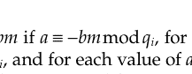

- iii. 注意，如果 $a \equiv -bm \pmod{q_i}$，则 $q_i$ 将整除 $a+bm$，其中 $q_i \in B$。找到所有满足 $a \equiv -bm \pmod{q_i}$ 的 $a$ 值，并对于每个 $a$ 值，在筛数组中列出 $a$ 的因子。该过程对每个 $q_i \in B$ 重复。列出筛数组中所有被此方法完全分解的 $a+bm$。这些 $a+bm$ 在 $B$ 中是平滑的。

- iv. 如果 $a \equiv -br \pmod p$，则数对 $(r,p) \in A$ 整除 $a+b\theta$。找到所有满足 $a \equiv -br \pmod p$ 的 $a$ 值。对于每个 $a$，在筛数组中列出 $a+b\theta$ 的所有 $(r,p)$ 因子。最后，筛数组中将有一份 $a+b\theta$ 的 $(r,p)$ 因子列表。现在，如果 $\Pi_i = (-b)^d f(-a/b)$，则该因子列表是完全分解，在这种情况下，$a+b\theta$ 在 $A$ 上是平滑的。

- v. 通过比较两个数组，可以找到 $(a,b)$ 使得 $a+b\theta$ 和 $a+bm$ 平滑的。

再次，这两个定理保证了可以在 $Z[\theta]$ 中找到一个完全平方元素：

## 定理 (Case, 2003)

设 $l \in Z[\theta]$ 有分解式 $l = (a_1+b_1\theta)^{e_1}(a_2+b_2\theta)^{e_2} \cdots$，其中对于每个 $i$，$a_i+b_i\theta$ 满足属于代数因子基的标准。如果 $l$ 是 $Z[\theta]$ 中的完全平方数，则对于所有 $i$，$e_i \equiv 0 \pmod 2$ (Case, 2003)。

## 整数分解问题

## 定理 (Case, 2003)

设 $U$ 为 $(a,b)$ 对，使得 $\prod_{(a,b) \in U}(a+b\theta)$ 在 $Z[\theta]$ 中是完全平方数。那么对于任何 $(s,q)$，由于 $(s,q) \nmid a+b$，对于任何 $(a,b) \in U$，
`$\prod_{(a,b)\in U} \frac{a+bs}{q} = 1$`
其中 $q$ 是素数，$s \in \mathbb{Z}$ 且 $f(s) \equiv 0 \pmod q$ (Case, 2003)。对于素数 $q$，满足 $f(s) \equiv 0 \pmod q$ 的 $(s,q)$ 对被称为二次基，元素 $(s,q)$ 称为二次（Case, 2003）。注意每个 $(a,b) \in U$ 都可以通过代数因子基 $A$ 的 $k$ 个元素、因子基 $B$ 的 $l$ 个元素和二次基 $Q$ 的 $u$ 个元素表示为阶 $1+k$。对于元素，证明了 $\prod_{(a,b)\in U}(a+b\theta)$ 和 $\prod_{(a,b)\in U}(a+b)$ 分别在 $Z[\theta]$ 和 $Z$ 中是完全平方数，且仅当每个 $(a,b)$ 的向量和模 2 等于零。因此只需检查每个 $(a,b)\in U$ 的向量和是否等于 $0 \pmod 2$。现在得到 $\prod_{(a,b)\in U}(a+b\theta)$ 在 $\mathbb{Z}$ 和 $Z[\theta]$ 中分别是完全平方数，可以通过环同态分解 $n$。

该算法的期望运行时间为 $O(e^{(c+o(1))(\log n)^{1/3}(\log \log n)^{2/3}})$，其中 $c$ 是一个值为 1.9 的常数。该方法的细节可以在 Lenstra (2000) 中找到。

## 基于近似的分解方法

Zalak 和 Haj-Boutros (2011) 提出了一种基于平方根近似的新整数分解方法。它包括寻找阶 $R_p=(p_1 \times p_2 \times \cdots \times p_n)$，其中 $\gcd(R_p,n)$ 在约定的时间内给出前两个因子。该过程重复直到获得 $n$ 的所有素因子。

算法定义如下：这里 $A$ 和 $B$ 是需要确定的合数。假设任何素因子 $B$ 可以表示为 $B=A\frac{p^2}{q^2}+\frac{m^2}{q^2}$，其中 $p$ 和 $q$ 是素数或互质，$m$ 是整数，且 $m^2$ 较小于 $A^2$。那么
$n=\frac{A^2p^2}{q^2}(1+\frac{m}{Ap^2})$ 这

## 新兴算法与技术

给出 $\sqrt{n}=\frac{Ap}{q}\left(1+\frac{m}{Ap^2}\right)$。由于 $\frac{m}{Ap^2} \ll 1$，所以 $(1+\frac{m}{Ap^2})=1+\frac{m}{2Ap^2}$，因此 $\sqrt{n}=\frac{Ap}{q}-\frac{m}{2pq}$。

由于 $\frac{m}{2pq} \ll 1$，可以考虑以下两个近似：

- i. $\sqrt{n}$ 的整数部分为 $[\sqrt{n}]\frac{Ap}{q} \pm \varepsilon$。

- ii. $\sqrt{n}$ 的小数部分为 $(\sqrt{n}-[\sqrt{n}])px=k \pm \varepsilon'$，其中 $k$ 是正整数或半整数，$0 \le \varepsilon < 1$ 且 $0 \le \varepsilon' \ll 1$。

因此，可以通过将小数部分 $\sqrt{n}-[\sqrt{n}]$ 乘以 $r=pq$ 来找到 $k$。由于 $r$ 是一个小的整数，如果找到了 $k$，可以使用任何分解方法轻松找到 $p$ 和 $q$。然后，将整数部分 $[\sqrt{n}]$ 乘以 $\frac{P}{q}$ 得到一个近似等于 $A$ 的数。算法所示。我们考虑 Zalek 和 Haj-Boutros (2011) 的分解算法。

## 算法

**输入:** $n$: 一个待分解的整数
$P$:素数子集列表
Upr：允许的最高 $r=pq$ 阈值
Highstep：允许寻找解的步数阈值

**输出:** $A$ 和 $B$，$n$ 的两个整数因子。

```
begin
初始化;
$\varepsilon:=0.02, r:=2, steps:=0$;
fx:=\sqrt{n}-[\sqrt{n}];
迭代直到找到因子或达到 $steps$ 指定的阈值；
repeat
  while ($r < upr$ AND $fx \times r \neq [fx \times r] \pm \varepsilon$) do
    找到 $fx$ 的一个可能倍数以生成其最近的整数；
    steps:=steps+1;
    将 $r$ 分为 $p$ 和 $q$;
until $A$ 是 $n$ 的除因子;
if steps > Highstep then
B := \frac{n}{A}
else
print("n是素数或未找到解");
```

## 素数分解问题

Balasubramanian, Muthukumar 和 Othan 指) 指出了上述方法的缺点，并提出了一种不需要近似的方法。算法定义如下：

- 1. 选择一个合数 $n$。
- 2. 如果 $n \equiv 0 \pmod 4$，
   i. 找到 $l,m$ 使得 $4lm+3l+m=N$，其中 $N=(n-3)/4$。
   ii. 找到 $p-1=4l$ 和 $q-3=4m$。
- 3. 如果 $n \equiv 1 \pmod 4$，
   i. 找到 $l,m$ 使得 $4lm+l+m=N$，其中 $N=(n-1)/4$。
   ii. 找到 $p-1=4l$ 和 $q-1=4m$。

例如，$n=63787$。那么 $n \equiv 3 \pmod 4$，即满足步骤 (2)，其中 $N=15946$。我们得到 $l=70$ 和 $m=56$，使得 $4lm+3l+m=N$。因此，$p=281$ 和 $q=227$ 是 $n$ 的素因子。

## 分解记录

尽管发表了各种整数分解算法，但到为止还没有高效的整数分解算法。近年来，NFS 方法是整数分解最快的方法，但计算需要很长时间。由于整数分解是许多公共密码系统的核心，了解当前技术可以分解的数字的大小是非常重要的。Morrison 和 Brillhart (1975) 将整数分解记录分为类。在第一类中，他们考虑一般的合数，如 RSA 模（Lenstra, 2017），在第二类中，他们考虑具有


## 新兴安全算法与技术

## 表 5.2
部分已分解的 RSA 模数列表

| 数字 | 位数 | 年份 | 方法* |
| --- | --- | --- | --- |
| RSA-100 | 100 | 1991 | MPQS* |
| RSA-110 | 110 | 1992 | NFS |
| RSA-120 | 120 | 1993 | QS |
| RSA-129 | 129 | 1994 | MPQS |
| RSA-130 | 130 | 1996 | NFS |
| RSA-140 | 140 | 1999 | NFS |
| RSA-155 | 155 | 1999 | NFS |
| RSA-160 | 160 | 2003 | NFS |
| RSA-576 | 174 | 2003 | NFS |
| RSA-150 | 150 | 2004 | NFS |
| RSA-200 | 200 | 2005 | NFS |
| RSA-640 | 193 | 2005 | NFS |
| RSA-768 | 232 | 2009 | NFS |
| RSA-170 | 170 | 2009 | NFS |
| RSA-180 | 180 | 2010 | NFS |
| RSA-190 | 190 | 2010 | NFS |
| RSA-704 | 212 | 2012 | NFS |
| RSA-210 | 210 | 2013 | NFS |
| RSA-220 | 220 | 2016 | NFS |

> * 多项式二次筛选法 (MPQS) 是二次筛选法 (QS) 的变体。使用多个形式为 $ax^2 + 2nx + c$ 的多项式，其中 $a$ 是平方数，$0 \leq b < a$ 使得 $b^2 \equiv n \pmod a$，且 $c$ 使得 $b^2 - 4ac = n$。此处，$n$ 是一个大合数。

特殊形式，例如费马马数（即 $F_n = 2^{2^n} + 1, k \geq 0$）和坎宁汉数（即 $C^s(b,k) = b^k \pm 1$，其中 $b$ 和 $k$ 为整数，且 $b$ 不是完全数） (Brillhart et al., 2002; Cunningham & Woodall, 1925; Lenstra, 2017)。

在第一类中，RSA-768 是最大的数，它于 2009 年 12 月被分解（Kleinjung et al., 2010）。表 5.2 列出了使用该方法已经分解的一些 RSA 模数。

在第二类中，形式为 $2^m - 1$ 的数字，其中 $m \in [1007, 1009, 1081, 1111, 1129, 1151, 1153, 1159, 1177, 1193, 1199]$ 在 2014 年被分解（Coppersmith, 1993; Kleinjung, Bob & Lenstra, 2014; Lenstra, 2017）。在 1990 年至 2017 年之间分解的一些数字见表 5.3。请注意，这并不是完整的列表。更多细节请参阅 Brent (1996)、Brent and Pollard 以及 Brent, Tiele (2000)。该表还列出了某些特殊数字及其分解方法。

## 整数分解问题

## 表 5.3
某些特殊类型的合数列表

| 数字 | 位数 | 年份 | 方法 |
|---|---|---|---|
| $2^{37} + 1$ | 155 | 1990 | NFS |
| $2^{131} - 1$ | 163 | 1993 | SNFS |
| $2^{27} + 1$ | 309 | 1995 | ECM |
| $10^{221} - 1$ | 211 | 1999 | SNFS |
| $2^{773} + 1$ | 233 | 2000 | SNFS |
| $2^{983} - 1$ | 287 | 2002 | NFS |
| $2^{809} - 1$ | 244 | 2006 | SNFS |
| $6^{753} + 1$ | 275 | 2007 | SNFS |
| $2^{1069} - 1$ | 313 | 2012 | SNFS |

## 5.7 结论

整数分解是许多公钥系统的核心，且分解大合数是一项挑战性任务。目前已经提出了多种分解合数的方法。在本章中，我们简要讨论了费马方法、Pollard $p-1$ 方法、Pollard $\sqrt{}$ 方法以及 NFS。最近在 2011 年和 2012 年又提出了两种新的分解方法：一种基于平方根，另一种是为了消除第一种方法的缺陷。

## 参考文献

- Alkin, A. & Morain, F. (1993). 寻找合适的椭圆曲线。Mathematics of Computation, 60(201), 399–405. doi:10.1090/S0025-5718-1993-114065
- Back, E., & Shallit, J. (1997). 算法数论卷 I：高效算法（第二版）。伦敦：MIT Press. ISBN:978-02624051
- Balasubramanian, P., Muthakumar, P., Uthman, A. (2012). 使用任何近似值的质因分解。Proceedings Balasubramanian and R. Uthayakumar (eds.), 计算机与信息科学通信-ICMSC 283, 537–541. doi:10.1007/978-3-642-28298-6
- Bimp, K. & Jaiswal, R. (2005) 现代分解算法。圣地亚：加州大学。
- Brent, R. P. (1980). 一种改进的蒙特卡洛算法。BIT, 20, 176–184.
- Brent, R. P. (1986). 使用椭圆曲线的整数分解。Australian Computer Science Communications, 8, 149–163
- Brent, R. P. (1996). 百万分解。澳大利亚国立大学技术报告 CS-96-02，1996年2月；
- Brent, R. P. (2000). 整数分解算法的进展与展望。In D-Z. Du et al. (eds.). COCOON 2000 (LNCS 1858, pp.3–22). Springer-Verlag.
- Brent, R. P., Montgomery, P. L. & Riele, H. J. (2000). 基数最高99的坎宁汉数分解。1999千年。PR TR-14-00，2000年12月31日。
- Brent, R. P. & Pollard, J. M. (1981). 百万分解。Mathematics of Computation, 36, 627–630. doi:10.2307/20073666
- Brillhart, J., Lehmer, D. H., Selfridge, J. L., Tuckerman, B. & Wagstaff Jr, S. S. (2002). $b\pm1$ 的分解，其中 $b=2, 3, 4, 5, 6, 7, 8, 9, 10, 11$ 的高幂。In Contemporary Number Theory, 22, 第23版。Brill.
- Brillhart, J. & Selfridge, J. (1967). $2^n +1$ 的某些分解及相关结果。Mathematics of Computation 21(97), 87–96. doi:10.2307/20040373
- Case, M. (2003). 数域筛选法的入门指南。俄勒冈州立大学，ECE575 数据安全与密码学项目，
- Coppersmith, D. (1993). 数域筛选。$b=2, 3, 4, 5, 6, 7, 8, 9, 10, 11$ 的高幂。Journal of Cryptology, 6(3), 169–180. doi:10.1090/S0025-5718-1993-6


# 整数分解问题

Pomerance, C. (1985). 二次差筛法分解算法. In Proceedings T. Beth, N. Cot and I. Ingestursson (eds.), Advances in Cryptography – EUROCRYPT 1984 (LNCS 209, pp. 169–182). Berlin: Springer.

Pomerance, C. (2008). 平滑数与二次差筛法. 代数代数论, 44, 69–81.

Rivest, R. L., Shamir, A. & Adleman, L. (1978). 获取数字签名和公钥加密的方法. Communications of the Association for Computing Machinery, 21(2), 120–126. doi:10.1145/35930.359342.

Seibert, C. (2011). 使用二次差筛法进行整数分解. In Proceedings of the 44th Annual Midwest Instruction and Computing Symposium, 8–9 April 2011. www.micsyposium.org.

Silverman, R. D. & Wagstaff, Jr., S. S. (1993). 椭圆曲线分解算法的实用分析. Mathematics of Computation, 61, 445–462. doi:10.2307/2152967.

Stinson, D. R. (2013). 密码学理论与实践（第3版）.Chapman & Hall/CRC. ISBN-13:9978-1-58488-508-5.

Zalaket, J. & Hajj-Boutros, J. (2011). 使用平方根近似进行质因分解, Computer and Mathematics with Applications, 61, 2463–2467. doi:10.1016/j.camwa.2011.02.027.


# 对称算法 I

Faheem Saeed Masoodi
克什米大学

Mohammad Ubaidullah Bukhari
阿里格尔穆斯林大学

# 目录

- 6.1 引言............................................................................................... 80
- 6.1.1 对称密钥密码学背景.................................. 80
- 6.1.2 对称密钥密码学的分类.............................. 81
- 6.1.3 混淆与扩散........................................................................... 81
- 6.1.4 替换盒 (S-Box)............................................................................ 81
- 6.2 密码............................................................................................... 82
- 6.2.1 工作模式........................................................................... 82
- 6.2.1.1 电子密码本...................................................................... 82
- 6.2.1.2 密文链模式................................................................ 82
- 6.2.1.3 密文反馈模式................................................................ 83
- 6.2.1.4 输出反馈模式.................................................................. 83
- 6.2.1.5 计数器模式............................................... 83
- 6.2.2 伪随机数生成....................................................... 83
- 6.3 流加密.................................................................................. 84
- 6.3.1 同步与自同步流加密.................................. 84
- 6.3.2 线性反馈位寄存器....................................................... 85
- 6.3.3 非线性滤波器........................................................................... 86
- 6.3.4 时钟控制生成器.................................................. 87
- 6.4 数据加密标准.................................................. 87
- 6.4.1 如何工作................................................................ 88
- 6.4.2 每一轮发生了什么....................................................... 88
- 6.4.3 Feistel 结构 (f)................................................ 88
- 6.5 三重 DES............................................................... 89
- 6.5.1 如何工作................................................................ 89
- 6.5.2 每一轮发生了什么....................................................... 90
- 6.6 高级加密标准............................................................... 90
- 6.6.1 如何工作................................................................ 91
- 6.6.2 每一轮发生了什么....................................................... 91
- 6.7 国际数据算法....................................................... 91
- 6.7.1 如何工作................................................................ 92
- 6.7.2 每一轮发生了什么....................................................... 92
- 6.8 自动加密............................................................... 93
- 6.8.1 如何工作................................................................ 93

对称算法 I 81

### 6.1.2 对称密钥密码学的分类

安全协议使用对称密钥来加密数据。这些加密分为两类：块密码和流加密。

块密码作为一种流行的加密方法，其工作原理是将输入流分为固定大小的，通常为 64、128 或 256 位。流加密通常作用于消息的单个元素。私钥和一个称为初始化向量 (IV) 的随机种子作为流加密的输入，并生成被称为密钥流的位序列。该密钥流随后与明文进行异或运算以计算密文 (Schneier, 2007)。


## 6.2 分组密码 (Block Ciphers)

分组密码的工作原理是将输入的明文流划分为固定大小的字符串，称为“块”。分组密码的常规大小为 64、128 或 256 位。分组密码加密仍然是隐藏信息的流行方法之一（Lai & Massey, 1990）。如果明文长度小于块的大小，则使用填充技术。这是为了确保数据被附加到实际明文中，使得生成的明文被划分为块大小倍倍的片段。生成的块将使用加密密钥逐一进行加密以产生密文，且不同消息之间的加密之间没有相关性。最后，对等长度的明文块进行转换。

### 6.2.1 运行模式 (Modes of Operation)

加密模式指的是通过结合分组密码、某种反馈和一些基本操作将明文加密为密文的方法。在本章中，我们将讨论五种运行模式。

#### 6.2.1.1 电子密码本 (Electronic Code Book)

顾名其义，这种模式可以被看作巨大的密码本，其中每个块都是相互独立加密的。整个消息被划分为大小为若干位的块，每个块都使用相同的密钥加密。这种模式的优点是不需要强制同步；如果传输过程中丢失了某些块，接收到的块仍然可以解密。这种模式的缺点是，只要密钥相同，相同的消息就会产生相同的密文。

#### 6.2.1.2 密码块链 (Cipher Block Chaining)

其目标是通过将块的加密连接起来来克服 ECB 模式面临的局限性，使得每个加密都依赖于之前所有的块。其核心思想是将之前生成的密文作为输入，并与下一个消息块进行异或（XOR），然后对其进行加密。初始化向量（IV）是一个随机种子值，在使 CBC 随机化方面起着至关重要的作用。

#### 6.2.1.3 密码反馈模式 (Cipher Feedback Mode)

CFB 运行模式利用分组密码实现流密码，以生成伪随机位序列，密文通过对输出位和明文进行异或运算产生。该运行模式与 OFB 类似，但使用密文作为反馈，而不是分组密码的输出。这种模式的主要优点是，在短明文块的情况下，可以使用该模式的变体，其中高阶位与明文进行异或以生成密文。该密文随后被反馈回分组密码，当前位移出，并继续此。相反，通信过程中发生的任何位错误都会传播。

#### 6.2.1.4 输出反馈模式 (Output Feedback Mode)

OFB 运行模式背后的思想是将分组密码的输出反馈给它，与 CFB 模式不同，其密钥流不依赖于明文或密文。然后将输入与输出进行异或以计算出相应的密文。由于第一组密钥流块没有密钥流反馈，因此需要一个初始化向量（IV）作为初始输入块。最初，使用分组密码对 IV 进行加密以生成第一组密钥流块，通过将之前生成的密钥流反馈到分组密码来计算下一块密钥流。OFB 模式的运行方式与流密码类似，加密和解密操作与流密码的情况相同。同样像 CBC 模式，IV 的使用使得 OFB 加密具有非确定性。由于 OFB 模式中没有链依赖关系，即使传输过程中发生位错误，后续块的解密也不会受到影响。

#### 6.2.1.5 计数器模式 (The Counter Mode)

计数器运行模式也使用分组密码作为实现流密码的方法。与 OFB 和 CFB 类似，密钥流是以块的形式生成的，与这两种模式不同，计数器模式不需要反馈。在这种模式下，底层算法使用从起始值开始计数的计数器，并在生成每个新密钥流块时取不同的值。然后使用该密钥流通过对输入文本和计数器进行异或运算来生成密文。在这种情况下，计数器可以是任何具有大期的函数，但最流行的是递增 1 的函数。CTR 模式没有之前讨论模式中的错误传播和链依赖等局限性（Lipmaa, Rogaway, & Wagner, 2000）。CTR 模式的另一个优点是通过并行运行两个或多个分组密码来显著提高速度。

### 6.2.2 伪随机数生成 (Pseudorandom Number Generation)

随机数生成器被认为是加密系统的主要构建模块之一，本质上是因为它们对于潜在攻击具有很强的不可预测性。均匀分布的随机数对加密应用至关重要，尽管随机过程产生的值非常不可预测，但它们缺乏均匀分布（Random.org, 2018）。伪随机数生成器（PRNGs）从一个随机种子值开始生成通常称为伪随机数的序列，然后递归地将其扩展为一组看起来随机的序列。需要提到的是，PRNGs 在本质上是完全确定的，这意味着如果生成器被置于相同状态，输出将是副本（Van Tilburg, 2005）。伪随机数的主要要求之一是它们具有统计特性，并且可以通过合理的数学测试验证其统计行为。永久地，种子值的大小必须足够大以抵抗穷举搜索。

## 6.3 流密码 (Stream Ciphers)

流密码通常作用于消息的单个元素。私钥和随机种子值作为输入传递给流密码，产生被称为密钥流的位序列。该密钥流与明文进行异或以计算密文。其目标是加密安全的原语，执行速度快、无短周期，且从输出推导出内部状态应是不可行的。基于内部状态的流密码通常分为同步和自同步密码（Bokhari & Masoodi, 2010）。

### 6.3.1 同步与自同步流密码 (Synchronous and Self-Synchronous Stream Ciphers)

根据密钥流生成的方式，流密码通常分为两类。如果生成的密钥流不依赖于明文和密文，则密文是同步的；如果密钥流生成依赖于明文和之前生成的若干位密文，则密文被称为自同步流密码。大多数功能流密码本质上是同步的，密码反馈模式（CFB）就是自同步流密码的一个示例。图 6.4 展示了同步流密码的加密和解密，如果存在虚线，则代表自同步流密码。

为了在同步流密码中准确解密，双方需要在密钥和状态上保持同步，丢失的同步可以通过明文中的足够冗余、重新初始化或在密文中固定间隔使用不同的标记等技术来恢复；而在自同步流密码的情况下，丢失的同步会自动恢复。

同样，同步流密码没有错误传播，因为修改位对其他密文位没有影响。在自同步流密码的情况下，存在有限的错误传播，因为修改位会影响某些其他密文位。


### 6.3.2 线性反馈移位寄存器

在流密码设计中，线性反馈移位寄存器（LFSR）受到了广泛关注，这主要由于它们继承的特性，包括长周期、理想的统计特性以及低廉实现成本（Masoodi, Alam, & Bokhari, 2012）。LFSR 是一种移位器，由多个级联的存储单元（触发器）组成，并利用反馈在每个时钟脉冲下循环移位。LFSR 被认为通过对选定的位（抽头）进行异或（或异或非）运算并与输入混合，从而迭代地生成一个伪随机数序列。如果一个 LFSR 能够生成每一个唯一值（在回到起始状态之前，排除异或运算中的全 0 状态和在到达起始状态之前的全 1 状态），则认为该 LFSR 生成了最大长度序列（m 序列）。

与对应于不可约多项式的 LFSR 能够生成最大长度序列，因为对应于不可约多项式的 LFSR 不生成 m 序列，且生成的位流长度与起始值无关；而第三类对应于可约多项式的 LFSR 则取决于起始值，且生成的序列长度具有依赖性。不可约多项式是指无法分解的多项式类型，除了满足某些数学条件外，所有多项式也是次数为 *n* 的不可约多项式，其中 *n* 代表寄存器的长度。与线性反馈移位寄存器相关的重要属性是线性复杂度，可以通过 Berlekamp–Massey 算法确定（Upadhyay, Sharma, & Sampalli, 2016）。

### 示例 1

让我们考虑两个具有不同抽头选择的 4 阶异或 LFSR。这四个触发器由一个公共的 *CLK* 驱动，并标记为 $q_1, q_2$ 和 $q_3$。在每个时钟脉冲下，LFSR 的值向右移动一位，$q_3$ 处的值作为输出位。如表 6.1 和表 6.2 所示，两个 LFSR 都用相同的值 [1, 1, 1, 1] 初始化，但在第三个时钟脉冲后，它们的序列发生了偏差。

#### 表 6.1
LFSR 1 的状态序列

| Ck | $q_1$ | $q_2$ | $q_3$ | Val |
|---|---|---|---|---|
| 0 | 1 | 1 | 1 | F |
| 1 | 0 | 1 | 1 | E |
| 2 | 1 | 0 | 1 | D |
| 3 | 0 | 0 | 1 | A |
| 4 | 1 | 0 | 0 | S |
| 5 | 1 | 1 | 0 | B |
| 6 | 0 | 1 | 0 | 6 |
| 7 | 0 | 0 | 1 | C |
| 8 | 1 | 0 | 0 | 2 |
| 9 | 0 | 1 | 0 | 9 |
| 10 | 0 | 0 | 1 | 4 |
| 11 | 0 | 0 | 1 | 8 |
| 12 | 1 | 0 | 0 | 1 |
| 13 | 1 | 1 | 0 | 3 |
| 14 | 1 | 1 | 0 | 7 |

#### 表 6.2
LFSR 2 的状态序列

| Ck | q0 | q1 | q2 | q3 | Val |
|---|---|---|---|---|---|
| 0 | 1 | 1 | 1 | 1 | F |
| 1 | 0 | 1 | 1 | 1 | E |
| 2 | 0 | 0 | 1 | 1 | C |
| 3 | 0 | 0 | 0 | 1 | 8 |
| 4 | 1 | 0 | 0 | 0 | 1 |
| 5 | 0 | 0 | 1 | 0 | 2 |
| 6 | 0 | 0 | 0 | 1 | 4 |
| 7 | 1 | 0 | 0 | 1 | 9 |
| 8 | 1 | 1 | 0 | 0 | 3 |
| 9 | 0 | 1 | 1 | 0 | 6 |
| 10 | 1 | 0 | 1 | 1 | D |
| 11 | 0 | 1 | 0 | 1 | A |
| 12 | 1 | 0 | 1 | 0 | 5 |
| 13 | 1 | 1 | 0 | 1 | B |
| 14 | 1 | 1 | 1 | 0 | 7 |


图 6.1
(a) 在 $q_0$ 处有抽头的 4 阶 LFSR。(b) 在 $q_i$ 处有抽头的 4 阶 LFSR。

这种偏差是根据选择不同抽头来计算新序列值的方式产生的（见图 6.1a,b）。4 阶 LFSR 在重复之前最多可以生成 $(2^4-1=15)$ 个不同的序列。通常情况下，对于 $n$ 位 LFSR，最多数量为 $2^n-1$。对于 $n$ 位 LFSR，最大序列数量为 $2^n-1$，生成的位流长度取决于起始值。这取决于起始值，且生成的序列长度具有依赖性。与线性反馈移位寄存器相关的重要属性是线性复杂度，可以通过 Berlekamp–Massey 算法确定（Upadhyay, Sharma, & Sampalli, 2016）。


# 对称算法 I

来自相应的输入位，另外两个位（第一个和最后一个）分别取自上一个数据块的最后和下一个数据块的位。

- 密钥混合：对扩展阶段的输出和从主密钥派生的子密钥进行异或 运算。总共有 16 个长度为 48 位的子密钥，每轮使用一个子密钥。

- 替换：密钥混合阶段的输出传递到替换盒（S-Box），总共使用 6 × 4 个替换盒。S-Box 接收 6 位输入，并通过查找表计算相应的 4 位输出。S-Box 对 DES 阶段至关重要，因为它在该原语的非线性特征中起着至关重要的作用。

- 置换：置换形成最后一个阶段，其思想是将每个 S-Box 的输出分散到后续的四个不同的 S-Box 中。使用置换盒（P-Box）来重新排列替换阶段生成的输出。

## 6.5 三重数据加密标准 (3DES)

数据加密标准 (DES) 发现的主要缺陷之一是其密钥长度。由于密钥长度为 56 位，攻击者可以在极短的时间内分析所有可能的组合。为了解决 DES 的这个问题，已经提出了多种解决方案，其中一种流行的方案是三重 DES (3-DES) (William, 2006)。

### 6.5.1 它是工作的？

3-DES 通过重复三次 DES 算法并使用三个不同的 DES 密钥来增加密钥长度，这导致总密钥长度达到 168 位。三重数据加密算法在 EDE 模式下使用三个不同的 56 位 DES 密钥 (k1, k2 和 k3)。基本思想是使用 $k_1$ 对消息进行加密 (E)，然后使用 $k_2$ 进行解密 (D)。这三个密钥可以完全相互独立，也可以是第一个和第三个密钥相同，而第二个密钥不同。根据所使用的配置，我们可能分别拥有 168 位或 112 位密钥空间。

假设 $(k_1, k_2, k_3)$ 代表三个密钥，也称为密钥包。如果 $E_x(x)$ 和 $D_x(x)$ 分别表示加密和解密操作，$x$ 是输入消息，$C$ 代表密文。那么，加密和解密操作定义如下：

```
Encryption: $C = E_{k1}(D_{k2}(E_{k3}(x)))$
```

```
Decryption: $x = D_{k1}(E_{k2}(D_{k3}(C)))$
```

输入消息 $x$ 使用密钥 $k_1$ 加密，输出使用密钥 $k_2$ 解密，再次使用密钥 $k_3$ 加密，解密操作正是加密操作的逆过程。与 DES 相比，具有相互独立密钥的 3DES 被认为更安全，针对破解提供了 168 位的安全性。

## 6.6 高级加密标准 (AES)

AES 是一种对称分组密码，赢得了 NIST 在 1997 年 1 月发布的公开征征集 (Smid, 2000)。第一轮接受了 15 个候选密码，并选出了 5 个决赛者。由 Daemen & Rijmen 提交的 Rijndael (Daemon & Rijmen, 2002) 原语被认为是最合适的候选，因此被选为高级加密标准。Rijndael 的块长度和密钥长度至少为 128 位，但根据采用的 FIPS 标准，NIST 将块长度设置为 128 位，并将三种变体密钥设置为 128 位、192 位或 256 位。

### 6.6.1 它是工作的？

该算法由 10 轮（AES(192) 为 12 轮，AES(256) 为 14 轮）组成，每轮都有通过密钥生成器获得的自己的密钥。128 位明文块作为第一轮的输入，其输出形成下一轮的输入，依此类推。每轮由四个基本步骤组成：

1. 字节替换 (ByteSub)
2. 行移位 (ShiftRow)
3. 列混合 (MixColumn)
4. 轮密钥加 (AddKey)

我们展示的是 AES-128 的结构。其他版本的结构相同，但轮数更多。首先，将明文块和密钥划分为较小的 16 位块，步骤枚举如下：

- 将 16 字节密钥扩展为密钥块：明文块输入。密钥大小为 16 字节。这些 16 字节扩展为由行和列组成的二维数组。每轮使用第一个数组。
- 将 16 字节明文块转换为状态：在这里，16 字节输入转换为状态。状态是一个 4×4 矩阵。输入按列顺序复制到状态。这意味着前 4 个字节复制到状态的第一列，后 4 个字节复制到第二列，依此类推。
- 异或：在这一步中，16 字节扩展密钥和 16 字节状态进行异或。因此，状态数组中的每个字节都被扩展密钥中相应的字节替换。这遵循相同的 10 轮，产生 128 位密文块。

### 6.6.2 每轮发生了什么？

每轮执行以下四个步骤：

i. 字节替换：在这里通过 S-Box 逐字节替换状态数组。与 DES 使用多个 S-Box 不同，这里只使用一个。
ii. 行移位：状态数组中的每一行都左移。第一行移 0 字节，第二行移 1 字节，依此类推直到第四行。

| 原始数组 | 修改后的数组 |
|---|---|
| 1 5 9 13 | 1 5 9 13 |
| 2 6 10 14 | 6 10 14 2 |
| 4 7 11 15 | 11 15 3 7 |
| 4 8 12 16 | 16 4 8 12 |

iii. 列混合：在这一步中，通过矩阵乘法为下一轮创建新的状态数组。状态数组的每一列都乘以 4x4 矩阵。注意最后阶段不执行此操作，因为我们不需要新的状态数组。
iv. 轮密钥加：在这里，16 字节的状态矩阵与 16 字节密钥进行异或。如果是最后一轮，这 16 字节作为密文。否则，这 16 字节用于下一轮。

## 6.7 国际加密算法 (IDEA)

IDEA (Lai & Massey, 1990) 由 Lai 和 Massey 在 1991 年引入。该原语实际上是 1990 年提出的加密标准的改进，用于应对 DES 的局限性。

### 6.7.1 它是工作的？

IDEA 处理大小为 64 位的块，每个块被划分为 16 位子块。加密操作对明文块进行总共九轮，在每一轮中，所有子块都经过一些算术和逻辑操作。每轮的输出作为下一轮的输入，相同的操作序列执行到第八轮。第九轮也称为输出转换阶段，是最后一轮，在该轮仅执行算术操作。第九轮的输出是对应明文的密文。

IDEA 的 128 位密钥分为八个 16 位子密钥，其中六个子密钥用于第一轮，剩下的两个用于第二轮。对于后续轮，128 位密钥向左循环移动 25 位产生另一个 128 位块，然后将其划分为密钥。此过程重复所有八加一轮。在整个加密过程中，总共使用 52 个密钥，前八轮每轮使用六个子密钥，输出转换阶段使用最后的子密钥。解密过程与加密过程相同，只是每轮以相反的方式使用子密钥，以获取原始明文。

### 6.7.2 每轮发生了什么？

整个加密算法可以分为 14 个步骤。八个完整的轮：

对于每轮的最终变换，发生一次交换，下一轮的输入是：第 11 步的结果 || 第 13 步的结果 || 第 12 步的结果 || 第 14 步的结果，这成为 $M_1 || M_2 || M_3 || M_4$，即下一轮的输入。

在第 8 轮之后，如表 6.4 所示，发生“半轮最终/输出变换”。

块拼接即输出。

**解密**：用于解密密文的计算过程与加密明文的过程本质相同。与加密相比的唯一区别在于解密期间生成所有的 52 个密钥子块。更准确地说，子密钥必须以相反顺序使用，以逆转相对于应用群运算的加密过程。


# 对称算法 I

IDEA 开发的基本标准是能够满足所有安全需求的军事级强度，并易于在硬件和软件中实现。该算法被广泛使用，应用于各种银行和工业场景中。由于其对抗密码分析攻击的强大性以及由于被包含在几个流行的加密程序包中，IDEA 被广泛使用（Meier, 1993, May）。

## 6.8 单词自动密钥加密 (WAKE)

David Wheeler 在 1993 年引入了一种名为单词自动密钥加密（WAKE）的新型加密原语（Pudovkina, 2001）。它是一种自同步流密码，在 CFB 模式下运行，本质上依赖三种原始操作：加法、移位和异或（XOR）。密钥流以 256 位块的形式生成，并使用之前的密文来生成新的密钥流块。

### 6.8.1 工作原理是什么？

具有 $2^n$ 个条目的“S 盒”是 WAKE 流密码设计的核心。该表中的每个条目都是一个 4 位字，具有一个特殊属性：$4n$ 位中的最高位是所有可用 $n$ 位字的排列，而其余 $3n$ 位则是随机生成的。$4n$ 位的初始值 $[a_0, b_0, c_0, d_0]$ 由密钥设置。在任何时间点 $t$，使用可逆变换函数 $S$ 计算 $[a, b, c, d]$ 的新值，如下所示：

```
$a_{new} = S(a_{prev}, y_{prev}, T)
b_{new} = S(b_{prev}, a_{new}, T)
c_{new} = S(c_{prev}, b_{new}, T)
d_{new} = S(d_{prev}, c_{new}, T)$
```

$Y$ 和 $T$ 分别代表密文和 S-BOX，$S$ 是定义为如下的可逆变换函数：

```
$S(x, y, T) = (x + y) \gg n \oplus T[(x + y) \mod 2^n]$
```

其中 >> 和 ⊕ 分别代表移位操作和异或操作。$d_{new}$ 代表最终输出，密文通过明文与 $d_{new}$ 进行异或产生。同样，在解密时，通过密文与 $d_{new}$ 进行异或可以产生明文。该密码的安全性依赖于使用大状态空间的重复查找。该表和初始常数由秘密密钥生成。由于块大小太大，它不适用于实时通信。

## 6.9 结论

本章介绍了对称密钥加密的基本概念。首先，给出了对称加密的分类——分组密码和流密码，接着解释了分组密码的各种工作模式。详细描述了各种流密码的构建方式，并将讨论重点放在了与随机数生成相关的不同属性上。介绍了了线性反馈移位寄存器在流密码设计中作为 m 序列生成器的作用，以及各种替代方案。章节最后详细描述了各种著名原语（包括 DES、3DES、高级加密标准 (AES)、国际数据加密算法 (IDEA) 和 WAKE）的设计和功能。

# 参考文献

- Bokhari, M. U., & Masoldi, F. (2010, February). Comparative analysis of structures and attacks on various stream ciphers. In Proceedings of the 4th National Conference, India.
- Bokhari, M. U., & Masoldi, F. (2012, October). BOKHARI: A new software oriented stream cipher: A proposal. In Information and Communication Technologies (WICT), 2012 World Congress (pp. 128–131). IEEE, India.
- Braeken, A., & Lano, J. (2005, August). On the possibility of practical and secure nonlinear filters and combin. In Workshop on Selected Areas in Cryptography (pp. 159–174). Springer, Berlin, Heidelberg.
- Bucerzan, D., Craciun, M., Chis, V., & Ratiu, C. (2010). Stream ciphers analysis methods. International Journal of Computers and Controls, 5(4), 483–489.
- Daemon, J., & Rijmen, V. (2002). The advanced encryption standard: Rijndal, The Design of Rijndal: AES — The Advanced Encryption Standard, 1st Edition. Springer, Berlin, Heidelberg, pp. 151–161.
- Diffin, W., & Huffman, M. (1977). Directions in cryptography. IEEE transactions on Information Theory, 22(6), 644–653.
- Dwork, M. (2001). Recommendation for block cipher modes of operation, and methods techniques (No. NIST-SP-800-384). National Institute of Standards and Technology Gaersburg Md Computer Security.
- Goldreich, O. (1998). Modern Cryptography.
- Katz, J., & Lindell, Y. (2014). Introduction to Cryptography.
- Katz, J., & Mendez, A., Vanstone, A. (1996). Handbook of Cryptography.
- Lai, X., & Massey, L. (1990). A proposal for a block cipher.
- Meier, W. (1993, May). IDEA.
- Masoldi, F., & Bokhari, M. U. (2010). Comparative analysis of structures and attacks on various stream ciphers.
- David Wheeler, D. (1993). WAKE.
- Pudovkina, E. (2001). Word Auto Key Encryption.


7.8 轻量级加密 ............................................................................ 113
7.8.1 性能指标 ....................................................................................... 114
7.8.2 轻量级加密原语 ............................................................... 115
7.8.2.1 轻量级分组密码 ........................................................................ 115
7.8.2.2 轻量级哈希函数 ................................................... 115
7.8.3 设计考虑 ............................................................................ 116
7.9 对称可搜索加密 (SSE) ...................................................... 116
7.9.1 可搜索加密是如何工作的？ ................................................ 116
7.10 结论 ...................................................................................... 117
参考文献 ................................................................................................. 117

# 7.1 引言

隐私是计算安全中一个极其重要的方面。计算机本身并不产生隐私问题。高速处理和数据存储能力影响了网络世界中的隐私。由于隐私是机密性的一部分，因此它是安全的一个方面。由于机密性、完整性和可用性之间可能存在冲突，隐私与其他安全方面也可能存在冲突。隐私是一个受计算影响的广泛主题，而不仅仅是一个安全议题。在这里，我们查看了各种对称密钥算法（Kahate, 2013）。加密——秘密写作——是除了秘密密钥之外进行规划的最强大工具。伪装良好的数据无法被费而地读取、定制或伪造。加密通过更高级的方法得到了增强：群论和场论、计算卷积，甚至是真实的心理分析，更不用说概率和统计学（Stallings, 2017）。幸运的是，使用加密并不需要理解底层的数学原理。

我们本章从探索对称密钥加密及其工作原理开始。我们介绍了对称加密方法的基本价值：替换和置换。接下来，我们发现它们如何被扩展和增强，以创建更强大、更复杂的防御。由于薄弱或缺陷的加密只能提供防御的幻象，我们还研究了加密可能失效的情况。我们介绍了用于破解防御方案并获取原始文本的技术。目前使用的几种非常流行的算法：Blow FISH、CAST、RC5、Serpent、Tiger 和轻量级加密。我们简要概述这些算法的特征，看看它们如何工作，以及如何作为协议和结构的构建模块来执行计算任务，例如签名凭据和交换敏感数据（图 7.1）。

主要问题是密钥交换。第二个问题比这严重。由于使用了密钥，发送者和接收者之间使用一个密钥。因此，随着发送者和接收者对数量的增加，为每对发送接收者提供机密性的密钥数量也随之增加。

# 对称算法 II

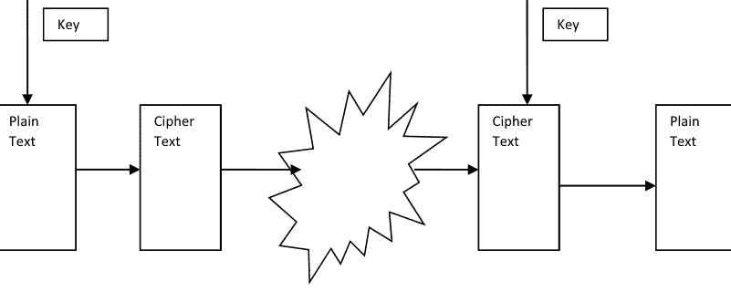

图 7.1 对称密钥加密。

由于互联网上有数百万商户向数十亿客户销售产品，使用这种方案是不可行的，因为每一对通信双方都需要一个独立的密钥（Menezes, 2012）。

尽管有所有缺点，对称密钥也有许多优点，并在实践中被广泛使用。

这些章节对对称密钥加密技术和算法进行了更深入的研究，包括它们的数学基础、实现它们的装置以及它们的局限性。大多数加密用户永远不会发现自己的算法，就像我们大多数人并不会自己建造自己的发电机一样。尽管如此，对加密工作原理的深入了解可以帮助你高效地使用它，就像对问题的深入了解有助于你理解不同能源之间环境与成本的权衡一样。本章提供了关于对称密钥加密及其算法的初步视角。

# 7.1.1 术语和背景

加密有一段悠长而引人注目的历史。对讨论领域最绝对的非技术性解释是坎恩的《密码破译》（*The Codebreakers*）。这本书追溯了加密从 4000 年前埃及人几乎是原始且不完美的使用，到 20 世纪，当时它在两次世界大战的结果中都起了非常重要的作用。坎恩的书涵盖了对该学科扩展最重要的历史特征。主要的从业者是那些与军事、外交部门和普通政府有关的人员。加密被用作防御国家秘密和战略的工具。

20 世纪60 年计算机和通信系统的传播带来了私营部门对防御数字形式信息以及提供安全服务的需求。从 Feistel 信息处理标准开始，用于对无序序列编码的 DES（数据加密标准），是古代最著名的加密手段之一。它仍然是全球许多金融机构保护电子电子商务的平均手段。

100

新兴安全算法与技术

加密（秘密写作）是应对许多类型安全攻击的规划的最强大工具。伪装良好的数据无法被费而地读取、定制或伪造。加密植根于高等数学。幸运的是，能够使用加密并不非要理解原始算术。我们本章从给出加密的作用及其运作的印象开始。我们发现了它可以如何被扩展和增强以创建一种更强大、更复杂的防御，而薄弱和缺陷的加密提供的只是虚假的防御印象。DES、AES、Blowfish、RC5、CAST 算法和 Twofish 是我们今天的一些已知算法。我们简要概述它们的几个特征，看看它们如何工作，以及如何作为模块来承担计算职责，如交换敏感数据、签名等。大多数加密都不会因为资源原因而拥有自己的算法（Pleefer, Pleefer, & Mullins, 2016）。


# 对称算法 II

密钥的安全性对于攻击者来说是未知的的。我们可以考虑暴力破解攻击，其原理是尝试范围内的所有可能的密钥，以期获得你使用的正确密钥。检查一个密钥通常只需要很短的时间。在理想的情况下，攻击者在第一次尝试就找到了密钥；而在最糟糕的情况下，是在最后一次尝试才找到。数学告诉我们，在密钥范围内，大约有一半的可能值会被尝试到。解决这一困难的办法在于扩展或增加密钥数组的维度，使得攻击者所需的时间超过你保持信息秘密所需的时间。

在计算术语中，密钥范围的概念导致密钥大小。我们用位（bits）来衡量密钥大小，并用二进制（两位）数值方案表示。为了防止暴力攻击，密钥大小应该使得在给定的计算能力范围内，攻击者无法在指定的时间内破解。

在最简单的阶段，密钥大小可以仅为 1 位。可能的值有 0 或 1。如果密钥大小为 2 位，那么可能的值有 01、10 和 11。这是基于二进制数字的原理，每增加一位，可能状态的数量增加一倍。因此，有了额外的位数，攻击者必须执行两倍次数的操作。我们可以假设大密钥大小被认为是安全的。随着计算能力的增强，这些数字可能会变化。128 位的密钥大小在几年后可能不再是安全的。

### 7.1.3 可能的攻击类型

密码分析师的目标是破解加密。密码分析师努力推断密文的原始含义。他们尝试以下方法：

- 破解单条消息。
- 熟悉加密消息中的模式。
- 推断密钥，以便轻松破解消息。
- 寻找加密完成中的缺陷。
- 在不中断消息的情况下，寻找加密算法中的缺陷。

## 7.2 Blowfish 算法

### 7.2.1 背景与历史

Blowfish 是一种 1993 年开发的对称分组算法。它被广泛应用于加解密服务。Blowfish 是一种对称密钥算法，可以作为 DES 或国际数据加密算法（IDEA）的替代。Blowfish 由布鲁斯·施尼尔（Bruce Schneier）设计，作为便捷对称密钥加密的快速替代方案。它使用 32 到 448 位不等的密钥范围，非常适合根据用途进行轻量级或重度加密。由于它已经存在很久，它正在缓慢地作为一种强大的对称密钥算法得到改进。Blowfish 没有专利，对所有消费者和所有类型的练习都是免费的。虽然目前还没有建立有效的 Blowfish 密码分析方法，但现在人们对具有更大分组的块密码感兴趣，如高级加密标准 AES 或 Twofish 算法。施尼尔确认：“Blowfish 没有专利，将免费提供给用户。这种对称密钥算法属于社区，任何人都可以免费使用。”

### 7.2.2 Blowfish 算法的工作原理

根据发明者的说法，Blowfish 的设计目标是以下几个：

- 快速：Blowfish 在 32 位微处理器上的加密速率为每字节 6 个时钟周期。
- 紧密：Blowfish 仅使用基础操作，如加法、异或（XOR）和查找，使其设计和实现变得简单。
- 安全：Blowfish 具有变长密钥，最大可 448 位，使其灵活灵活且受到保护。
- Blowfish 适用于密钥长时间保持不变的应用，但不适用于密钥经常变化的场景。

#### 7.2.2.1 操作

Blowfish 是一种具有变密钥速率的 64 位密码。它由两个部分组成：

1. 密钥扩展：此过程将高达 448 位的密钥转换为总计 418 位的子密钥。64 位输入明文 PT 的加密过程如下（图 7.3）：
   - 将 PT 分为两个对等大小的块：右明文（RPT）和左明文（LPT）。
   - 对于 i = 1 到 16
     - LPT = LPT 异或 P[i]
     - RPT = F(LPT) 异或 RPT
     - 交换 LPT, RPT
   - 交换 LPT, RPT（即撤销上一次交换）
   - RPT = 异或 P[17]
   - LPT = LPT 异或 P[18]
   - 将 LPT 和 RPT 混合为 PT
2. 数据加密：该方法涉及迭代 16 次简单函数。每一轮都包含一次密钥置换和数据交换。

Blowfish 算法中的密钥生成是通过使用 P 数组和从 P[i] 复制的 S 盒的十六进制数字启动的，这没有清晰的蓝图。未公开的密钥通过异或处理。算法加密 64 位明文块。然后，密文 P1 和 P2 交换。结果块的加密将使用新的子密钥连续进行，并且 P3 和 P4 通过新的密文进行交换。它继续交换整个 P 数组和整个 S 盒输入。


图 7.3 Blowfish 加密方案。

因此，Blowfish 加密算法运行 521 次来创建所有子密钥——管理提议的 4 kb 数据。

### 7.2.3 算法的强与弱

以下是该算法的效能：

- Blowfish 的速度使其成为加密中间数据的极佳替代方案，例如典型的网络通信（电子邮件、文件传输）。
- 目前尚未对 Blowfish 的完整16轮官方版本进行有效攻击（特定的攻击可以从最多14 轮的账户中恢复部分信息）。
- Blowfish 是一种被广泛使用的对称密钥算法；它在更改密钥方面是同类中最好的。
- 与同类中的其他算法相比，该算法较慢。这是因为每次生成新密钥都需要预处理 4 kb 的数据。
- 由于该算法的缓慢特性，其用途被限制在某些场景中。这种缓慢特性在其他用途中并非劣势，反而是一个优势，例如 Open BSD  程序中使用其缓慢密钥改进的密码哈希过程。


对称算法 II

## 7.3.2 CAST-128 (CAST5) 算法是如何工作的？

在 CAST-128 中，有 12 或 16 轮。它是一种分组密码，输入为 64 位明文块。它具有 40 到 128 位的变密钥范围，仅使用 8 位加法。如果密钥大小大于 80 位，算法设计者建议使用 16 轮。该算法使用基于弯函数（bent functions）的 8-32 位沙盒（Sand boxes），受密钥交替、模运算和异或（OR）函数的影响。图 74 显示了三个

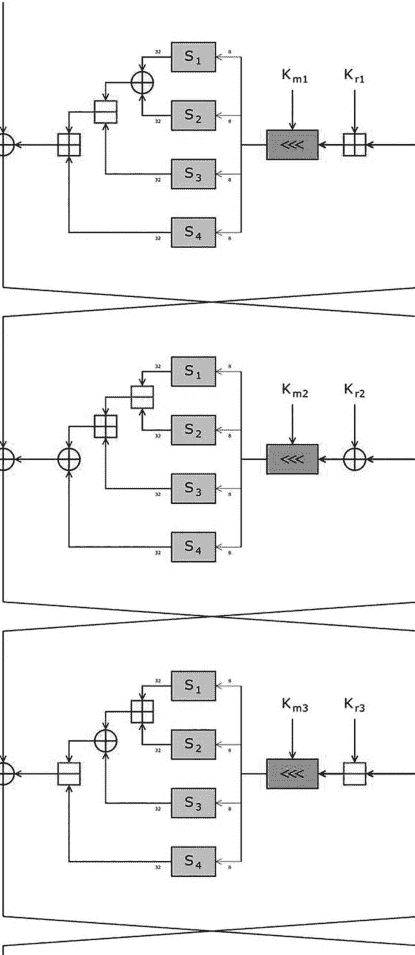

图 7.4
CAST-128 算法。

不规则的轮占用类，其模式相似，仅在于在不同点对精确操作（加法、减法或异或）的选择有所不同。此外，它基于费斯尔（Feistel Cipher）结构。

## 7.3.2 使用的数学原理

- 1. (密钥调度) 从 $K$ 计算子密钥对 $\{K_{\mu}, K_{\eta}\}$
- 2. $(L_{0} R_{0}) \leftarrow (m_{1} \dots m_{64})$ (将明文分为左右两个 32 位的值 $L_{0}=m_{1} \dots m_{32}$ 和 $R_{0}=m_{33} \dots m_{64}$)
- 3. (16 轮迭代) 对于 $i$ 从 1 到 16，计算 $L_{i}$ 和 $R_{i}$：$L_{i}=R_{i-1}, R_{i}=L_{i-1} - f(R_{i-1}, K_{i})$（其中 $f$ 为类型 1、类型 2 或类型 3，取决于 $i$）。
- 4. $c_{1} \dots c_{64} \leftarrow (R_{16} L_{16})$ (交换最终块 $L_{16}R_{16}$ 并拼接形成密文)。

## 7.3.3 优缺点

由于它基于费斯尔密码（Feistel Cipher）结构，它的优点是加密和解密过程非常相似。尽管在许多情况下无法区分，但它仅需对密钥调度进行轮转。因此，实现此类密码所需的代码大小几乎减了一半。

## 7.4 RC 算法

RC 系列算法是由 R. Rivest 在 MD5 算法系列之外开发的。由于其优异的速度和变长能力，在许多网络协议中广泛应用。RC 算法之间存在许多差异，包括：$RC2, RC4, RC5,$ 和 $RC6$

### 7.4.1 背景与历史

它是 RSADSI 拥有的专有密码。由 Ronald Rivest（RSA 著名人物）设计，用于各种 RSSI 产品。我们可以在密钥大小/数据大小/轮数上进行区分。它的设计非常简洁且直接。在各种 CPU 上实现起来完全没有问题，且被认为是安全的。其标准版本为 RC5-32/12/16，即使用 32 位字通过 12 轮加密 64 位数据块，使用 16 字节（128 位）的密钥。

### 7.4.2 RC5 算法是如何工作的？

在 RC5 中，字（即明文大小）、轮数以及密钥的 8 位字节数可以是变长的。字大小可以是 16、32、64 位等。轮数数量可以在 0 到 255 之间，8 位字节数可以在 0 到 255 之间。一旦确定，这些值在特定的加密过程中将保持不变。

[content]
对称算法 II

最初，RC5 非常容易理解。它有一个由两个步骤组成的原始操作，然后是若干轮。轮数可以在 0 到 255 之间。如果我们从一个 64 位的明文块开始，在前两个步骤中，明文块被分为 32 位的块 A 和 B。然后，将前两个子密钥加到 A 和 B 上。结果 C 和 D 标志着一次操作的结束。从这一轮开始，每一轮都由位异或、左循环移以及与下一个密钥的计算组成。在这里，一个块的输出作为另一个块的输入，使得密文难以破解。RC5 的加密数学表示如下：

```
A = A + S[0]
B = B + S[1]
For I = 1 to r
A = ((A XOR B) << B) + S[i]
B = ((B XOR A) << A) + S[i+1]
```
接下来，RC5 的解密数学表示如下：
For I = r to 1（每次 I 减 1）
A = ((B - S[i+1]) >>> A) XOR B
B = ((A - S[i]) >>> B) XOR A
B = B - S[1]
A = A - S[0]
```
[/content]


[content]
#### 7.4.2.1 子密钥生成

RC5 子密钥生成的数学表示如下：
S[0] = P, P = B7E163（十六进制），Q = 9E37B9（十六进制）
For I = 1 to (r + 1) - 1
S[i] = (S[i-1] + Q) mod 32

子密钥混合的数学表示如下：

```
i = 0
A = B = 0
Do n times the maximum of 2(r + 1) and c
A = S[i] + A + B <<< 3
B = S[i] + B + A <<< (A)
i = (i + 1) mod 2(r + 1)
j = (j + 1) mod c
End
```

### 7.4.3 RC2、RC4、RC5 和 RC6 的变体

| 描述 | RC2 | RC4 | RC5 | RC6 |
| :--- | :--- | :--- | :--- | :--- |
| 时间线 | 1987 | 1987 | 1994 | 1998 |
| 算法类型 | 分组密码 | 流密码 | 分组密码 | 流密码 |
| 密钥大小 | 40-64 | 1-256 | 0-240 | 128, 192, 256 |
| 用途 | 旨在作为 DES 的“替代品”的变密钥密码 | 流密码。用于安全通信。快速且完全安全 | 变块分组密码。具有变密钥 | AES 决赛选手。具有128-256 位输入的密码。涵盖了 AES 的所有特征 |

## 7.5 Serpent 算法

Serpent 是由 Ross Anderson、Eli Biham 和 Lars Knudsen 为高级加密标准设计的 128 位分组密码。它是 AES 的决赛选手。胜者 Rijndael 获得了 86 ，而 Serpent 获得了 59 ，Twofish 获得了 31 ，RCS 获得了 23 。NIST 对 Rijndael 的选择令人惊讶，他们必须满足“加密奥运会”。Hussain & Ali, 2009。

### 7.5.1 描述

Serpent 的设计是为了防止现实可能的快捷攻击。它使用的轮数是阻止所有已知快捷攻击的两倍。我们认为对于一个具有无与伦比性能的密码来说，这是一个安全的做法。尽管设计复杂，Serpent 比 DES 快得多。它的设计采用了高效的位片执行，在比赛期间，200 MHz 的 Pentium 上运行速度超过了 45 Mbit/s（而 DES 超过 15 Mbit/s）。

#### 7.5.1.1 结构

它的密钥共享 256 位。初始化 $w_{-8} \dots w_{-1}$。使用线性递推导出另外 132 个字 $w_0, \dots w_{131}$。一次将四个字通过盒，就像密码本身一样。有八个盒。每一轮使用 32 个相同的 S 盒。第 $i$ 轮使用 $i \pmod 8$。S 盒源自 DES 盒，因此没有人认为它们是被处理过的。

- 旋转 $X_0$ 和 $X_2$（不同的量）
- 将 $X_0$ 和 $X_2$ 混合为 $X_1$ 和 $X_3$（不同的方式）
- 旋转 $X_1$ 和 $X_3$（不同的量）

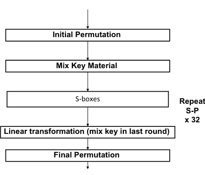

图 7.5
Serpent 结构。

- 将 $X_1$ 和 $X_3$ 混合为 $X_0$ 和 $X_2$（不同的方式）
- 旋转 $X_0$ 和 $X_2$（不同的量）。

非常容易并行化，在像 Pentium Pro 等超标量机器上表现高效（图 7.5）。

## 7.6 Twofish 算法

它是一种对称分组密码。它由 Counterpane Labs 发明。Twofish 算法供所有类型的目的完全免费使用，因为它没有专利且其源代码不受版权保护。它是 AES 五决赛选手之一。

### 7.6.1 通用描述

这里输入是 128 位明文块。该算法允许使用高达 256 位的变密钥。它具有 16 轮费斯尔网络，其 $F$ 函数由四个取决于密钥的 8 位 S 盒、$GF(2^8)$ 上的固定 $4\times4$ 空间矩阵划分计算。


# 新兴安全算法与技术

#### 7.6.1.1 Twofish 设计目标

Twofish 旨在满足 NIST 的 AES 蓝图标准。具体目标如下：

- 128 位明文块。
- 密钥从 128 位更改到 256 位。
- 密钥强度。
- 兼容 Intel 处理器和其他多样化的硬件平台。
- 设计具有灵活性，例如密钥范围或长度可以增加，兼容多种环境，可以实现为流密码，适用于哈希函数和消息认证码（MAC）。
- 设计简单，以减少分析及其加解密服务的工作量。

此外，在提案时必须满足以下演示标准：

- 可以使用长度任意 256 位的密钥。
- 通过使用 128 位密钥在各种处理器上加密 32 块，可以减少算法执行时间。
- 在各种处理器上加密数据时，每块减少 5000 个时钟周期。
- 可以在 8 位、16 位、32 位、64 位处理器上有效执行。
- 它不包含任何会在硬件中产生问题的开销。
- 在各种密钥大小下可以看到各种效率的结合。
- 算法的优化形式仅需 64 字节 RAM 即可执行。
- 它在 8 位微处理器上加密数据的速度慢于 10 ms。
- 算法可以通过少于 20,000 个门电路在硬件上执行。

图 36 展示了 Twofish 块密码的总体概念。Twofish 采用了 16 轮类 Feistel 结构，并对输入输出进行了额外的白化（whitening）。唯一的非 Feistel 元素是 1 位旋转。常规更改可以移动到 F 函数中以生成纯 Feistel 结构，但这要求在白化处理之前对字进行额外的一轮转换。输入明文块被切分为四个 32 位字。在输入白化处理过程中，这些字与四个密钥进行异或运算。然后它们进入 16 轮的循环。

在每次迭代中，左侧的两个字用作 g 函数的输入。（其中一个先交换 8 位）。g 函数由 32 位的通用密钥相关 S 盒和线性 MDS 矩阵组成。两个 g 函数的结果通常使用伪哈达玛变换（PHT），并有两个额外的关键字。这两个结果随后被异或到右侧的字中（其中一个先左移 1 位，另一个随后向右旋转）。左侧和右侧被分为两部分并交换以进行后续轮。在所有 16 轮结束时，四个字与四个关键字进行异或，以生成最终密文。因此，16 字节的明文 $p_0 \dots p_{15}$ 通过小端汇集首先拆分为四个每个 32 位字 $P_0 \dots P_3$。

## 新兴安全算法与技术

### 7.6.2 针对 Twofish 算法的安全攻击

Twofish 的开发者通过花费 1000 多人工时进行 Twofish 分析取得了成功。以下是他们对 Twofish 分析的最重要发现：

- 一种针对 Twofish 的选择密钥攻击需要优先选择密钥对中的 160 位，并需要 $2^{34}$ 的工作量、$2^{32}$ 次选择明文查询以及 $2^{21}$ 次自适应选择明文查询，使得 10 轮 Twofish 可以乱序。
- 针对普通 Twofish 的中间相遇攻击需要 4 轮、256 个已知明文、$2^{25}$ 内存和 $2^{23}$ 内存。


传感器网络、医疗保健、控制系统、物联网 (IoT)、信息物理系统和智能电网。在所有这些领域，安全和隐私都至关重要。由于现代加密算法的主流是为桌面设备/服务器环境设计的，许多算法无法应用于这些应用所使用的控制设备中。当现有的标准算法通过工程手段以适应控制环境的部分结果时，其性能可能并不尽如意。出于这些原因，启动了一项轻量级加密项目，以研究这些问题并建立一套轻量级加密算法一致性的策略（McKay, Basham, Turan & Mocha, 2017）。

轻量级加密是密码学的一个分支，旨在为资源受限的设备提供探索。学术界在轻量级加密方面做了大量工作；这包括传统加密标准的完整实现，以及新型轻量级算法和协议的设计与分析。

轻量级加密针对的是多样化的设备，这些设备可以在广泛的硬件和软件上实现。在设备的高端，光谱包括服务器和桌面电脑，其次是平板电脑和智能手机。传统算法在这些设备上运行良好；因此，这些平台不需要轻量级算法。在光谱的低端是嵌入式设备、RFID 设备和传感器网络。轻量级加密主要关注能够进入这一光谱端的极度受限设备。

### 7.8.1 性能指标

在加密设计中，给定安全级别下的性能和所需资源之间存在权衡。性能可以用功耗、能耗、延迟和吞吐量来描述。这种输出体现在寄存器、RAM 和 ROM 的使用上。资源需求有时被称为成本，因为增加更多的门电路或内存往往会增加设备的生产成本。由于许多受限设备的特殊性，功耗和能耗是相关的指标。设备可能会从周围环境中获取功率。

能耗（即特定时间段内的功率消耗）对于具有预设存储能量的电池供电设备尤为重要。某些设备中的电池一旦使用可能无法或难以充电或恢复。还需要注意的是，功耗取决于除算法之外的许多特征，如阈值电压、时钟频率以及执行的技术。

延迟对于某些实时提交尤其为相关，例如汽车应用，对转向、安全气囊或刹车等组件需要极快的响应时间。它可以定义为从操作的最早请求到输出结果之间的时间。例如，加密操作的延迟是指从明文加密的初始请求到返回等效密文所需的时间。

吞吐量是产生新输出（例如认证标记或密文）的速率。与传统算法不同，高吞吐量可能不是轻量级设计的目标。但在大多数应用中，合理的吞吐量是强制性的。

## 对称算法 II

### 7.8.2 轻量级加密原语

在过去的十年里，已经提出了许多轻量级加密原语，包括分组密码、哈希函数、消息认证码和流密码，它们比保守的加密标准具有优势。这些原语与传统算法的区别在于假设轻量级原语并非用于广泛应用，并且可能限制攻击者的能力。例如，攻击者在单个密钥下获得的数据可能是不完整的。然而，必须区分的是这并不意味着轻量级算法是脆弱的——相反，其思想是利用设计的改进，在资源受限环境的安全、性能和资源需求之间实现更好的平衡。

### 7.8.2.1 轻量级分组密码

- **较小的块大小：** 为了在轻量级加密中节省内存，使用了 64 到 80 位的较小块大小来代替 128 位。这有助于减少待加密明文块的限制并节省内存。
- **较小的密钥跨度：** 使用较小的密钥范围（如小于 96 位）以获得更好的性能。
- **更简单的轮次：** 轻量级加密中的程序比传统加密技术中使用的相对简单。轻量级加密使用的 4 位大小的轻量级盒（Sandbox）与传统加密产品使用的 8 位盒相比更轻量。这减少了资源的使用。
- **更简单的密钥生成：** 相对简单的密钥生成模块导致了内存使用、功耗消耗、延迟和其他资源的减少。因此，在轻量级图形结构中，生成的子密钥简单，但它们容易受到各种攻击。
- **最小化实现：** 若干种处理模式和协议只需要分组密码的加密。某些方案声称可能要求设备仅支持加密或解密操作之一。仅实现密码的核心功能可能比实现完整密码需要更少的资源。

### 7.8.2.2 轻量级哈希函数

由于内部状态尺寸大且功耗高，传统哈希函数可能不适用于受限环境。这导致了轻量级哈希函数的开发，例如 PHOTON、Quark、SPONGENT 和 Lesanta-LW。传统和轻量级哈希函数在各个方面的预期用途不同。

- **更小的内部状态和输出尺寸：** 对于需要哈希函数抗碰撞的应用，较大的输出尺寸非常重要。对于不需要抗碰撞的应用，可以使用较小的内部状态和输出尺寸。当需要抗碰撞哈希时，该哈希函数在抗原文攻击、第二原文攻击和碰撞攻击方面具有相同的安全性可能是合适的。这可以减小内部尺寸。
- **更小的消息大小：** 传统哈希函数可能支持非常大的输入（约 264 位）。大多数轻量级哈希函数的目标协议，其典型输入尺寸要小得多（例如最多 256 位）。针对短消息优化的哈希函数因此更适用于轻量级应用。

新兴安全算法与技术

### 7.8.3 设计考虑

虽然特定需求因应用而异，但有若干用于评估设计的通用属性：安全强度、灵活性、多功能开销、密文扩展、侧信道和故障攻击、明文-密文对数量的限制以及相关密钥攻击。

除非这会进一步增加给定应用所需的资源，否则可能无法满足所有属性。尽管如此，为产品组合选择的任何算法都可能提供足够的安全性。特别是，抗密钥恢复攻击性至少应达到 112 位。

## 7.9 可搜索加密 (SSE)

可搜索加密方案是一种允许在加密状态下查询信息的加密系统。这意味着一方可以在分类模式下将数据存储空间委托给另一方，同时保留对其进行选择性搜索的能力。

假设 Alice 想要向 Bob 转发包含“office”（办公室）一词的邮件，因为她不在了。如果服务提供者无法解释数据，他们如何知道给 Bob 发哪封邮件呢？这涉及到没有端到端加密的情况下传输数据的安全担忧。这个问题的方法是使用可搜索加密。在这里，Alice 选择加密消息并生成一组标签，或者寻找识别消息的关键词。这些标签被添加到加密消息上，以便服务提供者可以在不知道邮件详情的情况下执行转发邮件的任务（Curtmola, Garay, Kamara and Ostrovsky, 2006）。

### 7.9.1 可搜索加密是如何工作的？

可搜索加密机制通过公开上下文的片段信息来识别上下文。例如，如果有一篇关于 BBC 选举辩论的文章，可以通过“BBC”中的“选举辩论”轻松识别出该辩论记录。这些关键词结合数据，可能足够在成千上万份文件中找到那篇特定的手稿。

因此，可搜索基于有关内容的可用片段来识别加密内容，而无需暴露内容本身。在这个例子中，这些关键词可以发现选举辩论记录，但不足以获取真实内容。内容所有者使用私钥加密数据并将加密后的密钥与搜索提供者的公钥共享，或者与提供者共享一个密钥密钥。现在搜索查询来了，匹配建立了，这将建立内容所有者与请求者之间的关联。

另一个例子：假设 Alice 想在她休假期间将所有标记为“Urgent”（紧急）的邮件转发给 John。现在 Bob 向 Alice 发送了一封加密的电子邮件。


# 对称算法 II

使用 Alice 的公钥。如果邮件被标记为“紧急”，网关提供商无法知道是否应该将邮件路由给 John。

然后，John 提取关键词 urgent，对提取出的关键词进行可搜索加密或基于关键词搜索的公钥加密，并将数据发送到网关。现在网关可以解密关键词列表并将消息路由给 John。

## 7.10 结论

传统上，密码学的焦点一直是通过对称加密来实现隐私保护。在本章中，我们思考了利用对称加密来防止泄密。计算机执行加密非常容易且快速。对称密钥加密在一段时间内非常受欢迎。目前，它正不如非对称密码学。在本章中，我们概述了对称密钥密码的不同特征和算法。我们还讨论了某方面的若干对称密钥算法。我们深入到了之前的说明部分，这让读者了解这些算法的操作特性。通过对本章的分析，读者将考虑到算法的细微细节。这本身具有重要意义。考虑到上述问题，本章有助于公钥加密的发展。

## 参考文献

- Adams, C. (1997). The CAST-128 Encryption Algorithm, 01–15. doi:10.1748/rfc2144.
- Aparna, K., Solomon, J., Harini, M., Indhumathi, V. (2016). A study of Twoofish encryption. International Journal of Engineering Development and Research, 04(21), 148–150. Retrieved May 26, 2018, from http://www.ijed.org/papers/IJEDR1602023.pdf.
- Cirtola, R., Garay, J., Kamara, S., & Ostrovsky, R. (2011). Searchable symmetric encryption: Improved definitions and efficient constructions. Journal of Computer Security, 19(5), 895–934. doi:10.3233/jcs-2011-0426.
- Kahate, C. (2013). Cryptography and Network Security. New Delhi: McGraw Hill Education.
- Mckay, K., Bassham, L., Turan, M., & Moutha, N. (2017). Report on lightweight cryptography. National Institute of Standards and Technology Report 8114, 01–21.
- Menezes, B. (2012). Network Security and Cryptography. Belmont, CA: Washington Publishing Co.
- Azlee, A., Hussain, F., & Ali, N. (2009). Serpent implementation on Compute Unified Device Architecture (CUDA). Student Conference on Research and Development (SCRD), 72:74–81.
- Pleevis, P.C., Peger, S., & Marulis, J. (2016). Homomorphic encryption for security of cloud data. Procedia Computer Science, 79, 175–181. doi:10.1016/j.procs.2016.03.023.
- Sahu, R., & Ansari, M.S. (2017). Securing messages from brute force attack by combined approach of encryption. International Research of Engineering and Technology, 04(9), 119–123. Retrieved April 23, 2018, from www.irjet.net/archives/V4/IRJET-V4919.pdf.
- stalling, W. (2017). Cryptography and Network Security Principles and Practices. Boston: Pearson.

# 8 非对称密码学

Rajiv Ranjan, Abir Mukherjee, and Pankaj Rai
Birsa Institute of Technology
Khaleel Ahmad Maulana University

### 目录

- 8.1 引言 ............................................................................ 119
- 8.2 预备 ................................................................ 121
- 8.2.1 整除性与欧几里得算法 ............................ 121
- 8.2.2 代数 ....................................................................... 122
- 8.2.3 模算术 ................................................................ 123
- 8.2.4 基础数论 ........................................................ 123
- 8.3 RSA 算法 ................................................................ 124
- 8.4 Rabin 密码系统 ............................................ 126
- 8.5 ElGamal 公钥算法 ............................................ 128
- 8.6 背包算法 ............................................................ 130
- 8.7 基于混沌的非对称密码学 ............................... 132
- 8.8 结论 ....................................................... 136
- 参考文献 ................................................................... 136

## 8.1 引言

非对称或公钥密码学由 W. Diffie, M. Merkle 于 1976 年首次公开引入。在著名的论文《密码学的新方向》中，他们介绍了公钥系统的基本结构，并演示了如何使用公共通道安全地进行密钥交换（Diffie & Hellman, 1976; Goldwasser, 1997）。

任何密码系统都涉及三方：发送者 $S$、接收者 $R$ 和窃听者 $O$。当 $S$ 和 $R$ 在不被 $O$ 获知的情况下通信时，密码系统就实现了隐私。在密码系统中，当 $S$ 和 $R$ 通信而 $O$ 无法提取任何有效信息时，隐私就实现了。非对称加密的特征是使用两个密钥：公钥 $K_{IPU}$ 和私钥 $K_{IPR}$。为了安全地使用公共密钥，通常假设窃听者能够拦截加密消息。非对称系统中，$S$ 和 $R$ 生成一对不同的密钥。公钥被存储在公共文件中，而私钥对用户保密。现在，为了让 $S$ 发送消息 $M$，使用接收者 $R$ 的公钥 $K_{PU,R}$ 通过加密系统 $Enc(M, K_{PU,R})$。该加密系统被设计为一种陷门单向函数。在陷门单向函数 $F(x)$ 中，计算 $y=F(x)$ 是容易的，但在没有陷门的情况下，获取反函数 $x=F^{-1}(y)$ 是不可行的。接收端的解密系统 $Dec(C, K_{PR,R})$ 被设计为加密系统的陷门，前提是接收者拥有私钥。只有目标接收者 $\mathcal{R}$ 能够轻松解密密 $C$，从而实现安全通信。由于任何人都可以使用公钥向特定的接收者发送加密消息，因此公钥系统也称为多访问密码。图 8.1 展示了公钥密码系统的通用结构。

公钥密码系统可以正式定义为一对可逆变换 $Enc(X, K_{PU})$ 和 $Dec(Y, K_{PR})$，其中 $X$ 属于消息空间 $\mathcal{M}$，$K_{PU}$ 和 $K_{PR}$ 属于包含给定长度所有密钥的密钥空间 $\mathcal{K}$。为了提供所需的安全性，每个非对称加密满足某些属性。这些属性如下：

- 对于给定的公私钥对，每对加密和解密系统必须互为逆。
- 分别使用公钥和私钥时，计算 $Enc(X, K_{PU})$ 和 $Dec(Y, K_{PR})$ 在计算上是容易的。
- 攻击者从公钥 $K_{[PU]}$ 推导出私钥 $K_{[PR]}$ 在计算上是不可行的。
- 通信方生成一对密钥（$K_{[PU]}$ 和 $K_{[PR]}$）在计算上是容易的。


 8.1
非对称（公钥）系统的通用结构。


# 非对称加密

非对称加密系统可以应用于各种安全问题。其应用的三大类领域是机密性、密钥交换和数字签名。密钥交换方案用于在不安全的信道上在两个用户之间交换对称密钥。数字签名方案在密钥的使用上是互补的——私钥用于加密消息，而公钥用于解密。当使用发送者的私钥对消息进行加密时，会生成一个密文，它作为发送者的数字签名。当有人使用发送者的公钥成功解密消息时，就可以立即确定该消息是由发送者生成的。因此，拥有使用发送者私钥生成的密文就解决了不可否认性问题。用户无法再否认发送该消息，因为他是唯一拥有该密钥的方，而该密钥被用于加密接收到的消息。

在接下来的章节中，我们首先讨论一些为了正式理解非对称算法所需的辅助知识。然后，我们将开始讨论一些重要的公钥加密系统、它们的属性及其应用。

## 8.2 基础知识

### 8.2.1 整除与欧几里得算法

如果对于某个整数 $q$ 使得 $a = q \cdot b$，则称整数 $a$ 整除另一个整数 $b$，表示为 $a|b$。如果 $p$ 是整数且 $q$ 是正整数，则*模*运算（记作 $p \bmod q$）定义为 $p$ 除以 $q$ 的余数。质数是指除了1和本身外没有因子的数；如果一个数至少有一个非平凡因子，则称该数为合数。两个整数 $a$ 和 $b$ 的**最大公约数**在此处记为 $gcd(a, b)$，它是整除 $a$ 和 $b$ 的最大整数 $d$。

欧几里得算法是一种用于寻找两个整数 $a$ 和 $b$ 的 $gcd(a, b)$ 的快速算法。如果两个数 $a$ 和 $b$ 的 $gcd(a, b) = 1$，则它们是互素数。通过使用欧几里得算法，可以将数 $a$ 和 $b$ 的 $gcd(a, b)$ 表示为 $a$ 和 $b$ 的整数系数的线性组合。该过程被称为扩展欧几里得算法。

# 算法 1：欧几里得算法

```
Algorithm: The Euclidean Algorithm
Input: Positive integers a, b;
procedure gcd(a, b) {
  x := a;
  y := b;
  while(y != 0) {
    r := x mod y;
    x := y;
    y := r;
  }
  return x;
}
```

```]

### 8.2.2 代数

在本小节中，我们描述了群、环和域等基本代数结构。

**定义 1：** 集合 $\mathcal{S}$ 上的二元运算 $\bullet$ 描述了从 $\mathcal{S}$ 中元素的每个有序对 $(p, q)$ 到同一集合 $\mathcal{S}$ 中唯一元素的映射。

**定义 2：** **群** $\mathcal{G}$，记作 $(\mathcal{G}, \bullet)$，是一个带有二元运算 $\bullet$ 的非空元素集合并满足一组公理。定义群的公理如下：

- 封闭性：如果 $p \in \mathcal{G}$ 且 $q \in \mathcal{G}$，则 $(p \bullet q) \in \mathcal{G}$。
- 结合律：$(p \bullet q) \bullet r = p \bullet (q \bullet r), \forall p, q, r \in \mathcal{G}$。
- 单位元：每个群必须有一个唯一的元素 $e \in \mathcal{G}$，使得 $p \bullet e = e \bullet p = p$。该元素称为该群的单位元。
- 逆元：对于每个元素 $p \in \mathcal{G}$，必须存在一个唯一的元素 $q$，使得 $p \bullet q = q \bullet p = e$。该元素称为 $p$ 的逆元，记作 $p^{-1}$。

如果一个群是交换的（也称为阿贝尔群），则它必须满足一个额外的公理：

- 交换律：$p \bullet q = q \bullet p, \forall p, q \in \mathcal{G}$。

阿贝尔群的一个例子是整数集合 $\mathcal{Z}$ 加上加法二元运算 (+)。

**半群**是一个具有二元运算 $\bullet$ 且仅满足群的封闭性和结合律公理的集合 $\mathcal{G}$。具有有限个元素的群称为**有限群**；否则称为**无限群**。如果群中的元素个数为 $n$，则称该群的阶为 $n$，记作 $|\mathcal{G}| = n$。$\mathcal{G}$ 的非空子集如果在相同的二元运算下构成一个群，则称为子群。

**定义 3：** 环是一个具有二元运算 $\bullet$ 且仅满足群的封闭性和结合律公理的集合 $\mathcal{G}$。

**定义 4：** 域是一个满足以下条件的交换环：

- 如果 $p \in \mathcal{R}$ 且 $q=0$，则 $p=0$ 或 $q=0$。

**定义 5：** 域 $\mathcal{F}$，记作 $(\mathcal{F}, \oplus, \odot)$，是一个对于每个元素 $p$ 都有乘元的域。具有有限元素的域称为有限域。

非对称加密

$p$ 是质数，$n$ 是整数。这些有限域通常记作 GF($p^n$)。

### 2.2.3 模算术

如果两个整数 $p$ 和 $q$ 除以 $n$ 的余数相同，则称 $p \equiv q \pmod n$。模 $n$ 的剩余类集合 $Z_n$ 为 $\{0, 1, \dots, n-1\}$。

$Z_n$ 的乘群 $Z_n^*$ 满足 $\gcd(a, n)=1$。模 $n$ 的二次剩余是指 $Z_n^*$ 中的整数 $a$，使得对于 $x \in Z_n$，有 $x^2 \equiv a \pmod n$。不存在这样的 $x$，则 $a$ 是二次非剩余。所有二次剩余的集合记作 $Q_n$。反之，给定 $a \in Q_n$，如果某个 $x \in Z_n$ 满足 $x^2 \equiv a \pmod n$，则 $x$ 是 $a$ 模 $n$ 的平方根。

为了寻找模质数 $p$ 的平方根，我们首先计算 $b \in Z_p$，使得 $b^2-4a$ 是模 $p$ 的二次非剩余。考虑多项式 $f(x) = x^2-bx+a \in Z_p$。计算 $r = x^{(p-1)/2} \pmod p$。从而得到模 $p$ 的平方根为 $(r, -r)$。

### 2.2.4 基础数论

这里给出了一些基础数论结论，不给出相应的证明并假设其为正确的。

**定义 6：** 欧函数记作 $\phi(x)$ 定义为小于 $x$ 且与 $x$ 互质的正整数个数。

如果 $p$ 是质数，则 $\phi(p) = p-1$。


在这里，$a$ 被称为 $n$ 的原根，其阶为 $\phi(n)$。原根的不同幂次（最高到其阶 $\phi(n)$）产生模 $n$ 的与 $n$ 互质的不同整数。

类似于对数函数，对于给定的整数 $m$，**离散对数**定义为：对于给定的素数 $p$ 及其原根 $a$，指数 $x$ 使得 $m \equiv a^x \pmod p$ 成立。它被记为 $\log_a(m)$，且已知在计算上与因数分解问题一样困难。它在非对称加密中有广泛应用。

在下一节中，我们开始对公钥算法进行讨论，从最具影响力的公钥算法之一——RSA 开始。

## 8.3 RSA 算法

RSA 算法以其创建者 Ron Rivest、Adi Shamir 和 Leonard Adleman 的命名命名并于 1977 年发表，是非对称加密领域的首批突破之一。它的开发初衷是为了解决隐私和数字签名问题。尽管在数学上尚未被证明，但被动攻击者从 RSA 加密系统产生的密文中恢复明文，被认为在计算上与因数分解问题一样困难（Rivest, Shamir, & Adleman, 1978）。

RSA 系统有两个不同部分——密钥生成算法和加密/解密算法。在密钥生成算法中，生成两个不同的密钥，称为公钥和私钥。接收者的公钥用于加密消息，而私钥由接收者用于解密消息。

密钥生成算法在算法 4 中描述，加密和解密算法分别在算法 2 和 3 中描述。为了隐私，使用接收者的公钥加密；而对于数字签名，使用私钥对签名加密。

# 算法 2：加密算法

| 算法：RSA 加密系统的加密 |
| 输入：接收者的公钥 (N, e), 输入消息 M; |
| 输出：加密后的消息; |
| 过程 Encryption({N, e}, M): |
| M' := 将 M 表示为范围 [1,N-1] 内的整数; |
| C := (M')^e mod N; |
| 返回 C; |

# 算法 3：解密算法

| 算法：RSA 加密系统的解密算法 |
| 输入：私钥 {d, N}, 加密消息 C; |
| 输出：解密后的消息 |
| 过程 Decryption({d, N}, C): { |
| M' := C^d mod N; |
| 返回 M; |
} |

用于密钥生成的素数 $p$ 和 $q$ 通常阶非常大，至少有 200 个十位数，且 $gcd(p-1, q-1)$ 的值非常小，并且 $p-1$ 和 $q-1$ 具有大素因子。

# 算法 4：密钥生成算法

| 算法：RSA 加密系统的密钥生成 |
| 输入：无 |
| 输出：公钥，私钥 |
| 过程 KeyGeneration(): { |
| p := 选择一个随机素数; |
| q := 选择另一个不同于 p 的随机素数; |
| N := p * q; |
| phi := (p-1)(q-1); |
| e := 选择满足 $1<e<\phi$ 且 $(phi,e)=1$ 的随机整数逆元; |
| d := e mod phi 的乘元逆; |
| 返回 PrivateKey(N, e), PrivateKey(d, N); |
} |

以下示例演示了如何使用 RSA 加密系统对简单消息进行加密和解密以实现安全通信。

# 示例 1

假设通信双方为 Bob ($B$) 和 Alice ($A$)。在这种场景中，$B$ 意图使用 RSA 加密系统向 $A$ 发送安全消息 $M = “HELLOWORLD”$。

首先，使用适当的编码对消息 $M$ 进行编码。这里我们将每个字母编码为两位索引，从 $A = 01$ 开始并递增直到 $Z=26$。每个块由两个或四个字母组成。因此，消息 $M$ 被编码并分块如下：

$M = 0805 1212 1523 1518 1204$

选择两个素数 $p = 53$ 和 $q = 61$，得到 $N = p \times q = 3233$。计算 $\phi(N) = (p-1)(q-1) = 3120$，选择值 $e$ 使得 $gcd(e, \phi(N)) = 1$。

令 $e = 47$，然后使用扩展欧几里算法计算 $d$，使得 $ed \equiv 1 \pmod{\phi(N)}$ 成立。因此，我们得到 $d = 863$。由此，$K_{PR,A} = [N, d; 3233, 863]$ 和 $K_{PL,A} = [N, e; 3233, 47]$ 分别成为接收者 (A) 的私钥和公钥。

加密第一个块 $M_1 = 0805$，如下：

$C_1 = (M_1)^e \pmod N = (0805)^{47} \pmod{3233} = 2462$

同样，加密其他块：

$C_2 = (M_2)^e \pmod N = (1212)^{47} \pmod{3233} = 1550$

现在，$A$ 使用私钥解密 $C_1$：

$M_1 = C_1^d \pmod N = (2462)^{863} \pmod{3233} = 0805$

同样，$A$ 解密 $C_2$：

$M_2 = C_2^d \pmod N = (1550)^{863} \pmod{3233} = 1212$


Y = (rdq-scp) mod N = (1551 +5676) mod 2021 =1164
最后，获得 C 的平方根为 $M_1, M_2, M_3$ 和 $M_4$，它们构成了四个可能的解密消息。
$M_1 = X \pmod N = 1938; $M_2 = -X \pmod N = 83; $M_3 = Y \pmod N = 1164; $M_4 = -Y \pmod N = 857$
从上述结果可以看出，$M_2 = 83 (\approx M)$ 是密文 C 的正确解密。

## 算法 7：解密算法

| 算法：Rabin 密系统的解密算法 |
| 输入：PrivateKey(p, q, N), 密文 C |
| 输出：可能的解密消息 |
| procedure Key(p, q, N), C {
| {a, b} := C mod p 的平方根; |
| {c, d} := C mod q 的平方根; |
| {c, d} := 满足 cp + dq = 1 的整数，扩展欧几里得算法; |
| u := (a+b)c mod N; v := (a-b)d mod N; |
| $M_1 = u \pmod N; $M_2 = -u \pmod N; |
| $M_3 = v \pmod N; $M_4 = -v \pmod N; |
| return ($M_1, M_2, M_3, M_4); |
|} |

为了自动识别解密算法输出的正确消息，应该在明文后添加适当的冗余。如果解密消息包含冗余，则接受。如果四个输出都不包含冗余，则密文可以被拒绝。这种攻击类型及其解决方法与 RSA 相似。冗余也有助于防止适应选择密文攻击。Rabin 密系统的加密算法极快，而解密则是 RSA 算法的阶。然而，该算法受到选择明文攻击的影响。

## 8.5 ElGamal 公钥算法

另一种常用的非对称算法是 ElGamal 公钥算法。它由 Taher Elal 在 1984 年开发，并在许多混合算法中广泛使用，与对称算法配合使用。针对被动攻击者的安全性已知等同于 Diffie-Hellman 问题（ElGal, 1985; Schreier, 1995）。

ElGamal 密系统在数字签名方案、电子邮件安全、密钥交换等领域被广泛使用。加密算法具有概率性质，

非对称加密

这导致在不同的尝试中同一明文产生不同的密文。以下示例演示了如何使用 ElGamal 密系统来实现隐私。

## 示例 3

假设 Bob 和 Alice 再次通信，但这次使用 ElGamal 非对称系统。Bob (B) 想给 Alice (A) 发送消息 M=15。为了生成公钥/私钥对，A 通过选择质数 q 来选择有限域 GF(q)。

## 算法 8：密钥生成算法

| 算法：ElGamal 密系统的密钥生成 |
| 输入：无 |
| 输出：公钥，私钥 |
| procedure KeyGeneration() { |
| q := 选择一个大质数; |
| p := 选择法群 Zq 的原根; |
| a := 选择随机整数 m, 1<a<(q-1); |
| Y := p^a; |
| return PublicKey(q, Y), PrivateKey(q, a); } |

令 q=23 为质数，$\alpha=7$ 为原根。Zq 计算 $Y=7^{14} \pmod{23}=2$，从而生成公钥 [23, 7, 2]。值 X=14 保留为私钥。Bob 获取 Alice 的公钥，通过选择随机整数 $m \in Z_q$ 创建一次性密钥 K，例如 $m=13$，并计算 $K=(Y)^m \pmod q=(2)^{13} \pmod{23}=4$。现在，B 通过生成如下整数对来加密消息 M：

> $C_1 = \alpha^m \pmod q=7^{13} \pmod{23}=20; C_2=(K\cdot M) \pmod q=(4\cdot15) \pmod{23}=14$

这形成了密文 $C=[C_1, C_2]=[20, 14]$，B 将 C 发给 A。

## 算法 9：加密算法

| 算法：ElGamal 密系统的加密 |
| 输入：接收者的公钥 (q, p, Y), 输入消息 M; |
| 输出：加密后的消息: |
| procedure Encryption(q, p, Y), M; { |
| M' := 将 M 表示为 [1,q-1] 范围内的整数; |
| r := 随机整数，满足 0<r<q; |
| K := Y^r \pmod q; |
| C1 := p^r; |
| C2 := (K\cdot M') \pmod q; |
| return (C1, C2); } |

## 算法 10：解密算法

| 算法：ElGamal 密系统的解密 |
| 输入：PrivateKey(q, a), 密文 (C1, C2); |
| 输出：解密消息 |
| procedure Decryption((q, a), {
| M' := (C1)^a \pmod q; |
| M' := (C2\cdot M')^{-1} \pmod q; |
| return M'; |
|} |

Alice 接收密文 C，通过计算 $(C1)^a \pmod q$ 解密出 $s$，然后通过 $(C2 \cdot s^{-1}) \pmod q$ 得到 $M'$。因此，$s = (C1)^a \pmod q$ 是密文 C 的解密。这种密文攻击。这种非对称系统的缺点是受到适应选择密文攻击。

## 8.6 背包算法

背包问题也被称为子和问题，即在集合中找到一个和等于给定值的子集。在集合描述中，子和问题等于总和。这种背包问题在时间复杂度上是指数级的。对于给定的集合，子和问题在计算上是不可行的。

基于背包的非对称方案通过创建一个递增集合来工作。

基于背包的非对称方案是 Merkle-Hellman，但它们已被证明是不安全的。其重要性在于它们是最早的非对称加密方案。由于背包问题是易求解的。

混沌非对称加密


# 非对称加密 133

动力系统。演化函数用于获取系统的下一个状态。一维离散动力系统通常表示为：

```
$X_{n+1} = f(X_n)$
```

给定系统的一个初始状态 $X_0$，可以通过重复应用演化函数获得未来状态。因此，离散动力系统被认为是以这种方式进行迭代。对于给定映射 $X_n=f(X_n)$，状态 $X_0$ 的轨道是系统到达给定状态 $X_n$ 期间所经过的状态集合，与从给定状态开始连续应用演化函数所得到的状态集合的并集。包含给定状态的前序状态的集合称为反向轨道，而包含未来状态的集合称为正向轨道。不可逆映射没有反向轨道。

映射的固定点（fixed point）是指下一个状态与当前状态相同的状态，即 $f(X)=X$。如果一个映射存在一个状态 $X_*$，使得对其应用演化函数进行 $n$ 次迭代后，系统达到了相同的状态 $X_p$，则该点 $X_0$ 被称为周期为 $n$ 的周期点。固定点在性质上可能是吸引的或排斥的，取决于附近的轨道是向该点收敛还是从该点散。吸引固定点和周期点是吸引子。

固定点或周期点的稳定性由稳定性系数决定。对动力系统的固定周期点施加微小的变化或扰动，并在系统中观察到相应的变化。稳定性系数通过分析系统中的这种变化获得。如果稳定性系数不等于 1，则该固定点或周期点是双曲的（hyperbolic）——系数小于 1 表示稳定，大于 1 表示不稳定。如果稳定性系数等于 1，则无法对其稳定性做判断。

**非线性动力系统**的演化函数对输入是非线性依赖的。如果这些非线性动力系统在本质上是确定性的、具有不规则且非周期的行为，并且对初始条件敏感，它们就会表现出确定性混沌行为。这种对初始条件的敏感性和不规则的周期性行为使得混沌系统虽然本质上是确定性的，但能模拟随机行为。这使其适用于加密系统（Kovač & Lian, 2011）。

混沌映射构成了混沌加密的核心。混沌动力系统的属性与许多加密系统的属性相似。混沌系统的遍历性和敏感性类似于加密系统的混淆和扩散属性。确定性的不规则行为类似于系统的确定性伪随机性。尽管存在相似之处，混沌系统与加密系统之间许多许多不同，因为混沌系统在实数子集上运行，而加密系统在有限整数集上运行。因此，最初利用混沌系统创建加密系统的尝试都是失败的，直到最终创建了基于混沌的安全系统。创建非对称加密系统的成功尝试之一涉及基于切雪比多项式的整数实现。

**切雪比夫多项式**（Chebyshev polynomial）是定义在实数集或其子集上的 $n$ 阶映射。它可以递归定义如下：

```
$T_{n+1}(x) = 2XT_n(x) - T_{n-1}(x)$
```

# 134 新兴安全算法与技术

其中 $T_0 = 1$ 且 $T_1 = x$。上面的表达式可以转换为包含矩阵代数的表达式，从而能够易于计算出 $r$ 阶切雪比夫多项式。联系 $T_{r+1}$ 与 $T_0$ 和 $T_1$ 的矩阵方程如下：

```
$$\begin{bmatrix} T_r & T_0 \\ T_{r+1} & T_1 \end{bmatrix} = A^r \begin{bmatrix} T_r \\ T_{r-1} \end{bmatrix}$$
```

其中，

```
$A = \begin{bmatrix} 0 & 1 \\ -1 & 2x \end{bmatrix}$
```

切雪比夫多项式的一个重要属性是它们在复合下交换律，即满足 $T(T(x)) = T(T(x))$。这里讨论的非对称方案是使用改进型切雪比夫多项式对 RSA 算法的推广。这是一个安全算法，与 RSA 算法一样，基于整数分解问题的计算不可行性（Kacarev, 2001）。


## 算法 16：解密算法

| 算法：混沌基 RSA 的解密算法 |
|---|
| 输入：私钥(d, N)，加密消息 C；输出：解密消息 |
| 过程 Decryption(d, N, C): { 令 MTf(x) := Tf(x) mod N，为次数为 r 的修正 Chebyshev 多项式；M' := MTd(C) mod N；返回 M'； } |

此外，针对混沌基系统的密码分析方法尚未得到充分发展，因此很难评估混沌基方法。混沌基方法正在不断发展中，包括该方法的硬件实现、新算法的开发以及性能分析新方法的创建。令人相当乐观的是，未来不久混沌基方法可能会成为主流的非对称密码系统，并可能获得广泛应用。

## 8.8 结论

我们现在总结对公钥算法的讨论。我们描述并分析了五种重要的非对称密码系统，以及它们如何融入 Diffie 和 Hellman 提出的公钥密码学的总体框架。最后可以说，非对称密码学通过提供安全通信方式，解决了诸如不可否认性、身份认证和密钥分发等重要问题，彻底改变了现代世界；并导致了诸如电子货币、零知识证明、安全电子商务等数字系统的创建，这些系统以前几乎不可能实现。

## 参考文献

- Boneh, D. (1999). 二十年来对 RSA 密码系统的攻击. Notes of the AMS, 46, 203–213.
- Chor, B., & Rivest, R. L. (1985). 基于有限域算术的背包公钥密码系统（初步草案）. In Workshop on the Theory and Application of Cryptographic Techniques (Vol. 196, pp. 54–65). Springer. doi:10.1007/3-540-39568-7_6.
- Diffie, W., & Hellman, M. (1976). 密码学的新方向. IEEE Transactions on Information Theory, 22(6), 644–654. doi:10.1109/tit.1976.1055638.
- El Gamal, T. (1985). 基于离散对数的公钥密码系统和签名方案. In Workshop on the Theory and Application of Cryptographic Techniques (Vol. 196, pp. 10–18). Springer. doi:10.1007/3-540-39568-7_2.

## 非对称密码学

- Goldwasser, S. (1997). 密码学的新方向：二十年后（或密码学与复杂性理论：天作之合）. Proceedings 38th Annual Symposium on Foundations of Computer Science (pp. 314–324). doi:10.1109/sfcs.1997.646120.
- Katz, J., & Lindell, Y. (2007). 现代密码学导论. Chapman & Hall (CRC Press). ISBN 13: 978-1-5848-5581-1.
- Kocarev, L. (2001). 基于混沌的密码学：简要概述. IEEE Circuits and Systems Magazine, I(3), 6–21. doi:10.1109/7384.96343
- Kocarev, L., & Lin, S. (2011). 基于混沌的密码学（第 1 版）. Springer-Verlag, Berlin, Heidelberg, doi:10.1007/978-3-642-20542-2.
- Kocarev, L., Makraduli, J., & Amato, P. (2005). 基于 Chebyshev 多项式的公钥加密. Circuits and Signal Processing, 24(5), 497–517. doi:10.1007/s00034-005-2403-x.
- Kocarev, L., & Tasev, Z. (2003). 基于 Chebyshev 映射的公钥加密. Proceedings of the 2003 International Symposium on Circuits and Systems (pp. III–28–III–31). doi:10.1109/ICAS.2003.120947.
- Menezes, A., van Oorschot, P., Vanstone, S. (2001). 应用密码学手册（第 5 版）. CRC Press. ISBN: 0-8493-8523-7.
- Merkle, R., & Hellman, M. (1978). 在陷门背包中隐藏信息和签名. IEEE Transactions on Information Theory, 24(4), 525–530. doi:10.1109/tit.1978.105927.
- Rabin, M. O. (1979). 数字签名和与因式分解一样难以处理的公钥函数（第 1–16 页，Rep. MIT/LCS/TR-21）. Massachusetts Institute of Technology, Cambridge.
- Rivest, R. L., Shamir, A., & Adleman, L. (1978). 一种获取数字签名和公钥密码系统的方法. doi:10.11456/ada60658
- Schneier, B. (1995). 应用密码学：协议、算法和 C 语言源代码（第 2 版）. John Wiley & Sons. ISBN: 0-471-11709-9.
- Shamir, A. (1982). 破解基本 Merkle–Hellman 系统的多项式时间算法. In Proceedings of the 23rd Annual Symposium on Foundations of Computer Science (pp. 145–152). IEEE Computer Society. doi:10.1109/SFCS.1982.55.
- Stallings, W. (2017). 密码学与网络安全：原理与实践. Pearson Education, Boston.

## 9 后量子密码学

Amandeep Singh Bhatia 和 Ajay Kumar
Thapar 工程与技术学院

## 目录

- 9.1 引言 ..................................................................................... 139
- 9.2 预备知识 ....................................................................................... 141
- 9.3 基于代码的密码学 ................................................................ 142
    9.3.1 McEliece 密码系统 ............................................................ 142
    9.3.1.1 缺点 ...................................................................... 145
    9.3.1.2 安全性 ........................................................................ 145
    9.3.2 Niederreiter 密码系统............................................................... 145
- 9.4 基于格的密码学 ............................................................ 146
    9.4.1 NTRU 算法 ........................................................................ 146
    9.4.2 Goldreich-Goldwasser-Halevi (GGH) ............................... 148
- 9.5 多元密码学 ............................................................... 150
    9.5.1 OV 签名方案 ................................................................ 151
    9.5.2 Rainbow 签名方案 ................................................... 151
    9.5.3 Quartz 签名方案 (2, 129, 103, 3, 4)............................ 152
- 9.6 基于哈希的密码学 ........................................................ 153
    9.6.1 Lamport-Diffie 一次性签名方案 (LD-OTS) ......... 153
    9.6.2 Winternitz 一次性签名方案 (W-OTS) .............. 154
- 9.7 结论 .................................................................................................... 155
- 参考文献 ..................................................................................................... 155

### 9.1 引言

量子计算是一个迷人的领域，涉及结合计算机科学、物理学和数学的远见想法的理论计算系统（即量子计算机）。它关注量子层面的能量行为和性质，以提高计算效率。最初，量子计算的想法是在经典计算机上进行量子力学模拟后提出的（Feynman, 1982）。直到那时，量子计算被认为只是一种理论上的可能性，但过去三十年的研究已经发展到使量子计算应用成为现实的可能性。

过去三十年来，公钥密码系统（Diffie-Hellman 密钥交换、RSA 密码系统、数字签名算法 [DSA] 和椭圆曲线密码系统 [ECC]）已成为网络安全的重要组成部分。在这方面，安全性取决于一定数量的数论问题的难度（整数分解或离散对数问题）。(Shor, 1994) 设计了一种算法，用于在量子计算机上以空间复杂度 O(log n)² * log n 计算大数 n 的因子，然后在经典计算机上进行 O(log n) 后处理，该算法可应用于美国贝尔实验室破解 RSA 算法。(Grover, 1996) 设计了一种具有量子优势的搜索算法，用于在大约 √n 次操作中在大小为 n 的非结构化集合中找到一个项目。(Kwiat et al., 2000) 使用常规光学干涉仪在洛斯阿拉莫斯国家实验室实现了 Grover 算法。量子并行性是量子计算的主要特征之一，它使算法与经典算法相比能够获得加速。

通过 Shor 算法（Shor, 1994）提供的动力，量子计算复杂性是一个令人兴奋的领域，超越了量子物理和理论计算机科学的界限。该算法在密码学领域众所周知，因为它在创建各种系统方面的潜在应用，例如 RSA 算法和椭圆曲线密码学（Chen et al., 2016）。所有这些公钥密码系统都可以在多项式时间内受到攻击。虽然 Grover 算法可以引导到某些攻击，但可以通过修改参数来规避。表 9.1 表示了几种密码系统的现状（Bernstein, 2009）。

后量子密码学提供安全的替代方案。后量子密码学的目标是开发对量子计算机和经典计算机都安全的密码系统，并且与现有的通信协议和网络兼容。除了 RSA、DSA 和 ECDSA 之外，还有其他类别的密码系统，包括基于代码的、基于格的、基于哈希的和多元二次方程。事实上，许多都已应用于 Shor 算法来对这些类别的密码系统进行攻击。

关于后量子密码算法的成功执行存在许多挑战；例如，需要提高后量子密码系统的可用性和有效性，我们需要确保后量子密码系统的安全性。到 2020 年，如果量子计算机投入使用，这些挑战需要得到解决，因为我们尚未准备好转向后量子密码学时代。以下是几种密码系统的详细情况，它们在每次攻击下都经受住了考验。

### 表 9.1

量子计算对密码算法的影响

| 密码系统 | 是否被量子算法破解？ |
|---|---|
| Diffie-Hellman 密钥交换 (Diffie and Hellman, 1976) | 已破解 |
| RSA 公钥加密 (Rivest et al., 1978) | 已破解 |
| 代数同态 (Koblitz, 1987) | 已破解 |
| 椭圆曲线密码学 | 已破解 |
| Buchmann-Williams 密钥交换 (Buchmann and Williams, 1988) | 已破解 |
| McEliece 公钥加密 (McEliece, 1978) | 尚未破解 |
| NTRU 公钥加密 (Hoffstein et al., 1999) | 尚未破解 |
| 基于格的公钥加密 (Cai and Cusick, 1998) | 尚未破解 |


后量子密码学

## 9.2 预备知识

本节给出了一些预备知识和基本符号，将在整章中使用。

- **线性码：** 长度为 $n$、维数为 $k$、定义在域 $F$ 上的线性码 $C$ 是向量空间 $F_q^n$ 的 $k$ 维子空间，$F_q^n$ 有 $q$ 个元素，$n$ 维向量集合可称为 $[n, k]$ 码，且比特元素满足 $F=GF(2)=\{0, 1\}$。如果码的最小汉明距离为 $d$，则该码为 $[n, k, d]$ 码。

- **汉明距离：** 汉明距离 $d_H(x,y)$ 是两个码字 $(x,y)$ 不同的位置数 (Löndahl, 2015)。设 $C$ 为 $F_q^n$ 上的 $[n, k]$ 线性码，$x=(x_1, x_2, \dots, x_n)$，$y=(y_1, y_2, \dots, y_n)$ 为两个码字。

$$d_H(x,y) = |i : x_i \neq y_i, 1 \leq i \leq n|$$

- **汉明重量：** 汉明重量 $w_H(x)$ 定义为码 $x$ 中非零位置的数量 (Löndahl, 2015)。设 $C$ 为 $F_q^n$ 上的 $[n, k]$ 线性码，$x=(x_1, x_2, \dots, x_n)$ 为一个码字，使得

$$w_H(x) = |i : x_i \neq 0, 1 \leq i \leq n|$$

- **生成矩阵：** $C$ 的生成矩阵是一个 $k \times n$ 矩阵 $G$，其行取值为 $V=(v_1, v_2, \dots, v_k)$，构成该码的基

$$C=\{m : m \in F_q^n\}, G=\begin{bmatrix} v_1 \\ v_2 \\ \vdots \\ v_k \end{bmatrix}$$$$

矩阵 $G$ 作为线性映射生成码：对于每个消息 $m \in F_q^n$，我们得到相应的码字 $mG$ (Löndahl, 2015)。

- **校验矩阵：** $(n-k) \times n$ 生成矩阵 $H$ 被称为码字 $C$ 的校验矩阵 (Löndahl, 2015)，其描述为

$$C=\{m : m \in F_q^n : mH^T = 0\}$$

- **格：** 它被定义为 $R^n$ 中长度为 $n$ 的线性无关向量 $(a_1, a_2, \dots, a_n)$ 的所有整数组合的集合，它们是格中的基。

$$L(a_1, a_2, \dots, a_n) = \sum_{i=1}^n x_i a_i | x_i \in \mathbb{Z}, 1 \leq i \leq n$$

它可以表示为矩阵形式，使得 $A=(a_1, a_2, \dots, a_n) \in R^{n \times n}$，其中列作为基向量 (Peikert, 2016)。

- **多项式环：** 考虑一个交换环 $R$，则多项式环 $R[x]=\a_nx^n+a_{n-1}x^{n-1}+...+a_1x+a_0\}$，其中 $x$ 是具有 $a_0,a_1,\dots,a_n$ 系数的多项式集合且 $n\in\mathbb{Z}$，称为 $R$ 上的多项式环 (Buchmann, 2013)。

## 9.3 基于码的密码学

基于码的密码学通常是指使用纠错码 $C$ 的密码算法 (McEliece, 1978)。此外，它向一个字添加有意的错误并相对于其校验矩阵计算综合征。基于码的密码学的过程是在效率与安全性之间进行权衡。已知有几种具有有效解码器的码。

### 9.3.1 McEliece 密码系统

McEliece 密码系统是最成功的密码系统，基于扩展戈莱码 [24, 12, 8]。最初，戈莱码于 1950 年代初发明，并在过去几年中表现出惊人的响应。McEliece (1978) 提出了一种基于戈帕码的非对称加密密码系统，即使在对其提出的 security 参数进行 15 年的适应后仍然未被攻破 (Sendrier, 1998)。McEliece 密码系统基于线性纠错码来创建公钥和私钥。秘密密钥可以从各种替代码中得出。提出了几种使用各种秘密码的 McEliece 密码系统的版本，例如 Reed-Solomon 码、级联码和戈帕码。原始的 McEliece 密码系统算法如下给出。McEliece 公钥密码系统如图 9.1 所示（另见表 9.2）。


图 9.1 McEliece 公钥密码系统。

| 密钥生成 | 加密 | 解密 |
| :--- | :--- | :--- |
| - 选择一个随机 $[n, k, d+1]$ 线性码 $C$，适用于纠正多达 $t$ 个错误 | 随机选择一个长度为 $n$ 的向量 $e \in \{0,1\}^n$，恰好包含 $t$ 个 1 | 计算置换矩阵 $P^{-1}$ 的逆 |
| - 为 $C$ 生成一个随机 $(k \times n)$ 生成矩阵 $G$ | 用长度为 $k$ 的消息 $m \in \{0,1\}^k$ 加密并计算密文 $c = mG' + e$ | 应用解码算法以检索 $m$，使得 $cP^{-1} = mG'P^{-1} + eP^{-1}$ |
| - 选择一个随机 $(k \times k)$ 非奇异矩阵 $S$ | | $c_1 = mSG + e_1$ |
| - 选择一个随机 $(n \times n)$ 置换矩阵 $P$ | | $c_1 = cP^{-1} = 0000101$（示例结果） |
| - 计算 $(k \times n)$ 矩阵 $G' = SGP$ | | |
| - 私钥：$(S, G, P, D)$ 和公钥：$(G', t)$ | | |

例如，考虑一个长度 $n=7$、维数 $k=4$ 的 $(7, 4)$ 汉明码。$C$ 的生成矩阵 $G$ 可以以标准形式 $G=[I_k | Z]$ 计算，其中 $I_k$ 是 $(k \times k)$ 单位矩阵，$Z$ 是计算为 $r=n-k$ 的冗余位。现在，我们已选择一个随机 $4 \times 4$ 非奇异 $S$ 作为

$$G = \begin{bmatrix} 1 & 0 & 0 & 0 \\ 0 & 1 & 0 & 0 \\ 0 & 0 & 1 & 0 \\ 0 & 1 & 1 & 1 \end{bmatrix}$$

下一步，我们已选择一个随机 $7 \times 7$ 置换矩阵作为：

$$S = \begin{bmatrix} 0 & 1 & 1 & 1 & 0 & 1 & 0 \\ 1 & 0 & 0 & 0 & 1 & 1 & 1 \\ 1 & 1 & 0 & 0 & 1 & 1 & 1 \\ 1 & 1 & 1 & 1 & 1 & 0 & 0 \\ 0 & 0 & 0 & 0 & 0 & 0 & 0 \\ 0 & 0 & 0 & 0 & 0 & 0 & 0 \\ 0 & 0 & 0 & 0 & 0 & 0 & 0 \end{bmatrix}$$

$$P = \begin{bmatrix} 0 & 1 & 0 & 0 & 0 & 0 & 0 \\ 0 & 0 & 1 & 0 & 0 & 0 & 0 \\ 0 & 0 & 0 & 1 & 0 & 0 & 0 \\ 0 & 0 & 0 & 0 & 1 & 0 & 0 \\ 0 & 0 & 0 & 0 & 0 & 1 & 0 \\ 0 & 0 & 0 & 0 & 0 & 0 & 1 \\ 0 & 0 & 0 & 0 & 0 & 0 & 0 \end{bmatrix}$$

*(注：源文件中矩阵 S 和 P 的 OCR 严重损坏/不完整；我已清理结构但尽可能保留了基于提供的 OCR 片段的具体矩阵值。)*

此外，我们已计算出用于加密的公钥生成矩阵 $G'$，其中 $t=2$，使得

$$G' = SGP = \begin{bmatrix} 1 & 0 & 1 & 0 & 1 & 0 & 1 \\ 0 & 1 & 1 & 1 & 0 & 1 & 1 \\ 1 & 1 & 1 & 1 & 1 & 1 & 0 \\ 0 & 1 & 0 & 1 & 1 & 0 & 1 \end{bmatrix}$$

因此，私钥形成为 $(S, G, P, D)$，公钥为 $(G', t)$。假设我们希望向另一方发送消息 $m=11100$。矩阵计算如下：

$$mG' = 011100$$

下一步，选择一个长度为 $n$ 的随机错误向量 $e=011000$，包含 $t=2$ 个 1，并形成密文 $c=mG'+e$ 如下：

$$c = 0000100$$

在解密端，另一方尝试从密文 $c$ 中检索原始消息 $m$。首先，我们计算了置换矩阵的逆并应用解码算法以检索 $m$，使得

$$cP^{-1} = mG'P^{-1} + eP^{-1}$$
$$c_1 = mSG + e_1$$

这里，$c_1 = cP^{-1} = 0000101$，并且在计算 $mSG$ 后发现错误位于第一和第二位，使得

$$r=mSG = 1110100$$

通过使用高斯-约旦消元法对 $[G^T | r^T]$，我们计算出 $mS=1101$。最后，通过将 $S$ 矩阵的逆相乘，原始消息 $(m)$ 被检索如下：

$$m=1101 \cdot S^{-1} = 1101 \cdot \begin{bmatrix} 1 & 0 & 1 & 0 & 1 & 0 & 1 & 0 & 1 & 1 & 1 & 0 & 1 & 1 & 0 & 1 \end{bmatrix}$$
$$= 1100$$

## 后量子密码学

### 9.3.1 缺点

- 大密钥尺寸：公钥尺寸较大。
- 低传输速率。
- 带宽不对称，即加密不能与解密交换。
- 由于消息冗长导致带宽增加，这使其容易受到攻击。

### 9.3.1.2 安全性

McEliece 公钥密码系统被认为相当安全。其安全性取决于对 的彻底搜索。以下是有两种类型的攻击。

### 9.3.2.21 解码攻击

这是由于对密文进行解码。如果攻击成功，则很容易恢复明文。已研究发现，对于 1024、524 和 50 的码，解码需要 $2^m$ 次操作 (Loidreau, 2000)。因此，解码攻击的总体成本基于码的三个参数：其大小、码长和纠错能力。因此，随着系统计算能力的提高，McEliece 密码系统将变得不安全。

### 9.3.2.22 结构攻击

这是从生成的公钥重建码的实际形式的工作。如果结构攻击成功，则私钥被恢复，整个密码系统被破坏。需要对原始 McEliece 系统的 $2^k$ 个码进行审查。(Loidreau and Sendrier, 2001) 攻击了 McEliece 加密的结构并披露了“弱”生成矩阵的一部分。

### 9.3.2 Niederreiter 密码系统

背包型密码系统的概念由 (Niederreiter, 1986) 基于 Reed–Solomon 码证明。它等价于 McEliece 密码系统。它与 McEliece 密码系统在码的描述上不同，即 Niederreiter 使用校验矩阵，而其他人使用生成矩阵。后来，已证明使用 Reed-Solomon 码作为戈帕码的 Niederreiter 密码系统是不安全的 (Sidelnikov et al., 1992)。


## 表 9.3
## 尼德莱特密码系统

### 密钥生成
- 随机选择一个 $[n, k, 2t+1]$ 线性码 $C$ 以及能够纠正多达 $t$ 个错误的高效译码算法 $(D)$
- 生成校验矩阵 $(H)$ $(n-k) \times n$ 用于 $C$
- 随机选择一个 $(n-k) \times (n-k)$ 二进制非奇异矩阵 $(S)$
- 随机选择一个置换矩阵 $(P)$ $(n \times n)$
- 计算 $(n-k) \times n$ 矩阵 $H' = SH$
- 私钥：$(S, H, P, D)$，公钥：$(H', t)$

### 加密
- 对长度为 $k$ 且权重为 $t$ 的消息 $m \in \{0,1\}^k$ 进行加密，并计算密文 $c$ 如下
```
$c = mH^t$
```

### 解密
- 计算非奇异矩阵 $S^{-1}$ 的逆
- 计算 $S^{-1}c = HPm^t$
- 使用线性代数找到向量 $v$ 使得 $H'v = HPm^t$
- 由于 $mP^t$ 的权重为 $t$，为了在 $v$ 上找到错误 $mP^t$ 并恢复消息 $m$

## 9.4 基于格的密码学

基于格密码系统的构造在基于格问题的最坏情况抗性基础上具有强安全性证明，这提供了高效执行和简洁性。此外，此类密码系统可靠且对量子计算机的攻击具有安全性。基本上，将表示任意基的格作为输入给出，并期望输出为最短非零向量。基于格问题的最短向量基于格密码系统的概念由 (Lenstra and Lenstra, 1993) 提出。它在多项式时间内运行。它是基于格问题最广泛研究的算法，但后来引入了其各种扩展。我们描述了迄今为止引入的主要基于格密码系统。我们从 NTRU 密码系统开始，它是迄今为止最知名、实际实现的基于格加密方案。

### 9.4.1 NTRU 算法

NTRU 是由三位数学家 Hoffstein、Pipher 和 Silverman 开发的公钥密码系统。NTRU 算法使用的格在线性变换下封闭并且是 $q$-格，即它们包含子格。自 NTRU 提出以来，许多研究人员试图提高其效率、安全性和速度处理过程。然而，已经引入了几种攻击，这些攻击侧重于寻找恢复消息的秘密密钥。NTRU 是 $N$-次截断多项式环 $R$ 的缩写，也可表示为数论研究单元 (Liu, 2015)。自原始 NTRU 引入以来，基于参数的合适选择提出了几种表示。NTRU 密码系统的工作如下 (表 9.4)。

## 后量子密码学

## 表 9.4
### NTRU 密码系统

### 公共参数
- 操作在多项式环 $(R)$ 中的对象上执行，该环被截断且系数具有特定次数，例如 $R=Z[X]/(X^N-1)$。在 $R$ 中选择两个互素的模 $p$ 和 $q$。模 $p$ 小于 $q$，且 $q$ 小于 $n$ $gcd(p,q)=1$。请注意符号 $*$ 表示 $R$ 中的乘法
- 附加参数 $d_i$ 是 $R$ 中恰好有 $d-1$ 个 1 和 $(d+1)$ 个 -1 的多项式集合；$d_j$ 和 $d_l$ 是 $R$ 中恰好有 $d-1$ 个 1 和 $d$ 个 -1 的多项式集合，而 $d_m$ 是 $R$ 中系数介于 $-1/2(p+1)$ 和 $1/2(q-1)$ 之间的多项式集合

### 密钥创建
- 选择一个随机 $f \in d_f$，且在 $R=Z[X]/(X^N-1)\pmod p$ 和 $q$ 中可逆。若不满足，则重新选择随机 $f$
- 计算 $f$ 在 $\pmod p$ 和 $\pmod q$ 下的逆，使得 $f_p^{-1} f \equiv 1 \pmod p$ 且 $f_q^{-1}f \equiv 1 \pmod q$
- 因此，数对 $(f, f_p^{-1})$ 为私钥
- 对于公钥 $h$，计算多项式 $h=f_q^*g \pmod q$

### 加密
- 选择一个随机 $r \in d_r$
- 选择消息 $m \in d_m$
- 计算密文 $c = p r^* h + m \pmod q$

### 解密
- 使用私钥多项式计算多项式 $a$，使得 $a=f^*c \pmod q$
- 计算 $b=a \pmod q$ 并将 $b$ 的每个系数约化 $\pmod p$
- 使用私钥多项式 $f_p^{-1}$ 计算 $z=f_p^{-1}b \pmod p$ 以恢复原始消息 $m$

需要注意的是，如果 NTRU 的公钥多项式 $(n, p, q, d)$ 满足 $q>(dp+1)$，则可保证解密永远不会失败 (Malekian and Zakerolhosheni, 2010)。NTRU 密码系统的优点是：它提供高效的加密和解密实现 (Hoffstein et al., 1998; By Zhou, 2009)。密钥生成速度更快。实现所需内存更少，可有效用于智能卡（集成电路）和手机等小内存设备。

为了演示 NTRU 密码系统，我们考虑了以下参数：$N=7, p=3, q=41$。我们选择了随机多项式 $f \in d_f$，其在 $p$ 和 $q$ 下可逆。然后随机选择多项式 $g \in d_g$。

```
f(x)=-x^6-x^5+x^4+x^2, g(x)=x^5-x^4+x^3-x^2
```

在下一步中，我们计算了 $f(x)$ 模 $q$、模 $p$ 的逆，并将其命名为 $f_q^{-1}$ 和 $f_p^{-1}$。

```
f_q^{-1}(x)=38x^6+16x^5+38x^3+22x^2+22x+3,
f_p^{-1}(x)=2x^6+2x^4+x^3+2x^2+2x+1
```

这里，数对 $(f, f_q^{-1})$ 作为私钥，公钥计算为

```
h = f_q^{-1} * g(mod.q) = 38x^6 + 3x^4 + 32x^2 + 16x + 9
```

我们选择了随机多项式 $r$ 以及消息 $m$ 如下：

```
m(x) = x^4 + x^3 - x^2 + 1
```

```
r(x) = x^5 - x^4 + x^3 + 1
```

消息 $m$ 使用公钥加密为

```
c(x) = p r * h + m(mod.q) = 19x^6 + 13x^3 + 22x^4 + 10x^3 + 33x^2 + 12x + 16
```

现在，在接收到密文 $(c)$ 后，使用私钥并对模 $q$ 进行居中来解密消息，如

```
a = f * c(mod.q) = 5x^6 + 39x^4 + 6x^3 + 30x^2 + 10x + 35
```

系数居中后，它变为

```
b = 5x^6 - 2x^4 + 6x^3 - 11x - 10
```

最后，计算 $z = f_p^{-1} * b(mod.p)$ 并使用 mod $p$ 对系数进行居中

```
z = f_p^{-1} * b(mod.p) = x^4 + x^3 + 2x^2 + 1
```

下一步是将 $z$ 的系数约化为 mod $p$，它变为

```
z = x^4 + x^3 - x^2 + 1
```

这等于原始消息 $m$。

与 RSA 和 ECC 等最知名的公钥密码系统相比，NTRU 密码系统是安全且高效的。NTRU 方案存在多种攻击：暴力攻击、多次传输攻击，以及使用替代私钥解密消息 $m$ 和基于格的攻击。(Mersin (2007) 将 NTRU 密码系统与 RSA 和 ECC 系统进行了比较。研究表明，NTRU 密码系统的性能优于其他算法。因此，NTRU 的密钥生成、加密和解密过程耗时更少。但与 McEliece 公钥密码系统相比，研究发现 NTRU 的加密和解密过程耗时更长。

### 9.4.2 Goldreich–Goldwasser–Halevi (GGH)

它是最直观的基于格的加密方案。GGH 加密方案的许多组件存在于其他基于格的密码系统中，但原始 GGH

## 后量子密码学

## 表 9.5
## GGH 密码系统

### 密钥构造
- 私钥：选择一个满列秩整数矩阵 $V$，使得列彼此正交
- 选择一个随机 $n \times n$ 幺模矩阵 $U$，使得 $\det(U) = \pm1$
- 公钥计算矩阵 $W = VU$

```
$V = [v_1, v_2, v_3, \dots, v_n], \ v_j \in \mathbb{Z}^l, 1 \le j \le n$
```

### 加密
- 选择一个作为临时密钥的扰动向量
- 选择与格相同维度的明文消息 $m$
- 使用公钥 $W$ 和临时密钥 $r$ 加密消息 $m$，并计算密文

```
$c = Wm + r$
```

### 解密
- 使用私钥 $V$ 和任意译码算法解密属于密文 $(c)$ 格的最接近向量 $v$
- 计算 $V$ 的逆以解密密文，使得 $c \cdot V^{-1}$
- 然后，通过与幺模矩阵的逆相乘返回原始消息 $m$，例如 $m = x \cdot U^{-1}$。最后，其正确性可以通过将 $m$ 与哈希值进行区分来验证

它是实用且简洁的。它由 Goldreich 等人 (1997) 引入，作为 McEliece 密码系统的格等价物，其中短正交向量用作私钥。它作为一个良好的格基。到目前为止，尚未发现对 GGH 加密方案的渐近良好攻击，因为安全性和正确性取决于私钥基和误差向量的选择。它基于求解格中的“最近向量问题 (CVP)”，即找到最接近向量的格点。与 RSA、Diff–Hellman 和 ElGamal 相比，由于操作简单，它提供了高性能 (表 9.5)。

GGH 密码系统的安全性取决于选择合适的扰动向量 $r$。如果选择得非常小，则最接近的向量可以很容易地检索到。如果选择得非常大，则可能无法解密私钥。这里扰动向量 $r$ 必须平衡，即相对于公钥 $W$ 中的向量来说相对较小。基于格密码学的优点如下：迄今为止，还不存在破坏基于格密码系统的量子攻击，它是后量子密码系统的首要替代方案之一。基于格密码学的缺点如下：由于安全原因，基于格密码系统应用不多 (Nguyen and Regev, 2009)。NTRU 在实现上高效但缺乏安全性。

第一步是创建密钥，例如，考虑一个格 $L \subset R^2$，其基为 $(V)$，即所有列彼此正交的满列秩整数矩阵。此外，我们选择了一个随机幺模矩阵 $U$：

```
$V = \begin{bmatrix} 9 & 0 \\ 0 & 7 \end{bmatrix}, \quad U = \begin{bmatrix} -1 & 1 \\ -2 & 1 \end{bmatrix} \quad (9.10)$
```


在下一步中，我们计算了公钥为 $W = U\cdot V$：

```
W = \begin{bmatrix} -9 & 7 \\ -18 & 7 \end{bmatrix} (9.11)
```

假设我们希望向另一方发送消息 $m = [-11, 5]$，并且密钥选择为 $r = [-1, 1]$。然后，我们使用 $W$ 对其进行加密并形成密文 $c$ 是

```
c = m \cdot W + r = [8 - 41]
```

在接收到密文后，接收方使用公钥 $V$ 的逆进行解密，如

```
x = c \cdot V^{-1} = [0.8889–5.8571]
```

经四舍五入后，它变为 $x = [1, -6]$。最后，我们通过将解密后的消息 $x$ 与 $U$ 的逆相乘来恢复原始消息 $m$，它变为

```
m = x \cdot U^{-1} = [-11, 5]
```

等于原始消息 $m$。

Nguyen 和 Regev（2009）指出了 GGH 密码系统设计中的不完善之处。他们解决了 GGH 挑战并利用格上的部分信息。毫无疑问，GGH 密码系统在适当选择参数时提供安全性。但在选择格的高维时，其安全性得到很大提升。尽管密钥大小呈二次增长，但研究表明，如果格的维度大于 350，则 GGH 密码系统可以保证安全性（Micciancio, 2001）。

## 9.5 多元密码学

多元密码学方案基于在有限域上难以求解的非线性方程。因此，它被称为轻量级密码学，能够高效有效地用于嵌入式设备（微控制器）。多元密码系统的安全性基于在有限域上求解非线性方程问题的 NP-困难性。在过去二十年里，多元密码学取得了严格的发展。它被定义为公钥密码系统（Diffie 和 Hellman）的研究，其中陷门单向函数基于有限域上多元二次方程的映射。存在几种多元公钥密码方案，如油醋（OV）签名方案（Patarin, 1997）、Rainbow 签名方案（$^*$, 18, 12, 12）（Ding and Schmidt, 2005）和 Quartz 签名方案（2,129, 103, 3, 4）（Patarin et al., 2001）。此类多元公钥加密方案以多种方式构建，并且各有优缺点。它也可以构建为陷门多元二次，因为方案是使用高阶二次多项式构造的。

## 后量子密码学

通常，公钥是一组有限域上的二次多项式：

```
$p_1(x_1
```

$p_1, p_2, \dots, p_m$ 是 $m$ 个具有 $n$ 个变量 $x_1, x_2, \dots, x_n$ 的二次多项式。多元公钥密码系统与 RSA 和 ECC 相比提供更快的消息。其安全性取决于多元多项式问题（MQP），其中我们需要找到一个向量 $x' = (x_1', x_2', \dots, x_n')$ 使得 $p_1(x') = \dots = p_m(x') = 0$。此类 MQP 问题在任何域上都是 NP-困难的（Fraenkel and Yesha, 1979）。迄今为止，已经提出了各种多元公钥密码系统，其描述如下：

### 9.5.1 OV 签名方案

最初，由 Patarin（1997）引入了名为 OV 签名方案的多元二次系统概念。OV 名称背后的原因是它们在二次变量方面无法混合。

设 $k$ 为有限域，$o$ 和醋 $V$ 为两个整数，使得 $n = o + v$。我们设 $O = (\nu+1, \dots, n]$ 其中 $x_1, \dots, x_o$ 和 $x_i$ 为 OV 变量。Patarin（1997）建议选择 $o = v$。它被称为平衡 OV 方案，如果 $v>0$，则命名为非平衡 OV 方案。密钥生成包括一个映射 $F: k^v \to k^o$，使得 $o$ 个二次多项式具有形式

```
$f^k(x) = \sum_{i,j \in V} a_{ij}^k x_i x_j + \sum_{i \in V, j \in O} b_{ij}^k x_i x_j + \sum_{i \in O} c_i^k x_i + d^k \quad (9.13)$
```

其中 $i, j$ 为 $1, \dots, o$ 且 $i=1, \dots, v$ 为变量，$a_{ij}^k, b_{ij}^k, c_i^k$ 和 $d^k$ 为随机选择的系数。可以注意到映射 $F=(f_{v+1}(x), \dots, f_n(x))$ 是可简单逆的。我们需要随机选择醋变量。此外，我们使用高斯消元法求解 $o$ 个变量的线性方程。如果我们得不到任何解，我们需要再次选择醋变量。

### 9.5.2 Rainbow 签名方案

Ding 和 Schmidt（2005）提出了一种基于 OV 方案概念的新有效签名方案。主要目的是改进非平衡 OV 方案的性能。关键思想是用 OV 方案中的多层代替单层，形成彩虹。

设 $k$ 为有限域，$S$ 为集合 $\{1, 2, \dots, n\}$，且 $0 < v_1 < v_2 < \dots < v_{u+1}$ 为整数序列。我们定义 $V_j=[1, \dots, v_j], O_j=\{v_j+1, \dots, v_{j+1}\}$ 为由形式为的多项式张成的线性空间

```
$f^k(x) = \sum_{i \in V_j} a_{ij}^kx_i + \sum_{j \in O_j} b_{ij}^kx_j + \sum_{i \in O_j \cup V_j} c_i^k x_i + d^k \quad (9.14)$
```

其中 $l \in \{1, 2, \dots, u\}$ 使得 $k \in O_l$。签名方案构造的主要步骤如下：

- Key creation: 公钥包含 $k$ 和形式为 $P(x) = S_1 \cdot F \cdot S_2(x) \to k^m$ 的映射，其中 $S_1, S_2$ 为可逆线性映射 $S_1: k^m \to k^m$ 和 $S_2: k^n \to k^m$。私钥包含 $(F, S_1, S_2)$，其中 $F = (f^1, \dots, f^m)$ 为中心映射。
- Signature a document: 要对文档 $d$ 进行签名，我们需要求解以下方程的解：

```
$S_1 \cdot F \cdot S_2(x_1, x_2, \dots, x_n) = F'(x_1, x_2, \dots, x_n) = T'$
```

应用 $S_1$ 的逆后，我们有

```
$F \cdot S_2(x_1, x_2, \dots, x_n) = S_2^{-1}T' = T''$
```

我们递归计算 $F$ 的逆的方程，使得

```
$F(x_1, x_2, \dots, x_n) = T'' = (y_1, \dots, y_{n-v_1})$
```

最后，我们应用 $S_2$ 的逆，使得 $z = S_2^{-1}(y)$，它给出了文档 $d$ 的签名 $T'$，即 $T' \in k^m$。
- Verification: 为了证明签名 $d$ 的真实性，我们必须检查 $F'(x_1, x_2, \dots, x_n) = T''$。

如果需要对大尺寸文档进行签名，则必须应用哈希函数并计算哈希值以验证其真实性。Rainbow 签名方案由于在有限域上进行简单的矩阵运算（乘法和求逆）而提供简单性。由于密钥和签名大小小，因此比 OV 更有效。尽管存在多种攻击，Rainbow-Separation 攻击（Fraenkel and Yesha, 1979）和 MinRank 攻击（Kipnis and Shamir, 1999）可找到线性映射以将多项式变为二次映射。

### 9.5.3 Quartz 签名方案 (2, 129, 103, 3, 4)

Quartz 签名方案由 Patarin 等人于 2001 年提出。它基于 HFE 陷门函数。它旨在生成非常短的签名，即仅 128 位。它是为特定应用设计的。然而，已经存在经典算法（RSA、ECC、DSA 等）可以生成长度大于 320 位的签名。私钥和公钥是具有以下参数的 HFE 映射：$(F, d, n, a, v) = GF(2), 129, 103, 3, 4$；$F$ 为有限域，$d$ 表示多项式的次数，$n$ 为扩展域的大小，$a$ 表示移除的方程数，$v$ 表示醋变量数。

在 quartz 算法中，我们将使用公钥 $(Pu_t)$ 将 $F^{107}$ 到 $F^{100}$ 的二次方程映射并给出输入 $n-a=100$ 位。首先，我们必须为消息 $m_0 = SHA-1(m), SHA-1(m_0) 0x00, SHA-1(m_0) 0x01, SHA-1(m_0 || 0x02)$ 计算四个签名，SHA 代表安全哈希算法。然后，将它们全部组合成一个 128 位长的签名。在其验证过程中，我们必须四次应用公钥 ($Pu_s$)。通常存在两种已知攻击：Kipnis 和 Shamir（1999）提出的 MinRank 和直接代数攻击。它尚未在实践中使用以产生缓慢的签名。

## 基于哈希的密码学

基于哈希的密码学的安全性取决于哈希函数的抗碰撞性。它被认为是抗量子的。存在几种基于哈希的签名方案，例如：

- Lamport 签名方案
- Merkle 签名方案
- Winternitz 签名方案

## 新兴算法和技术

后量子密码学领域正在迅速发展。正在开发新算法以确保免受量子计算机潜在攻击的安全。这些包括：

- 基于格的密码学
- 基于编码的密码学
- 基于哈希的密码学
- 基于多元的密码学
- 基于同源的密码学


154 新兴安全算法与技术

- * 验证：为了验证签名 $(\sigma)$，验证者计算消息摘要 $M=\{m_{n-1}, \dots, m_0\}$。它需要对 $f$ 进行 $n$ 次求值以检查等性，如下：

```
$$(f(\sigma_{n-1}), \dots, f(\sigma_0)) = (y_{n-1}, \dots, y[d_0]) \quad (9.18)$$
```

## 9.6.2 Winternz一次签名方案 (W-OTS)

在引入 LD-OTS 之后，Merkle 曾提到 Winternz 向他建议了这种方法并命名为 Winternz 一次签名方案。其核心思想是使用一个字符串 $(S_0)$ 同时签名消息摘要中的各个位。它使用了与 LD-OTS 相同的单向函数和加密函数，并高效地生成更短的签名。原始 W-OTS 的构造如下：

- * 密钥生成：设置同时签署的位数 $w \ge 2$。然后计算：

```
$t_1 = \left[ \begin{matrix} n \ w \end{matrix} \right], t_2 = \left[ \frac{\log_2 t_1 \1+w}{w} \right]t = t_1 + t_2 \quad (9.19)$$
```

签名密钥 $(S_0)$ 的选取使得：

```
$S_i(x) = (x_{i-1}, \dots, x_1, x_0) \in [0,1]^{n} \quad (9.20)$$
```

验证密钥 $(V_i)$ 通过对 $S_i$ 中的每个位应用单向函数 $f : [0,1]^w \to \{0,1\}^w$ 的 $2^w-1$ 次得到：

```
$V_k(y) = (y_{k-1}, \dots, y_1, y_0) \in [0,1]^{n} \quad (9.21)$$
```

$y_i = f^{2^w-1}(x_i)$ 对于 $0 \le i \le t-1$。

- * 签名生成：构造待签名的消息摘要 $g(D)=M=(m_{n-1}, \dots, m_0)$。为了用消息摘要 $d$ 除以 $w$，在它前面补最少数量的零。字符串 $d$ 被被成 $t-1$ 个位，使得 $d=a_{t-1} \| \dots \| a_{t-1}$，其中 $|$ 表示字符串的拼接，$a_i$ 是属于 $(0,1,2^w-1)$ 的整数。接下来，计算校验和：

```
$c = \sum_{i=0}^{t-1} (2^w - a_i) \quad (9.22)$$
```

然后，为了将二进制表示法除以 $w$，我们在前面补最少数量的0，且字符串被分成 $t_2$ 组，使得：

```
$c = a_{t_2-1} \| \dots \| a_0 \quad (9.23)$$
```

最后，计算出签名为：

```
$\sigma = \{f^{a_{n-1}}(x_{n-1}), \dots, f^{a_1}(x_1), f^{a_0}(x_0)\} \quad (9.24)$$
```

## 后量子密码学

- * **验证**：为了验证上述签名，计算位字符串 $a_{l-1}, ..., a_1, a_0$ 并检查等性，如下：

```
$$(f^{2^{w-1}-a_{n-1}}(\sigma_{n-1}), ..., f^{2^w-a_0}}(\sigma_0)) = (y_{n-1}, ..., y_0) \quad (9.25)$$
```

如果计算出的签名逻辑上是正确的，则满足以下等式：

```
$$(f^{2^{w-1}-a_i}}(\sigma_i)) = f^{2^{w-1}}(x_i) = y_i \quad (9.26)$$
```

其中 $i = t-1, ..., 0$。在最坏情况下，$f$ 需要 $t(2^w - 1)$ 次评估。为止，出现了多种 W-OTS 的推广，例如由 Hülsing 提出的 W-OTS 和 W-OTS+。主要目的是升级 W-OTS 以增加安全性并缩短签名。

## 9.7 结论

后量子密码学提供了安全的替代方案，由许多适用于当今互联网的加密系统组成。在过去的十年里，我们看到了理论及其应用的动态发展。显然，为了进入后量子密码学时代，还有许多挑战性问题需要解决。目前，后量子密码学领域发生了许多事情。因此，也需要进行研究。

## 参考文献

- Bernstein, D., Introduction to post-quantum cryptography, In Post-quantum Cryptography, Springer, Berlin, 2009.
- Bu, S., and Zhou, H., Secret sharing scheme based on NTRU, In Wireless Communications, Networking and Mobile Computing, WiCom, 2009.
- Buchmann, J., Introduction to Cryptography, 2nd Edition, Springer, New York, 2013.
- Buchmann, J., and Williams, H. C., A key-exchange system based on imaginary quadratic, Journal of Cryptography, 1988, 1(2), 107–118.
- Cai, J. Y., and Cusick, T. W., A lattice-based public-key cryptystem, In International Workshop on Selected Areas in Cryptography, Springer, Berlin, 1998, 219–233.
- Chen, A. I., Chen, S., Cheng, M., Ding, J., Kuo, E., and Yang, B., implementation of PKCs on modern x86 CPUs, In Cryptographic Hardware and Embedded Systems-CHES, Springer, Berlin, 2009, 33–48.
- Chen, J., Jordan, S., Liu, Y., Moody, D., Peralta, R., Periner, R., and Smith, J., Report on post-quantum cryptography, National Institute of Standards and Technical Report, NISTIR, 2016.
- Diffin, W., and Huffman, M., New directions in cryptography, IEEE Transactions on Information Theory, 1976, 22(6), 644–654.
- Ding, J., and Schmidt, D., Rainbow, a new multivariable signature scheme, In Conference on Applied Cryptography and Security - ACNS 2005, Lecture Notes in Computer Science, Springer, New York, 2005, 3531, 164–177.
- Feynman, R. P., Simulating with computers, International Journal of Theoretical Physics, 1982, 21(6), 467–488.
- Frankel, A. S., and Uyesha, Y., Complexity of problems in games, graphs and algebraic equations, Discrete Mathematics, 1997(12-2), 15–30.
- Goldreich, O., Goldwasser, S., and Halevi, Y., Public-key cryptystems from lattice reduction problems, In International Conference on Cryptography, Springer, Berlin, 1997, 112–121.
- Grover, L. K., A quantum mechanical algorithm for search, In Proceedings of the 28th ACM symposium on Theory of computing, ACM, Philadelphia, PA, 1996, 212–219.
- Hofstin, J., Pipper, J., and Silverman, J., NTRU: a public key cryptystem, In Proceedings of ATS-III, Springfield, OR, 1998, 1267–268.
- Huing, W.-O+, shorter signatures for hash-based signature schemes, In International Conference on Africa, Springer, Berlin, 2013, 173–188.
- Kipnis, A., and Smart, A., Cryptanalysis of the HFE public key cryptystem by linearization, In Annual International Cryptography Conference, Springer, Berlin, 1999, 19–30.
- Koblitz, N., Elliptic curve cryptystems, Mathematics of Computation, 1987(88), 203–209.
- Kwiat, P. G., Mitchell, J., Reich, S. D. D., and White, A. G., Grover’s search algorithm: an optimal approach, Journal of Modern Optics, 2000, 472(3), 257–266.
- Lamport, C., Constructing digital signatures from one way function, Technical Report CSR-SL-98, 1979.
- Lenstra, A. K., and Lenstra, H. W., The development of the field sieve, Lecture Notes in Mathematics, Springer, 1993, 955.
- Liu, B., Elliptic architecture and implementation for NTRU, Master's Thesis, University of Wisconsin, 2001.
- Loudreau, P., Strengthening McEliece cryptystem, In International Conference on the Theory and Application of Cryptography and Information Security, Springer, Berlin, 2000, 585–598.
- Niederriere, H., Knapsack-type cryptystems, Problems of Control and Information Theory, 1986, 15, 19–34.
- Patarin, J., The oil and vinegar signature scheme, In Presented at the Dagstuhl Workshop on Cryptography, 1997.
- Patarin, J., Courtois, N., and Goubin, L., Quartz, 128-bit digital signatures, In Cryptographers’ Track at the RSA Conference, Springer, Berlin, 2001, 282–297.
- Peikert, C., A decade of lattice cryptography, Foundations and Trends in Theoretical Computer Science, 2016, 10(4), 283–424.
- Rivest, R. L., Adleman, L., and Dertuzos, M. L., On data banks and privacy homomorphisms, Foundations of Secure Computation, 1978, 4(1), 169–180.
- Rivest, R. L., Shamir, A., and Adleman, L., A method for obtaining digital signatures and public-key cryptystems. Communications of the ACM, 1978, 21(2), 120–126.
- Sendrier, N., On the concatenated structure of a linear code, Applicable Algebra in Engineering, Communication and Computing, 1998, 9(3), 221–242.
- Shor, P. W., Algorithms for quantum computation: discrete logarithms and factoring, In Proceedings of 35th Annual Symposium on Foundations of Computer Science, Santa Fe, NM, IEEE, 1994, 124–134.
- Sidelnikov, V. M., Vladimir, M., and Shestakov, S. O., On insecurity of cryptosystems based on generalized Reed-Solomon codes, Discrete Mathematics and Applications, 1992, 2(4), 439–444.


## 10. 基于身份的加密

Tanvi Gautam, Aditya Thakkar, 和 Nitish Pathak
Guru Gobind Singh Indraprastha University

## 目录

- 10.1 基于身份的加密简介 ................................................ 160
    - 10.1.1 基于身份的加密的历史................................................................ 160
    - 10.1.1.1 Cocks IBE 方案....................................................................................... 160
    - 10.1.1.2 Bone–Franklin IBE 方案....................................................................... 161
    - 10.1.2 关于 IBE 的简述讨论...................................................................... 162
    - 10.1.2.1 IBE 的优缺点...................................................................................... 162
- 10.2 术语与定义.................................................................................. 163
    - 10.2.1 公钥加密...................................................................................... 163
    - 10.2.2 基于身份的加密............................................................................... 163
    - 10.2.2.1 IBE 算法......................................................................................... 164
    - 10.2.3 Bone–Boyen IBE.................................................................................... 164
    - 10.2.3.1 BB-IBE 的算法..................................................................... 165
    - 10.2.3.2 BB-IBE 安全性........................................................................... 166
    - 10.2.4 层级 IBE...................................................................................................... 167
    - 10.2.4.1 HIBE 的算法....................................................................... 167
    - 10.2.5 Bone–Boyen 层级 IBE (BB-HIBE)................................................................ 168
    - 10.2.5.1 BB-HIBE 的算法（基础）.................................................................. 168
- 10.3 应用、扩展与相关原语.................................................................. 170
    - 10.3.1 基于身份的签名............................................................... 170
    - 10.3.1.1 IBS 的算法...................................................................................... 170
    - 10.3.2 Bone–Lynn–Shacham 方案.................................................. 170
    - 10.3.2.1 BLS 方案的算法............................................................. 171
    - 10.3.3 层级基于身份的签名.................................................. 171
    - 10.3.3.1 HIBE 方案的算法...................................................... 172
    - 10.3.4 基于身份的密钥协商............................................................... 173
    - 10.3.4.1 带有密钥协商的 IBE 算法.......................................................... 173
    - 10.3.5 带关键词搜索的公钥加密 (PEKS)................................................... 175
    - 10.3.6 基于身份的条件代理重加密....................................................... 176
    - 10.3.6.1 IB-CPRE 的算法..................................................... 176
- 10.4 其他 IBE 方案...................................................................................... 176
    - 10.4.1 带有通配符的 IBE (WIBE)................................................... 176
    - 10.4.1.1 WIBE 的算法................................................................ 176
    - 10.4.2 弱基于身份的加密................................................................ 177
    - 10.4.2.1 WKD-IBE 的局限性................................................ 177
    - 10.4.2.2 WKD 的算法........................................................................... 177
    - 10.4.3 模糊基于身份的加密................................................................ 178
    - 10.4.3.1 FIBE 的应用................................................................ 178
    - 10.4.3.2 FIBE 算法................................................................ 178
- 10.5 结论................................................................................ 179
- 参考文献................................................................................ 180

## 10.1 基于身份的加密简介

### 10.1.1 基于身份的加密的历史

Adi Shamir，以色列密码学家和 RSA 算法的发明者，在 1984 年引入了身份加密的概念（Shamir, 1979）。其核心思想是使用用户的唯一身份（如姓名、电子邮件或手机号码）来降低加密系统的复杂性。

对于基于身份的安全性 (IBS)，Shamir 已经提出了 RSA 函数，但基于身份的加密 (IBE) 问题尚未解决。2001 年，两类研究——一种关于椭圆曲线和配对，另一种关于二次剩余的——解决了 IBE 问题（Chatterjee & Sarkar, 2006）。


## 162 新兴安全算法与技术

其中 $g_{ID} = e(Q_{ID}, K_{public}) \in G_2$ 且 $r$ 为随机数 $\in \mathbb{Z}_q^*$

- 解密时，
  $c=(x,y) \in C$，使用私钥获取明文。
  $m=y \oplus h_2(e(s_{ID},x))$。

- 最后，Alice、Boneh 和 Franklin（2003）验证发送方和接收方最终具有相同的值，
  $h_2(e(s_{ID},x)) = h_2(e(s_{ID},rP))$
  $= h_2(e(Q_{ID},P)^r)$
  $= h_2(e(Q_{ID},sP)^r)$
  $= h_2(e(s_{ID},K_{public})^r)$
  $= h_2(g'_{ID})$。

### 10.1.2 关于 IBE 的简要讨论

IBE 是一种公钥加密工具，用于克服发送方在信息/消息分配给接收方之前获取接收方公钥认证这一主要问题（Chatterjee & Sarkar, 2006）。在 IBE 方案中，公钥可以是任意字符串，例如电子邮件地址、姓名或日期。举例来说，Alice 的电子邮件 ID 为 alice@alice.com，这就是她的公钥（Shamir, 1985）。Alice 从 PKG 获取对应于该电子邮件 ID 的私钥。Bob 使用 alice@alice.com 和 PKG 的某些规范来向 Alice 加密消息。Alice 使用自己的私钥解密消息。今后，为了解密 Alice 收到的所有消息，她将仅使用此私钥（见图 10.1）。

### 10.1.2 IBE 的优缺点

- 优点：
  - 接收方收到的加密消息在从身份推导出公钥时无需认证。
  - 无需撤销密钥，因为密钥会自动过期。
  - 在特定时间后自动呈现信息并用于未来解密，可实现消息的后日期。

- 缺点：
  - 发送方和接收方应具有安全的路径来交换消息并从 IBE 服务器传达私钥使用。
  - 由于部分密钥由 IBE 集中服务器初始化，泄露风险增加。

## 基于身份的加密

| 1. BOB | 2. ALICE |
| 使用公钥加密消息：alice@a.com | 对消息进行身份验证 |


| Key Server |
| --- |
| 001 |
| 001 |
| 001 |

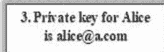

图 10.1
IBE 的工作原理。

## 10.2 关键术语和定义

### 10.2.1 公钥加密

公钥加密或非对称加密包括两个密钥：一个是所有人都知道的公钥，另一个是接收者知道的私钥或秘密密钥。两个密钥相互关联，因为消息的加密由公钥完成，消息的解密由相应的私钥完成。它由 Whitfield Diffie 和 Martin Hellman 于 1976 年开发，也被称为 Diffie–Hellman 加密。

示例：Alice 发送给 Bob 的安全消息。Alice 将使用 Bob 的公钥对消息进行加密，Bob 使用自己的私钥对其进行解密（见图 10.2）。

### 10.2.2 基于身份的加密

如第 10.1.2 节所述，IBE 用于在发送方发送消息之前获取接收方公钥的认证（Shamir, 1985）。公钥是一个任意字符串，可以是电子邮件地址、物理 IP 地址等。

## 164 新兴安全算法与技术

### 接收者的公钥 接收者的私钥

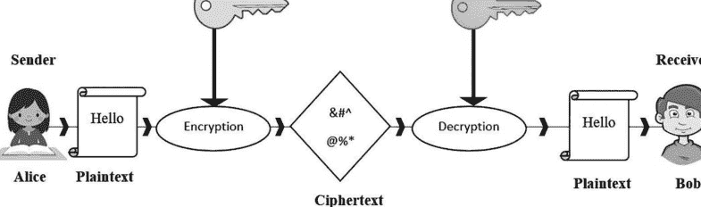

图 10.2
公钥加密。

IBE 允许任何第三方生成公钥。PKG 是一个可信的第三方，它提供相应的私钥。

### 10.2.2.1 IBE 算法

以下四个算法构成了 IBE 方案（Al-Riyami & Paterson, 2005）（Chatterjee & Sarkar, 2006）：

- a. **Setup：** 为所有系统设置参数和主密钥。
- b. **Extraction：** IBE 私钥使用 PKG 主密钥初始化，与随机选择的公钥字符串 $ID \in$ [0, 1]* 相同。
- c. **Encryption：** 使用来自系统参数的 IBE 公钥对消息进行加密。
- d. **Decryption：** 使用来自 PKG 主秘密密钥的 IBE 私钥对消息进行解密。

> *更正：正确性对于使 IBE 方案正常工作非常重要*

**解密（提取，参数，加密）= 消息**

### 10.2.3 Bone–Boyen IBE

Bone–Boyen IBE 方案是“交换式盲化”；该名称源于我们在计算两个配对的比值时得到的系数的交换（Bone & Boyen, 2004a）：

```
$e(aP,bQ)=e(bP,aQ)$
```

使用 Bone–Boyen IBE 方案的公共参数，发送方计算该值并将其用于加密明文。另一方面，接收方通过计算此类配对的比值来计算密文及其私钥，以获得与发送方相同的值（Bone & Boyen, 2004b）。

## 基于身份的加密

在 Bone–Boyen 方案中，为了执行加密和解密操作，我们使用一个身份 ID，该身份被哈希为整数值，这使得它更快，因为它避免了模指数运算。该方案定义为哈希方案，并且对密文攻击和自适应选择身份攻击具有抵抗力（Bone & Boyen, 2004c）。
注意：Bone 和 Boyen 描述了两种方案：一种是 $BB_1$，另一种是 $BB_2$。我们只讨论 $BB_1$ IBE 方案。

### 10.2.3.1 $BB_1$-IBE 算法

1. Setup
BB、IBE 的参数如下（Boneh & Boyen, 2007）：

- a. $q$ 是素数幂
- b. $G_1$ 和 $G_T$ 是循环群
- c. $\hat{e}$ 是配对，即 $\hat{e}: G_1 \times G_1 \rightarrow G_T$
- d. $n$ 是明文长度（以位为单位）。
- e. $g, g_1, g_2$ 和 $g_3$ 是椭圆曲线，例如

$g \in G_1$,

$g_1 = g^\alpha$

$g_2 = g^\beta$

$g_3 = g^\gamma$
- f. $H_1, H_2$ 和 $H_3$ 是密码学哈希函数，例如

$H_1:\{0,1\}^* \rightarrow \mathbb{Z}_p$

$H_2:G_T \rightarrow \{0,1\}^n$

$H_3:G_T \times \{0,1\}^n \times G_1 \times G_1 \rightarrow \mathbb{Z}_p$
- g. $v \equiv \hat{e}(P_1, P_2)$

$= \hat{e}(\alpha P, \beta P)$

$= \hat{e}(P, P)^{\alpha\beta}$

BB、IBE 的主密钥，

$\alpha, \beta, \gamma \in \mathbb{Z}$

2. Extraction

私钥提取

- a. 与身份 ID 关联的私钥，

计算：$q_{ID} = H_1(ID)$，其中 $q_{ID} \in \mathbb{Z}_p$

- b. 随机每用户值，

$r \in \mathbb{Z}_p$

- c. 私钥的两个分量使用 $r$ 计算，

```
$d_{ID} = (g_1^{q_{ID}}, g_2^{q_{ID}}, g_3^{q'}, g')$
$= (d_0, d_1)$
```

**注意：** 私钥中使用随机值。

3. **Encrypt**

发送方将执行以下步骤来加密消息 $M$。

- a. 选取随机 $s \in \mathbb{Z}_p$

- b. 计算 $k = v^s$

- c. 设置密文，$C = (c, c_0, c_1, t)$ 其中

```
$c = M \oplus H_2(k)$
$c_0 = g^s$
$c_1 = g_1^{q_{ID}} g_3^s$
$t = s + H_3(k, c, c_0, c_1)$
```

4. **Decrypt**

接收方解密 $C = (c, c_0, c_1, t)$ 执行以下步骤。

- a. 计算 $k = \hat{e}(c_0, d)$ 和 $\hat{e}(c_1, d_j)$

- b. 计算 $s = t - H_3(k, c, c_0, c_1)$

- c. 检查是否

```
$k = v^s$ and
$c_0 = g^s$.
```

如果任一条件失败，将产生错误并退出。

- d. 计算 $M = c \oplus H_2(k)$。

### 10.2.3.2 BB-IBE 安全性

要攻击使用 Bone–Boyen IBE 方案加密的消息，攻击者可以访问（Bone, Joux, & Nguyen, 2000）。

```
$g_0, g_1 = g^\alpha, g_3 = g^\gamma$ and
```

```
$v = \hat{e}(g,g)^{\alpha\beta}$, from the public parameters.
```

攻击者还检查密文

```
$g^s \text{ and } g_{ID}^q g_3^s = g^{(\alpha q_{ID} + \gamma)s}$
```

执行上述步骤后，他将检索到

```
$v^s = \hat{e}(g,g)^{\alpha\beta s}$
```

这可以通过以下两种方式完成：

- **方式 1：** 从 $g^s$ 计算 $s$，其中 $g^s$ 可以从 $G_1$ 中的离散对数求解。然后用结果计算 $v$。

- **方式 2：** 计算

```
$v^s = \hat{e}(g,g)^{\alpha\beta s}$
```

其中 $\beta$ 的值定义为

```
$v = \hat{e}(g,g)^\beta \text{ in } G_T$.
```

中的离散对数。

如果攻击者能够在 $G_0$ 或 $G_T$ 中计算离散对数，则可以使用 Bone–Boyen 系统解密消息。这非常接近于求解 BDHP，并且为了消除随机预言模型，Bone–Boyen 系统是最方便的，在标准模型中，它们可以管理所有安全属性。

## 基于身份的加密

### 10.2.4 分层 IBE

分层身份基加密（HIBE）首先由 Horwitz 和 Lynn 描述。HIBE 的概念是创建 PKG 的层次结构。在此层次结构中，在特定级别，PKG 的工作取决于其上层 PKG 的工作（见图 10.3；Boneh, Boyen, & Goh, 2005）。

*注意。* 对于层次结构的每个级别，用户可以使用不同的身份。因此，具有最多 $l$ 个级别的身份 $ID$ 为 $ID = (ID_1, ID_2, ..., ID_l)$。

它允许组织增强的不同安全协议，在出现损害时易于恢复，因为重建仅针对受影响的部分，而不是整个系统（Chatterjee & Sarkar, 2006a）。

### 10.2.4.1 HIBE 算法

与 IBE 方案不同，HIBE 有五个算法（Chatterjee & Sarkar, 2006b）：

- a. **Root setup：** 为层次结构顶层的运行创建参数。

- b. **Lower-level setup：** 为每个其他级别的工作以及下层的一次性执行创建附加参数。

**提取、加密和解密** 与单 IBE 方案中的功能相同。


## 10.2.5 Boneh–Boyen HIBE (BB-HIBE)

在本节中，我们将讨论单层 Boneh–Boyen HIBE（BB-IBE）方案，该方案使用 Boneh、Boyen 和 Goh（BBG）开发的技术扩展为 $l$ 层层级 HIBE（HIBE）方案，参数为 $(G_1, G_2, \hat{n}, n, P_1, P_y, H_1, H_2, v)$ 且主密钥为 $a$，假设 $|G_1| = p$（Boneh, Boyen, & Halevi, 2006）。

所得 HIBE 方案的安全性取决于 BDHP（双线性 Diffie-Hellman 问题）的难度。能够解密此类系统的攻击者也能够破解它。如果我们将 BDHP 作为挑战，基本的 BBG 方案可抵抗选择密文攻击和自适应（Chatterjee & Sarkar, 2006）选择身份攻击。

因此，我们将讨论 BBG-HIBE（基础）。

注意：

- 1. 为了将 HIBE 构造限制为单层，PKG 启动第 10.2.3 节中讨论的 BB-IBE 方案。
- 2. HIBE 的一个特性是密文大小随着 HIBE 构造中层数的增加而增加。但在 BBG 方案中，密文大小是恒定的，即随着 HIBE 构造中层数的变化，密文大小不受影响，因为它是恒定的（Boyen & Waters, 2006）。

### 10.2.5.1 BB-HIBE（基础）算法

- 1. 设置

BB-IBE 方案参数 = $(G_1, G_2, \hat{n}, n, P_1, P_y, H_1, H_2, v)$。
HIBE 方案参数 = $(Q_1, Q_2, ..., Q) \in G_1$，其中主参数 $Q$ 随机生成（Chatterjee & Sarkar, 2007）。
因此，BBG-HIBE 参数 = $(G_1, G_2, \hat{n}, n, P_1, P_y, Q_1, Q_2, ..., Q, H_1, H_2, v)$。

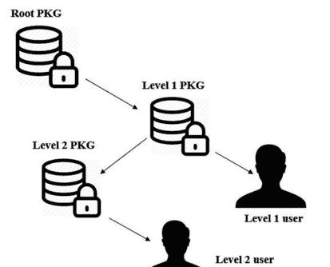

图 10.3 HIBE 方案。

## 2. 提取

为了计算私钥，我们得到 $D_{ID} = (D_1, D_2)$，其中身份 ID 为

$ID = (ID_1, ID_2, ..., ID_t)$

- a. 由根 PKG 随机生成 $r \in \mathbb{Z}_p^*$。
- b. 计算 $q_{ID} = H_1(ID_i)$ $[1 \leq i \leq k]$。
- c. 然后计算-

$D_1 = rP$
$D_2 = \alpha P_2 + r \sum_{i=1}^k q_{ID} \cdot Q_k$

## 3. 加密

对消息 $M$ 进行加密，其中 $ID = (ID_1, ID_2, .., ID_k)$，任意 $k \leq l$。

- a. 随机 $s \in \mathbb{Z}_p^*$
- b. 密文 $c = (c_0, C_1, C_2)$ 其中-

$c_0 = M \oplus H_2(v^s)$
$C_1 = sP$ 且
$C_2 = sr \sum_{i=1}^k q_{ID} \cdot Q_k$

## 4. 解密

对密文进行解密，计算

$c_0 \oplus H_2(\hat{e}(C_1, D_2)) + (\hat{e}(D_1, C_2))$

$c_0 \oplus H_2(\hat{e}(sP, \alpha P_2 + r \sum_{i=1}^k q_{ID} \cdot Q_i + P_3)) + (\hat{e}(rP, s \sum_{i=1}^k q_{ID} \cdot Q_i + P_3))$

$c_0 \oplus H_2(\hat{e}(sP, \alpha P_2))$

$c_0 \oplus H_2(\hat{e}(P, P_2)^{s})$

$c_0 \oplus H_2(v^s) = M$。

## 10.3 应用、扩展和相关原语

### 10.3.1 身份基签名

密码学世界中最基本的原语是签名。如本章前面所述，每个用户都有自己的一对密钥：一个是公钥，另一个是私钥（Boneh & Katz, 2005）。公钥基础设施（PKI）是一种负责将公钥映射到现实世界身份的设置。这些密钥由认证机构（CA）认证（Boneh, Lynn, & Shacham, 2004）。PKI 要求由 IBS 方案简化，因为 KGC（密钥生成中心）分发相应的私钥并消除认证成本。IBS 使用用户身份等公共信息来验证签名。

#### 10.3.1.1 IBS 算法

- 1. **设置**：主实体在输入 $1^k$ 上运行此算法以获得主密钥和秘密密钥对 $(mpk, msk)$。（这里，$k$ 是安全参数）（Boyen & Waters, 2005）。
- 2. **提取**：对于用户 $ID \in \{0,1\}^*$，此算法在 $mpk$ 和 $ID$ 的输入上运行以生成 $msk$。
- 3. **签名**：此算法在 $msk$ 的输入上返回消息 $M$ 的签名 $\sigma$。
- 4. **验证**：给定 $mpk, ID$ 和签名 $\sigma$，如果 $\sigma$ 对 $ID$ 有效，则算法接受，否则拒绝它。
*更正*：$Verify(mpk, ID, Sign(msk, M)) = 1$ 对于 $k \in \mathbb{N}$ 且 $M \in \{0,1\}^*$。

就安全性而言，IBS 方案可抵抗选择消息攻击和自适应身份攻击。

### 10.3.2 Bone–Lynn–Shacham 方案

认证是密码学中非常重要的一项特性。Bone–Lynn–Shacham（BLS）在密码学中的签名方案为我们提供了一项服务，即验证签名者是否真实。BLS 签名方案也被称为 BLS 短签名方案（Boneh, Boyen & Shacham, 2004）。在数字签名中，短签名方案易于使用 RSA 和 DSA 等长签名方案进行操作。长签名方案 RSA 和 DSA 具有 1024 位密钥，而 BLS 短签名方案具有 160 位密钥。它们的安全级别与其他方案相同。该 BLS 方案在选择消息攻击（随机预言模型）下对存在性伪造是安全的，假设 CDHP（计算 Diffie-Hellman 问题）难以求解。

## 身份基加密

验证是通过使用双线性配对完成的，并且椭圆曲线群具有元素作为签名。椭圆曲线群可防止索引演算攻击。

### 10.3.2.1 BLS 方案算法

BLS 短签名方案的算法定义如下：

- 1. **设置**：CDHP 难以求解但 DDH 问题相对容易求解的群称为 Gap 群。通过双线性配对，
  - $e: G \times G \to G_T$
  - $|G_T|=r$（$r$ 为素数）且 $e$ 为非退化且可有效计算。
  - $g$ 是 $G$ 的生成元。
  - 说明 CDH 问题：$g, g^s, g^{s'}$ 不能计算 $g^{ss'}$，即 CDH 问题的解。使用双线性性质，我们有：
  $$e(g^s, g^{s'}) = e(g, g)^{ss'} = e(g^{ss'})$$
如果为真并且我们还知道 $G_T$ 是一个素数阶群，
$$xy = z$$
- 2. **提取**：随机选择 $x \in [0, r-1]$。私钥持有者 $x$ 将发布 $g^x$，即公钥。
- 3. **签名**：对于消息 $M$，
  - 哈希函数，$h = H(M)$
  - 输出，$\sigma = h^s$ 其中 $\sigma$ 为签名。
  $$e(\sigma, g) = e(H(M), g^s).$$

### 10.3.3 层级身份基签名

层级身份基签名（HIBS）方案与 IBS 方案类似，具有层级结构。可以使用这种层级方法方案进行委托。它是多密钥 HIBS（Chatterjee & Sarkar, 2007）。

- a. 用户具有多个身份。
- b. 在层级中，位置可能位于任意位置。
- c. MK-HIBS 使用单个签名。

示例：考虑员工 X 想要使用角色 $r_1$ 和 $r_3$ 查看一些受限文档。这可以通过分别使用私钥 $S_1$ 和 $S_3$ 对请求进行签名来完成。

#### 10.3.3.1 HIBS 方案算法

- 1. **根设置**：PKG 生成，
  na. 循环群 $G, G_r$，其中 $|G|$ 和 $|G_r|=q$（$q$ 为素数）。
  nb. $e: G \times G \to G_r$（非退化且可有效计算）。
  nc. 选择生成元 $P_0 \in G$。
  nd. 随机选择 $s_0 \in \mathbb{Z}_q^*$ 并设 $Q_0 = s_0 P_0$。
  de. 哈希函数，$H_1: \{0,1\}^* \to G$ 和 $H_2: \{0,1\}^* \to G$。
  ne. 主密钥设为 $s_0$。
- 2. **下层设置**：在层级 $t \ge 1$ 的下层 PKG 随机选择秘密 $s_t \in \mathbb{Z}_q^*$。
- 3. **提取**：对于层级 $t$ 的身份 $ID$，
$ID_t = id_1, \dots, id_t$。
  na. 计算 $P_t = H_1(ID_t) \in G$。
  sb. $S_t = \sum_{i=1}^t s_{i-1} \cdot P_i$。
  sc. $Q_i = s_0 P_0$ 对于 $1 \le i \le t-1$。
  nd. 密钥 $(S_t, Q_1, \dots, Q_{t-1})$。
- 4. **签名**：给定任意 $n \ge 1$。设。

```
$SK = \{(S'_i, Q'_i, \dots, Q'_{i-1}) : 1 \le i \le n\}$
```

给定消息 $M$，

# 基于身份的加密

- a. 秘密值，$s_\psi \in \mathbb{Z}_q^*$
- b. 求解 $P_M = H_2(\text{ID}^{r_1}, \dots, \text{ID}^{r_m}, M)$
- c. 计算
$\varphi = \sum_{j=1}^n S'_j + s_\psi P_M$ and
$Q_\varphi = s_\psi P_0$

- d. 签名如下：
$\sigma = (\varphi, Q_\varphi, Q'_\varphi)$ where,
$Q = \{Q_i; 1 \le i \le t_j, -1 \le j \le n\}$

- 5. 验证：
a. $P^i = H_1(\text{ID}^i)$ for $1 \le i \le t_j$, and $1 \le j \le n$.
b. $P_M = H_2(\text{ID}^{r_1}, \dots, \text{ID}^{r_m}, M)$
c. Valid if,
$e(P_0, \varphi) = \prod_{i=1}^n \prod_{j=1}^i e(Q'_{i-t_j}, P'_i) \cdot e(Q_\varphi, P_M)$

# 10.3.4 基于身份的密钥协商

密钥协商被定义为两个或多个用户之间就交换消息并组成一个共同会话密钥达成的协议。它最早由 Diffie 和 Hellman 于 1976 年提出。他们提出通信信道中的两个用户可以交换公开信息并使用各自的私钥计算一个共同密钥和接收信息。该 Diffie-Hellman 密钥协商方案缺乏身份验证，并且可以进行中间人攻击（Diffie & Hellman, 1976）。

由于 Diffie-Hellman 密钥协商在身份验证方面存在问题，因此进行了许多类型的研究，因此该方案现在主要被称为身份验证密钥协商（AKA）。在 1990 年代后期，密码学得到了很好的研究，研究人员初始化了一种在密码学中发挥非常重要的作用的工具。该工具是配对，它导致椭圆曲线上的离散对数问题（Abdalla, Miner, & Namprempre, 2001）。Neil P. Smart（2002）提出了利用配对概念在 IBE 中进行密钥协商。

# 10.3.4.1 带有密钥协商的 IBE 算法

- 1. 设置：用户的私钥由 PKG 生成并分发。$e: G \times G \to G_T$，其中 $G, G_T \in q$（$q$ 为素数）。
- a. $P$ 是 G 的生成元。
- b. 秘密主密钥 $s \in \mathbb{Z}_q^*$
- c. 计算主公开密钥 $P_{public} = sP$。
- d. 哈希函数，$H_1 = \{0, 1\}^* \times G \to \mathbb{Z}_q^*$。
因此，参数 = $(G, G_y, e, q, P, sP, H_1)$

- **提取**：对于身份 $ID_i$，其中 $ID \in \{0, 1\}^*$
- a. 随机选择 $r$ 使得 $r_i \in \mathbb{Z}_q$。
- b. 计算 $R_i = r_iP$
- c. 求解，$h = H_1(ID_i || R_x)$ 且 $S_i = 1/(r_i + hs)$

- **密钥协商**：假设两个用户 **X** 和 **Y** 分别具有私钥 $(S_x, R_x)$ 和 $(S_y, R_y)$（Smart, 2003）。生成 X 和 Y 的会话密钥：
- a. X 和 Y 生成临时私钥 $x, y \in \mathbb{Z}_q^*$。
- b. X 向 Y 发送 $(ID_x, R_x)$，Y 回传 $(ID_y, R_y, T_{yx})$ 给 X，其中，
$T_{YX} = y[R_x + H_1(ID_x || R_x)P_{public}]$
且对于 X，
$T_{XY} = x[R_y + H_1(ID_y || R_y)P_{public}]$
- c. X 计算，$K_{XY} = e(S_x, T_{yx}, P_{public})^x$
Y 同样计算，
$K_{YX} = e(S_y, T_{xy}, P_{public})^y$

**正确性：使用双线性配对进行验证**（Yi, 2003），
$K_{XY} = K_{YX}$

所以，
$K_{XY} = e(S_X, T_{XY}, P_{public})^y$
$= e[(r_x+hs_s)^{-1} y(r_xP+hs_s), sP]^x$
$= e[(r_x+hs_s)^{-1} y(r_x+hs_s)P, sP]^y$
$= e(yP, sP)^x$
$= e(P, P)^{xy}$

$K_{YX} = e(S_Y, T_{XY}, P_{public})^x$
$= e[(r_y+hs_s)^{-1} x(r_yP+hs_s), sP]^y$
$= e[(r_y+hs_s)^{-1} x(r_y+hs_s)P, sP]^x$
$= e(xP, sP)^y$
$= e(P, P)^{xy}$

因此，$K_{XY} = K_{YX} = K$。因此，X 和 Y 共享一个秘密
$sk = H(ID_X || ID_Y || Trans)$
其中 Trans $= T_{XY} || T_{YX}$。

# 10.3.5 带关键字搜索的公钥加密（PEKS）

Boneh、Gentry、Ostrovsky 描述了一种带公钥加密的关键字搜索（PEKS），该方法帮助用户搜索加密的关键字（Boneh, Gentry & Waters, 2005）。

**示例：** 用户 Alice，她是 XYZ 公司的员工，休假几天并且拥有智能手机，在上面阅读所有电子邮件。休假期间她只想阅读重要电子邮件。除了智能手机，她还有笔记本电脑。Alice 的邮件网关根据电子邮件中的关键字将电子邮件发送到特定设备，例如，当发件人 Bob 发送一封电子邮件时，使用“Hi”发送到桌面，“urgent”发送到智能手机，“Read”发送到笔记本电脑。为了通过选择她的电子邮件获取消息，Alice 会向服务器发送“陷门”。当 Bob 使用 PEKS 方案发送一封包含“urgent”的密文的邮件时，电子邮件将出现在 Alice 的智能手机上。安全性得以保证，因为所有电子邮件都使用她的公钥加密。

# 10.3.6 基于身份的代理重加密

代理重加密方案是 IBE 的扩展方案。该方案通过代理将一个用户的加密消息的公钥转换为对另一个用户的加密。加密消息可以在不提供私钥的情况下临时转发（Harrison & Smart, 2002）。在转换期间，代理使用代理密钥或重加密密钥进行转换，而无需了解任何用户的密钥，然后这些代理密钥应用于密文并从一个身份重加密到另一个身份。

# 10.3.6.1 IB-PRE 算法

- a. 设置：$e: G \times G \to G$，其中 $G, G_t \in q$（$q$ 为素数）。
   i. $g$ 是生成元 $G$。
   ii. 主密钥 $msk$。
- b. 提取：在输入身份 $ID \in \{0, 1\}^*$ 和主密钥时，将输出 $SK_{ID}$。
- d. 提取：在输入 $SK_{ID}$ 和 $ID_{\mu}, ID_2 \in \{0, 1\}^*$ 时输出重加密密钥，即 $R_{ID_{\mu},ID_2}$。
- e. 重加密：在输入密文 $ID_{\mu}$ 时生成输出 $C_{ID_2}$，将输出 $C_{ID}$，并重加密密钥 $R_{ID_{\mu},ID_2}$。
- f. 解密：对于解密，使用密钥 $SK_{ID}$ 解密密文 $C_{ID}$ 将输出消息 $M$。

> 安全确保非串谋用户相对于串谋用户集合的密钥持有者没有优势（Hess, Smart & Vercauteren, 2006）。

# 10.4 其他 IBE 方案

## 10.4.1 带通配符的 IBE（WIB）

IBE 在邮件交换领域发挥着重要作用。例如，使用公钥为用户身份的 IBE 方案，Alice 通过在其身份 bob@ibe.univ.edu 下加密消息向 Bob 发送电子邮件。Bob 是唯一能够使用他从受信任的密钥分发者处获得的密钥解密此消息的人（Abdalla et al., 2006）。

现在假设 Alice 想向大学的整个 IBE 研究部门发送一封重要电子邮件，她可以通过在身份 *@ibe.univ.edu 下加密电子邮件来实现，并且所有具有相关身份的收件人都可以解密此消息。该概念被称为带通配符的身份基加密（WIB），由 Michel Abdalla 最先提出。在上面的例子中，“*”是通配符（Abdalla, Bellare & Namprempre, 2002）。

WIB 方案只能加密约 160 位长的消息。它通常被提出以克服多密钥 HIB（MK-HIBE）的局限性（如第 10.3.3 节所述），因为它对每个级别单独加密消息。

### 10.4.1.1 WIBE 算法

- 1. 设置。
   - 模式 $P(P_v, ..., P_l) \in \{0,1\}^*$ 对于 $l \le L$，其中 $L$ 是最大层数。
     身份 ID $(ID_v, ..., ID_l)$ 匹配模式 $P$，当且仅当 $l' \le l$ 对于 $1 \le i \le l'$，$ID_i = P_i$。
   - PKG 生成主密钥对 $(msk, mpk)$。
2. 提取。
   - 在输入身份 ID $(ID_v, ..., ID_l)$ 的密钥 $D_{ID}$ 时，它为身份 $ID' = (ID_v, ..., ID_{l'})$ 生成 $D_{ID'}$。
   - 用户使用 $msk$ 作为私钥为单层身份派生密钥，其中 $i = (ID_v, ..., ID_i)$。
3. 加密。
   - 在输入 $msk$、模式 $P$ 和消息 $M$ 时，其中 $M \in \{0,1\}^*$。
   - 生成密文 $C$。
4. 解密。使用密钥 $D_{ID}$ 对于 $ID_i = P_i$ 解密密文 $C$ 并返回相应的消息 $M$。
   解密算法在加密无效时拒绝（Cao, 2006）。

正确性：
$Decrypt[Extract(msk, ID), Encrypt(mpk, P, M)] = M = 1$。

## 10.4.2 邪恶的身份基加密

如第 10.4.1 节所述，WIBE 被提出以克服 WIBE 方案的局限性。同样，WIBE 方案的分层密钥派生也有一些局限性。

为了概括 WIBE 方案中密钥委托的机制，Abdalla、Klitz 和 Neven 提出了一种新的概念，即带通配符密钥派生的身份基加密（WKD-IBE）。
WKD-IBE 方案被视为 WIBE 的对偶方案。身份字符串的 *pattern* 与密钥相关联。*wildcard* 也与密钥相关联，并且密钥的派生由密钥所有者为任何参与与该密钥相关联的相同 *pattern* 的身份完成。

### 10.4.2.1 WKD-IBE 和 WIBE 的局限性

- 假设一种情况具有最大层级长度 $L$ 且是常数，仅对 WKD-IBE 的安全证明成立。因此，只有接受此类限制的情况才能使用该方案。例如，使用 WKD-IBE 方案构建基于身份的广播加密方案时，最大长度为

## 新兴安全算法与技术

目标组将因最大层级长度的限制而受到直接影响。

ii. 需要保存加密消息接收者匿名性的应用在使用该方案时是不可能的，因为 *pattern* 与密文无法被 WKD-IBE 方案隐藏。

这些缺点或局限性可以通过将基于身份的加密与通配符和通配符派生配对来解决，即 WW-IBE。

WW-IBE 方案是一种通用原语，可用于密钥派生和加密，因为它允许更一般的 *patterns*。

## 10.4.2.2 WKD-IBE 的算法步骤

- * 通配符与密文一起初始化以对密文进行加密，使整个用户范围可以解密；它们与密钥一起初始化以允许更一般的模式。
- 密钥是与 *patterns* 结合，而不是与身份向量结合。
- 模式 $P = (P_1, ..., P_l) \in [0, 1]^*$

- a. $l \leq L$
nb. $*$ 是通配符
c. $C$ 是 WKD-IBE 方案的最大长度。

因此，在 *pattern* $P$ 中，每个元素要么是通配符，要么是特定的身份字符串。
对于给定的 *pattern* $P$，持有密钥的用户可以为与模式 $P$ 匹配的模式 $P'$ 生成密钥。

```
$P' = (P'_1, ..., P'_l')$ matches $P$ if and only if,
```

- a. $l' \leq l$,
b. $P_i = P'_i$ 且
c. $P' \in P$.

## 10.4.3 模糊身份基加密

我们知道在模糊方案中，身份是任意字符字符串，但在新型的 IBE 中，即模糊身份基加密（FIBE），一组描述性属性是身份（Chatterjee & Sarkar, 2006a）。FIBE 基于用户之间的某个距离，该距离由度量假设测量。Alice 以 $\omega$ 作为密钥只能解密用 $\omega'$ 作为公钥加密的密文，且仅当 $\omega$ 和 $\omega'$ 在一定距离内时。

### 10.4.3.1 FIBE 的应用

- * 生物特征可作为 FIBE 中的身份使用。*Example*: 用户的虹膜扫描可作为身份用于描述多个属性，并且用户可以使用其生物特征身份加密消息。
- b. 属性基加密被定义为 FIBE 中的一种应用，用户可将信息加密给具有特定属性集的所有其他用户。
FIBE 通过将文档存储在不可信服务器上提供优势。

## 10.4.3.2 FIBE 方案的算法

- 1. 设置。
  a. $e: G \times G \to G_T$ 其中，$G, G_T \in q$（$q$ 为素数）。
  b. $g$ 是生成器 G。
  c. 全局 $\mu \in Z_q$，大小为 $|\mu|$。
  d. 随机选择 $t_i, y_i \in Z_q$。公共参数，

```
$T_1 = g^y, \dots, T_{\mu1} = g^\mu, Y = e(g,g)^y$
```

主密钥：$t_1, \dots, t_{iv}, y$

- 2. 提取：身份 $\omega$ 的私钥。
随机选择 $d-1$ 次多项式 $p$，

```
$D_i = g^{p(i)t}$ for $i \in \omega$ and $p(0)=y$.
```

- 3. 加密。
  公钥 $\omega'$ 对消息 $M \in G_p$ 进行加密
  a. 随机值 $s \in Z_q$
  b. 密文 $E = (\omega', E') = \{E_i, T'_i\}$，$i \in \omega$。

- 4. 解密：计算密文 $E$，

```
$E' / \prod_{i \in S} (e(D_i, E))^{\Delta S(0)}$
$= Me(g,g)^y / \prod_{i \in S} \left(e(g^{p(i)t}, g^{yp^{p(i)t}})\right)^{\Delta S(0)}$
$= Me(g,g)^y / \prod_{i \in S} \left(e(g,g)^{yp(i)}\right)^{\Delta S(0)}$
$= M$
```

## 10.5 结论

IBE 方案是解决对称和非对称密钥管理方案中出现问题的有前景的解决方案。虽然存在问题，但其架构的相对简单性使 IBE 成为包括移动计算在内的各种系统的有吸引力的选择。此外，网络世界表明，与完整的公钥系统相比，IBE 系统的总拥有成本显著更低。

## 参考文献

Abdalla, M., An, J. H., Bellare, M., & Namppre, C. (2002). 通过 Fiat-Shamir 变换从身份识别到签名：最小化安全性和前向安全性的假设。Lars R. Knudsen, Advances in Cryptography—EUROCRYPT 2002. Lecture Notes in Computer Science, Germany, 2332, 233–433.

Abdalla, M., Catalano, D., Dent, A., Malone, J., Neven, G., & Smart, N. (2006). 基于身份的加密黄金。In Christian Bigli., Automata, Languages and Programming. Lecture Notes in Computer Science, 402, 302–311. doi:10.1007/1178006_26.

Abdalla, M., Miner, S., & Namprem, C. (2001). 前向安全阈值签名。In David Nacci, Topics in Cryptography–RSA 2001. Lecture Notes in Computer Science, 441, 456–531. doi:10.1007/3-54053-9.

Ryami, S. S., & Paterson, K. G. (2005). 从 PKE：一种通用构造和加密方案。In Serge Young, Public Key Cryptography–PKC 2005. Lecture Notes in Computer Science, 398, 385–415. doi:10.1007/3-540-2080_4.

Boneh, D., & Boy, Y. (2004a). 无随机预言机的基于身份的加密。In Christian Chancellor and Jan Menich, Advances in Cryptography–EUROCRYPT 2004. Lecture Notes in Computer Science, 2027, 223–238. doi:10.1007/978-3-5405-1847_3.

Boneh, D., & Boy, Y. (2004b). 无随机预言机的基于身份的加密。In Matthew Franklin, Advances in Cryptography–CRYPTO 2004. Lecture Notes in Computer Science, 312, 449–450. doi:10.1007/978-3-540-28628_8.

Boneh, D., & Boy, Y. (2004c). 无随机预言机的短签名。In Christian Chancellor and Jan Menich, Advances in Cryptography–EUROCRYPT 2004. Lecture Notes in Computer Science, 2027, 56–73. doi:10.1007/978-3-540-24672_4.

Boneh, D., & Boy, Y. (2007). 双线性群中无随机预言机的短签名与 SDH 假设。Journal of Cryptography, 21(2), 149–177. doi:10.1007/s00145-007-0005-7.

Boneh, D., Boy, X., & Koh, G. (2005). 具有恒定大小密文的分层身份加密。In Romain Kramer, Advances in Cryptography–EUROCRYPT 2005. Lecture Notes in Computer Science, 394, 440–456. doi:10.1007/1142639_26.

Boneh, D., Boy, X., & Shamir, H. (2006). 无随机预言机的可选择安全公钥加密。In David Ptaunich, Topics in Cryptography–RSA 2006. Lecture Notes in Computer Science, 226, 243–264. doi:10.1007/116085_15.

Boneh, D., & Shamir, H. (2004). 短群签名。In Matthew Franklin, Advances in Cryptography–CRYPTO 2004. Lecture Notes in Computer Science, 312, 45–55. doi:10.1007/978-3-540-28633.

Boneh, D., & Franklin, M. (2003). 基于 Weil 配对的基于身份的加密。SIAM Journal on Cryptography, 33(6), 586–615. doi:10.1137/S089377098.

Boneh, D., Gentry, C., & Waters, B. (2005). 具有短密文和密钥的抗碰撞爆破加密。In Victor Shoup, Advances in Cryptography–EUROCRYPT 2005. Lecture Notes in Computer Science, 3621, 258–275. doi:10.1007/3-540-39200_9.

Boneh, D., Joux, A., & Nguyen, P. Q. (2005). 哪些 ElGamal 和 RSA 加密是相同的？In Tatsuki Okamoto, Advances in Cryptography–ASIACRYPT 2004. Lecture Notes in Computer Science, 3030, 43–58. doi:10.1007/3-540-54048_3.

Boneh, D., & Katz, J. (2005). 使用基于身份加密的 CCA 安全密码系统的改进效率。In Alfonso Menezes, Topics in Cryptography–RSA 2003. Lecture Notes in Computer Science, Verlag, 87–103. doi:10.1007/978-3-540-30574_3.

Boneh, D., Lynn, B., & Shamir, H. (2004). 来自 Weil 配对的短签名。Journal of Cryptography, 17, 297–319. doi:10.1007/s00145-004-0314-9.

Boneh, D., & Waters, B. (2007). 加密数据上的合取、子集和范围查询。In Cynthia Dwork, Theory of Cryptography. Lecture Notes in Computer Science, 3952, 535–554. doi:10.1007/978-3-540-7936_29.

Boyer, X., Mei, Q., & Waters, B. (2005). 基于身份的直接选择密文攻击。Proceedings of the 12th ACM Conference on Computer and Communications—CCS 05, Verlag, doi:10.1145/110212.

Boyer, X., & Waters, B. (2006). 匿名基于身份的加密（带随机预言机）。In Advances in Cryptography–CRYPTO 2006. Lecture Notes in Computer Science, 290, 307. doi:10.1007/118181/11177_16.

Cao, Z. (2006). 一种流行签名的分析。In Bahram Han, Advances in Cryptography–ASICRYPT 2006. Lecture Notes in Computer Science, 460, 466. doi:10.1007/119523_30.

Chatterjee, S., & Sarkar, P. (2005). 以空间换时间：标准模型中具有更短参数的高效 IBE。In Dongho Wo and Sejung Kim, Information Security and Cryptography–ICISC 2005. Lecture Notes in Computer Science, 3935, 424–440. doi:10.1007/1174277_33.

Chatterjee, S., & Sarkar, P. (2006). HIBE 中选定 ID 方案的推广。In Mori Yuki, Public Key Cryptography–PKC 2006. Lecture Notes in Computer Science, 3958, 256. doi:10.1007/117458_16.

Chatterjee, S., & Sarkar, P. (2006). 无随机预言机的恒定大小密文 HIBE 的新构造。In Min Seo and Byungcheon Lee, Information Science and Cryptography–ICISC 2006. Lecture Notes in Computer Science, 310–327. doi:10.1007/1192758_26.

Chatterjee, S., & Sarkar, P. (2007). 增强 ID 模型中的恒定大小密文 HIBE 及其扩展。In Journal of Universal Computer Science, 13(10), 1367–1395.

Cocks, C. (2001). 基于二次剩余的基于身份的加密方案。Cryptography and Coding Lecture Notes in Computer Science, 360–363. doi:10.1007/3-540-45325_3_32.

Cocks, C., & Pinch, R. G. (2021). 基于 Weil 配对的基于身份的密码系统，未发表手稿。

Diffie, W., & Hellman, M. (1976). 密码学的新方向。IEEE Transactions on Information Theory, 22(6), 644–654. doi:10.1109/IT.1976.1055568.

Harrison, K., Page, D., & Smart, N. P. (2002). 用于配对基密码系统的特征为三的有限域的安全实现。LMS Journal of Computation and Mathematics, 5, 183–191. doi:10.1112/s14617s00000747.

Hess, F., Smart, N., & Vauterin, F. (2006). 重新审视 eta 配对。IEEE Transactions on Information Theory, 52(10), 4595–4602. doi:10.1109/it.2006.818709.

Shamir, A. (1979). 如何共享秘密。Communications of the ACM, 22(11), 612–613. doi:10.1145/359168.359176.

Shamir, A. (1985). 基于身份的密码系统和签名方案。In Blakley, G. R., Chaum, D. (eds) Advances in Cryptography. CRYPTO 1984. Lecture Notes in Computer Science, 1996. Springer, Berlin, Heidelberg.

Smart, N. P. (2003). 使用配对密码的访问控制。In Inoye, M. (ed) Topics in Cryptography–CT-RSA 2003. CT-RSA 2003. Lecture Notes in Computer Science, 2062. Springer, Berlin, Heidelberg.

Yi, X. (2003). 基于 Weil 配对的基于身份的签名方案。IEEE Letters, 7(2), 76–78.


# 11 属性加密

Tanvi Gautam, Aditya Thakkar, 和 Nitish Pathak
Guru Gobind Singh Indraprastha University

**目录**
11.1 引言 ................................................................................ 183
    11.1.1 属性加密的历史 .......................................... 183
    11.1.2 关于 ABE 的简要讨论.................................................................. 184
11.2 关键术语、定义及相关术语 ................................... 184
    11.2.1 身份加密 ........................................................ 184
    11.2.2 模糊身份加密 ............................................... 184
    11.2.3 属性加密 ....................................................... 185
        11.2.3.1 理想属性加密方案的原理 .................... 185
        11.2.3.2 ABE 的特征 ..................................................................... 185
        11.2.3.3 数据共享架构 ................................................. 185
        11.2.3.4 ABE 算法....................................................... 185
11.3 密钥策略 ABE ............................................................................ 188
    11.3.1 KP-ABE 方案简介 ...................................................... 188
    11.3.2 KP-ABE 方案的特征 ........................................................ 189
    11.3.3 KP-ABE 算法.................................................... 189
11.4 密文策略 ABE ................................................................... 190
    11.4.1 CP-ABE 简介.................................................................. 190
    11.4.2 CP-ABE 的特征...................................................................... 191
    11.4.3 CP-ABE 算法.................................................... 191
    11.4.4 KP-ABE 与 CP-ABE 的比较 ............................................ 192
11.5 属性加密的应用 .......................................... 193
    11.5.1 使用 ABE 方案维护个人健康记录安全............... 193
    11.5.2 审计日志.................................................................. 193
    11.5.3 目标广播......................................................... 193
11.6 结论 ................................................................................ 194
参考文献....................................................................................................... 194

## 11.1 引言

### 11.1.1 属性加密的历史
属性加密（ABE）理论最早是由两位研究人员 Amit Sahai 和 Waters 在 2005 年对模糊身份加密（FIBE）的研究中提出的（该研究在第10章中讨论），随后其他研究人员 Vipul Goyal 和 Omkant Pandey 与 Amit Sahai 和 Waters 一起开发 ABE。他们写了一篇关于 ABE 的文章，即“用于加密数据细粒度控制的属性加密”。最近，针对 ABE 进行了许多研究，其中用户的私钥是共同生成的。

### 11.1.2 关于 ABE 的简要讨论
密码学研究中最近的方法之一是 ABE 概念，它也是公钥的一种类型。传统的公钥方法通过基于身份加密的研究被改变，并在第10章中被专门讨论，其中将公钥定义为任意字符串，例如电子邮件。然后 ABE 概念运而生，它通过将身份定义为一个集合进一步推进了这项研究。在 ABE 中，数据是根据属性集合进行加密的（Shamir, 194）。这种加密取决于属性集合而非解密（Sahai & Waters, 2005）。ABE 有两种主要类型：
- 密文策略 ABE (CP-ABE)
- 密钥策略 ABE (KP-ABE)

## 11.2 关键术语、定义及相关术语

### 11.2.1 身份加密
如第10章所述，身份加密的公钥是任意字符串，例如电子邮件。密钥生成器（PKG）是一个受信方，为接收者提供私钥。

### 11.2.2 模糊身份加密
2005年，Sahai 和 Waters 在身份加密中引入了新概念，即 FIBE——它在特定的距离范围内工作（Chatterjee & Sarkar, 2006）。FIBE 允许用户存在某种距离。假设具有私钥 $\omega$ 的用户能够解密密文。ABE 在 FIBE 中的应用提供了在不可信服务器上存储文档的优势。

### 11.2.3 属性加密
Sahai 和 Waters 在 2005 年引入了 ABE 概念，由发送者和接收者分别进行加密和解密。这些生成的密钥取决于属性集合（Sahai & Waters, 2005）。如果属性未预定义，用户无法添加任何数据，此时将重新定义属性并重新生成公钥和主密钥。


## 新兴安全算法与技术

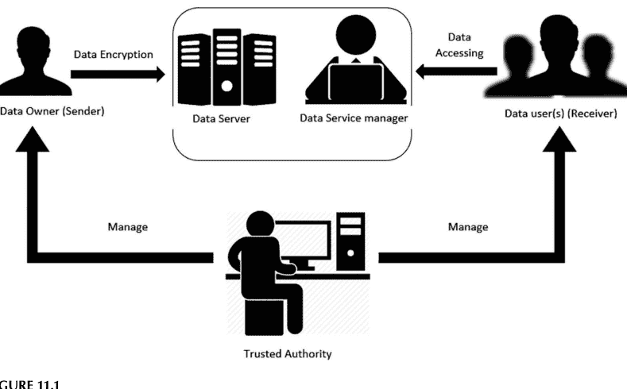

图 11.1
数据共享系统架构。

可扩展性。目前，在社交网络网站中，使用受信任的中央服务器保存用户的全部个人资料信息，但在基于ABE的系统中，个人资料信息被保存到不受信任的服务器上，从而降低了系统的存储需求和流量（参见图 11.1）。

数据所有者（发送方）在上传数据到服务器之前进行加密以保持数据机密。然后，数据用户（接收方）使用数据解密密钥访问数据。可以通过多种网络安全方法实现密码学安全性，其中ABE是最好的使用方法之一（Gagné, Narayan, & Safavi-Naini, 2010）。

数据共享系统架构中的实体如下：

- A. 数据所有者（发送方）：一个拥有数据并将数据上传到存储中心（如云存储）的人，使数据共享变得容易并且降低成本，被称为数据所有者。数据所有者在上传数据之前进行加密。它有助于在其自己的数据上定义访问策略并强制执行。用于将文件加密为密文格式的密钥由密钥生成器生成。
- B. 数据存储中心：它提供数据存储服务，并负责根据用户需求控制外部用户对存储数据和内容的访问。数据存储中心与密钥生成中心（KGC）为用户按每个属性提供个性化用户密钥并撤销属性组密钥，这引发了细粒度的用户访问控制。因此，数据存储中心提供数据存储、数据清除和交付服务。
- C. 用户（接收方）：该实体表示访问存储数据的人。如果用户的属性集合满足数据所有者（发送方）加密的数据的访问策略，并且未被任何组密钥撤销，则用户可以解密密文并获得数据。
- D. 密钥生成中心：ABE的公钥和私钥的生成由密钥生成中心完成。它负责为有效用户授予、生成和更新属性组密钥。根据其属性，用户获得访问权限。加密和解密由生成的密钥完成。

## 11.2.3.4 ABE算法

- i. 设置 (d):
ii. $G_1$ 和 $G_2$：阶为素数 $p$ 的双线性群。
iii. $g$ 是 $G_1$ 的生成元。
iv. 双线性映射，$e: G_1 \times G_1 \rightarrow G_2$。
v. $d$ 是阈值。
vi. 随机选择 $t_1, \dots, t_n$。
vii. 公钥，$PK = [T_1 = g^{t_1}, \dots, T_n = g^{t_n}, Y = e(g, g)^y]$，其中 $y \in \mathbb{Z}_q$ 且主密钥 $MK = (t_1, \dots, t_n, y)$。

- A. KeyGen ($A_{iv}, PK, MK$):
i. 由权威机构为用户 $U$ 生成的私钥。
ii. 随机选择 $d-1$ 次多项式 $q$，
$q(0) = y$。

- iii. 私钥 $D$ 为：
$D_i = g^{q(i)/t_i}$，其中 $i \in A_U$。

- B. Encrypt ($A_{CT}, PK, MK$):
i. 加密消息 $M \in G_2$ 和属性集合 $A_{CT}$。
ii. 随机选择 $s \in \mathbb{Z}_q$。
iii. 加密数据发布为：
$CT = (A_{CT}, E = MY^* = e(g, g)^{sy}, E_i = g^{s_i})$ 其中 $i \in A_{CT}$。

- C. Decrypt ($CT, PK, D$):
i. 使用私钥 $D$ 解密 $CT$。
ii. 从 $i \in A_U \cap A_{CT}$ 中随机选择 $d$ 来求解：
$e(E_i, D_j) = e(g, g)^{\alpha_{ij}}, \quad \text{if } |A_U \cap A_{CT}| \geq d,$
且 $M = E/Y^*$。

例如，对于加密数据的描述属性集合 $\{computer\_dept, student, computer\_sub\}$，阈值值为 3。只有当私钥持有加密数据中的三个或更多属性时，才会进行加密数据的解密。因此，数据用户可能拥有包含 $\{teacher, student, computer\_sub\}$ 的私钥以执行解密并获取数据（Delai, 2008）。

## 11.3 基于密钥策略的ABE

### 11.3.1 KP-ABE 方案简介

2006年，Vinh 提出了 KP-ABE 方案。在该方案中，加密数据附加有描述属性集合，并且还形成用户的私钥访问策略。如果用户的私钥中存在访问设计，则用户可以解密消息以获得明文（参见图 11.2）。

在数据上，用户通过访问树结构授权。阈值门被定义为访问树的节点，叶节点与属性相关联。用户从可信权威机构获取私钥，该机构生成可根据密文类型进行解密的密钥：

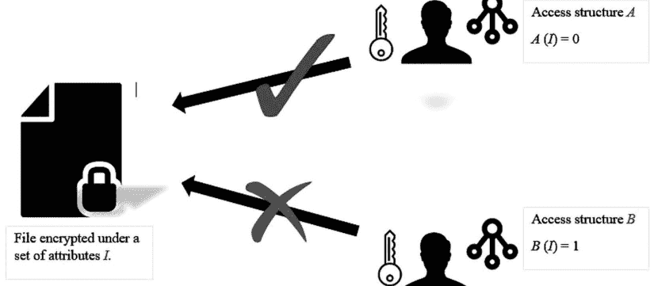

图 11.2 KP-ABE 访问控制。

### 11.3.2 KP-ABE 方案的特性

- i. 该方案设计用于一对多通信。
- ii. 该方案主要适用于结构化组织。
- iii. 如取证和定向广播等应用使用 KP-ABE 方案。
- iv. 该方案具有抗碰撞性。
- v. 该方案提供细粒度访问控制。
- vi. KP-ABE 方案比 ABE 方案更灵活。

### 11.3.3 KP-ABE 算法

ABE 方案与 KP-ABE 方案的 KeyGen() 算法之间存在差异。用户的私钥根据访问结构确定。decrypt() 算法也不同于 KeyGen() 算法。在解密过程中，使用加密数据的属性来执行解密函数（Goyal, Jain, & Sahai, 2008）。

例如，加密数据的属性为 $\{computer\_dep \wedge student\}$，而具有访问结构的用户的私钥为 $\{computer\_dep \wedge teacher student\}$。只有当用户私钥的访问设计被分配给加密数据的属性访问时，才能解密消息/信息。

- 设置 (d):
i. $G_1$ 和 $G_2$：阶为素数 $p$ 的双线性群。
ii. $g$ 是 $G_1$ 的生成元。
iii. 双线性映射，$e: G_1 \times G_1 \rightarrow G_2$。
iv. $d$ 是阈值。
v. 随机选择 $t_1, \dots, t_n$。
vi. 公钥，$PK = (T_1, \dots, T_n); T_i = g^{t_i}, Y = e(g, y)^d$，其中 $y \in \mathbb{Z}_q$ 且主密钥 $MK = (t_1, \dots, t_n, y)$。

- KeyGen ($A_t, PK, MK$):
i. 私钥由权威机构为用户 $U$ 生成。
ii. 在访问设计中，作者为每个节点 $x$ 生成了私钥组件。
iii. 随机选择 $d-1$ 次多项式 $q_s$ 使得：
$q_s(0) = q_{parent(x)}(index(x))$，
其中 $parent(x)$ 是 $x$ 的父节点，$index(x)$ 与节点 $x$ 相关联。
iv. 私钥 $D$ 为：
$D_x = g_x^{(0)/i}$ 其中 $i$ 等于叶节点。

- C. Encrypt ($A_{CT}, PK, M$):
i. 加密消息 $M \in G_2$ 和属性集合 $A_{CT}$。
ii. 随机选择 $s \in \mathbb{Z}_r$。
iii. 加密数据发布为：
$CT = (A_{CT}, E) = MY^s = e(g,g)^{ys}, E_i = g^i$ 其中 $i \in A_{CT}$。

- D. Decrypt ($CT, PK, D$):
i. 使用递归方法进行解密。
ii. 使用私钥 $D$ 解密 $CT$。
iii. 如果 $i$ 等于叶节点并且在用户私钥的访问设计中：
$e(E_i, D_j) = e(g, g)^{\alpha_{ij}}$
其中 $\alpha_{ij}$ 是拉格朗日系数，
消息 $M = E/Y^s$。

## 11.4 基于密文策略的ABE

### 11.4.1 CP-ABE 方案简介

密文策略于 2007 年由 J. Bethencourt 与 Amit Sahai 和 Waters 提出（Bethencourt, Sahai, & Waters, 2007）。CP-ABE 方案的访问控制方法与 KP-ABE 方案非常相关，因为在 KP-ABE 方案中，访问策略位于用户的私钥中，而在 CP-ABE 方案中，访问控制位于加密数据中（Zhou & Huang, 2010）。

在该方案中，所选描述属性附加到用户的私钥上并在加密数据中形成访问策略。例如，用户具有访问设计的私钥为 $(computer\_dept \wedge teacher student)$，而加密数据的属性集合为 $(computer\_dept \wedge student)$；如果用户加密数据的访问设计被用户私钥中选定的属性集合满足，则用户可以解密消息以获得明文（参见图 11.2）。


## 基于属性的加密

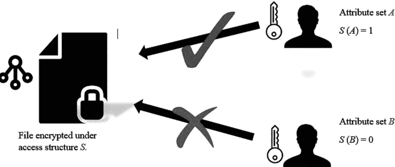

图 11.3
CP-ABE 访问控制。

消息/信息可以被解密以获得明文 (Emura, Miyaji, Nomura, Omote, & Soshi, 2009)。CP-ABE 方案面临的局限性为 (i) 在组织用户属性和定义策略方面，以及 (ii) 解密密钥仅支持逻辑指定的单个用户属性集。

### 11.4.2 CP-ABE 的特性

- i. 它克服了 KP-ABE 方案的缺点，即数据用户无法决定谁可以解密消息。
- ii. 在 CP-ABE 方案中，访问控制在真实环境中得到支持。
- iii. 当该方案与代理重加密一起应用时，可提高安全性。
- iv. 它允许实现隐式授权。
- v. 在 CP-ABE 方案中，一旦数据根据策略加密，用户即可取回其私钥。
- vi. 它提供细粒度的访问控制和灵活性。

### 11.4.3 CP-ABE 算法

A. 设置：

- i. $G_0$：阶为素数 $p$ 的双线性群。
- ii. $g$ 是 $G_0$ 的生成元。
- iii. 从 $Z_p$ 中随机选择指数 $a, \beta$。
- iv. 公钥，$PK = (G_0, g, h=g^\alpha, f=g^{1/\beta}, e(g, g^\alpha))$，主密钥，$MK = (\beta, g^\alpha)$。

B. KeyGen $(A_u, MK)$：

- i. 由权威机构为用户 $U$ 生成私钥。
- ii. 随机选择 $s \in Z_p$ 和每个属性 $j$ 的 $s_j$。
- iii. 随机选择 $d - 1$ 次多项式 $q$，
$q(0) = y$。
- iv. 私钥 $D$ 为
$D=(DK = g^{(s+s_j)/\beta})$ 其中 $j \in A_u$
且 $D_i = g^s \cdot H(j)^s, D_i^s = g^s$，输出。

C. Encrypt $(A_{CT-CP}, PK, M)$：

- i. 随机选择 $y \in \mathbb{Z}_p$
$q_r(0) = y$。
- ii. $r$ 是根节点，$L$ 是 $A_{CT-CP}$ 中叶节点集合
- iii. 加密数据发布为
$CT=(A_{CT-CP}, C') = (M e(g,g)^{a_y}), C = h''$
其中 $C_i = g^{q^{(0)}}$ 且 $C_i = H(att(i))^{q^{(0)}}$。

D. Decrypt $(CT, D)$：

- i. 使用私钥 $D$ 解密 $CT$。
- ii. $x$ 是叶节点且 $k=att(x), k \in A_l$。
- iii. Decryptnode $(CT, D, x)$
$(e(D_k,C_i))^{(e(D_i',C_i'))}=e(g,g)^{s q}_x$。
使用拉格朗日系数 $(CT, D, s)=e(g,g)^{a_y}$。
$C' / ((e(CT, D)) + (e(g,g)^{a_y})) = M$ (Cheung & Newport, 2007)。

### 11.4.4 KP-ABE 与 CP-ABE 的比较（见表 11.1）

### 表 11.1

KP-ABE 与 CP-ABE 之间的比较

| 参数 | KP-ABE | CP-ABE |
|---|---|---|
| 效率 | 平均，广播应用中较高 | 平均 |
| 精细粒度访问控制 | 低，重加密技术期间较高 | 平均 |
| 抗合谋 | 良好 | 良好 |
| 计算开销 | 大部分计算开销 | 计算开销平均 |

### 11.5 基于属性加密的应用

### 11.5.1 使用 ABE 方案维护个人健康记录安全

个人健康记录 (PHR) 应用允许患者管理、初始化和共享其健康相关个人信息。如今，PHR 已成为医疗保健技术领域的一个热门话题。它主要存储在云存储中，这降低了其成本并使其存储和访问机制更有效。对 PHR 中的数据必须有细粒度的访问控制协议。用户在使用 PHR 云服务时面临的主要挑战是健康数据的隐私、安全和保密性。失去对上传到云存储的 PHR 数据的物理控制后，云服务器可访问明文，从而威胁 PHR 的安全。

PHR 近期选择 ABE 方案作为其加密方案，这使其更安全有效，但面临按需用户撤销的挑战。为保障 PHR 安全，使用了 CP-ABE 和 KP-ABE：多权威 ABE 用于减少密钥管理问题和 ABE 方案，break glass ABE 方案用于对 PHR 的紧急/应急访问。

### 11.5.2 审计日志

法证分析的应用由 KP-ABE 方案保护。电子法证分析“审计日志”包含系统上所有活动的全部细节；其安全问题很高。为了捕获敌人，详尽的审计日志是极具价值的目标。仅加密审计日志不足以保护访问网络系统（如全球信息网格）的系统，因为访问审计日志信息只需要密钥，而获得该单一密钥意味着访问所有数据 (Waters, 2011)。因此，为应对此类安全问题，审计日志使用 KP-ABE 方案，将条目作为属性集，如数据类型、用户名以及时间和日期。

### 11.5.3 定向广播

定向广播是一种新的广播场景，可能具有以下设置：

- i. 广播者在序列中广播不同的项目，其中每个项目由属性集描述。
- ii. 例如

定向广播允许用户根据自己的选择在电视上观看节目、体育、新闻等。定向广播系统源自 KP-ABE 方案，其中每个广播项目使用对称密钥加密，然后 KP-ABE 方案使用广播项目的属性加密该对称密钥。

194

新兴安全算法与技术

### 11.6 结论

如本章所述，ABE 是公钥密码学的一种类型，其中身份被定义为属性集而非原子值。在 ABE 中，公钥和主密钥根据属性集预先定义，如果用户定义的属性不匹配，权威机构会重新生成主密钥和公钥。ABE 具有抗碰撞性，且 ABE 的解密操作需要更复杂的方法来控制访问，因此使 ABE 更安全。我们得出结论，ABE 的两种方案 (i) KP-ABE 和 (ii) CP-ABE 具有以下特性：(1) 属性在这些方案中被加密；(2) 每个属性都分配有公钥、私钥和随机多项式，因此任何其他用户无法通过其属性组合恢复数据，因此不会发生攻击；以及 (3) 访问协议容纳布尔公式，从而在控制用户访问方面具有灵活性。

### 参考文献

Bethencourt, J., Sahai, A., & Waters, B. (2007). 基于密文策略的属性基加密. IEEE Symposium on Security and Privacy (SP 07), Berkeley, CA, 321–334. doi:10.1109/sp.2007.11
Chatterjee, S., & Sarkar, P. (2006). HIB 协议选择性 ID 安全模型的推广. In Moti Yung et al., editors, 公钥密码学–PKC 2006. Lecture Notes in Computer Science, 3958, 241–256. doi:10.1007/1174853_6
Cheung, L., & Newport, C. (2007). 可证明安全的基于密文策略的ABE. Proceedings of the 14th ACM Conference on Computer and Communication Security—CCS 07, 456–465. doi:10.1145/1315245.1315302
Delerablée, C., & Pointcheval, D. (2008). 动态阈值公钥加密. In David Wagner, 密码学进展–CRYPTO 2008. Lecture Notes in Computer Science, 317–334. doi:10.1007/978-3-642-00843_6.
Gagné, M., Narayan, S., & Safavi-Naini, R. (2010). 阈值属性基加密. In J.A. Gray and R. D. Persico, editors, 网络安全与密码学. Lecture Notes in Computer Science, 6280, 151–177. doi:10.1007/978-3-642-15317_4_1
Goyal, V., Jain, A., & Pandey, S. (2008). 有界密文属性基加密. In 第 35 届国际语言与编程研讨会论文集, 第二部分, ILACP '08, Springer-Verlag, Berlin, Heidelberg. Lecture Notes in Computer Science, 579–591. doi:10.1007/978-3-540-75083_3_47.
Herranz, J., Laguillaumie, F., & Richards, C. (2010). 基于阈值的加密中恒定大小的密文. In PK Nguyen and David Pointcheval, editors, 公钥密码学—PKC 2010. Lecture Notes in Computer Science-19, doi:10.1007/978-3-642-13013-7_2.
Sahai, A., & Waters, B. (2005). 模糊身份基加密. Advances in Cryptography—EUROCRYPT 2005. Lecture Notes in Computer Science, 3494, 457–473. doi:10.1007/114266269_27.
Shamir, A. (1979). 秘密共享. Communications of the ACM, 22(11), 612–613. doi:10.1145/359618.359617.
Shamir, A. (1984). 身份基系统与签名方案. Advances in Cryptography. Lecture Notes in Computer Science, 47–53. doi:10.1007/3-540-19568-7_5n

Waters, B. (2011). 基于密文策略的属性基加密：一种表达性强、高效且可证明安全的实现。公钥密码学—PKC 2011。Lecture Notes in Computer Science, 53–70. doi:10.1007/978-3-642-19379-8_4.

Zhou, Z., & Huang, D. (2010). 关于高效的基于密文策略的属性基加密和广播加密：第 17 届 ACM 计算机和通信安全会议论文集—CCS 10。doi:10.1145/1866307.1866420.


## 12
## 密钥管理
Jyotsna Verma
中央拉贾斯坦大学

## 目录
- 12.1 引言 ................................................................................ 197
- 12.1.1 密码密钥系统背景 ................................ 198
- 12.1.2 密钥管理的重要性 ................................................ 199
- 12.1.3 管理密码密钥系统的挑战 ............... 199
- 12.2 密钥交换密码算法 ....................................... 200
- 12.2.1 Diffie–Hellman 密钥交换 ................................................... 200
- 12.2.2 椭圆曲线 Diffie–Hellman 密钥交换协议 ............ 201
- 12.2.2.1 先决条件 ....................................................................... 201
- 12.2.3 Buchmann-Williams 密钥交换 ......................................... 202
- 12.2.4 LWE 密钥交换 ................................................................... 202
- 12.2.5 环 LWE 密钥交换 ........................................................ 203
- 12.3 密码系统中的密钥分发 ................................................ 204
- 12.3.1 对称密钥分发 ................................................... 204
- 12.3.2 公钥基础设施 ....................................................... 205
- 12.3.3 公钥分发 ....................................................... 206
- 12.3.3.1 公钥的公开声明 ................ 206
- 12.3.3.2 公共可用目录 ...................................... 206
- 12.3.3.3 公钥机构 ................................................. 207
- 12.3.3.4 公钥证书 ................................................ 207
- 12.3.4 X.509 证书 ............................................................ 208
- 12.4 结论 ................................................................................... 210
- 参考文献 ........................................................................................ 210

### 12.1 引言
密码系统或密码体系是一套用于保护在非安全网络中实体之间传输的消息的密码算法、密钥和密钥管理协议。密码算法确保实体之间通信消息的安全性、私密性和真实性。它涉及用于消息加密的密码、密钥、明文和密文。密码体系中存在两种类型的密码算法：对称（秘密密钥）和非对称（公钥）密码算法。对称密钥密码学使用同一密钥，通常称为秘密密钥，用于消息的加密和解密，而非对称密码算法使用公钥和私钥进行消息的加密和解密。因此，密码算法中涉及三种类型的密钥：秘密密钥、私钥和公钥，用于确保消息在非安全网络上的保密性。为了确保消息的保密性，密码密钥必须得到有效管理，由密钥管理系统完成。

密钥管理系统或密码密钥管理系统处理密码系统中的密钥生成、交换、存储、替换、销毁和管理。密钥交换和密钥分发是密码密钥管理系统的最重要的和关键的方面。密钥交换或密钥建立是在非安全信道上在实体之间交换密钥的方法。与密钥交换方法相关联的各种问题，如何通过信道交换密钥以便密钥能够安全地到达另一端。文献中也存在几种密钥交换算法，将在本书的本章中进一步讨论。

密钥分发是密钥管理系统的另一个方面，它将密钥交付给希望在它们之间交换消息的实体，即彼此通信的实体。密钥分发方法用于降低在网络上在实体之间交换密钥时入侵者学习密钥的风险。文献提到了各种密钥管理和分发密码算法，用于管理密钥和分发密钥以进行安全通信，但没有一种通用的密钥管理和密钥分发技术可用于所有应用场景。

### 12.1.1 密码密钥系统背景
密码密钥系统的概念并非新事物；它可以追溯到数千年前。基本上，密码学是一门艺术，它是随着书写艺术而诞生的。术语“密码学”由两个希腊词“Krypto”和“Graphene”组合而成，意为秘密书写。密码学的根源可以在埃及和罗马文明中找到。在埃及文明中，埃及人希望以“象形文字”书写系统相互通信消息，这是一种古老的密码技术。用象形文字书写的消息只有希望代表国王向另一端传输消息的书记员才能理解。同样，罗马人使用流行的凯撒密码方法传输消息，并且凯撒密码的第一次记录使用的是明文字母单字母表变换。明文中的每个字符都被变换或向下移动三个字母。密码学的历史见证了许多变化，并且可以在文献中找到（Kahn, 1996；Singh, 2000；D'Agapejeff, 2016）。直到 1970 年代，密码学主要被政府机构使用，但随着两个主要发展——公钥密码学和数据加密标准的设计（FIPS PUB, 1999）——密码学的性质完全改变，并将其带入公共领域（Davies, 1997）。

密码学既是一门艺术也是科学，它将信息转换为安全且不易受攻击的形式。密码学的组成部分包括明文，即原始文本，加密算法，它加密明文，密文，即明文加密后形成，以及解密算法，它将密文解密为明文。加密和解密算法有时也称为密码。在密码技术中，密码使用密钥对密码算法进行操作。密钥不过是数字，它们被保存，密码使用它们分别使用加密密钥和解密密钥加密和解密消息。

密码算法分为两类：（i）对称密钥密码算法和（ii）非对称密码算法。在对称密钥算法中，相同的密钥被通信双方使用，而在非对称密钥密码学中，有两种类型的密钥：私钥和公钥。发送实体使用接收实体的公钥加密明文，接收实体使用自己的私钥解密密文。密钥必须在密码算法中保密，以使通信免受入侵者的攻击，因此出现了密钥管理的概念，它试图安全地管理和分发密钥给参与实体。

### 12.1.2 密钥管理的重要性
为了在密码系统中的实体之间高效、安全地传输消息，始终需要加密和解密密钥。在此，密钥在密码系统中发挥着重要作用，因此管理密钥是研究的重要领域。密钥管理系统、策略和规则有助于密码系统确保通信实体之间的安全性（即保密性、参与实体的真实性和完整性）。密钥管理允许高效、系统地生成、分配和存储密钥，以便参与实体能够在安全环境中通信并免受攻击。在没有高效密钥管理系统的情况下，通信实体更容易接触到入侵者，从而导致不安全的密码系统。

### 12.1.3 管理密码密钥系统的挑战
密钥管理有各种挑战，需要解决以便有效地实现密码算法。以下是与密钥管理系统相关的主要挑战：

- 1. 可扩展性：有数十亿个实体希望相互通信，它们需要密码算法来帮助它们在不安全网络上通信。对于大量实体，需要大量密钥，在密码系统中管理如此大量的私钥和公钥是一项繁琐的任务。因此，可扩展性是密钥管理需要研究人员解决的问题之一。
- 2. 可用性：密钥管理系统应确保授权参与实体的数据可访问性。
- 3. 安全性：安全性是密钥管理最大的挑战之一。设计高效的密钥管理系统，密码系统中的参与实体更容易受到入侵者的攻击，密钥容易受到入侵者的攻击。
- 4. 异构性：密钥管理技术的开发应使其能够支持多个数据库、不同平台、多样化的应用范围和标准。


## 12.2 密钥交换密码算法

密钥交换或密码系统中的密钥建立是使用密码密钥交换算法在通信实体之间交换密钥以实现安全通信的方法。广义上，密钥建立协议分为两种类型：密钥传输协议，其中由一个实体创建的密钥被传输到其他通信实体；第二种是密钥交换协议，其中密钥由通信实体共同努力创建并在它们之间交换（Law et al., 2003）。密钥可以通过两种方式交换——带内或带外。在带内密钥交换中，密钥通过实体进行通信并进行加密的同一通信信道在实体之间交换，而在带外密钥交换方法中，密钥通过除它们通信所用信道之外的信道交换，即它们用于加密的信道（Dulaney and Eastmost, 2017）。密钥交换是密钥管理系统的重要组成部分，并不断被研究人员探索。本节讨论各种密钥交换方法，更详细的讨论可在后续小节中找到。

### 12.2.1 Diffie-Hellman 密钥交换

Diffie-Hellman 密钥交换（DHE）协议由 Diffie 和 Hellman（1976）开发，用于在入侵者监控通信信道时仍能在通信实体之间安全地交换密钥。这是第一个公钥交换协议，通信实体无需就所需的密钥达成一致；它们必须选择两个对公众已知的数字 P 和 Q。P 是一个大素数，其限制条件是 (p-1)/2 也必须是素数，Q 也是一个素数。协议的工作方式如下：

- 1. 实体 A 选择一个大随机数 x 并计算 $K_1 = Q^x \bmod P$
- 2. 实体 A 通过信道将 $K_1$ 发送给实体 B。
- 3. 同样地，实体 B 选择另一个大数 y 并计算 $K_2 = Q^y \bmod P$
- 4. 实体 B 通过信道将 $K_2$ 发送给实体 A。

- 5. 实体 A 和 B 在分别交换 $K_2$ 和 $K_1$ 后，计算 K 的值，即对称密钥。实体 A 计算 $K = K_2^x \bmod P$，实体 B 计算 $K = K_1^y \bmod P$。这样，它们共享对称密钥。

在 DHE 协议中预测对称密钥的值非常困难，因为 x 和 y 的值非常大且难以猜测。也许破解密钥需要很长时间，这是一种安全交换密钥的方式，但它会遭受各种攻击（Adrian et al., 2015）。首先，它容易受到中间人攻击，在这种攻击中，入侵者可以创建两个密钥并将其发送给实体 A，在 A 和他自己之间建立通信链路，对 B 也做同样的操作。假设实体 A 和 B 想交换密钥，而入侵者试图通过欺骗实体 A 成为 B，同样欺骗实体 B 成为 A 来获取消息。攻击将按如下方式进行：

- 1. 实体 A 选择随机数 x 并计算 $K_1 = Q^x \bmod P$ 并将其发送给实体 B。
- 2. 入侵者将拦截 $K_i$ 并选择自己的数字 $z$，计算 $K_1 = Q^z \mod P$ 并通过信道将其发送给实体 $B$。
- 3. 实体 B 接收到 $K_2$ 并认为它是实体 A 发送的，并通过选择随机数 $y$ 计算 $K_3 = Q^y \mod P$。
- 4. 实体 B 通过信道将 $K_i$ 发送给实体 A，该信道再次被入侵者拦截。现在入侵者拥有两个值 $K_i$ 和 $K_j$，并利用这些值获取对称密钥 $K$。
- 5. 实体 A 和 B 都计算密钥；实体 A 计算值 $E1 = K_i \mod P$ 并在假设密钥与实体 B 共享的情况下在 A 和入侵者之间进行通信。同样，B 将计算 $E2 = K_j \mod P$ 并在假设密钥与 A 共享的情况下与入侵者进行通信。在此，A 和 B 都与入侵者进行通信。

DHE 交换协议配置中可能存在各种其他可利用的情况（Adrian et al., 2015）。例如，Adrian 等人发现 23,631 台服务器拥有浏览器受信任的证书，如果任何浏览器与所列服务器中的任何一个就 DHE 密码进行协商，则可能存在被动攻击的可能性，该攻击可以计算离散对数并获取 TLS 会话密钥。

DHE 协议是一种基于离散指数和对数函数的非认证密钥协议，但它构成了公钥密码学和各种认证协议的基础（Hellman, 1978）。研究人员已开发出各种交换协议来消除 DHE 协议的缺点，这些协议将在后面的小节中讨论。

### 12.2.2 椭圆曲线 Diffie–Hellman 密钥交换协议

椭圆曲线 Diffie–Hellman（Miller, 1985）是另一种密钥交换协议，其基于椭圆曲线密码学（ECC）。ECC 是一种基于公钥密码系统有限域上椭圆曲线的代数结构的方法，并且更安全，因为它使用离散曲线对数函数（Koblitz, 1987）。在该协议中，每个通信实体都有一对公钥和私钥，以在不安全信道上创建对称密钥。

### 12.2.2.1 先决条件 (Miller, 1985)

- 1. 椭圆曲线的域参数 $T = (p, a, b, G, n, h)$ 或 $(m, f(x), a, b, G, n, h)$。
- 2. 区间 $[1, n-1]$ 中的椭圆私钥 $d$。
- 3. 椭圆公钥 $Q$，其中 $Q = d$。
- 4. 实体 A 的密钥对为 $(d_A, Q_A)$，实体 B 的密钥对为 $(d_B, Q_B)$。参与实体的公钥对公众已知。

以下是椭圆曲线 Diffie–Hellman 密钥交换协议的工作原理：—

- 1. 实体 A 计算椭圆曲线点 $(x_A, y_A) = (d_A, Q_B)$，实体 B 计算点 $(x_B, y_B) = (d_B, Q_A)$。
- 2. 共享秘密将是 $x_s$，即椭圆点的 $x$ 坐标。

共享密钥和实体的私钥对相应的参与实体保密，如果入侵者试图破解密钥，则他必须解决椭圆曲线 Diffie-Hellman（ECDH）协议。ECDH 是一种非常快速的密钥交换协议（Schroeppel et al., 1995），并且相比其他密钥交换方法具有多项优势，可为无线设备提供安全保障，具有网页浏览、电子邮件和企业网络虚拟专用网络等功能（Lauter, 2004）。

### 12.2.3 Buchmann–Williams 密钥交换

Buchmann–Williams 是一种基于虚二次域的认证密钥交换协议。Buchmann–Williams 密钥交换协议由 Buchmann 和 Williams（1988）提出，并于 1989 年进行了修改。在该协议中，交换密钥的参与实体需要选择一个值 $D$，其非常大（~10^{20}），以及一个理想值 $a$，可以公开。如果两个实体 A 和 B 想交换密钥，则 Buchmann-Williams 密钥交换协议将按如下方式工作：

- 1. 实体 A 将选择一个随机整数 $x$ 并计算理想约简值 $b$，使得 $b = a^x$ 并将 $b$ 发送给实体 B。
- 2. 实体 B 也将选择一个随机整数 $y$ 并计算理想约简值 $c$，使得 $c = a^y$ 并将 $c$ 发送给实体 A。
- 3. 现在，实体 A 计算约简理想值 1（$c'$），同样实体 B 计算约简理想值 2（$f$），其中 $f1=f2$，这可以在 Buchmann 和 Williams（1988）中讨论的定理中看到。

Buchmann–Williams 密钥交换协议的思想也可以用于设计公钥密码学，但该协议的复杂性大于 DHE 协议。

### 12.2.4 LWE 密钥交换

学习带误差（LWE）由 Oded Regev 提出，作为机器学习中难以解决的问题。LWE 用于创建密码系统（Gentry et al., 2008; Regev, 2009; Peikert, 2009; Peikert and Waters, 2011）。由于 LWE 已被证明提供更高的安全性并且具有良好的渐近效率，Ding（2012）提出了基于 LWE 的安全密钥交换。对于实体 A 和 B 在不安全信道上的通信，LWE 密钥交换协议将按如下方式工作：

- 1. 公共参数为 $q, n, \alpha$，其中 $q$ 为素数且 $q>2$，均匀随机矩阵 $M \leftarrow \mathbb{Z}_q^{nn}$。
- 2. 实体 A 选择一个秘密向量 $S_A \leftarrow D_{Z_q, \alpha}$ 并计算 $P_A = MS_A + 2e_A \pmod q$，其中 $e_A \leftarrow D_{Z_q, \alpha}$，然后将 $P_A$ 发送给实体 B。
- 3. 当实体 B 接收到 $P_A$ 时，它还将选择一个秘密向量 $S_B \leftarrow D_{Z_q, \alpha}$ 和一个误差 $e'_B \leftarrow D_{Z_q, \alpha'}$。
- 4. 它计算 $K_B = P_A^T \cdot S_B + 2e'_B \pmod q$ 和 $P_B = M^T \cdot S_B + 2e_B \pmod q$，采样 $e_B \leftarrow D_{Z_q, \alpha'}$。
- 5. 现在实体 B 计算并共享共享秘密 $SK_{B} = E(K_B, \sigma)$。最后，实体 B 将 $(P_B, \sigma)$ 发送给实体 A。


## 密钥管理

6. 当实体获得 $(P_B, \sigma)$ 时，它将采样 $e'_A \leftarrow D_{Z,\sigma}$ 计算 $K_A = S_A^T P_B \cdot S_B + 2e'_A \pmod q$，并得到共享密钥 $SK_A = E(K_A, \sigma)$。

通过使用 LWE 假设的矩阵密钥，可以通过该协议获得多个密钥位。LWE 密钥交换的安全性取决于求解 LWE 问题的难度。

## 12.2.5 环 LWE 密钥交换

文献中可用的绝大多数公钥算法，例如 Diffie-Hellman 算法、RSA 算法和 ECDH，都很容易被量子计算机破解且不安全。学习带误差（RLWE）密钥交换（Ding et al., 2012）是旨在提供抗量子计算机安全性的后量子公钥交换算法之一。RLWE 是一种基于格的密码算法，普遍认为基于格的密码算法可提供抗量子攻击的安全性，并提供与 Diffie-Hellman 算法和 ECDH 类似的前向保密性。在该协议（Ding et al., 2012）中，通信实体之间交换密钥，其中一个实体是发起方，即密钥交换的实体 A，另一个是响应方实体，即实体 B。$q, n, a(x)$ 的值对实体 A 和 B 均已知。

它们根据离散高斯分布生成小的多项式 $x_w$，参数为 $\sigma = Z_{|w|} / \Phi(x)$。协议遵循发起方（A），工作如下：

### 发起：
- 1. 密钥交换发起实体生成两个多项式 $S_A$ 和 $E_A$，来自分布 $x_w$。
- 2. 实体 A 计算 $P_A = aS_AS_B + 2E_A$。
- 3. 实体 A 将多项式 $P_A$ 发送给响应实体，即实体 B。

### 响应：
- 1. 响应方实体 B 通过从分布 $x_w$ 采样生成两个多项式 $S_B$ 和 $E_B$。
- 2. 实体 B 计算 $P_B = aS_B + 2E_B$。
- 3. 实体 B 从分布 $x_w$ 生成 $E_B'$ 并计算 $K_B = P_BS_B + 2E_B'$。然后 $P_BS_B+2E_{AS_B}+2E'_B$。
- 4. 使用信号函数 $Sig$ 找到 $w = Sig(K_B)$。
- 5. 响应方，即实体 B，基于 w 和多项式 $K_B$ 计算密钥 $SK_B = mod_2(K_B, w)$。
- 6. 实体 B 将 $P_B$ 和 $w$ 发送给实体 A。

### 完成：
- 1. 收到实体 B 发送的 $P_B$ 和 $w$ 后，从分布 $x_w$ 采样 $E_A'$ 计算 $K_A = P_BS_A + 2E_A' = aS_AS_B+2E_{BS_A}$。
- 2. 发起方，即实体 A，基于 w 和多项式 $K_A$ 计算密钥 $SK_A = mod_2(K_A, w)$。

新兴安全算法与技术

RLWE 密钥交换中使用的信号函数定义如下：

子集 E {-q/4, ..., q/4} 的 $Z_q=\{-(q-1)/2, ..., ((q-1)/2)\}$ 被定义，其中信号函数 Sig 用于提取密钥的近似值，而上述定义的 mod 2 操作用于消除误差。

在上述讨论的密钥交换协议中，发送方和接收方以很小的失败概率拥有相同的密钥，该概率取决于参数的选择。选择合适的参数，失败率会更低并生成密钥。

## 12.3 密码系统中的密钥分发

密钥分发是密钥管理系统的主要关注点之一。在密钥分发方案中，使用密钥分发中心（KDC），其负责安全地向通信实体分发密钥。对称密钥可以使用对称加密分发给通信实体，而公钥可以通过任何公钥密码算法进行公开公告分发，但公钥的公开公告可以被任何人强制执行，不希望使用公开公告方法分发密钥。公钥也可以使用由受信任组织维护的公共可用目录进行分发。每个实体在其名称在目录中都有注册的公钥。该方法存在漏洞；如果入侵者设法获取了实体的私钥，则可以很容易地从可用目录中获取其公钥。公钥机构和公钥证书是分发密钥给通信实体的其他方法，其中每个实体可以分别通过受信任组织的公钥机构和公钥证书获得公钥。分发公钥的两种方法都存在相关漏洞，需要研究人员解决。上述私钥和公钥的分发方法在后续小节中讨论。

### 12.3.1 对称密钥分发

在对称密码学中，相同的密钥在加密和解密消息之前在通信实体之间交换。发送方实体使用相同的密钥加密消息，同样接收方实体使用相同的密钥解密消息。但该方法的主要关注点是安全地向通信实体分发密钥。密钥可以通过以下任何方式分发给实体：

- 1. 密钥可以亲自分发给通信实体。
- 2. 密钥可以由受信任的第三方亲自分发给通信实体。
- 3. 实体之间通信 previously 使用的密钥也可以用于在实体之间分发新创建的密钥。新创建的密钥可以使用旧的密钥加密。
- 4. 受信任的第三方也可以在发送方和接收方实体建立的加密链路上向通信实体交付密钥。

密钥管理

前两种方法由于手动交付密钥给通信实体而不可行。第三种方法的效率取决于通信实体 previously 使用的密钥的安全性水平。第四种方法在某种程度上是可行的，因为该方法涉及受信任的第三方来交付参与实体；该受信任的第三方可以称为密钥分发中心（KDC）。在此方法中，为了安全交换密钥，使用两种类型的密钥：会话密钥，即临时密钥，用于在一次逻辑会话中在通信实体之间加密消息，使用后即丢弃；主密钥，即长期密钥，用于加密和分发实体与 KDC 共享的会话密钥。例如，实体 A 想与实体 B 通信，则实体 A 向 KDC 提交连接请求，该请求由仅实体 A 和 KDC 共享的主密钥加密。KDC 批准连接请求并生成一次性会话密钥，并通过用主密钥加密会话密钥发送给实体 A；同样，它通过用主密钥加密将其与实体 B 共享。实体 A 和 B 都有一次性会话密钥，通过它可以建立逻辑连接并相互通信。

对称密钥分发简单易实现，但也很容易被伪造，因为在每对通信实体之间进行的通信需要一个对称密钥；对于 n 个实体，需要 n(n-1)/2 个密钥，这是一个非常大的密钥数量。在此，出现了非对称/公钥密码学，将在以下章节中讨论。

### 12.3.2 公钥基础设施

公钥基础设施（PKI）是一个广泛的概念，为公钥的通用使用而出现。PKI 通过证书机构获得的私钥和公钥对在不安全网络上实现信息交换，证书机构是为参与实体签发和分发公钥的受信任机构。PKI 由以下元素组成（Vacca, 2004; Al-Janabi and Abd-Alrazzaq, 2011）：

- 1. **证书机构**：证书机构（CA）是为实体对应公钥签发、分发、存储、撤销和续订证书的受信任机构。
- 2. **注册机构**：注册机构验证实体的身份；是否请求证书的实体或请求将证书存储到有效实体。
- 3. **证书撤销列表**：证书撤销列表（CRL）列出发给参与实体和其他机构的已撤销证书。
- 4. **证书管理系统**：证书管理系统存储、分发并向请求实体签发证书。
- 5. **证书目录**：证书目录负责存储和分发发给参与实体的数字证书和 CRL。

PKI 是策略、标准、规则、实体、公钥密码学、硬件和软件的组合。它维护证书机构的层级结构，以便通过 CA 签发的证书获得实体身份的验证。


## 12.3.3 公钥分发

在公钥密码学中，有两种类型的密钥：私钥和公钥——分别用于加密和解密消息。密码系统中的私钥必须由参与实体保密，而公钥是公开公布的。公钥可以通过多种方式或技术分发给通信实体以实现安全通信。以下是公钥分发的方式。

### 12.3.3.1 公钥公开公告

分发公钥给通信实体的一种方式是通过公开公告。公钥公开宣布，以便希望参与通信的实体使用公钥进行安全通信。在此，每个实体的公钥都在公共论坛上公布，例如互联网邮件列表和 USENET 新闻组，供用户用于其通信需求。这种方法非常简单方便，但有一个主要缺点。如果通信实体的公钥在公开场合公布，就很容易被某些入侵者伪造（见图 12.1）。入侵者冒充通信实体之一、实体 A，并将其公钥发送给另一实体 B。实体 B 在收到入侵者的密钥后，开始与之通信并假定其为实体 A；等到 A 发现伪造时，入侵者已经取走了所有加密消息供其使用。

### 12.3.3.2 公开可用目录

公开可用目录是另一种公钥分发方案，其中维护一个公开可用的动态目录。公开可用目录的分发和维护由某些受信任的组织或受信任的实体完成（见图 12.2）。在此方案中，每个实体在受信任权威机构维护的公开可用目录中注册一个公钥。受信任权威机构在目录中以其名称和公钥注册该实体，对于任何实体 A，目录中的条目将为 ($PK_A$) ，并且在任何时候实体都可能用新密钥替换现有密钥，如果出于某种原因密钥似乎已被泄露或用于大量数据。权威机构通过流通的报纸以印刷版形式更新或公布整个目录，或实体可以以电子形式访问。

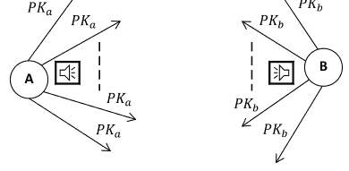

图 12.1
公钥的公开公告。

由受信任的权威机构维护

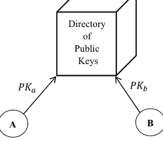

图 12.2
公开可用目录。

公开可用目录比公钥公开公告更安全，但仍然存在一个缺点。入侵者设法获取了权威机构的私钥，那么它就可以窃听任何通信实体发送的任何消息，或破坏受信任权威机构维护的记录。

### 12.3.3.3 公钥权威机构

从公开可用目录向通信实体分发公钥必须以安全的方式进行，通过对公钥分发进行更严格的控制。在此方案中，公钥权威机构同时拥有公钥和私钥。公钥为所有通信实体所知，而私钥仅为权威机构所知。现在，如果实体 A 知道实体 B 的公钥，那么它将向公钥权威机构发送一条带时间戳的消息，请求实体 B 的公钥。实体 A 的原始消息请求和用于验证消息新鲜度的原始时间戳。现在，实体 A 将实体 B 的公钥存储起来以便将来与 B 通信，并且实体应通过不时请求通信实体的公钥来确保公钥的新鲜度。实体 A 使用 B 的公钥加密发往 B 的消息，其中包含一个随机数 ($n_a$) 和 A 的标识符 ($Id_a$) ，以唯一标识消息的传输。以同样的方式，实体 B设法获取实体 A 的公钥 ($PK_a$) 并开始通信，通过使用 A 的私钥发送加密消息；该消息包含 A 的随机数 ($n_a$) 以及 B 新生成的随机数 ($n_b$) 。为了确保消息传输给实体 A，A 将用 B 的公钥加密 B 的随机数 ($n_b$) 返回。这是一个七步过程，需要在两个通信实体之间以及公钥权威机构之间进行安全消息传输，以便通信实体之间进行通信。

### 12.3.3.4 公钥证书

在用于分发公钥的公钥权威机构方案中，存在篡改受信任权威机构维护记录的风险。一种替代方法是使用 CA 创建的证书；证书包含参与实体的公钥和其他相关信息。CA 只不过是一个受信任的第三方，它向参与实体颁发数字证书。CA 颁发的证书随后连同其匹配的私钥一起提供给通信实体，此信息不是公开的，而是它们保密的。CA 拥有创建和更新证书的唯一权利，其中包含通信实体的名称和公钥。任何通信实体都可以读取证书的所有者并验证证书是否由 CA 颁发。Denning 和 Sacco（1981）增加了由任何参与实体验证证书新鲜度的要求。

为了确保证书的安全性，使 CA 无法颁发任何不当证书，RFC 5280 定义了一个被撤销状态，即如果 CA 颁发了不当证书或私钥以任何方式被泄露或 CA 的任何策略被 CA 或其用户违反，则证书将被撤销。还有一个撤销列表，即一种 CRL，其中包含来自颁发 CA 的被撤销证书列表。

在公钥方案中，每个通信实体都向 CA 请求带有公钥的证书。通信实体向权威机构提出的证书请求是当面进行或通过经过身份验证的安全通信进行。CA 将证书发送给请求它的实体，例如实体 A。证书由 CA 的私钥加密以防止证书被伪造，在接收方例如实体 B 收到加密证书后，B 将通过 CA 的公钥解密消息以获取证书元素，即实体 A 的身份及其时间戳值表示证书的新鲜度。如果证书足够旧，则假定证书已过期，其中时间戳表示到期日期。此方案解决了伪造问题，例如，如果实体 A 想要 B 的公钥，那么它将下载证书和加密消息。消息摘要；然后加密消息通过 CA 的公钥解密，并且两个加密消息进行比较；如果两者相等，则没有发生伪造并且证书有效。

## 12.3.4 X.509 证书

公钥证书方案已以限制伪造的方式解决了向通信实体分发公钥的问题。但 CA 颁发的证书格式存在问题。颁发的证书可能具有不同的格式，即一个证书采用一种格式，另一个采用另一种格式，这造成了兼容性问题；必须有一个通用的通用格式。

为了解决上述问题，国际电信联盟开发了基于抽象语法记法一（ASN.1）的 X.509 协议。X.509 标准在证书结构中发挥了重要作用，最初于 1988 年开发；后来于 2000 年以修订建议引入。该标准基于数字签名方法和公钥密码技术。证书由 CA 维护。CA 有责任更新证书并将其放置在其目录中。X.509 标准对证书的格式在表 12.1 中提供。

CA 颁发的证书有一定的有效期，即证书可能因各种原因而过期，例如通信实体的私钥可能

## 密钥管理

表 12.1
X.509 标准证书的格式

| 字段 | 描述 |
|---|---|
| 版本 | X.509 的版本 |
| 证书序列号 | 由 CA 签发的证书的唯一序列号 |
| 签名算法标识符 | 用于签署证书的算法 |
| 发行者名称 | X.509 定义的证书颁发机构名称 |
| 有效期 | 证书的有效期，包含签发证书的开始和结束时间 |
| 主体名称 | 正在对其公钥进行认证的实体的名称 |
| 主体的公钥信息 | 实体的公钥信息和算法标识符 |
| 发行者标识符 | 发行者的唯一标识符，即 CA |
| 主体标识符 | 参与实体的唯一标识符 |
| 扩展 | 对于后续版本，扩展添加一个或多个其他字段 |
| 签名 | 该字段涵盖所有其他字段以及其他字段的哈希代码 |

证书被泄露，CA 签发的证书可能被泄露，或参与实体不再由 CA 认证。在这种情况下，CA 维护证书吊销列表 (CRL)，其中包含颁发给参与实体和其他实体的所有被吊销证书；CA 然后将 CRL 发布到目录中，其中包含发行者名称、发行者签名、每个被吊销证书的条目（包含唯一序列号）、CRL 的签发日期以及 CRL 下一次计划签发日期。
表 12.2 显示了上述 CRL 的格式。
通信实体可以通过在接收到请求的消息证书时检查目录中的证书有效性来获取此信息。参与实体也可以维护证书的本地缓存，以提高其搜索效率，避免延迟。

表 12.2
证书吊销列表的格式

| 字段 | 描述 |
|---|---|
| 签名算法标识符 | 用于签署证书的算法 |
| 发行者名称 | X.509 定义的证书颁发机构名称 |
| 更新日期 | CRL 的签发日期 |
| 下次日期 | CRL 下一次计划签发日期 |
| 证书序列号 | 由 CA 签发的被吊销证书的唯一序列号，以及证书的吊销日期 |
| 签名 | 该字段涵盖所有其他字段以及其他字段的哈希代码 |

### 12.4 结论

密码密钥管理是一个广泛的概念，与之相关的挑战很多，需要研究界加以解决。本章讨论了密码密钥管理中涉及的各种挑战以及相关问题。国家标准与技术研究所 NIST 正在努力管理和改进密码密钥系统，以确保密码密钥的安全。在诸如延迟容忍网络等各种网络中密钥的交换、存储和分发为进一步研究打开了大门。延迟容忍网络严重需要密钥管理协议（Menesidou et al., 2017）。此外，在异构环境中安全处理的最低标准是必要的，并且是未来研究的一个非常重要的挑战。

## 参考文献

- Adrian, D., Bhargavan, K., Durumeric, Z., Gaudry, P., Green, M., Halderman, J. A., & VanderSloot, B. (October 2015). Imperfect secrecy: How Diffie–Hellman fails in practice. In Proceedings of the 22nd ACM SIGSAC Conference on Computer and Communications Security (p. 5–17). ACM, Colorado, USA.
- Al-Janabi, S. T. F., & Abd-Alrazzaq, H. K. (2011). Combining median and identity-based cryptography for securing email. In Digital Enterprise and Information Systems (pp. 1–15). Springer, Berlin, Heidelberg.
- Buchmann, J., & Williams, H. C. (1998). A key-exchange system based on quadratic fields. Journal of Cryptography, 1(2), 107–118.
- Davies, D. (1997). A brief history of cryptography. Information Security Technical Report, 2(2), 14–17.
- Davenport, A. (2016). Codes and Ciphers–A History of Cryptography. Read Books Ltd., Jericho, United Kingdom.
- Denn, D. E., & Sacco, G. M. (1981). Timestamps in digital protocols. Communications of the ACM, 24(8), 533–536.
- Diffie, W., & Hellman, M. (1976). New directions in cryptography. IEEE Transactions on Information Theory, 22(6), 644–654.
- Ding, J., Xie, X., & Lin, X. (2012). A simple secure key scheme based on the learning-errors problem. In IACR Cryptography Print Archive, 688.
- Dulaney, E., & Easton, C. (2017). CompTIA Security+ Study Guide: Exam SY00-501. Wiley & Sons, Hoboken, New Jersey, United States.
- FIPS PUB (1999). Data encryption standard (DES). FIPS PUB, 46–3.
- Gentry, C., Peikert, C., & Vaikuntanathan, V. (May 2008). Tardos for hard lattices and new cryptographic constructions. In Proceedings of the Tenth Annual ACM Symposium on Theory of Computing (pp. 197–206). ACM, Victoria, BC, Canada.
- Hellman, M. (1978). An overview of public key cryptography. IEEE Communications Society Magazine, 16(6), 24–32.
- Kahn, D. (1996). The Comprehensive History of Secret Communication from Ancient Times to the Internet. Simon and Schuster.
- Koblitz, N. (1987). Elliptic curve cryptsystems. Mathematics of Computation, 48(177), 203–209.
- Lauter, C. (2004). The advantages of elliptic curve cryptography for wireless security. IEEE Communications, 11(1), 62–67.

## 密钥管理
Law, L., Menezes, A., Qu, M., Solinas, J., & Vanstone, S. (2003). An efficient protocol for authenticated key agreement. Designs, Codes and Cryptography, 28(2), 119–134.
Menezes, S. A., Katos, V., & Kambourakis, G. (2017). Cryptographic key management in delay tolerant networks: A survey. Future Internet, 9(3), 26.
Miller, V. S. (1985). Use of elliptic curves in cryptography. In Conference on the Theory and Application of Cryptographic Techniques (pp. 417–426). Springer, Berlin, Heidelberg.
Peikert, C. (May 2009). Public-key cryptosystems from the worst-case shortest vector problem. In Proceedings of the Forty-First Annual ACM Symposium on Theory of Computing (pp. 333–342). ACM, Bethesda, MD, USA.
Peikert, C., & Waters, B. (2011). Lossy trapdoor functions and their applications. SIAM Journal of Computing, 40(6), 1803–1844.
Regev, O. (2009). On lattices, with errors, random linear codes, and cryptography. Journal of the ACM, 56(6), 34.
Schroeppel, R., Orman, H., O'Malley, S., & Spatschek, O. (August 1995). Fast key exchange with elliptic curves. In Annual International Cryptography Conference (pp. 43–56). Springer, Berlin, Heidelberg.
Singh, S. (2000). The Code Book: The Secret History of Codes and Code-Breaking. Fourth Estate.
Vacca, J. R. (2004). Public Key Infrastructure: Building Trusted Applications and Web Services. CRC Press.


## 13 实体认证

Hamza Mutaher and Pradeep Kumar
Maulana Azad National Urdu University

### 目录

- 13.1 引言 ............................................................................ 213
- 13.2 密码认证协议 ................................................ 214
- 13.3 双因素认证 ....................................................... 215
- 13.4 生物特征认证方法 ................................................ 216
- 13.4.1 物理特征 ................................................................ 216
- 13.4.2 行为特征 ............................................................ 217
- 13.5 挑战-握手认证协议 ............................... 218
- 13.6 可扩展认证协议 ............................................ 219
- 13.7 三次传递协议 ................................................................. 220
- 13.7.1 Shamir’s 三次传递协议 ................................................ 220
- 13.7.2 Massey–Omura 密码系统 ................................................ 221
- 13.8 3D 安全 ........................................................................ 222
- 13.9 结论 ............................................................................ 223
- 参考文献...................

### 13.1 引言

实体认证是一种机制，允许在两个实体之间建立真实的连接。第一方请求建立连接，而第二方在验证第一方的身份后接受或拒绝请求。请求连接的一方称为声明方；检查声明方身份的一方称为验证方。“实体可以是人、进程、客户端或服务器”（Forouzan & Mukhopadhyay 2011）。

必须使用一种协作特性来提供和确保真实性，称为凭证，其可以形成如下：

- 1. 声明方所知道的东西：这种凭证成本低廉，可以像密码和 PIN（个人识别号码）一样在脑中存储。这种类型的凭证由于人类记忆力短暂而容易丢失，或可被他人猜测。
- 2. 声明方所拥有的东西：这种凭证很难被未经授权的各方泄露，例如，智能卡、磁条卡以及存储私钥和公钥的软件。


3. 申明人继承的特征：此凭证是像指纹、人脸识别系统和其他生物特征之类的物理特征（Kizza 2005；Van Tilberg & Jajodia 2016）。

实体鉴别的目的是防止未经授权的访问以保护资源。例如，像外部方试图修改学生的成绩或试图从某人的银行账户中取款。

随着安全问题的增加，出现了大量针对不同应用采用不同技术和标准的实体鉴别协议。要将任何协议视为鉴别协议，它必须遵循其设计者所指定的安全定义规则。安全定义基于某些安全目标。这些目标保证了安全性。如果协议满足这些安全目标，则可以称其为鉴别协议（Ahmed & Jensen 2010）。本章将讨论一些鉴别协议，例如密码鉴别协议（PAP）、挑战握手鉴别协议（CHAP）和可扩展鉴别协议（EAP）以及其他鉴别技术。

## 13.2 密码鉴别协议

PAP 是一种简单的鉴别技术，用于在点对点协议（PPP）建立两个设备之间的直接连接时验证设备的身份。PAP 是一种双向握手协议，按以下两个步骤进行（图 13.1；Forouzan & Fegan 2007）：

- 第一个设备的用户将用户名和密码等鉴别身份发送给第二个设备以获取访问权限。
- 第二个设备验证用户的身份，然后决定接受或拒绝连接。

由于网络基础设施的改进，世界用宽带和其他新技术取代了接入调制解调器链路、拨号 ISDN 链路和 T1 链路。PAP变得不安全，并被新的鉴别协议取代。另一方面，PAP以明文发送密码；这可能会降低安全目标。

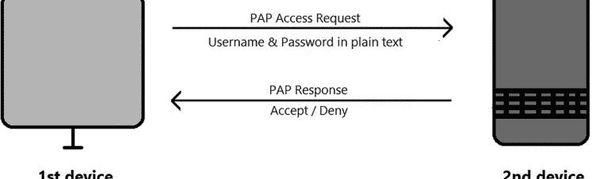

FIGURE 13.1
使用 PAP 的 PPP 连接会话。

## 实体鉴别

## 13.3 双因素鉴别

由于黑客工具的实施、对他人账户的恶意访问以及假用户导致的安全概念下降，从而使黑客能够访问系统。用户还喜欢使用容易猜测的密码并为多个账户使用相同的密码，其中一些用户允许浏览器保存其密码，要求其记住这些密码；因此，黑客使用字典攻击等攻击以及键盘记录器等工具或通过社会工程学入侵用户账户变得很容易（Sabzevar & Stavrou 2008；Vaithyasubramanian, Christy, & Saravanan 2015）。双因素鉴别（TFA）方法应运而生，以解决这些问题并确保用户在互联网上的授权访问。

TFA 是一种网络安全方法，可确保用户对其账户的授权访问。该方法使用两个安全阶段，在登录过程中除了静态密码外还增加了额外的安全层。即使黑客知道用户名和静态密码，额外的安全层也能防止黑客入侵账户。

应用 TFA 时，用户需要具备以下条件：

- 用户知道的东西，如[登录 ID 和密码]。
- 用户拥有的东西，如[手机、电脑、电子邮件和 ATM 卡]。
- 用户本身的东西，如[指纹、虹膜识别、声纹和面部]。

用户在尝试访问社交媒体账户或出于其他目的时，通过满足这三个要求来证明其身份。第一个要求用于其他目的，如使用第二个要求进行票务预订和取款。第三个要求是 TFA 的最重要步骤，也是用户用来实现额外安全级别的步骤。虽然第三个要求的选项更昂贵并引发隐私问题，但一次性密码（OTP）作为 TFA 方法的替代选项出现（Vaithyasubramanian, Christy, & Saravanan 2015）。

OTP 是一种鉴别机制，用于防止用户账户被未经授权的人访问。OTP 通过在用户登录其账户时发送一次性使用的密码来增强登录过程的安全性。在 OTP 中，用户每次尝试登录账户时都会收到不同的密码。

实现 OTP 鉴别有两种主要模式，由 Xiao-rong、Qi-yuan、Chao 和 Ming-quan（2005）讨论如下：

- 1. 挑战响应模式：在此模式下，系统在登录过程中会向用户生成一个挑战。该挑战将与用户密码结合，然后用户生成 OTP。用户将此 OTP 发送给系统并成功登录一次。
- 2. 时间同步模式：在此模式下，登录时间将被视为随机数并与用户密码结合以允许用户访问其账户。在此模式下，用户只能访问其账户一次，并且每次尝试登录账户时都必须重复此过程。

216                                新兴安全算法与技术

S/Key 模式是一种属于挑战响应模式的 OTP 鉴别（Haller 1995）。S/Key 模式的想法是为每个用户分配一个账户。每个账户将有三个参数[种子、序列号和秘密密码短语]。系统使用这三个参数可以生成一系列 OTP。服务器只能使用每个 OTP 一次登录其账户。

在 S/Key 模式下，OTP 计算程序将在客户端和服务器端同时设置。然后，在登录时，客户端将向服务器发送其账户。服务器将返回挑战和序列号。然后，客户端的 OTP 计算程序将生成一个 OTP 并连同挑战和秘密密码短语一起发送给服务器。服务器端的 OTP 计算程序也会生成一个 OTP。两个 OTP 将进行比较；如果它们相同，则用户可以登录其账户。

## 13.4 生物特征鉴别方法

安全鉴别方法正受到研究的更多关注，以确保对各种应用的安全访问。公司采用多种类型的生物特征鉴别方法以确保对其应用的真实访问。每个应用都需要不同类型的生物特征，具体取决于其安全性以及适合的生物特征类型：例如，要证明你在工作的组织中的出勤情况，你必须拥有指纹生物特征；要进入军事实验室，你必须拥有手掌生物特征；要识别你，可能需要使用视网膜生物特征。

ATM 卡的 PIN 和密码可以被入侵者轻易观察到。入侵者观察到 PIN 和密码后，可以轻易访问用户账户，系统无法识别他是入侵者，这就是 PIN 和密码的局限性之一。在这种情况下，生物特征鉴别为用户提供更可靠、更准确的安全性，被称为“用户独有的东西”或用户本身的东西，如指纹、面部、虹膜、声纹等。生物特征不像密码那样可以共享、复制、强迫，并且不可能被泄露、丢失或被盗，这些是生物特征鉴别的某些特征（Ratha, Connell, & Bolle 2001）。

生物特征鉴别是一种依赖于用户生物特征来识别其是否为声称者本身的鉴别过程。生物特征系统提取用户的生物特征并将其存储在数据库中。用户将其生物特征输入系统，系统比较输入和数据库存储的特征；如果两者相同，则鉴别确认，用户可以完全访问其账户。生物特征用于管理计算机设备、智能手机、汽车、建筑物和公寓等物理和数字资源的访问过程。

生物特征测量有两种类型的特征：物理特征（如指纹、手掌、视网膜、虹膜和面部特征）和行为特征（如签名和面部）（Liu & Silverman 2001）。

### 13.4.1 物理特征

- 1. 指纹：它是指纹的图案。验证指纹的方法有很多。有些使用警察用来匹配细微特征的传统方法，而其他方法则使用直接的模式匹配设备并使用

- 3. 输入设备：输入设备的职责是通过验证样本质量和用户活性来获取生物特征数据。

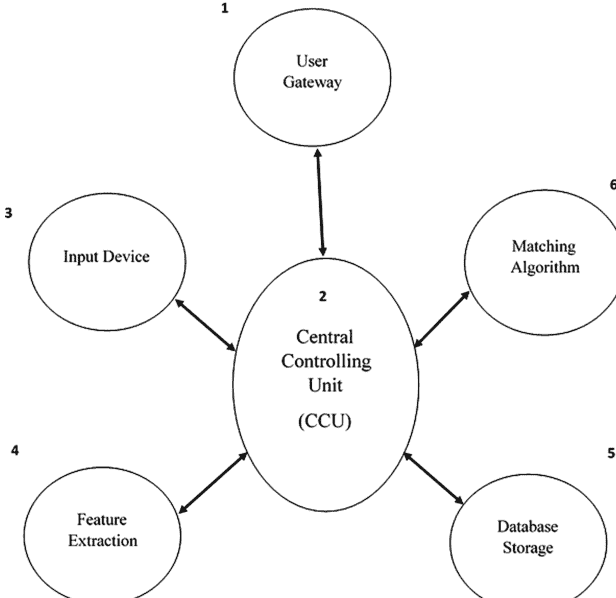

图 13.2
生物特征系统的模型。

- 4. 特征提取：其负责处理生物特征数据。特征提取提取用户的特征并测试输入设备获得的生物特征数据的质量，然后将其发送到匹配算法。
- 5. 数据库存储：这是一个存储生物特征模板的数据库。生物特征模板也可以存储在用户的介质中，如智能卡，并且生物特征模板与用户之间应存在关联。
- 6. 匹配算法：合理的做法是在当前用户的生物特征模板与存储中保存的生物特征模板之间进行比较。比较过程结束后，匹配结果为是或否。

## 13.5 挑战-握手身份验证协议

这是一种身份验证协议，使用三向握手机制在两个实体之间提供安全的 PPP 连接，该机制共享挑战消息以检查它们之间的真实性。CHAP 对密码进行加密，使其比 PAP 更安全。密码由哈希函数加密（Forouzan & Fegan 2007; Ghilen, *

## 实体身份验证

219

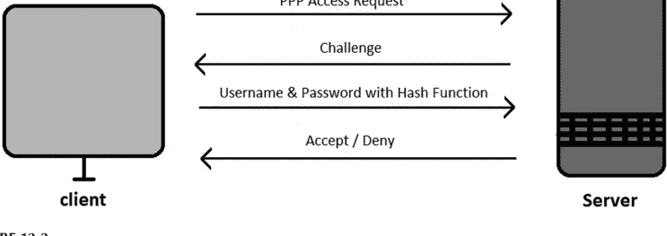

图 13.3
使用 CHAP 的 PPP 连接会话。

Azizi, & Bouallegue 2015; Inamura 2015. 身份验证过程在下文中进行说明（图 13.3；Azizi, Azizi, & Bouallegue 2015）（Inamura 2015）：

- 在服务器和客户端之间建立 PPP 连接后，服务器生成一个随机挑战消息并发送给客户端以检查其真实性。客户端使用哈希函数用挑战消息计算密码，并将其作为响应发送给服务器。
- 服务器计算自己的哈希函数并将其与响应哈希函数进行比较。如果两者相同，则接受连接；如果不同，则拒绝并向客户端发送结果确认。

## 13.6 可扩展身份验证协议

EAP 是一种身份验证协议，用于支持登录身份验证过程。它被视为一个框架，允许在存在多种身份验证方法时进行选择。EAP 中的身份验证过程发生在数据链路层，如 PPP 或 IEEE 802 标准。由于 EAP 在数据链路层下运行，因此不需要 IP。EAP 可在多种环境中工作，例如电路、有线和无线网络。EAP 支持身份验证的消除和重传，且不存在分片。

EAP 的实现已使用主机和路由器等网络设备完成，这些设备通过使用 PPP 的交换电路或拨号线路连接。接入点和交换机的实现已使用 IEEE 802.1X 完成。EAP 还支持有线链路的封装，并在 [IEEE 802.1X] 中定义，并且还支持无线局域网的封装，该封装在 [IEEE 802.11i] 中定义。

EAP 是一种灵活的身份验证协议，这是其一个特点。另一个特点是 EAP 允许选择特定的身份验证方法。相应地，EAP 中的验证器会发送请求以获取进一步的信息，以决定使用哪种身份验证方法。在某些情况下，验证器无法更新以更新所有身份验证方法；EAP 允许使用后端身份验证服务器。后端身份验证服务器可以应用部分或全部身份验证方法（Abobah, Blunk, Vollbrecht, Carlson, & Levkowitz 2004）。

## 13.7 三次传递协议

三次传递协议（TPP）是一种安全机制，允许两个实体在建立通信之前无需交换其密钥即可进行通信，并且依赖于可交换加密（Abdullah, Khalaf, Riza 2015）。在 TPP 中，消息发送方和接收方分别具有加密和解密方法。这些方法允许使用两个不同的密钥对消息进行加密，并使用相同的密钥对消息进行解密。

在 TPP 中，发送方 A 使用自己的密钥对消息进行加密并发送给接收方 B。接收方 B 接收消息后对其进行加密并发回发送方 A。发送方 A 使用自己的密钥对消息进行解密并发送回发送方 A。之后，发送方 A 使用自己的密钥对消息进行解密，其中只有一层安全性，可以读取消息的明文。接收方 B 使用自己的密钥对消息进行解密并读取它。如果使用可交换密码或后进先出（LIFO）方法，则可以执行这种安全机制（Siahaan 2016）。上述安全程序在图 13.4 中进行了解释。

### 13.7.1 Shamir 的三次传递协议

这是一种各种密码协议之一，允许在事先无需交换密钥的情况下进行通信。该密码协议确保安全通信，黑客在消息从发送方传输到接收方的过程中无法修改或操纵消息。通信双方（发送方和接收方）必须具有用于密钥的密码系统，该系统具有加密函数的可交换属性 $E_{K1}(E_{K2}(X)) = E_{K2}(E_{K1}(X))$，其中 $X$ 是明文，$K_1$ 和 $K_2$ 是密钥。在这种双重加密过程中，无论加密是由第一方还是第二方开始，结果都相同。Shamir 的 TPP 在下文中进行了解释（图 13.5；Lang 2012）：

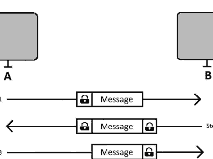

图 13.4
TPP 身份验证过程。

## 实体身份验证

| 消息 C1 | $E_{K_A}(X)$ | 私钥 $k_B$ |
| :--- | :--- | :--- |
| A 发送的信息 | $E_{K_B}(E_{K_A}(X))$ | 消息 C2 |
| 私钥 $k_A$ | $E_{K_A}(E_{K_B}(E_{K_A}(X))) = E_{K_A}(E_{K_B}(X)) = E_{K_B}(X)$ | B |
| 消息 C3 | B 获得的信息 |

图 13.5
Shamir 的 TPP 说明

- 1. 有两个用户 A 和 B。两者都会随机选择自己的私钥 $K_A$ 和 $K_B$。
- 2. A 将使用自己的密钥 $K_A$ 对消息进行加密并发送给 B。密文将为 $C_1 = E_{K_A}(X)$。
- 3. 当 B 接收到消息时，他/她会将其视为明文并使用自己的密钥 $K_B$ 进行加密，然后发回给 A。密文将为 $C_2 = E_{K_B}(C_1) = E_{K_B}(E_{K_A}(X))$。
- 4. 当 A 接收到消息时，他/她将使用自己的密钥 $K_A$ 对其进行解密。根据可交换属性，$E_{K_1}(E_{K_2}(X)) = E_{K_2}(E_{K_1}(X))$ 密文将为：
C_3 = E_{K_A}^{-1}(E_{K_B}(E_{K_A}(X))) = E_{K_A}^{-1}(E_{K_B}(X)) = E_{K_B}^{-1}(E_{K_A}(E_{K_B}(X)))$。然后，A 将 $C_3$ 发送给 B。
- 5. B 将接收到消息并使用自己的密钥 $K_B$ 对其进行解密，他/她将能够成功读取消息。

### 13.7.2 Massey–Omura 密码系统

这是一种密码机制，使用私钥密码学在传输时保护消息。Massey–Omura 密码系统具有一些使其容易受到密码分析者攻击的特征。这种使用素数模数的密码系统被视为指数系统。因此，如果密码分析者能够获得加密密钥和模数，他/她将能够推导出通信方的私钥并轻松解密消息。Massey–Omura 密码系统使用可交换函数对消息进行加密和解密，如第 13.7.1 节所述。Massey–Omura 密码系统及其对应协议在 Winton（2007）中解释如下：

- 1. 应选择一个字母表，例如 A。
- 2. 必须确定消息的最大长度 $N$。因此，$N$ 是每条消息的字符最大长度。
- 3. 方案 $S$ 被选用来将消息从字母形式转换为数字形式，反之亦然。


4. 整数 $L$ 是最大整数，并被视为消息的代表。它由 $A$、$N$ 和 $S$ 选择。

5. 素数 $p > L$ 被确定为网络的模数。

6. 整数 $w_i$ 被确定为加密密钥 $\text{gcd}(w_i, p-1) = 1$，适用于每个网络成员。

7. 为每个成员计算解密密钥 $x_i = w_i^{-1}(\mod p-1)$。$x_i$ 的可用性得以保证，因为 $w_i$ 是模 $p-1$ 的单位群的元素，其中 $x_i$ 的计算使用欧几里得算法完成。

8. 网络中的每个成员将分别获得加密和解密密钥 $w_i$ 和 $x_i$。

9. 参数 $A, N, S, L$ 和 $p$ 发布在中心目录中。此外，$w_i$ 和 $x_i$ 是私钥。这些私钥为密钥中心以及被分配给它们的网络成员所知。

在通信协议中，有两个参与方 Bob 和 Sue。假设 Bob 拥有 $w_i = t$，而 Sue 拥有 $x_i = u$ 和 $x_j = v$ 密钥。Bob 将按以下流程向 Sue 发送消息：

- 1. Bob 使用字母表 $A$ 格式化他的消息，其中 $M$ 不应超过最大长度 $N$。
- 2. 消息 $m$ 将由 Bob 使用方案 $s$ 从其原始字母形式转换为数值形式 $M \le L$。
- 3. Bob 通过计算 $M(\mod p)$ 对 $M$ 进行加密并发送给 Sue。
- 4. Sue 也通过计算 $(M'(mod p))^r(\mod p) = M''(\mod p)$ 对 $M$ 进行加密并发回给 Bob。
- 5. Bob 通过计算 $(M''(\mod p))^t(\mod p) = (M')^t(\mod p)$ 部分解密 $M$，因为 $t = r^{-1}(\mod p-1)$，则 $rt = 1+s(p-1)$，其中 $s$ 为某个整数。$(M'')(\mod p) = (M')^{1+s(p-1)}(\mod p) = M \cdot \{M^{-1}\}^s(\mod p).$ 然而，如果 $M \le L < p$ 且 $p$ 为素数，则 $\text{gcd}\{M,p\}=1$。因此，根据费马定理，$M^{p-1}=1 \mod p$，$M'' = (M')^t(\mod p) = M(\mod p)$。Bob 将其发送给 Sue。
- 6. Sue 继续解密过程，通过计算 $(M''(\mod p))^v(\mod p) = M''(\mod p)$，与上述第五步相同，因为 $v = u^{-1}(\mod p-1)$。此外，$M(\mod p) = M$，因为 $M \le L < p$。
- 7. Sue 通过方案 $s$ 将 $M$ 转换回其原始字母形式 $m$，她将能够读取该消息。

## Entity Authentication

### 13.8 3D Secure
它也称为 Three-Domain Secure。它由 Visa International Service Association 开发（2002a,b）。3D secure 协议的主要思想是在线支付和电子商务交易时允许发卡机构对持卡人进行身份验证。3D secure 包含三个域，并在 Assora 和 Shirvani（2006）中解释如下：

- 1. 发行方域：该域负责维护发卡机构与持卡人之间的关系。该域允许发卡机构使用访问控制服务器（ACS）对持卡人进行身份验证。
- 2. 收单方域：该域负责维护商户与收单方之间的关系。商户必须拥有一个称为商户插件（MPI）的特定程序，该程序负责建立和维护消息的流程。
- 3. 互操作域：该域负责维护发行方域与收单方域之间的关系。该域有两个要素。第一个是 visa 目录服务器，负责从某个商户卡号获取请求并将其传输到 ACS，然后将结果从 ACS 发送回商户。第二个是身份验证历史服务器，记录每次成功或不成功的身份验证尝试。

### 13.9 Conclusion
用户身份验证是网络安全最重要的方面之一。该方面是各种研究人员的目标，以便确保信息技术所有应用中的用户隐私。在本章中，我们讨论了许多实体身份验证协议和技术及其应用。这些协议和技术的优点也已提及。本章对以身份验证为研究领域的科研人员有所帮助。

## References
Abdullah, A. A., Khalaf, R., & Riga, M. 2015. "基于 Hill–Cipher 算法的可实现量子三遍协议认证." Mathematical Problems in Engineering 2015(481824): 6 pages. doi:10.1155/2015/481824.

Aboba, B., Blunk, L., Vollrecht, J., Carlson, J., & Levkowetz, H. 2004. "可扩展认证协议（EAP）：" 1–67.

Ahmed, N., & Jensen, C. D. 2010. "实体身份验证的定义。" In Security and Communication Networks (IWSN), 2010 2nd International Workshop on IEEE, Karlsruhe, Sweden: 7.

Assora, M., & Shirvani, A. 2006. "增强 3-D secure 的安全性和效率。" In International Conference on Information Security, Springer, Berlin, Heidelberg: 489–501.

Forouzan, B. A. & Fegan, S. C. 2007. 数据通信与网络. 4th Edition. McGraw-Hill, New Delhi, India. http://www.google.com/books?id=E01mAEACAJpgis=1

Forouzan, B. A., & Mukhopadhyay, D. 2011. 密码学与网络安全. 2nd Edition. McGraw-Hill Education, New Delhi, India

Ghilen, A., Azizi, M., & Boualague, R. 2015. "CHAP 协议中量子密钥分发方案的集成与形式化安全分析。" In Computer Systems and Applications (IJCCSA), 2015 IEEE/IACS 12th International Conference of IEEE, Marrakech, Morocco.

Haller, N. 1995. "S/KEY 一次性密码系统。" http://www.faqs.org/rfcs/rfc1760.html.

Inamura, M. 2015. "CHAP 的扩展。其数据包和数据交换结构上的无修改。" In Information Systems and Privacy (ICISS), 2015 International Conference on IEEE, Angers, France.

Kiza, J. M. 2005. "第 1 章：网络安全。" Computer Network Security. Springer & Business Media, New York. http://www.springer.link/index/10.1007/978-3-540-73986-9.

Lang, J. 2012. "基于 Shamir 三遍密码协议和多因子快速傅里叶变换的无交换安全图像共享方案。" Optics Press 20(3): 2386–93

Liu, S., & Stavrou, M. 2001. "生物特征安全实用指南。" IT Professional 3(1):27–32.

Matyáš, V., & Riha, Z. 2002. "生物特征身份验证的安全性和可用性。" In Advanced Communications and Multimedia Security (pp. 227–39), Springer, Boston, MA.

Ratha, N. C., Connell, J. H., & Role, R. M. 2001. "增强基于生物特征的身份验证系统的安全性和隐私性。" IBM Systems 40(3): 61–64.

Szabour, A. P., & Stavrou, A. November 2008. "使用图形密码的通用多因素身份验证。" In 2008 IEEE International Conference on Signal Image Technology and Internet Based Systems, Bali, Indonesia: 625–62.

Sahaan, A. P. U. 2016. "Hill Cipher 加密技术中的三遍协议概念。" Seminar Nasional Aplikasi Informatika (SNATI) 5(7): 31–35.

Vaithyasubramanian, A., Christy, A., & Saravanan, D. 2015. "为有效信息保存提供支持的安全登录的双因素身份验证。" ARPN Journal of Engineering and Applied Sciences 10(5): 2053–56.

Van Tilborg, H. C., & Cajajodia, S. (Eds.). 2016. 密码学与安全百科全书. Springer Science & Business Media, New York, USA.

Visa International Service Association. 2002a. "3-D secure 协议规范：核心功能版本 1.0.2。"

Visa International Service Association. 2002b. "3-D secure 协议规范：系统概述版本 1.0.2。"

Winther, B. 2002. "增强 Massey-Omura 密码系统。" Journal of Mathematical Sciences and Mathematics Education 7(1): 21–29.

Xiao-rong, C., Qi-yuan, F., Chao, D., & Ming-quan, Z. 2005. "基于 OTP 和 Kerberos 的身份验证技术研究与实现。" In Proceedings–Eighth Conference on High-Performance Computing in Asia-Pacific Region, HPC Asia 2005: 409–413.

## Emerging Algorithms and Techniques

## Message Authentication
Ajay Prasad and Jatin Sethi
University of Petroleum and Energy Studies

## CONTENTS
- 14.1 Introduction............................................................................... 226
- 14.2 Message Authentication.................................................................. 227
- 14.2.1 Message Integrity............................................................... 227
- 14.2.2 Data Origin Authentication.............................................. 227
- 14.2.3 Non-Repudiation...................................................................... 228
- 14.2.4 Hash Functions...................................................................... 228
- 14.2.5 Message Digest........................................................ 228
- 14.3 Introduction to Hash Functions................................................... 229
- 14.3.1 Introduction to Logic of Message Digest Algorithms...... 230
- 14.3.2 MD2................................................................................ 230
- 14.3.3 MD4................................................................................ 230
- 14.3.4 MD5................................................................................ 231
- 14.3.5 MD6................................................................................ 232
- 14.4 Secure Hash Algorithm....................................................... 233
- 14.4.1 SHA-1............................................................................... 233
- 14.4.2 SHA-2............................................................................... 233
- 14.4.3 SHA-256........................................................................... 234
- 14.5 Message Authentication Code.............................................. 235
- 14.5.1 Requirement for MAC.................................................. 235
- 14.5.2 Introduction to MAC Based on Block Ciphers................ 235
- 14.5.3 Introduction to MAC Based on Iterated Hash Function...... 236
- 14.5.3.1 General Method.................................................. 236
- 14.6 Hash Message Authentication Code (HMAC).......................... 237
- 14.6.1 MAC Based on Hash Functions....................................... 237
- 14.6.2 Design Objectives of HMAC....................................... 237
- 14.6.3 HMAC Algorithm....................................................... 237
- 14.6.4 HMAC Security....................................................... 238
- 14.7 Cipher-Based Message Authentication (CMAC)................ 239
- 14.7.1 MAC Based on Block Ciphers.................................. 239
- 14.7.2 Design Objectives of CMAC.................................. 240
- 14.7.3 CMAC Algorithm..................................................... 240
- 14.7.4 CMAC Security....................................................... 240
- 14.8 Whirlpool.................................................................. 241
- 14.8.1 Design Objective of Whirlpool.............................. 241
- 14.8.2 Whirlpool Algorithm........................................ 241
- 14.8.3 Whirlpool Performance....................................... 242


-   14.9 RACE 完整性原语消息摘要 (RIPEMD)................................................ 242
-   14.9.1 RIPEMD 简介 ................................................................. 242
-   14.9.2 RIPEMD 的起源与设计目标...................................................... 242
-   14.9.3 RIPEMD-160、320 算法........................................................... 242
-   14.9.4 RIPEMD-128、256 算法......................................................... 243
-   14.10 BLAKE...................................................................................................... 244
-   14.10.1 BLAKE 简介............................................................................... 244
-   14.10.2 BLAKE 的起源与设计目标...................................................... 244
-   14.10.3 BLAKE-256、512 算法....................................................... 244
-   14.10.3.1 初始化...................................................................................... 244
-   14.10.3.2 轮函数..................................................................... 244
-   14.10.3.3 终结化....................................................................... 245
-   14.11 光谱哈希.................................................................................... 245
-   14.11.1 光谱哈希简介..................................................... 245
-   14.11.2 光谱哈希的起源与设计目标.................................. 246
-   14.11.3 光谱哈希算法....................................................... 246
-   14.12 结论...................................................................................... 247
-   参考文献................................................................................................. 247

## 14.1 引言

密码学中最复杂的领域之一是消息认证。消息认证工作于三个不同的模块。第一个模块涉及密钥生成；第二个模块是算法，该算法以密钥和消息作为输入并生成 MAC；第三个模块需要一个用于验证的算法，即验证算法，该算法在接收方验证 MAC。密码学哈希函数以消息作为输入并生成一个称为哈希的值，该值用于验证消息完整性。MAC 和密码学哈希函数共同点很少，但它们具有一定的安全要求。在一端，MAC 确保认证，而哈希确保完整性。但 MAC 和哈希可以结合起来以同时确保认证和完整性。

本章将重点介绍用于计算消息认证码和哈希算法的方法。本章使用的技术/术语在出现处或“关键术语与定义”部分进行了解释。为了方便高级读者，从常规参考文献中，将在“进阶/进一步阅读参考资料”中包含额外参考文献。

哈希函数在消息认证中发挥核心作用，其中哈希函数是迭代算法，对任意长度的消息进行操作并产生固定长度的输出。有多种不同的算法可以实现消息摘要，如 MD2、MD4、MD5、MD6、安全哈希算法 1 (SHA 1)、SHA 256、SHA 512、HMAC 等。

MAC 函数确实具有安全要求。MAC 应该是安全的，使得攻击者无法在不进行不可能量的计算的情况下猜出 MAC。MAC 值由相同的密钥生成和验证，因此它与数字签名不同，这意味着在通信开始时，发送方和接收方就一个共同的秘密私钥达成一致，该密钥将用于 MAC。因此，MAC 在通信中不提供不可否认性功能。

## 14.2 消息认证

消息认证是使发送方和接收方能够维护共享消息完整性的机制。它允许发送方以这样的方式发送消息给接收方：如果消息在到达接收方之前在信道中被修改，接收方一定会检测到。以下是在网络中此类通信中识别出的攻击：

-   1. 泄露：数据被泄露给任何未经授权的人员。
-   2. 流量分析：拦截发送方和接收方之间的流量并分析收集到的数据以做出推断。
-   3. 冒充：向接收方发送欺诈性消息并向发送方发送欺诈性确认
-   4. 内容修改：编辑消息中包含的数据
-   5. 序列修改：更改共享消息的顺序。
-   6. 时序：延迟或重放已发送的消息。它甚至可能涉及重建相关各方之间的整个会话对话。
-   7. 源否认：源方否认发送消息
-   8. 目的否认：目的方否认已接收消息。

在定义的攻击中，消息认证可以解决攻击 (3) 至 (6)。攻击 (7) 可以通过数字签名处理，数字签名也是一种消息认证机制。

### 14.2.1 消息完整性

完整性是信息安全的三大支柱之一。消息认证有助于维护完整性，因为它确保接收到的消息与发送方发送的消息完全一致——没有任何数据被添加、删除或修改。如果没有机制来确保网络的安全性，网络就会容易受到中间人攻击的侵害，这会严重影响发送消息的完整性。

### 14.2.2 数据来源认证

验证接收到的消息的来源对个人或一方来说非常重要。应该有一个机制来验证中间没有人篡改消息然后转发给接收方。例如，如果用户向银行中央计算机发送存款交易详情并使其看起来像是银行分支机构发送的，就很容易赚很多钱。如果未经授权的用户欺骗机器使其认为接收到的消息是由系统管理员发送的，他就可以提升其权限。如果没有消息认证机制，接收方就无法验证消息的来源，这会导致黑客实施各种攻击。

### 14.2.3 不可否认性

不可否认性意味着确保某人不能否认其行为。如果一份法律文件正在签署，需要见证人，以便签署文件的人不能否认。同样，关于通信，一方或个人发起了一条消息或发送了一些文件，他们不能否认，也不能质疑其签名的原创性。数字签名用于确保不可否认性。

数字签名是一种电子签名形式，基本上是指电子生成的签名。它使用非对称密码学来确保完整性和不可否认性。

数字签名方案通常包含三种算法：

-   1. 密钥生成算法，生成随机私钥和相应的公钥。
-   2. 签名算法以私钥和消息作为输入并生成签名作为输出。
-   3. 签名验证算法以公钥、消息和签名作为输入，并判断消息的真实性是否完好。

### 14.2.4 哈希函数

哈希函数是一个函数，它接受可变长度的数据输入并返回固定大小的哈希值。生成的哈希具有均匀分布且是随机的。哈希函数的优点是输入数据发生变化时，哈希值会发生变化，这用于消息认证。密码学哈希函数用于安全目的。由于哈希是一个单向函数，部分数据被修改。它无法生成预指定的哈希值，因此创建难以找到的哈希函数变得很重要 (Holden, 2013)。除非数据完全相同，否则没有数据集会生成相同的哈希。由于这些好处，哈希函数用于检查消息的真实性，即消息内容是否被修改。在密码学哈希函数中，数据输入的填充被填充到固定长度的索引中，填充包含实际消息的长度（以位为单位）(Hsieh et al., 1999)。发送方和接收方都通过哈希函数计算哈希值，如果在发送前值匹配，则消息的完整性得以保持，否则在发送后已被篡改（图 14.1）。

### 14.2.5 消息摘要

消息摘要是一种密码学哈希函数，它接受任意长度的输入并将其转换为预定义固定长度的输出，称为哈希或摘要。摘要

## 消息认证

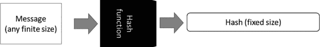

图 14.1 哈希函数。

哈希函数用于保护数据的完整性并检测消息任何部分的修改或更改。该输出取代原始输入。这有很多好处。首先，输出始终具有相同的长度，这有助于更好地存储和处理数据。其次，输出会短得多，存储可以更高效地进行。有多种不同的算法可以实现消息摘要，如 MD2、MD5、MD4、MD6、安全哈希算法 1（SHA 1）、SHA 256、SHA 512、HMAC 等。

### 14.3 哈希函数简介

哈希函数是非常有用的函数，它们具有某些特性，使其非常适合密码学。这些特性依赖于使其独特的数学算法。它是一种算法，接受任意输入并产生固定大小的输出。这里输入是消息或媒体，输出是摘要或消息摘要。单向哈希函数使其不可逆。这意味着输入数据无法通过暴力破解可能的输入、期望碰撞或使用匹配哈希的彩虹表来重建。哈希函数具有某些特性。其中一些描述如下：

- 1. 预像抗性
假设你有一个给定的值 $h_i$，不应轻易发现消息 $m$ 使得 $h = hash(m)$。

- 2. 第二原像抗性
假设我们有一个消息 $m1$，发现另一个不同的消息 $m2$ 使得 **hash(m1) = hash(m2)** 应该是困难的。换句话说，对哈希函数的解密应导致单一消息。

- 3. 碰撞抗性
假设我们有一个输入消息 $m1$，其哈希不应与另一消息 $m2$ 的哈希相吻合。换句话说，**hash(m1) = hash(m2)** 应该是假的。

非正式地说，这些关于哈希函数的属性旨在阻止恶意对手在不改变其摘要的情况下替换或修改输入数据。这确立了准确性和正确性。因此，如果两个字符串具有相同的摘要，它们应该是相同的。另一方面，第二原像抗性阻止攻击者伪造数据表面，将哈希作为攻击者无法控制的文档。碰撞抗性因此禁止其恶意攻击者创建两个具有相同摘要的不同文档。

### 14.3.1 消息摘要算法逻辑简介

算法以任意长度的输入作为消息，并因此创建输出——指纹是输入的 128 位消息哈希。消息摘要的工作原理是，在计算上不可行或困难地产生两个具有相同消息摘要或哈希的输入，或产生具有预定义哈希或摘要的任何消息。

消息摘要算法的简单逻辑是，任意输入在发送方端通过哈希函数传递。哈希函数将其摘要形成消息摘要。在接收方，此摘要通过匹配哈希的彩虹表或已知哈希进行解密。如果哈希摘要与输入摘要相同，则接受为未被篡改的数据。如果不匹配，则丢弃。

所有消息摘要算法都创建 128 位输出哈希。

### 14.3.2 MD2

该算法按以下五个步骤工作：

- 1. 追加填充
消息按 128 位或 16 字节的倍数进行填充，这是块长度，以使其成为 16 字节的倍数。
- 2. 追加校验和
在上一步中创建的消息附加 16 字节的校验和。为此，使用 256 位随机置换。
- 3. 初始化 MD 缓冲区
使用一个已初始化为零的新缓冲区。它是一个 48 位辅助缓冲区，用于计算摘要值。
- 4. 以 16 字节块处理消息
此处使用与步骤 2 中使用的类似的 256 字节置换。循环对每个处理的 16 个输入字节将辅助缓冲区中的每个字节置换 18 次。
- 5. 输出
当所有块都已处理后，辅助块的第一部分块成为消息摘要。

MD2 消息摘要易于实现并提供消息的指纹。两个消息得出完全相同的消息哈希的难度为 $2^{64}$，而从消息摘要得出消息的难度为 $2^{128}$。

### 14.3.3 MD4

MD4 算法被创建为在 32 位机器上快速运行。它不需要像 MD2 那样的大型替换表，并且算法可以相当高效地编码。

该算法按以下五个步骤工作：

- 1. 追加填充字节
任何消息的 448 位哈希值形成模 512。该填充是通过向消息添加单个“1”位并附加零位来实现的，从而使填充后的消息与 448 同余，模 512。

- 2. 追加长度
在填充后，将 64 位原始消息表示（填充位添加前的原始消息长度）附加到结果上。因此，消息长度是 512 的倍数。

- 3. 初始化 MD 缓冲区
使用 4 个字缓冲区来计算消息哈希。所有这些字都是 32 位寄存器。这些寄存器初始化为表 14.1 中给出的某些预定义值。

- 4. 以 16 字节块处理消息
此步骤定义了三个辅助函数，它们处理三个输入字以产生 32 位输出。

```
F(B,C,D) = (B ∧ C) ∨ (¬B ∧ D)
G(B,C,D) = (B ∧ C) ∨ (B ∧ D) ∨ (C ∧ D)
H(B,C,D) = B ⊕ C ⊕ D
```

⊕、∧、∨、¬ 分别表示 XOR、AND、OR 和 NOT 运算符。

- 5. 输出
作为消息摘要产生的 A、B、C、D 是输出。A 的低位字节转换为 D 的高位字节。

MD4 摘要易于实现，提供消息的指纹。两个消息得出相同消息摘要的难度约为 $2^{64}$，而从消息摘要得出消息的难度为 $2^{128}$。

表 14.1
用于初始化 MD4 算法 MD 缓冲区的预定义值

| 词 A | 01 | 23 | 45 | 67 |
| 词 B | 89 | ab | cd | ef |
| 词 C | fe | dc | ba | 98 |
| 词 D | 76 | 54 | 32 | 10 |

### 14.3.4 MD5

MD5 算法是 MD4 摘要算法的进一步扩展。与速度相比，它较慢但更保守。

该算法按以下五个步骤工作：

- 1. 追加填充字节
任何消息的 448 位哈希值形成模 512。填充是通过向消息添加单个“1”位并附加零位来实现的，从而使其与 448 同余，模 512。

## 新兴安全算法与技术

表 14.2

用于初始化 MD5 算法 MD 缓冲区的预定义值

| 词 A | 01 | 23 | 45 | 67 |
| 词 B | 89 | ab | cd | ef |
| 词 C | fe | dc | ba | 98 |
| 词 D | 76 | 54 | 32 | 10 |

- 2. 追加长度
在填充后，将 64 位原始消息表示（填充位添加前的原始消息长度）附加到结果上。因此，消息长度是 512 的倍数。

- 3. 初始化 MD 缓冲区
使用 4 个字缓冲区来计算消息摘要。所有这些字都是 32 位寄存器。这些寄存器初始化为表 14.2 中给出的某些预定义值。

- 4. 以 16 字节块处理消息
此步骤定义了三个辅助函数，每个函数处理三个输入字以产生 32 位输出字。

```
F(B,C,D) = (B ∧ C) ∨ (¬B ∧ D)
G(B,C,D) = (B ∧ C) ∨ (C ∧ D)
H(B,C,D) = B ⊕ C ⊕ D
I(B,C,D) = C ⊕ (B ∨ ¬D)
```

⊕、∧、∨、¬ 表示 XOR、AND、OR 和 NOT 运算符。

- 5. 输出
A、B、C、D 是作为输出产生的消息摘要。A 的低位字节转换为 D 的高位字节。

MD5 摘要易于实现并提供消息的指纹。两个消息得出消息摘要的难度约为 $2^{64}$，而从消息摘要得出消息的难度为 $2^{128}$。

### 14.3.5 MD6

MD6 是密码学中的哈希函数，使用类似 Merkle 树的结构。这种树结构用于对长输入进行巨大的并行和同时哈希计算。哈希树或 Merkle 树由每个叶节点作为特定数据块的哈希组成，每个非叶节点作为其子节点的哈希组成。对于大型数据结构，可以通过哈希树允许高效和安全的验证。

MD6-256 的 MD6 性能高达每字节 28 个周期，在 Intel Core 2 Duo 处理器上运行，并提供一定的差分密码分析抵抗力。

MD6 仍在开发中，作为 SHA-3（安全哈希算法）的替代品，但由于速度问题未能取代它。


## 消息认证

## 14.4 安全哈希算法

单向哈希函数是迭代算法，它们在任意长度的消息上操作并返回固定长度的输出，$h$，称为消息摘要或哈希值。在我们现有的计算能力下，理论上不可能/几乎不可能对不同的输入得到两个相同的哈希值。
以下是一些 SHA 算法的示例：

- SHA-1
- SHA-2
- SHA-256 (from family of SHA-2)
- SHA-192 (proposed)

### 14.4.1 SHA-1

SHA-1 是由国家标准与技术研究院（NIST）发布的一种密码哈希函数。三种 SHA 算法为 SHA-0、SHA-1 和 SHA-2。SHA-0 算法未在许多应用中使用。另一方面，SHA-2 与 SHA-1 哈希函数不同。SHA-1 是使用最广泛的哈希函数。
然而，使用最广泛的是 SHA-1 和 SHA-256。
SHA-1 哈希函数执行 80 次（0-79）迭代以生成消息摘要，其变换轮由简单的加法、旋转和非线性函数（NLFs）$f[16]$ 组成。

```
$f(t;B,C,D)=(B \AND\ C) \OR\ ((NOT\ B) \AND\ D) \quad (0\le t\le 19)$$
$f(t;B,C,D)=B \ XOR\ C \ XOR\ D \quad (20\le t\le 39)$$
$f(t;B,C,D)=(B \AND\ C) \OR\ (B \AND\ D) \OR\ (C \AND\ D) \quad (40\le t\le 59)$$
$f(t;B,C,D)=B \ XOR\ C \ XOR\ D \quad (60\le t\le 79)$
```

其中 $B, C$ 和 $D$ 为 32 位字。
关于所需的 80 个 $W$，前 16 个是通过将 512 位输入消息块分解为 32 位字形成的，每个字对应一个 32 位 $W$ 值。
剩余的 64 位通过以下方程产生：

```
$W_i = ROTL(W_{i-3} \, W_{i-8} \-, W_{i-14} \+, W_{i-16})$
```

$16\le t\le 79$，其中 ROTL 表示 $x$ 次左位旋转（图 14.2）。

### 14.4.2 SHA-2

SHA-2 哈希标准规定了四种哈希算法，SHA-224、SHA-256、SHA-384 和 SHA-512。所有算法都是迭代的单向哈希函数，可以处理消息以产生哈希表示（见表 14.3）。

## 新兴安全算法与技术

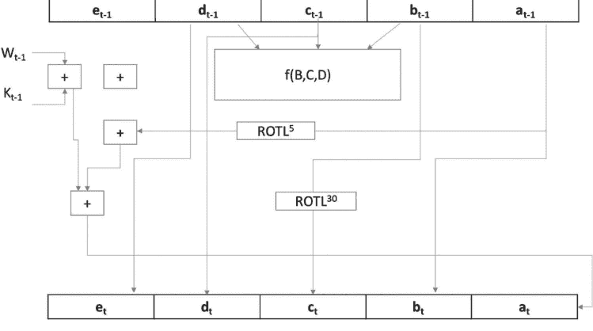

图 14.2
SHA-1.

表 14.3
安全哈希算法比较
| 算法 | 字 | 消息大小 | 块 | 摘要 |
| --- | --- | --- | --- | --- |
| SHA-224 | 32 | <2^64 | 512 | 224 |
| SHA-256 | 32 | <2^64 | 512 | 256 |
| SHA-384 | 64 | <2^128 | 1,024 | 384 |
| SHA-512 | 64 | <2^128 | 1,024 | 512 |

### 14.4.3 SHA-256

SHA-256 需要 64 次迭代来产生其消息摘要。其变换轮与 SHA-1 轮相似，包括加法器和逻辑函数按顺序排列以产生轮的输出值。所包含的 NLFs 如下：

> Ch(t;B,C,D) = (B AND C) OR ((NOT B) AND D)

> Maj(t;B,C,D) = (B AND C) OR (B AND D) OR (C AND D)

> Summation(x)(0-256) = ROTR2(x)  ROTR13(x)  ROTR22(x)

> Summation(x)(1-256) = ROTR6(x)  ROTR11(x)  ROTR25(x)

其中 ROTRx 表示 x 次右循环旋转。

与 SHA-1 类似，关于所需的 64 个 W 值，SHA-1 和 SHA-256 架构均由两条计算路径组成，即数据路径和控制路径。构成控制路径的控制单元块（一组计数器）产生并发送控制信号给变换轮和 W 单元，两者均构成数据路径（图 14.3）。

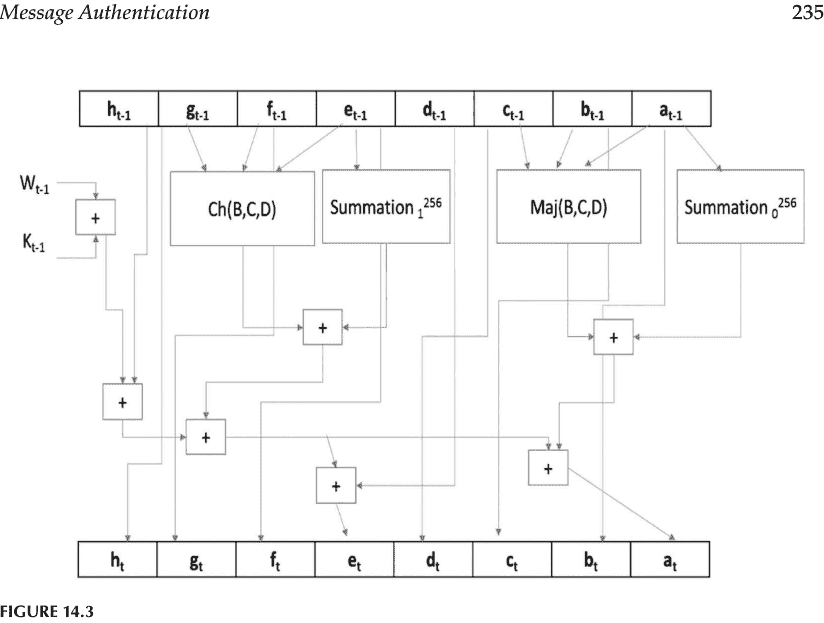

## 14.5 消息认证码

### 14.5.1 MAC 的要求

消息认证码是一段用于验证信息发送方权威性和消息完整性的认证信息。它还通过允许并验证消息内容任何更改来保护数据的完整性和真实特性。消息认证码：从一个系统向另一个系统发送敏感和关键数据的基本要求；被认为是网络传输数据的最佳实践。

### 14.5.2 基于分组密码的 MAC 简介

如果 MAC 由分组密码构造，则使用 AES 或类似算法使加密更强更可靠。现在在 CBC（密码分组链接模式）中使用 AES 将使消息更安全。CBC（密码分组链模式）：它是一种基于分组的密码操作，其中比特序列作为单个单元加密。分组密码使用一定长度序列的初始向量；其关键特性是使用链式机制，导致密文块的解密取决于所有先前的密文块。

### 使用 CBC 的 MAC 生成

- 将消息划分为块 $a_i$。
- 计算第一次迭代 $b_1 = e_1(a_1 \oplus IV)$，其中 IV 为初始向量
- 对后续块计算 $b_i = e_i(a_i \oplus b_{i-1})$
- 最后的块是 MAC 值：$m = MAC_n(a) = b_n$

### 使用 CBC 的 MAC 验证

- 重复 MAC 计算（$m'$）
- 比较结果：如果 $m' = m$，则消息已验证且正确。
- 如果 $m' \neq m$，则消息和或 MAC 值 m 在传输过程中已被篡改

### 14.5.3 基于迭代哈希函数的 MAC 简介

MAC 的安全性取决于底层哈希算法的安全性，而几乎所有哈希函数都是迭代的。
哈希函数将长或可变长度的字符串转换并映射为固定长度的字符串。
但使用哈希函数需要保护摘要 $h(n)$，否则摘要本身可能被篡改。此问题通过使用 MACs 得到解决，因为它们是带密钥的哈希函数。这是一种对称加密方案：发送方和接收方共享一个秘密密钥（图 14.4）。

### 14.5.3.1 通用方法

输入 $a$ 被填充为块大小的倍数，并被划分为 $t$ 个块，记为 $a_i$ 至 $n$。
它按块逐块处理。中间结果存储在一个 $n$ 位（$n \geq m$）的变动变量 $H_i$ 中；
$H_0 = IV \quad H_i = f(H_{i-1}, a_i), 1 \leq i \leq t \quad h(a) = g(H_i)$，其中 $g$ 为输出变换

重要的是固定 $IV$（初始向量）的值并预编码消息。

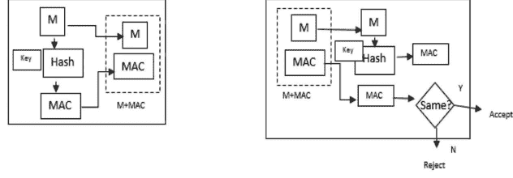

图 14.4
MAC.

## 14.6 哈希消息认证码（HMAC）

### 14.6.1 基于哈希函数的 MAC

HMAC 表示仅使用密码哈希函数应用消息认证码算法。使用哈希函数的消息认证码比使用分组密码的消息认证码更高效，其中哈希函数如 MD5 和 SHA-1 比分组密码加密函数如 DES 快得多。在设计像 SHA 这样的哈希函数时，其作为 MAC 的用途并未考虑，因此不能直接用于同一目的，因为其使用不包括秘密密钥。已提出各种提案以将秘密密钥纳入哈希函数。HMAC 是实现 IP 安全以及许多其他 Internet 协议的 MAC 的强制要求。

### 14.6.2 HMAC 的设计目标

HMAC 列出的设计目标如下：

- 1. 使用那些代码可免费获得且在软件中具有高效性能的哈希函数。
- 2. 如果发现更快或更安全的哈希函数，嵌入的哈希函数应易于替换。
- 3. 哈希函数的实际效率不应降低。
- 4. 密钥应以简单的方式处理。
- 5. 应对与哈希函数相关的所需任务进行适当的密码分析，以评估认证程序的强度。

由于软件开发目的，前两个非常重要。HMAC 将哈希函数视为黑盒。它有两个优点。首先，哈希函数作为模块可用于实现 HMAC。因此，大多数 HMAC 代码已编译完成，可在最少定制的情况下使用。如果需要替换 HMAC 中的现有哈希函数，唯一需要做的是用另一个哈希函数模块替换一个哈希函数模块。此外，如果一个哈希函数的安全性受损或效率降低，哈希函数可以轻松替换为更安全或更高效的哈希函数。

### 14.6.3 HMAC 算法

HMAC 的整体操作可如下解释（图 14.5）：

```
H = Embedded hash function.
I = Initial input value to the hash function
M = Input message to HMAC
Yi = ith block of M, 0 ≤ i ≤ (N - 1)
N = Number of blocks in M
b = Number of bits in a block
n = Length of hash code produced by the hash function
```


## 238

## 新兴安全算法与技术

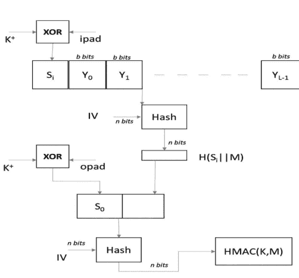

图 14.5
HMAC 算法。

$K = 密钥; 长度 $(K)$ 应大于或等于 $n$
$K^+ = K$ 在左侧用零填充以使长度（以位为单位）等于 $b$
ipad = 00110110（十六进制为 36）重复 $b/8$ 次
opad = $01011100$（十六进制为 5C）重复 $b/8$ 次

### HMAC 算法

> $HMAC(K,M) = H[(K^+ \oplus opad) \parallel H[(K^+ \oplus ipad) \parallel M]]$

该算法可解释如下：

- 1. 在 $K$ 的左端附加零以创建 $b$ 位字符串 $K^*$
- 2. $K^*$ 与 ipad 进行 XOR
- 3. 将 $M$ 附加到 $S_i$
- 4. 对步骤 3 中生成的流应用 $H$
- 5. $K^*$ 与 opad 进行 XOR 以生成 $b$ 位块 $S_o$
- 6. 将步骤 4 的哈希结果附加到 $S_o$
- 7. 对步骤 6 中生成的流应用 $H$ 并输出结果。

HMAC 执行所需时间与长消息的嵌入式哈希大致相同。HMAC 处理哈希压缩函数的三次执行之和。

### 14.6.4 HMAC 安全

HMAC 函数的安全性取决于嵌入式哈希函数的安全性。MAC 函数的安全性如何体现为攻击者在特定时间内花费的努力、成功攻击的概率？在给定的时间内，以给定的努力，攻击成功的概率等于对嵌入式哈希函数进行攻击成功的概率。MAC 只有在哈希函数失败时才会失败。哈希函数只能以以下方式被破坏：

- 1. 即使密钥是秘密且随机的，哈希函数中仍存在碰撞。
- 2. 攻击者计算压缩函数的输出，即使密钥是秘密、随机且攻击者未知。

在设计哈希-MAC 之前，我们对哈希函数的功效和效率做出了一些假设。所有这些假设都被成功攻击 HMAC 的攻击者所违背。第一次攻击是困难的，寻找哈希函数中的碰撞很容易，而在 HMAC 中嵌入的哈希函数中寻找碰撞要困难得多，因为在这种情况下密钥是未知的。
哈希函数的设计原则是确保随机性。这是避免碰撞的主要设计方法。如果第二次攻击成功，则意味着哈希函数的随机性较差。

总之，HMAC 仅在基于哈希函数设计的基础情况下失败。

## 14.7 基于密码的消息认证（CMAC）

### 14.7.1 基于分组密码的 MAC

基本上，使用操作分组密码的 MAC 有两种类型。一种是数据认证算法（DAA），现在在实践中并不常用，另一种是 CMAC，它旨在克服 DAA 的漏洞。
让我们谈谈 DAA。

DAA 多年来一直是最常用的 MAC 之一，但它已过时。它基本上基于数据加密标准。该算法使用初始化向量为零的 CBC 操作模式。数据（例如：消息、记录、文件或程序）首先被分组为连续的 64 位块 D1、D2、...、Dn。

如有必要，最后一个块在右侧用零填充以形成 64 位块。然后数据认证码（DAC）可按如下方式计算：

```
O₁ = E(K, D₁)
O₂ = E(K, D₂ ⊕ O₁)
O₃ = E(K, D₃ ⊕ O₂)
:
:
Oₙ = E(K, Dₙ ⊕ Oₙ₋₁)
```

### 14.7.2 CMAC 的设计目标

MAC 有一个限制，即只能处理固定长度的消息。（如果密码块大小和 $m$ 是任意固定正整数，则处理固定长度的 $mn$ 位。）并且它在合理的安全标准下是安全的。这一限制可以通过使用 AES 和三重 DES 的 CMAC 操作模式来克服。

### 14.7.3 CMAC 算法

CMAC 算法也称为 OMAC1，即单密钥 CBC-MAC 版本 1。它使用非常简单高效的方式使用分组密码的机制进行功能，并对每个经过认证的块进行完整加密。该设计非常简单，是 CBC-MAC 的一个小变体，与分组密码的 CBC 操作模式相似。

待认证的消息被划分为 $t$ 个块；这些块被迭代加密并与下一个待处理的块进行 XOR；只有最后一个块以另一种方式处理。它在加密前还与一个密钥相关常数（表示为 $R1$ 和 $R2=R1^*$）进行 XOR，并产生认证标签。这些常数在 CMACS 初始化期间计算，其目的是确保在处理可变长度消息时保持 CMAC 的安全性。CBC-MAC 本身对固定长度消息是安全的（图 14.6）。

### 14.7.4 CMAC 安全

CMAC 完全基于 AES 算法，这是一种强大的密码算法。我们知道任何密码算法的强度在于密钥 $k$ 以及所有参与系统中的实现准确性。为了消息的安全认证和完整性，密钥不得被泄露并应谨慎共享。它应被保密，并且密钥的创建方式应满足伪随机性要求。

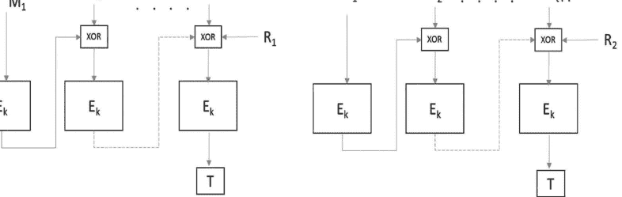

图 14.6
CMAC 算法。

## 14.8 Whirlpool

### 14.8.1 Whirlpool 的设计目标

对于所有数字签名和消息认证过程，最重要的部分是哈希函数。哈希函数接受可变大小的消息 M 作为输入，并生成固定大小的哈希码 H(m)，有时称为消息摘要，作为输出。
虽然有人说使用分组密码会引发许多安全漏洞，但 AES 作为分组密码是非常安全的。在 Whirlpool 的压缩中，同样使用了分组密码。
Whirlpool 具有以下特性：

- 1. 哈希码长度为 512 位，与 SHA 可用的最长哈希码相等。
- 2. 哈希函数的整体结构已被证明能够抵抗对基于分组密码的哈希码的常规攻击。
- 3. 底层分组密码基于 AES，并设计为在软件和硬件中提供实现，既紧凑又具有良好的性能。

### 14.8.2 Whirlpool 算法

给定由块序列 m1、m2、...、mt 组成的消息（图 14.7 和 14.8）：

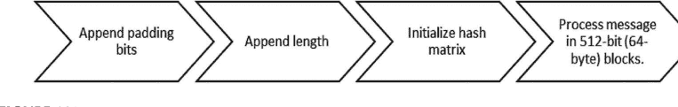

图 14.7
Whirlpool 设计。

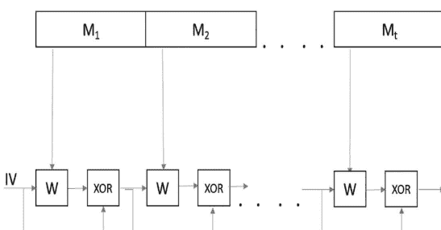

图 14.8
Whirlpool 算法。

### 14.8.3 Whirlpool 性能

NIST 对 Rijndael 的评估确定其在硬件和软件中均表现出良好的性能（执行速度），并且非常适合受限空间（低内存）要求。这些标准在选择 Rijndael 作为 AES 时非常重要。由于 Whirlpool 使用与 AES 相同的构建块并具有相同的结构，我们可以预期其具有相似的性能和空间特性。

## 14.9 RACE 完整性原语评估消息摘要（RIPEMD）

### 14.9.1 RIPEMD 简介

RIPEMD 是一种密码哈希函数，于 1990 年代后期在比利时 COSIC 研究组设计。它针对 32 位软件实现进行了优化。它由欧盟（EU）资助，以寻找长期解决方案，因为 RIPE 联盟对 MD4 和 MD5 的研究检测到了碰撞。它的设计原理是 MD4，而性能因素与 SHA-1 相似。它使用两个独立且并行的链同时组合形成结果。RIPEMD-160 如名称所示是 160 位哈希函数，其中 RIPEMD-128 是最快的变体，因为它提供 128 位哈希函数（Wang & Shen, 2014；Wang et al., 2005；Bosselaers et al., 1997）。

### 14.9.2 RIPEMD 的方向与设计目标

MD4 在 1990 年代很著名，但出现了碰撞，因此 R. Rivest 提出了 MD4 的新版本 MD5。当时，RIPE 联盟独立开展了一个项目，证明大约可以通过 1000 万美元在 6 天内找到碰撞计数，并且根据摩尔定律，计算能力翻倍甚至降低了建设成本，因此 MD5 不是长期安全解决方案。因此，他们决定构建 MD4 的安全版本，称为 RIPEMD。RIPEMD 基本上是两个并行的 MD4 版本同时运行，并对移位和消息顺序进行更改，而并行版本仅在轮数上有所不同。两个并行实例最后相加形成 128 位哈希，称为 RIPEMD-128。过了一段时间，RIPEMD-128 被发现存在攻击，于是推出了更新的 RIPEMD 版本 RIPEMD-160、RIPEMD-256，RIPEMD 在欧洲银行项目、数字签名、MAC 等领域得到应用。

### 14.9.3 RIPEMD-160、320 算法

RIPEMD-160 将 512 位输入块拆分，进一步分为 16 个 4 字节链。4 字节字符串使用 32 位数字的小端方法生成。一组 5 个 32 位实体形成 160 位哈希。为了完成哈希，在末尾添加填充以生成哈希。接下来最重要的一部分是压缩函数，它由两个哈希的 16 轮中的五个并行轮组成，即并行。因此，与 MD4 中的 48 轮相比为 160 轮。每个步骤使用五个寄存器和一个消息字处理一个新值。最后，通过将旧状态的每个字与左半部分的一个寄存器和右半部分的一个寄存器相加来找到新状态。


## 消息认证

### 表 14.4
消息字的置换

|  | 0 | 1 | 2 | 3 | 4 | 5 | 6 | 7 | 8 | 9 | 10 | 11 | 12 | 13 | 14 | 15 |
|---|---|---|---|---|---|---|---|---|---|---|---|---|---|---|---|---|
| $p(i)$ | 7 | 14 | 13 | 1 | 10 | 6 | 15 | 3 | 12 | 0 | 9 | 5 | 2 | 14 | 11 | 8 |

### 表 14.5
消息字的顺序

| 行 | 轮 1 | 轮 2 | 轮 3 | 轮 4 | 轮 5 |
|---|---|---|---|---|---|
| 左 | $id$ | $p$ | $p^2$ | $p^3$ | $p^4$ |
| 右 | $\pi$ | $\pi p$ | $\pi^2$ | $\pi^3$ | $\pi^4$ |

- 1. 一步中的操作。$A := (A + f(B, C, D) + X + K)^{\lll s}$ 且 $E$ 且 $C := C^{\lll 10}$。这里 <<< 表示对 $s$ 个位置进行循环移位（旋转）。
- 2. 消息字的排序。取置换 $p$（表 14.4），并进一步定义置换 $\pi$，设 $\pi(i) = 9i + 5$（mod 16）。消息字的顺序如表 14.5 所示。

## 14.9.4 RIPEMD-128、256 算法

RIPEMD-128 与 RIPEMD-160 之间的重要区别在于我们使用相同的 128 位哈希结果和链变量，仅使用四轮。

- 1. 一步中的操作
  $A := (A + f(B, C, D) + X + K)^{\lll s}$
- 2. 布尔函数
  在表 14.6 中定义布尔函数。
- 3. 常数
  取表 14.7 中所示数字的整数部分。

### 表 14.6
RIPEMD 中的布尔函数

| 行 | 轮 1 | 轮 2 | 轮 3 | 轮 4 |
|---|---|---|---|---|
| 左 | $F_1$ | $F_2$ | $F_3$ | $F_4$ |
| 右 | $F_4$ | $F_3$ | $F_2$ | $F_1$ |

### 表 14.7
RIPEMD 算法中常数的整数部分

| 行 | 轮 1 | 轮 2 | 轮 3 | 轮 4 |
|---|---|---|---|---|
| 左 | 0 | $230 * \sqrt{2}$ | $230 * \sqrt{3}$ | $230 * \sqrt{5}$ |
| 右 | $230 * \sqrt{2}$ | $230 * \sqrt{3}$ | $230 * \sqrt{5}$ | 0 |

## 新兴安全算法与技术

### 表 14.8
各类 BLAKE 算法的比较

| 算法 | 字 | 消息 | 块 | 摘要 | 盐 |
|---|---|---|---|---|---|
| BLAKE-224 | 32-bit | <2^64 bit | 512-bit | 224-bit | 128-bit |
| BLAKE-256 | 32-bit | <2^64 bit | 512-bit | 256-bit | 128-bit |
| BLAKE-384 | 64-bit | <2^128 bit | 1,024-bit | 384-bit | 256-bit |
| BLAKE-512 | 64-bit | <2^128 bit | 1,024-bit | 512-bit | 256-bit |

## 14.10 BLAKE

### 14.10.1 BLAKE 简介

BLAKE 是一种密码哈希函数，可用 32 位和 64 位版本。它还具有 512 位和 1024 位的块大小。详细信息见表 14.8。

### 14.10.2 BLAKE 的起源与设计目标

BLAKE 由 Jean-Philippe Aumasson、Luca Henzen、Willi Meier 和 Raphael C.-W. Phan 提出。它在一定程度上基于 Dan Bernstein 提出的 ChaCha 流密码。该算法是在美国国家标准与技术研究所组织的 SHA-3 哈希算法 NIST 哈希函数竞赛中开发的。它是 2008 年竞争的 51 个候选者之一，与另外四个函数一起进入决赛，但最终在 2012 年输给了成为 SHA-3 的 Keccak。2012 年 12 月下旬，BLAKE 的继任者 BLAKE2 被宣布，具有更改和改进，并被设定为取代 MD5 和 SHA-1 哈希算法，因为它们被广泛使用但已不再正常运行。

### 14.10.3 BLAKE-256、512 算法

#### 14.10.3.1 初始化
16 字状态被初始化，使得输入产生不同的初始状态。h-链值，C-常数，s-盐，t-计数器

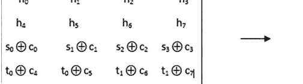

#### 14.10.3.2 轮函数
轮函数对状态 v 进行 14 次迭代（BLAKE-256）和 16 次迭代（BLAKE-512）。每一轮都基于单一核心函数 G 的变换：

```
G0(v0,v4,v8,v12) G1(v1,v5,v9,v13) G2(v2,v6,v10,v14) G3(v3,v7,v11,v15)
G4(v0,v5,v10,v15) G5(v1,v6,v11,v12) G6(v2,v7,v8,v13) G7(v3,v4,v9,v14)
```

其中，在第 r 轮，Gi(a, b, c, d) 设置

```
a \leftarrow a + b + (m[j] \oplus n[k])
d \leftarrow (d \oplus a) \ggg 26
c \leftarrow c + d
b \leftarrow (b \oplus c) \ggg 12
a \leftarrow a + b + (m[k] \oplus n[j])
d \leftarrow (d \oplus a) \ggg 8
c \leftarrow c + d
b \leftarrow (b \oplus c) \ggg 27
```

#### 14.10.3.3 终结化
新链值 $h'_0 - h'_{15}$ 从状态 $v_0 - v_{15}$ 中提取

```
$h'_0 \leftarrow h_0 \oplus s_0 \oplus v_0 \oplus v_8$
$h'_1 \leftarrow h_1 \oplus s_1 \oplus v_1 \oplus v_9$
$h'_2 \leftarrow h_2 \oplus s_2 \oplus v_2 \oplus v_{10}$
$h'_3 \leftarrow h_3 \oplus s_3 \oplus v_3 \oplus v_{11}$
$h'_4 \leftarrow h_4 \oplus s_0 \oplus v_4 \oplus v_{12}$
$h'_5 \leftarrow h_5 \oplus s_1 \oplus v_5 \oplus v_{13}$
$h'_6 \leftarrow h_6 \oplus s_2 \oplus v_6 \oplus v_{14}$
$h'_7 \leftarrow h_7 \oplus s_3 \oplus v_7 \oplus v_{15}$
```

## 14.11 频谱哈希

### 14.11.1 频谱哈希简介

当今世界的各个领域，如金融、媒体、取证、教育、医学等，都广泛使用数字图像。图像采集和图像存储如今也变得不那么复杂且成本更低，因此被广泛使用。这导致了图像检索问题，从而促成了基于哈希的图像检索方法的使用。这些方法比其他方法更高效，因为它们在图像的二进制代码上工作，而不是使用图像本身。但数字图像的问题不仅在于检索，还在于信任因素。它可以很容易地被任何编辑设备篡改。图像伪造可以有多种类型，如图像修饰、拼接和复制移动伪造。

频谱哈希（SH）技术用于为提取的特征生成二进制代码（Granty et al., 2016）。

它涉及复制移动伪造和图像检索。图拉普拉斯的稀疏化和篡改检测使用 SH PCT（极坐标余弦变换）执行，并用于图像检索过程。

### 14.11.2 频谱哈希的起源与设计目标

频谱哈希的起源始于许多组织大量使用数字图像的兴起。由于从数据库中检索图像是一项繁琐的任务，“信任因素”也是一个问题。数字篡改基于哈希的算法不会将图像存储在数据库中，而是存储二进制代码，这使得它们易于检索。图像伪造存在几个问题，如图像修饰、复制移动伪造和图像拼接。在复制移动伪造中，图像的某些部分被复制并粘贴到同一图像上，带有任何错误意图。存在几种图像检测方法，包括主动方法和被动方法。

主动方法类似于水印之类的东西，而被动方法不需要任何预嵌入信息，并且仅通过篡改识别图像中的变化。

这种方法涉及复制移动伪造检测。图像检索过程使用图拉普拉斯的稀疏化、篡改检测和 SH 执行。篡改检测使用基于频谱的哈希 PCT。图像被细分为覆盖补丁，从中提取 PCT 特征。SH 用于识别可比较的补丁。

图像检索过程只能检查和分析包含大量训练图像和测试图像的大型数据集，几乎有 80 个类别，不同种类和大小的图像。大量的图像（约 6,000 张中的 5,000 张）用于训练集，而约 1,000 张图像用于数据集。

初始化 → 特征提取与图构建 → 图拉普拉斯矩阵生成 → 图拉普拉斯稀疏化 → 频谱哈希与汉明距离计算 → 相似图像检索

### 14.11.3 频谱哈希算法

它主要通过使用图像的特征来检索相似图像。它从图像中提取特征并分析这些特征的二进制等价物。对于图像的训练集，为每张图像构建特征向量，并使用距离度量学习方案进行评估。之后，使用这些矩阵形成一个图。图像之间的成对相似性和图由图拉普拉斯评估，并创建图拉普拉斯矩阵。SH 用于为图像获得二进制代码。此过程对所有图像执行。训练数据集中二进制代码与查询图像之间的汉明距离被计算，并基于这些值检索与查询最相似的图像。

该过程包括通过图生成过程的特征向量提取，其中图像表示为沿图周边的节点。然后节点基于最小欧几里得距离相互连接。然后找到成对相似性，并使用以下方程计算相似图像之间的平均汉明距离（Zhang et al., 2010）：

```
$\sum w_j |y_i - y_j|^2$
```

为了减少相似图像之间的汉明距离，SH 代码应满足以下条件（Zhang et al., 2010）：

```
$\min \sum w_j |y_i - y_j|^2$
```


## 消息认证

受约束于 $y_i \in \{-1, 1\}^2, \sum y_i = 0, (1/n)\sum y_iy_j^T = 1$
其中 $w_{ij}$ 是表征图像 $x_i$ 与 $x_j$ 之间相似性的亲和矩阵（Gong et al., 2016）

```
$w_{ij} = \exp(-|x_i - x_j|^2/\epsilon^2)$
```

其中 $y_i$ 分别是 $x_i$ 的二进制码。每个比特有 50% 的概率为 0 或 1，满足条件 $(1/n)\sum y_iy_j^T = 1$ 要求比特之间不相关。

## 14.2 结论

在本章中，我们讨论了几乎所有传统、现代或即将出现的哈希方案和方法。随着安全威胁的增加，例如在 2005 年，哈希算法中发现了安全缺陷，显示出数学上的弱点。后来在 2007 年，NIST 举办了一项竞赛以设计更安全的哈希算法。因此，仍然需要进行更多研究来开发算法，这些算法将比很少增加哈希大小提供更多安全性，而增加哈希大小并不是合适的解决方案。消息认证和哈希技术当然有很多，并且由于在线通信的增加，如数字支付、数字证书等，现在正在使用。

## 参考文献

- Bosselaers


## 15

## 数字签名

Ajay Prasad and Keshav Kaushik
University of Petroleum and Energy Studies

## 目录

- 15.1 引言 ..................................................................................... 250
15.2 ElGamal 签名方案 ................................................................ 251
15.2.1 ElGamal 签名方案简介 ............................................ 251
15.2.2 ElGamal 签名方案的签名参数 ................................ 251
15.2.3 密钥生成与签名生成 ....................................... 251
15.2.3.1 密钥生成 ....................................................................... 251
15.2.3.2 签名过程 ........................................................................ 252
15.2.4 验证、正确性与伪造 ............................................... 252
15.2.4.1 验证 ............................................................................ 252
15.2.4.2 正确性与伪造 ............................................................ 254
15.3 椭圆曲线数字签名算法 ............................................ 255
15.3.1 签名生成与验证算法 ................................ 256
15.3.1.1 ECDSA 密钥生成 ............................................................ 256
15.3.1.2 ECDSA 的签名生成算法 ...................................... 256
15.3.1.3 ECDSA 的签名验证算法 ........................ 257
15.3.2 ECDSA 的安全性 ........................................................ 258
15.3.3 与 RSA 和 DSA 的比较 ................................................... 258
15.3.3.1 与 RSA 的比较 ................................................................ 258
15.3.3.2 与 DSA 的比较 ............................................................ 258
15.4 基于身份的签名 ................................................................ 259
15.4.1 基于身份签名的介绍与定义 .................................. 259
15.4.2 效率与安全性比较 ............................................ 261
15.5 双模格签名方案（BLISS）和 Lamport 签名方案... 262
15.5.1 BLISS 和 Lamport 的介绍 ................................................ 262
15.5.1.1 BLISS 签名方案 ................................................ 262
15.5.1.2 密钥生成、签名和验证算法.............. 263
15.5.1.3 签名算法 ................................................... 264
15.5.1.4 验证算法 ................................................ 264
15.5.1.5 Lamport 签名方案 ......................................... 264
15.5.1.6 密钥生成签名与验证.............................. 264
15.5.2 安全性比较 ....................................................... 266

## 250 新兴安全算法与技术

- 15.6 Merkle 签名方案 ..................................................................... 267
15.6.1 密钥生成（Merkle 树） ................................................................ 267
15.6.2 签名方案 ................................................................................ 268
15.6.3 验证 ............................................................................................ 268
15.7 其他现有签名方案............................................................................... 269
15.8 结论 ................................................................................................ 270
参考文献 ....................................................................................................... 270

### 15.1 引言

随着世界逐渐远离纸质文件和用墨水和印章手动签名，数字签名可以提供对真实性、完整性和不可否认性的保证。数字签名包含三个主要算法：密钥生成算法，该算法从一组私钥池中随机选择密钥；签名算法，该算法负责借助私钥对文档进行签名；以及签名验证算法。数字签名背后的真正概念是避免纸张并以电子格式保护数据安全。数字签名使用公认和标准的格式，如公钥基础设施（PKI）。有各种认证机构负责签署数字签名。从技术上讲，数字签名的二进制块附加到文档或消息上以证明签名者的真实性。这有助于减少各种网络攻击，如中间人攻击、窃听等。它还确保作者的不可否认性得到维护。数字签名还有其他各种好处，如消息范围的认证。这可以防止攻击者在消息或文档正文中插入偏斜块。另一个好处是消息的完整性，这证实消息在通信过程中未被更改或修改。选择对数字文档或消息进行数字签名的方法更像是做出商业决策。也就是说，在选择签名方案之前，必须考虑文档的可行性、活力和耐久性因素。数字用户可以从简单的联盟或交易商开始。数字签名存在于法律原因。我们很久以前就能够通过电子方式发送文档。然而许多文档必须在法律程序中签名。直到最近，电子签名随文档发送的合法性尚不确定。这是数字签名，如果发送方用其私钥加密（s）一条消息。如果该数字签名可以用可靠机构提供的数字证书提供的真实方的公钥验证，那么不可否认的唯一合理基础是真实方的私钥被盗。同样，如果有人错误声称某人签署了合同，数字签名将证明该断言是错误的，因为用该人的公钥验证将失败。因此，尽管法律允许许多形式的电子签名，只有数字签名提供强大的法律保护。

在进一步详细介绍之前，有必要对数字签名有一个简要的了解。数字签名方案通常由以下三个不同的程序组成：

- 1. 密钥生成
- 2. 签名生成
- 3. 签名验证。

### 数字签名

密钥生成器主要涉及设置公钥和相应的私钥。公钥应该广播给所有人，而私钥应保存在签名者一方。签名过程涉及使用私钥对数字文档进行签名的步骤。签名可以使用公钥验证其真实性。
在本章中，我们将讨论各种数字签名方案，它们的工作原理以及性能和局限性。章节中使用的技术/技术术语在出现的部分中进行了解释。

### 15.2 ElGamal 签名方案

### 15.2.1 ElGamal 签名方案简介

ElGamal 数字签名方案由 ElGamal 于 1985 年提出。此后，已对所提出的算法进行了大量改进工作。例如，美国国家安全局（NSA）引入了一种称为数字签名算法（DSA）标准的变体，该标准被广泛使用的数字签名标准（DSS）并于 1994 年被采纳为 FIPS 186（FIPS PUB 186，1998）。对初始规范进行了四次修订：1996 年的 FIPS 186-1（FIPS PUB 186-1）、2000 年的 FIPS 186-2（FIPS PUB 186-2，2000）、2009 年的 FIPS 186-3（FIPS PUB 186-3，2009）和 2013 年的 FIPS 186-4（FIPS PUB 186-4，2013）。ElGamal 签名方案未以其提出的原形式使用。然而，其变体如 DSS（FIPS PUB）（Schnorr，1991；Boneh，2011）已被各机构广泛使用。
ElGamal 签名方案基于模素数 p 的算术。事实上，它是第一个使用模算术的方案。其使用/流行度较低的主要原因是由于其签名尺寸较大和计算时间较长。由于 RSA（Rivest et al.，1978）依赖于分解大整数的难度，ElGamal 签名方案则依赖于计算离散对数的难度。

### 15.2.2 ElGamal 签名方案的签名参数

ElGamal 是使用离散对数设计的。构建签名过程中的核心参数之一是很大的素数，这确保了模 p 的离散对数在计算上是困难的。另一个参数 $a$，使得 $a < p$ 是模 $p$ 同余生成元，也应为系统中每个人所知。此外，在许多变体中，将有一个抗碰撞哈希函数 $h$，它将在制作签名之前对消息进行哈希处理。下一节之后将讨论更多参数。

### 15.2.3 密钥生成与签名生成

### 15.2.3.1 密钥生成

ElGamal（1985）通过计算以下内容描述了密钥生成：

```
$y = \alpha^x \pmod p$
```

对于用户 $A$ 签署文档 $m$，使得 $0 \leq m \leq p-1$，$X_A$ 为私钥，$Y_A$ 为与所有人共享的公钥。可以说它对所有人来说是一个三元组，形式为 $(Y_A, \alpha, p)$。


The signature for a message $m$ will be a pair $(r,s)$ such that $0 \leq (r,s) < p-1$ and

$\alpha^m = y^r r^s \bmod p (15.2)$

### 15.2.3.2 Signing Process
签名过程

The signing procedure consists of the following three steps:
签名过程包括以下三个步骤：

- a. Choosing a uniform number $k$, such that $gcd(k,p-1)=1$
- a. 选择一个均匀数 $k$，使得 $gcd(k,p-1)=1$
- b. Computing,
- b. 计算，

$r = \alpha^k \bmod p (15.3)$

- c. (15.2) substituting for (15.1) and (15.3)
- c. 用 (15.1) 和 (15.3) 代入 (15.2)

$\alpha^m = \alpha^{xr}\alpha^{ks}$

- d. $s$ can be equated using
- d. $s$ 可通过以下式子求得

$m = xr + ks \bmod (p-1) (15.4)$

Holding condition $gcd(k,p-1)=1$
在条件 $gcd(k,p-1)=1$ 下保持
Thus,
因此，

$s = k^{-1}(m-xr) \bmod p-1 (15.5)$

- e. The signed message will be $(m_s(r,s))$.
- e. 签名后的消息将为 $(m_s(r,s))$。

## 15.2.4 Verification, Correctness, and Forgery
## 15.2.4 验证、正确性与伪造

### 15.2.4.1 Verification
### 15.2.4.1 验证

Having $(m_s(r,s))$ the process of verification first checks whether (i) $0<r<p$ and (ii) $0<s<p-1$, and then finally checks the equality of Equation 15.2
拥有 $(m_s(r,s))$ 后，验证过程首先检查是否 (i) $0<r<p$ 且 (ii) $0<s<p-1$，然后最终检查方程 15.2 的等式

$\alpha^m = y^r r^s$

or
或

$r = \alpha^{s^{-1}} y^{-xr^{-1}} (15.6)$

Mostly $m$ is replaced by $H(m)$, where $H$ is a collision-resistant hash function. In this case, the signature generation process will become
通常 $m$ 被 $H(m)$ 替换，其中 $H$ 是一个抗碰撞哈希函数。在这种情况下，签名生成过程将变为

$s = k^{-1}(H(m)-xr) \bmod p-1 (15.7)$

and the verification process will become
而验证过程将变为

$\alpha^{H(m)} = y^r r^s \bmod p (15.8)$

## Digital Signatures
## 数字签名

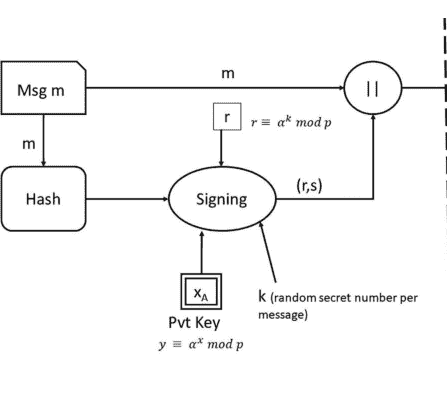

FIGURE 15.1
图 15.1
ElGamal signing at Alice.
Alice 处的 ElGamal 签名。

In general, Elgamal can be described in the form of Bob and Alice communication as follows (Figure 15.1):
一般来说，ElGamal 可以描述为 Bob 和 Alice 通信的形式如下（图 15.1）：
Alice wants to sign a digital document $m$, so she
Alice 想对数字文档 $m$ 进行签名，因此她

- 1. Sets $x_s$ and $y_s$ where $y_s = \alpha^{x_s}$ $0 < x < p$, $gcd(x, p-1) = 1$
- 1. 设置 $x_s$ 和 $y_s$，其中 $y_s = \alpha^{x_s}$ $0 < x < p$, $gcd(x, p-1) = 1$
- 2. Sends $y_s$, to everyone
- 2. 向所有人发送 $y_s$
- 3. Picks $k$ randomly, $0 < k < p$ with $gcd(k, p-1) = 1$
- 3. 随机选取 $k$，$0 < k < p$ 且 $gcd(k, p-1) = 1$
- 4. Computes $r = \alpha^k$
- 4. 计算 $r = \alpha^k$
- 5. Finds signature, $s = k^{-1}(m - xr) \bmod p$
- 5. 找到签名，$s = k^{-1}(m - xr) \bmod p$
- 6. Sends $(m_r, r_s)$ to Bob.
- 6. 向 Bob 发送 $(m_r, r_s)$。

Bob on receiving $(m_r, r_s)$ and already having $y_s$ wants to verify the document.
Bob 在收到 $(m_r, r_s)$ 并已拥有 $y_s$ 后想验证文档。
1. Verifies by computing $r$ from $m, y_s = \alpha^{-x} y_s^{r^{-1}} = r$
1. 通过计算 $r$ 进行验证 $m, y_s = \alpha^{-x} y_s^{r^{-1}} = r$

Figure 15.2 illustrates the process (hashed variant) partially.
图 15.2 部分说明了该过程（哈希变体）。
DSA (FIPS 186, 1994–2013) was proposed at federal information processing standard (FIPS) for digital signatures by National Institute of Standards and Technology (NIST) in August 1991. DSA is a variant of ElGamal digital signature with SHA-1 (m) (Stevens, 2012) hashing provides a digital signature of 320 bits on a message of 160 bits which is much smaller than original ElGamal signatures (ElGamal, 1985).
DSA（FIPS 186，1994–2013）由国家标准与技术研究所（NIST）于1991年8月在联邦信息处理标准（FIPS）下为数字签名提出。DSA 是 ElGamal 数字签名的变体，采用 SHA-1（m）（Stevens, 2012）哈希提供对 160 位消息的 320 位数字签名，这比原始 ElGamal 签名（ElGamal, 1985）小得多。
The Schnorr (Schnorr, 1991) is another variant of ElGamal which applies two prime numbers (system parameters) $p$ and $q$. The key generation involves choosing $a$ such that $a^q = 1 \bmod p$ $(a, q, p)$ also become a system parameter known to all. The public key $y_A$ is extracted choosing a private key $s_A$ that
Schnorr（Schnorr, 1991）是 ElGamal 的另一种变体，应用两个素数（系统参数）$p$ 和 $q$。密钥生成涉及选择 $a$ 使得 $a^q = 1 \bmod p$ $(a, q, p)$ 也成为所有人皆知的系统参数。公钥 $y_A$ 是通过选择私钥 $s_A$ 提取的，使得

$y_A = \alpha^{s_A} \bmod q, \quad 0 < s_A < q$

The signature is produced by computing $r$ as in ElGamal and then computing a concatenation of message and the $r$.
签名是通过像 ElGamal 一样计算 $r$ 然后计算消息与 $r$ 的连接而产生的。

254

Emerging Security Algorithms and Techniques
新兴安全算法与技术

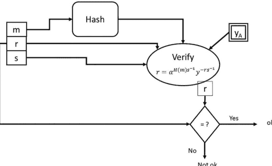

FIGURE 15.2
图 15.2
ElGamal verification at Bob.
Bob 处的 ElGamal 验证。

$e = H(M||r)$

Computing, $v = (k+se) \mod q$
计算，$v = (k+se) \mod q$
The signature pair is $(e, y)$. Verification involves computing $r$ as in ElGamal. Schnorr also generates much shorter signatures than ElGamal.
签名对是 $(e, y)$。验证涉及像 ElGamal 一样计算 $r$。Schnorr 生成的签名也比 ElGamal 短得多。

### 15.2.4.2 Correctness and Forgery
### 15.2.4.2 正确性与伪造

The ElGamal signature scheme is correct in the sense that a signature generated with the signing algorithm will always be verified as correct having the public key of the signer. The signature generation Equation 15.7 implies the following:
ElGamal 签名方案在以下意义上是正确的：使用签名算法生成的签名在拥有签名者的公钥时总是会被验证为正确。签名生成方程 15.7 意味着以下内容：

> $H(m) = xr + sk(\mod p - 1)$
> $H(m) = xr + sk(\mod p - 1)$

Using Fermat's little theorem, we have
使用费马小定理，我们有
$\alpha^{H(m)} = \alpha^{xr}\alpha^{sk}$
$\alpha^{H(m)} = \alpha^{xr}\alpha^{sk}$

$=(\alpha^x)^r (\alpha^k)^s$, as in (15.2)
$=(\alpha^x)^r (\alpha^k)^s$，如 (15.2) 所示

$y = r' \mod p$
$y = r' \mod p$

ElGamal (1985) discussed various attacks on a digital signature system in the context of ElGamal signature scheme. He also formalized attacks in the following categories:
ElGamal（1985）在 ElGamal 签名方案的背景下讨论了数字签名系统的各种攻击。他还将攻击形式化为以下类别：

- a. Recover private key
- a. 恢复私钥
- b. Forging signatures.
- b. 伪造签名。

The possibility of an attack of recovering private key also questions the correctness of the signature scheme. The recovering of the key can be performed in several ways:
恢复私钥的攻击可能性也质疑了签名方案的正确性。密钥的恢复可以通过几种方式进行：

- a. Recovering $x$ by known message signature pairs: this would be difficult as it would require an exponential number of message signature pairs in order to recover $x \mod q$ since $p-1$ is chosen to have at least one large prime factor $q$. Also,
- a. 通过已知消息签名对恢复 $x$：这会很困难，因为为了恢复 $x \mod q$ 需要指数数量的消息签名对，因为 $p-1$ 被选择为至少有一个大素因子 $q$。此外，

## Digital Signatures
## 数字签名

if k (random number) is generated twice in the signing, then the system of equations is uniquely determined and x can be recovered. So for the system to be secure, any value of k should never be used twice.
如果在签名中随机数 k 被生成两次，则方程组被唯一确定且 x 可以被恢复。因此，为了系统的安全，任何 k 值都不应被重复使用。

- b. Solving $\alpha^m \equiv y^r \bmod p$ or $y \equiv \alpha^m \bmod p$: this is equivalent to the complexity of computing discrete logarithms over $GF(p)$.
- b. 求解 $\alpha^m \equiv y^r \bmod p$ 或 $y \equiv \alpha^m \bmod p$：这等价于在 $GF(p)$ 上计算离散对数的复杂度。
- c. Extracting linear dependencies: this is also complex as computing discrete logarithms.
- c. 提取线性依赖：这也复杂如计算离散对数。

ElGamal signatures can be tried in many ways as discussed in ElGamal (1985).
ElGamal 签名可以按 ElGamal（1985）中讨论的多种方式尝试。

- a. Find $r, s$ to satisfy $\alpha^m \equiv y^r \bmod p$: this again will fall into the category of discrete logarithms. For $y^r \equiv \alpha^s \bmod p$ by fixing $s$ and computing $r$, the proof is not yet achieved so.
- a. 找到 $r, s$ 以满足 $\alpha^m \equiv y^r \bmod p$：这再次落入离散对数类别。对于 $y^r \equiv \alpha^s \bmod p$，通过固定 $s$ 并计算 $r$，证明尚未实现。
- b. Existential forgery (Pointcheval & Stern, 2000): An intruder knowing one signature and messages can generate other signature and messages in these attacks. Most of the state-of-the-art signature schemes allow for existential forgery. However, existential forgery is a weak adversarial goal, and hence it can be avoided by hashing over the message before signing it.
- b. 存在性伪造（Pointcheval & Stern, 2000）：在这些攻击中，知道一个签名和消息的入侵者可以生成其他签名和消息。大多数最先进的签名方案允许存在性伪造。然而，存在性伪造是一个较弱的对抗目标，因此可以通过在签名前对消息进行哈希来避免。

## 15.3 Elliptic-Curve Digital Signature Algorithm
## 15.3 椭圆曲线数字签名算法

Elliptic-curve digital signature algorithm (ECDSA) is a significant variation of the DSA which uses elliptic-curve cryptography (ECC). ECDSA is also used by bitcoin as it ensures that funds can only be spent by their rightful owner. Actually, ECDSA is the elliptic curve which is analogous to DSA. It was proposed in the year 1992 by Scott Vanstone (Mene Vanstone, 1993). It was accepted by ISO (International Standards Organization) in 1998 and was accepted by ANSI (American National Standards Institute) in 1999. It was accepted as a standard algorithm by IEEE (Institute of Electrical and Electronics Engineers) in the year 2000 (Vanstone, 2003).
椭圆曲线数字签名算法（ECDSA）是使用椭圆曲线密码学（ECC）的 DSA 的重要变体。ECDSA 也被比特币使用，因为它确保资金只能由合法所有者花费。实际上，ECDSA 是与 DSA 类似的椭圆曲线。它于 1992 年由 Scott Vanstone（Mene Vanstone, 1993）提出。它于 1998 年被 ISO（国际标准化组织）接受，并于 1999 年被 ANSI（美国国家标准学会）接受。它于 2000 年被 IEEE（电气和电子工程师学会）接受为标准算法（Vanstone, 2003）。

A few concepts related to ECDSA are as follows:
与 ECDSA 相关的几个概念如下：

- **Private key:** A private key is a secret number which is only known to a person who generates it. It is a randomly generated number which is used in bitcoin. A person with a private key in bitcoin can spend the funds in bitcoin. The size of the private key is single unsigned 256-bit integer, i.e., 32 bytes.
- **私钥：** 私钥是一个秘密数字，只有生成它的人才知道。它是一个在比特币中使用的随机生成数字。比特币中拥有私钥的人可以花费比特币中的资金。私钥的大小为单个无符号 256 位整数，即 32 字节。
- **Public key:** A public key is a number which corresponds to a private key, but it is not kept as a secret, rather exposed publicly. It can be used to determine whether a signature is genuine or without requiring the private key to be exposed.
- **公钥：** 公钥是一个对应于私钥的数字，但它不被保密，而是公开暴露。它可用于确定签名是否真实，而无需暴露私钥。
- **Signature:** A signature is a number which is responsible for the signing operation. It is generated mathematically from a hash of which is to be signed plus a private key. The signature comprises two numbers: $r$ and $s$. By using the public key in a mathematical algorithm, it can be determined that the signature was generated from a hash and a private key without knowing the private key.
- **签名：** 签名是一个负责签名操作的数字。它在数学上由待签名的哈希加上私钥生成。签名包含两个数字：$r$ 和 $s$。通过在数学算法中使用公钥，可以确定签名是由哈希和私钥生成的，而无需知道私钥。

In the ECC, generally the bit size for the private key needed for ECDSA is twice the size of security levels (in bits) (Hankerson et al., 2004). For example, for the security level of 90 bits
在 ECC 中，通常 ECDSA 所需私钥的位数是安全级别（以位为单位）的两倍（Hankerson et al., 2004）。例如，对于 90 位的安全级别

(i.e., an attacker requires a maximum of about 2^n number of operations to get the private key, the size for a public key in ECDSA will be 180 bits, whereas DSA, the public key size would be at least 20,124 bits. Signature sizes for both DSA and ECDSA are the same which is equal to 4t bits approximately, where t is the security level measured in bits, i.e., 360 bits for the security level of 90 bits.
（即，攻击者需要最多约 2^n 次操作才能获取私钥，ECDSA 中公钥的大小将为 180 位，而 DSA，公钥大小至少为 20,124 位。DSA 和 ECDSA 的签名大小相同，大约为 4t 位，其中 t 是以位为单位测量的安全级别，即 90 位安全级别为 360 位。

## 15.3.1 Signature Generation and Verification Algorithm
## 15.3.1 签名生成与验证算法

### 15.3.1.1 ECDSA Key Generation
### 15.3.1.1 ECDSA 密钥生成

Let's assume that Ram wants to sign a message to Sham. For successful execution, we must agree on the curves (CURVE, B, n). We need field, equation of the curve and B (which is a base point of prime order on the curve), n (which is the multiplicative order of point B) in order to generate ECDSA key. Let an entity A, whose pair is related to a particular set of EC domain parameters Dom=(q, FR, a, b, n, h). Given E is an elliptic curve which is defined over Zq, the power of prime order n in E(Zq) is P. Every entity A does
假设 Ram 想向 Sham 签名一条消息。为了成功执行，我们必须同意曲线（CURVE, B, n）。我们需要域、曲线的方程以及 B（曲线上阶为素数的基点）、n（点 B 的乘法阶）以生成 ECDSA 密钥。设实体 A，其对与特定 EC 域参数 Dom=(q, FR, a, b, n, h) 相关。给定 E 是在 Zq 上定义的椭圆曲线，E(Zq) 中素数阶 n 的幂为 P。每个实体 A 执行

- 1. Choose a randomized integer r in the interval [1, n-1]
- 1. 在区间 [1, n-1] 中选择一个随机整数 r
- 2. Calculate rP and assign it to Q, i.e., Q=rP
- 2. 计算 rP 并将其赋给 Q，即 Q=rP
- 3. The public key of A is Q, and the private key of A is r (Figure 15.3).
- 3. A 的公钥是 Q，A 的私钥是 r（图 15.3）。

### 15.3.1.2 Signature Generation Algorithm for ECDSA
### 15.3.1.2 ECDSA 签名生成算法

Let m be a message, and we need to sign it. To do so, we need an entity A with parameters as Dom=(q, FR, a, b, n, h), and they are used as follows:
设 m 为一条消息，我们需要对其签名。为此，我们需要具有参数 Dom=(q, FR, a, b, n, h) 的实体 A，并按如下使用：

- 1. Choose a randomly generated integer k in the interval [1, n-1]
- 1. 在区间 [1, n-1] 中选择一个随机生成的整数 k
- 2. Calculate xk, yk, r and assign it to kP, i.e., kP=xk, yk=r mod n (where xi is an integer between 0 and q-1). If r equals to zero, then go back to step 1.
- 2. 计算 xk, yk, r 并将其赋给 kP，即 kP=xk, yk=r mod n（其中 xi 是 0 到 q-1 之间的整数）。如果 r 等于零，则返回步骤 1。
- 3. Calculate k raise to the power -1 mod n.
- 3. 计算 k 的 -1 次幂 mod n。
- 4. Calculate $s = k^{-1}(h(m)+d r) \bmod n$, where h is the secure hash algorithm. Now, if s equals to 0, then go back to step 1.
- 4. 计算 $s = k^{-1}(h(m)+d r) \bmod n$，其中 h 是安全哈希算法。现在，如果 s 等于 0，则返回步骤 1。
- 5. Pair of integers (r, s) is the signature for the message m (Figure 15.4).
- 5. 整数对 (r, s) 是消息 m 的签名（图 15.4）。

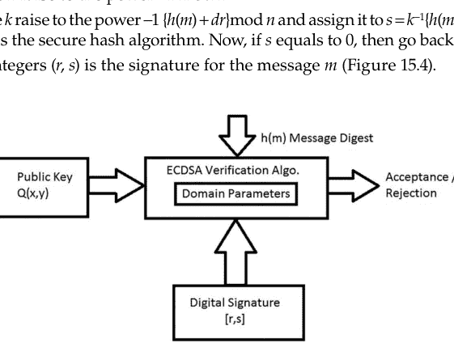

FIGURE 15.3
图 15.3
ECDSA overview.
ECDSA 概述。


## 数字签名

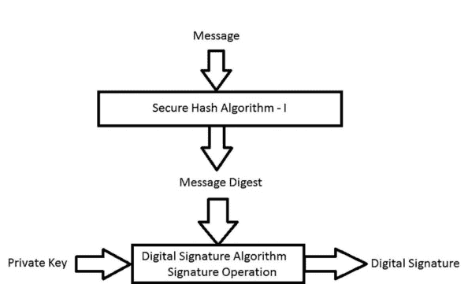

图 15.4

ECDSA 签名生成过程。

### 15.3.1.3 ECDSA 签名验证算法

整数 (r, s) 是 A 对消息 m 的签名。现在，我们需要验证这些签名。另一人（假设为 W）以某种方式拥有 A 的域参数 Dom = (q, FR, a, b, n, h) 的经过认证的副本以及 A 的公钥 Q。为了验证签名，这里有一个算法：

- 1. 首先确保整数 (r, s) 在区间 [1, n - 1] 内
- 2. 计算 s 的 -1 次幂 mod n 和 h(m)，并将其赋给 v，即 v = s⁻¹ mod n 且 h(m) 被赋给 v
- 3. 计算 u₁ = h(m) mod n 和 u₂ = v r mod n
- 4. 计算 u₁P + u₂Q = (x₀, y₀) 且 u = x₀ mod n
- 5. 当且仅当 u = r 时签名被接受（图 15.5）。

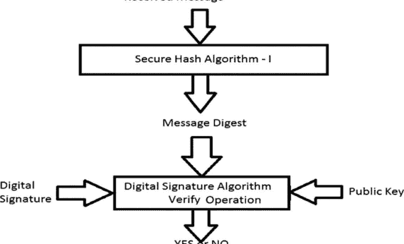

图 15.5

ECDSA 签名验证过程。

## 15.3.2 ECDSA 的安全性

为了抵抗消息攻击而保持不可伪造，是 ECDSA 的主要安全宗旨。攻击者攻击真实条目 S 的意图是，在获得 S 对攻击者选择的系列消息（除 m 外）的签名后，获得对单个消息 m 的有效签名。

该算法尚未被证明对消息攻击不可伪造。然而，Pointcheval 和 Stern 在假设离散对数问题很困难且随机函数用作哈希函数的情况下，证明了 DSA 和 ECDSA 的某些变体是安全的。

ECDSA 可能的攻击可分为以下几类：

- 目标是椭圆曲线离散对数问题
- 使用的哈希函数被针对
- 其他攻击。

## 15.3.3 与 RSA 和 DSA 的比较

在大多数密码系统中，有两种操作难以执行。一种是可处理的（Gupta et al., 2004），称为正向操作，另一种是不可处理的逆向操作。这两种操作的区别在于密钥对。逆向操作与密钥大小成指数比例，而正向操作与之成线性比例。如果我们增加密钥长度，则两种操作的复杂性都会增加。因此，ECC 更受青睐，因为其安全性在 160 位密钥长度下与 RSA 中 1,024 位密钥长度相同。

### 15.3.3.1 与 RSA 的比较

- ECC 需要完整的指数时间，而 RSA 需要亚指数时间。例如，对于最佳已知攻击，ECC 需要 9 × 10¹¹ MIP 年，而 RSA 对于 1,024 位密钥大小需要 3 × 10¹¹ 年。
- 对于较小的密钥大小，ECC 具有相同级别的安全性。
- 在 ECC 中，数据大小大于 RSA。
- 密钥大小和数据大小是加密消息的函数。与 ECC 相比，RSA 的密钥大小更大；这导致 ECC 中的加密消息更小。
- 与 RSA 相比，ECC 的计算能力更低。

### 15.3.3.2 与 DSA 的比较

- 签名方程如下所述，对 DSA 和 ECC 均相同。此外，两种算法均基于 ElGamal 签名方案。

```
s = k⁻¹[h(m) + dr] mod n.
```

- 系统参数（DSA 的 p、q 和 g；ECDSA 的 E、P 和 n）在两种算法中都难以生成。
- SHA-1 在 ECDSA 和 DSA（当前版本）中均用作哈希函数。

- 4. ECDSA 中某些值如每签名值 k 和私钥 p 是不可预测的并且在统计上是唯一的。这些值在 DSA 中是随机的（Johnson et al., 2001）。

## 15.4 基于身份的签名

### 15.4.1 基于身份签名的介绍和定义

基于身份的签名（IBS）方案是一个基于整数分解困难性的开放问题。2001 年，推出了两种方案：一种由 Cocks（Cocks, 2001）提出，其基础是二次剩余问题，另一种由 Boneh 和 Franklin（Boneh & Franklin, 2004）提出，其基于关于配对的双线性 Diffie–Hellman 问题，例如 Weil 配对（Yi, 2003）。

最初，Weil 配对（Miller, 2004）在密码学中形象不佳。它表明，通过使用 Weil 配对，超奇异椭圆曲线中的离散对数问题可归约为有限域中的问题。这导致超奇异椭圆曲线被排除在密码学使用之外。Roux 的工作彻底改变了这种情况，他使用了基于超奇异曲线上 Weil 配对的简单三方 Diffie–Hellman（Bellare et al., 2003）协议。在 Roux 的工作之后不久，发布了许多其他应用，包括通用签名算法和基于身份的加密方案。

Weil 配对和其他 IBS 方案也由基于身份的公钥签名算法使用。

IBS 方案由以下算法组成：

Setup—在此算法中，主实体将一个秘密参数作为输入，输出以与主秘密和方案相关的公共参数的形式生成。参数由主实体发布，主秘密由其自行保留。

Extract—如果将身份 $u$、主秘密和参数作为输入提供，则该算法生成 $u$ 的私钥 $d_u$。然后主实体使用此私钥为所有参与实体生成私钥，然后将私钥分别分发给其所有者，以确保安全且安全的通道。

Sign—如果将消息（$m$）、身份 $u$、私钥 $d_u$ 和参数作为输入提供，则该算法生成身份 $u$ 对 $m$ 的签名 $\sigma$。身份 $u$ 的实体使用此算法进行签名目的。

Verify—如果签名 $\sigma$ 是身份 $u$ 对 $m$ 的有效签名，则该算法给出输出并接受，否则拒绝输出，其中签名 $\sigma$、消息 $m$、身份 $u$ 和参数作为输入提供。

让我们看一些记号。比特串表示为 $a_1, ..., a_n || a_n$ 表示为 $a_1, ..., a_n$，它将用于重构构成对象。$|a|$ 表示字符串 '$a$' 的长度，$|S|$ 是集合 S 的基数。对于随机算法，$y \leftarrow A(a_1, a_2, ...)$ 意味着 $A$ 的输入为 $a_1, a_2, ...$，并且当它在随机带上运行时，$A$ 的输出被赋给 $y$。

攻击者拥有诸如查询次数和运行时间等资源，其与安全参数 $k$ 渐近相关。函数 $\mu \in \mathbb{C}$ 被称为可忽略的（在 $k$ 中），如果对于所有 $c \in \mathbb{N}$ 存在 $k_c$，使得当 $k > k_c$ 时 $\mu(k) < k^{-c}$。

IBS 方案算法的参数为 $Setup, Check, Sign,$ 和 $Verify$。该算法在安全参数 $k$ 下具有多项式时间复杂度。最后一个参数是常数，而前三个是随机的。Setup 由受信任的密钥分发方法在输入 $1^k$ 上执行，以获得公钥和私钥对 $(mpk, msk)$（Bellare et al., 2003）。（注意：对于安全参数 $k$，$1^k$ 表示一元表示。）它在输入 $mpk$ 和 $id$ 上运行解密算法，其中身份 $id \in \{0, 1\}^*$。

假设秘密密钥的安全通信。签名算法使用 $pk$ 和 $M$ 作为输入返回 $M$ 的签名 $\sigma$。受信任的密钥分发在输入 $1^k$ 上运行 Setup 算法，以获得公钥和私钥对 $(pk, sk)$。（注意：$1^k$ 表示安全参数 $k$ 的一元表示）。验证算法 $Verify$ 如果 $\sigma$ 对 $mpk, id, M$ 有效则返回 1，否则返回 0。正确性要求对于所有 $k \in \mathbb{N}$ 和 $id \in \{0, 1\}^*$，只要密钥 $mpk, id, msk$ 如上所述生成，则 $Verify(mpk, id, Sign(id, M)) = 1$ 的概率为一。

出于安全原因，我们考虑在选定消息和身份下存在不可伪造性（af-cm）的概念。安全性通过一个具有伪造 $F$ 的实验来处理，并且它以安全参数 $k$ 为参数。在随机化密钥生成算法 $KG$ 在输入 $1^k$ 上生成密钥对 $(pk, sk)$，即 $(pk, sk) \leftarrow KG(1^k)$。伪造 $F$ 可以访问以下预言机，并在主密钥上运行：

- Check(): 首先，此预言机在输入身份 $id \in \{0, 1\}^*$ 时检查用户密钥 $USK[id]$ 是否需要为 $id$ 检查是否已生成。如果检查返回 true，则它将返回相同的用户密钥 $USK[id]$；否则，它生成一个新的用户密钥 $USK[id](sk, id)$。
- Sign(): 其次，此预言机在输入身份 $id \in \{0, 1\}^*$ 和消息 $m \in \{0, 1\}^*$ 时返回 $SIG \leftarrow SIGN(USK[id], m)$，其中 $USK[id]$ 由上述预言机 Check 作为输入提供。

算法 Setup($1^k$)
(SecKey,PriKey) $\leftarrow$ $1^k$
返回 (SecKey,PriKey)

算法 Check(SecKey, id)
(pk, sk) $\leftarrow$ $1^k$
new $\leftarrow$ $sign(SecKey, id ||pk)$
返回 USK(id)=(new, pk)

算法 SIGN(id, USK, m)
Parse(cert, pk, sk) $\leftarrow$ $USK[id]
sig $\leftarrow$ $(sk', m)$
返回 SIG = $(cert, pk, sig)

算法 Verify(PK, id, m)
Parse(new, pk, sig) $\leftarrow$ $SIG$


## 数字签名

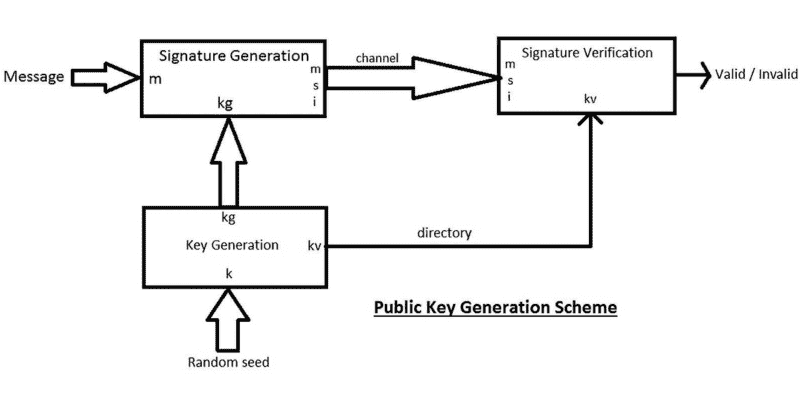

**图 15.6**
公钥签名方案。

如果 verify(PriKey, id || pk, new) = 0 则返回 0
如果 verify(pk, m, sig) = 0 则返回 0
否则返回 1。

执行完成后，F 的输出为一条消息 m*、身份 id* 以及伪造的签名 sig*。F 将在 Verify(PriKey, id*, m*, sig*) 等于 1 且 forge 从未对 Check(id*) 或 Sign(id*, m*) 执行过时获胜。

图 15.6 显示了公钥签名方案的图示视图，其记号如下：
m 为消息，s,t 为签名，i 为用户的身份，n 为两个大素数的乘积，e 为与 phi(n) 互素的大素数，f 为单向函数。

在公钥签名方案中，消息 (m) 首先被送入签名生成模块，它从密钥生成模块 (kg) 获取输入并输出 msi，即带有签名和用户身份的消息。msi 由签名验证模块验证并输出有效/无效。签名验证模块还从密钥生成模块获取输入 (kv)。

在 IBS 方案中，消息 (m) 首先被送入签名生成模块，它会咨询密钥生成模块并验证身份并以 (kg) 作为输入；它生成 msi，即作为输出的带有签名和用户身份的消息。msi 由签名验证模块通过确认发送方身份进行验证并输出有效/无效（图 15.7）。

### 15.4.2 效率与安全性比较

表 15.1 对比了各种基于 IBS 的方案的效率和安全属性。对于每个方案，它显示了获得特定 IBS 方案的转换、签名大小、签名和验证的计算开销时间以及模型类型，是标准模型 (SM) 还是随机预言模型 (ROM)。

## 新兴安全算法与技术

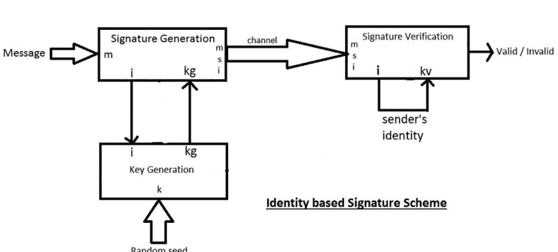

**图 15.7**
IBS 方案。

### 表 15.1

各类 IBS 方案的效率与安全性比较

| Scheme | Transform | Signature Size | Signing Time | Verification Time | ROM/SM |
| --- | --- | --- | --- | --- | --- |
| Cert-IBS | SS-2-IBS | SS 的 2 个签名 1 个公钥 | SS 的 1 个签名 | SS 的 2 次验证 | SM |
| ChCh-IBS | cS1-2-IBS | G 的 2 个元素 | G 中的 2 次指数运算 | 2 次配对 | ROM |
| GS-IBS | HIBE-2-IBS | G 的 2 个元素 | G 中的 2 次指数运算 | 3 次配对 | ROM |
| BNN-IBS | Direct | G 的 1 个元素 Zip 的 1 个元素 | G 中的 2 次指数运算 | 1 次多指数运算 G 中的指数运算 | ROM |
| Sh-IBS | cS1-2-IBS | Z_N 的 2 个元素 | Z_N 中的 2 次指数运算 | Z_N 中的 1 次多指数运算 | ROM |

各种 IBS 方案基于转换、签名大小、签名时间、验证时间和模型类型进行比较。根据这些参数、需求和应用，选择特定类型的基于 IBS 的方案。

### 15.5 双模格签名方案（BLISS）和 Lamport 签名方案

### 15.5.1 BLISS 和 Lamport 简介

### 15.5.1.1 BLISS 签名方案

BLISS 代表 Bimodal Lattice Signature Scheme（双模格签名方案），由 L. Ducas、A. Durmus、T. Lepoint 和 V. Lyubashevsky 于 2013 年提出。该方案不使用整数分解、离散对数或椭圆曲线，这些都可被量子计算机破解。然而，BLISS 即使使用量子计算机也是不可破解的。之前的方案被视为预量子方案，而 BLISS 因此是后量子方案（Bernstein, 2011）。BLISS 在计算、签名大小和安全性方面被认为高效（Ducas et al., 2013）。

BLISS 方案基于格问题和来自双模高斯分布的拒绝采样。该过程通过从窄分布中选择 y 使秘密密钥 $s$ 与较小的随机 $y$ 隐藏，然后执行接受-拒绝（Casella et al., 2004），以便在 $y$ 加到其上时 $s$ 不会泄露。概念上，BLISS 通过从 $g$ 中抽取样本 $x$ 进行签名，并以概率 $f(x)/M_g(x)$ 被接受，其中 $M$ 是某个正实数。重复该过程直到样本被接受。在数值分析中，拒绝采样是生成分布观测值的基本技术。它也常被称为接受-拒绝方法或“accept-rejection”，是一种精确模拟方法。密钥生成、签名和验证过程取自 Ducas et al. (2013)，如下节所述（图 15.8）。

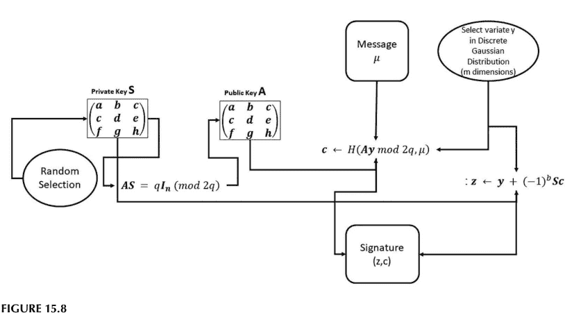

**图 15.8**
BLISS 密钥生成和签名生成。

### 15.5.1 密钥生成、签名和验证算法

环 $\mathbb{Z}_q$ 与区间 $[-q/2, q/2]\mathbb{Z}$ 相对应，其中 $q$ 为整数，一般环 $R$ 和 $R_q$ 为商环 $R/(qR)$，使得 $R_q = \mathbb{Z}_q[x]/(x^n+1)$，其中 $n$ 为 2 的幂，$q$ 为满足 $q \equiv 1 \pmod{2n}$ 的素数。Hoffman 等人提出了一种基于环的公钥密码系统 NTRU。BLISS 是 NTRU（Hoffman et al., 1998） over SIS（Ajtai, 1996）的改编，它依赖于 $R-SIS$ 的困难性，其中 $(q, n, m, \beta)$ 问题在同一论文中定义。为了简单起见，Ducas et al. (2013) 中给出了 $R = \mathbb{Z}[x]$ 的算法；然而，它可以很容易地适应 $R = \mathbb{Z}[x]/(x^n+1)$。

秘密密钥是（短）矩阵 $S \in \mathbb{Z}_{2q}^{m \times n}_{q}$，公钥是矩阵 $A \in \mathbb{Z}_q^{m \times n}_{2q}$，使得 $AS = q_n (mod 2q)$。哈希函数 $H$ 被建模为一个预言机，其输出在 $B(n, k)$ 中均匀分布，$B(n, k)$ 是长度为 $n$ 且权重为 $k$ 的向量集合，如 Fischer and Sterling (1996) 中所述。

### 15.5.1.3 签名算法

参数：消息 $\mu$，公钥是矩阵 $A \in \mathbb{Z}^{m \times n \times 2q}$ 秘密密钥 $S \in \mathbb{Z}^{m \times n \times 2q}$，偏差 $\sigma \in \mathcal{R}$。
- 第 1 步。获取 $m$ 维离散高斯 $D$ 的样本到 $y$ 中，即 $y = D_\sigma^g$
- 第 2 步。计算 $c \leftarrow H(Ay \bmod 2q, \mu)$，哈希函数 $H$ 作为随机预言机
- 第 3 步。在 $[0,1]$ 中选择随机 $b$
- 第 4 步。计算
- 第 5 步。如果概率为 $1/\left(Me^{\frac{|S|^2}{2}} \cosh\left(\frac{(z, Sc)}{\sigma}\right)\right)$ 则返回签名 $(z, c)$，否则重复。

### 15.5.1.4 验证算法

签名者输出 $(z, c)$ 的签名，其中 $z$ 根据 $Dmo$ 分布。因此，接受界限 $B2$ 应略高于 $m\sigma$，这是 $Dmo$ 输出周围的期望值，其被严格约束。

参数：$\mu$，公钥是矩阵 $A \in \mathbb{Z}^{m \times n \times 2q}$ 签名 $(z, c)$
- 第 1 步。如果 $\|z\| > B2$ 或 $\|z\| \geq q^{1/4}$，则拒绝
- 第 2 步。接受签名且如果 $c = H(Az + qc \bmod 2q, \mu)$。

### 15.5.1.5 Lamport 签名方案

Lamport 签名是另一种即将到来的签名方法，被认为适用于后量子计算。人们相信 Lamport 签名，如基于格的签名，使用大型哈希函数将能抵御量子计算攻击。Lamport 签名可以从任何单向哈希函数构建，该函数在密码学上是安全的。也就是说，这些哈希函数通常是密码学哈希函数。单向函数正向计算容易但难以求逆（Nyberg and Rueppel, 1996）。Lamport (1979) 设计了使用单向函数进行签名的方案。

### 15.5.1.6 密钥生成、签名和验证

密钥生成过程涉及使用随机数生成器生成 $n$ 位密钥对，例如，如果 $n=256$，则需要 $2 \times 256 \times 256$ 位（16 kb）来保存密钥。这将是私钥。同样，公钥是通过对私钥的每个密钥进行哈希（$f$）到 16 kb 密钥创建的。单向哈希函数 $f$ 和 $g$ 分别用于创建密钥和对消息进行签名。

签名很简单；使用 $g$ 对消息进行哈希并附加私钥，通过按位选择每对的适当私钥。如果哈希消息位为 0，则选择对的第一密钥；如果哈希消息位为 1，则选择对的第二密钥。因此，对于 256 位消息，形成 256 位签名。

在验证端，验证者对消息进行哈希并使用公钥执行相同的创建 $a$ 的过程，然后对签名进行哈希并与生成的 $a$ 进行比较。图 15.9–15.11 以图示形式说明了密钥生成、签名和验证过程。签名后，签名者必须完全销毁私钥。


## 数字签名

265

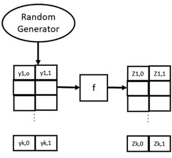

**图 15.10**
Lamport 密钥生成。

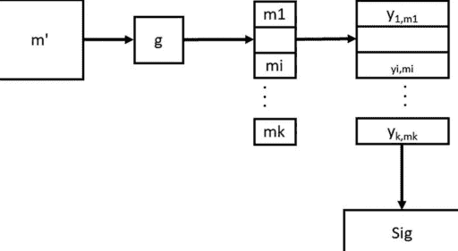

**图 15.10**
Lamport 签名。

该过程可作如下数学表示：
**密钥**
设 $k$ 为正整数，且 $P=\{0,1\}^k$ 为二进制形式的报文集合。设 $f:Y \rightarrow Z$ 为单向哈希函数。对于 $1 \leq i \leq k$ 且 $j\in\{0,1\}$，其中 $k$ 为密钥对数。

- 1. 在 Y 中生成随机数 $y_{i,j}$
- 2. $z_{i,j}=f(y_{i,j})$
- 3. 私钥对 $i=y_i$，公钥对 $i$ 为 $z_i$，其中 $i$ 为 1 到 $k$。

**签名消息**

- 1. 对于明文消息 $m'$，$k$ 位哈希消息 $m=(m_1, ..., m_k) \in\{0,1\}^k$ 其中 $m=g(m')$，$g$ 为单向函数 $g:Y \rightarrow Z$
- 2. 签名 $s_{i,j}=sig(m_1, ..., m_k)=(m_1,y_{1,m_1}, ..., m_k,y_{k,m_k})$
- 3. 销毁私钥 $y_{i,j}$。

新兴安全算法与技术

266

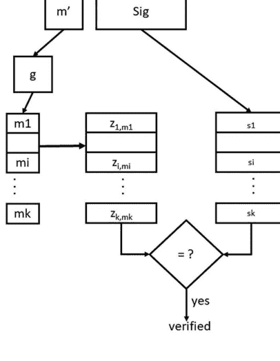

图 15.11
Lamport 验证。

### 验证

- 1. 若 $f(s_i) = z_{i,m}$ 对所有 $1 \le i \le k$ 成立，则接受

Lamport 方案的各种优化和变体相继出现，如短私钥（随机数生成器的种子）、短密钥，以及用于多条消息的签名和公钥。最后一种由 Merkle 提出，被称为 Merkle 签名方案。该方案将在下一节讨论。

### 15.5.2 安全比较

Lamport 和 BLISS 的正确性已在各自的源头和其他论文中提出（Lamport, 1979; Rompel, 1990; Ducas et al., 2013）。安全方面取决于单向哈希函数的安全性、输出长度和输入质量。为了在 Lamport 方法签名情况下伪造消息，该方法必须获得单向函数的逆运算，在使用大尺寸输入和输出的情况下，这被认为非常困难。John 还对单向签名给予了高安全评级，称其为必要且足够安全。Lamport 和 Rompel 也讨论了哈希函数的构造（参见 Lamport, 1979; Rompel, 1990）。James Howe 等人（2015）比较并总结了基于格的数字签名变体，如 GGH（Goldreich et al., 1997）、NTRU（Hofstein et al., 1998）、GPV（Gentry et al., 2008）、LYU（Lyubachevsky, 2012）和 BLISS。Ducas 对 BLISS 进行了各种攻击方式的安全分析，具体如下：

数字签名

267

- a. 暴力密钥恢复
- b. 会合攻击
- c. 短整数解方案的困难性
- d. 原始格约简密钥恢复
- e. 对偶格约简密钥恢复
- f. 混合 MiM 格密钥恢复。

这些方案仍开放给研究和推测。然而，从更广的意义上讲，BLISS 模型仍然不可破解。

## 15.6 Merkle 签名方案

Merkle 签名方案是 Ralph Merkle 于 1979 年（Merkle, 1979）提出的另一种后量子计算签名方案。在他的论文中，他描述了一种数字签名，其在经认证的底层加密方法论意义上是预认证的。该论文提出了一种方法，将任何一次性签名（如 Lamport 的）转换为方便的多次签名系统。多种论文（Merkle, 1987; Merkle, 1990; Bindel et al., 2016; Merkle, 1979）所理解的多次签名的需求基础是考虑以下场景：如果 A 在每次签署文件前都向 B 传输他的公钥 Z，B 之前没有 Y，那么任何人都可以创建一个 C 并声称自己是 A。如果 B 可以被这样欺骗，使其相信他收到了经过适当授权的签名，那么就必须能够确认他发送的是正确的 Y 而不是伪造的 Y。这必须对每条消息 $m$ 完成。也就是说，对于每条消息 $m$，都需要每次进行身份验证。对此的解决方案在多种论文中被提出为“树认证”（Merkle, 1987; Merkle, 1996; Bindel et al., 2016），后来 Merkle 也在 1990 年阐述了基于树认证的签名方案（Merkle, 1990）。

Merkle 树签名方案的密钥生成、签名和验证如下所述。

### 15.6.1 密钥生成（Merkle 树）

Merkle 方案用于每个公钥 Z 签名有限数量的消息。消息数量必须是 2 的幂。即，

$N=2^n$，$N$ 是每个 Z 的消息数

生成密钥需要以下步骤：

- 1. 按 Lamport 方案生成 $Z=(x_i, y_i)$，$1 \leq i \leq N$
- 2. 计算公钥的哈希值 $h_i=H(y_i)$
- 3. 使用这些哈希值 $h_i$ 构建哈希树。树的叶节点将是 $N=2^n$ 个哈希值，并递归哈希向根形成二叉树。树中每个内部节点的值是其两个子节点的连接，即，

新兴安全算法与技术

$h_i$ 将为叶节点 $a(0,i)$

对于其他节点：$a(l,j) = H(a(l-1,i) \| a(l-1,i+1))$，$\quad 1 \leq l \leq n, 1 \leq i, j \leq 2^{n-l}$
图 15.12 是一个具有 $N=8=2^3$ 的 Merkle 树。

- 4. 根 $a(n,1)$ 将为公钥。$Z=(x_i, y_i)$ 将为私钥。

### 15.6.2 签名方案

- 1. 用户使用任何一次性签名方法（如 Lamport 的私钥 $Z=(x_i, y_i)$）进行签名。
- 2. 对消息签名生成 $Sig'$。发送 ($Sig', y_i$) 以及 **认证路径**。
- 3. **认证路径** 由创建根 $a(n,1)$ 所需的节点组成，如图 15.12 中的示例树所示。如果发送签名 $Sig'$ 和公钥 $y$，则认证信息也随之发送。这些将是一个未使用的叶节点以及用于生成根的节点的路径。如果使用 $H(y)$，则 $a(0,3)$、$a(1,1)$ 和 $a(2,2)$ 也将被发送，如图 15.13 所示。

### 15.6.3 验证

- 1. 验证者验证 ($Sig', y_i$) 以及 **认证路径**。
- 2. 使用该路径计算根。它将其与公钥进行比较。
- 3. 如果密钥等于计算出的根，则签名和公钥对 ($Sig', y_i$) 是真实的。
- 4. 使用相应的方法（如 Lamport 的）进一步验证签名。

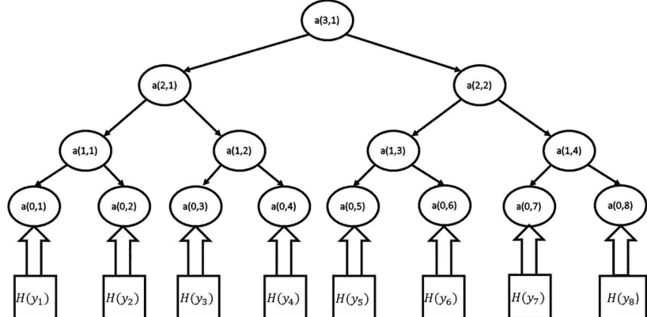

图 15.12
Merkle 树。可签名的消息数(N)为 8。

数字签名

269

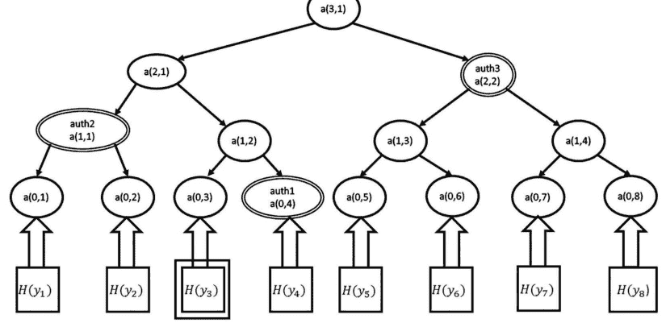

图 15.13
使用 a(0,3) 的认证路径。

Merkle 树是区块链技术的基础部分（Sharma, 2017）。Merkle 树是一种结构，允许对大量数据中的内容进行高效且安全的验证。该结构有助于验证数据的一致性和内容。Lamport、BLISS 和 Merkle 系统更具时效性和突出之处在于它们基于哈希签名。与大多数其他签名系统不同，哈希签名对量子计算机攻击更具鲁棒性。

## 15.7 其他现有签名方案

除了本章讨论的数字方案外，还有一些其他方案正在出现，其中一些正在计算社区中崭露头角。从 DSA 到 Merkle 方案，我们有许多变体出现，如：

- Pointcheval-Stern
- EdDSA
- XMSS
- 聚合签名
- BLS.

Pointcheval-Stern 签名算法（Pointcheval and Stern, 1996）是一种基于 ElGamal 签名方案原理的数字签名方案。它对 ElGamal 签名方案进行了轻微修改，并意味着一种算法，该算法被证明对自适应选择消息攻击具有高度安全性。与 ElGamal 类似，它也假设离散对数问题的强度。Edwards 曲线数字签名算法

(EdDSA) (Josefson and Liusvaara, 2017) 是 Schnorr 数字签名方案的变体。它基于扭曲 Edwards 曲线设计，旨在比现有数字签名方案更快而不牺牲安全性。Merkle 方案的扩展在 RFC 中引入（Helseling et al., RFC 8390, 2018）作为扩展 Merkle 签名方案（XMSS）。XMSS 被认为安全且在底层哈希函数发生碰撞时保持不可伪造。它紧凑、易于实现，与基本方案相比，自然抵抗侧信道攻击。聚合签名（Bellar et al., 2007）是一种支持“用户聚合”的方案，这是当前流行的区块链和比特币的基础。多个用户上的多个签名可以合并为一个签名，其大小相对于用户数量为常数。这个单一签名足以说服验证者 $n$ 个用户已签署 $n$ 条原始消息。Mihir Bellare 和 Gregory Neven 的聚合签名方案也可以与比特币一起使用。Boneh-Lynch-Shacham（BLS）（Boneh et al., 2004）方案促进对签名者是否不是假装真实的用户级验证。为了实现用户级验证，该方案使用双线性配对进行验证。BLS 签名在（针对各种元素）椭圆曲线类别下失效。

## 15.8 结论

本章涵盖了最广泛使用的数字签名方案，特别强调基础算法。这些方案的许多变体正在出现，其可变性正受到研究人员的审查。这些方案的性能可能因其背后的理论而异。基础方法及其附加变化处于持续审查中，许多社区已根据其要求和适应性将其定制到数字签名世界。在当前量子计算场景下，传统方法必须被现代方案或附加组件取代或改进。本章也尝试涵盖这些方案和方法。

## 参考文献

- M. Ajtai (1996). 生成格问题的困难实例（扩展摘要）。载于《第二十八届 ACM 计算理论研讨会论文集（STOC '96）》，ACM，纽约，第 99–108 页。doi:10.1145/237814.237838。
- M. Bellare, C. Namprempre, G. Neven (2007). 无限制聚合签名。L. Lage, C. Cachin, T. Jurdziski, A. Tarcki 编辑，《自动机、语言和编程》。ICALP 2007，第 4596 卷《计算机科学讲义》，第 411–422 页。Springer，柏林，海德堡。
- M. Bellare, C. Namprempre, D. Pointcheval, M. Semanko. (2003 年 6 月)。一次多 RSA 逆问题与 Chaum 盲签名方案的安全性。《密码学杂志》，16(3):185–215。
- DJ. Bernstein. (2011)。后量子密码学，H.C.A. van Tilburg, S. Sajajodia 编辑，《密码学与安全百科全书》，第 949–950 页。Springer，波士顿，马萨诸塞州。


## 数字签名

N. Bindel, B. Buchmann, K. Krämer. (2016). 基于格的签名方案及其对故障攻击的敏感性。载于密码学中故障诊断与容错研讨会（FDTC），加州圣巴巴拉，第 63–77 页，doi:10.1109/FDTC.2016.11.

D. Boneh. (2011). Schnorr 数字签名方案，H.C.A. van Tilborg 编，密码学与安全百科全书。Springer，波士顿，马萨诸塞州，第 1082–1083 页。

D. Boneh, M. Franklin. (2003). 基于 Weil 配对的基于身份的加密。SIAM 计算期刊，32(3):586–615，doi:10.1137/S08953701398521

D. Boneh, L. Lynn, H. Shacham. (2004). 来自 Weil 配对的短签名，密码学期刊，17: 297–319，doi:10.1007/s00145-004-0319-9.

G. Casella, C. Robert, M. Wells. (2004). 广义随机接受采样方案。讲义系列，45: 342–347。检索自 http://www.jstor.org/article/435632.

C. Cocks. (2001). 基于二次剩余的基于身份的加密方案，B. Honary 编，密码学与密码学 2001，第 2260 卷。计算机科学讲义，第 360–363 页。Springer，柏林，海德堡。

L. Lucas, A. Durmus, T. Lepoint, Y. Lyubachevsky (2013). 基于格的签名与双模高斯分布，R. Canetti, J.A. Garay 编，密码学 – CRYPTO 2013，CRYPTO 2013，第 8042 卷 计算机科学讲义，

T. Elgamal (1985 年 7 月)。基于离散对数的公钥系统和签名方案。IEEE 信息论汇刊，31(第 4 期) 469–472。doi:10.1109/TIT.1985.1057074

FIPS PUB 186-1：数字签名标准（DSS），（1994）。csrc.nist.org。于 2013-12-23 从在线（PDF）归档。

FIPS PUB 186-2：数字签名标准（DSS），（2000）。csrc.nist.org。

FIPS PUB 186-3：数字签名标准（DSS），（2009），csrc.nist.org。

FIPS PUB 186-4：数字签名标准（DSS），（2013）。csrc.nist.org。

J-B. Fisch, J. Stern (1999)。与综合征解码一样安全的有效伪随机生成器，U.M. Maurer 编，EUROCRYPT 1996，第 1070 卷 计算机科学讲义，第 245–255 页。Springer，海德堡。

C. Gentry, P. Peikert, A. Vaikuntanathan (2008)。用于新密码构造的困难格。载于第十分会年 ACM 计算理论研讨会论文集（STOC 08）。ACM，纽约，第 197–206 页。doi:10.1145/1374376.1374407。

O. Goldreich, G. Solomon, and S. Halevi (1997)。来自格约简问题的公钥密码学。密码学进展 – CRYPTO 97，第 112–131 页。Springer，柏林，海德堡，doi:10.1007/BBF0052231。

V. Gupta, D. Stebila, S. Fung, G.C. Schatz, N. Jura, H. Eberle (2004)。使用椭圆曲线密码学扩展安全 Web 交易。载于第 11 届网络与分布式系统安全研讨会论文集（NDSS 2004），互联网协会，第 231–239 页。加州，2 月 5–6 日

D. Hancock, A. Menezes, S. Vanstone. (2004)。椭圆曲线密码学指南。Springer 专业计算，

J. Hoffman, J. Pipher, J.H. Silverman. (1998)。NTRU：基于环的公钥密码系统，J.P. Buhler 编，算法数论。ANTS 1998，第 1423 卷 计算机科学讲义，第 267–288 页。Springer，柏林，海德堡，

J. Howe, T. Poppelmann, M. O'Neill, E. Osvilan, T. Güneysu. (2015)。实用的基于格的数字签名方案，ACM 嵌入式计算系统汇刊，14(3)，文章 41，24，doi:10.1145/2724237。

A. Hülsing, D. Butin, S. Gazdag, J. Rijneveld, A. Mohaisen. (2018)。XMSS：RFC 8391 的扩展签名方案。互联网研究任务组（IRTF），2018 年 5 月，ISSN:2070-1721。

D. Johnson, A. Menezes, S. Vanstone. (2001)。椭圆曲线签名算法（ECDSA）。信息安全国际期刊，1(1): 36–63。doi:10.1007/s102070100002。

## 新兴安全算法与技术

S. Josefsson, I. Liusvaara (2017)。Edwards 曲线数字签名算法（EdDSA）。互联网工程任务组。doi:10.17487/RFC8032。ISSN 2070-1721。RFC 8032。检索于 2018 年 7 月 31 日。

L. Lamport (1979 年 10 月)。从单向函数构造数字签名。技术报告 SRI-CS-98，SRI 国际计算机科学实验室。

V. Lyubashevsky (2012)。无陷门的格签名。密码学进展—EUROCRYPT，第 738–755 页。doi:10.1007/978-3-642-20211-4_32。

A.J. Mendez, S. Vanstone (1993)。椭圆曲线密码系统及其实现。密码学期刊，6:209。doi:10.1007/BF0220317。

R.C. Merkle (1979)。安全、认证和公钥系统。博士论文。斯坦福，加利福尼亚，AA18001972。

R.C. Merkle (1987)。基于常规函数的数字签名，C. Pomerance，密码学进展—CRYPTO '87，293 计算机科学讲义。Springer，柏林，海德堡，doi:10.1007/3-540-48184-2_32。

R.C. Merkle (1990)。认证数字签名，G. Brassard，密码学进展—CRYPTO '89 会议论文集。CRYPTO 1989，435 计算机科学讲义。Springer，纽约。

M. Miller (2004)。Weil 配对及其有效计算。密码学期刊，17:235。doi:10.1007/s00143-004-0010-0

K. Nyberg, R.A. Ruppel (1996)。基于离散对数问题的签名方案的内存恢复。编码与密码学，7(1):21–81。doi:10.1007/BF00125076。

T. Özel, P Poppelmann, T. Gündesay (2014)。超越 ECDSA 和 RSA：受限设备上的基于格的数字签名，第 51 届 ACM/IEEE 设计大会（DAC），加州旧金山，第 1–6 页。

D. Pointcheval, J. Stern (1999)。签名方案的安全属性，U. Maurer 编，密码学进展—EUROCRYPT96，1020 计算机科学讲义。Springer，柏林，海德堡，doi:10.1007/3-540-68339-9_3

D. Pointcheval, J. Stern (2000)。数字签名和盲签名的安全警报。密码学期刊，13:36。doi:10.1007/s00143-00003

R.L. Rivest, A. Shamir, L. Adleman (1978)。一种获取数字签名和公钥密码系统的方法。ACM 通讯，21(2):120–126。doi:10.1145/35934.359342。

J. Rompel (1990)。单向函数对安全签名是必要且充分的。载于第二十二届 ACM 计算理论研讨会论文集（STOC '90），Harriet Ortiz（E.D.），ACM，纽约，第 384–387 页。doi:10.1145/102966.102969。

C.P. Schnorr (1991)。智能卡的高效签名生成。密码学期刊，4:161。

T.K. Sharma. (2017 年 8 月)。什么是区块链中的 Merkle 树和 Merkle 根？Blockchain-council 文章，检索自:https://www.blockchain-council.org/blockchain/what-is-merkle-tree-merkle-root-in-blockchain/

M.M.J. Steves (2012 年 6 月)。哈希函数及其应用的攻击，博士论文，莱顿大学，http://hdl.handle.net/1887/99093。

S.A. Vanstone. (2003)。多功能性的下一代安全：椭圆曲线密码学。计算机与安全，22(5):412–415。doi:10.1016/S0167-0448(03)00507-8。

X. Yi. (2003 年 2 月)。来自 Weil 配对的基于身份的签名方案，IEEE 通讯快报，7(2):76–78，doi:10.1109/LCOMM.2002.808397。

## 16

## 应用

M. A. Rizvi 和 Ifra Iqbal Khan
国家技术教师培训与研究学院

## 目录

- 16.1 引言 ........................................................................................................ 274
- 16.2 Web 安全 ....................................................................................................... 274
- 16.2.1 安全需求 ................................................................................................ 275
- 16.2.2 对 Web 的威胁.................................................................................................... 275
- 16.2.3 实现 Web 安全的措施 ................................................... 276
- 16.3 数据库安全 ................................................................................................ 277
- 16.3.1 数据库安全分类 ........................................................ 277
- 16.3.2 对数据库的威胁 ...................................................................................... 278
- 16.3.3 数据库安全............................................................................................... 278
- 16.3.4 安全设计 ............................................................................................ 279
- 16.4 云安全 ...................................................................................................... 279
- 16.4.1 云及其部署模型 ........................................................ 280
- 16.4.2 云上数据的威胁............................................................................... 280
- 16.4.3 云安全.................................................................................................. 280
- 16.5 CAPTCHA .............................................................................................................. 281
- 16.5.1 CAPTCHA 的起源............................................................................................... 281
- 16.5.2 CAPTCHA 的工作原理...................................................................................... 282
- 16.5.3 CAPTCHA 类型............................................................................................... 282
- 16.5.4 使用困难 AI 算法进行 CAPTCHA ................................. 284
- 16.6 电子邮件安全 ................................................................................................. 285
- 16.6.1 简单邮件传输协议 ............................................................ 285
- 16.6.2 威胁 ............................................................................................................ 285
- 16.6.3 攻击 ........................................................................................................ 286
- 16.6.4 对攻击和威胁的措施 ................................................ 286
- 16.7 SMS 安全 .................................................................................................... 287
- 16.7.1 短消息加密.................................................................. 287
- 16.7.2 SMS 威胁 ...................................................................................... 288
- 16.7.3 安全措施 ............................................................................ 288
- 16.8 物联网、传感器网络和 cyber-物理系统中的轻量级密码学应用............................................................................................... 289
- 16.8.1 轻量级安全密钥管理系统 ............................... 289
- 16.8.2 威胁 ........................................................................................................ 290
- 16.8.3 攻击 ........................................................................................................ 291
- 16.8.4 安全需求 ................................................................ 291
- 16.9 结论 ....................................................................................................... 291
- 参考文献......................................................................................................................... 292


## 16.1 引言

随着本世代对技术的广泛使用，威胁也日益增多。为克服这些威胁，安全专业人员正在实践各种类型的架构、模型和方案。安全障碍涉及广泛的网络服务、电子邮件、短信、云数据库等领域，在本章中，我们将探讨与上述领域相关的一些应用。应用程序如今是最常用的软件；制造商和管理员需要采取安全措施。组织已遇到安全威胁及其防范措施。在此，我们将讨论与网络上的数据或信息相关的应用，如数据库、云、电子邮件、短信等。阻止互联网上机器人人工智能干扰的安全措施被称为 CAPTCHA；它使网站免受自动化 URL 的访问。CAPTCHA 是一种测试，用于判断用户是否为人类。另一种提供安全性的应用是轻量级密码学；它扩展了在技术受限环境中的应用，例如 RFID 标签、传感器、隐形眼镜、智能卡和医疗设备。

网络安全与用户系统及其在网络上的账户安全应确保在线银行系统、网络浏览器、社交网络等。它主要涉及编码，可能用于用户身份验证的安全密钥；这通常也被称为网络安全。信息安全涉及大数据处理和大数据等大型知识的保护，近期数据挖掘成为趋势，未经授权用户的信息挖掘成为组织关注的问题。在此过程中，缺点是提供的大量知识需要。安全涉及实施访问控制和对信息操作进行定期审计，以及实施多种有效提供大量安全性的模型。这通常也被称为计算机安全、信息安全和风险管理。云安全涉及保护云，因为它包含的信息可以从任何地方、平台、系统和地理位置访问，并且它们是庞大的存储服务器。大多数组织和公司已迁移到云端。威胁涉及知识泄露和密钥管理；这可归类为身份和风险管理问题。

电子邮件安全通常被认为仅依赖于简单邮件传输协议（SMTP）；它提供了一定程度的安全性，但没有太多选项可以阻止黑客和恶意用户发送包含病毒的电子邮件。邮件系统是互联网上交流的原始方法；它带来了接收垃圾邮件和钓鱼邮件的另一压力，因为它被黑客和攻击者用作武器。因此，消除威胁并改进电子邮件系统的安全措施至关重要。

## 16.2 网络安全

自 1980 年代以来，网络对安全构成威胁，而互联网最容易受到恶意软件的侵害。互联网上存储着大量信息，从社交网络上的个人信息到存储在我们国家身份和银行凭证中的数据，后者是最敏感的。政府通过将数据上传到不安全的网络门户并使其在线化，使情况更加困难，这给了黑客获取其公民个人信息的特权；安全领域需要更多熟练的专业人员。

网络安全涉及用户系统及其在互联网上的账户安全，可能包括在线银行系统、网络浏览器和社交网络。它主要涉及加密，即用于用户身份验证的安全密钥，也称为网络安全。数据安全的需求存在于各个层面，包括网络基础设施层、用户层和中间件层（Webroot survey finds concern over Web 2.0 collaboration, 2009）。

### 16.2.1 安全需求

嗅探攻击、跨站脚本、SQL 注入、请求编码等攻击引发了对网络安全的需要，这些攻击对互联网构成安全威胁。网络安全在企业、电子商务、电子银行和多种基于网络的应用中需求最大。去年，全世界的所有系统都被一种名为勒索软件的病毒攻击；它接管了大多数计算机并将其全部锁定，导致任何人都无法访问自己的文件；观察发现，只有连接到互联网的系统受此影响；它要求付款，如果想解锁系统，完整性和保密性是电子设备数据应提供的最基本权利 调查发现对 Web 2.0 协作的担忧，（2009 年）（Figure 16.1）。

### 16.2.2 对网络的威胁

- 1. DOS attack: 它用于使机器或网络损坏，通过使其对用户不可用，简单地拒绝向用户提供服务。即阻止用户登录系统，同时夺取系统的全部控制权。

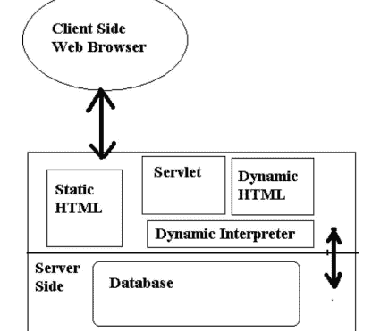

图 16.1
Web 应用程序。

- 1. Request encoding attack (XSS): 这种攻击以将恶意病毒植入可信链接而闻名。将病毒植入系统的最重要方式是通过可信来源。恶意代码进入系统并通过允许安全漏洞来验证文件。

- 2. SQL injection: 此攻击通过网页上的输入栏插入 SQL 代码以获取输入源的信息。

- 3. Sniffing (request encoding): 当数据通过网络传输时，可能被第三方窃取；这称为嗅探攻击。存在一些发展完善的狙击网络，引擎毕业生实验并开发新的渗透安全方法，使互联网对真正用户安全。嗅探攻击可以检测或提取我们的银行详细信息，以及在线资金被盗案件，而所有者却浑然不觉。

- 4. Directory traversal: 当攻击者入侵安全系统并从受限文件系统访问数据时发生；他们使用 HTTP 请求绕过网络、应用程序和服务器。

- 5. Web-based phishing attacks: 这些攻击大多通过攻击者通过电子邮件或社交网络发送的 URL 和链接进行。有时他们针对特定个人或群体以提取信息。如今这类攻击非常先进，可能复制用户的照片和其他详细信息。最脆弱的领域是银行网站、社交网络、火车和飞机票务系统。

- 6. Click-jacking attack: 在网页上遇到，当我们点击网页上的某个区域时将其路由到另一个页面；它是一个恶意按钮，位于受信任的网站上，会导致系统被锁定并暴露于恶意软件。

### 16.2.3 实现网络安全的措施

- 1. Vulnerability scanner: 最常被称为漏洞扫描器，它计算漏洞，即来自网站的威胁程度。它扫描并检测弱点、漏洞（点），这些漏洞容易被在场的攻击者/黑客利用 该工具主要用于连接到互联网的系统和内部网络，以排除系统被恶意软件威胁的所有可能性（Lomte, 2012）。

- 2. Firewalls: 防火墙可防止已知漏洞和威胁。这些防火墙有软件和硬件两种格式。它具有更好的效率；可以检查数据元素（如标头和网页内容）（Kallapur & Geetha, 2011）。

- 3. Application-level gateways: 这是一种更关注 TCP 模块的防火墙类型。它支持用户级身份验证，并且能够根据有效载荷分析数据包。其缺点之一是处理速度较慢。在过滤方面，其速度比数据包过滤慢，每次都可以实现对连接的支持（Lomte, 2012）。

- 4. Antivirus: 我们熟悉的如 McAfee、Windows 等防病毒软件，可提供一定程度的威胁免疫。如今，在所有系统中，大多数用户都在安装以保护其系统。事实上，如今所有系统都已连接到互联网。因此，可以建议

## Applications

定期更新它，这是保护我们的 PC 免受损坏的最简单方法（Kallapur & Geetha, 2011）。

- 5. 漏洞修补：当我们知道特定攻击的漏洞时，会应用修补技术。事先了解漏洞的攻击者可以利用系统和用户。如果不进行修补，系统可能会受到病毒和恶意软件的影响（Lorte, 2012）。

- 6. 网络防火墙：它们保护网络免受应用攻击。它仅处理网络组件，并执行诸如根据地址和端口号阻止 Internet 数据包以及监控网络流量等活动。

- 7. 入侵检测系统：它有助于检测受感染的流量。它还阻止路径并提出应对恶意软件的方法。其缺点之一是可能产生误报，因此不存在完全准确的入侵检测系统（IDS）（Kallapur & Geetha, 2021）。

- 8. 入侵防御系统：这些是网络安全组件，可监控网络和系统活动并阻止恶意数据包。为了进一步调查，它会报告被阻止进入系统的数据，但不足以检测未公开的漏洞（Kallapur & Geetha, 2021）。

## 16.3 数据库安全

数据挖掘与数据库相关。当涉及大量数据时，挖掘是数据库的额外优势。与数据库相关的另一个方面是信息共享；数据库可以是任何类型，当挖掘伴随共享时会导致数据安全泄露。挖掘可能带来数据被用于有害目的的威胁，即已发布的数据可能被不当使用。大量数据的老化和排序被称为挖掘。它提供聚类或分组数据的功能，以便排序变得更容易。其主要用途是从大数据集群中查找信息，从而有助于检测记录。挖掘技术使用依赖关系，也称为模式挖掘。数据挖掘过程涉及使用排序算法。这是在人们开始利用挖掘为个人利益而不是维护系统完整性而使用，例如欺骗、网络钓鱼和挖掘不必要的信息之后才出现的。

### 16.3.1 数据库安全分类

在云出现之前，保护数据库相当困难，但云出现后，数据库开始拥有轻松的备份。它分为几个部分，如分布式和云数据。共同点是数据库的主机和位置（Denning, 1984）。因此，它分为物理和逻辑如下（Malik & Patel, 2016）：

- 1. 物理数据库安全：安全涉及恢复机制，以便在云服务器安全的情况下恢复数据。数据的物理位置发挥着重要作用，因为它关系到数据实际存在的位置。

数据首选的位置必须不太容易受到自然灾害的影响，例如地震和洪水，这些灾害会损坏数据存储服务器。

- 2. 逻辑和系统问题：这些问题存在于操作系统中，而在此处的安全性更难实现。这些问题包括恶意软件感染或数据盗窃。保护数据免受未经授权访问是一项非常艰巨的任务。

### 16.3.2 数据库威胁

- 1. 分布式系统：这可能是由于广泛使用分布式系统/服务器架构和数据库暴露于不可靠网络的威胁。互联网和内联网增加了风险。

- 2. 过度权限：这可能导致数据被利用，从而破坏完整性；例如，我们可以以银行系统为例，客户期望其数据保密，但如果存在数据泄露威胁，银行可能会失去客户。

- 3. 数据未经过身份验证：这对数据库安全构成另一个威胁。身份验证的灵活性可能导致数据盗窃和凭据转换。如果任何人除了原始用户之外获得数据访问权限，那么它也完全有能力攻击其他系统。

- 4. 数据完整性丧失：数据完整性丧失可能导致数据损坏；当观察到完整性破坏时，它往往会破坏工作流程导致延迟。当完整性丢失时，保密性也会丢失（Malik & Patel, 2016）。

- 5. SQL 注入：用户输入的信息作为数据并构成数据库的一部分。SQL 注入是由攻击者注入以输入虚假信息的语句（Malik & Patel, 2016）。

- 6. 恶意软件：病毒对所有系统构成威胁；如果数据库被感染，则授权用户无法访问，其无法使用服务器上的数据、系统和文件。

### 16.3.3 数据库安全

始终需要构建一个加强系统，为系统安全提供更好的架构。建议在使用前进行规范化，并在将来使用时避免在数据输入时进行更新。可以通过在使用大批量数据库时遵循某些安全方面来保护数据库（Malik & Patel, 2016）：

- 1. 限制访问：仅向授权和相关用户提供访问权限，即限制数据库的各个部分对所有公众用户可见。它们可以归类为私有和受保护。从大样本中，个人只能获得少量数据，从而降低了数据风险。

- 2. 模糊数据：模糊意味着模糊并添加少量失真。引入少量不真实的数据可为现有值提供模糊性，例如更改某些值或更改值集以保持原始数据安全和隐蔽。这是添加误导性数据以使数据被滥用的概率为零。

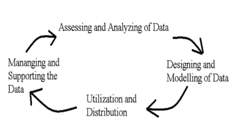

图 16.2
用于保护数据库的设计。

- 3. 消除分组：数据通常为其用户提供识别号码。假设我们正在注册国家身份证，我们通过唯一号码收到通知，如果号码有分组，例如前三位数字代表个人的所在地，这可能导致不受欢迎的元素恶意挖掘数据。这对信息安全构成威胁。考虑到上述示例，通过这种方式任何人都可以搜索用户的所在地，从而导致进一步的信息可供未经授权的用户使用。给出的示例类似于美国的社会安全号码；它们的前三位数字编码为签发身份证的办公室。

- 4. 提供安全身份验证：通常，安全涉及数据身份验证和授权用户识别。过去的方法仅涉及密码，但现在技术进步导致了其他几种方法，如生物识别识别和签名等。需要身份验证的数据文档由身份验证机构签署，然后发送给所需收件人。

## 16.4 设计安全

设计包括简单的步骤，可以提供可用性、身份验证、完整性和安全性。这里的四个组件涉及对数据进行分析，例如它容易受到威胁的程度，它有多脆弱，以及采用适当的解决方案。之后，设计安全算法并将其纳入实际数据库中，以提供安全以维护保密性。通过适当的定期审计和对恶意软件和弱点的检查来提供数据管理的适当支持和支持，这些弱点是漏洞，需要在数据实际使用时进行处理。所有这些措施可以总结在一个简单的流程图中（图 16.2）。

### 16.4 云安全

云安全涉及保护云，因为它包含可以不受平台、系统和地理位置限制访问的信息；这些是庞大的存储服务器。大多数组织和公司已迁移到云。威胁包括数据泄露、账户劫持等。安全措施涉及加密技术和密钥管理；这可以归类为身份和风险管理问题（Padhy & Patra, 2012）。


## 16.4.1 云及其部署模型

云被用作数据存储最可靠的来源。它提供从任何地方以及任何计算设备（如手机、笔记本电脑等）检索或查看文件的便利。Google 云，即 Drive，提供云存储；它允许在互联网上存储数据。云服务器被放置在不受任何物理损坏的安全地点。这些服务器的容量比普通服务器更大（Padhy & Patna, 2022; Rao & Selvamani, 2015）。

云服务器有三种形式，即可作为软件即服务、平台即服务和基础设施即服务使用。这三种模型正被提供云服务的厂商采用，以服务于其用户（Rao & Selvamani, 2015）。

- 1. 软件即服务（SaaS）：这是一种基于应用的模型，可以登录并操作互联网及 Google、Facebook 等应用；它由应用服务提供商（APs）提供。例如，Google 应用厂商管理基础设施以提供全面维护。

- 2. 平台即服务（PaaS）：它提供的服务包括无需安装和其他软件配置的平台，例如 Microsoft Azure 和 Red Hat OpenShift，它们提供 J2EE 和 DotNet 等服务。它提供良好的连接性和备份，对开发人员更有利。

- 3. 基础设施即服务（IaaS）：它包含虚拟化现象，其中包含虚拟接口，可帮助在任何系统上远程操作并控制服务器，可能包括磁盘分配和其他相关操作。它主要涉及与交换机、主机路由器等网络设备的交互。所有这些可归纳为通过使用虚拟化共享硬件组件。

## 16.4.2 云上数据的威胁

- 1. 授权和访问：恶意用户可以突破安全措施并进入云环境。

- 2. 弱认证：可能由于未采用稳健的方法来允许访问数据，使用弱密码和原始方法为数据用户分配访问权限而发生。

- 3. 网络上的漏洞和配置错误：数据在云上，24 小时在线，并暴露于网络上存在的所有种类的威胁，如嗅探和黑客攻击等。

- 4. 备份暴露：由于云最常被用作备份，因此它很容易受到攻击并暴露给恶意用户。这可能在传输数据时发生；这取决于数据有多有用。

## 16.4.3 云的安全

安全问题包括数据传输、完整性、网络安全、隐私、可用性和隔离。这些问题可通过安全策略和合规性审计进行检查。云上的服务不属于用户本身；用户的数据被保存在第三方。它不对我们的数据可能发生什么提供任何控制。重要信息也可能因任何安全漏洞而受到威胁。因此，具有组件的服务提供层维护安全，如服务等级协议监控、策略管理、调度器和调度程序（图 16.3）。

| 层 |  |  |
|---|---|---|
| 第 1 层 | 浏览器安全 | 用户 |
| 第 2 层 | 传输安全 | 服务提供商 |
| 第 3 层 | 虚拟机安全 | 虚拟化 |
| 第 4 层 | 服务器/网络/数据存储 | 数据中心 |

图 16.3
云模型中的不同安全层。

此外，像数据完整性这样的安全问题由虚拟机层处理，该层定义了监管和法律规范。基础设施维护涉及数据中心进行的身份和访问管理，该中心具有 CPU 和服务器的内存存储。有时它被称为 IAS，因为它在网络层提供安全。

所有安全问题都可以通过数据加密得到解决，如 Kerberos 认证；云上的数据可以通过加密密钥保持安全，用于加密的类似机制是 RSA 算法。

## 16.5 CAPTCHA

由于自动化在工业中的干预增加，显而易见的是，与机器人相关的攻击对用户造成了新的威胁，即机器人呼叫，它们是垃圾邮件，有时是欺诈性的。结果，一些人类在生活和商业方面有相关经验。CAPTCHA 是一种测试，我们在进入网站时作为安全措施输入正确的字符串，以便网站将其识别为人类而不是机器人。CAPTCHA 的全称是“Completely Automated Public Turing test to tell Computers and Humans Apart”。它旨在阻止模糊 URL 和机器人对网站的干扰；换句话说，CAPTCHA 可被视为提供安全性的应用程序。

### 16.5.1 CAPTCHA 的起源

CAPTCHA 的起源始于 1997 年，当时搜索引擎 AltaVista 的生产商正在寻找阻止自动 URL 的解决方案。Andrei Broder 发现了一种算法，该算法使用只有人类才能理解的图像来通过代码。当人类识别出正确的字母并输入时，他们会从网站获得文本形式的回复；如果是一个机器人，则无法猜出 CAPTCHA。后来在 2001 年，Andrei 对其技术申请了专利。两年后，CMU 的 Luis von Ahn、Manuel Blum、Nicholas Hopper 和 John Langford 提出了完美的算法并将其命名为 CAPTCHA。

### 16.5.2 CAPTCHA 的工作原理

CAPTCHA 本质上就是图灵测试，由 Alan Turing 于 1950 年提出；它测试机器表现出像人类一样的智能行为的能力。图灵的哲学是测试机器是否能像人类一样思考。这催生了一种新的判断算法，用于区分人类和计算机。这是一个简单的任务，涉及在引导我们进入特定网页之前显示 JPEG 或 GIF 图像，要求人类识别它；机器人无法读取此图像，它们只能读取源代码，而不能读取图像。为了便于识别字母，请求新的 CAPTCHA 的选项始终存在。这是人类每次登录互联网网站时都会遇到的测试。这是一种挑战响应，我们必须猜测字母和数字模糊扭曲的组合。如今，新的 CAPTCHA 用于区分人类和机器人（机器人）。它是“Completely Automated Public Turing Test to tell Computers and Humans Apart”的缩写。其管理员是计算机。虽然提供了安全性，但它使每个工作变慢，但这是必要的，以便任何人不能干扰网站系统（Soni & Bonne, 2017）。

CAPTCHA 以图像、音频文件和 HTML 格式保存在服务器上。网页以提交表单类型动态生成 CAPTCHA；它可以用任何编程语言实现，如 PHP；JAVA、Ruby、JSP 等。现在 CAPTCHA 的集成使用了一个密钥，即网页服务器和 CAPTCHA 服务器共有的密钥。此外，链接中会生成一个字符串，最终生成一个密码，该密码由 CAPTCHA 计算以显示图像，而网站服务器在此验证用户的输入。面向数百万用户的 CAPTCHA 得益于备份服务器（Soni & Bonne, 2017）。

### 16.5.3 CAPTCHA 的类型

为了方便人类并使其相当高效，程序员提出了几种类型的 CAPTCHA，可阐述如下（Gafni & Nagar, 2016; Mankhai, Rohimkar, Sukal, & Khedekar, 2016）。

- 1. 文本 CAPTCHA：这是最广泛和最常用的，即 re-CAPTCHA，其中字母和数字序列以扭曲的方式显示。大多数情况下，字母和数字的形状是奇特的。用户需要通过识别正确的字母和数字来解码，以访问特定网页。观察到的模式是数字和字母的组合，即字母数字字符串（图 16.4）。

- 2. 基于音频的 CAPTCHA：这种形式下，文本消息以音频信号的形式保存，专门为视障人士开发。用户需要收听字母数字序列并将其填入对话框。

- 3. 无 CAPTCHA re-CAPTCHA：它由 Google 于 2013 年启动，对用户浏览器在 CAPTCHA 方面的行为进行了预分析


## 应用
283
(a)
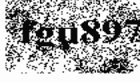

(b)


图 16.4
(a) 简单 CAPTCHA 的示例。 (b) 音频 CAPTCHA。

判断用户是人类还是机器。此服务在用户没有理由成为机器人的情况下使用；后来在 2014 年，它未被用于面向公众的 Google 服务（图 16.5）。

- 4. 算术运算 CAPTCHA：它要求用户解决数学查询或表达式，例如，显示的 CAPTCHA 将是 1 + 4 =，用户必须在给定的顶部框中输入 5 才能使 CAPTCHA 正确（图 16.6）。

- 5. 基于图片的 CAPTCHA：在此，会显示多张图片，要求用户选择特定类型的图像或将其归类到一个字段中，例如；在单个框架中显示一系列道路和餐馆，CAPTCHA 要求选择仅显示道路的图片。某些其他测试要求您调整给定的条以校正失真的图像，这将导致清晰的图像以通过 CAPTCHA。如图 16.7 所示，它可能会要求点击带有山丘的图像。

- 6. 基于游戏的 CAPTCHA：这是一项繁琐但合理的任务，要求用户执行活动，例如拼图和互动游戏。关于此类游戏的用户体验正在进行几种类型的研究；目前使用不多，但在不久的将来有发展空间（图 16.8）。


图 16.5
Google 的 Re-CAPTCHA。

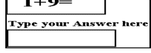

图 16.6
算术 CAPTCHA。


图 16.7 基于图像的 CAPTCHA。

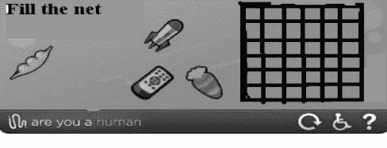

图 16.8 基于游戏的 CAPTCHA。

可以制作一个能够像人类大脑一样工作的程序，即人工智能；工程师部署它使其表现得像人类，因此智能计算机有可能解决人类能够解决的问题。CAPTCHA 的发明者 von Ahn、Blum、Hopper 和 Langford 采用了一种融合了类似密码学技术的方法。这有助于减少解决问题所需的时间。令人担忧的是，随着人工智能的广泛应用，如果被恶意用户使用，可能会影响该协议，即 CAPTCHA。解决方案正通过对现代密码学实践的分析而被提出。假设的安全性是所有难题最终都会被解决，即 P 不等于 NP；如果一个求解器一次解决了问题，那么它可以解决两次，并且如预期一样也可以解决第三次。这种方法被使用是因为它有助于识别人类大脑与计算机之间的差距（Ahn, Blum, Hopper, & Langford, 2003）。

涉及困难人工智能的 CAPTCHA 必须自动化，以便每个生成的测试都不会被机器人解决。例如，使用你的秘密教科书的图灵测试会随机选取一段文字作为测试，并询问用户它是否通顺。因此，我们可以得出结论，机器人无法识别哪一行是有意义的；这对人类来说也是一个相当困难的测试。这些测试肯定能够区分人类和计算机（Ahn, Blum, & Langford, 2003）。

## 应用
## 16.6 电子邮件安全

电子邮件安全可以被视为完全依赖于 SMTP。它提供了一定程度的安全性，但没有太多功能来阻止黑客和恶意用户发送包含病毒的电子邮件。邮件系统是与网络通信的原始方法；它发展出另一种接收和钓鱼邮件的压力，因为它被黑客和攻击者用作武器，因此最重要的是消除威胁并改善保护电子邮件系统的措施（Banday, 2011）。

### 16.6.1 简单邮件传输协议

这是最初为小群体之间通信而设计的协议。最初没有提供安全性，但在经历了一些漏洞后，协议中加入了更改，并伴随着技术进步（Banday, 2021）（图 16.9）。

这些更改包括减小电子邮件的大小、过滤、头部验证、使用机器学习过滤垃圾邮件以及细致的邮件。SMTP 被视为发送和接收电子邮件的标准协议。SMTP 面临的一些安全问题是安全性和完整性。由于电子邮件未被解密，因此以明文形式存在（Jin, Takabi, & Joshi, 2010）。

### 16.6.2 威胁

- 1. 垃圾邮件：它也称为垃圾邮件。此类电子邮件大多包含病毒和恶意链接。有时仅通过打开邮件，就建议不要打开此类电子邮件，因为不知道邮件包含什么；这些邮件来自未知收件人。已采取许多步骤来过滤电子邮件，以过滤可疑发送者的邮件进入收件箱（Kamthe & Nalawade, 2015）。
- 2. 病毒：病毒是通过电子邮件进入系统的高风险破坏者。一些病毒示例可以是屏幕上的弹出电子邮件；现在，很少看到弹出电子邮件。悬而未决的电子邮件威胁可以注入到我们已知的收件人电子邮件中，也可以通过我们的垃圾邮件进行。

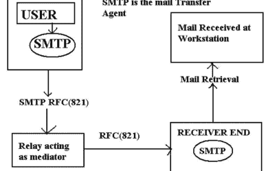

图 16.9 包含 SMTP 的电子邮件系统。

## 新兴安全算法和技术

这一直是一个长期存在的问题，人类现在更加意识到这一点；他们在打开任何电子邮件时都很谨慎，并避免点击邮件中的任何图像。病毒是长期破坏者；它们会立即影响数据，这使得恢复丢失的数据变得繁琐困难。此外，由于病毒不易被杀毒软件清除，恢复病毒造成的损失需要更多的人力和金钱（Kamthe & Nalawade, 2015）。

### 16.6.3 攻击

- 1. 被动攻击：攻击者利用他们观察到的数据，对于简单系统而言，他们拥有明文。攻击者干预系统使邮件可供攻击者使用。他们使用此类技术发送邮件直至非预期——此类攻击的一个例子是“中间人攻击。
- 2. 主动攻击：此攻击会导致中断。攻击者阻止发送者访问网站，并且可以修改内容。大多数更改在邮件传输过程中被观察到。在没有身份验证的情况下，数据可以被伪造，包括创建虚假账户。
- 3. DOS 攻击：此攻击可以轻松地在网络上发起；它非常强大，可以关闭整个网络系统。通过此类攻击，计算机会在用户不知情的情况下被感染。此攻击主要检查在网络上发送请求的可用性，以攻击带宽和 TCP 连接，系统的 CPU 周期是此攻击影响的主要部分（Kamthe & Nalawade, 2015）。

### 16.6.4 对攻击和威胁的措施

展望当今时代，各种补救措施都因普通用户对后端流程的理解不足而提供。许多公司只是发布安全软件，而对用户缺乏诚信。许多免费软件可用，但实际上，它们并不能提供 100% 的病毒问题解决方案。下面讨论了一些目前正在使用的框架和方法。

- 1. 它是为发送者身份验证而开发的。Meng Wong 是该框架背后的开发者。发送者的域名会被记录，由 SPF 检查并从域名而来，然后 IP 地址会进行匹配以进行进一步身份验证。如果不匹配，则邮件被声明为垃圾邮件。
- 2. 加密：它是一种防止预期用户在中间获取信息的方法。关键是提供从发送者到接收者的身份验证数据。例如可以采用 Kerberos 身份验证。在电子邮件中，传输数据时使用各种技术，如 HTTPS 和 HTTP。为了防止嗅探攻击，会使用私有网络（VPN）进行加密；它检测恶意软件和病毒，并通过防火墙阻止它们进入网络。
- 3. DOS 攻击的措施：入侵检测、增强型路由器和防火墙等系统被用作防御此类攻击的手段。一般来说，入站和出站流量的分析用于 TCP 层面的保护，可在基线上检测流量；例如，TCP SYN 洪水攻击可以被阻止


## Applications

仅当系统由其自身独立的防火墙保护时。这就像进行实时评估的工作。因此，正如我们可以使用后端服务器并在路由器中加入安全措施；可以观察到，通过解决攻击的繁重流量，我们可以防止系统遭受这些攻击。

- 4. 消除网络钓鱼和垃圾邮件：为了避免网络钓鱼和垃圾邮件，最常见的方法是阻止。如今，我们可以将邮件标记为垃圾邮件，它可作为同类可能对用户构成威胁的其他电子邮件的范例，通过使用此邮件，它会直接进入我们收件箱的垃圾邮件列表。

## 16.7 SMS Security

短消息服务（SMS）如今被最广泛使用。聊天应用程序出现后，但在那之前，SMS 是向设备发送消息最快且最便宜的方式，且没有用户的有效身份识别。许多 SMS 包含恶意和可疑的链接，可能导致设备被解密。SMS 的协议在 ETSI TS 03.48 中规定，提供密钥标识符 SPI（安全参数索引）和完整性值。数字签名和冗余检查用于身份验证和验证。SMS 安全一直是电信公司以及很可能移动用户的关注点，因为与窃听、洪水攻击、衰减、SMS 拦截和修改相关的攻击最为常见。带有特洛伊木马和多种病毒的 SMS 消息可以轻易潜入我们的系统。其安全性可以通过加密和用户身份验证来实现，以确保用户安全（Reaves et al., 2016）（图 16.10）。

### 16.7.1 Encrypting Short Messages

加密是将消息密钥分配给发送方和接收方的过程。它使用算法来使拥有解密消息密钥的人能够访问消息。加密的优势在于为系统中的消息提供安全性，而在网络中传输时，物理上保护整个网络是困难的。术语“加密”源自希腊语“Kryptos”，意为隐藏或秘密。因此，从上述含义可以清楚地看出，加密隐藏数据；它将数据转换为密文，只有

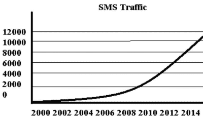

FIGURE 16.10
用于描绘 SMS 流量增长的图表。

授权用户才能理解。加密主要涉及对消息机密性的保护。它通过算法生成的伪随机加密密钥来防止数据被干扰，该密钥只能解密消息。加密的首次使用以 RSA 和 Diffie–Hellman 密钥算法的形式出现。诸如 SSH、S/MIME 和 SSL/TLS 之类的协议用于保护数据，数字版权管理也使用加密的概念进行保护。用于 SMS 加密的算法是存在的；它们是根据设备的操作系统设计的。我们列出了一些现有的加密算法，如 XTR、IDEA、Blowfish、RSA、DES、MD5 和 SHA。它们提供不同程度的安全级别。RSA 和 DES 是流行的算法；XTR 源自 XTR 密码系统，使用该技术进行加密是保护消息传输最快的方式。XTR 是 ECSTR 系统的另一种形式，即高效紧凑的子群迹表示。它使用离散对数计算以提供系统的快速处理（Nanda & Awasthi, 2012; Reaves et al., 2016）。

### 16.7.2 SMS Threats

- 1. 消息可用性：由于加密不是默认设置，它们在网络传输过程中可能被恶意用户读取或破解。它们通常以明文保存，可以被拥有消息系统访问权限的人员在交换服务器上轻松查看。用于嗅探和间谍活动的程序可以自动记录所有消息。它们也可以保存在外部/远程服务器上以供进一步研究。
- 2. 垃圾邮件：主要是广告消息批量发送。这些消息包含可能损害用户设备系统的信息。批量消息的功能允许垃圾邮件发送者在网络中通信，等待攻击。
- 3. 洪水攻击：这是在特定时间发送批量消息；例如，我们可以确保每秒发送 200 条消息会干扰或堵塞手机。它甚至可能使设备无法访问；这些攻击利用了 SMS 协议。
- 4. SMS 手机崩溃：发送消息会导致数据完全丢失或手机损坏。这些攻击会使手机挂起并感染设备，不允许用户控制。它还可能导致手机被黑，从而使手机处于非活动状态。
- 5. SMS 病毒：随着技术变化朝着进步的方向发展，更多威胁被检测并报告，其强度与之前的版本一样强。它们有在消息上仅点击一次就自行安装的倾向，导致手机功能失常。
- 6. SMS 网络钓鱼：用户被虚假消息误导，触发用户下载并激活具有恶意性质的服务。消息中的文本将屏幕引导至未知网站；有时过程如此之快，用户无法识别系统发生了什么。

### 16.7.3 Security Measures

- 1. 传输：在通过互联网发送时，可以通过激活安全套接层（SSL）来保护消息，对于移动平台加密，建议这样做以阻止窃听消息，从而为消息提供端到端安全。Crypto SMS 使用强大的加密算法来帮助抵御威胁。
- 2. 存储：在手机暴露给未知用户时，建议根据隐私协议将联系人列表和个人数据保持安全和受保护。
- 3. 用户身份验证：SSL 通过登录 ID 或用户 ID 配合密码提供安全传输，并将提高发送消息的安全性。用户经过身份验证后，服务提供商提供端到端加密将变得更容易。
- 4. 系统保护：发送消息时，不建议使用公共互联网终端，因为它可能导致 DoS 攻击通过无人看管的系统传播。

## 16.8 Lightweight Cryptography Applications in IoT, Sensor Networks, and Cyber-Physical Systems

物联网（IoT）和 cyber-physical 系统（CPS）是两种新引入的场景，在无线设备之间的通信中发挥重要作用。IoT 指的是 RFID 传感器和小型设备之间发生的交互。所有这些都归类于 IoT。这些新兴的小型设备更容易受到攻击；数据完整性的威胁始终存在。在不同种类的约束环境下工作的新型小型设备，如连接小型网络的系统，即无线传感器网络（WSN）；它们需要占用较少内存空间的短代码大小算法。这就是它们被称为轻量级的原因。轻量级安全密钥由在受限环境中高效工作的算法生成。此类协议的示例有 TLS 和 IPSec。它们提供安全性和效率之间的权衡。它们还使用对称密钥进行端到端通信，因为它们适用于小型占用空间的低资源设备。IoT、传感器网络和 CPS 中的轻量级密码学应用是指安全方面的要求，这导致使用轻量级安全密钥的系统；使用此类算法的系统有 RFID、WSN 和 CPS。我们将研究轻量级密码学、其威胁、如何使其安全、轻量级安全密钥生成机制的流程。

Cyber-Physical Systems 是与计算机算法相结合的控制和监控机制，与互联网及其使用紧密集成。这些系统由深度交织的物理组件集成构建；它们在不同的空间和时间尺度上工作。它们表现出模块化行为，并以可根据使用情况变化的多种方式进行交互。此类系统的示例有智能电网、自主汽车系统、医疗监测、过程控制系统、机器人系统和自动驾驶仪航电系统。它们处理诸如适应性、可扩展性、弹性、安全性和可用性等属性，为将出现未来智能系统的基础设施系统提供基础。

### 16.8.1 Lightweight Security Key Management System

在此系统中，首先考虑多个节点。所有节点都由自运行算法选择，通过该算法它们将自己分为服务节点、备选服务节点、

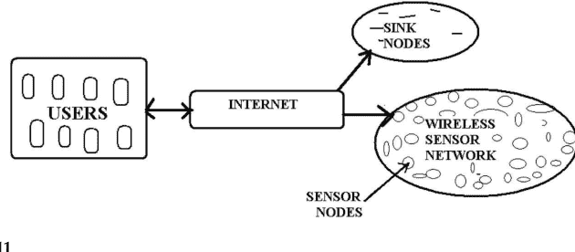

图 16.11
物联网节点交互。

以及工作节点。在此选择过程之后，服务节点为工作节点生成密钥空间。其次，工作节点与其关联的服务节点之间建立安全网络。现在，它们拥有针对等效服务节点的共享密钥。由于物联网由异构网络组成，传感器是对特定设备所暴露的设备和网络进行感知的分类工具。当我们考虑一个连接了智能设备的庞大网络时，该网络是随机分布的；每个节点都扮演传感器的角色。采用 Rabin 密码系统来确保密钥的信息安全。密钥采用多项式和基于矩阵的密码学进行成对生成。每个节点都被分配使用本质上唯一的 IPv6 地址 UID。在此系统中，每个节点在接入无线网络之前预计会自行选择为传感器节点。这些是自配置算法——在此，服务节点与工作节点之间建立连接，该连接使用主方案，该方案使用密码系统生成密钥。此后，在 UID 分配的帮助下，轻量级管理系统内建立了安全连接。物联网包括连接到互联网的小型无线设备，它们是流行且广泛使用的技术产品。被广泛使用的主要原因包括低功耗、高可靠性、易于部署或低存储空间，以及通过物联网连接的大量设备。这使得设备承受更大压力，并对现有的安全威胁变得脆弱。最令人担忧的话题是设备的安全性，例如弱密码、被黑账户以及缺乏安全更新。物联网的应用涉及自动化、安全设备和无线传感器、自动驾驶汽车、智能家居以及类似产品，这些产品始终保持在网络上或在线，容易受到损坏威胁。这些系统通过数千个传感器连接以覆盖更广的区域，其范围取决于电池的使用。传感器具有加密受限的机制，复杂的密码算法不足以跟上物联网设备之间的步伐。此外，需要采用轻量级密码系统（Chen, Chang, Sun, Jia & Wang, 2012）（图 16.11）。

## 16.8.2 威胁
- 1. 节点相交：内部 WSN 节点与外部节点之间的交互可能导致异常行为。
- 2. 接口：我们的设备所暴露的网络端口对跨站脚本、凭据泄露、SQL 注入以及弱账户锁定设置构成巨大威胁。这些可以通过强密码策略以及引入三到四次账户锁定来避免。
- 3. 身份认证与授权：必须检查用户权限；不应提供不必要的全部访问权限。
- 4. 不安全网络：这可能导致用户未经授权获得特权以提取网络上的信息或数据，这些攻击包括 DoS、通过网络模糊测试的 DoS 以及缓冲区溢出。

## 16.8 攻击
- 1. 被动攻击：这意味着监控 WSN 上交换的数据包；可能导致窃听攻击，因此建议进行密切监控。
- 2. 主动攻击：有时会确保虚假数据流中断数据流，导致干扰，并且现有数据流有时也会被修改。
- 3. 对节点的攻击：威胁可能由与网络节点相似的节点构成，并且在攻击时它们可以包含更强大和更强大的机制来攻击 WSN。

## 16.8.4 安全需求
- 1. 网络可用性：即使在 DoS 攻击的不利条件下，网络流也必须可用以确保不间断传输。
- 2. 授权：只有由已知来源授权的传感器才允许进入网络系统在 CPS 中交互。
- 3. 真实性：网络节点必须具有真实性，以防止任何未识别和不诚实的用户干扰网络系统。
- 4. 加密：必须遵循设计良好的算法机制，该机制无法被除预期用户之外的任何人解密；换句话说，数据必须保密。
- 5. 完整性：它确保数据未被中间节点中第三个未知恶意用户触碰或修改。
- 6. 不可否认性：节点应能够发送其先前传输的数据，即不可否认其先前发送的消息（Tausif, Ferzund, Jabbar, & Shahzadi, 2017）。

## 16.9 结论
安全是每个领域都需要关注的特性。世界上广泛使用的计算机应用程序正遭受黑客和恶意用户的未知攻击。不同类型的应用程序存在不同类型的威胁，例如 CPS、云、电子邮件、短信、互联网和数据库。任何在线或机密的东西，即在服务器上，都是安全悬而未决的关注点。因此，本章讨论的安全措施涉及威胁类型的安全问题，包括威胁及其应对措施。本章建议的安全措施是人工智能和轻量级密码系统，作为近期被纳入您系统和网络安全的先进技术。

## 参考文献
Ahn, L. V., Blum, M., Hopper, N. J., & Langford, J. (2003). CAPTCHA: Using Hard AI Problems for Security. Lecture Notes in Computer Science. Advances in Cryptography—EUROCRYPT 2003, Springer, Berlin, Heidelberg.
Banday, M. T. (2011). Effectiveness and limitations of e-mail security protocols. International Journal of Distributed and Parallel Systems, 23,38–49. doi:10.5121/jds.2011.2304

Chen, D., Chang, G., Sun, D., Jia, J., & Wang, X. (2012). Lightweight key management scheme to enhance the security of internet of things. International Journal of Wireless and Mobile Computing, 5, 192, doi:10.1504/iwcm.2012.04072.

Denning, D. E. (1984). Cryptographic mechanisms for multivariable database. 1984 IEEE Symposium on Security and Privacy, doi:10.1109/sp.1984.10011.

Gafnik, R., & Nagar, I. (2016). CAPTCHA–Security affecting user experience. Proceedings of the 2016 InSITE Conference, 13, 63–77. doi:10.28945/3469.

Jin, L., Takabi, H., & Joshi, J. B. (2010). Security and risks of using e-mail address as an identity. 2010 IEEE Second International Conference on Social Computing. doi:10.1109/socialcom.2010.1334.
Kallapur, P. V., & Geetha, V. (2011). Web security: A survey of trends in security attacks. Lecture Notes in Electrical Engineering, Advances in Computer, Communication, and Automation Control, 405–415. doi:10.1007/978-3-642-25541-0_52.

Kamthe, P. S., & Palwasade, S. P. (2015). Email security: The challenges of network security. International Journal on Recent and Trends in Computing, 3(6), 3505–3509. Retrieved May 9, 2018, from https://ijjit.com/index.php/ijjit/article/download/4481/4481.

Malib, M., & Patel, J. (2017). Database security–Attacks and control. International Journal of Information Sciences, 6(2), 175–184. doi:10.5121/ijis.2017.6218.

Mankihar, S., Raut, A., Mohimkar, M., Sural, K., & Khedkar, A. (2016). Secure CAPTCHA pass-verification using visual cryptography. International Journal of Engineering Science and Computing, 6(5), 5247–5251. doi:10.4010/ijesc.2016.1286.

Nanda, A. K., & Alwani, L. K. (2012). XTR cryptography for SMS security. International Journal of Engineering and Technology, 4(6), 836–839. doi:10.7763/jet.2012.v495.

Radhy, R. P., & Patra, M. R. (2012). Evolution of cloud computing and enabling technologies. International Journal of Cloud Computing and Services II (IJ-CLOSER), 1(4), 182. doi:10.11591/closer.v14.214.

Rao, R. V., & Selvakmani, K. (2017). Data security challenges and solutions in cloud computing. Procedia Computer Science, 48, 204–209. doi:10.1016/j.procs.2015.04.017.

Reaves, B., Skaife, N., Tian, D., Blue, L., Layner, P., & Butler, K. R. (2016). Sending an SMS: Characterizing the security of the SMS ecosystem with public gateways. IEEE Symposium on Security and Privacy, 339–356. doi:10.1109/sp.2016.28.

Soni, S., & Bonde, P. (2017). CAPTCHA: A security review. International Journal of Computer Applications, 168(4), 44–47. doi:10.5120/ijca.27194337.

Tausif, M., Ferzund, J., Jabbar, S., & Shahzadi, R. (2017). Towards designing lightweight ciphers for internet of things. KSII Transactions on Internet and Information Systems, 11(8), doi:10.3837/tiis.2017.08.014.

Webroot sends free concerns over Web 2.0 (2009). Infosecurity, 6(4), 10. doi:10.1016/s1754-4548(09)00074-9


## 17 动手实践 "SageMath"

Uma N. Dulhare
Khaleel Ahmed

Muffakham Jah College of Engineering and Technology
Maulana Azad National Urdu University

目录
17.1 引言 293
17.2 安装 294
17.3 编程基础 296
17.3.1 对象、值和表达式 296
17.3.2 运算符 297
17.3.3 运算符优先级 297
17.3.4 变量 297
17.3.5 打印语句 297
17.3.6 注释 298
17.3.7 if 语句 298
17.3.8 用于定义函数的语句的函数被称为 Def 及其语法 301
17.4 接口 301
17.5 绘图 303
17.5.1 二维绘图 303
17.5.2 三维绘图 307
17.6 结论 307
参考文献 308

## 17.1 引言

Sage 软件的主要目的是以快速的方式实验和探索与数学对象相关的知识及其应用。它还可与数学对象进行交互式实验。如今 Sage 可以在各种具有互联网连接的平台上运行，例如 MP3 播放器、手机（Sang-Lu, 2012）。SageMath 建立在许多现有软件包之上，例如 matplotlib、Numpy 以及高度优化的矩阵软件 vip、GMP、NTL 等（Shravan, 2017）。SageMath 软件因以下几点而更受欢迎（http://doc.sagemath.org/）：

- 易于编译：它为 Windows、Linux 和 OS X 用户提供更灵活、易于编译的方式。
- 协作：它为其他计算机代数系统提供强大的接口，包括 GAP、PARI、Singular、KASH、Maxima、Maple、Magma 和 Mathematica。
- 可扩展：它可用于从内置类型或新数据类型进行定义，并使用各种语言编写的代码。
- 用户友好：易于理解对象功能、源代码、查看文档等。

Sage 使用知名且功能强大的语言 Python 进行新代码编写，并提供高质量的免费软件包：

GAP: Groups, Algorithms, Programming
Maxima: general purpose Computer Algebra System
Pari/GP: Number Theory Calculator
R: Statistical computing
Singular: fast commutative and non-commutative algebra (http://doc.sagemath.org/).
此外：ATLAS, Bzip2, Cddlib, Common Lisp, CVXOPT, Cython, mwrank, F2c, Flint, FpLLL, FreeType, G95, GD, Gen2reduction, Gfan, Givaro, GMP, GCM, GNU TL, GSL, JMath, IML, IPython, LAPACK, Lecalc, Libcrypt, Libpg-error, Linux, M4RI, Matplotlib, Mercurial, MoinMoin, MPFI, MPFR, ECLib, NetworkX, NTL, Numpy, OpenCDK, PALP, Pexpect, Peng, PolyBori, PyCython, Python, Read, Rpy, Scipy, SQLite, Sympow, Symmetrica, Symp, myocard, Tachyon, Termcap, Twisted, Weave, Zlib, ZODB

## 17.2 安装

Sage 可在 Linux、Mac 和 Windows 上运行。以下步骤可用于安装 SageMath：

1. 根据您的操作系统版本，从 http://www.sagemath.org/download.html 下载预编译的二进制文件
2. 下载后解压压缩的二进制文件
3. 通过运行 ./sage 即可。

从解压文件夹中，您可以通过运行 ./sage 启动 sage。Sage 交互式环境将被启动。Sage shell 类似于 Python shell，几乎所有 Python 命令都可运行。
VMware 虚拟机版 SAGE 分步说明，便于安装

1. 从网站 “https://download.cnet.com/Sagemath/3000-2053_4-10967002.html" 下载 sage-vmware-x.y.z.zip
2. 在系统上解压它。它会弹出一个窗口，我们需要在其中指定文件解压的目的地。您可以使用“Browse”选项卡搜索目标文件夹。指定顺序后，点击页面底部的“Extract”按钮。

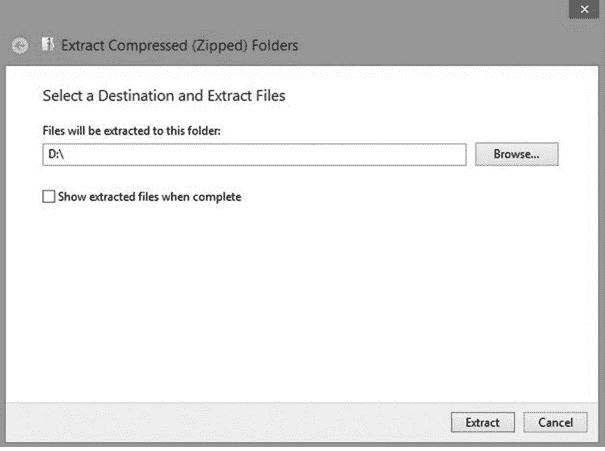

3. 确保已安装免费的 VMware 程序：
www.vmware.com/products/player/

4. 在您解压文件的文件目录中双击 sage_vmx 以运行 SAGE。


5. VMware 工作站窗口出现。

6. 点击 SAGE，它会打开一个 sage 交互式 shell，我们需要在其中提供凭据。

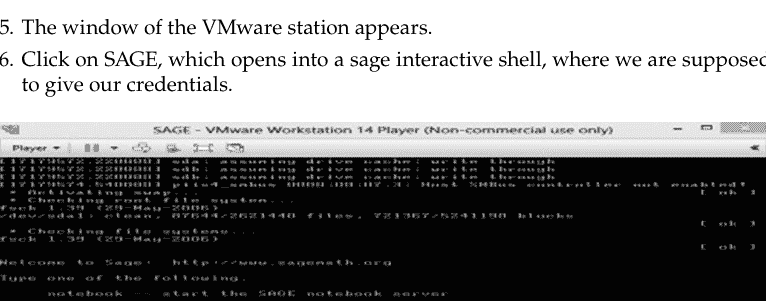

7. 输入登录 ID 和密码后，您即可使用强大的 sage。

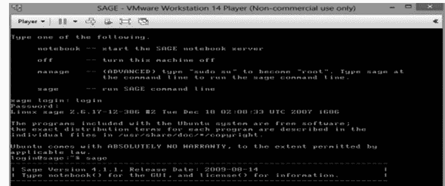

```
start the SAGE notebook server
off
tore this machine off
manage
(ADVANCED) type "sudo su" to become "root" Type sage at
the command to run the sage command line
sage
sage command line
crun
sage: login: 2.6.17 12 12:08:33 Tue 12 Dec 02:08:33 UTC 2016
network
the distribution trees for each program are described in the
help description of the sage software
Ubuntu comes with ABSOLUTELY NO WARRANTY, to the extent permitted by
login@sage 2.1 Release Date 2003-08-14
(Type notebook() for the GUI, and license) for information.
```

8. 您也可以从浏览器使用 SAGE 的网页版。在命令提示符中输入 notebook()。

上述步骤将完成成功的安装过程（表 17）。

## 17.3 编程基础

### 17.3.1 对象、值和表达式

SAGE 由对象构建，SAGE 程序处理的数据也表示为对象。Type() 命令告诉我们对象的类型（Kosan, 2008）。

表 17.1

随 Sage-4.4.2 包含的软件包（Erokal & Stein, 2010）

| atlas | gap | libcrypt | Scipy-sandbox |  |
|---|---|---|---|---|
| hash | gd | libgpg_error | pari | scicons |
| boehm_gc | gap | libgpg_error | pari | scicons |
| boost | genus2reduction | libpng | pect | setuptools |
| cddlib | gfan | linbox | polybori | sphinx |
| clipper | ghmm | matplotlib | pycrypto | sqlalchemy |
| cvxopt | givaro | maxima | pigments | sqlite |
| cython | gnutls | mercurial | pynac | symmetrica |
| docutils | gsl | moin | python | sympow |
| ecl | iconv | mpfi | python_gnutls | speedy |
| ecl | im1 | r | tachyon |  |
| ecm | ipython | mpir | ratpoints | termcap |
| fzc | jinja | mpath | readline | twisted |
| flint | ninja2 | network | rubiks | weave |
| flintqs | lapack | ntl | sagen | zlib |
| fortran | lcalc | numpy | sagetex | zn_poly |
| freetype | libhfill | opencdk | scipy | zob3 |

### 17.3.2 运算符

字符 +, *, /, ^ 被称为运算符，它告知 SAGE 在给定表达式中对对象执行什么操作。

### 17.3.3 运算符优先级

SAGE 使用一组称为运算符优先级的规则来确定运算符应用于表达式中对象的顺序

- 指数从右到左求值。
- %、乘法、余数和除法运算从左到右求值。
- +、– 加法和减法从左到右求值。

SAGE 根据优先级规则对该表达式中的运算进行求值：

```
6 + 9^24/18 - 2^3
6 + 9^24/18 - 8
6 + 216/18 - 8
6 + 12 - 8
18 - 8
10
```

> ^ 运算符先执行因此得到 8
* 运算符接下来执行得到 216
/ 运算符执行得到 12
+ & 然后结果得到 10

### 17.3.4 变量

当表达式返回一个对象时，该对象会被赋给变量。通过赋值在 SAGE 中创建变量。SAGE 变量也是区分大小写的。
示例：A = 7 创建变量 A 并赋值为数字 7。
如果您想查看变量的内容，将其名称输入空白单元格并求值单元格：

```
A
7
```

在工作表中某个单元格中创建的变量也可在工作表的其他单元格中使用。变量可在关闭工作表前保存。这意味着 SAGE 在判断两个或多个变量名是否相同时会考虑变量中每个字母的大小写。例如

### 17.3.5 打印语句

SAGE 允许通过 print 语句在单元格中的任何位置显示表达式的结果。
字符串 string 对象由文本组成，该文本用双引号或单引号括起来。


## 17.3.6 注释

SAGE 允许通过在任意文本左侧放置井号 '#' 来为源代码添加注释，或对多行注释使用一组三引号来包含文本

```
Conditional Operators y == z, y <> z, y <= z, y > z, y >= z
y = 5
z = 5
print y, "=\=", z, ":", y == z
|
5 == True
```

## 17.3.7 if 语句

在 SAGE 中，如果对象是非零或非空，则为“真”，如果为零或空，则为“假”。if 语句的简化语法规范如下：

```
if <expression>:
<statement>
<statement>
<statement>
.
```

示例

```
x = 4
if x < 5:
print x
print "Smaller"
|
4
Smaller
```

### 使用 while 语句循环
while 语句的语法规范如下：

```
while <expression>:
<statement>
<statement>
<statement>
.
```

以下示例程序使用 while 循环打印斐波那契数列：

## 动手实践 “SageMath”

```
sage:
sage: a,b = 0,1
sage: while b< 10:
    print b
    a,b = b, a+b
    :
:
1
2
3
5
8
sage:
```

### 使用 for 语句循环
for <target> in <object>:
<statement>
<statement>
<statement>
.

示例 1. 显示数组元素

for x in [20,21,22,23]:
print x

+   20
21
22
23

示例 2. 矩阵乘法 如果 [A] = ([[2,2,5],[1,4,1],[6,3,8]])
并且 [B] = ([[6,2,1],[9,4,4],[1,2,4]])

```
sage:
sage: A = matrix([[2,2,5],[1,4,1],[6,3,8]])
sage: A
[2 2 5]
[1 4 1]
[6 3 8]
sage: B = matrix([[6,2,1],[9,4,4],[1,2,4]])
sage: B
[6 2 1]
[9 4 4]
[1 2 4]
sage: A * B
[35 22 30]
[43 22 23]
[71 40 50]
sage:
```

## 新兴安全算法与技术

示例 3. 求矩阵行列式的程序：

```
sage:
sage:
  A = matrix(((2,2,5), (1,4,3), (0,3,0)))
sage:
  (3,3,3)
sage:
  A.det()
sage:
  B = matrix(((0,2,1), (9,4,43), (1,2,4)))
sage:
  (3,3,3)
sage:
  (2,4,31)
sage:
  B.det()
sage:
  35 28 301
sage:
  277
```

示例 4. 打印前 20 个数字的程序：

```
Sage:
sage: i=0
sage: while i< 20:
    print(i)
    i+=1
0
1
2
3
4
5
6
7
8
9
10
11
12
13
14
15
16
17
18
19
sage: -
```

示例 5. 打印 20 以下偶数的程序：

```
19
sage: i=0
sage: while i < 20:
    if i%2==1:
        i+=1
        continue
    print(i)
    i+=1
0
2
4
6
8
10
12
14
16
18
sage: -
```

## 动手实践 "SageMath"

示例 6. 打印 10 以下斐波那契数列的程序：

```
sage:
sage: a,b= 0,1
sage: while b< 10:
    print b
    a,b = b, a+b
    :
    :
1
2
3
5
8
sage:
```

## 17.3.8 函数

规范如下：

```
def <function name>(arg1, arg2,... argN):
<statement>
```

```
def addnums(num1, num2, num3):
answer = num1 + num2 + num3
return answer
```

```
#Call the function and have it added.
a = addnums(2, 3, 4)
print a
```

## 17.4 接口

Sage 通过提供统一的接口使各种数学软件包能够协同使用，该接口自动处理数据转换。接口还可以运行由另一程序解释语言编写的库中的代码。表 17.2 表示 Sage 提供的接口列表 (http://doc.sagemath.org/)。

对应的软件需要为每台计算机上安装的软件。最常见的接口类型称为 pexpect 接口，它通过向文本控制台读写字符串与另一个命令行程序通信，

## 302 新兴安全算法与技术

## 表 17.2

Sage 对数学软件的接口

| 接口 | 软件 |
|---|---|
| Pexpect | axiom, ecm, fricas, froby, g2red, gp, Gnuplot, gap, gfan, kash, lie, maple, maple, mac2, mathematica, mwrank, maxima, mupad, Matlab, php, polymake, polyvec, qepcad, qsieve, r, rubik, sicilab, singular, tachyon, octave |
| C 库 | eclib, gap (in progress), iml, linbox, maxima, points, r (via rpy2), singular, symmetrica |
| C 算术 | int, mpri, polybari, not, singular, syncar |

就像另一个用户在终端前一样。它是与某些数学软件通信的默认方法，包括商业和开源程序，例如 Maple（非自由）、Mathematica（非自由）、Magna（非自由）、KASH 或 GAP。Sage 提供了一个框架来表示这些接口上的元素，对其进行算术运算或将函数应用于给定对象，以及在字符串表示过大时使用 gap 传递数据，例如 % magma、% gap 等。
如果 Z 是一个交互式对象，Z.interact() 允许与之交互。它与 Z.console() 不同，并启动与 Z 交互的任何内容的全新副本。通过使用 sage(expression) Z，将数据拉入交互式会话。接口的控制台和交互式方法做的事情不同。
使用示例：

- 1. gap.interact()：这是在可能“充满 Sage 对象”的 gap 实例中交互的简便方法。Sage 对象可以导入到此 gap 中。由于控制台函数，我们获得了实际程序。
- 2. gap.console()：它是另一个程序，例如 gap/magma/gp 类似于 bash，Sage 保存了多个方便的程序。

## 常见接口功能

clear_prompts()—返回在此接口中使用的命令。
detach()—子进程忘记运行但假装它不再运行。
eval (code, strip = True, synchronize = False, locals = None, allow_use_file = True, split_lines = "nofile"*kwds)
code – 要计算
strip – None; 剥离输出提示检查等。
locals – None（忽略）；它用于与 Sage 通用系统接口兼容。
allow_use_file – bool（默认值：True。如果代码超过接口特定的阈值且为 True，则代码将通过临时文件而不是基于字符的接口进行通信。
否则代码将通过字符接口进行通信。
split_lines – 三态（默认值：“nofile”）；
如果“nofile”则代码按行发送，直到通过临时文件进行通信。

## 动手实践 “SageMath”

如果为 True 则代码按行发送，但某些行也可能单独通过临时文件发送，否则整个代码块将一次性求值。

**kwds - 所有其他参数都传递给 the_eval_line 方法。
例如 reformat = False
is_running() - 返回 True，目前正在运行自身
pid() - 返回底层子进程的 PID
quit(verbose = True) - 运行子进程，如果为 False- 停止运行子进程
server( ) – 表示在此接口中使用的服务器

## 17.5 绘图

Sage 可用于绘制二维和三维图形。

## 17.5.1 二维绘图

Sage 可以绘制圆、线和多边形：等高线图、极坐标图、向量场图，以及二维直角坐标系中函数的图（Kosan, 2008）。符号 [sin(x), cos(x)] 是 Sage 中列表的一个示例（Bard, 2018）。下面表达式的 2D 绘图程序

```
a = x^2
b = plot(a,0,10)
type(b)
show(b)
```

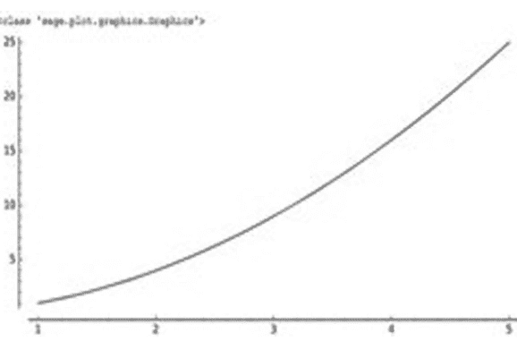

304

新兴安全算法与技术


图 17.1
使用 figsize[4,3] 对表达式 500*e^(-100*x)*sin(100*x) 进行 2D 绘图。

使用参数 xmin、xmax、ymin、ymax 和图大小对符号表达式进行 2D 绘图（图 17.1）。

```
V = 500*e^(-100*x)*sin(100*x)
Show(plot(v,0,1),xmin = 0,6,figsize[4,3])
V = 300*e^(-100*x)*sin(100*x)
```

Show(plot(v,0,1), xmin = 0, xmax = 0,05, ymin=0, ymax=100,0,6, figsize[4,4])（图 17.2）
将六个图组合成单个图的程序。每个图可以用不同的颜色显示

```
var('x')
p1 = x/4E5
```


图 17.2
使用 figsize[4,4] 进行 2D 绘图。

## 动手实践 “SageMath”

```
p2 = (6*(x - 9)/2 - 10)/1000000
p3 = (x - 10)/400000
p4 = 0.0000004*(x - 20)
p5 = 0.00000004*(x - 20)
p6 = -0.000000006*(6 - 3*(x - 40)/2)
g1 = plot(p1,0,5,rgbcolor = (0, 2, 1))
g2 = plot(p2,5,10,rgbcolor = (1,0,0))
g3 = plot(p3,10,15,rgbcolor = (0,7,1))
g4 = plot(p4,15,25,rgbcolor = (-3,1,0))
g5 = plot(p5,25,30,rgbcolor = (1,0,1))
g6 = plot(p6,30,60,rgbcolor = (-2,5,7))
show(g1+g2+g3+g4+g5+g6, xmin=0, xmax=50, ymin=-.0001, ymax=.0001)
```

输出：每个图的颜色可以使用 rgbcolor 参数更改。RGB 代表红、绿、蓝，分配给 rgbcolor 参数的元组包含三个介于 0 和 1 之间的值（图 17.3）。

## 创建图形对象的程序

将各种类型的图形组合成一个图像很有用。在以下示例中，六个点连同每个图的文本标签一起绘制。
在图表上绘制以下点：

A (-10,13)
B (8,15)


图 17.3
将 6 个图合并为单个图。


## 306 新兴安全算法与技术

C (0,0)
D (20,-13)
E (-8,-10)
F (-2,-4)

```
g = Graphics()
points = [(-10,13), (8,15), (0,0), (20,-13), (-8,-10), (-2,-4)]
g += point(points)
for (pnt,letter) in zip(points,['A','B','C','D','E','F']):
g += text(letter,pnt[0]-1.5, pnt[1]-1.5)
show(g,figsize=[5,4])
```

实例化了一个空的 Graphics 对象，并使用 point() 函数创建了一个点列表。这些绘制的点使用 += 运算符添加到 Graphics 对象中。然后使用一个 **for** 循环为每个点添加标签到 Graphics 对象中。最后，使用 show() 函数在工作表中显示 Graphics 对象（图 17.4）。

```
g = Graphics()
points = [(-10,13), (8,15), (0,0), (20,-13), (-8,-10), (-2,-4)]
g += point(points)
for (pnt,letter) in zip(points,['A','B','C','D','E','F']):
g += text(letter,pnt[0]-1.5, pnt[1]-1.5)
show(g,figsize=[5,4])
g += line([(-13,22),(25,-10)])
show(g)
```


**图 17.4** 创建 Graphics 对象。

## 动手实践 “SageMath”


图 17.5
在两点之间绘制线段。

如果需要在点 A 和点 D 之间绘制一条线，可以执行上述代码（图 17.5）。

### 17.5.2 三维绘图

在 Sage 中有多种在 3D 中绘图的方法。具体来说，导入代码以使用命令 new plot3d。为此，它取决于在 SageMathCloud 或 SageMathCell 中工作（Bard, 2018）。Documentation, n.d.）。

- 1. SageMathCell：从上述列出的来源之一复制 new plot3d 的代码，并将其粘贴到您的 SageMathCell 中。这相对不方便。
- 2. SageMathCloud：将 Sage 放在与 SageMathCloud 相同的文件夹中作为工作表。其次，在 SageMathCloud 工作表的开头遵循以下命令：%auto

绘制表达式 x^2 + y^2 的 3D 图形（图 17.6）
程序[7]：

```
var(x,y)
plot3d(x^2+y^2, (x, -2,2), (y, -3,3))
```

### 17.6 结论

在本章中，我们讨论了“SageMath”的安装过程，它是一款根据 GPL 许可的开源软件。我们讨论了“SageMath”的编程基础，例如对象、表达式、运算符、变量和打印语句。除此之外，我们还给出了“SageMath”工具的实际演示，例如如何通过编程创建二维和三维的 Graphics 对象。

## 308 新兴安全算法与技术


图 17.6
表达式 x^2+y^2 的图形。

## 参考文献

- Bard, G. V. (2018). 针对本科生的 Sage 在线仅电子附录，关于颜色和 3D 绘图。 Retrieved from http://www.gregoryboard.com/papers/appendices.pdf.
- 文档. (n.d.). Retrieved from http://doc.sagemath.org/
- Eröcal, B., Stein, W. (2010). Sage 项目：统一自由数学软件以创建可行的替代方案，替代 Magma、Maple、Mathematica 和 MATLAB。 ICMS 2010. Lecture Notes in Computer Science, vol 6327. Springer, Berlin, Heidelberg.
- Kosan, T. (2008). SAGE 初学者指南。 Retrieved from http://verso.mat.uam.es/~pablo.angulo/laboratorio/sage_for_newbies_v1_23.pdf.
- Lee, Sang-Gu (2012) 使用 Sage-Math 和智能手机的线性代数, 12th International Congress on Mathematical Education, ICME-12, 2012.
- Sage Sage 文档. (n.d.). Retrieved from http://doc.sagemath.org/pdf/en/tutorial/SageTutorial.pdf.
- Shravan, V. S. (2017). 使用 SageMath 简化数学—researchgate.net。 Retrieved from https://www.researchgate.net/publication/317098317_Mathematics_simplified_with_SageMath.

## 索引

### A

- **ABE**，参见 *基于属性的加密 (ABE)*
- **阿贝尔群**，14，122
- **消除网络钓鱼**，287
- **抽象代数**，12，25 域，13–15 群，68
- **整数**，21–22 多项式，21–22
- *预备知识，非对称密码系统*，122–123
- **环**，15–16
- **抽象语法记法 1** (ASN.1)，208
- **访问控制服务器 (ACS)**，223
- **主动攻击** 电子邮件安全，286 轻量级安全，291
- **加法逆元**，4
- **高级加密标准 (AES)**，90–91，94–110，235，240–242
- **聚合数字签名方案**，270
- **Agrawal-Kayal-Saxena (AKS)**，27，37–38
- **AKA**，参见 *认证密钥协商 (AKA)*
- **AKS**，参见 *Agrawal-Kayal-Saxena (AKS)*
- **代数同态加密方案 (AHS)**，112–113
- **代数表达式**，21，22
- **代数几何**，8
- **代数多项式**，21–22，25
- **Alice 和 Bob**，129，130，162，163，175，263
- **美国国家标准学会 (ANSI)**，255
- **防病毒** 电子邮件安全，286 网络安全，276–277
- **应用级网关**，276
- **应用服务提供商 (APS)**，280
- **算术运算** CAPTCHA，28 数论，2–3
- **ASN 1**，参见 *抽象语法记法 1 (ASN.1)*
- **结合律，加法和乘法**，16
- **非对称密码学**，119–121
- **基于混沌**，132–136 一般结构，120 密钥管理，199
- **预备知识**，122–123 代数，123 基础数论，123–124 欧几里得算法，121 模算术，123
- **RSA 算法**，124–126
- **基于属性的加密 (ABE)** 算法，187–188 应用，193
- **仅密文**，190–192 数据共享系统架构，185–187
- **模糊身份基加密**，179 密钥策略，180–192–194 理论，183–184
- **审计日志**，193
- **认证密钥协商 (AKA)**，173–175
- **消息认证**，参见 Message

### B

- **婴儿步巨步算法**，49，51
- **基础数论**，123–124
- **BBG 方案**，参见 *Bone-Boneh, and Goh (BBG)* 方案
- **BB-HIBE**，参见 *Bone-Boneh HIBE (BB-HIBE)* 方案
- **BDHP**，参见 *Diffie-Hellman 问题 (BDHP)*
- **Berlekamp-Massey 算法**，85–86 Bezout 定理，8
- **双线性 Diffie-Hellman (BDHP)**，167，168
- **双模格方案 (BLISS)**，262–267
- **二元组合**，参见 *二元运算*
- **二元运算**，12–15，22
- **生物特征认证方法**，216–218
- **BLAKE（哈希函数）**，244–245
- BLISS，参见 双模格签名方案 (BLISS)
- 基于密码的消息认证 (CMAC)，239–240
- 分组密码，
- 密码块链 (CBC) 模式，82，235–236
- 密码反馈模式 (CFM)，83，84
- 数据加密标准，87
- 轻量级，115
- 消息认证码，235–236，239
- serpent 算法，108
- 对称
- 密文策略属性基加密 (CP-ABE) 方案，190–192，194
- 点击劫持攻击，276
- 时钟控制生成器，87
- 算法，82–84
- 密钥原语，81
- Twofish，109
- Whirlpool，241
- Blowfish 算法，101–104
- 近似向量问题 (CVP)，149
- 云安全，274，279–281
- CMAC，参见 基于密码的消息认证 (CMAC)
- BLS 签名方案，参见 Boneh–Lynn–Shacham (BLS) 签名方案
- Bob 和 Alice，116，129，130，162，173，176，253
- Boneh, Boyen, and Cohn (BBC) 方案，168
- Boneh-Boyen HIBE 方案，168–169
- Boneh-Boyen IBE 方案，164–167
- Boneh-Franklin 方案，161–162
- Boneh-Shacham (BLS) 签名方案，170–171，270
- Cocks IBE 方案，160–161
- 基于代码的密码学，142–146
- 抗碰撞哈希函数，115，183–229–230，251
- 布尔函数，在 RIPEMD 中，234
- 穷举攻击，101，112
- Buchmann 密钥交换协议，202
- 保密系统通信理论，81
- 可交换密码，220，222
- 完全自动化的公开图灵测试来区分计算机和人类 (CAPTCHA)，274，281–284

### C

- 合数，30，31，59，60，74，75
- 混淆和扩散，81，133
- 同余模，120
- CA，参见 证书颁发机构 (CA)
- 凯撒密码，198
- CAPTA，参见 完全自动化的公开图灵测试来区分计算机和人类 (CAPTCHA)
- CAST-128 (CAST5) 参见 密码块链 (CBC)
- 中央单元，生物特征系统，217
- 证书颁发机构 (CA)，205，207–208
- 参见 证书颁发机构 (CA)
- 证书目录，205
- 证书管理系统，205
- 证书吊销列表 (CRL)，205，209
- 认证机构 (CA)，170
- 参见 证书颁发机构 (CA)
- CFM，参见 密码反馈模式 (CFM)
- ChaCha 流密码，244
- 挑战握手认证协议 (CHAP)，208–216
- Coppersmith 方法，22–23
- 互质数，29–30
- 群的陪集，14
- 计数器模式，分组密码操作，83
- CP-ABE 方案，参见 密文策略属性基加密 (CP-ABE)
- CPS，参见 密码系统 (CPS)
- CRL，参见 吊销列表 (CRL)
- 密码分析，80
- Blowfish 的，101
- Twofish 的，112
- CTR 模式，83
- CVP，参见 近似向量问题 (CVP)
- cyber-physical 系统 (CPS)，289–291
- 循环群，13–14，48，49，55
- 环复杂度测试，参见 Agrawal-Kayal-Saxena (AKS)

### D

- 数据认证算法 (DAA)，239
- 数据库搜索，277–279
- 数据库存储，218
- 数据保密性，185
- 数据加密标准 (DES)，87–89，99，239
- 数据完整性，278，281
- 基于混沌的非对称密码学
- Chebyshev 多项式，132–136
- 中国剩余定理，40–42，54
- Chor-Rivest 背包密码系统，103，132


## Index
数据挖掘，277
数据来源认证，227–228
数据所有者，186
数据共享系统架构，185–187
数据存储中心，186
数据传输，80
解码攻击，145
解密算法
  Blowfish，101
  Boneh-Boyer HIBE，169
  基于混沌的非对称密码学，136
  密码，198–199
  定义，80
  Diffie-Hellman，163
  ElGamal 公钥，130
  基于身份的加密，167
  国际数据加密算法，92
  KeyGen()，124，125，189
  Massey-Omura 密码系统，221，222
  Rabin 密码系统，126–128
  方案，100
  树传递协议，220
  三重 DES，89
DES，参见数据加密（DES）
确定性算法，28
DHE 协议，参见 Diffie-Hellman 交换（DHE）协议
Diffie-Hellman 协议方案，173
Diffie-Hellman 算法，288
Diffie-Hellman 交换（DHE）协议，200–201
数字签名算法（DSA），121，228，250–270
数字篡改，基于哈希的算法，246
两难，116
目录遍历，276
离散动力系统，132，133
离散对数问题（DLP）
  婴儿-巨人步算法，49–51，54
  Boneh-Boyer 方案，167
  描述，47–48
  ElGamal 签名方案，251
  椭圆曲线数字签名算法，258–259
  函数域筛，51
  索引演算，51–53
  数域筛，53
  数论，124
  Pohlig-Hellman 算法，53–54
  Pollard 的
    袋鼠算法，55
    rho 算法，54–55
  在 $Z_p$ 的子群中，48–49
分布式系统，278
可除性规则，33–35
DLP，参见离散对数问题（DLP）
DOS 攻击，275，286–287
DSA，参见数字签名算法（DSA）
动力系统，132–133

### E
EAP，参见可扩展认证协议（EAP）
ECB，参见电子密码本（ECB）
ECC，参见椭圆曲线密码系统（ECC）
ECC 密钥交换，参见椭圆曲线 Diffie-Hellman（ECDH）密钥交换
ECDSA，参见椭圆曲线数字签名算法（ECDSA）
Edwards 曲线数字签名算法（EdDSA），269–270
电子密码本（ECB），82
电子签名，228，250
ElGamal 数字签名方案，251–255，269
ElGamal 公钥，128–130
椭圆密码系统（ECC），139–140，148，205，258
椭圆 Diffie-Hellman（ECDH）密钥交换，201–203
椭圆曲线数字签名算法（ECDSA），255–259
椭圆曲线方法，60，64–65
电子邮件安全，274，285–287
加密算法
  代数同构方案，112，123
  基于属性的，183–194
  Blowfish，103
  基于混沌的非对称密码学，135
  密码块链接，82
  定义，80
  ElGamal 公钥，129
  Goldwasser–Halevi，148，149
  基于身份的，160–171
  密钥生成，124
  背包，131，132
  轻量级安全，291
  输出反馈，83
  Rabin 密码系统，127–128
  短消息服务，287，288
  对称密钥，98，100
  对称可搜索，116–117
  树传递协议，220
  三重 DES，89
  词码密钥，y

311
312

### Index
能耗，114
实体认证，213–223
欧几里得算法，6–9，121
欧拉定理，32，43
欧拉托伦特函数，31–32
过度权限，278
扩展
  Blowfish，102
  Feistel 函数，88，89
  分数，25
  多项式，37，38
扩展欧几里得算法，8–9，121
扩展 Merkle 签名方案（XMSS），270
可扩展认证协议（EAP），219
提取算法，259，260

### H
汉明距离，141，246
汉明权重，141
基于哈希的密码学，153–155
哈希函数
  优点，228
  应用，113
  BLAKE，244–245
  ECDSA，258
  轻量级，115
  消息摘要算法，230–232，241
  原像抗性，229
  属性，229
  作用，226
  Whirlpool，241–242
哈希消息认证码（HMAC），237–239
异构性，199

### F
人脸识别，217
特征提取，218
联邦信息处理标准（FIPS），251，253
Feistel 函数（f），88–89
费马因式分解方法，60，61
费马小定理，30–31，123
域，抽象代数，16–20
细粒度访问控制，185
指纹认证，216–217
泛洪，288
分数展开，25
函数域筛，51
模糊身份基加密（FIBE）方案，178–179，184
分层身份基加密（HIBE）方案，167，168
分层身份基签名（HIBS）方案，171–173
同态加密系统，112–113

### I
IaaS，参见基础设施即服务（IaaS）
IBE，参见身份基加密（IBE）
IBS，参见身份基签名（IBS）方案
IDEA，参见国际数据加密算法（IDEA）
身份基加密（IBE）
  优点和缺点，162
  历史，160–162
  关键术语和定义，163–169
  方案，170–179
  工作图，163
带通配符的身份基加密（WIBE），176–177
身份基签名（IBS），方案，170，171，259–262
IDS，参见入侵检测系统（IDS）
IEEE，参见电气和电子工程师学会（IEEE）
802 文章，219
IFP，参见整数因子分解协议（IFP）
索引演算算法，51–53，171
无限群，122
基础设施即服务（IaaS），280
初始化向量（IV），81–84

### G
Galois 域，17–20
高斯消元法，66，151
Gauss–Jordan 消元，144
通用数域筛（GNFS）方法，68
通用算法方法
  域筛，60，68–71
  二次筛，60，67–68
  随机平方，60，65–67
生成矩阵，141
Goldreich–Goldwasser–Halevi（GGH）密码系统，148–150
图形对象，305，306
图拉普拉斯，245，246
最大公约数（GCD），7–10，121
群，抽象代数，13–15
Grover 算法，140

313
初始置换，88
电气和电子工程师学会（IEEE），255
整数算术，2
整数因子分解问题（IFP），59–60
  alg
    通用，60，65–71
    素因子分解，73
    专用，60–65
    recs，73–75
    平方根逼近，71–73，75
整数，2，10，27，68，121，123，124
整环
完整性，226–229，250，281
接口
  不安全，轻量级，290
  SageMath 软件，301–303
国际数据加密算法（IDEA），93–101
国际标准化组织（ISO），255
物联网（IoT），289–290
互操作性密度，223
入侵检测系统（IDS），277
入侵防御系统，277
IoT，参见物联网（IoT）
虹膜识别，217
ISO，参见国际标准化组织（ISO）
基于混沌的非对称密码学，135
数据共享系统架构，187
数字签名方案，228，250
ECDSA，256
ElGamal 公钥算法，129
背包算法，132
轻量级密码学，115
Merkle 树签名方案，267–268
Niederreiter 密码系统，146
Rabin 密码系统，107–108
RC 算法，124–126
RSA 算法，251–252，253
签名和验证，264–266
密钥管理系统
  挑战，199
  描述，198–199
  重要性，199
  密钥分发，208–209
  密钥交换，200–204
  轻量级安全，289–291
密钥混合，Feistel 函数，89
基于密钥策略的加密（KP-ABE），188，192–194
密钥流，81，83，84，87，93
KGC，参见密钥生成中心（KGC）
背包算法，130–132
发行者密度，228
迭代函数，54，55
IV，参见初始化向量（IV）

### L
Lagrange 定理，15
Lamport-Diffie 一次性签名方案（LD-OTS），153–154
Lamport 签名方案，153，267
后进先出（LIFO）方法，220
延迟，轻量级密码学，114
基于格的密码系统，141–146
带误差学习（LWE）密钥交换，202–203

### J
垃圾邮件，285

### K
密钥协商，基于身份的，173–175
密钥分发中心（KDC），204，205
密钥分发，在密码系统中，198–204
密钥交换
  带误差学习，202–203
  协议，200–204
  方案，121
  对称密钥，98
密钥生成中心（KGC），170，187
密钥生成/KeyGen()，189
  ABE 和 KP-ABE 方案的，189
  双模格签名方案，263
  BLISS，263
  在 Blowfish 算法中，102
引理（Bezout），66–67
轻量级密码学，113–116
线码，141
线性同余，6
线性反馈移位寄存器（LFSR），85–87，94
对数，参见离散对数问题（DLP）
逻辑和系统问题，数据库安全，278

### M
MAC，参见消息认证（MAC）
McEliece 公钥密码系统，142–146


## 索引

恶意软件, 274, 278
Massey–Omura 密码系统, 221–222
匹配算法, 217
数学软件，Sage 接口, 302
矩阵, 5

MD 算法，参见 消息摘要（MD）算法
商户插件（MPI）, 223
Merkle 树状结构, 232
Merkle–Hellman 密码系统, 302
Merkle 签名/数字, 267–270
梅森素数/数, 39–40
消息认证, 227–229
消息认证码（MAC）, 226–227
消息可用性, 288
消息摘要（MD）算法, 154, 228–232, 241

一次性密码（OTP）认证, 215–216
单向哈希函数, 48, 229, 233, 264, 266
输出反馈模式（OFM）, 83

### P

PaaS，参见 平台即服务（PaaS）
手掌认证, 217
PAP，参见 密码认证协议（PAP）
校验矩阵, 141, 145
被动攻击, 286, 291
密码认证协议（PAP）, 214
模式制作, 277
PCT，参见 极坐标余弦变换（PCT）
PEKS 方案，参见 公钥加密与关键词搜索（PEKS）方案
置换盒（P-Box）, 89
置换网络, 81
个人健康记录（PHR）, 193
完美截获, 301
手机崩溃, 288
PHR，参见 个人健康记录（PHR）
PHT，参见 伪哈达玛变换（PHT）
物理数据库安全, 277–278
PKG，参见 私钥生成器（PKG）
PKI，参见 公钥基础设施（PKI）
平台即服务（PaaS）, 280
绘图，SageMath 软件, 303–307
Pohlig–Hellman 算法, 53–54
Pointcheval–Steiner 签名算法, 269
点对点协议（PPP）, 214, 218, 219
极坐标余弦变换（PCT）, 245, 246
Pollard 蹦兔算法, 235
Pollard 方法, 60, 62–64
Pollard 的 p –1 方法, 60–62
Pollard rho 算法, 54–55
多项式, 21–22
Agrawal–Kayal–Saxena 素性测试, 37–38
代数, 21–22
切比雪夫, 133–135
展开, 37, 38
二次, 150
环, 142
后量子密码学, 139–155
PPP，参见 点对点协议（PPP）
抗原像性，哈希函数, 229
预备知识
非对称密码学, 121–124
后量子密码学, 141–142
素性测试
Agrawal–Kayal–Saxena, 37–38
Miller–Rabin, 36–37
Miller–Rabin 素性测试, 36–37
MK-HIKS，参见 多密钥 HIBS（MK-HIKS）
模算术, 4, 17, 18, 123
模运算, 30–31, 47
单项式, 22
MPI，参见 商户插件（MPI）
多密钥 HIBS（MK-HIKS）, 171–172
多线二次攻击（MPQS）, 74
多重签名, 270
乘法逆元, 4–15
乘法性质，费马定理, 30, 31
多变量密码方案, 150–153

### N

国家标准与技术研究所（NIST）, 90, 210, 233, 244, 247, 257
网络可用性, 291
网络防火墙, 277
“密码学的全新方向,” 119
Niederreiter 密码学, 145–146
非线性系统动力学, 133
非线性滤波器, 86–87
不可否认性, 228
模非剩余, 123
NTRU 算法, 146–148
数域筛（NFS）方法, 51, 53, 60, 68–71
数论, 2–3, 9–10, 27, 123–124

### O

油与醋（OV）签名方案, 150
一维离散动力系统, 132–133

根, 35–36
RACE 完整性原语评估消息摘要（RIPEMD）, 242–243
Rainbow 签名方案, 150–152
随机平方方法, 60, 65–67
RC 算法, 106–108
Reed-Solomon 码, 145
注册机构, 205
互质数, 6–7, 29–30, 121
请求编码攻击（XSS）, 276
视网膜生物识别, 217
RFC 5280, 289
RFID 系统, 289
环，抽象代数, 15–16
基于环学习误差（RLWE）密钥交换, 203–204
RIPEMD，参见 RACE 完整性原语评估消息摘要（RIPEMD）

素数分解算法, 59, 73
素数, 6, 7, 27–29, 59
私钥生成器（PKG）, 161, 162, 164, 167, 172, 173, 184
PRNG，参见 伪随机数生成器（PRNG）
代理重加密方案, 176
伪哈达玛变换（PHT）, 111
伪随机数生成器（PRNG）, 184

公钥的公开声明, 204, 206, 207
公共可用目录, 204–206
公钥机构, 207
公钥证书方案, 207–208
公钥密码学, 184
非对称密码学, 124–126
在切比雪夫多项式中, 134–136
椭圆曲线数字签名, 258–259
基于身份的加密, 160
整数分解问题, 60, 73–74
Buchmann-William 密钥交换协议, 206
基于混沌, 132–136
描述, 119–121
一般结构, 120
密钥管理系统, 206–208
多变量密码学, 150
预备知识
代数, 122–123
基础数论, 123–124
欧几里得算法, 121
模算术, 122–126
RSA 算法, 208
公钥加密与关键词搜索（PEKS）方案, 175
公钥基础设施（PKI）, 170, 205, 206, 250
公钥签名方案, 261

### S

SaaS，参见 软件即服务（SaaS）
SageMath（软件）
安装过程, 294–296
接口, 301–303
页面, 294
绘图, 303–307
程序过程, 296–301
目的, 293
SageMath, 307
SageCloud, 307
S-Box，参见 置换盒（S-Box）
可扩展性, 185
Schnorr 数字签名方案, 270
Schoof–Elkies–Atkin（SEA）算法, 20–21
可搜索加密方案, 116–117
安全哈希算法（SHA）, 153, 229–235
安全套接层（SSL）, 288, 289
安全，密钥管理系统, 199
自流密码, 84, 88
设定点算法, 108–109
设置算法, 259, 260
SH，参见 光谱哈希（SH）
SHA，参见 安全哈希算法（SHA）
Shamir 三次传递协议, 220–221
Short 算法, 140
短消息服务（SMS）安全, 287–289

### Q

二次特征, 71
二次多项式, 150, 151
二次筛（QS）方法, 60, 67–68
量子计算复杂性, 140
量子密码学，关于量子算法, 139–140
量子并行, 140
Quartz 签名方案, 150, 152–153
母亲之王, 2–3

### R

R（统计计算）, 294
Rabin 密码系统, 126–128

算法, 259, 260
签名认证, 217
签名生成
双模格签名方案, 263
椭圆曲线数字签名算法验证, 255–257
和密钥生成, 251–252
Lamport-Diffie 一次性签名, 153
和验证算法, 256–257
Winteritz 一次性签名方案, 154
简单邮件传输协议（SMTP）, 274, 285
SMS 安全，参见 短消息服务（SMS）安全

分类, 81
计算安全, 98
DHE 协议, 200
密钥分发, 204–205
密钥管理, 199
目标, 80
流密码, 84–87
置换盒, 81
对称可搜索加密（SSE）, 116–117
同步流密码, 84, 88

### T

SMTP，参见 简单邮件传输协议
SNF 方法，参见 特殊域筛（SNF）方法
嗅探（请求编码）, 276
软件即服务（SaaS）, 280
Solovay-Strassen 测试, 43
SPAM 邮件, 285, 287
垃圾邮件发送者, 288
特殊域筛（SNF）方法, 68
专用算法
椭圆曲线方法, 64–65
费马方法, 60, 61
Pollard 的
定向广播, 193
3DES，参见 三重数据加密标准（3DES）
三维绘图, 307
三域（3D）安全协议, 222–223
三次传递协议（TPP）, 220–222
阈值门, 188
时间同步方法, 215
陷门多变量二次, 150
陷门单向函数, 120, 150
树认证方案（Merkle）, 153, 267
试除法, 60–62
三重加密标准（3DES）, 89, 94
受信任的机构, 205–207
信任因子, 245, 246
二维绘图, 303–307
2D 绘图, 303–305
双因素认证（TFA）, 215–216
Twofish 算法, 100, 109–112
p 方法, 60, 62–64
p–1 方法, 60–62
试除, 61
光谱哈希（SH）, 245–247
分裂域, 18
SQL 注入, 276, 278
平方根
近似，因子分解方法, 71–73, 75
素性测试, 35–36
SSE，参见 对称可搜索加密（SSE）
S/Ky 模式, 216
SSL，参见 安全套接层（SSL）
稳定系数, 133
流密码, 81, 84–87, 94
结构攻击，McEliece 密码系统, 145
子密钥生成，RC 算法, 107–108
子集和问题, 130
置换盒（S-Box）, 81, 89, 91, 108
置换网络, 81
秘密书写, 100
对称密钥密码学
密码, 82–84
分组算法, 99
分类, 81
计算安全, 98
DHE 协议, 200
密钥分发, 204–205
密钥管理, 199
目标, 80
流密码, 84–87
置换盒, 81
对称可搜索加密（SSE）, 116–117
同步流密码, 84, 88

### U

不安全网络, 198, 291
用户认证, 223, 287
用户网关, 217
用户撤销, 185

### V

验证算法, 256–257, 259, 260, 264
虚拟专用网络（VPN）, 286
病毒
电子邮件, 285, 286
短信, 288
VMware 软件, 294
语音认证, 217
漏洞修补, 277
漏洞扫描器, 276


## 索引

317

- 基于 Web 的钓鱼攻击, 276
- Web 防火墙, 276
- Web 安全, 274–277
- Whirlpool（哈希函数）, 241–242
- 维纳定理, 23–25
- 通配符密钥派生（WKD-IBE）方案, 177–178
- Winternitz 一次性签名方案（W-OTS）, 154–155

- 无线传感器网络（WSN）, 289
- 单词自动密钥加密（WAKE）, 93, 94

### X

- X.509 标准证书, 208–209
- XOR 操作, 83, 89
- XMSS，参见扩展 Merkle 签名方案（XMSS）
- XTR 密码系统, 288

## Taylor & Francis 电子书

www.taylorfrancis.com

Taylor & Francis 电子书的单一目的地，提供增强功能和改进的用户体验，以满足客户需求。

90,000+ 本获奖学术内容电子书，涵盖人文、社会科学、科学、技术、工程和医学，由全球编辑和作者网络撰写。

### TAYLOR & FRANCIS 电子书提供：

| 为图书馆客户提供简化的体验 | 电子书内容的单一发现点 | 在书籍和章节级别改进内容的搜索和发现 |
|---|---|---|

### 请求免费试用
support@taylorfrancis.com
