# 新兴趋势与 AI、数据分析和区块链的崛起


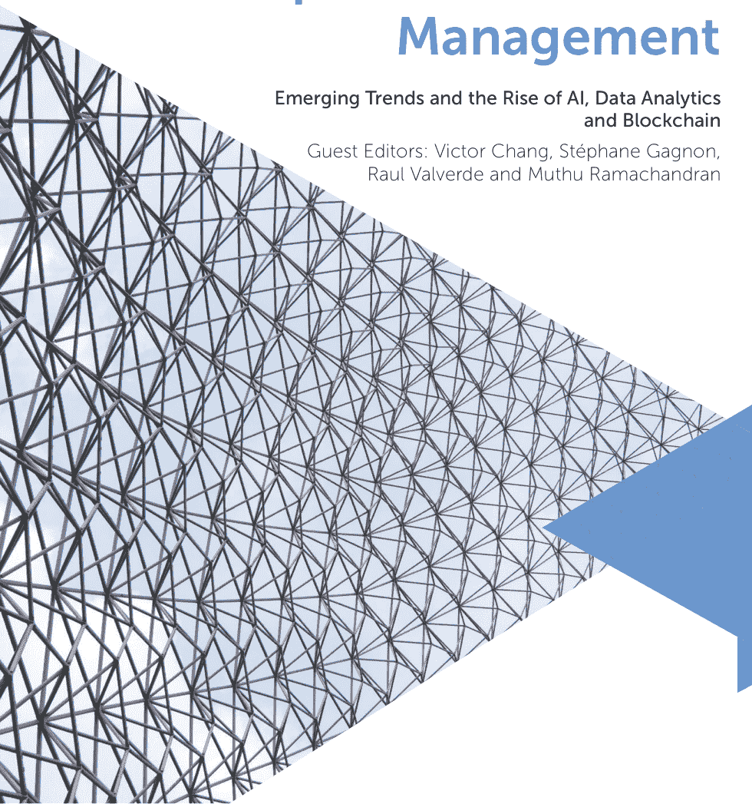

## 客座编辑

# AI、数据分析和区块链兴起的新兴趋势与影响

## 1. 引言

如下所述，人工智能（AI）、数据分析和区块链的兴起带来了新兴趋势和影响。全球范围内，AI 驱动的应用在企业和政府中迅速增加，它们使各类服务功能能够高效运作并支持多任务处理。报告结果还可通过数据分析进一步辅助，数据分析基于复杂数据集的提取和分析，以图表和可视化形式呈现科学和商业输出（Keim et al., 2008; Chang, 2018a, b）。在数据分析的发展背后，智能算法能够快速高效地处理大数据，并提取最有意义的数据供决策者参考（Chang et al., 2019）。区块链的应用能够增强整个服务的安全性、隐私性和优化程度，因为区块链通过智能合约及其分布式金融科技技术提供安全的应用开发（Alketbi et al., 2018; Kaur et al., 2018; Zeng, 2018）。AI、数据分析和区块链的融合对开创性研究的新发展至关重要（Mamoshina et al., 2018; Zeng, 2018）。例如，在自动驾驶汽车中，它们的融合产生了影响，使我们能够预测驾驶员的意图（Birek et al., 2018）。另一个例子是，该融合可以促进医疗、金融、天气研究和自然灾害等领域的多学科研究（Chang, 2018b）。

换句话说，AI、数据分析和区块链的融合可以产生更大的影响，并提升不同服务的可用性，例如 5G、物联网（IoT）、云计算、金融科技、网络安全和软件工程（Skliton and Hovsepian, 2017; Gai et al., 2018; Mohamed and Ali, 2018; Chang et al., 2019b; Saha, 2019）。集成服务已应运而生，用于解决大型独立 IT 设施的问题，以提高计算效率并降低成本。这也改变了软件工程的发展方式，因为面向服务架构可以为服务组件提供一个框架，这是分布式账本服务的固有属性，可通过 AI、数据分析、区块链及其综合应用产生更大影响。

## 2. 论文选稿过程

在本期专刊（SI）中，我们有兴趣分别发现和推广 AI、数据分析和区块链的最新趋势、采用案例、技术、创新、案例研究和现实解决方案，以及其综合应用和相关领域（如软件工程、IoT-Fog-Edge-Cloud 计算和网络安全）的新发展。除定量研究方法外，我们欢迎采用创新混合方法和定性方法的论文以及高质量的未发表论文投稿本期专刊。客座编辑特别关注新兴技术主题的论文，包括 AI、IoT、大数据、区块链，以及其影响、建议和采用案例。本期专刊收录的论文旨在分别发现和推广 AI、数据分析和区块链以及其综合应用的最新趋势、采用案例、技术、创新、案例研究和现实解决方案。除定量研究方法外，我们欢迎采用创新混合方法和定性方法的论文。

稿件不应之前发表过，也不应在其他期刊评审中。从 2020 年工业物联网、大数据与供应链国际会议（IoTBDSC 2020）上发表的优秀论文中选出。


我们也欢迎未发表的论文。事实上，本期专刊中 80% 的论文来自与我们会议参与者无关的作者。客座编辑强烈认为，我们应该联系我们网络之外的学者，从不同社区和网络的大量群体中吸引高质量论文。我们很高兴这一策略效果非常好。我们吸引了大量高质量论文。最终，经过严格的选稿过程和同行评审过程，我们选出了十篇论文。每篇论文都需要论证其与本期专刊的相关性、研究贡献，以及其方法论、方法、结果、分析和讨论中的新颖性。我们还希望每篇论文的作者展现出优秀的英文写作能力。各论文概述如下。

### 2.1 探索区块链—物联网（BIoT）的知识核心

Tsang et al. (2021) 关于探索区块链—物联网（BIoT）知识核心的文章讨论了区块链与物联网技术融合中的丰富研究。区块链与物联网的整合是实现两种技术优势的关键。此外，这是为智慧城市、道路、交通开发应用程序并与云和数据科学融合的高效方式。他们的研究采用一种称为共引用邻近分析基础的系统评述（CPASR）的方法，对 473 项相关研究中的 44 篇高影响力文章进行了相关性分析。此外，作者采用了一系列统计分析，包括探索性因子分析（EFA）、层次聚类分析（HCA）、k-均值聚类（KMC）和多维缩放（MDS），以建立知识核心。他们的一项关键发现表明，存在九个知识范畴核心。

### 2.2 区块链在奢侈品行业的应用：供应链与商品可追溯性

de Boissieu et al. (2021) 关于区块链在奢侈品行业应用：供应链与商品可追溯性的文章，提出了一种新方法，探讨了影响区块链技术在奢侈品行业中优化供应链管理和防止欺诈实施的实用性和背景。奢侈品行业是全球 GDP 增长的支柱，其消费驱动产品和需求呈指数级增长。事实上，大部分投资增长是基于消费者价格指数（CPI）预测的。因此，像这样关于奢侈品行业应用的文章非常有趣。他们采用基于扎根理论方法的定性研究方法。数据通过与 12 名在奢侈品行业从事区块链应用工作的利益相关者进行半结构化访谈收集。他们的一项关键发现指出，奢侈品品牌将此技术融入其生态系统时面临的制约因素包括知识差距、生产过程中涉及的众多第三方以及对短期投资回报的偏好。

### 2.3 当技术与人相遇：人工智能与人力资源管理的相互作用

Qamar et al. (2021) 的文章《当技术与人相遇：人工智能与人力资源管理的相互作用》开展了一项广泛的文献综述，探讨了人工智能与人力资源管理（HRM）领域之间的相互作用，以识别该领域的关键问题和挑战。人工智能是实现生产力和决策的关键。然而，一个重大挑战是，人工智能在 HRM 中的应用仍然至关重要。他们采用内容分析和结构概念分析开展研究设计，并将其应用于 59 篇经过精心挑选的期刊文章。他们的一项关键发现是综合了一张概念图，以展示 HRM 中人工智能应用的分类概览。他们的一个研究问题是关于 HRM 领域内人工智能应用的前沿研究图景是什么。看到采用这种研究设计来回答这些关键问题很有趣。然而，他们也识别出了本研究的一些局限性。首先，本文更侧重于提供该领域的更广泛概述，为未来研究开辟道路。其次，未来研究应考虑采用元分析等高级技术，以深入了解人工智能对 HRM 影响的效应大小。

### 2.4 区块链作为保障物联网生态系统安全的一种手段——系统文献综述

El-Masri 和 Hussain (2021) 提供了题为《区块链作为保障物联网生态系统安全的一种手段——系统文献综述》的文章。作者进行了全面的综述，并与十项先前综述的结果进行了对比，重点关注三个研究问题：现有安全威胁、常规安全机制；区块链提供的安全机制；以及区块链带来的新型安全威胁。他们保留了 43 篇文章，涵盖物联网架构的四个层：感知层、网络层、处理层和应用层。大量安全威胁、对策和安全机制按一系列物联网特定安全维度进行了分类。论文得出结论，如果架构师尝试各种配置，并根据具体要求优化安全机制，区块链技术可以充分集成到物联网生态系统中。他们还呼吁对物联网和区块链中的网络安全问题采取更全面和比较的视角，而非仅针对少数几种威胁和对策的研究。

### 2.5 大数据分析能力的影响因素：企业在竞争情境中如何使用数据

Contreras Pinochet et al. (2021) 撰写了题为《大数据分析能力的影响因素：企业在竞争情境中如何使用数据》的文章。他们对大数据分析能力的关注促使其提出了一个模型，涵盖大数据运营、更新 IT 以实现大数据、高级大数据分析技能集以及大数据的战略使用。他们使用一项调查（n = 141）和偏最小平方（PLS）模型来衡量这些能力对产品创新绩效的影响，以及该影响可能如何由面向流程的动态能力的强度中介，从而影响商业价值。虽然潜变量之间的直接关系均得到证实，但中介效应并不占主导地位，这可能对大数据分析所需的互补资产产生影响。

### 2.6 通过物联网和区块链缓解库存质押融资中的信息不对称

Liu et al. (2021) 撰写了题为《通过物联网和区块链缓解库存质押融资中的信息不对称》的文章。他们采用多案例研究方法，分析商业银行向供应商和零售商授予的以库存作为贷款抵押的供应链融资风险。代理人理论用于分类信息不对称挑战，并识别在线金融服务提供商（OFSPs）如何利用其对交易数据的直接访问权限来改进风险评估。案例表明，可以利用物联网帮助银行提高库存准确性和及时性。同时，其与区块链和智能合约的结合防止了对纸质合同的人为篡改和操纵。论文得出结论，物联网和


blockchain是切实的，并将在降低流动性风险的同时，对确保更透明的库存质押管理产生重大影响。

### 2.7 发展中国家制造业组织中供应链4.0的大数据作用

文章《发展中国家制造业组织中供应链4.0的大数据作用》的作者Narwane等人（2021年）对九个影响大数据分析（BDA）投资及其对供应链绩效（SCP）影响的关键因素进行了深入分析。这些因素包括组织和高层管理支持、可持续采购和采购、环境、信息和产品交付、运营、技术和知识以及协作规划。他们测试了10个假设，每个考虑的关键因素对应一个，以及最后一个关于BDA对SCP影响的假设，依据是收集自40家不同印度制造业组织的321份问卷的回答，受访者管理的部门包括供应链、人力资源（HR）、采购、研究与开发（R&D）、生产和会计。他们比较了结构方程建模（SEM）和人工神经网络（ANN）技术的性能。该研究证实了BDA在发展中国家制造业组织中供应链4.0中的中介作用。

### 2.8 了解公共部门基于区块链的身份管理系统采用

文章《了解公共部门基于区块链的身份管理系统采用》由Sung和Park（2021年）撰写。由于他们专注于特定的应用和行业，其分析涵盖的区块链技术方面较少，但将研究结果与明确定义的公共服务交付要求相一致。其主要贡献在于阐明基于区块链的身份管理系统在多大程度上可以改善用户对自身数据的控制中的透明度、问责制和可靠性，同时减少提供公共服务所需的时间和成本，并提高行政效率。虽然其文献综述涵盖了将区块链集成到电子政务系统中的国际努力，但其主要实证案例研究是韩国去中心化身份（DID）倡议。他们回顾了政策背景、采用流程、系统设计、实施和最终用户结果。他们的研究得出结论，超出典型技术驱动方法的研究需要更多面向结果的分析。这可以更好地帮助识别政府采用新技术（包括区块链及其他技术）的最佳实践，并将其与实际影响紧密联系起来。

### 2.9 新兴数字经济公司与领先加密货币：来自基于区块链的技术公司的洞察

文章《新兴数字经济公司与领先加密货币：来自基于区块链的技术公司的洞察》，作者Aslan等人（2021年），可能需要读者付出更多努力，但将证明是宝贵的学习。其重点是评估和预测金融市场所感知的加密货币中区块链应用的商业价值。其数据集包括四个S&P Kensho新经济子行业指数（即数字社区指数、另类金融指数、民主化银行指数和未来支付指数）的每日价格。他们还依赖八种加密货币的价格，包括比特币、以太坊、莱特币、瑞波币、泰达币、门罗币、达世币、恒星币和点对点币，时间段均为2015年8月11日至2020年2月10日。他们应用随机模拟进行时间序列建模，以调查领先加密货币与在股票市场交易的四组新兴数字公司之间的互联。其结果显示加密货币在改善金融服务方面的积极作用，表明管理者和监管者应更加关注加密货币和区块链的实用性，而非其传统的投机潜力。由于他们关注四个行业中的两个（即另类金融和民主化银行），他们表明其成功取决于与加密货币的积极互联。其研究结果在评估区块链技术的金融价值方面具有原创性贡献。作者的贡献还有助于将注意力重新集中在加密货币的实际成果上，而不是过度关注潜在采用，后者一直是判断技术采用战略选择相关性的主要标准。

### 2.10 基于深度学习的情感计算

本特刊的最后一篇文章，标题为《基于深度学习的情感计算》，作者Kumar（2021年），提出了一种情感计算模型，使用基于文本和图像的数据来分类情绪和情感。该研究使用了定制的深度学习模型进行情感计算。例如，基于文本的情感计算在四个标准数据集上进行，使用了三个定制的深度学习模型：长短期记忆网络（LSTM）、门控循环单元（GRU）和卷积神经网络（CNN）。同样，基于图像的情感计算是使用三个深度学习模型，从Instagram提取的数据进行：CNN、带有VGG-19模型的迁移学习和带有ResNet-18模型的迁移学习。该研究还使用了四种深度学习变体，包括LSTM模型、带有GloVe嵌入的LSTM模型、双向LSTM模型和带有注意力层的LSTM模型，用于基于文本的分类。研究结果表明，所提出的方法可以有效地用于基于文本和图像的数据的情感计算，并有助于决策。

## 3. 讨论

### 3.1 实现本特刊的目标

本特刊的目标及其依据如下所述。

- (1) 汇集人工智能、数据分析和区块链新兴趋势及影响领域的研究人员和实践者：客座编辑收到了来自不同研究小组和社区的论文。80%的选定作者与该会议无关。我们很高兴了解和理解不同类型的研究项目，并将它们全部汇集在一起。

- (2) 为人工智能、数据分析和区块链及其集成开发开创性的方法、技术、理论和服务：我们选了一些论文，作者在其中清楚地解释了他们如何开发新的方法、技术、理论和服务。他们介绍了针对人工智能、数据分析和区块链的不同方法和途径。至于集成，一些作者仅集成了其中两项。

- (3) 展示人工智能、数据分析和区块链及其集成的采用案例、建议和实际解决方案的有效性：所有作者都清楚地解释了他们的工作如何提供采用案例、建议和实际解决方案的有效性。所有作者都以生动有趣的方式展示了他们的发现、见解和研究贡献。

- (4) 加强人工智能、数据分析和区块链集成的创新与发展，以及软件工程等相关领域的发展，

### 3.2 未来研究方向与客座编辑观点

基于客座编辑和我们选定作者的观察和见解，我们确定了以下领域作为未来研究方向，其依据如下。它们可以分为两个类别，涵盖技术策略的微观和宏观方面。第一，鉴于人工智能、数据分析和区块链的采用日益增加，企业IT将演变到什么程度。第二，随着这些趋势在未来十年与其他社会和经济变化融合，它们将在多大程度上引发新的系统性影响或全球数字颠覆，其规模类似于20世纪90年代中期万维网带来的转型。我们采取长期研究议程规划过程的视角。

如本特刊第3篇和第10篇文章所示，它们涉及人力资源管理和情感-行为应用，过去五年人工智能的最新进展已证明其持久影响。各种规模和各个领域的组织发起了大量试点项目，远远超出了传统机器学习应用。几种新算法和应用源于深度学习（DL）的基础性进展。无论应用于语义分析、知识图谱还是其他形式的知识表示，DL都将继续成为有价值应用的来源。然而，还需要更多研究将这些发现与更复杂和演进的技术（如机器人流程自动化（RPA）以及尤其是多代理系统（MASs））集成起来。这些人工智能技术尚未得到广泛采用，但当与DL结合时，其潜力可以显著改善复杂业务流程的学习、推理、论证和协调。

在我们保留用于出版的文章中，第5篇和第7篇很好地展示了BDA的影响。在从人工智能重新投资中受益的同时，BDA本身具有重新开展应用研究的动力，因为它是超越现有商业智能和预测分析能力的重新努力。大多数组织仍需投资于适当的云基础设施，以克服大数据造成的量、速和多样性挑战。然而，BDA软件相对的商品化和互操作性无疑将使各种规模的采用者受益，并推动业务流程中更多实时数据的创新用途。因此，还需要更多研究将BDA创新妥善集成到企业IT结构中。信息系统研究已很好地证明，组织必须开发嵌入其业务流程中生成知识和智能的能力。因此，BDA可能导致一个更复杂的研究议程来解决这些问题。这一点在大数据的实时智能、将分析结果转化为业务规则以及保持业务流程日益频繁的变化（或数字化转型）的速率方面尤其真实，同时将更敏捷的方法与BDA和业务规则开发相结合。

最后，在本特刊的三种技术中，最重要的由第1篇、第2篇、第4篇、第6篇、第8篇和第9篇文章体现。与其他相关领域相比，区块链已成为主导的新兴平台和服务。区块链不仅是一个热门话题，而且在许多领域和学科中得到广泛采用。因此，了解克服使用区块链挑战的经验教训和建议非常有价值，因为区块链将渗透到我们的日常生活中，例如金融服务、供应链、教育和其他面向服务的行业。尽管如此，区块链对人们的生活和互动方式有着重大影响。


AI、数据分析和区块链的微观研究议程可整合至宏观概览中，该概览关联其在全球社会和经济中产生的颠覆性影响。随着各行各业的组织逐步采用更具交互性、可靠性、透明度和可解释性的AI，人们将在工作场所和生活方式中从数字技术中获益更多。一旦AI与BDA、区块链以及物联网(IoT)等技术更紧密集成，其创新组合可能会引发重大行业颠覆。有必要开展更多探索性研究，尤其是通过深入案例研究，以揭示这些创新商业模式出现的潜力。因此，必须形成数字创新的宏观视角，并可能最终成为一种主导力量，正如数字转型在过去几年中所成为的那样。

## 4. 结论

我们已选定十篇论文，并阐明了每篇论文的研究贡献。我们已说明我们的科学贡献如何也符合本特刊(SI)的目标，并描述了我们对未来研究方向的看法与建议。我们很荣幸有机会为JEIM社区服务。我们特别感谢主编、Emerald出版社、期刊经理、审稿人和贡献者，使我们的特刊得以实现。

- 维克多·张  
  网络安全、信息系统与AI研究组，SCEDT，提赛德大学，英国米德尔斯堡

- 斯蒂芬·加涅翁  
  魁北克省立大学乌塔瓦分校，加拿大加蒂诺

- 劳尔·瓦尔德雷  
  供应链与商业技术管理，约翰·摩尔森商学院，康考迪亚大学，加拿大蒙特利尔

- 穆图·拉马钱德兰  
  教育与研究顾问，集成云解决方案，英国利兹

## 编辑简介

Victor Chang 现任英国提赛德大学米德尔斯堡校区计算机、工程与数字技术学院数据科学与信息系统正教授。他领导英国提赛德大学人工智能与信息系统研究组。2016年6月至2019年8月期间，他曾任中国苏州西交利物浦大学(XJTLU)高级副教授、博士生导师、硕士研究生导师及临时BSc IMS项目主任。他曾任利物浦大学名誉副教授。此前，他于2012年9月至2016年5月期间在英国利兹贝克特大学担任高级讲师。在四年之内，他在同时参与多个项目的同时完成了南安普顿大学的计算机科学博士学位和格林威奇大学的高等教育研究生证书（PGCert, Fellow）。Chang教授参与的资助项目在欧洲和亚洲总额达1400万英镑。在从事学术工作之前，他在27项IT认证中的平均成绩达到97%。他曾获得2011年欧洲云迁移奖、2015年IEEE杰出服务奖、2012年、2015年和2018年最佳论文奖、2016年欧洲奖、2017年杰出青年科学家奖、2017年数据科学特别奖、2017–2021年五项INSTICC服务奖、2018年和2019年杰出审稿人奖等。他曾担任多所大学的访问学者/博士生考核官，是IJOCI和OJBD期刊的主编，FGCS（2014年10月–2020年2月）、Springer Nature Open、《信息融合》(Information Fusion)和IJD期刊的编辑，IEEE TII、JGIM和IJBSR期刊的副编辑，两个国际研讨会的创始主席，并自2015–2016年起担任IoTBDS和COMPLEXIS会议的创始大会主席。他自2018–2019年起担任FEMIB会议创始大会主席，并自2019–2020年起担任IIoTBDSC会议创始大会主席。他独立撰写了三本著作，并编辑了两本关于云计算及相关技术的书籍。他曾获得多家顶级期刊颁发的杰出审稿人奖以及FGCS颁发的杰出编辑奖。他在国际会议上发表了28场主旨演讲。他在这项研究方面具有开创性工作，并曾受邀发表多场主旨演讲。Chang教授于2017年和2019年入选全球前2%科学家榜单，并被评为2010年至2019年间最具预测能力的基于AI的数据科学家。他被广泛认为是物联网/数据科学/云计算/安全/人工智能/信息系统领域最活跃、最有影响力的年轻科学家和专家之一，因为他有为多个学科开发十种不同服务的经验。

斯蒂芬·加涅翁博士是加拿大首都地区加蒂诺魁北克省立大学乌塔瓦分校(UQO)商业技术管理(BTM)副教授。他也是政府分析研究所(GARI)的创始成员，该研究所是卡尔顿大学、渥太华大学和UQO组成的联盟，合作伙伴包括治理研究所和SAS加拿大。在2006年加入UQO之前，他曾在新泽西理工学院(2002–2006)、蒙特利尔魁北克省立大学(1997–2002)、麦吉尔大学(2000)以及其他10个国家的十余所大学担任兼职教授。他于1994–2001年获得蒙特利尔魁北克省立大学工商管理博士学位（专注于技术管理与战略）、1991–1994年获得卡尔顿大学公共管理硕士学位，以及1988–1991年获得渥太华大学经济学与国际和比较政治学学士学位。他的研究涉及数字化转型和大数据分析，应用于医疗保健、能源和金融服务行业以及公共管理。在其他项目中，他牵头建立一个研究网络，与加拿大信息技术协会(ITAC)合作开发首个BTM知识体系(BOK)，并获得160,000加元的MITACS资助金。该举措将为BTM职业制定首个统一指南，识别多个相关标准中的共同核心能力，并确保各级从业人员能够轻松识别其最佳职业发展机会。

劳尔·瓦尔德雷博士是供应链管理运营与商业技术管理项目的合作教育学术主任。在此职位上，他为参与该项目的学生提供学术和职业建议与指导。他也是康考迪亚大学高级讲师以及Techination Canada商业技术管理认证委员会主席。他还是魁北克省立大学乌塔瓦分校的兼任研究教授。他拥有南昆士兰大学工商管理博士学位、麦吉尔大学工商管理硕士后学位、英国西英格兰大学金融管理理学硕士学位、卡米洛·何塞·塞拉大学供应链与物流管理硕士学位以及康考迪亚大学电气工程硕士学位。他在学术和职业辅导、信息技术、数学建模、财务分析和编程方面拥有超过20年的专业经验。他获得了运筹学认证、认证咨询师、神经经济学认证、高管教练认证、认证项目经理、项目会计认证和ERPSim认证。他还是安大略省专业工程师协会的专业工程师，以及加拿大心理学会的成员。Valverde博士的主要研究兴趣包括供应链系统、风险管理、IT审计、财务系统、项目管理、心理学和信息技术，以及学术、高管和商业教练与辅导。

穆图·拉马钱德兰博士目前是集成云解决方案首席执行官、教育与研究顾问，以及英国利兹AI Tech North人工智能伦理研究顾问。他此前曾任英国利兹贝克特大学计算机、创意技术与工程学院首席讲师（副教授）。在此之前，他在飞利浦研究实验室及随后在英国萨里的伏兰蒂斯系统有限公司从事工业研究工作共八年，期间参与了多项面向消费电子产品的软件工程应用研究项目，包括大规模电信、多媒体和汽车导航系统的软件架构设计与复用。目前，他正在领导云软件工程、大数据软件工程、物联网软件工程、软件安全工程、SOA、云计算以及软件工程主要领域（包括需求工程(RE)、基于构件的软件工程(CBSE)、软件架构、复用、质量和测试）的研究。他的首个职业生涯始于研究科学家，期间从事航空航天工业应用的大规模高完整性实时系统工作。他是《软件构件：指南与应用》(Nova Publishers, NY, USA, 2008)和《软件安全工程：设计与应用》(Nova Publishers, NY, USA, 2011)的作者。他还广泛撰写并出版了十余本书、数百篇期刊文章、50多章书籍章节


和 200 篇关于软件工程、软件安全、云计算和教育等各种先进主题的会议论文。Muthu 担任主席和主旨演讲者，主持过全球安全、保障与可持续发展、新兴服务、IoTBDS、COMPLEXIS、大数据以及服务与云计算软件工程 (SE-CLOUD, 2018) 等会议。Muthu 是多个专业组织和计算机学会的成员：IEEE、ACM、BCS 会士，以及 HEA 高级会士。Muthu 参与过多个研究项目，涵盖软件工程的所有方面、面向中小企业的 SPI（称为 Prism 模型）、应急和灾害管理系统、软件组件与架构、软件开发良好实践指南、软件安全工程以及服务与云计算。项目详情可访问利兹贝克特大学：http://www.leedsbeckett.ac.uk/staff/dr-muthu-ramachandran/ Scopus 个人资料：https://www.scopus.com/authid/detail.uri?authorId=8676632200。

## 参考文献

Alketbi, A., Nasir, Q. and Talib, M.A. (2018), “面向政府服务的区块链——用例、安全优势与挑战”, IEEE 2018 年第 15 届学习与技术会议 (L&T), pp. 112-119.

Asl, M.G., Rashidi, M.M. and Abad, S.A.H.E. (2021), “新兴数字经济公司与领先加密货币：基于区块链技术公司的洞察”, 企业信息管理期刊, Vol. 34 No. 5, pp. 1506-1550, doi: 10.1108/JEIM-08-2020-0348.

Birek, L., Grzywaczewski, A., Iqbal, R., Doctor, F. and Chang, V. (2018), “一种新颖的大数据分析与智能技术，用于预测驾驶员意图”, 工业计算机, Vol. 99, pp. 226-240.

Chang, V. (2018a), “面向大数据分析的拟议社交网络分析平台”, 技术预测与社会变革, Vol. 130, pp. 57-68.

Chang, V. (2018b), “新兴服务与云计算虚拟现实分析提供的概述、示例及影响”, 神经计算与应用, Vol. 29 No. 5, pp. 1243-1256.

Chang, V., Li, T. and Zeng, Z. (2019a), “面向计算金融分析的改进 Adaboost 算法方法”, 并行与分布式计算期刊, Vol. 134, pp. 219-232.

Chang, V., Abdel-Basset, M. and Ramachandran, M. (2019b), “面向重用战略决策模式框架——从理论到实践”, 信息系统前沿, Vol. 21 No. 1, pp. 27-44.

Contreras Pinochet, L.H., Amorim, G.D.C.B., Lucas Júnior, D. and Souza, C.A.D. (2021), “大数据分析能力的结果性因素：企业在竞争情景中如何使用数据”, 企业信息管理期刊, Vol. 34 No. 5, pp. 1406-1428, doi: 10.1108/JEIM-11-2020-0445.

de Boissieu, E., Kondrateva, G., Baudier, P. and Ammi, C. (2021), “奢侈品行业中区块链的应用：供应链与货物可追溯性”, 企业信息管理期刊, Vol. 34 No. 5, pp. 1318-1338, doi: 10.1108/JEIM-11-2020-0471.

El-Masri, M. and Hussain, E.M.A. (2021), “区块链作为保护物联网生态系统的手段——系统文献综述”, 企业信息管理期刊, Vol. 34 No. 5, pp. 1371-1405, doi: 10.1108/JEIM-12-2020-0533.

Gai, K., Qiu, M. and Sun, X. (2018), “FinTech 调查”, 网络与计算机应用期刊, Vol. 103, pp. 262-273.

Kaur, H., Alam, M.A., Jameel, R., Mourya, A.K. and Chang, V. (2018), “面向云环境中基于区块链的异质医疗数据的拟议解决方案及未来方向”, 医学系统期刊, Vol. 42 No. 8, p. 156.

Keim, D., Andrienko, G., Fekete, J.D., Görg, C., Kohlhammer, J. and Melançon, G. (2008), “可视分析：定义、过程与挑战”, 信息可视化, Springer, Berlin, Heidelberg, pp. 154-175.

Kumar, S. (2021), “基于深度学习的情感计算”, 企业信息管理期刊, Vol. 34 No. 5, pp. 1551-1575, doi: 10.1108/JEIM-12-2020-0536.

Liu, L., Zhang, J.Z., He, W. and Li, W. (2021), “通过物联网与区块链缓解库存质押融资中的信息不对称”, 企业信息管理期刊, Vol. 34 No. 5, pp. 1429-1451, doi: 10.1108/JEIM-12-2020-0510.

Manoshina, P., Ojomoko, L., Yanovich, Y., Ostrovski, A., Botezatu, A., Prikhodko, P., Izumchenko, E., Alipier, A., Romantsov, K., Zhebryak, A. and Ogu, I.O. (2018), “汇聚区块链与下一代人工智能技术，以去中心化并加速生物医学研究和医疗保健”, Oncotarget, Vol. 9 No. 5, p. 5665.

Mohamed, H. and Ali, H. (2018), 区块链、金融科技与伊斯兰金融：在新伊斯兰数字经济中构建未来, Walter de Gruyter GmbH & Co KG.

Narwane, V.S., Raut, R.D., Yadav, V.S., Cheikhrouhou, N., Narkhede, B.E. and Priyadarshinee, P. (2021), “大数据在发展中国家制造业组织供应链 4.0 中的作用”, 企业信息管理期刊, Vol. 34 No. 5, pp. 1452-1480, doi: 10.1108/JEIM-11-2020-0463.

Qamar, Y., Agrawal, R.K., Samad, T.A. and Chiappetta Jabbour, C.J. (2021), “当技术遇见人：人工智能与人力资源管理的相互作用”, 企业信息管理期刊, Vol. 34 No. 5, pp. 1339-1370, doi: 10.1108/JEIM-11-2020-0436.

Saha, K. (2019), “分析与大数据：新兴趋势及其对我们生活的影响”, 公共事务期刊, Vol. 19 No. 4, e1944.

Skilton, M. and Hovsepian, F. (2017), 第四次工业革命：应对人工智能对商业的影响, Springer.

Sung, C.S. and Park, J.Y. (2021), “公共部门基于区块链的身份管理系统采用情况研究”, 企业信息管理期刊, Vol. 34 No. 5, pp. 1481-1505, doi: 10.1108/JEIM-12-2020-0532.

Tsang, Y.P., Wu, C.H., Ip, W.H. and Shiau, W.-L. (2021), “探索区块链–物联网 (BIoT) 的知识核心”, 企业信息管理期刊, Vol. 34 No. 5, pp. 1287-1317, doi: 10.1108/JEIM-10-2020-0395.

Zheng, Z., Xie, S., Dai, H.N., Chen, X. and Wang, H. (2018), “区块链挑战与机遇：一项调查”, Web 与网格服务国际期刊, Vol. 14 No. 4, pp. 352-375.

# 探索区块链–物联网 (BIoT) 的知识核心

Y.P. Tsang
工业与系统工程系，
香港理工大学，九龙，香港

C.H. Wu
供应链与信息管理系，
香港恒生大学，沙田，香港

W.H. Ip
萨斯喀彻温大学机械工程系，
萨斯卡通，加拿大，以及

Wen-Lung Shiau
浙江工业大学工商管理系，
杭州，中国

## 摘要

**Purpose** – 近年来，随着区块链技术的快速发展，区块链与物联网的融合 (BIoT) 引起了研究人员和工业界从业者的广泛关注，并被视为技术发展的未来趋势。尽管多位作者已对该主题进行了文献综述，但尚未有研究考察 BIoT 的知识结构发展，导致研究与开发 (R&D) 努力分散。

**Design/methodology/approach** – 本研究通过基于共引用邻近分析的系统综述 (CPASR)，调查了 473 项相关研究中 44 篇高影响力文章之间的关联，从而探讨 BIoT 的知识核心。随后，我们采用一系列统计分析，包括探索性因子分析 (EFA)、层次聚类分析 (HCA)、k-means 聚类 (KMC) 和多维标度 (MDS)，来建立知识核心。

**Findings** – 我们的研究结果表明，BIoT 的知识核心包含九个类别：(1) BIoT 系统的数据隐私与安全，(2) BIoT 的模型与应用，(3) BIoT 的系统安全理论，(4) BIoT 部署框架，(5) BIoT 与新兴方法和技术的融合，(6) 在 IoT 中使用区块链的应用安全策略，(7) 工业 BIoT 的设计与开发，(8) 通过 BIoT 建立信任，(9) BIoT 生态系统。

**Originality/value** – 我们采用 CPASR 方法考察 BIoT 的知识核心，这是一个研究不足且具有当前意义的领域。本文还为调查 BIoT 研究提供了一个结构框架，该框架可能适用于其他知识领域。

**Keywords** 区块链, 物联网, 共引用邻近分析, 知识核心, 系统综述

**Paper type** 文献综述

## 1. 引言

区块链和物联网 (IoT) 是两项有前景的新兴技术，越来越多的企业将其应用于实现工业和财务目标。在

The work described in this paper was partially supported by a grant from the Research Grants Council of the Hong Kong Special Administrative Region, China (UGC/FDS14/E06/20); and a matching grant from the University Grants Committee of the Hong Kong Special Administrative Region, China (RMGS Project No. 700005). The authors would like to thank Big Data Intelligence Centre and Department of SCM, The Hang Seng University of Hong Kong, and Department of ISE, Hong Kong Polytechnic University for supporting the research.


一方面，区块链是加密货币发展的基础元素；它已扩展到各种工业场景，以在分布式系统中构建信任和共识。基于区块链的系统和服务已改善身份验证、完整性和不可篡改性（Crosby et al., 2016）。另一方面，物联网（IoT）起源于射频识别（RFID）基础设施，尽管尚未制定物联网的标准化定义（Wortmann and Flüchter, 2015）。物联网解决方案侧重于通过互联网协议和网络技术连接各种物理对象。现有采用集中式方法的物联网应用面临着与安全、隐私、数据存储和可扩展性相关的挑战（Khan and Salah, 2018）。近年来，越来越多的研究聚焦于区块链与物联网的集成，即区块链–物联网（BIoT），以提升现有物联网应用的实用性和适应性，特别是在数据可靠性、安全性、可信度和自主性方面（Novo, 2018; Reyna, 2018）。这种集成还将提供与移动性、可访问性、并发性、轻量化、可扩展性和透明性相关的优势。此外，物联网数据的可信度可以在分布式网络中建立。由于物联网在众多行业中的大规模应用，物联网设备的数量预计将大幅增加。因此，区块链有望在解决众多物联网设备的漏洞和有效控制方面发挥关键作用。因此，BIoT研究是一个有前景的领域，有必要调查该主题的智识核心，以支持和指导研发（R&D）。

大量研究已描述和展示了BIoT，一些综述研究总结了该研究的关键维度和方向（Alladi et al., 2019; Wang et al., 2020）。然而，尚未对BIoT研究的智识核心和知识结构进行系统调查。对现有BIoT研究进行分类以识别趋势和启示，以支持未来的研发活动，是至关重要的。共引分析是描述BIoT新兴智识核心的有前途的技术（Wang et al., 2016; Ng et al., 2018; Shiau et al., 2019）。然而，它无法考察有影响力研究之间的关系，更不用说评估这种关系的强度。此外，BIoT研究仍处于初步阶段；相关研究仅追溯至2015年。系统综述为考察特定研究目标提供了可靠且全面的流程，而引文分析和共引邻近分析可以有效地识别和分组高影响力的研究工作。本研究通过基于共引邻近分析的系统综述（CPASR）结合这些方法，以识别与学术界和工业界从业者都相关的BIoT研究趋势。我们力求回答以下两个研究问题：

- (1) CPASR方法的结构表述是什么？
- (2) 现有研究中出现的BIoT智识核心是什么？

为将CPASR方法应用于BIoT研究，我们从Web of Science（一个著名的出版数据库）中收集了一组高影响力研究。在统计分析过程中，探索性因子分析（EFA）和层次聚类分析（HCA）被用于对BIoT的智识核心进行分类，而k-均值聚类（KMC）用于识别高影响力研究之间的强关系。在制定智识核心的类别后，我们使用多维标度（MDS）来可视化分类以及高影响力研究之间的相似性水平。利用这一分类，我们识别出了各种趋势和启示，以支持BIoT领域当前和未来的研发活动。本研究做出了两项主要贡献。首先，它通过引文分析、共引邻近分析及一系列统计分析（包括EFA、HCA、KMC和MDS），为研究领域的智识核心调查提供了一个结构框架。其次，本研究考察了BIoT，这是信息管理领域的一个热门研究领域，旨在加速工业和企业解决方案的发展。此外，所提方法的高适用性有助于其他知识领域的未来分析。通过分析2015年至2019年五年期间的相关研究出版物，构建了九个BIoT智识核心，以评估其知识扩散并支持区块链和物联网技术的未来研究。

本文余部分的组织安排如下。第2节回顾了涉及区块链、物联网、文献综述方法和共引邻近分析的研究。第3节描述了CPASR方法论。第4节展示了我们应用CPASR来评估BIoT技术知识结构的结果。第5节讨论了系统综述中识别出的趋势和启示。最后，第6节得出结论性意见。

## 2. 文献综述

在本节中，我们回顾了与本研究相关的两个文献领域：BIoT和文献综述方法。

### 2.1 BIoT技术概述

在数字化时代，物联网和区块链被视为两种具有互补特性的新兴技术，可以产生协同效应以支持技术进步。物联网被定义为通过互联网互连机器和设备等物理对象，以获取分析见解和运营改进（Nord et al., 2019）。为了组织物联网解决方案，构建面向服务架构（SoA）以在物理对象和数字平台之间建立互连，从而制定各种工业应用，例如供应链管理和制造分析（Lade et al., 2017; Papert and Pflaum, 2017）。然而，物联网系统中的每个节点都可能成为网络攻击的故障点，集中式物联网部署使系统在数据机密性和身份验证问题上相对脆弱（Panarello et al., 2018）。此外，很难确保物联网系统的数据完整性和可靠性，这可能对数据分析和信息管理产生负面影响。区块链代表了解决这些局限性的有前景方案。区块链是一种数据库，以块的形式存储数据，并在以去中心化方式验证数据后将这些块链接在一起。该技术于2008年引入，旨在创建点对点（P2P）电子现金系统（Nakamoto, 2008）。区块链的主要目标是通过去中心化、透明且不可篡改的数据记录，在P2P网络中实现信任、共识和信息安全。目前，区块链应用可分为公有链、联盟链和私有链（Lin and Liao, 2017）。然而，区块链在管理大量数据存储和系统可扩展性方面存在自身弱点。此外，去中心化数据验证消耗过多能源。如果所有数据都存储在块中并链接在一起，不断增长的区块链大小预计将危害P2P网络的健康。例如，到2020年底，比特币区块链大小约为320 GB，鉴于支付-公钥哈希（P2PKH）交易的一输入两输出交易大小约为250字节。因此，简单的区块链部署难以应对数据密集型工业应用，如供应链管理和医疗保健（Reyna et al., 2018）。此外，区块链中的完全透明可能导致数据隐私挑战，威胁用户匿名性。因此，提出了区块链与物联网的集成，以改善系统功能，包括可扩展性、自主性、识别、可靠性、安全性和服务多样性。由于BIoT研究仍处于初步阶段，BIoT研发在未来可能会快速增长。为促进此类研发，必须调查BIoT的知识结构，以识别初步研究中出现的趋势和启示。


综上所述，BIoT 被定义为“一种具有独特认证和共识机制的互联对象和用户的点对点系统网络，其中以去中心化的方式将区块中传输的数据链接起来，以在网络中建立信任。”

### 2.2 文献综述方法概览

存在多种综述方法，包括文献综述和系统综述，可用于组织现有研究以识别趋势并为未来研究生成洞察。Paré 和 Kitsiou (2017) 总结了开展文献综述的六项通用程序，即：(1) 制定研究问题和目标，(2) 检索现有文献，(3) 文献筛选与过滤，(4) 对主要研究进行质量评估，(5) 数据提取，(6) 数据分析。基于此框架，已发展出多种文献综述方法，以定性方式分析过去关于 BIoT 的文献，包括叙述性综述、图谱综述和批判性综述（Chowdhury 等人，2018；Hughes 等人，2019；Viriyasitavat 等人，2019；Burton-Jones 等人，2020）。这些方法在分析现状和未来方向的同时，总结特定主题的优点、缺点、局限性和应用。除了文献综述，系统综述也已被开发用于定量数据收集和研究评估。在系统综述中，通过总结和综合实证证据，将预设的研究问题聚焦出来。综述方案和检索策略明确定义，以提供偏差最小的可靠结果（Munn 等人，2018）。基于系统综述，快速综述和伞形综述被开发用于快速开展审查流程，并考虑研究中涉及的多种因素，例如引文和书目耦合（Khangura 等人，2012；Aromataris 等人，2015）。在系统综述技术中，引文分析是一种广为人知的方法，利用搜索关键词和引文阈值识别特定领域中高度有影响力的研究（Hugh 等人，2017）。此外，共引分析是一种有前景的方法，通过评估二元共引指数，调查新兴研究领域中研究之间的相关性（Hausberg 等人，2020）。为了反映实际相关性，共引邻近分析关注文档中被引用研究的非二元接近度（Kim 等人，2016），这可以有效地评估研究之间的接近度。与传统的共引分析相比，它能够更精确地定位研究文档章节、节和段落中研究的接近程度，以建立其知识核心。在本综述研究中，引文分析和共引邻近分析相结合，以构建 BIoT 的系统综述，同时进行一系列统计分析以客观地评估研究结果。

## 3. CPASR 方法论

为了探索 BIoT 领域的现有研究，我们提出了一种基于共引邻近分析的系统综述（CPASR），该方法集成了引文分析、共引邻近分析和统计分析。首先，我们建立了 CPASR 的结构框架（图 1）。该框架由三个主要层级组成：(1) 数据收集，(2) 引文和共引邻近分析，(3) 统计分析与评估。

### 3.1 第一层：数据收集

关于数据收集，综述分析需要明确的知识领域焦点，例如 BIoT，并且必须仔细选择相应的关键词 \( K = \{k1, k2 ..., k2\} \) 以指导检索过程。为了检索高质量的研究，我们使用了 Web of Science (WoS) 核心合集，这是一个包含多学科信息的学术数据库。它包含全球发表的 21,000 种期刊、图书和会议论文集的引文数据，并每日更新以确保准确性（Clarivate Analytics, 2020）。该数据库涵盖六个引文索引：科学引文索引，扩展版 (SCIE)；社会科学
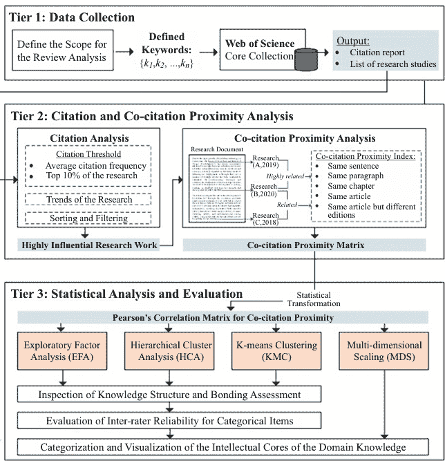
引文索引 (SSCI)；艺术与人文引文索引 (A&HCI)；会议论文集引文索引 (CPCI)；图书引文索引 (BCI) 和新兴来源引文索引 (ESCI)。WoS 对 SCIE、SSCI 和 A&HCI 索引的录用率约为 10–12%，这意味着与其他学术数据库（例如 Google Scholar 和 Scopus）相比，该合集拥有相对严格的标准。此外，WoS 核心合集中引用的研究工作质量有保证，这提高了可靠性和效度。我们从检索过程中排除了综述文章，因为与原始研究相比，它们对 BIoT 的理论和智力发展贡献较小。因此，我们生成了一组 \( R \) 的研究及其相应的引文，用于引文和共引邻近分析。

### 3.2 第二层：引文和共引邻近分析

在本层中，执行引文和共引邻近分析以评估高度有影响力的 BIoT 研究之间的相关性。从 \( R \) 中选择高度有影响力的研究基于两个标准：(1) 平均引用频率和 (2) 约占引文数量前 10% 的研究；集合 \( R_f \) 和 \( R_{top} \) 可分别根据这两个标准确定。集合 \( R \) 中任何引文数为零的研究项目都从 \( R_f \) 中排除，因为此类项目的意义不确定。当集合 \( R_f \) 和 \( R_{top} \) 中的研究被排序和筛选以删除重复研究时，可以检查研究趋势。因此，可以得到一组高度有影响力的研究 \( R_h \)，其中 \( R_h = \min\{R_f, R_{top}\} \subseteq R \)。其次，制定一个 \( n \times n \) 共引邻近矩阵 \( M_{ij} \) 以评估高度有影响力的研究集合的共引邻近指数（CPI），其中 \( n \) 是集合 \( R_h \) 的基数。然后检查 \( R \) 中的每项研究，以确定它是否在 \( R_h \) 中的多个项目中被引用。如果 \( R \) 中的文档引用了 \( R_h \) 中的两个研究项目，则会分配一个 CPI 值来表示它们的接近度和相似性（Yaghtin 等人，2019）。如表 1 所示，每个 CPI 值取决于被引用研究工作的出现情况，并且指数值按 \( 1/(2^m) \) 加权，其中 \( m \) 指文中引用之间的接近级别。当高度有影响力的研究文档被引用多次时，会分配两项研究之间最接近的相关性（即最高 CPI 值），即 \( CPI_{ij} = \max\{CPI_{ij1}, CPI_{ij2} \dots CPI_{ijk}\} \)，其中 \( k \) 指接近组合的数量。为集合 \( R \) 构建 CPI 值后，共引邻近矩阵被制定以结构化知识领域的知识核心。

### 3.3 第三层：统计分析与评估

一旦获得共引邻近矩阵，就会进行一系列统计分析以系统地评估高度有影响力的研究。在本研究中，考虑了四种统计方法：EFA、HCA、KMC 和 MDS。EFA、HCA 和 MDS 广泛应用于分析研究文档之间的相关性，以探索知识领域的知识结构（Shiau 等人，2019）。可以使用 EFA 和 HCA 对知识结构进行聚类，而 MDS 则检验聚类的可行性。为了进一步验证聚类性能，添加了 KMC 以识别知识核心中成员之间的联系，以识别高度相似的研究。在进行统计分析之前，共引邻近矩阵被转换为 Pearson 相关矩阵。该矩阵包含衡量任意两项高度有影响力的研究之间相关性所必需的 Pearson 积矩相关系数。在本研究中，应用了 EFA（揭示被测变量之间的潜在结构）和 HCA（将相似项目分组为聚类），以获得包含多个高度有影响力的 BIoT 研究聚类的中间知识结构。通过 KMC 评估聚类组成员之间的簇内联系，以识别特定聚类内高度有影响力的研究之间的联系强度。在构建聚类的类别标签时，提供支持和证据是必不可少的。当确定高度有影响力的研究的类别时，会检查评级者间信度，以确保向聚类一致地分配适当的类别标签。因此，可以得到高度有影响力的研究的最终分类。除了分类之外，还使用 MDS 可视化聚类结果，以揭示研究之间的相似程度。使用上述方法系统地对高度有影响力的研究进行分组，构建了知识核心，从而能够识别知识领域的趋势和含义。

## 4. 结果与分析

在本节中，使用 CPASR 方法评估 BIoT 的知识结构。为检索与 BIoT 相关的研究，定义了关键词集 \( K = \) {“blockchain,” “IoT,” “Internet of Things”}；“IoT”是公认的

| 被引用研究工作的出现情况 | CPI 值 |
| :--- | :--- |
| 同一句中 | \( 1/2^0 = 1 \) |
| 同一段落中 | \( 1/2^1 = 0.5 \) |
| 同一章节中 | \( 1/2^2 = 0.25 \) |
| 同一期刊版本中 | \( 1/2^3 = 0.125 \) |


“物联网”的缩写。如果仅使用关键词“IoT”来表示IoT领域，则可能会包含涉及字母组合“iot”的某些术语，例如生物技术、无线遥测和书目编纂。随后，我们使用了三个关键词，“区块链”、“IoT”和“物联网”，以定位其在BIoT相关研究中的交叉部分。结果，我们于2019年12月31日从WoS核心合集中收集了总计473项研究（包括期刊和会议论文），并从这些论文中获得了2,807次引用。图2和图3分别描绘了BIoT领域中发表和引用的趋势。结果表明，BIoT研究仍处于初级阶段，但正在快速增长，亟需对其知识核心进行系统性研究。

高影响力研究是使用集合 $R_f$ 和 $R_{top}$ 选出的，而非固定引用阈值。对于 $R_f$，473项研究的平均被引用次数为12.2043次，该数值向上取整为13次引用，以提取被引用次数超过12.2043次的研究。与固定引用阈值相比，上述引用分析为在某些新兴和发展中的研究领域（例如区块链）中识别有影响力的研究提供了更大的灵活性。一旦研究领域发展成熟且拥有悠久历史，即可使用100次或300次引用等引用阈值。随后，为集合 $R_f$ 提取了44项研究，占所有研究的前9.3%。此外，集合 $R_{top}$ 涵盖了前47项研究的引用表现。通过结合 $R_f$ 和 $R_{top}$，选出44篇论文作为高影响力研究并置于 $R_h$ 中。表2总结了这些研究的核心目标或范围。所选研究被分类为系统分析、综述、概念框架、案例研究和实验研究。在所选的44项BIoT研究中，大多数是关于设计和建模基于区块链的解决方案以管理IoT设备和数据（同时保障安全和隐私）的系统分析论文。由于这些研究对BIoT知识结构的发展作出了贡献，因此后续分析和解释也涵盖上述三项研究。接着，通过评估CPI值制定了一个44 × 44共引邻近矩阵。为了对共引邻近矩阵进行统计分析，将其转换为皮尔逊R相关矩阵，以显示高影响力研究之间的相关载荷。共引邻近矩阵的对角线被视为缺失数据，因此本研究考虑了平均共引邻近值。研究结果将在以下四个小节中呈现：（1）知识结构研究，（2）簇内凝聚力评估，（3）评分者间信度评估和（4）知识核心的分类与可视化。

## 区块链-IoT出版物，2015年至2019年

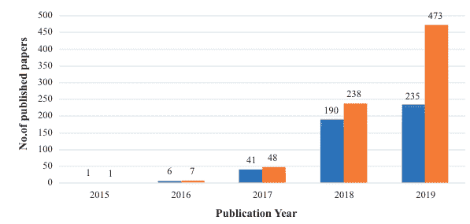

图2. 2015年至2019年BIoT论文的发表趋势

## 区块链-IoT引用，2015年至2019年

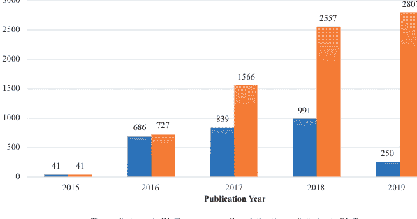

图3. 2015年至2019年BIoT论文的引用趋势

### 4.1 知识结构研究

我们在SPSS软件环境中开展了EFA和HCA，以分析高影响力研究之间的相关载荷，并为BIoT制定了中间知识结构。对于EFA，因子提取阈值设置为一个特征值，而旋转方法设置为varimax，以最大化因子内载荷的离散度。因此，我们得到了八个因子，这些因子解释了89.948%（近90%）的变异度（表3）。因子4在后续分析中被排除，因为只有一个项目被分配到该簇，表明该因子不足。其余七个因子解释了82.790%的变异度，足以解释知识结构。另一方面，仅依赖一种统计方法（即EFA）不足以描述知识结构。因此，还应用了HCA将相似项目分组为簇。然后汇总了EFA和HCA的结果，以便构建BIoT研究的知识核心。采用Ward法进行HCA。因此，HCA结果在树状图中进行了可视化（图4）。根据树状图中重缩距离的最低水平（即约1.4个单位）识别了簇，以形成最大数量的研究组（即13组）。然而，若干研究（S31、S38和S73）无法在这些细粒度簇中分组，因为组内只有一项研究无法揭示与其他研究的任何亲近性和关系。因此，为高影响力研究的分类生成了十个簇，如图4所示。

为了汇总EFA和HCA的结果，将EFA因子构建和HCA聚类中识别出的研究分组为若干类别，以代表BIoT知识结构。制定了九个类别来分组相似的研究，而其余未分类的项目则归入未聚类类别。所识别的九个类别均引起了学者和工业界从业者的高度关注，构成了BIoT领域的知识核心（图5）。

### 4.2 簇内凝聚力评估

我们通过k-means聚类调查了簇成员之间的簇内凝聚力评估，以便为九个类别的标记过程提供便利。皮尔逊

| ID | 作者（年份） | 核心目标/范围 | 方法论类型 | 引用次数 |
|---|---|---|---|---|
| S1 | Zhang and Wen (2015) | 提出一种基于区块链和智能合约的P2P交易IoT电子商务模型 | 系统分析 | 41 |
| S2 | Sun et al. (2016) | 调查区块链技术在发展智慧城市共享服务方面的贡献 | 概念框架 | 51 |
| S3 | Ouaddah et al. (2016) | 提出一种针对IIoT的基于区块链的访问控制框架（FairAccess） | 系统分析 | 65 |
| S4 | Singh and Singh (2016) | 讨论区块链在银行、金融和IIoT未来中的角色展望 | 案例研究 | 21 |
| S6 | Christidis and Devetsikiotis (2016) | 探索一种区块链-IoT组合，以促进共享经济并以密码学可验证的方式自动化业务工作流 | 综述 | 492 |
| S7 | Biswas and Muthukkumarasamy (2016) | 提出一种集成区块链和智能设备的安全框架，以在智慧城市中建立安全通信平台 | 概念框架 | 51 |
| S8 | Kshetri (2017) | 评估区块链在加强工业场景中的网络安全和隐私保护方面的作用 | 案例研究 | 47 |
| S10 | Outchakoucht et al. (2017) | 提出一种针对IIoT环境下访问控制的动态且完全分布式的安全策略 | 系统分析 | 15 |
| S11 | Zhang and Wen (2017) | 建立一个采用分布式自治公司进行P2P交易的IoT电子商务平台 | 系统分析 | 59 |
| S12 | Lee and Lee (2017) | 提出一种使用区块链技术为IoT设备更新固件的新方案 | 系统分析 | 47 |
| S13 | Huh et al. (2017) | 使用Rivest-Shamir-Adleman (RSA)公钥密码体制并混合使用以太坊和本地存储来管理IoT系统中的设备 | 系统分析 | 101 |
| S14 | Shae and Tsai (2017) | 设计一个用于临床试验和精准医疗的区块链平台，用于大数据分析、IIoT设备管理和数据共享方案 | 系统分析 | 21 |
| S15 | Zheng et al. (2017) | 提供区块链技术概述并比较区块链机制 | 综述 | 178 |
| S17 | Ahram et al. (2017) | 利用区块链技术创新医疗服务和应用，即医疗保健 | 案例研究 | 27 |
| S19 | Stanciu (2017) | 制定一种平台分层和分布式控制系统以促进边缘计算 | 系统分析 | 36 |
| S25 | Samaniego and Deters (2017) | 利用基于许可的区块链协议管理广泛的智慧万物互联 | 实验研究 | 15 |


| ID | Authors (Year) | 核心目标/范围 | 方法类型 | 引用数 |
|---|---|---|---|---|
| S26 | Liu et al. (2017) | 提出基于区块链的数据完整性服务框架，以取代第三方审计员的角色 | 系统分析 | 32 |
| S27 | Boudguiga et al. (2017) | 调查使用区块链基础设施以满足机密性、完整性和可用性的要求 | 系统分析 | 20 |
| S31 | Karafiloski and Mishev (2017) | 讨论在大数据革命中对个人数据保护、数字财产、物联网和医疗保健进行分散化管理 | 调查 | 34 |
| S34 | Lin et al. (2017) | 提出一个开放、可信、分散且防篡改的远程广域网（LoRaWAN）系统 | 系统分析 | 13 |
| S35 | Teslya and Ryabchikov (2017) | 集成 Smart-M3 信息共享平台和区块链技术，在利益相关者之间建立信任并控制资源分配 | 系统分析 | 13 |
| S38 | Hwang et al. (2017) | 通过使用区块链技术引入能源 prosumer 服务模型以提高能源效率 | 系统分析 | 17 |

| ID | Authors (Year) | 研究的核心目标/范围 | 方法类型 | 引用数 |
|---|---|---|---|---|
| S39 | Conoscenti et al. (2017) | 开发一个去中心化的私有化设计 IoT，用于在 P2P 网络中存储 IoT 数据，以实现更好的用户隐私保护 | 系统分析 | 13 |
| S42 | Dorri et al. (2017) | 在智能家居场景中演示轻量级区块链，以加强 IoT 安全和隐私 | 案例研究 | 21 |
| S43 | Ouaddah et al. (2017) | 开发一个去中心化的化名和隐私保护授权管理框架，以更好地控制对 IoT 设备的访问 | 系统分析 | 44 |
| S48 | Xu et al. (2017) | 提出一种尊重隐私的区块链共享经济应用方法，利用零知识方案 | 系统分析 | 13 |
| S49 | Yu et al. (2018a) | 调查 IoT 中典型的安全和隐私问题，并开发区块链-IoT 框架以更好地保障 IoT 数据 | 系统分析 | 13 |
| S54 | Reyna et al. (2018) | 分析区块链-IoT 应用中的机遇和挑战，并利用区块链改进 IoT | 调查 | 70 |
| S60 | Hammi et al. (2018) | 提出一种面向 IoT 设备的去中心化身份识别和身份验证系统（信任气泡），以增强数据完整性和可用性 | 系统分析 | 34 |
| S62 | Sharma and Park (2018) | 提出一种集成软件定义网络和区块链技术的混合网络架构，用于智慧城市，以确保数据安全和隐私 | 系统分析 | 21 |
| S66 | Banerjee et al. (2018) | 讨论区块链技术与共享 IoT 数据集的完整性 | 调查 | 32 |

| ID | Authors (Year) | 研究的核心目标/范围 | 方法类型 | 引用数 |
|---|---|---|---|---|
| S69 | Yu et al. (2018b) | 演示区块链在 IoT 设备和数据管理中的适用性，以建立贸易的端到端信任 | 案例研究 | 15 |
| S70 | Griggs et al. (2018) | 部署基于区块链的智能合约，以促进医疗保健场景中的安全分析和 IoT 传感器管理 | 系统分析 | 25 |
| S73 | Joshi et al. (2018) | 综合区块链技术的结构和共识算法 | 调查 | 17 |
| S75 | Novo (2018) | 提出一种新架构，用于在基于区块链技术的完全分布式 IoT 访问控制系统中仲裁角色和权限 | 系统分析 | 90 |
| S76 | Kshetri (2018) | 考察在供应链管理目标（如成本、质量、速度、可靠性、风险降低、可持续性和灵活性）中使用区块链的影响 | 案例研究 | 71 |
| S210 | Sharma et al. (2018) | 提出一种基于区块链的分布式云架构，结合软件定义网络，使网络边缘的雾节点能够发挥作用 | 系统分析 | 81 |
| S211 | Xu et al. (2018) | 综合工业 4.0 领域的最新技术，包括区块链和工业 IoT | 调查 | 120 |
| S212 | Zheng et al. (2018) | 从技术和应用两个角度介绍区块链分类法、共识算法和应用 | 调查 | 75 |
| S231 | Zhou et al. (2018) | 提出基于区块链的阈值 IoT 服务系统（BeeKeeper），通过执行同态计算处理用户数据 | 系统分析 | 15 |
| S236 | Cha et al. (2018) | 设计面向 IoT 设备用户隐私偏好的区块链连接网关 | 系统分析 | 23 |
| S237 | Jesus et al. (2018) | 分析用于 IoT 安全和隐私的区块链应用，考虑跟踪者攻击 | 调查 | 18 |
| S344 | Ferrag et al. (2018) | 分析区块链技术在 IoT 中的应用领域，并为 IoT 网络中的区块链协议分类威胁模型 | 调查 | 14 |
| S358 | Dwivedi et al. (2019) | 提出一种面向 IoT 的去中心化隐私保护医疗区块链模型 | 案例研究 | 23 |

| 因素 | 成员 (ID) | 特征值 | 方差百分比 | 累积方差百分比 |
|---|---|---|---|---|
| 1 | S1, S4, S11, S12, S13, S14, S15, S34, S42, S54, S66, S75 | 20.129 | 45.747% | 45.747% |
| 2 | S2, S3, S6, S7, S10, S19, S26, S27, S39, S43, S48, S76, S210, S231, S236 | 5.332 | 12.119% | 57.865% |
| 3 | S25, S60, S62, S69, S237, S344 | 3.956 | 8.990% | 66.856% |
| 4 | S49 | 3.150 | 7.158% | 74.014% |
| 5 | S31, S212, S358 | 2.509 | 5.703% | 79.717% |
| 6 | S38, S73 | 1.843 | 4.188% | 83.904% |
| 7 | S8, S17 | 1.626 | 3.695% | 87.600% |
| 8 | S70, S35, S21 | 1.033 | 2.348% | 89.948% |

## 使用 Ward 链接重新缩放距离的聚合树状图

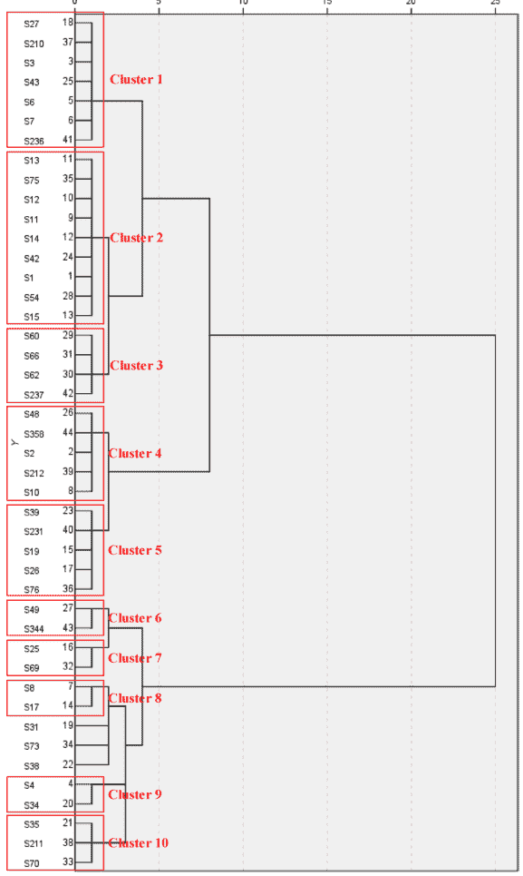

图 4.
基于 HCA 的 BIoT 知识结构探索

通过 k-means 聚类对相关矩阵进行了分析，并将其划分为九个簇（图 6）。常见的分类结果已被突出显示，以探索类别内部紧密关联的成员。当高度有影响力的研究的分类

## EFA 结果

- 因素 1:
  - S1, S11, S12, S13, S14,
  - S15, S42, S54, S75
  - S4, S34
  - S66
- 因素 2:
  - S2, S10, S48
  - S3, S6, S7, S27, S43,
  - S76, S210, S236
  - S19, S26, S39, S76, S231
- 因素 3:
  - S25, S69
  - S60, S62, S237
  - S344
- 因素 5:
  - S31, S212, S358
- 因素 6:
  - S38, S73
- 因素 7:
  - S8, S17
- 因素 8:
  - S35, S70, S211

## HCA 结果

- 簇 1:
  - S3, S6, S7, S27, S43, S210, S236
- 簇 2:
  - S1, S11, S12, S13, S14,
  - S15, S42, S54, S75
- 簇 3:
  - S60, S62, S66, S237
- 簇 4:
  - S2, S10, S48, S212,
  - S358
- 簇 5:
  - S19, S26, S39, S76,
  - S231
- 簇 6:
  - S49, S344
- 簇 7:
  - S25, S69
- 簇 8:
  - S8, S17
- 簇 9:
  - S4, S34
- 簇 10:
  - S35, S70, S211

## 汇总结构

- 类别 1:
  - S3, S6, S7, S27, S43, S210,
  - S236
- 类别 2:
  - S1, S11, S12, S13, S14,
  - S15, S42, S54, S75
- 类别 3:
  - S60, S62, S237
- 类别 4:
  - S19, S26, S39, S76, S231
- 类别 5:
  - S2, S10, S48
- 类别 6:
  - S8, S17
- 类别 7:
  - S35, S70, S211
- 类别 8:
  - S4, S34
- 类别 9:
  - S25, S69
- 未聚类:
  - S31, S38, S49, S66, S73,
  - S212, S344, S358

采用 KMC 且与汇总结构相同，成员-成员粘合被认为相对较强。紧密粘合的成员用星号 (*) 标识，以帮助有效地为类别贴标签。因此，通过深入调查类别的核心成员，建立了九个已识别类别的主题，考虑到九个类别应相互独立。

### 4.3 评分者间信度评估

为了为每个类别分配适当的主题，一份草拟分类列表由一组评分者编制、评估和分类，他们都是该领域的专家，专注于

图 5.
基于 EFA 和 HCA 的 BIoT 汇总知识结构


## KMC 结果

## 指示强键合的聚合结构 (*)

- 集群 1：S1, S3, S6, S7, S11, S12, S13, S14, S15，
  S42, S43, S54, S60, S62, S66, S75, S237

- 类别 1：S3*, S6*, S7*, S27, S43, S210，
  S236

- 集群 2：S2, S10, S48, S49, S212, S231, S358

- 类别 2：S1*, S11*, S12*, S13*, S14*,
  S15*, S42*, S54*, S75*

- 集群 3：S4, S17, S34

- 类别 3：S60*, S62*, S237*

- 集群 4：S35, S70, S211

- 类别 4：S19*, S26*, S39*, S76*, S231

- 集群 5：S25, S69

- 类别 5：S2*, S10*, S48*

- 集群 6：S19, S26, S27, S39, S76, S210, S236, S344

- 类别 6：S8, S17

- 集群 7：S8, S31

- 类别 7：S35*, S70*, S211*

- 类别 8：S4*, S34*

- 类别 9：S25*, S69*

图 6. 类别内成员键合的 KMC 评估

BIoT 领域。对于集群 1（S3、S6、S7、S27、S43、S210、S236），研究考虑了各种访问控制方法以保障数据隐私和数据管理；因此，该集群被命名为“BIoT 系统的数据隐私与管理”（类别 1）。集群 2（S1、S11、S12、S13、S14、S15、S42、S54、S75）侧重于各领域的数值模型与应用，该集群被命名为“BIoT 的模型与应用”（类别 2）。在集群 3（S60、S62、S237）中，引入了用于去中心化和安全身份验证机制的系统安全新框架与架构；因此，该集群被命名为“BIoT 的系统安全理论”（类别 3）。集群 4（S19、S26、S39、S76、S231）侧重于区块链与 IoT 的融合，包括构建 BIoT 系统的关键组件，因此该集群被命名为“BIoT 部署框架”（类别 4）。集群 5（S2、S10、S48）中的研究讨论了机器学习和人工智能等其他新兴方法和技术如何在 BIoT 系统中产生新的协同效应；因此，该集群被命名为“BIoT 与新兴方法和技术的融合”（类别 5）。集群 6（S8、S17）集中于基于 BIoT 的安全理论的应用，以加强企业网络安全和用户隐私保护；该集群被命名为“在 IoT 中使用区块链的应用安全策略”（类别 6）。在集群 7（S35、S70、S211）中，BIoT 的潜力进一步与工业 4.0 和智能健康等新兴技术趋势相契合；因此，该集群被命名为“工业 BIoT 的设计与开发”（类别 7）。集群 8（S4、S34）侧重于利用 BIoT 数字化社会和经济，并将互联网上的信任视为关键研究课题；因此，该集群被命名为“借助 BIoT 建立信任”（类别 8）。集群 9（S25、S69）中的研究概述了 BIoT 部署情况，总结了特征、优势和潜在发展趋势；该集群被命名为“BIoT 生态系统”（类别 9）。表 4 汇总了上述结果。

邀请了五位拥有博士学位资格并从事 BIoT 研究的学者作为评分人，通过评估类内相关系数（ICC）进行评分者间信度分析。ICC 可以反映领域专家在对具有连贯主题的智力内核进行分类测量时的差异（Koo 和 Li，2016）。该技术有助于确保九个智力内核分类过程的可靠性；它利用领域专家的观点来确定内核主题是否恰当。评分人在三点量表上判断了九个建议主题与其对应类别之间的匹配程度（1：匹配，2：中性，3：不匹配）。由于所有 18 个项目的测量数据均为序数数据，因此使用 Krippendorff’s alpha 计算了评分者间信度（Hayes 和 Krippendorff，2007）。这五位学者从总体中随机抽取并受邀参与，学者们对类别进行了统一评估。如表 5 所示，五位评分人按照随机顺序利用自身专业判断为项目（C1 到 C9 和 M1 到 M9）打分。在 SPSS 软件环境中分析 ICC 时，使用了 kalpha 函数（SPSS 宏语法：kalpha judges = R1 R2 R3 R4 R5 level = 2/detail = 0/boot = 10,000）。因此，ICC 值为 0.7486（0.5600–0.9057，95% 置信区间），表明九个组别的主题分配具有可接受的可靠性。总结来说，建议的主题适用于九个类别。

| # | EFA 中的因素 | HCA 中的集群 | KMC 中的集群 | 概念主题 | 成员 |
|---|---|---|---|---|---|
| 1 | 部分 2 | 1 | 部分 1 | BIoT 系统的数据隐私与管理 (1) | S3, S6, S7, S27, S43, S210, S236 |
| 2 | 部分 1 | 2 | 部分 1 | BIoT 的模型与应用 (2) | S1, S11, S12, S13, S14, S15, S42, S54, S75 |
| 3 | 部分 3 | 3 | 部分 1 | BIoT 的系统安全理论 (3) | S60, S62, S237 |
| 4 | 部分 2 | 5 | 部分 6 | BIoT 部署框架 (4) | S19, S26, S39, S76, S231 |
| 5 | 部分 2 | 4 | 部分 2 | BIoT 与新兴方法和技术的融合 (5) | S2, S10, S48 |
| 6 | 7 | 8 | N/A | 在 IoT 中使用区块链的应用安全策略 (6) | S8, S17 |
| 7 | 8 | 10 | 4 | 工业 BIoT 的设计与开发 (7) | S35, S70, S211 |
| 8 | 部分 1 | 9 | 部分 3 | 借助 BIoT 建立信任 (8) | S4, S34 |
| 9 | 部分 3 | 7 | 5 | BIoT 生态系统 (9) | S25, S69 |

表 4. 智力内核制定结果

### 4.4 智力内核的分类与可视化

可以利用上述讨论的九组高影响力研究系统地建立 BIoT 的智力内核。为了对上述分类进行可视化，我们使用了 MDS 将研究之间的距离转换为笛卡尔空间中的距离。3-D MDS 的拟合优度优于 2-D MDS（表 6）。3-D MDS 的整体性能介于“良好”与“优秀”之间，遵循 Mair (2016)。特别是，3-D MDS 的归一化原始应力可降低 54.45% 至 0.02123，表明具有极佳的拟合优度。就应力指标（包括归一化原始应力、应力-I、应力-II 和 S-应力）而言，3-D MDS 中的应力降低平均比 2-D MDS 高出 39.23%。关于 S-应力，Dugard 等人 (2010) 建议，(1) 0.05 至 0.099 和 (2) 0.025 至 0.049 之间的 S-应力值分别表示良好和优异的性能。因此，使用 3-D MDS（S-应力值为 0.03754）来测量观察相似矩阵之间的差异优于使用 2-D MDS（S-应力值为 0.07130）。此外，使用 3-D MDS 时，解释的离散度 DAF 和 Tucker 的一致性系数提高了约 2%，这表明研究之间具有高度相似性。因此，在 3-D 笛卡尔空间中可视化智力内核的九个类别以图形方式检查其邻近性是恰当的（图 7）。

## 5. BIoT 的讨论与未来方向

在本节中，我们根据通过 CPASR 方法识别的智力内核类别，讨论了 BIoT 的未来方向。对每个类别内高影响力的研究进行综合，以制定 BIoT 研究的趋势和未来方向。

| # | 项目 | 评分人 1 | 评分人 2 | 评分人 3 | 评分人 4 | 评分人 5 |
|---|---|---|---|---|---|---|
| 1 | C1 | 1 | 1 | 1 | 1 | 1 |
| 2 | C2 | 1 | 1 | 1 | 1 | 1 |
| 3 | C3 | 1 | 2 | 1 | 1 | 1 |
| 4 | C4 | 1 | 1 | 1 | 1 | 1 |
| 5 | C5 | 2 | 1 | 2 | 2 | 2 |
| 6 | C6 | 1 | 1 | 1 | 1 | 1 |
| 7 | C7 | 1 | 1 | 1 | 1 | 1 |
| 8 | C8 | 2 | 2 | 2 | 2 | 2 |
| 9 | C9 | 1 | 1 | 1 | 1 | 1 |

**表 5.** 评分者间信度分析的主题分配

**注释：** 说明：C1–C9 表示通过 CPASR 方法识别的九个类别；3 点量表：1 表示“匹配”，2 表示“中性”，3 表示“不匹配”

| | 2-D MDS | 3-D MDS |
|---|---|---|
| 归一化原始应力 | 0.04661 | 0.02123 |
| 应力-I | 0.21588 | 0.14570 |
| 应力-II | 0.47007 | 0.36385 |
| S-应力 | 0.07130 | 0.03754 |
| 解释的离散度 | 0.95339 | 0.97877 |
| Tucker 的一致性系数 | 0.97642 | 0.98933 |

**表 6.** 2-D 和 3-D MDS 的拟合优度评估


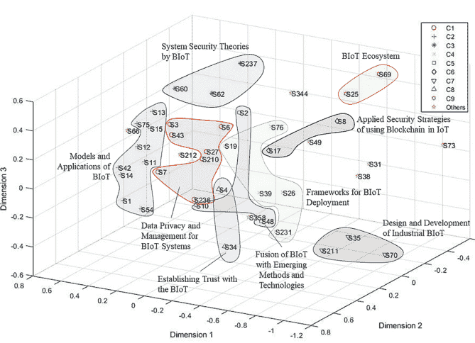

图 7. 类别的三维多维标度图形说明

### 5.1 BIoT 系统的数据隐私与管理 (C1)

数据隐私与管理领域已引起广泛关注。提出了用于 IoT 授权的分散式访问控制框架概念，以缓解最终用户的伦理和隐私问题，同时赋予他们对数据的完全控制权（Ouaddah et al., 2016, 2017; Cha et al., 2018）。通过使用区块链部署数字签名和智能合约，可以加强 IoT 设备的安全管理和访问控制。只有授权的 IoT 节点才能参与分散式网络，这可以保证信息的准确性和可靠性。此外，BIoT 可以促进 IoT 设备之间的数据、资源和服务的安全共享，从而实现工业工作流的自动化（Biswas and Muthukkumarasamy, 2016; Christidis and Devetsikiotis, 2016）。BIoT 的去中心化和不可篡改性可以使网络中的数据高度透明和可追溯。因此，IoT 的可用性、可靠性、容错能力、可扩展性和韧性可以得到增强，以产生新的商业模式并实现数字化转型（Boudguiga et al., 2017; Sharma et al., 2017）。根据本类别的研究，在部署 BIoT 系统时，数据隐私和管理是关键关切点，产生了以下三个主要方向和启示：

#### 5.1.1 数据认证

BIoT 系统为管理物理世界中 IoT 设备创建的数据并将其与数字世界互联提供了一种强大且安全的机制。然而，无法通过区块链和 IoT 有效防止假数据的输入。一旦假数据在区块链中被伪造，区块链的去中心化和不可篡改性将有助于将假数据传播到整个网络。数据认证（用于确认数据的来源和完整性）仍研究不足。输入到 BIoT 系统的数据应来自授权实体，并且还应验证数据的完整性。鉴于网络物理系统和数字孪生等现代 IoT 发展，可以将数据和产品的认证集成起来，以在 BIoT 系统中实现全面认证（Hammi et al., 2018; Alzahrani and Bulusu, 2020）。通过识别和验证物理对象是否拥有其声称的身份，可以建立经过认证的数据。因此，可以保证所有 BIoT 应用中 BIoT 系统的数据准确性。

#### 5.1.2 轻量级系统和数据气化

就数据的大小、频率和类型进行管理，需要在存储能力和完整性之间取得平衡。轻量级系统和数据气化是系统制定中越来越多地考虑的两个特征（Tsang et al., 2019; Fu et al., 2020）。轻量级系统仅在区块链中存储最少量的数据及其相应的密钥，因为完整的数据有效载荷可以存储在其他允许的服务器或云端。轻量级方法可以有效缩短挖矿和伪造区块所花费的时间，这涉及求解难度各异的复杂数学问题。因此，通过使系统轻量化，可以进一步增强系统的实用性和适应性。在数据气化中，一旦区块链的生命周期结束，数据将从区块链应用程序中分离并移至云端进行长期存储和管理。因此，区块链中的资源和存储空间得以释放，用于管理传入的数据和交易。

#### 5.1.3 去中心化身份

为了增强 BIoT 系统中的访问控制，可以为系统环境中涉及的对象（例如，人员和机器）创建去中心化身份。与对象相关的所有事件都可以记录在去中心化系统中，以缓解各种 IoT 服务中多重身份带来的问题，例如事件验证困难和数据不完整（Bouras et al., 2020）。同样，Sousa et al. (2020) 探讨了在 IoT 背景下使用区块链进行身份管理的潜力，评估了实际系统的隐私性和可用性。去中心化身份的概念可以进一步扩展到工业应用的应用研究和共识算法的理论研究。此类研究可以提高工业系统的自主所有权和抗审查能力，从而在系统与其用户之间建立信任。

### 5.2 BIoT 的模型与应用 (C2)

为部署 BIoT 技术以实现其预定目的，已在各种应用领域制定了多种 BIoT 模型。区块链在 IoT 系统中的参与程度因三种交互类型而异：IoT-IoT、IoT-区块链和混合方法（Huh et al., 2017; Zheng et al., 2017; Reyna et al., 2018）。近期研究表明，区块链是物流、供应链管理、金融和医疗保健行业的一种有前途的技术（Erol et al., 2020）。区块链在 IoT 设备和服务中发挥数据管理作用，以确保 BIoT 在各行业中的实用性和适应性。没有必要将与实时事件相关的所有 IoT 数据都存储在区块链中。因此，有可能实现一种系统资源和需求的配置，以利用区块链与 IoT 交互的好处。为了展示 BIoT 的应用，下面显示了一些结合区块链和 IoT 的示例。这些示例可能激发 BIoT 在其他领域的更多应用。

#### 5.2.1 电子商务与供应链管理

BIoT 已将电子商务（e-business）模式转变为一种新的 IoT 电子商务模式（Zhang and Wen, 2015, 2017）。传统电子商务环境中政府–公司–客户关系已演变为客户与去中心化自治公司（DACs）之间的关系。在新的 IoT 电子商务模式中，政府施加的集中控制已被消除，DACs 协调 IoT 数据和商品的交易。在新模型中，加密货币用于交易，智能合约定义了 DAC 与客户之间的关系。因此，IoT 电子商务环境中的供应链已被简化，并为上下游利益相关者之间提供安全连接。在供应链管理中实施 BIoT 还可以加强透明度和可追溯性，促进新商业模式的发展（Zheng et al., 2018; Wong et al., 2020）。

#### 5.2.2 医疗保健

Shae and Tsai (2017) 讨论了在医疗决策中部署区块链技术，以提高成本效益和患者护理质量。他们强调，与数据共享、身份、数据存储和计算范式相关的组件应在医疗保健相关的 BIoT 系统中得到重视。通过 BIoT 获得的可信数据集可以增强决策和数据分析的可靠性，并保证 IoT 可穿戴设备和设备的安全性。此外，Dwivedi et al. (2019) 使用区块链技术来减轻可穿戴 IoT 技术在远程患者监护中的隐私风险。而且，医疗物联网中的区块链技术使医疗相关大数据的安全管理和分析成为可能（Farouk et al., 2020）。可以维护患者匿名性，特别是关于 IoT 设备的使用，并且可以保障数据传输安全，以建立先进的电子病历。此外，Farahani et al. (2018) 讨论了 IoT 与医疗大数据之间的联系，认为通过将区块链集成到系统架构中，可以克服 IoT 在医疗保健中面临的现有挑战（例如，数据管理、可扩展性和安全性）。关于数据安全，去中心化特性有望通过促进不同医疗保健平台和工作流之间的互操作性来管理异构医疗数据（Kaur and Alam, 2018）。

#### 5.2.3 智慧城市

关于智慧城市的发展，Dorri et al. (2017) 提出了一种基于区块链的智能家居框架，用于安全、私密地管理多种智能设备。在建议的框架下，每个智能家居被分配一个簇头，即智能家居矿工，可以创建和验证有关智能家居活动的交易。此外，建立了一个覆盖网络以实现智能家居簇头之间的通信。另一项研究开发了一种具有 BIoT 技术的透明且安全的能源产消者模型（Hwang et al., 2017）。在该模型中，BIoT 为实现照明控制、制冷和供暖控制、环境监测和电力监测的能源产消者技术提供了空间。最后，通过分析家庭的能源使用模式，可以提高智慧城市的能源效率（Yahaya et al., 2020）。

#### 5.2.4 设备管理

BIoT 还可以促进设备管理。Lee and Lee (2017) 开发了一种远程固件更新方案，该方案在 IoT 环境中利用区块链技术。IoT 设备的最新固件在具有安全检查和更新功能的去中心化点对点网络中共享，从而保持固件完整性。同样，Novo (2018) 设计了一种访问控制架构，以去中心化的方式管理 IoT 设备。管理中心被建议作为 IoT 设备和区块链节点之间的接口，以管理来自无线传感器网络的大量实时数据，从而在计算资源和区块链网络有效性之间取得平衡（Xiong et al., 2020）。作者还提出，这些管理中心应控制区块链网络中轻量节点和矿工节点的权限，以优化硬件资源。

### 5.3 BIoT 部署框架 (C4)

由于 BIoT 技术的快速增长，大多数研究都提出了自己的部署方案和框架，以实现其指定的目的和需求。因此，本类别中的一些研究提出了标准化的部署协议和框架，识别其关键组件和要素。Stanciu (2017) 实现了 IEC61499 标准，用于集成区块链和 IoT 技术，通过使用功能块和服务接口功能块来创建分布式控制系统。该标准协调边缘节点和云服务之间的数据传输和功能执行。Liu et al. (2017) 构建了一个面向区块链支持的数据完整性服务框架，旨在连接云环境中的数据所有者应用程序和数据消费者应用程序。作者制定了使用 BIoT 在云存储服务中执行数据完整性验证的协议。在另一项研究中，区块链的


IoT 系统中的存在推动了对等（P2P）网络的发展，P2P 云成为一种有前景的数据管理范式（Conoscenti et al., 2017）。考虑到在真实业务环境中部署 BIoT，Kshetri（2018）为构建 BIoT 解决方案制定了六个战略目标：成本、速度、可靠性、风险降低、可持续性和灵活性。这些目标为各行业（如供应链管理）带来了明确的益处。Zhou et al.（2018）为 BIoT 系统提出了一种阈值安全多方计算协议，用于对数据执行同态计算，并具有额外优势，即可以使用外部计算资源来增强系统性能。上述研究展示了框架和协议的基本要素和注意事项，证明 IoT 的面向服务（或分层）架构可以通过区块链元素进行修改。

#### 公有区块链
#### 联盟区块链
#### 私有区块链

*P2P网络中利益相关者的访问控制*

#### **访问层**

##### 云/雾数据库
用于管理收集到的数据并支持数据查询和发布的云/雾存储部分

##### IoT开发平台
用于创建区块链-IoT应用程序的开发环境
- 设备连接
- 前端开发
- 后端开发

*区块链-IoT应用的制定*

#### **服务层**

##### 共识算法
例如 PoW、PoS、PoA 等。

##### 验证
- 非对称加密
- 数字签名机制

##### 智能合约
业务逻辑

##### 分布式系统
- IPFS
- Flow chain

*建立对等网络和机制*

#### **去中心化层**

##### 无线通信技术
- 蓝牙
- WiFi
- RFID
- LoRaWAN

##### M2M通信协议
- MQTT
- XMPP
- CoAP

*节点与区块链-IoT服务之间的数据传输*

#### **网络层**

##### IoT技术
- 传感器
- 可穿戴设备
- 移动节点
- 执行器
- 标识

*作为连接到数字系统节点的物理对象和用户*

#### **感知层**

图 8. BIoT的面向服务架构

## 区块链-IoT的特性
- 去中心化
- 不可篡改性
- 自主性
- 可扩展性
- 信任
- 安全性
- 隐私性
- 持久性
- 访问控制
- 故障容忍

## 应用与服务
潜在功能：
- 对象认证
- 可追溯性
- 来源证明
- 身份管理
- 访问控制
- 对等服务
- 交易和电子商务
- 网络编排
- 机器完整性
- 设备更新和监控

## 行业
潜在应用领域：
- 航空
- 设备管理
- 电子商务和服务
- 金融
- 政府
- 医疗保健
- 物流
- 媒体与娱乐
- 智慧城市和智能家居
- 供应链管理

## 与区块链-IoT的融合
- 人工智能
- 商业智能
- 大数据分析
- 优化
- 数字孪生
- CPS
- 物理互联网
- 5G

图 9. BIoT生态系统

图 8 显示，BIoT 的面向服务架构由五个层组成：感知层、网络层、去中心化层、服务层和访问层。物理对象和用户（即系统节点）在感知层中连接到数字系统，而数据传输则通过无线通信技术和机器对机器（M2M）通信协议进行。在去中心化层中，通过共识算法、验证机制、智能合约和分布式系统建立 P2P 网络。IoT 平台和云数据库的混合部署在服务层中制定，以创建 BIoT 应用程序。最终，访问层控制 P2P 网络的用户权限，并定义是使用公有区块链、联盟区块链还是私有区块链（Du et al., 2020）。

## 5.4 BIoT 与新兴方法和技术的融合 (C5)

关于区块链与 IoT 的交互，Reyna et al.（2018）观察到，一种结合雾计算和云计算的混合方法可以利用区块链和实时 IoT 交互的优势。在这种方法中，只有很小一部分交互和数据在区块链中管理，其余部分在 IoT 环境中共享。BIoT 与新兴方法和技术的融合受到创新商业模式的推动，例如智能家居、智慧城市和共享经济（Sun et al., 2016; Xu et al., 2017）。这种技术融合提供了额外的协同效应，并增强了 BIoT 的能力。Outchakoucht et al.（2017）将 BIoT 与强化学习算法（一种机器学习方法）相结合，以开发动态、优化和自适应的安全策略。结果，智能合约的灵活性和适应性可以得到改进，以根据环境状态和强化权重推荐适当操作。Hwang et al.（2017）为能源产消者应用程序提出了一个涉及 IoT、区块链、云计算和大数据的集成平台。Larson 和 Chang（2016）将敏捷原则与商业智能和数据科学相结合；他们发现，通过部署 BIoT，整个敏捷商业智能交付框架都可以得到加强。Yang et al.（2019）探索了具有隐私保护和自适应特征的基于 IoT 的医疗大数据。为大数据应用探索了部署强大智能去重机制的可能性。在混合环境下，使用文本挖掘、舆情挖掘、社交网络分析和聚类分析等技术来分析存储在云中的数据和交互。这种方法可以扩展到其他方法和技术，例如人工智能（AI）和优化，以增强系统功能和能力以用于工业目的。未来，可以在 BIoT 应用程序中嵌入额外的“智能”；例如，智能合约可以变得足够智能，以响应环境状态执行决策功能。

## 5.5 BIoT 的系统安全理论 (C3)

用于解决网络安全问题的系统安全理论可以通过将区块链与 IoT 集成来改进。Hammi et al.（2018）建议建立一个强大的身份识别和身份验证系统，在 IoT 环境中创建安全虚拟区域，从而构建一种安全模型，即“信任气泡”。IoT 设备可以在公有区块链应用的 P2P 网络中使用旨在消除恶意节点的威胁模型进行安全通信。实时交互、初始化和加密机制的改进可以改善安全模型。Sharma 和 Park（2018）为可持续发展制定了一种基于区块链的混合网络架构，包含核心网络和边缘网络；该架构解决了智慧城市网络中现有的挑战，包括高延迟、带宽瓶颈、安全、隐私和可扩展性。核心网络通过挖矿和验证以去中心化的方式执行区块链机制，而边缘网络以集中方式管理各种服务。从 IoT 设备收集并在边缘网络中采集的原始数据被强制写入核心网络中的区块，以确保智慧城市网络的安全。Jesus et al.（2018）总结了用于为 BIoT 提供安全和隐私的方法论。BIoT 对典型攻击模式和威胁模型具有抵抗力，因为攻击需要巨大的计算能力。然而，跟踪攻击，即妨碍区块验证从而获益的攻击，也应予以考虑。尽管跟踪攻击者无法直接从 BIoT 网络中获益，但损坏的交易和业务关系可能以其他方式影响企业，例如合并与收购（M&A）和公司声誉。研究发现，通过提高目标哈希算力可以缓解跟踪攻击。随着更高的目标哈希算力，更多区块被发布以在网络中创建更多分叉，使攻击者难以创建相同数量的区块。未来，可以研究涉及共识算法和验证过程的额外攻击模式，以加强 BIoT 系统安全理论。

## 5.6 在 IoT 中使用区块链的应用安全策略 (C6)

基于 BIoT 的安全理论，可以制定安全策略和政策，以对各个应用领域产生影响。Kshetri（2017）总结了区块链在增强医疗保健行业和供应链管理中的网络安全与隐私保护方面的作用。当与 IoT 集成时，基于区块链的安全策略可以促进医疗数据的互操作性，并可扩展至电子健康记录（eHRs）。在这样的系统中，患者可以控制自己的数据，其医疗记录的变化在网络中是透明且可追溯的。未来的研究应调查解决医疗数据隐私、安全性和完整性的新方法。


同样，BIoT 在提升上下游供应链各方安全性方面发挥着至关重要的作用。更重要的是，物品所有权和可追溯性的变更可以独立实现，同时在供应链网络中建立信任。公平信息惯例（FIPs）也已得到调查（特别是在大数据环境中），以提供透明度、安全性、个人参与和问责制。此外，Ahram et al.（2017）为多种工业应用阐述了敏捷价值链、更快的产品创新和有效的客户关系，开发了相应的健康链。BIoT 也可用于解决许多网络安全问题。例如，医疗网络中受保护健康信息（PHI）的生命周期可以被监控，PHI 记录可以在去中心化网络中整合，以实现更好的可追溯性和安全性。在未来，金融和非金融行业（例如工业制造）都可以从基于 BIoT 开发的安全策略中受益。

## 5.7 工业 BIoT 的设计与开发 (C7)

一些作者已经研究了工业应用和工业 IoT（IIoT），后者被视为分布式控制系统的演进，旨在自动化和优化工业流程。Teslya（2017）预见，通过整合 IIoT 和区块链来形成工业 BIoT，将实现超越工业 4.0 的工业革命。这种整合应增强安全性、容错性、耐久性、公众可访问性和共识，所有这些都是当前 IIoT 应用的不足之处。此外，区块链应支持业务流程管理，其中制造步骤和流程受到控制和优化（Xu et al., 2018）。BIoT 使用量的增加也证明，区块链在工业 4.0 中的作用是促进韧性、可扩展性、安全性和自主性。工业 BIoT 开发的建议主要关注点如下：

### 5.7.1 BIoT 的新兴范式

提出了覆盖网络概念来连接多个区块链系统。覆盖网络根据分布式架构生成全球 P2P 网络（Dorri et al., 2017）。它在物理 - 网络系统中尤为重要，用于构建互联网络通信，允许本地区块链的集群头彼此通信以创建全球区块链环境（Griggs et al., 2018）。当工业 BIoT 促进数字世界中与物理对象和流程相关的数据记录和共享时，可以创建数字孪生（实时数字副本），用于工业场景中的建模、预后和诊断（Hasan et al., 2020）。

### 5.7.2 共识算法

由于区块链最初是为了处理加密货币而创建的，因此开发了多种用于金融应用的知名共识算法，包括工作量证明（PoW）、权益证明（PoS）和实用拜占庭容错（pBFT）算法（Nguyen and Kim, 2018）。共识算法应根据行业的独特特征进行定制，以便在工业场景中达成所有对等节点之间的共识。利益相关者不应向对等节点提供激励，而应通过区块锻造和验证来维护区块链应用，这对于在 P2P 网络中建立信任至关重要。因此，应开发或选择新的共识算法，以鼓励利益相关者参与并维护网络的可持续性（Lao et al., 2020）。

## 5.8 使用 BIoT 建立信任 (C8)

建立信任是 BIoT 最有价值的益处之一。区块链提供了高安全性和不可篡改性的优势，因为记录可以在分布式 P2P 网络中验证（Singh and Singh, 2016; Lin et al., 2017）。由于已发布的区块难以修改，存储在区块链中的数据是可信的。尽管对区块链发起 51% 攻击可能构成威胁，但一组恶意节点必须控制网络算力的 50% 以上，例如计算资源（PoW）或财富（PoS）。执行 51% 攻击的门槛相对较高，尤其是在大规模无许可区块链应用中。因此，信任逐渐在无信任的去中心化网络中建立，其中共识算法和区块链协议是用于建立信任的两个关键要素。对于许可区块链，利益相关者与系统之间的信任可以持续，以在 P2P 网络中建立协作文化。如果恶意节点创建可能损害许可 BIoT 系统可信度的虚假数据，则将此类节点从网络中移除，以确保 BIoT 环境中的积极文化。未来，应提出一种方案来支持信任委托，而不会违反安全和隐私问题（Yu et al., 2018b）。Yang et al.（2018）在物联网车辆中引入了去中心化信任管理，计算车辆发送消息的信任值偏移，以生成下一个区块。该技术有效地评估了 IoT 设备的可信度，以建立安全可靠的 P2P 网络。She et al.（2019）设计了一个区块链信任模型，用于检测无线传感器网络中的恶意节点，嵌入联盟区块链用于四边形测量和定位。通过考虑节点状态、处理延迟、转发率和响应时间来确定恶意节点。一般来说，可以在 IoT 中开发以人为中心的信任模型，以在 P2P 网络中提供有效的数据安全和隐私，其中安全风险可以通过适当的策略和政策来缓解。

## 5.9 BIoT 生态系统 (C9)

大量 BIoT 研究提出生态设计，以支持软件可持续性和生态创新的发展。Samaniego 和 Deters（2017）建议通过区块链改进自主 IoT（AIoT），同时遵循自配置、自优化、自愈和自保护的原则。作者制定了一种基于许可的协议来管理 AIoT 环境中的实时传输。Yu et al.（2018b）考察了区块链改变 IoT 生态系统的几种方式；作者将其视为一种新的数据共享模型，消除了信任、通信、成本和所有权方面的挑战。更重要的是，使用区块链消除了 BIoT 生态系统中的单点故障，同时区块链节点可以定期同步以检测网络中的任何恶意节点（Lockl et al., 2020）。此外，Siegfried et al.（2020）建议六个维度来将区块链技术映射到工业 IoT：性能、可靠性、IT 安全性、可扩展性、兼容性和适应性。图 9 描绘了一个 BIoT 生态系统，总结了本研究的基本要素。基于区块链和 IoT 技术的坚实基础，BIoT 涵盖了广泛的功能，包括去中心化、不可篡改性、自主性、可扩展性、信任、安全性、隐私性、耐久性、访问控制和容错性。此外，新兴方法（例如 AI、商业智能、大数据分析和优化）和技术（例如数字孪生、物理 - 网络系统（CPSs）、物理互联网和 5G）可以在 BIoT 中综合，为本文讨论的行业建立指定平台。此外，BIoT 有潜力应用于航空、政府、媒体和娱乐（Abeyratne, 2020; Chen et al., 2020; Geneiatakis et al., 2020）。各种新兴技术的优势可以在 BIoT 环境中发挥，为市场和客户增加价值，因为去中心化和实时连接的特性可以嵌入特定解决方案和服务中。随着数据、技术和分析方法的广泛发展推动数字革命，可以通过其标准化的面向服务架构进一步开发 BIoT 服务中的生态可持续创新。因此，这些技术为信息系统和先进技术发展带来了新时代。

## 6. 结语

总之，我们解决了第 1 节中提出的两个研究问题。首先，我们已成功开发 CPASR 方法来考察 BIoT 的知识核心，该核心是


一个研究不足但具有时效性的领域。引文分析、共引邻近性分析及一系列统计分析在 CPASR 方法中被整合为一个整体。其次，我们运用结构化的 CPASR 方法调查了 44 项具有高度影响力的研究，识别出九类描述 BIoT 趋势和意义的类别。本研究通过为新的 BIoT 范式和应用提供基础和未来方向，为近未来的研发做出了贡献。简言之，本研究介绍了 CPASR 方法，该方法整合引文分析、共引邻近性分析及一系列统计分析，以考察指定知识领域的知识核心。此外，CPASR 方法被应用于识别 BIoT 的九个知识核心，BIoT 是信息管理语境下一个研究不足但热门的领域，以支持 BIoT 领域的未来研究方向，具体如下：

- (1) BIoT 设计与部署：在 IoT 系统中实施区块链的核心目标是通过有效管理 IoT 设备来增强数据安全性和隐私性。因此，有必要制定一个定制的 BIoT 部署方案，该方案需考虑区块链协议、共识算法设计、安全策略、系统架构和数据管理，以加强万物互联（IoE）的框架。

- (2) 新型 BIoT 应用：除了在金融、医疗保健和供应链管理中丰富 BIoT 实现外，BIoT 还可部署于航空、政府、物流工程、媒体和娱乐等各个行业。此类应用利用去中心化和 P2P 网络带来的信任建立优势，增强数据隐私和安全性。这些新型应用还可以以生态可持续的方式推动全球技术发展。

- (3) 与新兴方面的融合：BIoT 巩固了 P2P 网络中 IoT 数据交换的框架，提升了数据完整性和可靠性。它还加强了 BIoT 架构下的 AI 和数据分析能力。与其制定独立的 AI 或数据分析模型，不如改善模型训练和验证的数据可用性，以促进现有模型之间的协作，创建行业通用的解决方案。

本研究局限于 2015 年至 2019 年的五年时间范围，因为 BIoT 的发展仍处于初期阶段。预计在未来十年内，研究数量和引用数量将快速增长。未来，可以再次使用 CPASR 方法来考察 BIoT 的知识结构（例如使用十年时间范围），以验证和修订知识核心。此外，所提议的 CPASR 方法也可用于考察其他知识领域的知识结构。

### ORCID iDs
- Y.P. Tsang http://orcid.org/0000-0002-6128-345X
- C.H. Wu http://orcid.org/0000-0003-1259-4048
- W.H. Ip http://orcid.org/0000-0001-6609-0713

### 参考文献
Abeyratne, R. (2020), “区块链与航空”, 载于 Aviation in the Digital Age, Springer, Cham, pp. 109-120.

Ahram, T., Sargolzaei, A., Sargolzaei, S., Daniels, J. and Amaba, B. (2017), “区块链技术创新”, 载于 2017 IEEE 技术与工程管理会议 (TEMSCON), IEEE, Santa Clara, CA, pp. 137-141.

Alladi, T., Chamola, V., Parizi, R.M. and Choo, K.K.R. (2019), “面向工业 4.0 和工业 IoT 的区块链应用：综述”, IEEE Access, Vol. 7, pp. 176935-176951.

Alzahrani, N. and Bulusu, N. (2020), “基于真正去中心化动态共识协议的新产品防伪区块链”, Concurrency and Computation: Practice and Experience, Vol. 32 No. 12, p. e5232, doi: 10.1002/cpe.5232.

Aromataris, E., Fernandez, R., Godfrey, C.M., Holly, C., Khalil, H. and Tungpunkom, P. (2015), “系统评价总结：伞式综述方法的方法学开发、实施与报告”, International Journal of Evidence-Based Healthcare, Vol. 13 No. 3, pp. 132-140.

Banerjee, M., Lee, J. and Choo, K.K.R. (2018), “面向物联网安全的区块链未来：立场文件”, Digital Communications and Networks, Vol. 4 No. 3, pp. 149-160.

Biswas, K. and Muthukkumarasamy, V. (2016), “利用区块链技术保障智慧城市安全”, 载于 2016 IEEE 第 18 届高性能计算与通信国际会议；IEEE 第 14 届智慧城市国际会议；IEEE 第 2 届数据科学与系统国际会议, IEEE, Sydney, NSW, pp. 1392-1393.

Boudguiga, A., Bouzerna, N., Granboulan, L., Oliereau, A., Quesnel, F., Roger, A. and Sirdey, R. (2017), “通过区块链实现 IoT 更新的更好可用性与问责制”, 载于 2017 IEEE 欧洲安全与隐私研讨会, IEEE, Paris, pp. 50-58.

Bouras, M.A., Lu, Q., Zhang, F., Wan, Y., Zhang, T. and Ning, H. (2020), “面向电子健康身份隐私的分布式账本技术：现状与未来展望”, Sensors, Vol. 20 No. 2, doi: 10.3390/s20020483.

Burton-Jones, A., Akhlghpour, S., Ayre, S., Barde, P., Staib, A. and Sullivan, C. (2020), “改变关于医疗保健数字化转型评估的对话：来自制度分析的见解”, Information and Organization, Vol. 30 No. 1, doi: 10.1016/j.infoandorg.2019.100255.

Cha, S.C., Chen, JF., Su, C. and Yeh, KH. (2018), “面向物联网中基于 BLE 设备的区块链连接网关”, IEEE Access, Vol. 6, pp. 24639-24649.

Chen, Q., Srivastava, G., Parizi, R.M., Alqahtly, M. and Al Ridhawi, I. (2020), “面向虚假媒体事物互联网的感知激励区块链解决方案”, Information Processing and Management, Vol. 57 No. 6, p. 102370.

Chowdhury, MJM., Colman, A., Kabir, M.A., Han, J. and Sarda, P. (2018), “区块链与数据库：批判性分析”, 载于 2018 年第 17 届 IEEE 可信、安全与隐私计算与通信国际会议/第 12 届 IEEE 大数据科学与工程国际会议, IEEE, New York, NY, pp. 1348-1353.

Christidis, K. and Devetsikiotis, M. (2016), “面向物联网的区块链与智能合约”, IEEE Access, Vol. 4, pp. 2292-2303.

Clarivate Analytics. (2020), “Web of Science：覆盖范围摘要”, 可访问: https://clarivate.libguides.com/webofscienceplatform/coverage (访问日期: 2020 年 7 月 15 日).

Conoscenit, M., Vetro, A. and De Martin, J.C. (2017), “面向物联网中隐私与去中心化的点对点技术”, 载于 2017 IEEE/ACM 第 39 届软件工程配套会议, IEEE, Buenos Aires, pp. 288-290.

Crosby, M., Pattanayak, P., Verma, S. and Kalyanaraman, V. (2016), “区块链技术：超越比特币”, Applied Innovation, Vol. 2, pp. 6-19.

Dorri, A., Kanhere, S.S., Jurdak, R. and Gauravaram, P. (2017), “面向 IoT 安全与隐私的区块链：智能住宅个案研究”, 载于 2017 IEEE 普适计算与通信研讨会, IEEE, Kona, HI, pp. 618-623.

Du, M., Wang, K., Liu, Y., Qian, K., Sun, Y., Xu, W. and Guo, S. (2020), “Spacechain：面向 IoT 安全的三维区块链架构”, IEEE Wireless Communications, Vol. 27 No. 3, pp. 38-45.

Dugard, P., Todman, J. and Staines, H. (2010), 《多元分析入门：实用指南》, Routledge/Taylor & Francis Group.

Dwivedi, A.D., Srivastava, G., Dhar, S. and Singh, R. (2019), “面向 IoT 的去中心化隐私保护医疗保健区块链”, Sensors, Vol. 19, No. 2, doi: 10.3390/s19020326.

Erol, I., Ar, I.M., Ozdemir, A.I., Pekar, I., Asgary, A., Medeni, I.T. and Medeni, T. (2020), “评估工业中区块链技术的可行性：来自土耳其的证据”, Journal of Enterprise Information Management. doi: 10.1108/JEIM-09-2019-0309.

Farahani, B., Firouzi, F., Chang, V., Badaroglu, M., Constant, N. and Mankodiya, K. (2018), “迈向雾驱动的 IoT 电子健康：医学与医疗保健中 IoT 的承诺与挑战”, Future Generation Computer Systems, Vol. 78, pp. 659-676.

Farouk, A., Alahmadi, A., Ghose, S. and Mashatan, A. (2020), “工业医疗保健区块链平台：愿景与未来机遇”, Computer Communications, Vol. 154, pp. 223-235.

Ferrag, M.A., Derdour, M., Mukherjee, M., Derhab, A., Maglaras, L. and Janicke, H. (2018), “面向物联网的区块链技术：研究问题与挑战”, IEEE Internet of Things Journal, Vol. 6 No. 2, pp. 2188-2204.

Fu, J., Wang, N. and Cai, Y. (2020), “基于轻量消息共享的医疗保健区块链系统隐私保护”, Sensors, Vol. 20 No. 7, doi: 10.3390/s20071898.

Geneiatakis, D., Soupiionis, Y., Steri, G., Kounelis, I., Neisse, R. and Nai-Fovino, I. (2020), “用于支持跨境电子政务服务的区块链性能分析”, IEEE Transactions on Engineering Management, Vol. 67 No. 4, pp. 1310-1322.

Griggs, K.N., Ossipova, O., Kohlios, C.P., Baccarini, A.N., Howson, E.A. and Hayajneh, T. (2018), “利用智能合约的安全自动化远程患者监护医疗保健区块链系统”, Journal of Medical Systems, Vol. 42, doi: 10.1007/s10916-018-0982-x.

Hammi, M.T., Hammi, B., Bellot, P. and Serhrouchni, A. (2018), “信任气泡：面向 IoT 的去中心化区块链认证系统”, Computers and Security, Vol. 78, pp. 126-142.

Hasan, H.R., Salah, K., Jayaraman, R., Omar, M., Yaqoob, I., Pesic, S., Taylor, T. and Boscovic, D. (2020), “基于区块链的数字孪生创建方法”, IEEE Access, Vol. 8, pp. 34113-34126.

Hausberg, J.P. and Korreck, S. (2020), “企业孵化器和加速器：基于共引分析的系统文献综述”, The Journal of Technology Transfer, Vol. 45 No. 1, pp. 151-176.

Hayes, A.F. and Krippendorff, K. (2007), “回应编码数据标准信度措施的呼吁”, Communication Methods and Measures, Vol. 1 No. 1, pp. 77-89.

Hug, S.E., Ochsner, M. and Brändle, M.P. (2017), “使用 Microsoft Academic 进行引文分析”, Scientometrics, Vol. 111 No. 1, pp. 371-378.

Hughes, L., Dwivedi, Y.K., Misra, S.K., Rana, N.P., Raghavan, V. and Akella, V. (2019), “区块链研究、实践与政策：应用、优势、局限性、新兴研究主题及研究议程”, International Journal of Information Management, Vol. 49, pp. 114-129.

Huh, S., Cho, S. and Kim, S. (2017), “利用区块链平台管理 IoT 设备”, 载于 2017 年第 19 届先进通信技术国际会议, IEEE, pp. 464-467.

Hwang, J., Choi, M.I., Lee, T., Jeon, S., Kim, S., Park, S. and Park, S. (2017), “利用区块链系统确保透明度与安全性的能源 prosumer 商业模式”, Energy Procedia, Vol. 141, pp. 194-198.

Jesus, E.F., Chicarino, V.R., de Albuquerque, C.V. and Rocha, A.A.D.A. (2018), “如何利用区块链保障物联网安全及跟踪者攻击的综述”, Security and Communication Networks, Vol. 2018, doi: 10.1155/2018/9675050.

Joshi, A.P., Han, M. and Wang, Y. (2018), “区块链技术安全与隐私问题综述”, Mathematical Foundations of Computing, Vol. 1 No. 2, pp. 121-147.


Karafiliski, E. 与 Mishev, A. (2017), “区块链解决大数据挑战的方案：文献综述”, in _IEEE EUROCON 2017-第17届智能技术国际会议_, IEEE, Ohrid, 页 763-768.

Kaur, H., Alam, M.A., Jameel, R., Mourya, A.K. 与 Chang, V. (2018), “面向云环境中异构医疗数据的区块链基础解决方案及未来方向”, _医学系统杂志_, 卷 42 期 156 页 1-11.

Khan, M.A. 与 Salah, K. (2018), “物联网安全：综述、区块链解决方案与开放挑战”, _未来一代计算机系统_, 卷 82 页 395-411.

Khangura, S., Konnyu, K., Cushman, R., Grimshaw, J. 与 Moher, D. (2012), “证据摘要：快速综述方法的演变”, _系统性评述_, 卷 1 页 10, doi: 10.1186/2046-4053-1-10.

Kim, H.J., Jeong, Y.K. 与 Song, M. (2016), “基于引文句子的内容与邻近性作者共引分析”, _信息计量学杂志_, 卷 10 期 4 页 954-966.

Koo, T.K. 与 Li, M.Y. (2016), “可靠性研究中组内相关系数选择与报告指南”, _脊椎疗法医学杂志_, 卷 15 期 2 页 155-163.

Kshetri, N. (2017), “区块链在加强网络安全和保护隐私中的作用”, _电信政策_, 卷 41 期 10 页 1027-1038.

Kshetri, N. (2018), “区块链在满足关键供应链管理目标中的作用”, _国际信息管理杂志_, 卷 39 页 80-89.

Lade, P., Ghosh, R 与 Srinivasan, S. (2017), “制造分析与工业物联网”, _IEEE智能系统_, 卷 32 期 3 页 74-79.

Lao, L., Li, Z., Hou, S., Xiao, B., Guo, S. 与 Yang, Y. (2020), “区块链系统中物联网应用调查：架构、共识与流量建模”, _ACM计算机调查_, 卷 53 期 1, doi: 10.1145/3372136.

Larson, D. 与 Chang, V. (2016), “敏捷、商业智能、分析与数据科学的综述及未来方向”, _国际信息管理杂志_, 卷 36 期 5 页 700-710.

Lee, B. 与 Lee, J.H. (2017), “物联网环境中嵌入式设备的区块链基础安全固件更新”, _超级计算机杂志_, 卷 73 期 3 页 1152-1167.

Lin, I.C. 与 Liao, T.C. (2017), “区块链安全问题与挑战调查”, _IJ网络安全_, 卷 19 期 5 页 653-659.

Lin, J., Shen, Z. 与 Miao, C. (2017), “利用区块链技术构建共享LoRaWAN物联网的信任”, in _第2届群体科学与工程国际会议论文集_, ACM, 北京, 页 38-43.

Liu, B., Yu, X.L., Chen, S., Xu, X. 与 Zhu, L. (2017), “物联网数据的区块链基础数据完整性服务框架”, in _2017年IEEE网络服务国际会议_, IEEE, Honolulu, HI, 页 468-475.

Lockl, J., Schlatt, V., Schweizer, A., Urbach, N. 与 Harth, N. (2020), “迈向物联网生态系统的信任：面向基于区块链的物联网应用的设计原则”, _IEEE工程管理学会汇刊_, 卷 67 期 4 页 1256-1270, doi: 10.1109/TEM.2020.2978014.

Mair, P., Borg, I. 与 Rusch, T. (2016), “多维标度与非标度中的拟合优度评估”, _多元行为研究_, 卷 51 期 6 页 772-789.

Munn, Z., Peters, MD, Stern, C, Tufanaru, C, McArthur, A. 与 Aromataris, E. (2018), “系统性评述还是范围综述？作者在选择系统性或范围综述方法时的指导”, _BMC医学研究方法学_, 卷 18 页 143, doi: 10.1186/s12874-018-0611-x.

Nakamoto, S. (2008), “比特币：点对点电子现金系统”, 可于 https://bitcoin.org/bitcoin.pdf 获取（访问于 2020年7月15日）.

Ng, C.K., Wu, C.H., Yung, K.L., Ip, W.H. 与 Cheung, T. (2018), “物联网语义相似度分析”, 企业信息系统, 卷 12 期 7 页 820-855.

Nguyen, G.T. 与 Kim, K. (2018), “区块链中使用的共识算法调查”, 信息处理系统期刊, 卷 14 页 101-128.

Nord, J.H., Koohang, A. 与 Paliszkiewicz, J. (2019), “物联网：综述与理论框架”, 专家系统与应用, 卷 133 页 97-108.

Novo, O. (2018), “区块链与物联网：面向可扩展物联网访问管理的架构”, IEEE物联网杂志, 卷 5 期 2 页 1184-1195.

Ouaddah, A., Abou Elkalam, A. 与 Ait Ouahman, A. (2016), “FairAccess：面向物联网的新型基于区块链的访问控制框架”, 安全与通信网络, 卷 9 期 18 页 5943-5964.

Ouaddah, A., Elkalam, A.A. 与 Ouahman, A.A. (2017), “面向基于区块链技术的物联网隐私保护访问控制模型的新构想”, in 欧洲与MENA信息与通信技术合作进展, Springer, Cham, 页 523-533.

Outchakoucht, A., Hamza, E.S. 与 Leroy, J.P. (2017), “面向物联网的基于区块链和机器学习的动态访问控制策略”, 国际先进计算机科学与应用杂志, 卷 8 期 7 页 417-424.

Panarello, A., Tapas, N., Merlino, G., Longo, F. 与 Puliafito, A. (2018), “区块链与物联网集成：系统性调查”, 传感器, 卷 18 期 8, doi: 10.3390/s18082575.

Papert, M. 与 Pflaum, A. (2017), “面向供应链管理中物联网服务实现的生态系统模型开发”, 电子市场, 卷 27 期 2 页 175-189.

Paré, G. 与 Kitsiou, S. (2017), “文献综述方法”, in 电子健康评估手册：循证方法, University of Victoria.

Reyna, A., Martín, C., Chen, J., Soler, E. 与 Díaz, M. (2018), “论区块链及其与物联网的集成：挑战与机遇”, 未来一代计算机系统, 卷 88 页 173-190.

Samaniego, M. 与 Deters, R. (2017), “智能物联网-IoST：利用区块链和CLIPS使事物自主化”, in 2017年IEEE认知计算国际会议, IEEE, Honolulu, HI, 页 9-16.

Shae, Z. 与 Tsai, J.J. (2017), “面向临床试验和精准医疗的区块链平台设计”, in 2017年IEEE第37届分布式计算系统国际会议, IEEE, Atlanta, GA, 页 1972-1980.

Sharma, P.K. 与 Park, J.H. (2018), “面向智慧城市的基于区块链的混合网络架构”, 未来一代计算机系统, 卷 86 页 650-655.

Sharma, P.K., Chen, M.Y. 与 Park, J.H. (2017), “面向物联网的基于软件定义雾节点的分布式区块链云架构”, IEEE Access, 卷 6 页 115-124.

She, W., Liu, Q., Tian, Z., Chen, J.S., Wang, B. 与 Liu, W. (2019), “面向无线传感器网络中恶意节点检测的区块链信任模型”, IEEE Access, 卷 7 页 38947-38956.

Shiau, W.L., Yan, C.M. 与 Lin, B.W. (2019), “移动信息系统智力结构探究”, 国际信息管理杂志, 卷 47 页 241-251.

Siegfried, N., Rosenthal, T. 与 Benlian, A. (2020), “区块链与工业物联网”, 企业信息管理杂志. doi: 10.1108/JEIM-06-2018-0140.

Singh, S. 与 Singh, N. (2016), “区块链：金融和网络安全的未来”, 2016年第2届当代计算与信息学国际会议, IEEE, 页 463-467.

Sousa, P.R., Resende, J.S., Martins, R. 与 Antunes, L. (2020), “面向物联网身份管理的区块链论证”, 企业信息管理杂志. doi: 10.1108/JEIM-07-2018-0148.

Stanciu, A. (2017), “面向边缘计算的基于区块链的分布式控制系统”, in 2017年第21届控制系统与计算机科学国际会议, IEEE, 页 667-671.

Sun, J., Yan, J. 与 Zhang, K.Z. (2016), “基于区块链的共享服务：区块链技术对智慧城市的贡献”, 金融创新, 卷 2 页 26, doi: 10.1186/s40854-016-0040-y.

Teslya, N. 与 Ryabchikov, I. (2017), “面向工业物联网的基于区块链的平台架构”, in 2017年第21届开放创新协会会议, IEEE, Helsinki, 页 321-329.

Tsang, Y.P., Choy, K.L., Wu, C.H., Ho, G.T.S. 与 Lam, H.Y. (2019), “面向食品可追溯性的集成共识机制的区块链驱动物联网”, IEEE Access, 卷 7 页 129000-129017.

Viriyasitavat, W., Da Xu, L., Bi, Z. 与 Hoonsopon, D. (2019), “面向物联网应用的区块链技术——从系统设计视角的映射”, IEEE物联网杂志, 卷 6 期 5 页 8155-8168.

Wang, N., Liang, H., Jia, Y., Ge, S., Xue, Y. 与 Wang, Z. (2016), “信息系统学科中的云计算研究：引文共引分析”, 决策支持系统, 卷 86 页 35-47.

Wang, Q., Zhu, X., Ni, Y., Gu, L. 与 Zhu, H. (2020), “面向物联网和工业物联网的区块链：综述”, 物联网, 卷 10 页 100081.

Wong, L.W., Tan, G.W.H., Lee, V.H., Ooi, K.B. 与 Sohal, A. (2020), “供应链管理中区块链采用决定因素探究”, 国际生产研究杂志, 卷 58 期 7 页 2100-2123.

Wortmann, F. 与 Flüchter, K. (2015), “物联网”, 商业与信息系统工程, 卷 57 期 3 页 221-224.

Xiong, Z., Zhang, Y., Luong, N.C., Niyato, D., Wang, P. 与 Guizani, N. (2020), “两全其美：面向区块链赋能物联网的数据管理通用架构”, IEEE网络, 卷 34 期 1 页 166-173.

Xu, L., Shah, N., Chen, L., Diallo, N., Gao, Z., Lu, Y. 与 Shi, W. (2017), “实现共享经济：基于公共区块链的隐私尊重合同”, ACM区块链、加密货币与合同研讨会论文集, ACM, Abu Dhabi, 页 15-21.

Xu, L.D., Xu, E.L. 与 Li, L. (2018), “工业4.0：现状与未来趋势”, 国际生产研究杂志, 卷 56 期 8 页 2941-2962.

Yaghtin, M., Sotudeh, H., Mirzabeigi, M., Fakhrahmand, S.M. 与 Mohammadi, M. (2019), “寻找新的文献关系：评估共引之间的协同意见关系及其对信息检索有效性的影响”, 计量科学, 卷 119 期 2 页 987-1008.

Yahaya, A.S., Javaid, N., Alzahrani, F.A., Rehman, A., Ullah, I., Shahid, A. 与 Shafiq, M. (2020), “考虑家庭能源管理和滞纳金机制的基于区块链的可持续本地能源交易”, 可持续性, 卷 12 期 8, doi: 10.3390/su12083385.

Yang, Z., Yang, K., Lei, L., Zheng, K. 与 Leung, V.C. (2018), “车载网络中基于区块链的去中心化信任管理”, IEEE物联网杂志, 卷 6 期 2 页 1495-1505.

Yang, Y., Zheng, X., Guo, W., Liu, X. 与 Chang, V. (2019), “面向智能物联网医疗大数据存储和自适应访问控制系统的隐私保护”, 信息科学, 卷 479 页 567-592.

Yu, B., Wright, J., Nepal, S., Zhu, L., Liu, J. 与 Ranjan, R. (2018a), “信任链：利用区块链在基于物联网的生态系统中建立信任”, IEEE云计算, 卷 5 期 4 页 12-23.

Yu, Y., Li, Y., Tian, J. 与 Liu, J. (2018b), “面向物联网安全和隐私问题的基于区块链的解决方案”, IEEE无线通信, 卷 25 期 6 页 12-18.

Zhang, Y. 与 Wen, J. (2015), “基于比特币协议的物联网电子商务模型”, in 2015年第18届下一代网络智能国际会议, IEEE, 页 184-191.

Zhang, Y. 与 Wen, J. (2017), “物联网电子商务模型：利用区块链技术面向物联网”, 点对点网络与应用, 卷 10 期 4 页 983-994.

Zheng, Z., Xie, S., Dai, H., Chen, X. 与 Wang, H. (2017), “区块链技术概览：架构、共识与未来趋势”, in 2017年IEEE大数据国际大会, IEEE, 页 557-564.


Zheng, Z., Xie, S., Dai, H.N., Chen, X. and Wang, H. (2018), "区块链的挑战与机遇：一项综述", International Journal of Web and Grid Services, Vol. 14 No. 4, pp. 352-375.

Zhou, L., Wang, L., Sun, Y. and Lv, P. (2018), "Beekeeper：一种具有安全存储和同态计算的基于区块链的物联网系统", IEEE Access, Vol. 6, pp. 43472-43488.

## 作者简介

Y.P. Tsang 目前是香港理工大学工业与系统工程系及人工智能设计有限公司（AiDlab）的博士后研究员。他分别于2015年和2020年获得香港理工大学物流工程与管理学士学位和哲学博士学位。他目前的研究领域涵盖物联网应用、区块链技术、人工智能、冷链管理以及电子商务服务与系统。

C.H. Wu 分别于2006年和2011年获得香港理工大学（PolyU）的工业与系统工程学士学位和哲学博士学位。他目前是香港树仁大学供应链与信息管理系助理教授，以及大数据智能中心副主任。他还持有香港质量学会颁发的六西格玛黑带认证，并定期在工业互联网（IIoT）、工业4.0和数字健康领域撰写研究论文。他的项目工作和研究成果已在15多个国际会议上发表，并在50多个国际评审期刊上刊登。C.H. Wu 是通讯作者，可联系：jackwu@ieee.org

W.H. Ip 获得伍尔弗汉普顿大学的法学学士学位（荣誉）、克兰菲尔德大学的工业工程硕士学位、英国布鲁内尔大学伦敦分校的工商管理硕士学位以及英国拉夫堡大学的哲学博士学位。他是加拿大萨斯喀彻温大学的机械工程名誉教授和兼任教授；英国华威大学华威制造集团的工业研究员；以及香港理工大学的首席研究员。在工业、教育和咨询领域工作30多年间，他在人工智能技术、生产系统与管理、供应链与物流管理、企业资源计划等领域发表了380多篇SCIE/SSCI收录的文章。他目前的研究兴趣包括环境智能的使能技术、机器学习的建模与应用以及航天信息学。他是《企业信息系统》（Taylor & Francis）的主编，以及《工程商业管理国际期刊》（SAGE）的创刊主编。他是HKIE会员、IEEE高级会员和HKQMA会士。

Wen-Lung Shiau 于1995年获得美国纽约理工大学计算机科学硕士学位，并于2006年获得台湾中坜国立中央大学工商管理系哲学博士学位。他是中国浙江工业大学工商管理系教授。他曾是思科（CCSI）、诺维尔（CNI）和微软（MCT）的认证讲师，培训了无数认证工程师。他撰写了60多本书，并出版了第一本繁体中文IPv6图书。他目前的研究兴趣包括信息系统/信息技术采用、数据挖掘、网络和电子商务。他的论文已发表或被Journal of Internet Technology、Computer Communications、Journal of Enterprise Information Management、Industrial Management & Data Systems、Computers in Human Behavior、Communications of the Association for Information Systems、Behaviour & Information Technology、Information Technology & People、Scientometrics、European Journal of Information Systems等刊物录用或发表。Wen-Lung Shiau 是通讯作者，可联系：macshiau@yahoo.com

# 奢侈品行业中区块链的应用：供应链与货物可追溯性

1318
收稿日期：2020年11月24日
修回日期：2021年3月19日
2021年5月19日
录用日期：2021年5月19日

Elodie de Boissieu
EM-Normandie 商学院，Métis 实验室，法国巴黎

Galina Kondrateva
EDC Paris 商学院，法国巴黎

Patricia Baudier
EM-Normandie 商学院，Métis 实验室，法国巴黎，和

Chantal Ammi
巴黎工学院，法国巴黎

### 摘要

**目的** – 大多数企业都致力于控制其供应链的效率；然而，奢侈品公司面临来自假冒、灰市场和仿冒产品的额外挑战。区块链技术可以解决这些问题并增强企业的供应链管理，保证奢侈品的可追溯性和产地。因此，本研究旨在探讨区块链技术在优化奢侈品行业供应链管理和防止欺诈方面的效用及影响其实施的背景因素。

**设计/方法/途径** – 本研究采用基于扎根理论方法的定性研究方法。数据通过与12位在奢侈品业务领域从事区块链应用工作的利益相关者进行半结构化访谈收集。

**发现** – 本研究凸显了奢侈品品牌供应链面临的问题，将区块链技术作为奢侈品领域去中介化、可追溯性和透明度的解决方案。奢侈品品牌将该技术纳入其生态系统所面临的制约因素包括知识差距、生产过程中涉及的众多第三方以及对短期投资回报率的偏好。

**独创性/价值** – 区块链促进了供应链内更大的透明度和效率，从而建立消费者信任并提升品牌收入。考虑到奢侈品品牌对采用区块链的不情愿，本研究建议奢侈品公司采用私有区块链网络的分阶段实施，从少量第三方供应商开始。

**关键词** 区块链，奢侈品品牌，供应链，可追溯性，假冒，灰市场

**论文类型** 研究论文


### 1. 引言

全球化和互联网促进了跨境电子商务随着时间的推移而普及（Liu and Li, 2020）。此外，COVID-19大流行推动了跨境电子商务的数字化，尤其是奢侈品行业，该行业不得不调整其供应链解决方案以保持稳定（Shen et al., 2020）。然而，尽管相对有韧性，奢侈品公司在最近的封锁期间仍面临来自旅游下降（D’Arpizio et al., 2020）和数字消费增加（Achille and Zipser, 2020）的额外挑战。因此，企业必须致力于建立可信的供应链网络，以保护其与利益相关者的合作伙伴关系并保障国际交易安全（Koh et al., 2012; Chang et al., 2020b）。此外，奢侈品行业的供应链管理需要解决一些独特的挑战，例如：

- 来自为生产从第三方供应商处采购大量组件所导致的产品复杂性（Lamming et al., 2000）；
- 利益相关者的异质性（制造商、供应商、分销商和客户）；
- 由于灰市场的兴起（由二手奢侈品需求催化）和仿冒市场导致的假冒行为增加（Wang et al., 2020）。

假冒涉及使用带有假标签或标志的正品、再生或仿制包装，将品牌奢侈品替换为低质量商品。因此，假冒破坏了品牌价值和声誉，降低了商誉和消费者信心，并侵犯知识产权和商标（Soon and Manning, 2019）。根据Berman（2008）的说法，有四种不同类型的假冒产品：

- 无传统包装的廉价低质量复制品，由完全知晓其假冒性质的消费者通过不寻常的分销渠道购买；
- 通过被盗或复制的蓝图逆向工程制造的正品，消费者不知晓其假冒性质；
- 在制造商未授权或客户不知情的情况下，由当前或前外包供应商生产的假冒产品（Parloff et al., 2006）；
- 未达到制造商标准且未被销毁的外包供应商生产的产品。

相比之下，灰色产品是未经品牌所有者授权而进口的正品，它们通过侵犯独家进口商的独家权利而违反知识产权法，从而危及奢侈品市场。为了了解其机制，必须就其定价、分销渠道、对品牌制造商的影响和消费者态度来分析灰色市场。灰色市场主要由于国家和零售网络之间的价格差距以及仿冒市场的近期增长而出现，后者通过以不同品牌或标志销售的仿冒奢侈品（Hou et al., 2020）间接威胁奢侈品市场。因此，奢侈品品牌已开始寻求不同的保护措施。例如，法国跨国公司LVMH决定每年投资4000万欧元以改善其产品的可追溯性[1]。这包括监控二手市场，以与其产品的新所有者建立关联链接。一项研究指出，二手产品占奢侈品市场的7%，并且该市场每年增长12%[2]。然而，80%的二手市场消费者使用数字平台购买或转售其奢侈品，使其可追溯性变得复杂。因此，本研究调查区块链是否可以解决奢侈品品牌的问题，尤其是假冒和灰市场。

区块链最初由比特币的创建者Nakamoto（2008）提出，是一种分布式网络和加密区块链（Lu, 2019），通过仅验证有效交易（Taylor et al., 2020）形成一个去中心化和安全的网络（Puthal et al., 2018）。区块链的去中心化数据存储基于点对点交易，使得篡改单个区块变得困难，从而提高了安全性。区块链技术经历了四个发展阶段（Angelis and da Silva, 2019）：区块链1.0主要关注交易，尤其是加密货币和数字支付系统；区块链2.0涵盖隐私、智能合约和以太坊等区块链代币；区块链3.0涉及去中心化应用、存储和计算；最后，区块链4.0融合了人工智能。这项技术常被视为颠覆性技术（Frizzo-Barker et al., 2020），即它既能摧毁业务流程（Wessel and Christensen, 2012），也能从根本上改变现有商业模式（Brousseau and Penard, 2007; Tönnissen and Teuteberg, 2020）。然而，它还可以减少欺诈和身份盗窃（Kursh and Gold, 2016），提高效率，降低交易成本（Zheng et al., 2017; Kshetri, 2018），并为多服务网络提出去中心化商业模式，以不同价格执行多种服务（Leal et al., 2021）。

最近的研究区分了三种类型的区块链。公共或开放区块链允许任何人像比特币中那样进行交易或进入区块链网络；私有或封闭区块链专注于私有交易；而联盟链主要由诸如银行等组织网络使用（Morkunas et al., 2019; Song et al., 2019）。区块链网络（Lu, 2019; Viriyasitavat and Hoonsopon, 2019）基于以下原则：


去中心化 (Dinh et al., 2017)、透明度、可追溯性 (Lohade et al., 2017)、数据加密与有效性、匿名性 (Yeow et al., 2017)、持久性、可信度 (Basole et al., 2017; Garrido and Fielke, 2020) 和可信性。包括食品行业 (Hang et al., 2020)、金融 (White et al., 2020; Tapscott and Tapscott, 2017; Chang et al., 2020a, b)、股票市场 (Ji et al., 2020)、电子投票系统 (Baudier et al., 2021) 和医疗系统 (Mukherjee and Singh, 2020) 在内的多个领域正在对区块链技术表现出浓厚兴趣。然而，它更常用于智能合约、供应链管理和物流 (Hughes et al., 2019)。

在供应链管理中，区块链主要被引入以管理公司的分销渠道流程 (Helo and Hao, 2019; De Giovanni, 2020)。虽然传统供应链通常通过相互信任建立多利益相关方协作环境，以消除沟通障碍并提高效率 (Korpela et al., 2017)，但由于集中式规划和协调，它们面临多个关键问题，这些问题限制了控制力 (Korpela et al., 2017)、降低了透明度并削弱了对现有机制的信任。高效运行区块链（尤其是在电子商务平台上）要求所有相关方参与构建协作供应链网络，包括转售奢侈品的全球制造商和电子零售商 (Niu et al., 2021)。由于假冒产品增加和产品质量丑闻可能对整个供应链产生负面影响 (Abeyrathne and Monfared, 2016)，引入区块链有助于重建信任和透明度，提高供应链管理的质量和速度，同时降低风险 (Kshetri, 2018)。

由于其去中心化且多供应商可共享的数据系统，区块链技术特别适合奢侈品公司，因为它使它们能够追踪产品。因此，本研究旨在回答以下研究问题：

- (1) 改善奢侈品可追溯性如何帮助优化供应链管理？
- (2) 在奢侈品业务中，哪些条件和情境可能影响区块链解决方案的实施？
- (3) 区块链能否解决奢侈品公司面临的持续问题，例如假冒和灰色市场？

本文其余部分的组织安排如下。第 2 节介绍区块链、供应链管理和奢侈品品牌的理论背景，重点关注奢侈品生态系统及奢侈品可追溯性的需求。第 3 节介绍定性研究方法，其中对 12 名利益相关者（国际奢侈品品牌经理和奢侈品领域的区块链专家）进行了访谈，以收集关于供应链、区块链和可追溯性的多样化观点。第 4 节和第 5 节介绍并讨论研究结果。最后，第 6 节介绍本研究的理论与管理贡献，随后是研究局限性和未来研究方向。

## 2. 背景

### 2.1 当前挑战：奢侈品品牌保护

大量研究在定义奢侈品或品牌方面遇到了困难，因为它们具有主观性 (Cristini et al., 2017)。然而，这些品牌有一些关键特征 (Ko et al., 2019)，例如 (1) 高质量 (Potter et al., 2015)、(2) 真正的价值、(3) 声望形象、(4) 溢价、(5) 深度客户连接和 (6) 独特性 (Lamming et al., 2000)。Rod et al. (2015) 还强调奢侈品品牌能够象征高端财富水平、社会地位和时尚感。实证研究将“时尚敏感”产品（如服装、鞋子、包袋和配饰）与时尚敏感度较低的产品（如家具、汽车、手表和游艇）区分开来 (Caniato et al., 2009)；象征性奢侈品（例如珠宝、鞋子、包袋、配饰）；以及技术奢侈品（如跑车和手表） (Brun and Castelli, 2008)。然而，要分析这一市场，理解消费者的动机和期望至关重要。许多关于昂贵葡萄酒 (Beverland, 2009)、奢侈时尚 (Hagtvedt et al., 2014) 和珠宝的实证研究已经确定了影响消费的各种问题 (Ko et al., 2019)，例如地位、价值观 (Kapferer and Laurent, 2016)、自豪感 (McFerran et al., 2014)、独特性和自信心。最后，一些学者还发现，性别 (Wang and Griskevicius, 2014)、原产国 (Godey et al., 2012; Kastanakis and Voyer, 2014) 以及文化差异（个人主义 vs 集体主义）可能影响消费者行为及其对奢侈品品牌的吸引程度 (Bian and Forsythe, 2012; Zhan and He, 2012; Kim et al., 2012)。

奢侈品品牌面临着低质量假冒产品的激烈竞争，这影响其声誉，并需要采取保护措施来对抗假冒产品和灰色市场。如果不这样做，可能会劝阻客户进行未来购买，不仅损害特定产品，也会损害整体品牌 (Toledo and Villas-Boas, 2019)。根据 Castelli and Sianesi (2015)，奢侈时尚行业的成功主要取决于保护品牌价值、保持质量/真实性以及维护高效供应链。奢侈品品牌消费者关注其质量、真实性和原产地。例如，钻石的产地和规格通过纸质证书进行认证 (Caniato et al., 2009; Choi, 2019)。然而，这些文件可以被伪造；因此，确保证书质量需要卖家的专业知识。

### 2.2 区块链与假冒

奢侈品品牌使用多种技术来识别和防止假冒 (Guercini and Runfola, 2009)。防伪技术主要基于四个属性：难以复制、易于识别、无需特殊设备即可查看以及重用复杂性 (Li, 2013)。这些技术可以是公开的或隐蔽的 (Bansal et al., 2013)。公开技术（如全息图、变色墨水、安全线、水印和顺序产品编号）是可见的，简化了产品认证。这些技术常用于防伪包装，也可以集成到产品中。

相比之下，隐蔽技术（如安全包装纸、安全墨水或印刷、UV 墨水、变色墨水、数字水印以及生物和化学标记）是隐藏的，仅对授权管理员可见。全球贸易进一步促进了使用数字技术来追踪和监控产品，例如射频识别 (RFID)、条码和 Web 门户工具 (Ting and Ip, 2015)。附在产品包装上的 RFID 标签向公司信息系统中心发送信号，有助于定位产品。

然而，一旦被复制或损坏，这些广泛使用的产品安全代码无法防止假冒 (Wilson and Grammich, 2020)，限制了其应用 (Lancaster, 2017)。为了打击假冒以及灰色和仿冒市场，国际商会创建了一个名为“打击假冒和盗版商业行动”的机构，该机构代表 100 多个国家的 4500 多万家公司。

根据 Ringsberg (2014)，产品可追溯性包括物流可追溯性和质量可追溯性。前者是指从原材料到成品及其反向的跟踪，而后者则关注存储和分销条件。此外，区块链技术可以应用于商品防伪，因为它可以防止数据篡改并实现交易可追溯性 (Toyoda et al., 2017)。它特别有助于解决由于假冒产品流通而导致的传统产品中的信任赤字，并保护消费者权益 (Aitzhan and Svetinovic, 2016)。


区块链溯源防伪平台项目是制造业与运输企业合作实施防伪区块链解决方案的典型示例（Meraviglia, 2018; Liu et al., 2020; Lee and Pilkington, 2017）。该平台被认为安全、可靠、防篡改且可追溯，因为它使用状态传感器和RFID设备收集产品信息，并将其存储在区块链系统中。此外，消费者登录平台账户后，可以验证所购产品的真伪（Yazdani et al., 2019）。然而，奢侈品市场最近涌现出多个防伪区块链平台和解决方案。首先，Everledger成立于2015年4月，通过在区块链数据库中记录钻石的来源和转移来防止钻石造假（Underwood, 2016），包括产地、认证、重量和颜色等细节（Montecchi et al., 2019）。其次，BlockVerify程序追踪奢侈品的来源（Lee and Pilkington, 2017）。第三，VeChain于2018年在中国开发，为奢侈品牌提供智能设计合约中的防伪芯片，保护其商品权益（Meraviglia, 2018）。第四，Luxochain [3]结合区块链以外的多种技术，在购买前控制奢侈品的真实性。第五，LVMH于2019年与Microsoft和ConsenSys合作开发了名为AURA的基于区块链的平台。最后，eBay、Lazada和Tmall Global等其他知名平台已利用区块链验证质量，并在增加客户信任方面取得了积极成效（Niu et al., 2021）。防伪平台分为三类：企业自建平台（系统难以维护）、第三方平台（难以赢得企业和消费者信任）以及政府搭建平台（主要用于商品溯源）（Yang et al., 2017）。

### 2.3 区块链与溯源

产品溯源可以追踪生产和商业化的所有阶段，从原材料开采到成品交付。为了提高品牌的可追溯性和问责制，多位研究人员强调了将区块链集成到供应链管理中的重要性（Cole et al., 2019; Tönnissen and Teuteberg, 2020）。事实上，区块链算法通过关注产品溯源，颠覆性地转变了组织和用户行为，从而确保了供应链管理的完整性（Duan et al., 2020; Hughes et al., 2019; Bumblauskas et al., 2020）。基于区块链的溯源更安全、更透明、更高效（Banerjee et al., 2018; Kshetri, 2018）。此外，所有交易都记录在独立的区块中并存储在区块链内，降低了数据被篡改或删除的可能性（Xu et al., 2019），并以永久且不可更改的方式提升了信息交换的验证（Feng et al., 2020）。标准数据库与区块链账本的关键区别在于：标准数据库存储在一个位置，可由管理员读写、控制和修改，而区块链账本在计算机网络中存储有多个相同的副本，通过将管理权分布到网络成员中，降低了对其账本数据进行修改或删除的可能性（Garrand and Fielke, 2020）。区块链对供应链尤其有用（Liu et al., 2020），因为它们在确保数据隐私的同时，提高了所有利益相关者（零售商、供应商、制造商和客户）对数据的可访问性（Maity et al., 2021）。因此，食品和葡萄酒（Maity et al., 2021; Ranaweera et al., 2021）以及时尚（Agrawal et al., 2021）等多个领域已开始实施区块链解决方案。世界卫生组织声称，10%的药品是假药，这直接影响人类生命。因此，Medledger系统已被开发出来，旨在通过提供透明度和可追溯性来提高制药公司供应链交易的效率（Uddin, 2021）。

## 3. 方法论

### 3.1 扎根理论（GT）

本研究采用探索性定性方法，调查奢侈品牌与供应链或溯源项目中区块链解决方案提供商之间的互动。此外，不同于以往研究，本研究采用扎根理论（GT），该理论常用于分析复杂（Flint et al., 2012）和新问题（Strauss and Corbin, 1998）。此外，该方法对于根据熟悉特定问题的参与者观点形成的全球解释、模型或理论的开发非常有用（Corbin and Strauss, 2008; Strauss and Corbin, 1998），特别是对于理解人们如何概念化和体验一种现象。本研究考察了受访者对奢侈品溯源的概念，这涉及对这种现象的内容、决定因素和结果的理解。在收集受访者观点后，随后对奢侈品溯源提出理论命题。因此，使用这种方法，我们对在奢侈品领域实施新的技术解决方案（区块链）提出了新的见解。

此外，为了分析所有转录的访谈，本研究采用基于轴心编码过程的手动编码方法（Strauss and Corbin, 1990, 1998）。在开放编码阶段之后，数据以新的方式重新组合，从而允许类别（“二级类别”）及其子类别（“一级类别”）之间的关联，并趋向“汇总维度”，如表1所示。

### 3.2 采样与数据收集

#### 3.2.1 研究协议

遵循GT方法，作者在采样与数据收集阶段使用了四种协议（如图1所示）：（1）使用备忘录和理论抽样（详见下文“数据收集”部分），（2）数据与概念的不断比较，（3）数据与概念饱和度的评估，（4）抽象（Strauss and Corbin, 1990, 1998）。这些协议共同帮助解释了奢侈品溯源的现象。

#### 3.2.2 数据收集

访谈涵盖三个主要主题：（1）奢侈品公司供应链的一般背景，（2）供应链管理的具体挑战以及（3）受访者内部实践中区块链技术的潜在应用。首先，每次访谈后，作者绘制出涌现的备忘录和想法，作为数据收集过程的第一步。根据Goulding（2002, 第65页）的说法，GT方法中的备忘录“有助于绘制新兴理论图景，并用于识别概念及其属性（……），它们有助于在后来的阶段重新定向研究人员。”其次，作者

| 参与者 | 一级类别 | 二级类别 | 汇总维度 |
| :--- | :--- | :--- | :--- |
| 10 | 免受丑闻影响 | 恢复客户信任 | 奢侈品中的区块链 |
| 5 | 证明产品来源 | 优化组件溯源 | |
| 1 | 避免失去对供应链的控制 | | |
| 7 | 加强企业价值观 | 焕新奢侈品牌形象 | |
| 11 | 从客户关系管理转向产品关系管理 | 加强用户品牌联系 | |
| 10 | 遵循大企业的行动 | 影响整体奢侈品生态系统 | |

表1. 使用轴心编码进行数据分类的示例

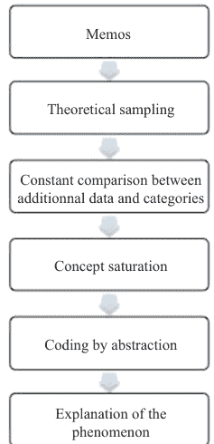

图1. 遵循GT方法的采样与数据收集过程

决定在第八次访谈时达到理论饱和点后停止收集数据，因为“任何类别的理论抽样在饱和、详细阐述并整合到新兴理论中时即停止”（Glaser, 1992, p. 102）。

此外，由于COVID-19大流行，访谈于2020年6月至9月期间通过视频会议进行。先前的研究表明，面对面访谈和视频会议访谈获得的数据质量相似。此外，对于敏感话题，使用此类技术甚至可能更有优势（Jennner and Myers, 2019）。

#### 3.2.3 样本介绍

采访了12位利益相关者，以收集关于奢侈品生态系统中供应链和商品溯源的不同观点。安永咨询欧洲区块链部是主要联系来源。基于其建议以及作者在奢侈品领域的人脉网络，组织了与五家法国奢侈品公司的访谈，这些公司因其在该领域（纺织、珠宝、手表、化妆品和葡萄酒）的广泛业务而被选中。选择了符合预定义集群特征的公司，以涵盖广泛代表奢侈品领域的供应链实践（Caniato et al., 2011）。这些公司包括小型（营业额低于5000万欧元）和大型企业。这些公司还拥有专门的供应链管理部门，彰显了监控物流服务率的战略重要性。最后，所有受访公司都在其组织内实施区块链解决方案方面拥有经验。我们还采访了初创企业和大型信息技术（IT）公司的创始人和首席执行官（CEO），以收集他们在奢侈品公司中实施区块链的经验。

我们的四位受访者来自区块链初创企业，担任CEO；其余八位受访者分别在与奢侈品企业相关的大型奢侈品和IT集团中担任CEO、供应链总监、法务总监、首席信息官（CIO）和首席数字官（CDO）（表2）。所有受访者都参与了……中的区块链解决方案讨论或应用


| 参与者 | 年龄 | 性别 | 角色 | 活动范围 | 公司规模 |
|---|---|---|---|---|---|
| I1 | 40–45 | M | 法律总监 | 时尚/化妆品 | 大型 |
| I2 | 35–40 | F | 首席执行官 | 时尚 | 大型 |
| I3 | 45–50 | M | 首席数字官 | 时尚 | 大型 |
| I4 | 45–50 | F | 联合创始人/首席执行官 | 腕表/时尚 | 中型 |
| I5 | 45–50 | M | 首席数字官 | 腕表/时尚 | 中型 |
| I6 | 45–50 | M | 首席数字官 | 腕表 | 中型 |
| I7 | 50–55 | M | 首席执行官 | 珠宝 | 小型 |
| I8 | 45–50 | M | 供应链总监 | 时尚 | 大型 |
| I9 | 45–50 | M | 首席数字官和首席信息官 | 化妆品 | 大型 |
| I10 | 30–35 | F | 首席产品官 | IT | 大型 |
| I11 | 30–35 | M | 首席执行官 | IT | 小型 |
| I12 | 40–45 | M | 合伙人 | 葡萄酒/烈酒 | 大型 |

奢侈品领域（作为区块链解决方案应用的发起者、受访者或推动者）。访问时长在 50 至 90 分钟之间。总体而言，75% 的受访者为年满 40 岁及以上的男性。最后，移除了受访者的个人信息，以保护其身份的保密性。

## 4. 研究发现

### 4.1 数字化

奢侈品企业面临其供应链组织复杂性带来的巨大挑战。例如，他们必须与大量具有不同背景、地点（通常在海外）和处理方式的第三方打交道，使得供应链数字化变得复杂。此外，他们难以追踪生产过程中使用的组件，如受访者 2 所述：“我使用如此多类型的软件和流程，(. . .) 如此多的供应商，我怎么能突然数字化我整个的供应链？”（I2）。根据受访者 8 的说法，COVID-19 大流行使奢侈品企业的供应链和物流实践从直接向客户交付转变为来自仅在线商店和批发商的销售。这一转变迫使奢侈品企业处理面向更广泛商品的全球在线订单，从而使其供应链管理复杂化。“电子商务和数据管理对于高效的供应链以及转变奢侈品行业的供应链生态系统至关重要”（I8）。此外，在线销售极大地改变了销售的季节性，使销售计划更加复杂。“此前，我们与每个季节相关联的销售季节性非常明确，且每年相似；电子商务已使销售季节性不稳定，现在很难预测销售水平！”（I8）。

### 4.2 奢侈品领域的供应链与可追溯性维度

奢侈品产品范围的扩大及其在需求增长背景下的全球分销，直接影响了企业的价值链，使其变得不透明。虽然奢侈品品牌此前可以从原材料到成品控制制造过程，但如今，这些品牌必须将非标志性产品外包，以满足对奢侈品日益增长的需求。他们还与原材料供应商缺乏长期关系，进一步加强了其整体生态系统的不透明性。在奢侈品领域，品牌形象控制至关重要。因此，所有受访者都强调了品牌声誉的重要性，这一点体现在高产品质量上。受访者 5 表达了担忧：由于无法控制生产过程中涉及的所有第三方，可能会忽视供应链中的故障。“通常，奢侈品品牌了解其供应商；然而，由于不完全掌控其生产流程，他们并不知悉所有交易和流程。例如，谁供应皮革？谁是鞣制商？供应商的不断更换使得对供应商的供应商的供应商缺乏了解”（I5）。

然而，区块链可以通过区块链中的所有各方认证奢侈品的可追溯性，并通过数字证书保证产品的更高真实性：“所有交易均经过认证，这有助于优化我们的供应链”（I6）；“利益相关方必须同意其数据在区块链中进行登记和认证”（I11）。

### 4.3 奢侈品领域的区块链

区块链的实施取决于奢侈品品牌的期望与其外部利益相关方（如消费者）之间的关系。这一点在与供应链问题相关的丑闻情况下尤其适用，此类问题可通过区块链解决方案得到解决。“这一活动领域每次都会遭遇争议或丑闻”（I10）。事实上，近年来媒体报道的丑闻导致客户（尤其是千禧一代）要求奢侈品品牌在环境（污染、有机）和伦理问题（供应商的工作条件、动物实验）方面实现完全透明。奢侈品品牌的声誉已不足以引发品牌忠诚度，而品牌忠诚度可能会影响客户偏好。“客户中存在不信任（...）。例如，当记者调查品牌 X 使用的某种兔品种时，其他品牌开始担心下次可能会收到潜在的‘负面口碑’。如果不追踪原材料，就无法证明[品牌的]来源”（I5）。

虽然部分奢侈品参与者可能能够控制其供应链的下游环节，但其他参与者可能选择在其常规网络之外分销其产品（例如，香水、葡萄酒）。此外，将制造外包的企业无法控制其供应商生产的精确商品数量；因此，部分过剩产品可能会被其他行为者销售到市场上。这就是“真/假产品”的概念。“对于销售香槟、香水等商品的公司来说，存在失去供应链控制权的风险，区块链的价值就在于此”（I1）。

区块链技术可以通过确认绿色产品的来源并强化品牌形象来增强企业的价值，有助于品牌年轻化。他们使用颠覆性技术，可能会确认其作为奢侈品品牌所期望的前沿公司地位。“借助区块链，我们进入了一个新世界（...）。我们始终需要与竞争对手区分开来，使用技术是一种解决方案。我们必须处理一个悖论：既要平衡使用现有或传统工艺手工制作的产品，也要平衡使用区块链、3D 打印以及虚拟现实和增强现实等近期技术生产的产品”（I7）。

因此，区块链可以为企业提供产品关系管理，以便为所有客户（无论是已知客户还是未知客户）制定更好的客户关怀政策。区块链使奢侈品品牌能够通过追踪产品生命周期来丰富产品价值，其中包括二手产品的价值。“品牌不知道其产品的真正所有者（...）；借助区块链，奢侈品品牌可以通过产品关系管理来跟踪产品的生命周期，产品本身是保证客户匿名性的一种手段。相反，沟通可以针对所拥有的产品进行定向，从而改善客户体验”（I11）。

最后，直接实施区块链解决方案会影响奢侈品生态系统和客户期望，正如受访者 10 所表达的：“以 Walmart 为例，它要求其供应商在其食品生态系统中实施产品可追溯性。雀巢及其他主要参与者也做了同样的事。”（I10）。

### 4.4 奢侈品品牌内的区块链与决策流程

奢侈品企业的规模和结构直接决定了区块链解决方案的实施。奢侈品行业主要由家族企业组成。因此，取决于其规模，决策流程可能快也可能慢。此外，某些公司可能不愿意共享有关公共区块链解决方案的信息，而那些持开放式创新文化的公司则倾向于轻易采用这项技术：“知名品牌不会共享其信息并将其 100% 可见和可访问；其参与取决于所实施的区块链解决方案的类型”（I10）；“XX 不以接受数字和电子商务等创新技术而闻名；它被视为落后者”（I3）。

然而，COVID-19 展示了控制供应链的重要性，并加速了奢侈品品牌流程的数字化，正如受访者 3 所表达的：“在过去几个月里，谁为奢侈品业务的数字化做出了贡献？a) 首席执行官，b) 首席数字官，或 c) 冠状病毒？正确答案是‘c’，COVID-19！实施电子商务解决方案是封锁期间销售的唯一方式；（. . .）即使首席执行官不理解[区块链背后的]技术，如果他们认为该技术是解决其问题的方案，也可以给予绿灯。”（I3）因此，COVID-19 似乎加速了奢侈品利益相关方在其组织中实施区块链解决方案的需求。“自 COVID-19 危机以来，我注意到来自关键奢侈品和时尚企业的需求激增，旨在优化其供应链管理”（I2）。

此外，由于其组织影响，区块链解决方案必须先获得内部批准（例如，由首席执行官、首席信息官、首席财务官、首席运营官（COO）、首席营销官（CMO）批准），然后再获得公司外部供应商的批准。组织的审批流程往往比实施本身更耗时：“我们会见了负责可持续发展的首席执行官；然后就历史事宜与首席营销官打交道；就预算事宜与财务官打交道；最后，与负责推动区块链的首席信息官和首席运营官打交道”（I2）；“主要复杂性在于激励供应商参与、理解流程和信息存储的流向、实施数据收集，并将其登记在区块链上。区块链只是一种对文件盖章和注日期的工具”（I5）。

一位首席数字官受访者强调了投资回报率（ROI）对区块链实施的重要性，大多数决策者认为这一点很复杂。“目前，你必须采取对业务产生即时影响的行动；但就我个人而言，这是一种老派态度。我们都必须共同致力于长期项目”（I9）。与长期 ROI 相比，理解短期 ROI 可以使奢侈品公司的决策者更积极地实施区块链解决方案。他们不愿采用区块链的一个原因是，与打击假冒市场相关的节省对他们来说似乎并非即时。“决策者认为，实施区块链以防止假冒的好处将在未来十到十五年内才会显现”（I11）。

然而，由于对区块链不熟悉，奢侈品品牌的决策者往往依赖第三方来实施这项技术。有时，第三方是由决策者的家人推荐的，并基于关系而非专业知识或与区块链的契合度进行挑选。“当我决定尝试区块链时，我的个人网络推荐了一些联系人；我就是这样认识 X 的。我选择 X，因为他们看起来聪明且敏捷，并提出了一个立即引起我共鸣的定制想法”（I7）。

根据受访者 2 的说法，演示区块链应用程序的“即插即用”功能可以加快区块链解决方案的实施，并解决利益相关方对实现此目标所需资源的担忧。“另一个问题是培训人员实施该技术所需的资源。如果我们能证明它是‘即插即用’的，并可以通过手机控制，这将减少他们对采用区块链的担忧”（I2）。

或者，可以邀请奢侈品品牌的供应商参与试点，以分阶段引入区块链，之后可在整个品牌的


生态系统。“信服的品牌必须接触其第三方，从最有动力的开始，然后说服其他人加入品牌的区块链网络”（15）。通过邀请供应商参与其区块链流程，奢侈品品牌可以建立长期合作关系以促进产品质量，而不仅仅是优化产品成本。“如今，采用采购策略对于确保产品质量至关重要；我们希望与供应商建立真正的长期合作伙伴关系”（18）。最后，受访者讨论了在区块链联盟框架内发布公司信息的困难。奢侈品行业的激烈竞争阻止他们增加区块链网络中的参与者数量，从而降低了其吸引力。此外，由于标准不一，寻找区块链规则的共同框架面临着真正的问题。因此，奢侈品行业对公有链的应用有限，因为企业希望控制网络内的信息传播，并不愿处理无法删除和不受控制的数据。“X品牌决定不实施公有链，因为这不利于其品牌形象（...）他们希望控制自己的区块链内容”（11）；“可追溯性可以，但仅限我们内部查看”（15）。因此，奢侈品品牌更倾向于实施许可链。根据受访者10的说法，“与公有链相比，多方奢侈品平台通常使用许可链，仅限可识别和授权的参与者访问信息”（10）。然而，受访者6认为，改善区块链数据的可访问性可以提高最终用户的信任度，尤其是在正与灰色市场和假冒产品作斗争的二手市场。“二手市场对奢侈手表的重要性比新手表品牌高10倍。在区块链上为产品附加证书并确认产品产地将增加客户信任，从而提升品牌在二手市场和整体市场中的形象”（11）。图2总结了我们的主要发现。

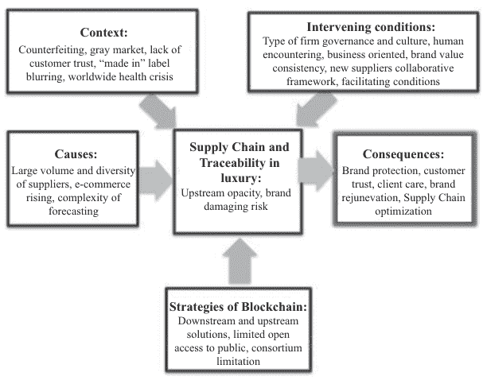

图 2. 供应链与奢侈品可追溯性

## 5. 讨论

新冠疫情加速了奢侈品品牌供应链的数字化，并凸显了在数字化过程中确保安全的必要性（Nandi 等，2020）。因此，本研究旨在回答关于区块链实施的三个研究问题，重点关注其主要优势（如可追溯性）、推动此类颠覆性技术的背景和条件，以及为奢侈品行业提供的解决方案。为回答这些研究问题，我们提出三个命题。

*命题1。* 区块链消除了供应链中的中间商，改善了可追溯性并便于管理。

受访经理们指出，由于产品的专业化特性和需求增长，奢侈品行业的数字化导致了复杂且难以控制的业务结构。尽管使用了数字平台，奢侈品行业的组织方式过于复杂，并涉及众多中间商（Song 等，2019）。学者和经理们一致认为，有必要改进供应链流程，并发挥区块链解决方案的作用以实现所需的变革（Al-Talib 等，2020）。许多研究证实，区块链可以提高供应链效率并消除不必要的中间商（Casado-Vara 等，2018；Al-Talib 等，2020；Wang 等，2019）。因此，利用区块链进行去中介化（Tönnissen 和 Teuteberg，2020）增强了供应链的透明度、可追溯性和可见性，并提供防伪安全性（Wang 等，2019），从而最大限度地减少了供应链运营中的不确定性（Xu 等，2019）。

业务流程的透明度和可追溯性是受访专家从实施区块链解决方案中期望的关键优势。尽管奢侈品行业需要追踪产品在整个供应链中的路径以保持高质量并保证产品产地（Shen 等，2020），但品牌还需要向客户证明其环境承诺（Ho 等，2016）。这两项行动都能显著提升品牌形象。然而，尽管有这些好处，奢侈品行业仍不愿引入区块链。

*命题2。* 奢侈品行业内区块链解决方案的实施受某些条件和背景的影响。

受访专家指出了阻碍区块链实施的两种背景。首先，奢侈品行业可能抵制快速变化。其次，奢侈品品牌可能不愿接受将区块链技术纳入其运营所需的开放程度和知识。专家们证实，尽管颠覆性技术的采用符合奢侈品行业的价值观（Yeoman 和 McMahon-Beattie，2018），但其批准需要可证明的财务收益（Frizzo-Barker 等，2020）。也就是说，区块链必须为决策者提供短期投资回报率（ROI）。这与之前关注业务效率（包括交易成本）的研究一致（Azzi 等，2019；Kshetri 和 Loukoianova，2019）。当奢侈品品牌认为区块链技术可以通过显著贡献收入来源来提升绩效时，它们会接受该技术（Maersh，2018；Deloitte，2018）[4]。尽管如此，一些问题可能会减缓采用过程，例如行业或国家层面的潜在文化抵制、供应商数字化不足以及信任问题（Kano 和 Nakajima，2018；Kshetri，2018；Reyna 等，2018；Zou 等，2018）。

区块链的开放性虽然促进了可追溯性和透明度，但由于行业的竞争性和缺乏协作，也可能带来障碍（Kshetri，2018；Helo 和 Hao，2019）。此外，复杂性增加会影响供应链绩效（Qrunfleh 和 Tarafdar，2014），尤其是对于奢侈品行业中仍鲜少使用的区块链解决方案而言。关于区块链技术的知识差距可能限制非技术导向的决策者和员工对其接受度，从而使其实施复杂化（Baudier 等，2021）。然而，为了解决对区块链内信息传播的担忧，对私有链框架的更深入了解以及对技术优势的理解可以消除其实施障碍（Wamba 等，2020；Lu，2019）。

*命题3。* 区块链的技术能力可以解决奢侈品行业追踪假冒商品及其在灰色市场交易的根本问题。

区块链技术在奢侈品行业（尤其是供应链中）最具前景的应用是打击假冒和灰色市场。所有受访者都对解决假冒问题表示了担忧和期望，因为在全球化和数字化使追踪假冒产品几乎变得不可能的时代，这会减少利润并损害声誉。所有受访者都相信区块链有潜力解决奢侈品行业的问题。如今，区块链防伪平台（Liu 等，2020）提供数据可追溯性和知识产权保护。然而，奢侈品品牌必须遵守政府关于实施区块链和打击假冒的法规（Liu 等，2020；Xu 等，2019）。

尽管如此，引入区块链需要相关参与者之间的协作与诚信，从而需要行业变革（Soon 和 Manning，2019）。我们的访谈揭示，行业和技术的信任影响着区块链的接受度。其在追踪、验证产品产地（“产地”标签）以及提供交易证明方面的能力（Casado-Vara 等，2018）证明了区块链在供应链中应用的合理性。得益于其快速且可验证的欺诈检测（Casado-Vara 等，2018），相关企业可以更公开地合作并降低财务损失（Guercini 和 Runfola，2009）。奢侈品行业是受假冒、灰色市场和仿冒市场影响最严重的行业之一（Hou 等，2020；Choi，2019），这可以通过在供应链中应用区块链解决方案来解决（Kshetri，2018）。尽管受访者强调了持续存在的制约因素（Helo 和 Hao，2019），并阐述了传统供应链缓慢转型以融入区块链解决方案的原因，但数字化、COVID-19 和日益增长的消费者需求的结合，使得区块链在奢侈品行业供应链中的应用更具盈利前景。

## 6. 结论、局限性与未来研究方向

### 6.1 结论

利用区块链提高供应链效率对多个行业（包括奢侈品行业）至关重要。奢侈品行业必须通过转向电子商务平台和采用创新技术来数字化其传统供应链管理。在 COVID-19 危机期间，这一需求愈发凸显，当时奢侈品企业（尤其是时尚领域）不得不完全依赖在线渠道来满足消费者需求（Kumar 等，2020；Nandi 等，2020）。

本研究在方法论和理论方面均有贡献。基于轴心编码方法（Strauss 和 Corbin，1998；Flick，2009），它提出了一个框架以理解供应链和可追溯性的维度，这为向奢侈品行业提供区块链解决方案是必需的。此外，本研究丰富了该行业供应链管理和反假冒区块链解决方案的文献。除了 COVID-19 之外，很少有研究关注奢侈品行业快速数字化所带来的问题。因此，本研究还讨论了阻碍该行业区块链实施的特定条件。


本研究突出了管理层实施区块链解决方案的机遇与威胁。机遇包括：(1) 防范假冒伪劣和灰色市场；(2) 产品关系管理，允许品牌在产品生命周期内追踪其产品；(3) 供应链的透明度；(4) 产品的可追溯性，使品牌能够为产品的质量和产地提供质保；(5) 与第三方的长期合作；以及 (6) 品牌焕新。阻碍区块链解决方案实施的潜在威胁包括：(1) 关于区块链的知识差距，(2) 长期回报率而非短期回报率，(3) 说服众多涉及的供应商存在困难，以及 (4) 缺乏针对区块链应用的人力资源培训。

本研究聚焦于奢侈品公司；尽管如此，上述管理层建议同样适用于供应链的其他利益相关方，尤其是消费者和政策制定者。确实，区块链的实施通过确保产品质量（得益于商品的可追溯性及假冒伪劣产品的潜在减少）来保护消费者的利益。此外，这项成果关涉整个奢侈品生态系统，从最终消费者到分销商以及奢侈品转售平台等业务合作伙伴。然而，区块链的使用涉及法规的重大变革。因此，政策制定者（政府和国际机构）应将供应链中区块链可能造成的损害（技术滥用）与其潜在利益（打击假冒伪劣）以及供应链和成本降低进行比较。

### 6.2 局限性与未来研究方向

本研究的局限性主要涉及样本选择。首先，由于本研究仅纳入了12个样本，其研究结果应被视为探索性。其次，由于受访者是奢侈品行业（该技术已在此领域实施）内的区块链专家，其回答可能无法反映整个奢侈品行业的现状。第三，虽然采访了全球公司，但所有受访者均位于法国。第四，仅采访了品牌代表，排除了其他利益相关方对奢侈品生态系统的观点。最后，关于区块链的潜在伦理问题需要进一步调查（Chang, 2021）。

基于上述局限性，我们提出了以下进一步研究的机遇：(1) 对奢侈品公司进行三个命题的定量检验，(2) 开展纵向研究，分析本研究中所研究品牌内部区块链采纳认知的演变，(3) 将研究扩展到其他国家的其他品牌，以揭示潜在的文化差异，(4) 测量奢侈品行业客户对区块链解决方案的接受度，以及 (5) 将奢侈品供应商纳入分析，以调查区块链解决方案在其供应链流程中的可行性。

## Notes
## 附注

- 1. Source: Xerfi report, 2019.
- 1. 来源：Xerfi报告，2019年。

- 2. Source: True-Luxury global consumer insight–BCG and Vestiaire Collective, April 2019.
- 2. 来源：True-Luxury全球消费者洞察——BCG与Vestiaire Collective，2019年4月。

- 3. See https://www.forbes.com/sites/icoengine/2018/09/28/luxochain-taps-blockchain-to-combat-the-counterfeit-luxury-goods-market/.
- 3. 参见 https://www.forbes.com/sites/icoengine/2018/09/28/luxochain-taps-blockchain-to-combat-the-counterfeit-luxury-goods-market/。

- 4. See https://www2.deloitte.com/us/en/pages/consulting/articles/innovation-blockchain-survey.html.
- 4. 参见 https://www2.deloitte.com/us/en/pages/consulting/articles/innovation-blockchain-survey.html。

## References
## 参考文献

Abeyratne, S.A. 和 Monfared, R.P. (2016), “基于分布式账本的区块链就绪制造供应链”, 《工程与技术研究国际期刊》, 第5卷 第9期, 第1-10页, doi: 10.15623/ijret.2016.0509001.

Achille, A. 和 Zipser, D. (2020), “冠状病毒期间及之后奢侈品行业的视角”, 可在以下网址查阅：https://www.mckinsey.com/industries/retail/our-insights/a-perspective-for-the-luxury-goods-industry-during-and-after-coronavirus.

Agrawal, T.K., Kumar, V., Pal, R., Wang, L. 和 Chen, Y. (2021), “基于区块链的供应链可追溯性框架：纺织和服装行业案例示例”, 《计算机与工业工程》, 第154卷, 107130, doi: 10.1016/j.cie.2021.107130.

Aitzhan, N.Z. 和 Svetinovic, D. (2016), “通过多重签名、区块链和匿名消息流的去中心化能源交易中的安全性与隐私”, 《IEEE可信与安全计算交易》, 第15卷 第5期, 第840-852页, doi: 10.1109/TDSC.2016.2616861.

Al-Talib, M., Melhem, W.Y., Anosike, A.I., Reyes, J.A.G. 和 Nadeem, S.P. (2020), “通过应用物联网技术实现供应链韧性”, 《CIRP年会论文集》, 第91卷, 第752-757页, doi: 10.1016/j.procir.2020.02.231.

Angelis, J. 和 da Silva, E.R. (2019), “区块链采纳：价值驱动视角”, 《商业前沿》, 第62卷 第3期, 第307-314页, doi: 10.1016/j.bushor.2018.12.001.

Antia, K.D., Bergen, M.E., Dutta, S. 和 Fisher, R.J. (2006), “执法如何遏制灰色市场发生率?”, 《营销学报》, 第70卷 第1期, 第92-106页, doi: 10.1509/jmkg.70.1.092.

Azzi, R., Chamoun, R.K. 和 Sokhn, M. (2019), “基于区块链供应链的力量”, 《计算机与工业工程》, 第135卷, 第582-592页, doi: 10.1016/j.cie.2019.06.042.

Banerjee, M., Lee, J. 和 Choo, K.K.R. (2018), “物联网安全的区块链未来：一份立场文件”, 《数字通信与网络》, 第4卷 第3期, 第149-160页, doi: 10.1016/j.dcan.2017.10.006.

Bansal, D., Malla, S., Gudala, K. 和 Tiwari, P. (2013), “反假冒技术：制药行业视角”, 《药学科学》, 第81卷 第1期, 第1-14页, doi: 10.3797/scipharm.1202.03.

Basole, R.C., Bellamy, M.A. 和 Park, H. (2017), “全球供应链网络中创新的可视化”, 《决策科学》, 第48卷 第2期, 第288-306页, doi: 10.1111/deci.12213.

Baudier, P., Kondrateva, G., Ammi, C. 和 Seulliet, E. (2021), “和平工程：区块链系统对电子投票过程的贡献”, 《技术预测与社会变革》, 第162卷, 120397, doi: 10.1016/j.techfore.2020.120397.

Berman, B. (2008), “检测和减少假冒活动的策略”, 《商业前沿》, 第51卷 第3期, 第191-199页, doi: 10.1016/j.bushor.2008.01.002.

Beverland, M. (2009), “中国商业关系的边界条件：在中国销售葡萄酒的案例”, 《工业市场营销期刊》, 第24卷 第1期, 第27-34页, doi: 10.1108/08858620910923676.

Bian, Q. 和 Forsythe, S. (2012), “奢侈品牌购买意向：跨文化比较”, 《商业研究》, 第65卷 第10期, 第1443-1451页, doi: 10.1016/j.jbusres.2011.10.010.

Brousseau, E. 和 Penard, T. (2007), “数字商业模式的经济学：分析平台经济学的框架”, 《网络经济学评论》, 第6卷 第2期, 第81-114页, doi: 10.2202/1446-9022.1112.

Brun, A. 和 Castelli, C. (2008), “时尚行业供应链战略：基于产品、零售渠道和品牌的组合模型开发”, 《国际生产经济期刊》, 第116卷 第2期, 第169-181页, doi: 10.1016/j.ijpe.2008.09.011.

Bumblauskas, D., Mann, A., Dugan, B. 和 Rittner, J. (2020), “食品分销中的区块链用例：你知道你的食物去过哪里吗?”, 《国际信息管理期刊》, 第52卷, 102008, doi: 10.1016/j.ijinfomgt.2019.09.004.

Caniato, F., Caridi, M., Castelli, C.M. 和 Golini, R. (2009), “意大利奢侈品行业供应链战略的应急方法：整合模型是否适用?”, 《国际生产经济期刊》, 第120卷 第1期, 第176-189页, doi: 10.1016/j.ijpe.2008.07.027.

Caniato, F., Caridi, M., Castelli, C. 和 Golin, R. (2011), “奢侈品行业供应链管理：公司及其战略的首次分类”, 《国际生产经济期刊》, 第133卷 第2期, 第622-633页, doi: 10.1016/j.ijpe.2011.04.030.

Casado-Vara, R., Prieto, J., De la Prieta, F. 和 Corchado, J.M. (2018), “区块链如何改善供应链：食品供应链案例研究”, 《计算机科学程序》, 第134卷, 第393-398页, doi: 10.1016/j.procs.2018.07.193.

Castelli, C. 和 Sianesi, A. (2015), “奢侈品时尚市场公司的供应链战略：将供应链与关键成功因素对齐”, 《零售与分销管理国际期刊》, 第43卷 第10/11期, 第940-966页, doi: 10.1108/IJRDM-07-2014-0106.

Chang, V., Baudier, P., Zhang, H., Xu, Q., Zhang, J. 和 Arami, M. (2020a), “区块链如何影响金融服务：专家访谈的概述、挑战与建议”, 《技术预测与社会变革》, 第158卷, 120166, doi: 10.1016/j.techfore.2020.120166.

Chang, V., Iakovou, E. 和 Shi, W. (2020b), “全球供应链与跨境贸易中的区块链：技术现状、挑战与机遇的关键综合”, 《国际生产研究期刊》, 第58卷 第7期, 第2082-2099页, doi: 10.1080/00207543.2019.1651946.

Chang, V. (2021), “大数据与智慧城市的伦理框架”, 《技术预测与社会变革》, 第165卷, 120559, doi: 10.1016/j.techfore.2020.120559.

Choi, T.M. (2019), “奢侈品供应链中钻石认证与认可的区块链技术支持平台”, 《交通研究部分E：物流与运输评论》, 第128卷, 第17-29页, doi: 10.1016/j.tre.2019.05.011.

Cole, R., Stevenson, M. 和 Aitken, J. (2019), “区块链技术：对运营与供应链管理的影响”, 《供应链管理：国际期刊》, 第24卷 第4期, 第469-483页, doi: 10.1108/SCM-09-2018-0309.

Corbin, J. 和 Strauss, A. (2008), “定性数据分析策略”, 《定性研究基础：发展扎根理论的技术与程序》, 第3页.

Cristini, H., Kauppinen-Räisänen, H., Barthod-Prothade, M. 和 Woodside, A. (2017), “迈向奢侈品一般理论：从工作台定义和理论转型中推进”, 《商业研究》, 第70卷, 第101-107页, doi: 10.1016/j.jbusres.2016.07.001.

D’Arpizio, C., Levato, F., Fenili, S., Colacchio, F. 和 Prete, F. (2020), “新冠后的奢侈品：向好的改变”, 可在以下网址查阅：https://www.bain.com/insights/luxury-after-coronavirus/.

De Giovanni, P. (2020), “供应链管理中的区块链与智能合约：博弈论模型”, 《国际生产经济期刊》, 第228卷, 107855, doi: 10.1016/j.ijpe.2020.107855.

Dinh, T.T.A., Wang, J., Chen, G., Liu, R., Ooi, B.C. 和 Tan, K.L. (2017), “Blockbench：分析私有区块链的框架”, 《2017年ACM数据管理国际会议论文集》, 第1085-1100页, doi: 10.1145/3035918.3064033.

Duan, J., Zhang, C., Gong, Y., Brown, S. 和 Li, Z. (2020), “基于内容分析的食品供应链中区块链采纳文献综述”, 《环境研究与公共卫生国际期刊》, 第17卷 第5期, 第1784页.

Feng, H., Wang, X., Duan, Y., Zhang, J. 和 Zhang, X. (2020), “应用区块链技术改进农产品可追溯性：开发方法、益处与挑战综述”, 《洁净生产期刊》, 第260卷, 121031, doi: 10.1016/j.jclepro.2020.121031.

Flick, U. (2009), 《定性研究导论》, Sage, 伦敦.

Flint, D., Gammelgaard, B., Manuj, I. 和 Pohlen, T.L. (2012), “物流与供应链管理研究中扎根理论方法的评审指南”, 《物理分销与物流管理国际期刊》.

Frizzo-Barker, J., Chow-White, P.A., Adams, P.R., Mentanko, J., Ha, D. 和 Green, S. (2020), “区块链作为商业颠覆性技术：系统综述”, 《国际信息管理期刊》, 第51卷, 102029, doi: 10.1016/j.ijinfomgt.2019.10.014.


Garrard, R. and Fielke, S. (2020), “面向可信溯源的区块链：澳大利亚水产养殖业个案研究”, Technology in Society, 卷. 62, 101298, doi: 10.1016/j.techsoc.2020.101298.

Glaser, B.G. (1992), 扎根理论分析基础：涌现与强制, Sociology Press, 加利福尼亚州米尔谷.

Godey, B., Pederzoli, D., Aiello, G., Donvito, R., Chan, P., Oh, H. and Weitz, B. (2012), “品牌和产地效应对消费者购买奢侈品决策的影响”, Journal of Business Research, 卷. 65 期. 10, 页. 1461-1470, doi: 10.1016/j.jbusres.2011.10.012.

Goulding, C. (2002), 扎根理论：管理、商业和市场研究人员实用指南, Sage, 伦敦, doi: 10.4135/9781849209236.

Guercini, S. and Runfola, A. (2009), “溯源过程中营销与采购的整合”, Industrial Marketing Management, 卷. 38 期. 8, 页. 883-891, doi: 10.1016/j.indmarman.2009.03.016.

Haghtvedt, H., Patrick, H. and Patrick, V.M. (2014), “消费者对过度造型的反应：产品设计中美学与功能的平衡”, Psychology and Marketing, 卷. 31 期. 7, 页. 518-525, doi: 10.1002/mar.20713.

Hang, L., Ullah, I. and Kim, D.H. (2020), “基于区块链的农业数据完整性安全鱼场平台”, Computers and Electronics in Agriculture, 卷. 170, 105251, doi: 10.1016/j.compag.2020.105251.

Helo, P. and Hao, Y. (2019), “运营与供应链中的区块链：一种模型和参考实现”, Computers and Industrial Engineering, 卷. 136, 页. 242-251, doi: 10.1016/j.cie.2019.07.023.

Ho, C.H., Awan, M.A. and Khan, H.U. (2016), “奢侈品牌与企业社会责任：消费者偏好视角”, Journal of International Management Studies, 卷. 16 期. 1, 页. 77-81, doi: 10.18374/JIMS-16-1.9.

Hou, P., Zhen, Z. and Pun, H. (2020), “利用战斗品牌打击奢侈品市场中的模仿行为”, Transportation Research Part E: Logistics and Transportation Review, 卷. 140, 102009, doi: 10.1016/j.tre.2020.102009.

Hughes, L., Dwivedi, Y.K., Misra, S.K., Rana, N.P., Raghavan, V. and Akella, V. (2019), “区块链研究、实践与政策：应用、优势、局限性、新兴研究主题及研究议程”, International Journal of Information Management, 卷. 49, 页. 114-129, doi: 10.1016/j.ijinfomgt.2019.02.005.

Jenner, B.M. and Myers, K.C. (2019), “亲密感、融洽关系与特殊披露：面对面与中介访谈情境的比较”, International Journal of Social Research Methodology, 卷. 22 期. 2, 页. 165-177, doi: 10.1080/13645579.2018.1512694.

Ji, Z., Chang, V., Lan, H., Robert Hsu, C.H. and Valverde, R. (2020), “中国区块链行业中Fama-French三因子模型与情感相关四因子模型的实证研究”, Sustainability, 卷. 12 期. 12, 页. 5170, doi: 10.3390/su12125170.

Kano, Y. and Nakajima, T. (2018), “解决区块链技术中采矿工作中心化问题的新方法”, International Journal of Pervasive Computing and Communications, 卷. 14 期. 1, 页. 15-32, doi: 10.1108/IJPCC-D-18-00005.

Kapferer, J.N. and Laurent, G. (2016), “消费者认为奢侈品从何处开始？7个国家21种奢侈品感知最低价格研究”, Journal of Business Research, 卷. 69 期. 1, 页. 332-340, doi: 10.1016/j.jbusres.2015.08.005.

Kastanakis, M.N. and Voyer, B.G. (2014), “文化对感知与认知的影响：一个概念框架”, Journal of Business Research, 卷. 67 期. 4, 页. 425-433, doi: 10.1016/j.jbusres.2013.03.028.

Kim, K.H., Ko, E., Xu, B. and Han, Y. (2012), “通过培养消费者态度提升奢侈时尚品牌客户资产”, Journal of Business Research, 卷. 65 期. 10, 页. 1495-1499, doi: 10.1016/j.jbusres.2011.10.016.

Ko, E., Costello, J.P. and Taylor, C.R. (2019), “什么是奢侈品牌？一种新定义及文献综述”, Journal of Business Research, 卷. 99, 页. 405-413, doi: 10.1016/j.jbusres.2017.08.023.

Koh, T.K., Fichman, M. and Kraut, R.E. (2012), “跨国信任：全球企业对企业电子商务中买方-卖方信任”, Journal of the Association for Information Systems, 卷. 13 期. 11, 页. 886-922, doi: 10.17705/1jais.00316.

Korpela, K., Hallikas, J. and Dahlberg, T. (2017), “迈向区块链集成的数字供应链转型”, 第50届夏威夷系统科学国际会议论文集, 卷. 50, 页. 1-10, doi: 10.24251/HICSS.2017.506.

Kshetri, N. and Loukoianova, E. (2019), “亚洲供应链网络中的区块链采用”, IT Professional, 卷. 21 期. 1, 页. 11-15, doi: 10.1109/MITP.2018.2881307.

Kshetri, N. (2018), “区块链在实现关键供应链管理目标中的作用”, International Journal of Information Management, 卷. 39, 页. 80-89, doi: 10.1016/j.ijinfomgt.2017.12.005.

Kumar, M.S., Raut, R.D., Narwane, V.S. and Narkhede, B.E. (2020), “应用工业4.0应对COVID-19运营挑战”, Diabetes and Metabolic Syndrome: Clinical Research and Reviews, 卷. 14 期. 5, 页. 1283-1289, doi: 10.1016/j.dsx.2020.07.010.

Kursh, S.R. and Gold, N.A. (2016), “将金融科技和区块链加入您的课程”, Business Education Innovation Journal, 卷. 8 期. 2, 页. 6-12.

Lamning, R.C., Johnsen, T., Zheng, J. and Harland, C.M. (2000), “供应网络的初步分类”, International Journal of Operations and Production Management, 卷. 20 期. 6, 页. 675-691.

Lancaster, I (2017), “供应链中假冒伪劣产品检测：如何使用认证方法”，载于 Chaudhry, P.E. (编), 假冒伪劣与非法贸易研究手册, Edward Elgar Publishing, 社会与政治科学丛书, 页. 459-484, doi: 10.4337/9781785366451.00030.

Leal, F., Chis, A.E. and González-Vélez, H. (2021), “区块链网络多服务模型”, Information Processing and Management, 卷. 58 期. 3, 102525, doi: 10.1016/j.ipm.2021.102525.

Lee, J.H. and Pilkington, M. (2017), “区块链革命将如何重塑消费电子产业[未来方向]”, IEEE Consumer Electronics Magazine, 卷. 6 期. 3, 页. 19-23, doi: 10.1109/MCE.2017.2684916.

Li, L. (2013), “全球供应链中打击假冒伪劣的技术”, Business Horizons, 卷. 56 期. 2, 页. 167-177, doi: 10.1016/j.bushor.2012.11.010.

Liu, Z. and Li, Z. (2020), “基于区块链的跨境电子商务供应链框架”, International Journal of Information Management, 卷. 52, 102059, doi: 10.1016/j.ijinfomgt.2019.102059.

Liu, A., Liu, T., Mou, J. and Wang, R. (2020), “区块链溯源反假平台项目管理中基于客户需求的供应商评估模型”, Journal of Management Science and Engineering, 卷. 5 期. 3, 页. 172-194, doi: 10.1016/j.jmse.2020.06.001.

Lohade, S., Roshni, J., Bhojwani, E. and Chavan, A. (2017), “基于MATLAB的移动支架故障检测”, International Journal of Computer Applications, 卷. 161 期. 10, 页. 38-40, doi: 10.5120/ijca2017913351.

Lu, Y. (2019), “区块链：现状与研究挑战”, Journal of Industrial Information Integration, 卷. 15, 页. 80-90, doi: 10.1016/j.jii.2019.04.002.

Maersk (2018), “马士基和IBM推出TradeLens区块链航运解决方案”，可用于: https://www.maersk.com/news/2018/06/29/maersk-and-ibm-introduce-tradelens-blockchain-shipping-solution (访问日期: 2020年5月1日).

Maity, M, Too loe, A., Sinha, A.K. and Tiwari, M.K. (2021), “基于区块链的随机批次分散模型以优化可追溯性并增强透明度”, Computers and Industrial Engineering, 卷. 154, 107134, doi: 10.1016/j.cie.2021.107134.

McFerran, B., Aquino, K. and Tracy, J.L. (2014), “消费中自豪感两个方面的证据：来自奢侈品牌的研究结果”, Journal of Consumer Psychology, 卷. 24 期. 4, 页. 455-471, doi: 10.1016/j.jcps.2014.03.004.

Meraviglia, L. (2018), “时尚产业中的技术与假冒伪劣：朋友还是敌人?”, Business Horizons, 卷. 61 期. 3, 页. 467-475, doi: 10.1016/j.bushor.2018.01.013.

Montecchi, M., Plangger, K. and Etter, M. (2019), “它是真的，相信我！使用区块链建立供应链溯源”, Business Horizons, 卷. 62 期. 3, 页. 283-293, doi: 10.1016/j.bushor.2019.01.008.

Morkunas, V.J., Paschen, J. and Boon, E. (2019), “区块链技术如何影响您的商业模式”, Business Horizons, 卷. 62 期. 3, 页. 295-306, doi: 10.1016/j.bushor.2019.01.009.

Mukherjee, P. and Singh, D. (2020), Health 4.0中的区块链机遇, 区块链技术与工业4.0, Springer, Springer, 页. 149-164, doi: 10.1007/978-981-981-1137-0_8.

Nakamoto, S. (2008), “比特币：一种点对点电子现金系统”，可用于: https://bitcoin.org/bitcoin.pdf (访问日期: 2020年12月14日).

Nandi, S., Sarkis, J., Hervani, A.A. and Helms, M.M. (2020), “使用基于区块链的循环经济和COVID-19经验重新设计供应链”, Sustainable Production and Consumption, 卷. 27, 页. 10-22, doi: 10.1016/j.spc.2020.10.019.

Niu, B., Mu, Z., Cao, B. and Gao, J. (2021), “跨国公司是否应实施区块链以提供质量验证?”, Transportation Research Part E: Logistics and Transportation Review, 卷. 145, 页. 102121, doi: 10.1016/j.tre.2020.102121.

Parloff, R., Chandler, C. and Fung, A. (2006), “并非完全是假冒伪劣”, Fortune International (Europe), 卷. 153 期. 8, 页. 64-70.

Potter, A., Towill, D.R. and Christopher, M. (2015), “迁移供应链模型的演化”, Supply Chain Management, 卷. 20 期. 6, 页. 603-612, doi: 10.1108/SCM-06-2015-0231.

Puthal, D., Malik, N., Mohanty, S.P., Kougianos, E. and Yang, C. (2018), “区块链作为去中心化安全框架[未来方向]”, IEEE Consumer Electronics Magazine, 卷. 7 期. 2, 页. 18-21, doi: 10.1109/MCE.2017.2776459.

Qrunfleh, S. and Tarafdar, M. (2014), “供应链信息系统策略：对供应链绩效和企业绩效的影响”, International Journal of Production Economics, 卷. 147, 页. 340-350, doi: 10.1016/j.ijpe.2012.09.018.

Ranaweera, R.K., Gilmore, A.M., Capone, D.L., Bastian, S.E. and Jeffery, D.W. (2021), “使用光谱氟度法和多元素分析结合多元统计建模对澳大利亚赤霞珠葡萄酒地理产地进行认证”, Food Chemistry, 卷. 335, 页. 127592.

Reyna, A., Martin, C., Chen, J., Soler, E. and Díaz, M. (2018), “关于区块链及其与物联网的集成：挑战与机遇”, Future Generation Computer Systems, 卷. 88, 页. 173-190, doi: 10.1016/j.future.2018.05.046.

Ringsberg, H. (2014), “食品可追溯性视角：系统文献综述”, Supply Chain Management, 卷. 19 期. 5/6, 页. 1-35, doi: 10.1108/SCM-01-2014-0026.

Rod, A., Rais, J., Schwarz, J. and Čermáková, K. (2015), “奢侈品经济学：购买奢侈品假冒伪劣产品的概率计算”, Procedia Economics and Finance, 卷. 30, 页. 720-729, doi: 10.1016/S2212-5671(15)01321-0.

Shen, B., Minner, S., Chan, H.L. and Brun, A. (2020), “奢侈品行业物流与供应链管理”, Transportation Research Part E: Logistics and Transportation Review, 卷. 143, 102095, doi: 10.1016/j.tre.2020.102095.

Song, J.M., Sung, J. and Park, T. (2019), “用于改善供应链可追溯性的区块链应用”, Procedia Computer Science, 卷. 162, 页. 119-122, doi: 10.1016/j.procs.2019.11.266.

Soon, J.M. and Manning, L. (2019), “开发防伪措施：智能包装的作用”, Food Research International, 卷. 123, 页. 135-143, doi: 10.1016/j.foodres.2019.04.049.


Strauss, A. 与 Corbin, J. (1990), 《定性研究基础：扎根理论程序与技术》, Sage Publications, 新伯里公园.

Strauss, A. 与 Corbin, J. (1998), 《定性研究基础：发展扎根理论的技术与程序》 (第2版), Sage Publications, 千橡城.

Tapscott, D. 与 Tapscott, A. (2017), “区块链将如何改变组织”, 《MIT斯隆管理评论》, 第58卷第2期, 第1-6页.

Taylor, P.J., Dargahi, T., Dehghantanha, A., Parizi, R.M. 与 Choo, K.K.R. (2020), “区块链网络安全系统文献综述”, 《数字通信与网络》, 第6卷第2期, 第147-156页, doi: 10.1016/j.dcan.2019.01.005.

Ting, S.L. 与 Ip, W.H. (2015), “利用Web门户技术打击假冒伪劣产品”, 《企业信息系统》, 第9卷第7期, 第661-680页, doi: 10.1080/17517575.2012.755713.

Tönnissen, S. 与 Teuteberg, F. (2020), “分析区块链技术对运营与供应链管理的影响：基于多案例研究的解释模型”, 《国际信息管理杂志》, 第52卷, 101953, doi: 10.1016/j.ijinfomgt.2019.05.009.

Toledo, C. 与 Villas-Boas, S.B. (2019), “安全还是不安全？消费者对可追溯召回的反应”, 《应用经济展望与政策》, 第41卷第3期, 第519-541页, doi: 10.1093/aepp/ppy015.

Toyota, K., Mathiopoulos, P.T., Sasase, I. 与 Ohtsuki, T. (2017), “一种用于后端供应链中防伪的新型基于区块链的产品所有权管理系统 (POMS)”, 《IEEE Access》, 第5卷, 第17465-17477页, doi: 10.1109/ACCESS.2017.2720760.

Uddin, M. (2021), “区块链MediLedger：一种用于制药行业假药的基于Hyperledger Fabric的药品可追溯系统”, 《国际药学杂志》, 第597卷, 120235, doi: 10.1016/j.ijpharm.2021.120235.

Underwood, S. (2016), “比特币之外的区块链”, 《ACM通讯》, 第59卷第11期, 第15-17页, doi: 10.1145/2994581.

Viriyasitavat, W. 与 Hoonsopon, D. (2019), “现代业务流程中的区块链特性与共识”, 《工业信息集成期刊》, 第13卷, 第32-39页, doi: 10.1016/j.jii.2018.07.004.

Wamba, S.F., Queiroz, M.M. 与 Trinchera, L. (2020), “区块链采用决定因素与供应链绩效之间的动态关系：一项实证调查”, 《国际生产经济学杂志》, 第229卷, 107791, doi: 10.1016/j.ijpe.2020.107791.

Wang, Y. 与 Griskevicius, V. (2014), “炫耀性消费、关系与竞争对手：女性奢侈品作为对其他女性的信号”, 《消费者研究杂志》, 第40卷第5期, 第834-854页, doi: 10.1086/673256.

Wang, Y., Singgih, M., Wang, J. 与 Rit, M. (2019), “理解区块链技术：它将如何改变供应链”, 《国际生产经济学杂志》, 第211卷, 第221-236页, doi: 10.1016/j.ijpe.2019.02.002.

Wang, Y., Lin, J. 与 Choi, T.M. (2020), “供应链中的灰色市场与假冒伪劣：运营文献综述及其对奢侈品行业的启示”, 《运输研究部分E：物流与运输评论》, 第133卷, 101823, doi: 10.1016/j.tre.2019.101823.

Wessel, M. 与 Christensen, C.M. (2012), “在颠覆中生存”, 《哈佛商业评论》, 第90卷第12期, 第56-64页.

White, R., Marinakis, Y., Islam, N. 与 Walsh, S. (2020), “比特币是一种货币、一种基于技术的产品，还是其他东西?”, 《技术预测与社会变革》, 第151卷, 119877, doi: 10.1016/j.techfore.2019.119877.

Wilson, J.M. 与 Grammen, C.A. (2020), “企业全方位的品牌保护：迈向全业务解决方案”, 《商业前沿》, 第63卷第3期, 第363-376页, doi: 10.1016/j.bushor.2020.02.002.

Xu, X., Lu, Q., Liu, Y., Zhu, L., Yao, H. 与 Vasilakos, A.V. (2019), “设计基于区块链的应用：进口产品可追溯性案例研究”, 《未来生成计算机系统》, 第92卷, 第399-406页, doi: 10.1016/j.future.2018.10.010.

Yang, M., Mahmood, M., Zhou, X., Shafaq, S. 与 Zahid, L. (2017), “智能化趋势下智能物流云平台的设计与实现”, 《中国通信》, 第14卷第10期, 第180-191页, doi: 10.1109/CC.2017.8107642.

Yazdani, M., Kahraman, C., Zarate, P. 与 Onar, S.C. (2019), “一种集成QFD与灰色关联分析的模糊多属性决策框架”, 《专家系统与应用》, 第115卷, 第474-485页, doi: 10.1016/j.eswa.2018.08.017.

Yeoman, I. 与 McMahon-Beattie, U. (2018), “奢侈品的未来：巨大驱动因素、新面孔与情景”, 《收入与定价管理杂志》, 第17卷第4期, 第204-217页, doi: 10.1057/s41272-018-0140-6.

Yeow, K., Gani, A., Ahmad, R.W., Rodrigues, J.J. 与 Ko, K. (2017), “面向边缘为中心的物联网的分散共识：综述、分类学与研究问题”, 《IEEE Access》, 第6卷, 第1513-1524页, doi: 10.1109/ACCESS.2017.2779263.

Zhan, L. 与 He, Y. (2012), “理解中国的奢侈品消费：消费者对知名品牌的认知”, 《商业研究杂志》, 第65卷第10期, 第1452-1460页, doi: 10.1016/j.jbusres.2011.10.011.

Zheng, Z., Xie, S., Dai, H., Chen, X. 与 Wang, H. (2017), “区块链技术概述：架构、共识与未来趋势”, 《2017年IEEE大数据国际大会 (BigData Congress)》, 夏威夷 (美国), 第557-564页, doi: 10.1109/BigDataCongress.2017.85.

Zou, J., Ye, B., Qu, L., Wang, Y., Orgun, M.A. 与 Li, L. (2018), “一种用于增强众包服务问责制的信任证明共识协议”, 《IEEE服务计算汇刊》, 第12卷第3期, 第429-445页, doi: 10.1109/TSC.2018.2823705.

## 通讯作者

Elodie de Boissieu 可通过以下地址联系：elodie.deboissieu@yahoo.fr

# 当技术与人类相遇：人工智能与人力资源管理的相互作用

Yusra Qamar, Rakesh Kumar Agrawal 和 Taab Ahmad Samad

印度卡希普尔管理学院，印度卡希普尔，以及

Charbel Jose Chiappetta Jabbour

林肯大学布雷福德校区管理学全球教授，英国林肯

收稿日期：2020年11月2日
修回日期：2021年4月17日
录用日期：2021年6月10日

## Abstract

**Purpose** – 对人力资源管理（HRM）领域人工智能（AI）应用的学术文献进行原创性系统综述，以捕捉当前最新研究状态，并为未来研究制定原创性研究议程。

**Design/methodology/approach** – 基于整体搜索和质量评估标准，选取了59篇期刊文章。通过内容分析和结构概念分析，本研究阐明了AI在HRM职能中的应用程度和影响，随后综合构建了一张概念图，以说明各种AI技术的使用如何辅助HRM决策。

**Findings** – 呈现了AI-HRM领域现有文献的全面综述。综合构建了一张概念图，以展示HRM中AI应用的分类学概览。

**Research implications/limitations** – 提出了一项包含相关研究问题的原创性研究议程，以协助AI-HRM领域的进一步发展。同时，还呈现了一份有助于向伦理AI过渡的指示性初步框架。

**Originality/value** – 本研究通过对领域当前状态、AI在HRM中的应用程度及其对HR职能当前和预期未来影响的全面讨论，为文献作出了贡献。制定了一个初步的伦理框架和一份广泛的未来研究议程，以开辟新的研究方向。

**Keywords** 人工智能，工业4.0，人力资源管理，新兴技术，劳动力

**Paper type** 文章类型：文献综述

## 1. Introduction

人工智能（AI）的重大崛起是一场预计将在未来持续的全球革命。77%的消费者有意识或无意识地正在使用AI技术，范围从交互式聊天机器人和智能可穿戴设备到个人数字助理（Seal, 2019）。根据最近的预测，AI软件的总全球收入预计将从2019年的95亿美元增长到2025年的高达1186亿美元，预计增长超过1100%（Seal, 2019）。AI（也称为机器智能）被引入用于开发“思考机器”，这些机器模仿人类的能力和智能行为，并能够取代人类智能（Jia et al., 2018; Min, 2010）。AI（过去一直是，并且继续被）推广为一种熟练的系统，它能够准确解读外部数据并从中学习，通过对其先前学习的可行修改来实现明确目标（Kaplan and Haenlein, 2019）。自20世纪70年代末以来，AI已展现出在改进人类决策过程以及随之而来的各种商业环境中的效率方面的巨大潜力（Jia et al., 2018; Min, 2010; Partridge and Hussain, 1992; Sturman et al., 1996）。随着AI作为决策辅助工具的接受度不断提高，它将成为几乎所有职能领域的组成部分


组织（Fontaine et al., 2019; Jia et al., 2018; Lawler 和 Elliot, 1996）。许多 AI 工具（例如遗传算法、模糊集和人工神经网络，仅举几例）现在正被用于组织的各个职能领域（Arrieta et al., 2020; Holland, 1992; Rajputohit et al., 2020）。

一个已开始利用 AI 应用并呈现出 AI 使用多样化影响的管理领域是人力资源管理（HRM）（Strohmeier 和 Piazza, 2015）。AI 已成功应用于各种 HRM 职能，例如人力资源（HR）绩效评估（Huang et al., 2006; Moon et al., 2010; Zhang et al., 2012）、员工选拔（Chien 和 Chen, 2008; Hooper et al., 1998; Oswald et al., 2020; Shahhosseini 和 Sebt, 2011）、员工流失（Sexton et al., 2005）、员工情感投入程度预测（Lucia-Casademunt et al., 2013）以及员工分配（Hajia et al., 2006; Karatop et al., 2015）。然而，先前研究表明，HRM 领域的 AI 研究领域相对处于初期阶段（Strohmeier 和 Piazza, 2013），与其他领域相比发展不足（Tambe et al., 2019）。

由于 HRM 中 AI 应用不断扩展且多样化，该领域的学术文献目前分散。据作者所知，在 AI–HRM 接口领域存在三篇综述（即 Abdeldayem 和 Aldulaimi, 2020; Berihil et al., 2020; Strohmeier 和 Piazza, 2013）。虽然 Strohmeier 和 Piazza（2013）开展了特定技术的文献综述以绘制 HR 数据挖掘的进展，Berihil et al.（2020）审查了旨在解决各种 HR 问题的拟议信息技术（IT）解决方案。最后，Abdeldayem 和 Aldulaimi（2020）开展了特定国家的研究以了解 AI 的 HR 前景。虽然这些综述丰富了现有知识体系，但它们主要集中于特定技术或特定国家背景，因此范围相对较窄。因此，由于 AI–HRM 研究的广度不断扩大，迫切需要对当前最先进水平进行全面讨论，以概括现有知识并了解 AI 在 HRM 中的应用程度及其对 HRM 活动的当前和感知的未来影响。

本研究通过对 HRM 中 AI 应用进行系统文献综述（SLR），旨在回应上述需求。SLR 以结构化方式分析文献（Fahimnia et al., 2015），并以客观、可重复和透明的方式呈现结果（Hochrein 和 Glock, 2012）。SLR 可对研究领域的现有知识提供信息性表征（Aznoli 和 Navimipour, 2017），并揭示关键洞察，以探究新兴和新发展领域的研究趋势，从而帮助绘制未来研究潜力图谱（Secundo et al., 2020）。本研究通过梳理现有文献概况，随后利用结构概念分析对该领域知识资本进行综合和吸收，为 HRM 中 AI 的学术文献作出了贡献。基于 SLR 的发现，本研究还列出了潜在研究主题及相关研究问题，这些问题需要学术界关注，以推进当前知识体系的发展。为实现上述贡献，本文解决了以下三个研究问题（RQs）:

- RQ1. HRM 领域 AI 应用的最先进研究概况是什么？
- RQ2. AI 已在哪些主要 HRM 职能中得到应用，它如何影响 HRM 成果（例如员工情感投入程度、缺勤率）？
- RQ3. HRM 领域中哪些未来方向可能从 AI 应用中获益？

本文其余部分结构如下。第 2 节介绍了当前研究的方法细节。分析和结果在第 3 节中提供，随后是第 4 节的讨论和未来研究议程。最后，第 5 节介绍了本研究的启示和局限性。

## 2. 方法设计

文献综述是一种帮助绘制和评估现有文献的工具，用于突出知识边界并识别潜在的知识缺口（Tranfield et al., 2003）。本研究采用 SLR 方法来解决本研究的 RQ。我们决定遵循 SLR 方法，因为与传统综述不同，SLR 方法使用可复制、具体且不事先对所选文献相关性抱有先入之见的文章选择方法（Pickering 和 Byrne, 2014）。Mallet et al.（2012）认为，SLR 的精髓在于其严谨性、透明度和可复制性原则。当这些原则被谨慎应用时，与传统文献综述相比，SLR 在提高研究结果质量方面具有显著优势，具体体现为（“透明度、纳入研究的范围更广、客观性更强、隐性研究者偏见更少，并鼓励研究者更批判性地参与证据质量评估”（Mallet et al., 2012, p. 448）。本研究包括三个主要阶段：计划、执行和知识综合（方法论概览如图 1 所示）。计划阶段涉及根据当前知识缺口识别开展本研究的必要性。基于研究范围和 RQ，使用相关关键词设计搜索查询以检索相关文献。在执行阶段，使用搜索查询搜索所选数据库，并根据明确的排除、纳入和质量评估标准扫描、筛选和选取文章。在知识综合阶段，研究和分析最终确定的文献集，以提取相关信息和洞察来回答 RQ。后续各节将介绍本研究所采用的研究过程的逐步描述。

### 2.1 设计搜索查询

为确保对研究主题的文献覆盖充分，咨询了三位具备充足学科知识的学者，以识别相关搜索关键词。此外，还参考了先前的综述（参见 Abdeldayem 和 Aldulaimi, 2020; Berihil et al., 2020; Strohmeier 和 Piazza, 2013），以确保所有相关关键词均已包含在搜索查询中。最终搜索查询包含两部分；第一部分涉及与“人工智能”相关的关键词，第二部分涉及用于捕捉“人力资源管理”方面的各种关键词。我们同时使用“AND”和“OR”运算符来设计全面的搜索查询。最终搜索查询如下：（“Artificial intelligence” OR “AI” OR “Machine learning” OR “artificial neural networks” OR “ANN” or “Neural Network” OR “Support Vector Machines” OR “Markov Decision Process” OR “Natural Language Processing” OR “Fuzzy cluster analysis” OR “evolutionary genetic algorithms” OR “genetic optimization” OR “fuzzy inference analysis” OR “genetic algorithm” OR “data mining” OR “workflow automation” OR “fuzzy logic” OR “expert systems” OR “fuzzy logic systems” OR “genetic algorithms” OR “particle swarm optimization” OR “colony optimization” OR “simulated annealing” OR “evolutionary computing” OR “semantic modeling” OR “human performance modeling” OR “robotics” OR “agent-based systems”）AND（“Human Resource Management” OR “Talent Management” OR “Workforce Management” OR “People Management”）。

文章从 Scopus 数据库中检索，因为它是一个涵盖多个领域的同行评议期刊丰富的摘要和引文数据库（Fahimnia et al., 2015），且比 Web-of-Science 数据库更为详尽（Yong-Hak, 2013）。我们在文章的“标题、摘要、关键词”中搜索了该查询。初步搜索得到 308 个结果。


## Article search, screening, and selection

(“Artificial intelligence” OR “AI” OR “Machine learning” OR “artificial neural networks” OR “ANN” OR “Neural Network” OR “Support Vector Machines” OR “Markov Decision Process” OR “Natural Language Processing” OR “Fuzzy cluster analysis” OR “evolutionary genetic algorithms” OR “genetic optimization” OR “fuzzy inference logic” OR “genetic algorithm” OR “data mining” OR “workload automation” OR “fuzzy logic” OR “expert systems” OR “fuzzy logic systems” OR “genetic algorithms” OR “particle swarm optimization” OR “colony optimization” OR “simulated annealing” OR “evolutionary computing” OR “semantic modeling” OR “human performance modeling” OR “robotics” OR “agent based systems”) AND (“Human Resource Management” OR “Talent Management” OR “Workforce Management” OR “People Management”)

[Initial search results = 308 articles]

### Exclusion Criteria
- Exclusion of conference proceedings, book chapters, magazine articles, etc.
- Exclude duplicate articles
- Irrelevant to study’s scope

### Inclusion Criteria
- Studies published on or before July, 2020
- Only Journal articles
- Published in English Language
- Availability of full-text
- Relevance to scope of Study

64 journal articles in English Language and relevant to the Scope of study

Quality Evaluation of 64 filtered articles

Five (05) articles removed for not meeting the threshold of Quality Evaluation Score

Final study sample = 59 articles

### Planning
1. Identification of knowledge gaps and need for study
2. Defining Research Questions and Scope of the study
3. Preparation of Article search Criteria

### Execution
4. Article search in the chosen databases using designed query
5. Article Screening and Filtering based on selection criteria
6. Article quality evaluation is done at this stage. Final selection of articles is then curated for the study

### Knowledge Synthesis
7. Information extraction and assimilation
8. Synthesis of key focus areas and research themes
9. Proposing directions for future research

**Figure 1.** Snapshot of the research methodology

#### 2.2 Screening and refinement of the collected literature

As the scientific articles appearing in peer-reviewed journals form “certified knowledge” (Ramos-Rodríguez and Ruiz-Navarro, 2004), therefore, we only consider the articles appearing in peer-reviewed journals for this review. Additionally, the articles yielded from the initial search were also screened to eliminate documents that were not in the English language and were inaccessible or were without full text. These refinements resulted in the reduction of articles to 117.

The next step comprised the manual screening of all the 117 identified articles to remove duplicate articles and the articles that were not relevant to the study’s scope. Considering the study’s purpose and RQs, all the 117 articles were scanned to ensure that only relevant articles are chosen for the study. Sixty-four (64) articles passed the manual screening stage and advanced to the quality evaluation stage.

### 2.3 Article quality evaluation and final selection

To ensure that the current SLR’s outcomes presented unbiased, insightful and transparent results, we evaluated each selected article’s quality in the final sample. Based on the recommendations of Behera et al. (2019), the quality evaluation (QE) followed in the present study consists of 5 rigorous criteria (see Table 1) on which each article was evaluated and scored by two independent researchers. The QE scores for each article are presented in Appendix 1.

Finally, the articles that could not achieve the minimum threshold score were not considered for further analyses. The minimum threshold value (4.5) was ascertained to be 50 percent of the maximum score achieved by an evaluated article (see details in Appendix 1). At this stage, five articles were excluded and the final sample comprised 59 articles. The next step is to extract and assimilate the relevant information to address the research questions formulated for the study.

### 2.4 Content analysis and data synthesis

Content analysis (Krippendorff, 2018) was used to accumulate, analyze, decipher and present various insights on the applications of AI in HRM conferred in the academic literature. Content analysis is primarily employed to comprehend and illustrate the context concealed in an extensive compilation of text data (Hsieh and Shannon, 2005). The unit of analysis for this research is the selected article that has been found eligible for review following a systematic search methodology and quality assessment. We jointly developed a coding template that aimed at extracting insights about (1) the type of research done, (2) the problem scope addressed in the paper, (3) the implementation status of the developed models, (4) the methodology adopted, (5) the key findings and (6) the vital contributions made by the article to the literature of AI – HRM interface (see Appendix 2 for a summary). Based on the reviewed articles’ content analysis, we provide an appraisal of AI’s current usage to aid decision-making in various HRM functions (see Section 3.2). Finally, the knowledge acquired from the reviewed articles’ content analysis is synthesized and presented in the form of a concept map. The presented map provides a taxonomical overview of the AI applications in HRM decision-making based on the type of HR problem (structured or unstructured) it tries to solve using AI sub-fields (see Section 3.3 for details).

While synthesizing the knowledge so acquired and preparing the concept map, the researchers use their respective judgment–driven by logical interpretations of their observations–to arrive at the learnings presented in the study. Nevertheless, adequate caution was exercised to ensure the reliability and validity of the research. Two of the researchers independently conducted the quality evaluation and content analysis of the articles. To achieve an acceptable interjudge reliability level, we first randomly chose five

### Table 1. Quality evaluation criteria

| QE# | Evaluation question(s) | +0 | +1 | +1.5 | +2 |
|---|---|---|---|---|---|
| QE1 | Is there an explicit discussion around data analysis? What is the type of data analysis employed? | No evidence | — | Qualitative | Quantitative |
| QE2 | Are the challenges and advantages of the topic of interest discussed? | No | — | Partially | Yes |
| QE3 | Are the reported findings valid and coordinated with the applied methods and the topic of interest? | No | — | Partially | Yes |
| QE4 | Does the article possess peer recognition and source reliability? | TC + H = 0 | 1 ≤ TC + H ≤ 49 | 50 ≤ TC + H ≤ 100 | TC + H > 100 |
| QE5 | Are the utilized methods comparable with methods popularly used in prior studies? | No | Yes | — | — |

Note(s): TC stands for total citations; H stands for the H index of the journal in which the particular article appeared
The above-mentioned evaluation protocol is sourced from Behera et al. (2019) with the following adjustments:
QE1: The presence of an elaborated method (models, rules, frameworks). AND results from computational experiments or surveys is considered to be equivalent to quantitative data analysis; The evidence of (qualitative research) OR (minimal details on methods with minimal results of evaluation) is considered to be qualitative analysis
QE2: The discussion of advantages and challenges has been adapted to the present setting as Yes (detailed discussion on the applicability of results to HRM context), Partially (limited discussion on the applicability of results to HRM context), No (no discussion on the applicability of results to HRM context)
QE3: Partial alignment and validation refer to an unavailable or limited explanation for a utilized technique and the reported outcomes
QE5: The comparability of the utilized methods is adjudged based on employed methods of prior studies in the AI – HRM interface


文章，并开展了一项先导测试，两名研究人员首先共同对它们进行评分和评估。此外，研究人员讨论了先导测试期间及之后的各自经验，这有助于减少分歧，并就研究结果达成充分共识。每当研究人员在过程中遇到分歧时，问题都会通过辩论达成一致。因此，研究人员之间的分析进行了三角验证，以确保研究结果可靠且可重复。

## 3. 分析与发现

### 3.1 研究概况

所有59篇文章的书目信息，如论文标题、期刊名称、作者姓名及单位、引用参考文献和关键词，均已存储并分析。这59篇文章发表于46种期刊，涉及168位不同作者。图2展示了从1994年第一篇文章至2020年的文章发表趋势（包括在线先行出版论文，数据截至2020年7月进行相关文献收集活动的最后一次迭代）。

表2列出了在人力资源管理（HRM）人工智能（AI）领域中发挥塑造作用的十篇最具影响力文章（基于引文分析）。本研究采用总引用次数和每年引用次数作为指标来确定最具影响力的文章，以此考虑到相对较老的文章可能仅因发表较早而获得更多引用的可能性。总引用次数和平均每年引用次数最高的文章是Chien and Chen (2008)，发表于名为Expert Systems with Applications的期刊，并提出了一种基于数据挖掘框架的人员选拔案例研究。

在所研究的文献中，59篇文章发表于46种期刊。大约87%的期刊仅发表了一篇关于AI在HRM中的文章。这一趋势表明，AI-HRM界面尚未成为一个成熟的研究领域，因为成熟领域的研究往往集中在少数专业期刊中，从而导致知识较少分散（Von Krogh et al., 2012）。图3展示了发表AI在HRM文章数量最多的十本期刊，以及这些期刊的H指数和这些文章获得的引用次数。Expert Systems with Applications以七篇文章领跑，其次是Computers and Industrial Engineering和International Journal of Recent Technology and Engineering，各有三篇文章。还应注意的是，图3中大多数期刊不属于HRM的核心领域，该领域似乎是一个跨学科研究领域，吸引了来自不同研究领域的学者。

出版年限在20年或以上且H指数超过20的期刊被视为成功期刊（Hirsch, 2005）。图3表明，目标和范围各异的成功期刊确实接受聚焦于HRM中AI应用的文章。发表AI在HRM文章的最具影响力期刊是European Journal of Operational Research，其H指数为243。

图4根据第一作者的单位归属，展示了十个贡献最大的国家。59篇文章的第一作者来自23个国家；然而，六个国家，即美国（n = 10）、伊朗（n = 6）、印度（n = 6）、韩国（n = 5）、中国（n = 4）和台湾（n = 4），累计占所研究文章的59%。来自发展中经济体和发达经济体的研究人员参与，表明国际社会对AI在HRM领域提供的潜力持有认可。此外，图5展示了作者最常用的关键词。不同的字体大小代表相应关键词的出现频率。更大的字体分配给更频繁的关键词。观察到，“人力资源管理”、“人工智能”、“数据挖掘”和“人才管理”是使用最多的关键词。

### 3.2 HRM职能中AI应用文献的综合

所审查的文献提出了关于如何使用各种AI技术处理特定HR任务的多样化建议。例如，使用模糊逻辑进行选拔（Karam et al., 2020）、使用人工神经网络进行绩效管理（Stavrou et al., 2007），以及使用数据挖掘进行工作分配（Chen and Chien, 2011）。毫无疑问，这些贡献为不同HR任务中各个AI子领域的应用提供了独特、有意义且重要的洞察。然而，这些贡献目前分散且多样。为了组织这些子领域在HR领域出现的时间和方式，我们首先在图6中展示了HRM领域AI应用历史的时间线。在所研究的文献中，我们观察到，专家系统是1994年出现在HRM文献中的第一个AI子领域，模糊逻辑的引入发生在2000年。第三个子领域人工神经网络于2001年首次出现，其次是2006年的数据挖掘、2008年的遗传算法，以及最后2011年的机器学习。

其次，为了整合我们从所研究文献中关于处理不同HR职能所采用的AI技术的经验，我们创建了一个交叉列表，以所使用的AI技术和研究的HRM职能为两个维度（见表3）。在表3中，每篇文章都被适当地映射到所使用的AI技术和文章中研究的HRM职能的交叉点上。我们的分类将人员配置、薪酬福利、绩效管理以及培训与开发视为四个主要HRM职能（Devanna et al., 1982）。一些由于采用了更通用的HRM职能方法或未指定文章试图解决的职能，而无法归入四个主要类别之一的文章，被归类为名为“其他职能”的广泛类别。所审查文献中最常见的AI技术是模糊逻辑（n = 13）、数据挖掘（n = 12）和专家系统（n = 9）。“其他技术”行包括那些不针对某一种特定AI技术，而是讨论AI对HRM全球影响的文章。

| 论文 | 总引用次数 (TC) | 每年引用次数 (TC/年) |
| :--- | :--- | :--- |
| Chien and Chen (2008) | 201 | 15.46 |
| Wi et al. (2009) | 153 | 12.75 |
| Fowler et al. (2008) | 69 | 5.30 |
| Strommeier and Piazza (2013) | 48 | 6 |
| Huang et al. (2006) | 48 | 3.2 |
| Shahhosseini and Sebt (2011) | 46 | 4.6 |
| Ranjani et al. (2008) | 44 | 3.38 |
| Saidi Mehrabad and Fathian Brojeni (2007) | 41 | 2.92 |
| Stavrou et al. (2007) | 41 | 2.92 |
| Hooper et al. (1998) | 36 | 1.56 |

表2. 十篇最具影响力的文章

注(s)：总引用次数依据Scopus数据库

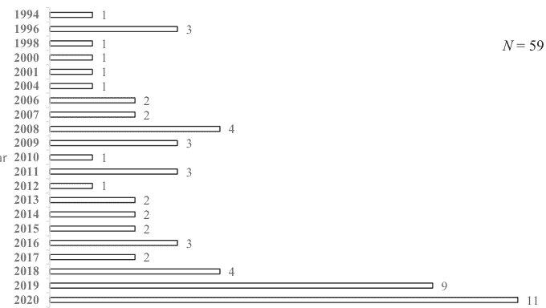

图2. 年度发表趋势

注(s)：2020年的发布数量包括截至2020年7月在线发表和可用的研究

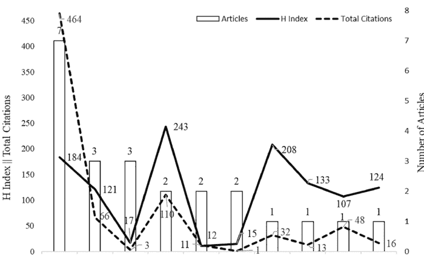

注(s)：期刊名称缩写的全称（按字母顺序排列）如下。ASJ: Applied Soft Computing Journal；CIE: Computers and Industrial Engineering；EJOR: European Journal of Operational Research；ESA: Expert Systems with Applications；IJATCSE: International Journal of Advanced Trends in Computer Science and Engineering；IJRTE: International Journal of Recent Technology and Engineering；IJSTR: International Journal of Scientific and Technology Research；JOM: Journal of Management；KBS: Knowledge-Based Systems；PS: Personnel Psychology。H指数根据Scimago期刊和国家排名（2019）从www.scimagojr.com检索；总引用次数根据Scopus数据库

图3. 文章发表数量最多的十本期刊

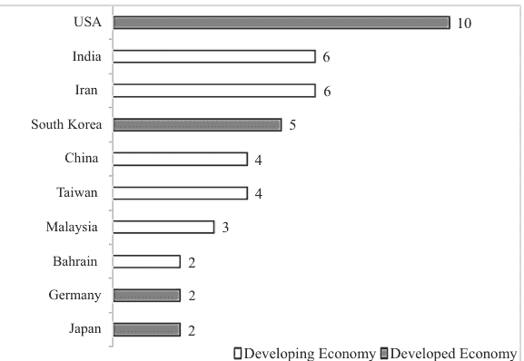

图4. 贡献最大的十个国家

注(s)：分布基于第一作者的所属国家。国家按发达/发展中经济体分类依据《2020年世界经济形势与展望》。检索自：https://www.un.org/development/desa/dpad/wp-content/uploads/sites/45/WESP2020_FullReport.pdf

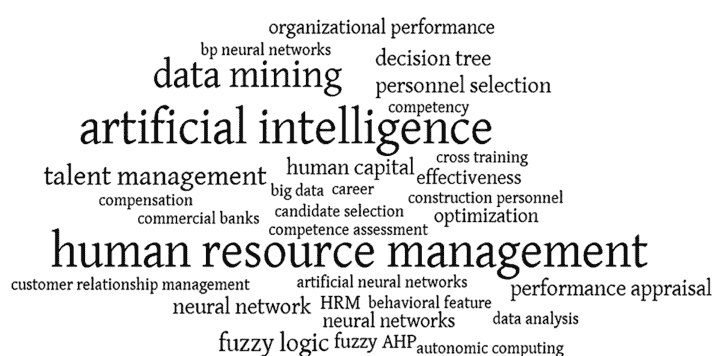

图5. 作者最常用的关键词

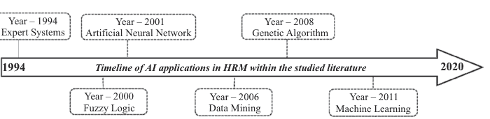

图6. HRM中AI应用的时间线


### 表 3. 人力资源管理功能与 AI 子领域

| AI 子领域 | 员工配置 | 薪酬 | 绩效管理 | 培训与发展 | 其他 | N |
| :--- | :--- | :--- | :--- | :--- | :--- | :--- |
| 专家系统 | Hooper et al. (1998), Marée et al. (2019), Saidi Mehrabad and Fathian Brojeni (2007) | | | Bohlouli et al. (2017) | Byun and Suh (1994, 1996), Lawler and Elliot (1996), Sturman et al. (1996), Xu et al. (2020) | 9 |
| 模糊逻辑 | Canós and Liern (2004), Karam et al. (2020), Karatop et al. (2015), Mavi and Mavi (2014), Moradinasab et al. (2016), Shahhosseini and Sebt (2011), Hajia et al. (2006), Hung et al. (2001), Lin et al. (2020) | Escolar-Jimenez et al. (2019) | | | | 13 |
| 人工神经网络 | Chen and Chien (2011), Chien and Chen (2008) | | Huang et al. (2006), Manafi and Subramaniam (2015), Moon et al. (2010), Paladini (2009), Selden et al. (2000) | | Lucía-Casademunt et al. (2013) | 7 |
| 数据挖掘 | | | Lopes et al. (2018), Stavrou et al. (2007), Zhang et al. (2012) | Danping and Jin (2011) | Han (2016), Marksberry et al. (2014), Masum et al. (2018), Ranjan et al. (2008), Strohmeier and Piazza (2013) | 12 |
| 遗传算法 | | | Akhondzadeh-Noughabi et al. (2016), Jantan et al. (2009), Lamarca and Ambat (2018), Nazri et al. (2019) | Lee and Ahn (2020) | | 4 |
| 机器学习 | Acharyaa and Datta (2020), Fowler et al. (2008), Wi et al. (2009) | | | | Diao and Shwartz (2017) | 3 |
| 其他 | Varalakshmi and Dhivya (2019) | Baakeel (2020), Gupta et al. (2018), Nawaz (2019), Richter et al. (2008), Vinichenko et al. (2019) | | Jerman et al. (2020) | Abdeldayem and Aldulaimi (2020), Chakraborty et al. (2020), Oswald et al. (2020), Reddy et al. (2019), Tambe et al. (2019) | 11 |
| 注：N_j 表示文章数量 | 23 | 1 | 12 | 5 | 18 | 59 |

### 3.2.1 员工配置中的 AI

对功能和子领域进行表格化显示，表明研究对员工配置（n = 23）给予了详细关注——这是人力资源管理的一个子领域，负责安排所需的员工数量和质量，招聘（即邀请和选拔员工、交叉培训并将员工分配到合适的工作岗位，以及在必要时调动或解雇员工）（Devanna et al., 1982; Wright and Snell, 1991）。研究贡献的第一个也是最大的子类别涉及员工选拔（n = 15）。该子类别的选拔要么基于胜任力（Hajia et al., 2006; Karatop et al., 2015; Mavi and Mavi, 2014; Shahhosseini and Sebt, 2011; Wi et al., 2009），要么针对特定员工细分群体（如军事人员）（Hooper et al., 1998），要么着重于降低选拔过程中的成本和时间（Karam et al., 2020; Marée et al., 2019; Shahhosseini and Sebt, 2011），要么基于绩效排名（Canós and Liern, 2004; Fowler et al., 2008），要么预测工作行为（Chen and Chien, 2011; Chien and Chen, 2008）。另一个子类别讨论了员工配置中的自动化（n = 4）（Gupta et al., 2018; Nawaz, 2019; Richter et al., 2008; Vinichenko et al., 2019），随后是员工缺勤可能性问题（n = 1）（Varalakshmi and Dhivya, 2019）、将员工分配到特定工作岗位（n = 1）（Lin et al., 2020）、员工调动问题（n = 1）（Acharyaa and Datta, 2020）以及最后一项关于理解 AI 在人才招聘中重要性的研究（n = 1）。

### 3.2.2 薪酬中的 AI

薪酬侧重于员工的报酬，离散地辅以股权分享、利润或两者兼有（Devanna et al., 1982）。作为一个能够促进大量基于数值的数据驱动决策以设计高效的基于 AI 的薪酬系统的子功能，令人惊讶的是，只有单一文章涉及人力资源管理的这一子功能（Escolar-Jimenez et al., 2019）。由于该子功能涉及海量数值数据，AI 可能有助于设计一个强大的薪酬系统。

### 3.2.3 绩效管理中的 AI

绩效管理是指系统地明确绩效目标，随后考察这些目标的实现情况（Devanna et al., 1982）。作为员工配置之后的第二大子类别（n = 12），它主要讨论了员工绩效预测（Huang et al., 2006; Jantan et al., 2009; Lamarca and Ambat, 2018; Lopes et al., 2018; Nazri et al., 2019）。除了员工绩效预测之外，部分文章还将绩效评估作为研究对象，其基础要么是比较排名（Moon et al., 2010; Paladini, 2009），要么是影响绩效的正面或负面因素（Akhondzadeh-Noughabi et al., 2016; Zhang et al., 2012）。大量研究涉及员工细分群体，即律师（Lopes et al., 2018）、银行员工（Zhang et al., 2012）、呼叫中心员工（Akhondzadeh-Noughabi et al., 2016）和学者（Lamarca and Ambat, 2018; Nazri et al., 2019）。从组织角度讨论绩效旨在预测一系列人力资源管理实践如何影响未来的组织绩效（Manafi and Subramaniam, 2015; Stavrou et al., 2007）。

### 3.2.4 培训与发展中的 AI

培训与发展子类别主要关注员工的胜任力评估，以及基础和高级培训和职业规划（Devanna et al., 1982）。在本文研究的文章中，仅有五篇文章通过 AI 应用讨论了这一人力资源职能。研究包括基于胜任力差距可视化（Bohlouli et al., 2017）或过去数据（Danping and Jin, 2011）的胜任力评估，用于评估或培训。研究贡献还涉及为组织转型预测未来所需的胜任力和工作档案（Jerman et al., 2020）、基于技能偏好的职业匹配（Lee and Ahn, 2020）以及衡量心理资本用于招聘和绩效考核（Alola and Atsa’am, 2020）。

### 3.2.5 其他人力资源管理功能中的 AI

除这些基于功能的研究外，一些文章还涉及了一系列多样的主题，本文将其作为“其他”工作（n = 18）。AI 应用的总体影响是一个经常被研究的方面，包括 AI 改进决策的能力（Han, 2016; Masum et al., 2018; Oswald et al., 2020; Ranjan et al., 2008; Reddy et al., 2019）、将 AI 呈现为一种必要的方法（Abdeldayem and Aldulaimi, 2020）以及 AI 对人力资源管理的广泛影响（Chakraborty et al., 2020）。一些特殊主题，如探索情感投入（Lucía-Casademunt et al., 2013）、开发员工建议系统（Marksberry et al., 2014）、服务机器人感知（Xu et al., 2020）也得到了探讨。该子类别中的一些作者还试图就应用进行具体讨论（Byun and Suh, 1994, 1996; Lawler and Elliot, 1996; Sturman et al., 1996）。

### 3.3 AI–人力资源管理概念图

Deane et al. (2008) 认为知识映射至关重要，因为它能使有意义的学习发生。开发概念图是组织大量定性数据所产生的知识的一种方法，因为它有助于以系统的方式构建、可视化和分析复杂数据——这些数据否则可能难以理解（Markham et al., 1994; Roth and Roychoudhury, 1993; Wallace and Mintzes, 1990）。概念图可以有多种形状，从非层级结构到层级结构，甚至包括由输入决定图形形状的数据驱动地图（Davies, 2011）。使用概念图有助于避免与学习定向失调和信息过载相关的问题，因为概念图能帮助学习者以相对简便和简洁的方式理解和处理某个领域知识的完整图景（Chen et al., 2008）。概念图的层级级数、关系数量、交叉链接和分支被视为对知识库凝聚力或集成程度的估计（Wallace and Mintzes, 1990）。

从内容分析中，我们推断出 HRM 中的 AI 应用旨在促进或支持人力资源决策。基于此，我们以概念图的形式综合了所审查的文献，以通过理解 AI 技术试图解决的 HR 问题类型来了解每个子领域如何应用于 HRM。图 7 展示了一个用于综合和呈现研究重点领域分类学概览的倒置树状结构概念图。基于 Dulebohn 和 Johnson (2013) 的 HR 决策框架，该图被分为两部分——即非结构化/半结构化和结构化。该图揭示了可以根据 HR 问题的结构程度应用的 AI 技术类型。适合线性规划或其他统计技术等数学模型的决策问题被称为结构化决策问题。此类决策问题存在标准解决方案，且达到这些解决方案所需的方法是已知的（Niu et al., 2009）。例如，基于预测的员工绩效排名（Lopes et al., 2018）等决策将被视为非常结构化的决策。

相比之下，那些不那么明确、没有标准解决方案且需要人类判断来解决的决策问题被称为非结构化决策问题。非结构化决策问题的示例包括：员工需要哪些工作培训；哪些薪资参数是有效的；应提议什么水平的员工福利（Saidi Mehrabad and Fathian Brojeni, 2007）。介于结构化决策问题和非结构化决策问题之间，且需要标准解决方案与判断相结合的决策问题被称为半结构化决策问题。研究人员认为，当混合 AI 技术（如模糊人工神经网络 (FANN)、自适应网络模糊推理系统 (ANFIS)、模糊事务数据挖掘算法 (MFTDA)）被用于非结构化、半结构化或不明确的决策问题时，可以产生更具成效的结果（Jantan et al., 2009; Masum et al., 2018）。

在图 7 中，从顶部（即人力资源管理决策）开始，该图分支为六种在所审查文献中使用的 AI 技术。以下是对 HRM 文献中应用的所有六种技术的简要讨论。


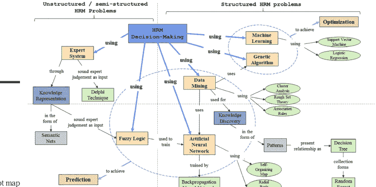

#### 3.3.1 人力资源管理中的专家系统 (ES)

该程序旨在将专家知识配置为逻辑结构，将其启发式方法解读为有序规则，并利用这些规则为用户提供卓越的专家解决方案，该系统被称为专家系统（Al-Attar, 1990; Sturman et al., 1996）。早在 1994 年的研究文献中就可以看到人力资源管理中专家系统的发展，Byun 和 Suh（1994）讨论了专家系统可用于人力资源规划、薪酬、招聘和劳资关系等主要人力资源管理活动中的语义网络或语义网形式的知识表示。此外，专家系统可以通过为决策者提供实际上可以在线访问的专业知识来改进决策，这些专业知识可能难以生成且不易获得（Lawler 和 Elliott, 1996; Sturman et al., 1996）。人力资源领域专家系统的发展有助于解决非结构化的人力资源管理问题，并有助于开发完整的人力资源信息系统（HRIS）（Byun 和 Suh, 1994）。文献中可以找到关于能力评估数学模型开发（Bohlouli et al., 2017）、名为 BOARDEX 的基于规则的选拔基本专家系统（Hooper et al., 1998）、将专家系统作为决策辅助工具的应用（Sturman et al., 1996），以及利用专家系统高效分配和选拔求职者（Saidi Mehrabad 和 Fathian Brojeni, 2007）的证据。

#### 3.3.2 人力资源管理中的模糊逻辑

模糊逻辑基于 Zadeh（1965）提出的模糊集合理论。在此理论中，集合中定义了隶属度级别，其值在 0 到 1 之间变化。0 表示不属于，而 1 表示绝对属于该特定集合。对于任何其他具有 0 到 1 之间值的元素，该值显示其对集合的隶属程度（Karap et al., 2015）。利用这些集合，模糊逻辑可以量化数据的不确定性并预测未来场景，从而进一步促进决策（Lamarca 和 Ambat, 2018）。

基于模糊规则的系统处理半结构化问题，并且在解读人类判断方面优于那些利用充足输入数据但忽略数据中关键交互和逻辑可能性的技术（Selden et al., 2000）。在 AI – HRM 应用中，它可用于人员选拔和最优员工设计（Canós 和 Liern, 2004）、区分合适和不合适的求职者（Karam et al., 2020; Shahhosseini 和 Seibt, 2011）、消除在评估特征相对重要性和选择的绩效分级时的不准确性（Mavi 和 Mavi, 2014）。此外，专家判断可以作为模糊逻辑实现的输入，从而进一步训练人工神经网络。当与专家系统结合使用时，模糊逻辑可以增强其推理能力，从而提高决策质量（Masum et al., 2018）。

#### 3.3.3 人力资源管理中的数据挖掘

根据 Han et al.（2011），数据挖掘是从大型数据源中提取有价值但隐藏信息的过程。它还指在数据中识别潜在有价值、新颖和有效模式的重要过程（Stromeier 和 Piazza, 2013）。通过实施数据挖掘方法，组织可以将有用信息和模式转化为竞争优势（Ranjan et al., 2008）。此外，数据挖掘可用于知识发现，因为提取的知识可以以模式形式呈现。识别出的模式可用于以决策树的形式表示关系，进一步支持决策。决策树（一组此类树被称为随机森林）通常用于分类和预测任务。它们更适合预测类别结果（Chien 和 Chen, 2008），因为它们为决策者提供了简单理解和解释的优势，以便与其知识对比来证明和验证其决策（Chen 和 Chien, 2011）。数据挖掘是检查数据库中文档的最佳方法之一，因为结果可以用于预测和未来规划（Chien 和 Chen, 2008; Jantan et al., 2009）。

应用于人力资源管理的数据挖掘技术包括关联规则、粗糙集理论和聚类分析。关联规则用于解释主动关联数据属性的模式，该模式主要以内涵规则的形式出现（Danping 和 Jin, 2011）。粗糙集理论是一种数据挖掘程序，在存在模糊和不确定性的情况下，可以使用简单、合理且有价值的规则来阐明和调查决策是如何做出的（Jantan et al., 2009）。聚类分析也已广泛应用于图像处理、模式识别等领域（Han et al., 2011; Ranjan et al., 2008）。

数据挖掘已被用于员工选拔（Chien 和 Chen, 2008; Ranjan et al., 2008）、绩效评估（Akhondzadeh-Noughabi et al., 2016; Lamarca 和 Ambat, 2018; Nazri et al., 2019）、能力评估（Danping 和 Jin, 2011）、人才管理（Jantan et al., 2009）以及其他各种人力资源职能。

#### 3.3.4 人力资源管理中的人工神经网络 (ANN)

人工神经网络属于基于示例学习范式家族，在该范式中使用实际示例自动生成问题解决知识（Huang et al., 2006）。ANN 是一种开发用来模仿大脑功能的简化模型（Hajihe et al., 2006）。它使用包含处理元素、层和网络的简单结构设计，以再现人类学习过程（Huang et al., 2001）。ANN 是预测中最流行的智能技术（Masum et al., 2018），可以帮助解决为预测人力资源职能（如选拔（Hajiha et al., 2006）、招聘（Huang et al., 2001）和绩效（Lopes et al., 2018; Stavrou et al., 2007; Zhang et al., 2012））而设计的模型。

可以使用神经网络来解决人力资源问题，从而取代专家系统（Maree et al., 2019）。将神经网络与 AHP 和模糊输入相结合，可以预测人力资源管理实践对组织绩效的影响（Manafi 和 Subramaniam, 2015）。可以通过修改元素之间连接（权重）的值来训练神经网络以执行特定功能（Hajiha et al., 2006）。如果向神经网络提供一些有效（和无效）的招聘数据，它可以自行建立一个完整的人才获取系统（Huang et al., 2001）。

一种称为自组织映射（SOM）的人工神经网络类型也已应用于人力资源管理。SOM 的想法是无辅助学习最优雅的实例之一，其中人工神经网络努力提取稳定的特征或模式（Stavrou et al., 2007）。这一独特特征使得在代表性输入/目标对集合上训练网络并获得出色结果成为可能，而无需在所有可能的对上训练网络。反向传播神经网络（BPNN）也可用于训练人工神经网络（Zhang et al., 2012）。

#### 3.3.5 人力资源管理中的遗传算法 (GA)

遗传算法是包含辨别性实验的搜索技术，旨在确定全局最优解（Masum et al., 2018）。它们使用自然中发现的策略，例如复制和基因交叉，以求得数学问题的最优解（Fowler et al., 2008; Masum et al., 2018）。遗传算法在人力资源管理职能中的应用相对较少，少数研究（如 Fowler et al. (2008)）实施遗传算法来解决劳动力规划问题并评估绩效。Acharyya 和 Datta（2020）使用遗传算法解决使用现实约束的员工调动相关问题，而 Wi et al.（2009）构建了一个框架来分析候选人的知识。

#### 3.3.6 人力资源管理中的机器学习

机器学习是一种学习过程，机器可以在不被编程以特定方式执行所需工作的情况下独立学习（Rab-Kettler 和 Lehnervp, 2019; Varalakshmi 和 Divhiya, 2019）。研究表明，在决策中采用机器学习是有益的（Diao 和 Shwartz, 2017; Varalakshmi 和 Divhiya, 2019）。数据挖掘也是一种特定的机器学习（从示例中学习）（Huang et al., 2006）。目前，正在利用逻辑回归和支持向量机等机器学习技术来建模人力资源职能。当预测的因变量具有二元结果时，会采用逻辑回归等技术，例如，接受/拒绝、通过/不通过、高/低等等（Hosmer et al., 2013）。Alola 和 Atsa’am（2020）曾使用它来评估员工的心理资本。极少有研究使用这种技术进行人力资源决策。

## 4. 讨论与未来研究方向

### 4.1 人力资源管理中人工智能的伦理问题

一般来说，伦理是帮助人们区分对错的准则，这超出了法律范畴（Chang, 2021）。强大的伦理框架和理论指导人们和组织做出有理有据、合乎逻辑且有据可依的决策（Chang, 2021）。利用人工智能分析和可视化来自整个劳动力或个别团队、员工和部门的复杂数据，以提供可操作的洞察，可能会对员工的自主权和隐私产生伦理问题和积极风险（Tursunbayeva et al., 2018, 2021）。在分析复杂绩效数据、开发个性化培训建议、预测未来绩效、推断员工满意度等活动中使用人工智能，可能容易导致偏见和不公平等不道德行为。例如，选拔求职者的专家系统可能会植入专家知识所指示的偏见，从而进一步导致对特定性别、特定技能、背景、族群等提供偏好。由于专家判断也作为模糊逻辑实现的输入，这将为筛选潜在员工、评分绩效等人力资源活动中的偏见打开大门。此外，人工神经网络可以使用模糊数据进行训练，这可能会延续人力资源实践中的人类偏见链条。

此外，像数据挖掘这样的 AI 分支使用数据来寻找有效模式，也可能带来潜在的伦理威胁，因为数据涉及个人（Chang, 2021），并可能导致数据挖掘者利用数据主体漏洞的机会（Dean et al., 2016）。对这类敏感个人数据的操纵也可用于训练算法，以修改或“塑造”员工在工作场所内外的行为。此外，如果人工智能的参与延伸到监控员工的社交媒体活动、个人电子邮件、数字设备和应用程序的使用，则可能构成隐私泄露（Tursunbayeva et al., 2021）。另一个 AI 分支，遗传算法，使用复制和突变策略，从而放大系统中任何错误输入的特征。另外，机器学习具有复杂的内部处理，因此


限制人们的技术理解，导致 AI 用户和专家之间出现关键信息不对称，进一步削弱了人类对 AI 的信任（Ryan and Stahl, 2021）。

### 4.2 构建 HRM 中道德 AI 的框架

大多数组织都有价值观、政策和道德准则，旨在营造道德文化（Farrell and Farrell, 2021）。为遵守这些准则，组织必须解决 AI 实施可能引发的 HR 实践中的道德挑战。可以设计多种机制，在各个层面处理并最大限度地减少道德问题。

针对 AI 决策中的偏见，应密切关注输入系统的任何训练数据。管理者意识到（或很容易意识到）其决策可能带来的潜在后果，因此需要从道德角度评估决策。如果 AI 输出显示存在不公平偏见，管理者应有权推翻该决定。专家系统（以专家知识作为决策基础）必须根据道德准则持续更新其指令。

在处理个人数据时，必须特别注意记录哪些数据、谁负责记录操作以及谁可以访问记录和数据。相关员工应有权选择向组织共享什么内容，并可询问关于收集数据的使用政策。沟通必须清晰明确，以确保数据未被 AI 欺骗、操纵或胁迫。此外，在处理敏感数据时，AI 架构应在实施前构建并测试其安全性。

此外，基于数据寻找模式和建立关联也应检查是否存在任何不良结果。例如，如果招聘输入数据偏向特定种族/性别的人数比例不均，AI 将根据输入数据进行预测。结果可能表明，特定性别和/或种族生产力最高，应给予招聘优先权。然而，整个变量关系基于有限的数据集，从而得出偏差结果。因此，组织应意识到基于数据的变量关系以及在决策中应考虑的内容。

理解机器学习等 AI 子系统内部流程很复杂（Siau and Wang, 2020）；因此，确保此类系统的透明度可能会很棘手。需要提供监督来监控和访问与其相关的结果。在此，训练数据质量和数量的差异也可能意味着结果会有很大差异，这强调了为什么我们认为自我学习的特性是组织中 AI 的一个核心区分特征（Brendel et al., 2021）。

基于训练数据的复制将需要其自身行为准则，以应对未先前编程到现有备选方案和解决方案组合中的新互动和道德问题。编程是可行的，因为在大多数情况下，机器将具有狭窄的焦点或活动，并且可以预测可用于决策的风险、替代方案和后果。因此，在实施 AI 时，始终需要人工控制来调整道德结果。

图 8 显示了所研究文献中观察到的道德问题的指示性摘要，这些问题需要适当机制来应对，并向 HRM 中有效且合乎道德的 AI 应用过渡。

### 4.3 关于 AI-HRM 领域现状的结束语

AI 的出现从根本上改变了许多组织（Bankins and Formosa, 2020; Barro and Davenport, 2019; Kaplan and Haenlein, 2019; Jia et al., 2018）。AI 技术在工作场所中的关键作用是支持复杂的 HR 管理

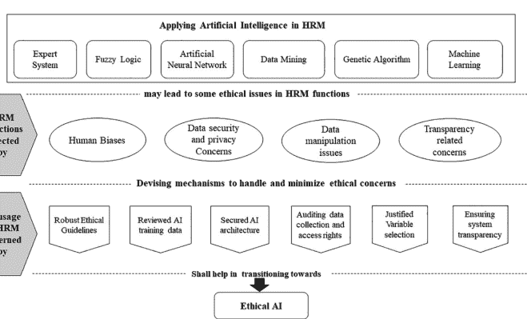

图 8. 处理 AI-HRM 中道德问题的指示性框架

决策，通过提高决策过程的质量和速度（Escolar-Jimenez et al., 2019; Reddy et al., 2019; Ranjan et al., 2008; Saidi Mehrabad and Fathian Brojeni, 2007; Sturman et al., 1996）。AI 控制框架的复杂性最近已扩展到这样的程度，以至于其结构和部署不再需要人工干预（Arrieta et al., 2020）。

这种复杂性的影响可以从 AI 技术在招聘和甄选过程中的应用中看出（例如，从职业网站筛选简历、直接面试和分解视频面试）（Gupta et al., 2018; Nawaz, 2019; Rab-Kettler and Lehrnvyp, 2019; Wan Chik and Arokiasamy, 2019），绩效预测（Chen and Chien, 2011; Lopes et al., 2018; Nazri et al., 2019），以及任务自动化（Escolar-Jimenez et al., 2019; Gupta et al., 2018）。研究人员认为，混合 AI 技术（如模糊人工神经网络 (FANN)、自适应网络模糊推理系统 (ANFIS)、模糊事务数据挖掘算法 (MFTDA)）在用于解决各种 HR 问题时，可以产生更有效的结果（Jantan et al., 2009; Masum et al., 2018）。

观察发现，文献主要集中在将 AI 技术应用于员工甄选，25% 的研究涉及这一问题。虽然对员工绩效预测、能力评估、员工分配以及 AI 对 HRM 的整体影响也予到了选择性关注，但其余研究贡献构成了一些不一致的 HR 问题的零散汇编。本综述表明，关于 HR 职能中 AI 应用的知识相当丰富，但应用范围偏颇，仅关注少数几个 HR 问题领域。

例如，尽管员工流失（Khatri et al., 2001; Pereira et al., 2013）和培训投资（Malik, 2009）等问题对组织至关重要，但在所研究的文献中几乎未被讨论。Strohmeier and Piazza (2015) 指出，可用的 HRM 中 AI 应用系统知识确实是任意且不完整的，且代表性偏颇。该领域的工作通常具有普遍性，模型是为优化或预测完整 HR 职能的结果而开发的。此外，只有一项研究涉及人类对服务机器人的看法。

因此，需要更多针对 HRM 中 AI 应用的聚焦研究，这些研究可以轻松实施于现实生活应用领域，并且需要更多研究来捕捉受 HRM 工作领域中 AI 应用影响的个人的反应。

### 4.4 未来研究建议

我们现在提出将从更多学术关注中受益的研究方向。以往文献为未来研究者认可了各种途径，包括扩展研究中开发的模型（例如 Hooper et al., 1998; Selden et al., 2000; Stavrou et al., 2007），将开发的模型复制到其他 HR 问题（例如 Chien and Chen, 2008; Hajihe et al., 2006），以及开发不同的方法来求解这些模型（例如 Fowler et al., 2008; Masum et al., 2018），仅举几例。

我们将拟议的研究方向制定并分为四类（如表 4 所示）：第一类涉及员工看法、恐惧和潜在滥用；第二类明确面向通过 AI 应用进行劳动力管理；第三类专注于评估以 HRM 为中心的 AI 应用的有效性，最后一类与实施 AI 解决方案的领导者视角有关。可能的未来研究方向简要讨论如下（具体研究问题见表 4）。

#### 4.4.1 研究方向 #1：员工看法（及恐惧）和潜在滥用。

文献表明，HRM 学者应更加关注研究 AI 技术使用的影响，而不仅仅关注其在问题解决中的应用。Sturman et al. (1996) 断言，此类辅助对决策过程（以及决策者）的影响几乎被完全忽视。

该领域发展中需要解决的一些紧迫需求包括：了解用户个人特征对心理和绩效结果的影响的需求（Lawler and Elliot, 1996）、整合 DSS、ES 和行为研究文献的需求（Sturman et al., 1996），以及了解员工与机器人合作的意愿的需求（Xu et al., 2020）。员工对失去工作或无法掌握使用该技术所需技能的恐惧也可能成为 AI 实施的额外障碍。

此外，学者们也担心 AI 应用的潜在滥用（Strohmeier and Piazza, 2013; Sturman et al., 1996），一些问题（例如，员工是否可以破坏 AI 机器，使其不在其班次安排维护或扭曲他人的最终绩效？）仍有待解答。

#### 4.4.2 研究方向 #2：劳动力管理。

尽管大部分文献集中于为某些重要的劳动力管理活动开发模型，但少数活动很少被讨论。除了 Chien and Chen (2008) 外，员工流失（Khatri et al., 2001; Pereira et al., 2013）等关键问题在文献中几乎未被涉及。培训投资（Malik, 2009）虽然是 HR 职能的重要组成部分，但考虑甚少。尽管绩效预测常被讨论，但输入变量的变化可能是未来研究的绝佳范围。

目前，很少有研究实施行为理论来创建 HR 职能模型。未来研究者应从现有行为理论（如行为意图、推理、失调等）的视角，探索与 AI 应用相关的行为方面。未来研究可以专注于开发基于皮格马利翁效应等心理现象理论基础的绩效模型。

此外，现有文献中开发的模型通常针对通用 HR 职能，未来研究可以专注于根据组织类型、招聘层级、组织规模、工作类型（例如零工工人）、地理区域等开发专门模型。

#### 4.4.3 研究方向 #3：评估有效性和投资回报率 (ROI)。

未来研究的另一个重要领域可以是评估以 HRM 为中心的 AI 技术的有效性，因为只有当它们比已建立的 HR 技术相对更有效、更高效时才有用，也就是说，它们能提供改进的结果且所需的实施工作相对较少（Strohmeier and Piazza, 2013, 2015）。

除了 AI 之外，随着 HRM 中基于数据的决策的出现，其他


表 4. 未来研究的一些建议

| 研究主题 | 可能的研究问题 |
| --- | --- |
| 研究方向 #1：员工认知（和恐惧）及潜在滥用 | 员工对采用以 HRM 为重点的 AI 应用的价值观、态度和行为的认知<br>(1) 由于使用 ES、DSS 等决策辅助工具及其与其他决策辅助工具的集合，员工的态度和行为将受到怎样的影响？<br>(2) 决策者的认知过程如何受到 ES、DSS 及其他决策辅助工具使用的影响？<br>(3) 关键利益相关者（如招聘人员、经理、一线员工和客户）对服务机器人（例如，在酒店/餐厅中）采用的看法是什么？<br>(4) 基于员工的感知行为，组织如何处理“员工愿意与机器人协作的意愿”？<br>(5) 员工的认知是否在很大程度上取决于机器人的可用性（易用性）？（可使用技术接受理论进行分析）<br>(6) 我们能否设计一个作为软件模块的模型，用于计算机化员工的心理资本测量？<br>(7) 由于实施 AI 技术导致工作性质的变化，对员工情绪有何影响？<br>(8) 使用机器人能否减轻员工压力（与执行重复性任务相关）？<br><br>关于 AI 采用的员工研究<br>关于研究 AI 采用恐惧<br>关于研究和缓解员工与 AI 采用相关的恐惧，可以使用 Rogers（2003）的创新决策过程五个步骤。可以提出诸如以下的问题：<br><br>(1) 员工是否接触过 HR 部门中某些与 AI 相关创新的存在？<br>(2) 他们是否了解其工作原理？<br>(3) 他们对该创新持不利还是有利的态度？<br>(4) 他们是否参与导致拒绝或采用该创新选择的活动？<br>(5) 他们是否将该创新投入使用？<br>(6) 他们是否寻求对已做出的创新决策的强化？<br>(7) 如果接触到关于该创新的相互冲突的信息，他们是否会推翻之前的决策？<br><br>由 AI 应用引起的潜在滥用<br>(1) 员工是否可以破坏 AI 机器，使其不在其班次安排维护或歪曲他人的最终绩效？<br>(2) 用于开发模型的因素是否可以根据雇主的利益进行定制？（自我选择偏倚，拼结偏倚）<br>(3) 雇主能否设计决策辅助工具，仅从雇主角度（甚至以牺牲员工为代价）背书节省成本的最优计划？ |
| 研究方向 #2：劳动力管理 | **通过 AI 应用进行的劳动力管理**<br>(1) 能否使用语义网开发工作机会推荐模块，其中简历分析将有助于向合适的申请人发送自动工作推荐，并可进一步扩展为向雇主推荐候选人简历？<br>(2) 能否根据真实场景开发用于人员安排的 ANN 模型？（例如，考虑到人员的工作完成效率直接受其工作能力影响）<br>(3) 能否针对特定组织需求开发基于遗传算法的模型？（例如，一个定期进行人员调配的组织）<br>(4) 能否开发基于数据挖掘技术的理论模型，以描述和预测有效的员工建议策略？<br>(5) 能否设计数据挖掘技术来收集实际离职原因并进行根本原因分析，以帮助管理者制定有效的员工保留政策？<br>(6) 能否使用模糊逻辑开发一个相对详尽且智能的劳动力筛选系统（框架）？（该系统可以使用社会技能、资源管理能力、人格特质等标准）<br>(7) 如何开发基于模糊逻辑的系统，以协助 HRM 专家评估当前和潜在的劳动力？<br><br>**通过 AI 应用评估绩效**<br>(1) 一个基于模糊逻辑的 HRM 评估系统如何在评估标准中融入纵向组件？如何对每个标准进行评估？<br>(2) 如何开发基于胜任力评估的系统，以推荐一些研讨会、讲座和在职培训，从而增强当前员工所需的技能？<br>(3) 能否应用 AI 来推动个人朝着提升绩效的方向发展？（例如，使用软件安排休息时间） |
| 研究方向 #3：评估有效性和 ROI | **评估以 HRM 为重点的 AI 应用的有效性**<br>(1) 使用逻辑回归模型取代测量心理资本的手动方法，是否能节省许多资源并保证准确性？<br>(2) 研究以 HRM 为重点的机器人技术实施领域的先驱组织，是否有助于衡量使用机器人的有效性及其后续影响？<br>(3) 能否对聚焦的 HR 问题的实质性特征和相关性进行阐述，并展示在实施技术后领域的成功？<br>(4) 能否在 HR 的不同领域中，将传统决策方法与由 AI 技术组合而成的模型进行比较，以促进决策？<br><br>**投资回报率（ROI）**<br>(1) 开发和实施 ES 等 AI 技术的巨大成本是否合理？<br>(2) 当员工可能没有技能访问所需内容时，开发模型和计算机软件的 ROI 是否合理？ |
| 研究方向 #4：领导者视角 | **关于实施有效 AI 解决方案的领导者和利益相关者视角**<br>(1) 对于领导者来说，随时间的推移（纵向研究），使用机器人的感知价值发生了怎样的变化？组织分类（例如，大型、中型或小型）和类型（例如，学术、制造等）在领导者对使用机器人的看法中起什么作用？<br>(2) 领导者在机器人实施前和实施后的看法有何不同？<br>(3) 高层管理人员对在 HRM 中实施 AI 的看法是什么？ |

大数据系统等系统也可以设计用于提供归档、数据存储、数据管理、自动备份和数据恢复的功能和服务（Chang, 2015），而组织可持续性建模等方法（Chang et al., 2016）可用于理解基于 HR 的数据分析。计算投资回报率（RoI）也可以是识别这些复杂技术实施实际价值的宝贵工具。

#### 4.4.4 研究方向 #4：领导者视角。领导者对实施有效 AI 解决方案的视角以及如何实施，在维持所引入技术方面可以发挥关键作用（Reddy et al., 2019）。Jerman et al. (2020) 和 Xu et al. (2020) 讨论了领导者在组织中接受机器人方面的作用。关于领导者认知及其支持（或不支持）AI 应用及其潜在影响的深入见解，有助于发展该领域。

## 5. 研究的结论、启示与局限性

本研究对从 Scopus 数据库（截至 2020 年 7 月）检索到的 59 篇 AI – HRM 文献进行了系统文献综述。近年来出版物数量的稳步增长表明，学术界越来越有兴趣探索 AI 辅助决策在 HRM 领域的前景。在随后的章节中，我们将介绍研究和实践启示，随后是解释研究结果时必须考虑的局限性。

### 5.1 研究启示

关于 HRM 职能中 AI 应用的研究正在变得流行，特别是在选拔和招聘领域。本研究提供了三个重要的研究启示。回应本研究的第一个研究问题，本研究通过介绍和讨论总体研究图谱，为理论做出了贡献，使研究人员能够了解 AI – HRM 领域学术文献的演变和当前状态。为了解决第二个研究问题，本研究讨论了可用于 HRM 研究的潜在 AI 技术。其目的是突出一系列广为人知的技术，这些技术未来可能变得更有影响力，并证实聚焦的 HR 问题的特征。第二个研究问题还涉及已经使用 AI 进行改进的 HRM 实践。目的是说明领域成功，尤其是与传统 HR 方法相比，并分析可以为未来研究铺平道路的学术文献。本研究还制定了一种独特的 AI-HRM 概念图，可能有助于研究人员了解使用 AI 技术的 HRM 决策过程。此外，本研究还总结了与 HRM 中 AI 应用相关的伦理问题，并提供了一个指示性初步框架，用于整合伦理实践和策略，以帮助过渡到道德 AI。因此，这可以帮助研究人员避免在处理人员和人员数据的敏感 HRM 职能中盲目使用 AI，从而可能导致意想不到的后果。最后，我们简要且非详尽地描述了研究机会及一些具体的研究问题。这不仅可以帮助制定 AI – HRM 交界处未来研究的方向，还可以充当结构化指南，有助于减少在进行 AI-HRM 研究时的重复和偏见。

### 5.2 实际启示

信息技术对 HRM 研究和实践的影响，已显著转变了常规和非常规 HR 活动，从行政员工记录管理职能到人员的战略管理（Malik et al., 2020）。随着


AI辅助，人力资源经理现在可以采用一系列新兴技术，这些技术通过整合多个知识数据库，使机器能够像人类一样执行任务，协助经理进行富有成效的数据分析，并组织他们的活动以实现预期目标。在HRM中采用AI后，职位要求和人力资源经理的整体劳动力市场在技能和能力方面也受到了巨大影响。

由于AI代理能够更好地处理员工提出的低端可预测和常规查询，或潜在求职者的请求，多项HR流程也容易发生变化。AI代理能够更好地实时监控对话，解读代表的说话方式，并调查可能需要及时干预的无法解释的情况。此类情况可能需要针对所提供的数据、拟议的关联程度和计划的替代方案，采取不同程度的人力资源经理干预。因此，经理应了解组织的申诉处理流程，并建议据此采取行动。机器人或AI机器人还可以针对研发、媒体、医院等组织，实时监控和转录面试及音频数据。因此，人力资源经理需要更新他们的技能和能力，以推动有效的技术变革，并接受AI赋能的HR服务所带来的新变化。

HR系统还可能需要定期更新，这由其功能与HR任务要求的对比情况所指示，因为并非每种AI方法都适用于HR管理，也并非每项HR任务都能通过AI方法解决。最后，必须在个别基础上艰苦地解释方法与任务的匹配性；可以在类别层面进行一些具体化（Strohmeier和Piazza，2015）。例如，专家系统可以作为决策支持系统（DSS）帮助HRM经理，特别是在管理工作分配和员工选拔问题上。其他面向规划的AI方法，如层次规划和分布式问题求解，可以应用于工作分配和劳动力规划活动。因此，人力资源经理需要同时了解HR系统和AI系统，以实现技术的匹配。本研究提供了一个AI-HRM概念图，可以帮助经理决定哪种AI技术可以应用于当前的HR问题。

伦理和隐私问题也可能对人力资源经理构成重大挑战。本研究将帮助人力资源经理全面了解AI实施中的隐私风险和伦理问题。对伦理问题及其管理有更广泛的了解，也将有助于经理考虑组织和技术安排，以更好地管理这些问题。组织是隐私的最终承担者，伦理顾虑和文献表明，主要是组织方面的人员信息可能被滥用。因此，组织应超越界限，开展意识培养并教育员工，以尽量降低此类问题的风险。

### 5.3 研究的局限性

本研究结果的解读应考虑到本研究的以下局限性。首先，尽管数据收集方法系统且科学，但由于某些重要文章未收录于Scopus数据库，或使用了本研究未选用的关键词，我们可能遗漏了一些关键文章。本研究仅考虑了选定数据库中可获得的同行评议文章，排除了书籍章节和会议论文集等其他出版类型。其次，尽管在设计和执行当前研究时遵循了科学方法，并采取了足够的预防措施以确保工作的可接受效度和信度，但个人偏见和误（过度）解读的可能性无法完全排除。此外，当前研究更侧重于为该领域提供更广泛的概览，为未来研究开辟道路，未来研究应考虑采用元分析等高级技术，以深入了解AI对HRM影响的效应大小。

## 参考文献

- Abdeldayem, M.M. 和 Aldulaimi, S.H. (2020), “人力资源管理中人工智能的趋势与机遇：巴林公共部门的展望”，International Journal of Scientific and Technology Research, Scopus, Vol. 9 No. 1, pp. 3867-3871.
- Acharyya, S. 和 Datta, A.K. (2020), “员工转移问题的匹配公式：元启发式方法”，Opsearch, Vol. 57, pp. 629-668, doi: 10.1007/s12597-019-00432-w.
- Akhondzadeh-Noughabi, E, Amin-Naseri, M.R, Albadvi, A. 和 Saeedi, M. (2016), “从CRM视角看人力资源绩效评估：两步关联规则分析”，International Journal of Business Performance Management, Vol. 17 No. 1, pp. 89-102, doi: 10.1504/IJBPM.2016.073340.
- Al-Attar, A. (1990), “高级语言中的知识库编程”，Information and Software Technology, Vol. 32 No. 2, pp. 127-132.
- Alola, U.V. 和 Atsa’am, D.D. (2020), “使用数据挖掘方法衡量员工心理资本”，Journal of Public Affairs, Vol. 20 No. 2, doi: 10.1002/pa.2050.
- Arrieta, A.B, Díaz-Rodríguez, N, Del Ser, J, Bennetot, A, Tabik, S, Barbado, A, García, S, Gil-López, S, Molina, D. 和 Benjamins, R. (2020), “可解释人工智能（XAI）：面向负责任AI的概念、分类学、机遇与挑战”，Information Fusion, Vol. 58, pp. 82-115.
- Aznoli, F. 和 Navimipour, N.J. (2017), “云服务推荐：回顾近期进展并提出未来研究方向”，Journal of Network and Computer Applications, Vol. 77, pp. 73-86.
- Bankins, S. 和 Formosa, P. (2020), “当AI遇到个人电脑：探索工作场所社交机器人和人机心理契约的影响”，European Journal of Work and Organizational Psychology, Vol. 29 No. 2, pp. 215-229.
- Barro, S. 和 Davenport, T.H. (2019), “人与机器：创新中的合作伙伴”，MIT Sloan Management Review, Vol. 60 No. 4, pp. 22-28.
- Behera, R.K., Bala, P.K. 和 Dhir, A. (2019), “医疗保健中认知计算的新兴作用：系统性文献综述”，International Journal of Medical Informatics, Vol. 129, pp. 154-166.
- Berihl, S., Benlahmar, H. 和 Labani, N. (2020), “人力资源管理中人工智能的综述论文”，Indonesian Journal of Electrical Engineering and Computer Science, Vol. 18 No. 1, pp. 32-40, doi: 10.11591/ijeecs.v18.i1.pp32-40.
- Bohlooli, M., Mittas, N., Kakarontzas, G., Theodosious, T., Angelis, L. 和 Fathi, M. (2017), “作为人力资源管理专家系统的能力评估：一种数学方法”，Expert Systems with Applications, Scopus, Vol. 70, pp. 83-102, doi: 10.1016/j.eswa.2016.10.046.
- Brendel, A.B., Mirbabaie, M, Lembcke, T.-B. 和 Hofeditz, L. (2021), “人工智能的伦理管理”，Sustainability, Vol. 13 No. 4, p. 1974.
- Byun, D.-H. 和 Suh, E.-H. (1994), “人力资源管理专家系统技术”，Expert Systems, Vol. 11 No. 2, pp. 109-119, doi: 10.1111/j.1468-0394.1994.tb00004.x.
- Byun, D.-H. 和 Suh, E.-H. (1996), “HRM问题领域中关键知识表示技术的评估”，Expert Systems with Applications, Vol. 11 No. 3, pp. 287-299, doi: 10.1016/S0957-4174(96)00045-0.
- Canós, L. 和 Liern, V. (2004), “人力资源管理的一些模糊模型”，*国际技术、政策与管理杂志*, Vol. 4 No. 4, pp. 291-308, doi: 10.1504/IJTPM.2004.006613.
- Chakraborty, S., Giri, A., Aich, A. 和 Biswas, S. (2020), “使用PLS-SEM（偏最小二乘-结构方程模型）评估人工智能对人力资源管理的影响”，*国际科学与技术研究杂志*, Scopus, Vol. 9 No. 3, pp. 5876-5880.
- Chang, V. (2015), “面向私有云的大数据系统灾难恢复”，*自组织网络*, Vol. 35, pp. 65-82.
- Chang, V. (2021), “大数据和智慧城市的伦理框架”，*技术预测与社会变迁*, Vol. 165, 120559.
- Chang, V., Walters, R.J. 和 Wills, G.B. (2016), “组织可持续性建模——评估云计算采用的新兴服务和分析模型，附两个案例研究”，*国际信息管理杂志*, Vol. 36 No. 1, pp. 167-179.
- Chen, L.-F. 和 Chien, C.-F. (2011), “用于支持高科技行业人力资本决策的类别预测和规则生成制造智能”，*灵活服务与制造杂志*, Vol. 23 No. 3, pp. 263-289, doi: 10.1007/s10696-010-9068-x.
- Chen, N.-S., Wei, C.-W. 和 Chen, H.-J. (2008), “从学术文章中挖掘电子学习领域概念图”，*计算机与教育*, Vol. 50 No. 3, pp. 1009-1021.
- Chien, C.-F. 和 Chen, L.-F. (2008), “使用数据挖掘改进人员选拔并增强人力资本：高科技行业案例研究”，*专家系统与应用*, Vol. 34 No. 1, pp. 280-290, doi: 10.1016/j.eswa.2006.09.003.
- Danping, Z. 和 Jin, D. (2011), “基于关联规则的大学人力资源数据仓库数据挖掘”，*计算机杂志*, Vol. 6 No. 1, pp. 139-146, doi: 10.4304/jcp.6.1.139-146.
- Davies, M. (2011), “概念图、思维图和论证图：有何区别，它们重要吗？”，*高等教育*, Vol. 62 No. 3, pp. 279-301.
- Dean, MD., Payne, D.M. 和 Landry, B.J. (2016), “数据挖掘：在线隐私政策的道德基线”，*企业信息管理杂志*, Vol. 29 No. 4, pp. 482-504, doi: 10.1108/JEIM-04-2014-0040.
- Deane, P., Owendahl, N., Quinnlin, T., Fowles, M., Welsh, C. 和 Bivens-Tatum, J. (2008), “写作的认知模式：写作能力作为复杂的综合技能”，*ETS研究报告系列*, Vol. 2008 No. 2, pp. 1-36.
- Devanna, M.A., Fombrun, C., Tichy, N. 和 Warren, L. (1982), “战略规划与人力资源管理”，*人力资源管理*, Vol. 21 No. 1, pp. 11-17.
- Diao, Y. 和 Shwartz, L. (2017), “构建IT服务管理的自动化数据驱动系统”，*网络与系统管理杂志*, Scopus, Vol. 25 No. 4, pp. 848-883, doi: 10.1007/s10922-017-9430-3.
- Dulebohn, J.H. 和 Johnson, R.D. (2013), “人力资源指标与决策支持：分类框架”，*人力资源管理评论*, Vol. 23 No. 1, pp. 71-83.
- Elacio, A.A., Lacatan, L.L., Vintuan, A.A. 和 Balazon, F.G. (2020), “使用C4.5算法将赫茨伯格理论与机器学习相结合”，*计算机科学与工程先进趋势国际杂志*, Scopus, Vol. 9 No. 1.1 特刊, pp. 57-63, doi: 10.30534/ijatcse/2020/191.91.2020.
- Escolar-Jimenez, C.C., Matsuzaki, K., Okada, K. 和 Gustilo, R.C. (2019), “利用神经模糊推理系统进行员工薪酬的数据驱动决策”，*工程研究新兴趋势国际杂志*, Vol. 7 No. 8, pp. 163-169, doi: 10.30534/ijeter/2019/10782019.


Fahimnia, B., Sarkis, J. and Davarzani, H. (2015), “绿色供应链管理：综述与书目计量分析”, 《国际生产经济期刊》, 第162卷 第C期, 第101-114页.

Ferrell, O.C. and Ferrell, L. (2021), “将亨特-维特尔伦理模型应用于人工智能伦理”, 《全球营销科学学者期刊》, 第31卷第2期, 第178-188页.

Fountain, T., McCarthy, B. and Saleh, T. (2019), “构建人工智能驱动的组织”, 《哈佛商业评论》, 第97卷第4期, 第62-73页, 可在以下网址查阅: https://hbr.org/2019/07/building-the-ai-powered-organization.

Fowler, J.W., Wirojanagud, P. and Gel, E.S. (2008), “考虑员工差异的劳动力规划启发式”, 《欧洲运筹学期刊》, 第190卷第3期, 第724-740页, doi: 10.1016/j.ejor.2007.06.038.

Gupta, P., Fernandes, S.F. and Jain, M. (2018), “招聘自动化：一个新的前沿”, 《信息技术教学案例期刊》, Scopus, 第8卷第2期, 第118-125页, doi: 10.1057/s41266-018-0042-x.

Hajihea, A., Alavi, S.H. and Makvandi, P. (2006), “使用径向基函数网络改进基于行为的工作分配”, 《WSEAS 系统交易刊》, Scopus, 第5卷第11期, 第2542-2547页.

Han, Y. (2016), “改进的 BIRCH 聚类算法与人力资源管理效率：组织学习视角”, 《安全及其应用国际期刊》, 第10卷第8期, 第385-394页, doi: 10.14257/ijisia.2016.10.8.34.

Han, J., Kamber, M. and Pei, J. (2011), 《数据挖掘：概念与技术》, 第3版, Morgan Kaufmann, Waltham, MA.

Hirsch, J.E. (2005), “量化个人科学研究产出的指标”, 《美国国家科学院院刊》, 第102卷第46期, 第16569-16572页.

Hochrein, S. and Glock, C.H. (2012), “采购与供应链管理研究中的系统文献综述：一项三级研究”, 《整合供应链管理国际期刊》, 第7卷第4期, 第215-245页.

Holland, J.H. (1992), 《自然与人工系统中的适应：生物学、控制与人工智能应用导论》, MIT Press.

Hooper, R.S., Galvin, T.P., Kilmer, R.A. and Liebowitz, J. (1998), “专家系统在人员甄选过程中的应用”, 《专家系统与应用》, Scopus, 第14卷第4期, 第425-432页.

Hosmer, D.W. Jr, Lemeshow, S. and Sturdivant, R.X. (2013), 《应用逻辑回归》, John Wiley & Sons, 第398卷.

Hsieh, H-F. and Shannon, S.E. (2005), “定性内容分析的三种方法”, 《定性健康研究》, 第15卷第9期, 第1277-1288页.

Huang, L.C., Wu, P., Kuo, R.J. and Huang, H.C. (2001), “人力资源人才选拔的神经网络建模”, 《人力资源开发与管理国际期刊》, Scopus, 第1卷第2-4期, 第206-219页.

Huang, M-J., Tsou, Y.-L. and Lee, S-C. (2006), “融合模糊数据挖掘与模糊人工神经网络以发现隐性知识”, 《基于知识的系统》, Scopus, 第19卷第6期, 第396-403页, doi: 10.1016/j.knosys.2006.04.003.

Jantan, H., Hamdan, A.R. and Othman, Z.A. (2009), “人力资源应用中人才预测的知识发现技术”, 《世界科学、工程与技术学会》, 第38卷, 第803-811页.

Jantan, H., Azemi, N.H.S.C. and Othman, Z.A. (2019), “面向学术领导力评估的人工免疫算法”, 《先进计算机科学与应用国际期刊》, 第10卷第8期, 第364-370页.

Jerman, A., Pejič Bach, M. and Aleksić, A. (2020), “向智能工厂系统转型：考察新的工作特征与胜任力”, 《系统研究与行为科学》, 第37卷第2期, 第388-402页, doi: 10.1002/sres.2657.

Jia, Q., Guo, Y., Li, R., Li, Y. and Chen, Y. (2018), “人力资源管理中人工智能应用的概念框架”, 《国际电子商务联合会》, Scopus, 收录于 Chang, F.-K., Li, E.Y. and Li, E.Y. (编), 《电子商务国际会议(ICEIB)论文集》, Vol. 2018, 第106-114页, 可在以下网址查阅: https://www.scopus.com/inward/record.uri?eid=2-s2.0-85061925662&partnerID=40&md5=5b8c7463a6202415e7d4c010cee3e0f0.

Kaplan, A. and Haenlein, M. (2019), “西里，西里，在我的手中：谁是这片土地上最美丽的人？关于人工智能的诠释、例证及其含义”, 《商业视野》, 第62卷第1期, 第15-25页.

Karam, S., Nagahi, M., Dayaratna, V.L., Ma, J., Jaradat, R. and Hamilton, M. (2020), “融合系统思维技能与多标准决策技术以招聘员工候选人”, 《专家系统与应用》, 第160卷, 第113585页, doi: 10.1016/j.eswa.2020.113585.

Karatop, B., Kubat, C. and Uygun, Ö. (2015), “基于模糊逻辑的制造系统人才管理”, 《计算机与工业工程》, 第86卷, 第127-136页, doi: 10.1016/j.cie.2014.09.015.

Khatri, N., Fern, C.T. and Budhwar, P. (2001), “亚洲背景下员工流失解释”, 《人力资源管理杂志》, 第11卷第1期, 第54-74页.

Kimseng, T., Javed, A., Jeenanunta, C. and Kohda, Y. (2020), “模糊逻辑在重构人力资源管理实践以促进正式与非正式研发企业产品创新中的应用”, 《开放创新：技术、市场与复杂性期刊》, 第6卷第2期, doi: 10.3390/JOITMC6020038.

Krippendorff, K. (2018), 《内容分析：方法论导论》, Sage Publications.

Lamarca, B.I.J. and Ambat, S.C. (2018), “使用决策树分析和模糊逻辑开发绩效考核系统”, 《智能工程与系统国际期刊》, 第11卷第4期, 第11-19页, doi: 10.22266/ijies2018.0831.02.

Lawler, J.J. and Elliot, R. (1996), “人力资源管理中的人工智能：一项专家系统的实验研究”, 《管理杂志》, Scopus, 第22卷第1期, 第85-111页, doi: 10.1016/S0149-2063(96)90013-6.

Lee, D. and Ahn, C. (2020), “基于技能与特征的工业人力资源管理优化”, 《计算机与工业工程》, Scopus, 第144卷, doi: 10.1016/j.cie.2020.106463.

Lin, Y., Wang, X. and Xu, R. (2020), “基于云端深度展示的半监督人力资源调度”, 《EURASIP 无线通信与网络期刊》, 第2020卷第1期, doi: 10.1186/s13638-020-01677-6.

Lopes, S.A., Duarte, M.E. and Almeida Lopes, J. (2018), “人工神经网络能否预测律师的绩效排名？”, 《生产力与绩效管理国际期刊》, Scopus, 第67卷第9期, 第1940-1958页, doi: 10.1108/IJPPM-08-2017-0212.

Lucia-Casademunt, A.M., Ariza-Montes, A. and Becerra-Alonso, D. (2013), “应用人工神经网络探索工作场所中的情感投入：欧洲研究”, 《经济实际问题》, Scopus, 第143卷第5期, 第376-385页.

Malik, A. (2009), “培训驱动因素、竞争战略与客户需求：三家业务流程外包组织的案例研究”, 《欧洲工业培训杂志》, 第33卷第2期, 第160-177页, doi: 10.1108/03090590910939058.

Malik, A., Srikant, N.R. and Budhwar, P. (2020), “数字化、人工智能与人力资源管理”, 收录于 Jonathan, C., Pawan, B. and Ann, D. (编), 《人力资源管理：战略与国际视角》, Sage, 第88-110页.

Mallett, R., Hagen-Zanker, J., Slater, R. and Duvendack, M. (2012), “在国际发展研究中使用系统综述的益处与挑战”, *《发展效果期刊》*, 第4卷第3期, 第445-455页.

Manafi, M. and Subramaniam, I.D. (2015), “通过人力资源管理实践平衡绩效”, *《亚洲社会科学》*, Scopus, 第11卷第10期, 第386-400页, doi: 10.5539/ass.v11n10p386.

Maree, M., Kmail, A.B. and Belkhatir, M. (2019), “电子招聘系统的分析与不足：面向解决知识不完整性和有限领域覆盖的语义驱动方法”, *《信息科学期刊》*, 第45卷第6期, 第713-735页, doi: 10.1177/0165551518811449.

Markham, K.M., Mintzes, J.J. and Jones, M.G. (1994), “概念图作为研究与评估工具：效度的进一步证据”, *《科学教育研究期刊》*, 第31卷第1期, 第91-101页.

Marksberry, P., Church, J. and Schmidt, M. (2014), “员工建议系统：一种基于潜在语义分析的新方法”, *《制造中的人体工程学与人因工程学期刊》*, 第24卷第1期, 第29-39页, doi: 10.1002/hfm.20351.

Masum, A.-K., Beh, L-S., Azad, A.-K. and Hoque, K. (2018), “智能人力资源信息系统(i-HRIS)：面向人力资源卓越的整体决策支持框架”, *《国际阿拉伯信息技术期刊》*, Scopus, 第15卷第1期, 第121-130页.

Mavi, N.K. and Mavi, R.K. (2014), “基于模糊层次分析法的体育组织人才库成员资格”, *《物流系统与管理国际期刊》*, 第17卷第1期, 第1-21页, doi: 10.1504/IJLSM.2014.057978.

Min, H. (2010), “供应链管理中的人工智能：理论与应用”, *《物流研究与应用国际期刊》*, 第13卷第1期, 第13-39页, doi: 10.1080/13675560902736537.

Moon, C., Lee, J. and Lim, S. (2010), “基于模糊逻辑的绩效考核与晋升排名系统：军事组织的实施案例”, *《应用软计算期刊》*, 第10卷第2期, 第512-519页, doi: 10.1016/j.asoc.2009.08.035.

Moradinasab, N., Sooffiard, R. and Asili, G.R. (2016), “基于模糊逻辑的领导风格选择有效数学模型开发：以 RIPI 人力资源特征为例”, *《生产力与质量管理国际期刊》*, 第19卷第4期, 第466-484页, doi: 10.1504/IJPQM.2016.080153.

Nawaz, N. (2019), “印度软件行业招聘过程中人工智能替代人工干预”, *《计算机科学与工程先进趋势国际期刊》*, Scopus, 第8卷第4期, 第1433-1442页, doi: 10.30534/ijatcse/2019/62842019.

Nazri, M.Z.A., Ghani, R.A., Abdullah, S., Ayu, M. and Nor Samsiah, R. (2019), “使用决策树预测学者的发表表现”, *《近期技术与工程国际期刊》*, 第8卷第2期, 第180-185页.

Niu, L., Lu, J. and Zhang, G. (2009), “面向商业智能的认知驱动决策支持”, *《计算智能研究：模型、技术、系统与应用》*, Springer, Berlin, 第4-5页.

Oswald, F.L., Behrend, T.S., Putka, D.J. and Sinar, E. (2020), “工业组织心理学与人力资源管理中的大数据：组织研究与实践的进展”, *《组织心理学与组织行为年度评论》*, Scopus, 第7卷, 第505-533页, doi: 10.1146/annurev-orgpsych-032117-104553.

Paladini, E.P. (2009), “比较工业工厂与服务提供公司中人类绩效的模糊方法”, *《WSEAS 商业与经济交易刊》*, 第6卷第11期, 第557-569页.

Partridge, D. and Hussain, K.M. (1992), *《人工智能与商业管理》*, Intellect Books, Ablex Publishing Corporation, Norwood, New Jersey.


- Pereira, V., Sharma, K. and Malik, A. (2013), “碰撞冲突视角：员工流失的修辞与现实——印度BPO行业的证据”，印度管理学院（IAM）第3届双年会，2013年于IIMA举办，时间为12月12日至14日。

- Pickering, C. and Byrne, J. (2014), “为博士生及其他早期职业研究者发表系统定量文献综述的益处”，高等教育研究与发展，第33卷第3期，第534-548页。

- Rab-Kettler, K. and Lehrervp, B. (2019), “机器学习时代的招聘”，生产工程管理系统，Scopus，第27卷第2期，第105-109页，doi: 10.1515/mspe-2019-0018。

- Raipurhot, N., Saxena, M., Yadav, R. and Chande, P.K. (2020), “探讨人工智能在有效项目团队部署中的影响”，先进科学与技术国际期刊，Scopus，第29卷第8期，第382-391页。

- Ramos-Rodríguez, A-R. and Ruíz-Navarro, J. (2004), “战略管理研究知识结构的变化：对《战略管理期刊》(1980-2000)的书目计量研究”，战略管理期刊，第25卷第10期，第981-1004页，doi: 10.1002/smj.397。

- Ranjan, J., Goyal, D.P. and Ahson, S.I. (2008), “人力资源管理系统中更好决策的数据挖掘技术”，商业信息系统国际期刊，第3卷第5期，第464-481页，doi: 10.1504/IJBIS.2008.018597。

- Reddy, A.J.M., Rani, R. and Chaudhary, V. (2019), “可持续人力资源管理的技术：医疗保健领域的实证研究”，创新技术与探索工程国际期刊，第9卷第1期，第2919-2924页，doi: 10.35940/ijitee.A9108.119119。

- Richter, Y., Naveh, Y., Gresh, D.L. and Connors, D.P. (2008), “优匹配：将约束编程应用于高技能员工的劳动力管理”，服务运营与信息学国际期刊，Scopus，第3卷第3/4期，第258-270页，doi: 10.1504/IJSOI.2008.021338。

- Rogers, E.M. (2003), 《创新扩散》，第5版，自由出版社，纽约，纽约州。

- Roth, W.-M. and Roychoudhury, A. (1993), “概念图作为协作构建知识的工具：高中物理学生微观分析”，科学教育研究期刊，第30卷第5期，第503-534页。

- Ryan, M. and Stahl, B.C. (2021), “开发者和用户的人工智能伦理准则：阐明其内容与规范性含义”，信息、传播与社会伦理期刊，第19卷第1期，第61-68页，doi: 10.1108/JICES-12-2019-0138。

- Saidi Mehrarab, M. and Fathian Brojeni, M. (2007), “人力资源管理中求职者有效选拔与任命的专家系统开发”，计算机与工业工程，Scopus，第53卷第2期，第306-312页，doi: 10.1016/j.cie.2007.06.023。

- Seal, A. (2019), “2019年最有趣的人工智能统计数据”，可于以下网址查阅：https://www.vxchnge.com/blog/ai-statistics。

- Secundo, G., Ndou, V., Del Vecchio, P. and De Pascale, G. (2020), “可持续发展、智力资本与技术政策：结构化文献综述与未来研究议程”，技术预测与社会变革，Elsevier，第153卷，第119917页。

- Selden, S.C., Jacobson, W., Ammar, S.H. and Wright, R.H. (2000), “州级人力资源管理系统绩效评估的新方法：一种多层模糊规则系统”，公共人事管理评论，第20卷第3期，第58-74页，doi: 10.1177/0734371X0002000305。

- Sexton, R.S., McMurtrey, S., Michalopoulos, J.O. and Smith, A.M. (2005), “员工流失：一种神经网络解决方案”，计算机与运筹学，第32卷第10期，第2635-2651页。

- Shahhosseini, V. and Sebt, M.H. (2011), “基于胜任力的人力资源在建设项目中的选拔与分配”，伊朗科学，Scopus，第18卷第2期A，第163-180页，doi: 10.1016/j.scient.2011.03.026。

- Siau, K. and Wang, W. (2020), “人工智能（AI）伦理：AI的伦理与伦理AI”，数据库管理期刊，第31卷第2期，第74-87页。

- Stavrou, E.T., Charalambous, C. and Spiliotis, S. (2007), “人力资源管理与绩效：一种神经网络分析”，欧洲运筹学期刊，Scopus，第181卷第1期，第453-467页，doi: 10.1016/j.ejor.2006.06.006。

- Strohmeier, S. and Piazza, F. (2013), “人力资源管理中的领域驱动数据挖掘：现有研究综述”，专家系统与应用，第40卷第7期，第2410-2420页，doi: 10.1016/j.eswa.2012.10.059。

- Strohmeier, S. and Piazza, F. (2015), “人力资源管理中的人工智能技术——概念探索”，智能系统参考文库，Springer Science and Business Media Deutschland GmbH，Scopus，第87卷，第172页，doi: 10.1007/978-3-319-17906-3_7。

- Sturman, M.C., Hannon, J.M. and Milkovich, G.T. (1996), “灵活福利决策的计算机化决策辅助：专家系统和决策支持系统对员工意图及福利满意度的影响”，人事心理学，第49卷第4期，第883-908页，doi: 10.1111/j.1744-6570.1996.tb02453.x。

- Tambe, P., Cappelli, P. and Yakubovich, V. (2019), “人力资源管理中的人工智能：挑战与前进路径”，加州管理评论，第61卷第4期，第15-42页。

- Tranfield, D., Denyer, D. and Smart, P. (2003), “通过系统综述开展基于证据的管理知识发展方法论”，英国管理期刊，第14卷第3期，第207-222页，doi: 10.1111/1467-8551.00375。

- Tursunbayeva, A., Di Lauro, S. and Pagliari, C. (2018), “人员分析——概念边界与价值主张的范围综述”，信息管理国际期刊，第43卷，第224-247页，doi: 10.1016/j.ijinfomgt.2018.08.002。

- Tursunbayeva, A., Pagliari, C., Di Lauro, S. and Antonelli, G. (2021), “人员分析的伦理：风险、机遇与建议”，人事评论。

- Varalakshmi, R. and Dhivya, R.S. (2019), “利用缺勤信息进行劳动力管理预测中大数据适用性的调查”，近期技术与工程国际期刊，Scopus，第7卷第5期，第97-100页。

- Vinichenko, M.V., Rybakova, M.V., Chulanova, O.L., Kuznetsova, I.V., Makushkin, S.A. and Lobacheva, A.S. (2019), “人才管理系统中自然智能与人工智能的应用”，近期技术与工程国际期刊，Scopus，第8卷第3期，第7417-7423页，doi: 10.35940/ijrte.C6152.098319。

- Von Krogh, G., Rossi-Lamastra, C. and Haefliger, S. (2012), “基于现象的管理与组织科学研究：何时严谨，是否重要？”，长程规划，第45卷第4期，第277-298页。

- Wallace, J.D. and Mintzes, J.J. (1990), “概念图作为研究工具：探究生物学中的概念变化”，科学教学期刊，第27卷第10期，第1033-1052页。

- Wan Chik, W.N.A. and Arokiasamy, L. (2019), “工业4.0背景下马来西亚私立机构学者感知的高等教育氛围”，全球商业与管理研究：国际期刊，第11卷第1期，第488-504页。

- Wi, H., Oh, S., Mun, J. and Jung, M. (2009), “基于知识与协作的团队形成模型”，专家系统与应用，第36卷第5期，第9121-9134页，doi: 10.1016/j.eswa.2008.12.031。

- Wright, P.M. and Snell, S.A. (1991), “迈向战略人力资源管理的整合视角”，人力资源管理评论，第1卷第3期，第203-225页。

- Xu, S., Steinmetz, J. and Ashton, M. (2020), “服务机器人将如何重新定义酒店管理中的领导力？一种德尔菲法”，当代酒店管理国际期刊，第32卷第6期，第2217-2237页，doi: 10.1108/IJCHM-05-2019-0505。

- Yong-Hak, J. (2013), “全球研究的权威资源：Web of Science 访问强大的引文检索与多学科内容”，可于以下网址查阅：https://libraryresearch.weebly.com/uploads/3/1/9/5/3195843/web_of_science_factsheet.pdf (2020年7月16日访问)。


Zadeh, L.A. (1965), "模糊集", *信息与控制*, 第 8 卷第 3 期, 第 338-353 页.
Zhang, H., Yuan, W. and Jiang, H. (2012), "基于改进 Bp 神经网络的中国商业银行人力资源管理绩效评估", *计算技术进步国际期刊*, 第 4 卷第 11 期, 第 304-310 页, doi: 10.4156/ijact.vol4.issue11.32.

## 附录

本文的附录可在线查阅。

## 通讯作者

Charbel Jose Chiappetta Jabbour 联系方式：cchiappettajabbour@lincoln.ac.uk

# 以区块链保护物联网生态系统的手段——系统文献综述

## 以区块链保护物联网生态系统

Mazen El-Masri 和 Eiman Mutwali Abdelmageed Hussain

卡塔尔大学多哈会计与信息系统部

**摘要**

**目的** – 区块链正在发展成为保护物联网（IoT）生态系统的平台。然而，挑战依然存在。本文献综述的目的是突出区块链作为保护 IoT 生态系统的媒介的适用性。一种基于 (1) IoT 层和 (2) 安全目标的二维框架被用于组织所审查文献中识别出的现有 IoT 安全威胁及其相应的对策。该框架有助于将 IoT 安全威胁与区块链的固有特征进行映射，并强调其对 IoT 安全的重要性。

**设计/方法/途径** – 采用了将计算机自然语言处理（NLP）与系统文献综述方法相结合的方法。对 2,303 篇区块链文章的标题和摘要构成的大型语料库进行了程序化分析，以识别相关文献。所识别的文献经过了在信息系统（IS）研究中广为采用的方法指导下的系统性审查。

**发现** – 文献明显强调了区块链作为 IoT 安全手段的重要性，归因于其所包含的独特特征。作者的调查揭示，与传统机制相比，区块链能更好地应对众多现有威胁。然而，区块链以电力、时间、带宽和磁盘空间等资源的速率进行消费，而这些资源在普通 IoT 生态系统中尚不易获得。

**研究局限性/启示** – 结果表明，需要采用一种配置方法，将 IoT 安全要求与不同区块链特性的资源要求相协调，以实现安全性、效率和可行性之间的适当平衡。

**实际启示** – 从业者可以利用分类后的传统安全机制列表及其所解决的 IoT 威胁。该框架有助于突出最能实现其安全目标的对策。从业者还可以使用该框架来识别在区块链技术中应寻求的最重要特性，这些特性可以帮助他们实现安全目标。

**原创性/价值** – 本研究提出了一种新颖的框架，可根据受影响的 IoT 层和面临风险的安全目标对 IoT 威胁进行分类。此外，它采用了人机结合的方法来系统地分析文献。

**关键词** 区块链，物联网，安全，系统文献综述

**文献类型** 文献综述

## 1. 引言

物联网（IoT）构成了由利用少量技术资源和电力的对象组成的低功耗损耗网络（LLN）（Sultan 等人，2018）。这些对象包含嵌入式传感器，用于与其他连接设备和系统捕获和交换数据（Sultan 等人，2018）。物联网正在改变我们的驾驶方式、事件触发方式和决策方式（Kouicem 等人，2018）。IoT 设备通常价格低廉，从而加速了其在城市发展（例如，智能建筑，智慧城市）、医疗保健、金融等领域的应用（Kouicem 等人，2018）。事实上，在 2019 年，运行中的 IoT 设备数量激增超过 400%，达到约 270 亿台（安全今日，2020），超过了 Mendez 等人（2017）预测的到 2020 年底达到 200 亿台。


本研究得益于卡塔尔国家研究基金（卡塔尔基金会的成员）的 NPRP 编号 NPRP11C-1229-170007 的资助。此处所述陈述仅由作者负责。

尽管物联网设备很有用，但它们通过标准通信协议连接到互联网，从而暴露于安全威胁之下（Burgess，2018；Mendez 等人，2017）。IoT 环境中的主要安全挑战包括隐私、授权、访问控制、信息存储和系统配置（Kouicem 等人，2018）。由于这些设备无法负担复杂的安全技术（Alotaiibi，2019），因此通常会采用符合 IoT 基础设施低成本前提的传统安全机制，例如非对称加密（Noor 和 Hassan，2019）。然而，这些机制不足以保障五大安全目标，即数据完整性、可用性、机密性、认证和不可否认性，这威胁着未来物联网的进一步普及（Alaba 等人，2017；Ali 等人，2018）。

Jain（2020）的一份德勤报告证实，安全仍然是物联网生态系统增长的主要问题。作者提出区块链作为解决这些漏洞并加速物联网采用的方案。然而，作者认为，为了使区块链-IoT 的结合得以持续，必须解决区块链中的安全挑战，例如网络隐私、交易机密性、设备完整性和可扩展性。这些观点在最近的相关文献中也得到了表达。确实，现有研究表明区块链是促进物联网生态系统增长的可行解决方案，但持续存在的安全问题需要使用最少的技术资源来解决（参见 Chanson 等人，2019；Firdaus 等人，2019；Reyna 等人，2018；Alaba 等人，2017）。虽然区块链已能解决物联网应用面临的各种挑战（Jesus 等人，2018），但其在各个物联网领域全面应用的局限性仍然存在（Wei 等人，2019）。此外，还有跟踪者攻击（Jesus 等人，2018）和数据冗余（Si，2019）等新兴挑战，目前的区块链技术尚未解决这些问题。

因此，本系统文献综述的主要目标是根据既定的 IoT 架构以及威胁所负面影响的安全目标，识别并构建针对 IoT 生态系统的安全威胁。此外，在我们的综述中，我们将 IoT 环境中实施的传统安全机制与其所解决的安全威胁进行映射。最后，我们探索区块链技术的特性，并评估其在应对当前机制不足以处理的 IoT 安全威胁方面的适用性。为了证明区块链在 IoT 安全方面的适用性，我们进行了一项文献综述，对最近采用的区块链安全应用进行了系统分析。我们首先调查了与区块链相关的重要主题。为此，我们采用了 Siddiqi 和 Sharan（2015）提出的一种自然语言处理技术，系统地分析摘要以及文章标题。因此，我们统计分析了文章的摘要、标题和关键词，以更好地了解区块链在应对 IoT 安全方面的当前应用，并识别出要纳入我们综述的相关文章。

本文其余部分的组织安排如下。下一部分概述了之前关于区块链和 IoT 安全文献综述的尝试。在本部分中，我们还说明了为什么我们的系统文献综述能对该主题的现状提供更全面、更准确的图景。随后，我们明确综述的主要目标并描述我们的方法。第 6 部分详细解释了我们综述的结果，并将其与我们工作的目标相联系。最后，我们在第 7 部分讨论这些结果，并提供结论和未来研究方向。

## 2. 先前的区块链和 IoT 文献综述

区块链是一种分布式记录数据库，用于存储参与各方之间执行的交易（Crosby 等人，2016）。网络节点之间进行的数据交换经过加密编码（哈希），并且在被接受之前必须得到大多数各方的验证（Liu 等人，2018）。这种基础设施体现了一个


通过使用先进的加密技术、参与节点的共识机制以及记录所有创建数据的链式不可变分布式账本，实现了更高级别的安全性。更具体地说，它预计将因没有单点故障（Kshetri, 2017）而提供更高的可用性，因共识验证和数据可追溯性（Kshetri, 2017; Liu et al., 2018）而保证数据完整性，并通过基于区块链的密钥管理实现访问控制等其他好处（Lei et al., 2017）。

尽管区块链历史尚浅且最初目的是支持加密货币，但它已被广泛应用于不同的行业和业务垂直领域。这些行业包括医疗保健 Kuo et al. (2017)、Shi et al. (2019)、能源（Goranović et al., 2017）、供应链（Dujak and Sajter, 2019）、金融（Tapscott and Tapscott, 2017）以及许多其他领域（参见 Abou Jaoude, 2019; Ji et al., 2020）。区块链以多种方式影响了金融行业。根据 Chang et al. (2020)，区块链技术通过降低成本和价值转移以及控制金融风险，改变了传统银行的商业模式。由于数据存储和传输的创新，区块链可用于优化全球金融基础设施，从而最大限度地降低成本和价值转移（Chang et al., 2020）。

一个被观察为有前景平台的领域是保护这些行业的物联网生态系统。例如，区块链被用作医疗保健中物联网生态系统的架构框架，以保护自动化远程患者监测（Griggs et al., 2018），用于供应链以追踪食品安全（Tian, 2017），以及用于电子商务以保护供应链金融（Lakhani et al., 2020）。最近的研究为物联网实施和不同应用提出了各种基于区块链的解决方案。大部分文献关注改进的安全性作为区块链技术的主要优势。不过，已描述了大量与安全性无关的区块链对物联网的益处。可从区块链中受益的与安全性无关的物联网弱点包括可扩展性（Sultan et al., 2018; Yang et al., 2019）、互操作性（Ali et al., 2018; Dai et al., 2019; Pohmen et al., 2019; Yang et al., 2019）、性能（Yang et al., 2019）、标准化（Ali et al., 2018）和复杂性（Dai et al., 2019）。尽管这些弱点很重要，但它们不在我们综述的范围内。从这些文献中，识别出了十篇关于面向物联网的区块链的文献综述（参见表1），其中六篇侧重于安全相关方面。也就是说，这些综述均未提供组织相关文献的综合框架。只有三篇文章根据3层架构（由感知/设备、通信/网络、应用/软件组成）（参见 Pohmen et al., 2019; Wei et al., 2019）或4层架构（参见 Sengupta et al., 2020，其中数据作为独立层）组织了现有的物联网安全威胁以及较少程度的对策。此外，侧重于安全性的综述未考虑所有安全目标：机密性、完整性、可用性、身份验证和不可否认性。例如，Sengupta et al. (2020) 侧重于单点故障、隐私、可追溯性和问责制等问题。Kamran et al. (2020)、Sultan et al. (2018) 和 Kshetri (2017) 侧重于区块链的不可变性如何解决物联网生态系统中存在的数据完整性缺失威胁。一些综述侧重于物联网应用的特定领域。例如，Yang et al. (2019) 调查了神经信息学，并旨在描述如何将区块链架构应用于保护相关的物联网生态系统。Wei et al. (2019) 回顾了密码学算法、身份验证和共识协议，以解决物联网生态系统中持续存在的隐私和身份管理漏洞。同样，Pohmen et al. (2019) 回顾了基于物联网网络的软件定义网络（SDN）特有的隐私相关问题，并将其解决方案映射到基于SDN的区块链架构。

最后，一些作者承认，将区块链作为一种架构来提高物联网生态系统的安全性会带来技术挑战。交易验证的计算成本、伪匿名性以及区块链通常的无许可特性可能会限制区块链处理物联网网络的实现（Jesus et al., 2018; Kshetri, 2017）。

| 物联网挑战 | 架构 | 拟议的区块链解决方案 | 组织框架 | 参考文献 |
|---|---|---|---|---|
| (1) 单点故障<br>(2) 缺乏可保证的可追溯性和问责制<br>(3) 隐私问题 | 通用区块链架构 | 它赋予多种传统物联网应用程序增强安全性并在物联网生态系统中实现透明性的能力 | 四层架构<br>(1) 设备<br>(2) 网络<br>(3) 软件<br>(4) 数据 | Sengupta et al. (2020) |
| (1) 隐私问题<br>(2) 互操作性<br>(3) 性能问题 | 基于SDN的物联网和区块链技术 | 由于其去中心化和分布式特性，区块链是保护各种物联网方面安全的完美解决方案 | 三层物联网架构<br>(1) 感知<br>(2) 网络<br>(3) 应用 | Pohmen et al. (2019) |
| (1) 隐私和信任问题 | 基于去中心化交易的区块链 | 区块链改进了传统互联网服务的关键特性，包括自主和去中心化处理 | 无 | Yang et al. (2019) |
| (1) 物联网系统的异质性<br>(2) 资源约束<br>(3) 网络复杂性<br>(4) 互操作性差<br>(5) 隐私和安全漏洞 | 通用区块链架构 | 它能够在无需受信第三方中介的情况下实现系统中交易的发生和验证 | 无 | Dai et al. (2019) |
| (1) 集中式云服务器农场的安装和维护<br>(2) 数百万智能设备的固件更新 | 通用区块链架构 | 它解决了物联网领域中的隐私和安全问题 | 无 | Kamran et al. (2020) |
| (1) 网络安全攻击<br>(2) 隐私问题<br>(3) 数据管理问题<br>(4) 标准化和互操作性 | 通用区块链架构 | 区块链具有分布式特性，可用于网络中以实现存储数据的不可变性、安全性和完整性 | 无 | Ali et al. (2018) |
| (1) 数据完整性<br>(2) 访问控制<br>(3) 隐私<br>(4) 单点故障<br>(5) 可扩展性 | 通用区块链架构 | 在公钥加密的辅助下，确保消除重复和隐私问题 | 无 | Sultan et al. (2018) |
| (1) 安全和隐私威胁<br>(2) 信息泄露<br>(3) DoS | 通用区块链架构 | 它将业务方式从集中式转变为去中心化形式，赋予不可靠代理交易以可信度 | 无 | Jesus et al. (2018) |
| (1) 隐私侵犯 | 基于区块链的身份和访问管理 | 它提供了一种强健的解决方案，使网络犯罪分子难以篡改数据 | 无 | Kshetri (2017) |
| (1) 隐私问题<br>(2) 身份管理和身份验证<br>(3) 通信和网络安全<br>(4) 分布式共识协议<br>(5) 去中心化协作和信任模型 | 密码学算法、身份验证协议和共识协议 | 该方法促进了区块链和物联网应用的融合。它增强了物联网的效率和稳定性 | 三层物联网架构<br>(1) 物理层<br>(2) 网络和传输层<br>(3) 应用层 | Wei et al. (2019) |

尽管现有基于区块链的物联网安全综述具有价值，但我们认为，没有单一调查能全面覆盖完整的物联网安全范围并全面解决五个安全目标（参见表1）。此外，我们观察到，很少关注威胁可能持续存在的架构层。最后，这些综述并不明确区块链是可以取代传统安全机制还是对其进行补充。有必要对影响所有物联网架构层中任何五个安全目标的所有物联网安全威胁进行全面回顾。还有必要识别当前为应对这些威胁而采取的机制。一旦我们对物联网安全的现状有了这样的全面认识，就可以对区块链的适用性进行充分评估。

## 3. 研究目标

我们系统文献综述的总体目标是阐明区块链在保护物联网生态系统中的作用。物联网安全研究范围广泛，调查了大量安全威胁以及应对这些威胁的机制。为此，我们的第一个目标是组织有关物联网安全威胁及其如何使用传统机制应对的相关文献。更重要的是，我们调查区块链是有助于改善物联网安全现状，还是会给本已脆弱的生态系统增加更多漏洞。为实现这些目标，我们根据（1）Alaba et al. (2017) 和 Jesus et al. (2018) 提出的五个安全目标以及（2）Sengupta et al. (2020) 指定的四层物联网架构组织了现有文献。本工作的结论旨在回答一个关于区块链作为物联网生态系统安全解决方案的适用性的总体问题。就此而言，我们的文献综述旨在回答以下研究问题：

_RQ1._ 现有的物联网设备安全威胁有哪些？


RQ2. 有哪些常规安全机制可以应对这些威胁？
RQ3. 区块链提供了哪些安全机制，使其比传统机制能提供更高的IoT安全级别？
RQ4. 当区块链被实施以保护IoT生态系统时，是否会带来新的安全威胁？

## 4. 贡献

据我们所知，这项系统文献综述是首次尝试根据二维框架（即IoT架构层和安全目标）来构建IoT安全威胁。更重要的是，该框架促进了有助于解决IoT威胁的安全机制的分类。此外，我们遵循的方法论过程（见第5节）用于识别与区块链最相关的主题，并首先系统地、然后主观地分析该主题的大量研究，为我们的研究结果提供了有效性。因此，这项工作的另一项贡献在于所采用的方法论，该方法论结合了Siddiqi和Sharan（2015）提出的自然语言处理（NLP）来分析大量文章库，以及Okoli和Schabram（2010）规定的用于系统评审相关文献的综述方法。通过采用NLP方法，我们筛选了过去5年发表的1,851篇与区块链相关的文章，并识别出与区块链最突出的同源主题。这导致将基于区块链的IoT安全识别为最热门的主题，共有217篇相关文章。我们进一步筛选了43项符合我们设定的质量评估标准的主要研究。这些研究可以为相关研究提供合适的基准，与类似研究形成对比。最后，我们对43项研究子集中包含的数据进行了全面分析，并以一种能回答上述研究问题的方式组织了数据。

## 5. 研究方法

本工作遵循Okoli和Schabram（2010）描述的系统文献综述方法论，该方法论规定了文献识别、选择和质量评估的技术。为了确保我们的综述全面，我们尽可能保持文章搜索术语的宽泛性，并纳入了Siddiqi和Sharan（2015）规定的自然语言处理（NLP）方法，该方法有助于自动化对大量文章库的初步分析。图1解释了方法论流程。

### 5.1 主要研究的选择

这项文献综述关注区块链技术作为IoT生态系统安全机制的适用性。为了识别相关文章，我们扩大了搜索范围，以包含所有在标题或摘要中提到“blockchain”或“Distributed ledger technology”术语的文章，这些文章发表于2015年至2020年之间。搜索的数据库包括Web of Science、IEEE Xplore Digital Library、ACM Digital Library和Scopus。共识别出2,303篇文章，在删除所有重复项后，保留了1851篇。

### 5.2 数据分析

为了分析大量手稿，我们选择了由Siddiqi和Sharan（2015）工作指导的自然语言处理（NLP）方法。NLP适用于语言翻译和文本分析等各种问题（Navlani, 2019）。文本从1,851篇文章的关键词、标题和摘要中提取。

数据库搜索
（针对区块链）
在WoS, IEEE, ACM, and SCOPUS中

2303篇文章

删除重复项

1851篇剩余文章

对摘要、标题和关键词进行NLP分析

分词
预处理
删除停用词
词干提取
N-gram词频分析
选择最热门主题

1033篇剩余文章

应用纳入/排除标准

217篇剩余文章

应用质量检查

43篇剩余文章

图1.
方法论
流程

供审阅。本分析的目标是双重的。首先，我们进行了趋势分析，以更好地了解过去五年区块链研究的演变。其次，我们的NLP方法使我们能够自动化文章筛选，以便为文献综述得出一个更精确的列表。对于分析，我们使用了NLTK Python包，它使我们能够消除停用词（如am, this, are等需要忽略的常用词）、词干提取（去除单词的派生词缀以得到其基本或根形式）和分词（将句子分解为单词组）（参见Navlani, 2019）。

为了对手稿文本进行分词，我们使用了n-gram模型（ngram_range=1,2,3）来可视化所选文章的单词频率矩阵。

### 5.3 数据分析结果

分析的第一阶段揭示，区块链技术作为通过加密货币进行价值交换的基础设施出现。对1,851篇摘要的NLP分析显示，在区块链创立初期，被调查的主要主题与资金安全和对加密货币的信心有关。尽管如此，区块链已成熟成为通用安全数据通信介质。医疗保健、供应链、智能电网等主题与区块链一同被研究，其中基于区块链的IoT生态系统是2019年和2020年最受调查的主题。附录中的图A1和表A1描绘了随时间推移与区块链相关的最受调查主题。标题分析也揭示了类似模式（参见附录）。2019-2020年，IoT安全一直是区块链研究的主导领域，而2016年至2018年间，安全总体是区块链研究的主导领域。关键词分析也得出了类似结果，其中“安全”是2017年、2018年和2019年的主导主题，而“IoT”是2020年的主导主题。

基于我们的趋势分析（参见附录中的结果），可以清楚地看出，在过去五年中，“安全”和“IoT”已成为与区块链一起研究最多的主题，而“fawning”和“比特币”的相关性较低。这证实了区块链正在朝着成为适合包括能源、医疗保健和供应链在内的不同行业的安全平台发展的说法，但最重要的是用于IoT生态系统。

### 5.4 纳入和排除标准

为了纳入综述，只选取了研究IoT安全和区块链的文章。我们采用的NLP方法便于识别出1,033篇涉及基于区块链的IoT研究的文章。只纳入了2015年至2020年间发表的英文实证研究。表2展示了关键的纳入和排除标准。在根据纳入和排除标准进行检查后，我们剩下217篇文章。

| 纳入标准 | 排除标准 |
| :--- | :--- |
| 论文摘要或标题必须包含以下词汇：Blockchain（或分布式账本技术）与IoT（或物联网）以及安全的组合 | 仅关注供应链、智能合约、商业、金融或法律影响的论文 |
| 论文必须呈现与使用区块链解决IoT安全问题相关的实证或概念数据 | 社论文章 |
| 期刊论文 | 会议论文和非英文论文 |
| 2015–2020年发表 | 2015年之前发表的论文 |

### 5.5 质量评估

为了确定论文与研究问题的相关性，我们根据文章质量标准评估了论文质量。评估过程遵循Orabi et al. (2020)的指导。因此，根据七条质量规则形成了一份质量评估检查表。如果文章符合某条规则，其得分加1分。部分符合规则或未能满足规则的文章，分别得到0.5分或0分。只有得分达到七分中的五分或以上的文章才被纳入我们的综述。质量评估规则列于此：

- (1) 研究目标是否明确？
- (2) 文章是否包含关于IoT安全威胁的充足背景信息？
- (3) 每个IoT层中的安全威胁是否已明确定义？
- (4) 文章是否将区块链作为解决IoT安全问题的方案提出？
- (5) 文章是否包含区块链提供的安全机制？
- (6) 区块链在用于IoT时的安全威胁是否已被识别？
- (7) 文章结构是否良好？

两名持有计算机科学硕士学位并专攻安全的研究生被指派评估所选文章。每位评委根据上述7条质量标准对217篇文章进行编码。我们使用Cohen’s kappa来评估两位评委之间的一致性水平。经过两轮评估和对不一致之处的重新审查，达成了评分者间一致性（Cohen’s Kappa）0.88。结果，174篇文章得分低于7分中的5分，因此从我们的系统文献综述（SLR）中移除了。为了确保评委在评估纳入文章质量时得分的可靠性，我们基于方差分析（ANOVA）进行了组内相关系数（ICC）检验，并比较了其评级的变异性。相应地，ICC值达到0.86，表明评委评级之间有高度相似性。

### 5.6 数据提取

所有通过质量评估阶段的论文均进行了数据提取。数据根据其与研究目标和问题的相关性进行提取。以下数据从43篇论文中提取：

- (1) 作者、文章标题、发表日期、期刊名称、卷号和期号。
- (2) IoT层（如有）。
- (3) IoT层中的安全威胁及相应对策。
- (4) 未解决的IoT安全问题，即IoT安全挑战。
- (5) 用于解决IoT安全威胁的区块链机制。
- (6) 在解决IoT安全问题时由区块链带来的新安全威胁。

## 6. 研究结果

### 6.1 IoT安全威胁

#### 6.1.1 RQ1：IoT设备存在哪些现有安全威胁？

从所选文献中识别出的IoT安全威胁基于二维框架进行了组织，该框架由（1）四个IoT架构层（参见Burhan et al., 2018；Sengupta et al., 2020）和（2）五个IoT安全目标（参见Alaba et al., 2017；Kouicem et al., 2018）组成。该框架便于威胁分类，并凸显了最易受攻击的IoT层以及受影响最严重的安全目标。

采用的IoT架构框架包含四个层：感知层、网络层、处理层和应用层（Burhan et al., 2018；Sengupta et al., 2020；Wang et al., 2019）。

感知层（也称为传感器层）包含诸如RFID之类的感知设备


扫描仪、摄像头和GPS模块。它负责从感知设备收集并向网络层传输数据（Moin et al., 2019）。*网络层*的重点是传输从感知层接收的数据；通常为此使用IPv6协议（Moin et al., 2019）。该层由有线和无线系统组成，用于传输和处理由感知层获取的传感器数据（Wang et al., 2019）。IoT架构的第三层是*处理层*（也称为支撑层），其任务是在将数据传输到网络层之前处理数据、验证请求者的真实性并防范威胁（Burhan et al., 2018）。*应用层*负责管理部署在IoT设备上的服务（Burhan et al., 2018）并交付应用特定需求（Sengupta et al., 2020）。

IoT生态系统中追求的安全目标是多方面的。最初，IT安全管理研究根据CIA（保密性、完整性和可用性）三要素指定安全目标。随后，这些目标扩展至包括身份验证和不可否认性。*保密性*目标规定，信息不应向未经授权的个人、组织或进程开放（Kouicem et al., 2018）。*完整性*指确保数据不会以未经授权或未被发现的方式被篡改的原则（Kouicem et al., 2018）。为了使任何信息系统在需要时能够实现其目的，IoT设备及其信息和应用程序必须始终*可用*（Kouicem et al., 2018）。至于*身份验证*安全目标，它指与所请求服务类型配对的用户凭证的真实性。最后，*不可否认性*原则旨在确保所有通过IoT设备交易数据的各方履行其义务；即确认跨网络的数据传输（Kouicem et al., 2018）。

被审查的文章得出了48种不同的IoT安全威胁。已识别的威胁经两名计算机科学硕士毕业生进行了五轮卡片分类。此练习的目的是根据上述两维层/目标框架组织威胁。具体而言，分类者被要求根据其对应的(1) IoT层和(2) 安全目标对威胁进行分类。分类者可以选择将威胁归因于多个层或安全目标。向分类者提供了威胁、层和目标的描述。每一阶段后，分类者在分类上存在分歧的威胁将被退回给他们进行另一轮。分类者被要求进一步调查威胁并重新分类。第五轮后，分别为IoT层和安全目标分类实现了0.92和0.83的评分者间一致性（Cohen's Kappa）。表3对威胁分类有更多详情。

不同技术为特定应用的IoT提供各种特性支持。这些技术往往会在四层各层引发一些安全问题，进而影响安全目标。如表3所示，一些安全威胁可能影响多个层，例如DoS攻击通过使数据无法访问来影响可用性（Ferrag et al., 2020）。这些安全威胁需要根据智能设备在各IoT层提供的约束和能力来解决（Wang et al., 2019）。

### 6.2 IoT安全机制

#### 6.2.1 RQ2: 解决IoT安全威胁的常规安全机制有哪些？

总共，我们从所选文献中识别了31种安全机制。采用相同的卡片分类技术来回答我们的第二个研究问题。具体而言，将常规（非区块链相关）安全机制连同相关描述一起提供给两名分类者。目标是将安全机制与其所解决的威胁进行映射。例如，安装防病毒软件直接解决网络上的病毒攻击（Sengupta et al., 2020）。发现超过75%的机制解决了不止一种威胁。平均而言，每种对策解决2–3种威胁。经过三

| IoT layers | Security threats | Security dimensions (C, I, Av, Au, NR) | Authors and year |
| :--- | :--- | :--- | :--- |
| 感知层 | 节点捕获攻击 | + + + - - | Wang et al. (2019), Abha et al. (2017), Hassija et al. (2019), Mendez et al. (2017), Ahmed et al. (2017), Noor and Hassan (2019), Wang et al. (2019), Hassija et al. (2019), Mendez et al. (2017), Ferrag et al. (2020), Sengupta et al. (2020), Moin et al. (2019), Makhdoom et al. (2020) |
| | 假数据注入攻击 | + - - + - | Hassija et al. (2019), Mendez et al. (2017), Sengupta et al. (2020), Pohmann et al. (2019) |
| | 侧信道攻击（SCA） | + + - - - | Wang et al. (2019), Hassija et al. (2019), Ahmed et al. (2017), Sengupta et al. (2019), Ahmed et al. (2020) |
| | 恶意节点注入攻击 | + + + - - | Abha et al. (2017), Hassija et al. (2019), Mendez et al. (2017), Moin et al. (2019), Ahmed et al. (2017), Sengupta et al. (2020), Tariq et al. (2019), Ferrag et al. (2020), Liu et al. (2019), Hang et al. (2019) |
| | 节点篡改 | + - - - - | Abha et al. (2019), Hassija et al. (2020), Ahmed et al. (2017), Sengupta et al. (2020) |
| 网络层 | 睡眠剥夺攻击 | - - - + - | Abha et al. (2019), Hassija et al. (2019), Ahmed et al. (2017), Ahmed et al. (2017), Ahmed et al. (2019) |
| | 僵尸网络漏洞 | - + - + - | Abha et al. (2019), Ahmed et al. (2017) |
| | WSN节点干扰 | - - - - - | Abha et al. (2017), Abha et al. (2019), Hassija et al. (2019), Wei et al. (2019), Ahmed et al. (2017), Moin et al. (2019) |
| | (1) 物理破坏 | - + + - - | Abha et al. (2017), Abha et al. (2019), Hassija et al. (2019), Wei et al. (2019), Ahmed et al. (2017), Moin et al. (2019) |
| | (2) 固件替换攻击 | - + - - - | Ahmed et al. (2017) |
| | 社会工程学 | - + - - + | Ahmed et al. (2017) |
| | 钓鱼网站攻击 | + - - + - | Atobatele et al. (2019), Hassija et al. (2019), Ahmed et al. (2017) |
| | 访问攻击 | + + + + - | Atobatele et al. (2019), Abolati et al. (2019), Hassija et al. (2019), Wei et al. (2019), Moin et al. (2019), Ahmed et al. (2017), Ferrag et al. (2020), Sengupta et al. (2020), Pohmann et al. (2019), Noor and Hassan (2019), Tariq et al. (2019), Moin et al. (2019), Qian et al. (2018) |
| | (分布式)拒绝服务（DDoS）攻击 | - + + - - | Wang et al. (2019), Abha et al. (2017), Atobatele et al. (2019), Hassija et al. (2019), Pohmann et al. (2019), Chen et al. (2020) |
| | DoS攻击 | + - - - - | Abha et al. (2017), Hassija et al. (2019), Sengupta et al. (2020), Noor and Hassan (2019), Tariq et al. (2019), Moin et al. (2019) |
| | 数据传输攻击 | - + - + - | Wang et al. (2019), Abolati et al. (2019), Mendez et al. (2017), Sengupta et al. (2020), Ferrag et al. (2020), Noor and Hassan (2019), Tariq et al. (2019) |
| | 路由攻击 | - + - - - | Abolati et al. (2019), Ahmed et al. (2017), Sengupta et al. (2020), Noor and Hassan (2019), Tariq et al. (2019) |
| | 蠕虫洞攻击 | - - + - - | Abha et al. (2019), Ahmed et al. (2017), Sengupta et al. (2020), Noor and Hassan (2019), Tariq et al. (2019) |
| | 水洞攻击 | + - + - - | Abha et al. (2017), Mendez et al. (2017), Ahmed et al. (2017), Sengupta et al. (2020) |
| | 射频识别复制 | + - - + - | Abha et al. (2017), Atobatele et al. (2019), Mendez et al. (2017), Wei et al. (2019) |
| | 消息欺骗 | - + - + - | Abha et al. (2017), Mendez et al. (2017), Noor and Hassan (2019), Tariq et al. (2019) |
| | Hello洪水攻击 | + - + - - | Abha et al. (2017), Mendez et al. (2017), Wei et al. (2019), Moin et al. (2019), Pohmann et al. (2019), Noor and Hassan (2019), Tariq et al. (2019) |
| | 窃听 | + - - + - | Tariq et al. (2019), Hassija et al. (2019), Tariq et al. (2019), Moin et al. (2019) |
| | 信息窃取 | - + - - - | Tariq et al. (2019) |
| | 位置欺骗 | - + - - - | |
| | 冲突攻击 | + + - - - | |
| | 黑洞攻击 | + + - - - | |
| | 灰洞 | + + - - - | |
| | 日蚀攻击 | - + - + - | |
| | 拜占庭攻击 | + - - + - | Wang et al. (2019), Tariq et al. (2019) |


| IoT层 | 安全威胁 | 安全维度¹ C I Av Au NR | 作者和年份 |
|:---|:---|:---|:---|
| 处理层 | 未经授权的访问 | + + + - - | Ahmad et al. (2017), Zhu et al. (2018), Segovia et al. (2020), Moin et al. (2019) |
| | 向第三方泄露数据 | + - - - - | Ahmed et al. (2017) |
| | 虚拟化威胁 | - + - - - | Ahmed et al. (2017), Sultan et al. (2018), Moin et al. (2019), Makhdoum et al. (2020) |
| | 云端洪水攻击 | - - + + | Hassani et al. (2019), Noor and Hassan (2019) |
| | 签名包装攻击 | - - - + | Hassani et al. (2019) |
| | SQL注入攻击 | + + + - | Hassani et al. (2019), Wang et al. (2019), Alba et al. (2017), Hassija et al. (2019), Ferrag et al. (2020), Sengupta et al. (2020), Tariq et al. (2019), Wang et al. (2019), Kheiri (2017) |
| 应用层 | 中间人攻击（MITM） | + - - + | Ahmad et al. (2017), Segovia et al. (2020) |
| | 病毒和蠕虫攻击 | - + - - | Wang et al. (2017), Ferrag et al. (2019), Moin et al. (2017), Noor and Hassan (2019), Tariq et al. (2019), Qazi et al. (2018) |
| | 拒绝服务攻击（DoS） | + - + - | Ahmed et al. (2017), Ferrag et al. (2020), Moin et al. (2019), Hassan et al. (2019), Tariq et al. (2019), Wang et al. (2019), Moin et al. (2019), Ahmed et al. (2019), Hassan et al. (2019), Noor and Hassan (2019) |
| | 恶意代码注入攻击 | + + + - | Wang et al. (2017), Ferrag et al. (2019), Moin et al. (2017), Noor and Hassan (2019), Tariq et al. (2019), Qazi et al. (2018) |
| | 隐写攻击 | + - + + | Wang et al. (2019), Ferrag et al. (2019), Hassan et al. (2019), Noor and Hassan (2019) |
| | 欺骗攻击 | + + - - | Alba et al. (2017), Alba et al. (2017), Albakri et al. (2019), Zhu et al. (2018), Wei et al. (2019) |
| | 侧信道攻击 | + - + - | Alba et al. (2019), Alba et al. (2017) |
| | 数据窃取攻击 | + + + + | Hassani et al. (2019), Noor and Hassan (2019) |
| | 女巫攻击 | - + + + | Hassani et al. (2019), Alba et al. (2017), Noor and Hassan (2019), Tariq et al. (2019), Wang et al. (2019), Moin et al. (2019), Wei et al. (2020), Ferrag et al. (2020), Liu et al. (2019) |
| | 身份伪造 | + - + + | Wang et al. (2019), Noor and Hassan (2019), Tariq et al. (2019), Makhdoum et al. (2020) |
| | 自私攻击 | - + - + | Wei et al. (2015), Zia et al. (2018) |

注：C: 机密性，I: 完整性，Av: 可用性，Au: 身份验证，NR: 不可否认性

经过多轮评审，我们获得了0.87的Cohen's Kappa值。所识别的安全机制及其应对的威胁在表4中详细说明。

对分类威胁及相应对策的定量分析表明，受威胁影响最大的两个物联网层是处理层和网络层，分别占现有威胁的31%和28%。应用层仅面临13种威胁，而感知层面临18种威胁（见图2）。

就安全机制而言，受对策保护最多的层是应用层和网络层，分别有32%和30%的机制针对这两层易受攻击的威胁。最受关注的安全目标是物联网可用性，有29%的机制归因于此。最受关注的物联网安全目标是设备可用性，而最受关注最少的目标是不可否认性。

解决上述威胁的安全机制是传统安全机制，旨在完全或部分解决列出的一些问题。这是因为它们直接解决网络系统中遇到的特定风险或问题。例如，安装防病毒软件直接解决网络上的病毒攻击（Sengupta et al., 2020）。虽然大多数安全威胁都已配备适当的对策（表4），但仍存在一些其他未解决的安全问题。这些包括隐私、机密性、数据完整性、身份验证和可用性方面的违规行为（Ferrag et al., 2020）。

### 6.3 区块链作为物联网安全威胁的安全解决方案

#### 6.3.1 RQ3: 区块链提供了哪些比传统机制更高安全级别的物联网安全机制？

区块链体现了与既定物联网网络架构不同的特性。其主要区分特性包括基于账本的数据库、去中心化架构、自动执行智能合约的能力、嵌入式加密算法、不可更改的数据存储、（伪）匿名性和参与式共识机制。指示性地，这些特性解决了大量安全威胁（参见表5）。我们从所选文献中识别出17个区块链特性，其中12个被保留为区块链特有。区块链的可扩展性和流量分析器方面被舍弃，因为它们可以适应非区块链的物联网生态系统。随后，将剩余特性连同已识别的物联网威胁和相关描述共享给两名区块链开发人员。开发人员被要求根据特性所解决的威胁对其进行分类。经过两轮卡片分类，开发人员达成了94%的评分者间一致性。表5列出了区块链特性，并解释了这些特性如何用于解决不同的安全威胁。

所审查的文献就区块链在保护物联网方面在机密性、数据完整性、可审计性和身份验证方面的优越性提供了有力的解释（Milne et al., 2020）。研究发现，一些区块链特有的特性比传统机制更安全地解决了现有威胁。例如，区块链的分布式账本数据库绕过了DoS/DDoS攻击（Kumar and Mallick, 2018; Lee et al., 2020）。另一方面，智能合约可以替代现有的物联网程序，避免多种攻击类型，如网络钓鱼、代码注入、数据篡改、女巫攻击和自私攻击（Zhu and Badr, 2018; Wang et al., 2019; Alotaibi, 2019）。

在某些保护隐私的场景中，例如军事物联网生态系统，数据被视为敏感数据，其机密性应在传输过程中得到保障（Hong et al., 2019）。因此，区块链通过实施信任和匿名性（例如PrivySharing，一种基于区块链的保护物联网设备的安全框架）提供了更高水平的隐私（Makdhoom et al., 2020）。区块链还涉及非对称加密，它唯一地验证交易并保证完整性，因为如果数据传输过程中存在错误，交易无法被解密（Fernández-Caramés and Fraga-lamas, 2018）。

表4. 物联网层中的安全对策

| 物联网层 | 安全对策 | 安全对策描述 | 安全威胁 | 参考文献 |
|---|---|---|---|---|
| 感知层 | 物理安全设计 | 它涉及设计物理安全的设备以解决威胁。此类组件的设计不应可更改 | 节点捕获攻击，虚假数据注入攻击，侧信道攻击（SCA） | Ahmed et al. (2017), Noor and Hassan (2019) |
| | 安全启动 | 安全启动通过加密哈希算法实现，该算法使用数字签名检查设备上的软件 | 启动漏洞，恶意节点注入攻击 | Ahmed et al. (2017) |
| | 加密 | 对称和非对称加密函数（如DSA）通过防止攻击者访问关键数据来确保数据隐私 | WSN节点干扰，节点篡改 | Ahmed et al. (2017), Hassija et al. (2019), Mendez et al. (2017), Noor and Hassan (2019), Kouicem et al. (2018), Hong et al. (2019) |
| | 身份验证 | 通过身份管理（IdM）进行身份验证提供资源控制，并有助于交付审计、会计和访问控制。任何新节点在加入网络前都应对自身进行身份验证。未经身份验证的节点无法从物联网网络中的其他节点发送或接收数据 | 睡眠剥夺攻击 | Mendez et al. (2017), Ahmed et al. (2017), Ababa et al. (2017), Noor and Hassan (2019), Kouicem et al. (2018), Hong et al. (2019) |
| | 风险评估 | 风险分析和评估技术提供数据机密性，并避免物联网网络中的安全漏洞 | (1) 物理破坏，(2) 固件替换攻击 | Ahmed et al. (2017), Wei et al. (2019) |
| 网络层 | 状态检测方案 | 例如异常挖掘算法等方案被认为能够检测感知层数据中的异常 | | |
| | 数据恢复机制 | 基于哈希的安全性确保恢复被攻击者篡改的消息内容 | 向物联网网络中添加安全意识会议以防止威胁 | Ahmed et al. (2017) |
| | 安全意识 | 向物联网网络中添加安全意识会议以防止威胁 | 它提供诸如反间谍软件等安全措施，以确保物联网中的机密性和完整性 | Ahmed et al. (2017), Hassija et al. (2019) |
| | 反垃圾邮件 | 它提供诸如反间谍软件等安全措施，以确保物联网中的机密性和完整性 | 它阻止物联网网络中的不需要的数据包 | Ahmed et al. (2017), Hassija et al. (2019) |
| | 防火墙 | 它阻止物联网网络中的不需要的数据包 | 该解决方案的目标是在正常网络操作中断之前早期检测DoS攻击 | Ahmed et al. (2017), Kouicem et al. (2018) |
| | 入侵检测系统（IDS） | 该解决方案的目标是在正常网络操作中断之前早期检测DoS攻击 | 这有助于阻止网络内的任何攻击。它防止物联网网络中的内部攻击 | Mendez et al. (2017), Kouicem et al. (2018), Hassija et al. (2019), Hassan and Noor (2019), Tariq and Ahmed (2019) |
| | 自组织路由 | 这有助于阻止网络内的任何攻击。它防止物联网网络中的内部攻击 | | Ahmed et al. (2017), Wang et al. (2019) |


| IoT Layers | Countermeasures | Countermeasure Description | Security Threats | Reference |
|:---|:---|:---|:---|:---|
| 路由安全 | | 应用不同的路由算法，以保障传输至不同传感器节点的数据机密性 | (1) 路由攻击 (2) 蠕洞攻击 | Mendez et al. (2017); Ahmed et al. (2017); Noor and Hassan (2019); Tariq et al. (2019) |
| GPS 方法论 | | 它在发送方和接收方之间生成多条路径，并检查路由的存在 | RFID 复制 | Ahmed et al. (2017) |
| 身份认证 | | GPS 方法论有助于跟踪网络中所有无线电频率传输并避免任何欺骗。只有经过身份认证和授权的设备才能发送。这确保了无线电频率传输识别不会被复制 | RFID 复制 | Mendez et al. (2017); Ahmed et al. (2017); Abba et al. (2017); Noor and Hassan (2019); Kouicem et al. (2018) |
| 密码学算法 | | 使用密码学算法可防止攻击者访问或篡改关键数据，从而确保数据不被篡改 | Hello flood攻击 窃听 信息窃取 欺骗攻击 | Wei et al. (2019), Ahmed et al. (2017); Abba et al. (2017); Moin et al. (2019); Kouicem et al. (2018), Tariq et al. (2019); Wei et al. (2019); Kouicem et al. (2019); Wang et al. (2019); Kouicem et al. (2018) |
| 零知识证明 | | 零知识证明允许在不提供除声明本身以外的任何信息的情况下验证声明，它确保机密性 | | |
| 同态加密技术访问控制 模糊信任计算 | | 完全同态加密方案允许对加密数据进行计算。该机制采用信任计算方法来确定恶意节点，从而在移动自组网中确定安全路由。 | (1) 灰洞 (2) 黑洞 | Wei et al. (2019); Ahmed et al. (2017); Wang et al. (2019); Hassan et al. (2019); Tariq et al. (2019) |
| 多重签名 | | 确保数据在未经多个授权用户签名之前不能被传输。多重签名有助于防止攻击节点干扰正在传输的数据，从而增强数据安全性。 | | Yu et al. (2018) |
| 流量分析 | | 具有分析网络流量流向的能力。它检查来自物联网设备的流量流向，收集的模式用于识别合法流量。 | (1) Hello flood攻击 (2) DoS/DDoS攻击 | Rathore et al. (2019) |
| 攻击识别 | | 欺骗参考有助于确定攻击者试图伪造消息以干扰安全身份保护的节点。 | 消息欺骗 | Noor and Hassan (2019) |
| 消息认证码 | | 发送给接收方以打开交易的代码。 | 窃听 | Ferrag et al. (2020) |

| IoT Layers | Countermeasures | Countermeasure Description | Security Threats | Reference |
|:---|:---|:---|:---|:---|
| 处理层 | 分层共识协议 | 将多变量拜占庭共识减少为二进制 | 拜占庭攻击 | Moin et al. (2019), Wang et al. (2019), Wei et al. (2019) |
| | 动态委员会加密 | 满足有效性属性的拜占庭共识 | | Wei et al. (2019) |
| | | 它用于保证实时状态更新 | 数据传输攻击 | Wang et al. (2019), Ahmed et al. (2017), Alrabai (2019), Hassija et al. (2019) |
| | 加密 | 它确保物联网中的数据机密性，即数据在发送/传输前被加密 | (1) 未经授权的访问 | Ahmed et al. (2017), Hassija et al. (2019), Mendez et al. (2017), Noor and Hassan (2019), Kouicem et al. (2018) |
| | | | (2) 云端泛洪攻击 | |
| | | | (3) SQL注入攻击 | |
| | | | (4) 中间人攻击 (MiTM) | |
| | | | (5) 签名包装攻击 | |
| 身份认证 | | 可通过使用公钥基础设施 (PKI) 的身份认证方法来解决 WSN 安全问题，以防止恶意节点数据注入 | (1) 云端泛洪攻击 | Mendez et al. (2017), Ahmed et al. (2017), Wang et al. (2019), Wei et al. (2019), Noor and Hassan (2019), Kouicem et al. (2018) |
| 代码验证 | | 它确保输入数据经过验证，以防止 SQL 注入等代码注入攻击。它在设备或边缘层提供高级别安全性 | (2) 签名包装攻击 | Ahmed et al. (2017), Hassija et al. (2019), Mendez et al. (2017), Noor and Hassan (2019), Kouicem et al. (2018) |
| 入侵检测系统 | | 它持续控制入侵者活动日志，并在执行任何不确定操作时触发警报 | (3) SQL注入攻击 | |
| | | | (4) 中间人攻击 (MiTM) | |
| 防火墙 | | 执行数据包过滤以阻止不需要的数据包 | SQL注入攻击 | Ahmed et al. (2017), Hassija et al. (2019), Kouicem et al. (2018) |
| Web应用程序扫描器 | | Web应用程序扫描器用于检测 Web 应用程序前端中的任何威胁 | 向第三方数据泄露 | Ahmed et al. (2017), Hassija et al. (2019), Kouicem et al. (2018) |
| 数据碎片化 | | 将数据分成片段并拆分用于存储目的。它最大限度地降低云服务器中数据被盗的风险 | 虚拟化威胁 | |
| 超安全 | | 它防止内存页被篡改 | | |

| IoT Layers | Countermeasures | Countermeasure Description | Security Threats | Reference |
|:---|:---|:---|:---|:---|
| 应用层 | 防病毒软件和反间谍软件 加密 入侵检测系统 | 防病毒软件和反间谍软件对于确保数据完整性和机密性至关重要。它确保物联网中的数据机密性，即数据首先被加密后再发送/传输。IDS 检测并防止 DoS 风险 | 病毒和蠕虫攻击 隐写攻击 拒绝服务 (DoS) | Ahmed et al. (2017), Hassija et al. (2019) Ahmed et al. (2017) Mendez et al. (2017), Ahmed et al. (2017), Alba et al. (2017), Noor and Hassan (2019), Kouicem et al. (2018), Tariq et al. (2019) |
| | 防火墙 | 执行数据包过滤以阻止不需要的数据包 | 恶意代码注入攻击 | Wang et al. (2019), Hassija et al. (2019), Ahmed et al. (2017), Kouicem et al. (2018) |
| | 监控 | 监控摄像头可以分析异常，并将汇总和可疑数据发送到数据中心，以实现更快的响应时间 | 欺骗攻击 | Ahmed et al. (2017), Hassija et al. (2019) |
| | 风险评估 | 它通过防止未经授权访问数据来避免物联网网络中的安全漏洞 | 旁信道攻击 | Ahmed et al. (2017) |
| | 密钥管理 | 它保护物联网数据传输 | 数据窃取攻击 | Mendez et al. (2017), Moin et al. (2019), Noor and Hassan (2019), Tariq et al. (2019) |
| | 密码学算法 | 使用密码学算法可防止攻击者访问或篡改关键数据，从而确保数据隐私 | (1) 女巫攻击 (2) 身份伪造 (3) 自私攻击 | Hassan (2019), Tariq et al. (2019) Wei et al. (2019), Ahmed et al. (2017), Alaba et al. (2017), Moin et al. (2019), Noor and Hassan (2019), Tariq et al. (2019) |

## 按安全目标划分的威胁

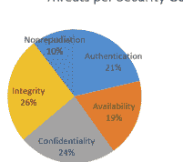

## 按物联网层划分的威胁

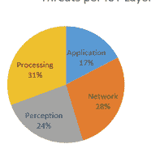

## 按安全目标划分的安全机制

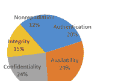

## 按物联网层划分的安全机制

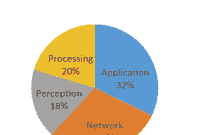

图 2. 按物联网层和安全目标划分的威胁与安全机制

## 区块链对物联网安全目标的影响

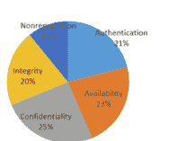

## 区块链对物联网层的影响

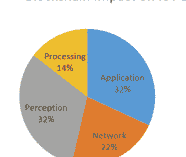

## 按重要程度划分的区块链特性


图 3. 区块链特性对物联网安全的影响

另一方面，数据完整性可以通过区块链的不可篡改特性来实现，该特性防止已注册的交易被更改（Moin et al., 2019）。此外，它有助于跟踪并执行来自各种设备的交易，从而消除物联网应用中的中心化服务器（Koshy et al., 2020）。

区块链系统在智能设备首次连接到系统时会分配一对唯一密钥（Yu et al., 2018）。这些密钥（公钥及其匹配的私钥）存储在区块链中（Yu et al., 2018），从而提供更高级别的安全性。然后设备可以自由相互交互，签名结合公钥可用于验证它们（Zhu and Badr, 2018; Yu et al., 2018）。区块链通过利用公钥获取特定身份的更多信息来帮助解决隐私问题（Alotaibi, 2019; Sun et al., 2017）。对称加密有助于实现


### 表 5. 区块链启用的安全机制

| 区块链特性 | 特性描述 | 区块链解决的安全威胁 | IoT 层 | 威胁应对方式 | 参考文献 |
| :--- | :--- | :--- | :--- | :--- | :--- |
| 账本 | (1) 账本充当存储区块链中数据交易的平台（2）它记录网络上发生的交易信息，并由网络成员共享（3）它不允许数据中的误解和错误身份验证 | 单点故障 | 感知与网络 | 消除了物联网的中央服务器概念，从而允许数据通过区块链的分布式账本进行每笔交易，并进行适当的身份验证 | Kumar and Mallick (2018) |
| | | 恶意攻击（代码和节点注入） | 感知与应用 | (1) 在无需涉及第三方的情况下确保有效身份验证，并维持所有相关交易的更高安全级别 | Kumar and Mallick (2018), Lee et al. (2020), Qian et al. (2018), Liu et al. (2019) |
| | | DDoS/DOS 攻击 | 网络与应用 | (2) 存储哈希值数据，确保在发生攻击时可进行哈希恢复 | |
| | | 节点捕获伪造 节点篡改 数据泄露给第三方 | 感知 应用 感知 处理 | (1) 区块链确保设备中存储信息的安全性和保密性（2）区块通过识别正确设备并通过加密通信进行处理，防止数据被泄露/被篡改 | Sultan et al. (2018), Lee et al. (2020) |
| | | 中间人攻击 | 处理 | 区块链通过创建由其他用户拥有和验证的分布式记录，消除了交易中对第三方的需求 | Kshetri et al. (2017) |
| 智能合约 | 智能合约是双方在进行任何交易之前达成的正式协议 | 淹没攻击（Hello 淹没攻击和云中的淹没攻击） | 网络与处理 | 它在访问资源前确保用户真实性，从而防止淹没攻击 | Pohrmen et al. (2019) |
| | 当特定条件触发时，智能合约执行相应的合同条款 | 窃听 | 网络 | 区块链通过使用加密密钥加密物联网数据来确保安全性 | Fernández and Fraga-Lamas (2018), Dai et al. (2019) |
| | 它们在无需第三方的情况下提高交易性能 | 钓鱼网站攻击 | 网络 | 实施访问控制策略，保护用户免受 DoS 和钓鱼攻击 | Zhu and Badr (2018), Wang et al. (2019) |
| | 它们旨在数字化验证交易的执行情况并验证设备之间的消息交换 | 女巫攻击 | 应用 | 智能合约优化用于区块链的安全协议，从而防止女巫攻击 | Altalibi (2019) |
| | | 节点篡改 | 感知 | 智能合约检测到任何新更改，并因此通知所有矿工 | Koshy et al. (2020) |
| | | 恶意节点注入 | 感知 | 通过确保交易准确性且无人为错误来增强数据完整性 | Yu et al. (2018), Liu et al. (2019) |
| | | 恶意攻击（节点和代码注入） | 感知与应用 | (1) 独立且自动执行，仅相关各方达成协议并执行，从而增强隐私性 | |
| | | 自私攻击 | 应用 | 智能合约有助于主机追踪任何非法信息，从而防止任何自私攻击。 | Zhu et al. (2018) |
| 去中心化 | 去中心化是将区块链中的活动重新分配的行为 | 节点和代码注入攻击 | 感知与应用 | 用于提供可信凭证并可信地传输访问信息 | Zhang et al. (2020) |
| | 区块链中的功能被重新分配 | 单点故障 | 感知与网络 | 消除中央机构，在参与者之间建立信任 | Pohrmen et al. (2019), Hassija et al. (2019), Banerjee et al. (2018) |
| | 去中心化消除中央机构，在区块链参与者之间建立信任 | WSN 节点干扰 女巫攻击 侧信道攻击 | 感知 | 消除单点故障 | Noor and Hassan (2019), Pohrmen et al. (2019), Makhdoom et al. (2020) |
| | 它确保物联网设备传输的数据在安全性、完整性和身份验证方面经过密码学验证 | 消息欺骗和欺骗攻击 DoS/DDoS 攻击 | 网络与应用 | 去中心化的区块链创建安全虚拟区域，事物可以在其中相互识别和信任，从而消除这些攻击的可能性。区块链的去中心化架构使安全解决方案具有最佳可扩展性，从而增强对 DoS 攻击的鲁棒性并解决单点故障和 IP 欺骗问题。 | Koutroump et al. (2018) |
| | | | 网络与应用 | 区块链有助于创建防篡改记录，使智能对象能够以更一致、更安全的方式访问数据 | Tariq et al. (2019), Main et al. (2019) |
| 零知识证明 | 它确保公有区块链中交易的保密性 | 节点篡改 身份伪造 拜占庭攻击 | 感知 应用 网络 | 允许在不揭示数据的情况下进行验证，从而防范攻击 | Wei et al. (2019) |
| 不可篡改性 | (1) 以无法接受系统更改的方式设计（2）确保存储的数据在节点之间受到信任 | 消息欺骗 | 网络 | 不可篡改性通过确保写入的任何数据都无法更改，来保证存储在区块链上的信息安全。（1）区块链的不可篡改性增强了信任，并允许在不篡改数据的情况下进行验证（2）通过应用无法轻易更改的加密机制防止节点篡改，除非拥有解密信息的密钥 | Milne et al. (2020), Moin et al. (2019) Noor and Hassan (2019), Ahmed et al. (2017) |
| 伪匿名性 | 它通过公钥识别区块链中的节点 | WSN 节点干扰 淹没攻击（Hello 淹没攻击和云中的淹没攻击）DoS/DDoS 攻击 | 感知 网络和处理 | 匿名化名称不关联参与节点的身份信息，从而防止攻击蔓延 | Kouicem et al. (2018) |
| 匿名性 | 它在不透露身份的情况下确保用户身份验证 | 窃听 女巫攻击 恶意攻击（节点和代码注入）节点篡改 | 网络与应用 感知与网络 应用 感知与应用 感知 | 它涉及节点协作验证方法，以防止与隐私侵犯相关的攻击；通过用户隐私保护防止安全威胁。 | Hui et al. (2019) Tariq et al. (2019) Hui et al. (2019) |
| 可追溯系统架构 | 解决发送方和接收方之间实时追踪一系列信息的质量问题 | | 感知 | 它通过防止区块链中恶意节点篡改数据来提供数据安全性 | |
| 共识机制和工作量证明（PoW） | 共识是指在记录交易时达成一致。它使用整个网络的计算能力来确保数据的不可篡改性 | (1) 虚假数据注入攻击（2）节点篡改 | 感知 | 帮助在节点之间建立信任，以确保数据交易不受干扰。即，它验证接收到的数据的完整性。 | Ferrag et al. (2019), Chen et al. (2020), Koshy et al. (2020) |
| | PoW 用于交叉检查所有交易是否来自正确来源，以避免叛徒 | DoS/DDoS 攻击 | 网络与应用 | 它涉及节点验证，因此有助于减少 DDoS 攻击 | Cao et al. (2019) |
| | | 中间人攻击 | 处理 | 区块链技术使用工作量证明来识别系统中发送消息的叛徒 | Hong et al. (2019) |
| | | 女巫攻击 | 应用 | 区块链通过内联块并利用 PoW 机制来解决女巫攻击 | Fernández and Fraga-Lamas (2018) |
| 链式结构 | 区块链是一种由许多存储交易的块组成的链式结构 | 单点故障 | 感知与网络 | 链式结构具有一个时间戳，用于确定块在给定目标下找到哈希所需的时间 | Chen et al. (2020) |
| 可扩展性 | 可扩展性是在区块链系统发生任何变化时扩展和改进的能力 | 单点故障 | 感知与网络 | 区块链易于扩展，因为边缘服务器提供代理，这些代理被分配给服务器以执行与区块链相关的任务 | Cao et al. (2019), Liu et al. (2019) |
| 容错性 | 容错性是系统承受任何错误的能力 | 节点篡改 | 感知 | 区块链系统的容错能力通过证书颁发机构得到增强，该机构有助于颁发数字证书，从而防止攻击者篡改数据 | Liu et al. (2019) |


数据隐私 (Yu et al., 2018)。密码学中的其他技术与区块链技术相结合，以实现完全匿名性 (Yu et al., 2018; Kaur et al., 2018)。零知识知识证明与论证是用于信息转换以向第三方隐藏交易信息的最佳工具 (Kaur et al., 2018)。最后，诸如公钥基础设施 (PKI) 和 ID 管理机制 (Makhdoum et al., 2020) 以及密码学 (Pohrmen et al., 2019; Jesus et al., 2018; Kshetrimayef, 2017) 等传统安全措施可以集成到区块链平台，以进一步增强其固有的安全架构，并保护其免受旁路攻击和欺骗等攻击。根据 Sun et al. (2017) 的研究，当关键位置信息在未经用户许可的情况下被使用（无论是通过追踪用户还是向第三方泄露其位置数据）时，可能会发生隐私攻击。他们的研究表明，由不可信服务提供商引起的位置隐私问题可以通过集成 IoT 和云计算来解决，这限制了提供商向第三方泄露敏感信息。

### 6.4 区块链导致的新型 IoT 安全威胁

#### 6.4.1 RQ4: 实施区块链以保护 IoT 生态系统时，是否会带来新的安全威胁？

文献综述未揭示在 IoT 中实施区块链时存在新的安全威胁，唯一例外的是一个被独特识别为由区块链触发的威胁 (参见 Moin et al., 2019)。IoT 设备生成的大量数据构成了最显著的漏洞。由于区块链需要时间来处理交易，大量数据会拖慢其性能。随着大量异构设备的存在，安全措施可能不足以处理大规模区块链。当针对不同数据的安全软件设计不当时，这会带来诸如恶意软件注入和后门安装等安全威胁。

## 7. 讨论

我们对文献的系统性综述提供了证据，表明区块链在优于传统和集中式 IoT 基础设施以及安全处理方面具有优势。区块链凭借其固有的设计特性，被发现能够解决文献中识别的 IoT 安全威胁 (参见表 5)。也许更重要的是，它提供了一种无法通过既定 IoT 安全方法实现的超强安全级别。确实，如表 5 所示，安全性在 IoT 设备的四个不同层面得到实现，并且根据现有文献 (参见第 6.3 节)，其安全级别得到了大幅提升。区块链独特的架构特征，结合密码学和其他借鉴的安全原则，为 IoT 生态系统提供了一个更强大的安全平台。然而，区块链技术实现的更高安全标准是以代价为前提的。本文的重点是提供 IoT 威胁的全面视图，以便识别和比较传统威胁对策与基于区块链的安全对策。在试图回答采用区块链技术来管理 IoT 安全所带来的新威胁问题时，许多作者强调了行业广泛接受所面临的重大障碍。根据 Jesus et al. (2018)，IoT 设备是低功耗、低计算技术。因此，很少有资源专门用于确保其安全性 (Jesus et al., 2018)。由于其账本式、去中心化和固有安全原则，区块链有望成为 IoT 的主要基础设施。但是，在当前格式中，区块链是一项重型技术。它耗时、能源效率低、需要过多存储并产生大量带宽。这些特性与 IoT 等低资源技术相冲突。

### 7.1 时间消耗

区块链网络交易可能很麻烦，由于去中心化的复杂性，处理日志交易通常需要数小时 (Moin et al., 2019)。识别和计算区块链网络大型数据集的头到头信息会消耗大量时间 (Moin et al., 2019)。对于某些区块链技术，交易验证可能需要长达 10 分钟，从而为实时应用 (Kouicem et al., 2018)（例如患者健康追踪或危险检测和通信）带来问题。此外，处理时间存在差异。这种差异是由网络中设备的计算能力造成的 (Kumar and Mallick, 2018)。具有不同计算能力的设备加密数据所需的时间不同，因此处理时间存在差异 (Kumar and Mallick, 2018)。假设运行在共享区块链网络上的 IoT 设备具有相似的处理能力是不现实的。

### 7.2 带宽消耗

区块链消耗大量带宽来验证 IoT 设备生成的许多交易 (Kouicem et al., 2018)。新的区块链交易需要广播到所有对等节点，这导致巨大的通信开销。此外，所有对等节点都需要同步并保留区块链副本，进一步增加开销 (Sengupta et al., 2020)。确实，区块链吞吐量低影响其在大规模 IoT 生态系统中广泛应用的扩展能力 (Dai et al., 2019; Kumar and Mallick, 2018)。

### 7.3 能耗

大多数流行的区块链技术需要执行多次计算以达成共识，从而导致能源浪费 (Sengupta et al., 2020)。在提供更高安全性的同时，多次向对等节点运行验证算法会大幅增加能耗并降低运营效率 (Sengupta et al., 2020)。

### 7.4 存储消耗

在一个节点中存储所有交易的要求由于分布式存储的特性而引入了过度系统存储的问题 (Yang et al., 2019; Kumar and Mallick, 2018)。起初大小可能可以管理，但随着时间的推移，区块链可能会增长到小型低成本 IoT 设备无法处理的不可接受的程度。例如，比特币区块链从 2013 年的 6 千兆字节增长到 2020 年的惊人 270 千兆字节 [1]。话虽如此，增强的安全性体现在这些区块链特性中，例如不可更改性。

## 8. 未来研究

尽管区块链在解决 IoT 安全问题方面具有上述能力，但在物理上保护 IoT 设备免遭破坏或篡改方面仍然不足。如果没有健全的物理安全策略，攻击者可以通过任何 IoT 设备物理访问 IoT 网络 (Yang et al., 2017)。根据 Asif et al. (2021)，物理安全攻击主要分为两类：入侵性攻击和非入侵性攻击。前者涉及对处理器的直接操纵，而后者要求攻击者靠近设备，以了解其规格并修改其代码来窃取关键信息。

我们的文献综述表明，鉴于相关研究在这方面缺乏关注，区块链技术作为 IoT 设备物理安全渠道存在不足。未来关于面向 IoT 的区块链的研究也应专注于保护连接设备的物理环境。继续保护环境至关重要，因为连接基础设施的增加会增加物理网络安全漏洞的风险。为此，可以实施混合技术，即将区块链安全功能与传统安全机制相结合，这使其成为一个有前景的未来研究课题。IoT 设备可以向其 IoT 生态系统发出入侵干扰信号，由中央机构进行物理验证。黑客进行入侵性攻击所需的设备规格可以对附近攻击者隐藏，这可以通过修改过的区块链生态系统来补充，以检测其网络中停止服务或可能被篡改的 IoT 设备。

我们致力于系统性地审查关于区块链支持的 IoT 安全的相关文献，得出了一份全面的 IoT 安全威胁框架，以及解决这些威胁的传统和区块链机制。现有研究并未采取整体方法来探讨区块链技术如何整体解决 IoT 安全问题，而是专注于区块链具有更优影响的特定威胁。因此，我们的框架可用于进一步将 IoT 安全作为一个系统进行研究。具体而言，未来研究可以实证考察，智能且经济地结合传统机制与区块链功能的 IoT 生态系统，是否确实比仅使用传统 IoT 安全方法或区块链技术更受保护。话虽如此，在 IoT 生态系统中实施区块链技术时，应更多地关注根据其意图支持的行业需求来评估安全性。换言之，不存在足够通用以适用于所有 IoT 的区块链。需要一种配置方法，将 IoT 安全要求与不同区块链功能的资源消耗相匹配，以便在安全性、效率和可行性之间实现适当的平衡。

## 9. 结论

区块链技术有潜力克服上述挑战，并在实施大规模 IoT 生态系统时成为首选技术。我们的文献综述表明，该技术可以以绝对优势解决 IoT 设备面临的大量安全威胁。此外，作为一种新颖的技术架构，区块链目前尚未衍生出值得提及的新安全威胁。话虽如此，该技术在当前形式和原则下需要大量的能源、存储、带宽和时间资源。IoT 生态系统（尤其是供应链、医疗保健和智能生活等领域）由于 IoT 基础设施低成本、低资源的前提，目前尚无法承担这些资源。为此，有必要进行大规模改造以使区块链适应各种行业和场景。例如，在私有（可信）IoT 生态系统中，去中心化共识机制可能不是必需的；从而减少了时间和能源浪费。关于区块链不断增长的大小问题，分叉（和自我分叉）可以帮助将区块链存储要求降低到可管理的规模 (Magnani et al., 2018; Basu, 2019)。

## 注释

- 1. https://www.statista.com/statistics/647523/worldwide-bitcoin-blockchain-size/

## 参考文献

Abou Jaoude, J.S.R.G. (2019), “区块链应用 - 在不同领域的使用”, IEEE Access, Vol. 7, pp. 45360-45381, doi: 10.1109/access.2019.2902501.

Ahmed, A.W., Ahmed, M.M., Khan, O.A. and Shah, M.A. (2017), “IoT 安全威胁及其对策的全面分析”, International Journal of Advanced Computer Science and Applications, Vol. 8 No. 7, pp. 489-501, doi: 10.14569/IJACSA.2017.080768.


Alaba, F.A., Othman, M., Hashem, I.A.T. and Alotaibi, F.（2017年），“物联网安全：综述”，《网络与计算机应用期刊》，第88卷，第10-28页。

Ali, M.S., Vecchio, M., Pincheira, M., Dolui, K., Antonelli, F. and Rehmani, M.H.（2018年），“区块链在物联网中的应用：综合综述”，《IEEE通信调查与教程》，第21卷第2期，第1676-1717页，doi: 10.1109/COMST.2018.2886932。

Alotaibi, B.（2019年），“利用区块链克服物联网中的网络安全问题：综述”，《IEEE传感器期刊》，第19卷第23期，第10953-10971页，doi: 10.1109/JSEN.2019.2935035。

Asif, R., Ghanem, K. and Irvine, J.（2021年），“Proof-of-PUF 启用的区块链：面向能源互联网的并发数据与设备安全”，《传感器》，第21卷第1期，第28页。

Banerjee, M., Lee, J. and Choo, K.K.R.（2018年），“面向物联网安全的区块链未来：立场文件”，《数字通信与网络》，第4卷第3期，第149-160页，doi: 10.1016/j.dcan.2017.10.006。

Basu, S.（2019年），“自分叉区块链协议的系统与方法（美国专利号 20190123892）”，0Chain, LLC，圣何塞，CA，可于以下网址查阅：https://patentimages.storage.googleapis.com/71/a7/f6/238d8f969eada2c/US10986117.pdf。

Burgess, M.（2018年），“什么是物联网？WIRED 为您解读”，可于以下网址查阅：www.wired.co.uk/article/internet-of-things-what-is-explained-iot（访问日期：2020年6月10日）。

Burhan, M., Rehman, R.A., Khan, B. and Kim, B.S.（2018年），“物联网元素、分层架构与安全问题：综合综述”，《传感器（巴塞尔）》，第18卷第9期，第2796页，PMID: PMC6165453，doi: 10.3390/s18092796.PMID:30149582。

Cao, B., Li, Y., Zhang, L., Zhang, L., Mumtaz, S., Zhou, Z. and Peng, M.（2019年），“当物联网遇上区块链：分布式共识面临的挑战”，《IEEE网络》，第33卷第6期，第133-139页，doi: 10.1109/MNET.2019.1900002。

Chang, V., Baudier, P., Zhang, H., Xu, Q., Zhang, J. and Arami, M.（2020年），“区块链如何影响金融服务——专家访谈的概述、挑战与建议”，《技术预测与社会变革》，第158卷，第120166页。

Chanson, M.B.A., Bilgeri, D., Fleisch, E. and Wortmann, F.（2019年），“面向物联网的区块链：传感器数据的隐私保护”，《信息系统协会期刊》，第20卷第9期，第1274-1309页，doi: 10.17705/1jais.00567。

Chen, Y.J., Wang, L.C. and Wang, S.（2020年），“面向物联网数据完整性的随机区块链”，《IEEE网络科学与工程汇刊》，第7卷第1期，第373-384页，doi: 10.1109/TNSE.2018.2887236。

Crosby, M., Pattanayak, P., Verma, S. and Kalyanaraman, V.（2016年），“区块链技术：超越比特币”，《应用创新》，第2卷第6-10期，第71页。

Dai, H.N., Zheng, Z. and Zhang, Y.（2019年），“面向物联网的区块链：综述”，《IEEE物联网期刊》，第6卷第5期，第8076-8094页，doi: 10.1109/JIOT.2019.2920987。

Dujak, D. and Sajter, D.（2019年），“供应链中的区块链应用”，载于：SMART供应网络，Springer，Cham，第21-46页。

Fernández-Caramés, T.M. and Fraga-Lamas, P.（2018年），“关于在物联网中使用区块链的综述”，《IEEE Access》，第6卷，第32979-33001页，doi: 10.1109/ACCESS.2018.2842685。

Ferrag, M.A., Derdour, M., Mukherjee, M., Derhab, A., Maglaras, L.A. and Janicke, H.（2019年），“面向物联网的区块链技术：研究问题与挑战”，《IEEE物联网期刊》，第6卷，第2188-2204页，doi: 10.1109/jiot.2018.2882794。

Ferrag, M.A., Shu, L., Yang, X., Derhab, A. and Maglaras, L.（2020年），“基于绿色物联网的农业安全与隐私：综述、区块链解决方案与挑战”，《IEEE Access》，第8卷，第32031-32053页，doi: 10.1109/ACCESS.2020.2973178。

Firdaus, A.A.R.M.F., Feizollah, A., Hashem, I.A.T., Hazim, M. and Anuar, N.B.（2019年），“‘区块链’的兴起：区块链研究的文献计量分析”，《计量科学》，第120卷第3期，第1289-1331页，doi: 10.1007/s11192-019-03170-4。

Goranović, A., Meisel, M., Fotiadis, L., Wilker, S., Treytl, A. and Sauter, T.（2017年），“微电网中的区块链应用：当前项目和概念概述”，载于：IECON 2017 - 第43届IEEE工业电子学会年会，IEEE，第6153-6158页。

Griggs, K.N., Ossipova, O., Kohlios, C.P., Baccarini, A.N., Howson, E.A. and Hayajneh, T.（2018年），“使用智能合约的安全自动化远程患者监护医疗区块链系统”，《医学系统期刊》，第42卷第7期，第130页。

Hassija, V., Chamola, V., Saxena, V., Jain, D., Goyal, P. and Sikdar, B.（2019年），“物联网安全综述：应用领域、安全威胁与解决方案架构”，《IEEE Access》，第7卷，第82721-82743页，doi: 10.1109/ACCESS.2019.2924045。

Hong, HHB. and Sun, Z.X.（2019年），“基于区块链的窄带物联网安全可问责数据传输”，《国际分布式传感器网络杂志》，第15卷第4期，第10页，doi: 10.1177/1550147719842725。

Hui, H., An, X., Wang, H., Ju, W., Yang, H., Gao, H. and Lin, F.（2019年），“面向物联网的区块链综述”，《互联网服务与信息安全期刊》，第9卷第2期，第1-30页。

Jain, S.（2020年），《区块链能否加速物联网（IoT）采用？》，Deloitte，可于以下网址查阅：https://www2.deloitte.com/ch/en/pages/innovation/articles/blockchain-accelerate-iot-adoption.html（访问日期：2020年6月10日）。

Jesus, E., Chicarino, V., de Albuquerque, C. and Rocha, A.（2018年），“如何使用区块链保护物联网及女巫攻击的综述”，《安全与通信网络》，第27卷，doi: 10.1155/2018/9675050。

Ji, Z., Chang, V., Lan, H., Robert Hsu, C.H. and Valverde, R.（2020年），“中国区块链行业中Fama-French三因子模型与情感相关四因子模型的实证研究”，《可持续性》，第12卷第12期，第5170页。

Kamran, M.K.H.U., Nisar, W., Farooq, M. and Rehman, S.U.（2020年），“区块链与物联网：文献计量研究”，《计算机与电气工程》，第81卷，第12页，doi: 10.1016/j.compeleceng.2019.106525。

Kaur, H., Alam, M.A., Jameel, R., Mourya, A.K. and Chang, V.（2018年），“云环境中基于区块链的异构医疗数据拟议解决方案与未来方向”，《医学系统期刊》，第42卷第8期，第1-11页。

Koshy, P., Babu, S. and Manoj, B.S.（2020年），“面向物联网的滑动窗口区块链架构”，《IEEE物联网期刊》，第7卷第4期，第3338-3348页，doi: 10.1109/JIOT.2020.2967119。

Kouicem, D.E., Bouabdallah, A. and Lakhlief, H.（2018年），“物联网安全：自顶向下综述”，《计算机网络》，第141卷，第199-221页，doi: 10.1016/j.comnet.2018.03.012。

Kshetri, N.（2017年），“区块链能否加强物联网？”，《IT专业人员》，第19卷第4期，第68-72页，doi: 10.1109/MITP.2017.3051335。

Kumar, N.M. and Mallick, P.K.（2018年），“面向物联网安全问题与挑战的区块链技术”，《计算机科学前沿》，第132卷，第1815-1823页，doi: 10.1016/j.procs.2018.05.140。

Kuo, T.T., Kim, H.E. and Ohno-Machado, L.（2017年），“面向生物医学和医疗保健应用的区块链分布式账本技术”，《美国医学信息学协会期刊》，第24卷，第1211-1220页，doi: 10.1093/jamia/ocx068。

Lakhani, M.J., Wang, S., Urbański, M. and Egorova, M.（2020年），“可持续B2B电子商务与基于区块链的供应链金融”，《可持续性》，第12卷，第3968页。

Lee, Y., Rathore, S., Park, J.H. and Park, J.H.（2020年），“基于区块链的智能家居网关架构用于防止数据篡改”，《人中心计算与信息科学》，第10卷第1期，第1-14页，doi: 10.1186/s13673-020-0214-5。

Lei, A., Cruickshank, H., Cao, Y., Asuquo, P., Ogah, C.P.A. and Sun, Z.（2017年），“面向异构智能交通系统的基于区块链的动态密钥管理”，《IEEE物联网期刊》，第4卷第6期，第1832-1843页，doi: 10.1109/JIOT.2017.2740569。

Liu, H.Z.Y. and Yang, T.（2018年），“电动汽车云和边缘计算中的区块链赋能安全”，《IEEE网络》，第32卷第3期，第78-83页，doi: 10.1109/mnet.2018.1700344。

Liu, Y., Wang, K., Qian, K., Du, M. and Guo, S.（2019年），“Tornado：通过空间结构方法在异构物联网中实现区块链”，《IEEE物联网期刊》，第7卷第2期，第1273-1286页，doi: 10.1109/JIOT.2019.2954128。

Magnani, A., Calderoni, L. and Palmieri, P.（2018年），“以轻量分叉为正向力量：在基于区块链的智能电网中激励绿色能源生产”，载于：第1届分布式系统加密货币与区块链研讨会论文集，第99-104页。

Makhdoom, I., Zhou, I., Abolhasan, M., Lipman, J. and Ni, W.（2020年），“PrivySharing：面向智慧城市隐私保护与安全数据共享的基于区块链框架”，《计算机与安全》，第88卷，第101653页，doi: 10.1016/j.cose.2019.101653。

Mendez, D.M., Papapanagiotou, I. and Yang, B.（2017年），“物联网：安全与隐私综述”，《信息安全期刊》，第27卷第3期，第162-182页，doi: 10.1080/19393555.2018.1458258。

Milne, A.M., Beckman, A. and Kumar, P.（2020年），“由区块链驱动的网络物理信任系统”，《IEEE Access》，第8卷，第66423-66437页，doi: 10.1109/ACCESS.2020.2984675。

Moin, S.K.A., Safdar, Z., Safdar, K., Ahmed, E. and Imran, M.（2019年），“分布式区块链中的物联网安全：分析、要求与开放问题”，《未来生成计算机系统-国际电子科学杂志》，第100卷，第325-343页，doi: 10.1016/j.future.2019.05.023。

Navlani, A.（2019年），《使用 NLTK 进行初学者文本分析》，可于以下网址查阅：https://www.datacamp.com/community/tutorials/text-analytics-beginners-nltk（访问日期：2020年6月14日）。

Noor, M. and Hassan, W.（2019年），“物联网（IoT）安全的当前研究：综述”，《计算机网络》，第148卷，doi: 10.1016/j.comnet.2018.11.025。

Okoli, C. and Schabram, K.（2010年），“信息系统研究系统文献综述指南”，《SSRN电子期刊》，第10卷，doi: 10.2139/ssrn.1954824。

Orabi, M., Mouheb, D., Al Aghbari, Z. and Kamel, I.（2020年），“社交媒体中机器人检测：系统综述”，《信息处理与管理》，第57卷，doi: 10.1016/j.ipm.2020.102250。

Pohrmen, F.H., Das, R.K. and Saha, G.（2019年），“异构物联网网络中基于区块链的安全方面：综述”，《新兴电信技术汇刊》，第30卷第10期，第 e3741 页。

Qian, Y.F.J., Y.Y., Chen, J., Zhang, Y., Song, J., Zhou, M. and Pustisek, M.（2018年），“迈向去中心化物联网安全增强：区块链方法”，《计算机与电气工程》，第72卷，第266-273页，doi: 10.1016/j.compeleceng.2018.08.021。

Rathore, S.K.B.W. and Park, J.H.（2019年），“BlockSecIoTNet：面向物联网网络的基于区块链的去中心化安全架构”，《网络与计算机应用期刊》，第143卷，第167-177页，doi: 10.1016/j.jnca.2019.06.019。

Reyna, A.M.C., Chen, J., Soler, E. and Diaz, M.（2018年），“论区块链及其与物联网的集成：挑战与机遇”，《未来生成计算机系统-国际电子科学杂志》，第88卷，第173-190页，doi: 10.1016/j.future.2018.05.046。

Sengupta, J., Rui, S. and Bit, S.D.（2020年），“面向物联网和工业物联网的攻击、安全问题与区块链解决方案综合综述”，《网络与计算机应用期刊》，第149卷，第102481页，doi: 10.1016/j.jnca.2019.102481。

Shi, X., Cao, J., Lu, T. and Chang, V.（2019年），“智能医疗中RFID安全与隐私综述：威胁与防护”，载于：IoTBDs，第278-285页。


- Si, H.P.S., C.X., Li, Y.L., Qiao, H.B. and Shi, L. (2019), “基于区块链技术的物联网信息共享安全机制”, 未来一代计算机系统—电子科学国际期刊, Vol. 101, pp. 1028-1040, doi: 10.1016/j.future.2019.07.036.

- Siddiqi, S. and Sharan, A. (2015), “关键词和关键短语提取技术：文献综述”, 计算机应用国际期刊, Vol. 109 No. 2, pp. 18-23, doi: 10.5120/19161-0607.

- Sultan, A., Malik, M.S.A. and Mushtaq, A. (2018), “基于区块链技术特征的物联网安全问题及其解决方案：系统文献综述”, 计算机科学与信息技术美国期刊, Vol. 6 No. 3, p. 27, doi: 10.21767/2349-3917.100027.

- Sun, G., Chang, V., Ramachandran, M., Sun, Z., Li, G., Yu, H. and Liao, D. (2017), “面向物联网（IoT）服务和应用的高效位置隐私算法”, 网络与计算机应用期刊, Vol. 89, pp. 3-13.

- Tapscott, A. and Tapscott, D. (2017), “区块链如何改变金融”, 哈佛商业评论, 芝加哥, Vol. No. 9, p. 25.

- Tariq, N., Asim, M., Al-Obeidat, F., Zubair Farooqi, M., Baker, T., Hammoudeh, M. and Ghafir, I. (2019), “面向包括区块链的雾计算启用物联网应用中的大数据安全：一项调查”, 传感器, Vol. 19 No. 8, p. 1788, doi: 10.3390/s19081788.

- Tian, F. (2017), “基于HACCP、区块链和物联网的食品安全供应链可追溯系统”, 2017年服务系统与服务管理国际会议, IEEE, pp. 1-6.

- Wang, X., Zha, X., Ni, W., Liu, R.P., Guo, Y.J., Niu, X. and Zheng, K. (2019), “面向物联网的区块链综述”, 计算机通信, Vol. 136, pp. 10-29, doi: 10.1016/j.comcom.2019.01.006.

- Wei, L.J.W.J., Long, C.N. and Lin, Y.B. (2019), “物联万物与区块链的融合：安全挑战”, IT专业人员, Vol. 21 No. 5, pp. 26-32, doi: 10.1109/mitp.2019.2923602.

- Yang, K., Blaauw, D. and Sylvester, D. (2017), “超低功耗物联网系统硬件安全设计：概述与综述”, IEEE微型计算机, Vol. 37 No. 6, pp. 72-89.

- Yang, W., Aghasian, E., Garg, S., Herbert, D., Disiota, L. and Kang, B. (2019), “基于区块链的互联网服务架构综述：要求、挑战、趋势与未来”, IEEE访问期刊, Vol. 7, pp. 75845-75872, doi: 10.1109/ACCESS.2019.2917562.

- Yu, Y., Li, Y., Tian, J. and Liu, J. (2018), “面向物联网安全与隐私问题的基于区块链的解决方案”, IEEE无线通信, Vol. 25 No. 6, pp. 12-18, doi: 10.1109/mwc.2017.1800116.

- Zhang, Y., Li, B., Liu, B., Wu, J., Wang, Y. and Yang, X. (2020), “面向物联网设备的利用区块链的基于属性的协同访问控制方案”, 电子学报, Vol. 9 No. 2, p. 285, doi: 10.3390/electronics9020285.

- Zhu, X. and Badr, Y. (2018), “面向物联网的身份管理系统：迈向区块链解决方案的调查”, 传感器, Vol. 18 No. 12, p. 4215, doi: 10.3390/s18124215.

- Zhu, K., Chen, Z., Yan, W. and Zhang, L. (2018), “命名数据物联网中的安全攻击及其区块链解决方案”, IEEE物联网杂志, Vol. 6 No. 3, pp. 4733-4741, doi: 10.1109/JIOT.2018.2877647.

## 进一步阅读

- Chang, V., Sun, G. and Li, J. (2018), “客座编辑：物联网（IoT）多媒体的安全与隐私”, 多媒体工具与应用, Vol. 77 No. 14, pp. 18201-18202.

## 附录

### 摘要分析

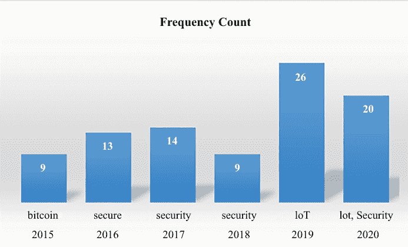

图 A1. 摘要中最高频关键词

| 年份 | 词 (n = 1) | 频次 | 双词 (n = 2) | 频次 | 三词 (n = 3) | 频次 |
| :--- | :--- | :--- | :--- | :--- | :--- | :--- |
| 2020 | IoT | 20 | 智能合约 | 10 | 物联网 IoT | 5 |
| | 安全 | 20 | 供应链 | 10 | 权限访问控制 | 4 |
| | 管理 | 17 | 智能电网 | 7 | 供应链管理 | 3 |
| | 云 | 16 | 互联网事物 (6 + 5) 11 | | 互操作性 | 2 |
| | 健康 | 13 | 事物 IoT | | 安全隐私验证 | 2 |
| | | | | | 学术记录 | 5 |
| 2019 | IoT | 26 | 访问控制 | 10 | 物联网 IoT | 5 |
| | 安全 | 22 | 互联网事物 | 8 | CL-PKX 方案 | 3 |
| | 医疗保健 | 17 | 事物 IoT | 5 | 身份管理系统 | 2 |
| | 互联网 | 14 | 安全隐私 | 4 | 风险缓解系统 | 2 |
| | 隐私 | 11 | 医疗保健应用 | 4 | 细粒度访问控制 | 2 |
| 2018 | 安全 | 9 | 安全隐私 | 5 | 物联网 IoT | 2 |
| | 贸易 | 7 | 矿工 | 2 | 代币支付 | 2 |
| | IoT | 6 | 交易 | 2 | 系统 | |
| | | | 交易 | 2 | 政府 | 1 |
| | 监控 | 6 | 矿工 | 2 | 法律法规 | 1 |
| | 隐私 | 5 | 事物 IoT | 2 | 法律法规 | 1 |
| | | | | | 消费者 | 1 |
| | | | | | 法律消费者 | 1 |
| | | | | | 非法 | 1 |
| 2017 | 安全 | 14 | 互联网事物 | 5 | 可信第三方 | 3 |
| | 健康 | 11 | 安全隐私 | 3 | 云服务 | 2 |
| | 隐私 | 11 | 智能合约 | 3 | 提供者 | |
| | 共识 | 10 | P2P 交易 | 3 | 交易 | 2 |
| | 访问 | 9 | 交易安全 | 3 | 安全隐私 | 2 |
| | | | | | 保护 | 2 |
| | | | | | 双重拍卖 | 2 |
| | | | | | 机制 | 2 |
| 2016 | 安全欺诈 | 13 | 主观欺诈 | 2 | 物联网 IoT | 2 |
| | | 13 | 客观欺诈 | 2 | 可信数字 | 2 |
| | 医疗保健 | 13 | 伪装攻击 | 2 | 记录 | 2 |
| | IoT | 9 | 白化攻击 | 2 | 比特币业务 | 1 |
| | 隐私 | 7 | 女巫攻击 | 2 | 互联网业务互联网 | 1 |
| | | | | | 确保 | 1 |
| | | | | | 互联网确保安全 | 1 |
| 2015 | 比特币 | 9 | 信任 | 1 | 信任比特币 | 1 |
| | | | 比特币 | 1 | 安全 | 1 |
| | 安全 | 2 | 比特币安全 | 1 | 比特币安全资金 | 1 |
| | 矿工 | 2 | 安全资金 | 1 | 资金风险 | 1 |
| | 加密 | 2 | 资金风险 | 1 | 安全资金风险资金风险双重 | 1 |

表 A1. 摘要中最高频的前五个术语

### 关键词分析

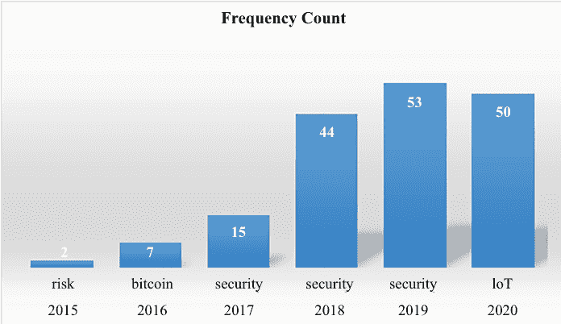

图 A2. 关键词中最高频词汇

| 年份 | 词 (n = 1) | 频次 | 双词 (n = 2) | 频次 |
| :--- | :--- | :--- | :--- | :--- |
| 2020 | IoT | 50 | 互联网事物 | 34 |
| | 安全 | 47 | 供应链 | 21 |
| | 隐私 | 35 | 智能合约 | 19 |
| | 加密 | 31 | 事物 IoT | 16 |
| | 合约 | 29 | 智能电网 | 12 |
| 2019 | 安全 | 53 | 互联网事物 | 33 |
| | 互联网 | 51 | 商业经济学 | 28 |
| | 管理 | 45 | 供应链 | 20 |
| | 智能 | 39 | 公钥 | 15 |
| | 业务 | 39 | 智能合约 | 15 |
| 2018 | 安全 | 44 | 智能合约 | 24 |
| | 比特币 | 41 | 商业经济学 | 21 |
| | 互联网 | 36 | 互联网事物 | 17 |
| | 管理 | 34 | 供应链 | 11 |
| | 身份验证 | 33 | 访问控制 | 11 |
| 2017 | 安全 | 15 | 互联网事物 | 9 |
| | 隐私 | 15 | 供应链 | 7 |
| | 互联网 | 14 | 智能合约 | 7 |
| | 比特币 | 14 | 政府法律 | 7 |
| | 事物 | 10 | 访问控制 | 5 |
| 2016 | 比特币 | 7 | 互联网事物 | 3 |
| | 网络 | 5 | IoT 智能 | 2 |
| | 隐私 | 4 | 医疗保健 | 2 |
| | 财务 | 4 | 电子安全 | 1 |
| | 数字 | 4 | 安全比特币 | 1 |
| | 风险 | 2 | 计算机犯罪 | 1 |
| | 计算机 | 1 | 犯罪加密 | 1 |
| 2015 | 犯罪 | 1 | 加密电子 | 1 |
| | 加密 | 1 | 电子系统 | 1 |

表 A2. 关键词中最高频的前五个词汇

### 标题分析

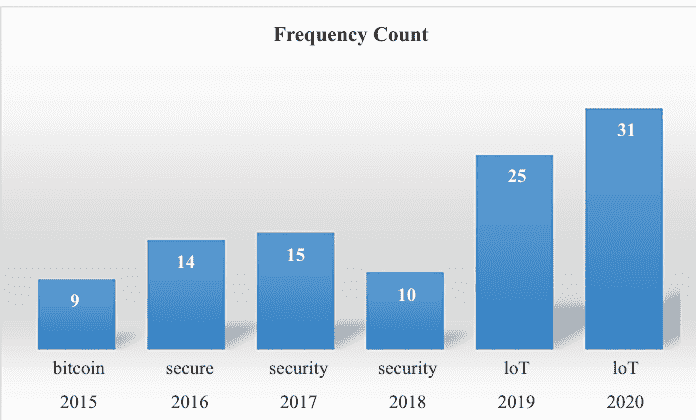

图 A3. 标题中最高频词汇


| 年份 | 词 (n = 1) | 频次计数 | 词 (n = 2) | 频次计数 |
|---|---|---|---|---|
| 2020 | 物联网 | 31 | 供应链 | 30 |
| | 安全 | 30 | 物联网 | 22 |
| | 云 | 22 | 边缘计算 | 18 |
| | 健康 | 19 | 智能合约 | 13 |
| | 供应 | 15 | 数据共享 | 11 |
| 2019 | 物联网 | 25 | 物联网 | 10 |
| | 互联网 | 21 | 安全物联网 | 7 |
| | 安全 | 17 | 物联网事物 | 6 |
| | 医疗保健 | 14 | 访问控制 | 4 |
| | 隐私 | 10 | 医疗保健应用 | 4 |
| 2018 | 安全 | 10 | 安全隐私 | 6 |
| | 商业 | 7 | 商业物联网 | 4 |
| | 物联网 | 6 | 物联网事物 | 3 |
| | 隐私 | 5 | 物联网 | 2 |
| | 风险 | 4 | 隐私事物 | 2 |
| 2017 | 安全 | 15 | 物联网 | 5 |
| | 互联网 | 12 | 安全隐私 | 4 |
| | 隐私 | 11 | 智能合约 | 3 |
| | 健康 | 10 | 交易安全 | 1 |
| | 比特币 | 9 | 健康安全 | 1 |
| 2016 | 安全的 | 14 | 物联网欺诈 | 3 |
| | 物联网 | 13 | 云物联网 | 2 |
| | 风险 | 12 | 健康攻击 | 2 |
| | 健康 | 9 | 隐私事物 | 1 |
| | 隐私 | 8 | 智能合约 | 1 |
| 2015 | 比特币 | 9 | 信任比特币 | 3 |
| | 安全 | 6 | 比特币安全 | 2 |
| | 风险 | 3 | 安全资金 | 2 |
| | 加密货币 | 2 | 资金风险 | 1 |
| | 信任 | 2 | 风险双重 | 1 |

# 大数据分析能力的后续因素：企业在竞争场景中如何使用数据

Luis Hernan Contreras Pinochet, Guilherme de Camargo Belli Amorim and Durval Lucas Júnior

圣保罗联邦大学工商管理学院，巴西圣保罗，以及 Cesar Alexandre de Souza 工商管理学院，圣保罗大学，巴西圣保罗

## 摘要

**目的** – 本文的目的是分析企业在竞争场景中大数据分析能力的后续因素，使用不同的分析模型。
**设计/方法论/方法** – 该研究采用定量方法，使用位于巴西圣保罗州的企业数据调查。结构方程建模（SEM）用于验证模型。
**发现** – 结果显示，所有假设均被接受。商业价值是模型中解释力最强的构念。有必要在分析工具以及接受过这些模型分析培训的人才方面投入更多，同时还需要转变思维，这将决定企业战略决策的偏向。大数据分析在企业日益增长的投资中显而易见，特别是那些在复杂且快节奏环境中运营的企业。
**实际意义** – 所提出的理论模型使得可以验证企业的分析结构，以及它们是否更有能力实时分析客户数据和信息、生成洞察并实施解决方案，以维持和提升其市场地位。
**独创性/价值** – 本文的贡献在于提出一项扩展文献中研究模型的建议，这些文献分析了“大数据分析能力”与“产品创新绩效”之间的直接和间接关系。

**关键词** 大数据分析能力，产品创新绩效，面向流程的动态能力，商业价值
**论文类型** 研究论文

## 1. 引言

在持续技术变革的世界中，创新是企业经济增长和生存的决定性因素。创新有能力预测哪些技术可能改变一个行业，创造市场并提高业务的可及性和可行性。组织必须仔细分析环境以检测变化、传播知识并根据将为客户创造价值的内容进行调整。这意味着采用和管理诸如大数据分析能力（Hilbert and Lopez, 2011; Singh and El-Kassar, 2018; Wamba et al., 2017; Warner and Wäger, 2019）之类的新技术。

企业面临越来越大的压力，需要在高度互联和动态的全球环境中做出快速反应和持续适应。必须开发分析技能，使结果成为管理、学习和流程重构过程的结合（Bhimani and Willcocks, 2014）。组织正在创建或开发其产品和服务，但采用能够在组织结构变革视角下提升绩效、生产力、敏捷性和有效性的数据分析（Chang, 2017; Larson and Chang, 2016）。


大数据是一组需要特殊工具进行分析的大量数据。此外，它已成为企业各个层面决策的重要组成部分，而在管理流程不得不改变的情况下，这导致了企业大多数业务职能的变化（Mikalef et al., 2019a, b; Sena et al., 2019; Gupta et al., 2020）。

从管理角度来看，大数据工具在要求组织进行“新流程”的组织重构过程中的相关性显而易见，这要求从物流到沟通实现数字化绩效。此外，有兴趣在其业务中使用大数据分析能力工具的组织应最初在流程中定义其目标。这些目标应与组织本身的目标保持一致。这保证了工具及其属性的选择是其分析中最合适的（Aydiner et al., 2019; Subramaniam et al., 2019）。为了利用大数据分析能力的优势，越来越需要实施智能系统和计算技术，这些技术可以降低在高计算能力设备和分析软件中访问和处理大量数据的认知负荷（Birek et al., 2018; Dubey et al., 2019）。此外，大数据的真正潜力不在于大数据的 V，而在于企业在不同类型的分析方法中拥有的可负担性和知识（Markus, 2015）。

本文的目的是分析企业在竞争场景中大数据分析能力的后续因素，使用不同的分析模型。为此，在这项定量研究中，我们对位于巴西圣保罗州的企业（在其产品和服务开发创新方面处于领先地位）进行了调查（n = 141）。

这项研究的动机源于文献综述，旨在识别企业创建大数据分析能力及其预期结果所需的其他几种资源（Gupta and George, 2016; Mikalef et al., 2019a, b; Gupta et al., 2020）。

本文的贡献是基于 Hooi and Abu (2018) 的模型研究，提出扩展研究模型的建议，该研究分析了“大数据分析能力”与“产品创新绩效”之间的关系，同时还识别了影响企业大数据倡议成功的其他因素（LaValle et al., 2011）。作者审查了 Hannachi (2015) 和 Gunday et al. (2011) 的研究，以改进“大数据分析能力”构念；审查了 Wang et al. (2012) 和 Wamba et al. (2017) 的研究，用于“产品创新绩效”构念，并基于 Kim et al. (2011) 构建了“面向流程的动态能力”构念。此外，作者考察了大数据分析能力与“商业价值”之间的关系，如 Akter et al. (2017) 在文献中所观察到的。

本文以下部分对上述观点进行了详细阐述。在第 2 节中，我们概述了大数据分析能力、大数据在商业中的应用以及产品创新绩效的文献，重点介绍了该领域的主要研究以及本研究意在解决的现有差距。接下来，在第 3 节中，我们介绍了研究假设和研究模型的构建。第 4 节概述了研究的一般方法，并描述了研究方法和数据收集。第 5 节介绍了结果和分析。最后，在第 6 节中，讨论了结果。在第 7 节中，介绍了研究意义和结论，分为突出的理论意义和实际意义，以及局限性和未来研究方向。

## 2. 概念背景

### 2.1 大数据分析能力

Gupta 和 George (2016) 将大数据分析能力定义为企业根据能够分析大量的技术来组装、集成和部署其资源的能力。


data. 市场中生成的数据量不断增加。因此，企业越来越需要拥有一些开发好的工具来吸收这一变化。大数据的分析方面通过结合处理数据的能力——来自不同来源、结构化或非结构化、海量数据、实时处理——与开发预测统计模型的可能性来实现，这些模型是通过大数据信息构思而成的。Birek et al. (2018)将大数据分析概念化为指用于检查和处理数据的技术，以便从行为模式中揭示隐藏的内容，并为所开发应用程序的上下文带来洞察。

因此，计算系统或服务可以（1）过滤大量数据，（2）识别被认为最相关的信息。当人类交互式地探索数据以发现趋势和模式时，该专业人员将能够基于仔细分析做出有意义的决策。

这两个组件协同运作，在不同企业职能层级之间实现持续且协作的分析循环（Cybulski et al., 2015; Valdez et al., 2016; Chang et al., 2020）。所有这些模型的采用都缺乏管理支持，且也被引用为影响大数据计划成功的关键因素（LaValle et al., 2011）。

从这个角度看，企业需要将其财务、物理、人力和组织资源进行适当组合，以创建大数据分析能力解决方案，竞争对手很难超越该方案。企业需要根据市场强加的变化系统地调整其资源（Teece, 2014）。然而，企业必须意识到构建这种分析能力所需的资源（Gupta and George, 2016）。

大数据分析旨在基于用户上下文信息以及对数据进行系统使用的规划、管理和学习来支持决策。存在描述性、诊断性、预测性和规定性分析模型（图1），其中每种分析能力都有独立的服务和目的（Gim et al., 2018）。

#### 2.1.1 描述性分析

描述性分析是一种用于协助数据展示的分析类型，通常在研究开始时使用，以汇总信息和探索数据行为，帮助理解正在分析的某些信息的频率。这是一组利用数据来理解和分析实用结果的技术和流程（Song et al., 2014）。在使用数据库时，这是最基本的过程。

#### 2.1.2 诊断性分析

诊断性分析旨在理解工作本身的目的。原因、谁应该消费某些产品、何时何地等，都是这种分析类型拟澄清的问题类型。它还有助于评估所采取任何行动的影响和范围。这是一种协助制定策略以推动预期结果或避免意外情况的方法（Gim et al., 2018）。

#### 2.1.3 预测性分析

预测性分析是一种基于历史数据或已知趋势的分析类型，从而使得可以预见未来趋势。在与数据输入时的上下文结合分析时也会使用它，从而能够预测其在类似场景中的行为。该方法使用各种统计和数学技术，基于数据输入预测结果。该方法基于预测分析各种关系，并提出一种最大化业务结果的模型（Song et al., 2014）。

#### 2.1.4 规定性分析

规定性分析有助于更好地了解做出决策时的可能结果。它有助于指导，并寻求提供

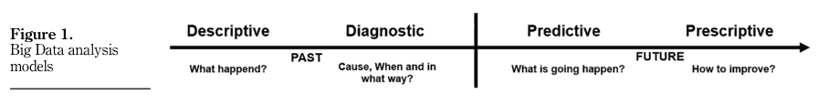

实现目标所需的替代方案。虽然预测性分析有助于展示事情可能如何发生，但规定性分析建议应采取什么行动来避免特定情况。该方法基于描述性和预测性分析确定多种替代方案并提供指导（Song et al., 2014）。作为一种数据分析技术，规定性分析提供预测和个性化的上下文信息。当业务决策者（如CTO和CEO）分析和预测复杂情况时，这种技术基于各种想法支持更有效的决策（Gim et al., 2018）。

### 2.2 商业和产品创新绩效中的大数据

将大数据转化为业务指标和业务绩效预测的举措已暴露出其困难（Xu et al., 2016）。互联网是大数据这一术语诞生的重要推动力之一（Hilbert and Lopez, 2011）。大数据可以理解为一组无法使用传统流程和工具进行分析的信息。大数据中的数据分析是指以敏捷方式获取和可视化数据的能力。这使得能够以数据速度提高访问和交易速度，推动IT部门支持企业转换数据和有用信息的需求（Larson and Chang, 2016）。

这意味着，企业越来越认识到需要处理大量有用数据和信息的必要性。主要目的是从结构化或非结构化数据的分析中获益，这些数据因新设备、社交网络以及企业信息系统而不断涌现（Kwon et al., 2014）。考虑到大数据的主要提案是促进将网络信息纳入机构数据分析的上下文中，因此管理人员开始使用在数字环境中实时演变的数据来定义业务战略（Hilbert and Lopez, 2011）。

企业可以基于大数据分析初始输入中大量数据块所产生的业务绩效仪表盘数据进行实时监控。大数据已成为数据颠覆时代的趋势，在各种多样化的业务中拥有越来越多的应用。随着越来越多人将大部分生活保持在线并通过在线方式参与口碑传播，当企业考虑推出新产品时，大数据分析正在成为重要议程。

大数据既是产品，也是这一未来制度的推动者，该制度融入了哈尔·瓦里安（Hal Varian）的“即时预测”（nowcasting）概念。大数据形成和转变各类人类活动领域的方式取决于所涉及活动的性质（Leeflang et al., 2014; Xu and Ramirez, 2016）。

使用大数据技术和技术，我们现在在处理健康流行病、自然灾害或社会骚乱时，可以做出更准确的预测并可能做出更好的决策。然而，同时必须注意到，数据驱动的方法在科学、社会政策、文化发展、金融预测、广告和营销方面存在不透明性（Kallinikos et al., 2013）。技术进步的热心爱好者拒绝认识到现象的这一面，无论他们是企业顾问、政策顾问、媒体大师还是设计吸引人可视化技术的科学家。应对这种不受约束的热情，正确的方法不是否认大数据的光明面，而是设计平衡人类判断和技术支持能力的方法。

正是在这种背景下，观察到了理论家和专业人士对大数据现象的观点中存在多样性和异质性。这始于对现象的定义和概念化。当专业人士将大数据视为产品、流程或挑战人类认知能力的新现象时，他们得出了关于主要问题是什么、有哪些可用解决方案以及焦点应放在哪里的若干结论。在处理认知挑战时，一些专业人士寻找

侧重于应排除什么的解决方案，而另一些人则观察到计算机存储容量在不断降低成本的同时不断增加，提出了一种不同的策略：购买更多存储空间并保留所有内容（Kraska, 2013）。

大数据技术对管理的关键益处包括降低成本和增加收入、提高运营效率、改进决策、改进产品和服务，以及改进创新和新产品及市场开发流程（Leeflang et al., 2014）。因此，组织必须做好准备，基于成为组织战略资产的信息，开展基于大数据分析的业务（Chen et al., 2012）。

产品和服务创新会导致现有产品和服务的改变或新产品和服务的创建。这通常可以通过提供新的核心利益或开发提供核心利益的新方式来实现。产品和服务创新在各个领域呈现多种形式（Miles, 2008），在传统服务业和制造业中都很明显（Baines et al., 2009）。这有时源于特定方法的应用，有时则需要组织和文化层面的变革（Rothenberg, 2007）。可持续产品和服务创新需要开发、运营和改进的持续交互。刺激产品和服务创新是一个及时的研究课题，其重要性与当前知识之间存在巨大差距，尤其是在我们观察大数据等新兴技术中的核心现象时（Singh and El-Kassar, 2018）。

## 3. 研究假设与研究模型

### 3.1 大数据分析能力：前因因素

大数据分析能力被认为是利用数据管理、基础设施（技术）和人才（人员）的能力，提供商业洞察力并将业务转化为竞争力的能力。为理解战略整合，通过应用该技术特性的能力来塑造和支持业务战略，选用了大数据分析能力。根据 Gunday et al. (2011)、Hannachi (2015) 和 Hooi and Abu (2018)，大数据分析能力可以理解为：

- (1) 大数据运营：企业识别大量各类数据高速流动的来源的能力，通过收集、存储和分析大数据来实现企业的战略和运营目标。
- (2) 更新IT基础设施：应用程序、硬件、数据和网络，以使大数据分析能力人员能够为企业快速开发、部署和支持必要的系统组件。
- (3) 高级分析：大数据分析能力团队的专业能力，包括执行分配任务所需的技能或知识。
- (4) 大数据的战略应用：以结构化（而非临时）的方式处理例行事务的能力，以根据业务的需求和优先级管理IT资源。

### 3.2 大数据分析能力：后果因素

#### 3.2.1 产品创新绩效

Mikalef et al. (2019a, b) 和 Sena et al. (2019) 考察了大数据分析能力与企业无形资源关键决定因素（即创新能力）之间的关系。此外，Aydiner et al. (2019) 和 Dubey et al. (2019) 得出结论，未能有效应对外部压力或环境需求的组织无法实现所需的绩效水平（在本调查中，即产品创新绩效）。也就是说，产品创新可能是大数据分析能力的结果。

在产品创新绩效中，主观的产品创新绩效测量指标主要改编自 Wang et al. (2012) 和 Wamba et al. (2017)。这使得可以通过企业面对市场的绩效分析，在本研究分析的两个维度（财务绩效和市场绩效）上，了解管理层对新产品和服务市场表现的看法。以下是这些一阶构念的概念化。

- (1) 财务绩效：通常与盈利能力或投资回报率（ROI）相关，并可通过组织的学习能力得到提升。能够了解其客户或潜在客户、竞争对手和监管机构的企业，更有机会发现并应对市场事件和趋势。销售额或服务提供的增长推动财务绩效（Wang et al., 2012; Wamba et al., 2017）。任何组织的主要目标之一是占据大市场份额，这只有在组织通过其销售获得可观的利润率和利润，并且由于其优化的运营增强了企业的财务愿景时才有可能实现（Gupta et al., 2020）。
- (2) 市场绩效：定义为企业进入市场并将新产品或服务推向市场的成功。现有文献表明，当IT领域在其战略中提供更多支持时，运营绩效和市场绩效往往会在竞争中得到提升（Wang et al., 2012）。对于 Gupta et al. (2014) 和 Gupta et al. (2020)，市场绩效可以通过创新实现，创新在市场导向和组织学习之间起到谈判作用。

基于这两个二阶变量（大数据分析能力和产品创新绩效）的阐述，提出了以下假设：

- H1a. 大数据分析能力对产品创新绩效有正向影响。

#### 3.2.2 面向流程的动态能力

面向流程的动态能力有助于理解企业在方法论和业务流程方面如何与竞争对手相对应。产品开发是面向流程的动态能力的一个例子，包括制定战略（实践、流程和从业者）的基本要素。连同组织领域中存在的学习和同构机制，它们解释了产品开发过程如何发生（Goes, 2014; McAfee and Brynjolfsson, 2012）。我们将大数据分析能力视为一种重要的组织能力，能够在大数据环境中带来持续的竞争优势（Singh and El-Kassar, 2018）。组织必须拥有在竞争和高度动态市场中工作的知识和经验的专家，这需要采用大数据作为保持竞争力的方式（Eisenhardt and Martin, 2000; Helfat et al., 2007; Wamba et al., 2017），因此提出了以下假设：

- H1b. 大数据分析能力对面向流程的动态能力有正向影响。
- H2. 面向流程的动态能力影响产品创新绩效。
- H3. 大数据分析能力通过面向流程的动态能力中介，对产品创新绩效有正向影响。

#### 3.2.3 业务价值

大数据分析能力评估会产生情感或情绪反应，例如业务价值。鉴于此，现有文献指出，大数据的分析卓越性对业务价值有显著的积极影响。文献表明，市场上对产品和服务新颖性的感知越强，对企业相关用户的潜在价值就越大（Nambisan et al., 2017）。因此，它可以为企业带来许多益处，其中包括与客户建立更紧密的关系并发展其分析能力（Chen et al., 2014）。因此，现有文献强调了大数据分析能力与业务价值之间关联的重要性（LaValle et al., 2011; Wixom et al., 2013）。

竞争优势通过部署和使用独特、有价值且难以模仿的资源和能力来实现（Bhatt and Grover, 2005）。信息技术能力的概念认为，尽管资源可以轻易复制，但企业动员的一套独特资源不易复制，并将带来竞争优势（Santanam and Hartono, 2003）。

作为将高阶大数据分析能力纳入因果网络的一部分，该研究将其与标准变量（如业务价值）进行建模（Akter et al., 2017）。业务价值被视为组织在战略层面（如竞争优势）所感知利益的程度。

实证分析假设，企业从大数据分析能力中获取价值的能力受到互补因素的影响，例如技术和管理能力，以及基于数据的组织文化的存在（Sena et al., 2019）。所提供的最终产品或服务使您能够从良好的客户体验中获取价值。这意味着组织目标已实现。与大数据分析能力相关的计算技术的技术工作或投资的成功可以产生成本并产生收入，从而带来业务价值（Bowman, 2003; Chang, 2017）。这种分析能力对业务价值的影响是大数据环境中的主要关注点。业务价值是大数据的核心项目之一，因为它直接受其大数据分析能力的影响（Wixom et al., 2013）。在此意义上，提出了以下假设：

- H1c. 大数据分析能力对业务价值有正向影响。

所提出的研究模型衡量了商业中的大数据分析能力机遇，并如图2所示。圆圈代表隐性变量，箭头代表因果关系——假设。

## 4. 方法

研究方法为定量研究，采用封闭式问题的在线问卷。研究对象是被归类为在大数据技术和数据分析方面担任高度专业化职位的经理和专业人员。

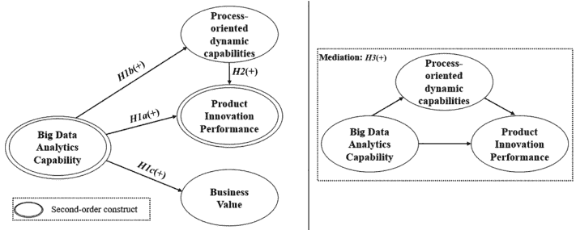

图2. 拟议的研究模型


这些企业是通过高等教育机构基于合作伙伴关系获得的数据库识别出来的。由于所分析的职位主要是分析性而非执行性，因此认为样本的代表性足够。

所有选定的企业均位于巴西圣保罗州。此外，需要说明的是，圣保罗州的工业是拉丁美洲最现代化、最多样化的工业，并由坚实的技术基础支持，在各个经济领域生产高附加值产品。总体而言，圣保罗州集中了巴西36%的工业产量。

在巴西，由于封闭式创新模式而非开放式创新模式占主导，使企业与大学更紧密地合作并不容易。然而，变革的趋势已经出现，但速度尚不够快。参与此研究的企业在其各自领域的产品和服务创新开发方面处于领先地位。这与Ransbotham和Kiron（2017）的观点一致，他们发现，在采用大数据分析方面处于领先地位的企业比其他企业更有可能推出新产品和服务。

咨询了两位管理学学者，以完善问卷并验证研究工具对巴西语境的适应性。根据他们的反馈，部分项目被重新表述。通过操作化，研究变量被归约为可观察和可测量的构念。为了测量每个构念的每个项目，采用了李克特量表，两端分别锚定为“完全不同意”（1）和“完全同意”（5），适用于全部35个陈述（问卷中的乱序断言）。本问卷中使用的构念及相应调查项目基于先前发表的、具有支持其效度的心理测量特性的潜在变量。对于人口统计画像和组织特征的描述方面，制定了特定的客观问题。

数据收集方法是便利抽样，一种非概率抽样技术，这一事实限制了研究结果的推广。问卷通过电子邮件和LinkedIn提供，以便于接触参与此研究的企业的管理人员和专业人员。为此项研究，对25名受访者进行了前测，以验证研究工具的理解度（Hair et al., 2009）。约450家企业被联系参与调查。然而，获得了141份有效问卷，这些问卷在IBM SPSS 25和SmartPLS 3.3.3中进行了分析。在本研究中，我们使用了G*Power 3.1.9软件来计算样本的检验效能（1-b err prob）等于98.78%。

## 5. 结果分析

### 5.1 无应答偏差

一种由于应答者与非应答者之间存在系统性差异而产生的偏差。为了确定我们的样本中是否存在无应答偏差，仔细选择并比较了应答者的档案与未参与调查的其他人的档案。这些档案通过邮件列表和LinkedIn进行观察——最初联系的每位经理（“中层管理”和“高层管理”）的档案，同时也观察了每家企业的特征（Mikalef et al., 2019a）。除了无应答外，我们还通过比较早期（第一个月）和晚期（倒数第二个月）的回复来研究晚回应偏差。我们发现应答者与非应答者之间没有显著差异。考虑到所有数据均在同一时间点从单一来源（调查）收集，属于横断面研究，且所有数据均为关键应答者的感知。

### 5.2 应答者画像

样本中男性占多数（n = 104/73.8%）。关于年龄，调查中人数最多的群体集中在35岁及以下（n = 83/58.9%），应答者包括管理人员（45.4%）和专业人员（54.6%）。

在本研究中，样本显示女性参与度较低（n = 37/26.2%），反映了巴西在领导职位方面的人口失衡。女性仅占所有技术专业人员的20%，尽管该行业女性的教育水平高于男性。此外，巴西企业在技术岗位上晋升女性的频率仍不到男性的三分之一。最后，巴西企业支付给女性的平均工资比支付给男性的工资低30%（IBGE, 2019; BRASSCOM, 2020）。

关于教育程度，三分之一的应答者已完成研究生学业（n = 47/33.3%）并担任中高层管理职位（n = 116/82.2%）。在组织中工作的平均时长为x̄ = 66.61个月，即约5年6个月。进一步观察这些专业人士在公司的任职时长，通过将其分为“低于”和“高于”平均水平的两组，停留时间较短者被认定为中层管理专业人员，如：分析师、专家、开发人员、设计师、统计人员、数据分析师和BI开发人员（n = 50/35.7%）。相反，在分析在公司任职时间最长的人员时，被认定为高层管理人员，如：经理、客户成功经理、协调员、主管、顾问和技术领导者（n = 23/16.4%）。

在对组织任职时长进行组间分析时，花费“较少”时间的应答者平均年龄为x̄ = 30岁，而在组织中花费“较多”时间的应答者平均年龄为x̄ = 40岁（t(132) = 6.278；p < 0.001）。这表明，年龄在30岁或以下的专业人士正在该领域的其他公司寻求就业，而40岁及以上的人员在组织中任职时间更长。在变量“性别”与“年龄”关系的组间分析中，数据表明应答者在平均值上没有差异。样本中男性专业人员的平均年龄约为x̄ = 33岁，女性群体为x̄ = 36岁。尽管差异很小，T检验表明方差齐性（t(133) = 1.393；p = 0.166）。

### 5.3 组织特征

参与此研究的组织大多为国内组织（n = 82/58.2%），而国际组织占（n = 57/40.4%）。服务业在本研究中的参与度最高，占70.9%（n = 100）。规模为“大型”的组织也占据了样本的大部分，占65.2%（n = 92）。在分析负责涉及大数据的技术系统投资的人员时，责任通常归属于“董事会”，占66%（n = 93），“其他”选项占4.3%（n = 6），代表境外管理层或执行委员会。还可以验证，没有应答者将自己归类为“低层管理”——因此，本研究中使用了“中层管理”和“高层管理”这两个术语。组织的平均年龄为x̄ = 572.67个月，即约47年7个月，这表明大多数组织在该国已经成立近半个世纪，经历了不同的经济情景以及技术变革。还可以验证，24.8%（n = 35）的组织是国内、服务业且规模大的。

下文展示了大数据分析能力各阶段的时间发生顺序，以及各指定变量对应的各组方差分析（ANOVA）。

结果表明，“诊断”能力在几乎所有分析变量中均呈现出最高平均值，但始终保持“组内无相关效应”的相同结果。因此，仅呈现了分析变量中“组内存在相关效应”的结果。

单因素方差分析表明，组别对大数据分析预测能力有影响 [F(5,133) = 3.451；p = 0.019]。这一差异在...的平均值中观察到。


大型企业（x̄ = 3.62），表明它们是最投资预测性解决方案的企业。同样，单因素方差分析还显示，群体对分析大数据的预测能力有影响 [F(1,136) = 10.213; p = 0.002]。这一差异体现在受访者平均值的差异上，专业人员群体（x̄ = 3.70）显示出比经理（x̄ = 3.02）更大的经验和长远眼光，用于预测性解决方案。

除此之外，单因素方差分析显示，群体对大数据分析的规定性能力有影响 [F(1,133) = 6.397; p = 0.013]。这一差异体现在国际企业的平均值（x̄ = 3.67）中。在平均值最高的情况下，表明国际企业是寻求最大规定性解决方案的企业。单因素方差分析还显示，群体对分析大数据的规定性能力有影响 [F(6,133) = 2.911; p = 0.037]。这一差异体现在公共服务（x̄ = 1.75）和服务业（x̄ = 3.49）的平均值中，表明公共服务是最需要开发规定性解决方案的部门，而服务业总体上是最活跃的部门。单因素方差分析显示，群体对分析大数据的规定性能力有影响 [F(3,132) = 2.679, p < 0.05]。这一差异体现在大型企业的平均值（x̄ = 3.58）中，表明它们是最投资预测性解决方案的企业。

### 5.4 测量模型

数据的正态性通过单变量偏度和峰度以及 Mardia 的多变量偏度（b = 401.541; z = 8298.503; p < 0.001）和峰度（b = 1158.110; z = 16.631; p < 0.001）进行了验证。这些指标检验在 p < 0.001 时为“非常显著”，表明数据不服从正态分布，这一点已被预料到。该程序是必要的，旨在限制使用那些以数据正态分布为特征的某些统计分析技术的可能性。

随后，估计了结构模型。在传统的 PLS 方法中，潜变量被估计为指标的加权聚合，不包括测量误差（Henseler et al., 2014）。第一次迭代后，呈现了变量获得的因子载荷结果；发现只需剔除四个因子载荷低于 0.7 的变量以进行模型调整（SUBD2、BDO1、SAT3、DF3 和 MP2）。随后，验证了聚合效度，它表明潜变量与用于测量该变量所选项目的相关程度，而判别效度则涉及理论模型构念之间的相关性。

测量模型的分析必须先于构念或潜变量之间关系的分析。下一步是检验测量模型，其中涉及：Cronbach's alpha (CA)、合成可靠性 (CR)、平均方差提取量 (AVE)、决定系数 (R²)、预测相关性 (Q²)、效应量 (f²) 和拟合优度 (GoF)（Hair et al., 2016），如表 1 所示。

CA 系数在 0.858 至 0.938 之间。这些结果表明所使用的量表具有高度内在一致性。本研究获得的 CR 在 0.908 至 0.951 之间，表明在这方面结果令人满意（Hair et al., 2009）。对于该模型，AVE 在 0.522 至 0.783 之间。所有潜变量的 AVE 均大于 50%，满足 Chin (1998) 关于聚合效度存在的标准。

R² 值衡量模型的预测准确性，代表内生变量对外生变量的综合影响。在本研究中，R² 值表明模型在所有构念中都具有准确性和预测相关性。Cohen's f² 用于估计相关样本（重复测量、纵向数据、分组数据）中两个连续变量的效应量。评估每个构念对调整模型的“用处”程度。0.02、0.15 和 0.35 的值分别被认为是小、中和大（Hair et al., 2016）。$\hat{f}^2$ 值通过读取共同性获得。本研究所感知到的是，构念被认为是中等和大效应量。Stone–Geisser 的 $Q^2$ 检验评估模型与预期（或模型预测质量或调整后模型的准确性）的接近程度。根据用于评估调整后模型准确性的标准，$\hat{Q}^2$，所有构念均被认为准确度足够，因为它们呈现出大于零的值（Akter et al., 2017）。

GoF 是全局拟合度量，即 AVE 平均值和内生变量 $R^2$ 平均值的乘积的平方根。GoF 的值为 0.6936（69.36%），在 PLS 中被认为足够大，可用于模型效度（Wetzels et al., 2009）。判别效度评估反映因子或与其他因子相关的项目。在本研究中，AVE 大于或等于因子间相关系数的平方，如表 2 所示，采用确定的 Fornell–Larcker 准则，每个指标的所有因子载荷均高于 0.5。无需剔除变量来调整模型。

表 1. 聚合效度

| 潜变量 | CA | CR | AVE | \(R^2\) | \(\hat{f}^2\) | \(\hat{Q}^2\) | 项目数 |
| :--- | :--- | :--- | :--- | :--- | :--- | :--- | :--- |
| 高级分析 | 0.874 | 0.914 | 0.728 | 0.709 | 2.431 | 0.509 | 4 |
| IT 更新 | 0.883 | 0.919 | 0.740 | 0.678 | 2.108 | 0.485 | 4 |
| 大数据分析能力 | 0.929 | 0.938 | 0.522 | | | | 14 |
| 大数据运营 | 0.861 | 0.915 | 0.783 | 0.712 | 2.468 | 0.546 | 3 |
| 商业价值 | 0.938 | 0.951 | 0.764 | 0.548 | 1.210 | 0.410 | 6 |
| 财务绩效 | 0.896 | 0.928 | 0.763 | 0.915 | 10.811 | 0.692 | 4 |
| 市场绩效 | 0.861 | 0.915 | 0.782 | 0.864 | 6.349 | 0.670 | 3 |
| 面向流程的动态能力 | 0.864 | 0.908 | 0.713 | 0.359 | 0.561 | 0.250 | 4 |
| 产品创新绩效 | 0.924 | 0.939 | 0.688 | 0.490 | 0.230 | 0.328 | 7 |
| 大数据的战略应用 | 0.858 | 0.914 | 0.779 | 0.687 | 2.193 | 0.524 | 3 |

表 2. 判别效度

| 潜变量 | (1) | (2) | (3) | (4) | (5) | (6) | (7) | (8) |
| :--- | :--- | :--- | :--- | :--- | :--- | :--- | :--- | :--- |
| (1) 高级分析 | 0.853 | | | | | | | |
| (2) IT 更新 | 0.516 | 0.860 | | | | | | |
| (3) 大数据运营 | 0.670 | 0.595 | 0.885 | | | | | |
| (4) 商业价值 | 0.578 | 0.648 | 0.536 | 0.874 | | | | |
| (5) 财务绩效 | 0.466 | 0.428 | 0.342 | 0.723 | 0.873 | | | |
| (6) 市场绩效 | 0.583 | 0.469 | 0.440 | 0.696 | 0.782 | 0.884 | | |
| (7) 面向流程的动态能力 | 0.597 | 0.527 | 0.384 | 0.593 | 0.580 | 0.635 | 0.845 | |
| (8) 大数据的战略应用 | 0.587 | 0.613 | 0.597 | 0.700 | 0.537 | 0.584 | 0.454 | 0.883 |

注释：对角线显示为 AVE 的平方根  
来源：作者编制

### 5.5 共同方法偏差

我们通过对 31 个项目应用 Harman 的单因素检验（Podsakoff and Organ, 1986）来检查共同方法方差（CMV），并提取了五个特征值大于 1.0 的成分。第一个成分提取的方差为 47.9%。（结果低于 0.5，验证了该检验）。我们在本研究中意识到存在许多一阶潜变量，并且它们彼此高度相关，因为它们测量的是二阶潜变量。这可能导致提取方差的百分比（%）较高，但这并不意味着存在共同方法偏差问题。

## 6. 讨论

研究发现，大数据分析能力与所提议理论模型的所有直接和间接关系（中介效应）呈正相关。H1a 假设（β = 0.353; p < 0.001）描述了“大数据分析能力”与“产品创新绩效”路径之间的因果关系，该假设被接受，因为企业理解产品创新是必要的。这种认识之所以发生，是因为它们处于不断变化的环境中，只有通过添加新技术和工具——如大数据及其分析能力——才能提高产品创新绩效（Hooi and Abu, 2018）。大数据分析能力可以直接影响企业的产品创新绩效，增强动态创新能力的底层过程，特别是在处理大量且多样化数据的企业中，否则将无法以其他方式分析和解释这些数据（Wamba et al., 2017）。

在产品创新过程中使用大数据，使企业能够提高研发投资的准确性，因为在了解什么会给组织带来回报方面会有更多的事前情报。这种情报将来自组织所拥有的更大数量和更多样的信息，从而使其投资策略更加精细。本研究观察到的企业创新能力表明，依赖于参与团队的集体努力，而非个人在使用大数据方面的努力。同样重要的是，在项目不同方面并行工作的不同人员之间必须存在知识的横向流动（Koberg et al., 2003）。

H1b 假设（β = 0.600; p < 0.001）描述为“大数据分析能力”与“面向流程的动态能力”之间的因果关系，该假设被接受，因为组织指出这将是一个关键的竞争差异化因素，使企业能够在竞争中脱颖而出（Wixom et al., 2013）。调查中注意到，受访经理将大数据分析能力与动态能力联系起来，因为组织正面临竞争。也就是说，应用的大数据分析越好，其相对于市场其余部分的差异化就越大（Wamba et al., 2017）。在快节奏环境中，不断变化的条件（不可预测且波动）使得现有的运营模式迅速过时。因此，面向流程的动态能力对于保持竞争力是必要的（Wilden and Gudergan, 2015）。文献中已注意到，大数据分析能力作为面向流程的动态能力的驱动因素发挥作用（McAfee et al., 2012; Mikalef et al., 2019a, b; Singh and El-Kassar, 2018）。

关于 H1c 假设（β = 0.740; p < 0.001），描述为“大数据分析能力”与“商业价值”，该假设被接受，因为调查受访者指出，当大数据工具被正确应用时，企业会获得显著收益。也就是说，管理者和分析人员的看法是，组织领先于其竞争对手，从而能够更好地了解其客户及其与客户的关系（Wamba et al., 2017）。大数据分析从企业不断增长的投资中显而易见，特别是那些在复杂且快节奏环境中运营的企业（Wang et al., 2016; Mikalef et al., 2019a）。

H2 假设（β = 0.428; p < 0.001）描述了“面向流程的动态能力”与“产品创新绩效”之间的因果关系，该假设被接受。这是因为关于产品创新，组织有必要领先于市场，将其资源用于流程改进以


保持恒定，维持竞争差异化，从而使组织与竞争对手拉开差距。此外，企业将更了解其客户，因此能够专注于完善其产品和商业策略的主要特征，这些特征将在其目标受众中更加突出，从而其产品创新绩效也将得到提高（Hooi and Abu, 2018）。

采用中介效应分析来验证“大数据分析能力”与“产品创新绩效”之间的关系。本研究发现，模型中提出的中介（H3）为部分中介，即直接关系（\beta = 0.600; p < 0.001）和间接关系（\beta = 0.261; p < 0.001）均呈现相似的显著结果。

在观察构成产品创新绩效操作定义的构念时，可以发现，财务绩效（R^2 = 0.859）和市场绩效（R^2 = 0.851）均呈现较高的决定系数（R^2）。因此，可以验证，当企业将产品创新绩效与财务绩效和市场绩效相关联时，企业认为其具有重要性。换句话说，在将大数据分析能力应用于产品创新时，投资回报率更高，且销售增长、客户保留率和盈利能力也更强。

如调查所示，约89.4%的受访者表示，负责大数据系统投资的是高级管理层（23.4%）和董事会（66%），以及关于项目何时及如何实施的决策。大数据已成为自上而下的模式，最终用户参与度很低，从而增加了既定战略与执行者之间产生噪音的可能性，因此在量化目标或使用大数据分析工具时所期望的绩效方面缺乏清晰度。

因此，研究发现需要基本资源，例如财务支持，尤其是因为数据投资需要一段时间才能为企业带来可衡量的商业价值（Mikalef et al., 2019a）。关于人力技能，文献认为，技术技能和管理技能都是为大数据分析能力投资增加价值所必需的（Wamba et al., 2017）。

本研究参与的管理者在实施大数据计划时面临的主要障碍之一是组织文化不利。现有数据无法培养对情况的批判性看法（Kiron, 2017）。这将取决于组织成熟度的水平。数据和技术只能将组织带到一定程度，而激励因素主要包括拥有技术、分析和业务知识的人员，以及推动基于证据的决策文化（Grover et al., 2018）。因此，本研究的重点选定了直接参与大数据投资的职能活动和决策的“中层管理”和“高层管理”。

## 7. 含义与结论

### 7.1 理论贡献

本研究是一项早期尝试，旨在通过大数据分析能力的理论视角来理解大数据现象，并理解市场中三个相关的构念：面向流程的动态能力、产品创新绩效和商业价值，这是一种已确立的战略理论，可以帮助企业。虽然大数据实践者对现有大数据文献做出了显著贡献，但其中大多数人将大数据分析专门视为一种技术能力（Grant, 2010; Gupta and George, 2016）——这为在战略和市场问题上更深入地探讨该主题提供了空间。

我们的分析还试图阐明大数据分析能力如何通过不同的分析模型，在竞争格局中对企业至关重要。本文从理论和实践两方面出发，旨在识别寻求大数据分析能力的企业中其相关因素，并确定其主要应用模式（描述性、诊断性、预测性和指令性）。

另一个因素是观察技术如何通过产品创新绩效与面向流程的动态能力构念之间的关系，影响战略市场决策。产品创新绩效是从三个不同的与绩效相关的构念视角构建的，即：财务绩效、市场绩效和战略业务对齐。该工作还试图界定评估大数据分析能力及其与上述构念关系的最佳方式，当由产品创新绩效中介时。此外，还在商业价值中观察了其他关键因素。

商业价值是模型中解释力最强的因变量，R^2 = 54.8%，其次是产品创新绩效，R^2 = 49.0%，最后是面向流程的动态能力，R^2 = 35.9%。这表明，面向流程的动态能力应将企业的变革能力（改进、适应、调整、重新配置、更新、革新等）转化为优于竞争对手的更好业务流程。因此，管理者的能力对于此类变革至关重要。事实上，动态能力可以理解为组织有目的地创建、扩展或修改其资源基础的能力（Helfat et al., 2007）。当企业具备识别内外部环境中变革机会的能力，配置组织流程并高效部署资源，并能立即抓住机会时，就隐含了这一意义（Eisenhardt and Martin, 2000; Kim et al., 2011; Wamba et al., 2017）。因此，有意创建大数据分析能力的企业必须整合其内部和外部数据（Gupta and George, 2016）。

本研究观察到，大数据分析能力被广义地定义为一种能力，通过数据管理、基础设施（技术）和人才（人员）能力转变业务，从而提供商业洞察。该研究还表明，这些变化需要由战略指导，即创造可持续商业价值的分析。任何关于该主题的实证分析都必须考虑到，大数据是一个异质概念（Niebel et al., 2018）。

最后，本研究开发了一种研究工具（调查），能够衡量大数据的分析能力，在其中使用了实证验证来分析企业观察到的三个构念之间的关系，以关注企业的更好整体绩效。

### 7.2 管理启示

所提议的理论模型使可以验证企业的分析结构，以及它们是否更有能力实时分析客户数据和信息、生成洞察并实施解决方案，以维持和提升其在市场中的地位。异质环境中的企业给从事创新工作的企业带来压力，迫使它们与来自不同领域的各种复杂且竞争性的外部合作伙伴打交道（Mikalef et al., 2019a, b）。

需要强调的是，随着企业收集的数据量巨大，制定使用和管理策略变得越来越必要。通过使用和管理这些可在数字媒体和先前的组织知识中获取的数据，可以合成不同的输入，从而提升企业开展业务的方式。这些最终输入可以用于产生新的市场视角以及新想法和价值主张。

值得强调的一个重要方面是大数据正在组织中产生的影响。文献回顾表明，企业中发生的转型不仅限于技术和系统领域，也不限于专业人员如何融入这一背景。正如调查所揭示的，三分之一的受访者已完成


postgraduate studies. That is, professionals with higher graduation levels are increasingly required, with 76.5% (n = 108) having at least one degree.

也就是说，对具有更高毕业水平的专业人员的需求日益增加，其中76.5%（n = 108）至少拥有一个学位。

When checking each stage of Big Data Analytics Capability in the firms surveyed, most of them use predominantly Diagnostic Analytics, with no statistical differences in the means in the analysis of variances (ANOVA). This demonstrates that they are working on their analytical models based on past events to understand the historical data series. Market studies claim that this type of analysis is sufficient. However, there is also a need for predictive and prescriptive analyses, with data from the past, to predict ways to improve future results. The use of predictive analysis was evident for “big firms” and “professional’s” respondents (characterized by working with predictions, simulations and modeling), and the use of prescriptive analysis for “international firms”, from the “service sector” and “big firms”。

在对受调查企业中大数据分析能力各阶段进行检查时，大多数企业主要使用诊断分析（Diagnostic Analytics），方差分析（ANOVA）中均值无统计差异。这表明他们正在基于过去事件开展分析模型工作，以理解历史数据系列。市场研究声称，这种分析类型已足够。然而，也需要预测分析和处方分析，利用过去的数据来预测改善未来结果的方法。预测分析的使用在“大型企业”和“专业人士”受访者中明显（其特点是使用预测、模拟和建模），而处方分析的使用则在“国际企业”、“服务业”和“大型企业”中出现。

For this, greater investment in analytical tools is necessary, as well as people trained in these models in analysis (descriptive, diagnostic, predictive and prescriptive) and a change of mindset, which will dictate the firm's bias's strategic decision-making. It will also be necessary to invest in these professionals' training so that they can properly handle the Big Data tools and increase their influence in the organizational decision-making process.

为此，有必要加大对分析工具的投资，以及培养在这些分析模型（描述性、诊断性、预测性和处方性）方面受过培训的人才，并改变思维模式，这将决定企业战略决策的偏向。还需要投资于这些专业人员的培训，以便他们能够妥善处理大数据工具，并增强其在组织决策过程中的影响力。

By accumulating and using data that came from various available data sources, it is possible to obtain detailed insights into customers' needs, preferences and habits, thus offering opportunities for the development of innovation in new products and services. In light of this, the importance of using Big Data as the “new oil” is an analogy of the data demonstrating the power and impact of Big Data on the economy and modern societies (Birek et al., 2018). New functions in the technology market, such as the data scientist, have emerged to use Machine Learning and Deep Learning algorithms. Larson and Chang (2016) note that this type of professional learning will require individuals trained in processes (i.e. Agile). The frequent delivery of information to interested parties must be done interactively. This technological trend focuses mainly on early discovery and iteration, which means greater collaboration and the creation of conditions for insight.

通过积累和使用来自各种可用数据来源的数据，可以获取关于客户需求、偏好和习惯的详细洞察，从而为新产品和新服务的创新发展提供机会。鉴于此，将大数据视为“新石油”是一个类比，表明数据对经济和现代社会的力量与影响（Birek et al., 2018）。技术市场中出现了数据科学家等新职能，以使用机器学习和深度学习算法。Larson和Chang（2016）指出，这类专业学习将需要接受流程（即敏捷）培训的个人。必须以交互方式向利益相关方频繁交付信息。这种技术趋势主要关注早期发现和迭代，这意味着更大的协作以及创造洞察的条件。

### 7.3 局限性与进一步研究方向

The limitations of this study are mainly related to its external validity. The respondents to this survey came from firms located in the state of São Paulo. Although many of these firms are identified as reference in the use of Big Data for future research, the extension of firms in other cities and states could be considered. Consequently, these results can be generalized only for firms located in the state of São Paulo.

本研究的局限性主要与其外部效度相关。本调查的受访者来自圣保罗州的企业。尽管其中许多企业被认定为未来研究中使用大数据的参考对象，但可以考虑扩展到其他城市和州的企业。因此，这些结果只能推广到圣保罗州的企业。

As a limitation of this study, we observed that there is no marker variable to measure Common Method Bias (Lindell and Whitney, 2001). We suggest in future to cross the inclusion of a marker variable that contains a scale with other secondary measures (different data sources).

作为本研究的局限性，我们观察到没有标记变量来测量共同方法偏差（Lindell and Whitney, 2001）。我们建议未来研究中考虑加入包含量表的标记变量，并辅以其他次要措施（不同的数据来源）。

## 参考文献

- Akter, S., Wamba, S.F. and Dewan, S. (2017), “为什么PLS-SEM适合复杂建模？大数据分析质量的实证例证”, Production Planning and Control, Taylor and Francis, 第28卷，第11-12期，第1011-1021页。
- Aydiner, A.S., Tatoglu, E., Bayraktar, E., Zaim, S. and Delen, D. (2019), “商业分析与企业绩效：商业流程绩效的中介作用”, Journal of Business Research, 第96卷，第228-237页。
- Baines, T.S., Lightfoot, H.W., Benedettini, O. and Kay, J.M. (2009), “制造业的服务化：文献综述与对未来挑战的反思”, Journal of Manufacturing Technology Management, Emerald Group Publishing, 第20卷，第5期，第547-567页。
- Bhatt, G.D. and Grover, V. (2005), “信息技术能力的类型及其在竞争优势中的作用：一项实证研究”, Journal of Management Information Systems, Routledge, 第22卷，第2期，第253-277页。
- Bhimani, A. and Willcocks, L. (2014), “数字化、‘大数据’与会计信息的转型”, Accounting and Business Research, 第44卷，第4期，第469-490页。
- Birek, L., Grzywaczewski, A., Iqbal, R., Doctor, F. and Chang, V. (2018), “一种创新的大数据分析与智能技术，用于预测驾驶员意图”, Computers in Industry, 第99卷，第226-240页。
- Bouwman, H. (2003), “面向网络组织提供移动服务的商业模型指标设计”, Bled：第16届BLED电子商务会议e-转型研讨会：概念、指标与可视化。
- BRASSCOM (2020), “拉丁美洲科技领域女性增多，但仍不足”, available at: https://brasscom.org.br/america-latina-tem-mais-mulheres-na-lideranca-em-tecnologia-mas-ainda-e-pouco/ (访问于 2021年3月18日)。
- Chang, V. (2017), “制造业组织云端业务绩效展示”, Information Systems Frontier, 第22卷，第1期，第59-75页。
- Chang, V., Aljawarnesh, S.A. and Li, C. (2020), “关于‘可视分析与可视数据挖掘进展’的专刊”, Expert Systems, 第37卷，第5期，第1-2页, doi: 10.1111/exsy.12607。
- Chen, H., Chiang, R.H.L. and Storey, V.C. (2012), “商业智能与分析：从大数据到重大影响”, MIS Quarterly, 第36卷，第4期，第1165页。
- Chen, M., Mao, S. and Liu, Y. (2014), “大数据：一项综述”, Mobile Networks and Applications, 第19卷，第2期，第171-209页。
- Chin, W.W. (1998), “结构方程建模的偏最小二乘法”, in Modern Methods for Business Research, Lawrence Erlbaum Associates Publishers, Mahwah, NJ, 第295-336页。
- Cybulski, J.L., Keller, S., Nguyen, L. and Saunders, D. (2015), “使用可视分析在数字空间中进行创造性问题解决”, Computers in Human Behavior, 第42卷，第20-35页。
- Dubey, R., Gunasekaran, A., Childe, S.J., Blome, C. and Papadopoulos, T. (2019), “大数据与预测分析及制造业绩效：整合制度理论、基于资源观和大数据文化”, British Journal of Management, 第30卷，第2期，第341-361页, doi: 10.1111/1467-8551.12355。
- Eisenhardt, K.M. and Martin, J.A. (2000), “动态能力：它们是什么?”, Strategic Management Journal, 第21卷，第1105-1121页。
- Gim, J., Lee, S. and Joo, W. (2018), “基于CKAN云的人文关怀服务处方分析框架研究”, Journal of Sensors, 研究文章, Hindawi, 2018年3月21日, 第2018卷, 6167385, 第1-10页, doi: 10.1155/2018/6167385。
- Goes, P. (2014), “编辑按语：大数据与信息系统研究”, Management Information Systems Quarterly, 第38卷，第3期，第iii-viii页。
- Grant, R.M. (2010), 《当代战略分析与案例：文本与案例》, John Wiley & Sons, Chichester, West Sussex。
- Grover, V., Chiang, R.H.L., Liang, T.-P. and Zhang, D. (2018), “从大数据分析中创造战略业务价值：一个研究框架”, Journal of Management Information Systems, 第35卷，第388-423页。
- Gunday, G., Ulusoy, G., Kilic, K. and Alpkan, L. (2011), “创新类型对企业绩效的影响”, International Journal of Production Economics, Elsevier, 第133卷，第2期，第662-676页。
- Gupta, M. and George, J.F. (2016), “迈向大数据分析能力的发展”, Information and Management, 第53卷，第1049-1064页。
- Gupta, S., Rudd, J. and Lee, N. (2014), “通过营销与运营的成功整合实现商业可持续性”, Industrial Marketing Management, 第42卷，第1期，第3-5页。
- Gupta, S., Drave, V.A., Dwivedi, Y.K., Baabdullah, A.M. and Ismagilova, E. (2020), “通过大数据预测分析实现卓越组织绩效：动态能力视角”, Industrial Marketing Management, 第90卷，第581-592页。
- Hair, J., Anderson, R. and Babin, B. (2009), 《多元数据分析》, 第7版, Prentice Hall, Upper Saddle River, NJ。
- Hair, J., Hult, G.T. and Ringle, C. (2016), 《偏最小二乘结构方程建模入门》, 第2版, Sage Publications, Los Angeles。
- Hannachi, Y. (2015), “产品创新绩效测量的开发与验证：PIP量表”, Journal of Business Studies Quarterly, 第6卷，第3期，第23-35页。
- Helfat, C.E., Finkelstein, S., Mitchell, W., Singh, H., Teece, D. and Winter, S.G. (2007), “动态能力：理解组织中的战略变革 | Wiley”, Wiley-Blackwell, available at: https://www.wiley.com/en-us/Dynamic+Capabilities%3A+Understanding+Strategic+Change+in+Organizations-p-9781405135757 (访问于 2020年11月8日)。
- Henseler, J., Dijkstra, T.K., Sarstedt, M., Ringle, C.M., Diamantopoulos, A., Straub, D.W. and Calantone, R.J. (2014), “关于PLS的普遍看法与现实：对Rönkkö和Evermann（2013）的评论”, Organizational Research Methods, 第17卷，第182-209页。
- Hilbert, M. and Lopez, P. (2011), “世界储存、通信和计算信息的技术能力”, Science, 第332卷，第6025期，第60-65页。
- Hooi, T.K. and Abu, N.H.B. (2018), “使用SmartPLS 3.2.6探讨大数据分析能力与产品创新绩效的关系”, PLS-SEM中的分层分量建模, 第7卷，第1期，第14页。
- IBGE (2019), “IBGE新闻机构”, available at: https://agenciadenoticias.ibge.gov.br/agencia-noticias/2019-agencia-de-noticias/noticias/27598-homens-ganharam-quase-30-a-mais-que-as-mulheres-em-2019 (访问于 2021年3月18日)。
- Kallinikos, J., Aaltonen, A. and Marton, A. (2013), “数字工件的两难本体论”, MIS Quarterly, MIS Research Center, 第37卷，第2期，第357-370页。
- Kim, G., Shin, B., Kim, K.K. and Lee, H.G. (2011), “IT能力、面向流程的动态能力与企业财务绩效”, Journal of the Association for Information Systems, Association for Information Systems, 第12卷，第7期，第487-517页。
- Kiron, D. (2017), “成为数据驱动型组织的经验教训”, MIT Sloan Management Review, 第58卷，第1-13页。
- Koberg, C.S., Detienne, D.R. and Heppard, K.A. (2003), “影响渐进式和激进式创新的环境、组织和流程因素的实证检验”, Journal of High Technology Management Research, 第14卷，第21-45页。
- Kraska, T. (2013), “在大数据系统的海里寻找针”, IEEE Internet Computing, 在IEEE Internet Computing上发表, 第17卷，第1期，第84-86页。
- Kwon, O., Lee, N. and Shin, B. (2014), “数据质量管理、数据使用经验及大数据分析的获取意向”, International Journal of Information Management, Elsevier Science, 第34卷，第3期，第387-394页。
- Larson, D. and Chang, V. (2016), “敏捷、商业智能、分析与数据科学的综述与未来方向”, International Journal of Information Management, 第36卷，第700-710页。
- LaValle, S., Lesser, E., Shockley, R., Hopkins, M.S. and Kruschwitz, N. (2011), “大数据、分析及从洞察到价值的路径”, MIT Sloan Management Review, 第52卷，第2期，第21-31页。
- Leeflang, P.S.H., Verhoef, P.C., Dahlström, P. and Freundt, T. (2014), “数字时代营销的挑战与解决方案”, European Management Journal, Elsevier, 第32卷，第1期，第1-12页。
- Lindell, M.K. and Whitney, D.J. (2001), “横断面研究设计中的共同方法方差处理”, Journal of Applied Psychology, 第86卷，第1期，第114-121页。
- Markus, M.L. (2015), “新游戏、新规则、新记分牌：大数据的潜在后果”, Journal of Information Technology, 第30卷，第1期，第58-59页, doi: 10.1057/jit.2014.28。


McAfee, A. and Brynjolfsson, E. (2012), “大数据：管理革命”, 《哈佛商业评论》, 10月1日, 可于以下网址查阅：https://hbr.org/2012/10/big-data-the-management-revolution (2020年11月8日访问).

McAfee, A., Brynjolfsson, E. and Davenport, T.H. (2012), “大数据：管理革命”, 《哈佛商业评论》, 第90卷, 第60-68页.

Mikalef, P., Boura, M., Lekakos, G. and Krogstie, J. (2019a), “大数据分析能力与创新：动态能力的中介作用及环境的调节效应”, 《英国管理杂志》, 第30卷 第2期, 第272-298页, doi: 10.1111/1467-8551.12343.

Mikalef, P., Krogstie, J., Pappas, I.O. and Pavlou, P. (2019b), “探索大数据分析能力与竞争绩效之间的关系：动态能力和运营能力的中介作用”, 《信息与管理》, 第57卷 第2期, 第1-15页, doi: 10.1016/j.im.2019.05.004.

Miles, I. (2008), “服务业创新模式”, 《IBM系统杂志》, 第47卷 第1期, 第115-128页.

Nambisan, S., Lyytinen, K., Majchrzak, A. and Song, M. (2017), “数字创新管理：在数字世界中重塑创新管理研究”, 《MIS季刊》, 第41卷 第1期, doi: 10.25300/MISQ/2017/41:1.03.

Niebel, T., Rasel, F. and Viete, S. (2018), “大数据——大收益？理解大数据分析与创新之间的联系”, 《创新与新技术经济学》, 第28卷 第3期, 第296-316页, doi: 10.1080/10438599.2018.1493075.

Podsakoff, P.M. and Organ, D.W. (1986), “组织研究中的自陈：问题与前景”, 《管理杂志》, 第12卷, 第531-544页.

Ransbotham, S. and Kiron, D. (2017), “分析作为商业创新的来源”, 《MIT斯隆管理评论》, 第58卷, 第1-21页.

Rothernberg, S. (2007), “通过服务化实现可持续性”, 《MIT斯隆管理评论》, 第48卷 第2期, 可于以下网址查阅：https://sloanreview.mit.edu/article/sustainability-through-servicizing/ (2020年11月8日访问).

Santhanam, R. and Hartono, E. (2003), “将信息技术能力与企业绩效相关联的问题”, 《MIS季刊》, 第27卷 第1期, 第125-153页.

Sena, V., Bhaumik, S., Sengupta, A. and Demirbag, M. (2019), “大数据与绩效：管理研究能告诉我们什么”, 《英国管理杂志》, 第30卷 第2期, 第219-228页, doi: 10.1111/1467-8551.12362.

Singh, S.K. and El-Kassar, A-N. (2018), “大数据分析在发展可持续能力中的作用”, 《洁净生产杂志》, 第213卷, 第1264-1273页, doi: 10.1016/j.jclepro.2018.12.199.

Song, S, Jeong, D-H, Kim, J, Hwang, M, Gim, J. and Jung, H. (2014), “基于规定性分析的研究咨询系统”, 在 Park, J.J., Jong, H., Pan, Y., Kim, C-S. 和 Yang, Y. (编), 《未来信息技术》, Springer, Berlin and Heidelberg, 第569-574页.

Subramaniam, M, Iyer, B. and Venkatraman, V. (2019), “在数字生态系统中竞争”, 《商业视野》, 第62卷 第1期, 第83-94页.

Teece, D.J. (2014), “企业绩效的基础：公司（经济）理论中的动态能力与普通能力”, 《管理学院视角》, 第28卷 第4期, 第328-352页.

Valdez, A.C., Ziefle, M, Verbert, K, Felfernig, A. and Holzinger, A. (2016), “健康信息学推荐系统：现状与未来展望”, 在 Andreas, H. (编), 《健康信息学机器学习》, Springer, Cham, 第391-414页.

Wamba, S.F., Gunasekaran, A., Akter, S., Ren, S.J, Dubey, R. and Childe, S.J. (2017), “大数据分析与企业绩效：动态能力的影响”, 《商业研究杂志》, 第70卷, 第356-365页.

Wang, N., Liang, H., Zhong, W., Xue, Y. and Xiao, J. (2012), “资源结构化还是能力建设？信息技术商业价值的实证研究”, 《管理信息系统杂志》, Routledge, 第29卷 第2期, 第325-367页.

Wang, G., Gunasekaran, A., Ngai, E.W. and Papadopoulos, T. (2016), “物流与供应链管理中的大数据分析：研究与应用的若干调查”, 《国际生产经济杂志》, 第176卷, 第98-110页.

Warner, K.S.R. and Wäger, M. (2019), “为数字化转型构建动态能力：战略更新的持续过程”, 《远程规划》, 第52卷 第3期, 第326-349页.

Wetzels, M., Odekerken-Schröder, G. and Van Oppen, C. (2009), “使用PLS路径建模评估层次结构构念模型：指南与实证例证”, 《MIS季刊》, 第33卷 第1期, 第177页.

Wilken, R. and Gudergan, S.P. (2015), “动态能力对运营营销和技术能力的影响：探究环境动荡的作用”, 《市场营销科学杂志》, 第43卷, 第181-199页.

Wixom, B., Yen, B. and Relich, M. (2013), “最大化商业分析价值”, 《MIS季刊执行版》, 第12卷, 第111-123页.

Xu, Z., Frankwick, G.L. and Ramirez, E. (2016), “大数据分析和传统营销分析对新产品成功的影响：知识融合视角”, 《商业研究杂志》, 第69卷 第5期, 第1562-1566页.

## 附录

| 变量 | 维度 | 代码 | 条目 | 均值 | 标准差 | 交叉载荷 | 偏度 | SE_skew | 峰度 | SE_Kurtosis | SE_Jurt | 参考文献 |
|:---|:---|:---|:---|:---|:---|:---|:---|:---|:---|:---|:---|:---|
| 产品创新绩效 | 财务绩效 | FP1 | 在过去几年中使用大数据分析能力后，我们发现与竞争对手相比出现了以下情况：客户保留 | 3.447 | 1.098 | 0.868 | -0.423 | 0.217 | -0.256 | 0.431 | | Wang et al. (2012) |
| | | FP2 | 在过去几年中使用大数据分析能力后，我们发现与竞争对手相比出现了以下情况：销售增长 | 3.681 | 1.104 | 0.882 | -0.677 | 0.217 | -0.100 | 0.431 | | |
| | | FP3 | 在过去几年中使用大数据分析能力后，我们发现与竞争对手相比出现了以下情况：盈利能力 | * | * | * | * | * | * | * | * | | |
| | | FP4 | 在过去几年中使用大数据分析能力后，我们发现与竞争对手相比出现了以下情况：投资回报率 | 3.636 | 1.033 | 0.907 | -0.403 | 0.217 | -0.293 | 0.431 | | |
| | | FP5 | 在过去几年中使用大数据分析能力后，我们发现与竞争对手相比出现了以下情况：全球财务绩效 | 3.468 | 1.118 | 0.835 | -0.482 | 0.217 | -0.289 | 0.431 | | |
| 市场绩效 | | MP1 | 我们进入新市场的速度快于竞争对手 | 3.471 | 1.196 | 0.875 | -0.343 | 0.217 | -0.729 | 0.431 | | Wang et al. (2012), Wamba et al. (2017) |
| | | MP2 | 我们向市场推出新产品或服务的速度快于竞争对手 | * | * | * | * | * | * | * | * | | |
| | | MP3 | 我们新产品或服务的成功率高于竞争对手 | 3.443 | 1.075 | 0.896 | -0.412 | 0.217 | -0.147 | 0.431 | | |
| | | MP4 | 我们的市场份额已超过竞争对手 | 3.331 | 1.086 | 0.881 | -0.204 | 0.217 | -0.354 | 0.431 | | |

**表 A1.**

| 变量 | 维度 | 代码 | 条目 | 均值 | 标准差 | 交叉载荷 | 偏度 | SE_skew | 峰度 | SE_Kurt | 参考文献 |
|---|---|---|---|---|---|---|---|---|---|---|---|
| 大数据分析能力 | 大数据运营 | BD01 | ……我们可以识别满足我们需求的大数据来源。 | * | * | * | * | * | * | * | Hammachi (2015), Gurdway et al. (2011), Hoon and Abni (2018) |
| | | BD02 | ……我们可以收集满足我们需求的大数据 | 4.007 | 0.978 | 0.880 | -0.800 | 0.217 | 0.030 | 0.431 | |
| | | BD03 | ……我们可以存储大量数据 | 4.181 | 0.961 | 0.678 | -1.122 | 0.217 | 0.780 | 0.431 | |
| | | BD04 | ……我们可以以快速度处理大量数据 | 3.907 | 1.112 | 0.897 | -0.856 | 0.217 | -0.060 | 0.431 | |
| | 更新IT | UPTPT1 | ……我们采用尖端技术处理大数据 | 3.579 | 1.241 | 0.806 | -0.441 | 0.217 | -0.911 | 0.431 | Hamnachi (2015), Hooi and Abu (2018) |
| | | UPTPT2 | ……我们不断更新计算设备以处理大量数据 | 3.507 | 1.19 | 0.851 | -0.360 | 0.217 | -0.989 | 0.431 | |
| | | UPTPT3 | ……我们不断更新IT架构以处理大数据 | 3.394 | 1.203 | 0.891 | -0.252 | 0.217 | -0.837 | 0.431 | |
| | | UPTPT4 | ……我们不断更新IT基础设施以处理大量数据 | 3.683 | 1.192 | 0.890 | -0.414 | 0.217 | -0.927 | 0.431 | |
| | 高级分析 | AA1 | ……我们可以认为自己擅长数据分析，主要涉及挖掘和统计分析 | 3.915 | 1.112 | 0.899 | -0.820 | 0.217 | -0.171 | 0.431 | |
| | | AA2 | ……我们可以认为自己擅长文本分析，处理非结构化文本数据 | 3.629 | 1.108 | 0.854 | -0.584 | 0.217 | -0.170 | 0.431 | |
| | | AA3 | ……我们可以认为自己擅长分析网络 | 3.721 | 1.163 | 0.897 | -0.667 | 0.217 | -0.338 | 0.431 | |
| | | AA4 | ……我们可以认为自己擅长衡量移动应用使用情况和收入 | 3.407 | 1.252 | 0.755 | -0.432 | 0.217 | -0.670 | 0.431 | |
| | 大数据的战略用途 | SUBD1 | ……我们依赖大数据识别新商业机会 | 3.892 | 1.22 | 0.911 | -0.966 | 0.217 | 0.039 | 0.431 | |
| | | SUBD2 | ……我们依赖大数据开发新产品 | * | * | * | * | * | * | * | | |
| | | SUBD3 | ……我们依赖大数据提升创新能力 | 3.858 | 1.205 | 0.842 | -0.892 | 0.217 | -0.189 | 0.431 | |


| Variable | Dimension | Code | Items | Mean | Standard deviation | Cross loadings | Skewness | SE, skew | Kurtosis | SE, kurt | References |
|---|---|---|---|---|---|---|---|---|---|---|---|
| 面向流程的动态能力 | | SUBD4 | ……我们依赖大数据来制定业务战略 | 3.887 | 1.166 | 0.894 | -0.912 | 0.217 | -0.005 | 0.431 | Kim et al. (2011), Wamba et al. (2017) |
| | | PODC1 | 我认为我们的公司在连接业务流程内的相关方（即沟通和信息共享）方面优于其竞争对手 | 3.56 | 1.104 | 0.844 | -0.230 | 0.217 | -0.867 | 0.431 | |
| | | PODC2 | 我们公司在减少业务流程内的成本方面优于竞争对手 | 3.364 | 1.012 | 0.708 | -0.165 | 0.217 | -0.387 | 0.431 | |
| | | PODC3 | 我们公司在将复杂的分析方法引入以支持业务流程方面优于其竞争对手 | 3.514 | 1.089 | 0.913 | -0.511 | 0.217 | -0.275 | 0.431 | |
| | | PODC4 | 我们公司在将详细信息纳入业务流程方面优于竞争对手 | 3.546 | 1.072 | 0.898 | -0.597 | 0.217 | -0.134 | 0.431 | |
| 商业价值 | | BVAL1 | 该公司使用的大数据创造了竞争优势 | 4.000 | 1.14 | 0.884 | -1.034 | 0.217 | 0.158 | 0.431 | Aker et al. (2017) |
| | | BVAL2 | 该公司使用的大数据将分析与业务战略保持一致 | 3.879 | 1.143 | 0.888 | -0.821 | 0.217 | -0.196 | 0.431 | |
| | | BVAL3 | 该公司使用的大数据与其他组织建立了有用的联系 | 3.504 | 1.217 | 0.799 | -0.356 | 0.217 | -0.871 | 0.431 | |
| | | BVAL4 | 该公司使用的大数据允许更快地响应变化 | 3.752 | 1.116 | 0.887 | -0.672 | 0.217 | -0.152 | 0.431 | |
| | | BVAL5 | 该公司使用的大数据改善了与客户的关系 | 3.823 | 1.097 | 0.877 | -0.875 | 0.217 | 0.187 | 0.431 | |
| | | BVAL6 | 该公司使用的大数据为客户提供更好的产品或服务 | 3.880 | 1.111 | 0.894 | -0.855 | 0.217 | 0.088 | 0.431 | |

Note(s): *项目因模型调整而被排除

## 关于作者

路易斯·埃尔南·康特拉斯·皮诺切是圣保罗联邦大学（UNIFESP）保罗政治经济商学院工商管理系的研究员和副教授。他在市场营销领域的本科和研究生课程中拥有教学经验，重点在于信息技术战略管理。他的主要研究领域是新兴技术与社会信息管理以及商业分析。他拥有弗里奥·弗尔加多基金会（FGV/EAESP）的工商管理博士学位。路易斯·埃尔南·康特拉斯·皮诺切是通信作者，可通过 luis.hernan@unifesp.br 联系。

吉列梅·德·卡马尔戈·贝利·阿莫里姆是圣保罗联邦大学（UNIFESP）工商管理专业毕业生。他曾在布拉德斯科担任信息技术项目分析师。

杜瓦尔·卢卡斯·朱尼奥尔拥有管理学博士学位（授予机构：圣保罗大学经济工商管理学院（FEA-USP））。他是圣保罗联邦大学（EPPEN-UNIFESP）保罗政治经济商学院管理系的兼职教授。他的研究兴趣和经验涉及以下问题：企业使用社交网站、信息系统与技术、电子商务、管理教育和创业。

塞萨尔·亚历杭德罗·德·索萨是圣保罗大学经济工商管理学院（FEA/USP）的教授。他拥有工商管理博士学位。他撰写和合著了多篇论文和书籍章节，主要涉及信息系统管理以及新兴信息技术对商业和政府的影响。他教授关于新数字商业模式、数字创新、数字商务以及机器学习和人工智能的本科生和研究生课程。

# 通过物联网和区块链缓解存货质押融资中的信息不对称

Lixin Liu  
苏州大学，中国苏州  

Justin Zuopeng Zhang  
北佛罗里达大学科金商学院，美国佛罗里达州杰克逊维尔  

Wu He 和 Wenzhuo Li  
老多明尼昂大学，美国弗吉尼亚州诺福克  

## 摘要

### 目的
由信息不对称引起的风险已成为商业银行实施供应链金融（SCF）的关键障碍，主要是存货质押融资（IPF）。同时，在线金融服务提供商（OFSP）正在SCF市场上崛起为强劲的竞争对手。因此，商业银行需要更新其传统SCF商业模式，并减少对OFSP的过度依赖。

### 设计/方法/途径
作者采用多案例研究方法，探讨如何共同利用物联网（IoT）和区块链技术来缓解SCF风险。通过深入访谈，描绘了商业模式及其新型生态系统，以增强传统银行在SCF服务中的能力。

### 研究结果
从信息不对称的角度出发，作者基于委托-代理理论将IPF风险分为三类：抵押品、仓储和流动性风险。研究结果表明，物联网可以主要提高传统银行的信息获取能力，而区块链可以促进可信的信息传输，使银行能够从抵押品中获取知识。此外，新架构中的电子平台增加了银行在供应链中的参与度，并构建公平网络以减少仓储风险。智能合约和协作机制的采用确保了在缓解流动性风险方面的流程和结果控制。

### 原创性/价值
该研究通过确认新兴技术在降低信息不对称风险方面的作用，为文献做出了贡献。此外，研究结果为从业者提供了有价值的见解，以促进IPF中有效的实践和方法。

Keywords 信息不对称，供应链金融，存货质押融资风险，物联网，区块链

Paper type 研究论文

### 1. 引言

供应链金融（SCF）日益成为物流、供应链管理与融资交叉的多学科领域（Hofmann 和 Johnson, 2016）。Michael（2007）将SCF定义为“在企业主导的产业链中重新配置和优化成本的过程”。银行及其他金融机构发展SCF能够有效缓解中小企业（SMEs）面临的融资压力（Zhu 等, 2019）。在 More 和 Basu（2013）分类的所有SCF类型中，包括运输前融资（原材料融资、订单融资）、在途融资（存货融资）和运输后融资（预付款融资、应收账款融资），存货融资模式被认为是最重要的模式之一，特别是在全球商品需求放缓时（Yang 和 Birge, 2013）。

Disclosure statement: 作者未报告任何潜在利益冲突。


在所有存货融资模式中，存货质押融资（IPF）是指供应商或零售商基于商品库存申请财务支持（Qin 和 Ding, 2011）。更准确地说，借款人必须将存货存放在由借款人指定并经银行批准的仓库中，并进行质押。经银行批准的抵押品管理人将出具一份借款人权属的仓单，借款人据此可在质押存货基础上获得贷款（Song 等, 2016）。

传统银行面临着许多挑战，这些挑战阻碍了它们在供应链金融实践中成功实施存货质押融资（More 和 Basu, 2013）。仓库与融资公司之间的串通、重复质押、伪造仓单和风险预测错误等各种问题频繁发生，尤其是在中国等发展中国家（Chen 等, 2010）。例如，2012年，“长三角钢铁贸易案”震惊了中国银行业，当时上海发生了1273起将质押钢铁库存转移到其他仓库的案例（Shi, 2018）。由于供应链金融涉及多方代理和不同部门（Qiu 等, 2014），当前供应链金融中的风险规避机制很可能失败（Zhang 等, 2015）。当中小企业和第三方对特定信息拥有优势时，代理人之间的串通可能会扭曲协议（Lin 和 Peng, 2021）。因此，存货质押融资风险的根源在于商业银行与其交易对手之间的信息不对称（Fang, 2019）。

金融科技的最新发展催生了新兴商业模式，促使供应链金融进入更具竞争性的局面，涉及更多金融服务提供商，例如物流服务提供商（Hofmann, 2009）、在线平台（Song 等, 2018a; Lin 和 Peng, 2021; Shi 等, 2015）、生产者（Tsai 和 Peng, 2017）和分销商（Silvestro 和 Lustrato, 2014; Martin 和 Hofmann, 2017）。这些在线金融服务提供商（OFSPs）可以利用其直接访问中小企业交易信息的优势来降低信息不对称（Song 等, 2018a）。它们与中小企业的密切合作也可能带来比传统银行更好的业绩。因此，银行必须与这些服务提供商合作，推出新的供应链金融服务，以保持其竞争优势（Shi 等, 2015）。

像物联网（IoT）和区块链这样的尖端技术，可以通过减少供应链金融中的风险并支持传统银行，来帮助简化供应链沿线的信息流（Chang 等, 2020b; Wamba 和 Queiroz, 2020）。例如，将物联网技术与存货质押融资的业务流程相结合以衡量供应链金融风险，可以显著提高信用风险预测模型的准确性（Abbasi 等, 2019）。此外，区块链技术可以提高供应链的信息透明度，并降低供应链金融中的信用风险和操作风险（Li 等, 2019）。通过支持智能合约等无需信任的技术，区块链正在改变人际关系的交互效果（Ali 等, 2020; Frizzo-Barker 等, 2020）。由于经济的关键发展与信息和交互相关，银行必须利用这些现代技术或颠覆性技术，在数字经济时代加强其供应链金融服务（Stiglitz, 2002）。然而，由于新兴技术性质各异，如何基于这些技术开发通用商业模式并找到复制这些模式的关键点，仍有待进一步探讨（Frizzo-Barker 等, 2020）。

现有研究尚未针对特定的供应链金融风险展开研究，以帮助传统商业银行降低信息不对称并遏制存货质押融资风险。此外，如何利用物联网和区块链技术开发解决方案，以缩小传统银行与在线金融服务提供商之间的差距，仍不清楚。本文旨在弥补这一研究缺口，并为存货质押融资风险管理的文献做出贡献。特别是，我们研究了现有的信息不对称问题在 the


传统银行并开发基于尖端技术的供应链金融（SCF）解决方案，帮助银行缓解此类问题。本文其余部分结构如下。第2节回顾相关文献。第3节概述研究方法并介绍研究模型概览。第4节详细阐述案例分析。第5节讨论相关的理论和实际意义。第6节在指出局限性并提出未来研究方向后总结全文。

## 2. 文献综述

### 2.1 传统SCF模式面临的信息不对称风险

信息不对称是现代经济中最基本的概念之一，在会计、金融和供应链管理等多个领域得到广泛研究（Johnson and So, 2018）。根据委托-代理理论，Jost（2001）基于信息不对称产生的时间（即发生时间）将其分为两类：合同签订前（逆选择）或合同签订后（道德风险）。根据Voigt（2011），道德风险可分为隐藏行动问题和隐藏信息问题（如表1所示）。对于隐藏行动，信息不对称是内生决定的，因为不对称性源于代理人的决策。但隐藏信息是由于合同后期间信息共享的不平等造成的。

近年来，信息不对称在商业领域得到广泛研究。例如，Johnson and So（2018）发现，信息不对称可能影响经济主体之间的大多数互动，并在金融市场中得到衡量。此外，信息不对称会导致两个规范性问题：平等失衡和效率损失（Landes and Néron, 2018）。Chowdhury et al.（2018）也证明，信息不对称在金融市场中带来不平等，而低效率和缺乏诚信会滋生投机者。在SCF中，当银行的直觉不足，且第三方服务提供商的激励不足时，中小企业和第三方服务提供商可能利用其信息优势串通诈骗银行以获取贷款（Lin and Peng, 2021）。基于委托-代理理论，Qiu et al.（2014）总结了SCF中可能存在的信息不对称风险。他们认为，信息风险存在于商业银行、贷款企业、第三方服务提供商或核心企业之间，第三方服务提供商与贷款企业之间，以及贷款企业与物流企业之间。在SCF的库存融资（IPF）的所有运营风险中：外部欺诈、内部欺诈、质押物损失和损坏以及员工操作失误，最重大的损失来自外部欺诈，因此有必要智能识别和避免质押物欺诈风险（Wang et al., 2019）。

研究人员将质押库存风险分为抵押品价格波动风险、仓储风险和流动性风险（Sheng and Wu, 2012; Liu et al., 2020）。抵押品风险由价格随机波动的抵押品引起。通常，债务人只能获得相当于库存价值一部分的贷款，称为预付率或贷款价值比（Li et al., 2020）。由于银行对商品了解甚少，无法合理估计库存的价值，尤其是那些价格

| | 隐藏特征 | 隐藏行动 | 隐藏信息 |
|---|---|---|---|
| 信息不对称来源 | 外源性 事前 | 外源性 事后 | 内生性 事后 |
| 发生时间（签订合同前或后） | 合同前 | 合同后 | 合同后 |
| 信息不对称类型 | 逆选择 | 道德风险 | 道德风险 |
| 来源 | 引自 Voigt (2011) | | |

波动剧烈。Fu et al.（2017）发现，债务人为了确保未来库存融资的可获得性而出现囤货现象，并得出结论：低贷款价值比损害中小企业的利益。因此显而易见，逆选择会导致双方利益受损。

仓储风险发生在仓库中的抵押品丢失或损坏，或者借款人在仓库承担托管责任时向仓库补充了次品商品的情况（Sheng and Wu, 2012）。因此，抵押品的价值无法等同于原始库存的价值。当仓库与借款人串通，通过将库存从仓库转出或在多家银行重复质押来诈骗银行时，这种风险也可能发生。这种风险的主要原因是银行由于信息滞后无法确认抵押品，只能通过“黑名单”机制约束仓库和中小企业（Wang et al., 2019）。

流动性风险发生在债务融资企业无法偿还贷款义务，且质押库存必须由银行或仓库卖给市场以偿还贷款时（Li et al., 2020）。然而，抵押品强制执行过程成本高昂且耗时（Le and Nguyen, 2019）。此外，由于银行与仓库或仓库与第三方之间的纠纷中清算成本高昂，银行很难从抵押品清算中收回全部金额（Le and Nguyen, 2019）。

### 2.2 由 OFSPs 开发的在线供应链金融

随着金融科技的发展，许多在线供应链金融（OSCF）模式应运而生（Lin and Peng, 2021）。OSCF采用者包括三种主要类型：B2B/C2C平台、制造商或下游买家，以及专业服务提供商或IT系统提供商（Chen et al., 2019）。信息技术革命有助于提高这些新颖融资渠道对中小企业的可及性，因为这些OSCF模式具有新特征（Tsai and Peng, 2017）。例如，OSCF的运行速度更快，运营流程基于标准，链条相关行业之间的关系更紧密，对抵押品和金融成本的依赖更低。

与传统银行相比，运营OSCF的OFSPs在数据收集、信息处理、大数据分析和信息共享方面表现出色。传统银行在风险评估和预防方面拥有科学机制（Chen et al., 2019），在SCF业务中侧重点不同。传统银行更依赖核心企业的信用，而OFSPs则关注业务背景的信用等级和交易的真实性。换句话说，传统银行更在意“主体信用”，而OFSPs强调“电子信用”的重要性（Deng and Chen, 2017）。因此，许多商业银行倾向于利用OFSPs灵活的信息结构与之合作。例如，中国建设银行曾与宝岛（一个B2B平台）合作，共同推出OSCF业务（Lin and Peng, 2021）。中国银行曾与京东（一个电子商务平台）联手，探索各种基于互联网的金融产品和服务（Tsai and Peng, 2017）。这种合作不仅提高了其运营和服务效率，还使金融服务更加可行。

然而，银行与OFSPs之间的合作也有其局限性。商业银行高度依赖电子平台，合作中缺乏有效的激励机制会增加电子平台与贷款骗子之间的串通（Lin and Peng, 2021）。此外，在线企业分布在广阔的地区和多样的行业中，这增加了信用调查的难度并降低了供应链的稳定性。此外，如果OFSPs过分强调“电子信用”而忽视“主体信用”以追求便利和速度，借款人可能通过虚假在线交易、异常交易和虚假客户评价来提升其平台会员等级，以诈骗贷款（Deng and Chen, 2017）。因此，仅寻求OFSPs的电子帮助


对中小企业（SMEs）在供应链金融（SCF）业务中的信贷审计并非解决传统商业银行困境的完美方案。

因此，通过加强其风险评估效率和风险防范能力来构建生态系统，对商业银行具有重大意义。然而，大多数关于IPF风险的分析都比较分散，并非从与OFSP领先解决方案对比的角度进行的。因此，需要一种新的研究方向。

### 2.3 物联网与区块链技术

新技术可以提高供应链的信息透明度并降低中小企业（SMEs）的信用风险（Lyu and Zhao, 2019）。物联网（IoT）现已扩展至万物互联或工业互联网。五种技术被广泛用于部署成功的基于物联网的产品和服务：射频识别（RFID）、无线传感器网络（WSN）、中间件、云计算和物联网应用软件（Lee and Lee, 2015）。物联网赋能技术可以帮助金融机构通过远程使用GPS、嵌入式移动视频监控终端、电子围栏、RFID及其他相关应用获取即时信息（Abbasi et al., 2019）。通过持续捕捉日常活动数据，物联网赋能技术使企业能够获得及时、准确的信息，从而实现更好的运营和决策（Xu et al., 2014; Joseph et al., 2017; Uden and He, 2017）。

与此同时，区块链技术最近被认为有潜力像互联网颠覆离线商业那样颠覆商业和金融服务，成为最新的“颠覆性创新”（Frizzo-Barker et al., 2020; Cong and He, 2019; Pan et al., 2019）。区块链被定义为“一种具有分层技术水平和多种应用类别的综合性信息技术”（Swan, 2015）。尽管颠覆性技术很少被认为是“积极”或“消极”的（Pinch and Bijker, 1984），但区块链可以降低虚假或错误记录的可能性，并保护区块链网络中所有计算机上的信息系统和数字记录（Berdik et al., 2021）。作为一种新兴技术，区块链具有巨大潜力，可在无需第三方提供定制服务的情况下，促进供应链中多方之间的直接沟通，从而提供显著优势（Swan, 2015; Hughes et al., 2019; Chang and Chen, 2020）。这样一来，区块链可以缓解信息不对称并提高共识质量，从而产生更广泛的经济结果（Cong and He, 2019）。现有区块链大致可分为公有链、联盟链和私有链。在区块链技术中，智能合约是“允许条款取决于去中心化共识的数字合同，该共识防篡改且通常通过自动执行来自我强制执行”。它们可以“增强特定或然情况下的合同可签约性和可强制执行性”，而无需考虑资金转移的锁定要求或产品或服务交换后的自动付款（Cong and He, 2019）。具体而言，合同条款以一系列代码编写，当重新定义的合同条款得到验证，并且触发事件或函数时，合同将被执行。Hasan et al.（2019）提出了一种基于区块链的货运供应链管理解决方案，并利用智能合约来管理货物发送方和接收方之间的交互。该解决方案可在很大程度上改善全球贸易和物流活动中的产品可见性、追踪和流程自动化。

随着物联网传感器和区块链日益普及，组织正在寻求将物联网与区块链集成，以改善业务流程并加速增长（Joshi et al., 2018）。区块链和物联网的综合效应可以产生奇妙效果（Malik et al., 2021）。例如，由于区块链可以帮助现有物联网解决方案在物联网网络中实现设备之间的安全、无需信任的消息传递（Banafa, 2017），因此区块链和物联网技术的集成被应用于农业行业的食品可追溯系统（Lin et al., 2018）。由于物联网设备收集的数据可能包含机密或私人信息，因此在区块链上存储和共享敏感数据有助于可信利益相关者监控货物状态。UPS和FedEx开发了区块链试点项目以增强其物流系统。此外，可以利用AI和大数据技术分析链上数据，并通过定制仪表板向相关利益相关者提供近乎实时的分析和建议（Rabah, 2018; Sultana et al., 2021; Varsha et al., 2021）。

### 2.4 研究空白与框架

关于推动传统商业银行的SCF服务与物联网和区块链技术融合的研究非常少。区块链技术与物联网的集成如何被有效设计和实施以解决数据安全和信任等问题，仍不清楚（Song et al., 2018b）。缺乏研究使得金融行业难以采用和实施这些做法。Chang et al.（2020a）报告称，区块链中的知识隐藏现象普遍存在。许多银行都有亟待解决的问题；例如，新技术如何使传统银行解决阻碍IPF发展的信息不对称问题，以及传统商业银行如何开发和实施SCF业务模式以应对OFSP带来的挑战。先前的研究尚未从信息视角分析IPF风险，以提供利用尖端技术缓解风险的衡量方法。

为解决研究空白，我们基于Blackman et al.（2013）提出的主要风险类别和SCF解决方案策略，推导了一个研究框架，如图1所示。银行、借款人和仓库之间的信息不对称包括逆向选择、隐藏信息和隐藏行为。如我们从文献中总结的，沟通障碍会在IPF中引发抵押品、仓储和流动性风险。根据Song et al.（2018a），OFSP凭借其信息获取能力、网络结构和流程控制能力拥有更优解决方案。基于此框架，我们的研究有助于识别有效策略并提供有价值的见解。

## 3. 方法论

本文旨在通过利用新技术来解决和缓解IPF中的信息不对称问题。由于物联网和区块链的应用及其集成仍处于探索阶段，定性分析更为可行。鉴于本研究具有新颖、创新和现象学的特点，我们认为深度案例分析适合本研究（Eisenhardt and Graebner, 2007; Yin, 2009）。虽然案例研究对于描绘动态过程和总结宝贵经验很有用，但需要识别适当的案例来回答我们的研究问题（Xiong et al., 2021）。出于几个原因，采用了“目的抽样”方法从中国选取了两个IPF案例。首先，中国近年来正在逐步推广SCF，并在IPF中经历了许多信任危机。因此，有必要加强SCF参与者之间的对称信息共享和信任建设。其次，中国在拥抱物联网和区块链技术方面非常活跃。因此，中国有许多新颖的应用场景可以与社区分享，以改进现有做法。我们咨询了P商业银行（应要求，P Bank为化名），该银行专注于实施SCF。P Bank是第一个与OFSP合作并在SCF业务中采用物联网和区块链技术的机构。因此，P Bank是实施SCF的行业领导者，他们向我们推荐了两个新颖案例作为IPF的成功示例。第一个案例侧重于实施物联网以解决数据采集和库存验证问题，而第二个案例则通过集成物联网和区块链技术来研究IPF。

我们采用了三角验证法来更好地理解这两个案例，该方法结合了三种研究方法：田野调查、深度访谈和二手资料搜索。首先，研究小组在选定的金融机构进行了田野调查，通过观察其沟通流程、记录银行职员的操作以及进行事件触发风险的试运行。此外，我们访问了核心企业和中小企业（SMEs），以检查其设施、业务运营流程及相关信用信息，从而验证从金融机构收集的信息。第三，我们与目标供应链中每一方的从业人员进行了半结构化访谈。所有受访者均直接参与这些案例的高级经理或项目经理，年龄主要在30–50岁左右。为限制记忆错误并提高准确性，我们交叉审查了受访者的描述，并对每个问题至少询问两位受访者。访谈过程持续了几个月，第一个案例从2019年8月到12月，第二个案例从2020年9月到10月。我们通过为不同受访者准备多份问题清单，建立了严格的访谈程序。对于银行职员，我们的问题侧重于他们对IPF的担忧、接受技术的意愿、技术的有效性、风险控制方法和数据分析过程；对于核心企业，我们主要询问了启动IPF的目的、仓储流程以及信息收集和共享流程；对于借款人，我们探讨了传统银行与采用物联网平台/区块链平台的银行之间申请流程的差异；对于技术解决方案提供商，我们关注其运营流程、技术功能和挑战。所有问题均通过对每个单位或部门的两名或更多员工进行访谈来验证。最后，我们从互联网新闻、公司网站和会议纪要中收集了公开信息。由于我们研究中的两家核心企业都是大公司，我们找到了丰富的在线资源，如组织新闻和报告，用于案例分析。数据资源如附录所示。

本研究采用开放式编码方法进行编码过程（Gioia et al., 2013），该方法明确展示了IPF的动态过程。编码过程由一位作者分析，并由另一位双语专业人士检查，以保留受访者的原始含义和意图，然后与其他合著者讨论改进，直至所有作者达成一致。根据NVivo软件的编码结果，共有37个第三层级节点，我们为第三层级节点命名了


根据面试官的表情。然后我们将理论与第三级节点相结合来命名第二级节点，这有助于我们更好地理解物联网和区块链技术在缓解 IPF 风险方面的应用。最后，我们总结了第二级节点并梳理出 12 个一级节点。第一个案例的编码结果显示在附录中。

## 4. 案例研究

### 4.1 案例一：物联网技术的应用

#### 4.1.1 案例背景

中国江苏省阳弘仓储有限公司为化工制造商和零售商提供液体化学品仓储和石油仓储服务。阳弘是鸿川智慧（002930）的子公司，后者是一家在深圳证券交易所上市的公司，也是中国最大的甲醇仓储服务提供商之一。阳弘拥有 77 个储罐，并与 1000 多家零售商合作。然而，阳弘的客户（即中小型民营公司）也面临类似的资金短缺瓶颈。这些零售商无法提供担保或抵押资产以获得传统银行的信贷，且银行监管机构不支持其不完善的财务体系。作为一家大型仓储服务提供商，阳弘试图利用其对供应链合作伙伴的全面信息来探索供应链金融（SCF）。

P 银行起初持犹豫态度，存在若干顾虑。首先，由于许多中小企业（SMEs）正与阳弘合作，且每天都有大量交易发生，P 银行难以获取这些交易的详细信息，并据此对这些中小企业授信。其次，甲醇生产需要动态仓储。库存周转率高，因此监控抵押品流动、检查基础资产的损毁或损失以及确保无效商品的补充已超出融资方的能力。第三，在传统的 SCF 业务模式中，对中小企业运营状况描述不足、授信流程缓慢以及高昂的实地检查人工成本必然会导致业务风险高且效率低。缺乏额外约束增加了中小企业违约的可能性，并可能滋生阳弘和中小企业的投机行为。

#### 4.1.2 基于物联网的 IPF 解决方案

为防范可能的 IPF 风险，P 银行、阳弘及样本技术有限公司（HK1708）合作采用物联网解决方案。样本技术是一家提供物联网解决方案、智慧城市系统和物流服务的公司。他们为阳弘的仓库配备了物联网设备，重建了后台系统，并为仓库开发了三层物联网架构：感知层、传输层和应用层（参见图 2）。底层由仓库内的各种传感器组成。这些传感器用于收集液体 pH 值、温度、密度、重量、体积及其他指标的数据。随后，信息立即传输到云端。数据经过筛选、处理和分析后，重要结果（如液体状况、液体质量以及是否符合 P 银行的要求）会发送到应用层。

值得注意的是，他们还安装了一套监控仪器，用于控制仓库运营，并允许银行官员在紧急情况下远程监控动产。如果基础商品的所有者在在线系统中申请融资支持，货物将被运送到指定仓库。传感器验证货物后，平台将通过关闭管道的所有输入/出口闸门自动锁定库存。随后，物联网系统将开始监督库存并持续反映数据，直到系统发出新的电子指令。在此期间的所有操作均可记录并发送给银行官员。因此，物联网架构实现了带有实时信息验证和自动库存监控的标准化工作流（如图 3所示）。

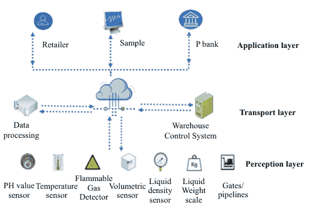

图 2. 物联网架构图

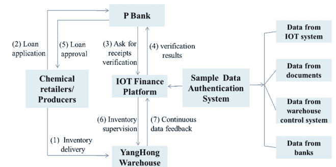

图 3. 库存质押融资工作流程

为缓解信用风险并提升融资效率，P 银行和阳弘根据其信用风险模型建立了会员名单，以按照 P 银行的信用模型筛选合格零售商。表 2 显示了申请人的选拔标准。所有贷款处理活动（包括申请、验证、审查、发放和实时数据传输）均在平台上为合格会员自动完成。在验证这些会员的库存后，P 银行可在 2 小时内批准其贷款申请。

#### 4.1.3 案例与数据分析

在 IPF 业务中，OFSPs 利用其在供应链中的主导地位和信息系统，广泛获取中小企业的交易和物流信息，以应对逆向选择（Shi et al., 2015）。传统 SCF 中的银行只能依赖“硬信息”（如仓库单据）作为主要信息渠道，这阻碍了它们在中小企业中的普及。与传统的库存监控模式相比，配备物联网设施的新架构提升了 P 银行的信息获取能力。借助物联网设备收集数据，抵押品易于识别，基础资产质量可高效检查。此外，这些设施可以标准化库存检查流程，并向 P 银行提供多种产品信息。该方案改变了传统银行对纸质

| 类别编号 | 一级指标 | 二级指标 |
|---|---|---|
| 1 | 企业质量 | 资产<br>负债<br>利润<br>销售额<br>销售增长率 |
| 2 | 企业管理 | 运营历史<br>领导素质<br>管理素质<br>员工素质<br>财务披露质量 |
| 3 | 供应链运营 | 供应链稳定性<br>行业增长率<br>行业排名<br>价格稳定性<br>营业周转率<br>供应链违约率<br>供应链脆弱性 |
| 4 | 平台上的运营历史 | 交易期<br>交易频率<br>交易量<br>交易对手资质<br>交易对手信用评级 |

表 2. 会员资格标准指数

单据，以确认抵押资产，并提高信息流与物流的一致性。

在传统 IPF 中，由于业务结构松散且双边关系简单，传统银行无法立即采取行动，导致仓库存在隐蔽行为。尽管如此，OFSPs 将中小企业纳入其业务网络，并通过联网的仓储管理系统，在 OSCF 中实现对库存的流程管理（Song et al., 2018a）。为更新传统 IPF，P 银行利用物联网信息网络的互联互通。即时信息传输使银行能够及时获取动产，并允许实时在线监控取代实地检查。此外，升级内部流转系统可降低银行的人工成本，并使银行能够高效管理库存。借助嵌入物联网的系统，风险信号可更早被识别，并增加了敌对操纵或库存套利的可能成本。所有这些措施都增强了融资方识别交易对手隐蔽行为的能力。

更重要的是，该架构加速了中小企业的融资处理。它通过将信息系统与银行后台系统相连接，加快了信用评级流程和贷款审批流程。由于实时通信使动态仓储成为可能，中小企业可以享受动态仓储贷款服务的便利。快速贷款审批增加了核心企业、中小企业和银行之间的合作粘性。中小企业有很强的动力与商业银行保持稳定且成功的合作伙伴关系。基于物联网的 IPF 还提升了商业银行在供应链中的参与度，以及在资产清算时对基础资产估值的知识。

综上所述，基于物联网的 IPF 解决方案丰富了传统银行的风险管理方案。商业银行可以利用最先进的技术构建一个透明、标准且高效的电子沟通平台。该电子平台使商业银行能够将其嵌入中小企业业务，并缓解传统 SCF 业务模式。然而，物联网架构也存在局限性。它无法解决所有 IPF 风险，并且


流动性风险仍然是推动 IPF 的一大障碍。由于仓库不愿参与清算过程，传统银行缺乏与市场衔接的桥梁，也缺乏从信息角度保障自身权益的机制。此外，根据选择规则，该案例主要基于中小企业的商业信用，而非核心企业的信用。因此，核心企业的信用未得到充分利用。最后，这种物联网架构仅适用于糖和化学品等标准商品。对于电子产品和半成品等非标准商品，该架构不适用。然而，推动 IPF 需要多种商品和更通用的解决方案。

### 4.2 案例二：物联网与区块链技术的联合应用

#### 4.2.1 案例背景

小伟云联区块链公司有限公司（X 区块链公司）利用区块链和物联网技术提供中介服务。其团队于 2011 年开始探索在供应链金融（SCF）中应用物联网技术。如今，他们已成为在中国实施物联网和区块链技术的领先企业。X 区块链公司与 P 银行共同树立了典范，为宝山钢铁股份有限公司（600019）提供存货质押融资（IPF）解决方案服务。宝山的仓库拥有标准化的仓储管理流程和先进的仓库管理系统（WMS），用于托管大宗原材料，如钢材、塑料、糖等。首先，P 银行要求连接到仓库的 WMS 以收集与特定动产相关的日常信息。为了验证与电子回单相匹配的基础资产信息，P 银行和宝山引入了一套物联网设备（RFID、电子围栏、视频监控等）。因此，从物联网收集的信息可用于在电子回单转换为数字证书之前对其进行验证。此外，由于宝山是一家大型国有企业，在 P 银行拥有优良的信用评级，以及出色的偿付能力、盈利能力和营运能力指标。宝山有数百家供应商和下游企业，这些中小企业紧紧依附于宝山。这些特性决定了宝山可以作为核心企业，为零售商和商业银行之间转移回单提供信用基础。因此，宝山将负责基础资产，且任何库存损失或损坏将由宝山赔偿的承诺，作为智能合约被附加到区块链上。

#### 4.2.2 基于物联网与区块链融合的 IPF 解决方案

在建立基本信任后，下一步是构建一个可信的信息共享平台，使回单能够在相关利益方之间转移。X 区块链公司提供了一种联盟链架构，拥有四个节点，分别位于上海公证处、苏州公证处、南京公证处和 X 公司。公证处是政府授权的组织，向公众提供中立、真实且合法的信息。为确保区块链上的信息安全且不可篡改，网络的对等节点同时记录信息。该区块链包含三层：供用户操作的应用层、用于信息存储和智能合约的 Fabric 超级账本层，以及用于信息传输的调度层（如图 4 所示）。质押库存的电子回单也可以转移、拆分和出售，尤其是可作为证券化现金使用。与回单相关的所有流程，包括回单出具、回单质押、质押释放和质押注销，都必须上传到区块链上。因此，可信信息可以引入到链条上的每一方，回单的所有权可以转移给链上的任何参与者。由于银行、仓库、零售商、担保机构及相关行业合作伙伴加入链条共享数字信任，生态系统得以构建。所有交易都被记录，P 银行可以监控交易流。他们还可以通过该平台持续获取获得融资的中小企业与其客户之间的整体供应链活动。

图 4. X 区块链的架构

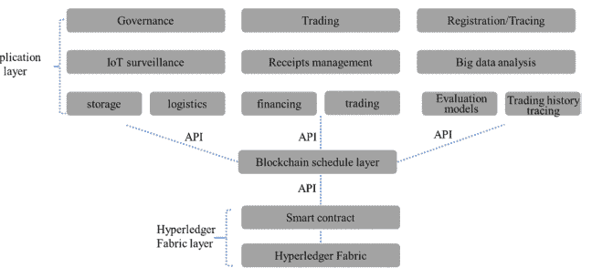

在三年间记录了 200 家零售商之间超过 3,000 笔交易后，沉淀的数据使 P 银行能够利用这些信息对这些零售商进行评估。首先，在区块链应用层，业务发展过程中与质押相关的交易明细被记录下来。买卖双方信息、借款人交易频率、仓单交易历史、基础资产生产商以及市场价格波动均被记录。随后，信息将传输至 P 银行的后台系统。基于 P 银行丰富的风险评估经验，采用包括中小企业经营状况评估、质押价值分析和信用历史分析在内的评估模型，对借款人进行综合评估。经过标准的信用评级流程后，银行可以决定定制化的利率、贷款价值比和贷款期限。由于评估结果自动生成，贷款审批流程现在仅需三天，比之前缩短了 4–12 天。

更重要的是，宝山公司、X 公司和中小企业都有强烈的动机加强与 P 银行的合作。对于宝山公司而言，基于区块链的供应链金融可以帮助他们延长对供应商的付款期限，或通过提供增值服务来扩大客户群。此外，P 银行对宝山公司提供高额奖励和惩罚。如果发现宝山公司与中小企业之间存在串通，宝山公司必须承担责任，赔偿贷款金额与基础资产清算价值之间的差额。相反，如果宝山公司拒绝与中小企业串通并向 P 银行报告，P 银行将给予宝山公司高额奖励。从中小企业的角度来看，其上下游企业都在链上，战略合作伙伴会认定任何违约行为，因此违约成本高昂。在 X 公司的案例中，他们可以从真实的生态系统中受益，并从稳定用户费用中获得收入，因此没有破坏性动机。

最后，尽管技术在信息采集、验证、传输和共享方面效率很高，但处理违约问题时仍需要激励机制来解决争议。为减轻 P 银行的负担，引入了多种机制来防范流动性风险。首先，采用了期货交易所，因为宝山拥有几家交易所认可的仓库。如果商品可用于支持期货合约，将被运送到特定仓库。如果库存无法满足期货交易所的严格规格，则会引入担保机构，在借款人违约时偿还债务（见图 5）。这样一来，可将担保机构与贷款借款人之间的争议降至最低。所有措施都写入合同并提交到区块链，区块链具有法律效力，可避免利益相关方之间无休止的讨价还价和责任推诿。P 银行与宝山公司之间的智能合约以及 P 银行与担保机构之间的智能合约，可由违约事件和预设条款触发。然后，还款转账将自动执行，以减少传统流程中繁琐的手续和不便之处。此外，由于区块链节点会按时间顺序记录每一次操作，智能合约避免了纸质合同中的人为篡改和操纵。因此，不必要的争论和纠纷大大减少。

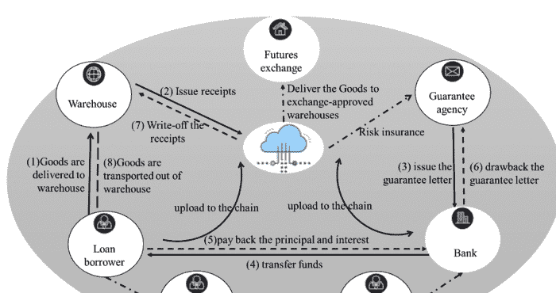

图 5. X 区块链上的存货质押融资工作流

#### 4.2.3 案例与数据分析

与基于物联网的 IPF 模式相比，该模式促进了整合所有参与方的生态系统，为所有商业银行提供了更通用的供应链金融模式。在传统的供应链金融中，银行难以获取借款人的运营信息和交易信息，而 OFSP 在信息获取方面优于传统银行（Chen et al., 2019）。然而，在基于融合技术的模式中，为了在回单被附加到区块链之前提高其有效性，采用了物联网技术来增强货物流和信息流的可见性。随后，区块链在可靠环境中实现了仓单的高效数字转移。此外，他们构建了一个平台，零售商和金融机构可以在链上激活回单交易。由于与上下游频繁交易，信息传输渗透到供应链运营的每个环节。随着数据作为数据池积累，银行可以获取中小企业的交易信息，这些信息可用于进一步分析中小企业的运营，从而更容易估算库存风险。实时分析进一步加快了贷款审批流程和动态 IPF。

此外，物联网与区块链的融合汇集了仓库的托管责任和监督责任。激励机制加强了融资方与仓库之间的共识，以削减串通机会并设定了


沿供应链传播信任文化的基础。同时，链上中小企业与参与者之间的绑定关系被视为一种强关系（Song et al., 2018a），可以限制中小企业的机会主义行为并降低其违约意图。由于在线供应链金融平台与借款人之间地位不平衡，X公司为链上所有相关方建立了公平的网络结构。超越传统供应链融资中对核心企业信用的依赖，银行、技术提供商、核心企业与中小企业之间值得信赖的合作伙伴关系在基于区块链的供应链融资模型中充当额外约束。

此外，为了防止流动性风险，引入智能合约将所有合作伙伴约定在协议谈判、责任承担及索赔等环节中，并促进利益相关方之间的谈判效率。与传统供应链融资模型相比，银行无需诉诸昂贵的法律程序来挽回所有损失。智能合约使P银行能够通过确保还款转移来实现行为控制和过程控制。此外，在基于区块链的存货融资模型中，所有参与方都肩负责任。职责分配明确设计，结构内的协作高效。因此，多方协作机制强化了结果管理，智能合约确保了过程管理，而这曾是在线供应链金融平台的优势（Song et al., 2018a）。

## 5. Discussion

### 5.1 Theoretical implications

现有关于供应链融资风险的文献主要关注运营风险和信用风险的衡量（Li et al., 2019; Abbasi et al., 2019; Lyu and Zhao, 2019）。很少有早期研究关注存货融资风险，尤其是从信息的角度出发。基于委托-代理理论，我们的研究分析了存货融资风险。根据Jost（2001），信息不对称分为三类：逆向选择、隐蔽信息和隐蔽行动。相应地，我们明确将存货融资风险分为三大类：质押品风险、仓储风险和流动性风险。这些维度扩展了Brindley（2004）的研究，该研究侧重于从信息角度分析质押贷款信用合同。Asongu和Odhiambo（2018）得出结论，增加信息共享渠道的数量可以减少信息不对称，并显著促进金融准入。

此外，为了减少信息不对称，创新传统银行的供应链融资模式至关重要，尤其是在在线供应链金融平台凭借其在解决信息不对称方面的天然优势成为强有力竞争对手之际。在线供应链金融平台主导的供应链融资模式是“面向供应链的”，它们通过自身的IT平台直接参与供应链合作（Song et al., 2018a）。虽然传统银行是“面向核心企业的”，但在风险评估和预防方面处于先进地位（Deng and Chen, 2017）。由于天然的基因缺陷，传统银行也很难建立电子商务平台来参与中小企业的直接交易（Shu et al., 2020）。同时，过度依赖在线供应链金融平台可能导致许多弊端，例如在线供应链金融平台未能履行信息审计职责、中小企业在电子平台和贷款中故意欺诈以及银行在业务中处于被动地位（Lin and Peng, 2021）。因此，我们的研究认为，传统银行可以利用物联网和区块链技术构建生态系统，以弥补其在供应链中嵌入性不足的问题。众所周知，在线供应链融资的业务仅限于电子商务平台上的中小企业零售商和交易商。但基于区块链的模型可以嵌入商品和工业产品，从而使该商业模式能够与在线供应链融资竞争。

遵循Blackman et al.（2013）提出的研究供应链融资解决方案的框架，我们的研究从三个方面分析了传统银行的变化：信息获取、业务网络结构和流程管理（参见图6）。首先，根据Mohr和Spekman（1994）及Voigt（2011），所传达信息的质量、沟通效果以及信息共享的范围和频率在供应链关系中发挥着重要作用。通过利用物联网和区块链，传统银行的信息获取能力可以得到主要提升，因为物联网有助于收集实时信息，而区块链有助于在可信环境中保存和传输信息。动产信息的质量得到大幅提升。得益于真实稳定的信息流，技术支持的供应链融资可以在积累存货数据后降低和控制质押品风险。

此外，尽管银行无法像在线供应链金融平台那样嵌入中小企业的运营以降低隐蔽行动，但它们可以在核心企业和技术服务提供商的帮助下建立供应链融资联盟。更重要的是，该联盟与在线供应链融资的网络结构不同，后者由在线供应链金融平台主导，中小企业是网络中脆弱的成员。在区块链和物联网赋能的生态系统中，核心企业、中小企业、技术提供商和银行共享平等与信任。随着平台上信息的积累，商业银行可以增强对中小企业运营、现金流状况和诚信程度的了解。中小企业享受及时沟通带来的贷款审批流程的便利和高效。尤其是在第二个案例中，所有参与方都有动力在生态系统中维持合作关系并避免机会主义行为。在技术服务提供商的帮助下，银行、中小企业和仓库之间的高效沟通可以增强控制仓储风险的机制。

此外，为了遏制流动性风险，需要结果控制和过程控制两种措施（Song et al., 2018a）。首先，智能合约可用于自动化每个阶段的转账流程，并确保所有还款的履行。因此，在贷款过程中，中小企业的收入和账户处于监控之下，这使银行更容易控制中小企业的现金流并评估其偿还贷款的能力。其次，通过明确划分各方的责任，加强了结果控制。如果低信用中小企业违约，

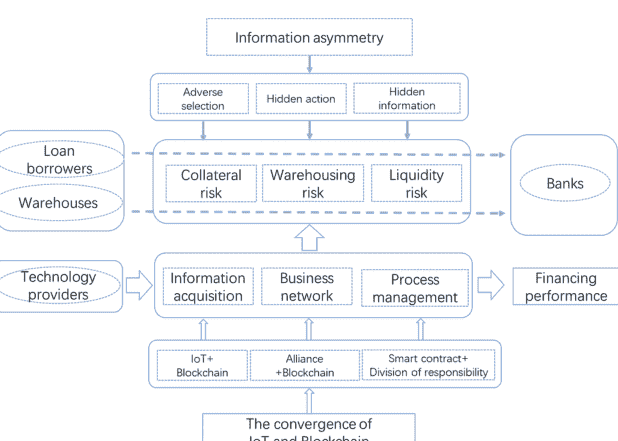

图6. 基于技术的供应链融资业务模型框架

商业银行可以引入核心企业、担保公司和技术提供商来分担清算风险。

### 5.2 Practical implications

除非物联网架构或技术与特定目的和业务成果相关联，否则不会使公司受益（Gerhard, 2020）。两个案例研究的发现为从业者、金融机构和政策制定者提供了宝贵的见解。第一个案例在及时和持续的信息沟通方面具有优势，而第二个案例则侧重于模型结构。考虑到第一个案例仅适用于标准商品，该模型的复制比第二个案例更困难，后者对存货没有限制。最重要的是，第二个案例侧重于协作关系和生态系统。此外，随着联盟区块链在成熟技术和低成本的支持下普及，信任可以被构建成为采用和维持基于区块链的供应链融资的基础，并且该商业模式可以扩展到许多行业。

但是，对于考虑建立类似技术型存货融资模型的管理者来说，有几点启示。首先，大量中小企业加入区块链平台至关重要。从供应链中的核心企业入手可以动员中小企业加入区块链。当更多中小企业的上下游成员上链后，传统银行可以轻松地获取、提取、综合和传播数据池中的信息。其次，数字信息流必须与物流流保持一致。因此，从物联网传感器和WMS收集的信息应当精确，并及时上传到区块链。第三，链上积累的数据应当得到充分利用。在过滤敏感信息后，数据应由银行进行挖掘，以丰富信用风险评估模型并改进贷款行动，从而最大化绩效。

## 6. Conclusion

我们的研究提供了宝贵的见解，以解释物联网和区块链如何融合以解决信息不对称并减轻存货融资风险。我们的工作及时且切中要害，因为它为综合存货融资风险提供了坚实基础，并提供了与在线供应链金融平台竞争的可行解决方案。基于委托-代理理论，我们将信息不对称分为三组（逆向选择、隐蔽信息和隐蔽行动），巧合地解释了存货融资中的质押品风险、流动性风险和仓储风险。通过多案例分析，我们提出，存货融资风险可以从信息角度利用物联网和区块链等新兴技术来解决。随着物联网和区块链的快速增长和发展，它们在提供高质量信息获取、构建公平商业网络和支持有效流程管理方面变得有帮助。结果可以帮助商业银行评估是否应采用这些技术以及如何将这些模式嵌入其供应链融资业务。

本研究的局限性在于我们只提供了两个案例研究来帮助理解这些新兴技术解决方案对供应链融资的影响。更多的案例研究或来自多个数据来源的大规模调查研究将有助于推广研究结果。就未来工作而言，当更多物联网数据可用时，设计和开发定制的数据挖掘和可视化方法来分析供应链融资将很有趣。我们还计划未来调查在区块链上管理供应链融资的监管问题。我们将为企业和个人推荐策略和最佳实践，以规范和转型现有的供应链融资。最后，组织采用适当的


在供应链中实施物联网和区块链技术的策略，获得关键参与者的认可并获得技术提供商的支持。

## 参考文献

Abbasi, W.A., Wang, Z., Zhou, Y. 和 Hassan, S. (2019), “基于物联网的供应链金融信用风险测量研究”, 分布式传感器网络国际期刊, 第15卷 第9期, 第14页.

Ali, O., Ally, M. 和 Dwivedi, Y. (2020), “金融服务领域区块链技术现状：系统文献综述”, 信息管理国际期刊, 第54卷, 102199.

Asongu, S.A. 和 Odhiambo, N.M. (2018), “信息不对称、金融化与金融获取”, 国际金融, 第21卷 第3期, 第297-315页.

Banafa, A. (2017), 物联网与区块链融合：益处与挑战, IEEE 物联网, 可从以下网址获取: https://iot.ieee.org/newsletter/january-2017/iot-and-blockchain-convergence-benefits-and-challenges.html.

Berdik, D., Otoum, S., Schmidt, N., Porter, D. 和 Jararweh, Y. (2021), “面向信息系统管理与安全的区块链调查”, 信息处理与管理, 第58卷 第1期, 102397.

Blackman, I.D., Holland, C.P. 和 Westcott, T. (2013), “摩托罗拉的全球金融供应链战略”, 供应链管理, 第18卷 第2期, 第132-147页.

Brindley, C. (2004), 供应链风险, Routledge, 阿宾顿, 第113-127页.

Chang, S.E. 和 Chen, Y. (2020), “当区块链遇上供应链：当前发展与潜在应用的系统文献综述”, IEEE Access, 第8卷, 第62478-62494页.

Chang, V., Baudier, P., Zhang, H., Xu, Q., Zhang, J. 和 Arami, M. (2020a), “区块链如何影响金融服务——基于专家访谈的概述、挑战与建议”, 技术预测与社会变革, 第158卷, 120166.

Chang, Y., Iakovou, E. 和 Shi, W. (2020b), “全球供应链与跨境贸易中的区块链：现状、挑战与机遇的关键综合”, 生产研究国际期刊, 第58卷 第7期, 第2082-2099页.

Chen, X., Wang, X. 和 Wu, D. (2010), “中小企业信用风险测量与预警：中国上市中小企业实证研究”, 决策支持系统, 第49卷 第3期, 第201-310页.

Chen, X., Xu, P. 和 Yang, G. (2019), “在线农产品供应链金融中银行与B2B平台的激励合同”, 商业与管理研究, 第8卷 第2期, 第20-26页.

Chowdhury, A., Mollah, S. 和 Farooque, O.A. (2018), “内幕交易、酌情应计与信息不对称”, 英国会计评论, 第50卷, 第341-363页.

Cong, L. 和 He, Z. (2019), “区块链颠覆与智能合约”, 金融学评论, 第32卷 第5期, 第1754-1797页.

Deng, A.M. 和 Chen, Z.X. (2017), “管理在线供应链金融中‘信息不对称’的信用风险”, 世界研究与评论期刊, 第4卷 第1期, 第29-32页.

Eisenhardt, K.M. 和 Graebner, M.E. (2007), “基于案例的理论构建：机遇与挑战”, 管理学院期刊, 第50卷 第1期, 第25-32页.

Fang, B.L. (2019), “如何解读供应链金融155号文件”, 可从以下网址获取: https://www.sohu.com/a/327538522_120063281.

Frizz-Barker, J., Chow-White, P.A., Adams, P.R., Mentanko, J., Ha, D. 和 Green, S. (2020), “区块链作为商业颠覆性技术：系统综述”, 信息管理国际期刊, 第51卷, 102029.

Fu, K., Hsu, V. 和 Xue, J. (2017), *基于库存融资的动态库存管理*, 社会科学电子出版, 可从以下网址获取: https://papers.ssrn.com/sol3/papers.cfm?abstract_id=3087099.

Gerhard, G. (2020), “并非所有工业物联网平台都相同”, *控制工程*, 第67卷 第1期, 第12-16页.

Gioia, D.A., Corley, K.G. 和 Hamilton, A.L. (2013), “归纳研究中追求定性严谨性：关于 Gioia 方法论的笔记”, *组织研究方法*, 第16卷, 第15-31页.

Hasan, H., AlHadhrami, E., AlDhaheri, A., Salah, K. 和 Jayaraman, R. (2019), “基于智能合约的高效空运管理方法”, *计算机与工业工程*, 第136卷, 第149-159页.

Hofmann, E. (2009), “供应链中的库存融资：物流服务提供商方法”, *国际实物分销与物流管理期刊*, 第39卷 第9期, 第716-740页.

Hofmann, E. 和 Johnson, M. (2016), “供应链金融——概念性思考重述”, *国际实物分销与物流管理期刊*, 第46卷 第4期, 第1-8页.

Hughes, L., Dwivedi, Y.K., Misra, S.K., Rana, N.P., Raghavan, V. 和 Akella, V. (2019), “区块链研究、实践与政策：应用、益处、局限性、新兴研究主题与研究议程”, *信息管理国际期刊*, 第49卷, 第114-129页.

Johnson, T.L. 和 So, E.C. (2018), “一种简单的多市场信息不对称度量”, *管理科学*, 第64卷 第3期, 第1055-1080页.

Joseph, N., Kar, A.K., Ilavarasan, P.V. 和 Ganesan, S. (2017), “关于物联网（IoT）讨论的综述：来自 Twitter 分析的洞察”, *全球信息管理期刊（JGIM）*, 第25卷 第2期, 第38-51页, doi: 10.4018/JGIM.2017040103.

Joshi, A.P., Han, M. 和 Wang, Y. (2018), “区块链技术安全与隐私问题综述”, *计算数学基础*, 第1卷 第2期, 第121-147页.

Jost, P.J. (2001), “企业语境下的委托-代理理论”, in Jost, P.J. (编), *商业管理中的委托-代理理论*, Schäffer-Poeschel 出版社, 斯图加特, 第11-43页.

Landes, X. 和 Néron, P.Y. (2018), “道德与市场失灵：信息不对称”, *社会哲学期刊*, 第49卷 第4期, 第564-588页.

Le, C.H.A. 和 Nguyen, H.L. (2019), “抵押品质量与贷款违约风险：越南案例”, *计算机经济学研究*, 第61卷, 第103-118页.

Lee, I. 和 Lee, K. (2015), “物联网（IoT）：企业的应用、投资与挑战”, *商业前瞻*, 第58卷 第4期, 第431-440页.

Li, J., Wang, Y., Li, Y. 和 Li, Q. (2019), “供应链金融风险管理的区块链应用简要综述”, in Li, Q.L., Wang, J. 和 Yu, H.B. (编), *可靠性、网络安全与系统质量的随机模型，IJCICO 2019. 计算机与信息科学通信*, Springer, 新加坡, 第1102卷, 第116-133页.

Li, T., Fang, W., Dash Wu, D. 和 Zhang, B. (2020), “面对战略性违约的风险厌恶型报童的库存融资”, *工业管理与数据系统*, 第120卷 第5期, 第1003-1038页.

Lin, Q. 和 Peng, Y. (2021), “在线供应链金融中防止道德风险的激励机制”, *电子商务研究*, 第48卷, 第571-598页, doi: 10.1007/s10660-019-09385-0.

Lin, J., Shen, Z., Zhang, A. 和 Chai, Y. (2018), “面向智慧农业的基于区块链和物联网的食品可追溯性”, *第3届人群科学与工程国际会议论文集*, 第3期, 第1-6页.

Liu, S., Ma, D., Ekaterina, I. 和 Álvaro, R. (2020), “基于模糊分析网络过程的知识产权质押融资风险评估”, *智能与模糊系统期刊*, 第38卷 第6期, 第6785-6793页.

Lyu, X. 和 Zhao, J. (2019), “压缩感知及其在大数据背景下互联网供应链金融风险评估中的应用”, *IEEE Access*, 第7卷, 第53182-53187页.

Malik, N., Alkhatib, K., Sun, Y., Knight, E. 和 Jararweh, Y. (2021), “工业物联网和供应链系统中区块链应用的综合综述”, 商业与工业应用随机模型, 第37卷, 第391-412页.

Martin, J. 和 Hofmann, E. (2017), “供应链金融实践中引入金融服务提供商：企业需求与服务要求”, 应用会计研究期刊, 第18卷 第1期, 第42-62页.

Michael, L. (2007), “供应链金融入门”, 供应链金融, 第4卷 第5期, 第34-48页.

Mohr, J. 和 Spekman, R. (1994), “合作伙伴关系成功的特征：合作伙伴属性、沟通行为与冲突解决技术”, 战略管理期刊, 第15卷 第2期, 第135-152页.

More, D. 和 Basu, P. (2013), “供应链金融的挑战：基于印度企业经验的详细研究与层次模型”, 业务流程管理期刊, 第19卷 第4期, 第624-647页.

Pan, X., Pan, X., Song, M., Ai, B. 和 Ming, Y. (2019), “区块链技术与企业运营能力：实证检验”, 信息管理国际期刊, 第52卷, 101946, doi: 10.1016/j.ijinfomgt.2019.05.002.

Pinch, T.J. 和 Bijker, W.E. (1984), “事实与人造物的社会建构：科学社会学与技术社会学如何相互受益”, 科学社会学研究, 第14卷 第3期, 第399-441页, doi: 10.1177/030631284014003004.

Qin, Z. 和 Ding, X. (2011), “供应链库存融资服务中的风险迁移”, 服务科学与管理期刊, 第4卷, 第222-226页.

Qiu, G., Zhang, Y. 和 Wang, C. (2014), “供应链金融中信息不对称及其引发的风险研究”, 制造与设计科学前沿 IV, 第1卷 第5期, 第496-500页.

Rabah, K. (2018), “人工智能、物联网、大数据与区块链的融合：综述”, 湖泊研究所期刊, 第1卷 第1期, 第1-18页.

Sheng, Q. 和 Wu, Y. (2012), “基于 AHP 的供应链库存质押融资风险模糊综合评价”, 科学技术管理研究, 第11卷, 第52-57页.

Shi, J., Guo, J., Wang, S. 和 Wang, Z. (2015), “基于第三方 B2B 电子商务平台的在线供应链金融信用风险评估：基于中国实践的探索性研究”, 国际 U- 和 E- 服务、科学与技术期刊, 第8卷 第5期, 第93-104页.

Shi, M. (2018), “青岛市商品质押案件今日宣判”, 可从以下网址获取: https://new.qq.com/omn/20181212/20181212A1HYX3.html?pc.

Shu, Z., Tang, S. 和 Zhao, T. (2020), “中国传统银行的数字化转型”, 商业与管理开放期刊, 第8卷 第1期, 第68-77页.

Silvestro, R. 和 Lustrato, P. (2014), “整合金融与实物供应链：银行在促进供应链整合中的作用”, 运营与生产管理国际期刊, 第34卷 第3期, 第298-324页.

Song, Z., Huang, H., Ran, W. 和 Liu, S. (2016), “库存融资 3PL 定价模型研究”, 自然与社会离散动力学, 第2016卷, 第7页.

Song, H., Yu, K. 和 Lu, Q. (2018a), “金融服务提供商与银行在帮助中小企业获取融资中的作用”, 国际实物分销与物流管理期刊, 第48卷 第1期, 第69-92页, doi: 10.1108/IJPDLM-11-2016-0315.

Song, J.C., Demir, M.A., Prevost, J.J. 和 Rad, P. (2018b), “面向可信分散式物联网网络的区块链设计”, 2018 年第 13 届系统工程年会（SoSE）, IEEE, 第169-174页.

Stiglitz, J. (2002), “信息与经济学范式的转变”, 美国经济评论, 第92卷, 第460-501页.


Sultana, S., Akter, S., Kyriazis, E. and Wamba, S.F. (2021), “构建并开发基于大数据的数字经济中的创新 (DDI)”, 《全球信息管理杂志》(JGIM), Vol. 29 No. 3, pp. 165-187, doi: 10.4018/JGIM.2021050107.

Swan, M. (2015), 《区块链：新经济蓝图》, O’Reilly Media, Sebastopol.

Tsai, C.H. and Peng, K.J. (2017), “金融科技革命与金融监管：在线供应链融资案例”, 《亚洲法律与社会杂志》, Vol. 4, pp. 109-132.

Uden, L. and He, W. (2017), “物联网如何帮助知识管理：汽车领域的案例研究”, 《知识管理杂志》, Vol. 21 No. 1, pp. 57-70.

Vasha, P.S., Akter, S., Kumar, A., Gochhait, S. and Patagundi, B. (2021), “人工智能对品牌的影响：一项文献计量分析 (1982–2019)”, 《全球信息管理杂志》(JGIM), Vol. 29 No. 4, pp. 221-246, doi: 10.4018/JGIM.20210701.oa10.

Voigt, G. (2011), “不对称信息下的供应链协调”, in Voigt, G. (编), 《不对称信息下的供应链协调》, 经济与数学系统讲座, Springer, Berlin and Heidelberg, Vol. 650, pp. 5-45.

Wamba, S.F. and Queiroz, M.M. (2020), “工业 4.0 与供应链数字化：区块链扩散视角”, 《生产计划与控制》, pp. 1-18.

Wang, R., Yu, C. and Wang, J. (2019), “基于物联网的供应链金融风险管理模式构建”, 《IEEE Access》, Vol. 7, pp. 110323-110332.

Xiong, C., Chang, V., Scuotto, V., Shi, Y. and Paoloni, N. (2021), “理解国际研发团队中知识隐藏的社会心理学方法：一项归纳分析”, 《商业研究杂志》, Vol. 128, pp. 799-811.

Xu, L., He, W. and Li, S. (2014), “工业中的物联网：一项调查”, 《IEEE 工业信息学交易》, Vol. 10 No. 4, pp. 2233-2243.

Yang, S.A. and Birge, J.R. (2013), “库存如何融资（应如何融资）：需求不确定性和财务困境成本的供应链中的商业信用”, 可访问: https://ssrn.com/abstract=1734682 或 doi: 10.2139/ssrn.1734682.

Yin, R.K. (2009), 《案例研究：设计与方法》, 修订版, Sage Publications, Newbury Park, California.

Zhang, L., Hu, H. and Zhang, D. (2015), “基于 SVM 的供应链金融中中小企业信用风险评估模型”, 《金融创新》, Vol. 1 No. 14, pp. 1-21.

Zhu, Y., Zhou, L., Xie, C., Wang, E. and Nguyen, T.V. (2019), “基于改进的混合集成机器学习方法预测供应链金融中中小企业的信用风险”, 《国际生产经济杂志》, Vol. 211, pp. 22-33.

## 附录

| Data sources | Case 1 | Case 2 |
|:---|:---|:---|
| 技术解决方案提供商 | 样本科技 首席执行官 (CEO)<br>样本科技 首席财务官 (CFO)<br>IoT 平台架构师<br>UI 设计师 | X 区块链公司首席执行官<br>项目负责人<br>区块链平台架构师<br>营销经理 |
| P 银行 | (江苏省)<br>P 银行首席风险官 (CRO) | (浙江省)<br>SCF 部门首席经理<br>SCF 部门高级项目负责人 |
| 核心公司 | (上海)<br>YangHong 项目负责人<br>一名高级仓库经理 | (上海)<br>宝山公司一名高级经理<br>宝山公司一名仓库经理 |
| 中小企业 | (江苏省)<br>R 机械公司企业家<br>D 生物有限公司财务代表 | (上海)<br>Y 公司财务代表<br>Y 公司企业家 |
| 观察 | (长江流域地区)<br>IoT 平台运营的参与式观察<br>仓储流程的参与式观察<br>信贷分析与报告工作流的参与式观察 | (长江流域地区)<br>X 区块链运营的参与式观察<br>仓储流程的参与式观察<br>信贷分析与报告工作流的参与式观察 |
| 二次数据 | 案例数据模板: 2<br>案例介绍视频: 2<br>与案例相关的新闻: 5 | 案例数据模板: 4<br>案例介绍 PowerPoint: 3<br>与案例相关的新闻: 8 |

表 A1. 两个案例的数据来源

| 一级编码 | 二级编码 | 原始引语 |
|---|---|---|
| 采用传统 IPF 面临的挑战 | 信息获取中的劣势地位 | YangHong 与中小企业的利益高度相互依赖，而在此商业模式中我们处于不公平的信息劣势。(P 银行项目负责人) |
| 采用传统 IPF 面临的挑战 | 传统 IPF 的逆向选择风险 | 过度依赖硬信息，如盈利能力、财务报告和抵押品，我们无法准确评估甲醇公司的信用。该行业市场非常动态……(P 银行首席风险官 (CRO)) |
| 采用传统 IPF 面临的挑战 | 传统 IPF 的隐蔽信息 | 我们无法经常到场并像专家一样检查液体化学品的质量。(P 银行项目负责人) |
| 采用传统 IPF 面临的挑战 | 传统 IPF 的隐蔽行动风险 | 最大的挑战是，2012 年钢材质押危机发生后，商业银行不信任动产抵押模式。他们担心重复抵押和欺诈性收据……(样本科技首席执行官 (CEO)) |
| 高效信息获取 | 透明的信息共享 | 流程控制透明、严格且及时，极大地缓解了我们工作中的困难并降低了仓库的监督成本。同时，整个流程易于理解……(一名高级仓库经理) |
| 高效信息获取 | 频繁的信息共享 | 传感器可以持续验证库存并立即将结果发送到平台。(一名高级仓库经理) |
| 高效信息获取 | 广泛的信息共享 | 在传统的 SCF 方法中，银行只能“观察”，无法“插手”或“深入探查”。但现在整个流程对他们透明，这给银行带来了强烈的安全感。(样本科技首席财务官 (CFO)) |
| 高效信息获取 | 高效的信息共享 | 所有文件均为电子发票，系统可以验证货物和发票。IoT 平台非常方便，大大提高了贷款效率。(R 机械公司企业家) |
| 合作网络结构 | 参与者的参与 | 基于 IoT 系统收集的数据和 YangHong 的数据库，我们建立了一个信用模型来评估名单上所有客户的信用。该信用评估模型与传统模型截然不同……(P 银行首席风险官 (CRO)) |
| 合作网络结构 | 合作的动机 | 过去为了贷款，我们常常需要在仓库和银行之间奔波数周。但现在贷款申请流程比以前简单多了，IPF 模式在像我们这样的甲醇生产商和贸易商中非常流行。(D 生物有限公司财务代表) |
| 合作网络结构 | 破坏合作的障碍 | 没有平台发出的解押指令，货物无法发出。即使有仓库经理的帮助，仓库的任何异常操作也会被注意到并记录。操作仓库收据的成本非常高。(样本科技项目负责人) |
| 合作网络结构 | 合作的监督者 | 银行过去总是最后发现库存问题的一方，但现在我们可以检查仓库的所有运营以及抵押品上的库存所有者。(YangHong 项目负责人) |
| IPF 模式面临的挑战 | 亟待解决的清算风险 | 尽管我们对串通风险和库存评估的不确定性不太担心，但我们仍需面对抵押品的清算风险。(P 银行项目负责人) |
| IPF 模式面临的挑战 | 亟待充分利用的核心企业信用 | 实际上，我们不喜欢这样一个事实：当发生违约时，核心公司袖手旁观，承担的责任很少。由于它们在贷款过程中收取一定的佣金，它们应该……(P 银行首席风险官 (CRO)) |
| IPF 模式面临的挑战 | 商品品种的限制 | 这些 IoT 设施专为液体化学品仓库设计，例如乙醇、甲醇……(IoT 平台架构师) |

### 通讯作者
刘力新可以通过以下邮箱联系：lyyuniversity@126.com


# 发展中国家制造业组织中供应链4.0的大数据作用

Vaibhav S. Narwane  
机械工程系，KJ索马亚工程学院，印度孟买  

Rakesh D. Raut  
运营与供应链管理，  
国家工业工程学院，印度孟买  

Vinay Surendra Yadav  
机械工程系，国家技术学院赖普尔分校，赖普尔，印度  

Naoufel Cheikhouhou  
日内瓦商业管理学院，HES-SO，瑞士日内瓦  

Balkrishna E. Narkhede  
运营与供应链管理，  
国家工业工程学院，印度孟买，以及  

Pragati Priyadarshinee  
查坦亚巴尔蒂技术学院，甘迪佩特，印度  

### 摘要

**目的** – 大数据与供应链相关，因为它为决策和商业智能提供了分析工具。供应链4.0和大数据对组织应对波动、动态和全球价值网络至关重要。本文旨在探讨“大数据分析”在供应链4.0业务绩效与九项绩效因素之间的中介作用。

**设计/方法/途径** – 采用统计分析与人工神经网络分析的两阶段混合模型来分析数据。分析所用数据来自40家印度制造业组织的321份回复。

**发现** – 统计分析结果显示，组织与高层管理、可持续采购与供应、环境、信息与产品交付、运营、技术与知识、协作规划等绩效因素对大数据采用有显著影响。此外，将结果作为输入提供给人工神经网络模型，结果表明“信息与产品交付”和“可持续采购与供应”是大数据采用的两个最重要预测因子。

**研究局限性/启示** – 本研究证实了大数据在发展中国家制造业组织中对供应链4.0的中介作用。本研究为制定关于大数据分析的管理政策和组织愿景提供了指导。

**独创性/价值** – 首次在印度制造业组织背景下讨论了大数据对供应链4.0的影响。所提出的混合模型旨在评估大数据分析的中介作用，以提升供应链4.0业务绩效。

**关键词** 大数据分析，数字供应链，供应链4.0，业务绩效，人工神经网络，结构方程建模  

**论文类型** 研究论文  


## 1. 引言

大数据和预测分析被认为是供应链（SC）设计调控的新兴“游戏规则改变者”之一（Fawcett和 Waller，2014）。供应链运营中的大数据分析（BDA）是现有文献中广泛讨论的话题（Inamdar等人，2020）。“SC数据科学”一词被用于将定性和定量方法应用于SC理论，以解决SC问题并预测结果（Waller和 Fawcett，2013）。然而，随着业务流程变得越来越依赖数据，BDA为运营决策提供了数据驱动的洞察（Ramanathan等人，2017）。SC中的BDA能够改善流程级绩效（Brinch，2018）、企业级绩效（Dubey等人，2019a）、可见性（Kache和 Seuring，2017）、竞争力（Sanders，2016）以及退货管理（Roßmann等人，2018）。凭借BDA能力，组织可以应对市场动荡（Gunasekaran等人，2018），从而相较于竞争对手获得竞争优势（Dubey等人，2021）。供应链4.0或智能供应链是将工业4.0/智能制造应用于SC运营的一项倡议（Frazzon等人，2019）。供应链4.0的特征包括通过配备传感器和RFID的智能对象、智能系统、集成SC活动、自动化活动和创新，实现SC与技术之间的互联（Wu等人，2016）。供应链4.0提供虚拟化、互操作性、服务导向、去中心化和模块化（Dossou，2018）。此外，最近的COVID-19爆发影响了许多经济活动，如制造、医疗保健、体育、旅游、供应链和物流（Ivanov，2020a）。这种中断几乎在所有领域都能感受到，并且供需之间出现了显著失配。在这种情况下，大数据将发挥关键作用，而适当的数据分析应用可以帮助将供应链运营带入新常态。随着COVID-19危机期间消费模式的改变，BDA可用于需求预测（Ivanov，2020b）和供应链规划（Chang，2020）。BDA有能力识别中断和其他供应链问题，这些信息可用于更好的决策和各种供应链活动的管理。因此，适当应用BDA能力可能有助于构建有韧性的供应链（Singh和 Singh，2019）。尽管BDA是与物联网（IoT）和云计算一起为供应链4.0提供支持的技术之一，但其对业务绩效的作用至关重要（Hazen等人，2018）。然而，BDA的负面影响包括IT基础设施不足、合作伙伴之间的协调问题、复杂性和网络风险（Makris等人，2019；Kache，2015）。Luthra和Mangla（2018）将供应链4.0挑战分为四类：技术、战略、伦理与法律、以及组织。Moktadir等人（2019）对孟加拉国皮革制造商进行的研究将技术基础设施和重新配置复杂性确定为供应链4.0的重大挑战。只要这些挑战得到解决，BDA能力就能改造发展中国家的供应链4.0倡议。许多公司需要管理多个供应链，并与不同层级的跨国公司、客户和供应商合作（Min等人，2019）。因此，这些公司面临更大的压力，需要BDA来管理供应链（Sanders，2016）。

像中国、丹麦、美国和德国这样的工业化国家已经开始在SC管理中使用BDA（Brinch等人，2018；Kache和 Seuring，2017；Lai等人，2018）以及供应链4.0的应用（Ivanov等人，2019；Makris等人，2019）。现有文献表明，BDA对SC敏捷性（Dubey等人，2019a）、SC韧性（Dubey等人，2019b）、SC可持续性（Cheng等人，2018）和SC创新（Queiroz和 Telles，2018）产生积极影响。然而，SC中的BDA与供应链4.0被分别讨论，而BDA对供应链4.0业务绩效的贡献很少被讨论。本研究试图在发展中国家背景下弥补这一研究差距。本研究解决的研究问题（RQs）如下：

- RQ1. SC和供应链4.0中BDA的重要因素有哪些？
- RQ2. 这些因素如何影响发展中国家的供应链4.0倡议？
- RQ3. BDA是否在改善供应链4.0绩效方面发挥中介作用？

为解决上述RQs，回顾了“供应链4.0”、“大数据分析”、“工业4.0和供应链”方面的文献。基于文献调查和专家意见，探索了因素和子因素。本研究采用两步混合结构方程建模（SEM）和人工神经网络（ANN）方法，以确定BDA对业务绩效的影响。SEM方法具有补偿性，用于验证线性关系（Shah和 Goldstein，2006）。ANN具有非补偿性，用于验证线性和非线性关系。因此，ANN弥补了SEM的局限性（Shmueli和 Koppius，2011），并比多元线性回归方法更为先进（Chong，2013）。

本研究的研究目标（ROs）如下：

- RO1. 确定供应链4.0中BDA采用的关键促进因素。
- RO2. 评估可观察和不可观察的BDA构念，并使用ANN对最重要的因素进行排序。
- RO3. 确定这些因素对改善SC业务绩效的影响。

手稿按章节结构如下：第2章为本研究的理论背景。第3章详细阐述拟议的假设和框架，随后是第4章的研究方法。第5章展示了研究结果的分析与讨论。第6章包含本研究的结论和未来展望。

## 2. 理论背景

在文献中，作者们采用了各种模型和理论来理解技术采用。这些包括“技术接受模型（TAM，技术接受与使用统一理论（UTAUT），计划行为理论（TPB），技术准备指数（TRI），组织信息处理理论（OIPT），利益相关者理论和情景理论”等。在本文中，我们利用OIPT来研究供应链领域中BDA的相关文献。OIPT由Galbraith（1974）开发，由三个基本要素构成：处理需求、处理能力以及这两个要素之间的匹配（Tushman和 Nadler，1978；Zhu等人，2018）。OIPT支持组织在更好决策的同时，通过基于组织技术能力的信息处理策略来尽量减少不确定性（Galbraith，1974；Tushman和 Nadler，1978）。简单来说，组织需要大量数据来支持决策中的各种流程，但处理能力有限（Zhu等人，2018）。BDA可以解决这个问题，并且即使在COVID-19危机背景下也是一个可行的选择。通过这种方式，在组织层面恰当应用BDA也可以减轻供应链中的不确定性。因此，OIPT促使用户使用信息技术（如BDA）来开发洞察力，以满足供应链4.0的数据需求。为澄清，我们首先解释工业4.0和供应链4.0，然后阐述BDA在SC中的应用。最后，我们说明BDA与供应链4.0之间的关系。

### 2.1 工业4.0和供应链4.0

工业4.0被定义为第四次工业革命。工业4.0主要由技术驱动，并将网络 - 物理系统（CPS）作为其核心组成部分。CPS将网络和物理过程集成为控制和监测机制（Lee等人，2015）。工业4.0将技术转变为数字化、自动化等（Lasi等人，2014）。工业4.0的各种技术包括物联网（IoT）、云计算，


增强现实、增材制造、机器人技术、网络安全、BDA、仿真以及水平和垂直集成 [Frank et al., 2019]。根据 Lu (2017) 的说法，工业 4.0 广泛用于航空航天行业、医疗保健行业、家具制造行业和农业行业等领域的创新工具和机器制造、实时资产跟踪以及机器维护。工业 4.0 用于供应链（SC）以使其流程更加高效，并有助于提高其生产率（Raut et al., 2020）。这种供应链通常被称为供应链 4.0。

供应链 4.0 对供应链（SC）的所有利益相关者都有益，包括供应商、制造商、分销商和客户。这一技术进步为利益相关者提供了以下好处：
- 1) 供应商 – 供应商和产能灵活性 (Oh and Jeong, 2019)、供应商选择 (Frank et al., 2019)、供应商协作 (Manavalan and Jayakrishna, 2019)、控制前置时间 (Oh and Jeong, 2019) 和市场动态 (Ardito et al., 2019)。
- 2) 制造商 – 透明度 (Lin et al., 2016)、灵活性 (Pfohl et al., 2017)、创新 (Lin et al., 2016)、数字化和自动化 (Ivanov et al., 2019) 以及精益生产 (Lin et al., 2016)。
- 3) 分销商 – 缩短交货时间 (Pfohl et al., 2017)、物流灵活性 (Oh and Jeong, 2019) 和精益实践 (Lin et al., 2016)。
- 4) 客户 – 产品可及性 (Frazzon et al., 2019)、互动增加 (Oh and Jeong, 2019)、定制化 (Oh and Jeong, 2019) 和渠道灵活性 (Oh and Jeong, 2019)。

Makris et al. (2019) 对供应链 4.0 的采用进行了探索性研究，发现采用将影响员工、工作时间和灵活性。然而，供应链 4.0 的采用仍面临特定挑战。Moktadir et al. (2019) 和 Luthra 和 Mangla (2018) 确定了新兴和发展中经济体的挑战，表明各类经济体都在考虑采用供应链 4.0。德国、法国、英国或美国等一些工业化国家已采用供应链 4.0。此外，印度、伊朗和巴西等发展中经济体，以及孟加拉国等新兴经济体也在赶上这一技术进步。

### 2.2 BDA 与供应链

BDA 是可能塑造未来供应链的一种力量 (Fawcett and Waller, 2014)。Nguyen et al. (2018) 认为，BDA 能力对于供应链的需求管理、物流、采购和制造职能可能很有用。此外，为了利用供应链分析中大数据的融合，Woldt et al. (2020) 发现该领域存在多种就业机会。他们根据行业数据和文献绘制了包含大数据和供应链分析的课程结构，结果产生了 116 种供应链分析工作类型。大数据研究的另一个重要用途是在信息系统领域 (Grover et al., 2020)。此外，非例行认知工作也可以借助大数据实现计算机化 (Frey and Osborne, 2017)。Jarrahi (2018) 建议，人工智能（AI）与 BDA 相结合非常适合处理复杂的决策。关于 BDA 的一般文献可以在 Larson 和 Chang (2016) 的著作中找到。Roberts 和 Hazen (2016) 强调了通过整合大数据的流程、人员和技术维度来重新设计供应链。在一项理论驱动的研究中，Hazen et al. (2018) 分析了基于 BDA 的可持续供应链的理论。所分析的八种理论包括社会资本、经济、网络、制度、基于资源、资源依赖、生态现代化和代理。分析了这些理论的基本原理，并结合三重底线方面探讨了供应链中大数据的未来研究方向。Arumachalam et al. (2018) 为具有 BDA 能力的供应链提出了一个框架，涉及数据生成、可视化、分析、管理和集成。考虑的四个阶段包括启动、数据贫乏且分析丰富的采用阶段、数据丰富且分析贫乏的采用阶段以及常规化阶段。Rodriguez 和 Da Cunha (2018)、Sanders (2016) 以及 Brinch (2018) 为供应链提出了 BDA 的概念框架。Rodriguez 和 Da Cunha (2018) 提出的框架旨在收集关键类别：吸收能力、可持续性绩效和企业的供应链创新。

BDA 支持可持续发展的能力以及组织通过回应动态市场中的客户需求获得竞争优势的能力。Sanders (2016) 提出了一个四阶段成熟度地图，关注数据结构、数据可用性、基础分析和高级分析。大数据推动领先的供应链组织；然而，大多数组织尚未实施它，因为高层管理人员缺乏理解。此外，BDA 在供应链中的应用在伦理、运营、隐私和安全方面存在多个障碍 (Ogbuke et al., 2020)。Brinch (2018) 提出了一个基于价值理论和业务流程理论的框架。供应链从业者必须理解大数据的价值，并需要为其实施构思策略。此外，Grover et al. (2018) 提出了一个使用 BDA 创造战略商业价值的研究框架。该框架说明了各种构念及其与 BDA 价值创造及其实施的关系。该框架还讨论了未来 BDA 研究问题的研究组成部分。

因子分析方法在供应链 BDA 采用中最为普遍。而其他定量运筹学方法，如中性集合论，在供应链领域也得到了显著应用 (Abdel-Basset et al., 2019)。一些重要的近期研究使用了偏最小二乘–结构方程模型（PLS-SEM）（Shafique et al., 2019; Dubey et al., 2019a, 2021; Lai et al., 2018; Jeble et al., 2018）和 SEM（Raman et al., 2018）。Wu et al. (2017) 使用了多准则决策工具，如灰色 DEMATEL 和模糊 DEMATEL，而 Lamba 和 Singh (2018) 采用了混合 ISM、模糊-TISM 和 DEMATEL 技术。Lamba 和 Singh (2018) 确定了在运营和供应链中实施 BDA 的最关键推动因素。Roßmann et al. (2018) 使用了模糊聚类，而 Queiroz 和 Telles (2018) 使用了回归分析。Roßmann et al. (2018) 使用 Delphi 方法分析了供应链中 BDA 的社会影响。该研究表明，BDA 对减少安全库存、供应商绩效和需求预测有积极影响。Queiroz 和 Telles (2018) 确定了 BDA 知识与供应链水平之间存在正相关关系。

### 2.3 供应链 4.0 的 BDA

文献中对供应链 4.0 的 BDA 作用探讨不多。供应链 4.0 的赋能技术包括云计算、物联网、区块链、数字孪生、网络安全和大数据。Calatayud et al. (2019) 提出了具有 AI 和物联网能力的自主思考供应链概念。根据 de Campos Martins 和 Simon (2018) 的说法，超过 80% 关于 BDA 和供应链 4.0 的研究文章讨论技术挑战。然而，还必须解决对变化的恐惧、人机关系和人力资源替代等社会文化挑战。Yadav et al. (2020) 指出，无效的员工培训、缺乏受雇员工以及对文化变革的抵制是重要的社会文化挑战。

Zhong et al. (2015) 提出将典型供应链资源转换为智能对象。提出了一种面向 RFID 供应链数据的 BDA 框架，包含传输机制、数据仓库、数据聚类和知识表示。Ben-Daya et al. (2019) 认为，分析能力有限的物联网可能对制造供应链产生积极影响。Haddud et al. (2017) 确定了供应链中物联网采用的潜在挑战。所确定的前五项挑战是异质数据和技术的集成、通信协议的全球标准、安全问题、高层管理支持和物联网架构。

Santos et al. (2017) 为跨国组织中工业 4.0 的实施提出了大数据架构。案例实施针对“Bosch Braga”进行，分为三个阶段：数据收集、数据准备和可视化。O'Donovan et al. (2015) 强调了 BDA 在高度优化的智能制造供应链中的作用。BDA


可协助从原材料到交付给最终客户的需求驱动型SC；然而，管理端到端SC需要一个多学科团队。此外，BDA还有助于更好的预测和业务规划，从而进一步提高组织的业务绩效（Chang, 2020）。Babiceanu和Seker（2016）强调了制造SC中运营的可见性，并为制造CPS的SC协作提出了指导方针。Arya等人（2017）对军备备件进行了探索性研究，讨论了Supply Chain 4.0对计划、维护、分销和协作的影响。以下结论和研究差距已被识别：

- (1) 文献综述的综合表明，中国、丹麦、美国和德国等发达国家已开始将BDA用于SC（Brinch et al., 2018; Kache and Seuring, 2017; Lai et al., 2018）以及Supply Chain 4.0的应用（Ivanov et al., 2019; Makris et al., 2019）。发展中国家正在赶上，研究表明，在这些经济体中，Supply Chain 4.0的BDA问题有所不同。

- (2) 现有文献主要关注SC和Supply Chain 4.0的BDA。尽管这些议题被单独讨论，且很少有文章讨论Supply Chain 4.0的BDA。在一项针对印度企业的近期研究中，Raut等人（2019）探讨了BDA在实现业务绩效中的中介作用。然而，该研究未调查Supply Chain 4.0方面。

- (3) 现有文献显示BDA对SC敏捷性（Dubey et al., 2019a）、SC韧性（Dubey et al., 2019b）、SC可持续性（Cheng et al., 2018）和SC创新（Queiroz and Telles, 2018）有积极影响。然而，BDA对Supply Chain 4.0业务绩效的贡献很少被讨论。

上述研究差距表明，应研究BDA的能力以满足Supply Chain 4.0流程的数据需求，从而提高业务绩效。因此，在本工作中，我们使用基于调查管理的定性研究方法，研究了Supply Chain 4.0业务绩效与九个绩效因素之间BDA的中介作用。开发了一种混合SEM-ANN方法来确定BDA对业务绩效的影响。SEM方法是补偿性的，用于验证线性关系。ANN是非补偿性的，用于验证线性和非线性关系。因此，ANN平衡了SEM（Shmueli and Koppius, 2011），与多元线性回归方法（Chong, 2013）相比更为先进。

## 3. 拟议框架和假设

图1展示了拟议框架，该框架考虑了11个因素：组织和高层管理支持绩效（OTMSP）、信息和产品交付绩效（IPDP）、可持续采购和来源绩效（SPSP）、协作计划绩效（CPP）、可持续制造绩效（SMP）、闭环供应链绩效（CLSCP）、运营绩效（OP）、技术和知识能力（TKC）、环境绩效（EP）、大数据分析（BDA）和Supply Chain 4.0业务绩效（SBP）。BDA是在SBP与其他九个因素（即OTMSP、IPDP、SPSP、CPP、SMP、CLSCP、OP、TKC和EP）之间的中介。采用德尔菲法来最终确定入选因素（Skulmoski et al., 2007）。所有因素均已获得德尔菲专家组的批准。此外，上述十一个因素被划分为八十二个项目（见表1）。

## 4. 研究方法

图2展示了拟议的研究方法。

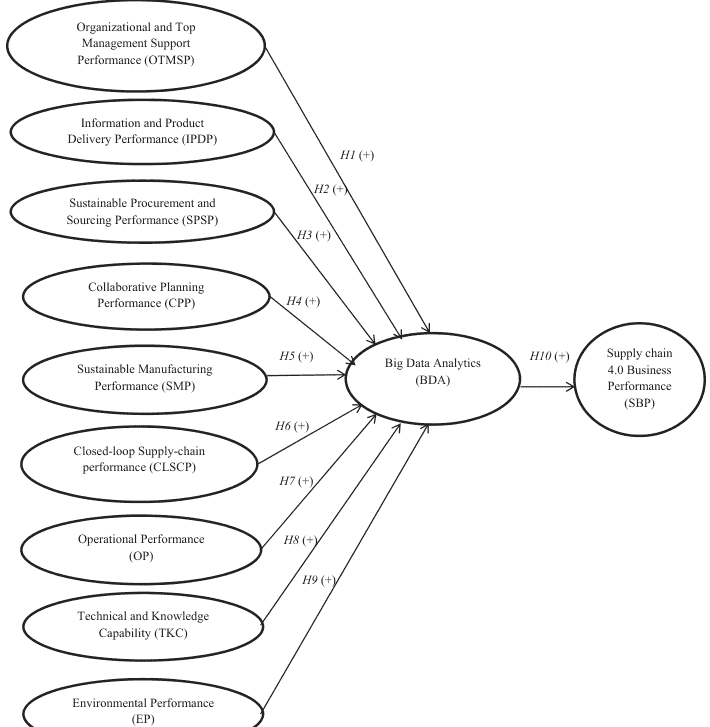

图1. 概念框架

注：+ 符号表示“积极影响”

该研究分为三个阶段进行。第一阶段，使用关键词“Supply Chain 4.0”、“big data analytics”、“Industry 4.0 and supply chain”进行了文献综述。这促成了印度语境下的研究问题（RQs）和研究目标（ROs）的形成。此外，还开发了概念框架并提出了假设。第二阶段，基于七点李克特量表开发了调查问卷。请13位专家回答问卷，其中十位专家（包括四位教授和六位行业人员）作出了回应。开展了包含115份回复的预试验研究。基于专家意见和预试验结果，最终确定了调查问卷。联系了40种不同类型的制造组织。调查于2018年10月至2019年4月通过面谈和电子邮件进行。每个印度制造组织收集了约8–10个样本。所确定的样本来自不同部门的经理，如供应链、HR、采购、研发、生产和会计。共分发了325份问卷

| 假设 | 因素 | 简要描述 | 项目 | 参考文献 |
| :--- | :--- | :--- | :--- | :--- |
| H1 | 组织和高层管理支持绩效（OTMSP） | BDA需要大量投资，且高层管理支持是必须的。在引入新技术时，组织必须通过培训和教育支持员工。所有员工的参与是首要必要条件，高层管理需要消除阻力。必须在SC的所有层级构建动态和运营能力。 | OTMSP1: 组织规模<br>OTMSP2: IT能力<br>OTMSP3: 组织成熟度水平<br>OTMSP4: 高层管理支持<br>OTMSP5: 培训和教育<br>OTMSP6: 财务意愿<br>OTMSP7: 动态与灵活性 | Dubey et al. (2019a)<br>Lai et al. (2018)<br>Liboni et al. (2019), Dubey et al. (2021) |
| H2 | 信息和产品交付绩效（IPDP） | 与SC合作伙伴及组织内部的信息共享必须完整、及时和准确。BDA能力确保这一点，且敏感数据可加密以保护数据隐私。优质信息的可用性对SC管理产生显著影响。BDA确保对产品信息进行恰当评估，这将提升SC各阶段的交付绩效。 | IPDP1: 库存管理<br>IPDP2: 数据质量<br>IPDP3: 数据可用性<br>IPDP4: 质量管理<br>IPDP5: 消费者反馈<br>IPDP6: 客户满意度<br>IPDP7: 及时交付 | Paras and Adams (2012), Sanders (2016) |
| H3 | 可持续采购和来源绩效（SPSP） | 可持续采购的重点在于环境可持续性。开发环境友好型产品需要供应商的合作。BDA鼓励采购和可持续采购，即从供应商到制造商再到分销商直至最终客户的服务和产品运输对环境的负面影响最小。ISO 14001、ISO 9000等认证可有利于程序标准化。 | SPSP1: 消费者意识<br>SPSP2: 政府政策<br>SPSP3: 投资<br>SPSP4: 法规<br>SPSP5: 竞争对手压力<br>SPSP6: 供应商选择<br>SPSP7: 产品生态标签<br>SPSP8: 环境审计<br>SPSP9: 面向可持续性的供应商协作<br>SPSP10: 客户协作<br>SPSP11: 面向可持续性的供应商合作<br>SPSP12: 供应商绩效<br>SPSP13: 供应商ISO 14000认证 | Zhu and Sarkis (2004), Cheng et al. (2018), Lai et al. (2018) |
| H4 | 协作计划绩效（CPP） | 协作绩效主要针对供应商协作、物流集成和联合开发。SC通常在不同组织中存在相互依赖和相关联的任务。SC参与者的协作对于问题解决和决策是必需的。BDA能力为管理SC运营创造多样化和组合性的知识集。 | CPP1: 所有利益相关方的合作<br>CPP2: 成本或交付变化<br>CPP3: 与供应商的长期关系<br>CPP4: 战略可见性<br>CPP5: 尽量减少非增值成本<br>CPP6: 与供应商的在线系统<br>CPP7: 数据驱动决策<br>CPP8: 成本绩效指数<br>CPP9: 物流可见性<br>CPP10: 产品数据管理 | Manavalan and Jayakrishna (2019), Narwane et al. (2019) |
| H5 | 可持续制造绩效（SMP） | 为了优化流程，制造数据需要在SC中与不同利益相关方共享。许多人正在使用精益和敏捷实践以实现可持续绩效。BDA能力通过改善与所有SC参与者的集成来协助可持续实践。有效决策确保最佳供应商选择、减少非增值流程并提高绩效。 | SMP1: 精益实践<br>SMP2: 敏捷实践<br>SMP3: 全面质量管理<br>SMP4: 服务质量<br>SMP5: 增值SC<br>SMP6: 运营标准化 | Ainiul et al. (2017), El Mokadem (2017), Esfahbodi et al. (2017), Gholikhloo and Azar (2018) |


## Table 1.

| Hypothesis | Factor | Brief description | Items | References |
|------------|--------|-------------------|-------|------------|
| H6 | Closed-loop Supply-chain performance (CLSCP) | Organisations should take emphasis on close-loop SC by treating and retrieving the end-of-use product. BDA helps to detect and track the returned product for optimisation of manufacturing, procurement, discarding or retrieval decisions. Sophisticated business intelligence and analytics capabilities will ensure optimal utilisation of products using recycling | CLSCP1: Overall cost management Recycling CLSCP3: Uncertain demand CLSCP4: Waste disposal | Manavalan and Jayakrishna (2019) |
| H7 | Operational performance (OP) | The operational performance consists of quality, capacity utilisation and customers quality recycling perspective of SC provider, as well as deliveries time. The perspective of SC provider, as well as customer must be considered for better services and quick responses to the customer. BDA assists in organisations through innovative and radical development in organisations through exploratory learning. BDA strategies will help in improving efficiency toward achieving long-term goals | OP1: Delivery OP2: Flexibility OP3: Customer satisfaction OP4: Cost OP5: Innovation | Liu and Lyons et al. (2011), Makris et al. (2019) |
| H8 | Technical and knowledge capability (TKC) | Technological capabilities through the IoT ensure monitoring of the entire SC network, which will assist in resource management. Real-time information sharing provides better control, emergency management and coordination. Forecasting and predictive analytics can make risks alter, product failure and preventive measures. The organisation must focus on skilled personnel with knowledge sets to achieve BDA adoption | TKC1: Technology complexity TKC2: New market trends TKC3: Perceived benefits TKC4: Knowledge management TKC5: Data quality TKC6: Knowledge scanning TKC7: New market trends | Lai et al. (2018), Frank et al. (2019), Raisch and Krakowski (2021) |
| H9 | Environmental performance (EP) | Environmental performance refers to waste management, eco-design and energy usage. BDA capabilities can help organisations for better green practices. Three R’s, i.e., reduce, reuse, recycle of reconfigurable systems, can be implemented more effectively through BDA. Organisations must ensure energy consumption cost and the penalty for environmental mishaps | EP1: Carbon emission EP2: Solid wastes EP3: Ecological cost EP4: Regularisation EP5: Green practices EP6: Social benefits EP7: Energy consumption | Cheng et al. (2018), Lai et al. (2018) |
| H10 | Supply Chain 4.0 business performance (SBP) | Sustainable business performances are measured in terms of economic performance, societal responsibility and environmental performance. BDA capabilities enable organisations to achieve environmental performance by monitoring usage and reducing waste. BDA also promotes better public relations and brand image. Through BDA and Supply Chain 4.0, organisations can gain a competitive advantage | SBP1: Transparency SBP2: Visibility SBP3: Responsiveness SBP4: Efficiency SBP5: Collaboration and integration SBP6: Stakeholder participation | Kache and Seuring (2017), Gholahhoso (2018), Lamba and Singh (2018), Frederico et al. (2019) |
| | | Note(s): BDA items considered: BDA1: velocity BDA2: variety BDA3: veracity, BDA4: volume, BDA5: value, BDA6: predictive analytics, BDA7: service and infrastructure, BDA8: modularity and compatibility BDA9: connectivity and intelligence, BDA10: planning and control (Raut et al., 2019) | | |

## Figure 2. Research methodology

- Literature survey on SC 4.0 and BDA
- Identify RQs (research questions) and ROs (research objectives) in context with developing economy
- Develop a conceptual model and propose the hypothesis
- Industry Experts
- Finalise the questionnaire (7 point Likert scale)
- Academia Experts
- Questionnaire pre-test
- Collection of data
- Exploratory factor analysis (EFA)
- Confirmatory factorial analysis (CFA)
- Structural equation modelling (SEM)
- Statistical Analysis
- Artificial neural network (ANN) model
- Sensitivity analysis to rank variables
- ANN Analysis
- Results and discussion
- Conclusion and implications of study

in these organisations. Four questionnaires were not filled in correctly, and thus, 321 responses were used and digitised in a statistical package of social science (SPSS). In the third phase, three stages of EFA-CFA-SEM were used for hypothesis testing and ANN was used to rank the identified factors and verify the SEM results. Thus, this work makes use of statistical analysis (EFA-CFA-SEM) and ANN analysis to analyse the surveyed data. Furthermore, the results obtained from these two analyses were discussed which shows the mediating role of BDA in improving business performance in Supply Chain 4.0.

### 4.1 Sample characteristics

Table 2 shows the descriptive statistics of the 321 responses. It shows that the highest number of responses (52.34%) are graduates, and 32.09% have between 11 and 15 years of experience. The highest number of responses were from the auto component manufacturer (24.61%), and 35.51% fall in the 21–30 million USD annual sales revenue.

| Particular | Classifications | No. of responses | % |
| :--- | :--- | :--- | :--- |
| Gender | Male | 224 | 69.78 |
| | Female | 97 | 30.22 |
| Total | | 321 | 100% |
| Years of experience | 5-7 | 46 | 14.33 |
| | 8-10 | 83 | 25.86 |
| | 11-15 | 103 | 32.09 |
| | More than 15 | 89 | 27.72 |
| Total | | 321 | 100% |
| Educational qualification | Graduates (B.E./BBA/B. Tech) | 168 | 52.34 |
| | Post-graduates (M. Tech/MBA) | 140 | 43.61 |
| | PhD (Technology/Management) | 13 | 4.05 |
| Total | | 321 | 100% |
| Type of industry | Auto component manufacturer | 79 | 24.61 |
| | CNC Machine Tool | 57 | 17.76 |
| | Turbo sub-assemblies | 71 | 22.12 |
| | Chemical products | 54 | 16.82 |
| | Furniture | 60 | 18.69 |
| Total | | 321 | 100% |
| Annual sales revenue (million USD) | 10-20 | 52 | 16.20 |
| | 21-30 | 114 | 35.51 |
| | 31-40 | 105 | 32.71 |
| | More than 40 | 50 | 15.58 |
| Total | | 321 | 100% |
| Organisation size (no. of employees) | 100-150 | 37 | 11.53 |
| | 151-300 | 85 | 26.48 |
| | 301-500 | 122 | 38.00 |
| | More than 500 | 77 | 23.99 |
| Total | | 321 | 100% |

### 4.2 Statistical analysis

The 321 responses were analysed using EFA-CFA in order to examine validity, reliability and structure. Microsoft Excel was used to tabulate the data. These data were imported to SPSS 20.0 software for the analysis. Analysis of moment structures (AMOS) software was used for SEM analysis.

#### 4.2.1 Exploratory factor analysis (EFA)

EFA analysis uses a statistical approach to determine the correlation between the variables (Anderson and Gerbing, 1984). In EFA, firstly, data suitability is checked (Williams et al., 2010). Bartlett’s test of sphericity and KMO (Kaiser-Meyer-Olkin) statistics are the two measures used for checking data appropriateness. The significance value < 0.05 and KMO > 0.7 are considered as within the desirable range (Hair et al., 1995). EFA analysis was carried out of 321 responses received. Measures are as follows: KMO = 0.851 > 0.7 and p = 0.000 < 0.05, i.e. 95% confidence level. The extraction method used was principal component analysis (PCA) and Varimax as a rotation method. The rotation converged in six iterations and loading of greater than 0.6 was observed for all variables without cross-loading. Thus, EFA results were found to be satisfactory for SEM.

#### 4.2.2 Confirmatory factorial analysis (CFA)

CFA illustrates the relationship between latent variables and observed factors (Chan et al., 2007). CFA assesses validity and reliability through goodness-of-fit indices. According to Hu and Bentler (1999), threshold values of goodness-of-fit are as follows:

- Ratio of chi-square test to degree of freedom (DF) = <5 occasionally permissible; <3 good.
- Goodness-of-fit index (GFI) = >0.95.
- Comparative fit index (CFI) = >0.95 Very good; >0.90 good; >0.80 occasionally permissible.
- Normed fit index (NFI) = >0.80.
- Adjusted goodness of fit index (AGFI) = >0.80.
- Root mean squared error of approximation (RMSEA) = <0.05 very good; 0.05–0.10 moderate; >0.10 not permissible.

In this study, CFA analysis was done on nine constructs of BDA and one construct of Supply Chain 4.0 Business Performance (SBP). The ten constructs were permitted to correlate with each other freely. The nine constructs of BDA were “Organisational and Top Management Supportive Performance (OTMSP), Information and Product Delivery Performance (IPDP), Sustainable Procurement and Sourcing Performance (SPSP), Collaborative Planning Performance (CPP), Sustainable Manufacturing Performance (SMP), Closed-loop Supply-chain performance (CLSCP), Operational Performance (OP), Technical and Knowledge Capability (TKC), and Environmental Performance (EP)”. For this study, a chi-square test for the degree of freedom (DF) is 2.342, which is between 2.00 and 3.00, therefore acceptable. GFI = 0.924 > 0.90, CFI = 0.957 > 0.95, and NFI = 0.864 > 0.80 indicates best fit. RMSEA <0.05 is considered remarkable. However, the obtained value of RMSEA is 0.065, which is in the permissible range of 0.05–0.1 and thus acceptable. It concludes that the dataset point is in the direction of the goodness-of-fit and acceptable for further analysis.

As discussed, CFA was performed for all ten constructs in order to test the convergent validity of all items. Loading between factors and measured variables at a one per cent level must be more than 0.5 (Barki and Hartwick, 2001). For the measurement model, standard estimates less than 0.70 are as follows: knowledge management (TKC4: 0.631), carbon emission (EP1: 0.526), ecological cost (EP3: 0.591), transparency (SBP1 with a value of 0.529), inventory management (IPDP1: 0.690), data quality (IPDP2: 0.675), timely delivery (IPDP7: 0.650), lean practices (SMP1: 0.471), agile practices (SMP2: 0.581) and total quality management (SMP3: 0.575). Out of these ten items, nine items have a value of more than 0.5, except lean practices (SMP1) with a value of 0.471. This analysis shows sufficient evidence of convergence validity as the rest of the loadings are beneficial to internal consistency. AMOS-20.0 was used for the CFA analysis; estimates and the path diagram are shown in Figure 3.

#### 4.2.3 Structural equation modelling (SEM)

SEM investigates multivariate data by including independent variables (IVs), latent constructs (LCs) and dependent variables (DVs). IVs and DVs can be measured factors or variables, which can be continuous or discrete. Two phases of SEM include the validation of LCs, i.e judging a complete fitting model and distinct structural models hypothesised amongst LCs (Jenatabadi, 2015). Referring to logical precedents, bi-directional arrows of the CFA model were replaced with single-headed arrows. This obtained SEM test results that were initially verified for the model fit. This study uses


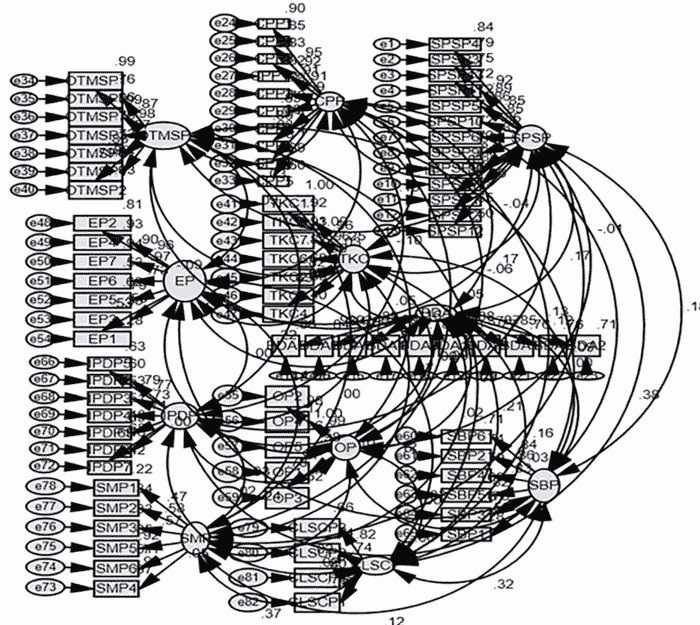

图 3. CFA 路径图

AMOS-20.0 能够读取 SPSS 文件并提供高质量路径图。卡方检验与自由度（DF）之比为 2.380，处于 2.00 至 3.00 之间，因此被认为是可接受的。GFI = 0.967 > 0.90 且 NFI = 0.864 > 0.80，表明拟合度最佳。此外，RMSEA < 0.05 和 CFI > 0.95 被认为是优秀的。然而，得到的 RMSEA 和 CFI 值分别为 0.065 和 0.942。RMSEA 和 CFI 分别处于 0.05–0.10 和 0.90–0.95 的允许范围内，因此可接受。图 4 显示了 SEM 路径图。

### 4.3 人工神经网络分析

ANN 是一种流行的人工智能方法，用于提高分析的性能和质量（Wang 等，2020）。ANN 的预测精度不仅对线性关系更高，对非线性关系也更高。ANN 通过加权链路互连的神经元处理信息（Leong 等，2015）。ANN 的优点在于不需要多变量同方差性、正态性或线性性假设（Abubakar 等，2017）。

#### 4.3.1 人工神经网络模型

在 ANN 中，多层模型常被使用（Fausett，1994），它具有一个输入层、一个输出层和一个或多个隐藏层。本研究采用具有一个隐藏层的多层感知机（MLP）和前向传播-反向传播（FFBP）算法。本文对给定网络进行了检验

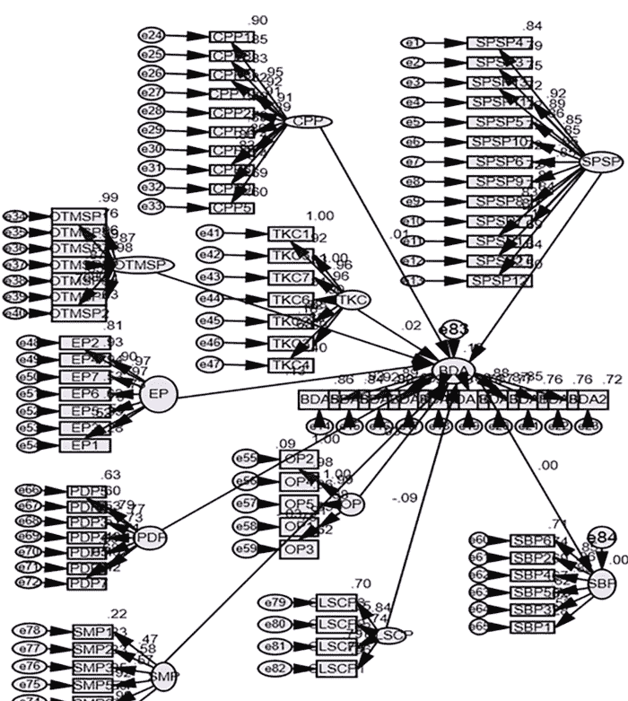

图 4. SEM 路径图

隐藏层的节点数为一至十个，并选定了十个节点。ANN 模型如图 5 所示。输入层和输出层各有七个节点。如图 5 所示，结构分析中的七个显著变量（OTMSP、IPDP、SPSP、CPP、TKC 和 EP）被用作 ANN 的输入。

#### 4.3.2 敏感性分析

在神经网络中，建议使用 90% 的数据进行训练、10% 的数据进行测试的交叉验证（Tan 等，2014）。双向 Sigmoid 函数用于隐藏层和输出层，以获得更好的精度。为确认预测变量的显著性，非零突触权重连接到隐藏层。表 3 和表 4 给出了分析的详细信息。

通过对七个显著因素的敏感性分析计算了每个因素。根均方误差（RMSE）是 ANN 模型精度的指示。除

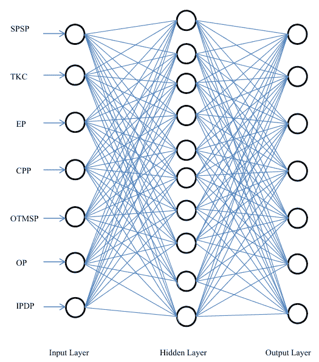

图 5. ANN 模型

少数点，ANN 估计值与实际值接近。敏感性分析显示，影响 BDA 的前三个因素是“信息和产品交付绩效（IPDP）、可持续采购与采购绩效（SPSP）以及组织和高层管理支持绩效（OTMSP）”，而运营绩效（OP）对 BDA 的影响最小。

| | ANN | SPSP | TKC | EP | CPP | OTMSP | OP | IPDP |
|:---|:---|:---|:---|:---|:---|:---|:---|:---|
| 1 | | 0.16 | 0.143 | 0.151 | 0.141 | 0.146 | 0.12 | 0.138 |
| 2 | | 0.154 | 0.15 | 0.141 | 0.162 | 0.142 | 0.104 | 0.147 |
| 3 | | 0.194 | 0.121 | 0.117 | 0.116 | 0.161 | 0.115 | 0.175 |
| 4 | | 0.151 | 0.142 | 0.155 | 0.138 | 0.15 | 0.127 | 0.137 |
| 5 | | 0.197 | 0.099 | 0.128 | 0.139 | 0.129 | 0.163 | 0.144 |
| 6 | | 0.157 | 0.146 | 0.137 | 0.12 | 0.159 | 0.11 | 0.172 |
| 7 | | 0.127 | 0.154 | 0.142 | 0.134 | 0.126 | 0.147 | 0.17 |
| 8 | | 0.133 | 0.149 | 0.145 | 0.138 | 0.137 | 0.104 | 0.193 |
| 9 | | 0.109 | 0.135 | 0.133 | 0.138 | 0.131 | 0.133 | 0.221 |
| 10 | | 0.096 | 0.124 | 0.156 | 0.126 | 0.14 | 0.179 | 0.178 |
| 平均重要性 | | 0.1478 | 0.1363 | 0.1405 | 0.1352 | 0.1421 | 0.1302 | 0.1675 |
| 排名 | | 2 | 5 | 4 | 6 | 3 | 7 | 1 |
| 归一化重要性 (%) | | 88.23 | 81.37 | 83.88 | 80.71 | 84.83 | 77.73 | 100 |

## 5. 分析与讨论

### 5.1 假设检验

表 5 显示了每个假设的标准化估计值。在十个假设中，有八个得到支持：组织和高层管理支持绩效（OTMSP）、信息和产品交付绩效（IPDP）、可持续采购与采购绩效（SPSP）、协作计划绩效（CPP）、运营绩效（OP）、技术和知识能力（TKC）以及环境绩效（EP）对大数据分析（BDA）具有正向影响。此外，BDA 对供应链 4.0 业务绩效（SBP）具有正向影响。然而，两个假设，即可持续制造绩效（SMP）和闭环供应链绩效（CLSCP），对 BDA 不具有正向影响。

### 5.2 各变量的显著性

表 5 显示，本研究的发现与过去文献一致。ANN 将“信息和产品交付绩效（IPDP）”排在最高，其次是 SPSP、OTMSP、EP、TKC、CPP 和 OP。ANN 分析将“信息和产品交付绩效（IPDP）”排在最高，这表明组织必须确保及时交付和信息共享。SC 管理营销的关键因素包括运营和市场数据、运营和市场信息的检查与合并、计划的并发性、安全的数据流以及 SC 层面改进的决策（Ardito 等，2019）。BDA 确保端到端 SC 的信息可用性。然而，数据安全和隐私等伦理问题仍需解决（Chang 等，2021）。“可持续采购与采购绩效（SPSP）”在 ANN 分析中排名第二，具有第二高的标准化估计值。Doolun 等 (2018) 强调了在位置-分配决策中使用 BDA。他们发现，必须通过政府政策和 ISO 标准来保证可持续采购实践的采用。令人惊讶的是，“组织和高层管理支持绩效（OTMSP）”在 ANN 分析中排名第三，而它具有最高的标准化估计值。结果与 Mektadir 等 (2019) 的工作一致，他们强调了面向 SC-4.0 的策略和 BDA 采用的政策制定的重要性。事实上，他们展示了高层管理在采用最新技术中的重要作用。

根据 Cheng 等 (2018)、Jeble 等 (2018) 和 Maktadir 等 (2019)，采用 BDA 需要考虑环境因素。我们的结果通过将环境绩效（EP）作为一个重要因素来支持这些发现，其排名为

表 5. 与以往文献结果的比较

| 假设编号 | 假设 | 是否支持 (Y/N) | SEM 分析标准化估计值 | ANN 分析平均重要性 | ANN 分析排名 | 一致的文献 | 相悖的文献 | 备注 |
|:---|:---|:---|:---|:---|:---|:---|:---|:---|
| 1 | 组织和高层管理支持绩效 (OTMSP) 对 BDA 具有正向影响 | 是 | 0.180 | 0.1421 | 3 | Chen 等 (2015)，Moktadir 等 (2019) | Dubey 等 (2018) | SEM 中最显著的因素 |
| 2 | 信息和产品交付绩效 (IPDP) 对 BDA 具有正向影响 | 是 | 0.088 | 0.1675 | 1 | Ardito 等 (2019) | | SEM 中第四大显著因素；ANN 中排名第 1 |
| 3 | 可持续采购与采购绩效 (SPSP) 对 BDA 具有正向影响 | 是 | 0.169 | 0.1478 | 2 | Doloiu 等 (2018) | | SEM 中第二大显著因素；ANN 中排名第 2 |
| 4 | 协作计划绩效 (CPP) 对 BDA 具有正向影响 | 是 | 0.008 | 0.1352 | 6 | Kache 和 Seuring (2017) | Eriksson 等 (2017) | |
| 5 | 可持续制造绩效 (SMP) 对 BDA 具有正向影响 | 否 | -0.027 | - | - | | Gunasekaran 等 (2018) | SEM 中未得到支持 |
| 6 | 闭环供应链绩效 (CLSCP) 对 BDA 具有正向影响 | 否 | -0.091 | - | - | | Manavalan 和 Jayakrishna (2019) | SEM 中未得到支持 |
| 7 | 运营绩效 (OP) 对 BDA 具有正向影响 | 是 | 0.027 | 0.1302 | 7 | Quieroz 和 Telles (2018)；Lai 等 (2018) | | |
| 8 | 技术和知识能力 (TKC) 对 BDA 具有正向影响 | 是 | 0.020 | 0.1363 | 5 | | | |
| 9 | 环境绩效 (EP) 对 BDA 具有正向影响 | 是 | 0.132 | 0.1405 | 4 | Cheng 等 (2018)，Jebele 等 (2018) | Song 等 (2018) | SEM 中第三大显著因素；ANN 中排名第 4 |
| 10 | BDA 对供应链 4.0 业务绩效 (SBP) 具有正向影响 | 是 | 0.003 | | | Dubey 等 (2019b) | | 均值 RMSE (BDA-0.9641, SBP-0.9917) |


四、具有供应链连接性的 BDA 可作为一种调节技术，具有感知效益、数据质量和 IT 能力（Lai et al., 2018）。此外，该研究强调了 BDA 技术知识能力（TKC）的积极作用。Kache 和 Seuring（2017）讨论了 BDA 在物流、供应链透明度和可见性方面的作用，这得到了我们协作规划绩效（CPP）对 BDA 产生积极影响的研究结果的支持。BDA-SC 三角形包括：1）供应链伙伴关系：短期 BDA、物流和供应链的 BDA、供应链创新策略；2）人力知识：组织内的 BDA 知识、熟练专业人员、市场专业人员、意识；3）创新文化：IT 工具、投资和 IT 安全（Queiroz and Telles, 2018）。该研究还强调了运营绩效（OP）对 BDA 的积极影响。该研究可以帮助管理人员了解重要因素的特征，从而制定 BDA 采用的战术和战略政策。

### 5.3 研究的理论贡献

本研究的理论贡献具有两方面。首先，我们提出了一种基于 SEM 与 ANN 集成的方法，用于识别和评估发展经济体中供应链 4.0 的重要 BDA 因素。该方法通过考虑 ANN 的特殊特征所带来的非线性关系，克服了 SEM 的局限性。在这种情况下，ANN 是非补偿性的，并用于验证线性和非线性关系。结果强调了 BDA 对供应链 4.0 业务绩效的中介作用。

其次，该研究可以帮助研究人员和学者了解、评估和评价 BDA 因素及子因素对供应链的影响。战略政策将在充分考虑相关因素的前提下，帮助有效实施。决策者可以为供应链 4.0 的 BDA 制定路线图。此外，要实现 SC 业务绩效，高层管理支持、员工参与、组织文化、协作和可持续实践至关重要。决策者必须将 BDA 构建为组织愿景之一，以克服采用过程中的障碍。高层管理必须安排培训，以提升员工的 IT 技能。根据 Gijzen（2013），大数据可以帮助实现联合国可持续发展目标（SDGs）。BDA 和供应链 4.0 的采用需要一种系统方法，以实现 SDG 9“产业、创新和基础设施”、SDG 11“可持续城市和社区”以及 SDG 12“负责任消费和生产”。

## 6. 结论

根据 SAS（2013），使用 BDA 的组织数量相对较低。这凸显了研究 BDA 采用及其对企业绩效影响的必要性。在这方面，本研究解决了三个研究问题（RQ）。第一个 RQ 调查供应链 4.0 环境中 BDA 采用的重要因素。这是通过进行详尽的文献检索，并结合专家意见进行验证来解决的。第二个 RQ 调查这些因素对 BDA 采用的影响，而第三个 RQ 调查 BDA 是否对供应链 4.0 绩效具有中介效应。为此，基于 40 家制造企业收集的数据，开发了一种集成 SEM-ANN 分析。结果揭示了八个对 BDA 采用产生积极影响的因素，同时我们证实了 BDA 对供应链 4.0 绩效具有中介效应。

进一步的高级分析，随后是面向供应链中各利益相关方的数字通信，将帮助组织关注客户需求。基于技术集成、数据管理、高级分析和数字接口，组织可以开展改进的运营、重构供应链模式并制定业务策略（Thienen et al., 2016）。因此，本论文对供应链 4.0 的 BDA 采用具有显著贡献。印度等发展中国家正在实施供应链 4.0。最新研究，如跨国企业中供应链 4.0 的采用（Makris et al., 2019）、具有工业 IoT 的数字供应链（Manavalan and Jayakrishna, 2019）、智能供应链（Frank et al., 2019）以及供应链中的动态（Röthmann et al., 2018）都证实了 BDA 在供应链中的优势。该研究提出了一种以 BDA 作为中介的概念模型，以描述 SC 业务绩效。本研究将帮助研究人员规划 BDA 和供应链 4.0 业务绩效的实验研究。本研究还将指导 BDA 从业者如何通过不同阶段开发潜在的业务绩效。

该研究存在一些局限性，因为它是在印度制造组织中进行的。确实，经过小幅修改，类似工作可以在其他发展中国家开展。此外，数据收集采用了结构化问卷，这可能会导致异质性，且数据样本可以扩大。因此，可以通过另一种数据收集方法收集更多数据样本。由于基于问卷的数据收集是单独进行的，决策可能会因组织文化、行业和时间而异。此外，可以进行进一步分析，以公司为分析单位，来确定特定行业中的 BDA 采用情况。

未来的研究工作将调查 BDA 对供应链绩效中精益、敏捷、韧性和绿色（LARG）效应的中介作用。另一个受当前研究结果启发的研究方向将是识别区块链和人工智能与供应链 4.0 中的 BDA 结合所发挥的作用。

## 参考文献

- Abdel-Basset, M., Chang, V. 和 Gamal, A. (2019)， “绿色供应链管理实践评估：一种新型中性逻辑方法”， 《工业计算机》， 第 108 卷， 第 210-220 页。

- Abubakar, A.M., Namin, B.H., Harazneh, I., Arasli, H. 和 Tunc, T. (2017)， “性别是否调节裙带关系/任人唯亲、主管粗鲁、愤世嫉俗与职场退出之间的关系：一种神经网络和 SEM 方法”， 《旅游管理视角》， 第 23 卷， 第 129-139 页。

- Ainul Azyan, Z.H., Pulakanam, V. 和 Pons, D. (2017)， “印刷业精益实施的成功因素与障碍：个案研究与理论框架”， 《制造技术管理杂志》， 第 28 卷第 4 期， 第 458-484 页。

- Anderson, J.C. 和 Gerbing, D.W. (1984)， “抽样误差对最大似然验证性因子分析的收敛性、不当解和拟合优度指数的影响”， 《心理计量学》， 第 49 卷第 2 期， 第 155-173 页。

- Ardito, L., Petruzelli, A.M., Panniello, U. 和 Garavelli, A.C. (2019)， “迈向工业 4.0：面向供应链管理-市场营销集成的数字技术映射”， 《业务流程管理杂志》， 第 25 卷第 2 期， 第 323-346 页。

- Arunachalam, D., Kumar, N. 和 Kawalek, J.P. (2018)， “理解供应链管理中的大数据分析能力：剖析问题、挑战及其对实践的影响”， 《交通研究 E 部分：物流与运输评论》， 第 114 卷， 第 416-436 页。

- Arya, V., Sharma, P., Singh, A. 和 De Silva, P.T.M. (2017)， “备件供应链供应链分析应用的探索性研究”， 《基准测试：国际期刊》， 第 24 卷第 6 期， 第 1571-1580 页。

- Babiceanu, R.F. 和 Seker, R. (2016)， “面向制造业网络物理系统的大数据与虚拟化：现状与未来展望综述”， 《工业计算机》， 第 81 卷， 第 128-137 页。

- Dubey, R., Gunasekaran, A., Childe, S.J., Fosso Wamba, S., Roubaud, D. 和 Foropon, C. (2021)， “数据分析能力与组织灵活性的实证研究作为...”

- Barki, H. 和 Hartwick, J. (2001)， “信息系统开发中的人际冲突及其管理”， 《MIS 季刊》， 第 25 卷第 2 期， 第 195-228 页， doi: 10.2307/3250929。

- Ben-Daya, M., Hassini, E. 和 Bahroun, Z. (2019)， “物联网与供应链管理：文献综述”， 《国际生产研究杂志》， 第 57 卷第 15-16 期， 第 4719-4742 页。

- Brinch, M. (2018)， “理解供应链管理及其业务流程中大数据的价值：迈向概念框架”， 《国际运营与生产管理杂志》， 第 38 卷第 7 期， 第 1589-1614 页。

- Brinch, M., Stentoft, J., Jensen, J.K. 和 Rajkumar, C. (2018)， “从业者对供应链管理中大数据及其应用的理解”， 《国际物流管理杂志》， 第 29 卷第 2 期， 第 555-574 页。

- Calatayud, A., Mangan, J. 和 Christopher, M. (2019)， “自我思考的供应链”， 《供应链管理：国际期刊》， 第 24 卷第 1 期， 第 22-38 页。

- Chan, F., Lee, G.K., Lee, E.J., Kubota, C. 和 Allen, C.A. (2007)， “康复咨询研究中的结构方程建模”， 《康复咨询通报》， 第 51 卷第 1 期， 第 44-57 页。

- Chang, V. (2020)， “制造业组织云业务绩效展示”， 《信息系统前沿》， 第 22 卷第 1 期， 第 59-75 页。

- Chang, V., Mou, Y. 和 Xu, Q.A. (2021)， “大数据和 IoT 中基于位置的服务的伦理问题”， 《现代工业 IoT、大数据和供应链：IIoTBDSC 2020 论文集》， 第 218 卷， 第 195 页， doi: 10.1007/978-981-981-33-6141-6_20。

- Chen, D.Q., Preston, D.S. 和 Swink, M. (2015)， “大数据分析的使用如何影响供应链管理采用中的价值创造”， 《管理信息系统杂志》， 第 32 卷第 4 期， 第 4-39 页。

- Cheng, Y., Kuang, Y., Shi, X. 和 Dong, C. (2018)， “大数据时代供应链中的可持续投资：一种信息更新方法”， 《可持续性》， 第 10 卷第 2 期， 第 403 页。

- Chong, A.Y.L. (2013)， “一种基于 SEM-神经网络的两阶段方法，用于理解和预测移动商务采用的决定因素”， 《专家系统与应用》， 第 40 卷第 4 期， 第 1240-1247 页。

- de Campos Martins, F. 和 Simon, A.T. (2018)， “供应链 4.0 的挑战”， 《第 2 届供应链 4.0 国际研讨会》， 第 50 页。

- Doolun, I.S., Ponnaambalam, S.G., Subramanian, N. 和 Kanagaraj, G. (2018)， “面向多目标位置配置决策的数据驱动混合进化分析方法：汽车绿色供应链实证证据”， 《计算机与运筹学》， 第 98 卷， 第 265-283 页。

- Dossou, P.E. (2018)， “可持续性对供应链 4.0 绩效的影响”， 《制造业程序》， 第 17 卷， 第 452-459 页。

- Dubey, R., Gunasekaran, A., Childe, S.J., Luo, Z., Wamba, S.F., Roubaud, D. 和 Foropon, C. (2018)， “大数据和预测分析在可持续消费和生产行为背景下对协作绩效的作用探究”， 《清洁生产杂志》， 第 196 卷， 第 1508-1521 页。

- Dubey, R., Gunasekaran, A. 和 Childe, S.J. (2019a)， “供应链敏捷性中的大数据分析能力：组织灵活性的调节效应”， 《管理决策》， 第 57 卷第 8 期， 第 2092-2112 页。

- Dubey, R., Gunasekaran, A., Childe, S.J., Roubaud, D., Wamba, S.F., Giannakis, M. 和 Foropon, C. (2019b)， “人道主义供应链中大数据分析与组织文化作为迅速信任和协作绩效的补充”， 《国际生产经济学杂志》， 第 210 卷， 第 120-136 页。

- Dubey, R., Gunasekaran, A., Childe, S.J., Fosso Wamba, S., Roubaud, D. 和 Foropon, C. (2021)， “数据分析能力与组织灵活性的实证研究作为...”


对供应链韧性的补充”，International Journal of Production Research, 第59卷，第1期，第110-128页。

El Mokadam, M. (2017), “精益或敏捷制造策略下的供应商选择标准分类”, Journal of Manufacturing Technology Management, 第28卷，第2期，第232-249页。

Eriksson, P.E., Larsson, J. and Pesämaa, O. (2017), “基础设施领域复杂项目管理——以灵活性为导向的结构方程模型”, International Journal of Project Management, 第35卷，第8期，第1512-1523页。

Esfahbodi, A., Zhang, Y., Watson, G. and Zhang, T. (2017), “可持续供应链管理中的治理压力与绩效结果——英国制造业实证分析”, Journal of Cleaner Production, 第155卷，第66-78页。

Fausett, L.V. (1994), 神经网络基础：架构、算法与应用，第3卷，Prentice-Hall，Englewood Cliffs.

Fawcett, S.E. and Waller, M.A. (2014), “供应链游戏规则改变者——巨型、纳米和虚拟趋势以及阻碍供应链设计的力量（即，组建获胜团队）”, Journal of Business Logistics, 第35卷，第3期，第157-164页。

Frank, A.G., Dalenogare, L.S. and Ayala, N.F. (2019), “工业4.0技术：制造公司中的实施模式”, International Journal of Production Economics, 第210卷，第15-26页。

Frazzon, E.M., Rodriguez, C.M.T., Pereira, M.M. Pires, M.C. and Uhlmann, I. (2019), “迈向供应链管理4.0”, Brazilian Journal of Operations and Production Management, 第16卷，第2期，第180-191页。

Frederico, G.F., Garza-Reyes, J.A., Anosike, A. and Kumar, V. (2019), “供应链4.0：概念、成熟度与研究议程”, Supply Chain Management, 第25卷，第2期，第262-282页。

Frey, C.B. and Osborne, M.A. (2017), “就业的未来：工作受计算机化影响的程度有多大?”, Technological Forecasting and Social Change, 第114卷，第254-280页。

Galbraith, J.R. (1974), “组织设计：信息处理视角”, Interfaces, 第4卷，第3期，第28-36页。

Ghobakhloo, M. and Azar, A. (2018), “通过先进制造技术和精益敏捷制造实现业务卓越”, Journal of Manufacturing Technology Management, 第29卷，第1期，第2-24页。

Gijzen, H. (2013), “面向可持续未来的大数据”, Nature, 第502卷，第7469期，第38页。

Grover, V., Chiang, R.H. Liang, T.P. and Zhang, D. (2018), “从大数据分析中创造战略业务价值：一个研究框架”, Journal of Management Information Systems, 第35卷，第2期，第388-423页。

Grover, V., Lindberg, A., Benbasat, I. and Lyytinen, K. (2020), “信息系统中大数据研究的风险与前景”, Journal of the Association for Information Systems, 第21卷，第2期，第268-291页。

Gunasekaran, A., Yusuf, Y.Y., Adeleye, E.O. and Papadopoulos, T. (2018), “敏捷制造实践：大数据与商业分析的作用（多案例研究）”, International Journal of Production Research, 第56卷，第1-2期，第385-397页。

Haddud, A., DeSouza, A.R., Khare, A. and Lee, H. (2017), “探讨供应链中物联网集成相关的潜在收益与挑战”, Journal of Manufacturing Technology Management, 第28卷，第8期，第1055-1085页。

Hair, J.F., Anderson, R.L. Tatham, R.L. and Black, W.C. (1995), 多元数据分析，第5版，Prentice Hall International，Englewood Cliffs.

Hazen, B.T., Skipper, J.B., Boone, C.A. and Hill, R.R. (2018), “卷土重来：运筹学为运营与供应链管理中的大数据分析提供支持”, Annals of Operations Research, 第270卷，第1-2期，第201-211页。

Hu, L.T. and Bentler, P.M. (1999), “协方差结构分析中拟合指数的截断标准：传统标准与新替代方案”, Structural Equation Modeling: A Multidisciplinary Journal, 第6卷，第1期，第1-55页。

Inandar, Z., Raut, R., Narwane, V.S., Gardas, B., Narkhede, B. and Sagnak, M. (2020), “2014年至2018年大数据分析采用的系统文献综述与计量分析”, Journal of Enterprise Information Management, 第34卷，第1期，第101-139页，doi: 10.1108/JEIM-09-2019-0267.

Ivanov, D. (2020a), “预测疫情爆发对全球供应链的影响：基于新冠病毒（COVID-19/SARS-CoV-2）爆发案例的仿真分析”, Transportation Research Part E: Logistics and Transportation Review, 第136卷，第101922页，doi: 10.1016/j.tre.2020.101922.

Ivanov, D. (2020b), “可行供应链模型：整合敏捷性、韧性和可持续性视角——来自COVID-19大流行的经验及其超越思考”, Annals of Operations Research, 第1-21页，doi: 10.1007/s10479-020-03640-6.

Ivanov, D., Tsioupanidis, A. and Schönberger, J. (2019), “数字供应链、智能运营与工业4.0”, Global Supply Chain and Operations Management, Springer, Cham, 第481-526页。

Jarrah, M.H. (2018), “人工智能与未来工作：组织决策中的人机共生”, Business Horizons, 第61卷，第4期，第577-586页。

Jeble, S., Dubey, R., Childe, S.J., Papadopoulos, T., Roubaud, D. and Prakash, A. (2018), “大数据与预测分析能力对供应链可持续性的影响”, The International Journal of Logistics Management, 第29卷，第2期，第513-538页。

Jenatabadi, H.S. (2015), “结构方程建模分析教程”, arXiv预印本 arXiv: 1504.03430.

Kache, F. (2015), 应对供应链管理中的数字信息丰富性：综述与大数据分析方法，第8卷，Kassel University Press GmbH，Kassel.

Kache, F. and Seuring, S. (2017), “大数据分析与供应链管理交汇处的数字信息：挑战与机遇”, International Journal of Operations and Production Management, 第37卷，第1期，第10-36页。

Lai, Y., Sun, H. and Ren, J. (2018), “理解物流与供应链管理中大数据分析（BDA）采用的决定因素：实证研究”, The International Journal of Logistics Management, 第29卷，第2期，第676-703页。

Lamba, K. and Singh, S.P. (2018), “运营与供应链管理大数据推动因素建模”, The International Journal of Logistics Management, 第29卷，第2期，第629-658页。

Larson, D. and Chang, V. (2016), “敏捷、商业智能、分析与数据科学的综述与未来方向”, International Journal of Information Management, 第36卷，第5期，第700-710页。

Lasi, H., Fettke, P., Kemper, H.G., Feld, T. and Hoffmann, M. (2014), “工业4.0”, Business and Information Systems Engineering, 第6卷，第4期，第239-242页。

Lee, J., Bagheri, B. and Kao, H.A. (2015), “面向基于工业4.0的制造系统的网络物理系统架构”, Manufacturing Letters, 第3卷，第18-23页。

Leong, L.Y., Hew, T.S., Lee, V.H. and Ooi, K.B. (2015), “基于SEM-人工神经网络的低成本与全服务航空公司SERVPERF、客户满意度与忠诚度关系分析”, Expert Systems with Applications, 第42卷，第19期，第6620-6634页。

Liboni, L.B., Cezarino, L.O., Jabbour, C.J.C., Oliveira, B.G. and Stefanelli, N.O. (2019), “智能工业与通往HRM 4.0之路：对SCM的启示”, Supply Chain Management: An International Journal, 第24卷，第1期，第124-146页。

Lin, Y., Jeromonachou, P. and Sun, W. (2016), “智能制造与供应链管理”, 2016物流、信息学与服务科学国际会议（LISS），IEEE，第1-5页，7月。

Liu, C.L. and Lyons, A.C. (2011), “第三方物流绩效与服务提供分析”, Transportation Research Part E: Logistics and Transportation Review, 第47卷，第4期，第547-570页。

Lu, Y. (2017), “工业4.0：技术、应用与开放研究问题综述”, Journal of Industrial Information Integration, 第6卷，第1-10页。

Luthra, S. and Mangla, S.K. (2018), “新兴经济体中供应链可持续性工业4.0举措的挑战评估”, Process Safety and Environmental Protection, 第117卷，第168-179页。

Makris, D., Hansen, Z.N.L. and Khan, O. (2019), “适应供应链4.0：跨国公司探索性研究”, In Supply Chain Forum: An International Journal, Taylor & Francis, 第20卷，第2期，第116-131页。

Manavalan, E. and Jayakrishna, K. (2019), “面向工业4.0要求的物联网（IoT）嵌入式可持续供应链综述”, Computers and Industrial Engineering, 第127卷，第925-953页。

Min, S., Zacharia, Z.G. and Smith, C.D. (2019), “界定供应链管理：过去、现在与未来”, Journal of Business Logistics, 第40卷，第1期，第44-55页。

Moktadir, M.A., Ali, S.M., Paul, S.K. and Shukla, N. (2019), “制造业供应链中大数据分析的障碍：来自孟加拉国的案例研究”, Computers and Industrial Engineering, 第128卷，第1063-1075页。

Narwane, V.S., Raut, R.D., Gardas, B.B., Kavre, M.S. and Narkhede, B.E. (2019), “影响物云采用的因素：印度中小企业案例研究”, Journal of Systems and Information Technology, 第21卷，第4期，第397-418页。

Nguyen, T., Li, Z., Spiegler, V., Ieromonachou, P. and Lin, Y. (2018), “供应链管理中的大数据分析：最先进的文献综述”, Computers and Operations Research, 第98卷，第254-264页。

Ogbuke, N.J., Yusuf, Y.Y., Dharma, K. and Mercangoz, B.A. (2020), “大数据供应链分析：对商业、行业和社会提出的伦理、隐私与安全挑战”, Production Planning and Control, 第1-15页，doi: 10.1080/09537287.2020.1810764.

Oh, J. and Jeong, B. (2019), “智能制造供应链中的战术供应计划”, Robotics and Computer-Integrated Manufacturing, 第55卷，第217-233页。

O'Donovan, P., Leahy, K., Bruton, K. and O'Sullivan, D.T. (2015), “面向大规模智能制造设施数据驱动分析维护应用的工业大数据管道”, Journal of Big Data, 第2卷，第1期，第25页。

Parast, M.M. and Adams, S.G. (2012), “石油行业中的企业社会责任、基准测试与组织绩效：质量管理视角”, International Journal of Production Economics, 第139卷，第2期，第447-458页。

Pfohl, H.C., Yahsi, B. and Kurnaz, T. (2017), “供应链中工业4.0的概念与扩散因素”, Dynamics in Logistics, Springer, Cham, 第381-390页。

Queiroz, M.M. and Telles, R. (2018), “供应链与物流中的大数据分析：实证方法”, The International Journal of Logistics Management, 第29卷，第2期，第767-783页。

Raisch, S. and Krakowski, S. (2021), “人工智能与管理：自动化—增强悖论”, Academy of Management Review, 第46卷，第1期，第192-210页。

Raman, S., Patwa, N., Niranjan, I., Ranjan, U., Moorthy, K. and Mehta, A. (2018), “大数据对供应链管理的影响”, International Journal of Logistics Research and Applications, 第21卷，第6期，第579-596页。

Ramanathan, R., Phillpott, E., Duan, Y. and Cao, G. (2017), “商业分析采用及其对绩效的影响：零售业定性研究”, Production Planning and Control, 第28卷，第11-12期，第985-998页。


- Raut, R.D., Mangla, S.K., Narwane, V.S., Gardas, B.B., Priyadarshinee, P. and Narkhede, B.E. (2019), “关联大数据分析与运营可持续性实践以实现可持续业务管理”, Journal of Cleaner Production, Vol. 224, pp. 10-24.

- Raut, R.D., Gotmare, A., Narkhede, B.E., Govindarajan, U.H. and Bokade, S.U. (2020), “工业 4.0 制造与供应链赋能技术：概念、现状与采用挑战”, IEEE Engineering Management Review, Vol. 48 No. 2, pp. 83-102.

- Roberts, M. and Hazen, B. (2016), “全渠道供应链管理中的大数据：需要更加关注人员与流程”, International Journal of Automation and Logistics, Vol. 2 No. 4, pp. 271-278.

- Rodriguez, L. and Da Cunha, C. (2018), “大数据分析与吸收能力对可持续供应链创新的影响：一个概念框架”, LogForum, Vol. 14, pp. 151-161.

- Roßmann, B., Canzaniello, A., von der Gracht, H. and Hartmann, E. (2018), “供应链管理中大数据分析的未来与社会影响：德尔菲研究结果”, Technological Forecasting and Social Change, Vol. 130, pp. 135-149.

- Sanders, N.R. (2016), “如何利用大数据驱动您的供应链”, California Management Review, Vol. 58 No. 3, pp. 26-48.

- Santos, M.Y., e Sá, J.O., Andrade, F., Lima, F.V., Costa, E., Costa, C. and Galvão, J. (2017), “支持博世布拉加工业 4.0 战略的大数据系统”, International Journal of Information Management, Vol. 37 No. 6, pp. 750-760.

- SAS (2013), 大数据分析采用与就业趋势 2013-2020, e-Skills UK, London.

- Shafique, M.N., Rahman, H. and Ahmad, H. (2019), “大数据预测分析接受度与射频识别接受度在供应链绩效中的作用”, International Conference on Innovative Computing and Communications, Springer, Singapore, pp. 65-72.

- Shah, R. and Goldstein, S.M. (2006), “运营管理研究中的结构方程模型应用：回顾与展望”, Journal of Operations Management, Vol. 24 No. 2, pp. 148-169.

- Shmueli, G. and Koppius, O.R. (2011), “信息系统研究中的预测分析”, MIS Quarterly, Vol. 35 No. 3, pp. 553-572.

- Singh, N.P. and Singh, S. (2019), “构建供应链风险韧性”, Benchmarking: An International Journal, Vol. 26 No. 7, pp. 2318-2342.

- Skulmoski, G.J., Hartman, F.T. and Krahn, J. (2007), “研究生研究中的德尔菲法”, Journal of Information Technology Education: Research, Vol. 6 No. 1, pp. 1-21.

- Song, M.L., Fisher, R., Wang, J.L. and Cui, L.B. (2018), “基于大数据的环境绩效评价：理论与方法”, Annals of Operations Research, Vol. 270 Nos 1-2, pp. 459-472.

- Tan, G.W.H., Ooi, K.B., Leong, L.Y. and Lin, B. (2014), “预测移动学习行为意图的驱动因素：一种混合 SEM-神经网络方法”, Computers in Human Behavior, Vol. 36, pp. 198-213.

- Thienen, S., Clinton, A., Mahto, M. and Shiderman, B. (2016), 工业 4.0 与化学品行业：通过运营改进和业务增长催化转型, Vol. 20, Deloitte University Press, New York, p. 20.

- Tushman, M.L. and Nadler, D.A. (1978), “组织设计中作为整合概念的信息处理”, Academy of Management Review, Vol. 3 No. 3, pp. 613-624.

- Waller, M.A. and Fawcett, S.E. (2013), “数据科学、预测分析与大数据：将变革供应链设计与管理的革命”, Journal of Business Logistics, Vol. 34 No. 2, pp. 77-84.

- Wang, J., Yu, D., Ma, X., Liu, C., Chang, V. and Shen, X. (2020), “基于循环神经网络的业务流程在线一致性预测”, in Proceedings of the 5th International Conference on Internet of Things, Big Data and Security (IoTBDS 2020), pp. 88-100.

- Williams, B., Onsman, A. and Brown, T. (2010), “探索性因子分析：新手五步指南”, Australasian Journal of Paramedicine, Vol. 8 No. 3, available at: https://ajp.paramedics.org/index.php/ajp/article/view/93.

- Woldt, J., Prasad, S. and Ozgur, C. (2016), “大数据与供应链分析：对教学的启示”, Decision Sciences Journal of Innovative Education, Vol. 14, pp. 155-176.

- Wu, L., Yue, X., Jin, A. and Yen, DC. (2016), “智能供应链管理：综述及未来研究启示”, The International Journal of Logistics Management, Vol. 27 No. 2, pp. 395-417.

- Wu, K.J., Liao, C.J., Tseng, M.L., Lim, M.K., Hu, J. and Tan, K. (2017), “迈向可持续发展：利用大数据探索供应链风险与不确定性的决定性属性”, Journal of Cleaner Production, Vol. 142, pp. 663-676.

- Yadav, G., Luthra, S., Jakhar, S.K., Mangla, S.K. and Rai, D.P. (2020), “通过工业 4.0 和循环经济解决方案措施克服可持续供应链挑战的框架：一个汽车案例”, Journal of Cleaner Production, Vol. 254, 120112.

- Zhong, R.Y., Huang, G.Q., Lan, S., Dai, Q.Y., Chen, X. and Zhang, T. (2015), “基于大数据的 RFID 启用生产数据物流轨迹发现方法”, International Journal of Production Economics, Vol. 165, pp. 260-272.

- Zhu, Q. and Sarkis, J. (2004), “中国制造企业绿色供应链管理实践早期采用者中运营实践与绩效的关系”, Journal of Operations Management, Vol. 22 No. 3, pp. 265-289.

- Zhu, S., Song, J., Hazen, B.T., Lee, K. and Cegielski, C. (2018), “供应链分析如何实现运营供应链透明度”, International Journal of Physical Distribution and Logistics Management, Vol. 48 No. 1, pp. 47-68.

## 延伸阅读

- Ghobakhloo, M. (2018), “制造业的未来：迈向工业 4.0 的战略路线图”, Journal of Manufacturing Technology Management, Vol. 29 No. 6, pp. 910-936.

- Zhong, R.Y., Newman, S.T., Huang, G.Q. and Lan, S. (2016), “服务和制造业供应链管理中的大数据：挑战、机遇与未来展望”, Computers and Industrial Engineering, Vol. 101, pp. 572-591.

## 关于作者

Vaibhav S. Narwane 目前在印度孟买 K. J. Somaiya 工程学院机械工程系担任副教授。Vaibhav 从 Nanded 的 Shri Guru Gobind Singhji 工程与技术学院获得 CAD/CAM 硕士学位。目前，他正在 VJTI 孟买生产工程系攻读博士学位。他拥有 13 年教学经验和 1 年工业经验。他在国内外知名期刊和会议上发表了若干论文。他目前的研究领域包括云计算、工业工程和 AI 技术。

Dr. Rakesh D. Raut 是印度孟买国家工业工程学院运营与供应链管理助理教授。Rakesh D. Raut 获得瑞士 EPFL 博士后及印度孟买国家工业工程学院（NITIE）奖学金（博士）。他持有那格浦尔大学的机械工程 M. Tech 和生产工程 BE 学位。他在工业界和学术机构拥有超过九年的工作经验。在加入 NITIE 之前，他曾在印度那格浦尔和迪拜的 IMT 以及浦那 Symbiosis 管理与人力资源发展中心（SCMHRD）担任助理教授。他的研究兴趣包括工业 4.0、云计算采用、云-IoT 采用、大数据分析、绿色/可持续供应链管理、逆向物流、绿色/可持续人力资源管理和人才管理。他合著了多项发表在 RSER、JCLP、JEMA、TFS、CHB、IJPPM、IJPQM、SPC、BIJ、IJMC、OPSEARCH、JM2、CAE、IJBEX、BSE、IJPM、JHTRM 等国际同行评审期刊上的研究成果。


Mr. Vinay Surendra Yadav 是印度 National Institute of Technology (NIT) Raipur 机械工程系的研究学者。他还拥有印度 NIT Raipur 的工业工程与管理硕士学位。他因在 M. Tech 学位中表现优异而获得金牌。他已完成印度 Pune University 的机械工程学士学位。他的研究领域包括供应链管理、区块链、优化技术、多准则决策和工业工程。他在知名的国际期刊和会议上发表了十多篇论文。

Dr. Naoufel Cheikhrouhou 是 Geneva School of Business Administration 的供应链、物流与运营管理教授。他于 2001 年获得法国 Grenoble Institute of Technology 博士学位，以及突尼斯 National School of Engineers of Tunis 的工业工程 M.Sc. 学位。他的主要研究兴趣是供应链的建模、仿真与优化，生产管理与物流中的人因工程，以及混合预测方法。作为对其研究工作质量的认可，Dr Cheikhrouhou 于 2003 年获得 Burbidge Award，并于 2014 年获得 BG Ingenieurs Conseils Award。Naoufel Cheikhrouhou 是通信作者，联系方式：naoufel.cheikhrouhou@hesge.ch

Dr. Balkrishna E. Narkhede 是印度孟买 VJTI 生产工程系的副教授。他拥有机械工程 D.Sc. 和 PhD 学位。他在教学、研究和行政方面拥有超过 17 年的经验。印度工业工程协会（Indian Institution of Industrial Engineering）授予他会士称号，以表彰他在工业工程方面的重大贡献。他还根据学生反馈获得了 VJTI 的教学卓越奖。他被 AICTE（新德里，印度）下属全印度管理研究委员会（All India Board of Management Studies）提名为学科专家。自 2009 年 1 月起，他一直担任工业工程期刊（industrial engineering Journal）的主编。他已成功指导 05 名生产工程（Production Engg.）博士候选人。他的研究兴趣包括生产、工业工程和运营管理。

Pragati Priyadarshinee 拥有印度孟买 National Institute of Industrial Engineering (NITIE) 的“云计算”博士学位以及印度阿拉哈巴 IIIT 的 IT M. Tech 学位。她在教学方面拥有 12 年经验，并在多个国际知名期刊和会议上发表了多篇同行评议论文。她目前担任“Journal of Cleaner Production”和“International Journal of Information Management”的活跃审稿人。目前，她在印度海得拉巴 Chaitanya Bharathi Institute of Technology (CBIT) 担任助理教授。在加入 CBIT 之前，她曾在 Welingkar Institute of Management Studies、NIT Trichy、CBIT Hyderabad、JBIET 和 BVRITH 等一流院校担任助理教授。

# 公共部门基于区块链的身份管理系统采用研究

Chang Soo Sung
韩国首尔东国大学（Dongguk University）技术创业学系，和
Joo Yeon Park
澳大利亚珀斯默多克大学（Murdoch University）信息技术、媒体与传播学科

### 摘要

目的 – 本研究旨在通过开展学术文献综述，了解在公共服务中采用基于区块链的身份管理系统所关联的收益与挑战，并探讨可应用于韩国政府的此类系统设计。

设计/方法/方案 – 本研究利用文献综述和面向政府部门的实际设计案例，探讨基于区块链的身份管理系统的采用。

发现 – 基于区块链的身份管理系统可以显著提升用户对自身数据控制的透明度、问责制和可靠性，同时缩短提供公共服务所需的时间和成本，并提高行政效率。然而，实施此类系统并不总是容易的，在政府领域引入新技术需要一个复杂且耗时的过程。目前，对超出典型技术驱动方法的研究存在需求，以阐明政府对新技术的采用并探讨其含义。

实践意义 – 该系统的理念在于：通过在区块链上存储和管理个人信息，并向客户提供移动应用，用户无需经过身份验证流程即可登录或检索先前经过身份验证的个人信息。由于用户不需要每次都经历验证流程，预计他们能够更快速、更便捷地访问所需的个人信息，而无需处理不必要的细节。此外，公共服务的基于区块链的运行能够有效提升该服务的透明度和可靠性，并减少因个人信息泄露造成的社会成本。

独创性/价值 – 本研究首次介绍了可用于公共服务（特别是韩国政府部门）的基于区块链的身份管理系统的设计。除了文献综述外，本研究从这些实际应用案例中获得的启示可以为该研究领域做出贡献。

关键词 区块链技术，身份管理系统，去中心化系统，公共服务，电子政务
文献类型 文献综述

## 1. 引言

人工智能（AI）、数据分析和区块链等新技术的快速增长，加上人们对这类技术所带来各种益处日益增长的兴趣，共同导向了当前超连接网络时代。这种超连接性，连同物联网（IoT）环境的出现，有可能为各个行业和公共部门带来实质性的益处，特别是在提升效能和效率方面。企业将数字化转型列为高优先级，因为他们预期新技术将对其整体业务做出日益重大的战略贡献（Bonnet et al., 2012）。


企业通过采用新技术，并改变其商业模式、产品、流程和组织结构，以价值创造为目标，来评估其数字化转型的雄心（Downes and Nunes, 2013; Hess et al., 2016; Matt et al., 2015）。例如，领先的科技公司大力投资基于区块链的物联网，许多制造企业在其供应链中融入了区块链，以提升客户价值和产品质量（Angelus and Silva, 2019; Kshetri and Loukoiovanova, 2019）。

许多国家和地方政府也在其数字政府战略中采用了新兴技术，以开展创新举措。据报道，超过 84% 的国家通过在线交易提供数字政府服务（UN, 2020）。经济合作与发展组织（OECD）建议各国采纳包括开放性、透明度和包容性、公民参与政策制定以及相关治理和法律框架变更在内的数字政府战略（OECD, 2020）。理想的数字战略还包括在各个政策领域连贯地使用数字技术，例如，智能数据分析可协助警察部门预测安全威胁，具体体现在对警察部门资源分配和决策的贡献上（Savage, 2018）。当前对以用户为中心、透明且成本效益高的公共服务的需求，正在提升人们对政府提供的数字服务的期望。特别是，在当前 COVID-19 大流行等大流行病背景下，新兴技术正在迅速应用于公共服务领域；例如，AI 和传感器在实践中被用于测量和控制社交距离。此外，AI 和分析工具被用于虚拟医疗，通信参与应用程序正在构建中，以实现与公民和选民的直接互动（GSDM, 2020）。数字政府服务预计在政府与公民之间建立信任以及提高运营效率方面具有诸多益处。然而，尽管在政府部门采用新兴技术有诸多益处，但大多数数字政府项目都不成功，因为它们在浪费大量开发资金的同时仅实现低效结果（Baheer et al., 2020）。此外，在采用新技术时，必须考虑几个问题，例如可扩展性，以及包括数据安全和隐私在内的监管和伦理两难困境（Chang et al., 2020）。这些问题引发了关于新技术如何在公共部门实施以及如何支持公共服务的疑问。

数字化运动导致了海量数据的创建和交易，这些数据可以成为创新增长和刺激国家经济的重要资源。预计，一个国家的竞争力可以通过高效使用数据并结合先进的数据处理和分析技术而重获活力。同时，随着数据价值不断增长，主动服务与隐私之间的平衡正变得越来越重要。为此，保护和控制个人信息的权限正在扩展到信息主体本身（Couldry and Mejias, 2019）。因此，信息主权（即个人直接识别和控制关于自身信息的权利）的研究兴趣日益浓厚。关于为执行信息主权而进行的法律修正案、技术和服务的讨论也在不断增多。在这一领域的各种新兴技术中，区块链技术正因其去中心化、可访问性和透明性等特点，而被视为一种可在数据主权领域开辟新天地的新技术，并受到关注。大量研究已将区块链视为金融服务、供应链和医疗保健领域的新兴技术进行了考察，但很少研究关注其在公共部门的应用（Erkut, 2020）。特别是，尽管寄予厚望，但政府部门基于区块链的身份管理系统的采用和利用相对滞后（Alketbi


等，2020；Kuperberg, 2019)。此外，尚未有详细研究调查区块链技术的技术实现。这一局限性是本研究的主要灵感来源，本研究解决以下研究问题：

- RQ1. 在政府部门采用基于区块链的身份管理系统有哪些益处和挑战？

- RQ2. 基于区块链的身份管理系统在韩国政府服务中是如何设计的？

为了回答这一研究问题，我们分析文献综述中描述的基于区块链的身份管理系统，然后介绍一个可用于韩国政府公共服务的去中心化身份系统设计案例。因此，本研究的目的是通过学术文献综述阐明在公共服务中采用基于区块链的身份管理系统所关联的益处和挑战，并探讨可应用于韩国政府的系统设计。本研究预计通过引入可在政府部门使用的基于区块链的身份管理系统来丰富技术采用文献，并预计将为政府公共服务中区块链采用的理论和实际影响研究做出贡献。为此，第一步是进行文献综述，以对区块链及其在政府和公共部门中的使用现状有一个总体认识。文献综述部分概述了区块链技术，涵盖了该技术在政府和公共部门中的主要概念、挑战和应用。随后介绍了基于区块链的身份管理系统的用例。第三部分描述了基于区块链的身份管理系统以及基于区块链的数字身份采用，并介绍了专门用于韩国的设计。最后，结论部分包括对本研究实际意义的讨论、为未来研究提供机会的局限性以及这些局限性的可能解决方案，最后以总结结束。

## 2. 文献综述

### 2.1 区块链概述

区块链是一种分布式数据库，在分布式网络的所有成员之间共享，是一种可以轻松记录和审计而无需更改或操纵交易数据的技术（Allessie 等，2019；Dai and Vasarhelyi, 2017；Di Pietro, 2017）。区块链的特征是匿名性、透明性和不可篡改性。通过使用公钥，用户在执行交易时可以确保匿名性。区块链中的每个区块都包含前一个区块的信息，从而允许用户监控和审查以前的交易，并防止第三方删除或更改数据（Iansiti and Lakhani, 2017）。此外，为了确保透明度，以太坊和比特币等公共区块链使用完全透明的数字账本（Underwood, 2016）。

许多专家预测，区块链将成为第四次工业革命中的关键技术，因为它可以通过提供隐私、安全性和透明性，为各行各业的企业和用户带来经济价值（Grover 等，2019；Yeoh, 2017）。因此，政府和公司正在为活跃区块链市场做出重大努力。区块链技术目前应用于需要可靠性和稳定性的各个领域，如金融、分销、物流、制造和公共服务。区块链的使用在需要数据安全性和可靠性的领域尤其扩展。

国内外区块链市场始于简化的数字虚拟货币。区块链生态系统的早期发展主要集中在金融交易上，以便于银行服务、金融审计和数字资产的数字支付。这是因为区块链系统为银行和金融服务市场提供了有吸引力的属性，包括韧性、完整性、透明性和不可篡改性（Treleaseen 等，2017）。区块链技术还通过改变业务模式和交易方式，提供了更多的成本节约、风险控制和财务收益（Casino 等，2019；Chang 等，2020）。许多专家预测，它最终将彻底改变金融领域以及医疗保健、供应链和公共服务等非金融领域的现有中心化结构系统。例如，有人提出去中心化区块链平台可以作为共享、存储和维护敏感私人医疗数据的新方式。医疗保健服务中使用区块链来保护医疗信息的做法已受到大量关注，因为它具有易于访问和降低维护成本的优势。当区块链技术与物联网（IoT）和云环境相连接时，还可以期待更显著的积极效益（Kaur 等，2018）。区块链技术还被应用于各行各业的供应链、物流和运输运营中（Kshetri and Loukianova, 2019；Iansiti and Lakhani, 2017）。基于区块链的供应链允许所有相关供应链合作伙伴访问相同的数据，并提高了该供应链中库存的透明度和可追溯性（Park and Sung, 2019；Pournader 等，2020）。总体而言，随着企业级区块链的积极引入和扩展到各个工业领域，市场规模正在扩大。区块链市场也在增加，因为它可以解决各个领域现有行业面临的问题，例如通过使用智能合约（Staples 等，2017）。具体来说，通过智能合约的进步，正在建立一个平台来共享、分发和交易各种无形资产，智能合约代表了区块链技术的关键要素之一。因此，其他行业的数据和技术正在融合，以扩大区块链在各个行业中的应用范围。

区块链与其他组件和技术的集成通常比单独使用区块链具有更广泛的影响。例如，与 AI、数据分析、大数据以及结合云的架构等其他系统的集成，可以带来新的发展阶段并进一步提高区块链技术的效率收益（Zheng 等，2018）。区块链通过对等网络（P2P 网络）使用密码哈希函数、数字签名和加密等安全技术，在无需其他第三方的情况下共同验证和记录网络上所有交易者的交易信息，从而确保交易记录的可靠性和完整性（Allessie 等，2019）。此外，由于它涉及分布式信息分发形式，因此具有良好的安全性并降低了数据保护成本（Grover 等，2019）。因此，区块链可以被视为基于分布式网络实现各种应用服务的最佳技术。

为帮助企业通过构建定制区块链应用程序有效满足其特定需求，Linux 基金会发起了 Hyperledger 项目。Hyperledger 是一个开源项目，为企业和开发者提供多样化的框架套件，鼓励构建块的重用，并使分布式账本技术组件的创新成为可能（Takyar, 2020）。Hyperledger 框架中的模块化架构使公司能够定制区块链应用程序以满足其独特需求。Hyperledger Fabric 是 Hyperledger 内的区块链项目之一，允许参与者管理自己的交易（Mantelli, 2018）。领先的 Hyperledger 项目（如 Indy 和 Iroha）用于构建各种用途的区块链应用程序，包括基于区块链的供应链管理、数字支付和主权身份。Hyperledger Iroha 正在用于需要安全可靠系统的身份管理和支付系统，Hyperledger Indy 为开发去中心化身份提供构建块


符合任何给定环境中相关法规、标准和要求的系统（Pixelplex，2020）。虽然 Hyperledger 区块链在构建基于区块链的系统方面提供了创新解决方案，但其仍处于使用早期阶段，并且与 Hyperledger 相关的许多问题仍然存在；这些问题包括缺乏经过验证的用例、缺乏技术和环境理解，以及缺乏信息技术（IT）专家（Mantelli，2018）。

### 2.2 区块链挑战

虽然区块链有许多好处，但也有许多必须解决的相关挑战，例如安全性、可扩展性、可用性、可靠性和灵活性（Batubara et al.，2018；Yi-Huumo et al.，2016）。区块链增强了隐私和数据保护，但其开放且不可篡改的性质可能引发其他伦理问题（Clavin et al.，2020）；例如，有报道称比特币交易会披露敏感信息（Goldfeder et al.，2017）。此外，作为一种存储信息的公共账本，存在数据泄露的潜在风险。也就是说，区块链涉及必须解决的关键保密性和安全性问题。另外，传统的访问控制和冗余数据存储可能导致对敏感数据（例如医疗存储系统中的医疗数据）的安全保护不足。鉴于这些安全和隐私问题，研究人员提出了基于物联网和区块链的隐私保护系统，以确保数据身份验证和保密性（Kumar and Bhalaji，2021；Yang et al.，2019）。例如，Elisa et al.（2018）提出了一个安全且保护隐私的基于区块链的电子政务系统框架。Zheng et al.（2018）建议改进区块链系统中的隐私和匿名性，例如通过使用混合服务，该服务“通过将多个输入地址的资金转移到多个输出地址来提供匿名性”，以及零知识证明，这是一种用于交易的代币验证方式。

还提出了面向新技术的伦理框架（Chang，2021；Tang et al.，2020）：Tang et al.（2020）提出了一种区块链伦理的理论框架，以鼓励区块链技术的伦理实施。这是一个旨在增强区块链技术效益的同时加强其伦理实施的框架。它包括理解区块链的伦理和道德挑战、构建应用程序和商业模式，然后对区块链应用适当的法规（Tang et al.，2020）。同样，Chang（2021）提出了一个面向大数据和智慧城市的伦理框架。该伦理框架的提出旨在尽量减少社会问题，例如在开放数字环境中可能出现的对个人信息泄露的担忧。随着技术的快速发展以及公众对此类新技术相关伦理问题的认识不断提高，还必须考虑相关法律法规。尽管这些伦理问题日益严重，但研究新兴技术伦理的研究仍然很少（Fischer，2018）。

从区块链解决方案的开放性、分布式特性和复杂性所涉及的技术考量来看，随着区块链不断发展，必须改进延迟和可扩展性问题（Vukolic，2015）。由于每个区块的容量有限，大多数加密货币的交易速率较低。例如，比特币每秒的交易速率远低于 VISA 和 PayPal 等其他信用卡交易机构（Chang et al.，2020；Swan，2015）。为克服这些限制，许多社区正在引入分片提案；分片是指在每个分片中存储状态和交易历史记录，通过将区块链分解为更小的链，可以显著提高整体性能（Abuidris et al.，2019；Casino et al.，2019）。除了访问控制、隐私和性能方面的关键问题外，区块链系统还必须考虑所有实体是否可互操作和可扩展，以便用户可以在异构环境中协调不同的应用程序（Bertino and Takahashi，2011）。此外，区块链面临的最大挑战是针对涉及区块链相关技术、环境和伦理问题的立法提供监管支持。区块链的一个不可变性属性是数据无法删除，这可能导致隐私问题。但是，一般数据保护法规要求组织仅出于其原始目的所必需的时间存储个人数据。应针对区块链和其他新兴技术提供的新数据交易方法审查这些法规。需要注意的是，由于涉及多个参与者，法律框架的变化往往落后于技术发展的步伐（Batubara et al.，2018）。

将区块链应用于政府领域时，建立新的治理模型以提高可用性和接受度也很重要。使用区块链进行记录和验证所关联的大多数问题都归因于严格的数据保护和隐私法规，以及基础设施和公众理解的不足（Stanford Business，2019）。此外，大多数国家没有明确的立法来监管基于区块链的数字身份。

### 2.3 电子政务与区块链

随着新兴技术的不断创新，电子政务或数字政府倡议在全球范围内大幅增加（Baheer et al.，2020；Gil-García and Flores-Zúñiga，2020；Tambouris et al.，2014）。例如，丹麦、澳大利亚、韩国和英国等主要国家现在正在政府部门使用先进技术。大多数国家的政府甚至正在不同程度上专门参与面向公共服务的基于区块链的项目。韩国已经在其政府部门启动了重要的数据倡议（UN，2020；Kim et al.，2014），而爱沙尼亚引入了电子居留（Savage，2018）。联合国（UN）就新技术采用、法律和制度框架、战略与实施以及用户满意度等方面调查了各国的电子政务发展水平（UN，2020）；表 1 根据此调查结果列出了电子政务发展领先国家。欧洲在电子政务发展和在线服务提供方面处于领先地位，丹麦在北欧前七名国家中拥有最高的电子政务发展指数（EGDI）值。韩国是在线服务提供的全球领导者，并在亚洲拥有最佳的 EGDI 表现。

如表所示，许多国家正在实施政策，通过数字化实现包括政府数据和政策相关数据在内的信息共享，以促进公民积极参与政策制定并确保流程透明度。因此，区块链技术正吸引着许多政府和公共服务部门的关注。基于区块链的数字身份系统通过提供安全可靠的在线身份验证，增强了政府创新并带来经济优势。具体而言，它们降低了与客户服务相关的成本，并通过快速可靠的服务交易提高了满意度。许多国家提出的基于区块链的电子投票系统也被报道可以防止安全攻击和操纵，同时提高透明度（Dararomla and Thebus，2020）。

虽然在政府服务中实施新技术可以带来多种好处，但此类技术在政府部门的实际应用很少，现有的应用仍处于初级阶段；还有某些问题和挑战有待解决。这些担忧包括技术问题以外的几个因素，例如缺乏政策执行、缺乏用户意识、缺乏信息控制以及缺乏对数字政府架构的知识（Baheer et al.，2020）。而许多


| 国家 | 描述 | 来源 |
|---|---|---|
| 丹麦 | 创建了一个中央信息和通信技术（ICT）基础设施，以在数据安全、数字福利和数字业务解决方案等领域提供一系列共享服务 | Andersen and Motzfeldt (2019), Joseph and Avdic (2016) |
| 韩国 | 遵循智能政府实施战略，包括用于公民驱动服务的人工智能和数据分析，以及用于公共管理创新的区块链 | Chung and Kim (2019), Karippacheril et al. (2016) |
| 爱沙尼亚 | 为其居民提供公钥基础设施卡，以访问超过1,000项电子政务服务，包括身份验证、投票和税务 | Sullivan and Burger (2017), Castanos (2018) |
| 芬兰 | 已实施一个集中式的一站式门户，供每位公民平等访问数字服务 | Joseph and Avdic (2016), OECD (2020) |
| 澳大利亚 | 托管一个电子政务门户，使公民可以访问所有在线政府服务，从而确保以用户为中心和可访问的公共服务；还宣布了所有使用加密货币的交易免税 | Clarke (2020), Sharma (2020) |
| 瑞典 | 托管电子政务门户，为公民提供所有公共服务的数字访问，从而确保可访问性和数据透明度。使用基于区块链的应用程序进行房地产交易和土地登记 | Clavin et al. (2020), Sundberg (2019), Joseph and Avdic (2016) |
| 英国 | 提供所有公民都可以使用个性化身份验证解决方案访问的电子政务服务，包括年龄验证、客户身份验证和电子签名 | Al-Muwil et al. (2019), Clarke (2020) |
| 新西兰 | 托管旨在惠及公民的数字化公共身份。电子服务包括身份和支付以及政治参与 | Yu and Asgarkhani (2015), Boyle and Nicholson (2003), UN (2020) |
| 美国 | 在医疗保健服务中使用区块链来追踪公共卫生事件，并由美国海关和边境保护等机构在公共服务中进行身份管理 | Orcutt (2017), Woods (2018) |
| 新加坡 | 遵循智慧国家计划以发展数字政府，以及用于监控交易和增强政府电子服务安全性的国家数字平台 | Khenn (2019), Lim et al. (2020) |

研究已将技术进步和可能性视为数字政府的挑战，但获取新技术效益的主要障碍是现有的政府结构以及所需的文化变革（Erkut, 2020; Savage, 2018）。在数字政府设计中，还必须解决包括安全和隐私在内的伦理问题（Ubaldi, 2016）。此外，由于在实施新技术时用户感知和流程再造的复杂性，政府机构在负责任地采用区块链技术之前必须克服许多障碍。

### 2.4 公共服务中的区块链

全世界的政府机构都在寻找机会在公共部门采用新兴技术，以利用安全、开放、去中心化和负担得起的数据库技术降低成本和官僚主义，同时提高效率（Atzori, 2015; Allessie et al., 2019）。区块链的使用在公共部门引起了关注，新技术趋势常常在此涌现，特别关注其安全性、透明度、可扩展性和完整性等优点。区块链技术可用于涉及公共服务的任何交易或信息交换。它可以以多种方式实现，用于交换信息；有形资产，如实物财产和库存；以及无形资产，如专利、想法和声誉（Swan, 2015）。研究人员认为，区块链可以用于解决集中式系统的低效率问题，并通过提供更安全、更透明的实时交易来提高公共服务活动的效率（Ojo and Adebayo, 2017; Ølnes et al., 2017）。Ølnes et al. (2017) 还指出，区块链技术有望通过促进公民之间的直接互动，并在没有中央政府控制的情况下提供政府提供的行政服务，从而促进政府流程的创新和变革。区块链正在公共部门的许多服务领域实施，例如通过数字身份进行身份验证、个人信息管理服务、税务和福利支付的自动化、在线投票、医疗信息共享和电子记录传输。政府官僚使用的传统集中式系统涉及集中责任和权力下的信息所有权和运营；相比之下，区块链平台可以通过共识实现信息分发、共享和认证，从而实现横向合作治理（Ju and Kang, 2018）。爱沙尼亚自2012年以来一直在其数字政府设计中使用区块链，并已在爱沙尼亚的多个州成功应用于健康服务、房产和商业注册、数字法院系统以及监控/跟踪信息系统（Martinson, 2019）。美国疾病控制与预防中心（CDC）已使用区块链来追踪阿片类药物成瘾和甲型肝炎等特定疾病（Clavin et al., 2020; Orcutt, 2017）。另一个主要的区块链应用案例可以在世界粮食计划署（WFP）中找到，该署使用区块链帮助促进现金交易，以获取难民的基本需求（WFP, 2021）。

区块链技术可用于简化政府中的大多数官僚流程，这可能有许多好处，例如提高政府服务质量，并为公民和企业提供透明、开放的政府信息（Allessie et al., 2019）；这样做还可以增加政府信任。区块链技术还可以通过实现信息的安全存储、提高服务效率和促进私人投资扩张，为公共服务提供有利可图的解决方案（Sin, 2019）。因此，区块链技术为政府提供了一种新方法，以更快速、更透明地访问公共部门服务、防止欺诈并建立信任（Borrows et al., 2017）。区块链在避免管理错误、加强隐私以及减少频繁数据集成和共享可能产生的时间和成本要求方面具有许多好处。

区块链在公共服务中的应用仍处于早期阶段（Staples et al., 2017）。它正在功能领域进行试点，重点是考察服务的稳定性和效率。例如，区块链已应用于电子居留、电子投票、身份验证（Sullivan and Burger, 2017）、谷物交易、农业食品价值链管理（Gunasekera and Valenzuela, 2020; Zhao et al., 2019）以及可靠的税收系统（Casino et al., 2019）。在教育和医疗保健领域，区块链也有各种应用，以保护用户记录并简化交易（Alammary et al., 2019; Clavin et al., 2020; Orcutt, 2017）。表2列出了公共服务中此类区块链用例的真实示例。

许多国家已采用基于区块链的系统，以克服数字系统相关的问题，包括身份盗窃和欺诈，并提高需要安全性、可靠性和透明度的领域的效率和效果。例如

| 区块链用例 | 描述 | 国家 | 参考文献 |
|---|---|---|---|
| 数字电子居留 | 允许验证公民身份并用于金融和支付服务 | 爱沙尼亚 | Sullivan and Burger (2017), Castanos (2018), Tampuu and Masso (2019) |
| 电子投票 | 确保选民隐私、投票认证和透明度 | 法国、爱沙尼亚、芬兰、奥地利、德国、美国等 | Ojo and Adebayo (2017), Dramalova and Thebus (2020), Tas and Tanrıöver (2020), Sullivan and Burger (2017), Liu et al. (2020), Sharma (2020) |
| 身份管理 | 允许用户掌控自身身份 | 韩国、爱沙尼亚、瑞士 | Gunasekera and Valenzuela (2020), Zhao et al. (2019) |
| 农业食品 | 改善农业食品可追溯性、信息透明度和效率 | 中国、丹麦、韩国、英国 | Park and Sung (2019), Katsikouli et al. (2021) |
| 医疗保健 | 保障患者健康记录并提供医疗服务的透明度 | 瑞士、美国、中国、新加坡等 | Clavin et al. (2020), Orcutt (2017), Chen et al. (2019) |
| 能源 | 能够管理物联网设备和能源资源，并签发原产地证书 | 德国、英国 | Hou et al. (2018), Andoni et al. (2019) |
| 证书管理 | 管理学术证书，同时确保个人信息的高可访问性和安全性 | 日本、马耳他 | Alammary et al. (2019), Clavin et al. (2020) |
| 资产管理 | 管理高价值交易（例如房地产交易、土地登记），同时降低不确定性 | 格鲁吉亚、荷兰、瑞典、瑞士 | Allessie et al. (2019), Shang and Price (2019) |

爱沙尼亚常被誉为著名的电子政府典范，因为它在国家议会选举中采用了远程电子投票，同时推出了加密的州ID和电子居留。爱沙尼亚允许公民通过互联网访问几乎所有公共服务（Martinson, 2019; Savage, 2018）；数字身份识别系统、健康记录系统、医药供应链和认证管理系统仅构成了政府区块链用例中的一小部分（Allessie et al., 2019; Sullivan and Burger, 2017; Zhao et al., 2019）。此外，格鲁吉亚等国家使用区块链登记土地和房产交易，以提高流程效率和透明度（Shang and Price, 2019）。由于其在可追溯性和安全性方面的优势，区块链还在中国和美国等许多国家的农业和食品供应链中得到实施（Mao et al., 2018）。

## 3. 基于区块链的身份管理系统

身份管理是指“在组织内部或跨边界管理个人身份、其身份验证、授权、角色和特权”（Mármol, 2010; Kumar and Bhardwaj, 2018）。身份管理系统并非新概念。然而，考虑到当信息通过网络传输时可能发生的个人信息（包括姓名、年龄、地址、雇主、信用评分以及许多其他类型的数据）的潜在泄露，身份管理最近已成为一个极其重要的问题，其目标是让用户对其共享数据拥有完全控制权。政府承担许多角色，范围从签发和维护个人身份到识别和提供身份来源；在身份管理中，政府数据管理是集中控制的，以保护敏感数据。然而，


政府可能需要投入大量资金来管理中央系统，而公民可能必须接受潜在风险，例如数据泄露和错误。此外，现有的身份管理系统在简化用户识别和身份验证、控制个人信息流动以及确保用户信任和安全方面已显现出问题（Liu et al., 2020）。许多身份管理系统的规模和复杂性，加上必要的隐私和安全要求，也导致了严重的可用性问题（Dhamija and Dusseault, 2008）。

区块链是一种去中心化计算形式，通过引入共识机制使交易民主化，从而为跨多个领域记录交易、证书和所有权提供了一种新的组织方式（Di Pierro, 2017; Grover, 2019; Lim et al., 2018）。鉴于这些特性，区块链技术通常被视为解决传统身份管理系统问题的重要技术，通过利用便利性、可靠性和信息安全的优势（Chaudhary et al., 2019; Lesavre et al., 2019）。基于区块链的身份管理系统可以为每个用户提供安全的自主数字身份，增强用户的信任和控制，并减轻维护负担（Jindal, 2019; Zelenovic, 2020）。破坏数据主权的主要因素是集中式隐私系统和不清晰的信息管理结构。因此，区块链以其去中心化、透明度和可用性为特征，最近引起了广泛关注，被视为一种可以将数据主权归还给用户的技术（Allessie et al., 2019）。换言之，基于区块链的身份管理系统实现了以用户为中心的ID管理，它直接将ID信息的管理和控制转移给个人，同时通过阻止未经用户同意的个人数据使用来提高安全性（Dunphy and Petitcolas, 2018）。根据一份IDC报告，“到2023年，20%的政府将发布基于区块链的身份”（Valliant et al., 2020）。身份管理系统基于区块链的交易的准确性和效率使区块链对许多公共部门决策者具有吸引力。

基于区块链的身份管理系统的主要功能是去中心化。去中心化标识符（DID）是一种利用区块链技术建立分布式账本或去中心化系统的识别/认证服务（Kim et al., 2020）。W3C将DID描述为“一种全球唯一标识符，无需向集中式注册机构注册，因为它注册在分布式账本技术或其他形式的去中心化网络中”（W3C, 2021）。与现有的身份识别/身份验证不同，DID由机构颁发，但由数据主体本身管理。个人可以存储由单一金融机构或附属组织颁发的证书，也可以为其预期用途创建单独的身份（Won, 2020）。

从金融机构、大型门户网站和社交网站（SNS）近期频繁发生的个人信息泄露和黑客攻击事故可以看出，如果主要机构的中心服务器被验证，个人信息泄露的风险很高。然而，DID系统只需要移动ID来验证身份，这可以最大限度地减少在易受攻击或不稳定的网站上注册或登录时的焦虑。此外，当用户登录各种主页时，密码管理策略可能不同且常常令人困惑；相比之下，使用移动ID可以最大限度地减少用户每次使用服务时都要登录的不便。它还具有扩展个人信息自决权的效果。DID是区块链生态系统中的一趋势，微软、苹果和Facebook等许多全球公司正在引领DID服务的发展（Tung, 2019）。DID被认为是管理敏感个人信息的最佳替代方案，但目前正使用各种方法和技术实现。因此，必须建立标准系统。表3列出了基于区块链的身份管理系统的优势。

| 优势 | 描述 | 参考文献 |
| :--- | :--- | :--- |
| 去中心化 | 不受单一中央机构控制；减少官僚主义和腐败 | Allessie et al. (2019), Dunphy and Petitcolas (2018), Lesavre et al. (2019), Kuperberg (2019) |
| 用户控制 | 便于用户控制其个人数据；增强用户隐私和数据完整性 | Dunphy and Petitcolas (2018), Faber et al. (2019), Lim et al. (2018) |
| 可移植性 | 允许用户随时随地访问其身份 | Liu et al. (2020), Kuperberg (2019) |
| 安全性 | 增加信任和安全性；保持身份信息安全 | Alketbi et al. (2020), Kassem et al. (2019), Lim et al. (2018) |
| 透明度 | 网络中的所有节点共享相同的数据 | Allessie et al. (2019); Elisa et al. (2018) |
| 成本效益 | 通过共享身份信息和减少冗余个人信息的数量来降低成本 | Dunphy and Petitcolas (2018), Wadhwa (2019), UN (2020) |

区块链可以缓解身份管理系统的一些局限性，但区块链采用仍处于起步阶段。此外，虽然基于区块链的身份管理系统提供以用户为中心的管理，但还应考虑公共服务提供者之间的信任建设（Zhu and Badr, 2018）。

### 3.1 韩国身份管理系统的采用

韩国作为全球技术创新领导者广为人知，并积极参与区块链技术的发展。韩国将区块链视为第四次工业革命的核心产业，并提出了初步市场形成技术战略，以确保竞争力并为工业复兴奠定基础（OECD, 2011）。根据一项审查全球193个联合国会员国数字政府广泛状况的联合国电子政务调查，韩国在在线服务的范围和质量方面属于领先集团（UN, 2020）。

由于韩国最近通过了《电子签名法修正案》，其中包括废除现有的公共证书系统，因此对其私人证书市场的期望日益增长，基于区块链的去中心化身份识别和移动身份识别正受到越来越多的关注。目前，韩国最近启动了去中心化身份（DID）倡议，并成立了具有全球影响力的去中心化身份联盟韩国协会（表4）。DID联盟是一个开放的行业协会，专为去中心化身份服务而成立，旨在开发标准化和可互操作的框架，以确保数字身份验证的可靠性（Jeong, 2019; Ledger Insights, 2020）。

区块链平台针对每个业务组合独立运行，这可能给未来的集成问题带来挑战。作为回应，DID联盟韩国积极与国际公司和组织合作，以主导与去中心化身份相关的全球认证的搜索。

### 3.2 使用区块链技术的身份管理系统系统设计

实施基于区块链的去中心化身份系统的目的是创建由国家中央机构颁发和管理，并通过移动应用访问的电子身份卡。此类系统的另一个目标是提供身份验证服务，以及服务用户管理的运营和统计程序。实时身份识别可以通过与中央政府机构（公共行政与安全部）关联的身份数据来完成。其中


表 4. 韩国 DID 联盟

| 项目 | MyID 联盟 | MYKEEPIN 联盟 | 初始 DID 协会 | 韩国 DID 联盟 |
| :--- | :--- | :--- | :--- | :--- |
| 合作伙伴发展 | 83 家公司 自主身份平台，MyID | 92 家公司 基于 Metadium 的商业 DID 服务 | 14 家公司 移动数字证书签发平台 | 81 家公司 分布式 ID 标准化框架 |
| 服务（发布日期） | 基于 MyID 的商业化服务（2020 年 8 月） | 基于 Metadium 的 Kakao 游戏用户钱包服务（2020 年 5 月） | 用于移动数字验证服务的 Meta 钱包（2020 年 4 月） | 具有 FIDO 生物识别技术的 DID 平台 |
| 应用案例 | 济州岛数字入口日志系统 | 欺诈交易；信息查询服务 | 政府提供的综合证书签发服务 | 兵力管理厅公务便捷认证应用 |

在韩国公共机构中，该系统是首个应用于由公共行政与安全部启动的公共服务区块链平台的系统。该系统未使用定制的独立服务器，而是使用 Amazon Web Service (AWS)，即现有的 Amazon.com 云计算服务。我们使用 Amazon Cognito 作为身份提供商，在多租户软件即服务（SaaS）环境中实现了高度可访问的身份和隔离服务。云计算的关键优势之一在于，它允许用户以低可变成本将初始基础设施替换为针对特定业务需求定制的基础设施。它还提供了更快的流程，因为公司可以在几分钟内让数百或数千台服务器投入运行，而无需预先规划和采购服务器或其他 IT 基础设施 (AWS, 2020)。AWS 服务的功能包括 Amazon Cognito、AWS Lambda、Amazon API Gateway 和 Amazon EC2 容器服务（ECS）。特别是，Amazon 的托管区块链服务和托管排序服务大大缩短了开发周期，并最大限度地提高了系统效率。此外，还通过定制按需使用了一些配置和数据模式以实现稳定。

### 3.3 系统实现

Hyperledger 的链码存储在数据库中，其存储方法由 HashMap 方法组成，该方法以键值对的形式注册数据。LevelDB 被应用以匹配这些特性；之所以选择它，是因为它采用的数据结构相比关系型数据库允许对数据库模式进行更灵活的更改，从而确保数据可扩展性。验证用的区块链链码配置如图 1 所示。为防止与其他链码发生数据冲突，前缀“CC1”被用作链码的身份标识。具体来说，数据交叉错误可能导致严重问题，因此通常使用自身前缀存储个人信息和财务信息等重要数据是有利的。数据存在于整个验证节点中，所有验证节点都拥有相同的数据，从而能够相互交叉核对以确定数据验证的准确性。

通过链码请求身份查询，并通过搜索存储在区块链中的身份信息来获取结果。查询移动 ID 卡时将执行基于私钥系统的数字签名和验证，生成的值将以 HashMap 形式存储在区块链中，类似于存储在 LevelDB 中的机制。如果移动 ID 卡的状态发生更改，则可以将 HashMap 形式的数据存储在区块链中，以防止伪造或篡改，从而

### 基于区块链的身份管理系统

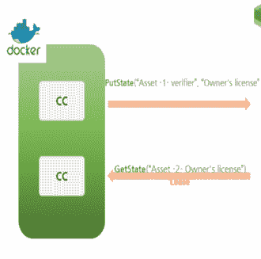

| 键 | 值 |
|---|---|
| CC1-Asset-1-verifier | mmop 官员 |
| CC1-Asset-1-owner's license | 5148453484kr |
| CC1-Asset-1-verification result | 有效 |
| CC1-Asset-2-verifier | 商店所有者 |
| CC1-Asset-2-owner's license | 84221459956us |
| CC1-Asset-2-verification result | 无效 |

图 1. 用于验证的区块链链码配置

确保可靠性。图 2 显示了使用区块链的服务器发出的身份识别请求和结果传输。

基于区块链的分布式身份系统的设计在以下方面具有重要意义：首先，它通过 API 网关模块应用程序，为该移动身份项目支持 API 和业务逻辑开发。在身份验证/签发和身份核查中，已为涉及微服务关联的 API 认证和授权处理、日志处理以及流量管理建立了便捷且稳定的开发环境。其次，在与其他系统连接时，例如外部关联（如与警察机构或道路运输公司连接），目标系统的接口规范——如 HTTP 和 HTTPS、应用程序方法、组件、数据库等——将应用于与其他系统的集成。第三，Hyperledger Fabric 用于开发区块链客户端服务器。具体来说，我们应用 Hyperledger Fabric V1.0 来创建区块链客户端服务器。Hyperledger Fabric 用于支持需要高度隐私的系统，因为它允许成员通过受信任的成员服务提供商注册。因此，这个分布式账本平台提供了弹性、可扩展性、灵活性和保密性 (Alessandro, 2020)。这种基于区块链的移动身份识别服务还通过存储选择（PostgreSQL、MySQL 和 LDAP）来存储用户信息，并开发 Fabric CA Client 和 REST API。第四，Hyperledger 的链码开发保障了数据的灵活性和可靠性。Hyperledger 链码采用 KVS 样式的 LevelDB 或 CouchDB，以键值对形式注册数据作为数据库。

个人信息查询和验证应用程序的开发需要根据用户和验证者的特定目的设计服务的 UI/UX。目标是通过实现针对移动应用/Web 环境优化的现代 UI/UX 和设计来提高用户便利性。此外，为避免相互矛盾的设计要求所带来的挑战 (Dhamija 和 Dusseault, 2008)，主动使用信息图表和设计来提高身份识别/验证应用程序的可读性并增强其品牌形象。重点在于根据特定服务要求提供服务规划和设计指南，以实现以用户为中心的用户应用程序。如图 3 所示，验证应用程序提供身份识别、资质和认证历史记录等功能。呈现的功能包括移动身份识别卡的注册/删除（使用 OCR）以及预览屏幕、移动身份验证历史记录变更通知、ID 卡状态值和快速响应（QR）码安全性。在这项基于区块链的移动 ID 卡研究中，每个人都可以将自己的驾驶执照存储在其移动设备中，并使用一次性加密 QR 码验证其身份。

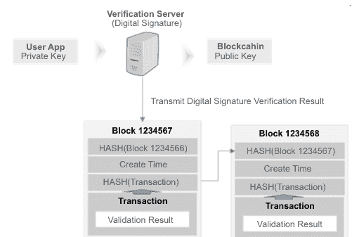

i. 移动 ID 查询图

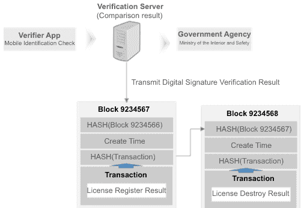

ii. 移动 ID 状态值请求结果图

图 2. 身份识别请求/结果传输

任何人都可以在实际环境中使用此功能，它提供了一种服务，允许用户在不立即泄露个人信息的情况下相互验证身份。由于 QR 码在电子商务和移动支付中的应用被认为是有用且有益的 (Chang et al., 2021)，因此基于区块链的移动 ID 卡的一次性 QR 码预计将提供更高的交易效率和用户满意度。然而，仍存在一些待调查的持续性安全和隐私问题，以提高用户在身份管理系统中采用 QR 码的意愿。

## 4. 讨论

### 4.1 理论意义

区块链最近在各个领域引起了越来越多的关注，但关于其在政府和公共部门中的使用和应用的研究极少。


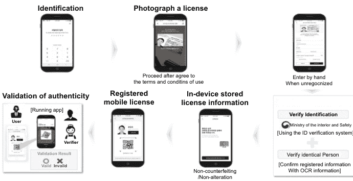

图 3. 服务配置

因此，本研究通过介绍基于区块链的身份识别系统的实际应用，提出了一种在公共部门（特别是电子政务）中应用区块链的案例。本研究促进了区块链在公共部门的应用，并为进一步研究区块链技术的潜在益处提供了基础理解。下一节将介绍政府采用区块链的可能研究方向。

现有的身份管理系统会将身份证的内容传输到中央系统，由企业或国家中央机构进行检查和认证。此系统面临各种黑客攻击和伪造事件的篡改风险，使得个人和机构难以对该系统建立信任。通过引入区块链技术，在分布式网络中取代管理身份信息的中央服务器，黑客攻击或伪造问题可以得到透明解决。用户还可以自行管理个人信息，并自行决定如何共享其信息。这种具有自主决定权的个人身份访问方式可便捷登录多个主页，从而简化身份识别和认证方法的步骤。然而，尽管基于区块链的身份系统具有优势，但在政府部门使用区块链仍面临各种挑战：首先，人们对基于区块链的系统缺乏情境理解和用户体验。基于区块链的身份管理系统设计支持信息复用，从而提高用户披露身份信息的粒度。然而，建立对这些属性的信任仍然具有挑战性，因为用户对身份管理系统这一新兴方法缺乏明显经验（Dunphy and Petitcolas, 2018）。这意味着需要开展用户体验研究，以确定用户是否能直观理解 DID 属性的含义。未来研究应聚焦于理解基于区块链的身份管理系统中 DID 的背景和用户接受度，以及如何在用户和企业之间建立信任和声誉。正如 Gil-García 和 Flores-Zúñiga（2020）在《数字政务成功的实施采纳模型》中所建议，有必要研究区块链技术在公共部门的实施与采纳。

其次，阻碍开发确保互联网安全可靠身份的新方法的因素之一，是关于个人数据存储和处理的薄弱监管环境（Yeoh, 2017）。将区块链等新技术引入政府部门，需要明确职责分工，并获得相关政策和监管机构的支持。相关法律、规范、法规和原则也应予以补充或修订，以支持区块链的引入。引入诸如基于区块链的数字身份识别系统等新系统，需要理解并遵守适用法律。因此，为提高基于区块链的数字身份管理系统的适用性和实用性，必须伴随对国家法律法规（尤其是数据保护法）的广泛了解，以便对其进行改进，从而更好地支持此类系统。为政府提出成功区块链采纳模型的研究，也能为改进政策和执法作出贡献。

第三，可能需要研究构建区块链生态系统。许多国家和公司正以相互排斥的方式开发技术，试图在市场中占据领先地位，研究结果和技术共享甚少。然而，为激活身份管理系统的全部潜力，并通过使用区块链技术增强主权，有必要建立一个由金融机构、移动运营商、政府和平台组成的生态系统（Wadhwa, 2019）。为此，应建立一个包括监管机构、区块链技术公司和基础设施运营商在内的联盟，同时还需要研究适当的政策制定和合适商业模式的设计。同样，应从长远视角开展研究，以考察基于区块链的身份系统能带来的益处和附加价值。AI、云、大数据和物联网等核心技术在不久的将来将被广泛应用，资金、产品、空间以及其他一切都将共享，从而导致整个生态系统发生变化。因此，建议未来研究考察可采取的长期措施以及可做的准备工作。此外，建议开展基础设施研究。

第四，公共部门数字化转型仍面临挑战。大多数文献认为，技术实施可以取得进步，但真正的困难在于随后必须进行的结构和文化变革，以及公民融入和参与数字化公共服务（Sivarajah et al., 2015）。正如 Mergel et al.（2019）所指出，数字化转型应被视为一种整体方法，而非仅仅是对流程的简单数字化。研究需要分析，在采用先进技术时，公共部门的组织结构和流程如何变化，以及数字化如何改变与公民和其他利益相关者的关系。

与区块链相关的学术研究仍处于萌芽阶段。尽管一些系统文献综述论文已探讨区块链相关主题（Alketbi et al., 2020; Casino et al., 2019; Zheng et al., 2018），但区块链研究中仍存在重大研究空白，包括可用性、可扩展性以及涉及安全性和隐私的伦理困境等社会问题（Yli-Huumo et al., 2016）；这些问题应在未来研究中得到解决。尽管公共部门数字化具有许多潜在益处，但对可能出现的伦理、社会、隐私和安全问题关注甚少。例如，政府和公司可能使用数据分析工具和大数据算法，在未经相关个人同意的情况下识别用户并获取私人数据。用户（在此情况下为公民）往往不完全了解其信息和意见可能被如何使用和操纵。研究人员应关注公共部门数字化使用中的伦理挑战（Domanski et al., 2018）。正如许多学者所指出的，伦理并不局限于现有法律。因此，需要新的伦理框架来解决公共和私营部门数字化所导致的伦理挑战（Chang et al., 2020）。

### 4.2 实际应用

基于区块链的身份管理系统旨在通过去中心化，从根本上阻止对企业和个人信息的黑客攻击及未经授权的使用，从而让人们能够直接管理其个人数据。所提议的基于区块链的系统通过在线（移动）服务平台简化了身份识别流程并提高了易用性。它可以通过改进身份识别方法和缩短服务处理时间来降低运营成本。消除对实体卡片或票据的需求——这些卡片或票据可能会丢失并需要重新签发——可以进一步降低运营成本。此外，个人信息的合理复用可以提高用户与验证者之间流程的效率，而在线服务运营系统的转换可以提升包括公共和私营部门在内的整个社区的生产力。

通过在区块链上存储和管理个人信息并为客户提供移动应用程序，该系统允许用户登录或检索先前经过身份验证的个人信息，而无需每次都经历身份验证过程。由于不需要每次都进行验证，预计用户可以更快捷、方便地仅使用必要的个人信息，而无需提供不必要的细节。此外，基于区块链的公共服务运营有效提升了服务的透明度和可靠性，并降低了因个人信息泄露而导致的社会成本。通过引入 AWS 等标准化平台，降低了不必要的系统部署成本，并保障了数据的灵活性和可扩展性。我们还通过提供应用服务提供各种附加服务，考虑了身份验证服务的可扩展性。事实上，韩国目前正通过一系列新推出和整合措施加速基于区块链的数字 ID 的采用。例如，航空乘客很快将能够使用其数字身份登机，该身份将通过政府应用程序提供（Identity Review, 2020）。安全的基于区块链的移动身份验证降低了身份盗窃风险，而实体身份证会泄露个人信息。从行业期望来看，引入基于 DID 的身份证并将其推广至公共服务，可以加速区块链技术的发展。

最后，基于区块链的身份识别系统的开发和引入影响人力资源开发和就业。本研究回顾了一个围绕区块链技术开发服务器和移动（用户/验证者）应用程序的政府项目。结果发现，区块链开发人员和专家稀缺，必须加以培养。为区块链工作适当地教育和培训熟练工人至关重要，因为开发基于区块链的系统需要处理敏感个人信息。理想的是培养人才，使其深入理解整体流程并掌握区块链知识；这样，我们可以提高以基于区块链系统的开发为中心的熟练劳动力的就业率。

关于区块链实施的实际方面，仍有若干挑战有待解决。首先需要考虑的问题是延迟、大小和带宽（Swan, 2015）。区块链涉及相对较慢的响应，因为每秒发生的比特币交易数量较少。该设计的试点显示，在系统中使用区块链技术的处理速度相对较慢。一般来说，使用数据库每秒约可处理 10,000 笔交易（TPS）；而对于区块链，无论系统多么快，每秒都不会超过 1,500 笔交易（TPS）。这表明需要开展旨在改进这些区块链不足之处的研究。

另一个需要考虑的问题是大规模数据处理。所提议的基于区块链的身份管理系统在磁盘容量方面的表现不如集中式数据库，因为它包含所有累积数据。截至目前，该数据库仅


管理相关客户账本，但随着区块链的引入，所有由管理员分布式存储的交易数据都必须进行存储和管理。然而，这些各种交易需要大量的牵引力，这带来了一个问题。提出了联合分片机制来解决这个问题，因为它可以改善基于区块链的系统的安全性、可扩展性和性能（Abuidris et al., 2019）；区块链可以拆分为小分片以存储状态和交易历史，同时显著提高整体性能。然而，处理和控制这些海量数据仍然存在技术挑战，因此需要进一步研究来识别这些问题。由于处理速度（性能）方面的问题，适用市场相当有限。虽然区块链可以应用于处理速度不是重要考量因素的领域，但这些技术问题可能阻碍需要快速响应速度（如支付）的市场的采用。由于效率和实用性可能是用户采用新技术所必需的，未来研究可能需要定量研究和数据收集，以调查用户对基于区块链的系统的接受度和体验。

区块链的安全和隐私问题必须始终接受严格审查。尽管安全和分布式系统文献中已有相关研究（Butun et al., 2016），但仍需要更多研究来探讨区块链应用中交易隐私的潜在解决方案。已提出多种方法，包括隐私保护型区块链系统（Yang et al., 2019; Kong et al., 2019）、安全的电子政务系统（Elisa et al., 2018）以及改进匿名性和隐私的机制（Zheng et al., 2018）。仔细审查所提出和验证的解决方案，同时积极开展实用性和采用方面的研究，将有可能克服采用当前区块链技术的挑战和局限性，并最大限度地发挥区块链在政府和公共部门服务中的优势。

## 5. 结论

本研究通过文献综述和拟在公共部门使用的实际系统设计介绍，阐述了公共服务和政府部门中基于区块链的身份管理系统的优势与挑战。本研究结果表明，区块链实施可以显著提高用户对自身数据控制的透明度、问责制和可靠性，同时降低提供公共服务所相关的时间和成本，并最终提高行政效率。然而，实施此类技术并非易事，在政府领域引入新技术需要一个复杂且耗时的过程。因此，跨学科研究必须超出通常的技术驱动方法，探讨政府采用新技术的含义与理解。特别是，为了鼓励在公共部门引入基于区块链的身份管理服务，本研究展示的新试点项目为最终用户和服务提供商提供了实际效益，例如隐私、易用性、数据保护和透明度的提升，以及成本的降低。

尽管已有理论研究探讨区块链技术在公共部门的应用必要性，但仍需基于用户反馈的定量研究来考察实际可用性、伦理问题和生产力。未来研究可能需要对所有利益相关者的益处进行定性和定量研究。这些工作还需要伴随建立不仅在国内而且在国际上都得到认可的标准，以及与各行业（如物流、分销和医疗保健）兼容的标准化设计的努力和研究。

## 参考文献

- Abuidris, Y., Kumar, R., Yang, T. and Onginjo, J. (2019), “基于结合分片的混合共识模型的区块链合约安全大规模电子投票系统”, ETRI 期刊, 第 43 卷, 第 2 期, 第 357-370 页.

- Al-Muwali, A., Weerakkody, V., El-haddadeh, R. and Dwivedi, Y. (2019), “平衡默认数字化与包容性：影响英国电子包容性因素的研究”, 信息系统前沿, 第 21 卷, 第 635-659 页.

- Alammary, A., Alhazmi, S., Almasri, M. and Gillani, S. (2019), “教育领域的基于区块链的应用：系统综述”, 应用科学, 第 9 卷第 2400 期, 第 1-18 页, doi: 10.3390/app9122400.

- Alessandro, P. (2020), 保护以太坊和 Hyperledger Fabric 等区块链网络, Packt 出版社, ISBN 1838646450.

- Alketbi, A., Nasir, Q. and Talib, M.A. (2020), “政府服务的新型区块链参考模型：迪拜政府案例研究”, 系统保证工程与管理国际期刊, 第 11 卷, 第 1170-1191 页.

- Allessie, D., Sobolewski, M. and Vaccari, L. (2019), 数字政府区块链, 收录于 Pignatelli, F., EUR 29677 EN, 欧盟出版办公室, 卢森堡.

- Andersen, A.N. and Motzfeldt, H.M. (2019), “数字政府透明度的不同方面：丹麦案例”, 欧洲数字政府会议, 10 月, 第 81-87 页, VIII-IX.

- Andoni, M., Robu, V., Flynn, D., Abram, S., Geach, D., Jenkins, D., McCallum, P. and Peacock, A. (2019), “能源领域的区块链技术：挑战与机遇的系统综述”, 可再生能源与可持续能源评论, 第 100 卷, 第 143-174 页.

- Angelis, J. and Silva, E.R. (2019), “区块链采用：价值驱动视角”, 商业视野, 第 62 卷, 第 307-314 页.

- Atzori, M. (2015), 区块链技术与分散式治理：国家是否仍有必要?, 社会科学研究网络, 纽约州罗切斯特.

- AWS (2020), “Amazon Web Services：安全流程概览”, AWS 白皮书. AWS, 2020 年 3 月, 可在以下网址查阅: https://d0.awsstatic.com/whitepapers/aws-security-whitepaper.pdf.

- Baheer, B.A., Lamas, D. and Sousa, S. (2020), “现有数字政府架构的系统文献综述：现状、挑战与前景”, 行政科学, 第 10 卷第 25 期, 第 1-28 页.

- Batubara, F.R., Ubacht, J. and Janssen, M. (2018), “电子政务中区块链技术采用的挑战：系统文献综述”, 第 19 届年度国际数字政府研究会议论文集：数据时代的治理, 计算机协会 (ACM), 美国纽约, 新泽西, 第 1-9 页.

- Bertino, E. and Takahashi, K. (2011), 身份管理：概念、技术与系统, Artech 出版社, 麻萨诸塞州诺伍德.

- Bonnet, D., Ferraris, P., Westerman, G. and McAfee, A. (2012), “谈谈一场革命”, 数字化转型评论, 第 2 卷第 1 期, 第 17-33 页.

- Borrows, M., Harwich, E. and Heselwood, L. (2017), “公共服务身份的未来：区块链”, 改革研究信托, 埃森哲咨询, 2017 年 11 月.

- Boyle, B. and Nicholson, D. (2003), “新西兰的电子政务”, 政治营销期刊, 第 2 卷第 3-4 期, 第 89-105 页.

- Butun, I., Erol-Kantarci, M., Kantarci, B. and Song, H. (2016), “面向安全公共安全设备网络的云中心多级身份验证即服务”, IEEE 通信杂志, 第 54 卷第 4 期, 第 47-53 页.

- Casino, F., Dasaklis, T.K. and Patsakis, C. (2019), “基于区块链的应用系统文献综述：现状、分类与未解决问题”, 远程信息处理与信息学, 第 36 卷, 第 55-81 页.

- Castaños, V. (2018), “案例研究报告：电子爱沙尼亚，欧盟委员会，面向使命的研发政策：深入案例研究”, 可在以下网址查阅: http://www.jiip.eu/mop/wp/wp-content/uploads/2018/10/EE_e-Estonia_Castanos.pdf.

- Chang, V. (2021), “大数据与智慧城市的伦理框架”, 技术预测与社会变革, 第 165 卷, doi: 10.1016/j.techfore.2020.120559.

- Chang, V., Baudier, P., Zhang, H., Xu, Q., Zhang, J. and Arami, M. (2020), “区块链如何影响金融服务——专家访谈的概览、挑战与建议”, 技术预测与社会变革, 第 158 卷, doi: 10.1016/j.techfore.2020.120559.

- Chang, V., Chen, W., Xu, Q. and Xiong, C. (2021), “迈向移动支付中客户使用二维码的意图”, 全球信息系统期刊, 第 29 卷第 6 期, 第 1-21 页, doi: 10.4018/JGIM.20211101.oa37.

- Chaudhary, R., Jindal, A., Auija, G.S., Aggarwal, S., Kumar, N. and Choo, K.K.R. (2019), “BEST：SDN 支持智能交通系统中的基于区块链的安全能源交易”, 计算机与安全, 第 85 卷, 第 288-299 页.

- Chen, Y., Ding, S., Xu, Z., Zheng, H. and Yang, S. (2019), “基于区块链的医疗记录安全存储和医疗服务框架”, 医学系统期刊, 第 43 卷第 5 期, 第 1-9 页.

- Chung, C-S. and Kim, S-B. (2019), “数字政府政策比较研究：聚焦韩国和美国的电子政务法案”, 电子学报, 第 8 卷第 1362 期, 第 1-19 页.

- Clarke, A. (2020), “数字政府单位：它们是什么，以及它们对数字时代公共管理更新意味着什么?”, 国际公共管理期刊, 第 23 卷第 3 期, 第 358-379 页.

- Clavin, J., Duan, S., Zhang, H., Janeja, V.P., Joshi, K.P., Yesha, Y., Erickson, L.C. and Li, J.D. (2020), “政府区块链：用例与挑战”, 数字政府：研究与实践, 第 1 卷第 3 期, 文章 22, 第 1-21 页, doi: 10.1145/3427097.

- Couldry, N. and Mejias, U.A. (2019), 连接的代价：数据如何殖民人类生活并将其据为资本主义所有, 斯坦福大学出版社, 加州红木城.

- Dai, J. and Vasarhelyi, M.A. (2017), “迈向基于区块链的会计与鉴证”, 信息系统期刊, 第 31 卷第 3 期, 第 5-21 页.

- Daramola, O. and Thebus, D. (2020), “基于架构的国家选举基于区块链的智能合约电子投票评估”, 信息学, 第 7 卷第 16 期, 第 1-22 页.

- Dhamija, R. and Dusseault, L. (2008), “身份管理可用性和安全性挑战的七个缺陷”, IEEE 安全与隐私, 第 6 卷第 2 期, 第 24-29 页.

- Di Pierro, M. (2017), “什么是区块链?”, 科学与工程计算, 第 19 卷第 5 期, 第 92-95 页.

- Domanski, R., Estevez, E., Styrin, E., Alfano, M. and Harrison, T.M. (2018), “迈向数字政府伦理：初步讨论”, 收录于 Hinman, C.C. and Zuiderwijk, A. (编), 第 19 届年度国际数字政府研究会议论文集：数据时代的治理, 计算机协会 (ACM), 美国纽约, 新泽西.

- Downes, L. and Nunes, P.F. (2013), “大爆炸式颠覆”, 哈佛商业评论, 第 91 卷第 3 期, 第 44-56 页.

- Dumphy, P. and Peticolas, F.A.P. (2018), “区块链身份管理方案初探”, IEEE 安全与隐私, 第 16 卷第 4 期, 第 20-29 页.

- Elisa, N., Yang, L., Chao, F. and Cao, Y. (2018), “基于区块链的安全和隐私保护电子政务系统框架”, 无线网络, 在线发表于 12 月 3 日, 第 1-11 页, doi: 10.1007/s11276-018-1883-0.

- Erkut, B. (2020), “从数字政府到数字治理：我们到达了吗?”, 可持续性, 第 12 卷第 860 期, 第 1-13 页.


- Faber, B., Michelet, G.C., Weidmann, N., Mukkamala, R.R. and Vatrapu, R. (2019), “BPDIMS：基于区块链的个人数据和身份管理系统”, 《系统科学第52届夏威夷国际会议论文集》.

- Fischer, D. (2018), “区块链会计账本的伦理和专业影响”, 可于以下网址查阅：https://ssrn.com/abstract=3331009, DOI: 10.2139/ssrn.3331009.

- Gil-Garcia, J.R. and Flores-Zúñiga, M.A. (2020), “迈向对数字政府成功的全面理解：整合实施与采纳因素”, 《政府信息季刊》, 第37卷第4期, doi: 10.1016/j.giq.2020.101518.

- 《全球南方发展杂志》 (2020), “这五个国家位居2020年电子政务排名榜首”, 可于以下网址查阅：https://www.gsdmagazine.org/these-five-countries-top-the-2020-e-government-ranking/.

- Goldfeder, S., Kalodner, H., Reisman, D. and Narayanan, A. (2017), “当Cookie遇上区块链：通过加密货币进行Web支付的隐私风险”, arXiv预印本, arXiv: 1708.04748v1, 第1-19页.

- Grover, P., Kar, A.K. and Janssen, M. (2019), “区块链技术的扩散：来自学术文献和社交媒体分析的洞察”, 《企业信息管理期刊》, 第32卷第5期, 第735-757页.

- Gunasekera, D. and Valenzuela, E. (2020), “澳大利亚谷物贸易中区块链技术的采用：对潜在经济影响的评估”, 《经济论文》, 第39卷第2期, 第152-161页.

- Hess, T., Matt, C., Benlian, A. and Wiesböck, F. (2016), “制定数字化转型战略的选择”, 《MIS季刊执行版》, 第15卷第2期, 第103-119页.

- Hou, J., Wang, H. and Liu, P. (2018), “在中国应用区块链技术促进分布式光伏发展”, 《国际能源研究杂志》, 第42卷第6期, 第2050-2069页.

- Iansiti, M. and Lakhani, K.R. (2017), “关于区块链的真相”, 《哈佛商业评论》, 第95卷第1期, 第118-127页.

- 《身份评论》 (2020), “韩国引领去中心化ID的新标准”, 可于以下网址查阅：https://identityreview.com/south-korea-leading-new-standards-for-decentralized-id/.

- Jeong, I.S. (2019), “基于区块链的DID联盟”, Coindesk Korea by Han.co.kr, 可于以下网址查阅：https://www.coindeskkorea.com/news/articleView.html?idxno=62614.

- Jindal, A., Aujla, G.S. and Kumar, N. (2019), “Survivor：基于区块链的边缘即服务框架，用于SDN赋能的车网环境中的安全能源交易”, 《计算机网络》, 第153卷, 第36-48页.

- Joseph, S. and Avdic, A. (2016), “电子政务战略将北欧国家带向何方?”, 《电子政务电子期刊》, 第4卷第1期, 第3-17页.

- Ju, Y.G. and Kang, Y.S. (2018), “公共部门区块链应用的趋势与启示”, 《邮政信息》, KISDI研究出版物, 第114卷, 第24-56页.

- Karippacheril, T.G., Kim, S., Baschel, R.P. Jr and Choi, C. (2016), 将政府带入21世纪：韩国数字政府经验, 世界银行, 华盛顿特区.

- Kassem, J.A., Sayeed, S., Marco-Gisbert, H., Pervez, Z. and Dahal, K. (2019), “DNS-idM：一种用于保障网络中个人数据共享的区块链身份管理系统”, 《应用科学》, 第9卷第15期, 第2953页.

- Katsikouli, P., Wilde, A.S., Dragoni, N. and Hogh-Jensen, H. (2021), “关于使用区块链管理食品供应链的益处与挑战”, 《食品与农业科学杂志》, 第101卷第6期, 第2175-2181页, doi: 10.1002/jsfa.10883.

- Kaur, H., Alam, M.A., Jameel, R., Mouriyá, A.K. and Chang, V. (2018), “基于区块链的异构医疗数据在云环境中的拟议解决方案及未来方向”, 《医学系统期刊》, 第42卷第156期, 第1-12页.

- Khern, N.C. (2019), *数字政府，智慧国家：追求新加坡的技术使命*, 新加坡公务员学院, 新加坡. 第21号, 可于以下网址查阅：https://www.csc.gov.sg/articles/digital-government-smart-nation-pursuing-singapore's-tech-imperative.

- Kim, G.H., Trimi, S. and Chung, J.H. (2014), “政府领域的大数据应用”, *ACM通讯*, 第57卷, 第78-85页.

- Kim, B.G., Cho, Y-S., Kim, S-S., Kim, H. and Woo, S.S. (2020), “基于区块链的DID服务安全分析”, *IEEE Access*, 第9卷, 第22894-22913页.

- Kong, W., Shen, J., Vijayakumar, P., Cho, Y. and Chang, V. (2019), “一种用于智能电网隐私保护的实用群组盲签名方案”, *并行与分布式计算期刊*, 第136卷第1期, 第1-38页, doi: 10.1016/j.jpdc.2019.09.016.

- Kshetri, N. and Loukoianova, E. (2019), “亚洲供应链网络中的区块链采用”, *IEEE IT专业人士*, 第21卷第1期, 第11-15页.

- Kumar, M.V.R. and Bhalaji, N. (2021), “基于区块链的变色龙哈希技术用于电子政务系统的隐私保护”, *无线个人通信*, 第117卷, 第987-1006页.

- Kumar, V. and Bhardwaj, A. (2018), “身份管理系统：比较分析”, *国际战略决策科学杂志*, 第9卷第1期, 第63-78页.

- Kuperberg, M. (2019), “基于区块链的身份管理：从企业和生态系统视角的调查”, *IEEE工程管理学报*, 第99卷, 第1-20页, doi: 10.1109/TEM.2019.2926471.

- 《账本洞察》 (2020), “韩国对去中心化身份系统有全球野心”, *账本洞察：企业区块链新闻*, 2020年4月2日, 可于以下网址查阅：https://www.ledgerinsights.com/southkorea-decentralized-identity-ambitions/ (2020年12月5日访问).

- Lesavre, L., Varin, P., Mell, P., Davidson, M. and Slook, J. (2019), *理解新兴区块链身份管理系统的分类学方法（草稿)*, 美国国家标准与技术研究院, 美国商务部, 美国马里兰州盖瑟斯堡.

- Lim, S.Y., Fotsing, P.T., Almasri, A., Musa, O., Kiah, M.L.M., Ang, T.F. and Ismail, R. (2018), “区块链技术：身份管理和认证服务的颠覆者——一项调查”, *高级科学、工程与信息技术国际杂志*, 第8卷第4/2期, 第1735-1745页.

- Lim, Z.Y., Chua, J.M., Yang, K., Tan, W.S. and Chai, Y. (2020), “新加坡政府电子服务的Web无障碍测试”, *W4A ’20：第17届面向所有人的国际Web会议论文集*, 4月, 第1-5页, 22号, 可于以下网址查阅：http://doi-org.libproxy.murdoch.edu.au/10.1145/3371300.3383353.

- Liu, Y., He, D., Obaidat, M.S., Kumar, N., Khan, M.K. and Choo, K.K.R. (2020), “基于区块链的身份管理系统：综述”, *网络与计算机应用期刊*, 第166卷, 第1-15页.

- Mantelli, I. (2018), “使用Hyperledger进行区块链应用的利与弊”, *LinkedIn*, 2018年8月29日, 可于以下网址查阅：https://www.linkedin.com/pulse/pros-cons-using-hyperledger-blockchain-applications-ivamantell (2021年5月2日访问).

- Mao, D., Hao, Z., Wang, F. and Li, H. (2018), “一种用于食品贸易中可持续可信环境的创新基于区块链的方法：中国山东省案例研究”, *可持续性*, 第10卷第3149期, 第1-18页.

- Mármol, F.G., Girao, J. and Pérez, G.M. (2010), “TRIMS：面向身份管理系统的隐私感知信任与声誉模型”, *计算机网络*, 第54卷第16期, 第2899-2912页, doi: 10.1016/j.comnet.2010.07.020.

- Martinson, P. (2019), *爱沙尼亚：由区块链保障的数字共和国*, PwC, 普华永道爱沙尼亚, 爱沙尼亚, 可于以下网址查阅：https://www.pwc.com/gx/en/services/legal/tech/assets/estonia-the-digital-republic-secured-by-blockchain.pdf.

- Matt, C., Hess, T. and Benlian, A. (2015), “数字化转型战略”, 《商业与信息系统工程》, 第57卷第5期, 第339-343页.

- Mergel, I., Edelmann, N. and Haug, N. (2019), “定义数字化转型：专家访谈结果”, 《政府信息季刊》, 第33卷第4期, doi: 10.1016/j.giq.2019.06.002.

- OECD (2011), 数字身份管理：推动互联网经济中的创新与信任, OECD出版, 可于以下网址查阅：https://www.oecd.org/sti/economy/49338380.pdf.

- OECD (2020), 数字政府指数：2019年结果, OECD数字政府研究, OECD数字政府研究, OECD出版, 巴黎, 第03号, 可于以下网址查阅：https://www.oecd-ilibrary.org/governance/digital-government-index_4de9f5bb-en.

- Ojo, A. and Adebayo, S. (2017), “区块链作为下一代政府信息基础设施：对D5国家举措的回顾”, 《公共管理与信息技术》, 第32卷, 第283-298页.

- Ølnes, S., Ubacht, J. and Janssen, M. (2017), “政府中的区块链：分布式账本技术用于信息共享的益处与影响”, 《政府信息季刊》, 第34卷, 第355-364页.

- Orcutt, M. (2017), “为什么CDC也想参与区块链”, 《MIT科技评论》, 2017年10月2日, 可于以下网址查阅：https://www.technologyreview.com/2017/10/02/148864/why-the-cdc-wants-in-on-blockchain/ (2021年12月5日访问).

- Park, J.Y. and Sung, C.S. (2019), “基于区块链技术的初创企业商业模式分析”, 《创业与可持续发展问题》, 第6卷第4期, 第1-12页.

- Pixelplex (2020), “顶级Hyperledger项目与应用”, 可于以下网址查阅：https://pixelplex.io/blog/top-hyperledger-projects/ (2020年12月30日访问).

- Pournader, M., Shi, Y., Seuring, S. and Koh, S.C.L. (2020), “供应链、运输和物流中的区块链应用：文献系统综述”, 《国际生产研究杂志》, 第58卷第7期, 第2063-2081页, doi: 10.1080/00207543.2019.1650976.

- Savage, N. (2018), “数字公民”, 《自然》, 第563卷, 第136-137页.

- Shang, Q. and Price, A. (2019), “格鲁吉亚共和国的基于区块链的土地登记项目：重建公众信任及未来试点项目的经验”, 《创新：技术、治理与全球化》, 第12卷第3-4期, 第72-78页.

- Sharma, T.K. (2020), “世界上引领区块链技术的前10个国家”, 区块链委员会, 可于以下网址查阅：https://www.blockchain-council.org/blockchain/top-10-countries-leading-blockchain-technology-in-the-world/ (2021年5月20日访问).

- Sin, H.W. (2019), “通过区块链提供公共服务”, 《行业聚焦》, 德勤安진 LLC & 德勤咨询, 第71卷, 第1-8页.

- Sivarajah, U., Irani, Z. and Weerakkody, V. (2015), “评估地方政府中Web 2.0技术的使用与影响”, 《政府信息季刊》, 第32卷第4期, 第473-487页.

- 斯坦福商学院 (2019), “2019年社会影响力区块链”, 报告, 斯坦福商学院社会创新中心, 第1-37页.

- Staples, M., Chen, S., Falamaki, S., Ponomarev, A., Rimba, P., Tran, A.B., Weber, I., Xu, X. and Zhu, J. (2017), 使用区块链和智能合约系统的风险与机遇, Data61 (CSIRO), 悉尼.

- Sullivan, C. and Burger, E. (2017), “电子居留与区块链”, 《计算机法与安全评论》, 第33卷第4期, 第470-481页.

- Sundberg, L. (2019), “瑞典数字政府中的价值立场与关系”, 《行政科学》, 第9卷第24期, 第1-16页.

- Swan, M. (2015), 区块链：新经济蓝图, O’Reilly媒体公司, 加利福尼亚州.

- Takyar, A. (2020), “什么是Hyperledger？面向创新者和企业家的综合指南”, 可于以下网址查阅：https://www.leewayhertz.com/what-is-hyperledger/ (2021年5月20日访问).


Tambouris, E., Eleni, K., Michail, L. and Konstantinos, T. (2014), “公共服务提供企业架构参考需求集”, Software and Systems Modeling, 第 13 卷, 991-1013 页. doi: 10.1007/s10270-012-0303-7.

Tammppuu, P. and Masso, A. (2019), “跨国数字身份作为全球数字公民身份的工具：爱沙尼亚电子居民计划的案例”, Information Systems Frontiers, 第 21 卷, 621-634 页.

Tang, Y., Xiong, J., Becerril-Arreola, R. and Lyer, L. (2020), “区块链伦理：技术应用、影响及研究方向的框架”, Information Technology and People, 第 33 卷第 2 期, 602-632 页.

Tas, R. and Tannröver, Ö.Ö. (2020), “区块链电子投票的挑战与机遇系统综述”, Symmetry, 第 12 卷第 1328 期, 1-24 页.

Treleaven, P., Brown, R.G. and Yang, D. (2017), “金融领域的区块链技术”, Computer, IEEE 计算机学会, 第 50 卷第 9 期, 14-17 页.

Tung, L. (2019), “微软：忘掉谷歌、脸书 - 使用我们的新区块链 ID 登录”, ZDNet, 2019 年 5 月 14 日, 可从以下网址获取: https://www.zdnet.com/article/microsoft-forget-google-facebook-log-in-with-ournew-blockchain-id/ (2021 年 5 月 20 日访问).

Ubaldi, B. (2016), 福利领域公共服务转型的数字政府战略, OECD 比较研究, OECD, 可从以下网址获取: http://www.oecd.org/gov/digital-government.

Underwood, S. (2016), “比特币之外的区块链”, Communications of the ACM, 第 59 卷第 11 期, 15-17 页.

United Nations (2020), 《2020 年电子政务调查》, 可持续发展行动十年中的数字政府及 COVID-19 响应附录, 经济和社会事务部, 纽约, 可从以下网址获取: publicadministration.un.org.

Valliant, M., Gollapalli, V.S., Wang, G., Piff, S. and Xun Xie, J.Y. (2020), “面向政府未来的区块链 - 探索新能力并赢得公众信任”, 市场笔记 - Doc#AP42938917, IDC, 2020 年 5 月.

Vukolic, M. (2015), “可扩展区块链架构的探索：工作量证明与 BFT 复制”, 网络安全开放问题国际研讨会论文集 (iNetSec 15), 112-125 页.

W3C (2021), “去中心化标识符 (DID) v1.0 - 核心架构、数据模型和表示”, 工作草案, W3C 提议建议 2021 年 8 月 3 日.

Wadhwa, S. (2019), “基于区块链的去中心化数字身份管理及其对公共部门的影响”, 硕士论文, 都柏林商学院, 都柏林.

World Food Programme (WFP) (2021), 建设模块：零饥饿区块链 – 毕业项目, 可从以下网址获取: Building Blocks | WFP Innovation.

Won, J.Y. (2020), “私人证书时代……国内 DID 现状如何?”, 可从以下网址获取: https://paxtnetnews.com/articles/60896 (2020 年 10 月 20 日访问).

Woods, J. (2018), 区块链：公共部门用例, DoubleNova Group/Paradigms Consulting Group, 2018 年 10 月 2 日.

Yang, Y., Zheng, X., Guo, W., Liu, X. and Chang, V. (2019), “基于物联网的隐私保护医疗大数据存储与自适应访问控制系统”, Information Sciences, 第 479 卷, 567-592 页.

Yeoh, P. (2017), “区块链技术中的监管问题”, Journal of Financial Regulation and Compliance, 第 25 卷第 2 期, 196-208 页.

Yli-Huumo, J., Ko Park, S., Choi, S., Park, S. and Smolander, K. (2016), “当前区块链技术研究在哪里？——系统综述”, PLoS ONE, 第 11 卷第 10 期, 1-27 页.

Yu, C-S. and Asgarakhani, M. (2015), “电子银行信任调查：来自台湾和新西兰实证研究的证据”, Management Research Review, 第 38 卷第 12 期, 1267-1284 页.

Zelenovic, A. (2020), “区块链已成为现实并在公共领域迅速普及”, Publicis Sapient, 2019 年 5 月 14 日, 可从以下网址获取: https://www.publicissapient.com/insights/blockchain-now-a-reality (2021 年 6 月 2 日访问).

Zhao, G., Liu, S., Lopez, C., Lu, H., Elgueta, S., Chen, H. and Boshkoska, B.M. (2019), “农业食品价值链管理中的区块链技术：应用、挑战和未来研究方向综合”, Computers in Industry, 第 109 卷, 83-99 页.

Zheng, Z., Xie, S., Dai, H.N., Chen, X. and Wang, H. (2018), “区块链的挑战与机遇：一项调查”, International Journal of Web and Grid Services, 第 14 卷第 4 期, 352-375 页.

Zhu, X. and Badr, Y. (2018), “面向物联网的基于区块链的身份管理系统综述”, 2018 年 IEEE 物联网、绿色计算与通信、网络物理社会计算、智能数据、区块链、计算机与信息技术、赛博格尼克斯大会, 1568-1573 页.

## 通讯作者
Joo Yeon Park 可通过 jooyeon.park@murdoch.edu.au 联系。

# 新兴数字经济公司与领先加密货币：基于区块链技术公司的洞察

Mahdi Ghaemi Asl
哈拉兹米大学经济学院, 伊朗德黑兰

Muhammad Mahdi Rashidi
伊马姆·萨迪克大学经济学院, 伊朗德黑兰, 及

Seyed Ali Hosseini Ebrahim Abad
乌尔米亚大学经济与管理学院,
伊朗乌尔米亚

## 摘要

**Purpose** – 本研究旨在调查包括比特币、以太坊、瑞波币、莱特币、门罗币、恒星币、Peercoin 和 Dash 在内的领先加密货币的价格回报，与主要在区块链平台运营并提供金融服务（包括替代金融、民主化银行、未来支付和数字社区）的技术公司指数的股票回报之间的相关性。

**Design/methodology/approach** – 本研究采用贝叶斯非对称动态条件相关多元广义自回归条件异方差 (GARCH) (BADCC-MGARCH) 模型，带有偏态和重尾特征，对 2015 年 8 月 11 日至 2020 年 2 月 10 日的每日样本进行分析，以调查多种加密货币的价格回报与主要在区块链平台运营的技术公司指数股票回报之间的动态相关性。数据从多个来源收集。为了参数估计和模型比较，采用了马尔可夫链蒙特卡罗 (MCMC) 算法。此外，基于预期赤池信息准则 (EAIC)、贝叶斯信息准则 (BIC)、偏差信息准则 (DIC) 和加权偏差信息准则 (wDIC)，选择偏态多元广义误差分布 (mvGED) 作为误差的最优分布。最后，进行了其他一些测试以检查结果的稳健性。

**Findings** – 研究结果表明，在大部分抽样期间，基于区块链的技术公司指数回报与加密货币价格回报呈正相关。此外，包括门罗币、瑞波币、Dash、恒星币和 Peercoin 在内的具有独特特征的新发明和更先进的加密货币的价格回报，在超过 93% 的抽样天数内与基于区块链的技术公司股票指数回报呈正相关。结果对各种敏感性分析也具有稳健性。

**Research limitations/implications** – 加密货币价格回报与基于区块链的技术公司股票指数回报之间的正相关性可能源于投资者对区块链技术的情感，因为加密货币和这些公司都基于区块链技术。这也可能源于加密货币对这些公司的适用性，因为具有独特功能的更先进、更强大的加密货币的价格回报，与基于区块链的技术公司股票指数回报呈正相关的天数比其他加密货币（如比特币、莱特币和以太坊）更多，这些加密货币可能被视为更多投机资产。

**Practical implications** – 研究结果可能显示加密货币在改善和发展主要在区块链平台运营并提供金融服务的技术公司方面发挥积极作用，反之亦然，这表明管理者和监管者应更加关注加密货币和区块链的实用性。本研究还对投资者以及投资加密货币和这些公司股票的公司具有重要的风险管理和多元化意义。此外，基于区块链的技术公司可以根据其策略将加密货币添加到投资组合中，作为对冲工具或多元化工具。

**Originality/value** – 这是第一项分析领先加密货币与主要在区块链平台运营并提供金融服务的技术公司之间连接的研究，通过


采用贝叶斯对称DCC-MGARCH模型。结果还对投资者、公司、监管机构和研究人员的未来研究具有重要意义。

**关键词** 新兴数字经济公司、加密货币、贝叶斯非对称DCC-MGARCH、马尔可夫链蒙特卡洛

**论文类型** 研究论文

## 1. 引言

中本聪将加密货币作为一种新的颠覆性技术引入，被视为金融市场和支付系统的一场革命。这种源于区块链技术的创新通过去除中介机构，使电子交易更便宜、更舒适、更快捷。这些货币是基于互联网的支付协议，不需要政府或其他第三方来验证交易。加密货币引起了学术界、政策制定者、投资者和媒体的广泛关注（Böhme et al., 2015）。支持加密货币的区块链技术为创建新的加密货币和确认交易提供了一个去中心化系统。

如前所述，区块链是加密货币的基石，由比特币引入金融领域。区块链是一串连接在一起的数据块。它是金融技术或金融科技（fintech）的一个主要分支（Chang et al., 2020）。随着其普及，它极大地改变了商业（DiNizo, 2018）。区块链最重要的特征是去中心化系统，这使得交易更简单、更便宜、更快捷（Staples et al., 2017）。这些特征共同可以带来金融、商业乃至工业革命，并改变全球整个经济体系。Chang et al.（2020）提到了区块链的四个主要特征，包括去中心化，即交易双方无需任何第三方许可即可访问交易的数据库和历史记录（Tapscott and Tapscott, 2017）。这一特征还限制了个人或机构从事犯罪活动或欺诈（Rennick et al., 2018）。区块链的另一个特征是用户匿名性。网络中的任何参与者都有一个唯一的字母数字地址，且没有第三方存储用户信息（Tapscott and Tapscott, 2017; Zheng et al., 2018）。下一个特征是共识机制，即网络中51%的节点应批准在网络中创建新记录（Huang et al., 2019）。最后，最后一个特征是执行，指用户根据某些规则和算法在节点之间进行交易的能力。

区块链有许多潜力来改变整个金融基础设施（Pilkington, 2016），尽管它尚不成熟，并存在一些问题和挑战，如安全性、隐私、延迟和可扩展性（Underwood, 2016）。Drescher（2017）强调，开放性以及不存在协调方（这是区块链系统的基本特征）是区块链广泛应用的主要障碍。一些研究人员认为区块链存在四个相关挑战，包括可扩展性、安全性、隐私和能源泄漏消耗（Chang et al., 2020; Drescher, 2017）。这些挑战阻碍了区块链的广泛应用。可扩展性指出，与Visa或PayPal相比，某些加密货币（如比特币和以太坊）进行交易的过程相对较慢（Jackson, 2018），这是由于其加密和分布式特性及复杂性（Marr, 2018）。安全性是指区块链容易受到矿工的攻击（Werbach, 2018; Zheng et al., 2018）。也有一些迹象表明，区块链容易发生隐私泄露，因为交易信息对公众公开（Kosba et al., 2016; Meiklejohn et al., 2013），并且可以通过追踪交易来找到用户的个人资料（Barcelo, 2014）。最后的挑战是基于区块链的货币和海量数据的高能耗。它们消耗的能量比普通电子货币转账更多（Staples et al., 2017）。此外，Chang et al.（2020）提到了与区块链相关的三个伦理问题，具体为隐私风险、监管不确定性以及网络内的非法和犯罪活动。

作为一项重要创新，区块链不仅在金融和经济领域有应用，还在健康、科学、艺术和文化领域有应用（Chang et al., 2020; Swan, 2015）。许多企业和公司已经开始广泛使用这一创新且现代的平台；例如，一些公司或初创公司使用此平台直接匹配客户和生产者，或构建科学网络以共享科学研究甚至监控食品分销（Lee, 2019）。

加密货币是区块链的产物，因此它们继承了这项技术的优点和缺点。然而，区块链在不断演进，自第一代区块链以比特币形式出现以来，已经发展出了两代区块链。第二代区块链基于智能合约的理念出现，并可以由以太坊代表。此外，第三代区块链具有广泛的应用，可用于科学和技术的不同领域（Chang et al., 2020; Swan, 2015）。因此，区块链正在快速进步和成熟，尤其是在通过改进共识算法提高可扩展性和系统性能方面（Lee, 2019），如同第一代区块链中的去中心化网络（Zheng et al., 2017）。这是网络中节点验证交易并将其存储在区块中的过程。然而，这是一个相对缓慢的过程（Zheng et al., 2017）。因此，引入了其他共识机制，包括PoS [1]、DPoS [2]和PBFT [3]，以改进PoW [4]的缺点。例如，在PoS方法中，拥有更多代币（或份额）的节点优先创建区块以加速交易处理（Lee, 2019）。比特币之后创建的加密货币使用这些新的共识机制，使其在技术增强的情况下更具适用性（Lee, 2019）（不同加密货币的示例将在后面标题为“加密货币”的章节中展示）。此外，新加密货币使用这些新方法和技术可以帮助它们克服最初加密货币的挑战。

如今存在数千种功能和应用各异的加密货币；然而，关于加密货币的争论仍在继续。从概念上讲，加密货币具有货币的三种功能（Ali et al., 2014）：价值存储、交换媒介和计价单位。一些研究人员认为，它们最好被视为技术而非货币（Maurer et al., 2013）。然而，其他人认为它们更像资产而非货币（Baek and Elbeck, 2015; Blau, 2017; Dyrhrberg, 2016b; Katsiampa et al., 2019）。Yermack（2013）声称，比特币似乎更像一种投机资产而非货币，因为比特币进行的交易远少于其市值。此外，有人声称，虽然比特币价格波动较大，但将其纳入多元化投资组合足以获利（Eisl et al., 2015; Gandal and Halaburda, 2014）。

总体而言，无论加密货币的性质如何，加密货币市场在过去几年中在市场估值和产品流动性方面都取得了显著发展。2019年8月，加密货币市值为2890亿美元。然而，到2020年8月，加密货币市值达到3380亿美元，增长了16%。比特币、以太坊和瑞波币在多年来的加密货币市值增长中占据最高份额。

加密货币市值的增长可能有多种影响。一是交易量增加。当加密货币交易增加时，矿工需要确认更多交易，从而需要更多能量，也许还需要更多矿工。此外，当更多矿工渴望参与加密货币网络，希望因交易增加而获得更多奖励时，加密算法会变得更难解决（Symitsi and Chalvatzis, 2018），从而增加对利用新


先进的硬件。因此，加密货币市场可能会因开创性创新和新兴技术而受到巨大且持续的影响，这些技术创建新算法并生产现代、精密的挖矿硬件。然而，加密货币并非区块链的唯一应用。它是金融科技领域一项广为人知的技术，与其他技术如大数据机器学习和云计算（Ji et al., 2020）并列。另一方面，引入新的加密货币和区块链技术（具有提供更快、更安全支付服务等功能）深刻影响了支付系统和金融服务的经济。这些功能可以提升基于区块链的技术公司的业绩，尤其是那些大规模提供金融服务的公司。由于这些独特功能，越来越多的公司开始适应这项技术（Ji et al., 2020）。

似乎存在两种方面的加密货币价格回报与使用区块链技术的公司股票回报之间的动态联系和关联。第一个论据基于行为金融学。这一研究领域调查市场资本投资者的行为和心理特征对资本市场结果的影响（Ji et al., 2020）。基于行为金融学，如果由投机需求和主观表现引起的投资者情绪影响投资需求，资产价格将偏离其价值（Ji et al., 2020），这也已得到实证研究的证实（Ba and Zhu, 2016; Wei-qi and Xin-xin, 2014）。区块链正在迅速发展（Ji et al., 2020），加密货币（Allen and Bryant, 2019）同样可以影响人们对使用这项技术的公司（Ji et al., 2020）和加密货币的普遍情绪。此外，这些技术公司和加密货币都由区块链支持。区块链技术的任何进步或衰退都将影响这些公司、加密货币的表现和受欢迎程度以及投资者对它们的情绪，这最终将导致加密货币价格的变化。这些公司和加密货币由技术创新联系并推动（Umar et al., 2021）。区块链技术的任何创新都可以对主要在区块链平台上运营的这些公司的表现、受欢迎程度和能力产生积极影响。例如，使用新共识机制和其他新技术的新加密货币具有独特且有价值的特征。这可以提高主要在区块链平台上运营的公司的适用性和生产力。另一方面，这些公司的成功可以对加密货币的普及产生积极影响。

因此，为了考察主要使用区块链平台的技术公司股票回报与多种选定加密货币（包括比特币、以太坊、莱特币、瑞波币、门罗币、达世币、恒星币和点点币）价格回报之间的关联，采用 BADCC M-GARCH（贝叶斯非对称动态条件相关多元 GARCH）模型研究了它们之间的动态相关性。还对结果的稳健性进行了检验，并确认估计系数具有稳健性。我们的结果表明，在大多数采样日，大多数加密货币价格回报与基于区块链的技术公司股票指数回报呈正相关，反之亦然。这些结果可能有不同的含义。首先，加密货币价格回报与基于区块链的技术公司股票指数回报之间的正相关表明它们的发展和进步之间存在显著关联，即加密货币的发展将有利于基于区块链的技术公司，反之亦然。其次，具有独特特征的新发明加密货币与基于区块链的技术公司股票指数回报在更多天数内呈正相关，这可能是由于这些加密货币对主要在区块链平台上运营并提供金融服务的基于区块链的技术公司具有更高的适用性。第三，这些结果对于投资者和投资经理的风险管理和多元化也具有重要的启示。

本文试图通过考察多种选定加密货币价格回报与主要在区块链平台上运营并提供金融服务的技术公司股票回报之间的关联，为区块链和加密货币的现有文献做出贡献。如文献综述中将提到的，关于此问题尚无研究，仅有两篇论文调查了加密货币与技术公司及行业之间的关系（参见 Symitsi and Chalvatzis, 2018; Umar et al., 2021）。然而，在本文中，将采用在其他相关研究中未使用过的 BADCC-MGARCH 模型，分析主要在区块链平台上运营并提供金融服务的技术公司与多种加密货币（其中一些具有特定功能，例如提供快速、安全和匿名支付平台）之间的相互作用。此外，我们通过使用预期赤池信息准则（EAIC）、贝叶斯信息准则（BIC）、偏差信息准则（DIC）和加权偏差信息准则（wDIC）来选择偏斜多元广义误差分布（mvGED）作为误差的最优分布，从而为 BADCC-MGARCH 模型的现有文献做出贡献。还对模型结果的稳健性分三个步骤进行了检验：（1）检验抽取次数的稳健性，（2）检验先验中 α 和 β 系数的稳健性，（3）检验先验中 a 和 b 系数的稳健性。

在简要概述区块链对信息系统的贡献之后，将介绍四家主要在区块链平台上运营并提供金融服务的技术公司。然后，将介绍每种选定加密货币的简要描述。然后，在文献综述中，首先将简要提及研究区块链在金融中的作用及其改变金融部门方式的研究；然后将回顾分析加密货币不同特征的研究，接着将回顾加密货币与其他各种金融资产（如股票指数、黄金价格、石油价格和大宗商品）之间关系的文献。然后将呈现可能影响技术公司（尤其是运行在区块链平台上的公司）股票回报的因素的文献。最后，将呈现分析市场情绪对加密货币回报价格和股票回报影响的研究。

## 区块链对信息系统的贡献

如在引言中所述，区块链技术在不断发展。随着第三代加密货币的引入，它成为一种更具适用性的技术，在不同部门和行业中有大量应用，包括物联网（IoT）、媒体、金融、医疗保健、保险、能源、房地产、制造流程、采矿、零售、银行、信息治理、供应链等（Berdik et al., 2021; Chen et al., 2020）。企业和部门渴望在其信息系统中实施区块链等创新技术，以从中获益于其功能和应用（Berdik et al., 2021）。区块链技术为信息系统提供了许多好处。例如，将区块链技术与信息系统集成可以减少第三方作用、提高互操作性并改善效率和安全性（Berdik et al., 2021）。在医疗保健领域，区块链技术有助于管理和存储电子健康记录（Kaur et al., 2018）。由于互操作性增强，区块链技术还可以使消息通信更加容易（Berdik et al., 2021）。更易于访问的通信还可以减少重复，因为信息可以更新得更快。

许多研究强调了区块链技术在房地产领域的应用，包括 Corluka and Lindh (2017)、Garcia-Teruel (2020)、Karamitsos et al. (2018),


Konashevych (2020)、Li 等人 (2019a)、Nijland 和 Veuger (2019)、Spielman (2016)、Ullah 和 Al-Turjman (2021)、Veuger (2018) 以及 Wouda 和 Opdenakker (2019)。以代表性案例为例，Krupa 和 Akhil (2019) 认为，区块链技术有望彻底改变房地产行业，因为它可以防止欺诈活动并提高透明度。Spielman (2016) 声称，基于区块链的产权记录保存比传统的产权记录保存平台更具优势。

许多研究也探讨了区块链技术在医疗保健领域的作用，包括 Agbo 等人 (2019)、De Aguiar 等人 (2020)、Höβlb 等人 (2018)、Kaur 等人 (2018)、McGhin 等人 (2019)、Mettler (2016)、Siyal 等人 (2019)、Tanwar 等人 (2020)、Yue 等人 (2016) 和 Zhang 等人 (2018)。例如，McGhin 等人 (2019) 列出了医疗保健行业的三种区块链应用，包括智能合约、欺诈检测和身份验证。Zhang 等人 (2018) 提到，区块链技术可以为医疗系统中的一些问题提供合适的解决方案，包括护理点记录不完整以及难以访问患者健康信息。它还可以保证医疗系统的互操作性。

Albrecht 等人 (2018)、Andoni 等人 (2019)、Brilliantova 和 Thurner (2019)、Imbault 等人 (2017)、Li 等人 (2017)、Mengelkamp 等人 (2018)、Sedlmeir 等人 (2020)、Teufel 等人 (2019)、Wang 和 Su (2020) 以及 Wu 和 Tran (2018) 研究了区块链技术在能源领域的影响。Wang 和 Su (2020) 声明，区块链技术可以促进可再生能源并提高能源可持续性。Teufel 等人 (2019) 认为，区块链技术在将电力部门转向可再生能源方面可能发挥关键作用。此外，该技术在能源领域的应用可以通过消除中间人和流程自动化来降低成本。此外，由于区块链平台上的所有交易都可追溯，因此可以确定能源来源。再者，该技术使 prosumers 能够轻松进入能源市场。该技术还允许消费者更定性地分析和评估其电力消耗 (Teufel et al., 2019)。

Azzi 等人 (2019)、Blossey 等人 (2019)、Casado-Vara 等人 (2018)、Cole 等人 (2019)、Dujak 和 Sajter (2019)、Dutta 等人 (2020)、Francisco 和 Swanson (2018)、Korpela 等人 (2017)、Min (2019)、Queiroz 和 Wamba (2019)、Saberi 等人 (2019) 和 Treiblmaier (2018) 评估了区块链技术在供应链中的实施。以典型案例为例，Dutta 等人 (2020) 声称，区块链技术具有透明度、安全性、信任以及成本和浪费减少等突出的特性，这些特性可以改变供应链。在数据管理方面，该技术可以增强存储数据的安全性并增加供应链间的数据协作。该技术还通过跟踪货物状态来提高透明度，并自动化数据分析。该技术还可以提高流程速度，使流程更加稳健，确保所有交易的安全，保护知识产权，降低与程序相关的风险，并帮助供应链中的流程设计 (Araz et al., 2020; Dutta et al., 2020; Zhang et al., 2020a)。

Bogucharskov 等人 (2018)、Casey 等人 (2018)、Chang 等人 (2020)、Chen 和 Bellavitis (2019)、Osmani 等人 (2021)、Schär (2021)、Shah 和 Jani (2018)、Tapscott 和 Tapscott (2017)、Treleaven 等人 (2017) 以及 Zhu 和 Wang (2019) 研究了区块链技术在金融领域的应用。Kiayias 和 Panagiotakos (2017)、Koba 等人 (2016)、Mendling 等人 (2018) 和 Osmani 等人 (2021) 认为，区块链技术可以为银行系统带来运营效益，包括更快的交易、更好的安全性、成本降低、不可篡改性、隐私性和透明度。此外，通过消除中介，区块链技术可以实现点对点金融，其中包括点对点借贷、点对点股权投资、点对点外汇交易、点对点投资以及点对点外汇对冲 (Moenninghoff 和 Wieandt, 2013)。

## 主要在区块链平台运营并提供金融服务的技术公司

本研究考虑了四个主要在区块链平台运营并提供金融服务的技术公司股票指数的收益。第一个是 S&P Kensho Digital Communities 指数，用于评估专注于数字社交网络服务的公司的表现。这些公司通常提供连接用户个人资料与另一个人或群体以及统一通信的平台。这些公司的目的是形成通信并塑造信息共享平台。另一个指数是 S&P Kensho Alternative Finance 指数，用于衡量专注于提供替代融资和财富管理服务的公司的表现。这些服务包括改善贷款审批流程的复杂性和速度、改善算法贷款审批、引导贷款平台，如点对点借贷平台和使用点对点商业模式提供灵活保险计划的微金融机构，以及提供数字货币及其相关软件和硬件（例如交易所和钱包）的众筹平台。第三个指数是 S&P Kensho Democratized Banking (DB) 指数，用于评估提供创新金融服务（例如预付款、交易管理、融资和财富管理）的公司的表现。这些公司旨在提供新的融资和财富管理方法，例如机器人顾问、众筹和点对点借贷。它们还专注于提供与金融服务相关的分布式账本技术以及未来支付功能，例如数字、实时和直接支付。最后一个指数是 S&P Kensho Future Payments 指数，用于评估旨在实现支付基础设施下一代转型的公司的表现。这些公司提供通用平台，允许消费者在系统中使用数字余额，通常在多个渠道中，例如移动钱包和点对点平台。它们还提供跨消费者和商户账户的实时支付和转账等服务。此外，它们还提供与生物识别支付和交易安全相关的产品或服务，例如代币化、点对点加密和端到端加密 (S&P-Dow-Jones, 2020a)。

## 加密货币

在本节中，我们打算对所选加密货币进行简要描述。我们尝试选择具有特定特征和相对市值的不同加密货币。尽管在过去几年中推出了大量加密货币，但 Bitcoin 在市场上始终保持着最主导的加密货币地位。它是一个去中心化的点对点加密货币系统。它始于 2009 年，交易按顺序记录在称为区块链的分布式账本中。网络节点（称为矿工）连接区块 (Casino et al., 2019)。在此方面，每个区块都包含前一个区块的哈希值以创建区块链 (Crosby et al., 2016)。在加密货币中，Bitcoin 拥有最高的市值。

在 Bitcoin 之后，Ethereum 是按市值计算的第二大加密货币。2015 年，Ethereum 使用了具有不同功能的 Ethereum 区块链技术，例如开发用于去中心化支付网络的平台和存储计算机代码。Ethereum 的主要目标是为用户提供智能合约，即写入区块链的代码合同。目前，Ethereum 是 Bitcoin 之后的第二大加密货币。

Ripple 于 2012 年推出，是按市值计算的第三大加密货币。它是一个全球结算网络，提供即时、低成本的跨境支付，并具有端到端的透明度。Ripple 的加密货币称为 XRP。与 Bitcoin 不同，XRP 是预挖的，因此不会产生新的 XRP。Ripple 的市场供应量通过向市场投放或回收 XRP 来变化。

本研究中选择的另一种加密货币是 Litecoin，它于 2011 年推出。它与 Bitcoin 非常相似，但速度更快，其有限供应量是 Bitcoin 的四倍。


它使用 scrypt 作为工作量证明方案，使得 Litecoin 挖矿比需要先进硬件系统的 Bitcoin 挖矿对用户更易访问。Litecoin 在加密货币市场中也占有相对较大的份额，但仍低于 Bitcoin。它是按市值计算的第七大加密货币。

Monero 是本研究中考虑的另一种重要加密货币。它于 2014 年推出。Monero 最基本且最具区别的特征是其以隐私为导向的特性。交易者身份和交易金额等信息是匿名的。该功能通过采用环签名和隐身地址的概念来实现。除了匿名性，Monero 还有其他有用功能，例如不可追踪的交易历史、公平且易于挖矿以及可替代性，这意味着两个货币单位可以像黄金一样相互替代。截至 2020 年 5 月，Monero 的市值达到 11 亿美元。

接下来的加密货币是 Dash，它于 2014 年 1 月推出，旨在成为日常交易的媒介。它是 Bitcoin 的一个分支，具有一些额外属性。与 Monero 类似，Dash 通过提供两项新服务（包括 PrivateSend 和 InstantSend）为用户提供更快、更匿名的服务。由于这些功能，交易变得不可追踪。Dash 代币是相等且可替代的。Dash 运行在主节点网络上。主节点是负责 PrivateSend 和 InstantSend 服务以及系统治理的专用服务器。Dash 还采用不同形式的治理。它采用自筹资金的治理模式，因为所有挖矿奖励的 10% 都会回馈给 Dash。Dash 在按市值计算的顶级加密货币列表中排名第 21。

本研究中的其他加密货币是 Peercoin，它于 2012 年 8 月推出。Peercoin 基于 Bitcoin 框架设计。Peercoin 的区别特征在于它是第一种采用权益证明和工作量证明混合系统的加密货币。这使得 Peercoin 成为一种安全且节能的加密货币，因为将权益证明用作哈希方法使区块生成更加节能且更安全。

Stellar 是一个开源的基于区块链的网络，允许任何货币对之间进行快速的跨境交易。它与 Ripple 非常相似。Stellar 的加密货币称为 lumens。Stellar 在 Stellar 共识协议 (SCP) 下运行，在该协议下，交易验证由一组诚实节点而不是整个节点网络执行。它显著降低了交易成本和时间。Stellar 网络会自动以尽可能好的汇率进行货币转换。截至 2020 年 5 月，Stellar 是按市值计算的第 11 大加密货币。

## 文献综述

现有大量研究考察了区块链技术对世界各地金融和经济体系的影响。Joo et al. (2019) 通过回顾该技术及其应用（如加密货币），试图确定区块链技术对金融的贡献。他们发现，加密货币作为区块链的第一个应用，可以推动全球资金转移。他们还提到，立法变化和赢得用户信任是区块链技术在金融领域未来发展的关键因素。Chang et al. (2020) 描述了区块链对金融行业的影响，并提及该技术面临的挑战和伦理问题，例如可扩展性、安全性和隐私泄露。他们区分了区块链技术和加密货币，并认为该技术在金融领域（尤其是银行系统）具有广泛应用。他们还声称区块链是一种不成熟的技术，政府应采取措施限制通过该平台进行的非法行为。他们还认为区块链技术具有巨大潜力，金融服务应采用该技术，否则未来将缺乏竞争力。Chen 和 Bellavitis (2020) 调查了区块链技术的优势、挑战和局限性。他们认为，由于该技术是去中心化的点对点网络，可以降低交易成本。此外，该技术可以提高金融服务的可解释性，并鼓励金融系统中的更多创新。他们还声称区块链技术是无国界且透明的。他们还提到区块链技术面临的一些挑战，包括非法活动、加密货币价格高波动性、实用性及监管不确定性。Zhang et al. (2020b) 调查了区块链技术及其在金融和经济领域的应用与挑战。他们声称区块链通过链条传递价值和零成本建立信任，解决了数字经济关注的两大主要问题。然而，他们提到了区块链可能面临的一些挑战，例如交易处理的一些限制、为防止非法活动而实施监管的困难以及各国在接受加密货币方面缺乏共识。Lee (2019) 调查了区块链技术和加密货币如何随时间发展和演变，并声称该技术和加密货币通过采用更高效的机制和方法不断演变。此外，公司越来越多地尝试适应该技术。他还认为，区块链技术有望成为未来作为新经济范式的代币经济发展的主要技术。因此，这些研究几乎都强调区块链技术在经济和金融领域具有巨大潜力和众多应用；然而，该技术仍处于起步阶段，面临一些需要解决的挑战。

还有大量文献考察了加密货币（尤其是 Bitcoin）的不同特征。例如，价格发现过程已由 Brandvold et al. (2015)、Kapar 和 Olmo (2019)、Baur 和 Dimpfl (2019) 以及 Brauneis 和 Mestel (2018) 进行研究。此外，加密货币中泡沫的存在也已在多项研究中得到评估，例如 Cheah 和 Fry (2015)、Cheung et al. (2015)、Corbet et al. (2018a)、Fry 和 Cheah (2016)。另外，Bitcoin 收益中结构性断点的存在已由 Thies 和 Molnár (2018)、Mensi et al. (2019) 及 Bouri et al. (2019) 进行分析。加密货币价格的波动性也已由 Ardia et al. (2019)、Chaim 和 Laurini (2018)、Katsiampa (2017)、Phillip et al. (2018) 及 Troster et al. (2019) 进行研究。然而，这些主题不是本研究的主要关注点。

在以下部分，我们将重点关注探讨加密货币实体、不同加密货币价格收益之间的相互关联，以及加密货币价格收益与其他资产类别（如黄金、货币、大宗商品和其他证券）之间相互作用的研究。在本节末尾，我们将介绍一些考察科技公司股票收益与其他因素之间相互作用的研究，并重点介绍两项调查加密货币与基于区块链的科技公司及科技板块之间相互作用的研究。最后，我们将介绍一些分析投资者情绪对加密货币价格收益和股票价格（特别是科技公司股票价格）影响的研究。

部分文献探讨了加密货币的实体和基本作用。少数研究声称加密货币可被略微视为货币。例如，Selgin (2015) 认为 Bitcoin 属于一种称为合成商品货币类的新货币类别。它们不像法定货币那样具有内在价值，且像商品货币（如供应有限且无内在价值的 Bitcoin）一样稀缺。此外，Kaplanov (2012) 认为 Bitcoin 更像商品货币。Dyhrberg (2016a) 使用 GARCH 模型调查了 Bitcoin 的性质。她提到 Bitcoin 既像黄金又像货币。然后，她得出结论：Bitcoin 是货币与商品之间的某种东西，可以兼具两者的优势，因此可用于风险分析和投资组合管理。然而，大多数研究表明加密货币类似于投机性


资产。Ali et al. (2014) 表示，货币应具有三种功能：交换媒介、价值存储和记账单位。Yermack (2013) 声称比特币未能实现这些功能，并得出结论：比特币大多类似资产。此外，Peetz and Mall (2017) 认为比特币是一种投机性资产，其价格存在泡沫。例如，Baur et al. (2018) 探讨了比特币的统计特性并分析了其交易数据。研究结果显示，比特币主要被用作投机性投资而非货币。Glaser et al. (2014) 采用计量经济学方法，分析投资者是将比特币视为货币还是投机性资产，以此调查比特币市场投资者的意图。他们得出结论：比特币市场的新投资者将其视为投机性投资而非货币。

一些研究声称加密货币属于一种新的资产类别。例如，White et al. (2020) 试图通过将比特币行为与其他资产类别进行比较，并运用各种统计和计量经济学方法来确定比特币的资产类别。他们得出结论：比特币的行为与技术型产品或泡沫事件相似，而非货币。这一结果也得到了 Maurer et al. (2013) 的证实，他们将比特币视为技术而非货币。Ram (2019) 采用统计方法研究了比特币的性质；其结果表明，比特币是一个独特的资产和投资类别，与其他资产类别的相关性较低。

不同加密货币之间的交互作用已被广泛分析。例如，Katsiampa et al. (2019) 利用双变量 Baba、Engle、Kraft 和 Kroner (BEKK) 模型，研究了几种加密货币之间的条件波动溢出效应和条件相关性。研究结果显示，加密货币价格波动取决于其过去的冲击和波动，且所有加密货币之间存在双向波动溢出效应，表明这些加密货币之间存在正的时间变动条件相关性。Sifat et al. (2019) 采用不同的计量经济学方法（如自回归分布滞后 (ARDL) 和小波相干性）研究了比特币和以太坊价格之间的领先-滞后关系。结果表明，这两种加密货币之间存在双向关系。González et al. (2020) 使用 ARDL 方法考察了几种加密货币价格回报之间的交互作用，结果显示加密货币价格回报之间存在正的相互关联。结果还表明，比特币价格回报对其他加密货币价格回报具有高度持久的影响。Katsiampa et al. (2019) 采用双变量 BEKK 模型考察了比特币、以太币和莱特币之间的双重关系，并发现比特币与莱特币和以太币之间存在双变量冲击传递。结果还表明，加密货币之间大多存在正的动态条件相关性。Ji et al. (2019a) 采用 Diebold 和 Yılmaz (2012, 2015) 提出的模型，研究了几种加密货币之间的关联度。结果表明，与其他加密货币相比，来自比特币和莱特币的冲击和波动对其他加密货币的影响最强。

部分文献关注加密货币与不同资产类别之间的关联；例如，Bouri et al. (2018b) 采用分位数 ARDL 模型，研究了比特币价格与综合商品指数和黄金价格之间的关系。结果表明，黄金和商品指数价格的信息可用于预测比特币价格。此外，他们发现比特币与综合商品指数和黄金之间的关系具有非对称性。Gajardo et al. (2018) 采用多分形非对称去趋势交叉相关方法，研究了比特币与黄金价格、油价、几种货币以及道琼斯工业平均指数 (DJIA) 之间交叉相关性的非对称性。该研究结果表明，与其他货币相比，比特币与黄金和油价以及 DJIA 指数的关系存在差异。此外，比特币与商品价格和股票指数 (DJIA) 之间的交叉相关性中存在更大的多分形谱。

Rehman 和 Apergis (2019) 采用 Balcilar et al. (2016) 提出的分位数因果性方法，研究了比特币与以太坊以及各种商品期货（如黄金、白银、铜和油）之间的关系。结果表明，在大多数分位数中，关于均值和波动性，加密货币对商品期货存在因果性。Urquhart 和 Zhang (2019) 采用非对称动态条件相关模型，研究了比特币与几种货币之间的关系。其结果表明，比特币与货币呈正负相关，这意味着比特币可根据时间和所涉货币，用作这些货币的对冲工具和分散工具。Bouri et al. (2018a) 将向量自回归 (VAR) GARCH 模型应用于从 2010 年 7 月 19 日至 2017 年 10 月 31 日的每日数据，以检查比特币与其他常规资产之间的相互联系。该研究的发现表明，比特币回报与其他常规资产关系密切，比特币市场并非完全孤立。Ciaian et al. (2018) 分析了比特币与黄金价格、多种汇率以及国库到期收益率之间的关系，并表明比特币价格在短期和长期均受这些资产价格的影响。Bouri et al. (2017) 采用非对称动态条件相关模型，聚焦能源商品，研究了比特币与商品指数之间的联系。研究发现，比特币与商品之间存在联系，比特币可以作为这些指数的对冲工具和避风港。Ji et al. (2019b) 通过时间变动熵方法，研究了主导加密货币与商品之间的信息相互依赖性。研究揭示，加密货币在商品市场中的整合程度日益提高。Kurka (2019) 使用 Diebold 和 Yilmaz (2009, 2012) 提出的波动溢出方法，研究了货币、股票和商品等一些传统资产与比特币之间的交互作用。他们得出结论：加密货币与传统资产之间没有显著联系，但在某些时期，这些资产与比特币之间存在显著的冲击传递。另外，Baur et al. (2018) 通过分析比特币的统计特性，研究了比特币与传统资产（包括股票和债券）之间的关系。研究表明，比特币与传统资产类别不相关。此外，Corbet et al. (2018b) 研究了几种加密货币与一组常规金融资产之间的关联。该研究结果显示，加密货币之间高度互联；然而，它们与常规资产无关。Charfeddine et al. (2020) 使用 DCC GARCH 模型和 Copula 方法，研究了几种加密货币与商品之间的关系，结果显示加密货币与这些资产之间的交叉相关性较弱。因此，加密货币是这些资产的糟糕对冲工具。此外，加密货币与这些资产之间的关系可能受经济和金融冲击的影响。另外，Zeng et al. (2020) 采用 Diebold 和 Yilmaz (2009, 2012, 2014) 开发的方法，分析了比特币、股票、石油和黄金之间的相互联系。结果表明，比特币与常规资产之间存在弱联系。Tiwari et al. (2019) 应用 Copula–ADCC–EGARCH 方法，研究了几种加密货币与标准普尔 500 指数之间的相关性。结果表明，股票指数与加密货币之间的相关性较弱，因此加密货币可用于投资组合的对冲工具。

另一方面，关于科技公司股票的文献主要关注这些公司股票价格与油价之间的相关性和溢出效应（Bondia et al., 2016; Kocaarslan and Soytas, 2019; Nasreen et al., 2020; Sadorsky, 2012）。此外，Sadorsky (2003) 研究了美国科技股票价格条件波动性的宏观经济决定因素。该研究结果表明，科技公司的股票价格显著受油价、期限溢价和消费者价格指数 (CPI) 条件波动性的影响。然而，有两项研究专门调查了科技公司与国际技术部门之间的相互联系，


包括 Umar et al. (2021) 和 Symitsi 和 Chalvatzis (2018)。Symitsi 和 Chalvatzis (2018) 采用不对称多元 VAR-GARCH 模型，研究了技术股票指数和能源对 Bitcoin 的溢出效应。研究结果表明，技术公司对 Bitcoin 存在短期波动溢出效应。

相比之下，它对能源公司具有长期波动影响。他们还指出，Bitcoin-股票指数组合表明，由于 Bitcoin 对股票指数的依赖度较低，Bitcoin 经历了更高的收益和更低的风险。因此，这些研究得出结论，加密货币中存在技术因素与技术股票之间的相互联系。Umar et al. (2021) 应用 Diebold 和 Yilmaz (2012, 2014) 的连通性衡量方法，研究了不同国家技术板块与加密货币之间的相互联系，覆盖从 2014 年 8 月到 2018 年 10 月的技术板块股票指数和加密货币指数收益率。结果表明，全球范围内加密货币与技术板块之间存在微弱的相互联系。

迄今为止，已有许多研究探讨了加密货币的不同方面及其与其他资产类别的关系，但只有两项研究考察了加密货币与技术公司及板块之间的关系和连通性；然而，在我们的研究中，我们旨在采用相关文献中未曾使用的 BADCC-MGARCH 模型，研究几种主要加密货币与主要运行在区块链平台上的技术公司之间的动态相关性。在下一节介绍方法论之前，我们想展示一些关于投资者情绪对加密货币价格和技术公司股票价格影响的文献。

许多研究考察了投资者情绪对加密货币和股票价格回报的影响。例如，López-Cabarcos et al. (2021) 采用 GARCH 模型研究了投资者情绪对 Bitcoin 价格的影响，并表明 Bitcoin 波动性显著受到投资者情绪的影响。Kristoufek (2015) 采用小波方法研究 Bitcoin 价格的驱动因素，并得出结论：投资者对加密货币的兴趣是 Bitcoin 价格的驱动因素之一。Garcia et al. (2014) 和 Kristoufek (2013) 得出了相同的结论。Kraaijeveld 和 De Smedt (2020) 使用加密货币特定的基于词典的情绪分析和 Granger 因果性方法，研究了 Twitter 信号所呈现的公共情绪在预测多种加密货币中的预测作用。结果表明，Twitter 情绪有助于预测多种加密货币的价格，包括 Bitcoin cash 和 Litecoin。该结果得到 Li et al. (2019b) 的支持。

多项研究还探讨了投资者情绪对股票价格的影响（Ho et al., 2017; Li et al., 2020; Verma et al., 2008）。Ji et al. (2020) 采用 Fama-French 三因子模型，研究了投资者情绪对基于区块链的技术公司股票回报的影响。他们将情绪因素加入模型以提高模型的解释力，其结果表明这些公司的股票回报与投资者情绪之间存在正相关关系。

论文其余部分的组织安排如下：第 2 节介绍方法论。第 3 节介绍数据分析。第 4 节讨论实证结果。第 5 节阐述结果的稳健性，最后一节提供一些结论性意见、主要结论和政策含义。

## 方法论

采用了多种 MGARCH 模型来研究金融资产、加密货币和其他变量之间的共动。例如，Bollerslev (1990) 使用的恒定条件相关性（CCC）方法被用于建模静态条件相关性矩阵。在大多数实证案例中，变量之间的 CCC 并不是一个现实的假设。因此，CCC-MGARCH 模型的新一代由 Engle (2002) 和 Tse 和 Tsui (2002) 独立提出。在这种新形式的 MGARCH 建模中，条件相关性被视为动态的；因此，这些模型被称为动态条件相关性 MGARCH。

DCC-GARCH 建模具有多项优势。首先，该模型可以检测条件相关性随时间的可能变化，并捕捉时间序列之间的动态响应（Celik, 2012）。其次，DCC-GARCH 建模通过估计标准化残差的相关系数直接考虑异方差性（Chiang et al., 2007）。

第三，DCC-GARCH 持续修正时间变化波动性的相关性。DCC-MGARCH 提出了一种更好的相关性测量方法（Cho and Parhizgari, 2009）。第四，由于该过程修正了波动性，动态相关性不受波动性偏差的影响（Celik, 2012）。最后，在 DCC-MGARCH 中计算大型相关性矩阵是可能的，因为估计的相关性与相关序列的数量无关（Lee et al., 2006）。

事实上，在 DCC-GARCH 建模中，条件相关性被直接参数化并分两步估计：首先估计单变量 GARCH 模型，然后估计条件相关性。通过用第一阶段获得的标准差转换残差，来估计时间变化相关性的参数。DCC-MGARCH 模型可定义如下：

```
\begin{cases}
x_t = \mu_t + r_t \\
r_t = H_t^{1/2} z_t \\
H_t = D_t R_t D_t \\
D_t = diag \left( h_{11t}^{1/2} \dots h_{nnt}^{1/2} \right) \\
R_t = \{ diag (Q_t)^{-1/2} \} Q_t \{ diag (Q_t)^{-1/2} \}
\end{cases}
```

其中 $x_t$ 是观测值向量，$H_t$ 是多元条件方差，$\mu_t$ 是条件回报向量，$z_t$ 是期望值为零且 $E(z_t z'_t) = I$ 的独立同分布误差向量，$R_t$ 是对称时间变化相关性矩阵，$D_t$ 是回报序列条件标准差的对角矩阵，它由带有 $\sqrt{h_{jjt}}$ 的单变量 GARCH 模型估计得出。在 $j$ 条对角线上，$j = 1, 2, ....N$。

另外，$Q_t = (q_{ijt})$ 是如下定义的 $n \times n$ 对称正定矩阵：

```
Q_t = (1 - \vartheta - \rho)\overline{Q} + \vartheta u_{t-1} u'_{t-1} + \rho Q_{t-1}
```

$\vartheta$ 和 $\rho$ 均大于零，若 $\rho + \vartheta$ 小于一，模型将呈现均值回归；若 $\rho + \vartheta$ 等于一，模型是整合的；若 $\rho + \vartheta$ 大于一，模型是爆炸性的。

$u_{t-1}u'_{t-1}$ 是标准化残差的滞后函数，等于 $u_t = \frac{z_t}{\sqrt{h_{it}}}$，$\overline{Q}$ 是 $u_{j,t}$ 和 $u_{i,t}$ 的 $n \times n$ 无条件协方差矩阵，$Q_t$ 是回报 $i$ 和 $j$ 之间的无条件方差。回报序列 $i$ 和 $j$ 之间的条件协方差。条件协方差等于

```
h_{ijt} = \frac{q_{ijt} \sqrt{h_{iit} * h_{jjt}}}{\sqrt{q_{iit} * q_{jjt}}}, \text{ and } h_{ijt} = \delta_i \theta_t \epsilon_{t-1}^2 \beta_1 h_{ijt-1}
```

### DCC 模型的不对称形式

```
$$Q_t = (1 - \vartheta - \rho)\overline{Q} + \vartheta u_{t-1}u'_{t-1} + \rho Q_{t-1} + \gamma\overline{N} + \gamma n_{t-1}n'_{t-1}$$
$$
\overline{N} = T^{-1} \sum_{t=1}^T n_t n'_t, \quad n_t = I[u_t < 0] \circ u_t, \quad \vartheta + \rho + \alpha \gamma < 1 \quad (4)$$
```

\(\alpha\) 是 \([\overline{Q}^{-1/2}N\overline{Q}^{-1/2}]\) 的最大特征值，\(I\) 是 \(k \times 1\) 指示函数。若 \(u_t < 0\) 为真，则 \(I\) 等于 1；否则为 0。“\(\circ\)”是逐点运算符号。之前的创新和之前的时间变化条件相关性对当前动态条件相关性的影响由 \(\vartheta\) 和 \(\rho\) 衡量（Katzke, 2013; Qian and Diaz, 2017）。

极大似然法（Nelson et al., 2010）通常用于在多元 GARCH 模型中估计参数。对于样本观测值 \(x = (x_1, \dots, x_n)\)，条件似然函数如下所示：

```
$$l(\tau) = \prod_{t=1}^n |H_t|^{-1/2} p_\epsilon \left( H_t^{-1/2} x_t \right) = \prod_{t=1}^n \left[ \prod_{i=1}^k h_{n,t,i}^{-1/2} \right] |R_t|^{-1/2} p_\epsilon \left( (D_t R_t D_t)^{-1/2} y_t \right)$$
$$
p(\epsilon_t) = \frac{\Gamma((v+k)/2)}{\Gamma(v/2)[\pi(v-2)]^{k/2}} \left[ 1 + \frac{\epsilon'_t \epsilon_t}{v-2} \right]^{-(v+k)/2} \quad (5)$$
```

\(p_\epsilon\) 是 \(\epsilon\) 的联合密度函数，可以是标准化多元正态分布或多元 Student-t 分布，具体取决于哪种分布最能拟合误差分布。多元 Student-t 分布用于金融资产回报（Fioruci et al., 2014）。\(\tau\) 是待估计的所有模型参数的集合。\(\Gamma(.)\) 是伽马函数，\(\epsilon_t\) 是多元 Student-t 分布，具有额外的自由度 \(v\)，并假设其大于 2，因为在这种情况下 \(H_t\) 始终被解释为条件协方差矩阵（Fioruci et al., 2014）。

总共使用了 AIC [5]、BIC [6]、DIC [7] 和 wDIC [8] 四个准则来比较不同估计的贝叶斯 DCC-MGARCH 模型。建议选择 EAIC、DIC 和 EBIC 值较小的模型。这些模型采用了三种冲击分布进行拟合：mvn [9]、mvt [10] 和 mvGED [11]。

还假设误差项的分布具有偏态分布。在这方面，为了改进金融建模，必须使用不对称密度而不是对称密度（Bauwens and Laurent, 2005）。因此，误差项遵循偏态-mvt 或偏态-mvGED。例如，偏态-mvt 可以处理加密货币和基于区块链的技术公司股票指数回报中的过度峰度和偏态。我们将使用 Bauwens 和 Laurent (2005) 提出的以下多元偏态分布密度函数：

```
$$s(y|\gamma) = 2^k \left( \prod_{i=1}^k \frac{\gamma_i}{1 + \gamma_i^2} \right) f(y^*), \quad i = 1 \dots k \quad (6)$$
```

\(f(.)\) 是对称多元密度。若 \(y_i\) 大于或等于零，则 \(y^* = y_i/\gamma_i\)，否则 \(y^* = y_i\gamma_i\)。参数 \(\gamma_i\) 控制偏态程度。若 \(\gamma_i\) 大于 1，则存在右偏态，小于 1 的值显示左偏态。指定模型的最后一步是指定模型中所有参数的先验分布（Bauwens and Laurent, 2005）。贝叶斯估计用于确定所有模型参数的先验分布（有关更详细信息，请参阅 the


specification of prior distributions, see Bauwens and Laurent (2005)). The name of each series and its respective symbol are presented in Table 1.

## 数据

The data in this study were the daily price return of the indices of four S&P Kensho New Economy companies, namely Digital Communities Index, Alternative Finance Index, DB Index and Future Payments Index, as well as price return of eight cryptocurrencies, including Bitcoin, Ethereum, Litecoin, Ripple, Tether, Monero, Dash, Stellar and Peercoin during the period from August 11, 2015, to February 10, 2020. The limited data sample is due to the unavailability of Ethereum price return data before 2015. The sample includes 1,172 observations for each series. The data were obtained from the Kensho Technologies database and coinmarketcap.com. Returns of each time series are defined as follows, and statistical characteristics of all variables are exhibited in Table 2.

The null hypothesis of a white-noise process is also tested by the Ljung–Box test (Ljung and Box, 1978) for both return and squared return series (see Table 3). The results are reported in Table 3. Ljung–Box statistic values for serial correlation in the returns imply that none of the indices of the blockchain-based technology companies has serial correlation up to 24th lag. In contrast, the null hypothesis of no serial correlation is rejected for all cryptocurrency returns except for Bitcoin. This is significant evidence of linear serial correlation in cryptocurrency returns. The Ljung–Box statistic for serial correlation of squared return of all series up to 24th order is highly significant, implying strong nonlinear dependence in the data.

The existence of strong nonlinear dependence and heavy tail distribution are the main traits of conditionally heteroskedasticity, so Engle’s Lagrange multiplier (LM) test (Engle, 1982) is utilized to examine autoregressive conditional heteroscedastic (ARCH) effects in the returns. The results of the ARCH LM test are presented in Table 3. The results of the LM test for the ARCH effect at first and tenth lag confirm the presence of the ARCH effects in the time series returns, suggesting that nonlinearities must be accounted for in the model through the variance of the processes (Hsieh, 1988). The values of the JB test with non-zero skewness and excess kurtosis, along with the presence of nonlinear dependency and ARCH effect, which exist in all the variables, strongly suggest that asymmetric distribution should be considered for returns. Hence, considering mvn, mvt and mvGED does not seem to be a reasonable idea. Accordingly, a skewed form of mvt and mvGEDs for shocks are employed to evaluate Bayesian DCC-MGARCH (1,1) models.

| 名称 | 符号 |
| --- | --- |
| 另类金融 | AF |
| 民主化银行 | DB |
| 数字社区 | DC |
| 未来支付 | FP |
| 比特币 | BTC |
| 以太坊 | ETH |
| 莱特币 | LTC |
| 瑞波币 | XRP |
| 门罗币 | XMR |
| 达世币 | DSH |
| 恒星币 | XLM |
| 点点币 | PPC |

| | 均值 | 中位数 | 最大值 | 最小值 | 标准差 | 偏度 | 峰度 | Jarque-Bera | 和 | 平方差之和 |
|---|---|---|---|---|---|---|---|---|---|---|
| AF | −0.0135 | 0.0939 | 6.7162 | −7.5204 | 1.4793 | −0.3039 | 5.0597 | 217.913*** | −15.3272 | 2479.48 |
| FP | 0.0796 | 0.1714 | 5.0083 | −4.7769 | 1.1596 | −0.4443 | 5.1758 | 261.001*** | 90.2787 | 1523.50 |
| DSH | 0.0592 | 0.1345 | 4.8151 | −4.5426 | 1.1307 | −0.4614 | 5.0226 | 233.5373*** | 67.1460 | 1448.43 |
| DB | 0.0932 | 0.1769 | 5.2589 | −5.8196 | 1.4191 | −0.4582 | 4.6280 | 164.9206*** | 105.6645 | 2281.82 |
| DC | 0.3142 | 0.2632 | 22.5119 | −23.8740 | 4.5692 | −0.0682 | 7.3513 | 895.5153*** | 356.2591 | 23654.28 |
| BTC | 0.3232 | −0.1890 | 39.5585 | −32.8368 | 6.6186 | 0.6011 | 8.1863 | 1339.214*** | 366.5212 | 49632.22 |
| ETH | 0.3871 | −0.0726 | 50.9687 | −136.4290 | 8.7517 | −2.7700 | 58.4316 | 14663.3*** | 438.9901 | 86779.00 |
| LTC | 0.2532 | −0.0738 | 53.9843 | −39.5035 | 6.5117 | 1.4808 | 15.0140 | 7234.297*** | 287.1529 | 48041.05 |
| PPC | −0.0682 | −0.2691 | 46.4306 | −42.2399 | 7.4386 | 0.3617 | 9.4483 | 1989.412*** | −77.3473 | 62692.53 |
| XLM | 0.2973 | −0.5537 | 129.9224 | −42.9597 | 9.3778 | 3.3839 | 42.1106 | 74439.68*** | 337.1922 | 99640.17 |
| XMR | 0.4179 | −0.1215 | 70.9755 | −29.3176 | 7.8382 | 1.5221 | 14.4114 | 6590.774*** | 473.8544 | 69607.94 |
| XRP | 0.3100 | −0.4329 | 75.0830 | −54.7435 | 7.6811 | 2.1670 | 21.8939 | 17754.74*** | 351.5157 | 66846.90 |

| | ARCH (1) | ARCH (10) | Q*2(12) | Q*2(24) | ADF | PP | KPSS |
|---|---|---|---|---|---|---|---|
| AF | 7.493908*** | 33.33585*** | 82.288*** | 100.54*** | -32.7932*** | -32.7933*** | 0.0838 |
| FP | 40.236007** | 94.06048*** | 271.5*** | 374.43*** | -32.7982*** | -32.9759*** | 0.1345 |
| DB | 28.88026*** | 79.10332*** | 231.55*** | 314.93*** | -32.9179*** | -32.9376*** | 0.0712 |
| DC | 21.25073*** | 46.53019*** | 107.79*** | 132.98*** | -32.878*** | -32.9435*** | 0.0477 |
| BTC | 30.07666*** | 24.2099*** | 93.325*** | 127.3*** | -32.6673*** | -32.6759*** | 0.1886 |
| DSH | 29.8459*** | 50.3717*** | 86.647*** | 105.66*** | -32.0762*** | -32.2815*** | 0.3524* |
| ETH | 15.88426*** | 57.07771*** | 61.267*** | 91.941*** | -38.0679*** | -37.4149*** | 0.3013 |
| LTC | 57.71364*** | 67.48459*** | 100.03*** | 124.59*** | -29.3904*** | -29.4107*** | 0.1716 |
| PPC | 12.872*** | 85.17698*** | 151.84*** | 241.7*** | -35.0537*** | -35.2353*** | 0.2344 |
| XLM | 48.40113*** | 30.11168*** | 55.812*** | 60.707*** | -24.3485*** | -31.8142*** | 0.1721 |
| XMR | 4.427505** | 210.916*** | 120.53*** | 128.56*** | -10.8396*** | -34.6295*** | 0.3185 |
| XRP | 43.69594*** | 93.18509*** | 190.33*** | 263.07*** | -29.6705*** | -30.7146*** | 0.1497 |

表 3. 加密货币和基于区块链的技术公司指数回报的单位根检验及其他统计特性

注：日均数据范围为 2015 年 8 月 10 日至 2020 年 2 月 10 日。ARCH-LM 是自回归条件异方差拉格朗奇乘数检验的经验统计量。Q*2 是阶数为 12 和 24 的非线性自相关 Ljung–Box 检验的经验统计量。

The unconditional correlation of returns and square returns is presented in Tables 4 and 5. The results of unconditional correlations between returns show that correlations between pairs of returns are positive for most variables. However, the unconditional correlations between the squared daily returns show a different pattern compared to the unconditional correlations between the returns.

## 结果

Following the research of Fioruci et al. (2014) and Shiferaw (2019), from the posterior distribution in the Markov chain Monte Carlo (MCMC) sampling, 20,000 samples were generated. The first 5,000 were dismissed as the burn-in, and the rest of the generated samples were used for estimation. In this study, an MCMC within the Metropolis–Hastings algorithm applies to daily cryptocurrencies and the return of stock indices of blockchain-based technology companies.

In MCMC updates based on the Metropolis–Hastings algorithm, all the parameters are updated as a block. A random walk version of the Metropolis algorithm is employed where new values at each iteration are generated from a multivariate normal distribution centered around the current value with a variance-covariance proposal matrix, as calculated from a pilot tuning procedure (Fioruci et al., 2014). This pilot tuning was conducted by running one-dimensional random walk Metropolis updates with univariate normal candidate distributions whose variances were calibrated to attain reasonable acceptance rates (Fioruci et al., 2014). The goodness of fit statistics, including EAIC, EBIC and DIC values for obtaining the different Bayesian DCC-MGARCH models, are presented in Table 6.

Based on EAIC, EBIC and DIC, the Bayesian DCC-MGARCH model with skewed mvGED yields a better fit than other models because it can express the fat tails and skewed features in the cryptocurrencies returns and the return of stock indices of blockchain-based technology companies. As the DIC is subject to the Monte Carlo sampling error, the question remains whether the inclusion of skewness substantially improves the model fit. One way to address this problem is to utilize DIC weights obtained by Fioruci et al. (2014), which is defined in the following equation:

```
$w_M \propto \exp \left( - \frac{(DIC_M - DIC_B)}{2} \right) (7)$
```


## 表 4. 平方收益率的无条件相关性

| | AF | FP | DB | DC | BTC | DSH | ETH | LTC | PPC | XLM | XMR | XRP |
|---|---|---|---|---|---|---|---|---|---|---|---|---|
| AF | 1.000 | 0.516 | 0.637 | 0.475 | 0.050 | -0.010 | 0.059 | -0.004 | -0.022 | -0.015 | 0.081 | -0.039 |
| FP | 0.516 | 1.000 | 0.950 | 0.721 | 0.090 | 0.017 | 0.030 | -0.007 | 0.023 | -0.012 | 0.023 | -0.030 |
| DB | 0.637 | 0.950 | 1.000 | 0.726 | 0.092 | 0.011 | 0.045 | 0.001 | 0.018 | -0.020 | 0.035 | -0.032 |
| DC | 0.475 | 0.721 | 0.726 | 1.000 | 0.059 | 0.041 | 0.033 | 0.031 | 0.029 | -0.001 | 0.064 | -0.025 |
| BTC | 0.050 | 0.090 | 0.092 | 0.059 | 1.000 | -0.022 | 0.238 | 0.232 | 0.325 | 0.116 | 0.174 | 0.152 |
| DSH | -0.010 | 0.017 | 0.011 | 0.041 | -0.022 | 1.000 | 0.010 | 0.001 | 0.077 | 0.046 | 0.040 | 0.125 |
| ETH | 0.059 | 0.030 | 0.045 | 0.033 | 0.238 | 0.010 | 1.000 | 0.123 | 0.195 | 0.045 | 0.136 | 0.080 |
| LTC | -0.004 | -0.007 | 0.001 | 0.031 | 0.232 | 0.001 | 0.123 | 1.000 | 0.173 | 0.073 | 0.156 | 0.200 |
| PPC | -0.022 | 0.023 | 0.018 | 0.029 | 0.325 | 0.077 | 0.195 | 0.173 | 1.000 | 0.156 | 1.000 | 0.030 |
| XLM | 0.081 | 0.023 | 0.035 | 0.064 | 0.116 | 0.046 | 0.045 | 0.073 | 0.156 | 1.000 | 0.030 | 0.640 |
| XMR | -0.015 | -0.012 | -0.020 | -0.001 | 0.174 | 0.040 | 0.136 | 0.156 | 1.000 | 0.030 | 1.000 | 0.043 |
| XRP | -0.039 | -0.030 | -0.032 | -0.025 | 0.152 | 0.125 | 0.080 | 0.200 | 0.030 | 0.640 | 0.043 | 1.000 |

## 表 5. 收益率的无条件相关性

| | AF | FP | DB | DC | BTC | DSH | ETH | LTC | PPC | XLM | XMR | XRP |
|---|---|---|---|---|---|---|---|---|---|---|---|---|
| AF | 1.000 | 0.679 | 0.819 | 0.634 | 0.056 | 0.036 | 0.018 | 0.071 | 0.067 | 0.095 | 0.041 | 0.098 |
| FP | 0.679 | 1.000 | 0.959 | 0.800 | 0.030 | 0.025 | 0.036 | 0.053 | 0.064 | 0.057 | 0.044 | 0.054 |
| DB | 0.819 | 0.959 | 1.000 | 0.805 | 0.053 | 0.034 | 0.042 | 0.069 | 0.075 | 0.079 | 0.058 | 0.084 |
| DC | 0.634 | 0.800 | 0.805 | 1.000 | 0.040 | 0.024 | 0.029 | 0.068 | 0.074 | 0.089 | 0.395 | 0.054 |
| BTC | 0.056 | 0.030 | 0.053 | 0.040 | 1.000 | 0.008 | -0.002 | 0.603 | 0.377 | 0.508 | 0.395 | 0.496 |
| DSH | 0.036 | 0.025 | 0.034 | 0.024 | 0.008 | 1.000 | -0.002 | -0.006 | -0.016 | 0.039 | 0.028 | 0.009 |
| ETH | 0.018 | 0.036 | 0.042 | 0.029 | -0.002 | -0.002 | 1.000 | 0.436 | 0.291 | 0.425 | 0.296 | 0.378 |
| LTC | 0.071 | 0.053 | 0.069 | 0.068 | 0.603 | -0.006 | 0.436 | 1.000 | 0.410 | 0.428 | 0.397 | 0.494 |
| PPC | 0.067 | 0.064 | 0.075 | 0.074 | 0.377 | -0.016 | 0.291 | 0.410 | 1.000 | 0.340 | 0.383 | 0.394 |
| XLM | 0.095 | 0.057 | 0.079 | 0.089 | 0.508 | 0.039 | 0.425 | 0.428 | 0.340 | 1.000 | 0.833 | 0.407 |
| XMR | 0.041 | 0.044 | 0.058 | 0.395 | 0.395 | 0.028 | 0.296 | 0.397 | 0.383 | 0.833 | 1.000 | 0.394 |
| XRP | 0.098 | 0.054 | 0.084 | 0.054 | 0.496 | 0.009 | 0.378 | 0.494 | 0.394 | 0.407 | 0.394 | 1.000 |

DIC_M 是每个模型获得的 DIC 值，DIC_B 是与最佳模型关联的 DIC 值。这些权重随后被归一化，使所考虑模型的总和为 1。mvn 分布、mvt 分布和 mvGED 的归一化权重分别约为 0、0 和 1。显然，mvGED 的权重比其他多元分布的权重更显著，因此在进一步讨论中，仅考虑基于 mvGED 的估计模型结果。

表 7 总结了带有偏态-mvGED 误差模型的 MCMC 模拟结果。后验中位数值表示标准误差，基于报告的 95% 置信区间。偏度参数（\(\tilde{\gamma}_b\)）的后验密度显著值证实了所有系列的不对称性。此外，所有变量的显著条件方差结果证实了时间序列收益中存在 GARCH 效应。

此外，\(\alpha\) 和 \(\beta\) 均为正，且每个变量的 \(\alpha\) 与 \(\beta\) 之和小于 1，这满足了 DCC 模型的必要条件。这些系数的显著性意味着，区块链技术公司股票指数特定收益的波动率和冲击会影响该时期的波动水平。尽管创新对波动率的影响在每个时间序列中并不相同，但这取决于 \(\alpha\) 和 \(\beta\) 系数的大小和显著性。因此，该系列市场存在很大的不确定性和风险。可以得出结论，短期波动率（创新的稳定性）比长期波动率（先前波动率的稳定性）更稳定。此外，比较 \(\beta\) 参数的估计值显示，AF 从前一天到当天传递的波动率比其他收益更大。

估计的贝叶斯 ADCC-MGARCH (1, 1) 模型结果表明，\(\alpha\) 和 \(b\) 显著，且 \(a + b\) 小于 1。这确保了条件相关矩阵及相应的条件方差-协方差矩阵（\(H_t\)）为正定。\(a\) 的正号意味着，由于时间序列的创新，未来时期的条件相关性将增加。\(b\) 系数值表示前一时期的条件相关性对当前时期条件相关性的影响。\(b\) 也非常接近 1，这意味着前一时期和当前时期的条件相关性彼此接近。\(b\) 大于 \(a\)，这表明收益之间的相关性更多受创新影响，而非收益的先前值。

估计的序列参数 \(\delta\) 表明 GED 适用于误差项。表 7 的估计结果显示，基于 \(\alpha\) 的边际后验分布，可以拒绝 \(a = b = 0\) 的 CCC 模型假设，这也解释了采用 DCC 模型的合理性。

此外，Frank 和 Hesse (2009) 提到，CCC 通常不太现实，尤其是在金融危机期间，相关性可能会迅速变化，且时间序列存在高波动性。因此，他们推荐 DCC-MGARCH 模型优于 CCC，因为相关性是动态的。此外，Bala 和 Takimoto (2017) 提出，肥尾和偏态密度对收益波动率及相关性动态的影响是 log likelihood 增加的主要原因。这是将 DCC 模型转换为带有 Student-t 分布密度函数的 DCC-MGARCH 的结果。

## 表 6. 在三种不同分布下的贝叶斯 ADCC-MGARCH 模型信息准则

| | GED | 学生t | 正态 |
|---|---|---|---|
| EAIC | 60617.09 | 61093.75 | 64279.57 |
| EBIC | 60873.80 | 61350.46 | 64531.24 |
| DIC | 60559.36 | 61037.90 | 64224.96 |
| wDIC | 1.00E+00 | 1.22E-104 | 0.00E+00 |

## 表 7. 带有偏态 mvGED 冲击模型的 MCMC 模拟简要结果

| 商品 | | 均值 | 标准差 | 2.5% | 25% | 50% | 75% | 97.5% |
|---|---|---|---|---|---|---|---|---|
| AF | \(\gamma\) | 0.86562 | 0.026597 | 0.817371 | 0.84738 | 0.86363 | 0.88473 | 0.9174 |
| | \(\omega\) | 0.33654 | 0.064447 | 0.25313 | 0.29085 | 0.31787 | 0.36697 | 0.49356 |
| | \(\alpha\) | 0.07927 | 0.014922 | 0.053183 | 0.06912 | 0.07911 | 0.08813 | 0.1107 |
| | \(\beta\) | 0.82265 | 0.025741 | 0.76054 | 0.80811 | 0.8263 | 0.84067 | 0.8646 |
| DB | \(\gamma\) | 0.87145 | 0.029993 | 0.828516 | 0.84811 | 0.86418 | 0.89258 | 0.93651 |
| | \(\omega\) | 0.40573 | 0.060598 | 0.324703 | 0.35624 | 0.38286 | 0.46252 | 0.5218 |
| | \(\alpha\) | 0.09605 | 0.012072 | 0.069547 | 0.0878 | 0.0969 | 0.10423 | 0.12004 |
| | \(\beta\) | 0.67455 | 0.037613 | 0.602118 | 0.64316 | 0.68749 | 0.7032 | 0.72532 |
| DC | \(\gamma\) | 1.01844 | 0.024289 | 0.972852 | 1.00247 | 1.01694 | 1.03529 | 1.06914 |
| | \(\omega\) | 0.86662 | 0.169461 | 0.651649 | 0.71816 | 0.82463 | 0.99411 | 1.24547 |
| | \(\alpha\) | 0.13663 | 0.027323 | 0.085931 | 0.11703 | 0.13532 | 0.15288 | 0.1988 |
| | \(\beta\) | 0.55749 | 0.067072 | 0.379758 | 0.51339 | 0.56635 | 0.61035 | 0.65443 |
| FP | \(\gamma\) | 1.05529 | 0.026912 | 0.998833 | 1.03895 | 1.05709 | 1.07406 | 1.10156 |
| | \(\omega\) | 0.48873 | 0.059534 | 0.422578 | 0.4394 | 0.46 | 0.54585 | 0.6087 |
| | \(\alpha\) | 0.1113 | 0.016518 | 0.077872 | 0.10148 | 0.11341 | 0.12275 | 0.13911 |
| | \(\beta\) | 0.61945 | 0.036797 | 0.540814 | 0.58714 | 0.63498 | 0.64672 | 0.66116 |
| BTC | \(\gamma\) | 0.9662 | 0.019218 | 0.927864 | 0.95242 | 0.9675 | 0.97974 | 1.00087 |
| | \(\omega\) | 1.64756 | 0.311727 | 1.208835 | 1.41004 | 1.60589 | 1.78789 | 2.40141 |
| | \(\alpha\) | 0.14544 | 0.016286 | 0.117639 | 0.13394 | 0.14445 | 0.15493 | 0.18167 |
| | \(\beta\) | 0.75127 | 0.024688 | 0.694683 | 0.73545 | 0.75593 | 0.76941 | 0.78882 |
| ETH | \(\gamma\) | 1.12249 | 0.019394 | 1.0801 | 1.10924 | 1.12555 | 1.13652 | 1.15751 |
| | \(\omega\) | 7.3515 | 1.226121 | 5.149768 | 6.62233 | 7.30374 | 8.01555 | 10.03644 |
| | \(\alpha\) | 0.25826 | 0.028143 | 0.210214 | 0.23823 | 0.25558 | 0.2758 | 0.3165 |
| | \(\beta\) | 0.60911 | 0.035583 | 0.542676 | 0.58458 | 0.60932 | 0.63304 | 0.68051 |
| LTC | \(\gamma\) | 1.13172 | 0.018365 | 1.093112 | 1.11999 | 1.13244 | 1.14438 | 1.16449 |
| | \(\omega\) | 3.6833 | 1.113286 | 2.063267 | 2.77515 | 3.34019 | 4.79447 | 5.58048 |
| | \(\alpha\) | 0.13946 | 0.026544 | 0.102127 | 0.11576 | 0.13535 | 0.15882 | 0.19021 |
| | \(\beta\) | 0.73182 | 0.061336 | 0.621126 | 0.67343 | 0.75198 | 0.78488 | 0.81453 |
| XRP | \(\gamma\) | 1.1952 | 0.026169 | 1.153787 | 1.17629 | 1.19337 | 1.20783 | 1.25995 |
| | \(\omega\) | 4.54341 | 1.0139 | 3.102918 | 3.81105 | 4.2538 | 5.20598 | 6.62324 |
| | \(\alpha\) | 0.22218 | 0.045911 | 0.166476 | 0.19448 | 0.20884 | 0.23076 | 0.34696 |
| | \(\beta\) | 0.62739 | 0.060946 | 0.481782 | 0.60092 | 0.64681 | 0.66813 | 0.70409 |
| XMR | \(\gamma\) | 1.14513 | 0.035778 | 1.084886 | 1.11751 | 1.13768 | 1.17679 | 1.21172 |
| | \(\omega\) | 11.10096 | 1.512055 | 8.646725 | 10.02119 | 10.97437 | 12.07157 | 14.42551 |
| | \(\alpha\) | 0.18925 | 0.025715 | 0.146397 | 0.16977 | 0.18629 | 0.20767 | 0.242 |
| | \(\beta\) | 0.55389 | 0.046377 | 0.46301 | 0.52154 | 0.55524 | 0.58559 | 0.64115 |
| DSH | \(\gamma\) | 1.13555 | 0.02229 | 1.094537 | 1.12064 | 1.13458 | 1.14977 | 1.18119 |
| | \(\omega\) | 4.83626 | 0.921383 | 2.999775 | 4.31056 | 4.83913 | 5.41276 | 6.67612 |
| | \(\alpha\) | 0.12014 | 0.01914 | 0.08637 | 0.10571 | 0.1188 | 0.13361 | 0.16043 |
| | \(\beta\) | 0.71489 | 0.038406 | 0.644807 | 0.68771 | 0.71139 | 0.73947 | 0.79583 |
| XLM | \(\gamma\) | 1.32376 | 0.037088 | 1.264851 | 1.29434 | 1.32274 | 1.34731 | 1.40413 |
| | \(\omega\) | 6.21747 | 0.814779 | 4.790076 | 5.61679 | 6.148 | 6.76486 | 7.80895 |
| | \(\alpha\) | 0.24173 | 0.027197 | 0.184011 | 0.22539 | 0.24039 | 0.25831 | 0.29426 |
| | \(\beta\) | 0.61893 | 0.034638 | 0.546411 | 0.59726 | 0.61874 | 0.64014 | 0.69096 |
| PPC | \(\gamma\) | 1.14921 | 0.028306 | 1.100278 | 1.12788 | 1.14916 | 1.17043 | 1.20723 |
| | \(\omega\) | 4.26681 | 0.68302 | 3.131821 | 3.77323 | 4.22803 | 4.65564 | 5.90643 |
| | \(\alpha\) | 0.10858 | 0.01374 | 0.085364 | 0.0973 | 0.10794 | 0.1187 | 0.13614 |
| | \(\beta\) | 0.76633 | 0.021044 | 0.721758 | 0.75268 | 0.7679 | 0.78124 | 0.80296 |
| 模型 | \(\delta\) | 0.8944 | 0.013904 | 0.867813 | 0.88426 | 0.89594 | 0.90444 | 0.91973 |
| | \(a\) | 0.01235 | 0.001784 | 0.009065 | 0.01109 | 0.01215 | 0.01378 | 0.01563 |
| | \(b\) | 0.96902 | 0.005086 | 0.959214 | 0.96511 | 0.96931 | 0.97281 | 0.97838 |
| | \(a+b\) | 0.97 | 0.006 | 0.95 | 0.97 | 0.97 | 0.98 | 0.98 |
| | 对数似然 = -1.528022e+17 | | | | | | | |


贝叶斯 DCC-MGARCH 参数对加密货币与基于区块链的技术公司股票指数收益率的双组合估计结果载于表 8–11。结果表明，基于 DCC 条件相关参数 $a$ 和 $b$ 的边际后验分布，CCC 模型 ($a = b = 0$) 的假设被拒绝，这与一般模型类似。因此，加密货币与基于区块链的技术公司股票指数收益率之间恒定相关性的假设可能不准确或具有误导性 (Katzke, 2013; Qian and Diaz, 2017; Shiferaw, 2019)。此外，必要条件 $a + b < 1$ 得到满足，这意味着该模型在估计动态相关性方面是适用的 (Katzke, 2013)。由于基于 EAIC、EBIC、DIC 和 wDIC 统计量值，偏态 mvGED 被选为误差项的最优分布，因此 $\delta$ 的值必须大于零。

带有 mvGED 的 DCC-MGARCH 对选定基于区块链的技术公司指数与加密货币之间相关性的估计结果如图 1–4 所示。某些时期条件相关性的高波动性表明，选定基于区块链的技术公司股票指数收益率与加密货币之间存在动态相关性。

表 12 显示了加密货币与基于区块链的技术公司指数之间存在动态正条件相关性的天数占总抽样天数的百分比。XMR、XRP、DSH 和 XLM 的收益率分别与基于区块链的技术公司指数收益率的整个抽样天数中正相关的天数百分比最高。此外，在基于区块链的技术公司股票指数中，AF 和 DB 分别有 85% 和 78% 的抽样天数与加密货币呈正条件动态相关性，这在所有指数中最高。比特币、莱特币和以太坊分别平均有 62%、67% 和 17% 的抽样天数与基于区块链的技术公司股票指数收益率呈正相关。然而，除了比特币、莱特币和以太坊之外，其他加密货币的收益率在超过 90% 的整个抽样天数内与基于区块链的技术公司股票指数收益率呈正动态条件相关性。此外，基于区块链的技术公司股票指数的收益率在超过 70% 的抽样天数内也与加密货币的价格收益率呈正动态条件相关性。这些结果表明加密货币价格收益率与基于区块链的技术公司股票指数收益率之间存在正向关联。如前所述，加密货币与基于区块链的技术公司股票指数收益率之间的正向关联可能源于两个原因。

第一个原因涉及投资者对加密货币、区块链技术以及在该平台上运营的公司的情绪，因为许多研究表明，投资者情绪既会影响加密货币价格，也会影响股票价格 (Garcia et al., 2014; Ho et al., 2017; Ji et al., 2020; Kraaijeveld and De Smedt, 2020; Kristoufek, 2013; Li et al., 2019b, 2020; López-Cabarcos et al., 2021; Teti et al., 2019; Verma et al., 2008)。另一方面，加密货币和基于区块链的技术公司都依托区块链技术，该技术的任何进步或衰退都会影响投资者情绪。因此，它可以使加密货币价格收益率和基于区块链的技术公司收益率同向变动。

这些公司与加密货币之间关联的另一个原因是，加密货币和基于区块链的技术公司的主要驱动力是技术创新 (Umar et al., 2021)，区块链技术或加密货币的任何创新都可能影响加密货币的普及程度和应用，以及这些基于区块链的技术公司的效率和能力。此外，加密货币的发展也会影响这些公司的能力。我们在加密货币部分提供了这些加密货币发展的全面示例。

### 表 8. 双变量 AF 模型的 MCMC 模拟摘要

| 统计量 | $\gamma_1$ | $\omega_1$ | $\alpha_1$ | $\beta_1$ | $\gamma_2$ | $\omega_2$ | $\alpha_2$ | $\beta_2$ | $a$ | $b$ | $\delta$ | 模型 | 值 |
|---|---|---|---|---|---|---|---|---|---|---|---|---|---|
| 均值 | 0.87731 | 0.24556 | AF | 0.15875 | 0.77531 | 0.96412 | 0.70657 | BTC | 0.18475 | 0.78961 | 0.03437 | 模型 | 0.98806 |
| 标准差 | 0.01869 | 0.06289 | AF | 0.03098 | 0.03333 | 0.01816 | 0.19605 | DSH | 0.02772 | 0.02767 | 0.0194 | 模型 | 0.02683 |
| 均值 | 0.87222 | 0.1933 | AF | 0.03098 | 0.80034 | 1.1117 | 3.0473 | DSH | 0.1653 | 0.7563 | 0.0419 | 模型 | 1.0819 |
| 标准差 | 0.02359 | 0.06194 | AF | 0.03039 | 0.04126 | 0.02737 | 0.95151 | ETH | 0.03310 | 0.04576 | 0.02173 | 模型 | 0.41333 |
| 均值 | 0.87368 | 0.23775 | AF | 0.15398 | 0.78006 | 1.08448 | 3.72793 | ETH | 0.16182 | 0.76304 | 0.03489 | 模型 | 0.99527 |
| 标准差 | 0.02098 | 0.06852 | AF | 0.03532 | 0.04116 | 0.02137 | 1.2526 | ETH | 0.03656 | 0.04881 | 0.02896 | 模型 | 0.93961 |
| 均值 | 0.8804 | 0.252 | AF | 0.1591 | 0.7879 | 1.0617 | 0.9386 | LTC | 0.131 | 0.8438 | 0.1678 | 模型 | 0.8841 |
| 标准差 | 0.01945 | 0.13259 | AF | 0.04474 | 0.06882 | 0.02083 | 0.41204 | PPC | 0.0301 | 0.03405 | 0.04349 | 模型 | 0.03219 |
| 均值 | 0.87101 | 0.18156 | AF | 0.13767 | 0.80636 | 1.10871 | 1.59697 | PPC | 0.14608 | 0.8217 | 0.02366 | 模型 | 1.09271 |
| 标准差 | 0.02433 | 0.07504 | AF | 0.03465 | 0.04782 | 0.02581 | 0.48334 | XLM | 0.02702 | 0.02745 | 0.0176 | 模型 | 0.04286 |
| 均值 | 0.8757 | 0.21887 | AF | 0.14098 | 0.79957 | 1.21556 | 6.30023 | XLM | 0.25732 | 0.65456 | 0.05911 | 模型 | 0.98187 |
| 标准差 | 0.01762 | 0.09358 | AF | 0.03446 | 0.05368 | 0.03266 | 1.31271 | XMR | 0.04938 | 0.05271 | 0.02783 | 模型 | 0.02715 |
| 均值 | 0.86244 | 0.18188 | AF | 0.11973 | 0.82249 | 1.15861 | 6.74518 | XMR | 0.1894 | 0.60093 | 0.00979 | 模型 | 1.04647 |
| 标准差 | 0.02629 | 0.06345 | AF | 0.03279 | 0.04309 | 0.02796 | 1.98136 | XRP | 0.044 | 0.06138 | 0.00881 | 模型 | 0.03481 |
| 均值 | 0.87344 | 0.26442 | AF | 0.15711 | 0.7743 | 1.13504 | 2.8791 | XRP | 0.25586 | 0.68125 | 0.02074 | 模型 | 0.97269 |
| 标准差 | 0.02281 | 0.10376 | AF | 0.04205 | 0.0569 | 0.0278 | 0.77047 | XRP | 0.05441 | 0.05327 | 0.0155 | 模型 | 0.03419 |

| | \(\gamma_1\) | \(\omega_1\) | \(\alpha_1\) | \(\beta_1\) | \(\gamma_2\) | \(\omega_2\) | \(\alpha_2\) | \(\beta_2\) | \(a\) | \(b\) | \(\delta\) |
|---|---|---|---|---|---|---|---|---|---|---|---|
| 均值 | 0.8244 | 0.11801 | 0.15608 | 0.79309 | 0.96692 | 0.7584 | 0.17548 | 0.79421 | 0.04502 | 0.39565 | 0.97313 |
| 标准差 | 0.0156 | 0.03587 | 0.0298 | 0.03394 | 0.01996 | 0.20661 | 0.02595 | 0.02606 | 0.03314 | 0.22403 | 0.03411 |
| 均值 | 0.80916 | 0.08499 | 0.14602 | 0.81494 | 1.09206 | 3.15862 | 0.16789 | 0.75248 | 0.2815 | 0.38883 | 1.06703 |
| 标准差 | 0.0184 | 0.03007 | 0.03365 | 0.03993 | 0.02547 | 0.87431 | 0.03704 | 0.04164 | 0.01592 | 0.22061 | 0.04073 |
| 均值 | 0.8256 | 0.14939 | 0.17848 | 0.75096 | 1.08427 | 4.53289 | 0.18134 | 0.73051 | 0.06966 | 0.32367 | 0.98768 |
| 标准差 | 0.02165 | 0.03781 | 0.03583 | 0.0404 | 0.01934 | 1.37161 | 0.04497 | 0.05183 | 0.03381 | 0.17898 | 0.0392 |
| 均值 | 0.8313 | 0.1214 | 0.1738 | 0.7925 | 1.0651 | 0.9454 | 0.1363 | 0.8388 | 0.1722 | 0.0974 | 0.8735 |
| 标准差 | 0.01973 | 0.03185 | 0.03977 | 0.04029 | 0.0187 | 0.395 | 0.03006 | 0.03403 | 0.05391 | 0.06996 | 0.02966 |
| 均值 | 0.82549 | 0.08248 | 0.14151 | 0.81951 | 1.11175 | 1.72403 | 0.14883 | 0.81648 | 0.01423 | 0.38036 | 1.06977 |
| 标准差 | 0.02118 | 0.02670 | 0.02950 | 0.0342 | 0.02796 | 0.40704 | 0.0263 | 0.02681 | 0.0097 | 0.25154 | 0.03881 |
| 均值 | 0.8177 | 0.09627 | 0.14646 | 0.81551 | 1.19663 | 6.43966 | 0.28645 | 0.63838 | 0.05942 | 0.37827 | 0.96486 |
| 标准差 | 0.01544 | 0.02807 | 0.02932 | 0.0334 | 0.03156 | 1.51096 | 0.05772 | 0.0543 | 0.03971 | 0.26384 | 0.03026 |
| 均值 | 0.82771 | 0.09142 | 0.1517 | 0.80792 | 1.13178 | 6.57747 | 0.19182 | 0.69447 | 0.01804 | 0.27714 | 1.03286 |
| 标准差 | 0.0196 | 0.03036 | 0.0329 | 0.04005 | 0.03064 | 1.5929 | 0.04041 | 0.0429 | 0.01763 | 0.19015 | 0.03687 |
| 均值 | 0.82457 | 0.12504 | 0.16599 | 0.7873 | 1.14675 | 3.0092 | 0.27517 | 0.66417 | 0.2031 | 0.46377 | 0.95725 |
| 标准差 | 0.01795 | 0.04031 | 0.03717 | 0.04424 | 0.02303 | 0.92813 | 0.05623 | 0.05881 | 0.02077 | 0.24633 | 0.03523 |


表 10. 双变量 DC 模型 MCMC 模拟摘要

| 统计量 | \(\gamma_1\) | \(\omega_1\) | \(\alpha_1\) | \(\beta_1\) | \(\gamma_2\) | \(\omega_2\) | \(\alpha_2\) | \(\beta_2\) | \(a\) | \(b\) | \(\delta\) |
|---|---|---|---|---|---|---|---|---|---|---|---|
| 均值 | 0.80811 | 0.26382 | 0.16511 | 0.76419 | 0.96003 | 0.66032 | 0.17774 | 0.79873 | 0.04397 | 0.20583 | 0.97417 |
| 标准差 | 0.02454 | 0.1069 | 0.04182 | 0.06267 | 0.02167 | 0.20852 | 0.03045 | 0.03116 | 0.03574 | 0.19797 | 0.03603 |
| 均值 | 0.81021 | 0.2138 | 0.14273 | 0.78793 | 1.10176 | 3.26982 | 0.17881 | 0.74354 | 0.01446 | 0.27515 | 1.09428 |
| 标准差 | 0.02754 | 0.0782 | 0.03699 | 0.05159 | 0.02407 | 1.07793 | 0.03986 | 0.05091 | 0.01221 | 0.47586 | 0.04441 |
| 均值 | 0.80692 | 0.40726 | 0.18622 | 0.68744 | 1.07544 | 4.87737 | 0.20812 | 0.70461 | 0.03853 | 0.2198 | 0.99822 |
| 标准差 | 0.02375 | 0.12762 | 0.03546 | 0.06328 | 0.01985 | 1.55902 | 0.04312 | 0.05515 | 0.0229 | 0.25535 | 0.04221 |
| 均值 | 0.79854 | 0.24921 | 0.16424 | 0.78401 | 1.0729 | 1.05609 | 0.14354 | 0.82929 | 0.05401 | 0.25535 | 0.90011 |
| 标准差 | 0.02278 | 0.09285 | 0.04065 | 0.05521 | 0.019 | 0.49392 | 0.03827 | 0.04349 | 0.03973 | 0.24566 | 0.03068 |
| 均值 | 0.80383 | 0.22816 | 0.1507 | 0.77785 | 1.12819 | 1.7099 | 0.14826 | 0.81853 | 0.02375 | 0.33563 | 1.06762 |
| 标准差 | 0.02499 | 0.07972 | 0.03668 | 0.0517 | 0.02254 | 0.50626 | 0.02508 | 0.02685 | 0.01859 | 0.35563 | 0.04061 |
| 均值 | 0.81263 | 0.23587 | 0.14466 | 0.79094 | 1.21992 | 6.12801 | 0.24472 | 0.66831 | 0.03604 | 0.40894 | 0.95653 |
| 标准差 | 0.02346 | 0.09084 | 0.03267 | 0.05211 | 0.03313 | 1.4662 | 0.04744 | 0.05094 | 0.02946 | 0.32267 | 0.03534 |
| 均值 | 0.798 | 0.2583 | 0.1548 | 0.7671 | 1.1481 | 6.7671 | 0.197 | 0.6879 | 0.0102 | 0.3787 | 1.0292 |
| 标准差 | 0.02516 | 0.09697 | 0.03983 | 0.06063 | 0.0259 | 1.82872 | 0.04314 | 0.057 | 0.01159 | 0.25301 | 0.03517 |
| 均值 | 0.80895 | 0.35282 | 0.17288 | 0.7257 | 1.13535 | 2.97728 | 0.26722 | 0.67045 | 0.01113 | 0.36191 | 0.97986 |
| 标准差 | 0.02639 | 0.13622 | 0.04428 | 0.0724 | 0.0241 | 0.72063 | 0.05396 | 0.05173 | 0.01135 | 0.27577 | 0.03438 |

| 统计量 | \(\gamma_1\) | \(\omega_1\) | \(\alpha_1\) | \(\beta_1\) | \(\gamma_2\) | \(\omega_2\) | \(\alpha_2\) | \(\beta_2\) | \(a\) | \(b\) | \(\delta\) | 额外1 | 额外2 | 额外3 |
|---|---|---|---|---|---|---|---|---|---|---|---|---|---|---|
| 均值 | 0.77881 | 0.12101 | FP | 0.18903 | 0.77351 | 0.94798 | 0.79959 | BTC | 0.18755 | 0.78802 | 0.04301 | Model | 0.35297 | 0.97156 |
| 标准差 | 0.01907 | 0.02371 | | 0.03616 | 0.03616 | 0.0116 | 0.22436 | DSH | 0.03233 | 0.03323 | 0.01781 | | 0.15882 | 0.02619 |
| 均值 | 0.79304 | 0.11444 | FP | 0.17859 | 0.77351 | 1.10305 | 3.0295 | ETH | 0.18156 | 0.74997 | 0.01892 | Model | 0.49484 | 1.07696 |
| 标准差 | 0.02527 | 0.03302 | FP | 0.03675 | 0.04204 | 0.0291 | 1.01679 | | 0.03813 | 0.04737 | 0.01708 | | 0.28969 | 0.04644 |
| 均值 | 0.79952 | 0.13972 | FP | 0.19466 | 0.75518 | 1.07032 | 5.04913 | | 0.20606 | 0.70088 | 0.06263 | Model | 0.34268 | 0.9915 |
| 标准差 | 0.02406 | 0.03464 | FP | 0.03869 | 0.0413 | 0.01699 | 1.57754 | LTC | 0.04496 | 0.05887 | 0.02997 | | 0.18346 | 0.03496 |
| 均值 | 0.8004 | 0.1468 | FP | 0.1894 | 0.7716 | 1.0628 | 1.2071 | | 0.1462 | 0.8236 | 0.1178 | Model | 0.1316 | 0.8781 |
| 标准差 | 0.01885 | 0.04627 | FP | 0.04599 | 0.05212 | 0.01633 | 0.42172 | PPC | 0.03415 | 0.03554 | 0.03593 | | 0.12648 | 0.03347 |
| 均值 | 0.79185 | 0.11259 | FP | 0.17289 | 0.78211 | 1.12373 | 1.69853 | | 0.14512 | 0.82147 | 0.01584 | Model | 0.34371 | 1.06048 |
| 标准差 | 0.02288 | 0.03577 | FP | 0.03905 | 0.04505 | 0.02582 | 0.51339 | XLM | 0.02465 | 0.02647 | 0.01176 | | 0.2215 | 0.04738 |
| 均值 | 0.80519 | 0.13196 | FP | 0.18046 | 0.77428 | 1.20926 | 6.7167 | | 0.28647 | 0.6318 | 0.03669 | Model | 0.35047 | 0.96525 |
| 标准差 | 0.02069 | 0.04327 | FP | 0.03666 | 0.048 | 0.03722 | 1.58465 | XMR | 0.0471 | 0.05025 | 0.02207 | | 0.2857 | 0.03358 |
| 均值 | 0.78982 | 0.14374 | FP | 0.20974 | 0.7399 | 1.15996 | 5.60675 | | 0.17376 | 0.72624 | 0.01423 | Model | 0.28423 | 1.02633 |
| 标准差 | 0.02221 | 0.04233 | FP | 0.04466 | 0.04926 | 0.02402 | 1.3366 | XRP | 0.0365 | 0.0449 | 0.01476 | | 0.21523 | 0.0309 |
| 均值 | 0.79513 | 0.14422 | FP | 0.19624 | 0.76002 | 1.14029 | 3.26392 | | 0.28214 | 0.65502 | 0.03724 | Model | 0.41671 | 0.94624 |
| 标准差 | 0.02171 | 0.04038 | FP | 0.04196 | 0.04613 | 0.02688 | 0.81525 | | 0.05997 | 0.05771 | 0.02666 | | 0.23919 | 0.03298 |

图 1. 带有 mvGED 估计的 DCC-MGARCH 模型中 AF 与加密货币之间的相关性

section. 例如，Ripple (XRP) 在整个抽样期间与 DB 呈正相关，这表明 Ripple 作为全球端到端结算网络的重要作用，该网络为 DB 实现跨境支付结算。此外，Monero 在约 99.66% 的抽样日与基于区块链的技术公司股票指数呈正相关，这可能归因于其独特特性，如高安全性、匿名性以及可替代性。另一方面，AF 指数衡量专注于提供另类融资和财富管理服务的公司的表现，例如提供点对点借贷平台和使用点对点商业模式的微金融机构，该指数在约 86% 的抽样日与加密货币呈正动态相关。这是技术公司其他指数中最高的，这可能归因于加密货币的重要性，特别是那些具有独特和创新特性的加密货币，如 Ripple、Monero 和 Peercoin，对其业务至关重要。

看来，加密货币市场的发展对这些公司的表现有益。此外，这些公司的增长和扩张可以增加对区块链应用（如加密货币）的需求，并使其在社区中更加普及。然而，与其他加密货币相比，比特币、以太坊和莱特币与基于区块链的技术公司股票指数回报的正动态条件相关性天数较少。对此结果的一个解释是，这些加密货币主要出于投机目的进行交易，而非实际

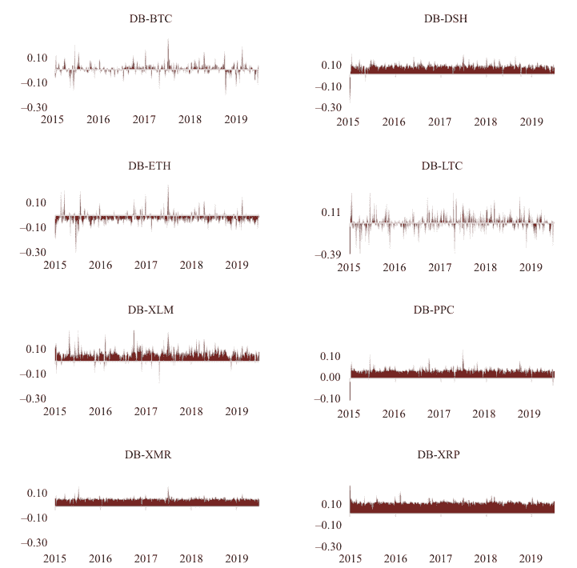

图 2. 带有 mvGED 估计的 DCC-MGARCH 模型中 DB 与加密货币之间的相关性

用途，这由多项研究表明（Ali et al., 2014; Baur et al., 2018; Dyhrberg, 2016b; Glaser et al., 2014; Peetz and Mall, 2017; Yermack, 2013）。同样值得一提的是，受益于新共识机制和更先进方法的新加密货币，与这些股票指数的正相关天数比其他加密货币更多。

## 鲁棒性检验

检查鲁棒性是计量经济学建模中必不可少的一部分，以确保结果在各种条件下的有效性。因此，在以下部分中，检验了抽取次数和先验规范的鲁棒性。

### 对抽取次数的鲁棒性

在 MCMC 中从后验分布生成相当大的样本量极其耗时，因此最好生成较少样本以分析模型的敏感性。因此，为了检验模型，通过生成 10,000 个样本（包括 2,000 个烧入样本和 8,000 个用于估计的样本）来估计了 ETH 价格与 PF 股票指数的双变量组合。另外还生成了 15,000 个样本，

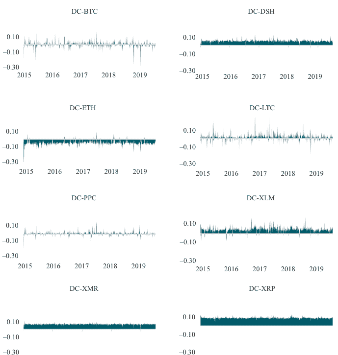

图 3. 带有 mvGED 估计的 DCC-MGARCH 模型中 DC 与加密货币之间的相关性

包括 4,000 个烧入样本和 11,000 个用于估计的样本。研究结果在表 13 中所示。后验的均值和标准误的值几乎相同。

### 对先验 \(\alpha\) 和 \(\beta\) 规范的鲁棒性

强烈建议分析后验估计对模型参数先验规范和初始值的敏感性。总共为 \(\alpha\) 和 \(\beta\) 参数提出了三个适当先验（Fioruci et al., 2014; Shiferaw, 2019）：

- 先验 1: \((\alpha, \beta) \sim GED (0.03, 0.8)\) (8)
- 先验 2: \((\alpha, \beta) \sim GED (0.01, 0.4)\) (9)
- 先验 3: \((\alpha, \beta) \sim GED (0.04, 0.9)\) (10)

上述先验的后验结果显示在表 14 中。结果表明，所有参数的所有后验均值对先验变化均敏感，对所有


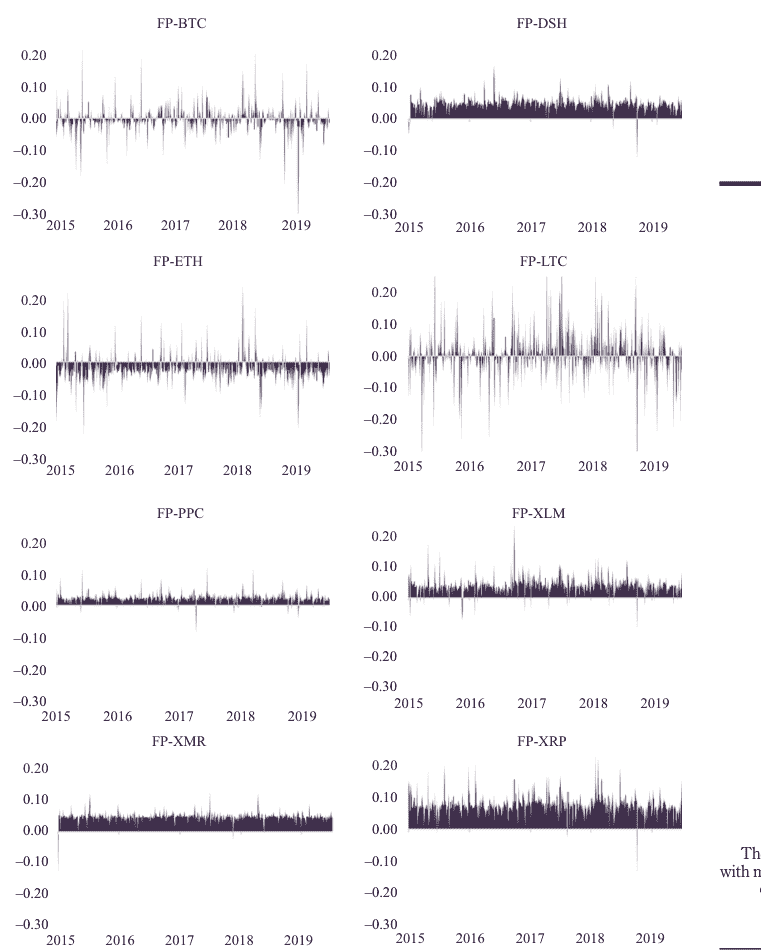

图 4. 带有 mVGED 估计的 DCC-MGARCH 模型中 FP 与加密货币先验之间的相关性。然而，所有参数的后验标准差变化均小于千分之一。

## 对先验设定的稳健性 (a 和 b)

采用 Fioruci _et al._ (2014) 提供的三个关于 _a_ 和 _b_ 的信息性先验，也对模型参数的后验估计对先验设定和初始值的敏感性进行了评估：

- 先验 1: a = 0.03, b = 0.8 (11)
- 先验 2: a = 0.01, b = 0.4 (12)
- 先验 3: a = 0.04, b = 0.9 (13)

这些先验的后验结果载于表 15。结果证实了所有参数的后验均值对先验变化的敏感性。还发现，大多数参数的后验标准误变化可忽略不计。

然而，应注意，所获得的先验初始值已被用于检查所指定先验的稳健性，这些值与 Fioruci et al. (2014) 和 Shiferaw (2019) 得到的结果略有不同。此外，在稳健性检查过程中，所有组合均使用三种分布进行估计。使用加权 DIC 统计量选择了最佳分布，并报告了结果。在所有先验规范稳健性程序中，GED 被认为是最优分布。

## 结论与启示

本研究采用贝叶斯 DCC-MGARCH 模型，考察了八种加密货币与四家主要在区块链平台运营的科技公司股票指数之间的相互关联。与其他方法相比，MGARCH 在计算时间序列间动态相关性方面具有一些优势。多元 GARCH 最显著的优势在于其能够考察所有时间序列收益及其波动率之间的相互作用，从而揭示溢出效应。通过应用该模型，可以检测变量对之间条件相关性的动态变化。我们在贝叶斯 ADCC-MGARCH 模型中考虑多元分布的偏斜形式（而非常规分布，即正态分布、t 学生分布和广义误差分布），以探索加密货币与基于区块链的科技公司之间的共动关系。

实证结果和敏感性分析表明，模型参数显著且对先验设定具有稳健性。这表明时间序列之间的相关性是动态的。结果还证实，加密货币与基于区块链的科技公司之间的相关性始终为正。因此，加密货币与科技股票之间的中性关系也被否定。没有研究专门分析加密货币与基于区块链的科技公司之间的相互关联，但少数研究仅关注加密货币与科技公司及板块之间的互动，包括 Symitsi 和 Chalvatzis (2018) 以及 Umar et al. (2021)。

我们的研究结果表明，具有独特特征的加密货币（如 Monero、Ripple、Stellar、Peercoin 和 Dash）的收益与指数收益呈正相关。

表 12. 加密货币与基于区块链的科技公司之间正条件相关性所占天数的比例（百分比数值）

| | BTC | DSH | ETH | LTC | PPC | XLM | XMR | XRP | Mean (stocks) |
|---|---|---|---|---|---|---|---|---|---|
| AF | 88.261 | 97.264 | 30.627 | 78.906 | 98.588 | 94.351 | 99.823 | 99.823 | 85.955 |
| DB | 65.049 | 98.323 | 16.858 | 59.135 | 98.764 | 93.998 | 99.559 | 99.823 | 78.939 |
| DC | 61.783 | 99.029 | 4.854 | 80.759 | 80.847 | 95.322 | 99.823 | 100.000 | 77.802 |
| FP | 35.834 | 98.235 | 16.505 | 51.633 | 95.322 | 95.587 | 99.470 | 98.676 | 73.908 |
| Mean (cryptocurrencies) | 62.732 | 98.213 | 17.211 | 67.608 | 93.380 | 94.815 | 99.669 | 99.581 | |

表 13. 不同抽样次数下 AF 与 ETH 之间 ADCC-MGARCH 模型的标准差

| Parameter | γ₁ | ω₁ | α₁ | β₁ | γ₂ | ω₂ | α₂ | β₂ | a | b | δ |
|---|---|---|---|---|---|---|---|---|---|---|---|
| 15,000 Mean | 0.86973 | 0.24582 | 0.15045 | 0.7776 | 1.07936 | 3.6135 | 0.16462 | 0.76403 | 0.06264 | 0.44275 | 1.00474 |
| 15,000 Std. dev | 0.02128 | 0.07338 | 0.03523 | 0.04303 | 0.02265 | 1.2572 | 0.04302 | 0.05119 | 0.02901 | 0.1621 | 0.0377 |
| 10,000 Mean | 0.86925 | 0.23888 | 0.14713 | 0.78154 | 1.07984 | 3.7051 | 0.16315 | 0.75992 | 0.05755 | 0.39588 | 1.01495 |
| 10,000 Std. dev | 0.02248 | 0.07344 | 0.03468 | 0.04446 | 0.02242 | 1.16937 | 0.04506 | 0.04907 | 0.02634 | 0.23587 | 0.03412 |
| 15,000 Mean | 0.80621 | 0.14395 | 0.20339 | 0.74529 | 1.08357 | 4.21365 | 0.17908 | 0.73813 | 0.06979 | 0.31944 | 0.9924 |
| 15,000 Std. dev | 0.02119 | 0.03572 | 0.04097 | 0.04219 | 0.01742 | 1.19147 | 0.0473 | 0.05017 | 0.03338 | 0.17596 | 0.03463 |
| 10,000 Mean | 0.80503 | 0.15255 | 0.18922 | 0.75241 | 1.06987 | 5.48754 | 0.19411 | 0.70227 | 0.06557 | 0.35507 | 0.98165 |
| 10,000 Std. dev | 0.0168 | 0.04212 | 0.03551 | 0.04263 | 0.01755 | 1.16834 | 0.03774 | 0.04238 | 0.02492 | 0.17455 | 0.04608 |

表 14. AF 与 ETH 二元组合的先验设定稳健性（$α$ 和 $β$）

| | $\gamma_1$ | $\alpha_1$ | $\alpha_1$ AF | $\alpha_1$ | $\beta_1$ | $\gamma_2$ | $\omega_2$ | $\alpha_2$ ETH | $\beta_2$ | $a$ | $b$ | Model | $\delta$ |
|---|---|---|---|---|---|---|---|---|---|---|---|---|---|
| Prior 1 | 0.86922 | 0.23803 | 0.14825 | 0.78297 | 1.07842 | 3.77441 | 0.1675 | 0.75724 | 0.05953 | Model | 0.38757 | 1.00411 |
| Prior 2 | 0.02305 | 0.07127 | 0.0355 | 0.04302 | 0.02271 | 1.08357 | 0.03995 | 0.0449 | 0.02847 | 0.20368 | 0.03773 | |
| Prior 3 | 0.87141 | 0.23897 | 0.14704 | 0.7836 | 1.0808 | 3.58163 | 0.15922 | 0.76785 | 0.06257 | 0.39583 | 1.00227 | |
| Mean | 0.02194 | 0.07023 | 0.03368 | 0.04299 | 0.02066 | 1.19562 | 0.04222 | 0.04741 | 0.0029 | 0.19698 | 0.03775 | |
| Std dev | 0.87032 | 0.23857 | 0.15083 | 0.7807 | 1.07801 | 3.75184 | 0.16391 | 0.75961 | 0.06258 | 0.40812 | 1.0036 | |
| Std dev | 0.02426 | 0.07059 | 0.03679 | 0.04388 | 0.02269 | 1.18339 | 0.04031 | 0.04899 | 0.03001 | 0.21468 | 0.03873 | |
| Prior 1 | 0.79726 | 0.14686 | 0.19503 | 0.74914 | 1.0807 | 4.43951 | 0.1861 | 0.72832 | 0.06651 | Model | | 0.99587 |
| Std dev | 0.02308 | 0.03757 | 0.03773 | 0.0414 | 0.02003 | 1.24434 | 0.04015 | 0.04671 | 0.03087 | 0.31273 | 0.99587 | |
| Mean | 0.79907 | 0.14916 | 0.19352 | 0.75019 | 1.07935 | 4.54787 | 0.18499 | 0.72463 | 0.06513 | 0.2972 | 0.98757 | |
| Std dev | 0.02311 | 0.03819 | 0.03853 | 0.04246 | 0.02058 | 1.30912 | 0.03907 | 0.04639 | 0.03062 | 0.17722 | 0.03619 | |
| Mean | 0.79676 | 0.14983 | 0.19711 | 0.74641 | 1.07882 | 4.60322 | 0.18984 | 0.72231 | 0.06638 | 0.30585 | 0.99276 | |

| | \(\gamma_1\) | \(\alpha_1\) | \(\alpha_1\) | \(\beta_1\) | \(\gamma_2\) | \(\alpha_2\) | \(\beta_2\) | \(a\) | \(b\) | Model | \(\delta\) |
|---|---|---|---|---|---|---|---|---|---|---|---|
| Prior 1 Mean | 0.88904 | 0.2301 | 0.1471 | 0.7883 | 1.0805 | 3.5489 | 0.1694 | 0.7614 | 0.06 | 0.442 | 0.9946 |
| Prior 1 Std. dev | 0.02356 | 0.06728 | 0.03563 | 0.04254 | 0.018 | 0.69549 | 0.04075 | 0.04046 | 0.02832 | 0.19035 | 0.03852 |
| Prior 2 Mean | 0.87539 | 0.231 | 0.15389 | 0.78194 | 1.08395 | 3.88589 | 0.16619 | 0.75509 | 0.05954 | 0.33783 | 1.00487 |
| Prior 2 Std. dev | 0.02252 | 0.07455 | 0.03696 | 0.04705 | 0.02203 | 1.34184 | 0.03904 | 0.05047 | 0.02683 | 0.1959 | 0.03985 |
| Prior 3 Mean | 0.87522 | 0.24873 | 0.15022 | 0.77603 | 1.07372 | 4.09398 | 0.17397 | 0.74487 | 0.06476 | 0.46248 | 1.01744 |
| Prior 3 Std. dev | 0.02557 | 0.07456 | 0.03517 | 0.04539 | 0.028 | 1.30881 | 0.04167 | 0.05297 | 0.03273 | 0.21113 | 0.04103 |
| FP | | | | | | | | | | | |
| Prior 1 Mean | 0.79502 | 0.14549 | 0.18991 | 0.75282 | 1.08031 | 4.47384 | 0.18323 | 0.7307 | 0.06361 | 0.33901 | 1.00193 |
| Prior 1 Std. dev | 0.02464 | 0.03836 | 0.03843 | 0.04343 | 0.01983 | 1.24314 | 0.03851 | 0.04877 | 0.0351 | 0.19511 | 0.03865 |
| Prior 2 Mean | 0.80036 | 0.14173 | 0.19034 | 0.75600 | 1.07973 | 4.88804 | 0.1929 | 0.71468 | 0.06486 | 0.33266 | 0.9941 |
| Prior 2 Std. dev | 0.02346 | 0.03925 | 0.04284 | 0.04700 | 0.02036 | 1.64572 | 0.04067 | 0.05521 | 0.03143 | 0.17976 | 0.03604 |
| Prior 3 Mean | 0.79738 | 0.14616 | 0.19623 | 0.75024 | 1.07811 | 4.6916 | 0.19184 | 0.72049 | 0.06639 | 0.35342 | 0.98568 |
| Prior 3 Std. dev | 0.0222 | 0.03778 | 0.03806 | 0.0408 | 0.02000 | 1.69451 | 0.04075 | 0.05608 | 0.03121 | 0.17911 | 0.03804 |


平均而言，基于区块链的技术公司在超过 90% 的采样日中。此外，比特币、莱特币和以太坊等其他一些加密货币的回报与基于区块链的技术公司股票指数回报呈正相关的天数少于其他加密货币。我们的重要发现是，投资者情绪可能影响加密货币和基于区块链的技术公司的股票价格。加密货币和基于区块链的技术公司都在应用区块链技术，因此投资者的积极和消极情绪可能会以相同的方向影响加密货币和基于区块链的技术公司。

我们还发现，加密货币和基于区块链的技术公司的主要驱动因素是技术创新（Umar et al., 2021），它可以同时促进加密货币和基于区块链的技术公司的普及性、适用性和容量。此外，加密货币的改进可以提高这些公司的性能。例如，Monero 是一种开源的、以隐私为导向的加密货币，使用户能够进行匿名和安全的付款，而 Ripple 是一个实时全球结算网络，提供即时且低成本的国际付款。这两种加密货币与基于区块链的技术公司股票指数回报在大约 100% 的采样日呈正相关，这可以与它们的独特特征相关。Peercoin、Stellar 甚至 Dash 也是如此，它们提供快速、安全和匿名的付款。相比之下，以太坊、比特币和莱特币与基于区块链的技术公司股票指数回报呈正相关的天数平均比其他加密货币少，这可能是由于交易这些加密货币的投机意图。这一观点得到多项研究的支持（Ali et al., 2014; Baur et al., 2018; Dyhrberg, 2016b; Glaser et al., 2014; Peetz and Mall, 2017; Yermack, 2013）。

基于区块链的技术公司没有显著差异。基于区块链的技术公司股票指数的所有回报平均在超过 70% 的采样中与加密货币呈正相关。然而，替代金融和民主化银行与加密货币呈正相关的天数略多于其他基于区块链的技术公司指数，这可能是因为它们专注于提供新的支付平台或使用点对点平台进行贷款和小额融资，这使它们更依赖区块链技术。

这些结果有多方面的启示。首先，随着基于区块链的技术公司股票指数回报收敛于加密货币回报，它们之间的发展与进步似乎存在显著联系。在某种意义上，加密货币的发展将惠及基于区块链的技术公司，反之亦然。其次，加密货币与基于区块链的技术公司股票指数回报呈正相关的天数在不同加密货币之间有所不同，并且具有更有用特性（如快速、便捷，以及匿名性）的加密货币与基于区块链的技术公司股票指数回报呈正相关的天数更多。因此，政策制定者甚至投资者应更加关注这些加密货币。第三，根据其策略，基于区块链的技术公司可以将加密货币作为对冲工具或分散工具加入其投资组合。

本文仅研究了几种加密货币的价格回报与主要在区块链平台运营并提供金融服务的技术公司四个股票指数回报之间的相关性。因此，本文在推广研究结果方面面临一些局限性。未来研究可以调查更多加密货币与科学技术其他领域的技术公司之间的关系和相互作用。

## Notes

- 1. 权益证明
- 2. 委托权益证明
- 3. 实用拜占庭容错
- 4. 工作量证明
- 5. 赤池信息量准则
- 6. 贝叶斯信息量准则
- 7. 偏差信息量准则
- 8. 加权偏差信息量准则
- 9. 多变量正态分布
- 10. 多变量 Student's t 分布
- 11. 多变量广义误差分布

## References

Agbo, C.C., Mahmoud, Q.H. and Eklund, J.M. (2019), “医疗保健中的区块链技术：系统评述”，论文发表于 Healthcare。

Albrecht, S., Reichert, S., Schmid, J., Strüker, J., Neumann, D. and Fridgen, G. (2018), “区块链实施动态——能源领域的个案研究”，论文发表于第 51 届夏威夷国际系统科学会议论文集。

Ali, R., Barrdear, J., Clews, R. and Southgate, J. (2014), 《数字货币经济学》，英国央行季报，Q3。

Allen, B. and Bryant, S.K. (2019), “加密货币市场：它将如何发展？”，全球经济学刊，第 19 卷第 3 期，第 1950019 页。

Andoni, M., Robu, V., Flynn, D., Abram, S., Geach, D., Jenkins, D., McCallum, P. and Peacock, A. (2019), “能源领域的区块链技术：挑战与机遇的系统评述”，可再生能源与可持续能源评论，第 100 卷，第 143-174 页。

Araz, O.M., Choi, T.M., Olson, D.L. and Salman, F.S. (2020), “大数据时代运营风险管理中分析的作用”，决策科学，第 51 卷第 6 期，第 1320-1346 页。

Ardia, D., Bluteau, K. and Rüede, M. (2019), “比特币 GARCH 波动动态中的制度变迁”，金融研究快报，第 29 卷，第 266-271 页，doi: 10.1016/j.frl.2018.08.009。

Azzi, R., Chamoun, R.K. and Sokhn, M. (2019), “基于区块链的供应链的力量”，计算机与工业工程，第 135 卷，第 582-592 页。

Ba, S. and Zhu, H. (2016), “融资融券、做空、投资者情绪与股市波动”，国际金融研究，第 32 卷，第 82-96 页。

Baek, C. and Elbeck, M. (2015), “比特币是投资工具还是投机工具？初步分析”，应用经济学快报，第 22 卷第 1 期，第 30-34 页，doi: 10.1080/13504851.2014.916379。

Bala, D.A. and Takimoto, T. (2017), “金融危机期间股市波动溢出：一种偏态-t密度DCC-MGARCH方法”，伊斯坦布尔证券交易所评论，第 17 卷第 1 期，第 25-48 页，doi: 10.1016/j.bir.2017.02.002。

Balcilar, M., Gupta, R. and Pierdzioch, C. (2016), “不确定性会推动金价吗？来自分位数非参数因果性检验的新证据”，资源政策，第 49 卷，第 74-80 页。

Barcelo, J. (2014), “公共比特币区块链中的用户隐私”，可在：http://www.dtic.upf.edu/jbarcelo/papers/20140704 User Privacy in the Public Bitcoin Blockchain/paper.pdf 查阅（访问日期：2016年5月9日）。

Baur, D.G. and Dimpfl, T. (2019), “比特币现货还是期货中的价格发现？”，期货市场杂志，第 39 卷第 7 期，第 803-817 页。

Baur, D.G., Hong, K. and Lee, A.D. (2018), “比特币：交易媒介还是投机资产？”，国际金融市场、机构与货币杂志，第 54 卷，第 177-189 页，doi: 10.1016/j.intfin.2017.12.004。

Bauwens, L. and Laurent, S. (2005), “一类新的多变量偏态密度及其在广义自回归条件异方差模型中的应用”，商业与经济统计杂志，第 23 卷第 3 期，第 346-354 页，doi: 10.1198/073500104000000523。

Berdik, D., Otoum, S., Schmidt, N., Porter, D. and Jararweh, Y. (2021), “面向信息系统管理和安全的区块链调查”，信息处理与管理，第 58 卷第 1 期，第 102397 页。

Blau, B.M. (2017), “比特币中的价格动态与投机交易”，国际商业与金融研究，第 41 卷，第 493-499 页，doi: 10.1016/j.ribaf.2017.05.010。

Blossey, G., Eisenhart, J. and Hahn, G. (2019), 《供应链管理中的区块链技术：应用视角》。

Böhme, R., Christin, N., Edelman, B. and Moore, T. (2015), “比特币：经济学、技术与治理”，经济展望杂志，第 29 卷第 2 期，第 213-238 页，doi: 10.1257/jep.29.2.213。

Bogucharskov, A., Pokamestov, I., Adamova, K. and Tropina, Z.N. (2018), “贸易融资流程中区块链技术的采用”，全球经济评论杂志，第 7 卷，第 510-515 页。

Bollerslev, T. (1990), “短期名义汇率的一致性建模：多元广义ARCH模型”，经济与统计评论，第 72 卷第 3 期，第 498-505 页，doi: 10.2307/2109358。

Bondia, R., Ghosh, S. and Kanjilal, K. (2016), “国际原油价格与清洁能源和技术公司股价：来自未知结构断点非线性共整合检验的证据”，能源，第 101 卷，第 558-565 页，doi: 10.1016/j.energy.2016.02.031。

Bouri, E., Jalkh, N., Molnár, P. and Roubaud, D. (2017), “2013年12月崩盘前后能源商品中的比特币：分散工具、对冲工具还是避风港？”，应用经济学，第 49 卷第 50 期，第 5063-5073 页，doi: 10.1080/00036846.2017.1299102。

Bouri, E., Das, M., Gupta, R. and Roubaud, D. (2018a), “牛市和熊市期间比特币与其他资产之间的溢出效应”，应用经济学，第 50 卷第 55 期，第 5935-5949 页，doi: 10.1080/00036846.2018.1488075。

Bouri, E., Gupta, R., Lahiani, A. and Shahbaz, M. (2018b), “比特币、综合商品和金价之间不对称非线性短期和长期关系的检验”，资源政策，第 57 卷第 C 期，第 224-235 页。

Bouri, E., Gil-Alana, L.A., Gupta, R. and Roubaud, D. (2019), “比特币市场长记忆波动性建模：持续性和结构断点的证据”，国际金融与经济学杂志，第 24 卷第 1 期，第 412-426 页。

Brandvold, M., Molnár, P., Vagstad, K. and Andreas Valtstad, O.C. (2015), “比特币交易所中的价格发现”，国际金融市场、机构与货币杂志，第 36 卷，第 18-35 页，doi: 10.1016/j.intfin.2015.02.010。

Brauneis, A. and Mestel, R. (2018), “加密货币的价格发现：比特币及其以后”，经济学快报，第 165 卷，第 58-61 页。

Brilliantova, V. and Thurner, T.W. (2019), “区块链与能源的未来”，技术与社会，第 57 卷，第 38-45 页。

Casado-Vara, R., Prieto, J., De la Prieta, F. and Corchado, J.M. (2018), “区块链如何改善供应链：食品供应链个案研究”，程序计算机科学，第 134 卷，第 393-398 页。

Casey, M., Crane, J., Gensler, G., Johnson, S. and Narula, N. (2018), 《区块链技术对金融的影响：变革的催化剂》。


- Casino, F., Dasaklis, T.K. 和 Patsakis, C. (2019)，“基于区块链的应用系统文献综述：现状、分类与未解决问题”，《信息学与远程信息处理》，第 36 卷，第 55-81 页，DOI: 10.1016/j.tele.2018.11.006.

- Celik, S. (2012)，“新兴市场中更多的传染效应：DCC-GARCH 模型的证据”，《经济建模》，第 29 卷第 5 期，第 1946-1959 页，DOI: 10.1016/j.econmod.2012.06.011.

- Chain, P. 和 Laurini, M.P. (2018)，“比特币的波动率与收益率跳跃”，《经济学快报》，第 173 卷，第 158-163 页，DOI: 10.1016/j.econlet.2018.10.011.

- Chang, V., Baudier, P., Zhang, H., Xu, Q., Zhang, J. 和 Arami, M. (2020)，“区块链如何影响金融服务——来自专家访谈的概述、挑战与建议”，《技术预测与社会变革》，第 158 卷，第 120166 页.

- Charfeddine, L., Benlagha, N. 和 Maouchi, Y. (2020)，“探究加密货币与传统资产之间的动态关系：对金融投资者的启示”，《经济建模》，第 85 卷，第 198-217 页.

- Cheah, E.-T. 和 Fry, J. (2015)，“比特币市场中的投机泡沫？对比特币基本价值的实证研究”，《经济学快报》，第 130 卷，第 32-36 页，DOI: 10.1016/j.econlet.2015.02.029.

- Chen, Y. 和 Bellavitis, C. (2019)，“去中心化金融：区块链技术与构建开放金融体系的探索”，Stevens 理工学院商学院研究论文.

- Chen, Y. 和 Bellavitis, C. (2020)，“区块链颠覆与去中心化金融：去中心化商业模式的兴起”，《商业冒险洞察》，第 13 卷，e00151.

- Chen, Q., Srivastava, G., Parizi, R.M., Aloqaily, M. 和 Ridhawi, I.A. (2020)，“面向伪造媒体物联网的激励感知区块链解决方案”，《信息处理与管理》，第 57 卷第 6 期，第 102370 页，DOI: 10.1016/j.ipm.2020.102370.

- Cheung, A., Roca, E. 和 Su, J.-J. (2015)，“加密货币泡沫：Phillips–Shi–Yu (2013) 方法在 Mt. Gox 比特币价格中的应用”，《应用经济学》，第 47 卷第 23 期，第 2348-2358 页，DOI: 10.1080/00036846.2015.1005827.

- Chiang, T., Jeon, B. 和 Li, H. (2007)，“金融传染的动态相关性分析：亚洲市场的证据”，《国际货币与金融杂志》，第 26 卷第 7 期，第 1206-1228 页.

- Cho, J.H. 和 Parhizgari, A.M. (2009)，“DCC-GARCH 下的东亚金融传染”，《国际银行与金融杂志》，第 6 卷第 1 期，第 17-30 页.

- Ciaian, P., Rajcaniova, M. 和 Kancs, d. A. (2018)，“虚拟关系：来自比特币和山寨币市场的短期与长期证据”，《国际金融市场、机构与货币杂志》，第 52 卷，第 173-195 页，DOI: 10.1016/j.intfin.2017.11.001.

- Cole, R., Stevenson, M. 和 Aitken, J. (2019)，“区块链技术：对运营与供应链管理的影响”，《供应链管理：国际期刊》，第 24 卷第 4 期，第 469-483 页，DOI: 10.1108/SCM-09-2018-0309.

- Corbett, S., Lucey, B. 和 Yarovaya, L. (2018a)，“比特币与以太坊泡沫的时间戳标记”，《金融研究快讯》，第 26 卷，第 81-88 页，DOI: 10.1016/j.frl.2017.12.006.

- Corbett, S., Meegan, A., Larkin, C., Lucey, B. 和 Yarovaya, L. (2018b)，“探究加密货币与其他金融资产之间的动态关系”，《经济学快报》，第 165 卷，第 28-34 页，DOI: 10.1016/j.econlet.2018.01.004.

- Corluka, D. 和 Lindh, U. (2017)，《区块链：一种将改变房地产市场的新技术》，In.

- Crosby, M., Pattanayak, P., Verma, S. 和 Kalyanaraman, V. (2016)，“区块链技术：比特币之外”，《应用创新》，第 2 卷第 6-10 期，第 71 页.

- De Aguiar, E.J., Faical, B.S., Krishnamachari, B. 和 Ueyama, J. (2020)，“面向医疗保健的基于区块链的策略综述”，《ACM 计算机调查（CSUR）》，第 53 卷第 2 期，第 1-27 页.

- Diebold, F.X. 和 Yilmaz, K. (2009)，“衡量金融资产收益与波动率溢出：全球股票市场的应用”，《经济期刊》，第 119 卷第 534 期，第 158-171 页.

- Diebold, F.X. 和 Yilmaz, K. (2012)，“与其接受，不如给予：波动率溢出的预测方向性测量”，《国际预测杂志》，第 28 卷第 1 期，第 57-66 页.

- Diebold, F.X. 和 Yilmaz, K. (2014)，“方差分解的网络拓扑：衡量金融企业的联系度”，《计量经济学杂志》，第 182 卷第 1 期，第 119-134 页.

- Diebold, F.X. 和 Yilmaz, K. (2015)，《金融与宏观经济联系：测量与监控的网络方法》，牛津大学出版社.

- DiNizo, A.M. Jr (2018)，“从 Alice 到 Bob：后 CLS 银行世界中区块链的专利资格”，《法律、技术与互联网杂志》，第 9 卷，第 1 页.

- Drescher, D. (2017)，《区块链基础：25 步入门基础概念》，MITP-Verlags GmbH & Co. KG.

- Dujak, D. 和 Sajter, D. (2019)，“供应链中的区块链应用”，载于《SMART 供应网络》，Springer，第 21-46 页.

- Dutta, P., Choi, T-M, Somani, S. 和 Butala, R. (2020)，“供应链运营中的区块链技术：应用、挑战与研究机遇”，《运输研究部分 E：物流与运输评论》，第 142 卷，第 102067 页.

- Dyhrberg, A.H. (2016a)，“比特币、黄金与美元——一种 GARCH 波动率分析”，《金融研究快讯》，第 16 卷，第 85-92 页.

- Dyhrberg, A.H. (2016b)，“比特币、黄金与美元——一种 GARCH 波动率分析”，《金融研究快讯》，第 16 卷，第 85-92 页，DOI: 10.1016/j.frl.2015.10.008.

- Eisl, A., Gasser, S.M. 和 Weinmayer, K. (2015)，《买者自负：比特币能改善投资组合分散化吗？》.

- Engle, R.F. (1982)，“带有英国通胀方差估计的自回归条件异方差性”，《计量经济学》，第 50 卷第 4 期，第 987-1007 页，DOI: 10.2307/1912773.

- Engle, R. (2002)，“动态条件相关性”，《商业与经济统计杂志》，第 20 卷第 3 期，第 339-350 页，DOI: 10.1198/073500102288618487.

- Fioruci, J.A., Ehlers, R.S. 和 Andrade Filho, M.G. (2014)，“具有动态相关性和非对称误差分布的贝叶斯多元 GARCH 模型”，《应用统计学杂志》，第 41 卷第 2 期，第 320-331 页，DOI: 10.1080/02664763.2013.839635.

- Francisco, K. 和 Swanson, D. (2018)，“供应链没有衣服：区块链技术在供应链透明度中的采用”，《物流》，第 2 卷第 1 期，第 2 页.

- Frank, N. 和 Hesse, H. (2009)，“全球金融危机期间向新兴市场的金融溢出”，《捷克经济与金融杂志（Finance a Uver）》，第 59 卷第 6 期，第 507-521 页.

- Fry, J. 和 Cheah, E.-T. (2016)，“加密货币市场中的负泡沫与冲击”，《国际金融分析评论》，第 47 卷，第 343-352 页，DOI: 10.1016/j.irfa.2016.02.008.

- Gajardo, G., Kristjanpoller, W.D. 和 Minutolo, M. (2018)，“比特币是否与原油、黄金和道琼斯工业平均指数表现出与欧元、英镑和日元相同的非对称多重分形交叉相关性？”，《混沌、孤子与分形》，第 109 卷，第 195-205 页，DOI: 10.1016/j.chaos.2018.02.029.

- Gandal, N. 和 Halaburda, H. (2014)，“加密货币市场中的竞争”，可从以下网址获取：https://EconPapers.repec.org/RePEc:netwpaper:1417.

- Garcia, D., Tessone, C.J., Mavrodiev, P. 和 Perony, N. (2014)，“泡沫的数字痕迹：社会经济信号与比特币经济之间的反馈循环”，《英国皇家学会接口期刊》，第 11 卷第 99 期，第 20140623 页.

- Garcia-Teruel, R.M. (2020)，“房地产领域区块链技术的法律挑战与机遇”，《房地产、规划与环境法杂志》，第 12 卷第 2 期，第 129-145 页，DOI: 10.1108/JPPEL-07-2019-0039.

- Glaser, F., Zimmermann, K., Haferkorn, M., Weber, M.C. 和 Siering, M. (2014)，“比特币——资产还是货币？揭示用户隐藏的意图”，《揭示用户隐藏的意图》（2014 年 4 月 15 日）。ECIS.


- González, M.D.L.O., Jareño, F. and Skinner, F.S. (2020), “非线性自回归分布滞后方法：比特币收益与其他十种最相关加密货币收益之间关联性的应用”, Mathematics, 第8卷第5期, 第810页.

- Ho, C.-S., Damien, P., Gu, B. and Konana, P. (2017), “社交媒体情感在股票收益建模中的时间变异性”, Decision Support Systems, 第101卷, 第69-81页.

- Höbl, M., Kompara, M., Kamisiälä, A. and Nemec Zlatolas, L. (2018), “医疗保健中区块链应用的系统综述”, Symmetry, 第10卷第10期, 第470页.

- Hsieh, D.A. (1988), “1974-1983年每日外汇汇率的统计特性”, Journal of International Economics, 第24卷第1-2期, 第129-145页.

- Huang, J., Kong, L., Chen, G., Wu, M.-Y., Liu, X. and Zeng, P. (2019), “面向安全工业物联网的基于信用共识机制的区块链系统”, IEEE Transactions on Industrial Informatics, 第15卷第6期, 第3680-3689页.

- Imbault, F., Swiatek, M., De Beaufort, R. and Plana, R. (2017), “管理分散式能源生产和消费的绿色区块链”, 论文发表于2017年IEEE环境与电气工程国际会议和2017年IEEE欧洲工业与商业电力系统会议(EEEIC/I&CPS Europe).

- Jackson, R. (2018), “可扩展性是区块链最大的问题，但可以解决”，可查阅：https://cryptoslate.com/scalability-is-blockchains-biggest-problem-but-it-can-be-resolved（检索于10月3日）.

- Ji, Q., Bouri, E., Lau, C.K.M. and Roubaud, D. (2019a), “加密货币市场中的动态关联性与一体化”, International Review of Financial Analysis, 第63卷, 第257-272页.

- Ji, Q., Bouri, E., Roubaud, D. and Kristoufek, L. (2019b), “能源、加密货币和主要大宗商品市场之间的信息相互依赖”, Energy Economics, 第81卷, 第1042-1055页, doi: 10.1016/j.eneco.2019.06.005.

- Ji, Z., Chang, V., Lan, H., Robert Hsu, C.-H. and Valverde, R. (2020), “中国区块链行业中Fama-French三因子模型与情感相关四因子模型的实证研究”, Sustainability, 第12卷第12期, 第5170页.

- Joo, M.H., Nishikawa, Y. and Dandapani, K. (2019), “加密货币：区块链技术的成功应用”, Managerial Finance.

- Kapar, B. and Olmo, J. (2019), “比特币期货与现货市场之间价格发现的分析”, Economics Letters, 第174卷, 第62-64页, doi: 10.1016/j.econlet.2018.10.031.

- Kaplanov, N. (2012), “极客货币：比特币、私人数字货币及反对其监管的理由”, Loyola Consumer Law Review, 第25卷, 第111页.

- Karamitsos, I., Papadaki, M. and Al Barghuthi, N.B. (2018), “区块链智能合约设计：房地产用例”, Journal of Information Security, 第9卷第3期, 第177页.

- Katsiampa, P. (2017), “比特币波动率估计：GARCH模型比较”, Economics Letters, 第158卷, 第3-6页, doi: 10.1016/j.econlet.2017.06.023.

- Katsiampa, P., Corbet, S. and Lucey, B. (2019), “领先加密货币的波动溢出效应：BEKK-MGARCH分析”, Finance Research Letters, 第29卷, 第68-74页.

- Katzke, N. (2013), 南非部门收益相关性：使用DCC和ADCC多元GARCH技术揭示潜在动态, Stellenbosch University, Department of Economics, 17/2013(17/2013).

- Kaur, H., Alam, M.A., Jameel, R., Mouraya, A.K. and Chang, V. (2018), “云环境中基于区块链的异构医疗数据的拟议解决方案及未来方向”, Journal of Medical Systems, 第42卷第8期, 第1-11页.

- Kaiyias, A. and Panagiotakos, G. (2017), “论区块链中的树、链与快速交易”, 论文发表于拉丁美洲密码学与信息安全国际会议.

- Kocaarslan, B. and Soytas, U. (2019), “石油价格与清洁能源和技术公司股票价格之间的动态相关性：储备货币（美元）的作用”, Energy Economics, 第84卷, 第104502页, doi: 10.1016/j.eneco.2019.104502.

- Konashevych, O. (2020), “区块链在房地产和产权应用中的约束与收益”, Journal of Property, Planning and Environmental Law, 第12卷第2期, 第109-127页, doi: 10.1108/JPPL-12-2019-0061.

- Korpela, K., Hallikas, J. and Dahlberg, T. (2017), “向区块链集成的数字供应链转型”, 论文发表于第50届夏威夷系统科学国际会议论文集.

- Kosba, A., Miller, A., Shi, E., Wen, Z. and Papamanthou, C. (2016), “Hawk：区块链密码学与隐私保护智能合约模型”, 论文发表于2016年IEEE安全与隐私研讨会(SP).

- Kraaijeveld, O. and De Smedt, J. (2020), “公众Twitter情绪在预测加密货币价格方面的预测能力”, Journal of International Financial Markets, Institutions and Money, 第65卷, 第101188页, doi: 10.1016/j.intfin.2020.101188.

- Kristoufek, L. (2013), “比特币与Google趋势和维基百科：量化互联网时代现象之间的关系”, Scientific Reports, 第3卷第1期, 第1-7页.

- Kristoufek, L. (2015), “比特币价格的主要驱动因素是什么？小波相干性分析的证据”, PloS One, 第10卷第4期, e0123923.

- Krupa, K.S. and Akhil, M.S. (2019), “使用区块链重塑房地产行业”, 载于《新兴电子、计算机科学与技术研究》, Springer, 第255-263页.

- Kurka, J. (2019), “加密货币和传统资产类别是否相互影响?”, Finance Research Letters, 第31卷, 第38-46页, doi: 10.1016/j.frl.2019.04.018.

- Lee, J.Y. (2019), “去中心化代币经济：区块链和加密货币如何彻底改变商业”, Business Horizons, 第62卷第6期, 第773-784页.

- Lee, M.-C., Chiou, J.-S. and Lin, C.-M. (2006), “基于DCC多元GARCH的股票组合收益风险价值研究”, Applied Financial Economics Letters, 第2卷第3期, 第183-188页, doi: 10.1080/17446540500447645.

- Li, Z., Kang, J., Yu, R., Ye, D., Deng, Q. and Zhang, Y. (2017), “工业物联网安全能源交易的联盟区块链”, IEEE Transactions on Industrial Informatics, 第14卷第8期, 第3690-3700页.

- Li, M., Shen, L. and Huang, G.Q. (2019a), “电子商务物流房地产服务中物流资源共享的区块链支持工作流操作系统”, Computers and Industrial Engineering, 第135卷, 第950-969页.

- Li, T.R., Chamrajnagar, A.S., Fong, X.R., Rizik, N.R. and Fu, F. (2019b), “使用梯度提升树模型对另类加密货币价格波动进行基于情绪的预测”, Frontiers in Physics, 第7卷, 第98页.

- Li, X., Wu, P. and Wang, W. (2020), “将股价和新闻情绪纳入股票市场预测：香港个案”, Information Processing and Management, 第57卷第5期, 第102212页.

- Ljung, G.M. and Box, G.E.P. (1978), “时间序列模型拟合优度的一种衡量指标”, Biometrika, 第65卷第2期, 第297-303页, doi: 10.2307/2335207.

- López-Cabarcos, M.Á., Pérez-Pico, A.M., Piñeiro-Chousa, J. and Šević, A. (2021), “比特币波动性、股票市场和投资者情绪。它们有联系吗?”, Finance Research Letters, 第38卷, 第101399页, doi: 10.1016/j.frl.2019.101399.

- Marr, B. (2018), “人人都应该了解的区块链五大问题”, Forbes, 第19卷, 第2018页.

- Maurer, B., Nelms, T.C. and Swartz, L. (2013), “或许真正的问题是金钱本身：比特币的实践物质性”, Social Semiotics, 第23卷第2期, 第261-277页.

- McGhin, T., Choo, K.-K. R., Liu, C. Z. and He, D. (2019), “医疗保健应用中的区块链：研究挑战与机遇”, Journal of Network and Computer Applications, 第135卷, 第62-75页.

- Meiklejohn, S., Pomarole, M., Jordan, G., Levchenko, K., McCoy, D., Voelker, G.M. and Savage, S. (2013), “一把比特币：无名之辈之间的支付特征分析”, 论文发表于2013年互联网测量会议论文集.

- Mendling, J., Weber, I., Aalst, W.V.D., Brocke, J.V., Cabanillas, C., Daniel, F., Debois, S., Ciccio, C.D., Dumas, M. and Dustdar, S. (2018), “业务流程管理中的区块链：挑战与机遇”, ACM Transactions on Management Information Systems, 第9卷第1期, 第1-16页.

- Mengelkamp, E., Notheisen, B., Beer, C., Dauer, D. and Weinhardt, C. (2018), “面向可持续本地能源市场的基于区块链的智能电网”, Computer Science-Research and Development, 第33卷第1期, 第207-214页.

- Mensi, W., Al-Yahyaee, K.H. and Kang, S.H. (2019), “加密货币价格的结构断点与双重长记忆：来自比特币和以太坊的比较分析”, Finance Research Letters, 第29卷, 第222-230页.

- Mettler, M. (2016), “医疗保健中的区块链技术：革命从这里开始”, 论文发表于2016年IEEE第18届电子健康网络、应用与服务国际会议(Healthcom).

- Min, H. (2019), “用于增强供应链韧性的区块链技术”, Business Horizons, 第62卷第1期, 第35-45页.

- Moenninghoff, S.C. and Wieandt, A. (2013), “点对点金融的未来”, Schmalenbachs Zeitschrift für betriebswirtschaftliche Forschung, 第65卷第5期, 第466-487页, doi: 10.1007/BF03372882.

- Nasreen, S., Tiwari, A.K., Eizaguirre, J.C. and Wohar, M.E. (2020), “石油价格与清洁能源和技术公司股票收益之间的动态关联性”, Journal of Cleaner Production, 第260卷, 第121015页, doi: 10.1016/j.jclepro.2020.121015.

- Nelson, G.C., Rosegrant, M.W., Palazzo, A., Gray, I., Ingersoll, C., Robertson, R., Tokgoz, S., Zhu, T., Sulser, T.B. and Ringler, C. (2010), 2050年粮食安全、农业和气候变化：情景、结果、政策选择, 第172卷, 国际食物政策研究所.

- Nijland, M. and Verger, J. (2019), “区块链对房地产行业的影响”, International Journal of Applied Science, 第2卷第2期, 第22页.

- Osmani, M., El-Haddadeh, R., Hindi, N., Janssen, M. and Weerakkody, V. (2021), “银行和金融下一代服务的区块链：成本、收益、风险和机会分析”, Journal of Enterprise Information Management, 第34卷第3期, 第884-899页, doi: 10.1108/JEIM-02-2020-0044.

- Peetz, D. and Mall, G. (2017), 比特币不是货币，而是投机性实物资产, 可查阅：SSRN 3098765.

- Phillip, A., Chan, J.S.K. and Peiris, S. (2018), “重新审视加密货币”, Economics Letters, 第163卷, 第6-9页, doi: 10.1016/j.econlet.2017.11.020.

- Pilkington, M. (2016), “区块链技术：原理与应用”, 载于《数字化转型研究手册》, Edward Elgar Publishing.

- Qian, P.Y. and Diaz, J.F. (2017), “马来西亚股票市场与全球股票市场波动一体化：多元GARCH方法”, Malaysian Journal of Economic Studies, 第54卷第1期, 第83-117页.

- Queiroz, M.M. and Wamba, S.F. (2019), “供应链中区块链采用的挑战：印度和美国主要驱动因素的实证调查”, International Journal of Information Management, 第46卷, 第70-82页.

- Ram, A.J. (2019), “比特币作为新资产类别”, Meditari Accountancy Research.

- Rehman, M.U. and Apergis, N. (2019), “加密货币与实时商品期货之间预测能力的确定：分位数因果性检验证据”, Resources Policy, 第61卷第C期, 第603-616页.


- Rennock, M.J., Cohn, A. and Butcher, J.R. (2018), “区块链技术与监管调查”, The Journal, Vol. 1, pp. 35-45.

- S&P 道琼斯 (2020a), “S&P 道琼斯指数：S&P GIVI 指数方法论”, S&P 道琼斯指数, 2019 年 10 月, 可从以下网址查阅: https://us.spindices.com/documents/methodologies/methodology-sp-givi-indices.pdf.

- Saberi, S., Kouhizadeh, M., Sarkis, J. and Shen, L. (2019), “区块链技术及其与可持续供应链管理的关系”, 国际生产研究杂志, Vol. 57 No. 7, pp. 2117-2135.

- Sadorsky, P. (2003), “科技股价波动的宏观经济决定因素”, 金融经济学评论, Vol. 12 No. 2, pp. 191-205, doi: 10.1016/S1058-3300(02)00071-X.

- Sadorsky, P. (2012), “油价与清洁能源和科技公司股价之间的相关性和波动溢出”, 能源经济, Vol. 34 No. 1, pp. 248-255, doi: 10.1016/j.eneco.2011.03.006.

- Schär, F. (2021), “去中心化金融：基于区块链和智能合约的金融市场”, 圣路易斯联邦储备银行评论.

- Sedlmeir, J., Buhl, H.U., Fridgen, G. and Keller, R. (2020), “区块链技术的能源消耗：超越神话”, 商业与信息系统工程, Vol. 62 No. 6, pp. 599-608.

- Selgin, G. (2015), “合成商品货币”, 金融稳定杂志, Vol. 17, pp. 92-99.

- Shah, T. and Jani, S. (2018), 银行和金融中区块链技术的应用, 帕鲁大学, 巴洛达.

- Shiferaw, Y.A. (2019), “基于贝叶斯多元 DCC-GARCH 模型的农产品与能源价格动态的时间变化相关性”, Physica A：统计力学及其应用, Vol. 526, p. 120807, doi: 10.1016/j.physa.2019.04.043.

- Sifat, I.M., Mohamad, A. and Shariff, M.S.B.M. (2019), “比特币与以太坊的领先-滞后关系：来自小时和日度数据的证据”, 国际商业与金融研究, Vol. 50, pp. 306-321.

- Siyal, A.A., Junejo, A.Z., Zawish, M., Ahmed, K., Khalil, A. and Soursou, G. (2019), “区块链技术在医学和医疗保健中的应用：挑战与未来展望”, 密码学, Vol. 3 No. 1, p. 3.

- Spielman, A. (2016), 区块链：数字化重建房地产行业, 麻省理工学院.

- Staples, M., Chen, S., Falamaki, S., Ponomarev, A., Rimba, P., Tran, A., Weber, I., Xu, X. and Zhu, J. (2017), 使用区块链和智能合约系统的风险与机遇, Data61. CSIRO, 悉尼.

- Swan, M. (2015), 区块链：新经济的蓝图, O’Reilly 媒体.

- Symitsi, E. and Chalvatzis, K.J. (2018), “比特币与能源和科技公司的收益、波动和冲击溢出”, 经济学信件, Vol. 170, pp. 127-130, doi: 10.1016/j.econlet.2018.06.012.

- Tanwar, S., Parekh, K. and Evans, R. (2020), “面向医疗 4.0 应用的基于区块链的电子健康记录系统”, 信息安全与应用杂志, Vol. 50, p. 102407.

- Tapscott, A. and Tapscott, D. (2017), “区块链如何改变金融”, 哈佛商业评论, Vol. 1 No. 9, pp. 2-5.

- Teti, E., Dallocchio, M. and Aniasi, A. (2019), “Twitter 与股价之间的关系：美国科技行业的证据”, 技术预测与社会变革, Vol. 149, p. 119747, doi: 10.1016/j.techfore.2019.119747.

- Teufel, B., Sentic, A. and Barnet, M. (2019), “区块链能源：未来能源系统中的区块链”, 电子科学与技术杂志, Vol. 17 No. 4, p. 100011.

- Thies, S. and Molnár, P. (2018), “比特币收益率的贝叶斯变点分析”, 金融研究快报, Vol. 27, pp. 223-227, doi: 10.1016/j.frl.2018.03.018.

- Tiwari, A.K., Raheem, I.D. and Kang, S.H. (2019), “基于 copula-ADCC-EGARCH 模型的股票与加密货币市场时间变化动态条件相关性”, Physica A：统计力学及其应用, Vol. 535, p. 122295, doi: 10.1016/j.physa.2019.122295.

- Treiblmaier, H. (2018), “区块链对供应链的影响：基于理论的研究框架与行动呼吁”, 供应链管理：国际杂志, Vol. 23 No. 6, pp. 545-559, doi: 10.1108/SCM-01-2018-0029.

- Treleaven, P., Brown, R.G. and Yang, D. (2017), “金融中的区块链技术”, 计算机, Vol. 50 No. 9, pp. 14-17.

- Troster, V., Tiwari, A.K., Shahbaz, M. and Macedo, D.N. (2019), “比特币收益与风险：一般 GARCH 和 GAS 分析”, 金融研究快报, Vol. 30, pp. 187-193, doi: 10.1016/j.frl.2018.09.014.

- Tse, Y.K. and Tsui, A.K.C. (2002), “具有时间变化相关性的多元广义自回归条件异方差模型”, 商业与经济统计杂志, Vol. 20 No. 3, pp. 351-362, doi: 10.1198/073500102288618496.

- Ullah, F. and Al-Turjman, F. (2021), “用于在智慧城市中管理房地产交易的区块链智能合约采用概念框架”, 神经计算与应用, pp. 1-22.

- Umar, Z., Trabelsi, N. and Alqahtani, F. (2021), “加密货币与科技行业之间的关联度：国际证据”, 国际经济与金融评论, Vol. 71, pp. 910-922.

- Underwood, S. (2016), “比特币之外的区块链”, ACM 通讯, Vol. 59 No. 11, pp. 15-17.

- Urquhart, A. and Zhang, H. (2019), “比特币是货币的避险工具还是避风港？日内分析”, 国际金融分析评论, Vol. 63, pp. 49-57, doi: 10.1016/j.irfa.2019.02.009.

- Verma, R., Baklaci, H. and Soydemir, G. (2008), “个人和机构投资者理性与非理性情绪对道琼斯指数和标准普尔 500 指数收益率的影响”, 应用金融经济学, Vol. 18 No. 16, pp. 1303-1317.

- Veuger, J. (2018), “在具有颠覆性和区块链的可行房地产经济中的信任”, 设施.

- Wang, Q. and Su, M. (2020), “将区块链技术集成到能源领域——从区块链理论到能源区块链的研究与应用”, 计算机科学评论, Vol. 37, p. 100275.

- Wei-qi, L. and Xin-xin, L. (2014), “个人/机构投资者情绪与股票收益率：基于上海 A 股市场的研究”, 中国管理科学杂志, Vol. 17 No. 3, pp. 70-87.

- Werbach, K. (2018), “信任，但要核实：为什么区块链需要法律”, 伯克利科技法律杂志, Vol. 33, p. 487.

- White, R., Marinakis, Y., Islam, N. and Walsh, S. (2020), “比特币是货币、基于技术的产品，还是其他东西？”, 技术预测与社会变革, Vol. 151, p. 119877.

- Wouda, H.P. and Opdenakker, R. (2019), “商业房地产交易中的区块链技术”, 房地产投资与融资杂志, Vol. 37 No. 6, pp. 570-579, doi: 10.1108/JPIF-06-2019-0085.

- Wu, J. and Tran, N.K. (2018), “区块链技术在可持续能源系统中的应用：概览”, 可持续性, Vol. 10 No. 9, p. 3067.

- Yermack, D. (2013), “比特币是真正的货币吗？经济学评估”, 可从以下网址查阅: https://EconPapers.repec.org/RePEc:nbr:nberwo:19747.

- Yue, X., Wang, H., Jin, D., Li, M. and Jiang, W. (2016), “医疗数据网关：基于区块链并采用新型隐私风险控制的医疗智能”, 医学系统杂志, Vol. 40 No. 10, pp. 1-8.

- Zeng, T., Yang, M. and Shen, Y. (2020), “花哨的比特币与传统金融资产：基于关联网络衡量市场一体化”, 经济建模, Vol. 90, pp. 209-220, doi: 10.1016/j.econmod.2020.05.003.

- Zhang, P., Schmidt, D.C., White, J. and Lenz, G. (2018), “医疗保健中区块链技术的应用场景”, 载于《计算机进展》, Elsevier, Vol. 111, pp. 1-41.

- Zhang, J., Sethi, S.P., Choi, T.M and Cheng, T. (2020a), “涉及均值-方差-偏度-峰度新闻人问题的供应链：分析与协调”, 生产与运营管理, Vol. 29 No. 6, pp. 1397-1430.

- Zhang, L., Xie, Y., Zheng, Y., Xue, W., Zheng, X. and Xu, X. (2020b), “区块链在金融与经济中的挑战与对策”, 系统研究与行为科学, Vol. 37 No. 4, pp. 691-698.

- Zheng, Z., Xie, S., Dai, H., Chen, X. and Wang, H. (2017), “区块链技术概述：架构、共识与未来趋势”, 2017 年 IEEE 国际大数据大会 (BigData congress) 上的论文.

- Zheng, Z., Xie, S., Dai, H-N., Chen, X. and Wang, H. (2018), “区块链挑战与机遇：一项综述”, Web 与网格服务国际杂志, Vol. 14 No. 4, pp. 352-375.

- Zhu, X. and Wang, D. (2019), “电子商务、金融和能源中区块链应用研究”, IOP 会议系列：地球与环境科学上的论文.

## 进一步阅读

- Baur, D.G. and Dimpfl, T. (2018), “加密货币中的不对称波动性”, 经济学信件, Vol. 173, pp. 148-151, doi: 10.1016/j.econlet.2018.10.008.

- S&P 道琼斯 (2020b), “S&P Kensho 新经济指数”, S&P 道琼斯指数, 可从以下网址查阅: https://us.spindices.com/indices/equity/sp-kensho-new-economies-composite-index-usd (2020 年 3 月 8 日访问).

## 通讯作者

Mahdi Ghaemi Asl 可通过以下地址联系: m.ghaemi@khu.ac.ir


# 基于深度学习的情感计算

Saurabh Kumar

印度印多尔管理学院，印多尔，印度

## 摘要

目的 – 决策在人类中受情绪和情感的影响。情感计算对此予以考虑，旨在根据人们的情绪状态定制决策支持。然而，情绪的表示和分类是一项非常具有挑战性的任务。本研究使用深度学习模型的定制方法来帮助准确分类情绪和情感。设计/方法/途径 – 本研究提出了一种同时使用文本和图像数据的情感计算模型。基于文本的情感计算在四个标准数据集上使用三种深度学习定制模型进行，即 LSTM、GRU 和 CNN。本研究使用了四种深度学习变体，包括 LSTM 模型、带有 GloVe 嵌入的 LSTM 模型、双向 LSTM 模型和带有注意力层的 LSTM 模型。结果 – 结果表明，所提方法优于早期方法。对于基于图像的情感计算，数据从 Instagram 提取，并使用三种深度学习模型进行面部情感识别，即 CNN、带有 VGG-19 模型的迁移学习和带有 ResNet-18 模型的迁移学习。结果表明，针对文本和图像的所提方法可用于情感计算并辅助决策。独创性/价值 – 本研究使用深度学习进行情感计算。早期研究已使用机器学习算法进行情感计算。然而，本研究使用深度学习进行情感计算。

关键词 情感计算，深度学习，可视化，LSTM，CNN，GRU

论文类型 研究论文

## 1. 引言

我们生活在社交媒体时代，人们在 Facebook、Instagram、Twitter 和 Snapchat 等社交媒体平台上公开表达自己的情绪和感受。社交媒体平台上表达的情绪可以是积极的、消极的和中性的（Tomkins，1962）。一些研究发现，社交媒体上的用户会反映朋友在帖子中表达的积极或消极情绪（Kramer，2015）。在动态中看到更多“积极”帖子的人会做出更积极的回应，而看到更多“消极”帖子的人则会产生自己的消极情绪（Kramer et al.，2014）。因此，社交媒体上的情绪表达对个人及其在社交媒体上的直接联系起着重要作用。人类情绪可以以愤怒、喜悦、悲伤、惊讶、信任、期待等形式表达。一般而言，情感计算是指用于识别、解释、检测和预测此类人类情绪的技术（Picard，2000）。

最近，情感计算已成为来自人工智能和社会科学研究等不同领域的各种研究人员非常感兴趣的问题。情感计算的分析可分为两个流派，即单模态分析和多模态分析。单模态分析是指仅对一种情感计算模式进行分析，即文本或图像或音频或视频。另一方面，多模态分析是指多种情感计算模式，即文本和图像的组合或图像和视频的组合或文本、音频、图像等的组合。本研究采用两个独立的单模态分析来理解情感计算。单模态分析在文本和图像数据上进行。

情感计算广泛采用传统机器学习方法进行研究。然而，像 Kratzwald et al.（2018）这样的很少有研究探讨了最近的


深度学习方法在理解情感计算方面的最新进展。该研究仅使用基于文本的数据探索了深度学习方法的情感计算（Kratzwald et al.，2018）。本研究进一步利用文本和图像数据来探索情感计算，从而推进了这项研究。

有句古话说，图片胜过千言万语。因此，图片胜过文字，在表达情绪方面可以发挥更关键的作用。因此，图像情感的分析变得非常重要。一些像 Ghani 和 Krema（2014）这样的研究人员通过特征提取方法研究了图像情感，而像 Machajdik 和 Hanbury（2010）这样的其他研究人员则使用图像的背景和颜色来分类图像情绪。本研究使用面部情感识别方法来分类图像所描绘的情感。

文本数据的情感计算在四个标准数据集上进行，即 PsychExp 数据集（Wallbott 和 Scherer，1986）、ISEAR 数据集（Wallbott 和 Scherer，1986）、Literary Tales 数据集（Alm，2008）和 Headlines 数据集（Strapparava 和 Mihalcea，2007）。PsychExp 数据集包含 7,840 条记录，属于六个类别，即喜悦、恐惧、愤怒、悲伤、厌恶、羞耻和内疚。ISEAR 数据集类似，包含自我报告经验的记录。Headlines 数据集也称为 SemEval-2007 数据集，包含带注释的标题。最后，Literary Tales 是一个较大的数据集，包含带有情感标签的文学故事。另一方面，图像情感计算是在从 Instagram 提取的图像上进行的。图像是使用 Instagram 的应用程序编程接口（API）提取的。从 Instagram 获得的图像随后被分为两类情感，即快乐类和悲伤类。

我们使用了各种深度学习模型来有效捕捉文本和图像的情感计算。对于基于文本的情感计算，我们使用了三种深度学习模型：长短期记忆网络（LSTM）、门控循环单元（GRU）和卷积神经网络（CNN）。我们还部署了 LSTM、GRU 和 CNN 模型的各种变体以提高文本分类的准确性。对于 LSTM 模型，我们使用了四种不同的 LSTM 模型变体：带有随机初始化嵌入的简单 LSTM 模型、带有全局向量（GloVe）嵌入的 LSTM 模型、双向 LSTM 模型和带有注意力层的 LSTM 模型。同样，也使用了四种 GRU 模型变体来提高文本分类的准确性。GRU 的变体包括带有随机初始化嵌入的 GRU 模型、带有 GloVe 嵌入的 GRU 模型、双向 GRU 模型和带有注意力层的 GRU 模型。研究中使用的第三种深度学习模型是带有随机初始化嵌入的 CNN 模型和带有 GloVe 嵌入的 CNN 模型。双向 CNN 模型和带有注意力层的 CNN 模型在深度学习中是不可能的。双向 CNN 给出的输出与 CNN 相同，因为整个内容在一个实例中作为输入。对于基于图像的情感计算，我们使用了三种深度学习模型：带有三个卷积层和三个全连接层的 CNN 模型、带有预训练 VGG-19 网络的迁移学习模型以及带有预训练 ResNet-18 网络的迁移学习模型。此外，我们还展示了使用 t-分布随机邻域嵌入（t-SNE）和主成分分析（PCA）对 Instagram 图像进行图像分析的可视化。

本研究从早期研究中使用的一些现有深度学习技术（Kratzwald et al.，2018；Kraus and Feuerriegel，2017）中汲取灵感，并将其扩展到情感计算的背景下。此外，我们还使用了一个额外的深度学习模型，即 CNN，补充了 Kratzwald et al.（2018）早期研究中使用的标准 LSTM 和 GRU。此外，我们还在 LSTM 和 GRU 中都使用了注意力层。最后，我们进一步将我们的结果与早期提出的技术进行了比较，以验证所提方法的重要性。


本研究的贡献是多方面的。本研究是首个确定针对文本和图像数据的情感计算的研究。其次，本研究使用了三种不同的深度学习模型来分析基于文本的情感计算，以及另一组三种深度学习模型来分析基于图像的情感计算。第三，本研究使用了定制的深度学习模型，如双向 LSTM/GRU 和基于注意力层的 LSTM/GRU，以改进情绪分类的结果。最后，通过将本研究提出的方法与文献中早期的方法进行比较，验证了其有效性。

除引言外，本文还包含另外六个部分。第 2 部分描述了与深度学习相关的工作。第 3 部分描述了本研究中使用的数据和框架。第 4 部分阐述了本文所遵循的方法论。第 5 部分描述了结果。第 6 部分介绍了当前方法与其他方法的比较。最后，第 7 部分在陈述本研究的局限性和未来展望后得出结论。

## 2. 相关工作

本研究的应用源于情感理论，该理论将人类情绪组织为九类，即：积极情绪中的喜悦和兴奋；中性情绪中的惊讶；以及消极情绪中的愤怒、厌恶、厌嗅、痛苦、恐惧和羞耻（Tomkins, 1962）。情感理论源自心理学领域，侧重于组织情感（有时也称为情绪）。情感理论在哲学、性别研究和艺术理论中得到进一步探讨（Catherall, 2006）。最近，情感理论在信息科学领域受到越来越多的关注（Kratzwald et al, 2018）。我们在分析中使用了情感理论，其中同时采用了文本和图像数据。

本研究还基于行为决策理论（Simon, 1959），该理论指出，人类在做决策时容易产生认知偏差，且决策完全取决于情境。因此，个人将基于自己的心理状态和环境条件做出决策。这为营销人员提供了一个独特的机会，他们可以分析客户的心理状态并向其呈现备选方案。例如，可以为被识别为处于悲伤状态的客户提供特定产品的折扣。研究还表明，行为策略重新定义了组织的战略方向（Lovallo and Sibony, 2018）。

### 2.1 基于文本的情感计算

研究人员已专注于各种方法，如基于词典的方法、机器学习模型和深度学习模型，以理解情感计算和情感分析。情感计算与情感分析的区别在于，情感分析仅检测文本的极性，而情感计算检测文本中的不同情绪。我们已描述了情感计算和情感分析的文献。

#### 2.1.1 基于词典的方法

多位研究者研究了用于情感分析的基于词典的方法（Ding et al, 2008; Melville et al, 2009; Taboada et al, 2011）。基于词典的方法假设，上下文情感的本质是每个词或短语的情感方向的总和。词典最初是手动编写的，但后来，学者开始对基于词典的方法使用机器学习。从手动转向机器学习的主要原因是手动标注容易出错、不够灵活且成本高昂。基于词典的手动和机器学习方法面临的一个重大困难是理解社交媒体用户之间的语言结构，包括俚语、缩写词、表情符号和讽刺的使用。

Turney (2002) 基于语义方向分析了评论的情感。Tetlock et al. (2008) 在金融领域使用了基于词典的方法，他们使用非常受欢迎的《华尔街日报》专栏的每日内容来开发每日情感度量。Wang and Xu (2018) 等研究人员利用深度学习进行文本分析以检测汽车保险欺诈。他们使用了基于隐性狄利克雷分配（LDA）的文本分析来进行欺诈检测。

#### 2.1.2 基于机器学习的方法

基于机器学习的方法通过训练样本来帮助理解情感（Chaffar and Inkpen, 2011）。早期研究使用了不同的机器学习模型来从各种来源推断情感。例如，研究人员使用了随机森林技术（Gordeev, 2016）和支持向量机（Chatzakou et al., 2017）进行情感分析。机器学习中另一种常见的方法基于语言特征，如词袋模型，随后采用词频—逆文档频率（TF-IDF）加权（Strapparava and Mihalcea, 2007）。

#### 2.1.3 深度学习

深度学习是一种高级的机器学习形式，它使用神经网络基于之前的值来预测下一个值。各种深度学习模型已被用于情感计算。例如，研究人员使用 CNN 对 Twitter 推文进行分类（Kalchbrenner et al., 2014）。此外，不同的循环神经网络（RNN）模型也已被用于情感分析。用于情感计算的 RNN 模型包括 LSTM（Hochreiter and Schmidhuber, 1997）和 GRU（Cho et al., 2014）等模型。Felbo et al. (2017) 的一项最新研究使用了 LSTM 模型来预测推文的情感。一些研究人员使用 LSTM 模型演示了自动视听识别（Wöllmer et al., 2013）。深度学习也被用于时尚零售行业的销售预测（Loureiro et al., 2018）。Mahmoudi et al. (2018) 的另一项研究使用了 LSTM、GRU 和 CNN 等模型来了解股市投资者情绪。研究人员使用了 CNN 和 LSTM 模型的组合来进行基于视觉的模态频率检测（Yang et al., 2020）。CNN 和 LSTM 模型的组合也被用于使用皮肤反应或心电图等生理信号进行情绪图表绘制（Dar et al., 2020）。一项最新的研究还使用了深度强化学习（DRL）方法来预测股票价格并确定有效的交易策略（Li et al., 2019）。作者建议在交易中应采用混合方法，交易者可以对其熟悉的股票使用 Adaboost。相比之下，DRL 方法可以应用于新股票。研究人员还在移动边缘计算中使用 DRL 进行资源分配（Huang et al., 2020）。另一项最新研究提出了使用基于深度学习的决策树分类器自动检测网络欺凌（YuvaraJ et al., 2021）。研究人员还提出了 DNA 深度学习密码学，旨在使用深度学习技术将数据隐藏在 DNA 序列中（Kalsi et al., 2018）。研究人员还使用深度学习从年度报告的文本片段中预测企业困境（Matin et al., 2019）。最近，研究人员使用深度学习通过调查在线消费者评论来发出餐厅关闭的信号（Tao and Zhou, 2020）。深度学习的应用包括预测车辆追尾碰撞（Chen et al., 2018）以及确定使用某些 IoT 设备时的人类活动识别（Abdel-Basset et al., 2020）。研究人员进一步提出了一个基于深度学习的撰写研究论文的框架（Mahalaksmi et al., 2018）。最近，已发现深度学习算法被用于检测新冠肺炎（Dhiman et al., 2021）并最大限度地减少大量 COVID-19 CT 扫描的需求（Abdel-Basset et al., 2021）。作者提出了一种新的 FSS-2019-nCov，它使用基于半监督学习的少样本分割来有效定位 COVID-19 病毒。

为了改进情感分类，研究人员开始使用词嵌入。词嵌入技术侧重于一种将单词映射到


实数向量以增强情感分类。自然语言处理（NLP）中广泛使用的两种词嵌入技术是 Word2Vec（Mikolov 等人，2013）和 GloVe（Pennington 等人，2014）。Kim（2014）的先前研究已证明，使用词嵌入可显著改善情感分类。本工作已采用 GloVe 词嵌入。

迁移学习是深度学习模型中的另一项重要进步。它专注于一种方法，即利用一个领域（源域）的知识来改进不同领域（目标域）中的情感分类。迁移学习在医疗领域已被广泛应用，其中一种疾病的数据训练可能对另一种状况有所帮助（Hermessi 等人，2019）。例如，像 Soudani 和 Barhoumi（2019）这样的研究人员也已使用迁移学习和众包进行皮肤病变提取。同样，像 Kraus 和 Feuerriegel（2017）这样的研究人员也已在金融领域使用迁移学习。Kratzwald 等人（2018）的另一项研究已使用 Sent2affect 迁移学习进行单模态情感计算。

### 2.2 基于图像的情感计算

基于图像的情感计算可分为基于特征提取方法的研究和基于图像背景的研究。近年来，深度学习越来越成为研究热点，并在包括面部表情识别在内的多个领域取得了前沿性能。深度学习通过层次化架构展示了各种非线性变换和表示的高层抽象。

#### 2.2.1 特征提取方法

一些研究人员，如 Ghani 和 Krema（2014），已通过特征提取方法分析图像的情感。研究人员已提出多种从序列和帧中提取情感的方法，包括手工特征和基于学习特征的模型。手工特征利用面部上的预设外观或任何几何特征（Pantic 和 Patras，2006）来推断面部信息。其他手工特征包括局部二值模式（LBP）（Valstar 等人，2012）、尺度不变特征变换（SIFT）（Hu 等人，2008）和方向梯度直方图（HOG）（Dahmane 和 Meunier，2011）。像 Renda 等人（2019）这样的研究人员也已在文献中使用集成策略进行深度学习以识别面部表情识别。深度学习技术也已结合基于纹理的特征提取方法使用 CNN 进行生物图像分类（Affonso 等人，2017）。

#### 2.2.2 基于图像背景的方法

像 Machajdik 和 Hanbury（2010）这样的研究人员已使用背景和颜色来分类图像中描绘的情感。在现实世界中，面部表情和情感识别是一个非常具有挑战性的问题，因为类内距离度量存在显著差异，类间距离度量高度相似。CNN 可以为包含单个个体独特特征的图像生成可比较的表示。另一方面，由于上述挑战，任何具有相同或相似表情的图像的学习特征可能会导致不同的结果。像 Meng 等人（2017）这样的学者已提出一种名为 IACNN 的身份感知 CNN，它可以通过包含个人特征来减少差异。IACNN 侧重于个人特征，同时使用身份敏感和表情敏感的对比损失。不过，他们尚未考虑光照和头部姿态等其他变量。

Wen 等人（2016）的另一项研究专注于面部识别的类内紧凑性。深度学习在计算机视觉中有应用，包括图像和视频数据（Malik 和 Singh，2019）。Guan 等人（2019）的最新研究之一已提出一种名为 Deep-MINE 的基于深度学习的推荐工具，它整合了产品图像、产品描述和评论等多种内容来源以用于推荐。Park 等人（2017）的另一项研究已提出一种面部对齐方法，该方法使用深度学习技术，并同时采用局部特征学习和递归回归。本研究使用面部情感识别来分类图像中描绘的情感。

## 3. 数据收集与框架

本节介绍研究中使用的数据收集方法和框架。

### 3.1 数据

我们已同时使用文本和图像数据进行情感计算分析。对于文本数据，我们使用了四个标准数据集，即 PsychExp 数据集（Wallbott 和 Scherer，1986）、ISEAR 数据集（Wallbott 和 Scherer，1986）、Literary Tales 数据集（Alm，2008）和 Headlines 数据集（Strapparava 和 Mihalcea，2007）。PsychExp 数据集包含 7,840 条记录，属于六类，即喜悦、恐惧、愤怒、悲伤、厌恶、羞耻和内疚。ISEAR 数据集是一个类似的数据集，包含自我报告经历的记录。Headlines 数据集也称为 SemEval-2007 数据集，包含带标注的新闻标题。Literary Tales 是一个较大的数据集，包含带情感标签的文学故事。

图像的情感计算是在从 Instagram 提取的图像上进行的。Instagram 图像是使用 Instagram 的应用程序编程接口（API）提取的。从 Instagram 获得的图像随后根据其面部表情被分为两类情感，即喜悦类和悲伤类。我们使用了诸如 #laughingfaces、#happy 等标签用于喜悦类，以及 #crying、#depressed、#sad 等标签用于悲伤类，以从 Instagram API 获取数据。在 Instagram 上用于获取图像的标签详情如表 1 所示。使用这些标签共收集了 28,148 张图像。随后，我们通过 Python 中的 OpenCV 过滤了包含人脸的图像。在过滤并手动从数据集中删除所有异常值后，获得了一个包含 7,638 张图像的语料库，这是我们用于分析的最终数据集。然后，我们在 Python 中裁剪了图像中存在的所有人脸。除了 Instagram 的图像数据，我们还收集了用户的文本帖子。

### 3.2 框架

本研究的框架如图 1 所示。本研究讨论了同时描述文本和图像的情感计算。对于基于文本的数据，我们使用了四个标准数据集，即 PsychExp、ISEAR、Literary Tales 和 Headlines。我们在所有数据集上应用了三种深度学习模型。应用于文本数据集的深度学习模型

| 序号 | 标签 | 图像数量 |
|---|---|---|
| 1 | #happyfaces | 12,004 |
| 2 | #laughing | 1975 |
| 3 | #laughingfaces | 575 |
| 4 | #sad | 1,033 |
| 5 | #unhappy | 1,258 |
| 6 | #sadfaces | 8,527 |
| 7 | #crying | 73 |
| 8 | #cryingfaces | 253 |
| 9 | #bored | 1,352 |
| 10 | #depressed | 1,098 |

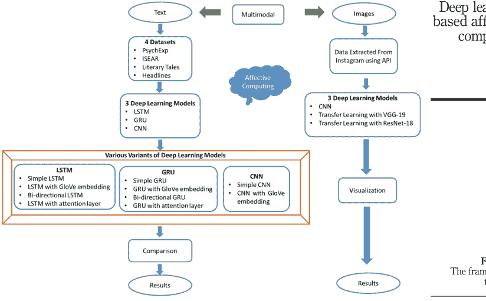

分别是 LSTM、GRU 和 CNN。本研究调查了深度学习模型的各种变体。对于 LSTM 模型，有四种变体，包括简单 LSTM、带 GloVe 词嵌入的 LSTM、双向 LSTM 和带注意力层的 LSTM。同样，本研究使用了四种 GRU 变体，包括简单 GRU、带 GloVe 词嵌入的 GRU、双向 GRU 和带注意力层的 GRU。对于 CNN，我们使用了带随机词嵌入的简单 CNN 和带 GloVe 词嵌入的 CNN。双向 CNN 和带注意力层的 CNN 是不可能的。结果使用精确率、召回率、特异度、F1 分数和 AUC-ROC 分数等指标进行评估。基于文本的情感计算所得结果随后与早期提出的方法进行了比较。

对于基于图像的情感计算，数据是使用 API 从 Instagram 提取的。训练数据是使用表 1 中给定的标签生成的。我们在图像数据上应用了三种深度学习模型，包括自定义 CNN 模型、带预训练 VGG-19 模型的迁移学习模型和预训练 ResNet-18 模型。图像结果也使用 AUC-ROC 分数和混淆矩阵等指标进行评估。所得结果使用名为 tensorboard 嵌入投影机可视化工具的可视化工具进行展示。该工具提供多种功能，例如带有图形界面的 PCA 分析和 t-SNE（Bunte 等人，2012）可视化。

## 4. 方法与模型

本节介绍研究中使用的方法。本节介绍了文本和图像数据的情感计算。

### 4.1 基于文本数据的情感计算

基于文本数据的情感计算使用三种深度学习模型（即 LSTM、GRU 和 CNN）进行了分析。我们还使用了三种深度学习模型的各种变体。对于


例如，我们已使用带 GloVe 嵌入的 LSTM、双向 LSTM 和带注意力层的 LSTM。

#### 4.1.1 长短期记忆网络 (LSTM)

长短期记忆网络（LSTM）是图像识别、视频转文本生成、手写识别和语音识别中广泛使用的深度学习技术之一（Hochreiter and Schmidhuber, 1997）。LSTM 由输入门、输出门和遗忘门等门控组成，这些门控使 LSTM 单元能够读取、写入和删除其内存中的信息。LSTM 是一种循环神经网络（RNN）。RNN 存在梯度消失问题，可通过 LSTM 单元解决，因为它能保持梯度足够陡峭，从而使训练时间相对较短且准确率较高。我们在研究中使用了四种 LSTM 变体作为模型。研究中使用的第一个模型是带随机嵌入的简单 LSTM，第二个模型是带 GloVe 嵌入的 LSTM，第三个模型是双向 LSTM，第四个模型是带注意力层的 LSTM 模型。

第二个模型是带 GloVe 嵌入的 LSTM 模型。嵌入（Embeddings）通常是学习得到的连续向量表示，即将不同对象映射到向量的过程。用于词嵌入的全局向量（GloVe）是一种无监督学习算法，用于获取单词的向量表示（Pennington et al., 2014）。在此模型中，训练是在语料库中聚合的全局单词-单词共现统计数据上进行的。生成的表示展示了单词向量空间中一个有趣的线性子结构。我们对模型使用了 GloVe 的预训练词嵌入，然后冻结嵌入层的权重。

第三个模型是双向 LSTM 模型，它通过双向获取输入创建而成，即一个从过去到未来，另一个从未来到过去。双向 LSTM 在多种场景中有应用，例如手写识别，通过了解当前字母前后的字母，可以增强 LSTM 模型的性能。因此，双向 LSTM 优于 LSTM。

第四个模型是带注意力层的 LSTM 模型。使用注意力层的核心思想不是丢弃任何中间隐藏状态，而是利用所有状态来预测文本的更好情感（Yang et al., 2017）。在传统模型中，我们会丢弃输出的所有中间状态，只使用其最终状态。在此，我们在模型中使用那些中间状态。带注意力层的 LSTM 的应用包括多对象识别、空间变换网络和带注意力的神经机器翻译。我们使用注意力层来计算软对齐分数，对应于 LSTM 的每个隐藏状态和最后一个隐藏状态。我们使用 torch.bmm 进行批量矩阵乘法。带注意力层的 LSTM 模型的详细信息可见附录 1。

#### 4.1.2 门控循环单元 (GRU)

门控循环单元（GRU）是 RNN 的较新一代，与 LSTM 类似但门更少（Cho et al., 2014）。GRU 仅包含两个门，即更新门和遗忘门。GRU 没有 LSTM 单元中存在的单元状态。更新门的工作方式类似于 LSTM 模型中输入门和遗忘门的组合，而重置门用于决定应记住多少过去信息以及应遗忘多少。与 LSTM 类似，我们也对 GRU 使用了四种模型。GRU 中使用的第一个模型是带随机嵌入的简单 GRU 模型，第二个模型是带 GloVe 嵌入的 GRU，第三个模型是双向 GRU，第四个模型是带注意力层的 GRU 模型。

#### 4.1.3 卷积神经网络 (CNN)

卷积神经网络（CNN）是一种特殊的神经网络，在其至少一个层中应用称为卷积的线性操作，而不是通用矩阵乘法。CNN 旨在处理具有网格或数组状结构/拓扑的数据。例如，类似于一维数组状结构的时间序列数据、图像数据或音频频谱图（具有二维像素数据网格），或三维数据，如彩色图像/视频数据。CNN 的应用包括图像识别、自然语言处理（包括情感分析）、视频分析、药物发现等等。CNN 通常由三种异质层组成：卷积层、池化层和全连接层。卷积层具有一组可学习的滤波器，用于在整个输入图像上进行卷积并生成不同类型的激活特征图。池化层紧跟在卷积层之后，用于减小特征图的空间大小和网络的计算成本。全连接层通常包含在网络末端，以确保该层的所有神经元都与前一层的激活完全连接，并允许将二维特征图转换为一维特征图，以便进一步表示特征和进行分类。我们使用 CNN 进行基于文本的情感计算。我们仅使用了两种 CNN 模型变体，即带随机初始化嵌入的 CNN 模型和带 GloVe 嵌入的 CNN 模型。双向 CNN 和 CNN 中的注意力层是不可能的，因为双向 CNN 与 CNN 产生相同的输出，因为整个内容在一个实例中被视为输入。

### 4.2 图像情感计算

图像数据的情感计算使用三种深度学习模型进行了分析，即：图像自定义 CNN、基于 VGG-19 模型的迁移学习和基于 ResNet-18 模型的迁移学习。

#### 4.2.1 图像 CNN

CNN 不仅用于基于文本的情感计算，也可用于基于图像的情感计算。同样，CNN 也有三层，即卷积层、池化层和全连接层。随着内核（卷积滤波器）在图像上移动，CNN 模型提取图像的显著特征。我们使用了自定义 CNN，通过卷积层之间的串联来实现基于图像的情感计算。

#### 4.2.2 基于 VGG-19 模型的迁移学习

迁移学习是一种机器学习方法，即使用在某项任务上表现良好的预训练模型，并经过一些修改，使其在另一类相似任务上表现良好（Hermessi et al, 2019）。迁移学习的好处在于，通过重用先前训练的模型，可以加快开发和训练模型所需的时间。迁移学习还有助于在数据量较少的情况下取得良好效果。最新的研究之一已使用迁移学习来识别人类活动（Zhu et al, 2020）。

牛津大学的视觉几何组（VGG）开发了一种用于将图像分类为 1,000 个类别的深度学习架构，即 VGG-19 模型。该模型在一个名为 ImageNet 的非常大的数据集上进行训练，该数据集包含尺寸为 224px * 224px * 3（RGB 图像）的图像。正如 VGG-19 的名称所示，它总共包含 16 个卷积层和三个全连接层（He et al, 2016）。该层在整个网络中具有 (3, 3) 的内核大小和 (2, 2) 的补丁大小的最大池化层。在训练模型之前，通过从每个像素减去平均 RGB 值对图像进行预处理。然后，图像通过一堆卷积层传递，其感受野为 3 x 3 大小，带有 1px。卷积层输入的空间填充使得卷积后保留空间分辨率，即 3 x 3 卷积层的填充为 1 像素。一堆卷积层后面跟着三个全连接（FC）层，其中前两个激活函数为修正线性单元（ReLU）激活函数，第三个为 softmax。前两个层各有 4,096 个通道，第三个层执行 1,000 方式分类，因此包含 1,000 个通道（每个类别一个）。最终层是 softmax 层。VGG-19 模型的架构见图 2。

#### 4.2.3 基于 ResNet-18 模型的迁移学习

微软开发了残差网络（ResNet）架构用于将图像分类为 1,000 个类别。该模型再次


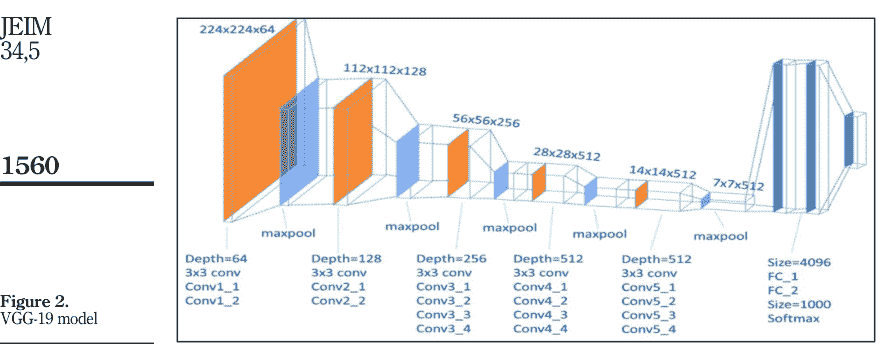

在名为 ImageNet 的非常大的数据集上进行了训练，该数据集包含尺寸为 224px * 224px * 3（RGB 图像）的图像。层之间具有跳跃连接，使得一个层的学习可以传递到另一个层，跳过中间层，同时还会学习中间层（He et al., 2016）。

第一个卷积层使用 2 px 对输入图像进行下采样，然后 maxpool 层的输出通过一堆具有 3 × 3 尺寸小感受野的卷积层。有两种残差连接，如图 3 所示。一种残差连接的输入和输出具有相同的维度，而另一种残差连接的行为是：当维度发生变化时，快捷/跳跃连接仍然执行恒等映射，并用增加的维度填充额外的零项，在网络末端具有全局平均池化层和带 softmax 的 1000 方式全连接层。

## 5. 结果与讨论

结果是使用 Google Colab 系统 [1] 和一台个人计算机获得的。对于深度学习模型的训练，我们使用了带有 GPU 加速的 Google Colab 系统。它拥有 1 块 Tesla K80 GPU，具有 2496 个 CUDA 核心和 12 GB GDDR5 显存，配备 1 个超线程（2 线程）至强处理器 @2.3Ghz（无睿频加速），45 MB 缓存，12.3 GB 内存和 320 GB 可用存储。部分模型还在一台笔记本电脑上进行了训练，其规格为 Core i5 第 8 代处理器（4 核 8 线程），基频 @1.8Ghz，睿频最高可达 @3.4 GHz，配备 8 GB 内存和 256 GB SSD 存储，无 GPU 加速。

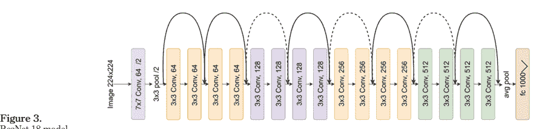

### 5.1 文本分类结果

在 PsychExp 数据集上对三个深度学习模型进行的文本分类结果见表 2。最初，与文本分类结果中的验证和测试准确率相比，训练准确率相当高。因此，我们将丢弃率从 0.2 更改为 0.3，导致训练准确率下降。然而，这显著提高了验证和测试准确率。因此，避免了过拟合。

评估指标：使用混淆矩阵、受试者工作特征（ROC）曲线、ROC 曲线下面积（AUC）、F1 分数、灵敏度、精确度和召回率来评估深度学习模型的效率。

混淆矩阵是一个表格，显示每个类别被正确分类的记录数量。

ROC 曲线是在各种阈值设置下，真阳性率（TPR）与假阳性率（FPR）之间绘制的图表。ROC 曲线下面积（AUC）是受试者工作特征（ROC）曲线下的面积；有时也称为 AUC-ROC。AUC 传达了在各种分类阈值下所有类别的整体性能测量。

精确度是分类器返回的所有正结果中正确正结果的数量之比。灵敏度是根据正确正结果的数量除以所有相关样本的数量（所有应被识别为正的样本）来计算的。灵敏度有时也称为召回率。特异度是真负数与真负数和假正数之和的比率。

```
Precision = \frac{TP}{TP + FP} (1)

Sensitivity(Recall) = \frac{TP}{TP + FN} (2)

Specificity = \frac{TN}{TN + FP} (3)
```

其中 TP 是真阳性，表示观察值为正且被预测为正；TN 是真阴性，表示观察值为负且被预测为负；FP 是假阳性，表示观察值为负但被预测为正；FN 是假阴性，表示观察值为正但被预测为负。

F1 分数是通过计算精确度和召回率的调和平均数或加权平均值得到的。

F1 = 2 \cdot \frac{\text{Precision} \times \text{Recall}}{\text{Precision} + \text{Recall}} (4)

| 模型 | | 训练准确率 | 验证准确率 | 测试准确率 |
|---|---|---|---|---|
| LSTM | LSTM | 83.86% | 67.76% | 68.78% |
| | 带 GloVe 嵌入的 LSTM | 79.82% | 66.74% | 75.75% |
| | 双向 LSTM | 82.56% | 62.35% | 64.79% |
| | LSTM 注意力 | 84.44% | 69.86% | 71.20% |
| GRU | GRU | 81.76% | 60.92% | 69.29% |
| | 带 GloVe 嵌入的 GRU | 78.75% | 65.30% | 77.30% |
| | 双向 GRU | 82.45% | 64.70% | 68.97% |
| | GRU 注意力 | 89.20% | 66.80% | 72.50% |
| CNN | CNN | 89.35% | 63.97% | 74.45% |
| | 带 GloVe 嵌入的 CNN | 86.90% | 68.40% | 75.97% |

#### 5.1.1 LSTM 模型结果

PsychExp 的测试数据集包含 750 张图像，其中“喜悦”类共有 111 张图像，“恐惧”类有 109 张，“愤怒”类有 110 张，“悲伤”类有 107 张，“厌恶”类有 105 张，“羞耻”类有 105 张，“内疚”类有 103 张。PsychExp 数据集的简单 LSTM 模型的混淆矩阵和 ROC 曲线如图 4 所示。从图中可以看出，喜悦类的正确分类准确率达到 77.47%，即 111 个测试样本中有 86 个被准确分类。然而，愤怒类和厌恶类的分类不够准确，混淆矩阵显示愤怒类的准确率为 47.27%，厌恶类的准确率为 48.57%。LSTM 模型变体的详细结果见附录 2。

#### 5.1.2 GRU 模型结果

在一系列实验中，我们在 PsychExp 数据集上应用了带有随机嵌入的简单 GRU 模型，其混淆矩阵和 ROC 曲线见图 5。从图中可以看出，喜悦类的分类准确率为 74.77%，即 111 个测试样本中有 83 个被分类。然而，我们发现羞耻类和厌恶类没有被准确分类，混淆矩阵显示羞耻类的准确率为 53.33%，内疚类的准确率为 54.28%。GRU 模型变体的详细结果见附录 3。

#### 5.1.3 CNN 模型结果

接下来的一组实验使用 CNN 模型在 PsychExp 数据集上进行。CNN 模型的混淆矩阵和 ROC 曲线见图 6。

从图 6 可以看出，喜悦类的正确分类准确率达到 78.37%，即 111 个测试样本中有 87 个被准确分类。然而，我们发现厌恶类和羞耻类的分类不够准确，

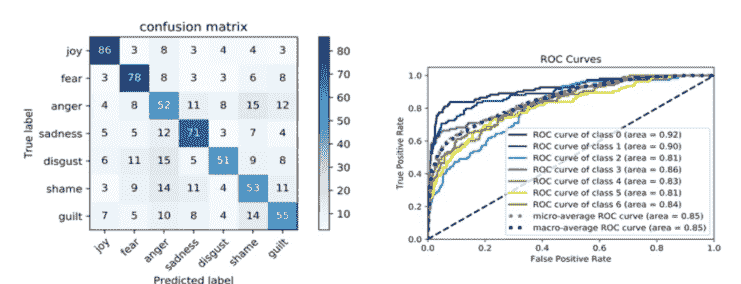

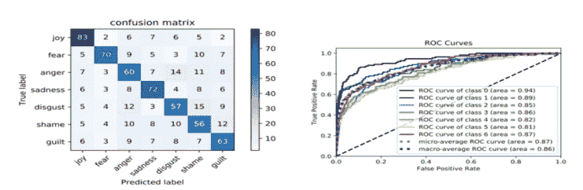

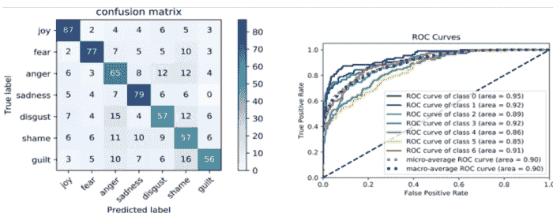

图 6. CNN 模型

混淆矩阵显示厌恶类和羞耻类的准确率均为 58.28%。之后，我们应用了带 GloVe 嵌入的 CNN 模型，带 GloVe 嵌入的 CNN 模型的混淆矩阵和 ROC 曲线见图 7。

从图 7 可以看出，喜悦类的正确分类准确率达到 87.38%，即 111 个测试样本中有 97 个被准确分类。带 GloVe 嵌入的 CNN 模型证明是文本情感分析的最佳模型之一。

由于空间限制，我们无法展示所有模型和所有数据集的混淆矩阵和 ROC 曲线。然而，所有数据集的汇总结果可见表 3，其中可以看到所有三个深度学习模型在其余 3 个数据集上的结果。

### 5.2 基于图像的情感计算结果

本小节描述了基于图像的情感计算结果，其中可以看到三个深度学习模型在 Instagram 数据集上的结果。测试数据集共有 256 张图像，包含 128 条快乐类记录和 128 条悲伤类记录。我们应用了自定义 CNN 模型、基于 VGG-19 模型的迁移学习和基于 ResNet-18 模型的迁移学习。

#### 5.2.1 图像数据集上自定义 CNN 模型的结果

Instagram 数据集的测试数据集见图 8。

从图 8 可以看出，快乐类的真阳性值或准确率为 0.88。128 张图像中有 113 张被正确分类为快乐，真阴性值或

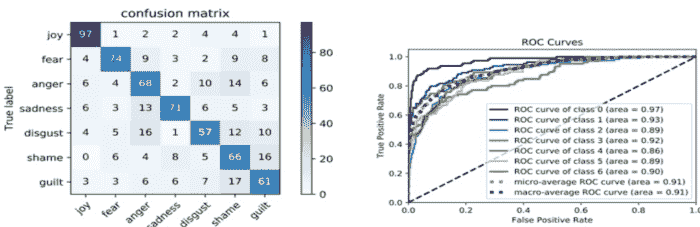

图 7. 带 GloVe 嵌入的 CNN 模型


| 数据集 | 模型 | F1分数 | 灵敏度 | 特异度 |
| :--- | :--- | :--- | :--- | :--- |
| ISEAR数据集 | LSTM (Kratzwald et al., 2018) | 0.542000 | 0.54200 | 0.923000 |
| | LSTM (本文提出) | 0.544591 | 0.54433 | 0.924071 |
| | Bi-LSTM (Kratzwald et al., 2018) | 0.558000 | 0.56000 | 0.926000 |
| | Bi-LSTM (本文提出) | 0.570785 | 0.56933 | 0.928197 |
| | LSTM GloVe (Kratzwald et al., 2018) | 0.577000 | 0.57600 | 0.930000 |
| | LSTM GloVe (本文提出) | 0.615204 | 0.61333 | 0.935587 |
| | Bi-LSTM GloVe (Kratzwald et al., 2018) | 0.569000 | 0.57000 | 0.928000 |
| | Bi-LSTM GloVe (本文提出) | 0.622841 | 0.62016 | 0.936678 |
| 文学故事 | LSTM (Kratzwald et al., 2018) | 0.630000 | 0.631 | 0.888000 |
| | LSTM (本文提出) | 0.309856 | 0.390 | 0.925995 |
| | Bi-LSTM (Kratzwald et al., 2018) | 0.616000 | 0.620 | 0.888000 |
| | Bi-LSTM (本文提出) | 0.502111 | 0.510 | 0.869356 |
| | LSTM GloVe (Kratzwald et al., 2018) | 0.679000 | 0.684 | 0.906000 |
| | LSTM GloVe (本文提出) | 0.712389 | 0.700 | 0.925994 |
| | Bi-LSTM GloVe (Kratzwald et al., 2018) | 0.688000 | 0.682 | 0.914000 |
| | Bi-LSTM GloVe (本文提出) | 0.697822 | 0.720 | 0.931350 |
| 头条 | LSTM (Kratzwald et al., 2018) | 0.392000 | 0.398000 | 0.838000 |
| | LSTM (本文提出) | 0.418133 | 0.423077 | 0.876839 |
| | Bi-LSTM (Kratzwald et al., 2018) | 0.398000 | 0.403000 | 0.841000 |
| | Bi-LSTM (本文提出) | 0.367945 | 0.369231 | 0.863373 |
| | LSTM GloVe (Kratzwald et al., 2018) | 0.417000 | 0.400000 | 0.866000 |
| | LSTM GloVe (本文提出) | 0.421148 | 0.430769 | 0.876735 |
| | Bi-LSTM GloVe (Kratzwald et al., 2018) | 0.441000 | 0.443000 | 0.856000 |
| | Bi-LSTM GloVe (本文提出) | 0.458061 | 0.469231 | 0.887780 |

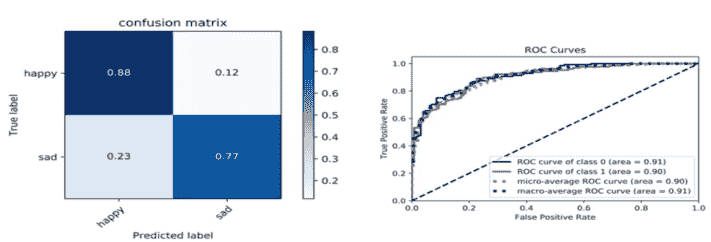

悲伤类别的准确率为 0.77。128 张悲伤图像中有 99 张被正确分类为悲伤。

5.2.2 基于 VGG-19 模型的迁移学习。在 Instagram 数据集的测试数据集上，使用预训练 VGG-19 模型的迁移学习模型的结果可以参见图 9。

从图 9 可以看出，快乐类别的真正例值或准确率为 0.91。128 张图像中有 117 张被正确分类为快乐，悲伤类别的真负例值或准确率为 0.80。128 张悲伤图像中有 102 张被正确分类为悲伤。

5.2.3 基于 ResNet-18 模型的迁移学习。在 Instagram 数据集的测试数据集上，使用预训练 ResNet-18 模型的迁移学习模型的结果可以参见图 10。从图 10 可以看出，快乐类别的真正例值或准确率为 0.96。128 张图像中有 123 张被正确分类为快乐，悲伤类别的真负例值或准确率为 0.76。128 张悲伤图像中有 97 张被正确分类为悲伤。

### 5.3 图像可视化

可视化是深度学习的基本技能之一。可视化有助于最终用户理解并进一步解释结果。使用 TensorBoard 嵌入式投影仪可视化工具，对人类面部情绪的 Instagram 图像进行了可视化。该工具提供多种功能，例如 PCA 分析、带图形界面的 t-SNE（Bunte et al., 2012）可视化。TensorBoard 嵌入式投影仪可视化工具还提供灵活性，可更改不同超参数，如困惑度、学习率，并支持以 3D 或 2D 视图进行控制。我们同时使用 t-SNE 和 PCA 获得了 Instagram 图像的可视化。使用 TensorBoard 可视化的 Instagram 图像可以参见图 11。

从图 11 可以观察到，存在两个不同的类别，即快乐类别和悲伤类别。用蓝色标记的椭圆表示属于快乐类别的图像，用红色标记的椭圆表示属于悲伤类别的图像。t 分布随机邻域嵌入（t-SNE）是一种用于探索高维数据的非线性降维算法（Bunte et al., 2012）。一般来说，t-SNE 能直观地展示数据在高维空间中的排列方式。另一方面，主成分分析（Principal Component Analysis，PCA）是一种线性特征提取技术。PCA 通过线性映射将数据投影到低维空间，使得低维表示中数据的方差最大化。我们同时使用 t-SNE 和 PCA 对图像进行可视化。


## 6. 拟议方法与现有方法的比较及启示

拟议方法与 Kratzwald et al. (2018) 的现有方法在三个标准数据集上进行了比较，即 ISEAR 数据集、Literary Tales 数据集和 Headlines 数据集。比较结果可以参见表 3。表中的灰色行显示了拟议方法获得的结果。

从表 3 的比较结果可以看出，对于 ISEAR 数据集，拟议方法在所有四个模型和所有三个评估参数上均优于 Kratzwald et al. (2018) 提出的早期方法。我们使用了三个评估参数，即 F 分数、灵敏度和特异度。拟议方法在所有评估指标上均优于早期方法。

对于 Literary Tales 数据集，基于 F1 分数和灵敏度分数，拟议方法在四个模型中的两个模型上优于 Kratzwald et al. (2018) 提出的早期方法。然而，当考虑特异度指标时，拟议方法在四个模型中的三个模型上优于早期方法。早期方法与拟议方法的比较值可以参见表 3。

对于 Headlines 数据集，基于 F1 分数和灵敏度分数，拟议方法在四个模型中的三个模型上优于 Kratzwald et al. (2018) 提出的早期方法。然而，当考虑特异度指标时，拟议方法在所有四个模型上均优于早期方法。因此，我们可以说拟议方法总体上优于早期方法。

基于文本和基于图像的情感计算有助于决策支持系统。深度学习技术能够在营销、金融、运营和商业等多个领域找到应用。例如，深度学习曾被用于确定金融领域的有效交易策略（Li et al., 2019）。此外，研究人员还利用深度学习通过调查关于餐厅的在线消费者评论来确定餐厅的倒闭情况（Tao and Zhou, 2020）。基于深度学习的方法也用于暗网市场中的网络威胁识别（Ebrahimi et al., 2020）。即使是基于深度学习的方法也在医疗领域找到了应用，包括分析 CT 扫描和其他危及生命的疾病（Dhiman et al., 2021）。

### 6.1 启示

本研究的发现对政策决策和学术研究具有启示意义。该研究将有助于决策支持系统的多个应用领域，包括营销、推荐系统和客户支持。借助情感计算，这些流程可以得到显著改善。同样，其他需要人机交互的系统也将从情感分析和情绪识别中受益。分析然后随后响应客户、用户、员工和患者的情绪状态，有可能改变企业的运作方式。管理层可以根据客户的状态来确定营销和销售策略。例如，可以为被识别为悲伤状态的客户提供产品折扣。根据本研究的 IBM 伦理分析模型，不仅关注技术能力，还关注人类和法律方面（Chang, 2021）。

该研究对研究人员具有启示意义。该研究还帮助全球的研究人员了解使用定制深度学习模型执行不同任务的用途。该研究使用了不同的深度学习模型变体，包括 GloVe 嵌入式、注意力层和迁移学习。研究人员可以在深度学习方法中使用它们来提高模型的效率。例如，金融领域的研究人员可以使用带注意力层的 LSTM/GRU 模型来有效确定股票价格。同样，研究人员可以在视频数据中使用迁移学习。最近，研究人员开始以这种方式使用深度学习：这些方法/技术应当帮助人们在生活中找到真正的意义并提高生活水平，同时同样重视幸福、真理、感觉、想象和多样性（Gee and Esteban-Guitart, 2019）。核心观点是，人工智能在未来不应取代人类的情感和决策。

## 7. 结论

本研究既针对文本数据也针对图像数据进行了情感计算分析。基于文本的情感计算在四个标准数据集上使用三种深度学习模型（即 LSTM、GRU 和 CNN）进行。所提方法的结果与标准数据集上的基准模型进行了比较，发现所提模型在大多数参数上优于早期模型。对于基于图像的情感计算，数据从 Instagram 提取，并使用三种深度学习模型（即 CNN、与 VGG-19 模型的迁移学习和与 ResNet-18 模型的迁移学习）进行了面部情绪识别。基于情感计算的图像可视化也在研究中展示。该研究对学术界和政策制定都有启示意义。

这项工作与其他任何工作一样，也存在一些局限性。从 Instagram 提取的图像仅分为两个类别：快乐和悲伤。为了进行最佳比较，图像本应像标准文本数据集一样分为七个类别，因为图像的手动分类容易出错。因此，我们仅将图像分为 2 个类别。未来，研究人员进行比较需要标准的 7 个类别的图像数据集。

当前工作的未来范围有多个方向。该工作可以扩展以纳入视频和音频数据，用于多模态情感计算。


此外，该工作还可以扩展为从同一数据源同步获取文本和图像——例如，用户在推特上发布图片时附带一小段文字。文本也有情感，图像也有情感。同时分析两者可能是当前研究的一项有趣的未来工作。

## 注

- 1. https://colab.research.google.com

## 参考文献

- Abdel-Basset, M., Hawash, H., Chang, V., Chakrabortty, R.K. and Ryan, M. (2020), “面向复杂物联网应用中异质人类活动识别的深度学习”, IEEE 物联网期刊. doi: 10.1109/JIOT.2020.3038416.

- Abdel-Basset, M., Chang, V., Hawash, H., Chakrabortty, R.K. and Ryan, M. (2021), “FSS-2019-nCov：一种用于COVID-19感染半监督少样本分割的深度学习架构”, 知识基础系统, Vol. 212, 106647.

- Affonso, C., Rossi, A.L.D., Vieira, F.H.A. and de Leon Ferreira, A.C.P. (2017), “生物图像分类的深度学习”, 专家系统与应用, Vol. 85, pp. 114-122.

- Alm, E.C.O. (2008), 文本与语音中的情感, 伊利诺伊大学厄巴纳-香槟分校, 厄巴纳, 伊利诺伊州.

- Bunte, K., Haase, S., Biehl, M. and Villmann, T. (2012), “使用任意偏差进行降维和可视化的随机邻域嵌入(SNE)”, 神经计算, Vol. 90, pp. 23-45.

- Cathell, D.R. (2006), 情感安全：通过情感视角观察情侣, Routledge, 纽约.

- Chaffar, S. and Inkpen, D. (2011), “使用异构数据集进行文本情感分析”, 加拿大人工智能会议, pp. 62-67.

- Chang, V. (2021), “大数据和智慧城市的伦理框架”, 技术预测与社会变革, Vol. 165, 120559.

- Chatzakou, D., Vakali, A. and Kafetsios, K. (2017), “在线活动中情绪变化的检测”, 专家系统与应用, Vol. 89, pp. 318-332.

- Chen, C., Xiang, H., Qiu, T., Wang, C., Zhou, Y. and Chang, V. (2018), “基于深度学习的物联网车辆追尾碰撞预测方案”, 并行与分布式计算期刊, Vol. 117, pp. 192-204.

- Cho, K., Van Merriënboer, B., Bahdanau, D. and Bengio, Y. (2014), “关于神经机翻译的属性：编码器-解码器方法”, ArXiv 预印本 ArXiv:1409.1259.

- Dahmane, M. and Meunier, J. (2011), “使用基于动态网格的HoG特征进行情感识别”, 2011年面部与手势会议, pp. 884-888.

- Dar, M.N., Akram, M.U., Khawaja, S.G. and Pujari, A.N. (2020), “基于生理信号的CNN和LSTM情感图绘”, 传感器, Vol. 20 No. 16, p. 4551.

- Dhiman, G., Chang, V., Kant Singh, K. and Shankar, A. (2021), “ADOPT：一种使用X射线图像检测新型冠状病毒COVID-19疾病的自动深度学习和优化方法”, 生物分子结构与动力学期刊, pp. 1-13. doi: 10.1080/07391102.2021.1875049.

- Ding, X., Liu, B. and Yu, P.S. (2008), “一种基于词典的整体意见挖掘方法”, 2008年网络搜索与数据挖掘国际会议论文集, pp. 231-240.

- Ebrahimi, M., Nunamaker, J.F. Jr and Chen, H. (2020), “暗网市场中的半监督网络威胁识别：一种转导式深度学习方法”, 管理信息系统期刊, Vol. 37 No. 3, pp. 694-722.

- Felbo, B., Mislove, A., Sogaard, A., Rahwan, I. and Lehmann, S. (2017), “使用数百万个表情符号出现来学习任意领域表示，以检测情感、情绪和讽刺”, ArXiv 预印本 ArXiv:1708.00524.

- Gee, J.-P. and Esteban-Guitart, M. (2019), “数字和社交媒体背景下的深度学习设计”, Comunicar：媒体教育研究期刊, Vol. 27 No. 1, doi: 10.3916/C58-2019-01.

- Ghani, R. and Krema, M. (2014), “基于特征提取的情感分类器”, Google 专利.

- Gordeev, D. (2016), “使用CNN检测句子中的攻击性状态”, 语音与计算国际会议, pp. 240-245.

- Guan, Y., Wei, Q. and Chen, G. (2019), “基于多视图信息集成的深度学习个性化推荐”, 决策支持系统, Vol. 118, pp. 58-69.

- He, K., Zhang, X., Ren, S. and Sun, J. (2016), “图像识别的深度残差学习”, IEEE 计算机视觉与模式识别会议论文集, pp. 770-778.

- Hermesi, H., Mourali, O. and Zagrouba, E. (2019), “通过迁移学习在MR图像中进行软组织肉瘤分类的深度特征学习”, 专家系统与应用, Vol. 120, pp. 116-127.

- Hochreiter, S. and Schmidhuber, J. (1997), “长短期记忆”, 神经计算, Vol. 9 No. 8, pp. 1735-1780.

- Hu, Y., Zeng, Z., Yin, L., Wei, X., Zhou, X. and Huang, T.S. (2008), “多视图面部表情识别”, 2008年第八届IEEE自动面部与手势识别国际会议, pp. 1-6.

- Huang, B., Li, Z., Xu, Y., Pan, L., Wang, S., Hu, H. and Chang, V. (2020), “移动边缘计算中面向性能感知的自适应资源分配深度强化学习”, 无线通信与移动计算, Vol. 2020.

- Kalchbrenner, N., Grefenstette, E. and Blunsom, P. (2014), “一种用于句子建模的卷积神经网络”, ArXiv 预印本 ArXiv:1404.2188.

- Kalsi, S., Kaur, H. and Chang, V. (2018), “使用遗传算法和NW算法进行密钥生成的DNA密码学与深度学习”, 医学系统期刊, Vol. 42 No. 1, pp. 1-12.

- Kim, Y. (2014), “用于句子分类的卷积神经网络”, ArXiv 预印本 ArXiv:1408.5882.

- Kramer, B. (2015), 分享经济：分享如何驱动人类经济, Morgan James 出版社, 纽约.

- Kramer, A.D., Guillory, J.E. and Hancock, J.T. (2014), “通过社交网络大规模情绪传染的实验证据”, 美国国家科学院院刊, Vol. 111 No. 24, pp. 8788-8790.

- Kratzwald, B., Ilić, S., Kraus, M., Feuerriegel, S. and Prendinger, H. (2018), “情感计算的深度学习：决策支持中的基于文本的情感识别”, 决策支持系统, Vol. 115, pp. 24-35, doi: 10.1016/j.dss.2018.09.002.

- Kraus, M. and Feuerriegel, S. (2017), “基于深度神经网络和迁移学习的财务披露决策支持”, 决策支持系统, Vol. 104, pp. 38-48, doi: 10.1016/j.dss.2017.10.001.

- Li, Y., Ni, P. and Chang, V. (2019), “深度强化学习在股票交易策略和股票预测中的应用”, 计算, Vol. 102, pp. 1305-1322.

- Loureiro, A.L., Miguéis, V.L. and da Silva, L.F. (2018), “探索时尚零售中销售预测的深度神经网络应用”, 决策支持系统, Vol. 114, pp. 81-93.

- Lovallo, D. and Sibony, O. (2018), “拓展框架：行为战略如何重新定义战略决策”, 战略科学, Vol. 3 No. 4, pp. 658-667.

- Machajdik, J. and Hanbury, A. (2010), “使用受心理学和艺术理论启发的特征进行情感图像分类”, 第18届ACM多媒体国际会议论文集, Vol. 18, pp. 83-92.

- Mahalakshmi, G.S., Selvi, G.M., Sendhilkumar, S., Vijayakumar, P., Zhu, Y. and Chang, V. (2018), “基于可持续计算的科研论文写作深度学习框架”, IEEE 可持续计算交易, Vol. 4 No. 1, pp. 4-16.

- Mahmoudi, N., Docherty, P. and Moscato, P. (2018), “深度神经网络更懂投资者”, 决策支持系统, Vol. 112, pp. 23-34.

- Malik, N. and Singh, P.V. (2019), “计算机视觉中的深度学习：方法、解释、因果性和公平性”, 分析时代的运筹学与管理科学, INFORMS, pp. 73-100.

- Matin, R., Hansen, C., Hansen, C. and Molgaard, P. (2019), “使用年度报告中的文本段落深度学习预测困境”, 专家系统与应用, Vol. 132, pp. 199-208.

- Melville, P., Gryc, W. and Lawrence, R.D. (2009), “结合词汇知识与文本分类进行博客情感分析”, 第15届ACM SIGKDD知识发现与数据挖掘国际会议论文集, pp. 1275-1284.

- Meng, Z., Liu, P., Cai, J., Han, S. and Tong, Y. (2017), “面部表情识别的身份感知卷积神经网络”, 2017年第12届IEEE自动面部与手势识别国际会议(FG 2017), pp. 558-565.

- Mikolov, T., Sutskever, I., Chen, K., Corrado, G.S. and Dean, J. (2013), “词语和短语的分布式表示及其组成性”, 神经信息处理系统进展, pp. 3111-3119.

- Pantic, M. and Patras, I. (2006), “面部表情动态：从面部轮廓图像序列识别面部动作及其时间段”, IEEE 系统、人与控制论汇刊，部分B（控制论）, Vol. 36 No. 2, pp. 433-449.

- Park, B.-H., Oh, S.-Y. and Kim, I.-J. (2017), “使用具有局部特征学习和循环回归的深度神经网络进行人脸对齐”, 专家系统与应用, Vol. 89, pp. 66-80.

- Pennington, J., Socher, R. and Manning, C.D. (2014), “GloVe：词向量的全局表示”, 2014年经验自然语言处理方法会议(EMNLP)论文集, pp. 1532-1543.

- Picard, R.W. (2000), 情感计算, MIT 出版社, 麻省剑桥市.

- Renda, A., Barsacchi, M., Bechini, A. and Marcelloni, F. (2019), “比较深度学习的集成策略：面部表情识别的应用”, 专家系统与应用, Vol. 136, pp. 1-11.

- Simon, H.A. (1959), “经济学和行为科学中的决策理论”, 美国经济评论, Vol. 49 No. 3, pp. 253-283.

- Soudani, A. and Barhoumi, W. (2019), “一种基于图像的分割推荐器，使用众包和迁移学习进行皮肤病变提取”, 专家系统与应用, Vol. 118, pp. 400-410.

- Strapparava, C. and Mihalcea, R. (2007), “SemEval-2007任务14：情感文本”, 第四届语义评价国际研讨会(SemEval-2007)论文集, pp. 70-74.

- Taboada, M., Brooke, J., Tofiloski, M., Voll, K. and Stede, M. (2011), “基于词典的情感分析方法”, 计算语言学, Vol. 37 No. 2, pp. 267-307.

- Tao, J. and Zhou, L. (2020), “在线消费者评论能否预示餐馆倒闭：一种基于深度学习的时间序列分析”, IEEE 工程管理杂志. doi: 10.1109/TEM.2020.3016329.

- Tetlock, P.C., Saar-Tsechansky, M. and Macskassy, S. (2008), “超越文字：量化语言以衡量企业基本面”, 金融杂志, Vol. 63 No. 3, pp. 1437-1467.

- Tomkins, S. (1962), 情感意象意识：第一卷：积极情感, Springer 出版社, 纽约.


Turney, P.D. (2002), “大拇指朝上还是朝下？：应用于评论非监督分类的语义取向”，计算语言学协会第 40 届年会论文集，第 417-424 页。

Valstar, M.F., Mehu, M., Jiang, B., Pantic, M. and Scherer, K. (2012), “首次面部表情识别挑战的元分析”，IEEE 系统、人与控制论汇刊，B 部分（控制论），第 42 卷第 4 期，第 966-979 页。

Wallbott, H.G. and Scherer, K.R. (1986), “情感体验是普遍的还是特定的？来自五大洲 27 个国家的证据”，《信息》（国际社会科学理事会），第 25 卷第 4 期，第 763-795 页，doi: 10.1177/0539018886025004001.

Wang, Y. and Xu, W. (2018), “利用基于 LDA 的文本分析的深度学习检测汽车保险欺诈”，决策支持系统，第 105 卷，第 87-95 页。

Wen, Y., Zhang, K., Li, Z. and Qiao, Y. (2016), “面向深度人脸识别的判别特征学习方法”，欧洲计算机视觉会议，第 499-515 页。

Wöllmer, M., Kaiser, M., Eyben, F., Schuller, B. and Rigoll, G. (2013), “音视频情感识别框架中连续情感的 LSTM 建模”，图像与视觉计算，第 31 卷第 2 期，第 153-163 页。

Yang, M., Tu, W., Wang, J., Xu, F. and Chen, X. (2017), “面向目标依赖情感分类的基于注意力的 LSTM”，第 31 届 AAAI 人工智能会议。

Yang, R., Singh, S.K., Tavakkoli, M., Amiri, N., Yang, Y., Karami, M.A. and Rai, R. (2020), “面向计算机视觉模态频率检测的 CNN-LSTM 深度学习架构”，机械系统与信号处理，第 144 卷，106885。

Yuvaraj, N., Chang, V., Gobinathan, B., Pinagapani, A., Kannan, S., Dhiman, G. and Rajan, A.R. (2021), “基于多特征人工智能与深度决策树分类的网络欺凌自动检测”，计算机与电气工程，第 92 卷，107186。

Zhu, H., Samtani, S., Chen, H. and Nunamaker, J.F. Jr (2020), “日常活动中的人类识别：一种深度迁移学习方法”，管理信息系统杂志，第 37 卷第 2 期，第 457-483 页。

## 附录 1

### 关于注意力层的详细信息

带有注意力层的 LSTM 模型可在图 A1 中可视化。注意力层的权重以及应用注意力层后的整体输出可通过以下给出的公式 (A1) 和 (A2) 计算-

```
$$a_i = \frac{e^{h_i^T h_t}}{\sum_{j=1}^t e^{h_j^T h_t}}$$ (A1)

$$h_a = \sum_{i=1}^t a_i h_i$$ (A2)
```

其中，$a_i$ 为注意力层的权重，$h_i$ 为序列中第 i 个 LSTM 单元的隐藏状态输出，$h_i^T$ 为隐藏状态的转置，$h$ 为序列中最后一个 LSTM 单元的隐藏状态输出，$h_a$ 为应用注意力层权重后的整体输出。


图 A1. 带有注意力层的 LSTM 模型

## 附录 2

### LSTM 模型变体的结果

我们已计算所有 LSTM 模型变体（即带有 GloVe 嵌入的 LSTM 模型、双向 LSTM 模型和带有注意力层的 LSTM 模型）的混淆矩阵和 ROC 曲线。

带有 GloVe 嵌入的 LSTM 模型结果可见于图 A2。从图 A2 可以看出，喜悦类的分类准确率达到 84.68%，即 111 个测试样本中有 94 个被准确分类。然而，愤怒类和厌恶类再次未被如此准确分类，因为混淆矩阵显示愤怒类的准确率为 55.45%，厌恶类的准确率为 57.14%。接下来，我们在 PsychExp 数据集上应用了双向 LSTM，其混淆矩阵和 ROC 曲线可见于图 A3。

从图 A3 可以看出，喜悦类的分类准确率为 70.27%，即 111 个测试样本中有 78 个被准确分类。然而，我们再次发现愤怒类和厌恶类未被准确分类，因为混淆矩阵显示愤怒类的准确率为 47.27%，厌恶类的准确率为 48.57%。接下来，我们应用了第四个 LSTM 模型变体，其中使用了注意力层。带有注意力层的 LSTM 模型的混淆矩阵和 ROC 曲线可见于图 A4。

从图 A4 可以看出，喜悦类的分类准确率达到 69.36%，即 111 个测试样本中有 77 个被准确分类。然而，我们发现内疚类和羞耻类未被如此准确分类，因为混淆矩阵显示羞耻类的准确率为 53.33%，内疚类的准确率为 51.45%。


图 A2. 带有 GloVe 嵌入的 LSTM 模型


图 A3. 双向 LSTM 模型


图 A4. 带有注意力层的 LSTM 模型

## 附录 3

### GRU 模型变体的结果

我们已计算所有 GRU 模型变体（即带有 GloVe 嵌入的 GRU 模型、双向 GRU 模型和带有注意力层的 GRU 模型）的混淆矩阵和 ROC 曲线。

带有 GloVe 嵌入的 GRU 模型结果可见于图 A5。

从图 A5 可以看出，喜悦类的分类准确率达到 79.27%，即 111 个测试样本中有 88 个被准确分类。然而，我们发现愤怒类和厌恶类未被如此准确分类，因为混淆矩阵显示愤怒类的准确率为 54.54%，厌恶类的准确率为 57.14%。此后，我们应用了名为双向 GRU 的第三个 GRU 模型变体。双向 GRU 模型的混淆矩阵和 ROC 曲线可见于图 A6。

从图 A6 可以看出，喜悦类的分类准确率达到 72.97%，即 111 个测试样本中有 81 个被准确分类。然而，我们发现厌恶类和羞耻类未被如此准确分类，因为混淆矩阵显示厌恶类的准确率为 41.90%，羞耻类的准确率为 42.85%。接下来，我们应用了第四个 GRU 模型变体，其中使用了注意力层。带有注意力层的 GRU 模型的混淆矩阵和 ROC 曲线可见于图 A7。

从图 A7 可以看出，喜悦类的分类准确率达到 75.67%，即 111 个测试样本中有 84 个被准确分类。然而，我们发现厌恶类和羞耻类未被如此准确分类，因为混淆矩阵显示厌恶类的准确率为 47.61%，羞耻类的准确率为 48.57%。


图 A5.
带有 GloVe 嵌入的 GRU 模型


图 A6.
双向
GRU 模型


图 A7. 带有注意力层的 GRU 模型

### 通讯作者

可通过以下方式联系 Saurabh Kumar：saurabhkumar@iimidr.ac.in

